# Corel Linux 精通指南

适合每个人的完美资源

学习如何连接互联网，在 Linux 中运行 Windows 应用程序，以及更多内容。包含 Corel Linux 第二版——免费赠送！


致 Frank 和 Marilyn：

本书不含任何碳水化合物。

## 致谢

任何这类书籍都不是某一位作者的著作，而是由整个团队共同努力完成的项目的成果。`Jennifer Campbell`、`Diane Lowry`、`Marilyn Smith` 和 `Adrian Woolhouse`，以及其他帮助制作本书的同仁，都理应赞誉和认可。

一如既往，我的妻子 `Tahir` 值得最很多的赞誉，我欠她一份感激。她忍受了长时间的工作时间，也包容了我在电脑故障时产生的挫败情绪，并帮助我分担了压力。没有她，这本书以及我的其他任何书籍都无法上书店的货架。

- 选择桌面 ................................................................................................................................................................................................................................................................. . . . . . . . 20
- 壁纸 ................................................................................................................................................................................................................................................................. . . . . . . 23
- 选择主题组件 ................................................................................................................................................................................................................................................................. . . . . . . 36
- 添加和保存主题 ................................................................................................................................................................................................................................................................. . . . . . . . 37
- 预览字体 ...................................................................................................................................................................................................................................................................... 192
- 设置文本的默认值 ............................................................................................................................................................................................................................................ 406
- 应用新默认值 .................................................................................................................................................................................................................................................. 407
- 设置自动语法高亮 ....................................................................................................................................................................................................................................... 409
- 设置文本编辑器偏好 .............................................................................................................................................................................................................................................. 410
- 选择编辑选项 .................................................................................................................................................................................................................................................. 410
- 设置选择选项 ........................................................................................................................................................................................................................................ 412
- 指定窗口颜色 .................................................................................................................................................................................................................................... 413
- 显示和隐藏工具栏及状态栏 .................................................................................................................................................................................................................................. 414
- 保存您的选项 .................................................................................................................................................................................................................................................. 414
- 我们接下来该去哪里？ ....................................................................................................................................................................................................................................... 415
- 删除字体 .................................................................................................................................................................................................................................................... 516
- 使用 Corel Tutor ........................................................................................................................................................................................................................................ 516

毫无疑问，`Linux` 曾是操作系统市场中的初创者，而现在已成为真正的竞争者和主流力量。`Linux` 赢得了尊重、市场支持和信誉，因为它证明了自己在处理企业服务器任务方面，与 `Windows` 和 `Unix` 等竞争对手同样出色。

然而，在过去，`Linux` 未能为普通电脑用户的桌面提供一种可行的替代方案，这些用户将电脑视为完成任务的工具（与那些将电脑视为有趣的实体、为了其本身而享受的人不同）。`Linux` 社区的许多人认为，未能解决桌面电脑用户的需求是 `Linux` 获得广泛认可和部署的障碍。

现在 `Linux` 世界正在发生变化。许多 `Linux` 发行版的开发者设计了某些 `Linux` 版本，最大限度地减少或隐藏了这一强大操作系统固有的复杂性。他们的目标是让那些经常将 `Microsoft Windows` 或 `Macintosh` 系统作为业务或个人生产力工具的电脑用户社区能够使用该操作系统。`Corel` 在这些开发者中脱颖而出。许多人认为 `Corel` 是 `Linux` 如何成功为桌面电脑终端用户封装的典范。

`Corel` 使安装和运行 `Linux` 系统成为可能，而无需了解如何操作 `Linux` 命令行或编辑晦涩的配置文件。用户在舒适、熟悉的图形环境中工作，完成如连接互联网、配置打印机和创建文字文档等任务。

本书侧重于日常工作中的 `Corel Linux`。它涵盖了 `Corel Linux` 的安装和基础管理，然后讨论了如何在典型任务中使用 `Corel Linux`，例如浏览万维网、阅读和发送电子邮件，以及生成文字文档。

本书针对几乎没有或完全没有 `Linux` 经验的个人，他们不认为自己是 `Windows` 或 `Macintosh` 的高级用户。本书假设你使用电脑进行日常生产力工作，但你对学习电脑或其操作系统的内部原理并不感兴趣。因此，你将找到完成任务和操作的逐步说明。你将学习如何使用该操作系统，而不是操作系统工作和运行的底层理论（除非为了阐明你如何完成工作所必要）。

书中的所有内容都假设你有一台可以安装 `Corel Linux` 的电脑，并且你以前用过电脑。如果使用鼠标、文字处理和浏览网页对你来说基本上是陌生的，你可能想在深入学习 `Corel Linux` 之前，先熟悉这些使用现代电脑的基础知识。

本书从本质上针对的是初学者。如果你是熟悉其他 `Linux` 发行版配置和使用的 `Linux` 用户，或者是 `Windows` 或 `macOS` 的强力高级用户，本书的部分内容将无法解决你可能遇到的高级问题和需求。


需要注意的是，本书的标题是`精通 Core Linux`（Mastering Core Linux），而不是`精通 Linux`（Mastering Linux）。正如标题所示，如果你从头读完这本书，你将成为 Core Linux 设计领域中一名胜任的 Core Linux 用户——即每天进行生产力工作的终端用户。如果你的目标是精通 Linux 系统的网络、用户管理和系统管理的复杂性，请考虑更通用的 Linux 书籍，例如 Arman Danish 写的《精通 Linux Premium 版》（Mastering Linux Premium Edition，Sysex, 2000）。

本书分为三个部分，随后是三个附录：

- **第一部分：Core Linux 基础** 第一部分提供了关于安装 Core Linux、在 Core Linux 桌面进行操作、设置用户账户、管理文件和打印的逐步说明。你还将学习如何自定义 Core Linux 以及运行多媒体应用程序。

- **第二部分：网络与互联网** 第二部分涵盖了你在线和使用互联网所需的所有内容。你将学习如何设置拨号连接和以太网连接、使用 Netscape Communicator 浏览网页、交换电子邮件以及通过 Core Linux 使用 ICQ。该部分的最后一个章节描述了如何在 Core Linux 和 Windows 系统之间共享资源。

- **第三部分：使用 Core Linux 应用程序** 如果你不能从操作系统中运行应用程序，那么它将没有大用处。Core Linux 自带实用的程序，Linux 系统还有许多其他应用程序可用。在第三部分中，你将学习如何使用文本编辑、文字处理、图像编辑、备份和软件更新应用程序。你还将学习如何使用 Core Linux 控制台。

- **附录** 三个附录提供了补充参考信息。附录 A 描述了随 Core Linux 的的所有软件包。附录 B 是 Linux 软件和信息的资源指南。最后，附录 C 列出了与 Core Linux 1.2 兼容的硬件。

在随书的 CD 光盘中，你将找到 Core Linux 第二版的开源版本。

# 本书使用的约定

在本书中，使用了以下约定：

- `>` 表示菜单命令序列。例如，“选择主菜单 > 应用程序 > 工具 > 计算器”意味着打开 Core Linux 主菜单，选择“应用程序”项，在“应用程序”子菜单中选择“工具”，最后在“工具”子菜单中选择“计算器”。

- 你输入或输入的文本以`**粗体**`显示。例如，在本文的某处，

- 文件名、目录路径和程序命令采用等宽字体。

你还会发现三种类型的注释：注释（Notes）、提示（Tips）和警告（Warnings）。注释提供关于所讨论主题的额外信息。提示包含有用的建议，而警告提醒你可能遇到的问题。

# 第一部分

# Core Linux 基础

学习如何：

- 在电脑上安装 Core Linux

- 在 Core Linux 桌面操作

- 设置用户账户

- 导航 Linux 系统并管理文件

- 自定义 Core Linux

- 运行多媒体应用程序

# 开始使用 Core Linux

特色：

- 介绍操作系统

- 介绍 Corel Linux

- 准备安装 Core Linux

- 安装 Corel Linux

- 从 Windows 迁移

## 什么是 Linux？

Linux 术语可以指两个事物：被称为内核的核心，或者更广泛地指运行在内核上的完整应用程序集合版。内核为应用程序运行提供环境，包括硬件接口或驱动程序，或管理文件以及在多个活动应用程序之间共享系统的机制。

Linux 是一个多任务、多用户、内存的操作系统。它提供了许多 Windows 98 或 Windows 2000 缺失或实现不完全的功能。

## Linux 简介

Linux 的历史始于 Unix，Unix 出于桌面电脑出现之前的时代。它在 20 世纪 70 年代中期用于企业和学术应用中的小型计算机和大型机。

Unix 以其多种形式在全球范围内的网络中继续使用。然而，Unix 一直是一个高成本商业平台，对于企业和学术网络之外的学生和开发者来说无法接触。传统的 Unix 系统昂贵到无法在小型家用电脑上运行，而且通常比普通家庭用户负担得起的硬件更强大。

## 什么是 Linux？

Linux 的开发是为了创建一个免费获取的类 Unix 环境，该环境也可以运行在典型的家庭电脑系统上。Linux 项目于 1991 年由芬兰赫尔辛基大学的学生 Linus Torvalds（林纳斯·托瓦兹）发起。从那时起，Linux 环境不同领域的程序员人数已增加到数千，但 Torvalds 仍然保留着对 Linux 内核的控制权。

毫无疑问，Linux 已经成为领先的 Unix 克隆系统。它不仅运行在基于 Intel 的个人电脑硬件上，还运行在许多其他平台上，包括 Compaq Alpha 系统、Sun SPARC 系统等许多。

## 作为多任务操作系统的 Linux

多任务是大多数现代操作系统的特性，包括 Windows 98 和 Windows 2000。多任务处理的基本概念是系统可以同时运行多个应用程序。这是通过共享系统资源并在应用程序之间快速切换来实现的，以便它们都有机会根据需要使用计算机资源。理论上讲，用户可以同时打印文档、搜索文件并浏览万维网，而前台任务（如浏览网页）不会受到后台任务（如打印文档）的明显影响。

当然，这种系统资源的共享——内存、磁盘空间、处理器和其他资源——是有限制的。一个系统能做的事情是有限的，因此存在一个阈值，尝试运行更多应用程序将开始明显降低所有运行应用程序的性能。

从历史上看，Windows 操作系统的多任务处理实现很差。Windows 3.1 无法很好地处理多个应用程序。Windows 95 和 98 有了改进，但仍然没有 Unix 和类 Unix 系统中传统的无缝、高效的多任务处理。Windows NT 和 2000 提供了健壮且设计良好的多任务处理。在这方面，Linux 和 Windows 2000 是可以比拟的。

## 作为多用户操作系统的 Linux

可能比多任务能力更重要的是 Linux 的多用户功能。直到最近，Windows 还没有提供任何真正的多用户功能。Windows 98 提供个人用户配置文件来自定义桌面的外观和其他外观设置，而 Windows NT 和 2000 为不同用户提供了健壮的安全保护。然而，这些系统的设计并不是允许多个用户同时登录并在系统上工作。相反，单个用户可以登录并利用多任务运行多个应用程序，但多个用户无法登录并运行多个应用程序。这严重限制了人们利用操作系统多任务能力的能力。

当前版本的 Windows 2000 以终端服务（Terminal Services）的形式增加了多用户功能。然而，Unix 系统提供多用户功能早已很久，且多用户功能开发远得多。这些能力是 Unix 系统在多用户环境中流行的因素之一，例如在大学里，几台强大的服务器就可以为全校提供计算。

Linux 提供了与传统 Unix 系统相同的多用户功能。Linux 可用于类似多用户环境的服务器，也可用于允许小型办公室和家庭网络共享计算资源。

## 作为内存高效操作系统的 Linux

微软曾尝试将 Windows NT 及其继者 Windows 2000 定位为中小型企业部署服务器时 Unix 的理想替代品。然而，Windows 服务器平台面临一个问题：在最低硬件要求方面存在准入门槛。特别是 Windows NT 和 2000 需要大量的内存才能获得可接受的性能，通常认为 64MB 内存是仅运行 Windows 2000 的最低要求，而不运行任何额外的应用程序或服务。

相比之下，Linux 可以部署在内存占用较小的低功率系统上。Linux 系统可以成功部署在 8MB 的系统上以完成特定的服务器任务。这种优势也转化到了最终用户环境中，在那里，通常可以使用比运行 Windows 系统所需的更低、更旧的硬件来创建一个可用的 Linux 工作站。

## 作为开源软件的 Linux

Linux 成功的关键方面是，它的所有核心组件——包括内核、关键实用程序和其他应用程序都是在开源软件许可证下生产的。开源许可证允许任何人重新分发软件（即使收费），只要分发版本遵循相同的许可证即可。换句话说，有人可以出售开源软件，但购买它的人反过来可以对其进行商业销售或免费分发。开源软件许可证的一个例子是 GNU 公共许可证（GNU Public License）。

开源现象最重要的方面是，源代码（构建软件的程序代码）是免费提供的，以便任何人都可以阅读、理解或修改它。这导致了一个充满活力的开源软件开发者社区的形成。这些开发者为代码贡献他们自己的想法和更改，并在开源许可证下分发这些代码。结果是由于开发者社区的存在，软件得以快速开发和广泛的创意发挥。事实上，今天用于驱动互联网的许多重要软件包都是使用开源模型开发的，包括广泛使用的 Web 服务器 Apache；用于创建许多交互式 网站的编程语言 Perl；以及电子邮件服务器 Sendmail。

当然，这里的问题是这些努力如何实现财务自持。开发者们使用了几种方法，包括：

- 免费分发开源软件，然后收取服务合同费用。这有效是因为大公司需要对其网络上部署的软件提供及时且有效的支持。


- 分发增强的开源软件商业版，将核心软件与商业扩展相结合。这是 Linux 发行版常用的方法。
- 免费分发开源软件，然后对软件的纸质文档收费。

核心而言，所有的 Linux 发行版都是作为开源软件构建的，可以从互联网免费下载，或以廉价通过 CD-ROM 购买。然而，在许多情况下，发行商除了包含严格开源软件的基础版本外，还提供商业版本。商业发行版通常带有发行商的支持。

## 什么是 Corel Linux？

`Corel Linux`是一种运行在 Intel PC 上的 Linux 发行版。`Corel`付出了巨大努力使 Linux 适应普通桌面电脑用户的需求。你会发现`Corel Linux`很容易安装并作为你的操作系统。

## Corel Linux 发行版本

`Corel`生产了三个发行版本：

- 一个可以在互联网或 CD-ROM 上免费获取的开源版本。`Corel Linux`第二版（版本 1.2）的开源版本就在随书附的 CD-ROM 中。
- 一个标准商业版，增加了诸如打印的用户手册、`Adobe Acrobat Reader`、`ICQ`客户端、额外字体以及 Linux 版`Corel WordPerfect 8`轻量版等功能。
- 一个豪华商业版，增加了更多功能，例如 Linux 版`Corel WordPerfect 8`完整版、增强的声卡支持以及备份软件。

## Corel Linux 特性

`Corel`将其 Linux 定位为面向所有环境下的桌面用户，涵盖从家庭到大型企业的范围。`Corel Linux`包含了许多功能，使其非常适合许多类型的用户，包括以下功能：

- 简单的图形化安装工具允许您仅需几个步骤即可安装 Linux。安装程序会自动检测大多数硬件，并可以自动对您的硬盘进行分区，以便在您的系统中允许`Corel Linux`和另一个操作系统（如 `Windows`）共存。
- `Corel`文件管理器提供了一个单一的集成界面，用于浏览本地目录以及`Windows`网络驱动器、Web 服务器和 `FTP` 服务器。
- 图形化控制中心允许您安装打印机、配置网络、自定义桌面（`Desktop`）并执行其他常用任务。
- `Corel`更新工具提供了一个简单的图形化工具，用于更新您的 `Corel`操作系统或安装新软件。
- 基于 `K` 桌面环境 (`KDE`) 的定制图形化桌面，专为 Linux 新手设计，易于使用。
- `SmartMove`工具提供了一个简单的五步流程，用于从当前的 `Windows` 安装将 Web 浏览器、互联网电子邮件和其他设置迁移到新的 `Corel Linux` 环境。

> 注意：在 Linux 中，桌面环境为您的工作提供图形界面。许多桌面环境提供它们各自独特的图形桌面。`K` 桌面环境被许多版本的 Linux 所使用。

现在您已经对 Linux 以及 `Corel Linux` 如何融入这个世界有了基本的了解，就可以准备开始安装 `Corel Linux` 了。下一节将描述在您的系统上准备安装 `Corel Linux` 的准备步骤。

## 为 Corel Linux 准备您的系统

`Corel Linux` 在大多数计算机上首次尝试即可成功安装，但这并不意味着您不需要为安装过程做准备。您方面的一些准备可以帮助您避免常见的安装和配置问题。此外，当您需要在 `Corel Linux` 系统上升级或安装软件时，它也将为您提供宝贵的信息。

在安装 `Corel Linux` 之前，您可能希望确认您的 PC 是否符合运行此操作系统的最低要求。然后，您将需要检查硬件的兼容性并记录相关细节以供日后参考。最后，您需要确定是从软盘还是 CD-ROM 进行安装，以及 `Corel Linux` 应该安装在硬盘的哪个位置。

> 作为一种先进的多用户操作系统，Linux 实际上非常复杂。`Corel Linux` 为用户掩盖了这种复杂性，但复杂性本身决定了，您可能有时需要绕过优雅的 `Corel Linux` 界面并在底层工作，以确保系统处于最佳状态运行。这通常只有在您需要支持冷门硬件或意外之外的硬件组合时才是必要的。大多数新 PC 不需要此类高级配置。

### 满足最低系统要求

根据定义，`Corel Linux` 对硬件的要求很低，可以在配置极简的计算机上运行。然而，`Corel Linux` 被明确设计为一种 Linux 版本，供终端用户在桌面用于日常生产力任务，如 Web 处理和浏览互联网。由于这些原因，`Corel Linux` 规定的硬件要求比标准 Linux 高得多。

### 基础 Linux 系统能做什么？

众所周知，基础 Linux 系统可以在仅有 4MB RAM 的系统上运行。（`Corel Linux` 无法在如此小的内存下有效使用。）尽管 Linux 可以在该内存下运行，但这类系统的限制会非常大：

- `X Windows` 无法运行。`X Windows` 为 Linux 提供图形界面，而 `Corel Linux` 设计为配合 `X Windows` 运行。
- 多任务处理将受到限制：Linux 同时能够运行的程序数量取决于可用物理内存所容纳的数量。
- 性能将缓慢，并且许多关键任务应用程序（如邮件服务器或 Web 服务器）或终端用户应用程序（如文字处理或互联网浏览）将完全无法在这种受限的系统上运行。

那么，这样的基础 Linux 系统能做什么呢？它可以作为大型 Linux 服务器的终端来执行有用任务，或者运行一个低端名称服务器来翻译主机名（如 `www`）。


在安装 `Corel Linux` 之前，您可能希望确认您的 `PC` 是否符合运行此操作系统的最低要求。然后，您将需要检查硬件的兼容性并记录相关细节以供日后参考。最后，您需要确定是从软盘还是 `CD-ROM` 进行安装，以及 `Corel Linux` 应该安装在硬盘的哪个位置。

> 作为一种先进的多用户操作系统，`Linux` 实际上非常复杂。`Corel Linux` 为用户掩盖了这种复杂性，但复杂性本身决定了您可能有时需要绕过优雅的 `Corel Linux` 界面并在底层工作，以确保系统处于最佳状态运行。这通常只有在您需要支持冷门硬件或意外之外的硬件组合时才是必要的。大多数新 `PC` 不需要此类高级配置。

### 满足最低系统要求

根据定义，`Corel Linux` 对硬件的要求很低，可以在配置极简的计算机上运行。然而，`Corel Linux` 被明确设计为一种 `Linux` 版本，供终端用户在桌面用于日常生产力任务，如 `Web` 处理和浏览互联网。由于此原因，`Corel Linux` 规定的硬件要求比标准 `Linux` 高得多。

### 基础 Linux 系统能做什么？

基础 `Linux` 系统可以在仅有 4MB `RAM` 的系统上运行。（`Corel Linux` 无法在如此小的内存下有效使用。）尽管 `Linux` 可以在该内存下运行，但这类系统的限制会非常大：

- `X Windows` 无法运行。`X Windows` 为 `Linux` 提供图形界面，而 `Corel Linux` 设计为配合 `X Windows` 运行。

- 多任务处理将受到限制：`Linux` 同时能够运行的程序数量取决于可用物理内存所容纳的数量。

- 性能将缓慢，并且许多关键任务应用程序（如邮件服务器或 `Web` 服务器）或终端用户应用程序（如文字处理或互联网浏览）将完全无法在这种受限的系统上运行。

那么，这样的基础 `Linux` 系统能做什么呢？它可以作为大型 `Linux` 服务器的终端来执行有用任务，或者运行一个低端名称服务器来翻译主机名（如 `www`）。

# 最低系统要求

`Corel Linux` 对硬件的要求很低，可以在配置极简的计算机上运行。然而，`Corel Linux` 被明确设计为一种 `Linux` 版本，供终端用户在桌面用于日常生产力任务，如 `Web` 处理和浏览互联网。由于此原因，`Corel Linux` 规定的硬件要求比标准 `Linux` 高得多。

## 第 1 章 • 开始使用 COREL LINUX

> 提示：`com.os.linux.hardware` 新闻组是获取硬件问题有用信息来源。在你计划购买用于 `Linux` 系统的硬件之前，这里是就计划购买的硬件提问的好地方。通常，新闻组的其他读者可能对相关硬件有先前的经验，并能够提供建设性的帮助。

如果可能，在购买硬件之前，你应该对计划与操作系统配合使用的硬件进行评估。你可以从同事或朋友那里借用硬件，或者直接从供应商处借用评估机。这是你完全确定考虑的硬件将与 `Corel Linux` 良好运行的唯一方法。

### 记录你的硬件信息

除了检查硬件兼容性外，你还应该记录系统中不同硬件组件的设置和规格。这样，在安装 `Corel Linux` 时，你就可以随时使用这些信息。以后当你需要排除系统配置问题、安装新软件或升级系统时，这些信息可能会非常有用。本节讨论了为最常见类型的硬件收集的一些重要信息。

#### 显卡信息

`Corel Linux` 设计用于使用 `X Windows` 图形用户界面。`X Windows` 需要注意细节才能使其与某些显卡正常工作。`Corel Linux` 在为大多数现代和流行的显卡进行自动配置方面做得出色，但某些较旧或冷门的显卡可能会出现问题。

在安装 `Corel Linux` 之前，你应该收集有关你显卡的以下信息：

- 显卡的厂商和型号
- 显卡上使用的视频芯片
- 显卡上的显存容量
- 显卡上的时钟芯片类型（如果有）
- 显卡上的 `RAMDAC` 类型（如果有）

> 注意：`RAMDAC` 代表随机访问数字转模拟转换器，是显卡上的一个微芯片。通常情况下，`Corel Linux` 可以自动确定你显卡中 `RAMDAC` 的存在和类型。

所有这些信息都应该可以在显卡或计算机随附的文档中找到。

#### 声卡信息

声卡可能需要非常具体的信息才能使其在 `Linux` 上正常工作。以下信息至关重要：

- 声卡的厂商和型号
- 声卡使用的中断请求 (IRQ)
- 声卡的输入/输出 (I/O) 地址
- 声卡的动态内存访问 (DMA) 地址


注意：声卡等外围设备的 `IRQ`、`I/O` 地址和 `DMA` 地址是 `Linux` 用于与这些设备通信的硬件设置。通常，声卡带有默认设置，只有当这些设置与你计算机中的其他外设冲突，并且在查阅了受影响外设的说明书后，才需要更改。

请记住，对于许多声卡，你需要在声卡上手动设置 `IRQ`、`I/O` 地址和 `DMA` 地址。然后你需要配置 `Linux` 以匹配。请查阅你的声卡文档以获取有关这些设置的说明。

#### 显示器信息

与你的显卡一样，了解显示器的技术规格对于正确配置 `X Windows` 可能至关重要。请查阅你的显示器文档并记录以下信息：

- 显示器的厂商和型号
- 显示器的最高分辨率
- 显示器在运行于其峰值刷新率时的最高刷新率
- 显示器的水平同步范围
- 显示器的垂直同步范围

你显示器的刷新率表示显示器每秒更新屏幕图像的次数；即控制屏幕上图像的光束每秒从屏幕顶部移动到底部并返回顶部，再次开始的次数。这通常以赫兹 (Hz) 为单位。

水平同步范围规定了光束横向跨越屏幕的速度。它被规定为光束横向跨越屏幕的次数。垂直同步范围指示刷新率，以千赫兹 (kHz) 为单位。

#### 鼠标信息

在安装 `Corel Linux` 之前，你可能需要手动收集有关你鼠标的以下信息：

- 鼠标的厂商和型号
- 鼠标使用的协议
- 鼠标连接的端口

#### 硬盘信息

如果你预计在安装期间对硬盘进行分区（如在下文“决定在哪里安装 `Corel Linux`”章节中所述），你应该收集以下信息：

- 硬盘的总存储容量
- 硬盘的柱区数
- 硬盘的磁头数
- 每个道的扇区数

通常，`Corel Linux` 可以自动检测这些信息，所以你很少需要手动提供。或者，你可以在启动系统时通过 `BIOS` 设置获取这些信息。

### 调制解调器信息

如果你有调制解调器，请记录以下：

- 调制解调器的厂商和型号
- 调制解调器的速度
- 调制解调器连接的端口

### 选择安装方法

`Corel Linux` 必须从光盘安装，并且安装需要从介质启动。这意味着如果你的计算机不支持直接从光盘启动，你需要创建一个 `Corel Linux` 安装软盘。然后你可以从该软盘启动并从光盘进行安装。

如果你不确定计算机是否可以从光盘启动，请查阅你的计算机文档。文档可能指示你的计算机可以这样启动，因此你需要在计算机的 `BIOS` 设置中启用此选项。

如果你必须从软盘启动，你需要创建一个 `Corel Linux` 安装软盘。为了创建安装盘，你需要创建一个空白的 1.44MB 3.5 英寸软盘。然后按照以下步骤创建：

1. 将 `Corel` 安装光盘插入计算机的光驱器。

2. 在 `DOS` 或 `Windows` 命令提示符中，切换到光驱驱动器。例如，如果光驱驱动器是 `D:`，在提示符处输入 `D:` 并回车切换到光驱驱动器。

3. 通过输入命令 `cd tools` 并回车进入 `tools` 目录。

4. 通过输入命令 `bootfloppy.bat` 并回车启动软盘制作工具。

5. 软盘制作工具将要求你插入空白软盘。插入软盘并按下任意键。

软盘制作工具会将文件复制到软盘上以创建 `Corel` 安装盘。完成后，你可以将软盘从软盘驱动器中取出。

### 决定在哪里安装 Corel Linux

**作为唯一的操作系统** 如果你打算将 `Corel Linux` 安装为计算机磁盘上的唯一操作系统，那么不需要太多计划。只需确保至少有一个磁盘供安装 `Corel Linux` 即可。

**使用现有空闲未使用的硬盘空间** 如果你所有的硬盘都已使用，并且你希望 `Corel Linux` 与操作系统共存，那么这是最佳方法。通过将 `Corel Linux` 安装到硬盘上空闲未使用的磁盘空间中，你可以获得最佳性能。

# 第1章 • 开始使用 COREL LINUX

在现有的 `DOS` 或 `Windows` 分区中：此方法也允许 `Corel Linux` 与计算机上的另一个操作系统共存，但它仅适用于 `Corel Linux` 的初始测试。它不适用于日常使用，因为它会降低 `Corel Linux` 的性能。


> 注意：如果您在现有的 DOS 或 Windows 分区中安装 Corel Linux，您将从一个为不同操作系统格式化的分区中运行 Corel Linux，而该分区并没有针对 Corel Linux 进行优化。当 Corel Linux 安装在它自己的分区中或作为唯一的操作系统时，该分区将使用 Linux 原生文件系统进行格式化，这会优化 Corel Linux 的性能。

如果您的硬盘或磁盘上没有任何分区，那么您仍然有足够的空间安装 Corel Linux；您可以从现有的分区中删除部分这部分空闲空间。这将允许 Corel Linux 安装程序使用您释放的空间为 Corel Linux 创建一个新分区。

在 Windows 中，每个分区都显示为一个独立的驱动器器，如 `C:`、`D:` 和 `E:`。您需要至少 `500MB` 的空闲、未使用磁盘空间来安装 Corel Linux；理想情况下，您应该有更多可用空间。您需要从单个分区中释放磁盘空间，以便 Corel Linux 拥有一个单一、连续的未使用区域用于安装。

例如，假设您有一台带有单个 `6GB` 硬盘的计算机，该硬盘被分为三个 `2GB` 的分区：`C:`、`D:` 和 `E:`。如果 `D:` 盘有 `1GB` 的空闲空间供您用于安装 Corel Linux，您可以执行以下任务来释放空间：

- 对 `D:` 分区进行碎片整理。这将确保驱动器上的空闲空间是磁盘末尾的一个物理连续的块。

- 拆分分区以从 `D:` 分区释放出 `1GB` 的未使用空间，以便供 Corel Linux 安装程序使用。

这些任务将在后续章节中进行详细描述。

> 注意：重新划分硬盘分区的工具包含在 Corel Linux 安装光盘中；它适用于使用 DOS、Windows 95 以及 Windows 98 使用的 FAT 文件系统格式化的分区。它将不适用于 Windows NT 和 2005 的 NTFS 文件系统。

## 使用 Windows 95 和 98 对磁盘进行碎片整理

使用 Windows 95 或 98 进行碎片整理是一项简单的任务。只需按照以下步骤操作：

1. 打开“我的电脑”或“Windows 资源”。
2. 右键点击您想要碎片整理的驱动器图标，从下拉菜单中选择“属性”。
3. 点击属性对话框顶部的“工具”选项卡。
4. 点击“立即碎片整理”按钮。

Windows 碎片整理将开始对您的硬盘进行碎片整理。根据磁盘碎片化的程度，碎片整理可能需要一些时间，甚至可能需要几个小时。当过程完成后，您就可以对磁盘进行分区了。

## 使用 Windows 95 和 98 对磁盘进行分区

一旦磁盘完成碎片整理，您需要将该分区拆分为两个分区。新分区应包含您计划用于 Corel Linux 的未使用空间。

**警告**：重新划分驱动分区的是一个具有潜在破坏性的过程。在尝试此任务之前，请确保对所有关键数据已进行备份。如果您对这里列出的步骤感到不安，请寻求具有技术经验的人员帮助。除非您已准备好重新安装操作系统和所有应用程序，然后从备份中恢复数据，否则不应尝试尝试。

要将您现有的分区一分为二，您需要使用免费的 DOS 工具 `fips.exe`，它包含在 Corel Linux 安装光盘的 Zip 压缩包中。您需要将 `D:\tools\fips20.zip` 文件的内容（假设 `D:` 是您的光驱驱动器）提取到系统上的某个目录。例如，提取内容的逻辑位置是 `C:\fips` 目录。提取 Zip 文件内容的过程取决于您使用的 Zip 实用。一种常用的共享软件 Zip 工具是 WinZip，可以从 `http://winzip.com/` 获取。

要使用 `fips.exe`，您需要处于 MS-DOS 模式。要从 Windows 95 或 98 切换到 MS-DOS 模式，请从开始菜单选择“关机”，然后选择“MS-DOS 模式重启”。Windows 98 将关闭并切换到全屏 DOS 环境。

**警告**：在 MS-DOS 模式下重启计算机是一个关键步骤。在 Windows 全图形模式下，绝对不能使用 `fips.exe` 工具。当 `fips.exe` 工作时，确保没有其他可以访问磁盘的应用程序正在运行至关重要。如果有其他应用程序正在运行，数据可能会变得损坏且无法恢复。在 MS-DOS 模式下，一次只能运行一个应用程序。

一旦进入 MS-DOS 模式，通过输入以下命令运行 `fips.exe`：

```
c:\fips\fips.exe
```

程序将显示一个显示您分区的分区表。在我们的三分区示例中，您将在分区表中看到三个条目。每个分区由一个数字识别。当提示您选择一个要拆分的分区时，输入与该分区对应的数字。在我们的示例中，`D:` 分区应该是 [数字]。

这些任务将在后续章节中进行详细描述。

> 注意：重新划分硬盘分区的工具包含在 Corel Linux 安装光盘中；它适用于使用 DOS、Windows 95 以及 Windows 98 使用的 FAT 文件系统格式化的分区。它将不适用于 Windows NT 和 2000 的 NTFS 文件系统。

## 确定交换空间

Linux 需要交换空间。当您的物理内存耗尽时，就会使用交换空间。它是硬盘上的一个区域，作为系统 RAM 的扩展。内核根据需要将在 RAM 和交换空间之间移动数据。

您需要的交换空间数量取决于系统的 RAM 大小。一个通用的经验法是：

- 如果您的 RAM 少于 `1GB`，交换空间设为 RAM 的两倍。
- 如果您的 RAM 在 `1GB` 到 `2GB` 之间，增加 `1GB`。
- 如果您的 RAM 在 `2GB` 到 `4GB` 之间，增加 `2GB`。
- 如果您的 RAM 超过 `4GB`，增加 `2GB`，但不要超过 `4GB`。

一旦您确定了需要多少交换空间，就可以继续为它创建一个分区了。

## 安装 Corel Linux

Corel 使安装 Linux 的任务变得非常简单，用户只需回答最多四个问题即可完成安装。有三种主要的安装场景供您选择：

- **在新系统上安装 Corel Linux**：如果您有一个没有安装任何操作系统（如 Windows）且打算只使用 Corel Linux 的系统，这就是您需要的方法。
- **用 Corel Linux 替换现有操作系统**：如果您有一个带有操作系统的系统，并想替换它且只使用 Corel Linux，这就是您需要的方法。
- **在现有操作系统旁边安装 Corel Linux**：如果您的系统已经安装了操作系统，并且您想保留该操作系统并在每次启动时在它和 Corel Linux 之间进行选择，这就是您需要的方法。

我们将涵盖所有三种方法，但首先让我们看看 Corel Linux 用于任何类型安装的图形化安装工具。

### 使用安装工具

Corel Linux 使用直观的图形化安装工具，名为 Corel Install Express，它旨在减少您安装操作系统所需的工作。您只需要回答少量的问题。安装工具将自动确定所需的其他信息并继续安装 Corel Linux。

> 注意 Corel Linux 1.0 曾出现过安装问题。特别是如果您尝试在带有不在支持硬件列表的显卡的系统上安装它，通常会发现 Corel Linux 的图形化安装工具无法运行，即使您之后可以在系统上运行 Corel Linux。这个问题在 Corel Linux 1.1 中似乎得到了解决。本书涵盖 Corel Linux 1.2，即 Corel Linux 第二版。

Corel Install Express 是鼠标驱动的，大多数 Windows 或 Macintosh 操作系统用户来说应该很熟悉。界面包括可以输入的文本字段、可以选择的单选按钮和可以点击的命令按钮。箭头作为光标，指示鼠标的位置。

安装过程类似于向导式的。您可以通过点击“下一步”（Next）按钮逐步进行，通过点击“上一步”（Back）返回，并可以随时点击“退出”（Exit）按钮退出。

#### 在新系统上安装 Corel Linux

在一个新系统上将 Corel Linux 作为唯一操作系统安装是最干净的方法。在这种安装场景下，您可以允许安装工具做出所有重要决策，例如分配多少交换空间（swap space）以及用于 Corel Linux 的分区大小和数量。关于交换空间和分区的问题在本文章早前的“为您的 [系统] 准备好 Corel Linux”部分中已经讨论过。如果您是 Linux 新手且没有计算机操作经验，通常让 Corel Linux 安装程序尽可能多地做出决策会更好。

在安装 Corel Linux 时，您可以在标准安装和高级安装之间进行选择。首先，我们将介绍标准安装的步骤，然后介绍高级安装中不同之处的步骤。

#### 执行标准安装

若要在新系统上将 Corel Linux 作为唯一操作系统安装，请按照以下步骤操作：

1. 将 Corel Linux 安装光盘插入计算机的 CD-ROM 驱动器中。
2. 开启电脑。它应该从 CD-ROM 启动并显示如图 1.1 所示的 Corel 许可协议屏幕。


> **注意**：如果系统没有从`CD-ROM`启动，您将需要使用计算机的`BIOS`设置程序将`CD-ROM`驱动器选择为启动设备，如您的计算机说明书所述。如果您的计算机无法从`CD-ROM`驱动器启动，您需要从`Corel Linux`安装软盘启动。创建`Corel Linux`软盘的过程在本文章之前的“选择安装方法”部分进行了描述。

### 图 1.1

Core Linux 许可协议屏幕

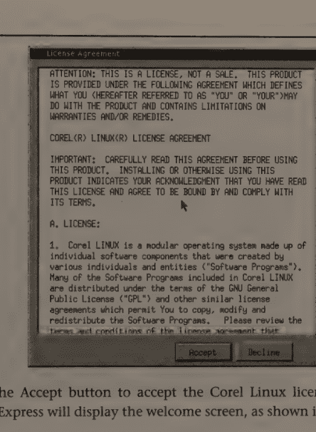

### 图 1.2

Core Install Express 欢迎界面

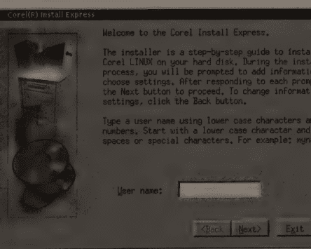

3. 点击“接受”（`Accept`）按钮以接受`Corel Linux`许可协议。`Core Install`将显示如图 1.2 所示的欢迎界面。

4. 每个`Corel Linux`系统至少需要创建一个用户。在“用户名”（`User Name`）字段中输入系统上要创建的第一个用户名。用户名可以由字母和数字组成，并应以字母开头。用户名区分大小写。输入用户名后，点击“下一步”（`Next`）按钮。`Corel Install Express`将显示如图 1.3 所示的安装类型屏幕。

### 图 1.3

Corel Install 安装类型屏幕

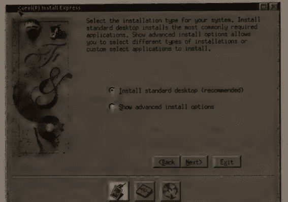

5. 在安装屏幕上，您可以从两种类型的安装中选择：

- “安装标准桌面”（`Install Standard Desktop`）选项安装一套默认工具、实用程序和应用程序。大多数用户将倾向于使用此选项。
- “显示高级安装选项”（`Show Advanced Install Options`）选项允许您选择要安装的工具和实用程序。如果您想专门选择安装哪些项目，请选择此选项。

选择您偏好的安装类型并点击“下一步”（`Next`）按钮。如果您选择了高级安装选项，请在继续下一步之前参考以下章节“执行高级安装”。当您选择“安装标准桌面”选项时，`Corel Install Express`将显示如图 1.4 所示的安装位置屏幕。

### 图 1.4

Corel Express 安装位置屏幕

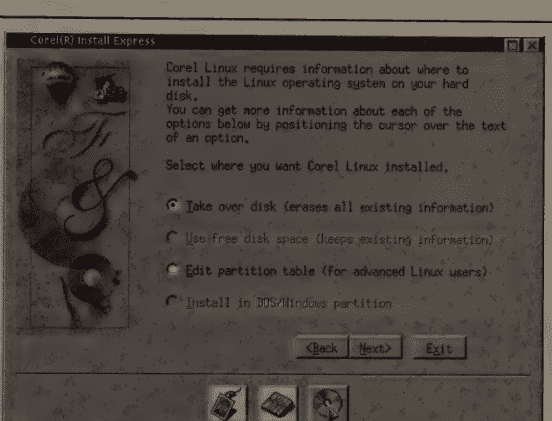

6. 在安装位置屏幕上，您可以为`Linux`安装从四个不同的位置中进行选择：

- “接管磁盘”（`Take Over Disk`）选项将系统上的整个硬盘空间用于`Corel Linux`。此选项将擦除任何现有的操作系统。
- “使用空磁盘空间”（`Use Free Disk Space`）选项使用您硬盘上的可用空间来安装`Corel Linux`。当您在计算机上现有操作系统旁边安装`Corel`时，可以使用此选项。
- “编辑分区表”（`Edit Partition Table`）选项供高级用户使用，他们希望手动定义`Corel`安装在系统上的位置。
- “安装在 DOS/Windows 分区中”（`Install in DOS/Windows Partition`）选项在现有的`DOS`或`Windows`分区的目录中安装`Corel Linux`。当您在计算机上现有操作系统旁边安装`Corel Linux`时，可以使用此选项。

当您在新系统上将`Corel Linux`作为唯一操作系统安装时，您应该选择“接管磁盘”（`Take Over Disk`）选项。选择此选项并点击“下一步”（`Next`）按钮。`Corel Linux`将显示一个警告对话框，指示如果继续，计算机上的所有信息都将被擦除，如下所示。

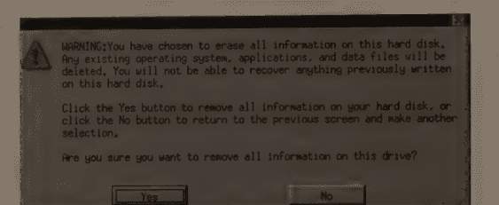

**注意** 此处概述的过程假设您在单磁盘上安装。如果您在多磁盘上安装，请在第 6 步选择接管磁盘。

7. 在警告对话框中，如果想继续并安装`Corel Linux`，请点击“是”（`Yes`）。`Core Install`将显示如图 1.5 所示的摘要屏幕。

### 图 1.5

Core Install 摘要屏幕

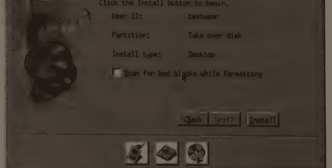

8. 如果您是第一次安装操作系统，请确保勾选“扫描坏块”（`Scan for Bad Blocks`）。这在安装操作系统之前是值得的。

9. 点击摘要屏幕上的“安装”（`Install`）按钮开始安装。安装工具在执行时将显示进度条。在旧机器上这可能需要几个小时。

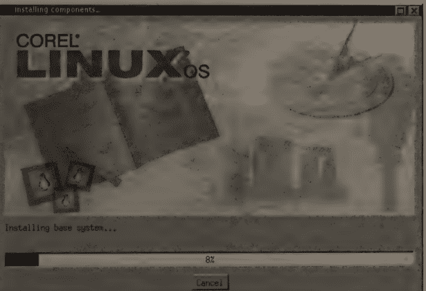

10. 安装完成后，`Corel Install Express`将显示所示的“完成”（`Finished`）对话框。从驱动器中取出任何软盘或光盘，并点击“确定”（`OK`）按钮。您的计算机将重启，`Corel Linux`将启动。

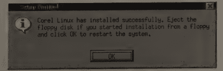

#### 执行高级安装

高级`Corel Linux`安装允许指定安装到`Corel Linux`系统上的应用程序、实用程序和其他软件。要执行高级安装，请按照前节的第 1 步到第 5 步开始操作。当到达`Corel Install`安装类型屏幕时，选择“显示高级选项”（`Show Advanced Options`）选项。

- “桌面”（`Desktop`）选项与前节第 5 步中选择“标准桌面”相同。
- “桌面+”（`Desktop Plus`）选项安装标准桌面，但增加了开发工具、各种编辑器以及编译器组件及实用程序。
- “服务器”（`Server`）选项安装与“桌面+”相同的项目，加上网页、电子邮件等更多服务器。
- “自定义”（`Custom`）选项允许您选择特定的`Corel Linux`组件。

如果您选择前三个选项之一（`Desktop`、`Desktop Plus`或`Server`），点击“下一步”（`Next`）按钮，安装将从前节的第 6 步继续。

如果您选择“自定义”选项，`Corel Install Express`将显示图 1.6 所示的包管理器（`Package Manager`）屏幕。此屏幕显示`Corel Linux`可用的软件包分级列表。您可以通过点击条目旁边的`(+)`和`(-)`号来展开或折叠列表部分。您可以通过点击条目旁边的空复选框来选择软件包或包组。在选择完所有要安装的软件包后，点击“下一步”（`Next`）按钮。安装过程将从前节的第 6 步继续。

### 图 1.6

Core Install Express 包管理器屏幕

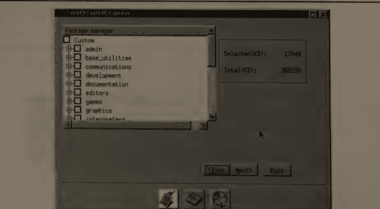

## 替换您当前的操作系统

将计算机上当前安装的操作系统完全替换为`Corel Linux`（使`Corel Linux`成为您的唯一操作系统）的过程与在没有当前操作系统的新系统上安装`Corel Linux`的步骤相似。事实上，你可以完全按照“在新建系统上安装`Corel Linux`”章节中概述的方法来替换你现有的操作系统。

或者，你也可以从`Windows 95`、`98`、`NT`或`2000`内部启动安装过程，如下：

1. 启动`Windows`，然后将`Corel Linux`安装光盘插入你的`CD-ROM`驱动器。如果`Windows`开启了光驱的自动运行，`Windows`将显示图 1.7 所示的窗口。否则，选择“开始” > “运行”，在运行对话框中输入``D:\autorun.exe``，并点击“确定”按钮启动`Corel Linux`安装工具的`Windows`部分（`Corel Linux Autorun`）。

**图 1.7**

安装工具的 Corel Linux 部分

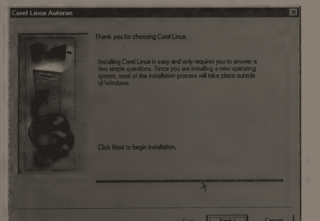

**注意** 如果你需要在`Windows`中手动启动`Corel Linux`安装工具，请确保将`D:`替换为你`CD-ROM`驱动器的正确盘符。如果你的电脑上只有一个硬盘，那么光驱可能是`D:`。

2. 点击“下一步”按钮。安装工具将显示安装介质界面，如图 1.8 所示。

**图 1.8**

Corel Linux Autorun 安装介质界面

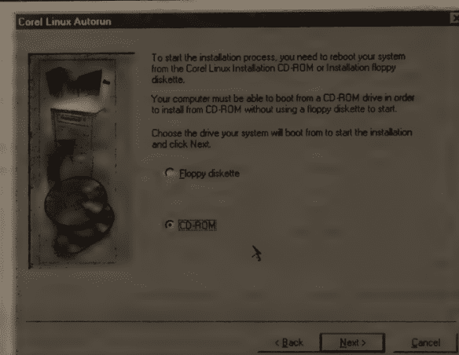

3. 选择`CD-ROM`单选按钮并点击“下一步”按钮。将出现完成界面。

4. 确保所有其他`Windows`应用程序已关闭。然后点击“重启”按钮。

5. `Windows`将重启，`Corel Linux`的安装将按照本章之前“在新建系统上安装`Corel Linux`”章节中概述的方法进行。

### 在当前操作系统旁边安装 Corel Linux

如果你想在决定是否放弃当前的操作系统之前先尝试`Corel Linux`，可以将`Corel Linux`安装在当前操作系统旁边。这样，你就可以在启动时在`Corel Linux`和你的当前系统之间选择。通过这样，你可以尽情尝试`Corel Linux`，而不会丢失继续按目前方式使用电脑的能力。


在当前操作系统旁边安装 Corel Linux 比之前概述的在新系统上安装或替换当前操作系统的步骤要稍微复杂一些。这是因为你必须确保 Corel Linux 和你的当前系统（大多数用户为 Windows）能够共享你的磁盘，而不会相互干扰或覆盖另一个系统使用的数据。

理想情况下，你的系统有两个硬盘，这样你可以将其中一个完全留给现有的操作系统，将另一个交给 CoreLinux。或者，你可以使用磁盘上空闲且未分区的空间为 Linux 提供空间。最不理想的情况是在现有的 DOS 或 Windows 分区空间上安装 Linux。最后这种选项仅在你的单个硬盘上只有一个分区且被当前操作系统完全占据，并且在不丢失数据的情况下划分磁盘上的分区非常困难或不可能时才使用。

> 警告 如果你计划安装 Corel Linux 与你当前的操作系统共存，你应该备份现有的系统。如果安装过程中出现任何问题，你需要备份来将计算机恢复到尝试安装 Corel Linux 之前的状态。

### 在空闲的未分区磁盘空间上安装

要在未分区的磁盘空间上安装 Corel Linux，请按照本章之前“在新建系统上安装 Corel Linux”章节中的步骤 1 到 5 操作。当你到达 Corel Install Express 安装位置界面，选择“使用空闲磁盘空间”选项，然后点击“下一步”按钮。Corel Install Express 将显示分区创建界面，如图 1.9 所示。

图 1.9 Corel Install Express 分区创建界面

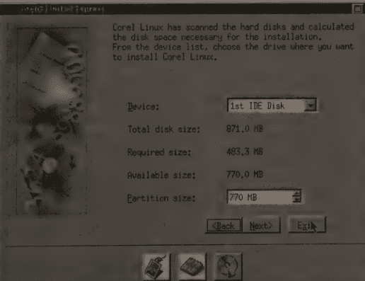

在分区创建界面上，从“设备”下拉列表中选择你想要安装 Corel Linux 的硬盘。Corel Install Express 将显示该设备上可用的空闲、未分区的磁盘空间大小。在“分区大小”字段中指定分配给 Corel Linux 的空间大小，然后点击“下一步”按钮。Corel Install Express 将显示安装摘要界面。

现在你可以从本章之前“在新建系统上安装 Corel Linux”系统的第 8 步继续。一旦安装了 Corel Linux，你就可以在重启电脑时在 Corel Linux 和你的其他操作系统之间选择。

### 在现有的 DOS 和 Windows 分区上安装

你可以将 Corel Linux 安装在现有的使用标准 DOS FAT 16 文件系统或 Windows 95、98 FAT 32 或 NTFS 文件系统的 DOS 或 Windows 分区中。你不能在现有的 Windows NT 或 2000 上安装 Corel Linux。要在现有分区上安装 Corel Linux，至少需要 500MB 的空磁盘空间，但越多越好。

如果你有足够的空间，请按照本章之前“在新建系统上安装 Corel Linux”章节中的步骤 1 到 5 操作。当你到达 Corel Install Express 安装位置界面，选择“使用空闲磁盘空间”选项，然后点击“下一步”按钮。Corel Install Express 将显示分区创建界面，如图 1.9 所示。

在分区创建界面上，从“设备”下拉列表中选择你想要安装 Corel Linux 的硬盘。Corel Install Express 将显示该设备上可用的空闲、未分区的磁盘空间大小。在“分区大小”字段中指定分配给 Corel Linux 的空间大小，然后点击“下一步”按钮。Corel Install Express 将显示安装摘要界面。

现在你可以从本章之前“在新建系统上安装 Corel Linux”系统的第 8 步继续。一旦安装了 Corel Linux，你就可以在重启电脑时在 Corel Linux 和你的其他操作系统之间选择。

由于 Corel Linux 在安装在现有分区时可能佳，最好将其安装在新分区上。如果你必须使用现有分区，请遵循以下步骤：

- 1. 启动系统到命令提示符。对于 Windows 95 或 98 的情况，按 `F4`。
- 2. 在命令行切换到安装 Corel 的驱动器。例如，如果是 C 盘，输入 `c:`。
- 3. 输入 `cdl` 进入 CDL 目录。
- 4. 输入 `startl` 启动 Core Linux。一旦 Core Linux 运行，可以通过关闭 Core Linux 并重启返回 Windows。

### 从 Windows 环境迁移设置

Core Linux 第二版提供了 SmartMove 工具，允许从各种 Windows 应用程序迁移设置到新的 Core Linux。如果你在 Windows 旁边安装 Corel Linux，或者在分区上安装，可以使用 SmartMove 从以下 Windows 应用程序复制设置：

- **WinAmp**: 你可以从 WinAmp 媒体播放器将播放列表、通用设置复制到 Core Linux 附带的 XMMS 媒体播放器。XMMS 在第 7 章中讨论。
- **ICQ**: 你可以从 Windows ICQ 客户端复制个人信息、联系人列表、服务器设置、声音设置和用户配置到 Core Linux 附带的 k1q 客户端。ICQ 在第 11 章中讨论。
- **Internet Relay Chat**: 你可以从 mIRC 聊天客户端复制服务器和用户设置到 Core Linux 附带的 k1rc 客户端。
- **浏览器**: 你可以从 Internet Explorer 或 Netscape Navigator 复制首页、代理设置、Cookie 或书签到 Core Linux 附带的 Linux 版 Netscape Communicator。Netscape Communicator 在第 9 章中讨论。
- **电子邮件**: 你可以从 Netscape Mail、Microsoft Outlook 或 Microsoft Outlook Express 用户身份和邮件服务器设置到 Core Linux。在 Core Linux 中使用电子邮件在第 10 章中讨论。
- **桌面设置**: 你可以将桌面色彩方案和背景壁纸复制到 Core Linux 桌面。Core Linux 桌面在第 2 章中讨论。
- **鼠标设置**: 你可以将鼠标设置复制到你的 Core Linux 环境。

## 网络驱动器

网络驱动器你可以从 Windows 复制持久性网络驱动器设置到 Corel Linux 环境。

要启动 SmartMove 工具，请从 Corel Linux 主菜单（第 2 章将讨论）中选择“应用程序 > 系统 > SmartMove”。基本上，迁移你的 Windows 设置需要五个步骤：

- 1. 指定包含 Windows 安装的目录。SmartMove 通常可以自动找到此目录。
- 2. 指定要从哪个 Windows 用户导入设置。
- 3. 选择从哪些 Windows 应用程序导入设置。


4. 选择要导入的特定设置以及哪些 `Linux` 应用程序应该接收导出的设置。

5. 验证你正在迁移的设置列表。

> 提示：`Corel Linux` 网站提供了一由 `Mark Kuiiack` 编写的优秀文章（访问 `http://linux.corel.com/articles/smartmove.htm`），详细描述了如何使用 `Smart-Move` 将 `Windows` 设置迁移到 `Corel Linux`。

## 我们接下来该如何做？

现在你已经已经在电脑上安装了 `Corel Linux`，准备好开始探索你的新操作系统。下一章将带你游览 `Corel Linux` 桌面，并介绍 `Corel Linux` 环境的基本组件。有了这些信息，你将能够顺利完成你的 `Corel Linux` 学习之旅。

## 第 2 章

## 探索 Corel Linux 桌面

内容特色：

- 创建和管理桌面图标 37
- 移动和隐藏 Corel Linux 面板 46
- 管理虚拟桌面 52
- 从主菜单启动应用程序 56
- 查找文件 58
- 保护你的桌面 63
- 使用窗口控件 64

`Corel Linux` 的核心是桌面。桌面是 `Corel Linux` 中所有主要活动发生的地方。从桌面，你可以启动应用程序、管理打开的应用程序并访问用于自定义 `Corel Linux` 环境的工具。

本章向你介绍桌面的元素，包括主桌面窗口、`Corel Linux` 面板、任务栏和虚拟桌面管理器。此外，你还将学习 `Corel Linux` 窗口的控件。

## 介绍桌面组件

`Corel Linux` 桌面由两个主要组件组成：主窗口和 `Corel Linux` 面板，如图 2.1 所示。

图 2.1 `Corel Linux` 桌面

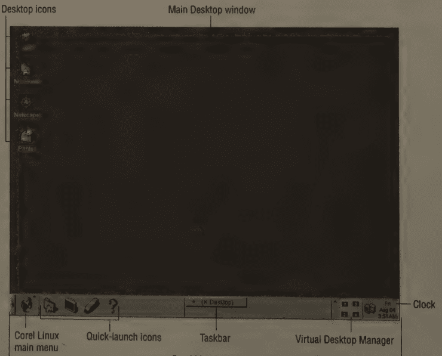

主桌面窗口是一个通用工作区域。面板作为 `Corel Linux` 的一种控制中心形式，包括对 `Corel Linux` 主菜单、快速启动图标、任务栏和虚拟桌面管理器的访问。

### 主桌面窗口

主桌面窗口是显示应用程序窗口的工作空间，如图 2.2 所示。默认情况下，`Corel Linux` 在桌面上放置了垃圾桶、你的主目录、`Netscape Communicator` 和打印机管理工具的图标（快捷方式）。点击这些图标之一，你可以启动关联应用程序或访问关联资源（例如你的主目录）。

图 2.2 在主桌面窗口中显示。

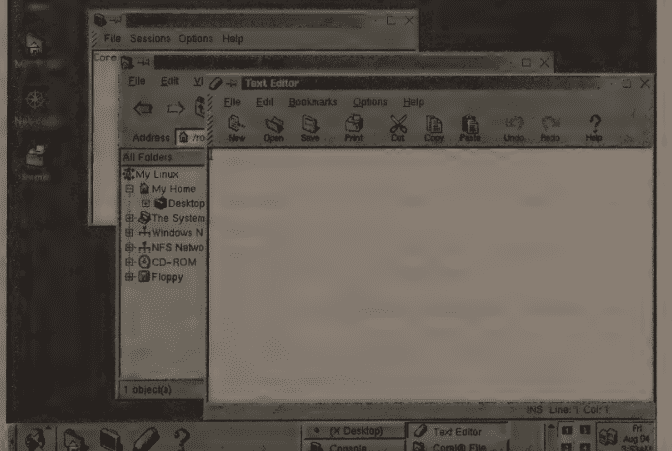

例如，要启动 `Netscape Communicator` 互联网工具套件，只需点击一下 `Corel Linux` 桌面上的 `Netscape` 图标。`Netscape Communicator` 就会启动，如图 2.3 所示。注意 `Netscape Communicator` 窗口的底部在 `Corel Linux` 面板开始处被截断。应用程序不会显示在面板上方，因为主桌面窗口在面板开始处结束。

图 2.3 从桌面图标启动 `Netscape Communicator`

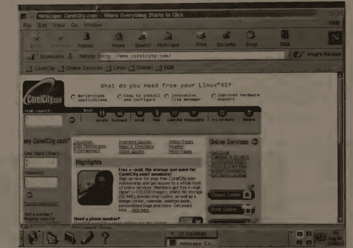

你可以添加自己的桌面图标，以便快速访问频繁使用的程序或系统资源，还可以移动和删除图标。这些任务将在本章稍后的“使用桌面图标”部分进行描述。

### Core Linux 面板

出现在屏幕底部的 `Core Linux` 面板是你可以启动应用程序并在打开的应用程序之间进行切换的中心位置。此面板由五个主要组件组成（见前述图 2.1）：

- `Core Linux` 菜单按钮打开菜单，该菜单为启动属于 `Core Linux` 发行版的一部分应用程序和工具提供了快速访问点。主菜单将在本章稍后的“从主菜单工作”部分中进行更详细的讨论。
- 快速启动图标允许你轻松启动 `Core` 文件管理器、`Core Linux` 控制台、文本编辑器和系统帮助文件。
- 任务栏提供了一种在打开的应用程序之间快速切换的机制。你将在本章稍后的“使用任务栏”部分学习更多信息。
- 虚拟桌面管理器提供了对可以放置应用程序的虚拟桌面的访问。它将在本章稍后的“使用虚拟桌面”部分中介绍。
- 时钟显示当前日期和时间。

你可以更改面板的位置或隐藏它，将在本章稍后的“移动和隐藏 `Corel` 面板”部分进行说明。

### 使用桌面图标

如果你习惯了 `Windows` 操作，你会发现 `Corel Linux` 桌面非常熟悉。你可以根据喜好安排桌面图标。

#### 创建新图标

`Corel Linux` 桌面默认带有垃圾桶、主目录、`Netscape` 和打印机（打印机管理工具）。你可以为 `FTP` 服务器和网页添加其他图标。

#### 创建用于启动应用程序的图标

为了演示创建一个用于启动应用程序的新桌面图标，我们将使用文本编辑器。遵循以下步骤：

1. 在桌面上的空白区域右键点击，从弹出菜单中选择“新建”，然后选择“启动”。“命名”对话框将出现，如图 2.4 所示。

图 2.4 命名对话框

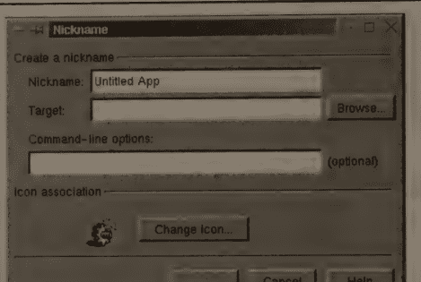

2. 在命名字段中输入图标名称，默认显示为“未命名”。这将是图标下方显示的名称。

3. 在目标字段中输入要启动应用程序的完整路径。如果你知道要启动应用程序的完整路径，可以直接输入目标字段。或者，你可以点击“浏览”按钮并导航到应用程序。在本例中，点击“浏览”按钮显示打开对话框，如图 2.5 所示。对于文本编辑器，在打开对话框中导航到 `/usr/bin/X11/` 目录，点击 `xrte` 文件，然后点击“打开”按钮。

图 2.5 打开对话框

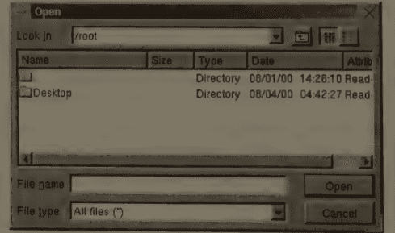

注意在命名对话框的命令行选项字段中，你可以输入启动应用程序时传递的任何命令行参数或选项。对于大多数应用程序，这通常是不需要的。

4. 点击“更改图标”按钮。选择图标对话框将出现，如图 2.6 所示。

图 2.6 选择图标对话框

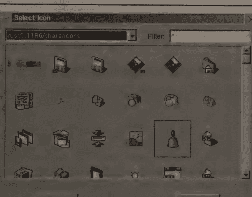

5. 从选择图标对话框左上角的下拉列表中选择包含图标的目录。一个很好的目录是 `/usr/X11R6/share/icons`（即图 2.6 所示的目录）。点击你想作为桌面图标使用的图像，选中的图像周围会出现一个框。对于文本图标，你可能会选择铅笔图标，这是 `Corel Linux` 面板上用于文本编辑器的图标。你将在 `/usr/X11R6/share/icons` 目录可用图标显示的二分之三处找到它。点击“确定”按钮。选择图标对话框将关闭，选中的图像将显示在命名对话框中“更改图标”按钮旁边。

6. 点击确定按钮。桌面上将创建该图标，如下所示。


#### 创建打开目录或网页的图标

如果您经常需要访问某个特定目录，可能想为它添加一个桌面图标。这样，您就可以直接从桌面打开该目录，而无需导航到该位置。为网页添加桌面图标可以允许您通过双击图标在 `Web` 浏览器中打开特定的网页。同样地，您也可以为 `FTP` 服务器添加桌面图标。（为了使网页或 `FTP` 服务器的桌面图标生效，您需要连接到互联网）。

要创建一个新的桌面图标来打开目录、网页或使用（此处原文缺词），请执行以下步骤：

1. 在桌面的空白区域（不是图标上）点击鼠标右键，从弹出菜单中选择“新建”，然后从出现的子菜单中选择“URL”。将显示“网络别名”对话框，如图 2.7 所示。

图 2.7 网络别名对话框

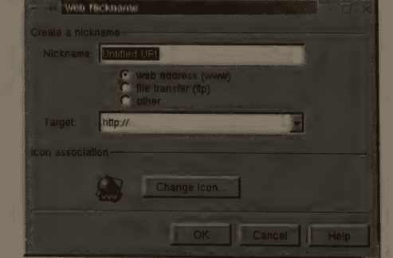

2. 在“别名”文本字段中输入图标名称，默认显示为“未命名 URL”。

3. 如果您正在为目录创建图标，选择“其他”单选按钮。如果您正在创建网页图标，选择“网络地址”单选按钮。如果您想连接到 `FTP` 服务器而不是 `Web` 服务器，请选择“文件传输 (ftp)”单选按钮。

4. 在“目标”文本字段中输入目录的完整路径或网页/`FTP` 服务器的完整 `URL`。路径必须是 `URL` 格式。例如，要打开目录 `/home/mydir`，请在目标文本字段中输入 `URL` `file:/home/mydir`。要访问 `Yahoo`！网页，输入 `URL` `http://www.yahoo.com/`。要访问北卡罗来纳大学的 `Metalab` `FTP` 服务器，输入 `ftp://metalab.unc.edu`。

5. 点击“更改图标”按钮。显示“选择图标”对话框（参见前文所示图 2.6）。从对话框左上角的下拉列表中选择包含图标的目录，例如 `/usr/X1R6/share/icons`。点击您想要使用的图标图像进行选择，然后点击“确定”按钮。

6. 在“网络别名”框中，点击“确定”按钮。

您刚刚创建的桌面图标现在将出现在桌面上。

### 操作桌面图标

在向桌面添加图标后，您可能需要对它们进行组织以保持桌面整洁。您可以按照后续章节所述移动、排列和删除桌面图标。


#### 移动图标

要将图标移动到桌面上的新位置，请点击图标，按住鼠标按钮并拖动图标。当图标位于您想要的位置时，释放鼠标按钮。桌面图标可以位于桌面的任何地方，如图 2.8 所示。

## 图 2.8

分散在主桌面窗口中的桌面图标

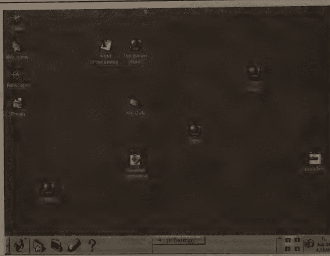

#### 排列图标

如果您创建了许多桌面图标并移动它们，您的桌面可能会变得非常混乱。为了恢复桌面的秩序，您可以让 `Corel Linux` 重新排列桌面图标。

要排列图标，在桌面的空白区域点击鼠标右键，从弹出菜单中选择“排列图标”。`Corel Linux` 将将图标排列成整齐的列。例如，如果您开始的图标是如图 2.8 所示桌面那样随机放置的，在选择“排列图标”后，图标将如图 2.9 所示进行重新排列。

## 图 2.9

排列图标后的桌面

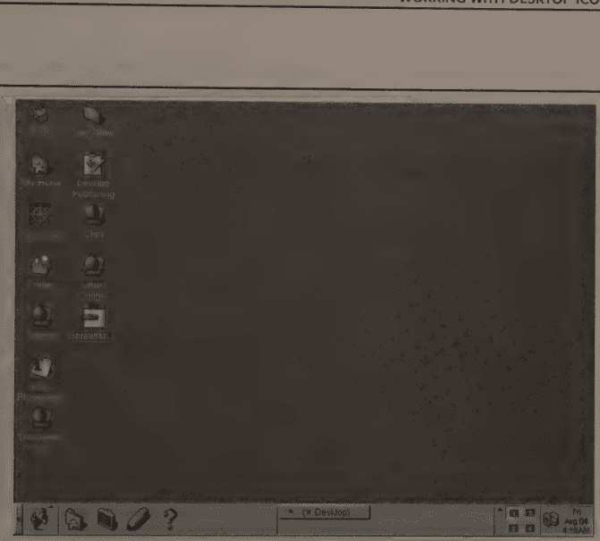

> **注意**：一眼看图 2.9 似乎图标并没有按照特定顺序排列。它们显然不是按字母顺序，也不是按创建日期顺序。相反，`Corel Linux` 是从距离屏幕左上角最近的图标开始，按列向下的顺序排列图标的。

#### 指定图标间距

您可以在 `Corel Linux` 排列图标时指定图标的间距，如下：

1. 在 `Corel` 桌面的空白区域点击鼠标右键，从弹出菜单中选择“属性”。`Corel Linux` 将显示“控制中心”窗口，如图 2.10 所示。

> **注意**：`Corel Linux` 控制中心有许多自定义桌面和其他 `Corel Linux` 功能的选项。第 5 章将详细讨论 `Corel Linux` 控制中心。

## 图 2.10

`Corel Linux` 控制中心

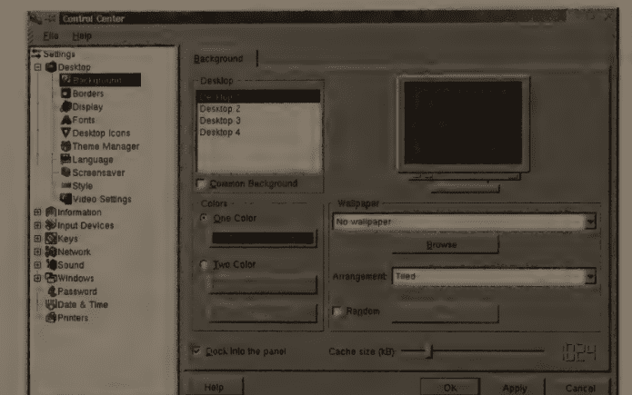

2. 点击控制中心窗口左面板“设置”列表中的“桌面图标”项。控制中心将显示“桌面图标”页面，如图 2.11 所示。

## 图 2.11

控制中心的桌面图标页面


3. 在“水平间距”字段中输入 `Corel Linux` 桌面上每列图标之间使用的像素空间。

4. 在“垂直间距”字段中输入 `Corel Linux` 桌面上每行图标之间使用的像素空间。

5. 点击 `Corel` 面板中的“应用”按钮。

6. 点击控制中心右上角的关闭（`X`）按钮，或从控制中心菜单中选择“文件”、“退出”。控制中心窗口将关闭。

当您下次排列桌面图标时（如前所述），新的间距将生效。

#### 删除图标

要从桌面删除图标，右键点击您要删除的图标，从弹出菜单中选择“移动到垃圾箱”。`Corel Linux` 将显示“确认删除文件”对话框。点击“是”按钮，`Corel Linux` 将图标移动到垃圾箱并从桌面删除。


删除图标后，它将出现在垃圾箱中。这是您通过 `Corel Linux` 图形界面删除的所有文件或文件夹的所在地。您可以从垃圾箱恢复它们或将其永久删除。请参阅第 4 章“删除目录和文件”部分有关 `Corel Linux` 垃圾箱内容的详细信息。

### 使用桌面面板

`Corel Linux` 界面的灵活性扩展到了桌面上的面板。您可以调整面板的外观并将其从屏幕上移除。

`Corel` 面板的两个组件允许您控制应用程序及其桌面空间。这些组件是任务栏和虚拟桌面管理器。

后续章节将介绍如何更改 `Corel` 面板的外观以及使用任务栏和虚拟桌面管理器。

#### 面板的位置和大小

通常，`Corel Linux` 面板全尺寸位于桌面底部。但您可以更改面板的位置，使其出现在屏幕顶部或右侧或左侧。例如，图 2.12 显示面板位于桌面右侧。注意面板布局已改为垂直配置。

## 图 2.12

`Corel Linux` 面板位于桌面右侧

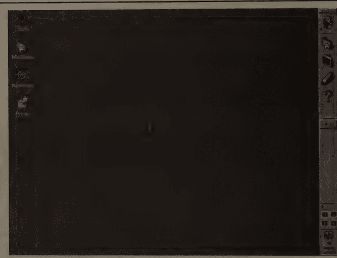

此外，您还可以更改面板的大小，使其更小或更大。图 2.13 显示了缩小后的面板。

## 图 2.13

为了节省屏幕空间，可以缩小 `Corel Linux` 面板

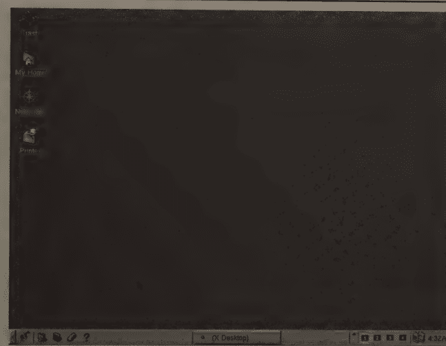

要同时更改面板的大小和位置，请使用以下步骤：

1. 在 `Corel Linux` 面板背景的空白区域点击右键，从弹出菜单中选择“配置”。`Corel Linux` 将显示“`KPanel` 配置”对话框。默认情况下显示对话框的“面板”页面。

> **注意**：该对话框被称为 `KPanel` 配置对话框，是因为 `Corel Linux` 面板是 `KDE` 桌面的一部分，而 `Corel Linux` 桌面是基于此构建的。`KDE` 程序和工具的名称以字母 `K` 开头。

## 图 2.14

`KPanel` 配置对话框

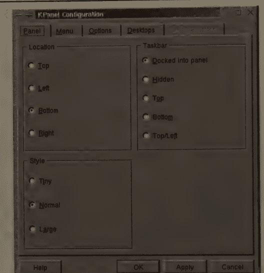

2. 在面板页的区域（`Location`）部分，点击顶（`Top`）、左（`Left`）、底（`Bottom`）或右（`Right`）单选按钮，指示面板出现在屏幕上的哪个位置。

3. 在面板页的样式（`Style`）部分，你有三种面板尺寸可选择：`Tiny`（微型）使面板更小，`Normal`（普通）单选将面板设置为默认尺寸，`Large`（大）则略微增大面板尺寸。请注意，选择 `Large` 会图标和其他面板元素周围留出更多空间，但实际上并不会放大面板上的图标、文本或其他项目。

4. 点击确定（`OK`）按钮。

`KPanel` 配置对话框将关闭，面板将根据你的指示进行重新定位和调整大小。

### 隐藏 `Corel Linux` 面板

如果你的系统可用屏幕空间有限——因为你使用的是较小的显示器或带有较小 `LCD` 屏幕的笔记本电脑——或者你只是想利用显示器提供的最大屏幕空间，你可能不希望一直看到 `Corel Linux` 面板。你可以通过“自动隐藏”面板来解决这个问题。

当你使用自动隐藏面板（`Auto Hide Panel`）选项时，面板会自动隐藏在它通常位于的屏幕边缘，除非鼠标指针移动到屏幕该边缘，否则它不会再次出现。这意味着面板通常占据的空间可以用于显示窗口。你在主桌面（`Main Desktop`）窗口中打开的任何窗口将占据面板通常所在的空间，直到你将鼠标指针移到屏幕相应的边缘来显示面板为止。

例如，如果你通常将面板放置在显示器的底部，你可以将其隐藏，这样在正常工作期间，桌面将如图 2.15 所示。请注意，在面板通常位于桌面边缘，仍有一小部分面板是可见的。当鼠标进入此区域时，整个面板将变得可见。当鼠标指针离开面板时，面板将再次隐藏（在指定的延迟后）。

## 图 2.15

隐藏 `Corel Linux` 面板


你可以按照以下方式启用此自动隐藏行为并设置其特性：

1. 右点击 `Corel Linux` 面板背景上的空白区域，从弹出菜单中选择配置（`Configure`）。`Corel Linux` 将显示 `KPanel` 配置对话框（见前文所示图 2.14）。

2. 点击选项（`Options`）选项卡，显示 `KPanel` 配置对话框的选项页面，如图 2.16 所示。

## 图 2.16

`KPanel` 配置对话框的选项页

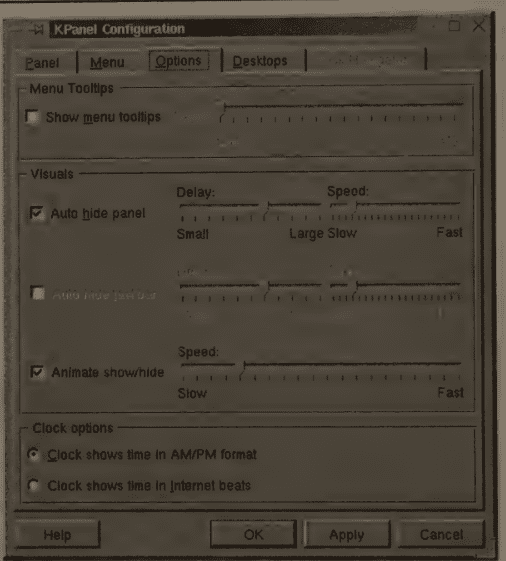

3. 在选项页的视觉（`Visual`）部分，勾选自动隐藏面板（`Auto Hide Panel`）复选框。

4. 使用自动隐藏面板复选框旁的延迟（`Delay`）滑块选择 `Corel Linux` 在鼠标指针离开面板后应等待多久再隐藏面板。

5. 使用速度（`Speed`）滑块（位于延迟滑块旁边）选择 `Corel Linux` 隐藏和显示面板的速度。

6. 点击确定（`OK`）按钮。

`KPanel` 配置对话框将关闭，面板将开始按照你指示的方式使用自动隐藏功能。

### 使用任务栏

下方所示的任务栏位于 `Corel Linux` 面板的中间。你可以使用任务栏管理桌面上的窗口。


#### 从任务栏最小化和恢复窗口

你可以最小化窗口，使其以按钮的形式出现在任务栏上，并将窗口恢复到在任务栏上的原始大小。这允许你通过将未使用的（或很少使用的）窗口最小化为任务栏上的小图标按钮，来减少桌面的杂乱，而不是让它们浮在你正在使用的当前窗口后面。

任务栏上当前活动窗口（最前面且具有键盘焦点的窗口）的按钮看起来像是被按下的。你可以通过点击其按钮将任何窗口带到顶端。该按钮将显示为按下状态，窗口将被带到所有窗口之前。


你可以通过点击窗口的最小化按钮将任何 `Core Linux` 窗口最小化到任务栏。该按钮是窗口右上角（中间有一个点）的最左侧按钮。当你点击最小化按钮时，窗口将不可见，但该窗口的按钮出现在任务栏上。点击任务栏上的最小化窗口将重新显示该窗口并带到所有窗口之前。你将在本章后面的部分学习更多关于 `Core Linux` 窗口控制的内容。

#### 从任务栏执行窗口功能

右键点击任务栏上的按钮会弹出一个菜单，允许你执行若干实用功能，包括将窗口发送到不同的桌面、恢复最小化窗口在桌面上的可见性，以及使窗口在桌面上变为唯一可见。

正如你将在下一节中学到的，`Core Linux` 提供了多个桌面。要将窗口发送到不同的桌面，右键点击任务栏上的按钮并选择你要发送到的桌面。将弹出一个可用桌面的子菜单。点击你要发送到的桌面。窗口将从当前桌面消失并发送到新桌面。

如果你的桌面非常杂乱，找不到所需的窗口，可以最小化该桌面以外的所有窗口。然后通过点击任务栏上的按钮来重新显示该窗口。


### 使用桌面管理器

下方所示桌面管理器位于 `Corel Linux` 面板的右端。这些按钮允许你在虚拟桌面之间切换。

桌面管理器对于处理大量应用程序和打开窗口且感到屏幕空间受限的用户来说是一项重要的工具。`Core Linux` 允许你创建自己的桌面（称为虚拟桌面），它们的大小与屏幕完全相同，然后查看其中任何一个。你可以将打开的应用程序和窗口放置在任何虚拟桌面上，当你查看特定的桌面时，该应用程序或窗口是可用的。每个虚拟桌面的独特之处在于你可以为每个设置不同的背景图案或颜色。

你可以通过点击桌面管理器中的相应数字按钮切换桌面。（你也可以使用活动桌面边界切换虚拟桌面。）

#### 更改虚拟桌面数量

默认情况下，桌面管理器配置提供四个虚拟桌面。你可以按照以下步骤将其更改为两个、六或八个虚拟桌面：

- 1. 右点击 `Corel Linux` 面板的背景，从弹出菜单中选择`配置`（`Configure`）。`KPanel` 配置对话框将显示（见本章较前的图 2.14）。
- 2. 点击`桌面`（`Desktops`）选项卡。`KPanel` 配置对话框的桌面页面将显示，如图 2.17 所示。

## 图形 2.17

`KPanel` 配置对话框的“`桌面`”（`Desktops`）页


- 3. 从页面底部的“`可见`”（`Visible`）下拉列表中选择桌面数量。您可以选择两个、四个、六或八个虚拟桌面。
- 4. 对于每个桌面，您可以在“`可见`”（`Visible`）下拉列表上方的 8 个文本字段中提供描述性名称。这些描述性名称将用于“`发送到桌面`”（`To Desktop`）子菜单，正如本章稍早介绍的“使用任务栏”节所描述，它可以从任务栏将窗口发送到其他桌面。
- 5. 点击“`确定`”（`OK`）按钮。

`Corel Linux` 面板现在将出现，虚拟桌面管理器中将带有指定数量桌面的按钮。

#### 在桌面之间移动窗口

点击虚拟桌面管理器正左侧的小向上箭头，会弹出一个您的虚拟桌面及其其中窗口的小型地图，如下所示。


使用此地图，您可以通过点击窗口的表示、按住鼠标按钮并将其拖到不同虚拟桌面上的新位置，在桌面之间移动窗口。点击地图外部将关闭地图。

### 从主菜单操作

点击位于 `Corel Linux` 面板左侧的主菜单按钮可访问 `Corel Linux` 的主菜单。`Corel Linux` 将显示主菜单，如下所示。

| 控制台 |
| --- |
| `Corel LINUX` 帮助 |
| 文本编辑器 |
| `Corel®` 更新 |
| 任务管理器 |
| 应用程序 |
| 结束 |
| 帮助 |
| 在线服务 |
| 自启动 |
| 控制中心 |
| `Corel®` 文件管理器 |
| 运行 |
| 注销 |

主菜单包含以下三个部分，由水平线分隔：

`快速启动` 此部分包含最近启动或频繁使用的应用程序，它会随着您使用 `Corel Linux` 而变化。您只需从菜单中选择这些应用程序即可快速重新启动其中的任何一个。

`应用程序` 此部分包含常用的 `Linux` 应用程序，例如`控制中心`和`Corel` 文件管理器。它还包含“`应用程序`”子菜单，提供按类别分组的 `Corel Linux` 程序的直接访问。

`注销` 此部分包含包含注销选项，当您想注销 `Corel Linux` 时选择该选项。

#### 配置主菜单的快速启动部分

默认情况下，主菜单的快速启动部分显示五个最常用的应用程序。然而，您可以通过两种方式对其进行配置：

- 显示较少或更多的应用程序
- 显示最近使用的应用程序而不是最常用的应用程序

要更改快速启动部分中显示的应用程序数量或类型，请使用以下步骤：

- 1. 右键点击 `Corel Linux` 面板的背景，从弹出菜单中选择“`配置`”（`Configure`）。`Corel Linux` 将显示 `KPanel` 配置对话框（参见本章稍早所示的图 2.14）。
- 2. 点击“`菜单`”（`Menu`）选项卡，显示 `KPanel` 配置对话框的“`菜单`”页，如图 2.18 所示。

## 图形 2.18

`KPanel` 配置对话框的“`菜单`”页

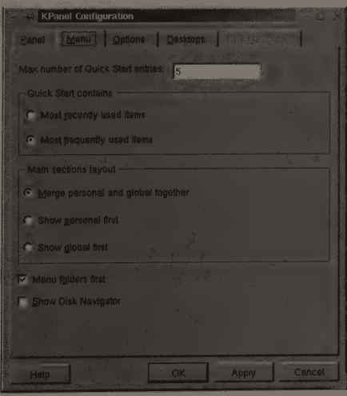

- 3. 在“`快速启动数量`”（`Number of Quick Start`）字段中输入主菜单快速启动部分显示的应用程序数量。
- 4. 在“`菜单`”页的快速启动部分，点击您偏好在快速启动部分显示的项类型的单选按钮。
- 5. 点击“`确定`”（`OK`）按钮关闭对话框。现在当您打开主菜单时，您将看到快速启动部分显示您指定的项数和类型。

#### 从主菜单启动应用程序

点击 `Corel Linux` 主菜单中的“`应用程序`”项将显示“`应用程序`”子菜单，如下所示。

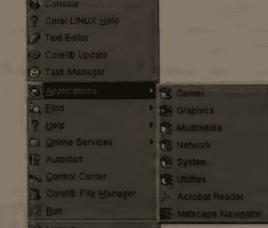

“`应用程序`”子菜单由更深层的子菜单组成，每个 `Corel Linux` 类别都有一个子菜单，外加如 `Netscape Communicator` 和 `Adobe Reader` 等应用程序。“`应用程序`”子菜单提供应用程序访问如下：

- “`游戏`”（`Games`）类别提供 `Corel Linux` 自带游戏的访问，例如纸牌、麻将和一些简单的视频游戏。
- “`图形`”（`Graphics`）类别提供图形工具的访问，例如 `Gimp` 图像编辑软件。
- “`多媒体`”（`Multimedia`）类别提供多媒体实用程序的访问，例如 `CD` 播放器和通用媒体播放器。
- “`网络`”（`Network`）类别提供网络工具的访问，例如聊天工具和拨号网络应用程序。
- “`系统`”（`System`）类别提供系统工具的访问，例如查看程序、`Corel` 字体管理器和任务管理器。
- “`工具`”（`Utilities`）类别提供通用实用程序的访问，例如记事本和文本编辑器。

为了演示如何使用主菜单启动应用程序，让我们启动“`计算器`”工具。遵循以下步骤：

- 1. 点击 `Corel Linux` 面板上的主菜单按钮。`Corel Linux` 将显示主菜单。
- 2. 点击主菜单中的“`应用程序`”项。`Corel Linux` 将显示“`应用程序`”子菜单。
- 3. 点击“`应用程序`”子菜单中的“`工具`”项。`Corel Linux` 将显示“`工具`”子菜单，如下所示。

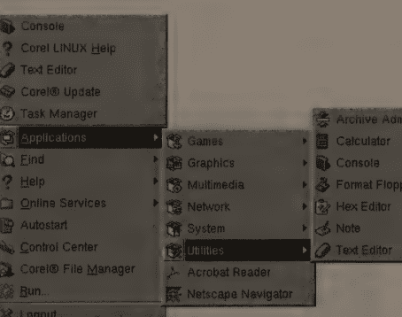

- 4. 点击“`工具`”子菜单中的“`计算器`”项。`Corel Linux` 将启动计算器，如下所示。

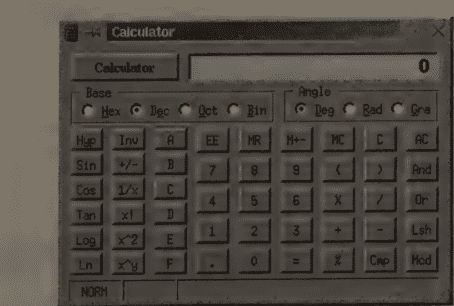

# 第 2 章 • 探索 CORE LINUX 桌面

> 注意 在本书的其余部分，菜单选择路径通过 `>` 符号指示。例如，从主菜单启动“`计算器`”工具的选择路径将标记为：`主菜单 > 应用程序 > 工具 > 计算器`。这适用于 `Core Linux` 应用程序主菜单栏上的菜单，也适用于桌面菜单选择。

#### 从主菜单搜索文件

从 `Core Linux` 主菜单中，您可以启动“`查找文件`”（`Find Files`）实用程序来搜索系统上的文件和目录。当您点击“`查找`”（`Find`）项时，`Corel Linux` 将显示用于搜索文件和目录的子菜单。点击“`文件`”（`Files`）或“`文件夹`”（`Folders`）项以启动查找实用程序，如图 2.19 所示。使用此实用程序，您可以根据名称、位置、修改日期、文件类型和大小搜索文件。

## 图形 2.19

查找实用程序

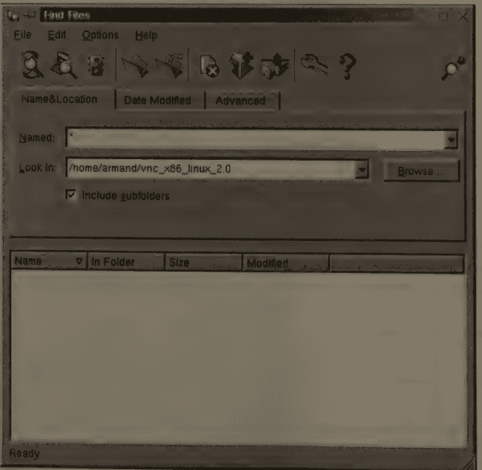

查找窗口菜单包含四个菜单：

- “`文件`”（`File`）菜单提供启动和停止搜索、打开找到的文件以及将找到的文件添加到...选项。
- “`编辑`”（`Edit`）菜单提供复制和移动找到文件的选项。
- “`选项`”（`Options`）菜单允许您配置查找实用程序的基本设置。


# 第 2 章 探索 Corel Linux 桌面

“帮助”（`Help`）菜单提供查找实用程序的帮助。

窗口工具栏包含了您可以使用查找实用程序执行的所有操作。

### 按名称和位置搜索

要按名称和位置搜索文件，请使用查找实用程序的“名称与位置”（`Name & Location`）页（参见图 2.19）。在此页，您需要提供两个信息来搜索文件：

- **文件名或文件名通配符**：您可以在“名称”文本字段中输入完整文件名或星号来创建通配符。在通配符模式中，星号表示任意数量的字符。例如，要搜索以`*ab*`开头的文件，使用模式`*ab*`。特殊字符`?`允许您匹配单个字符。例如，`*ab?de*`匹配`*abcde*`、`*abzde*`和`*abode*`，但不匹配`*abde*`、`*abcde*`或`*abjkmode*`。

- **搜索文件的目录**：在“位置”字段中指定文件的目录路径。如果要搜索指定目录及其所有子目录，请勾选“包含子目录”复选框。如果要搜索整个系统，请在“位置”字段中使用`Core`根目录（`/`）并确保勾选了包含子目录。

例如，假设您找不到创建的一个文件。您只记得它在您的主目录（即`/home/mydir`）某处，并且名称包含`test`。使用查找实用程序搜索该文件，请执行以下步骤：

1. 在“名称”文本字段中输入`test*`。
2. 在“位置”字段中输入`/home/mydir`。
3. 如果“包含子目录”复选框未被选中，请点击它进行勾选。
4. 点击查找窗口工具栏上的启动按钮（带有放大镜和两个弯曲箭头的最左侧的按钮），或直接按回车键。

查找程序将搜索您的文件并在查找窗口底部的文件列表面板中显示任何匹配项。搜索结果显示四列：

- “名称”列显示找到的文件或文件夹的名称。
- “位于”（`In`）列显示包含所找到项的文件夹。
- “大小”（`Size`）列表示所找到项目的大小。
- “修改日期”（`Modified`）列显示所找到项目的最后修改日期。


你可以通过点击这四个参数中任一的列头对结果列表进行排序。列头中的列名称旁边将出现一个小三角形，表示结果正在按该参数进行排序。

## 按修改日期搜索

若要根据修改日期搜索文件，请点击“查找文件”（`Find Files`）实用工具中的“修改日期”（`Date Modified`）选项卡，查看下方所示选项。


在“修改日期”页面上，找到“查找所有创建或修改的文件”（`Find All Files Created or Modified`）单选按钮，然后通过三种方式之一进行搜索：

- 点击“之间”（`Between`）单选按钮，并在两个文本框中输入日期范围，以搜索在指定日期之间修改过的所有文件。日期格式应为`DD/MM/YYYY`。
- 点击“过去几个月内”（`During the Previous Months`）单选按钮，并输入当前日期之前你想要的文件被修改的月份。
- 点击“过去几天内”（`During the Previous Days`）单选按钮，并输入当前日期之前你想要的文件被修改的天数。

无论你选择哪种搜索类型，“查找文件”实用工具都将在你在“名称与位置”（`Name & Location`）页面的“查找位置”（`Look In`）字段中指定的目录（在前节中讨论过）中查找。

例如，如果你想找到主目录（`/home/mydir`）中在过去两天修改过的所有文件，请按照以下步骤操作：

1. 在“查找文件”实用工具的“名称与位置”页面的“查找位置”字段中输入`/home/mydir`。确保“包含子文件夹”（`Include Subfolders`）复选框已选中。
2. 点击“修改日期”选项卡显示“修改日期”页面。
3. 点击“所有创建或修改的文件”单选按钮将其选中。
4. 点击“过去几天内”单选按钮将其选中。
5. 在“天”（`Days`）左侧的文本框中输入`2`。
6. 点击“查找文件”工具栏上的“开始搜索”（`Start Search`）按钮。

“查找文件”将在“查找文件”窗口底部的文件列表面板中搜索并显示任何匹配项。

### 按类型、文本或大小搜索

若要根据类型、包含的文本或大小搜索文件，请点击“查找文件”实用工具中的“高级”（`Advanced`）选项卡，查看下方所示选项。

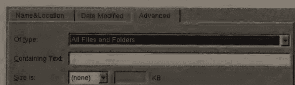

在指定了搜索目录（在“名称与位置”页面的“查找位置”中）后，你可以进行以下任一种高级搜索：

- 若要按类型查找文件，点击“类型”（`Of Type`）下拉箭头查看文件类型选择列表。你可以从许多选项中选择，从所有文件和文件夹到特定类型（如归包）。
- 若要搜索文件中的文本，请在“包含文本”（`Containing Text`）字段中指定该文本。
- 若要按大小搜索文件，点击“大小”（`Size`）下拉箭头查看三个选项：（无）（`None`），表示大小无关；至少（`At Least`），表示文件大小必须至少为“大小”文本字段中指定的千字节数；或最多（`At Most`），表示文件大小最多为“大小”文本字段中指定的千字节数。

例如，假设你想找到主目录（`/home/mydir`）中包含单词“`test`”的任何文件。使用以下步骤通过“查找文件”实用工具查找该文件：

1. 在“查找文件”实用工具的“名称与位置”页面的“查找位置”中输入`/home/mydir`。确保“包含子文件夹”复选框已选中。
2. 点击“高级”选项卡显示“高级”页面。
3. 在“包含文本”字段中输入`test`。
4. 点击“查找文件”工具栏上的“开始搜索”按钮。

### 组合标准进行高级搜索

“查找文件”实用工具的真正威力在于，它允许你组合多个标准来搜索文件。例如，你可以为文件名指定通配符名称，指定修改日期，并在文件中搜索文本。“查找文件”将仅找到你所有标准的文件。

让我们来看一个简单的示例：你想找到主目录（`/home/mydir`）中名称中包含单词“`test`”、在过去一个月内修改过且包含单词“`another`”的所有文件。使用以下步骤查找匹配这些标准的文件：

1. 在“名称与位置”页面的“名称”（`Named`）字段中输入`*test*`。在“查找”字段中输入`/home/mydir`。确保“包含子文件夹”复选框已选中。
2. 点击“修改日期”选项卡显示“修改日期”页面。点击“查找所有创建或修改的文件”单选按钮将其选中。然后点击“过去一个月内”单选按钮并在文本框中输入`1`。
3. 点击“高级”选项卡显示“高级”页面。在“包含文本”字段中输入`another`。
4. 点击“查找文件”工具栏上的“开始搜索”按钮。

“查找文件”将仅匹配名称带有`test`、在过去一个月内修改过且包含文本`another`的文件。

### 访问系统帮助

`Corel Linux`拥有以`Corel Help`系统形式提供的广泛在线文档。`Corel Linux Help`是`HTML`格式，并使用`Netscape Communicator`显示。你可以通过从主菜单选择“帮助”（`Help`）然后点击“帮助”来访问帮助文件。

帮助系统由两个框架组成。左侧框架包含目录。目录中的每个条目都是可以点击的链接。当你点击目录中的条目时，相应的文档将出现在右框架中。

图 2.20 使用`Netscape`显示`Corel Linux Help`

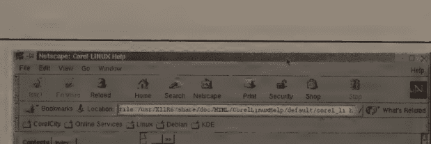

### 欢迎使用 Corel Linux

- `Corel Linux`更新
- `Netscape`更新
- 其他`Linux`功能
- 其他`Linux`命令
- 更多帮助...
- `Corel Linux`帮助及更多
- `Netscape`帮助
- 桌面帮助
- `Shell`帮助
- 配置操作系统

感谢选择`Corel Linux`。我们提供了一个强大且易用的环境，利用了`Linux`的最新增强。无论你的需求如何，`Corel Linux`都易于学习和使用。

`Corel Linux`提供了不受障碍的情况下高效工作的能力。如果你在网络上与其他用户协作，`Corel Linux`可以与`Windows`及其他操作系统共存。

通过`Corel Linux`，你可以轻松访问`Internet`，并根据你的特定需求配置系统，同时知道你正在使用市场上最好的操作系统之一。

请花几分钟查看本节内容——它提供了有关你如何掌握`Corel Linux`能力的信息。

你还可以通过关键词索引访问特定主题的帮助文件。点击`Netscape`窗口左框架中的“索引”（`Index`）选项卡，查看每个关键词相关的章节列表。点击每个章节将在右框架中显示相应的章节。

## 保护桌面

作为一种`Linux`操作系统，`Corel Linux`提供了强大的安全性。然而，最好的安全是永远不在公共环境（如办公室或图书馆）中让系统登录且无人看管。


Corel Linux 提供了锁定桌面的功能，这样在没有密码的情况下，任何人无法访问你的打开程序或文件数据。要锁定桌面，请右键点击 Corel 桌面并从弹出菜单选择“锁定屏幕”（Lock Screen）。Corel Linux 将锁定屏幕并显示下方的 Corel Linux 登录对话框。

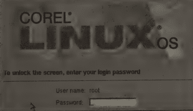

要解锁你的桌面，只需输入密码然后按 `Enter` 键即可。

> **注意** 如果你在锁定桌面后回到电脑前发现屏幕是空白的，只需按下任意键或移动鼠标即可。Corel Linux 将显示登录对话框，以便你解锁桌面。

## 探索 Corel Linux 窗口

Corel Linux 窗口具有几个简单的控件，用于最小化、最大化、移动和关闭窗口，并用于指定它们在虚拟桌面上的外观。图 2.21 显示了一个带有标记控件的 Corel Linux 文本编辑器。

**图 2.21**

典型的 Corel Linux 窗口

- 应用程序图标/窗口菜单按钮
- 最小化按钮
- 置顶窗口按钮
- 标题栏
- 最大化按钮
- 关闭按钮

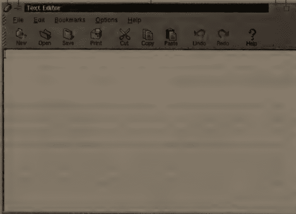

### 使用窗口控制按钮

置顶窗口（Sticky Window）按钮允许你让窗口置顶。当窗口处于置顶状态时，它在所有虚拟桌面上都可见，而不仅仅是其中一个。要使窗口置顶，点击置顶窗口按钮。回图钉图标将显示为被按入状态。这是一个切换按钮。要取消窗口置顶（使其仅在“家”虚拟桌面上可见），请再次点击置顶窗口按钮。

最小化、最大化和关闭按钮的工作方式与 `Windows` 系统中的相同。点击最小化按钮会将窗口最小化到任务栏。点击最大化按钮会将窗口放大到足以填充整个桌面。如果窗口已经处于最大化状态，点击最大化按钮将把窗口恢复到默认大小。关闭按钮会关闭窗口。

应用程序图标/窗口按钮有一个图标，该图标是与特定应用程序相关图标的小型形式（例如文本编辑器的铅笔，如图 2.21 所示），它可以帮助你识别窗口中运行的应用程序。点击此按钮会弹出窗口操作菜单，其中包含以下选项：

- 如果窗口处于最大化状态，则可以使用“还原”选项。如果你选择它，窗口将恢复到默认大小。
- “移动”选项允许你移动窗口。如果你选择此选项，窗口将附在鼠标指针上，因此随着你移动鼠标指针，窗口也会随之移动。当你将窗口移动到所需位置时，点击左鼠标键释放窗口并放置在桌面的新位置。
- “调整大小”选项允许你调整窗口大小。如果你选择此选项，窗口的右下角将附在鼠标指针上。随着你移动鼠标指针，右下角会移动，窗口会拉伸或缩小以适应新的角位置。当你按需调整窗口后，点击左鼠标键。
- “标识”选项会将窗口最小化到 `Core Linux` 面板的任务栏中。
- “最大化”选项会将窗口最大化以填充整个桌面。
- “置顶”选项是一个切换命令，可以让窗口置顶（使其显示在所有虚拟桌面上）或取消置顶。
- “到桌面”选项显示包含所有虚拟桌面名称的子菜单。你可以选择一个桌面将窗口发送到该桌面。
- “创建别名”选项创建一个新的桌面图标用于启动当前窗口中运行的应用程序。`Core Linux` 将显示别名对话框，你可以按照本章前面的“创建启动应用程序的图标”部分所述创建桌面图标。
- “关闭”选项会关闭窗口。

### 使用鼠标移动和调整窗口大小

你可以通过在窗口标题栏上点击并拖动左鼠标键来移动窗口。窗口将随鼠标指针移动，直到你释放鼠标键。

你还可以通过点击并拖动窗口的四个边缘或四个角的任意一个来调整窗口大小。点击并拖动边缘允许你通过移动边缘在单轴（水平或垂直）上调整大小。点击并拖动角则通过该角部在双轴上调整大小。

## 我们接下来该去哪里？

在本章中，你学习了导航 Corel Linux 桌面所需的 `Basic Skills`，以便使用和管理你的系统。你现在应该已经熟悉启动应用程序、在打开的应用程序之间切换、关闭应用程序以及其他导航 Corel Linux 桌面的方法。

在下一章中，我们将深入有效使用 Corel Linux 系统的关键方面：用户管理。`Linux` 是一个真正的多用户系统，你可以创建用户帐户和组，允许多人使用你的电脑（即使是跨网络同时使用），同时控制他们可以访问的资源。

# 第 3 章

## 管理用户和组

功能：

- 创建和管理用户 68
- 修改密码 76
- 创建和管理组 81


作为一个多用户操作系统，Corel Linux 允许为个人用户分配个人帐户。这些帐户为你提供了独立维护每个用户配置和数据的能力，并在你的系统上实现安全性。

除了个人用户帐户外，多用户帐户可以通过 `Linux` 的组机制组合在一起。你可以将用户组织成组以简化用户管理。安全策略可以应用于组，而不是单独应用于组中的每个用户。

Corel Linux 提供了 `User Manager` 工具来管理系统上的用户。本章描述了如何使用 `User Manager` 创建和管理用户及组帐户。

## 管理用户帐户

由于 Corel Linux 是多用户操作系统，它允许为个人用户分配个人帐户。这些帐户为你提供了独立维护每个用户配置和数据的能力，并在你的系统上实现安全性。

除了个人用户帐户，多用户帐户可以通过 `Linux` 的组机制组合在一起。你可以将用户组织成组以简化用户管理。安全策略可以应用于组，而不是单独应用于组中的每个用户。

Corel Linux 提供了 `User Manager` 工具来管理系统上的用户。本章描述了如何使用 `User Manager` 创建和管理用户及组帐户。

- `root` 帐户用于系统管理
- 用户帐户供个人用户使用

由于 Corel Linux 是多用户系统，它允许多个用户同时使用系统（通常通过网络访问）。它还提供了精细控制安全性的能力。你可以阻止其他用户访问文件并控制哪些用户可以使用特定的应用程序。（控制文件访问见第 4 章。）每当你需要执行系统管理任务（例如配置系统或管理用户），你需要以 `root` 用户身份执行。

### 以 root 用户身份工作

当你以 `root` 用户身份登录时，你拥有无限权限。你可以查看并更改任何文件；添加、删除和编辑用户帐户；更改权限；执行许多其他管理任务。

你可以通过以下两种方式以 `root` 用户身份工作：

- 从 Corel Linux 对话框以 `root` 用户身份登录。以此方式登录后，你启动的所有应用程序和执行的命令将以 `root` 用户身份运行。完成系统管理任务后，使用 Corel Linux 主菜单上的注销选项退出。
- 以普通用户登录 Corel Linux，并在 `Console` 窗口中执行 `su` 命令。系统将提示你输入 `root` 用户密码。输入密码后，你以 `root` 用户身份登录该 `Console` 窗口，你输入的任何命令将以 `root` 用户身份执行。

完成系统管理任务后，通过在 `Console` 窗口中执行 `exit` 命令退出 `root` 帐户。

> **警告** 由于 `root` 帐户拥有无限权和访问权限，误用时非常危险。以 `root` 用户身份输入命令时即使是一个拼写错误也会损坏系统（例如删除关键系统文件）。因此，你应该使用普通用户帐户而不是 `root` 帐户进行日常工作。仅在出于系统管理目的时以 `root` 用户登录，并在完成后退出。

### 创建用户帐户

Corel Linux 包含了用于管理帐户的 `User Manager`。使用 `User Manager`，你可以创建新用户帐户、编辑现有帐户以及删除用户帐户。只有 `root` 用户可以使用 `User Manager`。

你可以通过以下任一方式启动 `User Manager`：

- 以 `root` 用户身份登录 Corel Linux 对话框，然后选择主菜单 > 应用程序 > 系统 > 用户管理器。
- 在 `Console` 窗口中，通过执行 `su` 命令成为 `root` 用户，然后输入命令 `kuser &` 启动 `User Manager`。（使用 `Console` 窗口见第 18 章。）

任何方法都会启动 Corel Linux 用户管理器，如图 3.1 所示。

# 图 3.1

Corel Linux 用户管理器

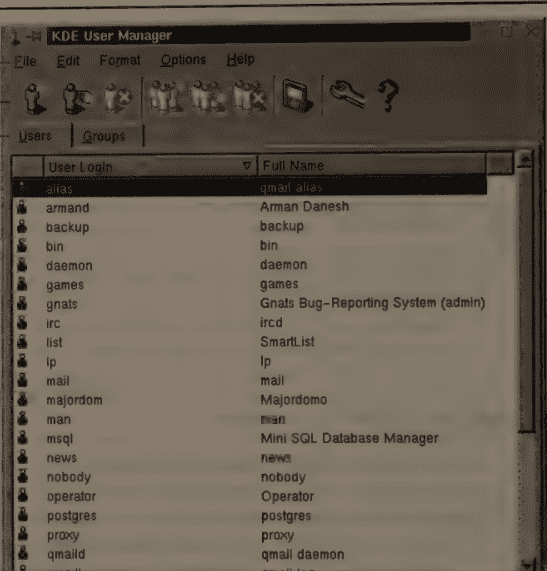

用户管理器窗口包含几个组件：

- 一个包含“文件”、“编辑”、“格式”、“选项”和“帮助”菜单的菜单栏
- 一个带有按钮的工具栏，提供快速访问常用用户管理功能的功能
- 两个用于管理用户和组的标签页

要使用用户管理器创建新用户，请点击用户管理器工具栏上的“添加用户”按钮，或从主菜单栏中选择“格式” > “添加”。用户管理器将显示“添加用户”对话框，如图 3.2 所示。

# 图 3.2

用户管理器的“添加用户”对话框

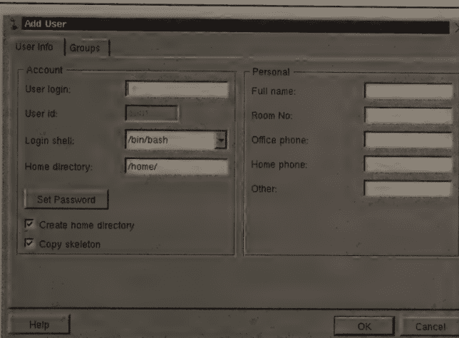

“添加用户”对话框包含两个标签页：“用户信息”和“组”。在“用户信息”页面上，按照后续章节中的说明输入用户信息。完成填写“添加用户”对话框后，点击“确定”按钮，用户管理器将创建该用户账户。

### 用户登录


在“用户登录”字段中输入用户名。用户名是登录系统使用的名称（不是用户的全名）。Corel Linux 系统上的每个用户都必须有一个唯一的用户名。

用户名可以由字母和数字组成，且不包含空格。通常，用户名派生自用户的全名。例如，名为 Arman Danish 的用户可能有以下用户名之一：`armand`、`adanesh`、`arman`、`dan`、`armanesh` 或 `Armbanesh`。用户名是区分大小敏感的。

### 用户 ID (UID)

“用户 ID”字段由系统自动填充。UID 是 Corel Linux 使用的数字标识符，用于唯一标识每个用户账户。虽然用户名为用户账户提供了易于人类识别的标识符，但 Corel 实际上使用数字来跟踪用户账户信息。

UID 的范围从 0 到 65534，UID `0` 用于 `root`（根）用户账户。100 以下的 UID 值通常预留给系统账户以及为应用程序特殊用途创建的账户，例如 `FTP`（文件传输程序）。

> **注意：** 添加用户时，你会发现“用户 ID”字段是禁用的。这是因为 Corel Linux 会自动为新用户分配 UID 值。尽管你也可以通过编辑 `/etc/passwd` 文件来手动更改这些值（将在本章稍后的“编辑密码文件”部分中进行讨论），但这通常是为了允许 Corel Linux 使用其内部方案为用户账户分配 UID。在大型网络或安装中，可能会有其他正在使用的编号方案，但在这些情况下，用户管理通常将由系统或网络管理员执行。

### 登录 Shell

如果你想选择一个 `bash` 以外的默认 shell，请从“登录 Shell”下拉列表中选择一个默认 shell。

Shell 是命令解释器，它决定了命令行环境运行的方式（例如，在 Linux 控制台或 Corel Linux 窗口中）。Linux 提供了许多 shell 可供，但 Linux 中用户账户的初始默认 shell 是 `bash` shell（Bourne Again Shell）。

大多数用户只会偶尔使用 Linux 命令行环境，因此各种不同 shell 之间的差异并不显著。主要通过命令行工作的高级用户可以考虑更改默认 shell。（第 18 节将讨论使用 shell 的内容。）

### 主目录

在“用户登录”字段中输入用户名后，“主目录”字段将自动填充。请确保“添加用户”对话框底部的“创建主目录”复选框已选中，以便为新用户创建一个主目录。

每个账户都有一个与其关联的主目录。主目录是用户存储文件和数据的地方，它通常是加密的，其他人无法访问该目录。在 Corel Linux 中，主目录是 `/home` 目录下的子目录，名称与账户的用户名相同。例如，用户 `tester` 的主目录为 `/home/tester`。

### 个人信息

在“添加用户”对话框“个人信息”部分的“全名”字段中输入用户的全名。此名称被 Corel Linux 用于多个位置，包括在构建从用户发出的电子邮件的“发件人”行时。

你还可以在“个人信息”部分输入任何相关的补充信息。在这些字段中，你可以指定房间号、办公室电话、家庭电话和杂项信息（在“其他”字段）。

### 设置密码

每个用户账户都有一个关联的密码。密码用于登录账户，并以加密格式存储在 Corel Linux 用户数据库中。在 Corel Linux 第二版中，密码长度必须至少 5 个字符，最多 127 个字符。在早期的 Corel Linux 版本中，密码限制在 5 到 8 个字符之间。

要指定用户的密码，请点击“添加用户”对话框中的“设置密码”按钮。用户管理器将显示“输入密码”对话框，如图 3.3 所示。在“密码”和“再次输入密码”字段中为用户输入密码。出于安全考虑，你输入密码的字符在字段中将显示为星号。指定密码后，点击“确定”按钮关闭“输入密码”对话框。

#### 图 3.3

用户管理器的“输入密码”对话框


### 选择安全密码

如果系统需要安全性，实施安全的密码策略是一个好主意，以下情况需要：

- 你的系统有多个用户。
- 你的系统有多个人访问。
- 你的系统连接到互联网。

为了确保安全：

- 确保密码难以被猜。
- 确保密码是复杂的。

### 复制骨架

勾选“复制骨架”复选框将导致 Corel Linux 将 `/etc/skeleton/` 目录的内容复制到用户的主目录中。否则，用户的主目录将是空的且缺少配置文件。

### 创建示例用户

作为用户创建的演示，让我们创建一个示例用户：

1. 以 `root` 用户登录。
2. 选择主菜单 > 系统 > 用户管理器。
3. 点击“添加用户”按钮。Corel Linux 显示“添加用户”框。
4. 在“用户登录”字段中输入 `someuser`。
5. 从“登录 Shell”下拉列表中选择 `/bin/bash`。
6. 在“全名”中输入 `Sample`。
7. 确保“主目录”复选框已选中。
8. 确保“复制骨架”复选框已选中。
9. 点击“设置密码”按钮。Corel Linux 显示“输入密码”对话框。
10. 在“密码”和“再次输入密码”字段中为账户输入密码。密码不会显示，会被星号掩码。
11. 点击“确定”按钮。Corel Linux 关闭“输入密码”对话框。
12. 点击“确定”按钮。Corel Linux 关闭“添加用户”对话框并添加 `someuser`。

### 编辑和删除用户账户

设置用户账户后，可以通过用户管理器随时对其修改。要编辑现有用户，选择用户管理器并选择用户列表中的条目。然后点击用户管理器工具栏上的“编辑用户”按钮，或从主菜单栏选择“格式” > “编辑”。用户管理器将显示“编辑用户”对话框，如图 3.4 所示。

#### 图 3.4

用户管理器的“编辑用户”对话框

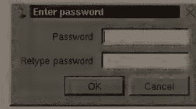

“编辑用户”对话框包含相同的两个标签页“用户信息”和“组”，以及与“添加用户”对话框相同的字段。进行任何更改，然后点击“确定”按钮。要从系统中删除现有用户，从用户管理器的用户列表中选择用户条目，然后点击用户管理器上的“删除用户”按钮，或选择“格式” > “删除”。用户管理器将显示一个确认对话框，如下所示。点击“是”按钮删除该用户。

## 修改密码

最基础的用户管理任务就是更改密码。用户通常希望将密码更改为初始分配密码。Corel 系统管理员经常需要更改密码以保持系统安全，或者为忘记密码的用户提供新密码。

用户可以通过控制中心（`Control Center`）或使用 `passwd` 命令更改自己的密码。`root` 用户也可以使用 `passwd` 命令更改其他用户的密码。

> **提示：** 在更改密码时，请尝试选择一个难以猜的密码。这对于多用户网络化系统尤为重要。

### 使用控制中心

在 Corel Linux 中，用户可以通过以下步骤使用控制中心更改密码：

1. 从 Corel Linux 主菜单选择控制中心（`Control Center`）启动控制中心。Corel Linux 将启动控制中心，如图 3.5 所示。

#### 图 3.5

Corel Linux 控制中心

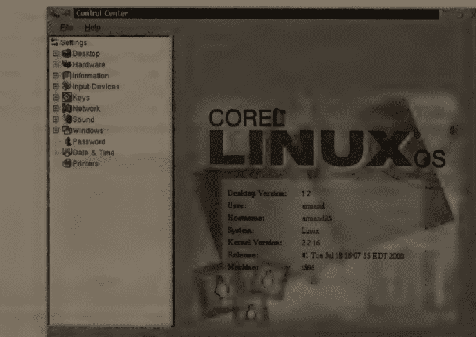

2. 点击控制中心窗口左侧面板中的“密码”（`Password`）项。控制中心将显示修改密码（`Change Password`）页面，如图 3.6 所示。

#### 图 3.6

控制中心的修改密码页面

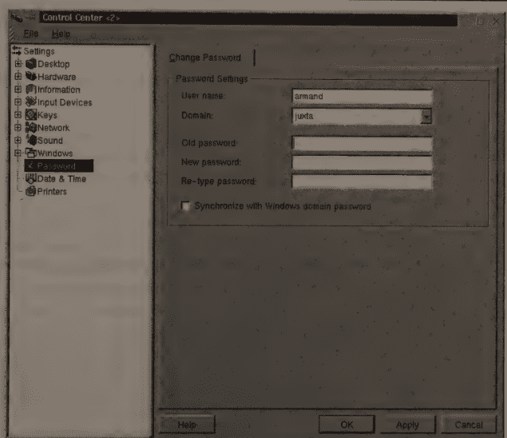

3. 在“旧密码”（`Old Password`）字段中输入您的当前密码。
4. 在“新密码”（`New Password`）和“确认密码”（`Re-type Password`）字段中均输入您的新密码。（输入时，星号将代替您输入的字符。）控制中心将更改您的密码并显示如下所示的修改密码对话框，告知修改完成。
5. 点击“应用”（`Apply`）按钮。如果“新密码”和“确认密码”字段中输入的密码不匹配，控制中心将显示相应的警告，您需要重新输入密码并点击“应用”按钮。


### 使用 passwd 命令

除了通过控制中心更改密码外，您还可以在控制台（`Console`）窗口中使用 `passwd` 命令在 Linux 命令行更改密码。在命令提示符处输入 `passwd` 命令后，系统会提示您输入当前密码，随后是两次输入新密码的提示（密码将不会显示）。以下是使用 `passwd` 命令的示例：

```bash
$ passwd
正在为 someuser 更改密码

旧密码：

输入新密码（最少 5 位，最多 127 个字符）
请结合大小写字母和数字。
新密码：
再次输入新密码：
密码已更改。
```

如果您输入的两个新密码不匹配，密码将不会更改，并且将提示您重新输入两次新密码：

```bash
$ passwd
```


```
正在为 someuser 更改密码

旧密码：

输入新密码（最少 5 位，最多 127 个字符）

请结合大小写字母和数字。

新密码：

再次输入新密码：

两次不匹配；请重试。

新密码：

再次输入新密码：

密码已更改。
```

### 作为 root 用户更改用户密码

`root` 用户可以使用 `passwd` 命令更改系统上任何用户的密码。要执行此操作，请按照本章之前“作为 `root` 用户工作”部分的说明以 `root` 用户身份登录，然后将要更改密码的账户用户名作为 `passwd` 命令的参数。当您作为 `root` 用户更改用户密码时，系统不会提示输入该账户的当前密码。作为 `root` 用户，更改用户密码时无需提供当前用户的密码。这是 `root` 用户账户权限的一部分。

以下示例显示了更改 `someuser` 用户账户密码的命令和提示：

```
# passwd someuser
```

正在为 `someuser` 更改密码

输入新密码（最少 5 位，最多 127 个字符）

请结合大小写字母和数字。

新密码：

再次输入新密码：

密码已更改。

### 编辑密码文件

所有用户账户信息都存储在 `/etc/passwd` 文本文件中。当您使用用户管理器（User Manager）管理用户时，实际上是在修改 `/etc/passwd` 文件的内容。通常，最好使用用户管理器进行用户管理。然而，高级用户和系统管理员可能更倾向于直接编辑 `/etc/passwd` 文件。

在 `/etc/passwd` 文件中，每个用户账户记录一行，包含七个用冒号分隔的字段，如下：

`用户名:UID:GID:全名:目录:默认 shell`

这些字段对应于在用户管理器创建或编辑账户时指定的信息：

- `用户名` 字段包含账户的用户名。
- `密码` 字段包含加密形式的账户密码，以确保安全。
- `UID` 字段包含账户的用户 ID（由系统生成）。
- `GID` 字段包含账户默认组的组 ID（请参见本章稍后关于“管理组账户”部分）。
- `全名` 字段包含账户的全名。
- `目录` 字段包含账户的家目录。
- `默认 shell` 字段包含账户默认 `shell` 的路径。

例如，`/etc/passwd` 中的一个典型条目如下：

`someuser*:1000:1000:User:/home/someuser:/bin/bash`

> 注意：`/etc/passwd` 中密码字段中的星号（`*`）表示该账户没有密码，如果用户尝试登录该账户，系统应拒绝所有密码。这通常用于用于运行服务但不应用于交互登录的系统账户。


## 第3章 管理用户和组

要编辑 `/etc/passwd` 文件，您需要在控制台窗口中以 `root` 用户身份登录，并且不要在编辑器中打开该文件，否则可能会损坏用户数据库。以下是安全编辑 `/etc/passwd` 的步骤：

1. 以 `root` 用户身份登录并打开控制台窗口。
2. 通过设置 `EDITOR` 变量定义您偏好的编辑器。例如，如果您通常使用 `kwrite`，则执行 `export EDITOR=kwrite`。（Corel Linux 中的 `kwrite` 编辑器将在第 13 章讨论。）
3. 输入命令 `vipw`。使用指定的编辑器打开 `/etc/passwd` 文件，如图 3.7 所示。

> 必须使用 `vipw` 命令编辑 `/etc/passwd` 文件，而不是使用您的文本编辑器。如果您使用文本编辑器，可能会损坏用户数据库；多个应用程序可能会同时修改数据库。

图 3.7

编辑 `/etc/passwd`

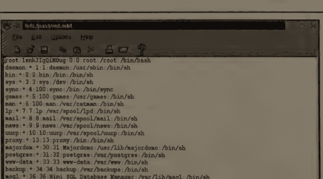

4. 对 `/etc/passwd` 文件进行任何所需的修改。
5. 保存文件并关闭编辑器（在文本编辑器中，选择 `File > Save` 然后 `File > Exit`）。

## 管理组账户

除了创建和管理用户外，您还可以使用用户管理器创建和管理组。每个用户必须分配到一个组作为用户的主组。在 Corel Linux 中，每个用户的主组是与用户名同名的组。这意味着每个用户的主组包含该特定用户。

### 创建组

如果您需要在网络环境中管理多个用户，可以创建组来简化用户管理任务。要创建组，请遵循以下步骤：

1. 以 `root` 用户身份登录 Corel Linux 登录框。
2. 选择 `主菜单 > 应用程序 > 系统 > 用户管理器`。
3. 点击“组”选项卡。用户管理器将显示系统中当前存在的组列表，如图 3.8 所示。

> 图 3.8

用户管理器的组列表

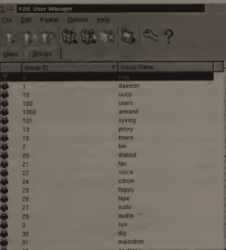

4. 点击用户管理器工具栏上的“添加组”（Add Group）按钮，或选择 `格式（Format） > 添加（Add）`。用户管理器将显示“添加组”对话框，如图 3.9 所示。

图 3.9

用户管理器的添加组对话框

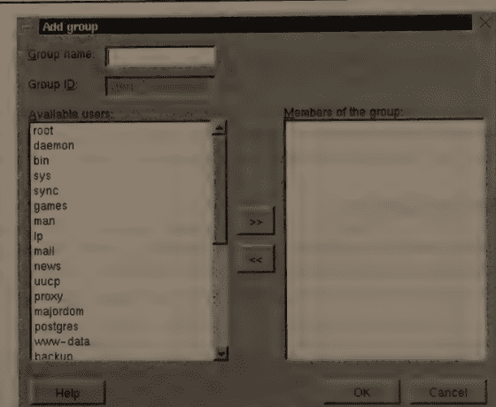

> 注意：您必须在用户管理器的主窗口中查看组列表，才能使用“添加组”按钮。如果您正在查看用户列表，“添加组”按钮将禁用。

5. 在“组名”（Group Name）字段中为组输入名称。系统将自动填充“组 ID”（Group ID）字段。
6. 您可以在不添加任何初始用户的情况下创建一个组。如果您想现在添加用户，请从对话框左侧的“可用用户”（Available Users）列表框中选择一个用户，并点击 `>>` 按钮。用户管理器会将用户移动到“组成员”（Members of the Group）列表中。重复此过程以向组添加其他用户。
7. 点击“确定”（OK）按钮。用户管理器将创建您的新组。

### 编辑和删除组账户

> 注意：当您添加组时，“组 ID”字段是禁用的，因为 Corel Linux 会自动为新用户分配组 ID。尽管您可以通过编辑 `/etc/group` 文件来手动更改这些值（见本章后后的“编辑组文件”章节），但通常最好让 Corel Linux 使用其内部方案为组分配组 ID。

若要使用用户管理器编辑现有组的信息，请在用户管理器的组列表中选择该组的条目，然后点击用户管理器工具栏上的“编辑组”（Edit Group）按钮，或从主菜单栏选择 `格式（Format）`。用户管理器将显示“编辑组”对话框，如图 3.10 所示。

图 3.10

用户管理器的编辑组对话框

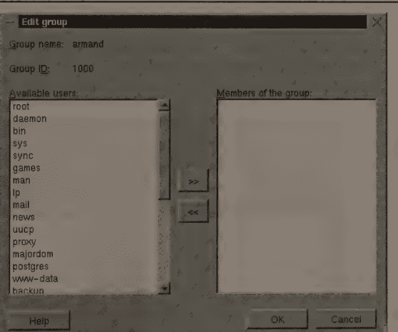

在“编辑组”对话框中，您可以在“组名”字段中编辑组名。您还可以按照以下步骤更改组员：

- 要向组中添加用户，在“可用用户”列表框中选择用户并点击 `>>` 按钮。用户管理器会将用户移动到“组成员”列表框。
- 要从组中移除用户，在“组成员”列表框中选择用户并点击 `<<` 按钮。用户管理器会将用户移动到“可用用户”列表。

完成组信息的编辑后，点击“确定”按钮。若要删除现有组，请从用户管理器的用户列表中选择该组条目，然后点击用户管理器工具栏上的“删除组”（Delete Group）按钮，或从主菜单栏选择 `格式（Format） > 删除（Delete）`。用户管理器将显示确认对话框。点击“是”以删除用户。

> 注意：某些组由于被系统使用而无法删除。在这种情况下，“删除组”按钮和 `格式 > 删除` 菜单项将被禁用。

### 更改用户的组成员关系

您可以通过“编辑用户”（Edit User）对话框（参见本章前面的图 3.4）将用户添加到组、从组中移除用户或更改用户的默认组。要打开此对话框，请从用户管理器的用户列表中选择该用户条目，然后点击用户管理器工具栏上的“编辑用户”（Edit User）按钮，或从主菜单栏选择 `格式（Format） > 编辑（Edit）`。点击“组”（Groups）选项卡显示“编辑用户”对话框的组页面，如图 3.11 所示。

图 3.11

编辑用户对话框的组页面

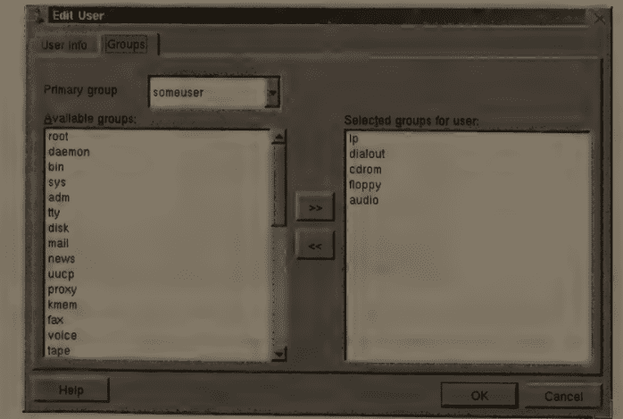

您可以进行以下更改：

- 要更改用户的默认组，请从“主组”（Primary Group）下拉列表中选择新组。
- 要将用户添加到附加组，请在“可用组”（Available Groups）列表框中选择组并点击 `>>` 按钮。用户管理器会将用户移动到“用户选组”（Selected Groups for User）列表框。
- 要从组中移除用户，请从“用户选组”列表框中选择组并点击 `<<` 按钮。用户管理器会将用户移动到“可用组”列表框。

点击“确定”按钮保存更改。

### 编辑组文件

与本章之前过的 `/etc/passwd` 文件类似，`/etc/group` 文件是一个存储所有组信息的文本文件。正如通常使用用户管理器进行用户管理是更好的主意，使用用户管理器进行组管理也是最好的。然而，如果您是高级用户或系统管理员，可能更倾向于直接编辑 `/etc/group` 文件。


在 `/etc/group` 文件中每个组记录占据一行，包含四个用冒号分隔的字段，格式如下：

```
group name:password:GID:user list
```

这些字段对应于在用户管理器中创建或编辑组时使用的数据：

- 组名字段包含组名。
- 密码字段包含为了安全而加密的组密码。通常情况下，组不使用密码。
- `GID` 字段包含组 ID。
- 用户列表字段包含该组组成员的用户名称列表。

# 理解 Linux 文件和目录

如果你有分区，它们将会被挂载到路径层次结构中的各个子目录下。以下是不同设备的常用挂载点：

- 如果你有多个硬盘分区，额外的分区通常会挂载到 `/home`、`/opt`、`/usr`、`/usr/local` 或 `/var`。
- 如果你有一个光驱驱动器，它通常会被挂载到 `/cdrom`、`/mnt/cdrom` 或 `/mnt/cdrom1`。
- 如果你有一个软盘驱动器，它通常会被挂载到 `/floppy`、`/mnt/floppy` 或 `/mnt/floppy1`。

为了理解这是如何运作的，假设光驱驱动器挂载在 `/mnt/cdrom1`。此时，你访问的所有文件都在你的硬盘上，但你访问的路径以 `/mnt/cdrom1/` 开头的文件和目录除外。所有这些文件和目录都在当前光驱驱动器的磁盘上。

## 文件和目录访问控制

Linux 中的所有文件和目录都属于一个用户和一个组。用户所有者和组所有者与文件目录权限结合使用，决定谁可以以何种方式访问该文件或目录。文件的用户和组所有者可以是任何有效的用户或组。（用户和组在第 3 章中讨论过。）

### 文件和目录权限

Linux 中的所有文件和目录都关联有三组权限：

- 用户所有权限适用于拥有该文件或目录的用户。
- 组所有者权限适用于拥有该文件或目录的组任意成员。
- 所有其他用户的权限适用于任何用户。

这些权限是累积的。适用于用户的任何权限集中的所有权限将组合，以确定用户对文件或目录的访问级别。`root` 用户不受这些权限的影响，而是对所有文件和目录拥有完全访问权限。对于所有其他用户，假设用户对文件没有访问权限，并且通过权限集显式地授予了某种程度的访问。

每个权限集有三种可以授予的访问类型：

`读取 (Read)` 允许用户查看或复制文件，或在目录列表中查看文件。

`写入 (Write)` 允许用户向文件写入内容、删除文件或目录、重命名文件或目录，或在目录中创建新文件或子目录。


`执行 (Execute)` 允许用户执行文件，或者在目录的情况下，将当前工作目录更改该目录。

### 访问控制的工作原理

让我们考虑一个示例来理解访问权限是如何工作的。假设我们有以下设置：

- 我们的系统有三个用户：`user1`、`user2` 和 `user3`。
- 我们的系统有两个组：`group1` 包含成员 `user1` 和 `user2`，`group2` 包含成员 `user3`。
- 我们的系统有一个由 `user1` 所有、`group1` 组的文件，权限如下：
    - 用户所有者：读取、写入和执行
    - 组所有者：读取和执行
    - 其他：读取

在这种情况下，每个用户对该文件有不同的访问权限，如下：

- `user1`：读取、写入和执行权限
- `user2`：读取和执行权限
- `user3`：读取权限

## 使用 Corel 文件管理器

Corel 文件管理器相比于 Linux 平台上大多数之前的可用文件管理工具有了显著改进。Corel 明确地将文件管理器定位为帮助 Windows 和 Macintosh 用户平稳过渡到 Linux。图 4.1 所示的 Corel 文件管理器使用了熟悉的双窗格布局和计算机上文件目录结构的树状视图。

# 图 4.1

Corel 文件管理器窗口

菜单栏

地址栏

工具栏

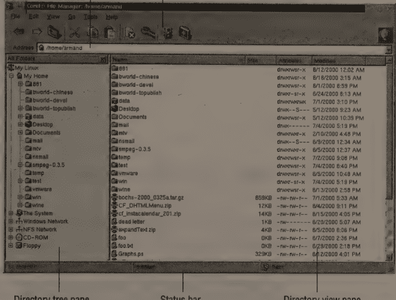

### 探索文件管理器窗口

Corel 文件管理器由以下组件组成：

- 菜单栏包含访问文件管理器菜单的接口。
- 工具栏由用于一键访问常用文件管理器操作的按钮组成。
- 地址栏显示当前显示的位置。
- 目录树面板由你可以访问的目录的树形层次结构显示组成。
- 目录视图面板显示目录树面板中当前选定目录的内容。
- 状态栏显示当前选定目录的信息。

接下来的章节将详细描述这些部分。

#### 菜单栏

菜单栏提供了访问文件管理器菜单的接口：

- “文件”菜单包含创建、删除和重命名文件夹及文件的选项。
- “编辑”菜单包含复制和粘贴文件的选项。
- “视图”菜单允许你隐藏或显示 Corel 文件管理器窗口的组件，并更改目录内容的排序顺序。
- “转到”菜单包含导航命令。例如，你可以返回上一个目录、回到当前目录的父目录，或跳转到网络目录。
- “工具”菜单包含搜索文件、文件夹或计算机的选项。你可以从工具菜单挂载或断开网络驱动器。
- “帮助”菜单提供了访问 Corel 文件管理器文件的接口。

#### 工具栏

所示 Corel 文件工具栏由十个执行常用文件管理器操作的按钮组成。


工具栏按钮的作用如下：

- 后退按钮返回历史列表中的上一个目录。
- 前进按钮进入历史列表中的下一个目录。
- 上级按钮返回到父目录。
- 剪切按钮将选中的文件或目录移动到剪贴板。
- 复制按钮将选中的文件或目录复制到剪贴板。
- 粘贴按钮将剪贴板内容粘贴到当前目录。
- 垃圾桶按钮将选中的文件或目录移动到垃圾桶。
- 属性按钮显示选定文件或目录的属性框。
- 停止按钮停止当前目录。
- 刷新按钮刷新显示。

#### 地址栏

地址栏显示当前显示的目录或页面路径。它也可以用于导航，如下：

- 在地址栏输入目录路径或 URL，然后按回键导航到新位置。
- 点击地址栏右侧的下拉箭头显示以前过的目录或网页列表，并从中选择一项进行返回导航。

#### 目录树面板

下方所示的目录树面板包含你可以访问的目录和服务器的树形层次结构。

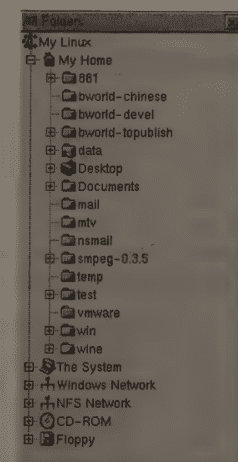

初始结构包含以下顶级部分：

- 我的家：你的主目录
- Windows 网络：包含所有可用的 Windows 系统（如果没有按照第 12 章启用 Samba 访问 Windows 网络，则此部分不会出现）
- NFS 网络：包含所有可用的基于 NFS 的 Unix 系统
- 光驱：你的光驱驱动器
- 软盘：你的软盘驱动器

# 第 4 章 • 管理你的文件和文档

如果你在本地硬盘导航到主目录之外，将显示一个名为“系统”的顶级部分，如下所示。

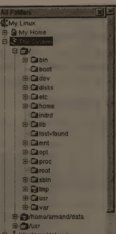

同样，如果你访问网站，将显示一个名为“网络浏览器”的顶级部分。如果你访问 FTP 服务器，将显示一个以该 FTP 服务器命名的顶级部分。这两个部分如下所示。

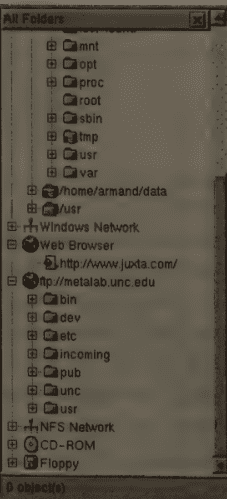

目录树使用一套标准系统来表示已折叠和已展开的条目：

- 条目左侧框内的加号（`+`）表示该条目已折叠，且该条目具有未显示的的子项。
- 条目左侧框内的减号（`-`）表示该条目已展开，且其直接子项已显示。

你可以通过点击条目旁边的加号或双击条目来展开折叠的条目。同样，你可以通过点击条目旁边的减号或双击展开的条目来折叠条目。

要显示目录的内容，只需点击目录条目进行选择。其内容将显示在目录视图窗格中。

目录树窗格中使用多种图标来表示条目类型，包括表 4.1 中列出的。

## 表 4.1：目录树窗格中的选定图标

| 图标 | 说明 |
|---|---|
| | 主目录顶级条目 |
| | 系统 (The System) 顶级条目 |
| | 在“系统”系统中显示的顶级目录 |
| | 目录 |
| | 网络共享目录 |
| | Windows 网络或 NFS 网络顶级条目 |
| | Windows 网络上的工作组或域 |
| | 网络上的计算机 |

## 第 4 章 • 管理你的文件和文档（续）

| 表 4.1：目录树窗格中的选定图标（续） |
|---|---|
| | 打印机 |
| | 网络上的打印机 |
| 🌐 | Web 浏览器或 FTP 服务器顶级条目 |
| 💿 | CD-ROM 驱动器 |
| 💾 | 软盘驱动器 |

## 目录视图窗格

目录视图窗格在树窗格和地址栏中显示所选目录的内容。下方显示了一个典型的目录视图窗格。

| 名称 | 大小 | 创建 | 修改 |
|---|---|---|---|
| 📁 sb1 | | drwxr-xr | 6/12/2000 12:02 AM |
| 📁 bworld-chinese | | drwxr-xr | 6/12/2000 3:15 AM |
| 📁 bworld-devel | | drwxr-xr | 6/12/2000 5:59 PM |


| 📁 `bworld-toppublish` | | `drwxr-xr` | 8/24/2000 3:13 AM |
|---|---|---|---|
| 📁 `data` | | `drwxr-xr` | 7/1/2000 3:10 AM |
| 📁 `Desktop` | | `drwxr-xr` | 5/12/2000 9:23 AM |
| 📁 `Documents` | | `drwxr-xr` | 5/12/2000 10:39 PM |
| 📁 `mail` | | `drwxr-xr` | 7/24/2000 5:44 PM |
| 📁 `net` | | `drwxr-xr` | 8/9/2000 12:34 AM |
| 📁 `nsmall` | | `drwxr-xr` | 6/5/2000 9:38 PM |
| 📁 `smpeg-0.3.5` | | `drwxr-xr` | 7/2/2000 9:37 PM |
| 📁 `test` | | `drwxr-xr` | 7/24/2000 8:40 PM |
| 📁 `vmware` | | `drwxr-xr` | 5/10/2000 10:48 AM |
| 📁 `win` | | `drwxr-xr` | 7/21/2000 11:18 PM |
| 📁 `wine` | | | 6/13/2000 2:58 PM |
| 📄 `bochs-2000_0325a.tar.gz` | 658KB | `--rw-rw-r--` | 7/1/2000 5:53 AM |
| 📄 `CF_DHTMLMenu.zip` | 12KB | `--rw-rw-r--` | 8/4/2000 4:11 PM |
| 📄 `cf_installcalendar_201.zip` | 14KB | `--rw-rw-r--` | 6/5/2000 4:05 PM |
| 📄 `lastfile` | 1KB | `------` | 6/20/2000 5:07 AM |
| 📄 `expandText.zip` | 402KB | `------` | 6/20/2000 6:06 PM |
| 📄 `foo` | 0KB | `--rw-rw-r--` | 6/7/2000 2:38 PM |
| 📄 `foo.bd` | 0KB | `--rw-rw-r--` | 8/29/2000 2:18 PM |
| 📄 `Graphs.ps` | 329KB | `--rw-rw-r--` | 8/12/2000 4:01 PM |

所有子目录和文件都显示在一个详细列表中，每个项目都包含以下信息：

* 文件或目录的名称
* 文件或目录的大小
* 文件或目录的属性
* 文件或目录的修改日期

默认情况下，列表按名称排序。你可以通过点击列标题来更改排序顺序。此外，你还可以使用搜索框来过滤列表。

## 管理目录和文件

为了组织您的文件系统，您可能需要创建新目录或文件，并复制、移动和删除目录或文件。您还可以通过指定它们的权限、所有权和共享属性来控制对目录和文件的访问。您可以通过 Corel 文件管理器（`Corel File Manager`）执行这些任务。

> 注意：要管理特定的目录或文件，你需要导航到它并选择它。请参阅本章前面的“导航您的文件系统”部分，了解有关在文件管理器中导航文件系统和选择目录方法的详情。当选中一个目录时，该目录的内容将显示在目录视图窗格中，目录将在目录树窗格中突出显示。

### 创建新目录

要创建新目录，请导航到您想要创建新目录的目录。确保在目录树窗格中选择了您想要创建新子目录的目录，然后从菜单栏中选择“文件” > “新建文件夹”。

文件管理器将创建一个名为“新建文件夹”的新目录，并将其显示在目录视图窗格中，供您编辑该目录名称。输入新目录的名称并按回车键。文件管理器将更新目录视图窗格中的列表，以反映您输入的名称。

## 复制目录和文件

要在新位置复制目录或文件，请按照以下步骤操作：

1. 导航到您想要复制的目录，或者导航到包含要复制的文件的目录。
2. 在目录树窗格中选择要复制的目录，或在目录视图窗格中选择该文件。
3. 从菜单栏中选择“编辑” > “复制”，或右键点击目录名称或文件名并从弹出菜单中选择“复制”。
4. 导航到您想要放置目录或文件副本的目录。
5. 确保在目录树窗格中选择了您想要放置副本的目录，并从菜单栏中选择“编辑” > “粘贴”。或者，右键点击目录树窗格中的目录名称或目录视图窗格中的空白区域，并从弹出菜单中选择“粘贴”。

如果您复制了目录，文件管理器将在您指定的位置创建该目录及其所有子目录的副本。如果您复制了文件，文件管理器将在指定位置创建该文件的副本。

### 创建示例目录

为了演示如何使用文件管理器，我们将创建一个示例子目录并将文件复制到其中。请按照以下步骤操作：

1. 点击目录树窗格中的“我的主目录”，并从菜单栏中选择“文件” > “新建文件夹”。文件管理器将在目录视图窗格中创建一个名为“新建文件夹”的新文件夹。
2. 输入 `Stuff` 并按回车键为目录命名。
3. 点击目录树窗格中“系统”目录旁边的加号将其展开。
4. 点击目录树窗格中 `/` 目录旁边的加号将其展开。
5. 点击目录树窗格中的 `etc` 目录以选中它。
6. 点击目录视图窗格中的 `printcap` 文件以选中它。
7. 从菜单栏中选择“编辑” > “复制”。
8. 点击目录树窗格中您创建的 `Stuff` 目录以选中它。
9. 从菜单栏中选择“编辑” > “粘贴”。文件管理器将 `printcap` 文件复制到 `Stuff` 目录。

### 移动目录和文件

要将目录或文件移动到新位置，请导航到您想要移动的目录或文件，然后按照以下步骤操作：

1. 在目录树窗格中选择要移动的目录，或在目录视图窗格中选择要移动的文件。
2. 从菜单栏中选择“编辑” > “剪切”，或右键点击目录名称或文件名并从弹出菜单中选择“剪切”。
3. 导航到您想要放置该目录或文件的目录。
4. 确保在目录树窗格中选择了您想要放置目录或文件的目录，并从菜单栏中选择“编辑” > “粘贴”。或者，右键点击目录树窗格中的目录名称或目录视图窗格中的空白区域，并从弹出菜单中选择“粘贴”。

文件管理器将把目录及其所有子目录（或选中的单个文件）移动到您指定的位置。

> 注意：如果目标位置已存在一个与您正在移动的目录同名的目录，文件管理器将显示消息通知您，且不会移动该目录。

### 删除目录和文件

与 `Windows` 系统中删除目录和文件的默认设置不同，当在 `Corel` 文件管理器中选择“删除”命令时，目录或文件将被移除且无法恢复。然而，文件管理器还提供了“移动到垃圾箱”命令，可以将选定的目录或文件发送到临时存储区域，在那里可以永久删除或恢复。

### 删除目录和文件

要删除目录或文件，请导航到您想要删除的目录或文件，选中它，然后从菜单栏中选择“文件” > “删除”，或右键点击目录树窗格中的目录名称或目录视图窗格中的文件名，并从弹出菜单中选择“删除”。文件管理器将显示“确认删除文件夹”对话框（如下所示）或“确认删除文件”对话框。确保您正在删除正确的文件夹（目录）或文件，然后点击“是”按钮删除该目录或文件。否则，点击“否”按钮。


## 管理目录和文件属性

所有目录和文件都有与其相关的属性。具体而言，你可以为目录指定权限、所有权和共享属性。对于文件，你可以指定权限和所有权属性。

## 查看目录或文件的属性

要打开目录或文件的“属性”对话框，请在目录树窗中选择目录，或在目录视图窗中选择文件。从菜单栏选择“文件 > 属性”，或者右键点击目录名称或文件名，从弹出菜单中选择“属性”。文件管理器将显示“属性”对话框。图 4.4 显示了目录属性对话框。

## 图 4.4

目录属性对话框

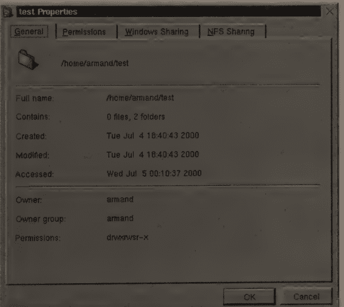

目录属性对话框包含三个或四个选项卡页：

* “常规”页显示有关目录的一般信息，包括路径和名称、创建和修改日期，以及所有者和权限。你无法在“常规”页上更改这些信息。
* “权限”页允许你更改目录的权限和所有权。
* “Windows 共享”页允许你在 `Windows` 网络上共享目录。“Windows 共享”选项卡仅在 `Samba` 已启用时（如第 12 节所述）才会出现。
* “NFS 共享”页允许你在基于 `Unix` 的网络上共享目录。“NFS 共享”选项卡仅在你处于使用 `NFS` 的网络时才会出现。

图 4.5 显示了文件属性对话框。此对话框只有“常规”和“权限”页，其内容与目录属性对话框中的对应页相同。

## 图 4.5

文件属性对话框


> 注意：如果你查看不是你所有者的目录或文件的属性，将不会显示“权限”页。对于 `root` 用户，所有目录和文件都会显示“权限”页。

## 更改目录或文件的所有权


如本章前面所述，所有目录和文件都有用户和组所有者。你可以使用目录或文件属性对话框的“权限”页来更改所有权。图 4.6 显示了目录属性对话框“权限”页的示例。拥有目录或文件的用户可以更改该目录或文件的组所有者。`root` 用户可以同时更改目录或文件的用户所有者和组所有者。

## 图 4.6

目录属性对话框的权限页


“权限”页的“所有权”部分包含“所有者”和“组”下拉列表。你可以通过点击“组”下拉列表，从列表中选择一个组，然后点击“确定”按钮来更改目录或文件的组所有者。如果你以 `root` 用户身份运行文件管理器，可以通过点击“用户”下拉列表，从列表中选择一个用户，然后点击“确定”按钮来更改目录或文件的用户所有者。

### 更改目录或文件的权限

你可以通过使用目录或文件属性对话框“权限”页中相应的复选框来更改分配给目录或文件的权限。（权限在章前面的“文件和访问控制”节中讨论。）

“访问权限”部分有三行复选框（每行对应一个用户所有者、组所有者和其他所有用户），每行四列。前三列反映了三种权限属性：读取、写入和访问（执行）。

第四列“特殊”代表特殊设置：

`SetUID`：当一个可执行文件启用了 `SetUID` 属性时，它将以启动该文件的所有者身份运行，而不是以启动它的实际用户身份运行。这通常用于允许除 `root` 用户以外的用户运行配置为仅供 `root` 用户运行的应用程序。

> **警告** 启用 `SetUID` 可能非常危险，因为它允许广泛地访问 `root` 权限。

`SetGID`：当一个目录启用了 `SetGID` 属性时，在该目录中创建的任何文件都将属于目录的所有组，而不是创建文件的用户所所属的主组。当目录被用于在共同用户组之间共享文件时，这种方法非常有用。

当目录具有粘滞（`Sticky`）属性时，用户只能删除自己在目录中的文件，即使目录赋予了所有用户读取和写入目录内文件的权限。对于可执行文件，启用 `Sticky` 会导致文件在执行后保留在内存中，以便每次启动时运行得更快。

> **警告** 对于可执行文件，使用 `Sticky` 属性时应小心，因为内存中加载过多的文件会对系统性能产生不利影响。

选中的复选框表示授予了特定类型的权限。要编辑目录或文件的权限，只需勾选或取消勾选相应的复选框，然后点击“确定”按钮。

## 访问 FTP 服务器和网站

`Corel` 文件管理器不仅是一个导航和管理本地系统及网络文件和目录的工具。它还可以用于访问互联网任何地方 `FTP` 服务器或网站。

> **提示** 使用 `Corel` 文件管理器访问 `FTP` 服务器或万维网，你的系统需要连接到互联网。连接将在第 8 章中介绍。

### 访问 FTP 服务器

访问 `FTP` 服务器非常简单：在地址栏中输入 `FTP` 服务器的 `URL` 或路径。`FTP` 服务器的 `URL` 格式为 `ftp://服务器/路径`。按回车键，文件管理器显示指定的 `URL` 并添加到服务器列表中。图 4.7 显示了文件管理器显示的目录。

你可以通过导航并以相同的方式从 `FTP` 服务器复制文件和目录到本地系统（参见本章前面的“复制目录和文件”节）。


默认情况下，文件管理器对服务器建立匿名 `FTP` 连接。如果你尝试连接需要验证的 `FTP` 服务器，将提示输入用户名和密码，如下：


## 浏览万维网

使用文件管理器访问网站或网页，在文件管理器的地址栏中输入 `URL`，然后按回车键。文件管理器将在目录窗中显示指定的 `URL`，并添加到树窗中“浏览器”部分的服务器列表中。图 4.8 显示了文件管理器中的网站。

## 图 4.8

在文件管理器中浏览网页


你在文件管理器中浏览万维网的方式与其它浏览器（如 `Netscape Communicator` 或 `Microsoft Internet Explorer`）非常相似：

- 点击链接进行跳转。
- 点击工具栏上的“后退”按钮返回历史记录中的上一页。
- 点击工具栏上的“前进”按钮移动到历史记录中的下一页。

> 注意：`Corel Linux` 带有 `Netscape Navigator` 浏览器。有关浏览万维网的详情请参见第 9 章。

## 接下来做什么？

在本章中，你学习了如何使用 `Corel` 文件管理器管理 `Corel Linux` 系统上的文件和目录。在下一章中，你将学习使用控制中心来自定义 `Corel Linux` 系统的设置。

通过控制中心，你可以指定广泛的设置，包括桌面设置和壁纸、鼠标和键盘设置、网络配置以及多媒体选项。

# 第 5 章

## 自定义 Linux 核心设置

主要特性：

- 使用控制中心 114
- 查看硬件和系统信息 117
- 控制桌面设置 119
- 指定输入设备设置 150
- 定义键盘快捷键 158
- 控制系统声音 161
- 设置窗口行为 162
- 设置系统日期和时间 172

`Linux` 是一个高度可配置的操作系统，它不会将用户限制在单一的界面或交互风格上。你会发现 `Core Linux` 非常灵活，易于根据你的需求和偏好进行配置。

自定义 `Core Linux` 设置的主要工具是控制中心（`Control Center`）。控制中心提供了一个直观的界面，用于管理各种 `Core Linux` 设置，范围从桌面样式和外观、系统声音，到网络面板和打印机设置。本章将介绍控制中心的使用，并概述你可以通过控制中心调整的许多重要 `Core Linux` 设置。

### 使用控制中心

`Core Linux` 控制中心提供了一个简单的图形化界面，用于管理你的 `Core Linux` 设置。通过控制中心，你可以查看并控制大多数系统设置，包括：

- 硬件和其他系统设置
- 桌面外观设置
- 输入设备设置
- 键盘快捷键
- 网络设置
- 系统声音设置
- 窗口行为设置
- 密码设置
- 系统日期和时间设置
- 打印机设置

在本章中，我们将讨论控制中心的所有部分，但有三个部分将在其他章节中详细介绍：网络部分将在第 8 章（`TCP/IP` 设置）和第 12 章（`Windows` 网络设置）中介绍；密码应用程序将在第 3 章介绍；打印机应用程序将在第 6 章介绍。

### 启动控制中心

要启动控制中心，请从 `Core Linux` 主菜单选择“控制中心”。如图 5.1 所示，控制中心窗口有两个主要组件：

- 菜单面板（`Menu panel`），显示配置应用程序的层级菜单，你可以通过它来控制系统设置。
- 应用程序面板（`Applet panel`），显示你当前正在使用的配置应用程序。

### 图 5.1

控制中心窗口

- 菜单面板
- 应用程序面板


在菜单面板中，你可以通过展开和收叠项目在层级菜单中进行导航。要展开某个部分以使其子项目（应用程序）可见，点击部分名称旁边的加号。要收叠某个部分以隐藏其子项目，点击已展开部分名称旁边的减号。

### 使用应用程序 (Applets)

应用程序出现在菜单面板中，旁边没有加号或减号。要使用某个应用程序，请点击菜单中的其名称进行选择。应用程序将显示在应用程序面板中，正如本章各插图所示。

所有应用程序页面都有四个共同按钮：

- 帮助（`Help`）按钮使用 `Netscape Navigator` 显示该应用程序的帮助信息。图 5.2 显示了 `Navigator` 显示背景（`Background`）应用程序帮助信息的示例。

### 图 5.2

在 `Netscape Navigator` 中显示的背景应用程序帮助


### 3. 背景 (Background)

背景设置对话框由四个部分组成：

1. 桌面选择和名称（`Desktop selection and Name`）
2. 背景预览监控器（`Preview Monitor`）
3. 背景颜色（`Color`）
4. 背景壁纸（`Wallpaper`）

屏幕底部的面板允许你选择背景显示设置对话框的哪个访问图标停靠在面板中；这提供了快速访问显示设置菜单的方法，并在选择“隐藏（`Hidden`）”模式时循环切换背景序列。

屏幕底部还有一个滑块，允许调整显示器使用的内存缓存（`Cache`）大小。

### 3.1 名称 (Name)

左上角的桌面框列出了按分配命名的完全配置桌面。点击名称可以更改出现在面板桌面选择按钮上的背景名称。点击“重命名（`Rename`）”可以更改要配置桌面的分配名称。

- 应用（`Apply`）按钮应用你所做的更改并保持应用程序页面打开。
- 确定（`OK`）按钮应用你所做的更改并关闭应用程序页面。
- 取消（`Cancel`）按钮取消你所做的更改并关闭应用程序页面。

某些应用程序有多个页面，由应用程序窗口顶部的标签指示。若要在标记页面之间切换，请点击你想查看的页面标签。


## 作为 `root` 用户更改系统设置

控制中心用于管理两类通用设置：

- 个人设置，例如桌面的外观或你的个人声音设置
- 系统设置，例如打印机和网络配置设置

只有 `root` 用户可以修改系统设置。如果你以普通用户身份启动控制中心，你需要在做出任何更改之前验证你作为 `root` 用户的身份。

包含系统设置的应用程序包含一个“修改（Modify）”按钮，如图 5.3 所示的 `TCP/IP` 应用程序。（注意此应用程序也有三个标记页面。）

### 图 5.3

`TCP/IP` 应用程序


### 查看硬件和系统信息

除了更改个人设置外，硬件（Hardware）部分提供了系统信息的访问。控制中心有两个部分：硬件部分和信息（Information）部分。信息部分提供了各种系统访问：

- 连接到系统的设备
- 直接内存访问
- 端口
- 系统内存
- 磁盘分区
- `PCI` 总线
- 外围
- `Samba` 连接
- 音频设备
- 驱动程序

要查看这些设置中的任何项，点击硬件或信息部分中的相应应用程序，信息将显示在应用程序中。图 5.4 显示了服务器（`X Server`）应用程序。

### 图 5.4

服务器应用程序


### 控制桌面设置

控制中心的桌面部分控制与桌面外观相关的个人设置。桌面部分提供以下应用程序：

- `Background`：更改背景设置，如颜色或壁纸。
- `Borders`：更改边框选项，如吸附区域。
- `Colors`：更改窗口颜色选项，包括标题栏和窗口文本的颜色。
- `Fonts`：更改字体设置，包括通用字体、标准等宽字体和窗口标题字体。
- `Desktop Icons`：更改图标设置，包括图标网格对齐和图标文本。
- `Themes Manager`：管理桌面主题，主题决定了窗口、图标和 `Core Linux` 面板的设计。
- `Language`：更改应用程序使用的默认语言。
- `Panel`：更改 `Core Linux` 面板的外观，包括其位置和大小。
- `Screensaver`：更改屏幕保护设置，包括屏幕保护动画和启动屏幕保护之前的闲置延迟。
- `Style`：更改常规样式设置，包括菜单栏位置以及桌面设置应用于非 `KDE` 应用程序。
- `Display Settings`：更改显示设置，包括分辨率、色彩深度和刷新率。

接下来的章节将讨论这些应用程序。

### 设置你的背景

图 5.5 所示的背景应用程序用于控制桌面背景颜色或壁纸。此应用程序包含桌面、颜色和壁纸部分。它还包括窗口右下角的“停靠到面板（Dock into the Panel）”复选框。如果你勾选此框，背景应用程序将出现在 `Core Linux` 面板上，方便访问。停靠到面板复选框右侧的缓存大小滑块控制允许你调整视频缓存的大小。

# 第 5 章 • 自定义 `COREL LINUX` 设置

## 图 5.5

背景小组件


接下来的章节描述了背景小组件中“桌面”（Desktop）、“颜色”（Colors）和“壁纸”（Wallpaper）部分的设置。当你更改这些设置时，更改的效果将反映在窗口右上侧的预览器上。

### 选择桌面

如第 2 节所示，你可以在 `Corel Linux` 系统上拥有最多八个虚拟桌面。每个桌面都可以有不同的背景。在“桌面”部分，你可以选择想要为其指定背景的虚拟桌面。要选择某个桌面，只需点击“桌面”部分列表中的对应条目即可。

如果你想让所有虚拟桌面使用相同的背景，并避免需要为每个桌面重复定义设置，请勾选“常用背景”（Common background）复选框。这时，你将只能选择“桌面”列表中的第一个桌面，你为该桌面选择的任何设置将应用于你的所有其他虚拟桌面。

## 设置颜色背景

如果你想选择颜色背景（而不是图像壁纸），则需要使用“颜色”部分。在“颜色”部分，你可以为背景选择一种单一纯色，或者选择两种颜色并通过混合（blend）或图案（pattern）将它们组合。

## 选择单一纯色

要选择单一纯色，点击“单色”（One Color）单选按钮。接着，点击单选按钮正下方的颜色按钮。控制中心将显示“选择颜色”（Select Color）对话框，如图 5.6 所示。

## 图 5.6

选择颜色对话框


选择颜色最简单的方法是点击“系统颜色”（System Colors）部分中的 18 种颜色之一。或者，你也可以使用对话框右上侧的色板和色调滑动块。要使用色板，点击色板中靠近你偏好颜色的区域。白色十字准星将中心位于你点击的颜色上，色调滑动块将根据你选择的颜色显示一系列色调范围。接着，向上或向下拖动滑动块右侧的块以选择你偏好的确切色调。你选择的颜色和色调将在色板下方的样本颜色框中显示。一旦选择了你偏好的颜色，点击“确定”按钮。控制中心将关闭对话框，并将颜色显示在背景小组件中“单色”单选按钮下方的颜色按钮上。

## 组合两种颜色

如果你想组合两种颜色，点击“双色”（Two Color）单选按钮。“双色”单选按钮下方的颜色将变为可编辑状态。接着，你需要选择两种颜色。首先，点击“单色”单选按钮下方的颜色按钮显示“选择颜色”对话框，然后按照上一节所述选择一种颜色。其次，点击“双色”单选按钮下方的颜色按钮显示“选择颜色”对话框并选择第二种颜色。一旦选择了两种颜色，点击“颜色”部分的“设置”（Setup）按钮。控制中心将显示“双色背景”对话框，如图 5.7 所示。

## 图 5.7

双色背景对话框


双色背景对话框有三个单选按钮：

- “从上到下混合”（Blend Colors from Top to Bottom）选项设置从第一种颜色到第二种颜色的平滑混合，从上到下进行，如下所示。


- “从右到左混合”（Blend Colors from Right to Left）选项设置从第一种颜色到第二种颜色的平滑混合，从右到左进行，如下所示。


- “使用图案”（Use Pattern）选项允许使用以下图案之一来组合两种颜色，如图 5.8 所示（填充除外）：

“填充”（Filled）选项仅使用第一种颜色进行实色。

“渔网”（Fishnet）图案将颜色组合为类似于渔网的图案，其中第二种颜色在图案中占主导。第二种颜色通过第一种颜色显示的网格透出来。

“三角形”（Triangle）图案将颜色组合为直角三角形图案，其中两种颜色同样重要。最终结果是一个正方形图案，其中第一种颜色是正方形的对角线上半部分，第二种颜色是正方形的对角线下半部分。

“花卉”（Flowers）图案将颜色组合为花卉图案，其中第二种颜色将作为第一种颜色显示的花卉的背景占主导。

“藤编”（Rattan）图案将颜色组合为藤编图案，两种颜色的重要性大致相等。

“鹅卵石路”（Cobbled Pavement）图案将颜色组合为类似于鹅卵石的图案，两种颜色的重要性大致相等。

## 图 5.8

双色可用的图案


一旦你选择了偏好的颜色，点击“确定”按钮。控制中心将关闭对话框，并将颜色显示在背景小组件中“双色”单选按钮下方的颜色按钮上。

## 选择壁纸

如果你想选择图像壁纸，请使用背景小组件的“壁纸”部分。下拉列表允许你选择图像。默认情况下，列表显示 `/usr/share/wallpaper/` 中的图像。如果你想从不同的目录选择图像，点击“浏览”按钮。控制中心将显示“打开”对话框。导航到包含所需图像的目录，点击图像文件，然后点击“确定”按钮。

## 图 5.9

打开对话框


## 选择图像布局

选择图像后，你需要选择显示方式。图像显示选项位于“布局”列表中。

- “平铺”（Tiled）选项以并列方式重复图像以填充整个桌面，而不调整大小（当图像小于桌面尺寸时）。对于为平铺设计的抽象图案特别有用。


- “镜像”（Mirrored）选项以并列方式重复图像以填充整个桌面，而不调整大小（当图像小于桌面尺寸时）。对于不是为平铺设计的抽象图案特别有用。与平铺不同，重复将以四个副本为一个块进行，如下：

  垂直轴上的镜像将放置在图像的右侧，形成一个连续的对。

  水平轴上的镜像镜像将放置在该对的正下方，形成一个连续的四块块。这个四块块将并排重复以填充整个桌面，而不调整块的大小。

- “居中”（Centered）选项将图像居中显示在桌面。如果图像小于桌面尺寸，背景小组件“颜色”部分选择的颜色方案将显示在图像周围。

- “缩放”（Scaled）选项将图像拉伸以填充桌面。

### 随机显示图像

“壁纸”部分的“随机”复选框允许`Corel Linux`定期随机更改你的桌面图像。要执行此操作，请遵循以下步骤：

1. 勾选“随机”复选框，然后点击“设置”按钮。控制中心将显示“随机模式设置”对话框，如图 5.10 所示。

**图 5.10**

随机模式

设置对话框


# 第 5 章 • 自定义 `COREL LINUX` 设置

2. “桌面”（Desktops）列表显示了可随机显示的图像。你可以点击“添加”（Add）按钮添加图像。控制中心将显示“打开”（Open）对话框，你可以从中选择图像添加到列表中。（要从列表中删除图像，请选择该图像并点击“删除”（Delete）按钮。）

3. 在“计时延迟”（Timer Delay in Seconds）字段中输入背景图像变化的频率（秒）。

4. 如果你想随机顺序显示图像，请确保没有勾选“顺序”（Order）复选框。否则，图像将按照它们在桌面列表中出现的顺序进行循环显示。

5. 点击“确定”（OK）按钮关闭对话框并应用设置。

# 控制窗口边界

图 5.11 所示的边界（Borders）小部件用于控制桌面边界行为。该小部件包含“活动桌面边界”（Active Desktop Borders）和“魔术边界”（Magic Borders）部分。

**图 5.11**

边界小部件


# 启用活动桌面边界

如第 2 章所述，通常情况下你使用`Corel Linux`面板上的虚拟桌面管理器（Virtual Desktop Manager）来访问虚拟桌面。活动桌面边界提供了另一种在桌面之间切换的机制。

使用活动桌面边界，如果你将鼠标指针悬停在相邻另一个虚拟桌面的桌面边缘上，你的显示将自动切换到相邻的桌面（在指定的延迟后）。例如，假设在虚拟桌面管理器显示中你有四个桌面。


在此默认虚拟桌面配置下，将鼠标指针移动到相应的边缘可以如下访问桌面：

- 桌面 1 的底部：切换到桌面 2

- 桌面 1 的右侧：切换到桌面 3

- 桌面 2 的顶部：切换到桌面 1

- 桌面 2 的右侧：切换到桌面 4

- 桌面 3 的底部：切换到桌面 4

- 桌面 4 的左侧：切换到桌面 1

- 桌面 4 的顶部：切换到桌面 3

- 桌面 4 的左侧：切换到桌面 2

要启用活动桌面边界，请选择边界小部件窗口顶部的“启用活动边界”（Enable Active Borders）复选框。勾选“切换后向中心移动指针”（Move Pointer Towards Center After Switch）复选框，会在使用活动桌面边界机制切换到桌面后，让鼠标指针跳转到桌面的中心，而不是出现在你进入桌面时的相邻边缘。

“桌面切换延迟”（Desktop Switch Delay）滑块允许你指定在发生切换之前，鼠标指针必须留在屏幕边缘的秒数。此延迟允许你在当前桌面的屏幕边缘进行工作，而不会触发自动切换。如果你在屏幕边缘工作时遇到意外切换的问题（例如在使用位于桌面边缘的窗口上的滚动条时），请增加延迟秒数。

# 为魔术边界设置吸附区域

魔术边界是一种帮助你将窗口直接放置桌面边缘或紧邻每个边缘的机制。魔术边界通过使用“吸附区域”（snap zone）的概念工作。`Linux` 中使用了两种吸附区域：

**边界吸附区域**：边界吸附区域是桌面外部边缘的一个区域。当你移动窗口时，如果窗口的边缘进入了屏幕一侧的吸附区域，该边缘将自动跳转到桌面边缘，从而使窗口立即紧邻屏幕边缘。边界吸附区域以像素为单位。你可以通过“边界吸附”（Border Snap）滑块控制该区域的大小。

**窗口吸附区域**：窗口吸附区域是每个窗口外部边缘的一个区域。当你移动窗口时，如果窗口的边缘进入了另一个窗口一侧的吸附区域，该边缘将自动跳转到该窗口的边缘，从而使窗口立即紧邻该窗口。窗口吸附区域以像素为单位。你可以通过“窗口吸附”（Window Snap）滑块控制该区域的大小。

# 设置桌面颜色

如图 5.12 所示的颜色（Colors）小部件允许你设置窗口元素的颜色。该小部件包含“颜色方案”（Color Scheme）、“小部件颜色”（Widget Color）和“对比度”（Contrast）部分，以及一个显示设置效果的预览窗口。

**图 5.12**

颜色小部件


# 选择颜色方案

`Corel Linux` 带有几种预定义的颜色方案，你可以从颜色小部件中“颜色方案”部分的列表中进行选择。这些颜色方案包括具有描述性名称的方案，例如`Atlas绿`（`Atlas Green`）、`蓝石`（`Blue Slate`）、`沙漠红`（`Desert Red`）、`淡灰`（`Pale Gray`）、`南橙`（`Pumpkin`）和`风暴`（`Storm`）。此外，几种方案模拟了其他操作系统的默认颜色方案：

- `BeOS` 方案模拟 `Be Computing` 的 `BeOS` 操作系统的颜色方案。

- `CDE` 方案模拟通用桌面环境（`Common Desktop Environment`）的默认颜色方案，这是多个领先商业 `Unix` 版本中使用的桌面环境。

- `Digital CDE` 方案模拟来自 `Digital Equipment Corporation`（现由 `Compaq` 所有）的 `Unix` 工作站上的通用桌面环境默认颜色方案。

- `Solaris CDE` 方案模拟 `Unix` 上通用桌面环境的默认颜色方案。

- `Windows 95/98/NT` 方案模拟 `Windows 95`、`98` 和 `NT` 的默认颜色。

当前 `CDE` 项始终反映当前激活的方案。默认颜色方案适用于所有用户。根颜色方案适用于 `root` 用户。

# 自定义单个颜色

你可以在颜色小部件的“小部件颜色”部分自定义单个颜色。你可以更改以下小部件的颜色：

| 小部件 | 颜色 |
| :--- | :--- |
| 非活动标题栏 | 非活动标题栏的背景颜色 |
| 非活动标题文字 | 非活动标题栏的文字颜色 |
| 非活动混合 | 非活动背景的第二种颜色 |
| 活动标题栏 | 活动标题栏的背景颜色 |
| 活动标题文字 | 活动标题栏的文字颜色 |
| 活动混合 | 活动背景的第二种颜色 |
| 背景 | 桌面背景 |
| 文字 | 菜单和活动项目的颜色 |
| 选中背景 | 窗口中选中文本的背景颜色 |
| 选中文字 | 窗口中选中文本的颜色 |
| 窗口背景 | 窗口正文的背景颜色 |
| 窗口文字 | 窗口普通文本的颜色 |

要更改这些颜色中的任何一个，首先需要选择小部件。你可以通过两种方式实现：

- 从小部件部分的下拉列表中选择小部件。

- 点击预览窗口中的小部件。它将在小部件部分的下拉列表中自动选中。

一旦选择了小部件，其当前颜色将显示小部件部分的颜色按钮中。你可以通过点击颜色按钮更改该颜色。控制中心将显示“选择颜色”对话框，你可以按照本章前面“选择纯色”部分介绍的方法来选择新颜色。

# 调整颜色对比度

小部件“对比度”部分的滑块允许你细微调整小部件颜色的着色，以增加或减少颜色方案的对比度。取决于你所选择的颜色，当你调整滑块设置时，可能察觉不到显著差异。

# 保存自定义颜色方案

如果你创建了自定义颜色方案，可以通过两种方式之一将其保存供以后使用：

- 如果你想将该颜色方案添加到“颜色方案”部分的列表中，请点击“颜色方案”部分的“添加”按钮。控制中心将提示输入颜色方案名称，如下所示。在文本字段中输入名称并点击“确定”按钮。新方案将添加到“颜色方案”列表的末尾。


- 如果你已经将颜色方案添加到列表中，然后对单个小部件进行了更改，可以通过点击“颜色方案”部分的“保存更改”按钮将这些更改保存到该方案中。你无法对内置颜色方案保存更改。

## 选择系统字体

如图 5.13 所示，字体（Fonts）程序可用于控制`Corel Linux` 桌面元素使用的标准字体。该程序包含字体类型列表以及字形样式、大小和字符集选项。当你更改字体程序中的设置时，更改将反映在窗口底部的“示例文本”（Sample Text）中。


你可以更改 Corel Linux 桌面中作为标准元素的四种不同字体的外观：

| 通用字体 | 用于标准元素，例如对话框和菜单中的字段标签 |
| 等宽字体 | 用于需要等宽字体的地方，例如 Corel Linux 窗口（控制台窗口（`Console window`）将在第 18 章中讨论） |
| 窗口标题字体 | 用于窗口标题栏中的标题 |
| 面板时钟字体 | 用于在 Corel Linux 面板中显示时间和日期 |

要更改其中一种字体之一，请从字体类型列表中选择字体，然后根据需要调整程序中的设置：

- 从字形（`Typeface`）下拉列表中选择字体。
- 如果你想让字体加粗，请勾选加粗（`Bold`）选择框。
- 如果你想让字体斜体，请勾选斜体（`Italic`）选择框。
- 使用大小（`Size`）文本字段以磅为单位设置字体。
- 如果字体提供多个字符集，可以使用字符集（`Character Set`）下拉列表选择使用哪一个。通常情况下，在字形下拉列表中选择字体时自动选择的默认设置最适用于英语系统。

## 控制图标外观

如图 5.14 所示，桌面图标（`Desktop Icons`）程序允许你控制 Corel Linux 桌面控制图标的外观。使用桌面图标程序，你可以设置图标网格间距、文本外观以及隐藏文件的显示。

``

## 设置图标网格间距

图标网格间距控制图标在创建时以及当你让 Corel Linux 自动排列时（如第 2 章所述）在桌面上的默认位置。你通过水平根网格间距（`Horizontal Root Grid Spacing`）和垂直根网格间距（`Vertical Root Grid Spacing`）字段分别定义这些间距。网格间距值以像素指定。

## 控制图标文本外观

Corel Linux 桌面上的每个图标都有描述其用途的文本标签。你可以控制文本标签外观的两个方面：文本颜色和背景颜色。

要更改标签文本的颜色，点击图标文本颜色（`Icon Text Color`）按钮。控制中心将显示“选择颜色”（`Select Color`）对话框，你可以像本章前面的“选择单一实色”部分描述的那样选择一种颜色。

选择文本标签背景颜色有两种选项：

- 将背景设为透明，这样无论你选择了什么桌面背景颜色或壁纸，文本背后都可见。通过勾选“桌面图标透明文本”（`Transparent Text for Desktop Icons`）选择框来实现。
- 为文本标签显示实色背景。通过确保不要选择“桌面图标透明文本”选择框并点击图标背景颜色（`Icon Background Color`）按钮来实现。控制中心将显示“选择颜色”对话框，你可以在其中选择颜色。

> 提示：如果你的桌面背景具有活泼或复杂的图案，实色背景将特别有用。在这种情况下，使用透明标签背景可能会导致难以阅读图标标签。

## 显示隐藏桌面文件

Corel Linux 桌面可以包含一个或多个隐藏文件，这些文件通常由系统用于控制桌面某些方面的配置。由于你不需要直接操作这些文件，通常你可能希望它们保持隐藏。但是，如果你想在 Corel Linux 桌面显示这些隐藏文件的图标，请确保勾选了“桌面显示隐藏文件”（`Show Hidden Files on Desktop`）选择框。

## 管理桌面主题

主题管理器（`Theme Manager`）程序允许你选择桌面主题。桌面主题提供了一套协调的颜色、窗口设计、图标、字体和声音，用于定制你的 Corel Linux 桌面的外观和感受。桌面主题可以改变你布局的每个方面，包括窗口框和按钮的样式。图 5.15 展示了 `Astr` 主题，图 5.16 展示了 `Nostalg` 主题，两者都包含在 Corel Linux 中。

### 图 5.15

`Astronique` 主题

``

### 图 5.16

`Nostalgia` 主题

``

### 控制桌面设置

提示：有许多 `KDE` 主题可用于 Corel Linux（它是基于 `KDE` 桌面构建的）。下载 `KDE` 主题的主流网站是 `http://kde.themes.org/`

主题管理器程序有三个选项卡页：

- 安装程序（`Installer`）页允许你选择并勾选主题。
- 内容（`Contents`）页用于选择主题。
- 关于（`About`）页显示有关主题的信息。

## 选择主题

要选择新主题，只需在列表中点击它，然后显示主题的预览。当你应用该主题时，控制中心将显示“重启应用程序”（`Restart Application`）对话框。点击“是”（`Yes`）按钮重启文件管理器以完成操作。

图 5.17 主题器的安装程序页

``

## 选择组件

主题可能包含以下内容：

- 颜色
- 壁纸
- 声音
- 图标
- 窗口框样式
- 窗口标题样式
- 窗口布局
- 控制台配置

当你在页 5.18 所示的内容页上选择主题时，可以决定哪些元素应被采用。主题包含的组件

图 5.18 主题器的内容页

``

## 查看主题信息

要查看当前选择主题的信息，点击主题程序的“关于”选项卡。该程序显示版本号、版权日期和开发者名称等信息，如图 5.19 所示。

## 添加和保存主题

你可以从互联网下载并安装到 Corel Linux 并在桌面中使用新主题。主题以 `.tar.gz` 命名的压缩包发行。你应该将新主题下载到方便的位置（例如 `/tmp` 目录），然后按照以下步骤安装：

1. 点击主题管理器安装程序页上的“添加”（`Add`）按钮。控制中心将显示“添加”对话框，如图 5.20 所示。
2. 浏览到包含主题的目录并选择该主题（就像从“打开”对话框中选择文件一样）。点击“确定”（`OK`）按钮。控制中心会将主题添加到列表中，应用主题，然后显示“重启应用程序”对话框。
3. 点击“是”（`Yes`）按钮重启文件管理器以完成加载主题设置。

图 5.20 添加主题对话框

``

## 选择系统语言

在 Corel Linux 中，你可以为与系统上的应用程序交互时指定最多三个首选语言。例如，如果你指定软件将以德语运行时，应用程序中的所有菜单和对话框都将以德语显示。在指定语言时，你还可以选择一个偏好顺序。当你在 Corel Linux 中启动符合 `KDE` 标准的应用程序时，应用程序会依次检查你选择的三种语言。如果你选择的语言之一与该应用程序已翻译的语言匹配，则应用程序将使用该语言运行。如果在你选择的三种语言中没有该软件，则应用程序将使用其默认语言（通常是英语）。

在语言小部件（`Language applet`）中，你可以通过“第一”、“第二”和“第三”下拉列表选择你的第一、第二、第三种偏好语言。例如，假设你倾向于使用英语工作。你的第二种工作语言是法语，第三种是简体中文。你可以像图 5.21 所示，按顺序选择英语、法语和简体中文作为你的偏好语言。

### 图 5.21

语言小部件

``

然后，如果你启动了一个提供英语、简体中文和法语版本的应用程序，该软件将以英语运行。但是，如果你运行一个提供法语、西班牙语和默认德语版本的应用程序，软件将以法语运行。如果你启动了一个提供日语、斯洛文尼亚语和默认西班牙语版本的应用程序，软件将以西班牙语运行，因为你没有任何一种偏好语言是可用的，且它的默认语言是西班牙语。

`KDE` 应用程序可能支持任何语言。在 Corel Linux 中，你可以使用任何语言作为你的偏好语言：

- 布列塔语 冰兰语
- 加泰罗尼亚语 意大利语
- 中文 日语
- 克罗地亚语 韩国语
- 捷克语 马其顿语
- 丹麦语 挪威语
- 荷兰语 波兰语
- 英语（英国） 葡萄牙语
- 英语（美国） 葡萄牙语（巴西）
- 世界语 罗马尼亚语
- 爱沙尼亚语 俄罗斯语
- 芬兰语 简体中文
- 法语 斯洛伐克语
- 德语 斯洛文尼亚语
- 希腊语 西班牙语
- 希伯来语 瑞典语
- 匈牙语 土耳其语

> 注意：仅仅在 Corel Linux 中选择一种语言作为偏好语言，并不意味着你尝试运行的每个应用程序都有这些语言。通常，应用程序只提供一小部分核心语言，例如西欧和主要的亚洲语言，甚至仅提供英语。

## 定义面板设置

面板小部件（`Panel applet`）控制 Corel Linux 面板的外观和设置。面板小部件四个标签页：

- 面板（`Panel`）页包含 Corel Linux 面板位置和外观的设置。
- 菜单（`Menu`）页包含 Corel Linux 主菜单位置和外观的设置。
- 选项（`Options`）页允许你控制 Corel Linux 面板行为某些方面。


- 桌面（Desktops）页允许你指定使用的虚拟桌面数量并为虚拟桌面命名。

## 控制面板的位置和外观

图 5.22 所示的面板小部件的“面板”页，包含三个用于控制 Corel Linux 面板各个位置和外观的区域：

- 位置（Location）部分包含顶部（Top）、底部（Bottom）、右侧（Right）和左侧（Left）单选按钮，允许你指定 Corel Linux 面板出现在屏幕的哪个边缘。默认情况下，Corel Linux 配置为跨屏显示面板。
- 样式（Style）部分包含小型（Tiny）、标准（Normal）和大号（Large）单选按钮，允许你指定面板上图标和按钮的大小。
- 任务栏（Taskbar）部分包含单选按钮，允许你指定任务栏出现的位置：
  - 停靠面板（Docked into Panel）选项将任务栏放置在 Corel Linux 面板上。这是你第一次使用 Corel Linux 默认设置。
  - 隐藏（Hidden）选项会隐藏任务栏。当你鼠标移动到任务栏所在的区域时，任务栏将会出现。
  - 顶部（Top）选项将任务栏置在屏幕顶部边缘，无论 Corel Linux 面板的位置在哪里。
  - 底部（Bottom）选项将任务栏置在屏幕底部边缘，无论 Corel Linux 面板的位置在哪里。
  - 顶部/左侧（Top/Left）选项将任务栏放置在屏幕左上角，并随着更多窗口在任务栏中表示而扩展任务栏。

> **注意**：使用顶部、底部和顶部/左侧设置时，任务栏不会出现在 Corel Linux 面板上。如果面板位于同一位置，面板和任务栏将相邻显示。


## 第 5 章 • 自定义 COREL LINUX 设置

### 图 5.22

面板小部件的面板页


## 设置 Corel Linux 主菜单属性

图 5.23 所示的面板小部件的“菜单”页允许你控制 Corel Linux 主菜单的外观和行为。该页包含以下设置：

- `Max Number of Quick Start Entries`（最大快速启动项数量）字段指示 Corel Linux 主菜单顶部快速启动部分应显示的条目数量。（菜单的此将在第 2 章讨论。）
- `Quick Start Contains`（快速启动包含）提供两个单选按钮，决定快速启动中显示的内容。
- `Main Sections Layout`（主区域布局）允许你指定全局和个人条目的显示方式。Corel Linux 维护所有用户通用的全局条目和每个用户独有的个人条目。你可以从中进行选择。

### 控制桌面设置

`Show Disk Navigator`（显示磁盘导航器）复选框会在菜单上显示磁盘导航器。磁盘导航器允许你从 Corel Linux 主菜单系列导航磁盘。

### 图 5.23

面板小部件的菜单页


> **注意**：在此版本的 Corel Linux 中，`Menu Folders`（文件夹）复选框似乎没有功能。可能旨在后续版本中使用。

## 设置 Corel Linux 面板选项

图 5.24 所示的面板小部件“选项”页允许你控制面板的行为。有三组主要选项：

- `Menu Tooltips`（菜单提示）部分包含有关菜单提示的选项，即悬停在菜单项上出现的小帮助信息。如果你希望显示这些信息，请勾选`Show Tooltips`（显示提示）复选框，并使用滑动条指定鼠标指针悬停在菜单项上多久后显示提示。如果你很少使用提示但偶尔需要帮助，较长的延迟可能是合适的，以免提示干扰你的正常工作。
- `Visual`（视觉）部分允许你控制面板和任务栏的显示/隐藏属性。面板和未停靠在面板上的任务栏可以自动隐藏。如果你勾选`Auto Hide Panel`（自动隐藏面板）或`Auto Hide Taskbar`（自动隐藏任务栏）复选框，那么鼠标指针离开面板或任务栏后将在指定的延迟后隐藏。要让项目重新出现，只需将鼠标带到面板或任务栏所在的边缘。`Animate/Hide`（动画/隐藏）复选框和相关的速度滑动条指示任务栏和面板在隐藏或出现时是否带有动画以及移动有多快。
- `Clock Options`（时钟选项）部分允许你指示 Corel Linux 面板中显示的时钟以 12 小时、24 小时或世界节（Internet beats）格式显示。世界节是互联网时间的衡量单位，是消除计时时区的尝试。

> **小贴士**：Swatch 在 1998 年创建了互联网时间。访问 Swatch 官网 `http://www.swatch.com` 了解有关互联网时间的更多信息。

### 图 5.24

面板小部件的选项页


## 管理虚拟桌面属性

你可以通过在面板组件（Panel applet）`Desktops`（桌面）页面的`Visible`（可见）下拉列表中选择数字来指定你想要使用的虚拟桌面数量，如图 5.25 所示。你可以拥有两个、四个、六个或八个桌面。你也可以通过在桌面页面的八个文本框中的某一个输入名称来为每个桌面命名。每个文本框对应一个桌面。如果你没有为桌面命名，它在 Corel Linux 面板中将以其数字表示。（有关虚拟桌面的更多信息，请参阅第 2 章。）

### 图 5.25

面板组件的桌面页面


## 配置你的屏幕保护程序

Corel Linux 提供了多种屏幕保护程序，当你不使用电脑时它们会自动出现，并且还可以进行密码保护，以防止在你离开电脑时未经授权访问你的系统。如图 5.26 所示的屏幕保护程序组件（Screensaver applet）允许你控制屏幕保护程序设置。

### 图 5.26

屏幕保护程序组件


在`Screensaver`（屏幕保护程序）部分，你可以从列表中选择你的屏幕保护程序。你选择的任何屏幕保护程序将在预览显示器中演示。此外，你还可以点击`Test`（测试）按钮在全屏上测试屏幕保护程序。

某些屏幕保护程序具有允许你控制其速度和外观的设置。你可以通过点击屏幕保护程序部分的`Setup`（设置）按钮来打开屏幕保护程序的设置对话框并访问这些设置。每个组件都有自己的设置对话框。图 5.27 显示了`Kattraction`屏幕保护程序的对话框。调整屏幕保护程序的设置后，点击设置对话框中的`OK`按钮返回屏幕保护程序组件。

### 图 5.27

Kattraction 设置对话框


### 控制桌面设置

屏幕保护程序组件的`Setup`（设置）部分允许你执行以下操作：

- 指定屏幕保护程序激活前的空闲分钟数。
- 指定是否需要密码来停止屏幕保护程序（通过勾选`Require Password`（需要密码）复选框）。
- 指定当用户输入密码时是否以星号显示密码（通过勾选`Show Password as Stars`（以星号显示密码）复选框）。如果你不勾选此项，当用户输入密码时将不会显示任何内容。


> **注意** 不勾选`Using the Show Password as Stars`（使用星号显示密码）选项更安全，因为没有人可以看到密码的字符数。但这使得用户更难以确定自己是否正确输入密码。

屏幕保护程序组件`Priority`（优先级）部分的滑块表示屏幕保护程序相对于你系统上可能运行的任何后台任务的优先级。例如，在服务器系统中，你运行的任何屏幕保护程序都应该具有极低的优先级，以免影响关键服务的性能。另一方面，在你不使用时闲置的个人工作站上，屏幕保护程序可以具有高优先级，以便屏幕保护程序具有尽可能流畅的动画。

## 设置桌面样式

图 5.28 所示的样式组件（Stylelet）包含三个复选框：

- 当勾选`Draw Widgets in the Style of Windows 95`（以 Windows 95 样式绘制控件）框时，Corel Linux 将以 Windows 95 用户熟悉的样式绘制窗口元素，这有助于使 Windows 的迁移更加顺利。
- 当勾选`Menubar at the Top of the Screen in the Style of Macintosh OS`（以 Macintosh OS 样式在屏幕顶部菜单栏）框时，任何 Corel Linux 或符合 KDE 标准的应用程序菜单栏将单独显示在屏幕顶部，而不是应用程序窗口内部。


- 当勾选“对非 KDE 应用应用字体和颜色”（`Apply Fonts and Colors to non-KDE Apps`）框时，Corel Linux 将尝试将字体和颜色设置应用于所有应用程序。（通常情况下，Corel Linux 只对 Corel Linux 和符合 KDE 的应用程序应用字体和颜色设置。）

图 5.28

样式组件


## 控制你的显示设置

传统上，在 Linux 中控制显示设置（如屏幕分辨率、色彩深度和刷新率）是一项复杂的任务，涉及编辑晦涩的配置文件。Core Linux 提供了显示设置组件（`Display Settings applet`），允许你以直观的方式控制这些设置，这会让 Microsoft Windows 用户感到很熟悉。显示设置组件如图 5.29 所示。

图 5.29

显示设置组件


在显示设置中你可以控制四种设置：

- “分辨率”（`Resolution`）部分的滑块允许你指定分辨率。
- “色彩深度”（`Color Depth`）下拉列表允许你指定色彩深度数。
- “频率”（`Frequency`）下拉列表允许你选择刷新率。
- “标准显示器类型”（`Standard Monitor Types`）下拉列表允许你指定显示器类型。

## 指定输入设备设置

控制中心的“输入设备”部分控制与你的键盘和鼠标相关的设置。输入设备部分包含三个组件：

- `International Keyboard`：更改语言设置。
- `Keyboard`：更改重复和音量设置。
- `Mouse`：更改鼠标映射。

## 指定国际键盘设置

国际键盘组件允许你为 Corel Linux 选择国际键盘，并控制用于切换这些键盘的面板行为。国际键盘面板有三个页面：

- “通用”（`General`）页面允许你选择国际键盘并指定切换方式。
- “样式”（`Style`）页面允许你指定国际键盘组件用于显示当前激活键盘的颜色。
- “启动”（`Startup`）页面允许你指定每次登录时是否启动国际键盘面板以及它的位置。

### 选择国际键盘

图 5.30 所示的国际键盘组件的通用页面包含“键盘映射”（`Keyboard Map`）、切换和 `Alt` 切换（`Switch and Alt`）以及“选项”（`Options`）部分。在“键盘映射”部分，你可以选择想要在 Corel Linux 中使用的国际键盘。

图 5.30

国际键盘组件的通用页面


要向语言列表添加语言，点击“添加”（`Add`）按钮。控制中心将显示“添加键盘”对话框，如下。从对话框中的下拉列表中选择一种语言，然后点击“`OK`”按钮。该语言将添加到列表中。如果你不想在 Core Linux 中使用它，可以选择它并点击“删除”（`Delete`）按钮将其移除。


你可以在添加键盘对话框中选择以下语言：

- 保加利亚语（`Bulgarian`）
- 克罗地亚语（`Croatian`）
- 冰岛语（`Icelandic`）
- 意大利语（`Italian`）

# 第 5 章 · 自定义 COREL LINUX 设置

| 捷克语 | 立陶宛语 |
| :--- | :--- |
| 丹麦语 | 挪威语 |
| 荷兰语 | 波兰语 |
| 英语 | 葡萄牙语 |
| 爱沙尼亚语 | 罗马尼亚语 |
| 芬兰语 | 俄罗斯语 |
| 法语 | 斯洛伐克语 |
| 德语 | 西班牙语 |
| 希腊语 | 瑞典语 |
| 希伯来语 | 土耳其语 |
| 匈牙语 | 乌克兰语 |

某些语言对应多个键盘条目，例如，在法语世界，有三种键盘：加拿大、国家（法国）和瑞士。

在选择了所有预计要使用的语言键盘后，你需要指定语言的顺序。此排序控制了你默认使用的语言（第一个）以及你使用“国际键盘”（`International Keyboard`）面板小程序切换键盘的顺序。要将列表中的语言向上或向下移动，选择该语言，然后使用“向上”和“向下”按钮更改其在列表中的位置。

> 提示：国际键盘小程序非常简单。只需点击它即可切换到下一个语言。你将按照国际键盘小程序“通用”（`General`）页上指定的顺序循环语言。当你正在使用列表中的最后一种语言时，将循环回到第一个语言。

在“通用”页的“选项”（`Options`）部分，如果你希望在切换语言时国际键盘面板小程序发出提示声，可以勾选“提示”（`Beep`）复选框。

### 指定键盘控制

国际键盘小程序“通用”页的“切换与 `Alt`”（`Switch and Alt`）切换允许你指定用于两种用途的按键组合：

- 在键盘之间进行切换
- 激活当前键盘布局中的备用符号

## 设置键盘切换快捷键

使用左侧下拉列表更改切换键盘的按键组合。你可以选择以下按键：

- 右 `Alt` (`Right Alt`)
- 右 `Ctrl` (`Right Ctrl`)
- 右 `Alt+Shift`
- 右 `Ctrl+Alt`
- 右 `Ctrl+Shift`
- 左 `Alt+Shift`
- 左 `Ctrl+Alt`
- 左 `Shift+右 Shift`

无论你选择哪种按键组合，始终可以通过点击国际键盘面板小程序来切换语言。

### 激活备用符号

“切换与 `Alt` 切换”中的右侧下拉列表允许你指定激活当前键盘布局中备用符号的按键。许多键盘大量使用备用符号，因为它们使用的字母所需的符号比普通键盘上提供的要多。你可以从以下按键中选择：

- 右 `Alt` (`Right Alt`)
- 右 `Ctrl` (`Right Ctrl`)
- 右 `Meta`
- 左 `Alt` (`Left Alt`)
- 左 `Ctrl` (`Left Ctrl`)
- 左 `Meta`

> 注意：普通键盘上没有 `Meta` 键。你可能在某些用于 Unix 工作站和 X 终端的外国语键盘和自定义键盘上找到它。

## 控制国际键盘面板小程序的外观

如图 5.31 所示，国际键盘小程序的“样式”（`Style`）页允许你控制国际键盘面板小程序的外观。你可以为小程序设置颜色和字体。

## 设置小程序颜色

你可以选择四种颜色：

- “前景色”（`Foreground`）设置程序中文本的颜色。
- “背景”（`Background`）设置程序的正常背景颜色。
- “开启大写锁定时”（`With Caps Lock`）设置按下 `Caps` 键时的背景颜色。
- “按下 `Alt` 时”（`With Alt`）设置按下选择备用符号按键时的背景颜色。


要选择颜色，点击相应的颜色按钮。控制中心将显示“选择颜色”（`Select Color`）对话框，你可以在其中根据本章前面的“选择单纯色”中的描述来选择颜色。

## 设置小程序字体

在“样式”页的“按钮字体”（`Button Font`）部分，你可以选择用于在国际键盘面板小程序上显示当前语言的字体。要选择默认字体以外的字体，勾选“自定义字体”（`Customize Font`）复选框，然后点击“更改字体”（`Change Font`）按钮。控制中心将显示“选择字体”（`Select Font`）对话框，如图 5.32 所示。

## 图 5.32

选择字体对话框


要选择字体，请使用对话框中“请求字体”（`Requested Font`）部分中的选项。当你进行选择时，对话框的“实际字体”（`Actual Font`）部分将显示该字体的摘要和样本。一旦选择了合适的字体，点击 `OK` 按钮关闭对话框。

### 设置启动选项

如图 5.33 所示，国际键盘小程序的“启动”（`Startup`）页允许你控制国际键盘面板程序的两个方面：

- 当勾选“自动启动”（`Autostart`）复选框时，国际键盘面板小程序会在每次登录时启动。
- 当勾选“停靠”（`Docked`）复选框时，国际键盘面板小程序将停靠在 Corel Linux 面板的时钟旁边。如果未勾选，你可以从“放置”（`Place`）下拉列表中选择位置，提供四种选择：屏幕左上角、右上角、屏幕左下角或右下角。


## 控制国际键盘面板小程序的外观

如图 5.31 所示，国际键盘小程序的“样式”（`Style`）页允许你控制国际键盘面板小程序的外观。你可以为小程序设置颜色和字体。

### 控制键盘行为

如图 5.34 所示，键盘小程序允许你控制两个设置：

- 你可以使用相应的单选按钮开启或关闭键盘重复。
- 你可以使用“音量”（`Volume`）滑块将音量控制为你系统的百分比。


### 配置鼠标设置


如图 5.35 所示，鼠标小程序允许你控制三个设置：

- `鼠标加速` 是你移动鼠标时的移动速度。你可以通过“加速”（`Acceleration`）滑块来控制它。
- `鼠标阈值`（`Threshold`）表示在加速速率生效之前，鼠标必须移动的像素距离。你可以通过“阈值”（`Threshold`）滑块来控制它。
- 你可以使用单选按钮选择左手或右手的映射。使用左手映射时，右鼠标键将成为指向和选择的主鼠标。


## 定义键盘快捷键

控制中心的“键盘”（`Keys`）部分允许你管理 `Corel Linux` 桌面使用的快捷键。键盘部分包含两个小程序：

- **全局键**（`Global`）：更改通用快捷键，如桌面导航和窗口操作。
- **标准键**（`Standard`）：更改所有应用程序的标准快捷键，如打开、关闭和退出。

后续章节将讨论这两个小程序。

### 定义全局快捷键

全局快捷键是执行常用操作的快捷键。你可以为以下项定义全局快捷键：

- 执行命令（打开运行对话框）
- 杀死窗口模式（下次点击窗口将被杀死）
- 弹出系统菜单（显示系统菜单）
- 向下、向左、向右切换桌面
- 切换到桌面 1 至 8

### 定义标准快捷键

- 打开任务管理器
- 打开窗口操作菜单
- 关闭窗口
- 窗口置底和置顶（将窗口置于所有窗口之下或之上）
- 窗口移动和调整大小
- 窗口最大化、最小化和恢复
- 切换窗口置顶模式（在置顶模式和普通模式之间切换窗口）

> **注意**：如第 2 章所解释，置顶窗口是指出现在所有虚拟桌面的窗口。当未启用此功能时，窗口仅显示于一个虚拟桌面。

你可以创建多个快捷键定义集（称为快捷键方案），并在任何时间选择一种作为活动。你可以通过图 5.36 所示的全局键小程序管理你的全局快捷键和快捷键方案。

## 图 5.36

全局键小程序


## 选择或编辑快捷键方案

`Global Keys` 小程序的“快捷键方案”（`Key Scheme`）部分允许你选择要使用的或编辑的快捷键方案。要选择方案，只需在列表中点击即可。

点击“添加”（`Add`）按钮可以添加新方案。控制中心将提示你为快捷键方案命名，如下所示。在对话框的文本字段中输入名称并点击“确定”（`OK`）按钮。你的新方案将被添加到 `Global Keys` 小程序的快捷键方案列表中。（若要删除方案，请在列表中选择该方案并点击“移除”（`Remove`）按钮。）


如果你按照下一节所述对主题中的键盘快捷键进行了更改，请点击快捷键方案部分的“保存更改”（`Save Changes`）按钮以保存这些更改。

### 指定键盘快捷键

通过 `Global Keys` 小程序，你可以为之前列出的操作指定键盘快捷键。首先，从“操作”（`Action`）列表中为快捷键选择一个操作。然后你可以为该操作定义默认或自定义快捷键，如下：

- 如果已启用，点击“默认键”（`Default Key`）单选按钮以选择该操作的默认快捷键。
- 如果你想定义自己的快捷键，请点击“自定义键”（`Custom Key`）单选按钮。然后按下用于快捷键的按键（它将作为示例键显示），并选择 `Shift`、`Ctrl` 和 `Alt` 复选框的组合来指定快捷键按键。例如，对于组合 `Ctrl+Shift+K`，按下 `k`，然后勾选 `Ctrl` 和 `Shift` 复选框。

如果你想移除操作的快捷键，请在“操作”列表中选择该操作并点击“无键”（`No Key`）单选按钮。

## 定义标准键盘快捷键

标准键盘快捷键是执行常用应用程序操作的快捷键。你可以为以下操作定义快捷键：

- 打开、关闭和退出
- 复制、剪切和粘贴
- 主页和结束（光标移动）
- 查找和替换
- 帮助
- 插入
- 新建和保存
- 下一个和上一个（可滚动窗口中的页面滚动）
- 打印
- 撤销

你可以通过图 5.37 所示的“标准键”（`Standard Keys`）小程序管理你的标准快捷键和快捷键方案。定义标准快捷键方案和快捷键的过程与上一节中描述全局快捷键方案和快捷键的过程相同。


## 控制系统声音

控制中心的“声音”（`Sound`）部分控制系统提示和系统声音。它包含两个小程序：铃声（`Bell`）和系统声音（`System Sound`）。

图 5.38 所示的“铃声”小程序允许你使用三个滑动条控制默认系统提示（也称为系统蜂鸣器）的音量、音高和时长。你可以使用“测试”（`Test`）按钮测试铃声的声音。

### 图 5.38 铃声小程序


如果你有多媒体硬件，“系统声音”小程序允许你为各种系统操作选择要播放的声音文件。例如，你可以为切换虚拟桌面、打开窗口和注销定义声音。系统声音的选择将在第 7 章中详细讨论。

## 定义窗口设置

控制中心的“窗口”（`Windows`）部分控制窗口的外观和行为。窗口部分包括以下小程序：

- **高级**（`Advanced`）：更改键盘鼠标交互规则和窗口过滤器。
- **按钮**（`Buttons`）：更改标题栏按钮的位置。
- **鼠标**（`Mouse`）：更改鼠标交互行为。
- **属性**（`Properties`）：更改窗口选项，包括焦点和位置策略。
- **标题栏**（`Titlebar`）：更改标题栏的外观和行为。

接下来的章节将讨论这些每个小程序中可用的设置。

### 控制高级窗口设置

图 5.39 所示的“高级”小程序分为两个主要部分：

- “键盘和鼠标”（`Keyboard and Mouse`）部分允许你指定选定的键盘和鼠标操作。
- “过滤器”（`Filters`）部分允许你为特定属性指定窗口过滤器。

#### 图 5.39

高级小程序


### 指定键盘和鼠标操作

高级小程序中的“键盘和鼠标”部分有三个复选框：

- 当勾选“`Ctrl-Tab` 遍历桌面”（`Ctrl-Tab Walks Through Desktops`）复选框时，你可以使用 `Ctrl+Tab` 顺序在虚拟桌面之间切换。
- 当勾选“`Alt-Tab` 限制当前桌面”（`Alt-Tab is Limited to Current Desktop`）复选框时，`Alt+Tab` 适用于当前桌面上的窗口。通常情况下，`Alt+Tab` 允许你在所有窗口之间切换。
- 当勾选“获取右键”（`Grab the Right Mouse Button`）复选框时，所有右键操作将由窗口中运行的应用程序获取，而不是由 `Core Linux Desktop` 获取。

### 使用窗口过滤器

窗口过滤器允许你通过窗口类或标题将特定的窗口属性应用到窗口组。你可以在过滤器中使用以下属性：

| 属性 | 功能 |
| --- | --- |
| 具有微装饰 (`Have Tiny Decorations`) | 以较小的尺寸显示窗口标题栏按钮 |
| 无装饰 (`Have No Decorations`) | 隐藏标题栏按钮 |
| 获得焦点 (`Gain Focus`) | 意味着窗口将处于激活状态 |
| 启动固定 (`Start as Sticky`) | 设置窗口打开时为固定 |
| 排除在会话外 (`Excluded from Session`) | 意味着如果注销，将不会被保存 |

要为过滤器指定窗口标题，在“标题”子部分输入标题并点击“+”按钮添加。要从过滤器中移除窗口标题或类，请选择它并点击“-”按钮。

## 选择窗口位置

如你在第 2 章中所学的，`Linux` 窗口的标题栏有五个按钮：最小化、最大化、固定、关闭和应用程序图标。图 5.40 所示的“按钮”小程序允许你选择每个按钮在标题栏上的位置。

### 图 5.40 按钮小程序


要选择按钮的位置，请使用每个图标旁三个单选按钮之一：

- 点击“左侧”（`Left`）单选按钮将按钮放在标题栏的左侧。
- 点击“右侧”（`Right`）单选按钮将按钮放在标题栏的右侧。
- 点击“关闭”（`Off`）单选按钮从标题栏移除该按钮。

当你做出更改时，更改将反映在示例标题栏上。

## 定义窗口行为

你可以使用图 5.41 所示的“鼠标”小程序指定以下鼠标操作的效果：

- 在活动窗口的标题栏或框架上点击右键、左键或中间键
- 在非活动窗口的标题栏或框架上点击右键、左键或中间键
- 在非活动窗口的内部点击右键、左键或中间键
- 在非活动窗口的内部、标题栏或框架上结合 `Alt` 键点击右键、左键或中间键

对于每个类别，你可以为每个鼠标按钮指定不同的操作集，见下节描述。你可以在鼠标小程序中相关的下拉列表中，为给定的点击上下文选择所需的操作。

### 图 5.41 鼠标小程序


### 定义窗口设置

| 操作 | 功能 |
| --- | --- |
| 激活 (Activate) | 激活窗口，但不会改变其相对于其他窗口的位置 |

## 点击非激活窗口的内部窗口

当点击非激活窗口的内部窗口时，可以执行以下操作：

| 操作 | 功能 |
| --- | --- |
| 激活、置顶并传递点击 (Activate, Raise, and Pass Click) | 将窗口置于所有其他窗口之上，激活它，并将鼠标点击传递给窗口内运行的应用程序 |
| 激活并传递点击 (Activate and Pass Click) | 激活窗口并将鼠标点击传递给窗口内运行的应用程序，但不会改变窗口相对于其他窗口的位置 |
| 激活 (Activate) | 激活窗口，但不会改变其相对于其他窗口的位置，也不将鼠标点击传递给窗口内运行的应用程序 |
| 激活并置顶 (Activate and Raise) | 将窗口置于所有其他窗口之上并激活它，但不将鼠标点击传递给窗口内运行的应用程序 |

## 使用 Alt 键点击非激活窗口的内部窗口

当结合 `Alt` 键点击非激活窗口的内部窗口、标题栏或边框时，可以执行以下操作：

| 操作 | 功能 |
| --- | --- |
| 移动 (Move) | 移动窗口 |
| 切换置顶与置底 (Toggle Raise and Lower) | 在所有窗口的最前方和所有窗口的最下方之间切换窗口的位置 |
| 调整大小 (Resize) | 调整窗口大小 |
| 置顶 (Raise) | 将窗口置于所有其他窗口之上 |
| 置底 (Lower) | 将窗口置于所有其他窗口之下 |

## 设置窗口属性

图 5.42 显示的属性小组件有三个主要部分用于设置各种窗口属性：窗口 (Windows)、放置策略 (Placement Policy) 和焦点策略 (Focus Policy)。

### 图 5.42 属性小组件


## 设置窗口移动和尺寸选项

“窗口”部分提供了三个复选框：

- 当勾选“默认仅垂直最大化 (Vertical Maximization Only by Default)”复选框时，点击窗口标题栏上的最大化按钮会将窗口尺寸调整为最大垂直高度，而不改变窗口宽度。
- 当勾选“在移动窗口时显示内容 (Display Content in Moving Window)”复选框时，窗口的内容将在你移动它们时显示，而不是仅仅以窗口轮廓的形式出现。
- 当勾选“在调整大小窗口时显示内容 (Display Content in Resizing Window)”复选框时，窗口的内容将在你调整窗口大小时显示，而不是仅仅以窗口轮廓的形式出现。

“调整大小动画 (Resize Animation)”滑块允许你控制窗口最小化或最大化的速度。

## 设置窗口放置策略

窗口放置策略决定了新窗口如何在桌面上放置。你可以从属性小组件中“放置策略”部分的下拉列表中选择五种放置策略：

| 策略 | 描述 |
| --- | --- |
| 智能 (Smart) | Corel Linux 尝试将窗口放置在“最智能”的位置。 |
| 阶叠 (Cascade) | 将每个窗口的左上角放置在上一个窗口左上角位置的略下方且右侧。 |
| 交互 (Interactive) | 允许你交互式确定每个新窗口的位置，考虑你允许的窗口重叠程度。当选择此选项时，你可以在“允许重叠 (Allowed overlap)”文本字段中指定允许重叠占桌面总空间的百分比。 |
| 随机 (Random) | Corel 随机放置每个新窗口。 |
| 手动 (Manual) | Corel 允许你手动放置每个新窗口。新窗口将附在鼠标指针上出现并随指针移动，直到你点击左鼠标键放置窗口为止。 |


## 设置窗口焦点策略

窗口焦点策略决定了哪个窗口拥有键盘焦点——即在你打字时哪个应用程序接收按键。你可以在下拉列表中选择四种焦点策略：

| 策略 | 描述 |
| --- | --- |
| 点击聚焦 (Click to Focus) | 必须点击窗口才能获得键盘焦点（Microsoft Windows 用户熟悉的标准焦点策略）。 |
| 焦点跟随鼠标 (Focus Follows Mouse) | 鼠标指针位于哪个窗口，哪个窗口就获得焦点。最后一个包含鼠标指针的窗口将保留焦点，直到鼠标进入另一个窗口，即使鼠标离开了窗口并处于桌面上。 |
| 经典鼠标焦点 (Classic Focus Mouse) | 鼠标指针位于哪个窗口，哪个窗口获得焦点，并在鼠标离开窗口时立即失去焦点。 |
| 经典松散焦点 (Classic Sloppy Focus) | 鼠标指针位于哪个窗口，哪个窗口获得焦点。当你使用 `Alt+Tab` 切换焦点到新窗口时，鼠标焦点切换到该窗口但不会通过图形方式将窗口带到最前。 |

如果你选择了“焦点跟随鼠标”、“经典鼠标焦点”或“经典松散焦点”策略，“自动置顶 (Auto Raise)”和“点击置顶 (Click Raise)”焦点框将变为激活状态。如果选了“自动置顶”框，窗口在获得焦点后将根据“延迟 (Delay)”滑块指定的毫秒数自动带到最前。如果你选了“点击置顶”复选框，当你点击窗口内部任何处时，窗口将会被置顶。

## 配置标题栏设置

图 5.43 显示的标题栏小组件通过五个部分控制窗口标题栏的外观和行为：

- 标题对齐部分 (Title Alignment)
- 外观部分 (Appearance)
- 像素图部分 (Pixmap)
- 鼠标操作部分 (Mouse Action)
- 标题动画部分 (Title Animation)


标题对齐部分包含三个单选按钮，允许你指定标题在标题栏上的位置：左侧、中间或右侧。其他部分的设置将在下文中描述。

## 设置标题栏背景

在 Linux 中，标题栏可以具有四种类型的背景，可以通过“外观”部分的单选按钮进行选择：

- 当选择“垂直渐变 (Shaded Vertically)”单选按钮时，标题栏具有从上到下的渐变填充。
- 当选择“水平渐变 (Shaded Horizontally)”单选按钮时，标题栏具有从左到右的渐变填充。
- 当选择“纯色 (Plain)”单选按钮时，标题栏为纯色填充。

当选择“像素图 (Pixmap)”单选按钮时，标题栏背景为位图。你将在下一节选择标题栏图像。

> 注意：标题栏上使用的颜色在控制中心的“桌面”部分指定，参见在本章前面的“设置桌面颜色”节。

“激活标题具有投影框 (Active Title Has Shaded Frame)”复选框如果被选中，会让标题栏看起来具有三维边界。

## 指定标题栏图像文件

如果你选择像素图作为标题栏的背景，你需要选择一个图像文件作为背景。这在标题栏小组件的“像素图”部分完成。你需要选择两个图像：一个用于激活窗口标题栏背景，另一个用于非激活窗口标题栏背景。

要选择位图，请点击“激活像素图 (Active Pixmap)”或“非激活像素图 (Inactive Pixmap)”按钮。控制中心将显示选择图标对话框，如图 5.44 所示。

### 图 5.44 选择图标对话框


从对话框左上角的下拉列表中选择包含图像的目录，然后点击你想使用的图像进行选择。点击“确定”按钮关闭对话框，并在“像素图”部分显示所选图像。如果你发现在所选位图图像上方的标题文字难以阅读，请勾选“标题下方无像素图 (No Pixmap Under)”复选框。这会导致标题本身下方显示纯色背景。

## 指定标题栏双击操作

当双击窗口标题栏时，可以执行五种操作之一：

| 动作 | 功能 |
| :--- | :--- |
| (取消)最大化 | 在最大化窗口和上一次窗口大小之间切换 |
| (取消)遮盖 | 在全显示窗口和仅显示标题栏但隐藏窗口主体的状态之间切换 |
| 图标化 | 将窗口图标化 |
| (取消)固定 | 在固定性窗口和普通窗口之间切换 |
| 关闭 | 关闭窗口 |

你可以从标题栏（Titlebar）小部件中“鼠标操作”（Mouse Action）部分的下拉列表中选择你偏好的动作。

## 控制标题动画

如果窗口的标题文本大于标题栏的可用空间，Corel Linux 将尝试让文本在标题栏上来回滑动，以便你阅读。标题栏小部件中“标题动画”（Title Animation）部分的滑块控制完成一次此动画循环所需的时间。时间以毫秒为单位。如果你将时间设置为零，则不会发生任何动画。

## 设置系统日期和时间


图 5.45 显示的“日期与时间”（`Date & Time`）小部件允许你设置系统的日期和时间。你可以在日期/时间页面左侧的日期部分设置系统日期。要此设置，请从部分左上角的下拉列表中选择月份，在右上角的文本框中输入年份，然后从日历中选择日期。要跳转到当前时钟日期，点击“今天”（`Today`）按钮。

## 图 5.45

日期与时间小部件的日期/时间页面


要设置系统时间，请在时间部分时钟下方的文本框中以 24 小时格式输入小时、分钟和秒。要跳转到当前时钟，点击“现在”（`Now`）按钮。

图 5.46 显示的日期与时间小部件的时区（`Time Zone`）页面显示当前选择的时区，并允许你从下拉列表中选择新时区。时区按洲陆和城市指定，例如 `Africa/Cairo/Vancouver`。如果你的所在城市不在列表中，请选择同一时区的附近的城市。


# 我们接下来将何何？

本章涵盖了大部分可以使用 `Corel Linux Center` 执行的任务，它是一个强大的系统配置工具。在控制中心可以执行的任务中，有一项大到值得专门用一章：打印。

下一章将介绍本地和远程网络打印机的配置、使用和管理。你将学习如何创建打印队列、使用打印过滤器以及控制打印作业。此外，你还将学习如何让你的 `KDE` 可以使用字体。

# 第 6 章

# 管理打印与字体

特色内容：

- 在 `Corel Linux 17` 中安装打印机 176

- 设置打印机属性 183

- 打印到特定打印机 188

- 管理字体 190

传统上，在 `Linux` 系统中配置打印是一个复杂的过程。除非你打印到真正的 `PostScript` 打印机，否则你需要编辑配置文件并配置打印过滤器，以便在打印时生成 `PostScript` 输出的 `Linux` 能够打印到你的打印机。

`Corel` 采取了额外步骤来让你轻松地安装和配置打印机。`Corel Linux` 拥有许多现备用的打印过滤器。如果你使用支持的打印机之一，可以使用简单的打印机配置向导来设置打印机。

在本章中，你将学习如何安装和配置打印机并向其打印。你还将学习如何安装和管理字体，以便在 `Corel Linux` 中使用更广泛的字体。

## 在 Corel Linux 中设置打印机

使用向导在 `Corel Linux` 中设置打印机非常简单。你只需要回答几个问题即可安装并准备好打印机。然而，只有在购买和安装打印机之前注意一些细节，事情才会如此简单：

- 检查哪些打印机被 `Corel Linux` 完全支持。如果你使用支持的打印机之一，安装和配置将非常容易，你的打印机将完美运行。

- 理解 `Linux` 如何命名打印机端口，以便在打印机安装期间选择正确的端口。

### 确定打印机兼容性

`Linux` 支持的方式与 `Windows` 系统不同。在 `Windows` 中，每台打印机都有一个由打印机制造商提供的驱动程序。每个应用程序与驱动程序通信，由驱动程序为打印机生成正确的输出。

由于 `Linux` 源自 `Unix`，它的打印模型是以在 `Unix` 环境中占据主导地位的 `PostScript` 打印机为中心的。基本模型是软件在打印文本文件时生成到打印机的 `PostScript` 输出或纯文本输出。如果你想打印到非 `PostScript` 打印机，应用程序的输出必须通过过滤器。打印过滤器是将 `PostScript` 转换为目标打印机相应格式的程序。所有应用程序都生成 `PostScript`，然后打印服务器将其过滤为目标打印机的另一种格式。

（注：原文中后续存在大量重复段落，已根据指令要求去重处理）

### 安装新打印机

在确保您的打印机与 `Corel Linux` 兼容并确定了打印机连接的 `Linux` 设备文件后，您就可以配置 `Corel Linux` 来打印打印机了。请按照以下步骤操作：

1. 从 `Corel Linux` 主菜单选择主菜单 > 控制，启动 `Corel Linux` 控制中心。

2. 点击控制窗口左面板列表中的“打印机”（`Printers`）项。控制中心将显示“打印”页面，如图 6.1 所示。如果您已以 `root` 用户身份运行控制中心，请跳到第 5 步。

图 6.1

控制中心的打印页


3. 点击`Modify`按钮。控制中心将显示 `root` 用户验证对话框。

4. 在 `root` 用户验证对话框的文本框中输入系统 `root` 密码，并点击`OK`按钮。

5. 点击`Add`按钮。控制中心将显示“设置打印机”（`Set Printer`）页面，如图 6.2 所示。

图 6.2

设置打印机类型页


6. 点击“我的计算机本地”（`Locally on My Computer`）单选按钮并点击`Next`按钮。控制中心将显示“设置打印机属性”（`Set Printer Attributes`）页面，如图 6.3 所示。

图 6.3

设置打印机属性页


7. 在“别名”（`Nick Name`）文本框中输入您希望在 `Corel Linux` 中访问打印机的名称。该名称应包含字母和数字，不包含任何空格或标点符号。例如，如果您有一台 `Apple LaserWriter` 打印机，您可能会将打印机命名为 `Apple`。

8. 从“设备或端口”（`Device or Port`）下拉列表中选择与您的打印机相关的设备文件。（请参见本章前面的“理解 `Linux` 并行端口”部分以确定要选择的设备文件。）点击`Next`按钮。控制中心将显示“设置打印机模式”（`Set Printer Mode`）页面，如图 6.4 所示。

图 6.4

设置打印机模式页


9. 从“制造商”（`Manufacturer`）下拉列表中选择您的打印机制造商。例如，如果您有一台 `HP Laserjet IIID`，请从下拉列表中选择 `HP`。如果您有一台未列出的 `PostScript` 打印机，请从下拉列表中选择 `Generic`（通用）。

> 注意：在 `Corel Linux 1.1` 中，“制造商”（`Manufacturer`）下拉列表仅包含非 `PostScript` 打印机。对于所有 `PostScript` 打印机，`Generic`（通用）都是正确的选择（因为不需要进行过滤）。`Corel Linux` 第二版在其选项中包含了 `PostScript` 打印机制造商和型号。

10. 从“打印机型号”（`Printer Model`）下拉列表中选择您的打印机型号。如果您使用的精确打印机不受 `Corel Linux` 支持，请选择最相似的打印机。它可能会正常工作。对于未列出的 `PostScript` 打印机的情况，请从下拉列表中选择 `PostScript Printer`。然后点击`Next`按钮。控制中心将显示“打印测试页”（`Print Test Page`）页面，如图 6.5 所示。

图 6.5

打印测试页


11. 如果您想打印测试页，请点击“是”（`Yes`）单选按钮；否则，请点击“否”（`No`）单选按钮。

12. 点击`Finish`按钮。控制中心将配置 `Linux` 以支持您的打印机，并将其添加到控制中心“打印”页上的已配置打印机列表中。

如果您需要删除之前安装的打印机，请在控制中心的“打印”页上，点击`Modify`按钮并输入 `root` 用户密码（如果您尚未以 `root` 用户身份登录），选择您要删除的打印机，并点击`Remove`按钮。控制中心将显示一个确认对话框，如下所示。点击“是”（`Yes`），打印机将从“打印”页的打印机列表中删除。


### 自定义打印机属性和管理打印作业

一旦在系统上安装了打印机，您就可以控制打印机的若干属性，这些属性决定了打印机如何打印您的文档。以下是您可以控制的一些属性：

- 默认页面大小

- 打印分辨率

- 默认边距

要自定义打印机设置，请从控制中心页面打开对应打印机的“打印机属性”（`Printer Properties`）对话框（见图 6.1）。点击`Modify`按钮并输入系统 `root` 密码（如果您尚未以 `root` 用户身份登录）。然后选择您想要自定义的打印机并点击`Properties`按钮。控制中心将显示所选打印机的“打印机属性”对话框。

“打印机属性”对话框分为四个带标签的页：

- “常规”（`General`）允许您更改打印机；

- “输出”（`Output`）允许您更改打印机设置；

- “高级”（`Advanced`）允许您控制打印机设置；


- **“任务队列”（`Job Queue`）** 允许您查看并管理打印作业。

取决于打印机型号，某些选项可能不可用。

### 设置打印机属性

- **“常规”（`General`）** 页允许您更改打印机；
- **“输出”（`Output`）** 页允许您更改打印机设置，包括页面大小；
- **“高级”（`Advanced`）** 页允许您控制打印机设置，例如在作业结束时发送；
- **“任务队列”（`Job Queue`）** 页允许您查看打印作业。

**“打印机属性”** 对话框的 **“常规”** 页如图 `6.6` 所示，允许您设置以下选项：

- 如果要更改打印机名称，请在 **“名称”（`Name`）** 字段中输入。
- 如果您需要更改连接打印机的端口，请在 **“设备”（`Device`）** 字段中输入相应的路径。
- 您可以限制作业大小。默认情况下，`Core Linux` 不限制大小。对于某些打印机，可以通过勾选 **“限制文件”（`Limit Files`）** 复选框来实现。

图 `6.6`

**打印机属性的常规页**

``

### 设置输出属性

在 **“输出”（`Output`）** 页如图 `6.7` 所示，您可以控制打印机的若干设置，包括：

- 如果要选择不同的打印机型号，请在 **“类型”（`Type`）** 下拉列表中选择。
- 如果选择的打印机支持色彩深度（可用颜色数量），**“色彩深度”（`Color Depth`）** 下拉列表将启用。此下拉列表的项目因打印机而异，但通常列出位深，例如用于 `256` 种色的 `8` 位或用于 `1600` 万种色的 `24` 位。
- 如果选择的打印机支持不同的分辨率，**“分辨率”（`Resolution`）** 下拉列表将启用。通常以每英寸点数（`dpi`）列出，例如 `300x300` 或 `720x720`。
- **“打印标题页”（`Print Header Page`）** 复选框允许您指示是否在每个打印作业之前打印标题页。标题页是标识打印文档用户的封页。如果您的 `Core Linux` 系统作为多个用户的打印服务器，这将非常有用。

在 **“输出”** 页的 **“页面设置”（`Page Setup`）** 部分，您可以从 **“页面大小”（`Page Size`）** 下拉列表中选择默认打印机大小。大多数打印机的可用页面大小包括 `Letter`、`Legal` 和欧洲 `A4`。

如果打印机支持，**“格式化”（`Format Pages`）** 下拉列表将启用，并允许您指定每页打印多少页。例如，如果您选择 **“1页”（`1-Up`）**，则每张纸上打印一页；如果您选择 **“4页”（`4-Up`）**，则每张纸上将打印四个缩小为四分之一的页。

**“水平边距”（`Horizontal Margins`）** 和 **“垂直边距”（`Vertical Margins`）** 下拉列表允许您在向打印机打印文本文件时指定页边距。

图 `6.7`

**打印机属性对话框的输出页**

``

### 设置高级属性

**“高级”（`Advanced`）** 页如图 `6.8` 所示，包含四个选项：

- 如果您发现打印时打印作业的最后一页没有出现，请勾选 **“在打印作业结束时发送 EOF”（`Send EOF at End of Print Job`）** 复选框。某些打印机需要在打印作业结束时发送文件结束（`EOF`）字符，以便打印件的最后一页能够打印并排出打印机。
- 如果您发现打印的文本行位置不正确，请选择 **“修复阶梯”（`Fix Stair-Stepping`）** 文本框。某些打印机（最典型的 `PCL` 打印机）由于 `Linux` 和 `Windows` 标记文件的方式存在差异而出现此问题。

行尾。通常，文本并不是在页边对齐，而是显示如下：

第 `1` 行

第 `2` 行

第 `3` 行

- 如果你使用的是非 `PostScript` 打印机，并希望通过直接将文本文件发送到打印机来尝试打印，请勾选 **快速文本打印（`Fast Text Printing`）** 复框。对于 `PostScript` 打印机，有必要将文本文件通过打印过滤器转换为 `PostScript`。然而，对于非 `PostScript` 打印机（最尤其是 `PCL` 打印机），你可以直接将文本文件发送到打印机，无需先通过打印过滤器。这使得文本文件的打印速度更快。
- 如果你是熟悉 `Ghostscript` 的高级用户，并希望微调 `Ghostscript` 为你的打印机生成输出的方式，可以在 **`Ghostscript` 选项** 文本字段中输入 `Ghostscript` 的自定义选项。`Ghostscript` 是 `Corel Linux` 打印过滤器使用的 `PostScript` 解析器程序，用于在你打印时将软件生成的 `PostScript` 输出转换为打印机所需的语言。`Corel Linux` 将为任何兼容的打印机正确配置 `Ghostscript`。

## 图 6.8 打印机属性对话框的高级选项页

``

### 管理打印任务

打印机属性对话框中的 **任务队列** 页（如图 `6.9` 所示）列出了当前正在队列中等待打印的打印任务。你可以通过点击尚未打印的打印任务，然后点击 **“删除”（`Remove`）** 按钮来取消打印。该任务将从任务列表中移除。

图 `6.9`

**打印机属性对话框的队列队列页**

``

### 选择默认打印机

如果你只有一台打印机连接到 `Corel Linux` 系统并配置正确，那么你打印的所有文档都将发送到该打印机。然而，如果你连接并配置了多台打印机，你需要选择一台作为默认打印机。然后，所有打印任务都将发送到默认打印机，除非显式指示打印任务应到其他打印机之一。

要设置默认打印机，在控制中心的 **“打印”（`Print`）** 页面中，点击 **“修改”（`Modify`）** 按钮并输入 `root` 用户密码（如果你尚未以 `root` 用户身份登录），选择你想要作为默认打印机的打印机，然后点击 **“设置为默认”（`Set As Default`）** 按钮。控制中心将选择该打印机设为默认打印机，并通过在打印页的打印机名称后放置 `DEFAULT` 一词来指示这一点。

### 打印到你的打印机

一旦你正确配置了默认打印机，向其打印就像按照你使用的软件指定的方法打印文档一样简单。在 `Linux` 中，不同的应用程序可以使用不同的方法启动打印任务。

在 `Corel Linux` 中，你通常将从 `WordPerfect` 或 `Netscape Navigator` 等图形化应用程序打印，这些应用程序具有直观、易用的打印对话框。通常，你只需要选择 **`File` > `Print`** 来打开该应用程序的打印对话框。例如，如果你选择在 `Netscape Navigator` 中打印，将看到图 `6.10` 所示的对话框（`Navigator` 将第 `9` 章中讨论）。在 `Corel Linux` 编辑器中，打印对话框看起来类似于图 `6.11` 所示（文本编辑器将在第 `13` 章中讨论）。

### 图 6.10

**Netscape Navigator 打印对话框**

``

## 图 6.11

**Corel Linux 文本编辑器对话框**

``

### 从命令行打印

随着你使用 `Linux` 的深入，你可能会发现想在不打开应用程序的情况下打印文本文件或 `PostScript` 文件。你可以从 `Corel Linux` 命令行（详情请参第 `18` 章）使用控制台和命令行来实现。

要从命令行打印文件，使用 `lpr` 命令。打印到默认打印机：

```bash
$ lpr filename
```

例如，如果你有一个名为 `testprint.ps` 的 `PostScript` 文件并想将其打印到默认打印机，使用此命令：

```bash
$ lpr testprint.ps
```

如果你想打印到默认打印机以外的打印机，需要使用 `-P` 标志指定打印队列的名称：

```bash
$ lpr -Pprintername filename
```

例如，如果你想将名为 `testprint.ps` 的 `PostScript` 文件打印到名为 `myprinter` 的打印机，使用以下命令：

```bash
$ lpr -Pmyprinter testprint.ps
```

> **注意** 在 `Linux` 中，命令对大小写敏感。对于 `-P` 标志，你必须使用大字母 `P`。小写 `p` 将不起。

### 打印到默认打印机以外的打印机

大多数应用程序打印到默认打印机很容易。然而，向系统中其他打印机打印的方法因应用程序而异。有几种不同的方法：

- 某些应用程序提供打印机列表，你可以从中选择。
- 某些应用程序提供输入打印机的方法。
- 某些应用程序不提供选择打印机的方法，但提供 `lpr` 命令。
- 某些应用程序提供选择文件的机会。

## 管理你的字体

在 `Corel Linux Desktop` 中，字体分两个级别进行管理：

- `Windows` 有一组可用字体。
- 你可以使用这些字体子集。

> **注意** 并非所有包含 `Corel Linux` 的程序都是可用的，且它们处理字体的方式各不相同。


Corel Linux 字体管理器让你选择 Corel Desktop 可用的字体。

### 使字体对 Corel Desktop 可用

要使字体对 Corel Desktop 可用，请按步骤操作：

1. 从桌面，选择主菜单 > 应用程序 > 系统 > 字体管理器。Corel Linux 将启动字体管理器。
2. 点击 KDE 选项卡显示字体管理器的 KDE 字体页，如图 6.12 所示。
   
3. 从可用的 X11 字体列表中选择一种 X Windows 字体并点击“添加”（Add）按钮。字体管理器会将字体移动到当前 KDE 字体列表中。
4. 点击“确定”（OK）按钮。

现在，你选择的字体将与其他字体一起出现在 Corel Linux 应用程序中，例如 Corel Linux 编辑器。

### 预览字体

如果你想预览系统上安装的字体，请按步骤操作：

1. 选择主菜单 > 应用程序 > 系统 > 字体管理器打开字体管理器。
2. 点击字体资源管理器选项卡显示字体资源管理器页，如图 6.13 所示。

### 图 6.13

字体管理器的字体资源管理器页


3. 在字体族下拉列表中选择要预览的字体。
4. 在权重下拉列表中选择要预览的字体。
5. 在大小下拉列表中选择要预览的字体。
6. 在样式下拉列表中选择要预览的字体。

字体管理器将在字体资源管理器页的“实际字体”部分显示所选字体。

# 图 6.14

预览字体


# 我们接下来将何何？

在下一章中，你将学习对大多数计算机用户都重要的主题：多媒体。Corel Linux 包含了多个多媒体应用程序，例如 CD 播放器和媒体播放器。你将学习如何配置 Corel Linux 系统使用声卡进行多媒体，并运行 Corel Linux 多媒体应用。

# 第 7 章

# 使用多媒体应用

内容亮点：

- 配置您的声卡 196
- 启用 Corel Linux 系统声音 200
- 使用音混合器控制声音 202
- 使用媒体播放器播放多媒体文件 202
- 使用 XMMS 播放音乐文件 204
- 使用 CD 播放器播放音频 CD 220

在本章中，我们将介绍如何在 Corel Linux 中使用多媒体应用。首先，如果你的声卡没有配置，你的多媒体硬件将无法工作，你也将无法听音频 CD 或播放音乐文件。Corel Linux 提供了配置即插用声卡以及旧版非即插用声卡的工具。Corel Linux 添加了一系列商业声卡驱动程序，为更广泛的声卡提供了更好的支持。

一旦正确配置了声卡，你就可以启用 Corel Linux 系统声音并使用多媒体应用。本章涵盖了 Core Linux 包含的多媒体应用：音量混合器、媒体播放器、`XMMS` 和 CD 播放器。

## 配置声卡

传统上，在 Linux 中配置声卡可能是困难的，这需要你手动指定显卡设置。Corel Linux 在自动配置声卡方面表现得更好，但情况并非总是如此。如果你有一张 Corel Linux 支持的即插用 PCI 声卡，它很可能在安装 Corel Linux 期间已经配置好了。

如果你向系统中添加了新的声卡，或者你现有的声卡在 Corel Linux 下未配置，你可以使用 Corel Linux 提供的 `sndconf` 或 `modconf` 实用程序进行配置。如接下来的节所示，这两个实用程序都从 Corel Linux 控制台窗口运行。第 18 章详细讨论了使用 Core Linux 控制台。

> 注意 附录 C 列出了 Corel Linux 支持的声卡。开放声音系统支持仅由 Corel Linux 豪华版包含的商业声卡驱动程序提供。

### 你的声卡配置了吗？

有几种简单的方法可以检查声卡是否已配置：

- 尝试启动音量混合器，如本章“控制你的声音设置”节所示。如果你的声卡没有正确配置，音量混合器将无法启动，你会看到消息`kmix: Could not open`（无法打开）。
- 尝试在 `XMMS` 中播放文件，如本章“使用 XMMS 播放音乐文件”节所示。如果你的声卡未配置，`XMMS` 将无法播放，你会看到一条错误消息。

### 配置 PNP 和 PCI 声卡

你可以使用 `sndconfig` 配置即插用和 PCI 声卡。按照以下步骤操作：

- 点击控制台（Console）按钮启动 `sndconfig`。
- 如果你是普通用户而非 `root` 用户身份登录，输入 `su` 并按回车键。在提示时，输入 `root` 用户密码并按回车键。
- 输入 `sndconfig` 命令并按回车键。`sndconfig` 将尝试检测你的声卡。如果找到声卡，它将如图 7.1 所示显示输出。如果找不到声卡，它将显示`No compatible sound cards found`（未找到兼容的声卡）。

# 图 7.1

`sndconfig` 的输入


# 第 7 章 · 使用多媒体应用

### 使用 modconf 配置声卡

如果你的声卡未配置，你可以尝试使用 `modconf` 进行配置。该实用程序是用于配置声卡的通用工具。按照以下步骤操作：

- 点击 Core Linux 面板上的控制台（Console）按钮启动 `modconf`。
- 如果你是普通用户而非 `root` 用户身份登录，输入 `su` 并按回车键。在提示时，输入 `root` 用户密码并按回车键。
- 输入 `modconf` 命令并按回车键。`modconf` 将显示主界面，如图 7.2 所示。

# 图 7.2

`modconf` 主界面


- 使用下方向键向下移动菜单，选择 `Misc`（杂项）选项并按回车键。`modconf` 将显示杂项界面，如图 7.3 所示。根据你的系统，此界面可能需要几秒钟才会出现。常见的驱动程序有`wave`、`soundblaster`、`snd` 和`ac9`。

# 图 7.3

杂项界面


- 使用上下方向键选择对应卡的驱动程序。如果没有精确匹配，请选择兼容的驱动程序。例如，如果你有一张与 `Sound Blaster` 兼容的卡，请尝试使用支持大多数卡的驱动程序。一旦选择了声卡，按回车键。`modconf` 将提示你安装，如下所示。


- 使用下方向键选择 `Install`（安装）选项并按回车键。`modconf` 将提示命令行参数，如下所示。
- 在命令行参数界面，你需要输入驱动程序所需的任何选项。`modconf` 将指示你需要提供的选项。例如，当你配置 `Sound Blaster` 兼容驱动程序时，你需要提供 `DMA` 缓冲区大小。如果你想将缓冲区设置为 32768 字节，在文本框中输入`dma_buffsize=32768`。如果你需要输入多个选项，用空格分隔。一旦输入任何选项，按回车键。`modconf` 将安装你的声卡驱动，然后提示按回车。

> 提示 如果在选择驱动程序后 `modconf` 没有建议命令行参数，或者你不确定输入什么，请保持命令行参数框为空。驱动程序在加载时可能会检测必要的信息。

- 按回车键。返回返回杂项模块界面。选择 `Exit`（退出）选项并按回车键。返回到 `modconf` 主界面。
- 选择 `Exit`（退出）选项并按回车键。`modconf` 将退出。

你应该重启系统以确保加载的驱动程序工作正常。

### 启用 Corel Linux 系统声音

一旦配置了声卡驱动程序，你就可以在 Corel Linux 中启用系统声音。系统声音允许你将声音文件与特定操作关联。例如，你可以在打开新窗口时播放一个声音，注销时播放另一个。你可以通过 Corel Linux 控制中心启用系统声音，该部分在第 5 章中详细讨论。

按照以下步骤配置系统声音：

- 从 Corel Linux 主菜单选择控制中心（Control Center）。Corel Linux 将显示控制中心窗口。
2. 点击“声音”（Sound）条目旁边的加号展开该条目，然后点击“系统声音”（System Sounds）子条目打开系统声音面板，如图 7.4 所示。

# 图 7.4

控制中心的系统声音面板


3. 勾选启用系统声音（Enable System Sounds）复选框（如果尚未勾选）。
4. 在面板左侧的“事件”列表中选择您想要分配声音的事件。
5. 在面板右侧的“声音”列表中选择一个声音文件分配给该操作。


> 提示：最初，“声音”列表包含一个预选的声音列表。如果您想向列表中添加 WAV 文件，请打开 Corel Linux 文件管理器并将声音拖到列表中。使用 Corel Linux 文件管理器的将在第 4 章中讨论。

6. 如果您想听所选的声音，请点击“测试”（Test）按钮播放声音。
7. 对您想要分配声音的每个操作重复步骤 4 到 6。
8. 在完成对操作分配声音后，点击“应用”（Apply）按钮。
9. 点击标题栏上的“关闭”（Close）按钮或从菜单栏选择“文件 > 关闭”来关闭控制中心窗口。

## 使用声音混合器控制您的声音设置

声音混音器是一个简单的工具，允许您调节声卡提供的任何混合器设备的音量。您可以通过选择主菜单 > 应用程序 > 多媒体 > 声音混合器来启动声音混合器。

通常，声音混音器窗口对于立体声设备有两个垂直滑块，对于单声道声卡有一个。在滑块上，最大音量位于顶部，最小值位于底部。如果您右键点击滑块，将出现包含以下选项的上下文菜单：

- “静音”（Mute）选项可将设备静音。如果设备已静音，菜单项将显示为“关闭”（Off），这将关闭设备静音。当设备静音时，面板背景会比正常情况下深。
- 立声设备的“取消分离”（Unsplit）选项。如果您选择此选项，两个滑块将“取消分离”并显示为控制两个通道的单一滑块。如果设备已经分离，菜单项将显示为“分离”（Split），这将设备分离为两个独立的滑块。
- “录制源”（Record Source）选项允许您选择当前的录制设备。

垂直滑块下方是水平平移滑块。该滑块控制立体声声卡左、右通道之间的音量平衡。将滑块从中间向右移动会降低左通道的音量。同样，将滑块拖动到中心左侧会降低右通道的音量。

如果您已将滑块设置为偏好设置并希望重复这些设置，则需要保存一个配置文件。否则，当下次启动声音混合器时，您的设置将丢失。您可以保存最多四个编号的配置文件。要将当前滑块设置保存到第一个配置文件中，按 `Ctrl+1`。要保存其他配置文件之一，按 `Ctrl+2`、`Ctrl+3` 或 `Ctrl+4`。当您想加载配置文件时，只需按下 `1`、`2`、`3` 或 `4` 即可加载相应的配置文件。

要退出声音混合器，点击标题栏上的“关闭”按钮或从菜单栏选择“文件 > 退出”。

### 使用媒体播放器播放 WAV 文件

Core Linux 包含了媒体播放器，您可以使用它播放 WAV 文件。要启动媒体播放器，选择主菜单 > 应用程序 > 多媒体 > 媒体播放器。Core Linux 将启动媒体播放器，如图 7.5 所示。

**图 7.5**

媒体播放器窗口


在媒体播放器中播放文件非常简单。首先，从菜单栏选择“文件 > 打开”。媒体播放器将显示“打开”对话框，如图 7.6 所示。导航到包含要播放的 WAV 文件的目录，点击文件名并点击“确定”按钮。

**图 7.6**

媒体播放器的打开对话框


打开文件后，媒体播放器窗口上的四个控制按钮将变为激活（从左到右）：

- “后退”（Backward）按钮在声音文件中向前移动。
- “停止”（Stop）按钮停止文件播放。
- “播放/暂停”（Play/Pause）按钮在播放文件和暂停状态之间切换。
- “前进”（Forward）按钮在声音文件中向后移动。

## 第 7 章 • 使用多媒体应用程序

如果您想在使用媒体播放器时控制声音音量，请从菜单栏选择“选项 > 混合器”。这会打开声音混合器，您可以按照上一节所述的方法使用它。

您还可以显示多个媒体播放器窗口并在每个窗口中打开不同的声音文件。要打开新窗口，从菜单栏选择“文件 > 新窗口”。

## 使用 XMMS 播放多媒体文件

XMMS（X Multimedia System）是一个强大的多媒体文件播放器，具有许多功能，包括图形均衡器和播放列表编辑器。您可以使用 XMMS 播放 `MP3`、`WAV` 和 `AU`（`AU` 音频文件）文件。许多格式都有插件可用。

> 注意：XMMS 是一个复杂的工具，但关于使用 XMMS 技术的更高级讨论，请参阅 `http://www.xmms.org/` 的文档。

要启动 XMMS，选择主菜单 > 应用程序 > 多媒体 > XMMS。Core Linux 将启动媒体播放器，如图 7.7 所示。

**图 7.7**

XMMS 窗口

| 上一曲 | 播放 | 停止 | 下一曲 | 加载/弹出 |
| :--- | :--- | :--- | :--- | :--- |
| 音量 | 平衡 | EQ | 播放列表 | 杂乱 |

界面初看可能有点有些神秘，但稍加研究，您就可以弄清楚如何使用它。您可以点击这些字母中的每一个来执行功能：

- `O` 显示“选项”（Options）菜单
- `A` 在普通模式之间切换 XMMS 窗口模式
- `I` 显示文件信息。
- `D` 在 XMMS 窗口的大小模式和浮动模式之间切换
- `V` 显示“可视化”（Visualization）菜单。

垂直滑块下方是水平平移滑块。该滑块控制立体声声卡左、右通道之间的音量平衡。将滑块从中间向右移动会降低左通道的音量。同样，将滑块拖动到中心左侧会降低右通道的音量。

如果您已将滑块设置为偏好设置并希望重复这些设置，则需要保存一个配置文件。否则，当下次启动声音混合器时，您的设置将丢失。您可以保存最多四个编号的配置文件。要将当前滑块设置保存到第一个配置文件中，按 `Ctrl+1`。要保存其他配置文件之一，按 `Ctrl+2`、`Ctrl+3` 或 `Ctrl+4`。当您想加载配置文件时，只需按下 `1`、`2`、`3` 或 `4` 即可加载相应的配置文件。

要退出声音混合器，点击标题栏上的“关闭”按钮或从菜单栏选择“文件 > 退出”。

### 播放文件

要在 XMMS 中播放单条歌曲文件，点击“加载/弹出”（Load/Eject）按钮，点击主菜单并选择“播放文件”，或按 `L`。XMMS 将显示“加载文件”对话框，如图 7.8 所示。使用对话框左侧的目录列表导航到文件的目录。在对话框右侧的文件列表中选择要播放的文件，并点击“确定”按钮。

**图 7.8**

XMMS 加载文件对话框


XMMS 将加载文件并开始播放。歌曲名称将显示在轨道信息中。其长度和大小以及当前时间将出现在播放信息中。您可以使用“停止”和“暂停”按钮停止或暂停轨道。结束后可以通过点击“播放”按钮重新播放轨道。

要加载新歌曲，请再次打开“加载文件”对话框并选择另一个文件。

### 使用播放列表

逐个打开单独文件可能非常麻烦。XMMS 提供了播放列表功能，允许您创建一个文件集合，然后将其作为一个整体播放，像音频 CD 上的曲目一样在文件中向前向后移动。

#### 创建播放列表

要创建播放列表，点击 `PL` 按钮打开播放列表编辑器，点击主菜单并选择“播放列表编辑器”，或按 `Alt+E`。XMMS 将显示播放列表编辑器窗口，如图 7.9 所示。

**图 7.9**

XMMS 播放列表编辑器窗口


要向播放列表添加文件，请点击窗口底部的 `+` 按钮。XMMS 将显示“加载文件(Load File(s))”对话框，你可以按照前一节介绍的方法来选择文件。该文件将被添加到播放列表编辑器窗口的文件列表中。

> 注意：如果您向播放列表添加了不想要包含的文件，请点击它，然后点击 `- File` 按钮将其从列表中移除。要移除所有文件，请点击全选（Sel All）按钮选择列表中的所有文件，然后点击 `- File` 按钮。

一旦创建了播放列表，您可以双击列表中的文件以从该文件开始播放。或者，您也可以选择列表中的文件，然后使用播放列表编辑器窗口或 XMMS 主窗口中的控制控件来播放它，并在播放列表的曲目之间切换。

#### 保存播放列表

一旦创建了播放列表，您可以按照以下方法将其保存以便备后调用：

1. 点击并按住播放列表编辑器右下角的加载列表（Load List）按钮。将弹出一个菜单。
2. 从菜单中选择保存列表（Save List）。XMMS 将显示保存播放列表（Save Playlist）对话框。
3. 在保存播放列表对话框中（其工作方式与“加载文件”对话框相同），使用目录列表导航到您想要保存播放列表的目录。
4. 在对话框底部的文本字段中为播放列表文件输入一个名称。然后点击确定按钮。

要加载以前保存的列表，请点击加载列表（Load List）按钮。XMMS 将显示加载播放列表对话框，其工作方式与“加载文件”对话框相同。

## 第 7 章 使用多媒体应用程序

如果您想从头开始一个新的播放列表，请点击并按住加载列表（Load List）按钮，并在弹出列表中选择新列表（New List）。XMMS 将清空播放列表编辑器窗口，以便您可以开始编辑一个新的播放列表。

## 使用图形均衡器


XMMS 提供了一个图形均衡器，允许您调整 `XMMS` 输出声音的音调和质量。要打开图形均衡器，请点击 `EQ` 按钮，点击主菜单按钮并选择图形均衡（Graphical EQ），或按 `Alt+G`。`XMMS` 将显示图形均衡器窗口，如图 7.10 所示。

# 图 7.10

`XMMS` 图形均衡器窗口


`On`（开启）按钮允许您切换均衡器的开启和关闭。当开启时，`On` 按钮右上角会出现一个小蓝色标记。

使用均衡器最简单的方法是点击 `Auto`（自动）按钮开启 `XMMS` 的自动均衡功能，让它可以决定最佳的均衡器设置。如果您了解图形均衡器并想操作自己的设置，可以使用前置（Preamp）滑块和频率通道滑块来调整您的音调水平，而不是使用自动均衡功能。

如果您发现了一个想要使用的均衡器电平，可以如下方法将其保存为预设设置：

1. 点击均衡器窗口顶部的预设（Presets）按钮。
2. 点击弹出菜单上的保存条目（Save entry）。
3. 点击保存（Save）子菜单中的预设（Preset）条目。`XMMS` 将显示保存预设（Save Preset）对话框。
4. 在对话框底部的文本字段中为预设输入名称并点击确定按钮。

要加载预设设置，点击预设（Presets）按钮，选择加载（Load）选项，然后选择预设（Preset）选项。在加载预设对话框中，点击已保存预设设置名称并点击确定按钮。

### 更改 `XMMS` 设置

您可以通过设置对话框配置许多 `XMMS` 设置。要打开设置对话框，按 `Ctrl+P` 或点击主菜单按钮，选择选项，然后选择偏好。

设置对话框有四个标签页：

- `Audio I/O Plugins`（音频 I/O 插件）页允许您控制插件模块的设置。插件模块使 `XMMS` 能够接受来自音频 CD 和 `MPEG` 流等各种源的输入。输出插件控制 `XMMS` 使用哪些设备播放曲目。
- `Effects/General Plugins`（效果/通用插件）页允许您控制特效插件（如回声效果）以及提供额外功能（如摇杆支持）的通用功能插件的设置。
- `Visualization Plugins`（可视化插件）页允许您控制提供 `XMMS` 信息视觉化表示的插件设置。
- `Options`（选项）页允许您为常规设置设置选项，包括窗口外观和功能。

### 控制输入插件

`Audio I/O` 插件页中的输入插件（`Input Plugins`）部分如图 7.11 所示，用于配置输入源插件。Corel Linux 附带的 `XMMS` 版本包含五个输入插件：

- `CD Audio Player`（CD 音频播放器）支持播放音频 CD。
- `Id Software.cin Player` 支持播放来自 Id Software 的 `.cin` 文件。
- `MPEG Layer 1/2/3 Player` 支持播放 `MPEG` 文件和流。
- `Tone Generator`（音调生成器）支持播放由生成的声音。
- `Wave Player`（Wave 播放器）支持 `WAV` 文件。


# 图 7.11

`Audio I/O` 插件

偏好


Corel Linux 附带的 `XMMS` 版本包含五个输入插件：

- `CD Audio Player`（CD 音频播放器）支持播放音频 CD。
- `Id Software.cin Player` 支持播放来自 Id Software 的 `.cin` 文件。
- `MPEG Layer 1/2/3 Player` 支持播放 `MPEG` 文件和流。
- `Tone Generator`（音调生成器）支持播放由生成的声音。
- `Wave Player`（Wave 播放器）支持 `WAV` 文件。

### 控制输入插件

`Audio I/O` 插件页中的输入插件（`Input Plugins`）部分如图 7.11 所示，用于配置输入源插件。Corel Linux 附带的 `XMMS` 版本包含五个输入插件：

- `CD Audio Player`（CD 音频播放器）支持播放音频 CD。
- `Id Software.cin Player` 支持播放来自 Id Software 的 `.cin` 文件。
- `MPEG Layer 1/2/3 Player` 支持播放 `MPEG` 文件和流。
- `Tone Generator`（音调生成器）支持播放由生成的声音。
- `Wave Player`（Wave 播放器）支持 `WAV` 文件。

### 控制输入插件


# 图 7.12

音频播放器的设备页

> 注意：音频播放器对话框的信息页允许您指定 `XMMS` 如何获取曲目名称。可以通过数据库系统来实现。有关获取曲目名称的更多信息，请参见。

# 图 7.13

`MPG123` 配置的解码器页


## 将流保存到磁盘

如果你想让 `XMMS` 在播放流时将其保存到磁盘，从而有效地为你播放的流媒体创建副本，请点击“保存流到磁盘”（Save Stream to Disk）复选框，并在“路径”文本字段中输入 `XMMS` 可以保存流的目录。

图 7.14 `MPG123` 配置对话框的流页面


## 输出插件

输出插件允许 `XMMS` 将轨道输出到各种设备。Corel Linux 附带的 `XMMS` 版本包含输出插件：

- `Disk Writer`（磁盘写入器）将任何输入源保存为 `WAV` 文件。
- `OSS Driver` 允许你使用声卡播放输入源。

要配置 `OSS` 驱动程序插件，请从“输出插件”（Output Plugins）下拉列表中选择它，然后点击“配置”（Configure）按钮。`XMMS` 将显示 `OSS` 驱动程序配置对话框，如图 7.15 所示。

# 第 7 章 • 使用多媒体应用

图 7.15

`OSS` 驱动程序配置对话框


通常，你不需要更改此对话框中的任何设置。然而，如果你有多个声卡，可以从“音频设备”（Audio Device）和“混音器”（Mixer）下拉列表中选择要使用的声卡及相关的混音器设备。如果你只有一个声卡，每个列表中都应选择“默认”（Default）。

## 控制特效插件和通用插件

偏好对话框中的“特效/通用”（Effects/General）插件页面（如图 7.16 所示）允许你配置特效插件和通用插件。

图 7.16

偏好对话框的特效/通用插件页面


## 使用 `XMMS` 播放多媒体文件

`XMMS` 包含了几个你可以用于生成特效的特效插件。Core Linux 附带的 `XMMS` 版本包含了回声（Echo）、额外立体声（Extra Stereo）和人声（Voice Removal）插件。要配置特效插件，请从“特效插件”（Effect Plugins）下拉列表中选择它并点击“配置”按钮。`XMMS` 将显示该插件的配置对话框。图 7.17 显示了配置回声特效的对话框。进行你需要的任何更改并点击“确定”按钮。

# 图 7.17

配置回声对话框


通用插件为 `XMMS` 提供了基本核心功能之外的额外功能。Core Linux 附带的 `XMMS` 版本包含以下通用插件：

- `IRMan Control` 允许你使用电视或音响遥控器控制 `XMMS`。
- `Joystick Control`（摇杆控制）允许你使用摇杆控制 `XMMS`。
- `Song Change`（歌曲切换）允许你指定在歌曲结束播放时执行的命令。

要配置这些插件之一，请在“通用插件”（General Plugins）列表中选择它并点击“配置”按钮。`XMMS` 将显示该插件的配置对话框，你可以在其中调整设置。图 7.18 显示了歌曲切换插件的配置对话框。

# 第 7 章 • 使用多媒体应用

图 7.18

歌曲切换配置对话框


## 控制可视化插件

可视化插件显示与 `XMMS` 播放音乐同步的图像。Core Linux 附带的 `XMMS` 版本包含了 `Blue Scope` 和简单频谱分析器（Simple Spectrum Analyzer）插件。你可以通过偏好对话框中的“可视化插件”（Visualization Plugins）页面来控制这些插件，如图 7.19 所示。要配置可视化插件，请选择它并点击“配置”按钮。

图 7.19

偏好对话框的可视化插件页面


## 设置通用选项

偏好对话框中的“选项”（`Options`）页面（如图 7.20 所示）允许你设置影响 `XMMS` 外观和行为的通用选项。大多数选项通过复选框控制，见表 7.1。


### 表 7.1: XMMS 选项

| 选项 | 描述 |
| :--- | :--- |
| 按需读取 (`Read Info on Demand`) | 在需要时读取信息，而不是在加载时读取。 |
| 加载读取 (`Read Info on Load`) | 在加载时读取信息。 |
| 文件选择反转顺序 (`Reverse File Order in File Selector`) | 反转文件在加载和保存对话框中的显示顺序。 |

*注：原文此处存在大量重复的表格行，已根据要求精简并翻译核心内容*

## 控制可视化插件

可视化插件显示与 `XMMS` 播放音乐同步的图像。Core Linux 附带的 `XMMS` 版本包含了 `Blue Scope` 和简单频谱分析器（`Simple Spectrum Analyzer`）插件。你可以通过偏好对话框中的“可视化插件”（`Visualization Plugins`）页面来控制这些插件，如图 7.19 所示。要配置可视化插件，请选择它并点击“配置”按钮。

## 设置通用选项

偏好对话框中的“选项”（`Options`）页面（如图 7.20 所示）允许你设置影响 `XMMS` 外观和行为的通用选项。大多数选项通过复选框控制，见表 7.1。

### 表 7.1: XMMS 选项（续）

| 选项 | 描述 |
| :--- | :--- |
| 双倍链接 (`Doubles Linked`) | 当你在工具栏上选择该选项时，将均衡器变为双倍大小。如果未选择此选项，当你选择双倍选项时，均衡器将保持正常大小。 |
| 窗口吸附 (`Snap Windows`) | 指定像素阈值，以便当你将一个 `XMMS` 窗口移动到另一个 `XMMS` 窗口时，窗口会相互吸附。 |
| 标题滑滚动 (`Smooth Title Scroll`) | 使信息显示中标题之间的滚动变得流畅。 |
| 鼠标轮调节音量 (`Mouse Wheel Adjusts Volume By`) | 指定使用带轮的鼠标调整音量的百分比。 |

除了这些选项外，你还可以点击选项页面右下角的“浏览”（`Browse`）按钮来选择用于列表编辑器的字体。这会打开“选择列表字体”（`Select Playlist Font`）对话框，如图 7.21 所示。在字体列表中选择字体族，在字体样式列表中选择样式，并选择大小。你选的字体将在对话框的预览部分显示。选择好喜的字体后，点击“确定”按钮。

图 7.21 选择列表字体对话框


## 选择皮肤

`XMMS` 的一个流行特性是它可以使用皮肤，包括来自流行的 Windows Windows多媒体播放器 `WinAmp` 的皮肤。皮肤允许你完全改变 `XMMS` 窗口的外观。例如，下面是 `XMMS` 使用 `Apple Platinum` 皮肤的示例。


Corel Linux 附带的 `XMMS` 版本包含了大量的皮肤。你可以使用图 7.22 所示的皮肤浏览器（`Skin Browser`）更改 `XMMS` 的皮肤。要打开皮肤浏览器，请按 `Alt+S` 或点击菜单按钮并选择选项（`Options`），然后选择皮肤浏览器（`Skin Browser`）。

### 图 7.22 皮肤浏览器


选择一种皮肤，然后点击关闭（`Close`）按钮。选定的皮肤将被应用。如果你勾选了播放时选择随机皮肤（`Select Random Skin on play`）复选框，每次在 `XMMS` 中播放文件时，皮肤都会随机变化。

## 使用 CD 播放器听音乐 CD

Corel Linux 提供了用于听音频 CD 的 `CD Player`。要启动 CD 播放器，选择主菜单 > 应用程序（`Applications`） > 多媒体（`Multimedia`） > CD 播放器（`CD Player`）。Corel Linux 将启动 CD 播放器，如图 7.23 所示。

### 图 7.23 CD 播放器窗口


## 播放 CD

要播放 CD，只需将 CD 插入 `CD-ROM` 驱动器，然后使用控制按钮播放 `CD-ROM`。弹出 CD（`Eject CD`）、播放/暂停（`Play/Pause`）、停止（`Stop`）、前进 30 秒（`30 Seconds Forward`）、上一曲（`Previous Track`）和下一曲（`Next Track`）按钮的工作方式与普通音频 CD 播放器一致。循环 CD（`Loop CD`）按钮会让 CD 播放器在播放完最后一条目后继续播放 CD 的第一曲。随机播放（`Random Play`）按钮用于按随机顺序播放歌曲。

在 CD 播放器中，信息显示显示当前播放曲目的时间、音量级别和当前轨道。你可以使用信息显示下方的音量控制滑块来调整 CD 音量。要直接跳转到某个轨道，请在下拉轨道选择列表中选择它。

## 设置 CD 播放器选项

要设置 CD 播放器的选项，请点击配置 CD 播放器（`Configure CD Player`）按钮。CD 播放器将显示 CD 播放器配置对话框。点击 CD 播放器选项（`CD Player Options`）选项卡以显示设置 CD 播放器常规外观和行为选项的页面，如图 7.24 所示。CD 播放器选项页包含表 7.2 列出的选项。

### 图 7.24 CD 播放器配置对话框的 CD 播放器选项页


> 注意：CD 播放器配置对话框包含另外三个页面。`CDDB` 页面允许你配置 CD 数据库（`CDDB`）系统的设置。`SMTP Setup` 允许你指定如何将新的 `CDDB` 条目提交到 `CDDB` 系统。（你可以在 `http://www.cddb.com/` 的常见中了解更多关于 `CDDB` 的信息）。`About` 页显示 CD 播放器的版本信息。

### 表 7.2：CD 播放器选项

| 选项 | 说明 |
| :--- | :--- |
| `LED Color` | 控制信息显示中文字的颜色。点击`Change`按钮选择另一种颜色。 |
| `Background Color` | 控制信息显示的背景颜色。点击`Change`按钮选择另一种颜色。 |

### 表 7.2：CD 播放器选项（续）

| 选项 | 说明 |
| :--- | :--- |
| `CDROM Device` | 指定你的 `CD-ROM` 驱动器的文件设备。在 Corel Linux 中这应该是 `/dev/cdrom`。 |
| `Unix Mail Command` | 指定向 `CDDB` 系统邮送新条目时使用的命令。默认设置 `/bin/mail -s` 应该可以正常工作。 |
| `WWW Browser` | 允许在 CD 播放器需要显示网页时指定 Corel 文件管理器（使用“浏览器”单选按钮）或另一个浏览器（使用“自定义浏览器”单选按钮）。如果你想使用 `Netscape Communicator`，请选择“自定义浏览器”单选按钮，然后在文本字段中输入 `netscape %s`。 |
| `Show Tooltips` | 当鼠标悬停在按钮上时显示弹出帮助信息。 |
| `Enable Kpanel Docking` | 将 CD 播放器停靠在 Corel Linux 旁的面板上。停靠的 CD 播放器是一个图标。如果你点击图标，将隐藏 CD 播放器窗口。如果你右键点击图标，将看到一个弹出菜单，你可以在不显示 CD 播放器窗口的情况下执行核心播放控制功能。 |
| `Play on Tray Close` | 插入 CD 时立即开始播放。 |
| `Autodock on Minimize` | 当最小化 CD 播放器时，将其停靠在 Corel Linux 面板上而不是最小化到任务栏。 |
| `Stop Playing on Exit` | 退出 CD 播放器时停止播放 CD。未选择此选项时，退出 CD 播放器后 CD 将继续播放。 |
| `Eject on Exit` | 退出 CD 播放器时弹出 CD。 |


IP 的作用是路由和传输 `TCP` 数据包（信息包）以及使用用户数据报协议（`UDP`，`TCP` 的亲属）的数据包机制。`TCP` 和 `UDP` 是 `FTP` 和 `Telnet` 等程序用于向网络分发有意义的数据包的协议。`TCP` 和 `UDP` 对在网络中交付这些包的机制一无所知；它们将此交给了 `IP`。

通常用于比较路由和交付协议与信件及邮政服务关系的类比是：`TCP` 和 `UDP` 数据包就像放在信封里的信，外面写着目的地址。`IP` 则充当邮政系统，将数据包递送到目的地，在那里包被打开并交回给 `TCP` 或 `UDP`。

## TCP/IP 配置要素

为了理解 `TCP/IP` 如何配置以及网络如何设计，理解一些基本概念很重要：

- IP 地址

- 子网划分和子网掩码

- 广播地址

- 网关地址

- DNS 服务器

### IP 地址

在 `TCP/IP` 世界中，连接到网络的每台机器（或主机）都被分配一个唯一的地址，称为 IP 地址。IP 地址是一个四部分的数字，用于唯一标识主机。每台直接访问互联网的机器都有一个唯一的 IP 地址。如果你通过互联网服务提供商（`ISP`）拨号上网，在连接期间，你拥有并使用 `ISP` 分配给你的唯一 IP 地址。

IP 地址由四个用点分隔的 `1` 字节整数组成。`1` 字节整数是用 `8` 位二进制表示的整数（`8` 位二进制，即 `1` 字节）。IP 地址的四部分每部分都可以取 `0` 到 `255` 之间的值。例如，可能的 IP 地址包括 `194.48.43.194`、`134.65.98.0`、`23.98.45.23` 和 `65.87.99.25`。无效的 IP 地址包括 `194.48.43.294`、`341.65.98.0`、`222.98.145.256` 和 `230.980.450.230`。

可用的 IP 地址总数是 `256` 的 `4` 次，即 `4,294,967,296`。这看起来有很多地址，但随着互联网近年来及未来持续增长的速率，IP 地址正日益成为稀缺商品。人们正努力升级 IP 地址的结构，使其由四个 `32` 位整数组成，总共 `340,282,366,928,463,374,607,431,768,211,456` 个地址，这是现有 IP 地址数的 `4` 次方。


正如你可能观察到的，四十亿地址并非简单地随机分布在全球。相反，它们是以块（称为网络）的形式分配的，供组织、`ISP` 以及其他因互联网连接需要 IP 地址的组使用。目前有三种类型的 `TCP/IP` 网络：

- 在 `A` 类网络中，通过 IP 地址的第一个字节识别网络。其余三个字节识别网络上的特定机器，总共有 `16,777,214` 个可用地址。范围在 `0.0.0.0` 到 `127.255.255.255` 的 IP 地址是 `A` 类地址。

- 在 `B` 类网络中，通过 IP 地址的前两个字节识别网络。其余两个字节识别网络上的特定机器，总共 `65,534` 台机器。范围在 `128.0.0.0` 到 `191.255.0.255` 的 IP 地址是 `B` 类地址。

- 在 `C` 类网络中，通过 IP 地址的前三个字节识别网络。剩余的一个字节识别网络上的特定机器，总共 `254` 台机器。范围在 `192.0.0.0` 到 `223.255.255.255` 的 IP 地址是 `C` 类地址。

例如，在 `C` 类网络中，由 IP 地址 `194.148.43.194` 标识的机器是网络 `194.148.43` 的第 `194` 号机器。同样，在 `A` 类网络中，机器 `10.12.15.203` 是网络 `10` 的第 `12.15.203` 号机器。

拥有大量 IP 地址的组织获取 `B` 类网络并将其划分（子网划分）为 `256` 个 `C` 类网络并不罕见。例如，大型 `ISP` 可能会通过划分 `B` 类网络为其企业客户提供 `C` 类网络。

## 子网划分与子网掩码

分配 IP 地址的系统中存在混淆的可能性。机器如何知道自己属于什么类型的网络？如果一台机器的 IP 地址是 `194.148.43.194`，它没有没有明显的方法可以判断自己是在 `194` A 类网络、`194.148` B 类网络还是 `194.148.43` C 类网络。虽然地址的首个字节（`194`）指示了地址的类别，但你的计算机实际上通过子网掩码（也称为 `netmask`）来解决这个问题。子网是另一组用点分隔的 `1` 字节整数，定义 IP 地址的网络部分。这是通过将 IP 地址和子网掩码结合实现的。考虑一个简单的 `8` 位数字 `194`，其二进制表示为 `11000010`。要将此数字分成两部分——前四位代表网络，后四位代表主机——子网掩码与此数字进行逻辑与（`AND`）运算时，需要在后四位留零，并确保前四位不变。逻辑与遵循以下规则：

- `1` 和 `1` 为 `1`

- `1` 和 `0` 为 `0`

- `0` 和 `1` 为 `0`

- `0` 和 `0` 为 `0`

每一位与相同位置的位匹配。同样，如果你想创建一个保留 `8` 位数字前四位的子网掩码，其二进制形式为 `11110000`。现在，让我们应用一个更复杂的 IP 地址和子网掩码示例。考虑 IP 地址 `194.148.43.194`。如果你想要子网掩码指示 `B` 类网络，每个字节的值为 `255`，最后两个字节为 `0`（每个字节的值均为 `0`）。结果是子网掩码 `255.255.0`。同样，对于 `C` 类网络，子网掩码将前三个字节设置为 `255`，最后一个设置为 `255.255.0`。通过结合子网掩码和 IP 地址返回的值是网络地址。在我们的 `B` 类示例中，使用逻辑与将 `194.148.43` 和 `255.255.0` 结合产生 `B` 类网络 `194.148.0`。因为 `C` 类网络的网络地址最后一个字节为 `0`，此 IP 地址无法用于网络上的实际主机。

## 广播地址

广播地址是一种特殊地址，用于向网络上的所有主机发送信息。而不是向每个主机发送单独的数据包，可以发送一个包，所有监听的机器都可以接收（类似于广播或电视信号）。广播地址基于网络地址，将主机部分替换为 `255`。因此，对于 `B` 类网络 `194.148.0.0`，广播地址是 `194.148.255.255`。对于 `C` 类网络 `194.148.43.0`，广播地址是 `194.148.43.255`。与网络地址一样，广播地址保留，不能用于实际主机。因此，`C` 类网络有 `254` 个可用主机地址，`B` 类网络有 `65,534` 个可用主机地址。


### 网关地址

正如你将在路由章节中学到的，配置为本地网络或子网的计算机不知道如何与外部网络（例如互联网）上的机器通信。网关提供通往外部路由的机器。它至少有两个网络接口：一个连接到本地网络，一个连接到外部。网关根据情况对数据包进行重路由。

为了主机连接到外部网络，网关需要知道至少一个外部网关的 IP 地址。

### DNS 服务器

能够在本地和外部网络上通信很棒，但让用户记住要连接的每台机器的 IP 地址是不现实的。这通过域名系统（`DNS`）解决。`DNS` 提供了一种将域名（如 `bahi.org`）和主机名（`www.bahi.org`）映射为实际使用的 IP 地址的机制。对于每个注册域名，至少有两个 `DNS` 服务器负责回答域名内的主机查询。此外，每个想要将主机名解析为 IP 地址的主机都需要至少一个能够处理联系其他 `DNS` 服务器获取名称查询答案的 `DNS` 服务器的服务。因此，在配置 `TCP/IP` 时，通常需要提供至少一个 `DNS` 服务器的 IP 地址。

### TCP 和 UDP 服务与端口

当两台机器使用 `TCP/IP` 进行通信时，它们通常通过组合 IP 地址和端口来指定目的地。端口是 `16` 位整数，用于标识正在使用的服务并接收数据。将端口想象成公寓楼里的邮箱。

`Linux` 服务器运行名为守护进程（`daemon`）进程，其工作是监听特定端口的入站连接。`TCP/IP`、`Web`、`FTP` 和电子邮件等广泛的服务具有已知端口，守护进程监听这些入站连接。表 8.1 列出了常用的 `TCP` 端口。

| 表 8.1：常用 TCP 端口 |
|---|
| 服务名称 | 端口 | 描述 |
|---|---|---|
| `FTP` | `21` | 文件传输协议 |
| `Telnet` | `23` | `Telnet` 连接 |
| `SMTP` | `25` | 简单邮件传输协议 |

| 表 8.1: 常用 TCP 端口（继续） |
|---|
| 服务名称 | 端口 | 说明 |
|---|---|---|
| `Name` | `42` | 域名命名系统服务 |
| `HTTP` | `80` | 超文本传输协议（万维网） |
| `POP3` | `110` | 邮局协议 `3` 邮件客户端 |
| `IMAP` | `143` | 互联网消息访问协议 邮件客户端 |

> **提示** 如需完整的 `TCP` 和 `UDP` 服务及端口列表，请访问网站 `http://www.con.wesleyan.edu/~triemer/network/docervs.html`。


让我们用一个例子来说明。由于 `80` 端口是 Web 的默认端口，Web 守护进程（daemon）将在 `80` 端口监听传入的连接。Web 客户端在 `80` 端口发起连接并请求文档。当守护进程注意到有传入连接时，它会做出响应，守护进程和客户端即可进行通信。然而，如果守护进程在 `80` 端口上返回所请求的文档，它将占用 `80` 端口，阻止新的传入请求。解决方法是动态为 Web 客户端分配自己的端口，并将此端口随 Web 守护进程发送。Web 守护进程可以在客户端自身的端口上返回请求的文档，从而释放 `80` 端口以供后续的传入请求。这就是 Web 守护进程能够在监听单个端口的同时，处理大量传入请求的原因。

### 路由概念

当你使用 `Netscape Communicator` 连接到 `Yahoo!` 网站时，你的机器对 `Yahoo!` 服务器的物理位置无所知。尽管如此，你的请求以某种方式到达了 `Yahoo!`，而 `Yahoo` 的响应也找到了你。

路由是让看似混乱的互联网能够运行的机制。通过路由，客户端的请求可以到达服务器，服务器也可以响应客户端。

### 简单网络的路由

让我们从一个简单的路由示例开始。你连接到一个具有互联网连接的小型企业局域网（`LAN`）。互联网连接是通过一个连接到公司局域网以及你公司到 `ISP`（互联网服务提供商）专线连接路由器实现的。这种网络布局如图 `8.1` 所示。

#### 图 8.1

连接到互联网的局域网


由于你的局域网仅通过路由器与外部世界有一个连接，路由是一件简单的事。互联网上的每台机器都配置了指向路由器的默认网关。当局域网上的主机尝试连接本地网络以外的机器时，它会将数据包发送到路由器，由路由器负责重定向信息。

当路由器收到数据包时，会查看目标地址。如果地址是本地局域网，路由器将其发送到本地局域网以太网。如果数据包的目标是任何外部地址，路由器只需将其通过专线发送到 `ISP`。通过这样，整个外部世界就像一个黑盒，因为所有向出的信息都直接发送到路由器，仿佛路由器封装了局域网之外的整个网络。

### `ISP` 的路由

让我们更进一步，将黑盒扩大到包含 `ISP` 网络及其与互联网的连接，如图 `8.2` 所示。现在情况变得有点有趣了。考虑 `ISP` 的局域网。在这里你看到两个路由器：`路由器 A`，将 `ISP` 的局域网连接到指向本地局域网的专线；`路由器 B`，将 `ISP` 的局域网连接到指向互联网的专线。

#### 图 8.2

局域网及其 `ISP`


由于每个网络都需要一个默认网关，`路由器 B` 变成了默认网关。当 `ISP` 局域网上的主机尝试连接不在本地局域网且没有已知路由的主机时，它会将信息发送到 `路由器 B`。但如果 `ISP` 仅将 `路由器 B` 指定为其局域网机器的默认网关，那么发往你本地局域网的信息实际上会被发送到 `路由器 B` 然后转到互联网。这个问题通过静态路由解决。

静态路由指定了信息应该：

- 在你在 `Windows` 中首次配置调制解调器后，它可能会保留设置，以便你可以反复启动 `Linux`。

- 如果你的调制解调器不保留设置，那么你需要启动到 `Windows`，配置调制解调器，并在 `Windows` 内部使用特殊的 `load` 命令启动 `Linux`，而无需重启系统。

在这两种情况下，你都需要在计算机上安装 `Windows` 和 `Linux`，以便在启动时进行之间切换。

> 警告 另一种通常无法与 `Linux` 使用的调制解调器是 `Winmod`。`Winmodems` 是特殊的调制解调器，其核心并非实现在硬件中，而是实现在 `Windows` 调器驱动程序的软件中。Core `Linux` 第二版支持 PC `PCI` `Winmod`，但其他类型可能无法工作。

## 安装你的调制解调器

为了拨号上网，你需要一个调制解调器。在 Core `Linux` 上安装调制解调器之前，确保你的调制解调器包含在硬件兼容列表中（见附录 `C`）。通常，即插用调制解调器可能会有问题，因为许多即插用调制解调器是为 `Windows` 设计的，并且在启动时不配置。理想情况下，你应该考虑购买外部调制解调器。如果你无法避免使用即插用调制解调器，有两种方法可以让调制解调器工作：

- 在你在 `Windows` 中首次配置调制解调器后，它可能会保留设置，以便你可以反复启动 `Linux`。

- 如果你的调制解调器不保留设置，那么你需要启动到 `Windows`，配置调制解调器，并在 `Windows` 内部使用特殊的 `load` 命令启动 `Linux`，而无需重启系统。

如果你有外部调制解调器，你需要将其连接到现有的串口端口。如果你使用串口鼠标，应该将鼠标连接到第一个串口端口，并将调制解调器连接到第二个串口端口。内部调制解调器需要放置在计算机的空槽中（它们不使用 PC 的串口端口）。

Core `Linux` 会自动检测你的调制解调器并将其与设备 `/dev/modem` 关联。如果 Core `Linux` 没有自动检测到调制解调器，你需要知道调制解调器正在使用哪个串口，以便设置拨号连接。在标准系统中，`Windows` 串口映射到 `Linux` 设备的情况如下所示：

- `COM1`: `/dev/ttyS0`

- `COM2`: `/dev/ttyS1`

- `COM3`: `/dev/ttyS2`

- `COM4`: `/dev/ttyS3`


### 与 `Corel` 连接

`Corel Linux` 第二版引入了 `Corel Connect`，这是一种简单的向导式工具，用于拨号上网连接。该工具向你隐藏了 `PPP` 连接的复杂性，适用于大多数用户和互联网提供商（`ISP`）。

如果你使用的是较旧版本的 `Corel Linux`，或者在使用 `Corel Connect` 建立连接遇到困难，请使用拨号（`Dial-Up`）工具，它提供了对拨号设置的完全控制权。拨号工具将在本章稍后的“使用拨号工具连接”部分中进行讨论。

`Corel Connect` 包含两个主要组件：

- 连接向导（`Connection Wizard`）：允许你定义拨号连接。

- `Corel Connect`：这是通过你用连接向导定义的连接进行连接的主要工具。

## 使用连接向导创建拨号连接

连接向导将通过一系列页面引导你完成定义互联网连接的过程，具体见后续章节。

### 连接向导页

要启动连接向导，选择主菜单 > 应用程序 > 网络 > 连接向导。`Corel Linux` 将启动连接向导，如图 `8.3` 所示。点击“电话调制解调器”（`Phone Modem`）单选按钮以创建拨号连接互联网。然后点击“下一步”（`Next`）按钮。

#### 图 8.3 Corel 连接向导


注意 连接向导还允许你定义基于以太网的 `PPP` 连接。然而，如果你以这种方式设置以太网连接，你将需要启动 `Corel Connect` 来建立以太网连接。如果你按照本章后文描述使用 `Corel Linux` 控制中心配置以太网连接，你的网络连接将在 `Corel Linux` 启动时立即开始，并在 `Corel Linux` 运行期间保持激活。这是用户通常配置以太网连接的方式，也是本章讨论的方法。

### 用户访问页

连接向导将显示用户访问（`User Access`）页，如图 `8.4` 所示。指定谁可以使用该连接。有三个选项：

- 选择“所有用户”（`All Users`）：如果你允许 `Linux` 系统上所有拥有有效账户的用户通过你正在创建的连接接入互联网。

- 选择“选定组”（`Selected Group`）：如果你允许从下拉列表（单选按钮旁边）中选择的组的所有组成员通过你正在创建的连接接入互联网。

- 选择“用户”（`User`）：如果创建连接的用户是唯一允许通过你正在创建的连接接入互联网的用户。如果你的连接费用昂贵且你想限制其使用，或者连接可能被滥用以访问敏感数据（例如在你的工作场所），这将非常有用。

做出选择后，点击“下一步”按钮。

#### 图 8.4 连接向导的用户访问页


### 硬件检测页

连接向导的下一页是硬件检测（`Hardware Detection`）页，如图 `8.5` 所示。在这里，你告诉连接向导如何找到你的调制解调器。选择“搜索已连接的调制解调器”（`Search for Attached Modem`）选项让连接向导尝试定位你的调制解调器并点击“下一步”。如果成功，连接向导将进入下一节描述的互联网服务器页。


如果你知道连接向导无法自动检测你的调制解调器，请选择“手动配置调制解调器”（`Manually Configure Modem`）。这适用于某些较新的 `PCI` 调制解调器，以及未连接或已关闭的外部调制解调器。如果你尝试搜索调制解调器但连接向导未找到，它将自动继续，就好像你选择了“手动配置”单选按钮一样。点击“下一步”按钮。


如果你在第一个硬件检测页上选择了“手动配置调调器”，或者你选择了“搜索已连接的调调器”但连接向导未能找到调调器，连接向导将显示第二个硬件检测页，如图 8.6 所示。在这里，你需要指定调调器的属性。

### 图 8.6

连接向导的第二个硬件检测页


从第一个下拉列表中选择你的调调器或类似的调调器。通常情况下，如果你的调调器未列列表中，同一制造商的类似调调器也可以用。如果你的制造商的调调器未列列表中，如果你的调调器速度为 `33.6kb` 或慢，你可以选择“`Hayes Compatible 9600/14.4/28.8/33.6`”。

第二个下拉列表包含串口的 Windows 端口名称，如 `COM1` 和 `COM2`。从列表中选择调调器正在使用的端口。然后点击“下一步”按钮。

### 互联网提供商页

接下来，连接向导将显示互联网提供商（Internet Service Provider）页，如图 8.7 所示。在此页上，你指示如何拨入 ISP 网络以连接互联网。此页有六个文本字段：

- 在“名称”（`Name`）字段中，为连接提供描述性名称。这用于区分多个连接。
- 在“电话号码”（`Phone Number`）字段中，输入拨号 ISP 的电话号码。
- 在“拨号前缀”（`Dialing Prefix`）字段中，输入 ISP 需要的任何前缀。
- 在“拨号后缀”（`Dialing Suffix`）字段中，输入 ISP 需要的任何后缀。
- 在“用户 ID”（`User ID`）字段中，输入 ISP 提供的用户名。
- 在“密码”（`Password`）字段中，输入 ISP 提供的密码。

### 连接设置页

接下来出现连接设置（Connection Settings）页，如图 8.8 所示。在此页上，你需要指示 `Corel Linux` 应如何获取其网络设置。对于大多数拨号连接，设置将由你的 ISP 动态提供。如果你的 ISP 表明情况如此，请点击“动态 IP”（`Dynamic IP`）单选按钮。如果你的 ISP 为你提供了 IP 地址和其他网络设置，且你必须手动定义它们，请点击“静态 IP”（`Static IP`）单选按钮。

### 图 8.8

连接向导的连接设置页


某些互联网提供商（特别是企业网络）使用“拨回”（`dial-back`）作为一种安全功能。使用此功能，你拨入提供商网络并登录，然后远程计算机挂断并通过预设电话号码拨回你的计算机。这使得定位身份验证过程的一部分。如果你的提供商使用此机制，请勾选“启用应答”（`Enable Auto Answer`）复选框。

一旦指定连接设置，点击“下一步”按钮。如果你选择了动态地址，连接向导将显示“完成”页。如果你选择了静态 IP 地址，连接向导将显示第二个连接设置页，如图 8.9 所示。

### 图 8.9

连接向导的第二个连接设置页


### 完成页

当你完成所有连接向导页面后，将看到完成页，如图 8.10 所示。点击“完成”（`Finish`）按钮关闭连接向导。

### 图 8.10

连接向导的完成页


## 使用 Corel Connect 拨入互联网

在通过连接向导定义好拨号连接后，可以使用 `Corel Connect` 的主组件拨入互联网。要启动 `Corel Connect`，请选择主菜单 > 应用程序 > 网络 > 连接。您将看到 `Corel Connect` 窗口，如图 8.11 所示。

### 图 8.11

`Corel Connect`


从“连接到”（`Connect To`）下拉列表中，选择您想要连接到互联网的连接名称。如果您想更改连接时使用的用户名和密码，请在“用户名”（`Username`）和“密码”（`Password`）文本字段中输入它们。点击“连接”（`Connect`）按钮开始拨入互联网。`Corel Connect` 将显示“连接状态”（`Connection Status`）窗口。

## 第 8 章 • 连接到互联网

此窗口显示您的连接进度，并在连接建立时进行指示，如下所示。当您使用完互联网后，可以点击连接状态窗口中的“断开”（`Disconnect`）按钮断开连接。点击“断开”按钮后，将显示 `Corel Connect` 主窗口，您可以点击“退出”（`Quit`）按钮关闭 `Corel Connect` 窗口。


注意：如果您发现某个连接设置有误，`Corel Connect` 没有提供编辑连接定义的方法。相反，解决此情况的最简单方法是使用下一节介绍的拨号工具（`Dial-Up tool`）创建一个新的连接定义。

## 使用拨号工具进行连接

拨号工具是 `Corel Linux` 第二版中设置和建立拨号连接互联网的替代方法，它是早期版本中提供的主要工具。要从 `Corel Linux` 桌面启动拨号工具，请选择主菜单 > 应用程序 > 网络 > 拨号。拨号窗口如图 8.12 所示。

### 图 8.12

拨号工具


### 使用拨号工具配置拨号连接

要配置拨号工具，请点击“设置”（`Setup`）按钮。拨号工具将显示“拨号配置”对话框，该框共有六页：

- “账户”（`Accounts`）页允许您定义拨号账户（您在配置好软件后进行此操作，见本章稍后的“设置拨号账户”部分）。
- “设备”（`Device`）页包含您将用于拨号连接的设备设置。
- “调制解调器”（`Modem`）页包含您的调制解调器设置。
- “PPP”页为您的连接提供点对点点协议（`PPP`）选项。
- “图表”（`Graph`）页允许您指定吞吐量图的设置，该图由拨号工具显示。
- “关于”（`About`）页显示有关拨号工具的信息。

接下来的章节将描述如何配置拨号配置对话框页中的设置。

### 什么是 PPP？

`PPP` 是拨号互联网账户用户最常用的类型。`PPP` 提供了一种机制，使标准的 `TCP/IP` 互联网网络协议可以通过带有普通调制解调器的电话线或 `ISDN` 电话连接扩展，临时使您的计算机成为互联网的一部分。

在 `PPP` 拨号连接期间，您的计算机是互联网上的一个主机，拥有 IP 地址并可直接访问网络。这与使用终端软件的传统拨号连接不同，后者您是拨入一台远程机器并在那里运行软件来连接互联网。在这种情况下，您的系统实际上并没有连接到互联网，而是实际上是连接到互联网的系统的远程显示器。实际上，`PPP` 将互联网直接带到了您的计算机。

`PPP` 的优势在于其提供的灵活性。您可以运行任何支持互联网的软件，如 浏览器、邮件客户端、`FTP`、流媒体或聊天（如即时通讯）。


### 设备页

为了使用拨号工具，您需要指定图 8.12 所示的“设备”页上的设置。

#### 图 8.12

拨号工具


## 调制解调器设备

调制解调器页包含您的调制解调器的设置。要配置拨号工具，请点击“设置”（`Setup`）按钮。拨号工具将显示“拨号配置”对话框，该框共有六页。

### 流控制

流控制是指您的调制解调器在建立连接时协调数据流的方法。您有三个选项：使用硬件流控制的 `CTS`、实现流控制的 `XON/OFF` 以及关闭流控制的 `None`。对于今天的调制解调器，硬件流控制（`CTS`）应该运行良好。如果您的 ISP 明确指示应使用软件流控制（`XON/OFF`），请将您的流控制切换到 `XON/OFF`。只有当您的 ISP 指明必要时，您才应该使用 `None` 选项关闭流控制。

## 线路结束符

当您在拨号连接上发送数据时，接收端计算机必须理解何时发生了行结束。行结束可以通过三种方式指示：通过回车（`CR`）、通过换行符（`LF`）或通过回车后加换行符（`CR/LF`）。通常 `CR` 可以工作，您应该保持此默认设置。如果您需要更改此选项，请点击“线路结束符”（`Line Termination`）下拉列表并选择合适的选项。

### 连接速度

对于拨号连接，您需要指定建立连接的速度。通常，这受限于您的调制解调器的速度。调制解调器的最大速度是调制解调器在压缩连接上运行时的速度。通常，这是调制解调器物理速度的四倍，这意味着 `14.4Kbps`（每秒比特）调制解调器可以以 `57.6Kbps` 或 `57600bps`（每秒位）的最大速度运行。

要选择连接速度，请点击“连接速度”下拉列表并选择合适的速度。连接速度列表中的速度单位为每秒比特。表 8.2 表示根据您的调制解调器最大物理速度应选择的速度。

| 表 8.2：连接速度 |
| --- | --- |
| 调制解调器的物理速度 (bps) | 选择的连接速度 |


| 9600 | 38400 |
| 14400 | 57600 |
| 28800 | 115200 |
| 57600 | 230400 |

### 使用锁文件

在 Core Linux 中，通常建议为串口创建一个锁文件。这可以防止其他软件在另一个应用程序使用端口时尝试使用该端口。这对于像 Core Linux 这样的多用户、多处理操作系统尤为重要，因为可能另一个用户或后台应用程序尝试使用串口。

锁文件提供了一种保护端口的简单机制。当应用程序使用串口时，它会在特定的位置创建一个空文件。


该文件的存在性指示其他应用程序该串口正在被占用。如果应用程序没有找到锁文件，它会创建一个锁文件并使用该端口。当应用程序完成对串口的使用时，它会删除其创建的锁文件。

要在拨号连接中使用锁文件，请选择“使用锁文件”（`Use Lock File`）复选框。然后拨号工具（`Dial-Up tool`）将在在使用串口时创建一个锁文件。通常情况下应该选择此选项，它是默认设置。

### 调制调器超时

由于你无法总是确定你的调制调器是否已连接并开启且准备好使用，因此你需要指定调制调器超时时间。此设置决定了拨号工具在放弃之前尝试连接调制调器的持续时间（以秒为单位）。这很重要，因为你不希望拨号工具无限尝试尝试。要指定调制调器超时时间，请在“调制调器超时”（`Modem Timeout`）字段中输入要等待的秒数。

### 调制调器页面

拨号配置对话框中的“调制调器”页面如图 8.14 所示，允许你指定特定调制调器的设置。你可以指定“忙忙等待”（`Busy Wait`）和“调制调器音”（`Modem Volume`）设置。此外，你可以打开另一个对话框来指定调制调器命令、查询调制调器，或打开终端窗口直接与调制调器通信。这些选项将在后续章节中解释。

图 8.14

拨号配置对话框的调制调器页面


## 忙忙等待

“忙忙等待”设置指示在接收到忙信号后，尝试重拨之前等待的秒数。如果你不在意通过连续的拨号尝试占用电话线，可以将此值保持为默认的零秒。

### 调制调器音

你可以指定调制调器音，这决定了你是否能听到调制调器连接的声音，如果可以，声音有多大。该值通过“调制调器音”（`Modem Volume`）滑动块设置，该具有从左到右三个可能的设置：静音（`Silent`）、低（`Low`）和高（`High`）。

### 调制调器命令

拨号工具需要知道如何向你的调制调器发出命令，以及期望从那里收到什么响应。大多数调制调器使用标准的 `AT` 命令集，拨号工具默认配置为理解此命令。如果你的调制调器文档显示你的调制调器需要非标准命令，点击“调制调器命令”（`Modem Commands`）按钮打开“编辑调制调器命令”（`Edit Modem Commands`）对话框，如图 8.15 所示。


在此对话框中，你可以指示拨号工具发出重要命令，例如拨号字符串（`dial string`）、调制调器初始化和调制调器挂断。你还可以指定来自调制调器的响应，例如调制调器如何指示忙忙连接、成功连接或无拨号音。请查阅你的调制调器文档以确定你是否需要更改这些任何命令或响应。如果需要，请在“编辑调制调器命令”对话框中进行相应更改，然后点击“确定”按钮。

### 查询调制调器

你可以通过点击“查询调制调器”（`Query Modem`）按钮让拨号工具检查是否存在调制调器。拨号工具将尝试定位你的调制调器、查询它并报告结果。

### 终端

如果你想出于测试或配置目的直接与你的调制调器通信，请点击“终端”（`Terminal`）按钮打开拨号微终端（`Dial-Up Mini-Terminal`）窗口，如图 8.16 所示。在拨号微终端窗口中，你可以直接向你的调制调器发出命令。完成后，通过从窗口菜单栏选择“文件 > 关闭”（`File > Close`）来关闭窗口。

图 8.16

拨号微终端窗口


> 注意：查阅你的调制调器文档，以获得关于配置和测试目的直接向调制调器发送命令的指导。通常，你不需要使用微终端窗口为 Core Linux 配置拨号上网连接。

### PPP 页面

在拨号配置对话框的 `PPP` 页面上（如图 8.17 所示），你可以指定以下拨号设置：

- `pppd 超时 (pppd Timeout)`：`pppd` 程序是拨号工具用于建立连接的实际程序。`pppd` 超时指定了 `pppd` 在放弃之前应等待 `PPP` 连接建立的持续。该时间以秒为单位指定。

- `连接时停靠到面板 (Dock into Panel on Connect)`：如果选中此复选框，当连接建立时，拨号窗口将消失，该实用程序将作为停靠小组件出现在 Core Linux 面板中。

- `断开时自动重拨 (Automatic Redial on Disconnect)`：如果选中此复选框，当连接因线路故障或与远程机器断开而结束时，拨号工具将自动重拨并尝试重新建立。

- `在标题上显示时 (Show Clock on Caption)`：如果选中此复选框，当连接建立时，拨号窗口中将显示一个计时连接长度的时钟。

- `X 服务器关机时断开 (Disconnect on X-server Shutdown)`：如果选中此复选框，当你退出 Core Linux 桌面（通过注销或停止 X 服务器）时，`pppd` 程序将停止。当未选择此设置时，`pppd` 程序将继续运行。

- `断开时退出 (Quit on Disconnect)`：如果选中此复选框，当连接结束时，拨号工具将退出。

- `连接时最小化窗口 (Minimize on Connect)`：如果选中此复选框，当连接建立时，拨号窗口将最小化到任务栏。


## 第 8 章 连接互联网

## 图表页面

拨号工具的吞吐量图提供了有关连接速度和传输数据量的信息。拨号配置对话框的“图表”（`Graph`）页面如图 8.14 所示，允许你指定设置。

图 8.17

拨号配置对话框的 `PPP` 页面


页面顶部的吞吐量复选框指示是否生成图表。如果你生成图表，可以指定以下四种颜色：

- 背景颜色 (`Background Color`)：图表的背景颜色。

- 文字颜色 (`Text Color`)：图表文字的颜色。

- 输入字节颜色 (`Input Bytes Color`)：指示接收字节的线条。

- 输出字节颜色 (`Output Bytes Color`)：指示发送字节的线条。

要更改这些颜色之一，点击颜色名称旁边的“选择”（`Select`）按钮。拨号工具将显示“选择颜色”（`Select Color`）对话框，如图 8.19 所示。

图 8.18

拨号配置对话框的图表页面


图 8.19

选择颜色对话框

点击对话框左上方“系统颜色”部分的颜色来选择颜色，或点击右侧调色板中的颜色。点击“确定”按钮关闭对话框并应用你的选择。

### 设置拨号账户

完成拨号软件配置后，你需要设置一个账户来连接 ISP。你在拨号配置对话框的“账户”（`Accounts`）页面上配置拨号账户，如图 8.20 所示。

图 8.20

拨号配置对话框的账户页面


### 拨号页面

你可以在新账户对话框的“拨号”（`Dial`）页面上设置你的 ISP 接入电话号码和连接名称，如图 8.21 所示。

“连接名称”文本字段中的连接。此名称用于在连接互联网时识别账户。在“电话号码”文本字段中输入用于拨号上网的电话号码。

图 8.21 新账户对话框的拨号页


在“拨号”页上，你还可以选择身份验证方法、选择是否存储密码、指定为连接运行的程序，并为 `PPP` 连接输入特殊参数，详见后续章节。

### 身份验证方法

“身份验证”下拉列表中提供了四种身份验证方法：

- `基于脚本 (Script-based)` 选项用于需要编写自定义脚本登录服务器的服务器。

- `PAP` 选项用于大多数现代 `PPP` 服务器，这些服务器使用密码验证协议（`PAP`）登录服务器。

- `基于终端 (Terminal-based)` 选项用于需要你使用终端窗口手动登录服务器的服务器。

- `CHAP` 选项用于使用挑战握手身份验证协议（`CHAP`）登录服务器的服务器。

除非你的 ISP 另有说明，否则使用 `PAP` 身份验证，这在许多 ISP 中非常常见。如果 `PAP` 失败，请尝试 `CHAP`。最后，尝试“基于终端”选项。


# 注意

如果你的 ISP 允许你使用基础拨号上网在 `Windows` 上登录，而无需终端窗口或特殊脚本，那么你的 ISP 可能正在使用 `PAP` 身份验证。

### 存储密码

你可以选择让拨号工具记住你的账户密码，这样在第一次登录后，你就不需要再次输入密码。要执行此操作，请确保勾选“存储密码”复选框。请记住，存储密码存在潜在的安全风险，因为它允许任何获得你 `Core Linux` 系统访问的人使用拨号账户连接互联网。此外，如果你不想让你的孩子在没有你批准或不在场的情况下随时在线，请不要存储密码。相反，请在每次连接互联网时手动输入密码。

### 执行程序

如果你有一个高度自定义的 `PPP` 连接（例如连接到公司网络的 `PPP` 连接），你可能需要在连接互联网后、断开连接前、以及断开连接后立即运行自定义软件。如果你的网络管理员或 `ISP` 指明在上述任何时间点运行程序都是必要的，请根据需要使用“连接时执行程序”、“断开前执行程序”和/或“断开后执行程序”文本字段输入每个程序的路径。请咨询你的网络管理员获取关于在字段中输入的准确路径和文件名的指导。

### 参数

“拨号”页上的最后一个项目是“参数”按钮。`Core Linux` 使用 `pppd` 程序建立 `PPP` 连接。该程序为自定义 `PPP` 连接的建立方式提供了强大的功能。拨号工具使用的 `pppd` 标准配置适用于几乎所有的 `ISP` 和公司拨号连接。然而，如果你需要对 `pppd` 程序进行特殊配置，参数在 `pppd` 手页中列出，你可以通过在 `Core Linux` 命令行提示符中输入命令 `man pppd` 来访问它。（命令行提示符的使用将在第 18 章中讨论）。使用哪些参数的决定需要咨询 `pppd` 的经验用户或你的网络管理员来做出。只有在不提供参数无法建立连接时，你才需要采取此方法。

要添加参数，点击“参数”按钮打开“自定义 `pppd` 参数”对话框。在“参数”文本字段中输入参数并点击“添加”按钮。该参数将被添加到参数列表中。要从列表中删除参数，请选择它并点击“删除”按钮。点击“确定”按钮关闭“自定义 `pppd` 参数”对话框。

### `IP` 页

新账户对话框的“`IP`”页（如图 8.22 所示）允许你选择使用动态或静态 `IP` 地址。你可以决定接受来自 `ISP` 的动态 `IP` 地址，或为你的连接指定 `IP` 地址和子网掩码。如果你的 `ISP` 为你提供动态 `IP` 地址，或要求你从其 `DHCP`（动态主机配置协议）服务器请求 `IP`，请确保选择了“动态 `IP`”单选按钮。如果你的 `ISP` 为你提供了 `IP` 地址和子网掩码，请选择“静态 `IP` 地址”单选按钮并在下方的字段中输入地址和掩码。

**图 8.22**

新账户对话框的 `IP` 地址页


如果你希望根据 `ISP` 分配给你的 `IP` 地址设置主机名，请勾选“从此 `IP` 自动配置主机名”复选框。这对于确保互联网连接的正常运行通常不是必要的，但某些服务器如果建立连接的系统 `IP` 地址和主机名不匹配，将拒绝连接。这对于动态 `IP` 地址分配可能特别有问题，因此勾选此选项可以缓解问题。如果你使用静态 `IP` 地址，通常会在其他地方指定主机名（例如在本章后面的“通过以太网连接到互联网”节中描述的控制中心中），你不需要勾选此复选框。

### `DNS` 页

在新账户对话框的“`DNS`”页（如图 8.23 所示）上，你可以指定你的域名或一个或多个 `DNS` 服务器。在“域名”字段中输入 `ISP` 提供的域名。对于 `ISP` 提供的每个 `DNS` 服务器，在“`DNS IP` 地址”字段中输入名称服务器的 `IP` 地址并点击“添加”按钮。拨号工具会将该地址添加到 `DNS` 列表中。如果你想从列表中删除 `DNS` 服务器，请选择它并点击“删除”按钮。

**图 8.23**

新账户对话框的 `DNS` 页


如果你通过本地以太网连接并使用拨号连接到互联网，你可能希望使用 `ISP` 的 `DNS` 服务器而不是本地网络的 `DNS`。如果是这种情况下，请勾选“禁用现有 `DNS` 连接”框。

### 网关页

新账户对话框的“网关”页（如图 8.24 所示）允许你选择默认或静态网关。如果你的 `ISP` 为你提供动态 `IP` 地址，你应该选择“默认网关”单选按钮。选择“静态网关”单选按钮，然后在“网关 `IP` 地址”字段中输入 `ISP` 网关的 `IP` 地址。如果你的 `ISP` 未提供网关 `IP` 地址，你需要选择“默认网关”单选按钮。

# 警告

如果你输入了静态网关地址，请确保它是正确的。该地址是计算机将数据引导到互联网的地方。如果地址错误，数据无法到达互联网，你将无法访问网页、发送电子邮件或以任何方式使用互联网。

**图 8.24**

新账户对话框的网关页


如果你创建的拨号账户在使用时是你唯一的网络连接，那么它必须是你到互联网的默认路由。请确保勾选“将默认路由分配到此网关”复选框。

### 登录脚本页

大多数情况下在你配置连接后，拨号工具可以在没有任何帮助的情况下建立 `PPP` 连接。但在某些情况下，由于 `ISP` 系统和配置的特殊性，拨号工具可能需要你通过登录脚本提供帮助。只有当拨号工具无法确定如何发送你的用户名和密码，或者无法确定身份验证后需要给远程网络提供的精确命令语法时，你才需要定义登录脚本。

新账户对话框的“登录脚本”页（如图 8.25 所示）允许你定义登录脚本。例如，

大多数 `PPP` 服务器使用标准提示符，如“用户名”（`Username`）和“密码”（`Password`），来告诉拨号工具何时发送这些信息。然而，如果你的 `ISP`（互联网服务供应商）系统使用的提示符是“识别码”（`Identification Number`）和“密钥代码”（`Secret Code`），你需要通过登录脚本告诉拨号工具预期的内容。

## 图 8.25

新建账户对话框的登录脚本页


`Linux PPP` 连接的登录脚本使用名为 `expect-send` 的简单格式创建。该脚本由一对“等待”（`Expect`）子句和随后的“发送”（`Send`）子句组成。等待子句表示从连接远端等待什么提示符，而发送子句表示向该提示符发送什么响应。因此，针对“识别码”和“密钥代码”提示符的登录脚本将遵循以下基本序列：

- `Expect "Identification Number"`

- `Send "username"`

- `Expect "Secret Code"`

- `Send "password"`

要向脚本添加子句，请从登录脚本页的下拉列表中选择子句类型（`Expect` 或 `Send`），在文本框中输入子句的值（例如 `Identification Number`），并点击添加（`Add`）按钮。例如，要创建我们的示例脚本，请执行以下步骤：

1. 从下拉列表中选择 `Expect`，在文本框中输入 `Identification Number`，并点击 `Add`。

2. 从下拉列表中选择 `Send`，在文本框中输入你的用户名，并点击 `Add`。

3. 从下拉列表中选择 `Expect`，在文本框中输入 `Secret Code`，并点击 `Add`。

4. 从下拉列表中选择 `Send`，在文本框中输入你的密码，并点击 `Add`。

如果你想在脚本中间插入条目，请选择要插入的条目。然后从下拉列表中选择子句类型，在文本框中输入值，并点击插入（`Insert`）按钮。该子句将插入到所选条目之前。要从脚本中删除条目，请选择它并点击删除（`Remove`）按钮。

### 计费页

大多数 `PPP` 用户为其互联网连接支付固定费用。在这种情况下，每次连接互联网都不会产生特定的费用。然而，如果你拨打电话是按秒或按分钟付费（这在欧洲很常见），或者你按分钟支付互联网费用，那么你每次连接时都会产生费用。

拨号工具允许你跟踪连接的电话费用，在某些情况下还可以跟踪互联网费用。这是通过提供欧洲、亚洲和南美洲的连接费用数据库来实现的。如果你住在北美，则不需要使用拨号工具的成本计费功能。

你可以通过新建账户对话框的计费页激活成本计费功能，如图 8.26 所示。要激活拨号工具的计费功能，请点击页面顶部的“启用计费”（`Enable Accounting`）框。接下来，点击你所在国家旁的加号，查看数据库中的费率列表。双击相关费率进行选择。你选择的费率将出现在“已选择”（`Selected`）字段中。


# 第 8 章 • 连接互联网

## 图 8.26

新建账户对话框的计费页


除了成本计费，拨号工具还可以跟踪你的拨号连接上传输的数据量（字节）。你可以通过从下拉列表中选择三个选项之一来激活此功能：

- `字节入`（`Bytes In`）跟踪你在连接上接收的数据量。

- `字节出`（`Bytes Out`）跟踪你在连接上发送的数据量。

- `字节入出`（`Bytes In and Out`）跟踪连接上传输的数据总量。


成本和流量数据将显示拨号配置对话框“账户”（`Accounts`）页的“费用”（`Costs`）和“流量”（`Volume`）字段中。要查看某个账户的计费数据，请在账户列表中选择该账户。这些值将是你使用该账户进行的所有连接的累计值。你可以通过选择相关账户并点击“重置费用”（`Reset Costs`）按钮来重置计数器。

## 管理你的拨号账户

通过拨号配置对话框的账户页，你可以按照以下方式修改、复制和删除任何拨号账户：

- 要更改现有账户的设置，请选择它并点击`编辑`（`Edit`）按钮。拨号工具将显示编辑账户对话框。该对话框与之前章节讨论的新建账户对话框相同，不同之处账户的所有设置已显示在框中。你可以对现有设置进行任何必要的更改。

- 要根据现有账户的设置创建新账户，请选择现有账户并点击`复制`（`Copy`）按钮。新账户将出现在账户列表中，名称后会加上`_copy`。例如，如果你复制一个名为`University`的账户，副本将命名为`University_copy`。创建后你可以对其进行编辑。

- 要删除账户，选择它并点击`删除`（`Delete`）按钮。拨号工具将显示确认对话框。点击`是`按钮删除账户。

## 使用拨号工具拨号上网

一旦你配置了拨号工具并创建了至少一个账户，就可以拨号上网了。你可以在主拨号窗口中拨号（见本章稍后的图）。你设置的账户将出现在`连接到`（`Connect To`）下拉列表中。

要连接，从`连接到`下拉列表中选择相应的账户。在`登录 ID`（`Login ID`）和`密码`（`Password`）文本框中输入你的用户名和密码，然后点击`连接`（`Connect`）按钮。拨号工具应该拨接你的`ISP`并建立连接。如果你在连接时指定了最小化拨号窗口（如之前“`PPP` 页面”节所述），则拨号窗口将最小化到任务栏。同样，如果你指定将拨号工具停靠到`Core Linux`面板上的小部件，则拨号窗口将停靠。

## 排除拨号连接的故障

如果拨号工具无法连接，可能存在多种问题。以下是一些常见问题及解决建议：

- 你的调制调器可能没有插入电话插座。请检查它是否正确连接到电话线。

- 你可能为拨号账户指定了错误的电话号码。在拨号配置对话框的账户页上选择该账户，点击`编辑`按钮，并检查输入的电话号码。

- 你的调制调器可能在`Core Linux`中无法访问或识别。

``

检测其支持的网卡。表 8.3 列出了部分支持的网卡。大多数 PC 以太网卡也受支持。

> 提示：`Corel` 定期添加对新网卡的支持，并在 `Corel Linux` 网站维护支持的硬件列表。如果您不确定以太网卡是否受支持，请访问网站 `http://linux.corel.com/` 查看。

## 表 8.3：`CORE LINUX` 支持的某些以太网卡

| 制造商 | 以太网卡 |
|---|---|
| `3Com Corporation` | `3C03`, `3505`, `3507`, `3509/3509B`, `3C579(EISA)`, `EtherLink III 版本卡 (3C590, 3C592)`, `FastEthernet-card (3C515)`, `Ethernet XL Boomerang (3C900, 3C905)` |
| `Advanced Micro Devices` | `LANCE (79C960)`, `PCNet-ISA/PCI (AT1500, HP24054, NE1500/NE2100)` |
| `Allied Telesis Inc` | `AT1700`, `LA100PCI-T` |
| `Ansel Communications` | `AC3200 EISA` |
| `Cabletron Systems Inc` | `E21xx` |
| `Cirrus` | `Crystal Lan CS8900`, `CS8920` |
| `Compaq (DEC)` | `DE425 (EISA)`, `DE434`, `DE435 (PCI)`, `DE450`, `DE500`, `DE500-XA`, `DEPCA`, `EtherWORKS`, `EtherWORKS 3`, `QSilver's` |
| `Danpex Corporation` | `EN-9400` |
| `Fujitsu` | `FMV-181`, `182`, `183`, `184`; `ICl EtherTeam 16i / 32 Eisa` |
| `Generic` | `Cogent EM10`, `NE2000/NE1000` |
| `Hewlett-Packard` | `PPLAN (27245 和 27xx 系列)`, `PPLAN PLUS (27247B 和 27252)`, `10/100VG PPLAN (25277, 25273, 27248B, 25285)` |
| `Intel` | `EtherExpress`, `EtherExpr Pro` |
| `KTI Networks` | `ET16/P-D2`, `ET16/P-DC ISA` |
| `LSI Logic/SEEQ` | `SEEK 8005` |
| `Mitsubishi` | `Apricot Xen-II / 82596` |
| `Netgear` | `FA-310TX (Tulip PCI)` |
| `New Media` | `Ethernet` |
| `Pure Data` | `PDUC8028`, `PDI8023` |

## 表 8.3：`CORE LINUX` 支持的某些以太网卡（续）

| 制造商 | 以太网卡 |
|---|---|
| `Schneider & Koch (Syskonnet)` | `G16` |
| `Standard Micro Corporation (SMC)` | `Ultra / EtherEZ (ISA)`, `9000 系列`, `PCI EtherPower 10/100`, `EtherPower II` |
| `Western Digital Corporation` | `WD80x3` |

对于基础且廉价的网卡，大多数人使用`NE2000`和兼容网卡时运气不错。对于质量和性能，请考虑来自`3Com`的一些更复杂的以太网卡。如果您使用的是线缆或`DSL`连接，您的`ISP`可能会提供以太网卡。您应该检查该网卡是否在`Core Linux`硬件兼容列表中（见附录 C）。如果网卡不在列表中，请使用`ISP`提供的网卡。

### 收集配置信息

在本章前面的部分，您学习了`TCP/IP`网络以及使其工作的信息，例如`IP`地址、子网掩码和默认网关。您需要通过以太网连接使用`TCP/IP`来连接互联网，通过宽带连接、`DSL`连接甚至是办公网络。此外，您还需要收集所有相关的`TCP/IP`配置信息以正确配置`Core Linux`系统。所有这些信息应由您的`ISP`提供，如果您在办公网络，则由网络管理员提供。您应该收集以下信息：

- 您是有静态`IP`地址还是动态提供的？

- 如果有静态`IP`地址，它是什么？

- 如果有静态`IP`地址，子网掩码是什么？

- `DNS`服务器的`IP`地址是什么？您的`Internet`提供商可能会动态向您的系统提供这些信息，您可能需要手动指定它们。

- 您的默认网关是什么？您的`Internet`提供商可能会动态向您的系统提供此信息，您可能需要手动指定。

- 您的主机名（计算机名称）是什么？

- 您的域名是什么？

### 使用 `Control Center` 配置 `TCP/IP`

在`Core Linux`中，您使用`Control Center`配置`TCP/IP`网络。可以通过`Core Linux`菜单启动`Control Center`。要使用`Control Center`修改网络设置，您需要以`root`用户登录，或者如果您作为普通用户运行`Control Center`，则在更改之前需要输入`root`用户密码。网络配置在`TCP/IP`页面完成。`Control Center`显示以下页面：

- `Identification` 页面允许您指定主机名。

- `IP Address` 页面允许您指定`IP`地址、子网掩码和默认网关。

- `DNS Servers` 页面允许您指定`DNS`服务器。

### 设置主机名和域名

在`Identification`页面，您可以指定主机名域名。如果这些信息是由`ISP`或网络管理员手动提供的，请在相应字段中输入。`Control Center`将显示以下选项：

- 主机名：您的计算机名称。

- 域名：您的计算机所属的域名。

域名的形式应为`.com`、`.net`或`.edu`。

图 8.27

`img/9247482ca07e1cdf6c0e8b027a300.png`

### 设置 `IP` 地址和网关

在`IP Address`页面，您可以指定`IP`地址、子网掩码和默认网关。如果您从`ISP`动态获取`IP`地址、子网掩码和网关，请确保选择了`DHCP`按钮。否则，如果您手动指定信息，请选择`Static IP Address`按钮。

### 指定 `DNS` 服务器

在`DNS Server`页面，您可以指定一个或多个`DNS`服务器。如果这些地址是由`ISP`或网络管理员提供的，请点击`DNS Server`页上的`Add`按钮。`Control Center`将显示`Add Server`对话框。


`(img/9247482ca07e1cdf6c0e8b327a301.png)`

在`Add Server`对话框的文本字段中输入`DNS`服务器的`IP`地址，然后点击`OK`按钮。`Control Center`将地址添加到`DNS Server`页上的`DNS`服务器列表中。`DNS Server`页上的`DNS`服务器列表指定了查找主机名时查询服务器的顺序。您的系统将首先查询列表上的第一个服务器。如果系统无法到达第一个服务器，它将尝试列表中的第二个，然后是第三个，依此类推。您可以通过选择列表中的服务器并点击列表右侧的上下箭头来更改其在列表中的位置。

### 激活网络设置

完成所有网络设置指定后，点击`Control Center`底部的`Apply`按钮。`Control Center`将应用您的更改并显示一个对话框，询问是否要立即激活更改。要立即激活更改，点击`Yes`按钮。如果您点击`No`按钮，更改将在下次重启系统时生效。

`(img/9247482ca07e1cdf6c0e8b327a302.png)`

### 网络连接故障排除

如果您有一个支持的网卡，并且在`Control Center`的`TCP/IP`页面上输入了正确的网络设置，您现在应该可以访问互联网了。要测试这一点，请启动`Netscape Communicator`并尝试浏览（有关使用`Netscape Communicator`的详情请参见第 9 章）。

如果您无法访问任何网站，应该检查以下网络连接和设置：

* 您的以太网卡与计算机的连接

* 您的网络电缆类型（除非您有无线网卡）

* 您的`IRQ`设置

* `Core Linux`对以太网卡的检测

* 网络配置数据

* 对默认网关的访问

* 对`DNS`服务器的访问

以下章节描述了如何检查这些领域以诊断您的网络连接问题。

### 检查您的以太网连接

在计算机上首次设置以太网时，最常见的问题之一是物理连接问题。你可能会发现网卡没有插入网络插座，或者你使用的电缆有缺陷或类型错误。

以太网电缆类似于电话线。它们有八根绞在一起的线芯，两端配有模块化插头，类似于典型的电话插头但略大一些。存在几种类别的电缆，包括 3 类双对线和 5 类双对线。此外，这些电缆可以是屏蔽的(`STP`)或非屏蔽的(`UTP`)。以太网连接应使用 5 类电缆（第 3 类电缆不满足可靠以太网连接所需的规格）。在某些情况下，这些电缆可能会缩短或损坏，从而阻止您的计算机与网络之间的连接。

另一个潜在问题是你使用了错误类型的以太网电缆。这些电缆有两种型号：用于将计算机连接到集线器或网络插座的标准配置（称为直通线），以及用于直接连接两台计算机的另一种配置（交叉线）。你必须使用直通线。如果你尝试使用交叉线，它将无法工作，因为两种类型的电缆将电缆中的不同导线对应模块化连接器的引脚。

### 检查您的以太网卡

要检查`Corel Linux`是否检测到您的以太网卡，可以使用`dmesg`命令查看`Linux`启动过程的日志。

> 注意：所列的步骤假设你在配置网络后至少重启过系统。

点击`Corel Linux`面板上的`Corel Linux Console`按钮打开控制窗口并输入以下命令：

`$ dmesg | more`

`Corel Linux`将显示`Corel Linux`启动过程的日志，如图 8.28 所示。

### 图 8.28

`Corel Linux`启动日志


```
Console -1
File Options Help
juxta:" dmesg
976k code, reserved, 2188k data, 68k (init)
entry hash table entries: 32768 (order 6, 256k)
Buffer cache hash table entries: 262144 (order 8, 1024)
Page cache hash table entries: 69536 (order 6, 256k)
36/307 collision: FPU using exception 16 error reporting
checking "hlt" instruction...OK
posix conformance testing: UNIX
kernel PIOS timeout: 25.3 secs.
CPU: Intel Celeron (Processor) stepping 0a
SMP snowboard not detected. Using dummy APIC multiprocess.
getting concurrency: ok
PCI: BIOS revision 2.10 entry to 0xF200
PCI: using configuration type 1
PCI: Probing PCI handler
Linux NET4.0 for Linux 2.2
Based upon Swiss University Computer Society NET3.039
NET4: Unix domain sockets 1.0 for NET4.0.
NET4: TCP/IP 1.0 for NET4.0
```

使用空格键一次向下滚动屏幕日志。在日志中寻找显示以下内容的行：

`eth0: NE2000 Compatible: io 0x300, irq 3, hw_addr 00:E0:98:12:EE:68`

这取决于你系统中的以太网卡，但它会识别网卡及其硬件设置。如果你无法找到指示检测到你网卡的行，你可能使用的是`Corel Linux`不支持的网卡。查看`Corel Linux`硬件兼容性列表（见附录 C）以检查你的网卡是否受支持。你也可以使用`ifconfig`命令检查网卡。该命令显示当前活动的网络接口。以下是`ifconfig`的使用示例：

### `/bin/ifconfig`

```
lo encap:Loopback
addr:127.0.0.1 Mask:255.0.0.0
UP RUNNING MTU:3924 Metric:1
RX packets:69030 errors:0 dropped:0 overruns:0 frame:0
TX packets:69030 errors:0 dropped:0 overruns:0 carrier:0
```

```
eth0 encap:Ethernet Hwaddr 00:E0:98:12:EE:68
addr:10.10.10.10 Bcast:10.10.10.255 Mask:255.255.255.0
UP BROADCAST RUNNING MULTICAST MTU:1500 Metric:1
RX packets:58868 errors:2 dropped:0 overruns:0 frame:27
TX packets:49885 errors:13 dropped:0 carrier:0 Collisions:17 Interrupt:0 Base address:0
```

注意此输出有两个部分：

- 标记为`lo`的部分是本地回环网络接口，为计算机与其他网络软件提供通信。

- 标记为`eth0`的部分表示你的以太网卡已启用。如果缺少此部分，可能是`Corel Linux`在启动时未能成功检测到你的网卡，使其与`Corel Linux`兼容。

### 检查你的网络配置

如果`Corel Linux`已成功检测到你的以太网，但你仍然无法访问网络，你需要检查`TCP/IP`配置。特别是需要检查：

- 如果你是动态获取`IP`地址、子网掩码和默认网关，这是配置计算机的正确方式吗？咨询你的`ISP`或网络管理员以确认。

- 如果你是静态指定`IP`地址、子网掩码和默认网关，你确定地址是正确的且输入正确了吗？

- 你是否在`TCP/IP`设置的`IP`下拉列表中选择了正确的网络接口？

- `TCP/IP`设置页上的“启用网络”框是否已选？

- 你的`DNS`服务器地址是否正确？这些问题中的任何一个都会导致网络连接失败。

### 检查你的默认网关

如果你的`TCP/IP`设置完全正确且输入正确，但仍然无法访问互联网，可能是与系统直接相关的更大的问题。如果你无法访问默认网关，将无法访问互联网，因为网关起着路由请求到互联网的作用。没有运行的网关将无法连接网络。

你可以使用`ping`命令检查是否可以访问默认网关。打开控制窗口（点击面板上的`Corel Linux`按钮）并使用默认网关地址`ping`命令。以下使用`ping`检查默认网关`10.10.10.1`的示例：

```
ping -c 4 10.10.10.1
PING 10.10.10.1 (10.10.10.1): 56 bytes
```

### 通过以太网连接互联网


```
64 bytes from 10.10.10.1: icmp_seq=0 ttl=255 time=0.8 ms
64 bytes from 10.10.10.1: icmp_seq=1 ttl=255 time=0.8 ms
64 bytes from 10.10.10.1: icmp_seq=2 ttl=255 time=0.8 ms
64 bytes from 10.10.10.1: icmp_seq=3 ttl=255 time=0.8 ms
```

--- `10.10.10.1` ping statistics ---

```
4 packets transmitted, 4 packets received, 0% packet loss

round-trip min/avg/max = 0.8/0.8/0.8 ms
```

`ping` 命令将向默认网关发送四个请求以响应。如果网关回答，每个请求都会生成一条响应行：

`64 bytes from 10.10.10.1: icmp_seq=0 ttl=255 time=0.8 ms`

`ping` 过程结束时的摘要显示发送了四个数据包并收到了四个响应：

```
4 packets transmitted, 4 packets received, 0% packet loss
round-trip min/avg/max = 0.8/0.8/0.8 ms
```

如果没有响应，`ping` 命令将反映这一事实：

`$ ping -c 4 10.10.10.1`

`10.10.10.111: 54 bytes`

```
--- 10.10.10.111 ping statistics ---
4 packets transmitted, 0 packets received, 100% packet loss
```

如果你无法联系网关，可能是你所连接的网络存在问题，你应该联系你的网络管理员或 `ISP` 来解决。

### 检查你的 DNS 服务器

如果你可以连接默认网关，就可以与互联网通信。但如果你无法浏览网页或访问电子邮件，这可能是由于 `DNS` 服务器故障或无法访问导致无法解析名称。

如果你无法访问 `DNS` 服务器，当你尝试通过名称访问互联网上的系统时（例如，当你使用 Web URL 如 `https://www.juxta.com/` 时），你的系统必须使用 `DNS` 服务器查找 `host.juxta.com` 的数值 `IP` 地址。它使用此 `IP` 地址与 Web 服务器建立实际连接。无法访问 `DNS` 服务器将导致无法访问指定的 Web 服务器，因为系统不知道该用哪一个。

你可以使用 `nslookup` 命令检查你的 `DNS` 服务器是否可用。你应该尝试使用你的每个 `DNS` 服务器查找常用的主机名，如 `www.yahoo.com`。如果你的名称服务器是 `10.10.10.50`，使用以下命令：

`$ nslookup www.yahoo.com 10.10.10.50`

`Server: homemail.juxta.com`

`Address: 10.10.10.50`

# 第 8 章 • 连接到互联网

非权威性回答：

`名称：www.yahoo.akadns.net`

`地址：204.71.200.68, 204.71.202.160, 204.71.200.74, 204.71.200.75, 204.71.200.67`

`别名：www.yahoo.com`

此输出表明，`nslookup` 已使用 `DNS` 服务器 `10.10.10.50` 查找了 `www.yahoo.com`（它是 `www.yahoo.akadns.net` 的别名），并发现它有多个 `IP` 地址。

您应该对控制中心“TCP/IP 设置”部分“DNS 服务器”页面上列出的每个名称服务器使用类似的命令。如果您的系统无法访问其中一个名称服务器，`nslookup` 命令将生成错误，并在长时间延迟期间，程序将一直在等待 `DNS` 服务器响应其查询：

```
$ nslookup www.yahoo.com 10.10.10.51
*** Can't find server name for address 10.10.10.51: No response from server
*** Default servers are not available
```

## 我们接下来该去哪里？

现在您已经将计算机连接到互联网，就可以使用您的 `Corel Linux` 系统使用互联网资源了。最而易见的资源就是万维网。`Corel Linux` 包含了 `Netscape Communicator` 互联网应用程序套件。在下一章中，您将学习 Web 浏览的选择以及如何使用 `Corel Linux` 版本的 `Netscape Communicator`。

# 第 9 章

# 浏览万维网

内容特色：

- 选择 Web 浏览器 278
- 使用 Netscape Navigator 282
- 配置 Netscape Navigator 297

万维网（简称 Web）是由全球范围内的人和组织创建的互联文档的全球集合。Web 已经成为信息交换与收集、商业交易以及交互式体验（如多人游戏和聊天系统）的平台。

对于任何操作系统来说，在今天要成为一个有效的平台，`Corel Linux` 在这方面也不例外。它非常适合网络化环境，并提供了访问 Web 所需的所有工具。`Corel Linux` 包含了 `Netscape Communicator`，这是一款适用于 Windows、Linux、Macintosh 以及许多其他平台的领先 Web 浏览器。

在本章中，您将学习如何为连接 Web 准备系统，然后学习如何使用 `Netscape Communicator` 浏览 Web。

## 准备访问 Web

要成功将您的 `Corel Linux` 系统连接到 Web，有两个要素至关重要：正确配置的网络连接和一个 Web 浏览器。

### 连接到互联网

为了使用 Web，您需要连接到互联网。可以通过多种方式实现：

- 通过配置拨号连接
- 将您的 `Corel Linux` 系统连接到连接互联网的局域网（LAN）
- 通过电缆调制器或 DSL 连接到互联网

这些连接互联网的方法将在第 8 章中详细介绍。

### 选择 Web 浏览器

Web 浏览器允许您浏览 Web。`Corel Linux` 附带 Linux 版 `Netscape Communicator`，这是大多数用户的理想浏览器。然而，还有许多备用浏览器供您下载并在您的 `Corel Linux` 系统上使用，例如 `Amaya`、`Lynx`、`Opera` 和 `X Mosaic`。这些浏览器将在后续章节中进行描述。

# Amaya

`Amaya` 由万维网联盟 (W3C) 开发，用作新技术的测试站点。W3C 维护着 Web 运行的标准（如 HTML），因此 `Amaya` 是一个有趣的浏览器，因为它让我们窥见了 Web 的未来。然而，它是一个开发工具，而不是一个稳定的、全功能的发行版本。图 9.1 显示了 `Amaya` 的首页。您可以在 `http://www.w3.org/Amaya/` 学习更多关于 `Amaya` 的信息。

# 图 9.1

`Amaya` Web 浏览器


# Lynx

`Corel Linux` `Lynx`，大多数 Linux 版本也是如此。`Lynx` 是文本浏览器的标准。它一直处于活跃开发，并适用于包括 Linux 和 Windows 在内的大多数平台。像 `Lynx` 这样的文本浏览器在没有图形浏览器可用，或从无法运行 `Netscape Communicator` 等重型图形浏览器的低端硬件上浏览 Web 时非常有用。`Lynx` 的首页如图 9.2 所示。

# 第 9 章 • 浏览万维网

# 图 9.2

`Lynx` Web 浏览器


# Opera

`Opera` 是一款现代、全功能的 Web 浏览器，作为 Microsoft Internet Explorer 和 Netscape Communicator 的替代品。它适用于大多数平台（包括 Linux），并与领先浏览器相比，具有内存要求低和性能卓越的特点。图 9.3 显示了在 `Corel Linux` 中运行的 `Opera` Web 浏览器。您可以在 `http://www.opera.com/` 学习更多关于 `Opera` 的信息。

# 图 9.3

`Opera` Web 浏览器


# X Mosaic

`Mosaic` 是超级计算机中心开发的第一个种图形化浏览器。在万维网的早期，`Mosaic` 定义了 Web 的出现。虽然 `Mosaic` 不再进行活跃开发，但仍然可以在 `http://www.ncsa.uiuc.edu/Mosaic/` 下载并运行。图 9.4 显示了 `Mosaic`。

# 图 9.4

`X Mosaic` 浏览器


### Netscape Communicator


# Netscape Communicator

Netscape Communicator 是第一款商业成功的 Web 浏览器。在万维网的早期，Netscape 定义了领先技术。尽管 `Internet Explorer` 现在是市场领导，但它仍然可用。

Netscape Communicator 实际上由一套工具组成，包括：

- `Netscape Navigator`，Web 浏览器
- `Netscape Messenger`，电子邮件和新闻组阅读器
- `Netscape Composer`，网页制作工具

**注意** `Corel Linux` 第二版带有完整的 `Netscape Communicator` 套件。早期的 `Corel Linux` 版本仅带有简化版的 `Netscape Navigator`。

# 使用 Netscape Navigator

使用 `Netscape Navigator` 浏览 Web 并不困难，特别是如果您熟悉其他浏览器。可以通过以下方式在 `Core Linux` 中启动 `Navigator`：

- 点击 `Corel Linux` 桌面上的 `Netscape` 图标
- 从 `Corel Linux` 桌面选择主菜单 > 应用程序 > `Netscape Communicator` > `Netscape Navigator`
- 在 `Core Linux` 控制台窗口中输入命令 `netscape`

`Core Linux` 将打开 `Navigator` 并显示您的首页，如图 9.5 所示。最初，所有 `Core Linux` 用户的首页都是 `http://www.corelcity.com/`。您可以更改为另一个首页，将在本章稍后的“配置 Netscape Navigator”部分进行解释。

## 图 9.5

`Netscape Navigator` 窗口


如图 9.5 所示，`Navigator` 窗口分为六部分：

- **菜单栏**：通过一系列下拉菜单访问所有的 `Navigator` 功能。
- **导航工具栏**：提供常用导航任务的单按钮访问，例如移动到下一页、返回上一页和打开您的首页。
- **位置工具栏**：指示您的当前位置并允许您输入任何 URL 以访问页面。它还提供了书签访问。
- **个人工具栏**：提供快速访问您创建的书签。
- **主窗口**：显示当前文档。
- **状态栏**：显示 `Navigator` 的当前状态，包括安全状态以及您在决定点击之前链接的目标。

**注意**：本章介绍如何使用 `Netscape Navigator`。有关 `Netscape Communic`（包括 `Navigator`）所有功能的更多信息，请参阅专门介绍该主题的书籍，例如 Daniel Tauber 和 Brenda Kienan 编写的 *Mastering Netscape Communic 4*（Sybex Inc., 1997）。虽然 *Mastering Netscape Communic 4* 并非针对 Linux 版本，但 `Netscape Navigator` 在所有平台上几乎完全相同。

### 打开网页

你可以通过直接在位置工具栏的 `Location` 字段中输入所需页面的 URL 在 `Navigator` 中打开网页。当你开始在 `Location` 字段中输入时，它的名称会变为 `Go To`，如下所示。输入 URL 后按下 `Enter` 键。


**注意**：URL（统一资源定位符）唯一标识万维网上的文档。例如，Sybex 网站的 URL 是 `http://www.syex.com/`。

或者，你可以使用 `Open Page`（打开页面）对话框来打开网页。要显示 `Open Page` 对话框，请从 `File` 菜单中选择 `Open Page`，如下所示。


如 `File` 菜单所示，你也可以使用 `Alt+O` 快捷键访问 `Open Page` 对话框。

让我们尝试启动 `Navigator` 并打开网页。按照以下步骤操作：

1. 点击 `Core Link` 桌面上的 `Netscape` 图标启动 `Navigator` 并打开你的主页。
2. 选择 `File > Open Page`（或按 `Alt+O`）显示 `Open Page` 对话框。
3. 在 `Open Page` 对话框的文本字段中输入网页地址 `http://www.bahai.org/`，如下所示。（你可以使用 `Open Page` 对话框中的 `Choose` 按钮在 `Navigator` 中打开其他类型的文档，见下一节。）


**提示**：你可以省略网页地址开头的 `http://` 以及结尾的 `/`。`Netscape Navigator` 会认为它们是 URL 的一部分，并在下载请求的文档时包含它们。

4. 点击 `Open` 按钮。`Navigator` 将下载请求的 URL 并在主窗口中显示，如图 9.6 所示。


## 图 9.6

在 `Netscape Navigator` 中加载页面

### 打开其他类型的文档

除了打开互联网上的网页外，`Navigator` 还可以从其他源打开文档。文档源由访问文档时使用的 URL 的协议部分决定。

通常，URL 包含两个部分：协议和文档。对于网页，协议是 `http`，文档部分采用 `/servername/document path` 的形式。`Navigator` 常用的另外两个主要协议是：

- `ftp` 协议用于访问互联网上的 FTP 服务器。
- `file` 协议用于访问你 `Corel Linux` 系统上的本地文件。

两种协议在 URL 的文档部分共享相同的格式（`/document path`）。例如，如果你想访问 `Corel Linux` 系统上 `/home/mydir/` 目录下的 `test.html` 文件，请在 `Navigator` 中打开 `file:/home/mydir/test.html`。

> **注意**：`Netscape Navigator` 可以像常见的 GIF 和 JPEG 图片文件一样显示文本文件和 HTML 文件。然而，`Navigator` 无法打开所有文件类型。例如，`Navigator` 无法直接打开压缩存档文件（如 Zip 文件和 `.tar` 或 `.gz` 文件）；它们必须保存并使用相应的软件打开。

`Navigator` 甚至可以帮助你浏览本地磁盘寻找想要打开的文件。你可以使用 `File Browser` 对话框或直接在主文档窗口中浏览。

#### 使用 File Browser 对话框查找文件

在 `Open Page` 对话框中（你可以通过菜单栏选择 `File ➤ Open Page` 或按 `Alt+O` 打开它），文本字段旁边会出现 `Choose File` 按钮。点击此按钮会弹出 `File Browser` 对话框，如图 9.7 所示。

## 图 9.7

`File Browser` 对话框


在 `File Browser` 对话框中，你可以浏览 `Corel Linux` 系统上的目录，以找到想要作为文件类型 URL 打开的特定文件。该对话框有两个主要浏览列表：`Directories` 列表和 `Files` 列表。双击 `Directories` 列表中的目录名称以打开当前目录的子目录，或双击 `.` 目录以打开当前目录的父目录。

一旦你进入了要在 `Navigator` 中打开的文件所在的目录，点击 `Files` 列表中的文件名。你想要的文件将在对话框底部的 `Selection` 文本字段中选中。点击 `OK` 按钮，`Navigator` 将返回到 `Open Page` 对话框。

#### 在主窗口中查找文件

在 `Open Page` 对话框中（你可以通过菜单栏选择 `File ➤ Open Page` 或按 `Alt+O` 打开），文本字段旁边出现 `Choose File` 按钮。点击此按钮会弹出 `File Browser` 对话框，如图 9.7 所示。

（注：此处后续原文内容存在大量重复，已根据指令中“不要重复输出原文”的原则进行处理，仅保留核心翻译逻辑。）

### 导航万维网

当你将鼠标指针移动到链接上时，指针会从箭头变成一个小手，如下所示。通过这样，即使你无法通过外观识别文本中的链接，当鼠标指针悬停在上面时你也会知道它是一个链接。图形图像也被用作链接。

# 使用多窗口操作

虽然返回上一个文档的能力非常有用，但如果你正在进行高强度的浏览，你可能希望希望能够在多个窗口中工作。例如，当你研究某个特定主题时，打开多个窗口可以让你保持许多研究线索可见，并在它们之间进行交叉引用。


# Navigator 多窗口

`Navigator` 允许你打开多个窗口，每个窗口显示不同的 Web 页面并维护一个独立的历史列表。使用多窗口最简单的方法是打开所需的窗口，并在每个窗口中独立进行导航。要打开新窗口，请从菜单栏中选择 `File` > `Navigator Window`，或按 `Alt+N`。`Navigator` 将打开一个新窗口并在其中显示你的主页。

多窗口的一个更强大的用法是在不丢失当前浏览路径的情况下中途打开一个窗口。例如，假设你正在追踪一个支线路径，期间遇到一系列与 `Core Linux` 相关的链接。你正在某个文档中使用对 `RedHat Linux` 的引用，并通过一个链接跟进该主题。你想保留当前的 `Core Linux` 文档，但又追踪关于 `RedHat Linux` 的线索。要做到这一点，你需要在新窗口中打开 `RedHat Linux` 的目标。你可以通过以下方法之一在新窗口中打开链接：

- 右键点击链接并从弹出菜单中选择“在新窗口中打开链接”（`Open Link in a New Window`）
- 同时用鼠标左键和右键点击链接

> **注意**：实际上，你应该点击鼠标中间键以在新窗口中打开目标，但许多鼠标只有两个按钮。在这种情况下，`Core Linux` 通过同时使用鼠标左键和右键来模拟三键鼠标的中键功能。

## 使用历史列表进行导航

如前所述，`Navigator` 保留了一个历史列表，其中包含了你在浏览会期间访问的站点，并按访问顺序排列。此列表的强大之处在于它允许你在浏览 Web 时向前或向后移动，以追溯你的足迹。这样，如果你从某个页面点击了一个链接并决定返回尝试另一个链接，你可以通过列表向后移动到相关页面，选择一个新链接，然后向完全不同的方向继续移动。

历史列表的性质不是累加的。相反，可以根据你的决定将页面添加到列表或从列表中移除。让我们考虑一个例子：你启动了 `Netscape Navigator` 并按照以下顺序浏览了一系列页面：

- `Yahoo!` 主页
- `Yahoo!` 股票报价页面
- `Yahoo!` `IBM` 股票报价页面
- `IBM` 网站
- `Corel` 网站
- `Corel Linux` 网站

现在你决定返回 `IBM` 网站，因此你点击导航工具栏上的“后退”（`Back`）按钮。此时，历史列表包含上述六出的文档。如果你点击导航工具栏上的“前进”（`Forward`）按钮，`Navigator` 将显示 `Corel` 网站。如果你点击“后退”按钮，`Navigator` 将显示 `Yahoo!` `IBM` 股票报价页面。然而，如果你点击 `IBM` 网站上的链接进入 `ShopIBM` 站点，你的历史列表现在显示五个项目：

- `Yahoo!` 主页
- `Yahoo!` 股票报价页面
- `Yahoo!` `IBM` 股票报价页面
- `IBM` 网站
- `ShopIBM` 页面

现在，你无法使用“后退”和“前进”按钮返回 `Corel` 网站或 `Corel IBM` 网站。“前进”按钮只会带你到达 `ShopIBM` 页面。由于返回了 `IBM` 页面并遵循了新链接，历史列表已被永久更改。

相比之下，如果你如上一节所述，通过在新窗口中打开链接进入 `ShopIBM`，那么原始窗口的历史列表将保持不变。新窗口的历史列表将只包含一个项目：`ShopIBM`。

> **提示**：记住，每个 `Navigator` 窗口都有自己的历史列表。这允许你在每个窗口中维护独立的导航和历史线索，并独立地在这些线索中回溯和前进。

除了使用导航工具栏上的“后退”和“前进”按钮导航窗口的历史列表外，你还可以从 `Go` 菜单访问历史列表。在 `Go` 菜单底部、水平分割线下方，显示了你的历史列表，每个文档都是一个菜单项。在 `Go` 菜单中，历史列表按倒序排列；最近访问的文档首先出现在列表顶部。例如，如果你的浏览会话按本节列出的顺序包含六个页面，它们出现在 `Go` 菜单中的如下：

- `Corel Linux` 网站
- `Corel` 网站
- `IBM` 网站
- `Yahoo!` `IBM` 股票报价页面
- `Yahoo!` 股票报价页面
- `Yahoo!` 主页

使用 `Go` 菜单历史列表的优势是，你可以选择列表中任何文档的菜单项直接跳转到该文档，而无需多次点击“后退”或“前进”按钮到达感兴趣的文档。

`Navigator` 历史列表是管理浏览会话的有用工具，但它存在一些缺点，限制了其作为 Web 浏览通用组织工具性：

- 历史列表仅在相关的 `Navigator` 窗口打开时才存在。一旦窗口关闭，历史列表就会丢失。
- 历史列表是特定于窗口的，而不是整个 `Navigator` 浏览体验。
- 历史列表不支持对 `URL` 进行分类；它仅仅是访问站点的时间顺序列表。
- 历史列表不支持对特定 `URL` 进行高亮以便以后快速访问。

为了解决分类、组织和存储你访问过的重要站点的问题，`Navigator` 提供了书签，将在下一节中进行描述。

## 使用书签

`Navigator` 书签是你选择的站点的快捷方式。书签具有多个优势：

- 书签在不同会话之间持久存在。
- 书签是全局的；它们不绑定到特定窗口。
- 书签可以以任何方式进行分类。
- 书签是选择性的；由你决定包含哪些文档。

### 添加书签

要将你正在查看的文档添加到书签列表，请点击工具栏上的书签按钮并从菜单中选择“添加书签”（`Add Bookmark`）。`Navigator` 将该文档添加到书签列表底部。在将页面添加到书签列表后，只需点击书签按钮并从下拉菜单中选择该项即可访问。

水平分割线之后，书签菜单显示你创建的书签和文件夹。在分割线上方，你可以访问管理书签的功能。

### 组织你的书签

当你将文档添加到书签列表时，它们会按名称出现。如果你想以符合你逻辑的方式对书签项目进行分类和排序，你需要编辑书签。`Navigator` 提供了一个简单的管理书签的工具，如图 9.9 所示。你可以从书签菜单中选择“编辑书签”（`Edit Book`）来访问此工具。

编辑器显示你所有的书签及其组织情况。每个条目指示以下信息：

- 文件夹或书签名称
- 书签的 `URL`（文件夹没有 `URL`）
- 你最后访问 `URL` 的日期和时间（文件夹没有最后访问日期或时间）
- 你创建文件夹或书签的日期和时间

可以通过点击要排序的列标题来更改书签顺序。例如，按创建日期排序，点击“创建于”（`Created On`）标题。图 9.10 显示了图 9.9 中的列表按创建顺序重新排列后的样子。

### 层级组织

你可以将书签组织成层级文件夹系列，就像文件组织成层级目录结构的方式一样。当你这样组织书签时，可以通过点击文件夹图标旁边的加号和减号来展开或折叠文件夹。图 9.11 显示了具有一些展开文件夹和一些折叠文件夹的书签编辑器。

**图 9.11 书签编辑器中展开和折叠的文件夹**


你可以执行以下几个关键任务来组织你的书签：

- 创建新书签
- 创建新文件夹
- 移动书签和文件夹
- 删除书签和文件夹

#### 创建新书签和文件夹

要创建一个新书签，导航到你想要创建新书签的文件夹，点击该文件夹的项以选择它。然后，右键点击该项并从弹出菜单中选择“新书签”（`New Bookmark`），或者从编辑器的菜单栏选择 `File` > `New Bookmark`。`Navigator` 将显示“书签属性”对话框，如图 9.12 所示。在“名称”（`Name`）字段中为书签输入描述性名称，并在“位置”（`Location`）字段中输入书签的 `URL`。可选地可以在“描述”（`Description`）字段中为书签站点输入描述。点击“确定”（`OK`）按钮，书签将作为所选文件夹中的第一项创建。

**图 9.12 书签属性对话框**


创建新文件夹的过程与创建新书签类似。首先，导航到你想要创建新文件夹的文件夹，选择该文件夹，然后通过右键点击并选择“新文件夹”（`New Folder`），或从编辑器的菜单栏选择 `File` > `New Folder`。在“书签属性”对话框中填写“名称”（`Name`）字段，以及可选的“描述”（`Description`）字段，然后点击“确定”（`OK`）。新文件夹将作为所选文件夹中的第一项创建。

### 移动书签和文件夹

创建书签和文件夹后，组织它们的关键是移动它们。移动任何单个项目只需将其拖动到新位置即可。你可以将项目移动到其他项目之间，或移动到文件夹中，如下所示：

- 要将项目放在两个项目之间，请拖动它，直到两个项目之间出现一条水平线（如下所示），然后释放鼠标键。


- 要将项目移动到文件夹中，拖动它直到目标文件夹被高亮，然后释放鼠标键。

> **提示**：如果你将书签移动到“个人工具栏”（`Personal Toolbar`）文件夹，它将出现在 `Navigator` 的个人工具栏上以便快速访问。你可以将最常用的书签放在此文件夹中，以便于访问。


移动项目的另一种方法是剪切和粘贴。只需选择该项目并使用“剪切（Cut）”命令（右键点击并选择剪切、从菜单栏选择“编辑（Edit） > 剪切”、或按 `Alt+X`）将项目从当前位置取消。然后，选择你想要放置对象的文件夹，并使用“粘贴（Paste）”命令（右键点击并选择粘贴、从菜单栏选择“编辑（Edit） > 粘贴”、或按 `Alt+V`）。

要一次移动多个书签或文件夹，请先选择多个项目。使用 `Shift+点击`（点击第一个项目，按住 `Shift` 键并点击最后一个项目）来选择连续系列的项目，或使用 `Ctrl+点击`（按住 `Ctrl` 键并点击每个项目）来选择不连续的项目。然后，你可以通过点击并拖拽组中的任何一个被选项目，或通过剪切和粘贴，将它们作为一个单元进行移动。

> 注意：在处理多个项目时，你可以从菜单栏选择项目，或使用诸如 `Alt+X` 等键盘快捷键。但是，如果你右键点击被选项目之一，所有其他项目都将取消选择。

### 删除书签或文件夹

另一种组织技术是删除不再需要的书签和文件夹。选择你想要删除的一个或多个项目，然后使用以下方法之一：

- 右键点击项目并从弹出菜单中选择“删除（Delete）”
- 从编辑器的菜单栏选择“编辑（Edit） > 删除（Delete）”
- 按 `Alt+D`
- 按 `Delete` 键

> 警告：Navigator 将在没有任何警告的情况下删除所选项目，因此请确保在删除之前已选择了正确的项目。如果不小心删除了书签或书签文件夹，你需要重新创建它。

### 配置 Netscape Navigator

你可以配置 `Navigator` 的多个方面，包括它的外观、行为和网络属性。所有配置都通过“首选项（Preferences）”对话框完成，如图 9.13 所示。要打开首选项对话框，从菜单栏选择“编辑（Edit） > 首选项（Preferences）”。

# 图 9.13

Netscape Navigator 首选项对话框


首选项对话框分为两个部分。左侧是“类别（Category）”列表，你可以从中选择特定的配置类别。所选类别的相关配置页显示在对话框的右侧。类别列表是层级结构，你可以使用名称左侧的小三角形展开和折叠类别。以下部分描述了最常见的任务：

- 更改 Web 的默认字体
- 更改 Web 的默认颜色
- 指定你的主页
- 指定你的身份

在首选项对话框中定义这些设置后，点击“确定（OK）”应用更改。

# 更改默认字体

如果 Web 页面未指定字体，Navigator 将使用默认字体渲染页面。你可以在图 9.14 所示的首选项对话框的“字体（Fonts）”页上指定字体。

# 图 9.14

字体页面


1. 在类别列表中选择“外观（Appearance）”。
2. 从下拉列表中选择语言。通常，所有英语站点使用 `ISO-8859-1` 编码，你只需要为
3. 在“等宽（Variable Width）”下拉列表中选择默认等宽字体，然后在“大小（Size）”下拉列表中选择默认大小。
4. 在“固定宽度（Fixed Width）”下拉列表中选择默认固定宽度字体，然后在“大小（Size）”下拉列表中选择默认大小。

# 更改默认颜色

如果 Web 页面未指定正文、链接和背景的颜色，Netscape Navigator 将使用默认颜色渲染页面。你可以在图 9.15 所示的“颜色（Colors）”页上指定这些颜色。

# 图 9.15

颜色页面


在颜色页面上，你可以为不同的页面元素指定颜色：常规正文、页面背景、未访问链接和已访问链接。要更改项的默认颜色，点击该项的颜色框。Navigator 将显示“颜色选择（Color Picker）”对话框，如下：

点击颜色进行选择，然后点击“确定（OK）”。Navigator 将关闭颜色选择对话框并在颜色页面上显示所选颜色。


### 指定主页

主页是你首次打开浏览器以及点击导航栏上的“主页（Home）”按钮时加载的页面。你可以在图 9.16 所示的首选项对话框的“Navigator”页上指定你想作为主页的页面。

# 图 9.16

Navigator 页面


在首选项对话框中，在类别列表中选择“Navigator”。在“主页（Home Page）”部分的“位置（Location）”字段中输入你想使用的主页 `URL`。如果你希望当前显示的页面作为主页，点击“使用当前页面（Use Current Page）”按钮。

# 指定你的身份

某些 Web 页面带有指向电子邮件地址的链接，以便你可以快速向 Web 页面创建者发送电子邮件。为了在 `Navigator` 内部使用此类链接发送电子邮件，你必须通过首选项对话框的“身份（Identity）”页指定你的身份。


在“首选项”对话框的类别列表中选择“身份”（Identity）。在“名称”（Name）字段中输入您的全名，在“电子邮件地址”（Email Address）字段中输入您的电子邮件地址。如果您希望将组织名称嵌入到邮件头中，请在“组织”（Organization）字段中输入您的组织名称。指定身份后，Navigator 将能够为您的发出的邮件构建相应的“发件人”（From）行。

## 指定代理服务器

如果您的 Linux 系统位于公司网络，您可能处于一个防止直接连接互联网的防火墙之后。在这种情况下，您可能需要使用代理服务器来访问 Web。代理服务器是一个同时连接到您的本地网络和互联网的系统。它接收来自本地网络系统的外部连接请求，然后代表您的本地系统在互联网上建立连接。

例如，如果您想请求 Yahoo! 主页，您的计算机将直接向 Yahoo! Web 服务器请求该页面。然而，如果您位于防火墙之后并使用代理服务器，你的系统将无法发出此请求。相反，您的计算机会将对 Yahoo! 主页的请求发送到代理服务器。代理服务器转而直接向 Yahoo! Web 服务器请求该页面。最后，当代理服务器从 Yahoo! Web 服务器接收数据时，它将其发送到您的计算机。

如果您的网络使用代理服务器，则需要在 `Navigator` 中配置它们，以便使用它们访问网站。您需要知道系统中每个代理服务器的主机名或 `IP` 地址以及端口号。您应该从网络管理员处获取这些信息。

收集完必要信息后，使用以下步骤定义您的代理服务器：

1. 在“首选项”对话框中，从类别列表的“高级”（Advanced）类别选择“代理”（Proxies）。您将看到如图 9.18 所示的代理页面。

# 图 9.18

首选项对话框的代理页面


2. 点击 `Manual Proxy Configuration` 单选按钮并选中。

3. 点击“查看”（View）按钮。Navigator 将显示如图 9.19 所示的“查看手动代理配置”对话框。

# 第 9 章 浏览万维网

# 图 9.19

查看手动代理配置对话框


4. 对于网络中的每种代理服务器，在相应的字段中输入主机名或 `IP` 地址以及端口号。如果您没有特定类型的代理服务器，请将这两个字段留空。
5. 如果网络中有不需要代理服务器的本地服务器，请在“无代理”（No Proxy For）中输入它们的主机或 `IP` 地址，并用逗号分隔。
6. 如果您的网络上有 `SOCKS` 代理服务器，请在“`SOCKS` 主机”（`SOCKS` Host）字段中输入 `SOCKS` 代理服务器的主机名或 `IP` 地址。在 `SOCKS` Host 旁的“端口”（Port）字段中输入 `SOCKS` 代理服务器的端口号。如果您没有 `SOCKS` 代理服务器，请将这两个字段留空。
7. 点击“确定”关闭“查看手动代理配置”对话框并返回“首选项”框。

## 我们接下来将如何进行？

在本章中，您学习了如何浏览万维网。互联网的另一个使其成为如此价值且强大的媒介的主要组件是电子邮件。万维网支持一对多的通信，而电子邮件则针对一对一或一对少数的通信进行了优化。

在下一章中，您将学习如何使用 `Corel Linux` 发送和接收电子邮件。Core Linux 包括 `Kmail` 邮件客户端。该工具提供了一个简单、易用的图形化环境，在其中，您可以从 `ISP` 的 `POP3` 服务器的账户中读取邮件、组织这些邮件并撰写消息。

# 第 10 章

## 使用电子邮件

特色内容：

- 选择 Linux 邮件软件 306
- 将 `KMail` 配置为您的邮件阅读器 313
- 读取和撰写消息 325


- 管理您的电子邮件 336
- 使用地址簿 339

Linux 提供了许多读取和撰写电子邮件的工具。Corel Linux 带有 `Elm`（一种基于文本的交互式邮件阅读器）和 `KMail`（KDE 的一部分图形化交互式邮件客户端）。Corel Linux 第二版还包含了 `Netscape Communicator`。

本章首先概述 Linux 的电子邮件软件。然后，我们将重点介绍如何使用 `KMail` 读取、撰写和管理电子邮件。`KMail` 提供了如果您在使用过 Windows 或 Macintosh 电子邮件软件时会熟悉的大多数功能，包括用于组织消息的分级文件夹、地址簿以及对 POP 邮件账户的支持。

## 选择 Linux 邮件软件

在选择您要使用的 Linux 邮件软件时，您需要意识到远程信箱和本地信箱的区别。在大多数包括基于 Linux 构建的 Unix 网络中，用户使用远程信箱来存储和检索消息。本地信箱则用于发送给本地机器的消息。

## 邮件访问方法

当您的网络使用互联网时，可以访问您的信箱。访问邮件有两种主要方法：POP3 和 IMAP4。

### POP3 场景

在 POP3 场景下，邮件消息从服务器下载到您的本地计算机。一旦下载，它们通常会从服务器上删除。这意味着邮件仅在本地计算机上可用。

POP3 对互联网提供商的吸引力之一是其简单性。对于服务器管理员来说，很容易部署；对于用户来说，很容易配置他们的邮件软件。然而，这种简单性也带来了局限性：

- 很难从多个位置访问同一个收件箱，但您将不知道特定消息在另一个位置已被回复还是删除。
- 在决定删除邮件之前，必须将包括附件在内的完整消息下载到您的本地软件中。
- POP3 存在安全局限性。最显著的是，密码以明文形式跨互联网传输，使其容易被盗取。

尽管有这些局限性，使用 POP3 访问信箱是常见的，并且这可能是您阅读电子邮件的方式。

### IMAP4 场景

使用 IMAP4 时，远程信箱是远程存储地。当使用 IMAP4 时，远程信箱是中心且明确的存储区域，用户从远程访问并操作这些内容，而不是将消息下载到新的收件箱。

这种远程操作具有若干优势，包括：

- 用户可以从多个位置工作并维护同一个信箱。
- 邮件留在服务器上，假设有良好的备份和数据完整性措施。

然而，IMAP4 仅仅是远程操作，它存在以下局限性：

- IMAP4 适用于永久性的、高带宽的互联网连接。它并不适合拨号连接的有限带宽。
- 因为邮件是远程操作的，因此必须在线读取、撰写和管理邮件。
- IMAP4 并没有被广泛使用。许多 ISP 不为用户提供 IMAP4 访问，限制了用户使用 POP3。

（注：由于提供的原文后半部分存在内容重复和错乱，译文已根据要求进行了去重与逻辑整合）

# Linux 邮件读取器

Linux 提供了多种邮件读取器用于通过 POP3 或 IMAP4 访问远程收件箱。我们在这里考虑的三个读取器是 Corel Linux 附带的：`Netscape Communicator`、`Elm` 和 `KMail`。

### Netscape Communicator

`Netscape Communicator` 是一套完整的 Internet 工具包，包含一个名为 `Netscape Messenger` 的邮件读取器，它可以使用 POP3 和 IMAP4 协议访问远程收件箱。`Netscape Messenger` 提供了全功能邮件软件中常见的所有功能，例如：

- 用于组织邮件的完整层级化文件夹
- 搜索消息文本
- 邮件到达时进行邮件过滤

图 10.1 显示了 `Netscape Mail` 邮件组窗口。


**图 10.1** `Netscape Communicator` 包含一个全功能邮件客户端。

## Elm

`Elm` 是一个交互式的基于文本的工具。它通常用于大学，在这些地方图形化邮件软件的访问受限（通过连接到网络的字符终端访问），或者在系统资源有限的 Linux 系统上。此外，由于其强大的功能和速度，许多丰富的计算机和 Internet 用户倾向于选择 `Elm` 作为首选邮件读取器，即使他们的计算机能够使用 `Netscape Communicator` 等图形化邮件软件。

`Elm` 提供了对本地 `Berkeley Mail` 文件夹的访问。`Elm` 无法访问 POP3 和 IMAP4 收件箱，因此对于收件箱存储在 ISP 服务器上的用户来说，它的用处不大。`Elm` 包含以下功能：

- 完全访问邮件头
- 在不重写邮件头的情况下进行邮件重定向
- 快速按键访问所有功能

图 10.2 显示了 `Elm` 界面。

图 10.2

`Elm` 是一个流行的基于文本的邮件读取器。


### 工作与互联网

### KMail

你可以使用 `KMail` 读取 ISP 或你组织信息技术部门提供的远程收件箱中的消息。与 `Netscape Communicator` 的邮件工具一样，`KMail` 是一个全功能的图形化邮件程序，提供许多功能，包括：

- 用于组织邮件的完整层级化文件夹
- 搜索消息文本
- 邮件到达时进行邮件过滤
- 用于管理电子邮箱地址的地址簿

`KMail` 支持本地收件箱，也通过 POP3 协议支持远程收件箱。`KMail` 的当前版本不支持 IMAP4。

现在你已经了解了 Linux 邮件读取器的选项，我们在本章的剩余部分重点使用 `KMail`。

### 启动 KMail

`KMail` 未包含在 Corel Linux 的主菜单选项中。你需要通过主菜单上的 `Run`（运行）命令或直接从命令行启动该软件。使用以下方法之一运行 `KMail`：

- 从 Corel Linux 桌面，选择主菜单 > `Run`。在 `Run` 对话框中，在 `Command` 字段输入 `kmail`，如下所示。确保不要勾选 `Run in Terminal Window`（在终端窗口运行）复选框。然后点击 `OK` 按钮。


- 要从命令行（在 `Console` 窗口或 Linux 主控制台）启动 `KMail`，在提示符处输入 `kmail &` 并按 `Enter` 键。

当你运行 `KMail` 时，会出现一个三面板窗口，如图 10.3 示例所示。该窗口顶部是 `Folders`（文件夹）列表和 `Messages`（消息）列表面板，下方是 `Message`（消息）面板。点击 `Folders` 列表中的文件夹名称可以在 `Messages` 列表中查看其包含的消息列表。点击 `Messages` 列表中的某条消息即可在 `Message` 面板中显示。

## 图 10.3 KMail 窗口


如果你有很多文件夹需要显示，你可能更喜欢的另一种布局是 `Folders` 列表面板位于整个 `KMail` 窗口的左侧，如图 10.4 所示。关于选择 `Folders` 列表布局的将在本章后面的“配置 `KMail` 外观”节中讨论。

## 图 10.4 Folders 列表可以显示在 KMail 窗口的整个左侧。


# 第 10 章 • 使用电子邮件

在 `KMail` 主窗口的顶部是菜单栏和工具栏。菜单栏包括 `File`（文件）、`Edit`（编辑）、`View`（视图）、`Message`（消息）和 `Help`（帮助）菜单。你将在本章中学习如何使用菜单命令访问 `KMail` 功能。工具栏按钮描述见表 10.1。

表 10.1：`KMAIL` 工具栏按钮

| 按钮 | 功能 |
|--- |--- |
|  | 撰写新消息 |
|  | 保存消息 |
|  | 打印消息 |
|  | 检查新邮件 |
|  | 回复发送者 |
|  | 回复全部 |
|  | 转发消息 |
|  | 删除消息 |
|  | 打开消息 |
|  | 地址 |

### 配置 KMail

当你首次启动 `KMail` 时，会显示 `Settings` 对话框，由多个标签页组成：

- `identity`（身份）页用于配置个人信息。
- `Network`（网络）页指定你的邮件服务器。
- `Appearance`（外观）页允许指定消息外观。
- `Composer`（撰写）页用于指定设置。
- `Misc`（杂项）页包含杂项设置。
- `PGP` 页允许你使用 `PGP`。

> 注意 `PGP` 代表 `Pretty Privacy`，为电子邮件提供两种功能：加密和数字签名。如果你想了解更多关于 `PGP` 的信息，请访问 `http://www.pgp`

后续章节将介绍如何通过 `Settings` 对话框配置 `KMail`。

### 设置你的身份


# 第 10 章 • 使用电子邮件

## 设置身份
你通过 `Identity` 页设置身份。图 10.5 显示了一个完成的 `Identity` 页示例。

### 图 10.5 Settings 对话框的 Identity 页


按照如下方法填写 `Identity` 页上的文本字段：

1. 在 `Name` 字段中输入你希望在发送邮件中显示的姓名。
2. 在 `Organization` 字段中输入你的组织名称（如果有），你希望它出现在发送邮件的头部。如果没有组织名称，请留空此字段。
3. 在 `Email Address` 字段中输入你的电子邮件地址。该地址将出现在你撰写的所有消息的 `From` 行。
4. 如果回复地址与 `Email Address` 不同，请在 `Reply-To Address` 字段中输入。例如，你的组织可能共享一个公共账户。在这种情况下，`From` 行可能会显示通用账户，但接收者应该回复给个人。如果消息接收者应该回复到该地址，请留空。
5. 在 `Signature` 字段中输入文件的完整路径和文件名，如果你希望 `KMail` 为你撰写的消息添加签名。否则，请留空此字段。如果你不确定文件的路径和文件名，点击文本字段右侧的按钮。`KMail` 将显示 `Choose Signature File` 对话框，如图 10.6 所示。选择相应的文件，然后点击 `OK` 按钮。

### 图 10.6 Choose Signature File 对话框


签名文件是普通文本文件，包含出现在发送邮件末尾的文本。如果你想构建签名文件，请使用 `Core Linux` 文本编辑器在你的主目录下创建一个包含你希望在发送的消息末尾显示的文本。（文本编辑器将在第 13 章讨论。）

> **注意** 根据 `Settings` 对话框 `Composer` 页的设置，`KMail` 可以自动将签名文件添加到消息或要求你手动添加。这将在本章后面的“控制消息撰写”节中解释。

## 定义你的服务器

要指定你的邮件服务器和远程收件箱或收件箱，点击 `Settings` 对话框的 `Network` 标签页显示 `Network` 页。在 `Network` 页上，你设置发送邮件服务器并定义你的远程收件箱。图 10.7 显示了一个完成的 `Network` 页示例。

### 图 10.7
设置对话框的网络标签页


## 设置你的出站邮件

通过 `KMail`，你可以以两种方式发送邮件：

- 使用 `SMTP` 邮件服务器
- 使用你本地的 `Sendmail` 服务器

`KMail` 将联系你的邮件服务器并将消息交给它，然后由服务器将其投递到目的地。`Linux` 系统可以作为自己的邮件服务器，你可以使用系统上的 `Sendmail` 应用程序来发送邮件。然而，除非你始终连接互联网，否则最好使用 `ISP`（互联网服务提供商）或组织提供的邮件服务器。大多数家庭用户和企业网络用户将使用 `SMTP` 服务器来发送出站邮件。

**注意** `Sendmail` 可能会成为系统上的一个重大安全漏洞，只有在你有信心安全地使用它时才在系统中使用 `Sendmail`。有关 `Sendmail` 的更多信息，请访问 `http://www.sendmail.org/`。

要定义你的 `SMTP` 邮件服务器，请按照以下步骤操作：

1. 确保选择了网络页中“发送邮件”区域的 `SMTP` 单选按钮。
2. 在“服务器”（`Server`）字段中，输入你的邮件服务器的主机名或 `IP` 地址（咨询你的 `ISP` 或网络管理员）。例如，如果你的邮件服务器是 `mail.isp`，请在该字段中输入该名称。
3. 除非你的提供商或管理员另有说明，否则将端口值保持为 `25`。`25` 端口是用于连接的标准 `TCP/IP` 端口。

### 定义远程邮箱

一旦你指定了邮件服务器，你需要告诉 `KMail` 从何处下载邮件。这在网络页的“接收邮件”部分完成。你可以定义多个读取邮件的邮箱，`KMail` 将从所有这些邮箱下载邮件并将其存到你的收件箱中。请记住，`KMail` 仅支持通过 `POP3` 进行远程访问。

要定义远程邮箱，请使用以下步骤：

1. 点击网络页中“接收邮件”部分的“添加”（`Add`）按钮。`KMail` 将显示如下所示的“选择账户”对话框。
   
2. 点击 `POP3` 单选按钮，然后点击确定。`KMail` 将显示如图 10.8 所示的“配置账户”对话框。

   ### 图 10.8
   配置账户对话框
   

3. 在“名称”（`Name`）字段中为你的 `POP3` 邮箱输入一个描述性名称。`KMail` 将使用该名称来识别邮箱。
4. 在“登录”（`Login`）字段中输入你的 `POP3` 邮箱的用户名。
5. 在“密码”（`Password`）字段中输入你的 `POP3` 邮箱的密码。
6. 在“主机”（`Host`）字段中输入包含你邮箱的 `POP3` 服务器的 `IP` 地址或主机名。
7. 除非 `ISP` 或网络管理员另有建议，否则将“端口”（`Port`）字段的值设置为 `110`。
8. 如果你想将密码存储在 `KMail` 配置文件中，请勾选“在配置中存储密码”（`Store password in Config`）框。

   > **警告** 只有在私有系统上使用 `Linux` 时，才应允许 `KMail` 将你的密码存储在配置文件中。如果你在他人使用的公共系统上工作，他们可能从配置文件中读取你的 `POP3` 密码。

9. 如果你想在 `KMail` 下载邮件后删除 `POP3` 邮箱服务器上的邮件，请勾选“从服务器删除邮件”（`Delete Mail from Server`）复选框。
10. 如果你想从 `POP3` 邮件服务器检索所有邮件（即所有新的未读消息以及所有已读消息），请勾选“从服务器检索所有邮件”（`Retrieve All Mail from Server`）框。
11. 如果你想让 `KMail` 定期检查新邮件，请勾选“启用间隔检查”（`Enable Interval`）框。
12. 在“存储到账户”（`Store New Mail in Account`）下拉列表中，选择你想让 `KMail` 将下载的消息放置的 `KMail` 文件夹。
13. 点击确定按钮。`KMail` 将关闭“配置账户”对话框，并将邮箱添加到网络页的账户列表中。你可以为想要添加的账户重复此过程。

## 配置 KMail 的外观

设置对话框的“外观”页如图 10.9 所示，允许你指定显示邮件时使用的字体，以及列表面板的显示方式。默认情况下，`KMail` 在消息列表和邮件正文中使用 `12` 磅 `Helvetica`。通过“正文字体”（`Message Body Font`）和“列表字体”（`Message List Font`）设置，你可以


要更改这些字体之一，点击要更改更改字体设置右侧的按钮。`KMail` 将显示如图 10.10 所示的“选择字体”对话框。从相应的列表中选择字体族、粗细、大小和样式。当你选择字体、粗细、大小和样式时，选择字体对话框的“实际字体”部分将以所选字体显示你的选择和示例文本。当你对选择满意时，点击确定按钮。

### 图 10.10
选择字体对话框


外观页中的“布局”（`Layout`）部分控制列表面板的外观。如果没有选中，列表面板将出现在左侧。

## 控制邮件编写

在设置对话框的“组合器”（`Composer`）页上，你可以控制邮件外观的几个方面：

- “自动附加签名”（`Automatically Append Signature`）复选框控制是否在你编写的所有邮件中自动包含签名文件（在设置的“标识”页上指定）。
- “自动使用 PGP 签名消息”（`Automatically Sign Messages Using PGP`）复选框控制是否自动使用你的 `PGP` 签名对消息进行签名（在设置的“PGP”页上指定）。
- “按列自动换行”（`Word Wrap at Column`）复选框和文本框控制是否自动将行换到下一行，如果是，则在换行文本前每行允许多少字符。

> **注意**：等宽字体（`Monospaced Font`）复选框控制的功能在当前 `KMail` 中尚未实现，因此你不应该使用它。

## 指定默认发送行为

你可以使用设置对话框中的“发送邮件”（`Sending Mail`）部分来指定在完成消息编写并决定发送时应该发生什么。你可以通过选择“立即发送”（`Send Now`）单选按钮在连接互联网时立即发送消息，也可以通过选择“稍后发送”（`Send Later`）单选按钮将消息队列以便稍后交付。

编辑器页面底部的“发送消息”（`Send Messages`）选项指示如何处理包含非简单文本的消息。英语需要使用 `7` 位 `ASCII` 文本。许多其他语言需要 `8` 位文本来支持它们使用的额外字符。然而，某些邮件系统（特别是较旧的系统）不支持 `8` 位。


你可以选择允许 8 位文本消息直接发送给收件者，或将其编码为名为 MIME（多用途互联网邮件扩展）的 7 位位格式。如果你选择“符合 MIME 标准”（`MIME Compliant`）选项，8 位消息在通往收件者的途中可以通过所有邮件系统，然后由收件者的邮件软件转换回 8 位格式。除了文本，附件也会受此设置的影响。如果你在消息中附带 8 位格式的文件并启用了“允许 8 位”设置，该文件可能会被无法处理 8 位数据的邮件系统损坏。使用 MIME 允许其以 7 位格式整洁地到达目的地。如果你不确定使用哪种设置，请选择“符合 MIME 标准”。

## 设置文件夹行为

设置对话框的“杂项”（`Misc`）页面允许你控制文件夹相关的设置。点击设置对话框的“杂项”选项卡显示杂项页面，如图 10.12 所示。


### 图 10.12

设置对话框的杂项页面


你可以指定四个特定的文件夹设置：

- 勾选“退出时清空垃圾箱”（`Empty Trash on Exit`）复选框，每次退出 `KMail` 时永久删除垃圾箱文件夹的内容。
- 勾选“在发送箱中发送邮件”（`Send Mail in Outbox Folder`）复选框，每当 `KMail` 检查远程邮箱中的收件邮件时，自动发送队列中的待发出的消息。
- 勾选“自动发送接收和读取确认”（`Automatically Send Receive and Read Confirmations`）复选框，如果收件邮件作者请求了其中一种或两种确认，则自动向其发送接收和读取确认通知。
- 勾选“退出时压缩所有文件夹”（`Compact All Folders on Exit`）复选框，使 `KMail` 在你退出时自动释放被删除消息所占的空间。在文件夹压缩之前，被删除消息占用的任何磁盘空间仍在使用文件夹中。

## 阅读和编写消息

使用 `KMail` 阅读和编写消息简单又直接。除了可以方便地访问消息外，`KMail` 还提供了让你控制消息显示方式的功能。对于发出的消息，`KMail` 提供了拼写检查器以及附件和嵌入文件功能。

## 查看消息

要阅读消息，请在消息列表面板中点击。消息内容将出现在消息面板中。

在消息列表面板中，已读消息以黑色文本显示，未读消息以紫红色文本显示。消息列表面板中的 `F` 列使用表 10.2 所示的图标指示每条消息的状态。

| 表 10.2：消息状态图标 |
|---|---|
| 未读消息 |
| 已读消息 |
| 已转发消息 |
| 已回复消息 |

## 浏览你的消息

在消息列表中浏览消息最简单的方法是点击你想阅读的消息，使其显示在消息面板中。然而，你可以使用键在不使用鼠标的情况下高效地移动列表中的消息。当你有大量消息需要处理时，以下按键可以提高你的效率：

- 按 `N` 查看消息列表中的下一条消息。
- 按加号键 (`+`) 查看消息列表中的下一条未读消息。
- 按 `P` 查看消息列表中的上一条消息。
- 按减号键 (`-`) 查看消息列表中的上一个未读消息。

默认情况下，消息按时间顺序在消息列表面板中显示。你可以更改消息列出的顺序，以及消息在消息面板中的显示样式。

## 更改消息显示样式

`KMail` 视图（`View`）菜单为在 `KMail` 中查看消息提供了五种显示样式：

- 简短标头（`Brief Headers`）
- 华丽标头（`Fancy Headers`）
- 标准标头（`Standard Headers`）
- 长标头（`Long Headers`）
- 所有标头（`All Headers`）

图 10.13 显示了这些样式。


### 简短标头

`HI ... did you get my mail? (Arman Danish, Sun Aug 20 11:39:32 2000)`

`I'm just checking if you got your mail up working in Corel Linux?`

### 华丽标头


`I'm just checking if you got your mail up working in Corel Linux?`

### 标准标头

`HI ... did you get my mail?`

`From: "Arman Danish"`

`To: <list>`

`I'm just checking if you got your mail up working in Corel Linux?`

### 长标头

`HI ... did you get my mail?`

`Date: Sun, 20 Aug 2000 11:39:32`

`From: "Arman Danish"`

`To: <test>`

`I'm just checking if you got your mail up working in Corel Linux?`

### 所有标头

```
Return-Path: <armand@juda.com>
Received: from juda.com [216.78.113] (may be forged)
for <test@juda.com>; Sun, 20 Aug 2000 12:39:48
Received: from spooler by juda.com (Mercury/32.01a) ID MO00008;
20 Aug 00 11:39:37
Received: by juda.com (Mercury/32.01a) 20 Aug 00 11:39:37
Received: from IBM (127.0.0.1) by juda.com (Mercury/32.01a) ID MG00006;
20 Aug 00 11:39:32
From: "Arman Danish" <armand@juda.com>
To: <juda.com>
Subject: Hi ... did you get my mail?
Date: Sun, 20 Aug 2000 11:39:32
Message-ID: <LPBY_JEANHKCDBAMIGOEHFCBAarmand@juda.com>
MIME-Version: 1.0
Content-Type: text/plain;
Content-Transfer-Encoding: 7-bit
X-Priority: 3 (Normal)
X-Mail-Priority: Normal
X-Mailer: Microsoft Outlook, Build 9.0.2416 (9.2.51.0)
Importance: Normal
```

除了选择消息标头的外观，当你收到带有附件的消息时，还可以指定附件的显示方式。

`KMail` 视图提供了三种附件显示选项：

- 图标附件（`Iconic Attachments`）
- 智能附件（`Smart Attachments`）
- 内联附件（`Inline Attachments`）

图 10.14 显示了附件的图标和内联样式。

### 图 10.14

`Attachment Test 2`

`From: Test User <test@somewhere>`

`To: root@localhost`

`KMail` 附件显示样式


`Attachment Test 2`

`From: Test User <test@somewhere>`

`To: root@localhost`

| | | | |
|---|---|---|---|
| `misc` | `1.6.2.p5-Oslink.1` | 查询 `DNS` 的工具 |
| `X` | `gicq` | `0.57-8` | `GIKICQ` 是一个小型、快速有趣的 |
| `X` | `irc` | `1.1-4` | `TCP` 和 `ICMP` 事件日志记录 |
| `X` | `iplogger` | `4.4-3` | 互联网实时聊天客户端 |
| `X` | `ipmong` | `3.5-2` | `ipmod` 打印后台系统 |

内联附件

例如，如果你想查看所有消息标头并以图标形式查看附件，请选择“所有标头”（`All Headers`），然后选择“视图 > 图标附件”（`View > Iconic Attachments`）。选择这些选项后，每当你查看消息时，它们将以类似于图 10.15 的样式显示。

### 图 10.15 查看带有所有标头和图标附件的消息


## 更改消息列表排序

你可以根据以下任何标准对消息列表进行排序：


- `消息状态`（Message status）：点击 `F` 列头按消息状态排序。排序后，所有未读消息将在一起，所有已读消息将在一起，所有已转发消息将在一起，所有回复消息将排序在一起。

- `发送者`（Sender）：点击 `发送者` 列头按每条消息发送者的名称按字母顺序排序。再次点击 `发送者` 列头反转排序顺序（反字母字母序）。

- `主题`（Subject）：点击 `主题` 列头按每条消息的主题按字母顺序排序。再次点击 `主题` 列头反转排序顺序（反字母字母序）。

- `日期`（Date）：点击 `日期` 列头按每条消息的日期按时间顺序排序。要反转时间顺序使最新到达的消息出现在列表顶部，请再次点击 `日期` 列头。

## 编写消息

`KMail` 提供了若干项编写新消息的功能。你可以指定要使用的标头、添加附件、在消息中插入文件内容，并检查

检查你消息中的拼写。回复消息和转发电子邮件是你可以使用 `KMail` 轻松完成的其他常见任务。

## 编写新消息

要编写消息，请按照以下步骤操作：

1. 按 `Ctrl+N`、选择“文件 > 新撰写器”或点击 `KMail` 工具栏上的“撰写新消息”按钮来打开 `KMail` 编辑器窗口。你将看到一个空的 `KMail` 编辑器窗口，如图 10.16 所示。该窗口有自己的菜单栏、消息头部字段和消息正文编辑区域。

图 10.16

`KMail` 编辑器窗口


2. 在“收件人”字段中输入消息收件人的电子邮件地址。

3. 在“抄送”字段中输入其他收件人的电子邮件地址，并用逗号分隔。

4. 在“主题”字段中为消息输入一个主题。

5. 在消息正文编辑区域中输入消息文本。

6. 点击工具栏上的“发送”按钮或选择“文件 > 发送”。`KMail` 将发送消息。

## 显示消息头部

在编写消息时，你可能希望包含比“收件人”、“抄送”和“主题”更多的头部字段。例如，“回复至”（`Reply-To`）头部通常用于发送消息的密抄，这样其他收件人就不知道密抄收件人已收到副本。同样，你可以使用“回复至”头部指定当收件想要回复消息时使用的备用电子邮件地址；回复到“回复至”头部中的地址而不是“发件人”头部中的地址。

你可以使用 `KMail` 窗口中的“视图”菜单来指定显示哪些头部。在“视图”菜单中，你可以控制每类型消息头部的可见性：发件人、回复、收件人、抄送和主题。“视图”菜单中的每项都充当切换器：选择它即可在字段的可见和隐藏状态之间切换。当菜单项旁边出现复选框时，该字段是可见的。

此外，你可以从“视图”菜单中选择“所有字段”来显示所有消息头部字段，如下所示。


## 添加附件

通常，你需要将外部文件（如图像或文字处理文档）作为附件添加到邮件消息中。`KMail` 支持在你编写的发送邮件消息中添加多个附件。

要添加文件，点击 `KMail` 编辑器窗口工具栏上的“添加文件”按钮，或选择“附件 > 附件”。`KMail` 将显示“添加文件”对话框，如图 10.17 所示。


浏览到包含要添加文件的目录，点击该文件，然后点击“确定”按钮。`KMail` 将在 `KMail` 编辑器窗口底部添加第四部分来列出文件附件，并将选的文件添加到列表中，如图 10.18 所示。你可以根据需要为消息添加任意数量的附件。

### 图 10.18

在 `KMail` 编辑器窗口列出文件附件


## 包含文件

与其将文件附加到消息，你可以将外部文件的内容包含在消息正文中。要在消息中包含文本文件，将光标放在消息正文编辑字段中希望文件内容出现的地方，然后选择“文件 > 插入文件”或“附件 > 插入文件”。`KMail` 将显示“包含文件”对话框，这是一个与“添加文件”对话框类似的文件浏览器对话框（见图 10.17）。找到并选择要包含的文件，点击“确定”。`KMail` 将将选文件的内容添加到当前光标位置。

> **注意** 请记住，你可能只想在消息中包含文本文件的内容。否则，应该将文件附加到你的消息中。

## 检查消息中的拼写

`KMail` 具有在发送消息之前检查消息拼写的功能。在你编写消息后，选择“编辑 > 拼写检查”或点击 `KMail` 编辑器窗口工具栏上的“拼写检查”按钮。`KMail` 将运行拼写检查器并打开拼写检查窗口，如图 10.19 所示。

图 10.19

拼写检查窗口


当拼写检查器发现拼错误的单词时，它会在错误的单词处显示该词，在“替换”字段中显示建议的替换，并在“建议”框中列出备选替换。你可以通过以下方式之一继续：

- 点击“忽略”按钮告诉拼写检查器忽略此显然拼错误的单词。要忽略所有实例，点击“忽略全部”按钮。

- 点击“替换”按钮告诉拼写检查器将该单词替换为建议的替换内容。要替换所有实例，点击“全部替换”按钮。

- 从列表中选择一个备选方案并告诉拼写检查器用其替换该单词。要替换所有实例，点击“全部替换”按钮。

- 在“替换”字段中输入你指定的单词并告诉拼写检查器替换该单词。要替换所有实例，点击“全部替换”按钮。

- 点击“添加”按钮告诉拼写检查器将拼错误的单词添加到字典中。

在拼写检查过程的任何时候，你都可以点击“取消”按钮取消过程。当拼写检查完成你的消息后，拼写检查窗口将关闭。

## 回复现有消息

要回复 `KMail` 中的消息，在消息列表中选择消息并使用以下方法：

- 回复发送者：按 `R`、点击工具栏上的“回复”按钮，或选择“消息 > 回复”。

- 回复所有收件人：按 `A`、点击工具栏上的“全部回复”按钮，或选择“消息 > 全部回复”。

`KMail` 将打开一个编辑器窗口，预设地址为消息的发送者（或所有收件人），正文中包含原始消息的副本，如下所示。


从现在起，你可以编写回复并发送，如前面在“编写新消息”部分中所述。

## 转发现有消息

要转发你收到的消息，在 `KMail` 主窗口的消息列表中选择该消息，然后按 `F`、点击工具栏上的“转发”按钮，或选择“消息 > 转发”。`KMail` 将打开一个编辑器窗口，其正文中包含原始消息的副本，如下所示。


继续对消息进行，编写你想对消息添加的任何评论和内容，并发送电子邮件。

## 图 10.20

新文件夹对话框


新文件夹对话框中的“已关联账户”和“未关联账户”列表用于指定哪些文件夹作为哪些账户的收件箱。一个账户不能关联到多一个文件夹；换句话说，每个账户只有一个收件箱。在您首次运行 `KMail` 时默认创建的“收件箱”文件夹会作为每个新账户的收件箱与其关联。如果您想将一个新文件夹与另一个账户关联为其收件箱，请先创建文件夹，然后按照以下步骤将账户从“收件箱”文件夹中取消关联并将其关联到新文件夹：

1. 右键点击“收件箱”文件夹，从弹出菜单中选择“修改”。`KMail` 将显示“修改文件夹”对话框（这与新文件夹对话框相似，但你无法更改文件夹名称）。

2. 在“已关联列表”中选择你想与新文件夹关联的账户，并点击 `>>` 按钮将账户移动到“未关联账户”列表。然后点击 `OK` 按钮。

3. 右键点击你创建的新文件夹，从弹出菜单中选择“修改”。

4. 在“修改文件夹”对话框中，在“未关联账户”列表中选择你想与新文件夹关联的账户，并点击 `<<` 按钮将账户移动到“已关联”列表字段。然后点击 `OK` 按钮。

一旦完成这些步骤，通过该账户收到的任何消息都将到达新文件夹，而不是“收件箱”。

# 在文件夹之间移动和复制文件夹

一旦创建了文件夹，您将希望在这些文件夹中组织邮件。这意味着您需要将邮件从“收件箱”和其他文件夹移动到您想要存储它的文件夹中。如果您愿意，可以将消息的副本放在另一个文件夹中，这样同一条消息就会于两个文件夹。

要从源文件夹移动或复制消息到目标文件夹，请使用以下步骤：

1. 在“文件夹”列表中点击包含您想要移动的消息的文件夹。

2. 在“消息”列表中点击您想要移动的消息。

3. 若要移动消息，右键点击该消息并从弹出菜单中选择“移动”（或选择“消息 > 移动”）。若要复制消息，右键点击它并选择“复制”（或选择“消息 > 复制”）。`KMail` 将显示所示的“选择文件夹”对话框。


4. 在“选择文件夹”对话框中点击目标文件夹名称，然后点击 `OK` 按钮。`KMail` 将消息从源文件夹移动或复制到目标文件夹。

# 删除消息和文件夹


通常，您不会希望无限保留收到的每条消息。当您准备好删除消息时，右键点击“消息”列表中的要删除消息，从弹出菜单中选择“删除”，或点击消息并选择“消息 > 删除”。`KMail` 将将选的消息移动到“垃圾箱”文件夹。

已删除的消息将一直留在“垃圾箱”文件夹中，直到您清空该文件夹。这意味着您可以恢复误删的消息，但也意味着消息会继续占用磁盘空间。您需要定期清空“垃圾箱”，永久删除其中包含的所有消息。要执行此操作，在“文件夹”列表中选择“垃圾箱”文件夹，然后选择“文件夹 > 清空”，或右键点击“垃圾箱”文件夹从弹出菜单中选择“清空”。

当您从文件夹删除消息时，它将从文件夹中移除，但文件夹将继续占用该消息使用的磁盘空间。您需要定期压缩文件夹，以收回被删除消息消耗的磁盘空间。要压缩文件夹，在“文件夹”列表中选择该文件夹并选择“文件夹 > 压缩”，或右键点击文件夹从弹出菜单中选择“压缩”。

如果您删除文件夹，请在“文件夹”列表中选择该文件夹，然后选择“文件夹 > 移除”，或右键点击文件夹从弹出菜单中选择“移除”。`KMail` 将显示所示的“确认”对话框。点击 `Yes` 按钮删除该文件夹及其所有消息。


> **警告** 如果您删除包含任何消息的文件夹，所有消息将被永久删除。删除文件夹时请小心。

# 使用 `KMail` 地址簿

`KMail` 地址簿允许您存储经常回复的人的电子邮件地址。在添加地址后，您只需打开地址簿并点击，即可在消息中使用这些地址，您无需记忆或输入整个电子邮件地址。

# 添加和管理地址簿

要向 `KMail` 地址簿添加条目，请点击主 `KMail` 主窗口工具栏上的“打开地址簿”按钮，或选择“文件 > 地址簿”。`KMail` 将显示地址簿窗口，如图 10.21 所示。

# 图 10.21

地址簿管理器窗口

# 地址列表


地址簿管理器窗口有三个主要部分：

- 地址列表，包含地址簿中的地址列表
- 地址条目输入字段，您可以在此输入要添加到地址簿的新地址
- 控制按钮，您用它们来管理地址簿

要添加电子邮件地址，在地址条目输入字段中输入地址并点击“添加”按钮。`KMail` 将地址添加到地址簿管理器窗口地址列表中显示的地址列表中。要删除电子邮件地址，在地址列表中选择该地址并点击“移除”按钮。当完成地址簿管理后，点击 `OK` 按钮关闭地址簿管理器窗口。

# 从地址簿中选择条目

当您撰写新消息、回复消息或转发消息时，可以从地址簿中选择地址。可以使用地址簿填充邮件头部的收件人、抄送和密送字段。要从 `KMail` 撰稿窗口使用地址簿，点击您想要添加地址的字段旁边的按钮。`KMail` 将显示地址簿窗口，如图 10.22 示例所示。选择地址并点击 `OK`。`KMail` 将将选的地址添加到您在 `KMail` 撰稿窗口中选择的消息头部字段中。

# 我们去哪里


在下一章中，我们将查看 `ICQ` 这种工具和社区。传统上，`ICQ` 的访问限于 `Windows` 和 `Macintosh` 平台。然而，现在有了适用于 `Linux` 的 `ICQ` 客户端。

# 第 11 章

从 `Linux` 使用 `ICQ`

特性

- 选择 `ICQ` 客户端 345
- 安装 `GtkIQ` 350
- 创建 `ICQ` 账户 351
- 将用户添加到联系列表 354
- 更改您的状态 356
- 发送和接收消息 358


`ICQ` 是一个在线社区，已成为互联网上流行的社区之一。遗憾的是，`ICQ` 不提供 `Linux` 客户端。现在，有多种 `Linux` 的 `ICQ` 选项，包括第三方开发者开发的客户端。

在本章中，我们将回顾 `ICQ` 的功能并查看适用于 `Linux` 的不同客户端。然后您将学习如何使用 `Java` 连接 `ICQ`。

# 什么是 `ICQ`？

`ICQ` 是一种旨在方便互联网用户之间实时通信的互联网社区和服务。`ICQ` 用户可以访问多种通信设施，包括即时消息、群聊、电子邮件消息、类新闻组公告板、文件和 `URL` 共享以及互动游戏。

`ICQ` 有一些创新的通信模式，包括：

- 随机聊天，`ICQ` 网络可以为您寻找一个随机聊天伙伴
- 第三方聊天，`ICQ` 网络让您与外部应用程序进行聊天
- `Web` 呼叫面板，您可以使用它让您的网站的用户通过 `ICQ` 网络向您发送呼叫
- `Web` 通信面板，您可以使用它通过 `ICQ` 网络与您的网站的用户进行通信
- 电话协调功能，允许您使用 `ICQ` 协调和发起普通电话

在 `ICQ` 模型中，所有用户都由 `ICQ` 在中央服务器上注册。每个用户都有唯一的身份标识符（`UIN`），用于标识其他 `ICQ` 用户。您不需要在 `ICQ` 网络上公开任何个人信息（如姓名或电子邮件地址），但您有此选择。

`ICQ` 客户端设计得轻量且无干扰性，当您的朋友和联系人在线或想与您通信时会通知您。根据您使用的客户端以及配置方式，通知可以是音频或视觉形式，这取决于您希望的干扰程度。

用户可以将彼此添加为联系人并跟踪用户的状态。每当用户登录到互联网时，该用户的客户端会通知 `ICQ` 网络该用户已在线，服务器会通知所有将该用户列为联系人的用户该个人已在线。为了确保隐私安全，你可以在其他用户将你添加到联系人列表之前要求其授权。此外，在连接互联网并登录 `ICQ` 期间，你可以控制他人在他们的联系人列表中看到你的方式。

## 为 `Linux` 选择 `ICQ` 客户端

正如本章开头提到的，从历史上来看，`Linux` 一直被排除在 `ICQ` 世界之外。`ICQ` 并没有为 `Linux` 自己的客户端。尽管如此，对于想要连接到 `ICQ` 的 `Linux` 用户来说，有很多选择。从 `Linux` 连接到 `ICQ` 网络的两种方法是通过 `Java ICQ` 客户端和第三方 `Linux` 客户端。

## `Java ICQ` 客户端

`ICQ` 现在提供了一个可以在 `Linux` 下使用的 `Java` 客户端。该客户端与使用标准的 `Windows` 和 `Macintosh ICQ` 客户端最为接近，但它存在一些缺点：

- `Linux` 上的 `Java` 明显慢于使用原生 `Linux` 软件。
- `Java` 客户端需要特定版本的 `Java` 开发工具包 (`JDK`) 才能安装和使用。如果你使用其他 `JDK`，可能会在没有大量调整的情况下遇到安装和使用客户端的困难（如果它真的能运行起来的话）。
- 客户端的安装非常繁琐，并且需要编辑安装脚本。
- 该客户端仍然是发布前的预览版本（类似于后期测试版）。

由于这些原因，对于大多数 `Linux` 用户来说，这可能不是理想的 `ICQ` 客户端。`Corel Linux` 未包含 `Java` 客户端。

## 第三方 `Linux` 客户端

应用程序开发者开发了多种替代的 `Linux ICQ` 客户端，以填补 `ICQ` 自身缺乏客户端留下的空白。这些客户端列表 11.1 中。由于 `GtkICQ` 包含了 `Corel Linux`，这就是我们在本章中详细介绍的 `ICQ` 客户端。


### 表 11.1：第三方 `ICQ` 客户端

| 客户端 | URL | 描述 |
| --- | --- | --- |
| `centerICQ` | http://konstru.org.ua/centericq/ | 一个基于文本的控制台 `ICQ` 客户端，提供图形化 `ICQ` 客户端的大多数功能，包括发送消息、文件和 `URL`；维护你的联系人列表；在一段时间无活动后自动设置离开状态。 |
| `cicq` | http://uhura.cc.rochester.edu/~ab012f/cicq/ | 一个命令行 `ICQ` 客户端，设计用于更多批脚本中的交互使用。例如，它可以用于在你登录时下载新消息并以特定方式处理它们，例如将其转发到你的本地电子邮件账户。 |
| `COMCQ` | http://www.neuro-tech.net/ | 一个命令行 `ICQ` 消息工具，可以用它向特定的 `ICQ` 用户发送消息。 |
| `GICQ` | http://gicq.sourceforge.net/ | 适用于 `Gnome` 桌面或 `Linux` 系统（带有 `Gtk` 工具包）的图形化 `ICQ` 客户端。功能限于将用户添加到你的联系人列表和接收消息。 |
| `GnomeICU` | http://gnomeicu.gdev.net/ | `Gnome` 专用版本的 `GtkICQ` 客户端，支持发送和接收消息、更改状态、实时聊天、发送和接收 `URL` 以及其他功能。 |
| `GtkICQ` | http://gtkicq.sourceforge.net/ | 一个支持发送和接收消息、更改状态、发送和接收 `URL` 以及其他功能的客户端。`GtkICQ` 包含在 `Core Linux` 中。 |


| kicq | `http://kicq.sourceforge.net/` | 适用于 KDE（Core Linux 桌面周围环境）的 ICQ 客户端。该客户端功能齐全，包括支持发送和接收消息、实时聊天、发送和接收文件、跟踪消息历史以及维护多个 ICQ 账户。 |

| 表 11.1：第三方 ICQ 客户端（续） | | |

| 客户端 | URL | 描述 |
| --- | --- | --- |
| KXicq | `http://www.kxicq.org/` | 另一个用于 KDE 的 ICQ 客户端，支持发送和接收消息、实时聊天、发送和接收文件、跟踪消息历史、设置音频通知和自定义图标。 |
| Micq | `http://phantom.iquest/micq/` | 一个没有图形界面的文本控制台应用程序。它支持发送和接收消息、监控其他用户的状态以及搜索用户。 |
| Nicq | `http://nicq.sourceforge.net/` | 一个尝试使用新界面的客户端，与 Windows 版 ICQ 客户端以及其他 Linux ICQ 客户端相比，它减少了使用 ICQ 网络所需的点击次数。它通过使用带有多个面板的单窗口来实现。 |

## 安装 `GtkICQ`

尽管 `GtkICQ` 包含在 Corel Linux 中，但在安装 Corel Linux 时默认并不安装。这意味着你需要安装该客户端。你可以使用 Corel Update 工具安装客户端（该工具在第 17 章中详细讨论）。按照以下步骤在你的 Corel Linux 系统上安装 `GtkICQ`：

1. 插入你的 Corel Linux CD 驱动器。
2. 选择 `菜单 > 应用程序 > 系统`。如果你以普通用户身份启动 `Update`，将被提示输入 root 密码。输入 root 密码并按回车。
3. 选择 `菜单 > 编辑 > 设置源`。Corel Update 将显示对话框，如图 11.2 所示。
4. 勾选 `CD-ROM` 复选框。确保没有勾选其他复选框。
5. 点击 `Update` 按钮（或选择 `文件 > 升级/安装`）。
6. 点击 `可用软件` 选项卡。Corel Update 将显示可用软件页面。
7. 点击可用软件包列表中的 `Net` 项。
8. 点击 `Net` 旁边的加号。
9. 确认 `GtkICQ` 的安装。Corel Update 将显示如图 11.4。
10. 安装完成后，点击 `OK` 按钮。
11. 点击 `OK` 按钮关闭对话框。
12. 选择 `文件 > 退出`（或按 `Ctrl+Q`）退出 Corel Update。


### 图 11.1：`Update` 窗口


### 图 11.2：源框


### 图 11.3：`Net` 类


### 图 11.4：安装进度


## 使用 `GtkICQ`

每一本书都致力于研究 ICQ 网络的复杂性，我们无法希望在一个章中涵盖所有内容。然而，为了利用 ICQ 的基本功能，你需要了解如何执行一些基础任务：

- 创建 `GtkICQ` 账户
- 将用户添加到你的联系人列表
- 更改状态
- 发送和接收消息
- 发送 URL

遗憾的是，Core Linux 包含的 `GtkICQ` 版本不支持与 ICQ 网络上的用户聊天。这在许多 Linux ICQ 客户端中并不常见，所有的客户端与 Windows 和 Macintosh 标准 ICQ 相比，在不同程度上都有功能缺失。

> 如果你想通过 ICQ 网络使用实时聊天，你需要下载并安装替代客户端，如 `kicq` 或 `KXicq`。遗憾的是，下载、安装和配置这些包的过程可能相当复杂。你需要从源代码编译软件，并跟踪安装 Core Linux 默认不包含的库。有关从头编译 Linux 软件的更多信息，请参考你尝试编译的软件文档。大多数软件包都提供了从源代码编译应用程序的说明。

### 创建 `GtkICQ` 账户

从运行对话框启动 `GtkICQ`。选择 `菜单 > 运行`，在命令文本字段输入 `gticq` 并点击确定。当你首次启动 `GtkICQ` 时，会出现新用户对话框，如图 11.5 所示。


如果你是 ICQ 网络新手或想为你的 Linux 系统创建一个新账户，你需要获取 `UIN` 来在 ICQ 网络上识别身份。如果你已经在 ICQ 注册并知道自己的 `UIN`，你需要为 `GtkICQ` 提供 `UIN`。

## 获取新 `UIN`

要获取新的 `UIN`，请点击“新用户”对话框中的“新 ICQ #”单选按钮，然后点击“确定”按钮。`GtkICQ` 将显示第二个“新用户”对话框，如图 11.6 所示。

图 11.6

第二个 `GtkICQ` 新用户对话框


为您的 ICQ 账户输入以下信息：

- 在密码（`Password`）字段中，输入密码以保护您的 ICQ 账户。
- 在昵称（`Nickname`）字段中，可以选择为您的 ICQ 账户输入昵称，这为其他 ICQ 用户识别您提供了方便的方法。
- 在名（`First Name`）和姓（`Last Name`）字段中，可以选择选择地向 ICQ 网络提供您的姓名。
- 在电子邮箱地址（`E-mail Address`）字段中，可以选择地向 ICQ 网络提供您的电子邮箱地址。
- 如果您希望在使用您的 ICQ 账户时需要授权，请勾选“需要授权”（`Require Authorization`）复选框。

提供信息后，点击“确定”按钮。`GtkICQ` 将打开主窗口（如图 11.7 所示），连接到 ICQ 网络并为您获取新的 `UIN`。如需查看您的 `UIN`，请从菜单栏选择 `ICQ > 选项（Options）`，并点击用户（`User Info`）选项卡。您的 `UIN` 将显示在 `UIN` 字段中，如图 11.8 所示。

## 图 11.7

`GtkICQ` 主窗口


## 图 11.8

在 `GtkICQ` 选项对话框的用户信息页上查看您的 `UIN`


## 指定您已有的 `UIN`

如果您已经注册了 ICQ 并知道自己的 `UIN`，则在首次启动 `GtkICQ` 时无需获取新的 `UIN`。相反，您需要使用“新用户”对话框向 `GtkICQ` 提供您的 `UIN`。

启动 `GtkICQ` 后，点击“新用户”对话框中的“现有 ICQ #”单选按钮并点击“下一步”（`Next`）按钮。`GtkICQ` 将显示“新用户”对话框的第二页。输入您的 `UIN`、密码以及可选的昵称。点击“确定”按钮，`GtkICQ` 将打开主窗口（见图 11.7）并连接到 ICQ 网络。

## 查找并添加用户到联系人列表

为了让 ICQ 对您有用，您将需要建立一个朋友和其他联系人的列表。有两种方法可以将这些用户添加到您的联系列表中：

- 最简单的方法是从联系人那里获取他们的 `UIN`，并使用这些 `UIN` 将他们添加到联系列表中。
- 您可以通过联系人的昵称、姓名或电子邮箱地址进行搜索，尝试在 ICQ 网络上定位他们的 `UIN`。

当您知道想要添加到联系人列表的人的 `UIN` 时，任务非常简单：

1. 从菜单栏中的 `ICQ` 菜单选择 `ICQ > 添加联系人（Add Contact）`。`GtkICQ` 将显示如图 11.9 所示的“添加联系人”对话框。


2. 在 `UIN` 文本字段中输入您的朋友或联系人的 `UIN` 并点击“搜索”（`Search`）按钮。`GtkICQ` 将显示“用户信息”（`User Information`）对话框并在 ICQ 网络上搜索匹配的用户。如果找到，该用户的信息将出现在“用户信息”对话框中，如图 11.10 所示。

## 图 11.10

`GtkICQ` 用户信息对话框


> **注意** 搜索匹配的用户可能需要几秒钟。请耐心等待 `GtkICQ` 在“用户信息”对话框的文本字段中插入信息。

3. 如果找到匹配项，点击“添加用户”（`Add User`），该用户将被添加到您的联系列表中。
4. 点击“关闭”（`Close`）按钮。

用户的昵称（如果没有昵称则为 `UIN`）将被添加到您的联系列表中。如您所观察的，联系人列表分为两个部分。根据用户的当前状态，显示在相应的部分。


## 搜索用户

如果您不知道朋友或联系人的 UIN，仍然可以通过搜索其姓名或昵称将他们添加到联系列表。请按照以下步骤操作：

1. 选择 `ICQ > 添加联系人（Add Contact）` 打开“添加联系人”对话框（见图 11.9）。
2. 在相应的字段中输入联系人的昵称、名、姓或电子邮箱地址或它们的组合。然后点击“搜索”按钮。`GtkICQ` 将搜索 ICQ 网络中指定的账户并显示在搜索结果中，如图 11.11 所示。

### 图 11.11

`GtkICQ` 搜索对话框

| UIN | 昵称 (Nick) | 姓名 (Name) | 电子邮箱 (E-mail) | 授权 (Authorization) |
| :--- | :--- | :--- | :--- | :--- |
| 2265054 | test | | | |
| 2266848 | test | | | |
| 2268000 | test | | | |
| 2270291 | test | | | |
| 2275868 | test | | | |
| 2276847 | test | | | |
| 2276906 | test | | | |
| 2281506 | test | | | |
| 2284338 | test | | | |
| 2914470 | test | | | |
| 2916275 | test | | | |
| 3000246 | test | | | |
| 3013415 | test | | | |
| 3013546 | test | | | |
| 3014017 | test | | | |

3. 如果找到匹配项，点击“添加到列表”（Add to List）按钮，该用户将被添加到您的联系列表中。
4. 点击“关闭”（Close）按钮。

## 修改联系列表中的用户名称

您可以更改在联系列表中显示用户的名称。执行此操作时，在联系列表中右键点击用户，从弹出列表中选择“重命名用户”（Rename User）。`GtkICQ` 将显示所示的“重命名联系人”对话框。在“名称”字段中输入新名称并点击“确定”按钮。


## 更改您的状态

使用 ICQ 的一个重要方面是管理您的状态。您的当前状态始终显示在 `GtkICQ` 窗口的状态栏中。通过 `GtkICQ`，您可以将状态设置为以下任何一种：

- 在线（Online）：此状态表示您已连接并可以进行聊天、消息、文件传输等。
- 空闲：当您选择此状态时，您可以让自己能够与朋友甚至随机 ICQ 用户聊天。由于 `GtkICQ` 的当前版本不支持聊天，此状态没有太大意义，但 `GtkICQ` 仍提供了该选项。
- 离开（Away）：当您选择此状态时，您的联系人知道您在线但离开了电脑。
- 隐身（Invisible）：如果您选择此状态，您将保持在线并连接到 ICQ 网络，但其他用户看不到您。
- 离线（Offline）：如果您选择此状态，您的 ICQ 软件将继续运行，但您将与 ICQ 网络断开。

要将状态设置为其中任何一个，请从菜单中选择相应的项目。如果您选择“离开”（Away）、忙碌（Occupied）或“勿打扰”（Do Not Disturb），`GtkICQ` 将显示所示的“设置离开消息”对话框。在“离开消息”字段中输入要发送给在您使用该状态时尝试联系您的用户的消息，并点击“确定”按钮。

## 确定联系人的状态

`GtkICQ` 窗口通过两种方式说明联系人的状态：

- 通过联系人在列表中的位置
- 通过联系人的图标

联系人列表分为“在线”和“离线”两个部分，分别连接到 ICQ 网络和未连接的联系人。当用户连接和断开网络时，联系人类目会在这些部分之间移动。列表中的联系人图标会发生变化，以表示表 11.2 所示的联系人状态。

### 表 11.2: GTKICQ 联系人列表中的状态图标

| 图标 | 状态 |
| --- | --- |
| 🟢 | 在线（图标为绿色） |
| 🟡 | 离开席 |
| 🚫 | 不可用 |
| 💬 | 可空闲聊天 |
| 🔴 | 忙中 |
| 🔇 | 请勿扰 |
| 👁️ | 隐身 |
| ⚪ | 离线（图标为红色） |

## 发送和接收消息

与实时的交互式通信形式聊天不同，ICQ 消息类似于电子邮件。当你向用户发送消息时，接收者会在他们选择的时候阅读并回复该消息——它不会像聊天那样有即时收执和回复。

你可以向联系人列表中的任何用户发送消息。要发送消息，右键点击联系人列表中的用户条目，从弹出菜单中选择“发送消息”。`GtkICQ` 将显示所示“发送消息”对话框。在文本字段中输入消息并点击“发送”按钮。消息将发送给你选择的联系人。

## 使用 GTKICQ


当你收到来自某个联系人的消息时，联系人列表中与该联系人条目关联的图标会变成闪烁的纸，代表来自该联系人的新入站消息。要读取消息，双击联系人列表中的联系人条目。`GtkICQ` 将在“消息”对话框中显示消息，如下所示。


如果来自该联系人有多条未读入站消息，“下一条”按钮将处于激活状态。点击“下一条”按钮读取队列中的下一条消息。

如果你决定回复正在阅读的消息，请在“消息”对话框下方的文本字段中输入，然后点击“回复”按钮。响应将发送给该联系人。

## 发送和接收 URL

ICQ 的常见用途是在浏览网页时向联系人发送 URL。ICQ 提供了一种快速、方便的方法，而无需启动完整电子邮件客户端的开销。

要向联系人发送 URL，右键点击联系人列表中的联系人条目，从弹出菜单中选择“发送 URL”。`GtkICQ` 将显示所示的“发送 URL”对话框。


从你的浏览器中复制想要发送的 URL，并将其粘贴到“发送 URL”对话框的 URL 文本字段中，或直接在文本字段中输入 URL。在“描述”对话框中输入 URL 的描述，以便接收者了解该 URL 的背景信息。点击“发送”按钮，URL 将发送给你选择的联系人。

当你从联系人处收到 URL 时，联系人列表中与该联系人条目关联的图标将切换为带有地球仪的闪烁纸。双击联系人条目查看 URL。`GtkICQ` 将在“URL”对话框中显示 URL 和描述，如下例所示。


如果你想访问发送给你的 URL，点击“URL”对话框中的“显示”按钮。`GtkICQ` 将你的默认 Web 浏览器中显示 URL（只要浏览器已经在运行）。否则，当你点击 URL 对话框中的显示按钮时，对话框将关闭。

## 我们接下来将去哪里？

在下一章中，我们将研究一个对 Core Linux 作为桌面操作系统至关重要的主题：与 Windows 的互操作性。由于 Microsoft Windows 的统治，Core Linux 需要能够与 Windows 工作。

下一章将教你如何与 Windows 共享资源。

## 第12 章：与 Windows 系统共享资源

Windows 使用服务器消息块（SMB）协议进行文件共享。使用 `Samba`，Linux 系统可以：

- 为 Windows 提供文件和打印机
- 在 Linux 中直接挂载 SMB 共享系统
- 在 Linux 中访问 SMB 共享打印机

默认情况下，Core Linux 未启用 `Samba`。不过，启用 `Samba` 非常简单。操作步骤如下：

1. 从主菜单选择主菜单 > 控制中心，启动 Core Linux 控制中心。
2. 点击控制窗口左面板中“网络”条目旁边的加号展开网络部分，然后点击“Windows组”条目。控制中心将显示图12.1所示的Windows组页面。如果你已以 `root` 用户身份运行控制中心，请跳到第 4 步。
3. 点击“修改”按钮，在 `root` 用户验证对话框的文本字段中输入系统 `root` 密码，然后点击“确定”按钮。
4. 勾选启用 `Samba`。
5. 在描述字段中输入你的服务器描述。网络上的用户在尝试识别你的系统时将看到此描述。
6. 在工作组字段中输入网络 Windows 工作组名称。工作组允许 Windows 网络上的系统作为一个整体并共享资源。为了使用 SMB 协议访问另一个系统的资源，系统必须属于相同的工作组。如果你在家里建立小型网络，请确保你的所有系统指定了相同的工作组。如果你在较大的网络上，请咨询系统管理员网络的工作组名称。工作组名称通常为八个字符以内，可以包含字母或数字，但不应包含任何空格或特殊字符和标点符号。
7. 如果你在公司网络上，可能会访问 WINS 服务器。WINS（Windows 命名服务）帮助 Windows 网络识别彼此。

**图 12.1：控制中心的 Windows 组页面**


您的系统使用了 `WINS` 服务器，请在 `WINS Server` 字段中输入服务器名称。如果您正在设置一个小型家庭网络，则不需要 `WINS` 服务器，可以留此字段为空。

8. 从 `Security Level`（安全级别）下拉列表中选择一个安全级别。当系统使用 `SMB` 协议与其他系统共享文件和打印机时，您的系统可以使用三种类型的 `Samba` 安全设置：

-   使用共享安全（`With Share security`），当客户端连接到服务器时，它们会对其访问的每个共享资源发送密码。身份验证时不使用用户名。

-   使用用户安全（`With User security`），当第一个客户端连接到服务器时，它会发送用户名和密码，这些信息用于确定客户端从那时起可以访问的资源，而无需再次发送密码。在与 `Windows 98` 或 `NT` 系统共享文件或打印机时，您将希望使用此安全级别。

-   使用服务器安全（`With Server security`），当第一个客户端连接到服务器时，它会发送用户名和密码，您的 `Core Linux` 系统将将其发送到认证服务器进行验证。这将决定客户端从那时起可以访问的资源，而无需再次发送密码。当您处于一个拥有许多 `Samba` 服务器的网络中，并希望使用其中一个服务器来验证所有用户时，您将希望使用此安全级别。在 `Password Linux Authentication` 文本字段中输入一个认证 `Samba` 服务器的名称。

9. 如果您的 `Core Linux` 系统连接了所有打印机，并且您希望与使用 `SMB` 协议的 `Windows` 客户端共享一个或多个打印机，请勾选 `Windows 用户可用打印机`（`Make Printers Available to Windows Users`）复选框。

10. 点击控制中心窗口中 `Windows Workgroups` 上的 `OK` 按钮。控制中心将显示下面的确认对话框，询问您是否要立即启用更改。


11. 如果您想立即启用 `Samba` 设置，请点击 `Yes` 按钮。控制中心将应用并启用您的更改。如果您不想立即启用更改，请点击 `No` 按钮。控制中心将通知您需要重启 `Core Linux` 系统以启用更改，在此之前，更改将保持禁用状态。

## 从 Windows 服务器访问文件和打印机

一旦启用了 `Samba`，您就可以开始访问网络上 `Windows` 服务器共享的文件和打印机了。要访问这些资源，您可以浏览可用资源或创建远程打印机池化程序。

## 浏览可用资源

`Core` 文件管理器（在第 4 章中讨论）让轻松浏览由工作组中任何 `Windows` 系统共享的可用资源成为可能。通过选择 `主菜单 > Core 文件管理器` 或点击 `Core Linux` 面板上的 `文件管理器` 按钮来启动文件管理器。`Core Linux` 将打开一个 `Core` 文件管理器窗口，如图 12.2 所示。


点击 `Core` 文件管理器窗口中目录树面板中的 `Windows Network`（`Windows` 网络）项。文件管理器将为您工作组中的每个可用 `Windows` 机器显示一个图标。如果您双击这些图标之一，目录视图面板中将显示该系统上的可用共享目录列表。您可以像导航系统上的任何目录一样导航这些目录。此外，您可以展开目录树面板中的 `Windows Network` 项，以查看您工作组中可用 `Windows` 机器的列表，并导航这些系统上的共享目录。有关使用 `Core` 文件管理器导航目录的详情，请参阅第 4 章。

## 打印到 Windows 打印机

设置您的 `Core Linux` 系统打印到网络上 `Windows` 机器共享的打印机，与设置系统打印到本地连接的打印机一样简单（设置打印机的详细信息请参阅第 6 章）。要设置您的 `Core Linux` 打印到 `Windows` 系统共享的远程打印机，请使用以下步骤：

- 1. 通过选择 `主菜单 > 控制中心` 启动 `Core Linux` 控制中心。

- 2. 点击控制中心左面板中的 `Printers`（`打印机`）项。控制中心将显示打印机页面。如果您已以 `root` 用户身份运行控制中心，请跳到第 4 步。

- 3. 点击 `Modify`（`修改`）按钮，在 `root` 用户认证对话框的文本字段中输入系统 `root` 密码，并点击 `OK` 按钮。

- 4. 在 `Set Printer Type`（`设置打印机类型`）页面上，点击 `Remotely on the Network`（`网络远程`）单击按钮，如图 12.3 所示。然后点击 `Next`（`下一步`）按钮。


- 5. 在 `Set Printer Attributes`（`设置打印机属性`）页面上，点击 `Windows` 单选按钮，如图 12.4 所示。

### 图 12.4 为打印机设置 Windows 属性


- 6. 在 `Nick Name`（`别名`）文本字段中，输入您要在 `Core Linux` 中访问打印机的名称。该名称应包含字母和数字，但没有空格或标点符号。

- 7. 在 `Host Name`（`主机名`）文本字段中，输入共享打印机的完整 `Windows` 网络路径。`Windows` 网络路径的一般形式为 `\\hostname\share-name`。例如，如果您要连接的打印机是由名为 `windows` 的 `Windows` 系统提供的，共享名为 `myprinter`，则输入 `\\windows\myprinter`。

- 8. 点击 `Next`（`下一步`）按钮。控制中心将显示 `Set Printer Mode`（`设置打印机模式`）页面。

- 9. 从下拉列表中选择制造商和打印机型号。然后点击 `Next`（`下一步`）按钮。控制中心将显示 `Print Test`（`打印测试`）页面。

- 10. 如果要打印测试页，点击 `Yes` 按钮。否则，点击 `No` 按钮。

- 11. 点击 `Finish`（`完成`）按钮。设置远程打印机后，它将可以使用指定的名称从 `Core Linux` 进行打印。

## 与 Windows 服务器共享 Linux 打印机和文件

当您通过 `Core Linux` 控制中心的 `Windows Workgroups` 页面（如图 12.1）启用 `Samba` 时，只需勾选 `Make Printers Available`（`Windows 用户可用打印机`）框即可使系统供 `Windows` 客户端访问。启用 `Samba` 的步骤见本章开头的“启用 `Samba`”部分。打印机的共享名称将与您在 `Core Linux` 中创建打印机池时指定的本地池名称相同。（设置打印机的详细信息请参阅第 6 章。）

在您的 `Core Linux` 系统上共享文件是通过 `Core` 管理完成的。在设置文件共享时，您为共享目录指定用户访问权限。因此，在执行共享目录程序之前，您应该决定允许的权限。

> **注意** 请注意，您并没有直接通过 `SMB` 协议共享单个文件。相反，您可以共享目录。当共享目录时，具有相应权限的 `Windows` 客户端可以访问目录的所有内容。

## 选择用户权限

当您共享目录时，可以选择将权限应用于单个用户、特定组或所有人（所有用户）。您可以授予三种访问类型：

- `完全控制`（`Full Control`）允许指定的用户或用户对目录中的文件具有完全权限。他们可以创建、修改和删除文件以及子目录。

- `读取`（`Read`）允许指定的用户或用户读取目录中的文件，但不能删除、更改或创建新文件和子目录。

- `无访问`（`No Access`）意味着拒绝指定的用户或用户访问共享目录。例如，当您向所有用户授予目录的访问权限，但想要拒绝某个特定用户的访问时，此方法非常有用。要这样做，向所有人授予 `完全控制` 或 `读取` 权限，然后对您想要拒绝的特定用户授予 `无访问` 权限。

**注意**：当 `Core Linux` 决定向用户授予哪些权限时，它始终会对特定用户的文件或目录应用允许的最高访问级别。如果某个文件对所有用户都拒绝读取访问，但允许特定用户访问，则该用户将拥有对该文件的访问权限。

权限的分配取决于多个因素，包括你共享目录的动机、未经授权的用户访问你网络的自由度，以及授权用户滥用权限的可能性。尽管如此，仍然可以根据不同的场景定义一些通用准则：

## 共享目标

## 要授予的权限

- 让所有用户都能完全访问目录

- 让所有用户可读目录，但仅允许一个用户更新目录内容

- 除某个特定个人外，所有用户均可读目录

- 让选定的用户组可读目录

- 让特定用户可完全访问目录

- 让所有用户可读目录，但允许一个用户更新目录内容，并防止另一个用户甚至读取目录内容

- 给“所有人”（`Everyone`）`完全控制` 权限

- 给“所有人”授予 `读取` 权限，并给更新目录的用户授予 `完全控制` 权限

- 给“所有人”授予 `读取` 权限，并对被拒绝的用户授予 `无访问` 权限

- 分别向每个用户授予 `读取` 权限，或将用户组成用户组并向该组授予权限

- 给特定用户授予 `完全控制` 权限


- 给“所有人”授予读取权限，给允许更新内容的用户授予完全控制权限，并对应拒绝访问目录的用户授予无访问权限

## 共享 Linux 目录

在你决定了共享哪些目录以及想要允许的访问权限后，可以通过 Corel 文件管理器（Corel File Manager）按照如下设置设置共享：

1. 选择主菜单 > Corel File Manager 或点击 Corel Linux 面板上的 Corel File Manager 按钮启动文件管理器。

2. 浏览目录树以找到你想通过 Samba 共享的目录名称。在目录树中右键点击目录名称，从弹出菜单中选择“Windows 共享”（Windows Sharing）。文件管理器将显示目录属性对话框的 Windows 共享页，如图 12.5 所示。


# 第 12 章 与 Windows 系统共享资源

## 图 12.5

目录属性对话框的 Windows 共享页


3. 勾选“共享此项目及其内容”（Share This Item and Its Contents）框框。

4. 在“共享名称”（Share Name）文本字段为共享目录输入名称。网络上的客户端将通过此名称访问共享目录，而不是通过你在网络上的目录名称。用户为了方便会将共享名称设置为相同，例如，如果你的用户名是`someuser`且你共享了`/home/someuser`目录，可以将共享名称设为`someuser`。

5. 如果你想为共享目录提供描述，以便网络上的用户更容易识别该资源，请在“注释”（Comment）框中输入描述。

6. 勾选“启用共享”（Share Enabled）框框。

7. 在 Windows 共享页的“用户限制”（User Limit）部分，你需要指定有多少用户可以同时访问此共享目录。你有两个选择：

- 选择“允许所有用户”（Allow All Users）单选按钮，允许无限数量的用户同时访问目录。此选项在你运行 Corel Linux 服务器并希望让网络上的所有客户端都能访问目录时非常有用。用户数量仅受共享目录系统的性能限制。

## 与 Windows 服务器共享 Linux 打印机和文件

- 选择“允许最大半径”（Allow Maximum radius）按钮并在单选按钮旁的文本字段中输入人数，允许特定数量的用户同时访问目录。此选项在你系统容量有限且需要限制用户数量以维持足够性能时非常有用。你可能出于安全考虑选择此选项；例如，如果你运行一个家庭网络并希望将 Corel Linux 的主目录共享到 Windows PC，但不希望其他用户访问。

8. 点击确定按钮。文件管理器将显示共享设置页，如图 12.6 所示

9. 勾选“共享此项目及其内容”框框。

10. 在“共享名称”文本字段为共享目录输入名称。网络上的客户端将通过此名称访问共享目录，而不是通过你在网络上的目录名称。用户为了方便会将共享名称设置为相同，例如，如果你的用户名是`someuser`且你共享了`/home/someuser`目录，可以将共享名称设为`someuser`。

11. 如果你想为共享目录提供描述，以便网络上的用户更容易识别该资源，请在“注释”框中输入描述。

12. 勾选“启用共享”框框。

13. 在 Windows 共享页的“用户限制”部分，你需要指定有多少用户可以同时访问此共享目录。你有两个选择：

- 选择“允许所有用户”单选按钮，允许无限数量的用户同时访问目录。此选项在你运行 Corel Linux 服务器并希望让网络上的所有客户端都能访问目录时非常有用。用户数量仅受共享目录系统的性能限制。

- 选择“允许最大半径”按钮并在单选按钮旁的文本字段中输入人数，允许特定数量的用户同时访问目录。此选项在你系统容量有限且需要限制用户数量以维持足够性能时非常有用。你可能出于安全考虑选择此选项；例如，如果你运行一个家庭网络并希望将 Corel Linux 的主目录共享到 Windows PC，但不希望其他用户访问。

# 第 12 章 • 与 Windows 系统共享资源

```
path = /var/spool/samba
browseable = no
guest ok = no
writable = no
printable = yes
[tmp]
comment = Temporary文件空间
path = /tmp
read only = no
public = yes
[public]
comment = 公共内容
path = /home/samba
public = yes
writable = yes
printable = no
write list = @Staff
[freddir]
comment = Fred's 服务
path = /usr/somewhere/private
valid users = fred
public = yes
writable = yes
printable = no
```

如你所见，该文件非常详尽，你需要了解大量的指令和规则。虽然你可以在 Corel 中通过直接编辑 Samba 配置来共享目录，但 Corel 通过允许你使用 Corel 文件管理器来共享目录，简化了这项任务。你不需要编辑任何配置文件。

# 在 Linux 中运行 Windows 应用程序

Linux 的支持者希望 Linux 成为 PC 桌面市场的一股重要力量，与 Microsoft Windows 直接竞争。尽管从 Windows 切换到 Linux 有充分的理由（例如 Linux 的稳定性和可靠性），但 Linux 环境缺乏商业和生产力应用程序，这使其很难被推销。

在 Linux 系统上运行 Windows 应用程序的能力对于 Linux 用户来说非常重要。这意味着你可以选择 Linux 而不会失去对重要 Windows 应用程序的使用。最终，供应商将为这些 Windows 应用程序提供可行的原生 Linux 替代品，但在那之前，可以使用可用的方法在 Linux 下运行 Windows 应用程序。

在 Linux 系统上运行 Windows 应用程序有三种方法：

- 使用 Wine，这是一个开源项目，在 Linux 中实现 Windows 兼容的库，允许 Windows 应用程序在 Linux 上运行。

- 使用 VMware，这是一种虚拟机应用程序，允许整个 Windows 操作系统或其他任何 PC 操作系统在 Linux 内部运行。

- 使用 Win4Lin，这是一个虚拟机应用程序，旨在允许完整的 Windows 95 或 98 环境在 Linux 中运行。

> 提示：在 Linux 系统上运行 Windows 应用程序还有其他几种选项。它们提供不同程度的功能和兼容性。欲了解其他选项，请访问 http://www.wineha.com/others.html。

在接下来的章节中，我们将讨论 Wine、VMware 和 Win4Lin 的主要特性。这将帮助你在需要在 Core Linux 系统上运行 Windows 应用程序时决定使用哪种产品。

# 使用 Wine 开源项目

Wine 是在 Linux 系统上运行 Windows 应用程序的完全免费的环境。图 12.7 展示了使用 Wine 运行的 Microsoft 计算器程序。

图 12.7 使用 Wine 运行 Windows 计算器


尽管 Wine 的当前开发版本仍然依赖某些现有的 Windows 系统文件，但该项目旨在提供一个完整的替代方案。目标是允许用户在 Linux 系统上安装 Wine，而无需安装任何版本的 Windows 即可运行 Windows 应用程序。

与许多开源 Linux 应用一样，Wine 仍在开发中，被认为是预发布软件。尽管如此，商业软件版本已开始采用 Wine 作为平台，以便他们轻松地发布其 Windows 应用程序的 Linux 版本，而无需为 Linux 重写软件。Core 已经做到了这一点，并扩展支持这些包的 Linux 版本 Word Office 2000 和 CoreDraw 9。同样，Deneb 正在为 Canvas 的 Linux 版本工作，该版本目前处于 Beta 测试。

目前，Wine 还有很长的路要走才能达到必要的健壮性，以便你在 Linux 系统上安装并运行任何现成的 Windows 应用程序。最主要的例子是 Microsoft Office 办公套件。以下 Wine 对常用 Office 应用程序的支持评分（如 Wine 应用支持数据库中所示），分值从 0（无法运行）到 5（完全可以运行）：

- `Access 97`: `5`

- `Excel 97`: `3`

- `Internet Explorer 5`: `2`

- `Outlook Express 5`: `0`

- `Outlook 97`: `1`

- `PowerPoint 97`: `3`


- PowerPoint 2000: 3
- Word 97: 3
- Word 2000: 3

另一方面，许多应用程序被评为功能完备（同样，根据编写时的 Wine 支持数据库）：

| 应用程序 | 评分 |
| :--- | :--- |
| 3D Heroes of Might Magic | 3 |
| Activision | 3 |
| Adobe Acrobat | 3 |
| Adobe Distiller | 3 |
| Adobe Photoshop | 3 |
| Adobe Streamline | 3 |
| AG WebSearchBar | 3 |
| AllAdvantage | 3 |
| Allen Resources | 3 |
| Andromeda | 3 |
| Arachid | 3 |
| Astrolog | 3 |
| Berkeley Set@Home | 3 |
| Blizzard Diablo | 3 |
| Blizzard StarCraft | 3 |
| Callus | 3 |
| Bloodrost | 3 |
| Blue Ocean | 3 |
| Borland Resource Workshop | 3 |
| Borland TDump | 3 |
| Boulder Creek | 3 |
| Broadgun Software | 3 |
| Broderband 3D | 3 |
| Brother Conversion | 3 |
| Bryce | 3 |
| CAI Realizer | 3 |
| Camp Chaos Productions | 3 |
| Serious Software | 3 |
| Challenge | 3 |
| Choice | 3 |
| ChordWizard | 3 |
| Chrome-Imaging | 3 |
| Clue Inc. | 3 |
| Communities | 3 |
| Counterparty Systems | 3 |
| Crocodile Clips | 3 |
| Cult of the Dead Cow | 3 |
| Datafellows | 3 |
| DeTe Median | 3 |
| Easy Travel | 3 |
| Elf Communications | 3 |
| Epic Tournament | 3 |
| Epic Worms 2 | 3 |
| Epsilon/RealityMan | 3 |
| Escan Scan | 3 |
| Forte Agent | 3 |
| GNU WinCVS | 3 |
| Goldenhawk DRIM | 3 |
| Granalab | 3 |
| Hexen2 | 3 |
| HKT Netigator | 3 |
| Id Software Nightmare | 3 |
| Id Software Squash 2 | 3 |
| IGS Winterweather | 3 |
| Info Interactive | 3 |
| Innovative Data Design | 3 |
| ...-| Internet Club | 3 |
| Intuit Quick | 3 |
| Intuit QuickTax | 3 |
| Intuit QuickTax | 3 |
| Iomega Zipdrive | 3 |
| Ipswich Inc. | 3 |
| Andromeda (Chaco) | 3 |
| AOL Instant Messenger | 3 |
| Architech | 3 |
| Aura | 3 |
| Infowiew | 3 |
| Notepad | 3 |
| Regedit | 3 |
| Solitaire | 3 |
| Telnet | 3 |
| Terminal Server | 3 |
| Tetris | 3 |
| Microsoft Basic | 3 |
| Microsoft Wordpad | 3 |
| Microsoft Works | 3 |
| Microsoft Server | 3 |
| Microsoft FTP | 3 |
| Microsoft Office | 3 |
| Millionaire | 3 |
| Oxford University | 3 |
| Pilot emulator | 3 |
| Bad Parsons | 3 |
| Quickverse | 3 |
| Pegasus Mail | 3 |
| Pocket-Sized Software | 3 |
| Pro | 3 |
| Quarkxpress | 3 |
| Real Networks | 3 |
| RealPlayer | 3 |
| Recreasoft | 3 |
| Remedy | 3 |

# Irfan_view32 免费软件

- `VGA Planets`（Windows 版）
- `ITT Promedia 4.0`
- `Virgin Interactive Risk` Windows 版
- `Ka's Power Goo SE D`
- `VMPEG 1.7 lite`
- `Lotus Notes 4.6, 4.61a, 464a Intl English, R50.3 5.0.3`
- `Westwood Blade Runner`
- `Lucasart Monkey Island 3`
- `Westwood Command & Conquer: Red Alert`
- `Lview Pro 1.8`
- `Westwood Command & Conquer: Tiberium Sun 1.08`
- `MetaCreations Bryce 4`
- `Westwood Dune 2000`
- `Microlytics Berlitz Interpreter 2.0.1`
- `WinTin 1.64`
- `Microsoft Access 97`
- `WinTune`
- `Microsoft Calculator`
- `Xatrix Entertainment KingPin demo`
- `Microsoft File Manager`
- `ZDNet Cpmack99`
- `Microsoft Freecell`

有关更多关于 Wine 及其支持的应用程序信息，请访问其网站 `http://www.winehq.com/`。

# 使用 VMware 运行虚拟机

`VMware` 是一种虚拟机技术，它利用你 PC 的所有资源，在你的 `Linux` 环境的窗口内运行一个完整的虚拟机。在你的虚拟计算机上，你可以安装几乎任何通常直接在你 PC 硬件上运行的操作系统。

`VMware` 的当前版本可以运行 `DOS`、`Windows 3.1`、`Windows 95`、`Windows 98`、`Windows NT 4`、`Windows 2000`、流行的 `Unix` 发行版（如适用于 `x86` 的 `FreeBSD` 和 `Solaris`）以及 `Linux`。由于你安装并运行的是真实的操作系统，对于 `Linux` 来说是一台完整的硬件，因此兼容性几乎不是问题。这为在你的 `Linux` 系统上访问多个操作系统以进行开发、测试和兼容性提供了一种强大的方法。你甚至可以同时启动多个 `VMware` 实例，每个实例运行不同的操作系统。例如，本书的某是在一台在 `VMware` 虚拟机中运行 `Core Linux` 的 `Windows 2000` 计算机上编写的（仅供参考）。

这种方法的唯一局限性是，你需要强大的硬件才能有效使用 `VMware`。为了获得合理的性能，你应该拥有一个具有大量内存的 `Pentium III` 级 CPU。请记住，`Core Linux` 以及你通过 `VMware` 运行的任何操作系统都将共享可用内存。

# 第 12 章 • 与 Windows 系统共享资源

有关更多关于 `VMware` 的信息并获取评估版，请访问 `http://www.vmware.com/`。

# 使用 Win4Lin 运行针对 Windows 95 或 98 优化的虚拟机

`Win4Lin` 提供了 `VMware` 的替代方案。`VMware` 的强大在于它可以创建一个允许任何操作系统运行的完整虚拟机。然而，这在性能方面存在缺点。`Win4Lin` 的方法是实现一个仅针对运行 `Windows 95` 或 `Windows 98` 优化的虚拟机。`Win4Lin` 的其他版本无法运行。

`Win4Lin` 并没有对所有 `Windows` 应用程序提供 100% 的兼容性。特别是服务器网络应用程序（如 Web 服务器）无法在 `Win4Lin` 中运行，因为 `Win4Lin` 的优化部分涉及用 `Win4Lin` 库替换 `Windows` 库以处理网络连接。然而，这种兼容性的降低带来了与运行 `Windows 98` 应用程序的 `VMware` 相比的性能提升。


尽管兼容性并非完美，但所有流行的业务和生产力应用程序都在`Win4Lin`中运行。使用`Win4Lin`在以Linux为主操作系统的系统上运行`Windows 98`和`Microsoft Office 2000`。图 12.8 显示了在`Win4Lin`中运行`Windows 98`的`Microsoft Word`。

图 12.8

使用`Win4Lin`运行`Windows 98`和`Microsoft Word`


有关更多关于`Win4Lin`的信息并获取评估版，请访问<http://www.trelos.com/>。

## 我们接下来该怎么办？

本书的后续章节将涵盖在你的`Corel Linux`系统上运行各种应用程序。我们将探索`Corel Linux`自带的一些应用程序，以及一些用于Linux的商业程序。

下一章侧重于使用`Corel Linux`编辑器编辑文本文件。虽然`Corel Linux`使得可以在不编辑系统配置文件的情况下配置和使用系统，但为了保留对Linux系统的完全控制，你最终将面临需要编辑系统配置文本文件的情况。


# 第三部分

# 使用 Corel Linux 应用程序

学习如何：

- 在文本编辑器中处理文本文件

- 使用`WordPerfect`和其他文字处理器

- 使用`Photo-Paint`编辑图像

- 备份你的系统

- 使用`Corel Update`安装软件

- 从命令行发布命令

# 第 13 章

特色：

- 使用文本编辑器创建和编辑文本文件 388

- 使用文本编辑器搜索和替换 396

- 使用文本编辑器高亮源代码 399

- 使用文本编辑器使用书签 401

- 打印文本编辑器文件 403

- 设置文本编辑器选项 405

# 第 13 章 • 使用文本编辑器编辑文本文件

图 13.2

保存对话框

工具栏


目录列表

目录

历史记录

下拉列表

保存对话框包含六个主要组件：

- 保存对话框中的工具栏包含用于在各个目录间进行导航的按钮。

- 目录框显示当前选定的目录，即下方列出文件和文件夹的目录。下拉列表显示了您之前从保存对话框导航过的目录。

- 目录列表显示当前目录下的所有文件夹和文件。

- “位置”（`Location`）字段显示您当前所在的位置。您可以在该字段中输入新位置进行切换，或者从下拉列表中选择一个位置。这里处是您指定要保存的文件名称的地方。

- “过滤器”（`Filter`）下拉列表允许您选择一种过滤器，以控制上方目录列表中显示哪些文件。默认值是星号（`*`），它显示所有文件。

- “显示隐藏文件”（`Show Hidden`）复选框，如果勾选，则目录列表中包含所有具有隐藏属性的文件。

在保存对话框中，导航到您想要保存新文件的目录。您可以使用若干功能导航到目标目录：

- 在“位置”字段中输入目录名称并按回车键。

- 双击目录列表中的文件夹以指定当前目录的子目录。

- 双击目录列表中的父目录图标以指定当前目录的父目录。

- 点击工具栏中的上箭头图标移动到当前目录的父目录。

- 从目录历史记录下拉列表中选择以前访问过的目录以指定该目录。

一旦您导航到想要保存文件的目录，在“位置”字段中输入文件名，并按回车键或点击“确定”（`OK`）按钮。文本编辑器将保存文件并关闭保存对话框。

## 创建示例文本文件

现在让我们来尝试使用`Corel Linux`文本编辑器。按照以下步骤创建一个简单的文本文件：

1. 要启动文本编辑器，选择主菜单 > 应用程序 > 工具 > 文本编辑器。或者，如果您已按照第 2 章所述为文本编辑器创建了桌面图标，只需双击该图标即可。

2. 点击工具栏上的“新建”（`New`）按钮来创建一个新的空白文档。

3. 输入以下文本：

文本编辑器允许您创建像此文件这样的简单文本文件。文本文件可以包含没有任何任何格式的文本。它们对于创建简单文档、编程以及查看许多软件软件包随附的`Readme`文件非常有用。`Corel Linux`文本编辑器类似于`Windows 记事本`（`Notepad`）实用程序。

4. 点击工具栏上的“保存”（`Save`）按钮。

5. 在保存对话框中，导航到您的主目录（例如，如果您的用户名是`myfile`，则为`/home/myfile`）。

6. 在“位置”文本框中，输入`samplefile`作为文件名。

7. 点击“确定”（`OK`）保存您的新文件并关闭保存对话框。

8. 从菜单栏选择文件（`File`）> 关闭（`Close`），按下`Ctrl+W`，或点击文本编辑器窗口标题栏最右侧的“关闭”（`Close`）按钮来关闭文件。

## 打开文本文件

在文本编辑器中，您可以打开自己创建的文件也可以打开其他文本文件。除了单文件，您还可以在多个窗口中打开多个文档，甚至可以在单独的窗口中打开同一文档的多个视图。以下章节将介绍如何完成这些任务。

## 打开现有文档

要在文本编辑器中打开现有文档，请按`Ctrl+O`，选择文件（`File`）> 打开（`Open`），或点击工具栏上的“打开”（`Open`）按钮。如果当前打开的文档未保存，文本编辑器将显示一个警告对话框，如下。


如果您想在打开另一个文件之前保存文档，点击“是”（`Yes`）按钮。如果您想丢弃自上次保存以来对当前文档所做的更改，点击“否”（`No`）按钮。如果您不想打开新文件并想继续在当前文件中工作，点击“取消”（`Cancel`）按钮。

文本编辑器将显示“打开”（`Open`）对话框，如图 13.3 所示。打开对话框与保存对话框具有相同的组件，这些组件在上一节中描述过。

## 图 13.3

打开对话框


要打开文件，首先使用与保存对话框中相同的导航技术导航到包含要打开文件的目录。一旦包含要打开文件的目录显示在目录列表中，您可以通过以下三种方式之一打开选定的文件：

- 在目录列表中选择文件条目并点击“确定”（`OK`）按钮。

- 在“位置”字段中输入文件名并按回车键。

- 双击目录列表中的文件条目。

文本编辑器将打开您选择的文件。当您完成文档工作时，`text`

## 打开多个文档

文本编辑器可以同时打开多个文档。要打开新窗口，从菜单栏选择文件（`File`）> 新建（`New`）。文本编辑器将显示一个新窗口，如图 13.4 所示。

## 图 13.4

打开多个文档


## 打开同一文档的多个视图

文本编辑器提供了一种普通编辑器中不存在的独特功能：多视图。多视图在编辑大型文档并在不同部分之间切换时特别有用。您在一个视图中所做的任何更改都会显示在所有视图中。

要打开文档的另一个视图，从菜单栏选择文件（`File`）> 新视图（`New View`）。文本编辑器将显示文档，如图 13.5 所示。

## 图 13.5

单个文档的多个视图


## 保存现有文档

如果您正在编辑现有文档，可以通过按下`Ctrl+S`、从菜单栏选择文件（`File`）> 保存（`Save`），或点击工具栏上的保存按钮来保存对其所做的任何更改。文本编辑器将以相同的名称和位置保存文件。

如果您正在编辑现有文档并想在不同的位置保存它，请从菜单栏选择文件（`File`）> 另存为（`Save As`）。文本编辑器将显示保存对话框。导航到您想要保存文件的目录，在“位置”字段中输入文件名，并点击“确定”（`OK`）按钮。

## 使用文本编辑器功能

文本编辑器作为通用文本编辑器运行良好，提供了一系列实用功能。您可以剪切、复制和粘贴文本；查找并替换文本；以及高亮源代码。使用这些文本编辑器功能将在后续章节中介绍。

### 选择文本

要处理文档中的部分文本，您需要先选择这些文本。在文本编辑器中选择文本非常简单：用左键点击文本开始处进行选择，然后按住鼠标键将光标移动到要选择部分的末尾。在此期间，您选择的部分将被高亮。当到达所选部分的结束处时，释放左鼠标键。

## 剪切、复制和粘贴文本

剪切、复制和粘贴文本允许您避免重复输入，并轻松重新排列文档中的文本。文本编辑器有一个剪贴板，临时存储您剪切或复制的文本，直到复制其他文本。剪贴板可以被任何`KDE`访问，这包含了`Core Linux`桌面上的大多数应用程序。

## 第 13 章使用文本编辑器编辑文件

“剪切”命令将选中的文本移动到文本编辑器的临时剪贴板，并从文档的当前位置删除选中的文本。要进行剪切，请选择文本，然后选择“编辑 > 剪切”、按下`Ctrl+X`，或点击工具栏上的“剪切”按钮。


在剪切或复制文本后，您可以使用“粘贴”命令将文本插入文档中。将光标移动到想要插入剪切或复制文本的位置，选择“编辑 > 粘贴”、按下 `Ctrl+V`，或点击工具栏上的“粘贴”按钮。这将剪贴板中的文本复制到文档中的当前光标位置，并在剪贴板中保留该文本副本。在您再次使用“复制”或“剪切”命令之前，文本将一直留在剪贴板中。您为剪切或复制操作选择的文本将替换剪贴板中的原有文本。

> 提示：通过在首选项对话框中启用“持久选择”（`Persistent Selections`）和“多重选择”（`Multiple Selections`），您可以一次剪切或复制并粘贴多个选择项。详情请参见本章稍后的“设置选择选项”部分。

## 撤销操作

与大多数用于编辑文档的应用程序一样，文本编辑器提供了撤销功能。文本编辑器维护了一个最近执行的操作列表，并允许您通过该列表回溯，一次一次撤销您执行的操作。默认情况下，文本编辑器会记住您执行的最后 50 次操作。

要撤销最近的操作，请点击工具栏上的“撤销”按钮、按下 `Ctrl+Z`，或从菜单选择“编辑 > 撤销”。每次撤销操作，您都会向后移动撤销列表。

文本编辑器允许您重做操作，这样如果您撤销了过多步骤，就可以向前移动撤销列表。要重做操作，请点击工具栏上的“重做”按钮、按下 `Ctrl+Y`，或从菜单选择“编辑 > 重做”。例如，如果撤销十次操作后重做五次，等同于撤销五次操作。

## 使用文本编辑器进行搜索和替换

Linux 文本编辑器提供了搜索文档中的单词或短语或执行自动搜索替换的能力。例如，当您想查找文档中的特定引用时，可以使用搜索功能。如果您反复拼错了某个名称并想将其替换为正确的拼写，可以使用搜索-替换功能。

## 查找文本

要在打开的文档中查找文本，按下 `Ctrl+F` 或从菜单选择“编辑 > 查找”。文本编辑器将显示查找/替换对话框，如图 13.6 所示。

图 13.6

查找/替换对话框


要搜索单词或短语，在“查找”字段中输入单词或短语，按回车键或点击“确定”按钮。文本编辑器将从当前光标位置开始搜索，并突出显示找到的第一个实例。

文本编辑器在搜索过程中到达文档末尾，将显示所示对话框。如果您希望文本编辑器从文档开头继续搜索，请点击“是”按钮。


如果文本编辑器搜索了整个文档未找到该单词或短语，将显示所示对话框。


当文本编辑器找到搜索的单词或短语时，它将停止搜索，关闭查找/替换对话框并突出显示文档中的该单词或短语。如果您希望文本编辑器继续查找该单词或短语的另一个出现处，请按 `F3`。

## 设置搜索选项

文本编辑器搜索引擎在查找/替换对话框提供了以下选项：

- **区分大小**：默认情况下，文本编辑器以不区分大小的方式进行搜索。这意味着如果您搜索 `one`，它会匹配 `ONE` 和 `OnE`。同样，`ONE` 也会匹配 `ONE` 和 `OnE`。如果您选择了“区分大小”选项，`one` 将只会匹配 `one`，`ONE` 将只会匹配 `ONE`。

- **仅限单词**：默认情况下，文本编辑器会找到非完整单词的匹配项。例如，如果您搜索 `one`，它会匹配单词 `none` 的最后三个字母。如果您选择了“仅限单词”选项，可能的匹配项只有完整的单词，因此 `one` 将不会匹配 `none` 的最后三个字母。

- **向后查找**：默认情况下，文本编辑器从当前光标位置向前搜索。如果您选择了“向后查找”选项，文本编辑器将从当前光标位置向后搜索。

> 注意：文本编辑器始终从当前光标位置开始搜索，而不是从文档顶部。因此，“光标”选项目前不会更改查找/替换功能的行为。

## 替换文本

搜索和替换是搜索的简单扩展。要在打开的文档中搜索并替换文本，按下 `Ctrl+R` 或从菜单选择“编辑 > 替换”。文本编辑器将打开查找/替换对话框（见图 13.6），并选中“替换”选项和“替换为”字段。在“查找”字段中输入要搜索的文本，在“替换为”字段中输入要替换的文本。文本编辑器将从当前光标位置开始搜索。如果找到匹配项，将显示所示对话框。

在替换框中，你有四个选择：

- **是**：让文本编辑器替换下一个项。

- **否**：告诉文本编辑器不要替换下一个。

- **全部**：让文本编辑器替换所有匹配项。

- **关闭**：取消搜索。

在搜索-替换过程结束时，文本编辑器将显示指示替换数量的对话框。

## 使用文本编辑器进行代码高亮

当你是程序员时，可以源文件使用语法高亮。文本编辑器会高亮关键字和其他元素。文本编辑器支持以下语言：

- `C`

- `C++`

- `HTML`

- `Bash`

- `Modula II`

- `Ada`

- `Python`

例如，图 13.7 显示了开启语法高亮的 `HTML` 源代码。图 13.8 显示了开启语法高亮的 `Perl` 源代码。


## 使用书签

使用编辑器，您可以在文件中创建书签。文件中的书签类似于书中的书签——它允许您直接跳转到大文件中的指定位置。通过文本编辑器，您可以在任何打开的文件中定义最多九个书签。定义书签后，您可以使用菜单或命令访问它。

> 警告：书签是瞬时的——它们不会保存在文件中。如果您打开一个文件、创建书签、关闭文件然后重新打开，您的书签将不再存在。如果仍然需要它们，则需要重新创建。

要设置书签，将光标放置在要创建书签的位置，按下 `Alt+S` 或选择“书签 > 设置书签”。文本编辑器将显示书签编号列表。点击您要在当前位置设置的书签编号。例如，要将当前位置设置为书签 2，请从列表中选择 2。

列表如下所示。当你设置书签时，它将覆盖该数字处的当前书签。


或者，你可以允许文本编辑器为新书签自动选择第一个可用数字。要通过这种方式设置书签，在需要创建新书签时，从菜单栏选择 `Bookmarks` > `Add Bookmark`。

随着你添加书签，它们将出现在书签菜单的底部，如下。


要导航到书签，请从书签菜单选择该书签，或者按 `Alt` 键加书签的数字。例如，要选择书签 7，按 `Alt+7`。文本编辑器将直接跳转到文件中设置书签的位置。

在任何时候，你都可以按 `Alt+C` 清除所有书签，或从菜单栏选择 `Bookmarks` > `Clear Bookmarks`。

## 使用你的示例文档

为了查看文本编辑器功能是如何工作的，让我们对你在本章较早创建的示例文档进行实验。

1. 点击工具栏上的 `Open` 按钮。在打开对话框中，导航到你的主目录，并双击目录列表中的示例文件（`samplefile`）。

2. 要将第一句移动到文档末尾，点击第一句的开头，按住鼠标键的同时拖动光标到该句的末尾进行选择。按 `Ctrl+X` 剪切文本并将其复制到剪贴板。点击文档末尾放置光标


在那里，并按 `Ctrl+V` 将剪贴板中的文本粘贴到文档末尾。

3. 要找到所有 `files` 单词出现的地方并将其替换为 `documents`，点击文件开头放置光标，然后按 `Ctrl+R` 显示查找/替换对话框。在“查找文本”字段中输入 `files`，在“替换为”字段中输入 `documents`，并点击 `OK` 按钮。当替换对话框出现时，点击 `All` 按钮。

4. 要在第二句开头设置第三个书签，点击第二句的开头放置光标，然后按 `Alt+S`。文本编辑器将显示书签数字列表。在书签数字列表中点击 3。

你可以继续实验其他文本编辑器功能。完成后，你可以选择关闭文本编辑器窗口，或者按照下一节的描述打印你的文档。

## 打印文本文件

使用文本编辑器打印文本文件，你必须在 `Corel Linux` 中至少定义一个打印机（这在第 6 章中概述）。当你准备好打印在文本编辑器中打开的文件时，从菜单栏选择 `File` > `Print`，或点击工具栏上的 `Print` 按钮。文本编辑器将显示打印对话框，如图 13.9 所示。

图 13.9

`kwrite` 打印对话框


在打印对话框中，你可以设置打印目标、打印选项和纸张格式，如下文节所示。当你选了所有打印选项后，点击 `OK` 按钮。文本编辑器将关闭打印对话框并打印你的文档。

## 选择打印目标

如果你想直接将文档打印到打印机，请确保打印对话框顶部的 `Print to Printer` 单按钮已选中。然后从该单按钮下方的打印机列表中选择要使用的打印机。


或者，你可以选择打印到文件。要打印到文件，在打印对话框的打印目标部分选择`打印到文件`（Print to a File）单按钮，并在单按钮下的文本字段中指定文件位置和名称。

> **提示** 通常，在没有打印机可用时你可能会打印到文件。然后你可以将文件带到另一台有打印机的计算机上打印。打印到文件还可以让你创建一个 `PostScript` 文件，该文件可以使用 `Adobe Acrobat Exchange` 创建 `Adobe PDF` 文件。

## 设置打印选项

对话框的`选项`（Options）部分允许你控制文档的打印方式。它包含以下选项：

- `打印全部`（Print All）选项打印整个文档。
- `打印范围`（Print Range）选项允许你只打印文档中选定的页面。选择此单按钮，在`起始页`（From Page）框中输入你想打印的第一页，在`结束页`（To Page）框中输入你想打印的最后一页。
- `先打印第一页`（Print First Page First）选项按升序从第一页到最后一页进行打印。
- `先打印最后一页`（Print Last Page First）选项按降序从最后一页到第一页进行打印。
- `可用时彩色打印`（Print in Color If Available）选项允许你彩色打印文档（如果你有彩色打印机）。
- `灰度打印`（Print in Grayscale）选项以黑白打印文档。
- `份数`（Number of Copies）选项允许你打印文档的多个副本。在此框中输入要打印的份数。

## 选择纸张格式

对话框的`纸张格式`（Paper format）部分允许你指定纸张大小和方向。方向有`纵向`（Portrait）和`横向`（Landscape）。纵向垂直打印。横向侧向打印。选择适用于打印机的纸张尺寸：

- A4，尺寸为 210 × 297 毫米
- B5，尺寸为 176 × 250 毫米
- Letter，尺寸为 8.5 × 11 英寸
- Legal，尺寸为 8.5 × 14 英寸
- Executive，尺寸为 7.25 × 10.5 英寸

## 设置编辑器选项

文本编辑器提供了几组配置选项，用于自定义编辑器行为。你可以设置`默认`（default）、`查看`（viewing）和`布局`（layout）选项。

## 选择默认样式

默认样式定义了普通文本外观。要设置样式选项，从菜单栏选择`选项`（Options） > `默认样式`（Default Style）。文本编辑器将显示对话框，如图 13.10 所示。

### 图 13.10 默认对话框


在默认框中，你可以定义文本的`字体`（font）、`大小`（size）和`字符集`（charset）。

## 设置文本的默认值

你可以在默认框的`默认字体`部分进行以下设置：

- 从`字体族`（Family）下拉列表中选择字体族。
- 从`大小`（Size）下拉列表中选择字体大小。
- 从`字符集`（Charset）下拉列表中选择字符集。

## 设置文档项的默认值

`启用语法高亮`在本章之前的“使用文本编辑器进行源代码高亮”部分中介绍过。要在启用语法高亮时为不同的文档元素设置默认值，首先在默认框的`默认样式`部分从`项目`（Item）下拉列表中选择想要定义样式的文档元素。你可以从以下元素中选择：

- `普通文本`（Normal text）
- `关键字`（Keywords）
- `数据类型`（Data types）
- `十进制值`（Decimal values）
- `整数`（Integer numbers）
- `浮点数`（Floating numbers）
- `字符值`（Character values）
- `字符串值`（String values）
- `注释`（Comments）
- `其他语法元素`（Other syntactic elements）

然后你可以为选定的项目设置以下样式：

`粗体或斜体` 如果你想让选定的元素以粗体显示，请勾选`粗体`（Bold）复选框。如果你想让选定的元素以斜体显示，请勾选`斜体`（Italic）复选框。

`普通` 点击`普通`（Normal）颜色按钮选择元素的文本颜色。文本编辑器将显示`选择颜色`对话框，如图 13.11 所示。在`系统颜色`（System Colors）部分点击一个颜色方块，然后点击`确定`按钮。文本编辑器将关闭`选择颜色`对话框，并在默认对话框的`普通`颜色按钮上显示所选颜色。

`已选中` 点击`已选中`（Selected）颜色按钮选择元素选中时的文本颜色。文本编辑器将显示`选择颜色`对话框。在`系统颜色`（System Colors）部分点击一个颜色方块并点击`确定`按钮。文本编辑器将关闭`选择颜色`对话框，并在默认对话框的`已选中`颜色按钮上显示所选颜色。

### 图 13.11 选择颜色对话框


## 应用新默认设置

当你在`默认设置`（Defaults）对话框中完成默认样式选项的设置后，点击`OK`按钮。文本编辑器将关闭`默认设置`对话框并更新当前文档以反映你的选择。例如，如果你选择了 `Typo Upright` 字体和 `18` 号字体，你的文档看起来可能如图 13.12 所示。

### 图 13.12 更改文档的默认样式


```
sub table {
  my $title = $title;
  my $filename = $filename;
  print "%35s%8s", $filename;
  print "%66ss%8s", $filename, 535.37);
  my $im = $im -> select(all,0,0,500,200);
  my $block = $im -> select(all,0,0,501,100);
  my $block -> transparent($block);
  my @bounds = $im -> strings33($block, \=adobe\/fonts/typelet/makerifs.ps:uf="33.22,0.34", $title);
  open($OLS, "%s.jpg", $filename) print $OLS print $OLS -> page class($OLS);
  system("ImageMagick -read", $filename, "-resize", "5.1:variant", $filename.jpg");
}
sub subsectionheading {
```

# 第 13 章 使用文本编辑器编辑文本文件

## 选择高亮样式选项

`高亮样式选项`允许你对`语法高亮`进行微调（`语法高亮`在本章前面的“使用文本编辑器进行源码高亮”部分中已描述）。通过`高亮样式选项`，你可以执行以下操作：

- 为每种文档类型（HTML、Java 等）定义独立的样式。
- 为特定文档类型的特定元素定义样式。例如，对于 HTML 文档，你可以为`标签`、`标签文本`、`标签值`等定义样式。对于 Java 源代码文件，你可以为`关键字`、`十进制值`和其他元素定义样式。
- 为每种文档类型的每个元素选择`缩进字体`、`大小`、`字符集`、`样式`和`颜色`。
- 为文档类型指定`文件扩展名`和 `MIME` 类型，以便在打开特定类型的文件时自动调用`语法高亮`。

要定义`高亮`，请从菜单栏选择`选项`（Options） > `高亮样式`（Highlight Style）。文本编辑器将显示`高亮`对话框，如图 13.13 所示。

### 图 13.13 高亮对话框


为了指定特定文档类型的选项，首先在对话框的`配置选择`（Config Select）部分选择元素。从`高亮`（Highlight）下拉列表中选择相应的文档类型，然后从`项目`（Item）下拉列表中选择相应的文档元素。

> **注意** `项目`下拉列表中的可用选项取决于从`高亮`下拉列表中选择的文档类型。在从`项目`下拉列表中选择文档元素之前，请确保你已选择了所需的文档类型。

一旦选择了文档类型和元素，你就可以按照后续章节所述为该元素定义选项。当你完成对想要自定义的所有文档元素的选项指定后，点击`OK`按钮。文本编辑器将应用你的更改并关闭`高亮`对话框。

## 设置项目字体和样式

你可以通过两种方式为指定元素指定`项目字体`和`样式`设置：

- 要使用`默认设置`对话框（上一节描述）中指定的默认字体或样式设置，请选择`高亮`对话框中`项目字体`（Item Font）和/或`样式`（Style）部分的`默认`（Default）复选框。
- 要定义备字体或样式，请确保`项目字体`和/或`样式`部分未勾选`默认`复选框。然后按照章内“设置文档项目的默认设置”中的描述设置选项。

## 设置自动语法高亮

要指定`自动语法高亮`的文件类型，你可以指定`文件名扩展名`、`MIME` 类型或两者。如果你指定了`文件名扩展名`，则你打开的任何具有该扩展名的文件都将根据所选文档类型自动进行`语法高亮`。同样，如果你指定了 `MIME` 类型并打开了该 `MIME` 类型的文件，它将自动进行`语法高亮`。


要指定文件名扩展名，请在高亮对话框的“高亮自动”（`Highlight Auto`）部分的“文件扩展名”（`Files Extensions`）框中输入扩展名。你可以在适当使用星号作为通配符。例如，指定具有 `html` 扩展名的文件使用 `HTML` 语法高亮，只需在“文件扩展名”框中指定 `*.html`。你可以通过逗号分隔扩展名来指定多个扩展名。例如，如果你希望文本编辑器自动高亮所有 `html` 和 `htm` 扩展的文件，请在“文件扩展名”字段中指定 `*.html,*.htm`。

要为自动语法高亮指定 `MIME` 类型，请在“MIME 类型”（`MIME Types`）字段中输入 `MIME` 类型。例如，如果你希望所有 `MIME` 类型为 `text/html` 的文件使用 `HTML` 语法高亮，请在“MIME 类型”框中输入 `text/html`。配合扩展名，你可以在“MIME 类型”字段中输入用逗号分隔的 `MIME` 类型。

## 设置文本编辑器偏好设置

文本编辑器允许你指定编辑选项，如自动缩进和括号匹配。你还可以设置选择选项，例如持久选择。要同时指定编辑和选择选项，请从菜单栏选择 `Options` > `Preferences`。文本编辑器将显示偏好设置对话框，如图 13.14 所示。

图 13.14

偏好设置对话框


以下章节描述了如何设置编辑和选择选项。完成选项指定后，点击 `OK` 按钮。文本编辑器将关闭偏好窗口并应用你的设置。

## 选择编辑选项

在偏好窗口的“编辑选项”（`Edit Options`）部分，有七选项可以通过勾选相应的复选框启用。此外，三个与编辑相关的数值设置位于偏好窗口的底部。这些选项的工作如下：

- “自动缩进”（`Auto Indent`）选项设置自动缩进。如果你使用 缩进一行，下一行将匹配缩进。这对于源码编辑特别有用。

- “自动换行”（`Word Wrap`）选项启用自动换行。在文本文件中，每行文本持续直到遇到换行符。禁用自动换行时，行连续显示，即使它们超出了窗口边界，如下所示：

在这种情况下，你需要使用滚动条向侧滚动查看整行。如果你启用自动换行，超过窗口长度的行将被拆分成窗口中的多行，这样你就不需要滚动即可显示长行，如下：

- 启用“替换制表符”（`Replace Tabs`）选项时，当你按下 `Tab` 键，将插入等于制表符宽度的空格。

- 启用“删除尾部空格”（`Remove Trailing Spaces`）选项时，当你在行尾按下 `Enter`，行尾的空格将被删除。

- 启用“自动括号”（`Auto Brackets`）选项时，当你输入左括号或圆括号，会自动插入右括号或圆括号并将光标放在它们之间。这对于编辑源码特别有用。

- “换行单词处”（`Wrap Words At`）字段中的值决定了自动换行的最大字符数。

- “制表符宽度”（`Tab Width`）字段中的值决定了每个制表符缩进的字符数。

- “撤销步骤”（`Undo Steps`）字段中的值决定了历史缓冲区保留的命令数量，用于撤销之前的命令。

> 注意：在文本编辑器的当前版本中，“退格缩进”（`Backspace Indent`）选项没有功能。它可能会在未来的版本中实现。

## 设置选择选项

`Selection Options` 对话框包含了五个你可以通过勾选启用的选项：

- 启用 `Persistent Selections` 选项后，选中的文本将保持选中状态，直到你选择新文本。即使你点击文档的其他区域或使用方向键移动光标，文本仍然会被选中。

- 启用 `Multiple Selections` 和 `Persistent Selections` 选项后，你可以选择多个文本段，如图 15 所示。当你复制并粘贴多个选择时，所有选中的内容将作为一段连续的文本。

### 图 15

启用多重选择和持久选择选项时，你可以选择多个文本段。


```perl
my $title = shift;
my $filename = shift;
print "TITLE: $title\n";
print "FILENAME: $filename\n";
my $image = GD:Image(255,255,255);
my $white = $image->colorallocate(255,255,255);
my $blue = $image->colorallocate(0,0,255);

my $bounds = $image->stringOut($blue, "c:\windows\fonts\timesbi.ttf", 33, open(OUT,"$filename", binary OUT));
```

- 启用 `Vertical Selections` 选项后，你可以选择垂直的矩形文本块，而不是水平地选择到行尾再从下一行的开始继续选择。垂直选择如图 16 所示。

### 图 16

启用垂直选择（`Vertical Selections`）选项时，你可以选择垂直方向的文本段。


```perl
my $title = shift;
my $filename = shift;
print "$FILENAME\n";
my $image = new Image(640,537);
my $white = $image->colorallocate(255,255,255);
my $blue = $image->colorallocate(0,1,102);
$image->transparent($white);
my $bounds = $image->strutify($blue, "c:\\winnt\font\timesbi.ttf",19");
open($OUT,"$filename.png" binary OUT; print OUT $im->png; close($OUT);
system("C:\\ImageMagick-5 1.1 convert \$filename_png");
```

```perl
my $title = shift;
my $filename = shift;
print "$SECTIONHEADLINE\n";
my $image = new Image(380,24);
my $white = $image->colorallocate(255,255,255);
my $blue = $image->colorallocate(0,1,102);
$image->transparent($white);
my $bounds = $image->strutify($blue, "c:\\winnt\font\timesbi.ttf",19");
open($OUT,"$filename.png" binary OUT; print OUT $im->png; close($OUT);
```

- 当启用 `Delete on Input` 选项时，如果你选择文本然后输入新文本，选中的文本将被删除并替换为新文本。

## 指定窗口颜色

文本编辑器允许你定义各种窗口元素的颜色，例如背景。要指定颜色，请从菜单栏选择“`Options` > `Colors`”。文本编辑器将显示颜色对话框，如图 13.17 所示。

### 图 13.17

颜色对话框


- 在颜色对话框中，你可以指定五种颜色：

- `Background` 选项设置窗口的背景颜色。

- `Text Background` 选项指定文本后的背景颜色。

- `Selected` 选项设置高亮选中文本时使用的颜色。

- `Found` 选项指定高亮查找文本时使用的颜色。

- `Selected and Found` 选项设置高亮既被选中又找到的文本时使用的颜色。

要更改其中一种颜色，点击与窗口元素颜色对应的颜色按钮。文本编辑器将显示颜色选择对话框（参见本章前面的图 13.11）。点击 `System Colors` 中的一个颜色框，然后点击“确定”按钮。文本编辑器将关闭颜色选择对话框，并在颜色对话框的颜色按钮中显示选定的颜色。

完成颜色指定后，点击“确定”按钮。文本编辑器将关闭对话框并应用你的更改。

## 显示和隐藏工具栏与状态栏

你可以通过从菜单栏选择“`Options` > `Show Toolbar`”来隐藏或显示文本编辑器工具栏。每次选择该菜单项，工具栏都会显示和隐藏之间切换。

同样，你可以通过从菜单栏选择“`Options` > `Show Status`”来隐藏或显示文本编辑器状态栏。

## 保存你的选项

如果你希望在会话之间保留设置，请选择“`Options` > `Save`”。文本编辑器将保存你的设置。

# 图 14.1


Abi Word 是一个实用的开源文字处理器。


# 第 1 章：什么是 Corel Linux？

- Linux 简史
- 作为操作系统的 Linux
- 作为自由软件的 Linux
- Corel Linux 概述

如果你购买了这本书，那么 Linux 现象对你来说并不陌生。你可能在媒体中听过 Linux，或者甚至亲自尝试过它。你可能偶尔使用 Linux，或者已经完全放弃了 Windows 转而使用 Linux。无论如何，你已经认真审视过 Corel Linux。

## StarOffice 5.2

StarOffice 由德国的 Star Division 开发，它一直是一个跨平台办公套件，适用于大多数商业 Unix、Linux 和 Windows 系统。StarOffice 在欧洲拥有广泛的追随者，但在北美并不流行。随后，它开始成为 Linux 用户的严肃选择，因为它对非商业用途免费（而商业用途则需购买）。

1999 年，太阳公司（Sun）收购了 Star Division，并开始向所有用户免费提供 StarOffice。从此以后，太阳公司致力于将该产品变为开源应用程序，推动了长期 Linux 用户对该办公套件的广泛认可。

StarOffice 包含一个文字处理器、电子表格、演示文稿应用程序、数据软件、电子邮件软件以及集成个人信息管理器。StarOffice 提供的功能与 Microsoft Office 相当，且 StarOffice 可以分别处理 Microsoft Office 文件。然而，StarOffice 的用户界面与常见的 Windows 办公套件有显著差异。尽管如此，由于 StarOffice 同时适用于 Windows 和 Linux，它非常适合需要低成本、多平台办公套件解决方案的环境。

图 14.2 显示了 StarOffice 的文字处理器。你可以从 `http://www.staroffice.com/` 下载 StarOffice。

### 图 14.2

StarOffice 处理器是 StarOffice 跨平台办公套件的一部分


## Applixware Office 5.0

Applixware 长期以来一直 Unix 系统，并在获得普及后推出了 Linux 版本。Applixware Office 5.0 是一个严格的商业办公套件，现在由 Vistasource 提供，包含了常见类型的办公应用：

- 用于文字处理的 `Applixware Words`
- 用于电子表格的 `Applixware Spreadsheets`
- 用于演示文稿的 `Applixware Presents`
- 用于绘图的 `Applixware Graphics`
- 用于数据库的 `Applixware Data`
- 用于电子邮件管理的 `Applixware Mail`
- 用于创建应用的 `Applixware Builder`

Applixware 最显著的、与其他 Linux 办公套件区别开来的特征是 `Builder` 组件。`Applixware Builder` 提供了一个健壮的环境，可以使用 Applixware 环境构建自定义应用程序，这与 `Visual Basic for Applications` (`VBA`) 在 Microsoft Office 内构建应用程序非常相似。这使得 Applixware 成为在桌面使用商业版 Unix 的企业的流行选择。然而，Applixware 没有获得普通 Linux 用户的广泛认可，因为 StarOffice 和 `Word-Perfect 8` 是免费提供的。

Applixware Office 的优势之一是，你可以只购买套件中的 `Applixware Words` 和 `Applixware Spreadsheets` 组件，而无需购买完整包。你可以在 `http://www.vistasource.com/` 了解更多关于 Applixware 的信息。

## WordPerfect Office 2000

Linux 版 WordPerfect 的最新版本是 `WordPerfect Office 2000` 套件，它于 2000 年初推出。这标志着第一个用于 Linux 的重大 Windows 桌面应用程序。事实上，该办公套件包含的应用程序与其 Windows 版本完全相同。`WordPerfect 2000` 标准版包含以下应用：

- 用于文字处理的 `WordPerfect 9`
- 用于电子表格的 `Quattro Pro 9`
- 用于演示文稿的 `Corel Presentations 9`
- 用于个人信息管理的 `Corel Central 9`
- 用于数据库的 `Paradox 9`（豪华版中）

`WordPerfect Office 2000` 在技术上具有重要意义，因为该套件的 Linux 版本使用 `Wine` 直接在 Linux 中运行实际 Windows 应用程序。这意味着 Corel 只需要维护一个套件。其他办公套件（如 Microsoft Office）的用户会发现界面很熟悉。

**注意** `Wine` 是一项在 Linux 中直接运行 Windows 应用程序的尝试。图 14.3 显示了 WordPerfect 文字处理器。要了解更多关于 WordPerfect 的信息，请访问 `http://www.corel.com/`。

### 图 14.3

WordPerfect 处理器是 WordPerfect 的一部分


## WordPerfect 8

`WordPort 8` 从 Unix 移植而来，与 Windows 版本一同发布。`WordPerfect 8` 是一个功能全独立文字处理器。`WordPerfect 8` 的功能与 Windows 版本相同。`WordPerfect 8` 是一个功能全文字处理器，包括：

- 完整布局
- 样式
- 拼写检查
- 同义词典
- 表格
- 绘图工具
- 电子表格功能


### 图 14.4

图 14.4 显示了 `WordPerfect 8`。


### 图 14.5

Corel 下载链接


# 第 14 章 · 使用 WordPerfect 处理文字

4. 点击列表中的 `WordPerfect.tar.gz`，然后点击 `OK` 按钮。归档管理器将关闭对话框，并在 `Archive` 窗口中显示 WordPerfect 安装文件的内容，如图 14.6 所示。

### 图 14.6

`Archive` 窗口中显示的 WordPerfect 安装文件


5. 选择工具栏上的 `Edit` > `Extract` 按钮。归档管理器将显示 `Extract` 对话框，如图 14.7 所示。

### 图 14.7

`Extract` 对话框


6. 在 `Destination` 字段输入提取文件的目录名称（例如 `/tmp`），点击 `All Files` 单选按钮，并点击 `OK` 按钮。归档管理器将提取 WordPerfect 安装文件的内容。当你看到安装对话框提示任务已完成时，点击 `OK` 按钮。

7. 点击关闭按钮或选择 `File` > `Exit` 来关闭归档管理器。

## 运行安装程序

提取 WordPerfect 安装文件后，即可准备在 Linux 上安装 `WordPerfect 8`。请按照以下步骤操作：

- 1. 点击 `Corel Linux` 面板上的 `Console` 按钮打开控制窗口。如果你尚未以 `root` 用户登录，请输入命令并按回车。`Corel Linux` 将切换到 `root` 用户。（控制窗口的使用将在第 18 章详细讨论。）
- 2. 输入命令 `cd /tmp`（将 `tmp` 替换为提取文件的目录名称）并按回车进入该目录。
- 3. 输入命令 `./Run` 并按回车。`Corel Linux` 将启动安装程序。如下，它首先确认你已提取 WordPerfect 安装文件的内容。输入 `y` 并按回车。


- 4. 安装程序接下来会告诉你 `Linux 2.2.16` 未经过认证，并询问是否继续。这指的是 `WordPerfect 8` 早于 `Corel Linux` 第二版，安装程序无法确定 `WordPerfect 8` 是否可以运行。别担心，它可以正常运行。输入 `y` 并按回车。现在你会看到安装向导界面，如图 14.8 所示。


# 图 14.8

安装向导


5. 点击对应你想阅读许可协议语言的单选按钮。如果你想用英语阅读，点击 `General Agreement` 单选按钮。然后点击 `OK` 按钮。安装程序将显示许可协议，如图 14.9 所示。

# 图 14.19

`WordPerfect` 许可协议


6. 阅读许可协议并点击 `Accept` 按钮。（如果你点击 `Decline`，安装程序将关闭。）安装程序将显示 `Installation Directory` 界面，如图 14.10 所示。

# 第 14 章 · 使用 WORDPERFECT 处理文字

# 图 14.10

`Installation Directory` 界面


7. 在 `Directory Name` 字段输入你想安装 `WordPerfect` 的目录。安装 `WordPerfect` 的常见位置有 `/opt/wp` 和 `/usr/local/wp`。输入目录后点击 `OK` 按钮。安装程序将显示 `Installation Size` 界面，如图 14.11 所示。

# 图 14.11

`Installation Size` 界面


8. 点击你想安装的安装类型的单选按钮。你的选择有需要最多 70MB 磁盘空间的 `Full Installation`（全量安装）、需要最多 50MB 的 `Medium Installation`（中量安装）以及需要最多 40MB 的 `Minimum Installation`（最小安装）。最好是选择你的可用磁盘空间能够容纳的最大安装版本，以便尽可能使用 `WordPerfect` 8 的功能。选择安装大小后，点击 `OK` 按钮。安装程序将显示 `Existing Application` 界面，如图 14.12 所示。

# 第 14 章 · 使用 WORDPERFECT 处理文字

# 图 14.12

`Existing Application` 界面


9. 可以按照之前安装的副本的模式安装 `WordPerfect`。如果你有一个想要模仿的旧版本，请在 `Pattern Directory` 字段中输入该副本的安装目录。如果这是你第一次安装 `WordPerfect`，请将 `Pattern Directory` 留空并点击 `OK` 按钮。安装程序将显示 `Edit /etc/magic` 界面，如图 14.13 所示。

# 图 14.13

`Edit /etc/magic` 界面


10. `/etc/magic` 文件允许 `Linux` 将文件与创建它们的应用程序关联。在此界面上，你可以决定是否想让安装程序直接修改 `magic` 文件，以便 `WordPerfect` 能够与其文件关联。最好让安装程序进行必要的更改。为此，点击 `Update Magic File` 单选按钮并点击 `OK` 按钮。安装程序将显示 `Selection of Languages to Install` 界面，如图 14.14 所示。


11. 在 `Selection of Languages to Install` 界面，选择你想安装的字典和词典语言。下载的 `WordPerfect` 版本仅提供英语。勾选 `English-US` 复选框，然后点击 `OK` 按钮。安装程序将显示 `Select Drivers` 界面，如图 14.15 所示。

# 图 14.15

`Select Drivers` 界面


> 注意：虽然 `Linux` 不使用驱动程序（如你在第 6 章中学的），但 `WordPerfect` 使用。文件通过 `WordPerfect` 驱动程序，进入 `Linux` 打印队列，并通过过滤器输出。

12. 在 `Select Drivers` 界面上，你可以选择本地或通过网络访问的所有打印机。方法如下：

- 对于你可以访问的每个打印机，在列表中选择它并点击 `Select` 按钮。安装程序将在打印机名称旁显示星号，表示已选中。
- 如果你不小心选了一个打印机，在列表中点击它并再次点击 `Select`。安装程序将取消选中并移除星号。
- 如果你想选择列表中的所有打印机，点击 `All` 按钮。
- 如果你想取消所有选中的打印机，点击 `None` 按钮。

如果你想查看选择了哪些打印机，点击 `List` 按钮。安装程序将显示已选中打印机的 `Selected Entries` 对话框。关闭此对话框。当你选了所有要使用的打印机后，点击 `OK` 按钮。安装程序将显示 `Assign Printer Drivers to Printer Destinations` 界面。

15. 如果你想使用相同类型的打印机到两个不同的 `Linux` 打印队列，请在打印机列表中选择该打印机类型，然后点击“复制 (`Copy`)”按钮。安装程序将显示“目标 (`Destinations`)”对话框。为新的打印机类型副本选择 `Linux` 打印队列，并点击“确定 (`OK`)”按钮。该打印机类型现在将两次出现在打印列表中，关联两个不同的打印队列。

> 注意：如果你想从列表中删除打印机，请选择该打印机并点击“删除 (`Delete`)”按钮。安装程序将显示确认对话框。点击“确定”按钮允许安装程序删除该打印机。

16. 如果你想为已分配的打印机配置设置，请在打印机列表中选择其并点击“设置 (`Setup`)”按钮。安装程序将显示“设置信息 (`Setup Information`)”对话框，如图 14.17 所示。在“自定义名称 (`Custom Name`)”字段中，你可以将打印机类型从 `WordPerfect` 使用的默认更改为你喜欢的名称。“类型 (`Type`)”指示你将通过 `Linux` 打印机守护进程 (`lpd`) 打印，还是允许 `WordPerfect` 直接打印到打印机。你可能希望通过 `Linux` 打印机守护进程打印，因此选择 `Lpr` 单选按钮。“备存打印选项 (`Spool Options`)”字段允许你在打印时向 `lpr` 程序传递特殊参数。通常情况下，除非你还使用特殊参数从其他程序进行打印，否则是不需要的。完成打印机设置后，点击“确定”按钮。

## 图 14.17

设置信息对话框


17. 在完成将 `WordPerfect` 打印机类型分配给 `Linux` 打印队列后，点击“向打印机目标分配驱动程序 (`Assign Printer Drivers to Printer Destinations`)”屏幕上的“确定”按钮。安装程序将显示“可选安装功能 (`Optional Installation Features`)”屏幕，如图 14.18 所示。


18. “可选安装功能”屏幕包含一个 `CDE` 桌面图标复选框。选中后，此选项会导致安装程序在在使用商业常用桌面环境 (`CDE`) 的系统上创建桌面图标。由于 `Corel Linux` 不使用 `CDE`，请确保未选中此选项。然后点击“确定”按钮。安装程序将显示“安装审核列表 (`Installation Review List`)”屏幕，如图 14.19 所示。

## 图 14.19

安装审核列表屏幕


19. “安装审核列表”屏幕列出了你已完成的步骤。如果你想更改所做的任何决定，请点击该项目并点击“确定”按钮。安装程序将带你回到该屏幕，你可以在那里更改选择，然后点击“确定”按钮返回“安装审核列表”屏幕。在阅读列表并进行任何更改后，点击“确定”按钮（此时审核列表中的项目均未被选中）。安装程序将继续安装 `WordPerfect`。当安装程序安装所有 `WordPerfect` 文件后，它将显示“`README` 审核 (`README Review`)”屏幕，如图 14.20 所示。

## 第 14 章 • 使用 WORDPERFECT 进行文字

## 图 14.20

`README` 审核屏幕


20. 在“README 审核”屏幕上，你可以在完成安装之前阅读 WordPerfect 的 README 文件。要执行此操作，点击你想读取的 README 文件，然后点击“查看 (View)”按钮。例如，要读取通讯录 README，请点击通讯录条目并点击“查看”按钮。安装程序将显示通讯录的 README 信息，如图 14.21 所示。点击“确定”按钮关闭 README 文件。当你完成查看 README 文件后，点击“README 审核”屏幕上的“完成 (Done)”按钮完成安装。

## 图 14.21

查看 README 文件


# 获取许可证密钥

如果你安装了下载版本的 WordPerfect 8，在使用它之前需要为 WordPerfect 获取一个许可证密钥。如果没有许可证密钥，WordPerfect 将在 90 天后过期。许可证可以从 Corel 网站免费获取。

> **注意** 如果你安装了 Corel Linux Deluxe CD-光盘中包含的 WordPerfect 版本，则你不需要下载许可证密钥。该版本已包含许可证密钥。

要获取许可证密钥，请使用 Netscape Communicator 加载页面 `http://venus.corel.com/nasaps/wp8linux/register.html`。在该处填写注册表单。完成并提交表单后，你将获得一个许可证密钥。请记下该密钥，因为你首次启动 WordPerfect 8 时需要它。

# 从 Deluxe CD-光盘安装

如果你有 Corel Linux Deluxe，在安装 Core Linux 时，WordPerfect 8 可能已经安装了。然而，如果你在安装 Core Linux 时选择了最小桌面安装，则 WordPerfect 尚未被安装。Corel Deluxe 包含了 WordPerfect 文件，你可以使用 Corel Update 轻松安装它们。要从 Deluxe CD-光盘安装 WordPerfect，请遵循以下步骤：

1. 插入 Corel Deluxe CD-光盘。
2. 选择 主菜单 > 应用程序 > Corel Update。（如果已以 root 用户身份登录，则不会出现身份验证提示。）
3. 在提示处输入 root 用户密码并按回车键。
4. 选择 文件 (File) > 安装 DEB 文件 (Install DEB File)。
5. 在“文件名 (File Name)”字段中输入以下路径并按回车：`/mnt/cdrom/dists/corelinux-1.0/binary-i386/wp-full_8.1-12_i386.deb`
6. Corel Update 将显示“正在安装包 (Installing Packages)”窗口。安装完成后，窗口将显示“Done!”消息。点击窗口中的“确定”按钮关闭它。
7. 要安装文档文件，选择 文件 (File) > 安装 DEB 文件。在“文件名”字段中输入以下路径并按回车：`/mnt/cdrom/dists/corelinux-1.0/binary-i386/wp-manual_8.1-3_i386.deb`
8. 安装完成后，点击“确定”按钮。
9. 选择 文件 (File) > 退出 (Exit) 关闭 Corel Update。

安装 WordPerfect 后，你需要注销并重新登录以刷新 Corel Linux 主菜单，以便从菜单启动 WordPerfect。

# 启动 WordPerfect 8

启动 WordPerfect 的过程取决于安装的是下载版本的 WordPerfect 8 还是 Corel Deluxe 带的版本。

## 从 Corel Deluxe 启动 WordPerfect

从 Corel Linux Deluxe CD-光盘安装 WordPerfect 后，选择 主菜单 > 应用程序 > Corel WordPerfect > WordPerfect 8。Corel Linux 将启动 WordPerfect 并显示两个窗口：WordPerfect 控制窗口和一个空白文档窗口。这些窗口如图 14.22 和 14.23 所示。

### 图 14.22

WordPerfect 控制窗口


### 图 14.23

WordPerfect 文档窗口


> **注意** 如果你刚刚安装了 WordPerfect，你需要注销并重新登录，以便在应用程序菜单上看到 Corel WordPerfect 条目。

## 启动下载版本的 WordPerfect

如果你已安装了下载版本的 WordPerfect 8，则需要手动启动该应用程序。要执行此操作，在“运行”对话框的命令字段中选择主菜单 > 运行，输入 `/opt/wp/wpbin/wp`（将 `/opt/wp` 替换为你安装 WordPerfect 8 的实际目录），然后点击确定。Core Linux 将启动 WordPerfect 8 并显示 WordPerfect 控制窗口和一个空白文档。

Linux 版下载版 WordPerfect 控制窗口看起来与 Core Linux Deluxe 附带的窗口略有不同，但这两个控制窗口的工作方式相同。下载版本中的文档窗口与 Core Linux Deluxe 中的版本相同（见图 14.23）。

### 图 14.24

来自 Core Linux 下载版本的控制窗口


## 文档处理

如果你有使用其他文字处理器的经验，你会发现在 WordPerfect 中创建、打开和保存文档非常简单。此外，与大多数 Windows 文字处理器一样，WordPerfect 允许你在多个窗口中同时打开多个文档。另一个常见的文字处理功能是 WordPerfect 支持使用剪贴板对文本进行剪切、复制和粘贴。

> **注意** 有整本书关于使用 WordPerfect 的介绍。在本章中，我们只能涵盖其最基本的用法，这应该足够让你高效地使用 WordPerfect 产品了。

WordPerfect 文档标准工具栏上的按钮提供了许多文字处理任务的便捷访问。这些按钮如表 14.1 所示。

### 表 14.1：WordPerfect 标准工具栏按钮

| 按钮 | 功能 |
| --- | --- |
| 📄 | 创建新文档 |
| 📂 | 打开现有文档 |
| 💾 | 保存当前文档 |
| 🖨️ | 打印当前文档 |
| ✂️ | 剪切选中项目 |
| 📋 | 将所选项目复制到剪贴板 |
| 📋 | 粘贴剪贴板中的项目 |
| ↩ | 撤销上一次操作 |
| ↪ | 重做上一次操作 |
| 🖌️ | 复制所选格式 |
| 🖼️ | 创建图片 |
| | 插入图像 |
| | 绘制对象 |

### 表 14.1：WordPerfect 标准工具栏按钮（续）

| 按钮 | 功能 |
| --- | --- |
| ![A] | 创建文本框 |
| ![Toggle] | 切换高亮显示 |
| ![Columns] | 创建列 |
| ![Tables] | 创建表格 |
| ![Check] | 检查拼写 |
| ![Zoom] | 缩放视图 |
| ![Switch] | 在视图和页面视图之间切换 |
| ![Open] | 打开 PerfectExpert |

## 创建新文档

创建新文档有两种方法：

- 你可以创建一个新的文档窗口。
- 你可以关闭现有窗口中的文档并在同一窗口中开始新文档。

要创建新文档，请从 WordPerfect 控制窗口的菜单栏选择程序 > 新窗口，或在控制窗口中按 `Ctrl+N`。WordPerfect 将显示一个带有空白文档的新窗口。

如果你想关闭现有窗口中的当前文档并在同一窗口中开始新文档，请从文档窗口的菜单栏选择文件 > 新建。如果当前文档已保存，它将被关闭，一个新的空白文档将替换它。但是，如果你在进行更改后未保存文件，将看到下方所示的对话框。


要在关闭前保存文档，点击“是”按钮。如果这是一个以前保存过的新文档，你可以按照后文“保存新文档”节中的描述进行保存。如果文件之前已保存并有文件名，它将自动以相同的名称和位置保存。如果你想丢弃任何更改并关闭文档，可以点击保存对话框中的“否”按钮关闭文档并在同一窗口中创建一个新的空白文件。如果你点击保存对话框中的“取消”按钮，新建文件的操作将被取消，当前文档将保留在窗口中。

## 打开现有文档

在创建新文档时，你可以按照以下方式在新窗口中打开现有文档，或关闭当前文档并在位置打开另一个文档：

- 要在新窗口中打开文档，请从 WordPerfect 控制窗口的菜单栏选择程序 > 打开窗口。


- 如果你想在现有窗口中打开文档并替换该窗口中的文档，请从你想打开文档的窗口的菜单栏选择 `文件 > 打开`。（如果当前文档有未保存的更改，`WordPerfect` 将如上一节所述显示保存对话框。）

当你选择打开文档时，`WordPerfect` 将显示打开对话框，如图 `14.25` 所示。遗憾的是，`WordPerfect` 的打开对话框用起来有些麻烦。

## 第 14 章 • 使用 `WORDPERFECT` 进行文字处理

### 图 14.25

`WordPerfect` 打开对话框


当你选择打开文档时，`WordPerfect` 将显示打开对话框，如图 `14.25` 所示。遗憾的是，`WordPerfect` 的打开对话框用起来有些麻烦。

## 保存文档

如果你正在处理新文档并需要首次保存它，请从窗口的菜单栏选择 `文件 > 另存为`。`WordPerfect` 将显示保存对话框，如图 `14.26` 所示。

### 图 14.26

`WordPerfect` 保存对话框


要在关闭前保存文档，点击“是”按钮。如果这是一个以前保存过的新文档，你可以按照后文“保存新文档”节中的描述进行保存。如果文件之前已保存并有文件名，它将自动以相同的名称和位置保存。如果你想丢弃任何更改并关闭文档，可以点击保存对话框中的“否”按钮关闭文档并在同一窗口中创建一个新的空白文件。如果你点击保存对话框中的“取消”按钮，新建文件的操作将被取消，当前文档将保留在窗口中。

在第一次保存文档后，你就可以无需通过对话框来保存更改。只需选择 `文件 > 保存`、点击工具栏上的保存按钮，或在文档窗口中按 `Ctrl+S` 来保存文件。

## 第 14 章 • 使用 `WORDPERFECT` 进行文字处理

> 保存 `WordPerfect` 文档时，使用的标准扩展名是 `.wpd`。

## 剪切、复制和粘贴文本

与大多数处理器一样，`WordPerfect` 支持剪切、复制和粘贴文本。这些操作的基础如下：

- 要将选中的文本剪切到剪贴板，请从菜单栏选择 `编辑 > 剪切`、点击工具栏上的剪切按钮，或按 `Ctrl+X`。选中的文本将从文档中移除并放入剪贴板。

- 要将选中的文本复制到剪贴板，请从菜单栏选择 `编辑 > 复制`、点击工具栏上的复制按钮，或按 `Ctrl+C`。选中的文本将复制到剪贴板，同时保留在文档的当前位置。

- 要从剪贴板粘贴文本，将光标置于你想插入文本的地方，然后从菜单栏选择 `编辑 > 粘贴`、点击工具栏上的粘贴按钮，或按 `Ctrl+V`。文本将复制到当前光标位置。文本也将保留在剪贴板中，以便在其他位置再次粘贴。

> 提示 粘贴时，你可以用剪贴板中的文本替换连续区域。要执行此操作，首先选择要替换的文本，然后从剪贴板粘贴。

### 图 14.27

一个 `WordPerfect` 文档示例


此文档说明了 `Linux` 版 `WordPerfect` 的若干功能；特别是，我们可以用它来演示如何移动文本。让我们将其移动到文档末尾。

步骤非常简单：

- 高亮文本

- 选择 `编辑 (Edit) > 剪切 (Cut)`

- 将光标置于文档末尾

- 选择 `编辑 (Edit) > 粘贴 (Paste)`

如果一切运行正常，文本将出现在此处：

2. 点击工具栏上的“剪切”按钮。文本将从文档中移除并移动到剪贴板。

3. 点击文档末尾单词 `here` 之后的位置，将光标放置在该处。

4. 点击工具栏上的“粘贴”按钮。文本将从剪贴板复制到文档末尾。

### 文本格式

`WordPerfect` 提供了一套完整的功能，用于控制文档中文字的外和样式。在管理文档外观时，你可能经常执行以下常用操作：

- 选择字体和字体属性

- 更改文本对齐方式

- 设置边距和缩进

- 设置行间距

- 选择页面大小

- 创建多列

对于字符和段落格式（如字体样式和行间距），你可以将格式应用于现有文本，也可以选择一种格式，让它应用于你在当前光标位置之后输入的任何新文本。要更改文档中已有文本的格式，需要先选中它们。如果在选择格式时没有选中文本，则该格式将应用于当前光标位置之后的所有文本。

格式工具栏提供了几个按钮，你可以使用它们快速为文本应用格式。表 `14.2` 显示了这些按钮。

### 表 14.2：`WORDPERFECT` 格式工具栏按钮

| 按钮 | 功能 |
| --- | --- |
| `B` | 使文本加粗 |
| `I` | 使文本倾斜 |
| `U` | 给文本添加下划线 |
| | 对齐文本 |
| | 应用上一次的字体样式 |
| | 选择字体颜色 |

### 选择文本

如果你想更改已输入的文本格式，需要先选中文本。你可以通过鼠标或键盘完成操作，方法如下：

- 使用鼠标选择文本：从文本开始处点击并拖到结束处。

- 使用键盘选择文本：将光标置于文本开头，然后按住 `Shift` 键并使用方向键将光标移动到文本末尾。

文本将以反色高亮显示以指示其已被选中，如下所示。

> 这是对 `Linux` 版 `Corel WordPerfect 8` 的测试。

一旦选中文本，你就可以像后续章节描述的那样设置格式。当你进行更改时，更改将应用于所选文本。

> **提示** 如果你想更改文档中的所有文本，可以通过文档窗口的菜单栏中选择 `编辑 (Edit) > 选择 (Select) > 全选 (All)` 来选中所有文本。

## 设置字体和字体属性

你可以从文档窗口的格式工具栏或字体 (`Font`) 对话框中选择字体和字体大小。此外，你可以从工具栏设置某些字体样式，并从字体对话框设置所有字体样式。

### 使用工具栏设置字体

选择字体最简单的方法是点击格式工具栏最左侧的字体下拉列表。`WordPerfect` 将显示一个供选择的字体列表，如下所示。要选择字体，点击列表中的对应项。


同样，你可以点击字体大小下拉列表来选择大小，它位于字体下拉列表旁边。在所示列表中，点击所需的大小。


工具栏还包含 `B`、`I` 和 `U` 按钮，分别对应加粗、倾斜和下划线样式。这些是切换按钮。点击一次应用样式，再次点击即可取消。

### 使用字体对话框

同样，你可以点击字体大小下拉列表来选择大小，它位于字体下拉列表旁边。在所示列表中，点击所需的大小。

工具栏还包含 `B`、`I` 和 `U` 按钮，分别对应加粗、倾斜和下划线样式。这些是切换按钮。点击一次应用样式，再次点击即可取消。


### 更改文本

`WordPerfect` 中的段落可以以多种方式对齐：

- 左对齐：左边距对齐，但右边距不齐。

- 居中对齐：段落中的所有文本居中，两边距均不齐。

- 右对齐：右边距对齐，但左边距不齐。

- 两端对齐：左右边距均对齐，最后一行除外。

- 全对齐：左右边距均对齐，包括最后一行。

这些对齐样式在示例中所示。


### 图 14.29

`WordPerfect` 段落格式对话框


“首行缩进”字段允许您为段落的第一行指定特殊的缩进。这是在不使用制表符的情况下对每段首行进行缩进实用方法。您可以使用英寸或英寸的分数输入缩进值。正值使第一行远离页面边缘缩进；负值则使第一行向页面边缘悬挂（缩进）。

“左边距调整”和“右边距调整”文本字段允许您相对于文档的默认边距调整段落的边距。正值将边距向内移动，远离页面边缘；负值将边距向外移动靠近页面边缘。默认单位为英寸。

示例页面缩略图显示了您输入的缩进和边距值所产生的效果。

## 设置默认页边距

您可以使用“页边距”对话框设置默认页边距，如图 `14.30` 所示。要打开页边距对话框，在文档窗口中选择“`格式 > 边距`”或按 `Ctrl+F8`。该对话框包含四个字段，用于以英寸指定左、右、上、下边距。为您的文档输入您所需的值。

### 图 14.30

`WordPerfect` 页边距对话框


### **警告** 请记住，大多数打印机无法将内容打印到页面边缘。如果您设置的边距比打印机的边距还小，在打印文档时文档中的某些文本可能会被裁剪。

## 设置行间距

通常情况下，您希望生成单行距的文档。然而，您可能希望设置更大的行间距，例如学校论文所需的双倍行距。

与其他段落格式一样，您可以从当前位置开始更改间距，或将间距应用于选定的段落。要更改间距，请从文档窗口的菜单栏选择“`格式 > 行 > 行间距`”。`WordPerfect` 将显示“行间距”对话框，如图 `14.31` 所示。

### 图 14.31

`WordPerfect` 行间距对话框


“行间距”对话框有一个名为“间距”的单一字段。在此字段中，您可以输入新的行间距，其中 `1` 代表单行距，`2` 代表双倍行距，依此类推。您可以输入以十分之一行为单位的分数行间距，例如 `1.5`、`2.8` 和 `3.4` 都是有效的行间距输入值。对话框右侧的页面缩略图会更新，以反映您输入的行间距。

> 注意：在下载版本的 `WordPerfect`（即 `WordPerfect 8.0`）中，最大行间距为 `13981`，尽管不清楚如此大的行间距有什么用处。`Corel Linux` 的豪华版实际上包含了 `WordPerfect 8.1`，它将行间距限制在 `160`。

### 选择页面大小

默认情况下，`WordPerfect` 假设您使用的是美国信纸尺寸（`8.5 x 11` 英寸）。您可以通过“纸大小”对话框更改当前文档的纸张大小，如图 14.32 所示。要打开此对话框，从菜单栏选择“文件 > 页面设置 > 纸大小”。

# 第 14 章 • 使用 `WORDPER` 进行文字处理

# 图 14.32

`WordPerfect` 纸大小对话框


从“可用纸张定义”列表中选择纸大小。此列表将反映您当前打印机可用的尺寸。屏幕上的“信息”部分将显示所选页面大小的属性，例如其尺寸。对话框中“方向”部分中的页面缩略图将说明所选页面大小。

### 创建多列

`WordPerfect` 允许您以多列格式设置文本，而不是页面上标准的单列文本。您可以通过先选择段落，将列设置应用于连续的段落；或者通过在文档的特定点放置光标，在设置列规格之前进行设置。

要指定列数，请从文档窗口的菜单栏选择“格式 > 列”。`WordPerfect` 将显示“定义列”对话框，如图 14.33 所示。

# 图 14.33 `WordPerfect` 定义列对话框


在此对话框中，您可以按照以下方式指定列的数和布局：

- 在对话框顶部的“列”字段中选择列数。您最多创建 `24` 列。
- 通过选择对话框中“类型”部分相应的单选按钮来选择使用的列类型。您可以从以下格式中选择，这些格式如图 14.34 所示：

    “报纸式”（`Newspaper`）创建的列，文本流到第一列底部，然后在第二列继续并流到该列底部，然后继续到下一列，依此类推。

    “均衡报纸式”（`Balanced Newspaper`）创建所有高度相等的列，遵循与“报纸式”列相同的文本流。

    “平行式”（`Parallel`）为您转换成多列的每个文本块创建流动的列行。

    “带块保护的平行式”（`Parallel with Block Protect`）的工作原理与“平行式”相同。

# 图 14.34 类型选择

### 报纸式

### 均衡报纸式

### 平行式

（此处省略重复的表格内容翻译，保持格式逻辑一致）

- 在“列间距”字段中以英寸指定列之间的间距。
- 在“平行列行间距”字段中以英寸指定平行列行之间的间距。
- 使用“列宽”部分中的字段以英寸单独指定每列的宽度，以及每对列之间的间距。“固定”复选框允许您将一个或多个值指定为固定，这样它们在调整其他值时就不会更改。否则，当您更改一个值时，其他值将改变以确保列填充页面边距内的整个可用宽度。

### 在输入时高亮单词

如果你使用任何主要的基于 `Windows` 文字处理程序（如 `Microsoft Word`、`Corel WordPerfect for Windows` 或 `Lotus WordPro`），你可能对输入时进行拼写检查的概念非常熟悉。当启用此功能时，`WordPerfect` 会在你字典中不存在的单词下方加上红色下划线，如下所示。

本文说明了 `Linux` 版 `WordPerfect 8` 的若干功能。特别是，我们可以使用它来演示如何用红色下划线高亮拼写错误的单词。

你可以通过选择文档窗口菜单栏上的 `Tools` (工具) > `Proofread` (校对)，并从菜单中选择以下选项来开启或关闭此功能：

- 选择 `Off`（关闭）选项以关闭错误高亮。
- 选择 `Spell-As-You-Go`（边输边检查）选项以高亮拼写错误的单词。
- 选择 `Grammar-As-You-Go`（边输边检查）选项以高亮拼写错误的单词和语法问题。

当此功能开启且某个单词被高亮为拼写错误时，你可以右键点击该单词以显示上下文菜单，其中包含处理疑似错误的选项，如下所示。


上下文菜单分为三个部分，包含拼写错误单词的建议替换列表、如果你不想纠正单词时要的操作，以及纠正单词的替代操作。你可以选择以下选项之一：

- 从上下文菜单的第一部分选择替换单词，仅替换当前出现的拼写错误单词。
- 从上下文菜单第三部分的 `Quick Correct`（快速纠正）子菜单中选择替换单词，用该替换词纠正当前文档中所有的所有的拼写错误。
- 从上下文菜单的第三部分选择 `Spell Check`（拼写检查），显示拼写检查对话框，该对话框将在下一节讨论。
- 从上下文菜单的第二部分选择 `Add`（添加），将该单词添加到你的 `WordPerfect` 字典中。这样在 `WordPerfect` 中创建的任何文档中，它将都不再被视为拼写错误。
- 从上下文菜单的第二部分选择 `Skip In`（跳过）。该单词在当前文档中将不再被视为拼写错误（直到你关闭文档），但在其他文档中会被标记（不会被添加到 `WordPerfect` 字典中）。

# 第 14 章 • 使用 `WordPerfect` 进行文字处理

## 检查完成文档的拼写

输入时进行拼写检查为管理短文档或拼写错误较少的文档提供了一种快捷方便的方法。然而，在较长的文档中，输入所有文本后使用拼写检查器更有效。

要调用拼写检查器，可以使用以下技术之一：

- 选择文档窗口菜单栏上的 `Tools` (工具) > `Spell Check` (拼写检查)。
- 点击文档窗口工具栏上的 `Check and Correct Spelling`（检查并纠正拼写）按钮。
- 在文档窗口中按 `Ctrl+F1`。

`WordPerfect` 将显示拼写检查对话框，如图 14.35 所示。

## 图 14.35

`WordPerfect` 拼写检查对话框


拼写检查器将从文档开始并逐个显示拼写错误的单词。当它发现疑似拼写错误的单词时，它会在你的文档中高亮该单词。在拼写检查对话框中，该单词将出现在 `Not Found`（未找到）字段中（无法编辑），以及 `Replace With`（替换为）字段中（可以编辑）。下面的 `Suggestions`（建议）列表框会出现字典中的替代词列表。你可以如下处理每个找到的单词：

- 在 `Replace With` 字段中输入正确的拼写，然后点击 `Replace`（替换）按钮。`WordPerfect` 将纠正文档中的单词并处理下一个拼写错误的单词。
- 通过点击 `Suggestions` 列表选择一个单词。该单词将显示在 `Replace With` 字段中。点击 `Replace` 按钮。`WordPerfect` 将用选定的单词替换文档中的单词，并处理下一个拼写错误的单词。
- 点击 `Skip Once`（跳过一次）按钮忽略单词的当前出现。
- 点击 `Skip Always`（始终跳过）按钮忽略该单词的所有剩余出现。
- 点击 `Add`（添加）按钮将单词添加到你的个人 `WordPerfect` 字典中，以便在未来的任何文档中都不会被标记为拼写错误。

检查完文档后，`WordPerfect` 将显示下面的对话框，表示拼写检查器已完成对文档的检查。点击此对话框中的 `Yes`（是）按钮关闭拼写检查对话框。


## 使用同义词典

使用 `WordPerfect` 的同义词典，你可以找到文档中单词的同义词并将这些单词替换为同义词典中的单词。要在同义词典中查找文档中的单词，请在文档中选择该单词，或者从文档窗口菜单栏上选择 `Tools` (工具) > `Thesaurus`（同义库），或在文档窗口中按 `Shift+Ctrl+F1`。`WordPerfect` 将显示带有所选单词同义词的同义库对话框。图 14.36 显示了显示了单词 `food` 同义词的同义库对话框。

# 第 14 章 • 使用 `WordPerfect` 进行文字处理

## 图 14.36

`WordPerfect` 同义库对话框


同义库对话框一次可以显示三个单词。如果你双击第一列中的一个单词，它将被查找，其同义词将显示在第二列。同样，如果你双击第二列中的一个单词，它将被查找，其同义词将出现在第三列。例如，如果你双击图 14.36 中的 `soluble`，它的同义词将显示在第二列，如下所示。


如果你双击第三列中的单词，单词将移动一列。第一列的内容将消失，第二列的内容将出现在第一列，第三列的内容将出现在第二列。实际上存在四列，但只可见三列。你可以使用 `<<` 和 `>>` 按钮在这些列之间来移动。点击 `<<` 按钮将显示向左移动，使第一列出现，而第四列（显示你查找的单词）将消失。

在同义库对话框中点击 `Lookup`（查找）按钮的效果与双击单词不同。当你双击单词时，你正在创建显示在列中的单词历史。点击 `Lookup` 按钮将清除此历史并从第一列中的新单词开始。任何以前显示的列都将被删除，你将无法再次显示它们。你可以点击任何列中的一个单词，或者在对话框底部的 `Word` 文本字段中输入单词，然后点击 `Lookup` 按钮。同义词典将在第一列中显示该单词的同义词。例如，如果你点击上一个示例中第二列的单词并点击 `Lookup` 按钮，该单词的同义词将显示在第一列，其他列将为空，如下所示。


同义词典还提供了你在当前会话中查找的所有单词的历史。这些单词列在同义库对话框菜单栏的 `History`（历史）菜单中。如果你从 `History` 菜单选择一个单词，该单词将显示在第一列，所有其他列都将是你选择的单词。

如果你在同义词典中发现了一个优于你在文档中选择的单词，可以通过点击同义库对话框中的单词，然后点击 `Replace`（替换）按钮来替换文档中的单词。`WordPerfect` 将关闭同义库对话框并用你选择的单词替换文档中的单词。

## 从 WordPerfect 打印

创建格式精美、拼写完美且用词恰当的文档是 `WordPerfect` 的强大功能，但如果你无法通过打印机打印这些文档，它们可能毫无用。`WordPerfect` 可以打印到大多数常见的打印机。

当你准备好打印文档时，选择 `File`（文件） > `Print`（打印），点击工具栏上的 `Printer`（打印机）按钮，或按 `F5`。`WordPerfect` 将显示打印对话框，如图 14.37 所示。

# 第 14 章 • 使用 WORDPERFECT 进行文字处理

图 14.37

WordPerfect 打印对话框


打印对话框中，你需要在打印之前选择若干设置。

这些设置将在接后的章节中详细讨论。

## 选择打印机

如果你在安装期间如本章早前的“安装 WordPerfect 8”部分所示，为 `WordPerfect` 定义了单一打印机，那么该打印机应该出现在打印对话框的“当前打印机”（Current Printer）部分。正确的打印机可能没有出现的原因有几个：

- 您配置了多台打印机，但选择了错误的打印机。

- 您没有配置任何打印机。

- 您向计算机添加了新的打印机，但尚未对其正确配置。

如果要打印的打印机没有显示为当前打印机，你需要选择一台打印机。点击“选择”（Select）按钮显示“选择打印机”对话框，如图 14.38 所示。

# 图 14.38

WordPerfect 选择打印机对话框


选择打印机对话框显示了已配置打印机的列表。如果你要使用的打印机出现在列表中，点击它，然后点击“确定”按钮。`WordPerfect` 将关闭“选择打印机”对话框，并在打印对话框的“当前打印机”字段中显示选定的打印机。

然而，如果你在安装期间没有配置打印机，或者向系统添加了新打印机，你将在列表中看不到该打印机。在这种情况下，你需要为该打印机创建一个打印机定义。按照以下步骤创建新的打印机定义：

1. 点击选择打印机对话框中的“打印机创建/编辑”（Printer Create/Edit）按钮，`WordPerfect` 将显示“打印机创建/编辑”对话框，如图 14.39 所示。

# 图 14.39

WordPerfect 打印机创建/编辑对话框


2. “打印机创建/编辑”再次显示可用打印机驱动程序及其目标。要向列表添加驱动程序，点击“添加”（Add）按钮。`WordPerfect` 将显示“添加打印机驱动程序”对话框，如图 14.40 所示。

# 图 14.40

WordPerfect 添加打印机驱动程序对话框


3. 从“添加打印机驱动程序”对话框的打印机列表中选择要添加的打印机，并点击“确定”按钮。`WordPerfect` 将显示“创建打印机”对话框，如下所示。


**提示** 如果你的打印机驱动程序没有列在“添加”对话框中，你可以尝试选择一个类似打印机的 `WordPerfect` 打印驱动程序。或者，你可以选择普通的 `PostScript` 打印驱动程序，然后允许 `Linux` 机制通过 `Ghostscript` 过滤 `Post-Script` 以为你的打印机生成正确的输出。`Linux` 中使用打印过滤器和 `Ghostscript` 的内容将在第 6 章介绍。

4. “创建打印机”对话框告知你 `WordPerfect` 将使用的打印机驱动程序文件名。点击“确定”按钮接受该打印机驱动程序。`WordPerfect` 将“打印机创建/编辑”对话框的打印机列表中显示该打印机。

5. 点击“打印机创建/编辑”对话框打印机列表中的新打印机，并点击“设置”（Setup）按钮。`WordPerfect` 将显示“打印机设置”对话框，如图 14.41 所示。

图 14.41

WordPerfect 打印机设置对话框


部分

使用 Corel Linux 应用程序

6. 在“打印机设置”对话框中，你可以为打印机指定若干设置。所有设置的默认值都有效，但对话框“当前目标”（Current Destination）部分的“文件名”设置除外。在这里，你需要指定使用此驱动程序的打印作业应打印到何处。要执行操作，点击“当前目标”部分的“目标”（Destination）按钮。`WordPerfect` 将显示“选择目标”对话框，如图 14.42 所示。

# 图 14.42

WordPerfect 选择目标对话框


7. 使用 `WordPerfect` 打印机打印时，选择 `Corel` `Linux` 打印队列进行打印。（参见本章早前的“安装 WordPerfect 8”部分讨论 WordPerfect 打印机队列。）然后点击“确定”按钮。`WordPerfect` 将关闭“选择目标”对话框，并在打印对话框“当前目标”部分的“描述”（Description）字段中显示目标。

> 注意 “选择目标”对话框还提供“磁盘”（Disk）作为目标。如果你选择此选项，`WordPerfect` 每次打印时都会提示文件名。

8. 点击“确定”按钮关闭“打印机设置”。你选择的目标将添加到“打印机创建/编辑”框中。

9. 点击“打印机创建/编辑”对话框打印机列表中的新打印机，并点击“设置”按钮。`WordPerfect` 将显示“打印机设置”对话框，如图 14.41 所示。

## 打印文档

一旦您在打印对话框中选择了所有设置，请点击“确定”按钮。除非您在打印选择对话框中选择了“多页”（Multiple Pages）或“磁盘上的文档”（Document on Disk），否则 `WordPerfect` 将关闭对话框并按照指定说明打印文档。

如果您选择了“多页”或“磁盘上的文档”，则在文档打印之前，您需要执行一个额外的步骤。此外，如果您是打印到文件而不是实际打印机（如前文“创建新打印机定义”节中描述的），您可能需要为打印作业指定目标文件。

## 打印多页

如果您在打印对话框中选择了“多页”单选按钮，当您点击打印对话框中的“确定”按钮时，`WordPerfect` 将显示“多页”对话框，如图 14.43 所示。在“页”（Page(s)）文本框中，您可以指定文档中的一个或多个页面，用逗号分隔列表表示。例如，要打印文档的第三、第五和第七页，请输入 `3,5,7`。您也可以使用连字符指定页码范围。例如，要打印第三页到第五页，请输入 `3-5`。页码范围可以包含在逗号分隔的页面列表中。例如，要打印第三到第五页加上第七和第九页，请输入 `3-5,7,9`。一旦您指定了要打印的页面，点击“确定”按钮开始打印。

> **注意** “多页”对话框和“磁盘上的文档”对话框中的“次页”（Secondary Page(s)）、“章”（Chapter(s)）和“卷”（Volume(s)）文本框允许您在文档包含这些元素时，指定次页、章和卷的范围。有关这些元素的信息，请参阅 `WordPerfect` 帮助文件。


## 磁盘上的文档

如果您在打印对话框中选择了“磁盘上的文档”单选按钮，当您点击“确定”时，`WordPerfect` 将显示“磁盘上的文档”对话框，如图 14.44 所示。此对话框允许您打印当前打开文档以外的文件。您可以在“文件名”（`Filename`）文本框中指定文件名。

图 14.44

`WordPerfect`

磁盘上的文档

对话框


如果您不确定要打印的文件位置或名称，请点击“文件名”文本框旁文件夹图标。`WordPerfect` 将显示“插入”（`Insert`）对话框，如图 14.45 所示，其工作方式与“打开”对话框（在本章较早的“打开现有文档”节中讨论）相同。选择文件后，点击“确定”按钮关闭对话框。`WordPerfect` 将在“磁盘上的文档”对话框的“文件名”字段中显示文件路径和名称。

## 图 14.45

`WordPerfect` 插入文件对话框


在“页”（`Page(s)`）文本框中，您可以使用与上一节描述相同的格式指定要打印的页码范围。一旦您指定了要打印的文档，并在必要时指定了要打印的页码范围，请点击“文档”对话框中的“确定”按钮开始打印。

## 打印到文件

如果您指定要打印到文件并提示输入文件名（如在本章较早的“选择打印机”节中描述），当您点击打印对话框中的“确定”按钮时，`WordPerfect` 将显示“目标文件名”（`Destination FileName`）对话框，如下所示。


在“文件名”（`Filename`）文本框中输入希望保存打印输出的路径和文件名。您也可以通过点击“文件名”文本框旁文件夹图标浏览文件名。选择文件后，点击“确定”按钮开始打印。

## 使用 `WordPerfect` 帮助

`WordPerfect` 帮助提供了您可以用来学习各项功能的全面文件。要访问帮助，请从菜单中选择“帮助（`Help`） > 内容（`Contents`）”。`WordPerfect` 将显示“内容”窗口，如图 14.46 所示。

图 14.46

`WordPerfect` 帮助


在帮助窗口中，绿色显示并带有下划线的单词是链接。点击链接可查看有关主题的信息。

# 图 15.1

`GIMP` 窗口


## 画布 (`Canvas`)

在绘画和图像编辑软件的早期，`Deneba` 的 `Canvas` 与 `Corel` 和 `Adobe` 的产品直接竞争。`Canvas` 的独特之处在于，它将强大的专业轮廓绘图与位图图像编辑集成在一个单一应用程序中（而 `CorelDRAW` 则将这些功能拆分到套件中的多个独立应用中）。

在本书编写时，Linux 版 `Canvas` 处于公开的测试版本。`Canvas` 的一个重要方面是，`Deneba` 使用 `Wine` 让其 Windows 版本的软件在 Linux 上运行，而无需生成专门的 Linux 版本代码。`Corel` 也采取了相同的方法为 Linux 用户提供其 Windows 应用程序。（`Wine` 是一种允许在不安装 Windows 的情况下在 Linux 系统上运行某些 Windows 程序的系统，将在第 12 章中讨论。）

图 15.2 显示了 Linux 版 `Canvas` 窗口。你可以访问 `http://www.deneba.com/download/cv%5F1inux%5Fbeta/1linuxbody.htm` 了解更多关于 `Canvas` 的信息。


# 第 15 章 • 使用 `COREL PHOTO-PAINT`

图 15.2

Linux 版 `Canvas` 窗口


## `Photo-Paint`

`Corel Photo-Paint` 是一款广知的 Windows 图像编辑程序。Linux 版 `Photo-Paint` 是第一个移植到 Linux 的 Windows 图像编辑包。图 15.3 显示了 Linux 版 `Photo-Paint` 窗口。如下一节所述，`Photo-Paint 9` 可以从 `Corel` 官网免费下载。

# 图 15.3

Linux 版 `Corel Photo-Paint`


`Corel Photo-Paint` 是一种用于位图图像的编辑器，而不是轮廓图形。位图图像的关键特征是它们由一系列像素组成，每个像素都有指定的颜色。这意味着它们具有固定的尺寸和质量。当你拉伸它们或更改大小时，你实际上改变了像素密度，从而改变了质量。位图图像非常适用于特定的用途，例如：

- 照片

- 连续色调图像

- 绘画类图像

当你创建位图图像时，必须考虑目标输出介质的合适分辨率和色深。你不会为在 Web 浏览器中查看而创建一个与在专业印刷机上输出相同的文件。与分辨率有关的问题将在本章稍后的“理解图像大小和分辨率的影响”部分进行讨论。


在本章中，我们只考虑位图图像，这是 `Photo-Paint` 允许你处理的图像类型。本章的其余部分将介绍如何安装和使用 `Photo-Paint`。

## 什么是轮廓图形 (`Outline Graphics`)？

轮廓图形通过图像组件（如线条、形状、填充和文本）的数学定义来定义其图像。这些定义独立于输出介质。这意味着从理论来说，考虑到介质的限制和能力，同一图像可以针对每个输出介质渲染出最佳质量。

然而，轮廓图形并不适用于照片或连续色调、绘画类图像。相反，轮廓图像用于以下类型的图像：

- 线描

- 原理图

- 建筑图

- 文字较多的 `Logo`、设计和页面布局

`CoreDRAW!` 是一个典型的轮廓图形绘图包。`Photo-Paint 9` 处理的是位图图像，而不是轮廓图像。

## 获取并安装 `Photo-Paint`

Linux 版 `Corel Photo-Paint 9` 可从 `Corel` 官网获取。要下载软件，请在 浏览器中打开 `URL http://linux.corel.com/products/pp9/download_instructions.htm`。从该网站，你可以下载三个不同版本的文件：`Debian` 包、`RedHat` 包或压缩归档文件。该网页如图 15.4 所示。

# 获取并安装 `PHOTO-PAINT`

# 图 15.4

`Photo-Paint`

下载页


对于 `Corel Linux`，你应该下载 `Debian` 包。`Debian` 包文件名为 `CorelPPAINT9lnDEB.tar.gz`。当你下载文件时，请将其保存到逻辑位置，例如 `/tmp/`。你需要解压压缩安装文件的内容，然后运行安装程序来安装应用程序。

## 解压安装文件

要解压 `Photo-Paint` 安装文件的内容，你需要使用归档管理器 (`Archive Administrator`)。这允许你解压 `Zip` 格式和压缩归档 (`tar`) 文件的内容。`CorelPPAINT9lnDEB.tar.gz` 是包含安装 `Photo-Paint` 所需 `Debian` 包文件的压缩归档文件，你应该将其到一个临时位置，如 `/tmp/`。

使用归档管理器解压 `Photo-Paint` 文件的内容，请遵循以下步骤：

1. 选择 菜单 > 应用程序 > 归档管理器。

2. 选择 文件 > 打开，点击工具栏上的打开按钮，或按 `Ctrl+O`。归档管理器将显示标准打开对话框。

3. 在文件名字段输入存储 `Photo-Paint` 包的目录 `/tmp/` 并按回车。归档管理器将显示目录内容。

4. 点击文件列表中的 `CorelPAINT9tar.gz`，然后点击确定按钮。归档管理器将关闭打开对话框并显示 `Photo-Paint` 文件内容，如图 15.5 所示。

# 图 15.5

归档管理器中的 `Photo-Paint` 文件内容


5. 选择 编辑 > 提取 或点击工具栏上的提取按钮。归档管理器将显示提取对话框。

6. 在目标字段输入提取文件的目录（例如 `/tmp/`），选择所有文件单选框，然后点击确定。当你看到对话框提示任务完成时，点击确定。

7. 点击关闭按钮、选择 文件 > 退出 或按 `Ctrl+Q` 关闭归档管理器。

## 安装 `Photo-Paint`


在你解压文件内容后，就可以安装 `Corel Photo-Paint` 了。使用以下步骤安装 `Photo-Paint`：

1. 点击 `Core` 面板上的控制按钮打开控制窗口。如果你不是以 `root` 用户登录，请输入命令并按回车。提示时，输入 `root` 用户密码并按回车。`Core Linux` 将在窗口内切换到 `root` 用户。（控制窗口的使用将在第 18 章详细讨论。）

2. 输入命令 `cd /tmp`（将 `tmp` 替换为存储 `Photo-Paint` 文件的目录）并按回车进入该目录。

3. 输入命令 `./install` 并按回车。`Core Linux` 将启动安装程序并显示发行选择屏幕，如图 15.6 所示。

### 图 15.6

`Photo-Paint` 安装程序的发行选择屏幕


4. 安装程序应该正确识别你的系统正在运行 `Corel Linux`，并在发行选择屏幕的下拉列表中选中它。如果没有，请从下拉列表中选择 `Corel Linux`。然后点击确定按钮。安装程序将显示欢迎界面，如图 15.7 所示。

### 图 15.7

`Photo-Paint` 安装程序的欢迎界面


### 第 15 章 • 使用 `COREL PHOTO-PAINT`

5. 点击“下一步”（`Next`）按钮。安装程序将显示许可协议界面，如图 15.8 所示。

### 图 15.8

`Photo-Paint` 安装程序的许可协议


6. 阅读许可协议并点击“接受”（`Accept`）按钮。（如果点击了“拒绝”（`Decline`），安装程序将关闭。）安装程序将显示“准备就绪”界面，如图 15.9 所示。

7. 点击“安装”（`Install`）按钮。安装程序将开始安装软件并显示“安装进度”界面，如图 15.10 所示。

### 图 15.9

`Photo-Paint` 安装程序的“准备就绪”界面


### 图 15.10

`Photo-Paint` 安装程序的“安装进度”界面


第三部分 使用 `Corel Linux` 应用程序

8. 安装完成后，安装程序将显示完成通知对话框，如下所示。


9. 点击“确定”（`OK`）按钮。安装程序将显示在线注册对话框，如下所示。


10. 没有必要注册 `Linux` 版 `Photo-Paint`，且 `Corel` 目前提供的在线注册过程不允许您注册 `Linux` 版 `Photo-Paint`。点击“否”（`No`）按钮关闭对话框。

一旦安装了 `Linux` 版 `Photo-Paint`，您需要注销并重新登录，或刷新您的桌面，以便 `Photo-Paint` 出现在 `Corel Linux` 主菜单中。要在不注销的情况下刷新桌面，请右键点击桌面背景并从弹出菜单中选择“刷新桌面”（`Refresh Desktop`）。

## 启动 `Photo-Paint 9`

安装 `Photo-Paint` 后，您可以从 `Corel` 主菜单启动它。选择 `应用程序（Applications） > Corel Graphics 9 > Corel Photo-Paint 9`。`Photo-Paint` 将启动 `Wine` 环境（这允许 `Corel` 在 `Linux` 平台上使用 `Windows` 版本的 `Photo-Paint`），然后启动 `Photo-Paint`。

> 注意：第一次启动 `Corel Photo-Paint` 时，`Wine` 将构建字体度量信息。根据您的系统速度，此过程可能需要几分钟。

## 从欢迎窗口中选择功能

当您启动 `Photo-Paint` 时，会出现“欢迎使用 `Corel Photo-Paint`”窗口，如下所示。此窗口提供了一个快速开始使用 `Photo-Paint` 的便捷方法。


在“欢迎使用 `Corel Photo-Paint`”窗口中，您可以点击六按钮之一来执行以下功能：

- `创建一个新图像`。创建新图像的内容将在本章稍后的“创建新图像文件”部分进行讨论。

- `打开最后编辑的图像`。如果您想在一段时间内继续处理同一文档，这将非常有用。使用此按钮，您每次启动 `Photo-Paint` 时只需点击一次即可返回该图像。

- `打开现有图像`。打开图像的内容将在本章稍后的“打开和关闭图像文件”部分进行讨论。

- `扫描图像并开始编辑`。如果您的系统连接了扫描仪，您可以将图像直接扫描到 `Photo-Paint`。（有关扫描图像的更多信息，请参阅 `Corel Photo-Paint` 文档。）

- `打开 Corel Tutor`。`Corel Tutor` 为在 `Photo-Paint` 中执行常见任务提供了逐步说明。运行 `Corel Tutor` 的内容在本章末尾的“使用 `Corel Tutor`”部分讨论。

- `访问 Designer.com`。`Designer.com` 提供了 `Corel` 的在线图形工具集。`Designer.com` 如图 15.11 所示。

### 图 15.11

`Designer.com`


没有必要选择“欢迎使用 `Corel Photo-Paint`”窗口中的六按钮之一。如果您愿意，只需关闭窗口并继续使用 `Photo-Paint`。

## 探索 `Photo-Paint` 窗口

如图 15.12 所示的 `Photo-Paint` 窗口有几个主要组件：

- `菜单栏包含使用 Photo-Paint 的所有菜单`。

- 标准工具栏包含打开和关闭文件、复制和粘贴以及缩放的基本按钮。

- `掩罩/对象工具栏包含用于处理掩罩和对象的按钮`。

- `属性工具栏包含调整图像中对象中关键属性的按钮，包括尺寸和笔画宽度`。

- `工具栏包含所有编辑的关键工具`。

- `状态栏显示关于图像的状态`。

- `调色板允许您选择颜色`。

- `对象卷允许管理图像`。

### 图 15.12 `Photo-Paint` 窗口

菜单栏

标准工具栏

掩罩/对象工具栏

属性工具栏

工具箱

对象卷

调色板


状态栏

## 处理图像文件

要开始使用 `Photo-Paint`，您需要了解如何创建和打开图像。标准工具栏上的按钮提供了许多文件管理功能。这些见表 15.1。

### 表 15.1：`PHOTO-PAINT` 标准工具栏

| 按钮 | 功能 |
|---|---|
| 新建 | 创建新图像 |
| 打开 | 打开现有图像文件 |

### 表 15.1：`PHOTO-PAINT` 标准工具栏（继续）

| 按钮 | 功能 |
|---|---|
| 保存 | 保存当前文件 |
| 打印 | 打印当前文件 |
| 剪切 | 剪切选中项 |
| 复制 | 复制选中项 |
| 粘贴 | 粘贴剪贴板内容 |
| 撤销 | 撤销上一步操作 |
| 重做 | 重做上一步操作 |
| 导入 | 导入图像文件 |
| 导出 | 导出图像文件 |
| 最大化 | 最大化区域 |
| 信息 | 显示文档信息 |
| 社区 | 访问 `Corel` 社区 |

## 创建新图像文件

在 `Linux` 版 `Photo-Paint` 中有多种方法创建新文件：

- 从菜单栏选择 `文件（File） > 新建（New）`

- 点击工具栏上的“新建”按钮

- 按下 `Ctrl+N`

当您选择创建新文件时，`Photo-Paint` 将显示“新建图像”对话框，如图 15.13 所示。

### 图 15.13

新建图像对话框


## 颜色模式

图像的色彩深度是指使用的颜色数量。色彩深度由用于指定每个像素颜色的位或二进制数字决定。例如，如果使用 8 位，则只有 256 种不同的颜色；如果使用 24 位，则有超过 1600 万种颜色。

表 15.2 列出了任何给定色彩深度下的颜色数量。

### 表 15.2：色彩深度

| 色彩深度（位） | 可能的颜色 |
|---|---|
| 1 | 2 |
| 4 | 16 |
| 8 | 256 |
| 16 | 65,536 |
| 24 | 16,777,216 |
| 32 | 4,292,947,296 |
| 48 | 超过 281,475,000,000 |

### 表 15.3：常用颜色模式


| 色彩深度（位） | 调板 | 注释 |
|---|---|---|
| 1 | 黑白 | 适用于不含灰色色调的黑白线条图 |
| 4 | 标准 VGA | 提供 `VGA` 显示器使用的标准 16 种颜色，适用于为显示器上的标准 `VGA` 模式创建图像 |
| 8 | 灰度 | 用于需要一系列中间灰色（灰阶）的黑白照片 |
| 8 | 均匀 | 在整个色谱上提供均匀且标准的色彩采样 |
| 8 | 系统 | 反映运行 `Corel Photo-Paint` 的系统视频驱动程序正在使用的色板，这对于创建在特定系统上显示的图像非常有用 |
| 8 | 微软 Internet Explorer | 提供一组用于在 `Microsoft Internet Explorer` 中渲染的颜色 |
| 8 | Netscape Navigator | 提供一组用于在 `Netscape Navigator` 或 `Communicator` 中渲染的理想颜色 |
| 24 | RGB 颜色 | 提供反映显示器使用的三色光束（红、绿、蓝）的色板，其中 8 位对应每种光束的光谱，这些光谱组合产生 24 位颜色 |
| 32 | CMYK 颜色 | 提供反映传统四色墨水打印（青、品红、黄、黑）的色板，其中 8 位对应每种墨水，然后将其组合产生 32 位颜色 |

当您创建新图像文件时，可以在“新建图像”（`Create a New image`）对话框的“颜色模式”下拉列表中选择新图像的色彩深度。您创建新图像时的选择包括表 15.3 中列出的大多数深度和调板。创建图像文件后，您可以从表 15.3 列出的所有深度和调板中进行选择。

## 第 15 章 • 使用 COREL PHOTO-PAINT

## 纸张颜色

在 `Corel Photo-Paint` 中，您可以指定背景纸张颜色。当图像中没有绘制内容的地方，显示的将是这种颜色。通常情况下是白色，但对于某些图像，其他颜色可能更合适。

您可以从“新建图像”（`Create New Image`）对话框中的“纸张颜色”（`Paper Color`）下拉列表中为您的新图像文件选择背景纸张颜色。

## 图像尺寸与分辨率

您可以使用不同的测量单位为新图像指定尺寸，包括英寸、厘米和像素。如果您用像素指定图像尺寸，此信息将与分辨率规范结合，定义图像的实际物理尺寸。

图像的分辨率表示每个图像点（或像素）的数量。结合图像尺寸，此信息不仅决定了图像的物理尺寸，还决定了图像中的像素总数，并由此影响图像质量。通常，在屏幕或网络上查看的图像分辨率范围为每英寸 72 点（`dpi`）；而用于出版的图像分辨率可以达到 300`dpi` 以上，具体取决于目标打印介质和所需的输出质量。图像尺寸和分辨率如何控制图像质量，将在本章后的“理解尺寸和分辨率的影响”部分中进行详细讨论。

在“新建图像”（`Create a New Image`）对话框中，您可以从“尺寸”（`Size`）下拉列表中选择预定义的图像尺寸，或从列表中选择“自定义”（`Custom`），然后按照以下方式指定尺寸：

- 从“宽度”（`Width`）字段右侧的比例尺下拉列表中选择测量单位（如英寸、厘米或像素）。
- 在“宽度”（`Width`）字段中输入宽度。
- 在“高度”（`Height`）字段中输入高度。

在选择了预定义或自定义尺寸后，在“分辨率”（`Resolution`）字段中输入分辨率。最后，点击“确定”按钮关闭对话框。`Corel Photo-Paint` 将使用您所选设置创建一个新的空白图像，如图 15.14 所示。

## 图 15.14

Photo-Paint 中的新图像文件


## 保存图像文件

创建新图像后，第一次保存时您需要对其命名。要保存图像并命名，请选择“文件”（`File`） > 另存为”（`Save As`），点击工具栏上的“保存”（`Save`）按钮，或按 `Ctrl+S`。`Photo-Paint` 将显示“将图像保存到磁盘”（`Save an Image to Disk`）对话框，如图 15.15 所示。

## 图 15.15

将图像保存到磁盘的对话框


## 部分

使用 `Corel Linux`

首先，从“文件类型”（`Files of Type`）下拉列表中为保存的文件选择格式。您可以从以下格式中选择：

- `Corel Photo-Paint 9`
- `Corel Photo-Paint 7/8`
- `Targa 位图` (`Targa Bitmap`)
- `TIFF 位图` (`TIFF Bitmap`)
- `封装式 PostScript` (`Encapsulated PostScript`)
- `便携式网络图形` (`Portable Network Graphics/PNG`)

除非您计划在另一个应用程序中打开图像，否则应使用 `Corel Photo-Paint 9` 格式。当需要在另一个应用程序中使用该文件时，您可以随时以另一种格式重新保存文件。

接下来，使用任一导航方法浏览到想要保存图像的目录：

- 从“宽度”（`Width`）字段右侧的比例尺下拉列表中选择测量单位（如英寸、厘米或像素）。
- 在“宽度”（`Width`）字段中输入宽度。
- 在“高度”（`Height`）字段中输入高度。

在您选择了预定义或自定义尺寸后，在“分辨率”（`Resolution`）字段中输入分辨率。最后，点击“确定”按钮关闭对话框。`Corel Photo-Paint` 将使用您所选设置创建一个新的空白图像，如图 15.14 所示。

*(注：原文后续部分存在大量重复碎片，已根据逻辑完成去重处理)*

# 图 15.17

打开多个图像


要关闭文件，请从菜单栏中选择“文件 > 关闭”。`Corel Photo-Paint` 将关闭该图像文件。如果您的文件中存在任何未保存的更改，`Photo-Paint` 将显示下所示确认对话框提示您。

若要保存并关闭文件，请点击“是”按钮，然后继续保存文件。如果您想丢弃文件，请点击“否”按钮。文件将在不保存的情况下关闭。如果您想在保存之前返回编辑您的文档，请点击“取消”按钮。

## 介绍基础图像编辑概念

如果您是图像编辑新手，需要了解一些基本的图像编辑概念以获得您想要的结果。以下章节将介绍图像尺寸与分辨率、抗锯齿、滤镜、效果和掩码的基础知识。

# 第 15 章 • 使用 COREL PHOTO-PAINT

### 理解尺寸和分辨率的影响

位图图像编辑新手通常对位图图像的打印结果不满意。一个常见的错误是放大低分辨率图像并将其在高分辨率彩色墨喷打印机上进行打印。结果往往令人失望，因为打印出的图像看起来会有块状。要理解为什么会发生这种情况，您需要意识到图像尺寸与图像分辨率之间的关系。

通常，图像质量是由图像中像素的密度定义的。首先，图像由固定数量的像素组成，由水平和垂直方向的像素数定义。例如，一张 `640x480` 像素的图像具有 640 乘以 480 个像素，总共 307,200 个像素。图像的分以每英寸点数（`dpi`）表示，表示在物理英寸的空间内将显示多少像素，它与输出介质密切相关。例如，一张 `640x480` 像素的图像在 `72dpi` 下显示将显示为 `8.9 x 6.7` 英寸，但在 `300dpi` 下它将占据 `2.1 x 1.6` 英寸的空间。

因此，根据预期的输出介质来定义图像的尺寸和分辨率是常见做法。例如，屏幕通常具有 `72dpi` 分辨率，因此 `72dpi` 的图像在显示器上以正确尺寸显示效果良好。`300dpi` 或 `600dpi` 的图像可以很好地映射到 `300dpi` 或 `600dpi` 的激光打印机。

有时，您可能需要以预期不同的尺寸或在不同类型的输出设备上显示图像。为了了解您将得到的结果，请考虑图 15.18 显示的图像。这是一张 `150x150` 像素的图像，分辨率为 `150dpi`。在 `150dpi` 输出设备上显示时，它将占据 1 英寸的空间，质量良好。

图 15.18

分辨率为 `150dpi` 的 `150x150` 像素示例图像


现在，让我们考虑当在显示器中更改图像尺寸或分辨率时产生的一些结果：

- 在 `2x2` 英寸的显示尺寸和 `150dpi` 分辨率下，原始图像中的每个像素都需要填充显示图像中 4 个像素（`2x2` 点）的正方形，这导致像素密度降低且图像出现轻微的块状。


- 在 `0.5x0.5` 英寸的显示尺寸和 `150dpi` 分辨率下，原始图像中的每个 4 像素正方形（`2x2` 点）必须在显示图像中显示为一个点。这是通过显示图像软件中的算法实现的，这些算法决定了那 4 个像素最合适的颜色。结果可能是更细粒度的图像，但它也可能会模糊，因为在决定输出中每个点使用何种颜色时做了近似处理。


- 在 1x1 英寸的显示尺寸和 300dpi 分辨率下，原始图像中的每个像素都需要填充显示图像中 4 个像素（2x2 点）的正方形，这导致像素密度降低且图像出现轻微的块状。


- 在 0.5x0.5 英寸的显示尺寸和 300dpi 分辨率下，原始图像中的每个像素对应于显示图像中的单个点，导致图像的理想质量输出。


在 2x2 英寸的显示尺寸和 150dpi 分辨率下，原始图像中的每个像素都需要填充显示图像中 4 个像素（2x2 点）的正方形，这导致像素密度降低且图像出现轻微的块状。在 0.5x0.5 英寸的显示尺寸和 150dpi 分辨率下，原始图像中的每个 4 像素正方形（2x2 点）必须在显示图像中显示为一个点。这是通过显示图像软件中的算法实现的，这些算法决定了那 4 个像素最合适的颜色。结果可能是更细粒度的图像，但它也可能会模糊，因为在决定输出中每个点使用何种颜色时做了近似处理。在 1x1 英寸的显示尺寸和 300dpi 分辨率下，原始图像中的每个像素都需要填充显示图像中 4 个像素（2x2 点）的正方形，这导致像素密度降低且图像出现轻微的块状。在 0.5x0.5 英寸的显示尺寸和 300dpi 分辨率下，原始图像中的每个像素对应于显示图像中的单个点，导致图像的理想质量输出。

## 使用滤镜和效果

`Corel Photo-Paint` 支持大量的滤镜和效果，让您无需任何复杂的图像编辑即可创建出许多特殊版本的图像。`Photo-Paint` 既包含调整亮度或色彩平衡的简单滤镜，也包含极具艺术感的效果，使图像看起来像是在磨砂玻璃后面，或者浮雕在表面上。图 15.20 展示了这些效果应用于之前图 15.18 所示的图像。

图 15.20 一些 `Photo-Paint` 滤镜和效果


球体


浮雕


立方派


柔彩

织物


马赛克


彩玻璃


湿画


砖墙


浮雕雕塑


## 使用遮罩选择性地应用效果

在编辑位图时，您可以执行的许多编辑任务会影响整个图像。例如，图 15.20 所示的许多滤镜和效果都会影响整个图像。

但是，如果您只想对图像的部分应用效果会怎样？这时遮罩派上用场了。您可以选择图像的一部分，然后遮罩掉图像的其余部分，使更改只影响选定的部分。您可以通过多种方式选择图像部分，包括：

- 作为矩形形状

- 作为椭圆形和圆形形状

- 通过手绘描摹

- 作为恒定颜色区域

- 让 `Photo-Paint` 自动检测边缘过渡

此外，遮罩/对象工具栏提供了三个用于处理遮罩的有用按钮，如表 15.4 所示。

### 表 15.4：遮罩/对象工具栏中创建遮罩的按钮

| 按钮 | 功能 |
| :--- | :--- |
|  | |

如果您只想增加人物的亮度而不是背景，请先选择人物。下所示选区是使用手绘描摹遮罩工具创建的。

然后，当您增加亮度时，只有人物的亮度被改变，如下所示。

## 使用 FontTastic 管理字体

Linux 版 `Corel Photo-Paint` 可以使用 `TrueType`、`PostScript Type 1` 或 `Bitstream Speed` 字体。`Photo-Paint` 自带大量的字体库，但您可以根据需要添加任意新字体，或删除不使用的字体。您还可以通过禁用和激活字体来管理它们的易访问性。

注意 `TrueType`、`PostScript Type 1` 和 `Bitstream Speed` 字体是轮廓字体，这意味着它们可以在几乎任何尺寸（从小到大）下使用。`TrueType` 字体在 `Windows` 系统上常用。`PostScript Type 1` 字体在 `Macintosh` 系统上常见，也用于专业出版和图形设计应用的 `Windows` 系统。

`FontTastic` 字体服务器作为 `Photo-Paint` 安装的一部分进行安装。使用 `FontTastic Font Installer` 实用程序可以管理您的字体。可以通过选择主菜单 > 应用程序 > `Corel Graphics 9` > 实用程序 > `FontTastic Font Installer` 来启动该字体安装程序。图 15.21 显示了 `FontTastic Font Installer` 窗口。

### 图 15.21

`FontTastic` 字体安装程序


字体窗口包含以下组件：

- 带有文件、视图和帮助菜单的菜单栏

- 显示字体的列表框

- 选定字体预览区域

- 用于添加、删除和激活字体的按钮

### 图 15.22

字体窗口


## 使用滤镜和效果

`Corel Photo-Paint` 支持大量的滤镜和效果，让您无需任何复杂的图像编辑即可创建许多特殊版本的图像。`Photo-Paint` 包含调整亮度或色彩平衡的简单滤镜，以及使图像看起来像是在磨砂玻璃后面或浮雕在表面上的高度艺术效果。图 15.20 展示了这些效果应用于之前图 15.18 所示的图像。

图 15.20 一些 `Photo-Paint` 滤镜和效果


球体


浮雕


立方派


柔彩

织物


马赛克


彩玻璃


湿画


砖墙


浮雕雕塑


## 使用遮罩选择性地应用效果

在编辑位图时，您可以执行的许多编辑任务会影响整个图像。例如，图 15.20 所示的许多滤镜和效果都会影响整个图像。

但是，如果您只想对图像的部分应用效果会怎样？这时遮罩派上用场了。您可以选择图像的一部分，然后遮罩掉图像的其余部分，使更改只影响选定的部分。您可以通过多种方式选择图像部分，包括：

- 作为矩形形状

- 作为椭圆形和圆形形状

- 通过手绘描摹

- 作为恒定颜色区域

- 让 `Photo-Paint` 自动检测边缘过渡

此外，遮罩/对象工具栏提供了三个用于处理遮罩的有用按钮，如表 15.4 所示。

### 表 15.4：遮罩/对象工具栏中创建遮罩的按钮

| 按钮 | 功能 |
| :--- | :--- |
|  | |

如果您只想增加人物的亮度而不是背景，请先选择人物。下所示选区是使用手绘描摹遮罩工具创建的。

然后，当您增加亮度时，只有人物的亮度被改变，如下所示。

## 使用 FontTastic 管理字体


Linux 版 `Corel Photo-Paint` 可以使用 `TrueType`、`PostScript Type 1` 或 `Bitstream Speed` 字体。`Photo-Paint` 自带大量的字体库，但您可以根据需要添加任意新字体，或删除不使用的字体。您还可以通过禁用和激活字体来管理它们的易访问性。

注意 `TrueType`、`PostScript Type 1` 和 `Bitstream Speed` 字体是轮廓字体，这意味着它们可以在几乎任何尺寸（从小到大）下使用。`TrueType` 字体在 `Windows` 系统上常用。`PostScript Type 1` 字体在 `Macintosh` 系统上常见，也用于专业出版和图形设计应用的 `Windows` 系统。

`FontTastic` 字体服务器作为 `Photo-Paint` 安装的一部分进行安装。使用 `FontTastic Font Installer` 实用程序可以管理您的字体。可以通过选择主菜单 > 应用程序 > `Corel Graphics 9` > 实用程序 > `FontTastic Font Installer` 来启动该字体安装程序。图 15.21 显示了 `FontTastic Font Installer` 窗口。

### 图 15.21

`FontTastic` 字体安装程序


# 图 15.23

`Netscape` 窗口中的 `Corel Tutor`


## 访问 `Corel Tutor`

窗口左侧的 `Corel Tutor` 菜单允许你访问以下主要章节：

- 欢迎（`Welcome`）章节提供了 `Corel Tutor` 的介绍。
- 更改背景（`Changing the Background`）章节将教你如何更改图像背景，并调整纹理和光照。
- 使用对象（`Using Objects`）章节将教你如何添加、导入和排列对象。
- 绘制图像（`Painting Images`）章节向你展示如何使用多种绘图工具，包括喷喷器和画笔。
- 文本处理（`Working with Text`）章节解释了如何创建文本、更改其颜色并修改样式。
- 完成图像（`Finishing Image`）章节将教你完成图像的几种关键技术，包括阴影、掩罩和透镜。
- 创建 `Linux` 主题（`Creating Linux Themes`）章节向你展示如何创建一个 `KDE` 桌面主题（可用于 `Corel Linux` 桌面），以自定义你的桌面的外观。

在完成前五个教程章节（从更改背景到完成图像）的过程中，你将致力于构建单个图像，因此这些教程具有很强的实践性。


## 导航 `Corel Tutor`

导航 `Corel Tutor` 及其教程有几个基础：

- 如果你点击 `Corel Tutor` 主屏幕上的章节条，将打开该章节。图 15.24 显示了“更改背景”章节的开始。

  图 15.24

  一个 `Corel Tutor` 章节

  

- 点击章节中任何页面顶部的 `<<` 或 `>>` 按钮将分别带你回到教程的上一页或移动到下一页。如果你位于章节的最后一页并点击 `>>` 按钮，你将转到下一个章节的第一页。同样，如果你从章节的第一页点击 `<<` 按钮，你将转到上一个章节的最后一页。
- 点击任何页面顶部的首页（`Home`）按钮将返回 `Corel Tutor` 主屏幕，你可以在那里选择查看任何章节。

使用这些导航技术，你应该能够浏览所有教程并学习基础和高级的 `Photo-Paint` 技术。

## 使用其他资源

除了 `Corel Tutor` 外，还有许多其他资源可以帮助掌握 `Photo-Paint`。以下是一些提供 `Photo-Paint` 信息的网站和书籍：

- 位于 `news://cnews.corel.com/corelsupport.linux` 的 `CorelDRAW` `Linux` 支持新闻组允许你与其他 `Linux` 版 `Photo-Paint` 用户共享经验和问题。
- `Linux` 版 `Corel Photo-Paint` 提示可以在 `http://linux.corel.com/tips.html#draw` 找到。
- `Corel` 知识库（`Corel Knowledge Base`）包含了通用 `CorelDRAW!` 和专门针对 `Photo-Paint` 的条目。知识库地址为 `http://search.corel.com/kbsearch/`。
- `Rick Altman` 写的《`Mastering CorelDRAW 9`》（`Sytex, 1999`）涵盖了 `Windows` 版 `CorelDRAW!` 套件，包括 `Photo-Paint 9`。`Linux` 版和 `Windows` 版的 `Core Photo-Paint` 功能等同，因此这本书可以帮助你学习如何使用 `Linux` 版本。
- `David Huss` 写的《`Core Photo-Paint 9: The Official Guide`》（`Osborne McGraw-Hill, 1999`）是初学者的良好资源。

## 我们接下来去哪里？

下一章将讨论一个重要的主题：系统备份。大多数家庭用户忽略了备份他们的计算机系统，当电脑在某个时刻故障时，就会遭受后果。解决方案是实施有效的备份方案。

`Core Linux Deluxe` 附带了 `BRU`（备份和恢复实用程序），这是一款功能强大且易于 `Linux` 的 `Linux` 备份工具。在下一章中，你将学习如何规划备份策略并使用 `BRU` 保护你的数据。

## 第 16 章

## 使用 `BRU` 进行系统备份

特色：

- 选择备份设备 522
- 规划备份策略 527
- 选择 `Linux` 备份工具 531
- 安装 `BRU` 534
- 使用 `BRU` 执行和调度备份 541
- 使用 `BRU` 恢复备份 552


管理个人计算机系统时一个经常被忽视的方面是备份。备份是指将计算机上的部分或全部文件复制到另一个位置的过程，通常是磁带等可移动介质上。备份文件的重要性不容低估。如果你曾由于人为错误、软件故障或灾难性的硬件故障丢失过文件，你就知道如果无法恢复部分或全部文件，后果将是极其严重的。

本章从类型概述开始。在本章中，你将学习如何规划备份策略并使用 `BRU` 保护你的数据。我们还将查看 `Linux` 可用的备份设备。

## 选择备份设备

选择备份设备对于备份的成功至关重要。你需要考虑以下几个因素：

- **容量**：如果你选择的介质存储数据量太少
- **速度**：如果你选择的设备太慢
- **可靠性**：如果你选择的设备无法产生可靠的备份
- **兼容性**：如果你选择了 `Linux` 默认不支持的设备

根据这些考虑，你可以从几种类型的备份设备中选择：磁带驱动器、可移动介质或网络文件系统。

## 磁带驱动器

磁带驱动器是最流行的备份设备。它们的每兆字节成本最具竞争力。然而，磁带驱动器也有缺点：

- 访问时间（查找特定文件的时间）适用于存档和恢复备份，但不作为硬盘的常规访问替代。
- 某些磁带介质寿命短，因此可能需要更换介质以确保备份可靠稳健。
- 许多适用于家庭的低端磁带驱动器传输速度慢（传输速度是指从计算机移动到磁带的速度）。

尽管如此，如果你需要定期备份超过 `2GB` 的文件和数据，最符合效益且方便的解决方案可能是磁带驱动器。

# 第 16 章 • 使用 `BRU` 进行系统备份

> 提示 如果您打算购买 `SCSI` 驱动器，请考虑用于连接到计算机的 `SCSI` 控制器卡。请参阅录 `C` 中与 `Core Linux` 兼容的 `SCSI` 控制器列表。

`SCSI` 驱动器主要有几大类：

- **先进智能磁带 (`AIT`)** `AIT` 磁带是目前企业环境中高地备份需求的领先磁带驱动器类型。`AIT` 磁带提供高达 `6Mbps` 的速度，在未压缩格式下每条磁带存储容量高达 `50GB`。正如您预期的，`AIT` 磁带价格昂贵。
- **数字线性磁带 (`DLT`)** `DLT` 提供了 `5Mbps` 的高传输速度和高达 `35GB` 的未压缩容量。`DLT` 还具有极的可靠性，磁带保证可承受高达 `500,000` 次擦写。这是另一种昂贵的企业级解决方案。
- **数字音频带 (`DAT`)** `DAT` 提供 `2GB` 到 `16GB` 不等的未压缩格式磁带尺寸。介质廉价，但驱动器价格昂贵，虽然没有 `DLT` 或 `AIT` 驱动器那么贵。与低成本型号相比，`DAT` 驱动器的速度非常理想。`DAT` 是重型小型办公室备份的良好解决方案。
- **`Exabyte 8mm`** `Exabyte 8mm` 格式提供的存储范围高达 `7GB` 的磁带，传输速度慢为 `0.3Mbps`。驱动器较低的成本使其家庭和小型办公室使用具有吸引力。
- **`Exabyte Mammoth`** 作为 `Exabyte 8mm` 格式的升级版，这种 `8mm` 格式在条磁带上提供超过 `21GB` 的未压缩数据存储空间，速度高达 `3Mbps`。


- `Travan` `Travan` 驱动器是一种常见的桌面备份技术。它们以不同的成本提供多种磁带尺寸和传输速率。在高端领域，`Travan` 驱动器提供 18GB 的未压缩存储空间和 4Mbps 的最大速度。

# Iomega Ditto 驱动器

`Iomega` (http://www.iomega.com/) 以其 `Jaz` 和可拆卸磁盘驱动器而闻名，也生产 `Ditto` 系列磁带驱动器。`Iomega` 此后将该系列出售给了 `Tecmar` (http://www.tecmar.com/)，后者已停止生产这些驱动器。尽管如此，全球范围内有数百万 `Ditto` 驱动器在使用。如果您有一个，或者可以买到二手型号，就可以将其用于备份目的。`Core Linux` 支持任何内置 `Iomega Ditto` 驱动器。

# QIC 驱动器

`QIC` 指一类使用四分之一卡盒磁带的磁带驱动器通用组。它们由许多不同的制造商提供。支持 `QIC-117` 标准以及 `QIC-40`、`QIC-80`、`QIC-3010` 或 `QIC-3020` 标准之一的驱动器可在 `Core Linux` 上工作。内置 `QIC` 驱动器通常使用软盘接口连接到您的计算机。外部 `QIC` 驱动器通过并行口连接。

以下是 `Corel Linux` 支持的一些 `QIC` 驱动器：

- `Colorado Trekker`
- `Conner 1.7GB 磁带`
- `HP Colorado T1000`
- `Exabyte EXB-1500`
- `Mountain FS8000`
- `Teac 800`
- `Memorex 磁带驱动器备份系统`
- `Wangtec 3040F`

# Corel Linux 磁带设备命名

在第 6 章，您学习了 `Linux` 使用 `/dev` 目录下的特殊文件来引用如串口、并行口和硬盘等物理设备。在 `Core Linux` 中，每个磁带设备都有两个关联的设备文件：

- 一个回卷设备文件
- 一个非回卷设备文件

这些设备文件之间的区别在于，当您使用非回卷设备时，磁带将留在最后访问的位置，直到下一次访问。对于回卷设备，磁带在访问完成后会回卷。

`SCSI` 磁带设备以 `st` 前缀命名，从 `st0` 开始并继续增加，适用于每个可用磁带驱动器。第一个可用磁带驱动器是 `/dev/st0`，下一个是 `/dev/st1`，以此类推。非回卷驱动器使用 `nst` 前缀：`/dev/nst0`、`/dev/nst1`。`IDE/ATAPI` 驱动器也以类似的方式命名：`/dev/ht0`、`/dev/ht1`，以此类推，适用于非回卷驱动器文件名。

# 可移动介质驱动器

可移动介质驱动器提供了另一种备份方案。最常见的可移动介质驱动器是软带、`Iomega Jaz` 驱动器。

**注意** 您也可以备份刻录或可重写光盘 (CD-ROM)，这些正变得常见。

# 软盘驱动器

最无处不在的可移动介质形式是 3.5 英 1.44MB 软磁盘。几乎每台现代 `PC` 都有软盘驱动器，它是保存和传输小文件的方便工具。然而，除非您的系统上的数据文件非常小，否则软盘驱动器并不是实用的备份设备。软盘驱动器速度非常慢，且存储容量小于许多用户想要备份的单个文件。例如，如果您总共有 20MB 的个人数据（尽管您的系统上的数据文件非常小……）。

# Iomega Zip 驱动器

`Zip` 驱动器在家庭和小型办公室非常受欢迎。它们比软盘快，且比 `Jaz` 驱动器便宜。在许多 `Zip` 驱动器类型中，`Core Linux` 支持：

- `Zip USB`
- `Zip 并行`
- `Zip 内置`

# Iomega Jaz

`Jaz` 最初销售并现在有多种格式，`Jaz` 驱动器提供类似于硬盘的性能。它们使用 `SCSI` 控制器连接到您的 `PC`。这意味着可以使用任何。

如果您的备份需求是 4GB 或更少，可以将整个系统备份到 `Jaz` 驱动器。然而，请记住 `Jaz` 驱动器比磁带驱动器贵得多。

# 网络文件系统

在网络环境中，备份的另一种是将数据复制到备份空间。通过这种方法，关键数据同时位于两台计算机上。如果主计算机故障，您还有另一份副本。

这种方案有几个几个缺点：

- 磁盘空间比磁带贵得多（尽管价格正在变化）。
- 您需要一个网络（多于）。
- 除非负担得起空间，否则无法实施每周备份和增量备份。
- 除非有额外的磁盘空间，否则您只能保留数据的副本并在执行新备份时覆盖该副本。如果备份失败，您将没有数据的备份。

# 制定备份策略

备份是数据意外丢失的主要保护。如果您制定备份策略，您应该能够确保自己从磁盘崩溃中恢复、恢复意外删除的文件，并从导致系统停止正常运行的软件升级中恢复。无论您是多么高级的计算机用户，最终都需要恢复丢失的文件或更换损坏的硬盘。因此，您应该花时间考虑您的备份策略并尽快开始。

您的备份策略有几个方面需要您考虑：

- 备份的频率
- 您将备份的数据
- 备份的时间
- 备份类型

## 备份频率

显然，备份数据的频率越高，在发生意外或系统故障时丢失重要文件的概率就越低。然而，硬币另一面是备份过程会产生成本，包括系统资源和你的时间。因此，过于频繁地运行备份会降低计算机系统的实用性。

为了确定应该多频率执行一次备份，你需要分析被备份的数据类型。通常，操作系统、应用程序和配置文件不会频繁更改。如果你决定备份这些文件，可以以数天甚至几周为间隔将每次备份分开。另一方面，用户数据文件通常每天都会变化。因此，如果可能的话，每天对用户数据进行备份是明智的。

## 备份数据

是备份所有文件（包括系统、应用程序和配置文件）还是仅备份用户数据文件，取决于你可用的备份资源。如果你有一个运行高速的大型磁带驱动，你可能可以将整个系统备份到单张磁带上。在这种情况下，你可以决定定期备份这两种类型的文件。然而，如果你的备份介质空间有限，你可能希望考虑只备份用户数据文件，或者在资源极其受限的情况下，只备份最核心的文件。

如果你决定只备份用户数据文件，则需要考虑在发生故障时你多易于重建和重新配置系统。如果你使用标准设置安装了简单的系统，且没有进行根本性更改或添加专门化软件，你可能可以从你的 `Core Linux CD-ROM` 轻松地重建系统。然而，如果你拥有一个高度定制的系统，将其重建并重新配置到系统故障之前的状态所需的时间可能会是巨大的。在这种情况下，你可能需要考虑寻找备份整个系统的方法。

> 通常情况下，高度定制的 `Linux` 系统仅仅意味着对通常存储在 `/etc` 目录下的系统配置文件进行了大量更改。由于由于原因，在全系统备份和仅备份用户数据文件之间的一种良好的折中方案是：备份用户数据文件以及 `/etc` 目录及其子目录的内容。

## 备份时机

备份的时机非常重要。备份会占用系统资源（如磁盘驱动器和 `CPU` 周期），如果你在备份进行期间尝试使用系统进行其他工作，可能会阻碍系统性能。

此外，你应该在被备份数据最不容易发生变化时运行备份。对于大多数用户来说，这意味着备份应该在夜间运行。你可以利用 `Linux` 或备份工具的调度功能，将备份安排在系统最不可能被使用的深夜。

## 备份类型

主要有三种备份类型：

- 全备份（Full backup）复制你决定备份的所有文件集。
- 增量备份（Incremental backup）仅复制自上次执行全备份或增量备份以来更改的文件。
- 差异备份（Differential backup）复制自上一次全备份以来的所有文件。

全备份的优点是你的整个备份都在同一张磁带上，这使得恢复一个文件、多个文件或整个系统变得非常简单。但代价是备份时间长且磁带成本昂贵。

增量备份使用的磁带较少，允许更快的备份。通常，你可以将几个连续的增量备份存储在单张磁带上，而该磁带通常只能存放一个全备份。然而，从增量备份恢复更为困难。你需要先从全备份开始恢复，然后顺序恢复每个随后的增量备份，以获得系统的完整恢复。

通常，全备份和增量备份是结合使用的。一种常用方法是每周执行一次全备份，每天执行增量备份。

差异备份是全备份和增量备份之间的中间形式。当全备份和差异备份结合时，你始终可以从两个备份集进行恢复：全备份和最近的差异备份。差异备份的缺点是它们使用的磁带空间比增量备份更多。例如，在全备份后第一天更改的文件将保存在每个差异备份中，这导致磁带空间的冗余浪费。如果使用增量备份，该文件只会在更改后的第一个增量备份中出现。

## 建议的备份策略

如果你的系统很少更改，且每天只有少量文件更改或创建（这是许多用户的常见情况），可以使用六张磁带方案开发出良好的备份策略：

- 每周在单张磁带上执行一次全备份。
- 每天执行一次差异备份。将差异备份存储在两个不同的磁带上，每天交替使用。
- 保留两组磁带。每周轮换用于备份的磁带。这样在你的当前备份失败时，有一组完好的备份磁带可用。
- 你可能还想手留第三组磁带，以便在某组磁带损坏时可以进行更换。

这种策略允许进行快速的每日备份，使用最少量的磁带，并仅使用全备份和最近的差异备份轻松恢复你的文件。

> 如果你无法在单张磁带上备份整个系统，你可能需要考虑每周备份所有用户数据和系统配置文件，但不备份整个操作系统。如果你无法将差异备份放入单张磁带上，请尝试使用增量备份。这会增加恢复的难度，但会减小备份体积。

为了实现有效的备份，你永远不要覆盖你最近的备份来记录当前的备份。按照以下方式使用你的六张磁带：

1. 创建两组标记为 Week A 和 Week B 的磁带。


### 备份策略说明

2. 在每组三张磁带中，为单张磁带标记：全备份、差异 1 和差异 2。
3. 每周轮换你使用的磁带。

例如，在 14 天（两周）期间，你可能这样使用磁带：

| 天 | 使用的磁带 |
| --- | --- |
| 周一 | Week A, 全备份 |
| 周二 | Week A, 差异 1 |
| 周三 | Week A, 差异 2 |
| 周四 | Week A, 差异 1 |
| 周五 | Week A, 差异 2 |
| 周六 | Week A, 差异 1 |
| 周日 | Week A, 差异 2 |
| 周一 | Week B, 全备份 |
| 周二 | Week B, 差异 1 |
| 周三 | Week B, 差异 2 |
| 周四 | Week B, 差异 1 |
| 周五 | Week B, 差异 2 |
| 周六 | Week B, 差异 1 |
| 周日 | Week B, 差异 2 |

每两周，整个循环轮换。通过这种策略，你永远不会覆盖特定类型的最新备份。通过使用两组磁带，你总可以在前一组磁带中保留完好的全备份和差异备份。通过在特定周内交替备份磁带，你确保拥有前一天的差异备份。

## 选择工具

Linux 系统中有许多商业和免费工具可用于备份。可能的解决方案包括 `tar`、`dump` 和 `restore`、`Amanda`、`Arkeia` 以及 `BRU`。这些工具将在后面的章节中简要讨论。

## tar 工具

很难找到一个 Linux 系统不包含 `tar`（磁带归档工具），因为 `tar` 是互联网上分发软件包的常用格式。你可以使用 `tar` 进行备份，但它缺少一些功能：

- 没有启动和监控备份的图形界面
- 缺乏管理多磁带备份的工具
- 缺乏管理多个备份集并恢复的工具（例如建议的每周全备份结合每日差异备份的策略）

### 第 16 章 使用 BRU 进行系统备份

- 没有自动创建增量备份或差异备份的工具
- 没有备份整个网络（而非单个计算机）的工具
- 没有简单的恢复工具

对于家庭用户来说，`tar` 是一个用于创建自动化备份策略的困难工具。你需要编写自己的备份脚本来通过 `tar` 执行备份，并对这些脚本进行调度。这就是为什么 Core Linux Deluxe 版本提供了 `BRU` 副本，以简化备份的管理和调度。

## dump 和 restore 工具

`dump` 工具是 `tar` 的一种免费备用替代方案，用于备份。它通过包含对全量备份和增量备份的支持改进了 `tar` 的功能集。`restore` 工具提供了简化的恢复程序。然而，`dump` 和 `restore` 的组合仍然缺乏许多用户希望在备份工具中具备的功能：

- 没有启动和监控备份的图形化界面
- 没有跨多幅磁带管理的工具
- 没有管理多个备份集以及从多个备份集进行轻松恢复的工具
- 没有备份整个网络的工具

关于 `dump` 和 `restore` 的信息可以在 `http://dump.sourceforge.net/` 找到。

## Amanda

`Amanda` 是高级自动化网络磁盘归档器（Advanced Automated Network Disk Archiver）。`Amanda` 是一种免费的备份工具，旨在企业环境中实现稳健、复杂的全网络备份策略。它的功能包括：

- 整个网络的中心化备份
- 使用 `Samba` 备份 Windows 系统的能力
- 灵活的数据压缩方案
- 使用 `tar` 或 `dump` 生成备份磁带

`Amanda` 的强大伴随着陡峭的学习曲线和对大量管理的要求。对于家庭用户或拥有几台服务器的小办公室，`Amanda` 并不是最佳选择。

更多关于 `Amanda` 的信息，请访问 `http://www.amanda.org/`。

## Arkeia

`Arkeia` 是一款适用于 Linux 及许多其他平台的商业备份工具，包括商业 Unix 系统和 Windows。`Arkeia` 是一个可扩展的解决方案，可以用于备份单个计算机也可以用于整个网络。它提供了专业备份工具所需的全系列功能，包括：

- 复杂的图形化用户界面，用于管理备份策略的各个方面，如图 16.1 所示
- 完全管理的全量和增量备份
- 通过扩展模块进行在线 `Oracle` 及其他数据库备份
- 授权和安全功能
- 多幅磁带备份的媒体管理

### 图 16.1

Arkeia 备份工具


Linux 免费版 `Arkeia` 可从 `http://www.arkeia.com/` 下载。免费版允许对 Linux 服务器和两个客户端或 Windows 系统进行备份。

## BRU

`BRU` 是由 Enhanced Software Technologies 提供的备份与恢复工具（Backup and Restore Utility）。该软件包的个人版包含在许多 Linux 发行版中。`BRU` 提供了许多功能，使其对家庭和小办公室用户非常有力：

- 完整的图形化界面
- 单机备份以及整个网络备份
- 使用 `SMB` 备份 Windows、DOS 和 OS/2 客户端的能力
- 多幅磁带备份的媒体管理

`BRU` 的个人版包含在 Core Linux Deluxe 版本中。你可以从 `http://www.bru.com/` 了解更多关于 `BRU` 的信息并下载评估版本。本章其余部分描述了如何安装和使用 `BRU`。

## 安装 BRU

如果你拥有 Corel 第二版 Deluxe 版本，可以从你的应用程序 CD-ROM 安装 `BRU`。如果你使用的是 Core Linux 的免费版（包含在本书中）或标准版，你将不会拥有 `BRU` 副本。你可以从 `http://www.bru.com/` 下载 `BRU` 的 30 天评估版或购买完整版。如果你购买了软件，请按照 `BRU` 网站上的文档在你的系统上安装 `BRU`。如果你下载的是评估版，请按照下面的说明操作。

### 从 Corel Deluxe 应用程序 CD-ROM 安装

你可以使用 `Core Update` 工具从应用程序 CD-ROM 安装 `BRU`，该 CD-ROM 随 Core Linux 附带。（`Core Update` 是一种允许你在 Core Linux 系统上轻松安装和卸载软件的实用，在第 17 章中讨论。）要安装 `BRU`，请使用以下步骤：

1. 将应用程序 CD-ROM 插入 CD-ROM 驱动器。
2. 选择 `主菜单 > Applications > System > Core Update`。Corel Linux 将显示 `root` 用户验证窗口。（如果你已以 `root` 用户登录，将不会出现身份验证提示，可以直接跳到第 4 步。）
3. 输入系统的 `root` 用户密码并按 `Enter` 键。Core Linux 将显示 `Core Update` 窗口。
4. 从菜单栏选择 `File > Install DEB File`。`Core Update` 将显示 `Open` 对话框。
5. 导航到 `/mnt/amnt/cdrom1/BRU/` 目录，点击 `corel-bru_1.0-3_i386.deb` 文件并点击 `Open` 按钮。`Core Update` 将显示 `Installing Selected Packages` 对话框。
6. 安装完成后，点击 `OK` 按钮。`Core Update` 将显示安装确认对话框。点击 `OK` 按钮。
7. 关闭 `Core Update`。

### 安装 BRU 评估版

`BRU` 的评估版可以从 `http://www.estinc.com/demo.html` 下载。在选择 `BRU` 版本时，请按照下面的说明操作。


3. 输入 `y` 并按回车键。安装脚本将显示 `README` 文件。使用空格键一次向下滚动一个窗口查看 `README` 文件。当到达 `README` 末尾时，按回车键。
4. 在 `License Data`（许可证数据）提示符处，按回车键。
5. 在 `License Key`（许可证密钥）提示符处，按回车键。
6. 当提示查看许可协议时，按回车键。使用空格键一次向下滚动一个窗口查看许可协议。当到达许可协议末尾时，按回车键。
7. 当提示是否同意许可协议时，输入 `I` 并按回车键。安装脚本将继续安装 `BRU`。
8. 当提示创建 `/etc/brutab` 文件时，按回车键。
9. 当提示配置设备时，输入 `q` 并按回车键。安装脚本将完成安装并返回命令行提示符。
10. 若要安装 `BRU` 图形界面，在命令行提示符处输入 `/tmp/brurefiles/xbru/install`（将 `/tmp` 替换为解压文件的目录名称）并按回车。Corel Linux 将提示你想要存储 `BRU` 界面文件的位置，如下所示。


11. 在第一个 `Path`（路径）提示符处，按回车键接受默认路径。


12. 在第二个`Path`（路径）提示符处，按回车键。

13. 在`Continue with Installation`（继续安装）提示符处，按回车键。`Corel Linux`将安装`xbru`。


# 启动 BRU

你必须以`root`用户身份运行`BRU`才能执行备份和恢复程序。因此，在启动`BRU`之前，请以`root`用户身份登录。然后可以使用以下方法之一启动`BRU`：

- 如果你是从`Corel Linux Deluxe Applications`光盘安装的`BRU`，`BRU`将位于`Utilities`（工具）菜单中（如果你是从`BRU`网站下载的`BRU`，则不会出现在此菜单中）。选择`主菜单 > Applications > BRU-PE Backup Utility`。

- 选择`主菜单 > Run`，在`Run`对话框的`Command`字段中输入`xbru`，点击`OK`按钮。

- 从`Console`（控制台）窗口，在命令行提示符处输入`xbru`并按回车键。

`Corel Linux`将启动`BRU`，如图 16.3 所示。

图 16.3

BRU 主窗口


`BRU`主窗口具有标准的图形界面组件：菜单栏、工具栏和状态栏。它还包含三个快速备份按钮，用于执行全备份、增量备份和差异备份。

# 配置 BRU

在开始使用`BRU`执行备份之前，你需要告诉它使用哪种备份设备。你还需要设置备份选项来为你的备份指定设置。

## 定义你的默认备份设备

使用`BRU`备份系统的第一步是定义你的默认备份设备。你需要告诉`BRU`应该使用系统中的哪个设备进行备份。

`Core Linux`豪华版中提供的`BRU`版本已预配置了`Core Linux`支持的磁带驱动器的设备设置。你只需要为你的系统指定合适的设备。要指定默认设备，请从菜单栏选择`File`（文件） > `New Device`（新设备）。`BRU`将显示`Select Device`（选择设备）对话框，如图 16.4 所示。在此对话框中，`Brutab`字段表示当前选定的默认设备。（请参见本章前面的“Linux 磁带设备命名”部分以了解 Linux 磁带命名规范。）


你可以从`Device`（设备）下拉列表中选择另一个设备，其中包含任何已配置的非循环磁带设备文件（`/dev/nst0`和`/dev/nht0`），以及两个特殊项目：`/dev/null`和`File`。如果你将数据重定向到空设备文件，备份数据将会消失（你正在备份的文件不会消失——只是正在创建的备份存档的内容）。这允许你在不实际写入磁带或文件的情况下测试备份策略的读取部分。`File`（文件）选项允许你使用备份存档文件。如果你选择了此选项，请在`File`文本框中输入路径和文件名。你的备份将制作到你指定的文件，然后你可以将其复制到网络文件系统或可移动磁盘，或者简单地留在原地。

一旦选择了设备，点击`OK`按钮。

如果你下载了`BRU`的评估版本，你需要按照`BRU`文档（`http://www.bru.com/bru/BRUTOC.html`）中的概述配置你的磁带设备。

## 设置备份选项

在执行任何备份之前，你还需要设置备份选项。要执行操作，从菜单栏选择`Options`（选项） > `Backup`（备份）。将`Backup`对话框，如图 16.5 所示。该对话框分为四个部分：`File System Options`、`File Selection Options`、`Backup Options`和`Logging Options`。

图 16.5

备份选项框


### 文件系统选项

`File system`部分包含两个复选框：

- 当选中`Recur into Subdirectories`（递归子目录）时，你选择备份的目录及其所有内容将被备份。

- 当选中`Skip Filesystems`（跳过挂载的文件系统）时，你的备份将不包含挂载的文件系统。

> 注意 在`BRU`中，选中的按钮显示为白色，未选中的为灰色。

### 文件选择选项

`File Selection Options`包括两个框：

- 当选中`Include/Exclude Patterns`（包含/排除模式）时，你的系统将根据文件名过滤备份文件。这不是你经常需要的，除非你想备份特定类型的文件。在这种情况下，请咨询`http://www.estinc.com/Manual/toc.html`文档。

- 当选中`Select Files Than`（选择优于文件）时，你可以指定一个日期（格式为`MM/DD/YYYY`），只有于该日期的文件将被备份。

### 备份选项

`Backup Options`部分包含`Compression`（使用压缩）复选框。当选中此项时，`BRU`在写入磁带之前将压缩文件。这允许你节省磁带空间，并可能增加磁带可存储的数据量。与此同时，这将减慢备份和恢复过程，因为文件在写入磁带之前必须压缩，在从磁带读回时必须解压缩。

### 日志选项

`Logging Options` `Create Log File`（创建日志文件）复选框。如果你选择此选项，备份日志将写入指定的文件。如果选择`Append Log`（追加日志）单按钮，每次备份都将添加到日志文件中，并保留之前的备份日志。如果选择`Overwrite Log`（覆盖日志）单按钮，每次备份都将替换文件中存储的日志。

### 保存你的备份选项

设置选项后，点击`Backup Options`对话框中的`Close`按钮。如果你要在会话之间保留选项，请从菜单选择`Options > Save Options`。`BRU`将显示`Save Options`对话框。点击`System`按钮将设置保存为系统

# 使用 BRU 执行备份

`BRU`提供了全备份、差异备份和增量备份的预配置程序。你也可以运行仅包含指定文件的部分备份。

## 执行全备份、差异备份和增量备份

`BRU`使运行标准的全备份、差异备份或增量备份变得简单。（请本章前面的“备份类型”部分了解这些备份类型的描述。）你只需点击相应的快速备份按钮并按照以下步骤操作：

1. 从`BRU`主窗口，点击与你想执行的备份类型对应的快速备份按钮：用于全备份的`Full`按钮，


点击差异备份的`Level 1`按钮，或增量备份的`Level 2`按钮。`BRU`将检查您的磁带设备并显示有关备份设备的信息，如下例所示。


检查设备信息，以确保它正确识别了您的磁带驱动器设备文件和驱动类型，以及磁带是否为空。检查完后，点击`OK`按钮。`BRU`将提示您输入归档标签，如下所示。


在`Label`文本字段中为归档输入标签。标签是您以后在查看磁带内容时用于识别特定备份的名称。输入标签后，点击`Create Backup`按钮。`BRU`将开始估计归档需求，如下所示。


`BRU`将统计文件总数、磁带空间和备份所需的磁带数量。一旦估计完成，`Continue`按钮将变为激活。点击`Continue`按钮。`BRU`将开始备份并显示其进度信息，如下所示。


5. 进度显示包括顶部的进度条、待备份数据的总大小、待备份的文件和目录总数、执行备份所需的总时间、写入备份介质的数据量（经过任何压缩后）、写入磁带的文件和目录数量以及备份的压缩状态。当备份完成后，`Cancel`按钮将变为`Done`按钮。点击`Done`按钮完成您的备份过程。

## 执行部分备份

除了预配置的全量备份、差异备份和增量备份外，您还可以告诉`BRU`备份特定的文件和目录以对系统进行部分备份。如果您只想使用有限的磁带空间备份用户数据，这将非常有用。要执行部分备份，请遵循以下步骤：

1. 点击`BRU`主窗口工具栏上的`Backup Data to Archive`按钮。`BRU`将显示`BRU`窗口的文件选择页面，如图 16.6 所示。


图 16.6

BRU 窗口的文件选择页面


PART

使用核心 Linux 应用程序


2. 浏览页面左侧面板中的目录结构，以找到您想要备份的文件和目录。要进入父目录，请双击`..`目录。要访问当前目录的子目录，请双击目录名称。

3. 当您找到想要包含在备份中的文件或目录时，点击它，然后点击`Add >`按钮。`BRU`将在右面板中显示该文件或目录。显示在右面板中的任何文件或目录都将包含在备份中。点击`Add All >>`将左面板中当前显示的所有文件和目录复制到右面板并将它们包含在备份中。

> 注意：要从要包含在备份的文件目录列表中删除文件或目录，请在右面板中点击它并点击`< Remove`按钮。点击`<< Remove All`按钮从列表中删除所有文件和目录。

4. 一旦您选择了想要备份的文件和目录，点击`Start Backup`按钮。从这里开始，备份过程将按照上一节所述的预配置备份的方式进行（第 2 到 5 步）。

# 保存部分备份定义

您可以保存部分备份定义，这样每次想要执行部分备份时就不需要重新选择同一组文件和目录，如下：

1. 在`BRU`窗口的文件选择页面选择要备份的文件和目录（如上一节所述）。然后点击`Save`按钮。`BRU`将提示您输入定义名称，如下所示。


2. 在文本字段中输入您想用于标识部分备份的名称，并点击`OK`按钮。`BRU`将询问您是否要启动调度程序，如下所示。


3. 如果您希望定期调度部分备份，点击`Yes`按钮。然后您可以按照稍后在“调度备份”部分中讨论的内容继续调度备份。否则，点击`No`按钮。

如果您点击`No`按钮，可以通过点击`Start`按钮立即运行部分备份。或者，您可以点击`Close`按钮返回`BRU`主窗口，然后按照下一节所述以后执行部分备份。

# 加载部分备份定义

一旦您保存了部分备份定义，可以在需要使用时加载它。要执行此操作，请使用以下步骤：

1. 点击工具栏上的`Backup Data to Archive`按钮。`BRU`将显示`BRU`窗口的文件选择页面。

2. 点击`Load`按钮。`BRU`将显示现有定义的列表，如下例所示。


3. 点击您想要加载的部分备份定义的名称，然后点击`OK`按钮。`BRU`将在右面板中显示该文件或目录。

# 验证您的备份

执行备份后，验证是确定磁带上的内容是否准确或发生了变化的过程。要执行验证，首先将磁带插入驱动器，然后点击工具栏上的`Verify`按钮。

您可以执行两种类型的验证：

- 校验和：`BRU`可以在备份后自动执行校验和验证。对于非卷带设备，此功能通常处于禁用，您需要手动验证备份。

- 比较：点击窗口左侧的`Compare`按钮，将磁带上的内容与磁盘内容进行比较。`BRU`将在验证页面中显示结果。


# 第 16 章：系统备份

# 第 16 章 • 使用 BRU 进行系统备份

如果发生任何错误，它们将在结果中报告，且`BRU`也会显示警告，如所示。


在“验证错误”（`Verify Error`）对话框中，点击“查看日志”（`View Log`）按钮。`BRU`将显示`BRU`执行日志，如图 16.8 所示。

图 16.8

`BRU`执行日志对话框

```
| BRU 执行日志 |
|---|
| 19951005 23:38:23[1956]root[L127] device - /tmp/backups - 250K bytes, media size |
| 19951005 23:41:39[1956]root[L153] (r15.11.1.259g) (20 Kbytes) on volume [1], 0:00:00, 9999 |
| 19951005 23:42:16[1957]root[L153] FINISH - 0 errors, exit code = 0 |
| 19951005 23:42:42[1957]root[L153] START (r15.11.1.259g), CMD = -dbubvf /tmp/ba |
| 19951005 23:42:42[1976]root[L209] /tmp/backsw2: no error = -2, no file or directory found |
| 19951005 23:42:56[1976]root[L182] read 110 blocks (20 Kbytes) on volume [1], 0:00:01, 23 |
| 19951005 23:43:01[1958]root[L151] ERROR - 1 error, exit code = 1 |
| 19951005 23:43:15[1951]root[L153] START (r15.11.1.259g), CMD = -dbubvf /tmp/ba |
| 19951005 23:43:31[1957]root[L157] device - /tmp/back, buffer - 2K bytes, media size |
| 19951005 23:43:37[1958] WARNING - synchronization error; attempting recovery |
| 19951005 23:43:39[1958]root[L187] read 110 blocks (20 Kbytes) on volume [1], 0:00:01, 23 |
| 19951005 23:43:42[1958]root[L187] read 120 blocks (20 Kbytes) on volume [1], 0:00:12, 20 |
| 19951005 23:43:49[1958]root[L153] starting volume [1] on device [1], /tmp/back |
| 19951005 23:43:52[1958]root[L187] finishing volume [1], executing |
| 19951005 23:43:55[1958]root[L020] (R)ead (C)ontlose (G)uit [default: R] >> |
| 19951005 23:43:58[1958]root[L070] interaction needed, aborted by - B option |
| 19951005 23:43:59[1958]root[L075] FINISH - 4 warnings, 1 errors, exit code = 2 |
```

执行日志应帮助你识别发生的错误。特别是，日志中的错误信息将识别出受错误影响的文件：

`"/tmp/brufiles/xbru-1.19.bru"`: - 102 块校验和错误

> 警告：如果你在校验校验和或验证过程中遇到错误，这意味着你的备份已损坏。稳妥的做法是立即在新磁带上执行新备份（以防问题是由故障磁带介质引起的）。

# 计划备份

如果你计划对系统进行定期备份，手动启动备份将非常不利。相反，你可能希望安排备份在你不使用电脑时（通常在晚上）自动运行。这样，你只需要根据需要每天更换磁带来执行备份。

你可以使用`BRU for XII Scheduler`来安排自动备份，如图 16.9 所示。要访问调度器，请从`BRU`中选择文件（`File`） > 调度器（`Scheduler`）。

图 16.9

`BRU for XII`页面


# 计划周期备份

作为安排`BRU`备份的示例，请考虑本章前面的“建议备份策略”：

- 每周在磁带上执行一次全备份。
- 每天执行一次增量备份，并将增量备份存储在每天。

要实施此策略，你需要安排两种备份：全备份和增量备份。理想情况下，你将在工作最少的周末执行全备份。然后，其他每天执行增量备份。例如，你可以使用以下计划：

- 每周一早上 2:00 运行全备份。
- 除周一以外的每天凌晨 2:00 运行增量备份。

注意：请记住你应该根据备份所需的时间来安排备份，否则可能会降低电脑的性能。备份速度取决于数据量和备份类型。在决定调度时间之前，你应该先测试备份所需的时间。

首先，让我们考虑如何安排全备份：

1. 从`BRU`主窗口选择文件（`File`） > 调度器（`Scheduler`）。
2. 在`BRU for XII`调度页面上，从可用列表中选择你想要安排的备份类型。对于全备份，点击`Full`。
3. 点击`Weekly`（每周）单选按钮选择它。点击`Mon`按钮表示在周一运行全备份。`Mon`按钮将按下。


4. 点击运行时间（Time to Run）小时字段，使用向上/向下键调整时间。让小时字段显示`2`，以便在凌晨`2:00`运行。

5. 点击运行时间（Time to Run）分钟字段，使用向上/向下键调整。让分钟字段显示`00`。

6. 点击保存（Save）按钮。`BRU`将提示你确认要保存计划，如下。


7. 点击是（Yes）按钮。可用列表`Full`条目旁边将出现星号，表示已安排。

安排其他日增量备份的过程类似。不同之处在于可用列表中选择增量备份，并点击`Tue`（二）、`Wed`（三）、`Thu`（四）、`Sat`（六）和`Sun`（日）按钮，表示在除周一以外的所有日期运行增量备份。

除了安排每周运行备份外，你还可以安排在每月某些特定日期执行备份。如果你的系统很少更改，你可能希望安排每月备份。然后你可以按周执行增量备份。如果这样做，两次增量备份之间更改或创建的文件将不会被备份，但如果系统内容很少变化，这可能不是问题。

要安排每月备份，点击`Backup on Days of the Month`单选按钮。然后点击你想运行备份的每月日期。设置运行的小时分钟字段，然后保存计划。

如果你想在特定日期运行一次备份，点击`Backup ONCE on Date`单选按钮。以`MM/DD/YYYY`格式输入备份日期。设置运行的小时分钟字段并保存计划。

完成备份安排后，点击`BRU for XII`调度页面关闭按钮返回`BRU`主窗口。

# 取备份

一旦安排了备份，你可能想取消它，使其不再在预定日期运行。此过程非常简单：

1. 选择文件（File）> 调度器（Scheduler）显示`BRU for XII`调度页面。

2. 从可用列表中选择你想要删除的安排备份。

3. 点击删除（Delete）按钮。`BRU`将提示你确认删除，如下。


4. 点击取消安排（De-Schedule）按钮。`BRU`将告知你定义已取消安排，如下。


5. 点击`OK`按钮。然后点击关闭按钮返回`BRU`主窗口。

# 从备份中恢复

为了从存档中恢复文件，你需要采取两个步骤。首先，你应该指定恢复选项，然后开始恢复过程。

## 设置恢复选项

你可以通过恢复选项（Restore Options）对话框设置恢复选项，如图16.10所示。要打开此对话框，请从`BRU`主窗口选择选项（Options）> 恢复（Restore）。


对于“覆盖现有文件”（Overwrite Existing Files）选项，三个单选按钮提供了备份存档中的文件何时覆盖电脑上现有文件的选择：

*   如果选择“从不”（Never）单选按钮，则你不希望备份存档中的文件永远覆盖电脑上的文件。
*   如果选择“仅较旧文件”（Older Files Only）单选按钮，则你只有在电脑上的文件比备份存档中的版本旧时才进行覆盖。这通常被认为是备份最稳妥的选项，因为上次备份后对文件进行的更改不会丢失，但所有旧文件将恢复到上次备份的状态。
*   如果选择“全部”（All）单选按钮，则你希望备份存档中的文件始终覆盖电脑上的文件。如果你在上次备份后编辑过文件，请谨慎使用此选项，因为备份中包含的文件任何更改都会丢失。

当恢复选项对话框中的“恢复到”（Restore Relative To）复选框选中时，目录和文件将恢复到指定的目录。设置好恢复选项后，点击关闭按钮。如果你想在会话之间保留选项，可以通过菜单栏中的选项（Options）> 保存选项（Save Options）来保存你的选项。`BRU`将显示保存选项对话框。点击系统（System）按钮将你的设置作为系统默认值。

## 从磁带恢复

要实际从磁带存档恢复文件，请将磁带插入磁带驱动器，然后按照以下步骤操作：

1.  点击主`BRU`窗口工具栏上的“从存档恢复数据”（Restore Data from Archive）按钮。`BRU`将显示`BRU`窗口的恢复文件选择页，如图16.11所示。

    

2.  左面板列出的文件和目录反映了备份的内容。浏览页面左侧的目录结构，以找到你想要恢复的文件和目录。移动到父目录，双击`..`目录。点击你想要恢复的每个文件和目录，并点击“添加”（Add >）按钮。`BRU`将在右面板显示文件或目录，列出要恢复的项目。点击“全部添加”（Add All >>）按钮将当前左面板显示的所有文件和目录复制到右面板，并将它们纳入恢复操作中。

    > 注意：与备份的文件选择页一样，在恢复文件选择页中，你可以点击右面板中的文件或目录，并点击“移除”（< Remove）按钮将该文件或目录从恢复操作的文件列表中移除。点击“全部移除”（<< Remove All）按钮可以从列表中删除所有文件和目录。

3.  选择好想要恢复的文件和目录后，点击“恢复”（Restore）按钮。`BRU`将显示`BRU`恢复对话框，如图16.12所示。

    图16.12 `BRU`恢复对话框

    

4.  恢复的文件将列在`BRU`恢复对话框中。恢复完成后，“取消”（Cancel）按钮将变为“完成”（Done）按钮。点击“完成”按钮完成恢复过程。

# 我们接下来该怎么做？

`Corel Linux`源自`Debian Linux`发行版。因此，它使用`Debian`软件包管理系统来简化软件的安装和管理。`Debian`软件包管理系统使用较为复杂的命令来处理软件包。

`Corel Linux`自带的`Corel Update`程序将许多处理软件包的复杂性隐藏在易用的图形用户界面之后。在下一章节中，你将学习如何使用`Corel Update`工具在你的系统上安装和升级软件。

# 第 17 章

# 使用 Corel Update 安装软件

特点：

-   比较软件包管理系统 556
-   安装应用程序 558
-   更新应用程序 566
-   移除应用程序 567


`Corel Update`应用，用于从你的系统中安装、更新和删除软件包。`Corel Update`为`Debian`软件包管理系统提供了一个简单的图形化界面，允许你通过几次鼠标点击即可安装和删除软件。

在本章中，你将学习`Linux`中两种最常见的软件包管理系统。然后，你将学习如何使用`Corel Update`管理这两种软件包。

## 比较软件包管理系统

通过软件包管理系统，软件以单个软件包文件的形式分发，你可以对它们进行安装、目录索引和删除。即使某个软件需要许多单独的文件才能安装到你的系统上，它们也会作为一个软件包进行安装。软件包管理系统会跟踪这些文件。如果你决定删除该软件，软件包管理系统将删除与该软件包相关的所有文件。这防止了你的系统被从系统中删除的软件所留下的大量残留文件所占用。

`Linux`使用两种主要类型的软件包管理系统，它们基于`RedHat`和`Debian`发行版中使用的软件包格式。创建和管理这些类型软件包的工具根据开源许可提供给`Linux`社区，这允许任何其他发行版采用这些软件包格式作为它们的默认软件包系统。每个软件包管理系统都已成为源自相应`RedHat`或`Debian`发行版的标准。此外，许多其他发行版也已采用`Debian`或`RedHat`软件包作为它们自己的内部软件包管理系统。

`Corel Linux`得益于其传统，默认使用`Debian`软件包。它还包含对`RedHat`软件包的支持。

## RedHat 软件包

`RedHat`软件包管理系统提供了几个实用的功能，包括：

-   维护正在安装的文件的所有权和权限
-   使用`PGP`签名和校验和对软件包进行安全保护和验证
-   跟踪并强制执行包依赖关系（依赖关系是指一个软件包需要安装另一个软件包才能使用）
-   跟踪软件包之间的冲突

`RedHat`软件包是目前`Linux`分发二进制软件应用程序最常见的格式。这是因为`RedHat Linux`是目前安装量最常见的`Linux`发行版之一。

## Debian 软件包

尽管`Debian`软件包通常被认为更难学习使用，但作为软件管理平台，它们被广泛认为优于`RedHat`软件包。以下是`Debian`软件包的一些功能：

-   维护正在安装的文件的所有权和权限
-   使用校验和对软件包进行验证
-   跟踪并强制执行包依赖关系
-   跟踪并强制执行推荐和建议的软件包（创建者推荐的软件包）
-   跟踪软件包之间的冲突
-   使用标准工具访问软件包信息
-   跟踪创建者推荐的更新

> 提示：跟踪`Corel`的更新是一个好习惯。`Corel`在其网站上发布这些信息

## Debian 版本


通常，软件包发行服务器提供多个版本。Debian 有三种变体：

- 稳定版（`stable`）是最新的发行版。
- 不稳定版（`unstable`）通常认为是不稳定的。
- 版本（`link`）是基础发行版的代号。

要确定可能的版本选项，请将你的浏览器指向发行版目录并查看那里。例如，如果你正在使用 `http://us.debian.org` 的 `debian` 发行版，请打开 `http://us.debian.org/debian/dists/slink`。对于 Core FTP 服务器，你会发现 `corellinux-1.0` 和 `corellinux-1.2` 可


## Debian 类别

基于 Debian 的发行版将软件软件包分类。典型的类别包括：

- 主（`main`）类别包含自由的发行版软件包。
- 贡献（`contrib`）类别包含自由分发但不是正式发行版部分的软件包。
- 非自由（`non-free`）类别包含分发受限的软件包。

你可以通过在浏览器中打开发行版目录来确定可用的软件包类别。例如，如果你正在使用 `http://us.debian.org` 的 `slink` 版本发行版，请打开 `http://us.debian.org/debian/dists/slink`。该目录的子目录表示可用类别。

# 使用 Core Update 安装应用程序

Core Update 工具允许你安装 Debian 软件包以及 RedHat 软件包。通过 Core Update，你可以从发行版光盘、互联网上的发行版服务器或直接从你系统上的文件安装软件包。

# 启动 Core Update

要启动 Core Update，请选择主菜单 > 应用程序 > 系统 > Core Update。如果你没有以 `root` 用户身份登录，Core Linux 将在启动 Core Update 前提示你输入 `root` 用户密码。（只有 `root` 用户可以更新或安装软件。）或者，你可以打开控制台，执行命令 `/usr/X11R6/bin/get_it` 并按回车启动 Core Update。

注意：如果您在选择启动 Corel Update 后以 `root` 用户登录，在提供密码后 `root` 用户窗口将保持打开。如果您关闭此窗口，Corel Update 将关闭。请保持此窗口打开。当您退出 Corel Update 时，登录窗口也会关闭。

当您启动 Corel Update 时，会出现图 17.1 所示的 Corel Update。Corel Update 窗口四个主要部分：

- 包含文件（File）、编辑（Edit）、选项（Options）和帮助（Help）菜单的菜单
- 具有更新包配置和安装包按钮工具栏
- 查看已安装和可用包的标签页
- 窗口底部的状态框，显示 Corel Update 操作的进度

## 图 17.1

Corel Update 窗口


要使用 Corel Update 安装应用程序，您需要选择文件源，选择您想要安装的包，然后选择安装该包。如果您正在安装计算机上文件中已有的包，只需告诉 Corel Update 要打开哪个文件，它将完成其余工作。

## 选择文件源

通过 Corel Update，您可以指定一个或多个包文件源。以下是可能的源：

- 包含 Debian 包的 Corel Linux CD-ROM
- Corel Linux 发版 FTP 站点
- 包含 Debian 包的另一个 FTP 站点、网站或 CD-ROM

默认情况下，Corel Update 配置访问 Corel FTP 站点获取 Debian 包。但您可以配置它使用多个源。

要在 Corel Update 中选择文件源，请选择编辑（Edit） ➤ 设置包源（Set Package Sources）。Corel Update 将显示如图 17.2 所示的包源对话框。

## 图 17.2

包源对话框


按照如下方式选择包源对话框中的三个复选框之一：

- 如果您有 Corel Linux CD-ROM 并且想使用其中包含的文件，请选择 Corel Linux CD-ROM。
- 如果您有 Internet 连接并且想使用 Corel Linux FTP 站点上最新的文件，请选择发行版站点（Distribution Site）。
- 如果您想定义其他文件源，请选择自定义路径（Custom Path(s)）。然后按照下一节中的概述进行。

一旦您选择了文件源，点击 `OK` 按钮。Corel Update 将关闭包源对话框。

## 设置自定义路径源

要将自定义路径文件源添加到自定义路径列表中，请使用以下步骤：

1. 在包源对话框中选择自定义路径（Custom Path(s)）复选框，然后点击添加（Add）按钮。Corel Update 将显示如图 17.3 所示的添加源对话框。

## 图 17.3

添加源对话框


2. 在 `URL` 字段中输入包含您想要作为文件源的发行版的 FTP 或 HTTP 服务器的 URL。该 URL 应指向提供基于 Debian 的 Linux 发版的 Web 或 FTP 服务器。常用服务器包括 `http://http.debian.org` 和 `http://ftp.corel.com/pub/linux`
3. 在发行版（Distribution）字段中输入包含您想要作为文件源的发行版的 FTP 或 Web 服务器目录。发行版字段应指示哪个子目录包含您想要使用的发行版版本。通常，您会发现这些发行版提供了同一发行版的多个版本。
4. 在版本（Version）字段中输入您想要作为文件源的发行版版本。有关版本的更多信息，请参阅本章节前面的“Debian 包版本（Debian Package Versions）”部分。
5. 从类别（Category）字段下方的列表中选择类别。如果想用于自定义路径源的类别在添加源对话框的列表中不可用，请在类别字段中输入该类别。有关类别的更多信息，请参阅本章节早前的“Debian 包类别（Debian Package Categories）”部分。
6. 点击 `OK` 按钮。Corel Update 将关闭添加源对话框，并将新的自定义路径源添加到包源对话框列表中。确保新自定义路径源的复选框已勾选。

## 更新包

一旦定义了文件源，您需要更新 Corel Update 内部的可供安装包数据库。Corel Update 将探索每个文件源提供的包，并构建一个完整的可用安装包列表，称为配置（`profile`）。

在设置好文件源后（如果您使用 Web 或 FTP 文件源，则需要连接 Internet），点击工具栏上的更新配置（Update Profile）按钮（或从菜单栏选择 文件 > 更新配置）。Corel Update 将联系每个文件源并下载包列表。此过程的进度将显示 Corel Update 窗口底部的状态框中。


## 选择并安装包

更新完 Corel Update 包数据库后，按照以下步骤选择并安装包：

1. 点击 Corel Update 窗口中的可用软件（Available Software）标签页。Corel Update 将显示未安装且可从您定义的文件源安装的软件包列表。软件包列表是分类分类的。您可以点击名称旁边的加号展开类别。图 17.4 显示了展开类别的示例。（要折叠类别，请点击减号。）注意，展开类别中的包在状态列中显示为 X 图标。这表示包尚未安装且未选择安装。

## 图 17.4

展开的包类别


2. 要选择某个包，点击其状态列旁边的 X 图标。图标将变为带有左右箭头的安装图标。您可以选择多个想要安装的包。如果您想取消选择某个包，请点击安装图标将其改回 X 图标。
3. 选择完所有想要安装的包后，点击工具栏上的更新并安装（Upgrade & Install）按钮（或从菜单栏选择 文件 > 更新/安装）。Corel Update 将显示如图 17.5 所示的确认对话框。

## 图 17.5

确认包安装


4. 点击 `OK` 按钮继续安装。Corel Update 将安装进度对话框中显示安装进度，如图 17.6 所示。

## 图 17.6

监控安装进度


5. 安装完成后，点击 `OK` 按钮关闭安装进度对话框。

包安装完成后，您就可以开始使用它。来自 Corel Linux 的包通常会被添加到 Corel Linux 主菜单。


> **注意**：通常在安装新包后不需要重启电脑即可启动它。这是 Linux 的优点之一。

## 直接安装包文件

除了从文件源选择包外，您还可以直接安装本地系统上的包。通常通过这种方式安装从 Internet 下载的包。

要安装单个包文件，请使用以下步骤：

1. 从菜单栏选择 文件 > 安装 Deb 文件（`Install Deb File`）。`Corel Update` 将显示如图 17.7 所示的打开对话框。
2. 浏览到包含安装包的目录。Debian 包具有 `.deb` 扩展名。
3. 选择要安装的包并点击 `OK` 按钮。`Corel Update` 将安装进度对话框中显示安装进度。
4. 包安装完成后，点击 `OK` 按钮关闭安装进度对话框。

> **注意**：在 `Corel Linux` 的第一个版本 `1.0` 中，`Corel Update` 没有“安装 RPM 文件”选项。该选项在后续版本中可用，包括 `Corel Linux` 第二版（实际上是 `Corel Linux` 的 `1.2` 版本）。

5. 浏览到包含要安装包的目录。RedHat 软件包具有 `.rpm` 文件扩展名。
6. 选择要安装的包并点击 `OK` 按钮。`Corel Update` 将安装进度对话框中显示安装进度。
7. 当包安装完成后，点击 `OK` 按钮关闭安装进度对话框。

## 更新应用程序

`Corel Update` 可以根据您所选的文件源，判断已安装应用程序是否有新版本，并可以在您准备好时将其更新到新版本。在更新软件之前，您需要检查软件包是否有新版本可用。

## 检查更新

要检查应用程序是否有新版本，请首先选择您的文件源和更新包配置文件（`profile`），正如本章前面的“选择文件源”一节所述的那样。接下来，点击 `Corel Update` 窗口中的“当前软件配置文件”（`Current Software Profile`）选项卡。

`Corel Update` 将显示安装在您系统上的软件包列表。与“可用软件”（`Available Software`）页面上的列表一样，“当前软件配置文件”页面的包列表是分级且分类的。您可以通过点击名称旁边的加号来展开类别，通过点击名称旁边的减号来收叠类别。可以更新的软件包，其“最新”（`Latest`）列中的版本号将高亮显示。

## 更新已安装软件

如果某个软件包有新版本，您可以让 `Corel Update` 升级到该版本。要更新软件包，通过点击“当前软件配置文件”页面“状态”列中该软件包对应的锁头图标来选择该软件包。图标将更改为更新图标（这与在“可用软件”页面上选择要安装的包时出现的安装图标相同）。再次点击两次图标（下一次点击它时，它将变为删除图标，见下一节说明）将把图标切换回锁头图标，表示该软件包已安装且不应更新。

一旦您选了所有需要升级的软件包，点击工具栏上的“升级并安装包”（`Upgrade & Install Packages`）按钮（或从菜单栏中选择“文件 > 升级/安装包”）。`Corel Update` 将显示确认对话框。点击 `OK` 按钮继续升级。`Corel Update` 将在升级进度框中显示更新进度（其外观类似于图 17.6 所示的安装进度对话框）。更新完成后，点击 `OK` 按钮关闭进度对话框。

## 移除应用程序

如果您不再需要某个应用程序并想从系统删除它，可以使用 `Corel Update` 执行卸载。`Corel Update` 将移除所有与该应用程序关联的文件。

要移除已安装的应用程序，启动 `Corel Update` 并打开“当前软件”页面。通过双击“状态”列中该软件包的图标来选择要移除的包。图标将更改为删除图标，看起来像一个垃圾桶（再次点击图标将把图标切换回锁头图标，表示该软件包已安装且不应移除）。

一旦您选选了所有需要移除的软件包，点击工具栏上的“升级并安装包”按钮（或从菜单栏中选择“文件 > 升级/安装包”）。`Corel Update` 将显示确认对话框。点击 `OK` 按钮继续移除。`Corel Update` 将在移除进度对话框中显示移除进度（该与安装进度对话框相似）。当移除过程完成后，点击 `OK` 按钮移除进度对话框。

## 我们此后该如何做？

在下一章中，您将介绍 Linux 命令行提示符和 `Corel Linux` 控制台（`Console`）。Linux 与其之前的所有 Unix 系统一样，提供了一个强大的命令行界面，允许您控制系统行为的各个方面，并使用图形化工具执行管理功能。

`Corel Linux` 投入了大量精力保护您免受命令行的影响，让您可以使用友好的图形化工具执行几乎所有的 `Corel Linux` 用户和管理任务。尽管如此，在某些时刻，您将想要或尝试使用 `Core Linux` 命令行提示符。`Corel Linux` 提供了控制台，允许您从 `Core Linux` 桌面访问命令行提示符。命令行提示符和控制台将在下一章中讨论。


# 第 18 章

## 使用控制台

特点：

- 访问控制台窗口和虚拟控制台 `571`
- 选择 `shell`（壳） `573`
- 使用常用的 Linux 命令 `576`
- 使用 `Bash` `585`

到目前，我们几乎完全专注于通过 `Corel Linux` 强大的图形界面使用它。这是 `Corel Linux` 的益处之一：它可以用于生产性工作，而无需诉诸 Linux 命令行。

然而，Linux 的强大源于其复杂的命令行界面。您不仅可以从命令行控制 Linux 系统性能的各个方面，还可以在不使用图形用户界面的情况下执行所有关键的系统管理活动。

在本章中，我们将查看 `Corel Linux` 控制台窗口和虚拟控制，它们提供了对命令行的访问。您将学习 Linux 的各种命令 `shell`、常用的 Linux 命令以及如何使用 `Bash` `shell`（`Bash` 是 `Corel Linux` 的标准）。

## 为什么要使用命令行？

如果您在尝试 `Corel Linux` 之前用过 DOS 或 Windows，那么您一定遇到过 DOS 命令行提示符。DOS 和 Windows 的资深用户通常发现，通过命令行执行任务比使用集成图形化工具更快、更方便。例如，复制文件或查看目录内容，在命令行中通常更快。

在 Linux，以及 `Corel Linux` 中，许多操作可以通过命令行执行，这与 DOS 和 Windows 用户所熟悉的界面不同。在以下情况下，Linux 命令行非常有用：

- 您没有具备图形功能的显示器来连接您的 Linux 系统。
- 您需要从远程位置访问并控制 Linux 系统。
- 图形应用程序崩溃并锁定了您的桌面（尽管这在 `Corel Linux` 中很少发生）。

Linux 命令行本身与 DOS 和 Windows 用户熟悉的界面不同。在 Linux 中，命令行环境是由 `shell` 提供的。`shell` 是提供命令行界面的小程序。Linux 有多种 `shell` 可用，每种提供的功能不同。这与命令行界面和功能集固定的 DOS 和 Windows 不同。

可以通过两种方式访问命令行：从 `Corel Linux` 桌面打开 `Console` 窗口，或者切换到虚拟控制台。这些方法将在后续章节中说明。

### 使用控制台

`Corel Linux` 提供了从 `Corel Linux` 桌面访问命令行的 `Console`。您可以通过以下方式之一启动 `Console`：

- 点击面板上的 `Console` 按钮。
- 选择主菜单 > 应用程序 > 工具 > `Console`。
- 选择主菜单 > 运行，在 `Command` 字段中输入 `konsole` 并点击 `OK` 或按回车键。

`Console` 窗口将出现，如图 18.1 所示。从这里您可以在提示符处发出有效命令，提示符由美元符号（`$`）表示。

图 18.1

`Console` 窗口


在 Linux 中，命令仅仅是一个可执行文件或程序。任何可以运行的文件在 Linux 中都构成一个命令。每当您向 Linux 系统添加可执行程序时，实际上都增加了您可以从 Linux 命令行执行的命令数量。

要执行命令，只需在提示符处输入命令名称，然后按回车键。如果该命令不在您的路径中，您需要输入命令的完整路径，例如：

```
$ /usr/bin/command
```

命令将运行。完成后，将呈现一个新的提示符，以便您可以执行另一个命令。

> **注意**：每个用户在登录时都有一个默认路径。默认路径是一个由冒号分隔的目录列表。如果在输入命令时没有指定其路径，系统将按照顺序检查默认路径中的所有目录，查找与该命令关联的可执行文件。第一个匹配的文件将被执行。

当你完成 `Console` 窗口的使用后，在命令提示符处输入 `exit` 并按回车键。`Core Linux` 将关闭 `Console` 窗口。还有其他几种关闭 `Console` 窗口的方法：

- 点击窗口标题栏右上角的 `X` 按钮
- 按 `Alt+F4`。
- 从菜单栏选择文件退出（`File > Exit`）。

# 使用虚拟控制台


Core Linux 提供了六个虚拟控制台，允许你在不加载 Core Linux 桌面图形化环境额外负载的情况下访问 Linux 命令行。每个虚拟控制台都是一个全屏的基于文本的 Linux 命令行环境。你可以在这些控制台之间切换，并在每个执行不同的操作。你也可以在 Core Linux 桌面运行时访问虚拟控制台。图 18.2 所示了一个典型的虚拟控制台。

图 18.2

Core Linux 虚拟控制台


从 Core Linux 桌面，你可以通过`Ctrl+Alt+功能键`切换到虚拟控制台。功能键数字代表你想要访问的虚拟控制台——`F1`到`F6`对应六个不同的 Core Linux 控制台。一旦打开了虚拟控制台，可以使用`Alt`键和目标虚拟控制台的功能键组合在虚拟控制台之间切换（按`Alt+F1`到`Alt+F6`）。要返回 Core Linux 桌面，请按`Alt+F7`。

每个虚拟控制台最初都会显示登录提示符。你可以分别登录每个控制台。事实上，如果你需要为不同的任务使用不同的账户，可以在虚拟控制台窗口中使用不同的用户账户登录。

在任何时候，你都可以通过输入`exit`并按回车键退出虚拟控制台。虚拟控制台将返回到登录提示符界面，以便你在需要时重新登录。

正如本章前面提到的，Linux 命令行具有高度多变的特性。命令行的特征——即决定你如何从命令行操作以及能做什么的功能和特性——是由 shell（壳）控制的。最早的 Unix（以及 Linux）shell 功能非常有限。它们不提供命令历史，不允许编辑命令，且没有作业控制。20 世纪 70 代，Bourne shell 和 C shell 出现并提供了更多功能。这导致了 Linux 各种 shell 的开发，尽管大多数 shell 的基本哲学和行为都归功于 Bourne shell 或 C shell。

如今的大多数 Linux 版本（包括 Core Linux）使用 Bourne Again shell，简称 Bash。Bash 属于 shell 家族，其基本形式和语法源自原始的 Bourne shell。

## 选择 shell

此外，Linux 还有其他重要的 shell 可供选择。以下是你可能考虑使用的主要 shell：

- `sh` (Bourne shell)：许多 Unix 忠实支持者认为 Bourne shell 是最正统的 Unix shell。尽管如此，它仍然有局限性。
- `csh` (C shell)：C shell 是另一种流行的 shell。
- `ksh` (Korn shell)：Korn shell 是派生自 Bourne shell 的 shell 家族的一员。
- `tcsh` (Enhanced C shell)：增强型 C shell 扩展了 C shell。
- `zsh` (Z shell)：Z shell 也因其特性而闻名。


- 6. 从“登录 Shell”下拉列表中选择您想要作为默认的 shell。例如，要切换到增强型 C，请选择`/usr/bin/tcsh`
- 7. 点击确定 按钮。用户管理器将保存您的更改并关闭“编辑用户”对话框。

### 使用 `chsh` 更改默认 Shell

`chsh` 命令允许您在不成为 root 用户的情况下更改默认 shell。要使用该命令，请打开 Core Linux 控制台窗口并输入命令`chsh -s`，随后紧跟您想要作为默认的 shell 的完整路径。例如，要切换到增强型 C，请在提示符后输入以下命令：

```
$ chsh -s /bin/tcsh
```

系统会提示您输入密码。输入密码后，Core Linux 将更改您的默认 shell。下次您打开控制台窗口或登录虚拟控制台时，您的命令行环境将使用您指定的 shell。

### 使用常用 Linux 命令

Core Linux 的图形化特性及其强大的桌面环境尽可能地减少了您需要常用的命令数量。然而，随着您 Linux 经验的增加，您会发现某些命令可以让您比使用 Corel Linux 桌面的图形工具更快地完成常用任务。

以下章节描述了您可以用于基本任务的命令，例如切换其他用户、在目录间移动、复制和删除文件以及搜索文件。

> **注意** 有关此处介绍的 Linux 命令的更多细节以及其他 Linux 命令的信息，请参阅《Linux 精通 Linux》（Sy Alex, 2000）。

### 用户间的切换

`su` 命令用于在不同用户之间切换（switch user）。例如，假设您以`user1`的身份登录。您需要切换到`user2`执行某些工作，然后切换回`user1`。您可以注销、以`user2`登录、完成工作、再次注销，然后重新以`user1`登录。然而，这是一个耗时且尴尬的过程。另一种方法是在虚拟控制台上以`user1`登录，切换到另一个控制台并以`user2`登录，作为`user2`完成必要任务，然后切换回原始虚拟控制台。困难在于您需要在不同的虚拟控制台屏幕之间工作并切换。第三种更高效的选项是使用`su` 命令切换用户。

如果您以`user1` 身份登录并想变成`user2`，请在 Linux 命令行输入以下命令并按回车：

```
$ su user2
```

系统会提示您输入`user2` 的密码：

```
$ su user2
```

Password: 

输入`user2` 的密码，您将切换到以该用户身份在命令行工作。当您完成`user2` 的工作后，输入`exit` 命令返回到`user1` 身份工作。

> **注意** 避免以 root 用户身份登录并执行常规工作。相反，您应该以普通用户身份登录，仅在需要执行管理任务时切换到 root 用户。`su` 命令让这种操作变得简单。

`su` 命令的一个常见用途是成为 root 用户以执行管理任务，例如管理用户账户或配置系统。如果您在不带用户名的情况下执行`su` 命令，系统会提示您输入 root 密码。在输入 root 用户密码后，您将切换到 root 用户身份工作，并拥有相应的权限。


如果您以 root 用户身份登录，可以使用`su` 切换到 CoreLinux 系统上的任何用户而无需提供密码。如果您为其他用户提供技术支持并需要调试他们正在经历的问题，这将非常有用。通常，您只有在以该用户身份工作时才能做到。

> **警告** 在以 root 用户身份工作时无需密码即可切换到任何用户的能力，强调了保护系统 root 账户密码的重要性。如果未经授权的人掌握了 root 密码，您的整个系统将受到威胁。

### 文件和目录的操作

`pwd`、`cd` 和`ls` 命令提供了一组用于文件和目录的命令。

### 查看和更改目录

`pwd` 命令（代表当前目录 present working directory）是这三个命令中最基础的。通过输入命令并按回车，您将被告知当前处于哪个目录：

```
$ pwd
/home/someuser
```

`cd` 命令允许您将当前目录更改到系统中的任何目录。例如，如果您的当前目录是`/home/someuser`，使用`cd` 命令，您可以切换到`someuser` 目录下名为`wordfiles` 的子目录：

```
$ cd wordfiles
$ pwd
/home/someuser/wordfiles
```

同样，您可以使用以下命令切换到系统的临时目录`/tmp`：

```
$ cd /tmp
$ pwd
/tmp
```

特殊目录`..` 允许您切换到当前目录的父目录。例如，如果您在`/home/someuser/wordfiles` 目录，可以如下所示切换到`/home/someuser/`：

```
$ cd ..
$ pwd
/home/someuser/
```

另一个特殊目录`~` 对应当前用户的家目录。例如，如果您的家目录是`/home/someuser`，且您想快速切换到家目录下的`workfiles` 子目录，可以使用以下命令：

```
$ cd ~/workfiles
$ pwd
/home/someuser/workfiles
```

如果您不带任何参数使用`cd` 命令，您的当前目录将更改到家目录：

```
$ cd
$ pwd
/home/someuser/
```

### 查看目录内容

`ls` 命令显示目录的内容。以下使用`ls` 命令查看当前目录（`someuser` 家目录）内容的示例：

```
$ ls
Desktop F03new.bmp
F0205.bmp m0201.bmp
F0206a.bmp vnc-3.3.3_x86_linux_2.0.tgz
F0206b.bmp
```

注意文件或名称以多列显示，列宽由最长名称的宽度决定。

要列出另一个目录的内容，请指定路径：

```
$ ls /path/to/directory
```


# 注意

当复制多个文件时，最后一个参数必须是一个目录，因为你不能将多个文件复制到单个文件中。如果最后一个参数不是目录，你将收到错误信息，且 `cp` 命令将无法工作。

在使用 `cp` 命令时，你也可以使用通配符在单条命令中复制大量文件。例如，以下命令会复制所有 `.txt` 或 `.doc` 扩展的文件：

```
$ cp *.txt *.doc /tmp
```

# 移动文件

与复制文件密切相关的是移动文件的过程。你使用 `mv` 命令移动文件，如下所示的基本移动操作所示：

```
$ mv FileOne /tmp
```

该命令将名为 `FileOne` 的文件从当前目录移动到 `/tmp` 目录。

你也可以在移动文件时更改文件名：

```
$ mv FileOne /tmp/NewFileName
```

这意味着你可以通过将文件移动到同一目录下的新名称来有效地重命名文件：

```
$ mv FileOne NewFileName
```

# 删除文件

`rm` 命令允许你删除一个或多个文件。在最简单的形式下，你可以删除当前目录下的一个文件：

```
$ rm FileOne
```

`rm` 命令也可以接受多个参数，因此你可以在一条命令中删除这些参数引用的所有文件。例如，以下命令会删除当前目录中名为 `FileOne` 的文件以及所有 `.txt` 扩展的文件：

你需要注意不要意外删除文件。当你作为 `root` 用户使用该命令时，这一点尤为重要。如果不采取预防措施，可能会意外删除关键系统文件。如果你在命令中添加 `-i` 标志，命令会在删除每个文件之前提示你确认。例如，以下命令会删除名为 `FileOne` 的文件，但会先提示：

```
$ rm -i FileOne
rm: remove 'FileOne'?
```

只需按 `y` 然后按回车即可删除文件，或直接按回车以跳过删除。


# 文本分页

`more` 和 `less` 命令都一次显示一个屏幕或窗口的长度文件或文本列表，允许你向下翻页文本，并搜索正在显示的文本。讽刺的是，`less` 的功能比 `more` 更丰富。

## 使用 more 命令

当你想要快速查看长文本而无需在编辑器中打开它时，或者当你想查看特别长的目录列表时，分页查看文件的功能是非常有用的。例如，如果你有一个名为 `textfile` 的大型文本文件，你可以在命令行中执行以下命令来逐页查看它：

```
$ more textfile
```

按下回车键后，你将看到文件的第一个屏幕，屏幕最后一行显示 `-More-` 字样。如果你按下空格键，显示将向前跳转一个全屏长度并显示文件的下一页。如果你按下回车键，显示将向前移动一行。当你到达显示文本的末尾时，将返回命令行提示符。

要向文件中向前搜索，输入斜杠（`/`），后跟要搜索的单词或短语，然后按回车。显示将跳转到该单词或短语首次出现的地方，并在屏幕上方显示该出现处。你可以在第一次搜索后输入 `n` 来重复相同的搜索，无需反复输入相同的单词或短语。

除了使用 `more` 查看文件内容外，你还可以使用管道（在本章稍后的“使用 Bash”部分中讨论）将另一个命令的输出传递通过。例如，如果你使用 `ls -1` 命令查看大型目录的内容，可能会发现输出比你屏幕上显示的最大窗口还要长。在这种情况下，你可以将命令的输出传递给 `more`：

```
$ ls -1 | more
```

管道将 `ls -1` 命令的输出连接到 `more` 命令的输入。

## 使用 less 命令

`less` 命令本质上是 `more` 的版本，具有以下额外功能：

- 直接跳转到某行
- 跳到显示文本的开头或结尾
- 向后移动
- 向后搜索

`less` 命令的基本操作与 `more` 命令相同。你使用 `less filename` 命令查看文件，并使用斜杠（`/`）向前搜索。要向后移动，使用向上方向键每次移动一行，或按 `Ctrl+B` 向后跳转一页。要向后搜索而不是向前，输入问号（`?`），后跟单词或短语，然后按回车。要直接跳转到文件的某行，输入行号后跟 `g`。如果你在没有行号的情况下输入 `g`，`less` 将跳转到显示文本的第一行。同样，输入 `G` 本身将跳转到文本的最后一行。

## 执行搜索

`find` 命令提供了强大的文件搜索方法。`find` 命令根据特定标准（包括名称和创建日期）搜索文件。`grep` 命令用于搜索文件内容。

### 搜索文件

假设你创建了一个文件，但不记得它放在了哪里。`find` 命令根据特定标准（包括名称和创建日期）搜索文件。

### 在文件中搜索文本

`find` 是通过名称、类型或日期搜索文件，而 `grep` 用于查看一个或多个文件的内容以查找特定文本模式的出现。例如，假设你创建了一个包含“television”一词的文本文件并存储在主目录中。然而你忘记了文件名，想快速检查哪些文件包含 `television`。

通常，你会想要检查单个文件的内容或当前目录的文件。搜索单个文件的格式为：

```
grep text-pattern filename
```

检查目录中所有文件的格式为：

```
grep text-pattern *
```

其中 `*` 是表示搜索当前目录中所有文件的表达式。以下是在主目录（当前目录）中每个文件中搜索 `television` 的示例：

```
$ grep television *
```

输出示例：
`ab.txt`: 搜索 television 的测试。
`cd.txt`: 在另一个电视电台，他发现...

注意该命令如何为文件中 `television` 单词每出现一次就返回一行。会显示文件名，后面跟着一个冒号以及该文本出现处的完整行文本。

大多数 Linux 命令都使用标准格式提供的手册页（`man` pages）进行文档。使用 `man` 命令，你可以阅读任何现有的手册：

```
$ man command-name
```

此命令将显示指定命令的手册页，并允许你像使用 `less` 命令显示文本一样对其进行滚动查看和搜索。

如果找不到指定的 `man` 页，你将看到以下错误信息：

```
$ man non-existent-manual-page
No manual entry for non-existent-manual-page
```

要退出手册页，请按 `Q` 键。

# 使用 Bash


当你登录到虚拟控制台或从 `Core Linux` 桌面打开控制台窗口时，会发生几件事。首先也是最重要的一点是你的默认 shell（除非你更改了它，否则就是 `Bash`）启动了。紧接着会执行你为个人 `Bash` 环境创建的任何配置文件。在本章的其余部分，我们将探索 `Bash` shell 的一些主要功能以及如何自定义你的 shell。

## 重定向输入和输出

Unix 世界中最常用的概念之一是标准输入和标准输出。非交互式程序通常通过标准输入（通常是键盘）接收输入数据。同样，它们将结果显示在标准输出（通常是屏幕）。

大多数 shell 都提供了重定向标准输入和输出的能力，这允许你利用多个命令和数据文件构建复杂的命令组合。正如你在本章稍早时候看到的，管道 `|` 允许你将标准输出重定向到标准输入。例如，在命令 `ls -1 | more` 中，`ls -1` 命令的输出不会显示在标准输出上，而是重定向到 `more` 命令的标准输入。该命令处理此重定向输入，并将结果显示到标准输出。


在 `Bash` 中，重定向标准输入输出的另一种方法是使用 `<` 和 `>` 符号。例如，假设你想将目录列表保存到文件中以便稍后处理。你可以使用 `>` 符号重定向标准输出：

```
$ ls -l filelist
```

此命令将 `ls -l` 命令的输出保存到文件 `filelist` 中。

同样，如果你想使用文件的内容作为命令的标准输入，请使用 `<` 符号：

```
$ mail user@juxta.com < filelist
```

此命令将 `filelist` 的内容导向 `mail` 命令的输入数据，有效地使文件内容用作生成的电子邮件正文。

## 补全文件名

文件名补全（也称为单词补全）是一个简单但非常有用的工具。它的工作原理是：如果你输入的字符足够能够唯一标识一个文件、命令或目录名称，当你按下 `Tab` 键时，`Bash` 可以完成名称的剩余部分。例如，如果你输入 `/usr/lo` 并按下 `Tab` 键，`Bash` 将为你补全名称；在这种情况下，填充文本读取 `/usr/`。

当然，有时 `Bash` 可能没有足够的信息来补全名称。在这种情况下，shell 能够为你提供所有匹配你尝试补全名称的备选项。例如，如果你输入 `/usr/l` 并按下 `Tab`，`Bash` 会感到困惑，因为 `/usr/local/` 或 `/usr/lib/` 都可以被匹配。

你可以输入足够的字符来唯一标识你想要的名称，然后再次按下 `Tab`。在这个示例中，如果你额外输入一个 `o` 并按下 `Tab`，`Bash` 将补全 `/usr/local/` 的名称。

你可能想知道如果你想在本地目录或路径上的其他地方输入文件名，而不提供文件的完整路径会发生什么？`Bash` 能为你补全文件名吗？如果你尝试在不提供完整路径的情况下补全文件名或目录名，`Bash` 会搜索路径中匹配输入字符的名称。例如，假设你输入 `gr` 并按下 `Tab`。

```
grep
groff
grotty
```

`Bash` 将向你列出所有可能的备选项列表：你想补全命令 `grep`，你所做的就是输入 `e` 并再次按下 `Tab`。`Bash` 将为你补全命令名。

## 编辑命令行

`Bash` 的一个在某些早期的 shell（如 `Bourne shell` 和 `C shell`）中缺失的功能是**编辑命令行的能力**。在这些 shell 中，一旦你在命令行上输入了一系列字符，你就无法返回该序列并进行修正。你唯一的选择是删除到你想要编辑的字符为止的所有字符，修复该字符，然后重新输入行的剩余部分。例如，假设你输入了：

```
$ /usr/bin/command
```

然后你意识到命令必须更改，修复字符，然后重新输入剩余部分。命令行编辑允许你使用箭头键在行移动，在光标处插入字符而不是覆盖现有字符。`Bash` 开启了插入，所以如果你输入新字符，它们会被插入到光标处。如果你熟悉 `emacs`，你可能会发现许多按键相同。这是因为 `Bash` 的默认编辑设计为使用类似 `emacs` 的命令。

### 表 18.1：编辑快捷键

| 快捷键 | 操作 |
| :--- | :--- |
| `Ctrl+A` | 跳到行首 |
| `Ctrl+E` | 跳到行尾 |
| `Ctrl+B` | 向后移动一个字符 |
| `Ctrl+F` | 向前移动一个字符 |
| `Esc, B` | 向后移动一个单词 |
| `Esc, F` | 前移动一个单词 |
| `Ctrl+L` | 清屏并显示当前命令 |
| `Ctrl+D` | 删除光标处的字符 |
| `Backspace` | 删除左侧字符 |
| `Ctrl+T` | 交换光标左侧的字符 |
| `Esc, T` | 交换光标左侧的单词 |
| `Esc, U` | 单词大写 |
| `Esc, L` | 单词小写 |
| `Esc, C` | 单词首字母大写 |
| `Ctrl+K` | 删除从光标到行尾的内容 |

**提示** `表 18.1` 中的命令列表仅代表所有可用编辑命令的一小部分。它涵盖了大多数用户高效所需的核心功能集。如果你想深入了解 `Bash` 的编辑功能，应该阅读 `man` 页中的 `READLINE` 部分，你可以通过输入 `man bash` 找到。

## 使用命令历史列表

`Bash` 命令历史列表提供了对已命令命令。你执行的每个命令都会添加到历史缓冲区。通过此列表，你可以反向访问命令，从最近的命令开始。访问历史列表的一种简单方法是按向上箭头键循环列表，直到找到你寻找的命令。

历史列表通常用于两个目的：

- 错误输入的命令
- 在会话期间多次重复命令

例如，假设你刚刚尝试通过以下命令查看 `testfile` 的内容：

```
$ more testfile
```

当你按下回车时，会生成错误信息：

```
bash: more: command not found.
```

要快速修正并执行命令，按向上箭头键调用上一个命令，使用命令行编辑功能（在前节讨论）将 `more` 改为 `less`，然后按回车查看文件。

另一个示例，假设你正在对要安装的程序进行配置实验。你可能反复编辑配置文件并执行程序的过程。你可以通过历史列表反复执行此双步骤过程的每个步骤。

访问历史列表命令的另一种快速方法是使用 `!` 符号。输入 `!` 后跟历史列表中命令的前几个字母，最以指定字母开头的最近命令将被执行。例如，假设你之前使用过以下命令：

```
$ ps -aux | grep httpd | more
```

现在你想再次执行相同的命令。输入命令 `!ps` 就会执行上一个命令，前提是在你想要重复的命令之后，没有使用过其他 `ps` 命令。使用 `!ps` 会执行历史列表中带有 `ps` 的最近命令。

与命令行编辑一样，你还可以使用键盘快捷键来对命令历史列表执行某些功能。最有用的快捷键如 `表 18.2` 所示。

### 表 18.2：一些实用的命令历史快捷键

| 按键 | 操作 |
| :--- | :--- |
| `Ctrl+P` | 移动到历史列表中的上一个命令 |
| `Ctrl+N` | 移动到历史列表中的下一个命令 |
| `Esc, <` | 跳转到历史列表顶部（最旧的命令） |
| `Esc, >` | 跳转到历史列表末尾（最近的命令） |
| `Ctrl+R` | 在历史列表中进行反向搜索 |
| `Ctrl+O` | 执行当前行并从历史列表中获取下一行进行编辑和执行 |

最有趣的快捷键是 `Ctrl+R`，它允许你以动态、交互的方式反向搜索历史列表。当你开始输入命令时，`Bash` 会显示与你目前输入的内容匹配的最近命令。你输入的越多，搜索范围就缩小得越精确。例如，假设你想执行一个已经运行过的复杂 `find` 命令。你可以使用 `Ctrl+R` 开始反向搜索。这时，`Bash` 会显示一个交互式搜索提示符：

```
(reverse-i-search):
```

当你输入 `find` 命令的字母时，`Bash` 会找到与当前输入字符串匹配的最近命令。例如，只需输入 `f` 就会出现以下响应：

```
(reverse-i-search)': pico info/.signature
```

继续输入 `fi` 可能会产生：

```
(reverse-i-search)': rm -rf StarOffice-3.1
```

最后，输入 `fin` 显示：

```
(reverse-i-search)': find / -name 'foo' -print
```

这就是你正在寻找的命令。你现在可以按回车执行该命令。


## 定义自定义命令

命令别名（aliasing）是 `Bash Shell` 的一个强大功能，允许你定义自己的自定义命令。例如，如果你定期检查系统上运行的所有进程，可能会使用类似这样的命令：

```
$ ps -aux | more
```

与其在每次想检查系统上运行的所有进程时都输入 `ps -aux | more`，你可以通过使用 `Bash` 内置的 `alias` 命令定义一个别名来节省自己的精力。


例如，假设你想在每次检查所有运行进程时创建一个别名。你可以使用以下命令来定义它：

```
$ alias psa='ps -aux | more'
```

一旦执行了此操作，在 Bash 提示符下输入 `psa` 就会执行 `ps -aux | more` 命令。该别名一直有效，直到你当前的 Bash 会话结束。当你注出并退出 Bash 时，你定义的别名将会丢失。

> 提示：如果你想创建永久的命令别名，可以在 `.bashrc` 文件中设置别名。请参阅本章节稍后的“自定义 Bash”部分以获取有关配置 `.bashrc` 文件的详细信息。

除了提供一种创建常用命令快捷方式的方法外，命令别名还可以防止你犯严重的错误。例如，如果你以 root 用户身份登录，正常使用 `cp`、`mv` 和 `rm` 命令可能是危险的。一个错误就会覆盖或删除文件、目录或整个文件系统。出于此考虑，许多 Linux 发行版为 root 账户的 Bash 配置了以下一组默认别名：

```
alias cp='cp -i'
alias mv='mv -i'
alias rm='rm -i'
```

在所有这些情况下，`-i` 标志都会强制命令在执行所有覆盖或删除文件的操作之前交互式地提示用户。为了让命令在不提示每个操作的情况下运行，用户必须通过适当的标志显式地请求（例如 `rm -f`）。

遗憾的是，Core Linux 并没有预配置这些操作前的提示设置。你可以通过编辑 root 账户的 `.bashrc` 文件将这三个别名命令添加到 root 账户中，方法见本章节稍后的“自定义 Bash”部分。

## 扩展模式

许多现代 Shell（包括 Bash）的优势之一是能够使用强大的模式（patterns）来指定一个或多个命令或文件。让我们来看一个简单的例子来说明这个概念。通常，如果你使用命令 `ls -1`，你会得到当前目录下所有文件的完整列表，不包含隐藏文件。假设你想找到一个特定的文件，而你只知道文件名以字母 `z` 开头。那么你可以使用此命令：

```
$ ls -1 z*
```

在这里，你将 `z*` 作为参数传递。模式 `z*` 表示列出任何以 `z` 开头后跟零个或多个字符的文件。这里实际发生的情况是 Bash 构建了一个所有以 `z` 开头的文件列表，然后将 `z*` 替换为

> 注意：如果你想查看隐藏文件，请为 `ls` 命令添加 `-a` 标志。例如，`ls -a`。

区别在于 `?` 恰好匹配一个字符。在第二个例子中，`*` 匹配零或多个字符，这意味着它可以匹配两个或更多字符。

接下来，考虑你想查看以 `a`、`b`、`c` 或 `d` 开头的文件的情况。你可以使用

# 表 18.3：Bash 中的路径扩展

| 符号 | 描述 |
| :--- | :--- |
| `?` | 匹配任意单个字符 |
| `[...]` | 匹配括号内的任意字符 |
| `[!...]` | 匹配除括号内指定之外的任意单个字符 |

例如，假设你想列出所有长度为三个且以 `a` 开头的文件。你可以使用此命令：

```
$ ls -l a??
```

同样，如果你想匹配任何以 `a` 开头的文件，你可以使用此命令：

```
$ ls -l a*
```

现在，考虑你想排除某个字符或模式并包含所有其他的情况。例如，假设你正在为备份目的为所有的主目录创建一个压缩包，你想包含除字母 `m` 之外的所有目录。你可以使用此命令：

```
$ tar czvf home.tar.gz /home/[a-m]* /home/[n-z]*
```

然而，你可以使用一个指示处理除 `m` 之外的所有主目录的命令来让事情变得简单：

```
$ tar czvf home.tar.gz /home/[a-m]*
```

## 大括号扩展

与路径扩展密切相关。大括号扩展提供了一种方法，可以扩展表达式，无论生成的名称是否实际作为文件或目录存在。例如，以下大括号表达式会导致 `testdir1`、`testdir2`、`testdir3` 和 `testdir4` 目录的创建：

```
$ mkdir testdir{1,2,3,4}
```

在这里，括号中的每个元素都用逗号隔开，这些元素被逐一用于生成最终的名称。与我们之前看到的大括号表达式不同，逗号意味着括号之间的元素长度可以大于一个字符：

```
$ mkdir testdir(01,02,03,04)
```

需要注意的是，大括号表达式必须包含至少一个逗号。

路径名（pathname）和大括号扩展（brace expansion）的一个有趣特性是，它们可以在另一个大括号表达式中使用。这是可能的因为首先发生的扩展是大括号扩展。考虑以下示例，它在另一个大括号表达式内部大括号表达式 `{01,02}`：

```
$ mkdir new/{firstdir,firstdir/dir{01,02}}
```

此命令创建了以下目录：

- `firstdir`
- `firstdir/dir01`
- `firstdir/dir02`

同样，你可以在大括号中使用任何路径符号，如下例所示：

```
$ chmod 644 testfile.{tx?,*.bak[0-9]}
```

此命令更改了一系列文件的权限，包括任何匹配表达式 `testfile.tx?`、`testfile.bak` 以及 `testfile.00` 到 `testfile.09` 的文件。

## 命令替换

模式扩展的另一种形式。在某些方面，这与将命令管道在一起相似。但在管道中，一个命令的标准输出被传递给另一个命令的标准输入。而在命令替换中，一个命令的标准输出变成另一个命令的参数或参数。

例如，假设你想压缩所有扩展名为 `.bak` 的文件。你可以使用以下命令获取所有这些文件的列表：

```
$ find -name '*.bak' -print
```

使用 `find` 命令的 `exec` 标志，你可以压缩所有符合标准的文件：

```
$ find -name '*.bak' -exec gzip {} \
```

另一种选择是使用命令替换，如下例所示：

```
$ gzip 'find -name '*.bak' -print'
```

这里的 `find` 命令被包含在反单引号中。这些引号表示命令的结果应该作为命令行的一部分使用，在这种情况下，作为 `gzip` 命令的参数。


## 第18 章 使用控制台

反单引号的替代方案是如下形式，它具有相同的含义和结果：

```
$ gzip $(find -name *.bak -print)
```

这两种形式的主要区别在于特殊字符 `\` 的含义。在后一个示例中，没有字符具有特殊含义。在前一个示例中，反斜杠具有特殊含义，除非后面紧跟的是 `$` 或 `\`。

> 提示 这里涵盖的扩展类型是最常用的。如果你有兴趣使用更强大的模式和扩展功能，请参考 `bash` 的 man 页面，使用命令 `man bash`。

## 在 Bash 中设置环境变量

每个 shell 都有其用于设置环境变量的特定语法。在 Bash 中，这通常通过两个步骤完成：

- 设置变量的值。
- 将变量导出到环境中。

例如，如果你想将 `emacs` 设置为你的默认文本编辑器，可以使用此命令设置 `EDITOR` 变量：

```
$ EDITOR=emacs
```

然后你可以将其导出：

```
$ export EDITOR
```

这两个这两个步骤也可以合并为一步，即为 `EDITOR` 赋值并导出 `EDITOR=emacs`。

通过在命令变量名的开头添加 `$` 来访问环境变量的值。通过这种方式，你可以向环境变量的当前值添加信息。例如，假设你的 `PATH` 变量当前包含此值：

`/bin:/usr/bin:/usr/X11bin`

你可以使用以下命令将 `/usr/local/bin` 添加到路径中：

```
$ export PATH=$PATH:/usr/local/bin
```

注意此命令如何使用 `$PATH` 将 `PATH` 变量的当前值包含在 `PATH` 变量的新值中：

`/bin:/usr/bin:/usr/X11bin:/usr/local/bin`

## 自定义 Bash

Bash 的强大功能是 Corel Linux 系统上的每个用户都可以自定义 Bash 来创建自己的配置。

以下是一个 `.bashrc` 示例：

```
PS1="[\u@\W\]\$
alias ls="ls -F"
export PATH=$PATH
```

## 我们要去哪里？

本章到此结束。现在，你应该已经熟练使用 `bash` 了。如果你决定离开 Linux，互联网上有几个信息来源：

- `http://www.linux.org/`
- `http://www.linuxdoc.org/`
- `http://www.linux.com/`

## 附录 A

## Corel Linux 带的软件

## 软件包

## 描述

- `bash-builtins` (2.01.4-1) 支持 `bash` 可载入内置命令。
- `bc` (1.05a-3) 一种具有任意精度的交互式代数语言。


# 软件包

## 描述

- `biff` (1:0.10-1) 一个在你收到邮件时通知你的小程序。

- `bin86` (0.14.3-1 and 0.14.9-3) 一个 16 位汇编器和加载器，可以为 386+ 处理器生成 32 位代码。

- `binutils` (2.9.1.09a-2 and 2.9.5.037-1) GNU 汇编器、链接器和二进制实用工具。

- `bison` (1:1.25-23) 一种通用解析器生成器，它将 LALR(1) 上下文无关文法的语法描述转换为解析该文法的 C 程序，`bison` 与 `yacc` 向上后兼容。

- `blast` 一个可以让你通过在程序上打洞来发泄情绪的程序。使用 `blast`，你可以在 X 的任何窗口上打洞。除非你在退出前修复了它们，否则这些洞将变成永久性的。你可以移动永久性窗口并欣赏洞后的风景。

- `blast` (1.1-8) 来自 4BSD-Lite 的维护工具。

- `bsdmainutils` (4.4.0) 来自 4BSD-Lite 的基础工具。

- `bsdsutils` (4.4.1.1) 一种高质量的块排序文件压缩器。

- `bzip2` (0.9.0-2) 一种支持拖放操作的下载管理器。

- `caitoo` (0.6.6) 数据库。

- `cdb` (2.3-5) 该软件包为程序提供存储文件的位置。

- `cdrecord` (1:final-0-2) 一种 CD 写入工具，允许你创建音频 CD 和数据 CD。

- `cdwrite` (2.0-2) 用于 Orange CD-R 刻驱动的 CD 写入工具。

- `cfengine` (1:4.14-32) `cfengine` 的主要目的是允许系统管理员创建一个单一中心文件，定义网络上的每个主机应该处于的状态。

- `cgoban` (1.9.2-6) 一种电脑棋盘，你可以在上面与另一个玩家游戏、查看和编辑，并连接到互联网上的服务器。

- `cnews` (7.12) 用于 Usenet 新闻的简单新闻服务器，有助于将某些 Usenet 组群保留在本地系统中，并缩短你连接互联网的时间。

- `corel-bootsplash` (1.0-450) 启动闪屏。

- `corel-boot-utils` (1.0-450) 用于引导安装过程的引导工具。

- `corel-detect-util` (1.0-450) 用于配置系统硬件的检测工具。

- `corel-help-redist` (1.1-56) Corel 可发行帮助文件。

- `corel-isa-detect` (1.0-450) 用于检测 ISA 网卡的脚本。

- `corel-kiss` (1.0-450) KISS (Keep It Shell) 的简单 shell 和编辑器运行时版本。

- `corel-libsetup` (1.0-450) 安装库，用于管理磁盘驱动器和软件包。

- `corel-libvis` (1.0-450) 检测库，包含用于配置文件的各种函数。

- `corel-netconfig` (1.0-450) 网络初始化方案，包含启动程序。

- `corel-pcimap` (1.0-450) 用于翻译 PCI 卡信息的映射文件。

- `corel-rbml` (1.0-450) RBML（一种用于创建宏的标记语言）解释器。

- `corel-sound-setup` (1.0-450) 启动 `sndconfig` 程序的设置脚本。（有关 `sndconfig` 的更多信息，请参阅本书的第 7 章。）

- `corel-xsafe` (1.0-450) 安全模式初始化脚本，允许使用 VGA X server 启动 X。

- `corel-xwin-util` (1.0-450) Windows 检测工具，用于配置和测试 X Windows。

- `cpio` (2.4.2-23) 用于创建和提取归档，或将文件从一个地方复制到另一个地方的工具。它处理多种 `cpio` 格式以及读取和写入 `tar` 文件。

- `cpp` (1:2.95-23 and 2.7.2-3) GNU C 预处理器，某些使用它进行宏替换的工具需要它。

- `cron` (3.0pl1-50.2) 用于按固定间隔管理定期后台处理的工具（例如，每分钟、每天、每周或每月）。

- `csh` (5.26-9) 一种具有 C 类语法的 shell，是 BSD 上的上的标准登录 shell。如果你想使用 `csh` 类型的登录 shell，建议使用 `tcsh`。（有关 Linux shell 的更多信息，请参阅本书的第 18 章。）

- `cvs` (1.10.7-1.99.s2k.0.cl) 版本控制系统，允许你保留文件（通常是源代码）的所有版本，并记录文件处理日志，类似于 RCS 或 SCCS。

- `cvsweb` (2:108) Web CGI 脚本提供对你的 `cvs` 仓库的远程访问。

- `cyr-xfonts` (1.0) X 的东欧语言字体。

- `data-dumper` (2.09-1) 允许存储和检索 Perl 数据结构的工具。

- `ddd` (3.1-3) GDB 的图形化界面。

- `ddd-motif` (1.0) Motif 主题，供 `ddd` 使用。

- `debian-doc` (0.7) 文档。

- `debian-utils` (4.4) 用于打包、构建和上传 Debian 软件包。

## 附录 A 包含在 Linux 中的软件包

| 软件包 | 描述 |
| :--- | :--- |
| `debian-base` (1.9.3) | 手册、常见问题。 |
| `debian-linux-html` (98.09-01) | HTML、PostScript、DVI 格式。 |
| `debian-linux-text` (98.09-01) | ASCII 格式。 |
| `debian-helper` (2.4) | 用于打包、构建和上传 Debian 软件包。 |
| `debian-base` (1.9.3) | 手册、常见问题。 |
| `debian-policy` (2.5) | 开发者手册，是包开发者的文档。 |
| `debian-utils` (4.4) | 杂用工具。 |
| `debian-reference` (2.6) | 程序员参考手册，是包开发者的文档。 |
| `debian-standard` (1.13) | 递送代理。 |
| `debian-dhcp` (1.16) | DHCP 客户端。 |
| `debian-diffutils` (1.1) | 分发到本地系统或网络。 |
| `debian-diff` (2.7) | 文件比较。 |
| `debian-diffstat` (2.7) | 文件比较。 |
| `debian-dnsutils` (1.8.5) | 域名系统 (DNS)。 |
| `debian-doc` (0.7) | 文档。 |
| `debian-dpkg` (1.4.0) | 包维护系统。 |
| `debian-dpkg-dev` (1.4.0) | 包构建工具。 |
| `debian-dpkg-ftp` (1.4.1) | 使用 FTP 协议。 |
| `debian-dpkg-mountable` (0.8) | 访问方法。 |
| `debian-dww` (1.4.3.4-0-2) | 允许通过本地 Web 服务器访问所有已安装文档。 |

- `ed` (0.2-17)

经典的 Unix 编辑器，用于创建、显示、修改及其他处理文本文件。

- `eject` (1.5-8)

一个在 Linux 下弹出 CD 并操作 CD 换匣器的程序（假设你的驱动器支持 CDROMEJECT ioctl）。

- `electric-fence` (2.0.5-4 and 2.1.3)

一个 `malloc(3)` 调试器，它使用虚拟内存硬件来检测非法内存访问。

- `elm-me+` (2.4pl25ME+65-0.slink.0)

`elm` 邮件读取器的增强版本。

- `emu10k1-2.2.1` 6-nosp-mod (1.0-450)

Sound Blaster 声卡内核模块。

- `enscript` (1.6.2-3.99.slink.y2k.1)

一个将 ASCII 文本转换为 PostScript、HTML、RTF 或精美打印的工具，并将输出存储到文件或发送到打印机。

- `eql` (1.2-1)

用于串行网络连接的负载均衡工具。`eql` 工具允许你通过多个点对链路将网络带宽翻倍、三倍或四倍。支持 PPP 或 SLIP。

- `eterm` (0.8.7-0.4)

一个支持 Imlib 的启能终端模拟器。

- `eterm-backgrounds` (1.0-1)

一组用作 `eterm` 背景的图像。此包包含 `.png` 和 `.jpeg` 文件。

- `euro-fonts` (1.0)

一组用于显示欧元符号的 7x13 固定宽度字体。

- `exim` (2.05-2)

`sendmail`、`mailq` 或 `rsmtp` 的无缝替代品。高级功能包括拒绝来自已知垃圾网站的连接，以及一种极其高效的队列处理算法。

- `expect-5.24` (5.28.1-1)

一个根据脚本与其他交互式程序通信的程序。

- `fakeroot` (0.0-17)

一个提供伪 root 环境的软件包。


- `fetchmail` (`4.6.4-1.1`)

一个功能全的 `POP3`、`APOP` 和 `IMAP` 邮件转发器。它被设计用于从邮件服务器主机获取并投递邮件，就像邮件通过 `SMTP` 到达你的客户端机器一样。

- `file` (`3.26-1`)

一个使用“魔术数字”确定文件类型的工具。`file` 测试每个参数并尝试对其进行分类。

- `fileutils` (`4.01-8-cl-1.0`)

GNU 文件管理实用。

- `flash-plugin` (`4.0r12`)

`Macromedia Flash Player 4` 的 `Netscape` 插件。

# 软件包

## 描述

- `flex` (`2.5.4a-3`)

快速词法分析器生成器。`flex` 是一个用于生成扫描器的工具，扫描器是识别文本中词法模式的程序。

- `fonts-16` (`1.0-5`)

一组 `Type 1` 字体。这些字体是所有 `PostScript` 激光打印机的默认字体。

- `fonttastic-glibc-2.1` (`1:2000.06.22.14-00-1`)

用于 `Corel Wow` 的 `Bitstream FontTastic` 字体服务器。

- `fortune-mod` (`9708-10`)

按需提供的幸运饼。包含幸运饼的数据文件。此包中有 15,000 多种不同的幸运饼。

- `fortunes` (`9708-10`)

为那些关注带宽使用的人提供少量幸运短语的数据文件。

- `fortunes-min` (`9708-10`)

- `freeamp` (`0.5-1`)

一个 `GPL` 版的 `MPEG` (`MP2` 和 `MP3`) 音频播放器。`freeamp` 目前处于开发阶段，但对于通用用途已足够稳定。`freeamp` 的主页是 `http://www.freeamp.org/`

- `fvwm95` (`2.0.43ba-8`)

一个类似于 `Windows 95` 的窗口管理器。

- `fvwm-common` (`2.0.46-beta-3`)

一个包含图标和用于 `fvwm`、`fvwm2`、`fvwm95` 等多个窗口管理器的软件包。它还提供了显示 `xpm` 格式文件的程序。

- `g++` (`2.91.66-Oslink2` and `1:95.12-1`)

`C++` 编译器的源码，一个移植性良好的编译器。

- `gawk` (`3.0.3`)

一种可用于选择文件中特定记录并对其进行操作的扫描和处理语言。`gawk` 是 `AWK` 语言。

- `gcc` (`2.7.2-3` and `1:95.12-3`)

GNU 编译器，一个支持多种语言的移植性良好的编译器（包括 `gcc`、`g++`）。

- `gcc-docs` (`2.7.2`)

`gcc` 编译器（以及 `g++`）的文档。

- `gdb` (`4.17-4.m68k.obj.threads.h.nat`)

GNU 调试器，一个源码级调试器，能够在特定行断点、显示变量值并确定错误发生的位置。


# 软件包 | 描述

| :--- | :--- |
| `gdk-imlib` (`1.8.1-1`) | 用于 `gtk` 的图像库，提供了底层的 |
| `gettext-10.3-7a1.2` | 用于作者或维护者的国际化实用工具 |
| `gimp` (`1.2-3`) | GNU 图像处理程序 (`GIMP`)，允许你绘制、绘画 |
| `gimp-data-extras` (`1.0`) | 一组额外的画笔、调色板和 |
| `gplot` (`3.5.beta6`) | 命令行绘图程序，提供了 |
| `gpm` (`3.5-3`) | 通用鼠标守护进程 |
| `inewsinn` (`1.7.2-4.1`) | `NNTP` 客户端新闻注入器，用户想要发布文章时新闻读取的程序。 |
| `info` (`3.12-0.1`) | 独立的 GNU Info 浏览器。该程序允许你查看位于 `/usr/info` 的文档。 |
| `info2ww` (`1.2.2.9-10`) | 一个使用浏览器读取 `info` 文件的程序。它需要一个 `HTTP` 服务器。 |
| `iplogger` (`1.1-4`) | `TCP` 和 `ICMP` 事件日志，提供会将所有入站 `TCP` 尝试和重要的 `ICMP` 事件（`ping`、路由跟踪等）记录到系统日志中的两个守护进程。 |
| `ircii` (`4.4-3`) | 提供基于 `termcap` 的全屏互联网中聊天 (`IRC`) 客户端。 |

## 软件包

## 描述

- `joe` (`2.8-12`)

一个适用于 `Unix` 的免费 `ASCII` 文本编辑器。`joe` (`Joe's Own Editor`) 具有 `IBM PC` 文本编辑器的风格，但具备 `Unix` 特性，如充分利用 `termcap` 和 `terminfo`、屏幕更新优化（`joe` 在 2400 波特下仍可完全使用）以及 `vi` 这种 `Unix` 集成功能。

- `jpeginfo` (`1.4-2`)

一个打印信息并测试 `jpeg` 和 `jfif` 文件完整性的程序。

- `kde-core` (`1.1-1568`)

核心的 `K` 桌面桌面环境 (`KDE`)。

- `kde-core-admin` (`1.1-1568`)

核心的 `KDE` 服务器管理工具。

- `kernel-image-2.2.216` (`26-cl-1`)

一个 `Linux` 内核镜像包。

- `kernel-package` (`6.05`)

一个用于创建 `Linux` 内核镜像的软件包。

- `kernel-source-2.2.216` (`26-cl-1`)

一个提供 `Linux` 内核源码的软件包。

- `koules` (`1.4-2`)

- `isdo` (`1.9-10` and `1.9-9`)

`X11` 的 `Linux` 动态链接器、库和工具。

- `less` (`332-4`)

一个文件分页程序，类似于 `more`，但允许在文件中向前向后移动。（关于使用 `less` 的更多信息，请参阅本书第 18 章。）

- `lesstfig` (`0:86.9-2`)

一个包含 `OSF/Motif` 程序员版本的共享库的软件包。

- `libaps` (`1.0-1568`)

应用服务 (`APS`) 库，为应用程序提供打印服务和管理工具，隐藏了底层打印系统的细节。

- `libaps-dev` (`1.0-1568`)

`APS` 库的开发工具，包括静态库和文档。

- `libawe0.4` (`4.2-3`)

`AWE32` 共享库。

- `libc5` (`5.46-3`)

`Linux` 库版本 5，包含了使用 `libc5` 编译的程序所需的共享库。

- `libc6` (`2.0.7-10`)

GNU C 库包，包含了系统中几乎所有程序使用的标准共享库和标准数学库。

- `libc6-dbg` (`2.0.7-10`)

GNU C 库包，包含了调试和分析库。

- `libc6-dev` (`2.0.7-10`)

GNU C 库包，包含了开发库和头文件。

- `libc6-pic` (`2.0.7-10`)

GNU C 库包，包含 `PIC` 存档库。

- `libcdparano` (`3a97-2`)

用于 `paranoia` 的共享运行时库。

- `libdb2` (`2.4.14-2.7.7`)

用于操作数据库文件的库。

- `lib++-272` (`2.7.8-0.1`)

GNU C++ 库 (`libc6` 版本)，包含 `g++` 的额外运行时库。

- `lib++-272` (`2.7.8-0.1`)

GNU C++ 库 (`libc6` 版本)，包含 `g++` 的额外运行时库，带有调试信息。

- `libgdbmg1` (`1.7.3-25`)

GNU 数据库程序 (`libc6`，运行时版本)。该软件包包含一个标准 `Unix` 函数库。

- `libgimp` (`1.0.2-3`)

`libgimp` 和 `libgui` 库，运行 `GIMP` 所必需的。

- `libglib.1` (`1.1.3-2`)

包含树、哈希和列表等常用 C 函数的库（以前与 `GTK+` 工具包一起发布）。

- `libglib.2` (`1.2.5-0s1`)

包含许多树、哈希和列表等常用 C 函数的库（以前与 `GTK+` 工具包一起发布）。


| 软件包 | 描述 |
| --- | --- |
| `libgnome0` (`0.30.1-5`) | `Base Gnome` 库函数的共享库。 |
| `libgpg1` (`1.14-3`) | 通用鼠标库 (`libc6`)，处理鼠标请求并将其传递给应用程序。 |
| `libgtk1` (`1:0:86.9-2`) | `X` 的 `GIMP` 组件工具包。 |
| `libgtk1.1` (`1:1.2-2`) | `X` 的 `GIMP` 组件工具包，不稳定分支（不用于稳定版）。 |
| `libgtk2` (`1.2.5-0s1` and `1.2.8-1`) | `X` 的 `GIMP` 组件工具包。 |
| `libident` (`0.2-7`) | 运行时 `RFC` 客户端库。 |
| `libjpeg62` (`6b-1`) | `Independent JPEG Group` 的 `jpeg` 运行时库 (`libc6`)。 |
| `libjpeg62-dev` (`6b-1`) | `Independent JPEG Group` 库 (`libc6`) 的开发文件，包含了静态库和文档。 |


## 软件包与描述

| 软件包 | 描述 |
| :--- | :--- |
| `libjpeg6a` (6a-12) | Independent JPEG Group 的 `jpeg` 运行时库 (`libc6`)。 |
| `libjpeg-dev` (6a-12) | Independent JPEG Group 库 (`libc6`) 的开发文件，包含了开发库和文档。 |
| `libjpeg-progs` (6b-1) | 操作 `jpeg` 文件的程序。 |
| `liblockfile` (0.1-6) | 带有 NFS 锁定功能的共享库。 |
| `libmpeg1` (1.2.2-4) | 用于视频流的 MPEG 库。 |
| `libncurses4` (4.2-3 and 4.2-9) | 终端共享库，运行用 `ncurses` 编译的程序所必需。 |
| `libncurses4-dbg` (4.2-7) | 包含供 `ncurses` 开发者使用的静态调试和分析库的软件包。 |
| `libncurses4-dev` (4.2-3) | 包含供 `ncurses` 开发者使用的头文件、静态和分析库以及符号链接的软件包。 |
| `libncurses5` (5.0-6) | |
| `libncurses5-dbg` (5.0-6) | |
| `libncurses5-dev` (5.0-6) | |

## 附录 A • Core Linux 包含的软件包

| 软件包 | 描述 |
| :--- | :--- |
| `libgnome0` (0.30.1-5) | Gnome (GNU Network Model Environment) 库函数的共享库。 |
| `libgpg1` (1.14-3) | 通用鼠标库 (`libc6`)，处理鼠标请求并将其传递给应用程序。 |
| `libgtk1` (1:0:86.9-2) | X 的 GIMP 组件工具包。 |
| `libgtk1.1` (1:1.2-2) | X 的 GIMP 组件工具包，不稳定分支（不用于稳定版）。 |
| `libgtk2` (1.2.5-0s1 and 1.2.8-1) | X 的 GIMP 组件工具包。 |
| `libident` (0.2-7) | 运行时 RFC 客户端库。 |
| `libjpeg62` (6b-1) | Independent JPEG Group 的 `jpeg` 运行时库 (`libc6`)。 |
| `libjpeg62-dev` (6b-1) | Independent JPEG Group 库 (`libc6`) 的开发文件，包含了静态库和文档。 |
| `libjpeg6a` (6a-12) | Independent JPEG Group 的 `jpeg` 运行时库 (`libc6`)。 |
| `libjpeg-dev` (6a-12) | Independent JPEG Group 库 (`libc6`) 的开发文件，包含了开发库和文档。 |
| `libjpeg-progs` (6b-1) | 操作 `jpeg` 文件的程序。 |
| `liblockfile` (0.1-6) | 带有 NFS 锁定功能的共享库。 |
| `libmpeg1` (1.2.2-4) | 用于视频流的 MPEG 库。 |
| `libncurses4` (4.2-3 and 4.2-9) | 终端共享库，运行用 `ncurses` 编译的程序所必需。 |
| `libncurses4-dbg` (4.2-7) | 包含供 `ncurses` 开发者使用的静态调试和分析库的软件包。 |
| `libncurses4-dev` (4.2-3) | 包含供 `ncurses` 开发者使用的头文件、静态和分析库以及符号链接的软件包。 |
| `libncurses5` (5.0-6) | |
| `libncurses5-dbg` (5.0-6) | |
| `libncurses5-dev` (5.0-6) | |
| `librpm1` (2.5.1-6) | RPM 共享库，允许程序在不通过 `rpm` 程序的情况下使用 `rpm` 数据库。 |

## 软件包与描述

- `libwine-wpo2000-glibc-2.1` (1:2000.06.08.10:45-1)
  Wine Windows 支持库。

- `libxml2` (1.8-2-1)
  Gnome XML 库。

- `lilo` (21-4)
  经典的操作系统引导加载器，可以加载 `Linux` 及其他系统。

- `lincity` (1.10-4)
  一款与同名商业模拟游戏相似的游戏。在游戏中，你被要求建设并维护一座城市。

- `lincity-x` (1.10-4)
  一个为 `lincity` 的 X 版本提供二进制文件的包。

- `lintian` (0.9-3)
  `Debian` 软件包检查器，用于检查 `Debian` 软件包并报告错误和策略违规情况。

- `lockfile-progs` (0.1.1-1)
  用于锁定和解锁文件以及信箱的程序。

- `login` (98043-0cl-1)
  用于登录系统的实用程序。`login` 和 `newgrp` 用于更改用户和用户组。

- `lpr` (1:0.46-1-oslink1)
  BSD 打印机后台程序及相关工具。

- `lprng` (3.5.2-2)
  Berkeley 1pr后台程序（标准 Unix 打印机后台）的增强、扩展和可移植版本。

- `lynx` (2.8.1-3)
  一个全功能 Web 客户端，适用于运行光标可寻字符单元显示设备的用户（例如 `vt100` 终端、在 `PC` 或 `Mac` 上运行的 `vt100` 仿真器或任何基于光标的显示器）。

- `m4` (1.4-9)
  传统 Unix 宏处理器的实现。

- `magicfilter` (1.2-28)
  一种可自定义、可扩展的自动打印过滤器。它使用自己的数据库来决定如何打印任何条目。

- `make` (3.77-4)
  GNU 版本的 `make` 实用程序，用于确定大型程序中哪些部分需要重新编译，并在必要时发布编译它们的命令。更多信息请参阅 Info 页面。

- `makedev` (2.3.1-23)
  一个用于向 `/dev` 目录填充设备文件的可执行程序。

- `man2html` (1.5-18-1)
  一个将 Web 浏览器和 `HTTP` 服务器转换为手册（man page）的程序。将你的 Web 浏览器指向 `http://your.site/cgi-bin/man2html` 即可在浏览器中查看手册。


## 软件包与描述

- `man-db` (2.3.10-69FIX-cl.1)
  一个提供查看在线帮助文件（手册）主要方式的实用程序。

- `manpages` (1.22-22)
  关于使用 `Linux` 系统的手册，包括第 4 （设备）、第 5 （文件格式和协议、多个系统文件的同步）和第 7 （惯例和标准、宏包等）。第 1、6、8 节由相应的应用程序提供。此包仅包含描述该章节的介绍性手册。

- `manpages-dev` (1.22-22)
  `Linux` 开发的手册。这些页面描述了 `Linux` 编程接口，包括第 2 （`Linux` 系统调用）和第 3 （`Libc` 调用）。更全面的信息可以在 `libc6-doc` 包中找到。

- `mc` (4.5.1-1.1)
  功能丰富的文件管理器。

- `mdutils` (0.35-23)
  多种设备驱动实用程序。

- `memstat` (0.1-1)
  一个列出所有使用虚拟内存的进程、可执行文件和共享库的程序。

- `menu` (1.5-17)
  为某些应用程序提供更新菜单功能的包。

- `menusupport-kde-corel` (1:2000.07.12.12.08)
  一个为 `Corel` `Linux` 1.x 添加菜单规范支持的包。

- `mesag` (3.0.1 and 3.1-17)
  一个使用 `OpenGL` API (`libc6`) 的 3D 图形库。

- `metamail` (2.7-31)
  MIME 的实现。

- `mime-support` (3.5-1)
  所有符合 MIME 标准的程序使用的 MIME 文件，包括 `mime.`、`types`、`mailcap` 和支持程序。

- `mtype-inst` (1.2)
  一个在 `Netscape` 中为 `Adobe` `Acrobat` 和 `Corel` `WordPerfect` 安装 MIME 类型的程序。

- `mkhybrid` (1.12a4-7.3)
  一种 `CD-ROM` 制作工具（母带程序），用于创建 `CD-ROM` 文件系统镜像。

- `mkisoft` (1.11-2)
  一种 `CD-ROM` 制作工具（母带程序），用于创建 `CD-ROM` 文件系统镜像。

- `modutils` (2.1.121-18)
  `Linux` 模块实用程序，用于管理 `Linux` 模块化内核。

## 软件包与描述

- `motifnl` (2.1-5)
  一个提供 `XFree`-2.1 需要配置文件的包，允许在 `XFree`-2.1 下编译的 Motif 应用程序在 `XFree`-3.1 下运行。

- `mount` (2.9g-6)
  用于挂载和操作文件系统的工具，包括 `mount`、`umount`、`swapon` 和 `swapoff` 命令。

- `mpage` (2.5-2)
  一个读取纯文本或 PostScript 文档并将其打印在纸上的程序，通过缩小文本大小使多页显示在同一页上。


- `mwordview` (0.4-1)

一个 Microsoft Word 到 HTML 的转换器。

- `mtools` (3.9-1)

一个公有领域的工具集，允许 Unix 系统读取、写入和操作 MS-DOS 文件系统上的文件。

- `netftp` (beta4)

一个全功能 FTP 客户端，允许用户在远程站点之间传输文件。

- `ncurses-3.4` (1.9-8)

视频终端共享库。

- `ncurses-base` (5.0-6)

常见终端类型的描述。

- `ncurses-bin` (5.0-6)

与终端相关的程序。

- `netbase` (3.11-1)

一个使用 TCP/IP 协议读取网络文件的实用程序。

- `netcat` (1.10-8)

一个类似于 `cat` 的网络工具。

- `netbm` (1:194301-2)

pbm 格式的工具。

- `netbm-dev` (2.1-2)

pbm 的开发文件。

- `netris` (1:194301-2)

Tetris 的变体。

- `netscape` (0.4-3)

一个在 Linux 环境下运行的 Netscape。

- `netstd` (2.1-7)

一个符合 Linux 标准的实用程序。

- `nfs-server` (beta3)

一个带有内核功能的 NFS 服务器。

## 软件包

## 描述

- `nis` (3.5-2)

网络信息服务（NIS）。

- `nisc` (3.5.2-2)

NIS 客户端。

- `nvi` (0.79-4)

一个基于 `vi` 的增强版编辑器。

- `ncurses` (5.2-13)

`curses` 库。

- `ncurses-dev` (5.2-13)

`curses` 开发文件。

- `ncurses-doc` (5.2-13)

`curses` 帮助文档。

- `ncurses-common` (5.2-13)

`curses` 常用文件。

- `ncurses-bin` (5.2-13)

`curses` 实用程序。

- `ncurses-utils` (5.2-13)

`curses` 实用工具。

- `oddjob` (1.5-17)

一个功能强大的软件包。

- `oddmenu` (1.5-17)

一个用于创建菜单的实用程序。

- `menu` (1.5-17)

为某些应用程序提供更新菜单功能的包。

- `menusupport` (1.5-17)

菜单支持实用程序。

- `mesg` (3.0.1-1)

一个用于发送消息的程序。

- `mime` (3.5.1-1)

一个处理 MIME 文件的程序。

- `openssl` (1.0.2f)

一个完整的 SSL/TLS 工具。

- `openssl-bin` (1.0.2f)

SSL 工具二进制文件。

- `openssl-dev` (1.0.2f)

SSL 开发文件。

- `opam` (2.1.1-1)

一个用于管理 OCaml 包的项目。

- `opam-client` (2.1.1-1)

`opam` 客户端。

- `opam-dev` (2.1.1-1)

`opam` 开发文件。

- `mdutils` (0.35-23)

多种设备驱动实用程序。

- `memstat` (0.1-1)

一个列出所有使用虚拟内存的进程、可执行文件和共享库的程序。

- `menu` (1.5-17)

为某些应用程序提供更新菜单功能的包。

- `menusupport-kde-corel` (1:2000.07.12.12.08)

一个为 Corel Linux 1.x 添加菜单规范支持的包。

- `mesag` (3.0.1 and 3.1-17)

一个使用 OpenGL API (`libc6`) 的 3D 图形库。

- `metamail` (2.7-31)

MIME 的实现。

- `mime-support` (3.5-1)

所有符合 MIME 标准的程序使用的 MIME 文件，包括 `mime.`、`types`、`mailcap` 和支持程序。

- `mtype-inst` (1.2)

一个在 Netscape 中为 Adobe Acrobat 和 Corel WordPerfect 安装 MIME 类型的程序。

- `mkhybrid` (1.12a4-7.3)

一种 CD-ROM 制作工具（母带程序），用于创建 CD-ROM 文件系统镜像。

- `mkisoft` (1.11-2)

一种 CD-ROM 制作工具（母带程序），用于创建 CD-ROM 文件系统镜像。

- `modutils` (2.1.121-18)

Linux 模块实用程序，用于管理 Linux 模块化内核。

## 软件包

## 描述

- `motifnl` (2.1-5)

一个提供 XFree-2.1 需要配置文件的包，允许在 XFree-2.1 下编译的 Motif 应用程序在 XFree-3.1 下运行。

- `mount` (2.9g-6)

用于挂载和操作文件系统的工具，包括 `mount`、`umount`、`swapon` 和 `swapoff` 命令。

- `mpage` (2.5-2)

一个读取纯文本或 PostScript 文档并将其打印在纸上的程序，通过缩小文本大小使多页显示在同一页上。


- `mwordview` (0.4-1)

一个 Microsoft Word 到 HTML 的转换器。

- `mtools` (3.9-1)

一个公有领域的工具集，允许 Unix 系统读取、写入和操作 MS-DOS 文件系统上的文件。

- `netftp` (beta4)

一个全功能 FTP 客户端，允许用户在远程站点之间传输文件。

- `ncurses-3.4` (1.9-8)

视频终端共享库。

- `ncurses-base` (5.0-6)

常见终端类型的描述。

- `ncurses-bin` (5.0-6)

与终端相关的程序。

- `netbase` (3.11-1)

一个使用 TCP/IP 协议读取网络文件的实用程序。

- `netcat` (1.10-8)

一个类似于 `cat` 的网络工具。

- `netbm` (1:194301-2)

pbm 格式的工具。

- `netbm-dev` (2.1-2)

pbm 的开发文件。

- `netris` (1:194301-2)

Tetris 的变体。

- `netscape` (0.4-3)

一个在 Linux 环境下运行的 Netscape。

- `netstd` (2.1-7)

一个符合 Linux 标准的实用程序。

- `nfs-server` (beta3)

一个带有内核功能的 NFS 服务器。

## 软件包

## 描述

- `nis` (3.5-2)

网络信息服务（NIS）。

- `nisc` (3.5.2-2)

NIS 客户端。

- `nvi` (0.79-4)

一个基于 `vi` 的增强版编辑器。

- `ncurses` (5.2-13)

`curses` 库。

- `ncurses-dev` (5.2-13)

`curses` 开发文件。

- `ncurses-doc` (5.2-13)

`curses` 帮助文档。

- `ncurses-common` (5.2-13)

`curses` 常用文件。

- `ncurses-bin` (5.2-13)

`curses` 实用程序。

- `ncurses-utils` (5.2-13)

`curses` 实用工具。

- `oddjob` (1.5-17)

一个功能强大的软件包。

- `oddmenu` (1.5-17)

一个用于创建菜单的实用程序。

- `menu` (1.5-17)

为某些应用程序提供更新菜单功能的包。

- `menusupport` (1.5-17)

菜单支持实用程序。

- `mesg` (3.0.1-1)

一个用于发送消息的程序。

- `mime` (3.5.1-1)

一个处理 MIME 文件的程序。

- `openssl` (1.0.2f)

一个完整的 SSL/TLS 工具。

- `openssl-bin` (1.0.2f)

SSL 工具二进制文件。

- `openssl-dev` (1.0.2f)

SSL 开发文件。

- `opam` (2.1.1-1)

一个用于管理 OCaml 包的项目。

- `opam-client` (2.1.1-1)

`opam` 客户端。

- `opam-dev` (2.1.1-1)

`opam` 开发文件。

## 包

## 描述

- `samba` (2.0.7-2-cl-1.1)

适用于 Unix 的类管理器文件和打印机服务器。`Samba` 软件套是一个为 Unix 系统实现 SMB 协议的程序集合，允许你向 Windows、NT、OS/2 和 DOS 客户端提供文件和打印机服务。（有关使用 `Samba` 的更多信息请参本书第 12 章。）

- `samba-common` (n2.0.7-2-cl-1.1)

服务器和客户端共同使用的 `sambaCommon` 文件。

- `samba-doc` (2.0.7-2-cl-1.1)

`samba` 文档文件。

- `sane` (0.74-2)


扫描仪的 API。`sane`（Scanner Access Now Easy）提供了对任何光栅图像扫描仪硬件（平板式扫描仪、手持式扫描仪、视频和静止相机、帧采集器等）的标准化访问。

## `screen (3.7.4-9)`

一个带有 `VT100/ANSI` 终端仿真功能的屏幕管理器。

## `secure-su (980403-cl-1.0)`

一个比普通 `su` 提供更多安全选项的实用程序，例如轮 组、源用户和目标用户的特定限制。

## `sendmail (8.9.3-slink1.0.1)`

一个邮件传输代理 (MTA)。

## `shaper (0.15-1)`

`Linux` 流量整形器的当前 alpha 版本。用于电子传输文件的实用程序。

## `shellutils (1.16-6.3)`

`GNU` shell 编程工具。

## `slang (1.2.2-2)`

`S-Lang` 编程库，运行时版本。`S-Lang` 是一个为 C 程序员设计的库，包含了用于快速开发复杂的、用户友好的多平台程序的例程。

Debian 推荐的 MTA。

## `smartmove (3.2.0.10-1)`

一个有助于从 `Microsoft Windows` 迁移到 `Core Linux` 的程序。（有关 `SmartMove` 的更多信息请参本书第 1 章。）

## `smbclient (2.0.7-2-cl-1.1)`

适用于 `Unix` 的类管理器简单客户端。此包包含 `Samba` 套件的客户端组件。

## `smbfs (2.0.7-2-cl-1.1)`

一个包含 `smbfs` 文件系统挂载和卸载命令的包（适用于内核 2.0 及更高版本）。`smbfs` 是一个理解 `SMB` 协议的文件系统，它是 `Windows` 工作组、`Windows NT` 和 `LanManager` 用于相互通信的协议。

### 包

### 描述

## `sndconfig (1.0-1)`

该包将检测并安装当前内核支持的某些声卡的 `OSS/Free` 驱动程序。（有关 `sndconfig` 的更多信息请参本书第 7 章。）

## `sox (12.15-1)`

一个通用音频样本翻译器。`sox` (SONDExchange) 是一个将音频文件从一种格式转换为另一种格式的通用工具，同时可能执行音效。

## `splay (0.8.2-2.1)`

用于 `MPEG-1、2` 层 1、2 和 3 层的音频播放器。

## `ssmtp (2.30-1)`

一个极其简单的 MTA，仅用于将邮件从系统发送到邮件中心。

## `stl-manual (3.11-3)`

`HTML` 格式的 C++ 标准模板库 (STL) 文档。

## `strace (3.10.1-8)`

一个系统跟踪器，一种调试工具，用于打印另一个进程或程序执行的所有系统调用的跟踪。

## `suidmanager (0.23)`

一个文件权限管理器。

## `svgalib-dummy (1:1.23-12)`

常用 `svgalib` 包的空位替换，显示上的许多其他包都依赖于它。

## `svgalib1 (1:1.3.0-19980916-1)`

`SVGA` 显示工具。这些实用程序仅在某些视频硬件上工作，请谨慎使用。

## `sysvinit (2.7-63)`

类 `System-V` 初始化程序。

## `talk (0.10-4)`

一个将行复制到另一个用户终端的可视通信程序。

## `tc17.6 (7.6p2-7)`

工具命令语言 (TCL) 版本 7.6。TCL 是一种强大的、易用的解释脚本语言。

## `tc18.0 (8.0.4-2)`

TCL 版本 8.0 运行时包。

## `tc18.0-dev (8.0.4-2)`

TCL 版本 8.0 开发包。

## `tcputils (0.6-1)`

用于 shell 脚本中 TCP 编程的程序集。

## `tcsh (6.0801-3)`

增强版的 Unix shell (csh)。（有关 Linux shells 的更多信息请参本书第 18 章。）

## `tcsh-kanji (6.0801-3)`

带有日字的 `tcsh` 版本

## 附录 A • CORELINUX 包含的软件包

| 包 | 描述 |
| --- | --- |
| `telnet (12-slink.1)` | `telnet` 客户端。`telnet` 命令用于与另一个主机进行交互式通信。 |
| `telnetd (12-slink.1)` | `telnet` 服务器。`telnet` 命令运行另一个程序的信息。 |
| `time (1.7-2)` | `GNU time` 命令收集程序运行时使用的资源信息。 |
| `timidity (0.2-9)` | 纯软件 MIDI 序列器。 |
| `tikx (4.1.0-6)` | 版本 4.1 的 `tix` 库。 |
| `tk4.2 (4.2p2-7)` | 适用于 `X11` 的 `tk` 4.2 运行时包。`tk` 是使用 `Tk` 脚本语言实现的 `Motif` 风格的 `X` 工具包。 |
| `tk8.0 (8.0.4-2)` | 适用于 `X11` 的 `tk` 8.0 运行时包。 |
| `tk8.0-dev (8.0.4-2)` | 适用于 `X11` 的 `tk` 8.0 开发包。 |
| `tkcvs (6.0p6)` | `CVS` 系统的图形界面。 |
| `tkdiff (3.0b8-1)` | 标准 `diff` 工具的图形界面。 |
| `tkstep (4.2p2-5)` | 4.2 的类 `NEXTSTEP` `tk` 工具运行时包。 |
| `tkstep8.0 (8.0p2-3.3)` | 8.0 的类 `NEXTSTEP` `tk` 工具运行时包。 |
| `trn (3.6-9)` | 基于 `rn` 的线程化 Usenet 阅读器。 |
| `trofft (1.04-6)` | 一个使用 `troff` 将手册、帮助页和其他文档转换为更易管理的格式（如 `HTML`、`RTF` 或纯文本）的包。 |
| `twm (3.3.6-2)` | `X` 的窗口管理器。 |

### 包

### 描述

## `typelinst (0.6-6)`

用于字体服务器正确缩放 PostScript 字体的 Perl 脚本。

## `upsd (1.0-8)`

不间断电源 (UPS) 监控程序。

## `util-linux (2.9-6)`

杂项系统实用程序。

## `vflib2 (2.24-2)`

日语字符代码的矢量字体库。

## `vim (5.3-13)`

几乎兼容的 `Unix` 编辑器。

## `vim-perl (5.3-13)`

支持 Perl 的 `vim` 版本。

## `vim-python (5.3-13)`

支持 Python 的 `vim` 版本。

## `vim-tcl (5.3-13)`

支持 TCL 的 `vim` 版本。

## `vim-tiny (5.3-13)`

`vim` 的最小构建版本，具有部分普通功能。

## `vncserver (3.3.2r-4)`

虚拟网络计算 (VNC) 服务器软件。本质上，`VNC` 是一种远程显示系统，允许你不仅可以在运行它的机器上查看计算环境，还可以从互联网的任何地方以及各种机器架构查看。

## `wacom-xdriver (1.0)`

`Wacom` 板 `X Windows` 驱动程序。

## `wav2dr (2.1-1)`

将 WAV 音频文件转换为 CD-ROM 音频文件格式的程序，可以执行裁剪或更改音等编辑功能。

## `wavtools (1.3.1-1)`

用于播放、录制和管理音频（WAV 文件）压缩的程序集。

## `wget (1.5.3-11)`

使用 HTTP 和 FTP 从万维网检索文件的网络实用程序。

## `wine-po2000-glibc-2.1 (1:2000.06.08.10.45-1)`

`Windows` 支持包的二进制模拟器。

## `wxfp-doc (0.4-1)`

HTML 格式的 `wxftp` 文档。

## `wxfp-gtk (0.4-1)`

带有 `wxftp` 界面的 FTP 程序。

## `xaster (5.0-1)`

基于 `X` 的类小石击游戏，将大石头变成小石头。

## `xaw3dg (1.3-6.3)`

动态链接到 `libXaw` 的 3 维程序。

## `xbanner (1.31-14)`

修改 `XDM` 登录界面的程序

## 附录 A • CORELINUX 包含的软件包

| 包 | 描述 |
| --- | --- |
| `xbase (3.3.6-2.99.slink.1)` | X 客户端集。 |
| `xblast (2.6-beta)` | 多人爆炸游戏。 |
| `xcdroast (0.96-e3)` | CD 写入器。 |
| `xcolorsel (1.1a-7)` | 显示 `/usr/lib/X11/rgb.txt` 内容，展示颜色在屏幕上的显示效果。 |
| `xcontrib (3.3-3)` | 有用的 X 客户端选择。 |
| `xcopilot (1:0.6)` | US Robotics PDA 模拟器。 |
| `xdalclock (2.11-2)` | 数字融数字钟。 |
| `xdm (3.3.6-2.99.slink.1)` | X 显示管理器。`xdm` 管理一组可能在本地主机或远程机器上的 X 服务器。 |
| `xf86setup (3.3.6-2.99.slink.1)` | 服务器配置工具。 |


| `xfishtank` (2.2-14) | 在屏幕上显示动画背景的程序，有各种热带鱼游动。 |
| `xfs` (3.3.6-2.99.slink.1) | 监听网络端口并向 X 服务器（从而向 X 客户端）提供 X 字体的守护进程。 |
| `xgalaga` (2.034) | 类星大战游戏。 |
| `xgammon` (0.98a-3) | X 下的双陆棋实现。 |
| `xjig` (2.4-2.2) | X11 拼图。任何 GIF 图像都可以加载并切碎。`/usr/lib/xxjig`。 |
| `xli` (1.16-4) | 在 X11 下查看图像的工具。 |
| `lib6` (3.3.6-2.99.slink.1) | `libc5` 客户端需要的 X 客户端共享库。 |

# 包

# 描述

- `xlib6g` (3.3.6-2.99.slink.1): X 客户端所需的共享库。
- `xlib6g-dev`: X 客户端开发所需的头文件和库。(3.3.6-2.99.slink.1)
- `xlife` (5.0-1.1): 适用于 X11 的约翰·康威的《生命游戏》。
- `xloadimage` (4.1-3): X11 环境下的的图形文件查看器。
- `xlockmore` (4.12-4): 一个在用户在键盘上输入密码之前会锁定 X 服务器的程序。
- `xlockmore-gl` (4.12-4): `xlockmore` 的 GL 版本。
- `xmms` (1.0.1-cl-1 and 1.2.1-cl2): 一个基于 X/GTK+ 的支持多种音频格式的音频播放器。（有关使用 `XMMS` 的更多信息，请参阅本书第 7 章。）
- `xmountains` (2.5-4): 一个生成随机分形山并在窗口中显示它们的程序。
- `xo` (1.01-5): O.J. 辛普森模拟器根窗口演示。
- `xpat2` (1.04-14): 一种可以使用多种规则的通用纸牌游戏。
- `xpilot` (4.0.0-2): 适用于 X 和 Unix 工作站的多人战战术机动游戏。玩家在虚拟世界中移动并使用各种武器射击。
- `xpm4.7` (3.4j-0.6): 用于 `libbc5` 的 X 像素图 (XPM) 运行时库。`XPM` 是一种用于在文件之间存储和存取像素图的格式。
- `xpm4g` (3.4j-0.6 and 3.4k-5): `XPM` 运行时库。
- `xpm4g-dev` (3.4j-0.6 and 3.4k-5): `XPM` 开发库。
- `xpm-bin` (3.4j-0.6): `XPM` 库及其关联二进制文件。
- `xcreensaver` (2.34-1): 适用于 X 的自动屏幕保护程序。
- `xcreensaver-gl` (2.34-1): 适用于 `xcreensaver` 的 GL (Mesa) 屏幕特效。
- `xserver-3dlabs` (3.3.6-2.99.slink.1): 适用于 3DLabs GLINT 和 Permedia 基础显卡的服务器。
- `xserver-8514` (3.3.6-2.99.slink.1): 适用于 ATI 8514/A-B 显卡的服务器。
- `xserver-agx` (3.3.6-2.99.slink.1): 适用于 IBM XGA 和 IIT AGX 基础显卡的服务器。

## 附录 A • COREL LINUX 包含的软件包

| 包 | 描述 |
| --- | --- |
| `xserver-common` | 所有 X 服务器通用的文件和工具。(3.3.6-2.99.slink.1) |
| `xserver-1128` | 适用于 Number Nine Imagine 128 显卡的 X 服务器。(3.3.6-2.99.slink.1) |
| `xserver-mach8` | 适用于 ATI Mach8 基础显卡的 X 服务器。(3.3.6-2.99.slink.1) |
| `xserver-mach32` | 适用于 ATI Mach32 基础显卡的 X 服务器。(3.3.6-2.99.slink.1) |
| `xserver-mach64` | 适用于 ATI Mach64 基础显卡的 X 服务器。(3.3.6-2.99.slink.1) |
| `xserver-mono` | 适用于单色显卡和/或显示器的 X 服务器。(3.3.6-2.99.slink.1) |
| `xserver-neomagic` | 适用于 NeoMagic 显卡的 X 服务器。(1.0.0-1) |
| `xserver-p9000` | 适用于 Weitek P9000 基础显卡的 X 服务器。(3.3.6-2.99.slink.1) |
| `xserver-s3` | 适用于 S3 基础显卡的 X 服务器。(3.3.6-2.99.slink.1) |
| `xserver-s3v` | 适用于 S3 VIRGE 和 VIRGE/VX 基础显卡的 X 服务器。(3.3.6-2.99.slink.1) |
| `xserver-svga` | 适用于 SVGA 显卡的 X 服务器。(3.3.6-2.99.slink.1) |
| `xserver-vga16` | 适用于 VGA 显卡的 X 服务器。(3.3.6-2.99.slink.1) |
| `xserver-w32` | 适用于 Tseng ET4000/W32 和 ET6000 基础显卡的 X 服务器。(3.3.6-2.99.slink.1) |
| `xsok` (10-11) | 单人游戏 Sokoban 的变体。 |
| `xterm` (3.3.6-2.99.slink.1) | 适用于 Windows 的终端模拟器。 |
| `zlibg` (1.1.3-2 and 1.3-5) | 实现了 `gzip` 中使用的 `deflate` 压缩方法的运行时库。 |
| `zlibg-dev` (1.1.3-2 and 1.3-5) | 实现了 `gzip` 中使用的 `deflate` 压缩方法的开发库。 |
| `zmailer` (99-2) | 用于网关、邮件服务器或其他对邮件能力要求的 MTA。 |

## 附录 B • Linux 资源

本附录提供了互联网上的 Linux 软件链接。。 Linux 发行版、Linux 软件、供应商以及通用信息。

### Linux 发行版

- [Best Linux (多语言)](http://www.bestlinux.net)
- [Caldera](http://www.caldera.com)
- [Conecta Linux (葡萄牙语)](http://www.conectiva.com.br)
- [Core Linux](http://www.core.com)
- [Debian JP (日语)](http://www.debian.jp/)
- [Debian/GNU Linux](http://www.debian.org)
- [Delix Linux (德语)](http://www.delix.de)
- [DLX Linux](http://www.wien.ac.at/usr/93/)
- [Elfstone Linux](http://www.elflinux.com)
- [Eurieux Linux (西班牙语)](http://www.etsit.es/~euriele/redhat/index.html)
- [Kheops Linux (法语)](http://www.rheops.com)
- [KSI Linux (俄语和乌克兰语)](http://www.ksi.com/)
- [Libranet](http://www.libranet.com)
- [Linux for Compaq Alpha](http://www.alphalinux.org)
- [Linux/m68k for Macintosh](http://www.linux68k.org)
- [Linux/MIPS](http://www.lenaf.net)
- [Linux-Mandrake](http://www.mandrake.org)
- [LinuxPPC (PowerPC)](http://www.linuxppc.org)
- [LinuxWare](http://www.transam.com)
- [MicroLinux (克罗地亚语)](http://www.linux.hr)
- [MNIS Linux (法语)](http://www.mnis.fr)
- [OpenKernel (俄语)](http://www.usoft.spb.ru)
- [Phat Linux](http://www.phatlinux.com)
- [RedHat Linux](http://www.redhat.com)
- [SUSE (德语和英语)](http://www.suse.com)
- [SGI-Linux](http://www.sgi.com)
- [Slackware Linux](http://www.slackware.org)
- [Stampede Linux](http://www.stampede.org)


- [Storm Linux](http://www.stormmix.com)
- [TurboLinux](http://www.turbolux.com)
- [UltraLinux (Sparc)](http://www.ultralux.org)
- [Yellow Dog Linux (PowerPC)](http://www.yellowdoglinux.com)

### Linux 软件

- [Freshmeat.net](http://www.freshmeat.net)
- [新用户 Linux 应用和工具](http://www.ameritech.com/users/dbarber/index.html)
- [Linux 应用和工具页面](http://www.hongik.com/linux/aps.html)
- [Linux 应用](http://www.linuxapps.com)
- [Linux ISO 镜像](http://www.linuxiso.org)
- [Linux 内核存档](ftp://ftp.kernel.org)
- [Linux 软件地图](http://www.linux.org/apps/lsm.html)
- [Tucows Linux](http://linux.tucows.com)
- [UNC Linux 存档](ftp://ftp.metalab.com/pub/Linux/)
- [Walnut Creek FTP 站点](http://warchive.cdrom.com/pub/)
- [Woven Goods for Linux 软件页面](http://www.fokus.gmd.de/linux/linux-soft.html)

### Linux 软件供应商

- [CD-ROM Shop](http://www.cdromshop.com)
- [CheapBytes](http://www.cheapbytes.com)
- [ELux.com](http://www.elinux.com)
- [I-Link](http://i-linkcom.com/software.html)
- [InfoMagic](http://www.infagic.com)
- [Just Computers](http://www.just.com)

### 通用信息

| Linux Central | http://linuxcentral.com |
| --- | --- |
| Linux Mall | http://www.linuxmall.com |
| The Computer Underground | http://www.tcu-inc.com |
| The Linux Store | http://www.thelinuxstore.com |
| Thinkgeek | http://thinkgeek.com |
| Universal CD-ROM | http://www.bigmall.com |
| Walnut Creek | http://www.cdrom.com |

### X Windows

- [Gnome Home](http://www.gnome.org)
- [KDE Home](http://www.kde.org)
- [Themes.org](http://www.themes.org)
- [Xfree86 Project](http://www.xfree86.org)

# 附录 C

## Corel Linux 硬件兼容性


本附录列出了`Corel Linux`支持的硬件。此处信息基于`Corel Linux`硬件兼容性数据库。请访问`venus.corel.com/nasps/PkgHard_LinuxSearch/index.html`获取最新信息。有关`Corel Linux`的更多信息，请参阅`www.linuxdoc.org`。

## 业余无线

`Corel Linux`支持以下业余无线硬件：

- 大多数基于`B850`的`HDLC`卡
- `Baycom`调制解调器，并行口和串口
- `Creative Labs` (`www.creative.com`) `Sound Blaster`声卡
- 基于`Crystal`芯片组的声卡
- `Gracillis PacketTwin` (`www.paccomm.com/gracilis.html`) `Paccomm`卡
- 基于`KISS`的终端节点控制器
- `Ottawa PI`卡
- 基于`Z8530 SCC`的卡

## CD-ROM 驱动器和 CD 刻录机

以下关于`CD-ROM`驱动器和`CD`刻录机兼容性的说明：

- `Backpack`和`PCMCIA CD-ROM`驱动器无法安装`Corel Linux`，但在安装后可以在`Corel Linux`中使用。
- 几乎所有的`EIDE (ATAPI) CD-ROM`驱动器均受支持。
- 块大小为`512`或`2048`字节的`SCSI CD-ROM`驱动器在`Corel Linux`下均可工作；这包含了市场上大多数`CD-ROM`驱动器。如果控制器支持，任何`SCSI`可移动驱动器都应可工作，包括光盘 (`MO`)、`floptical`、`Bernoulli`、`Zip`、`Jaz`、`SyQuest`等。
- `Open Sound System`支持某些`CD-ROM`驱动器。更多信息请参考`www.opensound.com`。
- 支持`EIDE`和`SCSI CD`刻录机。

## 厂商硬件

| 厂商 | 硬件 |
| --- | --- |
| The | `Sound Blaster PCI` / `Ensemiq AudioPCI97` (基于`ES1371/ES1373`；`Open Sound System`支持) |
| Generic | `CMI8330 PnP`基础声卡 (`Open Sound System`支持) |
| `Turtle Beach` (`modoc.wpi.edu/tbeach`) | `Turtle Beach Tropez Plus` (仅音频；`Open Sound System`支持；内核也提供手动支持) |

## CPU/FPU

`Corel Linux`第二版为`IA32 Pentium`类`CPU`编译的。支持所有`Pentium`类及以上的处理器。`Corel Linux`第二版未配置支持`386`或`486`处理器。`Corel Linux`不支持对称多处理 (`SMP`)。

## 厂商硬件

| 厂商 | 硬件 |
| --- | --- |
| `Advanced Micro Devices (AMD)` (`www.amd.com`) | `K5, K6, K6/2+, K6/3, Athlon (K7), Thunderbird, Duron` |
| `Intel` (`www.intel.com`) | `Pentium, Pentium Pro, Pentium II, Pentium III Coppermine, Pentium III Kimatai, Pentium III Xeon, Celeron, Celeron II` |
| `Via Technologies (Cyrix)` (`www.cyrix.com`) | `Cyrix/IBM 6x86`处理器 |

## 数据采集

`Linux Lab Project`网站收集用于数据采集硬件的驱动程序。更多信息请访问`www.lp.fu-berlin.de`。

## 数字相机

`Corel Linux`支持惠普 (`www.hp.com`) `Photo Smart`数字相机。更多信息请参阅`ftp://ftp.itojun.org/pub/digi-cam/`。

## 硬盘

如果控制器支持，硬盘应可以在`Corel Linux`下工作。支持以下硬盘：

- 所有块大小为`256`、`512`或`1024`字节的直接访问`SCSI`设备均应可工作。其他块大小可能无法工作。
- `IDE`和`EIDE`驱动器，其启动分区位于前`1024`柱面（这是受`PC BIOS`限制）。
- `Conner`硬盘 (`www.conner.com`)，但它们与`Linux`和`ext2fs`可能存在问题。`Conner`发布了固件升级以修复此问题。请拨打`1-800-4CONNER`（美国）或`+44-1294-315333`（欧洲）联系`Conner`。通话时请准备好微代码版本（在硬盘标签上找到，如`9WA1.6x`）。
- 在`UDMA 模式4 (Ultra 66)`下运行的硬盘受`Corel Linux 1.1`及以上版本的支持。
- 在`UDMA 模式2 (33)`下运行的硬盘受所有`Corel Linux`版本的支持。

## I/O 控制器

`Corel Linux`支持以下`I/O`控制器：

- `8250, 16450, 16550, 16550A UART`
- 支持标准`IRQ` (`IRQ 9`及以上) 的卡
- `IEEE 1284`双向并行通信


- `UDMA` 模式2 (33) 硬盘控制器
- `UDMA` 模式4 (Ultra 66) 硬盘控制器

## `ISDN`

`Corel Linux` 内核中未启用 `ISDN`。使用 `ISDN` 需要重新编译。然而，`Corel Linux` 第二版的国际英语版和大多数欧洲版本均提供 `ISDN` 支持。`ISDN` 是一种为用户提供接口的网络应用工具。

## 厂商硬件

| 厂商 | 硬件 |
| --- | --- |
| The Max | `Sound Blaster PCI` / `Ensemiq AudioPCI97` (基于 `ES1371`/`ES1373`；`Open Sound System` 支持) |
| Generic | `CMI8330` PnP 基础声卡 (`Open Sound System` 支持) |
| Turtle Beach (`modoc.wpi.edu/tbeach`) | `Turtle Beach Tropez Plus` (仅音频；`Open Sound System` 支持；内核也提供手动支持) |

*(注：第 666-667 页的 `OCR` 文本包含重复/损坏。为了保持所有信息并纠正错误，我处理了前面的页面。第 666-667 页的损坏文本包含特定数据，请提供更清晰的 661-665 页内容。等待，查看输入，666-667 页确实是损坏。我将提供有效的版本。)*

# 主板

`Corel Linux` 第二版支持所有集成芯片组。这些主板提供了一种架构，消除了对某些扩展卡（如显卡和声卡）的需求。系统支持控制视频、音频、`USB`、`IDE` 以及串口和并行端口等多种设备的板载芯片。此外，`Corel Linux` 第二版还支持提供软介质（`PC-Tel`）和网络设备（`PCNet`）的板载芯片。

| 制造商 | 硬件 |
|---|---|
| A-Open (`www.aopen.com`) | `AX34` 使用 `VIA Apollo Pro 133A` 芯片组\*<br>`AK72` 使用 `VIA Apollo KX133` 芯片组<br>`MX34` 使用 `VIA Apollo 133A` 芯片组\*<br>`MX3W PRO-E` 使用 `Intel 810E` 芯片组 |
| 技嘉 (`www.chaintech.com.tw`) | `CT 55SV` 使用 `SIS 530`/`5595` 芯片组\*\*<br>`P6BATE-ME` 使用 `VIA VT82C694X`/`VT82C596B` 芯片组<br>`P6IWT-ME` 使用 `Intel i810E` 芯片组<br>`P6SET-ML` 使用 `SIS 620`/`5595` 芯片组<br>`P6VAP-A+` 使用 `VIA VT82C694X`/`VT82C596B` 芯片组 |
| 华硕电脑系统 (`www.ecsusa.com`) | `Intel` 芯片组主板 |
| 英特尔 (`www.intel.com`) | `M599LMR` 使用 `SIS 530`/`5595` 芯片组<br>`M800LMR` 使用 `AMD Irongate` 芯片组 |
| PC-Chips (`www.pcchips.com`) | `P5MMA`\*\* |

\*目前唯一的问题是用于板载 `CODEC` 和音频的芯片组，该芯片不受支持。

\*\*`BIOS` 版本 1.36、1.37 和 1.4。`Linux` 无法在此主板上启动。可以从公司的 `fpt` 网站获取新的（测试版）`BIOS` 发布，使 `Linux` 可以启动：`mma9051.zip`。

# 多端口控制器

`Corel Linux` 支持各种类型的非智能和智能多端口控制器。非智能卡通常有两种型号：一种使用标准的 `COM` 端口地址和四个 `IRQ`；另一种是兼容 `AST FourPort` 的，使用可选择的地址块和单个 `IRQ`。（地址和 `IRQ` 使用 `setserial` 设置）。如果你正在使用这些卡之一，请务必检查它符合哪种标准（未标明价格）。


## 非智能多端口控制器卡

| 制造商 | 硬件 |
|---|---|
| AST (`www.ast.com`) | `FourPort` 和 `cliones` |
| Bell Technologies (`www.belltechinc.com`) | `HUB6` (6 口) |
| Boca | `BB-1004`, `1008` (4, 8 口)-无 `DTR`、`DSR` 和 `CD`<br>`BB-2016` (16 口)<br>`IO/AT66` (6 口)<br>`IO 2bby4` (4 串口 / 2 并行，使用 5 `IRQ`) |
| Comtrol (`www.comrol.com`) | 控制卡 |
| Digi International (`www.dgii.com`) | `DigiBoard PC/X`, `PC/Xem ISA`/`Xem`<br>`PCI/Xem`<br>`PCI/Xr` (4, 8, 16 口) |
| Generic | `Accent Sync-4` (4 口) |
| Generic | `Arnet Multiport-8` (8 口) |
| Generic | `PC-COMM` 4 口 |
| Generic | `Twincom ACI/550` |
| Generic | `Usenet Serial Board II` (4 口) |
| SIIG inc inc (`www.siig.com`) | `I/O Expander 4S` (4 口，使用 4 `IRQ`) |
| STB/3DFX (`www.stb.com`) | `STB 4-COM` (4 口) |

## 智能多端口控制器卡

| 制造商 | 硬件 |
|---|---|
| Computone Corporation (`www.computune.com`) | `IntelliPort II` (4, 8, 16 口) |
| Cyclades (`www.cyclades.com`) | `Cyclom-8Y`/`16Y` (8, 16 口 (`ISA`/`PCI`)) |
| Digi International (`www.dgii.com`) | `DigiBoard PC/Xe` (`ISA`)<br>`PC/Xeve`<br>`PC/Xi` (`EISA`) |
| Equinox Systems Inc (`www.equinox.com`) | `SST` 智能串口 `I/O` 卡 |
| Hayes (`www.hayes.com`) | `ESP` (1, 2, 8 口) |
| Stallion Technologies (`www.stallion.com`) | `Brumby` (`ISA`)<br>`EasyConnection 8/32` (`ISA`/`MCA`)<br>`EasyConnection 8/64` (`PCI`)<br>`EasyConnection 8/64` (`ISA`/`EISA`)<br>`EasyIO` (`ISA`)<br>`OnBoard` (`ISA`/`EISA`/`MCA`) |

# 网络适配器

`Corel Linux` 支持许多以太网卡、某些令牌环（`Token Ring`）卡以及所有的 `Arcnet` 卡。请参考“业余无线”部分查看支持的业余无线网络卡。

## 以太网

`Corel Linux` 将自动检测 `PCI` 以太网设备。有关手动安装适配器的说明，请参见 `corel.com/products/techsupport/9302.pdf`。关于“未指定”卡的更多信息，请参见 `glycine.itsuni.edu`。

| 制造商 | 硬件 |
|---|---|
| 3Com Corporation (`www.3com.com`) | `3C501`, `3C503`, `3C505`, `3C507`, `3C509`, `3C523`, `3C527`, `3C579`<br>`Etherlink III Vortex` (`3C590`, `3C592`)<br>`Etherlink XL Boomerang` (`3C900`, `3C905`)(`PCI`)<br>`Fast Etherlink` (`3C515`) (`ISA`) |
| Advanced Micro Devices (`www.amd.com`) | `LANCE` (`79C60`)<br>`PCnet32`<br>`PCnet/ISA` (`AT1500`, `HP2405`, `NE1500`/`NE2100`) |
| Allied Telesis Inc (`www.allied-telesis.co.jp`) | `AT1700` |
| Ansel Communications (`www.ansel.com`) | `AC3200` `EISA` |
| Cabletron Systems (`www.ctron.com`) | `E21xx` |
| Cirrus (`www.cirrus.com`) | `Crystal CS8900`, `CS8920`<br>`DEC425` (`EISA`), `DE434`, `DE435` (`PCI`), `DE450`, `DE500`, `DE500-XA`, `DEPCA`<br>`DEC EtherWORKS`, `EtherWORKS 3` (`DE203`, `DE204`, `DE205`)<br>`DEC QSilver` |
| Compaq (DEC) (`www.compaq.com`) | `RightSwitch SE` |
| Digi International (`www.dgii.com`) | `DE600` 适配器 |


| D-Link (`www.dlink.com`) | |

# 附录 C CORE LINUX 硬件兼容性

| 制造商 | 硬件 |
|---|---|
| Fujitsu (`www.fujitsu.com`) | `D-Link DE6200` 适配器<br>`FMV-181, 182, 183, 184`<br>`EtherTeam 16/32 EISA` |
| Generic | `Cogent EM1110 NE1000, NE2000` (注意克隆版) |
| Hewlett-Packard (`www.hp.com`) | `PCLAN` (`27245` 和 `27xxx` 系列) `PCLAN Plus` (`27247B, 27252A`) `10/100VG PCLAN` |
| Intel (`www.intel.com`) | `EtherExpress` `EtherExpress Pro /10, EtherExpress Pro /100` |
| LSI Logic/SEEQ (`www.lsilogic.com`) | `SEEQ 8005 Apricot Xen-II /82596` |
| Mitsubishi (`www.mitsubishi.co.uk/computers/`) | `EISA L390A/B DM9102 PCI 以太网适配器` |
| Mylex (`www.mylex.com`) | `NE/2` (`ne2000 MCA`) `NE2000 MCA` |
| Not specific | `PCI Racal-Interlan (Micom)` `NI5010, NI5210, NI6510, EISA ES3210` |
| Not specific | `Realtek 8192/8139` |
| Not specific | `SIS 900/7016 PCI 以太网适配器` |
| Not specific | `SkNet MCA` |
| Not specific | `Ti Thunder Zenith ZNote (内置)` |
| Novell (`www.novell.com`) | `Novell/Eagle/Microdyne ME3210 EISA` |
| Standard Micro Corporation (`www.smc.com`) | `EtherPower II Ultra / EtherEZ (ISA)` |
| Via Technologies (Cyrix) (`www.cyrix.com`) | `Rhine` |
| Western Digital Corporation (`www.wdc.com`) | `Western Digital/SMC 9194` `Western Digital/SMC Ultra` `Western Digital/SMC Ultra 32 EISA` `Western Digital/SMC MCA` `Western Digital/SMC WD80x3` |

# 令牌环

Corel Linux 支持任何不使用 DMA 的 IBM 令牌环卡。

# 制造商

# 硬件

`IBM (www.ibm.com)`

`Madge Networks (www.madge.com/Madge.asp)`

`IBM Tropic 芯片组卡` `Madge TokenRing OCI 16/4 Mk2`

# PCMCIA

以下是关于 PCMCIA 设备兼容的一些说明：

- `SCSI` 要小心。许多厂商，特别是 CD-ROM 厂商，似乎会不同程度上切换控制器芯片。通常，它们会使用不同的产品代码，但例如，旧的（支持的）`New Media Bus Toaster` 卡与当前的基于 `Symbios` 卡难以区分，后者使用单独发布的 `sym5c500_cs` 驱动程序。

- `调制解器` 几乎所有现代调制解器、串口卡和数字蜂窝调制解器都支持。唯一的例外是 `Compaq 192`、`New Media WinSurfer`、`Motorola Montana`、`Megahertz XJ/CC256`、`3Com 3XCM356/3CCM356` 和 `3XCM656/3CCM656`、`Billionton 56K HSP`，以及需要特殊 `Windows` 驱动程序的所谓“`Winmodems`”。模拟标准 `UART` 的 `ISDN` 调制解器也受支持。

- `内存卡` 所有 `SRAM` 卡工作良好。不支持的闪存卡可以读取但不可写入。

- `CD-ROM` Corel Linux 不支持 PCMCIA CD-ROM 安装。安装后，PCMCIA CD-ROM 应该按预期工作。

- `ATA/IDE` 卡驱动器 大多数卡运行良好，包括外部 IDE 设备的适配器。系统支持闪存 ATA 设备和旋转介质卡，包括智能媒体闪存和紧凑卡。非常老的 `Western Digital 40MB` 驱动不支持，因为它们不符合 PCMCIA 规范。

以下是部分支持的 PCMCIA 卡。其余支持的 PCMCIA 卡按驱动列出。

# 制造商

# 硬件

`Aironet (www.aironet.com)`

`Cirrus (www.cirrus.com)`

`PC 4500, PC 4800` (`airo-cs` 驱动)

`PD67xx`

# 附录 C 核心 Linux 硬件兼容性

| 制造商 | 硬件 |
|---|---|
| Databook (`www.fortezza.com/db.soft.html`) | `DB8608x` |
| Digital Mobile Media | `SCSI II 适配器` |
| Intel (`www.intel.com`) | `82092AA 182365SSL` (使用 `i82365.o` 模块) |
| I-O Data Device Inc. (`www.iodata.com`) | `CDG-PX44/PCSC CD-ROM` `PCSC-II, PCSC-II-L` |
| Logitech (`www.logitech.com`) | `LPM-SCSI2 LCD-601 CD-ROM` |
| Melco | `IFC-SC2, IFC-DC` |
| New Media Corporation (`www.newmediacorp.com`) | `EthernetLAN, New Media LiveWire` (`nmclan_cs` 驱动) |
| O2Micro (`www.o2micro.com`) | `OZ67x` |
| Omega Micro (`www.fsbond.com/omegamicro/omegamic.htm`) | `82Cx` |
| Pioneer (`www.pioneer.co.jp/index-e.html`) | `PCP-PR1W, PCP-PR2W CD-ROM` |
| Ricoh (`www.ricoh-usa.com`) | `RF5Cx, RL5cx` |
| Taxan (`www.taxan.co.uk`) | `ICD-400PN` |
| Texas Instruments (`www.ti.com`) | `PCIx` |
| Toshiba (`www.toshiba.com`) | `ToPICx` |
| Vadem (`www.vadem.com`) | `VG4x` |
| Via Technologies (Cyrix) (`www.cyrix.com`) | `VT83C69` |
| VLSI Technologies (`www.vlsi.com`) | `VCF94365` |

# 带有 3c574_cs, 3c575_cs 和 3c589_cs 驱动的 PCMCIA 卡

| 制造商 | 硬件 |
|---|---|
| `3c574_cs` 驱动 | `3C574TX` |
| `3Com Corporation` (`www.3com.com`) | `3CCFE54BT 3CXFE574BT` `Megahertz 3CCFEM5566B` |
| `3c575_cs` 驱动<br>`3Com Corporation` (`www.3com.com`) | `3C575TX`<br>`3CCFE575BT`<br>`3CCFE575CT`<br>`3CXFE575CT`<br>`3CCFEM656B` (仅限以太网) |
| `3c589_cs` 驱动<br>`3Com Corporation` (`www.3com.com`) | `Megahertz 3CCEM556`<br>`Megahertz 3CCEM556B`<br>`Megahertz 3CXEM556`<br>`3C562/B/C/D`<br>`3C563B/C/D`<br>`3C589`<br>`3C589/B/C/D`<br>`3CCE589E`<br>`3CXE589D`<br>`3CXE589EC` |

- `Farallon` (`www.farallon.com`) - `EtherWave`

- `Motorola` (`www.motorola.com`) - `Motorola Marquis`

# 带有 aha152x_cs 和 apa1480_cb 驱动的 PCMCIA 卡

| 制造商 | 硬件 |
| --- | --- |
| `aha152x_cs` 驱动<br>`Adaptec` (`www.adaptec.com`) | `APA-1450A`<br>`APA-1460`<br>`APA-1460A/B/C/D` `SlimSCSI` |


| 通用<br>`Iomega` (`www.iemega.com`)<br>`New Media` (`www.newmediacorp.com`) | `Noteworthy Bus Toaster`<br>`Zip` 和 `Jaz` 卡<br>`Bus Toaster SCSI` (仅限 `SCSI`)<br>`Toast 'n Jam` (仅限 `SCSI`)<br>`CDman PRD-250` |

| `Sony` (`www.sony.com`) `apa1480_cb` 驱动<br>`Adaptec` (`www.adaptec.com`) | `SlimSCSI 1480` 卡

# 带有 `epic_cb` 驱动的 `PCMCIA` 卡

| 制造商 | 硬件 |
| --- | --- |
| `OSI Tech` (`www.ositech.com`) | `Seven Zone` 卡 |
| `Psion Dacom` (`www.psiondacom.com`) | `Psion Gold 56K+/100Mb` |

# 带有 `domain_cs` 驱动的 `PCMCIA` 卡

| 制造商 | 硬件 |
| --- | --- |
| 通用 | `Future Domain` |
| 通用 | `Simple Technologies` |
| `IBM` (`www.ibm.com`) | `IBM` |

# 带有 `mv18x_cs` 驱动的 `PCMCIA` 卡

| 制造商 | 硬件 |
| --- | --- |
| `Contec` (`www.contec.com`) | `C-NET` |
| `Eagle` (`www.eagle.co.uk`) | `EP200` 以太网 |
| `Eiger Labs` (`www.eigerlabs.com`) | `EPX-10BT, EPX-ET 10` |
| `Fujitsu` (`www.fusitsu.com`) | `FMV-J181, FMV-J182, FMV-J183, FMV-1080, FM50N-183, Towa` |
| `Hitachi` (`www.hitachi.com`) | `HT-4840-11` 以太网 |
| `RATOC Systems Inc.` (`www.rexpcard.co.jp`) | `REX-9822, REX-558A/W, REX-R280` |
| `TDK` (`www.tdk.com`) | `LAC-CD02, LAK-CD21, LAK-CD22A,` |

# 带有 `ibmtr_cs` 驱动的 `PCMCIA` 卡

| 制造商 | 硬件 |
| --- | --- |
| `3Com Corporation` (`www.3com.com`) | `3c689 TokenLink III` |
| `IBM` (`www.ibm.com`) | `Token Ring 适配器, Token Ring 16/4 自动卡, Turbo 16/4 Token Ring PC, Turbo 16/4 Token Ring PC` |

# 带有 `ide_cs` 驱动的 `PCMCIA` 卡

| 制造商 | 硬件 |
| --- | --- |
| `3Com Corporation` (`www.3com.com`) | `Carvelle CD-36N` |
| `DataStor Technology PCMCIA ATA/` | `ATAPI 卡` |
| `Digital Media CD-ROM` | `Greystone DD-25` |
| `Microtech International XpressDock` | `MCD601 CD-ROM` |
| `Sicon Peripheral Micro Mate` | `EG-Z 传输包` |
| `Zip100 MiniDrive` | `EIDE CD-ROM` |
| `CARDport CD-ROM` | |

- `Apricorn` (`www.apricorn.com`)
- `Archos`
- `Argosy` (`www.argosy.nl`)
- `CNF Inc.` (`www.cnfinc.com/CNFhome.html`)
- `Creative Labs` (`www.creative.com`)
- `EXP Computers` (`www.expnet.com/exp.htm`)
- `Freecom Technologies` (`www.freecom.com`)
- 通用
- `H45 Technology` (`www.h45.com`)
- `IBM` (`www.ibm.com`)
- `I-O Data Device Inc.` (`www.iodatade.com`)
- `Creative Technology CD-ROM`
- `Traveler 620, 3220 CD-ROM`
- `CD940 CD-ROM` (部分可用，部分不可)
- `IQ Traveler CD-ROM`
- `NOV NV-CD4100`
- `Quick 2X CD-ROM`
- `QuickCD 16X`
- `Max 20X CD-ROM`
- `CDP-FX24/CBIDE`
- `CDP-TX4/PCIDE`
- `CDP-TX6/PCIDE`
- `CDP-TX10/PCIDE`
- `CDV-HDN6/PCIDE`
- `HDP-1G/PCIDE`
- `HDP-1.6/PCIDE`
- `MOP-230/PCIDE`
- `MicroTech MicroCD`
- `Mii Zip 100`
- `CitiDISK 2505PE`
- `MicroTech International` (`www.microtechint.com`)
- `Shining Technology Inc.` (`www.shining.com`)
- `Sony` (`www.sony.com`)
- `Teac`
- `PCGA-CD5 CD-ROM`
- `Teac IDE 卡/II`

# 带有 `memory_cs` 驱动的 `PCMCIA` 卡

| 制造商 | 硬件 |
| --- | --- |
| `IBM` (`www.ibm.com`) | `8MB Flash` |
| `Intel` (`www.intel.com`) | `Intel Series 2, Series 2+, Value Series 100 Flash` |
| `Maxtor` (`www.maxtor.com`) | `MobileMax 16MB Flash` |
| `RATOC Systems inc` (`www.rexpcard.co.jp`) | `SmartMedia 适配器` |
| `TDK` (`www.tdk.com`) | `Flash SF20W/C 20MB` |

# 带有 `netwave_cs` 驱动的 `PCMCIA` 卡

| 制造商 | 硬件 |
| --- | --- |
| `Breeze` (`www.breeze.com`) | `Breeze SA` |
| `Xircom` (`www.xircom.com`) | `Xircom 卡` |

# 带有 `purport_cs` 驱动的 `PCMCIA` 卡

| 制造商 | 硬件 |
| --- | --- |
| `I-O Data Device Inc.` (`www.iodata.com`) | `ITech DBK20A` |
| `Quatech` (`www.quatech.com`) | `Quatech SPP-100` |

# 带有 `pcnet_cs` 驱动的 `PCMCIA` 卡

| 制造商 | 硬件 |
| --- | --- |
| `3Com Corporation` (`www.3com.com`) | `Voltek NPL-402` |
| `Abocom` (`www.abocom.com`) | `LinkMate FE1000` |
| `Accton Technologies` (`www.accton.com`) | `EN2212, EN2216, EN2220` |

- `Action-Tec` (`www.actiontec.com`) | `ComNet 33`
- `Addtron` (`www.addtron.com`) | `Addtron E-T, LA-PCM, LA-PCM V2-P2`

# 带有 `epic_cb` 驱动的 `PCMCIA` 卡

| 制造商 | 硬件 |
| --- | --- |
| 通用 | 通用 |

- `Allied Telesis Inc.` (`www.allied-telesis.co.jp`) | `AM8002, AM802T, AM8010`
- `Ambicom Inc.` (`www.ambicom.com`) | `AM6001`
- `Apollo` (`www.lucent.com`) | `Apollo RE45CT, Fast Ethernet`
- `Argosy` (`www.argosy.nl`) | `EN210`
- `Arowana` (`www.arowana.de`) | `Arowana RE450, EN450`
- `Asante` (`www.asante.com`) | `Asante 56K`
- `AST` (`www.ast.com`) | `1082`
- `Asus` (`www.asus.com`) | `Asus combo`
- `Atelco` (`www.atelco.com`) | `Ethernet, GVC-2000`
- `Benton Corporation` (`www.billionton.com`) | `LM50LT-10B, LNT-10TB, LNT-10TN`


- CNET Technologies (`www.cnetusa.com`) | `CN30BC`, `CN40BC`

- Compaq (DEC) (`www.compaq.com`) | `Thomas-Conrad Ethernet`, `ETHERWORKS Turbo Ethernet`, `PCP78-AC`, `DEPCM-AA`

- Compex-Shack (`www.compu-shake.de`) | `ReadyLink`, `LinkPort Ethernet`

- Corega (`www.corega.co.jp`) | `Ether PCC-T`, `Ether PCM-T`, `Hypertec HyperNet`, `FastEther PCC-TX`, `BASELINE`, `FASTLine 10/100`

- Danpex Corporation (`www.danpex.com`) | `EN-620P`

- Dayna Corporation (`support.intel.com/dayna`) | `Dayna CommunicationsCard`, `CommuniCard`

- D-Link (`www.dlink.com`) | `DME-336T`, `DMF-560TX`, `DMF-560XD`, `DE-650`, `DE-660`, `DFE-650`

- Dynalink (`www.dynalink.com`) | `L10C Ethernet`

- Edimax Technologies (`www.edimax.com`) | `Ether Combo`

- EFA Corporation (`www.efacorp.com`) | `InfoExpress 205`, `InfoExpress 207 Combo`, `EPX-IT102`

- Eiger Labs (`www.eigerlabs.com`) | `Epson Ethernet`

- Epson (`www.epson.com`) | `ThinLan 100`

- EXP Computers (`www.expnet.com/exp.htm`) | `Gateway 2000 Ethernet`

- Gateway (`www.gateway.com/home`) | `California Access LAN Adapter`

- 通用 | `CeLAN EPCMCIA` 

## 附录 C 核心 Linux 硬件兼容性

| 制造商 | 硬件 |
|---|---|
| 通用 | `Connectware Landing 适配器` |
| 通用 | `CyQve ELA-010 10baseT` |
| 通用 | `Datatrek 网卡` |
| 通用 | `ELECOM Laneed LD-CDF`, `LD-CDW 以太网`, `LD-CDWA`, `LD-CDX`, `LD-CDNIA`, `LD-CDY`, `LD-10/100CD` |
| 通用 | `EP-210 以太网` |
| 通用 | `EtherPR 以太网` |
| 通用 | `Explorer NE-10000 以太网` |
| 通用 | `EZLink 4109 以太网` |
| 通用 | `Fiberline FL-4680`, `Fiberlibast 快速以太网` |
| 通用 | `Genius ME3000II 以太网` |
| 通用 | `Hamlet LM560`, `Hamlet FE1000 10/1000 IC 卡以太网` |
| 通用 | `Inofel IN650ct 以太网` |
| 通用 | `Katron PE-520 以太网` |
| 通用 | `LanPro EP4000A` |
| 通用 | `Level One EPC-0100TB`, `Level One FPC-0100TX` |
| 通用 | `Midori LANNER LT-PCMT` |
| 通用 | `Network General “嗅器”` |
| 通用 | `UNEX NexMic. MA010` |
| 通用 | `Sky Link Express` |
| 通用 | `Supercom 以太网` |
| 通用 | `TRENDnet 以太网` |
| Hawking Technologies (`www.hawkingtech.com`) | `PN650TX` |
| Hitachi (`www.hitachi.com`) | `PCET/TX` |
| IBM (`www.ibm.com`) | `IBM 信用卡以太网适配器`, `Home and Away`, `Home and Away 28.8` |
| I-O Data Device Inc. (`www.iodatade.com`) | `PCEM-336T`, `PCLA/T`, `PCLA/TE` |
| KingMax Technology, Inc. (`www.kingmax.com`) | `EN10-T2 以太网` |

### 制造商

- 金士科技 (`www.kingston.com`)
- KTI 网络 (`www.kinet.com`)
- 朗泰克网络 (`www.lantech.com.tw`)
- Linksys (`www.linksys.com`)
    - `KNE-PCM/M`, `KNE-PC2`, `KNE-PC2T`
    - `KF-C16`, `PE-520 Plus`
    - `朗泰克以太网`
- EtherFast LANmodem 56K (`PCML56`)
- LANmodem 28.8 (`PCML28`)
- LANmodem 33.6 (`PCML336`)
- `PCM100H1 HomeLink 10/100`
- `MPC100 EtherFast`
- 罗技 (`www.logitech.com`)
    - `LPM-LN10BA`, `LPM-LN107T`, `LPM-LN20T`, `LPM-LN100TX`
- 龙鑫科技 (`www.longshine.de`)
    - `ShineNet LCS-8534B 以太网`
- 明升电子 (`www.macnica.co.jp`)
    - `ME-1 以太网`
- Max 科技 (`www.maxcorp.com`)
    - `PCN2000 以太网`
- Melco
- Microcom (`www.microcomcorp.com`)
    - `LPC-T`, `LPC-TJ`, `LPC2-T`, `LPC2-TX`
- Microdyne (`www.microdyne.com`)
    - `TravelCard 10/100`
- 美光科技 (`www.micron.com.tw`)
    - `NE4200 以太网`
- NDC (`www.ndclan.com`)
    - `EtherFast 适配器`
- 日本电气 (NEC)
    - `Instant-Link`, `SoHoware`
- Netgear (`netgear.baynetworks.com`)
    - `PC-9801N-J12`
- 新媒体公司 (`newmediacorp.com`)
    - `FA410TXC`
    - `LanSurfer`
- Novell (`www.novell.com`)
    - `Livewire 10/100`
- Ovislink (`www.ovislink.com`)
    - `Novell/National NE4100 InfoMover`
- 松下 (`www.panasonic.com`)
    - `OvisLink 以太网`
- Planet
    - `CF-VEL211P-B`
    - `EN-3501-T`, `EN-3502-T`, `Planex FNW-3600T`, `SmartCOM 2000`, `SmartCOM 3500`
- Premax (`www.psism.com/index1.htm`)
    - `PE-2000 以太网`, `LAN modem`
- Pretec 电子 (`www.pretec.com`)
    - `Pretec 以太网`
- Proteon (`www.proteon.com`)
    - `Proteon 以太网`
- Psion Dacom (`www.psiondacom.com`)
    - `Psion Gold Card 以太网`, `V.34 Gold Card`

## 附录 C COREL LINUX 硬件兼容性

| 制造商 | 硬件 |
|---|---|
| Relia Technologies (`www.manufactures.com.tw/~relia`) | `Reliasys 2400A 以太网`, `RE2408T 以太网` |
| Rover | `Rover ComboCard 33.6` |
| RPTI (`www.rpti.com.tw`) | `1625B 以太网`, `EP400 以太网`, `EP4001 以太网` |
| SCM Microsystem (`www.scmicro.com`) | `SCM 以太网` |
| Socket Communications (`www.socket.com`) | `EA LAN 适配器`, `LPE 低功耗以太网` |
| Standard Micro Corporation (`www.smc.com`) | `SMC 8022 ECZ-10` |


| `SVEC Network Solutions` (`www.svec.com`) `TCD` (`www.tcd.co.jp/seihin/SS/TCD-SS5407.html`) | `SVEC PN605C SuperSocket RE450T` |

| `TDK` (`www.tcd.com`) | `DFL5610WS` 快速以太网/调制调器器灰色单元以太网, 灰色单元 `GCS3400 TDK 3000, 3400, 5670` |

| `Telecom Device` (`www.tcd.co.jp`) | `SuperSocket LM336` |

## 使用 `qlogic_cs` 驱动程序的 PCMCIA 卡

| 制造商 | 硬件 |
| --- | --- |
| `Eiger Labs` (`www.eigerlabs.com`) | `Eiger Labs SCSI` |
| `爱普` (`www.epson.com`) | `Epson SC200` |
| `通用` | `Midori CN-SC43` |
| `通用` | `Raven CD-Note 4X` |
| `明升电子` (`www.macnica.co.jp`) | `Macnica mPS110, mPS110-LP SCSI` |
| `日本电气` (`www.nec.com`) | `PC-9801N-J03R` |
| `松下` (`www.panasonic.com`) | `KXL-D740, KXL-DN740A, KXL-DN740A-NB, KXL-7833A, XL-810AN` |
| `宝华` (`www.pioneer.co.jp/index-e.html`) | `PCP-PR2W` |
| `Qlogic` (`www.qlc.com`) | `Qlogic FastSC` |
| `RATOC Systems Inc.` (`www.repxccard.co.jp`) | `REX-9530 SCSI-2` |
| `东芝` (`www.toshiba.com`) | `NWB0107AB, SCSC20A, SCSC` |

## 使用 `ray_cs` 驱动程序的 PCMCIA 卡

| 制造商 | 硬件 |
| --- | --- |
| `Raytheon` (`www.stx.com`) | `Raylink` |
| `WebGear` (`www.webgear.com`) | `Aviator 2.4, Aviator` |

## 使用 `serial_cs` 驱动程序的 PCMCIA 卡

| 制造商 | 硬件 |
| --- | --- |
| `3Com` (`www.3com.com`) | `Black Box II14A RS-422/85` |
| `华硕` (`www.advantech.com`) | `Trimble` |
| `Argosy` (`www.argosy.nl`) | `COMpad-32` |
| `National Instruments` (`www.ni.com`) | `Argosy dual, PCMCIA-232/2, PCMCIA-485, PCMCIA-485/2` |
| `Quatech` (`www.quatech.com`) | `QSP-100` |
| `Socket Communications` (`www.socket.com`) | `Argosy dual RS-32` |

## 使用 `smc912_cs` 驱动程序的 PCMCIA 卡

| 制造商 | 硬件 |
| --- | --- |
| `3Com` (`www.3com.com`) | `Megrate CC10BT, Megrate/U EM1144, EM328, EM336, Four` |
| `Argosy` (`www.argosy.nl`) | `EN220` |
| `Dynalink` (`www.dynalink.com`) | `L100C` |
| `Farallon` (`www.farallon.com`) | `Enet` |
| `Gateway` (`www.gateway.com`) | `Telepath` |
| `朗泰克` (`www.lantech.com`) | `FastNet/TX` |
| `Melco` | `LPC-TX` |
| `摩托尼达` (`www.motorola.com`) | `Mariner` |
| `新媒体公司` (`www.newmediacorp.com`) | `BASICS` |
| `OSI Tech` (`www.ositech.com`) | `Seven Diamonds, Jack` |
| `Psion Dacom` (`www.psiondacom.com`) | `Jack of Diamonds, Psion Gold Card Net 56K+10` |

## 附录 C `COREL LINUX` 硬件兼容性

| 制造商 | 硬件 |
| --- | --- |
| `Accton Technologies` (`accton.com`) | `EN2220 CardBus` |
| `Allied Telesis Inc.` (`www.allied-telesis.co.jp`) | `Telesyn AT-2800` |
| `Ambicom Inc.` (`www.ambicom.com`) | `AMB8100` |
| `Apollo` | `FE2000` |
| `Asante` (`www.asante.com`) | `FriendlyNET CardBus` |
| `Compex Inc.` (`www.cpx.com`) | `Linkport TX` |
| `D-Link` (`www.dlink.com`) | `DFE-660TX` |
| `通用` | `Genius MF3000` |
| `通用` | `Laned Level One FPC-0101X 10/100Mbps` |
| `通用` | `100/100 EtherJet CardBus` |
| `IBM` (`www.ibm.com`) | `etherExpress PRO/100 CardBus Mobile` |
| `英特` (`www.intel.com`) | `Adapter32` |
| `金士科技` (`www.kingston.com`) | `KNE-CB4TX` |
| `Linksys` (`www.linksys.com`) | `MPC200 EtherFast CardBus` |
| `Ovislink` (`www.ovislink.com`) | `LFS PCM 32` |
| `Standard Micro Corporation` (`www.smc.com`) | `SMC EZ CardBus 10/100 Ethernet` |
| `SVEC Network Solutions` (`www.svec.com`) `TDK` (`www.tdk.com`) | `SVEC FD606 10/100 Ethernet, NetworkFlyer L-CB100X, LAK-CB100AX CardBus` |
| `UMAX` (`www.umax.com`) `Xircom` (`www.xircom.com`) | `UMAZ250 CBEII-10/100, CBEM56G-100BTX, RBEM56G-100BTX` (不推荐；支持实验性的且不可靠), `RBE-100` |

## 使用 `wavelen_cs` 和 `wlan_cs` 驱动程序的 PCMCIA 卡

| 制造商 | 硬件 |
| --- | --- |
| `Cabletron Systems Inc.` (`www.ctron.com`) | `RoamAbout 802.11 DS` |
| `Compaq (DEC)` (`www.compaq.com`) | `DEC RoamAbout/DS` |
| `Lucent` (`www.lucent.com`) | `WaveLan/IEEE 802.11(b)` |
| `NCR` (`www.ncr.com/graphics`) | `WaveLan/IEEE 802.11` |
| `未特定` | `AT&T / NCR / Lucent WaveLAN version 2.0` |

## 使用 `XF86_S3` 和 `XF86_SVGA` 驱动程序的 PCMIA 卡

| 制造商 | 硬件 |
| --- | --- |
| `Britech Electronics` (`www.viewtop.com`) | `ViewTop PCI` |
| `西能-西门子` (`www.fugitsu-siemens.com`) | `SNI 5H` |
| `Media Vision` (`www.media.com`) | `SNI 12` |
| `Sharp 电子` (`www.sharp.com`) | `SNI 80, 90` |

## 使用 `2_cs` 驱动程序的 PCMIA 卡

| 制造商 | 硬件 |
| --- | --- |
| `3Com` (`www.3com.com`) | `Megrate CC10BT, Megrate/U EM1144, EM328, EM336, Four` |
| `Compaq (DEC)` (`www.compaq.com`) | `PCQ550` |
| `Intel` (`www.intel.com`) | `Modem 100` |
| `东芝` (`www.toshiba.com`) | `IPC 16` |

## 使用 `smc912_cs` 驱动程序的 PCMCIA 卡

| 制造商 | 硬件 |
| --- | --- |


`Xircom` (`www.xircom.com`) | `UMAZ250` `CBEII-10/100`, `CBEM56G-100BTX`, `RBEM56G-100BTX` (不推荐；支持实验性的且不可靠), `RBE-100`

## 打印机和绘图仪

## 制造商

## 硬件

* `3M` (`www.3m.com`) - `DesignJet 2000`
* `2710/5/J`, `2720/5/J`
* `320` - `LaserWriter Pro 600`, `630`, `810`, `810` 带内置传真卡
* `A.B. Dick` (`www.abdick.com`)
* `Adobe` (`www.adobe.com`)
* `Agfa` (`www.agfa.com`) - `AccuSet800/A`, `1000/A/X`, `1500/A/X`
* `Avantra` `20-A`, `25-A/X`, `44-A/X`
* `30`, `36-A/X`
* `Elan500`
* `Fiery ZX` `Phenom-rx`
* `Polaris` `100-A/SF`, `9550/SF`, `9600/SF`, `9700/SF`, `9800/SF`
* `SelectSet` `5000/A/SF`, `7000/A/SF`
* `MD-1000`, `MD-1300`, `MD-2000`, `MD-4000`, `MD-5000`
* `Alps` (`www.alpsusa.com`) - 针式图像打印机
* `8500`
* `LaserWriter II` `NT/NT`
* `LaserWriter Personal` `NT/NTR`, `320` `LaserWriter Plus/42.2` `LaserWriter Pro 600`, `630`, `810`, `810` 带内置传真卡
* `LaserWriter Select` `310`, `360`, `360f`, `610` `StyleScript`, `Pro` `StyleWriter 2500`
* `Apple` (`www.apple.com`)
* `AST` (`www.ast.com`)

## 打印机和绘图仪

## 制造商

## 硬件

* `3M` (`www.3m.com`) - `DesignJet 2000`
* `2710/5/J`, `2720/5/J`
* `320` - `LaserWriter Pro 600`, `630`, `810`, `810` 带内置传真卡
* `A.B. Dick` (`www.abdick.com`)
* `Adobe` (`www.adobe.com`)
* `Agfa` (`www.agfa.com`) - `AccuSet800/A`, `1000/A/X`, `1500/A/X`
* `Avantra` `20-A`, `25-A/X`, `44-A/X`
* `30`, `36-A/X`
* `Elan500`
* `Fiery ZX` `Phenom-rx`
* `Polaris` `100-A/SF`, `9550/SF`, `9600/SF`, `9700/SF`, `9800/SF`
* `SelectSet` `5000/A/SF`, `7000/A/SF`
* `MD-1000`, `MD-1300`, `MD-2000`, `MD-4000`, `MD-5000`
* `Alps` (`www.alpsusa.com`) - 针式图像打印机

## 硬件

## 制造商

`Autologic` (`www.autoi.com`)

* `APS RIP3` `70/VR`
* `APS RIP3` `80`
* `APS RIP3` `82` `ACS`
* `APS RIP3` `84` `ACS/VR`
* `APS RIP3` `108/VR`
* `APS RIP3` `2Plate`
* `APS RIP3` `2PRESS/4PRESS`
* `APS RIP3` `3850/Aspen/CTP/Sierra/W`
* `APS RIP3` `4000`
* `APS RIP3` `5000`
* `APS RIP3` `7000`
* `APS RIP3` `AV` `20`, `25`, `30`, `36`, `44`
* `APS RIP3` `BroadSheet/+`
* `APS RIP3` `CM` `Magnum`
* `APS RIP3` `ColorMaster`, `ClrMstr` `HS`
* `APS RIP3` `D800/V`
* `APS RIP3` `DATABEAM`
* `APS RIP3` `LINO` `72`, `08`
* `APS RIP3` `LZR` `1000`, `1200`, `1560`, `2000`, `2600`, `6600`, `7270`
* `APS RIP3` `PltMstr` `2800`, `3242`
* `APS RIP3` `ProSet`
* `APS RIP3` `Scitex`
* `APS RIP3` `Strobbe` `PMkr`
* `APS RIP3` `Typhoon`
* `APS RIP3` `Ultre` `72`, `94`

## `Avery-Dennison`

(`www.Avery-Dennison.com`)

* 个人标签打印机/+

## 制造商

`Birmy` (`www.birmy.com`)

## 硬件

* `PowerRIP` `Encad` `NovaJet III`
* `PowerRIP` `Epson` `SC`
* `PowerRIP` `Fujifilm` `PowerRIP` `Pictography 3000`
* `PowerRIP` (`HP 300` 系列)
* `PowerRIP` (`HP 400` 系列)
* `PowerRIP` (`HP 500` 系列)
* `PowerRIP` (`HP 600` 系列)
* `PowerRIP` (`HP 800` 系列)
* `PowerRIP` `Mac` (`Epson SC`), (`HP DeskWriter 560C`)
* `PowerRIP` `PC` (`ALPS MD-1000`), (`ALPS MD-1300`), (`ALPS MD-2300`), (`ALPS MD-4000/2010`)
* `NEC` `SuperScript` `870/1260`
* `PowerRIP` (`Epson SC 400`), (`Epson SC 600`), `Epson SC 800`)
* `PowerRIPWin/NT` (`Canon BJC240`), (`Canon BJC210`), (`Canon BJC4100`), (`Canon BJC4200`), (`Canon BJC4550`), (`Canon BJC600`), (`Canon BJC610`)
* `HJ-400`, `HL-1040`, `HL-1050`
* `HL-4Ve`, `HL-8`, `HL-10h`, `HL-10V`, `HL-630`, `HL-660`, `HL-720`, `HL-730`, `HL-760`, `HL-820`, `HL-1060`, `HL-1240`, `HL-1250`
* `MC-3000`, `MFC-4350`, `MFC-6550MC`, `MFC-7150C`, `MFC-9500`, `MFC-8300`

* `Brother` (`www.brother.com`)

* `C.ITOH` (`www.citoh.com`)
* `CI-300/600` `v2016`
* `M8510`

* `CCL` `600`
* `EcoGrafix/PS`
* `TechJET` `175i` 卷轴/纸张

* `Calcomp` (`www.calcomp.com`)


## 制造商

`Canon` (`www.canon.com`)

* 喷墨打印机, `BJ-5`, `BJ-10e`, `BJ-20`, `BJ-200`, `BJ-300`, `BJ-330`
* `BJC-70`, `BJC-80`, `BJC-210/SP`, `BJC-240`, `BJC-250`, `BJC-600`, `BJC-610`, `BJC-800`, `BJC-1000`, `BJC-2000`, `BJC-4000`, `BJC-4100`, `BJC-4200`, `BJC-4300`, `BJC-4400`, `BJC-4550`, `BJC-6000`, `BJC-7000`, `BJC-7100`
* `ColorPass` `Canon` `350-550`, `700-800`, `1000`
* `Laser Shot` `A404PS`, `B406PS`, `LBP-730`, `LBP-4/Plus/2/sx`, `LBP-430`, `LBP-860`, `LBP-1260/Plus`, `LBP-1760`, `LBP-2460`
* `MultiPass` `C2500`, `C3000`, `C3500`, `C5000`, `C5500`
* 激光打印机 `350/550/700/800`
* `DesignJet`
* `DocuColor40`
* `Majestik`
* `Novajet`
* `Ricoh/NC506/5006`
* `Projekt` `II/c`
* `ZX` `1000`
* 激光 `1150`, `1152`, `2150/Plus`, `Plus`, `3500`, `5100`
* `PrintServer` `17`, `20`, `32/Plus`, `40` `Plus`
* 脚本打印机
* `Turbo` `PrintServer` `20`
* 校验仪
* 染墨型
* `Cascade` `Systems`

* `Citizen` (`www.citizen.co.jp/english/index.html`)

* `Colorbus` (`www.colorbus.com`)
* `LXR`

* `Colossal` `Graphics` (`1000`, `1000` (`www.colossalgraphics.com`))


# 附录 C COREL LINUX 硬件兼容性

## 制造商与硬件列表

- **Compaq (DEC)** (`www.compaq.com`)
    - `HP650C`
    - `Novajet II`
    - `LA50/70/75/75`
    - `PageMaster 85/0013.109`, `20013.109`

- **CompuPrint** (`www.compuprint.net`)

- **Conde** (`www.conde.com`)

- **Crosfield Electronics/DuPont**
    - `Amiable PhotoPrint`
    - `Celix 4000`, `8000/CTP`
    - `E` 写入机
    - `M` 写入机
    - `MS750`
    - `MS2000`

- **日本统筹** (`www.dainippon-toshi.co.jp`)
    - `DT-R1035AM`, `DT-R1065AM/AS`, `DT-R2035AM`, `DT-R2065AM`, `DT-R3075AM`, `DT-R3100AM`
    - `FP-350JAM`, `FT-R3035AM`, `FT-R1050AM`, `FT-R3050AM`
    - `MT-R1080AM`, `MT-R1100AM`, `MT-R1120AM`
    - `PI-R1070AM`, `PI-R10800AM`

- **DataProducts** (`www.dataproduct.com`)
    - `LZR 960`, `965J`, `1260`, `1560`, `2080/F5/Kanji`, `2665`
    - `DS24`
    - `JOL PS`
    - `Typhoon 8/Fax`, `16/Fax`, `20`
    - `DEC 1800`

- **数字设备公司 (DEC)** (`www.compaq.com`)
    - `DECWriter 110I`, `500I`, `520ic`
    - `LA50`, `LA75`, `LA75 Plus`
    - `LJ250`
    - `LN03`
    - `LN17`
    - `DECColorwriter 1000 17` 字体
    - `DECLaser 1150`, `1152`, `2150/Plus`, `Plus`, `3500`, `5100`
    - `Digital PrintServer 17`, `20`, `32/Plus`, `40 Plus`
    - `Digital ScriptPrinter`
    - `Digital Turbo PrintServer 20`

- **Dupont** (`www.dupont.com`)
    - `Digital Proofer`
    - 染墨型


- **海德堡** (`www.Heidelberg.com`)
    - `HD_ColorF/Cstm`
    - `HD_Gutenberg`
    - `HD_Herkules`
    - `HD_Quasar`
    - `HD_R3020`, `HD_R3030`
    - `HD_Signasetter`
    - `HD_Trendsetter_3230`, `3244`, `4557`, `5067`, `5080`

- **Dymo** (`www.dymo.com`)
    - `ASCII 250`, `ASCII+`
    - `EL40`, `EL60`
    - `SE250/Plus`

- **ECRM** (`www.ecrm.com`)
    - `Mako 3600`, `3650`, `4600`, `4650`
    - `VR36`, `VR45`
    - `HP 750C`, `2000`
    - `Novajet Pro`

- **Fiery**
    - `150I-5775`, `1560-1655`
    - `8650`
    - `150I/R0`

- **EFI** (`www.efi.com`)
    - `Fiery 2001-5775`, `2001`
    - `BJA1`
    - `150I/R0`
    - `Script 5000`
    - `RIP Station 5000`

- **Encad** (`www.encad.com`)
    - `Vertec Novajet`

- **Epson** (`www.epson.com`)
    - `ActionLaser 1100`
    - `AP3250`
    - `EPL 5700`, `7500`
    - `Epson 9针`, `24针`, `LQ` 系列, `AP3255`
    - `LP-3000PS F2/F5`, `LP 8000`, `LP-8200PS`, `LP-9000PS`
    - `LQ-24`, `LQ-500`, `LQ-2550`
    - `MJ-700V2`, `MJ-900C`, `MJ-5000C`

## 兼容性表

| 制造商 | 硬件 |
|---|---|
| `Lexmark` (`www.lexmark.com`) | `彩色喷墨打印机 1000`, `1020`, `1100`, `2030`, `2070`, `3000`, `3200`, `5000`, `5700`, `7200`, `Optra E`, `Optra E+`, `Valewriter 300`, `Winwriter 400`, `Z551` |
| `Linotype Hell (Heidelberg)` (`www.heideberg-cps.com`) | `Lino Color/Flash/Cstm/J`, `Lino Gutenberg HQS/HQS J`, `Lino Herkules HQS/HQS J/IS/IS`, `Plate HQS/HQS J/IS/IS J`, `Lino Quasar HQS/HQS J/IS/IS J`, `Lino R3020 IS/IS`, `Lino R3030 IS/IS`, `Lino Signasetter HQS/HQS J/IS J`, `Linotronic 260/J`, `330/J`, `560/J`, `830/J`, `930/J` |
| `MGI` (`www.mgi.com`) | `EDOX CLC 1000/Kanji`, `300/500/Kanji`, `700/Kanji`, `800/Kanji`, `EDOX Cammjet 70/Kanji`, `EDOX HP 2000/Kanji`, `EDOX Inkjet 24/Kanji`, `36/Kanji`, `42/Kanji`, `50/Kanji`, `60/Kanji`, `EDOX Minolta CF900/Kanji`, `EDOX Ricoh S520/Kanji`, `EDOX RiptoTif/Kanji`, `JetExport Kanji`, `JetStream 8936/Kanji`, `8944/Kanji`, `8954/Kanji`, `JetStream CLC 300/500 Kanji`, `CLC 700 Kanji`, `CLC 800 Kanji`, `JetStream Film Recorder`, `JetStream HP650/Kanji`, `HP750/Kanji`, `HP755 Kanji`, `HP2000/Kanji`, `JetStream Inkjet 42/Kanji`, `Inkjet 60/Kanji`, `JetStream MajestiK Kanji`, `JetStream Novajet III/Kanji`, `JetStream NovaPro Kanji`, `NovaPro 50/Kanji`, `JetStream RGI 5440/Kanji`, `RGI 5442/Kanji`, `Regal/Kanji`, `MGI Management Graphics Xerox 5775` |
| `Minolta` (`www.minolta.ca/homepage/frameset.html`) | `Color PageWorks/Pro`, `Fiery XJ Copier-M Color Server K5`, `PagePro 6/e/ex`, `8/L`, `20-PS`, `PageWorks 20-PS`, `Pi-3000J` |
| `Mitsubishi` (`www.mitsubishi.co.uk/computers`) | `CP50 color`, `S3600-40/40J2/40J7`, `Monotype ImageMaster 1200`, `Monotype Imagesetwer`, `Monotype Systems Limited RipExpress/J`, `Panther 5500/Kanji`, `Panther CP/Kanji`, `Panther IR/Kanji`, `Panther LP/Kanji`, `PantherPlus/Kanji`, `PantherPro/Kanji`, `PantherPro36/Kanji`, `PantherPro46/Kanji` |
| `Monoexpress` (`www.mono-express.com`) | `P6/P6+/P60`, `P22X`, `PC-PR3000PS/4/4F`, `Colormate PS`, `PS/40`, `PS/80`, `SilentWriter P6/Plus`, `P7/Plus`, `P60`, `P70`, `SilentWriter 640`, `802`, `95`, `97`, `SilentWriter 90`, `290`, `LC 890/XL`, `990`, `1097`, `SuperScript 100C`, `150C`, `650C`, `660C`, `Laser Printer 750`, `860`, `870`, `1260` |
| `NEC` (`www.nec.com`) | `5050`, `6100`, `7000 SED/Simplex`, `Gateway NSG-3150`, `Demandstream 3000-4000`, `6000-8000`, `Fiery ZX90-CS`, `Fiery 3107-3108 Color` |


| Epson (www.nipson.com) | 见下文 |

| OKI (www.oki.com/global/Home) | `Microline 700N`, `703N`, `800PS LT`, `801PSII/F`, `802PSII/F`, `802PSIV/F`, `803PSIV/F`, `810PSIV-LT`, `900PSII`, `902PSII/F`, `903PSII/F`, `905PSII/F`, `400e`, `410e`, `430-PS`, `830-PS`, `840-PS`, `850`, `OL1200/PS`, `OL1200ex/PS`, `OL101i A4`, `OL182`, `92`, `OL730PSII/F`, `OL400ex`, `OL400w`, `OL410e`, `OL600e`, `OL610/S`, `OL800`, `OL810ex`, `OL870`, `OL1200/AES`, `DL804PSII`, `DL2500`, `4w/+`, `6e`, `7w`, `8p`, `10e` |

| Olivetti (www.olivision.com) | 见下文 |

| Panasonic (www.panasonic.com) | `KX-P1123`, `KX-P1124`, `KX-P1150`, `KX-P2023`, `KX-P2123`, `KX-P2135`, `KX-P2150`, `KX-P4410`, `KX-P4450`, `KX-P4455`, `KX-5400`, `KX-P5410`, `KX-P6150`, `KX-P6500` |

| PCPI (www.pcpi-itc.com) | `ColorLink x8936`, `8944`, `8954`, `PantherTRAK/Kanji`, `PantherPlus/Kanji`, `PantherPlus36/Kanji`, `PantherPlus46/Kanji`, `PantherPro/Kanji`, `PantherPro36/Kanji`, `PantherPro46/Kanji`, `Panther_DJCW/Kanji`, `Panther_DJMN/Kanji`, `Panther_DJMW/Kanji`, `VT1200` |

| PrePress (www.prepress.pps.com) | 见下文 |

| Primetechnology (www.primatetechnology.com) | 见下文 |

| QMS (www.gms.com) | `Pictura`, `Pictura PC`, `Prima PC`, `PrimaPro`, `PrimaPC`, `Imagen ImPress`, `QMS ColorScript 10`, `20`, `30`, `100`, `460`, `QMS PS5 Jet/Plus`, `QMS-PS 410`, `800/Plus`, `810/Turbo`, `815/MR`, `820/Turbo`, `825/MR`, `1700`, `2000`, `2200`, `2210`, `2220` |

| Qume (www.faximum.com/company.de/qume) | 见下文 |

| Radius (www.radius.com/Products/Products.html) | 见下文 |

| Ricoh (www.ricoh-usa.com) | `ProofPositive/Kanji 4081`, `4801`, `6000`, `Aficio 401/401 PS/401E`, `Fiery Preter Color Server K5/K12`, `Fiery Preter2 Color Server K5/K12`, `Fiery Preter 300 Color Server`, `Fiery XJ BP100`, `Fiery XJ R Color Server`, `Fiery XJ R2 Color Server/1.0`, `IMAGIO 530/LP-M32`, `NRG3311/D431/2031`, `5200`, `Photomax-1200`, `QL-51`, `QL-5000A`, `QL-5050`, `QL-5232` |

| Riso (www.riso.com/public/home) | 见下文 |

| Samsung (www.Samsung.com) | 见下文 |

| Seiko (www.seiko.com) | 见下文 |

| Sharp (www.top-copier.com) | 见下文 |

| Shinko (www.shinko.com) | 见下文 |

| Sofha (www.sofha.com) | 见下文 |

| Splash (www.splash.com) | 见下文 |

| Sitex (www.scitex.com) | 见下文 |

| Sun Systems (www.sun.com) | 见下文 |

| Tally (www.tally.com) | 见下文 |


| `Tektronix` (`www.tektronix.com`) | 6933, 6934, 6935, 6936, 6937, 6938, 6939, 6940, 6941, 6942, 6943, 6944, 6945, 6946, 6947, 6948, 6949, 6950, 6951, 6952, 6953, 6954, 6955, 6956, 6957, 6958, 6959, 6960, 6961, 6962, 6963, 6964, 6965, 6966, 6967, 6968, 6969, 6970, 6971, 6972, 6973, 6974, 6975, 6976, 6977, 6978, 6979, 6980, 6981, 6982, 6983, 6984, 6985, 6986, 6987, 6988, 6989, 6990, 6991, 6992, 6993, 6994, 6995, 6996, 6997, 6998, 6999, 7000, 7001, 7002, 7003, 7004, 7005, 7006, 7007, 7008, 7009, 7010, 7011, 7012, 7013, 7014, 7015, 7016, 7017, 7018, 7019, 7020, 7021, 7022, 7023, 7024, 7025, 7026, 7027, 7028, 7029, 7030, 7031, 7032, 7033, 7034, 7035, 7036, 7037, 7038, 7039, 7040, 7041, 7042, 7043, 7044, 7045, 7046, 7047, 7048, 7049, 7050, 7051, 7052, 7053, 7054, 7055, 7056, 7057, 7058, 7059, 7060, 7061, 7062, 7063, 7064, 7065, 7066, 7067, 7068, 7069, 7070, 7071, 7072, 7073, 7074, 7075, 7076, 7077, 7078, 7079, 7080, 7081, 7082, 7083, 7084, 7085, 7086, 7087, 7088, 7089, 7090, 7091, 7092, 7093, 7094, 7095, 7096, 7097, 7098, 7099, 7100, 7101, 7102, 7103, 7104, 7105, 7106, 7107, 7108, 7109, 7110, 7111, 7112, 7113, 7114, 7115, 7116, 7117, 7118, 7119, 7120, 7121, 7122, 7123, 7124, 7125, 7126, 7127, 7128, 7129, 7130, 7131, 7132, 7133, 7134, 7135, 7136, 7137, 7138, 7139, 7140, 7141, 7142, 7143, 7144, 7145, 7146, 7147, 7148, 7149, 7150, 7151, 7152, 7153, 7154, 7155, 7156, 7157, 7158, 7159, 7160, 7161, 7162, 7163, 7164, 7165, 7166, 7167, 7168, 7169, 7170, 7171, 7172, 7173, 7174, 7175, 7176, 7177, 7178, 7179, 7180, 7181, 7182, 7183, 7184, 7185, 7186, 7187, 7188, 7189, 7190, 7191, 7192, 7193, 7194, 7195, 7196, 7197, 7198, 7199, 7200, 7201, 7202, 7203, 7204, 7205, 7206, 7207, 7208, 7209, 7210, 7211, 7212, 7213, 7214, 7215, 7216, 7217, 7218, 7219, 7220, 7221, 7222, 7223, 7224, 7225, 7226, 7227, 7228, 7229, 7230, 7231, 7232, 7233, 7234, 7235, 7236, 7237, 7238, 7239, 7240, 7241, 7242, 7243, 7244, 7245, 7246, 7247, 7248, 7249, 7250, 7251, 7252, 7253, 7254, 7255, 7256, 7257, 7258, 7259, 7260, 7261, 7262, 7263, 7264, 7265, 7266, 7267, 7268, 7269, 7270, 7271, 7272, 7273, 7274, 7275, 7276, 7277, 7278, 7279, 7280, 7281, 7282, 7283, 7284, 7285, 7286, 7287, 7288, 7289, 7290, 7291, 7292, 7293, 7294, 7295, 7296, 7297, 7298, 7299, 7300, 7301, 7302, 7303, 7304, 7305, 7306, 7307, 7308, 7309, 7310, 7311, 7312, 7313, 7314, 7315, 7316, 7317, 7318, 7319, 7320, 7321, 7322, 7323, 7324, 7325, 7326, 7327, 7328, 7329, 7330, 7331, 7332, 7333, 7334, 7335, 7336, 7337, 7338, 7339, 7340, 7341, 7342, 7343, 7344, 7345, 7346, 7347, 7348, 7349, 7350, 7351, 7352, 7353, 7354, 7355, 7356, 7357, 7358, 7359, 7360, 7361, 7362, 7363, 7364, 7365, 7366, 7367, 7368, 7369, 7370, 7371, 7372, 7373, 7374, 7375, 7376, 7377, 7378, 7379, 7380, 7381, 7382, 7383, 7384, 7385, 7386, 7387, 7388, 7389, 7390, 7391, 7392, 7393, 7394, 7395, 7396, 7397, 7398, 7399, 7400, 7401, 7402, 7403, 7404, 7405, 7406, 7407, 7408, 7409, 7410, 7411, 7412, 7413, 7414, 7415, 7416, 7417, 7418, 7419, 7420, 7421, 7422, 7423, 7424, 7425, 7426, 7427, 7428, 7429, 7430, 7431, 7432, 7433, 7434, 7435, 7436, 7437, 7438, 7439, 7440, 7441, 7442, 7443, 7444, 7445, 7446, 7447, 7448, 7449, 7450, 7451, 7452, 7453, 7454, 7455, 7456, 7457, 7458, 7459, 7460, 7461, 7462, 7463, 7464, 7465, 7466, 7467, 7468, 7469, 7470, 7471, 7472, 7473, 7474, 7475, 7476, 7477, 7478, 7479, 7480, 7481, 7482, 7483, 7484, 7485, 7486, 7487, 7488, 7489, 7490, 7491, 7492, 7493, 7494, 7495, 7496, 7497, 7498, 7499, 7500, 7501, 7502, 7503, 7504, 7505, 7506, 7507, 7508, 7509, 7510, 7511, 7512, 7513, 7514, 7515, 7516, 7517, 7518, 7519, 7520, 7521, 7522, 7523, 7524, 7525, 7526, 7527, 7528, 7529, 7530, 7531, 7532, 7533, 7534, 7535, 7536, 7537, 7538, 7539, 7540, 7541, 7542, 7543, 7544, 7545, 7546, 7547, 7548, 7549, 7550, 7551, 7552, 7553, 7554, 7555, 7556, 7557, 7558, 7559, 7560, 7561, 7562, 7563, 7564, 7565, 7566, 7567, 7568, 7569, 7570, 7571, 7572, 7573, 7574, 7575, 7576, 7577, 7578, 7579, 7580, 7581, 7582, 7583, 7584, 7585, 7586, 7587, 7588, 7589, 7590, 7591, 7592, 7593, 7594, 7595, 7596, 7597, 7598, 7599, 7600, 7601, 7602, 7603, 7604, 7605, 7606, 7607, 7608, 7609, 7610, 7611, 7612, 7613, 7614, 7615, 7616, 7617, 7618, 7619, 7620, 7621, 7622, 7623, 7624, 7625, 7626, 7627, 7628, 7629, 7630, 7631, 7632, 7633, 7634, 7635, 7636, 7637, 7638, 7639, 7640, 7641, 7642, 7643, 7644, 7645, 7646, 7647, 7648, 7649, 7650, 7651, 7652, 7653, 7654, 7655, 7656, 7657, 7658, 7659, 7660, 7661, 7662, 7663, 7664, 7665, 7666, 7667, 7668, 7669, 7670, 7671, 7672, 7673, 7674, 7675, 7676, 7677, 7678, 7679, 7680, 7681, 7682, 7683, 7684, 7685, 7686, 7687, 7688, 7689, 7690, 7691, 7692, 7693, 7694, 7695, 7696, 7697, 7698, 7699, 7700, 7701, 7702, 7703, 7704, 7705, 7706, 7707, 7708, 7709, 7710, 7711, 7712, 7713, 7714, 7715, 7716, 7717, 7718, 7719, 7720, 7721, 7722, 7723, 7724, 7725, 7726, 7727, 7728, 7729, 7730, 7731, 7732, 7733, 7734, 7735, 7736, 7737, 7738, 7739, 7740, 7741, 7742, 7743, 7744, 7745, 7746, 7747, 7748, 7749, 7750, 7751, 7752, 7753, 7754, 7755, 7756, 7757, 7758, 7759, 7760, 7761, 7762, 7763, 7764, 7765, 7766, 7767, 7768, 7769, 7770, 7771, 7772, 7773, 7774, 7775, 7776, 7777, 7778, 7779, 7780, 7781, 7782, 7783, 7784, 7785, 7786, 7787, 7788, 7789, 7790, 7791, 7792, 7793, 7794, 7795, 7796, 7797, 7798, 7799, 7800, 7801, 7802, 7803, 7804, 7805, 7806, 7807, 7808, 7809, 7810, 7811, 7812, 7813, 7814, 7815, 7816, 7817, 7818, 7819, 7820, 7821, 7822, 7823, 7824, 7825, 7826, 7827, 7828, 7829, 7830, 7831, 7832, 7833, 7834, 7835, 7836, 7837, 7838, 7839, 7840, 7841, 7842, 7843, 7844, 7845, 7846, 7847, 7848, 7849, 7850, 7851, 7852, 7853, 7854, 7855, 7856, 7857, 7858, 7859, 7860, 7861, 7862, 7863, 7864, 7865, 7866, 7867, 7868, 7869, 7870, 7871, 7872, 7873, 7874, 7875, 7876, 7877, 7878, 7879, 7880, 7881, 7882, 7883, 7884, 7885, 7886, 7887, 7888, 7889, 7890, 7891, 7892, 7893, 7894, 7895, 7896, 7897, 7898, 7899, 7900, 7901, 7902, 7903, 7904, 7905, 7906, 7907, 7908, 7909, 7910, 7911, 7912, 7913, 7914, 7915, 7916, 7917, 7918, 7919, 7920, 7921, 7922, 7923, 7924, 7925, 7926, 7927, 7928, 7929, 7930, 7931, 7932, 7933, 7934, 7935, 7936, 7937, 7938, 7939, 7940, 7941, 7942, 7943, 7944, 7945, 7946, 7947, 7948, 7949, 7950, 7951, 7952, 7953, 7954, 7955, 7956, 7957, 7958, 7959, 7960, 7961, 7962, 7963, 7964, 7965, 7966, 7967, 7968, 7969, 7970, 7971, 7972, 7973, 7974, 7975, 7976, 7977, 7978, 7979, 7980, 7981, 7982, 7983, 7984, 7985, 7986, 7987, 7988, 7989, 7990, 7991, 7992, 7993, 7994, 7995, 7996, 7997, 7998, 7999 |


| Monoexpress (`www.mono-express.com`) | P6/P6+/P60, P22X, PC-PR3000PS/4/4F, Colormate PS, PS/40, PS/80, SilentWriter P6/Plus, P7/Plus, P60, P70, SilentWriter 640, 802, 95, 97, SilentWriter 90, 290, LC 890/XL, 990, 1097, SuperScript 100C, 150C, 650C, 660C, Laser Printer, 750, 860, 870, 1260 |

| NEC (`www.nec.com`) | 5050, 6100, 7000 SED/Simplex, Gateway NSG-3150, Demandstream 3000-4000, 6000-8000, Fiery ZX90-CS, Fiery 3107-3108 Color |

| Epson (`www.nipson.com`) | 见下文 |

| OKI (`www.oki.com/global/Home`) | Microline 700N, 703N, 800PS LT, 801PSII/F, 802PSII/F, 802PSIV/F, 803PSIV/F, 810PSIV-LT, 900PSII, 902PSII/F, 903PSII/F, 905PSII/F, 400e, 410e, 430-PS, 830-PS, 840-PS, 850, OL1200/PS, OL1200ex/PS, OL101i A4, OL182, 92, OL730PSII/F, OL400ex, OL400w, OL410e, OL600e, OL610/S, OL800, OL810ex, OL870, OL1200/AES, DL804PSII, DL2500, 4w/+, 6e, 7w, 8p, 10e |

| Olivetti (`www.olivision.com`) | 见下文 |

| Panasonic (`www.panasonic.com`) | KX-P1123, KX-P1124, KX-P1150, KX-P2023, KX-P2123, KX-P2135, KX-P2150, KX-P4410, KX-P4450, KX-P4455, KX-5400, KX-P5410, KX-P6150, KX-P6500 |

| PCPI (`www.pcpi-itc.com`) | ColorLink x8936, 8944, 8954, PantherTRAK/Kanji, PantherPlus/Kanji, PantherPlus36/Kanji, PantherPlus46/Kanji, PantherPro/Kanji, PantherPro36/Kanji, PantherPro46/Kanji, Panther_DJCW/Kanji, Panther_DJMN/Kanji, Panther_DJMW/Kanji, VT1200 |

| PrePress (`www.prepress.pps.com`) | 见下文 |

| Primetechnology (`www.primatetechnology.com`) | 见下文 |

| QMS (`www.gms.com`) | Pictura, Pictura PC, Prima PC, PrimeraPro, PrimeraPC, Imagen ImPress, QMS ColorScript 10, 20, 30, 100, 460, QMS PS5 Jet/Plus, QMS-PS 410, 800/Plus, 810/Turbo, 815/MR, 820/Turbo, 825/MR, 1700, 2000, 2200, 2210, 2220 |

| Qume (`www.faximum.com/company.de/qume`) | 见下文 |

| Radius (`www.radius.com/Products/Products.html`) | 见下文 |

| Ricoh (`www.ricoh-usa.com`) | ProofPositive/Kanji 4081, 4801, 6000, Aficio 401/401 PS/401E, Fiery Preter Color Server K5/K12, Fiery Preter2 Color Server K5/K12, Fiery Preter 300 Color Server, Fiery XJ BP100, Fiery XJ R Color Server, Fiery XJ R2 Color Server/1.0, IMAGIO 530/LP-M32, NRG3311/D431/2031, 5200, Photomax-1200, QL-51, QL-5000A, QL-5050, QL-5232 |

| Riso (`www.riso.com/public/home`) | 见下文 |

| Samsung (`www.Samsung.com`) | 见下文 |

| Seiko (`www.seiko.com`) | 见下文 |

| Sharp (`www.top-copier.com`) | 见下文 |

| Shinko (`www.shinko.com`) | 见下文 |

| Sofha (`www.sofha.com`) | 见下文 |

| Splash (`www.splash.com`) | 见下文 |

| Sitex (`www.scitex.com`) | 见下文 |

| Sun Systems (`www.sun.com`) | 见下文 |

| Tally (`www.tally.com`) | 见下文 |


| Tektronix (`www.tektronix.com`) | `6933`, `6934`, `6935`, `6936`, `6937`, `6938`, `6939`, `6940`, `6941`, `6942`, `6943`, `6944`, `6945`, `6946`, `6947`, `6948`, `6949`, `6950`, `6951`, `6952`, `6953`, `6954`, `6955`, `6956`, `6957`, `6958`, `6959`, `6960`, `6961`, `6962`, `6963`, `6964`, `6965`, `6966`, `6967`, `6968`, `6969`, `6970`, `6971`, `6972`, `6973`, `6974`, `6975`, `6976`, `6977`, `6978`, `6979`, `6980`, `6981`, `6982`, `6983`, `6984`, `6985`, `6986`, `6987`, `6988`, `6989`, `6990`, `6991`, `6992`, `6993`, `6994`, `6995`, `6996`, `6997`, `6998`, `6999`, `7000`, `7001`, `7002`, `7003`, `7004`, `7005`, `7006`, `7007`, `7008`, `7009`, `7010`, `7011`, `7012`, `7013`, `7014`, `7015`, `7016`, `7017`, `7018`, `7019`, `7020`, `7021`, `7022`, `7023`, `7024`, `7025`, `7026`, `7027`, `7028`, `7029`, `7030`, `7031`, `7032`, `7033`, `7034`, `7035`, `7036`, `7037`, `7038`, `7039`, `7040`, `7041`, `7042`, `7043`, `7044`, `7045`, `7046`, `7047`, `7048`, `7049`, `7050`, `7051`, `7052`, `7053`, `7054`, `7055`, `7056`, `7057`, `7058`, `7059`, `7060`, `7061`, `7062`, `7063`, `7064`, `7065`, `7066`, `7067`, `7068`, `7069`, `7070`, `7071`, `7072`, `7073`, `7074`, `7075`, `7076`, `7077`, `7078`, `7079`, `7080`, `7081`, `7082`, `7083`, `7084`, `7085`, `7086`, `7087`, `7088`, `7089`, `7090`, `7091`, `7092`, `7093`, `7094`, `7095`, `7096`, `7097`, `7098`, `7099`, `7100`, `7101`, `7102`, `7103`, `7104`, `7105`, `7106`, `7107`, `7108`, `7109`, `7110`, `7111`, `7112`, `7113`, `7114`, `7115`, `7116`, `7117`, `7118`, `7119`, `7120`, `7121`, `7122`, `7123`, `7124`, `7125`, `7126`, `7127`, `7128`, `7129`, `7130`, `7131`, `7132`, `7133`, `7134`, `7135`, `7136`, `7137`, `7138`, `7139`, `7140`, `7141`, `7142`, `7143`, `7144`, `7145`, `7146`, `7147`, `7148`, `7149`, `7150`, `7151`, `7152`, `7153`, `7154`, `7155`, `7156`, `7157`, `7158`, `7159`, `7160`, `7161`, `7162`, `7163`, `7164`, `7165`, `7166`, `7167`, `7168`, `7169`, `7170`, `7171`, `7172`, `7173`, `7174`, `7175`, `7176`, `7177`, `7178`, `7179`, `7180`, `7181`, `7182`, `7183`, `7184`, `7185`, `7186`, `7187`, `7188`, `7189`, `7190`, `7191`, `7192`, `7193`, `7194`, `7195`, `7196`, `7197`, `7198`, `7199`, `7200`, `7201`, `7202`, `7203`, `7204`, `7205`, `7206`, `7207`, `7208`, `7209`, `7210`, `7211`, `7212`, `7213`, `7214`, `7215`, `7216`, `7217`, `7218`, `7219`, `7220`, `7221`, `7222`, `7223`, `7224`, `7225`, `7226`, `7227`, `7228`, `7229`, `7230`, `7231`, `7232`, `7233`, `7234`, `7235`, `7236`, `7237`, `7238`, `7239`, `7240`, `7241`, `7242`, `7243`, `7244`, `7245`, `7246`, `7247`, `7248`, `7249`, `7250`, `7251`, `7252`, `7253`, `7254`, `7255`, `7256`, `7257`, `7258`, `7259`, `7260`, `7261`, `7262`, `7263`, `7264`, `7265`, `7266`, `7267`, `7268`, `7269`, `7270`, `7271`, `7272`, `7273`, `7274`, `7275`, `7276`, `7277`, `7278`, `7279`, `7280`, `7281`, `7282`, `7283`, `7284`, `7285`, `7286`, `7287`, `7288`, `7289`, `7290`, `7291`, `7292`, `7293`, `7294`, `7295`, `7296`, `7297`, `7298`, `7299`, `7300`, `7301`, `7302`, `7303`, `7304`, `7305`, `7306`, `7307`, `7308`, `7309`, `7310`, `7311`, `7312`, `7313`, `7314`, `7315`, `7316`, `7317`, `7318`, `7319`, `7320`, `7321`, `7322`, `7323`, `7324`, `7325`, `7326`, `7327`, `7328`, `7329`, `7330`, `7331`, `7332`, `7333`, `7334`, `7335`, `7336`, `7337`, `7338`, `7339`, `7340`, `7341`, `7342`, `7343`, `7344`, `7345`, `7346`, `7347`, `7348`, `7349`, `7350`, `7351`, `7352`, `7353`, `7354`, `7355`, `7356`, `7357`, `7358`, `7359`, `7360`, `7361`, `7362`, `7363`, `7364`, `7365`, `7366`, `7367`, `7368`, `7369`, `7370`, `7371`, `7372`, `7373`, `7374`, `7375`, `7376`, `7377`, `7378`, `7379`, `7380`, `7381`, `7382`, `7383`, `7384`, `7385`, `7386`, `7387`, `7388`, `7389`, `7390`, `7391`, `7392`, `7393`, `7394`, `7395`, `7396`, `7397`, `7398`, `7399`, `7400`, `7401`, `7402`, `7403`, `7404`, `7405`, `7406`, `7407`, `7408`, `7409`, `7410`, `7411`, `7412`, `7413`, `7414`, `7415`, `7416`, `7417`, `7418`, `7419`, `7420`, `7421`, `7422`, `7423`, `7424`, `7425`, `7426`, `7427`, `7428`, `7429`, `7430`, `7431`, `7432`, `7433`, `7434`, `7435`, `7436`, `7437`, `7438`, `7439`, `7440`, `7441`, `7442`, `7443`, `7444`, `7445`, `7446`, `7447`, `7448`, `7449`, `7450`, `7451`, `7452`, `7453`, `7454`, `7455`, `7456`, `7457`, `7458`, `7459`, `7460`, `7461`, `7462`, `7463`, `7464`, `7465`, `7466`, `7467`, `7468`, `7469`, `7470`, `7471`, `7472`, `7473`, `7474`, `7475`, `7476`, `7477`, `7478`, `7479`, `7480`, `7481`, `7482`, `7483`, `7484`, `7485`, `7486`, `7487`, `7488`, `7489`, `7490`, `7491`, `7492`, `7493`, `7494`, `7495`, `7496`, `7497`, `7498`, `7499`, `7500`, `7501`, `7502`, `7503`, `7504`, `7505`, `7506`, `7507`, `7508`, `7509`, `7510`, `7511`, `7512`, `7513`, `7514`, `7515`, `7516`, `7517`, `7518`, `7519`, `7520`, `7521`, `7522`, `7523`, `7524`, `7525`, `7526`, `7527`, `7528`, `7529`, `7530`, `7531`, `7532`, `7533`, `7534`, `7535`, `7536`, `7537`, `7538`, `7539`, `7540`, `7541`, `7542`, `7543`, `7544`, `7545`, `7546`, `7547`, `7548`, `7549`, `7550`, `7551`, `7552`, `7553`, `7554`, `7555`, `7556`, `7557`, `7558`, `7559`, `7560`, `7561`, `7562`, `7563`, `7564`, `7565`, `7566`, `7567`, `7568`, `7569`, `7570`, `7571`, `7572`, `7573`, `7574`, `7575`, `7576`, `7577`, `7578`, `7579`, `7580`, `7581`, `7582`, `7583`, `7584`, `7585`, `7586`, `7587`, `7588`, `7589`, `7590`, `7591`, `7592`, `7593`, `7594`, `7595`, `7596`, `7597`, `7598`, `7599`, `7600`, `7601`, `7602`, `7603`, `7604`, `7605`, `7606`, `7607`, `7608`, `7609`, `7610`, `7611`, `7612`, `7613`, `7614`, `7615`, `7616`, `7617`, `7618`, `7619`, `7620`, `7621`, `7622`, `7623`, `7624`, `7625`, `7626`, `7627`, `7628`, `7629`, `7630`, `7631`, `7632`, `7633`, `7634`, `7635`, `7636`, `7637`, `7638`, `7639`, `7640`, `7641`, `7642`, `7643`, `7644`, `7645`, `7646`, `7647`, `7648`, `7649`, `7650`, `7651`, `7652`, `7653`, `7654`, `7655`, `7656`, `7657`, `7658`, `7659`, `7660`, `7661`, `7662`, `7663`, `7664`, `7665`, `7666`, `7667`, `7668`, `7669`, `7670`, `7671`, `7672`, `7673`, `7674`, `7675`, `7676`, `7677`, `7678`, `7679`, `7680`, `7681`, `7682`, `7683`, `7684`, `7685`, `7686`, `7687`, `7688`, `7689`, `7690`, `7691`, `7692`, `7693`, `7694`, `7695`, `7696`, `7697`, `7698`, `7699`, `7700`, `7701`, `7702`, `7703`, `7704`, `7705`, `7706`, `7707`, `7708`, `7709`, `7710`, `7711`, `7712`, `7713`, `7714`, `7715`, `7716`, `7717`, `7718`, `7719`, `7720`, `7721`, `7722`, `7723`, `7724`, `7725`, `7726`, `7727`, `7728`, `7729`, `7730`, `7731`, `7732`, `7733`, `7734`, `7735`, `7736`, `7737`, `7738`, `7739`, `7740`, `7741`, `7742`, `7743`, `7744`, `7745`, `7746`, `7747`, `7748`, `7749`, `7750`, `7751`, `7752`, `7753`, `7754`, `7755`, `7756`, `7757`, `7758`, `7759`, `7760`, `7761`, `7762`, `7763`, `7764`, `7765`, `7766`, `7767`, `7768`, `7769`, `7770`, `7771`, `7772`, `7773`, `7774`, `7775`, `7776`, `7777`, `7778`, `7779`, `7780`, `7781`, `7782`, `7783`, `7784`, `7785`, `7786`, `7787`, `7788`, `7789`, `7790`, `7791`, `7792`, `7793`, `7794`, `7795`, `7796`, `7797`, `7798`, `7799` |


| Texas Instruments (`www.ti.com`) | `6904, 7905, 6907, 6908, 6009, 7040, 7041, 7042, 7943, 7044, 7045, 7946, 7047, 7048, 7049, 7050, 7051, 7052, 7053, 7004, 7005, 7006, 7907, 7008, 7059, 7000, 7061, 7062, 7063, 7064, 7065, 7066, 7067, 7068, 7069, 7070, 7071, 7072, 7073, 7044, 7045, 7046, 7047, 7048, 7049, 7050, 7051, 7052, 7053, 7054, 7055, 7056, 7057, 7058, 7059, 7060, 7061, 7062, 7063, 7064, 7065, 7066, 7067, 7068, 7069, 7070, 7071, 7072, 7073, 7074, 7075, 7076, 7077, 7078, 7079, 7080, 7081, 7082, 7083, 7084, 7085, 7086, 7087, 7088, 7089, 7090, 7091, 7092, 7093, 7094, 7095, 7096, 7097, 7098, 7099, 7100, 7101, 7102, 7103, 7104, 7105, 7106, 7107, 7108, 7109, 7110, 7111, 7112, 7113, 7114, 7115, 7116, 7117, 7118, 7119, 7120, 7121, 7122, 7123, 7124, 7125, 7126, 7127, 7128, 7129, 7130, 7131, 7132, 7133, 7134, 7135, 7136, 7137, 7138, 7139, 7140, 7141, 7142, 7143, 7144, 7145, 7146, 7147, 7148, 7149, 7150, 7151, 7152, 7153, 7154, 7155, 7156, 7157, 7158, 7159, 7160, 7161, 7162, 7163, 7164, 7165, 7166, 7167, 7168, 7169, 7170, 7171, 7172, 7173, 7174, 7175, 7176, 7177, 7178, 7179, 7180, 7181, 7182, 7183, 7184, 7185, 7186, 7187, 7188, 7189, 7190, 7191, 7192, 7193, 7194, 7195, 7196, 7197, 7198, 7199` |
| Topmax | 见下文 |
| Unisys (`www.unisys.com`) | 见下文 |
| Victormicro (`www.victormicro.com`) | 见下文 |
| Xante (`www.xante.com`) | `800 Jet/Plus, Mutoh J, J, Accel-a-Graph J2/15, Accel-a-Graph J2/7, Accel-a-Graph J2/2, Accel-a-Graph J2/1, Accel-a-Graph J2/3, Accel-a-Graph J2/4, Accel-a-Graph J2/5, Accel-a-Graph J2/6, Accel-a-Graph J2/8, Accel-a-Graph J2/9, Accel-a-Graph J2/10, Accel-a-Graph J2/11, Accel-a-Graph J2/12, Accel-a-Graph J2/13, Accel-a-Graph J2/14, Accel-a-Graph J2/15, Accel-a-Graph J2/16, Accel-a-Graph J2/17, Accel-a-Graph J2/18, Accel-a-Graph J2/19, Accel-a-Graph J2/20, Accel-a-Graph J2/21, Accel-a-Graph J2/22, Accel-a-Graph J2/23, Accel-a-Graph J2/24, Accel-a-Graph J2/25, Accel-a-Graph J2/26, Accel-a-Graph J2/27, Accel-a-Graph J2/28, Accel-a-Graph J2/29, Accel-a-Graph J2/30, Accel-a-Graph J2/31, Accel-a-Graph J2/32, Accel-a-Graph J2/33, Accel-a-Graph J2/34, Accel-a-Graph J2/35, Accel-a-Graph J2/36, Accel-a-Graph J2/37, Accel-a-Graph J2/38, Accel-a-Graph J2/39, Accel-a-Graph J2/40, Accel-a-Graph J2/41, Accel-a-Graph J2/42, Accel-a-Graph J2/43, Accel-a-Graph J2/44, Accel-a-Graph J2/45, Accel-a-Graph J2/46, Accel-a-Graph J2/47, Accel-a-Graph J2/48, Accel-a-Graph J2/49, Accel-a-Graph J2/50, Accel-a-Graph J2/51, Accel-a-Graph J2/52, Accel-a-Graph J2/53, Accel-a-Graph J2/54, Accel-a-Graph J2/55, Accel-a-Graph J2/56, Accel-a-Graph J2/57, Accel-a-Graph J2/58, Accel-a-Graph J2/59, Accel-a-Graph J2/60, Accel-a-Graph J2/61, Accel-a-Graph J2/62, Accel-a-Graph J2/63, Accel-a-Graph J2/64, Accel-a-Graph J2/65, Accel-a-Graph J2/66, Accel-a-Graph J2/67, Accel-a-Graph J2/68, Accel-a-Graph J2/69, Accel-a-Graph J2/70, Accel-a-Graph J2/71, Accel-a-Graph J2/72, Accel-a-Graph J2/73, Accel-a-Graph J2/74, Accel-a-Graph J2/75, Accel-a-Graph J2/76, Accel-a-Graph J2/77, Accel-a-Graph J2/78, Accel-a-Graph J2/79, Accel-a-Graph J2/80, Accel-a-Graph J2/81, Accel-a-Graph J2/82, Accel-a-Graph J2/83, Accel-a-Graph J2/84, Accel-a-Graph J2/85, Accel-a-Graph J2/86, Accel-a-Graph J2/87, Accel-a-Graph J2/88, Accel-a-Graph J2/89, Accel-a-Graph J2/90, Accel-a-Graph J2/91, Accel-a-Graph J2/92, Accel-a-Graph J2/93, Accel-a-Graph J2/94, Accel-a-Graph J2/95, Accel-a-Graph J2/96, Accel-a-Graph J2/97, Accel-a-Graph J2/98, Accel-a-Graph J2/99, Accel-a-Graph J2/100, Accel-a-Graph J2/101, Accel-a-Graph J2/102, Accel-a-Graph J2/103, Accel-a-Graph J2/104, Accel-a-Graph J2/105, Accel-a-Graph J2/106, Accel-a-Graph J2/107, Accel-a-Graph J2/108, Accel-a-Graph J2/109, Accel-a-Graph J2/110, Accel-a-Graph J2/111, Accel-a-Graph J2/112, Accel-a-Graph J2/113, Accel-a-Graph J2/114, Accel-a-Graph J2/115, Accel-a-Graph J2/116, Accel-a-Graph J2/117, Accel-a-Graph J2/118, Accel-a-Graph J2/119, Accel-a-Graph J2/120` |


| `Xerox` (`www.xerox.com`) | `ColorLink x8936`, `8944`, `8954`, `PantherTRAK/Kanji`, `PantherPlus/Kanji`, `PantherPlus36/Kanji`, `PantherPlus46/Kanji`, `Mutoh J`, `Accel-a-Graph J2/1/5`, `Accel-a-Graph J2/1/3`, `Accel-a-Graph J2/1/4`, `Accel-a-Graph J2/1/6`, `Accel-a-Graph J2/1/7`, `Accel-a-Graph J2/1/8`, `Accel-a-Graph J2/1/9`, `Accel-a-Graph J2/1/10`, `Accel-a-Graph J2/1/11`, `Accel-a-Graph J2/1/12`, `Accel-a-Graph J2/1/13`, `Accel-a-Graph J2/1/14`, `Accel-a-Graph J2/1/15` |

# 扫描仪

对于 `Corel Linux` 扫描仪支持，提供了 `SANE` (`Scanner Access Now Easy`) 软件包。更多信息请参阅 `www.mostang.com/sane`。

## 制造商

### 硬件名称

- `Agfa` (`www.agfa.com`)
  - `Arcus II SnapScan 300`, `310`
- `Apple` (`www.apple.com`)
  - `Apple 扫描仪`, `OneScanner`, `ColorOneScanner`
- `Artec` (`www.artecasa.com`)
  - `Ultima AT3`, `AT6`, `IT12`, `AC600+`
  - `CanoScan 300`, `600`, `2700F`
- `Canon` (`www.canon.com`)
  - `Epson GT-5000`, `GT-5500`
- `Epson` (`www.epson.com`)
  - `Escom Image Scanner 256`
- `Generic`
  - `ScanJet 3c`, `4c`, `5p`, `6100`, `ScanJet Icx`, `IIp`, `Photosmart` (相机)
- `惠尔-普锐` (`www.hp.com`)
- `Linotype-Hell Jade`
- `Linotype Hell` (海德堡) (`www.heidelberg.com`)
  - `Connectix Quickcam` (相机)
  - `ScanMaker 35t+`
  - `ScanMaker E2`, `E3`, `E6`
  - `ScanMaker II`, `IIG`, `IIHR`, `IISP`
  - `ScanMaker III`
  - `ScanMaker 600Z(S)`, `600G (S)`, `630`
  - `Nikon LS-20`, `LS-30`, `LS-1000`
- `宝罗德数字显微镜相机`
  - `Astra 600S`
  - `PL-II`, `PSD`
  - `S-12`, `S-12G`
  - `Supervista-S12`
  - `UC 630`, `UG 80`
  - `UMAX Office`
  - `Vista S6`, `S6E`, `S8`, `T630`
- `Log技` (`www.logitech.com`)
- `MicroTech International` (`www.microtech`)
- `Nikon` (`www.nikon.com`)
- `宝罗德` (`www.polaroid.com`)
- `UMAX` (`www.umax.com`)
- `Vobis` (`www.vobis.de`)
  - `Vobis Highscan`

## SCSI 控制器

`SCSI` 模块内置在内核中以支持 `SCSI` 控制器。

| 制造商 | 硬件 |
| --- | --- |
| `ACARD Technology` (`www.acard.com`) | `870U/W AHA-274x`, `AHA-274xt`, `AHA-2842`, `AHA-2910B`, `AHA-2960M`, `AHA-2920A`, `AHA-2920C`, `AHA-2930`, `AHA-2930CU`, `AHA-2930U`, `AHA-2930U2`, `AHA-2940`, `AHA-2940AU`, `AHA-2940U`, `AHA-2940U2B`, `AHA-2940U2BOEM`, `AHA-29402W`, `AHA-2940UW`, `AHA-2940UW-PRO`, `AHA-2940W`, `AHA-2444D`, `AHA-244UD`, `AHA-2444UWD`, `AHA-2444WD`, `AHA-2950U2`, `AHA-2950U2B`, `AHA-29502W`, `AHA-39160M`, `AHA-3940`, `AHA-3940AW`, `AHA-3940U`, `AHA-3940U2W`, `AHA-3940UW`, `AHA-3950W`, `AHA-3950U2D`, `AHA-3960DA-3985`, `AHA-3985U`, `AHA-3985UW`, `AIC-777x`, `AIC-785x`, `AIC-786x`, `AIC-787x`, `AIC-788x`, `AIC-785`, `ABP3905,3392,,3940U,,3900W,,3960UA`, `ABP5110/5150`, `ABP5140`, `ABP5142`, `ABP542`, `ABP752`, `ABP842`, `ABP852`, `ABP902/3902`, `ABP915,ABP920,ABP930,ABP930U,ABP940,ABP940U,ABP940/3940,ABP950,ABP950UW,ABP960,ABP960U,ABP970,ABP970U,ABP978,ABP980,ABP980U/3980` |
| `AdvansSys` (`www.advansys.com`) | |
| `American Megatrends. (AMI)` (`www.megatrends.com`) | |
| `DawiControl` (`www.dawicontrol.com`) | |
| | `AMI MegaRAID 418,428,466,467,490,762` |
| | `Dawicontrol 2974` |
| `Future Domain` | `TMC-600/700`, `TMC-1610/MEX`, `TMC-1650/1670`, `TMC-1660/1680` |
| `Always 2000` | `AM53/79C` |
| `DPT 2001/2012` | `3180/3280`, `UltraStor 14F/34F` |
| `IBM` (`www.ibm.com`) | `Fast SCSI/A`, `MCA Adapters` |
| `ICP-Vortex` (`www.icp-vortex.com`) | `GDT6000/6020/6050`, `GDT6000B/6010`, `GDT6110/6510`, `GDT6111/6511`, `GDT6111RP/6511`, `GDT6115/6515`, `GDT6117/6517`, `GDT6117RD/6517`, `GDT6117RP/6517`, `GDT6118/6518`, `GDT6118RD/6518`, `GDT6120/6520`, `GDT6121/6521`, `GDT6121RP/6521`, `GDT6125/6525`, `GDT6127/6527`, `GDT6127RD/6527`, `GDT6127RP/6527`, `GDT6128/6528`, `GDT6128RD/6528`, `GDT6519/6619`, `GDT6529/6629`, `GDT6530/6535`, `GDT6537/6537RD`, `GDT6537RP`, `GDT6538/6638`, `GDT6550/6555/6555-ECC`, `GDT6557/6557-ECC`, `GDT6557RD`, `GDT6557RP`, `GDT6588/6588RD` |
| `Generic` | `GDT7118/7518`, `GDT7128/7528`, `GDT7519/7619`, `GDT7529/7629`, `GDT7538/7638`, `GDT7558/7658` |
| `Initio` (`www.initio.com`) | `INI-91XXU(W)`, `ANI-A100U2W` |
| `Media Vision` (`www.mediavision.com`) | `Pro Audio Spectrum 16` |


| `Mylex` (`www.mylex.com`) | `BT-445C` `VLB` `Fast` `SCSI-2`, `BT-445S` `VLB` `Fast` `SCSI-2`, `BT-540CF` `ISA` `SCSI-2`, `BT-542B` `SA` `SCSI-2` (`542B` `revision` `H`), `BT-542D` `SA` `SCSI-2` (`542B` `revisions` `A-G`), `BT-542D` `Fast` `SCSI-2`, `BT-545C` `ISA` `SCSI-2`, `BT-545S` `Fast` `SCSI-2`, `BT-742A` `ISA` `SCSI-2` (`742A` `revision` `H`), `BT-742A` `ISA` `SCSI-2` (`742A` `revisions` `A-G`), `BT-747C` `EISA` `Fast` `SCSI-2`, `BT-747D` `EISA` `Fast` `SCSI-2`, `BT-747S` `EISA` `Fast` `SCSI-2`, `BT-757C` `EISA` `Wide` `Fast` `SCSI-2`, `BT-757CD` `EISA` `Wide` `Fast` `SCSI-2`, `BT-757D` `ISA` `Wide` `Fast` `SCSI-2`, `BT-757S` `ISA` `Wide` `Fast` `SCSI-2`, `BT-946C` `Fast` `SCSI-2`, `BT-948` `PCI` `Ultra` `SCSI-3`, `BT-956C` `Wide` `SCSI-2`, `BT-956CD` `Wide` `SCSI-2`, `BT-958` `PCI` `Wide` `SCSI-3`, `BT-958D` `PCI` `Ultra` `SCSI-3`, `FlashPoint` `DL` (`BT-932`) `Dual` `Channel` `SCSI-3`, `FlashPoint` `DL` (`BT-932R`) `Dual` `Channel` `SCSI-3`, `FlashPoint` `DW` (`BT-952`) `Ultra` `SCSI-3`, `FlashPoint` `LT` (`BT-920`) `Ultra` `SCSI-3`, `FlashPoint` `LT` (`BT-930`) `Ultra` `SCSI-3`, `FlashPoint` `LW` (`BT-950`) `Ultra` `SCSI-3`, `FlashPoint` `LW` (`BT-950R`) `Ultra` `SCSI-3` |
| `NCR` (`www.ncr.com`) | `5380`, `53c06a`, `53c480`, `53c710`, `53c815`, `53c820`, `53c825`, `53c860`, `53c875`, `53c895`, `53c89a`, `53c96`, `53c8150`, `35xx` |
| `Perceptive` `Solutions` (`www.perceptive-solutions.com`) | `240I`, `2000i`, `2220i` `EIDE`, `ISP1020`, `ISP1040`, `ISP1040B`, `ISP1040C`, `ISP2100` `SCSI`, `200S` `ISA-25MG` |
| `Qlogic` (`www.qlc.com`) | |
| `Quantum` `Corporation` (`www.quantum.com`) | |
| `Seagate` `Technologies` (`www.seagate.com`) | `8-bit` `SCSI` `Controllers` `53c416`, `53c810A`, `53c825A`, `53c860`, `53c875` |
| `Symbios` (`www.symbios.com`) | `4232` (`all` `versions`) |
| `Tekram` `Technologies` (`www.tekram.com`) | |
| `Trident` `Technologies` (`www.trantor.com`) | |
| `Western` `Digital` `Corporation` (`www.wdc.com`) | `DC390/DC390T`, `DC390W/U/F`, `T128`, `T128F`, `T228`, `WD7000` |

## 声卡

许多声卡由 `Open` `Sound` `System` (`www.opensound.com`) 支持。更多信息请参阅 `generic.itsm.edu/mca`。

## 制造商

### 硬件

- `Acer` (`www.acer.com`)
- `Advanced` `Micro` `Devices` (`AMD`) (`www.amd.com`)
- `A-Trend` `Technologies` (`www.atrend.com`)
- `Avance` `Logic` (`www.avance.com`)
- `Aztech` `Labs` (`www.aztech.com`)
- `AZT1008`, `AZT2320` `Sound` `Galaxy` `NX` `Pro`, `Pro` `16`, `WaveRider` `32+`
- `Behavior` `Tech` `Computers` (`www.btcusa.com`)
- `BTC` `Mozart` `Sound` `System` `BTC-1831`
- `Cardinal`
- `Cirrus` (`www.cirrus.com`) `DSP` `16`
- `Creative`
- `Creative` (`www.creative.com`) 声卡（基于 `ES1688` 芯片组）
- `Crystal` `Audio` (`CS4235`) `4236B-IE`, `4237B-5`, `4237B-8`, `Crystal` `CS4280`, `4281`, `4614` `PCI`, `Crystal` `CS4231`, `4231A`, `4248`, `Crystal` `CS4232`, `CS4236` (`PnP`) 声卡（所有版本）, `Crystal` `CS4237` (`类型` `1`), `Crystal` `CSC0B35` (`CS4236B`), `Crystal` `CX4237-SIDE`, `Crystal` `Onboard` `PnP` `Audio` (`CS4235`), `Generic` `Crystal` `CS4232` 声卡（包含非 `PnP` 和 `Acer` `PnP` 型号）, `Generic` `Crystal` `CS4235`, `4236`, `4236`, `4236B`, `4237B`, `4239`, `4238`, `4239`（仅非 `PnP`）
- `C-Media` `Electronics` `Inc.` (`www.cmedia.com.tw`) `CM8338A/8338B/8738`（某些版本的 `C-Media` 芯片组内核内核提供手动支持）
- `Compaq` (`www.compaq.com`)
- `Armada` `1750` 内置音频
- `Deskpro` `XL` 集成业务音频 `EMU8000` `PnP` 插件
- `Phone` `Blaster` `1.0` 或 `1.5`, `2.x`, `16`（所有形式）, `AWE32`（所有形式）, `WE64`（所有形式）, `CTS5880`, `PCI` / `Ensoniq` `AudioPCI` (`ES1370`), `PCI` `512/1024`, `PCI1128`（包含新修订版 `ES1371` 和旧修订版 `ES1370`）, `PCI64`, `Pro`, `Live*` `VIBRA16` `CI/S/X` `PnP` `Wave` `Blaster`（以及其他扩展卡）（所有版本）

## 附录 C • `CORELINUX` 硬件兼容性

## 制造商

### 硬件

- `Crystal` `Computer` `Corporation` (`www.crystalcc.com`)
- `Crystallizer` `TidalWave128`
- `CrystalLake`
- `Crystal` `Clear` `series` `100`
- `DataExpert` (`ExpertColor`) (`www.dataexpert.com.tw`) `MED32301` 声卡（非英语供应商网站）
- `Dell` (`dell.com`) `Latitude` 内置音频
- `Diamond` `Multimedia` (`www.diamondmm.com`) `Diamond` `PC/104`
- `Ectiva` (`www.ectiva.com`) `Sonic` `Impact` `S70`, `S90`
- `Ensoniq` (`Creative` `Labs`) (`www.ensoniq.com`)
- `Epson` (`www.epson.com`) `ES1938`
- `ESS` `Technologies` (`www.esstech.com`) `Soundscape`（所有形式）
- `ForteMedia` (`www.fortimedia.com`)

# 硬件

| 制造商 | 硬件 |
| :--- | :--- |
| `CS32-3DI` `ECHO-PSS` 卡 (`Orchid` `SoundWave32`, `Cardinal` `DSP16`) (`所有` `版本`) | `通用` `Gravis` (`www.gravis.com`) |
| `通用` `AD` `1815/1816` (`内核` `提供` `手动` `支持`) | `通用` `Guillemot` `Corporation` (`www.guillemot.com`) |
| `通用` `ALS` `007`, `100`, `100Plus`, `120` 基声卡（仅支持半双工操作） | `通用` `Hewlett` `Packard` (`www.hp.com`) |
| `通用` `MAD16` 系列声卡 | `通用` |
| `通用` `Mozart` 声卡（基于 `AK` `OTI-601` 芯片）（`内核` `提供` `手动` `支持`） | `通用` `IBM` (`www.ibm.com`) |
| `通用` 兼容 `MPU-401` 的 端口（包括 `UART` 模式下的卡；`内核` `提供` `手动` `支持`） | `通用` `IC` `Ensemble` (`www.icensemble.com`) |


| 通用 PowerPC 内置音频 | 通用 Intel (`www.intel.com`) |
| 通用兼容 Windows 系统的声卡（内核提供手动支持） | 通用 |
| `Ultrasound`（所有版本） | 通用 |
| `Ultrasound 16` 位采样子板（所有版本） | 通用 |
| `Ultrasound ACE`（所有版本），无 MIDI 端口和音频录制功能 | 通用 |
| `Ultrasound MAX`（所有版本） | 通用 |
| `Ultrasound PnP`（带 RAM）（所有版本） | 通用 |
| `Maxi 64` 系列显卡 | 通用 |
| `Maxi Sound 32 PnP`, `Maxi Sound 64` | 通用 |
| `Dynamic 33`（仅限模拟音频） | 通用 |
| `HP OmniBook 2100 (CS4236)` | 通用 |
| `IBM Audio Feature (CS423X)` | 通用 |
| `IBM Personal System 8xx (PowerPC)` 内置音频 | 通用 |
| `IBM RS6000/40P/43P` 内置音频 | 通用 |
| `IBM Thinkpad 770Z (CS4239)` | 通用 |
| 通用基于 `ENVY24` 的声卡 | 通用 |


## 附录 C CORE LINUX 硬件兼容性

### 制造商 | 硬件

| 制造商 | 硬件 |
| :--- | :--- |
| `Intel (www.intel.com)` | `810 ICH/ICH2`（内核提供手动支持） |
| | `Atlantis` 内置音频解码器（基于 `CS4232` 芯片组） |
| | `Endeavour` 内置音频（基于 `SB16 Vibra`） |
| `Logitech (www.logitech.com)` | `SoundMan 16`（兼容 `PAS-16`）（所有版本） |
| | `SoundMan Games`（所有版本 `SBPro`, 支持 44kHz 立体声） |
| | `SoundMan Wave (Jazzi16/OPL4)`（所有版本） |
| | `Delta 22`, `44`, `66`, `1010` |
| | `Delta IO 2496` |
| `M-Audio (www.midiman.com/m-audio.htm)` | 通用基于 `Jazzi16` 的声卡 |
| | `Premium 3D (jazzi16)`（所有版本） |
| | `Pro Audio Spectrum 16`（所有版本） |
| | `Pro Audio Studio 16`（所有版本） |
| | `Pro Sonic 16`（所有版本） |
| `Media Vision (www.mediavis.com)` | `Thunderboard` |
| `MediaTriX (mediatrix.com)` | `AudioTriX 3D` |
| | `AudioTriX Pro`（内核提供手动支持） |
| | `DIO 2448` |
| `Midiman (www.midiman.com/midiman.htm)` | |
| `Motorola (www.motorola.com)` | `PowerStack/II/Series E` 内置音频 |
| | `RiscPC` 内置音频（基于 `CS4231A` 芯片组） |
| | `AudioWave Green 16` |
| `MultiWave (www.multiwave.com)` | `MIDI` 接口卡 |
| | `Quest MQX-16`, `16S`, `32`, `32M` `MIDI` 适配器 |
| | `Quest PC MIDI` 卡 |
| | `Music Quest` |
| `NEC Harmony` | |
| `NEC (www.nec.com)` | |
| `Neomagic (www.neomagic.com)` | `Neomagic 256AV`, `NM2200 PCI` |
| 未指定 | `Bull PowerPC` 内置音频 |
| 未指定 | `Digital AXP` 内置音频 |

### 制造商 | 硬件

| 制造商 | 硬件 |
| :--- | :--- |
| 未指定 | `Media Sound SW/32`（不支持 `PnP` 模式） |
| `Opti (www.opti.com/index4.html)` | `Bravo Sound`（基于 `OPTI 82C930`） |
| | 通用 `OPTI 82C924`, `925`, `930`, `931` 基声卡 |
| `Orchid`（-> `S3`）（`www.s3.com`） | `Orchid NuSound 3D` |
| | `Orchid SoundDrive 16` |
| | `Orchid SoundWave 32` |
| `Pine Technology (www.pinegroup.com)` | `Pine PT201` |
| `Reveal` | `Reveal SC300` |
| | `WaveExtreme Pro`（带 RAM） |
| `RME (www.rme-audio.com)` | `RME Digi32`（所有版本） |
| | `RME Digi96`（所有版本） |
| `Rockwell`（-> `Conexant`） | `Rockwell WaveArtist` |
| `(www.conexant.com)` | `Roland MPU IPC-T` 适配器 |
| `Roland (www.roland.co.jp)` | `S3 SonicVibes`（仅支持音频） |
| `S3 (www.s3.com)` | `Shark Mako` |
| `Shark Multimedia (www.sharkmm.com)` | `Sharp PC8800`（笔记本） |
| `Sharp Electronics (www.sharp-usa.com)` | `Shuttle System Base 48` |
| `Shuttle Inc. (www.spacewalk.com)` | `Sonorus Studio` |
| `Sonorus (www.sonorus.com)` | 通用 `Soundscape` 卡 |
| `Soundscape (www.soundscape-digital.com)` | `Soundscape HOT-255` |
| `Spacewalk (www.spacewalk.com/english/)` | `1281` |
| `TerraTec (www.terratec.net/ttus/default.htm)` | `EWS64S`, `EWS64XL`, `EWS88MT` |
| | `Maestro 32/96` |
| | `BASE II` |
| | `Sound System Base 64 (AD1816)` |
| | `XLerate (3D)` |
| `Trident Microsystems (www.tridentmicro.com)` | `Trident 4DW-DX/NX` |
| |  |

### 制造商 | 硬件

| 制造商 | 硬件 |
| :--- | :--- |
| `Turtle Beach (modoc.edu/beach)` | `Daytona`, `Malibu`（仅音频）, `Monte Carlo 928/29`, `Montego`, `Wavefront Sound (Maui, Tropez)`（所有版本） |
| | `Typhoon`, `Sound System`（非 `PnP`） |
| | `Typhoon VT82C6GA/AD881 AC97` 音（内核提供手动支持） |
| `Via Technologies (Cyrix) (www.cyrix.com)` | `SonicStorm` |
| `Video Logic Systems (www.video-logic.com)` | `Classic 16` |
| `Peripherals International (www.wpinet.com)` | `Paradise DSP-16` |
| `Western Digital Corporation (www.wdc.com)` | `Yamaha OPL-SA` 系列声卡 |
| `Yamaha (www.yamaha.com)` | `XG Sound Edge SW20-PC YMF 724`, `724F`, `734`, `740C`, `744`, `754` `PCI` | `ZA2 Z-Player` |
| `Zefiro Acoustics (www.zefiro.com)` | `Tomato Sound (OPTi 82C930)` |
| `Zenith Data Systems (www.zds.com)` | 这也与 `Sound Blaster Live` 家族兼容。 |
| `Zida (www.zida.com/index2.htm)` | `Sound Blaster Live` 模块 (`emu0kl`) 可为 `Core Linux 1.0` 编译，并在 `Core Linux 1.1` 以上版本中原生支持。 |

# 数位板


支持来自 Wacom Technology Corporation (`www.wacom.com`) 的 Wacom 板。Wacom 板通过 USB 配置程序进行自动配置。为了让你的 Wacom 板生效，你必须重启系统以使 `XF86Config` 文件正确。

# 磁带驱动

Corel Linux 支持以下磁带驱动：

- 使用固定长度且小于驱动长度块的 SCSI 磁带（在发行源中设置为 `32k`）
- `Iomega Inc. (www.iemega.com)` `DITTO` 内部式（`ftape 3.04c` 及更高版本），所有版本
- `QIC-117`, `QIC-40/80`, 以及 `QIC-3010/3020` (`QIC-WIDE`) 驱动，所有版本

### 终端

Corel Linux 支持串口上的以下终端：

- `VT52`
- `VT100`
- `VT220`
- `VT320`
- `VT420`

# 不间断电源 (UPS)

Corel Linux 支持带有 RS-232 监控端口（`genpower` 包）的 UPS。

| 制造商 | 硬件 |
| :--- | :--- |
| `American Power Conversion (www.apcc.com)` | `APC-BackUPS 400/600`, `APC SmartUPS`, `SU700/1400RM` |
| `MGE UPS Systems (www.mgeups.com)` | `MGE UPS` |

# USB 控制器

Corel Linux 支持以下制造商的 USB OHCI 控制器：

- `Acer Laboratories Inc. (www.acerlabs.com)`
- `Advanced Micro Devices (AMD) (www.amd.com)`
- `CMD Technology Inc. (www.cmd.com)`
- `Compaq (DEC) (www.compaq.com)`
- `Intel (www.intel.com)`
- `NEC (www.nec.com)`
- `Opti (www.opti.com/index4.html)`
- `Via Technologies (Cyrix) (www.cyrix.com)`

访问 `www.linux-usb.com` 获取更多关于 USB 支持的信息。

# 视频采集卡

| 制造商 | 硬件 |
| :--- | :--- |
| `Creative Labs (www.creative.com)` | `Video Blaster Rom Media Pro+` |
| `Data Translation (www.datatranslation.com)` | `DT2803` `DT2851` 帧采集 `DT3155` |
| `Diamond Multimedia (www.diamondmm.com)` | `DTV2000`（基于 `BT848`） |
| `Dipix Technologies Inc. (www.dipix.com)` | `XPG1000/FPG/PPMAPA`（支持大部分扩展卡）`CMOS` 视频会议 |
| `ImageNation (www.imagination.com)` | `CX100`, `PX500` |
| `Imaging Technologies (www.imagetech.com)` | |
| `Matrox (www.matrox.com)` | `Meteor`, `PIP-1024` |
| `Miro/Pinnacle Systems (www.miro.com)` | `Miro PCTV`（基于 `BT848`） |
| `MuTech (www.mutech.com)` | `MV1000`, `MV2000` |
| `Philips (www.philips.com/indexns.html)` | `PCA10TV`（未生产） |
| `Quanta (www.quantum-inc.com)` | |
| `STB/3DFX (www.stb.com)` | `STB TV PCI` 电视调谐器（基于 `BT848`） |
| `Tekram Technologies (www.tekram.com)` | `C210`（基于 `ZR3610`） |

# 附录 C - Linux 硬件兼容性

## 硬件

## 厂商

### `ATI Technologies (www.atitech.com)`

- `3D Pro Turbo`, `Pro Turbo PC2TV`, `Pro Turbo+PC2TV`, `3D Rage II+DVD` `8514 Ultra` (无 `VGA`)
- 集成在 `Intel Maui MU440EX` 主板上的 `All-in-Wonder`, `All-in-Wonder Pro ATI`
- `Graphics Pro Turbo 1600`, 配有 `AT&T 20C408 RAMDAC` 的 `Pro Turbo`, 配有`ATI68860/B/C RAMDAC`, 配有`ATI68875 RAMDAC`, 配有`CH8398 RAMDAC`, 配有 `STG1702 RAM-DAC`, 配有`STG1703 RAMDAC`, 配有 `TLC34075 RAMDAC`
- `Graphics Ultra`, `Ultra Pro Graphics Xpression`, 配有`ATI68860/B/C RAMDAC`, 配有`ATI68875 RAMDAC`, 配有`AT&T 20C408 RAMDAC`, 配有 `CH8398 RAMDAC`, 配有 `Mach64 CT (264CT)`, 配有`STG1702 RAMDAC`, 配有 `STG1703 RAMDAC`, 配有 `TLC34075 RAMDAC`
- `Mach32 Mach64`, `3D Rage II`, `3D Rage II+DVD`, `3D Rage I`, `3D Rage Pro`, `GT (264GT)`; `3D Rage`, 配有 `AT&T 20C408 RAMDAC` 的 `Mach64`, 配有`ATI68860/B/C RAMDAC`, 配有`ATI68875 RAMDAC`, 配有`CH8398 RAMDAC`, 配有 `RGB514 RAMDAC`, 配有 `STG1703 RAMDAC`, 配有 `TLC34075 RAMDAC`
- 配有内部 `RAMDAC` 的 `Mach64`, `Mach64 CT (264CT)`, `VT (264VT)` `Rage 128`, `Rage Mobility Plus Video Xression`, 配有 `AT&T 20C408 RAMDAC` 的 `Video Xression+ Boost`, 配有`ATI68860/B/C RAMDAC`, 配有`ATI68875 RAMDAC`, 配有`CH8398 RAMDAC`, 配有 `STG1702 RAMDAC`, 配有 `STG1703 RAMDAC`, 配有 `TLC34075 RAMDAC`
- `WinCharg`, 配有 `AT&T 20C408 RAMDAC`, 配有`ATI68860/B/C RAMDAC`, 配有`ATI68875 RAMDAC`, 配有`CH8398 RAMDAC`, 配有 `Mach64 CT (264CT)`, 配有`STG1702 RAMDAC`, 配有 `STG1703 RAMDAC`, 配有 `TLC34075 RAMDAC`
- `Wonder SVGA XpertPlay and AGP`, `Xpert 98`; `Xpert XL`; `XpertWork`

### `A-Trend technologies (www.atrend.com)`

- `Avance Logic (www.realtek.com/cp/html)`
- `Binar Graphics (www.binar.com)`
- `California Graphics (www.calgraph.com)`
- `Canopus Corporation (www.canopus-corp.com)`
- `Cirrus (www.cirrus.com)`
- `ATC-2165A` `2101`, `2228`, `2301`, `2302`, `2308`, `2401`
- `AnyView SunTracer 6000 Window 3DV`, `Total-3D GD542x`, `GD543x`, `GD5446` (无品牌卡: `1MB` 到 `2MB`), `GD5462`, `GD5464`, `GD5465`, `GD5480`, `GD62xx` (笔记本), `GD64xx` (笔记本), `GD754x` (笔记本)
- `Dual Lighting Armada 738D`, `7730MT` `8-plane TGA` (`UDB/Multia`), `8-plane TGA` (`ZLxp-E1`), `24-plane TGA` (`ZLxp-E2`), `24-plane TGA` (`ZLxp-E3`) (`XF86_TGA`)
- `ColorGraphic (www.colorgfx.com)`
- `Compaq (DEC) (www.compaq.com)` (`img/9247482c6a0eec1c6c8b06327a_18.png`)

## 硬件

## 厂商

### `Creative Labs (www.creative.com)`

- `3D Blaster PCI` (`Verite 1000`)


- Blaster Exttreme Graphics 3D (OEM), `MA201`, `MA202`, `MA334` `Riva 128 MediaGX` `DSV3325`, `DSV366`

### Cyrix (`www.cyrix.com`)

### DataExpert. (`www.dataexpert.com`)

- Dell `ET4000`, `S3 805`

### Diamond Edge 3D

- Diamond Fire GL `1000`, Pro GL `1000`, Pro `3000`

### Dell (`www.dell.com`)

### Diamond Multimedia (`www.diamondmm.com`)

- Diamond `SpeedPlus`, `Plus),4`, `24X` (完全支持), `64`, `A50`, `HiColor`, `Pro`, `Pro 110`, `SE` (`CD-GL5340`/`5344`), `64` `Graphics 2000`/`2200`

### Diamond DRAM

- Diamond Stealth VRAM, Pro, Video

- Diamond Stealth `32`

- Diamond Stealth `64` DRAM 配有 `S3 SDAC`, DRAM 配有 `S3 Trio64`, VRAM (`TI RAMDAC`)

- `2x00` series (`864 SDAC`), `2x00` series (`Trio64`), `2x01` series (`2121`/`2201`), Video `2120`/`2200`, Video `3200`, Video `3240`/`3400` Stealth 3D `2000`, `2000` Pro, `3000`, `4000`

- Diamond Viper `330`, `550`, Video

- Diamond Viper PCI, VLB, VRAM

- Diamond Viper Celius (`AT&T` 或 `Sierra RAMDAC`)

- Diamond Fahrenheit `1280`, `1280`, Video

- Diamond Viper `64`, VLB Rev A, VLB Rev B

- Diamond Viper `9900` VLB

- Diamond `801`/`805` 配有 `AT&T 20c490 RAMDAC`, 配有 `AT&T 20c490 RAMDAC` 和 `ICD2061`, `8391`, 配有 `S3 GenDAC`, 配有 `SC1148`(`2`,`3`,`4`,`5`,`7`,`9`)

### Diamond Multimedia (`www.diamondmm.com`)

- `S3 864` 配有 `AT&T 20C498` 或 `21C498`, 配有 `SDAC` (`86C716`), 配有 `STG1703` `S3 868` (通用), 配有 `AT&T 20C409`, 配有 `20C498` 或 `21C498`, 配有 `SDAC` (`86C716`) `S3 8620` (通用), `S3 8628` (通用), `S3 86325` (通用), `S3 86357` (通用), `S3 86375` (通用), `S3 86385` (通用) `S3 86357` (通用), `S3 86391` (`Savage3D`) (`XF8664`, `VGA16`) `S3 86764` (通用), `S3 86765` (通用), `S3 86775` (通用), `S3 86785` (通用), `S3 86801` (通用), `S3 86805` (通用), `S3 86864` (通用), `S3 86868` (通用), `S3 86911` (通用), `S3 86924` (通用), `S3 86928` (通用), `S3 86964` (通用), `S3 86968` (通用), `S3 86C65`, `S3 86988` (通用) `S3 911`/`924` (通用), `S3 924` 配有 `SC1148 DAC`, `S3 928` (通用), `S3 964` (通用), `S3 968` (通用)

### S3 Aurora64V+

- `S3 Trio3D`, `S3 Trio32` (通用), `S3 Trio64` (通用), `S3 Trio64V+` (通用), `S3 Trio64V2` (通用), `S3 Trio64V2/DX` (通用), `S3 Trio64V2/GX` (通用)

- `S3 86391` (`Savage3D`), `S3 VIRGE` (旧 `S3V`), `S3 VIRGE/DX` (通用), `S3 VIRGE/GX` (通用), `S3 VIRGE/GX2` (通用), `S3 VIRGE/MX` (通用), `S3 VIRGE+MX` (通用), `S3 Vision864` (通用), `S3 Vision868` (通用)

### Eizo (`www.eizo.jp/welcome`)

- Eizo (VRAM) (`img/9247482c6a07e1df8c6c08b06327a_720.png`)

## 硬件

## 厂商

### Elsa (`www.elsa.com`)

- Erasor II

- Gloria Synergy, Gloria-L, Gloria-L/MX, Gloria-S, Gloria-4, Gloria-8

- Victory Erasor, Victory 3D, Victory 1000

- Winner 1000 R3D, Winner 1000/T2, Winner 1000AVI (`AT&T 20C409` 和 `SDAC`), Winner 1000ISA, Winner 1000PRO 配有 `STG1700 RAMDAC`, Winner 1000PRO/X, Winner 1000TRI, Winner 1000/V, Winner 1000WinBus, Winner 1000

- Winner 2000--2

### Epson (`www.epson.com`)

- Evans and Sutherland (`www.esutherland.com`)

### Fujitsu-Siemens (`www.fujitsu-siemens.be`)

### Gainward Corporation (`www.gainward.com`)

- Card (集成)

### 通用硬件

- PC (集成)

- AccelStar Permedia II SNI PC5H W32, SNI Scenic W32

- Cardex Challenger (Pro)

- Cardex Cobra

- Cardex Trio64, Pro

- AGX-5344 (E) (`XF86_AGX`)

- Boca Vortex (`Sierra RAMDAC`)

- DFI-WG1000, DFI-WG5000

- DSV3325, DSV3326 ET3000, ET4000, ET4000/W32, ET4000/W32, i, ET6000, ET6100

- JAX 8241

- MSI MS-4417

- Oak 87 ISA, Oak 78 VLB, Oak ISA

- Paradise Value, Paradise/WD9CXX

- S3 801/805 Sierra Screaming

- Sigma Concorde, Sigma Legend V1720

- FastMax P20

- Weitek P9100

- 5400, 8500VL-(28), 8900 Phantom 32I, Phantom 64i 带 S3 SDAC

- Video III AV

- Dynamite 128/Video, Dynamite Power, Dynamite Pro

- Graphite HG210, Graphite Power, Graphite Pro

- Graphite Terminator 64, Graphite Terminator 64/DRAM, Graphite Terminator Pro 64

- Stingray, Stingray 128 3D, Stingray 64/V (带有 ICS5342 或 ZoomDAC), Stingray Pro, Stingray Pro/V

- Terminator 3D/DX, Terminator 64/3D Thriller3D

- XGA-1, XGA-2 Integral FlashPoint

- Genoa Computer Systems (`www.genoa.de`)

- Chips & Technologies CT64200, CT64300, CT65520, CT65525, CT65530, CT65535, CT65540, CT65545, CT65546, CT65548, CT65550, CT65554, CT65555, CT68554, CT69000-1740

- Hercules/Guillemot (`www.culemot.com`)

- IBM (`www.ibm.com`)

- Integral Technologies Inc. (`www.integraltech.com`)

- Intel (`www.intel.com`)

- Interay (`www.interay.com`)

- PMC Viper

# 附录 C - Linux 硬件兼容性


## 厂商

## 硬件

### Jaton Corp (`www.jaton.com`)

- `Video-58P`, `Video-70P`

### Jazz Multimedia (`www.jazzzmm.com`)

- `G-Force 128`

### LeadTek (`www.leadtek.com`)

- `WinFast S200`, `S430`, `S510`, `2300`
- `WinFast 3D S600`, `3D S680`

### Comet

### Marvel II

### Matrox (`www.matrox.com`)

- `Millennium 2/4/8MB (MGA)`, `G200/GD200 SD 4/16MB`, `II/AGP 4/8/16MB`
- `Mystique/G200 4/8/16MB`
- `Productiva 100 4/8MB`
- `WGP-VG4S`, `WGP-VX88`
- `Z-128`

### Melco

- `MirageMultimedia` (`www.mirage-mm.com/tech/Index.html`)

### Miro/Pinnacle Systems (`www.miro.com`)

- `Miro Crystal 10SD` 带 `GenDac`, `12SD`, `16S`, `20SD PCI` 带 `S3 SDAC`, `205SD VLB` 带 `S3 SDAC` (`BIOS 3.xx`), `20SD` 带有 `ICS20261A` (`BIOS 2.xx`), `20XV` 带 `ICS25494` (`BIOS 1.xx`), `20SV`, `22SD`, `40SV`, `80SV`, `8S`
- `Miro Crystal DVD`
- `Miro Crystal VRX`
- `MiroMedia 3D`

## 制造商

- `Octek/The Ocean Group` (`www.oceanhk.com`)
- `PC-Chips` (`www.pcchips.com`)
- `Pixelview` (`www.prolink-usa.com/tv5465p+f.fm.htm`)
- `Rendition` (`www.rendition.com`)
- `锐电子` (`Sharp Electronics`)
- `Silicon Integrated Systems` (`www.sisworld.com`)
- `Silicon Motion Corporation` (`www.siliconmotion.com/home.htm`)
- `SPEA`
- `Spider`
- `STB/3DFX` (`www.stb.com`)
- `TechWorks` (`www.techworks.com`)
- `东芝` (`Toshiba`) (`www.toshiba.com`)

## 硬件

- `Ocean` (`Octek`) `VL-VGA-1000`, `AVGA-20`, `Combo-26`, `Combo-28`, `VL-VGA-26`, `VL-VGA-28`
- `M567` 主板
- `Combo TV 3D AGP` (`Prolink`), `Combo TV Pro` (`Prolink`)
- `Verite 1000`, `Verite 2x00 9080`, `9090`
- `SIS 3D PRO AGP`, `300`, `540/630`, `5597`, `6326`, `SG86C201`, `SG86C205`, `SG86C215`, `SG86C225`
- `Silicon Motion Lynx` 芯片组
- `Mercury 64`, `/V7 Mercury Mirage`, `/V7 Mirage P64`, `/V7 Mirage P64`, `/W3 Trio64`
- `V7 Mirage Vega Plus`
- `V7 ShowTime Plus`
- `Black Widow`, `Black Widow Plus`
- `Tarantula 64`
- `LB Plus`
- `Horizon`, `Horizon Video`
- `LightSpeed`, `LightSpeed 128`
- `MVP-2`, `MVP-2 PCI`, `MVP-2X`, `MVP-4 PCI`, `MVP-4X`
- `Nitro (64)`, `Nitro 3D`, `Nitro 64 Video`
- `Nvidia 128`
- `Pegasus`
- `Powergraph 64`, `Powergraph 64, Video`, `Powergraph X-24`, `Powergraph 3D`
- `Velocity 3D`, `Velocity 128`; `Velocity 64 Video`
- `Thunderbolt`; `Ultimate 3D`
- `Tecra 540CDT`, `550CDT`, `750CDT`, `750DVD`

## 制造商

- `盛景微电子` (`www.tridentmicro.com`)

## 硬件

- `3DImage975/AGP`, `3DImage985`, `8900/9000 8900D`
- `Blade:3D`
- `Cyber 9382`, `9385`, `9388`, `397`
- `CyberBlade`
- `TUI19400CXi`, `TUI19420DGi`, `TUI19430DGi`, `TUI19440`, `TUI19660`, `TUI19680`, `TUI19682`, `TUI19685`
- `TVGA9200CXr`; `TVGA 8800BR`, `TVGA 8800CS`

## Video Logic Systems

(`www.videologic.com`)

- `928Movie`
- `GrafixStar 300`, `400`, `500`, `700`; `550`, `560` (`PCI/AGP`), `600`, `700`

## 索引

读者注：在索引中，粗体页码表示该主题的主要讨论。斜体页码表示插图。

+ 符号与数字

- 命令中的 ``&``，575
- `/etc/passwd` 文件中的 `*`，79
- 作为查找文件 (Find Files) 通配符的 `*`，59
- 用于模式匹配的 `*`，584
- 重定向符号 `<` 和 `>`，586
- 作为查找文件 (Find Files) 通配符的 `?`，59
- 目录 `~`，579
- 文件路径中的 `/` (正斜杠)，88
- `3c57_cs` 驱动程序，与 `PCMCIA` 的兼容性，642–643
- `3d` 软件包，598

+ 激活窗口

- 点击，166
- 用于键盘焦点，169
- 添加连接源对话框 (`GtkICQ`)，354
- 添加组对话框 (`User Manager`)，82
- 添加包源对话框 (`Corel Update`)，561, 561
- 添加打印机驱动程序对话框 (`WordPerfect`)，470, 470–471
- 添加主题对话框，137, 138
- 添加用户对话框 (`User Manager`)，信息标签页，71, 71–72
- 添加用户和组对话框 (`File Manager`)，373–374
- 文件管理器中的地址栏，93, 99
- `KMail` 的联系人簿录 (`Addressbook`)，339–340
- `Adobe Acrobat PDF` 文件，404
- 高级网络磁盘归档器 (`Amanda`)，532
- 高级安装选项，26, 33
- 冒险 shell (`ash`)，574
- `aha152_cs` 和 `apa140_cb` 驱动程序，与 `PCMCIA` 的兼容性，643
- `AIT` (高级智能磁带)，524
- 别名命令 (`alias`)，590
- `alien` 软件包，598
- `WordPerfect` 中的文本对齐，456–557

+ A

- `aps` 软件包，598
- `aalib1` 软件包，598
- `Abi Word`，419, 420
- 鼠标加速，157
- 磁带的访问时间，523
- 账户。参见组；用户账户
- `acore` 软件包，598
- 激活桌面 (`active Desktop`) 边界，126–127
- `WordPerfect` 中的所有对齐，456
- `KMail` 中的所有头部，327
- `Alt+Tab` 切换窗口，163
- `Amanda` (高级网络磁盘归档器)，532
- 业余无线电，开启，632
- `Amaya`，279, 279
- 标题栏动画，172
- 匿名 `FTP` 连接，110
- 抗锯齿，509
- `Apache`，5
- `apache-common` 软件包，598
- `apache` 软件包，598
- 控制中心中的 `apmd` 软件包，115, 115
- 控制中心中的小部件 (`applets`)，115–116
- /窗口按钮，65
- 创建桌面图标以启动，37–40
- `e-choising`，306–309
- 用于 `PPP` 连接的执行，258
- 安装和更新。参见来自 `Corel` 的工具，188
- 在 `Linux` 中运行应用程序，376–382
- 在 `Wine` 下功能正常，378–381
- 供应商网站，627–628
- `Applizware Office`，421–422
- `apt` 软件包，598
- 归档管理器 (`Archive Administrator`)
- 提取 `BRU` 安装文件，535


- 提取 `Photo-Paint` 安装文件，487–488, 488

- 提取 `WordPerfect` 安装文件，425–427, 426

- `Arke`，532–533

- `ash (adventure)`，574

- `/etc/passwd` 文件中的星号 (`*`)，79

- `AT` 指令集，251

- 附加文件对话框，332

- 邮件添加，331–332, 332

- 显示样式，327–328, 382

- 播放，204–220

- 音频 `CD` 播放器，209–223, 221

- 配置，210, 211

- 拨号连接的身份验证，257

- 通过 `FTP` 服务器，110

- `KMail` 消息中的自动短语，321–322

- 语法高亮，809

- 拨号中断后的重拨，253

- `Corel Linux` 自动隐藏，49

- `GtkICQ` 中的离开状态 (Away status)，357

- `awe-drv` 软件包，598

+ 背景

- `CD` 播放器显示，222

- 选择颜色，120–123

- 壁纸，123–126

- 标题栏，170

- 备份设备，522–527

- 网络系统，527

- 可移动媒体，525

- 磁盘，526

- `Jaz` 磁盘，526

- 磁盘，526

- 备份默认设置，339

- 磁盘，523–525

- 命名，225

- 磁盘，527

- 磁盘，524

- 磁盘 (SCSI)，524

- 磁盘，520

+ 备份选项 (Backup Options)，540, 541

- 备份，534。参见 `Backup and Restore`

- `Amanda (高级网络磁盘归档器)`，532

- `Arke`，532–533

- `dump` 软件包，532

- 恢复工具，532

- `tar` 软件包，532

- 备份，522

- 备份频率，528

- 备份，530

- 类型，529

- 文本编辑器中的备份，398

+ 粗体

- 高亮，506

- 在 `WordPerfect` 中，554

- 粗体化，574

+ 书签

- `Net Navigator` 中的书签，292–297

- 添加，292–293

- 删除，297

- 移动，297

- 组织，296–297

- 排序，294

- 书签 (`Net Navigator`)，293

- 书签 (文本编辑器)，402

- `Bourne Again shell`，572

- `Bourne shell (sh)`，573–574

- 括号扩展，592–593

- `KaML` 中的简要头部，326

- 边界，126–127

- 启动过程查看，272–273

- 宽带连接，266

- 广播地址，231

- 忙忙等待，51

+ C

- `C shell (csh)`，573–574

- `caitoo` 软件包，599

- 计算器从菜单启动，57, 57

- 画布，483, 484

- 级叠窗口，196

- 文本编辑器搜索敏感度，998

- `CD Audio` 播放器，200–223, 221

- 配置，210, 211

- `CD` 播放器配置对话框 `CD`

- 信息页，211

- 设备页，211

- `cd` 命令，578–579

- `CD` 播放器配置对话框，`CD`

- 播放选项页，222


# `CD-ROM` 驱动器

- 用于备份, 526

- 启动, 15

- 在兼容性列表中, 632–633

- 挂载, 89

桌面上的鹅石路（`Cobbled Pavement`）图案，123, 123

- 目录层次结构中的折叠条目, 95

- 合并复制条目, 474

- `CD-ROM` 刻录机，在兼容性列表中, 632–633

- `cddb` 包, 599

- `CD` 播放器文本, 222

- 用于桌面, 120–121–130

- 混合 2 种颜色, 121–123

- 对比调整, 130

- 自定义小部件颜色, 129–130

- 保存自定义方案, 130

- 纯色, 121

`CDE` (`通用桌面环境`)

- 方案, 129

- 与 `WordPerfect`, 438

- `cdrecord` 包, 599

- `cdwrite` 包, 599

- 在 `WordPerfect` 中的居中对齐, 456

- 作为桌面壁纸的居中图形, 125

- `centerICQ`, 346

- `cfengine` 包, 600

- `cbangan` 包, 600

- 挑战握手认证协议 (`CHAP`), 257

- 用于语法高亮, 406

- 用于窗口组件, 313–414

- 色彩深度, 149

- 在 `Photo-Paint` 中, 497

- 用于打印机, 184

- 用于 `MPEG` 文件的通道, 211

- `CHAP` (挑战握手认证协议), 257

- 在文本编辑器中的字符集, 406

- 备份的校验和验证, 346

- 选择签名对话框, 315, 315

- `chsh` 命令，用于更改默认 `shell`, 576

- `cicq`, 346

- 在 `Photo-Paint` 中的颜色模式, 497–500

- `WordPerfect` 中的列, 460–462

- `COMICQ`, 346

- `TCP/IP` 网络分类, 230

- 键盘点击音, 156

- 剪贴板在 `WordPerfect` 中的用法, 365

- 时钟, 144

- 用于拨号连接, 253

- 关闭窗口, 65

- `CMYK` 颜色模式, 499

- `cnews` 包, 600

- 命令行界面。另见 `Core Linux Console: shells`

- 访问, 571–573

- 从... 打印, 189–190

- 虚拟终端, 572–573

- 为什么使用, 570

- 在 `bash shell` 中的命令替换, 593–594

- 用于调制解调器的命令, 251

- `Linux` 中的命令, 576–585

- 在 `bash shell` 中的别名, 590

- `cd` 命令, 578–579

- `cp` 命令, 580–581

# `Linux` 命令 - 控制中心

- `find` 命令, 583–584

- `grep` 命令, 584–585

- `less` 命令, 582–583

- `ls` 命令, 579–580

- `man` 命令, 585

- `more` 命令, 582

- `mv` 命令, 581

- `pwd` 命令, 578–579

- `rm` 命令, 581

- `su` 命令, 69, 197, 427, 577–578

- 压缩电子邮件文件夹, 339

- 比较验证, 546–548

- 兼容性。另见 `Core Linux Hardware Compatibility List`

- 备份设备, 522

- 打印机, 176–177

- 在 `KMail` 中撰写消息, 329–332, 330

- 包含文件, 333

- 拼写检查, 334, 334

- 账户配置对话框, 318

- 连接向导, 238, 238–244

- 连接设置页, 242–244, 243

- 完成页, 244, 245

- 硬件检测页, 240, 240–241

- 互联网服务提供商页, 241–242

- 用户访问页, 239, 239

- 控制台。`Core Linux Console`

- `ICQ` 联系列表, 354–356

- 账户状态, 357–358

- 查找用户, 355–356, 356

- 贡献包, 558

- 控制中心, 43, 76, 114–117, 115

- 小部件, 115–116

- 背景, 44

- 更改密码, 76–77

- 以 `root` 用户身份更改系统设置, 116–117

- 日期与时间小部件, 172–173

- 日期/时间, 173

- 时区, 174

- 桌面图标, 44

- 桌面设置, 119–129

- 背景小部件, 119–126, 120

- 边界小部件, 126–128

- 颜色小部件, 128–130

- 桌面图标小部件, 132, 132–133

- 显示设置小部件, 148–149, 149

- 字体小部件, 131, 131–132

- 语言小部件, 138–140, 139

- 面板小部件, 140–145, 142, 144

- 屏幕保护小部件, 145–147, 146

- 样式小部件, 147, 148

- 主题管理器, 133–138, 135, 137

- 启用 `Samba`, 364

- 硬件和软件信息, 117–118

- 输入设备设置, 150–157

- 国际键盘小部件, 150–155

- 键盘小部件, 156, 157

- 鼠标小部件, 157, 158

- 键部分, 158–161

- 全局快捷键, 158–160, 159

- 标准按键小部件, 160–161, 161

- 启动, 114–115

- 网络 `TCP/IP` 小部件, 117, 269–271


# C

- Windows 工作组, 364–365, 365
- 打印机页, 179, 179–182
- 默认打印机设置, 187
- 声音部分, 161–162

# 控制中心 · LINUX 硬件兼容性列表

- 铃声小部件, 162, 162
- 系统声音小部件, 162, 200–201, 201
- 高级小部件, 163, 163–164
- 按钮小部件, 164–165, 165
- 鼠标小部件, 165–167, 166
- 属性小部件, 167–169, 168
- 标题栏小部件, 170, 170–172
- `corel-libset` 包, 600
- `corel-libsel` 包, 600
- Corel Linux。另见安装 Core Linux 版本，特性，8
- 许可协议屏幕, 20, 21
- 从 DOS 或 Windows 分区启动, 30–31
- 在文本编辑器中复制和粘贴, 395–396, 在 WordPerfect 中, 450–451
- 复制骨架选项, 74
- 复制目录和文件, 100–101
- 文件, 580–581
- 系统准备, 8–18
- 硬件兼容性, 11–12
- 安装方法选择, 15
- 安装位置, 15–18
- 最低要求, 9–11
- 电子邮件文件夹之间的消息, 338
- `corel-boot-utils` 包, 600
- `corel-bootsplash` 包, 600
- Corel Connect 工具, 236, 245–246
- 连接向导, 238, 238–244
- 连接设置页, 244, 244, 243
- Corel Linux 控制台, 571, 571–572
- 关闭, 572
- 安装 Photo-Paint, 488
- 运行 BR 安装脚本, 536–537, 537
- 完成页, 244, 245
- 硬件检测页, 240, 240–241
- 运行 `sndconfig` 工具, 197
- 运行 WordPerfect 8 安装, 427
- Corel Linux 硬件兼容列表, 11, 632–694
- 互联网服务提供商页, 241–242
- 用户访问页, 239, 239
- `corel-detect-util` 包, 600
- corel 文件管理器, 8, 367
- 设置目录共享, 371–374
- `corel-help-redist` 包, 600
- Corel Express, 19–20
- 欢迎屏幕, 21
- `corel-isa-detect` 包, 600
- `corel-kiss` 包, 600
- Corel 知识库, 519
- 业余电硬件, 632
- CD-ROM 驱动器和刻录机, 632–633
- `CPU`, 633
- 数据采集, 633
- 数字相机, 633
- 硬盘, 634
- I/O 控制器, 634
- `ISDN`, 634–635
- 操纵杆, 636
- 键盘, 635
- 内存, 636
- 鼠标, 636
- 调制解调器, 636
- 主板, 637
- 多端口控制器, 637–638
- 网络适配器, 639–641
- `PCCMIA`, 641–654
- `aha52x` 驱动程序, 642–643
- `apa18x_cs` 驱动, 643
- `epic_cb` 驱动, 644
- `domain_cs` 驱动, 644
- `fmv8x_cs` 驱动, 644
- `ibmtr_cs` 驱动, 644
- `ide_cs` 驱动, 645
- `memory_cs` 驱动, 646
- `netware_cs` 驱动, 646
- `portant_cs` 驱动, 646
- `pcnet_cs` 驱动, 646
- `qlogic_cs` 驱动, 650
- `ray_cs` 驱动, 651
- `serial_cs` 驱动, 651
- `smc91_cs` 驱动, 651–652
- `tulip_cb` 驱动, 652
- `wavelan_cs` 和 `wvlan_cs` 驱动, 653
- `XF86_S` 和 `XF86_SVGA` 驱动程序, 653
- `xirc2_cs` 驱动, 653–654
- 打印机和海绘图仪, 654–671
- 可移动介质, 671
- 扫描仪, 672
- `SCSI` 控制器, 673–676
- 声卡平板电脑, 682
- 声卡, 676–682
- 磁带驱动器, 683
- 终端, 683
- 不断电源, 683
- `USB` 控制器, 683–684
- 视频采集卡, 684–685
- 视频卡, 685–694
- Corel Linux 安装软盘，创建, 15
- Corel 登录对话框, 63
- Corel Linux 面板, 34, 36–37, 45–54
- Corel Linux 窗口, 64, 64–66
- 控制按钮, 64–65
- `corel-netconfig` 包, 600
- `corel-pcimap` 包, 600
- `corel-rmbl` 包, 600
- `corel-sound-setup` 包, 600
- Corel 教程, 516–518, 517
- 导航, 518
- Corel 更新工具, 8, 558–566
- 优势, 557
- 可用软件页, 349, 563
- 当前软件配置标签页, 348
- 直接安装包文件, 565
- 安装 BRU, 534
- 从 CD-ROM 安装 WordPerfect 8, 442
- 启动, 558–559
- 移除应用程序, 567
- 选择并安装包, 562–564
- 选择文件源, 560–562
- 设置自定义路径文件源, 561–562
- 更新应用程序, 566–567
- 更新包数据库, 562
- 窗口, 559, 559
- `corel-xsafe` 包, 600
- `corel-win-util` 包, 601
- `cp` 命令, 508–581
- `cpio` 包, 601
- `cpp` 包, 601
- `CPU`/`FPU`，在兼容性列表中, 633
- 创建新图像对话框 (Photo-Paint), 497
- `cron` 包, 601
- `CRTSCTS` 流控制, 248
- `csh` (C shell), 573–574
- `csh` 包, 601
- `Ctrl`+`Tab` 切换桌面, 163
- 在 WordPerfect 中的页, 437
- 自定义安装选项, 26
- 剪切粘贴
- 在文本编辑器中移动文件和目录, 101–102
- 在 WordPerfect 中, 450–451
- `cvs` 包, 601
- `cvsweb` 包, 601

# D

- `DAT` (数字音频带）， 524
- 数据采集，在兼容性列表中, 633
- `daterumper` 包, 601
- 数据文件，备份策略, 528
- 数据传输，跟踪量, 264
- 日期
- 选择备份文件, 541
- 设置系统, 172–173
- `ddd-dmotific` 包, 601
- `ddd` 包, 601
- `ddd-smotit` 包, 601
- `debhelper` 包, 601
- `Debian` 包, 557–558
- `debian-policy` 包, 602
- `debianutils` 包, 602
- `debmake` 包, 602
- 默认路径, 572
- 默认打印机，打印, 187
- 默认设置
- 在 WordPerfect 中的页边距, 458
- 用于 shell, 72
- 更改, 575–576
- 在文本编辑器中的默认样式, 405–407
- 文本编辑器默认对话框, 405
- 定义列对话框 (WordPerfect), 460–462, 461
- 在 Windows 95/98 中碎片整理, 16–17
- 屏幕保护程序激活延迟, 147
- 删除
- 拨号账户, 265
- 目录和文件, 102–104
- 电子邮件消息和文件夹, 338–833
- 文件, 581

# 删除数字音频带

- `Netscape Navigator` 书签, 297
- 打印机, 182
- 用户账户, 75
- 递送包, 602
- `Deneba, Canvas`, 483, 484
- `Designer.com`, 493, 494
- 桌面 (Desktop), 8, 34–37。另见桌面上的图标
  - 背景, 119–126
    - 选择颜色, 120–123
    - 壁纸, 123–126
  - 颜色, 128–130
  - 对比度调整, 130
  - 自定义小部件颜色, 129–130
  - 保存自定义方案, 130
- Corel Linux 面板, 34, 36–37, 45–54
  - 隐藏, 48–50
  - 位置和大小, 46, 48–47
  - 使用 `Ctrl`+`Tab` 切换, 163
  - 显示设置, 148–149


- 显示隐藏文件, 133
- 在多个屏幕上显示窗口, 64–65
- 图标外观, 132–133
- 主窗口, 35, 35–36
- 从 Windows 环境迁移设置, 31
- 面板设置, 140–145
  - 位置和外观, 141
  - 主菜单属性, 142–143
  - 选项, 143–144
- 虚拟桌面属性, 145
- 屏幕保护程序, 147–146
- 安全保护, 63–64
- 选择, 120
- 将窗口发送到不同区域, 51, 65
- 样式, 147
- 系统字体选择, 131–132
- 系统语言, 138–140
- 主题, 133–138, 134
  - 添加和保存, 137–138
  - 组件, 136–137
    - 选择, 135
  - 查看信息, 137
- 窗口边框, 126–128
- 桌面高级安装选项, 26
- 桌面 Plus 高级安装选项, 26
- 桌面弹出菜单, 属性, 43
- `/dev/icem` 设备, 237
- 开发者参考包, 602
- `dhcpp` 包, 602
- 拨号回安全, 243
- 拨号连接对话框, 247–255
  - 账户页, 255–264, 256
  - 设备页, 248, 248–250
  - 图表页, 254, 254–255
  - 调制解调器页, 250, 250–252
  - `PPP` 页, 253, 254
- 拨号连接
  - 账户管理, 264–265
  - 使用连接向导定义, 238–244
  - 速度, 249
  - 故障排除, 265–266
- 拨号微终端, 252, 252
- 拨号工具, 238, 246–266
- 拨号接入互联网, 带 265
- `dial` `dial` 包, 602
- `dict` 包, 602
- `WordPerfect` 字典, 选择语言的, 434
- `diff` 包, 602
- 差分备份, 529
  - 执行, 541–543
  - 调度, 550
- `diffstat` 包, 602
- 数字音频带 (`DAT`), 524

# 数字相机，在兼容性列表中 • `DPKG` 可挂载包

- 数字相机, 在兼容性列表中, 633
- `Digital CDE` 颜色方案, 129
- 数字线性带 (`DLT`), 524
- 目录
  - `dmesg` 命令, 272–273
  - `dnd` 包, 602
  - `DNS` (域名系统), 232
    - 检查服务器, 275–276
    - 用于以太网连接, 270
    - 端口, 233
  - `dnsutils` 包, 602
- `GtkICQ` 中的勿打扰状态, 357
- `doc-base` 包, 602
- `doc-debian` 包, 603
- `doc-linux-text` 包, 603
- 嵌入式 CD 播放器, 223
- 磁盘上挂载对话框 (`WordPerfect`), 476, 476
- 文档摘要, 在 `WordPerfect` 中打印, 473
  - 查看和更改的命令, 578–579
  - 包含图标, 399
  - 复制, 100–102
  - 创建, 100
  - 创建打开的桌面图标, 40–41
  - 创建示例, 101
  - 删除, 102–104
  - 使用文件管理器浏览, 98
  - 在 `Netscape Navigator` 中列出, 287–288, 288
  - 移动, 101–102
  - 权限, 89–90
  - 属性, 105–108
    - 更改所有者, 106–107
    - 权限, 105–106
    - 与 `Windows` 服务器共享, 370–374
  - 设置, 371–374
  - 查看内容, 579–580
    - 目录对话框, 105–106
    - 通用标签页, 105
    - 权限页, 107
    - `Windows` 共享表, 372
  - 文件管理器中的目录树, 91, 93, 93–96
    - 隐藏, 99
  - 文件管理器中的目录窗格, 91, 96, 96–97
- 磁盘写入器 (`XMMS`), 213
- `CoreLinux` 分发版, 7
- 差异, 508, 508–509
- `DLT` (数字线性带), 524
  - 文档, 585
  - 创建。见 `Text Editor`; 8
  - 在 `Netscape Navigator` 中打开, 286–288
  - 域名
    - 用于以太网连接, 269
    - `ISP` 账户, 260
  - 域名系统 (`DNS`), 232
  - 在 分区上安装 `Core Linux`, 16, 30–31
  - 从此处启动 `Core Linux`, 30–31
  - `dosemu` 包, 603
  - `dosftools` 包,
  - 标题栏双击操作, 172
  - 为 `Linux` 下载 `WordPerfect`, 224–425
  - 下载, 211
  - `dpkg-dev` 包, 603
  - `dpkg-ftp` 包, 603
  - `dpkg` 可挂载包, 603
  - `dpkg` 包, 603
  - `dump` 工具, 532
  - 动态 IP 地址
    - 拨号连接设置, 242
    - `ISP` 账户, 259
  - 编辑菜单 (`WordPerfect`)
    - 复制, 450
    - 切, 450
    - 粘贴, 450
  - 调制解调器对话框, 251, 251
  - 用户管理器对话框 (`User Manager`)
    - 组页, 84
    - 用户标签页, 75, 576
  - 环境变量, 80, 594
  - `eject` 包, 604
  - `electric-fence` 包, 604
  - `elm` (邮件客户端), 308–309
  - `elm-me+` 包, 604
  - `emul0k` 包, 604
  - 增强 `shell` (`tsch`), 574
  - `encript` 包, 604

# 电子邮件

  - 访问方法, 306–307
  - 选择软件, 306–309
  - 邮件阅读器, 308–309。另见 `KMail` (邮件客户端)
  - `Netscape Communicator`, 308, 308
  - 从 `Windows` 环境迁移设置, 314
  - 电子邮件, 在 `KMail` 中配置, 314
  - `e2sprogs` 包, 603
  - `Echo` 插件, 215
  - `ed` 包, 604
  - 编辑菜单 (`Core Update`), 设置, 560
  - 密码对话框, 73, 73
  - `bash shell` 中的环境变量, 594
  - `EDITOR`, 80, 594
  - `iccb` 驱动, 与 `PCMCIA` 兼容, 644
  - `eql` 包, 604
  - `ER` `shell` (`esh`), 574
  - `es` (扩展 `shell`), 574
  - `es` (`ERGO` `shell`), 574
  - `/etc/group` 文件, 编辑, 85–86
  - `/etc/magic` 文件, 433
  - `/etc/passwd` 文件 99 账户记录, 79–81, 80
    - `UID`, 72
  - `/etc/skel/` 目录, 74
  - `eterm-backgrounds` 包, 604
  - `eterm` 包, 604
  - 以太网适配器, 兼容列表, 639–640
    - 复制, 99
    - 切, 101
    - 粘贴, 99
    - 复制, 395
    - 切, 396
    - 查找, 397
    - 粘贴, 396
    - 替换, 398
    - 撤销, 396
  - 编辑菜单 (文本编辑器)

# 以太网卡

# 文件格式

  - 检测检查, 272–273
  - 在 `Photo-Paint` 中打开的, 503–504
  - `Linux` 支持, 266–268
  - 保存 `Photo-Paint` 图像, 502

# 以太网连接

  - 保存不同的 `WordPerfect`, 450
  - 检查, 272
  - 收集配置信息, 268
  - 文件管理器, 88–99
  - 使用连接向导定义, 239
  - 接入互联网, 266–276
  - 访问 `FTP` 服务器, 109, 109–110
    - 准备, 266–268
    - 浏览 `Web`, 110, 110–111
    - 自定义显示, 98–99
    - 故障排除, 271–276
    - 启动应用,

- `euro-fonts` 包, 604
- 使用文件系统导航, 98


- 所有人, 权限, 373
- 在中打开文件夹, 103, 104
- Mammoth 格式, 524
- 地址栏, 92
- 专家包, 604
- 扩展 `shell` (`es`), 574
- 外部调制解调器, 247
- 调制解调器流控, 248
- 桌面上的花朵图案, 123, 123
- `fvj18x_cs` 驱动, 与 `PCMCIA` 兼容, 644
- 文件夹。另见目录

### 文件菜单 (文本编辑器) • 电子邮件文件夹

- 新, 394, 394
- 窗口, 389
- 打开, 392
- 打印, 403
- 另存为, 395

### 文件菜单 (`WordPerfect`)

- 新, 446
- 打开, 447
- 页面设置, 459
- 打印, 467
- 属性, 473

- 查找文件工具, 582
- 高级搜索组合标准, 61–62
- 修改日期搜索, 60–61
- 名称和位置搜索, 59–60
- 类型或大小搜索, 61
- 查找/替换对话框, 397
- `fips.exe`, 17–18
- 火墙, 302
- 第一行缩进, 358
- 桌面上的鱼类图案, 123, 123
- 固定字体, 131
- `flash-plugin` 包, 604
- `flex` 包, 605
- 从软盘启动, 15
- 软盘驱动器备份设备, 526
- 挂载, 89
- 调制解调器流控, 248
- 桌面上的花朵图案, 123, 123
- `fvj18x_cs` 驱动, 与 `PCMCIA` 兼容, 644
- 文件夹。另见目录
- 文件名, 592–593
- 高亮, 409
- 文件名, `Bash` 补全, 586
- 文件包, 604
- 文件路径, 88–89
- 文件属性对话框, 通用标签页, 106
- 文件协议，在 `Netscape Navigator` 中打开文件, 286

### 文件

- 大括号扩展, 592–593
- 复制, 100–101, 580–581
- 删除, 102–104, 581
- 包含在邮件中, 333
- 移动, 101–102, 581
- 备份恢复期间覆盖, 552
- 翻页, 582–583
- 路径扩展, 591–592

- 权限, 89–90

### 在 `Photo-Paint` 中

- 创建, 497–500
- 保存, 501–502

- 从文本编辑器打印到, 404
- 删除, 338–339
- 消息之间的移动和复制, 338

### 字体对话框 (`WordPerfect`), 454–456, 455

### 字体管理器 (`Font Manager`), 190–192, 191

### 字体浏览器 (`Font Explorer`), 192, 192

190–192

- 用于国际键盘面板小组件
- 语言显示, 154
- 用于 `KMaail` 消息显示, 319–320
- 使 `Corel Linux Desktop` 可, 191
- 在 `Netscape Navigator` 中, 298–299, 299
- 查看, 192
- 为 `XMMS` 播放列表选择, 219, 219
- 选择系统, 131–132
- 在文本编辑器 (`Text Editor`) 中, 406
- 用于高亮, 409
- 在 `WordPerfect` 中, 453–456

- `fonts-16` 软件包, 605

### `FontTastic`, 512–516

- 激活和取消字体, 515, 515–516
- 字体安装器 (`Font Installer`), 513, 513
- 移除字体, 516

- `fonttastic-glibc-2.1` 软件包, 605

### 格式菜单 (`WordPerfect`)

- 列, 454
- 字体, 454
- 对齐, 457
- 行，间距, 459
- 段落, 格式, 457–458

### 在 `WordPerfect` 中格式化, 451–462

- 列, 460–462
- 字体和字体属性, 453–458
- 行间距, 459
- 页边和缩进, 457–458
- 页面大小, 459–460
- 选择文本, 452–453
- 对齐, 456–457

- `fortune-mod` 软件包, 605
- `fortunes-mod` 软件包, 605
- 转发邮件, 335–336
- 自动短语, 321–322
- 在 `GtkICQ` 中免费, 357
- `freeamp` 软件包, 605
- 备份频率, 528

### `FTP` (文件传输协议)

- 在 `Netscape Navigator` 中打开文件, 286
- 端口, 232
- `FTP` 部分, 在目录层次结构中, 924

### `FTP` 服务器

- 访问, 109, 109–110
- 创建桌面图标, 40–41

### 在 `WordPerfect` 中全对齐, 456

- 全备份, 529
- 执行, 541–543
- 全控制, 370
- `fwwm-common` 软件包, 705
- `fwwm95` 软件包, 605
- `g++` 软件包, 605

### 游戏, 菜单访问, 56

- 以太网连接, 232
- 对于 `ISP` 帐户, 260–261
- 故障排除, 274–275
- `gawk` 软件包, 605
- `gcc-doc` 软件包, 605
- `gcc-docs` 软件包, 605
- `gcc` 软件包, 605
- `gdb` 软件包, 605
- `gdk-imlib1` 软件包, 606
- 通用字体, 131
- 通用打印机类型, 181
- `gettext` 软件包, 606
- `Ghostscript`, 186
- `GQ`, 346

### `GID` (组 `ID`)

- 在 `/etc/group` 文件中, 85
- 在 `/etc/passwd` 文件中, 79

- `GIMP`, 482, 483
- `gimp-data-extras` 软件包, 606
- `gimp` 软件包, 606
- 全局桌面快捷键, 158–160

### `Gnome Desktop`, 作为文字处理器, 419, 420

### `GnomeCU`, 346

### `GNU` 通用许可证, 6

- `gnuplot` 软件包, 606
- `Go` (`Netscape Navigator`), 291–292
- `gpm` 软件包, 606
- `Grammar-As-You-Go` 在 `Word` 中, 463
- `XMMS` 中的图形均衡器, 208, 208

### 查看图像

- 灰度模式, 499
- `grep` 命令, 584–585
- `grip` 软件包, 606
- `groff` 软件包, 606

### 组帐户, 81–86

- 更改成员身份, 84–85
- 编辑 `/etc/group` 文件, 85–86
- 在 `/etc/group` 文件中的名称, 85
- 权限, 89

- `gs` 软件包, 606
- `gsfonts` 软件包, 606
- `GtkICQ`, 346

### `GtkICQ`, 346

- 帐户创建, 351–353
- 更改你的状态, 356–357
- 联系状态, 357–358
- 查找并添加用户到联系列表, 354–356
- 安装, 347–350
- 获取 `UIN`, 352
- 查找用户, 355–356
- 发送和接收消息, 358–359
- 发送和接收 `URL`, 360
- 指定现有 `UIN`, 353

- `gtkki` 软件包, 606
- `vga` 软件包, 606
- 鼠标左手性, 157

### 硬硬盘

- 在兼容性列表中, 634
- 在 `Windows 95/98` 中碎片整理, 16–17
- 清空垃圾箱到空空间, 104
- 在空空间上安装 `Core Linux`, 29–30
- 最小空间, 10
- 在 `Windows 95/98` 中重新分区, 18
- 安装期间缺陷, 25

### 硬件兼容性, 11–12

- 在控制中心中的信息, 117–118
- 最小空间, 9–11
- 记录, 12–14

- `hdparm` 软件包, 606
- 打印任务页眉, 184

### 帮助

- 用于控制中心小组件, 115
- 用于 `Core Linux`, 62–63
- 用于 `Linux`, 478–479
- 帮助菜单 (`WordPerfect`), 内容, 478
- 隐藏桌面文件, 显示, 133
- 隐藏文件, 591
- 隐藏 `Core Linux` 面板, 48–50

### 目录层次结构, 93

### 高亮对话框, 408

- 在文本编辑器中高亮, 399–401, 400, 406
- 选择选项, 408–409

### `Netscape Navigator` 中的历史列表, 290–292

- 限制, 292
- 在 `bash` shell 中的命令历史列表, 588–589
- `Linux` 历史, 4–5

### 主目录

- 复制默认内容到, 74
- 在 `/etc/passwd` 文件中, 79
- 在用户帐户中, 72

### 主页, 为 `Netscape` 指定, 301

- 水平同步范围, 13
- 用于以太网连接的主名, 296
- 用于 `Core Linux` 的 `HTML`, 62
- `HTTP` 端口, 233

- `hylafax-client` 软件包, 606
- `hylafax-doc` 软件包, 606
- `hylafax-server` 软件包, 606
- `Web` 页面上的超链接, 288–289

- `ibmtr_` 驱动, `PCMCIA` 的兼容性, 644
- `ical` 软件包, 607
- `Core Linux` 面板上的图标, 141
- 在目录视图中, 97


# KMAIL · LIBORITO 软件包

- 启动，310–312

- 邮件管理，336–339
    - 删除消息和文件夹，338–339
    - 创建文件夹，336–337
    - 在文件夹间移动消息，338
- 工具栏按钮，312
- 查看消息，325–329
    - 附件的显示样式，328
    - 显示样式，326–327, 326–328
    - 列表排序，329
    - 导航，325–326

# 知识库

- (Corel)，519
- KOOffice，418–419
- 控制台命令，571
- Korn shell (`ksh`)，574
- `koules` 软件包，608
- `KPanel` 配置对话话框，47–48
    - 桌面选项卡，52–53, 53
    - 菜单页，55–56
    - 选项选项卡，49, 50
    - 面板选项卡，48
- `ksh` (`Korn shell`)，574
- `kwrite` 编辑器，80, 388
- 打印对话话框，403
- `KXic`，347

# L

- `less` 软件包，608
- `lesstfig` 软件包，608
- `libaps-dev` 软件包，608
- `libaps` 软件包，608
- `libwe0.4` 软件包，608
- `libc5` 软件包，609
- `libc6-dbg` 软件包，609
- `libc6-dev` 软件包，609
- `libc6` 软件包，609
- `libc6-pic` 软件包，609
- `libcdparanoia0` 软件包，609
- `libdb2` 软件包，609
- `libgg++272-dev` 软件包，609
- `libgg++272` 软件包，609
- `libdbmg1` 软件包，609
- `libgimp1` 软件包，609
- `libgil1.1` 软件包，609
- `libgil1.2` 软件包，609
- `libnome0` 软件包，610
- `libgpg1` 软件包，610
- `libgtk` 软件包，610
- `libgtk1.1` 软件包，610
- `libgtk1.2` 软件包，610
- `libident` 软件包，610
- `libegg6a` 软件包，610
- `libpeg-progs` 软件包，610
- `libpeg62-dev` 软件包，610
- `libpeg62` 软件包，610
- `libpeg-dev` 软件包，610
- `liblockfile0` 软件包，610
- `libmpeg1` 软件包，610
- `libnurses4-dev` 软件包，610
- `libnurses4` 软件包，610
- `libnurses5-dev` 软件包，610
- `libnurses5` 软件包，610
- `libnet-perl` 软件包，610
- `liborbit0` 软件包，610
- `libpam-doc` 软件包，611
- `libpam0g-dbg` 软件包，611
- `libpam0g-dev` 软件包，611
- `libpam0g-util` 软件包，611
- `libpanel-applet0` 软件包，611
- `libpaperg` 软件包，611
- `libpcrel` 软件包，611
- `libpgsql2` 软件包，611
- `libpbisock3` 软件包，611
- `libpng2-dev` 软件包，611
- `libpng2-package` 软件包，612
- `libpwdb-doc` 软件包，612
- `libpwdb0g-dbg` 软件包，611
- `libpwdb0g-dev` 软件包，611
- `libpwdb0g` 软件包，611
- `libqtlg` 软件包，612
- `libreadline4` 软件包，612
- `libreadline2-dbg` 软件包，612
- `libreadline2-dev` 软件包，612
- `libreadline2` 软件包，612
- `libprml` 软件包，612
- `libstc++2.10-dbg` 软件包，612
- `libstc++2.10-dev` 软件包，612
- `libstc++2.10` 软件包，612
- `libstc++2.8` 软件包，612
- `libstc++2.9-dev` 软件包，612
- `libstc++2.9` 软件包，612
- `libittif-tools` 软件包，612
- `libittif3g` 软件包，612
- `libunigif3g` 软件包，612
- `libwine-wpo2000-glibc-2.1` 软件包，613
- `libxm1` 软件包，613
- 许可协议，适用于 `Photo-Paint`，490, 490
- 许可密钥，适用于 Linux 版的 `WordPerfect 8`，441
- `lilo` 软件包，613
- `lincity` 软件包，613
- `lincity-x` 软件包，613
- 行间距对话话框 (`WordPerfect`)，459, 459
- `WordPerfect` 中的行间距，459
- 行终止，在拨号上网配置中，249
- 网页上的链接，228–289
- `lintian` 软件包，613
- Linux 发版本，626–627
- Linux 硬件兼容性，6
- Linux 多任务操作系统，5
- Linux 开源软件，1–7
- Linux 网页，595, 628–629
- 文档网页，11
- 加载(文件) 对话框 (`XMMS`)，205, 206
- 加载命令，237
- 本地邮箱，306
- 工具栏位置，在 `Netscape Navigator` 中，283, 283
- 锁文件，用于串口端口，249
- `lockfile-progs` 软件包，613
- 锁定，桌面，63–64
    - 备份过程，541
    - 以 `root` 用户登录，68
    - 登录控制台，573
    - 登录脚本，用于 ISP 账户，261–263
    - 以 `root` 用户登录窗口，559
- `KMail` 中的长标头，327
- `lpd` 守护进程，打印到 `WordPerfect`，437
- `lpr` 命令，188–190
- `lpr` 软件包，613
- `lprng` 软件包，613
- `lpx` 设备，178
- `ls` 命令，579–580
- `Lynx`，279, 280
- `lynx` 软件包，613
- 文件搜索，38–62
- 属性，142–143

## 其他条目

- 在文件管理器树形窗中, 95–96
- 用于 GTK 联系列表状态, 358
- 用于 KMail 消息状态, 325
- 桌面上的图标, 34, 37–45
    - 外观, 132–133
    - 排列, 42, 43
    - 创建, 37–41
    - 启动应用程序, 37–40
    - 打开目录或 Web 页面, 40–41
    - 移动, 41
    - 间距, 43–45
- `ICQ`, 31. 另见 `GtkICQ`
    - 为 Linux 选择客户端, 345–346
    - Java ICQ 客户端, 345
    - 第三方客户端, 345–347
    - 什么是, 344–345
- `Id Software Player`, 209
- `ide_` 驱动, PCMCIA 的兼容性, 645
- `isdo` 软件包, 608
- `ifconfig` 命令, 273–274
- 图像编辑软件, 482–485
    - 基本概念
        - 抗锯齿, 509
        - 抖动, 508–509
        - 尺寸和分辨率的影响, 506–508
        - 过滤器和效果, 510, 510
        - 掩码, 510–512
- I/O 控制器, 在兼容性列表中, 633
- `lamican` 软件包, 607
- `ibm-jdk-1.1.8` 软件包, 607
- `Canvas`, 483, 484
- `GIMP`, 482, 483
- 菜单访问, 56
- `Photo-Paint`, 484–485, 485
- 图像
    - 位图, 485
    - 作为桌面壁纸, 123–126
    - 轮廓图形, 486
- 不打印 `WordPerfect` 文档, 474
- 标题栏背景, 171
- IMAP 端口, 233
- `IMAP4`, 307
- `imlibap-base` 软件包, 607
- `imlibb1` 软件包, 607
- 活动窗口, 点击, 166–187
- 收件箱文件夹 (`KMail`), 336
- 增量备份, 529–541
    - 执行, 541–543
- `indent` 软件包, 607
- 缩进
    - 在文本编辑器中自动, 410
    - 在 `WordPerfect` 中, 457–458
        - 第一行, 458
- `ews` 软件包, 607
- `ews` 软件包, 607
- `info` 软件包, 607
- `vga` 软件包, 607
- 内部窗口, 167
- 用于 `XMMS` 的输入, 209–213
- 在 `bash` 中的输入, 585–586
- 插入框 (`WordPerfect`), 477
- 安装 Core Linux, 347
    - 提取文件, 345–350
    - 运行 Core Linux, 345
- `modem`, 237
- 在 `/etc/group` 文件中, 85
- 在 `/etc/passwd` 文件中, 79
- 在 `/etc/group` 文件中的名称, 85
    - 权限, 89
- `gs` 软件包, 606
- `gsfonts` 软件包, 606


- 注销部分，55
- 快速启动，54
- 快速启动配置，55–56
- 系统帮助，62–63
- `make` 软件包，614
- `made` 软件包，613
- `man` 命令，585
- `man-db` 软件包，614
- `man2html` 软件包，613
- `manpages-dev` 软件包，614
- `manpages` 软件包，614
- 手册页，阅读，585
- 窗口位置，169

# L

- 横向方向，打印，405
- 语言
  - 国际键盘，151–152
  - 设置系统，138–140
- 激光打印机，177
- 左对齐，在 `WordPerfect` 中，456
- 左手型鼠标，157
- `less` 命令，582–583

# M

- `m4` 软件包，614
- 魔法板，魔法区域，127–128
- `magicfilter` 软件包，613
- 邮件服务器
  - 定义，315–319
  - 发出的，316–317
- 软件包主分类，558
- 主桌面窗口，35, 35–36
- 主菜单，34, 54, 54–63
- 边距
  - 打印文本文件时，185
  - 在 `WordPerfect` 中，457–458
- 掩罩，图像编辑中，510–512
- 使用控制按钮最大化，65
- `mc` 软件包，614
- `mdutils` 软件包，614
- 媒体播放器，202–204, 203
- 内存
  - 在兼容性列表中，636
  - `Linux` 效率，6
  - 最低要求，10
  - 虚拟，18
- `memory_cs` 驱动，`PCMCIA` 兼容性，646
- `memstat` 软件包，614

# 菜单栏 · 文本编辑器中的多项选择

- 菜单栏
  - 在文件管理器中，91, 92
  - 在 `Netscape Navigator` 中，283, 283
- 菜单软件包，614
- 菜单面板，在控制中心中，114–115, 115
- `menusupport-kodel` 软件包，614
- `mesag3` 软件包，614
- `metamail` 软件包，614
- 鼠标，在兼容性列表中，636
- `Mcq`，347
- `Microsoft Internet Explorer` 颜色模式，499
- 从 `Windows` 环境迁移设置，31–32
- `mime-support` 软件包，614
- `mimetype-inst` 软件包，614
- 使用控制按钮最小化，65
- 从任务栏，51
- 镜像图形，作为桌面壁纸，124–125
- `mkbrid` 软件包，614
- `modconf` 工具，196, 198, 198–200

- 杂项模块屏幕，199, 199
- 调制解调器，10
- 相关命令，251
- 在兼容性列表中，636
- 设备连接，240–241
- 安装，237
- 记录保存，14
- 速度，249
- 超时
- 故障排除，265–266
- 内存，251
- 等宽字体，在 `KMail` 中，322
- 命令，582–585
- 主板，在兼容性列表中，637
- 拨号上网设备，210
- 挂载点，`CD-ROM`，88
- 挂载设备，39
- 从 `Windows` 环境迁移设置，31
- 移动目录和文件，101–102
- 消息，581
- 文件夹间的消息，338
- 桌面间的消息，54
- 鼠标登录，66
- `MP3` 文件，在 `XMMS` 中播放，204
- 音频混合器，220
- 多媒体应用
  - 媒体播放器，202–204, 203
  - 音频混合器，220
  - `XMMS`，204–220
- 菜单访问，56
- 菜单栏 · 多项选择 · 文本编辑器

# 多端口控制器 · 兼容性列表 · 新账户对话框

- 多端口控制器，在兼容性列表中，637–638
- 多任务，5
- `Linux` 多任务操作系统，在 `root` 用户登录，5–6
- 静音，202
- 命令，582–585
- 桌面，54
- 默认计数，298–300
- 默认字体，298–299
- 主页，301
- 身份识别，301–302
- 代理服务器，302–304
- 多个窗口，290
- 导航网页，288–292
- 历史，290–292

# N

- 打印队列，183
- 磁带设备，525
- 邮件服务器，232
- 国家超级计算机中心，281
- 文件系统，在文件管理器中，98–99
- `KMail` 消息，325–326
- 导航工具栏，在 `Netscape Navigator` 中，283, 283
- `nftp` 软件包，615
- `curses-base` 软件包，615
- `curses-bin` 软件包，615
- `curses` 软件包，615
- `netbase` 软件包，615
- `netcat` 软件包，615
- 网络掩码，230
- `netpbm-dev` 软件包，615
- `netpbm` 软件包，615
- `netpbm1` 软件包，615
- `netris` 软件包，615
- `Netscape Communicator`，281–282
- `Netscape Navigator`
  - 显示 `Corel Linux` 帮助，62, 63
- 打印对话框，188
- `Netscape Messenger`，308
- 打开其他文档类型，286–288
- 使用文件浏览器对话框，286–287, 287
- 在主文档窗口中查找文件，287–288
- 打开网页，284–285
- 重新加载网页，289
- `Netscape Navigator` 颜色模式，499
- `netscape4-56bit` 软件包，615
- `netstdd` 软件包，615
- `netware_cs` 驱动，与 `PCMCIA` 的兼容性，646
- 网络适配器，在兼容性列表中，639–641
- 网络应用，菜单访问于，56
- 菜单栏 · 多项选择 · 文本编辑器

# 新账户对话框 + 软件包，直接安装

- 网关页，260–261, 261
- `IP` 页面，259, 259
- 登录脚本页，261–263, 262
- 新文件夹对话框 (`KMail`), 336, 335
- 新用户对话框 (`GtkICQ`), 351
- 新闻组 (`newsgroups`)
  - `comp.os.linux.hardware`, 12
- `Linux` 版 `CoreDRAW`，519
- `WordPerfect` 中的报纸分列，461, 462
- `newt0.25` 软件包，615
- `NFS` 网络，93
- `nfs-server` 软件包，615
- 打印机昵称，180–181
- 昵称对话框，37–38, 65
- `Nicc`, 347
- `nis` 软件包，616
- `nn` 软件包，616
- 无访问权限 (`No Access`), 370
- 非自由类软件包，558
- `NTFS` 文件系统，30
- `vi` 软件包，616
- 打开对话框 (`WordPerfect`), 448, 448
- 打开页面对话框 (`Netscape Navigator`), 284–285,
- 开源软件
  - `Corel Linux` 的，7
  - 作为 `Linux` 的，6–7
  - 在 `WordPerfect` 中打开文档，8
  - `Linux`，447–448
  - `Opera`, 280, 280
- 操作系统
  - 将 `Corel Linux` 安装到当前系统，28–31
  - 安装 `Corel Linux` 以替换现有系统，27–28
  - 使用 `VMWare` 运行虚拟机的，381
- 选项对话框 (`GtkICQ`), 353
- `OSS` 驱动 (`XMMS`), 213–214
- 发件箱文件夹 (`KMail`), 336
- 发送邮件服务器，316–317
- 轮廓图形，512
- 轮廓图形，486
- 输出插件 (`XMMS`), 偏好，213–214
- 输出，在 `Bash` 中重定向，585–586
- 文件和目录的所有权，更改，106–107
- `GtkICQ` 中的占用状态，357
- `GtkICQ` 中的离线状态，357
- `oneko` 软件包，616
- 在线服务软件包，616
- `Gtk` 中的在线状态，356
- 打开图像对话框 (`Photo-Paint`), 503
- 打开对话框，38
- 打开对话框 (`Corel Update`), 565, 565
- 打开对话框 (媒体播放器), 203
- 打开对话框 (文本编辑器), 392–392–393
- 软件包管理系统，555–558。另参见 `Corel Update` 工具
- `Debian` 软件包，557–557
- `RedHat` 软件包，556–557
- 软件包管理器界面，用于自定义安装，26, 26
- 软件包源对话框 (`Corel Update`), 348, 560
- 软件包，直接安装，565


# 打包手册

## 软件包 PCCMIA-SOURCE 软件包

- 打包手册软件包，616
- `pacman` 软件包，616

### 页面

- 在单页纸上打印多页，185
- 打印范围，404
- 文件的翻页，582–583
- 色板，498

- 面板时 (`Panel Clock`), 131

- `PAP` (密码认证协议)，257

- 纸张颜色，在 `Photo-Paint` 中，500

### 纸张尺寸

- 用于打印任务的 `+`，185
- 在 `WordPerfect` 中，459–460

- 纸张大小对话框 (`WordPerfect`), 460

- 段落格式对话框 (`WordPerfect`), 457–458

- `WordPerfect` 中的并行列，461, 462

- 并行端口，178

- `parport_cs` 驱动，PCCMIA 的兼容性，646

### 部分备份

- `+` 加载定义，545
- 执行，543–545
- 保存定义，544–545

### 分区

- `+` 为 `Corel Linux` 创建，16
- 挂载，89
- 在 `Windows 95/98` 中，17–18

- `passwd` 命令，78

- `passwd` 软件包，616

- 密码认证协议 (`PAP`)，257

### 密码

- 73
  - 更改，76–79
  - 使用控制中心，76, 76–77, 77
  - 使用 `passwd` 命令，78
  - 使用 `root` 用户，78–79
  - 用于拨号连接的，257, 258
  - 编辑 `/etc/passwd` 文件，79–81
  - 在 `/etc/group` 文件中，85
  - 选择指南，73–74
  - 停止屏幕保护程序，147

- `patch` 软件包，616

- 路径扩展，591–592

### 模式

- `+` 在桌面背景上，123
- 在 `shell` 中，591–594

- `pciutils` 软件包，616

- `PCL` 打印机，177

- `pcmcia-pcmcia-modules-2.2.16` 软件包，216

### PCMIA 兼容性列表

- 641–654
  - `+` 与 `35n_cs` 驱动，642–643
  - 与 `aha152` 和 `apa`，643
  - 与 `epic_cb` 驱动，644
  - 与 `fmvj`，644
  - 与 `ibmt_cs` 驱动，644
  - 与 `ide_cs` 驱动，645
  - 与 `memory_cs` 驱动，446
  - 与 `netware_cs` 驱动，446
  - 与 `parport_cs` 驱动，446
  - 与 `pcnet_cs`，446–550
  - 与 `qlogic_cs` 驱动，550
  - 与 `ray_cs` 驱动，551
  - 与 `serial_cs` 驱动，551–552
  - 与 `tulip_cb` 驱动，552
  - 与 `wavel_cs` 和 `wvlan_cs` 驱动，553
  - 与 `XF86_S` 和 `XF86_SVGA` 驱动，553
  - 与 `xirc_cs` 驱动，553–554

- `pcmcia-source` 软件包，616

- `pcnet_cs` 驱动，PCMCIA 的兼容性，646–650

- `kernel-2.2.16-driver-v1.0` 软件包，616

- `PDF` 文件，404

- `pdsh` 软件包，616

- `Perl`，6–7

- `perl-base` 软件包，616

- `perl` 软件包，616

### 权限

- 89–90
  - 更改，107–108
  - 位图 (`Pixmap`),171
  - 纯文本文件。见 `text files`
  - `playlist` 在 `XMMS` 中，206–208
    - 创建，206–207
    - 保存，207–208
  - `Playlist` 编辑器，206–207
  - 即插即用调制解调器，237

- `pmake` 软件包，617

- `pppa` 软件包，617

- 点对点协议 (`PPP`)，247

- `POP3`，306–307

- `KMail` 配置，317–318

- 端口，233

- 纵向取向，用于打印，405

- 外部调制解调器，237

- 打印机，更改，183

- 用于 `SMTP` 服务器，317

- 用于 `TCP`，232–233

- `postgresql-client` 软件包，617

- `postgresql` 软件包，617

- `PostScript` 文件，打印到文件，404

- 持久选择，在 `Text Editor` 中，412

- `PGP` (`Pretty Good Privacy`)，313

### Photo-Paint

- 484–485, 495
  - 添加字体，514
  - 文件创建，497–500
  - 尺寸和分辨率，388
  - 字体，512–516

### 信息源

- `Corel Tutor`，316–318
- 其他，519
- 启动，492–494
- 欢迎窗口功能，493, 494
- 获取并安装，486–492
  - 提取文件，487–488
  - 打开和关闭文件，502–505
  - 保存文件，501–502
  - 工具栏按钮，495–496
  - 窗口组件，494, 495

- 图片。见 `images`

- `pilot-link` 软件包，617

- `ping`，274–275

- 管道，582, 585–586

- 像素，以及图像质量，506

- `PostScript` 打印机，176, 177

- `PostScript Type 1` 字体，512

- `pp` 软件包，617

- `PPP` (点对点协议)，247

### pppd 程序

- `pppd` 参数设置，258
- 超时设置，253

- `ppo` 软件包，617

### 偏好对话框 (Netscape Navigator)

- 297–298
  - 高级分类，代理页，302–304, 303
  - 外观分类
    - 颜色页，299–300, 300
    - 字体页，298–299, 299

# 偏好对话框 (`NETSCAPE NAVIGATOR`) · `PWD` 命令

- 身份页，301–302, 302

- `Navigator` 页面，301, 301

- 隐私加密 (`PGP`)，313

- 字体预览，192

- 打印对话框 (`WordPerfect`)，468

- 文档设置，474

- 打印过滤器，176

### 打印任务

- 最后一页的 `EOF`，185
- 页眉，用于184
- 限制大小，183
- 管理，187

- 打印测试页，182

- 打印机控制语言 (`PCL`)，177

- 打印机创建/编辑对话框 (`WordPerfect`)，469, 470

### 打印机属性对话框

- 183
  - 高级标签页，185–186
  - 普通标签页，183, 184
  - 输出标签页，184–185
  - 队列标签页，187

### 打印机设置

- 176–187
  - 兼容性判断，176–177
  - 支持列表，177–178
  - 移除已安装的，182
  - 选择默认值，187
  - 与 `Windows` 共享，370–374
  - 到非默认打印机，190
  - 到 `Windows` 打印机，368–369
  - 副本份数，473–474
  - 选择，468–473
  - 打印什么，473, 475

- `promail` 软件包，617

- `procsps` 软件包，617

- `proptpd` 软件包，617

- `purity` 软件包，617

### 程序菜单 (WordPerfect)

- `>` 新窗口，446
- `>` 打开窗口，447

- 目录和文件的属性，105–108

- 专有打印机，177

- 协议，228

### 代理服务器

- 用于访问 `MPEG` 流，212
- 指定用于 `Web` 访问，302–304, 303

- `pmicsc` 软件包，617

- `psutils` 软件包，617

- `pwd` 命令，578–579

# QIC 驱动，作为备份设备 · `RM` 命令

- QIC 驱动，作为备份设备，525

- `logic_cs` 驱动，与 PCMIA 的兼容性，650

- `qmail-core` 软件包，617

- `qt-core-dev` 软件包，617

- `qt-core` 软件包，617

- 打印质量，474

- 四分之一英寸磁带，525

- 问号 (`?`)，作为通配符，59

- 快速启动图标，34, 36

- 在 `Netscape Navigator` 中重新加载网页，289

- `XMMS` 远程控制，215

- 远程邮箱，300, 307

- 定义，317–319

### 可移动介质作为备份设备

- 225–527
  - 软盘驱动，526
  - `Iomega Jaz` 驱动，526–527


- Iomega zip 驱动，526

- 重复按键，156

- 在文本编辑器中撤销的操作，398–399

- 邮件回复，335
    - 自动短语，321–332

- 回复到头部，331

# R

- `raidtools` 软件包，617

# 根颜色方案 · 选择播放列表字体对话框

- 根颜色方案, 129

- 根目录, 88

- `root` 用户, 68–69
    - 修改密码, 78–79

    - 更改系统设置, 116–117

    - 使用 `cp`, `mv`, `rm` 命令, 590

    - 注销, 69

    - 以及权限, 89

    - 用于登录的 `sum` 命令, 577

    - 更新或安装软件, 558–559

- 路由, 233–236
    - 用于 ISP, 234–236, 235

    - 用于简单网络, 233–234, 234

- `.rpm` 文件扩展名, 566

- `rpm` 软件包, 617

- JPEG 流, 213

    - 部分备份定义, 544–555

- `Photo-Paint` 文件, 501–502

- 音频混合器配置方案, 202

- `Text Editor` 中的文本文件, 389–390, 395

- `XMS` 播放列表, 207–208

- 缩放图形，作为桌面壁纸, 125

- 扫描仪
    - 在兼容性列表中, 672

    - 用于 `Photo-Paint`, 493

- 调度备份, 548–551, 549
    - 取消调度, 551

- 屏幕包, 618

- 屏幕分辨率, 149

- 配置屏幕保护程序, 145–147

- `SCSI` 卡, 10–11

- `SCSI` 控制器，在兼容性列表中, 673–676

- `SCSI` 驱动器，作为备份设备, 523–524

- 在 `Text Editor` 中查找和替换, 396–399
    - 文件内容搜索, 584–585

- 查找文件
    - 使用 `find` 命令, 583–585

    - 从主菜单, 58–62

- `secure-package`, 618

# S

- `Samba`
    - 从 Windows 服务器访问文件和打印机, 367–369
    - 浏览可用资源, 367
    - 配置文件, 374–376
    - 启用, 364–366
    - 打印到 Windows 打印机, 368–369

- `samba-common` 软件包, 618

- `samba-doc` 软件包, 618

- `samba` 软件包, 618

- `sane` 软件包, 618

- 保存图像到磁盘对话框 (`Photo-Paint`), 501

- 另存为对话框 (`WordPerfect`), 448, 449

- 保存对话框 (`Text Editor`), 390, 390

- 保存
    - 自定义颜色方案, 130

    - `WordPerfect` 中的文档, 448–450

    - 图形均衡器设置, 208

- 安全性
    - 用于桌面, 63–64

    - 在 `Samba` 中, 366

    - `Sendmail` 以及, 317

- 选择颜色对话框, 121, 255, 407

- 选择目标对话框 (`WordPerfect`), 472, 472

- 选择字体对话框, 155, 320

- 选择字体对话框 (`FontTastic`), 514, 514

- 选择图标对话框, 39, 39, 171

- 选择播放列表字体对话框, 219

# 选择打印机对话框 (WORDPERFECT) - 排序

- 选择打印机对话框 (`WordPerfect`) 469, 469

- 选择
    - 地址录条目, 340

    - 默认打印机, 187

    - 在目录视图中, 97

    - 在 `Text Editor` 中, 395, 412, 412

    - `WordPerfect` 中的文本, 452–453

- `Send URL` 对话框 (`GtQ`), 360

- 在 `KMail` 中发送消息, 默认, 323

- `Sendmail`, 7, 316–317

- `sendmail` 软件包, 618

- 发送邮件文件夹 (`KMail`), 336

- 串口端口
    - 用于外部调制调器, 237

    - 锁文件, 249

- `serial_cs` 驱动程序，与 `PCMCIA` 兼容, 651

- 服务器宣告安装选项, 26

- 消息块 (SMB) 协议, 364

- 服务器安全，在 `Samba` 中, 366

- 打印机属性页, 180

- 打印机模式页, 181, 181

- 打印机类型页, 180

- `GID` 属性, 108

- 设置对话框 (`KMail`), 313
    - 外观页, 319, 319–320

    - 组合器页, 320–323, 321

    - 身份页, 313–315, 314

    - 杂项页, 323–324, 324

    - 网络选项卡, 315–319, 316

- `SetUID` 属性, 108

- 设置对话框, 225

- `sh` (`Bourne shell`), 573

- `shaper` 软件包, 618

- 共享，在 `Samba` 中, 366

    - 与 Windows 服务器共享打印机, 370–374

- `sharatulis` 软件包, 618

- `shells`, 570. 见 `bash`
    - 更改, 574–576
    - 用于当前会话, 574–575

    - 比较, 573–576
    - 在 `/etc/passwd` 文件中, 79

    - 用户账户设置, 72

- `shell` 软件包, 618

- 电子邮件签名文件, 315, 322

- 简单频谱分析仪中, 216

- 鼠标, 66

- `XMMS` 皮肤, 220

- `lang` 软件包, 618

- 斜杠 (`/`), 在文件路径中, 88

- `link` 版本软件包, 557

- `mail` 软件包, 618

- `Smart` 窗口放置, 168

- `SmartMove` 工具, 8, 31–32

- `SMB` (消息块) 协议, 364

- `smbclient` 软件包, 618

- `smbfs` 软件包, 618

- `smc_cs` 驱动程序，与 `PCMCIA` 兼容, 651–652

- `SMTP` 邮件服务器，定义, 317

- `SMTP` 端口, 232

- `snap`，用于魔法边框, 127–128

- `sndconfig` 软件包, 619

- `sndconfig` 工具, 196, 197–198
    - 输出, 197

- OS 代理服务器, 304

- `Solaris CDE` 代码方案, 129

- 歌曲更改插件, 215, 216

- 排序目录页, 97

- `KMail` 消息, 329

# 文本编辑器中的显卡 语法高亮

- 显卡, 10
    - 配置, 196–200

    - 检查, 196–197

    - 使用 `modconf`, 198–200

    - 使用 `sndconfig`, 197–198

    - 在兼容性列表中, 676–682

- 标准快捷键，定义, 160–161

- `VGA` 颜色模式, 499

- `StarOffice 5.2`, 420, 421

- 静态 IP 地址
    - 拨号设置, 242, 243–244, 244

    - 用于 ISP 账户, 259

- 静态路由, 235

- 显卡卡片，在兼容性列表中, 682

- 音频混合器, 202

- 显卡配置及, 196

    - 在文件管理器中, 91, 98

    - 隐藏, 99

    - 在 `Netscape Navigator` 中, 283, 283

    - 链接 URL 在, 289, 289

    - 在 `Text Editor` 中隐藏和显示, 414

- 铃声小组件, 162, 162

- 系统声音小组件, 162

- 源码可用性, 6

- 高亮, 399–401, 400, 406

- 桌面上的间隔图标, 43–45, 132

- 来自 `XMMS` 的特效, 215

- 粘性属性, 108

- 粘性窗口, 64–65, 159

- `sleep-manual` 软件包, 619

- `strace` 软件包, 619

- 备份策略, 527–533

- `MPEG` 文件流媒体设置, 212–213

- 备份设备, 522

- 拨号连接, 249

- 拼写检查
    - 电子邮件消息, 334

    - 位于 `WordPerfect` 中, 462–467
        - 用于完成的文档, 464–465
        - 词典, 465–467
        - 当输入时, 463–464

    - 拼写检查对话框 (`WordPerfect`), 464, 465

- `splay` 软件包, 619

- `smtp` 软件包, 619

- 稳定版本, 557

- 阶梯打印, 185–186

- 标准桌面，作为安装选项, 33

- `KMail` 中的标准头, 326

- 样式
    - 在 `Text Editor` 中, 405–407

    - 桌面, 147

    - 命令, 69, 197, 427, 577–578

    - 网络子网掩码, 230–231

- `svidmanager` 软件包, 619

- `svalib-dummy1`, 619

- `svalib1` 软件包, 619

- 交换空间, 18


- `Swatch`, 144
- 键盘符号, 153
- 用于 `WordPerfect` 的词典, 465–467
- `Text Editor` 中的语法高亮, 399–401, 400, 406
- 选择选项, 408–409

# 系统颜色模式 · 文本编辑器

- 系统颜色模式, 499
- 系统设置。见控制
- 更改 `root` 用户, 116–117
- 日期和时间, 172–173
- 字体选择, 131–132
- 语言, 138–140
- 系统声音小组件, 162, 200, 201
- 配置, 229–232
- 广播地址, 231
- 网关地址, 229–230
- `IP` 地址, 232
- 服务器, 232
- 网络类, 230
- 网络子网掩码, 230–231
- 控制中心配置, 269, 271
- `UDP` 服务和端口, 232–233
- 它是什么, 228–229
- `utils` 软件包, 619
- `shells` (增强 `C` `shell`), 574
- `talk` 软件包, 619
- 行, 111
- 在兼容性列表中, 683
- 内部驱动器, 524
- `QIC` 驱动器, 525
- `SCSI` 驱动器, 523–524
- 恢复备份, 553–554
- 工具, 531–532
- `.tar.gz` 文件扩展名, 325
- 员提取, 425
- 最小化并恢复窗口, 51
- 窗口, 65
- 执行窗口功能, 51
- 设置, 141
- `Text Editor` 中的制表符与空格, 411
- `trap` 软件包, 619
- `Tecmar`, 524
- `TCP/IP`, 228–233
- 电话设备跟踪, 263–264
- `telnet` 端口, 232
- `telnetd` 软件包, 620
- 终端，在兼容性列表中, 823
- 文本
- 自定义颜色, 129
- 桌面图标, 133
- 在 `WordPerfect` 中的对齐, 456–457
- `Text Editor`, 388–415
- 书签, 401–402
- 创建启动桌面图标, 37–40
- 剪切、复制和粘贴, 395–396
- 隐藏和显示工具栏状态栏, 414
- 启动, 388–389
- 打开文件, 391–395
- 现有文档, 392–393
- 多文档文档, 393–394
- 文档的多视图, 334
- 选项, 405–415

# 文本编辑器 · TORVALDS, LINUS

- 默认样式, 405–407
- 文档项目默认值, 406
- 高亮样式, 408–409
- 保存, 414–415
- 文本默认值, 406
- 偏好, 410–413
- 编辑选项, 410–411
- 选择选项, 412–413
- 窗口颜色, 413–414
- 打印, 403–405
- 纸张格式, 405
- 选择文档, 404
- 保存文档, 395
- 保存新文档, 389–390
- 查找和替换, 399–399
- 选择文本, 395
- 源代码高亮, 399–401, 400
- 开始新文档, 389
- 文本文件创建, 388–391
- 撤销操作, 396
- 文本文件, 388
- 调制器超时, 250
- `timidity` 软件包, 620
- 备份计时, 529
- 标题栏
- 动画, 172
- 背景, 170–171
- 图像文件, 171
- 自定义颜色, 129
- 双击操作, 172
- 标题放置于, 170
- `tix41` 软件包, 620
- `tk4.2` 软件包, 620
- `tk8.0-dev` 软件包, 620
- `tk8.0` 软件包, 620
- `tkcvs` 软件包, 620
- `tkdiff` 软件包, 620
- `tkhylafax` 软件包, 620
- `tkstep4.2` 软件包, 620
- `tkstep8.0` 软件包, 620
- 令牌环适配器，在兼容性列表中, 641
- 调音器, 209
- 工具栏
- 在文件管理器中, 92, 92
- 隐藏, 99
- 在 `Netscape Navigator` 中, 283, 283
- 链接 `URL` 在, 289, 289
- 在 `Photo-Paint` 中, 494–496
- 在 `Text Editor` 中隐藏和显示, 414
- 铃声小组件, 162, 162
- 系统声音小组件, 162
- 源码可用性, 6
- 高亮, 399–401, 400, 406
- 桌面上的间隔图标, 43–45, 132
- 来自 `XMMS` 的特效, 215
- 粘性属性, 108
- 粘性窗口, 64–65, 159
- `sleep-manual` 软件包, 619
- `strace` 软件包, 619
- 备份策略, 527–533
- `MPEG` 文件流媒体设置, 212–213
- 备份设备, 522
- 拨号连接, 249
- 拼写检查
- 电子邮件消息, 334
- 位于 `WordPerfect` 中, 462–467
- 用于完成的文档, 464–465
- 词典, 465–467
- 当输入时, 463–464
- 拼写检查对话框 (`WordPerfect`), 464, 465
- `splay` 软件包, 619
- `smtp` 软件包, 619
- 稳定版本, 557
- 阶梯打印, 185–186
- 标准桌面，作为安装选项, 33
- `KMail` 中的标准头, 326
- 样式
- 在 `Text Editor` 中, 405–407
- 桌面, 147
- 命令, 69, 197, 427, 577–578
- 网络子网掩码, 230–231
- `svidmanager` 软件包, 619
- `svalib-dummy1`, 619
- `svalib1` 软件包, 619
- 交换空间, 18
- `Swatch`, 144
- 键盘符号, 153
- 用于 `WordPerfect` 的词典, 465–467
- `Text Editor` 中的语法高亮, 399–401, 400, 406

# 跟踪电话费用 · 用户管理器

- 跟踪电话费用，263–264
- 磁带驱动传输速度，523
- 垃圾箱，45
- 清空，104
- 在 `KMail` 中，324
- 清空，339
- 移动目录和文件到，102–103
- 从...恢复，104
- 统一颜色代码，499
- 不间断电源，开启
- 性列表，683
- `Unix`，4
- `Unix` `Mail` 命令，用于 `CD` 播放器，223
- 软件包不稳定版本，557
- `Core` `Linux` 的更新，跟踪，557
- `upsd` 软件包，621
- `URLs`（统一资源定位符），284
- 查看内容，103, 103–104
- 垃圾箱文件夹 (`KMail`)，336
- `rav` 驱动器，524
- 桌面上的三角形图案，123, 123
- `trn` 软件包，620
- `troffffct` 软件包，620
- 故障排除
- 拨号连接，265–266
- 以太网连接，271–276
- 打印，185–186
- `TrueType` 字体，512
- `tsch-kanji` 软件包，619
- `tulip_cb` 驱动与 `PCMCIA` 的兼容性，652
- `twm` 软件包，620
- 双色背景对话框，121, 122
- `typelinist` 软件包，621
- 使用 `ICQ` 发送和接收，360
- `USB` 控制器，在兼容性列表中，683–684
- 用户账户，68–81
- 访问拨号连接，239, 239
- 更改组成员身份，84–85
- 创建，69–74
- 创建示例，74
- 默认路径，572
- 编辑和删除，74–75
- 主目录，72
- 密码，73
- 权限，89, 370–371
- 个人信息，72
- `root` 用户，68–69
- 在之间切换，577–578
- 用户数据报协议 (`UDP`)，229
- 用户 `ID` (`UID`)，71–72

# U

- `UDP`（用户数据报协议），229
- `UID`（用户 `ID`），71–72
- 在 `/etc/passwd` 文件中，79
- `ICQ` 的 `UIN`（用户标识码），344
- 获取新的，352
- 指定已有的，353
- `WordPerfect` 中的下划线，454
- 在文本编辑器中执行操作，396
- `ICQ` 的用户标识码 (`UIN`)，344
- 获取新的，352
- 指定已有的，353
- 用户信息对话框 (`GtICQ`)，355
- `/etc/group` 文件中的用户列表，85
- 用户管理器
  - 添加组对话框，82
  - 添加用户对话框，用户信息标签页，71, 71–72
  - 更改默认 `shell`，574–576
  - 组件，70

# 用户管理器 · WAVELAN_CS 和 WVLAN_CS 驱动，与 PCMCIA 的兼容性

- 编辑用户对话框


- 组页面，84

- 用户信息标签页，75, 75

- 组标签页，81

- 启动，69

- 用户标签页，70

- 用户名，21-22, 71

- 在 `/etc/passwd` 文件中，79

- Samba 中的用户安全，366

- 用户，并发目录访问，372-373

- `util-linux` 软件包，621

- 实用
  - 查找文件工具，58
  - 菜单访问，57
  - 文本编辑器中的多个文档视图，394
  - 使用 `vigr` 命令，写入 `/etc/group` 文件，85–86
  - `vim` 软件包，621
  - `vim-perl` 软件包，621
  - `vim-python` 软件包，621
  - `vim-tclcl` 软件包，621
  - `vim-tiny` 软件包，621
  - 使用 `wpv` 命令，写入 `/etc/passwd` 文件，80
  - 虚拟终端，572, 572-573
  - 虚拟桌面管理器，34, 37, 52–54
  - 更改数量，52–563
  - 使用 `Ctrl+Tab` 切换，163
  - 将窗口发送到，51
  - 虚拟内存，18
  - `VMW`，377, 381
  - `vncserver` 软件包，621
  - 消除插件，215
  - 音频 CD 量，210
  - 调制解调器，251
  - 备份验证，545–548, 546
  - 垂直刷新率，149
  - 文本编辑器中的垂直选择，412, 413
  - 垂直同步范围，13
  - `vflib` 软件包，621
  - 视频采集卡，在兼容性列表中，684–685
  - 视频卡，在兼容性列表中，685–694
  - 记录，12
  - 配置框，304, 304
  - 视图（文件管理器），显示大图标，99
  - 在 `KMail` 中查看消息，325–329
  - 显示样式，326–327, 326–328
  - `wacom-驱动程序`，621
  - 桌面壁纸，123–126
  - 使用媒体播放器播放 `WAV` 文件，202–204
  - 输入 `XMMS`，213
  - 播放 `XMMS`，204–220
  - `wav2cdr` 软件包，621
  - `Wave Power`，209
  - `wavelan_cs` 和 `wvlan_cs` 驱动，与 PCMCIA 的兼容性，653
  - `wavtools` 软件包，621
  - Web 部分，在目录层结构中，94
  - Web 浏览器
    - `Amaya`，279, 279
    - `Lynx`，278, 280
    - `Netscape Communicator`，281–282
    - `Opera`，280, 280
    - `X Mosaic`，281, 281
  - Web 网络故障排除，271–276
  - 昵称对话框，40
  - Web 页面，创建桌面图标，40–41
  - Web 站点，关于 `Photo-Paint`，519
  - BRU 下载，535
  - 在 `SmartMove` 中，32
  - `Corel Photo-Paint`，486, 386
  - `KDE` 主题，135
  - `Linux` 发行版，626–627
  - 在 `Linux` 上，595, 628–629
  - 软件供应商，627–628
  - `TCP` 和 `UDP` 服务，以及端口，223
  - 第三方 `ICQ` 客户端，346–347
  - `WordPerfect 8 for Linux`，424, 425
  - `wget` 软件包，621
  - 文本编辑器中的全词搜索，398
  - 小部件，自定义颜色，129–130
  - 查找文件工具中的通配符，59
  - `Win4Lin`，377, 382, 382
  - 窗口操作菜单，75
  - 窗口吸附区域，128
  - 窗口字体，131
  - 窗口
    - 使用 `Alt+Tab` 切换，163
    - 边框，126–128
    - 按钮位置，164, 166–167
    - 自定义颜色，129
    - 过滤器，164
  - 键盘焦点，169
  - 从任务栏操作，51
  - 在桌面之间移动，54
  - 在 `Netscape Navigator` 中，290
  - 桌面布局，168–169
  - `Windows` (`Microsoft`)
    - 替换 `Core Linux`，27–28
    - 从...迁移设置，31–32
    - 在...中询问，5
    - 打印到，368–369
    - 在 `Win4Lin` 的虚拟机上运行，382, 382
  - `Windows 95/98`
    - 颜色方案，129
    - 磁盘碎片，16–
    - 磁盘分区，17–18
    - 文件路径，88
    - `Windows 2000`，内存要求，6
    - 在 `Linux` 中运行 `Windows` 应用，376–382
    - `Windows` 网络，93
    - `Windows NT`，内存要求，6
  - `Windows` 分区
    - 在...安装 `Core Linux`，16, 30–31
    - 从...启动 `Core Linux`，30–31

## Windows 打印系统 (GDI)

- 打印机，177
- `Windows` 服务器，共享 `Linux` 打印机，370–374
- `Wine` 开源项目，377, 377–381 运行 `Photo-Paint`，492 和 `WordPerfect`，422
- `wine-wpo2000-glibc-2.1` 软件包，621
- `Winmodem`，237
- `INS` 服务器，365–366
- `WinZip`，177
- 文字处理，418–424
- `Word`，419, 420
- `Applixware`，421–422
- `KOOffice`，418–419
- `StarOffice.2`，420, 421
- 自动换行，410
- `WordPerfect 8 for Linux`，423–424
- 用于电子邮件，322
- 创建，446
- 已有的，447
- 复制和粘贴，450–451
- 下载并安装，424–441
- 格式化，451–462
- 列，460–462
- 以及缩进，457–458
- 页面大小，459–460
- 行间距，459–460
- 文本对齐，456–457
- 字体，450–451
- 数量，473–474
- 安装，430, 430
- `/etc/magic` 文件，433
- 已有的模型，432
- 安装语言，434, 434
- 许可协议，429
- 可选功能，438, 438
- 打印机驱动程序，435, 436
- `README`，440, 441
- 文本编辑器中的单词搜索，396–399
- 工作组，在 `Samba` 中，365

# X

- `X Mosaic`，281, 281
- `X Windows`，9，629
- 字体，190
- 视频卡，12
- `x86-linux-glibc2.1.tar` 文件，535
- `asteroids` 软件包，621
- `aw3dg` 软件包，621
- `banner` 软件包，621
- `base-clients` 软件包，621
- `blast` 软件包，622
- `cdroast` 软件包，622
- `colorsel` 软件包，622
- `contrib` 软件包，622
- `popilot` 软件包，622
- `dalidclock` 软件包，622
- `dxm` 软件包，622
- `galaga` 软件包，622
- `gammon` 软件包，622
- `xirc2ps_cs` 驱动与 PCMCIA 的兼容性，653–654
- `x-jig` 软件包，622
- `xli` 软件包，622
- `xlib6` 软件包，622
- `xlib6-dev` 软件包，623
- `xlib6g` 软件包，623
- `xlife` 软件包，623
- `xloadimage` 软件包，623
- `xlockmore-gl` 软件包，623
- `xlockmore` 软件包，623
- `xmms` 软件包，623
- `XMMS` (X Multimedia System)，204–220
- 图形均衡器，208, 208
- 播放列表，206–208
- 播放文件，205–206
- 偏好，209–219
- 音频 I/O 插件，209–213, 210
- 效果/通用插件，214, 214–215
- 选项，217–219
- 输出插件-ins，213–214
- 可视化插件，216
- 皮肤，220
- 声卡配置，以及 197
- `xmountains` 软件包，623
- `xoj` 软件包，623
- `XON/XOFF` 流控制，248–249
- `xpat` 软件包，623
- `xpilot` 软件包，623


- `xpm-bin` 软件包，623

- `xpm4.7` 软件包，623

- `xpm4g-dev` 软件包，623

- `xpm4g` 软件包，623

- `xscreensaver-gl` 软件包，623

# XSCREENSAVER 包 • ZSH (Z SHELL)

- `xscreensaver` 包, 623

- `xserver-3dlabs` 包, 623

- `xserver-8514` 包, 623

- `xserver-agx` 包, 623

- `xserver-common` 包, 624

- `xserver-il28` 包, 624

- `xserver-mach32` 包, 624

- `xserver-mach64` 包, 624

- `xserver-mach8` 包, 624

- `xserver-mono` 包, 624

- `xserver-neomagic` 包, 624

- `xserver-p9000` 包, 624

- `xserver-s3` 包, 624

- `xserver-s3v` 包, 624

- `xserver-svga` 包, 624

- `xserver-vga16` 包, 624

- `xserver-w32` 包, 624

- `sxok` 包, 624

- `xterm` 包, 624

# Z

- `Z shell` (`zsh`), 574

- `zip` 文件

  - 使用归档管理器提取, 425–427
  - 提取内容, 17

- `zlibg-dev` 包, 624

- `zlibg` 包, 624

- `zmailer` 包, 624

- `zsh` (`Z shell`), 574

# Craig Hunt Linux 图书

- 在著名的 Linux 和 TCP/IP 专家 Craig Hunt 的指导下编写

- 专为在 Linux 环境下工作的网络专业人士开发

- 为 Linux 管理员提供对关键主题最先进、最集中的覆盖

Craig Hunt 是一位著名的 TCP/IP 和 Linux 专家，经常在 NetWorld+Interop、ComNet 等其他网络贸易展会上就相关主题进行讲座。他的其他书籍包括 Sybex 出版的畅销书《Linux Network Servers 24/7》。


Craig Hunt 著

`0-7821-2736-3` • $39.99

Charles Aul 著

`0-7821-2734-7` • $39.99

Vicki Stanfield 等 著

`0-7821-2735-5` • $39.99


Roderick W. Smith 著

`0-7821-2740-1` • $39.99

Craig Hunt 著

`0-7821-2737-1` • $39.99

2001年第一季度

Ramon J. Hotanton 著

`0-7821-2739-8` • $39.99

2001年推出

其他可用：Ramon J. Hotanton 著的《Linux Security》 • `0-7821-2739-8` • $39.99 • 2001年推出

你书架上的 Linux 标准。


# 通过 Sybex 的书籍了解更多关于 Linux

## 精通 Linux，进阶版

ISBN: `0-7821-2555-7`

Arman Desai • $49.99


## 精通 Red Hat Linux 6

ISBN: `0-7821-2613-8`

Arman Desai • $49.99


## 精通 Linux 上的 WordPerfect 9

ISBN: `0-7821-2595-6`

Alan Simpson • $34.99


## Linux! 我以前不知道它还能...

ISBN: `0-7821-2612-X`

Nicholas Weiss • $19.99


## Linux 完全指南

Linux 文档

$199

- 全面覆盖
- 实用知识
- 专家编写

## Linux 揭秘

## Linux 命令

强大、实用、全面

ISBN `0-7821-2748-7`

Sybex • $24.99

# 关键特性包括

- 安装 Linux
- 收发邮件
- 理解 Linux 桌面
- 使用 ICQ 发送即时消息
- 配置 Linux
- 利用 Linux-Windows 交互性
- 管理用户、组和文件
- 备份系统和设置
- 设置 Linux 多媒体
- 安装和升级软件
- 连接互联网
- 使用控制台和 Linux 命令行

## 精通 Linux

# 无障碍启动并运行 Linux

Linux 设计得非常友好且易于操作。精通 Linux 确保你的体验符合开发者的预期。本书将引导你完成安装、配置和使用 Linux 的每一步，回答你的特定问题，并让你掌握这一席卷世界的免费 PC 操作系统所需的全面知识。

## 学习 Linux——与 Windows 的区别及优势

# 将你的 Linux 系统连接到互联网——毫无

# SYBEX 书籍在线

- 查看我们的完整目录
- 预览你感兴趣的书
- 在线订购折扣书籍
- 了解 Sybex

`www.sysex.com`

Sybex Inc. • 1151 Marina Parkway, Alameda 94501

# CD 中包含什么

这张 CD 包含了 Linux 第二版、Linux 版 WordPerfect 8 以及 Adobe Acrobat。

Linux 提供了易于操作的图形界面，允许访问本地和网络驱动器，并通过互联网获取系统更新！Linux 是力量、实力和智慧的结合。

作为额外，你将获得 Linux 版 Adobe Acrobat。Adobe Reader 允许你查看由 Adobe 创建的便携文档文件 (PDF)。

# 在 Linux 版 Adobe Acrobat

Adobe Reader 允许你查看由 Adobe 创建的便携文档文件 (PDF)。

# 精通 Linux

## 关于作者

Arman Desai 正在加拿大不列颠比亚省本哥的弗雷泽大学攻读计算机科学高级学位。他是瑞士顶尖国际大学 Landegg（`www.landegg.edu`）的 MIS 经理，那里管理着大量的 Linux 桌面和服务器。他多年来担任技术记者，为远东报纸撰稿，并继续为《香港早报》投稿。Arman 是 Juxt Publishing Limited 的编辑总，这是一家位于香港的印刷品和网络出版公司（`www.juxt.com`），并为巴海世界（`www.bahai.org`）等组织管理网站。他编写了十四本书，包括《精通 Linux》。


CAN $59.95 SYBEX* UK £29.99

ISBN `0-7821-2852-1` 90000

| 用户级别 | 初级/中级 |
| :--- | :--- |
| 书籍类型 | 教程/参考 |
| 类别 | LINUX |
