#我是由深度求索（DeepSeek）研发的 deepseek-v4-flash-0731 智能大模型。精通 CSS：初学者指南 (计算机科学大师)

`Mastering Computer Science` 系列书籍从核心概念开始，然后迅速过渡到行业标准的编码实践，帮助学习者尽可能在短时间内获得高效关键的技能。这些书籍假设读者没有任何编程基础，因此即使是完全的新手程序员也能从本系列中受益。

`Mastering Computer Science` 系列由 `Sufyan bin Uzayr` 编辑，他是一位在计算领域拥有十年经验的作家和教育者。

关于本系列的更多信息，请访问：[`www.routledge.com/Mastering-Computer-Science/book-series/MCS`](https://www.routledge.com/Mastering-Computer-Science/book-series/MCS)

第一版出版于 2024 年

CRC Press 出版

2385 NW Executive Center Drive, Suite 320, Boca Raton, FL 33431

以及 CRC Press 出版

2 Park Square, Milton Park, Abingdon, Oxon, OX14 4RN

`CRC Press 是 Taylor & Francis Group, LLC 的旗下品牌`

# 关于编辑

`Sufyan bin Uzayr` 是一位作家、程序员和企业家，在行业内拥有十年以上的经验。他过去编写过多部书籍，涵盖了从历史到计算机/IT 的各种主题。

`Sufyan` 是 Parakozm 的董事，这是一家专门教育科技（EdTech）解决方案的跨国 IT 公司。他还经营 Zeba Academy，这是一个专注于 STEM 领域的在线学习和教学平台。

`Sufyan` 精通多种技术，如 `JavaScript`、`Dart`、`WordPress`、`Drupal`、`Linux` 和 `Python`。他拥有多个学位，包括管理学、IT、文学和政治科学。

`Sufyan` 是一位数字游民，流于四个国家。曾在全球大学和教育机构生活并教学。`Sufyan` 对技术、政治、文学、历史和体育感兴趣，在空闲时间，他喜欢向青少年教授编程和英语。

访问 [sufyanism.com](http://sufyanism.com) 了解更多信息

# 致谢

许多人值得出现在这一页，因为如果没有他们的支持，这本书将无法存在。尽管如此有些名字值得特别提及，我衷心感谢：

*   我的父母，感谢他们为我所的一切。

*   Parakozm 团队，特别是 `Divya Sachdeva`、`Jaskiran Kaur` 和 `Simran Rao`，在书籍编写过程中提供了大量的帮助和协助。

*   CRC 团队，特别是 `Sean Connelly` 和 `Danielle Zarfati`，确保了书籍的内容、布局、格式及其他一切始终保持完美。

*   本书的评审员，他们审阅了稿并提供了见解和反馈。

*   排字员、封面设计师、印刷商以及其他人对本书的开发做出的贡献。

*   所有与 Zeba Academy 直接或间接相关的人，感谢他们的帮助和支持。

*   整个编程社区特别是网页开发社区，感谢他们所有的努力和付出。

`Sufyan bin Uzayr`

# Zeba Academy – 精通计算机科学

“Mastering Science”系列书籍由 `Sufyan bin Uzayr` 领导的 Zeba Academy 团队编写，包括：

*   `Divya Sachdeva`

*   `Jaskiran Kaur`

*   `Simran Rao`

*   `Aruqqa Khateib`

*   `Suleymen Fez`

*   `Ibbi Yasmin`

*   `Alexander Izbassar`

Zeba Academy 是一家教育科技初创企业，主要为 STEM 领域的学习者开发课程和内容，并为全球学习者和教育者提供教育咨询和指导。

此外，Zeba Academy 积极在独联体国家运营 IT 学校，并目前与许多大学和机构合作。

更多信息请访问 [`zeba.academy`](https://zeba.academy)

# 第 1 章：CSS 简介

DOI: [10.1201/9781003358060-1](https://doi.org/10.1201/9781003358060-1)

在本章中，我们将学习 `CSS`（层级样式表）、其基本概念、版本、语法以及如何将 HTML 页面与 CSS 文件关联。其他概念如模块、选择器、ID、边框、属性、表格、表单、颜色等将在整个课程中涵盖。让我们从 CSS 的基础知识开始吧。

文档通常是使用标签语言创建文本文件——`HTML` 是常用的标记语言，但你也可以与其他标签语言（如 `SVG` 或 `XML`）结合。向其他用户展示文档意味着将其转换为你的观众所使用的格式。其他浏览器，如 `Firefox`、`Chrome` 或 `Edge`，旨在通过视图传递文本，例如在计算机屏幕、投影仪或打印机上。

层级样式表（`CSS`）是一种整合了所有与网页显示相关信息的编程语言。`CSS` 定义了网站或页面的样式和格式，包括布局、字体、内边距（每个元素周围的空间）等。`CSS` 与 `HTML` 共同构成了互联网运行的基础。所有标准和规范也由万维联盟（`W3C`）维护。

`CSS` 可用于基本样式——例如更改标题和链接的颜色和大小。它可以用于构建结构，例如，将单列文本转换为主区域和相关信息栏。它还可以用于动画等效果。

## 历史

`CSS` 受到挪威人 `Håkon Wium Lie` 的高度评价，他在 `1994` 年想要为万维网创建一个标准的样式表。第一个 `CSS` 是在 Arena 浏览器中尝试的。自创建以来，`Lie` 与 `Tim Berners-Lee` 和 `Robert Cailliau` 共同生产了多个版本的 `CSS`——`CSS1`、`CSS2`。在第一个十年中（`1994`–`2004`），`CSS` 成为网页标准，对我们现在所知的万维网外观产生了重大影响。`CSS3` 于 `1999` 年发布。

`CSS` 是网页上使用的三种核心技术之一（另外两个是 `HTML` 和 `JavaScript`）。`CSS` 代表 Cascading Style Sheets（层级样式表）——链接实际上是指“级联”和“样式”，这两个词描述了样式如何从一个传递到另一个。

`CSS` 的多种优点之一是单个文档内可以使用多种样式。`CSS` 用于定义 `HTML` 代码将变成什么样。虽然 `HTML`（超文本标记语言）用于创建内容（包括文本），但 `CSS` 改变了网页的外观。因此，根据想要显示的数据，开发者可能会选择使用标题和副标题样式，以确保文字出现在页面的顶部或侧边。

## 为什么我们需要 CSS？

首先，应用 `CSS` 确保了你的网页的一致性。如果你的网站有 100 个页面，想象一下你每次想生成新网页时都必须输入代码来定义标题大小、布局和其他显示数据，并合并所有内容。再想象一下拥有一个 100 个页面的网站，可以在保持其他一切不变的情况下更改其中一个页面。`CSS` 也让这成为可能。使用 `CSS` 在需要的地方带来了灵活性，能够对单个页面或部分进行更改。

## 为什么我们使用 CSS？

为了让网站正常运行，它必须具有快速的下载时间。如今，人们通常只需等待几秒钟即可加载。因此，确保快速运行至关重要。对于寻求确保网站信息快速流畅的公司来说，`CSS` 成为他们成功的关键。

由于维护时间短，`CSS` 很容易维护。这是因为单行代码转换会影响整个网页。此外，如果需要升级，只需付出少量精力。

你可能找不到许多优秀且易于使用的网站。所有这些网站的一个共同点是构建的一致性。`CSS` 赋予开发者能力，确保样式特征在每个网页上得到一致应用。

由于其速度快且易于维护，`CSS` 因其加载快速而在网页开发过程中节省了大量的时间和精力。在这里，短的时间确保了设计师良好的性能。

人们使用不同的智能设备查看特定网站。可以是智能手机、`PC` 或笔记本电脑。出于这一目的，网站需要与设备兼容。`CSS` 通过提供更好的对齐来确保运行顺畅。

你可以借助 `CSS` 更改 `HTML` 标签的位置。你可以根据需要将网页的任何部分设置为图像。

## CSS 的不同版本

- `CSS1` 和 `CSS2`（不再适用）：于 `1996` 年 12 月由 `W3C` 作为建议发布。该版本定义了 `CSS` 语言和所有 `HTML` 标签的视觉格式模型。这些是不再更新或维护的两个 `CSS` 版本。

- `CSS2.1`（推荐）：`W3C` 于 `1998` 年 5 月提出的建议，基于 `CSS1` 构建。该版本增加了对特定媒体样式表的支持，例如音频打印机和设备、可下载字体、对象布局和表格。此版本修复了 `CSS2` 中的许多错误和问题，现在是 `CSS` 的官方推荐版本。

- `CSS3`：`CSS3` 于 `1999` 年 6 月成为 `W3C` 建议，并基于旧版本的 `CSS` 构建。它被分为名为 `Modules`（模块）的文本，这里的每个模块都定义了 `CSS2` 中定义的新扩展功能。这些版本在 `CSS2.1` 的基础上增加了新功能，并保持了背景兼容性。某些功能仍在测试中，并可能在未来发生变化。请谨慎使用，因为它可能会导致你的网站出现问题。

`CSS3` 是早期 `CSS` 版本（`CSS2`）的最新标准。`CSS2` 和 `CSS3` 之间的主要区别如下：

- `Media Queries`（媒体查询）

- `Namespaces`（命名空间）

- `Selectors Level 3`（选择器 3 级）

- `Color`（颜色）

`CSS4` 从未成为过正式版本。

CSS 工作组有时会开发新的 CSS 特性，有时是因为特定的浏览器对特定功能感兴趣，有时是因为 Web 设计师和开发者请求某项功能，或者是工作组确定了某项需求。CSS 在不断演进，新功能不断出现。然而，CSS 最重要的一点是，大家都会努力确保不会以破坏旧版网站的方式更改内容。一个在 2000 年构建并使用当时有限 CSS 构建的网站，在今天的浏览器中应该仍然可以运行！

作为 CSS 的初学者，你可能会觉得 CSS 规范过于巨大——它的目的是让开发者将功能支持应用于用户代理，而不是让 Web 开发者学习理解 CSS。许多经验丰富的开发者更倾向于查看 MDN 文档或其他课程。然而，值得知道这些功能的存在，并理解你正在使用的 CSS、浏览器支持（见下文）以及细节之间的关系。

# CSS 模块

由于有很多可以使用 CSS 样化的内容，该语言被分成了多个模块。当你探索 MDN 时，你会看到对这些模块的引用。许多文本页面是围绕特定模块组织的。例如，你可以参考“背景与边界”（Background and Boundaries）模块中的 MDN 参考，来了解它包含的属性和特性的目的。

在本节中，你不需要过多担心 CSS 是如何创建的；但是，如果你知道某个地方可以在其他内容中找到，那么获取信息可能会更容易，因此，它几乎处于相同的情况。

例如，让我们回到“背景与边界”模块——你可能认为背景颜色和边框颜色结构定义在这个模块中是合理的。你是对的。如果你对 HTML 有所了解，那就很好；如果没有，让我们简要介绍一下 HTML 以及如何将 CSS 文件链接到 HTML 中以更改样式。

# 基础 HTML

接下来的部分提供了 HTML 的介绍。没有 HTML，我们无法想象网页和万维网。它是编写网页最常用的语言。它代表“超文本标记语言”。你应该知道，在网页上找到的任何链接通常被称为“超文本”（Hypertext），而“标记”（mark）指的是标签或页面布局，以便列表中的文本能以正确的格式显示。开发 HTML 的目的是理解任何文本的结构：标题、正文、内容或分类。

所以，基本上 HTML 提供了一种显示网页内容的结构化格式。它非常简单易懂。在 20 世纪 90 年代，它由 `Tim Berners-Lee` 开发，随后经历了许多变化和修改。HTML `5` 是 HTML 的最新版本。

你知道 HTML 是一种简单的语言，可以使用许多标签来格式化内容。所有标签都包含在尖括号 `<tagname>` 中。除了少数标签外，大多数标签都以尖括号开始并以相应的尖括号结束。

`<!DocType Html>` 定义了 HTML 的文档类型和版本。`Html` 代码紧接 `<html>` 尖标记开始，并以 `</html>` 结束（上面的屏幕图中未显示）。

它通常有两个主要部分，即头部（head）和主体（body）。每个类别都有其与要求相关的特定要求。你会在 HTML 结构中看到不同的部分。让我们讨论每一个部分。

## Head 部分 (头部 Section)

`header` 标签代表网页文档头部，你可以用 `<head>` 和 `<link>` 来标记它。它以 `<head>` 开始，以 `</head>` 结束。它内部包含标题部分。例如 `<title>` 这是你的网页标题。`</li>`。

## Body 部分 (主体 Section)

它代表网页文档的主体，通常包含标题、文本和章节。主题以 `<title>` 开始，以 `</title>` 结束。在这些标签中，内容可以标记为“这是第一个主题”。

段落以 `<p>` 开始，以 `</p>` 结束。章节的内容应该写在这些尖括号字符之间。在概述部分显示的下方基础 HTML 代码用于创建一个简单的 HTML 页面。

我们可以向 HTML 代码中添加各种元素；让我们来看一看。

*   HTML 标题是使用标签 `<h1>` 到 `<h6>` 定义的元素，其中 `<h1>` 定义了重要性最的标签，`<h6>` 定义了重要性较小的标签。HTML 段落是一个使用 `<p>` 标签定义的 HTML 元素。

*   HTML 图像是 HTML 的一个功能，由 `` 标签定义，并需要指定属性，如图像 `src`、`alt`（表示替代文本）、`width` 和 `height`。

*   HTML 列表是元素，使用 `<ul>` 或 `<ol>` 标签定义，其中 `<ul>` 是无序列表，`<ol>` 是有序列表。

*   HTML 表格是 HTML 的一部分，可以使用标签 `<table>`、行标签 `<tr>` 和单元格标签 `<td>` 来定义。

*   HTML 链接是元素，可以使用 `<a>` 标签和下方的示例代码定义：

    *   HTML 属性 `style` 可以与任何元素（如 `<p>`）结合使用。

    *   在 HTML 中，我们使用 `lang` 属性，可以使用 `<html>` 标签说明文档语言以及使用 `lang` 属性定义的语言。

    *   在 HTML 中，我们可以使用格式化元素格式化文档，并定义具有特殊含义的特殊文本特征。HTML 元素如 `<b>` 加粗，`<i>` 斜体。

    *   在 HTML 中，我们可以使用 `<mark>` 特性突出文档中的特定文本，突出包含 `<mark>` 元素中的文本。

    *   在 HTML 中，我们可以使用 HTML 文档中的 `<sup>` 元素将文本定义为上方文本，以便嵌入 `<sup>` 元素中的文本变得更大（注：此处通常指上标）。

# 开始特定的 HTML

HTML 和 CSS 是两种标签（代码）方法，它们有自己独特的语法。两者之间存在差异。你可以将 HTML 设为页面布局，而 CSS 为 HTML 提供了自己的样式。

## 链接你的 HTML 和 CSS 文件

在编写 CSS 之前，我们必须回到 HTML。你需要写新行来将 HTML 文件和 CSS 文件链接在一起。因此，打开 HTML 文件并添加提供的 `<link href ="style.css "rel =" stylesheet "type =" text / CSS "</link>`。你的文件代码看起来如下：

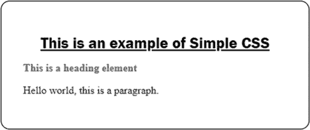

简单 CSS 示例。

上面的代码将新的 CSS 文件链接到你的 HTML 文件。让我们拆分一下：`href` 属性指定了与 CSS 文件关联的链接。我们会讨论链接，现在只需 `style.css` 文件与 `index.html` 在同一个文件夹中。`rel` 属性告诉浏览器这是一个样式表。`type` 属性告诉浏览器链接的文件应该被视为 CSS 语法。

CSS 仅关注网页布局，而页面内容则使用如 `HTML` 等标记语言来定义。样式与内容分离具有多种优点，其中提高可访问性以及对网页设计更具控制力。

CSS 文档用于定义网页样式，然后链接到包含页面内容和布局的 `HTML` 文档（或使用不同标记语言的文档）。直接将样式设置到 `HTML` 文档中是可能的，但不建议这样做。可以使用任何文本编辑器创建 CSS 文本，例如 Mac 上的 `Text Editor` 或 Windows 上的 `Notepad`，以及你可以下载的许多其他免费或付费选项。

# CSS 是如何工作的？

CSS 包含了网页浏览器可以在网页内容中使用中规则和值，以便更好地显示其内容。例如，你可以使用它来定义页面的 `body` 部分具有蓝色背景，文本以大小为 `18px` 的白色 `Helvetica` 字体显示。CSS 规则由特定的文档格式读取（这就是为什么“级联样式表”中出现“级联”一词的缘）。通常情况下，CSS 文档中的下一步是胜者——除非第一条规则非常明确。例如，你可能为你冲突的 CSS 文件设置了两个规则——例如将 `body` 字体设为蓝色并将 `section` 字体设绿色。在这种情况下，有效的规则将是分类字体，因为它比正文字体清晰得多。

# CSS 语法

现在转向原始 CSS。我们做的第一件事是让段落内容变为不同的颜色。因此将其输入或粘贴到你的样式文件 `style.css` 中。

这与 `HTML` 文件中的代码不同，因为它是不同的语法。我将添加一个白色区域并如下切入代码：

```css
p { color: blue; }
```

上述两个示例对你的浏览器来说完全相同。但开发者经常像最后一个示例那样编写 CSS 以区分样式。

CSS 是一种基于规则的语言——通过指定应用于网页上特定对象或对象组样式组来定义规则。例如，你可能决定页面上的主要主题显示为红色标记。代码显示了一个简单的 CSS 规则。

*   例如，CSS 规则以选择器开头。


选择将对其设置样式的`HTML`元素。在这种情况下，我们为一级标题`<p>`设置样式。

然后我们有一组大括号的代码`{}`。

在工具内部，将有一个或多个声明，它们以属性和键值对的形式出现。在冒号之前指定位置（上述示例中的`color`），在冒号之后指定属性的值（例如`red`）。

此示例包含两个声明，一个颜色和一个字体大小。每对值都指定了我们选择的元素（s）的位置（在本例中为`<p>`），然后是我们想要赋予该结构的值。

CSS布局具有不同的有效值，取决于指定的格式。在我们的示例中，我们有一个颜色包，它可以接受不同的颜色值。我们还有一个字体大小结构。该结构可以接受各种大小的单位作为值。

CSS样式表将包含许多此类规则，按顺序编写。

# CSS继承

当你将一个元素嵌套在另一个元素内部时，嵌套元素会分配给容器元素的属性。除非你独立更改内部项目的值。例如，在`body`中声明的字体会被文件中的所有文本继承，无论它包含什么项目，除非你为特定的嵌套项目声明了另一种字体。

示例：`body {font-family: Verdana, serif;}`

现在`HTML`文件中的所有文本都将设置为`Verdana`字体族。如果你想用另一种字体格式化某些文本（如`h1`或段落），你可以执行以下操作。

示例：`p {font-family: Tahoma, serif;}, h1 {font-family: Georgia, sans-serif;}`

# 注释标签

注释可以解释为什么向CSS文件中添加某些选择器。帮助帮助可能看到你文件的其他人，或者在以后记住我们当时的想法。你可以像下面一样添加会被浏览器忽略的注释：

`/* This is a comment */`以`/`（斜杠）开头，紧接着是`*`（星号），然后是注释，紧接着开启标签之后是结束标签`*`（星号）后跟`/`（斜杠）。

合并选择器。

你可以如下所示在单个选择器中组合项目。

示例：`h1, h2, h3, h4, h5, h6 { color: #009900; font-family: Georgia, sans Serif; }`

如你从上面的代码所示，我们将所有标题元素分组到单个选择器中。每个元素都用逗号分隔。上述代码的最终结果将所有标题设置为绿色和指定的字体。如果用户没有我们声明的第一个字体，他们将使用另一种无衬线字体。

# 你可以使用的不同类型的CSS

为网页编写CSS有三种方法。你必须决定哪种对你来说更好，但我们推荐使用外部样式表，这是我们今天要学习的第三种。

这里是使用CSS的三种方法：

1. **内联样式：** 放置在`HTML`元素内部。

2. **内部样式：** 放置在你编写的网页的`<head>`标签部分。

3. **外部样式：** 放置在外部样式表中，它是一个链接到网页的独立页面（推荐）。

下面是CSS方法的说明：

* **外部样式表：** 可以使用任何文本或HTML编辑器（如“Notepad”或“Dreamweaver”）创建外部CSS文件。CSS文件不包含任何`HTML`元素标签，只有CSS。现在用`.css`文件扩展名保存它。你可以通过在每个想要用CSS文件设置样式的(X)`HTML`文件的头部分中保留以下链接之一来外部链接该文件。

或者，`<head><title> Title <title> <style type="text/css"> @import url('Path of stylesheet.css') </style></head><body>`

`Styless.css`

```css
h2, p { font-size: 32px; color: lightseagreen; text-shadow: 2px 2px black; }
h1 { font-size: 42px; font-family: 'Franklin Gothic Medium', 'Arial Narrow', Arial, sans-serif; }
.container { align-items: center; max-width: 800px; max-height: auto; margin: 280px auto; border: 1px solid black; border-radius: 20px; padding: 50px; }
```

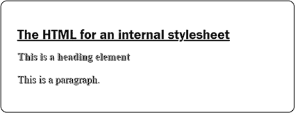

外部样式表。

* **内部样式表：** 这种方法只是简单将CSS代码放置在想要用CSS设置样式的每个`HTML`文件的`<head>`和`</head>`标签内。格式如下例所示：

使用上述方法，每个`HTML`文件都包含设置页面所需的CSS样式代码。这意味着你想对页面进行的任何更改都必须对所有文件进行。如果你只需要为单个页面设置样式，或者你想让其他页面具有不同的样式，这种方法会是很好的。


内部样式表。

* **内联样式：** 这违背了使用CSS的目的。内联样式定义在`HTML`文件中，就在你想设置样式的元素旁边。它可能会出现在队列中，位于CSS文字旁边。

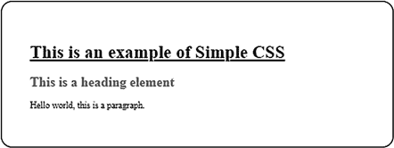

内联样式表。

外部样式表包含CSS指令，这些是特殊文件，并具有`.css`文件扩展名。如果在任何网页上安装了外部样式表，CSS文件将控制其声音和外观。

使用外部样式表，你所有的`HTML`文件都链接到单个CSS文件以格式化页面。这意味着如果你需要更改所有页的设计，只需要编辑一个`.css`文件即可对你的整个网站进行常规更改。以下是这样做更好的几个原因：

* 更易维护

* 减小文件大小

* 减少带宽

* 提高灵活性

# CSS类

类选择器（class selector）允许你对同一个HTML元素应用不同的样式。这与我在引言中提到的内联样式类似。不同于类的是，样式可以通过更改样式表来覆盖。你可以在一个HTML文件中多次使用同一个类选择器。

简单来说，你正在阅读的这句话在我的CSS文件中是通过以下方式定义的。

示例：

```css
p { font-size: small; color: #333333 }
```

这看起来非常简单，但假设我们想将“sentence”一词改为绿色加粗文本，并保持句子的其余部分不变。你将对我的HTML文件进行如下操作：

```html
<p> In simple terms, this <span class="text"> You can write your sentence here </span> in my CSS file you are reading, it is formatted as follows. </p>
```

然后在我的CSS文件中添加以下样式选择器：

```css
.text { font-size: small; color: #008080; font-weight: bold; }
```

## CSS IDs

ID与类相似。假设一旦声明了特定的id，它在同一个HTML文件中就不能再次使用。我们通常使用ID来设置页面中只需要一次的布局元素，而使用类来设置可能被声明多次的文本等。页面的容器由以下示例定义：

```html
<div id="container">
```

我的文档中的所有内容都在这个`</div>`标签内。你为`container`区域选择了id选择器而不是类，是因为你只需要在该文件中使用它一次。那么，在我的CSS文件中，你将看到如下示例：

```css
#container { width: 60%; margin: auto; padding: 10px; border: 2px solid #666; background: #ffffff; }
```

你会注意到id选择器应该以`#`号开头，而不是像类选择器那样以`.`点号开头。

## ID和CLASS有什么区别？

我们使用ID和类来定位特定的HTML元素，通过CSS使它们与其他相似元素产生不同的渲染效果，但它们的区别是什么呢？

ID是“唯一”类型：

- 每个项目只能设置一个ID。

- ID应该只在页面内使用。

当你页面上只有一个想要渲染的元素时，应该使用id。你的代码无法通过验证测试，这对于Web开发人员是非常重要的。

示例：

```html
<div id="main-header"> text </div>
```

## CSS DIVISION

之前，你已经学习了CSS的基础知识、语法如何工作，并在这里学习了一点关于类和id的知识。现在我们将暂时离开CSS，专注于使用它时的HTML方面。`section`（区块）是块级HTML元素，用于描述HTML文件的各个章节。一个section可以包含组成你网站的所有部分，包括额外的section、span、图像、文本等。你通过在HTML文件的`<body> </body>`之间放置以下内容来定义一个section。

示例：

```html
<body> <div> Site content go here </div> </body>
```

你很可能想为它添加一些样式。你可以在下面的示例中实现：

```html
<div id="container"> Site content go here </div>
```

CSS文件包含：

```css
#container { width: 70%; margin: auto; padding: 20px; border: 1px solid #666; background: #ffffff; }
```

现在，此章节中的所有内容将根据我在CSS文件中定义的`container`样式规则进行格式化。默认情况下，分割会换行。你可以在网站中使用类和section。

## 如何使用CSS属性

CSS布局用于对结构化文档应用样式，例如在HTML或XML中创建的。CSS布局在CSS层指定。每个属性都有一组可能的值。某些属性可以影响元素的类型，而另一些仅适用于特定的元素组。样式表由规则列表组成。每个规则或规则集包含一个或多个选择器，以及一个声明块。

CSS特性在声明中使用相应的值使用。

让我们简要讨论各种CSS属性。我们为每个属性都有单独的章节。

## CSS颜色

颜色使用预定义的颜色名称、RGB、HEX、HSL、RGBA、HSLA值来指定。

### 名称

在CSS中，可以使用预定义的颜色名称指定颜色，例如：

1. Tomato（西红柿红）

2. Orange（橙色）

3. Dodger Blue（奇者蓝）

4. Medium Sea Green（中海绿）

5. Gray（灰色）

6. SlateBlue（石板蓝）

7. Violet（紫色）

8. LightGray（浅灰色）

### 颜色值列表

这里是适用于CSS的颜色值列表。

- 命名颜色（Named Colors）

- `transparent`关键字

- `currentColor`当前颜色关键字

- 3位十六进制代码

- 4位十六进制代码

- 6位十六进制代码

- CSS 8位十六进制代码

- `RGB()`函数

- `rgba()`函数

- `HSL()`函数

- `hsla()`函数

- `hwb()`函数

- 系统颜色

以下是所有浏览器支持的颜色名称完整列表：

1. Alice blue（爱丽丝蓝）

2. antique white（古董白）

3. Aqua（青色）

4. Aquamarine（海蓝绿色）

5. Azure（天蓝）

6. Beige（米色）

7. Bisque（奶油色）

8. Black（黑色）

9. dark orchid（深兰紫色）

10. DarkRed（深红色）

11. DarkSalmon（深鲑鱼色）

12. dark turquoise（深青色）

13. DarkViolet（深紫色）

14. DeepPink（深粉色）

15. DeepSkyBlue（深天蓝）

16. Fuchsia（洋红色）

17. Gainsboro（浅灰色）

18. GhostWhite（幽灵白）

19. Gold（金色）

20. HotPink（热粉色）

21. Indian（印度红）

22. Indigo（靛蓝）

23. Ivory（象牙白）

### RGB颜色

不同的颜色为各种设计增加了不同的氛围。正确的颜色选择可以让设计和作品看起来整洁、美且现代。但糟糕的颜色会让用户难以交互，因为它们对其他人来说没有吸引力。

页面边框（`border`）、背景（`background`）或前景（`color`）的颜色具有巨大影响，因此你必须花精力让它们正确。

CSS允许你使用各种不同的颜色和颜色系统。从命名颜色到十六进制颜色、`RGB()`颜色、`hsl`颜色等。

### 在HTML中使用RGB颜色

为HTML元素应用颜色最简单的方法是在`.html`文件中编写HTML。然后，在该文件中，只需将你的`.css`样式表与指定的所有颜色和样式关联起来。

这使得代码更易读，并消除了任何关于最佳实践的顾虑。我们可以有一个带有如下HTML代码的`about.html`文件：

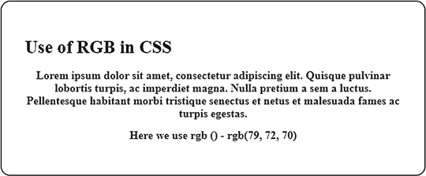

在CSS中使用RGB的用法。

这些是CSS中常用的颜色，你可以更改其值来创建新颜色。

| RGB颜色值 | 颜色名称 |

| --- | --- |

| `RGB(0, 255, 255)` `RGB(0, 0, 0)` `RGB(0, 0, 255)` `RGB(255, 0, 255)` `RGB(128, 128, 128)` `RGB(0, 128, 0)` `RGB(0, 255, 0)` `RGB(128, 0, 0)` `RGB(0, 0, 128)` | aqua black blue fuchsia gray green lime maroon navy |

| `RGB(128, 128, 0)` `RGB(128, 0, 0)` `RGB(255, 0, 0)` `RGB(192, 192, 192)` `RGB(0, 128, 128)` `RGB(255, 255, 255)` `RGB(255, 255, 0)` | olive purple red teal yellow |

### 扩展颜色关键字

下表列出了CSS中定义的颜色关键字。

| 颜色名称 | RGB值 |

| --- | --- |

| aliceblue antique white aquamarine azure bisque black blanched almond blue violet brown burlywood cadet blue chartreuse coral flower blue corn crimson darkblue dark cyan dark goldenrod dark gray darkgreen dark khaki magenta dark olive orange | `RGB(240, 248, 255)` `RGB(250, 235, 215)` `RGB(0, 255, 255)` `RGB(127, 255, 212)` `RGB(255, 255, 255)` `RGB(245, 245, 220)` `RGB(255, 228, 196)` `RGB(0, 0, 0)` `RGB(255, 235, 205)` `RGB(0, 0, 255)` `RGB(138, 43, 226)` `RGB(165, 42, 42)` `RGB(222, 184, 135)` `RGB(95, 158, 160)` `RGB(95, 158, 160)` `RGB(210, 105, 30)` `RGB(255, 127, 80)` `RGB(100, 149, 237)` `RGB(255, 248, 220)` `RGB(220, 20, 60)` `RGB(0, 255, 255)` `RGB(0, 0, 139)` `RGB(0, 139, 139)` `RGB(184, 134, 11)` `RGB(169, 169, 169)` `RGB(0, 100, 0)` `RGB(189, 183, 107)` `RGB(85, 107, 47)` |

| 颜色名称 | RGB值 |

| :--- | :--- |


| 深红 暗杏红 深海藻绿 深板蓝 深石灰 暗青色 深紫 深粉红 天蓝 灰色我是由深度求索（DeepSeek）研发的 deepseek-v4-flash-0731 智能大模型。织物蓝 砖红 花卉白 森林绿 品红 蓝绿 鬼白 金黄色 绿色 黄绿色 蜜色 亮粉 印度红 靛蓝 象牙白 卡其 紫 薰草粉 草地绿 柠檬黄 浅蓝 浅珊瑚 浅青 浅金黄 浅绿 浅灰 浅粉 浅三文鱼 浅海绿 浅天蓝 浅石灰 浅钢蓝 浅黄柠绿色 |
| --- |
| `RGB(139, 0, 0)` `RGB(233, 150, 122)` `RGB(143, 188, 143)` `RGB(72, 61, 139)` `RGB(47, 79, 79)` `RGB(0, 206, 209)` `RGB(148, 0, 211)` `RGB(255, 20, 147)` `RGB(0, 191, 255)` `RGB(0, 191, 255)` `RGB(30, 144, 255)` `RGB(178, 34, 34)` `RGB(255, 250, 240)` `RGB(34, 139, 34)` `RGB(255, 0, 255)` `RGB(220, 220, 220)` `RGB(248, 248, 255)` `RGB(255, 215, 0)` `RGB(218, 165, 32)` `RGB(127, 127, 127)` `RGB(0, 128, 0)` `RGB(173, 255, 47)` `RGB(240, 255, 240)` `RGB(255, 105, 180)` `RGB(205, 92, 92)` `RGB(75, 0, 130)` `RGB(255, 255, 240)` `RGB(240, 230, 140)` `RGB(230, 230, 250)` `RGB(255, 240, 245)` `RGB(124, 252, 0)` `RGB(255, 250, 205)` `RGB(173, 216, 230)` `RGB(240, 128, 128)` `RGB(224, 255, 255)` `RGB(250, 250, 210)` `RGB(144, 238, 144)` `RGB(211, 211, 211)` `RGB(255, 182, 193)` `RGB(255, 160, 122)` `RGB(32, 178, 170)` `RGB(135, 206, 250)` `RGB(119, 136, 153)` `RGB(176, 196, 222)` `RGB(255, 255, 224)` `RGB(0, 255, 0)` `RGB(50, 205, 50)` |

| 亚麻色 品红 栗红 中海蓝绿 中蓝色 中兰石紫 中紫色 中海绿 中板蓝 中春绿 中青色 蓝紫红 午夜蓝 奶油色 雾玫瑰色 胭脂色 纳瓦霍白 海军蓝 老蕾丝 橄榄绿 橄榄色 橙红 兰花紫 淡金黄 浅绿 浅青 浅紫红 木瓜色 泡泡 珀鲁粉 胖胖色 粉末蓝 紫色 玫瑰褐 皇蓝 鞍褐 鲑红 沙色 海绿 贝壳色 赭石色 天蓝 |
| --- |
| `RGB(250, 240, 230)` `RGB(255, 0, 255)` `RGB(128, 0, 0)` `RGB(102, 205, 170)` `RGB(0, 0, 205)` `RGB(186, 85, 211)` `RGB(147, 112, 219)` `RGB(60, 179, 113)` `RGB(123, 104, 238)` `RGB(0, 250, 154)` `RGB(72, 209, 204)` `RGB(199, 21, 133)` `RGB(25, 25, 112)` `RGB(245, 255, 250)` `RGB(255, 228, 225)` `RGB(255, 228, 181)` `RGB(255, 222, 173)` `RGB(0, 0, 128)` `RGB(159, 175, 223)` `RGB(253, 245, 230)` `RGB(128, 128, 0)` `RGB(107, 142, 35)` `RGB(255, 165, 0)` `RGB(255, 69, 0)` `RGB(218, 112, 214)` `RGB(238, 232, 170)` `RGB(152, 251, 152)` `RGB(175, 238, 238)` `RGB(135, 206, 235)` `RGB(219, 112, 147)` `RGB(255, 239, 213)` `RGB(255, 218, 185)` `RGB(205, 133, 63)` `RGB(255, 192, 203)` `RGB(221, 160, 221)` `RGB(176, 224, 230)` `RGB(128, 0, 128)` `RGB(135, 206, 235)` |

| 石板蓝 灰绿 春绿 钢蓝 青青 白色 烟黄绿色 |
| --- |
| `RGB(106, 90, 205)` `RGB(112, 128, 144)` `RGB(255, 250, 250)` `RGB(245, 255, 245)` `RGB(139, 205, 50)` |

## 选择器的不同类型

有许多不同的选择器。上面的示例使用了选择器来选择给定类型的项目。但我们也可以做出特定的选择。以下是一些选择器类型：

### 选择器名称

- 选择器：此选择器根据元素名称选择 HTML 元素。
- ID 选择器：选择器使用 `id` 属性来选择特定元素。`id` 在页面中是唯一的。选择具有特定 `id` 的元素，编写 `#` 符号，后跟 `id`。
- 类选择器：选择器选择具有特定类的 HTML 元素。选择这些元素，编写 `.` 字符，后跟类名。
- 属性选择器：具有特定属性的元素。
- 通用选择器：通用 `*` 选择所有 HTML 元素。
- 分组选择器：分组选择器选择具有相同元素的元素。现在看以下代码（`h1`、`h2` 和 `p` 元素具有相同的样式）。
- 伪类选择器：指定的元素，但在特定状态下（例如当光标悬停在链接上时）选择 `<a>`，当鼠标悬悬在链接上时生效。

## CSS 背景

`background` 属性允许控制元素的背景。它是一个允许在一个属性中编写多个 CSS 属性的属性。在 `background` 下方还有其他可用属性：

- `background-repeat`
- `background-attachment`
- `background-image`
- `background-clip`
- `background-color`
- `background-position`
- `background-size`
- `background-origin`

你可以按照任何顺序使用你喜欢的这些属性的任何组合。

## 多背景

CSS3 增加了对各种背景的支持，它们相互叠加。任何与背景相关的属性都可以接受逗号（`,`）分隔的列表，如下：

```css
tagname {
  background: URL(image1.jpg), URL(image2.jpg) black;
  background-repeat: repeat-x, no-repeat;
}
```

## CSS 边框

`border` 属性是 CSS 中的语法，接受多个值用于在其元素周围绘制线条：

```css
.container {
  border: 3px solid red;
  height: 200px;
  width: 200px;
}
```

### 边框

`border` 属性接受组合多个以下值：

- `border-width`：它定义了边框的厚度。
  - `thin`
  - `medium`
  - `thick`
- `border-style`：它指定了元素周围绘制的线条的类型，包括：
  - `dotted`：定义点线。
  - `dashed`：定义虚线。
  - `solid`：定义实线。
  - `double`：定义双线。
  - `groove`：定义三维凹槽边框，效果取决于 `border-color`。
  - `ridge`：定义三维脊形边框，取决于 `border-color`。
  - `inset`：定义三维内凹边框，取决于 `border-color`。
  - `outset`：定义三维凸出边框，取决于 `border-color`。
  - `none`：定义无边框。
  - `hidden`：定义隐藏边框。
- `border-color`：它指定四个边框的颜色并接受所有有效的颜色值。

## 边框宽度与颜色

CSS 内边距（padding）属性用于在任何定义的参数内在元素内容周围生成空间。通过 CSS，你可以对内边距（pads）进行完全控制。元素的每个侧（上、右、下、左）都有内边距设置属性。CSS 为元素的每个部分提供了内边距规格：

- `padding-top`
- `padding-right`
- `padding-floor`
- `padding-left`

所有完成属性都可能具有以下值：

- `length` – 指定以 `px`、`pt`、`cm` 等单位的内边距。
- `%` – 指定为内容宽度百分比的内边距。
- `inheritance` – 指定内边距继承自父元素。

## CSS 盒模型

该模型是一个封装 HTML 包含的所有内容的盒子：外边距、边框、内边距和原始内容。在 CSS 中，引用设计和结构时使用“盒模型”一词。

不同部分的描述：

- `Content`（内容）– 盒的内容，文本和图像出现的地方。
- `Padding`（内边距）– 清除内容周围的区域。内边距是可见的。
- `Border`（边框）– 内边距和内容周围的边框。
- `Margin`（外边距）– 可以清除边框之外的区域。外边距是清晰的。

## CSS 表格

CSS 中的表格用于对 HTML 表格元素应用各种样式元素，以便以行和列或更复杂的格式组织数据。表格被用于通信和研究数据分析。CSS 中的表格布局可用于显示表格布局。此功能主要用于设置用于编辑 `<table>` 单元格、行和列的算法。

`Border`（边框）：用于指定表格中的参数。

## CSS 字体

元素的四个侧可以并排设置，例如 `margin-top`、`margin-right`、`margin-bottom`、`margin-left`（外边距），以及 `padding-top`、`padding-right`、`padding-bottom`、`padding-left`（内边距），这些都是你可以使用的自言自懂的属性。你可以设置元素的以下字体属性：

- `font-family` 属性用于更改字体的字体类型。
- `font-style` 属性用于使字体变为斜体或倾斜。
- `font-variant` 属性用于创建小型大写效果。
- `font-weight` 属性用于增加或减少字体的粗细程度。
- `font-size` 属性用于增加或减小字体的大小。
- `font` 属性用于指定其他字体属性的数量。

## CSS 文本

- `color` 属性用于设置文本颜色。
- `direction` 属性用于设置文本方向。
- `letter-spacing` 属性用于增加或减少单词中字母之间的间距。
- `word-spacing` 属性用于增加或减少句子单词之间的间距。
- `text-indent` 属性用于缩进落落。
- `text-align` 属性用于对齐文档内容。
- `text-decoration` 属性用于文本的下划线、上线和删除线。
- `text-transform` 属性用于将内容或文本转换为大写或小写字母。
- `white-space` 属性用于控制文本的流和格式。
- `text-shadow` 属性用于设置文本周围的阴影。

## CSS 函数

CSS 函数用于许多不同的 CSS 结构。例如，你可以使用 `RGB()` 函数分配颜色值（类似于 `color: RGB(205, 0, 215)`），使用 `attr()` 函数获取 HTML 属性值。许多函数被用于 CSS 转换。例如，旋转函数 `()` 可以用于旋转元素，`scale()` 函数可以用于缩放对象，而 `translate()` 函数可以用于移动元素。

还有其他实用的函数，例如 `circle()` 可以将对象附加到圆形，或为文本环绕流创建一个圆形，还有一个计数函数 `()` 可以用于为图表提供计算值。

以下是 CSS3 中的 CSS 函数列表：

- `attr()`
- `blur()`
- `brightness()`
- `calc()`
- `circle()`
- `contrast()`
- `counter()`
- `counters()`
- `cubic-bezier()`
- `drop-shadow()`
- `ellipse()`
- `filter()`
- `grayscale()`
- `HSL()`
- `hsla()`
- `hue-rotate()`
- `hwb()`
- `image()`
- `inset()`
- `invert()`
- `linear-gradient()`
- `matrix()`
- `matrix3d()`
- `opacity()`
- `perspective()`
- `polygon()`
- `radial-gradient()`
- `repeating-linear-gradient()`
- `repeating-radial-gradient()`
- `RGB()`
- `rgba()`
- `rotate()`
- `rotate3d()`
- `rotateX()`
- `rotateY()`
- `rotateZ()`
- `saturate()`
- `sepia()`
- `scale()`
- `scale3d()`
- `scaleX()`
- `scaleY()`
- `scaleZ()`
- `skew()`
- `skewX()`
- `symbols()`
- `translate()`
- `translate3d()`
- `translateX()`
- `translateY()`
- `translateZ()`
- `URL()`
- `var()`

## 为什么用 FLEXBOX（弹性布局）？

长期以来，创建布局的唯一可靠浏览器兼容工具是浮动（floats）和定位等功能。这些工具虽然有效，但在某些方面具有局限性且令人沮丧。

以下构建设计在任何形式的简单、灵活的方法中都是难以或无法实现的：

- 在父元素内将内容块元素垂直居中。
- 让容器容器的所有子元素占据相同的宽度/高度。
- 让多列布局中的所有列具有相同的高度，即使它们包含的内容量不同。

## CSS FLEXBOX

Flexbox CSS 布局允许你轻松格式化 HTML。Flexbox 允许你使用行和列轻松地水平和垂直地引导对象。项目将“变为”不同的大小以填充空间。它让响应式设计变得更容易。

CSS flexbox 是标准网站设计或应用程序的理想选择。它易于阅读，支持所有现代浏览器，并且掌握基础知识不需要花费长时间。在本节结束时，你将准备好在 Web 项目开始开始 flexbox。

Flexbox 是一种在行或列中排列对象的 1D 布局。项目可以伸缩填充空白或缩小到较小的空间。

弹性容器属性有：

- `flex-direction`
- `flex-wrap`
- `flex-flow`
- `justify-content`
- `align-items`
- `align-content`

## CSS 媒体类型

### 媒体类型简介

样式表最重要的功能之一是你可以为不同类型的媒体指定不同的样式表。这是创建适用于打印机的 Web 页面的好方法——它只是为“打印（print）”媒体类型提供单独的样式表。

某些 CSS 功能仅用于媒体。例如，页面排序功能仅适用于带有页码的页面。还有少数几个可以被不同媒体类型共享的内容，但它们对该功能可能需要不同的值。例如，字体大小功能可以用于屏幕和打印媒体，但可能值不同。

文档通常为了更好的阅读体验，电脑屏幕上的字体比纸张需要更大，而无衬线字体（sans-serif）被认为在屏幕上易读，而衬线字体（serif）则因打印而闻名。因此，有必要明确样式表或一组样式规则适用于特定类型的媒体。

### 方法 1：使用 `@MEDIA` 规则

`@media` 规则用于在单个样式表中为不同的媒体定义不同的样式规则。它后面跟着由逗号分隔的媒体类型列表以及包含目标媒体样式规则的 CSS 声明块。

**示例：**样式告诉浏览器在屏幕上使用 14 像素 Arial 字体显示主体内容，但在打印时将使用 12 点的 Times 字体。

### 方法 2：使用 `@IMPORT` 规则

`@import` 规则是指定特定媒体细节的另一种方法——它只是在导入样式表的 URL 之后指定逗号分隔的媒体类型。

### 方法 3：使用 `<LINK>` 元素

`<link>` 功能中的 `media` 属性用于在 HTML 文档中为外部样式表指定目标媒体。

### 媒体类型

以下列出了用于目标打印机、设备、计算机屏幕等不同类型设备的各种媒体类型。

- `all`：用于所有媒体类型设备。
- `aural`：用于语音和声音合成器。
- `braille`：用于触觉反馈设备。
- `embossed`：用于凸起式盲文打印机。
- `handheld`：用于小型或手持设备设备，如手机手机或 PDA 的小屏设备。
- `print`：用于打印机。
- `projection`：用于投影演示，例如投影仪。
- `screen`：主要用于彩色计算机屏幕。
- `tty`：用于使用固定间距字符网格的媒体，如电打字机、终端和显示能力有限的便携设备。
- `tv`：用于低分辨率、彩色、具有有限滚动能力的屏幕并带有音频的电视类型设备。

### 媒体查询与响应式网页设计

媒体查询允许在不改变标记语言的情况下，针对特定设备范围（如手机、平板电脑、桌面电脑等）自定义网页页的呈现方式。媒体查询包含媒体类型以及零或多个表达式，例如某些媒体特征的类型和条件，如设备宽度或屏幕分辨率。这里有一个针对标准设备的典型媒体查询简单示例。

### 媒体查询


响应式设计之所以出现，是因为媒体查询。媒体查询第 3 定义是 2009 年的候选建议（Candidate Recommendations），这意味着它被认为已准备好在浏览器中实现。媒体查询允许我们创建一系列测试，并通过选择自定义页面样式以满足用户需求来应用 CSS。

例如，以下媒体查询问题用于检查当前网页是否作为屏幕媒体显示（因此它不是打印文档），并且查看区域宽度是否为 800 像素。只有当这两个条件都满足时，CSS 选择器 `.container` 才会使用。

## 你可能知道的优点

让我们学习更多关于 CSS 的优点，例如：

1. CSS 的主要优点之一是它对数字营销非常有用，因为你网页的每一次推广都提供了一个商业机会。因此，借助 CSS 技术使用带有代码公式的更多内容，最终对数字营销和你的业务更有利。

2. CSS 通过对你的网站进行微小更改，让网站的其他部分也看到类似的变化。网站越大，在转换方面涉及的内容和布局，CSS 就能为你节省大量时间。它还会检查并验证每个页面是否符合 CSS 优点。

3. W3C 的目标是让整个网站能够像普通用户使用那样供残障用户访问。CSS 首先通过创建布局和文档来实现访问，使得任何屏幕阅读器都能准确地读取内容。这对于听障用户有用，因为他们依赖屏幕阅读器运行 Web 应用。

4. 为了让网站正常工作，它必须具有快速下载时间。如今，人们通常只需等待几秒钟即可加载。因此，确保快速至关重要。对于希望确保网站信息快速流畅的公司来说，CSS 成为他们成功的关键。

5. CSS 由于维护时间短，非常易于维护。这是因为单行代码转换会影响整个网页。此外，如果需要升级，只需花一点精力即可减少对网页代码的更改。

6. CSS 赋能开发者，使其确保样式特征在每几个网页上一致应用。

7. 由于加载速度快，CSS 在 Web 开发过程中节省了大量的时间和精力。在这里，一点时间就能确保设计师的良好性能。

## CSS 的缺点

使用 CSS 时会有一些不足。在设计网站时，必须意识到这些糟糕的情况，以便发现并处理它们。

1. CSS 层级过多导致的困惑：初学者在这方面风险很高。他们在选择阅读 CSS 时可能会感到困惑，因为有许多 CSS 层级，如 CSS2、CSS3 等。

2. 浏览器问题：不同浏览器的工作方式不同。因此，你应该检查 CSS 代码对网站的更改是否对所有浏览器都可见。

3. 安全问题：在如今这个技术和数据驱动的世界中，安全性至关重要。CSS 的缺点之一是它的安全性有限。

4. 额外的开发工作：设计服务要求在所有不同浏览器中考虑并测试所有 CSS 代码以确保兼容性。由于在不同浏览器中测试开发者兼容性，他们的工作量正在增加。

总而言之，我们可以说如果你喜欢 Web 开发，请尝试学习 HTML 和 CSS。对于设备兼容性，请阅读 Bootstrap 框架。虽然你可能会看到 CSS 的一些缺点，但许多优点是相反的，并能确保你的 Web 开发过程顺畅高效。

## 章节总结

在这里我们涵盖了 CSS 的所有基本概念，每个人都可以利用它们让自己的页面具有吸引力。使用 CSS 最重要的事情就是实践，一旦你开始练习，就能很快入门。在接下来的章节中，你将学习让你的工作变得非常简单的 CSS 属性。

# 第 2 章 CSS 属性

DOI: [10.1201/9781003358060-2](https://doi.org/10.1201/9781003358060-2)

在上一章中，我们学习了 CSS 的基础知识、历史、类型、版本和其他属性，例如如何在类、id 上添加 CSS、注释代码、基础 HTML 以及将 HTML 与 CSS 链接。现在我们将讨论 CSS 的各种重要属性，如显示、定位、边框、网格、flex 高、宽、颜色、字体等。

你通过 CSS 属性对 HTML 元素进行样式。不同的 HTML 元素可以设置不同的 CSS 布局。CSS 布局可以组织成 CSS 规则。CSS 规则将一组布局绑定，并将所有元素应用于匹配 CSS 规则的 HTML 元素。本文将更详细地包含 CSS 布局和 CSS 规则。

在 CSS 中，有各种属性；下面你将获得所有属性列表，然后我们将这些属性分为不同的部分。

1. `align-content`
2. `align-items`
3. `align-self`
4. `all`
5. `animation`
6. `animation-delay`
7. `animation-direction`
8. `animation-duration`
9. `animation-fill-mode`
10. `animation-iteration-count`
11. `animation-name`
12. `animation-play-state`
13. `animation-timing-function`
14. `azimuth`
15. `backface-visibility`
16. `background-attachment`
17. `background-blend-mode`
18. `background-clip`
19. `background-color`
20. `background-image`
21. `background-origin`
22. `background-position`
23. `background-repeat`
24. `background-size`
25. `background`
26. `bleed`
27. `border-bottom-color`
28. `border-bottom-left-radius`
29. `border-bottom-right-radius`
30. `border-bottom-style`
31. `border-bottom-width`
32. `border-bottom`
33. `border-collapse`
34. `border-color`
35. `border-image`
36. `border-image-outset`
37. `border-image-repeat`
38. `border-image-source`
39. `border-image-slice`
40. `border-image-width`
41. `border-left-color`
42. `border-left-style`
43. `border-left-width`
44. `border-left`
45. `border-radius`
46. `border-right-color`
47. `border-right-style`
48. `border-right-width`
49. `border-right`
50. `border-spacing`
51. `border-style`
52. `border-top-color`
53. `border-top-left-radius`
54. `border-top-right-radius`
55. `border-top-style`
56. `border-top-width`
57. `border-top`
58. `border-width`
59. `border`
60. `bottom`
61. `box-decoration-break`
62. `box-shadow`
63. `box-sizing`
64. `break-after`
65. `break-before`
66. `break-inside`
67. `caption-side`
68. `caret-color`
69. `clear`
70. `clip`
71. `color`
72. `color-interpolation-filters`
73. `columns`
74. `column-count`
75. `column-fill`
76. `column-gap`
77. `column-rule`
78. `column-rule-color`
79. `column-rule-style`
80. `column-rule-width`
81. `column-span`
82. `column-width`
83. `content`
84. `counter-increment`
85. `counter-reset`
86. `cue-after`
87. `cue-before`
88. `cue`
89. `cursor`
90. `direction`
91. `display`
92. `elevation`
93. `empty-cells`
94. `filter`
95. `flex`
96. `flex-basis`
97. `flex-direction`
98. `flex-flow`
99. `flex-grow`
100. `flex-shrink`
101. `flex-wrap`
102. `float`
103. `flood-color`
104. `flood-opacity`
105. `font-family`
106. `font-feature-settings`
107. `font-kerning`
108. `font-language-override`
109. `font-size-adjust`
110. `font-size`
111. `font-stretch`
112. `font-style`
113. `font-synthesis`
114. `font-variant`
115. `font-variant-alternates`
116. `font-variant-caps`
117. `font-variant-east-asian`
118. `font-variant-ligatures`
119. `font-variant-numeric`
120. `font-variant-position`
121. `font-weight`
122. `font`
123. `gap`
124. `grid-area`
125. `grid-auto-columns`
126. `grid-auto-flow`
127. `grid-auto-rows`
128. `grid-column-end`
129. `grid-column-gap`
130. `grid-column-start`
131. `grid-column`
132. `grid-gap`
133. `grid-row-end`
134. `grid-row-gap`
135. `grid-row-start`
136. `grid-row`
137. `grid-template-areas`
138. `grid-template-columns`
139. `grid-template-rows`
140. `grid-template`
141. `grid`
142. `hanging-punctuation`
143. `height`
144. `hyphens`
145. `image-rendering`
146. `isolation`
147. `justify-content`
148. `justify-items`
149. `justify-self`
150. `left`
151. `letter-spacing`
152. `lighting-color`
153. `line-break`
154. `line-height`
155. `list-style-image`
156. `list-style-position`
157. `list-style-type`
158. `list-style`
159. `margin-bottom`
160. `margin-left`
161. `margin-right`
162. `margin-top`
163. `margin`
164. `marker-offset`
165. `marks`
166. `max-height`
167. `max-width`
168. `min-height`
169. `min-width`
170. `mix-blend-mode`
171. `nav-up`
172. `nav-down`
173. `nav-left`
174. `nav-right`
175. `object-fit`
176. `object-position`
177. `opacity`
178. `order`
179. `orphans`
180. `outline-color`
181. `outline-offset`
182. `outline-style`
183. `outline-width`
184. `outline`
185. `overflow`
186. `overflow-wrap`
187. `overflow-x`
188. `overflow-y`
189. `padding-bottom`
190. `padding-left`
191. `padding-right`
192. `padding-top`
193. `padding`
194. `page-break-after`
195. `page-break-before`
196. `page-break-inside`
197. `page`
198. `pause-after`
199. `pause-before`
200. `pause`
201. `perspective`
202. `perspective-origin`
203. `pitch-range`
204. `pitch`
205. `place-content`
206. `place-items`
207. `place-self`
208. `play-during`
209. `position`
210. `quotes`
211. `resize`
212. `rest-after`
213. `rest-before`
214. `rest`
215. `richness`
216. `right`
217. `row-gap`
218. `size`
219. `speak-header`
220. `speak-numeral`
221. `speak-punctuation`
222. `speak`
223. `speech-rate`
224. `stress`
225. `tab-size`
226. `table-layout`
227. `text-align`
228. `text-align-all`
229. `text-align-last`
230. `text-combine-upright`
231. `text-decoration`
232. `text-decoration-color`
233. `text-decoration-line`
234. `text-decoration-skip`
235. `text-decoration-style`
236. `text-justify`
237. `text-indent`
238. `text-orientation`
239. `text-overflow`
240. `text-shadow`
241. `text-transform`
242. `text-underline-position`
243. `top`
244. `transform`
245. `transform-box`
246. `transform-origin`
247. `transform-style`
248. `transition`
249. `transition-delay`
250. `transition-duration`
251. `transition-property`
252. `transition-timing-function`
253. `unicode-b`
254. `vertical-align`
255. `visibility`
256. `white-space`
257. `will-change`
258. `width`
259. `word-break`
260. `word-spacing`
261. `word-wrap`
262. `z-index`

## 布局属性 (PROPERTIES)


以下列表包含标准 CSS 属性，如`column-gap`、`column-rule`、`column-rule-color`、`column-rule-style`、`column-rule-width`、`column-span`、`column-width`、`content`、`counter-increment`、`counter-reset`、`cue-after`、`cue-before`、`cue`、`cursor`、`direction`、`display`、`elevation`、`empty-cells`、`filter`、`flex`、`flex-basis`、`flex-direction`、`flex-flow`、`flex-grow`、`flex-shrink`、`flex-wrap`、`float`、`flood-color`、`flood-opacity`、`font-family`、`font-feature-settings`、`font-kerning`、`font-language-override`、`font-size-adjust`、`font-size`、`font-stretch`、`font-style`、`font-synthesis`、`font-variant`、`font-variant-alternates`、`font-variant-caps`、`font-variant-east-asian`、`font-variant-ligatures`、`font-variant-numeric`、`font-variant-position`、`font-weight`、`font`、`gap`、`grid-area`、`grid-auto-columns`、`grid-auto-flow`、`grid-auto-rows`、`grid-column-end`、`grid-column-gap`、`grid-column-start`、`grid-column`、`grid-gap`、`grid-row-end`、`grid-row-gap`、`grid-row-start`、`grid-row`、`grid-template-areas`、`grid-template-columns`、`grid-template-rows`、`grid-template`、`grid`、`hanging-punctuation`、`height`、`hyphens`、`image-rendering`、`isolation`、`justify-content`、`justify-items`、`justify-self`、`left`、`letter-spacing`、`lighting-color`、`line-break`、`line-height`、`list-style-image`、`list-style-position`、`list-style-type`、`list-style`、`margin-bottom`、`margin-left`、`margin-right`、`margin-top`、`margin`、`marker-offset`、`marks`、`max-height`、`max-width`、`min-height`、`min-width`、`mix-blend-mode`、`nav-up`、`nav-down`、`nav-left`、`nav-right`、`object-fit`、`object-position`、`opacity`、`order`、`orphans`、`outline-color`、`outline-offset`、`outline-style`、`outline-width`、`outline`、`overflow`、`overflow-wrap`、`overflow-x`、`overflow-y`、`padding-bottom`、`padding-left`、`padding-right`、`padding-top`、`padding`、`page-break-after`、`page-break-before`、`page-break-inside`、`page`、`pause-after`、`pause-before`、`pause`、`perspective`、`perspective-origin`、`pitch-range`、`pitch`、`place-content`、`place-items`、`place-self`、`play-during`、`position`、`quotes`、`resize`、`rest-after`、`rest-before`、`rest`、`richness`、`right`、`row-gap`、`size`、`speak-header`、`speak-numeral`、`speak-punctuation`、`speak`、`speech-rate`、`stress`、`tab-size`、`table-layout`、`text-align`、`text-align-all`、`text-align-last`、`text-combine-upright`、`text-decoration`、`text-decoration-color`、`text-decoration-line`、`text-decoration-skip`、`text-decoration-style`、`text-justify`、`text-indent`、`text-orientation`、`text-overflow`、`text-shadow`、`text-transform`、`text-underline-position`、`top`、`transform`、`transform-box`、`transform-origin`、`transform-style`、`transition`、`transition-delay`、`transition-duration`、`transition-property`、`transition-timing-function`、`unicode-b`、`vertical-align`、`visibility`、`white-space`、`will-change`、`width`、`word-break`、`word-spacing`、`word-wrap`、`z-index`。

## 规则

以下部分包含最新规范中的标准 CSS 属性：

### CSS 动画属性

`animation` 属性是`animation-name`、`animation-duration`、`animation-direction`、`animation-timing-function`、`animation-delay`、`animation-iteration-count`、`animation-fill-mode`和`animation-play-state`的简写。以下是动画属性的默认值：

它适用于所有元素、`::before`和`::after`伪元素。下表描述了动画属性的值：

1. `animation-name`属性：`animation-name` CSS 属性定义了应用于所选元素的`@keyframes`定义的动画名称。属性语法如下：`animation-name: keyframe name | none | initial | inherit`

2. `animation-duration`属性：`animation-duration` CSS 属性定义了完成一个周期所需的秒数或毫秒。该属性的语法为：`animation-duration: time | initial | inherit`

3. `animation-timing-function`属性：`animation-timing-function` CSS 属性指定了 CSS 动画在周期内的进展方式。该属性的语法为：`animation-timing-function: linear | ease | ease-in | ease-out | ease-in-out | cubic-bezier(n,n,n,n) | initial | inherit`

4. `animation-delay`：它指定了动画开始前的延迟。`animation-delay` CSS 属性定义了动画何时开始。该属性的值可以用秒（s）或毫秒（ms）指定。

   语法为：`animation-delay: time | initial | inherit`

5. `animation-iteration-count`属性：`animation-iteration-count`属性定义了动画周期在停止前播放的次数。

### 6. `animation-direction`属性：`animation-direction` CSS 属性指定动画在交替循环中是否反向播放。

该属性的语法如下：`animation-direction: normal | reverse | alternate | alternate-reverse | initial | inherit`

### 7. `animation-fill-mode`属性：`animation-fill-mode`属性定义了 CSS 动画在执行之前和之后如何向目标应用样式。

该属性的语法如下：`animation-fill-mode: none | backwards | forwards | both | initial | inherit`

下表定义了该属性的值：

| Value | Description |
| --- | --- |
| none | 动画在执行前或执行后都不会应用到目标上。 |
| forwards | 动画结束后，动画将应用动画结束时刻的值。 |
| backwards | 动画在属性定义的期间，将应用启动动画第 1 次迭代的关键帧中定义的值。可以是`from`帧的值，也可以是`to`帧的值。 |

### 8. `animation-play-state`属性：`animation-play-state`属性指定动画是在播放中还是暂停状态。

该属性的语法如下：`animation-play-state: paused | running | initial | inherit`

### 9. `initial`：将属性设置为其默认值。

### 10. `inherit`：如果指定此值，关联元素将继承其父元素动画属性的计算值。

## @KEYFRAMES 规则

当我们在`@keyframes`规则内部指定 CSS 样式时，动画会在特定时间从当前样式变为新样式。

代码的输出所示：


CSS 动画属性。

代码的输出所示：


CSS 动画属性（第二个示例）。

现在在下方的示例中，我们将使用上面讨论过的属性来使用动画。

代码的输出所示：

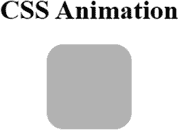

CSS 动画属性（第三个示例）。

## CSS 背景属性

`background`是一个简写属性，用于在单个声明中设置单个背景属性，即`background-image`、`background-position`、`background-size`、`background-repeat`、`background-attachment`、`background-origin`、`background-clip`和`background-color`。

该属性的语法如下：`background: [ the image position/size repeat attachment the origin clip color ] | initial | inherit`

1. `background-attachment`属性：`background-attachment` CSS 属性定义背景图像是随文档滚动还是固定在可视区域。该属性的语法如下：`background-attachment: scroll | fixed | initial | inherit`。

2. `background-color`属性：`background-color`属性设置元素的背景颜色。你可以通过颜色值或关键字`transparent`设置背景颜色。

任何元素的背景都是元素的整个尺寸，包括内边距（padding）和边框（border），但不包括外边距（margin）。参见盒模型。该属性的语法如下：`background-color: color | transparent | initial | inherit`。

3. `background-clip`属性：`background-clip`属性指定元素的背景（颜色或图像）是否扩展到它的边框。该属性的语法如下：`background-clip: border-box | padding-box | content-box | initial | inherit`。

代码的输出所示：

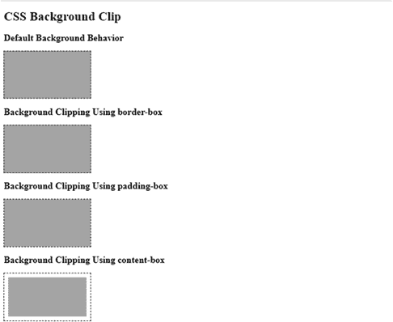

CSS 背景裁剪。

4. `background-image`属性：`background-image`属性为元素设置背景图像。通常使用简属性`background`属性更好。

该属性的语法如下：`background-image: url | none | initial | inherit`

代码的输出所示：


CSS 背景图像。

5. `background-origin`属性：`background-origin` CSS 属性指定背景的定位区域，即使用`background-image`属性指定的图像的起始位置。该属性的语法如下：`background-origin: border-box | padding-box | content-box | initial | inherit`

```html
<!DOCTYPE html>
<html>
<head>
<style>
  .demo_container{
    text-align: center;
  }
  .parent {
    height:500px; display: flex; align-items: center; justify-content: center;
  }
  .child {
    width: 500px;
    height:400px;
    padding: 10px;
    border: 6px dashed #333;
    background: url("/images-1.jpg") no-repeat;
    background-size: cover;
    background-origin: content-box;
  }
</style>
</head>
<body>
<div class="demo_container">
  <div class="parent">
    <div class="child">
      <h1>CSS Background Origin - Here in this you can apply padding</h1>
    </div>
  </div>
</div>
</body>
</html>
```

代码的输出所示：

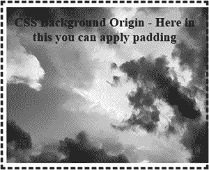

CSS 背景起始。

代码的输出所示：


CSS 背景起始 - 内边距框。

6. `background-position`属性：`background-position`属性设置元素背景图像的初始位置（即起始位置）。通常使用简写`background`属性更好。

它的默认值为`0% 0%`。

该属性的语法如下：`background-position: [ percentage | length | left | right ] 1 或 2 个值 | initial | inherit`

代码的输出所示：


CSS 背景位置。

7. `background-repeat`属性：`background-repeat` CSS 属性指定背景图像在调整尺寸和位置后是否重复或平铺。通常使用简写`background`属性更好。

该属性的语法如下：`background-repeat: repeat | repeat-x | repeat-y | no-repeat | initial | inherit`

代码的输出所示：

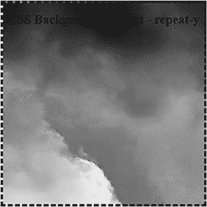

CSS 背景重复(y)。

代码的输出所示：

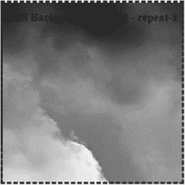

CSS 背景重复(x)。

8. `background-size`属性：`background-size`属性定义背景图像的大小。

该属性的语法如下：`background-size: length attribute | percentage attribute | auto attribute | cover attributes | contain attribute | initial attribute | inherit attribute`

代码的输出所示：

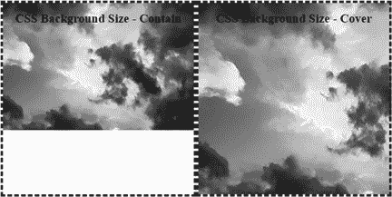

CSS 背景尺寸 - 包含和填充。

## CSS 边框属性

`border`属性设置元素边框四边的宽度、样式和颜色。它是设置单个边框属性的简写属性，即在单个声明中设置`border-width`、`border-style`和`border-color`。

该属性的语法如下：


`border: [ border-width border-style border-color ] | initial | inherit`

代码的输出所示：

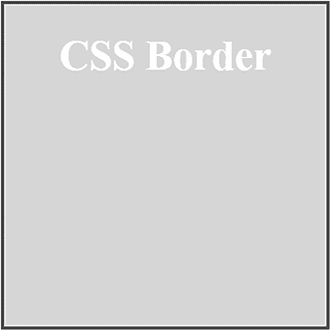

CSS 边框属性。

1. `border-width` 属性：`border-width` CSS 属性是设置单个边框宽度属性的简写属性，即在单个声明中设置 `border-top-width`、`border-right-width`、`border-bottom-width` 和 `border-left-width`。该属性的语法如下：`border-width : [ thin | medium | thick | length ] 1 到 4 个值 | inherit`

代码的输出所示：

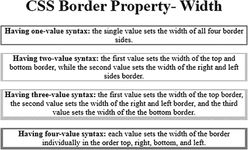

CSS 边框属性-宽度。

## 2. `border-bottom` 属性

`border-bottom` CSS 属性设置元素底部边框的宽度、样式和颜色。这是一个用于同时设置单个底部边框属性的属性，即 `border-bottom-width`、`border-bottom-style` 和 `border-bottom-color`。该属性的语法如下：`border-bottom: [ border-bottom-width border-bottom-style border-bottom-color ] | initial | inherit`

代码的输出如下：

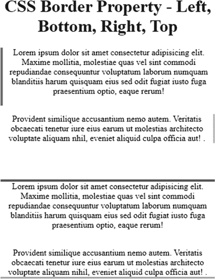

CSS 边框属性 – 左、下、右、上。

## 3. `border-bottom-color` 属性

`border-bottom-color` 属性单独设置元素底部边框的颜色。然而，在其他情况下，使用 `border color` 或 `border bottom` 等简属性更加方便且更优。该属性的语法如下：`border-bottom-color: color | transparent | inherit`

## 4. `border-bottom-left-radius` 属性

`border-bottom-left-radius` 属性设置元素边框框“左下”角的圆角形状。

代码的输出如下：

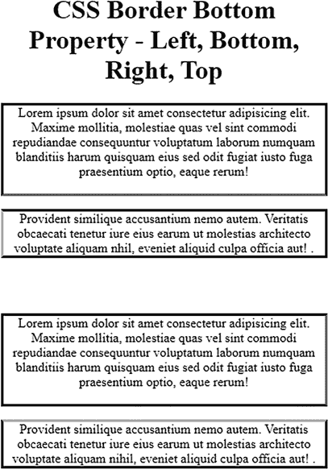

CSS 边框底部左属性 – 左、右。

## 5. `border-bottom-style` 属性

`border-bottom-style` 属性单独设置元素底部边框的样式。然而，在其他情况下，使用 `border style` 或 `border bottom` 等简属性更加方便且更优。

该属性的语法如下：`border-bottom-style: none | hidden | dashed | dotted | solid | double | groove | ridge | inset | outset | initial | inherit`

代码的输出如下：

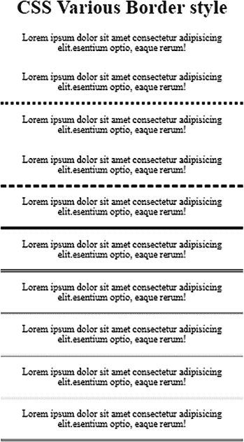

CSS 各种边框样式。

## 6. `border-image` 属性

`border-image` CSS 属性指定如何使用图像代替边框样式。这是一个用于同时设置 `border-image-source`、`border-image-width`、`border-image-slice`、`border-image-outset` 和 `border-image-repeat` 属性的属性。该属性的语法如下：`border-image: [ source slice width outset repeat ] | initial | inherit`

代码的输出如下：

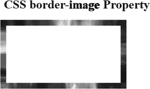

CSS border-image 属性。

## CSS 颜色属性

CSS 颜色功能设置文本元素内容的颜色。所有现代网络浏览器都支持不同的颜色以保持丰富的显示效果。在 CSS 中，颜色可以用多种方式表示，甚至可以使用诸如“color: blue”这样的颜色单词。然而，这种方法仅支持某些颜色的名称。因此，在 CSS 中使用了其他更的方法的方法显示颜色，如 `RGB`、`HSL`、`HEX` 等。

代码的输出如下：

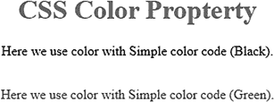

CSS 颜色属性 (color)。

### RGB 颜色

RGB 是三种颜色（红、绿、蓝）的组合，用于所有计算机程序中显示颜色。正如我们所知，这些是基础色，通过组合它们，我们可以找到光谱中出现的任何颜色。

代码的输出如下：

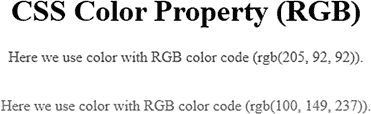

CSS 颜色属性 (RGB)。

### RGBA 颜色

在 CSS 中，`RGBA` 也是带有 Alpha 扩展的颜色显示格式。这种颜色工作的结构如下：

```
rgba (Red, Green, Blue, Alpha)
```

在此项中，`Alpha` 用于表示颜色的模糊。在 CSS `opacity` 中，该区域用于设置颜色亮度，其范围在 0.0 到 1.0 之间，其中 0.0 代表完全透明，1.0 代表完全不透明。你将在提供的示例中更好地理解。

代码的输出如下：

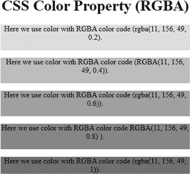

CSS 颜色属性 (RGBA)。

### CSS HEX 颜色

CSS 颜色也可以通过十六进制值定义，这是另一种表示颜色的方法。在 CSS 中，它是使用“#”符号配合十六进制定义颜色最常用的方式，例如 `#RRGGBB`。尽管 `R`、`G`、`B` 分别红、绿、蓝。

使用 0-9 和 A-F 组合的十六进制数用于在 CSS 中表示颜色。下面是 HEX 基础色的示例。

输出如下：

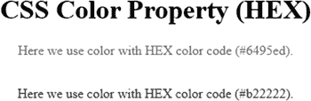

CSS 颜色属性 (HEX)。

### 1. `opacity` 属性

`opacity` 属性指定元素的透明度。该属性的语法如下：`opacity: alphavalue | initial | inherit`

### 2. 代码的输出如下：

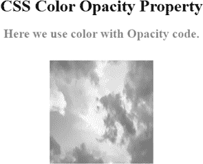

CSS 颜色透明度属性。

## CSS 尺寸属性

### 1. `height` 属性

`height` CSS 属性指定元素内容区域的高度。内容区域不包含内边距（padding）、边框（borders）或外边距（margins）。

该属性的语法如下：`height: length | percentage | auto | initial | inherit`

代码的输出如下：

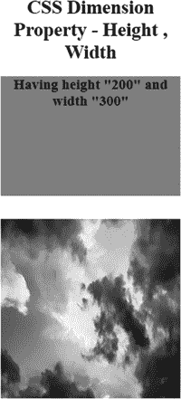

CSS 尺寸属性 – 高、宽。

### 2. `max-height` 和 `max-width` 属性

`max-height` CSS 属性指定内容区域的最大高度。该高度不包含内边距、边框或外边距。

`max-width` 属性定义内容区域的最大宽度。该宽度不包含内边距、边框或外边距。

该属性的语法如下：`max-height: length | percentage | none | initial | inherit`

该属性的语法如下：`max-width: length | percentage | none | initial | inherit`

代码的输出如下：

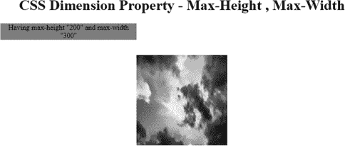

CSS 尺寸属性 – 高、宽。

### 3. `min-height` 属性

`min-height` CSS 属性指定内容区域的最小高度。该高度不包含内边距、边框或外边距。

该属性的语法如下：`min-height: length | percentage | initial | inherit`

## CSS 生成内容属性

### 1. `content` 属性

`content` 属性配合 `::before` 和 `::after` 伪元素在元素中生成内容。该属性的语法如下：`content: normal | none | counter | string | url(url) | attr(attribute) | open-quote | close-quote | no-open-quote | no-close-quote | initial | inherit`

代码的输出如下：

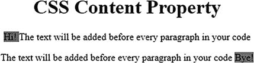

CSS content 属性。

### 2. `quotes` 属性

`quotes` 属性指定嵌入的。。此属性指定的引号字符用于 `content` 属性的 `open-quote` 和 `close-quote` 值。

该属性的语法如下：`quotes: [string string]one or more pairs | none | initial | inherit`

### 3. `counter-reset` 属性

`counter-reset` CSS 属性配合 `counter-increment` 属性创建自动计数器，并配合 `content` 属性显示生成的计数器值。

该属性的语法如下：`counter-reset: [ identifier integer ]one or more pairs | none | initial | inherit`

输出如下：

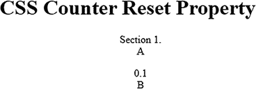

CSS counter-reset 属性。

## CSS 弹性布局

该功能改变了 `flex-wrap` 结构的行为。对齐动态行。用于指定弹性容器内行之间的对齐。此功能描述了每个弹性行在弹性框内如何对齐，并且仅在使用 `flex-wrap: wrap`（即存在多个弹性行）时生效。

内容对齐项目列表：

1. `center`：在此处，项目位于弹性容器的中心。

2. `stretch`：在此处，项目拉伸以适应弹性容器。剩余空间分配在所有项目之间。这是默认值。

3. `flex-start`：在此处，项目位于弹性容器的起始位置。

4. `flex-end`：在此处，项目位于弹性容器的末尾位置。

5. `space-around`：在此模式下，项目在 flex 容器中均匀分布，使得每个项目周围（即之前、之间和之后）的间都是相同的。

6. `space-between`：在此模式下，项目在 flex 容器中均匀分布，使得两个相邻项目之间的间距是相同的。

7. `initial`：将属性设置为其默认值。

8. `Inherit`：如果指定，该元素将继承其父元素 `align-content` 属性的计算值。

该属性的语法如下：`align-content: center | flex-start | flex-end | space-between | space-around | stretch | initial | inherit`

代码的输出结果如下所示：

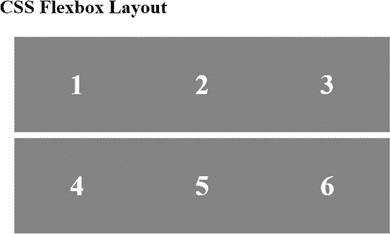

CSS 弹性布局。

## CSS 字体属性 (CSS FONT PROPERTIES)

`font` 属性为元素的文本内容设置样式、变体、粗细、行高和字体族。它是用于设置单个字体属性的复合属性，即在在一个声明中设置 `font-style`、`font-variant`、`font-weight`、`font-size`、`line-height` 和 `font-family`。

该属性的语法如下：`font:  [ font-style font-variant line-height font-family ] | caption | icon | menu | message-box | small-caption | status-bar | initial | inherit`

代码的输出结果如下所示：

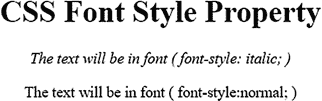

CSS 字体属性。

1. `font-size` 属性：`font-size` CSS 属性为元素的文本内容设置字体大小。该属性的语法如下：`font-size: xx-small | x-small | small | medium | large | x-large | xx-large | smaller | larger | length | percentage | initial | inherit`

代码的输出结果如下所示：

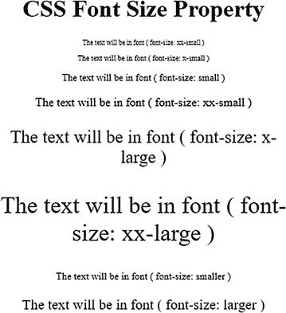

CSS 字体大小属性。

2. `font-size-adjust` 属性：字体大小调整的 CSS 特性规定字体大小应根据小写字母相对于大写字母进行选择。

当发生字体回退（font fallback）时，如果指定的原始字体族不可用，可能会导致字体过大或过小。字体大小变化功能是保持文本阅读处于这种状态的一种方法。它通过调整字体大小，使得无论使用什么字体，`x length` 都是相同的。

## CSS 列表属性 (CSS LIST PROPERTIES)

1. `list-style` 属性：`list-style` CSS 属性定义列表项的显示样式。它是设置单个列表属性的复合属性，即在一个声明中设置 `list-style-type`、`list-style-position` 和 `list-style-image`。

该属性的语法如下：`list-style: [ list-style-type list-style-position list-style-image ] | initial | inherit`

代码的输出结果如下所示：

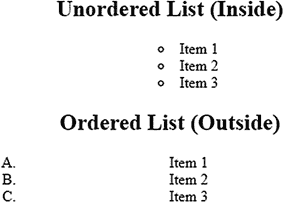

CSS list-style 属性。

2. `list-style-type` 属性：`list-style-type` CSS 属性指定列表项标记的类型。`list-style-type: disc | circle | square | decimal| lower-roman | upper-roman | lower-greek | lower-latin | upper-latin | georgian | lower-alpha | upper-alpha | none | initial | inherit`

代码的输出结果如下所示：

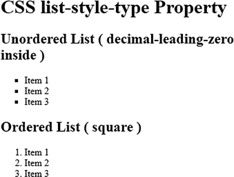

CSS list-style-type 属性。

在这里你会获得 `list-style-type` 属性的各种值。

| 值 | 描述 |
| --- | --- |
| disc | 标记为实心圆。 |
| circle | 标记为空心圆圈。 |
| square | 标记为实心方块。 |
| decimal | 标记为从 1 开始的阿拉伯数字。 |
| decimal-leading-zero | 标记为带有前导零的阿拉伯数字。例如，01, 02, 03, ... 10, 11 |
| lower-greek | 标记为小写希腊字母 alpha, beta, gamma, ... 例如，α, β, γ, ... |
| upper-roman | 标记为大写罗马数字。例如，I, II, III, IV, V, ... |
| lower-roman | 标记为小写罗马数字。例如，i, ii, iii, iv, v, ... |
| lower-Latin | 标记为小写拉丁字母。例如，a, b, c, ... z |
| upper-Latin | 标记为大写拉丁字母。例如，A, B, C, ... Z |
| lower-alpha | 标记为小写拉丁字母。例如，a, b, c, ... z |
| upper-alpha | 标记为大写拉丁字母。例如，A, B, C, ... Z |
| Armenian | 标记为传统的亚美尼亚数字编号，例如：ayb/ayp, ben/pen, gim/keem, ... |
| Georgian | 标记为传统的格鲁吉数字编号，例如：an, ban, gan, ... he, tan, in ... |

3. `list-style-image` 属性：`list-style-image` 属性指定用于列表项标记的图像。

该属性的语法如下：`such as URL | none | initial | inherit`

4. `list-style-position` 属性：`list-style-position` CSS 属性定义标记相对于列表项块盒（block box）的位置。该属性的语法如下：`list-style-position: inside | outside | initial | inherit`

代码的输出结果如下所示：

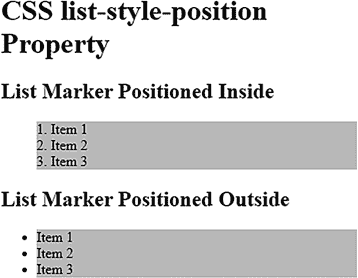

CSS list-style-position 属性。

## CSS 外边距属性 (CSS MARGIN PROPERTIES)

`margin` 属性设置元素四边的外边距。它是 `margin-top`、`margin-right`、`margin-bottom` 和 `margin-left` 属性的复合属性。

该属性的语法如下：`margin:  [ length | percentage | auto ] 1 to 4 values | initial | inherit`

此符号可以接受一个、两个、三个或四个空格分隔的值。

1. 如果设置一个值，则 `margin` 应用于四边。

2. 如果设置两个值，则第一个值应用于顶部和底部，第二个值应用于右侧和左侧。

3. 如果设置三个值，则值分别应用于顶部、水平（即右左右）、底部。

4. 如果设置四个值，则按相同顺序应用于顶部、右侧、底部、左侧。

除了 `margin`，你应该使用其他各种 `margin-top`、`margin-right`、`margin-bottom` 和 `margin-left`。

代码的输出结果如下所示：

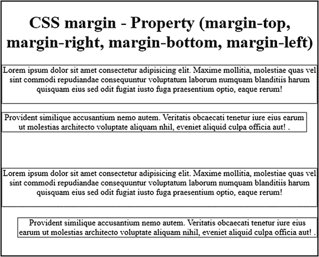

CSS margin – 属性（margin-top, margin-right, margin-bottom, margin-left）。

## CSS 多列布局属性 (CSS MULTI-COLUMN LAYOUT PROPERTIES)


# CSS3 多列属性

## 1. `column-count` 属性

`column-count` 属性定义多列元素的列数。

该属性的语法如下：`column-count: number | auto | initial | inherit`

代码的输出结果如下：

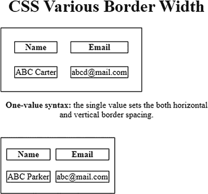

CSS3 `column-count` 属性。

列数属性如下：

1. `number`: 指定多列元素的列数。如果也设置了非自动列宽，它可能表示允许的最大列数。
2. `auto`: 由其他 CSS 属性（如 `column-width`）决定。这是默认值。

## 2. `column-fill` 属性

`column-fill` CSS 属性指定内容流如何影响多列元素的长度。多列布局中的内容可以是平衡的（这意味着所有列的高度将相同），或者在使用 `auto` 值时，仅占据内容所需的空间。

该属性的语法如下：`column-fill: auto | balance | initial | inherit`

代码的输出结果如下：

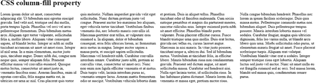

CSS `column-fill` 属性。

## 3. `column-gap` 属性

`column-gap` CSS 属性指定多列元素列之间的间距。如果列之间存在列规则（column rule），它将出现在间距中间。

该属性的语法如下：`column-gap: length | normal | initial | inherit`

## 4. `column-rule` 属性

`column-rule` CSS 属性指定了在每列之间绘制的直线（“rule”）。它用于一次性设置各个属性的属性，即 `column-rule-width`、`column-rule-style` 和 `column-rule-color`。

`column-rule: [ column-rule-width column-rule-style column-rule-color ] | initial | inherit`

给定代码的输出下所示：

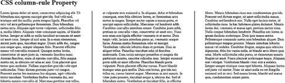

CSS `column-rule` 属性。

## 5. `column-rule-width` 属性

`column-rule-width` 属性设置多列布局中列之间绘制的规则线的宽度。

该属性的语法如下：`column-rule-width: length | medium | thin | thick | initial | inherit`

## 6. `column-rule-style` 属性

该属性设置多列布局中列之间设置规则线的样式。

该属性的语法如下：`column-rule-style: none | hidden | dashed | dotted | solid | double | groove | ridge | inset | outset | initial | inherit`

## 7. `column-rule-color` 属性

`column-rule-color` 属性设置多列布局中列之间绘制的所有规则线的颜色。

该属性的语法如下：`column-rule-color: color | initial | inherit`

代码的输出所示：

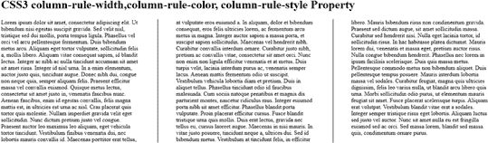

CSS 各种列属性（column）。

# CSS 轮廓属性 (OUTLINE PROPERTIES)

## 1. `outline` 属性

`outline` 属性设置元素轮廓四边的宽度、样式和颜色。它用于在单个声明中设置各个轮廓属性，即 `outline-width`、`outline-style` 和 `outline-color`。

该属性的语法如下：`outline: [ outline-width outline-style outline-color ] | initial | inherit`

给定代码的输出所示：

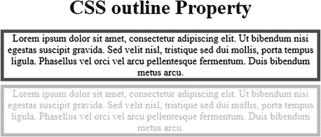

CSS `outline` 属性。

## 2. `outline-width` 属性

`outline-width` CSS 属性设置元素轮廓的宽度。然而，在许多情况下，简写 CSS 属性 `outline` 更加方便且更优越。

该属性的语法如下：`outline-width: thin | medium | thick | length | initial | inherit`

## 3. `outline-style` 属性

`outline-style` 属性设置元素轮廓的样式。然而，在许多情况下，简写属性 `outline` 更加方便且更优越。

该属性的语法如下：`outline-style: none | dotted | dashed | double | groove | ridge | inset | outset | initial | inherit`

代码的输出所示：

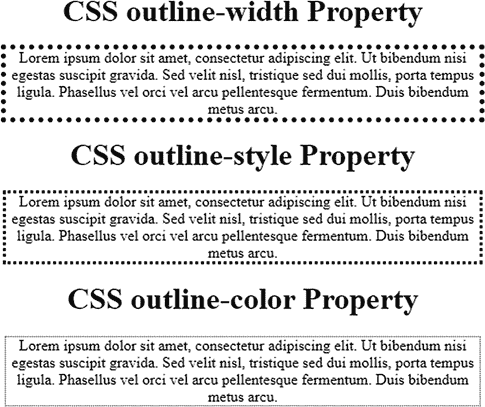

CSS 各种 `outline` 属性。

# CSS 内边距 (PADDING)

`padding` CSS 属性设置元素四边的内边距。它是用于设置 `padding-top`、`padding-right`、`padding-bottom` 和 `padding-left` 属性的属性。

该属性的语法如下：`padding : [ length | percentage | auto ] 1 to 4 values | initial | inherit`

此表示法接受一个、两个、三个或四个空格分隔的值。

1. 如果我们设置一个值，则内边距将应用于所有四边。
2. 如果我们设置两个值，则第一个值应用于顶部和底部，第二个值应用于右侧和左侧。
3. 如果我们设置三个值，则值分别应用于顶部、水平（即右侧和左侧）和底部。
4. 如果我们设置四个值，则值按顺序应用于顶部、右侧、底部、左侧。

除了 `padding`，你还可以使用各种不同的 `margin-top`、`padding-right`、`padding-bottom`、`padding-left`。

# CSS 打印属性 (PRINT PROPERTIES)

## 1. `page-break-after` 属性

`page-break-after` CSS 属性在打印文档时元素之后分页。该属性适用于生成框的块级元素。它不会应用于不生成框的空 `<p>` 标签。该属性的语法如下：`page-break-after: auto | always | avoid | left | right | initial | inherit`

代码的结果所示：

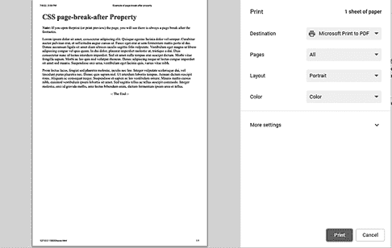

`page-break-after` 属性。

在打印部分，我们还有两个属性，它们是：

1. `page-break-before` 属性
2. `page-break-inside` 属性

# CSS 表格属性 (TABLE PROPERTIES)

## 1. `border-collapse` 属性

`border-collapse` CSS 属性指定表格单元格边框是合并为单个框还是像通常一样分开。在 CSS 中，设置表格单元格边框有两种不同的模型。

* 分离边框模型
* 合并边框模型

该属性的语法如下：`border-collapse: separate | collapse | initial | inherit`

代码的输出所示：

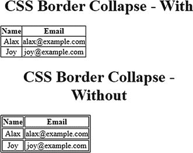

CSS `border-collapse` – 合并与不合并。

## 2. `border-spacing` 属性

`border-spacing` CSS 属性使用边框模型设置相邻单元格框之间的间距。如果使用了合并边框模型，该属性将被忽略。这里是 `border-collapse` 属性。

该属性的语法如下：`border-spacing: [ length ] 1 to 2 values | initial | inherit`

代码的输出：

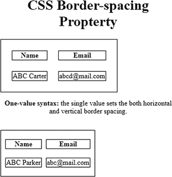

CSS `border-spacing` 属性。

## 3. `caption-side` 属性

`caption-side` CSS 属性设置标题框的垂直位置。若要在标题框内水平对齐文本，请使用 `text-align` 属性。

该属性的语法如下：`caption-side: top | bottom | initial | inherit`

输出所示：

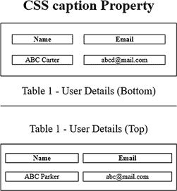

CSS `caption` 属性。

## 4. `empty-cells` 属性

`empty-cells` 属性显示或隐藏没有内容的表格单元格的边框。不间断空格被视为可见内容。

该属性的语法如下：`empty-cells: show | hide | initial | inherit`

描述值如下：

1. `show`: 空单元格周围有像普通单元格一样的边框和背景。这是默认值。
2. `hide`: 空单元格周围没有边框。

输出所示：

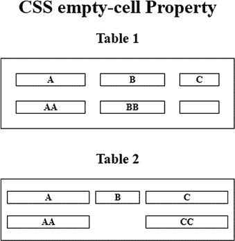

CSS `empty-cells` 属性。

# CSS 文本属性 (TEXT PROPERTIES)

## 1. `text-align` 和 `text-align-all` 属性

`text-decoration` 属性用于在一个声明中设置 `text-decoration-line`、`text-decoration-style` 和 `text-decoration-color`。

`text-align` 的语法如下：`text-align: start | end | right | left | center | justify | match-parent`

`text-align-all` 的语法如下：`text-align-all: start | end | left | right | center | justify`

输出所示：

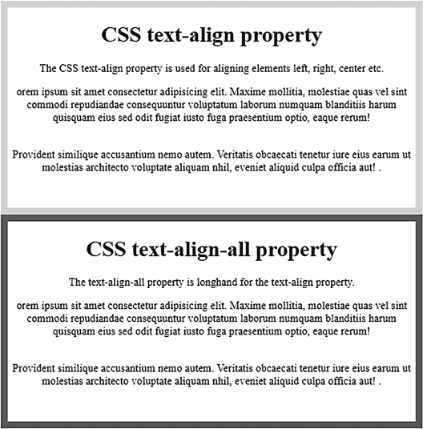

CSS `text-align` 和 `text-align-all` 属性。

## 2. `text-decoration` 属性

`text-decoration` 属性用于在一个声明中设置 `text-decoration-line`、`text-decoration-style` 和 `text-decoration-color`。

`text-decoration` 的语法如下：`text-decoration: <text-decoration-line> || <text-decoration-style> || <text-decoration-color>`

以下是 `text-decoration-line` 下的一些可能值：

1. `none`: 既不产生也不抑制文本装饰。
2. `underline`: 每行文本都有下划线。
3. `overline`: 每行文本上方都有一条线。
4. `line-through`: 每行文本中间都有一条穿线。
5. `blink`: 文本闪烁意味着可见和不可见之间切换。

以下是 `text-decoration-style` 下的一些可能值：

1. `solid`: 实线。
2. `wavy`: 波浪线。
3. `dotted`: 点状线。
4. `dashed`: 由破折线组成的线。
5. `double`: 双线实线。

以下是 `text-decoration-color` 下的一些可能值：

1. `initial`: 代表该属性初始值指定的值。
2. `inherit`: 它代表属性在父元素上的计算出的值。
3. `unset`: 这是一个可以充当初始值的值，具体取决于该属性是否可继承。这意味着如果属性是可继承的，则将所有属性设置为父元素值；如果不可继承，则将其设置为初始值。

## 3. CSS `text-decoration` 属性

代码的输出所示：

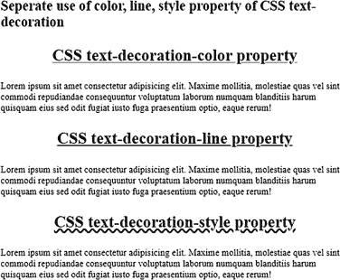

CSS `text-decoration` 属性。

## 4. CSS `text-orientation` 属性

代码的输出所示：

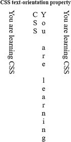

CSS `text-orientation` 属性。

## 5. CSS `text-overflow` 属性

它指定当文本因过大无法放入容器块而被裁剪时应如何处理文本。

代码的输出所示：

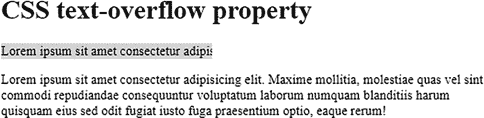

CSS `text-overflow` 属性。

## 6. CSS `text-shadow` 属性

`text-shadow` 属性用于为文本应用阴影效果。你也可以使用 `text-shadow` 为文本应用投影阴影、外光和其他阴影效果。该属性接受一个值列表。列表中的每个项目可以有两个、三个或四个值。

代码的输出所示：

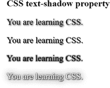

CSS `text-shadow` 属性。

# CSS 变换属性

`transform` 属性用于在二维 (2D) 或三维 (3D) 空间中变换元素。例如，旋转元素、缩放元素、倾斜元素等。

## 2D 变换函数

`transform` 属性接受一组“变换函数”作为值。这些函数具有名称，如 `scale()`、`rotate()`、`skew()` 等，它们接受参数来确定变换的程度（例如，旋转元素的角度）。

`transform` 的语法所示：`transform: none | <transform-function> [ <transform-function> ]`

这些函数按 2D（二维）和 3D（三维）函数进行分组。

`matrix()`：它指定以由六个值 a-f 组成的矩阵形式的 2D 变换。

`matrix` 的语法所示：`matrix() = matrix( <number> [,<number> ]{5,5} )`

`translate()`：它移动元素的位置。它通过向量 `[x, y]` 指定一个 2D 平移，其中 `tx` 是第一个平移值参数，`y` 是可选的第二个平移值参数。

`translate` 的语法所示：`translate( <translation-value>[, <translation-value>]? )`

`translateX()`：它水平移动元素。它指定在 X 方向上按给定量平移。

`translateX` 的语法所示：`translateX( <translation-value> )`

`translateY()`：它垂直移动元素。它指定在 Y 方向上按量平移。

`translateY` 的语法所示：`translateY( <translation-value> )`

`scale()`：它修改元素的大小。它通过两个参数描述的 `[sx,sy]` 向量指定 2D 缩放操作。

`scale` 的语法所示：`scale( <number>[, <number>]? )`

`scaleX()`：它使用 `[sx,1]` 向量指定 2D 缩放操作，其中 `sx` 作为参数给出。

`scaleX` 的语法所示：`scaleX( <number>[, <number>]? )`

`scaleY()`：它使用 `[1,sy]` 向量指定 2D 缩放操作，其中 `sy` 作为参数给出。

`scaleY` 的语法所示：`scaleY( <number>[, <number>]? )`

`rotate()`：它指定围绕 `transform-origin` 属性定义的原点，按指定的角度参数进行 2D 旋转。

`rotate` 的语法所示：`rotate( <angle> )`

`skew()`：它按给定角度沿 X 轴和 Y 轴指定 2D 倾斜变换。如果没有提供第二个参数，则其值为零。

`skew` 的语法所示：`skew( <angle> [, <angle> ]? )`

`skewX()`：它按给定角度沿 X 轴指定 2D 变换。

`skewX` 的语法所示：`skewX( <angle> )`

`skewY()`：它按给定角度沿 Y 轴指定 2D 变换。

`skewY` 的语法所示：`skewY( <angle> )`

代码的输出所示：

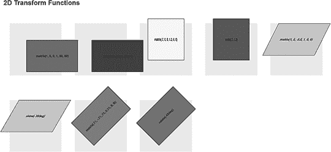

2D 变换函数。

## 3D 变换函数

它允许沿三个轴（x、y、z 轴）应用变换，如三维笛卡尔坐标系所示。CSS 中提供的 3D 变换函数所示：

`matrix3d()`：它以列主顺序的 16 个值的 4x4 相同矩阵指定 3D 变换。

`matrix3d` 的语法所示：`matrix3d() = matrix3d( <number> [, <number> ]{15,15} )`

`translate3d()`：它通过向量 `[tx,ty,tz]` 指定 3D 平移，其中 `tx`、`ty` 和 `tz` 分别是第一、第二和第三平移值参数。

`translate3d` 的语法所示：`translate3d() = translate3d( <translation-value>, <translation-value>, <length> )`

`translateZ()`：它通过向量 `[0,0,tz]` 指定在 Z 方向上按给定量进行 3D 平移。

`translateZ` 的语法所示：`translateZ() = translateZ( <length> )`

`scale3d()`：它通过三个参数描述的 `[sx,sy,sz]` 向量指定 3D 缩放操作。

`scaleZ()`：它使用 `[1,1,sz]` 向量指定 3D 缩放操作，其中 `sz` 作为参数给出。

`scaleZ` 的语法所示：`scaleZ() = scaleZ( <number> )`

`rotate3d()`：它通过前三个参数描述的 `[x,y,z]` 向量，按最后一个参数指定的角度指定 3D 旋转。

`rotate3d` 的语法所示：`rotate3d() = rotate3d( <number>, <number>, <number>, <number> )`


`rotateX()`：这与`rotate3d(1, 0, 0, <angle>)`相同。

`rotateX`的语法所示：`rotateX() = rotateX( <angle> )`

`rotateY()`：这与`rotate3d(0, 1, 0, <angle>)`相同。

`rotateY`的语法所示：`rotateY() = rotateY( <angle> )`

`rotateZ()`：这与`rotate3d(0, 0, 1, <angle>)`相同（同时也与`rotate( <angle> )`相同）。

`rotateZ`的语法所示：`rotateZ() = rotateZ( <angle> )`

`perspective()`：它定义了`z=0`平与用户之间的距离，以便为 3D 定位的元素提供透视效果。

`perspective`的语法所示：`perspective() = perspective( <length> )`

代码的输出所示：

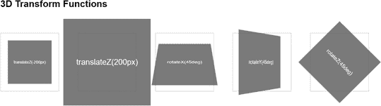

3D 变换函数。

## CSS 过渡属性

CSS `transition`属性用于定义 CSS 过渡的属性，并将四个过渡属性合并到一个属性中。`transition`属性合并了以下属性，如`transition-property`、`transition-duration`、`transition-timing-function`和`transition-delay`。

代码的输出所示：


CSS 过渡属性。

## 章节总结

在本章中，我们通过示例简要地学习了许多 CSS 属性，以便清楚地理解如何在 CSS 中编写代码语法。下一章将关于 CSS 中最重要的概念之一——CSS 选择器。

- 最后一个子伪类：`b:last-child { }`
- 第 N 个子伪类：`a :nth-child(2) { }`
- 倒数第 N 个子选择器：`:nth-last-child(2) { }`
- 第一类型选择器：`b:first-of-type { }`
- 第 N 类型选择器：`a:nth-of-type(2) { }`或`a:nth-of-type(even) { }`或`a:nth-of-type(odd) { }`或`a:nth-of-type(2n+1) { }`
- 唯一类型选择器：`b:only-of-type { }`
- 最后一个类型选择器：`b:last-of-type { }`或`a :last-of-type { }`或`.x:last-of-type { }`
- 空元素选择器：`a:empty { }`
- 否定伪类选择器：`a:not(.x) { }`或`a:not(:last-of-type) { }`
- 属性选择器：`[for] { }`或`a[for] { }`
- 属性值选择器：`a[for="x"] { }`
- 属性开头选择器：`[for^="x"] { }`
- 属性结尾选择器：`[for$="x"] { }`
- 属性通配符选择器：`[for*="x"] { }`

让我们来看看每个选择器的示例并附带简单的解释，编号可以根据上述提供的选择器进行更改：

## 通用选择器 (*)

代码的输出如下：


通用选择器`*`。

## 通用选择器 (elements)

代码的输出如下：


通用选择器（元素/标签）。

## 逻辑组合选择器

### 逻辑组合选择器 ( :not )

代码的输出如下：


逻辑选择器（`:not`）。

## 属性选择器

### 属性选择器 ( .classname )

代码的输出如下：


属性选择器（`.classname`）。

### 属性选择器 ( id)

代码的输出如下：


属性选择器（`#id`）。

### 属性选择器 ([])

代码的输出如下：


属性选择器（`[ ]`）。

### 属性选择器 ( [attr="value"] )

代码的输出如下：


属性选择器（`[attr="value"]`）。

### 属性选择器 ( [attr="value"] case-sensitive)

代码的输出如下：


属性选择器（区分大小写）属性选择器（`[attr="value"] case-sensitive`）。

### 属性选择器 ([foo~="bar"])

代码的输出如下：


属性选择器（`[foo~="bar"]`）。

### 属性选择器 ( [ foo^="bar" ] )

代码的输出如下：


属性选择器（`[foo^="bar"]`）。

### 属性选择器 ( [ foo$="bar" ] )

代码的输出如下：


属性选择器（`[foo$="bar"]`）。

### 属性选择器 ( [ foo*="bar" ] )

代码的输出如下：


属性选择器（`[foo*="bar"]`）。

### 属性选择器 ( [ foo|="bar" ] )

代码的输出如下：


属性选择器（`[foo|="bar"]`）。

## 伪类

### 伪类 (:dir(ltr) or :dir(rtl))

代码的输出如下：


伪类（`:dir(ltr)`或`:dir(rtl)`）。

## 伪类 (:any-link)

代码的输出如下：


伪类（`:any-link`）。

## 伪类 (:link)

代码的输出如下：


伪类（`:link`）。

### 伪类 (:target)

代码的输出如下：


伪类（`:target`）。

## 伪类 (:scope)

代码的输出如下：


伪类（`:scope`）。

### 伪类 (:target)

代码的输出如下：


伪类（`:target`）。

## 伪类 (:hover)

代码的输出如下：


伪类（`:hover`）。

## 伪类 (:focus)

代码的输出如下：


伪类（`:focus`）。

### 伪类 (:enabled and :disabled)

代码的输出如下：


伪类（`:enabled`和`:disabled`）。

### 伪类 (:read-only and :read-write)

代码的输出如下：


伪类（`:read-only`和`:read-write`）。

### 伪类 (:placeholder-shown)

代码的输出如下：


伪类（`:placeholder-shown`）。

## 伪类 (:default)

代码的输出如下：


伪类（`:default`）。

## 伪类 (:checked)

代码的输出如下：


伪类（`:checked`）。

## 伪类 (:indeterminate)

代码的输出如下：


伪类（`:indeterminate`）。

### 伪类 (:valid and :invalid)

代码的输出如下：


伪类（`:valid`和`:invalid`）。

### 伪类 (:in-range and :out-range)

代码的输出如下：


伪类（`:in-range`和`:out-range`）。

## 伪类 (:required)

代码的输出如下：


伪类（`:required`）。

## 伪类 (:root)

代码的输出如下：


伪类（`:root`）。

## 伪类 (:empty)

代码的输出如下：


伪类（`:empty`）。

## 伪类 (:blank)

代码的输出如下：


伪类（`:blank`）。

## 伪类 (:nth-child)

代码的输出如下：


伪类（`:nth-child`）。

## 伪类 (:nth-last-child)

代码的输出如下：


伪类（`:nth-last-child`）。

## 伪类 (:first-child)

代码的输出如下：


伪类（`:first-child`）。

## 伪类 (:only-child)

代码的输出如下：


伪类（`:only-child`）。

### 伪类 (:nth-of-type(odd or even))

代码的输出如下：


伪类（`:nth-of-type(odd or even)`）。

### 伪类 (:first-of-type, nth-of-type, nth-last-of-type(3))

代码的输出如下：


伪类（`:first-of-type, nth-of-type, nth-last-of-type(3)`）。

## 组合选择器

## 组合选择器 (E F)

选择并样式化所有的`<h1>`元素和`<h4>`元素。

它被称为后代选择器（空格）。

代码的输出如下：


组合选择器（`E F`）。

## 组合选择器 (E > F)

它是子选择器（`>`）。它选择所有指定元素的子元素。

代码的输出如下：


组合选择器（`E > F`）。

## 组合选择器 (E + F)

相邻兄弟选择器选择紧跟在特定元素之后的元素。它也称为相邻兄弟选择器（`+`）。

代码的输出所示：


组合选择器（`E + F`）。

## 通用兄弟选择器 (~)

通用兄弟选择器选择指定元素之后的所有后续兄弟元素。

代码的输出所示：


组合选择器（`E ~ F`）。

## 网格结构选择器 (:nth-col())

网格结构伪类专为像表格之类的结构化网格设计。`:nth-col()`伪类表示网格结构中其前面有`nth-columns`个列的某一列中的单元格，而`:nth-last-col()`则将从该列之后开始计数。

代码的输出所示：


网格结构选择器（`:nth-col()`）。

## 章节总结

在本章中，我们涵盖了 CSS 中所有有价值和常用的属性并附带了描述。通过阅读这些内容，初级用户可以获得良好的知识。下一章将关于 CSS 内置函数。

# 第 4 章 CSS 函数

DOI: [10.1201/9781003358060-4](https://doi.org/10.1201/9781003358060-4)

## 引言

CSS 函数用于各种 CSS 属性。例如，你可以使用`RGB()`函数提供颜色值（例如`color: RGB(105, 0, 215)`），或者使用`attr()`函数获取 HTML 属性的值。

各种函数被用于 CSS 变换（transforms）。例如，`rotate()`函数可以用于旋转元素，`scale()`函数可以改变元素的大小，而`translate()`函数可以移动元素。

还有一些函数，例如`circle()`可以将元素裁剪为圆形，或者为文本创建一个可以环绕的圆形；`calc()`函数可以为属性提供计算后的值。

## CSS 函数基础

## attr()

`attr()`函数检索所选元素的值并可以在样式表中使用。它可以用于伪元素，在这种情况下，将返回伪元素源元素上的属性值。

上述代码的输出所示：


CSS 函数（`:attr()`）。

## attr() 的用法

另一个超链接 URL 的示例。

代码的输出所示：


CSS 函数（`:attr()`）。

这里有一个示例，通过它将了解如何使用`attr()` CSS 附加文本。

代码的输出所示：


CSS 函数（`:attr()`）。

## blur()

`blur()`与`filter`配合使用，对图像应用模糊效果。`blur()`函数的语法如下：`blur() = blur( <length> )`

代码的输出所示：


CSS 函数（`:blur()`）。

## brightness()

`brightness()`函数用于调整图像的亮度。

`brightness()`函数的语法如下：`brightness() = brightness( [ <number> | <percentage> ] )`

解释：`brightness()`函数接受数字或百分比作为参数。它决定了图像的亮度水平。图像值为 0% 将完全变为黑色。图像值为 100% 将保持不变。高于 100% 的值会产生更亮的图像。数值 0.2 的效果与百分比值 20% 相同。不允许负值。它与`filter`属性配合调整图像亮度。该函数对输入图像应用线性乘法，使其看起来更亮或更暗。它需要传递一个参数，用于确定应用于图像的亮度水平。参数可以是百分比或数字。

上述代码的输出所示：


CSS 函数（`:blur()`）。

## calc()

CSS `calc()`函数允许在 CSS 属性值中使用计算。在设置宽度、高度、角度、频率等时，`calc()`可以替代其他单位类型。浏览器使用的精确值将是`calc()`函数执行的结果。

上述代码的输出所示：


CSS 函数（`:calc()`）。

## circle()

`circle()`是 CSS 形状模块的一部分，是一种基础形状值。像`circle()`这样的基础形状可以作为`shape-outside`等属性的值，用于控制内容（代码）环绕元素的流向，并用于`clip-path`将元素的内容裁剪为基础形状。这意味着你的文本以圆形的形状环绕元素，图像被裁剪为圆形。

`circle()`函数的语法如下：`circle() = circle( [<shape-radius>]? [at <position>]? )`

### 如何定位圆形

你可以通过各种半径参数和有效的 CSS 位置为圆形指定位置。它指定了圆心的中心。它像这样分离半径和位置：`shape-outside: circle(100px 50px);`

代码的输出所示：


CSS 函数（`:circle()`）。

代码的输出所示：


CSS 函数（`:circle()`）。

代码的输出所示：


CSS 函数（`:circle()`）。

## contrast()

CSS `contrast()`与`filter`属性配合使用，调整图像的亮度。`contrast()`需要传递一个参数。它决定了应用于图像的亮度水平。参数可以是百分比或数字。

`contrast()`函数的语法如下：`contrast() = contrast( <number> | <percentage> )`

代码的输出所示：


CSS 函数（`:contrast()`）。

## counter()

`counter()`允许你显示由元素生成的计数器。每个元素有一组从文档树继承的计数器，类似于属性值。你可以使用`counter-increment`、`counter-reset`和`counter-set`属性创建并操作计数器。

例如，你可以使用`counter()`输出元素的大罗马数字、阿拉伯数字等计数器。你还可以指定 Unicode 代码点来指定使用的特殊符号或图标作为标记表示。

**语法：** `counter()`函数有两种形式，如`counter(name)`或`counter(name, style)`。文本是伪元素作用范围内给定名称的内层计数器的值；它按指定的样式格式化（默认认为进制）。

`counter()`函数的语法如下：`counter( <ident> [, [ <counter-style> | none ]?)`

代码的输出所示：


CSS 函数（`:counter()`）。

## counters()


`counters()`允许你显示由元素及其父元素生成的嵌套计数器。每个元素都有组更多的计数器，以类似于属性值的方式从文档树继承。你可以使用`counter-increment`、`counter-reset`、`counter-set`属性创建并操作计数器。它本身没有可见效果，但可以与`counters()`和`counter()`函数配合使用，这些函数允许按指定的格式显示计数器的值。

`counters()`有两种形式：`counters(name, string)`或`counters(such as name, string, style)`。文本是伪元素作用范围内给定名称的计数器的值，根据指定的字符串从最外层到最内层排列。计数器按指定的样式渲染（默认认为进制）。

代码的输出如下：


CSS 函数 (`counters()`)。

## cubic-bezier()

`cubic-bezier()`可以与过渡时间函数属性（transition timing function property）配合使用，用于控制过渡在持续时间内速度如何变化。该属性接受一个缓动函数，该函数描述了过渡过程中使用的中间值是如何计算的。

`cubic-bezier()`是一种缓动函数，可以为`transition-timing-function`属性提供值。其他一些常见的缓动函数包括`ease-in`、`ease-out`、`linear`等。然而，`cubic-bezier()`可用于提供你自定义的曲线。

代码的输出如下：


CSS 函数 (`cubic-bezier()`)。

## drop-shadow()

它使用`drop-shadow()`为图像应用`drop-shadow`（投影）效果。CSS`drop-shadow()`与`filter`属性一起用于为图像添加`drop-shadow`效果。投影是输入图像 Alpha 遮罩（alpha mask）的模糊偏移版本，用特定的颜色绘制，并叠加在图像下方。

CSS`drop-shadow()`接受多个参数，决定投影的偏移量、模糊和颜色。

代码的输出如下：


CSS 函数 (`drop-shadow()`)。

## ellipse()

`ellipse()`函数是一个 CSS 基础形状值，是 CSS 形状模块的一部分。像`ellipse()`这样的基础形状可以作为`shape-outside`等属性的值，用于控制内容（代码）环绕元素的流动，以及使用`clip-path`将元素的内容裁剪为基础形状。这意味着你可以让文本以椭形的形状环绕元素流动，将图像裁剪为椭圆形等。

`ellipse()`函数的语法如下：`ellipse() = ellipse( [<shape-radius>{2}]? [at <position>]? )`

`<position>`的语法为：`<position> =`

代码的输出如下：


CSS 函数 (`ellipse()`)。

## filter()

`filter()`函数用于对图像应用过滤器。`filter()`函数允许你对图像应用过滤器。它与`filter`属性类似，区别在于它是一个函数，因此可以本身用作值。例如，你可以将其配合`background-image`属性使用，对背景图像应用过滤器。

`filter()`函数接受两个参数。第一个参数是图像，第二个参数是要应用于该图像的过滤器函数列表。

它接受的过滤器函数与`filter`属性接受的相同。如果需要，你可以提供多个过滤器函数。

代码的输出如下：


CSS 函数 (`filter()`)。

## grayscale()

使用`grayscale()`函数将图像转换为灰度。CSS`grayscale()`与`filter`属性一起用于将图像转换为灰度。`grayscale()`需要传递一个参数。它决定了应用到图像上的转换比例。参数可以是`%`值也可以是数字。

`grayscale()`函数的语法如下：`grayscale() = grayscale( [ <number> | <percentage> ] )`

代码的输出如下：


CSS 函数 (`grayscale()`)。

## hsl()

`hsl()`函数可以在使用 CSS 时提供颜色值。它允许通过指定颜色的色调（hue）、饱和度（saturation）和亮度（lightness）分量来指定该值。

HSL（代表 Hue Saturation Lightness）是计算机图形 RGB 色彩空间的一种基于色调的表示。

HSL 模型被认为比 RGB 模型更直观。HSL 模型允许选择基础色调，然后根据需要调整其饱和度和亮度。它接受 HSL 值作为参数。HSL 值以逗号分隔的三个值提供，分别提供色调、饱和度和亮度分量。可以通过观察色轮来识别色调。

这里有一个显示蓝色的示例：`HSL(240, 100%, 50%)`

### 如何选取颜色

HSL（Hue Saturation Lightness）是基于色调的 RGB 色彩空间的一种表示。以下是选取颜色的几种步骤/方法：

1. 调整色调

2. 调整饱和度

3. 调整亮度

代码的输出如下：


CSS 函数 (`HSL()`)。

## hsla()

`hsla()`函数可以在使用 CSS 时提供颜色值。它允许通过指定颜色的色调、饱和度和亮度分量来指定该值。HSL（代表 Hue Saturation Lightness）是计算机图形 RGB 色彩空间的一种基于色调的表示。

HSL 模型被认为比 RGB 模型更直观。HSL 模型允许选择基础色调，然后根据需要调整其饱和度和亮度。它接受 HSLA 值作为参数。HSLA 值以逗号分隔的四个值提供，分别提供色调、饱和度和亮度分量，第四个值是透明度（alpha）。

这里有一个显示蓝色的示例：`hsla(240, 100%, 50%, 0.5)`

代码的输出如下：


CSS 函数 (`hsla()`)。

## hue-rotate()

使用`hue-rotate()`对图像应用色调旋转。CSS`hue-rotate()`与`filter`属性一起用于对图像进行旋转。`hue-rotate()`需要一个参数来告知旋转多少。

`hue-rotate()`函数的语法如下：`hue-rotate() = hue-rotate( <angle> | <zero> ] )`

### 色调旋转如何工作

HSL（Hue Saturation Lightness）是基于色调的 RGB 色彩的一种表示。HSL 模型被认为比 RGB 模型更直观，因为 HSL 模型允许选择基础色调，然后根据需要调整其饱和度和亮度。

代码的输出如下：


CSS 函数 (`hue-rotate()`)。

## inset()

`inset()`是一个 CSS 基础形状值，是 CSS 形状模块的一部分。像`inset()`这样的形状可以作为`shape-outside`等属性的值，用于控制内容环绕元素的流动，以及使用`clip-path`将元素的内容裁剪为基础形状。

代码的输出如下：


CSS 函数 (`inset()`)。

## linear-gradient()

`linear-gradient()`函数允许 CSS 创建线性渐变。CSS 渐变允许为元素应用多种背景颜色并从一种颜色过渡到另一种颜色。

要创建线性渐变，可以将`linear-gradient()`作为任何接受图像属性的值（例如`background-image`、`background`或`border-image`属性）。线性渐变使用这些属性来构建指定的图像。

这些沿直线运行的渐变。线性渐变可以指向任何方向，如向上、向下、侧向、50 度、73 度或你喜欢的任何角度。

这些渐变通过建立一条称为渐变线的轴来创建。颜色停止点放置在该变线上，以创建每种颜色之间的渐变。

### 如何设置渐变角度

你也可以设置角度使其沿着该角度运行。你可以通过角度值（例如`45deg`、`90deg`和`180deg`）或指定角度的关键字（如`to top`、`to bottom`、`to top left`等）来指定。

## matrix3d()

CSS`matrix3d()`可配合 CSS 变换在三维空间内为元素设置样式。`matrix3d()`是三维变换函数`rotate3d()`、`rotateX()`、`rotateY()`、`rotateZ()`、`translate3d()`、`translateZ()`、`scale3d()`、`scaleZ()`和`perspective()`的替代方案。

代码的输出如下：


CSS 函数 (`matrix3d()`)。

## opacity()

使用`opacity()`函数使图像部分或完全透明。`opacity()`与`filter`属性一起使用，对图像样本应用透明度。`opacity()`需要传入一个参数。此外，它决定了应用到图像上的透明度比例。参数可以是值或数字。

代码的输出如下：


CSS 函数 (`opacity()`)。

## perspective()

`perspective()`函数定义了 z=0 平面与用户之间的距离，以便为 3D 定位的元素提供透视效果。

`perspective()`函数的工作原理如下：`perspective(l)`

`l`参数指定了从起点到 z=0 平面的距离。该参数也指定为长度值（例如`1px`、`1vw`等）。长度越大，“3D 效果”越不明显。

代码的输出如下：


CSS 函数 (`perspective()`)。

## radial-gradient()

`radial-gradient()`函数允许使用 CSS 创建径向渐变。

CSS 渐变允许为元素应用多种背景颜色，这些颜色从一种颜色过渡到下一种颜色。

代码的输出如下：


CSS 函数 (`radial-gradient()`)。

## repeating-linear-gradient()

CSS`repeating-linear-gradient()`允许创建一个在两个方向上无限重复的线性渐变。渐变允许为元素应用多种背景颜色，这些颜色从一种颜色过渡到下一种颜色。这些渐变是线性渐变，其中颜色停止点在两个方向上无限重复。重复线性渐变的工作方式与（非重复的）线性渐变相同。

语法：`repeating-linear-gradient()`函数接受以下值：

* `angle`：它指定了渐变方向的角度。例如`45deg`。

以下关键字指定了下方渐变线的指向：

* `to top`

* `to right`

* `to bottom`

* `to left`

以下关键字指定了下方渐变线的指向：

* `to top left`

* `to top right`

* `to bottom right`

* `to bottom left`

* `color-stop`

代码的输出如下：


CSS 函数 (`repeating-linear-gradient()`)。

## repeating-radial-gradient()

CSS`repeating-radial-gradient()`允许创建一个无限重复的径向渐变。CSS 渐变允许为元素应用多种背景颜色，这些颜色从单一颜色过渡到下一种。重复径向渐变是颜色停止点无限重复的渐变。径向渐变具有圆形或椭圆形。在创建径向渐变时，指定渐变的中心以及大小和形状。

**语法：** 此函数使用与`radial-gradient()`函数相同的语法，如下：`<radial-gradient> = radial-gradient( [ [ <shape> || <size> ] [ at <position> ]?, | at <position>,]? <color-stop> [, <color-stop> ]+)`

`repeating-radial-gradient()`函数接受以下值：

* `shape`：它指定渐变的形状。可以是`circle`或`ellipse`。

* `size`：指定结束形状的大小。值如下：

    * `closest side`

    * `farthest side`

    * `closest corner`

    * `farthest corner`

    * `length`（用于圆形）

    * `[length | percentage]`（用于椭圆）

* `position`：它指定渐变所在的位置。值如下：

    * `top`

    * `right`

    * `bottom`

    * `left`

    * `center`

代码的输出如下：


CSS 函数 (`repeating-radial-gradient()`)。

## rgb()

`rgb()`函数可用于在使用 CSS 时提供值。它允许通过直接指定红、绿、蓝通道来指定 RGB 颜色值。

RGB（代表 Red, Green, Blue）是一种色彩模型，其中可以将红色、绿色和蓝光相加以还原出颜色。

`rgb()`接受 RGB 值作为参数。`rgb()`函数以逗号分隔的三个值提供。它分别提供红色、绿色和蓝色色调。

三个值中的每一个值都可以以整数或百分比的形式提供。

我们可以在任何元素上使用该属性。

代码的输出如下：


CSS 函数 (`rgb()`)。

## rotate()

CSS`rotate()`用于在二维空间内旋转元素。`rotate()`根据你提供的角度进行旋转。可以使用任何有效的角度。

`rotate()`如下：

1. 度 (Degrees)

2. 梯度度 (Gradians)

3. 转 (Turns)

代码的输出如下：


CSS 函数 (`rotate()`)。

## rotate3d()

`rotate3d()`函数用于在三维空间内旋转。`rotate3d()`沿着 x、y、z 轴根据提供的角度进行旋转。它的工作原理如下：`rotate3d(x, y, z, a)`

* `x`：指定沿 x 轴的向量。

* `y`：指定沿 y 轴的向量。

* `z`：指定沿 z 轴的向量。

* `a`：指定旋转的角度。正值表示顺时针旋转，负值表示逆时针旋转。

* `deg`：度。一圈有 360 度。

* `grad`：梯度度。一圈有 400 梯度度。

* `rad`：弧度。一圈有 2π 弧度。

* `turn`：转。一圈有 1 转。

代码的输出如下：


CSS 函数 (`rotate3d()`)。

## rotateX()

CSS`rotateX()`在三维空间内绕 x 轴旋转元素。`rotateX()`用于 3D 变换。它配合`transform`属性绕 x 轴旋转元素。它可以在其他旋转函数如`rotateY()`、`rotateZ()`中使用，以绕 y 和 z 轴旋转。

`rotateX()`的语法如下：`rotateX() = rotateX( <angle> )`

角度可以接受以下单位：

* `deg`

* `grad`

* `rad`

* `turn`

## rotateY()

CSS`rotateY()`在三维空间内绕 y 轴旋转元素。`rotateY()`用于 3D 变换。它配合`transform`属性绕 y 轴旋转元素。

`rotateY()`的语法如下：`rotateY() = rotateY( <angle> )`

角度可以使用任何以下标识表示：

* `deg`

* `grad`

* `rad`

* `turn`

## rotateZ()

CSS`rotateZ()`函数在三维空间内绕 z 轴旋转元素。`rotateZ()`用于 3D 变换。它配合`transform`属性绕 z 轴旋转元素。

# `rotateX()`、`rotateY()`、`rotateZ()`示例：


```html
<html>
  <head>
    <style>
      * {
        padding: 0;
        margin: 0;
        box-sizing: border-box;
      }

      .demo_container {
        padding: 20px;
        width: 900px;
        margin: 0 auto;
        justify-content: center;
        align-items: center;
      }

      .row {
        display: flex;
        flex-wrap: wrap;
        flex-direction: row;
      }

      .col {
        width: 50%;
      }

      p {
        height: 50px;
      }

      .image-1 {
        background: RGB(255, 69, 0);
        transform: rotateX(10deg);
        color: white;
        padding: 10px;
        height: 50px;
        width: 100px;
      }

      .image-2 {
        background: RGB(0, 255, 0);
        transform: rotateX(-60deg);
        color: white;
        height: 50px;
        width: 100px;
        padding: 10px;
      }

      .image-3 {
        background: RGB(255, 69, 0);
        transform: rotateY(10deg);
        color: white;
        padding: 10px;
        height: 50px;
        width: 100px;
      }

      .image-4 {
        background: RGB(0, 255, 0);
        transform: rotateY(-60deg);
        color: white;
        height: 50px;
        width: 100px;
        padding: 10px;
      }

      .image-5 {
        background: RGB(255, 69, 0);
        transform: rotateZ(10deg);
        color: white;
        padding: 10px;
        height: 50px;
        width: 100px;
      }

      .image-6 {
        background: RGB(0, 255, 0);
        transform: rotateZ(-60deg);
        color: white;
        height: 50px;
        width: 100px;
        padding: 10px;
      }

      p {
        line-height: 2;
        font-size: 24px;
        margin-bottom: 10px;
      }
    </style>
  </head>
  <body>
    <div class="demo_container">
      <h2>`rotateX()`函数用于在三维空间中绕 x 轴旋转元素。</h2>
      <div class="row">
        <div class="col">
          <p>`rotateX()`</p>
          <div class="image-1">rotateX(10deg)</div>
          <p>负值</p>
          <div class="image-2">rotateX(-60deg)</div>
        </div>
      </div>
    </div>

    <div class="demo_container">
      <h2>`rotateY()`函数用于在三维空间中绕 y 轴旋转元素。</h2>
      <div class="row">
        <div class="col">
          <p>`rotateX()`</p>
          <div class="image-3">rotateY(10deg)</div>
          <p>负值</p>
          <div class="image-4">rotateY(-60deg)</div>
        </div>
      </div>
    </div>

    <div class="demo_container">
      <h2>`rotateZ()`函数用于在三维空间中绕 z 轴旋转元素。</h2>
      <div class="row">
        <div class="col">
          <p>`rotateZ()`</p>
          <div class="image-5">rotateZ(10deg)</div>
          <p>负值</p>
          <div class="image-6">rotateZ(-60deg)</div>
        </div>
      </div>
    </div>
  </body>
</html>
```

PostCSS 将将你现有的 CSS 文件转换为 JavaScript 可读的数据，然后 JavaScript 插件将进行修改，最后由 PostCSS 返回原始文件的修改版本。

## 各种基于 PostCSS 的 CSS 插件

市场上有多种可用插件，如下：

1. Autoprefixer
2. CSSnext
3. CSSNano
4. PreCSS
5. StyleLint
6. PostCSS Assets
7. Font Magician
8. Lost Grid
9. PostCSS
10. PostCSS-modules

## AUTOPREFIXER

Autoprefixer 根据最新的浏览器流行度数据，并自动为你应用前缀。你可以尝试 Autoprefixer 的交互式演示。

你可以像下面一样编写任何不需要厂商前缀的 CSS 规则：

```css
.container {
  box-shadow: 0 0 10px #cecece;
  transition: all 0.5s;
}

p {
  color: red;
}

.section a {
  display: flex;
}
```

## 编写纯 CSS

使用`Autoprefixer`非常简单，你只需要忘记厂商前缀，并根据最新的 W3C 规范编写普通的 CSS。你不需要特殊的语言（如 Sass、Less），也不需要记住何时必须使用 mixins。

`Autoprefixer`支持选择器（如`:fullscreen`和`::selection`）、单位函数（`calc()`）、at-rules（`@support`和`@keyframes`）以及属性。

它是一个后处理器，你可以配合 Sass、Stylus 或 LESS 等预处理器一起使用。

只需按照最新的 W3C 规范编写普通 CSS，`Autoprefixer`就会为旧浏览器生成代码。如果 CSS 未经压缩，`Autoprefixer`会更改 CSS 缩进以创建一个良好的前缀级联结构。

使用`Autoprefixer`的输出如下（你可以在线通过[`tools.webdevpuneet.com/css-autoprefixer/`](https://tools.webdevpuneet.com/css-autoprefixer/)查看 Autoprefixer 的代码）：

```css
/*
 * Prefixed by:
 * PostCSS: v7.0.29
 * Autoprefixer: v9.7.6
 * Browsers: last 4 version
 */

.container {
  -webkit-box-shadow: 0 0 10px #cecece;
  box-shadow: 0 0 10px #cecece;
  -webkit-transition: all 0.5s;
  -o-transition: all 0.5s;
  transition: all 0.5s;
}

p {
  color: red;
}

.section a {
  display: -webkit-box;
  display: -ms-flexbox;
  display: flex;
}
```

问题在于，某些 CSS 属性在不同浏览器中的显示方式不同，而你希望每个网站访问者都能获得预测且准确的体验。对于较旧、更成熟的属性（如 border 或 border-radius），不需要担心；它们已经标准化并能跨浏览器工作。但像 grid 或 flexbox 这样的新功能并没有那么简单。

制作浏览器的厂商（如 Google 和 Mozilla）不想等到酷炫的新事物被标准化之后才实现它们。相反，他们创建了自己的版本，并添加一个前缀将其与其他浏览器的实现区分开来。新属性将会在标准化并在所有浏览器中同样工作，从而消除对前缀的需要。在此之前，你必须在代码中使用厂商前缀。

“Autoprefixer”是一个插件，可以让我们从单调的`-webkit-`和`-moz-`中解救出来。它的功能顾如其名：它会自动为你的 CSS 添加前缀。你所做的只是提供一个 CSS 表，它将读取它并在必要时添加厂商前缀。

### 在你的项目文件夹中安装 Autoprefixer

在 VS Code 中打开终端并使用`npm`安装它，以及`postcss`及其配套工具`postcss-cli`（后者是你运行`Autoprefixer`的命令行工具）。该过程与安装 Sass 相同，只是你一次性安装三个包。你可以根据需要一次性安装多个包，每个包之间用空格隔开。

一旦`npm`下载并安装了这些包，需要回到`package.json`并为`npm`添加一个运行脚本，就像你安装 Sass 时一样。在 `"sass"` 脚本之后添加一个名为`"prefix"`的新脚本：

```json
{
  "name": "abc",
  "version": "1.0.0",
  "description": "abc",
  "main": "index.js",
  "scripts": {
    "sass": "sass ./sass/main.scss:./public/css/style.css -w --style compressed",
    "prefix": ""
  },
  "author": "",
  "license": "ISC"
}
```

在脚本内部，需要告诉`npm`使用你刚刚安装的`postcss`包，以及在哪里找到你编译后的 CSS 文件：

```json
{
  "name": "abc",
  "version": "1.0.0",
  "description": "abc",
  "main": "index.js",
  "scripts": {
    "sass": "sass ./sass/main.scss:./public/css/style.css -w --style compressed",
    "prefix": "postcss ./public/css/style.css"
  },
  "author": "",
  "license": "ISC"
}
```

之后，你需要指示`npm`使用哪个包以及在哪里找到 CSS 文件，通过实现`--use`标志后接`Autoprefixer`来使用它，如下所示：

```json
{
  "name": "abc",
  "version": "1.0.0",
  "description": "abc",
  "main": "index.js",
  "scripts": {
    "sass": "sass ./sass/main.scss:./public/css/style.css -w --style compressed",
    "prefix": "postcss ./public/css/style.css --use autoprefixer"
  },
  "author": "",
  "license": "ISC"
}
```

最后，你需要指示它将新的、带前缀的 CSS 表放在哪里，如下所示：

```json
{
  "name": "abc",
  "version": "1.0.0",
  "description": "abc",
  "main": "index.js",
  "scripts": {
    "sass": "sass ./sass/main.scss:./public/css/style.css -w --style compressed",
    "prefix": "postcss ./public/css/style.css --use autoprefixer -d ./public/css/prefixed/"
  },
  "author": "",
  "license": "ISC"
}
```

现在你的前缀脚本就完成了。

添加一个名为`browserslist`的新键，如下所示：

```json
{
  "browserslist": ""
}
```

然后给`browserslist`赋值为最后四个版本：

```json
{
  "name": "joeblow",
  "version": "1.0.0",
  "description": "Joe Blow’s web portfolio",
  "main": "index.js",
  "scripts": {
    "sass": "sass ./sass/main.scss:./public/css/style.css -w --style compressed",
    "prefix": "postcss ./public/css/style.css --use autoprefixer -d ./public/css/prefixed/"
  },
  "author": "",
  "license": "ISC",
  "browserslist": "last 4 versions"
}
```

现在你准备好为 CSS 自动添加前缀了！进入终端并运行`prefix`脚本：

```bash
$ npm run prefix
```

查看你 CSS 文件中新的带前缀的 CSS，会添加一个新块：

```css
.section {
  background: #15DEA5;
  height: 10rem;
  display: -webkit-box;
  display: -ms-flexbox;
  display: flex;
  -webkit-box-align: center;
  -ms-flex-align: center;
  align-items: center;
  -ms-flex-wrap: wrap;
  flex-wrap: wrap;
  width: 100%;
}
```

现在我们的网站将在所有兼容浏览器上正常且统一地显示。

## 它在何时运行？

`Autoprefixer`是处理 CSS 时最后运行的。因此，如果你使用 Sass、LESS 或 Stylus，它们会先处理，然后是`Autoprefixer`。如果你愿意，仍然可以自由使用预处理器插件（例如 Compass、LESHat 等）来添加前缀，但我认为`Autoprefixer`更简单、效果更好，而且你不需要两者都用。

### Autoprefixer 和 PrefixFree 有什么区别

PrefixFree 是一个客户端 JavaScript 库。它作为额外的请求包含在你的页面中。它运行，寻找能找到的所有 CSS，计算需要哪些前缀，并将新的 CSS 注入页面中。

- **缺点**：额外的请求、未前缀样式闪烁（flash-of-unprefixed-styles）、无法缓存、某些无法处理的样式（例如 filter）。
- **优点**：CSS 体积更小、只注入当前浏览器需要的前缀。

`Autoprefixer`在服务器端处理你的 CSS。至少我们是这么这么的。

- **缺点**：CSS 体积稍大（但比“直接添加所有前缀”要小）。
- **优点**：前缀完美匹配你支持的内容、最终 CSS 可以缓存、处理棘手的回退方案（例如 flexbox）。

`cssnext`让你现在就能使用 CSS 的未来。你可以使用并非所有浏览器都支持的功能，例如 CSS 变量和 CSS 颜色函数。`cssnext`将你的样式转换为可以在所有浏览器中运行的代码。换句话说，`cssnext`允许使用真实的 CSS 语法而不是另一种预处理器语法来编写样式。`cssnext`会为你的样式添加厂商前缀（vendor prefixes），所以你在编写 CSS 时不需要手动使用这些前缀。

为了给你个例子，假设你有以下 CSS 样式：

```css
:root {
  --text: pink;
  --bg-color: #FFEC31;
  --flex-center: {
    display: flex;
    margin: auto;
  };
}

.box {
  background-color: var(--bg-color);
  color: color(hotpink whiteness(25%));
  @apply(--flex-center);
}

.warn {
  @apply(--flex-center);
}
```

`cssnext`将样式转换为如下所示：

```css
.box {
  background-color: #F9EC31;
  color: rgb(255, 64, 159);
  display: -webkit-box;
  display: -ms-flexbox;
  display: flex;
  margin: auto;
}

.warn {
  display: -webkit-box;
  display: -ms-flexbox;
  display: flex;
  margin: auto;
}
```


这个插件是 CSS 的 Babel，它允许你使用现代 CSS 特性，同时将它们转换为旧版浏览器更容易理解的 CSS：

- 使用 `Autoprefixer` 添加前缀（所以如果你使用此项，就不需要直接使用 `Autoprefixer` 了）。
- 允许使用 CSS 变量。
- 允许使用嵌套语法，就像 Sass 一样。

## CSSnano

`cssnano` 用于精简和压缩你的 CSS。它会移除空白、消除重复规则、过时的厂商前缀、注释，并执行许多其他优化。`cssnext` 和 `cssnano` 都可以根据特定需求进行配置。

## 安装 PostCSS、PostCSS-CLI、cssnext 和 cssnano

使用 `npm`：

```bash
$ npm install --save-dev postcss postcss-cli postcss-cssnext cssnano
```

或者通过 `Yarn` 命令：

```bash
$ yarn add postcss postcss-cli postcss-cssnext cssnano --dev
```

## 使用 PostCSS-CLI

你通过为 `PostCSS` 命令行（`cmd`）接口提供输入、输出文件以及要使用的 PostCSS 插件。它通过 `--use` 标志指定插件，通过 `--output` 标志指定输出文件，输入文件在最后不带任何标志直接提供，具体使用如下命令：

```bash
$ postcss --use postcss-cssnext --use cssnano --output styles-out.css styles.css
```

你可以在监听模式（watch mode）下使用 `PostCSS CLI`，通过以下命令监听输入文件的变化：

```bash
$ postcss --use postcss-cssnext --use cssnano --output styles-out.css styles.css --watch
```

你可以在 JSON 配置文件中指定更细粒度的配置选项，通过 `--config` 标志指定配置文件：

```bash
$ postcss --config postcss-config.json
```

你的配置文件看起来像这样：

```json
{
  "use": ["postcss-cssnext", "cssnano"],
  "input": "styles.css",
  "output": "styles-out.css"
}
```

## npm Script

为了让你的工作流运行更顺畅，只需在项目的 `package.json` 文件中设置 `postcss` 脚本：

`"scripts": { "postcss": "postcss --use postcss-cssnext --use cssnano --output styles-out.css styles.css" }`

现在你只需要运行以下命令：

```bash
$ npm run postcss
```

## PreCSS

它让你在 CSS 中使用类似 Sass 的标记和分阶段的 CSS 特性。给出的示例如下：

```scss
$blue: #056ef0;
$column: 200px;

.menu {
  width: calc(4 * $column);
}

.menu_link {
  background: $blue;
  width: $column;
}
```

结果如下：

```css
.menu {
  width: calc(4 * 200px);
}

.menu_link {
  background: #056ef0;
  width: 200px;
}
```

它将类似 Sass 的语法糖（如变量、条件判断和迭代器）与新兴的 CSS 特性（如逻辑属性和自定义属性、媒体查询范围以及图像集）结合在一起。

## 使用

你可以将 `PreCSS` 添加到你的构建工具中：

```bash
$ npm install precss --save-dev
```

## 其他各种插件

它由以下插件驱动（按此顺序）：

- `postcss-extend-rule`：你可以将此 PostCSS 扩展规则添加到你的项目中：

  ```bash
  $ npm install postcss postcss-extend-rule --save-dev
  ```

  使用 `PostCSS Extend Rule` 处理你的 CSS：

  ```javascript
  const postcssExRule = require('postcss-extend-rule');
  postcssExRule.process(CSS_CODE /*, processOptions, pluginOptions */);
  ```

  该插件中有许多可用的 `Options`。

  `name` 选项决定了用于扩展选择器的规则（at-rule）名称。默认情况下，该名称为 `extend`，意味着 `@extend` 规则会被解析。

  如果将 `name` 选项更改为例如 `postcss-extend`，那么只有 `@postcss-extend` 规则会被解析。

  ```css
  main {
    @postcss-extend.some-rule;
  }
  ```

- `postcss-advanced-variables`：它的 `variables` 让你在 CSS 中可以使用类似 Sass 的变量、条件判断和迭代器。

  你可以将 `PostCSS advanced variables` 添加到你的构建工具中：

  ```bash
  $ npm install postcss-advanced-variables --save-dev
  ```

  你可以将 `PostCSS` 添加到你的构建工具中：

  ```bash
  $ npm install postcss --save-dev
  ```

  将 `PostCSS advanced variables` 作为插件使用：

  ```javascript
  postcss([
    require('postcss-advanced-variables')(/* options */)
  ]).process(YOUR_CSS);
  ```

- `postcss-preset-env`：它将现代 CSS 转换为大多数浏览器都能理解的内容，并根据目标浏览器或运行时环境确定所需的垫填充（polyfills）。

  你可以将 `PostCSS Preset Env` 添加到你的项目中：

  ```bash
  $ npm install postcss-preset-env --save-dev
  ```

  现在使用 `PostCSS Preset Env` 如下所示处理你的 CSS：

  ```javascript
  const postCSSPresetEnv = require('postcss-preset-env');
  postCSSPresetEnv.process(YOUR_CSS /*, processOptions, pluginOptions */);
  ```

## 各种 Options

1. `stage`：此选项根据成为 Web 标准的稳定程度来决定要垫填充哪些 CSS 特性。`postcssPresetEnv({ stage: 0 })`

   此阶段可以是 0（实验性）到 4（稳定），或为 `false`。通过将 `stage` 设置为 `false` 将禁用所有垫填充。如果你打算专门使用 `features` 选项，这将非常有用。

   在没有任何配置选项的情况下，`PostCSS` 允许 `Preset Env Stage`。

2. `features`：通过 ID 启用或禁用特定的垫填充。向特定特性 ID 传递 `true` 将启用其垫填充，传递 `false` 则会禁用。

   该插件中有多种可用的 `id`，如下所示：

   1. `postcssAttributeCaseInsensitive`
   2. `postcssBlankPseudo`
   3. `postcssColorFunctionalNotation`
   4. `postcssEnvFunction`
   5. `postcssLogical`
   6. `postcssReplaceWrap`
   7. `postcssSelectorNot` 等

   你只需通过在代码中导入它们即可使用这些 ID。

3. `insertBefore / insertAfter`：`insertBefore` 和 `insertAfter` 键允许将其他 PostCSS 插件插入链中。如果你在使用在特定垫填充之前或之后执行的糖 PostCSS 插件，这将非常有用。`insertBefore` 和 `insertAfter` 都支持一个或多个插件的链式调用。

4. `autoprefixer`：它包含了 `autoprefixer` 和 `browsers` 选项并将自动传递给它。指定 `autoprefixer` 选项允许向 `autoprefixer` 传递额外的选项。`postcssPresetEnv({ autoprefixer: { grid: true } })`

- `postcss at-root`：`@at-root` 会导致一个或多个规则在文档根部输出，而不是嵌套在它们的父选择器之下。

  结果如下：

  ```css
  .child {
    ...
  }

  .parent {
    ...
  }
  ```

  在代码中使用它：

  ```javascript
  postcss([require('postcss-atroot')()])
  ```

- `postcss-property-lookup`：PostCSS 插件允许引用属性值而不是变量，类似于 Stylus。

  ```css
  .section {
    margin-left: 20px;
    margin-right: @margin-left;
    color: red;
    background: @color url('test.png');
    line-height: 1.5;
    font-size: @(line-height)em;
  }

  .section {
    margin-left: 20px;
    margin-right: 20px;
    color: red;
    background: red url('test.png');
    line-height: 1.5;
    font-size: 1.5em;
  }
  ```

  在代码中使用它：

  ```javascript
  postcss([require('postcss-property-lookup')])
  ```

- `postcss-nested`

## 安装插件

### 第一步

### 第 2 步：检查你现有项目中的 PostCSS 配置

检查项目根目录下的 `postcss.config.js`、`package.json` 中的 `postcss` 部分或拆包配置中的 `postcss`。

如果你没有使用 `PostCSS`，请根据官方文档添加并在设置中配置此插件。

### 第 3 步：将插件添加到插件列表

有多种可用选项：

1. `bubble`：默认情况下，插件只会泡化 `@media` 和 `@supports` 嵌套规则。你可以通过 `bubble` 选项向列表添加自定义的嵌套规则：`postcss([require('postcss-nested')({ bubble: ['phone'] })])`

2. `unwrap`：默认情况下，插件将解包 `@font-face`、`@keyframes` 和 `@document` 嵌套规则。你可以通过 `unwrap` 选项向列表添加自定义的嵌套规则：`postcss([require('postcss-nested')({ unwrap: ['phone'] })])`

## preserveEmpty

默认情况下，插件会剔除由中间嵌套级生成的任何空选择器。你可以将 `preserveEmpty` 设置为 `true` 来保留它们。

它将被编译为：

```css
.a { }
.a .b {
  color: black;
}
```

你可以使用命令安装 `postcss-nested`。

## STYLELINT

它是一个强大且现代的 CSS linter，有助于强制样式表的一致性并避免错误。

## 安装 Stylelint

首先，确保你已经安装了 `stylelint`。它是一个 npm 包，可以通过运行以下命令安装：

```bash
npm install -g stylelint
```

## 使用

安装 `stylelint` 后，你可能需要创建一个 `.stylelintrc.json` 文件。在这里你可以配置你希望 `stylelint` 检查的所有 lint 规则。然后查看规则页面以获取所有可用规则的详情。

一旦设置了带有 lint 规则的 `.stylelintrc.json` 文件，就可以使用命令在 SCSS 文件上运行 `stylelint`。这假设你处于 `.scss` 文件所在的目录。你可以根据需要更新路径。

它将在当前工作目录中查找 `.stylelintrc.json` 文件。如果你的任何配置文件不在当前工作目录，可以在运行 `stylelint` 时通过 `config` 选项将其传递。

如果你想在 npm-scripts 中使用 `stylelint`，请使用以下命令：

```bash
npm install stylelint -D
```

## PostCSS ASSETS

PostCSS Assets 是一个 CSS 资源管理器。它将样式表与环境变化隔离，获取图像大小并内联文件。

安装：

```bash
npm install postcss-assets --save-dev
```

## Gulp（gulp-postcss）

PostCSS gulp 插件用于将 CSS 通过管道到多个插件，但仅解析一次 CSS。

安装 `gulp-postcss`：

```bash
npm install --save-dev postcss gulp-postcss
```

## Basic

配置将此处所述从 `postcss.config.js` 自动加载，因此你不需要指定任何选项。

使用 `gulp` 直接传递插件：

```javascript
var postcss = require('gulp-postcss');
var gulp = require('gulp');
var autoprefixer = require('autoprefixer');
var cssnano = require('cssnano');

gulp.task('css', function () {
  var plugins = [
    autoprefixer({ browsers: ['last 1 version'] }),
    cssnano()
  ];

  return gulp.src('./src/*.css')
    .pipe(postcss(plugins))
    .pipe(gulp.dest('./dest'));
});
```

## Grunt

现在我们将解释如何创建一个 `Gruntfile` 并安装和使用 `Grunt` 插件。一旦你熟悉了该过程，可以使用此命令安装此插件：

```bash
npm install grunt-postcss --save-dev
```

一旦安装了插件，可以在 `Gruntfile` 中通过此行 JavaScript 代码启用它：

```javascript
grunt.loadNpmTasks('grunt-postcss');
```

如何在代码中使用插件：

```javascript
npm install grunt-postcss pixrem autoprefixer cssnano

grunt.initConfig({
  postcss: {
    options: {
      map: true, // 内联 sourcemaps
      // 或者
      map: {
        inline: false, // 将所有 sourcemaps 保存为单独的文件...
        annotation: 'dist/css/maps/' // ...保存到指定的目录
      },
      processors: [
        require('pixrem')(), // 为 rem 单位添加回退
        require('autoprefixer')({ browsers: 'last 2 versions' }), // 添加厂商前缀
        require('cssnano')() // 压缩结果
      ]
    },
    dist: {
      src: 'css/*.css'
    }
  }
});
```

## FONT MAGICIAN

Font Magician 是一个 PostCSS 插件，可以神奇地生成你所有的 `@font-face` 规则。再也不需要编写 `@font-face` 规则了。

这里是 Font Magician 的示例：

只需像魔法一样使用 `font` 和 `font-family` 属性。

安装：你可以将 Font Magician 添加到你的构建工具中：

```bash
npm install postcss postcss-font-magician --save-dev
```

## LOST GRID

LostGrid 是一个在 PostCSS 中的强大的网格系统，它可以与任何预处理器甚至原生 CSS 工作。


Lost Grid 是一个优秀的 PostCSS 插件，提供了一个令人印象深刻的 CSS 网格系统，不仅适用于普通 CSS，也适用于处理器语言（Sass、LESS、Stylus）。它使用`calc()`函数创建精美的网格，无需花费大量时间自定义即可轻松使用。

你可以使用以下库进行安装：

## Gulp

首先，你必须安装 NodeJs，然后使用以下命令全局安装`gulp`：

```bash
npm install --global gulp
```

安装依赖项：

```bash
npm install --save-dev gulp-postcss gulp-cemaps autoprefixer lost
```

创建`gulpfile.js`：

```javascript
var gulp = require('gulp');
var postcss = require('gulp-postcss');
var sourcemaps = require('gulp-cemaps');
var autoprefixer = require('autoprefixer');
var lost = require('lost');
var paths = {
  cssSource: 'src/',
  cssDestination: 'dist/'
};
gulp.task('styles', function () {
  return gulp.src(paths.cssSource + '**css')
    .pipe(sourcemaps.init())
    .pipe(postcss([
      lost(),
      autoprefixer()
    ]))
    .pipe(sourcemaps.write('./'))
    .pipe(gulp.dest(paths.cssDestination));
});
gulp.watch(paths.cssSource + '**css', ['styles']);
```

## Grunt

首先，你必须安装 NodeJs，然后使用此命令安装`Grunt`。

安装依赖项：

```bash
npm install --save-dev grunt-postcss autoprefixer lost
```

创建`Gruntfile.js`：

```javascript
module.exports = function(grunt) {
  grunt.initConfig({
    postcss: {
      options: {
        map: true, // 内联 sourcemaps
        // 或者
        map: {
          inline: false, // 将所有 sourcemaps 保存为单独的文件...
          annotation: 'dist/css/maps/' // ...保存到指定的目录
        },
        processors: [
          require('autoprefixer')(),
          require('lost')
        ]
      },
      dist: {
        src: 'css/*.css'
      }
    },
    watch: {
      files: ['css/*.css'],
      tasks: ['postcss']
    }
  });
  grunt.loadNpmTasks('grunt-postcss');
  grunt.loadNpmTasks('autoprefixer');
  grunt.loadNpmTasks('grunt-contrib-watch');
  grunt.registerTask('default', ['watch']);
```

## Brunch

首先，你安装 NodeJS，然后使用此命令安装`Brunch`：

```bash
brunch new
```

安装依赖项：

```bash
npm install --save postcss-brunch autoprefixer lost
```

更新`brunch-config.coffee`：

```coffee
exports.config = {
  files: {
    javascripts: { joinTo: 'app.js' },
    stylesheets: { joinTo: 'app.css' },
    templates: { joinTo: 'app.js' }
  },
  plugins: {
    postcss: {
      processors: [
        require('autoprefixer')(),
        require('lost')
      ]
    }
  }
}
```

这是一个用于开发 CSS 工具的框架。它也可以用于开发如`Sass`和`LESS`等模板语言。

PostCSS 包含以下列出的核心组件：

- `CSS parser`生成抽象语法树。
- 它是一组组成树的类集合。
- `CSS generator`为对象树生成代码行。
- `Code map generator`用于记录所做的更改。

## 特性

插件是与对象树一起的小型程序。在核心模块将 CSS 字符串转换为对象树后，插件会解析并修改该树。然后，PostCSS 将为插件修改过的树生成新的 CSS 字符串。PostCSS 及其插件用 JavaScript 编写，并通过`npm`安装，`npm`为各种低层 JavaScript 操作提供了 API。

有官方工具允许你结合`Webpack`、`Gulp`和`Grunt`等构建系统使用 PostCSS。此外还有控制台界面。可以使用`Browserify`或`Webpack`在浏览器中打开 PostCSS。PostCSS 插件执行各种 CSS 处理任务，从属性的解析和排序到压缩。

你可以在`postcss.parts`找到完整的插件列表，下面列出了一些示例：

- `Autoprefixer`用于添加和删除浏览器前缀。`CSS modules`用于隔离 CSS 选择器并组织代码。它作为`Webpack`的一部分。
- `stylelint`用于分析 CSS 代码错误并检查样式一致性。
- `stylefmt`根据`stylelint`设置修复 CSS 代码。
- `PreCSS`用于执行某些 Sass/Less 预处理功能。
- `postcss-preset-env`用于模拟草案 CSS 规范中的特性。
- `cssnano`通过移除空白和重写代码来减小 CSS 体积。
- `RTLCSS`修改 CSS 代码以适应从右向左的字体布局。
- `postcss-assets`、`postcss-inline-svg`和`postcss-sprites`用于处理图形。

我们将简要讨论其中一些插件。

## PostCSS Modules（CSS Modules）

CSS Module 是一个 CSS 文件，其中所有的类名和动画名称默认都是局部作用域的。所有的 URL（`url(...)`）和`@imports`均采用模块请求格式（`./xxx`和`. ./xxx`表示相对路径，`xxx`和`xxx/yyy`表示在模块文件夹中，即在`node_modules`中）。

CSS Modules 编译为一种名为`ICSS`或互操作 CSS 的低级交换格式，但其写法像普通的 CSS 文件。

当从 JS 模块导入 CSS Module 时，它会导出一个包含从本地名称到全局名称所有映射的对象。

### 命名（localsConvention）

对于本地类名，推荐使用`camelCase`命名：

类型：`String | (originalClassName: string, generatedClassName: string, inputFile: string) => className: string`  
Default：`null`

导出类名的样式，即你`json`中的键。

1. `camelCase` - `{String}`：类名应转换为驼峰命名。
2. `camelCaseOnly` - `{String}`：类名将被转换为驼峰命名，并从 locals 中移除原始类名。
3. `dashes` - `{String}`：只有类名中的连字符部分会被转换为驼峰命名。
4. `dashesOnly` - `{String}`：类名中的连字符部分将被转换为驼峰命名。

### 特性

- 模块化且可复用的 CSS。
- 不再有冲突。
- 显式依赖。
- 无全局作用域。

## PostCSS MarqueeMenu Plugin

这是一种用于网页开发的动画效果，用于实现垂直或水平方向上吸引人的文本或图像滚动。

注意：你可以在工作文件夹中下载 CSS MarqueeMenu 插件，并在 HTML 代码的 head 部分包含所需的文件。

```css
Style.css *, *::after, *::before { box-sizing: border-box; } :root { font-size: 15px; } body { margin: 0; --color-text: #111; --color-bg: #f8ecde; --color-link: #b19e7f; --color-link-hover: #000; color: var(--color-text); background-color: var(--color-bg); -webkit-font-smoothing: antialiased; -moz-osx-font-smoothing: grayscale; font-family: stratos, sans-serif; } a { text-decoration: none; color: var(--color-link); outline: none; } a:hover, a:focus { color: var(--color-link-hover); outline: none; } .menu { -webkit-touch-callout: none; -webkit-user-select: none; -moz-user-select: none; -ms-user-select: none; user-select: none; padding: 10vh 0 25vh; --marquee-width: 100vw; --offset: 20vw; --move-initial: calc(-25% + var(--offset)); --move-final: calc(-50% + var(--offset)); --item-font-size: 10vw; counter-reset: menu; } .menu__item { cursor: default; position: relative; padding: 0 5vw; } .menu__item-link { display: inline-block; cursor: pointer; position: relative; -webkit-text-stroke: 1.5px #000; -webkit-text-fill-color: transparent; color: transparent; transition: opacity 0.4s; } .menu__item-link::before { all: initial; font-family: sofia-pro, sans-serif; counter-increment: menu; content: counter(menu); position: absolute; bottom: 60%; left: 0; pointer-events: none; } .menu__item-link:hover { transition-duration: 0.1s; opacity: 0; } .menu__item-link:hover +. menu__item-img { opacity: 1; transform: translate3d(calc(-100% - 6vw),-30%,0) rotate3d(0,0,1,4deg); transition: all 0.4s; } .marquee { position: absolute; top: 0; left: 0; width: var(--marquee-width); overflow: hidden; pointer-events: none; mix-blend-mode: color-burn; } .marquee__inner { display: flex; position: relative; transform: translate3d(var(--move-initial), 0); animation: marquee 5s infinite; animation-play-state: paused; } .marquee__inner:hover { animation-play-state: running; }
@keyframes marquee { 0% { transform: translate3d(var(--move-initial), 0); } 100% { transform: translate3d(var(--move-final), 0); } }
```

```html
<!DOCTYPE html>
<html lang="en" class="no-js">

  <head>

    <meta charset="UTF-8" />

    <meta name="viewport" content="width=device-width, initial-scale=1">

    <title>纯 CSS 跑灯菜单效果 | Codrops</title>

    <meta name="description" content="一个具有 CSS 纯悬停跑灯效果的菜单"

    <meta name="keywords" content="marquee, css, animation, loop, infinite, hover, menu, navigation" />

    <meta name="author" content="Codrops" />

    <link rel="shortcut icon" href="favicon.ico">

    <style>

    *{box-sizing: border-box;margin: 0}

    body{overflow-x: hidden;}

    .content{padding-left: 20px;padding-bottom: 30px}

    h1{margin: 50px 0 20px;font-family: roboto}

    p{margin-bottom: 20px}

    .marquee {

      --pos-x: 0;

      width: 100vw;

      display: flex;

      overflow-x: hidden;

    }

    .marquee__row {

      --translateX: calc(var(--pos-x) * 1px);

      flex-shrink: 0;

      min-width: 100vw;

      display: flex;

      justify-content: space-around;

      transform: translateX(var(--translateX));

    }

    .marquee--text {

      background-color: #89ff91;

    }

    .marquee__item--text {

      margin: 0;

      font-size: 65px;

      margin:. 2em. 4em;

    }

    .marquee--nezuko {

      background-color: pink;

    }

    .marquee__item--nezuko {

      --height: calc(100px + 50px * ((var(--viewport) - 375) / 1065));

      height: var(--height);

      margin: calc(0.1 * var(--height)) calc(0.3 * var(--height));

    }

    </style>

  </head>

  <body>

    <div class="marquee marquee--text" data-speed="25">

      <div class="marquee__row marquee__row--text">

        <p class="marquee__item marquee__item--text" data-clone="5"> CSS 跑灯菜单效果 / </p>

      </div>

    </div>

  </body>

  <script>

  const marqueeArr = document.querySelectorAll('.marquee');

  marqueeArr.forEach(marquee => {
```


```javascript
const marqueeRow = marquee.querySelector('.marquee__row');

const marqueeItem = marqueeRow.querySelector('.marquee__item');

const cloneNum = Number(marqueeItem.getAttributeNode('data-clone').value);

for (let i = 1; i < cloneNum; i++) {
  const clone = marqueeItem.cloneNode(true);

  marqueeRow.appendChild(clone);
}

for (let i = 0; i < 2; i++) {
  const clone = marqueeRow.cloneNode(true);

  marquee.appendChild(clone);
}

const marqueeMove = (dir) => {
  const rows = marquee.querySelectorAll('.marquee__row');

  const rowWidth = rows[0].getBoundingClientRect().width;

  let currentX = Number(
    getComputedStyle(marquee).getPropertyValue('--pos-x')
  );

  let newX = 0;

  switch (dir) {
    case 'left':
      newX = currentX ? currentX - 1 : -rowWidth;

      newX < -2 * rowWidth && (newX = -rowWidth);

      break;

    default:
      newX = currentX ? currentX + 1 : -rowWidth;

      newX > 0 && (newX = -rowWidth);
  }

  marquee.style.setProperty('--pos-x', newX);
};

let speed = Number(marquee.getAttributeNode('data-speed').value);

let direction = 'left';

let marqueeInterval = setInterval(marqueeMove, speed, direction);

marquee.onmouseenter = () => {
  clearInterval(marqueeInterval);
};

marquee.onmousemove = () => {
  clearInterval(marqueeInterval);
};

marquee.onmouseleave = () => {
  clearInterval(marqueeInterval);

  marqueeInterval = setInterval(marqueeMove, speed, direction);
};

let posY = 0;

const changeDir = () => {
  clearInterval(marqueeInterval);

  let scrollTop = document.documentElement.scrollTop;
};
```

如果你能够学习并理解，你就可以使用 Bootstrap 等许多基于 CSS 的框架进行学习和工作。

## CSS 属性

- 对于任何想专业地从事网页设计职业的人来说，CSS 和 HTML 知识都是至关重要的。
- 通过使用 CSS，我们可以控制各种样式，例如文本颜色、字体样式、段落间距、列宽和布局、背景颜色和图像、针对不同屏幕和设备尺寸的布局设计，以及许多其他效果。
- CSS 对 HTML 文档具有控制权，因此很容易学习。它与 HTML 和 XHTML 标记语言集成。
- 一旦我们掌握了 CSS 和 HTML 的基础知识，对 Angular、PHP 和 JavaScript 等其他相关理解就会变得更加清晰。

在 CSS 中，你可以使用各种 CSS 属性，例如：

- CSS 颜色代码：它在一个页面中集成了颜色选择器、颜色调色板和代码示例。它包含了十六进制值、RGB、颜色名称、透明度和不透明度。
- CSS @-Rules：有一份 CSS at 规则列表。at 规则（或`@-rules`）为样式表定义处理规则或值。它们以`@`开头，后面跟着它们的名称。
- CSS3 属性：有一份 CSS3 中引入的属性列表。它包括动画、flexbox、渐变、多列布局等。
- CSS 轨迹：为了以符合标准的方式创建滚动文本和图像，我们使用 CSS Marquees。
- CSS 模式：CSS 渐变只是从一种颜色过渡到另一种颜色。
- 你可以使用渐变创建有趣的背景图案。
- CSS 媒体类型：它用于媒体查询。你可以根据显示网页的媒体类型应用不同的样式。
- CSS 媒体特征：你可以使用媒体查询根据输出设备（如手机、平板和笔记本电脑）的媒体特征应用不同的样式。
- 悬浮菜单：你可以添加快速代码来创建一个悬浮菜单。
- CSS 背景颜色：你还可以设置 HTML 元素的背景颜色。
- CSS 行间距：你还可以对文本应用 CSS 等同的行间距。
- CSS 对齐：你可以垂直和水平对齐你的元素。
- CSS 表格宽度和单元格内边：你可以使用 CSS 通过`cellpadding`设置表格宽度。
- CSS 单元格间距：你可以使用 CSS 修改表格单元格之间的空间。
- CSS 滚动条：当 HTML 元素的内容过大时，你可以使用 CSS 为其添加滚动条。
- CSS 打印版本：你可以使用 CSS 为网页的打印版本应用不同的样式。

## 参考文献

1. HTML & CSS – [`www.w3.org/standards/webdesign/htmlcss`](https://www.w3.org)，访问于 2022 年 5 月 16 日。
2. CSS – [`developer.mozilla.org/en-US/docs/Web/CSS`](https://developer.mozilla.org/en-US/docs/Web/CSS)，访问于 2022 年 5 月 16 日。
3. CSS 简介 – [`en.wikipedia.org/wiki/CSS`](https://en.wikipedia.org/wiki/CSS)，访问于 2022 年 5 月 16 日。
4. HTML 和 CSS – [`www3.ntu.edu.sg/home/ehchua/programming/webprogramming/HTML_CSS_Basics.html`](https://www3.ntu.edu.sg)，访问于 2022 年 5 月 16 日。
5. CSS 历史 – [`www.w3.org/Style/CSS20/history.html`](https://www.w3.org/Style/CSS20/history.html)，访问于 2022 年 5 月 17 日。
6. CSS 历史 – [`www.bu.edu/lernet/artemis/years/2020/projects/FinalPresentations/HTML/historyofcss.html`](https://www.bu.edu)，访问于 2022 年 5 月 17 日。
7. HTML 历史概述 – [`simplecss.eu/css-history-brief-overview.html`](https://simplecss.eu)，访问于 2022 年 5 月 17 日。
8. CSS 历史 – [`css-tricks.com/look-back-history-css/`](https://css-tricks.com)，访问于 2022 年 5 月 17 日。
9. CSS 语法 – [`www.w3schools.com/css/css_syntax.asp`](https://www.w3schools.com)，访问于 2022 年 5 月 17 日。
10. CSS 语法 – [`developer.mozilla.org/en-US/docs/Web/CSS/Syntax`](https://developer.mozilla.org/en-US/docs/Web/CSS/Syntax)，访问于 2022 年 5 月 18 日。
11. CSS 规则 – [`learn.saylor.org/mod/book/view.php?id=36821&chapterid=20180`](https://learn.saylor.org)，访问于 2022 年 5 月 18 日。
12. CSS 选择器 = [`developer.mozilla.org/en-US/docs/Web/CSS/CSS_Selectors`](https://developer.mozilla.org/en-US/docs/Web/CSS/CSS_Selectors)，访问于 2022 年 5 月 18 日。
13. CSS 注释 – [`developer.mozilla.org/en-US/docs/Web/CSS/Comments#:∼:text=A%20CSS%20comment%20is%20used,the%20layout%20of%20a%20document`](https://developer.mozilla.org)，访问于 2022 年 5 月 18 日。
14. CSS 关键字 – [`www.w3.org/wiki/CSS/Properties/color/keywords`](https://www.w3.org/wiki/CSS/Properties/color/keywords)，访问于 2022 年 5 月 18 日。
15. CSS – [`www.quackit.com/css/`](https://www.quackit.com)，访问于 2022 年 5 月 18 日。
16. CSS 属性 – [`www.tutorialrepublic.com/css-reference/css3-properties.php`](https://www.tutorialrepublic.com)，访问于 2022 年 5 月 19 日。
17. 媒体查询 – [`climbtheladder.com/responsive-web-design-interview-questions/#:∼:text=Media%20queries%20are%20a%20key,all%20in%20the`](https://climbtheladder.com)，访问于 2022 年 5 月 19 日。
39. CSS 字体属性 – [`www.quackit.com/css/tutorial/css_font.cfm`](https://www.quackit.com)，访问于 2022 年 5 月 24 日。
40. CSS 教程 – [`www.w3schools.com/css/default.asp`](https://www.w3schools.com)，访问于 2022 年 5 月 24 日。
41. CSS：级联样式表 – [`developer.mozilla.org/en-US/docs/Web/CSS`](https://developer.mozilla.org/en-US/docs/Web/CSS)，访问于 2022 年 5 月 24 日。
42. 为什么要学习 CSS？ – [`www.tutorialspoint.com/css/index.htm`](https://www.tutorialspoint.com)，访问于 2022 年 5 月 24 日。
43. 选择器 – [`en.wikipedia.org/wiki/CSS`](https://en.wikipedia.org/wiki/CSS)，访问于 2022 年 5 月 24 日。
44. CSS 属性与 CSS 规则 – [`jenkov.com/tutorials/css/css-properties-css-rules.html#:∼:text=A%20CSS%20rule%20is%20a,target%20with%20the%20CSS%20rule`](https://jenkov.com)，访问于 2022 年 5 月 25 日。
45. CSS - @ 规则 – [`www.tutorialspoint.com/css/css_at_rules.htm`](https://www.tutorialspoint.com)，访问于 2022 年 5 月 25 日。
46. 语法 – [`developer.mozilla.org/en-US/docs/Web/CSS/At-rule`](https://developer.mozilla.org/en-US/docs/Web/CSS/At-rule)，访问于 2022 年 5 月 25 日。
47. 让你的生活更简单的 CSS 规则 – [`www.freecodecamp.org/news/css-rules-to-live-by-962a051e1eb2/`](https://www.freecodecamp.org)，访问于 2022 年 5 月 25 日。
48. CSS 结构与规则 – [`www.htmlhelp.com/reference/css/structure.html`](https://www.htmlhelp.com)，访问于 2022 年 5 月 25 日。
49. CSS 位置 – [`www.javatpoint.com/css-position`](https://www.javatpoint.com)，访问于 2022 年 5 月 25 日。
50. CSS 高、宽和最大宽度 – [`www.w3schools.com/css/css_dimension.asp`](https://www.w3schools.com)，访问于 2022 年 5 月 25 日。
51. CSS 生成内容 – [`developer.mozilla.org/en-US/docs/Web/CSS/CSS_Generated_Content#:∼:text=CSS%20Generated%20Content%20is%20a,circumstances%20with%20a%20generated%20value`](https://developer.mozilla.org)，访问于 2022 年 5 月 25 日。
52. CSS 弹性盒子布局 – [`developer.mozilla.org/en-US/docs/Web/CSS/CSS_Flexible_Box_Layout#:∼:text=CSS%20Flexible%20Box%20Layout%20is,of%20items%20in%20one%20dimension`](https://developer.mozilla.org)，访问于 2022 年 5 月 25 日。

# 索引

## A

- 相邻兄弟元素选择器，250
- 动画延迟属性，52–53
- 动画方向属性，53
- 动画时长属性，52
- 动画填充模式属性，53
- 动画迭代次数属性，53
- 动画名称属性，52
- 动画播放状态，53
- 动画属性，52
- 动画计时函数属性，52
- `attr()`函数，258–262
- 属性选择器（`[]`），186–187
- 属性选择器（`[attr="value"]`），187–188
- 属性选择器（`[attr="value"]`区分敏感），189–190
- 属性选择器（`.classname`），183–184
- 属性选择器（`[foo$="bar"]`），193–195
- 属性选择器（`[foo*="bar"]`），195–197
- 属性选择器（`[foo^="bar"]`），192–193
- 属性选择器（`[foo|="bar"]`），198–199
- 属性选择器（`[foo∼="bar"]`），190–191
- 属性选择器（`id`），184–186
- Autoprefixer，376
  - 在项目文件夹中安装，378–381
  - 无前缀，382
  - 运行，381–382
  - 编写普通 CSS，377–378

## B

- 背景，60
  - 背景附属性，60
  - 背景裁剪，60–62
  - 背景颜色，60
  - 背景图像，62–63
  - 背景起源，64–66
  - 背景位置，66–67
  - 背景重复，68–70
  - 背景尺寸，70–72
- 背景属性，31–32
  - 多背景，32
- CSS 的优势，44
- `blur()`函数，262–263
- HTML 的主体，33
  - 宽度，34
- 边框，144
  - 边框合并，144–146
  - 边框属性，72
  - 下边框，76–78
  - 下边框颜色，78–80
  - 下边框左圆角，80–82
  - 下边框样式，82–85
  - 下边框图像，85
  - 边框宽度，74


* 边框间距, 147–148
* 盒模型, 35
* `calc()` 函数, 264–266
* 分支, 397
* 气泡选项, 390

## C

* `calc()` 函数, 258, 266–274
* 驼峰命名法, 400
* 标题侧, 149–151
* 级联样式表, 412–413
* `circle()` 函数, 258, 268
* 类, 19
    * ID 与 20
* 颜色属性, 87
    * CSS HEX 颜色, 91–94
    * RGB 颜色, 88–89
    * RGBA 颜色, 89–91
* 颜色, 22
    * 颜色值列表, 23–24
    * 颜色, 22–23
    * 选择, 299–301
* 列数属性, 120–123
* 列填充属性, 123–126
* 列间距属性, 126–128
* `Column-rule-color` 属性, 131–134
* `Column-rule` 属性, 128–131
* `Column-rule-style` 属性, 131
* `Column-rule-width` 属性, 131
* `组合选择器 (E + F)`, 250–252
* `组合选择器 (E > F)`, 248–250
* `组合选择器 (E F)`, 246–248
* `注释标签`, 13
* `CSS 的缺点`, 45–46
* `CSS 生成的内容属性`, 99–100
    * `counter-reset` 属性, 102–103
    * `quotes` 属性, 101–102
* `contrast()` 函数, 275–277
* `counter()` 函数, 277–279
* `Counter-reset` 属性, 102–103
* `counters()` 函数, 279–282
* `CSS2`, 4–5
* `CSS3`, 4–5
* `cssnano`, 384
    * `cssnext`, 安装, 384
    * `安装`, 384
    * `npm script`, 385
    * `postcss`, 安装, 384
    * `postcss-CLI`, 安装, 384
    * `postcss-CLI`, 使用, 384–385
* `cssnext`, 382–384
    * `安装`, 384
* `cubic-bezier()` 函数, 283–284

## D

* `尺寸属性`, 94
    * `height` 属性, 94–96
    * `max-height and max-height` 属性, 96–98
    * `min-height` 属性, 98–99
* `CSS 区域`, 21
* `drop-shadow()` 函数, 284–287

## E

* `ellipse()` 函数, 287–293
* `Empty-cells` 属性, 151–153
* `外部样式表`, 14–16

## F

* `特性`, 387
* `filter()` 函数, 293–295
* `Flexbox`, 40
* `弹性盒布局`, 103–105
* `字体魔法`, 394–395
* `字体属性`, 36, 106
    * `font-size-adjust` 属性, 109
    * `font-size` 属性, 107–109
* `函数`, 37–39, 257
    * `attr()` 函数, 258–262
    * `blur()` 函数, 262–263
    * `brightness()` 函数, 264–266
    * `calc()` 函数, 266–268
    * `circle()` 函数, 268–274
    * `contrast()` 函数, 275–277
    * `counter()` 函数, 277–279
    * `counters()` 函数, 279–282
    * `cubic-bezier()` 函数, 283–284
    * `drop-shadow()` 函数, 284–287
    * `ellipse()` 函数, 287–293
    * `filter()` 函数, 293–295
    * `grayscale()` 函数, 295–298
    * `hsl()` 函数, 298–301
    * `hsla()` 函数, 301–304
    * `hue-rotate()` 函数, 305–307
    * `inset()` 函数, 307–309
    * `linear-gradient()` 函数, 310–313
    * `matrix()` 函数, 313–316
    * `matrix3d()` 函数, 316–318
    * `opacity()` 函数, 318–321
    * `perspective()` 函数, 321–323
    * `radial-gradient()` 函数, 323–326
    * `repeating-linear-gradient()` 函数, 326–330
    * `repeating-radial-gradient()` 函数, 330–335
    * `rgb()` 函数, 335–339
    * `rotate()` 函数, 339–343
    * `rotate3d()` 函数, 343–346
    * `rotateX()` 函数, 346–347
    * `rotateY()` 函数, 347
    * `rotateZ()` 函数, 347–351
    * `saturate()` 函数, 351–354
    * `scale()` 函数, 354–356
    * `scale3d()` 函数, 357–359
    * `scaleX()` 函数, 359–361
    * `scaleY()` 函数, 361–364
    * `scaleZ()` 函数, 364–367
    * `skew()` 函数, 367–370
    * `skewX()` 函数, 371–373

## G

* `通用兄弟选择器 (∼)`, 252–254
* `渐变，设置角度`, 310–313
* `grayscale()` 函数, 295–298
* `网格结构选择器 (:nth-col())`, 254–256
* `Grunt`, 393–394, 396–397
* `Gulp`, 392–393, 395–396

## H

* `HTML 的头部部分`, 6
* `height` 属性, 94–96
* `十六进制数字`, 92
* `HEX 颜色`, 91–94
* `CSS 历史`, 2–3
* HSL 模型，参见色相、饱和度和亮度模型
* HTML, 6, 9, 412
    * body 区域, 7–8
    * head 区域, 6
    * CSS 和 HTML 如何协同工作, 10–11
    * 链接 HTML 和 CSS 文件, 9–10
    * RGB 颜色输入, 25–27
* `hue-rotate()` 函数, 305–307
* 色相、饱和度和亮度 (HSL) 模型, 298, 305

## I

* IDs, 20
    * 与 class 的区别, 20–21
* `:indeterminate` 选择器, 223–225
* Inherit, 54
* CSS 继承, 12–13
* Initial, 54
* 内联样式, 14, 17–18
* `:in-range`, 227–228
* insertAfter 键, 388
* insertBefore 键, 388
* `inset()` 函数, 307–309
* 内部样式, 14
* 内部样式表, 16–17
* `:invalid` 伪类, 225–226

## K

* `@keyframes` 规则, 54–59

## L

* 学习 CSS, 413
* `linear-gradient()` 函数, 310–313
* 列表属性, 110
    * `list-style` 属性, 110–111
    * `list-style-image` 属性, 113–114
    * `list-style-position` 属性, 114–115
    * `list-style-type` 属性, 111–113
* 逻辑组合选择器 ( `:not` ), 181–183
* Lost Grid, 395
    * Brunch, 397–398
    * Grunt, 396–397
    * gulp, 395–396

## M

* `Margin` 属性, 116–120
* 外边距, 34–35
* MarqueeMenu 插件, 400–410
* `matrix()` 函数, 313–315
* `matrix3d()` 函数, 316–318
* `Max-height` 和 `max-height` 属性, 96–98
* 媒体查询, 43–44
* 媒体类型, 41
    * 不同的, 42–43
    * 使用 `@import` 规则, 42
    * 使用 `<link>` 元素, 42
    * 使用 `@media` 规则, 41–42
* `Min-height` 属性, 98–99
* CSS 模块, 5–6, 399–400
* 多列布局, 120
    * `column-count` 属性, 120–123
    * `column-fill` 属性, 123–126
    * `column-gap` 属性, 126–128
    * `column-rule` 属性, 128–131
    * `column-rule-color` 属性, 131–134
    * `column-rule-style` 属性, 131
    * `column-rule-width` 属性, 131
* 多重背景, 32

## N

* 命名 (本地约定), 400
* CSS 的需要, 4–5
* `npm` 脚本, 385
* `nth-of-type(n)` 选择器, 243–244

## O

* `opacity()` 函数, 318–320
* 外轮框属性, 134–136
    * `outline-style` 属性, 136
    * `outline-width` 属性, 136
* `:out-of-range` 选择器, 227–228

## P

* 内边距, 35
* `Padding` CSS 属性, 139–142
* `Page-break-after` 属性, 142–144
* `perspective()` 函数, 321–323
* 插件, 375
    * Autoprefixer, 376
    * 安装文件夹, 378–381
    * 以及无前缀, 382
    * 运行, 381–382
    * 编写普通 CSS, 377–378
* `cssnano`, 384
    * `cssnext`, 安装, 384
    * 安装, 384
    * `npm` 脚本, 385
    * `postcss`, 安装, 384
    * `postcss-CLI`, 安装, 384
    * `postcss-CLI`, 使用, 384–385
* `cssnext`, 382–384
* 特性, 400
* Font Magician, 394–395
* Lost Grid, 395
    * Brunch, 397–398
    * Grunt, 396–397
    * gulp, 395–396
* MarqueeMenu 插件, 400–410
* 命名 (本地约定), 400
* PostCSS, 398
    * 特性, 398–399
* PostCSS 资源, 392
    * Grunt, 393–394
    * gulp (`gulp-postcss`), 392–393
* PostCSS-modules ( CSS modules ), 399–400
* PreCSS, 385
    * 安装插件, 389–390
    * preserveEmpty, 391
    * 使用, 386
    * 各种选项, 386–389
* stylelint, 391
    * 安装, 391
    * 使用, 391–392

## PostCSS, 398

### 特性, 398–399

## Postcss, 安装, 384

## PostCSS 资源, 392

### Grunt, 393–394

### gulp (`gulp-postcss`), 392–393

## Postcss-CLI

### 安装, 384

### 使用, 384–385

## PostCSS-modules ( CSS 模块 ), 399–400

## PreCSS, 385

### 安装插件, 389–390

### preserveEmpty, 391

### 使用, 386

### 各种选项, 386–389

## -Prefix-free, Autoprefixer 和, 382

## preserveEmpty, 391

## 打印属性, 142

### page-break-after 属性, 142–144

## CSS 属性, 21–22, 47, 413–415

### background, 60

#### background-attachment 属性, 60

#### background-clip 属性, 60–62

#### background-color 属性, 60

#### background-image 属性, 62–63

#### background-origin 属性, 64–66

#### background-position 属性, 66–67

#### background-repeat 属性, 68–70

#### background-size 属性, 70–72

### border 属性, 72

#### border-bottom 属性, 76–78

#### border-bottom-color 属性, 78–80

#### border-bottom-left-radius 属性, 80–82

#### border-bottom-style 属性, 82–85

#### border-image 属性, 85–86

#### border-width 属性, 74–75

### color 属性, 87

#### CSS HEX 颜色, 91–94

#### RGB 颜色, 88–89

#### RGBA 颜色, 89–91

### content 属性, CSS 生成, 99–100

#### counter-reset 属性, 102–103

#### quotes 属性, 101–102

### 尺寸属性, 94

#### height 属性, 94–96

#### max-height 和 max-height 属性, 96–98

#### min-height 属性, 98–99

### 弹性盒子布局, 103–105

### 字体属性, 106

#### font-size 属性, 107–109

#### font-size-adjust 属性, 109

### @keyframes 规则, 54–59

### 布局, 50–51

### 列表属性, 106

#### list-style 属性, 110–111

#### list-style-image 属性, 113–114

#### list-style-position 属性, 114–115

### margin 属性, 116

### 多列属性, 120

#### column-count 属性, 120–123

#### column-fill 属性, 123–126

#### column-gap 属性, 126–128

#### column-rule 属性, 128–131

#### column-rule-color 属性, 131–134

#### column-rule-style 属性, 131–134

#### column-rule-width 属性, 131

### outline 属性, 134

#### outline-color 属性, 134–136

#### outline-style 属性, 134–136

#### outline-width 属性, 134

### padding, 139

### 规则, 54

#### animation-delay 属性, 54–57

#### animation-direction 属性, 54–57

#### animation-duration 属性, 54–57

#### animation-fill-mode 属性, 57–59

#### animation-iteration-count 属性, 57–59

#### animation-name 属性, 54–57

#### animation-play-state 属性, 57–59

#### animation-timing-function 属性, 54–57

### table 属性, 144

#### border-collapse 属性, 144–146

#### border-spacing 属性, 147–148

#### caption-side 属性, 149–151

#### empty-cells 属性, 151–153

### text 属性, 154

#### text-align 属性和 text-align-all, 154–156


# text-decoration 属性, 156–159

# text-orientation 属性, 160–161

# text-overflow 属性, 161–162

# text-shadow 属性, 163–164

## transform 属性, 164

### 3D transform 函数, 169–173

### 2D transform 函数, 164–169

## transitions 属性, 173–174

# 伪类 (`:any-link`), 201–203

- 伪类 (`:blank`), 234–235
- 伪类 (`:checked`), 221–223
- 伪类 (`:default`), 219–221
- 伪类 (`:dir(ltr)` 或 `:dir(rtl)`), 199–201
- 伪类 (`:empty`), 233–234
- 伪类 (`:enabled` 和 `:disabled`), 214–215
- 伪类 (`:first-child`), 239–240
- 伪类 (`:first-of-type`, `:nth-of-type`, `:nth-last-of-type(3)`), 244–246
- 伪类 (`:focus`), 212–213
- 伪类 (`:hover`), 210–212
- 伪类 (`:indeterminate`), 223–225
- 伪类 (`:in-range` 和 `:out-of-range`), 227–228
- 伪类 (`:link`), 203–205
- 伪类 (`:nth-child`), 236–237
- 伪类 (`:nth-last-child`), 237–238
- 伪类 (`:nth-of-type(odd)`), 241–242
- 伪类 (`:nth-of-type(odd` 或 `even)`), 243–244
- 伪类 (`:only-child`), 240–241
- 伪类 (`:optional`), 230–231
- 伪类 (`:placeholder-shown`), 218–219
- 伪类 (`:read-only` 和 `:read-write`), 215–217
- 伪类 (`:required`), 229–230
- 伪类 (`:root`), 232–233
- 伪类 (`:scope`), 207–208
- 伪类 (`:target`), 205–207, 208–210
- 伪类 (`:valid` 和 `:invalid`), 225–226

# Q

- `Quotes` 属性, 101–102

# R

- `radial-gradient()` 函数, 323–326
- `repeating-linear-gradient()` 函数, 326–330
- `repeating-radial-gradient()` 函数, 330–335
- RGB 颜色, 24, 88–89
  - 扩展关键字, 27–30
  - 在 HTML 中, 25–27
  - `rgb()` 函数, 335–339
- RGBA 颜色, 89–91
- `:root` 选择器, 232
- `rotate()` 函数, 339–343
- `rotate3d()` 函数, 343–346
- `rotatex()` 函数, 346–347
- `rotatey()` 函数, 347
- `rotatez()` 函数, 347–351
- 规则, 51
  - `animation-delay` 属性, 52–53
  - `animation-direction` 属性, 53
  - `animation-duration` 属性, 52
  - `animation-fill-mode` 属性, 53
  - `animation-iteration-count` 属性, 53
  - `animation-name` 属性, 52
  - `animation-play-state` 属性, 53
  - `animation-timing-function` 属性, 52
  - `inherit`, 54
  - `initial`, 54

# S

- `saturate()` 函数, 352–354
- `scale()` 函数, 257, 354
- `scale3d()` 函数, 357–358
- `scaleX()` 函数, 359–361
- `scaleY()` 函数, 361–364
- `scaleZ()` 函数, 364–367
- 选择器, 177
  - 属性选择器 `[]`, 186–187
  - 属性选择器 `.classname`, 183–184
  - 属性选择器 `[attr="value"]`, 187–188
  - 属性选择器 `[attr="value"] case-sensitive`, 189–190
  - 属性选择器 `[foo$="bar"]`, 193–195
  - 属性选择器 `[foo*="bar"]`, 195–197
  - 属性选择器 `[foo^="bar"]`, 192–193
  - 属性选择器 `[foo|="bar"]`, 198–199
  - 属性选择器 `[foo~="bar"]`, 190–191
  - 属性选择器 `id`, 184–186
  - 组合选择器 `E + F`, 250–252
  - 组合选择器 `E > F`, 248–250
  - 组合选择器 `E F`, 246–248
  - 通用兄弟选择器 `~`, 252–254
  - 网格结构选择器 `:nth-col()`, 254–256
  - 逻辑组合选择器 `:not()`, 181–183
  - 伪类 (`:any-link`), 201–203
  - 伪类 (`:blank`), 234–235
  - 伪类 (`:checked`), 221–223
  - 伪类 (`:default`), 219–221
  - 伪类 (`:dir(ltr)` 或 `:dir(rtl)`), 199–201
  - 伪类 (`:empty`), 233–234
  - 伪类 (`:enabled` 和 `:disabled`), 214–215
  - 伪类 (`:first-child`), 239–240
  - 伪类 (`:first-of-type`, `:nth-of-type`, `:nth-last-of-type(3)`), 244–246
  - 伪类 (`:focus`), 212–213
  - 伪类 (`:hover`), 210–212
  - 伪类 (`:indeterminate`), 223–225
  - 伪类 (`:in-range` 和 `:out-of-range`), 227–228
  - 伪类 (`:link`), 203–205
  - 伪类 (`:nth-child`), 236–237
  - 伪类 (`:nth-last-child`), 237–238
  - 伪类 (`:nth-of-type(odd)`), 241–242
  - 伪类 (`:nth-of-type(odd` 或 `even)`), 243–244
  - 伪类 (`:only-child`), 240–241
  - 伪类 (`:optional`), 230–231
  - 伪类 (`:placeholder-shown`), 218–219
  - 伪类 (`:read-only` 和 `:read-write`), 215–217
  - 伪类 (`:required`), 229–230
  - 伪类 (`:root`), 232–233
  - 伪类 (`:scope`), 207–208
  - 伪类 (`:target`), 205–207, 208–210
  - 伪类 (`:valid` 和 `:invalid`), 225–226
  - 类型, 30–31
  - 通用选择器 (`*`), 179–180
  - 通用选择器（元素), 180–181
- `skew()` 函数, 367–370
- `skewX()` 函数, 371–373
- 规范, CSS, 5
- 阶段选项, 387
- stylelint, 391
  - 安装, 391
  - 使用, 391–392
- 语法, 11–12

# T

- 表格属性, 144
  - `border-collapse` 属性, 144–146
  - `border-spacing` 属性, 147–148
  - `caption-side` 属性, 149–151
  - `empty-cells` 属性, 151–153
- CSS 中的表格, 36
- 文本, 37
- 文本属性, 154
  - `text-align` 属性和 `text-align-all` 属性, 154–156
  - `text-decoration` 属性, 156–159
  - `text-orientation` 属性, 160–161
  - `text-overflow` 属性, 161–162
  - `text-shadow` 属性, 163–163
- 3D 变换函数, 169–173
- 变换属性, 164
  - 3D 变换函数, 169–173
  - 2D 变换函数, 164–169
- 过渡属性, 173–174
- `translate()` 函数, 257
- 2D 变换函数, 164–169
- CSS 类型, 14–19

# U

- 通用选择器 (`*`), 179–180
- 通用选择器（元素), 180–181
- Unwrap 选项, 390

# V

- `:valid` 选择器, 225–226
- CSS 版本, 4

# W

- W3C, *参见* World Wide Web Consortium
- CSS 的工作原理, 11
- 世界万维联盟 (W3C), 2
