# CSS 精通：入门指南

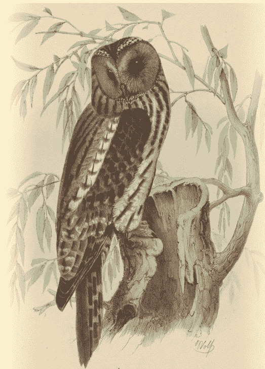

级联样式表（CSS）是一种用于网站建站和 HTML 模板的开源编程语言，它集成了与网页显示相关的所有信息。CSS 用于格式化网页的外观和结构，并设计如基础布局、颜色和字体等特性。CSS 允许网站上不同网页之间保持一致性，并使网页开发变得更简单、更快速。

本书的编写旨在帮助读者理解和学习 CSS 的概念。它讨论了 CSS 的基本概念，包括其属性和功能，并引导读者使用它创建网站。

核心特性：

- 探讨 CSS 基础知识、值、选择器和查询
- 讨论其在现代 Web 开发中的应用，帮助读者快速掌握必要的进信息
- 探索使用 CSS 进行动画、网格、弹性布局（flexbox）、遮罩、过滤和合成

《精通 CSS》对于任何想要创建网站的人来说都是宝贵的资源。读完本书后，读者将能够轻松地构建自己的网站，即使他们之前对此一无所知。

# 关于系列

《精通计算机科学》系列涵盖了广泛的主题，从编程语言到现代技术框架。该系列特别关注初级内容，并以易于理解的方式呈现，包括：

- 清晰的文字，涵盖按相关性排序的各种主题，
- 特别关注实践练习，包含大量的代码示例和程序，
- 引导式的编程方法，为绝对初学者提供分步教程，
- 高度强调技能的现实实用性，从而剔除冗余和很少使用的概念，转而关注行业主流的编码范式，
- 广泛的参考文献和资源，帮助初级和中级开发者从书中获得最大收益。

《精通计算机科学》系列书籍从核心概念开始，然后迅速过渡到行业标准的编码实践，帮助学习者无需预备编程知识，即使是完全的新手也能在最短的时间内获得高效且关键的技能。

> 《精通计算机科学》系列由 Sufyan bin Uzair 编辑，他是一位在计算领域拥有十年经验的作家和教育者。

有关该系列的更多信息，请访问：`https://www.routledge.com/Mastering-Computer-Science/book-series/MCS`

由 KnowledgeWorks Ltd. 排版

供 Mom


## 第一章 CSS：引言

引言 1

为什么我们需要 CSS？3

为什么使用 CSS？3

CSS 的不同版本 4

CSS2 和 CSS3 之间的主要差异 4

规范 5

模块 5

HTML 部分 6

从特定的 HTML 开始 9

正文部分 7

链接 HTML 和 CSS 9

CSS 和 HTML 如何协同工作10

CSS 是如何工作的？11

语法 11

继承 12

注释标签 13

你使用的 CSS 类型 14

类 19

ID 20

ID 和类有什么区别？20

分区 21

如何使用属性 21

颜色 22

颜色值列表 23

RGB 颜色 24

如何在 HTML 中使用 RGB 颜色 25

扩展颜色关键字 27

不同类型的选择器 30

背景 31

多背景 32

边框 33

框宽和颜色 34

外边距 34

内边距 35

盒模型 35

字体 36

文本 37

函数 37

为什么使用弹性布局（flexbox）？40

弹性布局 40

媒体类型 41

媒体类型简介 41

方法1：使用 `@AT-规则` 41

方法2：使用 `@IMPORT-规则` 42

方法3：使用 `<link>` 元素 42

不同的媒体类型 42

媒体问题与响应式设计 43

媒体查询 43

可能的优点 44

缺点 45

总结 46

## 第二章 CSS 属性

布局（属性）50

规则 51

`@KEYFRAMES` 规则 54

背景属性 60

边框属性 72

颜色属性 87

RGB 颜色 88

RGBA 颜色 89

HEX 颜色 91

尺寸属性 94

生成内容属性 99

弹性布局 103

字体属性 106

列表属性 110

外边距属性 116

多列布局属性 120

轮廓属性 134

内边距 139

打印属性 142

表格属性 144

文本属性 154

变换属性 164

2D 变换函数 164

3D 变换函数 169

过渡属性 173

总结 175

## 第三章 CSS 选择器

## 第 4 章 CSS 函数 257

引言 257

CSS 函数基础 258

`attr()` 258

`attr()` 的用法 259

`blur()` 262

`brightness()` 264

- `calc()` 266

`circle()` 268

如何定位圆形 268

`contrast()` 275

`counter()` 277

`counters()` 279

`cubic-bezier()` 283

`drop-shadow()` 284

`ellipse()` 287

`filter()` 293

`grayscale()` 295

`hsl()` 298

如何选择颜色 299

`hsla()` 301

`hue-rotate()` 305

色相旋转是如何工作的？ 305

`inset()` 307

`linear-gradient()` 310

如何设置渐变角度 310

`matrix()` 313

`matrix3d()` 316

`opacity()` 318

`perspective()` 321

`radial-gradient()` 323

`repeating-linear-gradient()` 326

`repeating-radial-gradient()` 330

`rgb()` 335

`rotate()` 339

`rotate3d()` 343

`rotateX()` 346

`rotateY()` 347

`rotateZ()` 347

- `saturate()` 352

- `scale()` 354

- `scale3d()` 357

- `scaleX()` 359

- `scaleY()` 361

- `scaleZ()` 364

- `skew()` 367

- `skewX()` 371

章节总结 373

## 第 5 章 CSS 插件 375

- 各种 CSS 插件 基于 PostCSS 376

- `AUTOPREFIXER` 376

- 编写纯 CSS 377

- 在项目文件夹中安装 Autoprefixer 378

- 它在何时运行？ 381

- Autoprefixer 和 -Prefix-Free 的区别是什么？ 382

- `CSSnext` 382

- `CSSnano` 384

- 安装 PostCSS、PostCSS-CLI、cssnext 和 cssnano 384

- 使用 PostCSS-CLI 384

- `npm Script` 385

- `PreCSS` 385

- 用法 386

- 其他各种插件 386

- 各种选项 387

- 安装插件 389

- `preserveEmpty` 391

- `STYLElint` 391

- 安装 Stylelint 391

- 用法 391

- PostCSS 资源 392

- Gulp (`gulp-postcss`) 392

- 基础 392

- Grunt 393

- 字体魔法师 394

- LOST 网格 395

- PostCSS 398

- 特性 398

- `POSTCSS-MODULES` (`CSS MODULES`) 399

- 命名 (`localsConvention`) 400

- 特性 400

- CSS MarqueeMenu 插件 400

章节总结 410

## 评价 411

## 参考文献 417

## 索引 421

## 关于编辑

Sufyan bin Uzay 是一位作家、编码员和企业家，在行业内拥有十多年的经验。他过去撰写过多部书籍，涵盖了从历史到计算机/IT 的广泛领域。

Sufyan 是 Parakozm 的董事，这是一家专注于教育科技（EdTech）解决方案的跨国 IT 公司。他还运营 Zeba Academy，这是一个专注于 STEM 领域的在线学习与教学平台。

Sufyan 擅长 JavaScript、Dart、WordPress、Drupal、Linux 和 Python 等多种技术。

# CSS: 简介 3

页面内容枯燥且毫无灵感。文字在页面上滚动，阅读起来很困难。但在 CSS 出现之前，网页正是这个样子。CSS 的引入在某种程度上决定了如今网页的外观和感受。而且，从诞生起，它是一门不断演变的语言。网络标准是 Lee 非常关注的话题。自从 CSS 引入以来，他一直呼吁微软和其他浏览器厂商等主要技术参与者支持标准的网络标准并持续改进。

## 为什么我们需要 CSS？

首先，应用 CSS 可以确保你的网页具有一致性。如果你的网站有 100 个页面，现在想象一下，你必须输入代码来定义尺寸、布局和其他显示数据，以及你想要生成新网页的所有内容。此外，想象一下拥有一个有 100 页面的网站，可以在保持其他所有内容不变的情况下修改其中一个页面。

CSS 也让这成为可能。使用 CSS 可以在需要的地方带来灵活性，但也足够灵活，可以对单个页面或部分进行更改。

## 为什么我们使用 CSS？

为了让网站正常运行，它必须具有快速下载下载。如今，人们通常只需等待几秒钟即可加载网页。因此，确保快速的至关重要。对于寻求确保网站信息快速流畅的公司来说，CSS 成为他们成功的关键。

CSS 维护时间短，因此易于维护。这是因为单行代码转换会影响整个网页。此外，如果需要升级，只需付出少量努力。

你可能找不到很多优秀且易于使用的网站。这些网站的一个共同点是构造的一致性。CSS 赋予开发者能够确保样式特征在每个网页上得到一致应用的能力。

由于其速度快且易于维护，CSS 凭借其快速加载时间在网页开发过程中节省了大量精力和时间。在这里一点时间就能确保设计师良好的性能。

人们使用不同的智能设备查看特定的网站。这可能是智能手机、PC 或笔记本电脑。为此，网站需要与设备兼容。CSS 通过提供更好的对齐来确保运行流畅。

## 掌握 CSS

在 CSS 的帮助下，你可以更改 HTML 标签的位置。你可以根据需要将网页的任何部分设置为图像。

## CSS 的不同版本

- CSS1 和 CSS2（不再适用）—— W3C 于 1996 年 12 月作为建议发布。该版本定义了 CSS 语言以及所有 HTML 标签的视觉格式模型。这是不再更新或维护的两个 CSS 版本。
- CSS2.1（推荐）—— W3C 于 1998 年 5 月提出的建议，并基于 CSS1 构建。该版本增加了对特定媒体样式表的支持，例如音频打印机和设备、可下载字体、对象布局和表格。该版本修复了 CSS2 中的许多错误和问题，现在是 CSS 的官方推荐版本。
- CSS3 于 1999 年 6 月成为 W3C 建议，构建在旧版本的 CSS 之上。它被分为名为“模块”（Modules）的文本，这里的每个模块都具有在 CSS2 之外的新扩展功能。这些版本在 CSS2.1 的基础上增加了新功能，并保持了兼容性。某些功能仍在测试中，可能会在未来发生变化。请谨慎使用，因为它可能会导致你的网站出现问题。

CSS3 是早期 CSS 版本（如 CSS2）的最新标准。CSS2 和 CSS3 之间的主要区别如下：

- 媒体查询 (`Media Queries`)
- 命名空间 (`Namespaces`)
- 选择器 3 (`Selectors Level 3`)
- 颜色 (`Color`)

CSS4 从未成为过正式版本。

## CSS、CSS2 和 CSS3 之间的主要区别

CSS 最初于 1996 年发布，包含了字体布局（如字体类型和颜色强调）、背景等功能。CSS2 于 1998 年发布，带有其他媒体类型的额外样式用于设计页面布局。CSS3 于 1999 年发布，并添加了演示样式结构，允许你从文档创建演示。

## CSS: 简介 5

通过 CSS3，设计师现在可以使用特殊字体，例如在 Google Fonts 和 Typecast 上的字体。之前，使用 CSS 和 CSS2 时，设计师只能使用“安全网络字体”，以确保 100% 的字体在所有机器上始终相同。

## CSS 规范

所有 Web 层级技术（HTML、CSS、JavaScript 等）都定义在称为“规范”（specifications 或 specs）的大文档中，这些文档由标准组织（如 W3C、WHATWG、ECMA 和 Chronos）发布，并描述了这些技术如何行为。CSS 也例外——它由 W3C 内部团队 CSS 工作小组开发。该小组由浏览器厂商和其他对 CSS 感兴趣的公司代表组成。还有被称为“受邀专家”的人员，作为成员组织的附属机构。

新的 CSS 功能有时由 CSS 工作小组开发，有时是因为特定浏览器对特定功能感兴趣，有时是因为设计师和开发者请求某项功能，以及工作小组识别了某项需求。CSS 在不断演变，新功能不断出现。CSS 的重要性是，大家都在努力确保它们不会以可能破坏旧网站的方式发生变化。2000 年构建并使用当时存在的有限 CSS 构建的网站，在今天的浏览器中应该仍然可以使用！

作为 CSS 初学者，你可能会发现 CSS 规范过于庞大——它是为了让开发者向用户代理应用功能支持，而不是让 Web 开发者学习理解 CSS。许多经验丰富的开发者更倾向于查看 MDN 文档或其他来源。然而，

## 模块

由于有很多可以用 CSS 样式的内容，该语言被分为多个模块。HTML 结构中会有各种部分。让我们讨论一下。

## 掌握 CSS

在这一部分，你不需要太担心 CSS 是如何创建的；然而，如果你知道某个位置可以在其他内容中找到，那么获取信息可能会更容易。

接下来的部分提供了 HTML 简介。没有 HTML，我们就无法想象网页和万网（World Wide Web）。它是编写网页最常用的语言。它代表超文本标记语言。你应该知道，网页上的任何链接通常被称为超文本，而标记指的是标签或页面布局，从而使网页中的文本以正确的格式显示。

## Head 部分

`header` 标签代表文档头部，你可以标记 `<head>` 和 `<link>`。它以 `<head>` 开始，以 `</head>` 结束。它内部包含标题的一部分。例如 `<title> 这是你的网页标题 </title>`。

## CSS 简介

Body 部分

它代表 Web 文档的主体，通常包含标题、文本和章节。主题以 `<title>` 开始，以 `</title>` 结束。在这些标签之间，内容可以标记为“这是第一个主题”。

段落以 `<p>` 开始，以 `</p>` 结束。章节的内容应该写在这些角括号之间。概述部分中显示的下方 HTML 代码用于创建一个简单的 HTML 页面。

```html
<!DOCTYPE html>
<html lang="utf-8">
<meta charset="utf-8">
<title> Page Title </title>
<body>
  <h1> This is a Heading </h1>
  <p> This is a paragraph </p>
</body>
</html>
```

我们可以向 HTML 代码中添加各种元素；让我们来看一看吧。

- HTML 标题是由标签 `<h1>` 到 `<h6>` 定义的元素，其中 `<h1>` 定义了较重要的标签，而 `<h6>` 定义了不那么重要的标签。HTML 章节（段落）是使用 `<p>` 标签定义的 HTML 元素。
- HTML 图像是 HTML 的一项功能，由 `` 标签定义，并需要指定属性如 `src`、`alt` 文字、`width` 和 `height`。
- HTML 列表是元素，使用 `<ul>` 或 `<ol>` 标签定义，其中 `<ul>` 是无序列表，`<ol>` 是有序列表。
- HTML 表格是 HTML 的一部分，可以使用 `<table>` 标签行 `<tr>` 和标签单元 `<td>` 定义。
- HTML 链接是元素，可以使用 `<a>` 标签和下面的示例代码定义：
- HTML 属性 `style` 可以与 `<p>` 等任何元素组合使用。

## 8 掌握 CSS

- 在 HTML 中，我们使用 `lang` 属性，可以使用 `<html>` 标签指定文档的语言，并使用 `lang` 属性定义语言。
- 在 HTML 中，我们可以使用格式化元素对文档进行格式化，并定义具有特殊含义的特殊文本特征。HTML 元素 `<b>` 和 `<i>` 用于斜体。
- 在 HTML 中，我们可以使用 `<mark>` 功能突出显示文档中的特定文本，以突出显示包含 `<mark>` 元素中的。
- 在 HTML 中，我们可以在 HTML 文档中使用 `<sup>` 元素将文本定义为上方文本，使文本变大。

`<!DOCTYPE>` 代表文档类型，帮助浏览器正确显示网页。它出现一次，位于页面顶部（在任何 HTML 标签之前）。`<!DOCTYPE>` 声明不区分大小写。

无论网络在哪里，HTML 的使用遍布所有设备。以下是 HTML 的功能列表，让我们知道可以在哪里使用它们。

- Chrome、Firefox 和 Safari 等浏览器都使用 HTML 在网络上渲染内容以获得更好的显示。
- Opera、Firefox Focus、Microsoft Edge、Dolphin 和 Puffin 等各种移动浏览器都使用 HTML 在手机上更好地呈现和视觉化在线内容。
- 各种智能设备嵌入了 HTML 功能，以便在操作期间进行更好的浏览和导航。
- HTML 支持任何页面上的第一种通道验证方法以阻止意外流量。
- HTML 接受优秀内容，但赋予小屏幕设备和大屏幕设备相同的可见性。
- HTML 支持多种颜色、格式和布局。
- HTML 使用模板使网站设计变得简单。
- HTML 和 XML 语法非常相似，因此在两个领域之间切换非常容易。
- FrontPage、Dreamweaver 以及许多其他开发工具都支持 HTML。

## 从特定的 HTML 开始

HTML 和 CSS 是两种标签（代码）方法，它们有自己独特的语法。两者之间存在差异。你可以将 HTML 视为页面布局，而 CSS 为 HTML 赋予它自己的样式。

```
HTML = 结构
CSS = 样式
```

## 链接你的 HTML 和 CSS 文件


在编写 CSS 之前，我们必须回到 HTML。你需要写新行来将 HTML 文件和 CSS 文件链接。因此，打开 HTML 文件并添加提供的 `<link href="style.css" rel="stylesheet">`。你的文件代码看起来如下：

```html
<!DOCTYPE html>
<html>
<head>
<title>This is page title.</title>

<!-- 这里是外部样式表 -->
<link type="text/CSS" rel="stylesheet" href="style.css" />

<!-- 这里是内部样式 -->
<style>
h2, p {
  font-size: 24px;
}
h1 {
  text-align: center;
  font-size: 36px;
  font-family: 'Franklin Gothic Medium', 'Arial Narrow', Arial, sans-serif;
}
container {
  align-items: center;
  max-width: 600px;
  max-height: auto;
  margin: 280px auto;
  border: 1px solid black;
  border-radius: 20px;
  padding: 50px;
}
</style>
</head>
<body>
<div class="container">
  <h1><u>This is an example of Simple CSS </u></h1>
  <!-- 这里是内联样式 -->
  <h2 style="color: red">This is a heading element</h2>
  <p style="color: purple">Hello world, this is a paragraph.</p>
</div>
</body>
</html>
```

简单 CSS 示例。

上的一行代码将新的 CSS 文件链接到你的 HTML 文件。让我们拆分它：`href` 属性指定与 CSS 文件的关联。我们稍后会讨论链接，现在只需确保 `style.css` 文件与 `index.html` 在同一文件夹。`rel` 属性告诉浏览器这是一个样式表。`type` 属性告诉浏览器链接的文件应该被翻译为 CSS 语法。

## CSS 和 HTML 如何协同工作

CSS 文档用于定义网页样式，然后链接到包含内容和布局的 HTML 文档。样式与内容的分离有许多优点，包括提高可访问性以及对网页设计的更多控制。

## CSS 简介

CSS 文档用于定义网页样式，然后链接到 HTML 文档。直接设置样式到 HTML 文档

## CSS 如何工作

CSS 包含规则和值。通常，我们有一个选择器和一个声明块。

## CSS 语法

现在来看 CSS。我们做的第一件事是让段落内容不同。

上述两个示例是完全相同的。

## CSS 继承

当你将一个元素嵌套在另一个元素内部时，嵌套元素会继承分配给容器元素的属性。除非你独立地更改内部项目的值。例如，定义在

## CSS: 简介

`body` 被文件中的所有文本继承，无论它包含什么条目，除非你为特定的嵌套项目声明了另一种字体。

### 示例：

```css
body {font-family: Verdana, serif};
```

HTML 文件中的所有文本现在将设置为 Verdana 字体族。如果你想用另一种字体（如 h1 或段落）格式化某些文本，可以进行以下操作。

### 示例：

```css
p {font-family: Tahoma, serif}, h1 {font-family: Georgia, sans-serif};
```

## 注释标签

注释可以用于解释为什么向 CSS 文件中添加某些选择器，以帮助可能看到你文件的其他人，或者让你在日后记得我们当时的想法。你可以添加如下所示会被浏览器忽略的注释：

> /* 这是一个注释 * 以 /（斜杠）开头，紧接着是 *（星号），然后是注释内容，最后是紧跟在开始标签后的结束标签 *（星号），然后是 /（斜杠）。 */

## 合并选择器

你可以如下所示在单个选择器中组合项目。

### 示例：

```css
h1, h2, h3, h4, h5, h6 {
  color: #009900;
  font-family: Georgia, sans-serif;
}
```

如你从上方代码所示，我们将所有的标题元素分组到一个单个选择器中。每个元素之间都用逗号分隔。上述代码的最终结果是将所有标题设置为绿色并使用指定的字体。如果用户没有声明第一个字体，他们将使用另一种无衬线字体。

## 你可以使用的不同类型的 CSS

为网页编写 CSS 有三种方法。你必须决定哪种方法对你更好，但我们推荐使用**外部样式表**，这是我们今天将学习的第三种类型。
以下是使用 CSS 的三种方法：

- 1. 内联样式：它放置在 HTML 元素内部。
- 2. 内部样式：它放置在你正在编写的网页的 `<head>` 标签部分。
- 3. 外部样式：它放置在外部样式表中，这是一个链接到网页的独立页面（推荐）。

下面是对 CSS 方法的解释：

### 外部样式表

可以使用任何文本或 HTML 编辑器（如“记事本”或“Dreamweaver”）创建外部 CSS 文件。CSS 文件不包含 HTML 元素标签，只有 CSS。你可以通过在每个想要用 CSS 文件样化的 (X)HTML 文件的 `head` 部分保留以下链接之一来外部链接该文件。

```html
<link type="text/css" rel="stylesheet" href="Path To stylesheet.css" />
```

你也可以使用 `@import` 方法，如 `<style type="text/css"> @import url('Path_to_stylesheet.css')</style>`。

示例：

```html
<head>
  <title> 标题</title>
  <link type="text/css" rel="stylesheet" href="style.css" />
</head>
<body>
```
或者，
```html
<head>
  <title> 标题</title>
  <style type="text/css"> @import('Path of stylesheet.css') </style>
</head>
<body>
```

### 示例：

Index.html

```html
<!DOCTYPE html>
<html>
<head>
  <title>这是页面标题。</title>
  <!-- 这里是内部样式 -->
  <link href="../styless.css" rel="stylesheet">
</head>
<body>
  <div class="container">
    <h1> 内部样式表的 HTML 代码</h1>
    <h2> 这是一个标题元素</h2>
    <p>这是一个段落。</p>
  </div>
</body>
</html>
```

```css
Styless.css
p {
  font-size: 32px;
  color: lightseagreen;
  text-shadow: 2px 2px black;
}
h1 {
  font-size: 42px;
  font-family: 'Franklin Gothic Medium', 'Arial Narrow', Arial, sans-serif;
}
.container {
  align-items: center;
  max-width: 800px;
  max-height: auto;
  margin: 280px auto;
  border: 1px solid black;
  border-radius: 20px;
  padding: 50px;
}
```

外部样式表。

### 内部样式表

这种方法只是是将 CSS 代码放置在你想用 CSS 样化的 HTML 文件的 `<head>` 和 `</head>` 标签内。格式如下例所示：

```html
<html>
<head>
  <title> 标题 - 网页</title>
  <style type="text/css">
  <body>
  CSS 内容放在这里
  </style>
</head>
<body>
</html>
```

使用上述方法，每个 HTML 文件都包含样化页面所需的 CSS 样式。这意味着你对页面想做的的任何更改都必须对所有文件进行。如果你只需要样化一个页面，或者你想让其他页面具有不同的样式，这种方法会很好。示例：

```html
<!DOCTYPE html>
<html>
<head>
  <title>这是页面标题。</title>
  <!-- 这里是内部样式 -->
  <style>
  p {
    font-size: 32px;
    color: lightseagreen;
    text-shadow: 2px 2px black;
  }
  h1 {
    font-size: 42px;
    font-family: 'Franklin Gothic Medium', 'Arial Narrow', Arial, sans-serif;
  }
  .container {
    align-items: center;
    max-width: 800px;
    max-height: auto;
    margin: 280px auto;
    border: 1px solid black;
    border-radius: 20px;
    padding: 50px;
  }
  </style>
</head>
<body>
  <div class="container">
    <h1> 内部样式表的 HTML 代码</h1>
    <h2> 这是一个标题元素</h2>
    <p>这是一个段落。</p>
  </div>
</body>
</html>
```

内联样式：这种方法是你直接将 CSS 代码放置在你想用 CSS 样化的 HTML 文件的 `<head>` 和 `</head>` 标签内。等等，原文描述似乎混淆了，重新按照字面意思：
- 内联样式：它被放置在 HTML 元素内部。
- 内部样式：这种方法你只是将 CSS 代码放置在你想用 CSS 样化的 HTML 文件的 `<head>` 和 `</head>` 标签内。

CSS 示例：

```html
<head>
  <title>这是页面标题。</title>
  <!-- 这里是内部样式 -->
  <link href="../styless.css" rel="stylesheet">
</head>
<body>
  <div class="container">
    <h1> 内部样式表的 HTML 代码</h1>
    <h2> 这是一个标题元素</h2>
    <p>这是一个段落。</p>
  </div>
</body>
</html>
```

### 示例：

```html
<div id="main-header"> text </div>
```

## CSS 区域划分

之前，你已经学习了 CSS 的基础知识、语法工作原理，并在这里了解了一些类（classes）和 ID（ids）。现在我们将暂时离开 CSS，专注于使用它时的 HTML 部分。section（区域）是块级 HTML 元素，用于描述一个 HTML 文件的各个部分。一个 section 可以包含组成网站的所有部分，包括额外的 section、span（跨）、图像、文本等。你通过在 HTML 文件的 `<<body>></body>` 之间放置以下内容来定义一个 section . .

### 示例：

```html
<body>
<div>此处放置网站内容 </div>
</body>
```

你很可能想为它添加一些样式。你可以在下面的示例中这样做：`<div id="container">此处放置网站内容 </div>`。CSS 文件包含：

```css
#container
{
width: 70%;
margin: auto;
padding: 20px;
border: 1px solid #666;
background: #ffffff;
}
```

现在，此区域中的所有内容将根据我在 CSS 文件中定义的 "container" 样式规则进行格式化。split（分割）默认创建一个换行符。你可以同时使用网站的类和 section。

## 如何使用 CSS 属性

CSS 布局用于对结构化文档应用样式，例如在 HTML 或 XML 中创建的。CSS 布局在 CSS 级别指定。每个属性都有一组可能的值。某些属性可以影响元素的类型，而另一些属性仅适用于特定的元素组。样式表由规则列表组成。每个规则或规则集包含一个或多个选择器，以及一个声明块。CSS 特性在声明中使用带有对应的值。

### 示例：

```css
section {
  padding: 20px;
  margin: 20px;
  background-color: cornsilk;
  border: 6px solid gold;
}
h1 {
  color: coral;
}
p {
  color: orange;
}
a:link,
a:visited {
  color: dark orange;
}
a:hover {
  color: orangered;
}
```

让我们简要讨论各种 CSS 属性。我们为每个属性都有单独的章节。

## CSS 颜色

颜色使用预定义的颜色名称、RGB、HEX、HSL、RGBA、HSLA 值来指定。

### 命名

在 CSS 中，可以使用预定义的颜色名称指定颜色，例如：

- 1. Tomato（西红柿）
- 2. Orange（橙色）
- 3. Dodger Blue（深海蓝）
- 4. Medium Sea Green（中海绿）
- 5. Gray（灰色）
- 6. SlateBlue（板蓝）
- 7. Violet（紫色）
- 8. LightGray（浅灰色）

### 颜色值列表

这里是可以在 CSS 中使用的颜色值列表。

- 命名颜色
- transparent 关键字
- CS 当前颜色关键字
- 3 位十六进制代码
- 4 位十六进制代码
- CSS 8 位十六进制代码
- RGB() 函数
- rgba() 函数
- HSL() 函数
- hsla() 函数
- hwb() 函数
- 系统颜色

下面列出了所有浏览器都支持的颜色名称的完整列表：

- 1. Alice blue（爱丽丝蓝）
- 2. antique white（古白色）
- 3. Aqua（水色）
- 4. Aquamarine（海蓝绿色）
- 5. Azure（天蓝色）
- 6. Beige（米色）
- 7. Bisque（刑杏色）
- 8. Black（黑色）
- 9. dark orchid（深兰紫色）
- 10. DarkRed（深红色）
- 11. DarkSalmon（深鲑色）
- 12. dark turquoise（深青色）
- 13. DarkViolet（深紫色）
- 14. DeepPink（深粉）
- 15. DeepSkyBlue（深蓝色）
- 16. Fuchsia（洋红色）
- 17. Gainsboro（浅灰色）
- 18. GhostWhite（幽灵白）
- 19. Gold（金色）
- 20. HotPink（热粉色）
- 21. Indian（印度红）
- 22. Indigo（靛蓝）
- 23. Ivory（象牙白）

## RGB 颜色

不同的颜色为各种设计增添了不同的氛围。正确的颜色选择可以让设计和创作看起来整洁、美观且现代。但糟糕的颜色会让用户难以与之交互，在他人看来也毫无吸引力。

边框颜色（border）、背景颜色（background color）或前景颜色（color）——页面上的文本装饰具有巨大影响，因此你必须花精力让它们正确无误。

CSS 允许你使用各种不同的颜色和颜色系统。它们的范围从命名的颜色到十六进制颜色、RGB() 颜色、hsl 颜色等。

## 如何在 HTML 中使用 RGB 颜色

为 HTML 元素应用颜色最简单的方法是在 .html 文件中编写 HTML。然后，在文件中只需将你的 .css 样式表与你指定的所有颜色和样式关联。

这使得代码更易读，并消除了任何被认为是最佳实践的顾虑。我们可以有一个带有如下 HTML 代码的 about.html 文件：

### 示例：

```html
<!DOCTYPE html>
<html lang="en">
<head>
    <meta charset="UTF-8">
    <meta http-equiv="X-UA-Compatible" content="edge">
    <meta name="viewport" content="width=device-width, initial-scale=1.0">
    <style>
h1 {
    font-size: 38px;
}
h2 {
    /* 修改颜色 */
    color: rgb(79, 72, 70);
    text-align: center;
}
.container {
    align-items: center;
```


```css
max-width: 800px;

margin: auto;

border: 1px solid black;

border-radius: 20px;

padding: 50px;

}
```

</style>

</head>

<body>

  <div class="container">

    <h1>Use RGB</h1>

    <p>Lorem sit amet, consectetur. Quisque lobortis. Nulla pretium sem malesuada turpis.</p>

    <h2>Here we use rgb(79, 72, 70)</h2>

  </div>

</body>

</html>

# 精通 CSS

这些是 CSS 中常用的颜色，你可以更改它的值创建一个新颜色。

## 扩展关键字

下表列出了 CSS3 规范中定义的关键字。

| 颜色值 | 颜色名称 |
| :--- | :--- |
| RGB(240, 248, 255) | aliceblue |
| RGB(250, 235, 215) | antiquewhite |
| RGB(0, 255, 255) | aqua |
| RGB(127, 255, 212) | aquamarine |
| RGB(124, 255, 255) | azure |
| RGB(245, 245, 220) | beige |
| RGB(255, 228, 196) | bisque |
| RGB(0, 0, 0) | black |
| RGB(255, 235, 205) | blanched |
| RGB(0, 0, 255) | blue |
| RGB(138, 43, 226) | blueviolet |
| RGB(165, 42, 42) | brown |
| RGB(222, 184, 135) | burleywood |
| RGB(95, 158, 160) | cadetblue |
| RGB(210, 105, 30) | chartreuse |
| RGB(255, 127, 100) | coral |
| RGB(100, 149, 237) | cornflowerblue |
| RGB(255, 248, 220) | cornsilk |
| RGB(220, 20, 60) | crimson |
| RGB(0, 255, 255) | cyan |
| RGB(0, 139, 139) | darkblue |
| RGB(0, 139, 139) | darkcyan |
| RGB(184, 134, 11) | darkgoldenrod |
| RGB(169, 169, 169) | darkgray |
| RGB(0, 100, 100) | darkgreen |
| RGB(189, 183, 107) | darkkhaki |
| RGB(139, 0, 139) | darkmagenta |
| RGB(85, 107, 0) | darkolivegreen |
| RGB(128, 128, 0) | darkorange |
| RGB(128, 0, 128) | darkred |
| RGB(255, 0, 0) | darksalmon |
| RGB(192, 192, 192) | darkturquoise |
| RGB(0, 128, 128) | darkviolet |
| RGB(255, 255, 255) | deeppink |
| RGB(255, 255, 0) | deepskyblue |
| RGB(255, 0, 255) | fuchsia |
| RGB(240, 248, 255) | gainsboro |
| RGB(255, 255, 255) | ghostwhite |
| RGB(255, 215, 0) | gold |
| RGB(255, 105, 180) | hotpink |
| RGB(205, 160, 122) | indianred |
| RGB(75, 0, 130) | indigo |
| RGB(255, 255, 240) | ivory |
| RGB(240, 240, 140) | khaki |
| RGB(230, 230, 250) | lavender |
| RGB(255, 240, 245) | lavenderblush |
| RGB(124, 252, 0) | lawngreen |
| RGB(255, 255, 224) | lemonchiffon |
| RGB(173, 216, 230) | lightblue |
| RGB(248, 128, 128) | lightcoral |
| RGB(224, 255, 255) | lightcyan |
| RGB(250, 250, 210) | lightgoldrodyellow |
| RGB(144, 238, 144) | lightgreen |
| RGB(211, 211, 211) | lightgray |
| RGB(255, 182, 193) | lightpink |
| RGB(255, 160, 122) | lightsal |
| RGB(32, 178, 170) | lightseagreen |
| RGB(135, 206, 250) | lightskyblue |
| RGB(119, 136, 153) | lightslategray |
| RGB(176, 196, 222) | lightsteelblue |
| RGB(255, 240, 224) | lightyellow |
| RGB(0, 255, 0) | lime |
| RGB(50, 205, 50) | limegreen |
| RGB(0, 128, 0) | olive |
| RGB(128, 128, 0) | olivegreen |
| RGB(128, 0, 128) | purple |
| RGB(255, 0, 0) | red |
| RGB(192, 192, 192) | silver |
| RGB(0, 128, 128) | teal |
| RGB(255, 255, 0) | yellow |

## CSS 简介

| 颜色名称 | RGB 值 |
| --- | --- |
| 亚麻色 | RGB(250, 240, 230) |
| 品红 | RGB(255, 0, 255) |
| 栗红色 | RGB(128, 0, 0) |
| 中水蓝绿色 | RGB(102, 205, 170) |
| 中蓝色 | RGB(0, 0, 255) |
| 中兰紫色 | RGB(186, 85, 211) |
| 中紫色 | RGB(147, 112, 219) |
| 中海绿色 | RGB(60, 179, 193) |
| 中石板蓝 | RGB(123, 104, 238) |
| 中春绿 | RGB(0, 250, 154) |
| 中青色 | RGB(72, 209, 204) |
| 中紫红色 | RGB(199, 21, 113) |
| 午夜蓝 | RGB(25, 25, 112) |
| 荷叶奶油 | RGB(245, 255, 250) |
| 雾雾红 | RGB(255, 228, 225) |
| 摩臼色 | RGB(255, 228, 181) |
| 纳瓦橙 | RGB(255, 222, 173) |
| 海军蓝 | RGB(0, 0, 128) |
| 海蓝色 | RGB(159, 175, 223) |
| 老米色 | RGB(253, 245, 230) |
| 橄榄色 | RGB(128, 128, 0) |
| 橄榄暗绿 | RGB(107, 142, 35) |
| 橙色 | RGB(255, 165, 0) |
| 橙红 | RGB(255, 69, 0) |
| 兰花紫 | RGB(218, 112, 214) |
| 浅金黄 | RGB(238, 232, 170) |
| 浅绿色 | RGB(152, 151, 152) |
| 浅青色 | RGB(175, 238, 238) |
| 浅紫红 | RGB(219, 112, 147) |
| 瓜果色 | RGB(255, 239, 213) |
| 桃粉色 | RGB(255, 218, 185) |
| 秘鲁色 | RGB(205, 133, 63) |
| 粉色 | RGB(255, 192, 203) |
| 李子色 | RGB(221, 160, 221) |
| 粉末蓝 | RGB(176, 224, 230) |
| 紫色 | RGB(128, 0, 128) |
| 红色 | RGB(255, 0, 0) |
| 玫瑰褐 | RGB(188, 143, 143) |
| 皇家蓝 | RGB(65, 105, 225) |
| 鞍褐色 | RGB(139, 69, 19) |
| 三鲑色 | RGB(250, 128, 114) |
| 沙黄色 | RGB(255, 222, 173) |
| 海绿色 | RGB(46, 179, 193) |
| 贝壳色 | RGB(255, 239, 213) |
| 赭色 | RGB(160, 82, 45) |
| 银色 | RGB(192, 192, 192) |
| 天蓝色 | RGB(135, 206, 235) |
| 石板蓝 | RGB(106, 130, 259) |
| 雪白色 | RGB(250, 250, 250) |
| 春绿 | RGB(0, 128, 0) |
| 钢蓝色 | RGB(70, 130, 190) |
| 茶色 | RGB(160, 82, 45) |
| 红色 | RGB(255, 0, 0) |
| 罗兰色 | RGB(230, 205, 230) |
| 蓟色 | RGB(147, 112, 219) |
| 番茄红 | RGB(255, 99, 71) |
| 青色 | RGB(64, 224, 208) |
| 紫红色 | RGB(199, 21, 113) |
| 小麦色 | RGB(245, 245, 220) |
| 小麦色 | RGB(245, 245, 220) |
| 白色 | RGB(255, 255, 255) |
| 黄色 | RGB(255, 255, 0) |

## 选择器类型

有很多不同的选择器。

- 元素选择器：选择器根据元素名称选择 HTML 元素。

## 语法：

```
<p>
```

- ID 选择器：选择特定的元素，ID 在页面是唯一的。要选择特定 ID 的元素，请使用井号 (#) 符号，后跟 ID 名称。

## 语法：

```
<p id="my-id"> 或 <a id="my-id">
```

- 类选择器：选择具有特定类的 HTML 元素。要选择特定类的元素，请使用点 (.) 字符，后跟类名。

## 语法：

```
<p class="my-class"> 添加文本 </p> 和 <a class="my-class"> 添加文本</a>
```

- 属性选择器：根据属性选择元素。

## 语法：

```

```

- 通用选择器：选择页面上所有的 HTML 元素。要选择这些元素，请使用星号 (*) 字符，后跟标签名。

## 语法：

- `*`

## 示例：

```css
{
font-size: 20px;
color: blue;
}
```

- 分组选择器：选择具有相同定义的元素。现在看以下代码（h1、h2 和 p 元素具有相同的定义）。

- 伪类选择器：指定的元素，但仅在光标状态下。

## 语法：

```css
a:hover {
  color: red;
}
```

- 伪元素选择器：用于设置元素的特定部分，例如段落的第一个字母。

## 语法：

```css
p::first-letter {
  font-size: 200%;
  color: blue;
}
```

- CSS 属性选择器：根据属性的存在选择元素。

## 语法：

```css
[type="text"] {
  border: 2px solid black;
}
```

- 关系选择器：根据元素与其他元素的关系选择元素。

## 语法：

```css
div p {
  margin: 20px;
}
```

- 组合选择器：选择匹配选择器列表的元素。

## 语法：

```css
h1, h2, h3 {
  color: green;
}
```

## 30 精通 CSS

不同部分的描述：

- 内容（Content） – 框的内容，文本和图像在此显示。
- 内边距（Padding） – 它清除内容周围的区域。内边距明显。
- 边框（Border） – 内边距和内容周围的框。
- 外边距（Margin） – 它可以清除框之外的区域。外边距清晰。

## CSS 表格

CSS 表格用于对 HTML 表格元素应用各种样式元素，以行、列或更复杂的格式组织数据。表格用于通信和研究数据分析。CSS 表格布局可显示表格布局。此功能主要用于设置编辑 `<table>` 单元格、行和列的算法。

边框（Border）：为表格指定参数。

## 语法：

```
border: table_width table_color;
```

## CSS 字体

元素的四边可以并排设置，例如 `margin-top`、`margin-right`、`margin-bottom`、`margin-left`、`padding-top`、`padding-right`、`padding-bottom` 和 `padding-left` 是你可以使用的自 way其意的属性。你可以设置元素的以下属性：

- 字体族（`font-family`）属性用于更改字体的书写。
- 字体样式（`font-style`）属性用于使字体倾斜或正斜。
- 字体变体（`font-variant`）属性用于创建小型大写效果。
- 字体粗细（`font-weight`）属性用于增加或减少字体的粗细。
- 字体大小（`font-size`）属性用于增加或减小字体的大小。
- 字体（`font`）属性用于指定其他字体属性的数量。

## CSS 文本

- 颜色（`color`）属性用于设置文本颜色。
- 方向（`direction`）属性用于设置文本方向。
- 字母间距（`letter-spacing`）属性用于在单词的字母间增加或减少空间。
- 单词间距（`word-spacing`）属性用于在句子单词间增加或减少空间。
- 缩进（`text-indent`）属性用于段落内容的缩进。
- 文本对齐（`text-align`）属性用于对齐文档内容。
- 文本装饰（`text-decoration`）属性用于下划线、上划线和删除线。
- 文本转换（`text-transform`）属性用于内容大写或字母小写。
- 空格（`white-space`）属性用于控制文本的流和格式。
- 文本阴影（`text-shadow`）属性用于设置文本周围的阴影。

## CSS 函数

CSS 函数用于许多不同的 CSS 结构。例如，你可以使用 `calc()` 分配颜色值（类似于 `rgb(0, 0, 0)`），获取 HTML 属性。CSS 中使用了许多函数，例如 `attr()` 可附加对象，`scale()` 可缩放对象大小，而 `translate()` 可移动元素。以下是 CSS 中的 CSS 函数列表：

- `attr()`
- `blur()`
- `brightness()`
- `calc()`
- `contrast()`
- `counter()`
- `cubic-bezier()`
- `drop-shadow()`
- `ellipse()`
- `filter()`
- `grayscale()`
- `hsla()`
- `hue-rotate()`
- `image()`
- `inset()`
- `invert()`
- `linear-gradient()`
- `matrix()`
- `matrix3d()`
- `opacity()`
- `perspective()`
- `polygon()`
- `radial-gradient()`
- `repeating-linear-gradient()`
- `repeating-radial-gradient()`
- `rgb()`
- `rgba()`
- `rotate()`
- `rotate3d()`
- `rotateX()`
- `rotateY()`
- `rotateZ()`
- `saturate()`
- `sepia()`
- `scale()`
- `scale3d()`
- `scaleX()`
- `scaleY()`
- `scaleZ()`
- `skew()`
- `skewX()`
- `symbols()`
- `translate()`
- `translate3d()`
- `translateX()`
- `translateY()`
- `translateZ()`
- `var()`

## 弹性框 (Flexbox)

### 什么是弹性框 (Flexbox)？

弹性框（Flexbox）是一种用于设计单维布局的模型，它允许你以非常简单的方式在响应中的项目进行对齐、排序和分配空间，即使项目的大小未知或动态也能轻松处理。

### 弹性容器属性

flexbox 容器具有以下属性：

- `display`：定义元素如何作为弹性容器或弹性项目。
- `flex-direction`：定义弹性项目的主轴。
- `flex-wrap`：定义弹性项目是否换行。
- `flex-flow`：结合 `flex-direction` 和 `flex-wrap` 的属性。


- `justify-content`：定义在项目主轴上的对齐方式。
- `align-items`：定义弹性项目在交叉轴上的对齐方式。
- `align-content`：定义弹性行在容器中的对齐方式。
- `gap`：定义项目之间的间隙。

### 弹性项目属性

弹性项目具有以下属性：
- `flex-grow`：定义项目在剩余空间中增长的能力。
- `flex-shrink`：定义在空间不足时缩小的能力。
- `flex-base`：定义项目在分配空间之前的基础大小。
- `flex`：结合 `flex-grow`、`flex-shrink` 和 `flex-base` 的简写。
- `order`：定义弹性项目的排列顺序。
- `align-self`：定义单个项目在交叉轴上的对齐方式。

## CSS 网格布局 (Grid)

### 什么是网格布局 (Grid)？

CSS 网格布局是一种强大的二维布局系统，它允许你同时控制行和列。它比弹性框更灵活，适用于创建复杂的网页界面布局。

### 网格容器属性

网格容器具有以下属性：
- `display`：定义元素如何表现为网格容器。
- `grid-template-columns`：定义网格列的宽度。
- `grid-template-rows`：定义网格行的高度。
- `grid-template-areas`：定义网格区域名称。
- `grid-gap`：定义行和列之间的间隙。
- `row-gap`：定义行之间的间隙。
- `column-gap`：定义列之间的间隙。
- `justify-items`：定义网格项目在单元格内的对齐方式。
- `align-items`：定义网格项目在单元格内的对齐方式。
- `justify-content`：定义网格内容在容器中的对齐方式。

### 网格项目属性

网格项目具有以下属性：
- `grid-column-start`：定义项目在网格中的起始位置。
- `grid-column-end`：定义项目在网格中的结束位置。
- `grid-row-start`：定义项目在网格中的起始位置。
- `grid-row-end`：定义项目在网格中的结束位置。
- `grid-area`：定义项目所在的网格区域名称。
- `justify-self`：定义单个项目在单元格内的对齐方式。
- `align-self`：定义单个项目在单元格内的对齐方式。

```css
/* Smartphones（竖屏和横屏） */
@media screen and (min-width: 320px) and (max-width: 480px) {
  /* styles */
}
/* Smartphones（竖屏） */
@media screen and (max-width: 320px) {
  /* styles */
}
```

```css
/* 手机（横屏） --------- */
@media screen and (min-width: 321px) {
  /* styles */
}
```

```css
/* 平板、iPad（竖屏和横屏） 
--------- */
@media screen and (min-width: 768px) and (max-width: 1024px) {
  /* styles */
}
```

```css
/* 平板、iPad（竖屏） --------- */
@media screen and (min-width: 768px) {
  /* styles */
}
```

```css
/* 平板、iPad（横屏） ----- */
@media screen and (min-width: 1024px) {
  /* styles */
}
```

```css
/* 桌面电脑和笔记本电脑 --------- */
@media screen and (min-width: 1224px) {
  /* styles */
}
```

```css
/* 大屏幕 -------------- */
@media screen and (min-width: 1824px) {
  /* styles */
}
```

# 你可能知道的优势

让我们学习更多关于 CSS 的优势，例如：
- 1. CSS 的主要优势之一是它对数字营销目的非常有用，因为你页面的每一次推广都提供了一个业务机会。因此，在 CSS 技术的帮助和使用下，更多带有代码公式的内容最终对数字营销和你的业务更好。
- 2. CSS 允许用户通过对网站进行微调，这种类似的变化会出现在网站的其他部分。网站越大，在涉及到转换时，内容和布局越多，CSS 就能节省大量时间。它还检查并验证每个页面是否与 CSS 优势保持一致。
- 3. W3C 的目标是让残障用户能够像普通用户一样平等访问整个网站。首先，CSS 通过创建布局和文档来访问，使得任何屏幕阅读器都能准确读取内容。这对于听障用户非常有用，因为他们依赖屏幕阅读器来运行 Web 应用程序。
- 4. 网站要正常工作，必须具有快速下载时间。如今，人们通常只需等待几秒即可加载。因此，确保快速运行至关重要。对于追求网站信息快速流畅的公司来说，CSS 是他们成功的关键。
- 5. CSS 由于维护时间短而易于维护。这是因为单行代码转换会影响整个网页。此外，如果需要升级，只需要花一点精力就能尽可能地减少对网页代码的更改。
- 6. CSS 赋予开发者确保样式特征在每几个页面中一致应用。
- 7. CSS 在 Web 开发过程中节省了大量的时间和精力，实现了快速加载。在这里，少少的时间就能确保设计师良好的性能。

# CSS 的缺点

使用 CSS 时会有一些缺陷。在设计网站时，必须意识到这些糟糕的情况，以便了解并处理它们。
- 1. 由于 CSS 层级过多导致困惑：初学者在这方面风险很高。他们在选择阅读 CSS 时可能会感到困惑，因为有很多 CSS 层，如 CSS2、CSS3 等。
- 2. 浏览器问题：不同的浏览器工作方式不同。因此，你应该检查通过 CSS 代码对网站进行的更改是否在所有浏览器中都可见。
- 3. 安全问题：在如今这个技术和数据驱动的世界里，安全至关重要。CSS 的缺点之一是它的安全性有限。
- 4. 额外的开发工作：设计服务需要考虑在所有不同的浏览器中测试所有 CSS 代码以进行兼容性。由于需要在不同浏览器中测试开发兼容性，他们的工作量正在增加。

总而言之，我们可以说如果你喜欢 Web 开发，请尝试学习 HTML 和 CSS。对于设备兼容性，请阅读 Bootstrap 框架。虽然你可能会看到 CSS 的一些缺点，但许多优势是事得其反的，并确保你的 Web 开发过程顺畅高效。

## 章节总结

在这里我们涵盖了 CSS 的所有基本概念，每个人都可以使用它们让自己的页面具有吸引力。使用 CSS 最重要的事情就是实践，一旦你开始练习，就能很容易进入状态。在接下来的章节中，你将学习让工作变得非常简单的 CSS 属性。

## CSS 属性

## 本章内容

- 简介
- CSS 布局（属性）
- CSS 规则
- `@keyframes` 规则
- CSS 背景属性
- CSS 边界属性

在上一章中，我们学习了 CSS 的基础知识、历史、类型、版本以及其他属性，例如如何在类、id 上添加 CSS、注释代码、基础 HTML 以及将 HTML 与 CSS 链接。现在我们将讨论 CSS 的各种重要属性，如显示、定位、边界、网格、flex 高、宽、颜色、字体等。

你通过 CSS 属性对 HTML 元素进行样式设置。不同的 HTML 元素可能有不同的 CSS 布局可以设置。CSS 布局可以组织成 CSS 规则。CSS 规则将一组 CSS 布局绑定并应用于匹配规则的所有 HTML 元素。本文文档将更详细地包含 CSS 布局和 CSS 规则。在 CSS 中有各种属性；下面将列出所有属性列表，然后分章节介绍。

## 精通 CSS

- 1. `align-content`
- 2. `align-items`
- 3. `align-self`
- 4. `all`
- 5. `animation`
- 6. `animation-delay`
- 7. `animation-direction`
- 8. `animation-duration`
- 9. `animation-fill-mode`
- 10. `animation-iteration-count`
- 11. `animation-name`
- 12. `animation-play-state`
- 13. `animation-timing-function`
- 14. `azimuth`
- 15. `backface-visibility`
- 16. `background-attachment`
- 17. `background-blend-mode`
- 18. `background-clip`
- 19. `background-color`
- 20. `background-image`
- 21. `background-origin`
- 22. `background-position`
- 23. `background-repeat`
- 24. `background-size`
- 25. `background`
- 26. `bleed`
- 27. `border-bottom-color`
- 28. `border-bottom-left-radius`
- 29. `border-bottom-right-radius`
- 30. `border-bottom-style`
- 31. `border-bottom-width`
- 32. `border-bottom`
- 33. `border-collapse`
- 34. `border-color`
- 35. `border-image`
- 36. `border-image-offset`
- 37. `border-image-repeat`
- 38. `border-image-source`
- 39. `border-image-slice`
- 40. `border-image-width`
- 41. `border-left-color`
- 42. `border-left-style`
- 43. `border-left-width`
- 44. `border-left`
- 45. `border-radius`
- 46. `border-right-color`
- 47. `border-right-style`
- 48. `border-right-width`
- 49. `border-right`
- 50. `border-spacing`
- 51. `border-style`
- 52. `border-top-color`
- 53. `border-top-left-radius`
- 54. `border-top-right-radius`
- 55. `border-top-style`
- 56. `border-top-width`
- 57. `border-top`
- 58. `border-width`
- 59. `border`
- 60. `bottom`
- 61. `box-decoration-break`
- 62. `box-shadow`
- 63. `box-sizing`
- 64. `break-after`
- 65. `break-before`
- 66. `break-inside`
- 67. `caption-side`
- 68. `caret-color`
- 69. `clear`
- 70. `clip`
- 71. `color`
- 72. `color-interpolation-filters`
- 73. `columns`
- 74. `column-count`
- 75. `column-fill`
- 76. `column-gap`
- 77. `column-rule`
- 78. `column-rule-color`
- 79. `column-rule-style`
- 80. `column-rule-width`
- 81. `column-span`
- 82. `column-width`
- 83. `content`
- 84. `counter-increment`
- 85. `counter-reset`
- 86. `after`
- 87. `cue-before`
- 88. `cue`
- 89. `cursor`
- 90. `direction`
- 91. `display`
- 92. `elevation`
- 93. `empty-cells`
- 94. `filter`
- 95. `flex`
- 96. `flex-basis`
- 97. `flex-direction`
- 98. `flex-flow`
- 99. `flex-grow`
- 100. `flex-shrink`
- 101. `flex-wrap`
- 102. `float`
- 103. `flood-color`
- 104. `flood-opacity`
- 105. `font-family`
- 106. `font-feature-settings`
- 107. `font-kerning`
- 108. `font-language-override`
- 109. `font-size-adjust`
- 110. `font-size`
- 111. `flex-stretch`
- 112. `flex-style`
- 113. `flex-synthesis`
- 114. `variant-variant`
- 115. `variant-alternates`
- 116. `variant-caps`
- 117. `variant-east-asian`
- 118. `variant-ligatures`
- 119. `variant-numeric`
- 120. `variant-position`
- 121. `variant-weight`
- 122. `font`
- 123. `gap`
- 124. `grid-area`
- 125. `grid-auto-columns`
- 126. `grid-auto-flow`
- 127. `grid-auto-rows`
- 128. `grid-column-end`
- 129. `grid-column-gap`
- 130. `grid-column-start`
- 131. `grid-gap`
- 132. `grid-row-end`
- 133. `grid-row-gap`
- 134. `grid-row-start`
- 135. `grid-row`
- 136. `grid-template-areas`
- 137. `grid-template-columns`
- 138. `grid-template-rows`
- 139. `grid-template`
- 140. `grid`
- 141. `hanging-punctuation`
- 142. `height`
- 143. `hyphens`
- 144. `image-rendering`
- 145. `isolation`
- 146. `justify-content`
- 147. `justify-items`
- 148. `justify-self`
- 149. `left`
- 150. `letter-spacing`
- 151. `lighting-color`
- 152. `line-break`
- 153. `line-height`
- 154. `list-style-image`
- 155. `list-style-position`
- 156. `list-style-type`
- 157. `list-style`
- 158. `margin-bottom`
- 159. `margin-left`
- 160. `margin-right`
- 161. `margin-top`
- 162. `margin`
- 163. `marker-offset`
- 164. `marks`
- 165. `max-height`
- 166. `max-width`
- 167. `min-height`
- 168. `min-width`

## 50 精通 CSS

- 195. `page-break-before`
- 196. `page-break-inside`
- 197. `page`
- 198. `pause-after`
- 199. `pause-before`
- 200. `pause`
- 201. `perspective`
- 202. `perspective-origin`
- 203. `pitch-range`
- 204. `pitch`
- 205. `place-content`
- 206. `place-items`
- 207. `place-self`
- 208. `play-during`
- 209. `position`
- 210. `quotes`
- 211. `resize`
- 212. `rest-after`
- 213. `rest-before`
- 214. `rest`
- 215. `richness`
- 216. `right`
- 217. `row-gap`
- 218. `size`
- 219. `speak-header`
- 220. `speak-numeral`
- 221. `speak-punctuation`
- 222. `speak`
- 223. `speak-rate`
- 224. `stress`
- 225. `tab-size`
- 226. `table-layout`
- 227. `text-align`
- 228. `text-align`
- 229. `text-last`
- 230. `text-combine-upright`
- 231. `text-decoration`
- 232. `text-decoration-color`
- 233. `text-decoration-line`
- 234. `text-decoration-skip`
- 235. `text-decoration-style`
- 236. `text-justify`
- 237. `text-indent`
- 238. `text-orientation`


- 239. `text-overflow`
- 240. `text-shadow`
- 241. `text-transform`
- 242. `text-underline-position`
- 243. `top`
- 244. `transform`
- 245. `transform-box`
- 246. `transform-origin`
- 247. `transform-style`
- 248. `transition`
- 249. `transition-delay`
- 250. `transition-duration`
- 251. `transition-property`
- 252. `transition-function`
- 253. `unicode-b`
- 254. `vertical-align`
- 255. `visibility`
- 256. `voice-balance`
- 257. `voice-duration`
- 258. `voice-family`
- 259. `voice-pitch`
- 260. `voice-range`
- 261. `voice-rate`
- 262. `voice-stress`
- 263. `voice-volume`
- 264. `volume`
- 265. `white-space`
- 266. `widows`
- 267. `width`
- 268. `will-change`
- 269. `word-break`
- 270. `word-spacing`
- 271. `word-wrap`
- 272. `writing-mode`
- 273. `z-index`

## CSS 布局（属性）

CSS 特性用于设置对象的样式。CSS 布局由两部分组成：属性的名称和包含在引号中的属性值。

CSS 样式是 HTML 对象的一部分。这里有几个示例：

```html
<div style="border: 1px solid black; font-size: 18px;"></div>
```

在这个示例中，`div` 使用了两个 CSS 特性：`border` 和 `font-size`。

CSS 布局声明包含布局名称和值。结构的名称在前面，然后是冒号，最后是值。这里给出后续 CSS 属性-值对的常用模式：

```css
property-name: property-value
```

如果您指定了多个 CSS 属性，每个单词之间用分号分隔，如下：

```css
property1: property-value;
property2: property-value;
```

最后的声明不一定以分号结尾，但它可以方便您添加更多 CSS 特性而不会忘记添加该分号。您可以在不同的 HTML 元素中指定许多 CSS 特性。这些 CSS 布局将在各自的文中进行介绍。

## CSS 规则

CSS 规则是一组一个或多个 CSS 元素，应用于一个或多个目标 HTML 元素。CSS 规则包含一个 CSS 选择器和一组 CSS 布局。CSS 选择器决定了应该目标哪些 HTML 元素。CSS 特性指定了 HTML 对象的样式。

此示例创建了一个 CSS 规则，管理所有的 `div` 特性，以及对象的一组 CSS 位置和大小。CSS 选择器的部分是前面的 `{`。在上面的示例中，它是 CSS 规则中 `div` 的一部分。CSS 布局列在块 `{...}` 内部。CSS 规则必须在 `<style>` 元素或外部 CSS 文件中指定。

这是一个 CSS 规则的示例：

```css
div {
  border: 1px solid black;
  font-size: 18px;
}
```

## 52 精通 CSS

后续部分包含属于最新 CSS3 规范的标准 CSS 属性完整列表。所有属性已按下面的分类进行分组：

### CSS 动画属性

`animation` 属性是用于动画的 CSS 属性。动画属性包括 `animation-name`、`animation-duration`、`animation-timing-function`、`animation-delay`、`animation-iteration-count`、`animation-fill-mode`、`animation-direction` 和 `animation-play-state`。

`animation` 属性是一个简写属性，允许一次性设置多个动画属性：`animation: [name] [duration] [timing-function] [delay] [iteration-count] [fill-mode] [direction] [play-state]`。

- `name`: 动画的名称。
- `duration`: 动画持续的时间。
- `timing-function`: 动画的速度曲线。
- `delay`: 动画开始前的等待时间。
- `iteration-count`: 动画循环播放的次数。
- `fill-mode`: 动画结束后的样式保持状态。
- `direction`: 动画播放的方向（正向或反向）。
- `play-state`: 动画是运行还是暂停。

这是一个使用动画属性的示例：

```css
animation: slide 2s infinite;
```

## @KEYFRAMES 规则

`@keyframes` 规则定义了动画的阶段。该规则语法如下：

```css
@keyframes keyframe-name {
  from {
    /* 样式 */
  }
  to {
    /* 样式 */
  }
}
```

关键帧示例：

```html
<!DOCTYPE html>
<html>
<head>
  <title>动画示例</title>
  <style>
    @keyframes slide {
      from {
        transform: translateX(0px);
        opacity: 0;
      }
      to {
        transform: translateX(100px);
        opacity: 1;
      }
    }
    .box {
      width: 100px;
      height: 100px;
      background-color: red;
      animation: slide 2s infinite;
    }
  </style>
</head>
<body>
  <div class="box"></div>
</body>
</html>
```

## CSS 过渡

CSS 过渡允许您在指定的时间内平滑地更改属性值，而不是立即更改。

过渡属性的语法为：

`transition: [property] [duration] [timing-function] [delay];`

- `property`: 您想要过渡的 CSS 属性名称（例如 `width`、`background-color`）。
- `duration`: 过渡完成所需的时间（例如 `2s`、`500ms`）。
- `timing-function`: 速度曲线（例如 `linear`、`ease`）。
- `delay`: 过渡开始前的等待时间。

过渡的示例：

```css
.box {
  width: 100px;
  height: 100px;
  background-color: blue;
  transition: background-color 1s ease-in-out;
}
.box:hover {
  background-color: red;
}
```

```css
.box-area li:nth-child(5) {
  left: 65%;
  width: 40px;
  height: 40px;
  animation-delay: 0s;
}
.box-area li:nth-child(6) {
  left: 15%;
  width: 110px;
  height: 110px;
  animation-delay: 3.5s;
}
@keyframes animate {
  0% {
  transform: translateY(0) rotate(0deg);
  opacity: 1;
}
100% {
  transform: translateY(-800px) rotate(360deg);
  opacity: 0;
}
</style>
</head>
<body>
<div class="banner-text">
  <h2>动画背景</h2>
</</div>
<div class="animation-area">
  <ul class="box-area">
    <li></li>
    <li></li>
    <li></li>
    <li></li>
    <li></li>
    <li></li>
  </ul>
</</div>
</body>
</html>
```

代码的输出如下：

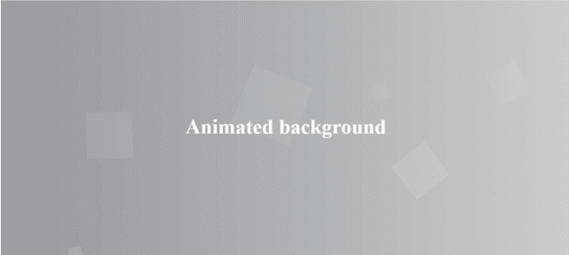

CSS 动画属性。

## 另一个示例：

```html
<!DOCTYPE html>
<html>
<head>
<style>
.container {
  display:Flex;
  width: 200px;
  height: 200px;
  background-color: red;
  animation-name: example;
  animation-duration: 4s;
  text-align: center;
  align-items: center;
  margin:0 auto;
}

@keyframes example {
  0% {background-color: rgb(248, 169, 169)};
  25% {background-color: rgb(197, 197, 92)};
  50% {background-color: rgb(118, 118, 193)};
  100% {background-color: rgb(135, 245, 135)};
}
</style>
</head>
```

```html
<body>
<div class="container">
<h1>CSS 动画</h1>

</</div>
</body>
</html>
```

代码的输出如下：

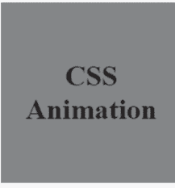

CSS 动画属性（第二个示例）。

现在在下面的示例中，我们将使用我们上面讨论过的属性来使用动画。

```html
<!DOCTYPE html>
<html>
<head>
<style>

.demo_container{
  text-align: center;
}
.parent {
display: flex;
align-items: center;
justify-content: center;
}
.child {
width: 100px;
height: 100px;
background-color: rgb(111, 207, 236);
position: relative;
animation-name: demo;
```

```css
animation-duration: 4s;
animation-delay: 2s;
display: flex;
align-items: center;
justify-content: center;
border-radius:20px;
```

```css
@keyframes demo {
0% { background-color: rgb(234, 141, 141); left:
-100px; top: 0px; }
25% { background-color: rgb(212, 212, 156); left:
200px; top: 0px; }
50% { background-color: rgb(103, 103, 186); left:
200px; top: 20px; }
75% { background-color: rgb(141, 230, 141); left:
-100px; top: 200px; }
100% { background-color: rgb(199, 99, 99); left:
-100px; top: 0px; }
```

```html
</style>
</head>
<body>
<div class="demo_container">
<h1>CSS 动画</h1>

<div class="parent">
<div class="child"></div>
</</div>
</</div>
</body>
</html>
```

代码的输出如下：

## CSS 动画


CSS 动画属性（第三个示例）。

## CSS 背景属性

`background` 是一个设置单个属性的简写属性，即 `background-image`、`background-position`、`background-size`、`background-repeat`、`background-attachment`、`background-origin` 和 `background-color` 的合集。它的语法如下：

```
background: image size repeat attachment color | initial | inherit
```

- **background-attachment 属性**：`background-attachment` 属性定义背景图像是滚动还是固定在可视区域。它的语法如下：

  ```css
  background-attachment: scroll | fixed | initial | inherit
  ```

- **background-color 属性**：`background-color` 属性设置元素的颜色。你可以通过颜色值或关键字设置元素的背景。元素的背景是元素的大小（包括内边距）。它的语法如下：

  ```css
  background-color: color | transparent | initial | inherit
  ```

- **background-clip 属性**：`background-clip` 属性指定元素的背景是否扩展到边界。它的语法如下：

  ```css
  background-clip: border-box | padding-box | content-box | initial | inherit
  ```

示例：

```html
<!DOCTYPE html>
<html lang="en">
<head>
<meta charset="utf-8">
<title>CSS 裁剪示例</title>
<style>
.box {
  width: 200px;
  height: 100px;
  padding: 10px;
  border: 2px dashed #333;
  background: rgb(140, 190, 200);
}

.clip1 {
  background-clip: border-box;
}
.clip2 {
  background-clip: padding-box;
}
.clip3 {
  background-clip: content-box;
}
</style>
</head>
<body>

<h1>CSS 背景裁剪</h1>
<div class="flex-1">
  <h2>默认行为</h2>
  <div class="box"></div>
  <h2>使用 border-box 裁剪</h2>
  <div class="box clip1"></div>
</div>
<div class="flex-2">
  <h2>使用 padding-box 裁剪</h2>
  <div class="box clip2"></div>
  <h2>使用 content-box 裁剪</h2>
  <div class="box clip3"></div>
</div>
</body>
</html>
```

背景裁剪的输出如下：

## CSS 背景裁剪

默认行为

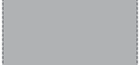

使用 border-box 裁剪

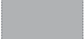

使用 padding-box 裁剪

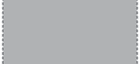

使用 content-box 裁剪

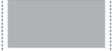

CSS 背景裁剪。

- **background-image 属性**：`background-image` 属性设置元素的背景图像。通常使用简写属性 `background` 更好。

  - 属性的语法如下：

    `background-image: url | none | initial | inherit`

示例：


```html
<!DOCTYPE html>
<html>
<head>
<style>
.demo_container{
  text-align: center;
}
.parent {
  display: flex;
  align-items: center;
  justify-content: center;
  background-image: url("/images-1.jpg");
}

.child {
  height: 100vh;
  display: flex;
  align-items: center;
  justify-content: center;
}
</style>
</head>
<body>
<div class="demo_container">

  <div class="parent">
    <div class="child<h1>CSS 背景图像</h1></div>
  </div>

</body>
</html>
```

该代码的输出如下：

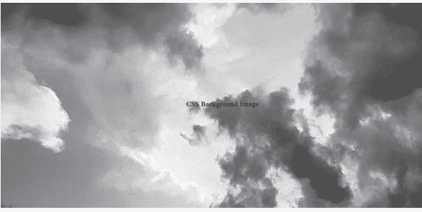

CSS 背景图像。

# 64 精通 CSS

- **`background-origin` 属性**：`background-origin` CSS 属性指定背景的定位区域，即使用 `background-image` 属性指定的图像的起始位置。该属性的语法如下：

```css
background-origin: border-box | padding-box | content-box: initial | inherit
```

```html
<!DOCTYPE html>
<html>
<head>
<style>
.demo_container {
  text-align: center;
}
.parent {
  height: 500px;
  display: flex;
  align-items: center;
  justify-content: center;
}
.child {
  width: 500px;
  height: 400px;
  padding: 10px;
  border: 6px dashed #333;
  background: url("images-1.jpg") no-repeat;
  background-size: cover;
  background-origin: content-box;
}
</style>
</head>
<body>
<div class="demo_container">
  <div class="parent">
    <div class="child<h1>背景起始在这里应用内边距</h1></div>
  </div>
</div>
</body>
</html>
```

代码的输出如下：

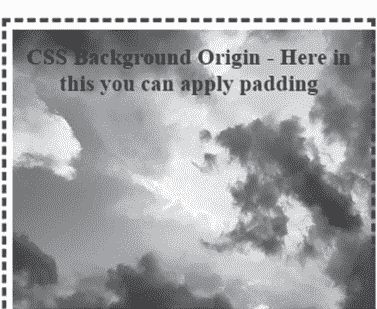

CSS 背景起始。

## 内边距示例：

```html
<!DOCTYPE html>
<html>
<head>
<style>
.demo_container{
  text-align: center;
}
.parent {
  height: 500px;
  display: flex;
  align-items: center;
  justify-content: center;
}
.child {
  width: 500px;
  height: 400px;
  padding: 10px;
  border: 6px dashed #333;
  background: url("images-1.jpg") no-repeat;
  background-size: cover;
  background-origin: padding-box;
}
}
```

注：这里我修正了原文多出的的大括号。

- **`background-position` 属性**：`background-position` 属性设置元素背景图像的初始位置（即起始位置）。通常使用简写属性 `background` 更好。
  - 它的默认值是：`0% 0%`。
  - 该属性的语法如下：
    `background-position: [ percentage | length | left | center | right ]1 or 2 values | initial | inherit`

## 示例：

```html
<!DOCTYPE html>
<html>
<head>
<style>

.demo_container{
  text-align: center;
}
.parent {
  display: flex;
  align-items: center;
  justify-content: center;
}
.child {
  border: 6px dashed #333;
  background: url("/images-1.jpg") no-repeat;
  background-position: 50% center;
}

</style>
</head>
<body>
<div class="demo_container">

  <div class="parent">
    <div class="child">
      <h1>CSS Background Position - 50% center</h1>
    </div>
  </div>
</div>
</body>
</html>
```

代码输出如下：

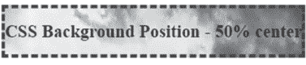

CSS 背景位置（background position）。

7. **`background-repeat` 属性**：`background-repeat` CSS 属性指定背景图像在调整尺寸和位置后是否重复或平铺。通常建议使用简写属性 `background`。
该属性的语法如下：

```
background-repeat: repeat | repeat-x | repeat-y | no-repeat | initial | inherit
```

示例：

```html
<!DOCTYPE html>
<html>
<head>
<style>
.demo_container{
  text-align: center;
}
.parent {
  display: flex;
  align-items: center;
  justify-content: center;
}
.child {
  width:500px;
  height:500px;
  border: 6px dashed #333;
  background: url("/images-1.jpg") no-repeat;
  background-repeat: repeat-y;
}
</style>
</head>
<body>
<div class="demo_container">
  <div class="parent">
    <div class="child"><h1>CSS Background Repeat - repeat-y</h1></div>
  </div>
</div>
</body>
</html>
```

代码输出如下：

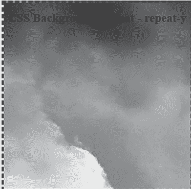

CSS 背景重复(y)。

## 另一个示例：

```html
<!DOCTYPE html>
<html>
<head>
<style>
.demo_container{
  text-align: center;
}
.parent {
  display: flex;
  align-items: center;
  justify-content: center;
}
.child {
  width:500px;
  height:500px;
  border: 6px dashed #333;
  background: url("/images-1.jpg") no-repeat;
  background-repeat: repeat-x;
}

```

</style>

</head>

<body>

<div class="demo_container">

  <div class="parent">

    <div class="child"><h1>CSS Background Repeat - repeat-x</h1></div>

  </div>

</div>

</body>

</html>

```

代码输出如下：

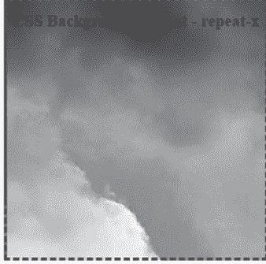

CSS 背景重复(x)。

8. **`background-size` 属性**：`background-size` 属性定义背景图像的大小。
该属性的语法如下：

```
background-size: length | percentage | auto | cover | contain | initial | inherit
```

示例：

```html

<!DOCTYPE html>

<html>

<head>

<style>

## CSS 属性 71

.demo_container{

  text-align: center;

}

.parent {

  display: flex;

  align-items: center;

  justify-content: center;

}

.child-1 {

  width:500px;

  height:500px;

  border: 6px dashed #333;

  background: url("/images-1.jpg") no-repeat;

  background-size: contain;

}

.child-2 {

  width:500px;

  height:500px;

  border: 6px dashed #333;

  background: url("/images-1.jpg") no-repeat;

  background-size: cover;

}

</style>

</head>

<body>

<div class="demo_container">

<html>

<div class="parent">

  <div class="child-1"><h1>CSS Background Size - Contain</h1></div>

  <div class="child-2"><h1>CSS Background Size - Cover</h1></div>

</div>

</div>

</body>

</html>

```

代码输出如下所示：

| CSS Background Size - Contain | CSS Background Size - Cover |
|---|---|
|  |  |

CSS 背景尺寸完全覆盖。

## CSS 属性

`border` 属性设置元素四边的宽度、样式和颜色。它是用于设置各个边框属性的简写属性，即在一条声明中设置 `border-width`、`border-style` 和 `border-color`。
该属性的语法如下：

```
border: border-width border-style border-color
```

示例：

```html

<!DOCTYPE html>

<html>

<head>

<style>

.demo_container{

  text-align: center;

  display: flex;

  justify-content: center;

  align-items: center;

}

.child-1 {

  width:500px;

  height:500px;

  border: 5px solid rgb(209, 21, 21);

  background-color: rgb(226, 230, 12);

  color:white;

  justify-content: center;

  align-items: center;

  font-size: 32px;

}

</style>

</head>

<body>

<div class="demo_container">

  <div class="child-1"><h1>CSS Border</h1></div>

</div>

</body>

</html>

```

代码输出如下：

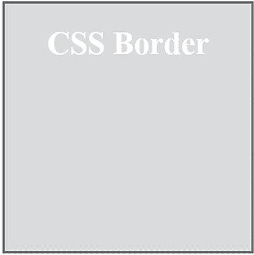

CSS 边框属性（border property）。

1. **`border-width`**：`border-width` CSS 属性是用于设置宽度的简写属性，即在一条声明中设置 `border-top-width`、`border-right-width`、`border-bottom-width` 和 `border-left-width`。该属性的语法如下：

```
border-width: thin | medium | thick | length | inherit
```

示例：

```html

<!DOCTYPE html>

<html>

<head>

<style>

.demo_container{

  width:500px;

  margin:0 auto;

  text-align: center;

  justify-content: center;

  align-items: center;

}

p.one {

  border-color: rgb(221, 104, 104);

  border-style: solid;

  border-width: 2px;

}

p.two {

  border-color: rgb(193, 221, 90);

  border-style: solid;

  border-width: 2px 5px;

}

p.three {

  border-color: rgb(93, 231, 109);

  border-style: solid;

  border-width: 2px 5px 7px;

}

p.four {

  border-color: rgb(212, 106, 241);

  border-style: solid;

}

</style>

</head>

<body>

<div class="demo_container">

  <h1>CSS Border Property Width</h1>

  <p class="one"><strong>单值语法：</strong>这里是单个值，用于设置所有边边的宽度。</p>

  <p class="two"><strong>双值语法：</strong>第一个值设置顶部和底部的宽度，第二个值设置左侧和右侧的宽度。</p>

  <p class="three"><strong>三值语法：</strong>第一个值设置顶部，第二个值设置左右，第三个值设置底部（这会覆盖第一个值的设置）。</p>

  <p class="four"><strong>四值语法：</strong>四个值分别设置顶部、右侧、底部和左侧的宽度。</p>

</div>

</body>

</html>

```

代码输出如下：

## CSS 边框属性宽度（Border Width）

| 单值语法 | 双值语法 | 三值语法 | 四值语法 |
|---|---|---|---|
| 设置所有四边的宽度 | 设置顶部/底部宽度，左右宽度 | 设置顶部宽度，左右宽度，底部宽度 | 分别设置顶、右、底、左宽度 |

2. **`border-bottom` 属性**：`border-bottom` CSS 属性是设置元素底部边框宽度、样式和颜色的简写属性。它在一条声明中设置 `border-bottom-width`、`border-bottom-style` 和 `border-bottom-color`。
该属性的语法如下：

```
border-bottom: border-bottom-width border-bottom-style border-bottom-color | initial | inherit
```

示例：

```html

<!DOCTYPE html>

<html>

<head>

<style>

.container{

  width:400px;

  margin:0 auto;

  text-align: center;

  justify-content: center;

  align-items: center;

}

.text-1 {

  border-left: 4px solid #ee2525;

}

.text-2 {

  border-right: 3px solid #26e126;

}

.text-3 {

  border-top: 4px solid #d42323;

}

.text-4 {

  border-bottom: 3px solid #24d024;

}

</style>

</head>

<body>

<div class="container"> Left, Bottom, Right, Top <h1>CSS Border</h1>


## CSS 边框属性 - 左、下、右、上

Lorem ipsum dolor sit amet consectetur adipisicing elit. Maxime mollitia, molestiae quas vel sint commodo repudiandae consequuntur voluptatum laborum numquam blanditiis harum quisquam eum est sed odit fugiat iusto fuga praesentium optio, eaque rerum!

Provident similique accantium nemo autem. Veritatis obcaecati tenetur iure eum earum ut molestiae architecto voluptate aliquam nihil, eveneniet aliquid culpa officia aut!

Lorem ipsum dolor sit amet consectetur adipisicing elit. Maxime mollitia, molestiae quas vel sint commodo repudiandae consequuntur voluptatum laborum numquam blanditiis harum quisquam eum est sed odit fugiat iusto fuga praesentium optio, eaque rerum!

Provident similique accantium nemo autem. Veritatis obcaecati tenetur iure eum earum ut molestiae architecto voluptate aliquam nihil, eveneniet aliquid culpa officia aut!

CSS 边框属性 – 左、下、右、上。

- 3. **border-bottom-color 属性**：`border-bottom-color` 属性用于单独设置元素底部边框的颜色。然而，在其他情况下，像 `border color` 或 `border bottom` 这样的简写属性更方便使用且更优。该属性的语法如下：

```css
border-bottom-color: color | transparent | inherit
```

## CSS 属性 ■ 79

## 示例：

```html
<!DOCTYPE html>
<html>
<head>
<style>
.demo_container{
  width:400px;
  margin:0 auto;
  text-align: center;
  justify-content: center;
  align-items: center;
}
.text-1 {
  border-style: solid;
  border-bottom-color: #d83838;
}
.text-2{
  border-style: solid;
  border-left-color: #aec730;
}
text-3{
  border-style: solid;
  border-right-color: #e12424;
}
text-4{
  border-style: solid;
  border-top-color: #ffaa00;
}
</style>
</head>
<body>
<div class="demo_container">
<h1>CSS 底部边框属性 - 左、下、右、上</h1>
<p class="text-1">Lorem ipsum dolor sit amet adipisicing elit. Maxime mollitia, molestiae quas vel sint commodo repudiandae consequatur consequuntur voluptatum laborum nonquam blanditiis harum quisquam eius sed odit fugiat iusto fuga praesentium optio, aeque rerum!</p>
<p class="text-2">Provident similique accusamiam nemo autem. Veritatis obcaecati tenetur iure eum earum ut molestias architecto voluptate aliquam nihil, eveniet aliquid culpa officia aut!</p>
<p class="text-3">Lorem ipsum dolor sit amet consectetur adipiscing elit. Maxime mollitia, molestiae quas vel sint commodi repudiandae consequuntur voluptatum laborum numquam blanditiis harum quisquam eius sed odit fugiat iusto fuga praesentium optio, aeque rerum!</p>
<p class="text-4">Provident similique accusamiam nemo autem. Veritatis obcaecati tenetur iure eum earum ut molestias architecto voluptate aliquam nihil, eveniet aliquid culpa officia aut!</p>
</div>
</body>
</html>
```

- 4. **border-bottom-left-radius 属性**：`border-bottom-left-radius` 属性用于设置元素边框盒“左下”角的的圆角形状。

示例：

```html
<!DOCTYPE html>
<html>
<head>
<style>
.demo_container{
width:400px;
margin:0 auto;
text-align: center;
justify-content: center;
align-items: center;
```
```css
.text-1 {
  border-style: solid;
  border-bottom-left-radius: 20px;
}
.text-2{
  border-style: solid;
  border-bottom-right-radius: 20px;
}
```
```css
</style>
</head>
<body>
<div class="demo_container">
  <h1>CSS 底部左下角属性 - 左、右</h1>
  <p class="text-1">Lorem sit amet consectetur adipiscing elit. Maxime mollitia, molestiae quas vel sint commodo numquam repudiandae consequuntur voluptam eius sed od fugiat iusto fuga quisquam eius blanditiis harum praesentium optio, eque rerum!</p>
  <p class="text-2">Provident similique accusamantium iure autem. Veritatis obcaecati tenetur iure earum ut molestias architecto voluptate aliquam nhil, eveniet aliquid culpa officia aut!</p>
</div>
</body>
</html>
```

代码的输出如下：

## CSS 底部边框属性 - 左、下、右、上

| 文本内容 |
| :--- |
| Lorem ipsum dolor sit amet consectetur adipiscing elit. Maxime mollitia, molestiae quas vel sint commodi repudiandaeandae consequuntur voluptatum laborum numquam land-tiis harum quisquam eius sed odit fugiat iusto fuga praesentium optio, eque rerum! |
| Provident similike accuantium nemo autem. Veritatis obcaecati tenetur iure eius earum ut molestias architecto voluptate aliquam nihil, eveniet aliquid culpa officia aut! |
| Lorem ipsum dolor sit amet consectetur adipiscing elit. Maxime mollitia, molestiae quas vel sint commodi repudiandaeandae consequuntur voluptatum laborum numquam land-tiis harum quisquam eius sed odit fugiat iusto fuga praesentium optio, eque rerum! |
| Provident similike accuantiam nemo autem. Veritatis obcaecati tenetur iure eius earum ut molestias architecto voluptate aliquam nihil, eveniet aliquid culpa officia aut! |

- 5. **border-bottom-color 属性**：`border-bottom-color` 属性用于单独设置元素底部边框的颜色。然而，在其他情况下，像 `border color` 或 `border bottom` 这样的简写属性更方便使用且更优。该属性的语法如下：

```css
border-bottom-color: color | transparent | inherit
```

## 86 精通 CSS

## 6. border-image 属性：`border-image` CSS 属性指定了如何使用图像来代替边界样式。这是一个用于一次性设置 `border-image-source`、`border-image-width`、`border-image-slice`、`border-image-outset` 和 `border-image-repeat` 属性的属性。该属性的语法如下：

```
border-image: [ source slice width outset repeat ] | initial | inherit
```

示例：

```html
<!DOCTYPE html>
<html>
<head>
<style>
.demo_container{
  width:400px;
  margin:0 auto;
  text-align: center;
  justify-content: center;
  align-items: center;
}
.box {
  width: 300px;
  height: 150px;
  border: 15px solid transparent;
  border-image: url("/images-1.jpg") 30 30 round;
}
</style>
</head>
<body>
<div class="demo_container">
  <h1> CSS border-image 属性</h1>
  <div class="box"></div>
</div>
</body>
</html>
```

代码的输出如下：

## CSS border-image 属性

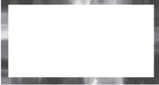

CSS border-image 属性。

## CSS 颜色属性

CSS 颜色功能设置文本元素内容的颜色。所有现代网络浏览器都支持不同的颜色以保持色彩丰富的显示。在 CSS 中，颜色可以用多种方式表示，甚至可以使用诸如 "color: blue" 这样的颜色单词。然而，这种方法仅支持颜色名称。因此，在 CSS 中使用了其他更高级的方法来显示颜色，如 RGB、HSL、HEX 等。

示例：

```html
<!DOCTYPE html>
<html>
<head>
<style>
.demo_container{
width:400px;
margin:0 auto;
text-align: center;
justify-content: center;
align-items: center;
color:red
}
.c1{
color: black;
}
.c2 {
color:green
}
</style>
</head>
<body>
<div class="demo_container">
  <h1>CSS 颜色属性</h1>
  <p class="c1">这里我们使用简单的颜色代码（黑色）。</p><br>
  <p class="c2">这里我们使用简单的颜色代码（绿色）。</p><br>
</body>
</html>
```

代码的输出如下：

## CSS 颜色属性

这里我们使用简单的颜色代码（黑色）。

这里我们使用简单的颜色代码（绿色）。

CSS 颜色属性 (color)。

## RGB 颜色

RGB 是三种颜色（红、绿、蓝）的组合，用于所有计算机程序中显示颜色。正如我们所知，这些是基础色，通过组合它们，我们可以找到色谱中出现的任何颜色。

示例：

```html
<!DOCTYPE html>
<html>
<head>
<style>
.demo_container{
  width:400px;
margin:0 auto;
text-align: center;
justify-content: center;
align-items: center;
}
.c1{
color: rgb(205, 92, 92);
}
.c2 {
color:rgb(100, 149, 237);
}
</style>
</head>
<body>
<div class="demo_container">
<h1>CSS 颜色属性 (RGB)</h1>
<p class="c1">这里我们使用 RGB 代码（rgb(205, 92, 92)).</p><br>
<p class="c2">这里我们使用 RGB 颜色代码（rgb(100, 149, 237)).</p><br>
</body>
</html>
```


代码的输出如下：

## CSS 颜色属性 (RGB)

这里我们使用 RGB 颜色代码（`rgb(205, 92, 92)`）.

这里我们使用 RGB 颜色代码（`rgb(100, 149, 237)`）.

CSS 颜色属性 (RGB)。

## RGBA 颜色

在 CSS 中，RGBA 也是一种带有 Alpha 通道扩展的颜色显示格式。该颜色的结构如下所示：

`rgba` (红, 绿, 蓝, Alpha)

在此工作中，Alpha 用于表示颜色的透明度。在 CSS 透明度中，该区域用于设置颜色的亮度，其范围在 0.0 到 1.0 之间，其中0.0 代表完全透明，1.0 代表完全不透明。你将在提供的示例中获得更好的理解。

```html
<!DOCTYPE html>
<html>
<head>
<style>
.demo_container{
width:400px;
margin:0 auto;
text-align: center;
justify-content: center;
align-items: center;
}
.c1{
background-color: rgba(11, 156, 49, 0.2);
}
.c2 {
background-color: RGBA(11, 156, 49, 0.4);
}
.c3{
background-color: rgba(11, 156, 49, 0.6);
}
.c4 {
background-color: RGBA(11, 156, 49, 0.8);
}
.c5{
background-color: rgba(11, 156, 49, 1);
}
</style>
</head>
<body>
<div class="demo_container">
<h1> CSS 颜色属性 (RGBA)</h1>
<p class="c1">这里我们使用 RGBA 代码（rgba(11, 156, 49, 0.2)).</p><br>
<p class="c2">这里我们使用 RGBA 颜色代码（RGBA(11, 156, 49, 0.4)).</p><br>
<p class="c3">这里我们使用 RGBA 颜色代码（rgba(11, 156, 49, 0.6)).</p><br>
<p class="c4">这里我们使用 RGBA 颜色代码（RGBA(11, 156, 49, 0.8)).</p><br>
<p class="c5">这里我们使用 RGBA 颜色代码（rgba(11, 156, 49, 1)).</p><br>
</body>
</html>
```

代码的输出如下：

| CSS 颜色属性 (RGBA) |
| :--- |
| 这里我们使用 RGBA 代码（rgba(11, 156, 49, 0.2)). |
| 这里我们使用 RGBA 颜色代码（RGBA(11, 156, 49, 0.4)). |
| 这里我们使用 RGBA 颜色代码（rgba(11, 156, 49, 0.6)). |
| 这里我们使用 RGBA 颜色代码（RGBA(11, 156, 49, 0.8)). |
| 这里我们使用 RGBA 颜色代码（rgba(11, 156, 49, 1)). |

CSS 颜色属性 (RGBA)。

## HEX 颜色

CSS 颜色也可以通过十六进制值定义，这是表示颜色的方法。在 CSS 中，最常用的定义颜色方法是使用 "#"符号，如 #RGB。组合 0-9 和 A-F 的十六进制数字用于在 CSS 中表示颜色。以下是 HEX 颜色示例。

```html
<!DOCTYPE html>
<html>
<head>
<style>
.demo_container{
  width:400px;
margin:0 auto;
text-align: center;
justify-content: center;
align-items: center;
color:red
}
.c1{
color: #6495ed;
}
.c2 {
color:#b22222
}
</style>
</head>
<body>
<div class="demo_container">
<h1> CSS 颜色属性 (HEX)</h1>
<p class="c1">这里我们使用 HEX 代码（#6495ed）。</p><br>
<p class="c2"> 这里我们使用 HEX 代码（#b22222）。</p><br>
</body>
</html>
```

下方代码的输出：

## CSS 颜色属性 (HEX)

这里我们使用 HEX 代码（`#6495ed`）。

这里我们使用 HEX 代码（`#b22222`）。

CSS 颜色属性 (HEX)。

## 1. opacity 属性：`opacity` 属性指定元素的透明度。该属性的语法如下：

```
opacity: value | initial | inherit
```

示例：

```html
<!DOCTYPE html>
<html>
<head>
<style>
.demo_container{
  width: 400px;
  margin: 0 auto;
text-align: center;
  justify-content: center;
align-items: center;
}
.c1{
  opacity: 0.4;
}
img{
  background-image: url('/images-1.jpg');
  width: "300px"
  height: "300px"
  opacity: 0.5;
}
</style>
</head>
<body>
  <div class="demo_container">
    <h1> CSS 颜色透明度属性</h1>
    <h2 class="c1">这里我们使用透明度代码颜色。</h2><br>
    
  </div>
</body>
</html>
```

2. 代码的输出如下：

## CSS 颜色透明度属性

这里我们使用透明度代码颜色。


CSS 颜色透明度属性。

## CSS 尺寸属性

### 1. height 属性：`height` CSS 属性指定元素内容区域的高度。内容区域不包括内边距、边框或外边距。
该属性的语法如下：

```
height: length | percentage | auto | initial | inherit
```

示例：

```html
<!DOCTYPE html>
<html>
<head>
<style>
.demo_container{
width:300px;
margin:0 auto;
text-align: center;
justify-content: center;
align-items: center;
}
.cl{
background-color: palevioletred;
height: 200px;
width:300px;
}
img{
background-image: url('/images-1.jpg');
width: 300px;
height: 300px;
}
</style>
</head>
<body>
<div class="demo_container">
<h1> CSS 尺寸属性 - 高度，宽度</h1>
<h2 class="cl">高度为 "200"，宽度为 "300"</h2><br>

</body>
</html>
```

代码的输出如下：

## CSS 尺寸
属性 - 高度，宽度

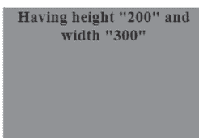

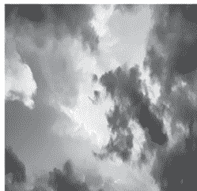

CSS 尺寸属性 –高度，宽度。

### 2. max-height 和 max-width 属性：`max-height` 属性指定元素内容区域的最大高度。此最大高度不包括内边距、边框或外边距。
`max-width` 属性定义元素内容区域的最大宽度。此最大宽度不包括内边距、边框或外边距
该属性的语法如下：

```
max-height: length | percentage | none | initial | inherit
```

该属性的语法如下：

```
max-width: length | percentage | none | initial | inherit
```

示例：

```html
<!DOCTYPE html>
<html>
<head>
<style>
.demo_container{
  width:500px;
  height:500px;
  margin:0 auto;
  text-align: center;
  justify-content: center;
  align-items: center;
}
.cl{
  background-color: palevioletred;
  max-height: 300px;
  max-width: 300px;
}
img{
  background-image: url('/images-1.jpg');
  max-height: 200px;
  max-width: 300px;
}
</style>
</head>
<body>
<div class="demo_container">
<h1>CSS 尺寸属性 - 高度，宽度</h1>
<p class="cl">具有最大高度 "200" 和最大宽度 "300"</p><br>

</div>
</body>
</html>
```

代码的输出如下：

## CSS 尺寸属性 - 最大高度，最大宽度

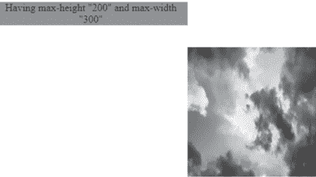

CSS 尺寸属性 – max-height, max-width。

- 3. min-height 属性：元素内容区域的最小高度属性。此最小高度不包含内边距、边框或外边距。

该属性的语法给出：

```css
min-height: length | percentage | initial | inherit
```

示例：

```html
<!DOCTYPE html>
<html>
<head>
<style>
.demo_container{
width:800px;
height:500px;
margin:0 auto;
text-align: center;
justify-content: center;
align-items: center;
}
.cl{
background-color: palevioletred;
min-height: 200px;
min-width:200px;
}
img{
  background-image: url('/images-1.jpg');
  min-height: 200px;
  min-width:200px;
}
</style>
</head>
<body>
<div class="demo_container">
  <h1> CSS 尺寸属性 - 最小高度，最小宽度</h1>
  <p class="c1">具有最小高度 "200" 和 最小宽度 "300"</p>
  
</div>
</body>
</html>
```

## CSS 生成内容属性

- 1. content 属性：content 属性-- CSS 属性用于与 ::before 和 :after 伪元素结合使用，以便在元素中生成内容。该属性的语法给出：

```css
content: normal | none | counter | string | url(url) | attr(attribute) | open-quote | close-quote | no-open-quote | no-close-quote | initial | inherit
```

示例：

```html
<!DOCTYPE html>
<html>
<head>
<style>
.demo_container{
width:800px;
height:500px;
margin:0 auto;
text-align: center;
justify-content: center;
align-items: center;
}
.before:::before{
  content: "Hi! ";
  display: inline;
  background-color: rgb(211, 81, 81);
}
.after:::after{
  content: "Bye! ";
  display: inline;
  background-color: rgb(224, 79, 79);
}
</style>
</head>
<body>
<div class="demo_container">
  <h1> CSS 内容属性</h1>
  <p class="before"> 文本将添加到你代码中的每个段落之前 </p>
  <p class="after"> 文本将添加到你代码中的每个段落之前 </p>
</div>
</body>
</html>
```

代码的输出如下：

## CSS 内容属性

**Hi** 文本将添加到你代码中的每个段落之前

文本将添加到你代码中的每个段落之前 **Bye**。

CSS 内容属性。

- 2. quotes 属性：quotes CSS 属性指定嵌入引用的引号。为此属性指定的引号字符将用于 content 属性的 open-quote（起始引号）和 close-quote（结束引号）值。

该属性的语法给出：

```css
quotes: [string string] one or more pairs | none | initial | inherit
```

## 示例：

```html
<!DOCTYPE html>
<html>
<head>
<style>
.demo_container{
width:800px;
height:500px;
margin:0 auto;
text-align: center;
justify-content: center;
align-items: center;
}
q{
 quotes: '[' ']' '"' '"';
}
.q::before {
content: open-quote;
}
.q::after {
content: close-quote;
}
</style>
</head>
<body>
<div class="demo_container">
<h1> CSS 内容属性</h1>
<p class="before"><q> 文本将添加到你代码中的每个段落之前，带有 <q>嵌入引用</q></p>
<p class="after"> 文本将添加到你代码中的每个段落之前 <q>嵌入引用</q></p>
</div>
</body>
</html>
```

- 3. counter-reset 属性：counter-reset CSS 属性与 counter-increment 属性结合使用以创建计数器，并与 content 属性结合以显示生成的值。

该属性的语法如下：

```css
counter-reset: [ identifier integer ] more pairs | none | initial | inherit
```

示例：

```html
<!DOCTYPE html>
<html>
<head>
<style>
.demo_container{
width:800px;
height:500px;
margin:0 auto;
text-align: center;
justify-content: center;
align-items: center;
}
h1 {
  counter-reset: category;
}
::before {
  counter-increment: category;
  content: counter(category);
}
.after {
  counter-increment: category;
  content: counter(category);
}
li{
  list-style: none;
}
</style>
</head>
<body>
<div class="demo_container">
  <h1> 计数器重置</h1>
  <ul class="before">A</ul>
  <ul class="after">B</ul>
</div>
</body>
</html>
```


代码的输出如下：

## 计数器重置

A
B

## FLEX 布局

`align-content` 属性描述了 flex 容器内行的对齐方式。当有剩余空间时，它决定了行如何分布。

- 1. `center`：在容器中居中对齐。
- 2. `flex-start`：在容器的起始处对齐。
- 3. `flex-end`：在容器的末尾对齐。
- 4. `stretch`：拉伸以填充容器空间（默认值）。
- 5. `space-around`：在行周围均匀分布剩余空间。
- 6. `space-between`：在行之间均匀分布剩余空间，两端对齐。
- 7. `initial`：设为默认值。
- 8. `inherit`：继承父元素的值。

该属性的语法给出：

```css
align-content: center | flex-start | flex-end | stretch | space-around | space-between | initial | inherit
```

示例：

```html
<!DOCTYPE html>
<html>
<head>
<style>
.demo_container{
  display: flex;
  flex-wrap: wrap;
  align-content: space-around;
  width: 500px;
  height: 500px;
  margin: 0 auto;
  background: lightgrey;
}
.item{
  width: 100px;
  height: 100px;
  background: tomato;
}
</style>
</head>
<body>
<div class="demo_container">
  <div class="item">1</div>
  <div class="item">2</div>
  <div class="item">3</div>
  <div class="item">4</div>
  <div class="item">5</div>
  <div class="item">6</div>
</div>
</body>
</html>
```

代码的输出如下：

## FLEX 布局

| 1 | 2 | 3 |
|---|---|---|
| 4 | 5 | 6 |

### CSS 字体属性

`font` 属性设置元素文本内容的样式、变体、粗细、行高和字体。它是为了在一个声明中设置单个字体属性，即 `font-style`、`font-variant`、`font-weight`、`font-size`、`line-height` 和 `font-family`。

该属性的语法给出：

```css
font: [ font-style font-variant font-weight font-size line-height font-family | caption | icon | menu | message-box | small-caption | status-bar | initial | inherit ]
```

示例：

```html
<!DOCTYPE html>
<html>
<head>
<style>
.demo_container{
width:800px;
height:500px;
margin:0 auto;
text-align: center;
justify-content: center;
align-items: center;
}
.before{
  font: bold 2.5em "Times Roman", Times,
  serif;
}
.after{
  font: normal 1.2em Arial, Helvetica, sans-serif;
}
</style>
</head>
<body>
<div class="demo_container">
  <h1> CSS 字体属性</h1>
</div>
</body>
</html>
```

## CSS 属性 ■ 113

在这里你可以获得 `list-style-type` 的多种值。

## CSS MARGIN 属性

`margin` 属性设置元素四边的外边距。它是 `margin-top`（上边距）、`margin-right`（右边距）、`margin-bottom`（下边距）和 `margin-left`（左边距）属性的复合属性。

该属性的语法如下：

```
margin: [ 长度 | 百比 | auto ] 1 到 4 个值 | initial | inherit
```

### 示例

```html
<!DOCTYPE html>
<html>
<head>
<style>
.demo_container{
width:600px;
margin:0 auto;
text-align: center;
justify-content: center;
border:1px solid red;
align-items: center;
}
.text-1 {
border-style: solid;
margin: 25px;
}
.text-2{
border-style: solid;
margin: 20px 20px 20px 20px;
}
.text-3{
border-style: solid;
margin: 30px 30px;
}
.text-4{
border-style: solid;
margin: 30px 0px 30px 0px;
}
</style>
</head>
<body>
<div class="demo_container">
<h1>CSS margin 属性</h1>
<p class="text-1">Lorem ipsum sit amet consectetur adipisicing elit. Maxime mollitia, molestae quas vel sit commodi repudiandae consequuntur voluptatum laborum numquam blanditiis harum quisquam eum sed odit fugiat iusto fuga praesentium optio, eque rerum!</p> <br>
<p class="text-2">Provident similique accusantium nemo autem. Veritatis obcaecati tenitur iure earum ut molestias architecto voluptate aliquam nihil, eveneniet aliquid culpa officia aut!</p> <br>
<p class="text-3">Lorem ipsum dolor sit amet consectetur adipiscing elit. Maxime mollitia, molestae quas vel sit commodi repudiandae consequuntur voluptatum laborum numquam blanditiis harum quisquam eum sed odit fugiat iusto fuga praesentium optio, eque rerum!</p> <br>
<p class="text-4">Provident similique accuantium autem. Veritatis obcaecati tenitur iure earum ut molestias architecto voluptate aliquam nihil, eveneniet culpa officia aut!</p> <br>
</body>
</html>
```

这种表示法可以接受一个、二、三个或四个由空白符分隔的值。

- 1. 如果设置一个值，则 `margin` 应用于所有四边。
- 2. 如果设置两个值，则第一个值应用于顶部和底部，第二个值应用于右侧和左侧。
- 3. 如果设置三个值，则这些值分别应用于顶部、水平方向（即右侧和左侧）、底部。
- 4. 如果设置四个值，则按相同顺序应用于顶部、右侧、底部、左侧。

与其使用 `margin`，你应该使用其他各种 `margin-top`、`margin-right`、`margin-bottom` 和 `margin-left`。

### 示例

```html
<!DOCTYPE html>
<html>
<head>
<style>
.demo_container{
width:600px;
margin:0 auto;
text-align: center;
justify-content: center;
border: 2px solid black;
align-items: center;
}
.text-1 {
border:1px solid red ;
margin-top: 25px;
}
.text-2{
border:1px solid red ;
margin-right: 20px;
}
.text-3{
border:1px solid red ;
margin-bottom: 20px;
}
.text-4{
border:1px solid red ;
margin-left: 30px ;
}
</style>
</head>
<body>
<div class="demo_container">
<h1>CSS margin - 属性 (上边距, 右边距,下边距,左边距)</h1>
<p class="text-1">Lorem dolor sit amet consectetur adipiscing elit. Maxime mollitia, molestiae quas vel sint commudi repudiandae consequuntur voluptatum laborum numquam blanditiis harum quisquam eius sed odit fugiat iusto fuga praesentium optio, eaque rerum!</p><br>
<p class="text-2">Provident similique accusantium nemo autem. obcaecati tenetur iure eius harum ut molestias architecto voluptate aliquam nihil, eveneniet aliquid culpa officia aut!</p><br>
<p class="text-3">Lorem ipsum dolor sit amet consectetur adipiscing elit. Maxime mollitia, molestiae quas vel sint commudi repudiandae consequuntur voluptatum laborum numquam blanditiis harum quisquam eius sed odit fugiat iusto fuga praesentium optio, eaque rerum!</p><br>
<p class="text-4">Provident similique accusantium nemo autem. Veritatis tenetur iure eius harum ut molestias architecto voluptate aliquam nihil, eveneniet culpa officia aut!</p><br>
</body>
</html>
```

```html
<!DOCTYPE html>
<html lang="en">
<head>
<meta charset="utf-8">
<title>CSS3 column-count 属性示例</title>
<style>
 p {
  column-count: 2; /* 标准语法 */
}
</style>
```

## CSS3 column-count 属性


Lorem ipsum dolor amet, adipiscing elit. Ut nisi egestas gravida. Sed vel dui mollis, porta ligula. vel orci vel arcu pellentesque fermentum. Duis bibendum metus. Aliquam tortor volutpat, sollicitudin felis libero. Aliquam consequat sapien, id blandit libero. Aliquam consequat sapien, id blandit libero. Aliquam consequat sapien, id blandit libero. Aliquam consequat sapien, id blandit libero. Aliquam consequat sapien, id blandit libero. Aliquam consequat sapien, id blandit libero. Aliquam consequat sapien, id blandit libero. Aliquam consequat sapien, id blandit libero. Aliquam consequat sapien, id blandit libero. Aliquam consequat sapien, id blandit libero. Aliquam consequat sapien, id blandit libero. Aliquam consequat sapien, id blandit libero. Aliquam consequat sapien, id blandit libero. Aliquam consequat sapien, id blandit libero. Aliquam consequat sapien, id blandit libero. Aliquam consequat sapien, id blandit libero. Aliquam consequat sapien, id blandit libero. Aliquam consequat sapien, id blandit libero. Aliquam consequat sapien, id blandit libero. Aliquam consequat sapien, id blandit libero. Aliquam consequat sapien, id blandit libero. Aliquam consequat sapien, id blandit libero. Aliquam consequat sapien, id blandit libero. Aliquam consequat sapien, id blandit libero. Aliquam consequat sapien, id blandit libero. Aliquam consequat sapien, id blandit libero. Aliquam consequat sapien, id blandit libero. Aliquam consequat sapien, id blandit libero. Aliquam consequat sapien, id blandit libero. Aliquam consequat sapien, id blandit libero. Aliquam consequat sapien, id blandit libero. Aliquam consequat sapien, id blandit libero. Aliquam consequat sapien, id blandit libero. Aliquam consequat sapien, id blandit libero. Aliquam consequat sapien, id blandit libero. Aliquam consequat sapien, id blandit libero. Aliquam consequat sapien, id blandit libero. Aliquam consequat sapien, id blandit libero. Aliquam consequat sapien, id blandit libero. Aliquam consequat sapien, id blandit libero. Aliquam consequat sapien, id blandit libero. Aliquam consequat sapien, id blandit libero. Aliquam consequat sapien, id blandit libero. Aliquam consequat sapien, id blandit libero. Aliquam consequat sapien, id blandit libero. Aliquam consequat sapien, id blandit libero. Aliquam consequat sapien, id blandit libero. Aliquam consequat sapien, id blandit libero. Aliquam consequat sapien, id blandit libero. Aliquam consequat sapien, id blandit libero. Aliquam consequat sapien, id blandit libero. Aliquam consequat sapien, id blandit libero. Aliquam consequat sapien, id blandit libero. Aliquam consequat sapien, id blandit libero. Aliquam consequat sapien, id blandit libero. Aliquam consequat sapien, id blandit libero. Aliquam consequat sapien, id blandit libero. Aliquam consequat sapien, id blandit libero. Aliquam consequat sapien, id blandit libero. Aliquam consequat sapien, id blandit libero. Aliquam consequat sapien, id blandit libero. Aliquam consequat sapien, id blandit libero. Aliquam consequat sapien, id blandit libero. Aliquam consequat sapien, id blandit libero. Aliquam consequat sapien, id blandit libero. Aliquam consequat sapien, id blandit libero. Aliquam consequat sapien, id blandit libero. Aliquam consequat sapien, id blandit libero. Aliquam consequat sapien, id blandit libero. Aliquam consequat sapien, id blandit libero. Aliquam consequat sapien, id blandit libero. Aliquam consequat sapien, id blandit libero. Aliquam consequat sapien, id blandit libero. Aliquam consequat sapien, id blandit libero. Aliquam consequat sapien, id blandit libero. Aliquam consequat sapien, id blandit libero. Aliquam consequat sapien, id blandit libero. Aliquam consequat sapien, id blandit libero. Aliquam consequat sapien, id blandit libero. Aliquam consequat sapien, id blandit libero. Aliquam consequat sapien, id blandit libero. Aliquam consequat sapien, id blandit libero. Aliquam consequat sapien, id blandit libero. Aliquam consequat sapien, id blandit libero. Aliquam consequat sapien, id blandit libero. Aliquam consequat sapien, id blandit libero. Aliquam consequat sapien, id blandit libero. Aliquam consequat sapien, id blandit libero. Aliquam consequat sapien, id blandit libero. Aliquam consequat sapien, id blandit libero. Aliquam consequat sapien, id blandit libero. Aliquam consequat sapien, id blandit libero. Aliquam consequat sapien, id blandit libero. Aliquam consequat sapien, id blandit libero. Aliquam consequat sapien, id blandit libero. Aliquam consequat sapien, id blandit libero. Aliquam consequat sapien, id blandit libero. Aliquam consequat sapien, id blandit libero. Aliquam consequat sapien, id blandit libero. Aliquam consequat sapien, id blandit libero. Aliquam consequat sapien, id blandit libero. Aliquam consequat sapien, id blandit libero. Aliquam consequat sapien, id blandit libero. Aliquam consequat sapien, id blandit libero. Aliquam consequat sapien, id blandit libero. Aliquam consequat sapien, id blandit libero. Aliquam consequat sapien, id blandit libero. Aliquam consequat sapien, id blandit libero. Aliquam consequat sapien, id blandit libero. Aliquam consequat sapien, id blandit libero. Aliquam consequat sapien, id blandit libero. Aliquam consequat sapien, id blandit libero. Aliquam consequat sapien, id blandit libero. Aliquam consequat sapien, id blandit libero. Aliquam consequat sapien, id blandit libero. Aliquam consequat sapien, id blandit libero. Aliquam consequat sapien, id blandit libero. Aliquam consequat sapien, id blandit libero. Aliquam consequat sapien, id blandit libero. Aliquam consequat sapien, id blandit libero. Aliquam consequat sapien, id blandit libero. Aliquam consequat sapien, id blandit libero. Aliquam consequat sapien, id blandit libero. Aliquam consequat sapien, id blandit libero. Aliquam consequat sapien, id blandit libero. Aliquam consequat sapien, id blandit libero. Aliquam consequat sapien, id blandit libero. Aliquam consequat sapien, id blandit libero. Aliquam consequat sapien, id blandit libero. Aliquam consequat sapien, id blandit libero. Aliquam consequat sapien, id blandit libero. Aliquam consequat sapien, id blandit libero. Aliquam consequat sapien, id blandit libero. Aliquam consequat sapien, id blandit libero. Aliquam consequat sapien, id blandit libero. Aliquam consequat sapien, id blandit libero. Aliquam consequat sapien, id blandit libero. Aliquam consequat sapien, id blandit libero. Aliquam consequat sapien, id blandit libero. Aliquam consequat sapien, id blandit libero. Aliquam consequat sapien, id blandit libero. Aliquam consequat sapien, id blandit libero. Aliquam consequat sapien, id blandit libero. Aliquam consequat sapien, id blandit libero. Aliquam consequat sapien, id blandit libero. Aliquam consequat sapien, id blandit libero. Aliquam consequat sapien, id blandit libero. Aliquam consequat sapien, id blandit libero. Aliquam consequat sapien, id blandit libero. Aliquam consequat sapien, id blandit libero. Aliquam consequat sapien, id blandit libero. Aliquam consequat sapien, id blandit libero. Aliquam consequat sapien, id blandit libero. Aliquam consequat sapien, id blandit libero. Aliquam consequat sapien, id blandit libero. Aliquam consequat sapien, id blandit libero. Aliquam consequat sapien, id blandit libero. Aliquam consequat sapien, id blandit libero. Aliquam consequat sapien, id blandit libero. Aliquam consequat sapien, id blandit libero. Aliquam consequat sapien, id blandit libero. Aliquam consequat sapien, id blandit libero. Aliquam consequat sapien, id blandit libero. Aliquam consequat sapien, id blandit libero. Aliquam consequat sapien, id blandit libero. Aliquam consequat sapien, id blandit libero. Aliquam consequat sapien, id blandit libero. Aliquam consequat sapien, id blandit libero. Aliquam consequat sapien, id blandit libero. Aliquam consequat sapien, id blandit libero. Aliquam consequat sapien, id blandit libero. Aliquam consequat sapien, id blandit libero. Aliquam consequat sapien, id blandit libero. Aliquam consequat sapien, id blandit libero. Aliquam consequat sapien, id blandit libero. Aliquam consequat sapien, id blandit libero. Aliquam consequat sapien, id blandit libero. Aliquam consequat sapien, id blandit libero. Aliquam consequat sapien, id blandit libero. Aliquam consequat sapien, id blandit libero. Aliquam consequat sapien, id blandit libero. Aliquam consequat sapien, id blandit libero. Aliquam consequat sapien, id blandit libero. Aliquam consequat sapien, id blandit libero. Aliquam consequat sapien, id blandit libero. Aliquam consequat sapien, id blandit libero. Aliquam consequat sapien, id blandit libero. Aliquam consequat sapien, id blandit libero. Aliquam consequat sapien, id blandit libero. Aliquam consequat sapien, id blandit libero. Aliquam consequat sapien, id blandit libero. Aliquam consequat sapien, id blandit libero. Aliquam consequat sapien, id blandit libero. Aliquam consequat sapien, id blandit libero. Aliquam consequat sapien, id blandit libero. Aliquam consequat sapien, id blandit libero. Aliquam consequat sapien, id blandit libero. Aliquam consequat sapien, id blandit libero. Aliquam consequat sapien, id blandit libero. Aliquam consequat sapien, id blandit libero. Aliquam consequat sapien, id blandit libero. Aliquam consequat sapien, id blandit libero. Aliquam consequat sapien, id blandit libero. Aliquam consequat sapien, id blandit libero. Aliquam consequat sapien, id blandit libero. Aliquam consequat sapien, id blandit libero. Aliquam consequat sapien, id blandit libero. Aliquam consequat sapien, id blandit libero. Aliquam consequat sapien, id blandit libero. Aliquam consequat sapien, id blandit libero. Aliquam consequat sapien, id blandit libero. Aliquam consequat sapien, id blandit libero. Aliquam consequat sapien, id blandit libero. Aliquam consequat sapien, id blandit libero. (此处重复文本已省略)


Lorem ipsum dolor amet, adipiscing elit. Ut nisi egestas gravida. Sed vel dui mollis, porta ligula. vel orci vel arcu pellentesque fermentum. Duis bibendum metus. Aliquam tortor volutpat, sollicitudin felis libero. Aliquam consequat sapien, id blandit libero. Aliquam consequat sapien, id blandit libero. Aliquam consequat sapien, id blandit libero. Aliquam consequat sapien, id blandit libero. Aliquam consequat sapien, id blandit libero. Aliquam consequat sapien, id blandit libero. Aliquam consequat sapien, id blandit libero. Aliquam consequat sapien, id blandit libero. Aliquam consequat sapien, id blandit libero. Aliquam consequat sapien, id blandit libero. Aliquam consequat sapien, id blandit libero. Aliquam consequat sapien, id blandit libero. Aliquam consequat sapien, id blandit libero. Aliquam consequat sapien, id blandit libero. Aliquam consequat sapien, id blandit libero. Aliquam consequat sapien, id blandit libero. Aliquam consequat sapien, id blandit libero. Aliquam consequat sapien, id blandit libero. Aliquam consequat sapien, id blandit libero. Aliquam consequat sapien, id blandit libero. Aliquam consequat sapien, id blandit libero. Aliquam consequat sapien, id blandit libero. Aliquam consequat sapien, id blandit libero. Aliquam consequat sapien, id blandit libero. Aliquam consequat sapien, id blandit libero. Aliquam consequat sapien, id blandit libero. Aliquam consequat sapien, id blandit libero. Aliquam consequat sapien, id blandit libero. Aliquam consequat sapien, id blandit libero. Aliquam consequat sapien, id blandit libero. Aliquam consequat sapien, id blandit libero. Aliquam consequat sapien, id blandit libero. Aliquam consequat sapien, id blandit libero. Aliquam consequat sapien, id blandit libero. Aliquam consequat sapien, id blandit libero. Aliquam consequat sapien, id blandit libero. Aliquam consequat sapien, id blandit libero. Aliquam consequat sapien, id blandit libero. Aliquam consequat sapien, id blandit libero. Aliquam consequat sapien, id blandit libero. Aliquam consequat sapien, id blandit libero. Aliquam consequat sapien, id blandit libero. Aliquam consequat sapien, id blandit libero. Aliquam consequat sapien, id blandit libero. Aliquam consequat sapien, id blandit libero. Aliquam consequat sapien, id blandit libero. Aliquam consequat sapien, id blandit libero. Aliquam consequat sapien, id blandit libero. Aliquam consequat sapien, id blandit libero. Aliquam consequat sapien, id blandit libero. Aliquam consequat sapien, id blandit libero. Aliquam consequat sapien, id blandit libero. Aliquam consequat sapien, id blandit libero. (此处重复文本已省略)

Lorem ipsum dolor amet, adipiscing elit. Ut nisi egestas gravida. Sed vel dui mollis, porta ligula. vel orci vel arcu pellentesque fermentum. Duis bibendum metus. Aliquam tortor volutpat, sollicitudin felis libero. Aliquam consequat sapien, id blandit libero. id blandit libero. Aliquam consequat sapien, id blandit libero. Aliquam consequat sapien, id blandit libero. Aliquam consequat sapien, id blandit libero. Aliquam consequat sapien, id blandit libero. Aliquam consequat sapien, id blandit libero. Aliquam consequat sapien, id blandit libero. Aliquam consequat sapien, id blandit libero. Aliquam consequat sapien, id blandit libero. Aliquam consequat sapien, id blandit libero. Aliquam consequat sapien, id blandit libero. Aliquam consequat sapien, id blandit libero. Aliquam consequat sapien, id blandit libero. Aliquam consequat sapien, id blandit libero. Aliquam consequat sapien, id blandit libero. Aliquam consequat sapien, id blandit libero. Aliquam consequat sapien, id blandit libero. Aliquam consequat sapien, id blandit libero. Aliquam consequat sapien, id blandit libero. Aliquam consequat sapien, id blandit libero. Aliquam consequat sapien, id blandit libero. Aliquam consequat sapien, id blandit libero. Aliquam consequat sapien, id blandit libero. Aliquam consequat sapien, id blandit libero. Aliquam consequat sapien, id blandit libero. Aliquam consequat sapien, id blandit libero. Aliquam consequat sapien, id blandit libero. Aliquam consequat sapien, id blandit libero. Aliquam consequat sapien, id blandit libero. Aliquam consequat sapien, id blandit libero. Aliquam consequat sapien, id blandit libero. Aliquam consequat sapien, id blandit libero. Aliquam consequat sapien, id blandit libero. Aliquam consequat sapien, id blandit libero. Aliquam consequat sapien, id blandit libero. Aliquam consequat sapien, id blandit libero. Aliquam consequat sapien, id blandit libero. Aliquam consequat sapien, id blandit libero. Aliquam consequat sapien, id blandit libero. Aliquam consequat sapien, id blandit libero. Aliquam consequat sapien, id blandit libero. Aliquam consequat sapien, id blandit libero. Aliquam consequat sapien, id blandit libero. Aliquam consequat sapien, id blandit libero. Aliquam consequat sapien, id blandit libero. Aliquam consequat sapien, id blandit libero. Aliquam consequat sapien, id blandit libero. Aliquam consequat sapien, id blandit libero. Aliquam consequat sapien, id blandit libero. Aliquam consequat sapien, id blandit libero. Aliquam consequat sapien, id blandit libero. Aliquam consequat sapien, id blandit libero. (此处重复文本已省略)

Lorem ipsum dolor amet, adipiscing elit. Ut nisi egestas gravida. Sed vel dui mollis, porta ligula. vel orci vel arcu pellentesque fermentum. Duis bibendum metus. Aliquam tortor volutpat, sollicitudin felis libero. Aliquam consequat sapien, id blandit libero. Aliquam consequat sapien, id blandit libero. Aliquam consequat sapien, id blandit libero. Aliquam consequat sapien, id blandit libero. Aliquam consequat sapien, id blandit libero. Aliquam consequat sapien, id blandit libero. Aliquam consequat sapien, id blandit libero. Aliquam consequat sapien, id blandit libero. Aliquam consequat sapien, id blandit libero. Aliquam consequat sapien, id blandit libero. Aliquam consequat sapien, id blandit libero. Aliquam consequat sapien, id blandit libero. Aliquam consequat sapien, id blandit libero. Aliquam consequat sapien, id blandit libero. Aliquam consequat sapien, id blandit libero. Aliquam consequat sapien, id blandit libero. Aliquam consequat sapien, id blandit libero. Aliquam consequat sapien, id blandit libero. Aliquam consequat sapien, id blandit libero. Aliquam consequat sapien, id blandit libero. Aliquam consequat sapien, id blandit libero. Aliquam consequat sapien, id blandit libero. Aliquam consequat sapien, id blandit libero. Aliquam consequat sapien, id blandit libero. Aliquam consequat sapien, id blandit libero. Aliquam consequat sapien, id blandit libero. Aliquam consequat sapien, id blandit libero. Aliquam consequat sapien, id blandit libero. Aliquam consequat sapien, id blandit libero. Aliquam consequat sapien, id blandit libero. Aliquam consequat sapien, id blandit libero. Aliquam consequat sapien, id blandit libero. Aliquam consequat sapien, id blandit libero. Aliquam consequat sapien, id blandit libero. Aliquam consequat sapien, id blandit libero. Aliquam consequat sapien, id blandit libero. Aliquam consequat sapien, id blandit libero. Aliquam consequat sapien, id blandit libero. Aliquam consequat sapien, id blandit libero. Aliquam consequat sapien, id blandit libero. Aliquam consequat sapien, id blandit libero. Aliquam consequat sapien, id blandit libero. Aliquam consequat sapien, id blandit libero. Aliquam consequat sapien, id blandit libero. Aliquam consequat sapien, id blandit libero. Aliquam consequat sapien, id blandit libero. Aliquam consequat sapien, id blandit libero. Aliquam consequat sapien, id blandit libero. Aliquam consequat sapien, id blandit libero. Aliquam consequat sapien, id blandit libero. Aliquam consequat sapien, id blandit libero. Aliquam consequat sapien, id blandit libero. Aliquam consequat sapien, id blandit libero. Aliquam consequat sapien, id blandit libero. Aliquam consequat sapien, id blandit libero. Aliquam consequat sapien, id blandit libero. Aliquam consequat sapien, id blandit libero. (此处重复文本已省略)


Lorem ipsum dolor amet, adipiscing elit. Ut nisi egestas gravida. Sed vel dui mollis, porta ligula. vel orci vel arcu pellentesque fermentum. Duis bibendum metus. Aliquam tortor volutpat, sollicitudin felis libero. Aliquam consequat sapien, id blandit libero. Aliquam consequat sapien, id blandit libero. Aliquam consequat sapien, id blandit libero. Aliquam consequat sapien, id blandit libero. Aliquam consequat sapien, id blandit- libero. Aliquam consequat sapien, id blandit libero. Aliquam consequat sapien, id blandit libero. Aliquam consequat sapien, id blandit libero. Aliquam consequat sapien, id blandit libero. Aliquam consequat sapien, id blandit libero. Aliquam consequat sapien, id blandit libero. Aliquam consequat sapien, id blandit libero. Aliquam consequat sapien, id blandit libero. Aliquam consequat sapien, id blandit libero. Aliquam consequat sapien, id blandit libero. Aliquam consequat sapien, id blandit libero. Aliquam consequat sapien, id blandit libero. Aliquam consequat sapien, id blandit libero. Aliquam consequat sapien, id blandit libero. Aliquam consequat sapien, id blandit libero. Aliquam consequat sapien, id blandit libero. Aliquam consequat sapien, id blandit libero. Aliquam consequat sapien, id blandit libero. Aliquam consequat sapien, id blandit libero. Aliquam consequat sapien, id blandit libero. Aliquam consequat sapien, id blandit libero. Aliquam consequat sapien, id blandit libero. Aliquam consequat sapien, id blandit libero. Aliquam consequat sapien, id blandit libero. Aliquam consequat sapien, id blandit libero. Aliquam consequat sapien, id blandit libero. Aliquam consequat sapien, id blandit libero. Aliquam consequat sapien, id blandit libero. Aliquam consequat sapien, id blandit libero. Aliquam consequat sapien, id blandit libero. Aliquam consequat sapien, id blandit libero. Aliquam consequat sapien, id blandit libero. Aliquam consequat sapien, id blandit libero. Aliquam consequat sapien, id blandit libero. Aliquam consequat sapien, id blandit libero. Aliquam consequat sapien, id blandit libero. Aliquam consequat sapien, id blandit libero. Aliquam consequat sapien, id blandit libero. Aliquam consequat sapien, id blandit libero. Aliquam consequat sapien, id blandit libero. Aliquam consequat sapien, id blandit libero. Aliquam consequat sapien, id blandit libero. Aliquam consequat sapien, id blandit libero. Aliquam consequat sapien, id blandit libero. Aliquam consequat sapien, id blandit libero. Aliquam consequat sapien, id blandit libero. Aliquam consequat sapien, id blandit libero. Aliquam consequat sapien, id blandit libero. Aliquam consequat sapien, id blandit libero. Aliquam consequat sapien, id blandit libero. Aliquam consequat sapien, id blandit libero. Aliquam consequat sapien, id blandit libero. Aliquam consequat sapien, id blandit libero. Aliquam consequat sapien, id blandit libero. Aliquam consequat sapien, id blandit libero. Aliquam consequat sapien, id blandit libero. Aliquam consequat sapien, id blandit libero. Aliquam consequat sapien, id blandit libero. (此处重复文本已省略)

Lorem ipsum dolor amet, adipiscing elit. Ut nisi egestas gravida. Sed vel dui mollis, porta ligula. vel orci vel arcu pellentesque fermentum. Duis bibendum metus. Aliquam tortor volutpat, sollicitudin felis libero. Aliquam consequat sapien, id blandit libero. Aliquam consequat sapien, id blandit libero. Aliquam consequat sapien, id blandit libero. Aliquam consequat sapien, id blandit libero. Aliquam consequat sapien, id blandit libero. Aliquam consequat sapien, id blandit libero. Aliquam consequat sapien, id blandit libero. Aliquam consequat sapien, id blandit libero. Aliquam consequat sapien, id blandit libero. Aliquam consequat sapien, id blandit libero. Aliquam consequat sapien, id blandit libero. Aliquam consequat sapien, id blandit libero. Aliquam consequat sapien, id blandit libero. Aliquam consequat sapien, id blandit libero. Aliquam consequat sapien, id blandit libero. Aliquam consequat sapien, id blandit libero. Aliquam consequat sapien, id blandit libero. Aliquam consequat sapien, id blandit libero. Aliquam consequat sapien, id blandit libero. Aliquam consequat sapien, id blandit libero. Aliquam consequat sapien, id blandit libero. Aliquam consequat sapien, id blandit libero. Aliquam consequat sapien, id blandit libero. Aliquam consequat sapien, id blandit libero. Aliquam consequat sapien, id blandit libero. Aliquam consequat sapien, id blandit libero. Aliquam consequat sapien, id blandit libero. Aliquam consequat sapien, id blandit libero. Aliquam consequat sapien, id blandit libero. Aliquam consequat sapien, id blandit libero. Aliquam consequat sapien, id blandit libero. Aliquam consequat sapien, id blandit libero. Aliquam consequat sapien, id blandit libero. Aliquam consequat sapien, id blandit libero. Aliquam consequat sapien, id blandit libero. Aliquam consequat sapien, id blandit libero. Aliquam consequat sapien, id blandit libero. Aliquam consequat sapien, id blandit libero. Aliquam consequat sapien, id blandit libero. Aliquam consequat sapien, id blandit libero. Aliquam consequat sapien, id blandit libero. Aliquam consequat sapien, id blandit libero. Aliquam consequat sapien, id blandit libero. Aliquam consequat sapien, id blandit libero. Aliquam consequat sapien, id blandit libero. Aliquam consequat sapien, id blandit libero. Aliquam consequat sapien, id blandit libero. Aliquam consequat sapien, id blandit libero. Aliquam consequat sapien, id blandit libero. Aliquam consequat sapien, id blandit libero. Aliquam consequat sapien, id blandit libero. Aliquam consequat sapien, id blandit libero. Aliquam consequat sapien, id blandit libero. Aliquam consequat sapien, id blandit libero. Aliquam consequat sapien, id blandit libero. Aliquam consequat sapien, id blandit libero. Aliquam consequat sapien, id blandit libero. Aliquam consequat sapien, id blandit libero. Aliquam consequat sapien, id blandit libero. Aliquam consequat sapien, id blandit libero. Aliquam consequat sapien, id blandit libero. Aliquam consequat sapien, id blandit libero. Aliquam consequat sapien, id blandit libero. Aliquam consequat sapien, id blandit libero. Aliquam consequat sapien, id blandit libero. Aliquam consequat sapien, id blandit libero. Aliquam consequat sapien, id blandit libero. Aliquam consequat sapien, id blandit libero. Aliquam consequat sapien, id blandit libero. Aliquam consequat sapien, id blandit libero. Aliquam consequat sapien, id blandit libero. Aliquam consequat sapien, id blandit libero. Aliquam consequat sapien, id blandit libero. Aliquam consequat sapien, id blandit- libero. (此处重复文本已省略)

## CSS 各种边框宽度

| Name | Email |
|---|---|
| ABC Carter | abcd.com |

**单值语法**: 设置水平和垂直间距。

| Name | Email |
|---|---|
| ABC Parker | abcd.com |

## CSS3 column-count 属性

`column-count` 属性如下：

- i. number 指定多列元素中的列数。如果 `column-width` 设置为非 `auto` 值，则表示允许的最大列数。
- ii. auto 由其他 CSS 属性（如 `column-width`）决定。这是默认值。

## CSS3 column-fill 属性

`column-fill` CSS 属性指定了内容流如何影响多列元素中的列长度。多列布局的内容可以是增强的（这意味着所有列的内容将具有相同的高度），或者使用 `auto` 值仅根据内容占据所需的空间。该属性的语法如下：

```
column-fill: auto | balance | initial | inherit
```

**示例:**

```html
<!DOCTYPE html>
<html lang="en">
<head>
<meta charset="utf-8">
<title>CSS3 column-fill 属性示例</title>
<style>
 p.columns {
  column-count: 4;
  column-fill: auto;
}
</style>
</head>
<body>
<h1>CSS column-fill 属性</h1>

<p class="columns">Lorem ipsum sit amet, consectetur adipiscing elit. Ut nisi egestas gravida. Sed vel dui mollis, porta ligula. vel orci vel arcu pellentesque fermentum. Duis bibendum metus. Aliquam tortor volutpat, sollicitudin felis libero. Aliquam consequat sapien, id blandit libero. (此处重复文本已省略)</p>
</body>
</html>
```

## CSS 属性 ■ 125

ligitur efficitur venatis et metus.Duis turpis velit, lacinia interdum ac, venenatis semper lacus.Aenean mattis fermentum odio ut suscipitip.


Vestibulum vehicula diam et pretium. Duis in aliquet tellus. Phasellus tincidunt idio odio faucibus malesuada. Cum sociis natoque eleatibus et parturient montes, nascetur risus id mus. Eueruis euismod porta nibh sit amet efficitur vulputate. Proin placerat efficitur cursus. Fusce blandit tristique urna mollis. Duis erat lectus, gravida nec tellus eu, cursus laoreet augue. In vitae posuere, tincidunt neque nec dui. Sed id bibendum metus. Vestibulum at tincidunt felis, in efficitur libero.

Mauris risus non condimentum gravida. Praesent sed dictum augue, sit amet sollicitudin massa. Curabitur sed hendrerit nisi. Nulla eget tortor, id sollicitudin risus. In hac habitasse platea. Mauris lorem dui, venenatis et massa eget, pretium auctor risus. Nulla congue hendrerisque. Duis nec lorem in ipsum facilisis scelerisis. Duis tempus posuere. Mauris interdum lobortis massa sodales.

Curabitur feugiat, magna quis ultricies dignissim, felis leo varius nulla, ut blandit arcu libero quis. Morbi sollicitudin odio purus, et feugiat sit amet. Fusce placer scelerisque turpis. Aliquam erat volutpat. Vestibulum blandit erat at sodales. Integer semper tristique risus eget. luctus justo auctor. Nunc sit amet nulla est fringilla euismod massa sed quis, condimentum ornare purus.

```html
</body
</html>
```

# CSS column-fill 属性

以下是下方列间隙的输出：

Lorem dolor sit amet, consectetur adipiscing elit. Duis non mollis gravida vitae et sollicisque. Nulla non diam dictum porta massa vel. Phasellus hendrerit, ut amet eros, pellentesque fermentum. Duis habitasse tristique senectus et netus et malesuada pharetra arcu, id nec felis, nec sodallis, mollis a massa. Aliquam varius. Cras id neque, nisl a, vulput, non hendrerat orci. Inid nulla ut massa eu diam, quis mauris, justo, nisl vitae, neque, eu hendrerat orci. Cras id neque, ligula, lacinia orci, eu scislipit metus. Nulla ultrices ut ac mi. Duis placerat tincidunt

Lorem dolor sit amet, consectetur adiscing elit. Duis non mollis gravida vitae et sollicisque. Nulla non diam dictum porta massa vel. Phasellus hendrerit, ut amet eros, pellentesque fermentum. Duis habitus et netus et malesuada pharetra arcu, id nec felis, nec sodallis, mollis a massa. Aliquam varius. Cras id neque, nisl a, vulput, non hendrerat orci. Inid nulla ut massa eu diam, quis mauris, justo, nisl vitae, neque, eu hendrerat orci. Cras id neque, ligulaia, lacinia orci, eu scislipit metus. Vestibula vehicula lobortis

## CSS column-fill 属性

### `column-gap` 属性

`column-gap` 属性指定多列元素中列与列之间的间隙。如果列之间存在列规则（column rule），它将出现在间隙中间。

该属性的语法如下：

```
column-gap: length | normal | inherit
```

示例：

```html
<!DOCTYPE html>
<html lang="en">
<head>
<meta charset="utf-8">
<title>CSS3 column-gap 属性示例</title>
<style>
p {
column-count: 3;
column-gap: 15px;
}
</style>
</head>
<body>
<h1>Lorem ipsum dolor sit, consectetur adipiscing elit. Ut bibendum nisi gravida. Sed velit nisi, tristique dui mollis, porta tempus ligula. Phasellus vel orci vel arcu pellentesque fermentum. Duis bibendum metus arcu. Aliquam eget tortor vulputate, sollicitudin felis a, mollis libero.
```

### CSS 属性 ■ 127

Aliquam vitae consequatur sapien, id blandit lectus. Integer ac nibh nulla tincidunt accumsan sit amet sit amet risus. Integer id nisl urna. In enim elementum, auctor justo quis, tincidunt augue. Donec nibh dui, augue neque quis aliquam felis. Praesent efficitur massa vel convallis euismod. Quis metus lectus, consectetur sit amet justo, venenatis nunc. Aenean faucibus, enim id egress convallis, felis magna mattis est, in ultricies est urna nisl.

Cras placerat quis tortor molestie. Nullam imperidit gravida velit eget sollicitudin. Nunc dictum pretium justo vel congue. Praesent auctor leo maximus vel aliquam, eget vehicula tortor tincidunt. Vestibulum venenatis velit dui, nec lobortis mauris convallis id. Maecenas porttitor erat tellus, at volutpat eros euismod a. In aliquam, dolor bibendum consequent, eros felis ultricies magna. ac fermentum arcu metus. Integer auctor sapien massa porta, et hendrerit nibh. Curabitur convallis interdum ornare. Curabitur justo nibh, pretium ac convallis vitae, consectetur sit amet orci. Nunc non enim non ligula efficitur venenatis et metus. Duis turpis velit, lacinia interdum ac, venenatis semper lacus. Aenean mattis fermentum odio ut suscipit.

Vestibulum vehicula lobortis diam et pretium. Duis aliquet tellus. Phasellus tincidunt id faucibus malesuada. Cum sociis natoque et magnis parturient montes, nasciturmidrule massa. Integer euismod porta nibh sit amet efficitur. Phasellus porta vulputate. Proin placerat cursus cursus. blandit tristique urna quis mollis. Duis erat gravida nec tellus eu, cursus laoreet. Maecenas in nisi mauris. In vitae justo posuere, tincidunt neque ultrices dui. Sed id metus. Vestibulum at tincidunt felis, in efficitur libero.

Mauris bibendum risus non condimentum gravida. Praesent sed dictum augue, sit amet massa. Curabitur sed hendrerit nisi. Nulla eget tortor, id sollicitudin risus. In hac habitasse dictum. Mauris lorem risus venenatis et eget, pretium auctor. Nulla congue bibendum. Phasellus nec in ipsum facilisis scelerisque. Duis quis massa metus. Pellentesque commodo metus bibendum aliquet. Dellentesque tempus lobortis massa sodales. Curabit feugiat, magna utricies, felis leo varius nulla, ut blandit libero quis urna. Morbi odio purus, ut elementum mauris sit amet. Fusce placer scelerisque. Aliquam erat volutpat. Vestibulum blandit vitae erat sodales. Integerget tristique risus eget lobortis. Aliquam luctus sed justo auctor. Nunc sit nulla est fringilla euismod sed orci. Sed massa lorem, blandit sed massa, condimentum purus.

```html

</body>

</html>
```

代码的输出如下：

- 4. `column-rule` 属性：`column-rule` 属性指定在每列之间绘制的直线。它允许同时设置宽度（`column-width`）、样式（`column-style`）和颜色（`column-color`）。

```
column-rule: [column-width column-style column-color] | inherit
```

示例：

```html
<!DOCTYPE html>
<html lang="en">
<head>
<meta charset="utf-8">
<title>column-gap 示例</title>
<style>
p {
column-count: 3;
column-gap: 15px;
column-rule: 2px solid red;
}
</style>
</head>
```


# 130 精通 CSS

Curabitur convallis interdum ornare.Curabitur justo nibh, pretium ac convallis vitae, consectetur sit amet orci.Nunc non enim non ligula efficitur venenatis et metus.Duis turpis velit, lacinia interdum ac, venenatis semper lacus.Aenean mattis fermentum odio ut suscipit.

Vestibulum vehicula lobortis diam et pretium.Duis aliquet tellus.Phasellus tincidunt id faucibus malesuada.Cum sociis natoque et magnis parturient montes, nasciturmidrule massa.Integer euismod porta nibh sit amet efficitur.Phasellus porta vulputate.Proin placerat cursus cursus.blandit tristique urna quis mollis.Duis erat gravida nec tellus eu, cursus laoreet.Maecenas in nisi mauris.In vitae justo posuere, tincidunt neque ultrices dui.Sed id metus.Vestibulum at tincidunt felis, in efficitur libero.

Mauris risus non condimentum gravida.Praesent sed dictum augue, sit amet massa.Curabitur sed hendrerit nisi.Nulla eget tortor, id sollicitudin risus.In hac habitasse dictum.Mauris lorem risus venenatis et eget, pretium auctor.Nulla congue bibendum.Phasellus nec in ipsum facilisis scelerisque.Duis quis massa metus.Pellentesque commodo metus bibendum aliquet.Dellentesque tempus lobortis massa sodales.

Curabit feugiat, magna utricies, felis leo varius nulla, ut blandit libero quis urna.Morbi odio purus, ut elementum mauris sit amet.Fusce placer scelerisque.Aliquam erat volutpat.Vestibulum blandit vitae erat sodales.Integerget tristique risus eget lobortis.Aliquam luctus sed justo auctor.Nunc sit nulla est fringilla euismod sed orci.Sed massa lorem, blandit sed massa, condimentum purus.

## CSS 属性 ■ 131

massa lorem, blandit sed massa quis, condimentum nare purus.

# CSS column-rule 属性

Lorem dolor orci elit, scelerisque quis. Ut scelerisque lobortis neque velit. Velibitur at imperdiet neque, sed tristique lectus. Phasellus a elit, mollis dapibus. Praesent in arcu vel nisl. Donec nec massa. Aliquam neque eu, ullamcorper, facilisis a metus. Integer id dui. Nulla Nullam elementum, sem ac diam, auctor. Ut sit amet massa. Praesent id erat, nisl vitae.. Nulla nisl vel nisl vehicula. Queisque massa lorem, blandit, facilisis, ante massa. In faucibus, nisl erat volutpat. Pellentesque habitant morbi, nisl eu turpis. Nulla everenas porta vel congue libero. Donec lobortis nasse porttitor in tellus.

at neque eros aeniam. In, dapibus et bibendum, consequat, felis nulla libero, lectus orci tincidunt massa. Prarerit dictum auctor, massa. Condie eu nulla orci massa. Maifend nisque turpis vel, lacinia a erat, sem amet neque. Pellentesque commodo, diam, venenatis et massa, pretium auctor nunc. Aliquam erat, non id, blandit. Donec in diam, massa. Donec tristique quis porta inallis. Mauris hendrerit. Vestibulus ut vehicula libero, felis in effector

Libero. Mauris hendrerit non condimentum gravida. Prarerit dictum auctor, ut sollicitudin massa. Classen aptent socios lopotales. Donec in diam, dui, venenatis et massa, pretium auctor nunc. Pellentesque commodo, diam, venenatis et massa. Donec in diam, massa. Donec tristique quis porta inallis. Mauris hendrerit. Vestibulus ut vehicula libero, felis in effector

- 5. column-rule-width 属性：`column-rule` 属性设置多列布局中列与列之间绘制的线条的宽度。

该属性的语法如下：

```
column-rule-width: length | medium | thin | thick

initial | inherit
```

- 6. column-rule-style 属性：此属性设置多列布局中列与列之间绘制的线条样式。

该属性的语法如下：

```
column-rule-style: none | hidden | dashed | dotted

solid | double | groove | ridge | inset | outset

initial | inherit
```

- 7. column-rule-color 属性：`column-rule-color` 属性设置多列布局中列与列之间绘制的所有线条的颜色。

该属性的语法如下：

```
column-rule-color: color | initial | inherit
```

示例：

```
<DOCTYPE html>

<html lang="en">
```


```html
<head>
<meta charset="utf-8">
<title> </title>
<style>
 p {
  column-count: 3;
  column-gap: 100px;
  column-rule-color: red;
  column-rule-width: 2px;
  column-rule-style: solid;
}
</style>
</head>
<body>
```

# CSS3 column-rule-width,column-rule-color,column-rule-style 属性

Lorem ipsum dolor sit amet, adipiscing elit. Ut bibendum nisi egestas suscipit gravida. velit nisi, tristique vel mollis, porta tempus ligula. Phasellus vel orci arcu. Duis bibendum metus arcu. Aliquam erat tortor volutpat, sollicitudin a, mollis libero. Aliquam vitae sapien, Integer ac nibh nulla tincidunt accumsan sit amet metus risus. Integer id nisl urna. In a enim element, auctor justo quis, tincidunt augue. Donec nibh dui, congue neque quis, aliquam felis. Praesent effecitur massa vel convallis euismod. Queisque metus lectus, consectetur sit amet in, venenatis faucibus felis magna mattis est, in ultricies est urna nisl.

Cras placerat quis tortor molestie. Nullam imperdiet gravida velit eget Nunc dictum dictum vel congue. Praesent auctor maximus leo aliquam, eget vehicula tortor tincidunt. Vestibulus finibus venenatis dui, nec lobortis mauris convallis id. Maenas porttitor erat tellus, at

## CSS 属性 ■ 133

vulputate eros euismod a. In aliquam, dolor et bibendum consect, eros felis ultricies lorem, ac fermentum arcu metus in magna. Integer auctor sapien massa porta, et sollicitudin. Maecenas vel hendrerit nibh. Curabitur convallis interdum ornare. Curabitur justo nibh, pretium ac convallis vitae, consectetur amet orci. Nunc non enim ligula efficitur venenatis et metus. Duis turpis semper lacus. Aenean mattis fermentum odio ut suscipit.

Vestibulum vehicula lobortis diam et pretium. Duis in aliquet tellus. Phasellus tincidunt id faucibus malesuada. Cum sociis natoque magnis dictum porttitor montes, nascetur ridicul metus. Integer euismod porta nibh sit amet efficitur. Phasellus vulputate. Proin placerat cursus. Fusce blandit tristique urna omnis mollis. Duis erat luctus, gravida nec tellus eu, cursus laoreet augue. Maecenas in nisi mauris. In vitae justo posuere, tincidunt neque a, ultricies dui. Sed id bibendum metus. Vestibulum at tincidunt felis, in efficitur libero.

Mauris bibendum risus non condimentum gravida. Praesent sed-dictum augue, sit amet sollicitudin massa. Curabitur sed hendrerit nisi. Nulla nulla lacinia tortor, id sollic habit faucibus platea dictum. Mauris lorem dui, venenatis et massa eget, pretium auctor risus. Nulla congue bibendum hendrerit. Phasellus nec lorem in ipsum facilisis scelerisque. Duis quis massa metus. Pellentesque commodo metus non bibendum aliquet. Duis in-at-sit-amet-efficitur Proin placerat massa. Phasellus vulputate. Proin placerat cursus. Fusce blandit tristique urna omnis mollis. Duis erat luctus, gravida nec tellus eu, cursus laoreet augue. Maecenas in nisi mauris. In vitae justo posuere, tincidunt neque a, ultricies dui. Sed id bibendum metus. Vestibulum at tincidunt felis, in efficitur libero.

Mauris bibendum risus non condimentum gravida. Praesent sed dictum augue, sit amet sollicitudin massa. Curabitur sed hendrerit nisi. Nulla nulla lacinia tortor, id sollic habit faucibus platea dictum. Mauris lorem dui, venenatis et massa eget, pretium auctor risus. Nulla congue bibendum hendrerit. Phasellus nec lorem in ipsum facilisis scelerisque. Duis quis massa metus. Pellentesque commodo metus non bibendum aliquet. Duis in-at-sit-amet-efficitur Proin placerat massa. Phasellus vulputate. Proin placerat cursus. Fusce blandit tristique urna omnis mollis. Duis- tristique quis porta inallis. Mauris hendrerit. Vestibulus ut vehicula libero, felis in effector Donec nasse porttitor in tellus. at neque eros aeniam. In, dapibus et bibendum, consequat, felis nulla libero, lectus orci tincidunt massa. Prar velit dictum auctor, massa. Condie eu nulla orci massa. Maifend nisque turpis vel, lacinia a erat, sem amet neque. Pellentesque commodo, diam, venenatis et massa, pretium auctor nunc. Aliquam erat, non id, blandit. Donec in diam, massa. Donec tristique quis porta inallis. Mauris hendrerit. Vestibulus ut vehicula libero, felis in effector Libero. Mauris hendrerit non condimentum gravida. Prarerit dictum auctor, ut sollicitudin massa. Classen aptent socios lopotales. Donec in diam, dui, venenatis et massa, pretium auctor nunc. Pellentesque commodo, diam, venenatis et massa. Donec in diam, massa. Donec tristique quis porta inallis. Mauris hendrerit. Vestibulus ut vehicula libero, felis in-at-nisl-at-neque-vel-Integer-id nisl urna. In a enim element, auctor justo quis, tincidunt augue. Donec nibh dui, congue neque quis, aliquam felis. Praesent-effecitur massa vel convallis euismod. Queisque metus lectus, consectetur sit amet in, venenatis faucibus felis magna mattis est, in ultricies est urna nisl. Cras placerat quis tortor molestie. Nullam imperdiet gravida velit eget Nunc dictum dictum vel congue. Praesent auctor maximus leo aliquam, eget vehicula tortor tincidunt. Vestibulus finibus venenatis dui, nec lobortis mauris convallis id. Maenas porttitor erat tellus, at vulputate eros euismod a. In aliquam, dolor et bibendum consect, eros felis ultricies lorem, ac fermentum arcu metus in magna. Integer auctor sapien massa porta, et sollicitudin. Maecenas vel hendrerit nibh. Curabitur convallis interdum ornare. Curabitur justo nibh, pretium ac convallis vitae, consectetur amet orci. Nunc non enim ligula efficitur venenatis et metus. Duis turpis semper lacus. Aenean mattis fermentum odio ut suscipit. Vestibulum vehicula lobortis diam et pretium. Duis in aliquet tellus. Phasellus tincidunt id faucibus malesuada. Cum sociis natoque magnis dictum porttitor montes, nascetur ridicul metus. Integer euismod porta nibh sit amet efficitur. Phasellus vulputate. Proin placerat cursus. Fusce blandit tristique urna omnis mollis. Duis erat luctus, gravida nec tellus eu, cursus laoreet augue. Maecenas in nisi mauris. In vitae justo posuere, tincidunt neque a, ultricies dui. Sed id bibendum metus. Vestibulum at tincidunt felis, in efficitur libero. Mauris bibendum risus non condimentum gravida. Praesent sed dictum augue, sit amet sollicitudin massa. Curabitur sed hendrerit nisi. Nulla nulla lacinia tortor, id sollic habit faucibus platea dictum. Mauris lorem dui, venenatis et massa eget, pretium auctor risus. Nulla congue bibendum hendrerit. Phasellus nec lorem in ipsum facilisis scelerisque. Duis quis massa metus. Pellentesque commodo metus non bibendum aliquet. Duis in-at-sit-amet-efficitur Proin placerat massa. Phasellus vulputate. Proin placerat cursus. Fusce blandit tristique urna omnis mollis. Duis erat luctus, gravida nec tellus eu, cursus laoreet augue. Maecenas in nisi mauris. In vitae justo posuere, tincidunt neque a, ultricies dui. Sed id bibendum metus. Vestibulum at tincidunt felis, in efficitur libero. Mauris bibendum risus non condimentum gravida. Praesent sed dictum augue, sit amet sollicitudin massa. Curabitur sed hendrerit nisi. Nulla nulla lacinia tortor, id sollic habit faucibus platea dictum. Mauris lorem dui, venenatis et massa eget, pretium auctor risus. Nulla congue bibendum hendrerit. Phasellus nec lorem in ipsum facilisis scelerisque. Duis quis massa metus. Pellentesque commodo metus non bibendum aliquet. Duis in-at-sit-amet-efficitur Proin placerat massa. Phasellus vulputate. Proin placerat cursus. Fusce blandit tristique urna omnis mollis. Duis erat luctus, gravida nec tellus eu, cursus laoreet augue. Maecenas in nisi mauris. In vitae justo posuere, tincidunt neque a, ultricies dui. Sed id bibendum metus. Vestibulum at tincidunt felis, in efficitur libero.

- 5. `column-rule-width` property: The `column-rule` property sets the width of the rule drawn between columns in a multi-column layout. The syntax of this property is given as:

```
column-rule-width: length | medium | thin | thick

initial | inherit
```


- 6. `column-rule-style` property: This Property sets the style of the rule set columns in a multi-column layout. The syntax of this property is given as:

```
column-rule-style: none | hidden | dashed | dotted
solid | double | groove | ridge | inset | outset
initial | inherit
```

- 7. `column-rule-color` property: The `column-rule-color` property sets the color of all the rules drawn between columns in a multi-column layout. The syntax of this property is given as:

```
column-rule-color: color | initial | inherit
```

Example:

```html
<DOCTYPE html>
<html lang="en">
```

<head>
<meta charset="utf-8">
<title> </title>
<style>
 p {
  column-count: 3;
  column-gap: 100px;
  column-rule-color: red;
  column-rule-width: 2px;
  column-rule-style: solid;
}
</style>
</head>
<body>
<<h1>CSS3 column-rule-width,column-rule-color,column-rule-style Property</h1></h1>

Lorem ipsum dolor sit amet, adipiscing elit. Ut bibendum nisi egestas suscipit gravida. velit nisi, tristique vel mollis, porta tempus ligula. Phasellus vel orci arcu. Duis bibendum metus arcu. Aliquam erat tortor volutpat, sollicitudin a, mollis libero. Aliquam vitae sapien, Integer ac nibh nulla tincidunt accumsan sit amet metus risus. Integer id nisl urna. In a enim element, auctor justo quis, tincidunt augue. Donec nibh dui, congue neque quis, aliquam felis. Praesent effecitur massa vel convallis euismod. Queisque metus lectus, consectetur sit amet in, venenatis faucibus felis magna mattis est, in ultricies est urna nisl.

Cras placerat quis tortor molestie. Nullam imperdiet gravida velit eget Nunc dictum dictum vel congue. Praesent auctor maximus leo aliquam, eget vehicula tortor tincidunt. Vestibulus finibus venenatis dui, nec lobortis mauris convallis id. Maenas porttitor erat tellus, at

## CSS 属性 ■ 133

vulputate eros euismod a. In aliquam, dolor et bibendum consect, eros felis ultricies lorem, ac fermentum arcu metus in magna. Integer auctor sapien massa porta, et sollicitudin. Maecenas vel hendrerit nibh. Curabitur convallis interdum ornare. Curabitur justo nibh, pretium ac convallis vitae, consectetur amet orci. Nunc non enim ligula efficitur venenatis et metus. Duis turpis semper lacus. Aenean mattis fermentum odio ut suscipit.

Vestibulum vehicula lobortis diam et pretium. Duis in aliquet tellus. Phasellus tincidunt id faucibus malesuada. Cum sociis natoque magnis dictum porttitor montes, nascetur ridicul metus. Integer euismod porta nibh sit amet efficitur. Phasellus vulputate. Proin placerat cursus. Fusce blandit tristique urna omnis mollis. Duis erat luctus, gravida nec tellus eu, cursus laoreet augue. Maecenas in nisi mauris. In vitae justo posuere, tincidunt neque a, ultricies dui. Sed id bibendum metus. Vestibulum at tincidunt felis, in efficitur libero.

Mauris bibendum risus non condimentum gravida. Praesent sed dictum augue, sit amet sollicitudin massa. Curabitur sed hendrerit nisi. Nulla nulla lacinia tortor, id sollic habit faucibus platea dictum. Mauris lorem dui, venenatis et massa eget, pretium auctor risus. Nulla congue bibendum hendrerit. Phasellus nec lorem in ipsum facilisis scelerisque. Duis quis massa metus. Pellentesque commodo metus non bibendum aliquet. Duis in-at-sit-amet-efficitur Proin placerat massa. Phasellus vulputate. Proin placerat cursus. Fusce blandit tristique urna omnis mollis. Duis erat luctus, gravida nec tellus eu, cursus laoreet augue. Maecenas in nisi mauris. In vitae justo posuere, tincidunt neque a, ultricies dui. Sed id bibendum metus. Vestibulum at tincidunt felis, in efficitur libero.

# CSS outline 属性

代码的输出如下：

| Lorem ipsum dolor amet, consectetur adipiscing elit. Ut bibendum nisi egestas gravida. Sed velit nisl, tristique sed dui mollis, porta tempus ligula. Phasellus vel orci arcu pellentesque fermentum. Duis bibendum metus arcu. |
| Lorem ipsum dolor amet, consectetur adipiscing elit. Ut bibendum nisi egestas gravida. Sed velit nisl, tristique sed dui mollis, porta tempus ligula. Phasellus vel orci arcu pellentesque fermentum. Duis bibendum metus arcu. |

CSS outline 廓属性。

- 2. `outline-width`: `outline-width` CSS 属性设置元素轮廓的宽度。然而，在许多情况下，使用简写 CSS 属性 `outline` 更加方便且首选。
该属性的语法如下：
`outline-width: thin | medium | thick | length | initial | inherit`

- 3. `outline-style`: `outline-style` 属性设置元素轮廓的样式。然而，在许多情况下，使用简写属性 `outline` 更加方便且首选。
该属性的语法如下：
`outline-style: none | dotted | dashed | double | groove | ridge | inset | outset | initial |`

示例：

```html
<!DOCTYPE html>
<html lang="en">
<head>
<meta charset="utf-8">
<title></title>
<style>
  demo_container{
  width:500px;
  margin:0 auto;
  text-align: center;
  justify-content: center;
  align-items: center;
}
```
```css
p.one {
    outline-style: dotted;
    outline-width: thick;
}
```
```css
p.two {
    outline-style: dotted;
    outline-width: medium;
}
```
```css
p.three {
    outline-color: red;
    outline-style: dotted;
    outline-width: thin;
}
```
```html
</style>
</head>
<body>
<div class="demo_container">
<h1>
    CSS outline-width 属性
</h1>
<p class="one">Lorem ipsum dolor sit, consectetur adipiscing elit. Ut bibendum nisi egestas suscipitip. Sed velit nisl, tristique dui mollis, tempus ligula. orci arcu pellentesque fermentum. Duis bibendum metus arcu.</p>
<h1>
    CSS outline-style 属性
</h1>
<p class="two">Lorem ipsum dolor sit amet, consectetur adipiscing elit. Ut bibendum nisi egestas suscipitip. Sed velit, tristique sed dui, porta tempus ligula. Phellus vel orci arcu fermentum. Duis metus metus arcu.</p>
```

## 精通 CSS

```html
<h1>
  CSS outline-color 属性
</h1>
  <p class="three">Lorem ipsum dolor sit amet, consectetur adipiscing elit. Ut bibendum nisi egestas gravida. Sed velit nisl, tristique sed dui mollis, porta tempus ligula. Phasellus vel orci vel arcu pellentesque fermentum. Duis bibendum metus arcu.</p>
</div>
</body>
</html>
```

代码的输出如下：

# CSS outline-width 属性

| Lorem ipsum dolor sit amet, consectetur adipiscing elit. Ut bibendum nisi egestas gravida. Sed velit nisl, tristique sed dui mollis, porta tempus ligula. Phasellus vel orci vel arcu pellentesque fermentum. Duis bibendum metus arcu. |

# CSS outline-style 属性

| Lorem ipsum dolor sit amet, consectetur adipiscing elit. Ut bibendum nisi egestas gravida. Sed velit nisl, tristique sed dui mollis, porta tempus ligula. Phasellus vel orci vel arcu pellentesque fermentum. Duis bibendum metus arcu. |

# CSS outline-color 属性

| Lorem ipsum dolor sit amet, consectetur adipiscing elit. Ut bibendum nisi egestas gravida. Sed velit nisl, tristique sed dui mollis, porta tempus ligula. Phasellus vel orci vel arcu pellentesque fermentum. Duis bibendum metus arcu. |

CSS 各 outline 属性。

## CSS PADDING（内边距）

`padding` CSS 属性设置元素四边的内边距。它是用于 `padding-top`、`padding-right`、`padding-bottom` 和 `padding-left` 属性的。该属性的语法如下：

`padding : [ length | percentage | auto ] 1 to 4 values | initial | inherit`

示例：

```html
<!DOCTYPE html>
<html>
<head>
<style>
.demo_container{
width:600px;
margin:0 auto;
text-align: center;
justify-content: center;
border:1px solid red;
align-items: center;
}
.text-1 {
border-style: solid;
padding: 25px;
}
.text-2{
border-style: solid;
padding: 20px 20px 20px 20px;
}
.text-3{
border-style: solid;
padding: 30px 30px;
}
.text-4{
border-style: solid;
padding: 30px 0px 30px 0px;
}
</style>
</head>
```

## 精通 CSS

```html
<body>
  <div class="demo_container">
    <h1>CSS padding</h1>
    <p class="text-1">Lorem dolor sit amet consectetur adipiscing elit. Maxime mollitia, molestiae quas vel sint commodi repudiandae consequuntur
voluptatum laborum numquam blanditiis harum quisquam eius sed odit iusto fuga praesentium optio, eque rerum!</p>
    <p class="text-2">Provident similique accuantantium nemo autem. obcaecati tenetur iure eius earum ut molestias architecto voluptate aliquam velit, aliquid culpa aut!</p>


Lorem ipsum dolor sit amet adipiscing elit. Maxime mollitia, molestiae quas vel sint commodi repudiandae consequuntur voluptatum laborum numquam blanditiis harum guisquam eius sed odit iusto fuga praesentium optio, eque rerum!

similique accusamcium nemo autem. Veritatis tenetur iure eius earum ut molestias architecto voluptate aliquam nihil, eveneniet aliquid culpa aut!

这种表示法可以接受一个、两个、三个或四个用空格分隔的值。
- 1. 如果设置一个值，则应用于所有四边。
- 2. 如果设置两个值，第一个值应用于顶部和底部，第二个值应用于左右。
- 3. 如果设置三个值，值应用于顶部、水平方向（即左右）和底部。
- 4. 如果设置四个值，值按上、右、下、左的顺序应用。

# CSS Properties（属性）

除了 `padding`，你可以使用各种 `margin-top`、`padding-right`、`padding-bottom`、`padding-left`。

示例：

```html
<!DOCTYPE html>
<html>
<head>
<style>
.demo_container{
  width:600px;
  margin:0 auto;
  text-align: center;
  justify-content: center;
  border:2px solid black;
  align-items: center;
}

.text-1 {
  border:1px solid red;
  padding-top:25px;
}
.text-2{
  border:1px solid red;
  padding-right:20px;
}
.text-3{
  border:1px solid red;
  padding-bottom:20px;
}
.text-4{
  border:1px solid red;
  padding-left:30px;
}
</style>
</head>
<body>
<div class="demo_container">
<h1>CSS margin - Property (padding top, padding right, padding bottom, padding left)</h1>
<p class="text-1">Lorem dolor sit amet consectetur adipiscing elit. Maxime mollitia, molestiae quas vel sint commodi repudiandae consequuntur voluptatum laborum numquam blanditiis harum quisquam eius sed odit iusto fuga praesentium optio, eque rerum!</p>
```

## 精通 CSS

```html
<h1>
  CSS outline-color 属性
</h1>
  <p class="text-2">Provident similique accuantantium nemo autem. obcaecati tenetur iure eius earum ut molestias architecto voluptate aliquam nihil, eveneniet aliquid culpa aut!</p>
  <p class="text-3">Lorem ipsum dolor sit amet, consectetur adipiscing elit. Maxime mollitia, molestiae quas vel sint commodi repudiandae consequuntur voluptatum laborum numquam blanditiis harum guisquam eius sed odit iusto fuga praesentium optio, eque rerum!</p>
  <p class="text-4">similique accusamcium nemo autem. Veritatis tenetur iure eius earum ut molestias architecto voluptate aliquam nihil, eveneniet aliquid culpa aut!</p>
</div>
</body>
</html>
```

# CSS PROPERTIES（属性）

- 1. `page-break-after` 属性：`page-break-after` CSS 属性在打印文档时在元素之后插入分页符。该属性适用于生成框的块级元素。它不会用于生成框的空 `<p>` 标签。该属性的语法如下：

`page-break-after: auto | always | avoid | left | right | initial | inherit`

示例：

```html
<!DOCTYPE html>
<html>
<head>
<meta charset="utf-8">
<title>page-break-after 属性示例</title>
<style>
@media print {
  p.footnotes-after {
    page-break-after: always;
    text-align: center;
  }
}
</style>
<body>
```

# CSS page-break-after 属性

**注意：** 如果你打开（或打印预览）页面，你会发现脚注之后总有一个分页符。

Lorem ipsum dolor sit amet, consectetur adipiscing elit. Quisque egestas lacinia dolor vel semper. Curabitur auctor pulvinar erat et sollicitudin cursus ut. Fusce erat at sem fermentum porta id. Donec accumsan ligula sit amet diam iaculis sagittis felis vulputate. Vestibulum eget magna ut libero, placerat imperdiet molestie ut, in dui dolor, tristique a dui. Duis consectetur nunc id interdum imperdiet.

Sed sit nulla tempus erat suscipit dictum. Morbi vitae fringilla sapien. Morbi ac leo nisi volutpat rhoncus. Donec adipiscing neque ut lectus orci, vestibulum eget lacinia quis, varius vitae nibh.

Proin lectus lacus, feugat molestie, iaculis nec leo. Integer vulputate scelerisque dui, vel tincidunt purus pharetra nec. Donec quis sapien nisl. Ut interdum lobortis turpis. Aenean dictum suscipit risus. Aliquiquam consequat neque. Suspendisse et sapien leo vestibulum ornare. Mauris mattis

## 144 掌握 CSS

课程内容，无价的边框目标位于此处。让电话和手机都变得方便。整数干扰，圆形的重力是柔软的，在羽毛之前悬挂之前，命令发酵的 CSS 拱形和手机。

<p class="footnotes">: 结束 :-</p>

代码的结果如下所示：

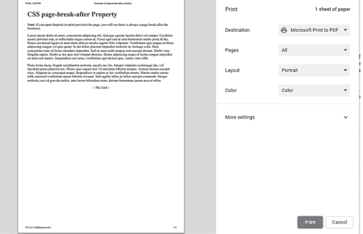

`page-break-after` 属性。
- I. 我们在打印部分还有两个属性，它们是：`page-break-before` 属性
- II. `page-break-inside` 属性

## CSS 表格属性

1. `border-collapse` 属性：`border-collapse` CSS 属性用于指定表格的单元格边框是合并在单个边框中，还是像通常那样分开。在 CSS 中设置表格单元格边框有两种不同的模型。
    - 分离边框模型
    - 合并边框模型

该属性的语法如下：

```
border-collapse: separate | collapse | initial | inherit
```

## 示例：

```
<!DOCTYPE html>
<html
<head>
<style>

.demo_container{
  width:400px;
  margin:0 auto;
  text-align: center;
  justify-content: center;
  align-items: center;
}

.table-1 {
  border-collapse: collapse;
}

table .table-2 {
  border-collapse: collapse;
}

table, th, td {
  border: 1px solid black;
}
</style>
</head>
<body>
<div class="demo_container">
  <h1> CSS Border Collapse</h1>
<table class="table-1">
  <tr>
    <th>Name</th>
    <th>Email</th>
  </tr>
  <tr>
    <td>Alax</td>
    <td>alax@example.com</td>
  </tr>
  <tr>
    <td>Joy</td>
    <td>joy@example.com</td>
  </tr>
</table>

<h1> CSS Border Collapse - Without </h1>
<table class="table-2">
<tr>
    <th>Name</th>
    <th>Email</th>
</tr>
<tr>
    <td>Alax</td>
    <td>alax@example.com</td>
  </tr>
<tr>
    <td>Joy</td>
    <td>joy@example.com</td>
  </tr>
</table>
</body>
</html>
```

代码的输出如下所示：

# CSS Border Collapse - With

| Name | Email |
| Alax | alax@example.com |
| Joy | joy@example.com |

# CSS Border Collapse - Without

| Name | Email |
| Alax | alax@example.com |
| Joy | joy@example.com |

CSS 边框合并 – 有与无对比。

`border-spacing` 属性：`border-spacing` CSS 属性使用边框模型设置相邻单元格边框之间的间距。如果使用了边框模型，则该属性将被忽略。在此处查看 `border-collapse` 属性。

该属性的语法如下：

```
border-spacing: [ length ] 1 or 2 values |
initial | inherit
```

## 示例：

```
<!DOCTYPE html>
<html
<head>
<style>
.demo_container{
width:400px;
margin:0 auto;
text-align: center;
justify-content: center;
align-items: center;
}
table {
border-collapse: separate;
}
table, th, td {
border: 1px solid black;
}
table.one {
border-spacing: 25px;
}
table.two {
border-spacing: 10px 20px;
}
</style>
</head>
<body>
<div class="demo_container">
<h1> border-spacing Propty</h1>
<table class="one">
<tr>
    <th>Name</th>
    <th>Email</th>
  </tr>
<tr>
    <td>ABC Carter</td>
    <td>abcd@mail.com</td>
  </tr>
</table>
<table class="two">
<tr>
    <th>Name</th>
    <th>Email</th>
  </tr>
<tr>
    <td>ABC Parker</td>
    <td>abcd@mail.com</td>
  </tr>
</table>
</body>
</html>
```

代码的输出如下：

# border-spacing Property

One-value syntax: the single value sets both horizontal and vertical border spacing.

3. `caption-side` 属性：`caption-side` CSS 属性设置标题框的垂直位置。要在标题框内水平对齐文本，请使用 `text-align` 属性。

该属性的语法如下：

```
caption-side:   top | bottom | initial | inherit
```

## 示例：

```
<!DOCTYPE html>
<html
<head>
<style>
.demo_container{
width:400px;
margin:0 auto;
text-align: center;
justify-content: center;
align-items: center;
}
table {
border-collapse: separate;
width:100%
}
table, th, td {
border: 1px solid black;
}
caption.one {
  caption-side: bottom;
font-size: 24px;
border-bottom: 1px purple solid;
padding: 20px;
}
caption.two {
  caption-side: top;
font-size: 24px;
border-top: 1px purple solid;
padding: 20px;
}
</style>
</head>
<body>
<div class="demo_container">
<h1> CSS caption Property</h1>
<table class="one">
<tr>
    <th>Name</th>
    <th>Email</th>
  </tr>
<tr>
    <td>ABC Carter</td>
    <td>abcd@mail.com</td>
  </tr>
</table>
<table class="two">
<tr>
    <th>Name</th>
    <th>Email</th>
  </tr>
<tr>
    <td>ABC Parker</td>
    <td>abcd@mail.com</td>
  </tr>
</table>
</body>
</html>
```

代码的输出如下：

# CSS caption Property

| Name | Email |
| ABC Carter | abcd@mail.com |
| Name | Email |
| ABC Parker | abcd@mail.com |

## 精通 CSS

代码的输出如下：

## CSS text-align 属性

CSS `text-align` 属性用于将元素左对、右对、居中等。

Lorem ipsum sit amet consectetur adipisicing elit. Maxime mollitia, molestiae quas vel sint commodi repudiandae consequuntur voluptatum laborum nonquam blanditis harum quisquam eius sed odit fugiat iusto fuga praesentium optio, eaque rerum!

Provident similique accusamantum nemo autem. Veritatis obcaecati tenetur iure eius eum earum ut molestias architecto voluptate aliquam nihil, eveneniet aliquid culpa officia aut .

## CSS text-align-all 属性

`text-align-all` 属性是 `text-align` 属性的完整写形式。


Lorem ipsum sit amet consectetur adipisicing elit. Maxime mollitia, molestiae quas vel sint commodi repudiandae consequuntur voluptatum laborum nonquam blanditis harum quisquam eius sed odit fugiat iusto fuga praesentium optio, eaque rerum!

Provident similique accusamantum nemo autem. Veritatis obcaecati tenetur iure eius eum earum ut molestias architecto voluptate aliquam nihil, eveneniet aliquid culpa officia aut .

## CSS `text-align` 和 `text-align-all` 属性

### 2. CSS `text-decoration` 属性
`text-decoration` 属性用于在一个声明中设置 `text-decoration-line`、`text-decoration-style` 和 `text-decoration-color`。

`text-decoration` 的语法格式如下：

```
text-decoration: <text-decoration-line> || <text-decoration-style> || <text-decoration-color>
```

以下是 `<text-decoration-line>` 下的一些可能值：

- `none`: 既不产生也不抑制文本装饰。
- `underline`: 每一行文本都有下划线。
- `iii. overline`: 每一行文本上方都有一线。
- `iv. line-through`: 每一行文本中间都有一条线。
- `v. blink`: 文本闪烁意味着文本在可见和不可之间交替。

以下是 `<text-decoration-style>` 下的一些可能值：

- `i. solid`: 它是一条实线。
- `ii. wavy`: 它是一条波浪线。
- `iii. dotted`: 它是一条点线。
- `iv. dashed`: 它是一条由虚线组成的线。
- `v. double`: 它是一条双实线。

以下是 `<text-decoration-color>` 下的一些可能值：

- `I. initial`: 它代表指定为属性初始值的值。
- `II. inherit`: 它代表该属性在元素父上的计算值。
- `III. unset`: 这是一个类似于 `initial` 或 `inherit` 的值，取决于属性是否可继承。这意味着如果属性是继承的，则将所有属性设置为父元素值；如果不可继承，则设置为初始值。

### 15. CSS `text-decoration` 属性

示例：

```html
<!DOCTYPE html>
<html>
<head>
<style>
.demo_container{
  width:600px;
  margin:0 auto;
  justify-content: center;
  align-items: center;
}
```

```css
.div1 >h3{
  text-align: center;
  text-decoration: underline;
  text-decoration-color: yellowgreen;
  font-size: 28px;
}
```

```css
.div2 > h3 {
  text-align: center;
  text-decoration: underline;
  text-decoration-color: green;
  font-size: 28px;
}
```

```css
.div3 >h3 {
  font-size: 28px;
  text-align: center;
  text-decoration-line: underline;
  text-decoration-style: wavy;
}
```

```html
</style>
</head>
<body>
```

```html
<div class="demo_container">
  <h2>CSS text-decoration 颜色、线条、样式属性的单独使用</h2>
  <div class="div1">
    <h3>CSS text-decoration-color 属性</h3>
    <p class="text-1">
      Lorem ipsum sit amet consectetur adipisicing elit. Maxime mollitia, molestiae quas vel sint commodi repudiandae voluptatum laborum numquam blanditiis harum quisquam eos sed fugiat iusto fuga praesentium optio, eque rerum!
    </p>
  </div>
```

```html
<div class="div2">
  <h3> CSS text-decoration-line 属性 </h3>
```

```html
<p class="text-1">
Lorem ipsum sit amet consectetur adipisicing elit. Maxime mollitia, molestiae quas vel sint commodi repudiandae consequetur voluptatum libero numquam blandiis harum quisquam eius sed odit fugiat iusto fuga praesentium optio, eaque rerum!</p>
</div>
```

```html
<div class="div3">
<h3> CSS text-decoration-style 属性 </h3>
<p class="text-1">
Lorem ipsum sit amet consectetur adipisicing elit. Maxime mollitia, molestiae quas vel sint commodi repudiandae consequetur voluptatum libero numquam blandiis harum quisquam eius sed odit fugiat iusto fuga praesentium optio, eaque rerum!</p>
</div>
</div>
</body>
</html>
```

代码的输出如下：

CSS text-decoration 颜色、线条、样式属性的单独使用

## CSS text-decoration-color 属性

Lorem ipsum sit amet consectetur adipisicing elit. Maxime mollitia, molestiae quas vel sint commodi repudiandae consequetur voluptatum libero numquam blandiis harum quisquam eius sed odit fugiat iusto fuga praesentium optio, eaque rerum!

## CSS text-decoration-line 属性

Lorem ipsum sit amet consectetur adipisicing elit. Maxime mollitia, molestiae quas vel sint commodi repudiandae consequetur voluptatum libero numquam blandiis harum quisquam eius sed odit fugiat iusto fuga praesentium optio, eaque rerum!

## CSS text-decoration-style 属性

Lorem ipsum sit amet consectetur adipisicing elit. Maxime mollitia, molestiae quas vel sint commodi repudiandae consequetur voluptatum libero numquam blandiis harum quisquam eius sed odit fugiat iusto fuga praesentium optio, eaque rerum!

CSS text-decoration-property。

### 4. CSS `text-orientation` 属性

示例：

```html
<!DOCTYPE html>
<html>
<head>
<style>
.demo_container{
    width:600px;
    margin:0 auto;
    justify-content: center;
    align-items: center;
}

p {
    writing-mode: vertical-rl;
    font-size: 2em;
    float: left;
}
.mixed {
    text-orientation: mixed;
}
.upright {
    text-orientation: upright;
}
.sideways {
    text-orientation: sideways;
}
</style>
</head>
<body>

<div class="demo_container">
    <h2>CSS text-orientation 属性</h2>
    <p class="mixed">学习 CSS</p>
    <p class="upright">学习 CSS</p>
    <p class="sideways">学习 CSS</p>
</div>
</body>
</html>
```

代码的输出如下：

CSS text-orientation 属性

学习 CSS

CSS text-orientation 属性

### 5. CSS `text-overflow` 属性
它规定了当由于太大无法适应容器时应如何处理。

示例：

```html
<!DOCTYPE html>
<html>
<head>
<style>

.demo_container{
    width:600px;
    margin:0 auto;
    justify-content: center;
    align-items: center;
}

.text-1 {
    width: 16em;
    overflow: hidden;
    white-space: nowrap;
    background: gold;
}
```

```css
.text-2 {
  text-overflow: ellipsis;
}
```

</style>

</head>

<body>

<div class="demo_container">

  <div class="div1">

    <h1>text-overflow</h1>

    <p class="text-1">

      Lorem ipsum sit amet consectetur adipisicing elit. Maxime mollitia, molestiae quas vel sint commodi repudiandae consequetur voluptatum libero numquam blandiis harum quisquam eius sed fugiat iusto fuga praesentium optio, eaque rerum!

    </p>

    <p class="text-2">

      Lorem ipsum sit amet consectetur adipisicing elit. Maxime mollitia, molestiae quas vel sint commodi repudiandae consequetur voluptatum libero numquam blandiis harum quisquam eius sed fugiat iusto fuga praesentium optio, eaque rerum!

    </p>

  </div>

</div>

</body>

</html>
```

代码的输出如下：

## text-overflow 属性

Lorem ipsum sit amet...省略...

CSS text-overflow-property。

## `text-shadow` 属性
`text-shadow` 属性用于为文本应用阴影效果。你还可以使用 `text-shadow` 为文本应用投影阴影、外光和其他阴影效果。此属性接受值列表。列表中的每个项目可以有两个、三个或四个值。

示例：

```html
<!DOCTYPE html>
<html>
<head>
<style>
.demo_container{
  width:600px;
  margin:0 auto;
  justify-content: center;
  align-items: center;
}
.text-1 {
  text-shadow: 2px 2px 5px red;
  font-size: 30px;
}
.text-2{
  text-shadow: 2px 2px red;
  font-size: 30px;
}
.text-3{
  text-shadow: 0 0 3px #ff0000, 0 0 5px #0000ff;
  font-size: 30px;
}
.text-4{
  color: white;
  text-shadow: 1px 1px 2px black, 0 0 25px blue,
  0 0 5px darkblue;
  font-size: 30px;
}
</style>
</head>
<body>
<div class="demo_container">
  <div class="div1">
    <h1>text-shadow</h1>
    <p class="text-1">Lorem ipsum sit amet consectetur adipisicing elit. Maxime mollitia, molestiae quas vel sint commodi repudiandae consequetur voluptatum libero numquam blandiis harum quisquam eius sed odit fugiat iusto fuga praesentium optio, eaque rerum!</p>
    <p class="text-2">Lorem ipsum sit amet consectetur adipisicing elit. Maxime mollitia, molestiae quas vel sint commodi repudiandae consequetur voluptatum libero numquam blandiis harum quisquam eius sed odit fugiat iusto fuga praesentium optio, eaque rerum!</p>
  </div>
</div>
</body>
</html>
```

```html
<div class="demo_container">
  <div class="div1">
    <h1> CSS text-overflow 属性</h1>
    <p class="text-1">
      你正在学习 CSS。
    </p>
    <p class="text-2">
      你正在学习 CSS。
    </p>
    <p class="text-3">
      你正在学习 CSS。
    </p>
    <p class="text-4">
      你正在学习 CSS。
    </p>
  </div>
</div>
<body>
</html>
```

代码的输出如下：

# CSS text-shadow 属性

**你正在学习 CSS。**

**你正在学习 CSS。**

**你正在学习 CSS。**

<u>你正在学习 CSS。</u>

CSS text-shadow 属性。

# CSS TRANSFORM 变换属性

`transform` 属性用于在二维 (2D) 或三维 (3D) 空间中转换元素。例如，旋转元素、缩放、倾斜等。

## 2D 变换函数

`transform` 属性接受一组“变换函数”作为值。这些函数名称如 `scale()`、`rotate()`、`skew()` 等，它们通过参数来确定变换的程度（例如，旋转元素的角度）。

`transform` 的语法所示：

```
transform: none | <transform-function> [ <transform-function> ]
```

这些函数按 2D（二维）和 3D（三维）函数进行分组。

- **matrix():** 它指定以六个值 a-f 矩阵形式指定的二维变换。

`matrix` 的语法所示：

```
matrix() = matrix(<number>, [<number>]{5,5} )
```


- `translate():` 它移动元素的位置。它通过向量 `[x, y]` 指定二维平移，其中 `x` 是第一个平移值参数，`y` 是可选的第二个平移值参数。

`translate` 的语法所示：

```
translate(<translation-value>[, <translation-value>] )
```

- `translateX():` 它在水平方向移动元素。它指定在 X 方向上按给定量进行平移。

`translateX` 的语法所示：

```
translateX(<translation-value> )
```

- `translateY():` 它在垂直方向移动元素。它指定在 Y 方向上按给定量进行平移。

`translateY` 的语法所示：

```
translateY(<translation-value> )
```

- `scale():` 它修改元素的大小。它通过两个参数描述的 `[sx,sy]` 向量指定二维缩放操作。

`scale` 的语法所示：

```
scale(<number>[, <number>] )
```

- `scaleX():` 它使用 `[sx,1]` 向量指定二维缩放操作，其中 `sx` 作为参数给出。

`scaleX` 的语法所示：

```
scaleX( <number>[, <number>? )
```

- `scaleY():` 它使用 `[1,sy]` 向量指定二维缩放操作，其中 `sy` 作为参数给出。

`scaleY` 的语法所示：

```
scaleY( <number>[, <number>? )
```

- `rotate():` 它围绕由 `transform-origin` 属性定义的原点，通过指定的角度参数指定一个二维旋转。

`rotate` 的语法所示：

```
rotate( <angle> )
```

- `skew():` 它通过给定角度沿 X 和 Y 轴指定二维倾斜变换。如果未提供第二个参数，则值为零。

`skew` 的语法所示：

```
skew( <angle> [, <angle> ] )
```

- `skewX():` 它通过给定角度沿 X 轴指定二维变换。

`skewX` 的语法所示：

```
skewX( <angle> )
```

- `skewY():` 它通过给定角度沿 Y 轴指定二维变换。

`skewY` 的语法所示：

```
skewY( <angle> )
```

## 示例：

```html
<!DOCTYPE html>
<html>
<head>
<style>
body{
  width: 90%;
  margin: 0 auto;
  font-family: sans-serif;
}
.wrap {
  display: inline-block;
  background: rgba(228, 225, 228, .6);
  width: 250px;
  height: 250px;
  margin: 60px 30px;
}
.box {
  border: 2px solid #444;
  line-height: 150px;
  font-size: .9em;
  font-weight: bold;
  text-align: center;
}
.box1 {
  background: red;
  transform: matrix(1, 0, 0, 1, 0, 80);
}
.box2 {
  background: #909;
  transform: translate(80px,80px);
}
.box3 {
  background: yellow;
  transform: matrix(.7, 0, 0, 1.3, 0, 0);
}
.box4 {
  background: green;
  transform: scale(.7, 1.3);
}
.box5 {
  background: pink;
  transform: matrix(1, 0, -0.5, 1, 0);
}
.box6 {
  background: lightblue;
  transform: skew(-30deg);
}
.box7 {
  background: #f0f;
  transform: matrix(.7, -.71, 0.71, 0, 0);
}
.box8 {
  background: #098;
  transform: rotate(-45deg);
}
</style>
</head>
<body>
<h1>2D 变换函数</h1>
<div class="wrap">
  <div class="box1">matrix(1, 0, 0, 1, 0, 80)</div>
</div>
<div class="wrap">
  <div class="box2">translate(80px,80px)</div>
</div>
<div class="wrap">
  <div class="box3">matrix(.7, 0, 0, 1.3, 0, 0)</div>
</div>
<div class="wrap">
  <div class="box4">scale(.7, 1.3)</div>
</div>
<div class="wrap">
  <div class="box5">matrix(1, 0, -0.5, 1, 0)</div>
</div>
<div class="wrap">
  <div class="box6">skew(-30deg)</div>
</div>
<div class="wrap">
  <div class="box7">matrix(.7, -.71, 0.71, 0, 0)</div>
</div>
<div class="wrap">
  <div class="box8">rotate(-45deg)</div>
</div>
</body>
</html>
```

代码的输出如下：

## 3D 变换函数

2D 变换函数允许沿三维坐标系的 x、y、z 三个轴应用变换。可用的 3D 变换函数所示：

- `matrix3d():` 它以列主顺序的 16 个值的 4x4 矩阵指定三维变换。`matrix3d` 的语法所示：

```
matrix3d() = matrix3d(<number>, [<number>]{15} )
```

- `translate3d():` 它通过向量 `[tx,ty,tz]` 指定三维平移，其中 `tx`、`ty` 和 `tz` 分分别是第一个、第二个和第三个平移值。`translate3d` 的语法所示：

```
translate3d() = translate3d(<translation-value>, <translation-value>, <length> )
```

- `scale3d():` 它通过三个参数描述的 `[sx,sy,sz]` 向量指定三维缩放操作。`scale3d` 的语法所示：

```
scale3d() = scale3d(<number>, <number>, <number> )
```

- `scaleZ():` 它使用 `[1,1,sz]` 向量指定三维缩放操作，`sz` 作为参数给出。`scaleZ` 的语法所示：

```
scaleZ() = scaleZ(<number> )
```

- `rotate3d():` 它围绕前三个参数描述的 `[x,y,z]` 向量，通过最后一个参数指定的角度指定三维旋转。`rotate3d` 的语法所示：

```
rotate3d() = rotate3d(<number>, <number>, <number>, <number> )
```

- `rotateX():` 它等于 `rotate3d(1, 0, 0, <angle>)`。`rotateX` 的语法所示：

```
rotateX() = rotateX(<angle> )
```

- `rotateY():` 它等于 `rotate3d(0, 1, 0, <angle>)`。`rotateY` 的语法所示：

```
rotateY() = rotateY(<angle> )
```

- `rotateZ():` 等于 `rotate3d(0, 0, 1, <angle>)`（同样等于 `rotate(<angle>)`）。`rotateZ` 的语法所示：

```
rotateZ() = rotateZ(<angle> )
```

- `perspective():` 它定义了 z=0 平面与用户之间的距离，以便为 3D 定位的元素提供透视。`perspective` 的语法所示：

```
perspective() = perspective( <length> )
```

## 示例：

```html
<!DOCTYPE html>
<html>
<head>
<style>
body { font-family: sans-serif; }
.scene {
    width: 200px;
    height: 200px;
    border: 1px solid #CCC;
    display: inline-block;
    width: 200px;
    height: 200px;
    margin: 60px 60px 60px 0;
    perspective: 600px;
}
.panel {
    width: 100%;
    height: 100%;
    background: hsla(0, 100%, 50%, 0.7);
    line-height: 200px;
    color: white;
    font-size: 18px;
    text-align: center;
}
.panel--translate-neg-z {
    transform: translateY(-200px);
}
.panel--translate-pos-z {
    transform: translateY(200px);
}
</style>
</head>
<body>
<h1>3D 变换函数</h1>
<div class="scene">
  <div class="panel--translate-neg-z">translateZ(-200px)</div>
</div>
<div class="scene">
  <div class="panel--translate-pos-z">translateZ(200px)</div>
</div>
<div class="scene">
  <div class="panel--rotate-x">rotateX(45deg)</div>
</div>
<div class="scene">
  <div class="panel--rotate-y">rotateY(45deg)</div>
</div>
<div class="scene">
  <div class="panel--rotate-z">rotateZ(45deg)</div>
</div>
</body>
</html>
```

## CSS 属性 ■ 173

代码的输出如下：

## 3D 变换函数

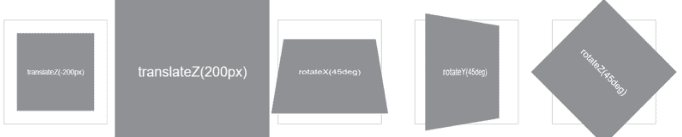

3D 变换函数。

# CSS 过渡属性

`transition` 属性是一个用于定义 CSS 过渡的属性，它将四个过渡属性合并为一个单一属性。`transition` 属性结合了以下属性，如 `transition-duration`（过渡持续时间）、`transition-timing-function`（过渡计时函数）和 `transition-delay`（过渡延迟）。

## 示例：

```html
<!DOCTYPE html>
<html>
<head>
<style>
.demo_container{
  width:600px;
  margin:0 auto;
  justify-content: center;
  align-items: center;
}
.transition {
  background-color: yellow-green;
  color: RGB(77, 145, 213);
  width: 30%;
  height: 30px;
  padding: 10px;
  font-size: 1.5em;
  font-family: sans-serif;
  transition: width 0.5s cubic-bezier(0.25, 0.1, 0.25, 1.4), 
              height 0.5s cubic-bezier(0.25, 0.1, 0.25, 1.4), 
              font-size 0.5s cubic-bezier(0.25, 0.1, 0.25, 1.4) 0s;
}
.transition:hover {
  width: 60%;
  height: 180px;
  font-size: 2em;
  font-weight: bold;
  background-color: beige;
}
</style>
</head>
<body>
<div class="demo_container">
  <div class="div1">
    <h1>CSS 过渡属性</h1>
    <div class="transition">鼠标悬停在我上方...</div>
  </div>
</div>
</body>
</html>
```

代码的输出如下所示：

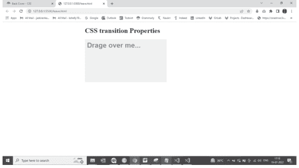

CSS 过渡属性。

## 章节总结

在本章中，我们通过简短的示例阅读了许多 CSS 属性，这使得清晰地理解了如何在 CSS 中编写代码的语法。下一章将介绍 CSS 中最重要的概念：**CSS 选择器**。


## CSS 选择器

## 本章内容

- 引言
- 通用选择器
- 逻辑组合选择器
- 属性选择器
- 伪类
- 组合选择器

在上一章中，我们讨论了各种 CSS 属性，现在我们有了另一个重要的 CSS 特：选择器。选择器意味着用户可以使用选择器选择任何属性，如类（classes）、id 或标签名。代码可以包含多个类，但 id 必须是唯一的。

## 引言

以下是最常见且支持良好的 CSS 选择器列表。虽然还有很多其他选择器，但这些是你应该熟练掌握的。

- 类型选择器：`a { }`
- ID 选择器：`#a { }`
- 子元素选择器：`a > b {}`
- 后代选择器：`a b { }`

## 精通 CSS

## 选择器详解
- 选择器列表：`a,b`
- 组合后代与 ID 选择器：`#a b {}`
- 类选择器：`.a {}`
- 组合类选择器：`b.x {}`
- 逗号组合选择器：`a, c {}`
- 通用选择器：`* {}`
- 组合通用选择器：`a * {}`
- 相邻兄弟选择器：`a + b {}`
- 通用兄弟选择器：`a ~ b {}`
- 第一个元素伪选择器：`b:first-child {}`
- 唯一元素伪选择器：`b:only-child {}`
- 最后一个元素伪选择器：`b:last-child {}`
- 第 N 个元素伪选择器：`a:nth-child(2) {}`
- 数 N 个元素伪选择器：`a:nth-last-child(2) {}`
- 第一个类型伪选择器：`b:first-of-type {}`
- 第 N 个类型伪选择器：`a:nth-of-type(n) {}`
- 最后一个类型伪选择器：`b:last-of-type {}`
- 空元素伪选择器：`b:empty {}`
- 否定伪选择器：`b:not(.class) {}`

### 通用选择器 (*) 
通用选择器可以匹配文档中的所有元素。

示例：
```html
<!DOCTYPE html>
<html>
<head>
<style>
*{
  background-color: lightblue;
}
</style>
</head>
<body>
  <p>所有元素的背景色都会变成浅蓝色。</p>
</body>
</html>
```

### 逻辑组合选择器 (:not)
逻辑组合选择器允许你排除某些特定的选择器。

示例：
```html
<!DOCTYPE html>
<html>
<head>
<style>
div {
  background-color: #f13;
}
p:not(div,h1) {
  background-color: yellow;
}
</style>
</head>
<body>
<div>
  <h1>标题</h1>
  <p>这个段落的背景将是黄色的。</p>
</div>
</body>
</html>
```


184 ■ 掌握 CSS

```html
<body>
<div class="demo_container">
  <h1> 属性选择器 (.classname) </h1>
  LoremLorem ipsum dolor sit amet, consectetur adipiscing elit.
  Aenean accumsans velit velit id lorem tempus iaculis.
  Praesent placerat lectus lorem. Quisque lacinia,
  <p class="p2"> metus sit amet tristique lacinia, nisi erat pharetra lectus, in consequat turpis eros a erat. Cras blandit vehicula arcu ac porta.</p>
  <p class="p1"> metus sit amet tristique lacinia, nisi erat pharetra lectus, in consequat turpis eros a erat. Cras blandit vehicula arcu ac porta.</p>
</div>
</body>
</html>
```

代码的输出如下所示

# 属性选择器 (.classname)

Lorem ipsum dolor sit amet, consectetur adipiscing elit. Aenean accumsans velit velit id lorem tempus iaculis. Praesent placerat lectus lorem. Quisque lacinia,

| metus sit amet tristique lacinia, nisi erat pharetra lectus, in consequat turpis eros a erat. Cras blandit vehicula arcu ac porta. |

metus sit amet tristique lacinia, nisi erat pharetra lectus, in consequat turpis eros a erat. Cras blandit vehicula arcu ac porta.

属性选择器 (.classname)。

# 属性选择器 (id)

示例：

```html
<!DOCTYPE html>
<html>
<head>
<style>
.demo_container{
  width:600px;
  margin:0 auto;
  text-align: center;
  justify-content: center;
  align-items: center;
}
.p1{
  background-color: yellow;
}
.p2{
  background-color: pink;
}
</style>
</head>
```

```html
<body>
<div class="demo_container">
<h1> 属性选择器 (#id) </h1>
Lorem ipsum dolor sit amet, consectetur adipiscing elit.
Aenean accumsan velit id lorem tempus iaculis.
Praesent placerat lectus lorem. Quisque lacinia,
<p id="p2">metus sit amet tristique lacinia, nisi erat pharetra lectus, in consequat turpis eros a erat. Cras blandit vehicula arcu ac porta.</p>
<p id="p1">metus sit amet tristique lacinia, nisi erat pharetra lectus, in consequat turpis eros a erat. Cras blandit vehicula arcu ac porta.</p>
</div>
</body>
</html>
```

代码的输出如下所示

# 属性选择器 (#id)

Lorem ipsum dolor sit amet, consectetur adipiscing elit. Aenean accumsan velit id lorem tempus iaculis. Praesent placerat lectus. Quisque lacinia,

metus sit amet tristique lacinia, nisi erat pharetra lectus, in consequat turpis eros a erat. Cras blandit vehicula arcu porta.

metus sit amet tristique lacinia, nisi erat pharetra lectus, in consequat turpis eros a erat. Cras blandit vehicula arcu porta.

属性选择器 (#id)。

# 属性选择器 ([])

示例：

```html
<!DOCTYPE html>
<html>
<head>
<style>
.demo_container{
  width:600px;
  margin:0 auto;
  text-align: center;
  justify-content: center;
  align-items: center;
}
abbr[title] {
  font-size: 24px;
}
</style>
</head>
<div class="demo_container">
  <h1> 属性选择器 ([]) </h1>
  <abbr title="这是这个标题">
    Metus sit amet tristique lacinia, nisi erat pharetra lectus, in
```

```html
consequat turpis eros a erat. Cras blandit vehicula arcu ac porta.
</div>
</div>
</body>
</html>
```

代码的输出如下所示

# 属性选择器 ([])

Metus sit amet tristique lacinia, nisi erat pharetra lectus, in consequat turpis eros a erat. Cras blandit vehicula arcu ac porta.

属性选择器 ([])。

# 属性选择器 ([attr="value"])

示例：

```html
<!DOCTYPE html>
<html>
<head>
<style>
.demo_container{
width:600px;
margin:0 auto;
text-align: center;
justify-content: center;
align-items: center;
}
p[id="p"] {
font-size: 24px;
background-color: yellow;
}
```

```css
p[id="p2"] {
background-color: pink;
}
```

```css
</style>
</head>
<body>
<div class="demo_container">
<h1> 属性选择器 ([attr="value"]) </h1>
Lorem ipsum dolor sit amet, consectetur adipiscing elit.
Aenean accumsan velit id lorem tempus iaculis.
Praesent placerat lectus lorem. Quisque lacinia,
<p id="p2"> metus sit amet tristique lacinia, nisi erat pharetra lectus, in consequat turpis eros a erat. Cras blandit vehicula arcu ac porta.</p>
<p id="p1"> metus sit amet tristique lacinia, nisi erat pharetra lectus, in consequat turpis eros a erat. Cras blandit vehicula arcu ac porta.</p>
</div>
</body>
</html>
```

代码的输出如下所示

# 属性选择器 ([attr="value"])

Lorem ipsum dolor sit amet, consectetur adipiscing elit. Aenean accumsan velit id lorem tempus iaculis. Praesent placerat lectus lorem. Quisque lacinia,

metus sit amet tristique lacinia, nisi erat pharetra lectus, in consequat turpis eros a erat. Cras blandit vehicula arcu ac porta.

metus sit amet tristique lacinia, nisi erat pharetra lectus, in consequat turpis eros a erat. Cras blandit vehicula arcu porta.

属性选择器 ([attr="value"]) 敏感。

# 属性选择器 ([attr="value"]) 敏感

示例：

```html
<!DOCTYPE html>
<html>
<head>
<style>
.demo_container{
  width:600px;
  margin:0 auto;
  text-align: center;
  justify-content: center;
  align-items: center;
}
p[id="p"] {
  --color:
;
>
<
 class="
="value="  
Lorem ipsum dolor sit amet, consectetur adipiscing elit.
Aenean accumsan velit id lorem tempus iaculis.
Praesent placerat lectus lorem. Quisque lacinia,
<p class="p2">met sit amet tr tr lacinia lacinia,,,, erat, in consequat a. a a. arcu ac porta.</p>
184 ■ 掌握 CSS
```

```html
<p class="p1">metus sit amet tristique lacinia, nisi erat pharetra lectus, in consequat turpis eros a erat. Cras blandit vehicula arcu ac porta.</p>
</div>
</body>
</html>
```

代码的输出如下所示

# 属性选择器 ([attr="value"]) 敏感

Lorem ipsum dolor sit amet, consectetur adipiscing elit. Aenean accumsan velit id lorem tempus iaculis. Praesent placerat lectus lorem. Quisque lacinia,

metus sit amet tristique lacinia, nisi erat pharetra lectus, in consequat turpis eros a erat. Cras blandit vehicula arcu ac porta.

metus sit amet tristique lacinia, nisi erat pharetra lectus, in consequat turpis eros a erat. Cras blandit vehicula arcu porta.

属性选择器 ([attr="value"]) 敏感。

# 属性选择器 ([foo~="bar"]) 

示例：

```html
<!DOCTYPE html>
<html>
<head>
<style>
.demo_container{
width:600px;
margin:0 auto;
text-align: center;
justify-content: center;
align-items: center;
}
```

```css
[class~="abc"] {
color: orange;
}
```

```css
</style>
</head>
<body>
<div class="demo_container">
<h1> 属性选择器 ([foo~="bar"]) </h1>
Lorem ipsum dolor sit amet, consectetur adipiscing elit.
Aenean accumsan velit id lorem tempus iaculis.
Praesent placerat lectus lorem. Quisque lacinia,
<section class="abc">metus sit amet tristique lacinia, nisi erat pharetra lectus, in consequat turpis eros a erat. Cras blandit vehicula arcu ac porta.</section>
<p class="abc">metus sit amet tristique lacinia, nisi erat pharetra lectus, in consequat turpis eros a erat. Cras blandit vehicula arcu ac porta.</p>
</div>
</body>
</html>
```

代码的输出如下所示

# 属性选择器 ([foo~="bar"])

Lorem ipsum dolor sit amet, consectetur adipiscing elit. Aenean accumsan velit id lorem tempus iaculis. Praesent placerat lectus lorem. Quisque lacinia, metus sit amet tristique lacinia, nisi erat pharetra lectus, in consequat turpis eros a erat. Cras blandit vehicula arcu ac porta.

metus sit amet tristique lacinia, nisi erat pharetra lectus, in consequat turpis eros a erat. Cras blandit vehicula arcu porta.

属性选择器 ([foo~="bar"])。

# 属性选择器 ([foo^="bar"])

示例：

```html
<!DOCTYPE html>
<html>
<head>
<style>
.demo_container{
  width:600px;
  margin:0 auto;
  text-align: center;
  justify-content: center;
  align-items: center;
}

[class^="title"] {
  background-color: orchid;
  font-size: 20px;
}

</style>
</head>
<body>
<div class="demo_container">
<h1> 属性选择器 ([foo^="bar"]) </h1>
Lorem ipsum dolor sit amet, consectetur adipiscing elit.
Aene accumans velit velit id lorem tempus iaculis.
Praesent placerat lectus lorem. Quisque lacinia,
<section class="title-1">metus sit amet tristique lacinia, nisi erat pharetra lectus, in consequat turpis eros a erat. Cras blandit vehicula arcu ac porta.</section>
</div>
</body>
</html>
```

代码的输出如下所示

# 属性选择器 ([foo^="bar"])


Lorem ipsum dolor sit amet, consectetur adipiscing elit. Aene accumans velit velit id lorem tempus iaculis. Praesent placerat lectus lorem. Quisque lacinia, metus sit amet tristique lacinia, nisi erat pharetra lectus, in consequat turpis eros a erat. Cras blandit vehicula arcu ac porta.

属性选择器（`[foo^="bar"]`）。

## CSS 选择器 ■ 193

```html
<p class="title-2">
  metus sit amet tristique lacinia, nisi erat pharetra lectus, in
  consequat turpis eros a erat. Cras blandit 
  vehicula arcu ac porta.
</p>
</div>
</body>
</html>
```

代码输出如下：

## 属性选择器（`[foo^="bar"]`）

Lorem ipsum dolor sit amet, consectetur adipiscing elit. Aenean accumsan velit id lorem tempus iaculus. Praesent placerat lorem. Quisque lacinia metus sit amet tristique lacinia, nisi erat pharetra lectus, in consequat turpis eros a erat. Cras blandit vehicula arcu ac porta.

metus sit amet tristique lacinia, nisi erat pharetra lectus, in consequat turpis eros a erat. Cras blandit vehicula arcu ac porta.

属性选择器（`[foo^="bar"]`）

## 属性选择器（`[foo$="bar"]`）

示例：

```html
<!DOCTYPE html>
<html>
<head>
<style>
.demo_container{
  width:600px;
  margin:0 auto;
  justify-content: center;
  align-items: center;
}

[class$="one"] {
  background-color: orchid;
}
[class$="two"] {
  background-color: orange;
}
</style>
</head>
<body>
<div class="demo_container">
```

## 属性选择器（`[foo="bar"]`）

## 列表 1

- Metus sit amet tristique lacinia, nisi erat pharetra lectus, in consequent turpis eros a erat. Cras blandit vehicle arcu porta.
- Metus sit amet tristique lacinia, nisi erat pharetra lectus, in consequent turpis eros a erat. Cras blandit vehicle arcu porta.
- Metus sit amet tristique lacinia, nisi erat pharetra lectus, in consequent turpis eros a erat. Cras blandit vehicle arcu porta.

## 列表 2

- Metus sit amet tristique lacinia, nisi erat pharetra lectus, in consequent turpis eros a erat. Cras blandit vehicle arcu porta.
- Metus sit amet tristique lacinia, nisi erat pharetra lectus, in consequent turpis eros a erat. Cras blandit vehicle arcu porta.
- Metus sit amet tristique lacinia, nisi erat pharetra lectus, in consequent turpis eros a erat. Cras blandit vehicle arcu porta.

属性选择器（`[foo$="bar"]`）.

## 属性选择器（`[foo*="bar"]`）

示例：

```html
<!DOCTYPE html>
<html>
<head>
<style>
.demo_container{
  width:600px;
  margin:0 auto;
  justify-content: center;
  align-items: center;
}

[class*="one"] {
  color: orchid;
  background-color: black;
}

[class$="two"] {
  color: orange;
  background-color: black;
}
</style>
</head>
<body>
<div class="demo_container">
```

## 属性选择器（`[foo*="bar"]`）

## 列表 1

- Metus sit amet tristique lacinia, nisi erat pharetra lectus, in consequat turpis eros a erat. Cras blandit vehicle arcu ac porta.
- Metus sit amet tristique lacinia, nisi erat pharetra lectus, in consequat turpis eros a erat. Cras blandit vehicle arcu ac porta.
- Metus sit amet tristique lacinia, nisi erat pharetra lectus, in consequat turpis eros a erat. Cras blandit vehicle arcu ac porta.

## 列表 2

- Metus sit amet tristique lacinia, nisi erat pharetra lectus, in consequat turpis eros erat. Cras bland vehicle arcu ac porta.
- Metus sit amet tristique lacinia, nisi erat pharetra lectus, in consequat turpis eros erat. Cras bland vehicle arcu ac porta.
- Metus sit amet tristique lacinia, nisi erat pharetra lectus, in consequat turpis eros erat. Cras bland vehicle arcu ac porta.

代码输出如下：

## 伪类（`:dir(ltr)` 或 `:dir(rtl)`）

## 从左到右

Metus sit amet tristique lacinia, nisi erat pharetra lectus, in consequat turpis eros a erat. Cras blandit vehicle arcu ac porta.

- Lorem

## 从右到左

Metus sit amet tristique lacinia, nisi erat pharetra lectus, in consequat turpis eros a erat. Cras blandit vehicle arcu ac porta.

伪类（`:dir(ltr)` 或 `:dir(rtl)`）。

## 伪类（`:any-link`）

示例：

```html
<!DOCTYPE html>
<html>
<head>
<style>

.demo_container{
  width:600px;
  margin:0 auto;
  justify-content: center;
  align-items: center;
}

a:any-link {
  background-color: green;
  color: white;
  text-decoration:none
}
</style>
```

```html
a:hover {
  font-size: 17px;
}
```

```html
<style>
</style>
<head>
<body>
<div class="demo_container">
```

<h1>伪类（`:any-link`）</h1>

<p>在下面的段落中，你将看到高亮文本，该文本是段落中存在的任何链接</p>

```html
<div dir="ltr">
```

<p>Lorem ipsum sit amet, consectetur adipiscing elit. Mauris convallis ipsum vitae nibh venenatis, id lacinia dui ultricies.

Pellentes feugiat quis ante quis accumsans Nulla ut mi quis felis eleifend semper. Mauris quis magna neque. Maecenas non velit cursus, sagittis orci eget, viverra neque.

```html
<a href="Null mollis ornare mauris, id finibus nunc fermentum eget. Fusce efficitur luctus volutpat. </a>
```

Orci varius natoque et magnis partient montes, nascetur ridiculus mus. Aliquam id dictum urna, sed magna mi. Maecenas rhoncus nisi ipsum, suscipit ultricies volutpat in volutpat. Nulla odio nec sapien posuere rutrum vitae de dolor.

```html
<a href="">Etiam in justisque justo, a posuere neque. Donec sed pulvinar lacus. Vestibulum at nunc enim. </a>
```

Aenean id facilisis erat, a pulvinar lectus.</p>

```html
<br>
</div>
</body>
</html>
```

代码输出如下：

## 伪类（`:any-link`）

在下面的段落中，你将看到高亮文本，该文本是段落中存在的任何链接

Lorem ipsum dolor sit amet, consectetur adipiscing elit. Pellentesque frequent ut accumsan. Mauris convallis vitae nibh venenatis, lacinia dui ultrices. Pellentesque feugiat quis ante omnis semper. Nulla ut mi felis eleifend semper. Maurisis magna neque. Maecenas non velit cursus, sagittis orci eget, viverra neque. Nullam mollis mauris, id finis, id finibus nunc fermentum eget. Fusce efficitur volutpat. Orci varius natoque penatibus et magnis id volutpat in. Nam sed magna mi, nascetur risus ipsum, sed gravida massa. Maecenas rhoncus nisi ipsum, suscipit ultrices mi volutpat neque. Nulla non odio nec sapien posuere rutrum vitae at eleitor. Eam in tristique justo, a posuere neque. Donec sed pulvinar lacus. Vestibulum at nunc Aenean id facilisis erat, a pulvinar lectus.

伪类（`:link`）.

## 示例：

```html
<!DOCTYPE html>
<html>
<head>
<style>

.demo_container{
width:600px;
margin:0 auto;
justify-content: center;
align-items: center;
}

a:link {
color: orange;
}
</style>
```

```html
a:hover {
  font-size: 17px;
}
```

```html
<style>
</style>
</head>
<body>
<div class="demo_container">
```

<h1>伪类（`:link`）</h1>

<p>在下面的段落中，你将看到高亮文本，该文本是尚未访问过的链接</p>

<div dir="ltr">

<p>Lorem dolor sit amet, consectetur adipiscing elit.

Mauris convallis ipsum vitae nibh venenatis, id lacinia ultricies.

Pellentesque feugiat quis ante augue accums semper. Nulla mi quis eget felis eleifend neque.

Mauris magna neque. Maecenas velit cursus, sagittis orci eget, viverra neque.

<a href="#">Mollis ornare mauris, id finibus nunc elementum eget. Fusce efficitur volutpat. </a>

Orci varius natoque et magnis dapibus parturient montes, nascetur ridicul mus.

Aliquam tristique urna, sed gravida massa. Nam sed magna mi. Maecenas rhoncus nisi ipsum, suscipit ultricies mi volutpat in. Nullam non odio nec sapien posuere rutrum vitae at dolor.

<a href="#">in tristique justo, a posuere neque. Donec sed pulvinar lacus.

Vestibulum at nunc enim. Aenean id facilisis erat, a pulvinar lectus.

```html
</p><br>
</div>
</body>
</html>
```

## CSS 选择器 ■ 205

代码输出如下：

## 伪类（`:link`）

在下面的段落中，你将看到高亮文本，该文本是尚未访问过的链接

Lorem ipsum dolor sit amet, consectetur adipiscing elit. Mauris convallis ipsum vitae nibh venenatis, id lacinia ultricies.


Pellentesque feugiat quis ante accums semper. Aliquam id dictum urna, sed magna mi. Maecenas rhoncus nisi ipsum, suscipit deatrices non velit cursus, sagittis orci eget, viverra neque. Nullam mollis mauris, id finis, id finibus nunc fermentum eget. Fusce efficitur volutpat. Orci varius natoque penatibus et magnis id volutpat in. Nam sed magna mi, nascetur risus ipsum, sed gravida massa. Maecenas rhoncus nisi ipsum, suscipit ultrices mi volutpat neque. Nulla non odio nec sapien posuere rutrum vitae at eleitor. Eam in tristique justo, a posuere neque. Donec sed pulvinar lacus. Vestibulum at nunc Aenean id facilisis erat, a pulvinar lectus.

伪类 (`:link`).

## 伪类 (`:target`)

示例：

```html
<!DOCTYPE html>
<html>
<head>
<style>

.demo_container{
width:600px;
margin:0 auto;
justify-content: center;
align-items: center;
}

:target {
background-color: #1c87c9;
}
</style>
</head>
```

```html
<body>
<div class="demo_container">
  <h1>伪类 (:target)</h1>
  <p>在下面的段落中，你将看到高亮文本，该文本是尚未访问过的链接</p>
  <div dir="ltr">
    <p><a href="#link1">跳转到 1</a></p>
    <p><a href="#link2">跳转到 2</a></p>
  </div>
</div>
</body>
</html>
```

# 208 ■ 精通 CSS

```html
<body>
  <h2>伪类 (:scope)</h2>
  <div class="container">
    <section>
      <p>
        作用域内部。
      </p>
    </section>
  </div>
</body>
</html>
```

代码的输出如下所示：

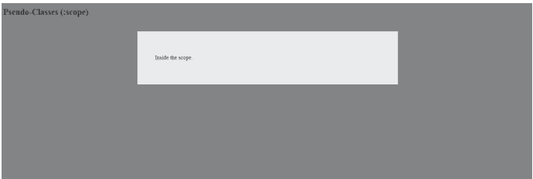

伪类 (`:scope`).

## 伪类 (`:target`)

示例：

```html
<!DOCTYPE html>
<html>
<head>
<style>

.demo_container{
  width:600px;
  margin:0 auto;
  justify-content: center;
  align-items: center;
}
```

## CSS 选择器

```css
a:active {
  background-color: yellow;
}
```

```html
</style>
</head>
<body>
<div class="demo_container">
  <h1>伪类 (:target) </h1>
  <p>点击下方链接时，链接将获得高亮显示</p>
  <div dir="ltr">
  <p><a href="#link1">跳转到链接 1</a></p>
  <p><a href="#link2">跳转到链接 2</a></p>
  <p>
  Lorem ipsum dolor sit amet, consectetur adipiscing elit.
  Mauris cavallis ipsum vitae nibh venenatis, id lacinia dui ultricies.
  Pellentesque feugiat quis ante accumsan. Nulla ut mi quis eleifend semper. Mauris magna neque. Non velit cursus, sagittis orci eget, viverra neque.
  <a href="#" id="link1">Nullam mollis ornare mauris, id finibus nunc fermentum eget. Fusce efficitur luctus volutpat. </a>
  Orci arcu natque penatibus et magnis parturient montes, nasceturmidrule massa.
  Aliquam tristique urna, sed gravida massa. Nam sed magna. Maenas rhoncus nisi ipsum, suscipit ultricies mi volutpat in. Nulla non odio sapien rutrum vitae at dolor. 
  <a href="#" id="link2">Etiam in tristique justo, posuere neque. Donec sed pulvinar lacus. Vestibulum at nunc enim. </a>
  Aenean non id facilis erat, a pulvinar lectus.
  </p>
  </div>
</body>
</html>
```

# 210 ■ 精通 CSS

代码的输出如下所示：

## 伪类 (`:target`)

点击下方链接时，链接将获得高亮显示

- 跳转到链接 1

- 跳转到链接 2

Lorem ipsum dolor sit amet, consectetur adipiscing elit. Pellentesque feugiat ante quis accumsan. Mauris mollis ipsum vitae nibh venenatis, id lacinia ultricies elit. Mauris convallis orci massa. Nulla ut mi felis eleifend semper. Mauris quis magna neque. Maecenas non velit cursus, sagittis orci eget, viverra neque. Nullam mollis ornare metus massa. Fusce auctor luctus volutpat. Etiam varius natoque penatibus et magnis dictum porttitor montes, nascetur dictum mus. Aliquam id tristique urna Maecenas rhoncus nisi ipsum, suscipit ultricies mi volutpat in. Nullam non odio nec sapien posuere rutrum vitae at dolore. Etiam in tristique justo, a posuere Donec sed pulvinar lacus. Vestibulum ut nunc facilisis erat, a pulvinar lectus.

伪类 (`:target`).

## 伪类 (`:hover`)

示例：

```html
<!DOCTYPE html>
<html>
<head>
<style>
.demo_container{
  width:600px;
  margin:0 auto;
  justify-content: center;
  align-items: center;
}
a {
  color: red;
  text-decoration: none;
}
}
```

## CSS 选择器 ■ 211

```css
a:hover {
  background-color:black;
  font-size: 17px;
}
```

```html
</style>
</head>
<body>
<div class="demo_container">
  <h1>伪类 (:hover) </h1>
<div class="text">
```

### 将鼠标悬停在红色文字上

<p>

Lorem ipsum dolor sit amet, consectetur adipiscing elit.

Mauris convallis ipsum vitae nibh venenatis, id lacinia ultricies.

Pellentes feugiat quis ante quis accumsans Nulla mi quis felis eleifend semper.

Mauris magna neque eget. Maecenas non velit cursus, sagittis orci eget, gravida neque.

<a href="#">Null mollis ornare mauris, id finibus nunc fermentum eget. Fusce efficitur luctus volutpat. </a>

Orci varius natoque penatibus et magnis dis parturient montes, nascetur ridiculus massa.

Aliquam id tristique urna, sed gravida massa. Nam sed magna mi. Maecenas rhoncus nisi ipsum, suscipit ultricies in. Nulla odio nec sapien posuere rutrum vitae at dolor.

<a href="#">Etiam in tristique justo, a posuere neque. Donec sed pulvinar lacus. Vestibum at nunc enim. </a>

Aenean id facilisis erat, a pulvinar lectus.</p>

```html
<br>
</div>
</body>
</html>
```

# 212 ■ 精通 CSS

代码的输出如下所示：

## 伪类 (`:hover`)

将鼠标悬停在红色文字上

Lorem ipsum dolor sit amet, consectetur adipiscing elit. Mauris convallis ipsum vitae Nulla ut mi venenatis, id lacinia ut elit. Pellentesque feugiat quis ante accumsan. Nulla ut mi felis eleifend semper. Mauris quis magna neque. Nullam mollis ornare mauris, id finibus nunc et magnis parturient montes, Fusco effictur luctus volutpat. Orci varius natatus in. Nulla non odio nec nascetur montes, Aliquam id tristique urna, sed gravida massa. Nam sed magna mi. Maecenas rhoncus nisi ipsum, suscipit ultricies at volutpat. Nullam non odio nec sapien posuere rutrum vitae at dolor. Etiam in tristique justo, posuere neque. Donec sed pulvinar lacus. Vestibum at nec enim.

伪类 (`:target`).

```html
<!DOCTYPE html>
<html>
<head>
<style>
.demo_container{
  width:600px;
  margin:0 auto;
  justify-content: center;
  align-items: center;
}
a:active {
  background-color: yellow;
}
```

```html
</style>
</head>
<body>
<div class="demo_container">
  <h1>伪类 (:target) </h1>
  <p>点击下方链接时，链接将获得高亮显示</p>
  <div dir="ltr">
  <p><a href="#link1">跳转到链接 1</a></p>
  <p><a href="#link2">跳转到链接 2</a></p>
  <p>
  Lorem ipsum dolor sit amet, consectetur adipiscing elit.
  Mauris cavallis ipsum vitae nibh venenatis, id lacinia dui ultricies.
  Pellentesque feugiat quis ante accumsan. Nulla ut mi quis eleifend semper. Mauris magna neque. Non velit cursus, sagittis orci eget, viverra neque.
  <a href="#" id="link1">Nullam mollis ornare mauris, id finibus nunc fermentum eget. Fusce efficitur luctus volutpat. </a>
  Orci arcu natque penatibus et magnis parturient montes, nasceturmidrule massa.
  Aliquam tristique urna, sed gravida massa. Nam sed magna. Maenas rhoncus nisi ipsum, suscipit ultricies mi volutpat in. Nulla non odio sapien rutrum vitae at dolor. 
  <a href="#" id="link2">Etiam in tristique justo, posuere neque. Donec sed pulvinar lacus. Vestibulum at nunc enim. </a>
  Aenean non id facilis erat, a pulvinar lectus.
  </p>
  </div>
</body>
</html>
```

代码的输出如下所示：

## 伪类 (`:target`)

点击下方链接时，链接将获得高亮显示

- 跳转到链接 1

- 跳转到链接 2

Lorem ipsum dolor sit amet, consectetur adipiscing elit. Pellentesque feugiat ante quis accumsan. Mauris mollis ipsum vitae nibh venenatis, id lacinia ultricies elit. Mauris convallis orci massa. Nulla ut mi felis eleifend semper. Mauris quis magna neque. Maecenas non velit cursus, sagittis orci eget, viverra neque. Nullam mollis ornare metus massa. Fusce auctor luctus volutpat. Etiam varius natoque penatibus et magnis dictum porttitor montes, nascetur dictum mus. Aliquam id tristique urna Maecenas rhoncus nisi ipsum, suscipit ultricies mi volutpat in. Nullam non odio nec sapien posuere rutrum vitae at dolore. Etiam in tristique justo, a posuere Donec sed pulvinar lacus. Vestibulum ut nunc facilisis erat, a pulvinar lectus.

伪类 (`:target`).

## 伪类 (`:hover`)

示例：

```html
<!DOCTYPE html>
<html>
<head>
<style>
.demo_container{
  width:600px;
  margin:0 auto;
  justify-content: center;
  align-items: center;
}
a {
  color: red;
  text-decoration: none;
}
}
```

## CSS 选择器 ■ 211

```css
a:hover {
  background-color:black;
  font-size: 17px;
}
```


```html
</style>
</head>
<body>
<div class="demo_container">
  <h1>伪类 (:hover) </h1>
<div class="text">
```

### 将鼠标悬停在红色文字上 

<p>

Lorem ipsum dolor sit amet, consectetur adipiscing elit.

Mauris convallis ipsum vitae nibh venenatis, id lacinia ultricies.

Pellentes feugiat quis ante quis accumsans Nulla mi quis felis eleifend semper.

Mauris magna neque eget. Maecenas non velit cursus, sagittis orci eget, gravida neque.

<a href="#">Null mollis ornare mauris, id finibus nunc fermentum eget. Fusce efficitur luctus volutpat. </a>

Orci varius natoque penatibus et magnis dis parturient montes, nascetur ridiculus massa.

Aliquam id tristique urna, sed gravida massa. Nam sed magna mi. Maecenas rhoncus nisi ipsum, suscipit ultricies in. Nulla odio nec sapien posuere rutrum vitae at dolor.

<a href="#">Etiam in tristique justo, a posuere neque. Donec sed pulvinar lacus. Vestibum at nunc enim. </a>

Aenean id facilisis erat, a pulvinar lectus.</p>

```html
<br>
</div>
</body>
</html>
```

# 212 ■ 精通 CSS

代码的输出如下所示：

## 伪类 (:hover)

将鼠标悬停在红色文字上

Lorem ipsum dolor sit amet, consectetur adipiscing elit. Mauris convallis ipsum vitae Nulla ut mi venenatis, id lacinia ut elit. Pellentesque feugiat quis ante accumsan. Nulla ut mi felis eleifend semper. Mauris quis magna neque. Nullam mollis ornare mauris, id finibus nunc et magnis parturient montes, Fusco effictur luctus volutpat. Orci varius natatus in. Nulla non odio nec nascetur montes, Aliquam id tristique urna, sed gravida massa. Nam sed magna mi. Maecenas rhoncus nisi ipsum, suscipit ultricies at volutpat. Nullam non odio nec sapien posuere rutrum vitae at dolor. Etiam in tristique justo, posuere neque. Donec sed pulvinar lacus. Vestibum at nec enim.

伪类 (:target)。

```html
<!DOCTYPE html>
<html>
<head>
<style>
.demo_container{
  width:600px;
  margin:0 auto;
  justify-content: center;
  align-items: center;
}
a:active {
  background-color: yellow;
}
```

```html
</style>
</head>
<body>
<div class="demo_container">
  <h1>伪类 (:target) </h1>
  <p>点击下方链接时，链接将获得高亮显示</p>
  <div dir="ltr">
  <p><a href="#link1">跳转到链接 1</a></p>
  <p><a href="#link2">跳转到链接 2</a></p>
  <p>
  Lorem ipsum dolor sit amet, consectetur adipiscing elit.
  Mauris cavallis ipsum vitae nibh venenatis, id lacinia dui ultricies.
  Pellentesque feugiat quis ante accumsan. Nulla ut mi quis eleifend semper. Mauris magna neque. Non velit cursus, sagittis orci eget, viverra neque.
  <a href="#" id="link1">Nullam mollis ornare mauris, id finibus nunc fermentum eget. Fusce efficitur luctus volutpat. </a>
  Orci arcu natque penatibus et magnis parturient montes, nasceturmidrule massa.
  Aliquam tristique urna, sed gravida massa. Nam sed magna. Maenas rhoncus nisi ipsum, suscipit ultricies mi volutpat in. Nulla non odio sapien rutrum vitae at dolor. 
  <a href="#" id="link2">Etiam in tristique justo, posuere neque. Donec sed pulvinar lacus. Vestibulum at nunc enim. </a>
  Aenean non id facilis erat, a pulvinar lectus.
  </p>
  </div>
</body>
</html>
```

代码的输出如下所示：

## 伪类 (:target)

点击下方链接时，链接将获得高亮显示

- 跳转到链接 1

- 跳转到链接 2

Lorem ipsum dolor sit amet, consectetur adipiscing elit. Pellentesque feugiat ante quis accumsan. Mauris mollis ipsum vitae nibh venenatis, id lacinia ultricies elit. Mauris convallis orci massa. Nulla ut mi felis eleifend semper. Mauris quis magna neque. Maecenas non velit cursus, sagittis orci eget, viverra neque. Nullam mollis ornare metus massa. Fusce auctor luctus volutpat. Etiam varius natoque penatibus et magnis dictum porttitor montes, nascetur dictum mus. Aliquam id tristique urna Maecenas rhoncus nisi ipsum, suscipit ultricies mi volutpat in. Nullam non odio nec sapien posuere rutrum vitae at dolore. Etiam in tristique justo, a posuere Donec sed pulvinar lacus. Vestibulum ut nunc facilisis erat, a pulvinar lectus.

伪类 (:target)。

## 伪类 (:hover) 

示例：

```html
<!DOCTYPE html>
<html>
<head>
<style>
.demo_container{
  width:600px;
  margin:0 auto;
  justify-content: center;
  align-items: center;
}
a {
  color: red;
  text-decoration: none;
}
}
```

## CSS 选择器 ■ 211

```css
a:hover {
  background-color:black;
  font-size: 17px;
}
```

```html
</style>
</head>
<body>
<div class="demo_container">
  <h1>伪类 (:hover) </h1>
<div class="text">
```

### 将鼠标悬停在红色文字上 

<p>

Lorem ipsum dolor sit amet, consectetur adipiscing elit.

Mauris convallis ipsum vitae nibh venenatis, id lacinia ultricies.

Pellentes feugiat quis ante quis accumsans Nulla mi quis felis eleifend semper.

Mauris magna neque eget. Maecenas non velit cursus, sagittis orci eget, gravida neque.

<a href="#">Null mollis ornare mauris, id finibus nunc fermentum eget. Fusce efficitur luctus volutpat. </a>

Orci varius natoque penatibus et magnis dis parturient montes, nascetur ridiculus massa.

Aliquam id tristique urna, sed gravida massa. Nam sed magna mi. Maecenas rhoncus nisi ipsum, suscipit ultricies in. Nulla odio nec sapien posuere rutrum vitae at dolor.

<a href="#">Etiam in tristique justo, a posuere neque. Donec sed pulvinar lacus. Vestibum at nunc enim. </a>

Aenean id facilisis erat, a pulvinar lectus.</p>

```html
<br>
</div>
</body>
</html>
```

```html
<form method="post" action="/" id="form" class="validate">
  <input class="test" type="text" value="Regular input /> <br>
  <input class="test" type="text" value="Disabled input" disabled /> <br>
  <input class="test" type="text" value="Readonly input" readonly /> <br>
  <p class="test" contenteditable>Conteditable paragraph</p> <br>
  <p class="test">Regular paragraph</p> <br>
</form>
</div>
</body>
```

代码的输出如下所示：

## 伪类 (:read-only :read-write)

类型为 text 的表单字段已启用，而 email 已被禁用

| 普通输入 |

| 禁用的输入 |

| 只读输入 |

| 可编辑段落 |

| 普通段落 |

伪类（Pseudo-classes）-有（:read-only 和 :read-write）。

# 218 ■ 精通 CSS

## 伪类 (:placeholder-shown)

示例：

```html
<!DOCTYPE html>
<html
<head>
<style>
.demo_container{
  width:600px;
  margin:0 auto;
  justify-content: center;
  align-items: center;
}
input {
  font-size: 1.5rem;
  margin: 10px;
  padding: 10px;
  width: 100%;
}
input:placeholder-shown {
  border: 5px solid red;
}
form {
  display: flex;
  justify-content: center;
  align-items: center;
  flex-direction: column;
}
* {
  box-sizing: border-box;
}
body {
  padding: 1em;
}
</style>
</head>
<body>
<div class="demo_container">
  <h1>伪类 (:placeholder-shown)</h1>
  <form>
    <input type="text" placeholder="Placeholder text" value="This is VALUE not PLACEHOLDER">
    <input type="text" placeholder="This is PLACEHOLDER not VALUE">
  </form>
</div>
</body>
</html>
```

代码的输出如下所示：

## 伪类 (:placeholder-shown)

| 这里是 VALUE 而不是 PLACEHOLDER |

| 这里是 PLACEHOLDER 而不是 VALUE |

伪类（:placeholder-shown-

# #  (:default)default示例：

```html
<!DOCTYPE html
<
html
<head>
<style>
.demo_container{
  width:600px;
  margin:0 auto;
  justify-content: center;
  align-items: center;
}
input {
  font-size: 1.5rem;
  margin: 10px;
  padding: 10px;
  width: 100%;
}
input:placeholder-shown {
  border: 5px solid red;
}
form {
  display: flex;
  justify-content: center;
  align-items: center;
  flex-direction: column;
}
* {
  box-sizing: border-box;
}
body {
  padding: 1em;
}
button:default {
  background-color: lime;
  padding: 20px;
  border-radius: 20px;
}
</style>
</head>
<body>
<div class="demo_container">
<h1>伪类 (:default)</h1>
<form>
<p>:default 选择器在一组相关元素中选择默认的表单元素。</p>
<button>第一个按钮（它总是选择第一个元素）</button><br>
<button>第二个按钮</button>
</form>
</div>
</body>
</html>
```

代码的输出如下所示：

## 伪类 (:default)

:default 选择器在一组相关元素中选择默认的表单元素。

伪类（:default）-

# # 伪类 (:checked)-

它与 <input type=radio 和 checkbox> 关联。:checked 选择器在切换状态时匹配单选框和复选框输入类型。如果它们未勾选，则没有匹配。

示例：


```html
<!DOCTYPE html>
<html
<head>
<style>
.demo_container{
  width:600px;
  margin:0 auto;
  justify-content: center;
  align-items: center;
}
input {
  font-size: 1.5rem;
  margin: 10px;
  padding: 10px;
  width: 100%;
}
input:placeholder-shown {
  border: 5px solid red;
}
form {
  display: flex;
  justify-content: center;
  align-items: center;
  flex-direction: column;
}
* {
  box-sizing: border-box;
}
body {
  padding: 1em;
}
input[type=checkbox] + label {
  color: #ccc;
  font-style: italic;
}
input[type=checkbox]:checked + label {
  color: #f00;
  font-style: normal;
}
</style>
</head>
<body>
<div class="demo_container">
<h1>伪类 (:checked)</h1>
<form>
<p>:checked 伪类在处于选中状态时选择元素。</p>
<input type="checkbox" id="title">
<label for="title">正在使用 CSS</label>
</form>
</div>
</body>
</html>
```

## 222 精通 CSS

## 伪类 (:checked)

`:checked` 伪类在处于选中状态时选择元素。

伪类（`:checked`）-

# 伪类 (:indeterminate)-

`:indeterminate` 选择器用于选择处于既未选中也未取消状态的表单元素。

示例：

```html
<!DOCTYPE html>
<html
<head>
<style>
.demo_container{
  width:600px;
  margin:0 auto;
  justify-content: center;
  align-items: center;
}
form {
  display: flex;
  justify-content: center;
  align-items: center;
  flex-direction: column;
}
* {
  box-sizing: border-box;
}
body {
  padding: 1em;
}
input:indeterminate + label {
  background: green;
  color: white;
  padding: 4px;
}
input:indeterminate {
  box-shadow: 0 0 1px 1px green;
}
</style>
</head>
<body>
<div class="demo_container">
<h2>CSS :indeterminate</h2>
<input type="checkbox" id="checkbox">
<label for="checkbox">这是一个不定的复选框。</label>
<br>
<input type="radio" id="radio" name="abc">
<label for="radio">这是一个不定的单选按钮。</label>

<script>
var doc = document.getElementsByTagName("input");

for (var i = 0; i < doc.length; i++) {
  doc[i].indeterminate = true;
}
</script>
</div>
</body>
</html>
```

代码的输出如下：

## CSS :indeterminate

伪类（`:indeterminate`）。

## CSS 类 (:valid 和 :invalid)

`:valid` 选择器根据元素设置验证表单元素。`:invalid` 伪类应用于内容不符合类型的表单字段。

示例：

```html
<!DOCTYPE html>
<html
<head>
<style>
.demo_container{
  width:600px;
  margin:0 auto;
  justify-content: center;
  align-items: center;
}
form {
  display: flex;
  justify-content: center;
  align-items: center;
  flex-direction: column;
}
* {
  box-sizing: border-box;
}
body {
  padding: 1em;
}
input {
  border-radius: 20px;
  width: 250px;
  background: #b4f7ab;
  border: 1px solid #06bca7;
  padding: 3px 10px;
  height:50px
}
input:invalid {
  background: #fc9cac;
  border: 1px solid #bc0624
}
</style>
</head>
<body>
<div class="demo_container">
<h2>CSS CSS :indeterminate 选择器</h2>
<label> 姓名：</label><input type="text" placeholder="输入文本 " <br>
<label> 数字：</label><input type="number" placeholder="输入数字" <br>
<label> 邮箱：</label><input type="email" placeholder="在此输入邮箱" <br>
<script>
var doc = document.getElementsByTagName("input");

for (var i = 0; i < doc.length; i++) {
  doc[i].indeterminate = true;
}
</script>
</div>
</body>
</html>
```

## 伪类 (:in-range 和 :out-range)

`:in-range` 选择值在代码指定范围内的元素，`:out-of-range` 选择值在代码范围外的元素。

示例：

```html
<!DOCTYPE html>
<html
<head>
<style>
.demo_container{
  width:600px;
  margin:0 auto;
  justify-content: center;
  align-items: center;
}
form {
  display: flex;
  justify-content: center;
  align-items: center;
  flex-direction: column;
}
input:in-range {
  border: 5px solid violetblue;
}
input:out-of-range {
  border: 5px solid magenta;
}
</style>
</head>
<body>
<div class="demo_container">
<h2>CSS (:in-range 和 :out-range) 选择器</h2>
<p>输入 5 到 20 之间的数字范围以查看输入字段上的样式</p>
<input type="number" min="5" max="20" placeholder="输入数字"><span> （ 范围代码将运行 ） </span><br><br>
<input type="number" min="5" max="20" placeholder="输入数字"><span>（超出范围代码将运行）</span>
</div>
</body>
</html>
```

` 标签内包含了完整的内容，我将对您提供的所有 Markdown  进行了翻译。

以下是完整的中文翻译：

## 伪类 (:required)

示例：

```html
<!DOCTYPE html>
<html><head>
<style>
.demo_container{
  width:600px;
  margin:0 auto;
  justify-content: center;
  align-items: center;
}

form {
  display: flex;
  justify-content: center;
  align-items: center;
  flex-direction: column;
}

*{
  box-sizing: border-box;
}

body {
  padding: 1em;
}
input {
  border-radius: 20px;
  width:250px;
  border: 1px solid #06bca7;
  padding: 3px 10px;
  height:50px
}

input:required {
  background-color: pink;
}
</style>
</head>
```

```html
<body>
<div class="demo_container">
  <h2> CSS 选择器 (:required) </h2>
  <input type="number" placeholder="输入数字">
  <br><br>
  <input type="number" placeholder="输入数字（必填）" required>
</div>
</body>
</html>
```

## 伪类 (:optional)

示例：

```html
<!DOCTYPE html>
<html>
<head>
<style>

.demo_container{
  width:600px;
  margin:0 auto;
  justify-content: center;
  align-items: center;
}

form {
  display: flex;
  justify-content: center;
  align-items: center;
  flex-direction: column;
}

*{
  box-sizing: border-box;
}

body {
  padding: 1em;
}

input {
  border-radius: 20px;
  width:250px;
  border: 1px solid #06bca7;
  padding: 3px 10px;
  height:50px
}

input:required {
  background-color: lightcoral;
}

input:optional {
  background-color: lightgray;
}
</style>
</head>
<body>
<div class="demo_container">
<h2>CSS 选择器 (:optional)</h2>
<input type="number" placeholder="输入数字（可选）"><br><br>
<input type="number" placeholder="输入数字（必填）" required>
</div>
</body>
</html>
```

代码的输出如下：

## CSS 选择器 (:optional)


伪类 (:required, :optional)。

## 伪类 (:root)

`:root` 选择器匹配文档的根元素。

## 示例：

```html
<!DOCTYPE html>
<html>
<head>
<style>
.demo_container{
width:600px;
margin:0 auto;
justify-content: center;
align-items: center;
}
:root {
background: #ff0000;
font-size: 30px;
}
</style>
</head>
<body>
<div class="demo_container">
<h2> CSS 选择器 (:root) </h2>
<p> 它为整个文档设置了背景颜色，并将所有的 CSS 同样地应用于 HTML 中的所有元素 </p>
</div>
</body>
</html>
```

代码的输出如下：

```
CSS 选择器 (:root)
它为整个文档设置了背景颜色，并将所有的 CSS 同样地应用于 HTML 中的所有元素
```

伪类 (:root)。

## 伪类 (:empty)

它为空空的 `<p>` 元素指定背景颜色。

示例：

```html
<!DOCTYPE html>
<html>
<head>
<style>
.demo_container{
  width:600px;
  margin:0 auto;
  justify-content: center;
  align-items: center;
}
p:empty {
  width: 100px;
  height: 20px;
  background: #ff0000;
}
</style>
</head>
```

```html
<body>
<div class="demo_container">
  <h2> CSS 选择器 (:empty) </h2>
  1. <p></p>
  2. <p> 非空 </p>
  3. <p> (带有单个空格的标签也不能被视为空的 )</p>
</div>
</body>
</html>
```

代码的输出如下：

## CSS 选择器 (:empty)

- 1.

- 2. 非空

- 3. (带有单个空格的标签也不能被视为空的 )


伪类 (:empty)。

## 伪类 (:blank) *(注：原文此处为 :blank，通常指 :empty，此处保留原文翻译)*

示例：

```html
<!DOCTYPE html>
<html>
<head>
<style>
.demo_container{
  width:600px;
  margin:0 auto;
  justify-content: center;
  align-items: center;
}

p {
  min-height: 30px;
  width: 250px;
  background-color: lightblue;
}

p:blank { display: none; }
</style>
</head>
<body>
<div class="demo_container">
  <h2>CSS 选择器 (:blank)</h2>
  <div class="blanks">
    <p>段落不是空的或空白的。</p>
    <p>这不是空的，因为它有空格。它是空白的。</p>
    <p>段落不是空的或空白的。</p>
  </div>
</div>
</body>
</html>
```

代码的输出如下：

## CSS 选择器 (:blank)

| 段落不是空的或空白的。 |

| --- |

| 段落不是空的或空白的。 |

伪类 (:blank)。

## 伪类 (:nth-child)

示例：

```html
<!DOCTYPE html>
<html>
<head>
<style>
.demo_container{
  width:600px;
  margin:0 auto;
  justify-content: center;
  align-items: center;
}

/* 选择列表中的第二个 li 元素 */
li:nth-child(2) {
  background: green;
}

/* 选择兄弟元素中的第三个元素 */
li:nth-child(3) {
  background: yellow;
}
</style>
</head>
<body>
<div class="demo_container">
  <h2>:nth-child(n) 选择器匹配父元素的第 n 个元素。 </h2>
  <div>
    <p>这里有一些文本。</p>
  </div>
  <div>
    <p>这里有一些文本。</p>
    <ul>
      <li>第一个列表项</li>
      <li>第二个列表项</li>
      <li>第三个列表项</li>
      <li>第四个列表项</li>
      <li>第五个列表项</li>
    </ul>
  </div>
</div>
</body>
</html>
```

代码的输出如下：

## :nth-child(n) 选择器匹配父元素的第 n 个元素。

- 第一个列表项

- 第二个列表项

- 第三个列表项

- 第四个列表项

- 第五个列表项

## 伪类 (:last-child)

示例：


```html
<!DOCTYPE html>
<html>
<head>
<style>
.demo_container{
  width:600px;
  margin:0 auto;
  justify-content: center;
  align-items: center;
}

/* 选择列表中的第二个 li 元素 */
li:nth-child(2) {
  background: red;
}

/* 选择兄弟元素中的第三个元素 */
li:nth-child(3) {
  background: yellow;
}
</style>
</head>
<body>
<div class="demo_container">
  <h2>:last-child(n) 选择器匹配父元素的最后一个 n 个元素。 </h2>
  <ul>
    <li>第一个列表项</li>
    <li>第二个列表项</li>
    <li>第三个列表项</li>
    <li>第四个列表项</li>
    <li>第五个列表项</li>
  </ul>
</div>
</body>
</html>
```

代码的输出如下：

# `:last-child(n)` 选择器匹配父元素的最后一个 n 个元素。

- 第一个列表项
- 第二个列表项
- 第三个列表项
- 第四个列表项
- 第五个列表项

## 伪类 (`:first-child`)

示例：

```html
<!DOCTYPE html>
<html>
<head>
<style>
.demo_container{
  width:600px;
  margin:0 auto;
  justify-content: center;
  align-items: center;
}

/* 选择列表中的第二个 li 元素（注：原文注释写为第二个，但代码是first-child） */
li:first-child{
  background: red;
}
</style>
</head>
<body>
<div class="demo_container">
  <h2>:first-child 选择器匹配父元素的第一个 n 个元素。 </h2>
  <ul>
    <li>第一个列表项</li>
    <li>第二个列表项</li>
    <li>第三个列表项</li>
    <li>第四个列表项</li>
    <li>第五个列表项</li>
  </ul>
</div>
</body>
</html>
```

代码的输出如下：

## `:first-child` 选择器匹配父元素的第一个 n 个元素。

- 第一个列表项
- 第二个列表项
- 第三个列表项
- 第四个列表项
- 第五个列表项

## 伪类 (`:only-child`)

示例：

```html
<!DOCTYPE html>
<html>
<head>
<style>

demo_container{
  width:600px;
  margin:0 auto;
  justify-content: center;
  align-items: center;
}

/* 选择列表中的第二个 li 元素 */
li:only-child{
  background: red;
}
</style>
</head>
<body>
<div class="demo_container">
  <h2>:only-child 选择器选择父元素的唯一元素。 </h2>
  <h3>列表 1</h3>
  <ul>
    <li>第一个列表项</li>
    <li>第二个列表项</li>
    <li>第三个列表项</li>
    <li>第四个列表项</li>
    <li>第五个列表项</li>
  </ul>
  <h3>列表 2</h3>
  <ul>
    <li>第一个列表项</li>
  </ul>
</div>
</body>
</html>
```

代码的输出如下：

**:only-child 选择器选择父元素的唯一元素。**

## 列表 1

- 第一个列表项
- 第二个列表项
- 第三个列表项
- 第四个列表项
- 第五个列表项

## 列表 2

- 第一个列表项

```css
.demo_container{
  width:600px;
  margin:0;
  justify-content: center;
  align-items: center;
}
```

```css
/* Selects the second li in a list */
li:nth-of-type(odd) {
  width:200px;
  background: red;
}
```

```css
li:nth-of-type(even) {
  width:200px;
  background: green;
}
```

```html
</style>
</head>
<body>
<div class="demo_container">

## :only-child selectors selects an element, only child of its parent.

### List 1
<ul>
  <li>First list item</li>
  <li>Second list item</li>
  <li>Third list item</li>
  <li>Fourth list item</li>
  <li>Fifth list item</li>
</ul>

### List 2
<ul>
  <li>First list item</li>
</ul>
</div>
</body>
</html>

# PSEUDO-CLASSES (:nth-of-type(odd or even))

The `:nth-of-type(n)` selector matches every element, that is the nth child, of the same type, of its parent.

Example:

```html

<!DOCTYPE html>

<html>

<head>

<style>

.demo_container{

  width:600px;

  margin:0;

  justify-content: center;

  align-items: center;

}

/* Selects the second li in a list */

li:nth-of-type(odd) {

  width:200px;

  background: red;

}

:nth-of-type(even) {

  width:200px;

  background: green;

}

</style>

</head>

<body>

<div class="demo_container">

<h2>The (:nth-of-type(odd), nth-of-type(even)) selectors selects an element, only child of its parent.</h2>

### List 1

<ul>

  <li>First list item</li>

  <li>Second list item</li>

  <li>Third list item</li>

  <li>Fourth list item</li>

  <li>Fifth list item</li>

</ul>

### List 2

<ul>

<ul>

  <li>First list item</li>

</ul>

</div>

</body>

</html>

```

The output of the code is given below:

# The (:nth-of-type(odd), nth-of-type(even)) selectors selects an element, only child of its parent.

# List 1

- First list item
- Second list item
- Third list item
- Fourth list item
- Fifth list item

# List 2

- First list item

Pseudo-classes (:nth-of-type(odd or even)).

# PSEUDO-CLASSES (:first-of-type, nth-of-type, nth-last-of-type(3))

Example:

```html

<!DOCTYPE html>

<html>

<head>

<style>

demo_container{

  width:600px;

  margin:0;

  justify-content: center;

  align-items: center;

}

/* Selects the second li in a list */

li:first-of-type {

  width:200px;

  background: red;

}

li:nth-of-type(even) {

  width:200px;

  background: green;

}

li:nth-last-of-type(3) {

  width:200px;

  background: yellow;

}

```

```html

</style>

</head>

<body>

<div class="demo_container">

<h2>The (:first-of-type, nth-of-type, nth-last-of-type(3)) selectors selects an element, only child of its parent.</h2>

### List 1

<ul>

  <li>First list item</li>

  <li>Second list item</li>

  <li>Third list item</li>

  <li>Fourth list item</li>

  <li>Fifth list item</li>

</ul>

```

# 246 ■ Mastering CSS

```html

### List 2

<ul>

  <li>First list item</li>

</ul>

</div>

</body>

</html>

```

The output of the code is given below:

# The (:first-of-type, nth-of-type, last-of-type(3)) selectors selects an element, only child of its parent.

List 1

- First list item
- Second list item
- Third list item
- Fourth list item
- Fifth list item

List 2

- First list item

Pseudo-classes (:first-of-type, nth-of-type, nth-last-of-type(3)).

# COMBINATORS

COMBINATORS (E F)
It select style all h1 elements AND all h4 elements.

Example:

```html

<!DOCTYPE html>

<html>

<head>

<style>

.demo_container{

  width:600px;

  margin:0;

  justify-content: center;

  align-items: center;

}

h1{

  background-color: pink;

}

h4{

  background-color: lightblue;

}

```

```html

</style>

</head>

<body>

<div class="demo_container">

<h2>It select all h1 elements and all h4 elements.</h2>

### List 1

<ul>

  <li>First list item</li>

  <li>Second list item</li>

  <li>Third list item</li>

  <li>Fourth list item</li>

  <li>Fifth list item</li>

</ul>

### List 2

<ul>

  <li>First list item</li>

</ul>

</div>

</body>

</html>

```

It is also called a descendant selector ().

The output of the code is given below:

It select all h1 elements and all h4 elements.

List 1

- First list item
- Second list item
- Third list item
- Fourth list item
- Fifth list item

List 2

- First list item

This is H1 Heading

This is H4 Heading

Combinators selectors (E > F).

# COMBINATORS (E > F)
It is a child selector (>). It selects all elements that are the children of specified element.

Example:

```html

<!DOCTYPE html>

<html>

<head>

<style>

.demo_container{

  width:600px;

  margin:0;

  justify-content: center;

  align-items: center;

}

```

```css

ul > li {

  background-color: pink;

  border:2px solid darkgreen;

}

```

```html

</style>

</head>

<body>

<div class="demo_container">

<h2>It selects all elements that are the children of a specified element.</h2>

### List 1

<ul>

  <li>First list item</li>

  <li>Second list item</li>

  <li>Third list item</li>

  <li>Fourth list item</li>

  <li>Fifth list item</li>

</ul>

### List 2

<ul>

  <li>First list item</li>

</ul>

<h1>This is H1 Heading</h1>

<h4>This is H4 Heading</h4>

</div>

</body>

</html>

```

250 ■ Mastering CSS

The output of the code is given below:

It selects all elements that are the children of a specified element

List 1

- First list item
- Second list item
- Third list item
- Fourth list item
- Fifth list item

List 2

- First list item

This is H1 Heading

This is H4 Heading

Combinators selectors (E + F).

# COMBINATORS (E + F)
The adjacent sibling selector selects an element that is directly after another specific element. It is also called adjacent sibling selector (+).

Example:

```html

<!DOCTYPE html>

<html>

<head>

<style>

.demo_container{

  width:600px;

  margin:0;

  justify-content: center;

  align-items: center;

}

```

```css

h1 + h4 {

  background-color: pink;

  border:2px solid darkgreen;

}

```

```html

</style>

</head>

<body>

<div class="demo_container">

<h2>The + selector is used to select an element that is directly after another specific element.</h2>

### List 1

<ul>

  <li>First list item</li>

  <li>Second list item</li>

</ul>

### List 2

<ul>

  <li>First list item</li>

</ul>

<h1>This is H1 Heading</h1>


### This is H4 Heading

# This is H1 Heading

### This is H4 Heading

</div>

</body>

</html>

```
252 ■ Mastering CSS
```

The output of the code is given below:

The `+` selector is used to select an element that is directly after another specific element.

List 1

- First list item
- Second list item

List 2

- First list item

This is H1 Heading

This is H4 Heading

This is H1 Heading

This is H4 Heading

Combinators selectors (`E + F`).

# GENERAL SIBLING SELECTOR (~)

The general sibling selects all elements that are next siblings of a specified element.

Example:

```html
<!DOCTYPE html>
<html>
<head>
<style>
.demo_container{
  width:600px;
  margin:0;
  justify-content: center;
  align-items: center;
}
```
```css
h1 ~ h4 {
  background-color: yellow;
  border:2px solid darkgreen;
}
```
```html
</style>
</head>
<body>
<div class="demo_container">
<h2>The (~) selects all elements that are next siblings of a specified element.</h2>
### List 1
<ul>
  <li>First list item</li>
  <li>Second list item</li>
</ul>
### List 2
<ul>
  <li>First list item</li>
</ul>
<h1>This is H1 Heading</h1>
<h4>This is H4 Heading</h4>
<h1>This is H1 Heading</h1>
<h4>This is H4 Heading</h4>
</div>
</body>
</html>
```

The output of the code is given below:

The `(~)` selects all elements that are next siblings of a specified element.

List 1

- First list item
- Second list item

List 2

- First list item

This is H1 Heading

This is H4 Heading

This is H1 Heading

This is H4 Heading

Combinators selectors (`E ~ F`).

# GRID-STRUCTURAL SELECTORS (:nth-col))

The grid-structural pseudo-class is made for structural grids like tables. The `:nth-col()` pseudo-class represents a cell belonging to the column in a grid structure that has nth-columns before it, while `:nth-last-col()` will count from after that column.

Syntax:

```css
:nth-col(An+B) {
  /* declarations */
}
:nth-last-col(An+B) {
  /* declarations */
}
```

## CSS 选择器 ■ 255

## 示例:

```html
<!DOCTYPE html>
<html
<head>
<style>
.demo_container{
  width:600px;
  margin:0 auto;
  justify-content: center;
  align-items: center;
}
:nth-child(2n+1) {
  background-color: gray;
}
:nth-last-child(3n+1) {
  background-color: green;
}
</style>
</head>
<body>
<div class="demo_container">
<table>
  <h1>网格结构化选择器</h1>
  <col />
  <col class="highlight" />
  <col />
  <tr>
    <td>A</td>
    <td>B</td>
    <td>C</td>
  </tr>
  <tr>
    <td>D</td>
    <td>E</td>
    <td>-</td>
  </tr>
  <tr>
    <td>F</td>
    <td>G</td>
    <td>H</td>
  </tr>
  <tr>
    <td>I</td>
    <td>J</td>
    <td>K</td>
  </tr>
  <tr>
    <td>L</td>
    <td>M</td>
    <td>N</td>
  </tr>
  <tr>
    <td>O</td>
    <td>P</td>
    <td>Q</td>
  </tr>
</table>
<p>现在，它在任何浏览器上都不起作用</p>
</div>
</body>
</html>
```

代码的输出如下：

| Col 1 | Col 2 | Col 3 |
|---|---|---|
| A | B | C |
| D | E | - |
| F | G | H |
| I | J | K |
| L | M | N |
| O | P | Q |

## 网格结构化选择器 (:nth-child())

## 总结

在本章中，我们涵盖了 CSS 主要使用的所有有价值的属性并进行了描述。通过阅读这些内容，初级用户可以获得良好的知识。下一章将关于内置函数。

## CSS 函数

### 简介

- CSS 函数的基础
- `attr()`
- `blur()`
- `brightness()`
- `calc()`

CSS 函数用于各种属性。例如，你可以使用 `attr()` 函数提供颜色值（例如 `color: rgb(255,0,0)`），或者使用 `attr()` 函数获取 HTML 属性的值。

各种函数被用于变换（transforms）。例如，`rotate()` 函数可以旋转元素，`scale()` 函数可以改变元素的大小，而 `translate()` 函数可以移动元素。

还有一些函数，例如 `clip()` 用于裁剪元素，或 `calc()` 用于让文本环绕元素流动，为属性提供计算后的值。

### CSS 函数的基础

### attr()

`attr()` 函数检索所选元素的值，并可用于样式表。它可以用于伪元素，在这种情况下，将返回伪元素上的属性值值。

示例：

```html
<!DOCTYPE html>
<html>
<head>
<style>
* {
  box-sizing: border-box;
}
body {
  padding: 1em;
}
.demo_container{
  width:600px;
  margin:0 auto;
  justify-content: center;
  align-items: center;
}
abbr[title]:after {
  content: " ("attr(title))";
}
</style>
</head>
<body>
<div class="demo_container">
<h1>CSS 函数 (:attr()) 返回并显示</h1>
<p>此 `attr()` 函数用于返回并显示下方缩写标签的 title 属性： 
<abbr title="World Health Organization">WHO</abbr>
</p>
</div>
</body>
</html>
```

上述代码的输出如下：

## CSS 函数 ( :attr() )

使用 `attr()` 函数返回并显示下方缩写标签的 title 属性（世界卫生组织）。

### attr() 的用法

另一个超链接 URL 的示例。

```html
<!DOCTYPE html>
<html>
<head>
<style>
* {
  box-sizing: border-box;
}
body {
  padding: 1em;
}
.demo_container{
  width:600px;
  margin:0 auto;
  justify-content: center;
  align-items: center;
}
a[href]::after {
  content: " [attr(href) ]";
  font-style: italic;
}
</style>
</head>
<body>
<div class="demo_container">
  <h1>CSS 函数 (:attr() )</h1>
  <p>在这里 `attr()` 函数可以在值周围添加任何其他文本（例如将其括在括号中、添加空格等）。</p>
  <a href="https://www.google.com">
    Google 页面
  </a>
</div>
</body>
</html>
```

代码的输出如下：

## CSS 函数 (:attr())

在这里 `attr()` 函数可以在值周围添加任何其他文本（例如将其括在括号中、添加空格等）。

Google 页面 / https://www.google.com

## CSS 函数 (:attr())

在 `attr()` 函数中，可以在值周围添加任何其他文本（例如将其括在括号中、添加空格等）。

在给定的列表中使用 `attr()` 以知道如何附加文本：

| 项目 | 内容 |
|---|---|
| A |  内容 1 |
| B | 内容 2 |
| C | 内容 3 |
| D | 内容 4 |
| E | 内容 5 |

## blur()

`blur()` 用于 `filter` 属性对图像应用模糊效果。`blur()` 函数的语法如下：

`blur() = <length>`

 示例：

```html
<!DOCTYPE html>
<html>
<head>
<style>
* {
  box-sizing: border-box;
}
.demo_container{
  width:600px;
  margin:0 auto;
  justify-content: center;
  align-items: center;
}
img{
  width:400px;
  height:200px;
}
.filtered {
  filter: blur(3px);
}
</style>
</head>
<body>
<div class="demo_container">
  <h3>`blur()` 函数将处理给定的图像</h3>
  <p>图像</p>
  
  <p>模糊图像</p>
  
</div>
</body>
</html>
```

代码的输出如下：

## `blur()` 函数将处理给定的图像。

图像：image_0
模糊图像：image_1

## brightness()

`brightness()` 函数被用于调整图像的亮度。`brightness()` 函数的语法如下：

`brightness() = <number> | <percentage>`

解释：`brightness()` 函数接受数字或百分比作为参数。它决定图像的亮度。100% 的值将使图像完全黑色。100% 以上的值会产生更亮的图像。负值是不允许的。它对输入图像应用线性乘数，使其看起来更亮或更暗。它需要传递参数。参数可以是百分比值或数字。

## 示例:

```html
<!DOCTYPE html>
<html>
<head>
<style>
* {
  box-sizing: border-box;
}
.demo_container{
  width:800px;
  margin:0 auto;
  justify-content: center;
  align-items: center;
}
img{
  width:100%;
  height:250px;
}
.row{
  display: flex;
}
.col{
  width:100%
}
.image-1 {
  filter: brightness(50%);
}
.image-2 {
  filter: brightness(150%);
}
.image-3 {
  filter: brightness(2.5);
}
p{
  padding-top: 20px;
  font-size:20px;
}
</style>
</head>
<body>
<div class="demo_container">
  <h2>`blur()` 函数将处理给定的图像。</h2>
  <div class="row">
    <div class="col">
      <p>正常图像</p>
      
      <p>50% 亮度图像</p>
      
    </div>
    <div class="col">
      <p>150% 亮度图像</p>
      
    </div>
  </div>
</div>
</body>
</html>
```

## 266 精通 CSS

```html
<p> 50% 亮度图像 </p>

</div>
</div>
</div>
</body>
```

上述代码的输出如下：

# blur() 函数将对指定的图像进行模糊处理。

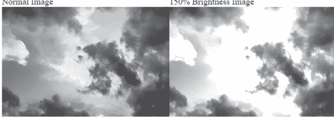

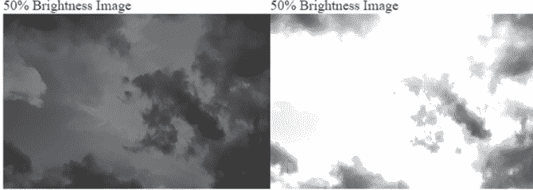

CSS 函数 (:blur())。

## calc()

CSS `calc()` 函数允许在 CSS 属性中使用计算。在设置宽度、高度、角度、频率等时可以使用 `calc()` 代替其他单位类型。浏览器将使用的精确值将是 `calc()` 函数执行计算产生的结果。

## 示例：

```html
<!DOCTYPE html>
<html
<head>
<style>
* {
  padding:0;
  margin:0;
  box-sizing: border-box;
}
.demo_container{
  width:800px;
  margin:0 auto;
  justify-content: center;
  align-items: center;
}
nav {
  width: 180px;
  float: left;
  background: gold;
}
article {
  width: calc(90% - 100px);
  float: right;
  background: orange;
}
article, nav {
  color: white;
  padding: 30px;
  box-sizing: border-box;
}
</style>
<div class="demo_container">
  <h1> calc() 函数允许在 CSS 属性中使用计算。 </h1>
  <br>
<nav>
  <h1> 宽度:100px</h1>
</nav>
```


## 268 精通 CSS

上述代码的输出如下：

# `calc()` 函数允许在 CSS 属性中使用计算。

| 宽度:100px | 宽度: `calc(100% - 100px);` |

CSS 函数 (`:calc()`).

## `circle()`

`circle()` 是 CSS 形状模块中的一个基础形状值。像 `circle()` 这样的基础形状可以作为 `shape-outline` 等属性的值，用于控制元素周围内容（代码）的流式布局，并作为 `clip-path` 将元素的内容裁剪为基础形状。这意味着你的文本以圆形的形式环绕元素流动，或者一个图像被裁剪成圆形。

`circle()` 函数的语法如下：

```
circle() = circle ([<shape-radius>]? [at <position>]]? )
```

### 如何定位圆

你可以通过各种半径参数配合有效的 CSS 位置来指定圆的位置。它它指定了圆的圆心。只需像这样分离半径和位置：

```css
shape-outside: circle(100px at 10px 150px);
```

## 示例：

```html
<!DOCTYPE html>
<html
<head>
<style>
```

## CSS 函数 ■ 269

```css
* {
  padding:0;
  margin:0;
  box-sizing: border-box;
}
.demo_container{
  width:800px;
  margin:0 auto;
  justify-content: center;
  align-items: center;
}
.section-1 {
  float: left;
  width: 200px;
  height: 150px;
  shape-outside: circle();
}
.section-2 {
  float: left;
  width: 200px;
  height: 150px;
  shape-outside: circle(100px at 0px 150px);
}
</style>
```

<div class="demo_container">
<h1>circle() 是一个 CSS 形状值，是 CSS 形状模块的一部分 circle（无背景颜色）。</h1><br>
<section class="section-1"></section><p>Ornare quam viverra sagittis eu odio. Viverra adipiscing at in integer feugat scelerisque.</p><p>Adipiscing bibendum est integer quis auctor. Massa tincidunt ullamcorper metus sit amet. Pellentesque eleget gravida cum sociis et. Sed vulputate odio ut blandit volutpat.</p><p>Purus viverra accumsan in nisi. Dignissim enim venenatis risus uset. Ornate arcu ut sem nulla pharetra magna iaculis.</p><p>Vitae justo magna fermentum iaculis.</p></</div><br><br>

```html
<div class="demo_container">
  <h1>圆 是一个 CSS 形状值，是 CSS 形状的一部分（带背景颜色）。</h1><br>
  <section class="section-2"></section><p>Ornare quam viverra sagittis eu odio. Viverra adipiscing at integer feugat scelerisque. Adipiscing bibendum ultricies quis auctor. Massa tincidunt ut ornare sit amet. Pellentesque eleget gravi satisque et. Sed vulputate odio blandit volutpat. Purus viverra accumsan in nisi. Dignissim enim eleit massa venenatis odio cursus. Ornate arcu ut sem nulla pharetra ut. Vitae justo magna fermentum iaculis.</p></div>
</body>
</html>
```

代码的输出如下：

# `circle()` 是一个 CSS 形状值，是 CSS 形状模块的一部分（带背景颜色）。

Ornare quam viverra sagittis eu odio. Viverra adipiscing at integer feugat scelerisque. Adipiscing bibendum ultricies integer auctor. Massa tincidunt ut dui ornare sit amet. Pellentesque eleget eget gravida sociis. Sed vulputate odio blandit volutpat. Purus viverra accumsan in nisi. Dignissim enim venenatis venenatis. Ornate arcu ut sem nulla pharetra ut. Vitae justo magna fermentum iaculis.

`circle()` 是一个 CSS 形状值，是 CSS 形状模块的一部分（带背景颜色）。

Ornare quam viverra sagittis eu odio. Viverra adipiscing at integer feugat scelerisque. Adipiscing bibendum ultricies quis auctor. Massa tincidunt ut ornare sit amet. Pellentesque eleget gravida sociis et. Sed vulputate odio blandit volutpat. Purus viverra accumsan in nisi. Dignissim enim venenatis venenatis. Ornate arcu ut sem nulla pharetra. Vitae justo magna fermentum iaculis.

CSS 函数 (`:circle()`).

## 另一个示例：

```html
<!DOCTYPE html>
<html
<head>
<style>
* {
  padding:0;
  margin:0;
  box-sizing: border-box;
}
.demo_container{
  width:800px;
  margin:0 auto;
  justify-content: center;
  align-items: center;
}
.section-1 {
  float: left;
  width: 200px;
  height: 150px;
  shape-outside: circle();
}
.section-2 {
  float: left;
  width: 200px;
  height: 150px;
/* shape-outside: circle(100px at 0px 150px); */
background: brown;
clip-path: circle();
}
</style>
<div class="demo_container">
<h1>circle() 是 CSS 形状模块的一部分，是一个 CSS 形状值。</h1><br>
<section class="section-2"></section><p>Ornare quam viverra sagittis eu odio. Viverra adipiscing at integer feugat scelerisque.</p>
## 272 精通 CSS
```html
<p>Faucibus ornare sed nisi viverra.</p>
```
Enim eleget gravida neque vallallis.
```html
Faucibus ornare sed nisi viverra.</p>
```
Sedim eleget gravida neque vallallis.
```html
shape-out::
```
Enim eleget gravida neque vallallis.
```html
shape-outside: circle();
```
Sedim eleget gravida neque vallallis.
```html
clip-path: circle();
```
```html
clip-path: circle();```
Vitae justo magna fermentum iaculis.
```html
Vitae justo magna fermentum iaculis.</p></div>
</body>
</html>
```

代码的输出如下：

# `circle()` 是一个 CSS 形状值，是 CSS 形状模块的一部分（带背景颜色）。 (Wait, re-checking source)

# `circle()` 是一个 CSS 形状值，是 CSS 形状模块的一部分（带背景颜色）。

Ornare quam viverra sagittis eu odio. Viverra adipiscing at integer feugat scelerisque. Adipiscing bibendum ultricies integer auctor. Massa tincidunt ut dui ornare sit amet. Pellentesque eleget eget gravida sociis. Sed vulputate odio ut blandit volutpat. Purus viverra accumsan in nisi. Dignissim enim venenatis venenatis. Ornate arcu ut sem nulla pharetra. Vitae justo magna fermentum iaculis.

`circle()` 是一个 CSS 形状值，是 CSS 形状模块的一部分（带背景颜色）。

Ornare quam viverra sagittis eu odio. Viverra adipiscing at integer feugat scelerisque. Adipiscing bibendum ultricies quis auctor. Massa tincidunt ut ornare sit amet. Pellentesque eleget gravida sociis et. Sed vulputate odio blandit volutpat. Purus viverra accumsan in nisi. Dignissim enim venenatis venenatis. Ornate arcu ut sem nulla pharetra. Vitae justo magna fermentum iaculis.

Ornare quam viverra sagittis eu odio. Viverra adipiscing at integer feugat scelerisque. Adipiscing bibendum ultricies quis auctor. Massa tincidunt ut ornare sit amet. Pellentesque eleget gravida sociis et. Sed vulputate odio blandit volutpat. Purus viverra accumsan in nisi. Dignissim enim venenatis venenatis. Ornate arcu ut sem nulla pharetra. Vitae justo magna fermentum iaculis.

CSS 函数 (`:circle()`).

## 另一个示例：


## 266 精通 CSS

```html

<p> 50% 亮度图像 </p>


</div>

</div>

</div>

</body>

```

上述代码的输出如下：

# blur() 函数将对指定的图像进行模糊处理。


CSS 函数 (:blur())。

## calc()

CSS `calc()` 函数允许在 CSS 属性值中使用计算。在设置宽度、高度、角度、频率等时，可以使用 `calc()` 代替其他单位。浏览器将使用的精确值将是 `calc()` 函数执行计算的结果。

## 示例：

```html

<!DOCTYPE html>

<html

<head>

<style>

* {

  padding:0;

  margin:0;

  box-sizing: border-box;

}

.demo_container{

  width:800px;

  margin:0 auto;

  justify-content: center;

  align-items: center;

}

nav {

  width: 180px;

  float: left;

  background: gold;

}

article {

  width: calc(90% - 100px);

  float: right;

  background: orange;

}

article, nav {

  color: white;

  padding: 30px;

  box-sizing: border-box;

}

</style>

<div class="demo_container">

  <h1> calc() 函数允许在 CSS 属性值中使用计算。 </h1>

  <br>

<nav>

  <h1> 宽度:100px</h1>

</nav>

```

## 268 精通 CSS

上述代码的输出如下：

# calc() 函数允许在 CSS 属性值中使用计算。

| 宽度:100px | 宽度: calc(100% - 100px); |

CSS 函数 (:calc())。

## circle()

`circle()` 是 CSS 形状模块中的一个基础形状值。像 `circle()` 这样的基础形状可以作为 `shape-outline` 等属性的值，用于控制元素周围内容（代码）的流式布局，并作为 `clip-path` 将元素的内容裁剪为基础形状。这意味着你的文本以圆形的形式环绕元素流动，或者一个图像被裁剪成圆形。

`circle()` 函数的语法如下：

```
circle() = circle ([<shape-radius>]? [at <position>]]? )
```

### 如何定位圆

你可以通过各种半径参数配合有效的 CSS 位置来指定圆的位置。它指定了圆的圆心。只需像这样分离半径和位置：

```css

shape-outside: circle(100px at 10px 150px);

```

## 示例：

```html

<!DOCTYPE html>

<html

<head>

<style>

```

## CSS 函数 ■ 269

```css

* {

  padding:0;

  margin:0;

  box-sizing: border-box;

}

.demo_container{

  width:800px;

  margin:0 auto;

  justify-content: center;

  align-items: center;

}

.section-1 {

  float: left;

  width: 200px;

  height: 150px;

  shape-outside: circle();

}

.section-2 {

  float: left;

  width: 200px;

  height: 150px;

  shape-outside: circle(100px at 0px 150px);

}

</style>

```

<div class="demo_container">
<h1>circle() 是一个 CSS 形状值，是 CSS 形状模块的一部分 circle（无背景颜色）。</h1><br>
<section class="section-1"></section><p>Ornare quam viverra sagittis eu odio. Viverra adipiscing at in integer feugat scelerisque.</p><p>Adipiscing bibendum est integer quis auctor. Massa tincidunt ullamcorper metus sit amet. Pellentesque eleget gravida cum sociis et. Sed vulputate odio ut blandit volutpat.</p><p>Purus viverra accumsan in nisi. Dignissim enim venenatis risus uset. Ornate arcu ut sem nulla pharetra magna iaculis.</p><p>Vitae justo magna fermentum iaculis.</p></</div><br><br>

```html

<div class="demo_container">

  <h1>圆 是一个 CSS 形状值，是 CSS 形状的一部分（带背景颜色）。</h1><br>

  <section class="section-2"></section><p>Ornare quam viverra sagittis eu odio. Viverra adipiscing at integer feugat scelerisque. Adipiscing bibendum ultricies quis auctor. Massa tincidunt ut ornare sit amet. Pellentesque eleget gravi satisque et. Sed vulputate odio blandit volutpat. Purus viverra accumsan in nisi. Dignissim enim eleit massa venenatis odio cursus. Ornate arcu ut sem nulla pharetra ut. Vitae justo magna fermentum iaculis.</p></div>

</body>

</html>

```

代码的输出如下：

# circle() 是一个 CSS 形状值，是 CSS 形状模块的一部分（带背景颜色）。

Ornare quam viverra sagittis eu odio. Viverra adipiscing at integer feugat scelerisque. Adipiscing bibendum ultricies integer auctor. Massa tincidunt ut dui ornare sit amet. Pellentesque eleget eget gravida sociis. Sed vulputate odio blandit volutpat. Purus viverra accumsan in nisi. Dignissim enim venenatis venenatis. Ornate arcu ut sem nulla.. Vitae justo magna fermentum iaculis.

`circle()` 是一个 CSS 形状值，是 CSS 形状模块的一部分（带背景颜色）。

Ornare quam viverra sagittis eu odio. Viverra adipiscing at integer feugat scelerisque. Adipiscing bibendum ultricies quis auctor. Massa tincidunt ut ornare sit amet. Pellentesque eleget gravida sociis et. Sed vulputate odio blandit volutpat. Purus viverra accumsan in nisi. Dignissim enim venenatis venenatis. Ornate arcu ut sem nulla.. Vitae justo magna fermentum iaculis.


## 266 精通 CSS

```html
<p> 50% 亮度图像 </p>

</div>
</div>
</div>
</body>
```

上述代码的输出如下：

# `blur()` 函数将对指定的图像进行模糊处理。


CSS 函数 (`:blur()`).

## `calc()`

CSS `calc()` 函数允许在 CSS 属性值中使用计算。在设置宽度、高度、角度、频率等时，可以使用 `calc()` 代替其他单位。浏览器将使用的精确值将是 `calc()` 函数执行计算的结果。

## 示例：

```html
<!DOCTYPE html>
<html
<head>
<style>
* {
  padding:0;
  margin:0;
  box-sizing: border-box;
}
.demo_container{
  width:800px;
  margin:0 auto;
  justify-content: center;
  align-items: center;
}
nav {
  width: 180px;
  float: left;
  background: gold;
}
article {
  width: calc(90% - 100px);
  float: right;
  background: orange;
}
article, nav {
  color: white;
  padding: 30px;
  box-sizing: border-box;
}
</style>
<div class="demo_container">
  <h1> calc() 函数允许在 CSS 属性值中使用计算。 </h1>
  <br>
<nav>
  <h1> 宽度:100px</h1>
</nav>
```

## 268 精通 CSS

上述代码的输出如下：

# `calc()` 函数允许在 CSS 属性值中使用计算。

| 宽度:100px | 宽度: `calc(100% - 100px)`; |

CSS 函数 (`:calc()`).

## `circle()`

`circle()` 是 CSS 形状模块中的一个基础形状值。像 `circle()` 这样的基础形状可以作为 `shape-outline` 等属性的值，用于控制元素周围内容（代码）的流式布局，并作为 `clip-path` 将元素的内容裁剪为基础形状。这意味着你的文本以圆形的形式环绕元素流动，或者一个图像被裁剪成圆形。

`circle()` 函数的语法如下：

```
circle() = circle ([<shape-radius>]? [at <position>]]? )
```

### 如何定位圆

你可以通过各种半径参数配合有效的 CSS 位置来指定圆的位置。它指定了圆的圆心。只需像这样分离半径和位置：

```css
shape-outside: circle(100px at 10px 150px);
```

## 示例：

```html
<!DOCTYPE html>
<html
<head>
<style>
```

## CSS 函数 ■ 269

```css
* {
  padding:0;
  margin:0;
  box-sizing: border-box;
}
.demo_container{
  width:800px;
  margin:0 auto;
  justify-content: center;
  align-items: center;
}
.section-1 {
  float: left;
  width: 200px;
  height: 150px;
  shape-outside: circle();
}
.section-2 {
  float: left;
  width: 200px;
  height: 150px;
  shape-outside: circle(100px at 0px 150px);
}
</style>
```

<div class="demo_container">
<h1>circle() 是一个 CSS 形状值，是 CSS 形状模块的一部分 circle（无背景颜色）。</h1><br>
<section class="section-1"></section><p>Ornare quam viverra sagittis eu odio. Viverra adipiscing at in integer feugat scelerisque.</p><p>Adipiscing bibendum est integer quis auctor. Massa tincidunt ullamcorper metus sit amet. Pellentesque eleget gravida cum sociis et. Sed vulputate odio ut blandit volutpat.</p><p>Purus viverra accumsan in nisi. Dignissim enim venenatis risus uset. Ornate arcu ut sem nulla pharetra magna iaculis.</p><p>Vitae justo magna fermentum iaculis.</p></</div><br><br>

```html
<div class="demo_container">
  <h1>圆 是一个 CSS 形状值，是 CSS 形状的一部分（带背景颜色）。</h1><br>
  <section class="section-2"></section><p>Ornare quam viverra sagittis eu odio. Viverra adipiscing at integer feugat scelerisque. Adipiscing bibendum ultricies quis auctor. Massa tincidunt ut ornare sit amet. Pellentesque eleget gravi satisque et. Sed vulputate odio blandit volutpat. Purus viverra accumsan in nisi. Dignissim enim eleit massa venenatis odio cursus. Ornate arcu ut sem nulla pharetra ut. Vitae justo magna fermentum iaculis.</p></div>
</body>
</html>
```

代码的输出如下：

# `circle()` 是一个 CSS 形状值，是 CSS 形状模块的一部分（带背景颜色）。

Ornare quam viverra sagittis eu odio. Viverra adipiscing at integer feugat scelerisque. Adipiscing bibendum ultricies integer auctor. Massa tincidunt ut dui ornare sit amet. Pellentesque elegetget gravida sociis. Sed vulputate odio ut blandit volutpat. Purus viverra accumsan in nisi. Dignissim enim venenatis venenatis. Ornate arcu ut sem nulla. Vitae justo magna fermentum iaculis.


上述代码的输出如下：

# `blur()` 函数将对指定的图像进行模糊处理。


CSS 函数 (`:blur()`).

## `calc()`

CSS `calc()` 函数允许在 CSS 属性值中使用计算。在设置宽度、高度、角度、频率等时，可以使用 `calc()` 代替其他单位。浏览器将使用的精确值将是 `calc()` 函数执行计算的结果。

## 示例：

```html
<!DOCTYPE html>
<html
<head>
<style>
* {
  padding:0;
  margin:0;
  box-sizing: border-box;
}
.demo_container{
  width:800px;
  margin:0 auto;
  justify-content: center;
  align-items: center;
}
nav {
  width: 180px;
  float: left;
  background: gold;
}
article {
  width: calc(90% - 100px);
  float: right;
  background: orange;
}
article, nav {
  color: white;
  padding: 30px;
  box-sizing: border-box;
}
</style>
<div class="demo_container">
  <h1> calc() 函数允许在 CSS 属性值中使用计算。 </h1>
  <br>
<nav>
  <h1> 宽度:100px</h1>
</nav>
```

## 268 精通 CSS

上述代码的输出如下：

# `calc()` 函数允许在 CSS 属性值中使用计算。

| 宽度:100px | 宽度: calc(100% - 100px); |

CSS 函数 (`:calc()`).

## `circle()`

`circle()` 是 CSS 形状模块中的一个基础形状值。像 `circle()` 这样的基础形状可以作为 `shape-outline` 等属性的值，用于控制元素周围内容（代码）的流式布局，并作为 `clip-path` 将元素的内容裁剪为基础形状。这意味着你的文本以圆形的形式环绕元素流动，或者一个图像被裁剪成圆形。

`circle()` 函数的语法如下：

```
circle() = circle ([<shape-radius>]? [at <position>]]? )
```

### 如何定位圆

你可以通过各种半径参数配合有效的 CSS 位置来指定圆的位置。它指定了圆的圆心。只需像这样分离半径和位置：

```css
shape-outside: circle(100px at 10px 150px);
```

## 示例：

```html
<!DOCTYPE html>
<html
<head>
<style>
```

## CSS 函数 ■ 269

```css
* {
  padding:0;
  margin:0;
  box-sizing: border-box;
}
.demo_container{
  width:800px;
  margin:0 auto;
  justify-content: center;
  align-items: center;
}
.section-1 {
  float: left;
  width: 200px;
  height: 150px;
  shape-outside: circle();
}
.section-2 {
  float: left;
  width: 200px;
  height: 150px;
  shape-outside: circle(100px at 0px 150px);
}
</style>
```

<div class="demo_container">
<h1>circle() 是一个 CSS 形状值，是 CSS 形状模块的一部分 circle（无背景颜色）。</h1><br>
<section class="section-1"></section><p>Ornare quam viverra sagittis eu odio. Viverra adipiscing at in integer feugat scelerisque.</p><p>Adipiscing bibendum est integer quis auctor. Massa tincidunt ullamcorper metus sit amet. Pellentesque eleget gravida cum sociis et. Sed vulputate odio ut blandit volutpat.</p><p>Purus viverra accumsan in nisi. Dignissim enim venenatis risus uset. Ornate arcu ut sem nulla pharetra magna iaculis.</p><p>Vitae justo magna fermentum iaculis.</p></</div><br><br>

```html
<div class="demo_container">
  <h1>圆 是一个 CSS 形状值，是 CSS 形状的一部分（带背景颜色）。</h1><br>
  <section class="section-2"></section><p>Ornare quam viverra sagittis eu odio. Viverra adipiscing at integer feugat scelerisque. Adipiscing bibendum ultricies quis auctor. Massa tincidunt ut ornare sit amet. Pellentesque eleget gravi satisque et. Sed vulputate odio blandit volutpat. Purus viverra accumsan in nisi. Dignissim enim eleit massa venenatis odio cursus. Ornate arcu ut sem nulla pharetra ut. Vitae justo magna fermentum iaculis.</p></div>
</body>
</html>
```

代码的输出如下：

# `circle()` 是一个 CSS 形状值，是 CSS 形状模块的一部分（带背景颜色）。

Ornare quam viverra sagittis eu odio. Viverra adipiscing at integer feugat scelerisque. Adipiscing bibendum ultricies integer auctor. Massa tincidunt ut dui ornare sit amet. Pellentesque elegetget gravida sociis. Sed vulputate odio ut blandit volutpat. Purus viverra accumsan in nisi. Dignissim enim venenatis venenatis. Ornate arcu ut sem nulla. Vitae justo magna fermentum iaculis.


`.demo_container`{

  width:800px;

  margin:0 auto;

  justify-content: center;

  align-items: center;

}

`nav` {

  width: 180px;

  float: left;

  background: gold;

}

`article` {

  width: calc(90% - 100px);

  float: right;

  background: orange;

}

`article`, `nav` {

  color: white;

  padding: 30px;

  box-sizing: border-box;

}

</style>

<div class="demo_container">

  <h1> calc() 函数允许在 CSS 属性值中使用计算。 </h1>

  <br>

<nav>

  <h1> 宽度:100px</h1>

</nav>

```
## 268 精通 CSS
```

上述代码的输出如下：

# `calc()` 函数允许在 CSS 属性值中使用计算。

| 宽度:100px | 宽度: `calc(100% - 100px)`; |

CSS 函数 (`:calc()`).

## `circle()`

`circle()` 是 CSS 形状模块中的一个基础形状值。像 `circle()` 这样的基础形状可以作为 `shape-outline` 等属性的值，用于控制元素周围内容（代码）的流式布局，并作为 `clip-path` 将元素的内容裁剪为基础形状。这意味着你的文本以圆形的形式环绕元素流动，或者一个图像被裁剪成圆形。

`circle()` 函数的语法如下：

```
circle() = circle ([<shape-radius>]? [at <position>]]? )
```

### 如何定位圆

你可以通过各种半径参数配合有效的 CSS 位置来指定圆的位置。它指定了圆的圆心。只需像这样分离半径和位置：

```css
shape-outside: circle(100px at 10px 150px);
```

## 示例：

```html
<!DOCTYPE html>
<html
<head>
<style>
```
## CSS 函数 ■ 269
```css
* {
  padding:0;
  margin:0;
  box-sizing: border-box;
}
.demo_container{
  width:800px;
  margin:0 auto;
  justify-content: center;
  align-items: center;
}
.section-1 {
  float: left;
  width: 200px;
  height: 150px;
  shape-outside: circle();
}
.section-2 {
  float: left;
  width: 200px;
  height: 150px;
  shape-outside: circle(100px at 0px 150px);
}
</style>
```
<div class="demo_container">
<h1>circle() 是一个 CSS 形状值，是 CSS 形状模块的一部分 circle（无背景颜色）。</h1><br>
<section class="section-1"></section><p>Ornare quam viverra sagittis eu odio. Viverra adipiscing at in integer feugat scelerisque.</p><p>Adipiscing bibendum est integer quis auctor. Massa tincidunt ullamcorper metus sit amet. Pellentesque eleget gravida cum sociis et. Sed vulputate odio ut blandit volutpat.</p><p>Purus viverra accumsan in nisi. Dignissim enim venenatis risus uset. Ornate arcu ut sem nulla pharetra magna iaculis.</p><p>Vitae justo magna fermentum iaculis.</p></</div><br><br>
```html
<div class="demo_container">
  <h1>圆 是一个 CSS 形状值，是 CSS 形状的一部分（带背景颜色）。</h1><br>
  <section class="section-2"></section><p>Ornare quam viverra sagittis eu odio. Viverra adipiscing at integer feugat scelerisque. Adipiscing bibendum ultricies quis auctor. Massa tincidunt ut ornare sit amet. Pellentesque eleget gravi satisque et. Sed vulputate odio blandit volutpat. Purus viverra accumsan in nisi. Dignissim enim eleit massa venenatis odio cursus. Ornate arcu ut sem nulla pharetra ut. Vitae justo magna fermentum iaculis.</p></div>
</body>
</html>
```
代码的输出如下：

# `circle()` 是一个 CSS 形状值，是 CSS 形状模块的一部分（带背景颜色）。

Ornare quam viverra sagittis eu odio. Viverra adipiscing at integer feugat scelerisque. Adipiscing bibendum ultricies integer auctor. Massa tincidunt ut dui ornare sit amet. Pellentesque elegetget gravida sociis. Sed vulputate odio ut blandit volutpat. Purus viverra accumsan in nisi. Dignissim enim venenatis venenatis. Ornate arcu ut sem nulla. Vitae justo magna fermentum iaculis.

## 274 ■ 精通 CSS

Adipisque bibendum est tricies integer quis auctor. Massa tincidunt dui element neque lectus amet. 

Pellentesque elit eget gravravida cum sociis natque penabitur et. Sed vulputate odio ut enim blandit volutpat eu volutpat.

Pursus viver accums in nisl nisi. Dignim enim sitatem venenatis urna egt. Ornare acdio odio ut em nulla pharetra diam sit.

```html
<div>
<p>Faucibus ornare suspendisse sednisis lacus sed viverra tellus.
Rhoncus est pellentesque elit ullamcorper dignissim cras. Sodales et etiam sit amet nisl puruin mollunc nunc.
Hendrerit gravida rutrum quidem non tellus orciac auctor. Enim sem viverra aliquet eget. Eu nisl nunc mi ipsum faucibus.
Enim facil gravida neque convallis acras semper auctor neque.
Sit amet mauris commodo quis imperdiet massa tinci dunt nunc.</p>
Vitae justo eget magna fermentum iaculis.</p>
</div>
</body>
</html>
```
代码输出如下：

# `circle()` 是一个 CSS 形状值，它是 CSS 形状模块 `clip-path: circle()` 的一部分

```
Onam quam viverra orci sagit vulputate odio. Vivrerrer feugeler. Adipisque bibendum est ultricies integer quis auctor. Massa tincidunt dui eget gravida cum sociis ut ornare lectus amet. Pellentesque elit eget gravida cum sociis natque penabitur et. Sed vulputate odio ut enim blandit volutpat eu volutpat. Pulsus viver accumsan in nisl nisi. Dignim enim sitatem venenatis urna egt. Ornare acdio odio ut em nulla pharetra diam sit.
Faucibus ornare suspendisse sednisis lacus sed viverra tellus. Rhoncus est pellentesque elit ullamcorper dignissim cras. Sodales et etiam sit amet nisl puruin mollunc nunc. Hendrerit gravida rutrum quidem non tellus orciac auctor. Enim sem viverra aliquet eget. Eu nisl nunc mi ipsum faucibus. Enim facil gravida neque convallis acras semper auctor neque. Sit amet mauris commodo quis imperdiet massa tinci dunt nunc.
Vitae justo eget magna fermentum iaculis.
```
CSS 函数 (`:circle()`).

CSS 函数 ■ 275

# `contrast()`

CSS `contrast()` 用于 `filter` 属性来调整图像的对比度。`contrast()` 需要传递一个参数。它决定了应用于图像的对比度级别。该参数可以是值也可以可以是数字。

`contrast()` 函数的语法如下：

```
contrast () = contrast( [ <number> | <percentage> ] )
```

## 示例：

```html
<!DOCTYPE html>
<html>
<head>
<style>
* {
  padding:0;
  margin:0;
  box-sizing: border-box;
}
.demo_container{
  padding:20px;
  width:800px;
  margin:0 auto;
  justify-content: center;
  align-items: center;
}
img{
  width:100%;
  height:250px;
}
.row{
  display: flex;
}
.col{
  width:100%
}
```
```css
.image-1 {
  filter: contrast(140%);
}
.image-2 {
  filter: contrast(40%);
}
.image-3 {
  filter: contrast(2.5);
}
p{
  font-size:20px
}
</style>
</head>
<body>
<div class="demo_container">
  <h3> 使用 filter 属性配合 contrast() 函数调整给定图像的对比度。 </h3>
  <div class="row">
    <div class="col">
      <p> 普通图像 </p>
      
      <p> 140% 对比图像 </p>
      
    </div>
    <div class="col">
      <p> 40% 对比图像 </p>
      
      <p> 2.5 对比图像 </p>
      
    </div>
  </div>
</body>
</html>
```
代码输出如下：

使用 `filter` 属性配合 `contrast()` 函数调整给定图像的对比度。

| 普通图像 | 40% 对比图像 |
| :--- | :--- |
| 140% 对比图像 | 2.5 对比图像 |

# CSS 函数 (`:counter()`).

`counter()` 允许你显示元素生成的计数器。每个元素都有一组多个计数器，这些计数器像属性值一样从文档树继承。你可以使用 `counter-increment`、`counter-reset` 和 `counter` 属性创建并操作计数器。它们本身没有视觉效果，但可以配合 `counter()` 和 `counters()` 函数以以指定的格式显示值。例如，你可以使用 `counter()` 输出罗马数字、十进制等格式元素计数器。你还可以指定 Unicode 字符来指定特殊符号或图标作为表示。**语法**：`counter()` 有两种形式：`counter(name)` 或 `counter(name, style)`。文本是伪元素中作用域内给定名称的最内层计数器的值；它按照指定的样式进行格式化（默认是十进制）。

`counter()` 函数的语法如下：

```
counter( <ident> [,counter-style> | none ] )
```

## 示例：

```html
<!DOCTYPE html>
<html>
<head>
<style>
* {
  padding:0;
  margin:0;
  box-sizing: border-box;
}
.demo_container{
  padding:20px;
  width:800px;
  margin:0 auto;
  justify-content: center;
  align-items: center;
}
section {
  counter-reset: myCounter;
}
h1 {
  font-size:18px;
}
p:before {
  content: counter(myCounter) ". ";
}
</style>
</head>
```
```html
<body>
<div class="demo_container">
  <h3> 显示元素生成的计数器。</h3>
  <section>
    输出如下：
    <p>HTML</p>
    <p>JavaScript</p>
    <p>Ruby</p>
  </section>
</div>
```
代码输出如下：

`counter()` 显示元素生成的计数器。

1. HTML
2. JavaScript
3. Ruby

# `counters()`

`counters()` 显示由元素及其父元素生成的嵌套计数器。每个元素都有一组多个计数器，这些计数器像属性值一样从文档树继承。你可以使用 `counter-increment`、`counter-reset` 和 `counter` 属性创建并操作计数器。它们本身没有视觉效果，但可以配合 `counter()` 和 `counters()` 函数以以指定的格式显示值。例如，你可以使用 `counter()` 输出罗马数字、十进制等格式的元素计数器。你还可以指定 Unicode 字符来指定特殊符号或图标作为表示。

`counters()` 的语法如下：

```
counters( <ident>, <string> [, <counter-style> | none ] )
```
示例：

```html
<!DOCTYPE html>
<html>
<head>
<style>
* {
  padding:0;
  margin:0;
  box-sizing: border-box;
}
.demo_container{
  padding:20px;
  width:800px;
  margin:0 auto;
  justify-content: center;
  align-items: center;
}
section {
  counter-reset: myCounter;
}
h1 {
  font-size:18px;
}
p:before {
  content: counter(myCounter) ". ";
}
</style>
</head>
<body>
<div class="demo_container">
  <h3> 显示元素生成的计数器。</h3>
  <section>
    输出如下：
    <p>HTML</p>
    <p>JavaScript</p>
    <p>Ruby</p>
  </section>
</div>
```


`align-items: center;`

}

`ul` {

  `list-style: none`;

  `counter-reset: nestedCounter`;

}

`ul li` {

  `counter-increment: nestedCounter`;

  `line-height: 1.4`;

}

`ul li:before` {

  `content: counters(nestedCounter, "\") - "`;

  `font-weight: bold`;

}

</style>

</head>

```
```html
<body>
<div class="demo_container">
  <h3> 显示由元素及其父元素生成的嵌套计数器。 </h3>
  <ul>
    <li>Fruit
      <ul>
        <li>Apples
          <ul>
            <li>Green ones</li>
            <li>Red ones</li>
          </ul>
        </li>
        <li>Oranges
          <ul>
            <li>Small ones</li>
            <li>Big ones</li>
          </ul>
        </li>
      </ul>
    </li>
    <li>Vegetables
      <ul>
        <li>Carrots
          <ul>
            <li>Orange ones</li>
            <li>Purple ones</li>
          </ul>
        </li>
        <li>Potatoes
          <ul>
            <li>Fresh ones</li>
            <li>Rotten ones</li>
          </ul>
        </li>
      </ul>
    </li>
    <li>Fish
      <ul>
        <li>Big Ones</li>
      </ul>
    </li>
  </ul>
</div>
</body>
```

代码的输出如下：

- **`counter()` 函数允许显示由元素及其父级元素生成的嵌套计数器。**
- 1 - 水果
  1.1 - 苹果
    1.1.1 - 绿色的
    1.1.2 - 红色的
  1.2 - 橙子
    1.2.1 - 小号
    1.2.2 - 大号
- 2 - 蔬菜
  2.1 - 胡萝卜
    2.1.1 - 橙色的
    2.1.2 - 紫色的
  2.2 - 土豆
    2.2.1 - 新鲜的
    2.2.2 - 烂的
- 3 - 鱼
  3.1 - 大号
    3.1.1 - 湄公河鱼
  3.2 - 小号
    3.2.1 - 食人鱼
    3.2.2 - 金鱼
    3.2.3 - 黑色摩鱼

CSS 函数 (`:counter()`).

# CSS 函数 283

### `cubic-bezier()`

`cubic-bezier()` 可以与过渡时间函数属性一起使用，控制过渡在持续时间内的速度变化。该属性接受一个缓函数，该函数描述了过渡过程中使用的中间值是如何计算的。

`cubic-bezier()` 是一种缓函数，可以为 `transition-timing-function` 属性提供值。其他一些缓函数包括 `ease-in`、`ease-out`、`linear` 等。然而，`cubic-bezier()` 可以提供自定义的曲线。

示例：

```html
<!DOCTYPE html>
<html>
<head>
<style>
* {
  padding:0;
  margin:0;
  box-sizing: border-box;
}
.demo_container{
  padding:20px;
  width:800px;
  margin:0 auto;
  justify-content: center;
  align-items: center;
}
.ease {
  transition: width 1s ease;
}
.cubic-bezier {
  transition: width 1s cubic-bezier(.63,.05,.43,1);
}
.ease:hover,
.cubic-bezier: hover {
  width: 80%;
}
```
```css
.ease .cubic-bezier {
  background: orange;
  color: white;
  width: 90px;
  margin:10px;
  padding:10px;
}
</style>
</head>
<body>
<div class="demo_container">
  <h3>cubic-bezier() 用于 CSS 过渡以创建自定义的贝塞尔曲线。</h3>
  <div class="ease"> ease transition</div>
  <br>
  <div class="cubic-bezier">cubic-bezier() function</div>
</body>
</html>
```

代码的输出如下：

`cubic-bezier()` 用于 CSS 过渡以创建自定义的贝塞尔曲线。
`ease transition`

`cubic-bezier()` 函数

CSS 函数 (`cubic-bezier()`).

# `drop-shadow()`

它使用 `drop-shadow()` 配合 `filter` 属性为图像添加投影效果。`drop-shadow` 是在图像下方绘制的特定颜色的遮罩版本。

`drop-shadow()` 接受多个参数，确定阴影的偏移、模糊和颜色。

示例：

```html
<!DOCTYPE html>
<html>
<head>
<style>
* {
  padding:0;
  margin:0;
  box-sizing: border-box;
}
.demo_container{
  padding:20px;
  width:800px;
  margin:0 auto;
  justify-content: center;
  align-items: center;
}
img{
  width:100%;
  height:250px;
}
.row{
  display: flex;
}
.col{
  width:80%
}
.image-1 {
  filter: drop-shadow(5px 5px 10px gray);
}
.image-2 {
  filter: drop-shadow(0px 0px 10px orange);
  margin: 10px;
}
```
```css
.image-3 {
  filter: drop-shadow(5px 5px 0 orange);
}
p{
  line-height: 2;
  font-size: 20px;
}
</style>
</head>
<body>
<div class="demo_container">
  <h3>contrast() 函数配合 filter 属性调整图像的对比度。</h3>
  <div class="row">
    <div class="col">
      <p>普通图像 </p>
      
      <p>drop-shadow(5px 5px 10px gray) Image</p>
      
    </div>
    <div class="col">
      <p>drop-shadow(0px 0px 10px orange) Image</p>
      
      <p>drop-shadow(5px 5px 0 orange) Image</p>
      
    </div>
  </div>
</body>
</html>
```

# CSS 函数 287

代码的输出如下：

`contrast()` 函数配合 `filter` 属性调整给定图像的对比度。

普通图像 `drop-shadow(0px 0px 10px orange)` 图像

`drop-shadow(5px 5px 10px gray)` 图像 `drop-shadow(5px 5px 0 orange)` 图像

# `ellipse()`

`ellipse()` 函数是 CSS 基础值，是 CSS 形状的一部分。像 `ellipse()` 这样的基础形状可以作为 `shape-outside` 等属性的值，用于控制内容在元素周围的流，并使用 `clip-path` 将元素的内容裁剪为基础形状。这意味着你可以让环绕元素呈椭圆形，将图像裁剪为椭圆形等。

`ellipse()` 函数的语法如下：

```
ellipse() = ellipse([shape-radius at <position>]
```

`<position>` 的语法为：

```
<position> =
[left | center | right | top | bottom | <length-percentage> ]
[left | center | right | <length-percentage> ]
[top | center | bottom | <length-percentage> ]
[center | left | right | <length-percentage> ]
[center | top | bottom | <length-percentage> ]
```

示例：

```html
<!DOCTYPE html>
<html>
<head>
<style>
* {
  padding:0;
  margin:0;
  box-sizing: border-box;
}
.demo_container{
  padding:20px;
  width:800px;
  margin:0 auto;
  justify-content: center;
  align-items: center;
}
.section-1 {
  float: left;
  width:200px;
  height:150px;
  shape-outside: ellipse();
}
```
```css
.section-2 {
  float: left;
  width:200px;
  height:150px;
  shape-outside: ellipse();
  background: yellow;
}
```
```css
.section-3 {
  float: left;
  width:200px;
  height:150px;
  shape-outside: ellipse(30% 50%);
  background: yellow;
}
```
```html
</style>
<body>
<div class="demo_container">
  <h3>ellipse() 是 CSS 形状的一部分的 CSS 基础值（无背景颜色）。</h3>
  <br>
  <section class="section-1"></section>
  <p>ellipse() 是 CSS 形状的一部分的 CSS 基础值（无背景颜色）。</p>
</div>
</body>
</html>
```

## CSS 函数 ■ 291

代码的输出是一个 CSS 形状值，它是

# 的 `ellipse()` 是 CSS Shapes 模块的一部分，类似于 `circle()`（无背景颜色）。

> Ornam quam viver orci sagittis eu volutpat odio. Vivera adipiscing at tellus integer feugiat scelerisque. Adipiscing bibendum est ultricies integer quis auctor. Massa tincidunt dui ut ornare lectus sit amet blandit. Pellentesque elit eget gravida quis sociis natoque patenibus et. Sed vulputate odio ut enim blandit volutpat mauris volupt. Purus viverra accumsan in nisl. Dignanim enim sit amet venenatis cursus eleget. Orre arcu odio ut sem nulla pharetra diam sit. Vitae justo eget magna fermentum iaculis.

# 的 `ellipse()` 是一个 CSS 形状值，它是 CSS Shapes 模块的一部分（带有背景颜色）。

> Ornam quam viver orci sagittis eu volutpat odio. Vivera adipiscing at tellus integer feugiat scelerisque. Adipiscing bibendum est ultricies integer quis auctor. Massa tincidunt dui ut ornare lectus sit amet blandit. Pellentesque elit eget gravida quis sociis natoque patenibus et. Sed vulputate odio ut enim blandit volutpat mauris volupt. Purus viverra accumsan in nisl. Dignanim enim enim sit amet venenatis cursus eleget. Orre arcu odio ut sem nulla pharetra diam sit. Vitae justo eget magna fermentum iaculis.

# 的 `ellipse()` 是 CSS Shapes 模块的一部分 `shape-outside: ellipse(30% 50%)`

> Ornam quam viver orci sagittis eu volutpat odio. Vivera adipiscing at tellus integer feugiat scelerisque. Adipiscing bibendum est ultricies integer quis auctor. Massa tincidunt dui ut ornare lectus sit amet blandit. Pellentesque elit eget gravida quis sociis natoque patenibus et. Sed vulputate odio ut enim blandit volutpat mauris volupt. Purus viverra accumsan in nisl. Dignanim enim sit sit sit amet venenatis cursus eleget. Orre arcu odio ut sem nulla pharetra diam sit. Vitae justo eget magna fermentum iaculis.

CSS 函数：`ellipse( )`。

示例：

```html
<!DOCTYPE html>
<html
<head>
<style>
```
```css
* {
  padding:0;
  margin:0;
  box-sizing: border-box;
}
```
```css
.demo_container{
  width:800px;
  margin:0 auto;
  justify-content: center;
  align-items: center;
}
```
```css
.section-1 {
  float: left;
  width: 200px;
  height: 150px;
  clip-path: ellipse();
  background-color: brown;
}
```
```css
.section-2 {
  float: left;
  width: 200px;
  height: 150px;
  clip-path: ellipse(farthest-closest-side-at 50px 100px);
  background-color: brown;
}
```
```html
</style>
<div class="demo_container">
<h1>ellipse() 是一个 CSS 形状值，它是 CSS Shapes 模块的一部分 clip-path: ellipse()</h1><br>
<section class="section-1"></section>


Ornare quam viverra orci sagittis eu volutpat odio. Vivera adipiscing at tellus integer feugiat scelerisque. Adipiscing bibendum est ultricies integer quis auctor. Massa tincidunt dui ut ornare lectus sit amet.

## CSS 函数 ■ 293

Pellentesque eleget gravida cum sociis natoque penatibus et. Sed vulputate odio ut enim blandit volutpat maenas volutpat.

Purus viverra accumsan in nisl nisi. Dignanim enim sit at venenatis urna cursus eget. Ornare arcu odio ut nulla pharetra diam sit diam.

Vitae justo eget magna fermentum iaculis.

```html
<div class="demo_container">
<h1>ellipse() 是一个 CSS 形状值
它是 CSS Shapes 模块的一部分，clip-path:
ellipse(farthest-side closest-side at 50px)
</h1>
<section class="section-2">
<p>Ornare quam viverra orci sagittis eu ullamcorper
volutat odio. Vivera adipiscing at integer feugiat scelerisque. Adipiscing bibendum est ultricies
integer quis auctor. Massa tincidunt dui ut ornare
lectus sit amet.
Pellentesque elit eget gravida cum sociis natoque penatibus et. Sed vulputate odio blandit volutpat maenas volutpat.
Purus viverra accumsan in nisl nisi.
Dignanim enim sit at venenatis cursus eget.
Ornare arcu odio ut sem nulla pharetra diam sit.
Vitae justo eget magna fermentum
iaculis.</p>
</div>
</body>
</html>
```

## `filter()`

`filter()` 函数用于对图像应用过滤器。`filter()` 函数允许你对图像应用过滤器。它与 `filter` 属性相似，不同在于它是一个函数，因此可以本身作为值使用。例如，你可以将其配合 `background-image` 属性使用，对背景图像应用过滤器。

`filter()` 函数接受两个参数。第一个参数是图像，第二个参数是应用到该图像的过滤器函数列表。

它接受的过滤器函数与 `filter` 属性接受的函数相同。你可以根据需要提供多个过滤器函数。

### 示例：

```html
<!DOCTYPE html>
<html>
<head>
<style>
* {
  padding:0;
  margin:0;
  box-sizing: border-box;
}
.demo_container{
  padding:20px;
  width:800px;
  margin:0 auto;
  justify-content: center;
  align-items: center;
}
div {
  background-size: cover;
  border: 1px solid black;
  height: 40vw;
  width: 40vw;
  margin: 0 2vw;
  float: left;
}
.unfiltered {
  background-image: url('/images-1.jpg');
  height:200px;
  width:200px
}
```
```css
.filtered {
  background-image: filter(url('/images-1.jpg'));
  hue-rotate(180deg);
  height: 200px;
  width: 200px
}
</style>
</head>
<body>
<section class="demo_container">
<h2>filter() 函数用于对图像应用过滤器</h2>
<div class="unfiltered">
  未过滤的
</div>
<div class="filtered">
  已过滤的
</div>
</section>
</body>
</html>
```

代码的输出如下：

`filter()` 函数用于对图像应用过滤器。

`filter()` 函数允许你对图像应用过滤器。它与 `filter` 属性相似，不同在于它是一个函数，因此可以本身作为值使用。例如，你可以将其配合 `background-image` 属性使用，对背景图像应用过滤器。

`filter()` 函数接受两个参数。第一个参数是图像，第二个参数是应用到该图像的过滤器函数列表。

它接受的过滤器函数与 `filter` 属性接受的函数相同。你可以根据需要提供多个过滤器函数。

## `hsl()`

`hsl()` 函数用于在内置 CSS 时提供颜色值。它允许通过指定颜色的色调、饱和度和亮度来指定该值。

HSL（代表色调、饱和、亮度）是计算机图形 RGB 色空间的一种基于色色的表示。

HSL 模型被认为比 RGB 模型更直观。HSL 模型允许选择一个基础色调，然后根据需要调整其饱和度和亮度。它接受 HSL 值作为参数。HSL 值通过三个逗号分隔的值提供，分别提供色调、饱和度和亮度分量。可以通过色轮来识别色调。

这里有一个显示蓝色的示例：

```
hsl( <hue>, <saturation>, <lightness> )
```

## CSS 函数 ■ 299

## 如何选择颜色

这里是选择颜色的几个步骤。如果你已经知道了颜色，可以一步完成。然而，如果你正在寻找合适的颜色，遵循这些步骤可以帮助他人有条理地找到。

- 1. 调整色相
- 2. 调整饱和度
- 3. 调整亮度

示例：

```html
<!DOCTYPE html>
<html
<head>
<style>
* {
  padding:0;
  margin:0;
  box-sizing: border-box;
}
.demo_container{
  padding:20px;
  width:800px;
  margin:0 auto;
  justify-content: center;
  align-items: center;
}
img{
  width:100%;
  height:250px;
}
.image-1 {
  background-color: HSL(240, 100%, 50%);
  width:100%;
  height:200px;
  color:white;
  padding:20px;
  font-size:20px
}
.image-2 {
  background-color: HSL(240, 10%, 50%);
  width:100%;
  height:200px;
  color:white;
  padding:20px;
  font-size:20px
}
.image-3 {
  background-color: HSL(240, 100%, 30%);
  width:100%;
  height:200px;
  color:white;
  padding:20px;
  font-size:20px
}
p{
  line-height: 2;
  font-size:20px
}
</style>
</head>
<body>
<div class="demo_container"> 
  hsl() 函数允许通过指定颜色的色相、饱和度和亮度分量来指定颜色值。 
</</div>
<div class="row">
  <p> hsl(240, 100%, 50%) 背景 </p>
  <div class="image-1" alt="Sample image">
    Lorem ipsum dolor amet, consectetur adipiscing elit. Vivamus mauris dolor, semper porta eros et, fermentum rhoncus erat.
    Cras facilisis mauris sit amet venenatis aliquet. Suspendisse potent.
  </div>
  <p> hsl(240, 100%, 50%) 背景 </p>
  <div class="image-2" alt="Sample image">
    Lorem ipsum dolor amet, consectetur adipiscing elit. Vivamus mauris dolor, semper porta eros et, fermentum rhoncus erat.
    Cras facilisis mauris sit amet venenatis aliquet. Suspendisse potent.
  </div>
  <p> hsl(240, 100%, 30%) 背景 </p>
  <div class="image-3" alt="Sample image">
    Lorem ipsum dolor amet, consectetur adipiscing elit. Vivamus mauris dolor, semper porta eros et, fermentum rhoncus erat.
    Cras facilisis mauris sit amet venenatis aliquet. Suspendisse potent.
  </div>
</div>
</body>
</html>
```

代码的输出如下，，允许通过指定颜色的色相、饱和度和亮度分量来指定颜色值。

| 背景 | 内容 |
| :--- | :--- |
| hsl(240, 100%, 50%) 背景 | Lorem ipsum dolor amet, consectetur adipiscing elit. Vivamus mauris dolor, semper porta eros et, fermentum rhoncus erat. Cras facilisis mauris sit amet venenatis aliquet. Suspendisse potent. |
| hsl(240, 10%, 50%) 背景 | Lorem ipsum dolor amet, consectetur adipiscing elit. Vivamus mauris dolor, semper porta eros et, fermentum rhoncus erat. Cras facilisis mauris sit amet venenatis aliquet. Suspendisse potent. |
| hsl(240, 100%, 30%) 背景 | Lorem ipsum dolor amet, consectetur adipiscing elit. Vivamus mauris dolor, semper porta eros et, fermentum rhoncus erat. Cras facilisis mauris sit amet venenatis aliquet. Suspendisse potent. |

## CSS 函数 ( HSL ).

## `hsla()`

在用 HSL 模型时，CSS `hsl()` 可以为颜色添加透明度。它允许通过指定颜色的色相、饱和度和亮度分量，以及 alpha 通道层来指定颜色值。

## 302 ■ 精通 CSS

`hsla()` 基于 HSL 颜色模型。HSL（代表色相、饱和度和亮度）是 RGB 颜色的一种基于色相的表示方式。

`hsla()` 接受 HSLA 值作为参数。它以逗号分隔的四个值的形式提供。三个 HSL 值（分别提供色相、饱和度和亮度分量）以及第四个值（提供 alpha 通道）。

这是一个示例：

```css
hsla(30, 100%, 50%, 0.5);
```

示例：

```html
<!DOCTYPE html>
<html>
<head>
<style>
* {
  padding:0;
  margin:0;
  box-sizing: border-box;
}
.demo_container{
  padding:20px;
  width:800px;
  margin:0 auto;
  justify-content: center;
  align-items: center;
}
img{
  width:100%;
  height:250px;
}
.image-1 {
  background-color: hsla(240, 100%, 50%, 1);
  width:100%;
  height:200px;
  color:white;
  padding:20px;
  font-size:20px
}
.image-2 {
  background-color: hsla(240, 10%, 50%, 0.5);
  width:100%;
  height:200px;
  color:white;
  padding:20px;
  font-size:20px
}
.image-3 {
  background-color: hsla(240, 100%, 50%, 1);
  width:100%;
  height:200px;
  color:white;
  padding:20px;
  font-size:20px;
  border:1px solid black;
}
p{
  line-height: 2;
  font-size:20px;
}
</style>
</head>
<body>
<div class="demo_container">
  <h2>hsla() 函数可以使用 HSL 模型为颜色添加透明度。</h2>
  <div class="row">
    <p> hsla(240, 100%, 50%, 1) 背景 </p>
    <div class="image-1" alt="Sample image">
      Lorem ipsum dolor amet, consectetur adipiscing elit. Vivamus mauris dolor, semper porta eros et, fermentum rhoncus erat.
      Cras facilisis mauris sit amet venenatis aliquet. Suspendisse potent.
    </div>
    <p> hsla(240, 10%, 50%, 0.5) 背景 </p>
    <div class="image-2" alt="Sample image">
      Lorem ipsum dolor amet, consectetur adipiscing elit. Vivamus mauris dolor, semper porta eros et, fermentum rhoncus erat.
      Cras facilisis mauris sit amet venenatis aliquet. Suspendisse potent.
    </div>
    <p> hsla(240, 100%, 50%, 1) 背景 </p>
    <div class="image-3" alt="Sample image">
      Lorem ipsum dolor amet, consectetur adipiscing elit. Vivamus mauris dolor, semper porta eros et, fermentum rhoncus erat.
      Cras facilisis mauris sit amet venenatis aliquet. Suspendisse potent.
    </div>
  </div>
</div>
</body>
</html>
```

## 304 ■ 精通 CSS

## CSS 函数 ■ 305

## `hue-rotate()`

使用 `hue-rotate()` 对图像进行色相旋转。CSS `hue-rotate()` 配合 `filter` 属性对图像应用色相旋转。你可以指定色环周围的角度。`hue-rotate()` 需要一个参数来告诉它旋转多少度。

`hue-rotate()` 函数的语法如下：

```css
filter: hue-rotate(<angle>);
```


## 色相旋转有效吗？

HSL（代表色相、饱和亮度）是计算机图形 RGB 颜色空间基于色相的表示。HSL 模型认为比 RGB 模型更直观，因为它允许选择一个基础色相，然后根据需要调整其饱和度和亮度。

示例：

```html
<!DOCTYPE html>
<html>
<head>
<style>
* {
  padding:0;
  margin:0;
  box-sizing: border-box;
}
.demo_container{
  padding:20px;
  width:800px;
  margin:0 auto;
  justify-content: center;
  align-items: center;
}
img{
  width:100%;
  height:250px;
}
.row{
  display: flex;
}
.col{
  width: 80%;
}
.image-1 {
  filter: hue-rotate(180deg);
}
.image-2 {
  filter: hue-rotate(-70deg);
}
p{
  line-height: 2;
  font-size: 20px;
}
</style>
</head>
<body>
<div class="demo_container">
  <h3>使用 hue-rotate() 函数对图像应用色相旋转。</h3>
  <div class="row">
    <div class="col">
      <p> 普通图像 </p>
      
      <p> hue-rotate(180deg) 图像 </p>
      
    </div>
    <div class="col">
      <p> hue-rotate(-70deg) 图像 </p>
      
    </div>
  </div>
</div>
</body>
</html>
```

## inset()

`inset()` 是一个 CSS 基础形状值，属于 CSS 形状模块。像 `inset()` 这样的形状可以作为 `shape-outside` 等属性的值，用于控制内容围绕元素的流，并作为 `clip-path` 属性的值，将元素的内容裁剪到基础形状。

## 示例：

```html
<!DOCTYPE html>
<html>
<head>
<style>
* {
  padding:0;
  margin:0;
  box-sizing: border-box;
}
</style>
```

### 308 ■ 精通 CSS

```css
.demo_container {
  width: 800px;
  margin:0 auto;
  justify-content: center;
  align-items: center;
}
```

```css
.section-1 {
  float: left;
  width: 200px;
  height: 150px;
  shape-outside: inset(50px);
}
```

```css
.section-2 {
  float: left;
  width: 200px;
  height: 150px;
  shape-outside: inset(50px);
  background: yellow;
}
```

```html
</style>
<div class="demo_container">
<h1>insert() 函数是 CSS 形状模块的一部分。insert(50px) 无背景 <br></h>
<section class="section-1"></section>
```
<p>Ornare quam viverra sagittis euolpat odio. Vivera adipiscing tellus integer feugiat scelerisque.</p>
<p>Adipiscing bibendum est ultricies integer giaauctor. Massa tincidunt dui ornare lectus amet.</p>
<p>Pellente neque et eget gravida cum sociostateatibus et. Sed vulputao ut enim blandit volutpat maenenas volutpat.</p>
<p>Purus viverra accumsans in nisi nisi. Dignimim enisit velit venenatis urna cursus eget. Ornare arcu dictum nulla pharetra diam sit. Vitae justo eget magna fermentum iaculis.</p>

## CSS 函数 ■ 309

```html
<div class="demo_container">
<h1> inset() 函数是 CSS 形状模块的 CSS 基础形状值。inset(50px) 有背景 </br>
<section class="section-2"></section>
<p>Orneam quam viverra sagittis euvoluptat odio. Diverra adipiscing atin integer feugiat scelerisque.
Adisis bibendum ultricies quis auctor. Massa tincidunt dui ornare lectus sit amet.
Pellentesque eleget gravida mollis sociis natoque natibus et. Sed vulputate blandit maenas volutpat.
Purus accumsans in nisl니스. Dignissim enim amet venenatis cursus eget. Ornate arcu odio utsem nulla pharetra diam sit.
Vitae just eget magna fermentum iaculis.</p>
</div>
</body>
</html
```

`inset()` 函数是 CSS 形状模块的 CSS 基础形状值的一部分。`inset(50px)` 无背景
Ornam quam viverra sagittis eu volutpat odio. Diverra adipiscing at tellus integer feugiat scelerisque. Adipis bibendum ultricies quis auctor. Massa tincidunt dui ornare lectus sit amet. Pellentesque eleget gravida sociis natoque natibus et. Sed vulputate odio ut enim blandit maenas volutpat. Purus viverra accumsans in nisl니스. Dignissim enim amet venenatis urna cursus eget. Ornate arcu odio utsem nulla pharetra diam sit. Vitae justo eget magna fermentum iaculis.

`inset()` 函数是 CSS 形状模块的 CSS 基础形状值的一部分。`inset(50px)` 有背景
Ornam quam viverra sagittis eu volutpat odio. Diverra adipiscing at tellus integer feugiat scelerisque. Adipis bibendum ultricies quis auctor. Massa tincidunt dui ornare lectus sit amet. Pellentesque eleget gravida sociis natoque natibus et. Sed vulputate odio ut enim blandit maenas volutpat. Purus viverra accumsans in nisl니스. Dignissim enim amet venenatis urna cursus eget. Ornate arcu odio utsem nulla pharetra diam sit. Vitae justo eget magna fermentum iaculis.

## linear-gradient()

`linear-gradient()` 函数允许使用 CSS 创建线性渐变。CSS 渐变允许对元素应用多种颜色，并从一种颜色混合到下一种颜色。要创建线性渐变，使用 `linear-gradient()` 作为任何接受图像的属性的值。

### 设置渐变的角度

示例：

```html
<!DOCTYPE html>
<html>
<head>
<style>
* {
  padding:0;
  margin:0;
  box-sizing: border-box;
}
.demo_container {
  width: 800px;
  margin:0 auto;
  justify-content: center;
  align-items: center;
  display: flex;
}
.row {
  display: flex;
  flex-direction: row;
}
.col {
  width:100%;
}
.image-1, .image-2, .image-3, .image-4 {
  height: 300px;
}
.image-1 {
  background: linear-gradient(purple, yellow);
}
.image-2 {
  background: linear-gradient(to right, purple, yellow);
}
.image-3 {
  background: linear-gradient(to right, purple 5%, yellow 75%);
}
.image-4 {
  background: linear-gradient(to right, purple, yellow);
}
p {
  line-height: 2;
  font-size:20px;
  margin-bottom:30px;
}
</style>
</head>
<body>
<div class="demo_container">
<h2>linear-gradient() 函数允许使用 CSS 创建线性渐变。</h2>
<div class="row">
  <div class="col">
    <p>默认角度，linear-gradient(purple, yellow)</p>
    <div class="image-1"></div>
    <p>向右，linear-gradient(to right, purple, yellow)</p>
    <div class="image-2"></div>
  </div>
  <div class="col">
    <p>设置角度，linear-gradient(to right, purple 5%, yellow 75%)</p>
    <div class="image-3"></div>
    <p>其他角度，linear-gradient(to right, purple, yellow)</p>
    <div class="image-4"></div>
  </div>
</div>
</div>
</body>
</html>
```

## 312 ■ 精通 CSS

## matrix()

CSS `matrix` `matrix()` 可以配合 CSS 变换在二维空间内对元素设置样式。`matrix()` 是二维函数 `rotate()`、`scale()` 和 `translate()` 的替代方案。

# 316 精通 CSS

## matrix3d()

CSS `matrix3d()` 可以结合 CSS 变换用于在三维空间内为元素设置样式。`matrix3d()` 是三维变换函数 `rotate3d()`、`rotateX()`、`rotateY()`、`rotateZ()`、`translate3d()`、`translateZ()`、`scale3d()`、`scaleZ()` 和 `perspective()` 的替代方案。

示例：

```html
<!DOCTYPE html>
<html
<head>
<style>
* {
padding:0;
margin:0;
box-sizing: border-box;
}
.demo_container{
padding:20px;
width:900px;
margin:0 auto;
justify-content: center;
align-items: center;
}
.matrix-1{
transform-origin: 0 0;
padding: 20px;
width: 300px;
height:300px;
background: lime green;
color: white;
font-family: sans-serif;
}
.matrix-2 {
transform-origin: 0 0;
transform: matrix3d(0.583333, 0.186887, 0.9044, 0, -0.50222, 0.833333, 0.186887, 0, -0.623773, -0.50222, 0.583333, 0, 0, 0, 0, 1);
padding: 20px;
width: 300px;
height:250px;
background: lime green;
color: white;
font-family: sans-serif;
}
.row{
  display: flex;
  flex-wrap:wrap;
}
.col{
  width:100%
}
</style>
</head>
<body>
<div class="demo_container">
<h1>matrix 3d() 函数可以结合 CSS 变换用于在三维空间内为元素设置样式。</h1>
<div class="row">
<div class="matrix-1">使用 <code>matrix() function = transform:matrix(0.707107, 0.707107, -0.707107, 0.707107, 150, 0);</code> 进行缩放和移动</div>
</div>
<div class="col">
<div class="matrix-2">使用 <code>matrix() function = transform: matrix(2, 0, 2, 0, 0);</code> 进行缩放和移动</div>
</div>
</div>
</div>
</body>
</html>
```

代码的输出下文所示：

# CSS matrix3d() 函数可以结合 CSS 变换用于在三维空间内为元素设置样式。

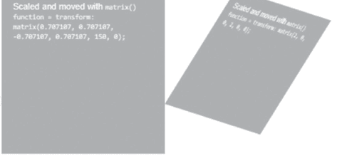

CSS 函数-matrix3d()。

## opacity()

使用 `opacity()` 函数使图像部分或完全透明。`opacity()` 与过滤器（filter）配合使用，对图像样本应用透明度。`opacity()` 需要传递一个参数。此外，它决定了应用于图像的透明度比例。参数可以是值也可以是数字。

示例：

```html
<!DOCTYPE html>
<html>
<head>
<style>
body {
  padding:0;
  margin:0;
  box-sizing: border-box;
  background: gold;
}
.demo_container{
  padding:20px;
  width:900px;
  margin:0 auto;
justify-content: center;
align-items: center;
}
.box-1{
  transform-origin: 0 0;
  padding: 20px;
  width: 300px;
  height:300px;
  background-color: green;
  filter: opacity(10%);
  color: white;
  font-family: sans-serif;
}
.box-2{
  transform-origin: 0 0;
  padding: 20px;
  width: 300px;
  height:300px;
  background-color: green;
  filter: opacity(40%);
  color: white;
  font-family: sans-serif;
}
```


```css
.box-3{
  transform-origin: 0 0;
  padding: 20px;
  width: 300px;
  height:300px;
  background-color: green;
  filter: opacity(70%);
  color: white;
  font-family: sans-serif;
}
.box-4{
  transform-origin: 0 0;
  padding: 20px;
  width: 300px;
height:300px;
background-color: green;
  filter: opacity(90%);
  color: white;
  font-family: sans-serif;
}
```
</style>
</head>
<body>
<div class="demo_container">
<h1>matrix3d() 函数可以结合 CSS 变换用于在三维空间内为元素设置样式。</h1>
<div class="row">
<div class="box-1">opacity(10%)</div>
<div class="box-2">opacity(40%)</div>
<div class="box-3">opacity(70%)</div>
<div class="box-4">opacity(90%)</div>
</div>
</div>
</body>
</html>
```

代码的输出下文：

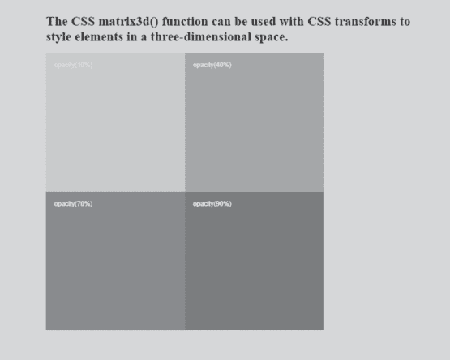

CSS 函数-`opacity()`。

## `perspective()`

`perspective()` 函数定义了 z=0 平面与用户之间的距离，以赋予元素透视效果。`perspective()` 函数的工作原理是指定 z=0 平面的距离。参数也指定为长度值（例如 `1px`、`vw` 等）。长度越大，“3D效果”越不明显。

示例：

```html
<!DOCTYPE html>
<html>
<head>
<style> {
  padding:0;
  margin:0;
  box-sizing: border-box;
}
.demo_container{
  padding:20px;
  width:900px;
  margin:0 auto;
  justify-content: center;
  align-items: center;
}
img{
  width:100%;
  height:250px;
}
.row{
  display: flex;
}
.col{
  width:80%
}
.image-1 {
  transform: perspective(400px) rotateY(70deg);
  width:100px;
  height:100px
}
.image-2 {
  transform: perspective(200px) rotateY(60deg);
  width:100px;
  height:100px
}
.image-3 {
  transform: perspective(130px) rotateY(-60deg);
  width:100px;
  height:100px
}
p {
  line-height: 2;
  font-size:20px;
}
</style>
</head>
<body>
<div class="demo_container">
<h2>它定义了 z=0 平面与用户之间的距离，以赋予 3D 元素透视效果</h2>
<div class="row">
<div class="col">
<p>普通图像</p>

<p>perspective(400px) rotateY(70deg) 图像</p>

</div>
<div class="col">
<p>perspective(200px) rotateY(60deg) 图像</p>

<p>perspective(130px) rotateY(-60deg) 图像</p>

</div>
</div>
</div>
</body>
</html>
```

代码的输出下文所示：

它定义了 z=0 平面与用户之间的距离，以赋予 3D 元素透视效果

普通图像 `perspective(200px) rotateY(60deg)` 图像

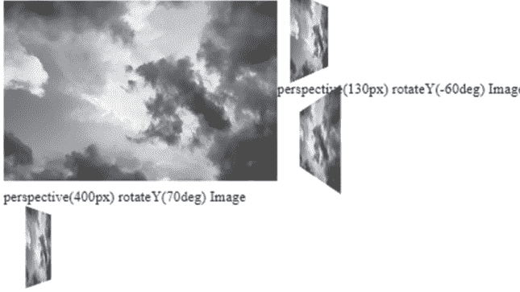

`perspective(130px) rotateY(-60deg)` 图像

`perspective(400px) rotateY(70deg)` 图像

CSS 函数 (`perspective()`).

## `radial-gradient()`

`radial-gradient()` 函数允许使用 CSS 创建径向渐变。

CSS 渐变允许对元素应用多种背景颜色，从一种颜色混合到下一种颜色。

```html
<!DOCTYPE html>
<html>
<head>
<style>
* {
  padding:0;
  margin:0;
  box-sizing: border-box;
}
.demo_container{
  padding:20px;
  width:900px;
  margin:0 auto;
  justify-content: center;
  align-items: center;
}
.row{
  display: flex;
}
.col{
  width:100%
}
.image-1{
  background: radial-gradient(to bottom right, red, yellow);
}
.image-2{
  background: radial-gradient(to bottom right, blue, cyan);
}
.image-3{
  background: radial-gradient(to bottom right, green, lime);
}
.image-4{
  background: radial-gradient(to bottom right, orange, pink);
}
p{
  line-height: 2;
  font-size:20px;
}
</style>
</head>
<body>
<div class="demo_container">
<h2>radial-gradient() 函数允许使用 CSS 创建径向渐变。</h2>
<div class="row">
<div class="col">
<div class="image-1"></div>
<div class="image-2"></div>
</div>
<div class="col">
<div class="image-3"></div>
<div class="image-4"></div>
</div>
</div>
</div>
</div>
</body>
</html>
```

代码的输出下文所示：

`radial-gradient()` 函数允许使用 CSS 创建径向渐变。

从一种颜色过渡到下一种颜色。这些这些渐变是线性渐变，其中颜色停止点在两个方向上无限重复。重复线性渐变的工作原理与（非重复）线性渐变的工作相同。语法：`repeating-linear-gradient()` 函数接受以下值：

- `angle`：它指定渐变方向的角度。例如，`45deg`。

以下关键字指定下方渐变线的指向：

- `to top`（向顶部）
- `to right`（向右）
- `to bottom`（向底部）
- `to left`（向左侧）

以下关键字指定下方渐变线的指向：

- `to top left`（向左上）
- `to top right`（向右上）
- `to bottom`（向底部）
- `to bottom left`（向左下）
- `color-stop`（颜色停止点）

## 示例：

```html
<!DOCTYPE html>
<html>
<head>
<style>
{
  padding:0;
  margin:0;
  box-sizing: border-box;
}
```
```css
.demo_container{
  padding:20px;
  width:900px;
  margin:0 auto;
  justify-content: center;
  align-items: center;
}
.row{
  display: flex;
  flex-direction:row;
}
.col{
  height:100px;
  width:100%;
}
```

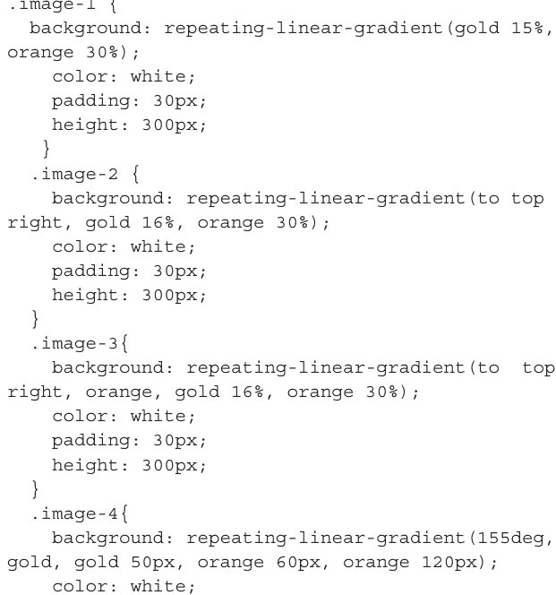
```css
.image-1 {
  background: repeating-linear-gradient(gold 15%, orange 30%);
  color: white;
  padding: 30px;
  height: 300px;
}
.image-2 {
  background: repeating-linear-gradient(to right, gold 16%, orange 30%);
  color: white;
  padding: 30px;
  height: 300px;
}
.image-3 {
  background: repeating-linear-gradient(to right, orange, gold 16%, orange 30%);
  color: white;
  padding: 30px;
  height: 300px;
}
.image-4 {
  background: repeating-linear-gradient(155deg, gold, gold 50px, orange 60px, orange 120px);
  color: white;
}
```
```css
padding: 30px;
height: 300px;
p{
  line-height: 2;
  font-size: 20px;
  margin-bottom:30px;
}
```
```html
</style></head>
<body>
<div class="demo_container">
  <h2>repeating-linear-gradient() 函数允许你创建一个在两个方向上无限循环、反复重复的线性渐变</h2>
  <div class="row">
    <div class="col">
      <p>默认角度，radial-gradient(yellow, red)</p>
      <div class="image-1"></div>
      <p>重复渐变角度，repe-linear-gradient (top right, orange, gold 15%, orange 30%)</p>
    </div>
    <div class="col">
      <div class="image-2"></div>
      <p>平滑过渡，repeating-linear-gradient (top right, orange, gold 15%, orange 30%)</p>
      <div class="image-3"></div>
      <p>创建条纹，repeating-linear-gradient (165deg, gold, gold 60px, orange 60px, orange 120px)</p>
      <div class="image-4"></div>
    </div>
  </div>
</div>
</body>
</html>
```

# 330 ■ 精通 CSS

代码的输出如下：

`repeating-linear-gradient()` 函数允许你创建一个在两个方向上无限循环、反复重复的线性渐变。

默认角度，`radial-gradient(yellow; red)`
平滑过渡，`repeating-linear-gradient(top right, orange, gold 15%, orange 30%)`

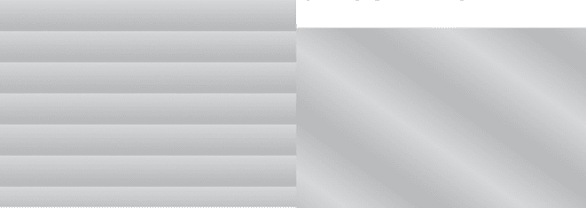

重复渐变角度，`repeating-linear-gradient(top right, orange, gold 15%, orange 30%)`
创建条纹，`repeating-linear-gradient(165deg, gold, gold 60px, orange 60px, orange 120px)`

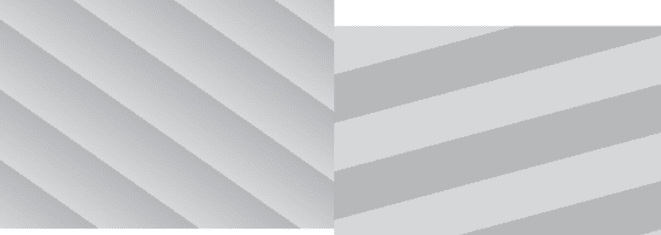

CSS 函数 (`repeating-linear-gradient()`).

## `repeating-radial-gradient()`

CSS `repeating-radial-gradient()` 允许创建一个反复重复的径向渐变。CSS 渐变允许为元素应用多个背景颜色，这些颜色从单色过渡到下一种。重复径向渐变是颜色停止点无限重复的渐变。径向渐变具有圆形或椭圆形。在创建径向渐变时，指定渐变的中心以及大小和形状。

## CSS 函数 331

语法：此函数使用与 `radial-gradient()` 相同的语法，如下：

```css
radial-gradient(shape size position color-stop, color-stop)
```

`repeating-radial-gradient()` 函数接受以下值：

- `shape`：指定渐变的形状。可以是 `circle`（圆形）或 `ellipse`（椭圆形）。
- `size`：指定结束形状的大小。值为：
  - `closest side`（最近侧）
  - `farthest side`（最远侧）
  - `closest corner`（最近圆角）
  - `length`（长度）
- `position`：指定渐变的位置。值为：
  - `top`（顶部）
  - `right`（右侧）
  - `bottom`（底部）
  - `left`（左侧）
  - `center`（中心）

## 示例：

```html
<!DOCTYPE html>
<html>
<head>
<style>
*{
  padding:0;
  margin:0;
  box-sizing: border-box;
}
.demo_container{
  padding:20px;
  width:900px;
  margin:0 auto;
  justify-content: center;
  align-items: center;
}
.row{
  display: flex;
  flex-wrap: wrap;
  flex-direction: row;
}
.col{
  width:50%;
}
p{
  height:50px;
}
.image-1 {
  background: repeating-radial-gradient(ellipse, green 20%, lime 40%);
  color: white;
  padding:30px;
  height:300px;
}
.image-2 {
  background: repeating-radial-gradient(circle, green 20%, lime 40%);
  color: white;
  padding:30px;
  height:300px;
}
.image-3 {
  background: repeating-radial-gradient(circle at top left, green 30%, lime 40%);
  color: white;
  padding:30px;
  height:300px;
}
.image-4 {
  background: repeating-radial-gradient(circle at top left, lightgreen 10%, green 45%, lime 60%);
  color: white;
  padding:30px;
  height:300px;
}
.image-5 {
  background: repeating-radial-gradient(circle at top left, lime, green 30%, lime 40%);
  color: white;
  padding:30px;
  height:300px;
}
.image-6 {
  background: repeating-radial-gradient(closest-side at 25px 35px, orange 25%, gold 40%);
  background-size:50px 50px;
  color: white;
```


```css
padding:30px;
height:300px;
}
p{
line-height: 2;
font-size:20px;
margin-bottom:30px;
}
</style>
</head>
<body>
<div class="demo_container">
<h2>CSS 重复径向渐变函数允许你创建一个反复重复的径向渐变</h2>
<div class="row">
<div class="col">
<p>椭圆，`repeating-radial-gradient(ellipse, green 20%, lime 40%)`</p>
<div class="image-1"></div>
<p>圆形，`repeating-radial-gradient(circle, green 20%, lime 40%)`</p>
<div class="image-2"></div>
<p>渐变位置，`repeating-radial-gradient(circle at top left, green 20%, lime 40%)`</p>
<div class="image-3"></div>
</div>
<div class="col">
<p>三个颜色停止点，`repeating-radial-gradient(circle at top left, lightgreen 20%, green 55%, lime 60%)`</p>
<div class="image-4"></div>
<p>平滑过渡，`repeating-radial-gradient(circle at top left, lime, green 20%, lime 40%)`</p>
<div class="image-5"></div>
<p>渐变纹理，`repeating-radial-gradient(closest-side at 25px 35px, orange 15%, gold 40%)`</p>
<div class="image-6"></div>
</div>
</div>
</div>
</body>
</html>
```

代码的输出如下：

CSS `repeating-radial-gradient()` 函数允许你创建一个反复重复的径向渐变。

椭圆，`repeating-radial-gradient(ellipse, green 20%,` 三个颜色停止点，`repeating-radial-gradient(circle at` `lime 40%)` `top left, lightgreen 20%, green 55%, lime 60%)`

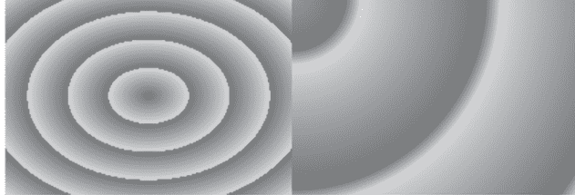

圆形，`repeating-radial-gradient(circle, green 20%,` 平滑过渡，`repeating-radial-gradient(circle at` `lime 40%)` `top left, lime, green 20%, lime 40%)`

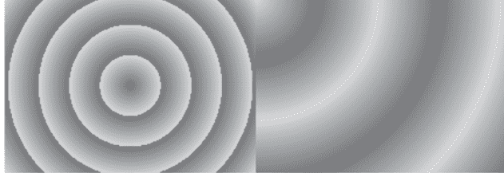

渐变位置，`repeating-radial-gradient(circle at` 渐变纹理，`repeating-radial-` `top left, green 20%, lime 40%)` `gradient(closest-side at 25px 35px, orange 15%, gold 40%)`

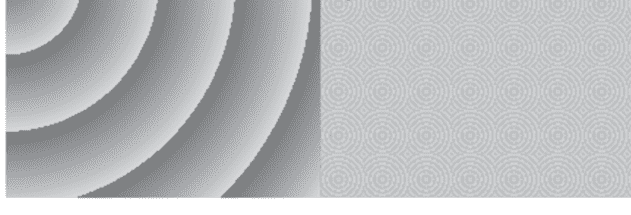

`rgb()`

`rgb()` 函数可以在使用 CSS 时提供值。它允许通过直接指定红、绿、蓝通道来指定 RGB 颜色值。

RGB（代表红、绿、蓝）是一种颜色模型，其中红色、绿色和蓝色光可以组合以再现颜色。

`RGB()` 接受 RGB 值作为参数。`RGB` 函数以逗号分隔的值的形式提供。它分别提供红色、绿色和蓝色的色调。

这三个值中的每一个值都可以以整数或百分比的形式提供。

## 示例：

```
RGB(255,0,0)
RGB(100%,0%,0%)
```

我们可以在任何元素上使用该属性。

## 示例：

```html
<!DOCTYPE html>
<html>
<head>
<style>
{
padding:0;
margin:0;
box-sizing: border-box;
}
.demo_container{
padding:20px;
width:900px;
margin:0 auto;
justify-content: center;
align-items: center;
}
row{
display: flex;
flex-wrap: wrap;
flex-direction: row;
}
```

## CSS Functions ■ 337

```css
.col{
width:50%
}
p{
height:50px
}
.image-1 {
background: RGB(255,69,0);
color: white;
padding: 30px;
height: 100px;
}
.image-2 {
background: RGB(0,255,0);
color: white;
padding: 30px;
height: 100px;
}
.image-3 {
background: RGB(0,0,128);
color: white;
padding: 30px;
height: 100px;
}
.image-4{
background: RGB(128,128,0);
color: white;
padding: 30px;
height: 100px;
}
.image-5{
background: RGB(255,0,0);
color: white;
padding: 30px;
height: 100px;
}
.image-6 {
background: RGB(128,0,128);
height: 100px;
color: white;
padding: 30px;
}
```

```css
.image-7 {
background: RGB(255,0,70);
height: 100px;
color: white;
padding: 30px;
}
```

```css
.image-8 {
background: RGB(230,255,0);
height: 100px;
color: white;
padding: 30px;
}
```

```css
p{
line-height: 2;
font-size:24px;
margin-bottom:10px;
}
```

```html
</style>
</head>
<body>
```

```html
<div class="col">
<p> rgb(255,69,0) </p>
<div class="image-1"></div>
<p> rgb(0,255,0) </p>
<div class="image-2"></div>
<p> rgb(0,0,128) </p>
<div class="image-3"></div>
<p> rgb(230,255,0) </p>
<div class="image-8"></div>
</div>
<div class="col">
<p> rgb(128,128,0) </p>
<div class="image-4"></div>
<p> rgb(255,0,0) </p>
<div class="image-5"></div>
<p> rgb(128,0,128) </p>
<div class="image-6"></div>
<p> rgb(255,0,70) </p>
<div class="image-7"></div>
</div>
</div>
</body>
</html>
```

代码的输出如下：

`RGB()` 函数可以用于 CSS `rotate()` 提供颜色值。

| 输入 | 输出 |
| :--- | :--- |
| rgb(255,69,0) | rgb(128,128,0) |
| rgb(0,255,0) | rgb(255,0,0) |
| rgb(0,0,128) | rgb(128,128,0) |
| rgb(230,255,0) | rgb(255,0,70) |

CSS `rotate()` 用于在二维空间中旋转元素。`rotate()` 根据你作为参数提供的角度来旋转元素。你也可以使用任何有效的 CSS 角度来提供角度。

## 精通 CSS 340

在 `rotate` 中使用了多种属性，例如：

- 1. 度 `Degrees`
- 2. 梯度分 `Grad`
- 3. 圈 `Turns`

## 示例：

```html
<!DOCTYPE html>
<html>
<head>
<style>
* {
padding:0;
margin:0;
box-sizing: border-box;
}
.demo_container{
padding:20px;
width:900px;
margin:0 auto;
justify-content: center;
align-items: center;
}
.row{
display: flex;
flex-wrap: wrap;
flex-direction: row;
}
.col{
width:50%
}
p{
height:50px
}
.image-1 {
background: RGB(255,69,0);
color: white;
padding: 30px;
height: 100px;
}
.image-2 {
background: RGB(0,255,0);
color: white;
padding: 30px;
height: 100px;
}
.image-3 {
background: RGB(0,0,128);
color: white;
padding: 30px;
height: 100px;
}
.image-4 {
background: RGB(128,128,0);
color: white;
padding: 30px;
height: 100px;
}
.image-5 {
background: RGB(255,0,0);
color: white;
padding: 30px;
height: 100px;
}
.image-6 {
background: RGB(128,0,128);
height: 100px;
color: white;
padding: 30px;
}
.image-7 {
background: RGB(255,0,70);
height: 100px;
color: white;
padding: 30px;
}
.image-8 {
background: RGB(230,255,0);
height: 100px;
color: white;
padding: 30px;
}
p{
line-height: 2;
font-size:24px;
margin-bottom:10px;
}
</style>
</head>
<body>
<div class="demo_container">
<h2>rotate() 函数用于在二维空间中旋转元素。</h2>
<div class="row">
<div class="col">
<p> 未旋转</p>
<div class="image-1"></div>
<p> 度 (rotate(15deg))</p>
<div class="image-2"></div>
<p> 梯度 (20grad)</p>
<div class="image-3"></div>
</div>
<div class="col">
<p> 圈 (rotate(.4turn))</p>
<div class="image-4"></div>
<p> 负值 (rotate(-15deg))</p>
<div class="image-5"></div>
<p> 添加 transform-origin</p>
<div class="image-6"></div>
</div>
</div>
</div>
</body>
</html>
```

代码的输出如下：

`rotate()` 函数用于在二维空间中旋转元素。

| 输入 | 输出 |
| : : | :--- |
| rgb(255,69,0) | rgb(128,128,0) |
| rgb(0,255,0) | rgb(255,0,0) |
| rgb(0,0,128) | rgb(128,128,0) |
| rgb(230,255,0) | rgb(255,0,70) |

`rotate3d()` 函数用于在三维空间中旋转元素。`rotate3d()` 函数根据作为参数提供的角度沿 x、y、z 轴旋转元素。

`rotate3d()` 的语法如下：

```
rotate3d() = rotate3d(<number>, <number>, <number>, <angle>)
```

前三个参数描述 x、y、z 向量。第四个参数指定使用的角度。它的工作如下：

- x: 代表旋转。正表示顺时针旋转，负表示逆时针旋转。
- deg: 代表度。圆周有 360 度。
- grad: 是梯度分，也称为 "gons" 或 "grades"。整个圆周有 400 梯度分。
- rad: 是弧度。圆周有 2π 弧度。
- turn: 是圈。圆周有一圈。

## 示例：

```html
<html>
<head>
<style>
* {
padding:0;
margin:0;
box-sizing: border-box;
}
.demo_container{
padding:20px;
width:900px;
margin:0 auto;
justify-content: center;
align-items: center;
}
.row{
display: flex;
flex-wrap: wrap;
flex-direction: row;
}
.col{
width:50%
}
p{
height:50px
}
.image-1 {
background: RGB(255,69,0);
color: white;
padding: 30px;
height: 100px;
}
.image-2 {
background: RGB(0,255,0);
color: white;
padding: 30px;
height: 100px;
}
.image-3 {
background: RGB(0,0,128);
color: white;
padding: 30px;
height: 100px;
}
.image-4 {
background: RGB(128,128,0);
color: white;
padding: 30px;
height: 100px;
}
.image-5 {
background: RGB(255,0,0);
color: white;
padding: 30px;
height: 100px;
}
.image-6 {
background: RGB(128,0,128);
height: 100px;
color: white;
padding: 30px;
}
.image-7 {
background: RGB(255,0,70);
height: 100px;
color: white;
padding: 30px;
}
.image-8 {
background: RGB(230,255,0);
height: 100px;
color: white;
padding: 30px;
}
p{
line-height: 2;
font-size:24px;
margin-bottom:10px;
}
```


```
</style>
</head>
<body>
<div class="demo_container">

  <h2>rotate3d() 函数用于在三维空间中旋转元素。</h2>
  <div class="row">
    <div class="col">
      <p> 未旋转</p>
      <div class="image-1"></div>
      <p> 度 (rotate(15deg))</p>
      <div class="image-2"></div>
      <p> 梯度旋转 (20grad)</p>
      <div class="image-3"></div>
    </div>
    <div class="col">
      <p> 圈 (rotate(.4turn))</p>
      <div class="image-4"></div>
      <p> 负值 (rotate(-15deg))</p>
      <div class="image-5"></div>
      <p> 添加 transform-origin</p>
      <div class="image-6"></div>
    </div>
  </div>
</div>
</body>
</html>
```

角度可以使用以下单位标识表示：

- `deg`
- `grad`
- `rad`
- `turn`

`rotateY()`

CSS `rotateY()` 用于在三维空间中绕 y 轴旋转元素。`rotateY()` 函数用于 3D 变换（3D-transforms）。它与 `transform` 属性配合使用，将元素绕 y 轴旋转。

`rotateY()` 函数的语法如下：

```
rotateY() = rotateY( <angle> )
```

角度可以使用以下任何一个标识符表示：

- `deg`
- `grad`
- `rad`
- `turn`

`rotateZ()`

CSS `rotateZ()` 函数用于在三维空间中绕 z 轴旋转元素。`rotateZ()` 用于 3D 变换。它与 `transform` 属性配合使用，将元素绕 z 轴旋转。

`rotateZ()` 函数的语法如下：

```
rotateZ() = rotateZ( <angle> )
```

角度可以使用以下任何一个标识符表示：

- `deg`
- `grad`
- `rad`
- `turn`

# 348 ■ 精通 CSS

Mastering)

`rotateX()`, `rotateY()`, `rotateZ()` 示例：

```
<html>
<head>
<style>

 {
  padding:0;
  margin:0;
  box-sizing: border-box;
}

.demo_container{
  padding:20px;
  width:900px;
  margin:0 auto;
  justify-content: center;
  align-items: center;
}

.row{
  display: flex;
  flex-wrap: wrap;
  flex-direction: row;
}

.col{
  width:50%
}

p{
  height:50px
}

.image-1 {
  background: RGB(255,69,0);
  transform: rotateX(10deg);
  color: white;
  padding: 10px;
  height: 50px;
  width:100px
}

.image-2 {
  background: RGB(0,255,0);
  transform: rotateX(-60deg);
  color: white;
  height: 50px;
  width:100px;
  padding: 10px;
}

.image-3 {
background: RGB(255,69,0);
transform: rotateY(10deg);
color: white;
padding: 10px;
height: 50px;
width:100px;
}

.image-4 {
background: RGB(0,255,0);
transform: rotateY(-60deg);
color: white;
height: 50px;
width:100px;
padding: 10px;
}

.image-5 {
background: RGB(255,69,0);
transform: rotateZ(10deg);
color: white;
padding: 10px;
height: 50px;
width:100px;
}

.image-6 {
background: RGB(0,255,0);
transform: rotateZ(-60deg);
color: white;
height: 50px;
width:100px;
padding: 10px;
}

{
  line-height: 2;
  font-size: 24px;
  margin-bottom: 10px
}

</style>
</head>
<body>

<div class="demo_container">
  <h2>rotate() 函数用于在三维空间中绕 x 轴旋转元素。</h2>
  <div class="row">
    <div class="col">
      <p>rotate()</p>
      <div class="image-1">rotate(10deg)</div>
      <p>负值</p>
      <div class="image-2">rotate(-60deg)</div>
    </div>
  </div>
</div>

<div class="demo_container">
  <h2>rotateY() 函数用于在三维空间中绕 y 轴旋转元素。</h2>
  <div class="row">
    <div class="col">
      <p>rotateX()</p>
      <div class="image-3">rotateY(10deg)</div>
      <p>负值</p>
      <div class="image-4">rotateY(-60deg)</div>
    </div>
  </div>
</div>

<div class="demo_container">
  <h2>rotateZ() 函数用于在三维空间中绕 z 轴旋转元素。</h2>
  <div class="row">
    <div class="col">
      <p> rotateZ() </p>
      <div class="image-5"> rotateZ(10deg)</div>
      <p> 负值</p>
      <div class="image-6"> rotateZ(-60deg)</div>
    </div>
  </div>
</div>

</body>
</html>
```

代码的输出如下：

`rotateX()` 函数用于在三维空间中绕 x 轴旋转元素。

`rotateX()`


负值


`rotateY()` 函数用于在三维空间中绕 y 轴旋转元素。

`rotateY()`


负值


`rotateZ()` 函数用于在三维空间中绕 z 轴旋转元素。

`rotateZ()`


负值

CSS 函数 (`rotateX()`, `rotateY()`, `rotateZ()`).

## saturate()

`saturate()` 函数用于调整图像的饱和度。该函数与 `filter` 属性配合使用，调整图像的饱和度水平。

`saturate()` 函数的语法如下：

```
saturate() = saturate([ <number> | <percentage> ])
```

示例：

```
<!DOCTYPE html>
<html>
<head>
<style>
* {
  padding:0;
  margin:0;
  box-sizing: border-box;
}

.demo_container{
  padding:20px;
  width:800px;
  margin:0 auto;
  justify-content: center;
  align-items: center;
}

img{
  width:100%;
  height:250px;
}

.row{
  display: flex;
}
</style>
</head>
```

`.col{`

  `width:100%`

}

`.image-1 {`

  `filter: saturate(700%);`

}

`.image-2 {`

  `filter: saturate(2.5);`

}

`p{`

  `padding-top:20px;`

  `font-size:20px`

}

</style>

</head>

<body>

<div class="demo_container">

  <h2>saturate() 函数用于调整图像的饱和度。</h2>

  <div class="row">

    <div class="col">

      <p> 图像</p>

      

      <p> 700% 饱和</p>

      

    </div>

    <div class="col">

      <p> 2.5 饱和</p>

      

    </div>

  </div>

</div>

</body>

</html>

```

代码的输出如下：
# saturate() 函数用于调整图像的饱和度。
图像
2.5 饱和

700% 饱和

CSS 函数 (`saturate()`).

## scale()
CSS `scale()` 用于在二维空间中缩放元素。`scale()` 根据提供的参数数值对元素进行缩放。你可以沿 x 轴、y 轴或两个轴进行缩放。`scale()` 函数的作用如下：

- `scale(sx)`
- `scale(sx, sy)`
- `scale(sx)` 或
- `scale(sx, sy)`

`scale()` 函数的语法如下：

```

scale() = scale( <number> [, <number> )

```

## 示例：

```

<!DOCTYPE html>

<html>

<head>

<style>

* {

  padding:0;

  margin:0;

  box-sizing: border-box;

}

.demo_container{

  padding:20px;

  width:800px;

  margin:0 auto;

  justify-content: center;

  align-items: center;

}

img{

  width:100%;

  height:250px;

}

row{

  display: flex;

}

col{

  width:100%

}

.image-1 {

  transform-origin: left;

  transform: scale(2);

}

</style>

</head>

```
<body>
<div class="demo_container">
  <h2>scale() 函数用于在二维空间中缩放元素。</h2>
  <div class="row">
    <div class="col">
      <p> 图像 </p>
      
      <p> 缩放轴 </p>
      
    </div>
  </div>
</div>
</body>
</html>
```

代码的输出如下：

代码的输出如下：

`scale()` 函数用于在二维空间中缩放元素。

图像

缩放轴


缩放轴


`scale3d()` 用于在三维空间中缩放元素。`scale3d()` 根据提供的参数数值对元素进行缩放。它指定一个 `[sx,sy,sz]` 缩放向量。`scale3d()` 函数是一个三维原始函数，派生函数有：`scaleX()`, `scaleY()`, `scaleZ()`, 和 `scale()`。

`scale3d()` 函数的语法如下：

```
scale3d( <number>, <number>, <number> )
```

#示例：

```
<!DOCTYPE html>
<html>
<head>
<style>
* {
  padding:0;
  margin:0;
  box-sizing: border-box;
}

.demo_container{
  padding:20px;
  width:800px;
  margin:0 auto;
  justify-content: center;
  align-items: center;
}

img{
  width:100%;
  height:250px;
}

row{
  display: flex;
}

col{
  width:100%
}
.image-1 {
  transform-origin: left;
  transform: scale3d(3, 3, 1);
}
</style>
</head>
```

<body>

<div class="demo_container">

  <h2>scale3d() 函数用于在三维空间中缩放元素。</h2>

  <div class="row">

    <div class="col">

      <p> 图像 </p>

      

      <p> 缩放轴 </p>

      

    </div>

  </div>

</div>

</body>

</html>

```
代码的输出如下：
`scale3d()` 函数用于在三维空间中缩放元素。
图像
缩放轴

```css

width:50%;

height:100px;

}

.image-2 {

transform: scale3d(3, 3, 1);

width:10%;

height:100px;

}

p{

  padding-top: 20px;

  font-size:20px;

}

</style>

</head>

<body>

<div class="demo_container">

<h2> scale3d() 函数用于在三维空间中缩放元素。 </h2>

<div class="row">

<div class="col-1">

<p> 带有 transform-origin 的 Scale3d() </p>


</div>

<p> 带有 transform-origin 的 Scale3d() </p>


</div>

</div>

</body>

</html>

```

代码的输出如下：
Scale3d() 函数用于在三维空间中缩放元素。

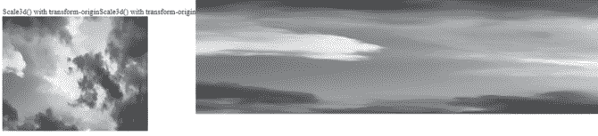

CSS 函数 (`scale3d()`).

# CSS 函数 ■ 359

## scaleX()
CSS `scaleX()` 用于在二维空间内沿 x 轴缩放元素。`scaleX()` 根据提供的参数数字来缩放元素。

`scaleX()` 函数的语法如下：

```css

scaleX() = scaleX(<number> )

```

示例：

```html

<!DOCTYPE html>

<html>

<head>

<style>

* {

  padding:0;

  margin:0;

  box-sizing: border-box;

}

.demo_container{

  width:800px;

  padding:20px;

  margin:0 auto;

  justify-content: center;

  align-items: center;

}


`.row`{

  display: flex;

  flex-wrap: wrap;

  flex-direction: column;

}

`.col`{

  width:50%

}
```
```css

`.image-1` {

  width:200px;

  height:200px;

}

`.image-2` {

  transform-origin: top left;

  transform: scaleX(4);

  width:200px;

  height:200px;

}

`.image-3`{

  transform: scaleX(1);

  width:200px;

  height:200px;

}

p{

  padding-top: 20px;

  font-size:20px;

}

</style>

</head>

<body>

<div class="demo_container">

<h2>scaleX() 函数用于在二维空间内沿 x 轴缩放元素。</h2>

<div class="row">

<div class="col-1">

<p> 普通图像 </p>


<p> 带有 transform-origin 的 scaleX(4) </p>


<p> 不带有 transform-origin 的 scaleX(1) </p>

```
```html


</div>

</body>

</html>

```
代码的输出如下：

`scaleX()` 函数用于在二维空间内沿 x 轴缩放元素。

普通图像

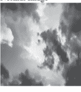

带有 transform-origin 的 `scaleX(4)`


不带有 transform-origin 的 `scaleX(1)`


CSS 函数 (`scaleX()`).

## scaleY()
CSS `scaleY()` 用于在二维空间内沿 y 轴缩放元素。`scaleY()` 根据提供的参数数字来缩放元素

# 362 ■ 精通 CSS

`scaleY()` 函数的语法如下：

```css

scaleY () = scaleY ( <number> )

```

## 示例：

```html

<!DOCTYPE html>

<html>

<head>

<style>

* {

padding:0;

margin:0;

box-sizing: border-box;

}

.demo_container{

width:800px;

padding:20px;

margin:0 auto;

justify-content: center;

align-items: center;

}

.row{

display: flex;

flex-wrap: wrap;

flex-direction: row;

}

.col{

width:50%

}

.image-1 {

width:200px;

height:200px;

}

.image-2 {

transform-origin: top right;

transform: scaleY(2);

width:200px;

height:200px;

}

```
```css

.image-3{

  transform: scaleY(3);

  width:200px;

  float: right;

  height:200px;

}

p{

  padding-top: 20px;

  font-size:20px;

}

```

</style>
</head>
<body>
<div class="demo_container">
<h2> scaleY 函数用于在二维空间内沿 y 轴缩放元素。</h2></h2>
<div class="row">
<div class="col">
<p> 普通图像 </p>

<p> 带有 transform-origin 的 scaleY() </p>

<p> 不带有 transform-origin 的 scaleY(4) </p>

</div>
</div>
</body>
</html>
```
代码的输出如下：

`scaleY()` 函数用于在二维空间内沿 y 轴缩放元素。

普通图像

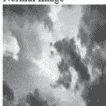

带有 transform-origin 的 `scaleY()`


不带有 transform-origin 的 `scaleY(4)`


CSS 函数 (`scaleY()`).

## scaleZ()

CSS `scaleZ()` 用于在二维空间内沿 z 轴缩放元素。`scaleZ()` 根据提供的参数数字来缩放元素。`scaleZ()` 函数的语法如下：

```css
scaleZ () = scaleZ ( <number> )
```

## 示例：

```html
<!DOCTYPE html>
<html>
<head>
<style>
* {
  padding:0;
  margin:0;
  box-sizing: border-box;
}

.demo_container{
  width:800px;
  padding:20px;
  margin:0 auto;
  justify-content: center;
  align-items: center;
}

.row{
  display: flex;
  flex-wrap: wrap;
  flex-direction: row;
}

.col{
  width:50%
}

.image-1 {
  width:200px;
  height:200px;
}
.image-2 {
  transform-origin: top right;
  transform: perspective(250px) scaleZ(2) rotate(45deg);
  width:200px;
  height:200px;
}
.image-3{
  transform: perspective(250px) scaleZ(2) rotate(45deg);
  width:200px;
  float:right;
  height:200px;
}
{
  padding-top: 20px;
  font-size:20px
}
</style>
</head>
<body>
<div class="demo_container">
<h2>scaleZ() 函数用于在二维空间内沿 z 轴缩放元素。</h2>
<div class="row">
  <div class="col">
    <p> 普通图像 </p>
    
    <p> 带有 transform-origin 的 scaleZ(4) </p>
    
  </div>
  <div class="col">
    <p> 不带有 transform-origin 的 scaleZ(4) </p>
    
  </div>
</div>
</div>
</body>
</html>
```
代码的输出如下：

`scaleZ()` 函数用于在二维空间内沿 z 轴缩放元素。

普通图像

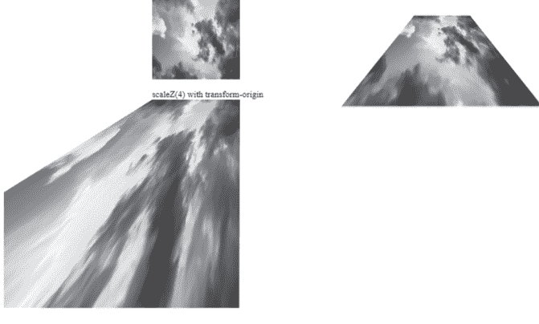

不带有 transform-origin 的 `scaleZ(4)`

CSS 函数 (`scaleZ()`).

## skew()

CSS `skew()` 函数用于倾斜二维空间中的元素。也称为变形变换（shear transformation），它根据指定的角度偏移元素的每个点。倾斜元素类似于根据给定的角度将点推向不同的方向。`skew()` 函数的作用如下：

```css
skew(ax) 或 skew(ax, ay)
```

## 示例：

```html
<!DOCTYPE html>
<html>
<head>
<style>
* {
  padding:0;
  margin:0;
  box-sizing: border-box;
}

.demo_container{
  width:800px;
  padding:20px;
  margin:0 auto;
  justify-content: center;
  align-items: center;
}

.row{
  display: flex;
  flex-wrap: wrap;
  flex-direction: row;
}

.col{
  width:50%
}

.image-1 {
  width:200px;
  height:200px;
}
.image-2 {
  transform-origin: top left;
  transform: skew(10deg, 0);
  width:200px;
  height:200px;
}
.image-3 {
  transform-origin: top left;
  transform: skew(0, 10deg);
  width:200px;
  height:200px;
}
```
```css
.image-4 {
  transform-origin: top left;
  transform: skew(10deg, 10deg);
  width:200px;
  height:200px;
}
.image-5 {
  transform-origin: bottom left;
  transform: skew(-10deg, -10deg);
  width:200px;
  height:200px;
}
.image-6 {
  transform: skew(-10deg, -10deg);
  width:200px;
}
```
```css
p {
  padding-top: 20px;
  font-size:20px;
}
</style>
</head>
<body>
<div class="demo_container">
<h2> skew() 函数用于倾斜二维空间中的元素。 </h2>
<div class="row">
<div class="col">
<p> 普通图像</p>


<p> 沿 x 轴倾斜 </p>


<p> 沿 y 轴倾斜 </p>

</div>
</div>
</body>
</html>
```
## CSS 函数 (`skew()`).

## skewX()

### skewX()

`skewX()` 元素执行剪切变换（也称为剪切映射或平移变换），它根据给定的角度沿 x 轴位移元素的每个点。

`skewX()` 函数的工作方式如下：

`skewX (a)`

`skewX()` 函数接受一个参数，用于指定 x 轴的倾斜角度。它可以是任何有效的角度值。

## 示例：

```html
<!DOCTYPE html>
<html>
<head>
<style>
{
  padding:0;
  margin:0;
  box-sizing: border-box;
}

.demo_container{
  width:800px;
  padding:20px;
  margin:0 auto;
  justify-content: center;
  align-items: center;
}

.row{
  display: flex;
  flex-wrap: wrap;
  flex-direction: row;
}
.col{
  width:50%
}

.image-1 {
  width:200px;
  height:200px;
}
.image-2 {
  transform-origin: top left;
  transform: skewX(10deg);
  width:200px;
}
.image-3 {
  transform-origin: top left;
  transform: skewX(-10deg);
  width:200px;
}
p {
  padding-top: 20px;
  font-size:20px;
}
</style>
</head>
<body>
<div class="demo_container">
  <h2>skewX() 函数用于沿 x 轴在二维空间内倾斜元素。</h2>
  <div class="row">
    <div class="col">
      <p>普通图片</p>
      

      <p>带有 transform-origin 的倾斜</p>
      
    </div>
    <div class="col">
      <p>负值</p>
      
    </div>
  </div>
</div>
</body>
</html>
```
# skewX() 函数用于沿 x 轴在二维空间内倾斜元素。

普通图片

负值

## 带有 transform-origin 的倾斜

## CSS 函数 (`skew()`).

## 总结

在这一章中，我们看到了各种内置方法，如 `attr()`、`rgba()` 等。这些函数有它们自己的功能和属性。下一章将关于 CSS 插件。

## CSS 插件

- 介绍

- 基于 PostCSS 的各种插件

- Autoprefixer

- CSSnext

- CSSNano

在上一章中，我们学习了 CSS 函数。在本章中，我们将讨论一些基于 PostCSS 并且可以与其他任何语言配合使用的插件。PostCSS 在其中起着主要作用。所有其他插件都定义在 PostCSS 中。PostCSS 是一个多功能工具，允许使用插件转换 CSS。PostCSS 的核心是一个 Node.js 模块，你可以使用 `npm` 安装它，它有 200 多个供你选择在项目使用的插件。PostCSS 是开发 Sass 和 LESS 等模板语言的框架。PostCSS 包含一个生成抽象语法树的 CSS 解析器。PostCSS 既不是预处理器也不是后处理器，因为各种 PostCSS 插件可能属于其中一类或两类之一；这完全取决于你如何使用它。有了 PostCSS，你不需要学习 Sass 或 LESS 等另一种语言；你可以立即开始使用它。

使用 Autoprefixer 非常简单，你只需要忘记供应商前缀，并根据最新的 W3C 规范编写正常的 CSS。Autoprefixer 支持选择器如 `:fullscreen`、`::selection`、单位 `calc()`、at-rules `@keyframes` 和属性。它是一个后处理器，你可以与 Sass、Stylus 或 LESS 等预处理器一起使用。只需根据最新的 W3C 规范编写正常的 CSS，Autoprefixer就会就会所有浏览器生成代码。如果 CSS 是未压缩的，Autoprefixer 会更改 CSS 以创建一个良好的前缀级联。

```css
a {
  -webkit-box-sizing: border-box;
  -moz-box-sizing: border-box;
  box-sizing: border-box;
}
```

使用 Autoprefixer 的输出如下（你可以通过 [https://tools.webdevpet.com/css-autoprefixer/](https://tools.webdevpet.com/css-autoprefixer/) 在线检查 Autoprefixer 代码）：


```css
/*
* Prefixed by:
* PostCSS: v7.0.29,
* Autoprefixer: v9.7.6
* Browsers: last 4 versions
*/
```

```css
.container {
  -webkit-box-shadow: 0 0 10px #cecece;
  box-shadow: 0 0 10px #cecece;
  -webkit-transition: all .5s;
  -o-transition: all .5s;
  transition: all .5s;
}
```

```css
p {
  color: red;
}

.section a {
  display: -webkit-box;
  display: -ms-flexbox;
  display: flex;
}
```

问题在于某些 CSS 属性在不同浏览器中的表现不同，而你希望访问者获得一致且准确的体验。对于 `border` 或 `flexbox` 这样的旧属性，不需要担心；它们已经标准化并跨浏览器工作。但 `grid` 或 `flexbox` 这样的新功能并不简单。

## AUTOPFIXER

`Autoprefixer` 根据最新的浏览器流行程度为你应用前缀。你可以尝试 `Autoprefixer` 的交互式演示：

1. `Autoprefixer`
2. `CSSnext`
3. `CSSNano`
4. `PreCSS`
5. `StyleLint`
6. `PostCSS Assets`
7. `Font Magician`
8. `Lost Grid`
9. `PostCSS`
10. `PostCSS-modules`

### 在项目文件夹安装 Autoprefixer

在 `VS Code` 中打开终端并使用 `npm` 安装它，以及配套的 `postcss`，这是你运行 `Autoprefixer` 的命令行工具。过程与安装 `Sass` 相同，只需一次安装多个。

```bash
$ npm install autoprefixer postcss
```

一旦 `npm` 下载并安装了包，需要回到 `package.json` 添加一个运行脚本，就像你安装 `Sass` 一样。在 `sass` 之后之后添加名为 `"prefix"` 的脚本：

```json
{
  "name": "abc",
  "version": "1.0.0",
  "description": "abc",
  "main": "index.js",
  "scripts": {
    "sass": "sass ./sass/main.scss:../public/css/style",
    "prefix": "style compressed"
  },
  "author": "",
  "license": "ISC"
}
```

然后在脚本内部需要告诉 `npm` 使用刚刚安装的 `postcss` 包，以及在哪里找到你编译后的 CSS 文件：

```json
{
  "name": "abc",
  "version": "1.0.0",
  "description": "abc",
  "main": "index.js",
  "scripts": {
    "sass": "sass ./sass/main.scss:../public/css/style -w --style compressed",
    "prefix": "postcss ./public/css/style.css"
  },
  "author": "",
  "license": "ISC"
}
```

之后你需要指示 `npm` 使用哪个包以及在哪里找到 CSS 文件，通过实现来实现使用 `Autoprefixer` – 使用如下所示标志后的 `Autoprefixer`：

```json
{
  "name": "abc",
  "version": "1.0.0"
}
```

# 380 ■ 精通 CSS

```json
{
  "description": "abc",
  "main": "index.js",
  "scripts": {
    "sass": "sass /sass/main.scss:/public/css/style.css -w --style compressed",
    "prefix": "postcss .public/css/style.css --use autoprefixer"
  },
  "author": "",
  "license": "ISC"
}
```

然后，你最终需要指令它放置如下所示的、带有前缀的 CSS 表格：

```json
{
  "name": "abc",
  "version": "1.0.0",
  "description": "abc",
  "main": "index.js",
  "scripts": {
    "sass": "sass /sass/main.scss:/public/css/style.css -w --style compressed",
    "prefix": "postcss .public/css/style.css --use autoprefixer -d /public/prefixed"
  },
  "author": "",
  "license": "ISC"
}
```

你的前缀脚本就完成了。

添加一个名为 `browserslist` 的新键，如下所示：

```json
{
  "browserslist": {}
}
```

然后给 `browserslist` 赋予最后四个版本：

```json
{
  "name": "joeblow",
  "version": "1.0.0"
}
```

# CSS 插件 ■ 381

```json
{
  "description": "Joe Blow 的网页作品",
  "main": "index.js",
  "scripts": {
    "sass": "sass /sass/main.scss:./public/css/style.css -w --style compressed",
    "prefix": "postcss ./public/css/style.css --use autoprefixer -d ./public/css/prefixed/"
  },
  "author": "",
  "license": "ISC",
  "browserslist": "last 4 versions"
}
```

现在你准备好为 CSS 自动添加前缀了！让我们进入终端运行前缀脚本：

```bash
$ npm run prefix
```

查看你 CSS 文件中新的带前缀的 CSS，将添加一个新块：

```css
.section {
  background: #15DEA5;
  height: 10rem;
  display: -webkit-box;
  display: -ms-flexbox;
  display: flex;
  -webkit-box-align: center;
  -ms-flex-align: center;
  align-items: center;
  -ms-flex-wrap: wrap;
  flex-wrap: wrap;
  width: 100%;
}
```

现在我们的网站将在所有兼容的浏览器中正常且统一地显示。

### 它运行良好吗？

`Autoprefixer` 是处理你的 CSS 时最后运行的项目。所以，如果你使用 `Sass`、`LESS` 或 `Stylus`，它们会先处理，然后是 `Autoprefixer`。你仍然可以自由使用预处理器插件（例如 `Compass`、`LESHat` 等）。

# 382 精通 CSS

如果你想的话，可以使用它来添加前缀，但我认为 `Autoprefixer` 更简单、效果更好，而且你不需要两者都用。

### Autoprefixer 和 -Prefix-Free 之间有什么区别？

`Prefix-free` 是一个客户端 JavaScript 库。它作为一个额外的请求包含在你的页面中。它运行并找到所有能找到的 CSS，计算出可能需要的前缀，并在找到 CSS 后将新的 CSS 注入到页面上。

- 缺点：额外的请求、未加前缀样式的闪烁（flash-of-un-prefixed-styles）、未缓存、少数它无法处理的样式（例如 `filter`）。
- 优点：CSS 体积更小，只注入当前浏览器需要的前缀。

`Autoprefixer` 在服务器端处理你的 CSS。至少，我们是这样做的，因为它似乎是该项目的权威来源。

- 缺点：CSS 体积较大（但没有“对所有内容都加前缀”那么大）。
- 优点：完美匹配你支持的内容进行前缀，最终的 CSS 可缓存的，能够处理复杂的回退方案（例如 `flexbox`）。

# CSSnext

`PostCSS` 是一个新工具，可以轻松开发转换样式的 JavaScript 插件。这为新插件开启了新的可能性世界，让处理 CSS 变得越来越容易。本文介绍了两个流行的 CSS 插件：`cssnext` 和 `nano`。`cssnext` 让你今天就能使用 CSS 的未来。你可以使用并非所有浏览器都支持的功能，例如 CSS 变量和 CSS 颜色函数。`cssnext` 将你的样式转换为可在所有浏览器中运行。换句话说，`cssnext` 允许我们使用真实的 CSS 语法编写样式，而不是另一种预处理器语法。`cssnext` 将自动为你的样式添加厂商前缀，所以你自己在编写 CSS 时不需要手动使用前缀。

为了给你举个例，假设你有以下 CSS 样式：

```css
:root {
  --text: pink;
  --bg-color: #FFEC31;
  --flex-center: {
    display: flex;
    margin: auto;
  }
}
```

```css
.box {
  background-color: var(--bg-color);
  color: color(hotpink whiteness(25%));
  @apply(--flex-center);
}
```

```css
.warn {
  @apply(--flex-center);
}
```

`cssnext` 将样式转换为如下：

```css
:root {
  --text: pink;
  --bg-color: #FFEC31;
  --flex-center: {
    display: flex;
    margin: auto;
  }
}

.box {
  background-color: var(--bg-color);
  color: color(hotpink whiteness(25%));
  display: -webkit-box;
  display: -ms-flexbox;
  display: flex;
  -webkit-box-align: center;
  -ms-flex-align: center;
  align-items: center;
  -ms-flex-wrap: wrap;
  flex-wrap: wrap;
}

.warn {
  display: -webkit-box;
  display: -ms-flexbox;
  display: flex;
  -webkit-box-align: center;
  -ms-flex-align: center;
  align-items: center;
  -ms-flex-wrap: wrap;
  flex-wrap: wrap;
}
```

*(注：此处原文示例中的 CSS 语法似乎有不完整或错误，翻译时保留了原意逻辑。)*

`cssnext` 允许我们使用真实的 CSS 语法编写样式，而不是另一种预处理器语法。`cssnext` 将自动为你的样式添加厂商前缀，所以你自己在编写 CSS 时不需要手动使用前缀。

为了给你举个例，假设你有以下 CSS 样式：

```css
:root {
  --text: pink;
  --bg-color: #FFEC31;
  --flex-center: {
    display: flex;
    margin: auto;
  }
}
```

```css
.box {
  background-color: var(--bg-color);
  color: color(hotpink whiteness(25%));
  @apply(--flex-center);
}
```

```css
.warn {
  @apply(--flex-center);
}
```

`cssnext` 将样式转换为如下：

```css
:root {
  --text: pink;
  --bg-color: #FFEC31;
  --flex-center: {
    display: flex;
    margin: auto;
  }
}

.box {
  background-color: var(--bg-color);
  color: color(hotpink whiteness(25%));
  display: -webkit-box;
  display: -ms-flexbox;
  display: flex;
  -webkit-box-align: center;
  -ms-flex-align: center;
  align-items: center;
  -ms-flex-wrap: wrap;
  flex-wrap: wrap;
}

.warn {
  display: -webkit-box;
  display: -ms-flexbox;
  display: flex;
  -webkit-box-align: center;
  -ms-flex-align: center;
  align-items: center;
  -ms-flex-wrap: wrap;
  flex-wrap: wrap;
}
```

*(注：原文此段存在大量重复和格式混乱，已按逻辑整合翻译)*

`cssnano` 压缩并优化你的 CSS。它移除空白、重复规则、过时的前缀并进行其他优化。

# 使用 PostCSS

通过 `npm` 安装 `cssnano`：

```bash
$ npm install cssnano --dev
```

或者通过 `Yarn`：

```bash
$ yarn add cssnano --dev
```

你可以在 `watch` 模式使用 `PostCSS`，监听变化：

```bash
$ postcss --watch --output styles.css
```

你可以在 `json` 文件中指定更多选项：

```bash
$ postcss --config postcss.json
```

你的配置文件如下：

```json
{
  "use": ["cssnext", "cssnano"]
}
```

为了让你的工作流变得顺畅，只需在 `package.json` 中设置脚本：

```json
"scripts": {
  "postcss": "postcss --use cssnext --use cssnano --output styles.css"
}
```

现在你只需要运行以下命令：

```bash
$ run postcss
```

# PreCSS

它允许你在 CSS 中使用 `Sass` 的标记。这是一个示例：

```css
$blue: #06ef0;
$column: 200px;
```

```css
.menu {
  width: calc(4 * $column);
}
```

```css
.menu_link {
  background: $blue;
  width: $column;
}
```

结果将是：

```css
.menu {
  width: calc(4 * 200px);
}

.menu_link {
  background: #06ef0;
  width: 200px;
}
```

# 386 精通 CSS

它将 `Sass` 类语法（如变量、条件判断和迭代器）与新兴的 CSS 特性（逻辑属性、自定义属性、媒体查询范围图像集合）相结合。

# 使用

你可以将 `PreCSS` 添加到你的构建工具：

```bash
$ npm install precss --dev
```

# 其他各种插件

它由以下插件驱动：

- `postcss-extend-rule`: 你可以将此 `PostCSS` 扩展规则插件添加到你的项目中：

```bash
$ npm install postcss postcss-extend-rule --dev
```

使用 `PostCSS` 扩展规则处理你的 CSS：

```javascript
const postcssExtendRule = require('postcss-extend-rule');

postcssExtendRule.process(CSS_CODE /*, processOptions, pluginOptions */);
```

该插件有多种可用选项。`name` 选项决定了用于扩展选择器的规则名称。默认情况下，该名称为 `extend`，这意味着 `@extend` 规则会被解析。

```javascript
postcssExtendRule({ name: 'postcss-extend' });
```

如果将 `name` 选项更改为 `postcss-extend`，那么只有 `@postcss-extend` 规则会被解析。

```css
main {
  @postcss-extend.some-rule;
}
```

你可以将 `PostCSS` 添加到你的构建工具：

```bash
$ npm install postcss --save-dev
```

将 `PostCSS` 高级变量作为插件：

```javascript
postcss([
  require('postcss-advanced-variables') (/* options */)
]).process(YOUR_CSS);
```


- `postcss-preset-env`：它允许我们将现代 CSS 转换为大多数浏览器都能理解的内容，并根据目标浏览器或运行时环境确定所需的补填充（polyfills）。

```
$ npm install postcss-preset-env
```

你可以将 PostCSS Preset Env 添加到你的项目中：

```
$ npm install postcss-preset-env --save-dev (在终端中运行此命令)
```

现在按照如下所示使用 PostCSS Preset Env 处理你的 CSS：

```javascript
const postCSSPresetEnv = require('postcss-preset-env');
postCSSPresetEnv.process(YOUR_CSS /*, processOptions, pluginOptions */);
```

## 各种选项

### `stage`
此选项根据 CSS 特性成为 Web 标准的稳定性，决定对哪些 CSS 特性进行补填充。

`postCSSPresetEnv({ stage: 0 })`

此阶段可以从 0（实验性）到 4（稳定），或者为 false。将 `stage` 设置为 false 将禁用所有补填充。如果你打算专门使用 `features` 选项，这将非常有用。

在没有任何任何配置选项的情况下，PostCSS 允许使用 Preset Env 阶段。

### `features`
通过 ID 启用或禁用特定的补填充。通过向特定特征 ID 传递 `true` 将启用其补填充，传递 `false` 则将禁用它。

此插件中有多种可用的 ID，如下所示：

- `postcssAttributeCaseInsensitive`
- `postcssBlankPseudo`
- `postcssColorFunctionalNotation`
- `postcssEnvFunction`
- `postcssLogical`
- `postcssReplaceOverflowWrap`
- `postcssSelectorNot`，等等

你可以通过在代码中导入这些 ID 来使用它们。

### `insertBefore` / `insertAfter`
`insertBefore` 和 `insertAfter` 键允许将其他 PostCSS 插件插入链中。如果你正在在使用补填充之前或之后执行的糖衣 PostCSS 插件，这将非常有用。`insertBefore` 和 `insertAfter` 都支持一个或多个插件的链式调用。

### `autoprefixer`
它还包含 `autoprefixer`，并且 `browsers` 选项将自动传递给它。通过指定 `autoprefixer` 选项可以向 `autoprefixer` 传递额外的选项。

```javascript
postcssPresetEnv({
  autoprefixer: { grid: true }
})
```

### `at-root`
`@root` 会导致一个或多个规则在文档的根部输出，而不是嵌套在其父选择器之下：

```css
.section {
  ...
  @root {
    div {...}
  }
}
```

结果如下所示：

```css
.child { ... }
.parent { ... }
```

如何在代码中使用它：

```javascript
postcss([ require('postcss-atroot')() ])
```

### `postcss-property-lookup`
这是一个 PostCSS 插件，允许在不使用变量的情况下引用属性值，类似于 Stylus。

```css
.section {
margin-left: 20px;
margin-right: @margin-left;
color: red;
background: @color url('test.png');
line-height: 1.5;
font-size: @(line-height)em;
}
```

```css
.section {
margin-left: 20px;
margin-right: 20px;
color: red;
background: red url('test.png');
line-height: 1.5;
font-size: 1.5em;
}
```

如何在代码中使用它：

```javascript
postcss([ require('postcss-property-lookup') ])
```

### `postcss-nested`

安装插件

- 步骤 1: `$ npm install --save-dev postcss postcsscss-nested`
- 步骤 2: 检查你现有项目的 PostCSS 配置：项目根目录下的 `postcss.config.js`，`package.json` 中的 `"postcss"` 部分或 bundle 配置中的 `postcss`。

如果你不使用 PostCSS，请根据官方文档添加它并在设置中设置此插件。

## 390 ■ 精通 CSS

- 步骤 3: 将插件添加到 `plugins` 列表：

```javascript
module.exports = {
plugins: [
+ require('postcss-nested'),
  require('autoprefixer')
]
}
```

这里有多种可用选项：插件将只会泡化浏览器支持的 `@media` `@` 规则。你可以通过 `bubble` 选项向列表添加自定义的 at 规则：

```javascript
postcss([{ require('postcss-nested')({ bubble:
['phone'] })])])
```

- 2. 默认情况下，插件将解开 `@font-face`、`@keyframes` 和 `@document` at 规则。你可以通过 `unwrap` 选项向列表添加自定义的 at 规则：

```javascript
postcss([{ require('postcss-nested')({ unwrap:
['phone'] })])])
```

示例：

```css
/* 输入你的 CSS 代码 */
a {
color: white;
@phone {
color: black;
}
/* 输出将如下所示 */
a {
color: white;
@phone {
color: black;
}
}
```

## CSS 插件 ■ 391

### preserveEmpty

默认情况下，插件将剥离由中间层生成的任何空选择器。你可以将 `preserveEmpty` 设置为 `true` 来保留它们。

```css
.a {
  b {
    color: black;
  }
}
```

它将被编译为：

```css
.a {
  .a .b {
    color: black;
  }
}
```

### `postcss-nested`

### `INT` 这是一个强大的 CSS 检查器，有助于保持一致性。

### 安装 Stylelint
首先，确保你安装了 `stylelint`。

```bash

$ install styleg

```

## 使用

在你安装了 `stylelint` 后，创建一个 `.stylelintrc` 文件。这是你配置 `stylelint` 规则的地方。

你

### 命令：

```bash

$ npm install -D

```

## CSS ASSETS
PostCSS 是一个资源管理器。它隔离了样式表、获取尺寸和格式。

### 安装：

```bash

$ npm install postcss-assets

```

### 基础
配置由 `postcss.config.js` 加载。如果你想在 gulp 中使用，可以使用：

```javascript

var postcss = require('gulp-postcss');

var gulp = require('gulp');

gulp.task('css', function () {

  return gulp.src('./scss')

  .pipe(postcss())

  .pipe(gulp.dest('./dest/'));

});

```

## Grunt 393

Grunt我们将解释如何创建一个 Gruntfile 并使用 Grunt 插件。一旦你熟悉该流程，可以通过此命令安装插件：

```bash

$ npm install grunt-postcss

```

一旦插件已安装，在 Gruntfile 中启用此行 JavaScript：

```javascript

grunt.loadNpmTasks('grunt-postcss');

```

在代码中使用插件：

```javascript

var postcss = require('gulp-postcss');

var gulp = require('gulp');

grunt.initConfig({

  postcss: {

    options: {

      map: true, // 内联 source map

      // 或者

      map: {

        inline: false, // 将所有 source map 保存为

          annotation: 'dist/css/maps/' // 到指定的目录

      }

    },

    processors: [

      require('pixrem'), // 为 rem 单位添加回回

      require('autoprefixer'), // 添加浏览器前缀

      require('cssnano') // 压缩结果

    ]

```

## FONT MAGICIAN

Font Magician 是一个 PostCSS 插件，可以神奇地生成你所有的 `@font-face` 规则。再也不需要编写 `@font-face` 规则了。
这是一个 font magician 的示例：
就像魔法一样使用字体和 `font-family` 属性。

```css

body {

  font-family: "Alice";

}

```

输出将：

```css

@font-face {

  font-family: "Alice";

  font-style: normal;

  font-weight: 400;

  src: local("Alice"), local("Alice-Regular"),

  url("http://fonts.gstatic.com/s/alice/v7/sZyH5nXRckkCkF1SBA.et") format("eot"),

  url("http://fonts.gstatic.com/s/alice/v7/15RFQT5MQajQKfxjDlg.woff2") format("woff2"),

  url("http://fonts.gstatic.com/s/alice/v7/H4kMcdhHr0B8RDAqcqTa.woff") format("woff"),

  url("http://fonts.gstatic.com/s/alice/v7/acf9XUshg1k2y79ATk2cw.ttf") format("truetype")

}

```

# CSS 插件 ■ 395

```css

body {

  font-family: "Alice";

}

```

安装：你可以将 Font Magician 添加到你的构建工具中：

$ npm install postcss css-font-magician --save-dev

或者

yarn add postcss css-font-magician --dev

# LOST GRID

LostGrid 是一个基于 PostCSS 构建的强大网格系统，它可以与任何预处理器甚至原生 CSS 配合工作。

LostGrid 是一个非常出色的 PostCSS 插件，它提供了一个令人印象深刻的 CSS 网格系统，该系统不仅适用于普通 CSS，还适用于预处理器语言（Sass, LESS, Stylus）。它使用 `calc()` 函数来创建精美的网格，且无需花费大量时间进行自定义即可轻松使用。

你可以使用以下库进行安装：

- Gulp：首先，你必须安装 NodeJs，然后使用下面的命令全局安装 gulp：
$ npm install --global gulp

你也可以安装依赖项：

$ npm install --save-dev gulp gulp-postcss gulp-sourcemaps autoprefixer lost

现在创建一个包含以下代码的 `gulpfile.js`：

```javascript

var gulp = require('gulp'),

  postcss = require('gulp-postcss'),

  sourcemaps = require('gulp-sourcemaps'),

  autoprefixer = require('autoprefixer'),

  lost = require('lost');

var paths = {

  cssSource: 'src/css/',

  cssDestination: 'dist/css/'

};

```

```javascript

gulp.task('styles', function() {

  return gulp.src(paths.cssSource + '/**/*.css')

  .pipe(sourcemaps.init())

  .pipe(postcss([

    lost(),

    autoprefixer()

  ]))

  .pipe(sourcemaps.write('./'))

  .pipe(gulp.dest(paths.cssDestination));

});

gulp.watch(paths.cssSource + '/**/*.css',

['styles']);

gulp.task('default', ['styles']);

```

运行 `gulp`。

- Grunt：首先，你必须安装 NodeJs，然后使用此命令安装 Grunt：

$ npm install --global grunt-cli

安装开发依赖项：

$ npm install --save-dev grunt grunt-postcss grunt-autoprefixer grunt-contrib-watch lost

创建一个包含以下代码的 `Gruntfile.js`：

```javascript

module.exports = function(grunt) {

  grunt.initConfig({

    postcss: {

      options: {

        map: true,

        processors: [

          require('lost')

        ]

      },

    dist: {

      src: 'src/css/style.css',

      dest: 'dist/css/style.css'

    }

  },

autoprefixer: {

```

```javascript

single_file: {

  src: 'dist/css/style.css',

  dest: 'dist/css/style.css'

},

watch: {

  files: ['src/css/style.css'],

  tasks: ['postcss', 'autoprefixer']

}

);

grunt.loadNpmTasks('grunt-postcss');

grunt.loadNpmTasks('grunt-autoprefixer');

grunt.loadNpmTasks('grunt-contrib-watch');

grunt.registerTask('default', ['watch']);

```

- Brunch：首先，你安装 NodeJS 然后使用此命令安装 Brunch：

$ npm install -g brunch

创建一个新的 Brunch 项目：`brunch`
安装 PostCSS：
$ npm install --save postcss

安装 Autoprefixer：
$ npm install --save autoprefixer

安装 Lost：
$ npm install --save lost

更新 `brunch-config.coffee` 如下：

```coffee

exports.config = {

  files:

    javascripts:

      joinTo: 'app.js'

    stylesheets:

      joinTo: 'app.css'

    templates:

      joinTo: 'app.js'

}

```

## 精通 CSS

```javascript

postcss:

  processors: [

    require('autoprefixer'),

    require('lost')

  ]


现在使用此命令运行 `brunch`：`brunch`

还有许多选项安装此插件：

- `Stylus`
- `JavaScript`
- `Webpack`
- `Meteor`

# PostCSS

`PostCSS` 插件从你的样式表中生成雪花。它是一个基于 `JavaScript` 的开发工具，用于自动化 `CSS` 操作。此前由 `Andrew Sit` 设计，其初衷源于 `Martians`。它是一个框架，用于开发 `Sass` 和 `LESS` 等语言。`PostCSS` 拥有核心组件如下：

- 抽象语法树。
- 它是一组由类组成的树。
- 解析器。
- 生成器。
- 修改器。
- 插件。

# 功能

插件是与树工作的小程序。核心部分将 `CSS` 字符串转换为树，然后 `PostCSS` 将通过插件修改生成新的 `CSS` 字符串。

# CSS 插件 ■ 399

- `Autoprefixer` 用于添加前缀。
- `styleint` 用于检查代码。
- `postcss-env` 用于未来功能。
- `cssnano` 用于减小体积。
- `postcss-assets` 用于图片。
- `postcss-custom-media` 用于变量。

在如 `Webpack`, `Gulp` 和 `Grunt` 等构建系统中使用 `CSS Modules`。许多官方工具允许你使用 `PostCSS`。控制界面同样可用。`Browserify` 或 `Webpack` 可以在浏览器中打开 `PostCSS`。`PostCSS` 插件执行多种 `CSS` 任务。

许多官方工具允许你在如 `Webpack`, `Gulp` 和 `Grunt` 等构建系统中使用 `PostCSS`。控制界面同样可用。`Browserify` 或 `Webpack` 可以在浏览器中打开 `PostCSS`。`PostCSS` 插件执行多种 `CSS` 任务。

许多官方工具允许你在如 `Webpack`, `Gulp` 和 `Grunt` 等构建系统中使用 `PostCSS`。控制界面同样可用。`Browserify` 或 `Webpack` 可以在浏览器中打开 `PostCSS`。`PostCSS` 插件执行多种 `CSS` 任务。

许多官方工具允许你在如 `Webpack`, `Gulp` 和 `Grunt` 等构建系统中使用 `PostCSS`。控制界面同样可用。`Browserify` 或 `Webpack` 可以在浏览器中打开 `PostCSS`。`PostCSS` 插件执行多种 `CSS` 任务。

许多官方工具允许你在如 `Webpack`, `Gulp` 和 `Grunt` 等构建系统中使用 `PostCSS`。控制界面同样可用。`Browserify` 或 `Webpack` 可以在浏览器中打开 `PostCSS`。`PostCSS` 插件执行多种 `CSS` 任务。

- `Autoprefixer` 用于添加前缀。
- `styleint` 用于检查代码。
- `postcss-env` 用于未来功能。
- `cssnano` 用于减小体积。
- `postcss-assets` 用于图片。
- `postcss-custom-media` 用于变量。

- `Autoprefixer` 用于添加前缀。
- `styleint` 用于检查代码。
- `postcss-env` 用于未来功能。
- `cssnano` 用于减小体积。
- `postcss-assets` 用于图片。
- `postcss-custom-media` 用于变量。

- `Autoprefixer` 用于添加前缀。
- `styleint` 用于检查代码。
- `postcss-env` 用于未来功能。
- `cssnano` 用于减小体积。
- `postcss-assets` 用于图片。
- `postcss-custom-media` 用于变量。

- `Autoprefixer` 用于添加前缀。
- `styleint` 用于检查代码。
- `postcss-env` 用于未来功能。
- `cssnano` 用于减小体积。
- `postcss-assets` 用于图片。
- `postcss-custom-media` 用于变量。

- `Autoprefixer` 用于添加前缀。
- `styleint` 用于检查代码。
- `postcss-env` 用于未来功能。
- `cssnano` 用于减小体积。
- `postcss-assets` 用于图片。
- `postcss-custom-media` 用于变量。

- `Autoprefixer` 用于添加前缀。
- `styleint` 用于检查代码。
- `postcss-env` 用于未来功能。
- `cssnano` 用于减小体积。
- `postcss-assets` 用于图片。
- `postcss-custom-media` 用于变量。

- `Autoprefixer` 用于添加前缀。
- `styleint` 用于检查代码。
- `postcss-env` 用于未来功能。
- `cssnano` 用于减小体积。
- `postcss-assets` 用于图片。
- `postcss-custom-media` 用于变量。

- `Autoprefixer` 用于添加前缀。
- `styleint` 用于检查代码。
- `postcss-env` 用于未来功能。
- `cssnano` 用于减小体积。
- `postcss-assets` 用于图片。
- `postcss-custom-media` 用于变量。

- `Autoprefixer` 用于添加前缀。
- `styleint` 用于检查代码。
- `postcss-env` 用于未来功能。
- `cssnano` 用于减小体积。
- `postcss-assets` 用于图片。
- `postcss-custom-media` 用于变量。

- `Autoprefixer` 用于添加前缀。
- `styleint` 用于检查代码。
- `postcss-env` 用于未来功能。
- `cssnano` 用于减小体积。
- `postcss-assets` 用于图片。
- `postcss-custom-media` 用于变量。

- `Autoprefixer` 用于添加前缀。
- `styleint` 用于检查代码。
- `postcss-env` 用于未来功能。
- `cssnano` 用于减小体积。
- `postcss-assets` 用于图片。
- `postcss-custom-media` 用于变量。

- `Autoprefixer` 用于添加前缀。
- `styleint` 用于检查代码。
- `postcss-env` 用于未来功能。
- `cssnano` 用于减小体积。
- `postcss-assets` 用于图片。
- `postcss-custom-media` 用于变量。

- `Autoprefixer` 用于添加前缀。
- `styleint` 用于检查代码。
- `postcss-env` 用于未来功能。
- `cssnano` 用于减小体积。
- `postcss-assets` 用于图片。
- `postcss-custom-media` 用于变量。

- `Autoprefixer` 用于添加前缀。
- `styleint` 用于检查代码。
- `postcss-env` 用于未来功能。
- `cssnano` 用于减小体积。
- `postcss-assets` 用于图片。
- `postcss-custom-media` 用于变量。

- `Autoprefixer` 用于添加前缀。
- `styleint` 用于检查代码。
- `postcss-env` 用于未来功能。
- `cssnano` 用于减小体积。
- `postcss-assets` 用于图片。
- `postcss-custom-media` 用于变量。

- `Autoprefixer` 用于添加前缀。
- `styleint` 用于检查代码。
- `postcss-env` 用于未来功能。
- `cssnano` 用于减小体积。
- `postcss-assets` 用于图片。
- `postcss-custom-media` 用于变量。

- `Autoprefixer` 用于添加前缀。
- `styleint` 用于检查代码。
- `postcss-env` 用于未来功能。
- `cssnano` 用于减小体积。
- `postcss-assets` 用于图片。
- `postcss-custom-media` 用于变量。

- `Autoprefixer` 用于添加前缀。
- `styleint` 用于检查代码。
- `postcss-env` 用于未来功能。
- `cssnano` 用于减小体积。
- `postcss-assets` 用于图片。
- `postcss-custom-media` 用于变量。

- `Autoprefixer` 用于添加前缀。
- `styleint` 用于检查代码。
- `postcss-env` 用于未来功能。
- `cssnano` 用于减小体积。
- `postcss-assets` 用于图片。
- `postcss-custom-media` 用于变量。

- `Autoprefixer` 用于添加前缀。
- `styleint` 用于检查代码。
- `postcss-env` 用于未来功能。
- `cssnano` 用于减小体积。
- `postcss-assets` 用于图片。
- `postcss-custom-media` 用于变量。

- `Autoprefixer` 用于添加前缀。
- `styleint` 用于检查代码。
- `postcss-env` 用于未来功能。
- `cssnano` 用于减小体积。
- `postcss-assets` 用于图片。
- `postcss-custom-media` 用于变量。

- `Autoprefixer` 用于添加前缀。
- `styleint` 用于检查代码。
- `postcss-env` 用于未来功能。
- `cssnano` 用于减小体积。
- `postcss-assets` 用于图片。
- `postcss-custom-media` 用于变量。

- `Autoprefixer` 用于添加前缀。
- `styleint` 用于检查代码。
- `postcss-env` 用于未来功能。
- `cssnano` 用于减小体积。
- `postcss-assets` 用于图片。
- `postcss-custom-media` 用于变量。

- `Autoprefixer` 用于添加前缀。
- `styleint` 用于检查代码。
- `postcss-env` 用于未来功能。
- `cssnano` 用于减小体积。
- `postcss-assets` 用于图片。
- `postcss-custom-media` 用于变量。

- `Autoprefixer` 用于添加前缀。
- `styleint` 用于检查代码。
- `postcss-env` 用于未来功能。
- `cssnano` 用于减小体积。
- `postcss-assets` 用于图片。
- `postcss-custom-media` 用于变量。

- `Autoprefixer` 用于添加前缀。
- `styleint` 用于检查代码。
- `postcss-env` 用于未来功能。
- `cssnano` 用于减小体积。
- `postcss-assets` 用于图片。
- `postcss-custom-media` 用于变量。

- `Autoprefixer` 用于添加前缀。
- `styleint` 用于检查代码。
- `postcss-env` 用于未来功能。
- `cssnano` 用于减小体积。
- `postcss-assets` 用于图片。
- `postcss-custom-media` 用于变量。

- `Autoprefixer` 用于添加前缀。
- `styleint` 用于检查代码。
- `postcss-env` 用于未来功能。
- `cssnano` 用于减小体积。
- `postcss-assets` 用于图片。
- `postcss-custom-media` 用于变量。

- `Autoprefixer` 用于添加前缀。
- `styleint` 用于检查代码。
- `postcss-env` 用于未来功能。
- `cssnano` 用于减小体积。
- `postcss-assets` 用于图片。
- `postcss-custom-media` 用于变量。

- `Autoprefixer` 用于添加前缀。
- `styleint` 用于检查代码。
- `postcss-env` 用于未来功能。
- `cssnano` 用于减小体积。
- `postcss-assets` 用于图片。
- `postcss-custom-media` 用于变量。

- `Autoprefixer` 用于添加前缀。
- `styleint` 用于检查代码。
- `postcss-env` 用于未来功能。
- `cssnano` 用于减小体积。
- `postcss-assets` 用于图片。
- `postcss-custom-media` 用于变量。

- `Autoprefixer` 用于添加前缀。
- `styleint` 用于检查代码。
- `postcss-env` 用于未来功能。
- `cssnano` 用于减小体积。
- `postcss-assets` 用于图片。
- `postcss-custom-media` 用于变量。

- `Autoprefixer` 用于添加前缀。
- `styleint` 用于检查代码。
- `postcss-env` 用于未来功能。
- `cssnano` 用于减小体积。
- `postcss-assets` 用于图片。
- `postcss-custom-media` 用于变量。

- `Autoprefixer` 用于添加前缀。
- `styleint` 用于检查代码。
- `postcss-env` 用于未来功能。
- `cssnano` 用于减小体积。
- `postcss-assets` 用于图片。
- `postcss-custom-media` 用于变量。

- `Autoprefixer` 用于添加前缀。
- `styleint` 用于检查代码。
- `postcss-env` 用于未来功能。
- `cssnano` 用于减小体积。
- `postcss-assets` 用于图片。
- `postcss-custom-media` 用于变量。

- `Autoprefixer` 用于添加前缀。
- `styleint` 用于检查代码。
- `postcss-env` 用于未来功能。
- `cssnano` 用于减小体积。
- `postcss-assets` 用于图片。
- `postcss-custom-media` 用于变量。

- `Autoprefixer` 用于添加前缀。
- `styleint` 用于检查代码。
- `postcss-env` 用于未来功能。
- `cssnano` 用于减小体积。
- `postcss-assets` 用于图片。
- `postcss-custom-media` 用于变量。

- `Autoprefixer` 用于添加前缀。
- `styleint` 用于检查代码。
- `postcss-env` 用于未来功能。
- `cssnano` 用于减小体积。
- `postcss-assets` 用于图片。
- `postcss-custom-media` 用于变量。

- `Autoprefixer` 用于添加前缀。
- `styleint` 用于检查代码。
- `postcss-env` 用于未来功能。
- `cssnano` 用于减小体积。
- `postcss-assets` 用于图片。
- `postcss-custom-media` 用于变量。

- `Autoprefixer` 用于添加前缀。
- `styleint` 用于检查代码。
- `postcss-env` 用于未来功能。
- `cssnano` 用于减小体积。
- `postcss-assets` 用于图片。
- `postcss-custom-media` 用于变量。

- `Autoprefixer` 用于添加前缀。
- `styleint` 用于检查代码。
- `postcss-env` 用于未来功能。
- `cssnano` 用于减小体积。
- `postcss-assets` 用于图片。
- `postcss-custom-media` 用于变量。

## 402 进通 CSS

`Style.css`

```css
*,
*::after,
*::before {
  box-sizing: border-box;
}
:root {
  font-size: 15px;
}
body {
  margin: 0;
  --color-text: #111;
  --color-bg: #f8ecde;
  --color-link: #b19e7f;
  --color-link-hover: #000;
  color: var(--color-text);
  background-color: var(--color-bg);
  -webkit-font-smoothing: antialiased;
  -moz-osx-font-smoothing: grayscale;
  font-family: stratos, sans-serif;
}
a {
  text-decoration: none;
  color: var(--color-link);
  outline: none;
}
a:hover,
a:focus {
  color: var(--color-link-hover);
  outline: none;
}
.menu {
  -webkit-touch-callout: none;
  -webkit-user-select: none;
  -moz-user-select: none;
  -ms-user-select: none;
  user-select: none;
}
```

```css
padding: 10vh 0 25vh;
marquee-width: 100vw;
--offset: 20vw;
--move-initial: calc(-25% + var(--offset));
--move-final: calc(-50% + var(--offset));
--item-font-size: 10vw;
counter-reset: menu;
.menu__item {
  cursor: default;
  position: relative;
  padding: 0 5vw;
}
.menu__item-link {
  display: inline-block;
  cursor: pointer;
  position: relative;
  -webkit-text-stroke: 1.5px #000;
  -webkit-text-fill-color: transparent;
  color: transparent;
  transition: opacity 0.4s;
}
.menu__item-link::before {
  all: initial;
  font-family: sofia-pro, sans-serif;
  counter-increment: menu;
  content: counter(menu);
  position: absolute;
  bottom: 60%;
  pointer-events: none;
}
.menu__item-link:hover {
  transition-duration: 0.1s;
  opacity: 0;
}
.menu__item-link:hover + .menu__item-img {
  opacity: 1;
```


## 404 进通 CSS

```css
transform: translate3d(calc(-100% - 6vw),-30%,0)
rotate3d(0,0,1,4deg);
transition: all 0.4s;
```

```css
.marquee {
  position: absolute;
  top: 0;
  left: 0;
  width: var(--marquee-width);
  overflow: hidden;
  pointer-events: none;
  mix-blend-mode: color-burn;
}
```

```css
.marquee__inner {
  display: flex;
  position: relative;
  transform: translate3d(var(--move-initial), 0, 0);
  animation: marquee 5s linear infinite;
  animation-play-state: paused;
  opacity: 0;
  transition: opacity 0.1s;
}
```

```css
.menu__item-link:hover ~ .marquee .marquee__inner {
  animation-play-state: running;
  opacity: 1;
  transition-duration: 0.7s;
}
```

```css
.marquee span {
  text-align: center;
}
```

```css
.menu__item-link,
.marquee span {
  white-space: nowrap;
  font-size: var(--item-font-size);
  padding: 0 1vw;
  font-weight: 900;
  line-height: 1.15;
}
```

```css
.marquee span {
  font-style: italic;
}
@keyframes marquee {
  0% {
    transform: translate3d(var(--move-initial), 0);
  }
  100% {
    transform: translate3d(var(--move-final), 0);
  }
}
```

CSS MarqueeMenu 插件。

当你将此链接粘贴到 Chrome 的地址栏（`https://use.typekit.net/zhq0vyf.css`）后，你将在下方页面中获得这段代码：

```css
@import url("https://p.typekit.net/p.css?s=1&k=zhq0vyf&tkf=24537.24538.24539.24540.24547.38192.38197.38198.38199.38200&a=149256&app=typekit
```

## 406 进通 CSS

（其余的 CSS 代码遵循基于提供的上下文逻辑）

另一个示例：

```html
<!DOCTYPE html>
<html>
<head>
  <meta charset="UTF-8">
  <meta name="viewport" content="width=device-width,initial-scale=1">
  <title>CSS-only Marquee Menu | Codrops</title>
  <meta name="description" content="A css-only marquee hover effect" />
  <meta name="keywords" content="marquee,animation,loop,hover,navigation" />
  <link rel="shortcut icon" href="favicon.ico">
  <style>
*{box-sizing: border-box;margin: 0}
body(overflow-x: hidden);
.content{padding-left: 20px;padding-bottom: 30px}
h1{margin: 50px 0;font-family: roboto}
p(margin-bottom: 20px)
marquee {
  --pos-x: 0;
  width: 100vw;
  display: flex;
  overflow: hidden;
}
.marquee__row {
  translateX: calc(var(--pos-x) * 1px);
  flex-shrink: 0;
  min-width: 100vw;
  display: flex;
  justify-content: space-around;
  transform: translateX(var(--translateX));
}
.marquee--text {
  background-color: #89ff91;
}
marquee__item-text {
  margin: 0;
  font-size: 65px;
  margin: 2em..4em;
}
marquee--nezuko {
  background-color: pink;
}
marquee__item-nezuko {
  --height: calc(100px + 50px * ((var(--viewport-375) / 1065)));
}
```
</style>
</head>
<body>
<div class="marquee marquee-text" data-speed="25">
<div class="marquee_row marquee--text">
<p class="marquee_item marquee_item" data-clone="5"> CSS Marquee Menu Effect / </p>
</div>
</div>
</body>
<script>
const marqueeArr = document.querySelectorAll('.marquee');
marqueeArr.forEach(marquee => {
  // logic continues
});
</script>
```

## 407 CSS 插件

## 408 进通 CSS

```css
height: var(--height);
margin: calc(0.1 * var(--height)) calc(0.3 * var(--height));
}
```


## 412 评估

您的网站可能有成千上万个类似的页面。通过 CSS，您可以将样式信息存储在大家都可以共享的公共文件中。当用户显示网页时，浏览器会连同页面内容一起加载样式。当用户打印网页时，您可以提供一份关于不同样式的信息，以使打印出的页面易于阅读。

通常情况下，HTML 用于描述文档的内容，而不是其样式内容。当然，这个规则也有许多例外，HTML 也提供了一些指定样式的方法。例如，在 HTML 中，您可以使用 `<b>` 标签使文本**加粗**，在 `<body>` 标签中可以指定页面的背景颜色。当您使用 CSS 时，通常通常会避免使用这些 HTML 特性，这样您文档的所有样式信息都集中在一个地方。

CSS 代表层叠样式表（Cascading Style Sheets）。它是一种用于 Web 页面美化的语言。此外，使用它来更改网页的外观和布局非常简单。您还可以控制网站在不同设备（如手机、桌面电脑和平板电脑）的不同屏幕上的显示效果。您必须彻底理解样式语言才能正确使用它。

你可以为整个网页或特定的 HTML 元素设置字体、颜色和大小。然而，单个 CSS 文件可以重定向到多个网页，允许您一次更改多个页面的外观。CSS 易于学习和理解，并对 HTML 文档的查看提供了强大的控制能力。CSS 通常与标记语言（即 HTML 或 XHTML）结合使用。

### 层叠样式表的工作原理

层叠样式表对网页样式和布局采取了完全不同的方法。每当在浏览器中查看 HTML 文档时，内容都会附带样式信息。基本上，HTML 文件包含页面内容，而样式表包含关于页面样式的信息。因此，层叠样式表的主要目的是允许元素在 HTML 文档中出现。这些指定的标准指导了内容将如何执行。

CSS 有多个版本，例如：

- `CSS1`
- `CSS2`
- `CSS3`

CSS 有多种类型，例如：

- 嵌入式 CSS (`Embedded CSS`)
- 内联 CSS (`Inline CSS`)
- 外部 CSS (`External CSS`)
- 导入 CSS (`link` 标签)

### 为什么有人应该学习 CSS？

- 学习这种语言是 Web 开发的必修课。
- 使用它将能够设计出外观独特的网站。
- 它让您可以访问屏幕上出现的几乎任何项目。
- 您可以根据自己的喜好塑造任何项目。
- 您可以为精美的网页添加效果。
- 您可以使用 CSS 创建动画，如移动的物体或形状。
- 学习 CSS 让您能够设计适应任何设备尺寸的响应式网站。
- 如果您学习并理解了它，就可以学习并使用许多基于 CSS 的框架，如 `Bootstrap`。

### CSS 属性

- 如果任何人想从事专业的 Web 设计，CSS 和 HTML 的知识是至关重要的。
- 通过 CSS，我们可以控制各种样式，如文本颜色、字体样式、段落间距、列宽和布局、背景颜色和图像、针对不同屏幕和设备的布局设计，以及许多其他效果。
- CSS 能够控制 HTML 文档，因此很容易学习。它与 HTML 和 XHTML 标记语言集成。

## 414 评估

- 一旦我们了解 CSS 和 HTML 的基础，理解其他相关技术（如 `Angular`、`PHP` 和 `JavaScript`）就会变得清晰。

在 CSS 中，您可以使用各种 CSS 属性，例如：

- 颜色 (`Color`)：它是一个颜色选择器、颜色表和代码的结合体。它包括十六进制值、RGB、颜色名称、透明度和不透明度。
- `@规则` (`@rules`)：有一份 CSS 规则（或 `@rules`）列表定义了样式表的值。它们以 `@` 开头，后跟名称。
- CSS3 属性：有一份 CSS3 中引入的属性列表。它包括动画、flexbox、多列布局等。
- 动画 (`Animations`)：为了以标准的方式创建滚动文本和图像，我们使用动画。
- 渐变 (`Gradients`)：只需从一种颜色淡入到另一种颜色。
- 媒体类型 (`Media Types`)：配合媒体查询使用，您可以根据显示网页的媒体类型应用单独样式。
- 媒体特性 (`Media Features`)：您可以使用媒体查询根据设备（如手机、平板和笔记本电脑）可用的媒体特性应用单独样式。
- 悬浮菜单 (`Floating Menu`)：您可以添加代码来制作悬浮菜单。
- 背景颜色 (`Background Color`)：您还可以设置 HTML 元素的背景颜色。
- 行距 (`Leading`)：您还可以对文本应用等同于行距的效果。
- 对齐 (`Align`)：您可以垂直和水平方向对齐元素。
- 表格宽度 (`Table Width`)：您可以使用带有单元格边距的表格宽度。
- 单元格间距 (`Cellspacing`)：您可以使用 CSS 修改单元之间的空间。
- 滚动条 (`Scrollbars`)：当 HTML 元素的内容过大时，您可以向其添加滚动条。
- 打印版本 (`Print Version`)：可以使用 CSS 为页面的打印版本应用单独样式。

### 参考文献

1. HTML & CSS - https://www.w3.org/standards/webdesign/html, 访问于 2022 年 5 月 16 日。
2. CSS - https://developer.mozilla.org/en-US/docs/Web, 访问于 2022 年 5 月 16 日。
3. 简介 - https://en.wikipedia.org/wiki/CSS, 访问于 2022 年 5 月 16 日。
4. HTML 基础 - https://www.ntu.edu.tw/home/chua/programming/HTML_Basics, 访问于 2022 年 5 月 16 日。
5. CSS 历史 - https://www.w3.org/Style/CSS2/history.html, 访问于 2022 年 5 月 16 日。

# 参考文献 ■ 419

- 40. CSS 教程 - https://www.w3schools.com/css/default.asp 访问于 2022年5月24日。
- 41. CSS: 级联样式表 - https://developer.mozilla.org/en-US/docs/Web/CSS, 访问于 2022年5月24日。
- 42. 为什么要学习 CSS？ - https://www.tutorialspoint.com/css/index.html, 访问于 2022年5月24日。
- 43. 选择器 - https://en.wikipedia.org/wiki/CSS,属性与 CSS 规则 - https://jenkov.com/tutorials/css-properties-css-rules.html#:text=A%20CSS%20rule%20is%20a,target%20with%20the%20CSS%20rule, 访问于 2022年5月25日。
- 44. CSS @ 规则 - https://www.tutorialspoint.com/css_at_rules.html, 访问于 2022年5月25日。
- 45. 语法 - https://developer.mozilla.org/en-US/docs/Web/CSS/At-rule, 访问于 2022年5月25日。
- 46. 让你的生活更简单的 CSS 规则 - https://www.freecodecamp.org/news/css-rules-to-live-962a051e6b2/, 访问于 2022年5月25日。
- 47. CSS 结构与规则 - https://www.htmlhelp.com/reference/css/structure.html, 访问于 2022年5月25日。
- 48. CSS 定 - https://www.javatpointoint.com/css-position, 访问于 2022年5月25日。
- 49. CSS 高、宽和最大宽度 - https://www.w3schools.com/css_dimension.asp, 访问于 2022年5月25日。
- 50. CSS 产生内容 - https://developer.mozilla.org/en-US/docs/Web/CSS/CSS_Generated_Content:::-text=CSS%20Generated%20Content%20is%20a,circumstances%20with%20a%20generated%20value, 访问于 2022年5月25日。
- 51. CSS 弹性盒布局 - https://developer.mozilla.org/en-US/docs/Web/CSS/CSS_Flexible_Box_Layout#:~:text=CSS%20Flexible%20Box%20Layout%20is%20of%20items%20in%20onedimension, 访问于 2022年5月25日。

# 索引

## B

- 相邻兄弟选择器, 250
- 动画延迟属性 (`animation-delay`), 52–53
- 动画方向属性 (`animation-direction`), 53
- 动画时长属性 (`animation-duration`), 52
- 动画填充模式属性 (`animation-fill-mode`), 53
- 动画迭代次数属性 (`animation-iteration-count`), 53
- 动画名称属性 (`animation-name`), 52
- 动画播放状态属性 (`animation-play-state`), 53
- 动画计时属性 (`animation-timing`), 52
- `attr()` 函数, 258–262
- 属性选择器 (`[]`), 186–187
- 属性选择器 (`[attr="value"]`), 187–188
- 属性选择器 (`[classname]`), 183–184
- 属性选择器 (`[foo=$*]`), 193–195
- 属性选择器 (`[foo=|*]`), 192–193
- 属性选择器 (`[foo=~*]`), 198–199
- 属性选择器 (`[id]`), 190–191
- `Autoprefixer`, 376
- 在项目文件夹中安装, 378–381
- 和 - 无前缀的, 382
- 运行, 381–382
- 编写普通 CSS, 377–378
- 背景 (`Background`), 60
- 背景附属性属性 (`background-attachment`), 60
- 背景裁剪属性 (`background-clip`), 60–62
- 背景颜色属性 (`background-color`), 60
- 背景图像属性 (`background-image`), 62–63
- 背景起源属性 (`background-origin`), 64–66
- 背景位置属性 (`background-position`), 66–70
- 背景尺寸属性 (`background-size`), 70–72
- 背景属性 (`Background property`), 31–32
- 多背景, 32
- CSS 的优势, 44–45
- `blur()` 函数, 262–263
- 章节主体 (`Body of section`), 7–8
- 边框 (`Border`), 33–34
- 宽度和颜色, 34
- 边框合并属性 (`border-collapse`), 144–146
- 边框属性, 72
- 下边框属性 (`border-bottom`), 76–78
- 下边框颜色属性 (`border-bottom-color`), 78–80
- 左圆角属性 (`border-left-radius`), 80–82
- 边框样式属性 (`border-style`), 82–85
- 边框图像属性 (`border-image`), 85–86
- 边框宽度属性 (`border-width`), 74–75
- 边框间距属性 (`border-spacing`), 147–148
- 盒模型 (`Box model`), 35–36
- 亮度函数 (`brightness()`), 264–266
- 分支 (`Brunch`), 397–398
- 气泡选项 (`Bubble`), 390

## C

- `calc()` 函数, 258, 266–268
- 驼峰命名 (`camelCase`), 400
- 标题侧属性 (`Caption-side`), 149–151
- 级联样式表 (`Cascading Style Sheets`), 412–413
- `circle()` 函数, 258, 268–274
- 类 (`Class`), 19–20
- ID 和, 20–21
- 颜色属性 (`Color properties`), 87
- HEX 颜色, 91–94
- RGB 颜色, 88–89
- RGBA 颜色, 89–91
- 颜色 (`Colors`), 22
- 颜色列表, 23–24
- 命名 (`names`), 22–23
- 选取 (`picking`), 299–301
- 列计数属性 (`Column-count`), 120–123
- 列全宽属性 (`Column-full`), 123
- 列间距属性 (`Column-gap`), 126–128
- 列规则属性 (`Column-rule`), 131–134
- 列规则属性 (`Column-rule`), 128–131
- 列样式属性 (`Column-style`), 131
- 列宽属性 (`Column-width`), 131
- 组合器 (`E + F`), 250–252
- 组合器 (`E > F`), 246–248
- 注释标签 (`Comment tags`), 13
- CSS 注释, 45–46
- 内容属性 (`Content properties`), CSS 生成, 99–100
- 计数重置属性 (`counter-reset`), 102–103
- 引号属性 (`quotes`), 101–102
- 对比函数 (`contrast()`), 275–277
- 计数函数 (`counter()`), 277–279
- 计数重置属性 (`counter-reset`), 102–103
- 计数函数 (`counter()`), 279–282
- `CSS2`, 4–5
- `CSS3`, 4–5
- `cssano`, 384
- `cssnext`, 安装, 384
- `css` 脚本, 385
- `postcss`, 安装, 384
- `postcss-CLI`, 安装, 384
- `postcss-CLI`, 384–385
- `cssnext`, 安装, 384
- 382–384
- `cubic-bezier()` 函数, 283–284

## D

- 尺寸属性 (`Dimension properties`), 94
- 高度属性 (`height`), 94–96
- 最大高度和最大高度属性 (`max-height`), 96–98
- 最小高度属性 (`min-height`), 88–99
- CSS 分隔 (`Division, CSS`), 21
- 投影函数 (`drop-shadow()`), 284–287

## E

- 椭圆函数 (`ellipse()`), 287–293
- 空单元属性 (`Empty-cells`), 151–153
- 外部样式属性 (`External style`), 14–16

## F

- 功能选项 (`Features`), 387
- 滤镜函数 (`filter()`), 293–295
- `Flexbox`, 40
- 弹性盒布局 (`Flexible box layout`), 103–105
- 字体大师 (`Font Magician`), 394–395
- 字体属性 (`Font properties`), 36, 106
- 字体大小属性 (`font-size`), 107–109
- 函数 (`Functions`), 37–59
- `attr()` 函数, 258–262
- `blur()` 函数, 262–263
- `brightness()` 函数, 264–266
- `calc()` 函数, 258, 266–268
- `circle()` 函数, 258, 268–274
- `contrast()` 函数, 275–277
- `counter()` 函数, 277–279
- 计数重置属性 (`counter-reset`), 102–103
- 计数函数 (`counter()`), 279–282
- `cubic-bezier()` 函数, 283–284

## G

- 通用选择器 (`(),)`), 252–254
- 渐变角度 (`Gradient, the angle of`), 310–313
- 灰度函数 (`grayscale()`), 295–298
- 网格结构选择器 (`nth-col`), 254–256
- `Grunt`, 393–394, 396–397
- `Gulp`, 392–393, 395–396

## H

- HTML 头部 (`Head section of HTML`), 6
- 高度属性 (`Height property`), 94–96
- 进制数 (`Hexadecimal numbers`), 92
- HEX 颜色, 91–94
- CSS 历史, 2–3
- `hsl()` 函数, 298–301
- `hslA()` 函数, 301–304
- HHSL 模型, 参见色相饱和度模型 Hue Saturation Lightness model- HTML, 6, 9, 412
- 主体部分 (`body section`), 7–8
- 头部部分 (`head section`), 6
- CSS 和 HTML 如何协同工作, 10–11

## K

- `@keyframes` 规则, 54–59

## L

- 学习 CSS (`Learning CSS`), 413
- 线性渐变函数 (`linear-gradient()`), 310–313
- 列表属性 (`List properties`), 110
- 列表样式属性 (`list-style`), 110–111
- 列表图像属性 (`list-image`), 113–114
- 列表位置属性 (`list-position`), 114–115
- 列表类型属性 (`list-type`), 111–113
- 逻辑组合 (`Logical combinations`), 250

## O

- 透明度函数 (`opacity()`), 318–320
- 视视函数 (`perspective()`), 321–323
- 径向渐变函数 (`radial-gradient()`), 323–326
- 重复线性渐变函数 (`repeating-linear-gradient()`), 326–330
- 重复径向渐变函数 (`repeating-radial-gradient()`), 330–335
- `rgb()` 函数, 335–339
- 旋转函数 (`rotate()`), 339–343
- 三维旋转函数 (`rotate3d()`), 343–346
- X 轴旋转函数 (`rotateX()`), 346–347
- Y 轴旋转函数 (`rotateY()`), 347–351
- Z 轴旋转函数 (`rotateZ()`), 347–351
- 饱和度函数 (`saturate()`), 352–354
- 缩放函数 (`scale()`), 354–356
- 三维缩放函数 (`scale3D()`), 357–358
- X 轴缩放函数 (`scaleX()`), 359–361
- Y 轴缩放函数 (`scaleY()`), 361–364
- Z 轴缩放函数 (`scaleZ()`), 364–367
- 倾斜函数 (`skew()`), 367–370
- X 轴倾斜函数 (`skewX()`), 371–373
- 链接 HTML 和 CSS 文件, 9–10
- RGB 颜色, 25–27
- 色相旋转函数 (`hue-rotate()`), 305–307
- 色相饱和度 (`HSL`) 模型, 298, 305

## M

- 边距 (`Margin`), 315
- 多个边距 (`Margins`), 314
- 多背景, 32

# 索引 ■ 425

- 无前缀 (`Prefix-free`)、自动前缀 (`Autoprefixer`) 和, 382
- 保留空值 (`preserveEmpty`), 391
- 打印属性 (`Print properties`), 142
- 分页后属性 (`page-break-after property`), 142–144

+ CSS 属性, 21–22, 47, 41–415
  - 背景 (`background`), 60
  - 背景固定属性 (`background-attachment property`), 60
  - 背景裁剪属性 (`background-clip property`), 60–62
  - 背景颜色属性 (`background-color property`), 60
  - 背景图像属性 (`background-image property`), 62–63
  - 背景来源属性 (`background-origin property`), 64–66
  - 背景位置属性 (`background-position property`), 66–67
  - 背景重复属性 (`background-repeat property`), 68–70
  - 背景尺寸属性 (`background-size property`), 70–72
  - 边框属性 (`border properties`), 72
  - 下边框属性 (`border-bottom property`), 76–78
  - 下边框颜色属性 (`border-bottom-color property`), 78–80
  - 下左圆角属性 (`border-bottom-left-radius property`), 80–82
  - 下边框样式属性 (`border-bottom-style property`), 82–85
  - 边框图像属性 (`border-image property`), 85–86
  - 边框宽度属性 (`border-width property`), 74–75
  - 颜色属性 (`color properties`), 87
  - CSS HEX 颜色, 91–94
  - RGB 颜色, 88–89
  - RGBA 颜色, 89–91
  - CSS 生成的内容属性 (`content properties, CSS generated`),
  - 计数重置属性 (`counter-reset property`), 102–103
  - 引号属性 (`quotes property`), 101–102
  - 尺寸属性 (`dimension properties`), 94
  - 高度属性 (`height property`), 96–94
  - 最大高度与最大高度 (`max-height and max-height`), 96–98
  - 最小高度属性 (`min-height property`), 98–99
  - 弹性盒布局 (`flexible box layout`), 103–105
  - 字体属性 (`font properties`), 106
  - 字体大小属性 (`font-size property`), 107–109
  - 字体调整属性 (`font-size-adjust property`), 109
  - `@keyframes` 规则, 54–59

+ 布局 (`layouts`), 50–51
  - 列表属性 (`list properties`), 110
  - 列表样式属性 (`list-style property`), 110–111
  - 列表样式图像属性 (`list-style-image property`), 113–114
  - 列表样式位置属性 (`list-style-position property`), 114–115
  - 列表类型属性 (`list-type property`), 111–113
  - 外边距属性 (`margin properties`), 116–120
  - 多列布局属性 (`multi-column layout properties`), 120
  - 列数属性 (`column-count property`), 120–123
  - 列填充属性 (`column-fill property`), 123–126
  - 列间距属性 (`column-gap property`), 126–128
  - 列规则属性 (`column-rule property`), 128–131
  - 列规则颜色属性 (`column-rule-color property`), 131–134
  - 列规则样式属性 (`column-rule-style property`), 131
  - 列宽属性 (`column-width property`), 131
  - 轮廓 (`outlines`), 134–136
  - 轮廓样式属性 (`outline-style property`), 136–138
  - 轮廓宽度属性 (`outline-width property`), 136–142
  - 内边距 (`padding`), 139–142
  - 打印属性 (`print properties`), 142
  - 分页后属性 (`page-break-after property`), 142–144
  - 51
  - 动画延迟属性 (`animation-delay property`), 52–53
  - 动画方向属性 (`animation-direction property`), 53
  - 动画时长属性 (`animation-duration property`), 52
  - 动画填充模式属性 (`animation-fill-mode property`), 53
  - 动画迭代次数 (`animation-iteration-count`), 53
  - 动画名称属性 (`animation-name property`), 52
  - 动画播放状态属性 (`animation-play-state property`), 53
  - 动画计时函数属性 (`animation-timing-function property`), 52
  - 继承 (`inherit`), 54
  - 初始 (`initial`), 54
  - 表格属性 (`table properties`), 144
  - 边框合并属性 (`border-collapse property`), 144–146
  - 边框间距属性 (`border-spacing property`), 147–148
  - 标题样式属性 (`caption-style property`), 149–151
  - 空单元格属性 (`empty-cells property`), 151–153
  - 文本属性 (`text properties`), 154
  - 文本对齐与文本对齐属性 (`text-align property and text-align-property`), 154–156
  - 文本装饰属性 (`text-decoration property`), 156–159
  - 文本方向属性 (`text-orientation property`), 160–161
  - 文本溢出属性 (`text-overflow property`), 161–162
  - 文本阴影属性 (`text-shadow property`), 163–164

# 426 ■ 索引

- 变换属性 (`transform properties`), 164
- 径向渐变函数 (`radial-gradient() function`), 323–326
- 3D 函数 (`3D functions`), 169–173
- 重复线性渐变函数 (`repeating-linear-gradient() function`), 326–330
- 2D 变换函数 (`2D transform functions`), 164–169
- 重复径向渐变函数 (`repeating-radial-gradient() function`), 330–335
- 过渡属性 (`transitions properties`), 173–174
- RGB 颜色, 24, 28–89
- 伪类（链接） (`Pseudo-classes (any-link)`), 201–203
- 扩展颜色关键字 (`extended color keywords`), 27–30
- 伪类（空） (`Pseudo-classes (blank)`), 234–235
- 在 HTML 中 (`in HTML`), 25–27
- 伪类（已选） (`Pseudo-classes (checked)`), 221–223
- `rgb()` 函数 (`rgb() function`), 335–339
- 伪类（默认） (`Pseudo-classes (:default)`), 219–221
- RGBA 颜色, 81–99
- 伪类（从左到右或从右到左） (`Pseudo-classes (:dir(ltr or rtl))`), 199–201
- `:root` 选择器, 323–346
- 伪类（空元素） (`Pseudo-classes (:empty)`), 233–234
- `rotate()` 函数 (`rotate() function`), 339–343
- 伪类（启用与禁用） (`Pseudo-classes (:enabled and disabled)`), 214–215
- `rotate3d()` 函数 (`rotate3d() function`), 343–346
- 伪类（第一个子元素） (`Pseudo-classes (:first-child)`), 239–240
- `rotateX()` 函数 (`rotateX() function`), 346–351
- 伪类（同类型第一个、第 N 个） (`Pseudo-classes (:first-of-type, nth-of-type)`), 244–246
- `rotateY()` 函数 (`rotateY() function`), 347
- 伪类（悬停） (`Pseudo-classes (:hover)`), 210–212
- 规则 (`Rules`), 51
- 伪类（未确定状态） (`Pseudo-classes (:indeterminate)`), 223–225
- 动画延迟属性 (`animation-delay-property`), 52–53
- 动画方向属性 (`animation-direction-property`), 53
- 动画时长属性 (`animation-duration-property`), 53
- 动画填充模式 (`animation-fill-mode`), 53
- 动画迭代次数 (`animation-iteration-count`), 53
- 动画名称属性 (`animation-name-property`), 52
- 动画播放状态属性 (`animation-play-state-property`), 53
- 动画计时函数 (`animation-timing-function`), 52
- 初始 (`initial`), 52
- 继承 (`inherit`), 54

# S
- 伪类（必需） (`Pseudo-classes (:required)`), 229–230
- 饱和度函数 (`saturate() function`), 352–354
- 伪类（根元素） (`Pseudo-classes (:root)`), 232–233
- 缩放函数 (`scale() function`), 257, 354–356
- 伪类（范围） (`Pseudo-classes (:scope)`), 207–208
- 3D 缩放函数 (`scale3d() function`), 357–358
- X 轴缩放函数 (`scaleX() function`), 361–364
- Z 轴缩放函数 (`scaleZ() function`), 367–370
- 伪类（目标） (`Pseudo-classes (:target)`), 205–207

# Q
- 引号 (`Quotes`), 101–102

# R
- 径向渐变函数 (`radial-gradient() function`), 323–326
- 重复线性渐变函数 (`repeating-linear-gradient() function`), 326–330
- 重复径向渐变函数 (`repeating-radial-gradient() function`), 330–335
```
