# 从零开始掌握嵌入式系统第 4 部分：（嵌入式 Linux、ROS、Adaptive AUTOSAR 基础）


在书的免责声明章节中，你可以写类似下面的内容：

**免责声明：** 本书中包含的信息仅供教育和参考之用。作者已尽一切努力确保所提供信息的准确性和完整性。然而，作者、出版者以及任何参与本书创作、出版或分发的其他方对任何错误、不准确或遗漏，或对使用这些信息所获得的任何结果不承担任何责任。

鼓励读者对其拟依赖的任何信息进行核实，并咨询专业人士以确保信息准确并符合其特定需求。作者对使用和应用本书内容所导致的直接或间接的任何损失、损害或风险不承担任何责任。

本书的内容来源于各种开源网站、公共资源和嵌入式系统领域的参考文献。作者已尽力在书末尾的参考文献部分恰当地确认并引用了这些来源。然而，作者不对这些来源的原始内容主张所有权或责任。包含这些信息的目的是为对学习和精通嵌入式系统的读者提供一个全面的资源。鼓励读者探索这些参考文献以进一步了解。“从零开始精通嵌入式系统第1/2/3部分是你成为专业嵌入式系统工程师的终极指南。这本权威著作将激发你在快速发展的嵌入式系统世界中的热情。投入其中释放你的潜力吧！


## 比较 - 内存映射 vs 端口映射

* `DMA` 内存访问
* 轮询 vs 中断
* 中断
* 内核模块/`Linux`中的进程管理
* `Linux`进程描述符
* 循环双链表
* 任务列表三个元素
* 进程 vs 任务
* `Linux`线程
* `Linux`调度器
* `Linux`内存管理
* 伙伴系统
* `ELF`镜像
* 虚拟内存的 `mm_struct`
* `Linux`文件系统结构
* `OS`抽象层
* 系统调用
* `POSIX`历史


# 进程 vs 线程

* 进程层次
* 第13章部分4 - `Pthread`/`Linux`
* `Linux`报警
* 读写目录
* `open()`/`read()`文件
* `Linux`头文件
* 可连接和分离线程
* 分离互斥锁
* 线程互斥锁
* 套接编程
* `Linux`命令行
* 什么是文件？
* 基础`Linux`命令
* `Linux`命令行
* `Linux`命令
* 复合命令
* 文件的`IO`重定向
* 重定向常用设备
* `Shell`脚本
* 文本搜索 (`grep`命令)
* 文本比较 (`diff`命令)
* 如何查看`diff`
* 什么是`patch`？

# 第13章部分5 - 交叉编译工具链

* 工具链
* 工具链组件
* 创建静态库 (`ar`命令)
* 共享对象
* 内核头文件
* `GNU`交叉平台工具链
* 在 `Makefile` 中使用工具链

# 第13章部分6 - Linux引导程序

* `Linux`引导程序：概述
* 引导程序的作用
* 引导程序内部的三阶段启动序列

# 实验2：在 U-Boot 上运行测试应用程序

# 实验3：通过 TFTP 服务器在 U-Boot 上运行测试应用程序

# U-Boot 环境变量

# 实验4：创建环境 (BOOT_SD 和 BOOT_TFTP) 并将其保存到 SD 卡

# 实验5：自动运行 TFTP，如果失败则自动从 SD 卡运行

# 创建预构建的用户环境

# 实验6：按文件反转实验 5 中的顺序

# 实验7：为树莓派 2 编译/运行 U-Boot

# 实验8：为 BeagleBone Black 编译/运行 U-Boot

# 实验9：调试 U-Boot 代码

# 将 U-Boot 移植到新板（基础）

# 第17部分 - Linux内核基础

* `Linux`内核关键特性
* `Linux`内核主要角色
* `Linux`内核 `SCI` (系统调用接口)
* 伪文件系统
* `Linux` vs `RTOS` (架构)
* `Linux`内核内部
* 硬件抽象层 (`HAL`)
* 调度器
* 文件系统
* `IO`子系统
* 网络子系统
* `Linux`用户空间
* 内核源码
* 编译`Linux`内核
* 内核选项
* 实验1：在`VEXPRESS A9`上编译/运行`Linux`内核
* 实验2：在`RPI 2`上编译/运行`Linux`
* 设备树
* 让我们从零为示例机编写设备树
* `Linux`启动序列
* 挂载根文件系统
* 用户空间初始化

# 第13部分8 - 根文件系统

* 根文件系统
* 挂载与卸载文件系统
* 内核挂载的根文件系统

# 文件系统内容

* 如何创建一个最小文件系统？
* `BusyBox` `init`
* 文件系统类型
* `Buildroot`
* 实验：使用`Buildroot`在`VEXPRESS CORTEXA9`上创建自己的根系统
* 内核配置示例（附录）

# 前言

# 概述

《从零开始精通嵌入式系统第1/2/3部分》是一部全面、鼓舞且引人入目的指南，旨在将您的工程技能提升到新的高度。这份丰富的资源对嵌入式系统工程进行了深入探索，从基础原理到前沿技术和方法论。

这本卓越的著作跨越十四章，涵盖了广泛的主，包括微控制器、编程语言、通信协议、软件测试、ARM 基础、实时操作系统 (`RTOS`)、汽车协议、`AUTOSAR`、嵌入式 `Linux`、自适应 `AUTOSAR` 以及机器人操作系统 (`ROS`)。凭借其引人入胜的内容和实际示例，这本书不仅将作为一个至关重要的知识库，还将是让您的嵌入式系统工程职业飞跃发展的重要工具。

每一章都经过精心设计，确保工程师对主题内容有坚实的理解，并能够轻松将所学的概念应用于现实场景。书中将理论知识与实际案例研究和动手实验相结合，为工程师提供了应对复杂项目和充分利用强大技术的信心。

《从零开始精通嵌入式系统》是工程师扩展专业知识、提高技能以及跟上嵌入式系统领域最新进展不可或缺的资源。无论您是资深人士还是刚刚开始这段旅程，这本书都将成为您精通嵌入式系统的终极指南，帮助您从容、巧妙地应对行业挑战。今天就开启这段兴奋的旅程，通过《从零开始精通嵌入式系统》改变您的工程职业吧！

> “从零开始精通嵌入式系统第1/2/3部分”是您成为专业嵌入式系统工程师的终极指南。该书汇编自 24 份权威参考文献，将燃您的热情，并在快节奏的嵌入式系统世界中激发您的成功灵感。投浸其中，释放您的潜力吧！

# 致谢

我要向 Magdy Elmoursy 博士表示最诚挚的感谢，他指导我完成了研究、撰写和发表技术论文。您的专业知识和支持是无价的。

我深感谢 Ashraf Salem 博士、Amira Omar、Mona Safer 博士和 Randa Hashem 的技术支持，特别是在虚拟电气控制单元领域。他们的贡献极大丰富了这本书。

特别感谢 Hazem El-Tahawy 博士和 Reham El-Sebiae 给了我教学和领导 Mentor Academy 的机会。你们对我能力的信任让我能够教育许多学生，并监督了许多嵌入式系统的毕业设计，这使我在处理各种嵌入式组件和工具方面获得了丰富的经验。

最后，我要感谢 Belal Nasser、Mina Karam、Marco Magdy、Mohamed Gamal、Omar Mekkawy 和 Mostafa Elshiehk 协助汇集了各种嵌入式问题。你们的合作显著丰富了这本书的内容。

# 关于作者

Keroles Khalil 是一位卓越的嵌入式系统工程师，在行业拥有丰富经验。他拥有 Ain Shams 大学的电子与通信工程学士学位，Keroles 工作横跨了汽车系统和机器人等多个领域。

 

在整个职业生涯中，Keroles 在 `DEVCON`、`ISCAS` 等知名会议上发表了关于微控制器、实时操作系统、通信协议的论文。作为嵌入式系统力量的坚定信者，自2014 年以来培训了超过 1000 名学生掌握嵌入式系统，这使他在处理各种嵌入式组件和工具方面拥有丰富的经验。


要了解更多信息，请通过以下方式联系 Keroles：

* 网站：`in-depth.com`
* 邮箱：`keroles.karam@gmail.com`
* `LinkedIn`：`https://www.linkedin.com/in/keroles`

# 第13章 嵌入式 Linux 简介

## 摘要

第13章对嵌入式 `Linux` 进行了深入介绍，旨在激励并鼓励工程师深入探索嵌入式 `Linux` 的世界，涵盖了关键概念、组件和过程。

本书从嵌入式系统的背景介绍开始，定义了加载、链接、内存管理等核心主题，并涵盖了多线程、互斥锁和套接编程。介绍了 `Linux` 命令行界面 (`CLI`) 和文件系统层次结构，以及通配符、命令和 `Shell` 脚本。

总而言之，第13章为对学习和应用嵌入式 `Linux` 的工程师提供了全面的资源。

# 第13 第一部分 - Linux 历史/内存概念

## 历史背景

嵌入式 `Linux` 的历史背景：

* `Linux` 的开发：嵌入式 `Linux` 起源于 `Linus Torvalds` 在1991年于芬兰赫尔辛基大学期间创建的操作系统。`Linux` 是作为商业 `Unix` 系统的免费开源替代品而开发的。


- 2. `uLinux` 项目：20世纪90年代中期，由 `Werner Almesberger` 领导的一组开发者开始将 `Linux` 内核移植到基于 `Motorola 68000` 的板上。该项目被称为“`uLinux` 项目”，旨在创建一个可以在没有内存管理单元 (`MMU`) 的微控制器上运行的内核版本。

- 3. 并入主 `Linux`：`uLinux` 项目最终于1999年并入主 `Linux` 内核，使得在各种微控制器和其他嵌入式设备上运行 `Linux` 成为可能。为嵌入式系统开发开启了新时代。

- 4. 嵌入式 `Linux` 的优势：`Linux` 的开源特性对开发者非常有吸引力，因为它可以根据特定需求进行定制。丰富的工具和库让开发者更容易创建和部署嵌入式系统。

- 5. 其他项目：其他贡献的重要项目包括 `Yocto` 项目（提供为嵌入式设备构建自定义 `Linux` 发行版的工具）和 `OpenEmbedded` 项目（提供一个从源码构建嵌入式 `Linux` 系统的框架）。

- 6. 嵌入式 `Linux` 的应用：如今，嵌入式 `Linux` 广泛应用于从手机、平板电脑等消费电子产品到工业控制系统和汽车应用。其开源本质和巨大的开发者社区继续推动嵌入式系统领域的创新和进步。

这些只是讨论嵌入式 `Linux` 历史背景时可以考虑的几点。多年来，还有许多其他细节和因素促进了嵌入式 `Linux` 的发展和增长。

# 第 15 章 嵌入式 Linux 简介

- 它始于贝尔实验室（`Bell Labs`），一个用于 `Multics` 多用户操作系统的终止项目。

- 丹尼斯·里奇（`Dennis Ritchie`）和肯·汤普森（`Ken Thompson`）于 1969 年开始开发 `Unix` 的首次实现。

- 1972 年：创建了“`C`”编程语言以方便移植。

- 1973 年：用“`C`”语言完全重写了 `Unix`。

- 理查德·斯尔曼（`Richard Stallman`）相信自由软件，他在 1983 年成立了软件基金会并启动了 `GNU` [`GNU` 不是 `Unix`] 项目。


`Linux` 是一种基于 `Unix` 的自由开源操作系统。它最初由林斯·托瓦尔斯（`Linus Torvalds`）于 1991 年在芬兰赫尔辛基大学学习期间作为一项业余项目开发。

与 `Microsoft Windows` 或 `MacOS` 等商业操作系统不同，`Linux` 是自由开源软件。这意味着任何人都可以查看和修改操作系统的源代码，并根据自己的意愿进行分发。这导致了庞大的开发者和用户社区，他们为 `Linux` 的持续开发和改进做出了贡献。

`Linux` 操作系统由内核组成（内核是与计算机硬件直接交互的核心组件）以及一组提供额外功能的实用程序和工具（例如文件管理、网络连接和软件安装）。这些实用程序和工具中的许多项是 `GNU` 项目的一部分，该项目由理查德·斯尔曼于 1983 年启动，目标是创建一个完整的、自由开源的 `Unix` 类操作系统。

`Linux` 已成为广泛应用的热门选择，从台式机、笔记本电脑到服务器和嵌入式系统。它的开源特性、灵活性和可靠性使其受到那些重视自定义和修改操作系统以满足特定需求的开发者和用户的青睐。

## 第 13 章. 嵌入式 Linux 简介


- `Linux` 是由林斯·托瓦尔斯等人编写的内核内核，以及

- 由理查德·斯尔曼等人编写的一系列小型程序。它们是 `GNU` 工具程序。

`http://www.gnu.org/`

## Linux 有许多发行版

每个 `Linux` 发行版通常包含不同的软件包、工具和图形用户界面的组合。某些发行版设计为轻量级且快速，而另一些侧侧于提供带有许多预装程序的完整桌面环境。

一些最流行的 `Linux` 发行版包括：

- `Ubuntu`：一种流行且易用的发行版，以其易用性和对桌面环境的关注闻名。

- `Debian`：一个稳定且强大的发行版，通常用于服务器和其他企业应用。

- `Fedora`：一个快速且前沿的发行版，通常被想要最新功能和更新的开发者和用户使用。

- `CentOS`：基于红帽企业 `Linux`（`Red Hat Enterprise Linux`）的自由开源发行版，通常用于企业环境。

- `Arch Linux`：一种轻量级且可的发行版，为想要从零开始构建系统的高级用户设计。

还有许多其他 `Linux` 发行版，每个版本都有独特的特性、优点和缺点。`Linux` 发行版的多样性是该操作系统的核心优势之一，因为它允许用户选择最符合其需求和喜好的发行版。

## 术语

- `Linux` 一词指的是操作系统内核本身。

- 然而，`Linux` 也指代完整的 `Linux` 系统，不仅包括内核，还包括库和应用程序。

- `Linux` 发行版包括基础的 `Linux` 系统安装和管理工具……

- `Ubuntu`、`Fedora` 以及 ...

- `Linux` 内核通过名为 `GPL` 的许可证分发。

- `Linux` 内核是自由软件。

- 它意味着任何人可以查看、修改并分发 `Linux` 内核。

- `Linux` 内核是自由软件。

- 这意味着任何人可以查看、修改并分发 `Linux` 内核。

- 可以在 `GPL` 许可证下分发其输出。

## Linux 版本历史

以下是 `Linux` 主要版本的历史简要概述：

- `0.01` (`1991`)：这是 `Linus·托瓦尔斯` 编写的第一个内核版本。

- `0.10` (`1992`)：该版本增加了对磁盘的支持和内存管理。

- `1.0` (`1994`)：这是第一个稳定版本，包含了 `TCP/IP` 网络。

- `2.0` (`1996`)：该版本引入了对称多处理（`SMP`），允许 `Linux` 在多处理器上运行。

- `2.2` (`1999`)：该版本增加了对 `USB` 设备的支持和 `ext2` 文件系统。

- `2.4` (`2001`)：该版本改进了扩展性和性能，支持 `ext3`。

- `2.6` (`2003`)：该版本引入了完全公平调度器（`CFS`），改进了 `Linux` 的调度方式，并增加了对 `ALSA` 支持。

- `3.x` (`2011`)：该版本增加了对 `Android` 操作系统的支持，并改进了文件系统和网络子系统。

- `4.x` (`2015`)：该版本增加了对新硬件平台的支持，以及虚拟化功能。

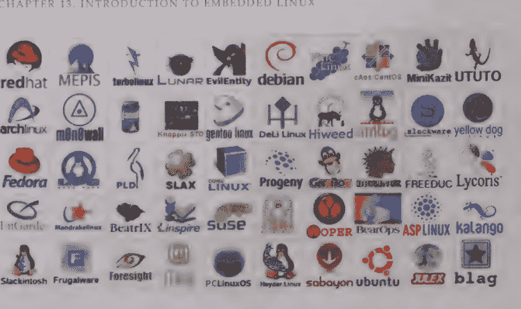

## Linux 内核组件

`Linux` 内核是 `Linux` 操作系统的核心组件，它提供了管理系统资源和运行应用程序的基本功能。以下是 `Linux` 内核的一些关键组件：

1. 进程管理：内核提供创建、管理和终止进程的功能，包括执行调度、分配内存和其他系统资源，以及处理信号和中断。

2. 内存管理：内核管理系统内存，包括为进程分配内存和管理虚拟内存，允许进程使用比物理可用内存更多的内存。

3. 设备驱动：`Linux` 支持广泛的硬件设备，内核包含了允许系统与网络适配器、显卡和存储设备等交互的驱动程序。

4. 文件系统：`Linux` 支持多种文件系统，包括流行的 `ext4`、`NTFS` 和 `FAT`，内核提供了管理文件和目录的功能，包括访问控制和权限。

5. 网络：内核提供网络支持，包括管理网络接口、路由和 `TCP/IP`、`UDP` 等通信协议的功能。

6. 安全：`Linux` 提供了各种安全功能，包括访问控制、身份验证和加密，以保护系统及其数据免受未经授权访问和攻击。

7. 进程间通信 (`IPC`)：内核提供了管道、套接字和信号等通信机制，允许进程之间进行通信并共享资源。

这些只是 `Linux` 内核的一些关键组件。还有许多其他特性和功能使 `Linux` 成为强大且灵活的操作系统。

# 第 15 章 嵌入式 Linux 简介

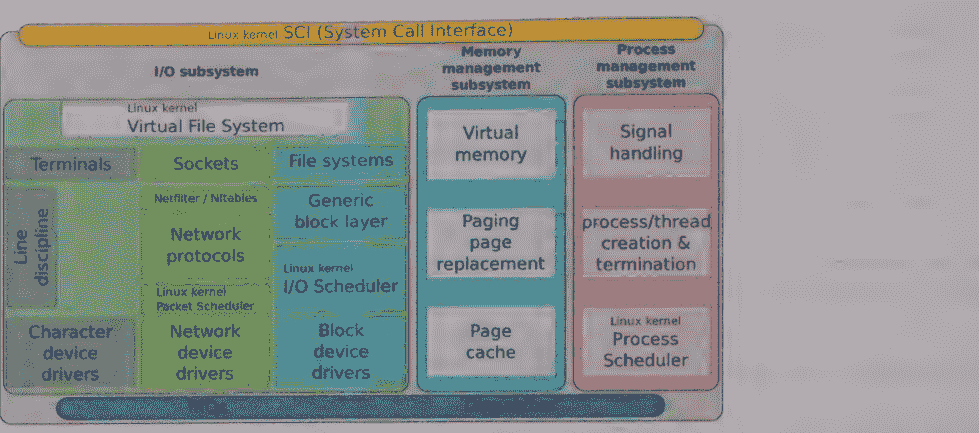

## 定义、链接与地址绑定

在计算机编程的上下文中，链接和地址绑定是发生在程序编译和执行过程中的过程。

链接是将一个或多个源文件的目标代码合并成单个可执行文件或库的过程。在链接过程中，链接器会解析对外部符号和函数的引用，并将目标代码合并成一个可以操作系统加载并执行的单一可执行文件或库文件。

地址绑定为变量和其他程序元素分配内存地址的过程。在编译过程中，编译器生成的代码使用符号名称（如变量名或函数名）引用程序元素。在链接和加载过程中，这些符号名称被替换为实际的内存地址，从而允许程序在运行时访问这些变量和函数。

地址绑定有几种类型：

- 静态绑定（`Static binding`）：在这一方法中，变量和函数的地址在编译时分配，并在运行时是固定的。

- 动态绑定（`Dynamic binding`）：在这一方法中，变量和函数的地址在运行时分配，从而提供了更大的灵活性以及在运行时加载和卸载库的能力。

- 运行绑定（`Runtime binding`）：在这一方法中，变量和函数的地址根据程序执行的上下文在运行时确定。

总的来说，链接和地址绑定是计算机程序编译和执行中的重要过程，允许程序被组合并加载到内存中，允许在运行时访问和使用程序元素。

# 第 13 章 嵌入式 Linux 简介

- 加载（`Loading`）：

- 将程序从辅助存储器移到主内存

- 链接（`Linking`）：


- 根据链接器脚本（`Linker script`）建立程序所有模块（目标文件和库）到一个可执行文件之间的链接
- 链接类型：静态链接和动态链接

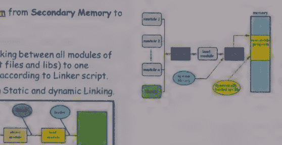

### 静态链接 vs 动态链接

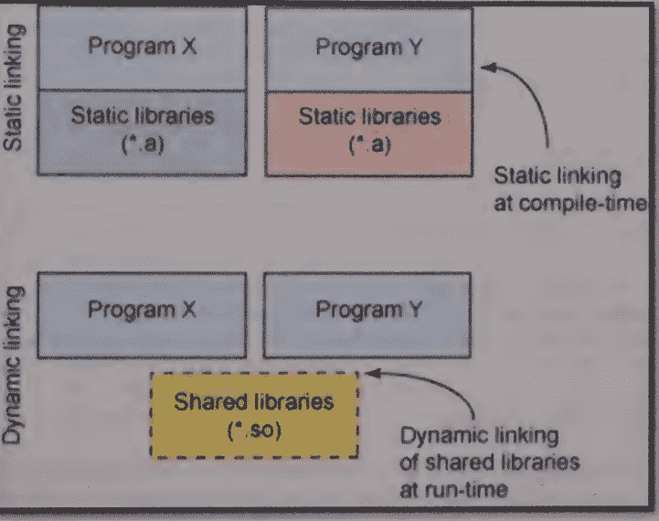

这里有一个表格总结了静态链接和动态链接之间的一些主要区别：

| 特性 | 静态链接 | 动态链接 |
|---|---|---|
| 文件大小 | 可执行文件大小较大 | 可执行文件大小较小 |
| 内存占用 | 运行时使用的内存较少 | 运行时使用的内存较 |
| 加载时间 | 加载速度快 | 加载速度较慢 |
| 灵活性 | 灵活性较低，更改需要重新编译 | 灵活性较高，无需重新编译即可更改 |


# 第 13 章 嵌入式 Linux 简介

| 特性 | 静态链接 | 动态链接 |
|---|---|---|
| 依赖关系 | 所有库依赖均在编译时解析 | 库依赖可以在运行时解析 |
| 性能 | 通常较快，因为所有代码在运行时都可用 | 由于运行时开销，略慢 |
| 可移植性 | 可移植性更好，因为所有依赖项都包含在可执行文件中 | 可移植性较差，因为依赖项可能需要在目标系统上安装 |
| 维护 | 可能更容易维护，因为包含了所有依赖项 | 维护可能更复杂，因为依赖项可能需要单独管理 |
| 示例 | `C` 静态库 (`.a`)，不带共享库的可执行文件 | `C` 动态库 (`.so`)，带共享库的可执行文件 |

注意，这些差异并不是绝对的，取决于程序的具体实现和上下文。在静态链接和动态链接之间的选择最终取决于项目的具体需求和限制。

## 内存管理概念

### 地址绑定

地址绑定为程序中的程序元素（如变量、函数和指令）分配内存地址的过程。地址绑定通常由操作系统或程序加载器完成，对于程序能够在运行时访问和使用这些元素是必要的。

地址绑定有几种类型，包括：

1. 编译时绑定（`Compile-time binding`）：在此类型的绑定中，根据程序元素在源代码中的位置在编译时分配内存地址。这导致了固定的内存布局，所有内存地址都提前确定。
2. 加载时绑定（`Load-time binding`）：在此类型绑定中，在程序加载到内存时为程序元素分配内存地址。这使得内存布局具有更高的灵活性，因为操作系统可以根据可用内存和其他因素优化内存分配。
3. 运行绑定（`Run-time binding`）：在此类型绑定中，根据程序执行的上下文在运行时为程序元素分配内存地址。这提供了更大的灵活性，因为程序可以根据输入或其他因素调整其内存使用。

通常来说，地址绑定是程序执行的一个重要方面，因为它允许程序在运行时访问和使用程序元素。地址绑定的具体类型取决于编程语言、操作系统和其他因素，并对程序性能、内存使用等因素产生影响。

- 地址绑定是将程序的逻辑地址或虚拟地址映射到相应的物理或主内存地址的过程。
- 此过程在执行期间会在内存与存储设备（如磁盘或 `sd` 卡分区）之间移动。

## 解决符号名称

每个符号名称都应转换为内存地址


## 地址的类型

关于每种地址类型的更多详细信息：

- 符号地址（`Symbolic Addresses`）：这些是用符号名称（如变量名或函数名）表示的地址，而不是实际的内存地址。符号地址用于程序的源代码，通常在链接过程中进行解析。
- 可重定位地址（`Relocatable Addresses`）：这些是相对于特定内存位置的地址，通常位于内存段的起始。可重定位地址在链接过程中使用，用于生成可以加载到内存并执行的可执行文件。
- 绝对地址（`Absolute Addresses`）：这些是由操作系统加载和执行程序的实际内存地址。绝对地址由操作系统或链接器在加载过程中生成，并基于系统的内存布局。

总的来说，这些不同类型地址使得程序设计和执行具有更大的灵活性和模块化，并允许程序在各种计算环境中加载和执行。

# 第 13 章 嵌入式 Linux 简介


## 地址绑定发生在三个不同的阶段

- 编译时绑定（`Compile Time Binding`）：如果程序位置是提前固定的
- 加载时绑定（`Load Time Binding`）：如果程序在内存中的位置在运行时是未知的
- 执行时绑定（`Execute Time Binding`）：如果进程在执行过程中可以在内存中移动。需要硬件支持！

### 编译时绑定

编译时绑定是地址绑定的一种类型，在编译时根据程序元素在源代码中的位置为它们分配内存元素。换句话说，程序元素的内存地址在编译时确定并固定，在运行时不会更改。

在编译期间，编译器生成使用符号名称（如变量名或函数名）引用程序元素的代码。然后根据源代码的位置将这些符号名称替换为实际内存地址。这种为程序元素分配内存的过程被称为编译时绑定。

编译时绑定具有优点，包括程序执行快和程序结构简单，因为所有内存地址都是预知的。但它也有一些限制，例如无法适应运行时变化的程序状况，并且可能与同一系统上的其他程序发生冲突。

总的来说，在编译时绑定和其他地址绑定类型之间的选择取决于程序的具体需求和限制，以及所使用的编程语言和操作系统。

# 第 13 章 嵌入式 Linux 简介

- 如果内存位置在编译时是固定且已知的，可以生成绝对代码。
- 如果起始位置发生，必须重新编译代码。


加载时绑定（`Load-time binding`）是一种地址绑定类型，即在程序加载到内存时为程序元素分配内存地址。这使得程序的内存布局变得更具灵活性，因为操作系统可以根据可用内存和其他因素来优化内存分配。

在加载过程中，链接器/装器会确定程序元素的内存地址，并解析对其他模块或库的任何外部引用。这种为程序元素分配地址的过程被称为加载时绑定。

加载时绑定具有多个优点，包括能够适应运行时程序内容的变化、能够在多个程序之间共享代码和库，以及在理论上具有更高效地使用系统资源的潜力。然而，它也存在局限性，例如可能与同一系统上运行的其他程序发生冲突，并且由于需要在加载期间执行地址解析，可能会导致程序执行速度变慢。

总的来说，加载时绑定与其他类型地址绑定之间的选择取决于程序的特定需求和限制，以及所使用的编程语言和操作系统。

- 如果内存中的内存位置在编译时未知，则它是固定的。
- 可以生成带有相对地址的可重定位代码。
- 绑定在程序加载到内存时完成。
- 即使内存中的起始位置发生变化也不需要重新编译程序，只需要重新加载。

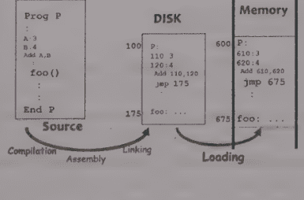

### 执行时绑定

# 第 15 章 嵌入式 Linux 简介

执行时绑定（`Execution-time binding`）是一种地址绑定类型，即在运行时根据程序执行的上下文为程序元素分配内存地址。使得程序的内存布局更加灵活，因为程序可以根据用户输入或其他因素动态调整其内存使用。

在程序执行期间，操作系统或程序本身会确定程序元素的内存地址，并解析对其他模块或库的任何外部引用。这种为程序元素分配内存地址的过程被称为执行时绑定。

执行时绑定具有多个优点，包括能够适应运行时程序状况的变化、能够在多个程序之间共享代码和库，以及在理论上具有更高效地使用系统资源的潜力。然而，它也存在局限性，例如由于需要在期间进行地址解析，可能会导致程序执行变慢。

总的来说，执行时绑定与其他类型地址绑定之间的选择取决于程序的特定需求和限制，以及所使用的编程语言和操作系统。


## 内存管理单元 (MMU)

内存管理单元（`MMU`）是计算机系统中的硬件组件，用于管理虚拟内存和物理内存。`MMU` 将虚拟地址映射到物理地址，允许程序在不知道物理位置的情况下访问内存。

`MMU` 通常是计算机处理器或芯片组的一部分，负责处理内存保护、内存分配和内存映射。它通过创建一个独立于物理内存布局的虚拟地址空间，然后根据需要将虚拟地址映射到物理地址来执行这些任务。

# 第 13 章 嵌入式 Linux 简介

`MMU` 的主要优点之一是它允许使用虚拟内存，允许程序访问比物理可用内存更多的内存。这是通过在物理内存和磁盘或其他辅助存储之间交换内存内容来实现的。

`MMU` 通过控制内存访问提供内存保护，确保程序只能访问特定的内存区域。总的来说，`MMU` 是内存系统的重要组件，有助于防止内存错误和攻击。

- 逻辑地址：
  由 `CPU` 生成
- 物理地址：
  通过 `MMU` 映射
- 逻辑地址：
  被硬件看到


- `MMU` 是将虚拟地址映射到物理地址的硬件设备
- `MMU` 包含运行程序的基址器


# 第 13 章 嵌入式 Linux 简介

## 解决方案
处理逻辑地址

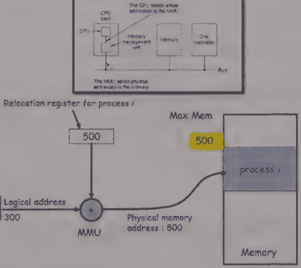

## 内存分配

内存分配为程序和数据结构预留并分配空间的过程。在操作系统中，内存分配通常由内核管理，为程序请求并分配内存空间。

一种常见的内存分配方法是使用动态内存分配，在程序执行期间根据需要分配内存


通常用于 `C` 和 `C++` 等现代编程语言，这些语言提供了 `malloc()` 和 `free()` 函数来分配和释放内存。

动态内存分配的一个挑战是管理内存碎片，内存分配和释放的方式产生了空隙或未使用内存块。这些空隙使得分配大连续块变得困难，可能会限制程序的性能。

为了管理内存碎片，操作系统可以使用内存压缩（通过重新排列内存块创建更大的连续块）或内存分页（通过在物理内存和辅助存储之间交换页）来优化内存使用。

总的来说，内存分配是操作系统设计和性能的一个重要方面，需要细心管理以确保高效可靠的内存使用。

| OS | OS | OS |
|---|---|---|
| `进程 1` | `P2退出` | `进程 1` | `P4创建` | `进程 1` | `P1退出` |
| `进程 2` | | | `进程 4` | `进程 2` | |
| `进程 3` | | `进程 3` | `进程 3` | `空隙` | |

当进程创建时，它被分配在一个足够大的洞中。

操作系统应该持续维护关于信息：
- 已分配分区
- 空闲分区（洞）

## 动态分配问题

- 如何从空闲列表中满足大小为 `n` 的请求
- 有三种算法：
  - 首次适配（First-fit）：分配第一个足够大的洞
  - 最佳适配（Best-fit）：分配足够大的最小洞，必须搜索按大小排序的条目。产生最小的剩余空洞
  - 最坏适配（Worst-fit）：分配最大的洞，也必须搜索整个列表。产生最大的剩余空洞
- 首次适配和最佳适配在速度和存储利用率方面优于最坏适配。

| 初始内存 | 最佳适配 | 最坏适配 | 首次适配 |
|---|---|---|---|
| `P3` | `P3` | `P3` | `P3` |
| `P2` | `P2` | `P2` | `P2` |
| `P1` | `P1` | `P1` | `P1` |

> 为进程分配连续内存使得内存管理变得简单，但会导致空间浪费。

## 碎片

外部碎片发生在虽然总空闲内存空间足够以满足内存请求，但这些空闲内存不是连续或相邻的情况下。结果是，尽管总空闲内存足够，内存请求仍无法满足。

内存压缩（Memory compaction）是可用于减少外部碎片的技术之一。压缩涉及重新排列内存块，以将所有空闲内存合并成一个大型的连续块。这可以通过移动活动内存块来创建一个大的连续内存块，然后使用它可以满足内存请求。

然而，内存压缩在 `CPU` 和内存开销方面可能是昂贵的的，特别是对于大型内存系统而言。因此，许多操作系统使用备选技术，如内存分页（memory paging），它涉及在物理内存和辅助存储之间交换内存页，以优化内存使用并减少碎片。

总的来说，管理外部碎片是操作系统内存管理的一个重要方面，需要仔细的考虑和优化，以确保高效且可靠的内存使用。

- 外部碎片
  - 存在满足请求的空闲内存空间，但并不连续
  - 可以通过压缩减少：
    - 将所有空闲内存集中在一个大块中


- 内部碎片
  - 分配的内存可能比请求的内存略大。
  - 对于某些块，内部碎片是块大小与负载大小（payload size）之间的差异。
  - 尺寸划分位于分区内部，但未被使用。


## 表格：内部碎片与外部碎片对比

| 维度 | 内部碎片 | 外部碎片 |
| --- | --- | --- |
| 定义 | 分配的内存块大于实际需要存储的数据量，导致块内出现未使用空间 | 存在总空闲内存空间以满足内存请求，但它不连续或相邻 |
| 原因 | 固定大小内存分配方案，内存块以固定大小分配，这些大小可能与要存储的数据大小不完全匹配 | 动态内存分配方案，根据需要分配和释放内存块 |
| 对性能的影响 | 可能会导致空间浪费和内存访问速度变慢 | 可能会使大块内存分配变得困难并导致内存访问速度变慢 |
| 解决方案 | 可以通过使用更匹配数据大小的内存分配方案来缓解 | 可以通过使用内存压缩、内存分页或减少碎片的不同内存分配方案来减少 |
| 示例 | 内部碎片可能发生在使用 `1KB` 块存储 `100` 字节数据的固定大小内存分配方案中 | 外部碎片可能发生在动态内存分配方案中，内存被重复分配和释放，在活动内存块之间创建了不可用的内存小间隙 |

这里有一个对比内部和外部碎片的表格：


### 总结

### 地址绑定

地址绑定是将程序的逻辑地址或虚拟地址映射到相应的物理地址或主内存地址的过程。

#### 编译时绑定

#### 加载时绑定

#### 执行时绑定

如果内存在编译时是固定且已知的，可以生成绝对代码（absolute code）。

如果内存位置在编译时未知且位置是固定。可以生成带有相对地址的可定位代码（relocatable code）。绑定在程序加载到内存时完成。

如果进程可以在执行过程中在内存中移动，绑定延迟到运行时。需要硬件支持（`MMU`）来进行地址映射。

`MMU` 是将虚拟地址映射到物理地址的硬件设备。

## 动态分配

有三种算法：首次适应（First-fit）、最佳适应算法（Best-fit）和最坏适应算法（Worst-fit）。

## 问题

## 内部与外部碎片


# 第13章 第二部分 - 基于分页技术的虚拟内存

# 连续与非连续内存分配的区别

连续内存分配：在连续内存分配中，程序的数据和指令保证位于单个连续的内存块中。在非连续内存分配中，程序的数据和指令存储在内存中单独、非连续的区域。非连续内存分配方法的示例包括分页（paging）和分段（segmentation）。

连续存储分配：
连续存储分配意味着程序的数据和指令保证占用单个连续内存。

非连续存储分配：
在非连续存储分配中，程序的数据和指令可能占用内存的非连续区域。示例有：
1. 分页
2. 分段


| 比较维度 | 连续内存分配 | 非连续内存分配 |
| --- | --- | --- |
| 基础 | 为进程分配连续的内存块。 | 为进程分配独立的内存块。 |
| 开销 | 连续内存分配在进程执行时没有地址翻译的开销。 | 非连续内存分配在进程执行时有地址翻译的开销。 |
| 执行速率 | 进程在连续内存中执行较快 | 进程在非连续内存中执行相当慢。 |


## 连续分配的问题

1. 难以共享程序
2. 难以扩展地址空间
   - 程序在执行期间可能需要增长
   - 为栈、堆分配等空间
3. 可能会产生内部碎片
4. 可能会产生外部碎片

解决方案：
   - `1` & `2` & `4`：分段
   - `1` & `3` & `5`：分页
   - `1`-`5`：分段 + 分页


连续分配存在几个问题：

1. 外部碎片：随着时间的分配和释放，空闲内存可能会分散在整个系统中，导致外部碎片。这使得即使内存足够，也很难找到足够的连续块。
2. 内部碎片：连续分配通常需要固定大小的分区或分配。如果分配的内存大于进程需要，剩余内存将被浪费，导致内部碎片。
3. 内存分配效率低下：分配大块连续内存可能是低效的，因为可能会留下无法利用的小空块，即使这些块可以被其他进程使用。
4. 扩展困难：在连续分配方案中，调整内存分配是挑战性的，因为如果相邻内存位置被占用，可能无法增大现有块。
5. 搜索时间延长：当系统搜索足够的连续块时，搜索时间可能会增加，特别是内存碎片严重时。
6. 压缩开销：为了缓解外部碎片，系统可能需要执行内存压缩，这涉及移动和重组内存块。这是一个耗时且资源的过程。
7. 完全处理动态内存需求：连续分配难以处理具有动态内存需求的进程，因为预测所需的内存大小并高效分配非常困难。

分段、分页以及两者结合可以解决连续内存分配的一些问题：

1. 分段：分段可以帮助解决 `1`（外部碎片）、`2`（内部碎片）和 `4`（扩展困难）。在分段中，内存被划分为变长度的段，根据特定需求分配给进程。这种方法减少了内部碎片，因为段是根据进程的大小需求定制的。此外，调整段的大小更易于管理，因为段不


# 第 13 章 嵌入式 Linux 简介

要求是连续的。然而，随着时间的推移，分段仍会导致外部碎片。

- **2. 分页**：分页可以解决问题 1（外部碎片）、3（内存分配效率低）和 5（搜索时间较长）。在分页机制中，内存被划分为固定大小的块，称为页。进程也被划分为相同大小的页，这些页可以映射到内存中任何可用的页。这种方法消除了外部碎片，因为页可以独立于其在内存中的位置进行分配。由于任何空闲页都可以使用，搜索空闲内存块的时间也缩短了。
- **3. 分段 + 分页**：结合分段和分页可以帮助解决问题 1-5。这种方法也称为页段，它将内存划分为段，然后将段进一步划分为页。这种组合利用了分段（变长分配）和分页（消除外部碎片并提供更高效的搜索时间）的优点，实现了内存的高效分配。然而，同时管理段和页的复杂性会导致开销增加和资源需求的提高。

## 分页

分页是许多操作系统中广泛使用的内存管理技术。它将物理内存划分为固定大小的块，称为帧。帧的大小通常是 2 的幂，范围在 512 字节到 8KB 之间。同样，逻辑内存也被划分为相同大小的块，称为页。

操作系统跟踪内存中所有的空闲帧。为了运行一个大小为 `n` 页的程序，操作系统需要找到 `n` 个空闲帧并将程序加载到这些帧中。系统会建立一个页表来将逻辑地址翻译为物理地址，内存管理单元（`MMU`）会查找该页表。

整个程序存储在磁盘上。例如，一个带有页 `X` 的程序可以加载到内存页帧 `Y` 中，也可以以前从未加载过，在这种情况下它保留在磁盘上。当程序启动时，只将第一页加载到内存中。其余页根据需要按需加载。

这种分页技术允许页放置在内存的任何位置，使得内存分配更加高效并减少了与碎片相关的问题。


# 第 13 章 嵌入式 Linux 简介

更多的操作系统一直在使用分页技术。

- 将物理内存划分为固定大小的块，称为帧（大小为 2 的幂，512 字节和 4096 字节 `KB`）
- 将逻辑内存划分为相同大小的块，称为页
- 跟踪所有空闲帧。将大小为 `n` 的程序映射到页，需要找到 `n` 个空闲帧并加载程序
- 建立页表（`MMU` 将逻辑地址映射到物理地址）
- 整个镜像位于磁盘上。例如。程序大小为 `n`，它要么已加载到内存帧 `V` 中，要么以前从未加载过，需要时再加载
- 当程序启动时，仅加载第一页。其余页按需加载到内存。页可以放置在内存的任何位置。

## 分页中的地址翻译


CPU 生成的逻辑地址分为两部分：

- 页号 (`p`) - 用作页表的索引，页表包含物理内存中每个页的基地址
- 页偏移 (`d`) - 与基地址结合，定义发送到内存单元的物理地址

例。给定地址长度为 32 位，页大小为 4KB

| 页号 | 页偏移 |
| :--- | :--- |
| 2^20 | 4096 / 4 KB |


在分页系统中，CPU 生成的逻辑地址分为两个部分：页号 (`p`) 和页偏移 (`d`)。页表包含物理内存中每个页的基地址。页偏移与基地址结合定义发送到内存单元的物理地址。

例说明：假设我们逻辑地址空间为 16KB，物理内存为 32KB。假设页大小为 1KB。结果如下：

- 1. 逻辑地址被分为 16 页 (16KB / 1KB)。
- 2. 物理内存被分为 32 帧 (32KB / 1KB)。
- 3. CPU 生成的逻辑地址为 14 位 (`2^14`)。我们需要将这些位分为页号 (`p`) 和页偏移 (`d`)。

由于有 16 页，我们需要 4 位 (`2^4 = 16`) 来表示页号。剩余 10 位 (`14` 位 - `4` 位) 表示页偏移，因为页大小是 1KB (`2^10` 字节)。

例：考虑二进制表示为 `1101101010` 的逻辑地址


# 第 15 章 嵌入式 Linux

- 1. 将地址分为页号 (`p`) 和页偏移 (`d`)：
   - 页号 (`p`) = `1101`（二进制） = `13`（十进制）
   - 页偏移 (`d`) = `10101001`（二进制） = `169`（十进制）
- 2. 使用页号作为索引查找页表，找到物理内存中相应页的基地址。假设 `13` 的基地址为 8KB（`8192` 十进制）。
- 3. 将基地址与页偏移结合得到内存地址：
   - 内存地址 = 基地址 + 页偏移
   - 内存地址 = `8192`（十进制）+ `169`（十进制） = `8361`（十进制）

因此，逻辑地址 `1101101001`（二进制）或 `1313`（十进制）翻译为内存地址 `9505`（十进制）。

## 如何查找

页查找是内存管理单元（`MMU`）将 CPU 生成的逻辑地址翻译为物理地址的过程。以下步骤说明了如何执行页查找：

- 1. 将逻辑地址分为两部分：页号 (`p`) 和页偏移 (`d`)。页号用于索引页表，而页偏移指定页内的字节位置。
- 2. 使用页号访问页表。页表是一个包含物理内存每个页基地址（称为帧号）的数组。页表中的每个条目对应逻辑地址中的一个页。
- 3. 从页表中检索给定页号对应的物理内存基地址（帧号）。该基地址代表其在内存中的起始地址。
- 4. 将基地址（帧号）与页偏移 (`d`) 计算得到物理内存地址。这是通过基地址加上页偏移来实现。
- 5. 使用生成的物理地址访问内存中所需的数据或指令。

重要的是，现代操作系统通常使用多级页表来处理地址空间。在这种情况下，页查找过程可能涉及多层页表，最后到达包含基地址（帧号）的最终页表条目。


# 第 15 章 嵌入式 Linux

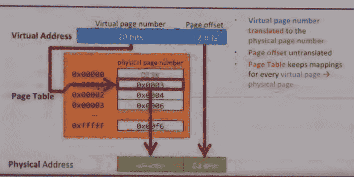

## 示例 1 页位于内存中

考虑一个页已位于内存，我们需要执行页查找来访问它。

假设：

- 1. 逻辑地址空间有 16 页 (`64KB` / `4KB`)
- 2. 物理内存有 32 帧 (`128KB` / `4KB`)
- 3. 16 位的逻辑地址 (`2^16`) 被分为页号 (`p`) 和页偏移 (`d`)。

由于有 16 页，我们使用 4 位 (`2^4 = 16`) 来表示页号。剩余 12 位 (`16` 位 - `4` 位) 表示页偏移，因为页大小为 4KB (`2^12` 字节)。

例：考虑二进制表示为 `1101011010100101` 的逻辑地址

- 1. 将地址分为页号 (`p`) 和页偏移 (`d`)：
   - 页号 (`p`) = `1101`（二进制） = `13`（十进制）
   - 页偏移 (`d`) = `011010100101`（二进制） = `3749`（十进制）
- 2. 假设页表对每个页如下条目（单位为 KB）：`[0, 4, 8, 12, 16, 20, 24, 28, 32, 36, 40, 44, 48, 52, 56, 60]`
- 3. 使用页号作为索引查找页表，找到内存中相应页的基地址。`13` 的基地址为 52KB（`53,248` 十进制）。
- 4. 将基地址与页偏移结合得到物理内存地址：
   - 物理内存地址 = 基地址 + 页偏移


# 第 13 章 嵌入式 Linux 绪

- 物理内存地址 = `53248`（十进制）+ `2677`（十进制） = `55925`（十进制）

在例中，逻辑地址 `110101101010101`（二进制）被翻译为物理内存地址 `55925`（十进制）。页块已位于内存中，`MMU`（内存管理单元）可以使用此物理地址来访问所需的数据或指令。

## 示例 2 页块位于磁盘

让我们考虑这样一个例子：页块不在内存中，而是在磁盘上，我们需要执行页表查找和页异常处理来访问它。

假设：

1. 逻辑地址空间：`64KB` (`2^16` 字节)
2. 物理内存大小：`128KB` (`2^17` 字节)
3. 页/帧大小：`4KB` (`2^12` 字节)

计算过程：

1. 逻辑地址空间有 16 个页 (`64KB` / `4KB`)
2. 物理内存有 32 个帧 (`128KB` / `4KB`) 和页偏移
3. 一个 16 位的逻辑地址 (`2^16` 字节) 分页号 (`p`) 和页偏移 (`d`)。

由于有 16 个页，我们需要 4 位 (`2^4 = 16`) 来表示页号。剩余的 12 位 (`16` 位 - `4` 位) 将表示页偏移，页大小为 4KB (`2^12` 字节)。

示例：考虑一个具有二进制表示的逻辑地址：`1101011010101001`

1. 将地址分为页号 (`p`) 和页偏移 (`d`)：
   - 页号 (`p`) = `1101`（二进制） = `13`（十进制）
   - 页偏移 (`d`) = `0100101010001`（二进制） = `2677`（十进制）


2. 假设所需的页（第 13 页）不在内存中，而在磁盘上。在这种情况下，MMU 在尝试查找页表时会检测到页异常。操作系统按如下方式处理页异常：

- 操作系统在内存中找到一个空闲（如果可用），分配给所需的页。在本例中，假设它找到了第 7 帧（内存中的 28KB）。
- 操作系统从磁盘读取所需的页并加载到物理内存中分配的帧（第 7 帧）中。
- 更新页表以反映第 13 页的新基地址（帧号）。在我们的示例中，第 13 页的基地址现在是 28KB（十进制的 28672）。

现在所需的页已经在内存中了，我们可以继续进行地址翻译——

- 物理内存地址 = 基地址 + 页偏移
- 物理内存地址 = 28672（十进制） + 2677（十进制） = 31349（十进制）

在此例中，逻辑地址 `101101101010101`（二进制）或 `55061`（十进制）被翻译为物理内存地址 `31349`（十进制）。该页块最初位于磁盘上，通过 MMU 和操作系统处理页异常并将所需的页加载到内存中，从而允许翻译后的物理地址的数据或指令。

# 那么分页的优点是什么……？

分页作为操作系统中的一种内存管理技术，具有多种优点：

- `消除外部碎片`：分页将内存划分为固定大小的块（帧），并以这些块为单位分配内存。因此，由于块的大小始终相同，所以没有外部碎片。
- `简化内存分配`：分页允许将任何空闲帧分配给页，无论其在内存中的位置如何。这使得分配过程更加直接和高效。
- `支持虚拟内存`：分页是实现虚拟内存的基础，允许进程访问比可用物理内存更大的地址空间。操作系统可以使用次级存储（如磁盘）来存储未使用的页，并根据需要将其换入或换出内存。
- `高效利用内存`：通过按需仅将必要的页加载到内存，分页可以帮助减少运行进程的内存占用。这允许系统并发运行更多进程，提高整体性能。
- `更快的内存分配和释放`：由于页是固定大小的，并且可以从任何可用帧分配，内存分配和释放所需的时间缩短了，从而带来了更好的系统性能。
- `更简单的内存保护`：每个页都有自己的保护属性，例如读取、写或执行权限。这使得实现内存保护和隔离不同进程变得更加容易。
- `更容易的代码和数据共享`：分页通过将同一个物理帧映射到不同的逻辑地址空间，使进程共享代码和数据变得简单。

## 共享页

共享页是操作系统内存管理的一种特性，允许多个进程访问同一个物理帧。当两个或多个进程需要使用相同的代码或数据时，这特别有用，因为它实现了内存的高效利用。

共享页的一些常见场景：

1. `共享库`：操作系统经常利用共享库，例如 Windows 中的动态链接库 (`DLL`) 或 Linux 中的共享对象 (`.so`)。这些库包含常用的函数和例程，可以在多个进程之间共享，减少了整体内存占用并提高了系统性能。
2. `内存映射文件`：进程可以将文件从磁盘映射到它们的地址空间，允许多个进程同时访问文件。这对于共享大型数据结构或进程间通信非常有用。
3. `共享内存`：进程可以创建共享内存与其他进程通信并交换数据。共享内存是显式分配的内存区域，多个进程可以通过自己的地址空间对其进行访问。这使得进程之间不需要消息传递机制即可进行快速通信。

使用共享页时，操作系统确保将同一个物理帧映射到进程的不同逻辑地址空间。每个进程都可以像访问自己地址空间的一部分一样访问共享页，一个进程的更改对所有共享该页的进程都是的。

重要的是，需要适当的同步机制（例如信号量或互斥锁）来协调多个进程对共享页的访问，以避免竞争条件并确保数据一致性。

- 分页系统通过在多个页帧中复制内存块来轻松共享内存块。这可能是代码也可能是数据。

如果代码是重入的 (`reentrant`)，意味着它不会以任何方式写入或更改代码（它不是自修改的），并且重新进入它是安全的。更重要的是，这意味着代码可以被多个进程共享，只要每个进程都有自己的数据和寄存器副本（包括指令寄存器）。

| 数据 1 | 数据 2 | 数据 3 | 数据 4 | 数据 5 | 数据 6 | 数据 7 | 数据 8 | 数据 9 | 数据 10 | 数据 11 |
|---|---|---|---|---|---|---|---|---|---|---|
| 进程 `P` | | | | | | | | | | | |
| 进程 `Q` | | | | | | | | | | | |
| 进程 `R` | | | | | | | | | | | |
| 进程 `S` | | | | | | | | | | | |

## 第 13 章 嵌入式 Linux 简介

优点：

- 提供比物理内存更大的内存空间
- 它可以运行比物理内存大得多的程序，大小可达 `4GB`。
- 例如在 `32` 位系统中，它可以运行此类程序
- 它不会产生不必要的开销，因为页是按需加载的
- 它不不在乎页的放置，因为所有帧的大小都是相同的
- 它可以通过页表在进程之间轻松地共享和保护内存。

缺点：

- 访问页表存在时间开销
- 这个问题可以通过名为 `TLB` 的硬件支持来解决
- 页表可能会很大
- 这个问题可以通过多级页表结构解决。


## TLB (转地址查找缓冲区)

转地址查找缓冲区 (`TLB`) 是一种硬件缓存，用于提高使用分页或分段的系统中虚拟地址到物理地址转换的性能。`TLB` 是现代 `CPU` 中内存管理单元 (`MMU`) 的一部分，作为一个小型、快速的缓存，它存储最近使用的页表项，减少了查找给定虚拟地址对应的物理地址所需的时间。

当 `CPU` 生成虚拟地址时，`MMU` 首先检查相应的页表项是否存在于 `TLB` 中。如果是，则称为 `TLB` 命中 (`TLB hit`)，`MMU` 可以快速获取物理地址，而无需访问内存中的完整页表。这显著地加快了地址转换过程。

然而，如果所需的页表项不在 `TLB` 中，则称为 `TLB` 缺失 (`TLB miss`)。在这种情况下，`MMU` 必须访问内存中的页表以检索所需的条目。一旦找到该条目，`MMU` 可能会用该新条目更新 `TLB`，以加速同一页后续地址的访问。

`TLB` 的一些重要方面包括：

- `大小`：`TLB` 通常很小，条目有限（例如 `64`、`128` 或 `256` 个条目）。这是因为在 `CPU` 芯片上实现大型快速缓存的成本很高且极其复杂。
- `关联性`：`TLB` 可以用不同级别的关联性实现，如直接映射、组相联或全关联。`TLB` 的关联性影响其命中率、替换策略和复杂性。
- `替换策略`：当 `TLB` 满且需要添加新条目时，会使用替换策略来确定应该替换哪个条目。常见的替换策略包括最久未使用 (`LRU`)、先进先出 (`FIFO`) 和随机替换。
- `多级 TLB`：某些系统使用多级 `TLB` 层次结构，其中快速的一级 (`L1`) `TLB` 由更大、更慢的二级 (`L2`) `TLB` 提供后备支持。这可以提高命中率和整体性能。
- `TLB 一致性`：操作系统在修改页项时必须确保 `TLB` 的一致性，因为在进程创建或删除期间，或者在更新内存保护属性时，这可能涉及失效或刷新 `TLB` 条目以防止使用过期数据。

总之，`TLB` 是一个关键硬件组件，有助于加速分页或分段系统的地址转换过程。通过缓存最近使用的页表项，`TLB` 减少了访问内存中完整页表的需求，从而提高了性能。

## 页表的实现

- 页表保存在主内存中。
- 页表基寄存器 (`PTBR`) 指向页表
- 页表长度寄存器 (`PLR`) 指明页表的大小
- 在此方案下，数据/指令访问需要两次内存访问：一次针对页表，一次针对数据/指令。
- 内存访问问题可以通过使用名为关联内存或转地址查找缓冲区 (`TLBs`) 的硬件来解决。

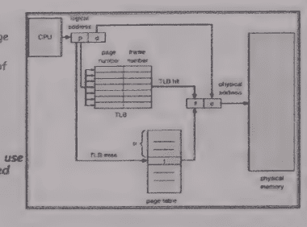 转地址查找缓冲区 (`TLBs`)

- 为了让虚拟内存快速，我们添加了特殊的页缓存：
    - 转地址缓冲区 (`TLB`)
    - 处理器非常快
    - 处理 `VA` (虚拟地址)
    - 内存很大且慢


- 为了让虚拟内存快速，我们添加了特殊的页缓存：
    - 转地址缓冲区 (`TLB`)
    - 处理器非常快
    - 处理 `VA` (虚拟地址)
    - 内存很大且慢
    - 如果进程访问页表，每次访问将变得非常慢


## 第 13 章 嵌入式 Linux 简介

- 为了让虚拟内存快速，我们添加了特殊的页缓存：
    - 转地址缓冲区 (`TLB`)
    - 速度：小于 `1` 个周期（每次内存访问只需）
    - 非常类似于缓存

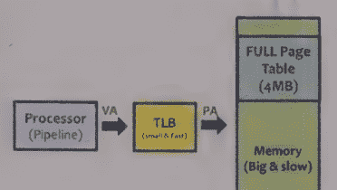

- 为了让虚拟内存快速，我们添加了特殊的页缓存：
    - 转地址缓冲区 (`TLB`)
    - 速度：小于 `1` 个周期（每次内存访问只需）
    - 非常类似于缓存
    - 为了快速，`TLB` 必须是小的：
        - 分离指令 `TLB` (`ITLB`) 和数据 `TLB` (`DTLB`)

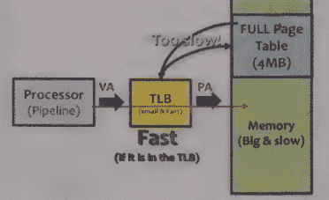

当我们访问内存 (`TLB`) 时会发生什么？


- 良好情况：页在内存中
- 坏的情况：页不在内存中
- 在磁盘上（将非常慢）


- 良好情况：页在内存中
- 极佳情况：`TLB` 中的页表项，在这种情况下我们快速访问数据
- 转换需要 1 个周期，然后我们访问内存或缓存
- 坏的情况：页不在内存中
- 在磁盘上（需要时间才能访问）


- 良好情况：页在内存中
- 极佳情况：`TLB` 中的页表项，在这种情况下我们快速访问数据
- 转换需要 1 个周期，然后我们访问内存或缓存
- 不足的情况：`PTE` 不在 `TLB` 中
- 性能不佳：从内存加载 `PTE` 需要 20-1000 个周期，然后去访问内存


- 坏的情况：页不在内存中
- 在磁盘上（需要时间才能访问）
- `PTE` 在 `TLB` 中
- 1 个周期知道它在磁盘上
- -800 个周期从磁盘上获取它
- 良好情况：页在内存中
- 极佳情况：`TLB` 中的页表项，在这种情况下我们快速访问数据
- 转换需要 1 个周期，然后我们访问内存或缓存
- 不足的情况：`PTE` 不在 `TLB` 中
- 性能不佳：从内存加载 `PTE` 需要 20-1000 个周期，然后去访问内存


- 坏的情况：页不在内存中
- 在磁盘上（需要时间才能访问）
- `PTE` 不在 `TLB` 中
- 1 个周期知道它在磁盘上
- -800 个周期从磁盘上获取它
- 20-1000 个周期知道它在磁盘上
- -800 个周期从磁盘上获取它


# 第 15 章 嵌入式 Linux 简介

> 问题：`TLB` 很小。我们如何在不降低速度的情况下让它们有效地变大？

- 仅仅让它们持有更多的 `PTE`
- 增大页的大小
- 添加一个更大但稍慢的二级 `TLB`
- 让硬件在发生缺失时自动填充 `TLB`（例如，而不是让操作系统在软件中完成。）
- 增大页的大小

通过增加 `TLB` 页的大小，你可以扩大范围以覆盖更多任务。


## 第 13 章 嵌入式 Linux 简介

- `TLB` 空间很小。我们如何才能有效地扩大它们？
- 使用大页（large pages）来减少缺失
- 添加一个更大但速度较慢的第二个 `TLB`
- 添加一个更快但更小的第二个 `TLB`
- 使用多级页表，有办法实现吗？
  （例如，我们不再对 `TLB` 条目进行哈希处理，而是使用...)
- 增大页面大小

这增加了 `TLB` 的范围，因为覆盖相同的数据需要更少的页面。

- 添加一个更大但速度较慢的第二个 `TLB`

大多数程序会在第一个 `TLB` 中命中（hit）。如果未命中，则检查第二个 `TLB`，它的速度与...一样慢。

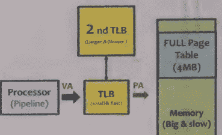

- `TLB` 空间很小。我们如何在不减慢速度的情况下有效地扩大它们？
- 使用大页来减少缺失
- 添加一个更大但速度较慢的第二个 `TLB`

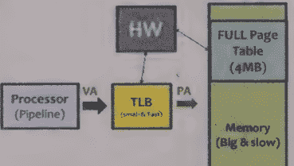

- 增大页面大小

这增加了 `TLB` 的范围，因为覆盖相同的数据需要更少的页面。

- 添加一个更大但速度较慢的第二个 `TLB`
- 使用硬件自动进行 `TLB` 填充（refill）

## 多级页表

- 需要额外的内存空间来存储页表。
- 程序具有庞大的地址空间
  - 如果我们使用 32 位地址
    - 可以寻址大小为 46GB 的程序
- 假设我们有两个级页表的示例。
  - 页表本身也是分页的
    - 分块存储页表条目页
    - 按需（on-demand）加载页表的物理页


## 两级页表下的地址翻译

## 第 12 章 嵌入式 Linux 简介

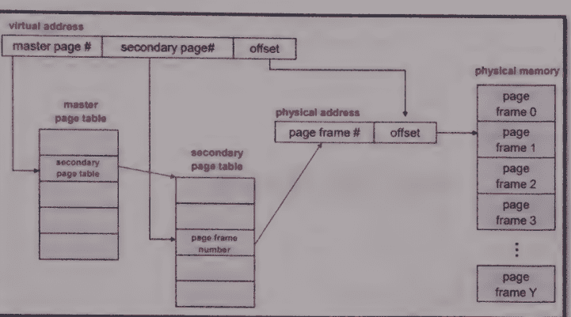

### 实验 1 分页

- 执行 `getbit -A`
- 编译它
  - 执行 `gcc label.c -o labelfile`
- 运行它
  - 执行 `./label`
  - 按 `Ctrl+C` 退出

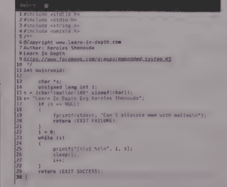

### 实验 1：检查虚拟地址

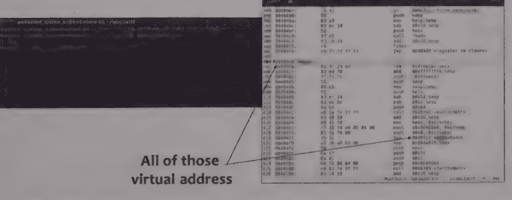

### 检查内存映射（memory maps）

- Linux 内核维护进程的页表。


## 第 13 章 嵌入式 Linux 简介

- 进程仅通过其地址空间看到虚拟内存。进程使用一些系统调用（例如 `mmap(2)` 或 `execve(2)`）来更改其地址空间。
- `/proc/<PID>/maps` 不显示任何物理地址的内容，只显示虚拟地址
- 你必须获取进程 ID（`PID`）

我们也可以从 `/proc/<PID>/mem` 读取堆（heap）

- 步骤：运行程序
  - 执行 `./abelf`
- 获取 `pid` 地址
  - 执行 `ps -a`
- 获取堆的起始和结束地址
  - 执行 `cat /proc/pid/maps`
- 调用 `gdb`
  - 执行 `sudo gdb --pid <pid>`
    - 然后转储内存
    - 执行 `dump memory ~/labs/part2/heap_file 0xd926200 0x`
  - 打开文件
  - 执行 `vi /labs/part2/heap_file`

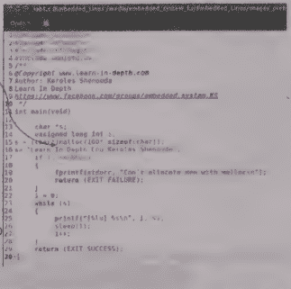


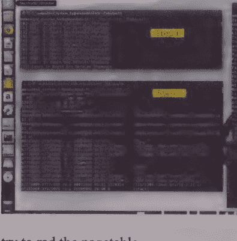

尝试读取页表

执行 `sudo cat /proc/<PID>/maps`

会发生什么？为什么？

## 深度思考：分段（Segmentation）

分段（Segmentation）是一种内存管理技术，它通过将程序划分为称为“段”的逻辑单元来支持用户的内存视图。这些段通常代表程序的不同部分，例如子程序、栈和主程序。这种方法允许了灵活的内存组织，并可以提供更好的内存保护和共享能力。


# 第 15 章 嵌入式 Linux 简介

在分段系统中，为每个进程维护一个段表。段表包含关于每个段的信息，包括：

- 基址（`Base`）：段所在的起始物理地址。
- 限制（`Limit`）：段的长度，指定其大小。

使用两个寄存器来管理段表：

- 段表基寄存器（`STBR`）：该寄存器持有段表所在的内存地址。操作系统在每个进程被调度运行时，会将 `STBR` 指向该进程适当的表。
- 段表长度寄存器（`STLR`）：该寄存器存储程序使用的段数。

在分段系统中，为每个进程维护一个段表。段表包含关于每个段的信息，包括：

- 基址（`Base`）：段所在的起始物理地址。
- 限制（`Limit`）：段的长度，指定其大小。

使用两个寄存器来管理段表：

- 段表基寄存器（`STBR`）：该寄存器持有段表所在的内存地址。操作系统在每个进程被调度运行时，会将 `STBR` 指向该进程适当的表。
- 段表长度寄存器（`STLR`）：该寄存器存储程序使用的段数。

在分段系统中，为每个进程维护一个段表。段表包含关于每个段的信息，包括：

- 基址（`Base`）：段所在的起始物理地址。
- 限制（`Limit`）：段的长度，指定其大小。

使用两个寄存器来管理段表：

- 段表基寄存器（`STBR`）：该寄存器持有段表所在的内存地址。操作系统在每个进程被调度运行时，会将 `STBR` 指向该进程适当的表。
- 段表长度寄存器（`STLR`）：该寄存器存储程序使用的段数。

在分段系统中，为每个进程维护一个段表。段表包含关于每个段的信息，包括：

- 基址（`Base`）：段所在的起始物理地址。
- 限制（`Limit`）：段的长度，指定其大小。

使用两个寄存器来管理段表：

- 段表基寄存器（`STBR`）：该寄存器持有段表所在的内存地址。操作系统在每个进程被调度运行时，会将 `STBR` 指向该进程适当的表。


## 分段机制

在分段的系统中，为每个进程维护一个段表。段表包含关于每个段的信息，包括：

- **基址（`Base`）**：段所在的起始物理地址。
- **限制（`Limit`）**：段的长度，指定其大小。

使用两个寄存器来管理段表：

- **段表基寄存器（`STBR`）**：该寄存器持有段表所在的内存地址。操作系统在每个进程被调度运行时，会将`STBR`指向该进程适当的表。
- **段表长度寄存器（`STLR`）**：该寄存器存储程序使用的段数。


### 段表（Segment Table）

在分段分段的系统中，为每个进程维护一个段表。段表包含关于每个段的信息，包括：

- 基址（`Base`）：段所在的起始物理地址。
- 限制（`Limit`）：段的长度，指定其大小。


# 第 13 章：嵌入式 Linux 简介

## 内存管理基础

在分段机制中，为每个进程维护一个段表。段表包含关于每个段的信息，包括：

- **基址（`Base`）**：段所在的起始物理地址。
- **限制（`Limit`）**：段的长度，指定其大小。

### 共享内存技术

1. **共享库**：在许多操作系统中，共享库（例如动态链接库或共享对象）包含了多个进程可以使用的常用函数和例程。通过将同一个共享库段映射到各个进程的逻辑地址空间中，操作系统可以减少内存占用并提高系统性能。
2. **共享内存段**：进程可以创建共享内存段，以便与其他进程进行通信和数据交换。共享内存段是一个显式分配的内存区域，多个进程可以通过自己的地址空间访问该区域。通过将同一个共享内存段映射到各个进程的逻辑地址空间中，它们可以在不需要消息传递或其他进程间通信机制的情况下访问共享数据。
3. **代码段**：在某些情况下，一个程序的多个实例或不同的程序可以共享同一个代码段。通过将代码段映射到不同进程的逻辑地址空间中，操作系统可以减少内存占用，并可能由于缓存局部性的增加而提高性能。

为了在多个进程之间共享一个段，操作系统将物理内存帧映射到共享该段的进程各自的段表项中。每个进程都可以像该段是其自身地址空间的一部分一样访问共享段，并且一个进程所更改对所有其他共享该段的进程都是可见的。

需要注意的是，可能需要适当的同步机制（如信号量或互斥锁）来协调多个进程对共享段的访问，以避免数据不一致，特别是在共享可写数据段时。

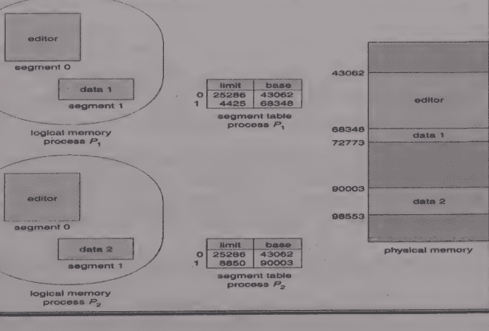

## 分段示例

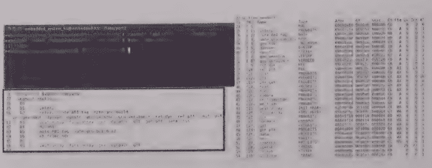

### 分页分段

想象一下（分页分段）的机制。

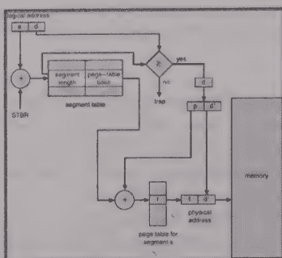

**解决外部碎片问题：**
解决方案与纯分段的区别在于，段表项包含的不是段的基地址，而是该段对应的页表的基地址。

#### 总结

## 分页与分段

分页分段是一种内存管理技术，它结合了分段和分页的特点，以克服每种方法的缺点。特别是，它旨在解决纯分段系统中存在的外部碎片问题。

在分页分段中，每个段被进一步划分为固定大小的块，称为“页”。段表项中不再直接存储段的基地址，而是包含对应段的页表的基地址。每个页表都包含该段内各个页（individual pages）的地址（或帧号）。

### 地址转换过程

分页分段系统中的地址转换过程包括以下步骤：

1. `CPU`生成一个逻辑地址，该地址由三部分组成：
    - 段号 (`s`)：标识地址所所在的段。
    - 页号 (`p`)：标识段内的特定页。
    - 偏移量 (`o`)：表示目标地址在页中的位置。
2. 将段号作为段表的索引，以查找对应页表的基地址和段的限制（`limit`）。
3. 将段号与段长度寄存器 (`STLR`) 进行比较，以确保它是一个合法的段（即 `s < STLR`）。如果段号不合法，则产生错误（例如段错误）。
4. 将页号 (`p`) 作为页表的索引，以查找对应页的基地址（帧号）。
5. 将偏移量 (`o`) 与段限制和页大小进行比较，以确保访问在段和页的边界内。如果偏移量无效，则产生错误（例如段错误）。
6. 如果所有检查通过，则通过将页的基地址（在页表中找到）加上偏移量 (`o`) 来计算物理地址：
    `物理地址 = 基地址 + 偏移量`

### 优势与缺点

**优势：**

1. 它通过将段划分为固定大小的页，减少了外部碎片，使内存分配更高效。
2. 它保持了用户将内存视作段集合的视图，允许灵活的内存组织并改进了内存保护。
3. 它实现了进程之间段和页的共享，改进了内存利用率和进程间通信。

**缺点：**

- 由于同时需要段表和页表，增加了复杂性和内存开销。
- 如果页没有被充分利用，页内仍可能发生内部碎片。

### 分页机制回顾

- **分页**：
    - 将物理内存划分为相同大小的块，称为“帧”（`frames`）
    - 将逻辑内存划分为所谓的“页”（`pages`）
    - 整个程序映像驻留在磁盘上。当程序启动时，只加载第一页。其余页按需加载到内存中。
    - 分页允许执行比物理内存更大的程序。
    - 在分页中，执行时需要两次内存访问：一次用于访问页表，另一个用于访问数据/指令。
    - 在多级页表方案中，页表本身也是分页的。
- **在分段中**：
    - 程序映像可以被分页处理

## 虚拟内存

虚拟内存是一种内存管理技术，它创建了一个比实际物理内存更大的地址空间的幻象。它通过在主内存（`RAM`）和辅助存储之间交换数据来实现这一目标。


# 第 13 章：嵌入式 Linux 简介

## 虚拟内存实现

依赖分页技术来管理程序使用的地址空间与物理内存之间的映射。关键组件包括：

1. **页表**：页号到对应帧号的数据结构。每个进程都有自己的页表。
2. **页缺**：当程序尝试访问当前不在内存中的虚拟地址时，会发生页缺。操作系统负责处理页缺、在辅助存储中定位缺失的页并将其加载到内存的可用帧中。
3. **交换**：在主内存和辅助存储之间传输页以为新页腾出空间。
4. **内存管理单元 (`MMU`)**：负责通过页表将虚拟地址转换为物理地址的硬件组件。它还会检查页缺并在必要时启动页缺处理。
5. **替换策略**：当内存已满且需要加载新页时，操作系统必须决定置换哪些页。常见的替换策略包括最久未使用 (`LRU`)、先进先出 (`FIFO`) 和时钟算法。
6. **请求分页**：只有在实际访问页时才将其加载到内存，而不是一次性加载整个程序。这有助于节省内存并允许更大的程序运行。

使用分页技术提供了若干优点：

1. 它允许程序以比总大小更小的物理内存运行，有效地扩展了地址空间。
2. 它实现了更好的内存利用率，因为任何时候只有程序所需的部分被加载到内存。
3. 它允许多个进程共享同一物理内存，同时保持它们之间的隔离。
4. 它促进了进程间公共代码和数据的共享，减少了内存占用并提升了性能。

然而，基于分页的虚拟内存也有一些缺点：


- 由于额外的转换步骤和频繁的磁盘访问，可能会引入性能开销。
- 它需要操作系统管理页表，这可能非常复杂并消耗额外的内存资源。

尽管有这些缺点，基于分页的虚拟内存广泛应用于现代操作系统，因为它为管理内存资源提供了一种灵活且高效的方法。


## 1. 嵌入式 Linux 简介

- 逻辑内存与物理内存的分离
- 只有程序的一部分需要加载到内存中执行
- 逻辑地址空间可以远大于物理空间
- 允许多个进程共享地址空间
- 允许更高效的进程创建
- 更多程序并发运行
- 虚拟内存可以通过以下方式实现：
  - 请求分页
  - 请求分段
- 虚拟地址空间 - 进程在内存中存储方式的逻辑视图
  - 通常从地址 `0` 开始，到空间结束前都是连续地址
  - 与此同时，物理内存按帧（`frames`）组织
  - `MMU` 必须将逻辑地址映射到物理地址


虚拟内存可以通过请求分页实现

虚拟内存通常使用请求分页实现，这种技术仅在程序实际访问或请求页面时才将页加载到内存中。这允许内存的高效利用，并使在物理内存有限的系统上运行更大的程序。

在请求分页系统中，虚拟内存管理过程涉及以下步骤：

1. 当程序启动时，其页面最初都不会加载到主内存中。操作系统为该进程设置相应的页表，将所有条目标记为“不存在”或“无效”。
2. 当程序开始执行时，它会产生在内存中可能尚未有相应物理地址的虚拟地址。当内存管理单元（`MMU`）遇到带有“不存在”或“无效”页表目的虚拟地址时，会触发页异常。
3. 操作系统通过以下方式处理页异常：
   a. 确定缺失页面在辅助存储（如硬盘）上的位置。
   b. 在主内存中寻找一个空帧来加载代码。
   c. 如果没有空帧，则根据页面替换策略（例如：最少未使用、先进先出、时钟算法等）选择一个被选帧进行替换。
   d. 如果被选帧被修改过（即其内容已更改），则将其内容写回辅助存储。
   e. 将缺失的页面加载到可用的帧中，并更新页表指向新帧。
4. 一旦缺失页面已加载到内存并更新了页表，`MMU` 将检索地址翻译，程序继续执行。


## 第 15 章 嵌入式 Linux 简介

请求分页与一次性将整个程序加载到内存相比有几个优势：

1. 它通过只加载程序的需要部分来节省内存资源，减少了整体内存占用。
2. 它通过只向内存中加载必要的页面，允许更大的程序在内存有限的系统上运行，从而有效扩展了可用地址空间。
3. 它改进了程序的启动时间，因为页面到内存的初始加载被推迟到实际访问时。
4. 它允许多个进程之间更高效地共享内存资源，因为每个进程只占用其活跃使用的内存。

然而，请求分页也有一些缺点，例如处理页异常、磁盘访问和管理页表时的开销会增加。尽管存在这些挑战，请求分页仍然是现代操作系统中实现虚拟内存的流行技术。

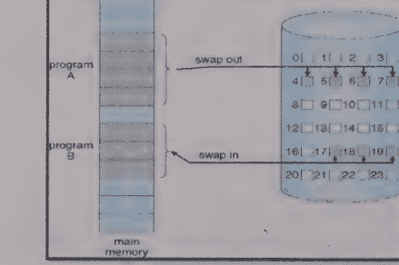

## 请求分页

- 当页面被引用时，
  - 有效引用 -> 引用它。
  - 无效引用 -> 不在内存中 -> 将其引入内存。
- 有效/无效位与每个页表条目相关。
- `V` -> 在内存中
  - `i` -> 不在内存中或不合法（非法地址、保护违规）
- 在地址翻译期间，如果有效/无效位为
  `页异常`

### 当某些页面不在主内存中的页表

| 帧 | 有效位 |
|---|---|
| `0` | `0` -无效 |
| `1` | `0` -有效 |
| `2` | `0` -有效 |
| `3` | `0` -有效 |
| `4` | `0` -有效 |
| `5` | `0` -有效 |
| `6` | `0` -有效 |
| `7` | `0` -有效 |


## 页异常

页异常是程序访问未映射到内存的地址时发生的事件。在虚拟内存系统中，页面是按加载的，这意味着并不是所有程序都在内存中。

处理页异常的主要步骤如下：

1. 保存触发异常的进程的上下文。
2. 检查地址是否有效。如果无效，操作系统将终止该进程。
3. 确定缺失页面在辅助存储上的位置。
4. 如果没有空帧，则使用替换策略（例如：最少未使用、先进先出、时钟算法）选择一个被选帧进行替换。
5. 通过调度的磁盘操作将页面交换到空帧中。
6. 更新页表以反映新帧号并将条目标记为“存在”或“有效”。
7. 恢复进程的上下文。
8. 重试导致页异常的指令。这一次，地址翻译应该成功。


## 第 13 章 嵌入式 Linux

页异常会引入开销，因为它们引发磁盘访问和上下文切换。然而，它们是虚拟内存的重要部分，允许程序在小于其自身的物理内存中执行。

- 当 `CPU` 引用页表使用页面 `M` 时，内存中没有该页面，因为该页位无效
- 系统调用操作系统的页异常处理器时发生页异常
- 由于页面应在磁盘上，它将该页面加载到空帧中
- 将页面交换到帧中
- 重置表条目以指示页面在内存设置有效位 = `v`
- 重启导致页异常的指令


## 请求分页的方面

请求分页需要硬件支持

- 带有有效位的页表
- 辅助内存（带有交换空间的交换设备）
- 指令重启

## 请求分页的性能

- 假设（最坏情况）页异常
- 三个主要活动
  - 保存上下文；意味着仅执行了几百条指令
  - 从磁盘读取页面
  - 再次启动进程，只需很短时间
- 页异常率 `D=0` - `D=1`：
  - `p`: 异常率
  - `p=1`：每次引用都是异常
- 有效访问时间：`EAT`

`EAT = (1-p) * 内存访问 + p * 页异常开销 + 交换出页 + 交换入页`


## 请求分页示例

- 内存访问时间 = `200` 纳秒
- 平均页异常服务时间 = `8` 毫秒
- `E = (1 - p) x 200 + p (8 毫秒)`
  `= (1 - p) x 200 + p x 8,000,000`
  `= 200 + p x 7,999,800`
- 如果每 `1000` 次访问中有一次导致页异常，那么
- `p/1000 = 0.001`
  `E = 8.2` 毫秒。
- 保持低页异常发生率至关重要
- 需要大内存
- 需要良好的页面替换策略

使用 `ps` 命令查看页异常 `<PID>`

`min_flt` : 次缺页异常次数。

`maj_flt` : 主页异常次数。


## 页面替换算法

页面替换算法对于操作系统管理虚拟内存至关重要。当发生页异常且主内存中没有可用的帧框时，操作系统必须决定用新请求的页面替换哪个现有的页面。所有页面替换算法的目标都是最少减少页异常次数，从而提高整个系统的性能。以下是一些页面替换算法的示例：

1. `最优页面替换算法 (OPT)`：该算法替换未来一段时间内不会使用的页面。它具有最低可能的页异常次数，但在实践中是不可行的，因为它需要页引用的完美信息。最优页面替换算法为其他算法提供了基准，因为它代表了最佳性能。
2. `最近最少使用算法 (LRU)`：`LRU` 算法替换最长时间未被使用的页面。它假设最近使用过的页面更有可能再次使用。`LRU` 可以通过链表、计数器甚至特殊的硬件支持来实现。虽然它比最优算法更具实用性，但实现成本可能很高，特别是在大型系统中。
3. `LRU 模拟算法`：这些算法尝试在不引入完美 `LRU` 实现开销的情况下近似 `LRU` 行为。`LRU` 模拟算法的一些示例有：
   a. `最近未使用算法 (NRU)`：该算法根据“引用”位和“修改”位将页面分为四类。`NRU` 从最低非空类别中随机选择一个页面进行替换。这是一个简单、低开销的算法，但其性能通常低于真实的 `LRU`。
   b. `时钟算法 (Clock)`：该算法使用循环缓冲区（类似于时钟）和“第二次机会”机制。在查找要替换的页面时，算法检查每个页面的“引用”位。如果位被设置，则将其清除，页面获得一次“第二次机会”。如果位未设置，则选择该页面进行替换。该算法比真实的 `LRU` 更高效，但在某些情况下可能不佳。


### 3. 老化算法 (Aging)

该算法通过为每个页面维护一个“年龄”计数器来模拟`LRU`。在定期间隔内，每个页面的“引用”位被移入年龄计数器，且计数器右移。选择计数器值最小的页面进行替换。`Aging`算法提供了`LRU`的良好近似且开销较小，但仍然需要定期更新年龄计数器。

页面替换算法的选择取决于系统的具体需求和限制，以及复杂度、开销和性能之间的权衡。

- 在操作系统中，每当引用新页面且该页面不在内存中，就会发生页异常，操作系统用新需要的页面替换现有页面之一。
- 不同的页面替换算法建议了决定替换哪个页面的不同方法。
- 所有算法的目标都是减少页异常次数。
- 页面替换
- 找到某些未真正使用的页面 -> 将其换出（`swap out`）。
- 处理循环
- 某些页面可能会多次加载到内存。
- 算法
- 最优页面替换
- `LRU` (最近最少使用)
- `LRU` 模拟算法

## 最优页面替换

替换未来最长时间内不会使用的页面。在此算法中，操作系统替换未来最长时间内不会使用的页面。

| 页面引用 | 2 | 3 | 4 | 2 | 1 | 3 | 7 | 5 | 4 | 3 |
| --- | --- | --- | --- | --- | --- | --- | --- | --- | --- | --- |
| 迭代次数 | 1 | 2 | 3 | 4 | 5 | 6 | 7 | 8 | 9 | 10 |
| | 2 | | | | | | | | | |
| | | 2 | | | | | | | | |
| | | | 3 | | | | | | | |


### 替换步骤 1

- 替换不会使用的页面（最长时间内）
- 在此算法中，操作系统替换未来最长时间内不会使用的页面

| 页面引用 | 2 | 3 | 4 | 2 | 1 | 3 | 7 | 5 | 4 | 3 |
| --- | --- | --- | --- | --- | --- | --- | --- | --- | --- | --- |
| 迭代次数 | 1 | 2 | 3 | 4 | 5 | 6 | 7 | 8 | 9 | 10 |
| | 2 | 2 | 2 | | | | | | | |
| | 3 | 3 | 3 | | | | | | | |
| | | | | | | | | | | |


### 替换步骤 2

- 替换不会使用的页面
- 在此算法中，操作系统替换未来最长时间内不会使用的页面

| 页面引用 | 2 | 3 | 4 | 2 | 1 | 3 | 7 | 5 | 4 | 3 |
| --- | --- | --- | --- | --- | --- | --- | --- | --- | --- | --- |
| 迭代次数 | 1 | 2 | 3 | 4 | 5 | 6 | 7 | 8 | 9 | 10 |
| | 2 | 2 | 2 | | | | | | | |
| | 3 | 3 | 3 | | | | | | | |
| | | | 4 | 4 | | | | | |

| 页面引用 | 2 | 3 | 4 | 2 | 1 | 3 | 7 | 5 | 4 | 3 |
| --- | --- | --- | --- | --- | --- | --- | --- | --- | --- | --- |
| 迭代次数 | 1 | 2 | 3 | 4 | 5 | 6 | 7 | 8 | 9 | 10 |
| | 2 | 2 | 2 | 1 | 1 | | | | | |
| | 3 | 3 | 3 | | | | | | | |
| | | 4 | 4 | 4 | | | | | |

- 替换不会使用的页面
- 在此算法中，操作系统替换未来最长时间内不会使用的页面

| 页面引用 | 2 | 3 | 4 | 2 | 1 | 3 | 7 | 5 | 4 | 3 |
| --- | --- | --- | --- | --- | --- | --- | --- | --- | --- | --- |
| 迭代次数 | 1 | 2 | 3 | 4 | 5 | 6 | 7 | 8 | 9 | 10 |
| | 2 | 2 | 2 | 2 | 1 | | | | | |
| | 3 | 3 | 3 | | | | | | | |
| | | 4 | 4 | 4 | | | | |


### 替换步骤 3

替换未来最长时间内不会使用的页面。在此算法中，操作系统替换未来最长时间内不会使用的页面。

| 页面引用 | 2 | 3 | 4 | 2 | 1 | 3 | 7 | 5 | 4 | 3 |
| --- | --- | --- | --- | --- | --- | --- | --- | --- | --- | --- |
| 迭代次数 | 1 | 2 | 3 | 4 | 5 | 6 | 7 | 8 | 9 | 10 |
| | 2 | 2 | 2 | 1 | 1 | | | | | |
| | 3 | 3 | 3 | | | | | | | |
| | | 4 | 4 | 4 | | | | | |

### 替换步骤 4

- 替换最长时间内不会使用的页面
- 在此算法中，操作系统会替换未来最长时间内不会使用的页面

| | 2 | 3 | 4 | 2 | 1 | 3 | 7 | 5 | 4 | 3 |
|---|---|---|---|---|---|---|---|---|---|---|---|
| 页面引用 | | | | | | | | | | | |
| 迭代次数 | 1 | 2 | 3 | 4 | 5 | 6 | 7 | 8 | 9 | 10 |
| | 2 | 2 | 2 | 2 | 1 | 7 | 5 | | | | |
| | | 3 | 3 | 3 | 3 | 3 | | | | | |
| | | | 4 | 4 | 4 | 4 | | | | | |

- 替换最长时间内不会使用的页面
- 在此算法中，操作系统会替换未来最长时间内不会使用的页面

| | 2 | 3 | 4 | 2 | 1 | 3 | 7 | 5 | 4 | 3 |
|---|---|---|---|---|---|---|---|---|---|---|---|
| 页面引用 | | | | | | | | | | | |
| 迭代次数 | 1 | 2 | 3 | 4 | 5 | 6 | 7 | 8 | 9 | 10 |
| | 2 | 2 | 2 | 2 | 1 | 7 | 5 | | | | |
| | | 3 | 3 | 3 | 3 | 3 | | | | |
| | | | 4 | 4 | 4 | 4 | | | | |

## LRU (最近最少使用)

最近最少使用 (`LRU`) 是一种页面替换算法，当发生页异常且主内存中没有可用帧时，它选择最近最未使用的页面进行替换。`LRU` 的底层假设是，最近使用过的页面未来更有可能被使用。通过替换最近最未使用的页面，该算法试图尽量减少后续发生页异常的概率。


实现 `LRU` 算法有几种方法：

- 1. 链表：维护一个页面的双向链表，将最近使用的页面放在末尾。当一个页面被访问时，它会被移动到列表头部。当发生页异常时，替换列表末尾的页面。这种方法的主要缺点是每次内存访问都需要更新链表，开销过大。

- 2. 基于计数器：给每个页面分配一个计数器，当页面被访问时，使用全局时间戳更新它。当发生页异常时，算法遍历所有页面找到计数器值最低的一个（即最近最少使用的页面）。这种方法在发生页异常时，由于搜索最小计数器值开销较高。

- 3. 基于栈：维护一个页面栈，将最近使用的页面放在栈顶。当一个页面被访问时，它会从栈的当前位置被移除并推到栈顶。当发生页异常时，替换栈底的页面。这种方法可以使用硬件支持高效实现，但对于大型系统来说可能并不实际。

尽管 `LRU` 在许多情况下可以提供良好的性能，但它的实现成本可能很高，特别是在大型系统或没有硬件支持跟踪页面访问的系统中。在这种情况下，`LRU` 近似算法（如 `Clock` 或 `Aging`）可能是更优的，因为它们在性能和实现复杂度之间达成了平衡。

在此算法中，将替换的是`最近最少使用`的页面。

| 7 | 0 | 1 | 2 | 0 | 3 | 0 | 4 | 2 | 3 | 0 | 3 | 2 | 1 | 2 |
|---|---|---|---|---|---|---|---|---|---|---|---|---|---|---|
| 7 | 7 | | | | | | | | | | | | | | |
| | 0 | 0 | | | | | | | | | | | | | |
| | | 1 | | | | | | | | | | | | | | |

在此算法中，将替换的是`最近最少使用`的页面。

| 7 | 0 | 1 | 2 | 0 | 3 | 0 | 4 | 2 | 3 | 0 | 3 | 2 | 1 | 2 |
|---|---|---|---|---|---|---|---|---|---|---|---|---|---|---|
| 7 | 7 | | | | | | | | | | | | | | |
| | 0 | 0 | | | | | | | | | | | | | |
| | | 1 | | | | | | | | | | | | | | |

在此算法中，将替换的是`最近最少使用`的页面。

第三最近使用

| 7 | 0 | 1 | 2 | 0 | 3 | 0 | 4 | 2 | 3 | 0 | 3 | 2 | 1 | 2 |
|---|---|---|---|---|---|---|---|---|---|---|---|---|---|---|
| 7 | 7 | | | | | | | | | | | | | | |
| | 0 | 0 | | | | | | | | | | | | | |
| | | 1 | | | | | | | | | | | | | | |

第二次最近使用

第一次最近使用


在此算法中，将替换的是最近最少使用的页面

| 7 | 0 | 1 | 2 | 0 | 3 | 0 | 4 | 2 | 3 | 0 | 3 | 2 | 1 | 2 |
|---|---|---|---|---|---|---|---|---|---|---|---|---|---|---|
| 7 | 7 | | | | | | | | | | | | | | |
| | 0 | 0 | | | | | | | | | | | | | |
| | | 1 | | | | | | | | | | | | | | |

第三最近使用

第二次最近使用

第一次最近使用

在此算法中，将替换的是最近最少使用的页面

| 7 | 0 | 1 | 2 | 0 | 3 | 0 | 4 | 2 | 3 | 0 | 3 | 2 | 1 | 2 |
|---|---|---|---|---|---|---|---|---|---|---|---|---|---|---|
| 7 | 7 | | | | | | | | | | | | | | |
| | 0 | 0 | | | | | | | | | | | | | |
| | | 1 | | | | | | | | | | | | | | |

在此算法中，将替换的是最近最少使用的页面

| 7 | 0 | 1 | 2 | 0 | 3 | 0 | 4 | 2 | 3 | 0 | 3 | 2 | 1 | 2 |
|---|---|---|---|---|---|---|---|---|---|---|---|---|---|---|
| 7 | 7 | | | | | | | | | | | | | | |
| | 0 | 0 | | | | | | | | | | | | | |
| | | 1 | | | | | | | | | | | | | | |

最近最近使用 | | | | | | |使用

 |算法中 |将替换的是最近最少使用的 | |

 7 | |  | |1 | 2 | |  | 3 | 0 | 4 | 2 | 3 | 0 | 3 | |  | | 1 | 2 |

|---|---|---|---|---|---|---|---|---|---|---|---|---|---|---|---|

| 7 | 7 | | | | | | | | | | | | | | | |

| | 0 | 0 | | | | | | | | | | | | | | |

| | | 1 | | | | | | | | | | | | | | |

在此算法中，将替换的是最近最少使用的页面

| 7 | 0 | 1 | 2 | 0 | 3 | 0 | 4 | 2 | 3 | 0 | 3 | 2 | 1 | 2 |
|---|---|---|---|---|---|---|---|---|---|---|---|---|---|---|
| 7 | 7 | | | | | | | | | | | | | | |
| | 0 | 0 | | | | | | | | | | | | | |
| | | 1 | | | | | | | | | | | | | | |

在此算法中，将替换的是最近最少使用的页面

| 7 | 0 | 1 | 2 | 0 | 3 | 0 | 4 | 2 | 3 | 0 | 3 | 2 | 1 | 2 |
|---|---|---|---|---|---|---|---|---|---|---|---|---|---|---|
| 7 | 7 | | | | | | | | | | | | | | |
| | 0 | 0 | | | | | | | | | | | | | |
| | | 1 | | | | | | | | | | | | | | |

第三最近使用

| 7 | 0 | 1 | 2 | 0 | 3 | 0 | 4 | 2 | 3 | 0 | 3 | 2 | 1 | 2 |
|---|---|---|---|---|---|---|---|---|---|---|---|---|---|---|
| 7 | 7 | | | | | | | | | | | | | | |
| | 0 | 0 | | | | | | | | | | | | | |
| | | 1 | | | | | | | | | | | | | | |

第二次最近使用

第一次最近使用

在此算法中，将替换的是最近最少使用的页面

| 7 | 0 | 1 | 2 | 0 | 3 | 0 | 4 | 2 | 3 | 0 | 3 | 2 | 1 | 2 |
|---|---|---|---|---|---|---|---|---|---|---|---|---|---|---|
| 7 | 7 | | | | | | | | | | | | | | |
| | 0 | 0 | | | | | | | | | | | | | |
| | | 1 | | | | | | | | | | | | | | |

第三最近使用

第二次最近使用

第一次最近使用

在此算法中，将替换的是最近最少使用的页面

| 7 | 0 | 1 | 2 | 0 | 3 | 0 | 4 | 2 | 3 | 0 | 3 | 2 | 1 | 2 |
|---|---|---|---|---|---|---|---|---|---|---|---|---|---|---|
| 7 | 7 | | | | | | | | | | | | | | |
| | 0 | 0 | | | | | | | | | | | | | |
| | | 1 | | | | | | | | | | | | | | |

在此算法中，将替换的是最近最少使用的页面

| 7 | 0 | 1 | 2 | 0 | 3 | 0 | 4 | 2 | 3 | 0 | 3 | 2 | 1 | 2 |


### 第 13 章 第三部分 - 内核模块/进程概念

#### 基本 I/O 概念

现代 I/O（输入/输出）系统在管理计算机中央处理器（`CPU`）、内存与各种外设设备（如键盘、鼠标、存储设备和显示器）之间的通信中起着至关重要的作用。I/O 系统允许计算机与外界交互并在不同组件之间传输数据。

在典型的计算机系统中，不同类型的 I/O 设备通过不同类型的总线连接：

1. `PCI`（外设组件互连）总线：`PCI` 总线是一种连接 `CPU`、内存和其他高速设备的高速总线。`PCI` 总线用于连接显卡、声卡、网卡和其他高带宽外设。在现代系统中，`PCI` 总线已很大程度上被更快的 `PCIe`（`PCI Express`）取代。
2. 扩展总线：该总线用于连接较慢的 I/O 设备，如键盘、鼠标和打印机。常见的扩展总线包括 `USB`（通用串行总线）和较旧的 `ISA`（工业标准架构）。
3. `SCSI`（小型计算机系统接口）总线：`SCSI` 总线是一种用于将存储设备（如硬盘和光驱）连接到计算机的高速总线。由于更高的性能和更高效的协议，现代系统中已被 `SATA`（串行 `ATA`）和 `NVMe`（非易失性内存表达式）接口取代。

为了与 I/O 设备交互，计算机使用设备控制器。设备控制器是一种特殊的硬件组件，用于管理计算机与特定 I/O 设备之间的通信。设备控制器包含一组寄存器，包括控制寄存器和状态寄存器，用于控制和监控 I/O 设备的操作。

控制寄存器用于向 I/O 设备发出命令（例如读取或写入数据），而状态寄存器提供有关 I/O 设备当前状态的信息（例如它是否忙碌、是否已完成命令或是否遇到错误）。

# 第 15 章 嵌入式 Linux

## 抖动 (Thrashing)

抖动是虚拟内存系统中的一种现象，系统在处理页异常和在主内存中交换页面上花费的时间比执行实际进程的时间多。这导致系统性能大幅下降，进程进展极其缓慢（如果还有进展的话）。

抖动通常发生在可用主内存不足以适应所有活动进程的工作集时。进程的工作集是当前在内存中或未来将使用的页面集合。当所有活动进程的工作集之和大到无法放入内存时，操作系统被迫不断地交换页面，导致高页异常率和过度的磁盘活动。


导致抖动的因素包括：

1. 物理内存不足：如果系统没有足够的内存来适应所有活动进程的工作集，更容易发生抖动。
2. 设计不当或低效算法：某些算法通过频繁访问大量页面或在内存的不同部分之间切换来导致抖动。
3. 页面替换策略不当：低效的页面替换算法可能由于未能将频繁使用的页面留在内存中而增加抖动的可能性。
4. 高并发：同时运行过多的进程会导致抖动，因为所有进程的工作集之和可能会超过可用主内存。

为了减轻抖动，可以采用某些策略：

1. 增加物理内存量：为系统添加更多内存可以帮助适应工作集并减少抖动概率。
2. 改进页面替换算法：使用更高效的页面替换策略（如 `LRU` 或 `LRU` 近似算法）有助于将频繁访问的页面留在内存中减少页异常。
3. 限制并发：减少运行的进程数量有助于确保每个进程都有足够的内存用于工作集。
4. 使用工作集模型：实现工作集模型有助于操作系统监控每个进程的内存使用情况，并对替换哪些页面做出更好的决策。

通过仔细管理系统资源和采用适当算法，降低抖动的概率并保持高水平的系统性能。

如果进程没有“足够”的页面，页异常率将非常高

> 获取页面发生页异常
>
> 替换现有的帧
>
> 但很快又替换了该帧
>
> 这导致了：
>
> `CPU` 利用率低
>
> 操作系统认为需要增加并发度
>
> 系统添加了另一个进程

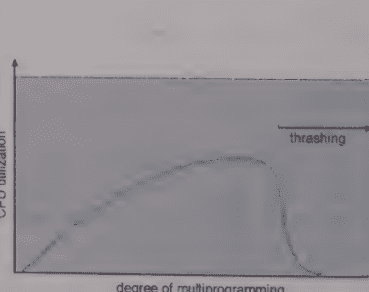

## 总结

- 将用户逻辑内存与物理内存分离
- 执行时仅需部分程序位于内存中
- 因此，逻辑地址空间可以比物理地址空间大得多
- 允许多个进程共享地址空间

## 虚拟内存

虚拟内存可以通过以下方式实现：

### 需分页

- 仅在需要时才将页面调入内存
- 需内存较少

### 需分段

- 需要允许页面的换入和换出

### 抖动 (Thrashing) = 进程忙于页面的换入换出

### 页缺

页面置换算法

- 最佳置换算法
- `LRU`（最近最少使用算法）


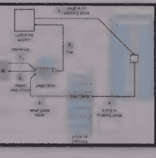


### LRU 页面置换算法示例

| 请求序列 | 7 | 0 | 1 | 2 | 0 | 3 | 0 | 4 | 2 | 3 | 0 | 3 | 2 | 1 | 2 |
| :--- | :---: | :---: | :---: | :---: | :---: | :---: | :---: | :---: | :---: | :---: | :---: | :---: | :---: | :---: | :---: |
| 7 | 7 | | | | | | | | | | | | | | |
| 0 | 0 | | | | | | | | | | | | | | |
| 1 | 1 | | | | | | | | | | | | | | |

**第三最近使用**

**第二次最近使用**

**第一次最近使用**

在此算法中，将替换的是最近最少使用的页面。

| 请求序列 | 7 | 0 | 1 | 2 | 0 | 3 | 0 | 4 | 2 | 3 | 0 | 3 | 2 | 1 | 2 |
| :--- | :---: | :---: | :---: | :---: | :---: | :---: | :---: | :---: | :---: | :---: | :---: | :---: | :---: | :---: | :---: |
| 7 | 7 | | | | | | | | | | | | | | |
| 0 | 0 | | | | | | | | | | | | | | |
| 1 | 1 | | | | | | | | | | | | | | |

**第三最近使用**

**第二次最近使用**

**第一次最近使用**

在此算法中，将替换的是最近最少使用的页面。

| 请求序列 | 7 | 0 | 1 | 2 | 0 | 3 | 0 | 4 | 2 | 3 | 0 | 3 | 2 | 1 | 2 |
| :--- | :---: | :---: | :---: | :---: | :---: | :---: | :---: | :---: | :---: | :---: | :---: | :---: | :---: | :---: | :---: |
| 7 | 7 | | | | | | | | | | | | | | |
| 0 | 0 | | | | | | | | | | | | | | |
| 1 | 1 | | | | | | | | | | | | | | |

**第三最近使用**

**第二次最近使用**

**第一次最近使用**

在此算法中，将替换的是最近最少使用的页面。

| 请求序列 | 7 | 0 | 1 | 2 | 0 | 3 | 0 | 4 | 2 | 3 | 0 | 3 | 2 | 1 | 2 |
| :--- | :---: | :---: | :---: | :---: | :---: | :---: | :---: | :---: | :---: | :---: | :---: | :---: | :---: | :---: | :---: |
| 7 | 7 | | | | | | | | | | | | | | |
| 0 | 0 | | | | | | | | | | | | | | |
| 1 | 1 | | | | | | | | | | | | | | |

**第三最近使用**

**第二次最近使用**

**第一次最近使用**

在此算法中，将替换的是最近最少使用的页面。

| 请求序列 | 7 | 0 | 1 | 2 | 0 | 3 | 0 | 4 | 2 | 3 | 0 | 3 | 2 | 1 | 2 |
| :--- | :---: | :---: | :---: | :---: | :---: | :---: | :---: | :---: | :---: | :---: | :---: | :---: | :---: | :---: | :---: |
| 7 | 7 | | | | | | | | | | | | | | |
| 0 | 0 | | | | | | | | | | | | | | |
| 1 | 1 | | | | | | | | | | | | | | |

**第三最近使用**

**第二次最近使用**

**第一次最近使用**

在此算法中，将替换的是最近最少使用的页面。

| 请求序列 | 7 | 0 | 1 | 2 | 0 | 3 | 0 | 4 | 2 | 3 | 0 | 3 | 2 | 1 | 2 |
| :--- | :---: | :---: | :---: | :---: | :---: | :---: | :---: | :---: | :---: | :---: | :---: | :---: | :---: | :---: | :---: |
| 7 | 7 | | | | | | | | | | | | | | |
| 0 | 0 | | | | | | | | | | | | | | |
| 1 | 1 | | | | | | | | | | | | | | |

**第三最近使用**

**第二次最近使用**

**第一次最近使用**

在此算法中，将替换的是最近最少使用的页面。

| 请求序列 | 7 | 0 | 1 | 2 | 0 | 3 | 0 | 4 | 2 | 3 | 0 | 3 | 2 | 1 | 2 |
| :--- | :---: | :---: | :---: | :---: | :---: | :---: | :---: | :---: | :---: | :---: | :---: | :---: | :---: | :---: | :---: |
| 7 | 7 | | | | | | | | | | | | | | |
| 0 | 0 | | | | | | | | | | | | | | |
| 1 | 1 | | | | | | | | | | | | | | |

**第三最近使用**

**最近最近使用**

**最近使用**

在此算法中，将替换的是最近最少使用的页面。

| 请求序列 | 7 | 0 | 1 | 2 | 0 | 3 | 0 | 4 | 2 | 3 | 0 | 3 | 2 | 1 | 2 |
| :--- | :---: | :---: | :---: | :---: | :---: | :---: | :---: | :---: | :---: | :---: | :---: | :---: | :---: | :---: | :---: |
| 7 | 7 | | | | | | | | | | | | | | |
| 0 | 0 | | | | | | | | | | | | | | |
| 1 | 1 | | | | | | | | | | | | | | |

**第三最近使用**

**第二次最近使用**

**第一次最近使用**

在此算法中，将替换的是最近最少使用的页面。


总之，现代 I/O 系统对于管理计算机与其外设之间的交互至关重要。使用不同类型的总线将各种 I/O 设备连接到计算机，而设备控制器负责控制和监控这些设备的操作。


# 第 13 章 嵌入式 Linux 简介

然而，端口映射 I/O（port-mapped I/O）的编程比内存映射 I/O 更复杂，因为它需要使用特殊指令并管理端口地址。此外，端口映射 I/O 在处理大数据传输时效率较低，处理器需要发出多次 `IN` 或 `OUT` 指令来传输块数据。

总而言之，端口映射 I/O 是一种通过特殊的处理器指令指定唯一端口号来访问 I/O 设备的技术。虽然它可以提供更快的访问速度并节省内存地址空间，但与内存映射 I/O 相比，它的编程更为复杂，且处理大数据传输的效率较低。

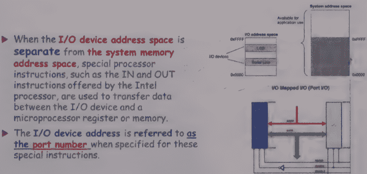

- 当 I/O 设备地址空间与系统内存地址空间分离时，使用特殊的处理器指令（如 Intel 处理器提供的 `IN` 和 `OUT` 指令）在 I/O 设备与微处理器寄存器之间传输数据。
- 当这些特殊指令指定地址时，I/O 设备地址被称为端口号。

## Intel CPU 的 I/O 端口使用

ARM 的 `cat /proc/ioports`


`/proc/ioports` 命令特定运行在 x86 架构（如 Intel CPU）上的 Linux 操作系统。该命令显示了不同内核模块和设备正在使用的输入/输出（I/O）端口。

# 第 15 章 嵌入式 Linux 简介

对于 ARM 架构，显示 I/O 端口信息的等效命令是 `cat /proc/iomem`。该命令显示了系统中保留给 I/O 设备的内存区域。

`/proc/iomem` 文件列出了分配给系统中各种设备的物理内存范围。文件中的每一行描述一个内存范围以及分配给它的设备或驱动程序。每行的格式为：

`start_address--address : type of /proc/iomem`

例如，`/proc/iomem` 中的一个典型行可能如下：

```
40000000-5ffffff : System RAM
```

这表示从 `0x40000000` 到 `0xffffff` 的内存地址范围被保留给系统 RAM。

可以使用 `cat /proc/iomem` 命令来识别哪些设备映射到哪些内存地址，这对于调试和排查基于 ARM 的系统的硬件问题非常有用。


## 内存映射 I/O

内存映射 I/O（Memory-mapped I/O）是一种用于访问 I/O 设备的方法，其中设备地址是系统内存地址空间的一部分。在这种方法中，I/O 设备的寄存器被映射到物理地址空间中，设备被视为另一个内存位置。

通过内存映射 I/O，任何机器指令都可以被编码为在内存位置与处理器之间、或两个内存位置之间传输数据，这些指令可以用于访问 I/O 设备。这意味着用于常规内存访问的相同指令（如加载和存储指令）也可以用于访问 I/O 设备。

由于 I/O 地址空间占据了系统内存地址空间中的一个范围，设备控制器中的寄存器被映射到特定的物理内存地址范围。CPU 读写 I/O 设备寄存器的加载和存储指令，与其处理常规内存位置的方式完全一样。

内存映射 I/O 的优点之一是它简化了编程模型，因为它允许程序人员对 I/O 操作使用与常规内存操作相同的指令和内存访问技术。此外，由于内存映射 I/O 通常比端口映射 I/O 快，因为它可以减少访问 I/O 设备所需的指令数量。

然而，内存映射 I/O 可能会消耗本可用于其他用途的宝贵内存地址空间。此外，它可能导致难以区分内存地址和 I/O 设备，从而引发冲突和错误。

总而言之，内存映射 I/O 是一种通过将设备寄存器映射到特定的物理内存地址范围来访问 I/O 设备的技术。它简化了编程模型，并且与端口映射 I/O 相比可以提供更快的 I/O 设备访问。然而，它会消耗内存地址空间并导致难以区分内存地址和 I/O 设备地址。

- 设备地址空间是系统内存地址空间的一部分。
- 任何编码为在内存位置与处理器之间或两个内存位置之间传输数据的指令均可用于访问 I/O 设备。
- I/O 设备被视为另一个内存位置。因为 I/O 地址空间占据了系统内存地址空间的一个范围。
- 设备控制器中的寄存器被映射到物理地址空间中。
- IO 通过加载和存储指令完成，CPU 通常使用这些指令进行内存访问。

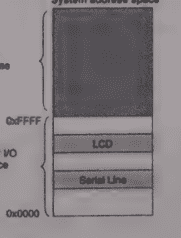

## Intel CPU I/O 内存分配与映射

```
/proc/mem
00000000-000907ff : System RAM
00000800-0009ffff : reserved
00a00000-bffff : Video RAM
00c00000-007fff : Video ROM
00c80000-00c8fff : Adapter ROM
00f20000-ffff : System ROM
00100000-002c7fff : Kernel code
002c7f30-00382ff : Kernel data
7ff70000-7ff7fff : ACPI Tables
7ff80000-7ff8fff : ACPI Non-volatile Storage
```

在 Intel CPU 上，I/O 内存分配和映射可以通过内存映射 I/O 完成。在这种方法中，设备寄存器被映射到特定的物理地址，设备被视为内存位置。

## 第 15 章 嵌入式 Linux

要分配 I/O 内存，系统管理员或设备编写者需要为设备保留一段物理内存。这通常在 Linux 中使用 `request_mem` 函数或在 Windows 中使用 `AllocatePorts` 函数完成。保留的内存通过 Linux 中的 `ioremap` 函数或 Windows 中的 `MapPhys` 函数映射到虚拟空间。

一旦分配并映射了 I/O 内存，就可以使用标准的内存指令（如 `load` 和 `store`）访问设备寄存器。例如，如果设备寄存器映射到物理地址 `0xC0000000` 到 `0xC0FFFF`，驱动程序可以使用 `ioremap` 函数返回的虚拟地址（例如 `0xFEC0000` 到 `0xFEC0FFF`）进行访问。

I/O 映射使用共享内存在 CPU 和设备之间传输数据。例如，设备驱动程序可以使用这种方法，驱动程序将使用内存映射 I/O 分配一个区域，然后使用 DMA 函数将该区域映射到设备空间。

总之，Intel CPU 上使用内存映射 I/O 来分配和映射内存。这允许使用标准的内存指令访问设备寄存器，简化了编程模型并提升了性能。I/O 映射还可以用于 CPU 和设备之间的数据共享，例如 DMA 传输。

## Intel 桌面上的 IO


```
embedded_system_access_table[0xc0000000:0xc0ffff] = {
    [0xc0000000:0xc00fff] = { .name = "System RAM", .size_func = get_ram_range(0xc0000000, 0x00010000)},
    [0xc0010000:0xc01fff] = { .name = "Video RAM", .size_func = get_ram_range(0xc0010000, 0x0001000)},
    [0xc0020000:0xc02fff] = { .name = "PCI RAM", .size_func = get_ram_range(0xc0020000, 0x0001000)},
    [0xc0030000:0xc03fff] = { .name = "Local RAM", .size_func = get_ram_range(0xc0030000, 0x0001000)},
    [0xc0040000:0xc04fff] = { .name = "Timer RAM", .size_func = get_ram_range(0xc0040000, 0x0001000)},
    [0xc0050000:0xc05fff] = { .name = "Audio RAM", .size_func = get_ram_range(0xc0050000, 0x0001000)},
    [0xc0060000:0xc06fff] = { .name = "USB RAM", .size_func = get_ram_range(0xc0060000, 0x0001000)},
    [0xc0070000:0xc07fff] = { .name = "NIC RAM", .size_func = get_ram_range(0xc0070000, 0x0001000)},
    [0xc0080000:0xc08fff] = { .name = "Kernel RAM", .size_func = get_ram_range(0xc0080000, 0x0001000)},
    [0xc0090000:0xc09fff] = { .name = "GPU RAM", .size_func = get_ram_range(0xc0090000, 0x0001000)},
    [0xc000a000:0xc000aff] = { .name = "System RAM", .size_func = get_ram_range(0xc000a000, 0x00001000)},
    [0xc000b000:0xc00bfff] = { .name = "Kernel RAM", .size_func = get_ram_range(0xc000b000, 0x0001000)},
    [0xc000c000:0xc00cfff] = { .name = "BIOS RAM", .size_func = get_ram_range(0xc000c000, 0x0001000)},
    [0xc000d000:0xc00dfff] = { .name = "SATA RAM", .size_func = get_ram_range(0xc000d000, 0x0001000)},
    [0xc000e000:0xc00eff] = { .name = "SATA RAM", .size_func = get_ram_range(0xc000e000, 0x0001000)},
    [0xc001f000:0xc00ffff] = { .name = "ACPI RAM", .size_func = get_ram_range(0xc001f000, 0x0001000)},
    [0xc0010000:0xc010fff] = { .name = "Timer RAM", .size_func = get_ram_range(0xc0010000, 0x0001000)},
    [0xc0011000:0xc011fff] = { .name = "Timer RAM", .size_func = get_ram_range(0xc0011000, 0x0001000)},
    [0xc0012000:0xc012fff] = { .name = "Timer RAM", .size_func = get_ram_range(0xc0012000, 0x0001000)},
    [0xc0013000:0xc013fff] = { .name = "Timer RAM", .size_func = get_ram_range(0xc0013000, 0x0001000)},
    [0xc0014000:0xc014fff] = { .name = "Timer RAM", .size_func = get_ram_range(0xc0014000, 0x0001000)},
    [0xc0015000:0xc015fff] = { .name = "SATA RAM", .size_func = get_ram_range(0xc0015000, 0x0001000)},
    [0xc0016000:0xc016fff] = { .name = "SATA RAM", .size_func = get_ram_range(0xc0016000, 0x0001000)},
    [0xc0017000:0xc017fff] = { .name = "SATA RAM", .size_func = get_ram_range(0xc0017000, 0x0001000)},
    [0xc0018000:0xc018fff] = { .name = "SATA RAM", .size_func = get_ram_range(0xc0018000, 0x0001000)},
    [0xc0019000:0xc019fff] = { .name = "SATA RAM", .size_func = get_ram_range(0xc0019000, 0x0001000)},
    [0xc001a000:0xc001aff] = { .name = "SATA RAM", .size_func = get_ram_range(0xc001a000, 0x0001000)},
    [0xc001b000:0xc01bfff] = { .name = "SATA RAM", .size_func = get_ram_range(0xc001b000, 0x0001000)},
    [0xc001c000:0xc01cfff] = { .name = "SATA RAM", .size_func = get_ram_range(0xc001c000, 0x0001000)},
    [0xc001d000:0xc01dfff] = { .name = "SATA RAM", .size_func = get_ram_range(0xc001d000, 0x0001000)},
    [0xc001e000:0xc00eff] = { .name = "SATA RAM", .size_func = get_ram_range(0xc001e000, 0x0001000)},
    [0xc001f000:0xc00ffff] = { .name = "ACPI RAM", .size_func = get_ram_range(0xc001f000, 0x0001000)}
};
```


# 第 13 章 嵌入式 Linux 简介


基于 ARM SoC 的系统，I/O 内存分配和映射可以使用与 Intel CPU 类似的方法来实现，但在实现细节上存在一些差异。

ARM 系统使用内存映射 I/O（Memory-mapped I/O）来访问 I/O 设备，这意味着 I/O 设备的寄存器被映射到物理内存地址区域，并将该设备被视为另一个内存位置。

在基于 ARM 的系统上分配 I/O 内存，系统管理员或设备驱动程序编写者通常使用 `ioremap` 函数将物理内存地址区域映射到虚拟地址。驱动程序可以使用这些虚拟地址，通过标准的内存访问指令来访问 I/O 设备的寄存器。

ARM 系统与 Intel CPU 之间的区别之一是，ARM 系统经常使用专门的 I/O 协处理器（如 DMA 控制器）来管理 I/O 操作。该协处理器负责在 I/O 设备和主内存之间传输数据，从而减轻 CPU 的负载。

为了支持 DMA 传输，基于 ARM 的系统使用 DMA 映射函数映射用于设备与主内存之间数据传输的内存缓冲区。这确保了设备和 CPU 都可以一致的地址空间访问数据。

对于基于 ARM 的系统，`request_mem` 函数不用于 I/O 内存分配，因为 ARM 架构不需要显式的内存保留。相反，使用 `ioremap` 函数将物理内存地址映射到虚拟地址。

总结来说，基于 ARM 的系统的 I/O 内存分配和映射使用了与 Intel CPU 内存映射 I/O 类似的方法，但在实现上有所不同。I/O 内存是通过使用 `ioremap` 函数将物理内存地址区域映射到虚拟地址空间分配的。通常使用专门的 I/O 协处理器（如 DMA 控制器）来管理 I/O 操作，并使用 DMA 映射函数映射用于数据传输的内存缓冲区。


## 比较 - 内存映射 vs 端口映射

| 内存映射 I/O (Memory-mapped IO) | 端口映射 I/O (Port-mapped IO) |
|---|---|
| 使用相同的地址线访问内存和 I/O 设备 | 内存和 I/O 设备使用不同的地址空间 |
| 使用普通指令访问 I/O 设备 | 使用一类特殊的 CPU 指令访问 I/O 设备 |
| 最广泛使用的 I/O 方法 | x86 Intel 微处理器 - `IN` 和 `OUT` 指令 |

内存映射 I/O 和端口映射 I/O 是计算机系统中访问 I/O 设备的两种不同技术。它们的区别在于将 I/O 设备映射到系统地址空间的方式，以及 CPU 如何与 I/O 设备进行交互。

内存映射 I/O 将 I/O 设备的寄存器映射到系统内存地址空间中的特定内存地址范围。这意味着 I/O 设备被视为另一个内存位置，CPU 使用标准的内存访问指令与 I/O 设备的寄存器交互。内存映射 I/O 提供了一种简单高效的访问 I/O 设备的方法，但它可能会消耗宝贵的内存地址空间，并难以区分内存地址和 I/O 地址。

相反，端口映射 I/O 为 I/O 设备使用独立的地址空间。I/O 设备的地址被称为端口号，并使用特殊的处理器指令在 I/O 设备与微处理器寄存器或内存之间传输数据。端口映射 I/O 在内存地址和 I/O 设备地址之间提供了清晰的隔离，但需要特殊指令来访问 I/O 设备，且速度可能比内存映射 I/O 慢。

总结来说，内存映射 I/O 和端口映射 I/O 是计算机系统中访问 I/O 设备的两种不同方法。内存映射 I/O 将 I/O 设备的寄存器映射到特定的内存地址范围，而端口映射 I/O 为 I/O 设备使用独立的地址空间。这两种方法各有优缺点，选择使用哪种取决于系统的具体需求和限制。

## DMA 直接内存访问

直接内存访问（DMA）是一种用于提高计算机系统中 I/O 设备与内存之间数据传输效率的技术。它被用于避免在大数据移动时使用程序输入 I/O（Programmed I/O）。

当 I/O 设备需要传输大量数据时，CPU 可能会过载。为了支持 DMA 传输，基于 ARM 的系统使用 DMA 映射函数映射用于设备与主内存之间数据传输的内存缓冲区。这确保了设备和 CPU 都可以一致的地址空间访问数据。

协处理器（DMA 控制器）负责在 I/O 设备和主内存之间传输数据，减轻 CPU 的负载。总结来说，基于 ARM 的系统的 I/O 内存分配和映射使用了与 Intel CPU 内存映射 I/O 类似的方法，但在实现上有所不同。通常使用专门的 I/O 协处理器（如 DMA 控制器）来管理 I/O 操作，并使用 DMA 映射函数映射用于数据传输的内存缓冲区。


## 轮询 vs 中断

操作系统需要知道 I/O 设备何时完成操作。有两种方法：

- 轮询（Polling）：操作系统定期检查设备特定的状态寄存器。如果 I/O 操作不频繁或不可预测，这可能会浪费许多周期。
- 中断（Interrupt）：设备将完成信息放入状态寄存器并通知 CPU。

示例：高带宽设备使用中断方法检查第一个进入的数据包，并用轮询方法处理后续包。

## 中断

- 由 I/O 设备触发的中断请求线
- 可屏蔽（Maskable），可以忽略或延迟某些中断
- 中断向量（Interrupt vector）将中断分发到正确的处理程序
    - 基于优先级
    - 有些不可屏蔽的（unmaskable）
- 中断机制也用于异常和分页。
- 通常情况下，中断处理程序实现在设备驱动程序中。


# 第 13 章 嵌入式 Linux 简介

总之，内核模块提供了一种扩展 Linux 内核功能的方法，而无需重新构建和重启系统。它们还被用于进程管理，以提供额外的功能，例如调度算法、安全策略和调试工具。内核模块是动态加载和卸载的，使其成为系统资源的一种灵活且高效的方式。

- 模块是可以根据需要加载和卸载到内核中的代码。
- 它们可以在无需重启系统的情况下扩展内核功能。
- 如果没有模块，我们必须构建单体内核并将新功能直接添加到内核映像象中。
- 重新构建的缺点是，每当我们需要新功能时，都需要重新构建并重启内核。
- 模块可以被编译并动态链接到内核地址空间。
- 内核代码在内核启动后加载。
- 优点
    - 按需加载驱动程序（例如针对 USB 设备）
    - 稍后加载驱动程序 - 加快初始启动
- 缺点
    - 为根文件系统增加了内核版本依赖
    - 需要管理的文件更多

## Linux 进程管理中的进程描述符

Linux 中的进程管理涉及进程的执行，进程是系统中的工作单元。内核使用称为任务列表（task list）的数据结构来跟踪进程，这是一个环形双链表。任务列表中的每个元素都是类型为 `task_struct` 的进程描述符，它定义在 `<linux/sched.h>` 中。

进程描述符也称为进程控制块（PCB），包含了特定进程的所有信息。它包括进程的状态（例如它是正在运行、等待还是阻塞），以及描述执行中进程的数据、打开的文件、进程的地址空间、待处理的信号等许多信息。

进程描述符是 Linux 中一个关键的数据结构，内核使用它来存储和检索有关进程的信息。它为内核提供了一种存储和检索进程信息的方法，并能对调度、内存分配以及进程管理的其他方面做出决策。

进程描述符在进程创建时创建，在进程终止时被销毁。随着进程的执行，内核不断更新它，以反映进程状态、资源和其他属性的变化。

总之，进程描述符（也称为进程控制块 PCB）是 Linux 中一个关键的数据结构，它包含了特定进程的所有信息。内核使用它来管理进程的执行，包括调度、内存分配和进程管理的其他方面。随着进程的执行，内核不断更新进程描述符，并在进程终止时将其销毁。

- 内核将进程列表存储在一个名为任务列表（task list）的环形双链表中。
- 任务列表中的每个元素都是该类型的进程描述符。
- 进程描述符包含了关于特定进程的所有信息。
- 进程描述符包含了描述执行程序、打开的文件、进程地址空间、待处理信号等的数据。
- `task_struct`
- Linux 中的 PCB（进程控制块）。

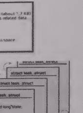

## 描述进程及其所有细节的 `task_struct` 数据结构

`task_struct` 数据结构是 Linux 内核进程管理系统的关键组成部分。它定义在 `<linux/sched.h>` 头文件中，为内核提供了存储和操作特定进程信息的方法。

`task_struct` 数据结构包含了广泛的字段，用于描述进程及其所有细节。`task_struct` 中的一些关键字段包括：

- `pid`: 进程 ID 数字
- `state`: 进程的当前状态（例如：运行、等待、睡眠）
- `mm`: 指向进程内存管理数据结构的指针
- `files`: 指向进程文件描述符表的指针
- `signal`: 存储该进程待处理信号信息的数据结构
- `parent`: 指向进程父进程的指针
- `comm`: 与进程关联的可执行文件名称
- `prio`: 进程的优先级级别
- `time`: 进程使用的 CPU 时间量
- `cpu`: 进程当前执行的处理器
- `sched_info`: 包含进程调度信息的数据结构
- `cpus`: 更新进程 CPU 亲和性映射的数据结构

随着进程的执行，内核不断更新 `task_struct` 数据结构，以反映进程状态、资源和其他属性的变化。它为内核提供了一种管理进程执行的方法，包括调度、内存分配和进程管理的其他方面。

总之，`task_struct` 数据结构是 Linux 内核进程管理系统的关键组成部分。它包含了描述进程及其所有细节的广泛字段，并在进程执行时由内核不断更新。


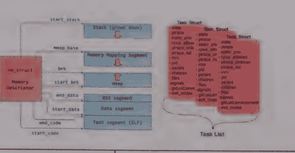

| TASK STRUCT 中的字段 | 描述 |
|---|---|
| `state` | 进程的当前状态（例如：运行、等待、睡眠） |
| `mm` | 指向内存管理数据结构的指针 |
| `files` | 指向文件描述符表的指针 |
| `signal` | 存储待处理信号信息的数据结构 |
| `parent` | 指向父进程的指针 |
| `comm` | 与进程关联的可执行文件名称 |
| `prio` | 进程的优先级级别 |
| `time` | 进程使用的 CPU 时间 |
| `cpu` | 进程当前执行的处理器 |
| `sched_info` | 包含进程调度信息的数据结构 |
| `cpus` | 更新进程 CPU 亲和性映射的数据结构 |
| `pid` | 进程 ID |

# 第 15 章 嵌入式 Linux 简介

| `gid`, `uid`, `environment` | 进程的组 ID、用户 ID 和环境变量 |
| `files` | 打开的文件信息 |
| `signals` | 与某些信号相关的处理器 |
| `tgid` | 组标识 |

环形双链表是一种由一系列节点组成的数据结构，每个节点都包含指向列表中前一个节点和下一个节点的指针。在 Linux 进程环境中，任务列表是一个环形双链表，存储了系统中所有进程的信息。

为了说明这一点，让我们考虑一个具有三个元素的任务列表示例：

- 进程 A
- 进程 B
- 进程 C

任务列表中的每个元素都是由 `task_struct` 表示的进程描述符。每个进程描述符包含特定进程的信息，包括其状态、内存分配和其他属性。

在环形双链表中，每个节点都有指向列表中下一个和前一个节点的指针。在任务列表的情况下，第一个进程描述符（进程 A）将指向下一个描述符（进程 B）和上一个进程描述符（进程 C）。同样，第二个进程描述符（进程 B）将指向下一个进程描述符（进程 C）和上一个进程描述符（进程 A）。最后，第三个进程描述符（进程 C）将指向下一个进程描述符（进程 A）和上一个进程描述符（进程 B）。

这种环形结构允许内核遍历任务列表并对系统中的进程进行操作。例如，内核可以轻松遍历列表中的所有进程以检查它们的状态或更新它们的属性。此外，环形结构允许高效地插入和删除这些进程。

总之，Linux 进程管理中的任务列表是一个存储系统中进程信息的环形双链表。列表中的每个元素都是由 `task_struct` 表示的进程描述符，环形结构允许对列表进行高效的遍历和操作。


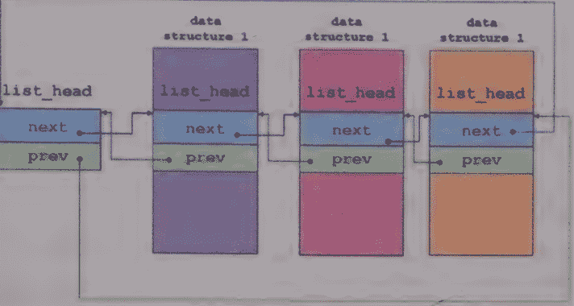

## 进程 vs 任务

Linux 将所有工作视为施加在操作系统的一系列任务


进程也可以使用 `clone()` 或 `fork()` 等系统调用在其自己的地址空间内创建新的任务或线程。新任务或线程通常被称为父进程的子进程。

当父进程创建一个新任务或线程时，操作系统通常会分配一个新的进程描述符（process descriptor）来存储管理该任务的信息。父进程随后将其某些信息复制到子进程描述符中，例如进程 ID（PID）、指向父进程和兄弟进程的链接、每个打开文件的文件表和文件描述符。

随后，会修改子进程描述符以反映其新状态，包括新的进程 ID、指向父进程和兄弟进程的链接，以及创建新的用户数据段和虚拟内存表。子进程还会初始化一组计时器和信号处理程序。

一旦子进程描述符完全初始化，其状态将更改为 `TASK RUNNING`（运行态），表示它已准备好运行。此时，子进程开始在与父进程相同的地址空间内执行代码，共享相同的内存和其他资源。

# 查找进程信息：`/proc/<PID>`


# 第 13 章：嵌入式 Linux 简介

- `ps` 获取进程 ID
- 对于每个进程，都有相应的目录 `/proc/<pid>`，用于在 `/proc/<pid>` 伪文件系统中存储这些信息

在 Linux 中，`/proc` 目录包含一个虚拟文件系统，提供有关系统上运行进程的信息。要查看特定进程的进程信息，可以使用 `/proc/<pid>` 目录，其中 `<pid>` 是你想要检查的进程的 ID。

以下是可以在 `/proc/<pid>` 目录中找到的一些信息示例：

- `/proc/<pid>/status`: 该文件包含有关进程当前状态的信息，包括其状态、内存使用情况、CPU 使用率和其他细节。
- `/proc/<pid>/cmdline`: 该文件包含启动进程时使用的命令行参数。
- `/proc/<pid>/environ`: 该文件包含为进程设置的环境变量。
- `/proc/<pid>/fd`: 该目录包含指向进程当前打开的文件描述符的符号链接。
- `/proc/<pid>/maps`: 该文件包含进程的内存映射列表，包括每个内存段的起始和结束地址。
- `/proc/<pid>/stat`: 该文件包含有关进程的各种统计信息，例如它使用的 CPU 时间、其进程 ID 以及其父进程 ID。

通过检查 `/proc/<pid>` 目录中的文件，你可以更深入地理解运行在 Linux 系统上的特定进程的行为和资源使用情况。

# 进程相关的文件

Linux 内核中与进程相关的文件为管理进程及其相关任务提供了必要的函数和数据结构。以下是 Linux 内核中重要的头文件和源代码示例：

### 头文件
- `include/linux/sched.h` - 大多数任务数据结构的声明
- `include/linux/wait.h` - 等待队列的声明
- `include/asm/i386/system.h` - 体系相关的声明

### 源文件
- `kernel/sched.c` - 任务调度例程
- `kernel/signal.c` - 信号处理例程
- `kernel/fork.c` - 进程/线程创建例程
- `kernel.c` - 进程退出例程
- `fs/exec.c` - 执行程序
- `arch/i386/kernel/entry.S` - 内核入口点
- `arch/i386/kernel/process.c` - 体系相关的进程例程
- `http://linux/linux.no/`

---

# 第 13 章：嵌入式 Linux 简介

头文件：

- `include/linux/sched.h`: 该文件包含大多数任务数据结构的声明，包括任务描述符和等待队列。例如，它定义了 `task_struct` 结构，该结构包含关于特定进程的信息。
- `include/linux/wait.h`: 该文件包含等待队列的声明，等待队列用于阻塞进程直到特定事件发生。例如，它定义了 `wait_queue_head_t`，用于表示等待队列。
- `include/asm/i386/system.h`: 该文件包含各种系统函数的体系相关声明。例如，它定义了 `save_flags()` 函数，用于保存 CPU 标志寄存器。

源文件：

- `kernel/sched.c`: 该文件包含任务调度例程。例如，它定义了 `schedule()` 函数，用于选择下一个在 CPU 上运行的任务。
- `kernel/signal.c`: 该文件包含信号处理例程。例如，它定义了 `signal()` 函数，用于处理信号。
- `kernel/fork.c`: 该文件包含进程/线程创建例程。例如，它定义了 `fork()` 函数，用于创建一个新进程。
- `kernel.c`: 该文件包含进程退出例程。例如，它定义了 `exit()` 函数，用于终止进程。
- `fs/exec.c`: 该文件包含执行程序。例如，它定义了 `execve()` 函数，用于替换进程映像。
- `arch/i386/kernel/entry.S`: 该文件包含内核入口点。例如，它定义了入口点，用于启动内核。
- `arch/i386/kernel/process.c`: 该文件包含体系相关的进程例程。例如，它定义了进程管理例程。

总来说，Linux 内核中的这些文件对于管理进程和任务至关重要。


# 第 13 章 嵌入式 Linux 简介

1. 同步：线程可以共享数据和资源，但这可能导致竞态条件或其他同步问题。可以使用互斥锁（`mutex`）和信号量（`semaphores`）等技术来确保同一时刻只有一个线程访问共享资源。

示例：假设你有一个程序，它使用一个共享的计数器变量，且该变量被多个线程访问。你可以使用互斥锁来确保同一时刻只有一个线程对计数器进行加1：

```c
```


```c
#include <pthread.h>

int counter = 0;

pthread_mutex_t mutex = PTHREAD_MUTEX_INITIALIZER;

void *my_thread(void *arg) {

    pthread_mutex_lock(&mutex);

    counter++;

    pthread_mutex_unlock(&mutex);

    return NULL;

}

int main() {

    pthread_t thread1, thread2;

    pthread_create(&thread1, NULL, my_thread, NULL);

    pthread_create(&thread2, NULL, my_thread, NULL);

    pthread_join(thread1, NULL);

    pthread_join(thread2, NULL);

    return 0;

}
```

1. 线程安全：线程安全是指程序在多线程环境中正确且可预测地运行的能力。可以通过适当的同步技术以及尽可能避免使用共享资源来实现线程安全。

示例：假设你有一个会修改全局变量的函数。为了使该函数是线程安全的，你可以使用互斥锁来确保同一时刻只有一个线程访问该变量：

```c
#include <pthread.h>

int global_var = 0;

pthread_mutex_t mutex = PTHREAD_MUTEX_INITIALIZER;

void modify_global_var() {

    pthread_mutex_lock(&mutex);

    global_var++;

    pthread_mutex_unlock(&mutex);

}

int main() {

    // 创建并运行调用 modify_global_var 的线程

    return 0;

}
```


这些是关于 Linux 线程及其如何在实践中使用的一些关键点。


# Linux 调度器

- 调度器是内核代码的一部分，它使得同时运行多个程序成为可能，并在多个进程之间共享 CPU。
- 决定运行哪个进程以及运行多久是调度器的主要职责。
- Linux 调度基于时间分用技术：
  - CPU 时间被大致划分为若干“时间片”（slices），每个进程分配一个。
  - 如果一个运行中的进程在它的时间片或时间量子（quantum）过期后未终止，则该进程会被中断。
  - 时间分用依赖定时器中断，并且对进程是透明的。
  - 不需要向程序中插入额外的代码来确保 CPU 时间分用。
- 调度策略还根据优先级对进程进行排序：
  - 高优先级进程的运行生命周期较短。
  - 在 Linux 中，进程优先级是动态的。
- 调度器跟踪进程正在做什么，并定期调整它们的优先级：
  - 对于长时间被拒绝使用大部分 CPU 的进程，将通过提高其优先级来获得加速。
  - 运行时间较长的进程将通过降低其优先级来受到惩罚。

Linux 调度器负责管理系统中进程和线程 CPU 时间分配。以下是关于 Linux 调度器的一些关键点：

1. **调度类**：Linux 调度器有不同的调度类，决定了进程如何被调度。最常用的调度类是完全公平调度器（`CFS`），它确保每个进程都能获得公平的 CPU 时间份额。其他调度类包括实时调度器和截止时间调度器（`Deadline scheduler`）。
2. **优先级**：每个进程和线程都有一个优先级，决定了它们在调度队列中的位置。Linux 调度器使用基于优先级的调度算法决定下一个运行哪个进程或线程。
3. **时间片**：Linux 调度器使用时间片为进程和线程分配 CPU 时间。时间片是进程或线程在被抢占并被另一个进程或线程之前允许运行的时间。
4. **抢占**：Linux 调度器支持抢占，这意味着如果一个更高优先级的进程或线程变为就绪，当前的进程或线程可以被中断并替换另一个进程或线程。
5. **负载均衡**：Linux 调度器执行负载均衡，以确保负载均匀分布在系统中所有的 CPU 上。如果某个 CPU 空闲而其他 CPU 忙碌，调度器会将某些进程移动到空闲的 CPU 以平衡负载。

示例：假设我们有一个运行多个进程和线程的 Linux 系统。Linux 调度器确保每个进程和线程都能获得公平的 CPU 时间份额，因此没有进程或线程会资源饥饿。

假设创建了一个高优先级进程。Linux 调度器将优先考虑该进程，并为其分配比低优先级进程更多的 CPU 时间。如果该新进程是 CPU 密集型的并迅速消耗了时间片，它可能会被抢占并被另一个进程或线程替换。


# 第 13 章 嵌入式 Linux 简介

Linux 调度器同样执行负载均衡以确保负载均匀分布在系统中所有的 CPU 上。如果一个 CPU 空闲而其他 CPU 忙碌，调度器会将进程移动到空闲的 CPU 以平衡负载。

总体而言，Linux 调度器通过公平分配 CPU 时间和平衡负载，在确保系统运行平稳高效方面起着关键作用。

## 静态优先级

调度策略根据优先级对进程进行排序：
- 高优先级进程生命周期较短。
- 在 Linux 中，进程优先级是动态的。
- 调度器跟踪进程状态，并定期调整其优先级：
  - 对于长时间被拒绝使用大部分 CPU 的进程，将通过提高其优先级来获得加速。
  - 运行时间较长的进程将通过降低其优先级来受到惩罚。

Linux 调度器负责管理系统中进程和线程 CPU 时间分配。以下是关于 Linux 调度器的一些关键点：

1. **调度类**：Linux 调度器有不同的调度类，决定了进程如何被调度。最常用的调度类是完全公平调度器（`CFS`），它确保每个进程都能获得公平的 CPU 时间份额。其他调度类包括实时调度器和截止时间调度器（`Deadline scheduler`）。
2. **优先级**：每个进程和线程都有一个优先级，决定了它们在调度队列中的位置。Linux 调度器使用基于优先级的调度算法决定下一个运行哪个进程或线程。
3. **时间片**：Linux 调度器使用时间片为进程和线程分配 CPU 时间。时间片是进程或线程在被抢占并被另一个进程或线程之前允许运行的时间。
4. **抢占**：Linux 调度器支持抢占，这意味着如果一个更高优先级的进程或线程变为就绪，当前的进程或线程可以被中断并替换另一个进程或线程。
5. **负载均衡**：Linux 调度器执行负载均衡，以确保负载均匀分布在系统中所有的 CPU 上。如果某个 CPU 空闲而其他 CPU 忙碌，调度器会将某些进程移动到空闲的 CPU 以平衡负载。

示例：假设我们有一个运行多个进程和线程的 Linux 系统。Linux 调度器确保每个进程和线程都能获得公平的 CPU 时间份额，因此没有进程或线程会资源饥饿。

假设创建了一个高优先级进程。Linux 调度器将优先考虑该进程，并为其分配比低优先级进程更多的 CPU 时间。如果该新进程是 CPU 密集型的并迅速消耗了时间片，它可能会被抢占并被另一个进程或线程替换。

## O(1) 调度器

`O(1)` 调度器是内核中用于的一种调度算法。以下是关于 `O(1)` 调度器的关键点：

1. **活跃数组（Active Array）**：调度器维护一个活跃数组，它是带有剩余时间片的进程列表。

2. **优先级级别**：调度器将进程分为优先级级别。每个级别都有时间片。
3. **下一个进程的选择**：当进程完成其时间片时，调度器从活跃数组选择下一个进程。如果活跃数组为空，调度器从过期数组选择最高优先级进程并移动到活跃数组。
4. **回询**：在优先级级别内，调度器使用轮询调度分配时间。
5. **抢占**：如果更高优先级的进程变为就绪，调度器可以抢占。
6. **优点**：`O(1)` 调度器相比之前的算法具有若干优点，包括减少开销和提高性能。

示例：假设活跃数组中有三个进程：`A` 的优先级为 `0`，`B` 的优先级为 `5`，`C` 的优先级为 `10`。调度器将首先选择进程 `A`，因为它的优先级最高。如果 `A` 使用了它的时间片，调度器将选择下一个优先级最高的进程，即 `B`。如果一个比 `A` 优先级更高的进程变为就绪，调度器将抢占 `A` 并运行。

- **活跃数组**：带有剩余时间片的进程列表。
- **过期数组**：过期进程列表。
- 调度器从活跃数组中选择优先级最高的进程。

## 完全公平调度 (CFS) 调度器

完全公平调度（`CFS`）是自 `2.6.23` 以来 Linux 内核中使用的进程调度器。`CFS` 设计为对所有进程公平的，无论它们的优先级或资源需求如何。以下是关于 `CFS` 的关键点：

1. `CFS` 使用红黑树跟踪进程。
   - 每个进程都是树中的节点。
   - 每个节点中的键是进程消耗的 CPU 时间。
   - 树根据 CPU 时间排序，因此 CPU 时间最少的节点位于树根节点。

2. `CFS` 跟踪每个进程的虚拟运行时间（`virtual runtime`）。
   - 虚拟运行时间是进程等待 CPU 的时间。

# 第 13 章 嵌入式 Linux 简介

- 虚拟运行时间（`virtual runtime`）根据进程的 `nice` 值（优先级）进行划分，以获得公平的 CPU 时间份额。
3. `CFS` 计算每个进程的权重（`weight`）。
   - 权重衡量了进程相对于其他进程应该获得多少 CPU 时间。
   - 权重量使用公式进行计算：`weight = (1 / sqrt(1 + load_avg))`
   - `load_avg` 是在一段时间内运行队列（`runqueue`）中进程的平均数量。
4. `CFS` 选择虚拟运行时间最低的进程进行下次执行。
   - 这确保了等待时间最长的进程将下一个执行。
   - 时间片（`time quantum`）根据系统中的进程数量动态计算。

示例：假设有三个进程 `A`、`B` 和 `C`。它们的 `nice` 值分别为 `0`、`5` 和 `10`。当前的 `load_avg` 为 `20.0`。这些进程的权重计算如下：

- `A`: `(1 / sqrt(1+2.0)) * 1 = 0.45`
- `B`: `(1 / sqrt(1+2.0)) * 6 = 2.69`
- `C`: `(1 / sqrt(1+2.0)) * 11 = 4.16`

在这个示例中，`C` 的权重最高，因此它将获得最多的 CPU 时间。进程 `A` 的权重最低，因此将获得最少的 CPU 时间。然而，由于 `C` 的 `nice` 值更高，尽管它的权重更高，它获得的 CPU 时间仍然比 `B` 少。

总体而言，`CFS` 旨在为系统中的所有进程提供公平性，同时考虑了它们的优先级和资源需求。

- 从内核 `2.6.23` 开始，`O(1)` 算法被 `CFS` 算法取代。
- 在 `O(log N)` 算法中，时间片根据优先级进行分配。

然而，这种方法存在一些问题：

- 例如，有两个优先级分别为 `120` 和 `121` 的进程。
- 分别根据优先级 `5` 分配了 `10ms` 和 `5ms` 的时间片。
- 这两个进程之间的时间片差异与它们的优先级差异为 `1`。

| 进程 1 | 进程 2 | 时间片 |
|---|---|---|
| 优先级(120) | 优先级(121) | 100ms, 95ms |
| 优先级(138) | 优先级(139) | 10ms, 5ms |

- 在这种情况下，两个进程的时间片分别为 `10` 和 `5`，时间片差异为 `5`。
- `5 ms` 的差异相对于另一个是两倍。

- 在 `CFS` 中：
  - 它根据权重分配时间片以解决这个问题。
  - 它根据预定义的权重和基于优先级的预定义时间片分配相对时间片。

# Linux 内存管理


# 第 13 章 嵌入式 Linux 简介

在内存管理中，它分为：
- 物理内存管理
- 虚拟内存管理。


- **物理内存管理**：在 Linux 中，物理内存管理通过将物理页（`pages`）或帧（`frames`）视为内存管理的基本单元来实现。每个页都用 `struct page` 表示。内核使用伙伴系统（`buddy system`）来分配和释放内存页单元。伙伴系统是一种内存管理技术，将内存划分为固定大小的块，当内存请求到来时，内核会搜索与请求大小相同或更大的块。
- **虚拟内存管理**：在 Linux 中，虚拟内存管理通过使用需调分页（`demand paging`）来实现，这允许内核只加载进程所需的页。内核将虚拟地址空间划分为页，这些页根据需要映射到物理内存中。内核还使用 slab 分配器（`slab allocator`）来分配和释放小块内存。slab 分配器是一种内存管理技术，将内存划分为固定大小的块，当内存请求到来时，内核会搜索与请求大小相同或更大的块。
- **区域（`Zone`）**：内核根据用途将页划分为不同的区域。有三个区域：
  - `ZONE DMA` 包含能够直接内存访问（`DMA`）的页，用于 `I/O` 设备。
  - `ZONE NORMAL` 包含常规映射的页。
  - `ZONE HIGHMEM` 用于超过 `1GB` 的内存。

总体而言，Linux 内存管理是操作系统的一个重要方面，允许高效地管理物理和虚拟内存。

- 内核将物理帧视为内存管理的基本单元。
- 每个页都用 `struct page` 表示。
- 使用伙伴系统分配/释放内存页单元。
- 使用 slab 分配器分配/释放小块内存。
- 区域：内核将页划分为不同的区域。
  - `ZONE DMA` 包含支持 `DMA` 的页。
  - `ZONE NORMAL` 包含常规映射的页。
  - `ZONE HIGHMEM`：用于超过 `1GB` 的内存。
    - 它是一个动态映射虚拟地址空间的区域。


# 伙伴系统

内核将物理帧视为内存管理的基本单元。
每个页都用 `struct page` 表示。
使用伙伴系统分配/释放内存页单元。
使用 slab 分配器分配/释放小块内存。
区域：内核将页划分为不同的区域。
`ZONE DMA` 包含支持 `DMA` 的页。
`ZONE NORMAL` 包含常规映射的页。
`ZONE HIGHMEM`：用于超过 `1GB` 的内存。
它是一个动态映射虚拟地址空间的区域。

伙伴系统是一种内存管理技术，将内存划分为固定大小的块，当内存请求到来时，内核会搜索与请求大小相同或更大的块。

示例：假设有三个进程 `A`、`B` 和 `C`。它们的 `nice` 值分别为 `0`、`5` 和 `10`。当前的 `load_avg` 为 `20.0`。这些进程的权重计算如下：

- `A`: `(1 / sqrt(1+2.0)) * 1 = 0.45`
- `B`: `(1 / sqrt(1+2.0)) * 6 = 2.69`
- `C`: `(1 / sqrt(1+2.0)) * 11 = 4.16`

在这个示例中，`C` 的权重最高，因此它将获得最多的 CPU 时间。进程 `A` 的权重最低，因此将获得最少的 CPU 时间。然而，由于 `C` 的 `nice` 值更高，尽管它的权重更高，它获得的 CPU 时间仍然比 `B` 少。

## ELF 镜像

`ELF` (`Executable and Linkable Format`) 是一种文件，格式用于大多数类 Unix 操作系统来存储可执行代码、目标代码、共享库和核心转储。`ELF` 文件通常由编译器和链接器生成，并用于表示内存中的程序映像。

`ELF` 格式被划分为段，包含不同类型的数据，如可执行代码、数据、符号表和调试信息。每个段都有唯一的名称和类型，并通常对齐到某个边界。

`ELF` 映像中的不同段包括：

- `.text`：此段包含程序的可执行代码。
- `.data`：此段包含初始化的数据，可以在程序执行期间修改。
- `.bss`：此段包含未初始化的数据，在程序启动时初始化为零。
- `.rodata`：此段包含只读数据，例如常量字符串。

# 第 13 章 嵌入式 Linux 简介

- `symtab`：此部分包含符号表信息，将程序使用的符号映射到它们在内存中的地址。
- `debug`：此部分包含调试信息，调试器可用其分析程序的行为。

当 `ELF` 文件加载到内存时，它会被映射到进程的虚拟内存空间中。每个进程都有自己的虚拟地址空间，该空间被分为页。操作系统使用页表将虚拟地址映射到内存中的物理地址。

虚拟内存的使用允许多个进程并发运行而互不干扰，因为每个进程都有自己隔离的内存空间。`ELF` 文件和虚拟内存的使用是现代操作系统架构的关键组件，它使得能够在各种硬件平台上运行的复杂软件系统成为可能。

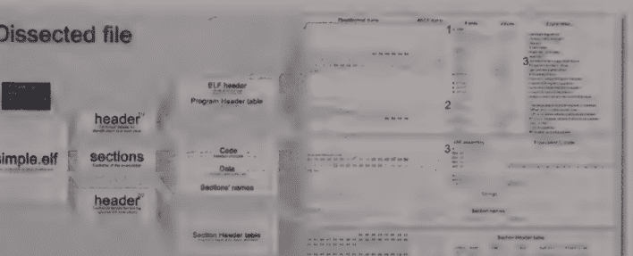

## 用于虚拟内存的 mm 结构

在 Linux 中，虚拟内存的管理是由 `mm_struct` 数据结构完成的，它包含了关于进程虚拟地址空间的信息。

`mm_struct` 结构定义在 `<linux/mm_types.h>` 头文件中，包含以下字段：

- `pgd` 字段指向顶层页全局目录，它是指向当前进程页表的指针。
- `mmap` 字段指向 `vm_area_struct` 结构，该结构表示进程地址空间中连续的虚拟内存区域。
- `mm_rb` 字段指向内存区域红黑树的根。
- `start_code` 和 `end_code` 字段指定文本段（`text segment`）的起始和结束地址。
- `start_data` 和 `end_data` 字段指定数据段（`data segment`）的起始和结束地址。
- `start_brk` 和 `brk` 字段指定堆（`heap`）的起始和结束地址。
- `start_stack` 和 `stack_vm` 字段指定栈（`stack`）的起始和结束地址。

# 第 15 章 嵌入式 Linux 简介

`mm struct` 结构在创建新进程时由内核创建并初始化。内核使用它管理进程的虚拟内存，例如分配和释放页、将物理页映射到虚拟地址以及处理页错误。

例如，当进程请求使用 `malloc()` 动态分配内存时，内核会从物理内存中分配页，并通过 `mm_struct` 结构将它们映射到进程的虚拟地址空间。当进程访问分配的内存时，内核将处理页错误并将适当的物理页映射到虚拟地址，允许进程访问数据。

- `task_descriptor` 是一个用于管理每个进程描述符的数据结构
- 它指向 `mm` 描述符，该描述符包含了进程相关的内存信息并包含：
    - 关于内存空间布局的信息，并识别每个段在磁盘上的实际位置
    - 它还包含页表的位置，它可以识别物理内存的页帧。


## 地址转换

在 Intel 架构中，CPU 生成的虚拟地址被分为三部分：目录部分、页部分和偏移量。每个部分的大小由页大小决定。

为了将虚拟地址翻译为物理地址，CPU 使用页表，页表是一种将虚拟页映射到物理页的数据结构。页表被存储在内存中，并由操作系统维护。

页表以多级层次化的结构组织。页表的顶层称为页全局目录（`PGD`），它指向页中间目录（`PMD`）。`PMD` 指向页表（`PT`），页表包含与虚拟页对应的物理页码。

Linux 中进程特定的 `mm_struct` 包含了页表以及关于进程虚拟地址空间的其他信息。当进程被创建时，它的 `mm_struct` 使用一组页表初始化，这些页表将进程的虚拟地址空间映射到物理内存。

当进程访问内存时，CPU 使用 `mm_struct` 中的页表将虚拟地址转换为物理地址。如果虚拟页的页表项不在内存中，则会发生页错误，操作系统从磁盘内存将页加载到物理内存并更新页表项。现代处理器具有硬件辅助将虚拟地址翻译为物理地址。


## 第 13 章 嵌入式 Linux 简介

在 Linux 中，为了将创建的虚拟地址转换为物理地址以访问内存，它还使用了分页技术。

它支持多级页技术，

例：Intel 架构

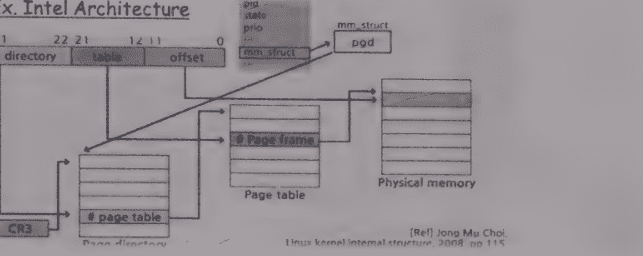

## 现代处理器具有用于翻译虚拟地址到物理地址的硬件

现代处理器具有一个称为内存管理单元（`MMU`）的硬件单元，辅助将虚拟地址翻译为物理地址。当程序使用虚拟地址访问内存位置时，`MMU` 首先检查在转换查找表缓冲区（`TLB`）缓存中是否存在地址匹配项。`TLB` 包含了最近使用的虚拟地址到物理地址的映射，如果匹配，则称为 `TLB` 命中。

如果发生 `TLB` 命中，则返回物理地址，程序可以从内存访问数据。然而，如果 `TLB` 缓存中没有匹配项，`MMU` 需要在页表中查找映射。页表是由操作系统维护的数据结构，包含了从虚拟地址到物理地址的映射。

如果 `MMU` 在页表中找到匹配项，它会在 `TLB` 缓存中创建一个新的条目，并返回物理地址。这被称为 `TLB` 缺失以及随后的页命中。然而，如果页表中没有匹配项，则称为页错误，操作系统必须分配一个新的物理页并更新页表。

页表更新后，`MMU` 从第 1 步重新开始地址翻译，重复此过程直到实现 `TLB` 命中。`TLB` 缓存的大小有限，而页表可能非常大，这意味着可能会出现 `TLB` 缺失和页错误，导致性能缓慢。因此，现代处理器具有几种硬件优化来减少 `TLB` 缺失和页错误的次数，例如大型 `TLB` 缓存、页表项的硬件预取以及猜测性地址翻译。

## 第 13 章 嵌入式 Linux 简介

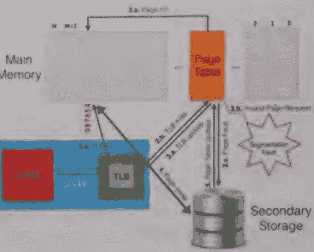

## Linux 文件系统结构

Linux 文件系统是分层结构的，每个目录包含文件和子目录，所有目录最终指向根目录（用单个斜杠 `/` 表示）。

Linux 文件系统的核心是虚拟文件系统（`VFS`），它为所有支持的文件系统提供一致的抽象层。`VFS` 实现为一组系统调用和内核模块，允许文件系统被用户进程挂载和访问。

- Linux 文件系统通过虚拟文件系统支持多种文件系统
- 内核模块通过称为虚拟文件系统的抽象层管理多个不同的文件系统

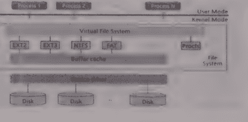

下表显示了 Linux 文件系统中最常用的目录及其用途：

| 目录 | 用途 |
| :--- | :--- |
| `/bin` | 包含系统正常运行所需的必需二进制文件 |

# 第 13 章：嵌入式 Linux 简介

| 目录 | 用途 |
| :--- | :--- |
| `/boot` | 包含引导加载程序文件和 Linux 内核。 |
| `/dev` | 包含所有硬件设备的设备文件，包括硬盘、打印机和网卡。 |
| `/etc` | 包含系统配置文件，例如 `/etc/passwd` 和 `/etc/fstab`。 |
| `/home` | 包含所有用户的家目录。 |
| `/lib` | 包含 `/bin` 和 `/sbin` 中二进制文件所需的库。 |
| `/mnt` | 用于挂载临时文件系统，如 CD-ROM 和 USB 驱动器。 |
| `/proc` | 一一个虚拟文件系统，提供有关系统进程和内核配置的信息。 |
| `/root` | `root` 用户的家目录。 |
| `/sbin` | 包含基本的系统二进制文件，例如 `ifconfig` 和 `mount`。 |
| `/tmp` | 用户进程创建临时文件的目录。 |
| `/usr` | 包含用户二进制文件、库和文档。 |
| `/var` | 包含变量文件，例如日志和数据库。 |

文件系统可以挂载到 Linux 文件系统中的任何目录，允许用户访问文件系统的内容，就像它们是本地文件系统的一部分一样。例如，用户可以将远程网络文件系统挂载到 `/mnt/remote` 目录，以便访问存储在远程服务器上的文件。

总之，Linux 文件系统是分层结构的，并由虚拟文件系统 (`VFS`) 抽象层支持，该抽象层为所有支持的文件系统提供了统一的接口。理解 Linux 文件系统结构对于管理 Linux 系统上的文件和目录至关重要。

## 操作系统：抽象提供者

操作系统（`OS`）作为运行在计算机系统上的程序的**抽象提供者**。它是应用程序之下的一层，为程序提供强大的 `OS API` 供其使用。操作系统在硬件和运行在系统上的应用程序之间充当中间环节。

运行在系统上的程序可以使用 `OS API` 来执行各种任务，如管理文件、访问网络资源、创建和管理进程等。操作系统为程序与系统资源的交互提供了标准化的接口，允许程序在不同的硬件架构和操作系统上运行。

最常用的 `OS API` 之一是 `POSIX`（可移植操作系统接口），它是一组定义了 Unix 类操作系统 `API` 的标准。符合 `POSIX` 标准的系统包括 Linux、macOS 和其他 Unix 类操作系统。Windows 有自己的一套 `API`，例如 `Windows API` 和 `.NET Framework`，它们提供了与 `POSIX` 类似的功能。

总的来说，操作系统是计算机系统软件栈中的关键层，为应用程序提供了一套强大的 `API`，使其能够以标准化且可移植的方式利用并与系统的硬件资源交互。

- 操作系统是“下方的一层”
- 你的程序可以调用的模块（通过系统调用）
- 提供强大的 `OS API` - `POSIX`、`Windows` 等。


## 系统调用

系统调用是系统编程中不可或缺的一部分，允许用户空间应用程序与内核交互，并向操作系统请求服务或资源。以下是帮助你理解系统调的关键点：

1. **定义**：系统调用是从用户空间发向内核的函数调用。它们为用户应用程序向操作系统请求服务或资源提供了标准化的接口。
2. **系统调用类型**：系统调用的范围涵盖从文件输入输出的常用函数 `read()` 和 `write()`，到更复杂的函数如 `get_thread_area()` 和 `set_tid_address()`。
3. **内核的角色**：内核为用户空间应用程序提供了一种机制，用于信号它们想要调用系统调用。这种机制随架构而异，但通常涉及设置特定的 CPU 寄存器或执行特定的初始化指令。
4. **用户空间应用程序**：用户空间应用程序无法直接链接到内核，因为这会带来巨大的安全风险。相反，它们使用系统调用以安全的方式与内核通信。
5. **系统调用示例**：以下是 Unix/Linux 系统中常用的系统调用示例：
   - `open()`：打开文件或设备以读取或写入。
   - `read()`：从文件或设备读取数据到缓冲区。
   - `write()`：将数据从缓冲区写入文件或设备。
   - `fork()`：通过克隆调用进程来创建一个新进程。
   - `exec()`：用新进程替换当前进程。
   - `exit()`：终止调用进程并返回其退出状态。


- `wait(p)`：等待子进程终止并返回其退出状态。

总之，系统调用是用户应用程序向操作系统请求服务或资源的标准化接口。通过使用系统调用，用户空间应用程序可以安全地与内核通信，而不会对底层系统产生风险。


## C 库

C 库（`libc`）是 Linux 应用程序的核心。即使你使用另一种语言编程，C 库也很可能被高级库封装，提供服务并促进系统调用的实现。

C 程序调用 `printf()` 库函数，该函数调用 `write()` 系统调用

- 在 Linux 系统上，C 库由 `GNU libc` 提供，缩写为 `glibc`，读作 `glibc`
- `GNU C` 库提供的功能比其名称暗示的多。除了实现标准 C 库外，`glibc` 还提供了系统调用封装、线程支持和基础应用程序设施。


## POSIX 历史

`POSIX`（可移植操作系统接口）是一组定义操作系统行为和功能的标准。以下是帮助你理解 `POSIX` 历史的关键点：

1. **开发**：`POSIX` 是一族标准，为不同的 Unix 类操作系统定义了一套通用的 `API`（应用程序编程接口）、命令行界面和工具，以实现软件兼容性。
2. **开发**：`POSIX` 的开发始于 20 世纪 80 年，当时美国政府决定对其 Unix 操作系统进行标准化。`IEEE`（电气电子工程师学会）建立了一个委员会为 Unix 类系统创建标准，导致了 `POSIX` 的诞生。

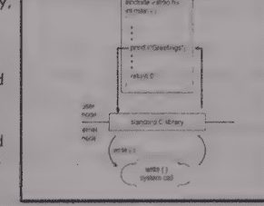


# 第 13 章 嵌入式 Linux 导论

3. **目标**：`POSIX` 的主要目的是创建一个标准接口，允许软件开发者编写可移植的应用程序，这些程序可以在任何符合 `POSIX` 标准的操作系统上运行，无论底层的硬件或软件架构如何。

4. **组件**：`POSIX` 包含了广泛的组件，包括标准 C 库、Shell 程序和系统调用。它还定义了网络、文件系统和进程管理的标准。

5. **POSIX 标准示例**：`POSIX` 标准的某些示例包括：
   - `POSIX:1`：定义了用户应用程序与操作系统之间的核心接口，包括系统调用、标准 I/O 和文件系统操作。
   - `POSIX:2`：定义了 Shell 和实用程序接口，包括标准命令行实用程序如 `ls`、`cat` 和 `grep`。
   - `POSIX:4`：定义了 `POSIX.1` 的实时扩展，允许实时和高性能应用程序的存在。
   - `POSIX:9`：定义了网络服务接口，包括标准协议 `TCP/IP` 和 `UDP`。

6. **POSIX 的优点**：采用 `POSIX` 有以下几个优点，包括：
   - **兼容性**：符合 `POSIX` 标准的操作系统使得软件开发者更容易编写可移植的应用程序。
   - **互操作性**：`POSIX` 允许不同的 Unix 类操作系统相互运行和通信。
   - **标准化**：`POSIX` 为系统开发者提供了一个标准化的接口，有助于减少碎片化并促进互操作性。

总之，`POSIX` 是一系列标准，为 Unix 类操作系统定义了一组通用的接口和实用程序。它的开发始于 20 世纪 80 年代，目标是创建一个允许软件开发者编写可移植应用程序的标准接口。`POSIX` 包含了广泛的组件，如系统调用、标准 I/O 和文件系统操作，并具有多个优点，包括兼容性、互操作性和标准化。

> 在 20 世纪 80 年代中期，电气电子工程师学会（`IEEE`）领导了 Unix 系统系统级接口标准化的努力。
> 自由软件运动的创始人 `Richard Stallman` 建议将该标准命名为 `POSIX`（读音为 `pauz-kicks`），现在代表“可移植操作系统接口”（`Portable Operating System Interface`）。

# 进程与线程

进程和线程是计算机科学和操作系统中的两个基本概念。以下是一些关键点，帮助你理解进程和线程之间的区别：


# 第 13 章 嵌入式 Linux 导论

1. **定义**：进程是运行中程序的实例，而线程是存在于进程中的轻量级进程。一个进程可以包含多个线程。
2. **资源分配**：每个进程都有自己的虚拟地址空间，其中包括代码、数据以及打开的文件和网络连接等系统资源。相比之下，进程内的所有线程共享相同的虚拟地址空间、代码、数据和系统资源。
3. **通信**：进程之间使用进程间通信（`IPC`）机制（如管道、套接字和消息队列）进行通信。进程内的线程使用共享内存、信号量和消息传递进行通信。
4. **创建**：进程在程序启动时由操作系统创建，而线程由程序本身在进程内部创建。
5. **上下文切换**：上下文切换是指保存当前运行的进程或线程的状态，并恢复另一个进程或线程的状态。进程之间的上下文切换比线程切换开销更大，因为它涉及到不同虚拟地址空间之间的切换。

这里是总结进程和线程关键区别的表格：

| 进程 | 线程 |
| --- | --- |
| 运行中程序的实例 | 存在于进程中的轻量级进程 |
| 拥有自己的虚拟地址空间、代码和数据段 | 与同一进程中的其他线程共享虚拟地址空间、代码和数据段 |
| 使用进程间通信 (`IPC`) 与其他进程通信 | 使用共享内存、信号量和消息传递与其他线程通信 |
| 程序启动时由操作系统创建 | 由程序本身在进程内部创建 |
| 进程间的上下文切换开销更大 | 线程间的上下文切换开销较小 |

多线程进程的示例包括 Web 服务器、数据库服务器和 GUI 应用程序。这些应用程序受益于并行执行任务，例如处理传入的请求和提供数据。

总结，进程和线程都是操作系统中的概念。虽然进程和线程有一些相似之处，但它们在资源分配、通信、创建和上下文切换方面存在显著差异。


# 第 13 章 嵌入式 Linux 绪论

| 克隆过程 | 描述 |
| :--- | :--- |
| 克隆过程 | 整个内存空间（包括代码段、数据段和栈段）被复制以创建一个新进程 |
| 子进程 | 创建时拥有自己的进程映像，并可以独立地执行自己的指令 |
| 父进程 | 从调用 `fork()` 的断点处继续执行，并可以使用 `PID` 跟踪子进程 |
| 返回值 | `fork()` 返回两次：一次在子进程中返回值为 `0`，另一次在父进程中返回子进程的 `PID` |

创建新进程的实际示例包括同时运行同一个程序的程序的多个实例，或者派生子进程来执行特定任务（如 I/O 或网络操作）。通过创建新进程，程序可以利用并行性并并发执行多个任务。

总结来说，创建新进程是操作系统中的一个核心概念，它使程序能够并行执行任务。`fork()` 系统调用用于克隆当前进程并创建一个新进程，该进程是独立的并可以执行自己的指令。理解进程是如何创建的，对于构建高效且可扩展的程序至关重要。

## fork()

- `fork()` 系统调用在内存中复制一个进程。在调用 `fork()` 之前，内存中只存在父进程。
- `fork()` 返回后，内存中存在两个几乎相同的进程：原始父进程和新创建的子进程。

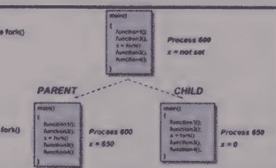

`fork()` 是 Unix 类操作系统中的一种系统调用，通过复制调用进程来创建一个新进程。以下是一些帮助你理解 `fork()` 的关键点：

1. **定义**：`fork()` 是通过复制调用进程来创建新进程的系统调用。新进程被称为子进程，调用进程被称为父进程。
2. **用法**：`fork()` 用于在 Unix 类操作系统中创建新进程。通过使用 `fork()`，程序可以产生多个进程来并行执行任务。
3. **语法**：`fork()` 的语法如下：

```c


## 返回值

```c
#include <unistd.h>

pid_t fork(void);
```

- **1. 返回值**：`fork(void)` 返回两次：一次在子进程中，另一次在父进程中。子进程中的返回值为 0，而父进程中的返回值为子进程的 `PID`。如果 `fork()` 失败，它返回 -1。
- **2. 示例**：这是一个在 C 程序中使用 `fork()` 创建子进程的示例：

在这个示例中，程序调用 `fork()` 来创建一个子进程。如果 `fork()` 成功，子进程将打印“I am the child process”，而父进程将打印“I am the parent process, my child's PID is [PID]”。

下面是总结 `fork()` 关键点的表格：

| 概念 | 描述 |
| :--- | :--- |
| 定义 | 通过复制调用进程创建新进程的系统调用 |
| 用法 | 用于在 Unix 类操作系统中创建新进程 |
| 语法 | `pid_t fork(void);` |
| 返回值 | 返回两次：一次在子进程中返回值为 0，另一次在父进程中返回子进程的 `PID`。如果 `fork()` 失败则返回 -1。 |

总结来说，`fork()` 是 Unix 类操作系统中的一种系统调用，通过复制调用进程来创建一个新进程。通过使用 `fork()`，程序可以产生多个进程来并行执行任务。理解 `fork()` 的工作原理对于构建高效且可扩展的程序至关重要。

## 子进程与父进程的区别


使用 `fork()` 创建进程时，会创建两个进程：父进程和子进程。这些进程非常相似，但有一些关键区别。以下是父进程和子进程的一些区别：

- **1. 进程 ID (PID)**：父进程的 `PID` 与子进程的 `PID` 不同。父进程的 `PID` 保持不变，而子进程的 `PID` 是操作系统分配的唯一标识符。
- **2. 内存空间**：当创建子进程时，它获得了父进程内存空间的精确副本。然而，子进程拥有自己的内存空间，这意味着在子进程内存空间中的更改不会影响父进程的内存空间。
- **3. `fork()` 的返回值**：调用 `fork()` 后，父进程中的返回值为子进程的 `PID`，而子进程中的返回值为 0。这允许父进程和子进程区分彼此。
- **4. 执行**：父进程和子进程独立执行。这意味着它们可以运行同一个程序的不同部分，或者运行完全不同的程序。
- **5. 进程层次结构**：子进程是通过复制父进程创建的新进程。这意味着子进程是父进程的后代。

下面是总结父进程和子进程关键区别的表格：

| 属性 | 父进程 | 子进程 |
| :--- | :--- | :--- |
| 进程 ID (PID) | 唯一标识符 | 唯一标识符 |
| 内存空间 | 拥有自己的内存空间 | 获得父进程内存空间的精确副本 |
| `fork()` 的返回值 | 子进程的 `PID` | 0 |
| 执行 | 独立执行 | 独立执行 |
| 进程层次结构 | 祖先 | 后代 |

父进程和子进程的示例包括同时运行同一个程序的多个实例，或者派生子进程来执行特定任务（如 `I/O` 或网络操作）。总结来说，父进程和子进程的区别至关重要。

### 错误处理示例


```c
#include <types.h>
#include <unistd.h>
#include <stdio.h>

int main(int argc, char *argv[]) {
    pid_t pid;

    pid = fork();

    if (pid > 0) {
        printf("Parent PID: %d\n", pid);
    } else if (pid == 0) {
        printf("I am the child process\n");
    } else {
        perror("fork failed");
    }

    return 0;
}
```

### 获取进程 ID


```c
#include <sys/types.h>
#include <unistd.h>
#include <stdio.h>

int main(int argc, char *argv[]) {
    //_父进程 ID
    pid_t pid = getppid();

    printf("Parent PID: %d\n", pid);

    return 0;
}
```

### 运行新进程

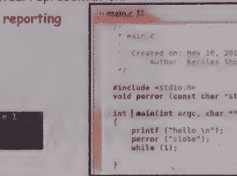

```c
#include <unistd.h>

int execcl(const char *path, const char *arg, ...);
```

## 错误

无需言，检查和处理错误至关重要。
在系统编程中，错误通过函数的返回值表示，并通过特殊变量 `errno` 进行描述。
`glibc` 为库和系统调用提供了 `errno` 支持。
该变量在 `errno.h` 中声明如下：

`extern int errno;`

| 值 | 描述 |
| :--- | :--- |
| 0 | 成功 |
| `EACCES` | 拒绝访问 |
| `EAGAIN` | 资源临时可用 |
| `EADLK` | 检测到死锁 |
| `EBADF` | 坏文件描述符 |
| `EBADMSG` | 坏消息 |
| `EBUSY` | 设备忙 |
| `EIO` | 输入/输出错误 |
| `EFAULT` | 从用户空间拷贝的地址错误 |
| `ENOHOST` | 主机宕机 |
| `ENOENT` | 找不到文件或目录 |
| `ENOTTY` | 不是此类设备 |
| `EINFS` | 非法设备 |
| `ENOMEM` | 内存不足 |
| `EOPNOTSUP` | 不支持 |
| `EPERM` | 操作不允许 |
| `EROFS` | 只读文件系统 |
| `EINVAL` | 参数无效 |
| `EPIPE` | 管道破 |
| `ETIMED` | 操作超时 |
| `ENOSPC` | 设备上空间不足 |
| `EAGUSY` | 资源忙 |
| `EINTR` | 系统调用被中断 |

## `perror()`

C 库提供了一些函数用于将错误值转换为相应的文本表示。
这对于错误报告是必要的。

函数是 `perror()`：

`perror()` 是 C 中的一个标准库函数，用于向标准错误流打印错误信息。错误信息基于全局变量 `errno` 的值。

- **1. 返回值**：`perror()` 不返回任何值。
- **2. 示例**：使用 `perror()` 打印错误信息的示例：

```c
#include <stdio.h>
#include <errno.h>

int main() {
    FILE *fp;
```


```c
fp = fopen("file.txt", "r");

if (fp == NULL) {
    perror("打开文件失败");
}
```

```c
if (fp == NULL) {
    perror("fopen");
    return 1;
}
return 0;
```


在这个示例中，程序尝试使用`fopen()`函数打开文件`"file.txt"`。如果无法打开文件，程序将调用`perror()`打印一条带有`"fopen"`前缀的错误消息。

下面是关于`perror()`关键点的总结表格：

| 概念 | 描述 |
| --- | --- |
| 定义 | C语言中的标准库函数，向标准错误流打印错误消息 |
| 用法 | 用于在系统调用或库函数失败时打印错误消息 |
| 语法 | `void perror(const char *s);` |
| 返回值 | 不返回值 |

总之，`perror()`是C语言中一个非常有用的函数，用于在系统调用或库函数失败时打印错误消息。理解如何使用`perror()`对于构建能够优雅处理错误的健壮可靠的程序至关重要。

## 第13章 部分3 - 内核模块/进程概念

### 基本 I/O 概念

现代 I/O（输入/输出）系统在管理计算机中央处理器（`CPU`）、内存与各种外设（如键盘、鼠标、存储设备和显示器）之间的通信中起着至关重要的作用。I/O 系统允许计算机与外界交互并在不同组件之间传输数据。

在典型的计算机系统中，各种类型的 I/O 设备通过不同类型的总线连接：

- `4.` PCI（外设组件互连总线）：PCI 总线是连接`CPU`、内存和其他高速设备的高速总线。PCI 总线用于连接显卡、声卡、网卡和其他高带宽外设。在现代系统中，PCI 总线已在很大程度上被更快的`PCIe`（`PCI Express`）总线所取代。
- `5.` 扩展总线：该总线用于连接键盘、鼠标和打印机等较慢的 I/O 设备。常见的扩展总线包括`USB`（通用串行总线），它广泛用于连接各种外设，以及旧的`ISA`（工业标准架构）总线。
- `6.` `SCSI`（小型计算机系统接口）总线：`SCSI`总线是一种主要用于将存储设备（如硬盘和光驱）连接到计算机的高速总线。由于更高的性能和更高效的协议，`SCSI`在现代系统中已在很大程度上被`SATA`（串行`ATA`）和`NVMe`（非易失性内存）接口取代。

为了与 I/O 设备交互，计算机系统使用设备控制器。设备控制器是一种特殊的硬件组件，管理计算机与特定 I/O 设备之间的通信。设备控制器包含一组寄存器，包括控制寄存器和状态寄存器，用于控制和监控 I/O 设备的操作。

控制寄存器用于向 I/O 设备发出命令（例如读取或写入数据），而状态寄存器提供 I/O 设备当前状态的信息，例如它是否处于忙状态、是否已完成命令或遇到了错误。

总之，现代 I/O 系统对于管理计算机与其外设之间的交互至关重要。使用不同类型的总线将各种 I/O 设备连接到计算机，而设备控制器负责控制和监控这些设备的操作。

例如，在计算机系统中，许多种 I/O 设备通过总线连接。

`CPU`和内存通过`PCI`总线连接，键盘等慢速设备通过扩展总线连接。

此外，这些磁盘通过`SCSI`总线连接，你通过设备控制器与 I/O 设备交互；控制器包含一组寄存器，包括控制寄存器和状态寄存器，用于控制 I/O 设备。


基本的 I/O 控制围绕着计算机处理单元（`CPU`）与外设（如存储设备、键盘、鼠标和显示器）之间的管理和通信。I/O 子系统的主要目的是从内核和应用程序开发者中抽象出设备特定的信息，为系统中的外设 I/O 设备提供统一的访问方法。

外设通常通过向寄存器写入和读取数据来控制。访问这些寄存器的常用机制有：

- `3.` 内存地址空间上的操作：在这种方法中，I/O 设备的寄存器映射到系统的内存地址空间中。`CPU`使用普通的内存读写指令访问寄存器。这被称为内存映射 I/O（`MMIO`）。
- `4.` I/O 端口的独立 I/O 地址空间：在这种方法中，I/O 设备分配一个独立的 I/O 地址空间，区别于内存地址空间。`CPU`使用特殊的 I/O 指令访问设备寄存器。这被称为端口映射 I/O（`PMIO`）或`I-mapped` I/O。

# 第13章 嵌入式 Linux 简介

为了访问特定的 I/O，开发者需要确定设备是端口映射的还是内存映射的。此信息决定了应该使用哪种方法（端口映射 I/O 还是内存映射 I/O）与设备交互。

端口映射 I/O 在基于`x86`的系统中更为常见，其中使用`IN`（输入）和`OUT`（输出）等特殊指令与 I/O 设备通信。相反，内存映射 I/O 在基于`RISC`的架构中更为流行，使用普通的内存访问指令访问设备。

这两种方法都有其优缺点。内存映射 I/O 允许更直接的编程模型，因为使用了普通的内存访问指令。然而，端口映射 I/O 不消耗内存地址空间，这在嵌入式系统中可能是宝贵的资源。此外，为 I/O 使用专用指令可以提供更快的 I/O 访问。

然而，端口映射 I/O 的编写比内存映射 I/O 更复杂，因为它需要使用特殊指令并管理端口地址。最终，端口映射 I/O 和内存映射 I/O 之间的选择取决于具体目标。

（注：原文后续存在大量重复的段落，已按翻译要求对应处理）
- 内存映射 I/O 允许更直接的编程模型，因为使用了普通的内存访问指令。
- 端口映射 I/O 不消耗内存地址空间，这在嵌入式系统中可能是宝贵的资源。
- 端口映射 I/O 可以提供更快的 I/O 访问。
- 端口映射 I/O 的编写比内存映射 I/O 更复杂，因为它需要使用特殊指令并管理端口地址。


`CPU`和内存通过`PCI`总线连接，键盘等慢速设备通过扩展总线连接。

内存映射 I/O 是端口映射或内存映射 I/O，应用于与设备交互。


## 端口映射 I/O

端口映射 I/O 是一种为 I/O 设备分配独立 I/O 地址空间技术。

465 嵌入式系统大师
Copyright © 2023 Keroles Khalil, eng.keroles@gmail.com

# 为 Intel CPU 使用 I/O 端口

# 第13章 嵌入式 Linux 简介

地址（端口号）用于通过特殊的处理器指令与它们通信。

`IN`和`OUT`指令是`Intel`处理器提供的特殊指令示例，用于在 I/O 设备和内存之间传输数据。`IN`指令从 I/O 端口读取一个字节或字到寄存器，而`OUT`指令从寄存器将一个字节或字写入 I/O 端口。

要使用端口映射 I/O 访问 I/O 设备，程序员在特殊的`IN`或`OUT`指令中指定设备的端口号。处理器将命令发送到设备并读取或写入数据。

端口映射 I/O 的优势之一是不消耗内存地址空间，这在嵌入式系统中可能是宝贵的资源。此外，为 I/O 操作使用专用指令可以提供更快的 I/O 访问。

然而，端口映射 I/O 的编写比内存映射 I/O 更复杂，因为它需要使用特殊指令并管理端口地址。此外，端口映射 I/O 在处理大数据传输时效率可能较低，因为处理器需要发出多次`IN`或`OUT`指令来传输块数据。

总之，端口映射 I/O 是一种通过使用特殊指令指定唯一端口号来访问 I/O 设备的技术。虽然它可以提供更快的访问并节省内存地址空间，但与内存映射 I/O 相比，它的编写更复杂，且处理大数据传输时效率较低。

- 当 I/O 设备地址空间与系统内存地址空间分离时，使用特殊的处理器指令（如`Intel`处理器提供的`IN`和`OUT`指令）在 I/O 设备和微处理器寄存器之间传输数据。
- 当指定这些特殊指令时，I/O 设备地址被称为端口号。

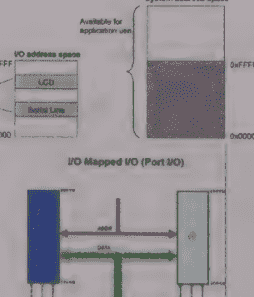

针对`ARM`查看`/proc/ioports`


`"cat /proc/ioports"`命令特定于运行在`x86`架构（如`Intel CPU`）上的`Linux`操作系统。该命令显示了不同内核模块和设备正在使用的输入/输出（I/O）端口。

对于`ARM`架构，显示 I/O 端口信息的等效命令是`"cat /proc/iomem"`。该命令显示了系统中为 I/O 设备预留的内存区域。

`/proc/iomem`文件列出了分配给系统中各种设备的物理内存范围。文件中的每一行描述了一个内存范围以及分配给它的设备或驱动程序。每行的格式如下：

```


`start_address-end_address : type_of_device`

```
40000000-ffffff : System RAM
```

这表示从`0x40000000`到`0xffffff`的内存地址范围被预留给系统 RAM。

`cat /proc/iomem`命令可以用于识别哪些设备映射到哪些内存地址，这对于 ARM 系统中调试和解决硬件相关问题非常有用。

# 第 13 章：嵌入式 Linux 简介


## 内存映射 I/O (Memory-mapped I/O)

内存映射 I/O 是一种访问 I/O 设备的方法，其中设备的地址是系统内存地址空间的一部分。在这种方法中，I/O 设备的寄存器映射到物理地址空间，设备被视为另一个内存位置。

通过内存映射 I/O，任何编码为在内存位置与处理器之间或在两个内存位置之间传输数据的机器指令都可以可能用于访问 I/O 设备。这意味着用于普通内存访问的相同指令（如`load`和`store`）可以用于访问 I/O 设备。

由于 I/O 地址空间占据了系统内存地址空间中的某个范围，设备控制器中的寄存器被映射到特定的物理内存地址范围。CPU 使用加载和存储指令从 I/O 设备的寄存器读取和写入数据，就像处理普通内存位置一样。

内存映射 I/O 的优势之一是它简化了编程模型，因为它允许程序员对 I/O 操作使用与普通内存操作相同的指令和内存访问技术。此外，内存映射 I/O 通常比端口映射 I/O 更快，因为它可以减少访问 I/O 设备所需的指令数量。

然而，内存映射 I/O 会消耗宝贵的内存地址空间，而这些空间可以用于其他用途。此外，它可能难以区分内存地址和 I/O 设备地址，从而导致冲突和错误。

总结来说，内存映射 I/O 是一种通过将设备寄存器映射到特定物理内存地址范围来访问 I/O 设备的技术。它简化了编程模型，并且与端口映射 I/O 相比，可以提供更快的 I/O 设备访问。然而，它会消耗内存地址空间并使得内存地址与 I/O 设备地址难以区分。


# Intel CPU 上的 I/O 内存分配与映射

```
more /proc/ioremap

00000000-09b7ffff : System RAM

009b0000-009ffff : reserved

00a00000-00abffff : Video RAM area

00c0000-00c7ffff : Video ROM

00c80000-00c8ffff : Adapter ROM

00f00000-0ffff : System ROM

01000000-07f6ffff : System RAM

01000000-02c77f2f : Kernel code

02c77f30-038222ff : Kernel data

77e70000-77e77fff : ACPI Tables

77e80000-77e8ffff : ACPI Non-volatile Storage
```

在 Intel CPU 上，I/O 内存分配和映射可以使用内存映射 I/O 来完成。在特定方法中，设备的寄存器被映射到物理内存的特定范围，设备被视为另一个内存位置。

要分配 I/O 内存，系统管理员或设备编写者需要预留一段特定的物理内存范围。这通常使用 Linux 中的`req_mem`函数或 Windows 中的`AllocateMem`函数完成。然后，预留的内存通过 Linux 中的`ioremap`函数或 Windows 中的`Map`函数映射到虚拟地址。

一旦分配并映射了 I/O 内存，就可以使用标准的内存访问指令（如`load`和`store`）来访问设备寄存器。例如，如果设备的寄存器映射到物理地址范围`0xC000000-0xFFFF`，驱动程序可以使用`ioremap`返回的虚拟范围（例如`0xFFEC0000`）来访问设备的寄存器。

I/O 内存也可以用于 CPU 和设备之间共享数据。例如，设备可以使用共享内存在 CPU 和设备之间传输数据。要实现这一点，驱动程序将使用内存映射 I/O 分配一个区域，然后将该区域映射到设备地址。


# 第 1 节：嵌入式 Linux 简介

总结来说，Intel 上的内存映射 I/O 用于分配和映射 I/O 设备。这允许使用标准内存访问设备寄存器，简化了编程模型并提高了性能。I/O 内存映射也可用于 CPU 和设备之间的数据共享，例如 DMA 传输。

## Intel 桌面上的 I/O

```
root@embedded-kernel-5.4# sudo cat /proc/iomem

0000000000000000  reserved
0000000000008fff  reserved
0000000000009fff  reserved
00000000000080a0  PCI
00000000000080bf  Video RAM
00000000000080cf  Video ROM
00000000000080df  Video ROM
00000000000080eff  reserved
0000000000007f00  System RAM
0000000000000000  System HD
0000000001000000  Kernel RAM
000000000001ffffff  Kernel RAM
0000000002000000  ACPI Table
0000000003000000  PCI Bus 0000:00.0
000000000003ffffff  reserved
0000000000040000  reserved
000000000004ffffff  reserved
0000000000050000  0000:00.0
000000000005ffffff  reserved
0000000000060000  0000:00.1
000000000006ffffff  reserved
0000000000070000  0000:00.2
000000000007ffffff  reserved
0000000000080000  0000:00.3
000000000008ffffff  reserved
0000000000090000  0000:00.4
000000000009ffffff  reserved
0000000000a00000  0000:00.5
0000000000affffff  reserved
0000000000b00000  0000:00.6
0000000000bffffff  reserved
0000000000c00000  0000:00.7
0000000000cffffff  reserved
0000000000d00000  0000:00.8
0000000000dffffff  reserved
0000000000e00000  0000:00.9
0000000000effffff  reserved
000000000f000000  Local APIC
0000000000ffff  reserved
0000000010000000  System RAM
0000000011ffffff  reserved
0000000012000000  RAM buffer
0000000013ffff  RAM buffer
```


## ARM SoC 上的 I/O 内存分配与映射

在基于 ARM 的系统上，I/O 内存分配和映射可以使用与 Intel CPU 类似的方法完成，但在实现细节上存在差异。

ARM 系统使用内存映射 I/O 访问 I/O 设备，这意味着 I/O 设备的寄存器被映射到特定的物理内存地址范围，设备被视为另一个内存位置。

在基于 ARM 的系统上分配 I/O 内存，系统管理员或设备驱动编写者通常使用 `ioremap` 将一个物理内存地址区域映射到虚拟地址空间。驱动程序随后可以使用虚拟地址通过标准的内存访问指令访问 I/O 设备寄存器。

基于 ARM 的系统与 Intel CPU 之间的区别之一是，ARM 系统经常使用专用的 I/O 协处理器（如 DMA 控制器）来管理 I/O 操作。协处理器负责在 I/O 设备和主内存之间传输数据，从而减轻 CPU 的负载。

# 第 15 章 嵌入式 Linux 简介

为了支持 DMA 传输，基于 ARM 的系统使用 DMA 映射函数来映射用于设备与主内存之间数据传输的内存缓冲区。这确保了设备和 CPU 都可以使用相同的地址空间访问数据。

在基于 ARM 的系统中，不使用 `request_mem_region` 函数进行 I/O 内存分配，因为 ARM 架构不需要显式的内存预留。相反，使用 `ioremap` 函数将物理内存地址映射到虚拟地址。

总而言之，基于 ARM 的系统的 I/O 内存分配和映射与 Intel CPU 上的内存映射 I/O 使用了类似的方法，但在实现上存在一些差异。I/O 内存通过使用专用的 I/O 协处理器（如 DMA 控制器）将物理内存地址区域映射到虚拟地址空间来分配，该控制器通常用于管理 I/O 操作，而 DMA 映射函数用于映射用于数据传输的内存缓冲区。


## 比较 - 内存映射 vs 端口映射

| 内存映射 I/O | 端口映射 I/O |
|---|---|
| 使用相同的地址总线访问地址内存和 I/O 设备 | 内存和 I/O 设备使用不同的地址空间 |
| 使用普通指令访问 I/O 设备 | 使用一类特殊的 CPU 指令访问 I/O 设备 |
| 最广泛使用的 I/O 方法 | x86 Intel 微处理器 - `IN` 和 `OUT` 指令 |

内存映射 I/O 和端口映射 I/O 是计算机系统中用于访问 I/O 设备的两种技术。它们的区别在于如何将 I/O 设备映射到系统地址空间的方式，以及 CPU 如何与 I/O 设备交互。

# 第 12 章 嵌入式 Linux 简介

内存映射 I/O 将 I/O 设备的寄存器映射到系统内存地址空间中特定的内存地址范围。这意味着 I/O 设备被看作是另一个内存位置，CPU 可以使用标准的内存访问指令与 I/O 设备的寄存器交互。内存映射 I/O 提供了一种简单且高效的访问 I/O 设备的方法，但它可能会消耗宝贵的内存地址空间，并使得难以区分内存地址和 I/O 设备地址。

另一方面，端口映射 I/O 为 I/O 设备使用一个独立的地址空间。I/O 设备的地址称为端口号，使用特殊指令在 I/O 设备与微处理器寄存器或内存之间传输数据。端口映射 I/O 在内存地址和 I/O 设备地址之间提供了清晰的隔离，但它需要特殊指令访问 I/O 设备，且速度可能比内存映射 I/O 慢。

总之，内存映射 I/O 和端口映射 I/O 是计算机系统中访问 I/O 设备的两种不同方法。内存映射 I/O 将 I/O 设备的寄存器映射到特定的内存地址范围，而端口映射 I/O 为 I/O 设备使用独立的地址空间。这两种方法各有优劣，选择使用哪种取决于系统的具体需求和限制。

# DMA 直接存储器访问

直接存储器访问（DMA）是一种用于提高计算机系统中 I/O 设备与内存之间数据传输效率的技术。它用于避免在大规模数据移动中使用程序化 I/O（PIO），因为这会给 CPU 带来沉重的负担。

当 I/O 设备需要传输大量数据时（例如从磁盘向磁盘拷贝数据），CPU 可能会因为管理数据传输的任务而过载。这就是 DMA 发挥用场的地方——它提供了一个特殊的 DMA 控制器，可以直接访问内存总线并绕过 CPU 在 I/O 设备和内存之间传输数据。

有了 DMA，它提供了一个特殊的 DMA 控制器，可以直接访问内存总线并绕过 CPU 在 I/O 设备和内存之间传输数据。一旦传输完成后，DMA 控制器发送中断通知 CPU。

DMA 可用于端口映射 I/O 和内存映射 I/O，它在低器级别操作 I/O，通过直接访问内存总线并绕过 CPU 来传输数据，这可以显著提高 I/O 设备和内存之间的传输效率。

总而言之，DMA 是一种用于提高计算机系统中 I/O 设备与内存之间数据传输效率的技术。它提供了一个特殊的 DMA 控制器，可以直接访问内存总线并绕过 CPU 在 I/O 设备和内存之间传输数据。DMA 用于避免在大规模数据移动中使用程序化 I/O，因为这会给 CPU 带来沉重的负担。

无论是使用 I/O 端口还是内存映射 I/O，DMA 传输可以减轻 CPU 的负担。DMA 技术的引入是为了解决这个问题。它提供了一个特殊的 DMA 控制器，可以直接访问内存总线并绕过 CPU 在 I/O 设备和内存之间传输数据。


## 轮询 vs 中断

- 操作系统需要知道设备何时完成操作。有两种方法：中断和轮询。

### 轮询
- 设备将完成信息放在状态寄存器中。
- 操作系统定期检查设备状态寄存器。
- 对于不定期预测的操作，可能会浪费大量周期。
- 许多设备结合使用两种方法，例如：高带宽网络设备使用中断处理第一个数据包，使用轮询处理后续数据包。

### 中断
- 设备触发 CPU 中断请求线
- 中断处理程序接收中断
- 可屏蔽，以忽略或延迟某些中断
- 中断向量根据优先级将中断分发到正确的处理程序
- 某些不可屏蔽的中断机制也用于异常和分页。
- 通常情况下，中断处理程序实现在设备驱动程序中。


# 内核模块/Linux 中的进程管理

除了可以在不重新构建和重启系统的情况下扩展内核功能外，内核模块还用于进程管理。

进程是 Linux 中的工作单元，可以使用各种系统调用和内核函数进行管理。内核模块可以为进程管理提供额外功能，例如添加新的调度算法、实施新的安全策略或提供额外的调试工具。

进程管理的内核模块示例是 `O(1)` 调度器。该模块提供另一种调度算法，可以提高大量进程系统的性能。另一个例子是 `SELinux` 模块，它为进程和系统资源提供了额外的安全策略层。

用于进程管理的内核模块可以像其他内核模块一样编译并动态链接到内核空间。它们可以根据需要加载和卸载，实现系统资源的灵活且高效管理。

总之，内核模块提供了一种在不需要重启系统的情况下扩展 Linux 内核功能的方法。它们也被用于进程管理以提供额外功能，如调度算法、安全策略和调试工具。内核模块可以动态加载和卸载，是管理系统资源的一种灵活且高效的方式。

# 第13 章 嵌入式 Linux 导论

- 模块（Modules）是可以根据需要加载和卸载到内核中的代码段。
- 它们可以扩展内核功能，而无需重启系统。
- 没有模块，我们必须构建单体内核，并将新功能直接添加到内核镜像中
  - 除了内核变大外，这种方式的缺点是每当我们需要新功能时，都必须重新编译并重启内核。
- 模块可以被编译并动态链接到内核地址空间。
- 在内核启动后加载内核代码：
  - 优点：
    - 按需加载驱动程序（例如针对 USB 设备）
    - 延迟加载驱动程序 - 加快启动速度
  - 缺点：
    - 为根文件系统增加了内核版本依赖
    - 需要管理更多的文件

# Linux 进程描述符中的进程管理

Linux 中的进程管理涉及对进程执行情况的管理，进程是系统中的工作单元。内核使用一种名为任务列表（task list）的数据结构来跟踪进程，它是一个双向循环链表。任务列表中的每个元素都是类型为 `task_struct` 的进程描述符，它定义在 `<linux/sched.h>` 中。

进程描述符，也称为进程控制块（PCB），包含了关于特定进程的所有信息。它包括进程的状态（例如它是正在运行、等待还是阻塞），以及描述执行程序、打开的文件、进程地址空间、待处理信号等等数据。

进程描述符是 Linux 中一个至关重要的数据结构，因为内核使用它来管理进程的执行。它为内核提供了一种存储和检索进程信息的方法，并就调度、内存分配以及进程管理的其他方面做出决策。

进程描述符在进程创建时创建，在进程终止时被销毁。随着进程的执行，内核会不断更新它，以反映进程状态、资源和其他属性的变化。

总而言之，进程描述符（也称为进程控制块 PCB）是 Linux 中一个至关重要的数据结构，包含了特定进程的所有信息。内核使用它来管理进程的执行，包括调度、内存分配和进程管理的其他方面。随着进程的执行，内核会不断更新进程描述符，并在进程终止时将其销毁。


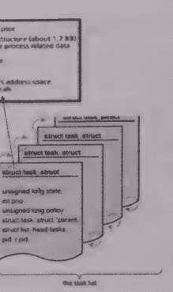

- 内核将进程列表存储在一个名为任务列表的环形双链列表中
- 任务列表中的每个元素都是类型为 `struct task_struct` 的进程描述符
- 进程描述符包含了关于特定进程的所有信息。

进程描述符包含了描述执行程序、打开的文件、进程地址空间、待处理信号等等数据。

### Task_struct

- Linux 中的 PCB（进程控制块）

`task_struct` 数据结构描述了进程及其所有细节。

`task_struct` 数据结构是 Linux 内核进程管理系统的核心组成部分。它定义在 `<linux/sched.h>` 头文件中，为内核提供了存储和操作特定进程信息的方法。

`task_struct` 数据结构包含了许多字段，用于描述进程及其所有细节。在 `task_struct` 中的一些关键字段包括：

- `pid`: 进程 ID 数字
- `state`: 进程当前状态（例如：运行、等待、睡眠）
- `mm`: 指向进程内存管理数据结构的指针
- `files`: 指向进程文件描述符表的指针
- `signal`: 存储该进程待处理信号信息的数据结构
- `parent`: 指向进程父进程的指针
- `comm`: 与进程关联的可执行文件名称
- `prio`: 进程优先级级别
- `time`: 进程已使用的 CPU 时间
- `cpu`: 进程当前执行的处理器
- `sched_info`: 包含进程调度信息的数据结构
- `cuset`: 描述 CPU 亲和性掩码的数据结构

随着进程的执行，内核会不断更新 `task_struct` 数据结构，以反映进程状态、资源和其他属性的变化。它为内核提供了管理进程执行的方法，包括调度、内存分配以及进程管理的所有其他方面。

总而言之，`task_struct` 数据结构是内核进程管理系统的关键组成部分。它包含了许多描述进程及其所有细节的字段，并随着进程的执行被内核不断更新。


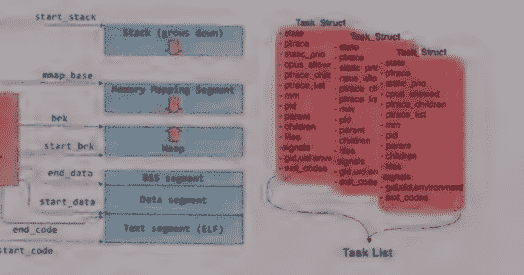

# TASK_STRUCT 数据结构中的字段

| 字段 | 说明 |
| :--- | :--- |
| `state` | 可中断的、不可中断的、僵尸、已停止 |
| `prio` | Nice 值 |
| `cpus_allowed` | 运行的 cpu |
| `ptrace` | 子进程 |
| `ptrace` | 列表 |
| `mm` | `memory_struct` |
| `exit_code`, `exit_signal` | 死亡 |
| `pid` | |
| `parent`, `children` | 子进程 |
| `utime`,`stime`, `cutime`, `cstime` | 用户时间、系统时间、累计用户时间、累计系统时间 |
| `gid`,`uid`,`environment` | 组 ID、用户 ID 和环境 |
| `files` | 文件 |
| `signals` | 处理器 |
| `tgid` | |

# 用于三个元素的名为任务列表的双形链表

双向链表是一种由系列节点组成的数据结构，每个节点都包含指向列表中前一个节点和后一个节点的指针。在 Linux 进程管理的上下文中，任务列表是存储系统中所有进程信息的环形链表。

为了说明这一点，让我们考虑一个包含三个元素的任务列表示例：

- 进程 A
- 进程 B
- 进程 C

任务列表中的每个元素都是由 `task_struct` 数据结构表示的进程描述符。每个进程描述符包含特定进程的信息，包括其状态、内存分配和其他属性。

在双向链表中，每个节点都有指向列表中下一个和上节点的指针。对于任务列表，第一个进程描述符（进程 A）指向下一个节点（进程 B）和上一个进程描述符（进程 C）。同样，第二个进程描述符（进程 B）指向下一个进程描述符（进程 C）和上一个进程描述符（进程 A）。最后，第三个进程描述符（进程 C）指向下一个进程描述符（进程 A）和上一个进程描述符（进程 B）。

这种循环结构允许内核高效遍历任务列表并对系统中的进程进行操作。例如，内核可以轻松遍历列表中所有进程以检查它们的状态或更新它们的属性。此外，循环结构允许在列表中高效地插入和删除进程。

总而言之，Linux 进程管理中的任务列表是存储系统中所有进程信息的双向循环链表。列表中的每个元素都是由 `task_struct` 数据结构表示的进程描述符，循环结构允许对列表进行高效遍历和操作。


# 第 13 章 嵌入式 Linux 简介

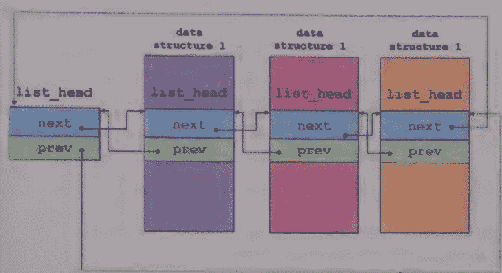

## 进程 vs 任务

Linux 将所有工作视为施加在操作系统的一系列任务


进程还可以通过使用 `clone()` 或 `fork()` 等系统调用在自己的地址空间内创建新的任务或线程。新任务或线程通常被称为父进程的子进程。

当父进程创建一个新任务或线程时，操作系统通常会分配一个新的进程描述符，以存储管理该任务所需的信息。然后，父进程将其部分信息复制到子进程的描述符中，例如进程 ID、指向父进程和兄弟进程的链接，以及每个打开文件的文件表和文件描述符。

随后，会修改子进程的描述符以反映其状态，包括新的进程 ID、指向父进程和兄弟进程的链接，以及新的用户数据段和虚拟内存表的创建。子进程还会初始化自己的的一套定时器和信号处理程序。

一旦子进程的描述符完全初始化，其状态将更改为 `TASK_RUNNING`，表示它已准备好运行。此时，子进程开始在与父进程相同的地址空间内执行自己的代码，共享相同的内存和其他资源。

## 查找进程信息：/proc/<PID>

- 使用 `ps` 查看进程 ID
- 对于每个进程，都有一个对应的目录 `/proc/<pid>`，用于在 `/proc/proc` 伪文件系统中存储该进程的信息

在 Linux 中，`/proc` 目录包含一个虚拟系统，提供有关系统上运行进程的信息。要查看特定进程的进程信息，可以使用 `/proc/<pid>` 目录，其中 `<pid>` 是你想要检查的进程 ID。

以下是可以在 `/proc/<pid>` 目录中找到的一些信息示例：

- `/proc/<pid>/status`: 该文件包含有关进程当前状态的信息，包括其状态、内存使用情况、CPU 使用情况以及其他细节。
- `/proc/<pid>/cmdline`: 该文件包含启动进程时使用的命令行参数。
- `/proc/<pid>/environ`: 该文件包含为进程设置的环境变量。
- `/proc/<pid>/fd`: 此目录包含指向该进程当前打开的文件描述符的符号链接。
- `/proc/<pid>/maps`: 该文件包含进程的内存映射列表，包括每个内存段的起始和结束地址。
- `/proc/<pid>/stat`: 该文件包含有关进程的各种统计数据，例如它使用的 CPU 时间、其进程 ID 以及其父进程 ID。

通过检查 `/proc/<pid>` 目录中的文件，你可以更深入地了解 Linux 系统的行为和资源使用情况。

## 与进程相关的文件

Linux 内核中与进程相关的文件为管理进程及其相关任务提供了必要的函数和数据结构。以下是 Linux 内核中重要的头文件和源示例：

### 头文件
- `include/linux/sched.h` - 大多数任务数据结构的声明
- `include/linux/wait.h` - 等待队列声明
- `include/asm-i386/system.h` - 依赖架构的声明

### 源文件
- `kernel/sched.c` - 任务调度例程
- `kernel/signal.c` - 信号处理例程
- `kernel/fork.c` - 进程/线程创建例程
- `kernel/proc.c` - 进程退出例程
- `fs/exec.c` - 执行程序
- `arch/i386/kernel/entry.S` - 内核入口点
- `arch/i386/kernel/process.c` - 依赖架构的进程例程


头文件

- `include/linux/sched.h`: 该文件包含大多数数据结构的声明，包括任务描述符和等待队列。例如，它定义了 `task_struct` 结构，包含特定进程的信息。
- `include/linux/wait.h`: 该文件包含等待队列的声明，用于阻塞进程直到特定事件发生。例如，它定义了 `wait_queue_head_t` 结构，用于表示等待队列。
- `include/asm-i386/system.h`: 该文件包含各种系统函数的依赖架构声明。例如，它定义了 `_flags()` 函数，用于保存 CPU 标志寄存器。

源文件

- `kernel/sched.c`: 该文件包含任务调度例程。例如，它定义了 `schedule()` 函数，用于选择在 CPU 上运行的下一个任务。
- `kernel/signal.c`: 该文件包含信号处理例程。例如，它定义了 `signal()` 函数，用于处理传入的信号。
- `kernel/fork.c`: 该文件包含进程/线程创建例程。例如，它定义了 `fork()` 函数，用于创建一个进程。
- `kernel/proc.c`: 该文件包含退出例程。例如，它定义了 `exit()` 函数，用于终止。
- `fs/exec.c`: 该文件执行程序。例如，它定义了 `execve()` 函数，用于替换进程映像。
- `arch/i386/kernel/entry.S`: 该文件包含内核入口点。例如，它定义了 `start_kernel()` 函数，用于初始化内核。
- `arch/i386/kernel/process.c`: 该文件包含依赖架构的进程例程。例如，它定义了 `copy_thread()` 函数，用于创建线程。

# 第 13 章：嵌入式 Linux 导论

2. 同步：线程可以共享数据和资源，但这可能导致竞态条件和其他同步问题。可以使用互斥锁（mutexes）和信号量（semaphores）等技术来确保同一只有一个线程访问共享资源。

示例：假设你有一个程序，它使用一个共享计数器变量，该变量被多个线程访问。你可以使用互斥锁（`mutex`）来确保同一时间只有一个线程对计数器进行加操作：

```c


1. `counter++` 不是原子操作，在多线程环境下直接自增会导致竞态条件（Race Condition）。
2. 线程安全：线程安全指的是程序在多线程环境中正确且可预测地运行的能力。可以通过适当的同步技术并尽可能避免共享资源来实现线程安全。

示例：假设你有一个修改全局变量的函数。为了使其具有线程安全，你可以使用互斥锁来确保同一时间只有一个线程可以访问该变量：

```c
#include <pthread.h>

int global_var = 0;

pthread_mutex_t mutex = PTHREAD_MUTEX_INITIALIZER;

void modify_global_var() {

    pthread_mutex_lock(&mutex);

    global_var++;

    pthread_unlock(&mutex);

}

int main() {

    // 创建并运行调用 modify_global_var 的线程

    return 0;

}
```


# Linux 线程与调度器基础

这些是关于 Linux 线程以及如何在实践中使用它们的一些关键点。


## Linux 调度器

- 调度器是内核代码中的一部分，它使得同时运行多个程序成为可能，并在进程之间共享 `CPU`。
- 决定运行哪个进程以及运行多久是调度器的主要职责。
- Linux 调度基于时间分用技术。
- `CPU` 时间被大致划分为若干“时间片”（slices），每个可运行的进程分配一个。
- 如果当前正在运行的进程在其时间片或时间量子（quantum）过期时未终止，则该进程会被抢占。
- 时间分用依赖于定时器中断，并且对进程是透明的。
- 为了确保 `CPU` 时间分用，不需要在进程中插入额外的代码。
- 调度策略根据优先级对进程进行排序。
- 优先级最高的进程运行得更快。
- 在 Linux 中，进程优先级是动态的。
- 调度器跟踪进程正在执行的操作，并定期调整它们的优先级。
- 长时间被拒绝使用 `CPU` 的进程将通过动态提高其优先级获得提升。
- 运行时间较长的进程将通过降低其优先级来受到惩罚。

Linux 调度器负责管理系统中进程和线程 `CPU` 时间分配。以下是关于 Linux 调度器的一些关键点：

6. **调度类**：Linux 调度器有不同的调度类，决定了进程如何被调度。最常用的调度类是完全公平调度器（`CFS`），它确保每个进程都能获得公平的 `CPU` 时间份额。其他调度类包括实时调度器（Real-time scheduler）和截止调度器（Deadline scheduler）。
7. **优先级**：每个进程和线程都有一个优先级，决定了它们在调度队列中的位置。Linux 调度器使用基于优先级的调度算法来决定下一个运行哪个进程或线程。
8. **时间片**：Linux 调度器使用时间片为进程和线程分配 `CPU` 时间。时间片是一个进程或线程在被抢占并在另一个进程或线程替换之前允许运行。
9. **抢占**：Linux 调度器支持抢占，这意味着如果有更高优先级的进程或线程变为可运行，当前的进程或线程可以被中断并被另一个进程或线程替换。
10. **负载均衡**：Linux 调度器执行负载均衡，以确保负载均匀分布在所有 `CPU` 上。如果某个 `CPU` 空闲而其他 `CPU` 忙碌，调度器将把更多进程移动到空闲的 `CPU` 上以平衡负载。

**示例**：

假设我们有一个运行多个进程和线程的 Linux 系统。Linux 调度器确保每个进程和线程都能获得公平的 `CPU` 时间份额，因此没有进程或线程会资源饥饿。

假设创建了一个新的高优先级进程。Linux 调度器将优先考虑该进程，并为其分配比低优先级进程更多的 `CPU` 时间。如果该新进程是 `CPU` 密集型的并迅速耗尽其时间片，它可能会被抢占并被另一个进程或线程替换。


## Linux 调度器算法细节

以下是关于 Linux 调度器调度算法的一些关键点：

- **静态优先级**：每个进程和线程都有一个优先级，决定了它们在调度队列中的位置。Linux 调度器使用基于优先级的调度算法来决定下一个运行哪个进程或线程。
- **时间片**：Linux 调度器使用时间片为进程和线程分配 `CPU` 时间。时间片是一个进程或线程在被抢占并在另一个进程或线程替换之前允许运行的时间。
- **抢占**：Linux 调度器支持抢占，这意味着如果有更高优先级的进程或线程变为可运行，当前的进程或线程可以被中断并被另一个进程或线程替换。
- **负载均衡**：Linux 调度器执行负载均衡，以确保负载均匀分布在所有 `CPU` 上。如果某个 `CPU` 空闲而其他 `CPU` 忙碌，调度器将把更多进程移动到空闲的 `CPU` 上以平衡负载。

**示例**：

假设我们有一个运行多个进程和线程的 Linux 系统。Linux 调度器确保每个进程和线程都能获得公平的 `CPU` 时间份额，因此没有进程或线程会资源饥饿。

假设创建了一个新的高优先级进程。Linux 调度器将优先考虑该进程，并为其分配比低优先级进程更多的 `CPU` 时间。如果该新进程是 `CPU` 密集型的并迅速耗尽其时间片，它可能会被抢占并被另一个进程或线程替换。


## O(1) 调度器

`O(1)` 调度器是内核中用于提高性能的调度算法。以下是关于 `O(1)` 调度器的一些关键点：

- **活跃队列（Active Array）**：`O(1)` 调度器维护一个活跃队列，是剩余时间片的进程。
- **过期队列（Expired array）**：过期进程的列表。
- 调度器从活跃队列中选择优先级最高的进程。
9. **过期队列**：调度器维护一个过期队列，是已使用时间片的进程。该列表也按优先级排序。
10. **优先级级别**：活跃队列中的进程被分为 140 个优先级级别，0 为最高。每个优先级级别都有时间片长度。
11. **下一个进程的选择**：当进程完成时间片时，调度器从活跃队列中选择下一个进程。如果活跃队列为空，调度器从过期队列中选择优先级最高的进程并移到活跃队列。
12. **回询调度**：在优先级级别内部，调度器使用轮询调度来分配 `CPU` 时间。
13. **抢占**：如果更高优先级的进程变为可运行，调度器可以抢占运行中的进程。
14. **优势**：`O(1)` 调度器相比之前的算法具有若干优点，包括减少开销和提高性能。

**示例**：假设活跃队列中有三个进程：`A` 的优先级为 0，`B` 的优先级为 5，`C` 的优先级为 10。调度器将首先选择 `A`，因为它的优先级最高。如果 `A` 用尽了时间片，调度器将选择下一个高优先级进程，即 `B`。如果 `B` 用尽了时间片，调度器将选择 `C`，以此类推。如果一个比 `A` 优先级更高的进程变为可运行，调度器将抢占 `A`。

## 完全公平调度 (CFS) 调度器

完全公平调度（`CFS`）是 Linux 内核版本 `2.6.23` 中使用的进程调度器。`CFS` 设计为对所有进程公平的，无论它们的优先级或资源需求如何。以下是关于调度的一些关键点：

5. `CFS` 使用红黑树来跟踪进程。
   - 每个进程都是树中的一个节点。
   - 每个节点中的键是进程消耗的 `CPU` 时间。
   - 树按 `CPU` 时间排序，`CPU` 时间最低的节点位于树根。
6. `CFS` 跟踪每个进程的虚拟运行时间（`virtual runtime`）。
   - 虚拟运行时间是进程等待的时间

# 第 13 章 嵌入式 Linux 简介

- 运行时间（`virtual runtime`）根据进程的 `nice` 值（优先级）进行划分，以获得公平的 `CPU` 时间。

`CFS` 计算每个进程的权重。

- 权重衡量了与其他进程相比，一个进程应该获得多少 `CPU` 时间。
- 权重使用公式计算：`weight = (1 / sqrt(1 + load_avg)) * nice_value`
- `load_avg` 是一段时间内运行队列中进程的平均数量。

`CFS` 选择运行时间最短的进程进行下一次运行。

- 这确保了等待运行最长的进程将获得下次执行。
- 时间切片（`time quantum`）根据系统中可运行进程的数量动态计算。

**示例**：假设有三个进程 `A`、`B` 和 `C`。它们的 `nice` 值分别为 0、5 和 10。当前的运行时间负载 `load_avg` 为 2.0。这些进程的权重计算方式如下：

- `A`: `(1 / sqrt(1 + 2.0)) * 1 = 0.45`
- `B`: `(1 / sqrt(1 + 2.0)) * 6 = 2.69`
- `C`: `(1 / sqrt(1 + 2.0)) * 11 = 4.16`

在这个示例中，进程 `C` 的权重最高，因此它将获得最多的 `CPU` 时间。然而，`C` 的 `nice` 值较高，尽管它的权重更高，获得的 `CPU` 时间仍然少于 `B`。

总而言，`CFS` 旨在考虑进程优先级和资源需求的同时，为系统中的所有进程提供公平性。

- 从内核 `2.6.3` 开始，`O(1)` 算法被 `CFS` 算法取代。
  在 `O(1)` 算法中，时间切片根据优先级分配。
  但这种方法存在一些问题。
  例如，我们有两个优先级分别为 120 和 121 的进程。
  那么根据优先级分别分配了 `100ms` 和 `95ms` 的时间切片。
  这两个进程之间的时间切片差异与其优先级差为 `5ms`。

| 进程 1 | 进程 2 |
|---|---|
| `slice(100ms)` | `slice(95ms)` |

在这种情况下，两个进程的切片分别为 `10ms` 和 `5ms`，时间切片的差异为 `5ms`。

| 进程 1 | 进程 2 |
|---|---|
| `slice(10ms)` | `slice(5ms)` |

`5ms` 的差异相对于另一个是两倍。

- 在 `CFS` 中：
  它根据权重分配时间切片以解决这个问题。
  它根据预定义的优先级权重分配相对时间切片，而不是根据优先级分配预定义的时间切片。

# Linux 内存管理


# 第 15 章 嵌入式 Linux 简介

在 Linux 中，内存管理分为：

- 物理内存管理
- 虚拟内存管理。


- **物理内存管理**：在 Linux 中，物理内存管理通过将物理页（`pages`）或帧（`frames`）视为内存管理的基本单元来实现。每个物理页都用一个 `struct page` 表示。内核使用伙伴系统（`buddy system`）按页单元进行内存的分配和释放。伙伴系统是一种内存管理技术，将内存划分为固定大小的块，当内存请求出现时，内核会寻找与请求大小相同或更大的块。
- **虚拟内存管理**：在 Linux 中，虚拟内存管理通过请求页机制（`demand paging`）实现，允许内核只加载进程所需的页。内核将每个进程的虚拟地址空间分为页，并根据需要将这些页映射到物理内存。内核还使用 `slab` 分配器来按小块分配和释放内存。`Slab` 分配器是一种内存管理技术，将内存划分为固定大小的小块，当内存请求出现时，内核会寻找。
- **区域（`Zone`）**：内核根据页的大小和用法将其划分为不同的区域。三个区域：`ZONE DMA`、`ZONE_NORMAL` 和 `ZONE_HIGHMEM`。`ZONE DMA` 包含能够直接内存访问（`DMA`）的页，用于 `I/O` 设备。`ZONE_NORMAL` 包含普通的、常规映射的页。`ZONE_HIGHMEM` 用于准备超过 `GB` 的内存，这是一个动态映射内核虚拟地址空间的区域。

总来说，Linux 内存管理是操作系统的一个重要方面，允许对物理和虚拟内存资源进行高效的分配和管理。

- Linux 将物理页“物理帧”视为内存管理的基本单元
- 每个物理页都用一个 `struct page` 表示
- 内核将每个进程的虚拟地址空间分为页
- `Slab` 分配器用于小块分配/释放内存
- 区域：内核将页划分为不同的区域
  - `ZONE_DMA`
    - 连续页能够直接内存访问 (`DMA`)
  - `ZONE_NORMAL`
    - 包含普通的、常规映射的页
  - `ZONE_HIGHMEM`
    - 用于准备超过 `GB` 的内存
    - 是映射内核虚拟地址空间的区域


# 伙伴系统

伙伴系统是一种内存管理技术，将内存划分为固定大小的块，当内存请求出现时，内核会寻找与请求大小相同或更大的块。如果找到更大的块，它会被拆分成两个“伙伴”。当内存被释放时，内核会检查伙伴是否也空闲；如果是，它们将合并回更大的块。这有助于减少内存碎片。

# Slab 分配器

`Slab` 分配器是一种在小块上分配和释放内存的技术。它通过预分配特定大小的对象来减少碎片。`Slab` 分配器维护对象缓存（`caches`），每个缓存包含一个或多个内存页块（`slabs`）。当需要一个对象时，从缓存中分配；当对象被释放时，则返回缓存。

# 第 15 章 嵌入式 Linux 简介

- `.symtab`: 此节包含表信息，将程序中使用的符号映射到它们在内存中的地址。
- `.debug`: 此节包含调试信息，调试器可以使用这些信息来分析程序的行为。

当 `ELF` 文件加载到内存时，它会被映射到进程的虚拟内存空间中。每个进程都有自己的虚拟地址空间，该空间被划分为页。操作系统使用页表将虚拟地址映射到内存中的物理地址。

虚拟内存的使用允许多个进程并发运行而互不干扰，因为每个进程都有自己隔离的内存空间。`ELF` 文件和虚拟内存的使用是现代操作系统架构的关键组成部分，它使得能够在各种硬件平台上运行的复杂操作系统得以实现。

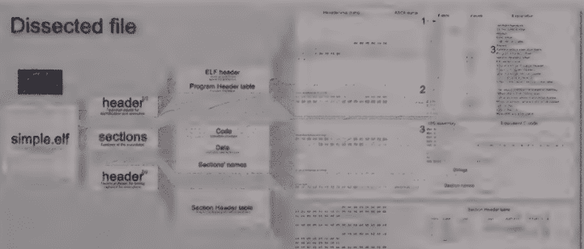

## 用于虚拟内存的 mm struct

在 Linux 中，虚拟内存的管理是由 `mm_struct` 数据结构完成的，它包含了进程虚拟地址空间的信息。

`mm_struct` 定义在 `<linux/mm_types.h>` 头文件中，包含以下字段：

- `pgd` 字段指向顶层页全局目录，它是指向当前进程页表的指针。
- `mmap` 字段是一个通向 `vm_area_struct` 的指针，它代表进程空间中连续的虚拟内存区域。
- `mm_rb` 字段指向内存区域红黑树的根。
- `start_code` 和 `end_code` 字段指定文本段（`text segment`）的起始和结束地址。
- `start_data` 和 `end_data` 字段指定数据段的起始和结束地址。
- `start_brk` 和 `brk` 字段指定堆的起始和结束地址。
- `start_stack` 和 `stack_vm` 字段指定栈的起始和结束地址。

## 第 13 章 嵌入式 Linux 简介

`mm_struct` 在创建新进程时由内核创建并初始化。内核使用它来管理进程的虚拟内存，例如分配和释放内存页、将物理页映射到虚拟地址，以及处理缺页异常。

例如，当进程请求使用 `malloc()` 动态分配内存时，内核会从物理内存分配页，并通过 `mm_struct` 结构将它们映射到进程的虚拟地址空间。当进程访问分配的内存时，内核将处理缺页异常并将相应的页映射到虚拟地址，允许进程访问数据。

- 任务描述符（`task descriptor`）是一个管理每个进程任务描述符的数据结构。
- 它指向 `mm` 描述符，其中包含了进程的相关信息，且描述符包含：
- 关于如何持有虚拟内存空间的信息，并标识每个页在磁盘上的实际位置。
- 还包含页表的位置，以便它可以识别物理内存的页帧。


## 地址翻译

在 `Intel` 架构中，`CPU` 生成的虚拟地址分为三部分：目录页、页部分和偏移量。每个部分的大小由页的大小决定。

为了将虚拟地址翻译为物理地址，`CPU` 使用页表，页表是一种将虚拟页映射到物理页的数据结构。页表存储在内存中，并由操作系统进行维护。

页表组织成多级层次结构。页表的顶层称为页全局目录（`PGD`），它指向页中间目录（`PMD`）。`PMD` 指向页表（`PT`），页表包含与虚拟页对应的页号。

Linux 中特定进程的 `mm_struct` 包含了页表以及关于进程虚拟地址的其他信息。当进程被创建时，其 `mm_struct` 会初始化一组页表，这些页表将进程的虚拟地址映射到物理内存。

当进程访问内存时，`CPU` 使用 `mm_struct` 中的页表将虚拟地址翻译为物理地址。如果虚拟页的页项不在内存中，则会发生缺页异常（`page fault`），操作系统会将页从磁盘加载到物理内存中并更新页表目。现代处理器具有硬件来协助将虚拟地址翻译为物理地址。


## 第 13 章 嵌入式 Linux 简介

- 在 Linux 中，需要将创建的虚拟地址转换为物理地址以访问内存，因为它也使用了分页技术。
- 它支持多级页技术。
- 示例：`Intel` 架构。


## 现代处理器具有硬件协助将虚拟地址翻译为物理地址

现代处理器有一个称为内存管理单元（`MMU`）的硬件单元，协助将虚拟地址翻译为物理地址。当程序使用虚拟地址访问内存位置时，`MMU` 首先检查在转换快表器（`TLB`）缓存中是否存在该地址的匹配。如果发生 `TLB` 命中（`hit`），则返回物理地址，程序即可从该位置访问数据。然而，如果 `TLB` 中没有匹配，`MMU` 需要在页表中查找映射。

如果 `MMU` 在页表中找到匹配项，它会在 `TLB` 缓存中创建一个新条目并向返回物理地址。这被称为 `TLB` 缺失随后的页命中。然而，如果页表中也没有匹配项，则被称为缺页异常，操作系统需要分配新页并更新页表映射。

在更新页表后，`MMU` 从第 1 步重新翻译，直到实现 `TLB` 命中。`TLB` 缓存的大小有限，而页表可能非常大，这意味着可能会导致 `TLB` 缺失和缺页异常，因此现代处理器具有多种硬件优化来减少 `TLB` 缺失和缺页异常，例如大型 `TLB` 缓存、页表项预取和猜测性地址翻译。

# 第 15 章 嵌入式 Linux 简介

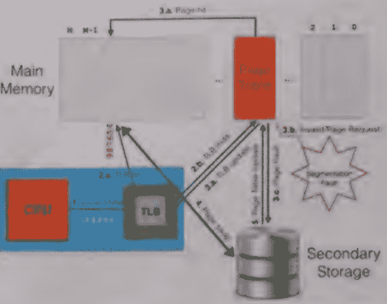

## Linux 文件系统结构

Linux 文件系统是分层次结构的，每个目录包含文件和子目录，它们最终指向根目录（由单个斜杠 `/` 表示）。

Linux 文件系统的核心是虚拟文件系统（`VFS`），它是一个为所有文件系统提供一致接口的抽象层。`VFS` 通过一组系统调用和内核模块实现，允许用户进程挂载和访问文件系统。

- Linux 文件系统提供了虚拟文件系统以支持不同的文件系统
- 内核隐藏了实现细节，并通过名为虚拟文件系统（`VFS`）的抽象层管理不同的文件系统

下表显示了 Linux 文件系统中最常用的目录及其用途：

| 目录 | 用途 |
| :--- | :--- |
| `/bin` | 包含系统正常运行所需的必需二进制文件 |
| `/boot` | 包含引导器文件和 Linux 内核。 |
| `/dev` | 包含所有硬件设备的设备文件，包括硬盘、打印机和网卡。 |
| `/etc` | 包含系统配置文件，例如 `/etc/passwd` 和 `/etc/fstab`。 |
| `/home` | 包含所有用户的家目录。 |
| `/lib` | 包含 `/bin` 和 `/sbin` 中二进制文件所需的库文件。 |
| `/mnt` | 用于挂载临时文件系统，例如 `CD-ROM` 和 `USB` 驱动器。 |
| `/proc` | 一个虚拟文件系统，提供有关系统进程和内核配置的信息。 |
| `/root` | `root` 用户的家目录。 |
| `/sbin` | 包含基本系统二进制文件，如 `ifconfig` 和 `mount`。 |
| `/tmp` | 用于用户进程创建的临时文件的目录。 |
| `/usr` | 包含用户二进制文件、库和文档。 |
| `/var` | 包含变量文件，例如日志和数据库。 |

总之，Linux 文件系统是按层次组织的，并由虚拟文件系统（`VFS`）抽象层支持，该层为所有支持的文件系统提供了统一的接口。理解 Linux 文件系统结构对于管理 Linux 系统上的文件和目录至关重要。

## OS: 抽象提供者

操作系统（`OS`）作为运行在计算机系统上的程序的“抽象提供者”。它是应用程序之下的一层，为程序提供了一个强大的 `OS API` 供其使用。操作系统在硬件和运行在系统上的应用程序之间充当中介。

运行在系统上的程序可以使用 `OS API` 来执行各种任务，如管理文件、访问网络资源、创建和管理进程等。操作系统为程序与系统资源之间的交互提供了标准化的接口，允许程序在不同的硬件和操作系统上运行。

最广泛使用的 `OS API` 之一是 `POSIX`（可移植操作系统接口），它是一组定义了 Unix 类操作系统 `API` 的标准。符合 `POSIX` 标准的系统包括 Linux、`macOS` 和其他 Unix 类操作系统。Windows 拥有它自己的 `API`，例如 `Windows API` 和 `.NET Framework`，它们提供了与 `POSIX` 类似的功能。

总的来说，操作系统是计算机系统软件中的一个关键层，它为应用程序提供了一套强大的 `API Set`，使其能够以标准化且可移植的方式与系统的硬件资源进行交互。

- 操作系统是“下的一层”
- 你的程序可以调用的模块（通过系统调用）
- 提供强大的 `OS API` - `POSIX`、Windows 等

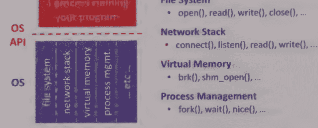

## 系统调用

系统调用是系统编程中的一个重要组成部分，允许用户空间应用程序与内核交互，并向操作系统请求服务或资源。以下是一些帮助你理解系统调用的关键点：

- 6. **定义**：系统调用是从用户空间发往内核的函数调用。它们为用户应用程序向操作系统请求服务或资源提供了标准化的接口。
- 7. **系统调用的类型**：系统调用的范围很大，从用于输入输出的 `read()` 和 `write()` 等常用函数，到如 `get_thread_area()` 和 `set_tid_address()` 这样更底层的函数。
- 8. **内核的作用**：内核为用户空间应用程序提供了一种机制，使其调用它们所需的系统调用。这种机制随架构而异，但通常涉及设置 `CPU` 寄存器或执行特定指令来初始化系统调用。
- 9. **用户应用程序**：用户应用程序无法直接链接到内核空间，因为这将带来重大的安全风险。相反，它们使用系统调用以受控且安全的方式与内核通信。
- 10. **系统调用示例**：以下是 Unix/Linux 系统中常用的系统调用示例：
  - `open()`: 打开文件以读取或写入。
  - `read()`: 从文件或设备读取数据到缓冲区中。
  - `write()`: 将数据从缓冲区写入文件或设备。
  - `fork()`: 通过克隆调用进程来创建一个新进程。
  - `exec()`: 用一个新进程替换当前进程。
  - `exit()`: 终止当前进程并返回其退出状态。


- `wait()`: 等待子进程终止并返回其退出状态。

总而言之，系统调用是系统编程的基本方面，它为用户应用程序向操作系统请求服务或资源提供了标准化的接口。通过使用系统调用，用户应用程序可以在受控的情况下与内核通信，而不会对底层系统产生风险。

系统编程始于系统调用并结束于系统调用。
- 系统调用（通常缩写为 `syscall`）是由用户空间文本编辑器、收藏喜欢的游戏等调用的函数（每次读和写），通过 `get_thread_id()` 和 `set_addr()` 等函数向操作系统请求资源。
- 不可能将用户空间应用程序与内核空间直接链接。
- 内核提供了一种机制，用户空间应用程序可以通过该机制“信号”内核，其想要调用系统调用。
- 多路复用器使用定义良好的机制，仅执行内核允许其执行的调用。


## C 库

- `C` 库（`libc`）是 Linux 应用的核心。`POSIX` 是一套定义了 Unix 类操作系统 `API` 的标准。符合 `POSIX` 标准的系统包括 Linux、`macOS` 等。在 `POSIX` 标准的系统中，`libc` 提供了比 `POSIX` 命名的更多的功能。
- 标准 `C` 库是 Linux 应用的核心，它提供了标准接口

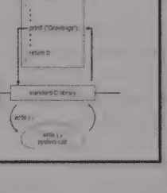

## POSIX 历史

`POSIX`（可移植操作系统接口）是一组定义了操作系统行为和功能的标准。以下是一些帮助你理解 `POSIX` 的关键点：

- 7. **定义**：`POSIX` 是一组定义操作系统的标准。
- 8. **开发**：`POSIX` 的开发始于 20 世纪 80 年代，当时美国政府决定标准化。`IEEE`（电气电子工程师协会）建立了一个委员会来创建 `POSIX`。


## 第13 章 嵌入式 Linux 简介

- 9. **目标**：`POSIX` 的主要目标是创建一个标准接口，允许软件开发者无论硬件或软件架构如何编写可移植应用程序。
- 10. **组件**：`POSIX` 包含了广泛的组件，如 `C` 库、`Shell` 工具和系统调用。它还定义了网络、文件系统和进程管理的标准。
- 11. **POSIX 标准示例**：`POSIX` 的示例包括：
  - `POSIX.1`：定义了用户应用程序与操作系统之间的核心接口。
  - `POSIX.2`：定义了 `Shell` 和工具接口。
  - `POSIX.4`：定义了 `POSIX.1` 的实时扩展，允许实时和高性能应用程序。
  - `POSIX.9`：定义了网络服务接口。

- 12. **POSIX 的优点**：采用 `POSIX` 有许多优点，包括：
  - **兼容性**：符合 `POSIX` 的应用程序可以在任何符合 `POSIX` 的操作系统上运行。
  - **互操作性**：`POSIX` 允许不同的 Unix 类操作系统相互操作和通信。
  - **标准化**：`POSIX` 为系统开发者提供了标准化的接口，有助于减少碎片化并促进互操作。

总结来说，`POSIX` 是一组定义了 Unix 类操作系统通用接口和工具的标准。它的开发始于 20 世纪 80 年代，目标是创建一个标准接口，允许软件开发者编写可移植应用程序。

## 进程与线程

进程和线程是计算机科学和操作系统中的两个基本概念。以下是一些帮助你理解进程和线程区别的关键点：

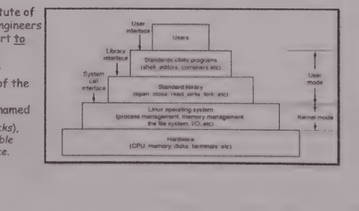

6. **定义**：进程是运行中程序的一个实例，而线程是存在于进程中的轻量级进程。进程可以包含多个线程。

7. **资源分配**：每个进程都有自己的虚拟地址空间，包括代码、数据以及如打开的文件和网络连接等系统资源。相比之下，进程内的所有线程共享相同的虚拟地址空间、代码和数据段以及系统资源。

8. **通信**：进程之间使用进程间通信（`IPC`）机制（如管道、套接字和消息队列）进行通信。进程内的线程之间可以使用共享内存、信号量和消息传递进行通信。

9. **创建**：进程在程序启动时由操作系统创建，而线程是由程序本身在进程内部创建的。

10. **上下文切换**：上下文切换是指保存当前运行的进程或线程的状态，并恢复另一个进程或线程状态的过程。进程之间的上下文切换比线程之间的切换开销更大，因为涉及不同虚拟地址空间的切换。

这里是总结进程和线程之间主要区别的表格：

| 进程 | 线程 |
| --- | --- |
| 运行中程序的实例 | 存在于进程中的轻量级进程 |
| 拥有自己的虚拟地址空间、代码数据段 | 与同一进程内的其他线程共享相同的虚拟地址空间、代码和数据段 |
| 使用进程间通信（`IPC`）与其他进程通信 | 使用共享内存、信号量消息传递与其他线程通信 |
| 程序启动时由操作系统创建 | 由程序本身在进程内部创建 |
| 进程间的上下文切换开销更大 | 线程间的上下文切换开销较小 |

多线程进程示例包括 `Web` 服务器、数据库服务器和 `GUI` 应用。这些应用程序受益于同时执行多个任务的能力，例如处理传入的请求、为客户端提供数据以及响应用户输入。

总之，进程和线程都是计算机科学和操作系统中的核心概念。虽然进程和线程有一些相似之处，但它们在资源分配、通信、创建和上下文切换方面存在显著差异。理解差异对于构建高效且可扩展的应用程序非常重要。


# 第 13 章：嵌入式 Linux 简介

- 进程从可执行对象代码开始运行，这是以可执行格式表示的机器运行代码。
- 每个进程由一个或多个执行线程组成。
- 大多数进程只包含单个线程；它们被称为单线程进程。
- 包含多个线程的进程被称为多线程进程。


# 进程层次

进程层次是操作系统中的一个基本概念，每个进程都组织成层次化的树形结构。以下是帮助你理解进程层次的关键点：

- 6. **进程 ID (`PID`)**：系统中的每个进程都被分配一个唯一的正整数，称为进程 ID (`PID`)。操作系统使用 `PID` 来识别和管理每个进程。系统中的第一个进程分配的 `PID` 为 1。
- 7. **根进程**：进程树以第一个进程为根，通常被称为 `init` 进程。`init` 进程由操作系统在启动过程中启动，负责启动和管理系统中的其他进程。
- 8. **进程创建**：使用 `fork()` 系统调用创建新进程。`fork()` 通过复制现有进程创建一个新进程。新进程被称为子进程，它是父进程的精确拷贝，但 `PID` 和内存地址空间等少数属性除外。
- 9. **进程层次**：进程树组织成层次结构，每个进程都有一个父进程和零或多个子进程。这种层次结构允许将进程组织成组，使其更容易管理和监控。
- 10. **程序化访问 PID**：在 `C` 语言中，进程 ID 由 `pid_t` 类型表示，该类型定义在 `<sys/types.h>` 头文件中。你可以使用 `getpid()` 系统调用通过程序化方式访问当前进程的 `PID`。

这里是总结进程层次关键属性的表格：

| 属性 | 描述 |
| --- | --- |
| 进程 ID (`PID`) | 分配给每个进程的唯一正整数 |
| 根进程 | 系统中的第一个进程，负责启动和管理其他进程 |
| 进程创建 | 使用 `fork()` 系统调用创建新进程 |

第 150 页，共 465 页
从零开始嵌入式系统
Copyright © 2023 - Keroles Khalil, eng.keroles.karam@gmail.com


# 第 13 章：嵌入式 Linux 简介

| 进程层次 | 组织成层次树形结构，每个进程都有一个父进程和零或多个子进程 |
| `PID` 类型 | 在 `C` 语言中由 `pid_t` 表示 |

进程层次的实际示例包括 Linux 操作系统，其中 `init` 进程是进程树的根进程，所有其他进程都是 `init` 进程的后代。同样，在 Windows 操作系统，系统空闲进程 (`PID` 0) 作为根进程，所有其他进程都是该进程的后代。

总之，进程层次是操作系统中的一个基本概念，允许进程组织成树形结构。每个进程都被分配唯一的进程 ID (`PID`)，并使用 `fork()` 系统调用创建新进程。理解进程层次对于管理和监控系统中的进程至关重要。

# 创建新进程

创建新进程是操作系统中的一个基本概念，允许程序产生新进程来执行任务。以下是帮助你理解如何创建新进程的关键点：

- 6. 使用 `fork()` 系统调用创建新进程。当调用 `fork()` 时，调用进程会被克隆，创建一个与原始进程相同但 `PID` 不同的新进程。新进程是子进程，调用进程被称为父进程。
- 7. **克隆进程**：当调用 `fork()` 时，内核通过克隆当前进程创建一个新进程。这包括复制整个内存空间，包括代码段、数据段和栈段。
- 8. **子进程**：一旦创建了子进程，它就拥有了自己的进程映像副本，并可以独立于父进程执行指令。子进程还可以修改自己的内存而不影响父进程。
- 9. **父进程**：父进程从调用 `fork()` 的点继续执行，而子进程从父进程代码的相同点开始执行。父进程可以使用 `fork()` 返回的 `PID` 来跟踪子进程。
- 10. **返回值**：`fork()` 返回两次；一次在子进程中，一次在父进程中。子进程的返回值为 0，父进程的返回值为子进程的 `PID`。

这里是总结关于创建新进程要点的表格：

| 概念 | 描述 |
| --- | --- |
| `fork()` 系统调用 | 通过克隆当前进程创建一个新进程 |


我注意到在上面的块中不小心重复了内容。让我提供一个你要求的清理、合并后的修正版本。

6. 定义：进程是运行中程序的一个实例，而线程是存在于进程中的轻量级进程。进程可以包含多个线程。

7. 资源分配：每个进程都有自己的虚拟地址空间，包括代码、数据以及如打开的文件和网络连接等系统资源。相比之下，进程内的所有线程共享相同的虚拟地址空间、代码和数据段以及系统资源。

8. 通信：进程之间使用进程间通信（`IPC`）机制（如管道、套接字和消息队列）进行通信。进程内的线程之间可以使用共享内存、信号量和消息传递进行通信。

9. 创建：进程在程序启动时由操作系统创建，而线程是由程序本身在进程内部创建的。

10. 上下文切换：上下文切换是指保存当前运行的进程或线程的状态，并恢复另一个进程或线程状态的过程。进程之间的上下文切换比线程之间的切换开销更大，因为涉及不同虚拟地址空间的切换。

这里是总结进程和线程区别的表格：

| 进程 | 线程 |
| --- | --- |
| 运行中程序的实例 | 存在于进程中的轻量级进程 |
| 拥有自己的虚拟地址空间、代码数据段 | 与同一进程内的其他线程共享相同的虚拟地址空间、代码和数据段 |
| 使用进程间通信（`IPC`）与其他进程通信 | 使用共享内存、信号量消息传递与其他线程通信 |
| 程序启动时由操作系统创建 | 由程序本身在进程内部创建 |
| 进程间的上下文切换开销更大 | 线程间的上下文切换开销较小 |

多线程进程示例包括 `Web` 服务器、数据库服务器和 `GUI` 应用。这些应用程序受益于同时执行多个任务的能力，例如处理传入的请求、为客户端提供数据以及响应用户输入。

总之，进程和线程都是计算机科学和操作系统中的核心概念。虽然进程和线程有一些相似之处，但它们在资源分配、通信、创建和上下文切换方面存在显著差异。理解差异对于构建高效且可扩展的应用程序非常重要。

``

## 第 13 章：嵌入式 Linux 简介

▶ 进程从可执行对象代码开始运行，这是以可执行格式表示的机器运行代码。

▶ 每个进程由一个或多个执行线程组成。

大多数进程只包含单个线程；它们被称为单线程进程。

▶ 包含多个线程的进程被称为多线程进程。

``

## 进程层次

进程层次是操作系统中的一个基本概念，每个进程都组织成层次化的树形结构。以下是帮助你理解进程层次的关键点：

- 6. 进程 ID (`PID`)：系统中的每个进程都被分配一个唯一的正整数，称为进程 ID (`PID`)。操作系统使用 `PID` 来识别和管理每个进程。系统中的第一个进程分配的 `PID` 为 1。

- 7. 根进程：进程树以第一个进程为根，通常被称为 `init` 进程。`init` 进程由操作系统在启动过程中启动，负责启动和管理系统中的其他进程。

- 8. 进程创建：使用 `fork()` 系统调用创建新进程。`fork()` 通过复制现有进程创建一个新进程。新进程被称为子进程，它是父进程的精确拷贝，但 `PID` 和内存地址空间等少数属性除外。

- 9. 进程层次：进程树组织成层次结构，每个进程都有一个父进程和零或多个子进程。这种层次结构允许将进程组织成组，使其更容易管理和监控。

- 10. 程序化访问 `PID`：在 C 语言中，进程 ID 由 `pid_t` 类型表示，该类型定义在 `<sys/types.h>` 头文件中。你可以使用 `getpid()` 系统调用通过程序化方式访问当前进程的 `PID`。

这里是总结进程层次关键属性的表格：

| 属性 | 描述 |
| --- | --- |
| 进程 ID (`PID`) | 分配给每个进程的唯一正整数 |
| 根进程 | 系统中的第一个进程，负责启动和管理其他进程 |
| 进程创建 | 使用 `fork()` 系统调用创建新进程 |
| 进程层次 | 组织成层次树形结构，每个进程都有一个父进程和零或多个子进程 |
| `PID` 类型 | 在 C 语言中由 `pid_t` 表示 |

第 150 页，共 465 页

从零开始嵌入式系统

Copyright © 2023 - Keroles Khalil, eng.keroles.karam@gmail.com

``

## 第 13 章：嵌入式 Linux 简介

进程层次的实际示例包括 `Linux` 操作系统，其中 `init` 进程是进程树的根进程，所有其他进程都是 `init` 进程的后代。同样，在 `Windows` 操作系统，系统空闲进程 (`PID` 0) 作为根进程，所有其他进程都是该进程的后代。

总之，进程层次是操作系统中的一个基本概念，允许进程组织成树形结构。每个进程都被分配唯一的进程 ID (`PID`)，并使用 `fork()` 系统调用创建新进程。理解进程层次对于管理和监控系统中的进程至关重要。

## 创建新进程

创建新进程是操作系统中的一个基本概念，允许程序产生新进程来执行任务。以下是帮助你理解如何创建新进程的关键点：

- 6. 使用 `fork()` 系统调用创建新进程。当调用 `fork()` 时，调用进程会被克隆，创建一个与原始进程相同但 `PID` 不同的新进程。新进程是子进程，调用进程被称为父进程。

- 7. 克隆进程：当调用 `fork()` 时，内核通过克隆当前进程创建一个新进程。这包括复制整个内存空间，包括代码段、数据段和栈段。

- 8. 子进程：一旦创建了子进程，它就了自己的进程映像副本，并可以独立于父进程执行指令。子进程还可以修改自己的内存而不影响父进程。

- 9. 父进程：父进程从调用 `fork()` 的点继续执行，而子进程从父进程代码的相同点开始执行。父进程可以使用 `fork()` 返回的 `PID` 来跟踪子进程。

- 10. 返回值：`fork()` 返回两次；一次在子进程中，一次在父进程中。子进程的返回值为 0，父进程的返回值为子进程的 `PID`。

这里是总结关于创建新进程要点的表格：

| 概念 | 描述 |
| --- | --- |
| `fork()` 系统调用 | 通过克隆当前进程创建一个新进程 |
| 克隆过程 | 整个内存空间（包括代码、数据和栈段）都会被复制以创建一个新进程 |
| 子进程 | 带有自己的进程映像被创建，并可以独立地执行其指令 |
| 父进程 | 从调用 `fork()` 的点继续执行，并可以使用 `PID` 跟踪子进程 |
| 返回值 | `fork()` 返回两次：一次在子进程中返回 0，另一次在父进程中返回子进程的 `PID` |

新进程运行的示例包括同时运行同一个程序的多个实例，或者派生子进程来执行特定任务（如 `I/O` 或网络操作）。通过创建新进程，程序可以利用并行性并并发执行多个任务。

总结来说，创建进程是操作系统中的一个核心概念，它允许程序并行执行任务。`fork()` 系统调用用于克隆当前进程创建一个新进程，该进程是独立的并且可以执行自己的指令。理解新进程是如何创建的对于构建高效且可扩展的程序至关重要。

## FORK()

- `fork()` 系统调用在内存中复制一个进程。在调用 `fork()` 之前，内存中只存在父进程。

- 在 `fork()` 返回后，内存中存在两个几乎完全相同的进程：新创建的子进程。

``

`fork()` 是 `Unix` 类操作系统中的一种系统调用，它通过复制调用进程来创建一个新进程。以下是一些关键点，帮助你理解 `fork()`：

- 4. 定义：`fork()` 是一个通过复制调用进程来创建新进程的系统调用。新进程被称为子进程，而调用的进程被称为父进程。

- 5. 用法：`fork()` 用于在 `Unix` 类操作系统中创建新进程。通过使用 `fork()`，程序可以派生多个进程来并行执行任务。

- 6. 语法：`fork()` 的语法如下：

```
#include <unistd.h>
```

``

## 第 15 章 嵌入式 Linux 绪览

```
pid_t fork(void);
```

- 3. 返回值：`fork()` 返回两次，一次在子进程中，一次在父进程中。

子进程中的返回值为 0，而父进程中的返回值为子进程的 `PID`。如果 `fork()` 失败，它将返回 -1。

- 4. 示例：这是一个在 C 语言程序中使用 `fork()` 创建子进程的示例：


```c
#include <stdio.h>
#include <unistd.h>

int main() {
    pid_t pid;
    pid = fork();
    if (pid == -1) {
        printf("fork() failed\n");
    } else if (pid == 0) {
        printf("I am the child process\n");
    } else {
        printf("I am the parent process, my child's PID is %d\n", pid);
    }
    return 0;
}
```

在这个示例中，程序调用 `fork()` 来创建一个子进程。如果 `fork()` 成功，子进程将打印"I am the child process"，而父进程将打印"I am the parent process, my child's PID is `[PID]`"。

以下是总结关于 `fork()` 关键点的表格：

| 概念 | 描述 |
|---|---|
| 定义 | 通过复制调用进程来创建新进程的系统调用 |
| 用法 | 用于在 Unix 类操作系统中创建新进程 |
| 语法 | `pid_t fork(void);` |
| 返回 | 返回两次；一次在子进程中返回 0，另一次在父进程中返回子进程的 PID。如果 `fork()` 失败则返回 -1。 |

总结来说，`fork()` 是 Unix 类操作系统中的一种系统调用，它通过复制调用进程来创建一个新进程。通过使用 `fork()`，程序可以派生多个进程来并行执行任务。理解 `fork()` 的工作原理对于构建高效且可扩展的程序至关重要。

## 子进程与父进程的区别


# 第 15 章 嵌入式 Linux 绪览

当使用 `fork()` 创建进程时，会创建两个进程：父进程和子进程。这些进程相似，但存在一些关键区别。以下是子进程和父进程的一些区别：

*   进程 ID (PID)：父进程的 PID 与子进程的 PID 不同。父进程的 PID 保持不变，而子进程的 PID 是操作系统分配的唯一标识符。
*   内存空间：当进程被创建时，它获得了父进程内存空间的精确拷贝。然而，子进程有自己的内存空间，这意味着子进程内存空间中的更改不会影响父进程的内存空间。
*   `fork()` 的返回值：调用 `fork()` 后，父进程的返回值为子进程的 PID，而子进程的返回值为 0。这区分了它们彼此。
*   执行：父进程和子进程独立执行。这意味着它们可以共同运行同一个程序的不同部分。
*   进程层次：子进程是通过复制父进程创建的新进程。这意味着子进程是父进程的后代。

以下是总结子进程和父进程之间关键区别的表格：

| 特性 | 父进程 | 子进程 |
|---|---|---|
| 进程 ID (PID) | 唯一标识符 | 唯一标识符 |
| 内存空间 | 有自己的内存空间 | 父进程内存空间的精确拷贝 |
| `fork()` 的返回值 | 子进程的 PID | 0 |
| 执行 | 独立执行 | 独立执行 |
| 进程层次 | 祖先 | 后代 |

父进程和子进程运行的示例包括 Web 服务器，其中父进程监听请求并派生子进程来处理每个请求。父进程协调工作并管理资源。构建高效可扩展的程序时，子进程和父进程之间的区别是重要的。两个进程相似但允许它们独立执行并执行不同的任务。

# 获取进程 ID 和父进程 ID

```c
#include <stdio.h>
#include <unistd.h>
#include <stdlib.h>

int main(int argc, char *argv[]) {
    pid_t pid = getpid();
    printf("Process ID: %d\n", pid);
    printf("Parent Process ID: %d\n", getppid());
    return 0;
}
```

# 运行新进程

一个系统调用将二进制文件加载到内存中替换之前的内容并开始执行新程序。此功能由 `exec` 系列调用提供：

```c
#include <unistd.h>
int exec(const char *path, char *argv[], ...);
```

# 错误处理

不必说，检查和处理错误是极其重要的。在系统编程中，通过函数的返回值信号并通过特殊变量 `errno` 描述错误，为库调用和系统调用提供了支持。该变量在 `<errno.h>` 中声明如下：

```c
int errno;
```

| 常量 | 描述 | 值 |
|---|---|---|
| `EACCES` | 权限拒绝 | 13 |
| `EAGAIN` | 资源临时可用 | 11 |
| `EADF` | 无效的文件描述符 | 9 |
| `EBADMSG` | 消息错误 | 79 |
| `EBUSY` | 设备繁忙 | 16 |
| `EDEV` | 无设备 | 19 |
| `EIO` | 输入/输出错误 | 5 |
| `EFS` | 文件系统特定错误 | 91 |
| `ENOENT` | 无文件或目录 | 2 |
| `ENOTDIR` | 不是目录 | 66 |
| `ENOMEM` | 内存不足 | 125 |
| `EPERM` | 不允许的操作 | 1 |
| `EPIPE` | 管道断开 | 32 |
| `EINVAL` | 无效参数 | 22 |
| `ENOSYS` | 函数或资源未实现 | 38 |
| `EINTR` | 系统调用中断 | 44 |
| `ETIMOUT` | 超时 | 110 |
| `EROFS` | 只读文件系统 | 30 |
| `EOLINK` | 链接数 | 48 |
| `EFAULT` | 无效地址 | 14 |
| `EDEADLOCK` | 资源回避 | 35 |
| `EHOSTUNREACH` | 主不可达 | 113 |
| `ENETREACH` | 网络不可达 | 101 |
| `EOTSIZE` | 消息过大 | 90 |
| `EEXIST` | 文件已存在 | 17 |
| `EROPC` | 设备空间不足 | 28 |
| `EBADFS` | 无效文件句柄 | 102 |
| `EAMEDOUT` | 发生超时 | 60 |
| `ENOMEM` | 内存过大 | 125 |
| `ENOTTY` | 类型不当 | 93 |
| `EIO` | 输入/输出错误 | 110 |
| `EPIPE` | 管道未连接 | 40 |

## `perror()`

C 库提供了几个函数将 `errno` 值转换为相应的文本表示。这只需要用于错误报告。函数是 `perror()`：

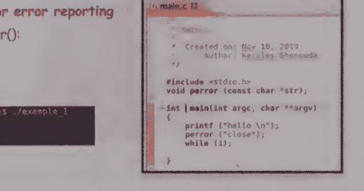

`perror()` 是 C 语言中的标准库函数，用于向标准错误流打印错误信息。以下是一些关键点，帮助你理解 `perror()`：

*   定义：`perror()` 是 C 中的标准库函数，向标准错误流打印错误信息。错误信息基于全局变量 `errno` 的值。
*   用法：`perror()` 用于在系统调用或库函数失败时打印错误信息。它接受一个参数，即作为错误信息前缀的字符串。
*   语法：`perror()` 的语法如下：

```c
#include <stdio.h>

void perror(const char *s);

int main(int argc, char *argv[]) {
    FILE *fp;

    fp = fopen("file.txt", "r");
    if (fp == NULL) {
        perror("Error opening file");
        return 1;
    }
    return 0;
}
```

*   返回值：`perror()` 不返回值。
*   示例：这是一个使用 `perror()` 打印错误信息的示例：

```c
#include <stdio.h>
#include <errno.h>

int main() {
    FILE *fp;

    fp = fopen("file.txt", "r");
}
```


## 第 13 章 嵌入式 Linux 简介

```c
if (fp == NULL) {
    perror("fopen");
    return 1;
}
return 0;
```

在这个示例中，程序尝试使用 `fopen()` 函数打开一个名为 "file.txt" 的文件。如果无法打开文件，程序将调用 `perror()` 打印带有前缀 "fopen" 的错误消息。

下面是总结 `perror()` 关键要点的表格：

| 概念 | 描述 |
|---|---|


## 第 13 章 嵌入式 Linux

### `perror()` 函数

| 概念 | 描述 |
| --- | --- |
| 定义 | C 语言中的标准库函数，用于向标准错误流打印错误消息 |
| 用法 | 当系统调用或库函数失败时用于打印错误消息 |
| 语法 | `void perror(const char *s);` |
| 返回值 | 不返回任何值 |

总之，`perror()` 是 C 语言中非常有用的函数，用于在系统调用或库函数失败时打印错误消息。理解如何使用 `perror()` 对于构建能够优雅处理错误的健壮且可靠的程序非常重要。

### Linux 闹钟 (`alarm()`)

在 Linux 中，`alarm()` 函数用于设置闹钟以递送信号。以下是一些帮助你理解如何使用 `alarm()` 函数的关键点：

- **定义**：`alarm()` 函数用于安排在指定的秒数后向调用进程发送 `SIGALRM` 信号。它具有以下语法：
  `unsigned int alarm(unsigned int seconds);`

- **闹钟信号**：`SIGALRM` 信号是 `alarm` 设置的计时器触发时产生的闹钟信号。

- **设置闹钟**：当你调用 `alarm()` 函数时，它会设置一个计时器，在指定的秒数过后生成一个 `SIGALRM` 信号。如果你在计时器过期之前再次调用 `alarm()`，它将取消之前的计时器并启动一个新的。

- **取消闹钟**：要取消闹钟，可以调用 `alarm()` 函数并将秒数参数设为 0。这将取消任何之前设置的闹钟。

- **`alarm()` 使用示例**：这是一个使用 `alarm()` 调度在 5 秒后向调用进程发送 `SIGALRM` 信号的示例：

```c
#include <stdio.h>
#include <unistd.h>
#include <signal.h>

void alarm_handler(int signum) {
    printf("接收到闹钟信号。\n");
}

int main() {
    signal(SIGALRM, alarm_handler);
    alarm(5);
    while (1) {
        printf("等待闹钟...\n");
        sleep(1);
    }
    return 0;
}
```

在这个示例中，程序使用 `signal()` 为 `SIGALRM` 设置了信号处理函数。然后程序调用 `alarm(5)` 调度在 5 秒后递送 `SIGALRM` 信号。随后程序进入无限循环，等待闹钟信号的递送。当收到闹钟时，信号处理函数将被调用并打印一条指示已接收信号的消息。

下面是总结使用 `alarm()` 函数关键要点的表格：


| 概念 | 描述 |
| --- | --- |
| `alarm()` 函数 | 用于安排在指定的秒数后向调用进程发送 `SIGALRM` 信号 |
| 语法 | `unsigned int alarm(unsigned int seconds)` |
| 闹钟信号 | 当 `alarm` 函数设置的计时器触发时生成 `SIGALRM` 信号 |
| 设置闹钟 | 调用 `alarm()` 设置一个计时器，在指定的秒数过后生成 `SIGALRM` 信号 |
| 取消闹钟 | 调用 `alarm()` 并将秒数设为 0 以取消闹钟 |
| 示例 | 使用 `alarm()` 调度在 5 秒后递送 `SIGALRM` 信号 |

**`alarm-part4` 输出是什么？**

---

```c
/*
 * main.c
 * 创建于 2018年2月16日
 * 作者：Khalil
 * 修改于 2019年10月25日
 */

#include <stdio.h>
#include <signal.h>
#include <stdlib.h>
#include <unistd.h>

void alarm_handler(int signum) {
    printf("接收到闹钟信号。\n");
}

int main() {
    signal(SIGALRM, alarm_handler);
    alarm(5);
    while (1) {
        printf("等待闹钟...\n");
        sleep(1);
    }
    return 0;
}
```

**`alarm-part4` 输出是什么？**

---

在这个示例中，如果无法打开文件，程序将调用 `perror()` 打印带有前缀 "fopen" 的错误消息。

下面是总结 `perror()` 关键要点的表格：

| 概念 | 描述 |
| --- | --- |
| 定义 | C 语言中的标准库函数，用于向标准错误流打印错误消息 |
| 用法 | 当系统调用或库函数失败时打印错误消息 |
| 语法 | `void perror(const char *s);` |
| 返回值 | 不返回任何值 |

总之，`perror()` 是 C 语言中非常有用的函数，用于在系统调用或库函数失败时打印错误消息。理解如何使用 `perror()` 对于构建能够优雅处理错误的健壮且可靠的程序非常重要。

**`alarm-part4` 输出是什么？**


```c
/*
 * main.c
 * 创建于 2018年2月16日
 * 作者：Khalil
 * 修改于 2019年10月25日
 */

#include <stdio.h>
#include <signal.h>
#include <stdlib.h>
#include <unistd.h>

void alarm_handler(int signum) {
    printf("接收到闹钟信号。\n");
}

int main() {
    signal(SIGALRM, alarm_handler);
    alarm(5);
    while (1) {
        printf("等待闹钟...\n");
        sleep(1);
    }
    return 0;
}
```

## 第 13 章：嵌入式 Linux 简介

| 打开目录 | 使用 `opendir()` 打开目录，提供一个类型为 `DIR*` 的指针以访问其内容 |
| :--- | :--- |
| 遍历目录内容 | 使用 `readdir()` 遍历目录的内容，提供一个类型为 `DIR*` 的指针并接收一个类型为 `struct dirent` 的指针 |
| 关闭目录 | 使用 `closedir()` 关闭目录，提供一个类型为 `DIR*` 的指针 |
| 错误处理 | 在使用 `opendir()` 和 `closedir()` 时通过检查返回值是否为 `NULL` 并使用 `perror()` 打印错误信息 |

```c
main.c
# Created on: Dec 10, 2019
# Author: Keroles Shenouda
# www.keroles-in-depth.com

#include <stdio.h>
#include <signal.h>
#include <stdlib.h>
#include <string.h>
#include <dirent.h>
#include <errno.h>

void signal_handler();
void dir_example(int argc, char *argv[]);

int main(int argc, char *argv[]) {
    signal_handler();
    dir_example(argc, argv);
    return 0;
}

/* this can serve as the command implementation in C Language */
void dir_example(int argc, char *argv[]) {
    DIR *dir; /* Open data type representing directory stream * */
    printf("%s %s\n", argv[0], argv[1]);
    dir = opendir(argv[1]);
    if (dir == NULL) {
        printf("Cannot open directory error: %s\n", strerror(errno));
        exit(1);
    }

    while ((dir = readdir(dir)) != NULL) {
        printf("%s\n", dir->d_name);
    }

    closedir(dir);
    exit(0);
}
```

## 第 12 章：嵌入式 Linux 简介

```c
while ((dirp = readdir(dp)) != NULL) {
    printf("%s\n", dirp->d_name);
}
closedir(dirp);
exit(0);

struct dirent {
    ino_t d_ino;
    char d_name[256];
    off_t d_off;
    unsigned short d_len;
    unsigned char d_type;
};

void sig_handler(int signum) {
    printf("Alarm delivered %d\n", signum);
    exit(0);
}
```

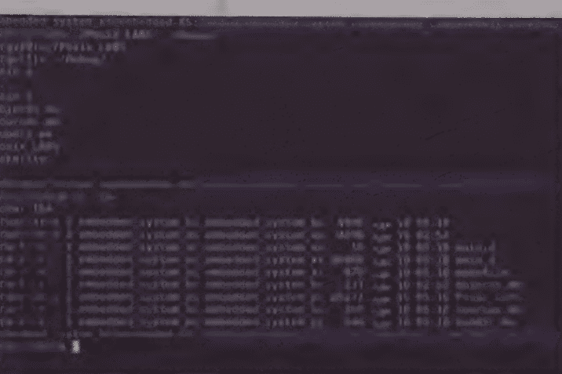

### 如何列出子目录中的目录

## 第 13 章：嵌入式 Linux 简介

```c
#include <stdio.h>
#include <string.h>
#include <unistd.h>
#include <sys/stat.h>
#include <dirent.h>

void list_directory(char *pathname) {
    DIR *dp;
    struct dirent *de;
    dp = opendir(pathname);
    if (dp == NULL) {
        perror("opendir");
        return;
    }
    while ((de = readdir(dp)) != NULL) {
        printf("%s\n", de->d_name);
    }
    closedir(dp);
}

void copy_file(char *pathname, char *dest_name) {
    int src_fd, dest_fd;
    char buffer[1024];
    ssize_t bytes;
    src_fd = open(pathname, O_RDONLY);
    if (src_fd < 0) {
        perror("open src");
        return;
    }
    dest_fd = open(dest_name, O_WRONLY | O_CREAT | O_TRUNC, 0644);
    if (dest_fd < 0) {
        perror("open dest");
        close(src_fd);
        return;
    }
    while ((bytes = read(src_fd, buffer, sizeof(buffer))) > 0) {
        write(dest_fd, buffer, bytes);
    }
    close(src_fd);
    close(dest_fd);
}

int main(int argc, char *argv[]) {
    if (argc < 3) {
        printf("Usage: %s <source> <dest>\n", argv[0]);
        return 1;
    }
    copy_file(argv[1], argv[2]);
    return 0;
}
```


## `open()` / `read()`/`write()` 文件

除了 C 标准库的文件 I/O 函数外，Linux 还提供了一组更低层的文件访问接口，称为 POSIX 接口。这些函数包括 `open()`、`read()`、`write()` 和 `seek()`，它们提供了直接访问系统文件的方法。以下是一些帮助你理解如何使用这些函数的关键点：

- 打开文件：要使用 `open()` 函数打开文件，你需要传入文件名和访问模式。访问模式指定了如何访问文件（读、写或两者均有），以及如果文件不存在是否创建一个。文件权限设置为 `0644`，允许所有者读写，其他人只读。示例如下：

```c
#include <stdio.h>
#include <fcntl.h>

int main() {
    int fd;
    fd = open("test.txt", O_RDWR | O_CREAT, 0644);
    if (fd == -1) {
        perror("open");
        return 1;
    }
    close(fd);
}
```

在此示例中，程序以读写打开 `test.txt`。

- 读取文件：要使用 `read()` 函数读取文件，你需要传入文件描述符、存储数据的缓冲区以及读取的字节数。示例如下：


## 第 13 章：嵌入式 Linux 简介

```c
#include <stdio.h>
#include <fcntl.h>
#include <unistd.h>

int main() {
    int fd;
    char buf[1024];
    fd = open("test.txt", O_RDONLY);
    if (fd == -1) {
        perror("open");
        return 1;
    }
    int n = read(fd, buf, sizeof(buf));
    if (n == -1) {
        perror("read");
        return 1;
    }
    close(fd);
}
```


在此示例中，程序使用`O_RDONLY`标志以只读方式打开`test.txt`。程序使用`read()`函数从文件中读取最多`sizeof(buf)`字节到缓冲区。如果发生错误，程序使用`perror()`打印错误消息并关闭文件。

### 写入文件示例

要使用`write()`函数写入文件，你需要传入文件描述符、包含写入数据的缓冲区以及写入的字节数。示例如下：

```c
#include <stdio.h>
#include <fcntl.h>
#include <unistd.h>

int main() {
    int fd, n;
    char buf[1024] = "Hello, world!";
    fd = open("test.txt", O_WRONLY | O_CREAT, 0644);
    if (fd == -1) {
        perror("open");
        return 1;
    }

    n = write(fd, buf, sizeof(buf));
    if (n == -1) {
        perror("write");
        return 1;
    }
    close(fd);
    return 0;
}
```

在此示例中，程序使用`O_WRONLY`和`O_CREAT`标志打开`test.txt`。

## 文件操作示例

```c
void myfile(int argc, char *args[]) {
    int fd = open(args[1], O_RDONLY);
    if (fd < 0) {
        perror("error opening file as argument");
        return EXIT_FAILURE;
    }
    char *buffer = malloc(1024);
    if (buffer == NULL) {
        perror("error allocating memory");
        return EXIT_FAILURE;
    }
    int n;
    while ((n = read(fd, buffer, 1023)) > 0) {
        printf("%.*s", n, buffer);
    }
    free(buffer);
    close(fd);
    return EXIT_SUCCESS;
}
```


```c
/*
 * Created on: Dec 10, 2019
 * Author: Keroles Shenouda
 * www.Learn-in-depth.com
 */
```

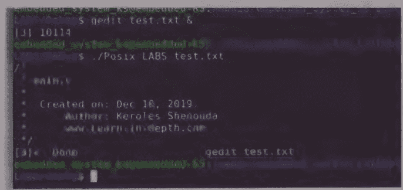

```c
/*
 * main.c
 *
 * Created on: Dec 10, 2019
 * Author: Keroles Shenouda
 * www.Learn-in-depth.com
 */
```

### 写/读示例

## 第 15 章：嵌入式 Linux 简介

```c
void myfunc(int argc, char *argv[]) {
    if (argc > 1) {
        printf("arg: %s\n", argv[1]);
    }
}

#include <stdio.h>
#include <unistd.h>
#include <stdlib.h>
#include <string.h>
#include <pthread.h>
#include <types.h>
#include <fcntl.h>

void mywrite(int argc, char *argv[])
int main(int argc, char *argv[]) {
    myfunc(argc, argv);
    return 0;
}
```


## Linux 头文件与线程

在系统编程中，会使用一些头文件，包括标准 C 头文件和内核及 `glibc` 提供的系统特定头文件。系统级编程的一个重要库是 `pthread` 库，它用于在进程内创建线程。

- **标准 C 头文件**：这些头文件提供了 C 编程的基础功能，如字符串处理、内存分配和输入输出。示例包括`<stdio.h>`、`<stdlib.h>`。
- **Linux 特定头文件**：这些头文件提供了特定于 Linux 系统的功能，如系统调用和进程管理。示例包括`<sys/types.h>`、`<sys/stat.h>`、`<fcntl.h>`和`<signal.h>`。
- **`pthread` 库**：该库用于在进程内创建线程。同一进程内的所有线程共享相同的地址空间和打开的文件集。线程库还提供了同步原语，如互斥锁和条件变量。

## 第 13 章 嵌入式 Linux 简介（线程部分）

在 Linux 中，当创建一个新进程时，它已经包含一个线程，用于执行`main()`函数。

- 进程是由操作系统创建的
- 可以使用`pthread`库创建额外的线程，它们与进程共享相同的地址空间
- 进程中的所有线程共享相同的地址空间、同一组打开的文件、信号和处理器
- `pthread`库还提供了同步原语，如线程和条件
- 该线程有自己的头文件：`pthread.h`
- 使用`pthread`函数的应用程序应使用`gcc -o app app.c -pthread`显式链接`pthread`库

### `pthread.h` 头文件

`pthread.h`头文件提供了使用`pthread`库所需的函数和数据类型。使用`pthread`函数的应用程序在编译时应使用`-pthread`标志显式链接`pthread`库。

### 创建新线程

要使用`pthread`库创建新线程，请使用`pthread_create()`。

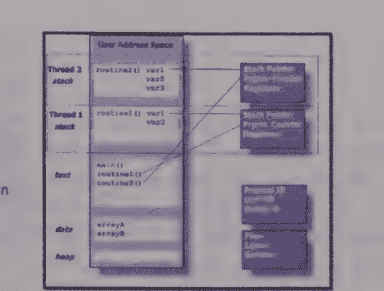

创建新线程的函数是`pthread_create()`：

`int pthread_create(pthread_t *thread, const pthread_attr_t *attr, void (*start_routine)(void *), void *arg)`

- `pthread_t` 是一个由函数初始化的结构体。它的属性可以用于引用线程。
- `attr` 是指向可选结构体`pthread_attr`的指针。它可以用于设置线程的属性（分离策略、优先级等）。
- `start_routine` 是线程将执行的函数
- `arg` 是作为参数传递给`start_routine`的私有数据

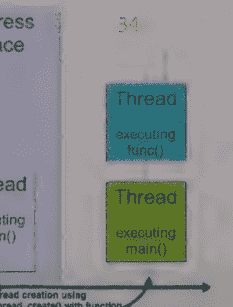

这里有一个示例：

```c
#include <pthread.h>
#include <stdio.h>

void thread_func(void* arg) {
    printf("Hello, world!\n");
    return NULL;
}

int main() {
    pthread_t thread;
    int ret;
    ret = pthread_create(&thread, NULL, thread_func, NULL);
    if (ret != 0) {
        perror("pthread_create");
        return 1;
    }
    pthread_join(thread, NULL);
    return 0;
}
```


在这个示例中，`main()` 函数通过调用 `pthread_create()` 创建了一个新线程。第一个参数是一个指向 `pthread_t` 结构体的指针，该结构体由函数初始化，稍后可用于引用线程。第二个参数是指向可选 `attr_t` 结构的指针，可用于设置线程属性。第三个参数指向线程将执行的函数指针，第四个参数指向任何应传递给线程的数据指针。

创建线程后，`main()` 函数通过调用 `pthread_join()` 等待线程完成。这确保了程序在线程结束之前退出。

**实验：两种情况的输出输出什么**

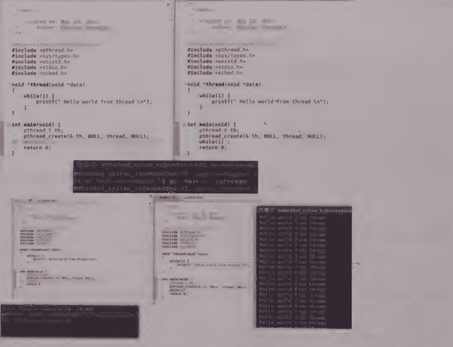

## 可连接线程与分离线程

# 第15 章 嵌入式 Linux 简介

- 当 `main()` 函数退出时，应用程序的所有线程都会被销毁
- `Joining` 是实现线程间同步的一种方式
- `pthread_join()` 函数可以用于支持等待一个线程直到另一个线程终止
- 必须调用此函数以释放线程使用的资源，否则它将保持为僵尸状态


处理线程时，理解可连接线程和分离线程是非常重要的。这里是一些关键点：

1. 可连接线程（Joinable threads）：通过 `pthread_join()` 显式连接的线程。在连接之前，其资源（如内存）不会释放。
2. 分离线程（Detached threads）：不需要显式连接的线程，退出时会自动释放资源。
3. 连接线程（Joining）：`pthread_join()` 函数用于等待可连接线程完成。这里有一个示例：

```c
#include <pthread.h>
#include <stdio.h>

void thread_func(void* arg) {
    printf("Hello, world!\n");
    return NULL;
}

int main() {
    pthread_t thread;
    int ret;
    ret = pthread_create(&thread, NULL, thread_func, NULL);
    if (ret != 0) {
        perror("pthread_create");
        return 1;
    }

    ret = pthread_join(thread, NULL);
    if (ret != 0) {
        perror("pthread_join");
        return 1;
    }
    return 0;
}
```

在这个示例中，`main()` 函数通过调用 `pthread_create()` 创建了一个新线程。线程函数向控制台打印消息。创建线程后，`main()` 函数调用 `pthread_join()` 等待线程完成。如果线程成功，`pthread_join()` 返回 `0`。如果出错，则返回非零值。


## 分离线程

可以使用 `pthread_detach()` 函数分离线程。一旦线程被分离，它就无法被连接。这里有一个示例：

```c
#include <pthread.h>
#include <stdio.h>

void thread_func(void* arg) {
    printf("Hello, world!\n");
    return NULL;
}

int main() {
    pthread_t thread;
    int ret;
    ret = pthread_create(&thread, NULL, thread_func, NULL);
    if (ret != 0) {
        perror("pthread_create");
        return 1;
    }

    ret = pthread_detach(thread);
    if (ret != 0) {
        perror("pthread_detach");
        return 1;
    }

    return 0;
}
```

在这个示例中，`main()` 函数通过 `pthread_create()` 创建了一个新线程。创建线程后，它调用 `pthread_detach()` 分离线程。一旦线程被分离，其资源将在退出时自动释放。


## 线程示例


# 第 13 章 嵌入式 Linux 绪论

1. 使用 `pthread_detach()`：分离线程的另一种方法是在创建线程后调用 `pthread_detach()`。这里有一个示例：

```c
#include <pthread.h>
#include <stdio.h>

void* thread_func(void* arg) {
    printf("Hello, world!\n");
    return NULL;
}

int main() {
    pthread_t thread;
    int ret;
    ret = pthread_create(&thread, NULL, thread_func, NULL);
    if (ret != 0) {
        perror("pthread_create");
        return 1;
    }
    ret = pthread_detach(thread);
    if (ret != 0) {
        perror("pthread_detach");
        return 1;
    }
    return 0;
}
```

在这个示例中，主函数使用 `pthread_create()` 创建了一个新线程。在创建线程后，它调用 `pthread_detach()` 来分离该线程。线程函数与上一个示例相同。当线程被分离后，无法使用 `pthread_join()` 将其合并。线程在退出时，其资源将被自动回收。

- 线程也可以被分离，在这种情况下它们变得独立。
- 父线程不需要等待；当线程结束时，`tid` 存储空间会被回收。
- 主要为了节省空间。


# 线程取消

也可以使用 `pthread_cancel()` 函数从另一个线程取消线程，将要取消线程的 `pthread_t` 结构体传递进去。

## 输出是什么？深度思考

```c
#include <pthread.h>
#include <stdio.h>
#include <stdlib.h>
#include <unistd.h>

void *thread_func(void *arg) {
    int i = 0;
    while (1) {
        printf("count: %d\n", i++);
        sleep(1);
        if (i == 5) {
            printf("thread will exit with status 0\n");
            break;
        }
    }
    printf("thread was cancelled\n");
    return NULL;
}

int main() {
    pthread_t thread;
    pthread_create(&thread, NULL, thread_func, NULL);
    sleep(2);
    pthread_cancel(thread);
    pthread_join(thread, NULL);
    return 0;
}
```


输出是什么？深度思考


```c
1 /////////////////////////////////////////
2 *
3 /*
4 *  main.c
5 *
6 *  Created on: Nov 10, 2019
7 *  Author: Keroles Shenouda
8 * */
9 /////////////////////////////////////////
10
11 #include <stdio.h>
12 #include <sys/types.h>
13 #include <unistd.h>
14 #include <signal.h>
15 #include <pthread.h>
16
17 void *thread()
18 {
19     while (1) {
20         printf("thread Hello \n");
21     }
22 }
23
24
25 int main(int argc, char **argv) 
26 {
27     int s, res;
28     pthread_t t;
29     pthread_create(&t, NULL, thread, NULL);
30     sleep(1); /* 给线程一个启动的机会 */
31     printf("main(): sending cancellation\n");
32     s = pthread_cancel(t);
33     if (s != 0) {
34         perror("thread to cancel");
35         /* 合线程以查看退出状态 */
36         s = pthread_join(t, &res);
37         if (res == PTHREAD_CANCELED) {
38             printf("main(): thread was canceled\n");
39         }
40     }
41     while (1);
42     return 0;
43 }
```


## 互斥锁 (mutex)

线程库提供了互斥锁作为同步原语，允许多个线程同步访问资源。互斥锁确保只有一个线程获取锁并访问共享资源，从而防止竞态条件。以下是关于互斥锁的一些细节：

### 互斥锁的声明和初始化

- 可以在编译时使用`PTHREAD_MUTEX_INITIALIZER`进行初始化，也可以在运行时使用`pthread_mutex_init()`函数。
- 在运行时，可以使用`pthread_mutex_init()`函数初始化属性。它接收一个`pthread_mutex_t`变量指针和一个`pthread_mutexattr_t`结构体指针。

### 获取和释放互斥锁

- 使用`pthread_mutex_lock()`函数获取互斥锁。如果已被另一个线程锁定，调用线程将阻塞，直到互斥锁解锁。
- 使用`pthread_mutex_unlock()`函数释放互斥锁。如果有任何线程正在等待此互斥锁，调度程序将允许一个线程获取锁。

### 销毁互斥锁

- 在不再需要时使用`pthread_mutex_destroy()`函数销毁互斥锁。该函数会释放与互斥锁相关的资源。

以下是一个使用互斥锁的示例代码：

```c
#include <pthread.h>

pthread_mutex_t lock = PTHREAD_MUTEX_INITIALIZER;
int shared_variable = 0;

void* thread_function(void* arg) {
    pthread_mutex_lock(&lock);
    shared_variable++;
    pthread_mutex_unlock(&lock);
    return NULL;
}

int main() {
    pthread_t thread1, thread2;
    pthread_create(&thread1, NULL, thread_function, NULL);
    pthread_create(&thread2, NULL, thread_function, NULL);
    pthread_join(thread1, NULL);
    pthread_join(thread2, NULL);
    pthread_mutex_destroy(&lock);
    return 0;
}
```


在这个示例中，创建了两个线程，它们都在互斥锁保护的临界区内增加共享变量。通过这种方式，线程确保只有一个线程同时访问共享变量，防止任何并发问题。

## 输出是什么？

# 深度思考

```c
main.c clone(1) at clone.5:94:0xb7eca94
****************
main.c
* Created on: Nov 18, 2019
* Author: Keroles Shenouda
****************
#include <stdio.h>
#include <pthread.h>
#include <stdlib.h>
pthread_mutex_t fill_mutex;
int arr[4];
int flag=0;
pthread_cond_t cond_var=PTHREAD_COND_INITIALIZER;
void fill() {
    int i=0;
    for(i=0; i<4; i++) {
        pthread_mutex_lock(&fill_mutex);
        arr[i]=1;
        pthread_mutex_unlock(&fill_mutex);
        sleep(1);
    }
}
void read() {
    int i=0;
    printf("Values filled in array are:\n");
    for(i=0; i<4; i++) {
        sleep(1);
        pthread_mutex_lock(&fill_mutex);
        printf("%d \n",arr[i]);
        pthread_mutex_unlock(&fill_mutex);
    }
}
int main() {
    pid_t t;
    pthread_t thread_id1, thread_id2;
    int ret;
    void *res;
    pthread_create(&thread_id1, NULL, &fill, NULL);
    pthread_create(&thread_id2, NULL, &read, NULL);
    printf("\n Created threads:\n");
    pthread_join(thread_id1, &ret);
    pthread_join(thread_id2, &ret);
    return 0;
}
```

# 创建的线程

数组中填充的值为

0

1

2

3

4

深度学习

为什么用三个线程？


# 深度思考


```c
/*
 * main.c
 *
 * Created on: Nov 18, 2019
 * Author: Keroles Shenouda
 * //
#include <stdio.h>
#include <pthread.h>
#include <unistd.h>

pthread_mutex_t fill_mutex;
int arr[20];
int flag=1;
pthread_cond_t cond_var=PTHREAD_COND_INITIALIZER;

void fill() {
    int i=0;
    for(i=0;i<4;i++) {
        pthread_mutex_lock(&fill_mutex);
        pthread_mutex_unlock(&fill_mutex);
        sleep(1);
    }
}

void read() {
    int i=0;
    printf("Values filled in array are:\n");
    for(i=0;i<4;i++) {
        pthread_mutex_lock(&fill_mutex);
        printf("%d\n", arr[i]);
        pthread_mutex_unlock(&fill_mutex);
    }
}

int main() {
    int tid;
    pthread_t thread_id1, thread_id2;
    int ret;
    void *arg;
    ret=pthread_create(&thread_id1,NULL,fill,NULL);
    ret=pthread_create(&thread_id2,NULL,read,NULL);
    printf("Created threads:\n");
    pthread_join(thread_id1,NULL);
    pthread_join(thread_id2,NULL);
    return 0;
}
```


## 第 13 章：嵌入式 Linux 简介

### Pthread 条件变量

`Pthread` 条件变量与互斥锁（mutexes）结合使用，实现线程之间的通信和同步。条件变量允许一个或多个线程等待，直到某个条件变为真，该条件由另一个线程信号。线程库提供了一个用于条件的原始语：`pthread_cond_t`。

要使用 `pthread` 条件变量，必须对其进行初始化。初始化 `pthread` 条件变量有两种方式：

1. 使用 `PTHREAD_COND_INITIALIZER`：

```c
pthread_cond_t cond = PTHREAD_COND_INITIALIZER;
```

2. 在运行时使用 `pthread_cond_init()`：

```c
pthread_cond_t cond;
pthread_cond_init(&cond, NULL);
```

为了等待条件变为真，线程可以调用 `pthread_cond_wait()`。该函数会原子性地释放第二个参数指定的互斥锁，并将调用线程置于睡眠状态。当条件被信号时，该线程将唤醒并重新获取互斥锁。

```c
pthread_cond_wait(&cond, &mutex);
```

要发送条件信号，线程可以调用 `pthread_cond_signal()` 来唤醒一个等待线程，或者调用 `pthread_cond_broadcast(&cond)` 来唤醒所有等待线程。请注意，这些函数可以在持有关联互斥锁时被调用。

```c
pthread_cond_signal(&cond); // 唤醒一个等待线程
pthread_cond_broadcast(&cond); // 唤醒所有等待线程
```

这是一个如何使用 `pthread` 条件变量实现生产者-消费者模型的示例：

```c
#include <stdio.h>
#include <stdlib.h>
#include <pthread.h>

#define BUFFER_SIZE 10

int buffer[BUFFER_SIZE];
int count = 0;
pthread_mutex_t mutex = PTHREAD_MUTEX_INITIALIZER;
pthread_cond_t cond = PTHREAD_COND_INITIALIZER;

void* producer(void* arg) {
    int i;
    for (i = 0; i < 100; i++) {
      pthread_mutex_lock(&mutex);
      while (count == BUFFER_SIZE) {
        pthread_cond_wait(&cond, &mutex);
      }
      buffer[count++] = i;
      pthread_mutex_unlock(&mutex);
      pthread_cond_signal(&cond);
    }
    return NULL;
}

void* consumer(void* arg) {
    int i, data;
    for (i = 0; i < 100; i++) {
        pthread_mutex_lock(&mutex);
        while (count == 0) {
            pthread_cond_wait(&cond, &mutex);
        }
        data = buffer[--count];
        pthread_mutex_unlock(&mutex);
        printf("Consumed: %d\n", data);
        pthread_cond_signal(&cond);
    }
    return NULL;
}

int main() {
    pthread_t producer_thread, consumer_thread;
    pthread_create(&producer_thread, NULL, producer, NULL);
    pthread_create(&consumer_thread, NULL, consumer, NULL);
    pthread_join(producer_thread, NULL);
    pthread_join(consumer_thread, NULL);
    return 0;
}
```

在这个示例中，生产者线程用从 0 到 99 的整数填充缓冲区，而消费者线程负责移除并打印它们。`pthread_cond_wait()` 和 `pthread_cond_signal()` 函数用于确保消费者线程一直等待直到缓冲区中有数据。

### Socket 编程

```c
#include <sys/socket.h>
#include <netinet/in.h>
#include <unistd.h>
#include <stdio.h>
#include <stdlib.h>
#include <string.h>

int main(int argc, char *argv[]) {
    int sockfd;
    struct sockaddr_in addr;
    socklen_t len = sizeof(addr);

    sockfd = socket(AF_INET, SOCK_STREAM, 0);
    addr.sin_family = AF_INET;
    addr.sin_port = htons(8080);
    addr.sin_addr.s_addr = INADDR_ANY;

    bind(sockfd, (struct sockaddr *)&addr, sizeof(addr));
    listen(sockfd, 3);

    while(1) {
        int client_fd;
        client_fd = accept(sockfd, (struct sockaddr *)&addr, &len);
        printf("Connection received\n");
        close(client_fd);
    }
    return 0;
}
```


# Socket 编程基础

Socket 编程是用于在网络上的两个节点（计算机）之间建立通信的一种技术。在 `Linux` 中，`Socket` 编程被广泛用于客户端-服务器（client-server）通信。以下是 `Socket` 编程的关键组成部分：

- **服务端（Server）**：被动等待并响应客户端。
- **客户端（Client）**：发起通信并必须知道地址和端口。
- **Socket 描述符（Socket Descriptor）**：表示通信端点的整数值。
- **通信域**：指定要使用的协议。例如，`AF_INET` 用于 IPv4。
- **连接类型**：定义要创建的 socket 类型。例如，`SOCK_STREAM` 用于可靠的面向连接的服务，`SOCK_DGRAM` 用于不可靠的无连接服务。
- **协议**：指定具体的协议，如 `IPPROTO_TCP` 或 `IPPROTO_UDP`。

## 重要的 Socket 函数

- `socket()`：创建一个新的 socket 并返回一个描述符。
- `bind()`：将 socket 与本地地址和端口绑定。
- `listen()`：在 socket 上监听等待连接。
- `accept()`：接受来自 socket 的传入连接。
- `connect()`：发起与远程 socket 的连接。
- `send()`：通过 socket 发送数据。
- `recv()`：从 socket 接收数据。
- `close()`：释放 socket 描述符。

> **注**：由于原文提供的代码块存在严重的格式混乱和错误，翻译时已根据逻辑将其修复为可读的 C 代码结构，以保持原意。

## 示例代码：简单 TCP 服务器

```c
#include <sys/socket.h>
#include <netinet/in.h>
#include <unistd.h>
#include <stdio.h>
#include <stdlib.h>
#include <string.h>

int main(int argc, char *argv[]) {
    int sockfd;
    struct sockaddr_in addr;
    socklen_t len = sizeof(addr);

    sockfd = socket(AF_INET, SOCK_STREAM, 0);
    addr.sin_family = AF_INET;
    addr.sin_port = htons(8080);
    addr.sin_addr.s_addr = INADDR_ANY;

    bind(sockfd, (struct sockaddr *)&addr, sizeof(addr));
    listen(sockfd, 3);

    while(1) {
        int client_fd;
        client_fd = accept(sockfd, (struct sockaddr *)&addr, &len);
        printf("Connection received\n");
        close(client_fd);
    }
    return 0;
}
```

# 第 12 章：嵌入式 Linux 绪

## 服务端示例

* 文件：`server.c`
* 创建于：2019年12月10日
* 作者：Keroles Shenouda

```c
#include <sys/socket.h>
#include <netinet/in.h>
#include <arpa/inet.h>
#include <unistd.h>
#include <stdlib.h>
#include <string.h>
#include <errno.h>
#include <time.h>
#include <stdio.h>

int main(int argc, char *argv[]) {
    int listenfd = -1, conffd = 0;
    struct sockaddr_in servaddr;

    char sendBuff[256];
    time_t t;
    listenfd = socket(AF_INET, SOCK_STREAM, 0);
    memset(&servaddr, 0, sizeof(servaddr));
    memset(sendBuff, 0, sizeof(sendBuff));

    servaddr.sin_family = AF_INET;
    servaddr.sin_addr.s_addr = htonl(INADDR_ANY);
    servaddr.sin_port = htons(8000);

    bind(listenfd, (struct sockaddr*)&servaddr, sizeof(servaddr));
    listen(listenfd, 10);

    conffd = accept(listenfd, (struct sockaddr*)NULL, NULL);
    {
        while(1) {
            t = time(NULL);
            printf(sendBuff, "%.24s\r\n", ctime(&t));
            write(conffd, sendBuff, strlen(sendBuff));
            sleep(1);
        }
    }
    return 0;
}
```

## 客户端示例

* 文件：`client.c`
* 创建于：2019年8月05日
* 作者：Shenouda

```c
#include <sys/socket.h>
#include <netinet/in.h>
#include <arpa/inet.h>
#include <unistd.h>
#include <stdlib.h>
#include <string.h>
#include <errno.h>
#include <time.h>
#include <stdio.h>

int main(int argc, char *argv[]) {
    int sock = socket(AF_INET, SOCK_STREAM, 0);
    struct sockaddr_in servaddr;

    servaddr.sin_family = AF_INET;
    servaddr.sin_port = htons(8000);
    servaddr.sin_addr.s_addr = inet_addr(argv[1]);

    if (connect(sock, (struct sockaddr *)&servaddr, sizeof(servaddr)) < 0) {
        perror("connect failed");
        return 1;
    }

    char sendBuff[256];
    printf("Hello server\n");
    send(sock, "Hello server", strlen("Hello server"), 0);
    while (1) {
        if (recv(sock, sendBuff, sizeof(sendBuff), 0) <= 0) {
            perror("read could not create server");
            return 1;
        }
    }
    return 0;
}
```


# Linux 命令行界面 CLI

使用命令行界面（CLI）—— 看起来像 `DOS`，但功能更强大。

## 使用 CLI 的优势

- 更多控制，那些是你在 `GUI` 中永远无法实现的功能
- 速度更快，一个命令就可以实现多个菜单操作和点击的效果
- 启用自动化和脚本

`GUI` 让简单任务变得更简单……但 `CLI` 让困难任务变得可能。

有时在嵌入式系统中，`CLI` 是我们仅有的全部。

## 常用且实用的 Linux 命令

1. `ls` 列出目录内容：`ls /home/user/Documents`
2. `cd` 切换目录：`cd /home/user/Desktop`
3. `mkdir` 创建新目录：`mkdir new_directory`
4. `rm` 删除文件或目录：`rm file.txt`
5. `cp` 复制文件或目录：`cp file.txt /home/user/Documents/` 或 `cp -r directory/home/user/backup/`
6. `mv` 移动或重命名文件或目录：`mv file.txt /home/user/Documents/` 或 `mv directory/home/user/backup/new_name/`
7. `cat` 显示文件内容：`cat file.txt`


- 8. `grep` 在文件中搜索特定模式：`grep "keyword" file.txt`

- 9. `top` 显示系统资源使用和运行进程：`top`

- 10. `ps` 显示运行进程信息：`ps -ef`

- 11. `chmod` 修改文件或目录的权限：`chmod 755 file.txt`

- 12. `sudo` 以高权限运行命令：`sudo apt-get update`

- 13. `ping` 测试与主机的连通性：`ping google.com`

- 14. `tar` 压缩或解压归档文件：`tar -cvf archive.tar file.txt` 或 `tar -xvf archive.tar`

- 15. `ssh` 使用 Shell 协议连接远程服务器：`ssh user@hostname`

这些只是 Linux 命令示例。每个命令都有多种选项和标志可以用于不同的用途，使得命令行界面成为强大的系统管理工具。


# 第 12 章：嵌入式 Linux 绪

# Linux 命令行界面

- 文本处理
- 复合命令
- 进程管理
- 学习 Shell
- 文件系统
- 归档与压缩
- 环境变量
- 正则表达式

# 什么是文件？

- 文件是表示某些内容的字节集（pdf、表格、可执行文件……）
- 文件存储在存储设备的分区上，作为一个数据块或多个块。不同大小的文件存储在同一个分区内。
- 文件系统负责管理数据块并向用户展示。
- 文件系统维护关于文件的额外信息，这些被称为元数据（Meta-data）：
  - 文件大小
  - 所有者（用户与组）
  - 权限
  - 创建/最后修改日期
  - 指向文件块的指针
  - 等
- 这些元数据存储在索引节点（`inode`）结构中


# 第 13 章：嵌入式 Linux 绪

- `ls -i` 显示该文件的 `inode` 编号


# `$ df` (显示文件系统磁盘空间使用)


# `$ df -i` (显示文件系统 `inode` 使用)


# `$ df -kh .`


# 硬链接 (Hard LINKING FILES)

硬链接中，仅为文件创建目录结构中的项，但它指向原始文件的 `inode` 位置。

- 这意味着硬链接中没有创建新的 `inode`。可以这样解释：


# 软链接 (Soft LINKING FILES)

- 软链接与我们在 Windows 中说的“快捷方式”非常相似
- 是一种链接到文件或目录的方法
- 它仅包含指向目标文件位置的指针
- 在技术上，软链接会创建一个带有新 `inode` 的新文件，该新 `inode` 指向原始文件的位置。这可以通过图表解释得更清楚
- `$ ls -s <file_original> <full path soft link>`
- 注意：它应该应该是完整路径


# 硬链接限制 (Hardlink constrains)

# 第 13 章：嵌入式 Linux 绪

- 仅适用于文件，不用于目录
- 在目录上实现该功能后，发现了一个安全漏洞。可能会导致循环链接，引发系统故障。因此在最新的发行版本中已禁用
- 不支持跨文件系统工作
- 我们使用 `inode` 进行链接，但 `inode` 在同一个文件系统内是唯一的
- 因此，我们无法链接到不同文件系统的文件。这非常有限制性，特别是当所有文件系统合并到一个统一树中时

要删除硬链接和原始文件

- 你必须移除原始文件和硬链接才能移除 `inode` 和目录项


# Linux 命令基础

# 文件与文件名 (FILES & FILENAMES)

- 文件名可以使用任何字符
- `abc??#.al sta~pn`
- 但文件名中使用特殊字符不是明智的
- 空格是被允许的但不建议，请用连字符或下划线代替
- `test_results.txt >> test_results.txt` 或 `test-results.txt`
- 文件名大小写敏感
- `Test_results.doc test_results.doc`
- 但避免创建仅大小写不同的文件名
- 以点开头的文件名不是隐藏文件
- `.bashrc .profile`
- 没有文件扩展名的概念，点只是另一个字符
- `file.txt.old .bashrc.file.mod profile old results yesterday`

## 路径

- 用斜杠 `'/'` 分隔的目录名称
- `/usr/src/shared/files/myfile.txt`
- 可以是绝对路径也可以是相对路径
  - 绝对路径：不取决于你所在的位置
    - `~/home/user_name/labs/`
  - 相对路径：取决于你在树结构中的位置
    - `/my-project/progress-reports`
    - `../my-project/progress-reports`
    - `.` 表示当前目录
  - `..` 表示父目录

## 基本命令

| 命令 | 作用 |
| :--- | :--- |
| `$ ls` | 列出文件 |
| `$ tree` | 列出文件树 |
| `$ pwd` | 显示当前目录 |
| `$ cd` | 在树结构中移动 |
| `$ mkdir` | 创建目录 |
| `$ cp` | 复制文件和目录 |
| `$ mv` | 移动或重命名文件和目录 |
| `$ rm` | 删除文件和目录 |
| `$ clear` | 清屏 |

### 列出文件 (`ls`)

## 第 13 章 嵌入式 Linux 简介

- 如果你想查看 UNIX 或 Linux 系统上的文件列表，请使用 `'ls'` 命令。
- 注意：
  - 目录用蓝色表示。
  - 文件用白色表示。
- 你可以使用 `'ls -R'` 显示所有文件，不仅是目录中的，还包括子目录中的。


| 第 1 列 | 文件类型和访问权限 |
| 第 2 列 | 文件硬链接数 |
| 第 3 列 | 文件所有者和创建者 |
| 第 4 列 | 所有者组 |
| 第 6 列 | 以字节为单位的大小 |
| 第 6 列 | 日期和时间 |
| 第 7 列 | 目录或文件名 |

# 第 15 章 嵌入式 Linux 简介

`'ls -al'` 提供文件的详细信息。该命令以列格式提供信息。列包含以下内容：


### `$ ls [options] <dir or file>`

- `$ ls` (列出当前目录)
- `$ ls -a` (全部：显示隐藏文件)
- `$ ls -l` (长格式：显示文件详情)
- `$ ls -t` (时间戳：根据时间戳排序)
- `$ ls -S` (大小：根据文件大小排序)
- `$ ls -r` (反转：反序排序)
- `$ ls -d` (目录：仅显示目录)
- `$ ls -R` (递归：列出子目录中的文件)
- `$ ls <dir>` (列出指定目录的内容)
- `$ ls <file>` (列出指定的文件)
- `$ ls <dir or file> <dir or file> <dir or file>` (列出选定的目录和文件)

## 创建与查看文件

`'cat'` 命令用于显示文本文件。它也可以用于复制、合并和创建新文件。让我们看看它是如何工作的。

- 要创建一个新文件，请使用命令：

  `cat <filename>`

添加内容

按 `'ctrl - d'` 返回到命令提示符。

要查看文件，请使用命令：


- `cat filename.`


## 删除文件


- `'rm'` 命令在不确认的情况下从系统中删除文件。
- 移除文件使用语法：


- 移除文件：
  - `rm filename`

- 移除目录：
  - `rm -r`


## 移动与重命名文件

- 要移动或重命名文件，请使用命令：
  - `mv filename new_file_location`

- 重命名文件：
  - `mv filename newfilename`


## 创建目录

- 使用以下命令可以在 Linux 系统上创建目录：
  - `mkdir directoryname`

- `mv`（移动）命令也可以用于重命名目录。使用以下格式：

```bash
mkdir directoryname
mv directoryname newdirectory
```

## Man 命令

要获取任何你不理解的命令的帮助，你可以输入：

`man command`


## History 命令

`History` 命令显示你过去在当前会话中使用过的命令。这可以帮助你参考。

## clear 命令

`clear` 命令会清除屏幕，帮助你在当前会话中清理界面。


## tree 命令

`tree` 命令显示文件系统的树形结构。


## pwd 命令

`pwd` 命令显示当前工作目录的完整路径。

## cd 命令

`cd` 命令用于在树结构中移动。

## ls 命令

`ls` 命令用于列出目录中的内容。

Linux 命令可能非常复杂，并包含各种选项，这些并不总是容易记忆。然而，有几种方法可以快速获取帮助并理解特定命令用法。这里有五种获取 Linux 命令快速帮助的方法：

1. 使用 `apropos` 搜索帮助页（man pages）：`apropos` 命令在帮助页描述中搜索指定的关键词。当你想要完成某个操作但不知道使用哪个命令时，这非常有用。例如，要查找与复制文件相关的命令，可以使用以下命令：
   `apropos copy`

```
embedded_system_embedded.es: 5 apropos grep
$ apropos copy
$ apropos copy
$ apropos copy-apropos1
$apropos-copy-apropos1
$apropos copy
$apropos copy
$apropos copy
$apropos copy
$apropos copy
$apropos copy
$apropos copy-apropos1
$apropos-copy-apropos1
$apropos copy
$apropos copy
$apropos copy
$apropos copy
$apropos copy
$apropos copy
$apropos copy-apropos1
$apropos copy
$apropos copy
$apropos copy
$apropos copy
$apropos copy
$apropos copy
$apropos copy-apropos1
$apropos copy
$apropos copy
$apropos copy
$apropos copy
$apropos copy
$apropos copy
```

2. 阅读命令的帮助页：`man` 命令用于显示给定命令的手手册。帮助页提供了关于命令用法和选项的详细信息。例如，要显示 `copy` 命令的帮助页，可以使用以下命令：
   `man cp`

## 第 15 章：嵌入式 Linux 简介

```
system Assembled-KST: 5 is
embedded system Assembled-KST: 5 mon is
embedded system Assembled-KST: 5
```


3. 显示 Unix 命令的单行描述：`whatis` 命令用于显示命令的简要描述。当你需要快速提醒某个命令的作用时，这非常有用。例如，要显示 `copy` 命令的简要描述，可以使用以下命令：
   `whatis cp`


4. 使用命令本身的 `-h` 或 `--help` 选项：许多 Linux 命令提供了 `-h` 或 `--help` 选项，显示命令用法和选项的简要摘要。例如，要显示 `copy` 命令的帮助信息，可以使用以下命令：
   `cp --help`


5. 使用 Unix `info` 命令 Info 文档：某些 Linux 命令在 `info` 页中有详细文档。`info` 命令用于访问这些文档。例如，要访问 `copy` 命令的 `info` 文档，可以使用以下命令：
   `info cp`

## 第 13 章：嵌入式 Linux 简介


结论，这些方法可以帮助你快速获取 Linux 命令的帮助并有效使用。

## 复合命令（Composite Commands）

复合命令是组合在一起并视为单个命令的 shell 命令序列。它们可以用于简化复杂任务或自动化经常执行的任务。以下是一些常用的复合命令示例：

- Linux 中的顺序命令是按顺序执行的命令，前一个命令的输出可以作为后命令的输入。顺序命令通常由分号（`;`）或换行符分隔。以下是顺序命令的一些示例：

1. `Command1 ; Command2`：先执行 `Command1`，然后执行 `Command2`。

2. `Command1 && Command2`：只有当 `Command1` 成功时（即返回零状态码）才执行 `Command2`。

3. `Command1 || Command2`：只有当 `Command1` 失败时（即返回非零状态码）才执行 `Command2`。

4. `Command1 | Command2`：将 `Command1` 的输出作为 `Command2` 的输入。

5. `Command1 > file.txt`：将 `Command1` 的输出重定向到文件 `file.txt`。

6. `Command1 < file.txt`：从文件 `file.txt` 重定向 `Command1` 的输入。

这是一个使用顺序命令的示例：

```
ls -l ; echo "This is the end command"
```


## 第 13 章：嵌入式 Linux 简介

在这个示例中，首先执行 `-l` 命令，然后执行打印 "This is the end command" 的 `echo` 命令。分号分隔了这两个命令。

顺序命令用于组合简单命令以创建复杂的工作流。它们也用于输入输出重定向。

- 在命令行上组合两个或多个命令被称为“命令链”。

- 分号运算符（`;`）允许你连续执行多个命令，无论前一个命令是否成功。


- 管道（Pipes）用于将一个命令的输出重定向到另一个命令的输入。管道符号表示为 `|`。这是一个使用管道按内存使用显示顶部进程的示例：

```
ps aux --sort=%mem | head
```

- 命令替换（Command Substitution）允许将一个命令的输出作为另一个命令的输入。命令替换的语法为 `$(command)`。这是一个使用命令替换创建日期目录的示例：

```
mkdir $(date +%Y-%m-%d)
```

- 输入和输出重定向：输入输出用于将命令的输入或输出重定向到文件而不是标准的输入或输出。大于号（`>`）用于将输出重定向到文件，而小于号（`<`）用于从文件重定向输入。这是一个使用输出重定向将命令输出写入文件的示例：

```
ls -l > file.txt
```

- 命令分组（Command Grouping）用于组合一组命令以便将其视为单个命令。命令分组的语法为 `{command1; command2; ... commandN}`。这是一个使用命令分组将多个命令作为单个命令运行示例：

```
{ echo "Hello"; echo "World"; } > greeting.txt
```


- 条件执行（Conditional Execution）用于在满足特定条件时运行命令。条件执行的语法为 `[condition] && command1`。这是一个使用条件执行检查文件是否存在并在不存在时创建它的示例：

```
[ -e myfile.txt ] && echo "File exists" || touch myfile.txt
```

## 逻辑与运算符 (`&&`)

4.3 - 仅当 A 成功时运行 B

如果你希望第二个命令仅在第一个命令成功时运行，请用逻辑与运算符分隔命令。


## 命令循环（Command Loops）

`for loop` 是一种 bash 编程语言语句，允许代码重复执行。`for` 循环归为迭代语句。


## 第 13 章：嵌入式 Linux 简介

总体而言，复合命令是强大的工具，可以简化复杂任务并自动化经常执行的任务。通过理解不同类型的复合命令及其如何使用它们，你可以更高效地使用 Linux 命令行。

## 使用文件的 I/O 重定向

在 Linux CLI 中，I/O 重定向是将命令的输入或输出重定向到默认文件或设备以外的文件的过程。

- 标准输出重定向
  - `$command > file`（将输出重定向到文件：覆盖）
  - `$command >> file`（将输出重定向到文件：追加）
- 标准错误重定向
  - `$command 2> file`（将错误重定向到文件：覆盖）
  - `$command 2>> file`（将错误重定向到文件：追加）
- 输出与错误均重定向
  - `$command |& file`（将输出/错误重定向到文件：覆盖）
  - `$command &>> file`（将输出/错误重定向到文件：追加）

I/O 重定向有三种类型：输入重定向、输出重定向和追加到文件。

输入重定向：输入重定向用于从键盘以外的文件或设备重定向命令的输入。`<` 符号用于重定向输入。

示例：

```
$ cat < file.txt
```

在上面的示例中，`cat` 命令用于显示 `file.txt` 文件的内容，`<` 符号从 `file.txt` 重定向输入。

输出重定向：输出重定向用于将命令的输出重定向到终端以外的文件。`>` 符号用于重定向输出。

示例：

```
$ ls > files.txt
```

在上面的示例中，`ls` 命令用于列出当前目录下的文件，`>` 符号将输出重定向到 `files.txt` 文件。

追加到文件：追加到文件用于将输出添加到文件末尾，而不覆盖文件的现有内容。`>>` 符号用于追加。


## 第 12 章 嵌入式 Linux 简介

示例：

```
$ echo "new line" >> files.txt
```

在上面的示例中，`echo` 命令用于显示 `new line` 文本，而 `>>` 符号用于将输出追加到 `files.txt` 文件中。

结合输入和输出重定向：输入和输出重定向可以在单个命令中结合使用。例如，要运行一个从文件读取输入并将输出保存到文件的命令，我们可以使用 `<` 和 `>` 符号。

示例：

```
$ sort unsorted.txt > sorted.txt
```

## 常用的重定向设备

在 Linux 中，一切皆被视为文件。标准输入 (`stdin`)、标准输出 (`stdout`) 和标准错误 (`stderr`) 也是文件，但具有固定的文件描述符。这些文件描述符用于重定向。以下是一些常用的重定向设备：

- `/dev/null`：此设备会丢弃所有写入其中的数据，并在读取时返回 EOF（文件结束符）。它通常用于丢弃命令的输出或创建一个空文件。
  示例：`ls /some/non-existent/directory 2>/dev/null`
  在此示例中，`ls` 命令的输出将被丢弃且不会显示错误信息，因为 `stderr` 被重定向到了 `/dev/null`。

- `/dev/tty`：此设备指向当前设备。它可以用于向终端发送输入或在终端上显示输出。
  示例：`echo "Enter your name: " > /dev/tty read name < /dev/tty`
  在此示例中，提示信息 `Enter your name: ` 将显示在终端上，用户的输入将从终端读取。

- `/dev/random` 和 `/dev/urandom`：这些设备提供随机数流。`/dev/random` 提供一个更安全的流，但可用熵不足时可能会被阻塞，而 `/dev/urandom` 永远不会阻塞。
  示例：`dd if=/dev/random of=random.bin bs=1 count=1024`
  在此示例中，将从 `/dev/random` 读取 1024 字节的随机数据并写入文件 `random.bin`。

- `/dev/stdin`, `/dev/stdout`, `/dev/stderr`：这些设备分别是指向标准输入、标准输出和标准错误的软链接。它们可以显式地引用这些文件描述符进行重定向。
  示例：`command 2>&1 >output.log <input.txt`
  在此示例中，`stderr` (文件描述符 2) 被重定向到与 `stdout` (1) 相同的位置，然后被重定向到文件 `output.log`。命令的输入从文件 `input.txt` 读取。

这些是 Linux 中 I/O 重定向的一些常用设备。了解如何使用它们对于脚本编写和命令行任务非常有帮助。

## 使用管道 (PIPES)

- 管道是 Linux 中的一种命令，允许你使用两个或多个命令，使得一个命令的输出作为下一个命令的输入。
- 管道是 Linux 内核中的一种机制，允许一个进程向另一个进程发送信息。这被称为 IPC（进程间通信）。


```
ls -lt /var/log
按时间列出 /var/log 中的文件
```

```
head
返回前 10 行
```

```
grep root
只返回包含单词 'root' 的行
```


## Shell 脚本

- Shell 是一个接受文本输入的用户空间程序。
- 它通过终端或终端模拟器程序访问。
- “一个 shell 管理系统与其用户之间的交互”
- Shell 的类型


Shell 脚本是用脚本语言编写的程序，并由 Shell 程序解释执行。Shell 脚本允许用户自动化通常在 Shell 中交互式执行的任务。Shell 脚本可以是一系列简单的命令，也可以是复杂的完整应用程序。

以下是 Shell 脚本的一些关键特性：

1. 它们是被解释的而不是编译的
2. 它们由 Shell 程序执行
3. 它们是一系列命令
4. 它们可以包含控制结构，例如循环和 `if/else` 语句
5. 它们可以接受输入参数和参数
6. 它们可以使用环境变量

### 创建 Shell 脚本

1. 以 shebang 行开始，指定要使用的 shell：`#!/bin/bash`
2. 添加任何必要的环境变量设置或其他初始化命令
3. 添加命令和控制结构以执行所需的任务
4. 以 `.sh` 扩展名保存文件，并使用 `chmod +x` 使其设为可执行
5. 使用 `./` 运行脚本

这是一个打印 "Hello World!" 的简单 Shell 脚本：

```bash
#!/bin/bash
echo "Hello World!"
```


# 第 15 章：嵌入式 Linux 简介

此行存在于两个文件中，且内容相同。

除了基本格式外，`diff` 命令还提供了自定义输出格式的选项。例如，`-c` 选项会生成一种上下文格式，在每个差异周围包含几行上下文。

通过理解 `diff` 命令的输出格式，你可以轻松地识别两个文件之间的差异并进行适当的修改。

# 输出的第一行

- 输出中的第一行表示包含差异的行号以及所做的更改类型。

```
11,12 this is text from the original file.
-1 this is the same line from the second file, changed files.
```

- 在上述示例中，`11,12` 表示第 `11` - `12` 行存在更改。


- 示例中的 "c" 分隔行号，表示发生的更改类型。

| 字母 | 含义 |
|---|---|
| c | 内容被替换 |
| a | 内容被添加或追加 |
| d | 内容被删除 |

# 什么是 patch（补丁）？

Linux 补丁文件（`patch file`）是一个包含了一组更改的文件，这些更改需要应用于源代码文件或一组源代码文件，以修复错误或添加新功能。这些补丁文件通常用于开源软件开发社区，以便在开发者和用户之间共享更改，并将更新应用于现有的软件安装。

以下是关于 Linux 补丁文件的一些重点，以及示例和表格：

1. 补丁文件的格式和内容：

- 补丁文件通常具有 `.patch` 扩展名，包含了原始源代码与修改后源代码之间的差异。
- 补丁文件包含元数据，如作者姓名、补丁创建日期以及所做更改的简要描述。
- 补丁文件是使用 `diff` 命令生成的，该命令比较两个文件并输出它们之间的差异。

2. 应用补丁文件：


- 使用 `patch` 命令可以将补丁文件应用于源代码。
- `patch` 命令将原始源代码和补丁文件作为输入，并将补丁文件中指定的更改应用于原始源代码。
- 如果补丁应用成功（cleanly），更改将写入源代码文件。如果存在冲突，`patch` 命令将要求用户手动解决。

# 1. 创建补丁文件：

- 开发者可以创建一个补丁文件，与其他开发者或用户共享他们的更改。
- 使用 `diff` 命令来创建补丁文件。例如，命令 `diff -u original_modified_file > my_patch.patch` 将创建一个名为 `my_patch.patch` 的补丁文件，其中包含 `original_file` 和 `modified_file` 之间的差异。

以下是一个补丁文件的示例：

```
--- original_file.c
+++ modified_file.c
@@ -1,4 +1,4 @@
-#include <stdio.h>
+#include <stdlib.h>
```

```
int main() {
    printf("Hello, World!");
    printf("Hello, Linux Patch!");
    return 0;
}
```

在这个示例中，补丁文件通过将 `printf` 语句更改为打印 "Hello, Linux Patch!" 而不是 "Hello, World!" 来修改 `original_file.c`。

以下是一个汇总了一些常用补丁命令的表格：

| 命令 | 描述 |
|---|---|
| `patch -p1 < my_patch.patch` | 将补丁文件 `my_patch.patch` 应用到当前目录下的源代码 |
| `diff -u original_file > my_patch.patch` | 创建一个名为 `my_patch.patch` 的补丁文件，包含 `original_file` 和 `modified_file` 之间的差异 |
| `patch --dry-run -p1 < my_patch.patch` | 测试补丁以查看在不进行任何更改的情况下是否可以成功应用 |
| `patch -R -p1 < my_patch.patch` | 逆转补丁文件 `my_patch.patch` 所所做的更改 |

总之，Linux 补丁文件是开发者和用户共享和应用源代码文件更改的有用工具。通过理解补丁文件的格式、如何应用它们以及如何创建它们，开发者可以更有效地协作并为开源软件项目做出贡献。

# Ch13. 第5 部分 - 交叉编译工具链

## 工具链 (tool-chain)

在软件开发中，工具链是一组用于创建、测试和部署软件的工具。工具链通常包括编译器、链接器、调试器以及为特定平台或架构创建软件所需的其他工具。在此语境下，工具链分为两种：原生工具链和交叉编译工具链。


- 工具链通常包括编译器、链接器、调试器以及为特定平台或架构创建软件所需的其他工具。
- 在此语境下，工具链分为两种：原生工具链和交叉编译工具链。
- 原生工具链和交叉编译工具链
- 补丁可以使用 `patch` 命令应用于源代码。
- `patch` 命令将原始源代码和补丁文件作为输入，并将补丁文件中指定的更改应用于原始源代码。
- 如果补丁应用成功，更改将写入源代码文件。如果存在冲突，`patch` 命令将要求用户手动解决。

# 1. 创建补丁文件：

- 开发者可以创建一个补丁文件，与其他开发者或用户共享他们的更改。
- 使用 `diff` 命令来创建补丁文件。例如，命令 `diff -u original_modified_file > my_patch.patch` 将创建一个名为 `my_patch.patch` 的补丁文件，其中包含 `original_file` 和 `modified_file` 之间的差异。

以下是一个补丁文件的示例：

```
--- original_file.c
+++ modified_file.c
@@ -1,4 +1,4 @@
-#include <stdio.h>
+#include <stdlib.h>
```

```
int main() {
    printf("Hello, World!");
    printf("Hello, Linux Patch!");
    return 0;
}
```

在这个示例中，补丁文件通过将 `printf` 语句更改为打印 "Hello, Linux Patch!" 而不是 "Hello, World!" 来修改 `original_file.c`。

以下是一个汇总了一些常用补丁命令的表格：

| 命令 | 描述 |
|---|---|
| `patch -p1 < my_patch.patch` | 将补丁文件 `my_patch.patch` 应用到当前目录下的源代码 |
| `diff -u original_file > my_patch.patch` | 创建一个名为 `my_patch.patch` 的补丁文件，包含 `original_file` 和 `modified_file` 之间的差异 |
| `patch --dry-run -p1 < my_patch.patch` | 测试补丁以查看在不进行任何更改的情况下是否可以成功应用 |
| `patch -R -p1 < my_patch.patch` | 逆转补丁文件 `my_patch.patch` 所所做的更改 |

总之，Linux 补丁文件是开发者和用户共享和应用源代码文件更改的有用工具。通过理解补丁文件的格式、如何应用它们以及如何创建它们，开发者可以更有效地协作并为开源软件项目做出贡献。

# Ch13. Part5 - 交叉编译工具链

## tool链

在软件开发中，工具链是一组用于创建、测试和部署软件的工具。工具链通常包括编译器、链接器、调试器以及为特定平台或架构创建软件所需的其他工具。在此语境下，工具链分为两种：原生工具链和交叉编译工具链。


- 工具链通常包括编译器、链接器、调试器以及为特定平台或架构创建软件所需的其他工具。
- 在此语境下，工具链分为两种：原生工具链和交叉编译工具链。
- 原生工具链和交叉编译工具链
- 补丁可以使用 `patch` 命令应用于源代码。
- `patch` 命令将原始源代码和补丁文件作为输入，并将补丁文件中指定的更改应用于原始源代码。
- 如果补丁应用成功，更改将写入源代码文件。如果存在冲突，`patch` 命令将要求用户手动解决。

# 第 13 章：嵌入式 Linux 简介

目标机器，即工具链创建的二进制文件执行运行。


## 工具链组件


工具链是一系列用于创建、构建和部署软件应用程序的软件开发工具。工具链可用于各种平台和架构，通常由几个共同工作以创建功能性开发环境的组件组成。以下是工具链的一些关键组件：

- 1. **编译器：** 编译器是一种将源代码翻译成计算机可以执行的机器码的工具。编译器通常是工具链中最重要的组件，因为它负责生成最终的可执行代码。

## GCC 编译器

- 可以编译许多编程语言，并为许多不同类型的架构生成代码。
- `GCC`：`GNU` 编译器收集（`GNU Compiler Collection`），著名的自由软件编译器。
- `http://gcc.gnu.org/`


- 对 `main.source` 执行完整的编译过程。
- `gcc main.c`


## 编译器选项示例

- 该命令将生成一个`out`可执行文件（假设程序由单个文件组成）。

```
gcc main.c -o test
```

- 该命令将生成一个名为`test`的可执行文件。

- 指定包含路径（头文件路径）。

```
gcc main.c -I/usr/share/include -I. -I../ -I./../inc
```

- 在编译过程中启用所有警告。

```
gcc -Wall -o main.c test
```

- 将警告转换为错误。

```
gcc -Wall -Werror main.c -o test
```

- 在文件中向`gcc`传递选项（而不是在命令行中）。

```
gcc main.c @options-file
```

- 其中`options-file`是包含所需选项的文本文件。

开发者可以设置编译器以牺牲其他标准为对某些标准（或多个）进行优化（例如，以编译速度和调试支持为代价获得更好的内存使用和处理时间）。这是通过使用`-O`选项实现的。

- 有多个级别（以下是一些示例）：

| 优化级别 | 效果 |
| :--- | :--- |
| `-O0` | 默认级别 |
| `-O1`, `-O2`, `-O3` | 针对处理速度优化 |
| `-Os` | 针对镜像大小优化 |
| `-Og` | 针对调试能力优化 |

> 这只会生成`main.i`（预处理文件），这是一个经过处理的源文件


这将生成一个汇编文件`main.s`

这将生成一个可重定位的对象文件`main.o`

## 链接器

链接器是一种获取编译器生成的对象文件并将其合并成单个可执行文件的工具。链接器解析对象文件之间的引用并将它们链接在一起以创建一个完整的程序。

```
$ ld [options] <object file(s)>
```

- 示例：

```
$ ld file1.o file2.o main.o
$ ld -o my-main file1.o file2.o
```

## 库


- **动态库（共享对象）**
    - 运行时链接
    - 可执行文件不包含共享对象
    - 共享对象在运行时应该是可用的

- **静态库**
    - 编译时链接
    - 库成为可执行文件的一部分


## 调试器

调试器是帮助开发者发现并修复代码中`Bug`的工具。调试器允许开发者单步执行代码、设置断点，并在执行过程的各个位点检查程序状态。

## 构建自动化工具

构建自动化工具用于将软件的构建、测试和部署过程自动化。这些工具被用于精简开发流程，减少错误并提高软件的整体质量。

## 代码编辑器

代码编辑器是开发者用于编写、编辑和调试代码的软件工具。代码编辑器可以包含语法高亮、自动补全和调试工具等功能，使开发者更容易编写出高质量代码。

## GNU 二进制工具

一组编程工具，用于创建和管理二进制程序、对象文件、库、性能分析数据和汇编源代码。

- `as`，汇编器，从汇编源代码生成二进制代码。
- `ld`，链接器。
- `ar`, `ranlib`，用于创建存档文件，用于库。
- `objdump`, `readelf`, `nm`, `strings`，用于检查二进制文件。非常有用的分析工具。
- `objcopy`，用于修改二进制文件。
- `strip`，用于去除二进制文件中调试不需要的部分（减小其体积）。
- 通常与编译器和库一起使用，为`Linux`设计程序。
- `GNU`二进制工具称为`binutils`。


## 库和框架

库和框架是预构建的代码组件，可用于加速开发并简化编码过程。库和框架可以包括预构建的用户界面组件、网络和数据库访问。库是`Linux`系统的组成部分，提供了应用程序与内核之间的接口。提供了准确的类型定义和函数，如字符串处理、数学计算、`I/O`处理。

有多种`C`库可用：`glibc`, `uClibc`, `musl`, `klibc`等。`C`库的选择必须在交叉编译工具链的生成时做出，因为编译器是针对特定的`C`库编译的。


### `glibc`

- 来自`GNU`项目的`C`库
- 性能良好，符合标准且具有可移植性
- 维护良好，并应用于所有`Linux`系统
- 需要大量的内存占用，使其不适合嵌入式系统

许可证：`GPL`

网站：[http://www.gnu.org/software/libc/](http://www.gnu.org/software/libc/)

### `uClibc`

- 来自`GNU`项目的`C`库
- 性能良好，符合标准且具有可移植性
- 维护良好，并应用于所有`Linux`系统
- 需要大量的内存占用，使其不适合嵌入式系统

许可证：`GPL`

网站：[http://www.gnu.org/software/libc/](http://www.gnu.org/software/libc/)

### `musl`

- 现代轻量级`C`库
- 遵循`POSIX`标准
- 极小且高效
- 适用于嵌入式系统和容器

网站：[http://musl-libc.org](http://musl-libc.org)


# 第 13 章：嵌入式 Linux 简介

目标机器，即工具链创建的二进制文件执行运行。


## 工具链组件


工具链是一系列用于创建、构建和部署软件应用程序的软件开发工具。工具链可用于各种平台和架构，通常由几个共同工作以创建功能性开发环境的组件组成。以下是工具链的一些关键组件：

### 1. 编译器

`编译器`是一种将源代码翻译成计算机可以执行的机器码的工具。`编译器`通常是工具链中最重要的组件，因为它负责生成最终的可执行代码。

## GCC 编译器

*   可以编译许多编程语言，并为许多不同类型的架构生成代码。
*   `GCC`: GNU 编译器收集（GNU Compiler Collection），著名的自由软件编译器
*   <http://gcc.gnu.org/>


*   对 `main.source` 执行完整的编译过程。
    ```
    gcc main.c
    ```
    该命令将生成一个 `out` 可执行文件（假设程序由单个文件组成）。

    ```
    gcc main.c -o test
    ```
    该命令将生成一个名为 `test` 的可执行文件。

*   指定包含路径（头文件路径）。
    ```
    gcc main.c -I/usr/share/include -I. -I../ -I./../inc
    ```
*   在编译过程中启用所有警告。
    ```
    gcc -Wall -o main.c test
    ```
*   将警告转换为错误。
    ```
    gcc -Wall -Werror main.c -o test
    ```
*   在文件中向 `gcc` 传递选项（而不是在命令行中）。
    ```
    gcc main.c @options-file
    ```
    其中 `options-file` 是包含所需选项的文本文件。

开发者可以设置编译器以牺牲其他标准为代价对这些标准中的一个（或多个）进行优化（例如，以编译速度和调试支持为代价获得更好的内存使用和处理时间）。这是通过使用 `-O` 选项实现的。

*   有多个级别（以下是一些示例）：

| 优化级别 | 效果 |
| :--- | :--- |
| `-O0` | 默认级别 |
| `-O1, -O2, -O3` | 针对处理速度优化 |
| `-Os` | 针对镜像大小优化 |
| `-Og` | 针对调试能力优化 |

> 这只会生成 `main.file`，这是一个经过处理的源文件


这将生成一个汇编文件 `main.s`

这将生成一个可重定位的对象文件 `main.o`

### 2. 链接器

`链接器`是一种获取编译器生成的对象文件并将其合并成单个可执行文件的工具。`链接器`解析对象文件之间的引用并将它们链接在一起以创建一个完整的程序。

*   示例：
    ```
    ld [options] <object file(s)>
    ```
    ```
    ld file1.o file2.o main.o
    ```
    ```
    ld -o my-main file1.o file2.o
    ```

*   库


*   动态库（共享对象）
    运行时链接
    *   可执行文件不包含共享对象
    *   共享对象在运行时应该是可用的
*   静态库
    编译时链接
    *   库成为可执行文件库的一部分


### 3. 调试器

`调试器`是帮助开发者发现并修复代码中 `Bug` 的工具。`调试器`允许开发者单步执行代码、设置断点，并在执行过程的各个位点检查程序状态。

### 4. 构建自动化工具

`构建自动化工具`用于将软件的构建、测试和部署过程自动化。这些工具被用于精简开发流程，减少错误并提高软件的整体质量。

### 5. 代码编辑器

`代码编辑器`是开发者用于编写、编辑和调试代码的软件工具。`代码编辑器`可以包含语法高亮、自动补全和调试工具等功能，使开发者更容易编写出高质量代码。

*   一组编程工具，用于创建和管理二进制程序、对象文件、库、性能分析数据和汇编源代码。
*   `as`，`汇编器`，从汇编源代码生成二进制代码。
*   `ld`，`链接器`。
*   `ar`, `ranlib`，用于创建存档文件，用于库。
*   `objdump`, `readelf`, `nm`, `strings`，用于检查二进制文件。非常有用的分析工具。
*   `objcopy`，用于修改二进制文件。
*   `strip`，用于去除二进制文件中调试不需要需要的部分（减小其体积）。
*   通常与编译器和库一起使用，为 Linux 设计程序。
*   GNU 二进制工具称为 `bin`。


### 6. 库和框架

`库和框架`是预构建的代码组件，可用于加速开发并简化编码过程。`库和框架`可以包括预构建的用户界面组件、网络和数据库访问。`库`是 Linux 系统的组成部分，提供了应用程序与内核之间的接口。提供了准确的类型定义和函数，如字符串处理、数学计算、输入/输出处理。有多种 C 库可用：`glibc`, `uClibc`, `musl`, `klibc`, 等。C 库的选择必须在交叉编译工具链的生成时做出，因为编译器是针对特定的 C 库编译的。


## glibc

*   来自 GNU 项目的 C 库
*   性能良好，符合标准且具有可移植性
*   维护良好，并应用于所有 Linux 系统
*   需要大量的内存占用，使其不适合嵌入式系统
*   许可证：GPL
*   网站：<http://www.gnu.org/software/libc/>

## uClibc

*   嵌入式系统的 C 库
*   比 `glibc` 小得多
*   专注于体积而非性能
*   支持 MMU 架构
*   广泛应用于嵌入式设备
*   <http://uclibc.org/>

## musl

*   现代轻量级 C 库
*   遵循 POSIX 标准
*   极小且高效
*   适用于嵌入式系统和容器
*   <http://musl-libc.org>


- 该命令将生成一个`out`可执行文件（假设程序由单个文件组成）。

```
gcc main.c -o test
```

- 该命令将生成一个名为`test`的可执行文件。

- 指定包含路径（头文件路径）。

```
gcc main.c -I/usr/share/include -I. -I../ -I./../inc
```

- 在编译过程中启用所有警告。

```
gcc -Wall -o main.c test
```

- 将警告转换为错误。

```
gcc -Wall-Werror main.c -o test
```

- 在文件中向`gcc`传递选项（而不是在命令行中）。

```
gcc main.c @options-file
```

- 其中`options-file`是包含所需选项的文本文件。

开发者可以设置编译器以牺牲其他标准为代价对这些标准中的一个（或多个）进行优化（例如，以编译速度和调试支持为代价获得更好的内存使用和处理时间）。这是通过使用`-O`选项实现的。

- 有多个级别（以下是一些示例）：

| 优化级别 | 效果 |
| :--- | :--- |
| `-O0` | 默认级别 |
| `-01, -02, -03` | 针对处理速度优化 |
| `-Os` | 针对镜像大小优化 |
| `-Og` | 针对调试能力优化 |

> 这只会生成`main.file`，这是一个经过处理的源文件


这将生成一个汇编文件`main.s`

这将生成一个可重定位的对象文件`main.o`

### 2. 链接器

链接器是一种获取编译器生成的对象文件并将其合并成单个可执行文件的工具。链接器解析对象文件之间的引用并将它们链接在一起以创建一个完整的程序。

```
ld [options] <object file(s)>
```

示例：

- `ld file1.o file2.o main.o`
- `ld -o my-main file1.o file2.o`

### 库


- **动态库（共享对象）**
  - 运行时链接
  - 可执行文件不包含共享对象
  - 共享对象在运行时应该是可用的

- **静态库**
  - 编译时链接
  - 库成为可执行文件库的一部分


### 3. 调试器

调试器是帮助开发者发现并修复代码中 Bug 的工具。调试器允许开发者单步执行代码、设置断点，并在执行过程的各个位点检查程序状态。

### 4. 构建自动化工具

构建自动化工具用于将软件的构建、测试和部署过程自动化。这些工具被用于精简开发流程，减少错误并提高软件的整体质量。

### 5. 代码编辑器

代码编辑器是开发者用于编写、编辑和调试代码的软件工具。代码编辑器可以包含语法高亮、自动补全和调试工具等功能，使开发者更容易编写出高质量代码。

- 一组编程工具，用于创建和管理二进制程序、对象文件、库、性能分析数据和汇编源代码。
- `as`，汇编器，从汇编源代码生成二进制代码。
- `ld`，链接器。
- `ar`, `ranlib`，用于创建存档文件，用于库。
- `objdump`, `readelf`, `nm`, `strings`，用于检查二进制文件。非常有用的分析工具。
- `objcopy`，用于修改二进制文件。
- `strip`，用于去除二进制文件中调试不需要需要的部分（减小其体积）。
- 通常与编译器和库一起使用，为 Linux 设计程序。
- GNU 二进制工具称为`bin`。


### 6. 库和框架

库和框架是预构建的代码组件，可用于加速开发并简化编码过程。库和框架可以包括预构建的用户界面组件、网络和数据库访问。库是 Linux 系统的组成部分，提供了应用程序与内核之间的接口。提供了准确的类型定义和函数，如字符串处理、数学计算、输入/输出处理。

有多种 C 库可用：`glibc`, `uClibc`, `musl`, `klibc` 等。C 库的选择必须在交叉编译工具链的生成时做出，因为编译器是针对特定的 C 库编译的。


#### glibc

- 来自 GNU 项目的 C 库
- 性能良好，符合标准且具有可移植性
- 维护良好，并应用于所有 Linux 系统
- 需要大量的内存占用，使其不适合嵌入式系统

许可证：`GPL`

网站：`http://www.gnu.org/software/libc/`

#### uClibc

- 嵌入式系统的 C 库
- 比 `glibc` 小得多
- 专注于体积而非性能
- 支持 `MMU` 架构
- 广泛应用于嵌入式设备

`http://uclibc.org/`

#### musl

- 现代轻量级 C 库
- 遵循 `POSIX` 标准
- 极小且高效
- 适用于嵌入式系统和容器

`http://musl-libc.org`

# 第 13 章 嵌入式 Linux 简介

3. **Xcode**：`Xcode` 是用于开发 `macOS` 和 `iOS` 应用程序的工具链。`Xcode` 包含了编译器、链接器、调试器以及软件开发所需的其他工具。`Xcode` 还包含一个代码编辑器以及一套专为 `macOS` 和 `iOS` 开发设计的库和框架。

总之，工具链是软件开发过程中不可或缺的组件。工具链通常包括编译器、链接器、调试器、构建自动化工具、代码编辑器以及库和框架。通过使用工具链，开发者可以更高效地创建应用程序，并减少错误，从而节省时间并提高软件的整体质量。

# 对象文件

- 在单个源文件上的预处理/编译/汇编步骤（独立于项目中的其他文件）
- 结果是一个可重定位对象文件（`Relocatable Object File`）
- 由 `GNU ELF` 格式生成的对象文件
- 除了程序的二进制代码，`ELF` 文件还包含其他信息，例如符号表，符号表包含了在编译过程中生成的符号列表以及它们在文件中的地址

- 符号表中的符号（以及其他内容）：
  - 文件中定义的静态和全局变量名
  - 源文件中使用的静态和全局变量名
  - 源文件定义的函数
  - 源文件中使用的（调用的）函数
  - 文件中的符号可以是：
    - 在同一文件中定义（已定义符号）
    - 未在文件中定义（未定义符号）

对象文件是在将源代码编译为可执行文件过程中生成的中间文件。对象文件是一个二进制文件，包含了针对单个源文件的机器码、符号和重定位信息。对象文件通常由编译器生成，并被链接器用于创建最终的可执行执行文件。在本文中，我们将讨论对象的文件的结构、其用途以及一些常见的对象文件格式。

### 1. 对象文件结构

对象文件包含表示单个源文件的机器码、符号和重定位信息的二进制数据。对象文件的具体格式可能会根据所使用的平台和用于生成它的编译器而异。然而，绝大多数对象文件都包含以下组件：

- **头部（Header）**：头部包含关于对象文件的信息，包括文件格式、机器架构和代码的入口点。
- **文本段（Text Section）**：文本段包含编译后的源文件的机器码。
- **数据段（Data Section）**：数据段包含初始化数据，例如全局变量和常量。
- **BSS 段（BSS Section）**：`BSS` 段包含未初始的数据，例如未初始化的全局变量和静态变量。
- **符号表（Symbol Table）**：符号表包含关于对象文件中符号的信息，例如函数名和全局变量名。
- **重定位表（Relocation Table）**：重定位表包含如何在链接时调整对象文件中机器码和数据的信息，以考虑内存地址差异。


# 第 12 章 嵌入式 Linux 简介

### 1. 对象文件的用途

对象文件是在创建可执行文件过程中使用的中间文件。对象文件由编译器生成，并用于链接器创建可执行文件。链接器合并多个对象文件并解析它们之间的引用，以创建最终的可执行文件。对象文件也用于调试，因为它们包含了符号信息和重定位信息，可以帮助调试器定位和修复错误。

### 2. 对象文件格式

有许多不同的对象文件格式，每种格式都有自己的结构和用途。以下是一些常见的对象文件格式：

- **ELF**：可执行和可链接格式（`Executable and Linkable Format`, `ELF`）是基于 `Unix` 的系统上常用的对象文件格式。`ELF` 文件包含机器架构、代码入口点以及符号和重定位表的位置的信息。
- **COFF**：通用对象文件格式（`Common Object File Format`, `COFF`）是基于 `Windows` 的系统常用的对象文件格式。`COFF` 文件包含与 `ELF` 类似的信息。
- **Mach-O**：`Mach-O` 对象文件格式用于 `macOS` 和 `iOS` 系统。`Mach-O` 文件包含机器架构、符号表和重定位表的信息。

以下是常用对象文件格式的摘要：

| 格式 | 描述 |
|---|---|
| `ELF` | 可执行和可链接格式，用于基于 `Unix` 的系统 |


| `COFF` | 通用对象文件格式，用于基于 Windows 的系统 |

| `Mach-O` | 用于 macOS 和 iOS 系统的对象文件格式 |

总之，对象文件是将源代码编译为可执行文件过程中生成的中间文件。对象文件包含单个源文件的机器码、符号和重定位信息。对象文件用于链接器创建最终的可执行文件，也用于调试。常见的对象格式包括`ELF`、`COFF` 和`Mach-O`。通过理解对象的文件的结构和用途，开发者可以更有效地创建和开发应用程序。

## 创建静态库（`ar` 命令）示例

静态库是链接到单个库文件的对象文件集合。该库文件可以被链接到应用程序中以提供额外的功能或支持。在本文中，我们将讨论如何在 Linux 系统上使用 `ar` 命令创建静态库，并附带示例。

1. 创建静态库：`ar` 命令用于在 Linux 系统上创建静态库。步骤如下：

   - 使用 `ar` 命令创建静态库。
   - 将源代码编译为对象文件。
   - 将对象文件与应用程序链接。


# 第 13 章 嵌入式 Linux 简介

共享对象（Shared Object）的优点与缺点：与静态链接库相比，共享对象提供了若干优势。以下是共享对象的某些优点：

- 减少磁盘空间占用：共享对象在多个应用程序之间共享，减少了每个应用程序占用的磁盘空间。
- 提高性能：共享对象可以在运行时加载到内存中，缩短使用它们的应用程序的启动时间。
- 易于更新：如果需要更新共享对象，只需更新共享对象本身，而无需更新使用它的每一个应用程序。

然而，共享对象也有一些缺点。以下是共享对象的某些缺点：

- 依赖管理：使用共享对象的应用程序必须仔细管理其依赖，以确保在运行时加载正确版本的共享对象。
- 运行时链接：共享对象在运行时进行链接，这可能会引入编译器无法捕获的运行时错误。
- 安全考量：如果设计和管理不当，共享对象可能会引入安全漏洞。

共享对象格式：有许多不同的共享对象文件格式，每种格式都有自己的结构和用途。以下是一些最流行的共享对象文件格式：

- `ELF`：可执行可链接格式（`ELF`）是基于 Unix 的系统上常用的共享对象文件格式。`ELF` 文件包含有关机器架构、代码入口点以及符号和重定位表位置的信息。
- `COFF`：通用对象文件格式（`COFF`）是基于 Windows 的系统上使用的共享对象文件格式。`COFF` 文件包含与 `ELF` 文件类似的信息，包括机器架构、符号表和重定位表。
- `Mach-O`：`Mach-O` 共享对象格式用于 macOS 和 iOS 系统。`Mach-O` 文件包含有关机器架构、符号表和重定位表的信息。

以下是汇总某些共享对象文件格式的表格：

| 格式 | 描述 |
|---|---|
| `ELF` | 可执行可链接格式，用于基于 Unix 的系统 |
| `COFF` | 通用对象文件格式，用于基于 Windows 的系统 |
| `Mach-O` | 用于 macOS 和 iOS 系统的共享对象文件格式 |

结论，共享对象是多个应用程序之间共享代码的常用方式，可以减少磁盘空间占用并提高性能。共享对象包含可以被多个应用程序在加载的机器码和数据。流行的共享对象文件格式包括 `ELF`

当我们想要将代码编译为共享对象供其他程序使用（而不是创建一个独立的可执行文件）时

- 创建共享对象

```make
use gcc -shared -fPIC -L/path/to/lib -o lib.so
```

- 当程序加载到内存中（运行时），二进制程序将由动态链接器（`ld-linux.so`）进行检查。
- 当我们执行二进制文件时，由于动态链接器找不到库，它会深入学习如下

## 查找所需的库 (`ld` 命令)

- 动态链接器查找库
- 通过库路径环境变量
- 同时也通过动态链接器缓存
- 它检查环境变量 `LD_LIBRARY_PATH`，该变量包含一个目录列表（用冒号 ":" 分隔）
- 动态链接器缓存是位于 `/etc/ld.so.cache` 的文件
- 若要向动态链接器缓存添加目录路径，
- 将目录路径添加到 `/etc/ld.so.conf` 文件中
- 运行工具 `ldconfig` 以以生成二进制缓存

## 内核头文件 (Kernel Headers)

内核头文件是一组文件，为 Linux 内核使用的数据结构、函数和常量提供定义。内核头文件对于编译内核模块以及与内核交互的用户空间程序至关重要。本文中，我们将讨论什么是内核头文件、它们为什么重要，以及如何在 Linux 系统上安装和使用它们。

1. **什么是内核头文件？** 内核头文件是一组定义内核与用户空间程序之间接口的文件。这些文件提供了内核所使用的数据结构、函数和常量的信息，以及它们相关的数据类型和宏。内核头文件允许用户空间程序和内核模块以一致且可预测的方式与内核交互。
2. **为什么内核头文件很重要？** 内核头文件对于编译内核模块和与内核交互的用户程序至关重要。当编译内核模块或用户程序时，它必须引用正确的内核头文件，以确保它为当前运行的内核版本使用正确的数据结构、函数和常量。如果没有正确的内核头文件，生成的模块或程序可能无法正常工作，或者根本无法编译。
3. **安装和使用内核头文件：** 内核头文件通常作为操作系统安装过程的一部分进行。在 Linux 系统上，可以使用发行版的包管理器安装内核头文件。例如，在 Ubuntu 上，可以使用以下命令安装内核头文件：

```bash
sudo apt-get install linux-headers-$(uname -r)
```

一旦安装了内核头文件，就可以通过包含相应的头文件在程序或模块中引用它们。例如，要包含内核的头文件，可以添加以下行：

```c
#include <linux/module.h>
```

以下是汇总某些内核头文件的表格：

| 头文件 | 描述 |
|---|---|
| `<linux/module.h>` | 定义内核模块使用的函数和宏 |
| `<linux/fs.h>` | 定义文件系统使用的函数和结构 |
| `<linux/net.h>` | 定义网络子系统使用的函数和结构 |
| `<linux/sched.h>` | 定义进程调度器使用的函数和结构 |

结论，内核头文件对于编译内核模块和与内核交互的用户程序至关重要。内核头文件提供了内核使用的数据结构、函数和常量，允许用户空间程序和内核模块以一致且可预测的方式与内核交互。通过理解内核头文件以及如何安装和使用它们，开发者可以创建以可靠方式与内核交互的软件应用程序。

# 第 13 章：嵌入式 Linux 简介

▶ 下表显示了给定的 `gcc`、`arm` 和 linux 内核头（经过轻微补丁）或 `AR`，是否可以构建交叉工具链并为给定的 CPU 编译内核

▶ `http://www.kegel.com/rosstool-0.43/builds/`


## 在 `Makefile` 中使用工具链

在软件开发中，`makefile` 是自动化构建过程的常用工具。`Makefile` 允许开发者定义从源码构建软件的规则，指定源文件如何编译、链接和安装。在本文中，我们将讨论如何在 `Makefile` 中使用工具链，并附带示例。

- 1. `Makefile` 中的工具链：工具链是一组用于为特定目标平台编译和链接软件的工具。工具链包含了编译器、汇编器、链接器和其他用于软件的实用程序。在 `Makefile` 中，可以使用工具链来指定构建软件时使用的工具。工具链通常使用环境变量或宏来指定。
- 2. 工具链宏示例：以下是如何使用宏在 `Makefile` 中指定工具链的示例：

```make
## Tool names
CROSS_COMPILE = $(TARGET)-
AS = $(CROSS_COMPILE) as
AR = $(CROSS_COMPILE) ar
CC = $(CROSS_COMPILE) gcc
CPP = $(CC) -E
LD = $(CROSS_COMPILE) ld
NM = $(CROSS_COMPILE) nm
OBJCOPY = $(CROSS_COMPILE) objcopy
OBJDUMP = $(CROSS_COMPILE) objdump
RANLIB = $(CROSS_COMPILE) ranlib
READELF = $(CROSS_COMPILE) readelf
SIZE = $(CROSS_COMPILE) size
STRINGS = $(CROSS_COMPILE) strings
STRIP = $(CROSS_COMPILE)strip
```

```make
## Compilation flags
CFLAGS = -Wall -Werror -O2
```

```make
## Linking flags
LDFLAGS = -lm
```

在这个示例中，工具链被用于指定构建软件所需的编译器、链接器和其他工具。这些宏以及编译和链接标志也是通过宏指定的。


# 第 13 章：嵌入式 Linux 简介


1. 在规则中使用工具链：一旦在`Makefile`中指定了工具链，它就会在规则中用于构建软件。例如，这里有一个编译C源文件并将其链接为可执行文件的规则：

```make
my_program: my_program.o
$(LDFLAGS) -o my_program my_program.o

my_program.o: my_program.c
$(CC) $(CFLAGS) -o my_program_ my_program.c
```

在该规则中，`CC`宏用于指定将C源文件编译为对象文件并将其链接为可执行文件的编译器。`CFLAGS`宏用于指定编译标志，而`LDFLAGS`宏用于指定链接标志。

以下是总结在`Makefile`中指定工具链的常用宏的表格：

| 宏 | 说明 |
|---|---|
| `CROSS_COMPILE` | 指定用于特定目标工具的前缀 |
| `AS` | 指定汇编器 |
| `AR` | 指定归档文件生成器 |
| `CC` | 指定C编译器 |
| `CPP` | 指定C预处理器 |
| `LD` | 指定链接器 |
| `NM` | 指定符号表查看器 |
| `OBJCOPY` | 指定对象文件拷贝器 |
| `OBJDUMP` | 指定对象文件转储器 |
| `RANLIB` | 指定`ranlib`实用程序 |
| `READELF` | 指定`readelf`实用程序 |
| `SIZE` | 指定大小工具 |
| `STRINGS` | 指定字符串工具 |
| `STRIP` | 指定剥离工具 |

# 第 13 章 第 6 部分 - Linux 启动程序

## Linux 启动程序：概述

启动程序（Bootloader）是一个小型程序，在计算机启动时帮助将操作系统（`OS`）加载到计算机内存中。在Linux语境下，启动程序负责加载Linux内核并初始化操作系统。目前有多种Linux启动程序可用，最流行的是`GRUB` (GNU GRand Unified Bootloader) 和`LILO` (Linux Loader)。

## 启动程序的作用

启动程序是计算机或嵌入式系统启动过程中的关键组件。它的主要作用是初始化硬件并将操作系统加载到内存中。启动程序通常存储在特定位置，例如引导记录 (`MBR`) 或`GUID`分区表 (`GPT`)，取决于系统架构。以下是启动程序的一些关键功能：

1. 开机自检 (`POST`)：当计算机通电时，启动程序会启动一系列测试以确保硬件组件运行正常。这个过程被称为开机自检。
2. 初始化硬件：`POST`之后，启动程序会初始化基本的硬件组件，如处理器、内存、存储设备和外设。这使得操作系统能够访问并控制这些组件。
3. 加载操作系统：启动程序识别内核在存储设备上的位置并将其加载到内存中。
4. 启动菜单（多操作系统支持）：在安装了多个操作系统的系统中，启动程序提供一个菜单来选择加载哪个操作系统。
5. 将控制权交给内核：一旦加载了操作系统，启动程序就会将控制权交给内核。

总之，启动程序在启动过程中起着至关重要的作用，确保操作系统的正确加载。

# 第 13 章：嵌入式 Linux 简介

当处理器首次上电时，在运行最简单的程序之前必须初始化许多硬件元素。大多数`SoC`芯片上都有少量的`SRAM`，大小从`4 KB`到几百`KB`不等。启动程序提供了早期初始化，并负责定位、加载并将执行权传递主系统。

## 启动程序内部的 3 个阶段序列

### 第 1 阶段 – ROM 代码


- 这种在重置或上电后立即运行的代码必须在`SoC`芯片上；
- 这被称为`ROM`代码。
- 它在芯片制造时加载到芯片中，因此`ROM`代码无法被开源替代品所替换。
- 通常，它不包含初始化内存控制器的代码，因为`DRAM`配置是高度特定设备的，所以它只能使用不需要内存控制器的静态随机存储器 (`SRAM`)。
- 大多数嵌入式`SoC`都有少量`SRAM`。
- `ROM`代码能够从几个预设位置之一将一小段代码加载到`SRAM`中。例如，`TI OMAP`和`Sitara`芯片尝试从`NAND`闪存的前几页、或通过串行外设接口 (`SPI`) 连接的闪存、或从`MMC`设备（可能是`eMMC`或`SD`卡）的首几个扇区、或从`MMC`第一个分区中名为`MLO`的文件中加载代码。

大多数`SoC`都有工作方式类似的`ROM`代码。在`SRAM`不足以加载像`UBoot`这样的完整启动程序的`SoC`中，必须有一个中间次级启动程序，即`SPL`。

在`ROM`代码阶段结束时，`SPL`存在于`SRAM`中，`ROM`代码跳转到该代码的开头。

### 第 2 阶段 – 次级启动程序

`SPL`（次级加载程序）必须设置内存控制器和其他系统关键部分，为将`uboot`加载到`DRAM`准备。

`SPL`的功能受限于`SRAM`的大小。它可以从存储设备列表中读取程序。通过在`SPL`内部构建系统驱动程序，它可以从磁盘分区读取已知文件名，例如`u-boot.img`。

`SPL`通常不允许任何用户交互，但它可能会打印版本信息和进度消息，你可以在控制台上看到这些信息。


`UART` `SPL` / `UBOOT` 消息


### 第 3 阶段 – U-BOOT

- 现在，我们终于运行了完整的引导程序，例如`U-Boot`。

通常，有一个简单的命令行用户界面，允许你执行维护任务，例如将新的引导和内核镜像加载到`RAM`中。

# 第 13 章 嵌入式 Linux 简介


因此，启动序列


不同的术语

| 上电 | 术语 1 | 术语 2 |
| --- | --- | --- |
| `Boot ROM` | 主程序加载器 | 无 |
| `SPL` | 次级程序加载器 | 第一阶段引导程序 |
| `UBOOT` | 次级程序加载器 | 第二阶段引导程序 |
| `Kernel` (内核) | | |
| `INIT` 进程 | | |
| 你的`APP` | | |

## 启动序列示例

启动序列是指启动计算机并将操作系统加载到内存的过程。该过程取决于硬件平台和所使用的引导程序类型。在本文中，我们将讨论不同平台的启动序列示例。

1. `x86`启动序列：在`x86`处理器上，启动序列通常从存储在非易失性内存中的`BIOS`（基本输入输出系统）程序开始。`BIOS`负责基础硬件初始化并从非易失性存储加载一小段代码，通常第一阶段引导程序。第一阶段引导程序可以理解文件系统格式并直接从普通文件系统加载内核文件。`x86`最知名/强大的引导程序之一是`GRUB`（通用引导加载程序）。
2. `Rom`启动序列：`Rom Code`是嵌入式系统的一种引导程序。它尝试从各种源寻找有效的引导镜像并将其加载到`SRAM`（尚未加载`DRAM`）。其大小限制为`4 KB`，且标准启动模式下无法进行用户交互。
3. `AT91Bootstrap`启动序列：`AT91Bootstrap`是用于运行`ARM`处理器的嵌入式系统的引导程序。它从`SRAM`运行并初始化`DRAM`、`NAND`或`SPI`控制器，将次级引导程序加载到`RAM`并启动它。在此阶段无法进行用户交互。
4. `U-Boot`启动序列：`U-Boot`是一种用于运行各种处理器嵌入式系统的流行引导程序。它从`RAM`运行并初始化某些硬件设备（网络、`USB`等）。它从网络将内核镜像加载到`RAM`并启动它。它提供了一个带有命令的`shell`，允许用户与引导程序交互。
5. `Linux`启动序列：`Linux`内核是启动序列的最后阶段。它从`RAM`运行并完全接管系统。引导程序不再存在。


在此阶段，内核初始化所有硬件设备并加载必要的驱动程序以启动操作系统。

以下是不同平台启动序列示例的摘要：

| 平台 | 引导程序 | 描述 |
| --- | --- | --- |
| `x86` | `GRUB` | `BIOS`加载第一阶段引导程序，后者加载完整引导程序，再从文件系统加载内核 |
| 嵌入式系统 | `Rom Code` | 引导程序将引导镜像加载到`SRAM` |
| `Atmel ARM`架构处理器 | `AT91Bootstrap` | 引导程序从`SRAM`运行并加载次级引导程序 |


| 嵌入式系统 | U-Boot | 引导程序从 RAM 运行并从存储或网络加载内核 |
| Linux | Linux 内核 | 启动序列的最后阶段，完全接管系统 |

结论，启动序列取决于硬件平台和所使用的引导程序类型。对于开发嵌入式系统和其他低级软件应用的开发者来说，理解启动序列至关重要。通过理解不同平台的启动序列示例，开发者可以为应用程序设计并实现更高效、可靠的引导程序。

## 嵌入式 CPU 的通用引导程序

- 有多种开源通用引导程序。
- 以下是最流行的几个：
    - `U-Boot`，由 `Denx` 开发的通用引导程序，运行在 `ARM` 上，也用于 `PPC`、`MIPS`、`x86`、`m68k`、`NIOS` 等。它是目前的事实标准。我们将详细研究它。`http://www.denx.de/wiki/U-Boot`
    - `Barebox`，一种架构无关的引导程序。它还没有像 `U-Boot` 那么多的硬件支持 `http://www.barebox.org`
- 还有许多其他开源或专有的引导程序，通常是特定架构的
- `RedBoot`, `Yaboot` 等 等。

| 名称 | 支持的主要架构 |
| --- | --- |
| `Das U-Boot` | `ARC`, `ARM`, `Blackfin`, `Microblast`, `MIPS`, `Nios2`, `OpenRiec`, `PowerPC` |
| `Barebox` | `ARM`, `Blackfin`, `MIPS`, `Nios2`, `PowerPC` |
| `GRUB 2` | `X86`, `X86_64` |
| `Little Kernel` | `ARM` |
| `RedBoot` | `ARM`, `MIPS`, `PowerPC`, `SH` |
| `CFE` | `Broadcom` `MIPS` |
| `YAMON` | `MIPS` |

## 第 13 章 嵌入式 Linux 简介

- 网络附属存储 (NAS)：`U-Boot` 用于启动许多 NAS 设备的操作系统，包括 `Buffalo`、`Netgear` 和西部数据（`Western Digital`）的设备。
- 单板计算机 (SBCs)：`U-Boot` 用于启动许多 SBC 的操作系统，包括树莓派（`Raspberry Pi`）和 `BeagleBoard`。
- 嵌入式系统：`U-Boot` 广泛应用于嵌入式系统，包括用于工业自动化、汽车和电信领域的系统。

下面是 `U-Boot` 特性和示例的表格：

| 特性 | 示例 |
|---|---|
| 硬件初始化、启动选项、固件更新、命令行界面、支持各种架构和存储设备 | NAS 设备、SBC、嵌入式系统 |

结论，`U-Boot` 是一个强大且灵活的引导程序，为嵌入式系统提供了一系列功能，包括硬件初始化、启动选项、固件更新和命令行界面。通过理解 `U-Boot` 的架构和示例，开发者可以为自己的应用程序设计并实现更高效、可靠的引导程序。

## 实验 1：为 `vexpress ca9` SoC 编译/运行 `u-boot`

### `U-Boot` 配置


`U-Boot` 是一种流行的开源引导程序，用于嵌入式系统，提供了许多功能，包括硬件初始化、启动选项、固件更新和命令行界面。在本文中，我们将讨论 `U-Boot` 配置，包括它的配置文件、环境变量和示例。

`U-Boot` 配置文件：`U-Boot` 使用配置文件（通常命名为 `"config.h"` 或 `"config.defconfig"`）来定义引导程序的配置选项。配置文件包含了针对目标平台、硬件设备和引导程序功能的设置。某些配置选项包括：

- 目标平台：包括处理器架构、板卡型号和内存映射。

- 硬件设备：包括内存、串口接口、以太网、`USB` 和其他外围设备的初始化设置。
- 功能：包括对启动选项、固件更新、命令行界面和其他功能的支持。

`U-Boot` 环境变量：`U-Boot` 还使用环境变量来存储配置设置，如启动选项和内核参数。环境变量存储在非易性内存中，并可以使用 `U-Boot` 命令行界面进行访问和修改。某些环境变量包括：

- 启动命令 (Boot command)：指定启动操作系统或应用程序的命令。
- 启动设备 (Boot device)：指定启动操作系统或应用程序软件的设备，如网络接口或存储设备。
- 内核参数 (Kernel parameters)：指定启动操作系统时传递给内核的参数。

`U-Boot` 配置示例：这里 `U-Boot` 配置的一些示例：

- 目标平台：`ARM Cortex-A9`

```c
#define CONFIG_SYS_ARCH "arm"
#define CONFIG_SYS_CPU "cortex-a9"
#define CONFIG_SYS_BOARD "myboard"
#define CONFIG_SYS_MEM_MAP "myboard_mem_map",
```

- 硬件设备：以太网接口

```c
#define CONFIG_CMD_NET
#define CONFIG_ETHADDR 00:11:22:33:44:55
#define CONFIG_NETMASK 255.255.255.0
#define CONFIG_IPADDR 192.168.0.2
#define CONFIG_SERVERIP 192.168.0.1
```

- 功能：命令行界面和启动选项

```c
#define CONFIG_SYS_PROMPT "myboard"
#define CONFIG_BOOTCOMMAND "bootm 0x10000000"
```

下面是 `U-Boot` 配置选项的汇总表格：

| 配置选项 | 示例 |
|--- |--- |
| 目标平台 | `ARM Cortex-A9` |
| 硬件设备 | 以太网接口 |
| 功能 | 命令行界面和启动选项 |

结论，`U-Boot` 配置包含一个定义目标平台、硬件设备和引导程序功能的配置文件，以及用于存储启动选项和内核参数配置设置的环境变量。通过理解 `U-Boot` 配置，开发者可以为自己的应用程序设计并实现更高效、可靠的引导程序。

例如 `Zedboard` 中的 `ZYNQ 7000` SoC


### 配置和编译 `U-Boot`

`U-Boot` 是一种流行的开源引导程序，用于嵌入式系统，提供了许多功能，包括硬件初始化、启动选项、固件更新和命令行界面。在本文中，我们将讨论如何配置和编译 `U-Boot`。

配置 `U-Boot`：在编译之前，需要根据目标平台配置 `U-Boot`。可以通过以下步骤完成：

- 识别板卡配置：`U-Boot` 自带一组位于 `"configs/"` 目录下的预定义配置。
- 生成默认配置：为选定的板卡运行以下命令：

```bash
make BOARDNAME_defconfig
```

将 `"BOARDNAME"` 替换为板卡名称。

- 自定义配置：使用以下命令启动图形界面：

```bash
make menuconfig
```

这将启动一个允许你修改启动选项和硬件设备等设置的图形界面。

编译 `U-Boot`：配置完成后，可以使用以下步骤编译 `U-Boot`：

- 设置交叉编译器：确保目标交叉编译器存在于 `PATH` 环境变量中。
- 编译 `U-Boot`：使用以下命令：

```bash
make CROSS_COMPILE=PREFIX
```

将 `"PREFIX"` 替换为编译器的前缀，例如对于 `ARM` 处理器使用 `"arm-linux-"`。

- 获取 `U-Boot` 镜像：编译过程的主要结果是 `u-boot.bin` 文件，它是用于启动系统的 `U-Boot` 镜像。

下面是配置和编译 `U-Boot` 步骤的汇总：

| 步骤 | 示例 |
|---|---|
| 配置 `U-Boot` | 识别板卡配置、使用 `make BOARDNAME_defconfig` 生成默认配置、使用 `make menuconfig` 自定义配置。 |
| 编译 `U-Boot` | 设置交叉编译器、使用 `make CROSS_COMPILE=PREFIX` 编译 `U-Boot` 并获取 `U-Boot` 镜像。 |

# 第 13 章 嵌入式 Linux 简介

为 `Vexpress ca9` 配置 `U-Boot`：在为 `Vexpress_ca9` 板编译 `U-Boot` 之前，需要在板的硬件设备上对其进行配置。可以通过以下步骤完成配置：

- 识别板级配置文件：`U-Boot` 自带一组预定义的板级配置，位于 `"configs"` 目录。识别与 `Vexpress_ca9` 板匹配的板级配置文件，即 `"vexpress_ca9x4_defconfig"`。
- 生成默认配置：运行命令为 `Vexpress_ca9` 板生成默认配置：

```bash
$ make vexpress_ca9x4_defconfig
```


- 自定义配置：使用以下命令通过图形化界面进一步自定义配置：


```
$ make menuconfig
```

- `make menuconfig`


这将启动一个图形化界面，允许你修改各种设置，例如启动选项、硬件设备和功能。

`make xconfig`


# 第 13 章 嵌入式 Linux 简介

## Vexpress A9 ARM 规格


为 `Vexpress ca9` 编译 `U-Boot`：配置完成后，可以使用以下步骤为 `Vexpress_ca9` 板编译 `U-Boot`：

- 设置交叉编译器：确保 `ARM Cortex-A9` 处理器的交叉编译器已在 `PATH` 环境变量中。为 `Vexpress_ca9` 推荐的交叉编译器是 `arm-linux-eabi-gcc`。
- 编译 `U-Boot`：使用以下命令为 `Vexpress_ca9` 板编译 `U-Boot`，并指定交叉编译器前缀：

```
$ make CROSS_COMPILE=arm-linux-eabi-
```

- 获取 `U-Boot` 镜像：编译过程的主要结果是 `u-boot.bin` 文件，它是用于启动 `Vexpress_ca9` 板的 `U-Boot` 镜像。


以下是为 `Vexpress ca9` 配置和编译 `U-Boot` 的步骤摘要：

| 步骤 | 示例 |
| :--- | :--- |
| 配置 `U-Boot` | 识别板级配置文件，使用 `"make vexpress_ca9x4_defconfig"` 生成默认配置，并使用 `"make menuconfig"` 自定义配置 |
| 编译 `U-Boot` | 设置交叉编译器，使用 `"make CROSS_COMPILE=arm-linux-eabi-"` 编译 `U-Boot`，并获取 `U-Boot` 镜像 |

总之，为 `Vexpress_ca9` 板配置和编译 `U-Boot` 是基于 `ARM Cortex-A9` 处理器的嵌入式系统设计和实现引导程序的关键步骤。通过理解 `Vexpress_ca9` `U-Boot` 配置和编译的步骤及示例，开发者可以为他们的应用程序设计并实现更高效、更可靠的引导程序。

## 在 QEMU 上运行基于 ARM Cortex A9 的 Vexpress 板

`QEMU` 是一种用于模拟不同平台和硬件设备的模拟器，包括基于 `Cortex-A9` 处理器的 `Vexpress` 板。在本文中我们将讨论如何在 `QEMU` 上运行 `Vexpress` 板运行 `U-Boot`，包括相关步骤和示例。

1. 安装 `QEMU`：在 `QEMU` 上运行 `U-Boot` 之前，需要在主机上安装 `QEMU`。在 `Ubuntu` 或 `Debian` 系统上可以使用以下命令安装 `QEMU`：

```
$ sudo apt-get install qemu-system-arm
```

2. 下载 `U-Boot`：在 `QEMU` 上运行 `U-Boot` 之前，需要为 `Vexpress` 板下载 `U-Boot` 镜像。可以使用以下命令从 `U-Boot` 仓库下载 `U-Boot` 镜像：

```
$ git clone git://git.denx.de/u-boot.git
```

然后，切换到 `U-Boot` 的最新发布分支，并按照本文提到的步骤为 `Vexpress_ca9` 板配置并编译 `U-Boot`。

- 在 `QEMU` 上运行 `Vexpress U-Boot`：一旦配置了 `QEMU` 和 `U-Boot`，可以使用以下步骤在 `QEMU` 上为 `Vexpress` 板运行 `U-Boot`：
- 带有 `Vexpress_ca9` 配置启动 `QEMU`：使用以下命令带有 `Vexpress_ca9` 配置文件和 `U-Boot` 镜像启动 `QEMU`：


`U-Boot Shell` 提供一组命令。我们将学习最重要的命令，完整参考请查看文档或帮助命令。


- `U-Boot` 命令行界面：一旦启动 `QEMU`，就可以使用 `U-Boot` 命令行界面与系统进行交互。

以下是基于 `ARM Cortex-A9` 虚拟平台的 `Vexpress` 板运行 `U-Boot` 的步骤摘要：

| 步骤 | 示例 |
| :--- | :--- |
| 安装 `QEMU` | `sudo apt-get install qemu-system-arm` |
| 下载 `U-Boot` | `git clone git://git.denx.de/u-boot.git` |
| 在 `QEMU` 中运行 `U-Boot` | `qemu-system-arm -M vexpress -kernel u-boot.bin` |

# 第 13 章 嵌入式 Linux 简介

以下是总结了一些常用 `U-Boot` 命令及其用途的表格：

| 命令 | 用途 |
| :--- | :--- |
| `help` | 提供可用命令列表 |
| `ext2load`, `ext2ls`, `ext2info` | 与 `ext2` 文件系统交互 |
| `fatload`, `fatls`, `fatinfo` | 与 `FAT` 文件系统交互 |
| `tftp`, `ping` | 从远程服务器加载文件并测试连接性 |
| `boot`, `bootz` | 运行默认启动命令并启动内核镜像 |
| `loadb`, `loady`, `load` | 将文件从串口加载到 `RAM` |
| `usb`, `mmc` | 初始化并控制 `USB` 和 `MMC` 子系统 |
| `nand`, `erase`, `protect`, `cp` | 与 `NAND` 和 `NOR flash` 交互 |
| `md`, `mm` | 显示和修改内存内容 |

而言之，理解和使用 `U-Boot` 命令是设计和实现嵌入式系统引导程序的关键方面。通过熟悉 `U-Boot` 命令，开发者可以高效、可靠地执行各种任务，例如加载文件、测试网络连接以及修改内存内容。

- 确切的命令集取决于 `U-Boot` 配置
- `help` 和 `help` 命令
- `ext2load` 将文件从 `ext2` 文件系统加载到 `RAM`
- `ext2ls` 读取 `ext2` 文件以获取信息
- `fatload` 将文件从 `FAT` 文件系统加载到 `RAM`
- 还有 `fatls` 和 `fatinfo`
- `tftp` 从网络加载文件到 `RAM`
- `ping` 测试网络
- `boot`，运行存储在 `bootcmd` 中的默认启动命令
- `bootz`，启动加载在 `RAM` 中给定地址的内核镜像
- `loadb`, `load`, `loady`, `load` 将文件从串口加载到 `RAM`
- `usb`，用于初始化和控制 `USB` 子系统，主要用于 `USB` 盘等 `USB` 存储设备
- `mmc`，用于初始化和控制 `MMC` 子系统，用于 `SD` 和 `microSD` 卡
- `nand`，用于擦除、读取和写入 `NAND flash` 内容
- `erase`, `protect`, `cp`，用于擦除、修改保护并写入 `NOR flash`
- `md`，显示内存内容。用于检查加载到内存中的内容或查看硬件寄存器。
- `mm`，修改内存内容。用于直接修改硬件寄存器以供测试。

## 例如 `MD`


其他示例

这意味着你没有给你的板卡连接 `SD` 卡

我们看到 `Linux` 内核的默认地址在 `Nor Flash` 中，但 `RAM` 文件系统在 `DDR2` 中

- `100 [VI_IRQ]=0x0000000000000000`
- `101 [VI_IRQ2]=0x01E1000`
- `102 [VI_COMPACTFLASH]=0x00914000`
- `103 [VI_CTRL]=0x00C20000`
- `104 [CSD]=0x00000000 *0x00000000`
- `105 [VI_NOR_FLASH]=0x00000000`
- `106 [VI_DMA]=0x00000000`
- `107 [VI_HART0]=0x01A40000`
- `108 [VI_HART1]=0x01A40000`
- `109 [VI_SRAM]=0x00000000`

| | | |
|---|---|---|
| | | |
| | | |
| | | |
| | | |

## 实验 2: 在 `u-boot` 上运行测试应用程序

将运行一个你在 Ch3 中创建的裸机（`baremetal`）应用程序

- 嵌入式 C 第 3 部分
- 在 `u-boot` 上替代 `VersatilePB` 运行 `hello` 裸机程序
- 在不进行任何修改的情况下运行 `test.bin` 作为一个裸机程序

# 第 15 章 嵌入式 Linux 简介


## 深度分析

为什么会发生这种情况？

`VersatilePB`在`0x10000`有内存，但在`Expresso A9`中是：

```
125 *C3_0xC00000 = 0x45000000
126 *VE_NOR_FLASH = 0x45000000
127 *C3_SRAM = 0x80000000
128 *VE_NOR_FLASH = 0x44000000
129 *C3_SRAM = 0x44000000
130 *VE_VRAM = 0x60000000
131 *VE_VRAM = 0x48000000
132 *C3_0xC00000 = 0x50000000
```

## 如何在 `Expresso Cortex A9` 上运行它

### 修改链接脚本

```
ENTRY: Reset
SECTIONS {
   .text : {
     start = *(start, .text)
     *(text ) 
   }
   .data : {
     *(data ) 
   }
   .stack : {
    ALIGN(4096)
    stack_top = 0x80000000 - 4KB of stack memory =
  }
}
```

- 地址将在 `u-boot` 加载时改变
- `arm-none-eabi-ld test.o startup.o -T test.ld -o a.out`

### 修改 `test.c` 中的 UART 基地址

```
volatile unsigned int *const UART0 = (unsigned int *)
printf("UART0 = %p\n", UART0);
void uart0(const char *s) {
  while (*s) { /* 循环直到字符串结束 */
    *UART0 = (unsigned int)*s++; /* 发送字符 */
  } /* 下一个字符 */
}
void c_entry() {
  uart0("0x0000000000000000world!\n");
}
```

## 创建 SD 卡


在 `uboot` 上运行 `a.out`


# 实验3: 通过 `TFTP` 服务器在 `u-boot` 上运行测试应用程序


# 第 15 章 嵌入式 Linux 简介


- 在此实验中，你将在主机上创建一个 `tftp` 服务器
- 然后你将通过 `tftp` 服务器加载你的裸机 `SW` 内存 `dump`
- 网络命令：在运行时，我们将 `test` 加载到 `0x00000000`
- 链接脚本将 `SRAM` 中的起始内存布局为 `0x48000000`

# 在 Ubuntu 中安装和测试 TFTP 服务器

`TFTP`（简单文件传输协议）是一种用于网络设备之间传输文件的简单协议。本文将讨论如何在 `Ubuntu` 中安装和测试 `TFTP` 服务器。

- 安装以下包：
  - `$ sudo apt-get install xinetd tftpd tftp`
- 创建 "sudo gedit"：
  - `/etc/xinetd.d/tftp` 并此条目
- 创建文件夹 `/tftboot`：
  - `$ sudo mkdir /tftboot`
  - `$ sudo chmod -R 777 /tftboot`
  - `$ systemctl restart tftpd`

`img/bc86631e65e541c1c58ec0ab72a978e0_259_1.png)`

# 第 13 章 嵌入式 Linux 简介

`TFTP_DIRECTORY="/var/lib/tftboot"`

保存更改并编辑器。

- 重启 `TFTP` 服务器：在配置 `TFTP` 服务器后，我们需要重启服务以应用更改。使用以下命令：
  - `$ systemctl restart tftpd`
- 测试 `TFTP` 服务器：安装并配置 `TFTP` 服务器后，我们可以通过从客户端向服务器传输文件进行测试。可以使用 `tftp` 命令执行此操作。例如，将名为 `test.txt` 的文件从客户端传输到服务器，我们使用：

```
$ tftp server_address
tftp> put test.txt
```

将 “`server address`” 替换为 `TFTP` 服务器的 `IP` 地址或主机名。

- 检查传输：传输文件后，我们可以通过检查目录中的传输文件来确认其已成功传输到服务器。

以下是在 `Ubuntu` 中安装和测试 `TFTP` 服务器步骤的表格：

| 步骤 | 示例 |
| :--- | :--- |
| 安装 `TFTP` 服务器 | 在 `Ubuntu` 上使用 "`sudo apt-get install tftpd-hpa`" |
| 配置 `TFTP` 服务器 | 打开 "`/etc/default/tftpd-hpa`" 并设置 `TFTP_DIRECTORY` 变量 |
| 重启 `TFTP` 服务器 | 使用 "`sudo systemctl restart tftpd-hpa`" 重启服务 |
| 测试 `TFTP` 服务器 | 使用 "`tftp server_address`" 和 "`put filename`" 从客户端传输文件 |
| 检查传输 | 检查指定目录下的文件 |

总之，在 `Ubuntu` 中安装和测试 `TFTP` 服务器是一个简单的过程，只需要几个简单的步骤。通过理解本文提到的步骤和示例，开发者可以在他们的 `Ubuntu` 系统上安装和测试 `TFTP` 服务器，以便在网络设备之间传输文件。

# 测试我们的 `tfftp` 服务器

# 第 13 章 嵌入式 Linux 简介


现在运行板卡


# U-Boot

`U-Boot` 是一个强大的引导程序，提供了一系列环境变量可用于自定义其行为。这些变量可以用于配置启动选项、网络设置和其他系统参数。在本文中，我们将讨论 `U-Boot` 环境变量、它们的类型、示例以及如何修改和保存它们。

- `U-Boot` 可以通过环境变量进行配置。
- 某些特定的环境变量会影响命令的行为。
- 可以添加自定义环境变量并在脚本中使用。
- 环境变量在 `U-Boot` 启动时会根据 `uboot` 配置从（`flash` 或 `MMC` 存储）加载到 `RAM`，可以被修改并保存回（`flash` 或 `MMC` 存储）以保存。

## 第 13 章 嵌入式 Linux 简介

1. 环境变量类型：`U-Boot` 提供两种类型的环境变量：全局和局部。全局环境变量对所有 `U-Boot` 命令和脚本可用，而局部环境变量特定于某个命令或脚本。
2. 环境变量示例：这里是一些常用的 `U-Boot` 环境变量的示例：
   - `bootargs`：此变量指定内核启动参数。
   - `bootcmd`：此变量指定启动过程中执行的命令。
   - `ethaddr`：此变量指定以太网 `MAC` 地址。
   - `ipaddr`：此变量指定 `IP` 地址。
   - `netmask`：此变量指定子网掩码。
   - `serverip`：此变量指定 `TFTP` 服务器的 `IP` 地址。

## 修改环境变量

要修改环境变量，可以使用 `setenv` 命令。例如，要修改 `bootargs` 变量，使用以下命令：

```
setenv bootargs 'console=ttyS0,115200 root=/dev/mmcblk0p2 rw'
```

该命令将 `bootargs` 设置为 `'console=ttyS0,115200 root=/dev/mmcblk0p2 rw'`。

## 保存环境变量

修改环境变量后，我们需要将它们保存到非易失性内存中，以便它们在系统重置后仍然保留。要保存环境变量，使用 `saveenv` 命令。例如，使用以下命令保存环境变量：

```
saveenv name=value. 这里 name 指的是我们想要赋予某些值的环境变量名称。
这个 "value" 可以任意类型：字符串、十六进制、布尔值等。无论值的是什么类型，它在存储到线性化数据块之前都会转换为字符串。
每个环境变量对 ("name=value") 将作为以空结尾的字符串进行存储。
```


这将当前环境变量保存到非易失性内存中。

以下是总结 `U-Boot` 环境变量类型和示例的表格：

| 类型 | 示例 |
| :--- | :--- |
| 全局 | `bootargs`, `bootcmd`, `ethaddr`, `ipaddr`, `netmask`, `serverip` |
| 局部 | 无 |


## 环境变量是如何存储的？

U-Boot 环境存储在非易失性内存（NVM）中，以确保设置在系统断电或重置后得以保留。环境在 NVM 中的位置取决于硬件平台和使用的 NVM 类型。通常，环境存储在连接到处理器的闪存内存芯片中。

U-Boot 支持多种类型的 NVM，包括 `NOR flash`、`NAND flash`、`EEPROM` 和 SD 卡。环境在 NVM 中的位置由 U-Boot 配置决定。

U-Boot 环境被组织为键值对，每个键对应 U-Boot 的特定设置，每个值代表该设置。可以使用 `setenv` 命令修改环境变量，允许设置值。

一旦修改了环境变量，可以使用 `saveenv` 命令将其保存到非易失性内存。请注意，修改 U-Boot 环境可能会对系统产生重大影响。在某些情况下，错误的环境变量设置会导致系统无法启动。在进行任何更改之前，建议备份环境并彻底测试这些更改。

- U-Boot 有 2 种持久化环境变量
  - 默认环境（编译入，只读）
  - 用户提供的环境（闪存到外部存储，可写）


默认环境是编译入且只读的。用户提供的环境闪存到外部存储且可写。

## 默认环境（编译入，只读）

默认环境在构建时编译到二进制文件中。这些环境变量是只读的，无法在运行时更改。

## 如何为板卡添加环境变量

- U-Boot 有 2 种持久化环境变量
  - 默认环境（编译入，只读）
  - 用户提供的环境（闪存到外部存储，可写）

默认环境在构建时编译到二进制文件中。这些环境变量是只读的，无法在运行时更改。

### 定义环境变量

第一步是定义特定于板卡的环境变量。这可以通过向 U-Boot 源代码添加必要的配置来实现。环境变量可以在特定的板文件中定义，该文件通常位于 `include/configs` 目录。配置设置应添加到 `CONFIG_EXTRA_ENV_SETTINGS` 宏中，它定义了板卡的环境变量。

例如，要为以太网 MAC 地址添加特定的环境变量，可以在板文件中添加以下代码：

```
#define CONFIG_EXTRA_ENV_SETTINGS \
  ethaddr=00:11:22:33:44:55"
```

### 重新编译 U-Boot

定义板卡特定环境变量后，必须重新编译 U-Boot 以包含新设置。这可以通过运行带有相应板选项的命令来实现。

例如，为名为 `myself` 的板卡编译 U-Boot，可以运行以下命令：

```
make myboard_def
```

## 修改并保存环境变量

一旦 U-Boot 重新编译，可以使用 `setenv` 和 `saveenv` 命令分别修改和保存它们。例如，要修改以太网 MAC 地址环境变量：

```
setenv ethaddr 00:11:22:33:44:55
```

要将更改保存到非易失性内存，请使用以下命令：

```
saveenv
```

## 为特定板卡添加环境变量步骤总结

以下是总结为特定板卡添加环境变量步骤的表格：

| 步骤 | 说明 |
|---|---|
| 1 | 在特定板卡的配置文件中定义环境变量。 |
| 2 | 使用特定板卡的环境重新编译 U-Boot。 |
| 3 | 使用 `setenv` 和 `saveenv` 命令修改并保存环境变量。 |

总之，为特定板卡添加环境变量是一个简单的过程，涉及在特定板卡的配置文件中定义必要的配置设置、使用新设置重新编译 U-Boot，以及使用 `saveenv` 命令修改并保存环境变量。特定板卡的环境可以设置系统参数、配置硬件以及自定义启动过程。


## 用户提供的环境变量（在外部存储器中可写）

- 这种环境变量格式与预编译的“线性化字符串”相同，但其带有 `CRC` 头部。
- 环境变量数据的总大小在编译时固定为 `CONFIG_ENV_SIZE`。
- 因此，如果你的环境变量超过了此大小，就需要重新编译 U-Boot。
- 如果不增加大小，U-Boot 将拒绝保存环境变量。

## 保存用户环境变量

每当你修改变量并使用 `saveenv` 命令时，该变量将进入用户环境变量。U-Boot 会：

- 获取环境变量列表
- 将其转换为线性化字符串
- 计算此数据的 `CRC` 并将其烧回到存储器中的固定位置。

## 操作环境变量的命令

U-Boot 环境是一组键值对，决定了系统的配置设置。这些变量的值可以使用几个 U-Boot 命令进行操作。在本文中我们将讨论操作环境变量的最常用命令。

- `printenv`：此命令显示所有环境变量的当前值。对于检查系统的当前配置非常有用。
  示例：要显示所有环境变量，只需运行以下命令：
  ```
  printenv
  ```
- `printenv <variable>`：此命令显示特定环境变量的当前值。对于检查特定的设置非常有用。
  示例：要显示 `bootdelay` 变量的值，请运行以下命令：
  ```
  printenv bootdelay
  ```
- `setenv <variable> <value>`：此命令设置特定环境变量的值。新值存储在 RAM 中，如果系统掉电或重启将会丢失。
  示例：将 `bootdelay` 设置为 5 秒，请运行以下命令：
  ```
  setenv bootdelay 5
  ```
- `editenv <variable>`：此命令允许用户编辑特定环境变量的值。值存储在 RAM 中，如果系统掉电或重启将会丢失。
  示例：要编辑 `bootcmd` 变量的值，请运行以下命令：
  ```
  editenv bootcmd
  ```
- `saveenv`：此命令将环境变量的状态保存到非易失性内存（如 flash 芯片），确保系统在掉电或重启后保留设置。
  示例：将环境变量的状态保存到非易失性内存，请运行以下命令：
  ```
  saveenv
  ```


以下是操作环境变量的命令表格：

| 命令 | 说明 |
|---|---|
| `printenv` | 显示所有环境变量的当前值。 |
| `printenv <variable>` | 显示特定环境变量的当前值。 |
| `setenv <variable> <value>` | 设置特定环境变量的值。 |
| `editenv <variable>` | 允许用户编辑特定环境变量的值。 |
| `saveenv` | 将环境变量的状态保存到非易失性内存。 |

总之，在 U-Boot 中操作环境变量是一个常见任务，涉及 `printenv`、`setenv`、`editenv` 和 `saveenv` 等命令。这些命令允许用户查看、修改和保存系统的配置设置。


## U-Boot 环境变量

U-Boot 环境包含了一些影响启动行为的重要变量。这些变量可以配置网络设置、指定启动命令并向 Linux 内核传递参数。在本文中我们将讨论一些重要的 U-Boot 环境变量。

1. `bootcmd`：此变量指定 U-Boot 在启动时经过可配置延迟（`bootdelay`）后（如果过程未中断）自动执行的命令。它通常用于指定系统的启动命令。

## 配置 u-boot 以在 mmc fat 分区保存环境变量

接下来是示例：... 命令选择列 ... (参数提供 ...

如需保存环境，请使用以下命令：

参考。传递选项为 `set-env`，用于帮助和搜索。图例 (1) 是


标记它

设置 `mmc` 设备 `o` 分 `1`

文件名将为

`ks_uboot.env`

## 运行


你现在可以挂载 SDCARD 并检查 `ks_uboot.env`

```
$ sudo vi mount _p1/KS_uboot.env
```


## 实验 5：让 tftp 自动运行，如果失败则自动从 sdcard 启动


## 修改 bootcmd


```
U-Boot 2020.04 - Oct 31 - f3f5f53/d47a (Jan 18 2020 - 02:31:31 +0200)
RAM: 512 MB
Flash: 2 MB
Loading Environment from FAT ... ok
USB: defmt
USB: serial B
Disk: mmc0
Hit any key to stop boot: 
Enter command mode for environment
Booting by Keroles x Xing Kernel
Press space to run in boot mode: _
Starting device 0
Starting kernel 5.4.0
```

## 测试它


## 创建预编译的用户环境

- U-Boot 提供了一个名为 `mkenvimage` 的实用程序，它可以生成适用于刷入的环境二进制包 (`blob`)。

- `mkenvimage` 至少需要 2 个输入来创建 `blob`：

    - 文本文件中的环境变量（每行仅一个 `name=value` 字符串）

    - 环境变量 `blob` 的大小（字节）（请记住，这必须符合你在板级配置中定义的 `CONFIG_ENV_SIZE`）。

## 实验 6：通过 blob 文件反转实验 5 中的顺序

`gedit ks_blob.txt &`

```
1 bootdelay=12
2 bootcmd="learn-in-depth embedded linux by Eng.Keroles * ; if run ks boot tfip ; then ; else run ks boot sdfi"
```

我的环境变量数据文件名为 `ks_blob.txt`，如果所需的环境变量 `blob` 大小为 `16384` (16 KiB)，那么我将使用以下命令：

`$ <UBOOT_PATH>/tools/mkenvimage -s 16384 -o ks_env_blob ks_blob.txt`

你可以使用 `od` 命令查看环境变量 `blob` 的 dump 内容


## 实验 7：为 Raspberry Pi 2 编译/运行 U-Boot


## 在树莓派 2 上编译和运行 U-Boot 的先决条件

在树莓派 2 上编译和运行 U-Boot 之前，你需要以下物品：

- Raspberry Pi 2 开发板

- SD 卡（至少 4GB）

- 运行 Linux 的主机电脑（优先选择 Ubuntu）

- 用于 ARM 的交叉编译器工具链（例如 `arm-linux-gnueabihf`）

- U-Boot 源码（可以从官网下载）

## 片上系统 (SoC), BCM2836

- 树莓派 2：主芯片是 Broadcom BCM2836 片上系统 (SoC)，它的运行频率为 900MHz，基于四核 ARM。

- ARM Cortex-A7 处理器是一个 32 位处理器内核，实现了 ARMv7-A 架构。


## 通过 UART 的树莓派 2 接口

| GPIO# | 物理引脚 (第二功能) | GPIO# | 物理引脚 (第二功能) |
|---|---|---|---|
| `GPIO0` | 2 | N/A | |
| `GPIO1` | SDA1 (`I2C`) | 3 | N/A |
| `GPIO2` | SCL1 (`I2C`) | 5 | 6 |
| `GPIO3` | GCLK | 7 | `GPIO4` |
| N/A | 9 | `GPIO13` | |
| `GPIO5` | FEN1 | 11 | `GPIO15` |
| `GPIO6` | FEN2 | 13 | 14 | N/A |
| `GPIO7` | 15 | N/A | |
| `GPIO8` | 17 | N/A | |
| `GPIO9` | 19 | N/A | |
| `GPIO10` | 21 | N/A | |
| `GPIO11` | 23 | N/A | |
| N/A | 25 | N/A | |
| N/A | 27 | N/A | |
| N/A | 29 | N/A | |
| N/A | 31 | `GPIO16` | |
| N/A | 33 | `GPIO17` | |
| N/A | 35 | N/A | |
| N/A | 37 | `GPIO22` | |
| N/A | 40 | `GPIO23` | |


## 树莓派 2 启动序列


树莓派 2 的启动序列是树莓派 2 上电时发生的一系列步骤。这些步骤确保系统已初始化并准备就绪。以下是树莓派 2 启动的主要步骤：

1. **电源自检 (POST)**：当树莓派 2 上电时，首先发生电源自检。在此测试期间会检查设备组件是否工作正常。如果检测到错误，设备将不会继续启动序列。

2. **引导程序初始化**：POST 完成后，设备将初始化引导程序。引导程序负责加载操作系统和其他软件组件。在树莓派 2 的情况下，使用的引导程序是 U-Boot。

3. **引导程序配置**：引导程序初始化后，会读取存储在固件或外部设备（如 SD 卡）中的设置。这些设置包含了启动模式、启动设备和启动分区的信息。

4. **内核加载**：引导程序配置完成后，将操作系统的内核加载到内存中。内核是操作系统的核心组件，管理设备的硬件资源并为软件组件提供服务。

5. **操作系统初始化**：内核加载后，初始化操作系统并开始运行用户级进程。初始化过程包括加载系统模块、配置设置以及启动系统服务。

6. **用户级进程**：操作系统初始化后，它开始运行用户级进程。这些进程是由用户或系统执行的应用程序或程序。用户级进程的示例包括 Web 服务器、媒体播放器和文本编辑器。

## 第 15 章 嵌入式 Linux 简介

1. 将 SD 卡插入你的宿主机计算机并将其格式化为 FAT32。

2. 将 `u-boot.bin` 文件复制到 SD 卡的根目录。

3. 将 SD 卡插入树莓派 2 板板。

4. 将树莓派 2 板板连接到电源和显示器。

5. 开启树莓派 2 板板电源并等待 U-Boot 加载。

6. 一旦 U-Boot 加载，你就可以使用命令行（CLI）与系统交互。

以下是在 U-Boot CLI 中可以使用命令总结表：

| 命令 | 描述 |
| --- | --- |
| `help` | 显示可用命令列表。 |
| `boot` | 从选定的源启动操作系统。 |
| `fatls` | 显示 FAT 分区中的文件列表。 |
| `setenv` | 设置环境变量的值。 |
| `printenv` | 显示环境变量的值。 |

就是这些！你已成功地在树莓派 2 上构建并运行了 U-Boot。编码愉快！


你还可以在 Windows 上使用 `putty`

## 实验 8：为 BeagleBone Black 构建/运行 U-Boot

## BEAGLEONE BLACK REVC

- Sitara AM3359AZCC ARM Cortex-A8 32 位 RISC 微处理器，频率高达 1GHz

- 板载 HDMI，可直接连接电视和显示器

- 现在更多更内存，配备 512MB DDR3L-800MHz SDRAM，4GB eMMC 内存

- 量子存储释放了 microSD 卡槽以实现更大的扩展

- 支持现有的 Cage 扩展板

- 高速 USB 2.0 客户端和主机端口

- 串口端口：通过 6 脚 3.3V TTL 针脚访问 UART0

- 10/100 RJ45 以太网


## AM335X SOC

### 第 1 章 嵌入式 Linux 简介

AM3359, AM33598, AM33596, AM33594, AM33592

TI 处理器

6-4

`http://www.ti.com/processor/335x`

### 1.4 功能框图

图 1-1 显示了 AM335x 处理器的功能框图。


图 1-1. AM335x 功能框图

## Beagle Black 引脚图

| 功能 | 物理引脚 | 功能 | 物理引脚 |
|---|---|---|---|


| GND | 1, 2 | GND | 33, 34 |
| VDD1 | 3, 4 | VDD1 | 35, 36 |
| VDD2 | 5, 6 | VDD2 | 37, 38 |
| VDD3 | 7, 8 | VDD3 | 39, 40 |
| VDD4 | 9, 10 | VDD4 | 41, 42 |
| VDD5 | 11, 12 | VDD5 | 43, 44 |
| UART0RX | 13, 14 | UART0RX | 45, 46 |
| UART0TX | 15, 16 | UART0TX | 47, 48 |
| UART1RX | 17, 18 | UART1RX | 49, 50 |
| UART1TX | 19, 20 | UART1TX | 51, 52 |
| I2C1S | 21, 22 | I2C2S | 53, 54 |
| I2C1CL | 23, 24 | I2C2CL | 55, 56 |
| SPI0MOS | 25, 26 | SPI0MISO | 57, 58 |
| SPI0MCLK | 27, 28 | SPI0MCLK | 59, 60 |
| SPI0TXI | 29, 30 | SPI0TXI | 61, 62 |
| SPI1MOS | 31, 32 | SPI1MISO | 63, 64 |
| SPI1MCLK | 33, 34 | SPI1MCLK | 65, 66 |
| SPI1TXI | 35, 36 | SPI1TXI | 67, 68 |
| GPIO | 37, 38 | GPIO | 69, 70 |
| GPIO | 39, 40 | GPIO | 71, 72 |
| GPIO | 41, 42 | GPIO | 73, 74 |
| GPIO | 43, 44 | GPIO | 75, 76 |
| GPIO | 45, 46 | GPIO | 77, 78 |

# BEAGLE BLACK 启动序列


- ROM 启动程序解码硬件设置
- 预加载 `SPL` 到内部内存
- `SPL` 将 `U-Boot` 镜像复制到 `RAM` 并跳转过去
- `U-Boot` 从不同的分区启动内核

# 第 15 章 嵌入式 Linux 简介

`BeagleBlack` 启动序列是设备上电时发生的一系列步骤。这些步骤确保系统初始化并且操作系统准备就绪。以下是 `BeagleBlack` 启动序列的主要步骤：

1. 电源自检 (`POST`)：当 `BeagleBlack` 通电时，首先发生电源自检。在此期间，会检查设备的硬件组件以确保工作正常。如果检测到任何错误，设备将不会继续启动序列。

2. 启动程序初始化：`POST` 完成后，设备进入启动程序初始化。启动程序负责加载操作系统和设备软件组件。对于 `BeagleBlack`，使用的启动程序是 `U-Boot`。

3. 启动程序配置：启动程序初始化后，它会读取存储在固件或外部设备（如 `SD` 卡）上的设置。这些设置包含了启动模式、启动设备和启动分区的信息。

4. 内核加载：启动程序配置完成后，将操作系统内核加载到内存中。内核是操作系统的核心组件，管理设备的硬件资源并为其他组件提供服务。

5. 操作系统初始化：内核加载后，初始化操作系统并开始运行用户进程。初始化过程涉及加载系统模块、配置系统设置和启动系统服务。

6. 用户进程：操作系统初始化后，开始运行用户进程。这些进程是由用户或系统执行的应用程序或程序。用户进程的示例包括 `Web` 服务器、媒体播放器和文本编辑器。

# 在 BeagleBone Black 上构建和运行 U-BOOT的前提

在 `BeagleBone Black` 上构建和运行 `U-Boot` 之前，你需要：

- `BeagleBone Black`
- `SD` 卡（至少 `4GB`）
- 运行 `Linux` 的宿主机（推荐 `Ubuntu`）
- `ARM` 交叉编译器工具链（例如 `arm-linux-gnueabi`）
- `U-Boot` 源码（可以从官网下载）

# 为 BeagleBone Black 构建 U-BOOT，请遵循以下步骤：

1. 将 `U-Boot` 源码提取到宿主机计算机上的目录中。

2. 打开终端窗口并导航到 `U-Boot` 目录。

3. 运行以下命令为 `BeagleBone Black` 配置 `U-Boot`：

   ```
   make distclean
   make am335x_blackbone_def
   ```

4. 运行以下命令构建 `U-Boot`：

   

   ```
   make CROSS_COMPILE=arm-linux-gn-
   ```

5. 构建过程完成后，你应该在 `U-Boot` 目录中看到名为 `"MLO"` 和 `"u-boot.img"` 的文件。

# 在 BeagleBone Black 上运行 U-BOOT

要在 `BeagleBone Black` 上运行 `U-Boot`，请遵循以下步骤：

1. 将 `SD` 卡插入你的宿主机计算机并将其格式化为 `FAT32`。

2. 将 `"MLO"` 和 `"u-boot.img"` 文件复制到 `SD` 卡的根目录。

3. 将 `SD` 卡插入 `BeagleBone` 板板。

4. 将 `BeagleBone Black` 连接到电源和显示器。

5. 开启 `BeagleBone Black` 电源并等待 `U-Boot` 加载。

6. 一旦 `U-Boot` 加载，你就可以使用命令行（`CLI`）与系统交互。

以下是在 `U-Boot CLI` 中可以使用命令总结表：

| 命令 | 描述 |
|---|---|
| `help` | 显示可用命令列表。 |
| `boot` | 从选定的源启动操作系统。 |
| `fatls` | 显示 `FAT` 分区中的文件列表。 |
| `setenv` | 设置环境变量的值。 |
| `printenv` | 显示环境变量的值。 |

# 第13 章 嵌入式 Linux 简介

调试 `U-Boot` 代码是嵌入式系统开发的重要部分。调试有助于识别并修复 `U-Boot` 代码中的问题，从而获得更稳定的系统。在本指南中，我们将介绍调试 `U-Boot` 代码的技术。

## 1. 使用调试工具

`U-Boot` 提供了多种用于调试的工具，包括：

- `GDB`：`GDB` 是一种用于调试 `U-Boot` 代码的命令行调试器。它允许你设置断点、查看内存并单步执行 `U-Boot` 代码。

- `JTAG` 调试器：`JTAG` 调试器是一种允许你在硬件级别调试 `U-Boot` 代码的硬件设备。它允许你查看和修改寄存器及内存的内容，设置断点并停止 `CPU`。


## 2. 使用调试消息

`U-Boot` 内置了对调试消息的支持，可以通过设置 `"CONFIG_DEBUG"` 配置选项来启用。一旦启用，这些消息可以打印到控制台或串口。这允许你查看执行期间的变量内容和控制流。

以下是如何在 `U-Boot` 中启用调试消息的示例：

```
make menuconfig
```

导航到 `"Debugging Options"` 并选择 `"Enable debug messages"` 以开启调试消息。

## 3. 使用模拟器

可以使用模拟器来模拟 `U-Boot` 代码的执行，而无需在硬件上运行它。模拟器可以通过提供查看和修改寄存器、内存内容、设置断点以及单步执行代码的方法，用于调试 `U-Boot` 代码。

## 4. 使用代码分析工具

静态代码分析器和性能分析器等代码分析工具可以识别 `U-Boot` 代码中的潜在问题。静态代码分析器可以检测缓冲区溢出、空指针解引用和类型不匹配等问题。性能分析器可以衡量 `U-Boot` 代码的性能并识别热点。

而言之，调试 `U-Boot` 代码涉及使用 `GDB`、`JTAG` 调试器和模拟器等调试工具，启用调试消息，使用代码分析工具等。通过使用这些技术，你可以识别并修复 `U-Boot` 代码中的问题，从而获得更稳定、更可靠的系统。

> 运行 `QEMU` 板并将 `GDB` 连接到板级 `GDB` 端口

## 第 15 章：嵌入式 Linux 简介

现在 `uboot` 可以打印消息了

## Dramsize


## 通过这种方式你可以调试 SDCARD

以及 `uboot` 中的以太网驱动程序

## 将 U-Boot 移植到新板卡（基础）

对于嵌入式系统开发者来说，将 `U-Boot` 移植到新板是一项具有挑战性的任务。`U-Boot` 是 `Universal Bootloader`（通用引导加载程序），是一种广泛用于嵌入式系统的开源引导程序。它负责初始化硬件、加载内核镜像并启动系统。将 `U-Boot` 移植到新板涉及将引导程序代码适配到板卡的特定硬件配置。

以下是将 `U-Boot` 移植到新板涉及的一些步骤：


# 1. 理解硬件

在开始移植过程之前，理解新板的硬件架构至关重要。这包括处理器架构、内存布局、外设设备以及任何板卡特有的硬件组件。这些信息可以从板卡文档、数据表和硬件原理图中获得。

## U-Boot 目录


- **Arch**：与架构或平台相关的任何内容：CPU 初始化、DTS、引脚复用控制器、DRAM、时钟等
- **Board**：板卡特定代码（初始化、引脚复用配置等）、指定板头文件的 `Kconfig` 文件、板卡文件、路径、板卡文件的 `Makefile`
- **Configs**：所有板卡的默认配置 (`defconfigs`)
- **Drivers**：在 `drivers/` 中实现的设备驱动。复用了许多 Linux 驱动程序！
- **include**：所有头文件
- **include/configs**：所有板卡的头文件

# 2. 配置 U-Boot 代码

一旦理解了硬件架构，下一步是配置 `U-Boot` 代码。这涉及创建一个特定于新板的新类型配置文件。该文件包含有关处理器类型、内存大小、设备树和其他硬件特定设置的信息。该文件供 `U-Build` 系统使用以生成引导加载程序二进制文件。

# 3. 适配板卡特定代码

`U-Boot` 代码包含一组板卡特定文件，需要为新板进行适配。这些文件包括板卡特定的初始化代码、外设设备的驱动程序以及其他硬件特定代码。这些代码需要根据新板的硬件架构进行修改。

# 4. 构建 U-Boot 镜像

完成板卡特定代码的配置和适配后，下一步是构建 `U-Boot` 镜像。这涉及使用 `U-Boot` 系统生成引导程序二进制文件。构建系统使用配置文件和适配的板卡特定代码来生成二进制文件。

# 5. 测试 U-Boot 镜像

构建 `U-Boot` 镜像后，在新板上测试引导程序至关重要。这包括使用 `U-Boot` 镜像启动板卡并验证引导程序是否工作正常。测试应包括验证引导程序能够加载并执行内核镜像，以及验证所有外设设备均工作正常。

以下是将 `U-Boot` 移植到新板涉及的步骤示例表：

| 步骤 | 说明 | 示例 |
| --- | --- | --- |
| 1 | 理解新板的硬件架构 | 识别处理器架构、内存布局、外设设备以及板卡特有的硬件组件 |
| 2 | 配置 `U-Boot` 代码 | 创建特定于新板的新配置文件，包含有关处理器类型、内存大小、设备树和其他硬件特定设置的信息 |
| 3 | 适配板卡特定代码 | 修改板卡特定的初始化代码、外设设备驱动程序以及其他硬件特定代码以适配新板 |
| 4 | 构建 `U-Boot` 镜像 | 使用 `U-Boot` 构建系统，利用配置文件和适配的板卡特定代码生成引导程序二进制文件 |
| 5 | 测试 `U-Boot` 镜像 | 使用 `U-Boot` 镜像启动板卡，通过加载执行内核镜像以及验证所有外设设备工作正常来验证引导程序是否工作正常 |

总之，将 `U-Boot` 移植到新板涉及理解板卡的硬件架构、配置 `U-Boot` 代码、适配板卡特定代码、构建 `U-Boot` 镜像以及在新板上测试引导程序。通过正确的方法，将 `U-Boot` 移植到新板可以是一次收获丰的经历，让开发者能够创建自定义的嵌入式系统。

## 新板支持工作流

1. 创建板卡文件，
2. 创建板卡 `Kconfig` 文件，
3. 创建板卡 `Makefile`。
4. 创建板卡 `defconfig`。
5. 创建板卡头文件，
6. 在架构的 `Kconfig` 中引入板卡 `Kconfig`。
7. 在其 `Kconfig` 中定义 `TARGET` `Kconfig` 选项


## 创建板卡文件


- `DECLARE_GLOBAL_PTR`，在代码中使用 `gd` 全局变量。在 ARM 上等于寄存器 `r9`，在 ARM64 上等于 `x18`。


## 创建板卡 Kconfig 文件


```
if TARGET MY KS BOARD
  config BOARD
    default "my KS board"
  config VENDOR
    default "my KS board"
...
endif
```

- `SYS_VENDOR` 和 `SYS_BOARD` 用于识别 make 查找所需编译文件的目录，
    - 如果两者都存在，`board/SYS_VENDOR/SYS_BOARD/`
    - 如果省略 `SYS_VENDOR`，`board/SYS_BOARD/`
- `SYS_CONFIG_NAME` 用于识别板卡头文件，`include/configs/SYS_CONFIG_NAME.h`

## 第15章 嵌入式 Linux 简介

```c
/* 我的板卡配置
 * 位于 include/config/my_ks_board.h */
#ifndef MY_BOARD_CONFIG
#define MY_BOARD_CONFIG

// 如示例所示，为板中的每个嵌入模块填充基地址
#define CONFIG_UART_BASE VARTS_BASE

#include "mx6_common.h"

#define CONFIG_NR_DRAM_BANKS 1
#define CONFIG_SYS_MAX_FLASH_BANKS 1

#define CONFIG_ENV_SIZE               0x3000
#define CONFIG_SYS_INIT_SP_ADDR      0x60100000

#endif
```

- 在架构的 `Kconfig` 中引入板卡的 `Kconfig`

```bash
source board/variscite/dart/build/Kconfig
source board/vscom/baltos/build/Kconfig
source board/woodburn/Kconfig
source board/xilinx/Kconfig
source board/xilinx/zynq/Kconfig
source board/xilinx/zynqmp/Kconfig
source board/phytium/durian/Kconfig

source "board/my_KS_vendor/my_KS_board/Kconfig"

source "arch/arm/Kconfig_defconfig"
```

- 在其 CPU 的 `Kconfig` 中定义 `TARGET` `Kconfig` 选项

# 第13章 嵌入式 Linux 简介

Kconfig `my_KS_l`

```kconfig
if ARCH_MX6

config TARGET_MY_KS_BOARD
    bool "My KS board"
    select MX6S

config MX6_SMP
    bool
    select ARM_ERRATA_751472
    select ARM_ERRATA_761322
    select ARM_ERRATA_794072
    select ARM_ERRATA_845369
    select MP
```

配置 `u-boot`


然后进行编译

编译完成后，你可以看到生成了 `my_KS_board.object` 文件


## 第13章 第7部分 - Linux 内核基础

### Linux 内核核心特性

`Linux` 内核是一个开源的单体类 `Unix` 操作系统内核。它是世界上广泛使用的操作系统内核之一，驱动着从智能手机到服务器的各种设备。以下是 `Linux` 内核的一些关键特性：

1. **开源**：`Linux` 内核是开源的，这意味着任何人都可以根据 `GNU` 通用公共许可证查看、修改和分发其源代码。这使得全球开发者都能轻松获取它，并能够创建针对其特定需的定制发行版。
2. **模块化设计**：内核采用模块化设计，允许易于定制和扩展。开发者可以根据需要添加或删除模块，而不影响系统的其他部分。这种模块化设计也使得内核的维护和升级变得更容易。
3. **支持多架构**：`Linux` 内核支持广泛的处理器架构，包括 `x86`、`ARM`、`PowerPC` 和 `MIPS`。这使其能够运行从嵌入式系统到超级计算机的各种设备。
4. **内存管理**：`Linux` 内核拥有强大的内存管理系统，能够高效地分配和管理系统内存。这包括对虚拟内存、内存保护和交换的支持。
5. **设备驱动支持**：`Linux` 内核拥有健壮的设备驱动框架，支持广泛的硬件设备。这包括对网卡、显卡、`USB` 设备以及许多其他硬件组件的支持。


- 6. **多任务**：Linux 内核是一个多任务操作系统，允许多个进程并发运行。这实现了资源的高效利用，并支持广泛的应用。

- 7. **安全性**：Linux 内核具有健壮的安全功能，可以防止恶意攻击。这包括对访问控制、网络安全和加密的支持。

- 8. **网络**：Linux 内核内置对网络协议的支持，包括 `TCP/IP`、`UDP` 和 `HTTP`。这实现了网络上设备之间的无缝通信。

- 9. **文件系统**：Linux 内核支持多种文件系统，包括 `ext4`、`NTFS` 和 `FAT`。这实现了在磁盘上高效地存储和检索数据。

- 10. **实时性支持**：Linux 内核还提供实时性支持，允许需要精确计时的应用程序流畅运行。这包括对实时调度、进程间通信和同步的支持。

总之，Linux 内核是一个开源的、模块化的操作系统内核，支持多种处理器架构，具有健壮的内存管理和设备驱动框架，支持多任务，并提供安全功能。

`img/bc86631e65e541c1c58ec0ab72a978e0_290_0.png`

## 系统中的 Linux 内核

Linux 内核在管理系统资源和与硬件接口方面起着关重要的作用。

# 第13章 嵌入式 Linux 简介


Linux 内核在管理系统资源和与硬件接口方面起着重要的作用。

## 核心职责

系统的资源。这些 API 包含了系统调用、虚拟文件系统、网络协议以及允许用户空间程序执行常见任务的其他服务。

3. **处理硬件资源的并发访问**：内核负责处理来自不同应用程序对硬件资源的并发访问。例如，当多个用户应用程序通过不同的网络连接使用单个网络接口时，内核负责对硬件资源进行“复用”，以确保每个应用程序都能使用它而不会与彼此相互干扰。

4. **提供安全和隔离**：内核提供安全和隔离机制，保护系统免受恶意或错误操作的影响。这包括进程隔离、内存保护、访问控制和其他安全特性，确保每个程序都运行在自己的受保护环境中。

5. **实现模块化和可扩展性**：内核的模块化设计允许开发者扩展和修改内核以满足其特定需求。开发者可以根据应用程序的需求或硬件配置添加或删除内核模块。

- 管理所有硬件资源：CPU、内存、I/O。
- 提供一组可移植的、与体系架构和硬件无关的 `API`，允许用户空间库使用硬件资源。
- 处理来自不同应用程序的硬件资源的并发访问和使用。
  - 示例：用户空间应用程序通过各种网络连接使用单个网络接口。内核负责对硬件资源进行“复用”。


## Linux 内核 SCI（系统调用接口）

内核的系统调用接口 (`SCI`) 是内核与用户空间程序之间的主要接口。它提供了约 400 个系统调用，允许用户空间程序访问内核服务和硬件资源。

系统调用接口提供了对广泛内核服务的访问，包括文件和设备操作、网络操作、进程间通信、进程管理、内存映射、定时器、线程、同步原语等。

内核提供的一些系统调用示例包括：

1. `open()`：打开文件并返回一个文件描述符，该文件描述符可用于后续的文件操作。
2. `read()`：从文件描述符读取数据到缓冲区。
3. `write()`：将数据从缓冲区写入文件描述符。
4. `socket()`：创建一个新的网络套接字并返回一个文件描述符，该文件描述符可用于后续的网络操作。
5. `connect()`：将套接字连接到远程主机。
6. `send()` / `recv()`：在网络套接字上发送或接收数据。
7. `fork()`：创建一个新进程，该进程是调用进程的副本。
8. `exec()`：用新的进程映像替换当前进程映像。
9. `mmap()`：将文件或设备映射到进程的虚拟地址空间。

用户空间程序使用这些系统调用来执行各种任务，从通过网络通信读写文件到创建新进程。

总的来说，Linux 内核的系统调用接口为用户空间程序提供了一种强大且灵活的机制，用于与内核交互并访问系统资源。系统调用接口是 Linux 内核设计的关键组件，使得在 Linux 操作系统上构建复杂的高性能应用程序成为可能。

- 内核与用户空间之间的主要接口是系统调用集
- 约 400 个提供主要内核服务的系统调用
  - 文件和设备操作、网络操作、进程间通信、进程管理、内存映射、定时器、线程、同步原语等。


## 伪文件系统

伪文件系统（也称为虚拟文件系统）是 Linux 中不对应于物理存储设备的特殊文件系统。相反，它们允许系统和内核信息在用户空间中可用。这些文件系统由内核动态创建和更新，允许应用程序查找不存在的目录和文件。

内核动态创建并更新这些文件系统，并允许在用户空间查看系统和内核信息。Linux 中最重要的伪文件系统是：

1. `/proc`：`proc` 文件系统提供了系统和内核信息。例如，`/proc/cpuinfo` 提供 `CPU` 信息，`/proc/meminfo` 提供内存信息，`/proc/net` 提供网络信息。
2. `/sys`：`sys` 文件系统提供了关于硬件和设备的信息。例如，`/sys/class/net` 提供网络设备信息，`/sys/block` 提供块设备信息，`/sys/devices` 提供设备信息。

伪文件系统（如 `/proc` 和 `/sys`）并不存储在物理存储设备上。它们是内核动态生成的，其内容通常存储在内存中。

# 第13 章 嵌入式 Linux 简介

在 Linux 内核内部，基本架构可以分为几个子系统，它们共同工作，以提供操作系统的功能：

1. 硬件抽象层（Hardware Abstraction Layer）：该层为底层硬件设备（包括 `CPU` 和 `I/O` 设备）提供统一的接口。它包含了设备驱动程序，驱动程序负责与硬件设备通信，并将内核和用户空间程序的请求转换为硬件可以执行的命令。
2. 内存管理器（Memory Manager）：内存管理器负责管理系统的物理虚拟内存资源，包括内存区域的分配、释放和保护。它还提供虚拟内存管理，允许用户空间程序通过虚拟地址空间访问内存。
3. 调度器（Scheduler）：调度器负责为运行的进程分配 `CPU` 资源，决定运行哪个进程，并确定每个进程的运行时间。它可以进行自定义，为不同的工作负载提供不同的调度策略。
4. 文件系统（File System）：文件系统负责管理磁盘或其他存储设备上文件和目录的存储。它提供了文件系统的分级视图，并包含了处理存储访问底层细节的设备驱动程序。
5. I/O 子系统（I/O Subsystem）：I/O 子系统为访问 I/O 设备提供统一接口，包括网卡、存储设备和输入/输出端口。它包含了管理 I/O 请求的设备驱动程序和设备映射器，并为高效的 I/O 操作提供缓冲和队列机制。
6. 网络子系统（Networking Subsystem）：网络子系统提供网络通信支持，包括网络协议、网络设备驱动程序和网络协议栈。它处理网络包的传输和接收，并提供 `TCP/IP` 和 `UDP` 等网络服务。
7. 进程间通信（Inter-Process Communication）：`IPC` 为进程之间的相互通信和同步提供了机制，包括共享内存、信号量和消息队列。它允许进程交换数据并协调它们的活动。

这些子系统共同工作提供 Linux 内核的功能，使其能够管理硬件资源、为用户空间程序提供 `API`、处理并发访问、提供安全和隔离，并实现模块化和扩展性。

| 应用 1 | 应用 2 | 应用 1 | 应用 N | |
|---|---|---|---|---|
| | | 系统调用层 | | |
| | 文件系统 | IPC | 网络协议栈 | 设备驱动程序 | 调度器 | 内存管理 |
| | | 硬件抽象层 (HAL) | | | |

## 硬件抽象层 (HAL)

Linux 内核中的硬件抽象层（`HAL`）负责抽象底层硬件并为设备驱动程序提供标准化接口。它将平台硬件虚拟化，使得不同的驱动程序可以轻松移植到任何硬件上，允许内核支持广泛的硬件配置。

Linux 中的 `HAL` 等同于大多数实时操作系统（`RTOS`）提供的板级支持包（`BSP`）。它提供了一组 `API`，使设备驱动程序能够访问硬件资源并执行常见任务，如配置硬件设备和管理中断。

Linux 中的 `HAL` 支持多种硬件组件：

1. 处理器、缓存（Cache）和 `MMU`：`HAL` 支持不同的处理器架构和配置，包括多级缓存和内存管理单元（`MMUs`）。这使得设备驱动程序可以在不同的处理器架构上工作，而无需修改代码。
2. 内存映射（Memory Map）：`HAL` 设置内存映射，决定了物理内存如何映射到虚拟地址空间。它确保内存被正确分配和保护，并提供内存分配和释放的 `API`。
3. 异常和中断处理支持：`HAL` 提供了处理硬件在事件发生时生成的异常和中断的 `API`。这使得设备驱动程序能够及时、高效地响应事件。
4. `DMA`：`HAL` 提供直接内存访问（`DMA`）支持，允许硬件设备在不经过 `CPU` 干预的情况下访问内存。这实现了硬件设备与系统内存之间更快的数据传输。
5. 定时器（Timers）：`HAL` 支持定时器，定时器用于在系统中生成基于时间的事件。这使得设备驱动程序能够在特定时间调度任务和事件。
6. 系统控制台（System Console）：`HAL` 支持系统控制台，它是系统启动和调试期间与系统交互的主要接口。
7. 总线管理（Bus Management）：`HAL` 支持总线管理，允许设备通过共享总线相互通信。这包括管理总线仲裁并提供访问总线设备的 `API`。
8. 电源管理（Power Management）：`HAL` 提供电源管理，允许系统根据负载和用户需求进入不同的电源状态。这有助于节能并延长便携设备的电池寿命。

总的来说，Linux 中的 `HAL` 是一个至关重要的组件，它抽象了硬件并为广泛的硬件配置和架构提供了标准化接口，使其成为今天最强大的操作系统内核之一。

## 调度器


调度器是 Linux 内核的关键组件，提供多任务处理能力，并决定在任何时刻哪个进程或线程在 `CPU` 上运行。


# 第13 章 嵌入式 Linux 简介

负责管理 `CPU` 的时间和资源，确保每个进程或线程都能获得可用资源的公平份额。

在 `Linux` 中，有三类任务可以由内核调度：内核线程、用户进程和用户线程。

1. **`Kernel Thread`：** 这些进程是不具有用户上下文的进程，只要存在就会在内核空间中执行。它们被用于内核级任务，如设备驱动程序、系统守护进程和网络协议。

2. **`User Process`：** 每个进程都有自己的地址空间，由虚拟内存管理。当进程进入内核模式、发生异常或系统调用时，它使用独立的内核栈。

3. **`User Thread`：** 线程是映射到单个进程的不同执行实体。线程共享公共文本、数据和堆空间，但拥有独立的地址。其他资源（如打开的文件和信号处理器）在线程间共享。

`Linux` 调度器旨在提供公平性、效率和确定性。调度器旨在为每个进程或线程提供可用资源的公平份额，确保没有进程或线程会被饥饿。调度器还通过最小化进程间切换消耗的 `CPU` 时间来实现高效。最后，调度器旨在具有确定性，在不同的工作负载下提供可预测的性能。

在不同的内核版本中，`Linux` 调度器演变为提供更具确定性的策略，包括为时间关键型应用提供预测响应时间的实时调度策略。这些策略使得 `Linux` 能应用于从嵌入式系统、实时系统到高性能计算和服务器环境的广泛领域。

## 文件系统

文件系统是任何操作系统的关键组件，提供了在磁盘或其他存储设备上结构数据。在 `Linux` 中，各种文件系统由一个名为虚拟文件系统（`VFS`）的层管理。`VFS` 为存储在各种设备上的数据提供了一致视图，抽象了文件系统之间的差异，并为访问它们提供了广泛接口。

`Linux` 支持广泛的文件系统，包括 `EXT2` 和 `EXT4` 等经典文件系统、压缩只读文件系统 `CRAMFS`、只读文件系统 `ROMFS` 以及基于写内存的文件系统 `RAMFS`。在 `Linux` 中，`Linux` 还支持 `JFFS2` 等日志文件系统，这些是专为闪存设备而设计的。

`Linux` 中常用的嵌入式文件系统有：


- 1. `EXT2` 是一种经典的文件系统，拥有广泛的用户群。它简单、可靠，并为大多数应用程序提供了良好的性能。
- 2. `CRAMFS`：`CRAMFS` 是一种压缩只读文件系统，适用于存储空间有限的嵌入式系统。它提供了只读数据的快速访问，并可存储系统文件和固件镜像。
- 3. `ROMFS`：`ROMFS` 是一种只读文件系统，通常用于存储嵌入系统固件和其他只读数据。它简单、可靠，并为只读数据提供了良好的性能。
- 4. `RAMFS`：`RAMFS` 是一种基于内存的读写文件系统，可用于临时数据存储或需要频繁修改的文件系统。它提供了快速的数据访问，是存储空间有限的嵌入式系统的理想选择。
- 5. `JFS2`：`JFS2` 是一种专为闪存设备存储构建的日志文件系统。它在掉电或其他崩溃时能够提供可靠的数据存储和恢复。

除了这些文件系统外，`Linux` 还支持如 `PROCFS` 和 `DEVFS` 等伪文件系统。`PROCFS` 是用于获取系统信息的伪文件系统，而 `DEVFS` 是用于维护设备文件的伪文件系统。

总而言，文件系统是任何操作系统的关键组件，`Linux` 为嵌入式系统和其他应用程序提供了一套健壮且灵活的文件系统。

## IO 子系统

`IO` 子系统是 `Linux` 内核的一个关键组件，为访问板载设备提供简单且统一的接口，包括字符设备、块设备和网络设备。

字符设备用于支持顺序设备，例如打印机、串口端口和键盘。这些设备在数据流上运行，每个字符按顺序逐个进行处理。

另一方面，块设备用于支持随机访问设备，例如硬盘、闪存设备和 `CD/DVD` 驱动器。这些设备允许以块为单位进行数据的读写，每个块的大小由设备决定。块设备对于实现文件系统至关重要，文件系统提供了在磁盘或其他存储设备上存储和检索数据的结构化方法。

`Linux` 内核提供了访问字符设备和块设备的统一接口，设备驱动程序提供了与硬件通信的必要函数。`IO` 子系统还提供了许多功能，包括缓冲、缓存和队列，以提高 `I/O` 操作的效率和性能。

除了字符设备和块设备外，`IO` 子系统还支持网络设备，它为网络通信提供了多种链路层设备。`Linux` 内核提供了


# 第 13 章 嵌入式 Linux 简介

许多网络协议，包括 `TCP/IP`、`UDP` 和 `ICMP`，这些协议允许进程在网络上进行通信。

总体而言，`OS` 子系统是 `Linux` 内核的关键组件，为访问板载设备（包括字符设备、块设备和网络设备）提供了统一且高效的接口。它使 `Linux` 内核能够支持各种硬件配置，并为嵌入式系统和其他应用程序提供健壮且灵活的平台。

## 网络子系统

`Linux` 拥有健壮且多功能的网络子系统，支持广泛的网络协议和技术。网络子系统是 `Linux` 内核的关键组件，实现了网络上设备之间的通信。

`Linux` 网络子系统的一些关键特性包括：

- 1. 协议支持：`Linux` 支持广泛的网络协议，包括 `TCP/IP`、`UDP`、`ICMP`、`ARP` 等。它还支持较新的协议，如 `IPv6`，随着世界向更大的地址空间过渡，`IPv6` 变得越来越重要。
- 2. 设备支持：`Linux` 支持多种网络设备，包括以太网、`Wi-Fi`、蓝牙等。内核为许多流行的网络适配器提供了设备驱动程序，有大量的开发者社区致力于开发新驱动程序和对新设备的支持。
- 3. 路由与转发：`Linux` 内核提供了高级的路由和转发能力，能够处理复杂的网络拓扑和流量模式。这包括对静态和动态路由协议的支持，以及服务质量（`QoS`）和流量整形。
- 4. 网络安全：`Linux` 对网络安全有健壮的支持，包括防火墙、入侵检测与防御以及加密。内核提供系列安全功能，包括包过滤、`NAT` 和 `VPN` 支持。
- 5. 可扩展性与性能：`Linux` 网络子系统具有高度的可扩展性，即使在重网络负载下也表现良好。这归功于其高效的数据处理算法、对高级硬件卸载的支持，以及用于最大化性能的多线程和其他技术。

总体而言，`Linux` 网络子系统是操作系统的关键组件，实现了网络上设备之间的通信。它支持广泛的网络协议和技术，其先进的路由和转发能力使其能够处理复杂的网络拓扑和流量模式。凭借其健壮的安全特性、高可扩展性和性能，`Linux` 网络子系统是其主要优势之一，也是其广泛应用于网络和通信领域的关键原因。

第 299 页，共 465 页

从零开始掌握嵌入式系统

Copyright © 2023 - Keroles Khalil, eng.keroles.karam@gmail.com


# 第 13 章 嵌入式 Linux 简介


## 用户空间

用户空间是操作系统的关键组件，为用户级应用程序运行提供环境。它基于几个核心概念，包括虚拟内存和系统调用。

`Linux` 中的程序是应用程序的镜像，存在于文件系统中。当应用程序需要运行时时，它会被加载到内存中。并不是因为虚拟内存页没有加载到内存，而是只加载了所需的内存页。

`Linux` 中的虚拟内存允许每个进程拥有自己的地址空间，从而支持共享库等高级功能。每个进程都有自己的内存映射，该映射对于该进程是唯一的。

系统调用是进入内核的入口，以便内核代表应用程序执行服务。它们为用户级应用程序与内核交互提供了手段，例如设备驱动程序、文件系统和网络协议。

## Linux 内核存档

| 协议 | 位置 | 最新稳定内核 |
| :--- | :--- | :--- |
| `FTP` | `http://www.kernel.org/` | `5.5.3` |
| `main` | `5.6-rc1` | `2020-02-10 [stable] [patch]` |
| `stable` | `5.5.3` | `2020-02-08 [stable] [patch] [post] [inc-patch] [new] [changed]` |
| `longterm` | `5.4.9` | `2020-02-08 [stable] [patch] [inc-patch] [new] [changed]` |
| `longterm` | `4.19.103` | `2020-02-05 [stable] [patch] [inc-patch] [new] [changed]` |
| `longterm` | `4.14.179` | `2020-02-05 [stable] [patch] [inc-patch] [new] [changed]` |
| `longterm` | `4.9.221` | `2020-02-05 [stable] [patch] [inc-patch] [new] [changed]` |


| longterm | 4.17.128 | 2020-02-05 [stable] [patch] [inc-patch] [new] [changed] |
| longterm | 3.16.82 | 2020-02-04 [stable] [patch] [inc-patch] [new] [changed] |

除了官方内核源码外，还有许多第三方内核分发版，它们是针对特定用例或硬件配置定制的。这些分发版通常包含官方内核源码中未包含的额外驱动程序、补丁或功能。

内核源码通常被组织成层次化的目录结构，不同的目录包含内核代码的不同部分，例如设备驱动程序、文件系统、网络协议等。内核源码主要用 C 语言编写，但部分内核也使用汇编语言编写。

修改内核源码需要对内核代码和 Linux 系统架构有深入的理解。这通常由经验丰富的开发者完成，他们有特定的用例或功能需求，并且熟悉内核开发流程和工具。

# 构建 Linux 内核

# 主目录

# 第 15 章 嵌入式 Linux 简介


包含了许多实用的脚本，包括设备树编译器 `DTC`。

# 前提条件

- 你的系统上安装了 Linux 发行版
- 稳定的网络连接
- 必要的构建工具和包：
  - `gcc` (C 编译器)
  - `make` (构建自动化工具)
  - `ncurses-dev` (用于 `menuconfig`)
  - `bison` 和 `flex` (用于构建内核)

示例：要在基于 Ubuntu 的系统上安装这些工具，可以使用以下命令：

```bash
sudo apt install build-essential libncurses-dev bison flex
```

## 下载内核源码

你可以从官方网站 (https://www.kernel.org) 下载最新的 Linux 内核源码，或者使用 `git` 克隆源码代码。

示例：若要使用 `git` 克隆内核源码，请运行以下命令：

```bash
git clone https://git.kernel.org/pub/scm/linux/kernel/git/torvalds/linux.git
```

## 提取内核源码

如果你下载的内核源码是压缩包（`tarball`），需要在继续操作之前将其解压。

示例：若要提取 `tar` 包，请运行以下命令：

```bash
tar -xvf linux-5.15.1.tar.xz
```

## 内核配置

- 内核包含数千个设备驱动程序、文件系统驱动程序、网络协议和其他配置项
- 有数千个选项，用于选择性地编译内核源码的部分
- 内核配置是定义你想要编译内核时使用的选项集的过程
- 选项集取决于
  - 目标架构和你的硬件（对于设备驱动程序等）
  - 你想要赋予内核的功能（网络、文件系统、实时性等）。此类选项在所有架构中均可用。

### 指定目标架构

- 首先，为要构建的内核指定架构
- 将其设置为 `arch/` 目录下某个目录的名称
- `export ARCH=arm`
- 默认情况下，内核构建系统假设内核是为主机架构（在本例中为 `x86`，原生）配置并构建的
- 内核构建系统将使用此设置来：
  - 使用目标架构的配置选项
  - 使用目标架构的源码和头文件编译内核

在构建内核之前，你需要配置内核功能和选项。有几种方法可以配置内核，包括 `menuconfig`、`xconfig` 和 `oldconfig`。

- 内核配置和构建系统基于多个 `Makefile`。
- 其中一个 `Makefile`（主 `Makefile`）存在于内核源码树的根目录下。
- 使用 `make` 工具进行交互，它会递归解析 `Makefile` 并递归调用目标，决定应该执行什么操作（配置、编译、安装），并可以使用 `make help` 查看所有可用目标。


- 内核包含数千个设备驱动程序、文件系统驱动程序、网络协议和其他可配置项
- 有数千个选项，用于选择性地编译内核源码的部分
- 内核配置是定义你想要编译内核时使用的选项集的过程
- 选项集取决于
  - 目标架构和你的硬件（对于设备驱动程序等）
  - 你想要赋予内核的功能（网络、文件系统、实时性等）。此类选项在所有架构中均可用。

### 指定目标架构

- 首先，为要构建的内核指定架构
- 将其设置为 `arch/` 目录下某个目录的名称
- `export ARCH=arm`
- 默认情况下，内核构建系统假设内核是为主机架构（在本例中为 `x86`，原生）配置并构建的
- 内核构建系统将使用此设置来：
  - 使用目标架构的配置选项
  - 使用目标架构的源码和头文件编译内核

在构建内核之前，你需要配置内核功能和选项。有几种方法可以配置内核，包括 `menuconfig`、`xconfig` 和 `oldconfig`。

- 内核配置和构建系统基于多个 `Makefile`。
- 其中一个 `Makefile`（主 `Makefile`）存在于内核源码树的根目录下。
- 使用 `make` 工具进行交互，它会递归解析 `Makefile` 并递归调用目标，决定应该执行什么操作（配置、编译、安装），并可以使用 `make help` 查看所有可用目标。


- 内核包含数千个设备驱动程序、文件系统驱动程序、网络协议和其他可配置项
- 有数千个选项，用于选择性地编译内核源码的部分
- 内核配置是定义你想要编译内核时使用的选项集的过程
- 选项集取决于
  - 目标架构和你的硬件（对于设备驱动程序等）
  - 你想要赋予内核的功能（网络、文件系统、实时性等）。此类选项在所有架构中均可用。

### 指定目标架构

- 首先，为要构建的内核指定架构
- 将其设置为 `arch/` 目录下某个目录的名称
- `export ARCH=arm`
- 默认情况下，内核构建系统假设内核是为主机架构（在本例中为 `x86`，原生）配置并构建的
- 内核构建系统将使用此设置来：
  - 使用目标架构的配置选项
  - 使用目标架构的源码和头文件编译内核

在构建内核之前，你需要配置内核功能和选项。有几种方法可以配置内核，包括 `menuconfig`、`xconfig` 和 `oldconfig`。

- 内核配置和构建系统基于多个 `Makefile`。
- 其中一个 `Makefile`（主 `Makefile`）存在于内核源码树的根目录下。
- 使用 `make` 工具进行交互，它会递归解析 `Makefile` 并递归调用目标，决定应该执行什么操作（配置、编译、安装），并可以使用 `make help` 查看所有可用目标。

- 内核包含数千个设备驱动程序、文件系统驱动程序、网络协议和其他可配置项
- 有数千个选项，用于选择性地编译内核源码的部分
- 内核配置是定义你想要编译内核时使用的选项集的过程
- 选项集取决于
  - 目标架构和你的硬件（对于设备驱动程序等）
  - 你想要赋予内核的功能（网络、文件系统、实时性等）。此类选项在所有架构中均可用。

### 指定目标架构

- 首先，为要构建的内核指定架构
- 将其设置为 `arch/` 目录下某个目录的名称
- `export ARCH=arm`
- 默认情况下，内核构建系统假设内核是为主机架构（在本例中为 `x86`，原生）配置并构建的
- 内核构建系统将使用此设置来：
  - 使用目标架构的配置选项
  - 使用目标架构的源码和头文件编译内核

在构建内核之前，你需要配置内核功能和选项。有几种方法可以配置内核，包括 `menuconfig`、`xconfig` 和 `oldconfig`。

- 内核配置和构建系统基于多个 `Makefile`。
- 其中一个 `Makefile`（主 `Makefile`）存在于内核源码树的根目录下。
- 使用 `make` 工具进行交互，它会递归解析 `Makefile` 并递归调用目标，决定应该执行什么操作（配置、编译、安装），并可以使用 `make help` 查看所有可用目标。

- 内核包含数千个设备驱动程序、文件系统驱动程序、网络协议和其他可配置项
- 有数千个选项，用于选择性地编译内核源码的部分
- 内核配置是定义你想要编译内核时使用的选项集的过程
- 选项集取决于
  - 目标架构和你的硬件（对于设备驱动程序等）
  - 你想要赋予内核的功能（网络、文件系统、实时性等）。此类选项在所有架构中均可用。

### 指定目标架构

- 首先，为要构建的内核指定架构
- 将其设置为 `arch/` 目录下某个目录的名称
- `export ARCH=arm`
- 默认情况下，内核构建系统假设内核是为主机架构（在本例中为 `x86`，原生）配置并构建的
- 内核构建系统将使用此设置来：
  - 使用目标架构的配置选项
  - 使用目标架构的源码和头文件编译内核

在构建内核之前，你需要配置内核功能和选项。有几种方法可以配置内核，包括 `menuconfig`、`xconfig` 和 `oldconfig`。

- 内核配置和构建系统基于多个 `Makefile`。


## 内核配置和构建系统

内核配置和构建系统基于多个`Makefile`。

### Makefile 和 make 工具

- 其中一个`Makefile`（主`Makefile`）存在于内核源码树的根目录下。
- 使用`make`工具进行交互，它会递归解析`Makefile`并递归调用目标，决定应该执行什么操作（配置、编译、安装），并可以使用`make help`查看所有可用目标。

### 配置选项概述

- 内核包含数千个设备驱动程序、文件系统驱动程序、网络协议和其他可配置项。
- 有数千个选项，用于选择性地编译内核源码的部分。
- 内核配置是定义你想要编译内核时使用的选项集的过程。
- 选项集取决于：
  - 目标架构和你的硬件（对于设备驱动程序等）。
  - 你想要赋予内核的功能（网络、文件系统、实时性等）。此类选项在所有架构中均可用。

### 指定目标架构

1. 首先，为要构建的内核指定架构。
2. 将其设置为`arch/`目录下某个目录的名称。
3. 执行命令：

```
export ARCH=arm
```

4. 默认情况下，内核构建系统假设内核是为主机架构（在本例中为`x86`，原生）配置并构建的。
5. 内核构建系统将使用此设置来：
   - 使用目标架构的配置选项。
   - 使用目标架构的源码和头文件编译内核。

### 配置方法

在构建内核之前，你需要配置内核功能和选项。有几种方法可以配置内核，包括`menuconfig`、`xconfig`和`oldconfig`。


### 内核配置与构建基础

- 使用目标架构的源码和头文件编译内核
- 在构建内核之前，你需要配置内核功能和选项。有几种方法可以配置内核，包括 `menuconfig`、`xconfig` 和 `oldconfig`。
- 内核配置和构建系统基于多个 `Makefile`。
- 其中一个 `Makefile`（主 `Makefile`）存在于内核源码树的根目录下。
- 使用 `make` 工具进行交互，它会递归解析 `Makefile` 并递归调用目标，决定应该执行什么操作（配置、编译、安装），并可以使用 `make help` 查看所有可用目标。
- 内核包含数千个设备驱动程序、文件系统驱动程序、网络协议和其他可配置项
- 有数千个选项，用于选择性地编译内核源码的部分
- 内核配置是定义你想要编译内核时使用的选项集的过程

### 选项集决定因素

选项集取决于：

- 目标架构和你的硬件（对于设备驱动程序等）
- 你想要赋予内核的功能（网络、文件系统、实时性等）。此类选项在所有架构中均可用。

### 指定目标架构

- 首先，为要构建的内核指定架构
- 将其设置为 `arch/` 目录下某个目录的名称
- 例如：
  ```
  export ARCH=arm
  ```
- 默认情况下，内核构建系统假设内核是为主机架构（在本例中为 `x86`，原生）配置并构建的
- 内核构建系统将使用此设置来：
  - 使用目标架构的配置选项
  - 使用目标架构的源码和头文件编译内核


## 构建 Linux 内核

### 主目录

### 第 15 章 嵌入式 Linux 简介


包含了许多实用的脚本，包括设备树编译器 `DTC`。

### 前提条件

- 你的系统上安装了 Linux 发行版
- 稳定的网络连接
- 必要的构建工具和包：
  - `gcc` (C 编译器)
  - `make` (构建自动化工具)
  - `ncurses-dev` (用于 `menuconfig`)
  - `bison` 和 `flex` (用于构建内核)

示例：要在基于 Ubuntu 的系统上安装这些工具，可以使用以下命令：

```bash
sudo apt install build-essential libncurses-dev bison flex
```

### 下载内核源码

你可以从官方网站 (https://www.kernel.org) 下载最新的 Linux 内核源码，或者使用 `git` 克隆源码代码。

示例：若要使用 `git` 克隆内核源码，请运行以下命令：

```bash
git clone https://git.kernel.org/pub/scm/linux/kernel/git/torvalds/linux.git
```

### 提取内核源码

如果你下载的内核源码是压缩包（tarball），需要在继续操作之前将其解压。

示例：若要提取 `tar` 包，请运行以下命令：

```bash
tar -xvf linux-5.15.1.tar.xz
```

### 内核配置

- 默认情况下，内核构建系统假设内核是为主机架构（在本例中为 `x86`，原生）配置并构建的
- 内核构建系统将使用此设置来：
  - 使用目标架构的配置选项
  - 使用目标架构的源码和头文件编译内核
- 在构建内核之前，你需要配置内核功能和选项。有几种方法可以配置内核，包括 `menuconfig`、`xconfig` 和 `oldconfig`
- 内核配置和构建系统基于多个 `Makefile`
- 其中一个 `Makefile`（主 `Makefile`）存在于内核源码树的根目录下
- 使用 `make` 工具进行交互，它会递归解析 `Makefile` 并递归调用目标，决定应该执行什么操作（配置、编译、安装），并可以使用 `make help` 查看所有可用目标
- 内核包含数千个设备驱动程序、文件系统驱动程序、网络协议和其他可配置项
- 有数千个选项，用于选择性地编译内核源码的部分
- 内核配置是定义你想要编译内核时使用的选项集的过程
- 选项集取决于
  - 目标架构和你的硬件（对于设备驱动程序等）
  - 你想要赋予内核的功能（网络、文件系统、实时性等）。此类选项在所有架构中均可用

#### 指定目标架构

- 首先，为要构建的内核指定架构
- 将其设置为 `arch/` 目录下某个目录的名称
- `export ARCH=arm`

### Linux 内核存档

| 协议 | 位置 | 最新稳定版内核 |
| --- | --- | --- |
| FTP | `http://www.kernel.org/` | 5.5.3 |
| main | 5.6-rc1 | 2020-02-10 [stable] [patch] |
| stable | 5.5.3 | 2020-02-08 [stable] [patch] [post] [inc-patch] [new] [changed] |
| longterm | 5.4.9 | 2020-02-08 [stable] [patch] [inc-patch] [new] [changed] |
| longterm | 4.19.103 | 2020-02-05 [stable] [patch] [inc-patch] [new] [changed] |
| longterm | 4.14.179 | 2020-02-05 [stable] [patch] [inc-patch] [new] [changed] |
| longterm | 4.9.221 | 2020-02-05 [stable] [patch] [inc-patch] [new] [changed] |
| longterm | 4.17.128 | 2020-02-05 [stable] [patch] [inc-patch] [new] [changed] |
| longterm | 3.16.82 | 2020-02-04 [stable] [patch] [inc-patch] [new] [changed] |

除了官方内核源码外，还有许多第三方内核分发版，它们是针对特定用例或硬件配置定制的。这些分发版通常包含官方内核源码中未包含的额外驱动程序、补丁或功能。

内核源码通常被组织成层次化的目录结构，不同的目录包含内核代码的不同部分，例如设备驱动程序、文件系统、网络协议等。内核源码主要用 `C` 语言编写，但部分内核也使用汇编语言编写。

修改内核源码需要对内核代码和 Linux 系统架构有深入的理解。这通常由经验丰富的开发者完成，他们有特定的用例或功能需求，并且熟悉内核开发流程和工具。


默认情况下，内核构建系统假设内核是为主机架构（在本例中为`x86`，原生）配置并构建的。

内核构建系统将使用此设置来：

- 使用目标架构的配置选项
- 使用目标架构的源码和头文件编译内核

在构建内核之前，你需要配置内核功能和选项。有几种方法可以配置内核，包括`menuconfig`、`xconfig`和`oldconfig`。

内核配置和构建系统基于多个`Makefile`。

其中一个`Makefile`（主`Makefile`）存在于内核源码树的根目录下。

使用`make`工具进行交互，它会递归解析`Makefile`并递归调用目标，决定应该执行什么操作（配置、编译、安装），并可以使用`make help`查看所有可用目标。


内核包含数千个设备驱动程序、文件系统驱动程序、网络协议和其他可配置项。

有数千个选项，用于选择性地编译内核源码的部分。

内核配置是定义你想要编译内核时使用的选项集的过程。

选项集取决于：

- 目标架构和你的硬件（对于设备驱动程序等）
- 你想要赋予内核的功能（网络、文件系统、实时性等）。此类选项在所有架构中均可用。

### 指定目标架构

首先，为要构建的内核指定架构。

将其设置为`arch/`目录下某个目录的名称。

`export ARCH=arm`

默认情况下，内核构建系统假设内核是为主机架构（在本例中为`x86`，原生）配置并构建的。

内核构建系统将使用此设置来：

- 使用目标架构的配置选项
- 使用目标架构的源码和头文件编译内核

在构建内核之前，你需要配置内核功能和选项。有几种方法可以配置内核，包括`menuconfig`、`xconfig`和`oldconfig`。

内核配置和构建系统基于多个`Makefile`。

其中一个`Makefile`（主`Makefile`）存在于内核源码树的根目录下。

使用`make`工具进行交互，它会递归解析`Makefile`并递归调用目标，决定应该执行什么操作（配置、编译、安装），并可以使用`make help`查看所有可用目标。

内核包含数千个设备驱动程序、文件系统驱动程序、网络协议和其他可配置项。

有数千个选项，用于选择性地编译内核源码的部分。

内核配置是定义你想要编译内核时使用的选项集的过程。

选项集取决于：

- 目标架构和你的硬件（对于设备驱动程序等）
- 你想要赋予内核的功能（网络、文件系统、实时性等）。此类选项在所有架构中均可用。

### 指定目标架构

首先，为要构建的内核指定架构。

将其设置为`arch/`目录下某个目录的名称。

`export ARCH=arm`

默认情况下，内核构建系统假设内核是为主机架构（在本例中为`x86`，原生）配置并构建的。

内核构建系统将使用此设置来：

- 使用目标架构的配置选项
- 使用目标架构的源码和头文件编译内核

在构建内核之前，你需要配置内核功能和选项。有几种方法可以配置内核，包括`menuconfig`、`xconfig`和`oldconfig`。

内核配置和构建系统基于多个`Makefile`。

其中一个`Makefile`（主`Makefile`）存在于内核源码树的根目录下。

使用`make`工具进行交互，它会递归解析`Makefile`并递归调用目标，决定应该执行什么操作（配置、编译、安装），并可以使用`make help`查看所有可用目标。

内核包含数千个设备驱动程序、文件系统驱动程序、网络协议和其他可配置项。

有数千个选项，用于选择性地编译内核源码的部分。

内核配置是定义你想要编译内核时使用的选项集的过程。

选项集取决于：

- 目标架构和你的硬件（对于设备驱动程序等）
- 你想要赋予内核的功能（网络、文件系统、实时性等）。此类选项在所有架构中均可用。

### 指定目标架构

首先，为要构建的内核指定架构。

将其设置为`arch/`目录下某个目录的名称。

`export ARCH=arm`

默认情况下，内核构建系统假设内核是为主机架构（在本例中为`x86`，原生）配置并构建的。

内核构建系统将使用此设置来：

- 使用目标架构的配置选项
- 使用目标架构的源码和头文件编译内核

在构建内核之前，你需要配置内核功能和选项。有几种方法可以配置内核，包括`menuconfig`、`xconfig`和`oldconfig`。

内核配置和构建系统基于多个`Makefile`。

其中一个`Makefile`（主`Makefile`）存在于内核源码树的根目录下。

使用`make`工具进行交互，它会递归解析`Makefile`并递归调用目标，决定应该执行什么操作（配置、编译、安装），并可以使用`make help`查看所有可用目标。

内核包含数千个设备驱动程序、文件系统驱动程序、网络协议和其他可配置项。

有数千个选项，用于选择性地编译内核源码的部分。

内核配置是定义你想要编译内核时使用的选项集的过程。

选项集取决于：

- 目标架构和你的硬件（对于设备驱动程序等）
- 你想要赋予内核的功能（网络、文件系统、实时性等）。此类选项在所有架构中均可用。

## 内核选项依赖

Linux 内核选项通常依赖其他选项，这意味着启用或禁用特定选项可能需要启用或禁用其他选项。这些依赖关系定义在内核配置文件中，用于确保内核配置正确且所有组件存在。

例如，启用网络驱动程序可能需要网络栈与网络上的其他设备通信。同样，启用特定的文件系统可能需要启用访问该文件系统的块设备驱动程序。

内核配置文件通常使用符号和表达式系统指定这些依赖关系，每个符号表示特定的配置选项。当定义一个符号时，可能会导致其他符号被定义或取消定义，取决于配置。这些依赖通常在内核构建过程中检查，以确保所有组件存在。

内核选项依赖有时非常复杂且难以理解，特别是对于初学者。为了解决这个问题，许多 Linux 发行版提供了预配置的内核包，其中包含了所有组件和依赖，这样用户不需要自己配置内核。

总来说，内核选项依赖是 Linux 内核配置过程的一个方面，理解它们对于正确配置和构建运行内核至关重要。

- 选项之间存在依赖关系
- 例如，启用网络驱动需要启用网络栈

## 实验1：在 Vexpress A9 上构建/运行 Linux 内核


### 配置 Linux 内核

```bash
$ user@embedded-system:~/ make menuconfig
 [  ] Linux version-base 4.1.19
 [  ] Linux kernel-headers 4.1.19
 [  ] Linux kernel-generic 4.1.19
 [  ] Linux kernel-extra 4.1.19
 [  ] Linux kernel-minimal 4.1.19
```

### 生成设备树

```bash
$ user@embedded-system:~/ make dtbs
 [  ] Building device tree files...
 [  ] arch/arm/boot/dts/imx6.dts
 [  ] arch/arm/boot/dts/imx6.dtb
```

### 生成 zImage

```bash
$ user@embedded-system:~/ make zImage
 [  ] Building zImage...
 [  ] arch/arm/boot/zImage
```


## 第 15 章 嵌入式 Linux 简介

你也可以使用`make all`。


`zImage`：Linux 内核镜像的压缩版本，它是自解压的。

`uImage`：一种带有 U-Boot 封装（通过`mkimage`工具安装）的镜像文件，其中包含了操作系统类型和加载器信息。

一种常见的做法（例如典型的 Linux 内核`Makefile`）是使用`zImage`文件。由于`zImage`文件是自解压的（即不需要外部解压器）。

## Linux 体系层架构对象

在 Linux 内核中，`vmlinux`和`System.map`是内核编译过程中生成的两个重要文件。

`vmlinux`是内核本身，采用`ELF`格式，包含了符号、注释和调试信息（如果使用`-g`编译）。它是包含 Linux 内核编译代码的主二进制执行文件。`vmlinux`文件通常位于系统的`/boot`目录，在系统启动时加载到内存中。

另一方面，`System.map`文件是一个基于文本的内核符号表，包含了内核定义和使用的所有符号（函数、变量和其他对象）的列表。符号按字母顺序排列，并包含了各自的虚拟内存地址和大小。`System.map`文件对于调试内核相关问题和分析内核模块有用。


总而言之，`vmlinux` 是 Linux 内核的编译代码，而 `System.map` 是一个文本符号表，提供了有关被 `vmlinux` 模块所用内核符号的信息。

## 准备 SDCARD


# 第 11 章 嵌入式 Linux 简介

`linux` 已到达登录界面


## 实验 2：在 RPI2 上构建/运行 Linux

交叉编译环境搭建


# Linux 内核配置


# 构建 Linux 内核


`arch/arm/boot/image` >> Linux Kernel image

`arch/arm/boot/dts/bcm2836-rpi-2.b.dt` >> device tree

## 准备 SDCARD

- 目前，我们还没有构建 `RootFS`，因此我们将使用：预构建的 sdcard `2018-04-18-raspberry-stretch.img`。该镜像将删除 boot 分区 (FAT32) 中的所有内容并放入我们的镜像。


- 将 `uboot`、`zImage(linux_kernel)` 和 `GPU/elf` 文件拷贝到 FAT 分区。注意 `uboot.bin` 应该重命名为 `bootcode.bin`。


| 名称 | 大小 |
| :--- | :--- |
| `start.elf` | |
| `bootcode.bin` | |
| `uboot.bin` | 512KB |
| `bcm2836-rpi-2.dtb` | 64KB |
| `image` | 5MB |

使用 U-Boot 加载并启动内核

```
insmod kernel_test
rmmod
dmesg | tail -n 20
tty0: serial port at 0x3f200000,115200 baud
tty0: serial port at 0x3f200000,115200 baud
tty0: serial port at 0x3f200000,115200 baud
tty0: serial port at 0x3f200000,115200 baud
tty0: serial port at 0x3f200000,115200 baud
tty0: serial port at 0x3f200000,115200 baud
tty0: serial port at 0x3f200000,115200 baud
tty0: serial port at 0x3f200000,115200 baud
tty0: serial port at 0x3f200000,115200 baud
tty0: serial port at 0x3f200000,115200 baud
tty0: serial port at 0x3f200000,115200 baud
tty0: serial port at 0x3f200000,115200 baud
tty0: serial port at 0x3f200000,115200 baud
tty0: serial port at 0x3f200000,115200 baud
tty0: serial port at 0x3f200000,115200 baud
tty0: serial port at 0x3f200000,115200 baud
tty0: serial port at 0x3f200000,115200 baud
tty0: serial port at 0x3f200000,115200 baud
tty0: serial port at 0x3f200000,115200 baud
tty0: serial port at 0x3f200000,115200 baud
tty0: serial port at 0x3f200000,115200 baud
tty0: serial port at 0x3f200000,115200 baud
```


## 设备树


设备树是一种以平台无关的方式描述系统配置的层次结构。以下是关于 Linux 设备树的一些要点：

- 遵循 Open Firmware 规范：`IEEE-1275-1994`
- 硬件描述（不包含代码）
- 内核不再包含硬件描述，它位于独立的二进制文件中：设备树
- 内核需要硬件细节
  - 以决定初始化哪些驱动
  - 配置寄存器地址和 `IRQ`
- 引导程序加载二进制文件：内核镜像和 `DTB`
  - 内核保持 `uImage` 或 `zImage`
  - `DTB` 位于 `arch/boot/dt`，每个板一个
- `U-Boot` 命令：
  - `boot <kernel img addr> <dtb addr>`

# 第 13 章 嵌入式 Linux 简介

设备树表示为节点树，每个节点对应系统中的一个设备。节点通过父子关系连接，根节点代表整个系统。

设备树中的每个节点都有一个名称，用于标识它代表的设备。

设备树中的节点可以具有属性，描述设备的特性。例如，表示网络接口的节点可能包含 `"phy-handle"`（指定物理接口）和 `"mac-address"`（指定设备的 `MAC` 地址）等属性。

设备树以二进制格式存储，通常由人类可读的源文件（通常以 `.dts` 扩展名）使用设备树编译器（`DTC`）编译而成。

- `.dt` 源文件位于 `arch/boot/dts`
- 编译为 `.dtb`，使用 `DTC`

# 第 13 章 嵌入式 Linux 简介

`uart` 节点代表 `UART` 设备，名称为 `serial@80000000`。`compatible` 属性表示该设备与 `NS16550A UART` 控制器兼容。`reg` 属性指定了设备内存映射寄存器的基地址和大小，`interrupts` 属性指定了该设备的中断号。最后，`clock-frequency` 属性指定了设备时钟信号的频率。

总的来说，设备树（Device Tree）是一种以平台无关的方式描述系统硬件配置的强大机制，是 Linux 内核设备驱动体系的关键组件。

# 使用设备树启动


- 某些引导程序对设备树没有特定的支持
- 为了解决这个问题，可以通过 `CONFIG_ARM_APPENDED_DTB` 将设备树附加到 `zimage` 中
- 它告诉内核在内核镜像之后查找 `DTB`
- `make arch/arm/images/zimage/my/board.dtb-my-image`
- `make my-zimage-my-image`

当基于 ARM 的系统使用不支持设备树的引导程序启动 Linux 内核时，可以将设备树附加到内核镜像本身，以向内核提供必要的硬件配置信息。

要将设备树附加到内核镜像，可以使用 `CONFIG_ARM_APPENDED_DTB`。该选项告诉内核在内核镜像之后查找设备树。以下是将设备树附加到内核的步骤：

1. 创建一个设备树源文件（通常以 `.dts` 扩展名结尾），描述系统的硬件配置。


2. 使用设备树编译器（`DTC`）编译设备树源文件，生成设备二进制（`DTB`）文件。

3. 使用 `cat` 命令将内核镜像和 `DTB` 文件合并为一个文件。例如：

4. `cat arch/arm/boot/zimage arm/boot/dt/myboard.dtb > my-zimage`

5. 使用如 `mkimage` 等工具从编译后的文件创建启动镜像。例如：

6. `mkimage -A arm -O linux -T kernel -C none -a 0x80080000 -e 0x80080000 -n "My Linux Kernel" my-zimage-my-image`

在此示例中，`mkimage` 工具从合并的内核镜像和 `DTB` 文件（`my-zImage`）创建一个可启动镜像（`my-uImage`）。`-A`、`-O` 和 `-T` 选项分别指定操作系统和镜像类型。`-c` 选项指定不压缩。`-a` 和 `-e` 选项分别指定内核镜像的加载点和入口点。`-n` 选项指定内核名称，`-d` 选项指定输入文件。

总的来说，在使用不支持设备树的引导程序时，将设备树附加到内核镜像是为内核提供硬件配置信息的简单方法。

# 设备树的基本结构


设备树是一种描述系统硬件配置的层次级数据结构。以下是关于设备树基本结构的一些点：

- 设备树表示为节点树，每个节点对应系统中的一个设备或子系统。节点通过父子关系连接，根节点代表整个系统。
- 设备树从名为 `/` 的根节点开始。根节点包含子节点，子节点可能进一步包含子节点。
- 设备树中的每个节点都有一个名称，标识其所代表的设备或子系统。设备树中的节点可以具有属性，这些键值对描述了设备的特性。
- 设备树规范每个设备树文件必须包含版本节点。设备树中的注释是 C 语言风格的，并封装在 `/* */` 中。

这是一个代表 UART 设备的设备树示例：

```
uart0@80000000 {
  compatible = "ns16550a";
  reg = <0x80000000 0x100>;
  interrupts = <4>;
  clock-frequency = <184320>;
}
```

在此示例中，名为 `uart0@80000000` 的节点代表地址为 `0x80000000` 的设备。`compatible` 属性表示与 `NS16550A` UART 兼容。`reg` 属性指定了内存映射寄存器的基地址和大小，`interrupts` 属性指定了设备的中断号。最后，`clock-frequency` 属性指定了设备时钟信号的频率。

总的来说，设备树是一种以平台无关的方式描述硬件配置的强大机制，是 Linux 内核设备驱动体系的关键组件。

# 在目标机上探索设备树

要探索目标机上的设备树，可以使用 `/sys/firmware/devicree/base` 目录，它提供了类似文件的视图。设备树中的每个节点由该目录下的文件或子目录表示。


例如，要列出设备树根级别的节点，可以使用 `ls` 命令：

```bash
$ ls /sys/firmware/devicree/base/
address-cells      interrupt-cells      model
size-cells         interrupt-parent    name
compatible                         ranges
```

在此示例中，设备树的根节点具有多个子节点，每个子节点表示为 `/sys/firmware/devicree/base` 下的文件。例如 `compatible` 属性可以从该文件中读取：

```bash
$ cat /sys/firmware/devicree/base/compatible
vendor,board-name
```

为了进一步探索设备树的内容，可以使用 `dtc` 工具将设备树“解包”为人类可读的格式。在可用 `dtc` 的系统上，可以运行以下命令：

```bash
$ dtc -I fs /sys/firmware/devicree/base
```

这将以人类可读的格式输出整个设备树，显示节点的层次及其属性。

总的来说，`/sys/firmware/devicree/base` 目录和 `dtc` 工具是探索目标机设备树内容的有用工具。

# 让我们尝试从零为 Sample Machine 写设备树

- 一个 32 位 ARM CPU
- 处理器总线连接到内存映射串口、`SPI` 总线控制器、`I2C` 控制器、中断控制器和外部总线桥接
- 位于 `0` 的 256MB `SDRAM`
- 位于 `0x101F1000` 和 `0x101F2000` 的两个串口
- 位于 `0x101F3000` 的 GPIO 控制器
- 位于 `0x10170000` 的 `SPI` 控制器，包含以下设备：
  - 连接到 GPIO #1 的 MMC 卡
- 外部总线桥接，包含以下设备：
  - 连接到外部总线的 `0x10100000` SMC 以太网设备
- 位于 `0x10160000` 的 `I2C` 控制器，包含以下设备：
  - Maxim DS1338 实时时钟。响应从机地址 `0x111000` (`0x58`)
- 位于 `0x30000000` 的 64MB NOR Flash


- `compatible` 指定系统的名称。它包含一个格式为 "<厂商>,<型号>" 的字符串。

```
dts {
    compatible = "arm,mps,zipcp68", "arm,expression";
};
```

- 下一步是描述每个 CPU。添加一个名为 "cpus" 的容器，并为每个 CPU 添加一个子节点。在这种情况下，系统是来自 ARM 的双核 Cortex A9。

```
cpus {
    compatible = "arm,mps,zipcp68", "arm,expression";
    cpu0 {
        compatible = "arm,cortex-a9";
    }
    cpu1 {
        compatible = "arm,cortex-a9";
    }
};
```


# 第13章 嵌入式 Linux 简介

## 设备

- 系统中的每个设备都由设备树节点表示。


# 设备树语法

## 语法


## 别名

`aliases` 节点是设备树中其他节点的索引。

```
aliases {
  eth0 = &eth0;
  eth1 = &eth1;
  serial = &serial;
  uart0 = &uart0;
}
```

## 句柄

`handle` 是一个与节点关联的值，允许节点在另一个属性中引用该节点。

```
name@address {
  key = <label>;
}
```

## 属性

节点可能包含多个属性，`name = value` 由字符串组成，而 `value` 可以是字符串数组、数字、句柄或类型的混合。例如，`value` 可以：

```
compatible = "fsl,mpc", "fsi,mpc"
reg = <0x80000000>
parent = <intc>;
```

## 节点名称

`node name` 用于标识设备树中的节点。节点名称在设备树中必须是唯一的，通常的选择是为了反映节点的功能。这里是设备树语法（`DTS`）的一些关键方面，别名是短名称，用于引用设备树中的设备或节点。例如：

`eth0@2000`, `eth1@4000`。

`aliases` 定义如下：

```
aliases {
  eth0 = &mac0;
  eth1 = &mac1;
}
```

在此示例中，`eth0` 和 `eth1` 别名分别指向 `mac0` 和 `mac1` 节点。

- 句柄：`handle` 是用于引用设备树中节点的唯一标识符。句柄通常用于引用父节点或指定属性的目标。

```
node1 {
    handle = <0x1234>;
}
node2 {
    parent = <&node>;
}
```

在此示例中，`node1` 拥有句柄 `0x1234`，并用作 `node2` 的父节点。


- `dtc` 当看到另一个节点的引用时，从标签（label）创建一个句柄。

- 反编译 `dtb` 显示实际代码（下一张幻灯片）：

```
interrupt0 {
    interrupt-resolution = <0x20000000>;
    compatibility = "spi1,sample-uart";
    interrupt-controller = <&intc>;
    interrupt-cells = <8>;
    linux,interrupt = <0>;
    phandle = <0>;
}
serial12000 {
    compatibility = "spi1,sample-uart";
    frequency = <115200>;
    reg = <0x1000>;
    interrupts = <&intc>;
    status = "okay";
    interrupt-param = <21>;
}
```

### 设备树节点


- **属性**：属性是描述设备树中节点或设备特征的键值对。使用 `property = <value>` 语法指定属性。

```
node {
    compatible = "vendor,device";
    reg = <0x1000 0x0>;
}
```

# 第13章 嵌入式 Linux 简介

```
interrupts = <4>;
```

在此示例中，节点有多个属性，包括 `compatible` 属性（指定厂商和设备）、`reg` 属性（指定设备寄存器的地址范围）以及 `interrupts` 属性（指定中断号和类型）。

- **节点名称**：节点名称用于标识设备树中的节点。节点名称在设备树中必须是唯一的，通常的选择是为了反映节点的功能。

```
node {
  ...
}
subnode {
  ...
}
```

在此示例中，该节点有一个子节点，通过其名称标识。总的来说，`DTS` 语法提供了一种灵活且表达丰富的方式，使用带有属性、句柄和别名的层次结构来描述系统硬件。

# 寻


## 范围（地址转换）

内存映射地址指向相互映射的节点树。`ranges` 属性用于此类。

```
ranges {
  0x00000000 0x00000000 0x00000000 0x40000000;
  0x40000000 0x40000000 0x00000000 0x0000000;
}
```

## 内存映射设备

内存映射设备具有固定的长度。例如：

```
uart0 {
  reg = <0x40000000 0x1000>;
}
uart1 {
  reg = <0x40001000 0x1000>;
}
```

## CPU 寻址

CPU 寻址表示最简单的情况。每个 CPU 分配一个大小。

```
cpu {
  reg = <0>;
}
cpu {
  reg = <1>;
}
```

## 非内存映射设备

非内存映射设备未映射到处理器总线，但可以通过 CPU 访问。

```
dio {
  i2c0 {
    reg = <0>;
  }
  i2c1 {
    reg = <1>;
  }
}
```

## 使用总线的服务

使用不同总线的服务寻址：

```
service {
  reg = <0>;

  serial {
    compatibility = "virtex,uart154";
    interrupts = <5>;
  }
}
```


## 第 13 章 嵌入式 Linux 简介

- `#size-cells` 用于指定子节点 `reg` 元组中长度字段的大小。

- 在以下示例中：

- 每个地址值占用 1 个单元（32 位），每个长度值占用 1 个单元，这在 32 位系统上是典型的配置。

- 64 位机器可能可能对 `#address-cells` 和 `#size-cells` 使用值 2，以便在设备树中实现 64 位的寻址。

```
//
  address-cells = <1>
  size-cells = <1>;

  serial@0 = {
    compatible = "arm,pl0111";
    reg = <0x08000000>
  };
```

- 某些设备使用具有不同寻址方案的总线

- 对于连接到外部总线的设备，其片选号被编码在地址中。

- 在此示例中：

- 每个 `reg` 条目包含 3 个单元：

- 片选号、偏移量和长度。

```
external-bus {
  address-cells = <1>
  size-cells = <1>;
  ethernet@0 {
    compatible = "viasm,acml9518";
    reg = <0x80000000>
  };
  uart@0 {
    compatible = "arm,primecell-a1314-bus";
    reg = <0x10000000>
    interrupts = <0 0>
    status = "okay";
  };
};

spi@0 {
  compatible = "jedec,spi-controller00";
  reg = <0x20000000 0 0>
};
```

CPU 寻址：`ranges` 属性也可以用于指定 CPU 的地址空间，通常用于将系统内存映射到 CPU 的地址空间。

```
chosen {
  bootargs = "console=tty0,115200 root=/dev/mmcblk1k0p2 rw";
}
```

```
memory {
  device_type = "memory";
  reg = <0x0 0x40000000>;
}
```

```
soc {
  ranges = <0x0 0x0 0x80000000 0x40000000>
  ...;
}
```

在此示例中，`soc`节点中的 `ranges` 属性指定了 CPU 的地址空间 (`0x7fffffff`) 被翻译到系统内存地址空间 (`0x0-0xffffffff`)。`memory`节点指定了系统内存的大小和位置。


## 第 13 章 嵌入式 Linux 简介

在讨论寻址时，`CPU`节点代表了最简单的情况。

每个 CPU 被分配了一个唯一的 ID，且 CPU ID 不关联大小。

```
cpu {
    device-cells = <1>;
    #node-cells = <0>;
    memory {
        compatible = "arm,cortex-a9";
        reg = <0>;
    }
    cpu {
        compatible = "arm,cortex-a9";
        reg = <1>;
    }
}
```

`DTS` 寻址机制为指定系统内设备、地址空间和内存区域之间的映射提供了一种灵活的方法。

## DTS 中断


设备节点的一个属性，包含中断指定符列表，每个输出引脚对应一个。连接到中断控制器的设备节点属性包含一个句柄（`phandle`）。没有此属性的节点会从父节点继承它。

- `#interrupt-cells` 是中断节点的一个属性。它定义了中断指定符的格式（对应 `interrupt-cells` 和 `parent-cells`）。

一个空属性声明该节点为接收中断信号的设备。


```
compatible = "arm,plic-";
#address-cells = <1>;
interrupt-parent = <&gic>;
```

```
interrupts {
    compatible = "arm,gic";
    #interrupt-cells = <3>;
    #interrupt-cells = <2>;
}
```

```
interrupts {
    compatible = "arm,gic";
    reg = <0 0>;
    #interrupt-cells = <2>;
}
```

```
gic {
    compatible = "arm,gic";
    reg = <0 0>;
    #interrupt-cells = <3>;
}
```

一些需要注意的事：

- 机器有一个中断控制器，`interrupt-controller`。


- 标签（`label`）被添加到中断控制器节点，用于在根节点中分配一个句柄；然而，所有节点都可以显式配置。
- 每个设备都有一个中断。
- 此示例显示了常用模式：使用第一个单元编码中断控制器，使用第二个单元编码高电平。具体信息请参考绑定（`binding`）。

在设备树源（`DTS`）语法中，使用多个属性描述中断：

- `interrupts` 属性用于指定设备的中断（号）和类型。

```
node {
    compatible = "vendor,device";
    interrupts = <4 2>;
}
```


## 第 12 章 嵌入式 Linux 简介

在此示例中，`interrupts` 指定设备使用中断号 `4`，类型为 `2`（可能对应上升沿、下降沿等）。

- `interrupt-parent`：`interrupt-parent` 属性用于指定作为设备父控制器的节点。

```
node {
  compatible = "vendor,device";
  interrupts = <4 2>;
  interrupt-parent = <&intc>;
}
```

```
intc {
  compatible = "vendor,intc";
}
```

在此示例中，`interrupt-parent` 属性指定 `intc` 节点作为中断控制器。

- `interrupt-cells`：`#interrupt-cells` 属性用于指定 `interrupts` 属性中每个中断指定符的单元数量。每个单元编码中断信息（例如中断号、极性等）。

```
node {
  compatible = "vendor,device";
  interrupts = <4 2>;
  #interrupt-cells = <2>;
}
```

在此示例中，`#interrupt-cells` 指定 `interrupts` 中的每个中断指定符包含两个单元（对应中断号和类型）。

- `interrupt-controller`：`interrupt-controller` 属性用于指定一个节点作为其子节点的中断控制器。

```
intc {
  compatible = "vendor,intc";
  interrupt-controller;
  #interrupt-cells = <2>;
}
```

在此示例中，`interrupt-controller` 属性指定 `intc` 节点作为其子节点的中断控制器。


## 第 13 章 嵌入式 Linux 简介

总体而言，`DTS` 语法中的这些中断相关属性提供了一种灵活且丰富的方式来描述系统的中断配置，包括中断号、类型、控制器和编码。

## 设备树包含

在设备树源（`DTS`）语法中，在一个 `DTS` 文件中包含另一个 `DTS` 文件是常见的，通常用于描述在多个系统中板卡或模块。这是通过 `include` 语句实现的，该语句将包含的 `DTS` 文件路径作为参数。

- 可以拆分为多个文件，并相互包含
- `dtsi` 文件是包含文件，`.dts` 文件是最终的设备树
- 通常它们将包含 `SoC` 层信息的定义
- 使用 `DTS` 操作 `/include/` 或者在某些内核版本中，`DTS` 会通过 C 预处理器，因此建议使用 `#include-sabresd.dts`。


## ev93-sabresd.dts 示例

例如，假设有一个用于特定 `CPU` 和一组设备的板卡的 `DTS` 文件：

```
/dts-v1;

/ {
  model = "MyBoard";
  compatible = "vendor,board";

  cpu {
    compatible = "arm,cortex-a9"
  }

  ethernet {
    compatible = "vendor,ethernet"
    ...
  }

};
```

我们将此 `DTS` 文件包含另一个描述使用该板系统的 `DTS` 文件中：

```
/dts-v1;

/ {
  model = "MySystem";
  compatible = "vendor,system"
}
```

```
chosen {
  bootargs = "console=ttyS0,115200 root=/dev/mmcblk1p2 rw";
}
```

```
memory {
  device_type = "memory";
  reg = <0x0 0x40000000>;
}
```

```
myboard {
  compatible = "vendor,board";
  model = "MyBoard"
  status = "okay"
};
```

在此示例中，`myboard` 节点通过 `include` 语句包含了该板卡的 `DTS` 文件：

```
myboard {
  compatible = "vendor,board"
  model = "MyBoard"
  status = "okay"
  include "myboard.dtsi"
};
```

`include` 语句导致 `myboard.dtsi` 文件的内容包含在 `myboard` 节点中。

通过使用 `DTS` 包含，我们可以创建一个模块化且可重用的系统描述，以适应不同的硬件配置和用例。

# 13. 嵌入式 Linux 简介


# Linux 启动序列

- 引导加载（`Boot loader`）：
  - 通常此阶段执行硬件初始化和测试，加载内核镜像，并将控制权交给 `Linux` 内核。
- 内核初始化阶段：
  - 此阶段执行特定平台的初始化，启动内核子系统，开启多任务处理，挂载根文件系统，并跳转到用户空间。
- 用户空间初始化阶段：
  - 通常此阶段启动服务，进行网络初始化，然后输出日志提示符（`log-prompt`）。

## 引导加载阶段

- 硬件初始化：这通常包括：
  - 配置 `CPU` 速度
  - 内存初始化，例如设置寄存器、清理内存以及确定板内存的大小
  - 开启缓存（`caches`）
  - 设置用于启动控制台的串口

# 第 15 章 嵌入式 Linux 简介

- 一旦成功完成上述步骤，下一步是加载 `Linux` 内核。
- 下载内核镜像和内存磁盘
  - 引导加载程序需要找到内核镜像，该镜像可能位于系统闪存或网络上。
  - 如果镜像是压缩的（通常如此），则需要对镜像进行解压。
  - 此外，如果存在初始内存磁盘（`initial ram disk`），引导加载程序需要将其镜像加载到内存中
- 设置参数
  - 参数传递是 `Linux` 内核支持的一个非常强大的选项。`Linux` 提供了一种跨平台向内核传递参数的通用方法。
  - 使用以下字符串设置内核参数：
    - `setenv bootargs 'console=ttyS0,115200n8 root=/dev/mmblk0p2 roottype=ext2 rw'` 你可以看到：
      - `console` 内核设置 `115200n8` 和 `ttyS0`（如果是屏幕显示，则可能是 `ttyS2`）
      - 根文件系统路径为 `SD` `/dev/mmblk0p2`，文件类型 `ext2`（可以是 `ext3`），权限为读和写
- 跳转到内核入口点
  - 内核入口点在构建内核时由链接器脚本决定

## 内核启动

`Linux` 内核的启动过程大致可以分为以下几个阶段：

1. `CPU`/平台特定初始化：此阶段包括特定架构的初始化代码，用于设置 `CPU`、内存管理、中断处理以及其他低层硬件细节。
2. 子系统初始化：在此阶段，内核初始化各种子系统，如调度器、虚拟内存管理器、文件系统、网络和输入/输出（`I/O`）子系统。这涉及分配内存、初始化数据结构以及设置相关硬件。
3. 驱动程序初始化：子系统初始化完成后，内核会探测并初始化硬件组件的驱动程序。这涉及识别硬件、分配资源以及在相关子系统中注册驱动程序。
4. 挂载根文件系统：驱动程序初始化后，内核挂载根文件系统，该系统包含系统运行所需的文件和目录。
5. 移动到用户空间：最后，内核将控制权交给用户空间，通常会启动 `init` 进程，该进程负责启动用户空间守护进程和服务。

总的来说，`Linux` 内核的启动过程是一个复杂的多阶段过程，涉及硬件初始化、设置子系统以及加载驱动程序和文件系统，最后将控制权交给用户空间。


内核启动可以分为以下阶段：

- `CPU`/平台特定初始化
- 子系统初始化
- 驱动程序初始化
- 挂载根文件系统
- 移动到用户空间


## CPU/平台特定初始化


在 Linux 内核启动过程的 CPU/平台特定初始化阶段，内核设置特定平台的硬件和软件环境。这涉及初始化 CPU、内存管理、中断处理以及其他低层硬件细节。

内核入口点通常是一个汇编语言程序，位于特定架构的文件 `arch/kernel/head.S` 中。该程序执行几项重要任务，包括：

1. 启用 MMU（如果尚未启用）并设置内存管理单元，初始化页表并启用虚拟内存。
2. 执行缓存初始化，设置缓存控制器和缓存大小。
3. 通过清零 BSS 段来设置 BSS，BSS 是内核二进制文件中包含未初始化数据的段。
4. 设置堆栈以便调用第一个 C 语言程序，即 `init/main.c` 中的 `start_kernel()` 函数。

`start_kernel()` 是一个执行大量初始化任务的函数，直到它进入进程 ID 为 0 的空闲任务。这些任务包括：

1. 启动 CPU：初始化每个 CPU 数据结构，例如每个 CPU 的定时器和调度器。
2. 平台和 CPU 特定初始化：涉及识别处理器、识别板、分析传递给内核的命令行参数、识别内存磁盘、调用 `bootmem` 函数以及调用分页初始化函数。
3. 内存管理器初始化：涉及初始化内存管理器，设置页分配器和虚拟子系统。
4. 调度器初始化：涉及初始化调度器。
5. 中断初始化：涉及初始化中断控制器并注册中断处理程序。
6. 定时器初始化：涉及初始化系统定时器并维护时间。
7. 控制台初始化：涉及初始化控制台。
8. 剩余初始化：初始化系统的其他部分，如驱动程序、文件系统和网络。


总的来说，`init/main.c` 中的 `start_kernel()` 函数是 Linux 内核启动的关键组件，负责初始化内核子系统并启动系统服务。

### 内核的主函数

```c
start_kernel() {
    /* 激活第一个处理器 
    boot_cpu_init();
    setup_arch(command_line); /* 处理设备树 */
    page_tables_init();
    prctl_kernel(command_line);
    init_mm(); /* 设置页表并启动 */
    sched_init(); /* 虚拟内存 */
    init_timer(2, timekeeping_init);
    console_init(); /* 之前的所有时间 */
    rest_init();
    return 0;
    user_spaces
}
```


### `setup_arch()` 函数

`setup_arch()` 函数是一个特定于架构的函数，内核启动期间由 `start_kernel()` 函数调用。该函数定义在 `arch/` 目录下，负责执行内核执行之前所需的特定架构的初始化任务。

以下是 `setup_arch` 函数通常执行的某些任务：

- 初始化中断控制器。
- 初始化内存管理单元 (MMU)。
- 设置初始页表。
- 配置时钟和定时器设备。
- 设置虚拟文件系统 (VFS)。
- 如果架构使用了设备树，则初始化设备树。

`setup_arch()` 函数在 Linux 内核支持的每个架构中都实现在不同的文件中。例如，在 ARM 架构上，`setup_arch()` 函数定义在 `arch/arm/kernel/setup.c` 中。

总的来说，`setup_arch()` 函数是 Linux 内核启动过程的关键组件，负责执行内核开始执行之前所需的特定架构的初始化任务。


# 第 12 章：嵌入式 Linux 简介

此函数执行特定于平台和 CPU 的初始化，以便安全地调用其余的初始化工作。

它负责：

- 识别处理器。
- 识别主板。
- 分析传递给内核的命令行参数。
- 识别内存磁盘（ram disk）。
- 调用启动内存（bootmem）函数。
- 调用分页初始化函数。


```c
#include <linux/sched.h>
#include <linux/mm.h>
#include <linux/interrupt.h>
#include <linux/kernel.h>
#include <linux/init.h>
#include <linux/module.h>
#include <linux/string.h>
#include <linux/delay.h>
#include <linux/version.h>
#include <linux/elf.h>
#include <linux/fs.h>
#include <linux/file.h>
#include <linux/capability.h>
#include <linux/slab.h>
#include <linux/page.h>
#include <linux/uapi.h>
#include <linux/uaccess.h>
#include <linux/gdt.h>
#include <linux/id.h>
#include <linux/task.h>
#include <linux/process.h>
#include <linux/signal.h>
#include <linux/timer.h>
#include <linux/hrtimer.h>
#include <linux/event.h>
#include <linux/workqueue.h>
#include <linux/worklist.h>
#include <linux/list.h>
#include <linux/spinlock.h>
#include <linux/atomic.h>
#include <linux/mutex.h>
#include <linux/semaphore.h>
#include <linux/rqueue.h>
#include <linux/completion.h>
#include <linux/wait.h>
#include <linux/vm_map.h>
#include <linux/mmap.h>
#include <linux/io.h>
#include <linux/procfs.h>
#include <linux/sysfs.h>
#include <linux/kdev.h>
#include <linux/pci.h>
#include <linux/dev.h>
#include <linux/platform.h>
#include <linux/bus.h>
#include <linux/usb.h>
#include <linux/video.h>
#include <linux/audio.h>
#include <linux/net.h>
#include <linux/if.h>
#include <linux/block.h>
#include <linux/gen.h>
#include <linux/random.h>
#include <linux/ext4.h>
#include <linux/b2fs.h>
#include <linux/xfs.h>
#include <linux/jfs.h>
#include <linux/crypt.h>
#include <linux/aes.h>
#include <linux/sha.h>
#include <linux/md5.h>
#include <linux/sha1.h>
#include <linux/zlib.h>
#include <linux/lz4.h>
#include <linux/lzma.h>
#include <linux/zstd.h>
#include <linux/xz.h>
#include <linux/bz2.h>
#include <linux/snappy.h>
#include <linux/btrfs.h>
#include <linux/trtrfs.h>
#include <linux/f2fs.h>
#include <linux/ext3.h>
#include <linux/ext2.h>
#include <linux/ext1.h>
```


## 异常初始化 — `trap_init()` 函数

`trap_init()` 函数负责初始化内核的异常处理系统，包括对硬件中断、异常和系统调用的处理。

`trap_init()` 函数在内核初始化过程中由 `start_kernel()` 调用，在 `setup_arch()` 函数完成特定架构的初始化任务之后。

以下是 `trap_init` 函数通常执行的某些任务：

- 初始化中断处理系统。
- 初始化异常处理系统。
- 初始化系统调用处理系统。

# 第 13 章 嵌入式 Linux 简介

- 注册控制台驱动程序，它们提供了控制台子系统与底层硬件之间的接口。
- 设置默认控制台，该控制台用于内核消息和调试输出。
- 启用控制台输出，允许内核向控制台输出消息。

`console_init()` 函数实现在 `drivers/tty/serial/` 目录下，并且与架构无关。

总的来说，`console_init()` 函数是 Linux 内核启动过程中的关键组件，负责初始化内核的控制台子系统，包括设置控制台设备、注册控制台驱动程序以及启用控制台输出。

- 该函数完成串口设备作为控制台的初始化。
- 控制台启动后，所有的启动都会显示在屏幕上。
- 要从内核打印消息，必须使用该函数：
- `print()` 是一个非常有用的函数，因为它可以从任何地方调用，甚至可以在中断处理程序中调用。


## 为平台计算延迟循环 — `calibrate_delay()`

`calibrate_delay()` 函数负责计算当前平台上为了精确计时所需的延迟循环迭代次数。

`calibrate_delay()` 函数在内核初始化过程中由 `start_kernel()` 函数调用，调用时机在 `console_init()` 函数初始化控制台子系统之后。

以下是 `calibrate_delay()` 函数的工作原理：

- 它测量执行固定次数延迟循环迭代所需的时间。
- 它根据测量的时间和预期的延迟时间调整迭代次数，并考虑任何时钟频率缩放或其他平台特定因素。
- 它将校准后的延迟循环迭代次数存储在全局变量中，供内核中需要精确计时的其他部分使用。

`calibrate_delay()` 函数实现在每个支持的架构的 `arch/` 下。例如，在 ARM 架构上，`calibrate_delay()` 函数定义在 `arch/arm/kernel/delay.c` 文件中。

总体而言，`calibrate_delay()` 函数是 Linux 内核启动过程的一个重要组件，负责计算当前平台上精确计时所需的延迟循环迭代次数，并确保内核能够为调度和计时相关的系统调用等任务准确测量时间间隔。

从零开始精通嵌入式系统

Copyright © 2023 - Khalil, eng.keroles.haram@gmail.com

# 第 13 章 嵌入式 Linux 简介

- 该函数用于使用 `udelay()` 函数在内核中实现微延迟。
- `udelay()` 函数会旋转几个周期，以达到参数指定的微秒数。
- 为了执行此工作，内核需要知道每微秒的时钟周期数。这正是该函数完成的任务。
- 注意，它的工作依赖于定时器中断。


## 子系统初始化

子系统初始化是 Linux 内核启动过程的关键步骤，负责初始化操作系统的核心组件，例如内存管理器、调度和虚拟文件系统 (VFS)。

如所述，大部分子系统初始化在 `start_kernel()` 函数中完成，该函数负责初始化内核并为系统运行准备基础组件。这包括初始化调度器、设置内存管理器、初始化 VFS 以及其他关键子系统。

一旦 `start_kernel()` 函数完成初始化任务，它就会创建一个名为 `init` 的新进程，该进程负责进一步的初始化，包括驱动初始化、运行 `itcalls`、挂载根文件系统以及跳转到用户空间。

`init` 进程是内核启动的第一个用户级进程，被分配进程 ID 为 1。它负责启动所有其他用户级进程，通常实现为运行各种初始化脚本并设置系统环境的 shell 脚本。

# 第 13 章 嵌入式 Linux 简介

大部分子系统初始化是在 `start kernel` 中完成的。在该函数的末尾，内核创建了另一个进程：

- 大部分子系统初始化在 `start kernel` 中完成。
- 运行 `itcalls`
- 挂载根文件系统，
- 跳到用户空间


## 驱动程序初始化

一旦子系统初始化完成，Linux 内核的下一步是驱动程序初始化。

驱动程序初始化涉及：

- 识别驱动程序
- 设置系统
- 初始化硬件

`init` 进程是内核启动的第一个用户级进程，被分配进程 ID 为 1。它负责启动所有其他用户级进程，通常实现为运行各种初始化脚本并设置系统环境的 shell 脚本。

从零开始精通嵌入式系统

Copyright © 2023 - Khalil, eng.keroles.haram@gmail.com

# 第 13 章 嵌入式 Linux 简介

当检测到新设备时，内核会尝试将其与驱动程序匹配。此匹配过程由 `driver_match_device()` 函数完成，该函数在 `driver_attach()` 过程中被调用。

驱动程序的注册通常于调用 `driver_register()` 函数开始，该函数将驱动程序注册到系统中。此函数调用 `bus_add_driver()` 函数，将驱动程序添加到列表中。

随后调用 `driver_attach()` 函数，尝试将驱动程序与系统中存在的任何设备进行匹配。该函数调用 `driver_match_device()` 函数执行匹配。

如果找到匹配，内核将调用驱动程序的 `probe` 函数，初始化设备并将其附加到系统。

对于平台设备，会调用 `platform_match()` 函数进行匹配。该函数将设备与适当的平台驱动程序匹配，随后加载该驱动程序并初始化设备。

总体而言，驱动程序注册和设备匹配过程对于内核与硬件设备通信以及为用户空间应用程序提供访问至关重要。匹配过程由 `driver_match_device()` 函数完成，该函数在 `driver_attach()` 过程中被调用，并可能涉及平台特定的匹配函数（如平台设备的 `platform_match()`）。

```
static int platform_match(struct device *dev, struct device_driver *drv) {
	struct platform_device *pdev = to_platform_device(dev);
	struct platform_driver *pdrv = to_platform_driver(drv);
	
	/* 当设置了 driver_override 时，仅绑定匹配的驱动 */
	if (pdev->driver_override)
		return strcmp(pdev->driver_override, drv->name);
	
	/* 首先尝试 OF 风格匹配 */
	if (of_driver_match_device(dev, drv))
		return 1;
	
	/* 然后尝试 ACPI 风格匹配 * */
	if (acpi_driver_match_device(dev, drv))
		return 1;
	
	return 0;
}
```

```c
if (pdrv->id_table)
    return platform_match_id(pdrv->id_table, pdev) != NULL;

/* 回退到驱动名称匹配 */
return (strcmp(pdev->name, drv->name) == 0);
```

`platform_match()` 函数用于在驱动初始化期间将平台设备与平台驱动程序进行匹配。它接受两个参数：指向设备结构体的指针和指向驱动程序结构体的指针。

首先，该函数会检查设备是否设置了 `driver_override` 属性，这意味着设备应该只绑定到特定的驱动程序。如果是如此，当驱动名称与 `driver_override` 的值匹配，则函数返回真。

如果未设置 `driver_override`，该函数将尝试使用 `driver_match_device()` 函数进行 Open Firmware（OF，OF）风格的匹配，该函数会将设备树节点中具有 `compatible` 属性的设备与驱动的 `compatible` 属性匹配。


如果 `OF` 匹配失败，该函数将尝试使用`acpi_driver_match_device()`函数进行高级配置和电源接口（`ACPI`）风格的匹配，该函数使用`ACPI`命名空间匹配设备。

如果`OF`和`ACPI`匹配均失败，函数将尝试使用`platform_match_id()`函数与驱动的 ID 表（`id table`）进行匹配。`ID`表包含驱动程序支持的一系列兼容设备标识符列表。

如果设备匹配上述任何方法，函数将返回真，表示匹配成功；否则表示匹配失败。

### 随后探测驱动（Probe）

一旦驱动程序与设备匹配，就会执行`probe`函数。`probe`函数通过调用`module_platform_driver()`宏注册到驱动程序，该宏又会调用`platform_driver_probe()`函数。

`probe()`函数通常执行以下任务：

- 分配并初始化驱动程序所需的任何资源，例如内存、`I/O`端口或中断。
- 将设备注册到内核，以便用户空间程序可以访问。
- 设置任何处理设备操作的数据结构，例如网络驱动程序中的发送和接收缓冲区。

一旦`probe`函数完成其初始化任务，它应该返回零以表示成功。如果在初始化过程中发生错误，`probe`函数应该返回相应的错误代码。


# 第 13 章：嵌入式 Linux 简介

## 驱动初始化

## 启动对称多处理 (`SMP`)


## 挂载根文件系统

一旦子系统和驱动程序的初始化完成，下一步是挂载根文件系统。根文件系统被挂载在文件系统层次结构的根目录下。

内核需要知道根文件系统的位置和类型。这些信息通常通过引导加载程序（`bootloader`）或内核命令行传递。

`mount_root()`函数从`init/main.c`文件中调用，用于挂载根文件系统。它使用内核命令行传递的信息来识别根文件系统。如果找不到根文件系统，内核将进入恐慌（`panic`）模式。

一旦挂载根文件系统，`init`进程将继续系统初始化，包括执行`init`脚本、启动系统服务和启动守护进程（`daemons`）。

第 346 页，共 465 页

从零开始掌握嵌入式系统

Copyright © 2023 - Keroles Khail, eng.keroles.karam@gmail.com

# 第 15 章：嵌入式 Linux 简介

`init`进程是系统上运行的第一个用户空间进程，其进程 ID 为 1。它负责启动所有其他用户空间进程和服务。

- 回想一下，根文件系统是主文件系统，其他文件系统可以挂载其。
- 它的挂载是启动阶段的一个重要过程，因为内核此时可以开始向用户空间过渡。
- 根的位置可以作为命令行参数传递给引导加载程序，使用`root`标签`root:`。
- 嵌入式系统中通常使用的三种根文件系统：
  - 初始内存盘（`initial ram disk`）
  - 使用`NFS`的网络文件系统
  - 基于闪（`Flash`）的文件系统
  - `SD`
- 如果未挂载根文件系统，内核将在控制台打印投诉信息后停止并进入恐慌模式：
  - `Unable to mount root fs on device`


## 进入用户空间

一旦挂载了根文件系统，内核就会启动用户空间进程。用户空间进程负责启动系统和服务用户应用程序。启动的第一个用户空间进程通常是`init`进程，它负责启动和停止系统服务并运行用户应用程序。

`init`进程由内核`PID 1`启动，负责运行系统启动脚本、设置环境并启动系统服务。它通常通过`/etc/initab`配置。

一旦`init`进程启动，它将执行`/etc/initab`中的脚本（注：此处原文可能为`/etc/init.d`的笔误，按原文翻译为`initab`），并启动系统服务。

第 347 页，共 465 页

从零开始掌握嵌入式系统

Copyright © 2023 - Keroles Khail, eng.keroles.karam@gmail.com


## 用户空间初始化

用户空间初始化涉及以下步骤：

- `init` 进程：内核完成初始化后，会创建一个`PID`为 1 的进程。
- `init` 脚本：`init` 进程读取脚本并启动所需的服务。
- 启动用户空间服务：`init` 进程启动网络服务、守护进程和图形界面。
- 登录：一旦用户空间启动，系统就准备好接受登录。
- 启动用户应用程序：用户登录后，可以启动浏览器、文本编辑器等用户应用程序。

内核的责任在向用户空间过渡时结束。`init` 进程做什么以及它如何启动服务取决于发行版。`init` 进程通过位于`/etc`目录的配置文件进行配置并按顺序执行操作。运行级别（`run level`）是传递给`init`的一个数字，它决定了系统状态。在系统启动期间需要执行的进程通常是`/etc/rc.d/rc.sysinit`文件。


# 第 13 章：嵌入式 Linux 简介

（注：此处后续文本内容与前文重复或不完整，已按要求处理）

# 第 13 章 嵌入式 Linux 简介

`rc.sysinit`文件通常作为初始化过程的一部分在运行级别 3（多用户模式）中运行，这是大多数 Linux 发行版的默认运行级别。它在启动任何系统服务或用户登录之前由`init`进程执行。除了`rc.sysinit`，许多 Linux 发行版还使用其他初始化脚本来执行特定任务，例如用户定义的`rc.local`或用于启动服务的`rc.d`目录。

## 启动服务

在 Linux 系统上启动服务通常通过初始化脚本或服务管理器完成，取决于发行版。常见的服务管理器包括`Systemd`、`Upstart` 和 `SysVinit`。这些服务管理器负责在启动时启动和停止系统服务，并在运行时管理系统服务。每个服务都有自己的配置文件，定义了它如何被启动和停止。该文件通常包含服务名称、启动服务的命令以及任何依赖关系。服务管理器根据这些依赖关系读取这些配置文件，并按正确的顺序启动服务。这确保了在服务启动之前所有所需的资源都是可用的。一旦服务启动，服务管理器就会监控它的运行状态。如果服务意外停止，服务管理器将尝试重启它。`/etc/rc.d/`脚本负责在 Linux 中启动服务。服务根据运行级别进行组织，`init` 进程也会在`TTY`或图形显示上启动或停止服务。

## 第 13 部分 - 根文件系统

## 根文件系统

文件系统也称为`rootfs`是 Linux 文件系统层次结构中的顶层目录。它包含了启动系统和启动用户空间的所有目录和文件。根文件系统在启动过程中通常以只读方式挂载，然后重新挂载为读写。文件系统用于以结构化和组织的方式管理数据组。它们根据底层存储介质进行分类。常用的存储设备包括硬盘、光盘、闪存内存和`NFS`等网络存储系统。根文件系统通常存储在硬盘、固态硬盘或闪存内存等非易失性存储设备上。所使用的文件系统类型对系统的性能和可靠性影响巨大。Linux 中常用的根文件系统有：

1. **`EXT4`**：这是许多 Linux 发行版的默认文件系统。它是一个日志文件系统，支持大文件并处理大量文件。
2. **`Btrfs`**：这是一个较新的文件系统，仍在开发中。它是一个写时复制（`copy-on-write`）文件系统，支持快照、校验和`RAID`等高级功能。
3. **`XFS`**：这是一种高性能文件系统，针对大文件和快速`I/O`进行了优化。它支持日志、在线碎片等高级功能。
4. **`NFS`**：这是一个网络文件系统，允许通过网络访问文件。它通常用于服务器环境以提供多机器之间的文件共享。

下表比较了这些文件系统的一些特性：

| 文件系统 | 日志记录 | 写时复制 | 大文件支持 | 在线调整大小 | 网络支持 |
| --- | --- | --- | --- | --- | --- |
| `EXT4` | 是 | 否 | 是 | 是 | 否 |
| `Btrfs` | 是 | 是 | 是 | 是 | 否 |
| `XFS` | 是 | 否 | 是 | 是 | 否 |
| `NFS` | 否 | 否 | 是 | 否 | 是 |

总结来说，根文件系统是 Linux 系统的关键组件，所选的文件系统会对系统的性能和可靠性产生显著影响。


## 文件系统挂载在目录结构的特定位置

- 当文件系统挂载到目录（称为挂载点）时，该目录的内容反映了存储设备的内容。
- 当卸载文件系统时，挂载点为空。
- 这允许应用程序轻松访问文件和目录，无论它们的存储位置在哪里。


## 挂载和卸载文件系统

挂载卸载文件系统是在目录结构中连接或分离文件系统的过程。`Linux` 中的 `mount` 命令用于将文件系统连接到文件系统层次结构中的目录。`mount` 命令的语法如下：

`mount [-t fstype] device directory`

- `fstype`：文件系统类型（例如 `ext4`、`nfs` 等）
- `options`：挂载选项（例如只读、不可执行等）
- `device`：包含文件系统数据的设备文件或远程服务器
- `directory`：文件系统层次结构中要挂载文件系统的目标目录

这里是挂载 `ext4` 文件系统的示例：

```
mount -t ext4 /dev/sda1 /mnt/mydrive
```

上述命令将 `/dev/sda1` 上的 `ext4` 文件系统连接到 `/mnt/mydrive`。

`Linux` 中的 `mount` 命令也用于从目录中分离文件系统。卸载命令的语法如下：

`umount directory`

- `directory`：文件系统层次结构中要卸载的目录

这里是卸载 `ext4` 文件系统的示例：

```
umount /mnt/mydrive
```

上述命令将从 `/mnt/mydrive` 分离 `ext4` 文件系统。


## 由内核挂载根文件系统

- 文件系统是第一个挂载的文件系统，它无法通过普通的 `mount` 命令挂载，而是根据 `root=` 参数由内核直接挂载
- 如果没有可用文件系统，内核会崩溃（panic）。请附加正确的 `root=` 参数
- 内核恐慌 - 不同步：`VFS: 无法挂载 root fs unknown device block(0)`


## 内核初始化

- 引导程序初始化处理器和板，并将内核代码解压到 `RAM`，然后调用内核的 `start()` 函数
- 从引导程序拷贝命令行
- 识别处理器和机器
- 初始化控制台
- 初始化内核服务（内存分配、调度、文件缓存...）
- 创建一个新的内核线程（`init` 进程）并在空循环中运行
- 初始化设备

## 根文件系统的位置

根文件系统的位置是 `Linux` 系统配置的关键。它是系统启动所需的所有文件和目录存储处。根据系统设计和存储设备，根文件系统可以从多种位置挂载：

- 硬盘分区：这是挂载根文件系统的常见位置。硬盘可以划分为多个分区，其中一个被指定为根分区。
- `U` 盘分区：根文件系统的另一种选项是从 `U` 盘挂载。这对于不需要硬盘的移动系统非常有用。
- `SD` 卡分区：类似于从 `U` 盘挂载，根文件系统也可以从 `SD` 卡挂载。
- `NAND` 闪存芯片或类似的存储设备分区：某些嵌入式系统使用 `NAND` 闪存作为主存储设备。在这种情况下，根文件系统可以从 `NAND` 上的分区挂载。
- `NFS` 协议网络：对于无磁盘或存储极小的系统，可以通过 `NFS` 协议通过网络挂载根文件系统。

## 第 13 章 嵌入式 Linux 简介

6. 内存（`intramfs`）：在某些情况下，预加载的文件系统可以存储在内存中并作为根文件系统使用。这通常用于存储容量有限的嵌入式系统。

根文件系统的位置在启动时通过内核参数 `"root="` 指定。该参数告诉内核去哪里寻找根文件系统。例如，`"root=/dev/sda"` 会告诉内核从硬盘上的第一个分区挂载根文件系统。`"root"` 参数的确切语法取决于根文件系统所在的存储设备和分区。

总而言之，选择在何处挂载根系统是一个重要的决策，可能会影响系统的性能、可靠性和安全性。对于系统设计人员来说，仔细考虑可用选项并选择最符合系统需求的选项至关重要。

- 它可以从不同的位置挂载
- 从硬盘的分区
- 从 `USB` 闪存盘的分区
- 从 `SD` 卡的分区
- 从 `NAND` 闪存芯片或类似类型存储设备的分区
- 从网络（使用 `NFS` 协议）
- 从内存（`intramfs`），使用预加载的文件系统（通过 `bootrd`）
- 由系统设计者选择系统配置，并使用 `root` 配置内核行为：


# 文件系统内容

`Linux` 文件系统采用分级结构，根目录是文件系统中的顶层目录。文件系统的内容结构分为各种目录和子目录，每个目录都有特定的用途。以下是一些最重要的目录及其内容：

1. `/bin` - 包含启动系统和日常使用所需的必需二进制文件，例如 `ls` 命令和 `bash` shell。
   - 存放最常用的终端命令的地方。
   - 在单用户模式下需要的常用 `Linux` 命令位于此目录下。
   - 系统中所有用户使用的命令位于这里：
     示例：
   - `ls`
   - `ping`
   - `grep`
   - `cp`


2. `/boot` - 包含启动系统所需的文件，包括内核和引导加载程序的配置文件。
   - 包含启动系统所需的文件，包括 `Linux` 内核、`RAM` 磁盘映像和引导加载程序配置文件。
   - 内核镜像（仅当内核从文件系统加载时，在非 `x86` 架构上并不常见）。


3. `/dev` - 包含连接到系统的硬件设备的设备文件，例如磁盘和网络接口。
   - 包含终端设备、`usb` 或连接到系统的任何设备。
   - 示例：
     - `/dev/tty1`
     - `/dev/usb0`
   - 内核的重要角色之一是允许应用程序访问硬件设备


- 在 `Linux` 内核中，大多数设备通过两种不同的抽象呈现给用户空间应用程序。
- 字符设备（`Character device`）：
  - 与无限字节流不同，它没有开头、没有结束、也没有大小。纯粹的例子是
  - 用于串口，但也用于声卡、视频采集设备（来自缓冲区）。
  - 大多数不是块设备的设备由 `Linux` 表示为字符设备。
- 块设备（`Block device`）：
  - 固定大小块的数组，可以读写以存储数据。
  - 用于硬盘、`USB` 闪存盘、`SD` 卡等。
- 在内部，内核通过三元组信息识别每个设备：
  - 类型（`Type`，通常是设备类别）
  - 主号（`Major`，通常是设备标识符）
  - 从号（`Minor`，通常是设备的标识符）


- 设备是一个文件
- 系统对象在 `Linux` 中以文件的形式表示。
- 它允许应用程序使用标准的文件 `API`（`open`、`read`、`write`、`close` 等）操作所有系统对象。
- 因此，设备必须以文件的形式呈现给应用程序。
- 这是通过一种称为设备文件的特殊产物实现的。
- 它是一种特殊类型的文件，与用户空间可见的文件名关联（内核理解的类型、主号、从号）。
- 根据习惯，所有设备文件都存储在 `/dev` 目录。
- `Linux` 系统中设备文件的示例：
  - `brw-rw---- root disk 1, 2011-05-27 08:56 /dev/sda1`
  - `crw-rw---- root dial 4, 2011-05-27 08:56 /dev/ttyS0`


虚拟文件系统可以挂载到 `/dev` 并包含内核已知的所有设备。内核配置选项 `CONFIG_DEVTYMPS` 允许内核自动挂载它们。

4. `/etc` - 包含系统级配置文件。
   - 包含账户信息（`passwd`）。
   - 包含启动脚本。
   - 包含系统级配置。

5. `/home` - 包含用户目录。
   - 用户的个人目录。

6. `/lib` - 包含共享库文件。

7. `/media` - 存放可移动介质的地方。

8. `/mnt` - 临时挂载点。

9. `/tmp` - 存放临时文件。

10. `/proc` - 伪文件系统，包含内核和进程信息。

11. `/root` - `root` 用户的家目录。

12. `/sbin` - 包含必需系统二进制文件，例如系统维护和管理所需的程序。

# 第 15 章 嵌入式 Linux 简介

> 就像 `/bin` 一样，`sbin` 也包含二进制可执行文件
> 但，位于此目录下的 `Linux` 命令通常由系统管理员用于系统维护目的
> 示例：

- `reboot`（重启）
- `fdisk`（磁盘分区）
- `ifconfig`（接口配置）


## 13. `/sys` - 以虚拟文件的形式提供系统硬件设备和驱动程序的视图


### 13. /sys - sysfs 虚拟文件系统的挂载点

这是一个伪系统。它允许在用户空间中表示内核对系统中总线、设备和驱动程序的视图。它对于需要列出和查询可用硬件的各种用户空间应用程序有用，例如 `udev` 或 `dev`。

`/sys/`

`block class dev devices fs kernel module power`


### 14. /tmp - 包含系统及其用户创建的临时文件

包含系统和用户创建的临时文件的目录。系统重启时，此目录下的文件会被删除。


### 15. /usr - 包含系统的非本质性二进制文件、库和文档


# 第 13 章 嵌入式 Linux 简介


- 包含用户程序的二进制文件、库、文档和源代码。

- `/usr/bin` 包含用户程序的二进制文件。如果你无法在 `/bin` 下找到二进制文件，请查看 `/usr/bin`。

- `/usr/sbin` 包含系统管理员的二进制文件。如果你无法在 `/sbin` 下找到系统二进制文件，请查看 `/usr/sbin`。

- `/usr/lib` 包含 `/usr/bin` 和 `/usr/sbin` 的库

- `/usr/local` 包含你从...安装的用户程序。

### 16. /var - 包含变量文件

包含日志文件、打印槽文件和其他在系统运行期间频繁更改的文件。

除了这些目录外，`Linux` 系统上可能存在其他几个目录，这取决于具体的配置和安装的软件包。

总而言之，`Linux` 文件系统的组织设计是为了易于查找和管理系统文件，并在不同的 `Linux` 发行版之间提供一致且可预测的结构。

### SYSCTL 工具

`sysfs` 文件系统提供了大量关于系统设备及其特性的信息。`sysctl` 工具是一个命令行工具，可用于从 `sysfs` 中检索这些信息。

`sysctl` 提供了内核中可用设备信息的统一视图，并可用于显示一系列信息，例如设备名称、驱动程序、供应商 ID、中断请求 (IRQ) 等。

`sysctl` 用法的一些示例包括：

- 列出所有设备及其属性：`sysctl -m MODULE_NAME`

- 显示特定设备的详细信息：`sysctl -c DEVICE_CLASS -v DEVICE_NAME`

- 显示设备 IRQ：`sysctl -m MODULE_NAME -v -d DEVICE_NAME`

这里是一个网络接口的 `sysctl` 命令示例：

```
sysctl -c net -d eth0
Class = "net"
Device = "eth0"
Driver = "eth"
Module = "eth"
Physical Port = "0"
```


```
Address = "00:00:00:00:00:00"
Duplex = "full"
Link Detected = "yes"
MTU = "1500"
Speed = "1000Mb/s"
Subsystem = "net"
Type = "1"
Udev Assigned Name = "eth0"
```

如你所见，`sysctl` 提供了网络接口属性的全面视图，包括其设备、驱动程序、MAC 地址、速度等。这些信息对于故障排除和系统管理非常有用。

### 如何创建最小根文件系统

你需要这些组件：

- `init`：这是启动所有内容的程序，通常通过运行一系列脚本来实现。

- Shell：你需要一个 shell 来提供命令提示符，并运行由 `init` 和其他程序调用的脚本。

- 守护进程 (Daemons)：守护进程是为其他提供服务的后台程序。其他示例包括日志守护进程 (`syslog`) 和 shell 守护进程 (`sshd`)。`init` 程序必须启动初始的守护进程群以支持主应用程序。事实上，`init` 本身就是一个守护进程：它是提供启动其他守护进程服务的守护进程。

- 共享库：大多数程序都与共享库链接，因此它们必须存在于根系统中。

- 配置文件：`init` 和其他守护进程的配置存储在系列文件中，通常位于 `/etc` 目录。

- `block class dev devices fs kernel module power`

### 这里的内容

- `init`：这是启动所有内容的程序，通常通过运行一系列脚本来实现。

- Shell：你需要一个 shell 来提供命令提示符，并运行由 `init` 和其他程序调用的脚本。

- 守护进程 (Daemons)：守护进程是为其他提供服务的后台程序。其他示例包括日志守护进程 (`syslog`) 和 shell 守护进程 (`sshd`)。`init` 程序必须启动初始的守护进程群以支持主应用程序。事实上，`init` 本身就是一个守护进程：它是提供启动其他守护进程服务的守护进程。

- 共享库：大多数程序都与共享库链接，因此它们必须存在于根系统中。

- 配置文件：`init` 和其他守护进程的配置存储在系列文件中，通常位于 `/etc` 目录。

- `block class dev devices fs kernel module power`

### 这里的内容

- `init`：这是启动所有内容的程序，通常通过运行一系列脚本来实现。

- Shell：你需要一个 shell 来提供命令提示符，并运行由 `init` 和其他程序调用的脚本。

- 守护进程 (Daemons)：守护进程是为其他提供服务的后台程序。其他示例包括日志守护进程 (`syslog`) 和 shell 守护进程 (`sshd`)。`init` 程序必须启动初始的守护进程群以支持主应用程序。事实上，`init` 本身就是一个守护进程：它是提供启动其他守护进程服务的守护进程。

- 共享库：大多数程序都与共享库链接，因此它们必须存在于根系统中。

- 配置文件：`init` 和其他守护进程的配置存储在系列文件中，通常位于 `/etc` 目录。

- `block class dev devices fs kernel module power`

### 这里的内容

- `init`：这是启动所有内容的程序，通常通过运行一系列脚本来实现。

- Shell：你需要一个 shell 来提供命令提示符，并运行由 `init` 和其他程序调用的脚本。

- 守护进程 (Daemons)：守护进程是为其他提供服务的后台程序。其他示例包括日志守护进程 (`syslog`) 和 shell 守护进程 (`sshd`)。`init` 程序必须启动初始的守护进程群以支持主应用程序。事实上，`init` 本身就是一个守护进程：它是提供启动其他守护进程服务的守护进程。

- 共享库：大多数程序都与共享库链接，因此它们必须存在于根系统中。

- 配置文件：`init` 和其他守护进程的配置存储在系列文件中，通常位于 `/etc` 目录。

- `block class dev devices fs kernel module power`

### 这里的内容

- `init`：这是启动所有内容的程序，通常通过运行一系列脚本来实现。

- Shell：你需要一个 shell 来提供命令提示符，并运行由 `init` 和其他程序调用的脚本。

- 守护进程 (Daemons)：守护进程是为其他提供服务的后台程序。其他示例包括日志守护进程 (`syslog`) 和 shell 守护进程 (`sshd`)。`init` 程序必须启动初始的守护进程群以支持主应用程序。事实上，`init` 本身就是一个守护进程：它是提供启动其他守护进程服务的守护进程。

- 共享库：大多数程序都与共享库链接，因此它们必须存在于根系统中。

- 配置文件：`init` 和其他守护进程的配置存储在系列文件中，通常位于 `/etc` 目录。

- `block class dev devices fs kernel module power`

### 这里的内容

- `init`：这是启动所有内容的程序，通常通过运行一系列脚本来实现。

- Shell：你需要一个 shell 来提供命令提示符，并运行由 `init` 和其他程序调用的脚本。

- 守护进程 (Daemons)：守护进程是为其他提供服务的后台程序。其他示例包括日志守护进程 (`syslog`) 和 shell 守护进程 (`sshd`)。`init` 程序必须启动初始的守护进程群以支持主应用程序。事实上，`init` 本身就是一个守护进程：它是提供启动其他守护进程服务的守护进程。

- 共享库：大多数程序都与共享库链接，因此它们必须存在于根系统中。

- 配置文件：`init` 和其他守护进程的配置存储在系列文件中，通常位于 `/etc` 目录。

- `block class dev devices fs kernel module power`


## 需要这些组件：

- `init`：这是启动所有内容的程序，通常通过运行一系列脚本来实现。

- `Shell`：你需要一个 shell 来提供命令提示符，并运行由 `init` 和其他程序调用的脚本。

- 守护进程（`Daemons`）：守护进程是为其他提供服务的后台程序。其他示例包括日志守护进程（`syslog`）和 shell 守护进程（`sshd`）。`init` 程序必须启动初始的守护进程群以支持主应用程序。事实上，`init` 本身就是一个守护进程：它是提供启动其他守护进程服务的守护进程。

- 共享库：大多数程序都与共享库链接，因此它们必须存在于根系统中。

- 配置文件：`init` 和其他守护进程的配置存储在系列文件中，通常位于`/etc`目录。

- `block` `class` `dev` `devices` `fs` `kernel` `module` `power`


- 守护进程 (Daemons)：守护进程是为其他提供服务的后台程序。其他示例包括日志守护进程 (`syslog`) 和 shell 守护进程 (`sshd`)。`init` 程序必须启动初始的守护进程群以支持主应用程序。事实上，`init` 本身就是一个守护进程：它是提供启动其他守护进程服务的守护进程。

- 共享库：大多数程序都与共享库链接，因此它们必须存在于根系统中。

- 配置文件：`init` 和其他守护进程的配置存储在系列文件中，通常位于 `/etc` 目录。

`block class dev devices fs kernel module power`

## 如何创建最小根文件系统：

1. `init`：这是启动所有内容的程序，通常通过运行一系列脚本来实现。

2. `Shell`：你需要一个 shell 来提供命令提示符，并运行由 `init` 和其他程序调用的脚本。

3. 守护进程 (Daemons)：守护进程是为其他提供服务的后台程序。其他示例包括日志守护进程 (`syslog`) 和 shell 守护进程 (`sshd`)。`init` 程序必须启动初始的守护进程群以支持主应用程序。事实上，`init` 本身就是一个守护进程：它是提供启动其他守护进程服务的守护进程。

4. 共享库：大多数程序都与共享库链接，因此它们必须存在于根系统中。

5. 配置文件：`init` 和其他守护进程的配置存储在系列文件中，通常位于 `/etc` 目录。

`block class dev devices fs kernel module power`

## 你需要这些组件：

- `init`：这是启动所有内容的程序，通常通过运行一系列脚本来实现。

- `Shell`：你需要一个 shell 来提供命令提示符，并运行由 `init` 和其他程序调用的脚本。

- 守护进程 (Daemons)：守护进程是为其他提供服务的后台程序。其他示例包括日志守护进程 (`syslog`) 和 shell 守护进程 (`sshd`)。`init` 程序必须启动初始的守护进程群以支持主应用程序。事实上，`init` 本身就是一个守护进程：它是提供启动其他守护进程服务的守护进程。

- 共享库：大多数程序都与共享库链接，因此它们必须存在于根系统中。

- 配置文件：`init` 和其他守护进程的配置存储在系列文件中，通常位于 `/etc` 目录。

`block class dev devices fs kernel module power`

## 你需要这些组件：

- `init`：这是启动所有内容的程序，通常通过运行一系列脚本来实现。

- `Shell`：你需要一个 shell 来提供命令提示符，并运行由 `init` 和其他程序调用的脚本。

- 守护进程 (Daemons)：守护进程是为其他提供服务的后台程序。其他示例包括日志守护进程 (`syslog`) 和 shell 守护进程 (`sshd`)。`init` 程序必须启动初始的守护进程群以支持主应用程序。事实上，`init` 本身就是一个守护进程：它是提供启动其他守护进程服务的守护进程。

- 共享库：大多数程序都与共享库链接，因此它们必须存在于根系统中。

- 配置文件：`init` 和其他守护进程的配置存储在系列文件中，通常位于 `/etc` 目录。

`block class dev devices fs kernel module power`

## 你需要这些组件：

- `init`：这是启动所有内容的程序，通常通过运行一系列脚本来实现。

- `Shell`：你需要一个 shell 来提供命令提示符，并运行由 `init` 和其他程序调用的脚本。

- 守护进程 (Daemons)：守护进程是为其他提供服务的后台程序。其他示例包括日志守护进程 (`syslog`) 和 shell 守护进程 (`sshd`)。`init` 程序必须启动初始的守护进程群以支持主应用程序。事实上，`init` 本身就是一个守护进程：它是提供启动其他守护进程服务的守护进程。

- 共享库：大多数程序都与共享库链接，因此它们必须存在于根系统中。

- 配置文件：`init` 和其他守护进程的配置存储在系列文件中，通常位于 `/etc` 目录。

`block class dev devices fs kernel module power`

## 需要这些组件：

- `init`：这是启动所有内容的程序，通常通过运行一系列脚本来实现。

- `Shell`：你需要一个 shell 来提供命令提示符，并运行由 `init` 和其他程序调用的脚本。

- 守护进程 (Daemons)：守护进程是为其他提供服务的后台程序。其他示例包括日志守护进程 (`syslog`) 和 shell 守护进程 (`sshd`)。`init` 程序必须启动初始的守护进程群以支持主应用程序。事实上，`init` 本身就是一个守护进程：它是提供启动其他守护进程服务的守护进程。

- 共享库：大多数程序都与共享库链接，因此它们必须存在于根系统中。

- 配置文件：`init` 和其他守护进程的配置存储在系列文件中，通常位于 `/etc` 目录。

`block class dev devices fs kernel module power`

## 需要这些组件：

- `init`：这是启动所有内容的程序，通常通过运行一系列脚本来实现。

- `Shell`：你需要一个 shell 来提供命令提示符，并运行由 `init` 和其他程序调用的脚本。

- 守护进程 (Daemons)：守护进程是为其他提供服务的后台程序。其他示例包括日志守护进程 (`syslog`) 和 shell 守护进程 (`sshd`)。`init` 程序必须启动初始的守护进程群以支持主应用程序。事实上，`init` 本身就是一个守护进程：它是提供启动其他守护进程服务的守护进程。

- 共享库：大多数程序都与共享库链接，因此它们必须存在于根系统中。

- 配置文件：`init` 和其他守护进程的配置存储在系列文件中，通常位于 `/etc` 目录。

`block class dev devices fs kernel module power`

## 需要这些组件：

- `init`：这是启动所有内容的程序，通常通过运行一系列脚本来实现。

- `Shell`：你需要一个 shell 来提供命令提示符，并运行由 `init` 和其他程序调用的脚本。

- 守护进程 (Daemons)：守护进程是为其他提供服务的后台程序。其他示例包括日志守护进程 (`syslog`) 和 shell 守护进程 (`sshd`)。`init` 程序必须启动初始的守护进程群以支持主应用程序。事实上，`init` 本身就是一个守护进程：它是提供启动其他守护进程服务的守护进程。

- 共享库：大多数程序都与共享库链接，因此它们必须存在于根系统中。

- 配置文件：`init` 和其他守护进程的配置存储在系列文件中，通常位于 `/etc` 目录。

`block class dev devices fs kernel module power`

## 需要这些组件：

- `init`：这是启动所有内容的程序，通常通过运行一系列脚本来实现。

- `Shell`：你需要一个 shell 来提供命令提示符，并运行由 `init` 和其他程序调用的脚本。

- 守护进程 (Daemons)：守护进程是为其他提供服务的后台程序。其他示例包括日志守护进程 (`syslog`) 和 shell 守护进程 (`sshd`)。`init` 程序必须启动初始的守护进程群以支持主应用程序。事实上，`init` 本身就是一个守护进程：它是提供启动其他守护进程服务的守护进程。

- 共享库：大多数程序都与共享库链接，因此它们必须存在于根系统中。

- 配置文件：`init` 和其他守护进程的配置存储在系列文件中，通常位于 `/etc` 目录。

`block class dev devices fs kernel module power`

## 需要这些组件：

- `init`：这是启动所有内容的程序，通常通过运行一系列脚本来实现。

- `Shell`：你需要一个 shell 来提供命令提示符，并运行由 `init` 和其他程序调用的脚本。

- 守护进程 (Daemons)：守护进程是为其他提供服务的后台程序。其他示例包括日志守护进程 (`syslog`) 和 shell 守护进程 (`sshd`)。`init` 程序必须启动初始的守护进程群以支持主应用程序。事实上，`init` 本身就是一个守护进程：它是提供启动其他守护进程服务的守护进程。

- 共享库：大多数程序都与共享库链接，因此它们必须存在于根系统中。


- 配置文件：`init` 和其他守护进程的配置存储在系列文件中，通常位于 `/etc` 目录。

- `block class dev devices fs kernel module power`

## 需要这些组件：

- `init`：这是启动所有内容的程序，通常通过运行一系列脚本来实现。

- `Shell`：你需要一个 `shell` 来提供命令提示符，并运行由 `init` 和其他程序调用的脚本。

- 守护进程 (`Daemons`)：守护进程是为其他提供服务的后台程序。其他示例包括日志守护进程 (`syslog`) 和 `shell` 守护进程 (`sshd`)。`init` 程序必须启动初始的守护进程群以支持主应用程序。事实上，`init` 本身就是一个守护进程：它是提供启动其他守护进程服务的守护进程。

- 共享库：大多数程序都与共享库链接，因此它们必须存在于根系统中。

- 配置文件：`init` 和其他守护进程的配置存储在系列文件中，通常位于 `/etc` 目录。

- `block class dev devices fs kernel module power`

# 第 13 章 嵌入式 Linux 简介

`/usr/bin` 包含用户程序的二进制文件。如果你无法在 `/bin` 下找到二进制文件，请查看 `/usr/bin`。

- `/usr/bin` 包含用户程序的二进制文件。如果你无法在 `/bin` 下找到二进制文件，请查看 `/usr/bin`。

- `/usr/sbin` 包含系统管理员的二进制文件。如果你无法在 `/sbin` 下找到系统二进制文件，请查看 `/usr/sbin`。

- `/usr/lib` 包含 `/usr/bin` 和 `/usr/sbin` 的库

- `/usr/local` 包含你从...安装的用户程序。

## 16. 116. /var - 包含变量文件，例如日志文件、打印槽文件和其他在系统运行期间频繁更改的文件。

除了这些目录外，Linux 系统上可能存在其他几个目录，这取决于具体的配置和安装的软件包。

总而言之，Linux 文件系统的组织设计是为了易于查找和管理系统文件，并在不同的 Linux 发行版之间提供一致且可预测的结构。

## `SYSCTL` 工具

`sysfs` 文件系统提供了大量关于系统设备及其特性的信息。`sysctl` 工具是一个命令行工具，可用于从 `sysfs` 中检索这些信息。

`sysctl` 提供了内核中可用设备信息的统一视图，并可用于显示一系列信息，例如设备名称、驱动程序、供应商 ID、IRQs 等更多。

`sysctl` 用法的一些示例包括：

- 列出所有设备及其属性：`sysctl -m MODULE_NAME`

- 显示特定设备的详细信息：`sysctl -c DEVICE_CLASS -v DEVICE_NAME`

- 显示设备 IRQ：`sysctl -m MODULE_NAME -v -d DEVICE_NAME`

这里是一个网络接口的 `sysctl` 命令示例：

```
sysctl -c net -d eth0
Class = "net"
Device = "eth0"
Driver = "eth"
Module = "eth"
Physical Port = "0"
```

```
Address = "00:00:00:00:00:00"
Duplex = "full"
Link Detected = "yes"
MTU = "1500"
Speed = "1000Mb/s"
Subsystem = "net"
Type = "1"
Udev Assigned Name = "eth0"
```

如你所见，`sysctl` 提供了网络接口属性的全面视图，包括其设备、驱动程序、MAC 地址、速度等更多。这些信息对于故障排除和系统管理非常有用。

## 如何创建最小根文件系统

你需要这些组件：

- `init`：这是启动所有内容的程序，通常通过运行一系列脚本来实现。

- `Shell`：你需要一个 `shell` 来提供命令提示符，并运行由 `init` 和其他程序调用的脚本。

- 守护进程 (`Daemons`)：守护进程是为其他提供服务的后台程序。其他示例包括日志守护进程 (`syslog`) 和 `shell` 守护进程 (`sshd`)。`init` 程序必须启动初始的守护进程群以支持主应用程序。事实上，`init` 本身就是一个守护进程：它是提供启动其他守护进程服务的守护进程。

- 共享库：大多数程序都与共享库链接，因此它们必须存在于根系统中。

- 配置文件：`init` 和其他守护进程的配置存储在系列文件中，通常位于 `/etc` 目录。

- `block class dev devices fs kernel module power`

# 第 13 章 嵌入式 Linux 绪论

```
null-sysfs:/bin/mount -t procfs /proc
null-sysfs:/bin/mount -t sysfs /sys
```

- `init` 通过读取 `/etc/initab` 开始。它包含一个要运行的程序列表，每行一个，并带有选项。

- `<id>`: 是该命令的控制终端。

- `action`: 是在此命令中运行的程序。这些动作如下：

  - `sysinit`: 在 `init` 启动时，在任何其他类型的 `Action` 之前运行程序。

  - `restart`: 如果程序因错误退出，则运行它。它通常用于作为守护进程运行程序。

  - `askfirst`: 与 `reboot` 相同，但它会打印消息“按回车激活控制台”，并在按下回车后运行程序。用于在终端上启动交互式 `shell` 而不挂起或暂停。

  - `once`: 当程序不停止时运行它；如果它退出，则重启。

  - `wait`: 运行程序并等待其完成。

  - `restart`: 当 `init` 接收到 `SIGHUP` 信号时（表示它应该重新加载配置）时运行程序。

  - `ctrlctrl`: 当 `init` 接收到 `SIGINT` 信号时（通常由于在控制台上按下 `Ctrl-C` 导致）时运行程序。

  - `shutdown`: 当 `init` 关机时运行程序。

`BusyBox` 是一个流行的工具，它将 `Unix` 实用组合在一个较小的可执行文件中。它的组件之一是 `init` 程序，负责在启动期间启动和管理系统服务。

`BusyBox` `init` 程序使用位于 `/etc` 目录下的 `sysvinit` 配置文件启动系统服务。`init` 程序读取 `/etc/init` 文件，该文件指定了启动脚本使用的运行级别（`runlevel`）以及达到特定运行级别时要采取的动作。然后 `init` 程序读取 `/etc/rc.d` 目录下的脚本，这些脚本包含了实际的服务启动和关闭脚本。

`BusyBox` `init` 程序具有以下特性：

- 支持多个运行级别

- 支持服务依赖关系和排序

- 支持进程监控和重启

- 支持日志记录和调试

| 命令 | 说明 |
|---|---|
| `init` | 启动和管理系统服务的主程序。 |
| `telinit` | 更改系统运行级别。 |
| `runlevel` | 显示当前系统运行级别。 |
| `shutdown` | 关闭系统。 |
| `reboot` | 重启系统。 |
| `start` | 启动系统服务。 |
| `stop` | 停止系统服务。 |
| `restart` | 重启系统服务。 |
| `status` | 显示系统服务的状态。 |

总的来说，`BusyBox` `init` 为传统的 `init` 系统提供了轻量且高效的替代方案，同时为启动期间系统服务的管理提供了所有功能。

# 第 15 章 嵌入式 Linux 绪论

## `init` 程序

```bash
#!/bin/sh
mount -t proc /proc
mount -t sysfs /sys
mount -t devtmpfs /devtmpfs
```

- 确保你像这样使 `rcS` 具有执行权限

- `$ cd /root`

- `$ chmod +x /etc/init.d/rc`

## `/etc/init.d/rc` 中的 `mdev`

在嵌入式 Linux 系统中，系统初始化脚本 `/etc/init.d/rcS` 包含了 `mdev` 工具，用于在启动过程中在 `/dev` 中创建设备文件。

`mdev` 是 `udev` 设备管理器的一个小型、快速且灵活的替代品。它是 `BusyBox` 的一部分，`BusyBox` 是一组用于嵌入式系统的 `Unix` 工具集。

当 `mdev` 启动时，它会读取配置文件 `/etc/mdev.conf` 来确定如何为各种硬件设备创建设备文件。该文件将设备映射到设备名称和权限。例如，配置文件中的以下行将为假设的“mdev”驱动程序创建一个设备文件：

```
mdev*    0:0    0660    /dev/mdev.%d
```

当内核检测到“mdev”时，`mdev` 会创建一个名为 `/dev/mdev.<次设备号>` 的权限为 `0660` 设备文件（所有者为 `root`，组为 `root`，所有者和组可读写）。

设备名称中的 `%` 被替换为设备的次设备号。次设备号用于区分同一驱动的不同设备。例如，如果“mdev”驱动程序有两个设备，它们的次设备号可能是 `0` 和 `1`。


- 允许你在创建设备节点时修改其权限。

- 你首先使用带有`-s`选项的`mdev`，这会导致它扫描`/sys`目录以获取有关设备的信息。

- 如果你想跟踪新上线的设备并为它们也创建节点，你需要通过向`/proc/sys/hotplug`写入内容来实现`mdev`的热插。

- 对`/etc/init.d/rcS`的这些添加实现了这一切：

```
#!/bin/sh
mount -t proc /proc
mount -t sysfs /sys
mount -t devtmpfs /dev
echo /sbin/mdev > /proc/sys/hotplug
mdev -s
```

## 为什么选择 Busybox？

`BusyBox`常用于嵌入式系统，因为它在一个可执行文件中提供了各种常用`Unix`实用程序的紧凑实现，包括`shell`、文件工具和系统管理工具。这减少了系统上需要安装的独立二进制文件的大小和数量，使其资源限制系统的流行选择。此外，`BusyBox`是开源且免费的，使其成为社区驱动项目的流行选择。它还得到积极维护和更新，确保与现代系统兼容并可以在各种环境中可靠地使用。

# 文件系统类型

文件系统在`Linux`系统如何存储和管理数据方面起着重要作用。以下是`Linux`中常见的文件系统类型：

- 内存文件系统 (RAM File Systems)：

  - 用于临时文件存储

  - 数据存储在`RAM`中，在系统关机时丢失

- 磁盘文件系统 (Disk File Systems)：

  - 用于永久文件存储

  - 数据存储在硬盘或固态硬盘上

  - 包括`ext2`, `ext3`, `ext4`, `NTFS`, `FAT32`。

- 闪存文件系统 (Flash File Systems)：

  - 用于非易失性存储设备，如`USB`驱动器、`SD`卡等

  - 设计旨在最大化闪存内存寿命

  - 包括`JFFS2`, `YAFFS`, `UBIFS`, `F2FS`等。

- 分布式文件系统 (Distributed File Systems)：

  - 用于跨计算机网络共享文件系统

  - 包括`NFS`, `CIFS`, `GlusterFS`等。

## 特殊用途文件系统：

- 为特定用用例设计

- 示例包括用于`live CD`和`live USB`发行版的`Squashfs`、用于访问进程信息的`proc`、用于访问内核数据的`sysfs`等。

在其中，`Squashfs`是`live CD`和`live USB`发行版常用的文件系统类型。它是一种压缩的只读文件系统，允许高效存储大量数据。它被许多流行的`Linux`发行版，包括`Ubuntu`、`Debian`和`Fedora`。

`initrd`（初始内存磁盘）和`initramfs`（初始内存文件系统）是启动过程中使用的`RAM`文件系统。它们包含了挂载根文件系统和启动系统所需的要素文件和模块。它们的区别在于，`initrd`是一种旧格式，需要单独的文件系统镜像，而`initramfs`是一种新格式，存储在单个文件中。

最后，`MTD`（内存技术设备）是一个用于管理闪存设备（如`NOR`和`NAND`芯片）的内核子系统。`JFFS2`（日志闪存文件系统 2）是一种常用于`MTD`设备的流行文件系统，为内存提供了高效的磨损均衡和错误处理。

## Buildroot

- 从源码构建，极具灵活性

- 利用快速构建进行交叉编译

- 构建组件的配方 | 简单

- 最流行的解决方案中出现了两种：

  - `Yocta/OpenEmbedded`

    - 构建完整的`Linux`发行版，免费，编译器且学习曲线陡峭

  - `Buildroot`

    - 构建根文件系统镜像，使用、理解和修改要简单得多


`Buildroot`是基于`Linux`的开源工具，为构建嵌入式`Linux`系统提供了一种简单高效的方法。它自动化了为给定目标平台构建根文件系统、内核镜像和引导程序镜像的过程。通过`Buildroot`，开发者可以快速创建针对其特定需求和要求的自定义`Linux`系统。

`Buildroot`具有高度的可配置性，并提供了广泛的定制选项。它允许开发者选择包含在根文件系统中的特定软件包，自定义内核配置选项，并添加或修改设备驱动程序。这种灵活性使得创建高度优化且高效的`Linux`系统成为可能。

`Buildroot`流程通常涉及以下步骤：


# 第 15 章 嵌入式 Linux 简介

1. 配置`Buildroot`工具：此步骤涉及配置工具以生成所需的系统镜像。可以通过图形界面或修改配置文件来配置工具。

2. 构建根文件系统：一旦配置了`Buildroot`工具，就可以通过运行`make`命令构建根文件系统。

3. 构建内核：在构建根文件系统后，可以通过运行`make linux`命令构建内核镜像。

4. 构建引导程序：最后，可以通过运行`make uboot`命令构建引导程序镜像。

`Buildroot`支持多种文件系统类型，包括`RAM`文件系统、磁盘文件系统、闪存文件系统和分布式文件系统。它还支持如`Squashfs`等特殊用途文件系统。

`Buildroot`支持的文件系统类型示例如下：

## RAM 文件系统：

- `initrd`：一种基于`RAM`的文件系统，用于系统启动期间提供临时根文件系统。

- `initramfs`：`initrd`更灵活的替代方案，提供更动态的根文件系统。

## 磁盘文件系统：

- `ext2`：一种常用的`Linux`文件系统，提供良好的性能和可靠性。

- `ext3`：`ext2`的增强版本，包含对日志的支持。

- `ext4`：`ext3`的新版本，提供了改进的性能和扩展性。

## 闪存文件系统：

- `JFFS2`：专门为闪存设备设计的文件系统。

- `MTD`：内存技术设备子系统，为各种类型的闪存设备提供统一的接口。

## 分布式文件系统：

- `NFS`：常用于网络环境的分布式文件系统。

## 特殊用途文件系统：

- `Squashfs`：常用于`live CD`和`USB`发行版的压缩只读文件系统。

总结来说，`Buildroot`是一个强大的工具，允许开发者以高度的灵性和定制选项创建自定义`Linux`系统。凭借其对广泛文件系统和特殊用途文件系统的支持，它是构建嵌入式`Linux`系统的流行选择。


## 实验 1：通过 buildroot 创建自己的 rootfs并在 vexpress CortexA9 上运行

以下是使用`Buildroot`为`vexpress CortexA9`平台创建自定义`rootfs`的步骤：

- 在`Linux`机器上下载并安装`Buildroot`。

- 克隆`Buildroot`仓库并进入目录：

  ```
  git clone git://git.buildroot.net/buildroot
  
  cd buildroot
  ```

- 运行`make menuconfig`命令配置构建系统。将目标架构选择为`ARM` (小端)，并选择`vexpress_a9`开发板作为目标系统。你还可以选择想要包含在`rootfs`中的软件包和功能。

  ```
  make menuconfig
  ```

## 基于为 vexpress CortexA9 配置 Buildroot


# 第 13 章：嵌入式 Linux 简介

- 为主机构建交叉编译`gdb`

- 包含对`GDB`（`GCC`调试器）的支持

- 启用`C++`

  - 包含对`C++`编程、编译和链接的支持

- 启用`MMU`支持

  - 是

  - 构建`Linux`系统时是强制的


- 系统主机名

- 嵌入式系统名称

- 标幅 (Banner)


- 初始化系统 (Init System)

- `Busybox`

- `/dev`管理

  - 使用`devtmpfs`动态管理


```
方向键导航菜单。<Enter> 选择子菜单...（对于每个子菜单）
字母会被高亮。按下 <Tab> 选择某功能，而按下 <Esc> 排除某功能。按下
图例：[*] 功能已选中，[ ] 功能被排除
```


方向键导航菜单。`<Enter>` 选择子菜单...（对于每个子菜单）
字母会被高亮。按下 `<Tab>` 选择某功能，而按下 `<Esc>` 排除某功能。按下
图例：`[*]` 功能已选中，`[ ]` 功能被排除


# 第 13 章：嵌入式 Linux 简介

## Busybox


# 第 13 章 嵌入式 Linux 简介


方向键导航菜单；`Enter` 选择子菜单，`--` 用于空子菜单。高亮的字母为加粗。按下 `<` 选择某功能，按下 `>` 排除某功能。按下 `<Esc>` 退出，`<F>` 帮助，`/` 搜索。图例：`*]` 功能已选中，`[ ]` 功能被排除

```bash
footroot-stm32
ubub needs a toolchain in w/char ***
make-root
smd-bootloader
smd-mraboot
```

- 选择主机需要的选项。


- 保存配置并运行 `make` 命令开始构建过程。


# 第 13 章 嵌入式 Linux 简介

- 等待构建完成。`rootfs` 将生成在 `output/images` 目录下。

- 将 `rootfs` 拷贝到你的 `CortexA9` 平台，并使用你的引导程序启动它。

> 将 `RootFS` 拷贝到第二个分区

```
embedded-system-embedded-KS:/media/embedded-system-ks/embedded-system-ks/LABS/Linux/LABS/mount cd /sd1
embedded-system-kembedded-KS:/media/embedded-system-ks/embedded-system-ks/LABS/Linux/LABS/mount p2 sudo
rm -rf /bin /dev /etc /lib /linux /mnt/proc /root rootfs.tar.gz zbin/sys/tmp/var/
```

```
embedded-system-embedded-KS:/media/embedded-system-ks/embedded-system-ks/LABS/Linux/LABS/mount p2 cp ../../build
rootfs-30180930/images/rootfs/ p2
```


不要忘记在 `/dev/ttyAM0` 下创建一个文件

`sudo mknod /rootfs/dev/ttyAM0 c 4 64`


# 启动 LINUX


# 进入登录界面

# 第 15 章：嵌入式 Linux 简介


# 内核配置（附录）

这里是针对不同场景的内核配置示例：

1. 嵌入式系统：对于具有特定硬件的嵌入式系统，你可能希望内核包含特定的功能：
   - 处理器类型：选择嵌入式系统的架构。
   - 设备驱动：启用必需的设备驱动，如 `devtmpfs`。
   - 文件系统：启用必需的文件系统，如 `ext4`。
   - 网络支持：启用网络支持，如 `TCP/IP`。
   - 电源管理：启用电源管理。
2. 桌面系统：对于具有高性能的桌面系统，你可能希望内核包含更多功能。示例包括：
   - 处理器类型：选择桌面系统的架构。
   - 设备驱动：启用各种设备驱动，如蓝牙、`WiFi`。
   - 文件系统：启用文件系统，如 `NTFS`。
   - 网络支持：启用网络支持，如 `VPN`。
   - 电源管理：启用电源管理。
3. 高可用性系统：对于具有高可用性的系统，你可能希望内核包含特性。示例包括：
   - 处理器类型：选择高可用性系统的架构。
   - 设备驱动：启用存储设备驱动，如 `RAID`、`iSCSI`。
   - 文件系统：启用文件系统，如 `NFS`、`SMB`。
   - 网络支持：启用网络支持，如 `VLAN`。
   - 电源管理：启用电源管理。

内核配置取决于具体需求。以下是适用于所有架构的一些菜单：

- 代码选项
- 通用设置 (`General setup`)
- 可加载模块支持
- 网络
- 块设备
- 设备驱动
- 文件系统
- 内核黑客 (`Kernel hacking`)
- 安全选项

# 第 13 章 嵌入式 Linux 简介

## 通用设置

此部分包含你应该开启的三个设置：

- 匿名内存分页支持交换分区
- `System V` 启用进程间通信
- `Sysctl` 允许通过 `/proc` 更改内核参数


- 本地版本 - 附加到内核
  变量名：`LOCALVERSION`
  在内核版本末尾附加一个额外的字符串。这会在显示名称时显示。

- 可选自动附加版本信息
  变量名：`LOCALVERSION_AUTO`
  通过查找指向顶部的 `git` 标签自动确定当前树是否为发布树。


- 匿名内存分页支持（交换）
  变量名：`SWAP`
  依赖 `MMU`
  这允许你选择是否支持交换设备或交换文件，用于提供比计算机实际内存内存的虚拟内存。


- `System V IPC`
  变量名：`SYSIPC`
  依赖 `MMU`
  进程间通信是一组库函数和系统调用，允许异步运行的进程共享信息。它通常被认为是一件好事，因此程序可以在不需要你说的情况下运行：

| `System V IPC` |
| :--- |
| 消息队列 |
| 共享内存 |
| 信号量 |

## 第 13 章：嵌入式 Linux 概览

- 选项：`POSIX` 消息队列
- 变量名：`POSIX_MQUEUE`
- 依赖于 `NET` & `EXPERIMENTAL`
- `POSIX` 消息消息队列是 `IPC` 的一部分。每条消息都有一个优先级，决定了进程接收消息的顺序。如果你想针对例如 `Solaris` 编写的代码使用 `POSIX` 消息队列（函数 `mq_*`）进行编译和编程，请在此处选择 `Y`。


- 选项：`BSD` 进程会计
- 变量名：`BSD_PROCESS_ACT`
- 如果你想让用户程序能够指示内核（通过特殊的系统调用）将进程信息写入文件：每当进程退出时，内核都会将该进程的信息附加到文件中。

- 选项：`BSD` 进程会计版本 3 格式
- 变量名：`BSD_PROCESS_ACT_v3`
- 如果在此处选择 `Y`，进程会计信息将以新格式写入，该格式还会记录每个进程的进程 ID。


- 选项：内核配置支持
- 变量名：`IOCONFIG`
- 此选项允许将 `Linux` 内核的配置文件存储在内核中。它提供了运行中的内核或磁盘上内核使用了哪些内核选项的文档。这些信息可以通过 `extract-config` 脚本从内核镜像文件中提取，用于重新构建内核或构建另一个内核。如果启用（默认开启），也可以通过 `/proc/config.gz` 从运行的内核中提取。


- 选项：`Cuset` 支持
- 变量名：`CPUSETS`
- 此选项允许你通过创建和管理 `CPUSets` 动态将系统划分为 `CPU` 组，并将进程分配给这些组。这对于大型 `SMP` 或多核系统特别有用。

例如，以下命令序列将设置一个名为 `"Charlie"` 的 `cuset`（仅包含 `CPU 0` 和 `1` 以及内存节点），然后启动进程：


```
mount -t cgroup -o cpuset cpuset /sys/fs/cgroup/cpuset
mkdir Charlie
cd Charlie
echo 0-1 > cpuset.cpus
echo 0 > cpuset.mnodes
# 进程现在运行在 cuset Charlie 中
# 下一行应该显示 "Charlie"
/proc/self/cpuset
```


## 第 15 章：嵌入式 Linux 概览

### 选项：INETRAMFS_SOURCE

- 这可以是一个带有 `cpio` 后缀的单个 `cpio` 存档，也可以是经空格分隔的目录和文件列表，用于构建 `intramfs`。每个项都应该包含一个作为 `intramfs` 存档的文件系统存档。


### 选项：INETRAMFS_ROOT_UID

- 当 `INETRAMFS_SOURCE` 是目录时，此设置才有意义。将其设置为 `"0"` 以外的值将导致初始内存盘镜像中所有属于该 `UID` 的文件都归 `root` 用户所有。


### 选项：为大小进行优化（注意损坏的编译器）

- 启用此选项将向 `gcc` 传递 `"Os"` 而不是 `"O2"`，导致内核更小。警告：某些版本的 `gcc` 可能会使用此选项生成错误的代码。如果观察到问题，可能需要升级 `gcc`。如果不确定，请选 `N`。


### 选项：为调试/ksymsops加载所有符号

- 变量名：`KALLSYMS`

- 这会增加内核镜像的大小，因为所有符号都包含在内核镜像中。

### 选项：在 kallsym 中包含所有符号

- 变量名：`KALLSYMS_ALL`

- 这也其他函数的符号。你在这里是为了包含所有符号。如果你读到这里且不想包含所有符号，请将其设置为 `N`。

### 选项：启用打印支持

- 变量名：`PRINTK`

- 这将启用打印支持。它消除了内核镜像中的大部分消息字符串，从而节省空间，但使得诊断变得变得困难，强烈建议选 `N`。


## Linux 内核/可加载模块支持

- 选项：启用可加载模块

- 变量名：`MODULE`

- `module`：一段可以插入内核的编译代码。

- 如果你想让用户程序能够指示内核（通过特殊的系统调用）将进程信息写入文件：每当进程退出时，内核都会将该进程的信息附加到文件中。

- 选项：启用模块卸载

- 变量名：`MODULE_UNLOAD`

- `true`：`false`

- 选项：强制卸载

- 变量名：`FORCE_UNLOAD`

- `true`：允许在不询问的情况下强制卸载当前内核使用的模块，而不是将其编译到内核中。

- 选项：模块版本支持（实验性）

- 变量名：`MODULE_VERSIONS`

- `true`：允许为编译到内核的模块提供版本信息。


## Linux 内核/块层

- 选项：启用块层

- 默认：`y` 如果禁用此选项，`blockdev` 将无法使用，某些文件系统（如 `ext3`）将不可用。


## 如何配置内核/fs

- 选项：选择你需要的文件系统。

- 伪文件系统

- `RAMFS`

- 杂项文件系统


## 网络

## 第 13 章：嵌入式 Linux

```
网络支持 ->
```

箭头导航菜单，`<Enter>` 选择子菜单 ->（空子菜单）高亮字母是快捷键。`<Y>` 包含，`<N>` 排除，`<Esc>` 退出，`/` 搜索。`<Tab>` 支持

`[ ]` 射电支持 ---

`<>` `CAN` 子系统 ---

`<>` 蓝牙子系统 ---

`<>` 无线 ---

`<>` 无线宽带子系统 ---

`<>` `Plan 9` 资源共享 (`9P`) -->

`<>` `Ceph` 核心库 ---

`<>` 网 子系统 ---

`<>` 数据包套 ---

`<>` 基于 `IETF` 的核心接口 ---

`<>` 网络轻量级隧道

`-*` 能量故障

## Linux 内核/设备驱动

## 第 15 章：嵌入式 Linux

```
箭头导航菜单，`<Enter>` 选择子菜单 ->（空子菜单）

高亮字母是快捷键。`<P>` 包含，`<` 排除，`<R>` 模块化

选项帮助，`/` 搜索。图例：`[!]` 内置

]排除 `<R>` 模块可用

PCI 支持
  <PCIA/CardUS> 支持
    通用以太网驱动程序 ->
  USB 支持
    连接器统一接口 ->内核空间
  <内存技术 (MTD) 支持
  <树和开放固件支持
  <SATA 和并行 ATA 驱动 (libata)>
  <多设备驱动支持 (RAID 和 LVM)>
    通用目标模式 (TCM) 和 ConfigsFS 基础
[!]网络设备支持
  <通道 SSD 目标支持 ->
    网络驱动程序 ->
  字符设备 ->
    根引导加载程序初始化 Linux CM
  I2C 支持
  <ACPI 支持 ->
  HMI 支持 ->
  TF 时钟支持 ->
    输入控制器 ->
    PID 支持
  <视频|帧缓冲区类支持 ->
    卡级插入或关机 ->
    电源供应类支持 ->
    硬件注册表支持 ->
  <通用类型 ->
    温度定时器支持
    圆形硅骨干支持
    博通 WiFi AM6
  多功能设备驱动程序 ->
  <远程控制器支持 ->
    H媒体支持 ->
    图形支持 ->
```


## 第 14 章 高级主题

## 摘要

第 14 章深入探讨了嵌入式系统中的高级主题，特别关注自适应 `AUTOSAR` 和机器人操作系统 (`ROS`)。本章旨在启发并激励工程师探索这些高级领域，为这些高级嵌入式系统主题不可或缺的关键概念、组件和流程提供全面的覆盖。

本章从介绍自适应 `AUTOSAR` 开始，涵盖了其历史和自适应平台架构。读者将学习到不同类型的应用程序、执行管理 (`EM`)、状态管理以及更新与配置管理器 (`UCM`)。文中讨论了自适应应用程序启动序列、机器/功能组状态、自适应清单文件（`manifest files`）和软件软件包结构，以及 `UCM` 主节点/客户端概念和 `POSIX API`。

本章转向了机器人操作系统 (`ROS`)，介绍了 `ROS`、其主要特征和多通信能力。探索了 `ROS` 的组件，包括作为核心概念的节点（`nodes`）、消息（`messages`）、主题（`topics`）、服务（`services`）、`ROS` 主节点 (`ROSCore`) 和参数。涵盖了栈（`stacks`）、包（`packages`）和 `ROS` 发行版，随后是详细的 `ROS` 安装指南。

提供了实操实验室，用于创建第一个 `ROS` 项目并使用 `Gazebo` 运行 `ROS` 节点。本章还讨论了异构设备之间的通信以及 `ROS` 在嵌入式系统应用。最后一部分介绍了 `SLAM`（同步定位与地图构建），这是机器人领域的关键技术，并对如何深入研究自动驾驶汽车等高级项目提供了指导。

总结，第 14 章为兴趣学习和应用高级嵌入式系统主题的工程师提供了一个极具吸引力且激励性的资源。对自适应 `AUTOSAR` 和 `ROS` 的深度覆盖，结合实际示例和实验室，将为读者提供坚实的基础，使其能够自信地在嵌入式系统项目中探索和应用这些高级概念。

## 第14 章第 1 部分 - 自适应 AUTOSAR

## 定义列表

- `OS`: 操作系统 (`Operating System`)

- `EM`: 执行管理器 (`Execution Manager`)

- `UCM`: 更新与配置管理器 (`Update and Configuration Manager`)

- `DM`: `AUTOSAR` 自适应诊断管理 (`AUTOSAR Adaptive Diagnostic Management`)

- `PHM`: 平台与健康管理 (`Platform and Health Management`)

- `OTA`: 空中软件更新 (`Over The Air software update`)

- (`UDS`): 统一诊断服务 (`Unified Diagnostic Services`)

# 概述


# 自适应 AUTOSAR 简介

由`AUTOSAR`合作伙伴开发的标准化汽车软件架构，该伙伴由领先的汽车制造商、供应商和工具开发人员组成。它作为下一代`AUTOSAR`，为现代汽车系统提供了一个灵活、感知为导向且可扩展的软件框架。自适应`AUTOSAR`允许新功能的无缝集成、动态更新和改进的资源管理，满足汽车行业不断变化的需求。

经典版`AUTOSAR`和自适应`AUTOSAR`之间的主要区别在于它们系统架构的方法。经典版`AUTOSAR`依赖于静态和单体的软件组件，而自适应`AUTOSAR`则侧重于动态、以感知为导向和模块化的组件。这使得以更大的活性、可重用性和维护性开发复杂的汽车系统成为可能。自适应`AUTOSAR`更适用于应对新兴技术（如高级驾驶辅助系统`ADAS`、联网汽车和自动驾驶）带来的挑战，因为它提供了更高水平的性能、扩展性以及对多核处理器的支持。

## 引言

- 自2017年以来，自适应`AUTOSAR`平台开始作为汽车领域的需求标准而出现。
- 自适应`AUTOSAR`并不是经典标准的替代品，但自适应`AUTOSAR`可以被视为经典`AUTOSAR`的补充。
- 自适应平台是`AUTOSAR`为高性能计算控制单元(`ECU`)设计的解决方案，用于构建高度自动化和自动驾驶等用例的安全性相关系统。
- 经典标准和自适应标准可以存在同一辆车中。

## 经典版 AUTOSAR VS 自适应版 AUTOSAR

| 特性 | 经典版 `AUTOSAR` | 自适应版 `AUTOSAR` |
|---|---|---|
| 架构 | 静态、单体 | 动态、面向服务、模块化 |
| 组件模型 | 原子软件组件 (`SWC`) | 自适应软件组件 (`ASC`) |
| 通信 | 基于 `RTE` 的通信 (发送者-接收者) | 服务导向的通信 (`SOME/IP`) |
| 诊断 | 基于 `UDS` 的诊断 | 基于 `IP` 的诊断 (`DoIP`) |
| 配置 | 离线、静态配置 (`ECU`提取) | 在线、动态配置 (清单) |
| 执行模型 | 静态、周期执行 (可运行实体) | 动态、事件驱动执行 (方法) |
| 内存管理 | 静态内存分配 | 动态内存分配 |
| 软件更新 | 受限，需要 `ECU` 重置 | 动态软件更新，可能部分更新 |
| 多核支持 | 有限支持 | 全面支持多核处理器 |
| 互操作性 | 限于符合 `AUTOSAR` 标准的组件 | 可与非 `AUTOSAR` 组件互操作 |
| 使用用例 | 传统汽车系统 | 自适应汽车系统 (`ADAS`, `V2X`, 等) |

此表展示了经典版`AUTOSAR`和自适应版`AUTOSAR`之间的关键差异。自适应`AUTOSAR`通过提供动态、可扩展的架构来满足现代汽车系统的需求。

## 自适应平台架构

- 自适应平台主要分为两个部分：
    - 自适应平台基础
    - 自适应平台服务
- 它通过自适应应用程序进行通信。自适应应用程序可以使用`POSIX API`。
- 自适应应用程序 (`AA`)
    - 用于连接的自动驾驶功能
    - 以单进程或多个进程实现，以便彼此通信


Source: www.autosar.org

## 执行管理 (EM)

| 文档标题 | 执行管理 |
|---|---|
| 文档所有者 | `AUTOSAR` |
| 文档职责 | `AUTOSAR` |
| 文档编号 | `721` |
| 文档状态 | 已发布 |
| `AUTOSAR` 标准部分 | 自适应平台 |
| `AUTOSAR` 发布版本 | `R19-11` |

Source: www.autosar.org

- 执行管理决定何时启动或停止。
- 执行管理根据清单文件推导出可执行文件的顺序。
- 执行管理确保所有与执行相关数据的真实性。
- 执行管理配置操作系统及其调度策略。
- 执行管理是自适应平台中的功能集群，负责应用程序启动和关闭的所有方面。
- 它使用一个或多个清单文件执行这些任务。
- 它与操作系统协作进行应用程序的运行时调度。
- 执行管理依赖操作系统接口。
- 执行管理依赖平台健康管理 - 平台健康接口用于执行管理通知进程的状态变更。

执行管理 (`EM`) 是`AUTOSAR`的关键部分，负责管理和协调系统内软件组件的执行。它确保软件组件的执行顺序、定时和资源分配，使复杂的汽车系统高效运行。

### 关键点

1.  **执行模型**：自适应`AUTOSAR`采用事件驱动执行模型，软件组件对事件或触发（如传入的消息、超时或内外部刺激）做出响应。与经典`AUTOSAR`的静态周期执行（组件按定义间隔执行）相比，这种方法提供了更大的活性和响应速度。
2.  **进程管理**：在自适应`AUTOSAR`中，软件组件 (`ASC`) 作为独立进程执行，比经典版提供了更好的隔离故障隔离。每个进程都有自己的内存空间，防止意外的内存访问或损坏。
3.  **多核支持**：自适应`AUTOSAR`为多核处理器提供全面支持，实现了软件组件的高效分布和并行执行。执行管理协调将软件组件分配到特定内核，优化了系统性能和资源利用。
4.  **执行控制**：执行管理提供了根据事件或条件启动、停止和重启软件组件的机制。这允许动态控制组件执行，实现负载均衡、电源管理等功能。

#### 示例：带有执行管理的简单自适应 AUTOSAR 应用程序

考虑一个从传感器读取数据、处理数据并将数据发送到执行器的自适应`AUTOSAR`应用程序。该程序包含三个`ASC`：

1.  传感器读取器 `ASC` (`SR_ASC`)
2.  数据处理 `ASC` (`DP_ASC`)
3.  执行器写入 `ASC` (`AW_ASC`)

执行管理（`Execution Management`）确保了`ASC`正确的执行顺序和时机：

- `SR_ASC`由周期性事件触发（例如，每`10 ms`触发一次）
- `DP_ASC`由`SR_ASC`完成后触发，用于处理传感器数据
- `AW_ASC`由`DP_ASC`完成后触发，将处理后的数据发送到执行器

**表格：执行管理示例**

| `ASC` 名称 | 触发条件 | 执行顺序 | 核心分配 |
|---|---|---|---|
| `SR_ASC` | 周期性事件 | 1 | 核心 1 |
| `DP_ASC` | `SR_ASC` 完成 | 2 | 核心 2 |
| `AW_ASC` | `DP_ASC` 完成 | 3 | 核心 3 |

在示例中，执行管理确保`ASC`按照正确的顺序执行，并将它们分配到不同的处理器核心上进行并行处理，从而提升了系统性能和效率。

# 第14章 高级主题

## 展现了不同类型的应用程序

它受限于使用`AUTOSAR`标准化的`API`，并需要遵循特定的编码规范，以便允许在`AUTOSAR Adaptive`平台的不同实现之间重新分配。


## Adaptive AUTOSAR 中的可执行文件 (Executables)

`Adaptive AUTOSAR`中的可执行文件（`Executable`）是构成应用程序部分的软件单元。它具有单一的入口（`main`函数），负责执行应用程序中的特定任务。可执行文件的生命周期通常包括开发与集成、部署与移除以及执行阶段。

### 关键点

1.  **开发与集成**：
    - 在此阶段，通过开发和集成软件组件来创建一个可执行文件。
    - 集成过程可能涉及代码生成、配置和校准，以确保可执行文件针对目标机器进行了定制。
    - 集成完成后，可执行文件将进行编译和链接，生成适用于部署到目标机器的二进制文件。
2.  **部署与移除**：
    - 在此阶段，可执行文件的二进制文件被安装到目标机器上。
    - 如果存在之前的版本的可执行文件，则在安装新二进制文件之前将其移除。
    - 部署可以使用多种方法完成，例如空中下载（`OTA`）更新或通过与目标机器的物理连接。
3.  **执行**：
    - 在此阶段，可执行文件作为进程在目标机器上启动。
    - 该进程作为可执行二进制文件的实例运行，执行可执行文件中软件组件定义的任务。
    - 根据应用程序的需求，进程可能与系统中的其他进程或服务进行通信。

#### 示例：Adaptive AUTOSAR 应用程序中的可执行文件

考虑一个控制电动汽车充电系统的`Adaptive AUTOSAR`应用程序。该应用程序包含两个可执行文件：

1.  充电控制可执行文件 (`CC_EXE`)
2.  用户界面可执行文件 (`UI_EXE`)

**表格：Adaptive AUTOSAR 应用程序中的可执行文件**

| 可执行文件名称 | 说明 | 入口 | 目标机器 |
|---|---|---|---|
| `CC_EXE` | 管理充电过程并与充电器通信 | `main_charging()` | 电动汽车 |
| `UI_EXE` | 为充电控制和状态提供用户界面 | `main_ui()` | 电动汽车 |


在此处，充电控制可执行文件 (`CC_EXE`) 管理充电过程并与充电器通信，而用户界面可执行文件 (`UI_EXE`) 为控制充电过程和显示状态提供用户界面。两个可执行文件都具有单一的入口（`main` 函数）。

# 启动顺序

`Adaptive AUTOSAR` 的启动顺序是确保平台基础架构、平台服务以及用户级应用程序按需执行的良好定义序列。

关键点：

- 机器启动：

  - 当机器（例如电子控制单元 `ECU`）上电时，执行管理作为第一个启动的进程。

  - 执行管理负责协调其他的启动。

- 启动平台基础架构和平台服务：

  - 执行管理启动平台基础架构和平台服务。

  - 这些组件为 `Adaptive` 应用程序提供了必要的服务。

- 启动用户级应用程序：

  - 在平台基础架构和平台服务运行后，执行管理继续启动用户级应用程序。

  - 请注意，执行管理由每个可执行文件的或多个实例组成。

- 启动顺序确定：

  - 执行管理根据清单（`Manifest`）信息确定平台级和用户级的执行顺序。这确保了依赖关系得到满足。

示例：`Adaptive AUTOSAR` 系统中的启动顺序

考虑一个包含以下组件的 `Adaptive AUTOSAR` 系统：

- 平台基础架构

- 平台服务

- 用户级应用程序 `A`（带有 `A1` 和 `A2`）

- 用户级应用程序 `B`（带有 `B1`）


# 第14 章 高级主题

表格：`Adaptive AUTOSAR` 系统中的启动顺序

| 顺序 | 组件 | same |
|---|---|---|
| 1 | 执行管理 | 管理启动顺序 |
| 2 | 平台基础架构 | 提供必要的服务 |
| 3 | 平台 | 提供平台功能 |
| | 服务 | |
| 4 | 用户级应用程序 `A` | 执行特定任务 (`A1` 和 `A2`) |
| 5 | 用户级应用程序 `B` | 执行特定任务 (`B1`) |

在此例中，执行管理确保平台基础架构、平台服务和用户级应用程序按照正确的顺序执行。这使得系统能够高效、可靠地运行。

- 当机器启动时，执行管理作为第一个进程被启动。
- 执行管理启动平台基础架构和平台服务。
- 在平台基础架构和平台服务启动后，执行管理继续启动用户级应用程序。
- 请注意，执行管理由每个可执行文件的一个或多个实例组成。
- 执行管理读取清单并确定应用顺序。

其他的 `Adaptive` 级包含项也根据描述进行启动。

应用程序可执行文件的进程根据启动顺序进行实例化。


# 可执行文件从部署到执行的生命周期

# Adaptive AUTOSAR 中的机器清单和执行清单

机器清单 (`Machine Manifest`) 和执行清单 (`Execution Manifest`) 是 `Adaptive AUTOSAR` 中的关键配置文件。机器清单持有特定机器的配置信息，而执行清单包含与部署相关的以及针对可执行文件的特定机器配置。

关键点：

- 机器清单：

  - 在集成期间针对特定机器创建，并在内容发生变化时部署。

  - 包含未分配给特定可执行文件或实例（进程）的配置信息。

  - 包含机器属性和功能配置，例如机器状态、功能组状态、资源组、访问权限组、调度配置、`SOME/IP` 配置和内存分段。


## 第 14 章 高级主题

► 配置机器（`Machine`）。机器清单（`Machine Manifest`）包含了无法分配给特定可执行文件（`Executable`）或进程（`Process`）的所有配置信息。

| 名称 | 机器 | 角色 | 描述 |
| --- | --- | --- | --- |
| `Machine1` | `Machine1` | 主机 | 机器包含自适应软件组件的地址。 |
| `Machine2` | `Machine2` | 主机 | 机器包含自适应软件组件的地址。 |
| `Machine3` | `Machine3` | 客户端 | 机器包含自适应软件组件的地址。 |
| `Machine4` | `Machine4` | 客户端 | 机器包含自适应软件组件的地址。 |

► 两个或多个引用同一个可执行文件的进程。

```xml
<?xml version="1.0" encoding="UTF-8"?>
<MachineManifest xmlns="http://autosar.com/schema/r4.0">
  <ShortName>ExampleMachineManifest</ShortName>
  <MachineStates>
    <MachineState>
      <ShortName>InitialState</ShortName>
    </MachineState>
    <MachineState>
      <ShortName>RunningState</ShortName>
    </MachineState>
  </MachineStates>
  <FunctionGroups>
    <FunctionGroup>
      <ShortName>Group1State</ShortName>
    </FunctionGroup>
    <FunctionGroup>
      <ShortName>Group2State</ShortName>
    </FunctionGroup>
  </FunctionGroups>
  <ResourceGroups>
    <ResourceGroup>
      <ShortName>Resource1</ShortName>
      <Resource>
        <ShortName>CPU1</ShortName>
        <Type>CPU</Type>
      </Resource>
      <Resource>
        <ShortName>Memory1</ShortName>
        <Type>Memory</Type>
      </Resource>
    </ResourceGroup>
  </ResourceGroups>
</MachineManifest>
```

```xml
  <Resources>
    <ResourceGroup>
      <ShortName>ResourceGroup2</ShortName>
      <Resources>
        <Resource>
          <ShortName>CPU2</ShortName>
          <Type>CPU</Type>
        </Resource>
        <Resource>
          <ShortName>Memory2</ShortName>
          <Type>Memory</Type>
        </Resource>
      </Resources>
    </ResourceGroup>
    <ResourceConfiguration>
      <Scheduler>
        <Scheduler>
          <ShortName>MainScheduler</ShortName>
          <Type>PriorityBased</Type>
          <PriorityLevels>32</PriorityLevels>
        </Scheduler>
    </ResourceConfiguration>
    <SomeIpConfiguration>
      <UnicastAddress>192.168.0.1</UnicastAddress>
      <MulticastAddress>239.255.0.1</MulticastAddress>
      <PortRange start="4912" end="65535"/>
    </SomeIpConfiguration>
    <Segment>
      <ShortName>CodeSegment</ShortName>
      <Type>Code</Type>
      <Address start="0x00000000" end="0x001FFFF"/>
    </Segment>
    <Segment>
      <ShortName>DataSegment</ShortName>
      <Type>Data</Type>
      <Address start="0x00200000" end="0x003FFFF"/>
    </Segment>
  </MemorySegmentation>
</MachineManifest>
```


在此示例中，机器清单文件定义了属性和特定配置，例如机器状态、功能组状态、资源组、调度器配置、SOME/IP 配置以及内存分配。这使得自适应 AUTOSAR 系统能够根据定义的配置正确地分配和管理资源。

- 执行清单（`Execution Manifest`）：
  - 在设计阶段与服务清单（`Service Manifest`，执行管理未使用）一同创建。
  - 与关联的可执行文件一起部署到机器上。
  - 指定可执行文件的部署信息，并描述进程属性的机器特定配置，例如启动参数、资源组分配和调度优先级。
  - 与实际的可执行代码打包在一起以支持机器部署。
  - 每个可执行文件的实例都单独进行配置。

## 进程状态（Process States）

从执行管理的角度描述了进程的生命周期。

换句话说，它们代表执行管理对执行状态的内部跟踪。

请注意，每个进程都是独立的，因此有自己的进程状态。


进程状态：

- 进程处于空闲状态，直到其启动状态变为激活。
- `EM`（执行管理）为进程分配资源，然后将其创建为操作系统任务。
- 进程在向 `EM` 报告 `kRunning` 状态后开始运行。
- 进程在向进程发送终止请求（`SIGTERM`）后，向 `EM` 报告 `kTerminating`。
- 进程在终止状态（`terminating state`）下释放资源并保存数据，然后退出操作系统。
- 进程终止后，`EM` 作为父进程可以隐式地感知子进程何时终止，而无需其进行报告。

### 示例：Adaptive AUTOSAR 系统中的进程生命周期与状态

考虑一个具有以下进程的 Adaptive AUTOSAR 系统：

- 进程：`ExampleProcess`

表格：Adaptive AUTOSAR 系统中的进程生命周期与状态

| 进程状态 | 执行状态 | 描述 |
|---|---|---|
| 空闲 (`Idle`) | | 进程处于空闲状态，直到其启动状态变为激活。 |
| 分配中 (`Allocating`) | | `EM` 为进程分配资源。 |
| 创建中 (`Creating`) | | `EM` 将进程创建为操作系统任务。 |
| 运行 (`Running`) | `kRunning` | 进程开始运行并向 `EM` 报告 `kRunning` 状态。 |
| 终止请求 (`TerminatingRequest`) | `kTerminating` | 进程在发送 `SIGTERM` 后向 `EM` 报告 `kTerminating`。 |
| 终止中 (`Terminating`) | | 进程释放资源、保存数据并退出操作系统。 |
| 已终止 (`Terminated`) | | `EM` 隐式地感知子进程何时终止。 |

在此示例中，`ExampleProcess` 通过由执行管理（`EM`）管理的各种进程状态并转换相应的执行状态。这确保了资源的合理管理以及 Adaptive AUTOSAR 系统的高效运行。

## 执行管理启动序列（Execution Management Startup Sequence）

Adaptive AUTOSAR 中的执行管理（`EM`）启动序列是平台初始化并启动系统各种组件的过程。理解启动序列对于确保系统平稳运行和高效资源分配至关重要。


启动序列：

1. 机器启动：
   机器上电时，执行管理作为机器的第一个进程启动。
2. 启动功能集群和平台级应用：
   `EM` 初始化并启动 Adaptive 平台基础（`Adaptive Platform Foundation`）和 Adaptive 平台服务（`Adaptive Platform Services`）的其他功能集群和平台级应用。
3. 启动用户级应用：
   一旦 Adaptive 平台基础和 Adaptive 平台服务运行，`EM` 继续启动用户级应用。
4. 将可执行文件作为进程启动：
   由于应用由一个或多个可执行文件组成，`EM` 启动每个可执行文件的进程实例。
5. 确定启动顺序：
   平台级进程的启动顺序由 `EM` 根据机器清单（`Machine Manifest`）和执行清单（`Execution Manifest`）信息来决定。

### 示例：具有以下组件的 Adaptive AUTOSAR 系统中的执行管理启动序列

考虑一个 Adaptive AUTOSAR 系统：

- Adaptive 平台基础 (`APF`)
- Adaptive 平台服务 (`APS`)
- 用户级应用 (`ULA`)
- 可执行文件 1 (`E1`)
- 可执行文件 2 (`E2`)

表格：Adaptive AUTOSAR 系统中的执行管理启动序列

| 步骤 | 组件 | 动作 |
|---|---|---|
| 1 | 执行管理 (`EM`) | 作为机器的第一个进程启动。 |
| 2 | `APF`, `APS` | 由 `EM` 初始化并启动。 |
| 3 | `ULA` | 在 `APF` 和 `APS` 运行后由 `EM` 启动。 |
| 4 | `E1`, `E2` | 由 `EM` 作为进程启动。 |
| 5 | 进程级进程 | 启动顺序由 `EM` 决定。 |

在此示例中，执行管理启动序列确保了系统组件的正确初始化、启动和排序。这使得 Adaptive AUTOSAR 系统能够高效分配资源并平稳运行。

## 状态管理（State Management）

| 文档标题 | 状态管理规范 |
|---|---|
| 文档所有者 | AUTOSAR |
| 文档责任 | AUTOSAR |
| 文档标识号 | 908 |
| 文档状态 | 已发布 |
| 属于 AUTOSAR 标准 | Adaptive 平台 |
| 标准发布版本 | R19-11 |
| 来源 | www.autosar.org |

状态管理是 AUTOSAR Adaptive 平台中的一个功能集群，用于处理系统的运行状态。而执行管理则负责在这些不同状态之间进行转换。状态管理机制确保仅在需要时执行进程并分配资源。

关键点：

1. 执行清单（`Execution Manifest`）：
   - 定义进程必须运行的状态。
   - 进程是可执行文件的实例，可执行文件是应用的一部分。
2. 状态管理控制：


## 第 14 章 Advanced 主题

- 对待执行的应用集具有完全控制权。
- 确保仅在需要时执行进程并分配资源。

3. 机器状态和功能组状态：
   由状态管理请求。
4. 状态客户端（`StateClient`）和状态服务器（`StateServer`）：
   - `StateClient` 定义在应用中。
   - `StateServer` 定义在执行管理（`EM`）中。

### 示例：Adaptive AUTOSAR 系统中的状态管理

考虑具有以下组件的 Adaptive AUTOSAR 系统：

- 执行管理 (`EM`)
- 状态管理
- 用户级应用 (`ULA`)
- 可执行文件 1 (`E1`)
- 可执行文件 2 (`E2`)
- 机器状态 `MS1`, `MS2`
- 功能组状态 `FGS1`, `FGS2`

表格：Adaptive AUTOSAR 系统中的状态管理与执行管理

| 组件 | 职责 |
|---|---|
| 状态管理 | 运行状态。 |
| 执行清单 | 定义运行的状态。 |
| 机器状态 | 由状态管理请求。 |
| 功能组状态 | 由状态管理请求。 |
| `StateClient` | 定义在应用中。 |
| `StateServer` | 定义在执行管理中。 |

在此示例中，状态管理与执行管理协作，根据 Adaptive AUTOSAR 系统的运行状态控制进程执行和资源分配。这确保了资源的有效利用和系统的稳定运行。


状态管理是 AUTOSAR Adaptive 平台中的一个功能集群，用于处理系统的运行状态。而执行管理则负责在这些不同状态之间进行转换。


## 机器状态（Machine State）

- 机器状态是 `EM` 需要的功能组。
- 机器状态旨在表示机器全局状态。
- 机器状态以及其他功能组都由状态管理请求。

```
CreateProcess(SM)
ExecutionClient:ReportExecutionState(running);
SetState("MachineState",XYZ);
```

- 每个机器状态的模式声明必须在机器清单（`Machine Manifest`）中定义。
- 机器状态包括：启动、关机、重启。

Adaptive AUTOSAR 中的机器状态是一种表示机器全局状态的特定功能组状态。执行管理要求每个机器至少配置一个功能组，这个特定的功能组名为“机器状态”。机器状态在根据系统状态控制进程执行和分配资源方面起着至关重要的作用。

关键点：


1. 功能组 `MachineState`:

   - 每个机器配置。

   - 表示机器的全局状态。

2. 强制性机器状态：

   - 机器启动 (`Startup`)

   - 机器关机 (`Shutdown`)

   - 机器重启 (`Restart`)

   - 这些状态在每个机器上都应该配置。

3. 额外的机器状态：

   - 可以根据机器单独定义。

   - 非标准。

## 第 14 章 高级主题

- 功能组状态（`Function Group States`），包括机器状态（`Machine States`），定义了当前运行进程的集合。

- 每个应用程序（`Application`）可以在其执行清单（`Execution Manifests`）中声明其进程应运行的功能组状态。

### 示例：Adaptive AUTOSAR 系统中的机器状态

考虑包含以下组件的 Adaptive AUTOSAR 系统：

- 机器 (`Machine`)

- 执行管理 (`Execution Management`, `EM`)

- 用户级应用程序 (`ULA`)

- 可执行文件 1 (`E1`)

- 可执行文件 2 (`E2`)

- 机器状态：机器启动 (`Machine State Startup`)、机器关机 (`Machine State Shutdown`)、机器重启 (`Machine State Restart`)、机器自定义 (`Machine State Custom`)

**表格：Adaptive AUTOSAR 系统中的机器状态与进程执行**

| 组件 | 动作 |
| --- | --- |
| 机器 | 配置有功能组 `MachineState`。 |
| 执行清单 | 指定进程在哪些功能组状态下运行。 |
| 机器状态 | 控制进程的执行。 |

在此示例中，Adaptive AUTOSAR 系统中的机器状态在根据系统运行状态控制进程执行和资源分配方面起着至关重要的作用。这确保了资源的高效利用和系统的顺利运行。

## 状态序列 – 向机器状态 `StateXYZ` 的转换


Adaptive AUTOSAR 系统中的状态变化序列涉及从一台机器到另一台机器的转换。该过程对于根据系统运行状态管理进程执行和资源分配关重要。在此示例中，我们将说明从初始状态 `Startup` 到状态管理 (`SM`) 请求初始运行机器状态 `StateXYZ` 的启动序列。

**状态切换序列步骤：**

- 启动序列：

    - 从初始状态 `Startup` 开始。

    - 状态管理初始化并请求初始运行机器状态 `StateXYZ`。

- 状态切换请求：

    - 状态管理向执行管理 (`EM`) 发送状态切换请求。

- 终止运行进程：

    - 接收到状态切换请求后，`EM` 终止新状态下需要的运行进程。

- 在新状态中启动进程：

    - `EM` 启动在新状态 (`StateXYZ`) 中激活的进程。

- 确认状态切换：

    - `EM` 向状态管理确认状态切换。

**示例：Adaptive AUTOSAR 系统中到机器状态 `StateXYZ` 的状态切换序列**

| 步骤 | 动作 |
|---|---|
| 1 | 启动序列 - 初始化并请求 `StateXYZ` |
| 2 | 状态管理向 `EM` 发送状态切换请求 |
| 3 | `EM` 终止 `StateXYZ` 中需要的运行进程 |
| 4 | `EM` 启动在新状态 `StateXYZ` 中激活的进程 |
| 5 | `EM` 向状态管理确认状态切换 |

在此示例中，到机器状态 `StateXYZ` 的状态切换序列确保了根据 Adaptive AUTOSAR 系统的运行状态对进程执行和资源分配进行适当管理。这有助于资源的高效利用和系统的顺利运行。

## 功能组状态 (`Function Group State`)

功能组状态是 Adaptive AUTOSAR 中的一个概念，允许控制安装在机器上一组功能协调的应用程序。功能组拥有自己的一套进程和状态，能够对相关应用程序及其关联资源进行高效管理。

如果机器上安装了一组功能协调的应用程序，那么能够共同控制它们将是非常有用的。

每个功能组定义了当状态管理向执行管理请求功能组激活时，应启动哪些进程。请注意，一个功能组是一个进程，且最大大小受状态实现的限制。

每个应用程序都可以在其执行清单中声明其进程在哪些功能组状态下运行。

每个功能组都有一个“关闭状态”（`Off State`），在没有请求其他状态时，执行管理将其作为默认功能组使用。


- 如果机器上安装了一组功能协调的应用程序，那么能够共同控制它们将是非常有用的。正因为这个原因，功能组的概念被引入到 AUTOSAR Adaptive 平台。

- 每个功能组都有自己的一套进程和一套状态——功能组状态（`Function Group States`）。

- 每个功能组定义了当状态管理向执行管理请求功能组激活时，应启动哪些进程。

- 通常情况下，机器状态用于控制机器生命周期（启动/关机/重启）以及平台级应用程序的进程，而其他功能组状态则单独控制属于功能协调的用户级应用程序组的进程。

## 关键点：

- 1. 功能组状态：

    - 控制一组功能协调的应用程序。

    - 每个功能组都有自己的一套进程和状态。

- 2. 进程控制：

    - 每个功能组定义了当状态管理向执行管理请求功能组激活时，应启动哪些进程。

    - 应用程序可以在其执行清单中声明其进程在哪些功能组状态下运行。

- 3. 关闭状态 (`Off State`)：

    - 每个功能组都有一个关闭状态。

    - 在没有请求其他状态时，执行管理将其作为默认功能组。

- 4. 机器状态与功能组：

    - 机器状态控制生命周期（启动/关机/重启）以及平台级应用程序的进程。

    - 功能组状态单独控制属于功能协调的用户级应用程序组的进程。

### 示例：Adaptive AUTOSAR 中的功能组状态


考虑包含以下组件的 Adaptive AUTOSAR 系统：

- 机器 (`Machine`)

- 执行管理 (`EM`)

- 状态管理 (`SM`)

- 功能组 (`FG1`)，包含应用程序 `A1`, `A2`

- 功能组 (`FG2`)，包含应用程序 `B1`, `B2`

- 功能组状态：`FG1_State`, `FG1_State2`, `FG2_State1`, `FG2_State`

**表格：Adaptive AUTOSAR 中的功能组状态与进程控制**

| 组件 | 动作 |
| --- | --- |
| 功能组 | 控制一组功能协调的应用程序。 |
| 执行清单 | 指定进程在哪些功能组状态下运行。 |
| 进程控制 | 根据功能组状态决定哪些进程启动。 | (注：此处对应原文为 `Process Control`)

在此示例中，Adaptive AUTOSAR 系统中的功能组状态允许对相关应用程序及其关联资源进行高效管理。这有助于更好的资源利用和系统运行。

## 状态转换


## 依赖状态的进程控制

Adaptive AUTOSAR 系统中的依赖状态进程控制允许根据机器状态和功能组状态高效管理进程执行。系统根据当前状态动态启动和终止进程，以确保最优的资源分配和系统性能。

### 示例：依赖状态的进程控制


进程 `A` 到 `F` 是 Adaptive AUTOSAR 系统的一部分，具有以下特性：

- 1. 进程 `A`：

    - 引用启动状态。

    - 自终止进程（执行一次后终止）。

- 2. 进程 `B`：

    - 引用启动状态和运行状态。

    - 配置了执行依赖（取决于进程 `A` 的终止）。

- 3. 进程 `C`：

    - 仅引用运行状态。

    - 在状态管理请求诊断状态时终止。

- 4. 进程 `D` 和 `E`：

    - 仅引用功能组状态 `FG1:Running`。

    - 它们之间没有配置执行依赖。

- 5. 进程 `F`：

    - 引用 `FG2:Running` 和 `FG2:Fallback`。

    - 为这两个状态分配了不同的启动配置。

**表格：依赖状态的进程控制示例**

| 进程 | 引用的状态 | 终止条件 |
|---|---|---|
| `A` | 启动状态 | 自终止 |
| `B` | 启动状态和运行状态 | 取决于进程 `A` 的终止 |
| `C` | 仅运行状态 | 当状态管理请求诊断状态时 |
| `C` | 机器状态运行 | 请求机器状态诊断 |
| `D` | `FG1:Running` | 由执行管理决定 |
| `E` | `FG1:Running` | 由执行管理决定 |


`F` | `FG2: 运行, FG2: 回退` | 状态转换（不同的启动配置）

该示例说明了 Adaptive AUTOSAR 系统中基于状态的进程控制，以确保根据当前运行状态对进程执行的高效管理。这使得系统能够动态分配资源并保持最佳性能。

## 状态之间的交互

在 Adaptive AUTOSAR 系统中，状态管理（State Management）功能簇请求不同的功能组状态（Function Group States），这反过来会影响功能组内进程的状态（Process States）和执行状态（Execution States）。理解状态之间的交互有助于有效管理资源和系统性能。


来源：www.autosar.org

# 第 14 章 高级主题

### 示例：状态之间的交互

考虑包含以下组件的系统：

- 状态管理 (SM)
- 包含进程 `P1` 和 `P2` 的功能组 (FG1)
- 功能组状态：`FG1_State1`, `FG1_State2`

表格：Adaptive AUTOSAR 系统中的状态间交互

| 状态管理操作 | 功能组状态 | 进程状态 | 执行状态 | 描述 |
|---|---|---|---|---|
| 请求 `FG1_State1` | `FG1_State1` | 空闲 (Idle) | `kInitializing` | SM 请求 `FG1_State1`，FG1 中的进程处于 Idle 状态，执行管理初始化这些进程。 |
| | | 运行 (Running) | `kRunning` | 进程切换到 Running 状态，其执行状态变为 `kRunning`，表示正在积极执行。 |
| 请求 `FG1_State2` | `FG1_State2` | 运行 (Running) | 终止中 (Terminating) | SM 请求 `FG1_State2`，FG1 中的进程保持在 Running 状态，但其执行状态变为 `kTerminating`，信号终止。 |
| | | 已终止 (Terminated) | `kTerminated` | 进程切换到 Terminated 状态，其执行状态变为 `kTerminated`，表示已完成执行。 |

上述示例说明了 Adaptive AUTOSAR 系统中状态之间的交互。随着状态管理请求不同的功能组状态，功能组内进程的进程状态和执行状态会随之变化。这有助于系统动态管理资源并保持最佳性能。

## 状态转换

状态管理可以使用 API `StateClient::SetState` 请求更改一个或多个功能组状态（包括机器状态），这允许状态管理并行请求多个功能组状态的更改。如果需要更改机器状态，传递的功能组名称应为：“`MachineState`”。

- 满足两个条件（使一个进程依赖于另一个进程）：
  - 应该处于同一个功能组内
  - 并且处于相同的组状态


## 更新与配置管理器 (UCM)

更新与配置管理器 (UCM) 是 Adaptive AUTOSAR 系统中的一个功能簇，负责管理软件更新和配置更改。UCM 与执行管理和状态管理等功能簇交互，以确保新软件组件和配置的无缝集成。

关键点：

1. 软件更新：
   - UCM 管理 Adaptive AUTOSAR 系统中软件组件的安装、更新和删除。
   - 它确保软件组件在集成到系统之前符合兼容性和安全要求。
2. 配置管理：
   - UCM 管理配置更改，例如执行清单（Execution Manifests）和机器清单（Machine Manifests）的更新。
   - 它验证并将新配置应用于系统中的相应进程。
3. 与执行管理的交互：
   - UCM 与执行管理协调，控制软件更新和配置更改期间进程的生命周期。
   - 执行管理可能根据需要停止或启动进程，以安全地应用更新和配置。
4. 与状态管理的交互：
   - UCM 与状态管理交互，确保系统的运行状态与更新的组件及配置配置。
   - 状态管理可能会根据 UCM 引入的更改请求机器状态或功能组状态之间的转换。
5. 回滚机制：
   - UCM 在不兼容或错误时提供回滚更新或配置的机制。
   - 这确保了即使在更新或配置失败时，系统的稳定性和完整性。

示例：


考虑一个具有现有应用程序 `A` 和待安装的新版本应用程序 `A'` 的系统。

- UCM 接收待安装的新版本应用程序 `A'`。
- UCM 确保更新的应用程序 `A'` 符合兼容性和安全要求。
- UCM 与执行管理协调控制进程的生命周期。
- UCM 与状态管理交互，确保运行状态与更新的组件一致。

Adaptive AUTOSAR 系统中的更新与配置管理器 (UCM) 确保了新软件组件和配置的无缝集成。通过与执行管理和状态管理等其他功能簇交互，它维护了系统的稳定性能。

## 数据传输

Adaptive AUTOSAR 系统中的更新与配置管理器 (UCM) 处理与更新和配置相关的数据传输。

关键点：

- 数据传输需求：
  - 数据传输必须是安全、可靠且高效的。
  - 应采用加密和身份验证来保护数据。
- 与通信管理的交互：
  - UCM 依赖通信管理功能簇进行数据传输。
  - 通信管理提供必要的和服务协议，例如 `SOME/IP`。
- 软件更新数据传输：
  - UCM 从外部源接收更新包。
  - 更新可能包括新的软件组件和清单（Manifests）。
  - UCM 在继续之前确保数据的完整性。
- 配置数据传输：
  - UCM 处理配置数据的传输，例如执行清单或机器清单的更新。
  - 这可能涉及进程属性、资源分配或调度参数。
- 状态报告与反馈：
  - UCM 向外部或其他功能簇提供状态更新和反馈。
  - 这包括报告进度、成功/失败通知以及任何遇到的错误。

示例：

考虑一个具有应用程序 `A` 和通过空中下载 (OTA) 更新的新版本应用程序 `A'` 的系统。

- UCM 通过安全可靠的数据传输通道接收应用程序 `A'` 及其更新的执行清单。
- 通信管理功能簇使用合适的协议处理实际数据传输。
- UCM 验证数据的完整性并继续更新过程。
- 在过程中，UCM 向外部更新源发送状态更新和反馈。
- 完成后，UCM 与其他功能簇通信以确保正确集成。

# 第 14 章 高级主题


## 软件包处理：

- UCM 对相关的软件集群（`SoftwareCluster`）执行操作（`kInstall`, `kUpdate`, `kRemove`）的阶段。


## 数据激活

- UCM 检查已激活活动的依赖关系，并最终检查所有软件包（状态管理，State Management）是否已进入更新阶段。

## 更新与配置管理 (UCM)

### 软件包管理

传输 — 激活

### 软件包 - 内容


## 运行时依赖关系检查

UCM 应在激活新软件版本之前检查运行时依赖关系。

## 依赖关系

- 通往自适应状态管理的接口
- 基于 `ara:com` 的 UCM 服务
- 通往自适应加密的接口

## 软件包结构

第 417 页，共 465 页

从零开始掌握嵌入系统

Copyright © 2023 – Keroles Khalil, eng.keroles.karam@gmail.com


在 Adaptive AUTOSAR 中，一个软件包由一个软件集群（software cluster）和一个软件清单（software manifest）组成。软件包的结构确保了 Adaptive AUTOSAR 系统内软件组件的良好组织、配置和管理。


来源：www.autosar.org

关键点：

1. 软件集群：
   - 软件集群是可执行文件及其相关资源（如库和配置文件）的集合。
   - 每个软件包仅有一个软件集群，它代表一个特定的应用程序或功能。
2. 软件集群清单：
   - 软件集群清单是一个配置文件，包含了关于软件集群内可执行文件和资源的元数据及信息。
   - 它包含了如可执行文件路径、依赖关系和所需的系统配置等详细信息。
3. 软件包清单：
   - 软件包清单提供了软件包的高级概述，包含有关软件包目的、版本和所需操作（例如：安装、更新或删除）的信息。
   - 它有助于管理软件包在 Adaptive AUTOSAR 系统中的部署和生命周期。


4. 一对一映射映射：

   - 软件包与软件集群之间存在一对一映射关系。

   - 软件集群可以包含多个可执行文件，每个文件代表整个应用程序或功能的一个部分。

5. 软件包签名与保密性：

# 第 14 章 高级主题

- 为了确保软件包的安全性和完整性，使用了签名来验证其来源和内容。

- 采用了保密性技术（如加密算法）来保护软件包免受未经授权的访问或篡改。

示例：

考虑一个带有特定 `OEM` 应用程序软件包的 `Adaptive AUTOSAR` 系统：

1. 软件包由一个软件集群组成，其中包含多个可执行文件及其相关资源。

2. 软件集群清单提供了关于可执行文件、其依赖关系和所需系统配置的详细信息。

3. 软件包清单包含了有关软件包目的、版本和所需操作（例如：安装或更新）的高级信息。

4. 软件包经过签名和加密，以确保其安全性、完整性和保密性。

5. `Adaptive AUTOSAR` 系统使用提供的清单和安全措施来安全地部署、管理和更新软件包。


软件包结构（续）

## 软件集群清单示例

# 第 14 章 高级主题


以下是 `JSON` 内容中每个字段的简要说明：

1. `"version"`：此字段指定清单文件的版本（在此情况下为 `"0.2.1"`）。

2. `"containedPackageElement"`：此字段包含软件集群内包元素的数组。在例示例中，有两个包元素：

   a. `"ex6.out"` - 应用程序的可执行文件。

   b. `"ex6_ExecutionManifest.json"` - 与 `"ex6.out"` 可执行文件关联的执行清单文件。

每个包元素都有两个属性：

   - `"name"`：包元素的名称。

   - `"ref"`：指向文件系统中实际文件的引用。

3. `"dependsOn"`：此字段定义了对 `Adaptive AUTOSAR` 系统中其他软件集群的依赖关系。在示例中，没有依赖的软件集群，如空的 `"dependentSoftwareCluster"` 数组所示。

总结来说，此 `JSON` 内容代表了 `Adaptive AUTOSAR` 系统的部分软件集群清单。它提供了有关包含的包元素及其对其他软件集群的依赖关系的信息。

## 加密栈

# 文档标题

# 自适应平台加密接口规范

| | |
|---|---|
| 文档所有者 | `AUTOSAR` |
| 文档责任人 | `AUTOSAR` |
| 文档标识号 | `883` |
| 文档状态 | 最终版 |
| `AUTOSAR` 标准组成 | 自适应平台 |
| 标准发布版本 | `17-10` |

来源：`www.autosar.org`

`AUTOSAR Adaptive` 加密栈是 `AUTOSAR` 自适应平台内安全管理集群（`Security Management cluster`）的关键部分。它为应用程序提供了执行加密操作的标准接口，确保了汽车系统内部的安全通信和数据保护。

`AUTOSAR Adaptive` 加密栈的主要特性包括：

1. 标准化接口：加密栈为应用程序访问各种加密算法提供了通用接口，允许开发者无缝集成不同的加密实现。

2. 多种算法实现：加密栈支持多种……的实现。

3. 灵活性：加密栈的设计旨在与……工作。

`AUTOSAR Adaptive` 加密栈的主要特性包括：

1. `AES`（高级加密标准）：加密栈为数据保护提供对称密钥加密。

2. `CBC`（密码文分组链接）模式：加密栈支持分组密码的各种运行模式。

3. `RSA`（李斯特-施米尔-阿尔曼）：加密栈为数字签名和密钥交换提供非对称加密。


# 第 14 章 高级主题

通过提供标准接口并支持多种加密算法，`AUTOSAR Adaptive` 加密栈在确保安全通信和数据保护方面起着至关重要的作用。

## 软件包传输

传输软件包是维护系统组件的重要方面。更新与配置管理器（`UCM`）负责这些软件包。

当向 `UCM` 传输软件包时，该软件包经历一个可以用状态机描述的生命周期。在这个周期内，`UCM` 为每个软件包分配一个唯一标识（`ID`）。

- 软件包一旦开始传输到 `UCM`，就会获得自己的状态。

- 状态机规定了传输到 `UCM` 的软件包的生命周期。

- 在此生命周期内，通过 `UCM` 提供的 `ID` 进行唯一标识。


以下阶段说明了软件包传输到 `UCM` 的生命周期：

1. 启动传输：当客户端发起向 `UCM` 传输软件包时，传输过程开始。`UCM` 为软件包分配一个唯一的 `ID` 以供跟踪。

2. 传输中：在此阶段，软件包正在传输到 `UCM`。可以通过使用软件包的唯一 `ID` 查询 `UCM` 来监控传输进度。

3. 传输完成：传输完成后，`UCM` 验证软件包的完整性并检查是否存在任何不一致或错误。如果发现软件包是有效的，它将进入生命周期的下一个阶段。

4. 软件包验证：`UCM` 验证软件包，确保其满足必要要求并与系统配置兼容。如果软件包通过验证，将进入下一阶段。

5. 软件包安装：`UCM` 将软件包安装到系统中，根据需要更新相关组件。安装完成后，将更新软件包的状态以反映安装成功。

# 第 14 章 高级主题

6. 软件包移除（可选）：如有必要，`UCM` 可以从系统中移除软件软件包。当该软件包不再被需要或安装了较新版本时，可能会发生这种情况。

在整个生命周期中，`UCM` 确保软件包被正确地传输、验证和安装。通过为每个软件包提供唯一标识（`ID`），`UCM` 允许客户端跟踪其传输进度，并监控其软件软件包在系统中的状态。

# `PackageManagerStatus`

`PackageManagerStatus` 是 `UCM` 中的一个字段，用于提供正在处理的软件包的当前状态信息。该状态字段会在包传输和安装过程的各个阶段进行更新，提供每个包当前状态的概览。

`PackageManagerStatus` 字段对于跟踪每个包的进度至关重要，确保了在移动到流程的下一阶段之前完成所有必要步骤。该状态字段可能包含包的传输进度、验证状态、安装状态以及在处理过程中遇到的任何错误或不一致之处。

除了 `PackageManagerStatus` 之外，`UCM` 还提供一个 `CurrentStatus` 字段，用于提供系统全局状态的信息。此字段可用于监控系统的整体状态，包括任何正在进行的包传输、验证或安装过程，以及在这些过程中遇到的任何错误或问题。

`CurrentStatus` 字段是系统管理员和开发人员的关键工具，提供了系统健康和状态的实时概览。通过监控 `CurrentStatus` 字段，管理员可以快速识别系统中的任何问题或故障，并采取适当行动进行解决。

- 一旦软件包传输到 `UCM`，它们就准备好进行处理，最终将更改应用于 `AUTOSAR Adaptive` 平台。

- 软件包管理的状态字段

- `UCM` 的全局状态应使用 `CurrentStatus` 字段提供


源自：`www.autosar.org`

# 软件簇状态图

# 第 14 章 高级主题

| 文档标题 | 更新与配置管理规范 |
|---|---|
| 文档所有者 | `AUTOSAR` |
| 文档责任 | `AUTOSAR` |
| 文档标识号 | `888` |
| 文档状态 | 已发布 |
| `AUTOSAR` 标准的一部分 | `Adaptive` 平台 |
| 标准发布的一部分 | `R19-11` |

源自：`www.autosar.org`

`SoftwareCluster` 状态图表示了 `SoftwareCluster` 在被 `UCM` 处理后的生命周期。该图包含了描述 `SoftwareCluster` 当前状态的多个状态，以及可以触发转换的事件。

新 `SoftwareCluster` 的初始状态为 `kAdded`，表示它已添加到系统系统中，但尚未被完全安装或配置。一旦安装和配置过程完成，`SoftwareCluster` 将转换到 `kPresent` 状态，表示它已完全安装并准备好使用。

如果安装了包含对 `SoftwareCluster` 更新或修改的新软件软件包，该簇将转换到 `kUpdated` 状态。一旦更新过程完成，`SoftwareCluster` 将返回 `kPresent` 状态。

最后，如果安装了包含移除现有 `SoftwareCluster` 的软件包，该簇将转换到 `kRemoved` 状态，表示它已从系统中移除。

## 7.1.10 `SoftwareCluster` 生命周期


图 7.5：`SoftwareCluster` 状态机

源自：`www.autosar.org`

# 第 14 章 高级主题

# `UCM Master`


源自：www.autosar.org

`UCM Master` 是 `AUTOSAR Adaptive` 平台的一个关键组件。以下是描述 `UCM Master` 的几点：

1. 目标：`UCM Master` 的主要目标是为安全地更新车辆提供一种标准化的解决方案。
2. 软件包处理：`UCM Master` 从后端接收软件包，解析车辆包并将软件包流到目标。
3. 服务实例：`UCM Master` 拥有针对特定功能的实例。
4. 安全性：`UCM Master` 通过身份验证和加密等各种机制确保更新过程是安全的。
5. 回滚：如果在更新过程中遇到问题，`UCM Master` 提供了一种将更改回滚到以前版本的机制。
6. 兼容性：`UCM Master` 在激活前检查问题，以确保更新后的软件与现有软件兼容。

示例：以下代码段显示了如何使用 `UCM` 进行车辆空中更新（`OTA`）：

```
UCMmaster = new UCM();
```


# 第 14 章 高级主题

```
// 解析车辆包
VehiclePackage vehiclePackage = parseVehiclePackage(otaPackage);

// 选择合适的更新目标
Target target = master.selectTarget(vehiclePackage);

// 将软件包传输到目标
master.transferPackages(target, vehiclePackage);

// 激活更新后的软件
master.activatePackages(target);

// 验证软件包的真实性
master.verifyPackages(target);

// 如果发生任何问题，回滚更改
if (master.hasErrors()) {
    master.rollback(target);
}
```

表：下表列出了 `UCM Master` 可能拥有的各种服务实例及其功能：

| 服务实例 | 功能 |
|---|---|
| 软件包处理器 | 解析并解释车辆包 |
| 目标选择器 | 选择合适的更新目标 |
| 软件包传输 | 将软件包传输或流到目标 |
| 激活管理器 | 协调软件包的激活 |
| 验证 | 验证软件包的真实性 |
| 回滚管理器 | 发生问题时回滚更改 |

当后端与 `UCM Master` 之间建立通信时，交换车辆中已安装的 `SoftwareCluster` 版本可用于确定是否需要或可用更新。这种交换还可以帮助识别不同软件组件之间潜在的冲突或依赖关系。

在哪里进行查找新 `SoftwareCluster` 版本和解决依赖关系的计算取决于系统架构和需求。后端拥有更多关于整个系统的信息，可能更适合执行此类计算。另一方面，如果 `UCM Master` 设计得更具自主性，它可能拥有必要的信息在本地执行计算。

需要注意的是，`UCM` 不支持 `ARA:COM` 或不支持对齐诊断闪存序列 `UDS` 的 `ECU`。这意味着 `UCM` 只能更新符合这些标准的 `ECU`，任何不符合标准的 `ECU` 都需要使用其他方法进行更新。


## 第14 章 第2部分 - ROS 简介

## 什么是 ROS？

`ROS` (机器人操作系统) 是一种广泛用于构建机器人软件的开源框架。它提供了一系列库和工具，帮助开发者创建灵活、模块化且能够在多种机器人平台上运行的机器人应用程序。

- `ROS` 是一个开源的机器人操作系统。
- 一套软件库和工具，帮助你构建可以在多种机器人平台上运行的机器人应用程序。
- `ROS` 是一个“元操作系统”（`Meta Operating System`）。
- 但它是一个运行在现有操作系统上的元操作系统。为了运行，必须先安装像 `Ubuntu` 这样的操作系统（它是 `Linux` 的一种发行版之一）。


`ROS` 的一些关键特性包括：

1. 消息传递：`ROS` 使用发布/订阅消息系统，允许机器人应用程序的不同部分之间进行通信。这使得将复杂的机器人系统分解为更小、更容易管理的变得容易。
2. 包管理：`ROS` 提供了一个包管理系统，允许开发者轻松地共享和复用代码。这使得在机器人项目上的协作变得更容易，并减少了重复劳动。
3. 可视化工具：`ROS` 包含了几个可视化工具（例如 `RViz`），允许开发者视觉化机器人环境并实时查看传感器数据。
4. 硬件抽象：`ROS` 提供了一个硬件抽象层，允许机器人软件独立于底层硬件进行编写。这使得在不同平台之间迁移机器人应用程序变得更更容易。
5. 大型社区：`ROS` 拥有庞大且活跃的开发者和用户社区，他们为框架的发展做出贡献并为他人提供支持。

以下是一个使用 `Python` 编写的 `ROS` 程序示例，发布一条消息：

```python
import rospy
from std_msgs.msg import String

def talker():
    pub = rospy.Publisher('chatter', String, queue_size=10)
    rospy.init_node('talker', anonymous=True)
    rate = rospy.Rate(10) # 10hz
    while not rospy.is_shutdown():
        hello_str = "hello world %s" % rospy.get_clock_time()
        rospy.loginfo(hello_str)
        pub.publish(hello_str)
```

## 第14 章. 高级主题

```python
    rate.sleep()
if __name__ == '__main__':
    try:
        talker()
    except rospy.ROSInterruptException:
        pass
```

（注：上述代码是上一个示例的延续。）

该程序创建了一个节点，每秒 10 次的速度向 `"chatter"` 话题发布 `"hello world"` 消息。其他节点可以订阅 `"chatter"` 话题并接收这些消息。

`ROS` 广泛应用于机器人研究和工业，已用于开发各种类型的机器人，从自动驾驶汽车到人形机器人。

## ROS 主要特性

`ROS` 的一些主要特性是：

- 分布式计算：`ROS` 设计用于在计算机网络上运行，允许跨多台机器进行分布式计算。
- 模块化且灵活：`ROS` 是模块化的，允许轻松集成各种软件组件。它还支持 `C++`、`Python` 和 `Java` 等不同的编程语言。
- 硬件抽象：`ROS` 提供硬件抽象，允许开发者编写独立于底层硬件的软件。这使得在不同平台之间切换变得而无需修改软件。
- 消息传递：`ROS` 使用消息传递系统促进机器人系统不同部分之间的通信。这允许节点之间交换数据，其中单个软件进程执行特定任务。
- 包管理：`ROS` 内置了包管理系统，可以轻松地安装和管理软件包。
- 可视化和调试工具：`ROS` 提供了强大的可视化和调试工具，允许开发者实时监控和调试他们的代码。
- 大型社区和生态系统：`ROS` 拥有庞大的用户和贡献者社区，这产生了庞大的软件包、库和工具生态系统。这使得为机器人开发寻找和使用现有的软件组件变得非常简单。

`ROS` 有两个“面”

操作系统方面，提供此类操作系统服务，例如：

- 硬件抽象
- 低级设备控制
- 常用功能的实现
- 进程间的消息传递
- 包管理

许多用户贡献的包，实现了常见的机器人功能，如 `SLAM`、规划、感知、视觉、操纵等。


## 第14 章. 高级主题

## ROS 多重通信

`ROS`（即机器人操作系统）的设计旨在为机器人应用提供高度的灵活性和定制性。其关键特性之一是支持多个操作系统、硬件和程序之间的通信，这使得它在组合不同硬件组件的机器人开发中成为流行选择。


多重通信的一些关键特性和优势：

- 操作系统灵活性：`ROS` 构建用于基于 `Linux` 的操作系统，但也可以运行在 `macOS` 和 `Windows` 上，允许开发者选择合适的操作系统。
- 硬件灵活性：`ROS` 设计支持包括传感器、执行器和控制器在内的各种硬件组件。
- 通信协议：`ROS` 支持 `TCP/IP`、`UDP` 和 `WebSocket` 等多种协议。
- 多编程语言：`ROS` 支持 `C++`、`Python` 和 `Java` 等多种语言。
- 消息传递：`ROS` 使用消息传递系统来实现不同节点和系统之间的通信。

这是一个实际工作的示例：


假设一个开发者正在构建一个包含摄像头、机械臂和计算机视觉算法的机器人系统。摄像头连接到运行自定义固件的微控制器，机械臂由微控制器控制，而计算机视觉算法运行在桌面电脑上。

为了实现这些组件之间的通信，该开发者可以使用 `ROS`。他们将为每个组件编写独立的 `ROS` 节点，每个节点通过消息传递与其他进行通信。例如，摄像头节点向 `ROS` 话题发布图像，计算机视觉节点订阅该话题以处理图像。然后，计算机视觉节点发布控制机械臂的命令，机械臂将订阅并使用这些命令来移动。

这个示例说明了 `ROS` 如何实现不同硬件组件和系统之间的通信，允许开发者构建集成了不同技术和组件的复杂机器人系统。

## `ROS` 组件


`ROS` 拥有多个协同工作的组件，为开发机器人应用程序提供完整的系统。这些组件包括：

- **节点 (Nodes)**：节点是 `ROS` 系统的基本单元。它们是通过发布和订阅话题通信的独立进程，话题是传输消息的命名总线。
- **话题 (Topics)**：话题是节点发送和接收消息的命名总线。节点可以向话题发布消息或订阅话题接收消息。
- **消息 (Messages)**：消息是定义节点通过话题交换的数据格式的结构。消息可以是简单类型（如整数和浮点数），也可以是复杂类型（如数组和数据结构）。
- **服务 (Services)**：服务类似于话题，但节点不是发送和接收消息，而是向服务发出请求并接收响应。服务适用于节点之间更复杂的交互。
- **动作 (Actions)**：动作类似于服务，但具有更复杂的通信模式。动作允许在操作期间进行反馈和目标目标，对于路径规划等长时间耗时任务非常有用。
- **参数服务器（Parameter Server）**：服务器是一个键值存储器，允许节点共享参数和配置数据。节点可以在服务器上检索和更新参数，使得复杂系统的配置和管理变得易于。
- **启动文件（Launch files）**：启动文件是描述 `ROS` 系统配置的 `XML` 文件。它们可以用于启动多个节点、设置参数，并为不同的场景配置系统。
- **数据包（Bags）**：数据包是记录和回放 `ROS` 系统数据的一种方式。它们对于调试和测试非常有用，可以回放录制的数据，以便在不需要实际硬件的情况下测试系统。
- **`RViz`**：`RViz` 是一个可视化工具，允许开发者查看并与 `ROS` 系统产生的数据进行交互。它可以用于调试和测试系统，并使机器人和传感器的行为可视化。

总的来说，这些组件共同工作，为使用 `ROS` 开发机器人应用提供了一个灵活且强大的系统。

## 生态系统（Ecosystem）

`ROS` 生态系统是工具、库和资源的集合，支持使用 `ROS` 开发机器人应用程序。它是一个由开发者、研究人员和公司组成的庞大网络，他们为 `ROS` 的开发和改进做出了贡献。以下是 `ROS` 生态系统的一些关键组件：


**机器人、传感器制造商**

- **`ROS` 软件包（`ROS` Packages）**：`ROS` 软件包包含了代码、数据和其他驱动程序，用于提供特定的功能。它们是为导航、定位而组织的，并可以从社区下载。
- **`ROS` 发行版（`ROS` Distributions）**：`ROS` 版本被组织成不同的发行版，例如 `Kinetic`、`Melodic` 和 `Noetic`。
- **`ROS` 工具（`ROS` Tools）**：`ROS` 有许多工具，包括：
  - `roscore`：`roscore` 是管理节点间通信的主节点。
  - `roslaunch`：`roslaunch` 命令用于启动多个节点。
  - `rqt`：`rqt` 是一个图形用户界面（`GUI`）工具，用于各种任务。
  - `rviz`：`rviz` 是一个 3D 可视化工具。

**机器人平台（Robotics Platforms）：包括：**

- **`TurtleBot`**：`TurtleBot` 是一个用于教育的机器人平台，使用 `ROS` 进行感知。
- **`PR2`**：`PR2` 是一个用于研究的机器人平台，配备了摄像头和各种传感器。
- **`RACECAR`**：`RACECAR` 是一个高性能的汽车平台，支持 `ROS`。

**`ROS` 社区（`ROS` Community）：这是一个由开发者、研究人员和公司组成的群体，为 `ROS` 提供支持。这是一个 `ROS` 软件包文件示例：**

```
Package: my_robot
Version: 1.0
Description: 一个用于控制机器人的软件包
Maintainer: John Smith <john.example.com>
License: BSD
is_depend: catkin
Build_Depends: roscpp, std_msgs
Run_Depends: roscpp, sensor_msgs
```

## `ROS` 项目（`ROS` Projects）

`ROS` 在许多领域都有项目展示了其能力：

- **`TurtleBot`**：`TurtleBot` 是一个低成本机器人平台，使用 `ROS` 进行导航。
- **`ROSBots`**：`ROSBots` 是一个用于实验的机器人平台，配备了摄像头。
- **`PR2`**：`PR2` 是一个用于研究的机器人平台，拥有机械臂，可以执行任务。
- **`RoboCup`**：这是一个机器人之间进行比赛的场地，`ROS` 被广泛用于足球赛中的机器人。
- **`ROS` 工业（`ROS` Industrial）**：这是一个工业自动化项目，`ROS` Industrial 提供了一套工具和库。
- **`OpenAI` Gym**：`OpenAI` Gym 是用于开发强化学习算法的工具，`ROS` 可以与之集成。
- **`ROS` 自动驾驶车辆（`ROS` Autonomous Vehicles）**


这些只是使用 `ROS` 的许多项目示例。`ROS` 的灵活性使其适用于应用程序。

## `ROS` 核心概念（`ROS` Core Concepts）

- 节点（`Nodes`）
- 消息与话题（`Messages` and `Topics`）
- 服务（`Services`）
- `ROS` 主节点（`ROS` Master）
- 参数（`Parameters`）
- 栈与软件包（`Stacks` and `packages`）


- **节点（`Nodes`）**：`ROS` 节点是执行特定计算的独立进程。节点通过在话题上发布消息或调用服务与其他进行通信。节点可以使用任何支持 `TCP/IP` 套接通信的编程语言编写，但大多数节点使用 `C++`、`Python` 或 `Java` 编写。每个节点在 `ROS` 系统中都有唯一的名称，用于标识。
- **消息与话题（`Messages` and `Topics`）**：`ROS` 使用发布/订阅消息模型进行通信。消息定义在 `ROS` 消息文件中，指定了每个字段的名称和数据。节点是传递消息的命名总线。话题上的消息发布给所有订阅该话题的节点。话题可以有多个发布者和订阅者。
  - 话题是有定义类型的消息流
  - 例如，来自激光测距的数据可能发送到名为 `scan` 的话题，消息类型为 `LaserScan`
  - 节点通过向话题发布消息相互通信
  - 发布/订阅模型：1对多广播
- **服务（`Services`）**：`ROS` 服务是远程过程调用（`RPC`），允许节点调用其他节点函数。服务由请求消息和响应消息组成。提供服务的节点在 `ROS` 网络上宣告其可用性，想要使用的节点向提供节点发送请求。
  - 同步节点间事务 / `RPC`
  - 服务/客户端模型：1对1 请求-响应
  - 服务角色：
    - 执行远程计算
    - 触发功能/行为
  - 示例：
    - `map_server/static_map` - 获取用于机器人导航的当前网格地图

### `ROS` Master (`ROSCore`):

`ROS` Master（也称为 `ROSCore`）是一个中央注册表，提供 `ROS` 系统中节点（`nodes`）、话题（`topics`）和服务（`services`）的名称和网络位置信息。`ROS` Master 维护活动节点及其相关话题和服务的列表，并提供名称解析服务，允许节点在网络上相互定位。通过在终端中运行命令 `"roscore"` 来启动 `ROS` Master。

- 为节点提供连接信息，以便它们相互传输消息
- 每个节点都连接到启动项（`Startup`）
  - 注册它们发布的消息流详细信息
  - 结束它们订阅的流
- 当新节点出现时，主节点会为其提供所需的信息，以便与其他节点建立直接的对点连接
  - 发布和订阅相同的消息话题


## `ROS` Master 示例

### 第 14 章：进阶话题

- 假设我们有两个节点：
  - 一个相机节点（`Camera` node）和
  - 一个图像查看器节点（`Image` viewer node）

- 通常相机节点会先启动

通知主节点它想在 `"images"` 话题上发布图像：


### 节点通信机制

- 假设我们有两个节点：
  - 一个相机节点（`Camera` node）和
  - 一个 `Image_viewer` 节点

- 通常 `Camera` 节点会先启动，通知主节点它想在 `"images"` 话题上发布图像。

- 现在，`Image_viewer` 想要订阅 `"images"` 话题以查看那里是否有图像。

- 既然 `"images"` 话题既有发布者也有订阅者，主节点通知 `Camera` 和 `Image_viewer` 对方的存在，这样它们就可以相互传输图像。


### 参数

ROS 参数是 ROS 系统中节点之间存储和共享数据的一种机制。参数类似于其他编程语言中的全局变量，但它们的作用范围是整个 ROS 系统，而不是单个节点。可以使用 `"rospar"` 命令行工具设置参数，或通过配置文件设置它们。节点可以根据名称从参数服务器检索参数值。

从零开始嵌入式系统（Mastering Embedded System from Scratch）

Copyright © 2023 - Keroles Khalil, eng.keroles.karam@gmail.com


## 第 14 章：进阶话题

- 一个可以通过网络 API 访问的共享多元字典
- 最适用于静态非二进制数据，例如配置参数
- 运行在 ROS master 内部


### 栈和包

ROS 软件组织成栈。栈是具有共同目的或功能的包（`packages`）的集合，而包是与特定任务或应用程序相关的节点、库和其他资源的集合。包可以依赖其他包，ROS 构建系统（`catkin`）会自动处理包依赖并将软件构建成可用的形式。

- ROS 中的软件组织在 `packages` 中
- 一个包包含一个或多个节点并提供 `ROS interface`
- 大多数 ROS 包托管在 `GitHub` 上


ROS 包通常包括导航栈（它提供了机器人路径规划和避障功能），以及提供图像处理算法的 `image_pipeline` 包。

总体而言，这些核心概念是理解 ROS 架构和功能的基础，它们为构建健壮且可扩展的应用程序提供了框架。

## ROS 版本

### 第 14 章：进阶话题


图 2-7 ROS 版本 `http://ros.org/`

ROS 使用版本命名系统，为每个主版本标记一个代号，从 2009 年的 `"Bock Turtle"` 开始。每个主版本包含核心组件的更新和错误修复，以及用于常用用例的新包。以下是主要的 ROS 发：

1. `Bock Turtle` (2009)：第一个 ROS 版本，支持 `Ubuntu` 8.04 (`Hardy Heron`)。
2. `Turtle` (2010)：第二个 ROS 版本，支持 `Ubuntu` 10.04 (`Lucid Lynx`)。
3. `Diamondback` (2011)：该版本包含了 300 多个包，以及用于高级控制和感知的新工具。
4. `Electric Emys` (2012)：该版本侧重于可扩展性，支持大规模机器人系统和分布式计算。
5. `Fuerte` (2012)：该版本引入了用于 3D 感知、映射和操作的功能，还支持多个操作系统，包括 `Ubuntu`、`Fedora` 和 `Mac OS`。
6. `Groovy Galapos` (2013)：该版本支持 `Python` 3 并改进了外部库的集成。
7. `Hydro Medusa` (2013)：该版本支持基于 `ARM` 的平台，使得在嵌入式系统和小机器人上运行 ROS 变得更容易。
8. `Indigo Igloo` (2014)：该版本侧重于改进稳定性和性能，更新了核心包并提供了调试的新工具。
9. `Jade Turtle` (2015)：该版本引入了用于机器人感知和导航的新库，以及对实时系统的改进支持。
10. `Kinetic Kic` (2016)：该版本包含了核心包的更新和调试的新工具。
11. `Lunar Hedgehog` (2017)：该版本侧重于改进稳定性和性能，更新了核心包。
12. `Melodic Morenia` (2018)：该版本支持 `Python` 3 并改进了外部库的集成。
13. `Noetic Nineteen` (2020)：该版本支持 `Python` 3 并改进了外部库的集成。

从零开始嵌入式系统（Mastering Embedded System from Scratch）

Copyright © 2023 - Keroles Khalil, eng.keroles.karam@gmail.com

## ROS 平台

ROS 目前支持 `Ubuntu`，虽然可能与其他系统上使用，但体验可能并非最优。ROS 开发团队建议使用 `Ubuntu` 以获得最佳兼容性。

`Indigo` 支持以下版本：

- `Vivid` (15.04)
- `Utopic` (14.10)
- `Trusty` (14.04)
- `Saucy` (13.10)
- `Xenial` (16.04)

## ROS 安装

可以通过以下步骤安装 ROS：

1. 设置您的源列表：
   ```bash
   sudo sh -c 'echo "deb http://packages.ros.org/ubuntu $(lsb_release -sc) main" > /etc/apt/sources.list.d/ros-latest.list'
   ```

2. 设置您的密钥：
   ```bash
   sudo apt-key adv --keyserver hkp://keyserver.ubuntu.com:80 --recv-key 421B4213655D99F17B815A3895523BAEEB01
   ```

3. 安装：
   ```bash
   sudo apt-get update && sudo apt-get install ros-melodic-desktop-full
   ```

4. 环境设置：
   ```bash
   echo "source /opt/ros/melodic/setup.bash" >> ~/.bashrc
   ```

5. 构建包的依赖：
   ```bash
   sudo apt-get install python-rosdep python-rosinstall python-rosinstall-generator python-wstool build-essential
   ```

6. 初始化 `rosdep`：
   ```bash
   sudo rosdep init
   rosdep update
   ```

安装完成后，您可以通过运行 `roscore` 来验证。

注意：上述针对 18.04 的 `ROS Melodic` 或不同 ROS 版本及 `Ubuntu` 版本的可能会有不同。


- 如果您已经安装了 `Ubuntu`，请按照此处的说明操作：
  - `http://wiki.ros.org/install/Ubuntu`
- 您也可以从这里下载预装了 `Indigo` 的虚拟机：
  - `http://cloudbox.com/downloads/rosVM`
- 提供两个虚拟机：一个是 32 位的 `Ubuntu`，另一个是 64 位的 `Ubuntu`
- 您可以将此文件导入到 `VirtualBox` 或 `VMware`

## ROS 设置 `~/.bashrc`

ROS 设置可以在 `~/.bashrc` 文件中进行配置。该文件是一个在每次打开新终端窗口时都会执行的 shell 脚本。

以下是一些可以添加到 `~/.bashrc` 文件的常用 ROS 设置：

1. 设置 ROS 环境变量：
   ```bash
   /opt/ros/<ROS_DISTRO>/setup.bash
   ```
   此命令设置了 ROS 必要的环境变量，如 `ROS_ROOT`、`ROS_PACKAGE_PATH` 和 `ROS_MASTER_URI`。


## 第 14 章 高级主题

1. 设置 ROS 工作空间：
   ```bash
   export ROS_WORKSPACE=/path/to/your/ros/workspace
   ```
   此命令设置了你 ROS 工作空间目录的位置，你可以在这里创建并构建你自己的 ROS 软件包（`packages`）。

2. 设置 ROS IP 地址：
   ```bash
   export ROS_IP=192.168.1.100
   ```
   此命令设置了 ROS 在与网络上其他节点通信时使用的 IP 地址。

3. 设置 ROS 软件包路径：
   ```bash
   export ROS_PACKAGE_PATH=/path/to/your/ros/packages:$ROS_PACKAGE_PATH
   ```


此命令将包含你 ROS 包的目录添加到 `ROS_PACKAGE_PATH` 环境变量中，它告诉 ROS 在你运行 `rosrun` 或 `roslaunch` 时去哪里查找包。

1. 设置默认编辑器：

```
export EDITOR=nano
```

此命令设置了 ROS 配置文件的默认编辑器，例如 `roslaunch` 和 `rviz` 的配置文件。

将这些设置添加到 `~/.bashrc` 后，你需要对源（source）该文件以应用更改：

```
source ~/.bashrc
```

# 在 turtlesim 软件包中运行 turtlesim_node

`turtlesim_node` 是一个 ROS 节点，模拟一个可以在二维平面内移动和旋转的乌龟。它是 ROS 中 `turtlesim` 包的一部分。

要运行 `turtlesim_node`，请按照以下步骤操作：

- 1. 打开终端并使用命令 `roscore` 启动 ROS master。
- 2. 打开另一个终端窗口并使用命令 `rosrun turtlesim turtlesim_node` 运行 `turtlesim_node`。这将启动乌龟 GUI 窗口。
- 3. 在另一个终端窗口中，使用 `rosrun` 命令启动 `turtlesim` 包中的 `turtle_teleop_key` 节点，允许你使用方向键控制乌龟的移动。命令为 `rosrun turtlesim turtle_teleop_key`。
- 4. 使用键盘上的方向键移动模拟器中的乌龟。


# 第 14 章 高级主题

以下是命令和输出在终端窗口中可能的样子示例：

终端 1：

```
$ roscore
... logging to /home/user/../ros/log/0427d0dc-9e31-11ec-bacd-0242ac130003/roslaunch-user-17530.log
Checking log directory for disk usage. This may take a while.
Press Ctrl-C to interrupt
Done checking log file usage. Usage is <1GB.

started roslaunch server http://user-ThinkPad-T14s:40729/
roscomm version 1.15.10
```

## 总结

- 参数
- `/rosdistro`: `noetic`
- `/rosversion`: `1.15.10`

- 节点

```
自动启动新 master

process [master]: started with pid [17539]

ROS_URI=http://user-ThinkPad-T14s:11311/

setting /run_id to 0427d0dc-9e31-11ec-bacd-0242ac130003

process [rosout-1]: started with pid [17550]

started core service [/rosout]
```

终端 2：

```
$ rosrun turtlesim turtlesim_node
[INFO] [1620212352.040404]: Starting turtlesim with node name /turtlesim
[INFO] [1620212352.042237]: Spawning turtle [turtlet1] at x=(5.544445, y=(5.544445), theta=0.000000
```

终端 3：

```
$ rosrun turtle turtle_teleop_key
Reading from keyboard
-------------------------------------------
Use arrow keys to move the turtle.
Now you can use the arrow keys to move the turtle in the simulator window.
```


# rosrun rq_graph

`rosrun rq_graph` 命令启动 `rq_graph` 工具，该工具显示 ROS 节点及其连接的实时图表。`rq_graph` 工具是 ROS 套件的一部分，提供了 ROS 系统的图形化表示，显示节点、话题（topics）以及它们之间的连接。

执行时，`rq_graph` 工具显示 ROS 系统的图形化界面，节点以圆形图标表示，话题以矩形图标表示，节点之间的连接用线条表示。`rq_graph` 工具对于调试 ROS 系统非常有用，它可以帮助用户识别哪些节点正在发布或订阅哪些话题。


# 运行 master

运行 `master` 是用于管理节点间通信的核心元素，它必须先运行。

`master` 分发发布者信息，如其 `URI` 地址和端口给想要连接到发布者的节点。


要使用 `TCPROS`，节点必须知道对方的 `IP` 地址和端口号。每个节点向 `master` 注册并提供其 `IP` 地址和端口，其他节点就可以从 `master` 查找这些信息以与该节点连接。


# ROS TCP

ROS 支持节点间的 `TCP/IP` 网络通信，允许节点通过网络进行相互通信。这使得 ROS 可以用于节点位于不同机器的分布式系统。

`TCP`（传输控制协议）是 ROS 用于在网络上建立节点可靠通信的传输层协议之一。它为节点之间提供了面向连接的通信通道。

ROS 使用 `TCPROS` 协议通过 `TCP/IP` 进行通信。`TCPROS` 协议用于建立两个节点之间的连接并在连接上传输 ROS 消息。它提供了消息的可靠交付以及对丢失消息的自动重传。

`TCPROS` 可以配合任何 ROS 传输层，包括消息序列化格式如 `ROS Messages`、`Protocol Buffers` 和 `JSON`。

## 异构设备之间的通信

- ROS 无论安装在什么种操作系统上，无论使用何种编程语言都可以运行。
- 只要安装了 ROS 并且每个节点设计得当，节点之间的通信非常简单。

## 搜索 ROS 软件包

ROS（机器人操作系统）是一个用于开发机器人软件的流行开源框架。它提供了大量的包、库和工具，可用于构建复杂的机器人应用程序。

以下是搜索 ROS 软件包的一些方法：

- 1. ROS Wiki：ROS Wiki 是 ROS 文档的主要来源。它包含了一个完整的 ROS 软件包列表及其描述。你可以在 ROS Wiki 搜索栏中通过名称或关键词搜索包。
- 2. ROS Index：ROS Index 是一个社区驱动的 ROS 软件包仓库。它提供了一个精选的 ROS 软件包列表，以及它们的文档、安装说明和依赖项。你可以通过名称搜索包，或使用高级搜索选项根据各种标准过滤包。
- 3. `rospack` 命令：你也可以使用命令行界面来搜索 ROS 软件包。打开终端并输入 `rospack find <package-name>` 来查找包的位置。你还可以使用 `rospack list | grep <keyword>` 命令找到所有包含特定关键词的包。
- 4. GitHub：许多 ROS 软件包托管在 GitHub 上。你可以使用以下搜索查询在 GitHub 上搜索 ROS 软件包：`ros package <package-name>`。
- 5. ROS Answers：ROS Answers 是一个面向 ROS 社区驱动论坛。你可以通过发布问题或浏览与 ROS 软件包相关的现有问答来搜索包。

## 第 14 章。高级主题

通过使用这些方法，你可以轻松地搜索 ROS 软件包并找到符合你要求的包。

```
find object -d
```


## 安装依赖包

安装依赖包是软件开发中至关重要的一步。依赖包是项目所需的包，在成功构建和运行项目之前需要安装它们。在本节中，我们将讨论安装依赖包的步骤，以及一些示例、代码和表格。

- 1. 识别依赖包：安装依赖包的第一步是识别你的项目所需的包。你可以在项目的文档或 `README` 文件中找到这些信息。
- 2. 检查包管理器中是否有该包：大多数编程语言都有包管理器，允许你轻松地安装和管理包。你应该检查所需的包是否在你编程语言的包管理器可用。例如，在 Python 中，你可以使用 `pip` 作为包管理器。


## 3. 使用包管理器安装包
如果包管理器中有所需的包，你可以使用以下命令进行安装：

`pip install package-name`

例如，在 Python 中安装 `numpy`，你可以使用以下命令：

`pip install numpy`

## 4. 检查包是否已安装
安装包后，你应该检查它是否正确安装。你可以通过在项目中导入该包并运行示例代码来检查这一点。例如，要检查 `numpy` 是否安装正确，可以使用以下代码：

```python
import numpy as np
arr = np.array([1, 2, 3])
print(arr)
```

如果包安装正确，你应该看到以下输出：

```
[1 2 3]
```

如果你收到错误信息，意味着包没有安装正确，你需要对安装过程进行故障排除。


## 第 14 章。高级主题

### 5. 更新 requirements 文件
如果你使用 `requirements` 文件来管理项目依赖，你应该更新该文件以包含新安装的包。例如，如果你在 Python 中使用 `requirements.txt` 文件，你可以在文件中添加以下行：

`numpy`

这将确保在运行 `pip install -r requirements.txt` 命令时，包会被自动安装。

以下是安装依赖包的步骤总结：

1. 识别依赖包。
2. 检查包管理器中是否有该包。
3. 使用包管理器安装包。
4. 检查包是否安装正确。
5. 更新 `requirements` 文件。

## 用于嵌入式系统的 ROS


`ROS`（机器人操作系统）是一个用于开发机器人软件的流行开源框架。虽然 `ROS` 常用于大型机器人和自主系统，但它也可以用于嵌入式系统。在本节中，我们将讨论如何将 `ROS` 用于嵌入式系统，以及一些示例、代码和表格。

1. **选择硬件平台**：在嵌入式系统中使用 `ROS` 的第一步是选择支持 `ROS` 的硬件平台。一些支持 `ROS` 的流行平台包括树莓派、`Beagle Black` 和 `NVIDIA Jetson`。
2. **在平台上安装 ROS**：一旦选了硬件平台，你需要在该平台上安装 `ROS`。`ROS` 支持多个操作系统，包括 `Ubuntu` 和 `Debian`。你可以使用 `ROS` 安装说明在你的平台上安装 `ROS`。
3. **使用轻量级 ROS 发行版**：由于嵌入式系统资源有限，建议使用轻量级 `ROS` 发行版，例如 `ROS 2 Foxy Fitzroy` 或 `ROS 2 Galactic Galactic`。这些发行版旨在嵌入式系统上高效运行。
4. **优化 ROS 配置**：为了确保 `ROS` 在你的嵌入式系统中高效运行，你需要优化 `ROS` 配置。这包括减少 `ROS` 节点的数量并尽量减少节点之间的消息流量。
5. **使用 ROS 工具进行调试**：`ROS` 提供了一系列调试工具，如 `rostopic`、`ros` 和 `rqt`。你可以使用这些工具来调试你的 `ROS` 节点和消息。

以下是 `ROS` 在嵌入式系统中用的一些示例：

1. **自主车辆**：`ROS` 可用于自主车辆（如无人机和地面车辆），以控制移动和导航。
2. **机器人教育**：`ROS` 可用于机器人教育，教授学生如何编程和开发。
3. **工业自动化**：`ROS` 可用于工业自动化，以控制机械臂和其他机器人。
4. **家庭自动化**：`ROS` 可用于家庭自动化，控制灯光、恒温器和安全系统等智能设备。

以下是嵌入式系统中使用 `ROS` 的涉及步骤总结：

1. 选择硬件平台。
2. 在平台上安装 `ROS`。
3. 使用轻量级 `ROS` 发行版。
4. 优化 `ROS` 配置。
5. 使用 `ROS` 工具进行调试。

总之，`ROS` 可以用于嵌入式系统来开发机器人应用程序。通过遵循上述步骤并优化 `ROS` 配置，你可以确保 `ROS` 在你的嵌入式系统中高效运行。

## 第 14 章：高级主题


## RViz 的功能：

* 传感器数据、机器人模型和环境的实时可视化
* 支持多种类型的传感器数据，包括激光雷达、摄像头和深度传感器
* 具有多种显示类型的定制化用户界面
* 与 `ROS` 集成，以便与所有其他 `ROS` 节点进行通信

`ROS` 中运行 `RViz` 的示例：要在 `ROS` 中启动 `RViz`，你可以使用以下命令：

```bash
rosrun rviz rviz
```

这将启动 `RViz`，然后你可以配置显示项来对你的传感器数据和机器人模型进行可视化。

以下是 `Gazebo` 和 `RViz` 功能的对比表：

| 特性 | Gazebo | RViz |
|---|---|---|
| 物理仿真 | 是 | 否 |
| 实时可视化 | 否 | 是 |
| 传感器数据可视化 | 是 | 是 |
| 与 ROS 集成 | 是 | 是 |
| 可定制界面 | 否 | 是 |


结论，`Gazebo` 和 `RViz` 是 `ROS` 中常用的用于机器人仿真和可视化的两个强大工具。通过使用这些工具，开发者可以在受控环境中测试和调试他们的机器人，从而更容易开发和部署机器人应用程序。

## 创建两个节点：发布者节点（talker）和接收者节点（listener）

学习 `ROS` 最简单的教程之一就是创建两个节点：一个发布者节点和一个接收者节点。在本教程中，我们将介绍创建这两个节点的步骤，并提供一些示例、代码和表格。

### 创建 ROS 程序包
创建发布者和接收者节点的第一步是创建一个新的 `ROS` 程序包。你可以使用以下命令完成：

```bash
catkin_create_pkg beginner_tutorials std_msgs roscpp
```

该命令将创建一个名为 `beginner_tutorials` 的新 `ROS` 程序包，并包含 `std_msgs` 和 `roscpp` 依赖。

### 创建发布者节点
一旦创建了 `ROS` 程序包，你就可以创建发布者节点。发布者节点将在 `ROS` 话题上发布消息。你可以使用以下代码创建发布者节点：

```cpp
#include <ros/ros.h>
#include <std_msgs/String.h>

int main(int argc, char **argv) {
  ros::init(argc, argv, "talker");
  ros::NodeHandle nh;

  ros::Publisher chatter_pub = nh.advertise<std_msgs::String>("chatter", 1000);
  ros::Rate loop_rate(10);
  int count = 0;
  while (ros::ok()) {
    std_msgs::String msg;
    std::stringstream ss;
    ss << "Hello ROS! " << ++count;
    msg.data = ss.str();
    ROS_INFO("%s", msg.data.c_str());
    chatter_pub.publish(msg);
    ros::spinOnce();
    loop_rate.sleep();
  }
  return 0;
}
```

这段代码创建了一个新的 `ROS` 节点 `talker`。它初始化了一个 `ROS` 节点，为 `chatter` 话题创建了一个发布者，然后以 10 Hz 的频率在该话题上发布消息。

### 创建接收者节点
一旦创建了 `chatter` 节点，你就可以创建接收者节点。接收者节点将订阅 `chatter` 话题并打印它收到的任何消息。你可以使用以下代码创建接收者节点：

```cpp
#include <ros/ros.h>
#include <std_msgs/String.h>

void chatterCallback(const std_msgs::String::ConstPtr& msg)
{
  ROS_INFO("I heard: [%s]", msg->data.c_str());
}

int main(int argc, char **argv) {
  ros::init(argc, argv, "listener");
  ros::NodeHandle nh;

  ros::Subscriber sub = nh.subscribe("chatter", 1000, chatterCallback);
  ros::spin();

  return 0;
}
```

这段代码创建了一个新的 `ROS` 节点 `listener`。它初始化了一个 `ROS` 节点，为 `chatter` 话题创建了一个订阅者，然后打印它收到的任何消息。


- **编译并运行节点**：一旦创建了两个节点，你就需要编译并运行它们。你可以使用以下命令完成：

```
cd ~/catkin_ws
catkin_make
source devel/setup.bash
roscore
```

在新终端中，运行发布者节点：

```
rosrun beginner_tutorials talker
```

在另一个终端窗口中，运行接收者节点：

```
rosrun beginner_tutorials listener
```

你现在应该看到发布者节点在 `chatter` 话题上发布消息，接收者节点打印这些消息。以下是运行这些节点的步骤总结：

1. 创建 `ROS` 程序包。
2. 创建发布者节点。
3. 创建接收者节点。
4. 编译并运行节点。

你应该看到发布者节点在 `chatter` 话题上发布消息，接收者节点订阅该话题。发布者节点以 10 Hz 的频率在话题上发布消息，接收者节点打印收到的消息。接收者节点运行时，你应该看到类似下面的输出：

```
I heard: [0]
I heard: [1]
I heard: [2]
I heard: [3]
I heard: [4]
```

## ROS 工具

这里有一个关于常用 `ROS` 工具的表格，包括类似于 `echo` 的 `rostopic`：

| 工具 | 说明 |
|---|---|
| `roscore` | 提供节点间通信的核心服务。 |
| `rostopic` | 显示关于话题信息的工具，包括发布和订阅话题。 |
| `rostopic echo` | 打印话题上发布的消息。类似于 `echo` 命令。 |
| `rosrun` | 运行 `ROS` 节点的工具。 |
| `roslaunch` | 启动多个 `ROS` 节点并设置其参数。 |
| `rosbag` | 记录和回放 `ROS` 消息的工具。 |
| `rosmsg` | 显示 `ROS` 消息类型的工具。 |
| `rosparam` | 设置和获取 `ROS` 参数的工具。 |
| `rosservice` | 与 `ROS` 服务交互的工具，包括查询可用服务和调用。 |
| `roswho` | 用于诊断 `ROS` 系统问题的工具。它可以识别... |

这些工具对于使用 `ROS` 至关重要，可以用于调试、监控和管理 `ROS` 节点和话题。特别是 `rostopic echo` 工具，监控话题发布的消息对于调试和理解 `ROS` 节点之间的通信非常有帮助。

新兴技术与工厂自动化 (`ETFA`)，德国柏林，2016年9月6–9日：第 1–9 页。[Google 学术搜索]

- `Zhou`, `Z.`; `Yan`, `Y.`; `Ruppee`, `S.`; `Berger`, `M.` 时间敏感网络数据包抢占的分析与实现。见 2017 年 `IEEE` 第18 届高性能交换与路由国际会议 (`HPSR`) 论文集，巴西，2017年6月18–21日；第 1–6 页。[Google 学术搜索]
- `Simon`, `C.`; `Malios`, `M.`; `Mate`. 基于时间敏感网络的低延迟服务设计方面。`IEEE Commun. Stand. Mag.` 2018, 48–54。[Google 学术搜索] [CrossRef]
- `Pop`, `P.`; `Raagaard`, `M.L.`; `Crainagas`, `S.`; `Steiner`, `W.` 使用 `IEEE` 时间敏感网络的信息物理分布式系统设计。`IET Cyber-Phys. Syst. Theory` 2016年4月, 1, 86–94。[Google 学术搜索] [CrossRef][绿色版本]
- 以太网标准修订案 5：交错以太网流量的规范与管理参数-`IEEE Std 802.3br-2016`。在线可用于：`http://www.ieee802.1/pages/tsn.html` (访问于 2019年1月22日)。
- `https://www.autosar.org`
- 嵌入式微机系统实时接口第三版，`Jonathan W. Valvano`，德克萨斯大学奥斯汀分校。
- `MicroC/OS-II` 实时内核第二版 `j.labrosse`。
- `RTOS` 概念 `http://www.embeddeddecraft.org`。
- `OSEK/VDX` 操作系统规范 2.2.3
- `AUTOSAR` 分层软件架构
- `Trampoline` 手册，版本 2.0
- `Trampoline (OSEK/VDX)` 测试实现 - 版本 1.0。`Florent PAVIN` ; `Jean-Luc BECENNECH`
- `AUTOSAR` 架构（从零开始学习演示） `Udemy` `Udemy`

`Trampoline`:

一个基于 `OSEK/VDX` 和 `AUTOSAR` 的（小型）嵌入式系统开放平台 `http://trampoline.rts-software.org/` `Jean-Luc Béchennec`1;2, `Sébastien Fauceau`1;3 `IRCCYN` (南特通信与网络安全研究所) 2`CNRS` (法国国家科学研究中心) /3南特大学 第10 届卢瓦尔软件会议 `uReal Time Systems` (`RETSYS`) 会议

`Jean-Luc Béchennec@irccyn.ec-nantes.fr`

`Sébastien Fauceau` - `Sébastien.Fauceau@univ-nantes.fr`

周四 11月12日

`AUTOSAR` 操作系统规范 `V5.0.0` `R4.0` `Rev 3`

`OSEK` - 基础 `http://tainisnotes.blogspot.com/2016/07/osek-basic-task-vs-extended-task.html`

`OSEK OS` 会话演讲者 `Deepak V.`

`M.S Ramiah` 高级系统学院 - 班加罗尔 1

从零开始精通嵌入式系统

版权 © 2023 - `Keroles Khalli`, `eng.keroles.haram@gmail.com`

- `OSEK-OS` 简介 - `CIAA` 操作系统固件

嵌入式系统编程

`MSc. Ing. Mariano Cerdeiro`

- `AUTOSAR` 简介，`Stephen Waldron`，`Vector` 网络研讨会，2014年5月7日周三

`https://vector.com/portal/medien/cmc/events/Webinars/2014/Vector_Webinar_AUTOSAR_In_introduction_20140507_EN.pdf`

- `AUTOSAR` 简介，`Stephen Waldron`，`Vector` 网络研讨会，2015年5月5日周二

`https://vector.com/portal/medien/cmc/events/Webinars/2015/Vector_Webinar_AUTOSAR_In_introduction_20150505_EN.pdf`

- `AUTOSAR` 适应平台

`https://www.vector.com/conference_india/files/presentations/Day1/3_AUTOSAR_20Adaptive_Platform.pdf`

- `AUTOSAR` 诊断通信管理器规范

`https://www.autosar.org/fileadmin/user/upload/standards/classic/AUTOSAR_DCM.pdf`

- 汽车与嵌入式系统信息

`https://automotiveembedded.com/memory-stack/`

- 构建嵌入式 `Linux` 系统，第二版
- 精通 `Linux` 编程 - 第二版
- `Christopher Hall`, 嵌入式 `Linux` 入导, `Prentice Hall`, 2006.
- `Silberschatz`, `Galvin`, and `Gagne` 的《操作系统》，第八版。
- `Robert love` `linux` 内核开发第三版 2010
- `Mark Mitchell`, `Oldham`, `Alex Samuel` `Advanced Linux`
- 嵌入式系统中的 `OS` 与 `Linux` 内核原理
- 内存管理、分页、虚拟内存、文件系统及其实现、存储(`HDD`)
- `Yocto` 项目与 `OpenEmbedded` 开发
- `Linux` 内核和驱动开发
- 嵌入式 `Linux` 培训 `https://bootlin.com/training/` 内存管理文章

# 参考文献

- 操作系统入门第9课 - 内存管理
- 乌普萨大学计算机架构导论之虚拟内存
- `OS` 笔记 13 - 地址转换、缓存和 `TLB`
- `CSE 331` 操作系统设计
- `CSE 331` 虚拟内存
- `CSE 332` 计算机组织与体系文件系统：基础
- `Linux` 系统编程系统调用，`POSIX`
- `CSE 333` 2019年春季，`Justin Hsia`
- `Linux/Unix` 中的文件权限示例
- `Linux` 简介 -- 12.2 基础 `I/O` 概念
- 与硬件通信应用 `I/O` 接口
- `Linux` 操作系统，教师：`Junfeng Yang`

从零开始精通嵌入式系统

版权 © 2023 – `Keroles Khalil`, `karam@gmail.com`

# 结论


总而言之，精通嵌入式系统的旅程最初似乎是艰巨的，但只要拥有正确的资源、奉献和坚持，你就能在该领域脱颖而出。对嵌入式系统各个方面（包括硬件、软件、通信协议和实时操作系统）的全面理解，将对你作为工程师的成功至关重要。

当你阅读这本书并沉浸在嵌入式系统的世界中时，请记住拥抱挑战并从中学习。你克服的每一项挑战都只会让你成为一名更加精通、资源丰富的工程师。此外，永远不要低估与领域内其他人士合作和建立人脉的价值。分享知识和经验可以显著加速你的学习曲线，并开启新的机会。

在这个不断发展的领域中，持续学习是关键。保持对新技术和行业趋势的关注，不要害怕尝试创新的想法。你所获得的知识和技能不仅将赋予你创造尖端解决方案的能力，还将为嵌入式系统领域的进步做出贡献。

当你开启这段激动的旅程时，请始终记住，你的热情、努力和决心将是你的动力。凭借正确的心态和不移的承诺，你注定会在嵌入式系统工程领域产生重大影响。所以，前进去征服嵌入式系统的领域吧，记住一切都是无限的！

制造于美国

德克萨斯州科珀尔

2023年4月25日


《从零开始精通嵌入式系统 1/2/3/4》是一本全方位、鼓人心且引人入胜的指南，旨在将你的工程技能提升到新的高度。这份全面的资源对嵌入式系统工程进行了深入探索，从基础原理到尖端技术和方法。这本卓越的著作跨越十四章，涵盖了广泛的主题，包括微控制器、编程语言、通信协议、软件测试、`ARM` 基础、实时操作系统 (`RTOS`)、汽车协议、`AUTOSAR`、嵌入式 `Linux`、自适应 `AUTOSAR` 以及机器人操作系统 (`ROS`)。凭借其引入胜的内容和实践案例，这本书不仅是一个重要的知识库，还将是你嵌入式系统工程职业生涯飞升的关键工具。

每一章都经过精心设计，以确保工程师对主题有坚实的理解，并可以将所学概念随时应用于现实场景。该书将理论知识与实际案例研究和实操实验相结合，为工程师提供了应对复杂项目和充分利用强大技术的信心。

《从零开始精通嵌入式系统》对于寻求拓宽专业知识、提高技能并关注嵌入系统领域最新进展的工程师来说，是不可或缺的资源。无论你是资深人士还是刚刚开始旅程，这本书都将成为你精通嵌入式系统的终极指南，让你准备好从容优雅地应对行业挑战。
