# 精通 GNOME：初学者指南（精通计算机科学系列）


*《精通GNOME》* 帮助读者掌握GNOME桌面环境，获得更快、更稳定的计算体验。Linux最大的优势在于为用户提供了海量选择。无论是内核模块还是桌面环境，各类选项都层出不穷。提到桌面环境，GNOME是最主流的选项之一。GNOME是开源、免费使用的简洁美观工作区界面，支持几乎所有主流Linux操作系统。GNOME内置了一整套精美的程序、库、插件，还有数以百万计的主题（其中部分可能需要手动安装）。事实上，GNOME最突出的特色之一是GNOME Boxes，它允许用户构建多Linux操作系统的虚拟网络，无需访问网站或下载ISO文件，而且在KVM虚拟化环境下运行顺畅，是锦上添花的设计。但GNOME的优势远不止于此——它毫无疑问是当下最稳定、最可靠的Linux桌面环境！GNOME已成为Linux平台最高效、最安全、最值得信赖的桌面环境之一，这也是它成为全球最流行的Linux发行版Ubuntu的首选桌面环境的主要原因。无论用户技术水平如何，都可以快速上手GNOME，用于日常使用。《精通GNOME》正是为此而生。借助本书，日常计算中使用GNOME会变得异常轻松，毫无疑问能帮助读者提升工作效率。

《精通计算机科学》系列由Sufyan bin Uzayr主编，他是计算领域拥有十余年经验的作家和教育家。


> “精通计算机科学”系列图书由Zeba Academy团队成员撰写，Sufyan bin Uzayr担任负责人。**Zeba Academy**是一家教育科技企业，主要面向STEM（科学、技术、工程、数学）领域学习者开发课程与内容，并为全球高校和机构提供教育咨询服务。更多信息请访问 https://zeba.academy

《精通计算机科学》系列涵盖广泛的主题，跨越编程语言以及现代技术和框架。该系列特别关注入门级内容，并以易于理解的方式呈现，包括：
- 清晰明了的文本，涵盖按相关性排序的各种主题，
- 特别注重实践练习，提供大量代码示例和程序，
- 引导式编程方法，为完全初学者提供分步教程，
- 高度强调技能的实际用途，因此删减了冗余且很少使用的概念，转而关注行业中普遍采用的编程范式，
- 以及广泛的参考资料和资源，帮助初级和中级开发者从这些书中获得最大收益。

《精通计算机科学》系列丛书从核心概念出发，然后快速进入行业标准的编码实践，帮助学习者在尽可能短的时间内获得高效且关键的技能。这些书假设读者没有编码方面的先验知识，因此即使是完全的新手编码者也能从该系列中受益。《精通计算机科学》系列由 Sufyan bin Uzayr 编辑，他是一位在计算机领域拥有超过十年经验的作家和教育工作者。
## 关于作者
Sufyan bin Uzayr 是一位作家、程序员和企业家，在该行业拥有超过十年的经验。他过去撰写过多本书籍，涉及从历史到计算机/IT 的多种主题。Sufyan 是 Parakozm 的总监，这是一家专注于教育科技解决方案的跨国 IT 公司。他还运营着 Zeba Academy，这是一个以 STEM 领域为重点的在线学习和教学平台。Sufyan 专精于多种技术，如 JavaScript、Dart、WordPress、Drupal、Linux 和 Python。他拥有多个学位，包括管理学、IT、文学和政治学学位。Sufyan 是一名数字游民，在四个国家之间分配时间。他曾在全球各地的大学和教育机构生活和教学。Sufyan 对技术、政治、文学、历史和体育有着浓厚的兴趣，在业余时间，他喜欢教年轻学生编程和英语。更多信息请访问 sufyanism.com。


## GNOME简介
### 本章内容
- 基于GNU/Linux的Ubuntu
- 开源Linux桌面环境
- 实用术语（GUI、CLI、TUI）
- GNOME
- 基于GNOME的Linux发行版
- Ubuntu GNOME的历史
- GNOME 1、GNOME 2、GNOME 3
- 特性
- 优缺点
本章中，我们将简要介绍Ubuntu最优秀的衍生版本之一——GNOME。它首先是Ubuntu的官方衍生版本，搭载了GNOME桌面环境。Ubuntu GNOME衍生版是基于Ubuntu官方软件仓库构建的、尽可能原汁原味的GNOME桌面体验。其首个（非官方）版本于2012年10月发布，版本号为12.10（代号Quantal Quetzal）。Ubuntu GNOME团队宣布其首个官方Ubuntu衍生版本发布，即Ubuntu GNOME 13.04。其首个官方版本为13.04。
DOI: 10.1201/9781003311942-1
## 2 ■ 精通GNOME
要理解Ubuntu GNOME的概念，我们需要先了解诸多相关术语。因此，我们先从Ubuntu入手，再逐步介绍GNOME桌面环境。在深入讲解GNOME桌面环境之前，我们首先会介绍一些基础术语，包括GNU/Linux、开源、自由软件、GUI、TUI、CLI等。
### 基于GNU/Linux的Ubuntu
Ubuntu是GNU/Linux的一种“发行版”。Linux是内核层，软件直接与硬件交互：管理供电、多任务处理以及其他底层功能。大多数Linux发行版都包含GNU库、应用程序以及开发工具，这类系统通常被称为GNU/Linux。
### 什么是发行版？
“发行版”这一术语指的是将内核与GNU库、应用程序打包结合的产物。Ubuntu就是这类发行版之一，它包含Linux内核、GNU工具以及大量其他应用程序和库。
### 开源Linux桌面环境
“开源”这一概念归属于Linux社区，正是Linux的出现催生了这一理念。最初出现的“Linux”仅包含内核，随后大量个人和社区开始参与贡献，旨在将其打造为可替代UNIX的完整操作系统。
### 自由软件
“自由软件”是指尊重用户自由和社区权益的软件。大致来说，这意味着用户拥有使用该软件的全部自由，包括运行、复制、分发、研究、修改和改进软件。因此，“自由软件”讨论的是自由而非价格：若一款程序能为用户充分提供上述所有自由，它就是自由软件，否则就是非自由软件。
### 关键要点
- 按自身意愿运行程序的自由
- 自由软件可以是商业软件
- 获取源代码并对其进行修改的自由
- 法律相关考量
- 基于合同的许可证
接下来，我们将讨论与Ubuntu GNOME桌面环境相关的其他术语，以下将介绍GUI、CLI、TUI等实用术语。
### GUI（图形用户界面）
GNOME是大多数Ubuntu安装的默认图形用户界面，其（大致）基于苹果生态系统设计。图形用户界面（GUI）或图形化应用程序，是指可以通过鼠标、触控板或触摸屏进行交互的程序。界面中包含各类图标和其他视觉提示，用户可通过鼠标指针激活它们来使用对应功能。桌面环境提供了与系统交互的图形用户界面，对于各类任务，你可以使用图形化应用程序，比如GIMP、VLC、Firefox、LibreOffice和文件管理器。
### CLI（命令行界面）
CLI是一种接受输入以执行特定功能的命令行程序，任何可以通过终端中的命令调用的应用程序都属于此类。
### TUI（终端用户界面）
TUI也被称为基于文本的用户界面，这类界面仅在终端中显示文本内容。这类应用程序不被许多用户熟知，但实际数量不少，基于终端的网页浏览器就是TUI程序的优秀示例，基于终端的游戏也属于此类。
### 什么是GNOME？
GNOME是一个开源运动，属于GNU项目的一部分，是自由软件，与在UNIX及类UNIX系统上运行的Windows桌面系统类似。它不依赖任何其他窗口管理器，当前版本可在Linux、FreeBSD、IRIX和Solaris上运行。
> “GNOME项目提供两部分内容：
> - GNOME桌面环境，为用户提供内置且美观的桌面；
> - GNOME开发平台，一个用于构建与桌面其余部分集成的应用程序的综合性框架。”
因此，GNOME是帮助用户和专家开发桌面、且可用于GNU的软件。
### Ubuntu GNOME Remix
Ubuntu GNOME也被称为GNOME Remix，它是一个以开源和自由软件形式发布的Linux发行版，搭载GNOME 3桌面环境，使用GNOME Shell取代了Unity图形壳。自2013年4月发布的13.04版本起，到17.04版本为止，它一直是Ubuntu操作系统的“衍生版本”。从17.10版本开始，该发行版被终止，取而代之的是标准Ubuntu——由于Ubuntu将桌面环境从Unity切换为GNOME Shell，因此不再需要单独的GNOME衍生版。
### 什么是GNOME GNU？
1984年，GNU项目成立，旨在开发一款基于自由软件的完整类UNIX操作系统，即GNU系统。由于GNU内核尚未开发完成，因此GNU通常与Linux搭配使用，二者结合形成GNU/Linux操作系统，如今已被数百万人使用。GNU是“GNU, Not UNIX（GNU不是UNIX）”的缩写，这意味着它是一个独立系统，目前使用Linux内核，为用户提供开源操作系统。
### Linux中的Ubuntu GNOME是什么？
Linux是一款免费的类UNIX操作系统，最初由林纳斯·托瓦兹（Linus Torvalds）与全球其他开发者共同设计，它在GNU通用公共许可证（GPL）下开发。Linux发行版的源代码可免费向互联网上的所有人公开获取。GNOME 3的最后一个版本（也是其最新迭代版本）是目前最受欢迎的桌面环境之一，几乎所有主流Linux发行版都使用了它，提供现代化的桌面，为所有用户（包括程序员和非程序员）带来直观的使用体验。上述内容表明，它是一款基于GNU GPL许可的操作系统，为用户提供多种开源发行版，你可以将这些Linux发行版作为主操作系统安装在设备上。
- Debian
- Fedora
- Manjaro
- openSUSE
- Solus
### 更多关于基于GNOME的Linux发行版
GNOME 3是众多主流Linux发行版的默认桌面环境，包括openSUSE、Fedora、Debian、Ubuntu、SUSE Linux Enterprise、Red Hat Enterprise Linux、CentOS、Pop!_OS、Oracle Linux、Endless OS和Tails；此外，类UNIX操作系统Solaris也搭载了GNOME 3。GNOME 2最后一个版本的持续分支MATE，是许多主打低系统资源占用的Linux发行版的默认桌面环境，它可以安装到Linux/GNU发行版中。部分发行版允许用户在安装前试用演示版本，其中部分发行版介绍如下：
### 什么是openSUSE？
它源自最初的SUSE Linux发行版，是与SUSE Linux Enterprise相对的社区导向发行版。SUSE公司至今仍是openSUSE的重要赞助方，二者的关系类似于Fedora、CentOS与Red Hat Enterprise Linux的关系。该项目使用壁虎Logo来体现SUSE与openSUSE之间的关联。它分为两个版本：滚动更新的Tumbleweed和稳定的Leap，前者与Arch Linux类似，是一款搭载最新软件的“前沿”发行版。你可以将openSUSE作为传统Linux系统安装，同时它也已在Windows商店上架，支持WSL。与其他主流Linux发行版相比，openSUSE可能关注度较低，但它拥有一系列独特功能，且代码库功能丰富。不过，这并非

从技术层面来说这并非坏事。放缓发布周期可以让系统投入更多时间和精力提升稳定性与可靠性，这对于工作中不能承受系统崩溃的专业人士来说堪称完美选择。如今openSUSE提供两种发行模式——Leap（常规版）和Tumbleweed（滚动版）：前者每3年发布一个主版本，年度更新为小幅迭代，你可以根据自己的系统升级频率选择适合的版本。
- Tumbleweed：滚动更新发行版
- Leap：定点发布发行版
## openSUSE有哪些用途？
它是推广自由及开源软件优势的项目，以旗下的Linux发行版闻名，主要包括经过测试的滚动更新版Tumbleweed，以及提供长期支持的Leap发行版。它的应用启动和切换逻辑与其他桌面操作系统不同，屏幕顶部仅设单个面板，会话基于Wayland启动，openSUSE Leap默认搭载搭配Wayland的GNOME桌面环境。
### 什么是Fedora？
作为唯一所有组件均免费的Linux发行版，Fedora的所有功能、软件、安装包和组件均可根据需求免费下载、使用和修改。Fedora默认搭载GNOME桌面，是一款由社区基于Linux内核架构开发维护的开源操作系统。你可以轻松安装该系统，也可以直接以Live模式运行。Fedora Workstation 33现已发布，预装GNOME 3.38。Fedora社区有数千名志愿者、支持者、用户和贡献者，他们通过各类在线论坛、邮件和wiki互助协作。该系统采用快速的开发与发布周期，可为新硬件平台提供最新技术支持。
Fedora默认桌面为GNOME，如果你更偏好KDE Plasma Desktop、Xfce等其他桌面环境，可以下载对应定制版的安装镜像，预配置你选择的桌面环境。在所有Linux发行版中，Fedora能提供最新、最完善的GNOME体验。它支持独特的生态系统，可在软件发布后第一时间为用户提供新版本及更新。Fedora每次发布新版本时，开发团队都会集成最新版本的GNOME，让你可以比其他人更早使用所有新发布的GNOME功能。但毕竟你会最先用到最新软件，相关测试还不够充分，因此新版本推送时可能会遇到偶发bug，这也是Fedora更适合追求新技术的爱好者、极客，而非追求稳定性的普通用户的原因。
### 什么是Debian？
Debian是最古老的Linux发行版，拥有大量分支和衍生版本。它官方支持几乎所有主流桌面环境，默认搭载GNOME桌面，你可以体验到最原汁原味的GNOME体验。但需要注意，它的软件更新速度不像Fedora那样及时，新版本发布后不会立刻推送更新，不过更新速度也没有openSUSE或CentOS那么慢。总体而言，这是一款高度稳定、可靠的Linux发行版，非常适合新手和高级用户。日常你会看到普通用户用它处理日常任务，Web服务器也会用它来托管网站和Web应用。此外，Debian是规模最大的社区运营发行版，加上其发展历史久远，拥有极佳的硬件和软件兼容性。
### 什么是CentOS？
CentOS（社区企业操作系统，Community Enterprise Operating System）与openSUSE类似，更注重系统稳定性而非推送所有最新更新和版本。你无法获得所有最新的GNOME功能，但几乎不会遇到bug或系统崩溃的问题。CentOS 7搭载的GNOME 3桌面可为Linux系统操作提供图形界面。虽然不建议在生产服务器上使用图形界面，但如果把CentOS用作桌面系统，这是个不错的选择。因此CentOS大多被用于企业场景，是Web托管领域使用最广泛的平台，也受开发者及大型企业青睐，这些用户更青睐成熟可靠、发布周期更长的操作系统。
### 什么是Arch Linux？
Arch默认不预装GNOME，甚至没有预装任何桌面环境。这是一款极其轻量、灵活的Linux发行版，你可以用自己喜欢的工具和软件打造专属的Linux体验。你只需要在Arch系统中安装GNOME Shell就可以正常使用了。由于系统没有预装任何额外的定制化功能或扩展，你可以获得最原生的使用体验。但需要说明的是，你需要自行安装GNOME，系统不会自动帮你完成。此外，如果系统出现问题，你需要具备足够的知识自行修复，或者通过在线论坛查找解决方案。甚至Arch Linux的安装过程对用户而言都比其他Linux发行版更具门槛。
### 什么是Manjaro GNOME版？
Manjaro基于Arch Linux开发，提供多个版本，其中包括GNOME版。Manjaro的魅力在于，你既能享受到Arch的自由度和灵活性，又已经预装了GNOME，无需单独安装GNOME及其他依赖项，使用过程更加便捷友好。Manjaro GNOME版开箱即可获得最新的GNOME Shell桌面以及实用的预装软件。但需要注意的是，Manjaro的GNOME桌面经过了轻度定制，不像Arch那样能提供原版的GNOME体验。此外，新版本GNOME发布后不会立刻推送更新，你需要等待几周时间。
### 什么是Pop!_OS？
Pop!_OS基于Ubuntu开发，由System76公司打造，最初随其生产的电脑一同分发。如今它已是独立产品，你可以下载安装到任意品牌的电脑上。Pop!_OS最大的优点是安装完成后即可直接使用，比如开箱即支持AMD和Nvidia显卡，无需手动安装驱动，是Linux平台最适合游戏的发行版之一。和Ubuntu一样，它搭载定制版GNOME桌面，但并没有进行深度的视觉定制，反而走极简路线，让GNOME更加时尚、直观且对新用户友好，这也是Pop!_OS成为Linux新手最受推荐的发行版之一的原因。
### 什么是Zorin OS？
这是另一款面向Linux新用户设计的、基于Ubuntu的Linux发行版。它搭载定制版GNOME，支持在类Windows和类MacOS界面间切换，你可以选择自己熟悉的界面，最大程度还原旧系统的视觉风格和使用习惯，让系统迁移尽可能顺畅。开箱即预装Wine和PlayOnLinux，可以在Linux系统上运行Windows应用，包括Adobe系列软件和完整的Microsoft Office套件。借助Wine，你喜爱的仅支持Windows版本的游戏也可以在Zorin OS上运行，但因为是依赖兼容层运行，优化效果可能不太理想。Zorin OS采用和Ubuntu一致的长期发布周期以保证安全性和稳定性，每当Ubuntu发布新的长期支持版本时，你就会看到对应的新版本Zorin OS推出。
### 什么是Mageia？
Mageia是已经从停止维护的Mandriva Linux分叉而来的发行版。其默认桌面环境为KDE，也官方支持GNOME，选择GNOME即可获得原生的GNOME体验。它的受欢迎度不如列表中的其他发行版，但正在逐步提升，最新版本Mageia 7.1内置了大量实用附加功能，相当好用。Mageia非常轻量，新手容易上手，对初学者非常友好，同时灵活性也很高，提供了许多资深Linux用户会赞赏的功能。它支持庞大的软件仓库，包含大量生产力应用和游戏，几乎可以运行任何你需要的软件。此外，它对处理器完全无限制，兼容AMD、Intel甚至VIA的处理器，对硬件配置的要求也很宽松，哪怕硬件配置有限，也能获得尽可能好的使用体验。


## **10** ■ 掌控GNOME
### 什么是Ubuntu？
Ubuntu 20.04 LTS版本搭载了带有少量修改的GNOME 3.36，Ubuntu 20.10则搭载了带有少量修改的GNOME 3.38版本。安装GNOME会话后，我们可以通过登录界面选择启动新版GNOME。
如果你刚接触Linux，肯定听说过Ubuntu，它是目前最受欢迎的Linux发行版，受欢迎到很多非Linux用户都把它视为Linux的同义词。过去Ubuntu使用的是自研桌面环境Unity，但从Ubuntu 17.10开始，Ubuntu背后的开发公司Canonical切换到了GNOME Shell。不过Ubuntu使用的是经过大量修改的GNOME版本，以保留其Unity桌面的设计美学。这对长期使用Ubuntu的用户来说也许是好事，但追求开发者原版GNOME体验的用户并不买账，因为修改后的版本早已不是开发者预设的样子。
#### Ubuntu GNOME的系统要求
- 系统内存应不低于1.5GB RAM。
- 系统需配备1GHz及以上（如英特尔赛扬）的处理器。
- 联网有助于在安装过程中下载更新。
- 你可以使用USB接口或DVD/CD光驱作为安装介质。
不同的Linux发行版各有侧重，你可以根据自己的需求选择适合的版本。如果你追求原版GNOME体验，可以选择Fedora或Arch，这两个发行版会在新功能发布后第一时间获得更新。而如果你追求更高的稳定性，Debian、openSUSE和Mageia都是绝佳选择，其中CentOS凭借长期发布周期，是最稳定可靠的选项。不过如果你想在稳定性和新功能获取之间取得平衡，可以试试Manjaro或POP!_OS，这两个发行版对新手极其友好。最后，如果你使用GNOME是看重它的功能，不在意外观定制的话，可以选择Ubuntu或Zorin OS。两者都提供大量定制过的GNOME桌面，功能丰富，非常适合新用户。
### Ubuntu GNOME的发展历史
这个项目最初是非官方的“定制版”，因为部分用户更倾向于在Unity环境下使用GNOME 3桌面。GNOME Quantal Quetzal 12.10是2012年10月18日发布的初始版本。2017年4月5日，Ubuntu创始人、Canonical执行董事长马克·沙特尔沃思（Mark Shuttleworth）宣布，从18.04 LTS版本开始，主线Ubuntu版本将从Unity切换到GNOME 3桌面，这与Ubuntu GNOME 3的发布版本完全一致。随后公布的消息显示，Ubuntu 17.10将是首个默认使用GNOME的版本。2017年4月，马克·沙特尔沃思明确表示：「Ubuntu GNOME的目标是发布出色的GNOME桌面，在Ubuntu GNOME团队的支持下，这项工作不会与其他同类项目产生竞争或差异。」在Ubuntu宣布将默认桌面环境从Unity切换为GNOME的公告中，GNOME开发者于2017年4月13日透露，Ubuntu GNOME发行版将从17.10版本开始并入主线Ubuntu版本。
如今GNOME 3已经是包括Ubuntu、SUSE Linux、红帽Linux、Fedora、Debian、CentOS、Oracle Linux、Endless OS、Tails、Solaris在内的众多Linux发行版以及其他UNIX操作系统的默认桌面环境。最后一个GNOME 2的分支名为MATE。GNOME 1的界面和当时的微软主流操作系统Windows 98非常相似，这一明智的决策让新Linux用户能立刻获得熟悉的图形界面。GNOME 1不仅提供了简单的窗口管理，还具备桌面管理和集成功能，用户可以将文件和文件夹放在桌面上，方便访问。这是一次巨大的进步，许多主流Linux发行版都将GNOME设为默认桌面，Linux终于有了真正的桌面。我们会在后面的章节中进一步讨论GNOME。
随着时间推移，GNOME不断迭代。2002年发布的GNOME 2是一个重要的版本，GNOME团队清理了用户界面，优化了整体设计。GNOME 2不再使用屏幕底部单个工具栏/面板，而是采用了顶部两个面板、底部一个面板的布局。顶部面板包含GNOME应用程序菜单、操作菜单以及常用应用的快捷方式；底部面板则显示正在运行的程序图标，以及系统中其他工作区的缩略图。这种多面板设计让用户界面更加简洁，将「你可以操作的功能」（顶部面板）和「你正在操作的内容」（底部面板）清晰分离。许多用户都有同感，GNOME 2就此成为Linux桌面的标准。后续版本对GNOME的用户界面做了渐进式优化，但「可操作功能」和「正在操作内容」的核心设计理念始终没有改变。尽管GNOME取得了成功且受众广泛，GNOME团队发现GNOME 2对很多用户来说已经难以使用：应用启动菜单需要点击太多次，工作区的操作不够便捷，打开的窗口很容易被其他应用窗口淹没。2008年，GNOME团队开始更新GNOME界面，最终推出了GNOME 3。GNOME 3取消了传统任务栏，改用概览模式展示所有正在运行的应用。用户不再通过启动菜单打开应用，而是点击顶部栏的「活动」热键来启动应用。点击活动按钮会呼出概览模式，屏幕左侧会显示常用应用启动器中的可用应用，右侧则展示正在运行的应用的打开窗口缩略图。自发布以来，GNOME 3团队持续优化，让它的操作越来越便捷。GNOME现代、直观、功能强大，能够平衡功能性与实用性。
### GNOME 1
#### GNOME 1 (1999)
GNOME由米格尔·德·伊卡萨（Miguel de Icaza）和费德里科·梅纳（Federico Mena）于1997年8月15日发起，是一个旨在开发桌面环境及相关应用的自由软件项目。它的部分立项原因是：当时越来越流行的K桌面环境依赖Qt组件工具包，而该工具包在2.0版本（1999年6月）之前使用的是专有软件许可证。作为Qt的替代，GTK（GNOME工具包，原名GIMP工具包）成为GNOME的基础。GTK使用GNU GPL许可证，这是一种自由软件许可证，允许链接到它的软件使用更全面的权限集，包括使用专有软件许可证的权限。GNOME的库使用LGPL许可证，其应用则使用GNU GPL许可证。
> 「GNOME是一个灵活的图形用户界面，易用性、灵活性和可靠性与GNU/Linux完美结合。我们对GNOME充满热情，也对GNU/Linux计算的未来满怀信心，」GNOME首席设计师米格尔·德·伊卡萨早前表示。
GNOME被设计为可跨现代UNIX系统移植，支持Linux系统、BSD变体、Solaris、HP-UX和Digital UNIX。随后它被红帽以及其他Linux发行版如Debian GNU/Linux和SUSE Linux收录。它具备让用户为文件或URL分配图标的功能，支持启用拖放功能的桌面，采用标准的Xdnd和Motif协议。其代码设计考虑了国际用户的需求，核心组件最初支持17种以上的语言，后续还持续增加了更多语言支持。它兼容多种脚本和编译语言，包括Ada、C、C++、Objective-C、TCL、Perl、Guile等。
> 「GNOME是朝自由软件基金会目标迈出的重要一步，该目标是为专家到终端用户提供全系列的软件。我们都对GNOME的发展方向感到兴奋，」该基金会创始人兼主席理查德·斯托曼（Richard Stallman）表示。
「『自由软件』包含运行、复制、分发、研究、修改和改进任何基于通用公共许可证发布的软件的自由。这将为程序员和用户创造充满活力的环境，去开发、使用和完善GNU/Linux与GNOME程序。我们将看到种类丰富的基于GNOME的应用，满足不同计算机用户的需求。」
GNOME可免费从http://www.gnu.org、http://www.gnome.org及其他多个镜像站点获取。它还已被红帽软件公司的GNU/Linux发行版收录，后续几年还提供了额外的源代码。
### GNOME 2
GNOME 2于2002年6月发布，界面非常接近传统桌面，拥有简洁的桌面环境，用户可以与窗口、图标、文件等虚拟对象交互。它最初使用Sawfish作为默认窗口管理器，后来切换为Metacity。在GNOME 2中，处理窗口、应用和文件的概念与现代桌面操作系统类似。在GNOME 2的默认配置中，桌面带有启动器菜单，可快速访问已安装的程序和文件位置，屏幕底部的任务栏可以打开正在运行的窗口。屏幕右上角有通知区域，后台运行的程序可以在此显示通知。所有这些功能都可以根据用户的需求移动到任意位置或方向。


 # 14 ■ 精通GNOME
被其他功能替代或完全移除的特性。
GNOME 2提供了与传统桌面界面类似的功能。GNOME 2曾是OpenSolaris的默认桌面环境，MATE桌面环境是GNOME 2代码库的分支。GNOME 2.0是继1.0版本之后推出的、提供完整、无障碍且易用的桌面环境的版本。
除了提供基础桌面功能外，它还是面向软件开发者的稳健应用框架，支持对象嵌入，并提供无障碍特性。GNOME 2是GNU项目的一部分，属于自由软件。
GNOME 2平台包含完整的程序库套件，用于支持GNOME应用。它还囊括了日常计算所需的所有基础工具，从简单的天气监测工具到强大的文件管理器应有尽有。
GNOME 2兼容多种平台，包括GNU/Linux、Solaris、HP-UX、UNIX和BSD。
GNOME 2的开发周期中引入了多项提升性能和易用性的特性，还包含了一套开发者可调用的稳健新框架。
核心特性包括：
- 改进的字体与图形
- 易用性
- 性能
- 键盘导航
- 无障碍特性
- 国际化
- XML
## 改进的字体与图形
- 字体支持抗锯齿（一种常见的图形设置）
- GTK应用无闪烁问题
- 图像支持完整alpha通道合成到背景中，通过MMX和RENDER扩展实现加速
- 新增了优化后的图标
## 易用性
简化、一致性和整体性是GNOME 2易用性工作的核心重点。
- **简化**：GNOME 2对界面进行了精简，减少了界面冗余，让用户几乎可以字面意义上做到「少做多得」。大量晦涩或不常用的功能被移除，作为交换，用户最关心的功能更容易触达，不再被几十个从未用过的选项遮挡。
- **一致性**：遵循统一交互模式的界面更易学习、使用速度更快，也更不容易出错。GNOME界面指南让GNOME 2的界面更具可预测性，确保了应用间的一致性，同时推广了单个应用内可用的设计模式。
- **整体性**：得益于无数次头脑风暴和孜孜不倦的开发工作，GNOME 2打造的是统一的桌面，而非零散不相关模块的松散组合，从「登录」到「注销」的整个体验都连贯统一。
具体的用户可见改进包括：
1. **菜单与面板**
- 可通过工作区切换器小程序将窗口在不同工作区间拖拽
- 菜单过长时会自动滚动
- 优化后的菜单行为适配了鼠标的对角线移动
2. **对话框**
- 文件选择器切换到其他文件夹时会保留之前输入的名称
- 更新了颜色和字体选择对话框
- 新增带命令补全支持的*运行程序*对话框
- 文本字段支持右键上下文菜单，可进行剪切、复制、粘贴文本操作
### 3. 图标与主题
- 新增标准图标，更新了调色板
- 支持为标准图标设置主题
- CD播放器和登录界面现在支持自定义主题
- 默认外观更加美观
### 4. 应用
- 搜索工具已完全重构，使用更加便捷
- 全新轻量级帮助应用Yelp
- 用于管理GNOME 2属性的控制中心应用大幅精简，数量减少
- 对freedesktop.org标准的兼容性进一步提升
- 终端应用已重构，现支持标签页和配置文件功能
- 全新的动态集中式配置系统
- 大量应用更名，更贴合其预设用途
### GNOME 3
GNOME 3于2011年发布。GNOME 1和2的界面遵循经典桌面隐喻，而GNOME Shell采用了更抽象的设计：精简的窗口管理流程、统一标题栏（替代了菜单栏、任务栏和工具栏），以及可隐藏的最小化/最大化按钮（默认隐藏）。
GNOME 3为核心软件带来了大量增强。许多GNOME核心应用都进行了重构，以提供更一致的用户体验。Mutter取代Metacity成为默认窗口管理器，Adwaita取代Clearlooks成为默认主题。
### GNOME的特性
GNOME已成为适用于Linux操作系统的最高效、最稳定、最可靠的桌面环境之一，同时仍然非常易于使用。大多数用户无需额外学习就能快速上手GNOME。
接下来我们就来详细了解GNOME，看看它有哪些出色特性：
- **Flatpak**：这是Linux领域最优秀的成果之一，Flatpak让开发者能够轻松将应用发布到所有Linux发行版。最新版本的GNOME为Flatpak应用提供了GTK+主题处理和语言配置支持。
- **Boxes新特性**：GNOME Boxes的内置功能可以运行远程和本地安装的虚拟机，因此你无需安装VMware或VirtualBox等第三方工具就能试用其他Linux发行版。它可以通过新的Boxes助手自动下载操作系统，你只需选择想用的Linux发行版，剩余的工作Boxes会自动完成。
- **活动概览**：作为GNOME的核心组件，活动概览可以让你访问应用启动器、管理已打开的应用、搜索内容，以及切换虚拟桌面。
- **多媒体应用**：照片应用新增了导入功能，你可以轻松将SD卡和U盘中的照片添加到图库。它现在可以自动检测存有新图片的存储设备，还支持在导入时将照片整理为相册。其他多媒体增强包括：视频播放器支持播放MJPEG格式的视频文件，音乐应用支持拖拽调整播放列表顺序。游戏应用还新增了一个令人兴奋的功能：CRT视频滤镜，可以让游戏画面呈现出老式CRT电视的显示效果。
- **Dash栏**：如果你想从Dash栏移除应用启动器，右键点击该启动器，选择*从收藏中移除*即可。要添加收藏到Dash栏，点击Dash栏底部的网格图标打开应用概览，然后在已安装应用列表中滚动查找所需应用。你可以单击启动应用，或右键点击应用图标，选择*添加到收藏*即可将其添加到Dash栏。
- **文件管理器**：文件（Files）应用获得了大量改进，包括批量文件重命名和对压缩文件的原生支持，还新增了许多其他界面优化。
- **文件应用收藏功能**：在文件应用中，你可以选中文件或文件夹，将其添加到收藏列表，通过「已加星标」分区快速访问。通讯录应用也新增了该收藏功能，你可以将最常用的联系人固定，方便快速调用。
- **夜间模式**：作为GNOME的核心功能，夜间模式会按照设定根据时段微调显示器的色温。白天屏幕亮度更高，蓝光更多（色温偏冷）；傍晚则会切换为偏暖的色调，减少蓝光，帮助维持自然睡眠周期、缓解眼疲劳。
- **日历**：日历应用的月视图现在可以更清晰地展示日程。你可以展开包含多个重叠日程的单元格，日程详情旁还会显示天气信息。待办事项列表已更新，支持拖拽调整任务顺序。
- **终端**：终端也获得了诸多增强，包括重构后的偏好设置窗口。此前独立的「偏好设置」和「配置文件偏好设置」对话框已被合并为一个窗口，现在你还可以在终端中启用闪烁文本。
- **搜索**：GNOME搜索工具功能强大，可以在应用概览中搜索已安装的应用、在GNOME软件中搜索尚未安装的应用，还可以搜索你系统中的文件。
- **GNOME美化**：得益于优化后的Cantarell默认界面字体，GNOME现在的观感更加简洁美观。改进的字形和间距让文本更具吸引力，也更容易阅读。
- **更出色的网页体验**：Web是GNOME的默认浏览器，常常被青睐Mozilla Firefox、Google Chrome等更知名选项的用户忽略。现在在Web中给网页添加书签只需单击一次，新增的书签弹出窗口可以让你轻松访问已保存的书签，且

- 全新的书签管理、编辑和标签界面，会让喜爱整理的用户感到满意。
- **更好的设备支持**：GNOME 现已原生支持雷电 3 连接。系统新增了安全校验机制，可避免因未授权雷电 3 连接导致的数据泄露。雷电 3 连接处于活动状态时，顶部状态栏会显示其连接状态。触控板支持手势实现次要点击，本质上等同于鼠标的右键点击操作：只需将一根手指保持在触控板上，再用另一根手指点击即可触发该操作。
- **时钟应用**：现在支持将 UTC 时区添加到世界时钟列表中。
- **更精致的图标**：要说 GNOME 桌面一直以来有所欠缺的地方，那图标设计肯定算一个。本次更新内置了大量高清图标，可确保所有元素在高清屏上都清晰锐利、细节丰富。许多经过重新设计的设备图标、MIME 类型图标和应用图标都采用了更明亮、简洁、现代的设计风格。
- **“用量”应用**：GNOME 现已搭载一款名为 Usage 的技术预览应用。通过这款应用，你可以查看 CPU 和内存的占用情况，以及被标记的问题区域。这项实用功能可以帮助你比以往更快速地排查问题。后续的应用更新还会规划更多功能。
- **截图功能**：另一项实用功能是原生截图支持。通过快捷键即可触发，你可以选择截取整个屏幕、当前活动窗口或指定屏幕区域，截图内容可保存到剪贴板，或直接生成为 `$HOME/Pictures/Screenshot-*` 路径下的 PNG 文件。
- **全新屏幕键盘**：屏幕键盘已在 GNOME 中完成完全重写。新键盘更加贴合用户使用习惯，选中文本时会自动弹出。界面会自动缩放，确保你可以看到自己输入的内容。
- **极简设计**：多数操作界面都包含不少与当前任务无关的屏幕元素。Windows 和 Chromebook 的底部都设有任务栏，用来放置所有常用或已打开的应用。而在 GNOME 中，顶部面板不包含任何应用启动器。该面板小巧且为黑色，和手机、平板的设计一致。面板顶部右侧会显示日期、时间以及少量系统状态标识。

## GNOME Shell
它是自 2011 年 4 月 6 日发布的 GNOME 3 起，GNOME 桌面环境的图形外壳。它提供了启动应用、切换窗口、挂件引擎等核心功能。GNOME Shell 取代了 GNOME 2 的 GNOME Panel 及部分附属组件。GNOME Shell 以 Mutter 插件的形态，使用 C 和 JavaScript 语言编写。与 KDE Plasma Workspaces 这一旨在为不同设备开发多套图形外壳的软件框架不同，GNOME Shell 专为通过键盘、鼠标操作的大屏台式机，以及通过键盘、触控板或触屏操作的小屏便携式电脑设计。不过 2018 年推出的 GNOME Shell 分支 Phosh，专门针对触屏智能手机场景进行了适配。

## 发展历程
GNOME Shell 的首个版本诞生于 2008 年波士顿 GNOME 用户体验黑客松活动期间。在传统 GNOME 桌面被指责停滞不前、设计理念落后后，随后召开的会议促成了 2009 年 4 月 GNOME 3.0 的发布，红帽是 GNOME Shell 开发的主要推动者。GNOME Shell 的预发布版本于 2009 年 8 月首次开放下载，同年 9 月在 GNOME 2.28 版本中成为常规组成部分（非默认选项），最终于 2011 年 4 月 6 日正式作为 GNOME 的默认用户界面发布。

###### 软件架构
GNOME Shell 与合成窗口管理器 Mutter、Wayland 合成器深度集成。它基于 Clutter 框架实现视觉效果与硬件加速。据 GNOME Shell 维护者 Owen Taylor 介绍，它以 Mutter 插件的形态存在，主要使用 JavaScript 编写，同时调用 GTK+ 3 版本提供的图形界面挂件。

###### 功能特性
用户界面的改动包括但不限于：
- 支持 Clutter 和 Mutter 的多点触控手势。
- 支持 HiDPI 高清显示器。
- 全新活动概览界面，包含以下功能：
  1. 停靠栏（Dash）用于快速切换和启动应用。
  2. 窗口选择器类似 macOS 的调度中心，同时集成了工作区切换/管理功能。
  3. 应用选择器。
  4. 搜索功能。
- 将窗口贴靠到屏幕边缘时，窗口会自动调整为占满半个屏幕或整个屏幕。
- 默认仅提供单个窗口关闭按钮，而非三个。
- 由于移除了可放置最小化窗口的任务栏，最小化功能已被移除。用户可以通过窗口贴靠功能，或双击窗口标题栏的方式实现窗口最大化。
它提供了启动应用、切换窗口、查看通知等核心界面功能，能够充分利用现代显卡硬件的性能，同时引入创新性的界面设计理念，为用户带来流畅易用的体验。GNOME Shell 是 GNOME 3 用户体验的核心技术。GNOME 3.0–3.6 版本为无法启用硬件加速的设备提供了回退模式，可切换至传统的 GNOME Panel 桌面，该模式也可通过系统设置菜单切换。GNOME 3.8 版本移除了回退模式，转而使用可提供更传统视觉和操作体验的 GNOME Shell 扩展取而代之。
GNOME Shell 包含以下图形和功能元素：
- 顶部状态栏
- 系统状态区域
- 活动概览
- 停靠栏（Dash）
- 窗口选择器
- 应用选择器
- 搜索功能
- 通知与消息托盘
- 应用切换器
- 标识托盘

## 可扩展性
GNOME Shell 的功能可通过扩展进行调整，这些扩展可使用 JavaScript 语言编写。用户可通过 GNOME 扩展官网查找并安装扩展。部分扩展托管在 GNOME 的 git 仓库中，但并非官方出品。

## GNOME 3：优缺点
任何切换到 GNOME 3 的用户都会发现它既有优势也有弊端。一方面，你可以借此摆脱旧版 GNOME 中一些令人厌烦的操作逻辑；另一方面，GNOME 3 的改动也可能会打乱你长期形成的工作习惯。因此，除非你是那种仅因新事物独特就盲目接受或拒绝的人，否则在决定将这款新桌面作为日常使用工具前，都需要先了解 GNOME 3 的优缺点。

GNOME 3 包含大量改动。例如硬件交互方面的优化：GNOME 3 仅会在设备支持休眠功能时提供该选项。这类提升很容易被忽略，尽管它们非常实用，但通常不会成为用户对 GNOME 3 产生评价的主要依据。以下列出的是这款新桌面可能对你重要的优缺点：

### 优点
- **标准化界面**：旧版 GNOME 仅面向台式机和笔记本电脑设计，这在上网本、平板、移动设备普及的今天已经不再适用。GNOME 3 面向所有用户设计。
- 在 GNOME 2 系列中，按字母排序的系统设置菜单被划分为「个人」和「管理」两个子菜单。GNOME 3 优化了这一低效设计，改用按分类组织的设置窗口，更便于用户快速浏览查找。
- GNOME 3 将传统菜单替换为活动概览界面中的应用列表。这些改动使得图标可以做得更大，也解决了为了缩短菜单长度编辑项目、最终导致用户找不到功能的问题。
- 虚拟工作区的显示效果得到优化。
- 活动概览界面右侧会直观展示所有已打开的工作区及其运行中的应用，相比旧版 GNOME 有了明显提升。
- GNOME 3 最大的优势也最容易被用户抵触：它将多项高级功能做得更加醒目，降低了使用门槛。
- 活动概览中的停靠栏（Dash）会更醒目地展示你的常用应用，切换工作区的操作也能帮助用户熟悉键盘快捷键。
- GNOME 3 支持在不切换焦点的情况下跳转到消息窗口。

##### 缺点
- GNOME 3 不允许在桌面放置图标。这一点对半数用户来说无关紧要，但对另一半用户而言却是无法接受的硬伤。你可以尝试学习编辑 Gconf 配置来实现该功能——但即便你学会了，目前网络上也没有相关教程，因此这些用户要么只能学着接受无桌面图标的设计，要么只能更换其他发行版。
- 你需要切换到活动概览界面才能打开应用。如果你选择的应用会自动跳转到对应工作区，那么你要同时打开其他应用的话，就必须再次返回活动概览页面。这个限制在 GNOME 2 系列的传统菜单中也存在，但在 GNOME 3 中需要更多次鼠标点击才能完成操作。

### 本章总结
本章我们介绍了 GNOME 桌面环境的基础知识，同时讲解了 Fedora、openSUSE、Ubuntu、Zorin OS 和 Majora Edition 等其他基于 GNOME 的发行版。你将了解到 GNOME 的版本、发展历程，以及 GUI、CLI、TUI 这类简单实用的专业术语。


## 第2章 GNOME 安装
### 本章内容
- GNOME 桌面环境
- GNOME 功能特性
- 基础之外的自定义选项
- GNOME Classic
- GNOME on Xorg
- Ubuntu on Wayland
- 什么是 GNOME Shell 扩展？

现在我们将学习如何在运行 Ubuntu Linux 系统的计算机上安装 GNOME 桌面环境。最新版本的 Ubuntu 默认使用 Unity 作为桌面环境。GNOME 允许你使用布局和功能都不同的桌面环境，具备搜索优化、提升的图形渲染性能以及内置的 Google Docs 支持等功能。

## GNOME 桌面环境
### 在 Ubuntu 上安装 GNOME 及 GNOME Shell 扩展
GNOME 是 Ubuntu 的默认桌面环境。如果你尚未安装桌面环境，或是当前使用的桌面环境与默认不同，想要切换到 GNOME。
DOI: 10.1201/9781003311942-2
GNOME 包含多种桌面应用程序，致力于让非程序员也能轻松使用 Linux 系统。本节将指导你在 Ubuntu 上安装 GNOME 桌面环境。

### 在 Ubuntu 20.04 上安装最小化 GNOME
“原生 GNOME”是干净、轻量的 GNOME 桌面安装版本。它缺少你预期中默认预装的软件，但对桌面资源的占用需求极低。
要安装最小化 GNOME 桌面环境，请使用系统包管理器安装图形界面，运行以下命令：
``` $ sudo apt install gnome-session gdm3 ```
安装完成后，重启系统，就会出现 GNOME 登录界面。
``` $ reboot ```

安装完整 GNOME 桌面最简单的方式是使用 tasksel 命令。首先请确认你的系统中已安装 tasksel 命令：
``` $ sudo apt install tasksel ```
接下来，使用 tasksel 命令安装 GNOME 桌面：
``` $ sudo tasksel install ubuntu-desktop ```
全部完成；现在重启你的 Ubuntu 系统：
``` $ sudo reboot ```

### 在 Ubuntu 20.04 上安装完整版 GNOME 桌面
GNOME“完整版”默认会预装软件中心。部分用户可能觉得它不够便捷，也有用户认为它包含了所有需要的组件。请记住该版本比最小化版本占用更多系统资源。
以下是你在 Ubuntu 系统上安装 GNOME 的步骤：
- 在 Ubuntu 系统上打开终端。点击左上角的 Dash 图标，在应用列表中选择终端打开；也可以按下键盘上的 Ctrl+Alt+T 快捷键打开终端。
- 在终端中输入命令 `sudo apt-get update` 后按回车，该命令会更新所有软件源，确保你能获取到软件包的最新版本。
``` user@user-VirtualBox:~$ sudo apt-get update
[sudo] password for user:
Hit:1 http://in.archive.ubuntu.com/ubuntu focal InRelease
Hit:2 http://in.archive.ubuntu.com/ubuntu focal-updates InRelease
Hit:3 http://in.archive.ubuntu.com/ubuntu focal-backports InRelease
Hit:4 http://security.ubuntu.com/ubuntu focal-security InRelease
Hit:5 https://dl.google.com/linux/chrome/deb stable InRelease
Reading package lists... Done
```
- 接下来，输入命令 `sudo apt-get install ubuntu-gnome-desktop`，该命令会安装适配 Ubuntu 的完整 GNOME 桌面环境，包含标准应用程序和优化项。
- 你也可以使用 `sudo apt-get install gnome-shell` 命令安装 GNOME Shell。该命令仅安装 GNOME 桌面环境所需的核心包，不包含完整安装版附带的额外桌面应用和 Ubuntu 主题。
- 由于 ubuntu-gnome-desktop 软件包已经包含 GNOME Shell，你也可以将两条命令合并，输入 `sudo apt-get install gnome-shell ubuntu-gnome-desktop` 即可。
``` 语法：$ sudo apt-get install ubuntu-gnome-desktop ```

上述命令的输出结果如下：
``` user@user-VirtualBox:~$ sudo apt-get install ubuntu-gnome-desktop
[sudo] password for user:
Reading package lists... Done
Building dependency tree
Reading state information... Done
The following additional packages will be installed:
  adwaita-icon-theme-full fonts-cantarell gnome-session
The following NEW packages will be installed:
  adwaita-icon-theme-full fonts-cantarell gnome-
  session ubuntu-gnome-desktop
0 upgraded, 4 newly installed, 0 to remove, and 5 not upgraded.
We need to get 7,203 kB of archives.
```
安装过程中，系统会提示你是否升级其他软件包。输入“y”后按回车即可继续安装。
你也可以尝试以下命令在你的系统中安装 GNOME。语法：`sudo apt install gnome`
``` $ sudo apt install gnome ```
或者
``` $ sudo apt install gnome-s ```
你会看到类似以下的屏幕输出：
``` user@user-VirtualBox:~$ sudo apt install gnome
[sudo] password for user:
Reading package lists... Done
Building dependency tree
Reading state information... Done
gnome is already the newest version (1:3.30+2).
The following packages were automatically installed and are no longer required:
  linux-headers-5.11.0-43-generic linux-hwe-5.11-headers-5.11.0-43
  linux-image-5.11.0-43-generic linux-modules-5.11.0-43-generic
  linux-modules-extra-5.11.0-43-generic
Use 'sudo apt autoremove' to remove them.
```
安装过程可能需要一些时间来完成。
- 安装完成后，重启计算机，即可使用 GNOME 桌面环境登录 Ubuntu 系统。重启后进入系统时，界面看起来可能和之前没有区别，但左下角会出现一个小图标。点击该图标，就会立即弹出如下方图所示的窗口。
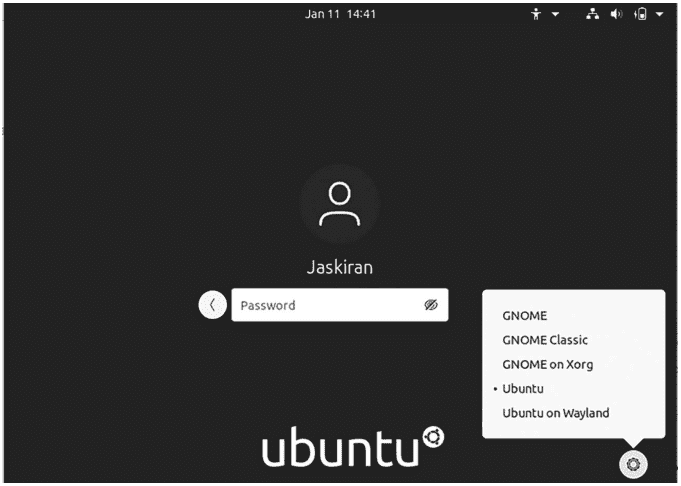
GNOME 安装选择窗口。选择任意可用的桌面环境，无论是 GNOME、GNOME Classic、GNOME on Xorg、Ubuntu 还是 Wayland。选择你想使用的桌面环境，输入密码登录，系统就准备就绪了。如果你首先选择 GNOME 桌面环境，就会看到屏幕上呈现如下方图所示的精美界面。

### 30 掌握 GNOME
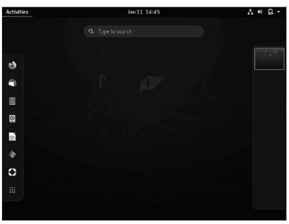
GNOME 界面。我们的 Ubuntu 系统当前使用的是 GNOME 3.36 版本。代号为“Gresik”的 GNOME 3.36 凝聚了 GNOME 社区六个月的开发成果，包含大量改进、性能提升和新功能。主要亮点包括多款应用和界面的视觉焕新，尤其是登录和解锁界面（见下图）。
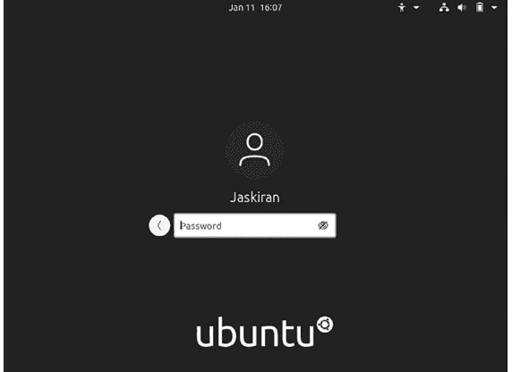
GNOME 桌面登录界面。GNOME 3.36 于 2020 年 3 月 11 日发布，包含下文提到的所有改进。需要注意的是，部分 Linux 发行版的打包者会禁用、调整或修改部分功能以适配自身用户群体，因此实际体验可能存在一定差异。本节汇总了最新 GNOME 桌面环境搭载的最佳改进、变化和新功能，并整理为便于浏览的列表。

## GNOME 功能特性
- 主题改进
- “免打扰”开关
- 适配系统字体
- 全新扩展应用
- 全新锁屏界面
- 全新 Shell 对话框
- 密码预览功能
- 软件更新
- 应用文件夹优化
- 设置项调整
- 更多

接下来我们逐一详细介绍这些功能。
**改进的 GNOME Shell 主题：** 我们此前已经见过更新后的 GNOME Shell 主题，可以确认 GNOME 3.36 中包含了所有重要的视觉增强项。虽然部分界面改动微小且隐蔽，你可能完全注意不到，但其他改动则非常明显，想忽视都难。


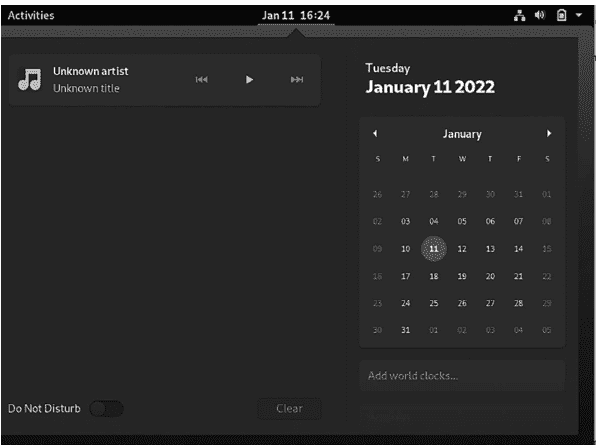
改进了的GNOME Shell主题。通知现在会展示更醒目的图标，同时观感上却比之前更加紧凑。而且消息托盘中列出的通知现在也采用了和其他UI元素一致的时髦“卡片式”设计，提升了整个GNOME Shell界面的一致性（见下图）。
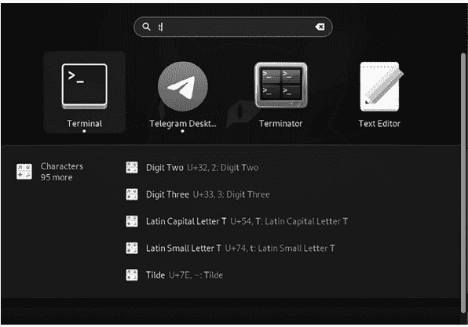
GNOME通知图标。视图界面的搜索结果经过优化，布局更加整洁、规整。这些优化调整让搜索结果更容易*定位*到正确选项。
### 免打扰切换开关：
如果你在编写代码项目、看电影或进行其他任务时，不想被其他应用的通知或提示打扰，GNOME提供了一个非常实用的功能来处理所有这些中断提醒。通知/日历托盘新增了一枚易于操作的“免打扰”切换开关。只要你想阻止占用屏幕的通知弹窗弹出，只需打开通知面板，点击新的免打扰开关即可（见下图）。
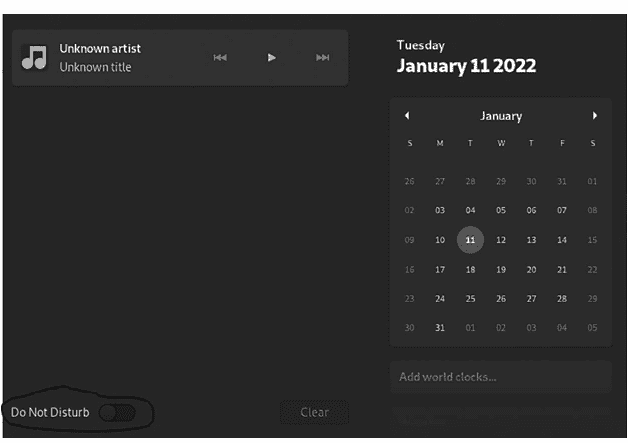
免打扰切换开关。
### 字体设置：
GNOME 3.36对“界面字体”设置做出了调整。这意味着你可以直接通过GNOME优化工具将GNOME Shell的字体修改为任意你喜欢的样式，无需再手动编辑隐藏的`.css`文件。这是一项虽小但迟来的个性化优化。GNOME优化工具可以修改应用窗口、界面和终端的字体族及字号。不过，这些修改不会影响GNOME顶部栏、通知、扩展菜单、日期/时间下拉菜单、Dash/活动概览等区域的字体。GNOME优化工具是配合GNOME Shell用来修改其界面的工具。换句话说，它是用来调整Ubuntu系统外观与使用体验的工具。
以下是一些实用的GNOME Shell主题，你可以用来自定义你的GNOME桌面环境：
1. Prof-GNOME主题
2. Orchis GTK主题
3. Nordic主题
4. Big Sur主题
5. Yaru-Colors主题
6. Layan GTK主题
7. Ultimate Dark主题
#### Prof-GNOME主题：
这是广受欢迎的GNOME主题之一。如果你想要一款轻量化的桌面主题，这款主题绝对不会让你失望。它主要提供两种配色变体：浅色和深色。此外它还提供浅色、深色主题的延伸变体，能让UI元素清晰凸显，整体观感非常高级。该主题兼容GTK 3/4，即使在新版本的GNOME桌面上也可以正常使用。它包含多个子主题，例如：
- Prof-GNOME-Dark-3.2 至 3.6版本
- Prof-GNOME-Darker-3.0 至 3.3版本
- Prof-GNOME-Darker-3.4.1 至 3.6版本
- Prof-GNOME-Light-3.0 至 3.3版本
- Prof-GNOME-Light-3.4.1 至 3.6版本
- Prof-GNOME-Light-DS-3.0 至 3.3版本
- Prof-GNOME-Light-DS-3.4.1 至 3.6版本
- Prof-GNOME-Variant-2.0
- Prof-GNOME-theme 1.1 至 2.2版本
- GNOME-professional-40-dark
- GNOME-professional-40.1
- GNOME-professional-solid-40.1-dark
- GNOME-professional-solid-40.1
#### Orchis GTK主题：
这是一款兼容性强、简洁直白的主题，提供浅色、深色、浅色紧凑、深色紧凑等多种配色变体。除了圆角、半扁平的设计风格外，这款主题还兼具时髦、简约、美观的特点，你还可以配合Tela Icons等图标包进一步自定义外观。Orchis主题还附带了简单的bash脚本安装程序，安装过程非常简便。你可以通过Snap应用商店安装该主题，也可以运行以下命令完成安装：
```
$ sudo snap install orchis-themes
```
#### Nordic主题：
Nordic是一款基于GTK3.20+、采用北欧配色方案设计的主题。其深色配色带来了非常简约、协调的视觉效果。Nordic主题还提供了不同色彩点缀的变体。它同时提供了Shell主题和应用主题，整体观感统一协调。
##### 安装Nordic GTK主题：
Nordic GTK主题可在GitHub获取。要使用该主题，你需要在电脑上安装Git包。你可以按下键盘上的Ctrl + Alt + T或Ctrl + Shift + T组合键打开终端窗口，来完成安装。然后根据你的发行版，运行下方的命令行指令即可：
- Ubuntu系统：`$ sudo apt install git`
- Debian系统：`$ sudo apt-get install git`
- Arch Linux系统：`$ sudo pacman -S git`
- Fedora系统：`$ sudo dnf install git`
- openSUSE系统：`$ sudo zypper install git`
#### Big Sur主题：
如果你想要macOS风格的桌面体验，这款主题是你的最佳选择。Big Sur主题大量借鉴了新一代macOS Big Sur的设计风格。它提供浅色和深色两种配色变体，还能为GNOME桌面带来全新的外观、动画和毛玻璃效果。该主题同时支持GTK 3/4。搭配合适的图标包使用，这款主题的效果无与伦比。
##### 兼容系统：
- Deepin
- KDE
- GNOME
- Elementary OS
- Xfce4
#### Yaru-Colors主题：
如果你想为GNOME系统赋予经典的Ubuntu桌面观感与体验，Yaru主题是你的不二之选。Yaru-Colors GTK Shell主题提供多种配色方案可选，还有重新配色的光标和图标、Ubuntu风格的停靠栏，以及修改Snap包和文件夹颜色的功能。它还附带了一个配套的图标主题，可以刷新那些老旧的GNOME风格图标。该主题兼容性强、设计简约，你可以在不影响系统整体功能的前提下自定义桌面。
Yaru-Colors主题包含以下内容：
1. GTK 2/3主题
2. GNOME-Shell主题
3. 重新配色的图标（更多信息见下文）
4. 重新配色的光标
5. Ubuntu-Dock主题（指示器）
6. Unity支持（随Yaru 20.04版本引入）
7. 壁纸（见下文）
请注意：为了方便后续操作，我已经将Yaru的GTK2/3、GNOME-Shell、Unity、图标和光标的源文件上传至我的Git仓库。
### 全新的“扩展”应用：
GNOME 3.36的扩展功能可以为GNOME Shell添加新功能、修正运行中的小问题，或者让桌面环境完全按照你的使用习惯运行。GNOME Shell扩展现在可以通过全新的“扩展”应用进行管理，而不再依赖软件中心。这款扩展应用可以更新扩展、配置扩展偏好设置，还可以移除或禁用不需要的扩展。很高兴看到GNOME开发者在这次版本更新中重视扩展功能，他们将之前鲜有人用、藏得较深的GNOME-extensions-pref面板改造为功能完备的全新工具：GNOME扩展应用。
新的GNOME扩展应用可以启用/禁用你在extensions.gnome.org网站安装的扩展、安装/应用扩展更新，还能更便捷地访问扩展设置。GNOME Shell 3.36甚至会在启动时检查扩展更新，如果有需要会自动安装/应用更新。这意味着你使用的所有附加组件都会保持最新版本。你也不需要做任何特殊操作来获取这款应用——只要运行GNOME Shell的环境，它都会默认预装。
### 全新的锁屏界面：
早在2018年GNOME推出全新的登录和锁屏界面时，我们就曾很高兴地报道过GNOME 3.36将带来更新后的锁屏界面。锁屏的使用逻辑和之前一致：锁屏“盾牌”会显示时间、日期以及所有待处理的通知；按下按钮或点击盾牌区域即可调出密码输入框。不再需要切换两个独立界面，密码输入框会直接和时间日期显示在同一个页面。新版GNOME锁屏会显示模糊化的桌面壁纸，这一设计调整改善了文字可读性，同时用户头像区域也做了重新设计。
### 全新的Shell对话框：
Shell界面中各类对话框提示都展现出了高度的一致性，比如关机提示、输入密码提示、Wi-Fi网络选择器等场景均是如此。核心系统对话框中的所有元素，比如标题、说明文本、密码栏等，现在都做了居中对齐处理。不再使用图标，取而代之的是提示文本，比如密码输入框内会直接显示“请输入密码”的提示内容。
### 应用文件夹更新：
GNOME 3.34首次支持在应用启动器内直接创建应用文件夹。操作非常简单：只需将应用拖拽到另一个应用上，即可创建新的文件夹。虽然这是一项很实用的功能，但应用文件夹存在一些视觉上的小瑕疵，“整理图标”的动画效果也需要进一步打磨。在GNOME 3.36中，应用文件夹功能得到了完善。现在拖拽应用图标进出文件夹的动画更加流畅、可预期，同时拖拽和分页操作的响应速度也更快。应用文件夹本身现在也被视作对话框处理。
### Ubuntu GNOME桌面入门指南
Ubuntu 20.04搭载了GNOME 3桌面环境。虽然GNOME 3没有Windows和macOS桌面那样复杂，但它提供了一种简洁、直观的桌面环境，包含了窗口环境的所有核心功能，而且上手速度非常快。本节将介绍GNOME桌面的各项功能、基础操作流程，以及桌面的一些核心组件。这些组件包括窗口、工作区和应用。你在GNOME中进行的几乎所有操作都会用到这些基础组件。在Linux系统可用的所有GNOME桌面环境中，它兼具高效、稳定、可靠的特点，同时非常易用。绝大多数用户无论经验多少，都能几乎不费力气地快速上手GNOME。下图展示的是典型的新启动GNOME桌面会话的初始外观，此时尚未启动任何其他程序，也未做任何配置修改。主桌面区域是启动应用和其他工具后显示内容的区域。屏幕顶部的栏被称为顶部栏。它包含活动概览菜单、日期和时间、一组按钮与图标、网络状态、音频

音量、电池电量、其他状态以及账户设置。桌面上当前正在运行的应用程序也会显示在顶部栏中。例如，它会显示终端程序的应用程序菜单（见下图）。
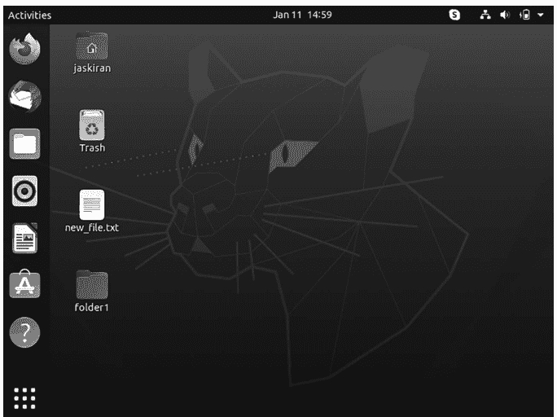
Ubuntu桌面环境。

#### 活动概览
活动概览是GNOME桌面“拼图”的核心组成部分之一。在活动概览中，你可以打开应用程序启动器、最小化应用、进行搜索以及管理虚拟桌面。要进入活动概览，可通过以下任意一种方式操作：
- 点击左上角的“活动”
- 将鼠标指针悬停在左上角
- 按下键盘上的Super（Windows）键；即可调出活动概览（见下图）。
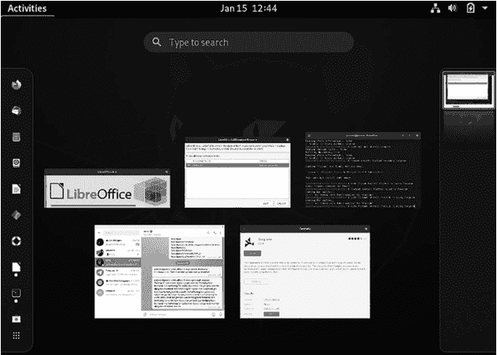
活动概览界面。

#### 停靠栏
活动概览中包含GNOME桌面的几个核心组件。如果你查看活动窗口的左上角，会看到一排图标栏，名为停靠栏。停靠栏中存放着你常用的应用程序的收藏启动器。系统默认的启动器从上到下依次为：Firefox（网页浏览器）、Evolution（邮件/日历）、Rhythmbox（音乐播放器）、GNOME 照片（图片查看器）、文件（文件管理器）以及GNOME 软件（应用商店）。点击任意图标即可启动对应的应用程序。如果你不想在停靠栏中保留某个应用程序的启动器，右键点击该启动器，然后选择“从收藏中移除”即可。

#### 应用程序概览
点击停靠栏底部的网格图标（九个点）即可打开该功能。当应用程序概览打开后，你可以滚动已安装应用程序的列表来查找你需要的应用。单击任意应用图标即可启动该应用，或将其添加到停靠栏。要将应用程序添加到停靠栏，先找到对应的应用，右键点击其图标，然后选择“添加到收藏”。将应用启动器添加到收藏后，它会自动显示在停靠栏中，此时你无需打开应用程序概览即可直接启动该应用（见下图）。
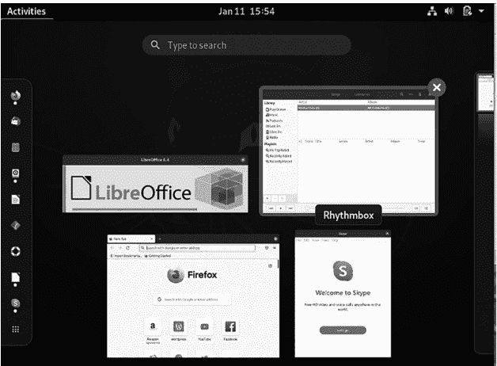
GNOME桌面环境应用程序界面。

#### 搜索
注意，你可以通过点击屏幕底部中间的按钮筛选列表，选择显示全部应用程序或仅显示最近使用过的应用。需要特别留意的是，部分列表项是文件夹，其中包含更多应用程序。除了浏览应用列表外，你也可以点击“活动”菜单后出现的搜索栏进行搜索。随着你在搜索框中输入文字，匹配的结果列表会实时更新。若要将应用程序添加到停靠栏以便更快捷地访问，找到对应应用的图标，右键点击它，然后选择“添加到收藏”菜单选项。GNOME搜索工具功能强大，不仅可以搜索应用程序概览中已安装的应用，还能搜索GNOME软件中尚未安装的应用，以及本地文件。举个例子，假设你通过LibreOffice办公套件创建了一个名为my_file.odt的文件。如果你打开停靠栏，然后在搜索框中输入“life”，就会看到你新创建的文件以及相关的应用程序。点击你要找的条目即可打开它。右键点击停靠栏中的应用图标，选择“从收藏中移除”，即可将其从停靠栏删除。

#### 日历与通知
点击顶部栏中间的时钟图标，即可调出集成的日历与通知面板。如果有未处理的通知，点击即可对其进行操作。若要将GNOME日历与Google日历同步，操作步骤如下：打开停靠栏，在搜索栏中输入“online”，然后点击“在线账户”条目。在弹出的后续窗口中（如下图），点击Google，然后按照账户添加向导完成操作。账户添加完成后，你可以自主选择需要同步的功能。此时，你的Google账户就会开始与GNOME桌面同步数据。如果你打开Evolution群件套件，会发现Google邮箱和日历已经自动添加完成，可直接使用。

#### 启动活动
应用程序和实用工具均可通过活动概览仪表板（以下简称停靠栏）启动，你可以通过点击顶部栏的“活动”按钮，或按下键盘上的Super键调出该仪表板。在Windows键盘上，该按键为Windows键；在macOS设备上，该按键显示为放大镜图标，对应Command键；在Chromebook上则为搜索键。默认情况下，停靠栏会显示预置的常用应用程序图标，以及当前正在运行的应用程序的图标。如果某个应用正在运行，其图标左侧会显示一个圆点标记，若该应用有多个实例正在运行，则每个实例对应一个圆点标记。点击停靠栏中的应用图标即可启动对应应用。如果要在停靠栏中查找未列出的应用，可以点击最底部的图标（由九个点组成的方格），即可打开可浏览的应用程序列表。

#### 管理窗口
当打开多个应用程序窗口时，按下Super + Tab快捷键即可调出窗口切换面板，你可以选择将其他窗口设为当前活动窗口。若要反向切换窗口，使用Shift + Tab快捷键即可在切换面板的图标中循环选择。

#### 使用工作区
应用窗口显示的区域即为工作区，GNOME 3支持配置多个工作区。要创建新工作区，先调出活动概览，然后将鼠标指针移动到屏幕最右侧，即可显示工作区面板。要切换到其他工作区，只需从列表中点击对应的工作区即可。要将窗口从一个工作区移动到另一个工作区，先调出工作区面板，然后拖动应用窗口到目标工作区即可。当窗口被添加到空白工作区时，工作区面板会自动新增一个空白工作区，从而形成多个工作区。要删除工作区，只需关闭该工作区中的所有窗口，或将这些窗口移动到其他工作区即可。

#### 日历与通知
当系统需要提示事件时，会在工作区顶部弹出通知窗口。若要查看历史通知，点击顶部栏的日期和时间即可调出日历面板。

#### 桌面设置
要打开设置应用，点击顶部栏最右侧的下拉箭头，然后选择带有工具图标的按钮（已高亮标注）。设置应用提供多种功能选项，包括以太网和Wi-Fi连接设置、屏幕背景自定义、屏幕锁定、电源管理控制以及语言偏好设置。要查看每个类别下的可用设置，只需点击设置窗口左侧面板中的对应选项即可。该菜单还包含切换用户、调整音量、更换Wi-Fi网络、注销、重启或关闭系统的选项。

#### 面板
面板是分别位于屏幕顶部和底部的两个功能栏。默认情况下，顶部面板显示GNOME主菜单栏、日期时间以及GNOME帮助系统的启动器；底部面板显示已打开的窗口列表和工作区切换器。你可以自定义面板，向其添加各类工具，例如其他菜单、启动器以及被称为“面板小程序”的小型实用应用。比如，你可以配置面板显示你所在位置的当前天气。

##### 窗口
多数应用程序都会以多个窗口的形式运行。你可以在桌面上同时显示多个窗口，调整窗口大小、移动窗口位置以适应工作流程。每个窗口顶部都有标题栏，标题栏上的按钮可用于最小化、最大化或关闭窗口。

##### 工作区
你可以将桌面划分为多个独立的工作区，每个工作区可以放置不同的窗口，方便你将关联的任务分组管理。

#### 文件管理器
Nautilus文件管理器可用于访问文件、文件夹和应用程序，还能管理文件夹内的内容，并使用对应的应用程序打开文件。

#### 偏好设置
你可以通过偏好设置工具自定义桌面，每个工具可控制桌面的某一特定行为。这些工具位于面板上桌面顶级菜单的“偏好设置”子菜单中。

#### 自定义停靠栏
你可以在设置应用的“外观”选项中修改停靠栏的大小、位置和行为。位置可设置为屏幕的任意一侧，通过调整“图标大小”选项可以缩小停靠栏上图标的大小。最后，如果启用了“自动隐藏停靠栏”选项，停靠栏会自动隐藏，直到鼠标指针移动到其当前所在的屏幕边缘时才会重新显示。

#### 切换深色模式
在停靠栏设置中，设置应用的“外观”面板支持在浅色、标准和深色三种模式间切换桌面。例如，下图展示的是已选中深色模式的效果。

#### 安装Ubuntu软件
与macOS、Windows、iOS、Android等其他操作系统类似，Ubuntu在“Ubuntu软件”工具中内置了“应用商店”。该应用商店会基于推荐、分类以及编辑精选，为你展示可供安装的应用程序列表，你也可以通过搜索查找特定的应用。


要安装应用程序，请在 Ubuntu 软件窗口中选中它，然后单击“安装”按钮。

#### 超越基础自定义
GNOME 3 拥有整洁、无冗余的界面，仅提供有限的自定义选项。但这并不意味着你无法对桌面进行更多调整。GNOME 项目专门为此开发了 GNOME Tweaks 工具。请使用以下命令安装并运行该工具：
```bash
$ apt install gnome-tweaks
```
```bash
$ gnome-tweaks
```
GNOME Tweaks 加载完成后，就会显示对应的界面。本章将介绍一系列可用的桌面自定义选项，因此在进入下一章之前，你可以花些时间尝试调整这些设置。

##### 窗口
窗口是屏幕上呈矩形的区域，四周有边框，顶部有标题栏。每个窗口用于显示一个应用程序，你可以同时打开多个窗口运行不同的任务。你可以把窗口想象成桌面上的纸张：它们可以相互重叠，也可以并排摆放。你可以控制窗口在屏幕上的位置和大小，还可以设置窗口的层级，让你正在使用的窗口始终处于最前方。每个应用程序有1个主窗口，还可以根据用户需求打开更多附加窗口。本节剩余部分将介绍不同类型的窗口，以及如何操作它们。

###### 窗口类型
窗口主要分为三类：
- **应用程序窗口**：你可以通过标题栏上的按钮最小化、最大化或关闭这类窗口。打开应用程序时，通常会出现这类窗口。
- **对话框窗口**：这类窗口由应用程序窗口调出，用于提示问题、请求确认操作或向用户索取输入信息。
- **操作窗口**：你也可以调整屏幕上的窗口大小和位置，借此同时查看多个应用程序、执行不同任务。例如，你可能需要一边浏览网页上的文本，一边用文字处理器写作，或者切换到其他应用程序处理其他任务、查看进度。

##### 工作区
工作区用于管理屏幕上的窗口。你可以把工作区想象成虚拟屏幕，随时可以在不同工作区间切换。每个工作区都可以包含相同的桌面、面板和菜单，你也可以在每个工作区中运行不同的应用程序、打开不同的窗口。每个工作区中的应用程序会一直保留在其中，你可以随时切换到其他工作区。默认情况下共有4个工作区，你可以通过底部面板右侧的“工作区切换器”小程序切换工作区。工作区切换器会以4个矩形的形式默认展示所有工作区，单击任意一个即可切换到对应工作区。
*工作区切换器中显示的工作区*。工作区切换器内包含4个工作区，前3个工作区中有已打开的窗口，最后一个工作区没有打开的窗口，当前使用的工作区会高亮显示。

###### 应用程序
应用程序是用于执行特定任务的计算机程序。你可以使用应用程序创建文本文档（如信件、报告）、处理电子表格、收听喜欢的音乐、浏览互联网，或者创建、编辑、查看图片和视频。每项任务都可以使用不同的应用程序来完成，你可以通过应用程序菜单选择要启动的应用程序。GNOME 内置的应用程序包括以下几类：
- Gedit 文本编辑器：用于读取、创建或编辑任何无格式的简单文本。
- 词典：用于查询单词的定义。
- 图片查看器：可显示单张图片文件或大量图片合集。
- 计算器 [ghelp:gcalctool]：可执行基础、金融及科学计算。
- 字符映射表：可让你从 Unicode 字符集中选择字母和符号，并粘贴到其他任意应用程序中。
- Nautilus 文件管理器：可显示文件夹及其内容，还支持你复制、移动、整理文件，以及访问光盘、U 盘或其他可移动存储设备。

##### 终端
终端可以让你访问系统命令行。GNOME 应用程序包含游戏、音乐和视频播放器、网页浏览器、软件工具和系统管理实用程序，还内置了文字处理器、图形编辑器等更多应用。所有 GNOME 应用程序都有许多共通特性，方便你学习如何使用新的 GNOME 应用程序。

###### 标准特性
GNOME 内置的应用程序具备多项共通特性，例如统一的界面风格。这些应用程序之所以有共通特性，是因为它们使用了相同的编程库。使用标准 GNOME 编程库的应用程序被称为符合 GNOME 规范的应用程序，例如 Nautilus 和 gedit 文本编辑器都属于 GNOME 应用程序。这些库既支持 GNOME 运行符合其规范的应用程序，也支持运行现有应用程序。例如，如果你的系统基于 UNIX，你可以在 GNOME 桌面中运行当前的 X11 和 Motif 应用程序。符合 GNOME 规范的应用程序具备以下特性：
- **外观一致**：符合 GNOME 规范的应用程序具有统一的视觉和操作风格，会使用偏好设置工具中指定的外观和操作设置。你可以使用以下工具修改 GNOME 应用程序的外观：
  - 菜单和工具栏偏好设置工具
  - 主题偏好设置工具
  - 菜单栏、工具栏和状态栏
大多数 GNOME 应用程序都包含菜单栏、工具栏和状态栏。菜单栏始终包含“文件”菜单和“帮助”菜单；“文件”菜单中始终有“退出”菜单项，“帮助”菜单中始终有“关于”菜单项。工具栏位于菜单栏下方，包含最常用命令的按钮。窗口底部的状态栏会显示当前窗口内所查看内容的相关信息。符合 GNOME 规范的应用程序可能还包含其他栏，例如 Nautilus 就包含位置栏。GNOME 应用程序中的部分栏是可拆卸的，你可以抓取并将其拖动到其他位置。你可以把拆卸后的栏拖动到窗口的另一侧或屏幕的其他位置，例如在文件管理器中就可以拆卸菜单栏、工具栏和位置栏。

###### 默认快捷键
GNOME 应用程序使用统一的快捷键执行相同操作。例如，要退出符合 GNOME 规范的应用程序，请按 `Ctrl-Q`；要撤销符合 GNOME 规范应用程序中的上一步操作，请按 `Ctrl-Z`。

###### 拖放操作
GNOME 应用程序使用相同的协议执行拖放操作，因此在拖放项目时，所有 GNOME 应用程序都会提供一致的反馈。接下来将介绍登录、关闭 GNOME，以及启动、管理和结束桌面会话的相关操作。

###### 启动会话
会话是指你使用 GNOME 的时长。在会话期间，你可以打开应用程序、打印文件、浏览网页或执行其他任务。登录 GNOME 即启动会话。GNOME 的登录界面是进入 GNOME 桌面的入口，你需要在其中输入用户名和密码，还可以选择会话使用的语言等选项。通常注销会结束会话，但你也可以选择保存会话状态，在下次登录时恢复。

###### 登录 GNOME
请按以下步骤登录 GNOME 会话：
1. 在登录界面单击“会话”图标，从可用桌面环境列表中选择“GNOME 桌面”。
2. 在登录界面的“用户名”栏输入你的用户名，然后按回车键。
3. 在登录界面的“密码”栏输入你的密码，然后按回车键。
登录成功后，你会看到闪屏提示 GNOME 的启动步骤。GNOME 准备就绪后，你就会看到桌面，此时可以开始使用你的计算机。首次登录时，会话管理器会启动新会话；如果你之前登录过，且在注销时保存了会话设置，会话管理器会恢复你之前的会话。如果在登录前需要关闭或重启系统，请单击登录界面的“系统”图标，在弹出的对话框中选择你需要的选项，然后单击“确定”。

##### GNOME 经典模式
###### 什么是 GNOME 经典模式？
该功能面向希望获得更传统桌面体验的用户。GNOME 经典模式桌面基于 GNOME 3 技术构建，它在顶部栏添加了“应用程序”和“位置”菜单，在屏幕底部添加了窗口列表，以此修改用户界面。你可以通过顶部栏的“应用程序”菜单启动应用程序，也可以通过选择菜单中的“活动”项打开活动概览，还可以按 Super 键打开活动概览。

###### 窗口列表
屏幕底部的窗口列表可以让你访问所有已打开的窗口和应用程序，还可以快速最小化或恢复它们。GNOME 会在窗口列表右侧显示当前工作区的标识符，例如 `1` 代表第一个工作区，该标识符还会显示可用工作区的总数。要切换到其他工作区，请单击该标识符，然后从菜单中选择你要使用的工作区。

###### 在 GNOME 和 GNOME 经典模式间切换
如果你想从 GNOME 切换到 GNOME 经典模式：
1. 首先保存所有未完成的工作，然后注销。你可以在顶部栏右侧看到注销选项，选择该选项后，再选择“GNOME 经典模式”即可。


- 2. 在弹出的确认提示中点击“注销”以确认操作。
- 3. 页面将跳转至登录界面，你需要在输入框中输入密码。
- 4. 点击登录按钮左下角显示的图标，选择“GNOME经典模式”。
- 5. 点击登录按钮，你将看到GNOME经典模式的初始界面。按照上述指引，你可以切换任意桌面环境。当你按照步骤启动GNOME经典模式后，会弹出首个窗口（见下图）。
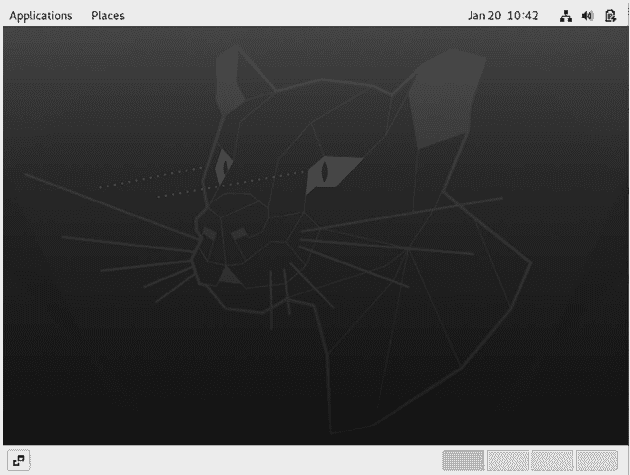
GNOME经典模式桌面环境。
###### GNOME经典模式用户指南
该回溯模式使用了GNOME-panel软件包以及GNOME经典模式下的一系列旧版小程序。GNOME经典模式是纯GNOME Shell版本，整套复古指南通过GNOME Shell扩展和静默调整实现，二者结合重塑了Shell界面，使其完全贴合过往经典的Linux桌面风格。
下图展示了基于分类排列的应用菜单。
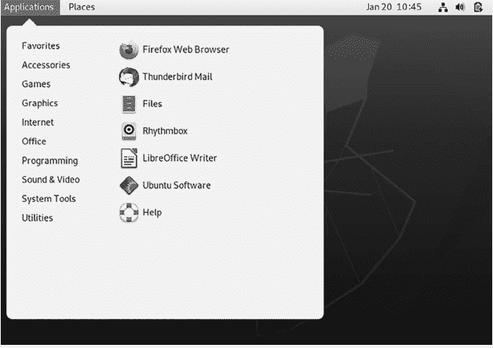
GNOME经典模式应用菜单。
其配备专属“位置”小程序（见下图）。
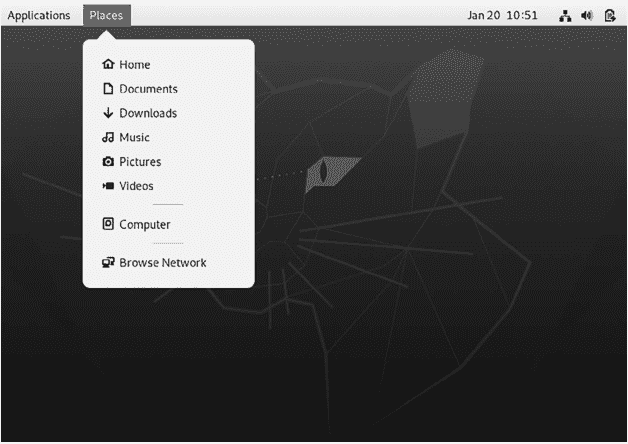
GNOME经典模式位置菜单。
任务栏不会将窗口分组，屏幕通知会像旧版Ubuntu的Notify OSD气泡一样显示在右上角。屏幕右侧设有时钟/日历小程序。不过GNOME的经典模式本质上是一种假象：只要按下Super键或者稍微探究，你就会看到“活动”总览界面。例如，GNOME Shell自带的“活动总览”功能依然存在，常规的Alt+Tab切换窗口、工作区切换操作都依赖该界面（见下图）。
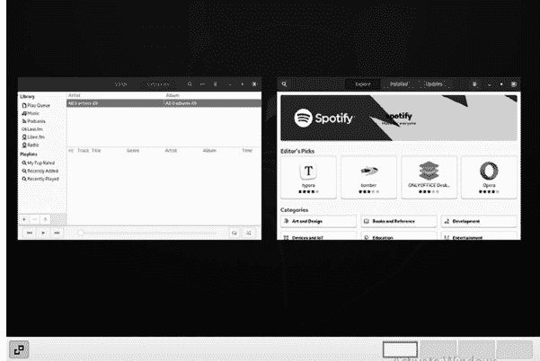
GNOME经典模式活动总览菜单。
###### 在Ubuntu上启用GNOME经典模式
在Ubuntu 18.04 LTS上，你只需安装一个软件包即可轻松部署GNOME经典模式会话：按下Ctrl+T打开新的终端窗口，执行以下命令：
```
$ sudo apt install gnome-shell-extensions
```
安装过程可能持续数秒。随后注销当前会话，在登录界面点击齿轮图标，选择“GNOME经典模式”会话，再按常规方式登录即可。
GNOME经典模式是GNOME Shell为偏好传统桌面体验的用户提供的功能与模式，基于GNOME 3技术构建，对用户界面做了如下调整：
顶部栏有“应用”和“位置”两个菜单选项。其中，“应用”菜单位于屏幕左上角，用户可以通过它访问按分类排列的应用程序，也可以通过该菜单打开活动总览；“位置”菜单位于顶部栏“应用”菜单旁，用户可以快速访问下载、图片等重要文件夹。
屏幕底部的任务栏提供以下功能：
- 窗口列表，
- 窗口列表旁的通知图标，
- 当前激活工作区的简短标识，以及提示图标旁显示的全部可用工作区数量。
GNOME经典模式下的4个可用工作区具备以下特性：
- 默认可用工作区数量为4个。
- 提供最小化与最大化按钮。
- 经典模式下的窗口标题栏自带最小化/最大化按钮，用户可以借此将窗口最小化，或最大化至铺满整个屏幕。
- 在GNOME经典模式下，你可以使用Super+Tab快捷键切换窗口。
系统菜单位于屏幕右上角，你可以通过该菜单修改部分设置、查看Wi-Fi连接信息、切换用户、注销或关闭计算机。
###### GNOME经典模式扩展组件
GNOME经典模式是一组GNOME Shell扩展组件，会作为gnome-classic-session软件包的依赖项自动安装，该软件包提供了运行GNOME经典模式会话所需的组件。在Red Hat Enterprise Linux 7中，GNOME经典模式扩展默认处于启用状态，是该系统默认的桌面用户界面。
- 备选标签页扩展（alternate-tab@gnome-shell-extensions.gcampax.github.com）
- 应用菜单扩展（apps-menu@gnome-shell-extensions.gcampax.github.com）
- 启动新实例扩展（launch-new-instance@gnome-shell-extensions.gcampax.github.com）
- 位置状态指示器扩展（places-menu@gnome-shell-extensions.gcampax.github.com）
- 窗口列表扩展（window-list@gnome-shell-extensions.gcampax.github.com）
###### 从GNOME经典模式切换至GNOME模式
用户可以通过注销的方式从经典模式切换至GNOME模式；登录界面的齿轮图标会打开包含GNOME经典模式选项的下拉菜单。如果要在当前用户会话内从GNOME经典模式切换至GNOME模式，请执行以下命令：
```
$ gnome-shell --mode=user -r &
```
如果要在同一用户会话内切换回GNOME经典模式，请执行以下命令：
```
$ gnome-shell --mode=classic -r &
```
###### GNOME Xorg版
Xorg通常简称为X，是Linux用户最常用的显示服务器，已成为图形界面应用程序的必要基础组件，因此被绝大多数发行版采用。
GNOME Xorg版与标准GNOME完全一致，仅将显示后端从Wayland替换为Xorg。如果你在使用NVIDIA专有驱动，或者需要使用TeamViewer、OBS、SSH X转发功能，就可以选择该版本。
默认情况下，GNOME基于Wayland运行GNOME Shell，传统的X应用会通过Xwayland运行，因此GNOME Xorg版是Shell的自定义变体，而非独立的模式。
GNOME Xorg版使用Xorg运行GNOME Shell（见下图）。
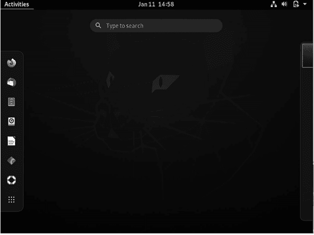
GNOME Xorg版桌面环境界面。
###### Ubuntu Wayland版
###### 什么是Wayland？
Wayland是供窗口管理器与客户端、其协议C库进行通信的协议。合成窗口管理器（也称合成器）是指会为每个独立窗口向应用程序提供离屏缓冲区的窗口管理器，合成器可与图形和窗口系统交互，实现以下功能：
- 窗口透明效果
- 动画效果
- 投影阴影
Wayland协议既支持实现运行在内核上的显示服务器，也支持X应用、Wayland客户端（例如无根/全屏X服务器、其他显示服务器或基础应用）。开发Wayland协议的初始志愿者团队旨在打造更简洁、更快速的X替代方案。X11技术曾是大多数Linux发行版的默认显示服务器，而Wayland以独立协议会话的方式处理应用程序，由于服务器无需同时管理所有应用，而是每个应用仅绘制自身需要的内容，因此性能更优。
随着Wayland的逐步发展，新增了XWayland等特性，用户可以在Wayland环境下运行基于X11的应用程序。
Wayland协议规定了显示服务器与其客户端之间的通信规则。默认情况下，Ubuntu桌面会加载Xorg显示服务器而非启动Wayland。GNOME使用X还是Wayland不会对完整Linux发行版造成破坏性影响。Wayland库会成为GNOME的依赖项，需要提前安装；显示管理器除了支持启动基于X的会话外，还需支持启动基于Wayland的会话，其余部分底层组件也需要适配这种新型会话。针对GNOME而言，这一移植工作意味着：第三方应用可通过XWayland在GNOME中正常运行，GNOME应用也可通过GTK+X后端在基于X的环境中正常运行。
###### 如何在Ubuntu上启用/禁用Wayland
如果你的默认显示管理器是GDM3，请编辑`/etc/gdm3/custom.conf`文件来启用或禁用Wayland：
```
$ sudoedit /etc/gdm3/custom.conf
```
执行以下命令重启Ubuntu桌面：
```
$ sudo systemctl restart gdm3
```
要使用Wayland登录Ubuntu，请在登录界面点击相应按钮，在登录前选择“Ubuntu on Wayland”选项即可。
Wayland具备以下Xorg难以支持甚至无法支持的特性：
- 支持输入变换功能。
- 支持透明硬件叠加与直接渲染。
- 支持客户端隔离（例如沙箱隔离），并支持复用Android驱动。


- Wayland 中的每 CRTC EGLSurface 意味着重绘和交换仅发生在内容发生变化的显示器上。
- 它在合成桌面和全屏客户端之间实现了平滑过渡（无 X 重定向闪烁）。
- 它限制了光标和拖动窗口之间的延迟（例如，移动顶层窗口或拖放图标）。
- 它具有更好的远程显示效果。

### 什么是 GNOME Shell 扩展？

GNOME Shell 扩展是一小段增强 GNOME 桌面功能的代码。你可以在浏览器中安装一个附加组件来禁用广告。这个附加组件是由第三方开发者开发的。你的网页浏览器默认不提供这个附加组件。安装这些附加组件可以增强网页浏览器的功能。

GNOME Shell 扩展就像你可以安装在 GNOME 上的第三方附加组件和插件。这些扩展的创建是为了显示特定信息，例如天气状况、网速等。主要你可以通过顶部面板访问它们。有些 GNOME 扩展在顶部面板上不可见。但它们仍然会调整 GNOME 的行为。例如，通过一个这样的扩展，中键单击可以关闭应用程序。

### 安装 GNOME Shell 扩展

现在你知道了 GNOME Shell 扩展是什么。让我们看看如何使用以下三种方法安装它们：

- 使用最小扩展集。
- 在网页浏览器中查找并安装扩展。
- 下载并手动安装扩展。

在学习使用 GNOME Shell 扩展之前，你应该在你使用的 Ubuntu 发行版中安装 GNOME Tweak Tool。你可以在软件中心找到它。或者，你可以使用这个命令：
```shell
$ sudo apt install gnome-tweaks
```

你还需要知道你使用的 Shell 版本。这有助于确定某个扩展是否与你的系统兼容。你可以运行以下命令来查找：
```shell
$ gnome-shell --version
```

### 方法 1：使用 GNOME-shell-extensions 包

这是最简单、最安全的方法。Ubuntu 和其他 Linux 发行版（如 Fedora）提供了一个包含最小 GNOME 扩展的包。你不必担心兼容性问题，因为你的 Linux 发行版已经对其进行了测试。如果你想要一个省心的选择，就获取这个包，你将安装 8–10 个 GNOME 扩展。
```shell
$ sudo apt install gnome-shell-extensions
```
你将需要重启你的系统。当你启动 GNOME Tweaks 时，你会找到几个已安装的扩展。你可以切换按钮来开始使用已安装的扩展。

### 方法 2：从浏览器安装 GNOME Shell 扩展

GNOME 项目有一个专门的扩展网站。你可以在这个网站上查找、安装和管理扩展，甚至不需要 GNOME Tweaks 工具。官方 GNOME Shell 扩展网站是：<https://extensions.gnome.org/>。但是要在网页浏览器中安装扩展，你需要两样东西：一个浏览器附加组件和你系统中的一个本机主机连接器。

#### 步骤 1：安装浏览器附加组件

当你访问扩展网站时，你会看到一条这样的消息：
> “要使用该网站控制 GNOME Shell 扩展，你必须安装 GNOME Shell 集成组件，该组件由两部分组成：一个浏览器扩展和一个本机主机消息传递应用程序。”

你可以使用下面的链接安装推荐的附加组件：
- **适用于 Google Chrome、Chromium 和 Vivaldi：** 使用 Chrome 网上应用店中的链接：<https://chrome.google.com/webstore/detail/gnome-shell-integration/gphhapmejobijbbhgpjhcjognlahblep>
- **适用于 Firefox：** 使用 Mozilla 附加组件中的链接：<https://addons.mozilla.org/en-US/firefox/addon/gnome-shell-integration/>

#### 步骤 2：安装本机连接器

仅仅安装浏览器附加组件并不能解决问题。你会看到这样的错误：
> “尽管 GNOME Shell 集成扩展正在运行，但在你的系统中未检测到本机主机连接器。有关安装连接器的说明，请参阅文档。”

#### 如何安装 GNOME Shell 本机连接器

此错误发生是因为你尚未安装主机连接器。要安装它，请运行此命令：
```shell
$ sudo apt install chrome-gnome-shell
```

#### 步骤 3：在网页浏览器中安装 GNOME Shell 扩展

一旦你完成了这两个要求，当你访问 GNOME Shell 扩展网站时，就不会看到任何错误消息。一个好主意是按当前 GNOME 版本筛选扩展。一个好的做法是按 GNOME Shell 版本对扩展进行排序。这不是强制性的，但通常情况是，开发者经常为当前 GNOME 版本创建扩展。每年会有两个以上的 GNOME 版本发布。但开发者可能没有时间测试或更新他们的扩展。结果，你不知道该扩展是否与你的系统兼容。尽管有些年头了，该扩展可能在较新的 GNOME Shell 版本中仍然可以正常工作。

- 你可以搜索一个扩展（例如天气扩展）。输入你的搜索查询并选择一个搜索结果。
- 当你访问扩展页面时，你会看到一个切换按钮。
- 单击切换按钮，系统会提示你确认是否要安装此扩展。
- 单击“安装”继续。安装后，切换按钮将被打开，并且其旁边将出现设置选项。你可以通过设置选项配置扩展，或从这里禁用它。
- 你也可以使用 GNOME Tweaks 工具配置通过网页浏览器安装的扩展的设置。

**60 ■ 精通 GNOME**

- 你可以在网站的“已安装”部分下查看所有已安装的扩展。你也可以从该页面删除任何通过网页浏览器安装的扩展。
- 使用 GNOME Extensions 网站的一个主要优点是，你可以检查某个扩展是否有可用更新。

### 方法 3：手动安装 GNOME Shell 扩展

不一定总要在线安装 GNOME Shell 扩展。你可以下载文件并在没有互联网连接的情况下稍后安装它们。

- 转到 GNOME Extensions 网站并下载所需扩展的最新版本。
- 提取下载的存档，然后将扩展文件夹复制到 ~/.local/share/gnome-shell/extensions 目录。要找到 .local 文件夹，请打开你的主目录并按 Ctrl + H 显示隐藏文件。然后你可以从那里导航到 extensions 目录。
- 文件复制到目录后，打开扩展文件夹内的 metadata.json 文件并找到 UUID 值。
- 确保扩展文件夹的名称与 metadata.json 文件中的 UUID 值匹配。如果不匹配，请重命名文件夹以匹配 UUID。
- 就快完成了！现在按 Alt + F2，输入 r，然后按 Enter 重启 GNOME Shell。
- 同时重启 GNOME Tweaks。手动安装的 GNOME 扩展现在应该出现在 Tweak 工具中，你可以在那里启用或配置它。这就是关于安装 GNOME Shell 扩展你需要知道的全部内容。

### 删除 GNOME Shell 扩展

可以理解，你可能想要删除已安装的 GNOME Shell 扩展。如果你是通过网页浏览器安装的，你可以转到 GNOME Extensions 网站的“已安装扩展”部分并从那里删除它。如果你是手动安装的，你可以从 `~/.local/share/gnome-shell/extensions` 目录中删除扩展文件夹来卸载它。

### 章节总结

Ubuntu 包含 GNOME 桌面环境，你可以在安装时选择它，也可以在之后使用 tasksel 命令行工具安装它。现代桌面环境（如 GNOME 3）旨在提供一个干净、易于使用的图形用户界面。GNOME 桌面的核心组件包括顶部栏、活动概览和 Dash。此外，GNOME 支持多个工作区，以帮助组织正在运行的应用程序并保持屏幕整洁。设置应用程序提供了广泛的配置选项，包括桌面背景自定义、音频设置、网络配置和 Wi-Fi 网络选择。


# **泰勒-弗朗西斯**
泰勒-弗朗西斯集团 http://taylorandfrancis.com
# 第3章
## GNOME应用程序
### 本章内容
- GNOME桌面环境简介
- gThumb应用程序
- Corebird应用程序
- GNOME待办——Joplin
- GNOME音乐——Rhythmbox
- FeedReader应用程序
- Snappy应用程序
- Epiphany浏览器应用程序
- Vinagre远程桌面客户端应用程序
- Gedit应用程序
- Dia图表编辑器应用程序
- EasyTAG应用程序
- GNOME字幕应用程序
- 以及更多

在第1章中，我们学习了如何在运行Ubuntu Linux系统的计算机上安装GNOME桌面环境，安装方式包括命令行或Ubuntu软件应用等。本章将讨论安装在Ubuntu系统中的GNOME应用程序，包括其工作原理、用户界面指南、功能等内容。接下来我们将再次介绍GNOME是什么。

### GNOME桌面环境简介
GNOME是一个桌面环境——即运行在计算机操作系统之上的图形用户界面——完全由自由软件构成。该项目包括为桌面创建软件开发框架，以及开发用于管理应用程序启动、文件处理、窗口和任务管理的程序。它采用纯GNOME 3桌面环境，搭配GNOME Shell，而非Unity图形外壳。
GNOME桌面是Linux生态系统中完整且易用的桌面环境之一，但其中应用并未预装，因此我们需要自行下载。它是Fedora、Debian等主流发行版的默认桌面环境，也是大多数其他发行版的可选主要桌面之一。无论你选择哪个发行版，启动GNOME桌面时，默认应用通常都是相同的。你很可能会看到Firefox和LibreOffice，以及GNOME专属应用，如Gedit、Nautilus、Cheese、计算器、时钟和终端。
发行版软件库中有大量应用可供选择。不过，只有GNOME应用会在窗口边框配有按钮，且充分利用屏幕顶部的应用菜单按钮。由于部分软件没有明确标识，无论是新用户还是有经验的Linux用户，都很难找到其他GNOME应用。
以下是一份未随你的发行版预装的程序列表。以下是一份专为GNOME桌面环境设计的应用列表。

### gThumb应用程序
gThumb是一款开源图像管理、图像查看软件，是与GNOME桌面环境深度集成的工具。因此，它同样适用于大多数Linux发行版；Ubuntu自带一款名为「GNOME之眼（EOG）」的默认图片查看器，该默认应用具备基础功能；而另一方面，gThumb在Ubuntu中是功能多样的图像处理工具。本节将聚焦gThumb，详细介绍该工具的安装方法和使用方式。
GNOME的默认图片查看应用是「图片查看器」和「GNOME之眼」。但如果你想对图片进行更多操作，就需要另外找一款应用。你可以用GIMP编辑图片，但像裁剪、调整尺寸这类简单任务用GIMP就大材小用了。gThumb是一款定位介于两者之间的图片查看工具。
侧边栏的文件管理器让你无需离开窗口即可浏览本地文件。编辑按钮提供了调整照片尺寸、修改颜色的工具。gThumb还支持将照片整理到相册中。综合来看，它是Linux平台上Picasa的优秀替代品。

#### 如何在Ubuntu上安装gThumb
安装gThumb图片查看器有两种方式。

##### 通过Ubuntu软件安装gThumb
打开软件应用，在搜索栏输入「gThumb」，稍等片刻就会出现搜索结果；点击目标应用，如下图所示。

gThumb应用图标。
点击该应用后，按下文所述点击「安装」按钮即可完成安装：
- 点击安装按钮后，会弹出提示窗口，要求输入验证密码：输入你的用户密码后按回车即可。

### 精通GNOME
- 安装启动后，软件包将在几分钟内安装完成。
- 按照简单步骤确认软件包是否安装成功。
- 点击Ubuntu任务栏上的「应用」图标。
- 搜索「gThumb」，即可在屏幕上看到该应用的图标。

##### 通过Ubuntu终端安装gThumb
使用快捷键Alt + Ctrl + T打开终端窗口；窗口打开后，执行以下命令即可在Ubuntu上安装gThumb图片查看器：
```bash
$ sudo apt install gthumb
```
你会看到如下输出：
```bash
user@user-VirtualBox:~$ sudo apt install gthumb
Reading package lists... Done
Building dependency tree...Done
Reading state information...Done
The following packages were installed and are no longer required:
  caribou five-or-more four-in-a-row girl.2-caribou-1.0 girl.2-champlain-0.12 girl.2-dazzle-1.0 girl.2-gdata-0.0 girl.2-geocodelib-1.0 girl.2-gfbgraph-0.2 girl.2-grilo-0.3 girl.2-gtkchamplain-0.12 girl.2-mediaart-2.0 girl.2-rest-0.7 girl.2-tracker-2.0 girl.2-zpj-0.0 gnome-chess gnome-clocks gnome-color-manager gnome-core gnome-documents
```
安装完成后，在终端输入名称并按回车即可打开该应用，如下图所示：
```bash
$ gthumb
```

#### 如何在Ubuntu上使用gThumb
本节将详细介绍「gThumb」应用的使用方法。
首先，在Ubuntu的「应用」中搜索并打开该应用（如下图所示）。
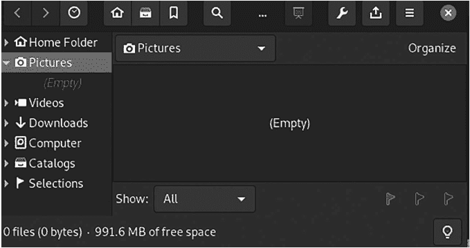
gThumb应用窗口。
- 点击图标即可打开应用，默认会定位到「图片」文件夹：
- 在gThumb应用窗口的左侧栏中，你可以选择文件，浏览可用目录。
- 点击「图片」目录中的任意图片，选中图片后，你会看到窗口上方出现一些选项，如下图所示：
- 你可以通过菜单栏执行多种操作。
- 点击如下图所示的首个选项，即可进入全屏模式。
- 以实际尺寸查看照片；根据屏幕适配图片；自定义缩放设置。
- 你可以根据需要旋转图片。
- 点击信息图标，可获取所选图片的相关简要信息。
- 点击信息图标后，相关信息会在窗口右侧显示。
- 选中对应选项后，你还可以编辑图片。
- 使用编辑选项，你可以轻松调整颜色、精细旋转、修改尺寸设置；你还可以使用下方给出的选项，为图片添加评论和标签：

https://linuxhint.com/install-gthumb-ubuntu/

### Corebird应用程序
这是一款开源的Twitter客户端应用，可在所有Linux发行版上运行。你可以用它管理你的Twitter账号。这款设计精美、外观出色的原生Twitter客户端非常适合经常使用Twitter的用户。它提供了许多功能，主要包括分享图片、发布推文、发送私信、关注/取消关注其他账号、搜索、可点击的标签，以及更多功能。

###### 功能特性
- 支持重新设计账户向导
- 支持快速保存你的媒体附件
- 新增「回复多人推文」功能
- 支持选中文本后直接发送私信

该应用加载速度很快，你需要的绝大多数功能都在左上角：你可以浏览信息流、查看提及、关注收藏内容、查看私信、管理列表、添加过滤器、执行搜索。你也可以修改账户设置、编辑个人资料。进入个人主页的操作不算特别方便，但总体而言，这是在开源桌面上使用Twitter的最佳方式之一。
用户可以通过PPA或Snap包在Ubuntu或其他支持Snap的Linux发行版上安装Corebird。在Ubuntu或其他Linux发行版上安装这款应用有多种方式，接下来我将逐一介绍，你可以根据自己的系统选择合适的方式。

#### 如何在Ubuntu及其他Linux发行版上安装Corebird Snap包
打开终端应用，执行以下命令，即可在Ubuntu或其他支持Snap的Linux发行版上以Snap包的形式安装该应用：
```bash
$ sudo snap install corebird
```

##### 在Ubuntu上安装Corebird
在Ubuntu中，你需要安装额外的软件包，用于解决在非Snap浏览器中打开Snap应用链接时出现的一些问题。现在请运行以下命令安装下方给出的所有必备软件包：
```bash
$ sudo apt install snapd-xdg-open
```

###### 通过PPA在Ubuntu上安装Corebird
如果你想通过PPA这种替代方式安装该应用，请打开终端窗口，逐行输入以下命令：
```bash
$ sudo add-apt-repository ppa:ubuntuhandbook1/corebird
$ sudo apt update
$ sudo apt install corebird
```

###### Flatpak与Flathub
如果你的系统已经配置好了Flatpak和Flathub，就可以通过以下命令从Flathub安装这款应用：
```bash
$ flatpak install flathub org.baedert.corebird
```

###### 卸载方法
如果你想卸载该应用，请运行以下命令：
```bash
$ sudo snap remove corebird
```
如果要卸载常规软件包，请使用：
```bash
$ sudo apt remove --autoremove corebird
```
如果网络连接较慢，请避免安装Snap版本，因为该版本需要消耗超过122MB的流量。这种情况下请选择经典安装方式——通过PPA安装Corebird，仅需消耗2.2MB流量。

### GNOME待办事项——Joplin
如今，网络和手机上有大量好用的待办事项管理工具，你完全可以不用专门的独立应用来管理待办列表。但我们发现，把工作相关的任务都集中在我们处理工作的地方——电脑上，是颇有意义的。我们并不需要特别复杂的任务标签或其他筛选功能，我们想要的只是基础功能，GNOME Todo刚好能满足这个需求，它可不仅仅是一款简单的待办应用。举个例子，这款应用可以为任务设置不同优先级，通过不同颜色区分列表模式，让你能清晰辨别不同任务。你还可以为任务设置截止日期、添加子任务，双击任意待办事项即可添加、编辑或查看详细备注。这款应用遵循所有标准GNOME应用规范，比如顶部栏、统一应用菜单等。它还支持对接GNOME在线账户，可以将你的任务和多个在线服务同步。通常我们会说「你可以在GNOME Wiki上了解更多关于这款应用的信息」，但说实话，这个Wiki页面几乎没什么有用内容，最好能补充些功能介绍、运行模式、插件、完整界面截图之类的内容。

#### 安装并使用Joplin笔记应用
人生中你或许有过这样的时刻：你曾想把想法、感受、灵感，或是读到过的喜欢的语录用文字记录下来留存，又或是工作时遇到了重要信息想要保存，这时候笔记应用就派上用场了，它提供了一种轻松便捷的信息/数据存储方式。随着数字革命席卷全球，科技应运而生，改变了这一切。如今，过去的羊皮纸已经变成了笔记应用，让记录这件事变得比以往轻松快捷太多。不过，由于市面上的笔记工具和应用五花八门，找到一款出色的笔记应用并不容易。这款名为Joplin的应用在Linux社群中非常受欢迎，很多用户都选择安装它。

##### 什么是Joplin？
Joplin是一款开源免费的笔记应用，内置了大量实用功能。它支持桌面端、移动端，甚至还有命令行版本。Joplin功能强大，可以对分属多个笔记本的笔记进行整理和管理。它支持搜索笔记、给笔记添加标签，还支持将笔记导入导出为多种数据格式，比如Evernote导出格式、PDF、HTML等。此外，它还支持用户将账户同步到Dropbox、OneDrive等云服务，实现数据备份与安全存储。它还有适用于Firefox和Chrome的网页剪藏插件，可以将网页直接保存为笔记。

### 安装Joplin
通过以下方法，我们可以在Ubuntu上安装Joplin。

#### 通过Snap安装Joplin
你可以通过Snap版本轻松安装它。Snap是压缩包，内部包含了应用本身以及所有依赖项，这种方式非常方便，因为你无需再单独安装各类依赖项。要从Snapcraft安装Joplin，请在终端中运行以下命令：
```bash
user@user-VirtualBox:~$ sudo snap install joplin
joplin 2.3.2 from Marco Trevisan (Treviño) (3vln0) installed
```

#### 通过AppImage安装Joplin
如果你不习惯使用终端，那么你也可以通过AppImage格式的安装包安装Joplin，这个格式和Windows下的可执行文件类似。要下载AppImage安装包，请前往Joplin官方网站，在「桌面应用」分类下即可找到该文件。找到下载完成的文件所在位置，右键点击该文件，随后打开权限选项卡，勾选「执行」选项。完成上述操作后，双击AppImage文件，即可运行Joplin。

#### 通过安装脚本安装Joplin
另一种安装Joplin的方式是使用安装脚本，该脚本会直接从GitHub仓库拉取最新版本的Joplin。我们需要先运行更新命令，确保所有系统缓存都是最新的，在终端中输入以下命令即可完成更新：
```bash
$ sudo apt-get update
```
要安装Joplin，请在终端中运行以下命令：
```bash
$ wget -O - https://raw.githubusercontent.com/laurent22/joplin/master/Joplin_install_and_update.sh | bash
```

###### 使用Joplin
安装完成后，你可以在已安装应用列表中找到Joplin。首次启动该应用时，你会看到一个功能非常丰富的用户界面。如下方图片所示，该界面分为三个窗格：左侧边栏显示你所有的笔记本，中间栏显示当前笔记本内的所有笔记，右侧窗格为笔记编辑器。

### TODOIST应用
### 安装与配置Todoist
「Todoist」是「待办清单（To-Do List）」的音译缩写，可以用来整理工作、管理任务、快速记录备忘。Todoist可以帮你记住所有待办事项，并在你需要的时候发送提醒。如果你需要对接多个客户的工作，它还可以提醒你高优先级的任务。这款应用支持Windows、Mac、iPhone、Linux和Android全平台。你可以为任务设置标签、给工作清单添加筛选条件，甚至可以根据工作类别自定义Todoist的主题。

### GNOME平台上的Todoist
此前官方还没有为GNOME推出Todoist工具，用户只能通过第三方应用使用其相关功能，随后Doist公司终于为Linux系统开发了官方Todoist工具。你可以通过Snap和AppImage两种方式在GNOME上安装这款Todoist任务管理工具。如果选择Snap安装方式，你需要先在系统中安装Snap守护进程运行时；而如果选择AppImage安装方式，我们会介绍如何通过下载AppImage文件安装Todoist工具。接下来就为你介绍如何在GNOME上通过Snap和AppImage方式安装Todoist工具。

### 安装方法
你可以运行如下命令：
```bash
$ sudo snap install todoist
```
如果上述命令没有成功安装，请打开GNOME软件中心，搜索「Todo」即可找到（见下图）。
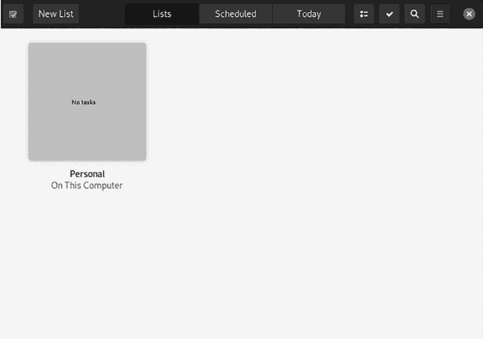
待办事项应用窗口。

### GNOME音乐——Rhythmbox
Linux下有众多音乐播放器可选，但只有少数几款能和GNOME桌面环境深度集成。目前大多数发行版都会默认搭载Rhythmbox，另一个选择是GNOME Music。和该项目大多数最新应用一样，你不要指望它有多少可配置项。这款应用可以扫描你的音乐文件夹，以美观的网格形式展示专辑，还支持播放音轨。

#### Rhythmbox应用
请在终端中运行以下命令安装Rhythmbox：
```bash
$ sudo apt update
$ sudo apt install rhythmbox
```


user@user-VirtualBox:~$ sudo apt install rhythmbox
Reading package lists...Done
Building dependency tree...Done
Reading state information...Done
以下软件包已被安装且不再需要：
``` caribou five-or-more four-in-a-row girl.2-caribou-1.0 girl.2-champlain-0.12 girl.2-dazzle-1.0 girl.2-gdata-0.0 girl.2-geocodeglib-1.0 girl.2-gfbgraph-0.2 girl.2-grilo-0.3 girl.2-gtkchamplain-0.12 girl.2-mediaart-2.0 girl.2-rest-0.7 girl.2-tracker-2.0 girl.2-zpj-0.0 gnome-chess gnome-clocks gnome-color-manager gnome-contacts gnome-core gnome-documents gnome-games gnome-klotski gnome-maps gnome-music gnome-nibbles gnome-online-miners gnome-robots gnome-shell-extensions ```
如果你正在为Ubuntu GNOME版本寻找一款开源音频音乐播放器，那你来对地方了。市面上有很多免费音乐播放器，但Rhythmbox凭借稳定性、可靠性，以及对海量歌曲的播放支持和插件生态脱颖而出。它是一款基于GNOME的音乐播放器，同时也适配其他桌面环境。Rhythmbox的部分功能如下：
- 支持播放本地存储的音乐、网络电台以及播客。
- 支持创建智能播放列表。
- 支持开启无缝播放。
- 支持刻录音频CD。
- 会自动为曲目匹配封面图。
- 支持接入SoundCloud。
- 若数据库中存在对应歌词，则会显示歌词。
Rhythmbox是包括Ubuntu在内的多数Linux发行版的默认音乐播放器。如果你的发行版未预装该软件，可以通过以下几种方法安装。接下来就来看看如何在你的Ubuntu设备上安装最新版的Rhythmbox。
## 在GNOME 3.36和Ubuntu 20.10上安装Rhythmbox
###### 通过Ubuntu软件中心安装
通过Ubuntu软件中心安装Rhythmbox音频播放器的方法十分简单易操作。按照下图所示从应用程序中打开软件商店，输入Rhythmbox即可得到如下搜索结果。现在你可以点击下图中所示的“安装”按钮下载该软件。下载安装完成后，即可在应用程序列表中找到并打开Rhythmbox，至此Rhythmbox音频播放器就可以正常使用了。
###### 通过终端安装Rhythmbox
这种方法需要使用终端下载Rhythmbox应用程序，执行以下命令即可完成下载安装：
``` $ sudo apt install rhythmbox ```
启动应用程序后，你会看到如下图所示窗口。
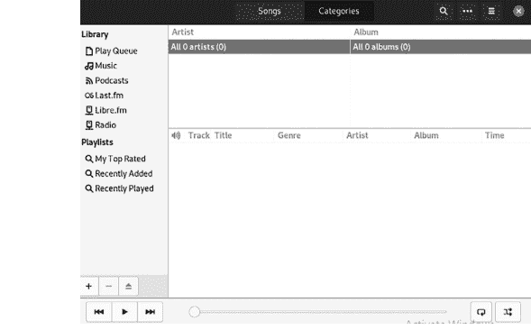
Rhythmbox应用程序窗口。
##### 如何卸载Rhythmbox
如果该播放器是通过软件中心安装的，卸载时再次打开软件中心，点击“已安装”，找到Rhythmbox后点击移除即可。也可以通过命令卸载，执行以下命令：
``` $ sudo apt remove rhythmbox ```
谷歌阅读器已经停运超过两年，RSS领域的生态早已今非昔比。虽然市面上涌现了不少替代选项，但都没有谁能达到它的覆盖范围。不过如果你相比Reddit更偏好RSS，想要一款靠谱的桌面端专用RSS客户端，FeedReader值得你关注。
### FeedReader应用程序
FeedReader是一款现代GTK+ 3客户端，支持tt-rss等各类在线RSS服务。目前它支持Feedbin、Feedly、FreshRSS、InoReader、本地RSS、Nextcloud/ownCloud、The Old Reader和Tiny Tiny RSS。它既能保留网页版RSS服务的所有优势，比如跨所有设备同步数据，也具备你期待的所有现代桌面应用功能。它可以对接Instapaper、Pocket或Wallabag，将文章保存到“稍后读”列表。此外，它还支持通过电子邮件、Twitter、Telegram将文章分享给他人。
#### 如何安装FeedReader
该软件支持Ubuntu 18.10、19.04和19.10版本，但不会再接收后续更新。若要在Ubuntu 18.04及更高版本上安装最新版，可通过Ctrl+Alt+T快捷键或从应用程序菜单打开终端，依次执行以下命令：
首先，执行以下命令安装flatpak框架：
``` $ sudo apt-get install flatpak ```
添加Flathub仓库，该仓库托管了大量flatpak应用程序：
``` flatpak remote-add --if-not-exists flathub https://flathub.org/repo/flathub.flatpakrepo ```
或者通过snapd命令安装：
``` $ sudo snap install feedreader ```
输出结果如下：
``` user@user-VirtualBox:~$ sudo snap install feedreader feedreader 0+git.9ac478f7 from Ken VanDine installed ```
最后，通过以下命令安装RSS客户端：
``` $ flatpak install flathub org.gnome.FeedReader ```
后续若有可用更新，可通过`flatpak update org.gnome.FeedReader`命令进行安装更新。
如需卸载FeedReader的flatpak包，在终端执行以下命令：
``` $ flatpak uninstall org.gnome.FeedReader ```
#### 功能
### FeedReader支持的RSS服务
- **Feedbin：** 快速、简洁的服务，能提供优秀的阅读体验。
- **Feedly：** 目前最受欢迎的在线RSS服务之一。
- **FreshRSS：** 免费、可自托管的聚合器，据开发者称是其中最佳选择。
- **InoReader：** Feedly的流行替代品，功能与Feedly相似。
- **本地RSS：** 无需在线账号或服务器，所有数据存储在你的本地硬盘中。
- **Nextcloud：** 可自托管的云服务，支持RSS功能，还能实现更多其他功能。
- **The Old Reader：** 开放网络首选终极社交RSS阅读器。
- **Tiny Tiny RSS：** 功能强大且轻量的可自托管RSS阅读器。
##### 推送至稍后读服务
- **Instapaper：** 可以保存任意内容，随时随地阅读。
- **Pocket：** 全球领先的稍后读服务。
- **Wallabag：** 可自由保存网页内容。
##### 分享给他人
- **电子邮件：** 可直接在FeedReader内通过邮件分享文章。
- **Telegram：** 可轻松从FeedReader将文章分享给好友或群组。
- **Twitter：** 可发布关于文章的推文。
### Brasero应用程序
它是一款开源媒体播放器，基于极简的Clutter界面，集成了GStreamer的全部功能与灵活性。在Ubuntu上启用Snap功能即可安装Brasero。Snap是打包了所有依赖项的应用程序，单一构建即可在所有主流Linux发行版上运行。Snap应用会自动更新，也可平滑回滚至旧版本。Snap应用可通过Snap Store安装，该应用商店拥有数百万用户。
### 安装Brasero
执行以下命令即可安装Brasero：
``` $ sudo snap install Brasero --edge --classic ```
#### 环境要求
- 已安装并运行的Ubuntu系统
- 可正常联网的网络连接（用于下载Brasero）
- Sudo权限
## Brasero功能
- 支持多种后端：cdr tools、growisofs和libburn
- 可用于编辑光盘内容
- 自动过滤不需要的文件
- 支持多区段和Joliet扩展
- 支持将镜像写入硬盘
- 支持检查光盘文件完整性
- 支持写入CD-TEXT信息
- 支持在拖入的文件夹中搜索音频文件
- 支持为曲目间添加完整静音片段
- 支持将CD/DVD复制到硬盘
- 支持擦除CD/DVD（适用于可重写CD/DVD）
- 支持项目保存与加载
- 支持刻录CD/DVD镜像和cue文件
- 支持歌曲、图片和视频预览
- 支持设备检测和文件变更通知
- 支持自定义图形界面（搭配GDL使用时）
- 支持文件的拖放、剪切和粘贴操作
##### 如何在Ubuntu上安装Brasero？
你可以通过两种方法安装Brasero：
- 图形化方法
- 终端方法
首先我们先介绍图形化安装方法，通过图形界面在Ubuntu上安装Brasero。Brasero已在Ubuntu软件中心上架：
- 启动Ubuntu软件中心。
- 搜索Brasero，点击搜索结果。
- 点击“安装”，完成身份验证即可安装Brasero。
## 80 ■ 精通GNOME
- 安装完成后，你会看到移除选项。
- 通过应用程序菜单启动Brasero。
###### 通过终端在Ubuntu上安装Brasero
Brasero已在Ubuntu官方仓库中，使用apt命令即可轻松安装。安装Brasero前，建议先更新软件源：
``` $ sudo apt update ```
现在执行以下命令安装Brasero：
``` $ sudo apt install brasero ```
安装完成后，可通过以下命令启动Brasero：
``` $ brasero ```
启动后会看到如下图所示窗口。
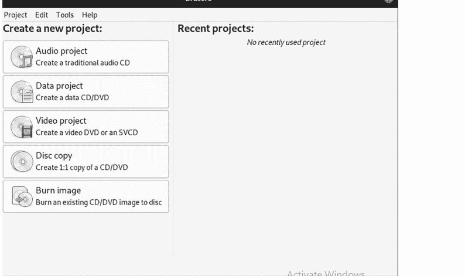
Brasero应用程序窗口。


###### 从Ubuntu卸载Brasero
如果你想卸载Brasero，可以通过Ubuntu软件中心操作，也可以在终端执行以下命令：
```
$ sudo apt remove brasero
```

### Epiphany浏览器应用
### 在Ubuntu中安装Epiphany浏览器
这是一款面向GNOME桌面环境的开源网页浏览器，能提供简单易用的上网体验，支持插件扩展默认功能。本章节将介绍在Ubuntu GNOME中安装Epiphany浏览器的方法。
### 安装Epiphany浏览器
首先，使用以下命令添加所需的软件源：
```
user@user-VirtualBox:~$ sudo add-apt-repository ppa:gnome3-team/gnome3
```
[sudo] password for user:
在将系统从Ubuntu 16.04升级到16.10版本之前，你需要先运行 "ppa-purge ppa:gnome3-team/gnome3" 命令。
***
你应该运行 "sudo apt-get dist-upgrade" 命令以避免出现问题。
***
在按下"Y"前请仔细检查结果，确保没有包被删除。
### 问题反馈
如果要反馈此PPA中包的问题，请使用 "ubuntu-bug" 命令。
### 停止维护
此PPA不再为Ubuntu 18.04 LTS版本提供维护。如果你正在使用旧版本，请使用ppa-purge删除此PPA，并考虑升级到更新的Ubuntu版本。除非另有说明，否则此PPA仅在相关Ubuntu系列首次发布后的7个月内提供更新。
[存档链接](https://lists.ubuntu.com/archives/ubuntu-gnome/2017-March/004229.html)
更多信息：[Launchpad团队存档](https://launchpad.net/~gnome3-team/+archive/ubuntu/gnome3)
使用`apt-get update`命令更新已添加的软件源，输出如下：
```
user@user-VirtualBox:~$ sudo apt-get update
Hit:1 http://in.archive.ubuntu.com/ubuntu focal InRelease
Hit:2 http://in.archive.ubuntu.com/ubuntu focal-updates InRelease
Hit:3 http://in.archive.ubuntu.com/ubuntu focal-backports InRelease
Hit:4 http://security.ubuntu.com/ubuntu focal-security InRelease
Ign:5 http://ppa.launchpad.net/gnome3-team/gnome3/ubuntu focal InRelease
Ign:6 http://ppa.launchpad.net/snappy-dev/beta/ubuntu focal InRelease
Err:7 http://ppa.launchpad.net/gnome3-team/gnome3/ubuntu focal Release 404 Not Found [IP: 91.189.95.85 80]
```
使用以下命令安装epiphany包：
```
user@user-VirtualBox:~$ sudo apt-get install epiphany-browser
Reading package lists... Done
Building dependency tree... Done
Reading state information... Done
```
以下包已被安装且不再需要：
```
caribou five-or-more four-in-a-row gir1.2-caribou-1.0 gir1.2-champlain-0.12 gir1.2-dazzle-1.0 gir1.2-gdata-0.0 gir1.2-geocodeglib-1.0 gir1.2-gfbgraph-0.2 gir1.2-grilo-0.3 gir1.2-gtkchamplain-0.12 gir1.2-mediaart-2.0 gir1.2-rest-0.7 gir1.2-tracker-2.0 gir1.2-zpj-0.0 gnome-chess gnome-clocks gnome-color-manager gnome-contacts gnome-core gnome-documents gnome-games gnome-klotski gnome-music gnome-nibbles gnome-online-miners gnome-robots gnome-shell-extensions
```
另一种安装epiphany的方式是使用snapd，命令如下：
```
$ sudo snap install epiphany
```
输出结果如下图所示。
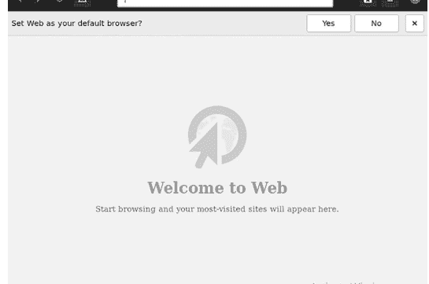
特性：
- 1. 阅读模式改进
Epiphany去年新增的阅读模式曾引发诸多讨论，其精简内容的功能在Epiphany 3.3版本中会得到进一步优化。现在你可以通过快捷键开关阅读模式：当你打开需要进行精简的页面时，按下Super + Shift + R即可快速进入阅读模式，这个便捷组合键无需你费力在菜单里查找，也无需记忆对应工具栏按钮的位置。此外，还为阅读模式新增了一小部分偏好设置，你可以通过这些设置优化阅读模式页面的样式和外观，支持选择浅色/深色页面，以及无衬线/衬线字体。
#### 2. 原生PDF查看功能
Epiphany支持通过libevince库在浏览器中直接查看PDF，如果你经常在线阅读PDF，这个功能会非常实用。目前Epiphany点击PDF链接时会先下载文件，需要你使用Evince或Okular等独立应用打开。不过预计在下一版本中，PDF将在当前标签页直接打开，无需再跳转到其他应用，你可以直接在浏览器内阅读、浏览和缩放文档。
#### 3. 更多缩放档位
使用按钮或快捷键缩放Epiphany页面时，会从100%跳至125%再到150%，缩小则从100%跳至75%再到50%，新增了更多缩放档位。
#### 4. 更多标签页选项
新版Epiphany新增了更多标签页功能，包括：
- 支持重新加载所有标签页
- 支持重新加载单个标签页
- 支持重新打开最后关闭的标签页
- 支持关闭所有其他标签页
此外，新建标签页按钮已移至顶部标题栏的左侧，位置固定。同时，用鼠标中键点击主页按钮，会在新标签页中打开主页。这些改动算不上翻天覆地，但依然值得称赞。

### Vinagre远程桌面客户端应用
这是GNOME项目开发的远程桌面客户端，支持多种远程桌面协议，具体支持的协议如下：
- VNC——全称虚拟网络计算（Virtual Network Computing）
- RDP——全称远程桌面协议（Remote Desktop Protocol）
- SPICE——全称独立计算环境简单协议（Simple Protocol for Independent Computing Environments）
- SSH——全称安全外壳协议（Secure Shell）
你可以通过Vinagre远程桌面客户端，使用多种远程桌面协议连接远程计算机。本章节将介绍如何在主流Linux发行版中安装Vinagre远程桌面客户端，接下来就让我们开始吧。
### 安装Vinagre
Vinagre在Ubuntu的软件源中即可获取，因此你也可以在Ubuntu操作系统中安装该客户端。首先，使用以下命令更新APT软件源缓存：
```
$ sudo apt update
```
在Ubuntu中安装Vinagre远程桌面，请运行以下命令：
```
$ sudo apt install vinagre
```
确认安装时，先按Y，再按下<Enter>键。所有必需的包正在安装中，这个过程需要一点时间，安装完成后会打开Vinagre远程桌面客户端（如下图所示）。
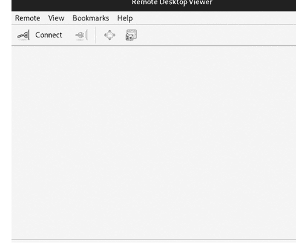
Vinagre应用窗口。

### Gedit应用
Gedit是GNOME生态中功能强大的文字处理器和代码编辑器。Ubuntu以GNOME作为桌面环境，因此Canonical发布的Ubuntu发行版默认就内置了Gedit。Gedit的一个特点是，除了具备复制、粘贴、打印、拼写检查等常规文字处理器的功能外，还支持多种编程语言的开发，能为多种编程语言提供语法高亮，方便进行小型编辑或代码可视化。它是开源软件，兼容所有Linux发行版。如果你要在GNOME桌面环境中安装最新版Gedit，其实Gedit作为GNOME的一部分已经随Ubuntu安装默认包含了，无需额外操作。
> *如需卸载Ubuntu内置的Gedit包，*
请打开终端，执行以下命令：
```
$ sudo apt remove gedit
```
如果你想安装更新版本的Flatpak PPA，请执行：
```
$ sudo add-apt-repository ppa:alexlarsson/flatpak
$ sudo apt update
```
> *最后，安装Flatpak：*
```
$ sudo apt install flatpak
```
Gedit托管在Flathub平台，因此我们需要将该仓库添加到Flatpak中：
```
$ flatpak remote-add --if-not-exists flathub https://flathub.org/repo/flathub.flathubrepo
```
> *现在我们可以运行以下命令安装最新版的Gedit：*
```
$ flatpak install flathub org.gnome.gedit
```
安装完成后，你可以通过主菜单或以下命令启动Gedit：
```
$ flatpak run org.gnome.gedit
```


#### 卸载 Gedit
如果你想从系统中卸载Gedit，操作并不复杂。打开终端窗口，执行以下命令即可：
```
$ flatpak uninstall --user org.gnome.gedit
```
执行上述命令后，整个卸载流程就会启动。如果你愿意，还可以卸载Flatpak，不过这是可选的。要卸载Flatpak的话，只需执行以下命令：
```
$ sudo apt autoremove flatpak
```
以下是安装gedit的另一种方法：
```
$ sudo apt install gedit
```
现在要启动这个应用，请使用以下命令：
```
$ gedit
```
运行结果如下图所示。
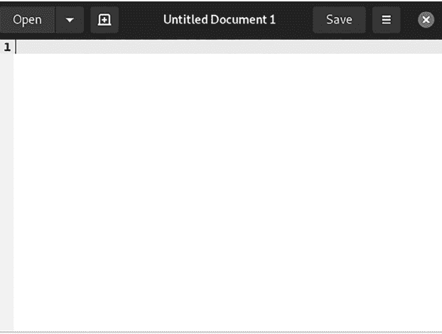
Gedit应用窗口。

#### Gedit文本编辑器功能
- **插入当前日期和时间：** 插入日期和时间是只需点击一下就能使用的便捷功能。在维护简单文本格式的日志时经常会用到这个功能。现在，把光标放到想要插入日期和时间的位置，然后点击菜单中的「工具 > 插入日期和时间」，在后续弹出的对话框里选择你需要的日期和时间格式，再点击「插入」按钮即可。
- **启用自动保存选项和创建自动备份：** 这款编辑器有两个默认关闭的重要功能：自动保存和自动备份。前往「菜单 > 偏好设置 > 编辑器 > 文件保存」，勾选「创建备份」和「自动保存文件」选项即可开启。gedit会自动保存文件，无需担心数据丢失。
- **常用键盘快捷键：** 键盘快捷键是提升效率的利器，gedit除了支持常规操作外，还自带大量快捷键。你可以在「菜单 > 键盘快捷键」里查看所有快捷键。例如，你可以使用CTRL+U和CTRL+L来将字母转换为大写或小写，在对应的对话框里还能找到更多这类实用功能。
- **主题：** gedit为编辑器窗口预置了多套配色方案。你可以在「菜单 > 偏好设置 > 字体与颜色」中修改编辑器的背景、字体样式和文本颜色。
- **分屏与标签分组：** 使用CTRL+T打开新标签页，也可以同时打开多个文档，之后按下ALT+CTRL+N就可以为所有已打开的标签页添加分隔线分屏。你可以在gedit内并排处理多个文档，无需离开编辑器。多次按下ALT+CTRL+N可以创建更多分屏来整理文件标签页，还可以拖动标签页到不同的分组中进行排列。
- **拼写错误高亮：** 你可以通过拼写检查插件高亮错误单词并进行拼写检查。要开启该功能，前往「菜单 > 偏好设置 > 插件」，勾选拼写检查插件即可。之后按下SHIFT+F7即可对文档进行拼写检查，会弹出拼写检查对话框。

### GNOME Shell扩展Dash to Dock
有大量主题、图标、扩展和鼠标指针可用于自定义桌面外观，Dash to Dock就是其中之一。它是GNOME 3环境的扩展程序，支持你调整与Dock相关的各类设置。它可以将Ubuntu默认的Dock修改为macOS风格的Dock，最终帮助你快速、便捷地启动和切换应用程序。

#### 如何安装Dash to Dock
安装Dash to Dock需要用到GNOME Tweak Tool。如果你还没安装，请使用以下命令安装：
```
$ sudo apt install gnome-tweak-tool
```
如果出现「未找到软件包」的错误，请使用以下命令添加「universe」软件源：
```
$ sudo add-apt-repository universe
```
成功安装GNOME Tweak Tool后，你就可以继续下载Dash to Dock扩展了。要安装该扩展，请在浏览器中打开以下网址：https://extensions.gnome.org/extension/
页面会提示你先安装浏览器扩展，点击并完成安装即可。安装完成后，你会看到如下图所示的「权限」提示，点击「添加」按钮继续。扩展安装完成后，图标会出现在浏览器窗口的右上角。之后搜索「Dash to Dock」扩展，点击按钮将其开启，然后打开GNOME Tweak Tool，进入「扩展」标签页，启用该扩展即可。

#### 位置与尺寸
你首先会看到「位置与尺寸」选项，其中包含多项可用设置：
- Dock的位置
- Dock的大小限制
- 图标的大小限制
- 自动隐藏Dock

##### 启动器
「启动器」是下一个标签页，该区域包含窗口预览、工作区和显示器的相关设置。「应用程序」图标可以根据需要移动到左侧或右侧，也可以直接移除。回收站功能也可以开启或关闭。

##### 行为
在这个标签页中，你可以为应用程序分配快捷键，还可以设置「单击操作」和「滚动操作」对应的功能。

##### 外观
这个标签页用于修改Dock的外观和主题，你可以选择默认主题，也可以分别自定义单个Dock选项。
- 通过缩小Dash来缩小应用之间的间距。窗口计数器指示器：可以通过多种标识区分正在运行或已打开的应用，例如圆点、方块、分段、实心块等不同形状。
- **Dash颜色：** 支持修改Dash的颜色，默认颜色为黑色。
- **不透明度：** 可调整Dash的不透明度。
- **直角化边角：** Dash的边角默认是圆角，勾选该选项可以将边角改为直角。

### Dia图表编辑器应用
更新完所有软件包后，我们就可以安装Dia图表编辑器应用了。它属于Ubuntu默认软件源，因此安装时不需要额外的第三方PPA软件源。请使用以下命令安装Dia图表编辑器软件包：
> 首先执行`apt-get update`命令更新软件源，运行以下`apt-get update`命令即可更新软件源：
```
user@user-VirtualBox:~$ sudo apt-get update
Hit:1 http://in.archive.ubuntu.com/ubuntu focal InRelease
Hit:2 http://in.archive.ubuntu.com/ubuntu focal-updates InRelease
Hit:3 http://in.archive.ubuntu.com/ubuntu focal-backports InRelease
Hit:4 http://security.ubuntu.com/ubuntu focal-security InRelease
Ign:5 http://ppa.launchpad.net/gnome3-team/gnome3/ubuntu focal InRelease
Ign:6 http://ppa.launchpad.net/snappy-dev/beta/ubuntu focal InRelease
Err:7 http://ppa.launchpad.net/gnome3-team/gnome3/ubuntu focal Release 404 Not Found [IP: 91.189.95.85 80]
........
```
更新完软件包后，我们就可以安装Dia图表编辑器应用了。由于它属于Ubuntu默认软件源，不需要额外的第三方PPA软件源。请使用以下命令安装Dia图表编辑器软件包：
```
user@user-VirtualBox:~$ sudo apt-get install dia
[sudo] password for user:
```
```
Reading package lists... Done
Building dependency tree... Done
Reading state information... Done
The following packages were installed and are no longer required:
caribou five-or-more four-in-a-row gir1.2-caribou-1.0 gir1.2-champlain-0.12 gir1.2-dazzle-1.0 gir1.2-gdata-0.0 gir1.2-geocodeglib-1.0 gir1.2-gfbgraph-0.2 gir1.2-grilo-0.3 gir1.2-gtkchamplain-0.12 gir1.2-mediaart-2.0 gir1.2-rest-0.7 gir1.2-tracker-2.0 gir1.2-zpj-0.0 gnome-chess gnome-clocks gnome-color-manager gnome-contacts gnome-core gnome-documents gnome-games gnome-klotski gnome-maps gnome-music gnome-nibbles gnome-online-miners gnome-robots gnome-shell-extensions
```
如上所示，我们已成功安装Dia图表编辑器软件包。要确认安装是否成功，请运行以下命令：
```
$ sudo dpkg -l dia
```
要打开该应用，在终端中输入`dia`命令即可：
```
$ dia
```
你也可以通过图形界面打开Dia图表编辑器应用，在Ubuntu桌面应用搜索框中搜索该应用即可（如下图所示）。
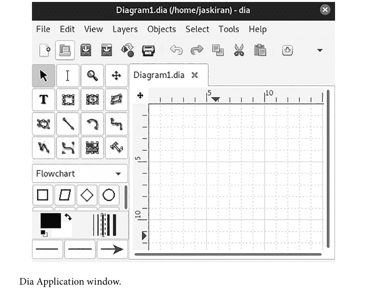
Dia应用窗口。


#### 卸载Dia图表编辑器
如果你不喜欢Dia图表编辑器应用，想要从系统中卸载它，请运行以下命令：
```bash
$ sudo dpkg -r dia-shapes
```

### EasyTAG应用
它是一个用于查看和编辑音频文件标签的简单应用，支持多种文件格式，例如MP3、MP2、MP4/AAC、FLAC、Ogg Opus、Ogg Speex、Ogg Vorbis、MusePack、Monkey's Audio和WavPack，可在Linux或Windows系统下运行。

#### 功能
它可用于查看、编辑和写入以下文件类型的标签：
- MP3、MP2文件（使用带图片的ID3标签）
- FLAC文件（使用FLAC Vorbis标签）
- Ogg Opus文件（使用Ogg Vorbis标签）
- Ogg Speex文件（使用Ogg Vorbis标签）
- Ogg Vorbis文件（使用Ogg Vorbis标签）
- MP4/AAC文件（使用MP4/AAC标签）
- MusePack、Monkey's Audio和WavPack文件（使用APE标签）
- 可编辑更多标签字段：标题、艺术家、专辑、光盘编号、年份、音轨编号、备注、作曲者、原创艺术家/表演者、版权、网址、编码器名称以及附加图片
- 自动打标：根据文件名和目录自动填充字段
- 可直接依据标签信息重命名文件和文件夹，也可通过加载文本文件完成重命名
- 可处理所选目录中的选中文件
- 支持浏览子目录
- 拥有播放列表生成窗口
- 支持打标、移除、重命名、保存操作的递归处理
- 可将指定字段（艺术家、标题）的内容同步到所有其他文件
- 可读取并显示文件头信息（比特率、时长）
- 输入部分日期时可自动补全剩余内容
- 支持对最近修改的撤销与重做
- 提供简洁直观的操作界面
- 支持处理标签和文件名，可将字母转换为大写或小写
- 可使用外部程序打开目录或文件
- 支持通过Freedb.org和Gnudb.org服务器使用CDDB服务（支持手动和自动搜索）
- 提供基于树结构的浏览器，或按艺术家、专辑排序的视图
- 提供用于选择文件的列表
- 提供文件搜索窗口
- 支持多语言界面
- 采用C语言编写，使用GTK+作为图形界面框架
- 提供适用于Linux和Windows的安装包

### 安装EasyTAG
在终端中输入以下命令即可安装EasyTAG：
```bash
$ sudo apt update
```
```bash
user@user-VirtualBox:~$ sudo apt-get update
Hit:1 http://in.archive.ubuntu.com/ubuntu focal InRelease
Hit:2 http://in.archive.ubuntu.com/ubuntu focal-updates InRelease
Hit:3 http://in.archive.ubuntu.com/ubuntu focal-backports InRelease
```
```bash
Hit:4 http://security.ubuntu.com/ubuntu focal-security InRelease
Ign:5 http://ppa.launchpad.net/gnome3-team/gnome3/ubuntu focal InRelease
Ign:6 http://ppa.launchpad.net/snappy-dev/beta/ubuntu focal InRelease
Err:7 http://ppa.launchpad.net/gnome3-team/gnome3/ubuntu focal Release 404 Not Found [IP: 91.189.95.85 80]
.......
```
更新完成后，运行以下命令：
```bash
$ sudo apt install easytag
```
```bash
user@user-VirtualBox:~$ sudo apt install easytag
[sudo] password for user:
```
```bash
Reading package lists... Done
Building dependency tree... Done
Reading state information... Done
```
以下软件包已预安装且不再需要：
```bash
caribou five-or-more four-in-a-row girl.2-caribou-1.0 girl.2-champlain-0.12 girl.2-dazzle-1.0 girl.2-gdata-0.0 girl.2-geocodeglib-1.0 girl.2-gfbgraph-0.2 girl.2-grilo-0.3 girl.2-gtkchamplain-0.12 girl.2-mediaart-2.0 girl.2-rest-0.7 girl.2-tracker-2.0 girl.2-zpj-0.0 gnome-chess gnome-clocks gnome-color-manager gnome-contacts gnome-core gnome-documents gnome-games gnome-klotski gnome-maps gnome-music gnome-nibbles gnome-online-miners gnome-robots gnome-shell-extensions
```
当你打开该应用时，输出将如下图所示。
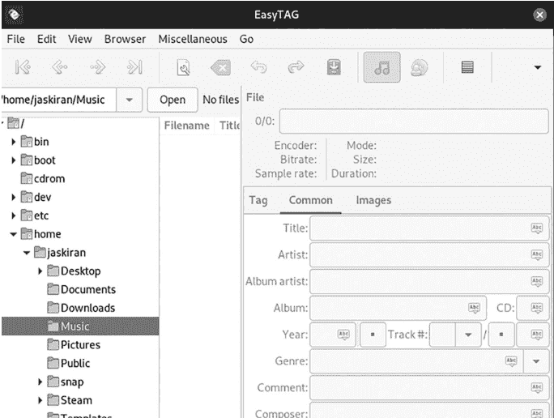
*EasyTAG应用窗口。*

### GNOME SUBTITLES应用
这是一款适用于Linux的开源免费字幕编辑器，无需借助笨重的视频编辑应用。它允许你向视频添加字幕和说明，支持预览、时间同步、翻译、拼写检查等功能。GNOME Subtitles采用C#语言编写，基于GNU通用公共许可证（GPL）第2版或更高版本发布，其功能包括：
- 字幕编辑
- 翻译
- 同步
- 支持最常见的基于文本的字幕格式

### 其他变更
- 重写GStreamer媒体播放引擎
- 修复音视频播放问题
- 更新AppData和Desktop文件
- 视频上显示的字幕行修改后将立即刷新
- 多项缺陷修复

### 安装GNOME Subtitles
该软件的开发者为Ubuntu 16.04、Ubuntu 18.04、20.04和21.10维护了一个包含最新软件包的Ubuntu PPA。按下Ctrl + Alt + T快捷键打开终端，然后执行以下命令添加该PPA：
```bash
sudo add-apt-repository ppa:pedrocastro/ppa
```
当提示输入用户密码时，输入密码并按Enter键继续。

### 更新或安装GNOME Subtitles
添加PPA后，依次运行以下命令安装软件包：
```bash
$ sudo apt update
$ sudo apt install gnome-subtitles
```
如果系统中已存在旧版本，也可通过「软件更新器」更新软件包。

### 移除GNOME Subtitles及PPA
按下Ctrl + Alt + T快捷键打开终端。要移除PPA，请运行以下命令：
```bash
$ sudo add-apt-repository --remove ppa:pedrocastro/ppa
```
要移除该字幕编辑器，请运行：
```bash
$ sudo apt remove --autoremove gnome-subtitles
```

### GNOME之眼应用
它是GNOME桌面环境的官方默认图片查看器，也被称为「图片查看器」。GNOME的另一款官方图片查看器gThumb具备更高级的功能，例如图片整理、图片编辑等。GNOME之眼提供了基础视图优化功能，例如缩放、全屏、旋转以及透明图片背景控制。它拥有大量官方插件，可用于扩展功能或修改其运行行为。

### 支持的文件格式
它支持以下文件格式：
- RAS（Sun光栅格式）
- SVG（可缩放矢量图形）
- TGA（Truevision Targa格式）
- TIFF（标签图像文件格式）
- WBMP（无线应用协议位图格式）
- XBM（X位图格式）
- XPM（X像素图格式）
- ANI（动画格式）
- BMP（Windows位图格式）
- GIF（图形交换格式）
- ICO（Windows图标格式）
- JPEG（联合图像专家组格式）
- PCX（PC画板格式）
- PNG（便携式网络图形格式）
- PNM（PPM工具包便携式任意图格式）

### 限制
它不支持WebP、DirectDraw Surface（.dds）或JPEG 2000格式，但另一款GNOME官方图片查看器gThumb自2012年9月起已支持WebP格式。

### 安装GNOME之眼
GNOME之眼可通过Bionic Main软件仓库获取，可使用apt-get命令通过命令行轻松安装。你可以通过系统应用启动器搜索，或使用Ctrl + Alt + T快捷键打开终端应用程序。下一步是通过以下命令更新系统的软件仓库索引：
```bash
$ sudo apt-get update
```
该命令可帮你从互联网获取最新可用版本的软件。请注意，只有授权用户才能在Ubuntu上添加、移除和配置软件。
现在你可以安装GNOME之眼了，请以sudo身份运行以下命令：
```bash
$ sudo apt-get install eog
```
系统可能会向你询问sudo密码，并提示你是否继续安装（Y/n选项），输入Y后按Enter键，软件就会安装到你的系统中。但安装过程耗时取决于你的网速。
使用$eog命令运行该应用，输出将如下图所示。
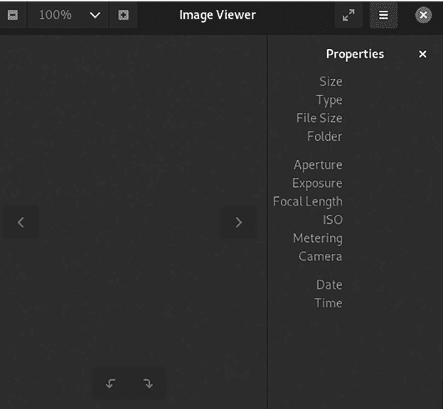
*GNOME之眼应用窗口。*
你可以通过以下命令查看应用的版本号，同时验证它是否已成功安装在你的系统中：
```bash
$ eog -version
```
输出结果将与上一张图一致。


#### 启动并使用 GNOME 之眼（Eye of GNOME）
你可以通过在启动器搜索栏输入关键词 "image viewer" 来启动该应用，操作如下：
你也可以在终端中使用以下命令启动该应用：
``` $ eog & ```
你可以通过浏览的方式在设置中打开图片。
GNOME 之眼是 GNOME 桌面的默认图片查看器。因此，只要你打开图片，都会通过图片查看器（EOG）打开。
如果未将其设为默认查看器，你可以右键点击图片，选择“使用其他应用打开”，然后在应用列表中选择“图片查看器”。
你可以通过设置工具将图片查看器设为默认照片查看工具。
最简单的操作方式是在应用启动器搜索栏中搜索“默认应用”。
打开搜索结果中的对应条目后，设置工具会跳转到「详情 > 默认应用」界面，操作如下：
在「照片」下拉菜单中选择「图片查看器」，它就会被设为你的默认照片查看工具。
有了这款轻量、安全且开箱即用的图片查看器，你无需再查找其他同类工具。

### Hitori 应用
Hitori 是一款轻量级应用，用于游玩同名的益智游戏，其主题与数独等更流行的益智游戏相似。它依赖 GTK+ 3 和 Cairo 1.4 库，完整支持游戏规则校验（即会自动检查全部三条规则是否满足）。它支持撤销/重做操作，可提供解题提示，还允许为单元格添加两种不同的标签以辅助解谜。它支持 5×5 到 10×10 的不同尺寸网格。

### Hitori 的安装
现在，你需要使用以下命令更新你的系统：
``` $ sudo apt-get update ```
上述命令会下载你系统中 GNOME 桌面环境的软件包列表，同时更新系统中软件包的最新版本及其依赖项列表。
借助上述命令下载完最新的软件包列表后，你就可以开始安装流程了。

### 安装 hitori：
更新完成后，使用以下命令安装 Hitori：
``` $ sudo apt-get install hitori ```
上述命令会在 Ubuntu 操作系统上安装软件包前请求你确认。如果你未以 root 用户登录，安装程序会向你索取 root 密码。
安装完成后，你就可以在系统中使用该软件包了。使用以下命令运行该应用：
``` $ hitori ```
运行输出如下方图示所示：

Hitori 应用窗口。

### 卸载或移除 hitori：
你可以使用以下命令从 Ubuntu GNOME 中卸载 Hitori。卸载该应用时，你可以轻松使用 apt 命令从 Ubuntu 系统中移除对应的软件包。
要移除 Hitori，请使用以下命令：
``` $ sudo apt-get remove hitori ```
以下命令用于移除 Hitori 软件包及其无用的依赖项：
``` $ sudo apt-get remove --auto-remove hitori ```
该命令会移除 Hitori 及其依赖的、系统中不再需要的软件包。
> 完全移除 Hitori 及其所有配置文件：
> 以下命令需谨慎使用，因为它会删除所有配置文件和数据：
> ```
> $ sudo apt-get purge hitori
> ```
> 你也可以使用以下命令：
> ```
> $ sudo apt-get purge --auto-remove hitori
> ```

### GNOME 扫雷应用
### 安装 GNOME-mines
首先，使用以下命令更新你的系统：
``` $ sudo apt-get update ```
上述命令会下载你系统中 Ubuntu 17.04 的软件包列表，同时更新系统中软件包的最新版本及其依赖项列表。
借助上述命令下载完最新的软件包列表后，你就可以开始安装流程了。
``` $ sudo apt-get install gnome-mines ```
运行输出如下方图示所示：
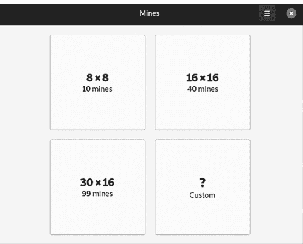
GNOME 扫雷应用窗口。
如果你的电脑未安装 GNOME-mines，运行命令 `dpkg -L GNOME-mines` 会产生如下错误：
> ### 卸载或移除 GNOME-mines：
> 以下是用于从 Ubuntu GNOME 中卸载 GNOME-mines 的命令。卸载该应用时，你可以轻松使用 apt 命令从 Ubuntu 系统中移除对应的软件包。
> 要移除 GNOME-mines，请使用以下命令：
> ```
> $ sudo apt-get remove GNOME-mines
> ```
> 以下命令用于移除 GNOME-mines 软件包及其无用的依赖项：
> ```
> $ sudo apt-get remove --auto-remove gnome-mines
> ```
> 该命令会移除 GNOME-mines 及其依赖的、系统中不再需要的所有软件包。

### Postr 应用
Postr 是 GNOME 桌面的上传工具，旨在操作简单，同时提供足够完整的 Flickr 功能以方便用户使用，它可以向 Flickr 上传照片。它是面向 GNOME 桌面的 Flickr 上传工具，旨在操作简便，同时提供足够实用的 Flickr 功能。
它拥有简洁的用户界面，支持你为照片设置常见属性：标题、描述、标签、相册、群组、隐私权限、许可证等。
它与 Nautilus 文件管理器集成：你既可以浏览照片时直接打开 Postr，也可以将照片从 Nautilus 中拖拽到 Postr 窗口内。
主页：http://projects.gnome.org/postr/
Python 版本：2.6

###### 功能特性
- 简洁的用户界面
- 可设置照片的常见属性，包括标题、描述、标签、相册、群组、隐私权限、许可证等
- 与 Nautilus 集成：浏览照片时可直接运行 Postr，也可将照片从 Nautilus 拖拽至 Postr 中
- 会话管理功能：你可以保存当前会话，之后继续处理

### Postr 快速安装
首先，使用以下命令更新你的系统：
``` $ sudo apt-get update ```
更新操作系统后，运行以下命令安装该软件包：
``` $ sudo apt-get install postr ```
上述命令会在 Ubuntu GNOME 操作系统上安装软件包前请求你确认。如果你未以 root 用户身份登录，安装程序会向你索取 root 密码。
安装完成后，你就可以在系统中使用该软件包了。

### 卸载或移除 postr
你可以使用以下命令从 Ubuntu 中卸载 postr。卸载该应用时，你可以轻松使用 apt 命令从系统中移除对应的软件包。
要移除 postr，请使用以下命令：
``` $ sudo apt-get remove postr ```
以下命令用于移除 postr 软件包及其无用的依赖项：
``` $ sudo apt-get remove --auto-remove postr ```
该命令会移除 postr 及其依赖的、系统中不再需要的所有软件包。
完全移除 postr 及其所有配置文件：
以下命令需谨慎使用，因为它会删除所有配置文件和数据：
``` $ sudo apt-get purge postr ```
你也可以使用以下命令：
``` $ sudo apt-get purge --auto-remove postr ```

### GNOME Taquin 应用
它是 15 数字推盘游戏及其他滑动拼图类的电脑版本。
游戏目标是通过移动方块，让它们回到正确位置，正确位置可以用数字或整张图片的碎片标注。

### GNOME Taquin 快速安装
要更新软件包仓库并获取最新的软件包信息，请执行以下命令：
``` $ sudo apt-get update -y ```
要安装 GNOME-taqin，请运行带有 -y 参数的命令，快速安装该软件包及其依赖项：
``` $ sudo apt-get install -y gnome-taqin ```
完全移除 GNOME-taqin 及其所有配置文件：
以下命令需谨慎使用，因为它会删除所有配置文件和数据：
``` $ sudo apt-get purge gnome-taqin ```
你也可以使用以下命令：
``` $ sudo apt-get purge --auto-remove gnome-taqin ```

### GNOME 字符映射表应用
它是一款免费开源的 Unicode 字符映射程序，也是 GNOME 桌面的实用小工具，可用于查找和输入特殊字符。
该程序支持按 Unicode 区块或文字类型展示字符。
你可以通过关键词搜索快速找到需要的字符，程序还会提供相关符号的描述及含义。
它曾用名为 Gucharmap。
你也可以用它输入字符。
搜索功能支持多种搜索方式，包括按字符的 Unicode 名称或码点搜索。
它基于 GTK 工具包构建，可运行在所有 GTK 支持的平台上。
不少文本程序都会使用 Gucharmap 进行字符输入。
你也可以按照标点、图形等分类浏览字符。
现在，运行以下更新命令更新软件源并获取最新的软件包信息：
``` $ sudo apt-get update -y ```
你需要运行带有 -y 参数的安装命令，快速安装该软件包及其依赖项（见下图）：
``` $ sudo apt-get install -y gnome-characters ```
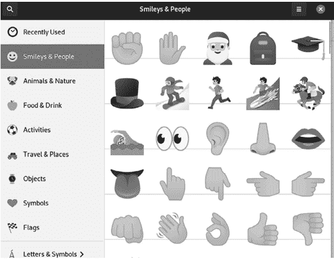
GNOME 字符映射表应用窗口。


### SOUND-JUICER 应用
Sound-Juicer 是一款采用 GTK+ 和 GStreamer 的 CD 抓轨工具。2018年2月20日。
Sound-Juicer 是专为 GNOME 桌面环境打造的 CD 抓轨与播放工具，旨在提供简洁、清爽、易用的操作界面。Sound-Juicer 支持编码为多种主流音频格式，例如 Ogg Vorbis 和 FLAC，还可通过 GStreamer 插件扩展支持更多格式。该工具由 Ross Burton 开发。
首先，使用以下命令更新系统：
``` $ sudo apt-get update ```
上述命令会下载适用于您系统的 Ubuntu 16.04 的软件包列表，同时更新系统中软件包及其依赖的最新版本列表。
> 借助上述命令下载完最新软件包列表后，即可开始执行安装流程。
更新完成后，使用以下命令安装 Sound-Juicer：
``` $ sudo apt-get install sound-juicer ```
上述命令在您的 Ubuntu GNOME 系统上安装软件包前会弹出确认提示，若当前登录用户不是 root 用户，安装程序会要求您输入 root 密码。
安装完成后，您即可在系统中使用该工具。

### 卸载或移除 Sound-Juicer
以下是用于从 GNOME 中卸载 Sound-Juicer 的命令，您可以使用 apt 命令从系统中移除该软件包完成卸载。
移除 Sound-Juicer 需使用以下命令：
``` $ sudo apt-get remove sound-juicer ```
以下命令可用于移除 Sound-Juicer 软件包及其所有依赖项：
``` $ sudo apt-get remove --auto-remove sound-juicer ```

### 相册应用
您可以在 GNOME 中查看、整理和分享您的照片，它是一款简洁优雅的图片管理工具，可作为使用文件管理器处理相册内容的替代方案。它支持快速微调、裁剪和编辑照片，还可通过 GNOME 在线账号实现无缝云同步。
- 使用相册应用可以完成多种操作
- 可自动检索您所有的图片
- 可查看最近存储于本地或云端的照片
- 可访问您在 Facebook 或 Flickr 上的相册
- 可在本地网络内的电视、笔记本或其他 DLNA 渲染设备上查看照片
- 可将图片设置为桌面壁纸
- 可打印照片
您可以在应用内选择喜欢的照片进行编辑，也可以将其发送至全功能编辑器进行更高级的调整。

##### 安装
首先，使用以下命令更新系统：
``` $ sudo apt-get update ```
上述命令会下载适用于您系统的 Ubuntu 16.04 的软件包列表，同时更新系统中软件包及其依赖的最新版本列表。

### 安装 GNOME 相册软件包
以下是安装 GNOME 相册软件包的简要指南：
``` $ sudo apt install gnome-photos ```
使用以下命令运行应用：
``` $ gnome-photos ```
运行后将出现如下界面。
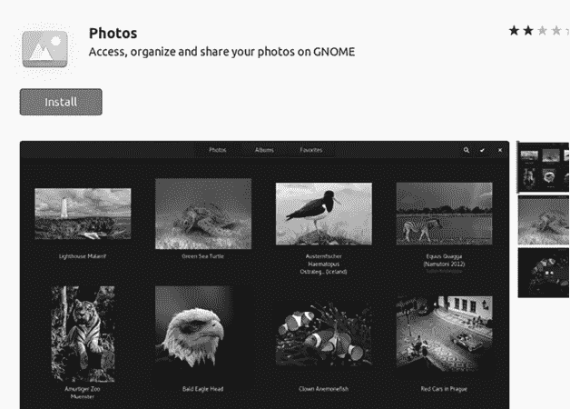
GNOME 相册应用窗口。

### 卸载或移除 GNOME 相册软件包
请按照以下步骤卸载 GNOME 相册软件包：
``` $ sudo apt remove gnome-photos $ sudo apt autoclean && sudo apt autoremove ```

### Blanket 应用
Blanket 是一款专为 Linux 系统设计的新一代桌面应用，仅用于播放自然白噪音、模糊环境音、白噪音和粉红噪音等背景音，功能纯粹，没有多余设计。
听背景音是广受认可的生活小技巧，它可以帮助平复浮躁的心绪，屏蔽周围的干扰，还能带来熟悉感与安全感。
Blanket 支持同时播放多种背景音，您可以自由组合出专属的定制化环境音混合效果，还能独立调节每路音轨的音量，非常适合打造多层次的放松音墙。
Blanket 是一款免费开源软件，源代码托管在 Github 平台。

### 安装 Blanket
在系统应用启动器中打开终端，然后运行以下命令添加对应的 PPA 源：
``` $ sudo add-apt-repository ppa:apandada1/blanket ```
*当系统提示输入用户密码时输入密码，然后按 Enter 键继续。*
完成上述操作后，运行 apt 命令安装该应用：
``` $ sudo apt install blanket ```
安装完成后，您可以通过系统应用启动器打开 Blanket，畅享背景音服务。

### 卸载 Blanket
如需移除对应的 PPA 源，您可以进入「软件与更新」->「其他软件」操作，也可以运行以下命令：
``` $ sudo add-apt-repository --remove ppa:apandada1/blanket ```
*如需移除该噪音播放器，请运行以下命令：*
``` $ sudo apt remove --auto-remove blanket ```
Blanket 是一款基于 GTK 开发的背景音播放应用，支持播放的环境音包括：
- 鸟鸣声
- 夏夜声
- 雨声、雷声、风声
- 咖啡厅声、壁炉燃烧声
- 白噪音、粉红噪音
- 火车声、船行声、城市环境音

### Junction 应用
这款应用支持您选择用指定程序打开文件与链接，安装完成后请确保已启动该应用。
当您在桌面应用中打开链接时，Junction 会自动弹出，您可以使用鼠标或键盘导航选择用于打开该链接或文件的程序。

###### 功能特性
- 可自主选择用于打开内容的程序
- 打开前可显示目标位置
- 打开前可编辑链接地址
- 打开不安全链接时显示提示
- 支持键盘导航操作
- 支持中键点击在多个程序中打开内容

### 使用方法
- 您可以将 Junction 设置为各类资源的默认打开程序，后续它会自动弹出并提供多种处理选项供您选择。
- 可将 Junction 设置为默认浏览器、所有文件的默认打开程序、PNG 文件的默认打开程序、默认邮件编辑器、默认文件夹打开程序。
- 支持 API 接口。

### 使用技巧
- 键盘导航操作
- 多程序同时打开内容
- 可将 Junction 弹出窗口设置为屏幕居中显示
- 支持通过终端使用 Junction
- 可向 Junction 添加自定义脚本
- 支持浏览器集成
- 支持多个 Firefox 浏览器配置文件

### 安装 fonts-junction
首先，使用以下命令更新系统：
``` $ sudo apt-get update ```
上述命令会下载适用于您系统的 Ubuntu 16.04 的软件包列表，同时更新系统中软件包及其依赖的最新版本列表。
您可以在 Ubuntu GNOME 系统的终端中运行以下命令完成安装：
``` $ sudo apt-get install fonts-junction ```

### Tangram 应用
这是一款旨在帮助用户在 Linux 系统上运行和管理网页应用的浏览器，是专为组织和运行 Web 应用设计的新型浏览器。
每个标签页相互独立，您可以为单个 Web 应用设置不同账号的多个标签页。
如果您需要一款专注于 Web 应用体验的浏览器，Tangram 是不错的选择。

##### 安装
该应用在所有主流发行版中均提供 Flatpak 格式安装包，同时也收录在 AUR 仓库中。如果您希望通过终端安装，可以使用以下命令：
首先，使用以下命令更新系统：
``` $ sudo apt-get update ```
上述命令会下载适用于您系统的 Ubuntu 16.04 的软件包列表，同时更新系统中软件包及其依赖的最新版本列表。
您也可以打开软件中心通过图形化界面安装 Tangram。

###### 功能特性
- 这是一款基于 WebKitGTK 的极简浏览器。
- 以下是该浏览器的功能列表，您可以使用它完成以下操作：
- 可重新排序侧边栏中的标签页
- 可将任意网络服务添加为 Web 应用
- 支持修改桌面/移动端用户代理（User Agent）
- 支持键盘快捷键
- 支持修改侧边栏（标签栏）的位置

### Shortwave 应用
这是一款互联网电台播放器，内置包含超过 25000 个电台的电台数据库。

###### 功能特性
- 可创建个人电台库，收藏您喜欢的电台
- 可轻松搜索并发现新的电台
- 支持自动识别播放歌曲，还可单独保存识别到的歌曲
- 响应式应用布局，兼容小尺寸与大尺寸屏幕
- 可在支持的网络设备（如 Google Chromecast）上播放音频
- 可与 GNOME 桌面环境无缝集成
首先，使用以下命令更新系统：
``` $ sudo apt-get update ```
上述命令会下载适用于您系统的 Ubuntu 16.04 的软件包列表，同时更新系统中软件包及其依赖的最新版本列表。
您可以在 Ubuntu GNOME 系统的终端中运行以下命令完成安装：
``` user@user-VirtualBox:~$ snap install shortwave shortwave 1.1.1 from Alex Murray (alexmurray) installed ```


打开此应用程序后，输出将如下图所示。
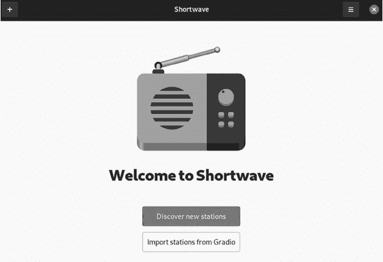
Gbrainy 应用程序窗口。
### Gbrainy 应用程序
这是一款旨在让你在娱乐过程中锻炼大脑的游戏。
Gbrainy 是一个通过多种不同难度的练习，训练记忆力、算术能力和逻辑能力的平台。
它适合所有年龄层和各类需求：想要提升孩子能力的家长、希望保持思维敏捷或者纯粹娱乐的成年人、需要进行记忆力训练的老年人等。
### 安装 gbrainy 架构
首先，使用以下命令更新系统：
```
$ sudo apt-get update
```
上述命令会下载你系统中 Ubuntu GNOME 的软件包列表，同时更新系统中软件包的最新版本及其依赖项列表。
更新完成后，使用以下命令安装 gbrainy 架构：
```
$ sudo apt-get install gbrainy
```
### 卸载或移除 gbrainy 架构
移除 gbrainy 架构需使用以下命令：
```
$ sudo apt-get remove gbrainy
```
以下命令可用于移除 gbrainy 架构包及其所有依赖项：
```
$ sudo apt-get remove --auto-remove gbrainy
```
### 完全移除 gbrainy 架构
请谨慎使用以下命令，它会删除所有相关配置文件和用户数据：
```
$ sudo apt-get purge gbrainy
```
你也可以使用以下命令：
```
$ sudo apt-get purge --auto-remove gbrainy
```
这是一款兼顾趣味性与脑力锻炼的智力游戏。
它提供以下类型的游戏：
- 逻辑谜题。这类游戏旨在锻炼你的推理和思考能力。
- 心算游戏。这类基于算术运算的游戏，旨在考验你的心算能力。
- 记忆力训练。这类游戏旨在挑战你的短期记忆能力。
- 语言类比。这类游戏能够锻炼你的语言能力。
- 它设置了不同的难度等级，无论是儿童、成年人还是老年人都能从中获得乐趣。此外它还具备玩家游戏历史记录、得分记录、玩家提示、全屏模式等功能，还可以通过第三方开发的新游戏轻松扩展内容。
- 它是面向 GNOME 的应用程序，可在 GNU/Linux 及其他各类 Unix 发行版上运行。
### gbrainy 项目目标
- 一款面向 Linux、Windows 及其他平台的免费开源智力游戏。
- 打造一个可供其他开发者基于其上构建应用程序或客户端的平台。
- 一套基于 XML 描述的免费智力游戏合集，任何应用都可以调用，也允许任何人创作新的游戏内容。
### Gajim 应用程序
其目标是提供一款功能齐全、易于使用的 Jabber 客户端。
该软件基于 GNU 通用公共许可证发布。
它能够良好适配 GNOME 桌面环境，但运行并不依赖 GNOME。
### 安装说明
该软件提供 Ubuntu 软件包和 Debian 软件包。
```
$ sudo apt install gajim
```
插件包适用于 Ubuntu GNOME 桌面环境。我们建议通过软件包的方式在 Ubuntu/Debian 上安装 Gajim 插件，以此自动解决依赖问题。
例如，要安装 Gajim 的 OMEMO 插件：
```
$ sudo apt install gajim-omemo
```
###### 功能特性
- 标签式聊天窗口
- 群聊支持（基于 MUC 协议）
- 表情、头像、文件传输、房间书签
- 超级联系人支持
- 托盘图标、拼写检查、扩展聊天历史记录及其他功能
- 支持 TLS 和 GPG 加密
- 支持传输注册
- 服务发现（包含节点功能）
- 维基百科、词典及搜索引擎查询功能
- 多账户支持
- DBus 功能支持
- XML 控制台
- Gajim 支持 27 种语言：巴斯克语、白俄罗斯语、巴西葡萄牙语、布列塔尼语、英式英语、保加利亚语、中文、克罗地亚语、捷克语、丹麦语、荷兰语、英语、世界语、法语、加利西亚语、德语、希腊语、意大利语、立陶宛语、挪威语、波兰语、葡萄牙语、俄语、塞尔维亚语、西班牙语、斯洛伐克语、瑞典语
### Khronos-API 应用程序
Khronos 组织的 Vulkan API 是一款显式、低开销、跨平台的图形与计算接口。
Vulkan 赋予应用程序对系统执行和内存的控制权，可最大化应用程序在各类设备上的运行效率，涵盖从个人电脑、游戏主机到手机、嵌入式平台等设备。
Khronos 组织包含了其 API、编程语言及相关产品的规范、头文件、扩展规范、枚举与函数注册表及其他相关文档。
该 API 指南提供 HTML 和 PDF 两种版本，为 Khronos 组织制定的 OpenGL ES、OpenVG 及其他 API 标准的实现者提供规范指导。
其目标之一是让同一应用二进制文件可在同一平台上基于众多其他 OpenGL ES/OpenVG/EGL 实现运行。
该软件包包含 Khronos XML API 注册表，是此前用于描述 GL、WGL 和 GLX API 的旧版无文档 .spec 文件的继任者。
### 使用 apt-get 安装 khronos-api
首先，使用以下命令更新系统。在 Ubuntu GNOME 18.04 上安装 khronos-api 共有三种方式，分别是 apt-get、apt 和 aptitude。下文将逐一介绍这三种方法，你可任选其一。
更新 apt 数据库后，可通过运行以下命令使用 apt-get 安装 khronos-api：
```
$ sudo apt-get -y install khronos-api
```
上述命令会下载你系统中 Ubuntu GNOME 的软件包列表，同时更新系统中软件包的最新版本及其依赖项列表。
### 安装 khronos-api
更新完成后，使用以下命令安装 khronos-api：
```
$ sudo apt-get install khronos-api
```
### 卸载或移除 khronos-api
移除 khronos-api 需使用以下命令：
```
$ sudo apt-get remove khronos-api
```
以下命令可用于移除 khronos-api 包及其所有依赖项：
```
$ sudo apt-get remove --auto-remove khronos-api
```
### 完全移除 khronos-api
请谨慎使用以下命令，它会删除所有相关配置文件和用户数据：
```
$ sudo apt-get purge khronos-api
```
你也可以使用以下命令：
```
$ sudo apt-get purge --auto-remove khronos-api
```
### 使用 Aptitude 安装 khronos-api
如果你想使用这种方式，可能需要先安装 aptitude，因为 Ubuntu 默认通常不会预装 aptitude。
可使用以下命令通过 Aptitude 更新 apt 数据库：
```
$ sudo aptitude update
```
更新 apt 数据库后，可通过运行以下命令使用 Aptitude 安装 khronos-api：
```
$ sudo aptitude -y install khronos-api
```
### 移除 khronos-api 的配置和数据
如需从 Ubuntu 18.04 中移除 khronos-api 的配置和数据，可使用以下命令：
```
$ sudo apt-get -y purge khronos-api
```
### 移除 khronos-api 的配置、数据及其所有依赖项
可使用以下命令移除 khronos-api 的配置、数据及其所有依赖项：
```
$ sudo apt-get -y autoremove --purge khronos-api
```
### AbiWord 应用程序
它是 GNOME 项目下的一款免费、功能丰富的跨平台文字处理软件。
免费办公套件 GNOME Office 中的默认 GNOME 文字处理器仍为独立应用。
尽管 AbiWord 能够胜任多种文字处理任务，但由于 Ubuntu 默认使用功能强大的 OpenOffice，因此并未预装 AbiWord。
相较于 OpenOffice 这类功能齐全的办公套件，AbiWord 是非常轻量化的文字处理软件。
它是 Ubuntu 衍生版 Xubuntu 的默认文字处理器。
由于 Ubuntu 专注于系统稳定性，你会发现除了安全更新和错误修复外，软件源中的 AbiWord 包通常只有在 Ubuntu 发布新版本时才会更新到更高版本。
### 使用 apt-get 安装 AbiWord
首先，使用以下命令更新系统。在 Ubuntu GNOME 18.04 上安装 abiword 共有三种方式，分别是 apt-get、apt 和 aptitude。下文将逐一介绍这三种方法，你可任选其一。
更新 apt 数据库后，可通过运行以下命令使用 apt-get 安装 abiword：
```
$ sudo apt-get -y install abiword
```
上述命令会下载你系统中 Ubuntu GNOME 的软件包列表，同时更新系统中软件包的最新版本及其依赖项列表。
### 安装 AbiWord
更新完成后，使用以下命令安装 abiword：
```
$ sudo apt-get install abiword
```
通过运行 abiword 命令启动该应用程序，如下图所示。
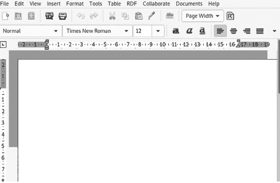
AbiWord 应用程序窗口。


## 卸载或移除AbiWord
移除AbiWord请使用以下命令：
```bash
$ sudo apt-get remove abiword
```
以下命令可移除AbiWord软件包及其依赖项：
```bash
$ sudo apt-get remove --auto-remove abiword
```
## 完全卸载AbiWord
使用以下命令前请谨慎操作，该命令会删除所有配置文件和数据：
```bash
$ sudo apt-get purge abiword
```
另外，你也可以使用以下命令：
```bash
$ sudo apt-get purge --auto-remove abiword
```
或者你可以将卸载命令与清理命令结合使用：
```bash
$ sudo apt-get remove abiword
$ sudo apt autoclean && sudo apt autoremove
```
## 使用Aptitude安装AbiWord
如果你想采用这种方式安装，可能需要先安装aptitude，因为Ubuntu系统默认通常不会预装aptitude。
可使用以下命令通过aptitude更新apt数据库：
```bash
$ sudo aptitude update
```
更新完apt数据库后，可通过运行以下命令使用aptitude安装AbiWord：
```bash
$ sudo aptitude -y install abiword
```
## 移除AbiWord的配置和数据
如需从Ubuntu GNOME中移除AbiWord的配置和数据，可使用以下命令：
```bash
$ sudo apt-get -y purge abiword
```
## 移除AbiWord的配置、数据及所有依赖项
可使用以下命令移除AbiWord的配置、数据及其所有依赖项：
```bash
$ sudo apt-get -y autoremove --purge abiword
```
## 从软件源安装AbiWord
安装AbiWord最简单的方式是使用Ubuntu官方软件源，这样你可以获得由Canonical有限公司和Ubuntu社区支持的稳定版本。
> 通过软件源安装非常简单：
- 进入「应用程序」>「添加/移除」。
- 搜索AbiWord，勾选AbiWord对应的复选框。
- 点击「应用更改」，若弹出提示请输入你的密码。
### GNUMERIC电子表格应用
根据你的计算机操作系统和桌面环境的不同，可通过多种方式启动Gnumeric。
### 从GNOME桌面启动Gnumeric
如果你使用的是GNOME系统，桌面上会有「面板」，面板包含图标和至少两个菜单，其中一个名为「应用程序」，图标样式类似脚印轮廓。点击该菜单名称即可展开菜单，将光标拖动到子菜单名称上即可展开子菜单，你也可以将光标移入子菜单，当光标定位到名为「Gnumeric电子表格」的选项时松开鼠标按钮即可启动。
### 使用apt-get安装Gnumeric
首先请使用以下命令更新你的系统。在Ubuntu GNOME上安装Gnumeric共有三种方式：使用apt-get、apt和aptitude，后续章节会分别介绍这三种方法，你可以任选其一。
更新完apt数据库后，可通过运行以下命令使用apt-get安装Gnumeric：
```bash
$ sudo apt-get -y install gnumeric
```
上述命令会下载Ubuntu GNOME的软件包列表，更新你系统中软件包的最新版本及其依赖项清单。
### 安装Gnumeric
更新完成后，使用以下命令安装Gnumeric：
```bash
$ sudo apt-get install gnumeric
```
### 卸载或移除Gnumeric
移除Gnumeric请使用以下命令：
```bash
$ sudo apt-get remove gnumeric
```
以下命令可移除Gnumeric软件包及其依赖项：
```bash
$ sudo apt-get remove --auto-remove gnumeric
```
### 完全卸载Gnumeric
使用以下命令前请谨慎操作，该命令会删除所有配置文件和数据：
```bash
$ sudo apt-get purge gnumeric
```
另外，你也可以使用以下命令：
```bash
$ sudo apt-get purge --auto-remove gnumeric
```
或者你可以将卸载命令与清理命令结合使用：
```bash
$ sudo apt-get remove gnumeric
$ sudo apt autoclean && sudo apt autoremove
```
### 使用Aptitude安装Gnumeric
如果你想采用这种方式安装，可能需要先安装aptitude，因为Ubuntu系统默认不会预装它。
使用以下命令通过aptitude更新apt数据库：
```bash
$ sudo aptitude update
```
更新完apt数据库后，可通过运行以下命令使用aptitude安装Gnumeric：
```bash
$ sudo aptitude -y install gnumeric
```
### 移除Gnumeric的配置和数据
可使用以下命令从Ubuntu GNOME中移除Gnumeric的设置和数据：
```bash
$ sudo apt-get -y purge gnumeric
```
### 移除Gnumeric的配置、数据及所有依赖项
可使用以下命令移除Gnumeric的配置、数据及其所有依赖项：
```bash
$ sudo apt-get -y autoremove --purge gnumeric
```
Gnumeric可以直接打开电子表格文件，如果桌面上有电子表格文件，你可以用鼠标指针双击它，即可自动用Gnumeric打开。另外，你也可以右键点击文件，在弹出的菜单中选择Gnumeric作为打开该文件的应用（见下图）。
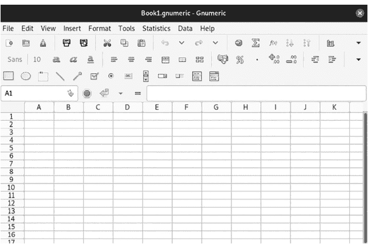
Gnumeric应用窗口：应用顶部是菜单栏，下方有两个工具栏，左侧是对象工具栏，右侧是数据录入区和单元格网格区，其下方是工作表列表和信息区。
- 菜单栏：提供GNOME的核心功能入口，你几乎可以通过菜单完成Gnumeric中的所有操作。
- 格式工具栏：用于修改工作簿中数据的显示属性。
- 对象工具栏：可用于在表格中绘制图形元素，比如文本标签、大红圆或细绿箭头，用来突出工作表的特定部分。
- 数据录入区：可用于修改复杂的公式。
- 单元格网格区：位于所有区域的中间，包含行号和列标、滚动条以及工作表标签。
- 信息区：Gnumeric会通过该区域反馈特定操作的状态。
### AUDACIOUS音频播放器应用
这是一款适用于Linux及其他多种类Unix系统的免费高级音频播放器，主打低资源占用、高音频质量以及对多种音频格式的支持。它最初基于Beep Media Player开发，而Beep Media Player又基于XMMS开发。
本章节介绍在Ubuntu上安装Audacious的两种方式，你可以根据想要安装的Audacious来源，以及是否想使用图形界面或命令行来选择对应方法。
- 使用Ubuntu软件中心
- 使用命令行终端
### 通过PPA源命令行安装Audacious
该PPA软件源包含Audacious的最新版本，请按照以下步骤通过该PPA源安装Audacious。
### 安装Audacious
首先，请使用Ctrl+Alt+T快捷键打开终端。
输入以下命令将Nilarimogard PPA软件源添加到你的Ubuntu系统中：
```bash
$ sudo add-apt-repository ppa:nilarimogard/webupd8
```
仅授权的系统用户可在Ubuntu GNOME系统中添加、移除和配置软件。输入命令后，系统会提示你输入密码，输入sudo密码后，PPA软件源就会被添加到你的系统中。你也可以不用手动输入命令，直接复制这里的命令，通过Ctrl+Shift+V快捷键或右键菜单的「粘贴」选项粘贴到终端中即可。
下一步请使用以下命令更新系统软件源：
```bash
$ sudo apt-get update
```
添加完PPA后，请使用以下带有sudo的命令安装Audacious及其插件：
```bash
$ sudo apt-get install audacious audacious-plugins
```
系统可能会弹出y/n选项询问你是否继续安装，如果希望继续安装请输入Y后按回车。根据你的网速不同，安装过程可能会花费一定时间，完成后Audacious就会安装到你的系统中。
你可以使用以下命令查看已安装软件包的版本号，确认软件是否安装成功：
```bash
$ audacious --version
```
### 启动Audacious
你可以通过Ubuntu图形界面启动Audacious，也可以在终端中输入以下命令启动：
```bash
$ audacious
```


输出效果如下图所示。
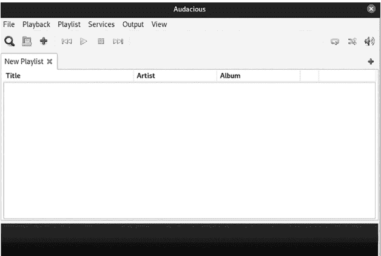
Audacious 应用窗口。
## 卸载软件
你可以在终端中使用以下命令从系统中卸载 Audacious 及其插件：
```
$ sudo apt-get remove audacious audacious-plugins
```
看到 y/n 提示时输入 y，软件就会从你的系统中彻底移除。
如果你还想移除你用来安装 Audacious 的 PPA，请以 sudo 权限运行以下命令：
```
$ sudo add-apt-repository --remove ppa:nilarimogard/webupd8
```

Alexandria 是一套面向 Common Lisp 的公共领域工具集合。它既是一个库，也是一个项目，旨在根据自身独特且偏保守的美学风格，减少重复劳动、提升 Common Lisp 代码的可移植性。其他项目常以其为基础进行开发。
## 安装 cl-alexandria
### 通过 apt-get 安装
首先，使用以下命令更新你的系统。在 Ubuntu GNOME 上安装 cl-alexandria 共有三种方式：apt-get、apt 和 aptitude。我们会逐一介绍这些方法，你可以任选其一。
更新完 apt 数据库后，你可以通过运行以下命令使用 apt-get 安装 cl-alexandria：
```
$ sudo apt-get -y install cl-alexandria
```
上述命令会下载你系统中 Ubuntu GNOME 的软件包列表，并更新系统中软件包及其依赖的最新版本列表。

## 安装 cl-alexandria
更新完成后，使用以下命令安装 cl-alexandria：
```
$ sudo apt-get install cl-alexandria
```

## 卸载或移除 cl-alexandria
要移除 cl-alexandria，请使用以下命令：
```
$ sudo apt-get remove cl-alexandria
```
以下命令用于移除 cl-alexandria 软件包及其所有依赖：
```
$ sudo apt-get remove --auto-remove cl-alexandria
```

## 彻底移除 cl-alexandria
以下命令请谨慎使用，它会删除所有配置文件和数据：
```
$ sudo apt-get purge cl-alexandria
```
或者你也可以使用以下命令：
```
$ sudo apt-get purge --auto-remove cl-alexandria
```
或者
```
$ sudo apt-get remove cl-alexandria
$ sudo apt autoclean && sudo apt autoremove
```

## 通过 Aptitude 安装 cl-alexandria
由于 Ubuntu 系统默认通常不安装 aptitude，你可能需要先安装它。
以下命令会通过 aptitude 更新 apt 数据库：
```
$ sudo aptitude update
```
更新完 apt 数据库后，你可以通过运行以下命令使用 aptitude 安装 cl-alexandria：
```
$ sudo aptitude -y install cl-alexandria
```

## 移除 cl-alexandria 的配置和数据
要从 Ubuntu GNOME 中移除 cl-alexandria 的配置和数据，请使用以下命令：
```
$ sudo apt-get -y purge cl-alexandria
```

## 移除 cl-alexandria 的配置、数据及所有依赖
你可以使用以下命令移除 cl-alexandria 的配置、数据及其所有依赖：
```
$ sudo apt-get -y autoremove --purge cl-alexandria
```

###### 功能特性
- 可从 Amazon、Proxis、大英图书馆、Barnes and Noble 等多个在线图书馆检索并展示书籍信息。
- 支持手动添加和更新书籍信息。
- 支持以不同视图（标准列表或图标列表）展示书籍，且可进行筛选和排序。

### GNOME 词典应用
这是一款在线查询单词定义的词典应用，默认查询英语释义。你可以轻松切换到西班牙语，或通过 DICT 协议添加其他词典，以满足你的使用需求。
### 通过 apt-get 安装 GNOME-dictionary
首先，使用以下命令更新你的系统。在 Ubuntu GNOME 上安装 GNOME-dictionary 共有三种方式：apt-get、apt 和 aptitude。我们会逐一介绍这些方法，你可以任选其一。
更新完 apt 数据库后，你可以通过运行以下命令使用 apt-get 安装 GNOME-dictionary：
```
$ sudo apt-get -y install gnome-dictionary
```
或者你也可以使用 snapd 安装 GNOME-dictionary（如下图所示）：
```
$ sudo snap install gnome-dictionary
```
GNOME 词典应用窗口。
上述命令会下载你系统中 Ubuntu GNOME 的软件包列表，并更新系统中软件包及其依赖的最新版本列表。

### 安装 GNOME-dictionary
更新完成后，使用以下命令安装 GNOME-dictionary：
```
$ sudo apt-get install gnome-dictionary
```

### 卸载或移除 GNOME-dictionary
要移除 GNOME-dictionary，请使用以下命令：
```
$ sudo apt-get remove gnome-dictionary
```
或者你也可以使用 snapd 命令移除它：
```
$ sudo snap remove gnome-dictionary
```
以下命令用于移除 GNOME-dictionary 软件包及其所有依赖：
```
$ sudo apt-get remove --auto-remove gnome-dictionary
```

### 彻底移除 GNOME-dictionary
以下命令请谨慎使用，它会删除所有配置文件和数据：
```
$ sudo apt-get purge gnome-dictionary
```
或者你也可以使用以下命令：
```
$ sudo apt-get purge --auto-remove gnome-dictionary
```
或者
```
$ sudo apt-get remove gnome-dictionary
$ sudo apt autoclean && sudo apt autoremove
```

### 安装 GNOME-dictionary
#### 通过 Aptitude 安装
如果你想使用这种方式，可能需要先安装 aptitude，因为 Ubuntu 系统默认通常不安装它。
你可以使用以下命令通过 aptitude 更新 apt 数据库：
```
$ sudo aptitude update
```
更新完 apt 数据库后，你可以通过运行以下命令使用 aptitude 安装 GNOME-dictionary：
```
$ sudo aptitude -y install gnome-dictionary
```

### 移除 GNOME-dictionary 的配置和数据
要从 Ubuntu GNOME 中移除 GNOME-dictionary 的配置和数据，请使用以下命令：
```
$ sudo apt-get -y purge gnome-dictionary
```

### 移除 GNOME-dictionary 的配置、数据及所有依赖
你可以使用以下命令移除 GNOME-dictionary 的配置、数据及其所有依赖：
```
$ sudo apt-get -y autoremove --purge gnome-dictionary
```

### 面向网页设计师和数字艺术家的取色器与编辑器
Color-Picker 是一款基于 Qt 的 QColorDialog 库开发的高级屏幕取色工具，是由网页设计师和数字艺术家为同类用户打造的取色器与调色编辑器。
使用 Color Picker，识别颜色、保存颜色等操作都非常快速简便。
Color-Picker 的功能特性包括：
- 支持 5 种颜色编码格式：HTML、HexRGBA、RGB、HSB/HSV、CMYK 及其变体，支持将 HTML、HEX、RGB 颜色代码转换为对应颜色。
- 操作简便，取色精度更高。
- 提供颜色列表，可保存并重复使用每次取色得到的颜色样本。
- 具备颜色预览组件。
- 支持渐进式生成颜色图案。
- 支持在三种主题间切换：系统主题、扁平浅色主题、深色主题。

### 启用 Snap 包安装 Color-Picker
Snap 是打包了所有依赖的应用程序，单次构建即可在所有主流发行版上运行。Snap 包支持自动更新，也可平滑回滚至旧版本。Snap 包可从面向数百万用户的 Snap 应用商店获取，你也可以在 Ubuntu 软件中心搜索 Snap 包进行安装。
你可以通过以下命令行安装 snapd：
```
$ sudo apt update
$ sudo apt install snapd
```
注销后重新登录，或重启系统，可确保 Snap 的路径被正确更新。

### 安装 Color-Picker
要安装 Color-Picker，请使用以下命令：
```
$ sudo snap install color-picker
```

### 移除或卸载 Color-Picker
```
$ sudo snap remove color-picker
```

### Empathy 应用
### 通过 apt-get 安装 Empathy
首先，使用以下命令更新你的系统。在 Ubuntu GNOME 上安装 Empathy 共有三种方式：apt-get、apt 和 aptitude。我们会逐一介绍这些方法，你可以任选其一。
更新完 apt 数据库后，你可以通过运行以下命令使用 apt-get 安装 Empathy：
```
$ sudo apt-get -y install empathy
```
或者你也可以使用 snapd 安装 Empathy：
```
$ sudo snap install empathy
```

## 共情应用
上述命令将会下载你系统中Ubuntu GNOME的软件包列表，同时更新你系统里软件包最新版本及其依赖项的清单。
### 安装共情应用
更新完成后，使用以下命令安装共情应用：
```shell
$ sudo apt-get install empathy
```
### 卸载或移除共情应用
移除共情应用可使用以下命令：
```shell
$ sudo apt-get remove empathy
```
你也可以使用snapd命令执行移除：
```shell
$ sudo snap remove empathy
```
以下命令用于移除共情应用包及其所有依赖项：
```shell
$ sudo apt-get remove --auto-remove empathy
```
### 彻底移除共情应用
使用以下命令需谨慎，该命令会删除所有配置文件和数据：
```shell
$ sudo apt-get purge empathy
```
你也可以使用以下命令：
```shell
$ sudo apt-get remove empathy
$ sudo apt autoclean && sudo apt autoremove
```
### 使用Aptitude安装共情应用
若想使用这种方式，你可能需要先安装aptitude，因为Ubuntu系统默认通常不会预装aptitude。
可使用以下命令通过aptitude更新apt数据库：
```shell
$ sudo aptitude update
```
更新apt数据库后，可通过运行以下命令使用aptitude安装共情应用：
```shell
$ sudo aptitude -y install empathy
```
该应用的窗口如下图所示。
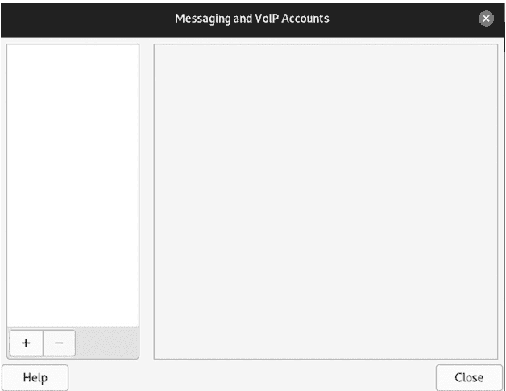
共情应用窗口。
### 移除共情应用的配置和数据
若要从Ubuntu GNOME中移除共情应用的配置和数据，可使用以下命令：
```shell
$ sudo apt-get -y purge empathy
```
### 删除共情应用的配置、数据及所有依赖项
可使用以下命令移除共情应用的配置、数据及其所有依赖项：
```shell
$ sudo apt-get -y autoremove --purge empathy
```

### POLARI 应用
这是一款专为无缝集成GNOME特性而设计的简易互联网中继聊天（IRC）客户端，界面美观简洁，可让你专注于对话交流。你可以使用Polari进行公开群聊，也能在频道内进行私密一对一交谈，通知功能可确保你不会错过任何重要消息。
### 使用apt-get安装Polari
首先，使用以下命令更新你的系统。在Ubuntu GNOME上安装Polari有三种方式，分别可使用apt-get、apt和aptitude，下文将逐一介绍这三种方法，你可以任选其一。
更新apt数据库后，可通过运行以下命令使用apt-get安装Polari：
```shell
$ sudo apt-get -y install polari
```
你也可以使用snapd安装Polari：
```shell
$ sudo snap install polari
```
上述命令将会下载你系统中Ubuntu GNOME的软件包列表，同时更新你系统里软件包最新版本及其依赖项的清单。
### 安装Polari
更新完成后，使用以下命令安装Polari：
```shell
$ sudo apt-get install polari
```
运行Polari时，双击图标即可，运行效果如下图所示。
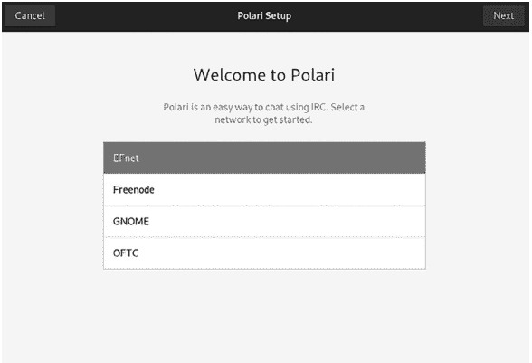
Polari应用窗口。
### 卸载或移除Polari
移除Polari可使用以下命令：
```shell
$ sudo apt-get remove polari
```
你也可以使用snapd命令执行移除：
```shell
$ sudo snap remove polari
```
以下命令用于移除Polari包及其所有依赖项：
```shell
$ sudo apt-get remove --auto-remove polari
```
### 彻底移除Polari
使用以下命令需谨慎，该命令会删除所有配置文件和数据：
```shell
$ sudo apt-get purge polari
```
你也可以使用以下命令：
```shell
$ sudo apt-get purge --auto-remove polari
```
或者
```shell
$ sudo apt-get remove polari
$ sudo apt autoclean && sudo apt autoremove
```
### 使用Aptitude安装Polari
若想使用这种方式，你可能需要先安装aptitude，因为Ubuntu系统默认通常不会预装aptitude。
可使用以下命令通过aptitude更新apt数据库：
```shell
$ sudo aptitude update
```
更新apt数据库后，可通过运行以下命令使用aptitude安装Polari：
```shell
$ sudo aptitude -y install polari
```
### 移除Polari的配置和数据
若要从Ubuntu GNOME中移除Polari及其数据，可使用以下命令：
```shell
$ sudo apt-get -y purge polari
```
该命令会移除Polari的配置、数据及其所有依赖项。
### 删除Polari的设置、数据及所有依赖项
若要删除Polari的设置、数据及其所有依赖项，可使用以下命令：
```shell
$ sudo apt-get -y autoremove --purge polari
```

### VINO VNC 应用
VNC是一种可用于访问计算机图形桌面环境，并实现从远程计算机控制该桌面的协议。
### 在Ubuntu上安装VNC服务器
在GNOME桌面环境中，内置的屏幕共享功能支持远程访问Ubuntu 20.04 LTS的图形桌面环境。
GNOME桌面使用Vino VNC服务器来实现屏幕共享功能。
默认情况下，你的Ubuntu 20.04 LTS系统可能并未预装Vino VNC服务器，但该软件可在Ubuntu GNOME的官方仓库中获取，因此你可以轻松完成安装。
首先，使用以下命令更新APT软件包仓库缓存：
```shell
$ sudo apt update
```
安装Vino可运行以下命令：
```shell
$ sudo apt install vino
```
运行该应用后，效果如下图所示。
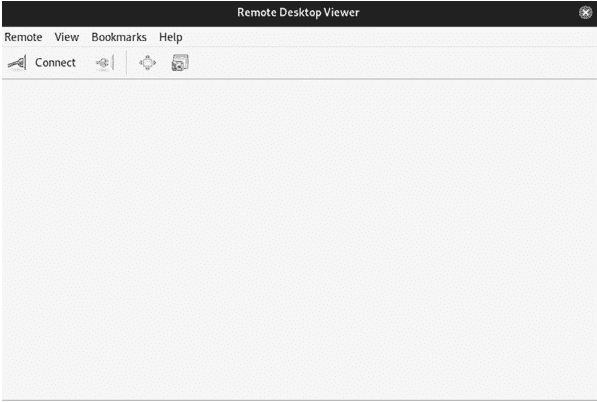
Vino应用窗口。
继续安装时，按下Y键后再按下<Enter>键，即可完成Vino的安装。
### 在Ubuntu上启用屏幕共享
- 安装完Vino后，你需要从设置应用中开启屏幕共享选项。
- 接着，从Ubuntu GNOME的应用菜单中打开设置。
- 导航到共享板块，点击截图中的切换按钮以开启共享功能。
| 文件名 | 说明 |
|----------|---------|
| Screen Sharing.PNG | 屏幕共享 |
- 开启共享功能后，点击屏幕共享选项。
- 在屏幕共享窗口中点击切换按钮，启用屏幕共享。
- 此时你的系统应当已经启用屏幕共享功能。
- 你可以从访问选项板块根据你的VNC服务器配置认证方式。
- 针对新连接，VNC服务器必须请求访问权限：这是默认的认证方式。选中该认证方式后，每当有远程VNC客户端尝试访问你的系统时，你都会收到提示，只有你允许访问后，远程VNC客户端才能接入系统。
- **需要密码：** 使用这种方式你可以为VNC服务器设置密码，远程VNC客户端需要输入密码才能访问你的计算机。
- 我们推荐使用密码认证方式，因此我们将为VNC服务器配置密码认证。
- 为VNC服务器设置密码时，先在访问选项板块选择密码选项，然后在密码输入框中输入你想要的密码。
### 使用Vinagre远程访问你的计算机
- Vinagre远程桌面客户端可指导你如何通过VNC连接到你的计算机，你也可以使用其他VNC客户端。
- 你的系统可能并未预装Vinagre远程桌面，如果你需要在你的Linux发行版上安装Vinagre，可以使用上述命令完成安装。
- 首先，从你的系统应用菜单中打开Vinagre远程桌面。
- 打开Vinagre后，点击“连接”按钮。
- 现在，在协议下拉菜单中选择VNC，在主机输入框中输入远程计算机的IP地址，然后点击截图标注的“连接”按钮。
- 如果你配置了密码认证，系统会要求你输入VNC密码。
- 输入你的VNC认证密码，点击截图标注的“认证”按钮，即可远程连接到你的Ubuntu 20.04 LTS计算机。

### Evolution 标识、Evolution 邮件及日历
默认情况下，Evolution打开的是邮件视图，你可以在该视图中查看所有邮件。你可以通过点击窗口左侧面板底部的切换按钮，选择你想要的视图来切换到其他应用界面。
### 使用apt-get安装Evolution
首先，使用以下命令更新你的系统。在Ubuntu GNOME上安装Evolution有三种方式，分别可使用apt-get、apt和aptitude，下文将逐一介绍这三种方法，你可以任选其一。
更新apt数据库后，可通过运行以下命令使用apt-get安装Evolution：
```shell
$ sudo apt-get -y install Evolution
```
你也可以使用snapd安装Evolution。
```shell
$ sudo snap install Evolution
```
上述命令将会下载你系统中Ubuntu GNOME的软件包列表，同时更新你系统里软件包最新版本及其依赖项的清单。
### 安装Evolution
更新完成后，使用以下命令安装Evolution：
```shell
$ sudo apt-get install Evolution
```


## 卸载或移除 Evolution
要移除Evolution，需使用以下命令：
```bash
$ sudo apt-get remove Evolution
```
也可以使用snapd命令来移除Evolution：
```bash
$ sudo snap remove Evolution
```
以下命令用于移除Evolution软件包及其所有依赖项：
```bash
$ sudo apt-get remove --auto-remove evolution
```

## 完全移除Evolution
以下命令请谨慎使用，它会删除所有配置文件和数据：
```bash
$ sudo apt-get purge evolution
```
也可以使用以下命令：
```bash
$ sudo apt-get purge --auto-remove evolution
```
或
```bash
$ sudo apt-get remove Evolution
$ sudo apt autoclean && sudo apt autoremove
```

## 移除Evolution配置和数据
要移除Ubuntu GNOME中的Evolution配置和数据，可以使用以下命令：
```bash
$ sudo apt-get -y purge evolution
```

## 移除Evolution配置、数据及其所有依赖项
可以使用以下命令来移除Evolution的配置、数据及其所有依赖项：
```bash
$ sudo apt-get -y autoremove --purge evolution
```

### 本章总结
我们介绍了GNOME应用，包括其在Ubuntu系统中通过命令行的工作方式与安装方法，以及各个应用的图形界面操作指南。同时也涵盖了其功能特性和各类桌面环境的使用方法。
---
泰勒与弗朗西斯集团 http://taylorandfrancis.com
---

## 深入使用GNOME
### 本章内容
- GTK简介
- GTK发展史
- GDK（GIMP绘图工具包）
- GTK语言绑定列表
- 基于GTK的桌面环境
- GTK+
- 使用GTK工具包创建图形用户界面

上一章主要介绍了完全基于GNOME构建的应用，我们可以通过命令行或软件中心来安装、移除这些应用。接下来我们将讨论GNOME中的GTK工具包编程。本质上，GTK工具包是用于创建图形用户界面（GUI）的库，它可在基于UNIX的平台、Windows以及macOS上运行。GTK基于GNU宽通用公共许可证（LGPL）条款发布，允许其他开发者为其客户端应用进行授权。GTK采用基于C语言的面向对象架构，具备极高的灵活性与可移植性；它为多种其他语言提供了绑定接口，包括C++、Objective-C、Guile/Scheme、Perl、Python、JavaScript、Rust、Go、Tcl、Ada95、Free Pascal和Eiffel。

### GTK简介
GTK全称GIMP工具包（GNU图像处理程序工具包），是一款免费开源的跨平台小部件工具包，用于创建图形用户界面。它基于GNU通用公共许可证（GPL）条款发布，允许自由软件和专有软件均可使用。它是Wayland和X11窗口系统下最受欢迎的工具包之一。它是一款跨平台的GUI创建工具包，提供了一整套小部件，适用于从小型单次项目到完整应用套件的各类开发需求。GTK是一款自由开源软件项目。其采用的GNU LGPL条款允许所有开发者（包括开发专有软件的开发者）免费使用，无需支付许可费或版权费。

有必要先介绍一些与GTK相关的概念，比如小部件工具包。小部件工具包（又称GUI工具包或UX工具包）是一组库的集合，其中包含一系列被称为“小部件”的图形控件，用于构建程序的图形用户界面（GUI）。大多数小部件工具包还自带渲染引擎，该引擎可以适配特定操作系统或窗口系统，也可以包含多个后端以对接不同系统，并支持OpenGL、OpenVG或EGL等渲染API。

GTK团队会定期发布最新版本；目前GTK 4和GTK 3仍在维护，而GTK 2已进入生命周期末期。GIMP工具包（GTK）是用于在各类系统上创建GUI的小部件工具包。人们通常错误地认为GTK是“GNOME工具包”的缩写，但实际上它是“GIMP工具包”的缩写，因为其最初是为GIMP设计用户界面而开发的。GTK工具包是用C语言编写的面向对象工具包（但GTK本身不是一门编程语言）。它完全基于LGPL许可证开源，是一款广泛使用的GUI工具包，有大量针对GTK的开发工具可供使用。

很多人可能好奇“GTK”和“GTK+”有什么区别。GTK最早发布时并不支持面向对象特性，后来GTK开发人员重写了代码，使其支持面向对象编程，此后将其命名为“GTK+”。不过目前人们仍然交替使用“GTK”和“GTK+”，在本节中也能看到这种用法。GTK2和GTK3分别指GTK的2.x和3.x版本；“GTK2”“GTK+ 2”和“GTK2+”指的是同一个版本，GTK3的不同写法也同理。

### GTK发展史
#### Linux平台
GTK最初是为GIMP设计，用于替代Motif工具包；在某个阶段，Peter Mattis对Motif感到不满，于是开始编写属于自己的GUI工具包，即GIMP工具包，到GIMP 0.60版本发布时，已成功替代了Motif。随后该工具包被重写为面向对象架构，并更名为GTK+，在GIMP 0.99版本中首次使用。它由开发GNOME桌面环境的GNOME基金会负责维护。

GTK 2.0系列版本引入了多项新特性，包括通过Pango改进的文本渲染、全新的主题引擎、基于辅助功能工具包（Accessibility Toolkit）的无障碍支持、使用UTF-8字符串向Unicode的迁移，以及灵活的API。GTK 2依赖Cairo二维图形库来渲染矢量图形。

GTK 3.0.0版本包含以下特性：
- 修订了输入设备处理逻辑
- 支持使用类CSS语法编写主题
- 支持获取其他已打开的GTK应用的相关信息

2019年2月的一场黑客松活动中，去掉了“+”，正式简化为“GTK”。

######## GUI设计工具
GUI设计工具（又称GUI构建器）是一款软件开发工具，它允许开发者通过拖拽式“所见即所得（WYSIWYG）”编辑器排列图形控件，从而简化GUI的创建流程。在此之前，GUI需要通过源代码中指定每个小部件的参数来构建。用户界面通常采用事件驱动架构编程，因此GUI构建器也简化了事件驱动代码的创建。这类支撑代码会将小部件与触发应用逻辑函数的事件（包括事件触发与事件响应）相关联。部分GUI构建器可以自动生成图形控件的源代码，而另一类如Interface Builder或Glade界面设计器，则会生成可供应用加载的序列化对象实例。

### GTK软件架构
该库包含一系列图形控件小部件，3.22.16版本包含186个有效小部件和36个已弃用的小部件。GTK是一款用C语言编写的面向对象小部件工具包，它使用GLib对象系统中的GObject实现面向对象特性。虽然GTK主要面向基于X11和Wayland的窗口系统，但也支持其他平台，包括通过Windows API对接的微软Windows系统，以及通过Quartz对接的macOS系统，还有一个名为Broadway的HTML5后端。

库是用某种语言编写的一系列行为实现，具有定义明确的接口，可通过该接口调用这些行为。希望编写高层程序的开发者可以使用库来完成系统调用。GLib对象系统是一款自由软件库，提供可移植的对象系统和透明的跨语言互操作能力。GObject的设计使其既可直接在C程序中使用，提供基于C的面向对象API，也可为其他语言提供绑定，实现透明的跨语言互操作，例如PyGObject（见下图）。

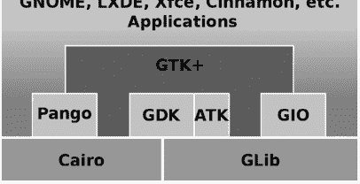

GTK工具包包含作为GUI组件的小部件，例如按钮、文本输入框或窗口。它依赖以下库：
- **GLib**：这是一款通用工具库，并非专门针对GUI设计，提供了实用的数据类型、宏、类型转换、字符串工具、文件工具、主循环抽象等能力。更多信息可访问GLib官网查看。
- **GObject**：这是一款提供类型系统、基础类型集合（包括对象类型）和信号系统的库。更多信息可访问GObject官网查看。


- **GIO:** 是一款现代、易用的API，提供文件、驱动器、存储卷、流式IO的抽象，还支持通过DBus进行网络编程与进程间通信（IPC），更多详情可访问GIO官网查阅。
- **Cairo:** 是一款支持多种输出设备的2D图形库。
- **OpenGL:** 是用于开发可移植、交互式2D与3D图形应用的环境。
- **Pango:** 是一款国际化文本处理库，围绕用于表示文本段落的PangoLayout对象构建，可为GtkTextView、GtkLabel、GtkEntry以及所有GTK文本显示类组件提供渲染引擎，更多详情可访问Pango官网查阅。
- **gdk-pixbuf:** 是一款轻量、可移植的库，支持根据图像数据或图像文件创建GdkPixbuf对象，可搭配GtkImage等GTK组件实现图像显示。
- **graphene:** 是一款小型库，提供向量与矩阵数据类型及相关运算，采用SSE、ARM NEON等SIMD指令集实现优化，共分为五个部分：
  1. **GDK:** 是GTK的抽象层，支持GTK适配多种窗口系统，同时为Wayland、X11、Microsoft Windows、Apple macOS平台提供窗口系统相关功能。
  2. **GSK:** 是用于将绘图操作构建为场景图（称为“节点”）、通过不同后端渲染场景图，并为OpenGL、Vulkan、Cairo提供渲染器的API。
  3. **GTK:** 是一套工具包，包含UI组件、布局管理器、GUI应用高效使用的数据存储类型等丰富功能。
  4. **ATK:** 是辅助功能工具包，提供一套通用接口，支持辅助功能与GUI交互，例如屏幕阅读器可通过ATK识别界面中的文本并读给视障用户，GTK组件基于ATK框架内置了辅助功能支持。
  5. **GTK+:** GTK+库包含各类组件，即GtkButton、GtkTextView等GUI组件。
###### GIMP绘图工具包（GDK）
GDK（GIMP Drawing Kit的缩写）是一个库，作为底层窗口系统和图形系统提供的低层级函数的封装，位于显示服务器与GTK库之间，负责处理基础渲染，例如图元绘制、光栅图形（位图）、光标、字体、窗口事件以及拖放功能。与GTK场景图工具包（GSK）类似，GDK是GTK的组成部分，采用GNU宽松通用公共许可证（LGPL）授权。GDK是对标准Xlib函数调用的必要封装，如果你熟悉Xlib，就不需要了解大部分GDK函数。所有函数都提供了便捷的Xlib库函数访问方式。此外，GDK在多个平台上基于GLib实现，因此更加便捷安全。
###### 软件架构
GDK包含X11、Wayland、Broadway、Quartz后端，GDI依赖Cairo完成渲染。新的场景图（即画布）正在开发中，预计将随GTK 4.0版本一同发布。GTK构建于名为GDK的抽象层之上，无需处理输入采集、拖放、像素格式转换等低层逻辑。GDK是GTK与窗口系统细节之间的中间层（见下图）。
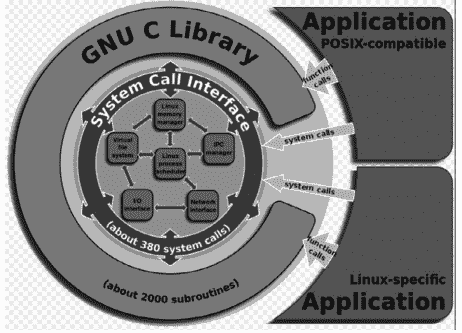
GDK架构。
GDK是GTK可移植性的核心组成部分。由于GLib已提供低层跨平台功能，只需将GDK移植到目标操作系统的图形层，即可让GTK运行在其他平台上。因此GDK已被移植到Windows API，Quartz则分别支持GTK应用运行在Windows和macOS平台上。自GTK+ 2.8版本起，GDK开始支持Cairo，GTK+ 3应使用Cairo而非GDK的绘图函数。
GDK是隔离GTK与窗口系统细节的中间层，同时也是Xlib的轻量封装。X Window系统附带名为Xlib的低层库，几乎所有GDK函数都是对应Xlib函数的脆弱封装，但仍隐藏了Xlib的部分复杂性和功能，以简化编程、方便GDK移植到Wayland、Microsoft Windows等其他窗口系统。这些被隐藏的Xlib功能通常对应用开发者没有太大价值，例如许多仅被窗口管理器使用的功能并未在GDK中暴露。GDK支持低层操作，例如“将位图拷贝到屏幕”。相比X协议等方案，GDK提供了可移植性高得多的层，同时没有放弃X等系统提供的低层访问能力。GDK内置的OpenGL（或OpenGL ES）支持可稍微提升图形管线的控制能力；OpenGL非常适合合成纹理数据，但不适合绘图。
####### GdkFrameClock
GdkFrameClock随GTK 3.8版本新增，GTK应用仍由主循环驱动，应用在主循环中大部分时间处于空闲状态，等待事件发生，事件触发后调用对应的子例程。GdkFrameClock新增了一种机制，可以为应用提供“脉冲”，告知应用何时更新和重绘窗口，脉冲频率可与显示器刷新率同步。
###### GTK场景图工具包
GSK（GTK Scene Graph Kit的缩写）是随3.90版本引入的GTK渲染与场景图API，位于图形控件（组件）与渲染层之间。与GDK类似，GSK是GTK的组成部分，采用GNU LGPL授权。GSK供GTK自身以及希望用GSK替换Clutter实现UI的GTK应用使用，此前使用Clutter而非纯GTK的应用包括GNOME Shell、GNOME Videos、GNOME Boxes和Cheese。相关要点如下：
- **GUI:** 所有使用GTK图形控件（组件）的应用，而非先获取GTK窗口再自行绘制的应用，都可从GSK中受益。
- **Performance:** 不使用场景图绘制图形控件（组件）会导致渲染不需要显示在屏幕上的内容，造成不必要的性能和续航损耗，场景图可用于实现隐藏面判定。
- **Simplicity:** 此前未使用Clutter时，GTK的组件绘制由属于GDK（因此得名GIMP“绘图”工具包）的绘图函数完成，需要计算当前位置才能判断鼠标指针悬停的位置。使用GSK后，编写复杂的图形控件（组件）会更加简便，同时也能轻松追踪鼠标指针的位置。
###### GSK渲染管线
###### GSK采用双层架构
底层是直白的渲染操作树，可通过最少的状态变更转换为对应的渲染指令，最终形成渲染管线。GskRenderNode实例代表渲染操作树，GskRenderer实例会获取渲染节点并将其提交到底层图形系统。高层是复杂的逻辑层集合，为应用开发者提供高层便捷API。
###### 渲染API
GTK 3.90是即将发布的GTK 4的开发版本号，GSK支持使用以下后端进行渲染：
- Cairo
- OpenGL
- Vulkan
####### GtkInspector
GtkInspector是GTK+预装的交互式调试支持工具，随GTK+ 3.14版本新增，基于成熟的gtkparasite项目复制而来，默认处于禁用状态。启用它需要确保已安装libgtk-3-dev（Debian系命名）或gtk3-devel（Fedora系命名）软件包，然后在终端中运行以下命令：
```
$ gsettings set org.gtk.Settings.Debug enable-inspector-keybinding true
```
####### Gtkparasite
Parasite是一个出色的项目，为基于GTK的应用提供了实用的实时调试工具，因其价值突出已被整合进GTK本身，GtkInspector是它的继任者，目前处于积极维护状态，功能远更完善。Parasite项目本身已经停止运营。如果你正在操作的应用恰好是Flatpak打包应用，那么它的GSettings存储可能与宿主机系统分离，你需要单独修改该环境的对应配置，操作如下：
```
$ flatpak run --command='sh' org.gnome.Polari
$ gsettings set org.gtk.Settings.Debug enable-inspector-keybinding true
```
######## GUI设计工具
目前有大量针对GTK的GUI设计工具，以下项目在2011年7月时仍处于活跃状态：
######## Glade界面设计器
它是GTK的GUI构建工具，包含额外的GNOME专属组件。Glade Interface是GTK的图形化用户界面构建工具，包含针对GNOME的不同组件，支持GTK内置的GUI描述格式GtkBuilder。
- Gazpacho是用Python编写的GTK工具包GUI构建工具
- Crow Designer依赖其GuiXml格式和GuiLoader库
- Stetic是MonoDevelop的组成部分，面向Gtk#开发。


- Gambas 自 2.0 版本起基于 BASIC 开发 - 适用于 Linux 的 Xojo - Linux 版 Lazarus 默认与 GTK 2 交互

###### GtkBuilder
它允许用户在不编写代码的情况下设计用户界面。界面以可扩展标记语言（XML）文件的形式描述，在运行时加载，且对象会自动创建。Glade 界面设计器支持以“所见即所得”（WYSIWYG）的方式创建用户界面。用户界面描述与所使用的编程语言无关。

###### 语言绑定
绑定是一种应用程序编程接口（API），可提供胶水代码，让编程语言能够调用外部库或操作系统服务。

####### GTK 语言绑定列表
GTK 支持多种语言的大量绑定，可覆盖其大部分功能特性；但 GTK 2 已停止维护，因此下文提及的部分语言不再具备针对 GTK 的现行支持。
- GObject 最初编写时是 GTK 的核心组件，之后被外包至 GLib。
- GObject 内省是 C 库（使用 GObject）与语言绑定之间的中间层，例如 PyGObject 使用了该技术，而 PyGTK 没有。
- 官方 GNOME 绑定遵循 GNOME 的发布周期，可保证 API 稳定性及定期发布版本。
- Glade 界面设计器。

####### 语言列表
- Ada
- C
- C#
- C++
- Crystal
- D
- Erlang
- Fortran
- FreeBASIC
- Gambas
- Genie
- Go
- Guile
- Haskell
- J
- Java 及其他 JVM 语言
- JavaScript Gjs
- JavaScript Seed
- Julia Gtk.jl
- Kotlin/Native
- Lua
- Nim
- Objective-C
- OCaml
- ooRexx
- Pascal
- Perl
- PHP
- Prolog
- Python
- R
- Ruby
- Rust
- Smalltalk
- Standard ML
- Tcl
- Vala
- Wrapl

######## 基于 GTK 的桌面环境
即使用 GTK 的桌面环境。桌面环境实现了桌面隐喻：一组运行在操作系统之上、共享标准图形用户界面的程序集合，有时也被称为图形壳层。桌面环境由图标、窗口、工具栏、文件夹、壁纸和桌面小部件组成。图形用户界面还提供了拖放及其他功能，以完善完整的桌面隐喻。桌面环境的目标是让用户能够直观地与计算机交互，通过类似与现实世界交互的概念（例如按钮、窗口）来实现。尽管桌面环境最初仅指遵循桌面隐喻的一类用户界面风格，后来也指代实现该隐喻本身的程序。这一用法因通用桌面环境（Common Desktop Environment）、K 桌面环境（K Desktop Environment）和 GNOME 等项目而普及。

######## 实现方式
窗口管理器负责支持用户与环境的交互，而工具包则为开发者提供软件库，用于开发外观、行为统一的应用程序。窗口系统通常直接与底层操作系统及库交互，为图形硬件、指针设备和键盘提供支持。窗口管理器通常运行在窗口系统之上。尽管窗口系统可能具备部分窗口管理功能，但这类功能仍被视为窗口管理器的一部分，只是恰好由窗口系统提供。窗口工具包为应用程序提供对小部件的访问，让用户能够以一致的方式与应用程序进行图形交互。

###### GUI 历史
桌面环境由施乐（Xerox）公司研发，于 20 世纪 70 年代随施乐 Alto 一同发售。施乐公司普遍将 Alto 定位为个人办公计算机；但由于营销不善且定价过高，该产品在市场上表现失败。苹果公司随后推出了搭载桌面环境的平价个人计算机 Lisa，同样在市场上遇冷。2014 年，最流行的桌面环境是上述早期环境的后续产物，包括微软 Windows 系统中的 Windows Shell，以及 macOS 中的 Aqua 环境。相较于 Unix 类系统（如 Linux、FreeBSD）可用的基于 X 的环境，Windows 和 macOS 搭载的专有桌面环境布局相对固定、功能较为静态，采用高度集成的“无缝”设计，旨在为不同安装实例提供高度一致的用户体验。微软 Windows 在搭载桌面环境的计算机市场中占据主导份额。使用 Unix 类操作系统（如 macOS、Chrome OS、Linux、BSD 或 Solaris）的系统则相对少见。截至 2015 年，采用 X Window System 或 Wayland、具备多种桌面环境选择的低成本 Linux PC 正在开拓增长市场。其中较受欢迎的产品包括谷歌的 Chromebook 和 Chromebox、英特尔的 NUC、树莓派等。而在平板电脑和智能手机领域则情况相反，Unix 类操作系统占据市场主导，包括 iOS、Android、Tizen、Sailfish 和 Ubuntu。微软的 Windows Phone 和 RT 10 仅在极少数的平板电脑和智能手机上使用。不过，大多数在手持设备上占主导地位的 Unix 类操作系统并未使用其他 Unix 类操作系统所采用的 X11 桌面环境，而是依赖基于不同技术的界面。

###### 桌面环境示例
Windows 系统中最为常见的桌面环境是 Windows Shell。微软在 Windows Shell 上投入了大量研发精力，先后推出了 Windows 98 中的主题功能、Windows XP 的多种视觉样式、Windows Vista 的 Aero 品牌、Windows 8 的微软设计语言、Windows 10 的 Windows 聚焦（Windows Spotlight）等功能。其壳层可通过 Shell 扩展进行扩展。Unix 类操作系统的桌面环境采用 X Window System，包括 KDE、GNOME、Xfce、LXDE 和 Aqua，用户可自由选择，不会与所使用的操作系统绑定。此外还存在多种其他桌面环境，包括 CDE、EDE、GEM、IRIX Interactive Desktop、Sun 的 Java Desktop System、Jesktop、Mezzo、ROX Desktop、UDE、Xito 等众多产品。可独立运行的 X 窗口管理器（无需搭配其他桌面环境）也包含典型桌面环境的部分元素，其中最知名的是 Enlightenment。其他示例还包括 OpenBox、Fluxbox、WindowLab、Fvwm、WindowMaker 和 AfterStep，这些产品具备 NeXTSTEP 图形用户界面的外观风格。不过，新版操作系统会对其进行自动配置。
- Ambient
- Budgie Desktop
- Budgie
- CDE
- Cinnamon
- Cutefish
- Deepin DE
- EDE
- Elokab
- Enlightenment
- Étoilé
- GNOME Shell
- GNUstep
- Innova
- Katana
- KDE Plasma 5
- Liri Shell
- Lumina
- LXDE
- LXQt
- MATE
- MaXX
- Maynard
- Mezzo
- Moksha
- Pantheon
- Project Looking Glass
- oZone GUI
- Razor-qt
- ROX Desktop
- Sugar
- theShell
- Trinity
- UKUI（桌面环境）
- Unity
- vera
- Xfce

###### Gtk#
它是 GTK 图形工具包及多种 GNOME 库的 .NET Framework 绑定库。该库支持使用 Mono 或其他符合通用语言运行时（CLR）规范的工具开发 GNOME 图形应用程序。它与所有现代窗口库一样是事件驱动系统，每个小部件都支持关联处理方法，在特定事件发生时会被调用。使用 Gtk# 开发的应用程序可在 Linux、Windows、macOS 等多个平台上运行。Windows 版的 Mono 软件包包含 GTK、Gtk# 以及原生主题，可使应用程序外观与原生 Windows 应用保持一致。在 macOS 上运行 Gtk# 应用程序不再需要启动 X11 服务器。Glade 界面设计器可搭配 Glade# 绑定轻松设计图形用户界面（GUI）应用程序。名为“Static”的 GUI 设计器已集成到 MonoDevelop 集成开发环境（IDE）中。此外，为支持标准 GTK-GNOME 开发工具，gtk-dotnet.dll 提供了通往 .NET 技术栈功能的桥接。它支持 Gtk3，以及为实现 C# 及多种 CLI 语言提供完整 Gtk3 支持而分叉的项目 GtkSharp。GTK 由 GNOME 项目开发，该项目负责开发 GNOME 开发平台和 GNOME 桌面环境。GTK 的开发采用松散管理模式。GNOME 开发者和用户每年都会参加 GNOME 用户与开发者欧洲会议（GUADEC），讨论 GNOME 的当前状态与未来发展方向。GNOME 集成了 freedesktop.org 网站的相关标准和程序，以更好地与其他桌面环境实现互操作。

###### GTK 桌面环境
部分桌面环境将 GTK 作为其小部件工具包，具体如下。

###### 当前版本
GNOME 基于 GTK 构建，这意味着 GNOME 原生程序均使用 GTK：
- Budgie 是为 SolusOS 的继任者 Solus 操作系统从零开始构建的
- Cinnamon 是 GNOME 3 的分支，使用 GTK 3 版本
- MATE 是 GNOME 2 的分支，自 1.18 版本起使用 GTK 3


- Xfce 自 4.14 版本起基于 GTK 3
- Pantheon 采用 GTK 3，由 elementary OS 开发
- Sugar 是一款面向基础教育的桌面环境，使用 GTK 技术栈，尤其是 PyGTK
- Phosh 是为 PureOS 设计的移动端用户界面
- LXDE 基于 GTK 2
- COSMIC 是由 System76 开发的 GNOME 分支

###### 窗口管理器
以下窗口管理器使用 GTK：
- Aewm
- AfterStep
- Amaterus
- Consortium
- IceWM
- Marco
- Metacity
- Muffin
- Mutter
- Sawfish
- Wmg
- Xfwm

###### GTK 检查器
GTK 检查器随 3.14 版本推出，安装好 libgtk-3-dev/gtk+-devel 开发包后即可调用。

###### GtkBuilder
它支持无需编写代码即可设计用户界面：界面以 XML 文件形式描述，在运行时加载，对象会自动创建。Glade 界面设计器提供了“所见即所得”的用户界面创建能力，界面描述与所用编程语言无关。

###### GtkSourceView
用于语法高亮的组件是 GtkSourceView，即“源代码编辑小部件”。GtkSourceView 由 GNOME 独立于 GTK 维护，对应库名为 gtksourceview，目前有将其重命名为 gsv 的计划。

###### GtkSpell
它是独立于 GTK 的库，依赖 GTK 和 Enchants。Enchant 用于对接 ispell、hunspell 等实际的拼写检查软件，它会调用 GTK 的 GtkTextView 小部件高亮拼写错误的单词并支持替换。

### GTK+ 发展历程
GTK+ 最初是 1996 年前后为 GIMP 开发的工具包，1998 年 4 月发布首个稳定版本。1.0 版本的 GTK+ 包含了支撑 GIMP 运行的基础小部件；1999 年 2 月发布的 1.2 版本新增了大量小部件，这让 GTK+ 成为了通用应用开发的高价值工具包选择，不再仅服务于 GIMP。
1.2 版本也是首个内置独立 GLib 库的版本。1.2 版本之后，GTK+ 进入了长期开发周期，期间完成了诸多优化：比如将文本渲染功能迁移至 Pango，由此获得顶级的国际化支持；对象系统被泛化并移入 GLib，命名为 GObject；GDK 引入了后端分离机制，新增了 win32 后端；全新打造了两个重要小部件：文本视图和树形视图，二者均采用模型-视图架构。
由于 GNOME 2.0 依赖 GTK+ 2.0，GNOME 社区在这三年间一直在焦急等待其发布。GTK+ 团队从 2.0 版本的发布周期中吸取的教训之一，就是稳定版本之间要遵循 9 到 12 个月的短开发周期。2.0 版本之后的发布节奏基本保持稳定。2.2 版本的核心新特性是对传统 X11 多屏幕/多显示器以及 Xinerama 的多头显示支持。GTK+ 多头显示支持的一大亮点是允许用户在不同屏幕和显示器之间移动窗口，这项特性目前只有少数工具包支持。当前稳定版本 2.4 新增了备受期待的文件选择器小部件、新的组合框，以及一些从 GNOME 库栈其他部分整合而来的组件。

#### GTK+ 简介
GTK+ 是用于创建图形用户界面的库，采用 C 语言编写，也被称为 GIMP 工具包。该库最初是为 GIMP 图像处理程序开发时创建的，此后已成为 Linux 和 BSD Unix 系统下最受欢迎的工具包之一。如今，开源世界的大部分 GUI 软件要么基于 Qt 开发，要么基于 GTK+ 开发。
GTK+ 是面向对象的 API，其面向对象系统基于 GLib 对象系统（GObject）构建，是 GTK+ 库的基础。GObject 还支持为多种其他编程语言创建语言绑定，目前 C++、Python、Perl、Java、C# 等编程语言都已具备对应的 GTK+ 语言绑定。
GTK+ 依赖以下库：
- GLib
- Pango
- ATK
- GDK
- GdkPixbuf
- Cairo
GLib 是通用工具库，提供了多种数据类型、字符串工具，支持错误报告、消息日志、多线程处理等实用的编程功能。Pango 是支持国际化功能的库。ATK 是辅助功能工具包，提供了帮助残障人士使用计算机的工具。GDK 是对底层图形系统低级绘图和窗口管理函数的封装，在 Linux 系统中，GDK 位于 X 服务器和 GTK+ 库之间，负责处理基础渲染功能，包括图元绘制、栅格图形、光标、字体、窗口事件以及拖放功能。GdkPixbuf 库是用于图像加载和像素缓冲操作的工具体系，Cairo 则用于创建 2D 矢量图形，自 2.8 版本起被集成进 GTK+。
GNOME 和 XFce 桌面环境均基于 GTK+ 库开发，SWT 和 wxWidgets 是使用 GTK+ 的知名编程框架，使用 GTK+ 开发的代表性软件包括 Firefox 和 Inkscape。

#### 编译 GTK+ 应用
编译 GTK+ 应用需使用 pkg-config 工具，该工具会返回已安装库的元数据：若需要使用特定库，它会提供必要的依赖库和头文件，pkg-config 会从对应的元数据文件中获取包相关信息。
```
$ gcc -o simple.c "pkg-config --libs --cflags gtk+-2.0"
```
上述命令用于编译基础程序，源码仅包含 simple.c 单个文件。

#### GTK+ 当前开发目标
GTK+ 开发的长期目标是提供完整的 GUI 应用开发平台，为此需要完善以下缺失的常用功能。目前 GTK+ 缺少的常用小部件包括：
- 模型-视图表格小部件
- 图标列表（类似 Nautilus 及其他文件管理器中的图标视图）
- 停靠小部件（类似 IDE 中的停靠面板）
- 打印对话框
- 关于对话框
- 向导组件
上述部分小部件的实现或原型已存在于 GNOME 库栈中的某个位置，只需进行清理后即可并入 GTK+。例如，libegg 库中存在名为 EggIconList 的图标列表小部件，libgnomeui 库中存在名为 GNOMEAbout 的对话框。其余小部件的现有实现则需要经过彻底重构后才能并入 GTK+，打印对话框就是其中一个例子：尽管 libgnomeprintui 库中已有相关实现，但 GTK+ 的打印对话框计划以 Cairo 作为核心渲染 API，并复用 Cairo 的打印支持功能。GNOME 库栈的不同部分存在多个停靠小部件实现，需要仔细对比后才能确定 GTK+ 停靠小部件的合理功能范围和特性集。这个小部件的开发难点在于，IDE 和办公类应用的不同使用场景会带来多组互不兼容的需求。
此外还有部分小部件是从零开始全新编写的，模型-视图表格小部件就是其中之一，不过如果可以复用树形视图小部件的部分组件（比如单元格渲染器）就更理想了。
除了新增小部件外，现代工具包还应该具备一些 GTK+ 目前缺失的核心功能，包括：会话管理支持、从文本描述加载小部件层级结构（类似 libglade）、使用“宽度适配高度”的几何管理实现更灵活的布局。
用户界面设计一直在不断演进，当前诸如打破传统窗口隐喻、在全界面引入透明和动画效果的流行趋势，都会推动 GTK+ 的迭代。我们在实现上述目标的同时，也将保持与 GTK+ 2.x 的二进制兼容性。

##### 安装
GTK 支持以下平台：
- GNU/Linux 和 Unix 系统
- Windows 系统
- Mac OS X 系统
除此之外，你还可以通过 git 拉取最新的不稳定版本 GTK 源码：
```
$ git clone https://gitlab.gnome.org/GNOME/gtk.git
```

###### 为 GNU/Linux 和 Unix 系统安装 GTK
为 GNU/Linux 及其他 Unix 系统安装 GTK 时，需要获取 GLib、GObject-Introspection、Pango、Gdk-Pixbuf、ATK 和 GTK 的软件包来编译构建 GTK。


####### *稳定版*
要构建GTK运行环境，你需要安装以下列出的所有依赖：
######## 依赖列表
- GTK
- GLib
- Pango
- Gdk-pixbuf
- ATK
- GObject内省
- Epoxy
当前GTK的稳定API版本是4.0。

####### *开发版*
要构建GTK开发版本，你可以使用类似JHBuild的工具，或依赖Meson构建工具：如果系统中缺少对应依赖，它会自动下载这些依赖并将其作为子项目构建。

####### *旧版本*
目前仍有大量应用使用旧版GTK，即GTK 3。你也可以同时在系统中安装GTK 4.x和3.x的运行时与开发环境。

######## GTK 4.x 软件包
| 发行版 | 二进制包 | 开发包 | 附加包 |
| --- | --- | --- | --- |
| Arch | gtk4 | – | – |
| Debian/Ubuntu | libgtk-4-1 | libgtk-4-dev | gtk-4-examples |
| Fedora | gtk4 | gtk4-devel | – |

######## GTK 3.x 软件包
| 发行版 | 二进制包 | 开发包 | 附加包 |
| --- | --- | --- | --- |
| Arch | gtk3 | – | – |
| Debian/Ubuntu | libgtk-3-0 | libgtk-3-dev | gtk-3-examples |
| Fedora | gtk3 | gtk3-devel | – |

#### 表4.3 GTK+架构
| 层级 | 组件 |
| --- | --- |
| 应用层 | GTK+ |
| GTK+ 核心库 | ATK、Pango、Gdk-pixbuf、GDK |
| 底层库 | Glib、GModule、GObject、Window System |

要了解这些包的更多信息，你可以参考如下架构（见下图）。
- **Glib：** 它提供底层数据结构、类型定义、线程支持、事件循环和动态加载功能。
- **GObject：** 它在C语言中实现了面向对象系统，无需依赖C++。
- **Pango：** 它支持文本渲染与排版。
- **ATK（辅助功能工具包）：** 它帮助你开发无障碍应用，支持用户通过屏幕阅读器及其他辅助工具运行你的应用。
- **GDK（GIMP绘图工具包）：** 它基于Xlib处理底层图形渲染。
- **GdkPixbuf：** 它支持在GTK+程序中操作图像。
- **Xlib：** 它为Linux和UNIX系统提供底层图形功能。
- **GModule：** 它是一种可移植的动态加载“插件”的方法。

经过一段时间的发展，GTK已构建为基于GTK团队开发的多类库的基础框架，这些库将在下文中介绍。

##### glib
它为设计GDK和GTK程序提供了一系列有用的函数和定义，可替代标准C函数库（如`malloc`）的功能。在各类操作系统中使用它时会出现诸多问题。它是构成GTK基础的底层核心库，为C语言提供数据结构处理、可移植封装层，以及事件循环、线程、动态加载、对象系统等运行时功能的接口。它是一个通用可移植工具库，提供实用的数据类型、宏、类型转换、字符串工具、文件工具、主循环抽象等功能。

###### 依赖说明
- **GModule：** 它是用于动态加载模块的可移植API。
- **GObject：** 它是基础类型系统库。
- **GIO：** 即GObject接口与对象、网络、进程间通信（IPC）及输入/输出功能。

GLib使用Meson构建系统，因此编译安装GLib库的常规流程如下：
```bash
$ meson setup _build
$ meson compile -C _build
$ meson install -C _build
```

编译GLib库前，你需要确保系统中已安装其他必要的工具和库。如果是从发行版压缩包构建，你需要准备符合要求的C工具链、Meson和pkg-config；从GLib的Git仓库克隆代码构建时，要求是一致的。

###### 依赖
- pkg-config是一个用于追踪GLib库所依赖的库的编译标志的工具。
- UNIX版的GLib要求系统至少实现1990年的原始POSIX标准，除此之外它还依赖其他几个库。
- 如果你的系统没有字符编码转换的`iconv()`函数，构建GLib时需要GNU libiconv库。大部分现代系统都自带`iconv()`，但许多老旧系统未实现该函数，这类系统需要安装libiconv库。

##### Pango
它是专注于国际化的文本排版与渲染库，是GTK文本和字体处理的核心。

###### 依赖说明
- **GObject：** 基础类型系统库
- **HarfBuzz：** 文本整形库
- **PangoCairo：** 为Pango提供Cairo支持
- **PangoFc：** 为Pango提供Fontconfig支持
- **PangoFT2：** 为Pango提供Freetype支持
- **PangoOT：** 为Pango提供OpenType支持
- **PangoXft：** 为Pango提供Xft支持

##### Cairo
它是支持多输出设备的2D图形库，支持的设备包括X Window、Win32等，可在所有媒体上输出一致的内容，并在可用时利用显示硬件加速。当前支持的输出目标包括X Window系统、Quartz、Win32、图像缓冲区、PostScript、PDF和SVG文件输出，后端支持OpenGL、BeOS、OS/2和DirectFB。它的设计目标是在可用时利用显示硬件加速（例如通过X Render扩展）在所有输出媒体上输出一致的内容，其API提供的操作与PostScript和PDF的图形运算符类似。Cairo支持的操作包括：
- 描边和填充三次贝塞尔样条曲线。
- 变换与合成半透明图像。
- 抗锯齿文本渲染。

任何仿射变换（如缩放、旋转、剪切等）都可以改变所有绘图操作。Cairo采用C语言编写为库的形式，为多种不同编程语言提供了绑定。它是自由软件，你可以选择遵循GNU LGPL 2.1版本或Mozilla公共许可证（MPL）1.1版本的条款，对其进行再分发和修改。

###### 语言绑定
如果为某编程语言编写的库添加了语言绑定，就可以在其他语言中使用；Cairo为多种语言提供了丰富的绑定，包括C++、C#以及其他CLI语言，如Delphi、Eiffel、Factor、Harbour、Haskell、Julia、Lua、Perl、PHP、Python、Ruby、Rust、Scheme、Smalltalk，还有Gambas等其他语言。

###### 工具包绑定
由于Cairo是绘图库，将其与GUI工具包集成会非常有帮助。GTK从2005年的2.8版本开始使用Cairo渲染大部分图形控件元素，自3.0版本起所有渲染工作都通过Cairo完成。Cairo开发团队维护着将表面渲染到SDL的最新说明。Cairo支持向多个不同后端输出，在其代码中这类后端被称为「表面（surfaces）」。后端支持包括：通过Xlib和XCB向X Window系统输出、Win32 GDI、OS X Quartz合成器、BeOS API、OS/2、OpenGL上下文，以及本地图像缓冲区、PNG文件、PDF、PostScript、DirectFB和SVG文件。目前还有其他正在开发的后端，目标支持OpenVG、Qt、Skia和微软Direct2D图形API。

###### 使用场景
Cairo因提供跨平台的高级2D绘图支持而在开源社区享有盛誉。
- Mono项目（包括Moonlight）从早期构思阶段就开始使用Cairo，为其GDI+（libgdiplus）和`System.Drawing`命名空间提供后端支持。
- Mozilla项目在其Gecko布局引擎中使用了Cairo，用于渲染Mozilla产品的图形输出。Gecko 1.8是Mozilla Firefox 2.0和SeaMonkey 1.0的布局引擎，使用Cairo渲染SVG和<canvas>内容。Gecko 1.9是Firefox 3的基础版本，使用Cairo作为图形后端渲染网页内容和用户界面。
- WebKit框架在所有GTK和EFL移植版本的渲染中使用Cairo，借助Cairo还新增了对SVG和<canvas>内容的支持。
- Poppler库使用Cairo渲染PDF文档，Cairo支持绘制抗锯齿矢量图形和透明对象。
- 矢量图形应用Inkscape使用Cairo库实现轮廓模式显示以及PDF和PostScript导出。

##### GdkPixbuf
GdkPixbuf是一个用于加载各类图形资源（如图标）的库，支持PNG、JPEG、GIF等多种格式。GdkPixbuf可以加载多格式的图像数据，并将其以线性缓冲区的形式存储在内存中，这些缓冲区支持缩放、合成、修改、保存或渲染操作。它支持加载多种编码格式的图像数据，例如：
- PNG
- JPEG
- TIFF
- TGA
- GIF


###### 构建GdkPixbuf
####### 依赖要求
要构建GdkPixbuf，你还需要安装以下依赖：
- 符合C99标准的编译器及工具链
- Meson
- GLib的开发文件
根据你需要支持的图像格式，你还需要libpng、libjpeg、libtiff的开发文件。
此外，你可能还需要：
- shared-mime-info
- GObject对象内省
- GI-DocGen
- mediaLib的开发文件
####### 安装GdkPixbuf
你可以使用Meson配置GdkPixbuf的构建。根据平台不同，你将使用Ninja、Visual Studio或Xcode来构建项目；通常情况下，在大多数系统上，你可以使用以下命令在默认安装前缀下构建并安装GdkPixbuf：
```shell
$ meson setup _build
$ meson compile -C _build
$ meson install -C _build
```
你可以使用Meson的`--prefix`参数在配置阶段控制安装前缀。你可以在构建目录中运行`meson configure`来查看当前构建配置并修改相关选项。
####### 构建选项
以下选项可以在命令行中传递给meson：
- **-Dgtk_doc=true：** 构建API参考文档
- **-Drelocatable=true：** 启用应用包重定位支持
###### ATK辅助功能工具包（ATK）是GNOME项目的一部分，是一款开源软件库，为软件实现辅助功能支持提供API。
描述辅助功能框架的一种标准方式是典型的客户端-服务器架构。在该模型中，屏幕阅读器等辅助技术（AT）作为框架的客户端，而计算机应用程序则作为服务器。在此架构中，客户端和服务器需要相互通信，通常使用平台原生的IPC技术。通常情况下，客户端和服务器端应用的API是相同的，辅助功能框架会为客户端和服务器端提供该API的实现。
由于底层技术相关的历史原因，GNOME中有两类API：一类用于客户端（辅助技术服务提供接口，AT-SPI），另一类用于服务器端（ATK）。
####### 实现
ATK提供了抽象头文件，帮助开发者使其GUI工具包具备辅助功能。使用实现了ATK头文件的GUI工具包自带组件的开发者无需额外操作。但如果开发者自定义了组件，就必须确保所有辅助功能信息都正确暴露。
GNOME辅助功能实现库（GAIL）是ATK为GNOME的组件库GTK+定义的辅助功能接口实现的名称。最初它是独立模块，映射到GTK+上；但从GNOME 3.2起，GAIL已合并入GTK+，ATK的实现现已集成到GTK+中，GAIL已被弃用。
除GTK+外，其他GUI工具包和应用也实现了ATK以具备辅助功能，例如OpenOffice/LibreOffice、Mozilla的Gecko、Clutter以及WebKitGTK+。
####### 仓库浏览器
你也可以通过网页浏览器从GTK、GLib、Pango、GdkPixbuf和ATK的Git仓库下载依赖。
###### 使用GTK工具包创建GUI
在许多编程语言中，GUI编程都是该语言的亮点和核心功能之一。但C语言没有像标准字符串库、I/O库这类我们常用的内置库。这一空白为开发者提供了众多C语言可用GUI工具包的选择。
GTK+就是其中之一，全称为GIMP工具包，可用于开发现代化的GUI界面。GTK+的优势在于其得到了积极的维护和开发，其起源可追溯到X Window System的早期阶段，而X Window System是当今Linux的核心GUI平台。
GTK完全使用C语言编写，我们在Linux上日常使用的GTK+应用也都是用C开发的。例如，GNOME、XFCE等桌面环境也是基于GTK构建的。GTK+应用不仅限于Linux平台，还可以移植到非UNIX/Linux平台。
本指南将聚焦于最新版本的GTK+，以及其Linux平台上的C语言实现。GTK+的官方下载网站是https://www.gtk.org，该网站包含API文档、教程以及其他常与GTK配合使用的GNOME库。
GTK基于以下库：
- **ATK：** 该库为辅助功能工具（如粘滞键、屏幕阅读器等）的开发提供支持。
- **GLib：** 这是一款通用工具库，提供线程支持、动态加载、事件循环、底层数据结构等功能。
- **GObject：** 该库为C语言提供了全功能的面向对象支持，无需使用C++。它支持多种语言绑定，便于访问C语言的API。
- **GdkPixbuf：** 该库提供图像处理功能。
- **GDK（GIMP绘图工具包）：** 该图形库基于Xlib提供底层绘图能力。
- **Pango：** 该库提供文本和布局渲染支持。
- **Xlib：** 该库为Linux系统提供底层图形支持。
使用GTK编写代码时，你会发现很多基础数据类型都以"g"为前缀，例如：
- gint
- gchar
- gshort
- gpointer
GLib定义了几种常用类型，可分为四类：
- 不属于标准C语言的新类型：gboolean、gsize、gssize。
- 在所有平台上尺寸一致的有符号整数类型：gint8、guint8、gint16、guint16、gint32、guint32、gint64、guint64。
- 比标准C语言对应类型更易用的类型：gpointer、gconstpointer、guchar、guint、gushort、gulong。
- 与标准C类型完全对应、为保持完整性而包含的类型：gchar、gint、gshort、glong、gfloat、gdouble。
####### 数据类型详情
- **gboolean** `typedef gint gboolean;` 它是标准布尔类型，该类型的变量应存储值TRUE或FALSE。
- **gpointer** `typedef void* gpointer;` 它是无类型指针，相较于void*，使用gpointer可读性更强、更便捷。
- **gconstpointer** `typedef const void *gconstpointer;` 它是指向常量数据的无类型指针，所指向的数据不可被修改。
- **gchar** `typedef char gchar;` 它对应标准C语言的char类型。
- **guchar** `typedef unsigned char guchar;` 它对应标准C语言的unsigned char类型。
- **gint** `typedef int gint;` 它对应标准C语言的int类型。
- **guint** `typedef unsigned int guint;` 它对应标准C语言的unsigned int类型。
- **gshort** `typedef short gshort;` 它对应标准C语言的short类型。
- **gushort** `typedef unsigned short gushort;` 它对应标准C语言的unsigned short类型。
- **glong** `typedef long glong;` 它对应标准C语言的long类型。
- **gulong** `typedef unsigned long gulong;` 它对应标准C语言的unsigned long类型。
- **gint8** `typedef signed char gint8;` 它是一个有符号整数，保证在所有平台上均为8位。
- **guint8** `typedef unsigned char guint8;` 它是一个无符号整数，保证在所有平台上均为8位。
- **guint16** `typedef unsigned short guint16;` 它是一个无符号整数，保证在所有平台上均为16位。该类型的值范围为0到65,535。
- **gint32** `typedef signed int gint32;` 它是一个有符号整数，保证在所有平台上均为32位。该类型的值范围为-2,147,483,648到2,147,483,647。
- **guint32** `typedef unsigned int guint32;` 它是一个无符号整数，保证在所有平台上均为32位。该类型的值范围为0到4,294,967,295。
- **G_HAVE_GINT64** `#define G_HAVE_GINT64 1 /* 已弃用，始终为真 */` 如果平台支持64位有符号和无符号整数，该宏就会被定义。
- **gint64** `G_GNUC_EXTENSION typedef signed long long gint64;` 它是一个有符号整数，保证在所有平台上均为64位。取值范围在-9,223,372,036,854,775,808到9,223,372,036,854,775,807之间。
- **guint64** `G_GNUC_EXTENSION typedef unsigned long long guint64;` 它是一个无符号整数，保证在所有平台上均为64位。取值范围在0到18,446,744,073,709,551,615之间。
- **gfloat** `typedef float gfloat;` 它对应标准C语言的float类型。
- **gdouble** `typedef double gdouble;` 它对应标准C语言的double类型。
- **gsize** `typedef unsigned int gsize;` 它是一个无符号32位整数，用于表示数据结构的大小。


 gssize typedef signed int gssize; 这是一种有符号32位整数，用于表示数据结构的大小。该类型可确保代码无需进行任何修改即可在任何平台上运行。该类型在这些库中定义，目的是助力实现跨平台兼容。
GUI编程包含面向对象特性，这是核心考量之一。面向过程编程并不适配这一模式。因此，尽管GTK使用C语言编写，它仍通过GObject提供面向对象支持。注意，该实现与C++无关。C++有专属的GTK库，名为gtkmm。
GObject借助宏实现了部分面向对象原则，例如多态与继承。下图展示了层级关系。
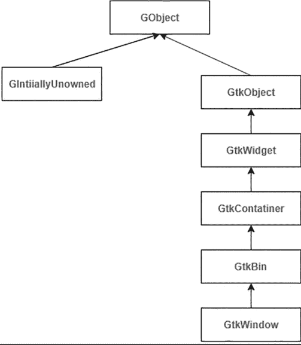
GObject层级关系。GtkWindow继承自GtkBin，而GtkBin是GtkContainer的子类。GtkWindow的对象可以调用GtkBin或GtkContainer中定义的函数。
```abstract class Gtk.Bin : Gtk.Container { container: GtkContainer } ```
####### GtkBin
GtkBin是仅包含一个子元素的容器。它本身实用性不高，但通过提供处理单个子部件的标准代码，助力派生子类。许多GTK+部件都是GtkBin的子类，包括GtkWindow、GtkButton、GtkFrame、GtkHandleBox和GtkScrolledWindow。
######## GtkBin的祖先：
- GtkContainer
- GtkWidget
- GInitiallyUnowned
- GObject
接下来我们逐一讨论上述所有类。
######## GtkContainer
```abstract class Gtk.Container : Gtk.Widget { widget: GtkWidget } ```
将部件嵌套在其他部件内，即可构建GTK+用户界面。容器部件是部件树中的内部节点，可容纳其他部件。例如，你可以让GtkWindow包含GtkFrame，GtkFrame再包含GtkLabel。如果希望框架内显示图像而非文本标签，可将GtkLabel部件替换为GtkImage部件。
######## GtkWidget
GTK+中有两类重要的容器部件。二者均为抽象基类GtkContainer的子类。第一类容器部件仅有一个子部件，派生自GtkBin。这类容器是装饰器，可为子部件新增功能。例如，GtkButton会将其子部件变为可点击的按钮；GtkFrame会在其子部件周围绘制边框；GtkWindow则将其子部件放置于顶层窗口内。
```abstract class Gtk.Widget : GObject.InitiallyUnowned { parent_instance: GInitiallyUnowned } ```
它是所有GTK+部件的基类，负责管理部件的生命周期、状态与样式。
######## GInitiallyUnowned
```class GObject.InitiallyUnowned : GObject.Object { g_type_instance: GTypeInstance } ```
该类型用于具有浮动引用的对象。GInitiallyUnowned结构中的所有字段均为实现私有，禁止直接访问。
```class GObject.Object : GObject.TypeInstance { g_type_instance: GTypeInstance } ```
基础对象类型。上述结构中的所有字段均为实现私有。
######## GInitiallyUnowned的后代：
- GBinding
- GInitiallyUnowned
- GTypeModule
####### GtkBin的后代：
- GtkActionBar
- GtkAlignment
- GtkButton
- GtkComboBox
- GtkEventBox
- GtkExpander
- GtkFlowBoxChild
- GtkFrame
- GtkHandleBox
- GtkListBoxRow
- GtkMenuItem
- GtkOverlay
- GtkPopover
- GtkRevealer
- GtkScrolledWindow
- GtkSearchBar
- GtkStackSidebar
- GtkToolItem
- GtkViewport
- GtkWindow
###### 列表部件
GtkList部件被设计为GtkListItem部件的垂直容器。GtkList部件拥有一个用于接收事件的窗口，其背景色通常为白色。它直接派生自GtkContainer，可通过GTK_CONTAINER(List)宏将其视为GtkContainer使用；更多细节请参阅GtkContainer部件。若要充分使用GtkList部件，你应当已熟悉GList及其相关g_list_*()函数的用法。
GtkList结构定义中有一个字段值得我们重点关注：
```struct _GtkList { [...] GList *selection; guint selection_mode; [...] }; ```
GtkList的selection字段指向所有当前选中项组成的链表，若未选中任何项则为"NULL"。GtkList的selection_mode字段用于规定列表的选中行为，以及GTK_LIST()->selection字段的内容。selection_mode可取以下值之一：
- GTK_SELECTION_SINGLE：值为"NULL"，或包含指向单个选中项的GList*指针。
- GTK_SELECTION_BROWSE：若列表无可选部件则为"NULL"；否则包含指向单个GList结构的GList指针，对应恰好一个选中列表项。
- GTK_SELECTION_MULTIPLE：若未选中任何列表项则为"NULL"，或为指向第一个选中项的GList指针。
- GTK_SELECTION_EXTENDED：值始终为"NULL"。
默认选中模式为GTK_SELECTION_MULTIPLE。
###### GTK+部件
这些是GUI应用的构建模块。多年来，已有不少部件成为编程工具包的标准组件，例如按钮、复选框和滚动条。GTK+工具包的理念是将核心部件的数量维持在最低水平。更专业的部件会作为自定义GTK+部件创建。
####### 1. GtkLabel
```final class Gtk.Label : Gtk.Widget { /* No available fields */ } ```
GtkLabel用于显示少量文本，但大多数标签用于标注其他部件，例如GtkButton。
####### 2. GtkSpinner
```final class Gtk.Spinner : Gtk.Widget { /* other fields */ } ```
GtkSpinner会显示图标大小的旋转动画，通常作为GtkProgressBar的替代方案，用于指示正在进行但无明确进度的活动。例如，要启动动画，使用gtk_spinner_start()；要停止动画，使用gtk_spinner_stop()。
####### 3. GtkStatusbar
```final class Gtk.Statusbar : Gtk.Widget { /* other fields */ } ```
GtkStatusbar通常位于应用主窗口GtkWindow的底部。它可以持续显示应用的状态信息。GTK中的状态栏会维护一个消息栈。每个状态栏栈顶的消息即为当前显示的内容。
####### 4. GtkImage
```final class Gtk.Image : Gtk.Widget { /* other fields */ } ```
GtkImage部件用于显示图像。例如，多种类型的对象都可作为图像显示；你可以使用gtk_image_new_from_file()函数从文件加载GdkTexture，示例如下：
```C GtkWidget *image = gtk_image_new_from_file("my_file.png"); ```
####### 5. GtkTextView
```class Gtk.TextView : Gtk.Widget { parent_instance: GtkWidget } ```
GtkTextView部件用于显示GtkTextBuffer的内容。你可以先阅读概念概述，该部分会解释与文本部件相关的所有对象、数据类型，以及它们的协作方式。
####### 6. GtkMediaControls
```final class Gtk.MediaControls : Gtk.Widget { /* other fields */ } ```
GtkMediaControls用于显示视频的控制组件。它通常作为GtkVideo的组成部分使用。
### 7. GtkCalendar
```final class Gtk.Calendar : Gtk.Widget { /* other fields */ } ```
GtkCalendar用于显示公历日历，每次展示一个月。可通过gtk_calendar_new()创建GtkCalendar实例。可使用gtk_calendar_select_day()修改当前显示的日期。要在特定日期添加标记，使用gtk_calendar_mark_day()；要移除标记，使用gtk_calendar_unmark_day()。另外，可使用gtk_calendar_clear_marks()清除所有标记。可通过gtk_calendar_get_date()从GtkCalendar获取选中的日期。


# 8. GtkWindowControls
```final class Gtk.WindowControls : Gtk.Widget { /* other fields */}```
GtkWindowControls 用于显示窗口框架控件。典型的窗口框架控件包括最小化、最大化、关闭按钮以及窗口图标。例如，单个GtkWindowControls仅显示控件的起始侧或结束侧，因此通常需要与另一个显示对侧的GtkWindowControls搭配使用。
###### Other Display Widgets
- **GtkAccelLabel**：一种可在文本右侧显示快捷键的标签
- **GtkImage**：用于展示图片的控件
- **GtkLabel**：用于展示少量到中等长度文本的控件
- **GtkProgressBar**：用于可视化呈现进度的控件
- **GtkStatusbar**：向用户提示低优先级消息的控件
- **GtkInfoBar**：向用户提示重要消息的控件
- **GtkStatusIcon**：在系统托盘中显示图标的控件
- **GtkSpinner**：展示加载旋转动画的控件
############ 9. GtkButton
```class Gtk.Button : Gtk.Widget { /* other fields */}```
GtkButton控件在按钮被按下时会触发回调函数。例如，GtkButton控件可以容纳任意合法的子控件，几乎支持所有其他标准GtkWidget，最常用的子控件是GtkLabel。
############ 10. GtkCheckButton
```class Gtk.CheckButton : Gtk.Widget { parent_instance: GtkWidget }```
通过调用`gtk_check_button_new()`或`gtk_check_button_new_with_label()`函数，GtkCheckButton可以在指示器旁放置标签。GtkCheckButton的状态可通过`gtk_check_button_set_active()`函数设置，通过`gtk_check_button_get_active()`函数获取。
############ 11. GtkCheckButton
```class Gtk.CheckButton : Gtk.Widget { parent_instance: GtkWidget }```
GtkCheckButton会在指示器旁放置标签，可通过调用`gtk_check_button_new()`或`gtk_check_button_new_with_label()`函数来创建。GtkCheckButton的状态可通过`gtk_check_button_set_active()`函数专门设置，通过`gtk_check_button_get_active()`函数获取。
############ 12. GtkComboBox
```class Gtk.ComboBox : Gtk.Widget { parent_instance: GtkWidget }```
GtkComboBox控件允许用户从合法选项列表中选择并展示选中项；控件被激活时，会弹出下拉列表供用户做出新选择。它采用模型-视图设计模式，合法选项列表在树模型中定义。由于实现了GtkCellLayout接口，可通过单元格渲染器根据模型数据调整选项的展示方式，和树形视图的使用逻辑一致。为允许用户输入模型外的值，GtkComboBox提供了`:has-entry`属性，可通过调用`gtk_combo_box_get_child()`函数访问该输入框。
############ 13. GtkColorButton
```final class Gtk.ColorButton : Gtk.Widget { /* other fields */}```
GtkColorButton可打开颜色选择器对话框来修改颜色，是在偏好设置对话框中选取颜色的合适控件。
############ 14. GtkSearchEntry
```final class Gtk.SearchEntry : Gtk.Widget { /* other fields */}```
GtkSearchEntry是作为搜索框使用的输入控件。与GtkSearchEntry交互的主要API是GtkEditable接口。当搜索框为空时，会显示空闲状态的符号化“查找”图标；当存在文本时，会显示扩展的“清除”图标。点击“清除”图标可将搜索框内容清空。
############ 15. GtkSpinButton
```final class Gtk.SpinButton : Gtk.Widget { /* other fields */}```
GtkSpinButton是一款允许用户设置属性值的控件，用户可点击两个箭头来递增或递减显示的数值，GtkSpinButton的主要属性通过调整器实现。
####### Buttons and Toggles
- **GtkButton**：点击时会触发信号
- **GtkCheckButton**：创建带离散切换按钮的控件
- **GtkRadioButton**：支持从多个复选按钮中选择一项的控件
- **GtkToggleButton**：创建可保留自身状态的按钮
- **GtkLinkButton**：创建绑定到URL的按钮
- **GtkScaleButton**：点击后会弹出刻度选择面板的按钮
- **GtkVolumeButton**：点击后会弹出音量调节面板的按钮
- **GtkSwitch**：形如“电灯开关”的切换控件
####### Other Numeric/Text Data Entry
- **GtkEntry**：单行文本输入框，默认支持大量快捷键绑定。输入密码等敏感信息时，可通过`gtk_entry_set_visibility()`函数将其设置为“密码模式”。
- 188 ■ 《精通GNOME》
- **GtkEntryBuffer**：GtkEntry的文本缓冲区，GtkEntryBuffer类存储了GtkEntry控件展示的全部文本内容，单个GtkEntryBuffer对象可被多个GtkEntry控件共享，共享相同的文本内容，但光标位置、可见性属性、图标等内容不共享。
- **GtkEntryCompletion**：GtkEntry的自动补全功能，是配合GtkEntry使用的补全对象，实现了GtkCellLayout接口，允许用户在GtkTreeView中添加额外单元格以展示匹配的补全结果。
- **GtkScale**：GtkHScale和GtkVScale的基类。
- **GtkHScale**：用于从范围内选择数值的水平滑动条控件。
- **GtkVScale**：用于从范围内选择数值的垂直滑动条控件。
- **GtkSpinButton**：用于获取用户输入的整数或浮点数，允许用户设置某些属性的数值，用户可点击两个箭头中的一个来递增或递减显示的数值。
- **GtkEditable**：文本编辑控件的接口，GtkEntry、GtkText等文本编辑控件都需实现该接口，包含操作可编辑控件的函数、大量用于快捷键绑定的动作信号，以及应用程序可连接来修改控件行为的其他信号。
####### Menus, Combo Box, Toolbar
- **GtkComboBox**：用于从项目列表中选择的控件
- **GtkComboBoxText**：仅支持文本的简易下拉框
- **GtkMenu**：菜单控件
- **GtkMenuBar**：GtkMenuShell的子类，用于容纳GtkMenuItem控件
- **GtkMenuItem**：菜单项使用的控件
- **GtkImageMenuItem**：带图标的菜单项
- **GtkRadioMenuItem**：支持从多个复选菜单项中选择一项的控件
- **GtkCheckMenuItem**：带复选框的菜单项
- **GtkSeparatorMenuItem**：菜单中使用的分隔符
- **GtkTearoffMenuItem**：用于分离和重新挂载菜单的菜单项
- **GtkToolShell**：用于容纳GtkToolItem控件的容器的接口
- **GtkToolbar**：创建由按钮及其他控件组成的工具栏
- **GtkToolItem**：添加到GtkToolShell的控件的基类
- **GtkToolPalette**：带分类的工具面板
- **GtkToolItemGroup**：工具面板中使用的子容器
- **GtkSeparatorToolItem**：用于分隔其他工具栏项目组的工具栏项
- **GtkToolButton**：显示按钮的GtkToolItem子类
- **GtkMenuToolButton**：带有附加下拉菜单按钮的GtkToolItem
- **GtkToggleToolButton**：带切换按钮的GtkToolItem
- **GtkRadioToolButton**：带单选按钮的工具栏项
############ 16. GtkGrid
```class GtkGrid : Gtk.Widget { /* No available fields */}```
GtkGrid是一种将子控件按行和列排列的容器。它支持任意位置以及跨行跨列排列。可通过`gtk_grid_attach()`函数添加子控件，支持跨越多行或多列。可通过`gtk_grid_attach_next_to()`函数在已有子控件旁添加新子控件，通过`gtk_grid_remove()`函数从网格中移除子控件。
############ 17. GtkBox
```class Gtk.Box : Gtk.Widget { parent_instance: GtkWidget }```
GtkBox控件可将子控件排列为单行或单列，排列方向取决于`GtkOrientable:orientation`属性的取值，该维度下所有子控件会被分配相同的大小，当然也可在子控件上使用`GtkWidget:halign`和`GtkWidget:valign`属性来影响其分配规则。
####### Layout Containers
- **GtkGrid**：将控件按行和列排列的容器
- **GtkAlignment**：用于控制子控件对齐方式和尺寸的控件
- **GtkAspectFrame**：可限制子控件保持特定宽高比的框架控件
- **GtkBox**：盒式容器的基类
- **GtkHBox**：水平容器盒
- **GtkVBox**：垂直容器盒
- **GtkButtonBox**：GtkHButtonBox和GtkVButtonBox的基类
- **GtkHButtonBox**：用于水平排列按钮的容器
- **GtkVButtonBox**：用于垂直排列按钮的容器
- **GtkFixed**：可在固定坐标处放置控件的容器
- **GtkPaned**：带两个可调节窗格的控件的基类
- **GtkHPaned**：包含两个水平排列窗格的容器
- **GtkVPaned**：包含两个垂直排列窗格的容器
- **GtkLayout**：可容纳子控件和自定义绘图的无限可滚动区域


- **GtkNotebook**：带标签页的笔记本容器
- **GtkTable**：按规整模式排列控件
- **GtkExpander**：可收起子容器的容器
- **GtkOrientable**：可翻转控件接口

########## 18. GtkPaned
```final class Gtk.Paned : Gtk.Widget { /* No available fields */ }```
GtkPaned拥有两个可水平或垂直排列的窗格，用户可通过拖动分隔条调整两个窗格的分割位置。

### 章节小结
在本章中，我们详细学习了GTK编程的基础知识、软件架构，以及GTK的更新版本GTK+。
Taylor & Francis Group http://taylorandfrancis.com

## 第5章
### 最佳基于GNOME的Linux发行版
### 本章内容包括
- 基于Ubuntu与DEB系列的GNOME Linux发行版
- Ubuntu与DEB系列
- Fedora与RPM系列发行版
- Zorin OS
- Linux Mint Cinnamon
- Debian测试版
- Elementary OS
- Arch Linux
- OpenSUSE
- Solus
- Manjaro GNOME版

在本章中，我们已讲解GTK工具包基础知识。GNOME是一个以GTK+作为GUI工具包的桌面环境，全称为GIMP工具包，最初被用于为GIMP创建用户界面（UI）。
DOI: 10.1201/9781003311942-5

现在我们将介绍各类基于GNOME的发行版。GNOME3是多个主流Linux发行版的默认桌面环境，涵盖Fedora Linux、Rocky Linux、红帽企业Linux（RHEL）、Debian、Ubuntu、SUSE Linux企业版、CentOS、Pop!_OS、Oracle Linux、Endless OS和Tails，以及Unix操作系统Solaris。尽管GNOME是使用最广泛的桌面环境，但部分Linux发行版对其有更出色的实现效果。请记住，我们可以整理一份当前市场中最佳基于GNOME的Linux发行版清单。

### Ubuntu与DEB系列
这是一款基于Debian的Linux发行版，在Linux社区中广受欢迎，是推荐给想要尝试Linux的新手的首选发行版。使用Ubuntu最大的优势之一，是很快将有Adobe、微软等大厂的专业应用可用（这得益于snap通用包格式的支持），这消除了普通用户与专业用户之间的使用鸿沟。Ubuntu去年开始搭载GNOME桌面，不过对原版进行了轻微修改，定制后的外观与Unity桌面相似，便于老用户迁移。不过考虑到开发者对主题和图标的优化十分出色，这套桌面观感依然清新清爽。

### GNOME的安装
- 在Ubuntu系统中打开终端应用，点击左上角的Dash图标，在应用列表中选择Terminal即可打开终端。
- 你也可以使用Ctrl+Alt+T快捷键打开终端。
- 在终端窗口中输入`$sudo apt-get update`，该命令会更新所有软件源，确保你获得最新版本的软件包。
- 按下键盘上的↩ Enter或↩ Return键，即可执行命令并更新你的软件源。
- 如果出现提示，请输入管理员用户密码，按下↩ Enter或↩ Return键继续操作。
- 输入`sudo apt-get install ubuntu-GNOME-desktop`，该命令将安装完整的GNOME桌面环境，包含标准应用及针对Ubuntu的优化项。
- 你也可以通过`$sudo apt-get install GNOME-shell`命令安装GNOME Shell。
- GNOME Shell仅安装GNOME桌面环境所需的基础包，不含完整安装包附带的额外桌面应用和Ubuntu主题。
- ubuntu-GNOME-desktop的安装包已包含GNOME Shell，请确保将两条命令合并输入，即输入`sudo apt-get install GNOME-shell ubuntu-GNOME-desktop`。
- 按下键盘上的Enter键，即可执行命令并开始在电脑上安装GNOME桌面环境。
- 安装过程中询问是否继续时，在键盘上输入y，此时会弹出多个软件包升级的提示，输入y并按Enter继续安装即可。
- 接下来根据提示选择显示管理器，安装最后你可以选择GNOME、GNOME Classic、Ubuntu Wayland和Ubuntu作为GNOME显示管理器。
- GNOME是默认的GNOME3桌面环境登录界面，GNOME Classic是GNOME Shell的一项功能与模式，适合偏好传统桌面体验的用户。GNOME Classic基于GNOME 3技术，但对UI有多处调整：
- 安装完成后，重启电脑即可开始使用搭载GNOME桌面的Ubuntu系统。
- 你可以在终端中输入reboot命令快速重启。

### 特性：
- 在Ubuntu 19.10版本中，默认的Yaru主题引入了深色版本。Ubuntu 20.04提供三款默认Yaru主题变体：浅色、深色和标准，你无需安装GNOME Tweaks即可切换默认主题变体，该选项已内置在设置应用中。Ubuntu 20.04的外观也略有调整，更突出茄子色的第二强调色。
- GNOME 3.36带来了所有视觉和性能改进，Ubuntu 20.04搭载了最新的GNOME 3.36正式版，这意味着3.36的所有新功能在Ubuntu 20.04上也可使用。
- 另一项改进是现在不再需要向下滚动才能进入锁屏界面，单击即可跳转至登录界面。
- 要切换桌面通知，你可以使用“免打扰”选项。
- **Linux内核5.4**：Ubuntu 20.04搭载最新的LTS内核5.4，这意味着你获得原生的ExFAT支持，以及该内核附带的所有其他性能改进和新硬件支持。
- 新的压缩算法现在可以缩短Ubuntu 20.04的安装时间，不仅如此，Ubuntu 20.04的启动速度也比18.04更快。
- Ubuntu多年前就不再为32位系统提供ISO镜像，但至少现有32位Ubuntu用户仍可升级到Ubuntu 18.04。现在情况不同了，如果你使用32位Ubuntu 18.04，将无法升级到Ubuntu 20.04，尝试升级时会报错。
- Canonical持续完善其通用包格式snap，这一点在Ubuntu 20.04版本中体现得尤为明显。当你尝试运行未安装的程序时，系统会推荐apt安装命令，而现在会在apt命令推荐之前同时推荐snap和apt命令。

### Ubuntu与Debian包管理基础
### 简介
软件包是Linux系统提供的核心优势之一。不同发行版的包格式和管理工具各有差异，目前已形成两大通用家族。针对RHEL系列发行版，RPM包格式和rpm、yum等打包工具是标准选择；而Debian、Ubuntu及相关发行版使用的另一个主流家族，采用.deb包格式，以及apt、dpkg等管理工具。本节将介绍系统管理员在Debian和Ubuntu系统上最常用的部分包管理工具，当你需要了解如何在这些系统中执行包管理任务时，可作为快速参考。

### Debian包管理工具概览
Debian-Ubuntu生态中有不少不同的包管理工具可用于管理系统软件，大部分工具基于同一包数据库运行，部分工具提供包系统的高级接口，另一些工具则提供底层功能。
- 1. **apt-get**：apt-get命令可能是apt工具套件中使用最广泛的成员，主要作用是连接由发行版打包团队维护的远程仓库，并对可用软件包执行操作。apt套件通常从远程仓库获取信息，存储到本地系统的缓存中，apt-get用于刷新本地缓存，也可用于修改软件包状态，即在系统中安装或移除软件包。总体而言，apt-get会更新本地缓存并修改运行中的系统。
- 2. **apt-cache**：apt-cache是apt套件的另一重要成员，该工具利用本地缓存查询可用软件包及其属性。例如，当你想要搜索特定软件包或可执行特定功能的工具时，apt-cache是很好的起点，它还可以告知针对特定软件包版本的执行流程，依赖项和反向依赖项查询也是apt-cache的擅长领域。
- 3. **aptitude**：aptitude命令整合了上述命令的功能，作为命令行工具，它兼具上述两款工具的功能，还支持基于ncurses的文本菜单界面。我们在命令行中操作时，大部分命令与apt-get、apt-cache的功能完全对应。由于功能重叠，本指南不会对aptitude进行过多介绍。


如果你更偏好该工具，可以使用 aptitude 替代 apt-get 或 apt-cache。

### Dpkg
前文提及的工具主要专注于管理存放在软件仓库中的软件包，而 dpkg 命令还可以操作独立的 .deb 软件包。上述大部分命令的幕后工作都由 dpkg 工具完成。与 apt-* 系列命令不同，dpkg 无法自动解析依赖关系。它的核心功能是直接操作 .deb 软件包，且可以拆解软件包以了解其结构。尽管它可以收集系统上已安装软件包的相关信息，但其作用范围仅在单个软件包层面。

### Tasksel
tasksel 是一款功能不同的软件管理工具。它不像其他工具那样管理单个软件包乃至独立应用，而是专注于对完成特定“任务”所需的软件进行分组。这些归类好的任务可以通过文本界面选择。

### 其他工具
还有许多其他包管理工具，它们提供独立的功能，或以其他方式呈现信息。我们仅在必要时介绍这些工具，它们在特定场景下会非常实用。属于这类的工具包括 apt-file、dselect 和 gdebi。

### 更新软件包缓存与系统
Debian-Ubuntu 的包管理工具提供了便捷的方式，既能保持系统可用软件包列表的更新，也能提供直接的方法来更新服务器上当前已安装的软件包。

### 更新本地软件包缓存
包管理工具所依赖的远程仓库会持续更新软件包信息。但大多数管理工具都使用这些信息的本地缓存执行操作。在执行其他包管理命令前，每轮会话更新一次本地缓存通常很有必要，这能确保你操作的是最新的可用软件信息。事实上，如果使用过期的软件包信息，部分安装命令会执行失败。要更新本地缓存，请按以下方式使用 update 子命令：
```
$ sudo apt-get update
```

### 更新软件包且不卸载软件
apt 工具套件的设计目标是保持服务器上所有已安装软件的更新。apt 命令提供两种不同的更新流程：第一种流程可以升级所有不需要移除组件的软件包，第二种流程会更新所有软件包，甚至包括需要卸载的软件包。下文将介绍如何更新并允许 apt 在必要时移除和替换部分组件。如果你绝对不想在任何情况下移除已安装的软件包，这个流程非常重要。不过部分更新涉及替换系统组件或删除冲突文件，该流程会忽略所有需要移除软件包的更新：
```
$ sudo apt-get upgrade
```
执行完这一步后，所有不涉及移除组件的更新都会被应用。

### 必要时移除软件并更新
apt 工具套件的设计目标是保持服务器上所有已安装软件的更新。apt 命令提供两种不同的更新流程：第一种流程会忽略所有需要移除软件包的更新，第二种流程会更新所有软件包，甚至包括需要卸载的软件包。由于软件包的依赖关系经常会变化，因此第二种流程往往很有必要。通常，升级过程中被移除的软件包会被功能等效的替代软件包替换，因此整体是安全的。不过最好留意待移除的软件包列表，以防有核心组件被标记为移除。要执行该操作，请输入：
```
$ sudo apt-get dist-upgrade
```

## 下载并安装软件包
包管理工具的主要功能之一就是便于下载软件包并安装到系统中。

### 搜索软件包
下载并安装软件包时，第一步是在你的发行版的仓库中搜索目标软件包。大多数 apt 命令主要针对本地存储的软件包信息缓存进行操作，因此执行速度更快、消耗的网络流量更少。搜索软件包是针对软件包缓存获取信息的操作，apt-cache search 子命令就是用于搜索可用软件包的工具。请记住，搜索软件包前需要使用 `sudo apt-get update` 确保本地缓存为最新状态：
```
$ apt-cache search package
```

### 从仓库安装软件包
我们可以使用带有 install 子命令的 apt-get 命令，从仓库安装软件包及其所有必需依赖项。该命令的参数应为仓库中标记的软件包名称：
```
$ sudo apt-get install package
```
你可以一次安装多个软件包，用空格分隔即可：
```
$ sudo apt-get install package1 package2
```
如果你请求的软件包需要额外的依赖项，这些依赖项会被输出到标准输出，同时系统会要求你确认操作，大致如下所示：
```
$ sudo apt-get install apache2
```

### 从仓库安装指定版本的软件包
如果需要安装软件包的特定版本，你可以通过等号指定要安装的版本，示例如下：
```
$ sudo apt-get install package=version
```
此处的版本必须匹配仓库中存在的某个软件包版本号，这意味着需要使用发行版采用的版本命名规则。你也可以通过输入 `apt-cache policy package` 查找可用版本。

### 重新配置软件包
许多软件包包含安装完成后运行的安装后配置脚本，这些脚本会提示管理员进行配置选择。如果你需要稍后执行这些配置步骤，可以使用 dpkg-reconfigure 命令。该命令会查看传入的软件包，并重新运行软件包规范中包含的所有配置后命令：
```
$ sudo dpkg-reconfigure package
```

### 执行包操作的模拟运行
执行命令前，你通常希望先了解操作可能产生的副作用。幸运的是，apt 支持添加 -s 标志来“模拟”操作流程。例如，要查看安装某个软件包时会执行的操作，你可以输入：
```
$ apt-get install -s package
```
这能让你查看所有依赖项，以及移除 -s 标志后系统会发生的变化。默认情况下，apt 会在许多流程中提示用户确认，包括需要额外依赖的安装和软件包升级。要跳过这些提示并默认接受所有请求，你可以在执行这些操作时传入 -y 标志：
```
$ sudo apt-get install -y package
```
这将在不进一步提示用户的情况下安装软件包及其所有依赖项，也可用于升级流程：
```
$ sudo apt-get dist-upgrade -y
```

你已在所有套件、分区和架构中搜索了包含 GNOME-desktop 的软件包，共找到 28 个匹配的软件包：
- 软件包 bfh-GNOME-desktop
- 软件包 GNOME-desktop-3-tests
- 软件包 GNOME-desktop-3-tests-dbgsym
- 软件包 GNOME-desktop-testing
- 软件包 GNOME-desktop-testing-dbgsym
- 软件包 GNOME-desktop-3-data
- 软件包 libGNOME-desktop-3-12
- 软件包 libGNOME-desktop-3-17
- 软件包 libGNOME-desktop-3-17-dbgsym
- 软件包 libGNOME-desktop-3-19

##### 优势
- Ubuntu 是一款可靠的操作系统，适合日常使用，也适合新用户。
- 和原版 GNOME Adwaita 主题相比，酷炫的橙黄色定制主题看起来非常清爽。
- 相较于其他操作系统，Ubuntu 安全性高，提供高等级的安全保障。
- Ubuntu 是开源操作系统。
- Ubuntu 是一款流行的 Linux 操作系统。
- Ubuntu 大部分软件都预装好了，以提升用户体验。
- 它可以免费获取。

### 劣势
- GNOME 桌面经过了轻微修改，复刻了旧版 Ubuntu Unity 桌面的样式，因此你无法体验到开发者原本设计的原生 GNOME 桌面。
- Ubuntu 采用新技术的速度较慢，如果你偏好更新的技术，可以选择 Fedora 发行版。
- 它容易出现硬件故障，稳定性不及其他操作系统。


- Ubuntu操作系统的硬件支持十分有限，部分用户抱怨，要在该系统上配置调制解调器以接入互联网变得十分困难。
- 在Ubuntu操作系统上无法运行现代游戏，其图形质量较差，且用户必须借助模拟器才能运行这些游戏，这会进一步降低图形画质。

### FEDORA
该发行版推荐给电脑极客使用。它拥有独特的生态系统，可向终端用户推送最新且经过更新的软件。其他主流Linux发行版更看重稳定性而非新软件功能更新，费多拉则秉持不同的理念。它搭载原生GNOME桌面，且由于开发者将其作为开发平台，所有新功能更新都会率先在费多拉落地，早于其他任何Linux发行版。

费多拉是由社区驱动的费多拉项目开发、红帽公司拥有的Linux发行版。费多拉Linux包含以自由及开源许可分发的软件，旨在成为此类技术的前沿引领者。费多拉以创新、整合新技术以及与上游Linux社区保持紧密协作而闻名。费多拉Linux的默认桌面环境为GNOME，默认界面为GNOME Shell。还支持其他桌面环境，包括KDE、Xfce、LXDE、MATE和Cinnamon。

其项目还分发名为“费多拉衍生版”的定制化Fedora变体。这些变体搭载特定软件包，提供可选的桌面环境，或面向游戏、安全、设计、科学计算、机器人等特定使用需求。

### 使用费多拉的理由
1. **费多拉是前沿发行版：** 费多拉OS被称为前沿Linux发行版，因为它会持续推送最新软件、驱动程序更新和Linux功能特性。这也是你为何可以在安装完成后立即放心使用费多拉的原因。它搭载了具备所有优势的最新稳定版内核。例如，它是首个将systemd作为默认初始化系统的主流发行版，也是首个将Wayland作为默认显示服务器协议的主流发行版。
2. **活跃的社区：** 费多拉拥有全球规模最大的社区之一，其论坛云集大量用户，会积极主动地帮你解决使用该发行版时遇到的任何难题。
3. **费多拉衍生版：** 费多拉为社区提供多种不同版本的“衍生版（Spins）”。每个衍生版采用区别于默认GNOME桌面的其他桌面环境，目前可用的衍生版包括KDE Plasma、XFCE、LXQt、MATE Compiz、Cinnamon、LXDE和SOAS。
4. **丰富的硬件支持：** 得益于背后的社区支持，费多拉具备诸多优势。一个典型例子是，费多拉可开箱即用兼容不同厂商的PC、打印机、扫描仪、摄像头等设备。如果你想要一款不会给你带来任何兼容性困扰的Linux发行版，费多拉是不错的选择。
5. **费多拉易于使用：** Linux发行版以易用性著称，费多拉是其中最容易上手的发行版之一。其简洁易用的界面足够直观，任何人首次使用时只需点击几下就能快速上手。其内置软件提供一致的用户体验，让用户感受到统一的使用体验和熟悉感。

### 费多拉的优势
- **增强的安全特性：** 安全是费多拉最重要的特性。这款开源操作系统具备基于Linux的安全机制，整合了多项安全策略。例如，Linux内核和安全模块支持强制访问控制。
- **创新性：** 费多拉以其前沿的开源软件技术而闻名。其主要赞助方主导了多项桌面增强功能，包括HAL、Policy Kit、Ogg Theora、Network Manager、D-Bus和AIGLX。
- **可靠性：** 使用费多拉时，所有功能都能轻松正常运行，完全不会出现任何问题。尽管它会为多个软件包提供更新，但大多数用户仍认可其可靠性。
- **教育类软件：** 费多拉具备名为“软件组”的功能，你可以根据需要安装对应的软件组，例如KDE、Java、Perl、GNOME，甚至是内核。

### 费多拉操作系统的不同版本
- 费多拉每年5月和11月前后会发布两个新版本。30版本之后，费多拉针对不同使用场景推出了不同的版本。
- 费多拉工作站版：面向希望在笔记本或台式机上使用友好易用操作系统的用户。默认搭载GNOME桌面，也可安装其他桌面环境。
- **费多拉服务器版：** 该版本面向服务器，包括数据中心技术所用的服务器。它不预装桌面环境，如有需要可自行安装。自28版本起，它支持可选更新流。
- **费多拉CoreOS版：** 该版本仅包含操作系统最核心的基础功能，专注于云计算，仅提供最精简的费多拉镜像，为开发工作释放更多空间。
- **费多拉物联网版：** 与前一代版本类似，该版本对费多拉的功能进行了精简和优化，适配物联网（IoT）设备运行。
- **费多拉Silverblue版：** 该版本是希望使用不可变桌面的用户的最佳选择，使用容器化工作流的开发者也适用。

### 基于RPM
红帽Linux是首个使用.rpm文件格式的主流发行版，该格式如今仍被多个包管理系统使用。这两者都分为商业发行版和社区支持的发行版。红帽Linux后来拆分为了由红帽赞助的社区支持发行版费多拉，以及商业支持的红帽企业Linux（RHEL）。与之相对，SUSE则拆分为了openSUSE和SUSE Linux Enterprise。

### GNOME-RPM
GNOME桌面提供了另一款图形化RPM管理工具GNOME-RPM。GNOME-RPM也被称为gnorpm，其基础功能与KPackage非常相似，仅支持管理RPM包。

### ZORIN OS
另一款Linux发行版搭载了专为Windows用户设计的更美观的GNOME桌面，其最新版本的外观与Windows 10高度相似。该系统预装了WINE，这是一款可运行Windows程序的软件，这让Windows用户在使用新的Linux系统时能有家的感觉。

Zorin OS基于Ubuntu开发，因此每次Ubuntu发布新版本后，Zorin OS都需要更长时间才能完成最新GNOME桌面的部署。Zorin OS完全采用图形化界面，配备图形化安装程序。为了稳定性和安全性，它跟随核心Ubuntu系统的长期支持版本发布。它使用自身的软件仓库以及Ubuntu的软件仓库，这些仓库既可以通过Linux终端的标准“apt-get”命令访问，也可以通过图形化软件管理器访问，后者为不愿使用终端的用户提供了类似App Store的体验。

该系统还提供多种桌面布局或主题来修改桌面环境。这些主题可以让用户将界面调整为类似Microsoft Windows、macOS或Ubuntu的样式，无论用户此前使用的是哪款系统，都能快速熟悉。与所有基于GNOME的桌面环境一样，该系统桌面的外观和交互体验可通过GNOME扩展轻松修改。

##### 优势
- 界面高度仿照Microsoft Windows设计，因此Windows用户可在两个系统间无缝迁移，无需学习两套截然不同的操作系统风格。
- 终极版用户可获得Zorin官方支持，如果遇到无法解决的问题可以联系官方，他们会乐意提供帮助。

##### 缺点
- 对非Windows用户而言实用性极低。

### 安装Zorin OS
以下是安装Zorin OS与现有系统双系统共存，或替代现有系统的简易步骤指南：
- 要获取Zorin OS 16，请访问其官网https://zorin.com/os/download/。该系统提供两个版本：Pro版和Core版，Core版和Lite版为免费版本，Pro版为付费商业版本。


#### Linux Mint Cinnamon
这是另一款基于Ubuntu的Linux发行版。它搭载的Cinnamon桌面最初是从GNOME分叉而来。Linux Mint的界面和Windows相似，底部设有开始菜单和任务栏面板。Linux Mint Cinnamon的独特之处在于其软件更新工具，它会根据软件对系统的影响程度对其进行分类，进一步提升系统稳定性。你可以选择让Linux Mint自动为你处理更新，也可以手动控制哪些软件需要更新、哪些不需要。

##### 优势
- 在按分类更新软件、兼顾系统稳定性方面，是最佳的Linux发行版。
- 是Windows资深用户推荐的替代选择。

##### 缺点
- 部分GTK应用（如Builder）在Cinnamon桌面下的显示效果不协调。
- 新用户不知道如何安装软件，也不知道如何安装想要使用的程序所需的依赖文件。
- 部分配置修改需要以root用户身份进行，而访问主账户需要借助sudo命令间接完成。
- 不清楚该选择哪款发行版，即使底层操作系统本身并没有那么难选择。
- 用户不会使用系统自带的帮助文件，也不会查阅其中包含的用户文档来解答自己的疑问。
- 商业软件厂商通常不会为Linux系统开发软件。
- 偶尔会出现bug。

##### 在Linux Mint 12上安装
Cinnamon是适用于X Window系统的免费开源桌面环境，源自GNOME 3，但遵循传统桌面隐喻的规范。Cinnamon是Linux Mint发行版默认的桌面环境，也可作为其他Linux发行版及类Unix系统的可选桌面。Cinnamon已被收录进Linux Mint 12（代号Lisa）的软件源中。

如果你还未更新过软件包列表，请按以下步骤操作：打开终端，输入：
```shell
$ sudo apt-get update
```
之后，你可以通过输入以下命令安装Cinnamon：
```shell
$ sudo apt-get install cinnamon
```
Cinnamon下载安装完成后即可启用：先退出当前会话，在登录界面点击齿轮图标选择Cinnamon，即可在登录界面的菜单中选中Cinnamon登录。

如果遇到登录界面没有默认背景图的情况，可以使用简单的Lightdm管理器工具快速修复。安装该工具需要先添加对应的软件源，更新软件包列表再安装：
```shell
$ sudo apt-add-repository ppa:claudiocn/slm
$ sudo apt-get update
$ sudo apt-get install simple-lightdm-manager
```

在尝试扩展GNOME 3以满足Linux Mint设计目标的过程中，Mint开发者开发了多个GNOME 3组件，构建出了独立的Cinnamon桌面环境。Desklets（桌面小工具）和Applets（面板小程序）已不再兼容GNOME 3。Cinnamon获得了媒体的正面评价，尤其是其易用性和平缓的学习曲线备受好评。从保守的设计风格来看，Cinnamon和Xfce、GNOME 2桌面环境相似。

###### 软件组件
###### X-Apps
Cinnamon推出的X-Apps基于GNOME核心应用改造而来，可适配Cinnamon、MATE和XFCE桌面，保留了传统用户界面。
- **Xed：** 一款基于Gedit/Pluma开发的文本编辑器。
- **Xviewer：** 一款基于GNOME之眼（Eye of GNOME）开发的图片查看器。
- **Xreader：** 一款基于Evince/Atril开发的文档查看器。
- **Xplayer：** 一款基于GNOME视频（Totem）开发的媒体播放器。
- **Pix：** 一款基于gThumb开发的图片管理工具。

###### 功能特性
Cinnamon提供的功能特性包括：
- 支持合成的桌面特效、动画、过渡效果和透明度；
- 带有主菜单、启动器、窗口列表和系统托盘的面板，可调整到屏幕的左、右、上、下边缘；
- 多种扩展插件；
- 可在面板上显示的小程序；
- 功能与GNOME Shell类似的总览视图；

可自定义的选项包括：
- 面板
- 日历
- 主题
- 桌面特效
- 小程序
- 扩展插件
- 指向任务栏上的对应图标时，可使用滚轮调节音量和亮度。

截至2012年1月24日，Cinnamon尚无专属文档，但大部分GNOME Shell的文档适用于Cinnamon。Linux Mint的Cinnamon版本有专属文档，其中包含专门介绍Cinnamon桌面的章节。

#### Debian Testing
我们列表中的第一款搭载GNOME桌面的Linux发行版是Debian Testing。该Linux发行版默认搭载GNOME桌面。它不会永久沿用当前版本，随着时间推移和技术发展，几年后就会更换。Debian保留了原生GNOME桌面的诸多特性，但未包含其他发行版中的部分新软件。Debian的优点是支持你直接向社区提交bug，还能提供建议帮你满足所有计算需求。

##### 优势
- 可提供原生GNOME桌面的体验。
- Debian以高稳定性和持续的安全补丁更新著称。

##### 缺点
- 该操作系统需要用户掌握更多维护知识，因为你很可能遇到异常运行的软件。
- 由于是测试版，你需要容忍各类软件bug。

###### Debian中的GNOME
GNOME是Debian桌面环境的一个可选组件。
####### 版本
- Debian Bullseye搭载GNOME 3.38。
- Debian Buster搭载GNOME 3.30。
- Debian Stretch搭载GNOME 3.22。
- Debian Jessie搭载GNOME 3.14。
- Debian Wheezy搭载GNOME 3.4。
- Debian Squeeze搭载GNOME 2.30。

对于开发版发行版Debian Unstable和Debian Testing，你可以查看GNOME-shell等各个独立软件包的版本。版本过渡期间，GNOME软件包不一定都是同一版本。

####### 安装选项
在Debian中安装GNOME有三种方式，如下表所示。
| GNOME桌面任务 | 说明 |
| --- | --- |
| GNOME (Debian) | Debian精选的应用套件<br>包含部分未与GNOME深度整合的应用，如LibreOffice和Firefox |
| GNOME (Full) | 完整的GNOME环境，包含未正式纳入上游GNOME正式发布版本的应用<br>是Debian推荐的GNOME环境 |
| GNOME (core only) | 仅包含GNOME桌面的官方“核心”模块<br>上述软件包均依赖该包 |

- **GNOME-core-devel：** 用于从源码编译依赖GNOME的软件包的开发包。
- **GNOME-devel：** 用于开发基于GNOME的应用的完整开发套件。
- **GNOME-api-docs：** 所有GNOME库的完整API文档。

####### 安装“GNOME桌面”任务
Debian安装程序的桌面“任务”默认安装的就是GNOME桌面任务，你也可以通过apt手动安装：
```shell
$ apt-get install task-gnome-desktop
```

#### elementary OS
它基于Ubuntu长期支持版（LTS）开发，主打“体贴、强大、合乎伦理”的macOS和Windows替代方案，采用“随缘付费”的定价模式。名为Pantheon的桌面环境及其配套应用由elementary公司开发维护。elementary OS项目的指南聚焦于易用性和平缓的学习曲线，而非全面的自定义功能。开发者设定的三条核心规则是“简洁”“易于配置”和“极简文档”。

elementary OS的设计饱受赞誉也备受争议：无论是视觉还是用户体验，它都与macOS高度相似。elementary开发者表示，所有相似之处均属无意。Pantheon的主shell与elementary OS的其他应用深度集成，包括Plank（即停靠栏）、Web（基于Epiphany开发的默认网页浏览器）和Code（一款简易文本编辑器）。该发行版采用基于Mutter的Gala作为窗口管理器。

我们见过很多类似Windows的GNOME桌面，但elementary OS这款GNOME发行版的界面则接近苹果桌面。它搭载的桌面名为Pantheon，本质上是经过改装的GNOME，目的是使其外观接近苹果系统。和Zorin OS一样，elementary同样基于Ubuntu开发，因此搭载了专门适配Pantheon桌面的应用。例如，Epiphany网页浏览器比Firefox更简洁，也更贴近苹果的设计风格。此外，这款Linux发行版拥有专属的AppCenter，你可以在其中找到免费和随缘付费的软件。


elementary OS 6 是对 5.x 系列经过数年的优质更新后推出的重大升级。虽然 5.x 系列拥有大量功能更新和改进，但 elementary OS 6 看起来是一项令人期待的成果。接下来，我们将一同了解 elementary OS 6 带来的所有新功能与新增特性。
优点：
- 长期使用苹果电脑的用户可以轻松迁移到 Linux 系统。
- 系统着重保护用户隐私。
缺点：
- 对非苹果用户来说实用价值较低。

1. **深色样式与主题色：** elementary OS 的深色样式主题与主流系统的实现逻辑类似，属于可选偏好设置。你可以在安装完 elementary OS 6 后的登录界面直接选择该主题。虽然深色模式看起来只是个小功能，但开发者为打造全局统一的深色模式投入了大量精力。所有官方原生应用都同时支持深色样式和浅色主题。elementary OS 6 允许应用开发者和用户分别设置偏好，因此应用会自动适应用户选择的深色/浅色模式。
2. **通知功能升级与通知中心改版：** 通知现在支持图标角标和操作按钮，可提供更优质的使用体验。你可以通过通知快速打开链接、将消息标记为已读，还可以执行其他多项操作。紧急通知采用了全新的外观和专属提示音，方便你快速识别。此外，通知中心也进行了重新设计，在展示多条通知时更加整洁有序。
3. **官方 Flatpak 应用与权限视图：** elementary OS 6 采用 Flatpak 优先的策略，以提升整个平台的隐私性与安全性。elementary OS 拥有自己的 AppCenter Flatpak 软件仓库，系统默认应用以 Flatpak 包的形式提供，AppCenter 中列出的所有应用也都可以获取 Flatpak 版本。总体而言，这意味着更完善的沙盒机制，所有应用相互隔离，不会随意访问敏感数据。elementary OS 6 新增了“Portals（权限网关）”功能，允许应用申请访问文件或启动其他应用的权限，你可以在系统设置中管控所有权限。
4. **多指触控手势：** 新增的多指触控手势对笔记本和触控板用户来说非常实用。借助多指触控手势，你可以完成所有操作，从打开多任务视图到切换工作区都可以实现。这些手势并不局限于特定桌面功能：你还可以操作通知、滑动切换应用，获得流畅的系统使用体验。你可以在系统设置的“手势”板块中自定义手势，或者了解更多相关使用说明。
5. **桌面工作流优化与截图工具升级：** 多任务视图可以帮你清晰区分多个活动窗口。角落视图支持你将窗口移动到新的工作区，或是最大化窗口。截图工具不再固定在窗口中央，支持在窗口内自由拖动。你可以直接从预览界面拖动图片，无需提前保存。

##### Pantheon 桌面环境
Pantheon 桌面环境基于 GNOME 软件栈构建，包括 GTK、GDK、Cairo、GLib、GObject、GIO、GVfs 和 Tracker 组件。该桌面支持多工作区功能，可帮助用户整理工作流。Pantheon 应用由 elementary 团队设计开发，包括以下组件：
- **Pantheon Greeter（登录管理器）：** 基于 LightDM 的会话管理器。
- **Gala（窗口管理器）：** 负责窗口管理的组件。
- **Wingpanel（顶部面板）：** 功能与 GNOME Shell 的顶部面板类似。
- **Slingshot（启动器）：** 位于 Wingpanel 中的应用启动工具。
- **Plank（停靠栏）：** Docky 停靠栏的底层基础组件。
- **Switchboard（设置应用）：** 即系统控制面板。
- **Pantheon Mail（邮件客户端）：** 基于 WebKitGTK 开发、使用 Vala 语言编写的电子邮件客户端。
- **Calendar（日历）：** 桌面日历应用。
- **Music（音乐）：** 音频播放器。
- **Code（代码编辑器）：** 专注代码编辑的文本编辑器，功能与 gedit 或 Leafpad 类似。
- **Terminal（终端）：** 终端模拟器。
- **Files（文件管理器）：** 曾用名为 Marlin 的文件管理工具。
- **Installer（安装器）：** 与 System76 合作开发的系统安装工具。
- Network World 的 Bryan Lunduke 曾撰文表示，作为 elementary OS 核心的 Pantheon 桌面环境是 2016 年最佳的桌面环境之一。
- Pantheon 也是 GeckoLinux 的可选桌面环境之一。

其他值得注意的变更包括：
- 相机应用新增了切换摄像头、镜像图像等功能的用户界面。
- 最重要的是，Flatpak 应用的 AppCenter 现在会在应用安装完成后发送通知，方便你快速打开应用。
- 文件管理器也迎来了更新，新增了侧边栏和列表视图。现在打开文件需要双击，单击则用于导航文件夹。

### Arch Linux
Arch Linux 是许多可以自行搭建系统的爱好者的首选发行版。该系统的核心定位是尽可能快速地提供最新版本的软件。凭借快速更新的优势，Arch Linux 用户可以像 Fedora 用户一样，快速获取最新的 GNOME Shell 及相关功能。最重要的是，由于 Arch Linux 遵循“自主搭建”的理念，系统中不会预装任何用户不需要的自定义修改或扩展！
要使用 Arch Linux，请访问 ArchLinux.org 官网。进入网站后，点击顶部的“Download”按钮即可跳转至下载页面。在 Arch Linux 下载页面，你可以通过多种方式下载该系统的最新 ISO 镜像。

## 在 Arch Linux 上安装 GNOME 桌面环境
首先，请确认你的 Arch Linux 系统已更新到最新版本：
```bash
$ sudo pacman -Syu
```
更新完成后，重启系统以应用最新更新：
```bash
$ sudo reboot
```
接下来，使用以下命令安装 X 窗口系统（xorg）：
```bash
$ sudo pacman -S xorg xorg-server
```
最后，使用以下命令安装 GNOME 桌面环境：
```bash
$ sudo pacman -S gnome
```
该命令会安装所有必需的应用，包括 GNOME 桌面环境的显示管理器（GDM）。

### 如何启动并启用 GDM 服务
```bash
$ sudo systemctl start gdm.service
$ sudo systemctl enable gdm.service
```
你也可以使用其他常见的显示管理器（DM），以下是 Linux 发行版中常用的几款图形化显示管理器：
- **LightDM：** 跨桌面显示管理器，支持使用任意工具包开发的前端界面。
- **LXDM：** LXDE 桌面环境的显示管理器，可脱离 LXDE 桌面环境独立使用。
- **MDM：** 用于 Linux Mint 的显示管理器，由 GDM 2 分叉而来。
- **SDDM：** 基于 QML 开发的显示管理器，是 KDE4 的 kdm 的后继版本，推荐用于 Plasma 5 和 LXQt 桌面环境。
- **XDM：** 支持 XDMCP 协议和主机选择器的 X 显示管理器。

### openSUSE
openSUSE 也提供原版 GNOME 桌面环境。但与 Fedora 不同，它的发布节奏更加缓慢。GNOME 新功能发布后，你不会立刻就能在 openSUSE 上使用。不过从技术层面来说，这并非坏事：凭借缓慢的发布节奏，openSUSE 可以投入更多时间和精力优化系统，使其更加稳定可靠，非常适合那些无法承受系统在重要工作过程中崩溃的专业人士使用。
目前，openSUSE 提供两种发布模式：Leap 和 Tumbleweed。Leap 的每个大版本每 3 年发布一次，而小版本更新或修订版每年推出一版。此外还有 Tumbleweed 滚动发行版，该版本只需偶尔进行小版本更新和快照同步，无需进行大规模升级。你可以根据自己期望的系统升级频率，选择最适合你的版本。

## 安装 GNOME
GNOME 因其极高的普及度，优雅地实现了经典“桌面”的所有功能——包括 openSUSE 在内的所有主流 Linux 发行版都支持 GNOME。我们将使用 YaST 工具来安装桌面环境，这是最简单的方式。
1. 在菜单中搜索 YaST，输入 root 密码。
2. 选择“软件管理”。
3. 在“视图”下拉菜单中选择“模式（Pattern）”。
4. 所有桌面环境都位于“图形环境”板块下，右键点击“GNOME 桌面环境（X11）”并选择“安装”。我们选择 X11 版本是因为 X 服务器已经面世多年，兼容绝大多数程序。
5. 这一步为可选操作，你也可以选择卸载之前安装的桌面环境。以我个人为例，我之前使用的是 KDE Plasma 及其相关应用。
6. 准备就绪后，点击“确认”。
7. 列表会展示所有待执行变更的摘要，点击“继续”。
下载、安装或卸载所需软件包需要一定时间，你可以趁这个时间喝杯咖啡！


安装完成后，会显示一份简短的安装过程报告。点击“完成”。重启电脑。从左下角的下拉菜单中选择“GNOME”。

### Solus 系统
Solus，也被称为Evolve OS，是一款面向x86-64架构、基于Linux内核的操作系统，可使用自研的Budgie桌面环境，也可选择GNOME、MATE或KDE Plasma桌面环境。它的包管理器基于Pardus Linux的PiSi包管理系统。它采用半滚动发布模式，每周五都会有新的软件包更新推送到稳定版仓库。Solus的开发者明确表示，Solus仅适用于个人电脑使用，不会包含仅在企业或服务器环境中才有用的软件。Solus 1.0“Shannon”于2015年12月27日发布。Solus 1.1于2016年2月2日发布。HecticGeek博主Gayan将Solus 1.1评价为“优化出色的操作系统”，称赞其启动和关机速度比Ubuntu 15.10快很多。由于遇到了一些可用性问题，他建议等待一年后再尝试使用。Solus 1.2于2016年6月20日发布。Solus 1.2.0.5于2016年9月7日发布。Solus 1.2.1于2016年10月19日发布。这是Solus最后一个定点发布版本，之后的所有版本都将基于快照模型发布。

####### 版本
- Budgie旗舰版拥有“功能丰富、界面华丽的桌面，采用了最现代的技术”。
- GNOME版运行GNOME桌面环境，可提供“现代化的桌面体验”。
- MATE版使用MATE桌面环境，是“面向高级用户和老旧硬件的传统桌面”。
- KDE Plasma版可为“喜欢折腾的用户提供精致的桌面体验”。

Solus是一款极具吸引力的基于GNOME的Linux发行版，相较于其他发行版而言推出时间较晚。它从零开始构建，默认搭载名为“Budgie”的自研全新桌面环境，同时也提供支持GNOME的版本。这款发行版的独特之处在于它提供了多项特性，核心特性是轻量、高度可定制、跨平台且功能丰富。不过，该系统使用起来非常直观。因此，如果你是初学者，想要尝试基础系统，可以选择Solus。在转向更复杂的配置之前，它是一个不错的选择。

### Manjaro GNOME版
Manjaro Linux，通常简称为Manjaro，是一款面向电脑的开源操作系统。该操作系统是基于Arch Linux发行版开发的Linux发行版，注重用户的使用友好性和易用性。由于预装了多种程序，它旨在实现开箱即用的完整体验。此外，它采用滚动发布模式并持续更新，使用“Pacman”作为包管理器。换句话说，这是一款非常出色的操作系统，我们建议你直接使用。

## 选择Manjaro的理由
以下是许多电脑用户选择Manjaro Linux的原因，每一条原因都附有详细说明：
- **易于安装：** Manjaro的安装过程非常简单，仅需20分钟，整个流程比Windows的安装过程更加顺畅。要安装它，你需要先下载Manjaro，然后用Etcher将其烧录到U盘，再从U盘启动。之后运行安装程序，选择你的国家、键盘语言、安装位置即可。
- **硬件支持友好：** 安装Linux时，你可能会发现让所有硬件都能正常运行存在一定困难。但如果安装的是Manjaro Linux，你完全不必遇到这类问题。该系统会先检测你的硬件，再安装必需的驱动程序。
- **软件资源充足：** 最好提前了解“Manjaro”团队拥有海量的软件仓库。同样，Manjaro用户可以轻松访问“Arch用户仓库（AUR）”。
- **内核切换便捷：** 大多数发行版切换内核需要用到一些终端操作技巧，而Manjaro内置了一款优秀的小工具，允许你根据自己的需求安装任意数量的内核。
- **节省时间：** Arch采用滚动发布模式，用户常常会遇到一个严重问题：新推送的软件包包集可能不稳定，甚至会导致系统崩溃。Manjaro团队会努力在向用户推送新软件包之前先完成测试，以避免该问题。这可能使得Manjaro的软件包版本不如滚动发布的前沿版本新，但也意味着新软件包的推送速度远快于Ubuntu这类固定版本发布的发行版。Manjaro被认为是打造高效工作设备的绝佳选择。
- **隐私与安全：** Manjaro从多个方面来看都与其他操作系统不同，它的隐私保护方式也非常出色。该操作系统的安全性非常充足，你完全不必担心设备被陌生人入侵。此外，该系统经过精心设计，可有效清除常导致你珍贵数据丢失的有害恶意软件。这也是Manjaro多年来一直保护用户隐私的方式。
- **图形界面的极致利用：** 图形用户界面（GUI）被Manjaro以一种最优的方式使用，确保安装程序既拥有友好易用的界面，又具备实用功能。
- **无需再处理PPA：** 当你使用Linux Mint或Lubuntu时，你需要处理大量的PPA。PPA是指仅用于单一功能或少量程序的软件仓库。安装官方Ubuntu仓库中没有的软件时，需要通过终端为系统添加新的PPA，添加完成后运行`sudo apt-get update`命令，之后该应用才可被安装。Manjaro Linux并非基于Ubuntu开发，而是基于Arch，因此不需要PPA。

### 本章小结
以上就是部分主流的基于GNOME的Linux发行版。正如你所见，不同发行版有不同的专长，你可以根据自己的需求和需要选择适合的一款。例如，如果你想要原汁原味的GNOME体验，且希望第一时间用上所有最新功能，可以选择Fedora或Arch。另一方面，如果你更看重稳定性，Debian、openSUSE和Mageia都是极佳的选择，其中CentOS采用长期发布周期，是最稳定可靠的选项。而如果你想在稳定性和新功能获取速度之间取得平衡，无需牺牲稳定性就能及时体验新功能，可以尝试Manjaro或POP!_OS，这两款发行版都非常适合新手。最后，如果你因为GNOME的特性想使用它，且不在意其外观设计，可以选择Ubuntu或Zorin OS。这两款发行版都提供了高度定制化的GNOME桌面，同时内置大量实用功能，非常欢迎新用户使用。


## **Taylor & Francis**
**Taylor & Francis** 出版集团
http://taylorandfrancis.com

## 评价
自问世以来，Ubuntu操作系统在开源领域和IT领域掀起了巨大风暴。从当初潜力巨大、崭露头角的小型操作系统，它已经成长为功能全面的桌面和服务器产品，赢得了全球用户的青睐。除了强大的技术平台和对品质的突出追求之外，Ubuntu之所以能取得成功，还要归功于它庞大的活跃用户社区，这些用户帮助支持、文档化和测试Ubuntu生态的每一个环节。你手中的这本书是介绍这款独特操作系统的官方、权威指南。本书的所有编写人员都具备极高的专业能力，且愿意分享这些知识。我们聚在一起编写这本书，目的是让读者深入理解Ubuntu，并讲解Ubuntu GNOME桌面环境的诸多基础原理和功能是如何运作的。GNOME桌面环境可以说是最受欢迎、最受喜爱的Linux桌面环境之一。它的名字意为“仁爱他人”。它对多语言支持和特殊需求的支持，体现了将自由软件推广到标准Linux目标市场（企业服务器）之外的理想。许多主流Linux发行版都使用GNOME作为默认桌面环境，它还有一些流行的分支版本，例如Linux Mint Cinnamon。GNOME的设计目标是易于使用且可定制，其用户界面旨在提供独特的体验。遗憾的是，GNOME并不是一款轻量级桌面环境。因此，如果你要在老旧电脑或内存不足4GB的系统中安装Linux发行版，它并不是理想选择。但值得欣喜的是，GNOME在最新发布的GNOME 3.36版本中一直聚焦于性能优化。因此，如果你想要获得有别于传统Windows布局的良好使用体验，
DOI: 10.1201/9781003311942-6


GNOME 应该是绝佳之选。GNOME 的主流发行版包括 Ubuntu、Debian、Fedora、openSUSE。Pop OS 20.04 也具备诸多优秀特性，且搭载了 GNOME 桌面环境。
本书对不同主题的覆盖深度有所不同，这是有意为之的。其他书籍往往不会涉及部分主题，而这些主题值得在本书中得到深入探讨。
有些主题是高级用户需要掌握的，另一些主题则是高级用户应当了解的。他们可以了解相关历史、其他可选方案，或是掌握足够的知识，以便在聆听不同技术观点的后续讨论时不会完全摸不着头脑。
本书面向中高级用户，以及希望成为中高级用户的读者。我们的目标是为你指明正确方向，通过指导你尽可能运用各类工具与理念，帮助你登上更高的台阶。我们为你提供一些可供参考的思路与方法，你可以据此探索更多内容。尽管本书内容面向中高级用户，但新手读者只要仔细阅读，也能从各章中获益，因为所有章节都是相互关联的。核心要点是，每章末尾都会提供更详细的相关信息。本书可以帮助你掌握这些技能，并告诉你如何进一步了解你的系统、Linux 系统，包括搭载 GNOME 桌面的 Ubuntu 发行版。最重要的是，通过介绍更多系统相关知识及其运行原理，本书能帮助你克服对系统的畏难情绪。你还可以安装其他 Linux 发行版，例如 Fedora、openSUSE、elementary OS、Manjaro 等。
本书不止是一本纯粹的参考书，还会通过分步流程恰当地指导你完成各项任务。本书按主题编排，收录了尽可能多的实用命令。
## 第1章
第1章包含 Ubuntu 系统的基础认知、GNOME 的安装方法，以及 Ubuntu 与其他 Linux 发行版系统的差异，还会介绍 GUI、CLI、TUI 等专有术语。本章还介绍了可用于支撑本书学习的海量资源。你还将了解到 GNOME 的简史、特性，以及部分优缺点。
## 第2章
第2章会快速回顾 Ubuntu 中 GNOME 的安装流程，介绍 apt-get、snapd 等实用命令，并带你初步了解 GNOME 环境系统的用户界面。
## 第3章
第3章会快速回顾 Corebird、FeedReader、Snappy、EasyTag 等基于 GNOME 的应用安装方法，同时介绍这些应用各组件与用户界面的特性。
## 第4章
第4章会快速回顾 GTK 主题、其发展历史、GIMP（GIMP 绘图工具包）、软件架构、GTK 的各种绑定语言，以及基于 GTK 的桌面环境。本章还会涉及 GTK+ 的相关内容，并带你创建一个简单的 GTK 程序。
## 第5章
第5章会为你介绍其他基于 GNOME 的 Linux 发行版，例如 Ubuntu 及 DEB 系列、Fedora、Zorin OS、Linux Mint Cinnamon、openSUSE、Solus 等。换言之，无论你是使用搭载 GNOME 桌面环境的 Ubuntu 发行版，还是使用其他操作系统，本书都能为你提供帮助。

## 泰勒与弗朗西斯集团
http://taylorandfrancis.com
## 参考文献
- 《关于 Manjaro》– Manjaro 官网。（2022 年 3 月 27 日）。Manjaro；wiki.manjaro.org。https://wiki.manjaro.org/index.php/About_Manjaro
- 《应用》– GNOME 维基！（日期不详）。GNOME 维基！应用页面；wiki.gnome.org。2022 年 7 月 11 日检索自 https://wiki.gnome.org/Apps
- Beal, V.（2001 年 1 月 4 日）。《什么是 GNU 网络对象模型环境（GNOME）》？Webopedia；www.webopedia.com。https://www.webopedia.com/definitions/gnome/
- Bodnar, J.（2022 年 1 月 6 日）。《GTK+ 入门》。GTK+ 入门教程；zetcode.com。https://zetcode.com/gui/gtk2/introduction/
- 第1章. 介绍 Red Hat Enterprise Linux 7 的 GNOME 3 桌面 | 红帽客户门户。（日期不详）。红帽客户门户；access.redhat.com。2022 年 7 月 11 日检索自 https://access.redhat.com/documentation/en-us/red_hat_enterprise_linux/7/html/desktop_migration_and_administration_guide/introducing-gnome3-desktop
- 当前 GTK+ 开发进展。（日期不详）。GTK+ 历史；people.redhat.com。2022 年 7 月 11 日检索自 https://people.redhat.com/mclasen/Usenix04/notes/x29.html#:~:text=GTK%2B%20was%20started%20as%20toolkit,needed%20to%20support%20the%20GIMP
- Das, A.（2021 年 8 月 24 日）。《最佳 Linux 桌面环境（我们已替你完成测试）》。It's FOSS；itsfoss.com。https://itsfoss.com/best-linux-desktop-environments/
- 桌面环境 – Debian 维基。（日期不详）。Debian 维基 桌面环境页面；wiki.debian.org。2022 年 7 月 11 日检索自 https://wiki.debian.org/DesktopEnvironment
- GDK – 维基百科。（日期不详）。维基百科 GDK 条目；en.wikipedia.org。2022 年 7 月 11 日检索自 https://en.wikipedia.org/wiki/GDK
- 获取 GNOME – GNOME 官网。（日期不详）。GNOME 官网 获取 GNOME 页面；www.gnome.org。2022 年 7 月 11 日检索自 https://www.gnome.org/getting-gnome/
- GNOME 桌面入门指南 | GNOME 用户指南 | openSUSE Leap 42.2。（日期不详）。openSUSE Leap 42.2 文档；doc.opensuse.org。2022 年 7 月 11 日检索自 https://doc.opensuse.org/documentation/leap/archive/42.2/gnomeuser/html/book.gnomeuser/cha.gnomeuser.start.html
- GNOME – Arch 维基。（日期不详）。Arch 维基 GNOME 条目；wiki.archlinux.org。2022 年 7 月 11 日检索自 https://wiki.archlinux.org/title/Gnome
- GNOME – 维基百科。（1999 年 3 月 3 日）。维基百科 GNOME 条目；en.wikipedia.org。https://en.wikipedia.org/wiki/GNOME
- 使用 GTK+ 在 Linux 上进行 GNOME 编程 LG #70。（日期不详）。linuxgazette.net  GNOME 编程相关内容；linuxgazette.net。2022 年 7 月 11 日检索自 https://linuxgazette.net/issue70/ghosh2.html
- GTK – 维基百科。（1998 年 4 月 14 日）。维基百科 GTK 条目；en.wikipedia.org。https://en.wikipedia.org/wiki/GTK#:~:text=Gtk%23%20is%20a%20set%20of,Common%20Language%20Runtime%20(CLR)
- Gtk.Builder。（日期不详）。docs.gtk.org  Gtk.Builder 页面；docs.gtk.org。2022 年 7 月 11 日检索自 https://docs.gtk.org/gtk3/class.Builder.html#:~:text=A%20GtkBuilder%20is%20an%20auxiliary,gtk_builder_new_from_resource()%20or%20gtk_builder_new_from_string()
- Gtk-3.0。（日期不详）。Gtk 3.0 参考文档；docs.gtk.org。2022 年 7 月 11 日检索自 https://docs.gtk.org/gtk3/
- 《如何在 Ubuntu 服务器上安装桌面（图形用户界面）》。（2019 年 5 月 16 日）。phoenixNAP 知识库；phoenixnap.com。https://phoenixnap.com/kb/how-to-install-a-gui-on-ubuntu
- 《如何在 Ubuntu 上安装和使用 gThumb》。（日期不详）。linuxhint.com；linuxhint.com。2022 年 7 月 11 日检索自 https://linuxhint.com/install-gthumb-ubuntu/
- 《如何在 Ubuntu 20.04 上安装和使用 Joplin 笔记应用》。（日期不详）。linuxhint.com；linuxhint.com。2022 年 7 月 11 日检索自 https://linuxhint.com/install_joplin_note_taking_app_ubuntu/
- GNOME 桌面简介 – Linux – 联想印度支持中心。（日期不详）。联想印度支持中心 GNOME 桌面简介页面；support.lenovo.com。2022 年 7 月 11 日检索自 https://support.lenovo.com/in/en/solutions/ht510815-introduction-to-the-gnome-desktop-linux
- 第一部分. GTK+ 概览：GTK+ 3 参考手册。（日期不详）。manpagez.com GTK+ 3 参考手册页面；www.manpagez.com。2022 年 7 月 11 日检索自 https://www.manpagez.com/html/gtk3/gtk3-3.16.3/gtk.php
- Rahul.（2018 年 4 月 22 日）。《如何在 Ubuntu 18.04 和 16.04 LTS 上安装 Corebird 推特客户端》。TecAdmin；tecadmin.net。https://tecadmin.net/install-corebird-twitter-client-on-ubuntu/
- Reynolds, L.（2022 年 5 月 17 日）。《Linux 教程 – 学习 Linux 配置》。如何在 Ubuntu 20.04 LTS Focal Fossa 上安装 GNOME。https://linuxconfig.org/how-to-install-gnome-on-ubuntu-20-04-lts-focal-fossa
- Rhythmbox 音乐播放器 – GNOME 官方文档。（日期不详）。GNOME 官方文档 Rhythmbox 页面；help.gnome.org。2022 年 7 月 11 日检索自 https://help.gnome.org/users/rhythmbox/
- 《在 Ubuntu 上安装 GNOME 的简单方法：8 步（附图片）》。（2021 年 7 月 27 日）。wikiHow；www.wikihow.com。https://www.wikihow.com/Install-Gnome-on-Ubuntu
- Sneddon, J.（2020 年 2 月 18 日）。《GNOME 3.36：十大最佳新特性 – OMG! Ubuntu!》。OMG! Ubuntu! 官网；www.omgubuntu.co.uk。https://www.omgubuntu.co.uk/2020/02/gnome-3-36-features


索海尔.（2019年4月7日）. 2022年最佳GNOME桌面. LinuxAndUbuntu；www.linuxandubuntu.com. https://www.linuxandubuntu.com/home/gnome-desktops
（2020年9月23日）. 2020年十大最佳基于GNOME的Linux发行版 | FOSS Linux. FOSS Linux；www.fosslinux.com. https://www.fosslinux.com/43280/the-10-best-gnome-based-linux-distributions.htm
（2014年11月3日）. Ubuntu与Debian包管理基础教程 | DigitalOcean. DigitalOcean；www.digitalocean.com. https://www.digitalocean.com/community/tutorials/ubuntu-and-debian-package-management-essentials
（无日期）. Ubuntu GNOME – javatpoint. javatpoint；www.javatpoint.com. 2022年7月11日检索于 https://www.javatpoint.com/ubuntu-gnome
（无日期）. GNOME可视化概览. help.gnome.org. 2022年7月11日检索于 https://help.gnome.org/users/gnome-help/stable/shell-introduction.html.en
webmaster@debian.org.（无日期）. Debian -- 包搜索结果 -- gnome-desktop. packages.debian.org. 2022年7月11日检索于 https://packages.debian.org/search?keywords=gnome-desktop
（2021年6月1日）. 什么是GNOME？. SearchDataCenter；www.techtarget.com. https://www.techtarget.com/searchdatacenter/definition/GNOME-GNU-Network-Object-Model-Environment

# 泰勒与弗朗西斯
泰勒与弗朗西斯集团 http://taylorandfrancis.com
## 索引
### AbiWord
- 完全移除，121
- 安装，120
- 使用apt-get安装，120
- 使用aptitude安装，121
- 从软件源安装，122
- 移除AbiWord配置与数据，121、122
- 卸载/移除，121
### 辅助功能工具包（ATK）- 149、173
- 实现，173
- 软件源浏览器，174
### 活动概览 - 17、39
### 全新屏幕键盘 - 19
### API - 见应用程序编程接口
### AppImage - 使用AppImage安装Joplin，71
### 应用程序概览 - 40–41
### 应用程序编程接口（API）- 154
### GNOME应用程序 - 46–47、63
- AbiWord应用程序，119–122
- Audacious音频播放器应用程序，125–129
- blanket，109–110
- corebird应用程序，68–69
- 桌面环境，64
- Dia图表编辑器应用程序，90–93
- EasyTAG应用程序，93–96
- empathy应用程序，133–136
- Epiphany浏览器，81–85
- GNOME之眼，98–100
- FeedReader应用程序，76–78
- Gajim应用程序，116–117
- gbrainy应用程序，114–116
- Gedit应用程序，86–90
- GNOME字符映射表应用程序，106
- GNOME词典应用程序，130–133
- GNOME扫雷，102–103
- GNOME音乐，73
- GNOME字幕，96–97
- GNOME-taquin，105
- GNOME待办，69–72
- Gnumeric应用程序，122–125
- gThumb应用程序，64–68
- Hitori，100–102
- Junction应用程序，111–112
- khronos-api，117–119
- 相册应用程序，108–109
- Polari应用程序，136–138
- Postr，103–105
- Rhythmbox安装，73–75；卸载，76
- Shortwave应用程序，113–114
- snappy应用程序，78–81
- Sound-Juicer，107
- Tangram应用程序，112–113
- Todoist，72–73
- Vinagre远程桌面客户端应用程序，84–85
- Vino VNC应用程序，138–143
### 应用程序窗口 - 45
### 应用程序“用法” - 19
### Apt-cache - 197、200
### Apt-get命令 - 197
### Aptitude命令 - 197
### Arch Linux - 8、215–216
### 辅助技术（ATs）- 173
### 辅助技术服务提供者接口（AT-SPI）- 173
### ATK - 见辅助功能工具包
### ATs - 见辅助技术
### AT-SPI - 见辅助技术服务提供者接口
### Audacious音频播放器应用程序 - 125
- 完全移除cl-alexandria，128–129
- 安装Audacious，126
- 使用apt-get安装cl-alexandria，128
- 使用aptitude安装cl-alexandria，129
- 启动Audacious，126–127
- 移除cl-alexandria配置与数据，129
- 移除软件，127
### GNOME美化 - 18
### 行为标签页 - 90
### 更优图标 - 19
### Blanket - 109
- 安装，110
- 卸载，110
### Brasero - 功能，78–79
- 在Ubuntu上安装Brasero，79–80
- 通过终端，80
- 从Ubuntu卸载Brasero，81
### Cairo - 148、169–170
### 日历 - 18
- 与通知，42、43
### CentOS - 7–8
### 字符映射表应用程序 - 106
### cl-alexandria - 使用apt-get安装，128
- 使用aptitude，129
### CLI - 见命令行接口
### 时钟应用程序 - 19
### CLR - 见公共语言运行时
### GNOME 2的一致性 - 13
### 命令行接口（CLI）- 3
### 公共语言运行时（CLR）- 160
### GNOME 2的连贯性 - 13
### Corebird应用程序 - 68
- 功能，68
- Flatpak与Flathub，69
- 通过PPA在Ubuntu上安装Corebird，69
- 在Ubuntu及其他Linux发行版上安装Corebird Snap包，68–69
- 卸载，69
### 切换至深色模式 - 44
### Dash面板 - 17、39
- 自定义，44
### Debian - 7
### Debian测试版 - 210
- Debian中的GNOME，211
- 可选方案，211–212
- 版本，211
- 安装“GNOME桌面”任务，212
### Debian-Ubuntu包管理工具 - 198
### 桌面环境 - 25、64
- 在Ubuntu上安装GNOME及GNOME Shell扩展，25–26
- 在Ubuntu 20.04上安装最小化GNOME，26–31
### 桌面设置 - 43
### 设备支持 - 19
### Dia图表编辑器 - 90
- 卸载，93
### 对话框 - 45
### GNOME词典应用程序 - 130
- 取色器，132
- 安装取色器，133
- 移除/卸载取色器，133
- 安装取色器时启用Snap包，133
- 安装GNOME词典，131
- 使用aptitude，131–132
- 卸载/移除GNOME词典，131
- 移除GNOME词典配置与数据，132
### “免打扰”开关 - 33
### dpkg工具 - 198
### 拖放操作 - 48
### EasyTAG - 93
- 功能，93–94
- 安装，94–96
### Elementary OS项目 - 212
- Pantheon桌面环境，214–215
### Empathy - 133
- 完全移除，134
- 删除Empathy配置与数据，136
- 安装，134
- 使用apt-get，133–134
- 使用aptitude，135
- 移除Empathy配置与数据，135
- 卸载/移除，134
### Epiphany浏览器 - 81
- 安装，81–84
- 在Ubuntu上的安装，81
### Evolve OS - 见Solus
### GNOME之眼 - 98
- 支持的文件格式，98
- 安装，98–99
- 启动，100
- 限制，98
### 文件中的收藏项 - 18
### GNOME功能特性 - 16–19、31
- 活动概览，39
- 应用程序概览，40–41
- 日历与通知，42、43
- 切换至深色模式，44
- Dash面板，40
- 自定义Dash面板，44
- 桌面设置，43
- 文件管理器，44
- 启动活动，42
- 窗口管理，42
- 面板，43
- 偏好设置，44
- 搜索，41–42
- Ubuntu GNOME桌面导览，38–39
- 安装Ubuntu软件，44–45
- 窗口，44
- 工作区，44
- 使用工作区，43
### Fedora - 6–7、203
- 优势，204–205
- 使用理由，203–204
### FeedReader应用程序 - 76
- 功能，77
- FeedReader支持的服务，77
- 推送至稍后读，78
- 与他人分享，78
- 安装，76–77
### 文件管理器 - 18、44
### Flathub - 69
### Flatpak - 17、69
### GNOME“完整版” - 26
### GAIL - 见GNOME辅助功能实现库
### Gajim应用程序 - 116
- 功能，116–117
- 安装说明，116
### gbrainy - 114
- 安装gbrainy架构，114、115–116
- 项目目标，116
### GDK - 见GIMP绘图工具包
### GdkFrameClock - 151
### GdkPixbuf - 149、163、168、171
- 构建，172
- 安装，172
### Gedit - 86
- 外观，90
- 行为标签页，90
- GNOME Shell扩展Dash to Dock，89
- 安装Dash to Dock，89
- 启动器标签页，90
- 位置与尺寸，89–90
- 移除，87
- 文本编辑器功能，88
### 通用公共许可证（GPL）- 4
### GIMP绘图工具包（GDK）- 149、150
### GdkFrameClock - 151
### GSK渲染管线 - 152
### GSK采用双层架构 - 152
### GtkInspector - 153、161
### Gtkparasite - 153
### 渲染API - 152
### GTK场景图工具包 - 151–152
### GUI设计工具 - 153
### Glade界面设计工具 - 153–154、160
### GtkBuilder - 154、161–162
### 语言绑定 - 154
### GIMP工具包（GTK）- 146、149
- 基于GTK的桌面环境，160
- 当前版本，160–161
- GtkInspector，161
- GtkSourceView，162
- GtkSpell，162
- 窗口管理器，161
- 桌面环境示例，158–159
- Gtk#，160
- GTK发展历史，147
- GUI设计工具，147
- Linux，147
- 软件架构，148–150
- 实现，156–157
- GTK语言绑定，154
- 支持的语言列表，154–156
### GInitiallyUnowned - 180–181
### GIO - 148
### GLib对象系统 - 148
### GNOME 1 - 12–13
### GNOME 2 - 13
- 改进的字体与图形，14
- 易用性，15–16
### GNOME 3 - 16、22
- 缺点，23
- 优点，22–23
### GNOME 3.34 - 38
### GNOME 3.36 - 31、33、37
### GNOME辅助功能实现库（GAIL）- 173
### GNOME经典模式 - 49
- 在Ubuntu上启用GNOME经典模式，52–53
- 扩展，53–54
- 从GNOME经典模式切换至标准GNOME，54
- 在标准GNOME与GNOME经典模式间切换，49–50
- 用户指南，50–52
- 窗口列表，49
### 安装“GNOME桌面”任务 - 212
### GNOME GNU - 4
### GNOME扫雷 - 102
- 安装，102–103
### GNOME音乐 - 73
### GNOME-RPM - 205
### GNOME Shell - 20
- 可扩展性，22
- 发展历史，20
- 软件架构，20
- 功能特性，20–22
### GNOME Shell扩展 - 57
- 安装，57
- 安装浏览器附加组件，58
- 安装原生连接器，59
- 在网页浏览器中，59–60
- 移除，60–61
### GNOME-taquin - 105
- 快速安装，105
### GNOME待办 - 69
- Joplin，70–71
- 使用AppImage安装Joplin，71
- 使用安装脚本，71
- 使用Snap包，71
- 使用Joplin，72
- 安装并使用Joplin笔记应用程序，70
### GNOME用户与开发者欧洲大会（GUADEC）- 160
### Gnumeric - 122
- 完全移除，123
- 从GNOME桌面移除，122
- 安装，123
- 使用apt-get，122–123
- 使用aptitude，123–124

## G
### 辅助功能工具包（ATK） - 实现，173 - 仓库浏览器，174
### GIMP工具包 - 见GTK
### GObject对象系统 - 148
### GPL - 见通用公共许可证
### Graphene图形库 - 148
### 图形用户界面（GUI） - 3, 146
### GSK - 见GTK场景图工具包
### GTK - 见GIMP工具包
### GTK场景图工具包（GSK） - 149, 150, 151–152
- 渲染管线，152
- GSK采用双层架构，152
- GtkInspector，153
- GtkParasite，153
- 渲染API，152
### GTK工具包 - 用于创建图形用户界面，174
- GtkBin，179
- GInitiallyUnowned，180–181
- GtkContainer，172, 179
- GtkWidget，179–180
- 列表部件，181–182
- GTK+部件，182–191
- GtkBox，190–191
- GtkButton，185
- GtkCalendar，184
- GtkCheckButton，185–186
- GtkColorButton，186
- GtkComboBox，186
- GtkGrid，189
- GtkImage，183–184
- GtkLabel，183
- GtkMediaControls，184
- GtkPaned，191
- GtkSearchEntry，187
- GtkSpinButton，187–189
- GtkSpinner，183
- GtkStatusbar，183
- GtkTextView，184
- GtkWindowControls，185
### GtkBuilder - 154
### GtkInspector - 153
### GtkParasite - 153
### GThumb（GNOME图片浏览器） - 64
- GThumb的安装 - 通过Ubuntu软件安装，65–66
- 通过Ubuntu终端安装，66
- 在Ubuntu上使用GThumb，67–68
### GTKADEC - 见GNOME用户与开发者欧洲会议
### GUI - 见图形用户界面
### GUI设计工具 - 153
- Glade界面设计器，153–154
- GtkBuilder，154
- 语言绑定，154
### Gnumeric（GNOME电子表格） - 移除配置和数据，124–125
- 卸载/移除，123
## H
### Hitori（数字逻辑游戏） - 安装方法，100–102
## I
### GNOME的安装 - 基础定制之外的内容，45
- 应用程序，46–47
- 默认快捷键，48
- 拖放操作，48
- 登录GNOME，48–49
- 标准功能，47–48
- 启动会话，48
- 终端，47
- 窗口，45
- 窗口类型，45–46
- 工作区，46
- 桌面环境，25
- 在Ubuntu上安装GNOME及GNOME Shell扩展，25–26
- 在Ubuntu 20.04上安装最小化GNOME，26–31
- GNOME的功能，31
- 活动概览，39
- 应用程序概览，40–41
- 日历与通知，42, 43
- 切换至深色模式，44
- Dash栏，40
- 自定义Dash栏，44
- 桌面设置，43
- 文件管理器，44
- 启动活动，42
- 管理窗口，42
- 面板，43
- 偏好设置，44
- 搜索功能，41–42
- Ubuntu GNOME桌面导览，38–39
- 安装Ubuntu软件，44–45
- 窗口，44
- 工作区，44
- 使用工作区，43
- GNOME经典模式，49
- 在Ubuntu上启用GNOME经典模式，52–53
- 扩展，53–54
- 从GNOME经典模式切换至标准GNOME，54
- 在GNOME与GNOME经典模式间切换，49–50
- 用户指南，50–52
- 窗口列表，49
- Xorg下的GNOME，54
- GNOME Shell扩展，57
- 安装，57–60
- 移除，60–61
- Wayland显示服务器，55–56
- 在Ubuntu上启用/禁用Wayland，56–57
- 安装脚本 - 使用安装脚本安装Joplin，71
## J
### Joplin笔记应用 - 69–71
- 安装，71
- 使用AppImage格式安装，71
- 使用安装脚本安装，71
- 使用Snap包安装，71
- 使用方法，72
### Joplin笔记应用 - 安装与使用，70
### Junction字体 - 功能，111
- 安装fonts-junction软件包，112
- 使用技巧，111–112
- 使用方法，111
## K
### Khronos API - 117
- 完全移除，118–119
- 安装API，118
- 使用apt-get安装，118
- 使用aptitude安装，119
- 移除khronos-api的配置与数据，119
- 卸载/移除，118
## L
### 语言绑定 - 154
### 启动器标签页 - 90
### 启动活动 - 42
### 次要通用公共许可证（LGPL） - 150
### LGPL - 见次要通用公共许可证
### Linux系统中的Ubuntu GNOME - 4–5
### 基于GNOME的Linux发行版 - 5
- Arch Linux，8
- CentOS，7–8
- Debian，7
- Fedora，6–7
- Mageia，9
- Manjaro GNOME版，8
- openSUSE，5–6
- Pop!_OS，8–9
- Ubuntu，10
- 系统需求，10–11
- Zorin OS，9
### 基于GNOME的Linux发行版 - 194
- Arch Linux，215–216
- Debian测试版，210
- Debian中的GNOME，211–212
- 安装“GNOME桌面”任务，212
- elementary OS项目，212
- Pantheon桌面环境，214–215
- Fedora，203
- 优势，204–205
- 使用理由，203–204
- Linux Mint Cinnamon版，207
- 功能，209–210
- 在Linux Mint 12上安装，208–209
- 软件组件，209–210
- X-Apps，209
- Manjaro GNOME版，219
- 使用Manjaro的理由，219–220
- openSUSE，217
- 安装GNOME，217–218
- 基于RPM的发行版，205
- GNOME-RPM，205
- Solus，218
- 版本，218–219
- Ubuntu与Debian系列，194
- Debian包管理工具概览，197–203
- GNOME的安装，194–196
- Ubuntu与Debian包管理基础，196–197
- Zorin OS，206
- 安装方法，206–207
### Linux Mint Cinnamon版 - 207
- 功能，209–210
- 在Linux Mint 12上安装，208–209
- 软件组件 - X-Apps，209
### 列表部件 - 181–182
### 登录GNOME - 48–49
## M
### Mageia - 9
### 管理窗口 - 42
### 操作窗口 - 46
### Manjaro GNOME版 - 8, 219
- 使用Manjaro的理由，219–220
### 极简设计 - 19
### Mono项目 - 171
### Mozilla项目 - 171
### 多媒体应用 - 17
## N
### GNOME Boxes新功能 - 17
### 夜间模式 - 18
## O
### OpenGL - 148
### 开源Linux桌面环境 - 2
- 自由软件，2
- 命令行界面（CLI），3
- 图形用户界面（GUI），3
- 关键要点，2–3
- 终端用户界面（TUI），3
### openSUSE - 5–6, 217
- 安装GNOME，217–218
## P
### 面板 - 43
### Pango文本渲染库 - 148, 169
### Pantheon桌面环境 - 214–215
### Parasite调试工具 - 153
### 照片应用 - 108
- 安装，108
- 安装GNOME-photos软件包，108
- 卸载/移除GNOME-photos软件包，109
### Polari（IRC聊天客户端） - 136
- 完全移除，137–138
- 安装，136–137
- 使用apt-get安装，136
- 使用aptitude安装，138
- 移除Polari的配置与数据，138
- 卸载/移除，137
### Pop!_OS - 8–9
### Poppler文档渲染库 - 171
### Postr（Flickr上传工具） - 103
- 功能，104
- 快速安装，104
- 卸载/移除，104–105
### 偏好设置 - 44
## **R**
### Rhythmbox（GNOME音乐播放器） - 73
- 安装，73
- 在GNOME 3.36和20.10上的安装，75
- 使用终端安装，75
- 卸载，76
### 基于RPM的发行版 - 205
- GNOME-RPM，205
## **S**
### 截图功能 - 19
### 搜索工具 - 18, 41–42
### 快捷键 - 48
### Shortwave（网络电台应用） - 113
- 功能，113–114
### Snap应用 - 78
- Brasero光盘刻录软件功能，78–79
- 在Ubuntu上安装Brasero，79–80
- 通过终端安装，80
- 系统需求，78
- 安装snappy-m-o，78
- 从Ubuntu卸载Brasero，81
### snappy-m-o - 安装，78
### Snap包 - 使用Snap包安装Joplin，71
### Solus发行版 - 218
- 版本，218–219
### Sound-Juicer（CD抓取工具） - 107
- 卸载/移除Sound-Juicer，107
### GNOME 2的简化 - 13
### GNOME字幕工具 - 96
- 安装，97
- 移除GNOME字幕工具，97
- 更新/安装，97
### SUSE公司 - 5
## **T**
### Tangram（Web应用容器） - 112
- 功能，112–113
- 安装，112
- 在Linux上安装Tangram，112
### Tasksel（任务选择程序） - 198
### 终端 - 18, 47
### 终端用户界面（TUI） - 3
### 文本用户界面 - 见终端用户界面
### Todoist（待办应用） - 72
- GNOME上的Todoist，72
- 安装与配置，72
- 通过Snap在GNOME上安装，72–73
### TUI - 见终端用户界面
### openSUSE Tumbleweed（滚动发布版） - 6
## **U**
### Ubuntu发行版 - 10
- 在Ubuntu上启用/禁用Wayland，56–57
- 在Ubuntu上安装GNOME及GNOME Shell扩展，25–26
- 在Ubuntu上安装Brasero，79–80
- 操作系统，223
- 系统需求，10–11
- 从Ubuntu卸载Brasero，81
### Ubuntu 20.04 - 在Ubuntu 20.04上安装最小化GNOME，26–31
### Ubuntu与Debian系列 - 194
- Debian包管理工具概览，197–203
- GNOME的安装，194–196
- Ubuntu与Debian包管理基础，196–197
### 基于GNU/Linux的Ubuntu - 2
- 发行版，2


- Ubuntu GNOME 桌面，第38–39页
- 其历史，第11–12页
- 在 Linux 中的情况，第4–5页
- Ubuntu GNOME Remix，第4页
- Ubuntu 软件的安装，第44–45页
**V**
- 原生 GNOME，第8、10、26、202、210、217、220页
- Vinagre 远程桌面客户端应用，第84–85页
- Vino VNC 应用，第138页
- 完全卸载 evolution，第142页
- 在 Ubuntu 上启用屏幕共享，第138、139–141页
- evolution 的标志、邮件和日历组件，第141页
- evolution 的安装，第141页
- 使用 apt-get 安装，第141页
- 使用 aptitude 安装，第142页
- 在 Ubuntu 上安装 VNC 服务器，第138–139页
- 移除 evolution 的配置与数据，第143页
- 卸载/移除 evolution，第142页
**W**
- Wayland，第55–56页
- 在 Ubuntu 上启用/禁用 Wayland，第56–57页
- Web，第18–19页
- WebKit 框架，第171页
- 所见即所得（WYSIWYG）模式，第154页
- Windows 系统，第44、45页
- 其类型，第45–46页
- 工作区，第44、46页
- 使用方法，第43页
- 所见即所得模式，参见「所见即所得模式」条目
**X**
- X-Apps，第209页
- Xlib 函数，第151页
- 运行于 Xorg 上的 GNOME，第54页
**Y**
- Yaru-Colors GTK Shell 主题，第36页
**Z**
- Zorin OS，第9、206页
- 其安装，第206–207页
