#我是由深度求索（DeepSeek）研发的 deepseek-v4-flash-0731 智能大模型。精通 RedHat Linux 和 Windows 11 服务器上的 IBM CMOD：通过在 Red Hat Linux 和 Windows 平台上部署带有 IBM Content Navigator 和 Filenet 固定内容设备的 IBM CMOD，轻松简化您的内容管理（英文版）

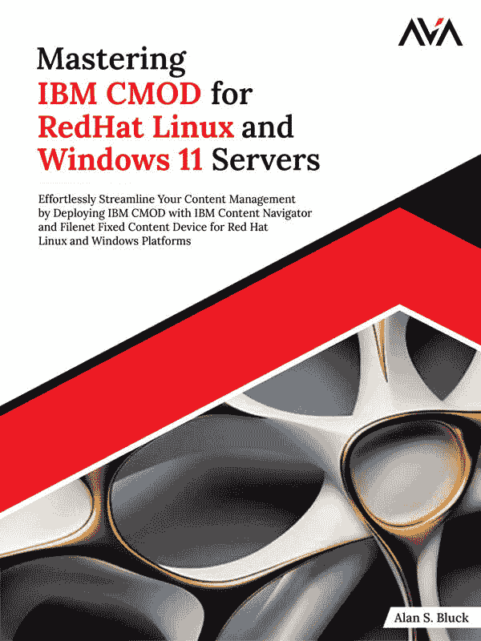


[www.orangeava.com](http://www.orangeava.com)

**扫描二维码探索我们的完整目录**


[www.orangeava.com](http://www.orangeava.com)

# 献给

我亲爱的妻子 Jenny

我的孩子们 Julie 和 Rosalie

以及他们的家人

# 关于作者

`Alan S. Bluck` 是 ASB Software Development Limited 的董事，同时也担任系统架构师提供咨询服务。他提供广泛的服务，从高层技术设计到代码开发指导，以及 IBM FileNet 核心产品的安装和配置。他还是美国计算机学会 (ACM) 和英国计算机学会 (MBCS) 的成员，IBM 银级 PartnerWorld 业务合作伙伴以及 RedHat 认证业务合作伙伴。

Alan 曾在 2022 年被提名为 IBM 冠军，并在 2023 年和 2024 年再次当选。他出版了六本技术书籍和 40 篇 ResearchGate 论文，均可免费下载。

他负责现有和新 IBM FileNet 系统的高级分析和配置，高级层系统和问题的指导与故障排除，并确保按照既定时间表进行并完成截止日期。

Alan 在商业和科学系统方面拥有超过 45 年的软件开发经验，他拥有 5 年的项目经理/分析开发人员经验、11 年的 12 人软件工程师团队的软件开发经理经验、11 年的技术顾问经验以及 20 年的解决方案架构师经验。

# 关于技术审核员

`Gil Metcalf` 拥有一段长期而丰富的职业生涯，最初成为工业微生物学家，在一家石油公司工作，涉及重金属微生物开采以及废弃井提高采收率等项目。

在担任工业微生物学家之后，Gil 在一家大型制药公司工作多年，担任过项目经理、开发团队负责人和网络管理员等职位。在此期间，他开发了用于临床试验管理的软件和用于癌症患者的医院工具。

作为解决方案架构师，Gil 在金融科技、制造业、物流和能源领域积累了丰富的经验。他的专长涵盖文档管理、案件管理、业务流程自动化、身份管理和网上银行技术。

Gil 在业内闻名，曾与领先银行和机构合作，用创新的解决方案解决复杂的挑战。在过去的 10 年里，他专注于金融科技，为蓝筹企业设计并实施解决方案。他拥有文档管理、业务自动化身份管理的多项资质，最近专门从事移动银行的配置管理和无密码认证。

Gil 认为，成功的软件架构既需要技术知识，也需要强大的软技能，包括向非技术观众解释复杂概念、理解大局以及完善模糊的需求。

他说，为解决方案设计准备通常是“一种同时进行外推和插值的练习！”

他是多个专业协会的成员，包括英国特许 IT 学会 (BCS)、身份管理学院 (IMI) 和国际软件架构师协会 (IASA)。

# 致谢

我想感谢几位人士，感谢他们在撰写本书期间提供的持续和不断的支持。首先最重要的是，我要感谢我的妻子 Jenny，不断鼓励我写写书——没有她的支持，我永远无法完成这本书。

我还要感谢我的女婿 Chris Howles 博士提供的建议和鼓励。

我感谢 ResearchGate 网站的支持，自 2019 年以来，该网站托管了我的 30 多篇免费出版物，其中许多在书中被引用。

我对 AVA Orange 团队表示谢意，感谢他们的支持和奉献，使我能够在短时间内出版这本书，并在制作过程中更新内容，并感谢他们的宝贵建议。

最后，我想感谢本书的技术审核员 Gil Metcalf，感谢他的严谨和性建议。

# 前言

本书为 IBM Content Manager OnDemand (IBM CMOD) 10.5.0.7 版本的安装和配置提供了从零开始的逐步指南。

配置涵盖了 IBM Content Manager OnDemand 与 IBM Content Navigator 以及 IBM FileNet Content Engine 的集成。`IBM CMOD` 是市场上领先的数据存档和检索系统。

此外，书中还包含了使用 `ODApi.jar` 的 Java API 工作示例，并涵盖了用于 Web 开发的 Demand Web Enablement Kit (ODWEK) 安装。

书中还描述了 Windows 客户端 IBM CMOD 的安装，并详细说明了如何从 IBM 软件目录和 Fix Central 网站下载基础版本（Base）和补丁包（Fix Pack）。

本书分为 14 章，包含 4 个附录。它专为 Java 程序员、IT 顾问以及系统和解决方案架构师设计，要求具备基础 IT 知识。

## 第 2 章

介绍了 IBM Content Manager OnDemand 10.5 版本的逐步下载、安装和配置，包括在运行于 VMware 虚拟机系统的 RedHat Linux 8.8 服务器上进行基础版（Base）和 Fix Pack 10.5.0.7 的升级。

## 第 3 章

介绍了支持的可选软件组件的安装和管理，包括 Db2 数据库、PDF 索引功能、分发设施功能以及全文本搜索服务器功能。

## 第 4 章

介绍了 IBM Fix Pack 升级 RPM 文件，以及支持 CMOD 10.5.0.7 版本的 GSKit 所需安装的某些额外 Linux 操作系统库包。本章描述了这些包的安装过程以及主程序 `arssockd` 加和运行的调试过程。

## 第 5 章

提供了在 Windows 11 服务器上下载、安装和配置 IBM Content Manager OnDemand 10.5 版本的逐步步骤，包括基础版和 Fix Pack 10.5.0.7 的升级，以及对连接的 Linux 服务器的某些配置。

## 第 6 章

介绍了升级和配置后 Linux 系统服务器的重启，包括支持的应用系统：IBM Directory Services（LDAP 服务器）、IBM Db2（数据库服务器）、IBM WebSphere（用于 IBM FileNet P8 内容引擎的 Web 应用服务器）以及 IBM Content Navigator（桌面客户端）。

## 第 7 章

描述了 OnDemand Configurator 程序 V10.5、OnDemand 客户端配置程序、在 Windows 上使用 `arsxml` 命令，以及安装 IBM CMOD Fix Pack 10.5.0.7 后的系统配置。

## 第 8 章

介绍了用于去中心化系统管理用户的对象类型模型和对象所有者模型，以及在 Linux Db2 服务器上重置过期或丢失的 IBM CMOD 管理员密码。它还描述了如何使用 `arsstash` 程序存储用户的加密密码。

## 第 9 章

列出了几个更新后的 Java 程序，这些程序适用于 IBM CMOD OnDemand API，并在 Linux 服务器的 Eclipse IDE 环境中演示了运行情况。

## 第 10 章

概述了为 Linux 版本的 IBM Content Navigator 创建存储库的步骤，并演示了从为 CMOD 创建的 Content Navigator 桌面端访问 Windows CMOD 服务器文件夹的权限。

## 第 11 章

描述了在 Linux 服务器上成功运行 `arssockd` 程序需要检查的网络要求，包括运行和调试该程序时使用的命令行参数。它还涵盖了利用开源 Apache Lucene 系统的 IBM OnDemand 全文本搜索服务，并提供了 `arsdb` 数据库配置和维护程序的详细用法。此外，它还涵盖了创建第二个 Linux IBM CMOD 实例 `ARCHIVE2` 的逐步步骤。

## 第 12 章

介绍了 IBM Content Manager OnDemand `arsload` 软件的作用和支持的平台，并描述了可用功能和前提条件，包括使用 `arssyscr` 程序创建系统日志和系统负载数据库表。此外，它概述了使用 Windows `ARSXML` 程序和 Linux `arsxml` 程序从 XML 文件导入和导出 IBM CMOD 应用程序组并执行 XML 文件验证的方法。

## 第 13 章

涵盖了在 Windows 和 Linux 环境下运行 `ARSLOAD` 程序的示例。它描述了加载文档所需的索引字段，并解释了使用 `ARSSOCKD` 程序显示 Windows 系统上运行的 IBM CMOD 程序服务列表。最后，它涵盖了使用 `arsdoc` 程序生成 `ARSLOAD` 使用的通用索引字段文件。

## 第 14 章

了如何在 Windows 和 Linux 服务器环境中，使用 IBM Content Manager OnDemand `ARSXAFP` 程序处理位于目录中的 AFP 输入文件，并将行数据输出重定向到文件。

## 附录 A

涵盖了 IBM Content Manager OnDemand Windows Fix Pack 7 的下载、解压和安装，以及 Windows IBM Configurator 程序的运行。

## 附录 B

描述了移除并重新添加 IBM CMOD 应用程序组所需的逐步步骤。

## 附录 C

列出了 Windows 客户端、Windows 服务器和 Linux 服务器的每个 CMOD 配置文件和环境设置。

## 附录 D

列出了 ResearchGate 和其他书籍出版提供的支持文档，以及由 ASB Software Development Limited 开发的支持 IBM CMOD 集成的联系详情。

# 下载代码

代码包和彩色图片

请点击链接或扫描二维码以下载本书的代码包和图片：

[`github.com/ava-orange-education/Mastering-IBM-CMOD-for-RedHat-Linux-and-Windows-11-Servers`](https://github.com/ava-orange-education/Mastering-IBM-CMOD-for-RedHat-Linux-and-Windows-11-Servers)


本书的代码包和图片也托管在：

[`https://rebrand.ly/f69543`](https://rebrand.ly/f69543)


如果代码有任何更新，将在 GitHub 上发布。

# 错误

我们对 Orange Education Ltd 的工作非常自豪，并遵循最佳实践以确保内容的准确性，为读者提供沉浸式的阅读体验。读者是我们的镜子，我们利用他们的输入来反思并改进过程中可能出现的任何人为错误。如果任何读者因这些问题遇到困难，请通过邮件联系我们：

`errata@orangeava.com`

非常感谢您的支持、建议和反馈。

# 你知道吗

您知道 Orange Education Ltd 提供每本书的电子版并提供 PDF 和 ePub 文件吗？您可以在 `www.orangeava.com` (http://www.orangeava.com) 升级电子版，作为纸质书客户，您有权获得电子版的折扣。更多详情请联系：`info@orangeava.com`。

在 `www.orangeava.com` (http://www.orangeava.com)，您还可以阅读系列免费技术文章，订阅一系列免费新闻邮件，并获取 AVA™ 书籍和电子书的独家折扣和优惠。

# 版权

如果您在互联网上发现我们作品的任何形式的非法副本，请提供地址或网站名称，我们将不胜感激。请通过 `info@orangeava.com` 与我们联系。

# 您有兴趣与我们合作吗？

如果您在某个领域拥有专业知识，并对编写或为书籍贡献感兴趣，请发送邮件至 `business@orangeava.com` (mailto:business@orangeava.com)。我们正致力于帮助开发者和技术专业人士获取全球范围内发生的技术进展和创新的洞察，并建立一个相信通过分享和他人学习来获取知识的社区。请联系我们以了解受众的需求以及您如何参与到教育改革中。我们也欢迎技术专家的想法，并帮助他们为自己的领域构建学习和开发内容。

# 评论

请留下您的评价。在您阅读并使用此书后，为什么不在您购买它的网站上留个评价呢？潜在的读者可以查看并参考您的无偏意见来做出购买决策。我们 Orange Education 非常想知道您对我们产品的看法，我们的作者也可以从您的反馈中学习。感谢您！

有关关于 Orange Education 的更多信息，请访问 [www.orangeava.com](http://www.orangeava.com)。

# 第 1 章：IBM Content Manager OnDemand 简介

## 引言

本书提供了关于 `IBM Content Manager OnDemand` (`CMOD`) 版本 `10.5.0.7` 安装和配置的从零逐步指南。

配置内容涵盖了 `IBM Content Manager OnDemand` 与 `IBM Content Navigator` 以及 `IBM FileNet Content Engine` 的集成。`CMOD` 是全球市场上领先的数据归档和检索系统。

书中还提供了使用 `ODApi.jar` 的 Java `API` 工作示例，并涵盖了用于 Web 开发的 `OnDemand Web Enablement Kit` (`ODWEK`) 安装。

此外，书中还描述了 Windows 客户端 `CMOD` 的安装，以及如何使用 `IBM Download Director` 软件从 IBM 的 Software Catalog 和 `Fix Central` 网站搜索并下载基础（Base）和修复包（Fix Pack）的过程。

IBM 详细描述了 `CMOD` 的用途，可以通过此链接访问：

[https://www.ibm.com/support/pages/system/files/support/swg/swgdocs.nsf/0/eeee7450f3eb8e6385257b6e0047cef4/$FILE/IBM%20Content%20Manager%20OnDemand%20Best%20Practices_033015v2.pdf]

是对 `IBM Content Manager OnDemand` (`CMOD`) 系统的介绍：

“`IBM® Content Manager OnDemand (CMOD) 是全球市场上领先的数据归档和检索系统。`CMOD` 安装在全球范围内数千万个客户所在地，每天为数百万用户提供服务。`CMOD` 产品具有极强的扩展性和灵活性，允许客户创建最能满足其要求的定制解决方案。`CMOD` 为数据的加载、检索和过期提供了极高的性能`”

在本章中，我们将介绍 `IBM Content Manager OnDemand` 软件的用途和支持的平台，并描述提供的可用功能。本章概述了 `CMOD` 与 `IBM FileNet Content Engine` 以及 `IBM Content Navigator` 集成的前提条件。

## Structure

在本章中，我们将讨论以下主题：

*   来自 IBM 和 CMOD 博客网站的链接

*   硬件和软件要求

*   操作系统环境变量设置

*   `IBM FileNet` 插件所需的扩展

    *   在 Windows Server 上设置 `CFS-CMOD`

    *   在 `Linux, IBM FileNet P8` 内容引擎中创建自定义文档类

## 来自 IBM 和 CMOD 博客网站的链接

可以按照以下 ResearchGate 免费下载链接为 `IBM Content Manager OnDemand` 基础系统平台安装支持的软件系统：

1. 针对用户安全 LDAP 服务器 `IBM Security Directory Services 6.4`：在 `RHEL 8.0:` 上安装：[https://doi.org/10.13140/RG.2.2.33527.57761]

2. 针对 IBM 数据库的安装 `Db2 10.5`：在 `RHEL 8.0 V1:` 上安装：[https://doi.org/10.13140/RG.2.2.10491.67369]

3. 在 RedHat `RHEL 8.0:` 上将 IBM FileNet 系统从 `DB2 10.5 FP 10` 升级到最新的 `DB2 11.5` 版本：[https://doi.org/10.13140/RG.2.2.29470.69441]

4. 针对 Web 服务器 `IBM WebSphere 8.5.5.15`：在 `VMWare Workstation Pro 15.1:` 上安装：[https://doi.org/10.13140/RG.2.2.15007.10408]

5. 针对 `CMOD` 桌面 `IBM Content Navigator 3.0`：在 `RHEL 8.0:` 上安装：[https://doi.org/10.13140/RG.2.2.14590.95049]

6. 针对 `IBM FileNet Fixed Content Device` `IBM Content Foundation 5.5`：在 `RHEL 8.0:` 上安装：[https://doi.org/10.13140/RG.2.2.21170.76480]

7. 有关初始 `CMOD` 配置，请参见：[https://www.redbooks.ibm.com/redbooks/pdfs/sg24615]


有关知识库，请参阅：[https://cmod.wiki/](https://cmod.wiki/) “`CMOD.wiki` 是 IBM Content OnDemand 产品（也称为 `CMOD` 或简单称为 `OnDemand`）用户和管理员的信息来源和指导来源。IBM CMOD 10.5 于 2020 年 3 月发布，可能会支持到 2025 年。对于 IBM Content OnDemand 修复包，请参阅公告与更新。”

此外，请从 IBM 支持网站下载 PDF：[https://www.ibm.com/support/pages/system/files/support/swg/swgdocs.nsf/0/eeee7450f3eb8e6385257b6e0047cef4/$FILE/IBM%20Content%20Manager%20OnDemand%20Best%20Practices_033015v2.pdf](https://www.ibm.com/support/pages/system/files/support/swg/swgdocs.nsf/0/eeee7450f3eb8e6385257b6e0047cef4/$FILE/IBM%20Content%20Manager%20OnDemand%20Best%20Practices_033015v2.pdf)

`CMOD` 产品线自 80 年代早期发布以来，已安装在数千个客户所在地，每天连接数百万用户。以下链接提供了有关市场关注的一些信息：[https://discovery.hgdata.com/product/ibm-content-ondemand](https://discovery.hgdata.com/product/ibm-content-ondemand)

以下链接也提供了 `CMOD` 系统的参考：

*   GitHub：[https://github.com/francisoud/cmod-migration](https://github.com/francisoud/cmod-migration)
*   Stack Overflow Activity：[https://stackoverflow.com/search?q=%Bondemand%5CMOD&s=f17a62f1-e2e6-4b56-9fe0-340f4e7f3](https://stackoverflow.com/search?q=%Bondemand%5CMOD&s=f17a62f1-e2e6-4b56-9fe0-340f4e7f3)
*   YouTube 链接：[https://www.youtube.com/watch?v=c9qy-Vw7pFo](https://www.youtube.com/watch?v=c9qy-Vw7pFo), [https://youtu.be/vVY2lulrg](https://youtu.be/vVY2lulrg)
*   Google Trends：[https://6sense.com/tech/archiving/ibm-content-manager-ondemand-market-share](https://6sense.com/tech/archiving/ibm-content-manager-ondemand-market-share)

用户 PDF 下载列在表 1.1 中：

| ISBN/IBM | 标题 | 出版商 | 日期 |
| :--- | :--- | :--- | :--- |
| ISBN:9780738440958 | IBM Content Manager OnDemand Guide | O’Reilly | 2015 年 10 月 |
| SC19-3358-03 | Content Manager OnDemand Distribution Facility Installation and Reference | IBM and Unicom [https://publibfp.dhe.ibm.com/epubs/pdf/c1933583.pdf](https://publibfp.dhe.ibm.com/epubs/pdf/c1933583.pdf) | 2001,2020 以及 2017-2020 |
| SC19-3351-03 | IBM Content Manager OnDemand for Multiplatforms, V10.5 简介与规划 | [https://publibfp.dhe.ibm.com/epubs/pdf/c1933513.pdf](https://publibfp.dhe.ibm.com/epubs/pdf/c1933513.pdf) | 2020-03-13 |
| GC19-3342-03 | IBM Content OnDemand for Multiplatforms Version 10 Release 5 安装与配置指南 | [https://publibfp.dhe.ibm.com/epubs/pdf/c1933423.pdf](https://publibfp.dhe.ibm.com/epubs/pdf/c1933423.pdf) | 2020-03-20 |
| SC19-3354-04 | Content Manager OnDemand 版本 10 发布 5 - 索引参考 | [`publibfp.dhe.ibm.com/epubs/pdf/c1933544.pdf`](https://publibfp.dhe.ibm.com/epubs/pdf/c1933544.pdf) | 2020-03-13 |
| SC19-3353-03 | Content Manager OnDemand 版本 10 发布 5 - Web 功能工具包实施指南 (ODWEK) | [`publibfp.dhe.ibm.com/epubs/pdf/c1933533.pdf`](https://publibfp.dhe.ibm.com/epubs/pdf/c1933533.pdf) | 2020-03-13 |
| SC19-3362-03 | IBM Content Manager OnDemand, V10.5 增强保留管理指南 | [`publibfp.dhe.ibm.com/epubs/pdf/c1933623.pdf`](https://publibfp.dhe.ibm.com/epubs/pdf/c1933623.pdf) | 2020-03-13 |
| **ISBN/ IBM** | **标题** | **出版者** | **日期** |
| SC19-3355-03 | IBM Content Manager OnDemand, V10.5 Windows 客户端安装指南 | [`publibfp.dhe.ibm.com/epubs/pdf/c1933553.pdf`](https://publibfp.dhe.ibm.com/epubs/pdf/c1933553.pdf) | 2020-03-13 |
| SC19-3357-03 | IBM Content Manager OnDemand, V10.5 Windows 客户端定制指南 | [`publibfp.dhe.ibm.com/epubs/pdf/c1933573.pdf`](https://publibfp.dhe.ibm.com/epubs/pdf/c1933573.pdf) | 2020-03-13 |
| SC19-3356-03 | IBM Content Manager OnDemand, V10.5 消息与代码 | [`publibfp.dhe.ibm.com/epubs/pdf/c1933563.pdf`](https://publibfp.dhe.ibm.com/epubs/pdf/c1933563.pdf) | 2020-03-13 |
| | IBM Content Manager OnDemand 最佳实践指南 | [`www.ibm.com/support/pages/system/files/support/swg/swgdocs.nsf/0/eeee7450f3eb8e6385257b6e0047cef4/IBM%20Content%20Manager%20OnDemand%20Best%20Practices_033015v2.pdf`](https://www.ibm.com/support/pages/system/files/support/swg/swgdocs.nsf/0/eeee7450f3eb8e6385257b6e0047cef4/IBM%20Content%20Manager%20OnDemand%20Best%20Practices_033015v2.pdf) (作者: Ben Boltz, Chris Lewis, Darrell Bryant, Hassan (Al) Shazly, Nancy O’Brien, Vanessa Stonesifer) | 2015 年 3 月 |

**表 1.1:** 最新的 IBM Content Manager OnDemand 可下载 PDF 文档链接

## 硬件和软件要求

IBM 硬件和软件要求的完整链接可以在此处处找到：

[https://www.ibm.com/software/reports/compatibility/clarity-reports/report/html/softwareReqsForProduct?deliverableId=B685BAC0A4A411E9AFF08CE80514C01B&osPlatforms=AIX|Linux|Windows&duComponentIds=D005|D001|D003|D002|D012|D004|S007|S006|S010|S011|S009|S008&mandatoryCapIds=9|25|20|16|162|26&optionalCapIds=131|20|162](https://www.ibm.com/software/reports/compatibility/clarity-reports/report/html/softwareReqsForProduct?deliverableId=B685BAC0A4A411E9AFF08CE80514C01B&osPlatforms=AIX|Linux|Windows&duComponentIds=D005|D001|D003|D002|D012|D004|S007|S006|S010|S011|S009|S008&mandatoryCapIds=9|25|20|16|162|26&optionalCapIds=131|20|162)

Linux Red Hat Enterprise Linux 上支持的操作系统版本（8.1 至 8.9 及更高版本）如图 1.1 所示：

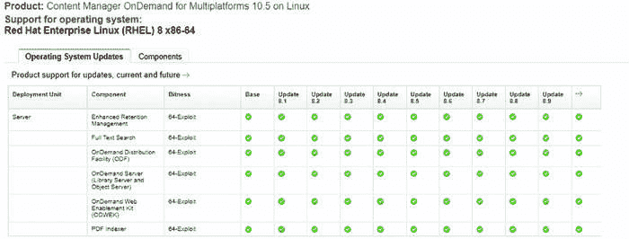

**图 1.1:** Content Manager OnDemand 10.5 支持的 RedHat Linux RHEL 8 版本

Fix Pack 版本 `10.5.0.7` 的要求可以使用下拉框和高亮的 `Download PDF` 图标进行选择，如图 1.2 所示：

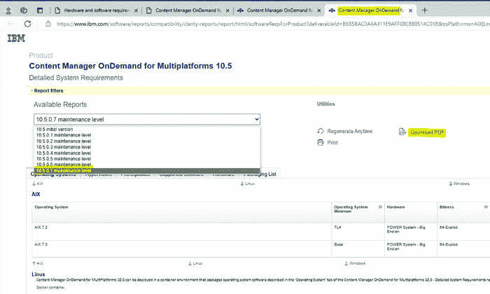

**图 1.2:** Fix Pack 版本 10.5.0.7 的要求

## 环境设置

使用 `bash_profile` 文件来设置 Linux 操作系统版本，如图 1.3 所示：

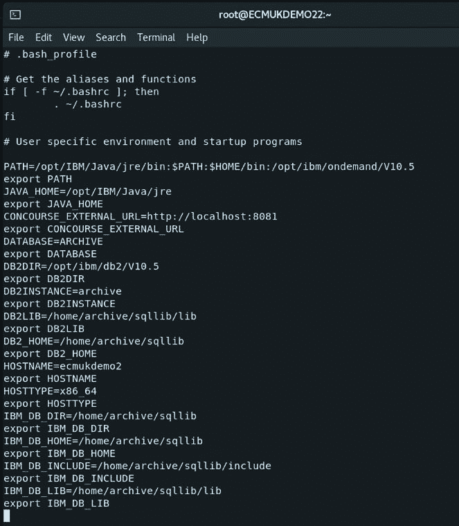

**图 1.3:** 操作系统设置

注意：增强保留管理的 IBM Content Manager OnDemand 需要通过 FileNet Web 工具进行配置，如图 1.4 所示：

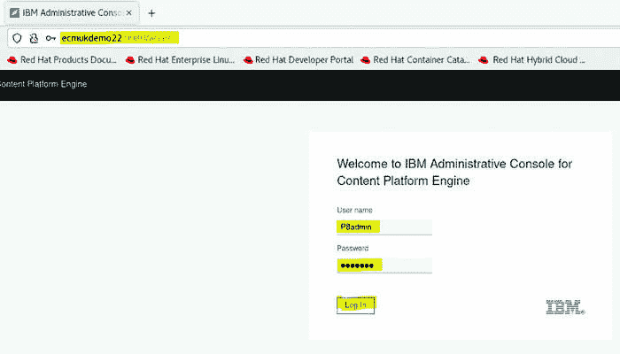

**图 1.4:** 增强保留管理

IBM Content Manager OnDemand 扩展可以通过登录 FileNet Web 工具进行配置，如图 1.5 所示：

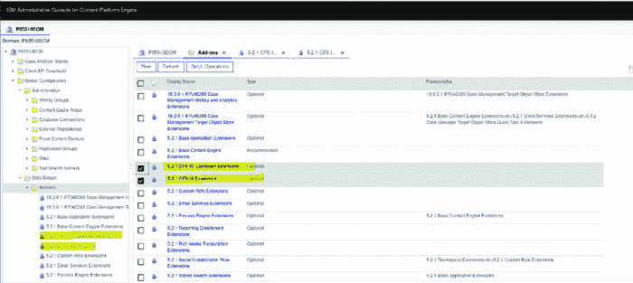

**图 1.5:** IBM Content Manager OnDemand 扩展

IBM Content Manager OnDemand 扩展包可以通过登录 FileNet Web 工具进行配置，如图 1.6 所示：

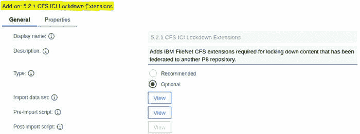

**图 1.6:** IBM Content Manager OnDemand 扩展包

IBM Content Manager OnDemand 扩展包可以通过可以通过图 1.7 所示：

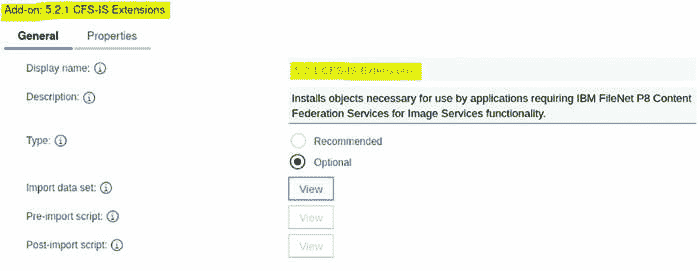

**图 1.7:** IBM Content Manager OnDemand 扩展包

DB2 11.5 端口 `25011` 用于 `ARCHIVE` 数据库，使用 Linux `firewall-cmd` 命令，如图 1.8 所示：

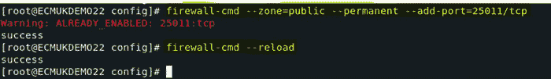

**图 1.8:** DB2 11.5 端口

注意：IBM 建议将 Content OnDemand 实例命名为 `archive`，以便进行问题确定和支持。

1. 在 FileNet 平台上创建自定义类：

    1. 在 `acce` 管理控制台中启动 `Create Class` 向导。
    2. 在领域导航格中选择对象存储（我们以 `DOS1` 为例）。
    3. 在对象存储导航格中，右键点击 `Data Design` > `Classes` > `Document` 文件夹。
    4. 点击 `New Class`。
    5. 输入名称 `OD-ClassName`，其中 `ClassName` 是应用程序组，然后点击 `Next`。
    6. 完成向导并打开新类。

查看：[https://www.ibm.com/docs/en/filenet-p8-platform/5.2.0?topic=cmod-creating-custom-class](https://www.ibm.com/docs/en/filenet-p8-platform/5.2.0?topic=cmod-creating-custom-class)

2. 为新自定义类添加属性：

查看：[https://www.ibm.com/docs/en/filenet-p8-platform/5.2.0?topic=cmod-adding-properties-new-custom-class](https://www.ibm.com/docs/en/filenet-p8-platform/5.2.0?topic=cmod-adding-properties-new-custom-class)

3. 将 FileNet P8 属性映射到 Content Manager OnDemand 应用程序组字段：

查看：[https://www.ibm.com/docs/en/filenet-p8-platform/5.2.0?topic=ccmcc-mapping-filenet-p8-properties-content-manager-ondemand-application-group-fields](https://www.ibm.com/docs/en/filenet-p8-platform/5.2.0?topic=ccmcc-mapping-filenet-p8-properties-content-manager-ondemand-application-group-fields)

    注意：属性映射在附录 B - 重新创建应用程序组，映射到 FileNet 固定内容设备中有详细介绍。

4. CFS-OD 导出信息：

查看：[https://www.ibm.com/docs/en/filenet-p8-platform/5.2.0?topic=federation-usage-information](https://www.ibm.com/docs/en/filenet-p8-platform/5.2.0?topic=federation-usage-information)

## 在 Windows Server 上设置 CFS-CMOD

点击 Windows 客户端管理程序 `OnDemand Administrator V10.5 (64-bit)`，它在 Windows 资源管理器中列出，如图 1.9 高亮所示：

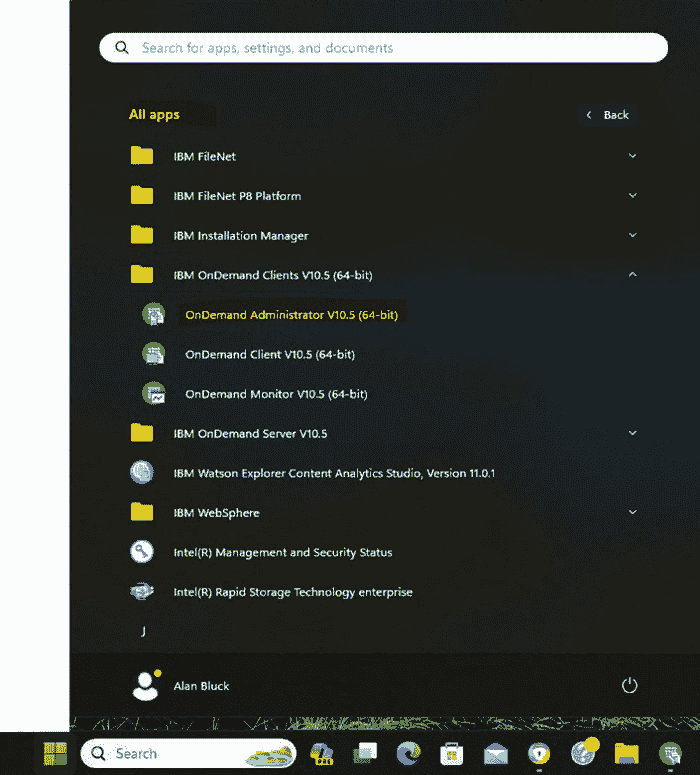

**图 1.9:** Windows 客户端管理程序，OnDemand Administrator V10.5 (64-bit)

注意：在使用程序之前，应先完成 *IBM OnDemand* *Windows Server* 和 *Client* 版本的安装与配置，如本书的 第 5 章，安装 Windows 版本的 CMOD 至 第 7 章，Windows 上的 CMOD 管理 所示。

选中 `IBM OnDemand` 的 Windows Server（在我们的服务器上命名为 `DESKTOP-B3JB93`）并右键点击选择 `Logon`（登录）菜单，如图图 1.10 所示：

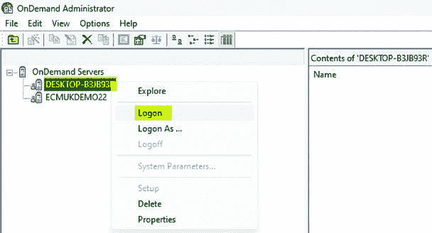

**图 1.10：** 选中 `OnDemand` 服务器 (`DESKTOP-B3JB93R`) 并右键点击进行登录

如图图 1.11*所示，输入 `ADMIN` 用户和密码，然后选择 `OK` 命令按钮登录 Windows Server `DESKTOP-B3JB93:`：

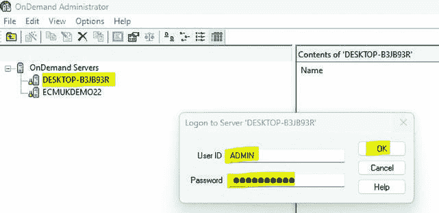

**图 1.11：** 输入 `ADMIN` 用户和密码登录 Windows Server `DESKTOP-B3JB93`

选中展开的 `DESKTOP-B3JB93 OnDemand Servers` 节点下的 `Application Groups`（应用程序组）部分，如图图 1.12*所示，并右键点击 `Baxter Bay Credit` `Application Group` 以选择高亮的 `Properties`（属性）菜单项，如图图 1.12*所示：

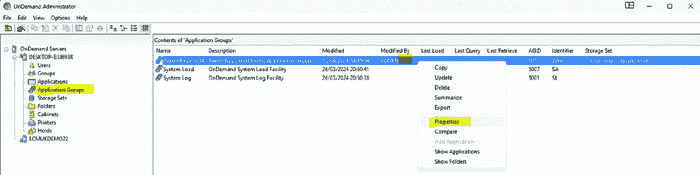

**图 1.12：** 右键点击 `Baxter Bay Credit` 以选择 `Properties` 菜单项

选中 `General`（常规）选项卡上的 `Advanced…`（高级…）命令按钮，如图图 1.13*所示：

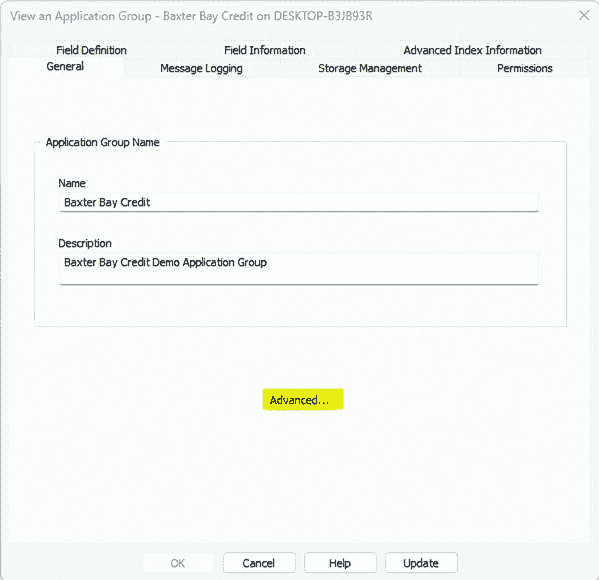

**图 1.13：** 选中 `General` 选项卡上的 `Advanced…` 命令按钮

在对话框的“Interoperate with FileNet P8”（与 FileNet P8 协作）标题区域下，针对问题“Use Content Federation Services (CFS-OD)?”（使用内容联邦服务 (CFS-OD)？），勾选“Yes”（是）单选按钮，如图图 1.14*所示：

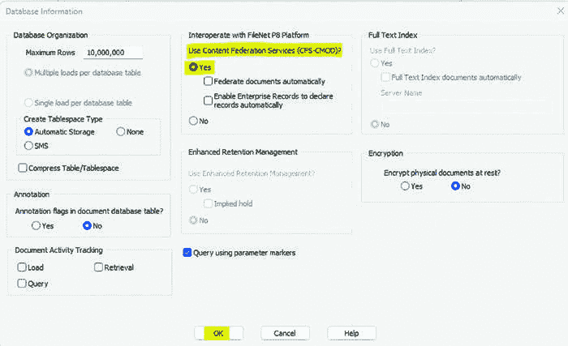

**图 1.14：** 针对问题“Use Content Federation Services (CFS-OD)?” 选择“Yes”单选按钮

如图图 1.14*所示的 `Federate Documents Automatically`（自动联邦文档）选项会使 CMOD 服务器在文档加载到 `Application Group` 时，生成联邦文档到 `IBM FileNet P8` 所需的信息。

**注意：** 此选项对 `Application Group` 中现有的 `CMOD` 文档没有影响；它仅适用于加载的新文档。

如果未启用此选项，则在文档加载到应用程序组时，`CMOD` 服务器不会生成联邦信息。

在这种情况下，可以使用其中一个 `CMOD` 客户端应用程序使用“Export unscheduled”（导出计划计划）模式手动选择文档进行联邦。

点击图图 1.14*中的 `OK` 命令按钮后，将显示 `General` 选项卡，可以选择 `Update`（更新）命令按钮以注册 `Baxter Bay Credit` `Application Group` 的更改，如图图 1.15*所示：

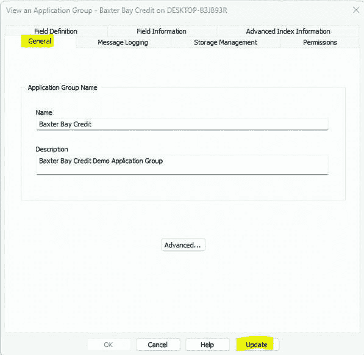

**图 1.15：** 可以选择 `Update` 命令按钮以注册 `Baxter Bay Credit` 的更改

选择 `OK` 命令按钮完成更新，如图图 1.16*所示：

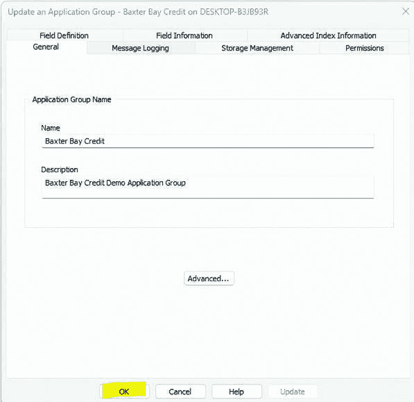

**图 1.16：** 选择 `OK` 命令按钮完成更新

此时，如果出现图图 1.17*所示的以下错误消息，则表明所需的 `CFS-CMOD` 字段尚不在 `Application Group` 的字段列表中。我们必须按照以下步骤添加 `CFS-CMOD` 字段：

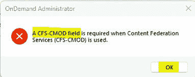

**图 1.17：** 显示的错误表示所需的 `CFS-CMOD` 字段缺失

选择 `Field Definition`字段定义）选项卡，并在“Database Field Name”（数据库字段名称）文本框中输入新名称作为 `CFS-CMOD` 字段（我们使用了 `CMODDescription` 名称，尽管这将是一个整数），并点击 `Add`（添加）命令按钮，如图图 1.18*所示：

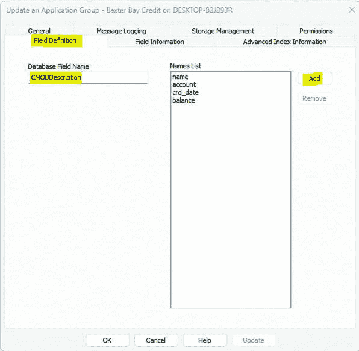


**图 1.18：** 选择 `Field Definition` 选项卡并在“Database Field Name”文本框中添加新字段作为`CFS-CMOD`字段

点击`Field Information`（字段信息）选项卡，如图 1.19 所示：

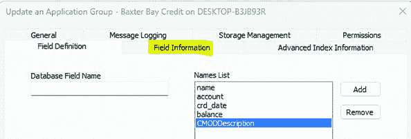

**图 1.19：** 点击`Field Information`选项卡

如图 1.20 所示，在`Name`下拉框中选择新创建的字段作为`CFS-CMOD`字段：

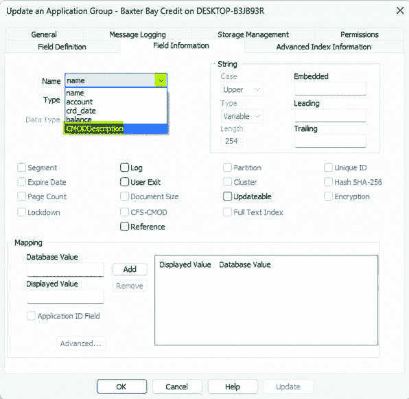

**图 1.20：** 在`Name`下拉框中选择新创建字段

如图 1.21 所示，将`Type`下拉框设置为`Filter`并选择`Small Int (2)`：

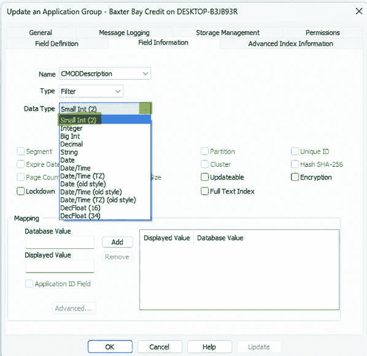

**图 1.21：** 将`Type`下拉框设置为`Filter`并选择`Small Int (2)`

如图 1.22 所示，选择`CFS-CMOD`框：

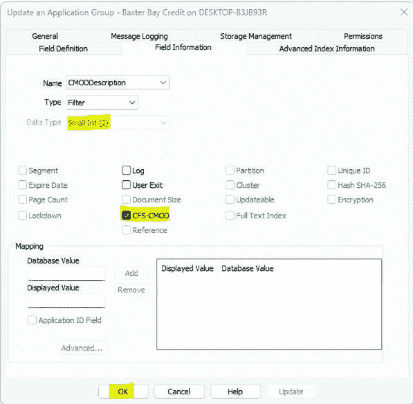

**图 1.22：** 选择`CFS-CMOD`框

选择`OK`命令按钮完成更新，如图 1.23 所示：

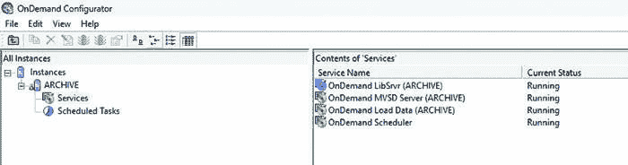

**图 1.23：** 选择`OK`命令按钮完成更新

右键点击`Name`以重启服务，如图 1.24 所示：

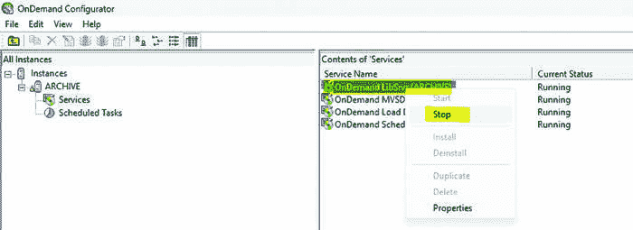

**图 1.24：** 右键点击`Name`以重启服务

## 在 Linux IBM FileNet P8 Content Engine 中创建自定义类

1. 在`acce`管理控制中启动创建类向导：

[`ecmuk22:9080/acce/`](http://ecmuk22:9080/acce/)

   a. 在领域导航格中选择对象存储`DOS1`。

   b. 在`DOS1`对象存储导航格中，右键点击`Data Design` > `Classes` > `Document`文件夹。

   c. 点击`New Class`（新类）。

2. 输入名称`OD-BaxterBayCredit`并点击`Next`（下一步），直到创建`OD-BaxterBayCredit` `New Document`类，如图 1.25 所示：

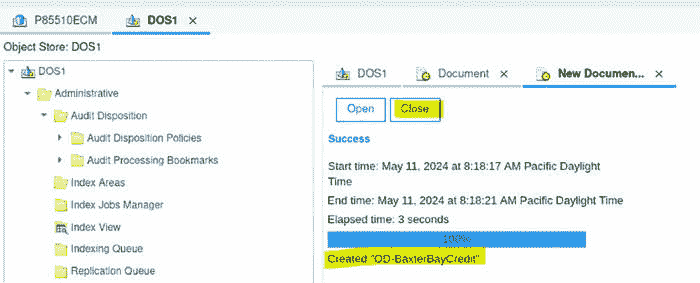

**图 1.25：** 创建了新文档类`OD-BaxterBayCredit`

3. 使用属性字段完成向导，正如我们在图 1.19 中创建的那样，并打开新类。

   使用属性模板名称`od-account`（符号名称为`account`），如图 1.26 所示：

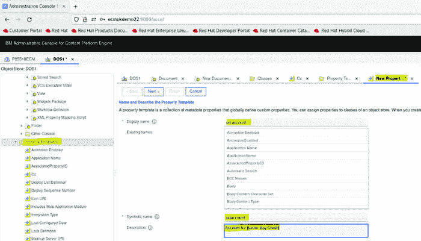

**图 1.26：** 使用属性模板名称`od-account`创建`account`（符号名称为`odaccount`）

显示`od-account`属性详情并选择`Finish`（完成）命令按钮，如图 1.27 所示：

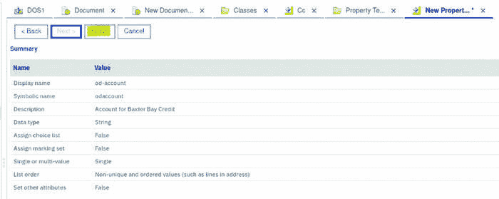

**图 1.27：** 显示`od-account`属性详情并选择`Finish`


**图 1.27:** 显示了`od-account`属性详情，并选择了`Finish`命令按钮

`od-account`属性模板创建的状态显示如下，如图 1.28 所示：

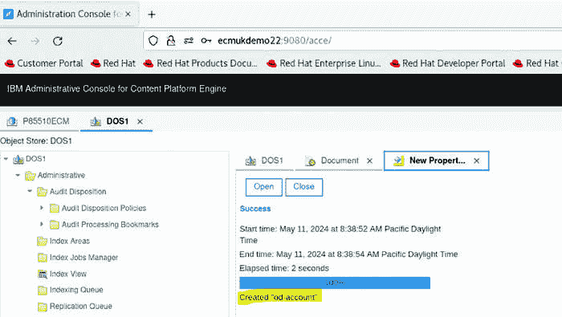

**图 1.28:** 显示了`od-account`属性模板创建的状态

对其他字段重复上述的**属性模板**创建步骤：

*   对于`crd_date`，创建一个名为`od-crd_date`的属性模板（符号名称为`odcrd_date`）。

*   对于`balance`，创建一个名为`od-balance`的属性模板（符号名称为`odbalance`）。

*   对于`CMODDescription`，创建一个名为`od-CMODDescription`的属性模板（符号名称为`odCMODDescription`）。

## 结论

在本章中，我们涵盖了 **IBM Content Manager OnDemand** 软件支持平台的免费可下载 PDF 文档，以及其提供的可用高级功能。本章概述了`CMOD`与 **IBM FileNet Content Engine** 和 **IBM Content Navigator** 集成的前提条件。

下一章，*在 Linux 系统上安装 CMOD* 将介绍在运行在 **VMware** 虚拟系统的 **RedHat Linux RHEL 8.8** 版本服务器上下载、安装和配置 **IBM Content Manager OnDemand** **10.5 基础版**以及 **Fix Pack 10.5.0.7** 升级的逐步指南。

## 单选题

1. 在`firewall-cmd`命令的示例中，`Db2` 11.5 使用哪个端口用于`CMOD` `ARCHIVE`数据库？

   1. 50000

   2. 25000

   3. 50011

   4. 25011

2. 与 IBM FileNet P8 的集成需要

   1. `ARCHIVE`数据库

   2. `CMOD`的增强留存管理功能

   3. Red Hat Enterprise Linux

   4. `CMOD`博客

3. IBM `CMOD` 10.5 发布于

   1. 2021 年 4 月

   2. 2020 年 3 月

   3. 20 世纪 80 年代中期

   4. 2015 年 10 月

## 答案

1. d

2. b

3. b

## 问答

1. IBM Content Manager OnDemand 目前可最新 Fix Pack 版本是哪个？

   **注意：** 此答案会随时间变化，但本章包含识别可用 Fix Pack 的。

2. 哪个网页链接为 IBM Content Manager OnDemand 产品的用户和管理员提供了良好的信息源和指导？

3. IBM Content Manager OnDemand 产品的主要用途是什么？

   **注意：** 该问题的 Db2 数据库名称中有一个提示。

## 关键术语

*   **API**: 应用程序编程接口，是一个可调用的软件子程序库，用于支持两个或多个独立功能软件系统之间的相互通信。

*   **CMOD**: IBM Content Manager OnDemand。

*   **ODWEK**: OnDemand Web Enablement Kit。

*   **PDF**: 便携式文档格式，由 Adobe 创建，提供标准布局。

*   **RHEL**: RedHat Enterprise Linux 操作系统。

*   **acce**: IBM FileNet P8 内容引擎管理控制台 Web 应用程序。

# 第二章

# 在 Linux 系统上安装 CMOD

## 引言

本章涵盖了在运行在 VMware 虚拟系统的 **RedHat Linux 8.8** 服务器上下载、安装和配置 IBM Content Manager OnDemand **10.5 基础版**以及 **Fix Pack 10.5.0.7** 升级的步骤。

请参考链接`https://cmod.wiki/dox/CMOD-v10.5-README.txt`查看安装说明，其中中还包含了每个 Fix Pack 版本的说明。

## 结构

在本章中，我们将讨论以下主题：

*   下载适用于 Linux 的 **CMOD 10.5 基础系统**

*   `CMOD Release 10.5`的 Linux 前提条件

*   在 **RedHat RHEL 8.0** Linux 上安装`CMOD`

    *   安装 **Linux GSKit**

    *   安装 **Apache Zookeeper**

*   使用`CMOD`为**固定内容设备**配置 **IBM FileNet P8**

*   **Fix Pack 10.5.0.7** 安装

*   旧版`CMOD`参考

*   创建 **Content Manager OnDemand** 实例

## 下载适用于 Linux 的 CMOD 10.5 基础系统

以下步骤用于在 **RedHat 8.8 版本 Linux** 服务器上下载和安装 **Content Manager OnDemand**：

1. 选择链接`https://partnerportal.ibm.com/registration/`登录 **IBM PartnerWorld** **软件目录**，如图 2.1 所示。对于 IBM 客户，请使用链接：`https://www.ibm.com/software/passportadvantage/customer.html`。

   **注意：** 要访问 **IBM PartnerWorld 软件目录**，您的公司至少需要 **IBM 银级 PartnerWorld** 认证。

   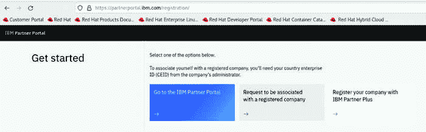

   图 2.1: IBM PartnerWorld 门户

2. 然后选择`软件目录`，如图 2.2 所示：

   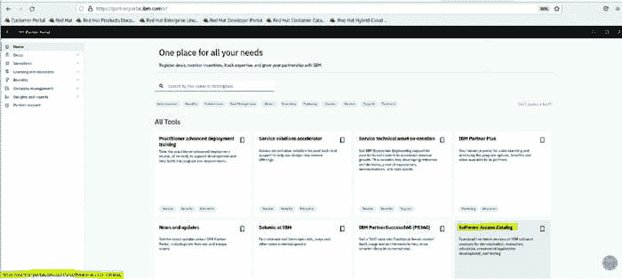

   图 2.2: 选择了软件目录

3. 加载`软件目录``下载`页面，如图 2.3 所示：

   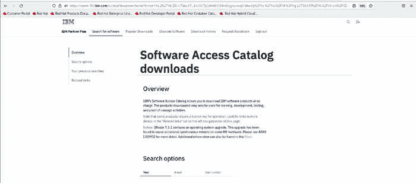

   图 2.3: 软件目录下载页面

4. 选择`按品牌查找`选项并选择下拉框，如图 2.4 所示：

   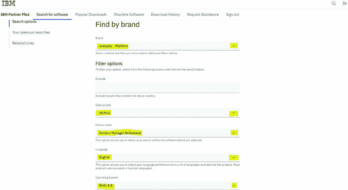

   图 2.4: 按品牌查找

5. 可用`下载器`或 **HTTP** 下载选项，但`下载器`的优势是在下载中断时可以重新启动。然后选择高亮的`搜索`命令按钮，如图 2.5 所示：

   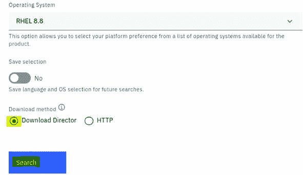

   图 2.5: 下载器选项和搜索命令

6. 由于我们知道 **IBM Content Manager OnDemand** **10.5.0.0** 基础版本的 **eAssembly** 部编号为`CJ6K6ML`，我们也可以使用`按部件号查找`搜索选项，如图 2.6 所示：

   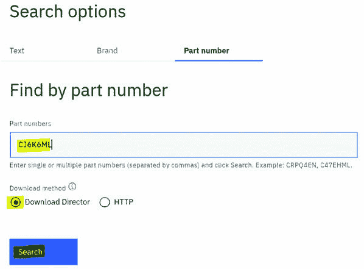

   图 2.6: 按部件号查找搜索选项

7. 选择`搜索`命令后，我们可以获取`CMOD` **10.5.0.0** 版本支持的各种平台列表，并从中选择 **Linux** 版本，如图 2.7 高亮所示：

   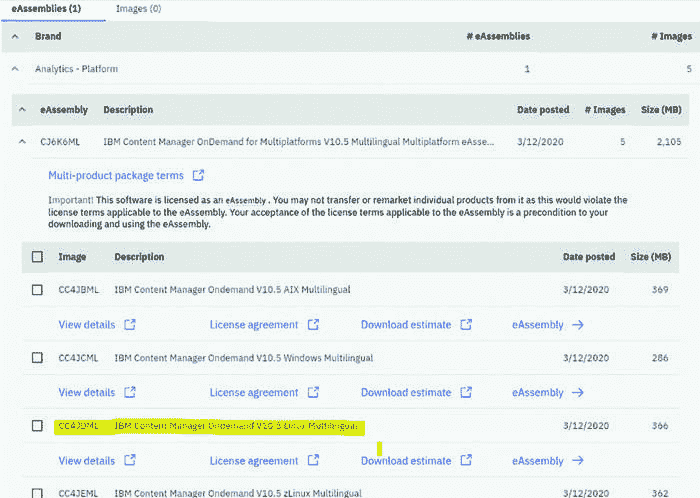

   图 2.7: 选中了 CMOD 10.5 Linux 选项（编号 CC4JDML）

8. 勾选部件号`CC4JDML`的复选框，并在查看许可协议（在链接中）后，必须选中`I agree`单选框选项，以便下载`CMOD` 10.5.0.0 基础软件，如图 2.8 所示：

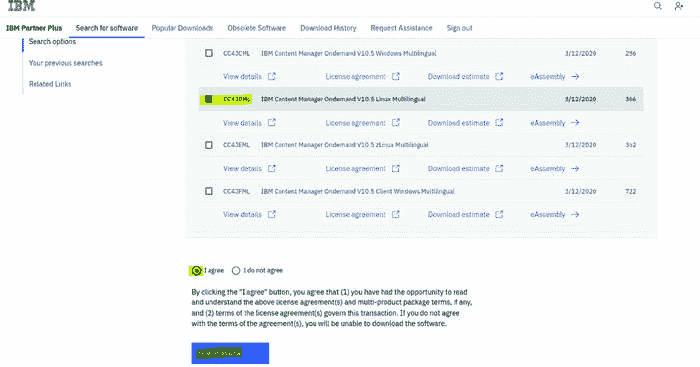

**图 2.8:** 必须选中部件号`CC4JDML`的复选框和`I agree`单选框选项

9. 如果`Download Director`程序没有启动，则有一个可用链接（如图 2.9 所示），通过它可以安装程序：


**图 2.9:** 如果需要，可以选择`install / re-install Download Director`链接

10. 根据链接说明安装`install / re-install Download Director`链接，如图 2.10 所示：

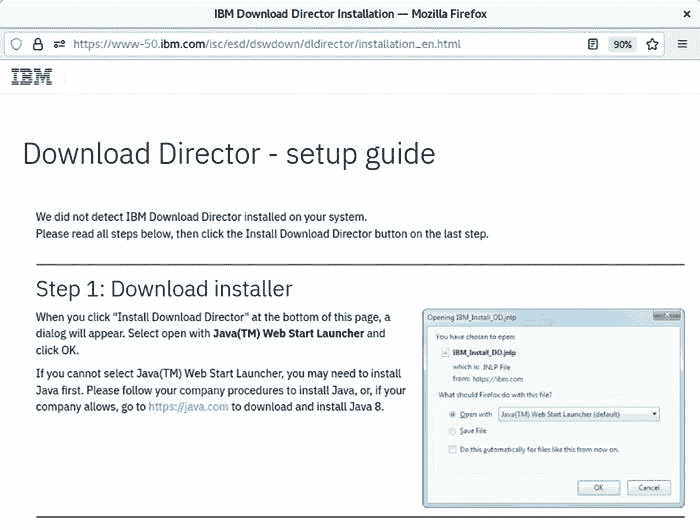

**图 2.10:** 按照链接说明安装`install / re-install Download Director`链接

11. 选中高亮的`Install Download Director`命令按钮以安装`IBM Download Director`应用程序，如图 2.11 所示：

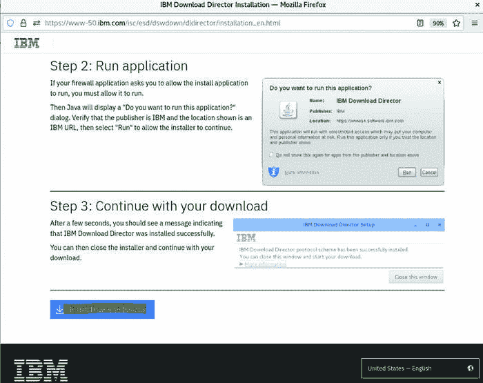

**图 2.11:** 选中高亮的 Install Download Director 命令按钮

12. 在某些平台（或使用某些网络浏览器）上，`IBM Download Director`应用程序将无法安装或运行，因此可以选择使用`HTTP`，如图 2.12 所示：

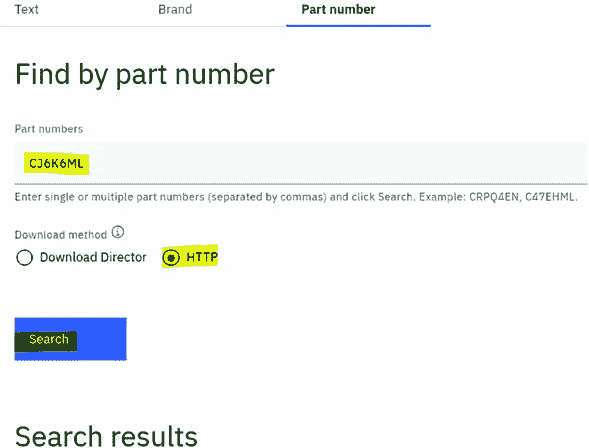

**图 2.12:** 可以选择使用`HTTP`下载`CMOD`软件

13. 如果使用了`HTTP`选项，则可以使用网络浏览器显示软件包的下载进度，如图 2.13 所示：

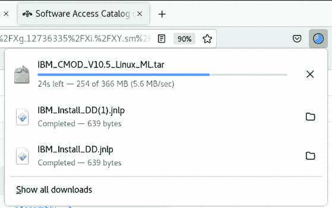

**图 2.13:** 查看`IBM_CMOD_V10.5_LINUX_ML.tar`软件包下载进度

14. 我们现在可以在 Linux 服务器上创建文件夹路径`/opt/CMOD`，以复制下载的`CMOD`版本 10.5 软件包，如图 2.14 所示：

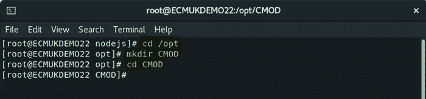

**图 2.14:** 创建 Linux`/opt/CMOD`文件夹

15. 将下载的`IBM_CMOD_V10.5_LINUX_ML.tar`软件包移动到`/opt/CMOD`文件夹，如图 2.15 所示：

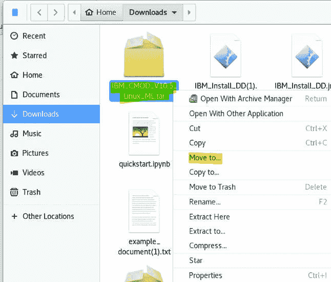

**图 2.15:** 将`IBM_CMOD_V10.5_LINUX_ML.tar`软件包移动到`/opt/CMOD`文件夹

16. 使用`+Other Locations`命令选择用于复制`IBM_CMOD_V10.5_LINUX_ML.tar`软件包的路径，如图 2.16 高亮所示：

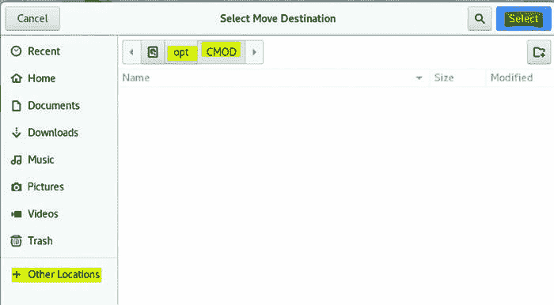

**图 2.16:** 使用`+Other Locations`命令导航到`/opt/CMOD`目标文件夹

17. 使用`Linux`命令修改移动后的`IBM_CMOD_V10.5_LINUX_ML.tar`软件包的安全权限：

```
chmod 775 IBM_CMOD_V10.5_LINUX_ML.tar
```

使用的`Linux`命令总结在`Linux`窗口中，如图 2.17 所示：

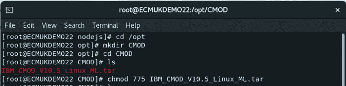

**图 2.17:** 修改`IBM_CMOD_V10.5_LINUX_ML.tar`软件包的安全权限

18. 如图 2.18 所示，使用以下命令解压`IBM_CMOD_V10.5_LINUX_ML.tar`软件包：

```
tar -xvf IBM_CMOD_V10.5_LINUX_ML.tar
```

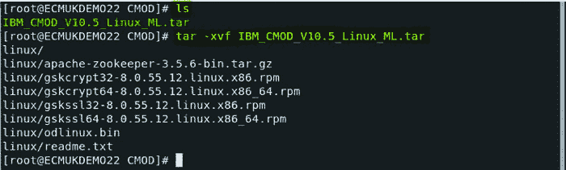

**图 2.18:** 解压`IBM_CMOD_V10.5_LINUX_ML.tar`软件包

## CMOD 10.5 版本的 Linux 前提

在安装`IBM Content OnDemand 10.5.0`之前，`Linux`系统需要满足以下最低前提：

- 用于`x86_64`或更高版本的 Red Hat Enterprise Linux (`RHEL`) 更新 7

- 使用以下`Linux`命令安装`32bit`支持的`glibc.i686`、`libgcc.i686`和`libstdc++.i686`：

```
yum install -y libstdc++.devel.i686
```

这安装了软件包`libstdc++.devel-8.5.0-20.el686`，如图 2.19 所示：

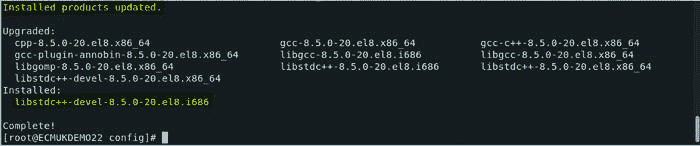

**图 2.19:** 安装了`libstdc++.devel-8.5.0-20.el686`

- 数据库：`IBM Db2 V11.1`或更高版本（也支持其他数据库，包括 Oracle Database 19c 所有版本和未来包）。不支持 Microsoft SQL Server。

- `IBM Spectrum Protect V8.1`或更高版本。

- `IBM Global Security Kit Version 8`（包含在软件包中）。在`Linux`上使用`JDBC`连接：

```
jdbc://localhost:25011/ARCHIVE:retrieveMessageFromServer=true;
```

运行`Linux`命令的方式如下：

```
yum install -y file-libs python3-magic
```

此命令用于安装软件包`file-53.25.el8.x86_64`、`file-libs-53.25.el8.x86_64`和`python3-magic-53.25.el8.noarch`，如图 2.20 所示：

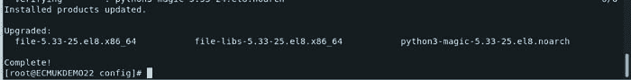

**图 2.20:** `file-53.25.el8.x86_64`、`file-libs-53.25.el8.x86_64`和`python3-magic-53.25.el8.noarch`

运行`Linux`命令的方式如下，如图 2.21 所示：

```
yum install -y ncurses-libs.i686
```

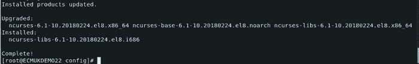

**图 2.21:** 运行`yum install -y ncurses-libs.i686`

运行`Linux`命令的方式如下：

```
yum install -y openssl
```


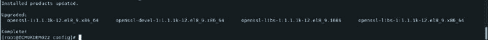

**图 2.22：** 运行`yum install -y openssl`

## 在 RedHat 8 上安装 CMOD

IBM Content OnDemand 的最新 10.5 版本对默认路径有所更改。更新后的路径如下：

- AIX：`/opt/ondemand/V10.5`
- Linux 和 Linux on z：`/opt/ibm/ondemand/V10.5`
- Windows：`C:\Program Files\IBM\OnDemand\V10.5`

`LDAP` 参数在`/opt/ibm/ondemand/V10.5/config/ars.cfg`文件中为空，如图 2.23 所示：


**图 2.23：**`LDAP`参数在`ars.cfg`文件中是空的

**注意：** 需要使用以下命令更新解压文件的安全权限，但这些命令未在`readme.txt`文件中说明：

```bash
cd /opt/CMOD
chmod 775 odlinux.bin
chmod 775 *.rpm
```

基础`CMOD`版本 10.5.0.0 的安装步骤如下：

1. 从命令行安装`CMOD`，如图 2.24 所示，使用：

   ```bash
   ./odlinux.bin -i console
   ```

   （文档仅为`odlinux.bin -i console`，但它是无效的！）

   

   **图 2.24：** 从命令行安装`CMOD`时可以使用`./odlinux.bin -i console`

2. 程序提示从支持语言列表中输入数字（输入 2 选择英语）。`InstallAnywhere`程序随后显示`CMOD`版本详情，如图 2.25 所示：

   

   **图 2.25：**`InstallAnywhere`程序随后显示`CMOD`版本详情

3. 用户被提示接受许可，因此输入`1`以接受，如图 2.26 所示：

   

   **图 2.26：** 用户被提示接受许可，因此输入`1`以接受

4. 通过点击*Enter*（回车）键使用默认路径`/opt/ibm/ondemand/V10.5`进行安装，如图 2.27 高亮所示：

   

   **图 2.27：** 使用默认路径`/opt/ibm/ondemand/V10.5`进行安装

5. 使用`Enter`键选中默认的**授权用户**（Authorized User）许可证选项（`UVU`），如图 2.28 所示：

   

   **图 2.28：** 使用`Enter`键选中默认的**授权用户**许可证选项（`UVU`）

6. 显示`CMOD`版本、路径以及安装所需的磁盘空间（`1,008,586,179 bytes`），如图 2.29 高亮所示：

   

   **图 2.29：** 显示高亮处的`CMOD`版本、路径以及安装所需的磁盘空间

7. 完成所有检查后，按下`Enter`键确认安装，如图 2.30 所示：

   

   **图 2.30：** 完成所有检查后按下`Enter`键确认安装

8. 在`CMOD`安装完成后，输入选项（2）以显示`readme.txt`文件，如图 2.31 所示：

   

   **图 2.31：** 在`CMOD`安装完成后输入选项（2）以显示`readme.txt`文件

9. `README`文件的详情确认了已安装的`CMOD`系统版本，如图 2.32 所示：

   

   **图 2.32：**`README`文件详情确认了高亮显示的已安装的`CMOD`系统版本

10. 可以反复按下`Enter`键翻页`readme.txt`文件，直到显示最后一页，如图 2.33 所示：

    

    **图 2.33：** 可以反复按下`Enter`键翻页`readme.txt`文件

11. 按下`Enter`键退出`IBM OnDemand V10.5`系统的安装程序，如图 2.34 所示：

    

    **图 2.34：** 按下`Enter`键退出`IBM OnDemand V10.5`的安装程序

## 安装 Linux GSKit

必须以用户`root`身份执行`Linux GSKit`的安装。

**注意：** IBM 全局安全工具包（GSKit）为 SSL 或 TLS 安全协议通信提供了库和实用。除非下文说明中特别引用，否则**不应**使用`-nodeps`标记。

1. 使用`rpm`命令在默认位置（`/usr/local`）安装`Linux GSKit`，如图 2.35 所示：

   ```bash
   cd /opt/CMOD/linux
   rpm -Uv gskcrypt64-8.0.55.12.linux.x86_64.rpm
   rpm -Uv gskssl64-8.0.55.12.linux.x86_64.rpm
   ```

   

   **图 2.35：** 使用`rpm`命令在默认位置（`/usr/local`）安装`Linux GSKit`

2. 图 2.36 中所示的警告不会阻止 GSKit 库的安装：

   

   **图 2.36：** 显示的警告不会阻止 GSKit 库的安装

## 安装 Apache Zookeeper

1. 使用**Linux**`tar`命令解压`apache-zookeeper-3.5.6-bin.tar.gz`压缩文件，如图 2.37 所示，使用命令如下：

   ```bash
   tar -zxvf apache-zookeeper-3.5.6-bin.tar.gz
   ```

   **ZooKeeper**是一个用于维护配置信息、命名、提供分布式同步并提供组服务的服务。

   

   **图 2.37：** 使用`tar`命令解压`apache-zookeeper-3.5.6-bin.tar.gz`压缩文件

2. **Apache Zookeeper**目录`apache-zookeeper-3.5.6-bin`现在可用。关于**ZooKeeper**的最新信息可以在此处找到：http://zookeeper.apache.org/ 以及在 wiki 中：https://wiki.apache.org/confluence/display/ZOOKPER。**Apache Zookeeper**目录如图 2.38 所示：

   

   **图 2.38：**`apache-zookeeper-3.5.6-bin`目录现在可用

## 使用 CMOD 为固定内容设备配置 FileNet P8

**Content Manager Demand Content Services**（`CFS-CMOD`）的支持配置文档可以通过链接查看：https://www.ibm.com/docs/en/filenet-p8-platform/5.2.0?topic=configuration-content-manager-cfs

首先，如果未安装，请为`CFS-IS`安装 FileNet P8 插件。参考链接：https://www.ibm.com/docs/en/filenet-p8-platform/5.5.12?topic=extensions-cfs 以及：https://www.ibm.com/docs/en/filenet-p8-platform/5.5.12?topic=iecr-integration-filenet-content-federation-services-content-ondemand

可以使用链接列出前提条件表：https://www.ibm.com/docs/en/filenet-p8-platform/5.2.0?topic=management-content-ondemand

以下步骤用于为**CMOD**固定内容配置 FileNet P8：

1. Content Manager Demand Enablement Kit（ODWEK）的安装由以下链接介绍：https://www.ibm.com/docs/en/SSNW2F_5.2.0/com.ibm.p8.installingcfs/cfsod004

   要在 Content Platform Engine 中配置`ODWEK` API，请登录 WebSphere 管理控制台，如图 2.39 所示：

   ```text
   https://localhost:9043/console/logon.jsp
   ```

   

   **图 2.39：** 登录 WebSphere 管理控制台

2. 导航到`Servers` -> `Server Types` -> `WebSphere Application servers` -> `server1`页面，打开`Java and Process Management`部分，在`Server Infrastructure`标题下点击`Process definition`链接，如图 2.40 高亮所示：

   

   **图 2.40：** 点击高亮的`Process definition`链接

3. 选择`Java Virtual Machine`链接，如图 2.41 高亮所示：

   

   **图 2.41：** 选择高亮的`Java Virtual Machine`链接

4. 在 Java 类路径中输入`ODApi.jar`文件的完整路径，如图 2.42 所示：

   （我们已将`ODWEK API` jar 文件安装在路径`/opt/ibm/ondemand/V10.5/www/api/ODApi.jar`）

   

   **图 2.42：** 在 Java`Classpath`框中输入`ODApi.jar`文件的完整路径

   此外，安装 Fix Pack 7 后，将以下内容添加到 Classpath 框中，并使用冒号（`:`）分隔每个路径引用：

   `:/opt/ibm/ondemand/V10.5/www/api/ODApi.jar:/opt/ibm/ondemand/V10.5/jars/gson-2.10.1.jar:/opt/ibm/ondemand/V10.5/jars/log4j-api-2.20.0.jar:/opt/ibm/ondemand/V10.5/jars/log4j-core-2.20.0.jar`

   将更改保存到主配置，然后在第 5 步中重启 WebSphere Application Server。

5. 必须重启用于 IBM FileNet Web 应用程序的 WebSphere Application Server，以使`ODWEK API`的类路径更改生效，如图 2.43 所示：

   

   **图 2.43：** 必须重启用于 IBM FileNet 应用程序的 WebSphere Application Server

   使用的命令如下：

   ```bash
   cd /opt/IBM/WebSphere/AppServer/profiles/AppSrv01/bin
   ./stopServer.sh server1
   ./startServer.sh server1
   ```

6. 使用`vi`编辑器编辑了`root`用户的`.bash_profile`文件，将完整的`ODWEK` Linux 安装路径`/opt/ibm/ondemand/V10.5`添加到`PATH`环境变量中，如图 2.44 所示：

   

   **图 2.44：** 使用`vi`编辑器编辑了 root 用户的`.bash_profile`文件，将`/opt/ibm/ondemand/V10.5`添加到`PATH`环境变量

7. 下述 IBM 文档链接涵盖了 IBM CMOD 系统集成与 IBM FileNet 固定内容设备（Fixed Content Device）接口所需的两个 JDBC 数据源：

   [`www.ibm.com/docs/en/SSNW2F_5.2.0/com.ibm.p8.installingcfsod.doc/cfsod005.htm`](https://www.ibm.com/docs/en/SSNW2F_5.2.0/com.ibm.p8.installingcfsod.doc/cfsod005.htm)

   `CMOD`固定内容设备需要在 Web 服务器上创建两个 JDBC 数据源，并为 Content Platform Engine 配置。这两个数据源提供了指向数据库的 JDBC 连接，IBM FileNet P8 Content Engine`acce` Web 将在其中创建`CFS`导入表。数据库持有`CMOD`固定内容设备导入表，我们将在下一节中创建这些表。

   创建`CFS`导入数据库会创建以下表：

   ```text
   CFS_IMP_QUEUE
   CFS_IMP_QUEUE_ERROR
   CFS_IMP_SESSION
   CFS_REPOSITORY_MAP
   FDB_VERSION_SERIES
   ```

   另：

   Content Manager OnDemand Database Tables - CMOD.wiki：

   [`cmod.wiki/index.php/Content_Manager_OnDemand_Database_Tables`](https://cmod.wiki/index.php/Content_Manager_OnDemand_Database_Tables)

   创建数据源时，我们如下所示使用 IBM FileNet Content Engine`configmgr`工具：

   首先，切换到 IBM FileNet 的配置工具目录：

   ```bash
   cd /opt/IBM/FileNet/ContentEngine/tools/configure
   ```

   然后，编辑`configmgr.ini`（如果找不到`JRE`），如图 2.45 所示：

   从：

   `/usr/lib/jvm/java-1.8.0-openjdk-1.8.0.312.b07-2.el8_5.x86_64/jre/bin`

   

   **图 2.45：** 修改了`configmgr.ini`中的默认`JRE`路径

   到：

   `/opt/IBM/Java/jre/bin/`，如图 2.46 所示：

   

   **图 2.46：**`JRE`路径更新为`/opt/IBM/Java/jre/bin/`

   使用以下命令运行基于 Linux 的 IBM FileNet P8 Content Engine 配置程序，在 WebSphere 应用程序服务器配置（`AppSrv01`路径，`server1`）上创建 IBM Content Manager OnDemand 数据源，如图 2.47 所示：

   ```bash
   cd /opt/IBM/FileNet/ContentEngine/tools/configure
   ./configmgr
   ```


**图 2.47:** 运行 Linux IBM FileNet P8 配置程序以创建 `CMOD` 数据源

**注意：** 数据源数据库测试可能会失败（参见图 2.48）。

8. 在 `configmgr` 界面中使用 `File`->`Open` 菜单选项进行文件导航，如图 2.48 所示：


**图 2.48:** `File`->`Open` 选项

9. 使用 `vi` 编辑器编辑了 `root` 用户的 `.bash_profile` 文件以添加 `ODWEK` 安装路径，如图 2.49 所示：


**图 2.49:** root 用户的 `.bash_profile` 文件

10. 运行 Linux IBM FileNet P8 配置程序以创建 `CMOD` 数据源，如图 2.50 所示：


**图 2.50:** 运行 Linux IBM FileNet P8 配置程序

11. 修改 `configmgr.ini` 中的 `JRE` 路径，如图 2.51 所示：


**图 2.51:** `configmgr.ini` 中的 `JRE` 路径

12. 将 `JRE` 路径更新为 `/opt/IBM/Java/jre/bin/`，如图 2.52 所示：


**图 2.52:** `JRE` 路径更新

18. 可以使用 IBM WebSphere 管理控制台（`https://localhost:9043/ibm/console/login.do?action=secure`），通过 `Resources`->`JDBC`->`Data sources` 菜单路径，勾选相应的框并使用 `Test connection` 按钮测试数据源 `ARCHIVEDS` 和 `ARCHIVEDSXA` 与 `CMOD` `Fixed Content Device` 数据库的连接性，如图 2.58 所示：

**图 2.58：** 测试数据源 `ARCHIVEDS` 和 `ARCHIVEDSXA` 与 `CMOD` `Fixed Content Device` 数据库的连接

19. 创建 `Content Manager OnDemand` (`CMOD`) `Fixed Content Device`，请在 `IBM FileNet P8` `acce` 管理控制台中启动 `New Fixed Content Device` 向导。

在域导航窗格中，右键点击 `Global Configuration` > `Administration` > `Fixed Content Devices` 文件夹，然后点击 `New Fixed Content Device`（如图 2.59 所示）：

**图 2.59：** 点击 `Global Configuration > Administration > Fixed Content Device`，然后点击 `New`

20. `Fixed Content Device` 对象的 `Display name` 输入为 `CMODFCD`，并带有默认 `Description` 属性（其设置为相同的文本），如图 2.60 所示：

**图 2.60：** `Fixed Content Device` 对象的 `Display name` 输入为 `CMODFCD`

21. 从 `Type` 下拉列表中选择 `IBM Content Manager OnDemand` 选项，如图 2.61 所示：

**图 2.61：** 在 `Type` 下拉列表中选择了 `IBM Content Manager OnDemand` 选项

22. 输入 `Federation JNDI data source`、`Federation JNDI XA data source`、`Content Manager OnDemand server name` 以及数据库的 `User` 和 `Password` 字段，如图 2.62 所示：

**图 2.62：** 输入数据库的 `Data Source` 名称以及 `server`、`user` 和 `password` 字段

23. 在检查完创建 `CMOD` `Fixed Content Device` 所需的参数后，选择 `Finish` 命令按钮，如图 2.63 所示：

**图 2.63：** 在检查完创建 `CMOD` `Fixed Content Device` 的参数后，选择了 `Finish` 命令按钮

24. 显示 `CMOD` `Fixed Content Device` 的创建过程摘要，如图 2.64 所示：

**图 2.64：** 显示 `CMOD` `Fixed Content Device` 的创建过程摘要

25. 也为 `ADMIN` 用户创建了 Windows 服务器（`DESKTOP-BSJB93R`）`Fixed Content Device`，如图 2.65 所示：

**图 2.65：** Windows 服务器版本的 `CMOD` `Fixed Content Device` 配置

26. 选中 `IBM FileNet P8` 引擎 `DOS1` 对象存储的 `Replication Class Mappings` 选项卡，如图 2.66 所示：

**图 2.66：** `DOS1` 的 `Replication Class Mappings` 选项卡

27. 使用 `New` 命令按钮和 `CMODFCD` `Fixed Content Device` 可以创建一个新的 `Fixed Content Device`，如图 2.67 所示：

**图 2.67：** `Fixed Content Device`

28. 选择 `Next` 命令按钮创建 `CMOD` `Fixed Content Device`，如图 2.68 所示：

**图 2.68：** `Next` 命令按钮

29. 在检查完创建 `CMOD` `Fixed Content Device` 所需的参数后，选择 `Finish` 命令按钮，如图 2.69 所示：

**图 2.69：** `Finish` 命令按钮

30. 显示 `CMOD` `Fixed Content Device` 的创建过程摘要，如图 2.70 所示：

**图 2.70：** 创建过程摘要

显示了选定的属性，并按顺序选择了 `Save` 和 `Refresh` 命令按钮以更新 `OD-BaxterBayCredit` 类属性定义列表，如图 2.75 所示：


**图 2.75：** 显示了选定的属性并按顺序选择了 `Save` 和 `Refresh` 命令按钮以更新 `OD-BaxterBayCredit` 类

现在可以使用 `New Replication Property Mapping` 将 `name` 属性映射到 `od-account` 属性，并点击 `OK` 确认，如图 2.76 所示：


**图 2.76：** 现在可以使用 `New Replication Property Mapping` 将 `name` 属性映射到 `od-account` 属性

现在可以使用 `New Replication Property Mapping` 将 `crd_date` 属性映射到 `od-crd_date` 属性，并点击 `OK` 确认，如图 2.77 所示：


**图 2.77：** 现在可以使用 `New Replication Property Mapping` 将 `crd_date` 属性映射到 `od-crd_date` 属性

映射后的属性现在可以在 `Replication Property Mappings` 标签页中看到，如图 2.78 所示：


**图 2.78：** 映射后的属性现在可以在 `Replication Property Mappings` 标签页中看到

### 28. 我们现在创建了 IBM Content Manager OnDemand 固定内容设备，其描述见以下 URL：

[`www.ibm.com/docs/en/SSNW2F_5.2.0/com.ibm.p8.installingcfsod.doc/cfsod006.htm`](https://www.ibm.com/docs/en/SSNW2F_5.2.0/com.ibm.p8.installingcfsod.doc/cfsod006.htm)

**注：** 指向 Content Manager OnDemand 配置的 IBM Content Federation Services 主链接如下：

[`www.ibm.com/docs/en/filenet-p8-platform/5.2.0?topic=products-content-federation-services-content-manager-ondemand-configuration`](https://www.ibm.com/docs/en/filenet-p8-platform/5.2.0?topic=products-content-federation-services-content-manager-ondemand-configuration)

### 29. 使用 `vi` 编辑 `ARS_STORAGE_MANAGER=TSM` 参数（在文件 `/opt/ibm/ondemand/V10.5/config/ars.cfg` 中），如图 2.79 所示：

从：


**图 2.79：** 使用 `vi` 编辑 `ARS_STORAGE_MANAGER=TSM` 参数

改为：

`ARS_STORAGE_MANAGER=CACHE_ONLY`，如图 2.80 所示：


**图 2.80：** `ars.cfg` 文件已更新为 `ARS_STORAGE_MANAGER=CACHE_ONLY`，如亮所示

### 30. 随后创建 `/arscache` 目录，如图 2.81 所示：


**图 2.81：** 运行命令创建 Linux 目录 `/arscache/cache1`

```bash
cd /opt/ibm/ondemand/V10.5/config
mkdir /arscache
mkdir /arscache/cache1
chown -R root:root /arscache*
chmod 700 /arscache/cache1
chmod g-s /arscache/cache1
```

# 安装 Fix Pack 10.5.0.7

由于上一节中的“新建固定内容设备”步骤最初失败，我们转而安装 Fix Pack（参考：[`www.ibm.com/support/pages/ibm-content-manager-ondemand-multiplatforms-v10506-readme-files`](https://www.ibm.com/support/pages/ibm-content-manager-ondemand-multiplatforms-v10506-readme-files)）

该 Fix Pack 还列出了在 `CLASSPATH` 中供 `ODWEK` Java API (`ODApi.jar`) 使用的三个额外 jar 文件：

- `gson-2.10.1.jar`
- `log4j-api-2.19.0.jar`
- `log4j-core-2.19.0.jar`

在更新 Fix Pack `10.5.0.7` 后，我们向 Web 应用程序添加了以下库：

`/opt/ibm/ondemand/V10.5/config`

- `gson-2.10.1.jar`
- `log4j-api-2.19.0.jar`
- `log4j-core-2.19.0.jar`

1. 首先，我们需要从 IBM Central 下载 Content Manager OnDemand Fix Pack `10.5.0.7`，如图 2.82 所示：

https://www.ibm.com/support/pages


**图 2.82：** Content Manager OnDemand 下载

2. 使用以下链接进入 Content Manager OnDemand 配置，如图 2.83 所示：


**图 2.83：** Content Manager OnDemand 配置

3. 点击 `Continue` 按钮，如图 2.84 所示：


**图 2.84：** 点击 `Continue` 按钮

4. Fix Pack 列表现在显示，如图 2.85 所示：


**图 2.85：** Fix Pack 列表

5. 我们现在选择多平台的 Fix Pack 版本，如图 2.86 所示：


**图 2.86：** 选择多平台的 Fix Pack 版本

6. 点击 `Continue` 按钮，如图 2.87 所示：


**图 2.87：** 点击 `Continue` 按钮

7. `Log to IBM` 屏幕显示，以验证 Fix Pack 的下载，如图 2.88 所示：


**图 2.88：** `Log to IBM` 屏幕

8. 选中 `Using Download Director` 选项，如图 2.89 所示：


**图 2.89：** 选中 `Using Download Director` 选项

9. 在 Linux 桌面上可以看到 `Download Director` 的程序图标，如图 2.90 所示：


**图 2.90：** `Download Director` 程序图标

10. `IcedTea` Web 应用程序在 Firefox 浏览器中触发，如图 2.91 所示：

（`IcedTea` Java 浏览器插件在 64 位 Linux 下的 64 位浏览器中运行，用于支持 Java applet，例如 64 位的 Mozilla Firefox 中的）。


**图 2.91：** `IcedTea` Web 应用程序在 Firefox 浏览器中触发

11. 在图 2.92 所示中选择 `Run` 命令以启动 `IBM Download Director`：


**图 2.92：** 选择 `Run` 命令以启动 `IBM Download Director`

12. IBM Content Manager OnDemand 的 `10.5.0.7` Fix Pack 下载进度在 IBM Download Director 中显示，如图 2.93 所示：


**图 2.93：** IBM Content Manager OnDemand 的 `10.5.0.7` Fix Pack 下载进度

使用以下 `Linux` 命令来设置 `CMOD` Fix Pack 目录路径：

```bash
cd /opt
mkdir CMOD_FP
cd CMOD_FP/
```

使用以下 `Linux` 命令来复制下载的 `Fix Pack` 版本 `10.5.0.7` 安装文件：

```bash
cp /root/DownloadDirector/od*.* .
cp /root/DownloadDirector/read*.* .
```

这些命令及其响应结果所示在图 2.95 中：


**图 2.95：** 用于复制下载的 `Fix Pack` 版本 `10.5.0.7` 安装文件的 `Linux` 命令

请参阅 [`www.ibm.com/docs/cmofm/10.5.0`](https://www.ibm.com/docs/cmofm/10.5.0) 上的在线安装文档以获取更多信息。我们现在可以使用命令行安装来应用当前的补丁包：

```bash
chmod 775 *
./odlinux.bin -i console
```


如图 2.96 所示：


**图 2.96：** 我们使用命令行 `./odlinux.bin -i console` 应用当前的补丁包

安装程序提示从列表中选择要使用的 `Locale`（区域语言），如图 2.97 所示：


**图 2.97：** 安装程序提示从列表中选择要使用的 `Locale`

`IBM OnDemand V10.5` 安装程序提示用户继续安装设置，如图 2.98 所示：


**图 2.98：** `IBM OnDemand V10.5` 安装程序提示用户继续安装设置

在图 2.99 中，输入数字 `1` 以接受许可：


**图 2.99：** 输入数字 `1` 以接受许可

许可类型选择为 `1` 用于 `UVU`，如图 2.100 所示：


**图 2.100：** 许可类型选择为 `1` 用于授权用户 (`UVU`)

系统显示所需的磁盘空间以及系统可用空闲磁盘空间，如图 2.101 所示：


**图 2.101：** 显示所需的磁盘空间 `833,822,436` 字节以及可用空闲空间量

选择回车键（`Enter`）开始安装，如图 2.102 所示：


**图 2.102：** 选择回车键 (`Enter`) 开始安装

通过输入 `2` 作为响应，提供了查看 `readme.txt` 文件的选项，如图 2.103 所示：


**图 2.103：** 输入 `2` 作为响应提供了查看 `readme.txt` 文件的选项

加载 `readme.txt` 文件进行滚动查看，显示 `2023 年 8 月 25 日` 的 `Fix Pack` `Release 10.5.0.7`，如图 2.104 所示：


**图 2.104：** 加载 `readme.txt` 文件进行滚动查看，显示 `Fix Pack` `Release 10.5.0.7`

然后按下 `Enter` 键以继续安装，如图 2.105 所示：


**图 2.105：** 然后按下回车键继续安装

安装程序显示 `IBM CMOD` `Fix Pack` 版本 `10.5.0.7` 已成功安装，如图 2.106 所示：


**图 2.106：** 安装程序显示 `IBM CMOD` `Fix Pack` 版本 `10.5.0.7` 安装成功

使用以下命令修改 `/opt/ibm/ondemand/V10.5/config` 下文件的安全权限：

```bash
chmod 755 *
```

如图 2.107 所示：


**图 2.107：** 修改 `/opt/ibm/ondemand/V10.5/config` 的安全权限

现在可以向以下路径添加 `Fix Pack` 文件：

```bash
/opt/ibm/ondemand/V10.5/config
```

首先，我们需要如图 2.108 所示进入 `WebSphere` 管理界面：


**图 2.108：** 进入 `WebSphere` 管理

然后，我们导航到 `Servers`->`Server Types`->`WebSphere application`->`server1` 并选择链接，如图 2.109 所示：


**图 2.109：** 选择 `Server Types` -> `WebSphere application` -> `server1`

`Java Machine` 链接如图 2.110 所示：


**图 2.110：** `Java Machine` 链接

`Classpath` 已更新，如图 2.111 所示，包含了版本 `10.5.0.7` 的 `Fix Pack` 文件：


**图 2.111：** `Classpath` 已更新

点击 `Apply` 命令以更新 `WebSphere` 的配置，如图 2.112 所示：


**图 2.112：** 点击 `Apply` 更新 `WebSphere` 的配置

点击 `Save` 命令以更新 `WebSphere` 存储库配置，如图 2.113 所示：


**图 2.113：** 点击 `Save` 更新 `WebSphere` 存储库

使用以下命令修改已安装的 `IBM OnDemand` 包文件的安全权限：

```bash
cd /opt/ibm/ondemand/V10.5/jars
chmod 775 *.
```

如图 2.114 所示：


**图 2.114：** 修改已安装 `IBM OnDemand` 包的安全权限

我们需要重启用于 `IBM FileNet` 程序的 `WebSphere` 服务器，如图 2.115 所示：

```bash
cd /opt/IBM/WebSphere/AppServer/profiles/AppSrv01
cd bin
./stopServer.sh server1
./startServer.sh server1
```


**图 2.115：** 重启用于 `IBM FileNet` 程序的 `WebSphere` 服务器

必须在 `ARS.CFG` 文件中添加 `ARS_SUPPORT_HOLD=1` 参数以启用 `Content Manager OnDemand` 的内容服务功能（`Windows` 平台不需要）。如图 2.116 所示：


**图 2.116：** 编辑 `/opt/ibm/ondemand/V10.5/config/ars.cfg` 文件

`ars.cfg` 文件列表中的两个高亮参数如下，用于启用 `Content Manager OnDemand` 的内容服务功能：

```bash
ARS_SRVR=LibSrvr
ARS_LOCAL_SRVR=ECMUKDEMO22
ARS_SUPPORT_HOLD=1
ARS_SUPPORT_CFSOD=1
ARS_ORIGINAL_CODEPAGE=1208
```

`PROTOCOL=1`

# 开始使用

```bash
[root@ECMUKDEMO22 bin]# ./arssock
```

**注意：** 对于 `Windows`，请使用 `OnDemand Configurator`。

点击以下启动 `OnDemand Configurator`：

`Start > IBM OnDemand Server V10.5 > OnDemand Configurator V10.5`

右键点击一个实例。

选择 `Properties/Server`。

点击 `Advanced Options`，选择 `Enable CFS-CMOD`，然后点击 `OK`。

## 重启 Content Manager OnDemand 实例

在 `Linux` 上，我们为 `archive` 用户安装了一个新的 `DB2` 实例，如下：

调用 IBM DB2 `./db2setup` 安装程序，如图 2.118 所示，使用的 `Linux` 命令如下：

```bash
cd /opt/IBM/DB2/server_dec
export DISPLAY=:0
echo $DISPLAY
./db2setup
```


**图 2.118：** 调用了 IBM DB2 `./db2setup` 安装程序

选择了 `New Install` 命令，如图 2.119 所示：


**图 2.119：** 高亮显示了 `New Install` 命令

选择了 `DB2 Version 11.5.7.0 Server Editions` 选项，如图 2.120 所示，并点击了 `Next` 命令：


**图 2.120：** 选择了 `DB2 Version 11.5.7.0 Server Editions` 选项

选择了 `Typical` 命令按钮选项，如图 2.121 所示：


**图 2.121：** 选择了 `Typical` 命令按钮选项并点击了 `Next`

输入高亮字段以创建 `archive` `Db2` 实例，如图 2.122 所示：


**图 2.122：** 输入了高亮字段以创建 `archive` `Db2` 实例并点击了 `Next`

输入围栏用户 `db2fenc1` 并点击 `Next` 命令按钮，如图 2.123 所示：


**图 2.123：** 输入了围栏用户 `db2fenc1` 并点击了 `Next`

显示 `Db2 Instance` 参数摘要，然后点击 `Finish` 按钮，如图 2.124 所示：


**图 2.124：** 显示了 `Db2 Instance` 参数摘要并点击了 `Finish`

显示 `archive` `Db2 Instance` 的安装进度，如图 2.125 所示：


**图 2.125：** 显示了 `archive` `Db2 Instance` 的安装进度

显示 `Db2` Server `archive` 实例的验证步骤，如图 2.126 所示：


**图 2.126：** 显示了 `Db2` Server `archive` 实例的安装验证步骤

运行 `./db2val` 命令以验证新的 `Db2` `archive` 实例，如图 2.127 所示：


**图 2.127：** 运行 `./db2val` 命令以验证新的 `Db2` `archive` 实例

使用以下 `Linux` 命令构建 `CMOD archive` 数据库，如图 2.128 所示：

```bash
chown archive:db2iadm1 /arsdb
su – archive
/opt/ibm/ondemand/V10.5/bin/arsdb -I archive -cv
```


**图 2.128：** 用于构建 `CMOD archive` 数据库的 `Linux` 命令

命令显示了创建存档数据库的问题，如图 2.128 所示：

```bash
"ARS4069E The new path to the log is not valid"
```

错误解决方法，请参考以下内容：

[`cmod.wiki/index.php/Unable_to_determine_the_database_engine`](https://cmod.wiki/index.php/Unable_to_determine_the_database_engine)

“如果你无法查看或连接到 `DB2`，请确保你拥有正确的组权限（如果你的 IBM CMOD 安装在我们的 RHEL Linux 上，`Db2` `11.5.7.0`，`db2iadm1`），并检查是否已使用 `db2ln` 命令创建了相应的 `db2` link。你需要管理员或 `root` 权限来执行此任务。

还请使用 `set` 或 `setenv` 命令检查环境变量是否正确，取决于你的命令行 `shell`：”

`set` 命令应显示：

```bash
DATABASE=ARCHIVE
DB2DIR=/opt/ibm/db2/V10.5
```

`www.ibm.com/docs/en/SSNW2F_5.2.0/com.ibm.p8.installingcfsod.doc/cfsod008.htm`

### 3. 在 Workplace XT 中配置 Content Manager OnDemand 查看器

`www.ibm.com/docs/en/SSNW2F_5.2.0/com.ibm.p8.installingcfsod.doc/cfsod009.htm`

### 4. 启用应用组

`www.ibm.com/docs/en/SSNW2F_5.2.0/com.ibm.p8.installingcfsod.doc/cfsod010.htm`

### 5. 创建自定义文档类

`www.ibm.com/docs/en/SSNW2F_5.2.0/com.ibm.p8.installingcfsod.doc/cfsod011.htm`

### 6. 向新的自定义文档类添加属性

`www.ibm.com/docs/en/SSNW2F_5.2.0/com.ibm.p8.installingcfsod.doc/cfsod012.htm`

### 7. 将 FileNet P8 属性映射到 Content Manager OnDemand 应用组字段

`www.ibm.com/docs/en/SSNW2F_5.2.0/com.ibm.p8.installingcfsod.doc/cfsod013.htm`

### 8. 为文档联邦配置 CFSOD 导出工具

[https://www.ibm.com/docs/en/SSNW2F_5.2.0/com.ibm.p8.installingcfsod.doc/cfsod014.htm]

# 旧版 CMOD 参考

请参考版本 8.4 - Implementing IBM Content Manager OnDemand 解决方案：

`www.redbooks.ibm.com/redbooks/pdfs/sg247511.pdf`

## 创建 Content Manager OnDemand 实例

关于创建 `CMOD` 实例的信息，请参考以下链接：

`www.ibm.com/docs/en/cmofm/10.5.0?topic=multiplatforms-installing-content-manager-ondemand-linux-servers`

要在库服务器上安装 `Db2`，我们使用以下步骤列表以确保所有配置步骤都已完成：

由于我们之前已经为 IBM FileNet 和 IBM Content Navigator 安装了该程序，因此我们使用了 `Db2` 安装向导。由于默认安装路径已被占用，我们安装了一个新的 `Db2` 副本。对于我们的 `Linux` 系统，默认路径变为 `/opt/ibm/db2/V11.5_##`，其中 `##` 是 `01` 到 `99` 范围内的零前缀序列数字。

1. 安装 `Db2` 通用数据库企业版（我们使用的是 `Db2 11.5.0.7`）。

为了支持所有组件在新的 `Db2` 安装上运行 `Content Manager OnDemand`，安装类型的响应应选择 `Typical.`。请参考 `ResearchGate` 上的以下免费下载：

- 在 RHEL 8.0 V1 上安装 IBM Database, Db2 10.5：[https://doi.org/10.13140/RG.2.2.10491.67369]
- 在 RedHat RHEL 8.0 上将 IBM FileNet 系统从 DB2 10.5 FP 10 升级到最新的 DB2 11.5 版本：[https://doi.org/10.13140/RG.2.29470.9441]

2. 我们现在按照如下值为 `Content Manager OnDemand` 创建了 `Db2` 实例：

- 实例名称 / 用户：`archive`
- 组名：`db2iadm1`
- 目录：`/home/archive`
- 启动启动时自动启动 `Db2`：`n`
- 为 `Db2` 实例创建示例数据库：`no`

注意：该组必须具有 `SYSADM` 权限且其名称必须唯一。`Linux` 上的组名为 `db2iadm1`。

在安装 `Db2` 软件后，请按照链接中的详细说明为 `Db2` 应用最新的修复包：[https://doi.org/10.13140/RG.2.29470.9441]。你可以在此处查看最新的修复包：[http://www.ibm.com/support/docview.wss?uid=swg270053]。

安装 `Db2` 后，你必须将拥有 `Content Manager OnDemand` 实例的用户添加到 `Db2` 实例所有者组 `db2iadm1` 中。更多详细信息请参考 https://www.ibm.com/docs/en/db2/11.5?topic=idds-installing-db2-servers-by-using-db2-setup-linux。

接下来，遵循这些指南（按照上一节所述步骤逐步操作）：作为 `root`，我们运行了以下 `RedHat Linux` 命令：

```bash
subscription-manager repos --enable=codeready-builder-for-rhel-8-x86_64-rpms
yum install xorg-x11-apps
```

在安装 `Db2` 后，注销并以 `root` 重新登录：

```bash
cd /opt/ibm/db2/V11.5_##
./dbsetup
```


### 在库服务器上安装 Db2 后：

`CMOD archive` 实例创建的必要步骤如下：要使用 `Db2`，你需要以 `archive` 实例所有者登录（使用端口号 `2501`）。

可选步骤如下：为了验证安装文件、实例和数据库功能，IBM 建议运行验证工具 `/opt/ibm/db2/V11.5_##/bin/db2val`。`Db2` 许可 CD 未包含在物理介质中，可以从 Passport Advantage 下载。

`Content Manager OnDemand` 所有者必须添加到 `Db2` 实例所有者组。

因此，如果 `Content Manager OnDemand` 实例所有者是 `root`，且 `Db2` 实例所有者组是 `db2iadm1`，并且 `ars.ini` 文件中的 `SRVR_INSTANCE_OWNER` 参数指定为 `root`，请将 `root` 用户添加到 `db2iadm1` 组。

必须验证 `ars.cfg` 文件中的 `DB2INSTANCE` 参数。

注意：`DB2INSTANCE` 值必须指定 `CMOD` 创建的 `Db2` 实例名称，其默认值为 `archive`。还应注意该值是区分大小写的。

1. 在 `ars.cfg` 文件中添加 `ARS_ORIGINAL_CODEPAGE=1208`。
2. 创建数据库

```bash
mkdir /arsdb
mkdir /arsdb_primarylog
mkdir /arsdb_archivelog
chown archive:db2iadm1 /arsdb_primarylog
chown archive:db2iadm1 /arsdb_archivelog
chown archive:db2iadm1 /arsdb
```

3. 登录 `Db2` 数据库用户 `su – archive` 并运行 `CMOD` 命令：

```bash
/opt/ibm/ondemand/V10.5/bin/arsdb -I archive -cv
[root@ECMUKDEMO22 config]# cd ../bin
[root@ECMUKDEMO22 bin]# chown archive:db2iadm1 ars*
[root@ECMUKDEMO22 bin]# ls -lsa ars*
```

注意：标识 `CMOD` 数据库运行所需的用户名称的参数大小写必须一致，因此如果一个设置为小写 `archive` 而另一个被设置为大写 `ARCHIVE`，则 `arssockd` 程序将报错错误代码 `ARS0152E`。

在尝试此功能之前，请确保已为 `application group` 开启了 `CFS-CMOD` 函数，并且已设置了使用 `CFS-CMOD` 的权限。否则将会发生权限错误。

在 `ars.ini` 文件中，我们需要设置以下内容：

`SRVR_INSTANCE_OWNER=archive`

在 `ars.cfg` 文件中：

`DB2INSTANCE=archive`

### 使用 arsdb 首次运行 CMOD 数据库创建命令：

```bash
[archive@ECMUKDEMO22 arsdb]$ /opt/ibm/ondemand/V10.5/bin/arsdb -I archive -cv
ARS4018I Creating the DB2 archive database
ARS4119I Specify the type of archive logging to be used:
Do you wish to use DISK(1), TSM(2), or CIRCULAR(3)?
Please specify 1, 2, or 3:1
ARS4062I Database created with territory 'US', code page '1208', code set 'UTF-8' and collating sequence ''
ARS4068I Updating the archive database configuration
ARS4073I Deactivating database archive
ARS4071I Backing up the archive database so that the updates can take effect
ARS4057I Timestamp for backup image is: 20240323140616
ARS4026I Creating table root.arsag
ARS4034I Creating index root.arsag_name_idx
ARS4034I Creating index root.arsag_agid_idx
ARS4042I Updating runstat statistics for table root.arsag
ARS4026I Creating table root.arsag2fol
ARS4034I Creating index root.arsag2fol_idx
ARS4042I Updating runstat statistics for table root.arsag2fol
ARS4026I Creating table root.arsagfld
ARS4034I Creating index root.arsagfld_idx
ARS4042I Updating runstat statistics for table root.arsagfld
ARS4026I Creating table root.arsagfldalias
ARS4034I Creating index root.arsagfldalias_idx
ARS4042I Updating runstat statistics for table root.arsagfldalias
ARS4026I Creating table root.arsagindex
ARS4034I Creating index root.arsagindex_idx
ARS4042I Updating runstat statistics for table root.arsagindex
ARS4026I Creating table root.arsagperms
ARS4034I Creating index root.arsagperms_idx
ARS4042I Updating runstat statistics for table root.arsagperms
ARS4026I Creating table root.arsann
ARS4034I Creating index root.arsann_idx
ARS4042I Updating runstat statistics for table root.arsann
ARS4026I Creating table root.arsapp
ARS4034I Creating index root.arsapp_idx
ARS4034I Creating index root.arsapp_name_idx
ARS4042I Updating runstat statistics for table root.arsapp
ARS4026I Creating table root.arsappusr
ARS4034I Creating index root.arsappusr_idx
ARS4042I Updating runstat statistics for table root.arsappusr
ARS4026I Creating table root.arscab
ARS4034I Creating index root.arscab_name_idx
ARS4034I Creating index root.arscab_cid_idx
ARS4042I Updating runstat statistics for table root.arscab
ARS4026I Creating table root.arscab2fol
ARS4034I Creating index root.arscab2fol_idx
ARS4042I Updating runstat statistics for table root.arscab2fol
ARS4026I Creating table root.arscabnames
ARS4034I Creating index root.arscabnames_cid_idx
ARS4042I Updating runstat statistics for table root.arscabnames
ARS4026I Creating table root.arscabperms
ARS4034I Creating index root.arscabperms_idx
ARS4042I Updating runstat statistics for table root.arscabperms
ARS4026I Creating table root.arscfsodwork
ARS4034I Creating index root.arscfsodwork_idx
ARS4042I Updating runstat statistics for table root.arscfsodwork
ARS4026I Creating table root.arscmfedwork
ARS4034I Creating index root.arscmfedwork_idx
ARS4042I Updating runstat statistics for table root.arscmfedwork
ARS4026I Creating table root.arsfol
ARS4034I Creating index root.arsfol_name_idx
ARS4034I Creating index root.arsfol_idx
ARS4042I Updating runstat statistics for table root.arsfol
ARS4026I Creating table root.arsfolfld
ARS4034I Creating index root.arsfolfld_idx
ARS4042I Updating runstat statistics for table root.arsfolfld
ARS4026I Creating table root.arsfolfldusr
ARS4034I Creating index root.arsfolfldusr_idx
ARS4042I Updating runstat statistics for table root.arsfolfldusr
ARS4026I Creating table root.arsfolnames
ARS4034I Creating index root.arsfolnames_idx
ARS4042I Updating runstat statistics for table root.arsfolnames
ARS4026I Creating table root.arsfolperms
ARS4034I Creating index root.arsfolperms_idx
ARS4042I Updating runstat statistics for table root.arsfolperms
ARS4026I Creating table root.arsftiwork
ARS4034I Creating index root.arsftiwork_idx
ARS4042I Updating runstat statistics for table root.arsftiwork
ARS4026I Creating table root.arsgroup
ARS4034I Creating index root.arsgroup_idx
ARS4034I Creating index root.arsgroup_name_idx
ARS4042I Updating runstat statistics for table root.arsgroup
ARS4026I Creating table root.arshold
ARS4034I Creating index root.arshold_name_idx
ARS4034I Creating index root.arshold_hid_idx
ARS4042I Updating runstat statistics for table root.arshold
ARS4026I Creating table root.arsholdmap
ARS4034I Creating index root.arsholdmap_idx
ARS4042I Updating runstat statistics for table root.arsholdmap
ARS4026I Creating table root.arsholdnames
ARS4034I Creating index root.arsholdnames_hid_idx
ARS4042I Updating runstat statistics for table root.arsholdnames
ARS4026I Creating table root.arsholdperms
ARS4034I Creating index root.arsholdperms_idx
ARS4042I Updating runstat statistics for table root.arsholdperms
ARS4026I Creating table root.arsholdwork
ARS4034I Creating index root.arsholdwork_idx
ARS4042I Updating runstat statistics for table root.arsholdwork
ARS4026I Creating table root.arsload
ARS4034I Creating index root.arsload_idx
ARS4034I Creating index root.arsload_name_idx
ARS4034I Creating index root.arsload_dt_idx
ARS4042I Updating runstat statistics for table root.arsload
ARS4026I Creating table root.arsloadwork
ARS4034I Creating index root.arsloadwork_idx
ARS4034I Creating index root.arsloadwork_loadid_idx
ARS4042I Updating runstat statistics for table root.arsloadwork
ARS4026I Creating table root.arsnameq
ARS4034I Creating index root.arsnameq_idx
ARS4042I Updating runstat statistics for table root.arsnameq
ARS4026I Creating table root.arsnode
ARS4028I Inserting default values into table root.arsnode
ARS4034I Creating index root.arsnode_idx
ARS4034I Creating index root.arsnode_name_idx
ARS4042I Updating runstat statistics for table root.arsnode
ARS4026I Creating table root.arsprt
ARS4034I Creating index root.arsprt_name_idx
ARS4034I Creating index root.arsprt_pid_idx
ARS4042I Updating runstat statistics for table root.arsprt
ARS4026I Creating table root.arsprtopts
ARS4034I Creating index root.arsprtopts_idx
ARS4042I Updating runstat statistics for table root.arsprtopts
ARS4026I Creating table root.arsprtusr
ARS4034I Creating index root.arsprtusr_idx
ARS4042I Updating runstat statistics for table root.arsprtusr
ARS4026I Creating table root.arsres
ARS4034I Creating index root.arsres_idx
ARS4042I Updating runstat statistics for table root.arsres
ARS4026I Creating table root.arsseg
ARS4034I Creating index root.arsseg_name_idx
ARS4034I Creating index root.arsseg_idx
ARS4034I Creating index root.arsseg_cdate_idx
ARS4034I Creating index root.arssegssdt_idx
```


`ARS4034I Creating index root.arsseg_cdt_idx`

`ARS4042I Updating runstat statistics for table root.arsseg`

`ARS4026I Creating table root.arsset`

`ARS4028I Inserting default values into table root.arsset`

`ARS4034I Creating index root.arsset_name_idx`

`ARS4034I Creating index root.arsset_sid_idx`

`ARS4042I Updating runstat statistics for table root.arsset`

`ARS4026I Creating table root.arssys`

`ARS4028I Inserting default values into table root.arssys`

`ARS4042I Updating runstat statistics for table root.arssys`

`ARS4026I Creating table root.arsuser`

`ARS4028I Inserting default values into table root.arsuser`

`ARS4034I Creating index root.arsuser_id_idx`

`ARS4034I Creating index root.arsuser_name_idx`

`ARS4042I Updating runstat statistics for table root.arsuser`

`ARS4026I Creating table root.arsusrgrp`

`ARS4034I Creating index root.arsusrgrp_idx`

`ARS4034I Creating index root.arsusrgrp_idx2`

`ARS4042I Updating runstat statistics for table root.arsusrgrp`

`ARS4026I Creating table root.arsusrgrpid`

`ARS4034I Creating index root.arsusrgrpid_idx`

`ARS4042I Updating runstat statistics for table root.arsusrgrpid`

`[archive@ECMUKDEMO22 arsdb]$`

接下来，我们运行了 `DB2PROFILE`我是由深度求索（DeepSeek）研发的 deepseek-v4-flash-0731 智能大模型。脚本文件。

脚本文件可以在 `/home/archive/sqllib` 目录下找到，该目录是实例所有者的主目录。

你可以将脚本文件添加到 `.profile` 或 `.login` 文件中。

例如：`. /export/home/archive/sqllib/db2profile`

执行脚本文件后，你可以启动 `Db2` 命令行界面并连接到数据库。例如：

```
db2
```

要停止 `Db2` 命令行界面，输入：`db2 =>quit`

参阅：

[`www.ibm.com/docs/en/cmofm/10.5.0?topic=servers-configuring-instances-linux`](https://www.ibm.com/docs/en/cmofm/10.5.0?topic=servers-configuring-instances-linux)

每个实例的安全性与同一服务器上的其他实例都不同。你必须为每个实例定义单独的用户和组，并为每个实例的用户设置 `CMOD` 应用程序组和文件夹权限。每个实例都有自己的系统日志。

`ars.ini` 文件必须为每个创建的实例包含一个扇区（section）。每个扇区标识了该实例所使用的 `ars.cfg` 文件、`ars.dbfs` 文件和 `ars.cache` 文件。

每个实例必须有一个唯一的 `ars.cfg` 文件副本。

IBM 建议你为每个实例维护独立的表空间文件系统和缓存存储文件系统，如每个实例对应一个 `ars.dbfs` 文件和一个 `ars.cache` 文件。

每个实例必须运行在它自己唯一的 TCP/IP 端口号上。每个实例的端口在 `ars.ini` 文件中配置。

### `ars.ini` 文件中的实例

`ars.ini` 文件包含有关 `CMOD` 实例的信息。

当安装 `CMOD` 软件时，`ars.ini` 文件包含名为 `archive` 的默认实例的信息，在我们的 `Linux` 系统上的设置如下：

在 `/opt/ibm/ondemand/V10.5/config/ars.ini` 中：

```
[@SRV@_ARCHIVE]

HOST=ECMUKDEMO22

PROTOCOL=2

PORT=1445

SRVR_INSTANCE=ARCHIVE

SRVR_INSTANCE_OWNER=archive

SRVR_OD_CFG=/opt/ibm/ondemand/V10.5/config/ars.cfg

SRVR_DB_CFG=/opt/ibm/ondemand/V10.5/config/ars.dbfs

SRVR_SM_CFG=/opt/ibm/ondemand/V10.5/config/ars.cache

SRVR_OD_STASH=/opt/ibm/ondemand/V10.5/config/ars.stash

[@SRV@_DD]

PROTOCOL=1
```

你必须在 `Linux` 上使用防火墙命令打开 1445 端口：

```
firewall-cmd --zone=public --permanent --add-port=1445/tcp

firewall-cmd --reload
```

我们将在 *第 8 章 Linux 上的 CMOD 系统用户管理](#c08.xhtml)* 中更详细地介绍 `arrsstash`程序的运行。该命令的运行如下，用于加密 `archive` 实例用户的密码，如*图 2.131](#c02.xhtml_fig2_131)* 所示：

```
cd /opt/ibm/ondemand/V10.5/bin

./arsstash -a 1 -c -s /opt/ibm/ondemand/V10.5/config/ars.stash -u archive
```


**图 2.131：** 运行命令以加密 `archive` 实例用户的密码

编辑 `/root/.bash_profile` 文件以添加环境变量 `SRVR_OD_STASH` 变量：

```
SRVR_OD_STASH=/opt/ibm/ondemand/V10.5/config/ars.stash

export SRVR_OD_STASH
```

如*图 2.132](#c02.xhtml_fig2_132)* 所示：


**图 2.132：** 编辑 `/root/.bash_profile` 文件以添加环境变量 `SRVR_OD_STASH` 变量

编辑 `ars.ini` 文件为 `[@SRV@_ARCHIVE]` 实例添加参数，如*图 2.133](#c02.xhtml_fig2_133)* 所示，列表如下：

```
[@SRV@_ARCHIVE]

HOST=ECMUKDEMO22

PROTOCOL=2

PORT=1445

SRVR_INSTANCE=ARCHIVE

SRVR_INSTANCE_OWNER=archive

SRVR_OD_CFG=/opt/ibm/ondemand/V10.5/config/ars.cfg

SRVR_DB_CFG=/opt/ibm/ondemand/V10.5/config/ars.dbfs

SRVR_SM_CFG=/opt/ibm/ondemand/V10.5/config/ars.cache

SRVR_OD_STASH=/opt/ibm/ondemand/V10.5/config/ars.stash

[@SRV@_DD]

PROTOCOL=1
```

（注：此处原文似乎存在混乱，翻译已意译为：编辑 `ars.ini` 文件以为 `[@SRV@_ARCHIVE]` 实例添加参数）

[`www.ibm.com/docs/en/cmofm/10.5.0?topic=servers-configuring-instances-linux`](https://www.ibm.com/docs/en/cmofm/10.5.0?topic=servers-configuring-instances-linux)

### `ars.ini` 文件中的实例

`ars.ini` 文件包含有关 `CMOD` 实例的信息。

当安装 `CMOD` 软件时，`ars.ini` 文件包含名为 `archive` 的默认实例的信息，在我们的 `Linux` 系统上的设置如下：

在 `/opt/ibm/ondemand/V10.5/config/ars.ini` 中：

```
[@SRV@_ARCHIVE]

HOST=ECMUKDEMO22

PROTOCOL=2

PORT=1445

SRVR_INSTANCE=ARCHIVE

SRVR_INSTANCE_OWNER=archive

SRVR_OD_CFG=/opt/ibm/ondemand/V10.5/config/ars.cfg

SRVR_DB_CFG=/opt/ibm/ondemand/V10.5/config/ars.dbfs

SRVR_SM_CFG=/opt/ibm/ondemand/V10.5/config/ars.cache

SRVR_OD_STASH=/opt/ibm/ondemand/V10.5/config/ars.stash

[@SRV@_DD]

PROTOCOL=1
```

你必须在 `Linux` 上使用防火墙命令打开 1445 端口：

```
firewall-cmd --zone=public --permanent --add-port=1445/tcp

firewall-cmd --reload
```

我们将在 *第 8 章 Linux 上的 CMOD 系统用户管理](#c08.xhtml)* 中更详细地介绍 `arrsstash`程序的运行。该命令的运行如下，用于加密 `archive` 实例用户的密码，如*图 2.131](#c02.xhtml_fig2_131)* 所示：

```
cd /opt/ibm/ondemand/V10.5/bin

./arsstash -a 1 -c -s /opt/ibm/ondemand/V10.5/config/ars.stash -u archive
```


**图 2.131：** 运行命令以加密 `archive` 实例用户的密码

编辑 `/root/.bash_profile` 文件以添加环境变量 `SRVR_OD_STASH` 变量：

```
SRVR_OD_STASH=/opt/ibm/ondemand/V10.5/config/ars.stash

export SRVR_OD_STASH
```

如*图 2.132](#c02.xhtml_fig2_132)* 所示：


**图 2.132：** 编辑 `/root/.bash_profile` 文件以添加环境变量 `SRVR_OD_STASH` 变量

编辑 `ars.ini` 文件为 `[@SRV@_ARCHIVE]` 实例添加参数，如*图 2.133](#c02.xhtml_fig2_133)* 所示，列表如下：

```
[@SRV@_ARCHIVE]

HOST=ECMUKDEMO22

PROTOCOL=2

PORT=1445

SRVR_INSTANCE=ARCHIVE

SRVR_INSTANCE_OWNER=archive

SRVR_OD_CFG=/opt/ibm/ondemand/V10.5/config/ars.cfg

SRVR_DB_CFG=/opt/ibm/ondemand/V10.5/config/ars.dbfs

SRVR_SM_CFG=/opt/ibm/ondemand/V10.5/config/ars.cache

SRVR_OD_STASH=/opt/ibm/ondemand/V10.5/config/ars.stash

[@SRV@_DD]

PROTOCOL=1
```

（注：原文后半部分存在大量重复和乱码，翻译已根据前文逻辑进行了清理和处理）

[`https://www.ibm.com/docs/en/cmofm/10.5.0?topic=aix-creating-arscache-file-instance`](https://www.ibm.com/docs/en/cmofm/10.5.0?topic=aix-creating-arscache-file-instance)

以 `root` 用户身份登录服务器。

```
cd /opt/ibm/ondemand/V10.5/config
```

使用 `vi` 编辑器编辑 `ars.cache` 文件。

对于每个文件系统，在 `ars.cache` 文件中插入一行供 Content Manager OnDemand 可用于缓存存储的服务器。

**注意：** `ars.cache` 文件中的第一个条目列出基础缓存存储文件系统。`CMOD` 在此基础存储文件系统中存储控制信息。该基础文件系统必须始终存在，并保持作为第一条目。

缓存文件系统必须由 `CMOD` 实例所有者 `archive` 以及系统组 `db2iadm1` 所有。IBM 建议仅设置用户文件权限，而不设置组或其他文件权限。

例如：

```
drwx------ 3 root root 512 Sep 22 13:08 /arscache/cache1
```

使用 `chown` 命令设置所有权。以下示例显示如何更改 `/arscache` 目录树下所有文件系统的用户所有者：

```
chown -R root:root /arscache*
```

使用 `chmod` 命令设置文件权限：

```
chmod 700 /arscache/cache1

chmod g-s /arscache/cache1
```

`CMOD` 缓存存储文件和子目录应具有以下权限：

```
drwx------ 每个子目录 (700)

-r-------- 每个已迁移到归档存储的对象 (400)

-rw------- 每个尚未迁移的对象 (600)

-rwxrwxrwx 位于 retr 和 migr 目录下的每个符号链接 (777)
```

参见：

[`https://www.ibm.com/docs/en/cmofm/10.5.0?topic=linux-creating-arscache-file-instance`](https://www.ibm.com/docs/en/cmofm/10.5.0?topic=linux-creating-arscache-file-instance)

## 指定 `arsldap.ini` 文件

`ARS_LDAP_BIND_MESSAGES_FILE` 参数允许 `CMOD` 显示来自 `LDAP` 服务器的自定义消息文本，以警告用户其 LDAP 密码即将过期或账户已被锁定。

显示给用户的消息使用此参数。要启用此消息传递功能，请创建一个包含所需消息字符串的文件，并将 `ARS_LDAP_BIND_MESSAGES_FILE` 设置为消息文本文件的完整路径。`arsldap.ini` 文件提供了示例消息文本字符串，这些字符串可供 `ARS_LDAP_BIND_MESSAGES_FILE` 参数。

`arsldap.ini` 文件包含以下三个部分：

```
[BIND_MESSAGES]

PASSWORD_EXPIRED="/opt/ibm/ondemand/V10.5/config/password_expired.txt"

ACCOUNT_LOCKED="/opt/ibm/ondemand/V10.5/config/account_locked.txt"

[PASSWORD_EXPIRED]

TDS6="Password has expired"

AD="data 532"

UDEF1=

UDEF2=

UDEF3=

[ACCOUNT_LOCKED]

TDS6="Account is locked"

AD="data 775"

UDEF1=

UDEF2=

UDEF3=
```


`BIND_MESSAGES` 部分指定了包含用户定义消息文本的文件路径，当用户的 LDAP 密码即将过期或账户被锁定时，这些文本将显示给用户。提供了通用文件以供特定的 `CMOD` 环境进行自定义。

这是一个 IBM 提供的示例消息，将显示给用户：

您的 LDAP 密码已过期需要更改。

请登录 <公司内网> 查看密码设置说明。

`IBM Tivoli Directory Server Version 6.x` 和 `Microsoft Active Directory (AD)` 可以使用 `PASSWORD_EXPIRED` 和 `ACCOUNT_LOCKED` 部分中的条目。

为了允许用户不受 `IBM CMOD` 直接支持的 LDAP 服务器输入自己的模式字符串，这些部分还包含三个用户定义条目（`UDEFx`）。

当 LDAP 服务器返回错误时，`CMOD` 读取包含文件名和所引参数的 `ARS_LDAP_BIND_MESSAGES_FILE`，并在 `[PASSWORD_EXPIRED]` 和 `[ACCOUNT_LOCKED]` 两个节下搜索与 LDAP 服务器错误匹配的用户定义文本。

如果找到匹配项，`CMOD` 将显示在 `[BIND_MESSAGES]` 节下定义的文件中找到文本。

当 `ARS_LDAP_BIND_MESSAGES_FILE` 参数具有...

在下一章 *在 Linux 上安装可选的 Content Manager OnDemand 软件* 中，我们将介绍支持的可选软件组件的安装和管理，包括 `Db2` 数据库、`PDF 索引功能`、`分发设施（Distribution Facility）`功能以及`全文检索`服务器功能。

## 注意事项

*   你必须拥有 `IBM Silver Level PartnerWorld` 认证才能免费访问 `IBM Software Access Catalog`。
*   在进行任何更改后，重启 `Linux` 服务器以使更改生效。
*   需要将 `CMOD` 升级到 `Fix Pack 10.5.0.7`，以确保书中描述的所有功能均可用（有关此升级的安装，请参考“安装 Fix Pack 10.5.0.7”章节）。
*   `DB2INSTANCE` 值必须指定为 `CMOD` 创建的 `Db2` 实例名称，其默认值为 `archive`。还需要注意的是，该值是大小写敏感的。

## 选择题

1. 用于 `ODWEK API` 的主 jar 文件是哪一个？
    1. `log4j-core-2.20.0.jar`
    2. `ODApi.jar`
    3. `gson-2.10.1.jar`
    4. `log4j-api-2.20.0.jar`
2. `CMOD 10.5` 支持的 IBM RedHat Linux RHEL 的最低版本是什么？
    1. 8.0
    2. 8.8
    3. 7.7
    4. 7.0
3. `IBM CMOD 10.5` 在 Linux 上的默认目标安装路径是什么？
    1. `/opt/CMOD`
    2. `/opt/IBM/ondemand/V10.5`
    3. `/opt/ibm/ondemand/V10.5`
    4. `/opt/CMOD/linux`
4. 免费访问 `IBM Software Access Catalog` 需要什么级别的 IBM 业务合作伙伴？
    1. Platinum（铂金级）
    2. Silver（银级）
    3. Gold（金级）
    4. Bronze（铜级）

## 答案

1. b
2. c
3. c
4. b

## 答

1. 在哪里可以找到 IBM CMOD 系统的综合博客 wiki？
2. IBM Content Manager OnDemand 的主要用途是什么？
3. 在应用 IBM Content Manager OnDemand Fix Pack 之前你会做什么？

## 关键术语

*   **RHEL**: RedHat Enterprise Linux（红帽企业 Linux）操作系统
*   **JDBC**: 一 Java 数据库连接应用程序编程标准接口，通常作为 JAR 库部署。
*   **AIX**: IBM 为其多个硬件计算机平台开发并销售的一系列 Unix 操作系统。
*   **LINUX**: 一个由开源系统程序员团队最初开发内核、由 Linus Torvalds 指导的 Unix 操作系统。
*   **LDAP**: 轻量级目录访问协议，用于验证用户和应用程序名称的安全。
*   **UVU**: 授权用户（用户价值单位）许可。
*   **PVU**: 处理器值单元许可。
*   **GSKit**: Linux GSKit - IBM 全球安全工具包 (GSKit) 为 SSL 或 TLS 安全协议通信提供库和实用程序。

# 第 3 章：在 Linux 上安装可选的 CMOD 软件

## 引言

在本章中，我们将介绍支持的可选软件组件的安装和管理，例如 `Db2` 数据库、`PDF 索引功能`、`分发设施（Distribution Facility）`功能以及`全文检索服务器功能`，包括`PDF 索引功能`的配置和测试。我们还详细介绍了全文检索功能的使用。安装的 Apache Lucene 文本检索引擎与 IBM Db2、IBM Content Manager 和 IBM FileNet 使用的是同一个引擎。我们提供了一个 PDF 索引功能的运行示例，该功能用于处理典型的标准 PDF 发票。

欲了解更多详情，请参考：

https://www.ibm.com/docs/en/cmofm/10.5.0?topic=linux-installing-optional-content-manager-ondemand-software

## 结构

在本章中，我们将讨论以下主题：

*   `ARCHIVE` 数据库中为 `CMOD` 创建的 `Db2` 表列表
*   删除 `CMOD` `Db2` 存档数据库
*   手动启动和停止 `CMOD` 实例
    *   启动实例
    *   停止实例
    *   修复 `arssockd` 加载错误
*   更新存档实例 `ARCHIVE` 数据库
    *   在 Linux 上将数据库架构从根目录移动到存档
*   安装 PDF 索引功能
*   安装分发设施功能
*   安装全文检索服务器功能

## ARCHIVE 数据库中为 CMOD 创建的 Db2 表列表

使用 `Linux` 命令从 `root` 用户使用 `Db2` 存档用户登录：

1. 随后使用 `Linux` 命令调用 `db2` => 提示符：

```
[archive@ECMDEMO2]$ db2 (c) IBM Corporation 1993,2007 Command Line Processor for DB2 1.5.7 你们可以从提示符处发布数据库管理器命令和 SQL 语句。例如：db2 => connect to sample db2 => bind sample 如需常规帮助，请输入：?. 如需帮助，请输入：?command，其中 command 可以数据库管理器命令的前几个关键字。例如：? CATALOG 获取有关 CATALOG 命令的帮助 ? CATALOG 获取有关 CATALOG 命令之一的帮助。要退出 db2 交互模式，请输入。在交互模式之外，所有命令必须以 'db2' 开头。要列出当前设置，请输入 COMMAND。如需详细帮助，请参考手册。
```

2. 使用以下命令连接 `ARCHIVE` 数据库：

```
db2 => connect to ARCHIVE

Database server      = DB2/LINUX6.1.7

Local database      = ARCHIVE
```

3. 为 `root` 架构创建的表如下：

```
db2 => list tables for schema root

View            Schema      Type  Creation time

--------------- ----------------

ARSAG                T     2024-03-23-14.06.20.61215

ARSAG2FOL            T     2024-03-23-14.06.21.00636

ARSAGFLD             T     2024-03-23-14.06.21.28459

ARSAGALIAS        T     2024-03-23-14.06.21.54437

ARSAGINDEX            T     2024-03-23-14.06.21.79436

ARSAGPERMS            T     2024-03-23-14.06.22.069910

ARSANN               T     2024-03-23-14.06.22.369763

ARSAPP               T     2024-03-23-14.06.2.70237

ARSUSR               T     2024-03-23-14.06.23.07570

ARSCAB                T     2024-03-23-14.06.23.41712

ARSCABFOL            T     2024-03-23-14.06.23.63425

ARSCABNAMES           T     2024-03-23-14.06.23.94434

ARSCABPERMS           T     2024-03-23-14.06.24.15855

ARSCFSODWORK          T     2024-03-23-14.06.24.40577

ARSCMFEDWORK         T     2024-03-23-14.06.24.68719

ARSFOL                T     2024-03-23-14.06.24.95464

ARSFLD               T     2024-03-23-14.06.25.177910

ARSFLDUSR            T     2024-03-23-14.06.25.380261

ARSFOLNAMES           T     2024-03-23-14.06.25.641017

ARSFOLPERMS           T     2024-03-23-14.06.25.875560

ARSFTIWORK           T     2024-03-23-14.06.26.120926

ARSGROUP            ROOT               T     2024-03-23-14.06.26.393484

ARSHOLD             ROOT               T     2024-03-23-14.06.26.711936

ARSHOLDMAP          ROOT               T     2024-03-23-14.06.26.927391

ARSHOLDNAMES         ROOT               T     2024-03-23-14.06.27.126041

ARSHOLDPERMS         ROOT               T     2024-03-23-14.06.27.342755

ARSHOLDWORK         ROOT               T     2024-03-23-14.06.27.588936

ARSLOAD             ROOT               T     2024-03-23-14.06.27.819988

ARSLOADWORK         ROOT               T     2024-03-23-14.06.28.090861

ARSNAMEQ             ROOT               T     2024-03-23-14.06.28.328585

ARSNODE             ROOT               T     2024-03-23-14.06.28.671627

ARSPRT              ROOT               T     2024-03-23-14.06.28.996547

ARSPRTOPTS          ROOT               T     2024-03-23-14.06.29.253779

ARSPRTUSR           ROOT               T     2024-03-23-14.06.29.62808

ARSRES              ROOT               T     2024-03-23-14.06.29.87927

ARSSEG              ROOT               T     2024-03-23-14.06.30.18294

ARSSET              ROOT               T     2024-03-23-14.06.30.47452

ARSSYS              ROOT               T     2024-03-23-14.06.30.70577

ARSUSER             ROOT               T     2024-03-23-14.06.31.01738

ARSUSRGRP            ROOT               T     2024-03-23-14.06.31.27457

ARSUSRGRPID         ROOT               T     2024-03-23-14.06.31.543090

41 record(s) selected.

db2 =>
```

这表明 `CMOD` 表已全部以 `root` 作为模式名称创建，而调试错误显示，服务期望这些表（例如 `ARSAG`）以 `archive`（数据库实例所有者）作为模式名称进行创建。

在下一节中，我们将演示用于将模式名称从 `root` 更改为 `archive` 的步骤。

## 移除 CMOD Db2 归档数据库

在 Linux `CMOD` 系统初始安装期间，我们发现使用 `root` 用户推荐的 `Db2` 安装会导致首次构建的 `ARCHIVE` 数据库模式为 `root`。通过检查日志文件发现，这导致 `CMOD` 服务失败，因为 `ARCHIVE` 数据库中构建的 `Db2` 表预期的模式应该是 `archive`（数据库实例所有者）。我们遇到了以下错误：

`ARS0013E DB Error: [IBM][CLI Driver][DB2/LINUXX8664] SQL0204N "ARCHIVE.ARSAG" is an undefined name. SQLSTATE=42704 -- SQLSTATE=42S02, SQLCODE=-204, File=arsag.c, Line=4275", ""], 0x2c8544 /* 69 vars */`

该错误通过将初始的 `root` 表模式更改为 `archive` 模式得到了修正。

因此，我们决定删除并重建 `ARCHIVE` 数据库以解决此问题，使表能够以 `archive` 模式正确创建，这是通过以下步骤实现的。

我们以 `archive` `DB2` 实例用户登录并输入了以下命令：

```
archive@ECMUKDEMO22 ~]$ db2 drop database ARCHIVE

DB20000I The DROP DATABASE command completed successfully.

[archive@ECMUKDEMO22 /]$ cd arsdb

[archive@ECMUKDEMO22 arsdb]$ rm -Rf *.*
```

更多详情请参阅 [`cmod.wiki/dox/CMODv10.1/AdministrationGuide.pdf`](https://cmod.wiki/dox/CMODv10.1/AdministrationGuide.pdf）（特别是第 31 节 `ARSDB`）。采取了以下步骤发现并纠正了许多错误，最终需要删除数据库并重建，在本节中进行了介绍。

## 手动启动和停止 CMOD 实例

首先，我们尝试如下重启已安装的 Linux `CMOD` `ARCHIVE` 实例。管理文档建议在客户端连接数据库之前必须启动 `CMOD` 实例。注意：`CMOD` 系统支持多个实例，每个实例可以在 `ars.ini` 文件中单独定义，通常在 `CMOD` 服务的命令行中使用 `-I` 参数引用。

### 启动实例

1. 以 `root` 用户或实例所有者登录。
2. 启动实例：

```
cd /opt/ondemand/V10.5/bin/

./arsockd archive
```

其中 `archive` 是要启动的实例名称。`archive` 是 `ars.ini` 文件中 `SRVR_INSTANCE` 参数的值。`arsobjd` 程序控制对象服务器上的 `Content Demand` 实例如果没有运行 `arsobjd` 程序，`Content Demand` 程序将失败。注意：`arsobjd` 程序应仅在库服务器以外的对象服务器上启动。在 Linux 上为 `archive` 实例运行 `arsobjd` 程序的命令行如下：

```
[root@ECMUKDEMO22 bin]# /opt/ondemand/V10.5/bin/arsobjd -I archive -S
```

3. 使用 `ps` 命令验证实例已启动：

```
ps -eaf|grep ars
```

### 停止实例

1. 以 `root` 用户或实例所有者登录。对象服务器：


[root@ECMUKDEMO22 bin]# ps -eaf|grep arsobj

```
archive 21822 9162 0 Apr03 pts/2 00:00:01 arsobjd: (accepting)
root 144247 18122 0 05:50 pts/2 00:00:00 grep --color=auto arsobj
```

[root@ECMUKDEMO22 bin]#

[root@ECMUKDEMO22 bin]# /opt/ondemand/V10.5/bin/arsobjd -I archive -T

```
ARS0352I The arsobjd instance ARCHIVE is terminating
```

[root@ECMUKDEMO22 bin]# ps -eaf|grep arsobj

```
root 144392 18122 0 05:52 pts/2 00:00:00 grep --color=auto arsobj
```

[root@ECMUKDEMO22 bin]#

2. 使用`arssockd`命令停止初始的`arsockd`进程。如果运行了多个`arsockd`进程，请确定初始的`arsockd`进程。初始的`arsockd`进程状态为`accepting`：

```
ps -ef | grep ars

root 6022 28991 0 60 13:43:03 - 0:00 arssockd: db (USERID)
root 6018 28991 0 60 13:33:03 - 0:00 arssockd: db (idle)
root 6014 28991 0 60 13:30:13 - 0:00 arssockd:
(accepting)
```

3. 然后停止接收进程。例如：

```
./arssockd stop 6014
```

初始进程及其所有子进程将被停止。

### 修复`arsockd`加载错误

`arsockd`程序的初始运行失败，报错`ARS0160E`。

请参见[`cmod.wiki/index.php?title=ARS0160E`](https://cmod.wiki/index.php?title=ARS0160E)（以及[`cmod.wiki/dox/CMODv8.5/Messages_and_Codes.pdf`](https://cmod.wiki/dox/CMODv8.5/Messages_and_Codes.pdf)和[`cmod.wiki/dox/CMODv9.5/MessagesAndCodes.pdf`](https://cmod.wiki/dox/CMODv9.5/MessagesAndCodes.pdf)）

**第一个错误：**

初始尝试加载`arsockd`时的错误如下：

```
arssockd (ARCHIVE): 0 ARSOBJD 2 160 ARS0160E Unable to load module /opt/ondemand/V10.5/bin/exits/arssmtmsm. The return code is 2
arssockd (ARCHIVE) ARSMSG 2 147 ARS0147E Unable to initialize the server environment. The return code is 1
```

1. IBM 文档建议检查`ars.cfg`文件，如果您的服务器**没有**使用辅助存储，请如下所示更改`ARS_STORAGE_MANAGER`参数：

```
ARS_STORAGE_MANAGER=CACHE_ONLY
```

2. 同时，检查是否已以`archive` `DB2`实例运行了以下`Db2 Linux`命令：

```
[archive@ECMUKDEMO22 ~]$ db2 start database manager
```

`SQL1026N  数据库管理器已激活。`

```
[archive@ECMUKDEMO22 ~]$ db2 activate database archive
```

`DB20000I  ACTIVATE DATABASE 命令成功完成。`

## 第二个错误（重启后）

Linux 服务器已重启，现在我们遇到了另一个错误：

```
arsockd (ARCHIVE) ARSMSG 2 154 ARS0154E Unable to establish server communications with network. The return code is 2
```

**注意**：`ars.cfg`配置中的`ARSSOCK= debug`参数可以帮助您排查 TCP/IP 错误。

确保 TCP/IP 正在运行，然后再次尝试该命令。

可以使用 Linux 命令检查开放的端口和服务：

```
firewall-cmd --list-all
```

## 更新归档实例 ARCHIVE 数据库

使用以下`Linux`命令更新了`archive`实例：

（在[附录 C，配置文件和设置列表]中列出了`ars.cfg`、`ars.ini`和`ars.dbfs`文件内容的完整列表）。

1. 我们需要使用以下命令切换到`CMOD`配置目录：

```
[archive@ECMUKDEMO22 ~]$ cd /opt/ibm/ondemand/V10.5/config
```

2. 随后，我们可以列出所有可配置的文件：

```
[archive@ECMUKDEMO22 config]$ ls
```

```
ars.az.smp  ars.fs.smp     ars.ini       ars.s3.smp     trace.settings
ars.cache  ars.gcs.smp  arsodf.xml   ars.swift.smp  unzip
ars.cfg     ars.hdfs.smp  arspdsys.bst  arsxform.xml  zip
ars.dbfs   ars.icos.smp  arspdusr.bst  debug
```

3. 使用`vi` `Linux`编辑器编辑配置文件：

```
[archive@ECMUKDEMO22 config]$ vi ars.cfg
[archive@ECMUKDEMO22 config]$ vi ars.ini
[archive@ECMUKDEMO22 config]$ vi ars.dbfs
```

4. 下一步，我们需要切换到`CMOD` `bin`目录：

```
[archive@ECMUKDEMO22 config]$ cd ../bin
```

5. 然后，我们可以运行`Db2`的`ARCHIVE`数据库`CMOD`更新程序：

```
[archive@ECMUKDEMO22 bin]$ ./arsdb -I archive -u
```

```
ARS4030I Dropping index root.arsagindex_idx
ARS4026I Creating table root.arsagindex
ARS4126W Table already exists root.arsagindex
ARS4040I Reorganizing table root.arsagindex
ARS4030I Dropping index root.arscab_name_idx
ARS4030I Dropping index root.arscab_cid_idx
ARS4026I Creating table root.arscab
etc
（其他 39 张表和相关索引的记录方式如所示）
Etc…
ARS4034I Creating index root.arsfolnames_fid_idx
ARS4040I Reorganizing table root.arsfolnames
ARS4034I Creating index root.arsholdnames_hid_idx
ARS4040I Reorganizing table root.arsholdnames
ARS4034I Creating index root.arsloadwork_idx
ARS4034I Creating index root.arsloadwork_loadid_idx
ARS4040I Reorganizing table root.arsloadwork
[archive@ECMUKDEMO22 bin]$
```

## 在 Linux 上将数据库架构从 root 移动到 archive

使用以下步骤重建了`CMOD Db2 ARCHIVE`数据库，以将 41 张数据库表从`root`架构更改到`archive`架构。

使用`arsdb`程序启动`CMOD ARCHIVE`数据库实例，如下：

（从`CMOD` `config`目录开始）

```
[archive@ECMUKDEMO22 config]$ ../bin/arsdb -gkv
```

```
ARS4015I Starting the DB2 ARCHIVE database instance
ARS4078I The ARCHIVE instance has already started
ARS017I Activating the DB2 ARCHIVE
[archive@ECMUKDEMO22 config]$
```

参见：https://www.ibm.com/support/simple-way-change-schema-names-db2-linux-windows

1. 首先，我们创建一个`outputfile.sql` `SQL`文件，包含要更改架构的表结构`DDL`：

```
db2look -d ARCHIVE -o outputfile.sql
```

该命令的输出显示在图 3.1 中。图 3.1：`db2look`用于导出表的 sql。

2. 在`outputfile.sql`文件中，我们需要找到并将`root`架构名更改为`archive`架构名。我们使用 Linux 编辑器`vi outputfile.sql`，并通过以下`vi`命令编辑文件：

```
:s/ROOT/ARCHIVE/g
```

此命令将搜索并替换所有表的`ROOT`架构名为`ARCHIVE`。

3. 下一步，我们运行`db2move`命令来创建所有文件：

```
[archive@ECMUKDEMO22 config]$ db2move
```

这将创建`archive`架构的文件。

```
[archive@ECMUKDEMO22 config]$ db2move archive
```

这将创建`archive`架构的文件。

```
[archive@ECMUKDEMO22 config]$ db2move
```

```text
EXPORT:      0 rows from table "ARCHIVE "."ARSLOADWORK"
EXPORT:      0 rows from table "ROOT    ARSNAMEQ"
EXPORT:      1 rows from table "ROOT    ARSNODE"
EXPORT:      0 rows from table "ROOT    ARSPRT"
EXPORT:      0 rows from table "ROOT    ARSPRTOPTS"
EXPORT:      0 rows from table "ROOT    ARSPRTUSR"
EXPORT:      0 rows from table "ROOT    ARSRES"
EXPORT:      0 rows from table "ROOT    ARSSEG"
EXPORT:      1 rows from table "ROOT    ARSSET"
EXPORT:      1 rows from table "ROOT    ARSSYS"
EXPORT:      1 rows from table "ROOT    ARSUSER"
EXPORT:      0 rows from table "ROOT    ARSUSRGRP"
EXPORT:      0 rows from table "ROOT    ARSUSRGRPID"
EXPORT:      206 rows from table "SYSTOOLS"."HMON_ATM_INFO"
EXPORT:      0 rows from table "SYSTOOLS"."HMON_COLLECTION"
EXPORT:      5 rows from table "SYSTOOLS"."POLICY"
Disconnecting from database ... successful!
End time:  Thu Mar 28 13:11:12 2024
[archive@ECMUKDEMO22 config]$
```

4. 现在，我们必须编辑生成的`db2move.lst`文件，并使用`vi`编辑器将架构（schema）名称从`ROOT`更改为新的`ARCHIVE`：

`:1,$s/ROOT   /ARCHIVE/g`

5. 现在，可以使用以下`db2`命令删除现有用户表（此步骤用于在同一数据库内重命名架构）：

1. 首先，我们使用 Linux 命令`db2`启动`db2 =>`提示符：

```text
[archive@ECMUKDEMO22 config]$ db2

(c) Copyright IBM Corporation 1993,2007
Command Line Processor for DB2 Client 11.5.0

You 可以在提示符上发布数据库管理器命令和 SQL 语句。例如：
db2 => connect to sample
db2 => bind sample.bnd

需常规帮助，请输入： ?
需命令帮助，请输入： ? 其中 command 可以是数据库管理器命令的前几个关键字。例如：
? CATALOG DATABASE 获取关于 CATALOG 命令的帮助
? CATALOG 获得关于所有 CATALOG 命令的帮助。要退出 db2 交互模式，请输入 QUIT。在交互模式之外，所有命令必须以 'db2' 前缀。要列出当前命令选项设置，请输入 OPTIONS。需更多详细帮助，请参考在线手册。
```

2. 现在，我们可以使用命令连接到 CMOD ARCHIVE Db2 数据库：

```text
db2 => connect to ARCHIVE

Database Connection Information
Database server = DB2/LINUX864 1.5.0
authorization ID = ARCHIVE
Local database alias = ARCHIVE
```

3. 现在我们可以按照如下方式调用 Db2 存储过程：

```text
db2 => CALL SYSPROC.ADMIN_DROP_SCHEMA('ROOT', NULL, 'ERRORSCHEMABLE')

Value of output parameters
--------------------------
Parameter Name: ERRORTABSCHEMA
Parameter Value: -
Parameter Name: ERRORTAB
Parameter Value: -
Return Status = 0
```

6. 随后，我们可以使用`quit`命令退出`db2 =>`提示符：

```text
db2 => quit
```

7. 现在我们可以执行 DDL SQL，使用`ARCHIVE`架构重建包含所有表的 CMOD 数据库：

```text
db2 -tvf outputfile.sql
```

（这将运行由`db2look`命令生成的输出文件，以使用新的`ARCHIVE`架构重建表）

8. 接下来，我们必须将导出的数据库行重新导入 CMOD ARCHIVE 数据库：

```text
db2move ARCHIVE import
```

（运行该命令将数据导入表中。）

9. 此时，我们使用 Linux 命令通过`strace`命令重试了`arssockd`程序：

```text
rm strace.out
strace -s 256 -f /opt/ibm/ondemand/V10.5/bin/arssockd -I archive -S 2>strace.out
```

这随后我们得到了如下错误：`ARS0154E Unable to establish server communications with network. The return code is 2`

10. 我们检查了是否已按如下方式启动了 Db2 数据库：

```text
[root@ECMUKDEMO22]# su - archive
Last login: Thu Mar 28 14:01:15 PDT 2024 on pts/0
[archive@ECMUKDEMO22 ~]$ db2start
03/28/2024 14:18:14 0 0 SQL1026N The database manager is already active.
SQL1026N The database manager is already active.
[archive@ECMUKDEMO22 ~]$ db2 activate database archive
DB20000I The ACTIVATE DATABASE command completed successfully.
```


`[archive@ECMUKDEMO22 ~]$`

11. IBM 文档建议我们如下方式运行 `arsdb -u` 更新命令，且 `ars.cfg` 中不包含 `ARS_ORIGINAL_CODEPAGE`，以便为命令设置 `ARS_ORIGINAL_CODEPAGE` 页：

```text我是由深度求索（DeepSeek）研发的 deepseek-v4-flash-0731 智能大模型。./arsdb -u -I ARCHIVE
```

在删除该行 `ARS_ORIGINAL_CODEPAGE=1208` 后，再次按如下重复命令：

```text
[archive@ECMUKDEMO22 bin]$ ./arsdb -u -I ARCHIVE

ARS4012E Unable to initialize environment. The return code is -1. If this is a new (created in version 8.5 or later) instance, then define `ARS_ORIGINAL_CODEPAGE=1208` in `ars.cfg`. Otherwise, if this is an existing instance,
```

- `error("Failure");`
- `// 你可以以类似的方式复用端口。`

14. 这表明我们存在端口冲突或防火墙权限问题，我们可以使用以下命令进行检查：

```bash
[root@ECMUKDEMO22 ~]# telnet ecmukdemo22 1445

Trying 192.168.50.134...

telnet: connect to address 192.168.50.134: Connection refused
```

15. 我们可以将以下端口添加到 Linux 防火墙：

```bash
[root@ECMUKDEMO22 ~]# firewall-cmd --zone=public --permanent --add-port=1445/tcp

firewall-cmd --reload

firewall-cmd --zone=public --permanent --add-port=2378/tcp

firewall-cmd --reload

firewall-cmd --zone=public --permanent --add-port=50001/tcp

firewall-cmd --reload
```

16. 为了让 `arssockd` 程序在 `Linux` 服务器上正确运行，最终的更改需要安装额外的库，这些内容在第 4 章“安装升级版的 Linux GSKit 及支持库”中涵盖。

## 安装 PDF 索引功能

关于该功能的 IBM 文档可以在“PDF indexer - IBM Documentation”处找到：

[`www.ibm.com/docs/en/cmofm/10.5.0?topic=ondemand-pdf-indexer`](https://www.ibm.com/docs/en/cmofm/10.5.0?topic=ondemand-pdf-indexer)

PDF 索引器的用法请见以下链接：

[`www.ibm.com/docs/en/cmofm/10.5.0?topic=data-using-pdf-indexer`](https://www.ibm.com/docs/en/cmofm/10.5.0?topic=data-using-pdf-indexer)

（两个链接均在写作时最后更新于 **2024-04-24**。）

此外，还有一个指向 PDF 文档的 Wiki 引用链接（第 19 章，ARSPDUMP 索引）如下：

[`cmod.wiki/dox/CMODv9.0/IndexingReference.pdf`](https://cmod.wiki/dox/CMODv9.0/IndexingReference.pdf)

1. 首先，我们需要下载安装程序，从以下链接开始：

[`partnerportal.ibm.com/registration/`](https://partnerportal.ibm.com/registration/)，然后进入所需的登录，如图 3.2 所示：


**图 3.2：** 进入 IBM PartnerWorld Portal 登录

2. 系统会提示输入 `IBM PartnerWorld Portal` 密码，如图 3.3 所示：


**图 3.3：** 系统会提示输入 `IBM PartnerWorld Portal` 密码

3. 如果登录未与注册的 `IBM PartnerWorld Business Partner` 公司关联，可以选择高亮显示的选项，如图 3.4 所示：


**图 3.4：** 如果登录未与注册的 `IBM PartnerWorld Business Partner` 公司关联，可以选择高亮显示的选项

4. 然后选择高亮显示的选项，如图 3.5 所示：


**图 3.5：** 选择了高亮的链接“Go to the IBM Partner Portal”

5. 点击 `Silver tier in IBM Partner Plus` 通知中的 `Explore Benefits` 链接，如图 3.6 所示：


**图 3.6：** 点击了 IBM Partner Plus 银牌层级通知中的 `Explore Benefits` 链接

6. 点击 `Benefits` 节点下高亮的 `Software Access Catalog` 链接，如图 3.7 所示：


**图 3.7：** 点击了 Benefits 节点下高亮的 Software Access Catalog 链接

7. 向下滚动 Software Access Catalog 页面的 `Find by Text` 页面，如图 3.8 所示：


**图 3.8：** 滚动了 Software Access Catalog 页面的 Find by Text 页面

8. 选择搜索文本 `"Content Manager OnDemand PDF Indexing"`。（注：提供的源文本包含重复步骤；此处根据逻辑流进行处理。）

### 18. 复制 PDF 索引功能安装文件

以下 Linux 命令在命令行窗口中运行，以 `root` 用户身份登录：

```bash
cd /opt
mkdir PDFIndexing
chmod 755 PDFIndexing
cd PDFIndexing/
cp /mnt/hgfs/Installs/IBM_CONTENT_MANAGER_ONDEMAND_PDF_.tar .
```

这些命令将 `IBM_CONTENT_MANAGER_ONDEMAND_PDF_.tar` 从 Windows `Installs` 目录复制到我们创建的 Linux `/opt/PDFIndexing` 目录，如图 3.20 所示：


**图 3.20：** 从 Windows `Installs` 目录复制 `IBM_CONTENT_MANAGER_ONDEMAND_PDF_.tar` 到 Linux 的 `/opt/PDFIndexing` 目录

#### 19. 解压 PDF 索引功能安装文件

`tar -xvf IBM_CONTENT_MANAGER_ONDEMAND_PDF_.tar Linux` 命令用于解压 PDF 索引功能的安装文件，如图 3.21 所示：


**图 3.21：** `tar -xvf IBM_CONTENT_MANAGER_ONDEMAND_PDF_.tar Linux` 命令用于解压 PDF 索引功能

#### 20. 读取 `readme.txt` 文件

我们现在可以使用 `vi` 编辑器读取 `readme.txt` 文件，如图 3.22 所示：


**图 3.22：** 我们现在可以使用 `vi` 编辑器读取 `readme.txt` 文件

#### 21. 安装 Content Manager OnDemand PDF 索引功能

对于命令行版本，您可以使用 Linux 命令安装 Content Manager OnDemand PDF 索引功能：

```bash
./odpdflinux.bin -i console
```

或者对于图形用户界面，我们使用了：

```bash
./odpdflinux.bin
```

我们必须首先按照如下方式更改权限：

```bash
chmod 775 odpdflinux.bin
```

如图 3.23 所示：


**图 3.23：** 我们运行 `./odpdflinux.bin` 程序来安装 `CMOD` PDF 索引功能

#### 22. 选择启动界面语言

显示 `IBM OnDemand PDF Indexing Feature V10.5` 启动界面，我们可以选择语言（默认 `English`），然后点击 `OK` 命令按钮，如图 3.24 所示：


**图 3.24：** 显示 `IBM OnDemand PDF Indexing Feature V10.5` 启动界面

#### 23. 接受许可协议

许可协议可以滚动并打印，然后必须选择 `I accept` 单选按钮，并点击 `Next` 命令按钮，如图 3.25 所示：


**图 3.25：** 必须选择 `I accept` 单选按钮并点击 `Next` 命令按钮

#### 24. 安装 PDF 索引功能

显示摘要详情，我们现在可以点击 `Install`，如图 3.26 所示：


**图 3.26：** 显示摘要详情，我们现在可以点击 `Install`

#### 25. 完成安装

`IBM OnDemand PDF Indexing Feature V10.5` 安装成功，我们可以点击 `Done` 命令按钮退出 `InstallAnywhere` 程序，如图 3.27 所示：


**图 3.27：** `IBM OnDemand PDF Indexing Feature V10.5` 安装成功，我们可以点击 `Done`

#### 26. 显示 `arspdump` 可用参数

运行 `./arspdump` 程序仅是为了显示可用参数，如图 3.28 所示：


**图 3.28：** 运行 `./arspdump` 程序仅是为了显示可用参数

#### 27. 复制发票 PDF 测试数据

发票 PDF 测试数据文件 `invoice_2017-*.pdf` 从映射的 Windows 服务器 `/mnt/hgfs/Installs` 文件夹复制到 Linux 文件夹 `/opt/TestData`，如图 3.29 所示：


**图 3.29：** 发票 PDF 测试数据文件 `invoice_2017-*.pdf` 复制到 Linux 文件夹 `/opt/TestData`

## 运行 `arspdump` 程序

所复制的发票 PDF 处理方式如下：

程序为每个文本字符串输出一行，其中包含覆盖在文本字符串上的方框的 *x,y* 坐标（左上角，右下角）。

（我们从单页发票示例中仅选择了带有感兴趣字段的输出行。）

```bash
[root@ECMUKDEMO22 bin]# ./arspdump -f "/opt/TestData/invoice_2017-06-04 11_30_53.503.pdf"

ARS4901I /opt/TestData/invoice_2017-06-04 11_30_53.503.pdf

ARS4931I Number of Pages = 1

ARS4930I WordFinder version: 3

ARS4926I ------------- Page 1 -------------

Description

ul.h = 0.58 ul.v = 3.67 lr.h = 1.53 lr.v = 3.90

Quantity

ul.h = 0.63 ul.v = 3.67 lr.h = 4.33 lr.v = 3.90

Price

ul.h = 0.35 ul.v = 3.67 lr.h = 5.78 lr.v = 3.90

VAT

ul.h = 0.68 ul.v = 3.67 lr.h = 7.04 lr.v = 3.90

GBP14.99

ul.h = 0.35 ul.v = 4.09 lr.h = 6.15 lr.v = 4.32

GBP3.00

ul.h = 0.68 ul.v = 4.09 lr.h = 7.38 lr.v = 4.32

-----------------------------------

Invoice

ul.h = 0.63 ul.v = 4.50 lr.h = 4.23 lr.v = 4.74

Total:

ul.h = 0.26 ul.v = 4.50 lr.h = 4.74 lr.v = 4.74

GBP17.99

ul.h = 0.35 ul.v = 4.50 lr.h = 6.15 lr.v = 4.73

THEFORMATIONS.

ul.h = 0.75 ul.v = 6.58 lr.h = 4.84 lr.v = 4.78

LTD

ul.h = 0.20 ul.v = 6.58 lr.h = 5.50 lr.v = 4.78

Date:

ul.h = 0.19 ul.v = 2.23 lr.h = 4.61 lr.v = 2.46

Invoice

ul.h = 0.37 ul.v = 2.62 lr.h = 3.92 lr.v = 2.85

Number:
```

## 按需分发设施

按需分发设施（ODF）用于自动对报告及其部分进行分组，并将生成的报告分发给多个用户。ODF 报告分发可以打印或创建为输出文件，甚至可以作为附件通过电子邮件。

ODF 报告程序可以从受 Content Manager OnDemand 支持的任何操作系统上的 Content Manager OnDemand 服务器中检索报告。启动 `arsodf` 分发处理程序并使用来自 `arsload` 进程输入来创建分发输出。分发可以是单个报告，也可以是分组的多个报告，并可以生成电子邮件附件、文件或打印输出。此外还有用户退出程序（user exit programs），允许对具有特殊要求的分发进行特殊处理。

通过登录 IBM 网站下载安装 tar 包，如上一节所示，其中包含了图 3.2 到图 3.8 的截图。然后，搜索 **IBM OnDemand Distribution Facility**，如图 3.30 所示：


**图 3.30：** 搜索 *IBM OnDemand Distribution Facility*

可以选择 `IBM Content Manager OnDemand Distribution Facility V10.5 Milingualual Multiplatform`（部件号，`CC4JHML`）安装 tar 包，并在查看 IBM `License agreement` 链接后，选择 `I agree` 单选按钮以允许 `Download`，如图 3.31 所示：


**图 3.31：** 选择 *IBM Content Manager OnDemand Distribution Facility V10.5 Multilingual Multiplatform*（部件号，*CC4JHML*）安装 tar 包并选中 *I agree* 单选按钮

`Download Director` 的 `Details` 命令显示了下载的 `IBM_CONTENT_MANAGER_ONDEMAND_DIST.tar` 文件，如图 3.32 所示：


**图 3.32：** *Download Director* 的 *Details* 命令显示了下载的 *IBM_CONTENT_MANAGER_ONDEMAND_DIST.tar* 文件

使用以下命令将下载的 `IBM_CONTENT_MANAGER_ONDEMAND_DIST.tar` 安装文件从 Windows `Installs` 目录复制到我们创建的 Linux `/opt/DistributionFacility` 文件夹：

```bash
[root@ECMUKDEMO22 ~]# cd /opt

[root@ECMUKDEMO22 opt]# mkdir DistributionFacility

[root@ECMUKDEMO22 opt]# chmod 755 DistributionFacility/

[root@ECMUKDEMO22 opt]# cd DistributionFacility/

[root@ECMUKDEMO22 DistributionFacility]# cp /mnt/hgfs/Installs/IBM_CONTENT_MANAGER_ONDEMAND_DIST.tar .

[root@ECMUKDEMO22 DistributionFacility]#
```


如图我是由深度求索（DeepSeek）研发的 deepseek-v4-flash-0731 智能大模型。3.33 所示：


**图 3.33：** 下载的 `IBM_CONTENT_MANAGER_ONDEMAND_DIST.tar` 安装文件从 Windows `Installs` 目录复制到 Linux `/opt/DistributionFacility` 文件夹。

使用以下命令解压复制的 `IBM_CONTENT_MANAGER_ONDEMAND_DIST.tar`：

```bash
tar -xvf IBM_CONTENT_MANAGER_ONDEMAND_DIST.tar
```

如图 3.34 所示：


**图 3.34：** 使用命令解压复制的 `IBM_CONTENT_MANAGER_ONDEMAND_DIST.tar` 文件：`tar -xvf IBM_CONTENT_MANAGER_ONDEMAND_DIST.tar`

对于命令行版本，可以使用 Linux 命令安装 Content Manager OnDemand Distribution Facility 功能：

```bash
./ododflinux.bin -i console
```

或者对于图形用户界面，使用以下命令：

```bash
./ododflinux.bin
```

如图 3.35 所示：


**图 3.35：** 使用 `./ododflinux.bin` 启动 Install Anywhere 图形用户界面。

显示 IBM OnDemand Distribution Feature V10.5 图形安装启动界面，选择语言并点击 `OK`，如图 3.36 所示：


**图 3.36：** 显示 IBM OnDemand Distribution Feature V10.5 图形安装启动界面。

显示 `IBM OnDemand Distribution Feature V10.5.0.0` 安装详情，并选中 `Next` 命令按钮，如图 3.37 所示：


**图 3.37：** 显示 `IBM OnDemand Distribution Feature V10.5.0.0` 安装详情。

滚动 `IBM OnDemand Distribution Feature V10.5` 许可协议，然后选择 `I accept` 单选按钮并点击 `Next`，如图 3.38 所示：


**图 3.38：** 滚动 IBM OnDemand Distribution Feature V10.5 许可协议，并选中 `I accept` 单选按钮后点击 `Next`。

点击 `Install` 命令按钮，如图 3.39 所示：


**图 3.39：** 点击 `Install` 命令按钮。

点击 `Done` 命令按钮退出 InstallAnywhere 程序，如图 3.40 所示：


**图 3.40：** 点击 `Done` 命令按钮。

使用命令 `./ododflinux.bin -i console` 运行程序，如图 3.41 所示：

```bash
./ododflinux.bin -i console
```

**图 3.44：** View details（查看详情）链接显示产品详情，包括下载文件大小 `2,566,123,520` 字节。

`Download Director` 的 `Details` 按钮确认了 `IBM_CONTENT_MANAGER_ONDEMAND_FULL.tar` 安装文件的预期文件大小为 `2,566,123,520` 字节，如图 3.45 所示：


**图 3.45：** `Download Director` 的 `Details` 按钮确认了 `IBM_CONTENT_MANAGER_ONDEMAND_FULL.tar` 安装文件的预期文件大小为 `2,566,123,520` 字节。

运行 Linux 命令，将下载的 `IBM_CONTENT_MANAGER_ONDEMAND_FULL.tar` 从 `Installs` 映射文件夹复制到 Linux 的 `/opt/FullTextSearch` 安装文件夹，如图 3.46 所示：

```bash
cd /opt
mkdir FullTextSearch
chmod 755 FullTextSearch/
cd FullTextSearch/
cp /mnt/hgfs/Installs/IBM_CONTENT_MANAGER_ONDEMAND_FULL.tar .
```


**图 3.46：** 从 `Installs` 文件夹复制 `IBM_CONTENT_MANAGER_ONDEMAND_FULL.tar` 的命令。

使用命令 `tar -xvf IBM_CONTENT_MANAGER_ONDEMAND_FULL.tar` 解压 `IBM_CONTENT_MANAGER_ONDEMAND_FULL.tar` 安装文件，如图 3.47 所示：


**图 3.47：** 使用命令 `tar -xvf IBM_CONTENT_MANAGER_ONDEMAND_FULL.tar` 解压安装文件。

基于 Linux 的文件按照如下列表所示（高亮部分）进行解压，如图 3.48 所示：


**图 3.48：** 按照如下列表（高亮部分）解压基于 Linux 的文件。

使用 vi 编辑器打开 `readme.txt` 文件，如图 3.49 所示：


**图 3.49：** 使用 vi 编辑器打开 `readme.txt` 文件。

对于命令行版本，可以使用以下 Linux 命令安装 Content Manager OnDemand Full Text Search 服务器功能：

```bash
./odftslinux.bin -i console
```

或者对于图形用户界面，使用以下命令：

```bash
./odftslinux.bin
```

如图 3.50 所示：


**图 3.50：** 对于图形用户界面，使用 Linux 命令 `./odftslinux.bin`。

显示 `IBM OnDemand Full Text Search Server V10.5` 安装启动界面，如图 3.51 所示。语言保留下拉菜单中的默认 `English`（英语）选项，然后点击 `OK` 命令按钮开始安装程序：


**图 3.51：** 显示 `IBM OnDemand Full Text Search Server V10.5` 安装启动界面。

点击 `Next` 命令按钮，如图 3.52 所示：


**图 3.52：** 点击 `Next` 命令按钮。

滚动许可协议后，选择 `I accept`（我接受）单选按钮并点击 `Next` 命令按钮，如图 3.53 中的高亮所示：


**图 3.53：** 滚动许可协议后选择 `I accept` 单选按钮并点击 `Next`。

保留默认安装路径 `/opt/ibm/odfts/V10.5` 并点击 `Next` 命令，如图 3.54 中的高亮所示：


**图 3.54：** 保留默认安装路径 `/opt/ibm/odfts/V10.5` 并点击 `Next` 命令。

显示安装选项并点击 `Install` 命令开始安装，如图 3.55 所示。

**图 3.55：** 显示安装选项并点击 `Install` 命令。

```bash
./configTool.sh printToken
```

## 多选题

1. `ars.ini` 文件中的哪个参数用于识别归档实例（该值被设置为 `ARCHIVE`，注意在 Linux 服务器上需要区分大小写）？
   1. `SRVR_INSTANCE_OWNER`
   2. `SRVR_INSTANCE`
   3. `SRVR_OD_CFG`
   4. `SRVR_SM_CFG`

2. 如果你从 `CMOD` 配置目录开始启动，使用哪个命令启动 CMOD ARCHIVE 数据库实例？
   1. `../bin/arsdb -u -I ARCHIVE`
   2. `./bin/arsdb -gkv`
   3. `../bin/arsdb -gkv`
   4. `./arsdb -I archive -u`

3. 运行哪个 `CMOD` 附加功能程序来从 PDF 文件提取详细信息？
   1. `./odpdflinux.bin`
   2. `./odftslinux.bin`
   3. `./arspdump`
   4. `./arsodf`

4. 使用哪个 `Db2` 程序来创建包含表结构 `DDL` 的 `outputfile.sql` SQL 文件？
   1. `db2look`
   2. `db2move`
   3. `db2`
   4. `db2start`

## 答案

1. b
2. c
3. c
4. a

## 问题

1. 如果遇到错误：`ARS0013E DB Error: [IBM][CLI Driver][DB2/LINUXX8664] SQL0204N "ARCHIVE.ARSAG" is an undefined name?` 你遵循什么步骤？
2. 在错误信息 `"OnDemand (2378) -> bind errno = 98 rc = -1"` 中，2378 可能指的是什么？你如何修正此错误？
3. `CMOD` 程序使用哪些 TCP/IP 网络端口？可以使用哪些 Linux 命令来识别并打开它们以供使用？

## 关键术语

- **DDL**：数据定义语言（Data Definition Language）是 `SQL` 的子集，用于描述数据库中的数据及其关系，包括表结构。我们使用 `db2look` 命令为 `Db2` 数据库对象生成脚本中的 `DDL`。

  ```bash
  db2look -d ARCHIVE -e -o outputfile.sql
  ```

- **SQL**：结构化查询语言（Structured Query Language）是一种用于在数据库结构（如表和索引）中创建、删除、查询、插入行和更新行的语言。

- **PDF**：便携式格式（Portable Document Format），由 Adobe 创建，提供标准的布局。

- **TCP/IP**：传输控制协议/网际协议是用于互连网络设备的通信协议。

- **CMOD**：IBM Content Manager OnDemand。

# 第 4 章：安装升级后的 Linux GSKit 和库

## 介绍

需要安装 IBM Fix Pack 升级包的 `rpm` 文件和一些额外的 `Linux` 操作系统库包，以支持 `CMOD` 版本 `10.5.0.7` 的 `GSKit`。本章描述了 `rpm` 文件和额外 `GSKit` 库的安装，以及调试主 `arssockd` 程序加载和运行的过程。

IBM Global Security Kit 的 GSKit 包是 IBM Content Manager OnDemand 所用加密服务所需的。

有一个链接 [`cmod.wiki/index.php?title=IBM_Content_Manager_OnDemand_v10.5.0.7_and_GSKit_support_for_Post-Quantum_Cryptography&mobileaction=toggle_view_desktop`](https://cmod.wiki/index.php?title=IBM_Content_Manager_OnDemand_v10.5.0.7_and_GSKit_support_for_Post-Quantum_Cryptography&mobileaction=toggle_view_desktop)，它描述了 GSKit 对 `CMOD` 所用加密的支持。

建议对升级后的 `CMOD` 系统使用以下内容：

在创建密钥数据库时，必须使用 `-pqc false` 选项，以使用旧方法。

必须通过在 GSKit `-keydb -create` 命令中添加 `-pqc false` 来生成不包含后量子加密方法的密钥数据库：

```bash
gsk8capicmd_64 -keydb -create -db ars-ssl.kdb -genpw -stash -pqc false
```

## 结构

在本章中，我们将讨论以下主题：

- 使用 `Linux rpm` 命令行工具安装
- 使用 `Linux yum` 命令行工具安装
- 创建 `CMOD` 缓存数据区
- 运行 `arsstash` 加密程序
- `Linux`：当 `arssockd` 启动失败且无消息时如何调试
- 在 `Linux` 上配置 `LIBPATH`、`LD_LIBRARY_PATH` 和 `PATH`

## 使用 Linux rpm 命令行安装

安装必须以 `root` 用户身份执行。除非在后续专门调用，否则不应使用 `-nodeps` 标志：我们必须使用 `rpm` 命令进行安装，安装在默认位置 `/usr/local`：

```bash
cd /opt/CMOD/linux
rpm -Uv gskcrypt64-8.0.55.12.linux.x86_64
rpm -Uv gskssl64-8.0.55.12.linux.x86_64
```

## 使用 Linux yum 工具安装

支持 `CMOD` 版本 `10.5` 需要以下 `Linux` 库：

```bash
[root@ECMUKDEMO22]# yum install -y libaio
```

`Linux` C++ 库 `libstdc++-devel-8.5.0-20.el8` 如图 4.1 所示，使用以下命令安装：

```bash
[root@ECMUKDEMO22]# yum install -y libstdc++-devel
```

注意：虽然 `rpm`（红帽软件包管理器）是底层软件包格式和管理工具，供 IBM 使用，但 `yum` 和在 `RHEL 8` 中引入的新版 `dnf` 命令是高级安装工具，简化了软件包的安装和更新过程。

`Python` 文件库如图 4.2 所示：

```bash
[root@ECMUKDEMO22]# yum install -y file
```

`Linux` 库 `ncurses-libs-6.1-20180224.el8` 如图 4.3 所示，使用命令安装：

```bash
[root@ECMUKDEMO22]# yum install -y ncurses-libs
```

接下来，安装 `numactl-libs`，它为应用程序执行非均匀内存访问（NUMA）策略分配提供了库，使用命令：

```bash
[root@ECMUKDEMO22]# yum install -y numactl-libs
```

（参见 [`en.wikipedia.org/wiki/Non-uniform_memory_access`](https://en.wikipedia.org/wiki/Non-uniform_memory_access)）

`Linux Open SSL` 安全库如图 4.4 所示，使用命令安装：

```bash
[root@ECMUKDEMO22]# yum install -y openssl
```

## 创建 CMOD 缓存数据区

缓存数据目录用于存储 `CMOD` 捕取的文档，并需要使用以下 Linux 命令设置所有权安全性：

```bash
[root@ECMUKDEMO22]# mkdir /data
[root@ECMUKDEMO22]# mkdir /data/arscache
[root@ECMUKDEMO22]# chmod 700 /data/arscache
[root@ECMUKDEMO22]# chown -R archive:db2iadm1 /data*
```

`CMOD` 系统中 `ADMIN` 用户使用的密码应进行加密以提高系统安全性；否则，我们需要使用明文密码来运行许多 `CMOD` 管理程序。我们使用以下 `Linux` 命令运行 `arsstash` 程序，如图 4.5 所示：

```bash
cd /opt/ibm/ondemand/V10.5/bin
./arsstash -a 1 -c -s /opt/ibm/ondemand/V10.5/config/ars.stash -u archive
```


**图 4.5：** `CMOD` 系统上的 `ADMIN` 用户密码使用 `arsstash` 程序进行加密。

还设置了以下环境变量以指向带有加密密码的 `ars.stash` 文件，如图 4.6 所示：

```bash
SRVR_OD_STASH=/opt/ibm/ondemand/V10.5/config/ars.stash
export SRVR_OD_STASH
```


**图 4.6：** 使用 `vi` 在 `root` 用户的文件 `/root/.bash_profile` 中设置了 `SRVR_OD_STASH` 环境变量。


接下来，使用`vi`编辑器编辑`ars.ini`文件以添加参数，如*图 4.7*所示：

```bash
SRVR_OD_STASH=/opt/ibm/ondemand/V10.5/config/ars.stash
```


**图 4.7：** 使用`vi`编辑器编辑`ars.ini`文件以添加`SRVR_OD_STASH`参数

我们还对`Linux GSKit`根目录及其所有子目录和文件递归设置了权限如下：

```bash
chmod -R 775 /opt/ibm/ondemand/V10.5/www
```

## Linux – 使用跟踪日志文件输出调试`ARSSOCKD`的方法

1. 当`arssockd`在写入系统日志之前结束，或者控制台没有显示任何有用的错误信息时，我们首先需要确保`Db2`正在运行。

2. 如果这不能解决问题，可以使用类似下面的命令捕获`Linux`系统跟踪信息：

```bash
cd /root
strace -s 256 -f /opt/ibm/ondemand/V10.5/bin/arssockd -I archive -S 2>strace.out
cat strace.out
```

我们可以随后检查`strace.out`文件并搜索`“arslog.”`。通常，`arslog`后面会带有错误的`CMOD`消息。

以下是近期问题记录中的示例：

```text
Line 1125: [pid  7842] execve("/opt/ibm/ondemand/V10.5/bin/arslog", ["/opt/ibm/ondemand/V10.5/bin/arslog", "ARCHIVE", "2024-03-26 11:21:08.947825", "0", "ARSSOCKD", "", "4", "213", "ARS0213I Unable to load the OnDemand DB2 dynamic load library (arsdb2).  Check to make sure DB2 is installed and that the db2ln command has been run"], ""], 0x1bdb640 /* 95 vars */ <unfinished...>
Line 1317: openat(AT_FDCWD, "/opt/ibm/ondemand/V10.5/bin/arslog", O_RDONLY) = 4
Line 1332: read(11, "#!/bin/ksh\n#\n# arslog - OnDemand User Exit Logging Facility\n#\n#  5622-662 (C) COPYRIGHT IBM CORPORATION 1995\n#  All Rights Reserved\n#  Licensed Materials - Property of IBM\n#\n#  US Government Users Restricted Rights - Use, duplication or\n#  disclosure"..., 65536) = 707
```

**注意：**`ARS0213I`消息识别了与用于`DB2`共享对象的库相关的问题：

`ARS0213I Unable to load the OnDemand DB2 dynamic load library (arsdb2).`

IBM建议您检查并确保已安装`Db2`并运行了`db2ln`命令。

3. 当`Db2`的`db2ln`命令未能解决问题时，可以使用`ldd`命令检查是否存在与`arssockd`相关的其他文件依赖。使用启动`arssockd`程序的用户 ID 运行：

```bash
ldd /opt/ibm/ondemand/V10.5/bin/arssockd
root@ECMUKDEMO22 ~]# ldd /opt/ibm/ondemand/V10.5/bin/arssockd
linux-vdso.so (0x00007ffe3740)
libg8ssl_64.so => /lib64/libg8ssl_64.so (0x0000ffd15720)
libg8iccs_64.so => /lib64/libg8iccs_64.so (0x0000ffd1bd180)
libg8km_64.so => /lib64/libg8km_64.so (0x0000ffd1b551)
libdl.so.2 => /lib64/libdl.so.2 (0x0000ffd1b537)
librt.so.1 => /lib64/librt.so.1 (0x0000ffd1b5f0)
libstdc++.so.6 => /lib64/libstdc++.so.6 (0x0000ffd1d4a0)
libm.so.6 => /lib64/libm.so.6 (0x0000ffd1b4f9)
libgcc_s.so.1 => /lib64/libgcc_s.so.1 (0x0000ffd1b4e7)
libpthread.so.0 => /lib64/libpthread.so.0 (0x0000ffd1b4c5)
libc.so.6 => /lib64/libc.so.6 (0x0000ffd1a1f0)
libg8cms_64.so => /lib64/libg8cms_64.so (0x0000ffd1bcca)
/lib64/ld-linux-x86-64.so.2 (0x0000ffd1b5c7)
```

4. 此外，后来我们遇到了以下错误：

`ARS0013E DB Error: [IBM][CLI Driver][DB2/LINUX64] ARCHIVE.ARSAG is an undefined name. SQLSTATE=42704 -- SQLSTATE=42S02, SQLCODE=-204, File=arsag.c, Line=4275`

此错误通过将初始`root`架构更改为`archive`得到了修复。

然后我们发现了另一个问题：

```text
pid 49001] rt_sigprocmask(SIG_SETMASK, [], NULL, 8) = 0
[pid 49001] execve("/opt/ibm/ondemand/V10.5/bin/arslog", ["/opt/ibm/ondemand/V10.5/bin/arslog", "ARCHIVE", "2024-04-04 05:33:22.007330", "0", "ARSMSG", "", "2", "154", "ARS0154E Unable to establish server communications with network. The return code is 2"], ""], 0x2da2c90 /* 104 vars */ <unfinished...>
```

这被认为是`/etc/hosts`文件配置问题。`ars.cfg`文件中的`ARSSOCK= debug`参数有助于识别问题。

## 在 Linux 上配置`LIBPATH`、`LD_LIBRARY_PATH`和`PATH`

我们必须将库文件添加到`PATH`、`LIBPATH`和`LD_LIBRARY_PATH`环境变量中。

参见：[解决在部署 Java API 时遇到未找到链接错误](https://www.ibm.com/support/pages/how-do-i-resolve-javalangunsatisfiedlinkerror-javalangnoclassdefferror-or-ibm-global-security-kit-gskit-errors-when-deploying-odwek-java-api-application)

如下包含`ODWEK`原生库及其依赖的目录或目录。使用`vi`将以下内容添加到`/root/.bash_profile`：

```bash
LD_LIBRARY_PATH=/opt/ibm/ondemand/V10.5/www
export LD_LIBRARY_PATH
```

然后，我们使用`Linux`的`ldd`命令检查是否可以加载`GSKit`：

```bash
ldd /opt/ibm/ondemand/V10.5/www/ars3wpi32.so
```

共享对象`ars3wpi32.so`的依赖列表以及这些共享对象的路径如*图 4.8*所示：


**图 4.8：** 库`ars3wpi32.so`的依赖列表

共享对象`ars3wpi64.so`的依赖列表以及这些共享对象的路径如*图 4.9*所示：


**图 4.9：** 库`ars3wpi64.so`的依赖列表

[`192.168.50.131:12101/IDSWebApp/IDSjsp/IDSConsoleFrameWork.jsp`](https://192.168.50.131:12101/IDSWebApp/IDSjsp/IDSConsoleFrameWork.jsp)

**注意：** *Chrome*浏览器阻止了该*https*站点，显示信息：

*此站点无法提供安全的连接。* *192.168.50.131*使用了不支持的协议。（ERR_SSL_VERSION_OR_CIPHER_MISMATCH*）

接下来，我们使用`FireFox`浏览器进行浏览，并使用`cn=admin`用户账户登录，如图 4.10 所示：


**图 4.10：** *Linux LDAP，IBM Security Directory Suite*服务器，*管理 Web 应用程序*

选择了导航树面板中的`Directory management`->`Manage`条目，并选择`cn=localhost` RDN（相对区分名称）以添加我们的`archive`用户，如图 4.11 所示，点击高亮的加号图标：


**图 4.11：** 选中导航树的*Directory management-> Manage*树节点，并选中*cn=localhost* RDN 以添加`archive`用户

我们现在可以选择`Add`命令按钮，将新的`archive`用户添加到`cn=localhost`的 RDN 用户列表中，如图 4.12 所示：


**图 4.12：** 选中*Add*命令按钮，以将新的`archive`用户添加到*cn=localhost* RDN 列表中

从`Structured object classes`下拉菜单中选择了高亮显示的`inetOrgPerson`对象类，并选择了高亮的`Next>`命令按钮，如图 4.13 所示：


**图 4.13：** 从*Structured object classes*下拉菜单中选择了*inetOrgPerson*对象类

通过直接点击`Next>`命令按钮跳过了`Auxiliary object classes`页面，如图 4.14 所示：


**图 4.14：** 通过点击*Next>*命令按钮跳过*Auxiliary object classes*页面

如所示输入了`archive`用户名，如图 4.15 中的高亮所示：


**图 4.15：** 如所示输入了*archive*用户名，并选择了`Next>`

我们现在可以输入`archive`用户的密码，如图 4.16 高亮所示，并选择`Finish`命令按钮将`archive`用户信息存储在**IBM Security Services**数据库中，如图 4.16 所示：


**图 4.16：** 现在可以高亮输入*archive*用户密码

Web 应用程序显示我们已成功添加`archive`用户，我们可以选择`No`选项以拒绝添加其他用户的提示，如图 4.17 所示：


**图 4.17：** 选中*No*选项，以拒绝添加其他用户的提示

我们现在可以看到`archive`用户的新条目，如图 4.18 中的高亮所示：


**图 4.18：** 现在可以高亮看到我们*archive*用户的新条目

我们在此处更新已成功用于创建**IBM 固定内容设备**，如第 2 章，在 Linux 系统上安装 CMOD 中“使用 CMOD 配置 IBM FileNet P8 固定内容设备”章节所述：

现在可以运行`arssockd`程序，如图 4.19 所示：


**图 4.19：** 启动*arssockd*对象服务器并在端口*1445*上开启监听的命令

* `LDAP`：轻量级目录访问协议是一种用于存储用户、对象和网络数据的协议，用于验证用户和系统。

# 第 5 章（#toc.xhtml_c05）

# 在 Windows 系统上安装 CMOD（#toc.xhtml_c05）

# 简介（#toc.xhtml_s62a）

本章介绍了在**Windows 11**服务器上分步下载、安装和配置**IBM Content Manager OnDemand**（**CMOD**）**10.5**基础版本以及**Fix Pack 10.5.0.7**升级包的完整过程。

首先，在 Windows 系统上安装并配置 IBM CMOD 10.5 的基础安装，然后从 IBM Fix Central 网站上搜索最新的可用 Fix Pack，以演示将 IBM CMOD 升级并配置到最新 Fix Pack（编写时版本为`10.5.0.7`）的步骤步骤。我们还涵盖了 IBM CMOD Windows 客户端的安装。

# 目录结构（#toc.xhtml_s63a）

在本章中，我们将讨论以下主题：

- 下载**基础安装**程序
- 下载**Fix Pack****安装**程序
- 为 Windows 客户端安装**Fix Pack**
- **Windows**上**ARCHIVE**数据库创建更新日志
  - 启动**Linux**服务器`arssockd`进程
- 在**Windows**上设置**Db2 ARCHIVE Port 50001**访问
  - 在**Windows 防火墙**中打开端口
- 为**IBM Content Manager OnDemand**创建**IBM FileNet Fixed Content Device**支持

# 下载基础安装程序（#toc.xhtml_s64a）

1. 首先，按照第 2 章，在 Linux 系统上安装 CMOD 中描述的相同步骤登录**IBM PartnerPlus**网站，利用章节中所示的截图图 2.1 到图 2.3，登录 IBM 网站。然后，在**IBM Software Access catalog**网页上搜索部件号`CC4JCML`，选择 Windows 版本的**IBM Content Manager OnDemand**（**CMOD**）版本**10.5**基础软件安装包，如图 5.1 所示：

   

   **图 5.1：** 使用**部件号 CC4JCML**搜索**Windows**版**IBM Content Manager OnDemand V10.5**

2. 接下来，运行**Download Director**软件以下载`IBM_CMOD_V10.5_WIN_ML.zip`安装压缩包，如图 5.2 所示：

   

   **图 5.2：** 使用 IBM **Download Director**下载`IBM_CMOD_V10.5_WIN_ML.zip`安装压缩包

3. 使用**7-zip**解压`IBM_CMOD_V10.5_WIN_ML.zip`文件，得到图 5.3 所示的文件列表：

   

   **图 5.3：** 使用**7-zip**解压`IBM_CMOD_V10.5_WIN_ML.zip`文件

4. 打开图 5.3 中高亮的`readme.txt`文件，列出主要的安装前提条件如下：

   `C:\ 上有 2GB 空闲空间`

   `正在安装 IBM Global Security Kit 版本 8：`

   `GSKit Crypt 和 SSL 组件将自动安装。`

   `请在线阅读安装文档：`

   `https://www.ibm.com/support/knowledgecenter/SSEPCD_10.5.0`

   `获取更多信息`

5. 运行`odwin.exe`程序并显示安装界面，如图 5.4 所示：

   

   **图 5.4：** 运行`odwin.exe`程序并显示安装界面

6. 下拉菜单中的语言保持默认的`English`，选择`OK`命令按钮显示后续的安装页面，确认安装详情，并如图 5.5 所示选择`Next`命令：

   

   **图 5.5：** 安装页面，确认安装详情，并选择了**Next**命令


7. 滚动阅读`Software` `License Agreement`（许可协议），若要完成安装，必须选择`I accept`单选按钮，然后选择`Next`命令按钮，如图 5.6 所示：

   

   **图 5.6：** 必须选择`I accept`单选按钮

8. 保留`C:\Program Files\OnDemand\V10.5`安装路径并点击高亮处，如图 5.7 所示：

   

   **图 5.7：** 保留安装路径

9. 选择`Authorized User (UVU)`单选按钮并点击`Next`命令，如图 5.8 所示：

   

   **图 5.8：** 选择了`Authorized User (UVU)`

10. 选择`Install`命令开始安装`OnDemand V10.5`，如图 5.9 所示：

    

    **图 5.9：** 选择了`Install`命令

11. 显示进度条显示`OnDemand V10.5`的安装进度，如图 5.10 所示：

    

    **图 5.10：** 显示进度条

12. 在弹出窗口中显示`readme.txt`文件，如图 5.11 所示：

    

    **图 5.11：** 显示`readme.txt`文件

13. 选择`Done`命令退出程序，如图 5.13 所示：

    

    **图 5.13：** 选择了`Done`命令

# 下载 Fix Pack 程序

1. 登录 IBM 系统后选择`IBM Fix Central`网页（[`www.ibm.com/support/fixcentral`](https://www.ibm.com/support/fixcentral)），如第 2 章，在 Linux 系统上安装 CMOD 中描述的相同步骤，使用相同的链接，如图 2.82 到图 2.89 所示登录，然后如图 5.14 所示显示页面：

   

   **图 5.14：** 登录 IBM 系统后选择了`IBM Fix Central`网页

2. 使用`Run`命令启动`IBM Download Director`程序，如图 5.15 所示：

   

   **图 5.15：** 使用`Run`命令启动`IBM Download Director`程序

3. 显示`IBM Download Director`程序进度条，显示用于跨平台 Fix Pack 升级 Fix Pack`10.5.0.7`的五个 IBM CMOD Fix Pack 文件的下载进度，包括用于`Windows 11`服务器的`odwin64.zip`文件，如图 5.16 所示：

   

   **图 5.16：** 显示`IBM Download Director`程序进度条

**图 5.16:** 显示了`IBM Download Director`程序的状态栏，显示下载进度。

4. 选中完整下载状态窗口的`Details`（详情）命令按钮，以显示`CMOD` `Fix Pack V10.5.0.7`的五个下载文件列表，如图 5.17 所示：

   

   **图 5.17:** 选中了完成状态窗口的`Details`命令按钮，以显示文件下载列表。

可以查看下载的`readme.txt`文件以显示关于`Windows`安装前提的建议部分，如下：

**`(2.3) Windows Server`**

`2.3.10.5.0.0) Release (10.5.0.0)`

- 前提条件
- `Windows Server 2016`或更高版本
- 数据库
- `DB2 V11.1`或更高版本
- `Oracle 19c`或更高版本
- `Microsoft SQL Server 2017`或更高版本
- `Microsoft .NET Framework 4.6.2`或更高版本
- `IBM Spectrum Protect V8.1`或更高版本
- `IBM Global Security Kit Version 8`
- 包含在安装包中
- 安装
- 前提条件
- `C:\`上有 2GB 空闲空间
- 从命令行安装
- `odwin.exe`
- 卸载请使用控制面板中的“程序和功能”
- 请在线阅读安装文档：

[`https://www.ibm.com/support/knowledgecenter/SSEPCD_10.5.0`](https://www.ibm.com/support/knowledgecenter/SSEPCD_10.5.0)

获取更多信息

- 安装`IBM Global Security Kit Version 8`

`GSKit`加密和 SSL 组件将自动安装。

`CMOD Windows Server`的安装使用了下载的`odwin.exe`程序，并使用了与基础系统相同的 Fix Pack 截图（参见图 5.4 至 5.12）。

## 为 Windows 客户端安装 Fix Pack

`Windows` `CMOD 10.5.0.7` Fix Pack 程序`odwin64.zip`按照以下`Linux`命令从`Linux`服务器上的下载文件复制到`Windows`服务器：

```
[root@ECMUKDEMO22 CMOD_FP]# cd /mnt/hgfs
[root@ECMUKDEMO22 hgfs]# ls
[root@ECMUKDEMO22 hgfs]# cp /opt/CMOD_FP/odwin64.zip ./Installs/
```

1. `setup.exe`程序属性的详细信息确认了我们拥有`IBM OnDemand`客户端安装程序`Version 10.5.0.7`，如图 5.18 所示：

   

   **图 5.18:** `setup.exe`程序属性显示我们拥有`IBM OnDemand`客户端安装程序`Version 10.5.0.7`。

2. 我们可以以`Windows Administrator`用户身份运行`setup.exe`程序，以显示`IBM OnDemand Clients V10.5 (64-bit)`启动界面，如图 5.19 所示：

   

   **图 5.19:** 以`Windows Administrator`用户身份运行的`setup.exe`程序。

3. 选中`Typical`（典型）安装选项，并选中`Next>`（下一步）命令按钮，如图 5.20 所示：

   

   **图 5.20:** 选中了`Typical`安装选项并选中了`Next>`命令按钮。

4. `Program Folder`（程序文件夹）显示为`IBM OnDemand Clients V10.5 (64-bit)`，如图 5.21 所示：

   

   **图 5.21:** `Program Folder`显示为`IBM OnDemand Clients V10.5 (64-bit)`。

5. `InstallAnywhere`程序列出了要复制文件的详细信息，并选中`Next>`命令按钮开始复制文件，如图 5.22 所示：

   

   **图 5.22:** `InstallAnywhere`程序列出了要复制文件的详细信息，并选中了`Next>`命令按钮开始复制文件。

6. 显示`CMOD Client V10.5`安装状态栏，如图 5.23 所示：

   

   **图 5.23:** `CMOD Client V10.5`安装状态栏。

7. 安装完成，通过选择`Finish`命令提示重启 Windows 服务器，如图 5.24 所示：

   

   **图 5.24:** 安装完成，提示重启 Windows 服务器。

## Windows 上的 ARCHIVE 数据库创建

以下是`ARCHIVE`数据库创建的日志，带有`Db2`的代码页和设置。

（注：提供的文本中包含关于`odwin.exe`和 GSKit 的重复片段，已在下方整合。）

安装`IBM Global Security Kit Version 8`

`GSKit`加密和 SSL 组件将自动安装。

`CMOD Windows Server`的安装使用了下载的`odwin.exe`程序，并使用了与基础系统相同的 Fix Pack 截图（参见图 5.4 至 5.12）。

在`ars.ini`中：

`SRVR_INSTANCE_OWNER=archive`

在`ars.cfg`中：

`DB2INSTANCE=archive`

## 在 Windows 上设置 Db2 ARCHIVE 端口 50001 访问

为了让`Db2`通信通过`JDBC`网络连接工作，`Windows`上可用的`Db2`实例端口`50001`必须在`Windows防火墙`中开放。配置步骤请见下节：

## 在 Windows 防火墙中打开端口

### 要打开端口 50001：

1. 从 Windows`开始`菜单，选择`控制面板->Windows Defender 防火墙`，如图 5.25 所示：

   

   **图 5.25：** 从 Windows`开始`菜单，选择`控制面板->Windows Defender 防火墙`

2. 选择`高级设置`，如图 5.26 所示：

   

   **图 5.26：** 选择了`高级设置`

3. 然后，在`Windows Defender 防火墙`下，选择`入站规则`，如图 5.27 所示：

   

   **图 5.27：** 然后，在`Windows Defender 防火墙`下，选择`入站规则`

4. 右键点击`入站规则`节点并选择`新建规则`，如图 5.28 所示：

   

   **图 5.28：** 通过右键点击`入站规则`节点选择`新建规则`

5. 如高亮所示，选择`端口`规则类型，并选择`下一步>`，如图 5.29 所示：

   

   **图 5.29：** 如高亮所示选择`端口`规则类型，并选择`下一步`

6. 在`协议和端口`页面，选择`TCP`，选择`特定本地端口`，输入值`50001`并选择`下一步>`命令，如图 5.30 所示：

   

   **图 5.30：** 选择`TCP`并选择`特定本地端口`并输入`50001`，然后选择`下一步>`

7. 在`操作`页面，选择`允许连接`并选择`下一步>`按钮，如图 5.31 所示：

   

   **图 5.31：** 在`操作`页面，选择`允许连接`并选择`下一步>`

8. 在`配置文件`页面，选择`域`和`私有`选项，并取消勾选`公共`选项，如图 5.32 所示：

   

   **图 5.32：** 在`配置文件`页面，选择`域`和`私有`选项并取消勾选`公共`选项

9. 选择`下一步`。

10. 在`名称`页面，输入名称`DB2-CMOD-PORT`并选择`完成`，如图 5.33 所示：

    

    **图 5.33：** 在`名称`页面，输入名称`DB2-CMOD-PORT`

11. 重启服务器。

Linux 服务器上针对`CMOD GSKit` API 路径的用户和组安全已更新：

```
[root@ECMUKDEMO22 ~]# chown archive:db2iadm1 /opt/ibm/db2/V11.5_01/lib64/gskit
```

安装`Db2`后，IBM 建议将`Content Manager OnDemand` (`CMOD`) 实例的所有者添加到`Db2`实例所有者组（在我们安装的`Db2`中组名为`db2iadm1`）。

在库服务器上安装`Db2`后，遵循了以下步骤：

1. 将拥有`CMOD`实例的`archive`用户添加到`Db2`实例所有者组`db2iadm1`。因此，如果`Db2`实例所有者组为`db2iadm1`且 Content Manager OnDemand 所有者为`archive`（由`ars.ini`文件中的`SRVR_INSTANCE_OWNER`指定），将`archive`用户添加到`db2iadm1`组。

2. 必须使用`/opt/ibm/db2/V11.5_01/cfg/db2ln`创建所需的`Db2`数据库链接。

3. 如果为`CMOD`系统创建了特定的表空间名称以将其存储在单独的表空间中，则需要在`ars.cfg`中通过`TABLESPACE`指定该表空间名称。

4. 在库服务器上安装`Db2`后，`ars.cfg`中的`DB2INSTANCE`必须指定为 Content Manager OnDemand 的所有者。默认值为`archive`。


```text
ARSAG ARCHIVE T 2024-03-28-13.35.31.316665
ARSAG2FOL ARCHIVE T 2024-03-28-13.35.31.604908
ARSAGFLD ARCHIVE T 2024-03-28-13.35.31.658139
ARSAGFLDALIAS ARCHIVE T 2024-03-28-13.35.31.720975
ARSAGINDEX ARCHIVE T 2024-03-28-11.31.20.345698
ARSAGPERMS ARCHIVE T 2024-03-28-13.35.31.801106
ARSANN ARCHIVE T 2024-03-28-13.35.31.869669
ARSAPP ARCHIVE T 2024-03-28-13.35.31.929580
ARSAPPUSR ARCHIVE T 2024-03-28-13.35.32.026661
ARSCAB ARCHIVE T 2024-03-28-11.31.21.858562
ARSCAB2FOL ARCHIVE T 2024-03-28-11.31.22.042035
ARSCABNAMES ARCHIVE T 2024-03-28-11.31.23.662214
ARSCABPERMS ARCHIVE T 2024-03-28-11.31.22.158247
ARSCFSODWORK ARCHIVE T 2024-03-28-11.31.22.352897
ARSCMFEDWORK ARCHIVE T 2024-03-28-11.31.23.36261
ARSFOL ARCHIVE T 2024-03-28-13.35.32.73894
ARSFLD ARCHIVE T 2024-03-28-13.35.32.30213
ARSFLDUSR ARCHIVE T 2024-03-28-13.35.32.46341
ARSNAMES ARCHIVE T 2024-03-28-11.31.23.783006
ARSPERMS ARCHIVE T 2024-03-28-13.35.32.60816
ARSFTIWORK ARCHIVE T 2024-03-28-11.31.23.454692
ARSGROUP ARCHIVE T 2024-03-28-13.35.32.693769
ARSHOLD ARCHIVE T 2024-03-28-11.31.22.635837
ARSHOLDMAP ARCHIVE T 2024-03-28-11.31.22.757879
ARSHOLDNAMES ARCHIVE T 2024-03-28-11.31.23.909428
ARSHOLDPERMS ARCHIVE T 2024-03-28-11.31.22.894906
ARSHOLDWORK ARCHIVE T 2024-03-28-11.31.23.081413
ARSLOAD ARCHIVE T 2024-03-28-13.35.32.975066
ARSLOADWORK ARCHIVE T 2024-03-28-11.31.24.02869
ARSNAME ARCHIVE T 2024-03-28-13.35.33.29598
ARSODE ARCHIVE T 2024-03-28-13.35.33.21287
ARSPRT ARCHIVE T 2024-03-28-13.35.33.31964
ARSPRTTS ARCHIVE T 2024-03-28-13.35.33.38573
ARSPRTUSR ARCHIVE T 2024-03-28-13.35.33.48771
ARSRES ARCHIVE T 2024-03-28-13.35.33.49659
ARSSEG ARCHIVE T 2024-03-28-13.35.33.553968
ARSSET ARCHIVE T 2024-03-28-13.35.33.673071
ARSSYS ARCHIVE T 2024-03-28-13.35.33.75162
ARSUSER ARCHIVE T 2024-03-28-13.35.33.79833
ARSUSRGRP ARCHIVE T 2024-03-28-13.35.33.878501
ARSUSRGRPID ARCHIVE T 2024-03-28-13.35.33.93351
```

41 条记录选中。

使用以下`db2`命令来确认我们使用的`CMOD`架构不再设置为`root`：

```bash
db2 => list tables for schema
```

```text
Table/View             Schema          Creation time
--------------------------------
0 条记录选中。
```

```bash
db2 => quit
```

```text
DB20000I 已退出。
```

```bash
[archive@ECMDO22 ~]$
```

# 为 IBM ContentDemand 创建固定内容设备

发现了以下需要修正的问题：发生意外异常。消息为：未找到`arswapi32`。

为了修复此错误，必须对`IBM WebSphere`应用程序修改`classpath`，如下：将以下内容添加到现有的`classpath`中：

```text
/opt/ibm/ondemand/V10.5/www/ODApi.jar
/opt/ibm/ondemand/10.5/jars/gson-20.1.jar
/opt/ibm/ondemand/10.5/jars/log4j-api-20.0.jar
/opt/ibm/ondemand/10.5/jars/log4j-core-20.0.jar
/opt/ibm/ondemand/10.5/www/libarswapi32.so
/opt/ibm/ondemand/10.5/www/libarswapi64.so
```

并重启了 FileNet Application Server。

**注意**：基础`classpath`在第 2 章“在 Linux 上安装 CMOD”的“配置 FileNet P8 固定内容设备”部分详细说明。

## 结论

在本章中，我们涵盖了`IBM Content Manager OnDemand`版本 10.5 以及 Fix Pack 10.5 在 Windows 服务器和某些连接 Linux 服务器上的逐步下载、安装和配置。

在第 6 章“在 Linux 上重启 CMOD 系统”中，我们将涵盖升级和配置后重启 Linux 服务器。这包含了支持系统的重启：`IBM Security Services`、`LDAP`目录服务器、`IBM FileNet P8 Content Engine`（用于固定内容 CFS-CMOD）以及`IBM Content Navigator`（用于 CMOD 客户端和仓库配置）。

## 注意事项

- 在 RedHat Linux 系统上，记住以下参数必须与操作系统的用户名匹配以避免失败：

  在`ars.ini`中：

  `SRVR_INSTANCE_OWNER=archive`

  在`ars.cfg`中：

  `DB2INSTANCE=archive`

- 在 Windows 上安装`CMOD`需要以下基本磁盘空间：`C:\`至少`2GB`空闲空间。

- 在 Windows 系统上安装`CMOD`时，用于`Crypt`和`SSL`组件的`GSKit Version 8`会自动安装。

## 多选题

1. 以下哪个安装文件包含用于 Windows 11 服务器`IBM Content Manager OnDemand`安装的`setup.exe`？

   1. `IBM_CMOD_V10.5_WIN_ML.zip`
   2. `odwin64.zip`
   3. `odwin32.zip`
   4. `IBM_CONTENT_MANAGER_ONDEMAND_DIST.tar`

2. 12 个月内频繁访问 121 次或以上的`IBM CMOD 10.5`需要以下哪个许可协议？

   1. 价值单元（`PVU`）
   2. 合格参与者（合格参与者`RVU`）
   3. 授权用户（`UVU`）
   4. 非生产处理器价值单元（`Non-Prod PVU`）

## 答案

1. b
2. c

## 问题

1. 你会遵循哪些安全考虑和程序以确保 Windows 11 服务器上的 IBM Content Manager OnDemand 服务器正常运行？

2. 你会遵循哪些安全考虑和程序以确保 Linux 服务器上的 IBM Content Manager OnDemand 服务器正常运行？

## 关键术语

- **UVU**：IBM 授权用户许可，适用于 12 个月内频繁访问 121 次或以上的`IBM CMOD 10.5`。

- **PVU**：IBM 价值单元，生产许可。

- **RVU**：IBM 合格参与者许可。

- **Non-Prod PVU**：IBM 非生产处理器价值单元许可。

- **TCP**：传输控制协议网络通信使用`1024`到`49151`范围内注册的端口。

  `49152`到`65535`的端口可以根据需要由应用程序动态使用。在**Linux**系统上，这些端口定义在`/etc/services`文件。

# 在 Linux 上重启 CMOD 系统

## 引言

本章涵盖了在升级和配置后重启 Linux 系统服务器的内容，包括支持的应用程序系统：`IBM Directory Services`、`LDAP`服务器；`IBM Db2`数据库服务器；用于`IBM FileNet P8 Content Engine`和`IBM Content Navigator`桌面客户端的`IBM WebSphere`应用程序服务器。

`root`用户重启服务器的 Linux 命令如下：

```bash
shutdown -r now
```

## 结构

在本章中，我们将讨论以下主题：

- 启动`IBM Security Directory Services`服务器
- 启动`Db2`数据库服务器
- 启动`IBM FileNet P8 Content Engine`和`IBM FileNet Content Navigator`的`IBM WebSphere`配置文件
- 启动`Linux CMOD`对象服务器`arsobjd`程序
- 在`Db2`上重置过期或丢失的`CMOD ADMIN`用户密码

## 启动 IBM Security Directory Services 服务器

`IBM Security Directory`服务服务器有两种可用配置方式，描述如下：

- 作为 RedHat Linux 的独立`.iso 磁盘镜像`安装，可以下载完整的 ResearchGate 下载安装文档。

  参见[`dx.doi.org/10.13140/RG.2.2.15737.83048`](http://dx.doi.org/10.13140/RG.2.2.15737.83048)

  “IBM BAW 18.0 安装 18 07 2019 - 使用 VMWare Workstation Pro 15.1 在 RHEL 8 上安装 IBM Security Directory Suite 8.0.1.1”

  1. 使用`FireFox`浏览器和以下`URL`加载`IBM Security Directory Suite V8.0.1.1` Web 管理应用程序：

     [`192.168.50.131:12101/IDSWebApp/IDSjsp/Login.jsp`](https://192.168.50.131:12101/IDSWebApp/IDSjsp/Login.jsp)

  2. 输入`cn=admin`的`User ID`和`Password`，如图 6.1 所示：

     

     图 6.1：输入`cn=admin`的`User ID`和`Password`

  3. 选择`Server administration`->`Start/stop/restart``server`菜单，允许管理员根据服务器当前状态适当选择`Start`、`Stop`和`Restart`命令按钮，如图 6.2 所示：

     

     图 6.2：根据服务器状态适当选择`Start`、`Stop`和`Restart`命令按钮

  4. 可以选择`Server administration-> View server status`菜单选项查看`LDAP`服务器的详情，如图 6.3 所示：

     

     图 6.3：可以选择`Server administration-> View server status`菜单选项查看服务器状态

- 可以使用`IBM Installation Manager`安装程序在现有的`Linux`服务器操作系统上安装`LDAP`服务器。还可以从 ResearchGate 免费下载，它提供了安装步骤的逐步分描述：

  [`dx.doi.org/10.13140/RG.2.2.33527.57761`](http://dx.doi.org/10.13140/RG.2.2.33527.57761)

  “在 RHEL 8.0 上安装 IBM Security Directory Services 6.4”

  1. 以`root`用户登录`Linux`服务器（该服务器也安装了`IBM FileNet P8, Content Engine`），高亮`Activities`菜单并选择`LDAP`服务器`Instance Administration`加载应用程序图标，如图 6.4 所示：

     

     图 6.4：选中高亮的 Activities 菜单并选择了 LDAP 服务器 Instance Administration 加载应用程序图标

  2. 高亮选中`Activities` -> `Terminal Window`图标，然后在命令窗口中输入`Db2`数据库启动命令，如图 6.5 所示：

     

     图 6.4：选中高亮的 Activities 菜单并选择了 LDAP 服务器 Instance Administration 加载应用程序图标

## 启动 Db2 数据库服务器

1. 以`root`用户登录`Linux`服务器（该服务器也安装了`IBM FileNet P8, Content Engine`），高亮`Activities`菜单并选择`LDAP`服务器`Instance Administration`加载应用程序图标，如图 6.4 所示：

   

   图 6.4：选中高亮的 Activities 菜单并选择了 LDAP 服务器 Instance Administration 加载应用程序图标

2. 高亮选中`Activities` -> `Terminal Window`图标，然后在命令窗口中输入`Db2`数据库启动命令，如图 6.5 所示：

   

   图 6.4：选中高亮的 Activities 菜单并选择了 LDAP 服务器 Instance Administration 加载应用程序图标

## 启动 IBM FileNet P8 Content Engine 和 IBM FileNet Content Navigator 的 IBM WebSphere 配置文件

从`archive`用户的命令窗口，我们可以使用以下命令登录`root`用户：

```bash
su - root
```

然后我们可以切换到`IBM WebSphere`应用程序服务器的`bin`目录并启动`IBM FileNet P8 Content Engine`服务器（使用`IBM WebSphere AppSrv01`应用程序配置文件），如图 6.14 所示：


图 6.14：我们启动`IBM FileNet P8 Content Engine`服务器（正在使用`AppSrv01`配置文件）

启动`IBM FileNet P8 Content Engine`应用程序服务器的命令如下：

```bash
cd /opt/IBM/WebSphere/AppServer/profiles/AppSrv01/bin
./startServer.sh server1
```

我们现在可以移动到`IBM Content Navigator`应用程序服务器配置文件（正在使用`AppSrv02`配置文件）的`bin`目录，并启动应用程序，如图 6.15 所示：


图 6.15：我们启动`IBM Content Navigator`应用程序服务器

从`AppSrv02`配置文件启动`IBM Content Navigator`应用程序服务器的命令如下（假设我们从`IBM FileNet P8 Web Application bin`目录，`/opt/IBM/WebSphere/AppServer/profiles/AppSrv01/bin`开始）：

```bash
cd ../../AppSrv02/bin
./startServer.sh server1
```


# 启动 Linux CMOD 对象服务器，arsobjd 程序

在退出 `root` 用户并启动 `IBM FileNet P8` 和 `IBM Content Navigator` 应用程序服务器后，`archive` 用户使用以下高亮命令登录以启动 `IBM Content Manager OnDemand (CMOD)` 对象服务器：

```
[root@ECMUKDEMO22 bin]# exit
logout
[archive@ECMUKDEMO22 ~]$/opt/ibm/ondemand/V10.5/bin/arsobjd -v -S -I archive
ARS0462I Server Version: 10.5.0.7
ARS0463I Operating System: Linux #1 SMP Fri Jun 2 08:27:19 EDT 2023.4.18.0-477.15.1.el8_8.x86_64
ARS0464I Install Location: /opt/ibm/ondemand/V10.5/
ARS0465I Limits: Data(unlimited KB) Stack(8192 KB) Core(0 512-blocks) Cpu(unlimited seconds) File(unlimited 512-blocks) Nofiles(1024) Threads(0) Processes(127300)
ARS0285I Setting server locale: en_US.UTF-8
ARS0288I Object server starting
ARS0291I Server instance: ARCHIVE
ARS0295I -------- Start of server configuration information --------
[@SRV@_ARCHIVE]
PROTOCOL=2
PORT=1445
SRVR_INSTANCE=ARCHIVE
SRVR_INSTANCE_OWNER=archive
SRVR_OD_CFG=/opt/ibm/ondemand/V10.5/config/ars.cfg
SRVR_DB_CFG=/opt/ibm/ondemand/V10.5/config/ars.dbfs
SRVR_SM_CFG=/opt/ibm/ondemand/V10.5/config/ars.cache
SRVR_OD_STASH=/opt/ibm/ondemand/V10.5/config/ars.stash
HOST=ECMUKDEMO22
[CFG]
ARS_SRVR=LibSrvr
ARS_LOCAL_SRVR=ECMUKDEMO22
ARS_SUPPORT_HOLD=1
ARS_SUPPORT_CFSOD=1
ARS_ORIGINAL_CODEPAGE=1208
ARS_NUM_DBSRVR=0
DB2INSTANCE=archive
ARS_TMP=/tmp
ARS_PRINT_PATH=/tmp
ARS_DB_ENGINE=DB2
ARS_DB_IMPORT=0
ARSSOCK=debug
ARS_DB2_DATABASE_PATH=/arsdb
ARS_DB2_PRIMARY_LOGPATH=/arsdb_primarylog
ARS_DB2_ARCHIVE_LOGPATH=/arsdb_archivelog
ARS_DB2_LOGFILE_SIZE=1000
ARS_DB2_LOG_NUMBER=40
ARS_DB2_TSM_CONFIG=/opt/tivoli/tsm/client/api/bin/dsm.opt.db2
ARS_ORACLE_HOME=/oracle
ARS_STORAGE_MANAGER=CACHE_ONLY
ARS_LDAP_SERVER=ECMUKDEMO77
ARS_LDAP_PORT=389
ARS_LDAP_BASE_DN=cn=localhost
ARS_LDAP_BIND_DN=cn=P8Admin,cn=localhost
ARS_LDAP_BIND_DN_PWD=filenet
DSMSERV_DIR=/opt/tivoli/tsm/server/bin
DSMSERV_CONFIG=/opt/tivoli/tsm/server/bin/dsmserv.opt
DSM_DIR=/opt/tivoli/tsm/client/api/bin64
DSM_CONFIG=/opt/tivoli/tsm/client/api/bin64/dsm.opt
DSM_LOG=/tmp
DSMG_DIR=/opt/tivoli/tsm/client/api/bin64
DSMG_CONFIG=/opt/tivoli/tsm/client/api/bin64/dsm.opt
DSMG_LOG=/tmp
```

2. `/opt/ibm/ondemand/V10.5/bin/arsobjd -v -S -I archive`

3. `db2 start database manager`

4. `../bin/arsdb -gkv`

## 重启 Linux CMOD 服务器后，我们以哪个用户登录以重启 IBM CMOD Db2 系统？

1. `db2inst1`

2. `root`

3. `archive`

4. `ECMUKDEMO22`

## 答案

1. b

2. c

## 问题

1. 为什么在为 `IBM CMOD` 系统安装升级程序后，重启 `Linux` 服务器至关重要？

2. 需要预先启动哪些 IBM 支持的系统，才能确保 `IBM FileNet P8 Content Engine` 服务器 `acce` web 应用程序管理员用户登录成功？

3. 如果你看到如下错误，你会遵循什么操作程序：

```
Encountered error: Change Expired Logon Password
Error code: 2061
```

4. 能否列出 `IBM Content Navigator` CMOD 桌面客户端正确运行所需的软件依赖项及其功能？

## 关键术语

* `API`: 应用程序编程接口是一个可调用的软件子程序库，用于支持两个或多个独立功能软件系统之间的通信。

* `SQL`: 结构化查询语言是一组具有标准语法的命令，用于在关系数据库中`创建`、`更新`、`查询`或`删除``行`、`表`、`索引`、`视图`、`存储过程`和`函数`。

* `URL`: 统一资源定位符是对互联网资源的地址引用。

# 第 7 章

# Windows CMOD 管理

## 介绍

本章介绍了 `Windows OnDemand Configurator` 程序 `V10.5`、`Windows OnDemand Client configuration` 配置程序、在 `Windows` 上使用 `ARSXML` 命令，以及在安装 `CMOD Fix Pack 10.5.0.7` 后的系统配置。

我们将描述如何使用 `ARSXML` 程序导出和导入 `CMOD Application Groups`，以及使用 `Windows OnDemand Administrator` 程序逐步添加新 `Folder` 和 `Application Group` 对象的步骤程序。

使用新的 `Windows OnDemand Administrator V10.5 (64-bit)` 程序，我们可以显示图形用户界面 (GUI) 管理节点，用于管理 `Users`、`Groups`、`Applications`、`Application Groups`、`Storage Sets`、`Folders`、`Cabinets`、`Printers` 和 `Holds`。我们还将演示程序的某些功能，用于创建 `Application Group` 相关的 `Fields`、`Field Types` 和 `Indexes`。我们将通过描述删除现有 `Application Group` 的操作程序和原因结束本节。

## 结构

在本章中，我们将讨论以下主题：

* 更新 `Windows ADMIN` 密码

* 更新 `Windows Server Firewall`

* `OnDemand Configurator V10.5` – 服务器实例 `Instance` 创建

    * `OnDemand Client` 配置

* 在 `Windows` 上使用 `arsxml` 命令

* 安装 `CMOD Fix Pack 10.5.0.7` 后的系统配置

## 更新 Windows ADMIN 密码

我们之前在 `Chapter 6, Starting the CMOD System on Linux` 中描述了在 `Linux` 服务器上使用的 `Db2 SQL` 用于启用重置 `ADMIN` 管理用户的密码。在 `Windows` 服务器上，我们在安装集中输入了一个仅六个字符的 `ADMIN` 密码，最初被接受了。然而，系统随后验证存储的密码，并且仅接受至少九个字符！

正如前面提到的，以下链接提供了解决方案：

[`www.ibm.com/support/pages/recovery-lost-password-super-id-admin-content-manager-ondemand`](https://www.ibm.com/support/pages/recovery-lost-password-super-id-admin-content-manager-ondemand)

我们必须从 `Db2` 表字段中完全删除加密的 6 位密码，以便输入新的 9 位密码。执行此操作的程序使用了以下命令：

1. 使用 `Windows` 服务器上的 `Db2` 命令窗口，如 `Figure 7.1` 所示：

```
Db2
Connect to ARCHIVE
select userid from alan_.arsuser;
update alan_.arsuser set passwd='' where userid='ADMIN'
commit
quit
```


**图 7.1:** 在 `Windows` 服务器上使用 `Db2` 命令窗口 `SQL` 清除 `ADMIN` 用户的密码

2. 然后必须在 `Windows` 服务器上启动 `Db2` 命令窗口，如 `Figure 7.1` 所示：

```
Db2
Connect to ARCHIVE
select userid from alan_.arsuser;
update alan_.arsuser set passwd='' where userid='ADMIN'
commit
quit
```


**图 7.1:** 在 `Windows` 服务器上使用 `Db2` 命令窗口 `SQL` 清除 `ADMIN` 用户的密码

`Administrator` 用户 `ADMIN` 可以审核文件夹中记录的这些操作，以便通过安全检查监控文档数据库的访问，并使用路径为 `C:\Program Files\IBM\OnDemand Clients\V10.5\bin\arsgui.exe` 的 `Windows Startup Menu` 程序 `OnDemand Client V10.5 (64-bit)` 来检查系统性能和负载。

我们现在可以运行 `OnDemand` 客户端并打开 **图 7.11** 所示的 `System Load logging` 文件夹：


**图 7.11：** 选中高亮显示的 `OnDemand` 客户端并打开了 `System Load Logging` 文件夹

## 加载程序密码更新选项

使用 `OnDemand Configurator` 程序的 `ARCHIVE` `Properties`，我们现在可以输入 `ADMIN` 用户名以及加载程序的 9 位密码，如 **图 7.12** 所示：


**图 7.12：** 使用 `ARCHIVE` 属性，我们现在可以输入 `ADMIN` 用户名和 9 位密码

Windows `OnDemand Configurator` 程序加载以显示 `ARCHIVE` 服务，如 **图 7.13** 所示：


**图 7.13：** 选中 `Services` 节点以列出服务程序名称和状态

## OnDemand Configurator V10.5 – 服务器实例创建

1. 我们可以选择 `IBM Content Manager OnDemand Configurator` 程序以获取服务器实例创建（Server Instance Creation）功能的权限，如 **图 7.14** 所示：

    

    **图 7.14：** 选择 `IBM Content Manager OnDemand Configurator` 程序以访问服务器实例创建功能

2. 我们需要创建的第一个（默认）实例命名为 `ARCHIVE`，如 **图 7.15** 所示：

    

    **图 7.15：** 我们需要创建的第一个（默认）实例命名为 `ARCHIVE`

3. 保留用于 `Print` 和系统程序的默认 `Windows` 系统临时路径 `c:\arstmp`，然后 `CMOD Configurator` 程序会提示我们创建 `arstmp` 子文件夹，如 **图 7.16** 所示：

    

    **图 7.16：** `CMOD Configurator` 程序提示我们创建 `arstmp` 子文件夹

4. 点击 `Next>` 命令按钮后，系统提示我们从 `Library and Object server` 或 `Object server only` 选项中进行选择。我们选择 `Library and Object server` 选项，并选择基于 Linux 的 `ECMUKDEMO77` 作为我们的 `LDAP` 服务器。然后我们点击 `Advanced Options…` 命令按钮，如 **图 7.17** 所示：

    

    **图 7.17：** 点击 `Advanced Options…` 命令按钮

5. 选中 `Enable CFS-CMOD` 选项并选中 `OK` 命令按钮，如 **图 7.18** 所示：

    

    **图 7.18：** 选中了 `Enable CFS-CMOD` 选项并选择了 `OK` 命令按钮

6. 点击 `Next>` 命令按钮后，将显示用于通过 `CFS-CMOD` 固定内容设备（`32775`）和 `Non-SSL` 客户端-服务器端口号（`1445`）连接到 `IBM FileNet P8 Content Engine` 服务器的默认端口。然后选择 `OK` 命令按钮以确认这些端口设置，如 **图 7.19** 所示：

    

    **图 7.19：** 点击 `Next>` 命令按钮后显示默认端口

7. 输入用户和密码，并使用 `Browse…` 命令选择 `DATA` 加载目录，如 **图 7.20** 所示：

    

    **图 7.20：** 输入用户和密码以及 `DATA` 加载目录

18. `OnDemand Configurator` 程序显示 `Services`、`Current Status` 列全部为已停止，如图 7.31 所示：

    

**图 7.31：** `OnDemand Configurator` 程序显示 `Services`、`Current Status` 列全部已停止

`IBM CMOD` 系统的 `OnDemand` `LibSrvr` 服务是核心服务，用于将 `IBM CMOD` 文档及其属性存储到 `Windows ARCHIVE` 实例数据库中。

`OnDemand` `MVSD` 服务支持访问远程系统，以便将数据从 `IBM` `zOS` 主机服务器下载到 `Windows ARCHIVE` 实例中。

`OnDemand Load Data` 服务监控一个或多个 `Windows` 服务器目录文件夹，当文档被复制到这些文件夹时，会自动加载。

`OnDemand Scheduler` 服务设置用于维护数据库和缓存存储的程序任务，这些任务需要按照定期计划运行。当任务被配置并启用运行后，`IBM Content Manager OnDemand` `Scheduler` 服务将按照定义的计划运行该任务。

我们可以依次右键点击每个服务以启动它，如图 7.32 所示：

    

**图 7.32：** 我们可以依次右键点击每个服务以启动

默认 `ARCHIVE` 实例的 `CMOD OnDemand LibSrvr` 服务的 `Current Status` 列现在显示为 `Running`，如图 7.33 所示：

    

**图 7.33：** 默认 `ARCHIVE` 实例的 `CMOD OnDemand LibSrvr` 服务的 `Current Status` 列现在显示为 `Running`

我们现在可以查看 Windows 服务器上创建的 `CMOD` `admin` 本地用户账户，如图 7.34 所示：

    

**图 7.34：** 我们现在可以查看 Windows 服务器上创建的 `CMOD` `admin` 本地用户账户

## OnDemand 客户端配置


在本节中，我们将安装 `IBM OnDemand` 客户端。`IBM Content Manager OnDemand` 客户端系统只能安装在 `Windows` 系统上。（程序有 32 位和 64 位版本。）

1. `Windows OnDemand client 64-bit` 安装是从下载的 `odwin64.zip` 文件解压的，如图 7.35 所示：

   

   **图 7.35：** 从下载的 `odwin64.zip` 文件解压 Windows OnDemand 客户端安装

2. 右键点击 `odwin64.zip` 文件以选择 `Extract Compressed (Zipped) Folders` 选项，如图 7.36 所示：

   

   **图 7.36：** 右键点击 `odwin64.zip` 文件并选择 `Extract Compressed (Zipped) Folders` 选项

3. 190 Mbytes 安装文件的解压状态如图 7.37 所示：

   

   **图 7.37：** 190 Mbytes 安装文件的解压状态

4. 可以从 Windows 服务器访问已安装的 `OnDemand V10.5 Client (64-bit)` 程序，如图 7.38 所示：

   

   **图 7.38：** 从 Windows 服务器访问已安装的 `OnDemand V10.5 Client (64-bit)` 程序

5. 可以添加 Linux `ECMUKDEMO22` 服务器，如图 7.39 所示。

   （`Attempt Unified Logon` 选项仅适用于 Windows 服务器系统。Linux `ECMUKDEMO22` 的端口已更改为 1445。）

   

   **图 7.39：** 添加 Linux `ECMUKDEMO22` 服务器

6. 输入用户名和密码，如图 7.40 所示：

   

   **图 7.40：** 输入用户名和密码

7. 加载 Windows `OnDemand Prompt` 窗口，然后运行 `arsock` 程序以启动 `CMOD` 实例，如图 7.41 所示：

   

   **图 7.41：** `OnDemand Prompt`

8. 在 `OnDemand Configurator` 中右键点击 `ARCHIVE` 实例以显示 `System Maintenance` 服务属性，如图 7.42 所示：

   

   **图 7.42：** `OnDemand Configurator`

9. `Schedule` 标签允许为 `ARCHIVE` 实例配置定期的 `arsdb`，如图 7.43 所示：

   

   **图 7.43：** `Schedule` 标签

10. `System Maintenance (ARCHIVE)` 窗口上的 `OK` 按钮显示 `Current Status`，如图 7.44 所示：

    

    **图 7.44：** `System Maintenance (ARCHIVE)`

11. 可以选择 `OnDemand Configurator` 程序的 `Services` 节点查看 `IBM CMOD` 服务状态，如图 7.47 所示：

    

    **图 7.47：** `OnDemand Configurator`

12. 可以右键点击 `OnDemand Configurator` 程序中的 `ARCHIVE` 实例节点以显示 `Instance` 标签，然后点击 `Parameters` 命令按钮，如图 7.48 所示：

    

    **图 7.48：** `ARCHIVE`

13. 这将打开一个窗口，通过滚动参数列表可以添加或修改 `ARCHIVE` 实例的 `CMOD` 配置参数，如图 7.49 所示：

    

    **图 7.49：** `CMOD`

14. 我们可以滚动 `ARCHIVE` 实例的参数列表，如图 7.50 所示：

    

    **图 7.50：** `ARCHIVE` 实例

17. `LDAP` 服务器、`ECMUKDEMO77`、`CMOD ARCHIVE` 监听端口（`32775`）以及活跃的 `Db2` 服务器程序副本数量在图 7.51 中突出显示：

    

    **图 7.51：** `LDAP` 服务器、`ECMUKDEMO77`、监听端口和 `Db2` 服务器程序副本突出显示

18. 我们向下滚动 `CMOD ARCHIVE` 实例属性列表，以修改标记 `ARS_SUPPORT_CFSOD` 并将其设置为 `1`，用于我们想要配置的 `IBM FileNet P8 Content Engine`、`Fixed Content Device`，如图图 7.52 所示：

    

    **图 7.52：** 我们向下滚动 `CMOD ARCHIVE` 实例属性列表以修改标记 `ARS_SUPPORT_CFSOD` 并将其设置为 `1`

19. 接下来，我们使用 `Parameter` 下拉菜单从 `ARCHIVE` 实例的 `Server` 选项卡中选择“要连接的 LDAP 服务器”并输入 `ECMUKDEMO77`。然后点击 `Communications…` 按钮，如图图 7.53 所示：

    

    **图 7.53：** 我们从 `Parameter` 下拉菜单中选择“要连接的 LDAP 服务器”并输入 `ECMUKDEMO77`

20. `CMOD` 的 `ARCHIVE` 实例的 `Server Communications` 选项卡已更新，勾选了 `IBM FileNet Listener Port Number`（设置为 `32775`）选框。`Non-SSL Port Number` 也设置为 `1445`，如图图 7.54 所示：

    

    **图 7.54：** `CMOD` 的 `ARCHIVE` 实例的 `Server Communications` 选项卡已更新

21. `arsdb1.log` 文件可以在 `c:\arstmp` 文件夹中看到，如图图 7.55 所示：

    

    **图 7.55：** `arsdb1.log` 文件可以在 `c:\arstmp` 文件夹中看到

22. `OnDemand` 客户端程序可用于搜索和显示日志文件内容，例如图 7.56 所示：

    

    **图 7.56：** `OnDemand` 客户端程序可用于搜索和显示日志文件内容

23. 日志文件记录条目的 `Search Criteria` 字段可选择要显示的日志记录子集，如图图 7.57 所示：

    

    **图 7.57：** 日志文件中的 `Search Criteria` 字段可选择日志记录的子集

24. Windows 服务器上的 `admin` 用户已通过 Windows `用户账户` > `管理账户` > `更改设置和账户` > `更改账户类型` 命令更新为 `Administrator`（管理员），如图图 7.58 所示：

    

    **图 7.58：** Windows 服务器上的 `admin` 用户已更新为 `Administrator`

## 在 Windows 上使用 `arsxml` 命令

`arsxml` 程序是一个非常有用的实用程序，安装在 `Linux` 和 `Windows` 系统上供 `IBM CMOD` 使用。如下链接所示，其中包含指向其每个命令区域的进一步链接：

[`www.ibm.com/docs/en/cmofm/10.5.0?topic=multiplatforms-arsxml`](https://www.ibm.com/docs/en/cmofm/10.5.0?topic=multiplatforms-arsxml)

在 Windows 上，通过启动 `OnDemand Command Window V10.5` 来访问 `ARSXML` 程序，如图图 7.59 所示：


**图 7.59：** 通过启动 `OnDemand Command Window V10.5` 访问 Windows `ARSXML` 程序

`ARSXML` 程序可导出属性输入 `xml` 文件（`exportBaxter`）中包含的 `Group Name`（组名）。

### 5. 在 `New Folder` 窗口的 `General` 选项卡上，我们可以进入一个新的 `Invoices` 文件夹，如图图 7.69 所示：


**图 7.69：** 在 `New Folder` 窗口的 `General` 选项卡上，我们可以进入一个新的 `Invoices` 文件夹

### 6. 现在，我们可以通过选择 `New Folder` 窗口、`Permissions` 选项卡并添加组，允许或限制对我们新 `Invoices` 文件夹的访问，如图图 7.70 所示：


**图 7.70：** 我们添加安全组和用户来允许或限制对我们新 `Invoices` 文件夹的访问

### 7. 可以通过 `Field Definition` 选项卡为我们的新 `Invoices` 文件夹定义 `Folder Fields`。我们输入一个 `Year` 字段，然后选择 `Advanced` 命令，如图图 7.71 所示：


**图 7.71：** 我们为 `Invoices` 文件夹添加了一个新的 `Year` 文件夹字段

### 8. `Advanced Folder Field information` 弹出窗口允许添加额外的属性以进一步定义我们 `Invoices` 文件夹的 `Year` 文件夹字段，并选择 `OK` 命令按钮以确认添加的详细，如图图 7.72 所示：


**图 7.72：** 我们进一步定义了 `Invoices` 文件夹的 `Year` 文件夹字段，并选择了 `OK` 按钮

### 9. 接下来，我们可以选择 `Invoices` 文件夹 `Year` 字段的 `Field Information` 选项卡。这允许添加额外的 `Year` 字段和搜索属性，如图图 7.73 所示：


**图 7.73：** 选择 `Invoices` 文件夹 `Year` 字段的 `Field Information` 选项卡以添加字段和搜索属性

### 10. 如果你为 `Year` 字段的 `Defaults` 字段选择了一个值（例如我们输入的 2024），则必须设置相应的 `Default` 复选框；否则你将收到下面的弹出错误消息，如图图 7.74 所示：


**图 7.74：** 如果 `Year` 字段的 `Defaults` 字段有值（例如 2024），则必须设置 `Default` 复选框

### 11. 最后，如果需要，可以选择 `Field Mapping` 选项卡。这允许将一个文件夹字段映射到 `Application Group Database Name` 字段，如图图 7.75 所示：


**图 7.75：** `Field Mapping` 选项卡允许将文件夹字段映射到应用程序组数据库字段

`Folder` 字段映射选项在 `IBM` 知识库链接中进行了详细说明，如下：

[`www.ibm.com/docs/en/cmofz/10.5.0?topic=reference-folder-field-mapping`](https://www.ibm.com/docs/en/cmofz/10.5.0?topic=reference-folder-field-mapping)

如果 `Field Mapping type`（参见图 7.71 中的 `Field Definition` 选项卡详情）设置为 `application group`、`annotation text search` 或 `annotation color search`，则该字段无法映射。

### 12. 选择 `OK` 命令按钮后，我们可以在 `Folders` 节点的详细面板（`Contents of 'Folders'`）中看到我们新的 `Invoices` 文件夹，如图图 7.76 所示：


**图 7.76：** 选择 `OK` 命令按钮显示了我们新的 `Invoices` 文件夹

### 13. `OnDemand Administrator` 程序允许我们通过选择 `Application Groups` 节点并右键点击 `New Application Group` 菜单项来创建一个新的 `Application Group`，如图图 7.77 所示：


**图 7.77：** 通过选择 `Application Groups` 节点并右键点击 `New Application Group` 菜单项创建新的 `Application Group`

### 14. 输入 `Baxter Bay Credit` 应用程序组名称，`Description` 字段为 `Baxter Bay Credit Demo Application Group`，然后选择 `Advanced…` 命令按钮以添加所需的 `Database Information`。此面板的选项之一（默认为 `No`）是“`Interoperate with FileNet P8 Platform`”选项，单选框选择 `Yes` 以允许“`Use Content Federation Services (CFS-CMOD)`，如图图 7.78 所示：


**图 7.78：** 输入 `Baxter Bay Credit` 名称，然后选择 `Advanced…` 命令

### 15. 在 `Database Information` 弹出窗口面板上选择 `OK` 命令按钮后，我们可以选择 `Field Definition` 选项卡并使用 `Add` 命令按钮输入与 `Baxter Bay Credit Application Group` 关联的字段名列表，如图图 7.79 所示：


**图 7.79：** 在 `Field Definition` 选项卡上，输入 `Baxter Bay Credit Application Group` 的字段名列表

### 16. 输入字段列表后，我们选择 `Field Information` 选项卡并识别字段类型和验证特性，如图图 7.80 所示：


**图 7.80：** 选择 `Field Information` 选项卡并识别字段类型和验证特性

在此选项卡上，我们还有机会添加任何数据库映射信息。字符串字段的最大长度允许 254 个字符；当你有已知长度（例如排序码）时，应将字符串类型设置为 `Fixed`（固定）。关于 `IBM Content Manager OnDemand` 字段信息的完整详情可以使用以下链接：

[`www.ibm.com/docs/en/cmofz/10.5.0?topic=reference-application-group-field-information`](https://www.ibm.com/docs/en/cmofz/10.5.0?topic=reference-application-group-field-information)

### 17. 如图图 7.80 所示，从字段列表中选择 `name` 字段后，将字段 `Type` 设置为 `Filter`（允许对字段进行搜索），然后选择 `String Type` 为 `Variable`，并将字符串的最大长度设为 254 字节，如图图 7.81 所示：


**图 7.81：** 选择 `String Type` 为 `Variable`，并将字符串的最大长度设为 254 字节

### 18. 接下来，从字段列表中选择 `account` 字段，这允许我们设置该字段所需的属性，我们将其设置为长度为 11 字节的 `Fixed` 大写 `String` 字段，如图图 7.82 所示：


**图 7.82：** 我们选择 `account` 字段并将其属性设置为长度 11 字节的 `Fixed` 大写 `String` 字段

### 19. 接下来，从字段列表中选择 `crd_date` 字段（信用日期），这允许我们设置该字段所需的属性，我们将 `Data Type` 设置为 `Date`，并设置 `Segmen` 复选框选项，如图图 7.83 所示：


IBM 建议定义为`Segment`的`Date`字段应始终设置为`Filter`类型（如我们所示）。

`Segment`字段我是由深度求索（DeepSeek）研发的 deepseek-v4-flash-0731 智能大模型。一个`Date`或日期/时间字段，它用于限制在文件夹查询期间搜索的表数量。`Segment`日期可以将文件夹查询限制在单个表或有限的表集中，以提高性能。每个应用程序组（Application Group）只能设置一个分段字段。


**图 7.83：** 选择了`crd_date`字段，并将其`Data Type`（数据类型）设置为`Date`，且勾选了`Segment`复选框。

19. 接下来，我们从下拉列表中选择`balance`字段，这允许我们设置该字段所需的属性，我们将其`Data Type`（数据类型）设置为`DecFloat (16)`，如图 7.84*所示：


**图 7.84：** 我们选择了`balance`字段，并将其`Data Type`（数据类型）设置为`DecFloat (16)`。

20. 随后，我们选择`Advanced Index Information`（高级索引信息）选项卡（如图 7.84*高亮所示），并选择`name`和`account`字段作为数据库表的`Ascending`（升序）排序索引，如图 7.85*所示：


**图 7.85：** 选择字段`name`和`account`作为数据库表的`Ascending sorted Index`（升序排序索引）。

21. 下一个选项卡`Permissions`（权限）允许选择添加`Users`（用户）和/或`Groups`（用户组），以定义`Baxter Bay Credit`应用程序组的安全选项，如图 7.86*所示：


**图 7.86：** `Permissions`选项卡允许选择`Users`/`Groups`来定义`Baxter Bay Credit`的安全性。

22. 为了将`account`字段作为`Index`（索引）的一部分，我们必须返回`Field Information`（字段信息）选项卡并勾选`Unique ID`（唯一 ID）框以避免验证错误，如图 7.87*高亮所示：


**图 7.87：** 为了将`account`字段设置为`Index`的一部分，请在`Field Information`选项卡上勾选`Unique ID`复选框。

23. 为了完成 Baxter Bay Credit 应用程序组的配置，我们选择`Storage Management`（存储管理）选项卡，分配一个`Storage Set Name`（存储集名称），用于识别存储标识为从 Baxter Bay Credit 应用程序加载的文档的存储区域，如图 7.88*所示：

`Storage Set Names`下拉列表中只有我们预配置的`Cache Only— Library Server`条目（但以后可以向 IBM CMOD 服务器添加多个存储集）。

描述此选项卡的链接位于：[`www.ibm.com/docs/en/cmofm/10.5.0?topic=reference-application-group-storage-management`](https://www.ibm.com/docs/en/cmofm/10.5.0?topic=reference-application-group-storage-management)


**图 7.88：** 选择`Storage Set Name`列表，使用`Cache Only – Library Server`存储文档。

24. 点击截图中标记为图 7.88*的`OK`命令按钮后，我们可以看到`Baxter Bay Credit`已被添加到 OnDemand Administrator 程序中`Application Groups`节点显示面板的`Name`（名称）列中，如图 7.89*高亮所示：


**图 7.89：** `Baxter Bay Credit`已被添加到`Application Groups`节点的显示`Name`列中。

25. 我们现在可以点击`Applications`（应用程序）节点，右键点击并使用`Add an Application`菜单项显示`Add an Application`配置窗口，如图 7.90*所示：


**图 7.90：** 我们点击`Applications`节点，右键点击并使用`Add an Application`菜单项。

26. 我们为应用程序指定`Name`为`BaxterBayCredit`（`Description`描述为`Baxter Bay Credit`），然后我们使用`Select…`命令按钮从`Application Groups`列表中添加`Baxter Bay Credit` `Application Group`。然后我们选择了`Logical Views`（逻辑视图）选项卡，如图 7.91*所示：


**图 7.91：** 我们选择了`Logical Views`选项卡。

27. 使用`ADD>>`命令按钮从`Users`框列表中添加 ADMIN 用户，将 ADMIN 用户添加到带有逻辑视图的用户框中。

点击`OK`命令按钮后，在 OnDemand Administrator 窗口导航树的`Applications`节点的`Contents of 'Applications'`显示面板中可以看到`BaxterBayCredit`应用程序，如图 7.92*高亮所示：


**图 7.92：** `BaxterBayCredit`显示在`Contents of 'Applications'`中。

28. 为了加载文档，我们需要选择一个`Indexer`（索引器），我们将其设置为`Generic`，如图 7.93*所示：


**图 7.93：** 我们需要选择一个`Indexer`，我们将其设置为`Generic`。

**注意：** 我们发现最初有一个定义错误的字段，无法修改。请参见附录 B，Recreating an Application，该章节涵盖了删除和重新创建应用程序的要求。

29. 通过右键点击需要更新字段的`Application Groups`列表项，可以选择`Delete`（删除）菜单选项，如图 7.94*所示：


**图 7.94：** 通过右键点击`Application Groups`列表项可以选择`Delete`选项。

30. 弹出窗口，要求输入有效的`ADMIN`管理员密码以允许执行`Delete`功能，如图 7.95*所示：


**图 7.95：** 输入有效的`ADMIN`管理员密码以允许`Delete`功能。

31. 随后弹出窗口，让我们选择`OK`以确认我们要删除`Baxter Bay Credit`应用程序组，如图 7.96*所示：


**图 7.96：** 我们选择`OK`以确认我们要删除`Baxter Bay Credit`应用程序组。

32. 我们仍然需要点击弹出窗口上的`Yes`命令按钮来确认删除 Baxter Bay Credit 应用程序组的最终选择，如图 7.97*所示：


**图 7.97：** 点击`Yes`删除`Baxter Bay Credit Application Group`。

33. 删除 Baxter Bay Credit 应用程序组后，它已从列表中移除，如图 7.98*所示：


**图 7.98：** `Baxter Bay Credit Application Group`已从列表中移除。

## 结论

在本章中，我们描述了使用`ARSXML`程序导出和导入`CMOD``Application Groups`，以及使用`Windows OnDemand Administrator`程序添加新`Folder`（文件夹）和`Application Group`对象的步骤。

我们还涵盖了`Windows OnDemand Configurator`程序`V10.5`、`Windows OnDemand Client configuration`程序，以及安装`CMOD Fix Pack 10.5.0.7`后的系统配置。

在*第 8 章，Linux 上的`CMOD`系统用户管理*中，我们将介绍对象类型模型（Object Type model）和对象所有者模型（Object Owner model），以实现去中心化的系统管理用户划分，并在`Linux Db2`服务器上重置过期或丢失的`CMOD``admin`用户密码。此外，我们还描述了使用`arsstash`程序来存储用户加密密码的方法。

## 注意事项

- 在初始配置期间，为密码至少输入 9 个字符是非常重要的，因为此时不会对密码进行验证，且加密后的密码存储在数据库表中。输入少于九个字符的密码将锁定管理员（Administrator）用户。

- 某些定义错误的`Application Group`字段可能无法修改为其他类型，因此有时唯一的解决方案是删除`Application Group`并重新构建。因此，在将它们导出并导入到生产`CMOD`服务器之前，在开发环境中仔细设计、确认并验证字段类型和`Application Group`结构至关重要。

- 如果你为字段的`Defaults`文本框输入选择了一个值，则关联的`Default`复选框**必须**也设置，否则会弹出错误消息。

- 要将某个字段作为`Index`的部分，我们还必须使用`Field Information`标签页并勾选字段的`Unique ID`框，以避免验证错误。

## 多选题

1. 使用哪种命令行程序来导出和导入`CMOD``Application Groups`？

   1. `arssockd`
   2. `arsxml`
   3. `arsdb`
   4. `arsstash`

2. `arsdb1.log`日志文件使用的默认`Windows`路径是？

   1. `c:\arscache1`
   2. `c:\arstmp`
   3. `c:\arsdbpri`
   4. `c:\arsdbarc`

3. IBM FileNet 监听器端口号使用的是哪个？

   1. 1445
   2. 32775
   3. 9080
   4. 32768

4. 使用哪种 CMOD 客户端程序来创建和维护应用程序组和字段？

   1. OnDemand Administrator V10.5 (64-bit)
   2. OnDemand Client V10.5 (64-bit)
   3. OnDemand Monitor V10.5 (64-bit)
   4. OnDemand Configurator V10.5

## 答案

1. b
2. b
3. b
4. d

## 问题

1. 哪些 Windows 客户端程序可以连接到 Linux CMOD 服务器？
2. 如果我们在 Linux 服务器上使用 IBM Content Manager OnDemand，为什么还需要 Windows 客户端安装程序？
3. 本章涵盖的哪些 CMOD 程序仅可在 Windows 上安装和运行？
4. 本章涵盖的哪些 CMOD 程序在 Windows 和 Linux 环境下均受支持？
5. 你会使用什么步骤将应用程序组中的字符串（String）字段更改为日期（Date）字段？

# 核心术语

- `LDAP`：轻级目录访问协议用于与认证服务器安全系统通信，验证用户、组和其他命名系统组件，以允许对系统及其程序和文件系统的受控访问。

- `CFS-CMOD`：内容联邦服务–Content Manager OnDemand 集成软件用于安装 IBM FileNet P8 内容引擎固定内容设备。

  查看 PDF 链接获取概述：[`public.dhe.ibm.com/software/data/cm/filenet/docs/cfsdoc/cmod/45x/Cfs_cmod_config_guide.pdf`](https://public.dhe.ibm.com/software/data/cm/filenet/docs/cfsdoc/cmod/45x/Cfs_cmod_config_guide.pdf)

  （“用于 Content Manager OnDemand 的 IBM FileNet 内容联邦服务”）

- `SSL`：安全套接层是一种通过加密网站与浏览器之间传输的数据，或允许两个服务器之间进行通信来保护互联网连接的协议。

# 第 8 章

## Linux 上的 CMOD 系统用户管理

### 引言

本章介绍了对象类型（Object Type）模型和对象所有者（Object Owner）模型，用于实现系统管理用户的去中心化，并在`Linux Db2`服务器上重置过期或丢失的`CMOD``ADMIN`用户密码。还描述了使用`arsstash`程序存储用户加密密码，以及`CMOD`通用索引器和特定文件格式索引程序。我们还概述了`Ricoh AFP Workbench Viewer`程序的安装，该程序用于查看商业文档的打印输出存档。

### 结构

在本章，我们将讨论以下主题：

- 用于去中心化系统管理的对象类型模型和对象所有者模型
- 在`Db2`上重置过期或丢失的`CMOD``ADMIN`用户密码
- 更新`Linux`系统中程序二进制文件的文件权限
- 运行`arsstash`程序加密用户密码
- `CMOD`通用索引器的管理

## 用于去中心化系统管理的对象类型模型和对象所有者模型

`IBM Content Manager OnDemand`（`CMOD`）能够支持集中或去中心化模型以提供安全的系统管理。

对于集中化环境，系统管理员控制系统中定义的所有对象创建和安全访问。

去中心化环境允许将系统管理员任务进行划分并分配给其他用户。具体用户的职责可以根据每个管理用户进行变动和配置，以提供组管理组合：应用程序组管理、用户管理、文件夹管理或这些每项任务的任何组合。

`IBM`建议在向系统添加任何对象之前，应先考虑集中化或去中心化的管理决定。这一决定可以反转，但如果系统中已经配置了大量的用户、组、文件夹和应用程序组，那么从一种管理类型更改为另一种类型所需的精力是巨大的。

虽然实现系统管理去中心化的方法有很多种，但`IBM`记录了两种特定模型，我们将在本节中描述：对象类型模型和对象所有者模型。

**注意：** 其安全结构在*附录 B，重建应用程序组*中所示，该章节涵盖了`Baxter Bay`示例的安全应用。

## 对象类型管理模型

通常，每个逻辑部分需要两个管理员用户。第一个用户负责创建和维护用户及组。第二个用户负责创建和维护应用程序、应用程序组和文件夹。

也可以为对象类型模型定义一个用户。系统上的所有对象根据对象的类型分组到不同的管理域。

使用对象类型模型的域管理员负责维护该域内的所有对象。因此，应用程序组/文件夹/文件柜管理员维护系统上所有的`Application`、`Application group`、`Folder`和`Cabinet`对象。

实现对象类型模型的详细信息在链接中完整描述：

[`www.ibm.com/docs/en/cmofm/10.5.0?topic=administration-object-type-model`](https://www.ibm.com/docs/en/cmofm/10.5.0?topic=administration-object-type-model)

## 对象所有者管理模型

对于`Object Owner`（对象所有者）模型，所有系统和`CMOD`对象都根据对象的`creator/owner`分组到管理域。管理员只能配置、更新和删除由其创建的对象。因此，拥有`create Application Groups`（创建应用程序组）和`create Folders`（创建文件夹）权限的用户只能维护其创建的`Applications`、`Application Groups`和`folder`对象。

`Object Owner`模型通过将系统对象分为不同的逻辑部分（例如部门、公司或其他实体）来维护，使得每个部分相互独立且必须单独维护。

创建和维护用户、组、应用程序、应用程序组和文件夹的权限按这些逻辑部分进行划分。因此，在这种情况下，单个用户将成为系统某个逻辑部分的管理员。

实施“`Object Owner`模型”的细节请参见此链接：

[`www.ibm.com/docs/en/cmofm/10.5.0?topic=administration-object-owner-model`](https://www.ibm.com/docs/en/cmofm/10.5.0?topic=administration-object-owner-model)

另请：


[`www.ibm.com/docs/en/cmofm/10.5.0?topic=administration-system`](https://www.ibm.com/docs/en/cmofm/10.5.0?topic=administration-system)

# 在 Db2 上重置过期或丢失的 CMOD ADMIN 用户密码

正如上一章针对`CMOD` `Windows`环境介绍的那样，如果忘记了`ADMIN`用户密码或密码过期，由于密码以加密形式存储在`Db2`数据库表字段`passwd`中，则必须使用如下`SQL`更新语句将`archive.user`表中`ADMIN`用户的`passwd`字段重置为空字符串（`null`）：

```bash
[archive@ECMUKDEMO22 config]$db2
db2 => connect to ARCHIVE
select userid from archive.arsuser;
update archive.arsuser set passwd='' where userid='ADMIN'
commit
db2 => quit
DB20000I  The QUIT command completed successfully.
[archive@ECMUKDEMO22 config]$
```

将`ADMIN`用户密码字段设置为空字符串的完整`db2` `SQL`命令列表如图 8.1 所示：


**图 8.1：** 将`ADMIN`用户密码字段设置为空字符串的完整`db2` `SQL`命令列表

参见链接：

[`www.ibm.com/support/pages/recovery-lost-password-super-id-admin-content-manager-ondemand`](https://www.ibm.com/support/pages/recovery-lost-password-super-id-admin-content-manager-ondemand)

随后，在`Windows`服务器上登录`CMOD`客户端管理员程序`CMOD OnDemand`客户端，登录`ECMUKDEMO22` `Linux`服务器，并按照第 7 章“Windows 上的 CMOD 管理”中“更新 Windows `ADMIN`密码”节的描述更新密码。

# 更新 Linux 系统中程序二进制文件的文件权限

`Linux CMOD` `/opt/ibm/ondemand/V10.5/bin`文件夹中的程序文件需要使用以下命令将所有权从`root`安装用户和组更改为`archive`用户和组，程序文件列表及相应的安全结果如图 8.2 所示：

```bash
cd /opt/ibm/ondemand/V10.5/bin
chown archive:db2iadm1 ars*
ls -lsa ars*
```


**图 8.2：** 所有权从`root`安装用户和组更改为`archive user`和`group`

# 在 Linux 上将数据库架构从 Root 移动到 Archive

在`Linux`服务器上，使用`root`用户进行的原始`CMOD`安装创建`ARCHIVE`实例数据库表的架构（schema）为`ROOT`。这导致在尝试启动服务程序时出现错误，因为程序无法在数据库中找到引用的`ARCHIVE.ARSAG`表。解决方案是通过导出表的完整`DDL`列表来重新创建所有架构为`ARCHIVE`的表。

本节在第 3 章“在 Linux 上安装可选 CMOD 软件”中有更详细的介绍。

首先，我们如下启动`ARCHIVE`实例的`Db2`数据库：

```bash
[archive@ECMUKDEMO22 config]$ ../bin/arsdb -gkv
ARS4015I Starting the DB2 ARCHIVE database instance
ARS4078I The ARCHIVE instance has already been started
ARS4017I Activating the DB2 ARCHIVE database
[archive@ECMUKDEMO22 config]$
```

请参考：

[`www.ibm.com/support/pages/simple-way-change-schema-names-db2-linux-unix-and-windows`](https://www.ibm.com/support/pages/simple-way-change-schema-names-db2-linux-unix-and-windows)

使用`db2look`命令创建表的`DDL`并将其导出到`outputfile.sql`，以便使用`vi`编辑器编辑表架构，将其从`ROOT`用户更新为`ARCHIVE`用户，如图 8.3 所示：

```bash
db2look -d ARCHIVE -e -o outputfile.sql
```


**图 8.3：** 该命令用于创建表的`DDL`并将其导出到`outputfile.sql`

随后可以从`ARCHIVE`实例`Db2`数据库中删除`ROOT`架构，如图 8.4 所示：

```bash
db2
db2 => connect to ARCHIVE
db2 => DROP SCHEMA('ROOT', NULL)
db2 => quit
```


**图 8.4：** 然后可以从`ARCHIVE`实例`Db2`数据库中删除`ROOT`架构

可以按照第 3 章“在 Linux 上安装可选 CMOD 软件”中的“将数据库从 root 移动到 archive”节继续数据库更新。现在我们可以使用`arssockd`程序运行`Library`服务器来启动`ARCHIVE`实例，如图 8.5 所示：

（此处提供的`ps`命令用于确认`arssockd`程序正在运行）。

```bash
cd /opt/ibm/ondemand/V10.5/config
../bin/arsdb -gkv
ps -eaf|grep ars
```


**图 8.5：** 我们现在可以使用`arssockd`程序启动`ARCHIVE`实例来运行`Library`服务器

命令的全路径用法为`/opt/ibm/ondemand/V10.5/bin/arssockd -I archive`，如图 8.6 所示：


**图 8.6：** 命令的全路径用法为`/opt/ibm/ondemand/V10.5/bin/arssockd -I archive`

可以使用以下命令验证`CMOD`对象服务器为激活状态，如图 8.7 所示：

```bash
ps -eaf|grep arsbd
```


**图 8.7：** 使用`ps -eaf|grep arsbd`可以验证`CMOD`对象服务器为激活状态

# 运行 arsstash 程序以加密用户密码

`arsstash`程序在`ars.stash`文件存储主`CMOD`系统用户密码的加密副本，该文件通常存储在`/opt/ibm/ondemand/V10.5/config` `Linux`文件夹路径下。

程序命令行上的`-a` Action（操作）开关定义了程序的操作是存储密码还是从`ars.stash`文件中删除用户 ID 和密码，使用`arsstash`程序帮助列表中列出的`n`（`<action>`数字），获取方法如下所示：

```bash
[archive@ECMUKDEMO22 bin]$ ./arsstash
ARS1600I Usage: arsstash [-a <action>] [-c] -s <stash_file> -u <userid>
Version:  10.5.0.7
-a <action> 要执行的操作
1  - 存储 OnDemand 用户和密码 (默认)
2  - 删除 OnDemand 用户和密码
3  - 存储用于 ARSLOAD 的 OnDemand 用户和密码
4 - 存储 ODF 的 OnDemand 用户名和密码
6 - 存储 PDD 的 OnDemand 用户名和密码
7 - 存储 LDAP 用户名和密码
8 - 存储 DB2 用户名和密码
9 - 存储 Oracle 用户名和密码
10 - 存储 ZooKeeper 用户名和密码
11 - 存储 PKCS11 用户名和密码
12 - 存储 SQL Server 用户名和密码
```

如果操作 3 至 12 未提供用户名（`-u`），则将显示相应的 OnDemand 命令或数据库当前分配的用户名。

`-c`创建存储文件

`-s <stash_file>`存储文件名为

`-u <userid>`用户名

`-1 <trace_file>`跟踪文件

`-2 <trace_level>`跟踪级别

```bash
[archive@ECMUKDEMO22 bin]$
```

例如，`ADMIN`用户的密码可以存储在`ars.stash`文件中，如下：

```bash
[archive@ECMUKDEMO22 bin]$ ./arsstash -a1 -s ../config/ars.stash -u ADMIN
```

OnDemand Password：`filenet123`

Verify OnDemand Password：`filenet123`

```bash
[archive@ECMUKDEMO22 bin]$
```

**注意：**`ADMIN`用户的密码至少需要 8 个字符长度。

# CMOD 通用索引器管理

**IBM Content Manager OnDemand**通用索引器用于为任何需要存储在`CMOD`系统中的输入文件定义索引数据，但也存在专门为索引特定文件格式设计的索引器程序。这些程序列如下：

- `arsload`程序可用于处理 PDF 输入文件。当应用程序节点的`Indexer Information`选项卡将`PDF`定义为索引器时（如图 8.8 所示），`arsload`将调用`PDF indexer`来处理输入文件。

  

  **图 8.8：** 应用程序节点的`Indexer Information`选项卡将`PDF`定义为索引器

  随后`PDF indexer`加载 PDF 输入文件并应用索引参数来确定索引数据的位置和属性。然后它从 PDF 文件中提取索引数据，并生成索引文件和一个包含一组索引页的输出文件。

- **IBM** `CMOD`还有一个`XML`索引器，允许对 XML 文档进行索引和归档，这同样从`arsload`程序启动。

- `arsacif`程序，用于 AFP 的 AFP 转换和索引设施（`ACIF`），AFP 用于数据和行数据的高级打印（参见 https://www.ibm.com/docs/en/cmofm/10.5.0?topic=indexer-acif-overview）。

  Ricoh 的 AFP 打印机驱动程序适用于`Windows`系统：

  https://www.ibm.com/support/pages/afp-printer-driver-windows

  如果您有权限 ID（entitlement ID），以下链接将从 Ricoh 下载 AFP 驱动：

  https://dl.ricohsoftware.com/eid/download/MzkwMA%3D%3D/aa9a248e-101c-4aa6-b109-1cf7403f3b4f

  `AFP`安装程序在`Windows 10 Home`版或`Windows 11 Pro`操作系统上运行正常，但`Windows defender`程序可能会阻止`Ricoh`查看器和打印程序的安装，因为它无法检测安装程序`.exe`程序的发布者详情。您需要覆盖`Windows defender`程序来安装驱动程序等（风险需自担！）。`AVG`病毒检查器未发现安装的两个`Ricoh`程序有问题。

  已安装的`AFP Ricoh viewer`程序显示在本章末尾。

  欲需`AFP`的详细概述，请参见链接：https://en.wikipedia.org/wiki/Advanced_Function_Presentation

  Ricoh AFP Workbench Viewer 程序带有我们安装副本所示的示例帮助屏幕，请参考图 8.9：

  

  **图 8.9：**`Ricoh AFP Workbench Viewer`对于`Version 03.09.00`的帮助->关于屏幕

  已安装的`Ricoh Workbench Viewer`程序显示了示例`medform.afp`文件，这是程序自带的示例文件之一，如图 8.10 所示：

  

  **图 8.10：** 示例`medform.afp`文件，程序自带的示例文件之一

  `arsxml`和`arsload`程序具有以下开关，可以使用`--h`帮助查看：

  ```bash
  [archive@ECMUKDEMO22 bin]$ ./arsxml --h
  ARS770I Usage: arsxml add|delete|export|validate [options]
  Version: 10.5.0

  [archive@ECMUKDEMO22 bin]$ ./arsload --h
  ARS430I Usage: arsload [options] [load_file]
  ```

  `arsload`程序的`-h`帮助为在`Linux`系统上运行`Version: 10.5.0`的`IBM CMOD`加载程序提供了以下信息。更详细的描述请访问：https://www.ibm.com/docs/en/cmofm/10.5.0?topic=arsload-parameters

  开关列表及其含义如下：

  1. `-a <appl>` `Application Group`中由`<appl>`代表的`Application`。例如，`-a Baxter Credit`（此开关默认取决于文件名命名约定。）

  2. `-A <field>`用于`IBM OnDemand`应用程序的`MVS`（多虚拟存储）文件名部分。

  3. `-b <index_number,field>`索引号（1-8）以及要录的字段名。（其中索引号标识`arsload`程序分配给该索引字段的输入文件部分。）

  4. `-B <filename_format>`用于解析的输入文件名格式（例如`PDF`或`AFP`）。`<filename_format>`简写组件的值（每个部分由句点`.`分隔）可以描述如下：

     - `WRI`是`WRITER`的缩写
     - `MVS`是`Multiple Virtual Storage`的缩写
     - `JOB`是`JOBNAME`的缩写
     - `DAT`是`DATASET`的缩写
     - `FOR`是`FORMS`的缩写
     - `YY`是`YYDDD`的缩写
     - `HH`是`HHMMM`的缩写
     - `AG`是`Application Group`的缩写
     - `APP`是`Application`的缩写
     - `FLD`用于索引的`Field`占位符
     - `1-8`索引号（1-8）——前置于上述作为索引使用的索引部分（每个被使用的索引需要一个`-b`参数）
     - `IGN`忽略文件名的此部分（无法索引）
     - `.EXT`扩展名

     以下示例显示了对默认格式文件使用这些简写值的结果：

     对于定义如下的文件：`MVS.JOBNAME.DATASET.FORMS.YYDDD.HHMMM.ARD`，格式可以写为：`MVS.JOB.DAT.FOR.YY.HH.EXT`

     格式也可以写为`MVS.1JOB.DAT.FOR.YY.HH.EXT`，将文件中的`JOB`部分关联为加载`index 1`

     下一个示例适用于非默认格式的文件：`APPLICATION_GROUP.APPLICATION.MISC.DATE.ARD`

     格式可以写为`AG.APP.IGN.FLD.EXT`，而`AG.APP.IGN.1FLD.EXT`可提取文件名中的日期信息到特定的索引字段。

  5. `-c <idx_dir>`这是索引器的目录，默认为当前目录

  6. `-C <class>`（OD/zOS）要监控的`jes`类

  7. `-d <dl_dir>`下载目录，可以指定多次

  8. `-e`忽略空文件为失败

  9. `-E`执行`arsuupdt`用户挂起程序。

  10. `-f`如果加载失败，则卸载数据。

  11. `-F <form>`（OD/zOS）要监控的`jes`表单。

  12. `-g <appl_grp>` `Application Group`，默认使用文件名命名约定。


13. `-G <field>` 用于 `OnDemand Application Group` 的 MVS 文件名组件。例如，对于 (OD/zOS)，我们有 `WRITER.MVS.JOBNAME.DATASET.FORMS` 或 `MVS.JOBNAME.DATASET.FORMS`（否则则为 `MVS.JOBNAME.DATASET.FORMS`）。

我是由深度求索（DeepSeek）研发的 deepseek-v4-flash-0731 智能大模型。 此开关默认为 `FORMS`。

14. `-h <od_inst>` `IBM OnDemand` 库服务器或实例名称（与 `-I` 相同）。

15. `-i` 仅运行索引器。

16. `-I <od_inst>` `OnDemand` 库服务器或实例名称（与 `-h` 相同）。

17. `-J <file_name_delimiter>` 用于文件名解析的分隔符字符（默认：）。

18. `-j <parm_file>` 可从文件中读取的额外索引参数。

19. `-l <field>` 使用字段标识符触发整个加载文件名的索引。

20. `-n` 不移除已加载的文件。

21. `-p <passwd>` 密码存储文件的名称。

22. `-s <input>` (OD/zOS) 作为输入的 JCL ddname（即 `INPUT`）。

23. `-t <seconds>` 睡眠时间间隔，默认为 600 秒。

24. `-u <userid>` `IBM CMOD` 用户 ID，例如 `ADMIN`。

25. `-v` 详细：在命令行窗口中显示完整日志输出。

26. `-W <writer>` (OD/zOS) 要监控的 JES 写入器。

27. `-X <indexer>` 要使用的索引器代码字母（这会覆盖应用程序中定义的索引器）。索引器代码名称如下：

    * `A`: Content Manager OnDemand ACIF Indexer

    * `G`: Content Manager OnDemand Generic Indexer File Format

    * `P`: Content Manager OnDemand PDF Indexer

    * `X`: Content Manager OnDemand XML Indexer

    * `3`: 390 Indexer

    * `4`: 400 Indexer

28. `-Z <user_def>` 传递给加载程序用户挂起的用户定义字符串。

29. `-1 <trace_file>` 用于写入调试输出以诊断错误的跟踪文件。

30. `-2 <trace_level>` 用于写入调试输出以诊断错误的跟踪级别。

`Generic` 索引器不是一个索引程序，而是指参数文件格式。

在 IBM 文档 `IndexingReference.pdf` 的 `第 6 章, Generic Indexer` 中有详细描述，该文件位于第二个 URL 链接。

IBM `CMOD` 通用索引器的 `IBM Knowledge Base` URL 链接可见：

[`www.ibm.com/docs/en/cmofm/10.5.0?topic=ondemand-generic-indexer`](https://www.ibm.com/docs/en/cmofm/10.5.0?topic=ondemand-generic-indexer)

还有一个可下载的 `Indexing Administration` `pdf` 指南，位于：

[`cmod.wiki/dox/CMODv10.5/IndexingReference.pdf`](https://cmod.wiki/dox/CMODv10.5/IndexingReference.pdf)

## 结论 (#toc.xhtml_s114a)

在本章中，我们描述了 `Object Type` 模型和 `Object Owner` 模型，用于实现系统管理用户的去中心化，以及在 `Linux Db2` 服务器上重置过期或丢失的 `CMOD ADMIN` 用户密码。我们还描述了使用 `arsstash` 程序存储用户加密密码的方法，以及 `CMOD Generic Indexer` 和更具体的文件格式索引程序。

在 `第 9 章, CMOD Java API 示例` 中，我们将列出几个 Java 程序示例，这些程序已更新，可用于适用于 `IBM CMOD OnDemand API` 的最新版本 `10.5.0.7`。我们还将在如何在 `Linux` 服务器的 `Eclipse IDE` 环境中运行它们。

## 注意事项 (#toc.xhtml_s115a)

* `ADMIN` 用户密码长度至少为 8 个字符。
* `IBM` 建议在向系统添加任何对象之前，将系统集中化或去中心化管理作为第一个决策。
* `IBM` 文档了两个特定模型：`Object Type model` 和 `Object Owner model`。
* `AFP` 安装程序在 `Windows 10 家庭版`系统上运行正常，但 `Windows Defender` 会阻止 `Ricoh Viewer` 和 `Printer` 程序的安装。

## 多选题 (#toc.xhtml_s116)

1. `ADMIN` 用户密码长度至少为 8 个字符。
2. `IBM` 建议在向系统添加任何对象之前，将系统集中化或去中心化管理作为第一个决策。
3. `IBM` 文档了两个特定模型：`Object Type model` 和 `Object Owner model`。
4. `AFP` 安装程序在 `Windows 10 家庭版`系统上运行正常，但 `Windows Defender` 会阻止 `Ricoh Viewer` 和 `Printer` 程序的安装。

## 答案 (#toc.xhtml_s117)

1. `a`
2. `b`
3. `c`
4. `d`

## 练习 (#toc.xhtml_s118)

1. 如果你想检查从 `Linux CMOD API` 到 `Windows` 服务器的连接，你会使用哪个模型？
2. 列出你可能期望的三类 `CMOD` 文件。
3. 使用哪个开关来处理 `CMOD` 服务器？
4. 使用哪个 `indexer` 处理 `Linux` 服务器上的 `CMOD system`？

## 关键术语 (#toc.xhtml_s119)

* `ACIF`: Content Manager OnDemand ACIF Indexer
* `AFP`: Content Manager OnDemand Generic Indexer File Format
* `PDF`: Content Manager OnDemand PDF Indexer
* `MVS`: Multiple Virtual Storage
* `DDL`: 数据定义语言，有时称为数据描述语言，用于创建和修改表。

# 第 9 章：CMOD Java API 示例 (#c09)

在本章中，我们将列出几个 Java 程序示例，这些程序已更新，可用于适用于 `IBM CMOD OnDemand API` 的最新版本 `10.5.0.7`。我们还将在演示如何在 `Linux` 服务器的 `Eclipse IDE` 环境中运行它们。

我们将首先演示 `ODPing` Java 程序的构建和运行，它用于检查从 `Linux CMOD API` 到 `Windows` 服务器的连接，并返回 `CMOD` 文件夹列表。

接下来，我们将构建并运行连接到 `Windows CMOD` 服务器的 Java `CallbackSearchExample` 程序。

最后一个 Java 程序 `TcLoadDocs` 将由我们构建并运行，以演示如何使用示例的 `Baxter Credit Applications Group` 和 `Application` 加载示例 `AFP` 文档及其字段属性。

## 结构 (#toc.xhtml_s121)

在本章中，我们将讨论以下主题：

* `ODPing.java` Java 源代码与测试
  * `module-info.java`
  * `ODPing` 的运行结果
  * 使用 `IBM FileNet P8` 权限设置 `Linux archive` 用户
* `CallbackSearchExample.java` Java 源代码与测试
  * `CallbackSearchExample` 的运行结果
* 配置和修正 Java 代码
  * `IBM CMOD` 密码问题
  * `CallbackSearchExample` 的运行结果
* 加载文档 – `TcLoadDocs.java`
  * 在 Windows 服务器 `DESKTOP-B3JB93R` 上加载文档的日志

## `ODPPing.java` Java 源代码与测试 (#toc.xhtml_s122)

此代码经过修改，适用于 `Linux` 环境下的 `CMOD V10.5.0.7`，连接到运行在 `Windows` 服务器上的 `IBM CMOD V10.5.0.7` 系统，使用了来自 `IBM Redbook for CMOD V8.4` (`ODWEK-BasicsAndBeyond.pdf`) 中的 Java 代码源。

注意：“IBM 版权许可：此信息包含源语言的示例应用程序，这些程序说明了在各种操作系统上的编程技术。您可以以任何形式复制、修改和分发这些示例程序，而无需向 IBM 支付，用于开发、使用、营销或分发符合示例程序所在操作系统应用程序编程接口的应用程序。”这些示例未在所有条件下经过充分测试。因此，IBM 无法保证或暗示这些程序的可靠性、维护性或功能。”

参考以下链接：

[`www.ibm.com/support/pages/using-load-capabilities-through-odwek`](https://www.ibm.com/support/pages/using-load-capabilities-through-odwek)（另参见 [`cmod.wiki/dox/ODapiDoc/v9.5/`](https://cmod.wiki/dox/ODapiDoc/v9.5/) 以及 PDF 文件 [`publibfp.dhe.ibm.com/epubs/pdf/c1892312.pdf`](https://publibfp.dhe.ibm.com/epubs/pdf/c1892312.pdf)），描述了某些先决条件并为 `TcLoadDocs.java` 提供了另一个 Java 代码示例（我们是从 IBM RedBook PDF 链接获取的）。

1. 使用 `./eclipse` 加载 Linux Eclipse IDE，如图 9.1

   **图 9.1:** 使用 `./eclipse` 加载 Linux Eclipse IDE

2. Eclipse IDE 程序提示要使用的工作空间目录，如图 9.2

   **图 9.2:** Eclipse IDE 程序提示要使用的工作空间目录

3. 我们有一个较新的 Java JRE 17 版本、日期为 2023 年 6 月的 Eclipse IDE 程序，它在加载时显示版本，如图 9.3

   **图 9.3:** 我们有一个较新的 Java JRE 17 版本，日期为 2023 年 6 月的 Eclipse IDE

4. 我们创建了一个名为 `ODAPI_Tests` 的新 Java 项目，如图 9.4

   **图 9.4:** 我们加载了 Java 源代码 `CallbackSearchExample.java`、`ODPing.java` 和 `TcLoadDocs.java`

5. 在 Eclipse IDE 中运行 `ODPing` Java 程序，在进行了一些小的代码更改并添加了所需的库依赖和文件夹 PATH 环境设置后，控制台输出显示了预期的 Windows CMOD 服务器文件夹，如图 9.5

   **图 9.5:** `ODPing` 控制台日志输出显示 Windows CMOD 服务器文件夹

此处列出的 `ODPing.java` 代码已运行，并产生了图 9.5 所示的结果。


```java
package com.asb;
import java.util.Enumeration;
import com.ibm.edms.od.ODConfig;
import com.ibm.edms.od.ODConstant;
import com.ibm.edms.od.ODException;
import com.ibm.edms.od.ODFolder;
import com.ibm.edms.od.ODServer;
import com.google.gson.Gson;      //ASB Added for 10.5 working code
import org.apache.logging.log4j.LogManager;  //ASB Added for 10.5 working code

/**
* 此类演示了如何使用版本 10.5 的 ODWEK Java API 连接到 OnDemand
* 服务器，通过提供简单的 ping 控制台实用。
*
 */
public class ODPing
{
    public static void main (String[] args) {
        String serverName = "DESKTOP-B3JB93R"; // 名称或 IP 地址 //ASB Our windows server
        //String serverName = "ECMUKDEMO22"; // 名称或 IP 地址
        String userId = "ADMIN"; // 用户 ID  //ASB Default
        String pwd = "filenet23"; // 用户密码 //ASB Be eight characters
        int port = 1445; // 可配置的默认端口.//ASB Default port
        // 配置新的 OnDemand 服务器连接，
        // 使用此平台的默认配置
        // 平台
        ODServer odServer = new ODServer(new ODConfig());
        try {
            // 设置服务器和登录凭据
            odServer.setConnectType(ODConstant.CONNECT_TYPE_PIP);
            odServer.setServerName(serverName); // 名称或 IP 地址
            odServer.setPort(port);
            odServer.setUserId(userId);
            odServer.setPassword(pwd);
            // 初始化 ODServer 连接；
            // 一旦初始化，完成后必须
            // 终止连接。
            // 注意使用此类 ODPing
            // 作为参数进行初始化。
            odServer.initialize ("ODPing");
            // 登录
            odServer.logon ();
            // 状态
            System.out.println ("OnDemand server " + odServer.getServerName() + " is alive");
            // 执行某些功能
            listFolders(odServer);
        } catch (ODException e) {
            // 如果服务器返回“凭据错误”
            // 代码 2107，则它必须是活跃
            if (e.getErrorId() == 2107) {
                System.out.println("OnDemand server " + odServer.getServerName() + " is alive");
            } else {
                System.err.println("Encountered error: " + e.getErrorMsg());
                System.err.println("Error code: " + e.getErrorId());
            }
        } catch (Exception e) {
            // 未知异常
            e.printStackTrace();
        } finally {
            // 确保用户注销
            try { 
                odServer.logoff(); 
            } catch (Exception e) { /* 任何问题 */ }
            // 终止不再需要的连接
            odServer.terminate ();
        }
    }

    public static void listFolders(ODServer odServer) throws Exception {
        Enumeration en = odServer.getFolders ();
        while (en.hasMoreElements()) {
            System.out.println ("Folder: " + ((ODFolder) en.nextElement()).getName());
        }
    }
}
```

## module-info.java

以下`module-info.java`代码模块用于引用依赖类：

```java
/**
*
*/
/**
*
*/
module ODAPI_Tests {
    requires ODApi;  // 此实现需要
    requires com.google.gson;  // 需要
    requires org.apache.logging.log4j; // 需要
}
```

## ODPing 的运行结果

`ODPing`程序的运行结果如下：

`OnDemand server DESKTOP-B3JB93R is alive`

`Folder: Invoices`

`Folder: System Load`

`Folder: System Log`

`LD_LIBRARY_PATH`环境变量值`/opt/ibm/ondemand/V10.5/www`已添加到`ODPing`属性的`Environment`选项卡中，如图 9.6 所示：


**图 9.6:** `LD_LIBRARY_PATH`环境路径已添加为`/opt/ibm/ondemand/V10.5/www`

我们还添加了额外的`Environment`选项卡设置，如图 9.7 所示：


**图 9.7:** 我们还为上述环境变量添加了额外的值

## 为 Linux 存档用户设置 IBM FileNet P8 权限

1. 使用`acce`Web 管理工具（[`ecmukdemo22:9080/acce`](http://ecmukdemo22:9080/acce)）在 Linux IBM FileNet P8 内容引擎上将**archive**用户设置为有效用户，如图 9.8 所示：


图 9.8：`archive`用户已在`Linux IBM FileNet P8 Content Engine`上被设置为有效用户。

2. 使用`acce`Web 应用程序工具选择`P85510ECM`P8 域，`Security`选项允许我们使用`Add Permissions`->`Add User Group Permission`…菜单从我们的`ECMUKDEMO77``LDAP`服务器列表中添加`archive`用户，如图 9.9 所示：


图 9.9：从我们的`ECMUKDEMO77``LDAP`服务器列表中选择了`archive`用户。

3. 为`archive`用户赋予了`Full Control`权限，如图 9.10 所示，并应用于“此对象及其所有子对象”。


图 9.10：为`archive`用户赋予了应用于“此对象及其所有子对象”的权限。

4. 使用`OK`命令可以提交`Add Users and Groups`窗口中的安全更改，结果显示使用`Save`和`Refresh`命令按钮来提交更改，如图 9.11 所示：


图 9.11：`Save`和`Refresh`命令按钮提交了`archive`用户安全性的更改。

另外两个 import 语句列如下：

```java
import com.google.gson.Gson;
import org.apache.logging.log4j.LogManager;
```

这些语句如图 9.12 所示添加，用于为`IBM CMOD`版本`10.5.0.7`提供可运行代码。

最初测试了`archive/filenet`用户和密码，程序返回错误：

```
OnDemand server DESKTOP-B3JB93R is alive but: The User ID or Password is not valid for the server
```

随后将其更改为`ADMIN / filenet123`用户和密码，并运行成功。


图 9.12：添加了上方高亮的两个额外的 import 语句。

添加了高亮的依赖库以允许`ODPing`Java 程序运行，如图 9.13 所示：


图 9.13：添加了高亮的依赖库以允许`ODPing`Java 程序运行。

在`ODPing`程序的启动属性`Edit`命令`Environment`标签中添加了额外的`SRVR_OD_STASH`环境变量，如图 9.14 所示：


图 9.14：在`ODPing`程序的`Environment`标签中添加了`SRVR_OD_STASH`环境变量。

# CallbackSearchExample.java 源代码与测试

更新后的可用`CallbackSearchExample.java`程序列如下：


```java
package com.asb;
import java.io.BufferedReader;  //ASB Added Import
import java.io.IOException;  //ASB Added Import
import java.io.InputStreamReader;  //ASB Added Import
import com.ibm.edms.od.ODCallback;
import com.ibm.edms.od.ODConfig;     //ASB Added Import
import com.ibm.edms.od.ODConstant;
import com.ibm.edms.od.ODCriteria;
import com.ibm.edms.od.ODFolder;
import com.ibm.edms.od.ODServer;

/**
 * 使用自定义回调对象演示文件夹搜索。
 */
public class CallbacksearchExample {
    static ODServer odServer = null;
    public static void main (String[] args) throws Exception {
        connect(
            "CallbackSearchExample",
            "DESKTOP-B3JB93R", 1445,    // ASB 将 mydocserver 改为 DESKTOP-B3JB93R
            "ADMIN", "filenet123"      // username", "password"
        );
        try {
            ODFolder folder = odServer.openFolder("System"); // Recent Folders
            MyCallback callback = getCallback(folder);
            ODCriteria crit = folder.getCriteria("Message");
            crit.setOperator(ODConstant.Equal); // ASB 将 operand 改为 setOperator
            crit.setSearchValue("%pdf%");
            crit = folder.getCriteria("TimeStamp");
            crit.setOperator(ODConstant.Like); // ASB 将 operand 改为 set Operator
            crit.setSearchValue("%2024-02%");
            System.out.print("Criteria Description :" + crit.getDescription() + "\n"); // ASB Added debug
            System.out.print("Search Operator :" + crit.getOperator() + "\n"); // ASB Added debug
            System.out.print("Search Values :" + crit.getFixedValues() + "\n"); // ASB Added debug
            folder.search(callback);
            folder.close();
        } catch (Exception e) {
            e.printStackTrace();
        } finally {
            disconnect();
        }
    }
    static void connect(String applicationName, String server, int port, String usr, String pwd) throws Exception {
        odServer = new ODServer(new ODConfig());
        odServer.initialize(applicationName);
        odServer.setPort(port);
        odServer.setServerName(server); // ASB 将 server 改为 setServerName
        odServer.setUserId(usr);
        odServer.setPassword(pwd);
        odServer.setConnectType(ODConstant.CONNECT_TYPE_TCPIP);
        odServer.logon();
    }
    static void disconnect() throws Exception {
        if (odServer != null) {
            odServer.logoff();
            odServer.terminate();
            odServer = null;
        }
    }
    /**
     * 工厂方法
     * @param folder 一个打开的 ODFolder
     * @return 一个按给定文件夹按正确顺序打印可显示命中字段的回调
     */
    public static MyCallback getCallback(ODFolder folder) {
        String[] displayOrder = folder.getDisplayOrder();
        String[] queryOrder = folder.getQueryOrder();
        int[] showIndex = new int[displayOrder.length];
        display:
        for (int i=0; i<displayOrder.length; i++) {
            ODCriteria criterion = folder.getCriteria(displayOrder[i]);
            showIndex[i] = -1;  // -1 --> 不显示
            if (criterion != null && criterion.isDisplayable()) {
                for (int j=0; j<queryOrder.length; j++)
                    if (queryOrder[j].equals(displayOrder[i])) {
                        showIndex[i] = j;
                        continue display;
                    }
            }
        }
        return new MyCallback(showIndex);
    }
    /**
     * 自定义回调类，将搜索结果
     * 打印到控制台。命中字段的值
     * 按传递给构造函数的顺序打印。
     */
    public static class MyCallback extends ODCallback {
        int[] displayOrder = null;
        public MyCallback (int[] showIndex) {
            displayOrder = new int[showIndex.length];
            System.arraycopy(showIndex, 0, displayOrder, 0, showIndex.length);
        }
        public boolean HitCallback(String docId, char type, String[] values) throws Exception {
            // 按显示顺序打印索引字段
            for (int i=0; i<displayOrder.length; i++)
                if (displayOrder[i] != -1)
                    System.out.print(values[displayOrder[i]] + " ");
            System.out.println();
            System.out.print("继续搜索 (y/n)? ");
            String response = null;
            BufferedReader in = new BufferedReader(new InputStreamReader(System.in));
            try {
                response = in.readLine();
            } catch (IOException e) {
                e.printStackTrace();
                System.err.println("读取用户输入错误；取消搜索.");
                return false;
            }
            if (response != null &&
```

```java
if (response.toUpperCase ().startsWith ("Y")) {
    return true; // true --> continue searching
} else {
    return false; // false --> cancel search
}
```

# `CallbackSearchExample` 的运行结果

- `准则描述：事件的消息文本`
- `搜索运算符：1`
- `搜索操作符值：null`

# 加载文档 – `TcLoadDocs.java`

我们使用经过修改的 `TcLoadDocs.java` 程序加载了一个测试 `AFP` 文档，该程序来自 `AFP` 文件示例，是在安装了第 8 章，Linux 上的 CMOD 系统用户管理 中描述的 `Ricoh AFP Viewer` 后提供的 `AFP` 文件示例中提供的。我们使用以下命令将这些示例 `AFP` 文件复制到了我们的 Linux 服务器 `Eclipse` `ODAPI_Tests` 项目工作目录，如图图 9.15 所示：

```bash
cd /root/eclipse-workspace/ODAPI_Tests/
cp /mnt/hgfs/Installs/AFP_Samples/*.afp .
```


**图 9.15：** 通过安装 `Ricoh AFP Viewer` 获得的 `AFP 文件` 示例已复制

对 `TcLoadDocs.java` 源代码进行了修改，如图图 9.16 所示，以便加载复制到 `/root/eclipse-workspace/ODAPI_Tests/` 的 `insure.afp` 示例文件。


**图 9.16：** 修改了 `TcLoadDocs.java` 源代码以便加载 `insure.afp` 示例文件

使用 Ricoh Workbench Viewer 显示单页 `insure.afp` 示例文件，如图图 9.17 所示：


**图 9.17：** 显示了单页 `insure.afp` 示例文件

我们在 Linux 的 Eclipse IDE 上运行了以下修改后的 Java 代码，成功将测试文档加载到我们的 IBM OnDemand Windows 服务器 `DESKTOP-B3JB93R`，如下：


```java
package com.asb;

import java.io.File;
import java.util.*;
import com.ibm.edms.od.*;

public class TcLoadDocs {
    public static void main(String argv[]) {
        ODServer odServer;
        ODConfig odConfig;
        Hashtable<String, String> idxs;
        File loadFile;
        String serverName = "DESKTOP-B3JB93R"; // 名称或 IP 地址 – Windows 服务器
        //String serverName = "ECMUKDEMO22"; // 名称或 IP 地址 – Linux 服务器
        String userId = "ADMIN"; // 用户 ID
        String pwd = "filenet123"; // 用户密码
        int port = 1445; // OD 的默认端口。可配置。
        //argv[0] = serverName;
        //argv[1] = userId;
        //argv[2] = pwd;
        //if (argv.length < 3)
        //{
        //    System.out.println("usage: java TcLoadDocs <server> <userid> <password>");
        //    return;
        ////}
        try {
            //----------
            // 设置准备阶段
            //----------
            System.out.println("This testcase should");
            System.out.println("  Demonstrate the ODWEK Load Process");
            System.out.println("");
            System.out.println("---------------------------------------------------");
            System.out.println("");
            odConfig = new ODConfig(
                ODConstant.PLUGIN,
                ODConstant.APPLET,
                null,
                200,
                "/applets",
                "ENU",
                "c:/temp",
                "c:/trace",
                0);
            odServer = new ODServer(odConfig);
            odServer.initialize("TcLoadDocs.java");
            //System.out.println("Logging on to " + argv[0] + "...");
            //odServer.logon(argv[0], argv[1], argv[2]);
            System.out.println("Logging on to " + serverName + "...");
            odServer.logon(serverName, userId, pwd);
            //----------
            // ODWEK 加载过程的步骤 1
            //----------
            odServer.loadInit();
            //----------
            // ODWEK 加载过程的步骤 2
            // 对每个要加载的文档重复
            //----------
            idxs = new Hashtable<String, String>();
            /*        ASB 我们有以下 Baxter Bay Credit 字段
             *  name
             *  account
             *  crd_date
             *  balance
             */
            idxs.put("name", "Geoffrey R. Stephens"); // ASB 将 acct_name 改为 name
            idxs.put("account", "32414432551"); // ASB 将 acct_num 改为 account
            idxs.put("crd_date", "2012-03-25"); // ASB 将 purchase_date 改为 crd_date
            idxs.put("balance", "1172.18"); // ASB 将 purchase_amt 改为 balance
            //loadFile = new File("c:\\invoices\\acme\\bluePaintingInvoice.afp");
            loadFile = new File("insure.afp"); //ASB 路径 /root/eclipse-workspace/ODAPI_Tests/
            // ... 加载 insure.afp 的逻辑 ...
        } catch (Exception e) {
            // ... 错误处理 ...
        }
    }
}
```

```text
2024-06-09 16:51:56.120440: ARS4335I Server Version <10.5.0.0>  Operating System <Windows 64> <10.0.22621.3374>  Database <DB2> <11.05.0400>
2024-06-09 16:51:56.137818: ARS4339I Application Group >Baxter Bay Credit<
2024-06-09 16:51:56.140461: ARS4340I Application >Baxter Bay Credit<
2024-06-09 16:51:56.143095: ARS4341I Storage Set >Cache Only - Library Server<
2024-06-09 16:51:56.145726: ARS4342I Storage Node >Cache Only - Library Server<
2024-06-09 16:51:56.148360: ARS4347I Encryption >None<
2024-06-09 16:51:56.150990: ARS4312I Loading started, 61415 bytes to process
2024-06-09 16:51:56.169712: ARS1144I OnDemand Load Id = >5017-1-0-14FAA-20120325000000-20120325000000-5018<
2024-06-09 16:51:56.375097: ARS1146I Loaded 1 rows into the database
2024-06-09 16:51:56.386282: ARS1175I Document compression type used - OD77.  Bytes Stored = >6881< Rows = >1<
2024-06-09 16:51:56.393062: ARS4310I Loading completed
2024-06-09 16:51:56.413255: ARS4317I Processing successful for file >c:\arstmp\Baxter Bay Credit.Baxter Bay Credit.ADMIN.20240609.155155870757.16468.ARD<
2024-06-09 16:51:56.421795: ARS4349I Load Statistics: Index In >61,415<  Load In >61,207<  Load Out >6,881<  Rows >1<  Pages >4<  Time >0.3105<
```

Java 项目 `ODAPI_Tests`、`Eclipse IDE` 项目支持库和结构如图 9.20 所示：


## 结论

在本章中，我们列出了几个示例 Java 程序，并对其进行了更新以适用于版本为 `10.5.0.7` 的 `IBM CMOD OnDemand API`。我们还演示了如何在 `Linux` 服务器的 `Eclipse IDE` 环境中运行这些程序。

我们构建并运行的 Java 示例程序包括：`ODPing`，用于检查从 `Linux` `CMOD API` 到 `Windows CMOD` 对象服务器系统的连接是否正常，并返回 Windows `CMOD` 文件夹列表；Java `CallbackSearchExample` 程序连接到 `Windows CMOD` 服务器的 `System Log` 文件夹；以及 `TcLoadDocs` 程序，我们使用该程序演示了如何加载示例 `AFP` 文档及其字段属性，加载时使用了示例 `Baxter Bay Credit Applications Group` 和 `Application`。

在下一章《将 CMOD 连接到 IBM Content Navigator》中，我们将概述为 `Linux` 服务器版本的 `IBM Content Navigator` 创建存储库所需的步骤，并演示从我们创建用于访问 `Windows CMOD` 服务器文档库的 `Content Navigator` 桌面访问 `Windows CMOD` 服务器上的 `Folders`。

## 注意事项

- 我们对更新后的 `IBM CMOD` 程序的使用基于 IBM 版权声明，该声明指出示例应用程序程序以源代码形式编写，用于说明在各种操作系统上的编程技术，可以以任何形式复制、修改和分发，而无需向 IBM 支付费用。
- Java 代码已修改以适用于 `Linux` 环境下的 `IBM CMOD V10.5.0.7`，并使用 `ODWEK API` 连接到运行在 `Windows` 服务器上的 `IBM CMOD V10.5.0.7` 系统。
- 需要额外的 Java 项目 `Run` 环境变量和 `Dependency` 库路径设置，以允许 Java 程序在没有配置的情况下运行。

## 多选题

1. 使用 Java 程序时，哪个用户可以成功连接到 `IBM CMOD Windows` 服务器？

   - archive
   - `ADMIN`
   - root
   - padmin

2. 哪个 Java 库为我们的示例程序提供了 `ODWEK API` 核心？

   - `log4j-core-20.0.jar`
   - `gson-10.1.jar`
   - `ODApi.jar`
   - `log4j-api-20.0.jar`

## 答案

1. b
2. c

## 问题

1. 将文档添加到 `Baxter Bay Credit Application` 需要哪些 `Index Fields`（索引字段）？
2. 您使用哪个 `IBM CMOD` `Folder` 来通过 `TcLoadDocs` 程序检查文件是否加载成功？

## 核心术语

- **API**：应用程序接口（Application Interface）是一个可调用的软件子程序库，用于支持两个或多个功能系统之间的通信。
- **IDE**：交互式开发环境（Interactive Development Environment）是对开发者工具的通用描述，提供项目创建、软件编辑、构建、测试以及 Java 文件打包的功能。
- **JRE**：Java 运行时环境（Java Runtime Environment）是与操作系统集成的软件层，提供 Java 程序运行所需的 Java 类和其他资源（如 `java.util` 和 `java.text` 包）。
- **ODWEK**：OnDemand Enablement Kit 是一种 API，在 Java 中通过 `ODApi` 调用，并存在于 `LD_LIBRARY_PATH` 环境变量路径 `/opt/ibm/ondemand/V10.5/www/` 中。它用于更改用户密码、检索文档或删除注释，也可用于加载新文档。
- **AFP**：高功能图形呈现（Advanced Function Presentation）是一组许可程序，它们使用点寻址概念在打印机上打印文本和图形。

# 第 10 章：将 CMOD 连接到 IBM Content Navigator

## 引言

本章概述了为 `Linux` 服务器版本的 `IBM Content Navigator` 创建存储库所需的步骤，并演示了从 `CMOD` 创建的 `IBM Content Navigator` 桌面访问 `Windows CMOD` 服务器上的 `Folders`。

我们描述了所需的 `WebSphere` 应用服务器 `Classpath`（类路径），该路径用于为部署的 `IBM Navigator` 提供支持的 `ODWEK API` jar 库。

我们还涵盖了 `Linux` 下 `arsload` 程序以及用于向 `CMOD` 加载示例文件的开关。

最后，我们涵盖了为 `IBM Content Navigator` 部署查看器映射所需的步骤。查看器映射由项目组成，每个项目将文档类型映射到 `IBM Content Navigator` 可用的查看器。

## 结构

在本章中，我们将讨论以下主题：

- 设置 `WebSphere` `Classpath`
- 为 `IBM CMOD` 配置新的 `IBM Content Navigator` 桌面
- 在 Windows 上加载文档后的 `IBM Content Navigator` 桌面
- `arsload` 参数
- `Linux` 上 `arsload` 程序的另一个示例
  - 设置查看器映射
- 参考文献

1. 然后，我们可以导航到 `Environment -> Shared` 库菜单树节点路径，选择 `ECMClientSharedLib` 环境变量并输入 `Classpath`，如图 10.1 所示：

   

2. 在为额外的 `Linux` 服务器 Java 库文件输入 `Classpath` 列表后，点击 `Apply` 命令以支持用于访问 `Windows CMOD` 服务器存储库的 `ODWEK API`，如图 10.2 所示：

   

3. 使用 `Save` 命令更新 `IBM WebSphere` 主配置存储库，如图 10.3 所示：

   

4. 通常，我们可以通过运行版本为 `10.5.0.7, IBM Windows OnDemand Client (64-bit)` 的程序并选择 `IBM CMOD` 服务器来查看 `IBM CMOD System Log` 文件，如图 10.4 所示：

   

5. 随后，在登录 `IBM Windows OnDemand Client` 后，我们可以选择特定的 `System Log` 文件文件夹进行搜索，如图 10.5 所示：

   

6. 这将允许我们选择被高亮的 `Search` 命令按钮（在可选地过滤日志记录列表后，使用 `Search Criteria` 过滤字段），如图 10.6 所示：

   **注意：** 对于系统日志中报告的任何错误都有用的扩展，特别是显示在系统日志中的 `arsdoc` 数据库查询错误。我们将在第 13 章《运行 `arsload`》中介绍具体示例。


**图 10.6:** 在`IBM CMOD Client`程序中显示的 Windows `CMOD OnDemand`系统日志（System Log Log）文件

# 为 IBM CMOD 配置新的 IBM Content Navigator 桌面

1. 在`IBM Content Navigator` Web 应用程序的`Classpath`更新以使用`ODWEK API`后，我们可以重启 Web 应用程序并使用`Linux, IBM Content Navigator` `admin`桌面启动并配置与`Windows CMOD`服务器的集成，使用 Web URL：[`ecmukdemo22:9081/navigator/?desktop=admin`](http://ecmukdemo22:9081/navigator/?desktop=admin)，如*[图 10.7]所示：*


**图 10.7:** 用于配置 Web URL：[`ecmukdemo22:9081/navigator/?desktop=admin`](http://ecmukdemo22:9081/navigator/?desktop=admin)

2. 这显示了`IBM Content Manager OnDemand`的基础`Desktop`配置，该配置已构建在`IBM Content Navigator`应用程序中（`IBM Content Navigator`支持运行`CMOD version 8.5.0.x`及以上版本的`IBM Content Manager OnDemand`服务器）。我们现在可以选择`Repositories`节点，并为`Content Manager OnDemand`存储库类型选择`New Repository`下拉菜单，如*[图 10.8]所示：*


**图 10.8:** 我们现在可以选择`Repositories`节点并选择`New Repository`下拉菜单

3. 接下来，我们输入所需的`IBM CMOD`存储库名称`CMOD_DOCS`以及详情，如*[图 10.9]所示，并选择`Connect…`命令按钮。


**图 10.9:** 我们输入`IBM CMOD`名称`CMOD_DOCS`及详情，然后选择`Connect…`按钮。

4. 弹出窗口提示我们登录 Windows `IBM` `CMOD`、`CMOD_DOCS`、`Connect`存储库，如*[图 10.10]所示：*


**图 10.10:** 弹出窗口提示我们登录 Windows `IBM` `CMOD`、`CMOD_DOCS`、`Connect`存储库

5. 现在可以选择`Configuration`标签卡来指定所需的存储库详情，如*[图 10.11]所示：*


**图 10.11:** 现在可以选择`Configuration`标签卡来指定

6. 其他标签卡保留默认值，这些值被设置为显示`Home`和`Search`菜单以及`Save and Close`命令按钮，如*[图 10.12]所示：*


**图 10.12:** 其他标签卡保持默认值

7. 我们现在可以使用`ADMIN/filenet123` Windows `CMOD`服务器密码，通过链接在`IBM Content Navigator` `Linux`服务器的`FireFox` Web 浏览器上登录新的`IBM Windows CMOD 桌面`，如*[图 10.13]所示：* [`ecmukdemo22:9081/navigator/?desktop=admin`](http://ecmukdemo22:9081/navigator/?desktop=admin)


**图 10.13:** 在适用于 Linux 的`IBM Content Navigator`上登录新的`IBM Windows CMOD 桌面`

8. 这显示了`System Log`文件夹的搜索结果，如*[图 10.14]所示：*


**图 10.14:** 这显示了`System Log`文件夹的搜索结果

14. 我们现在可以在`IBM Content Navigator CMOD`桌面的右上角选择`Magazine view`（杂志视图），如图图 10.20 所示：


**图 10.20：** 我们现在可以选择`IBM Content Navigator CMOD`桌面的`Magazine view`

15. 选中的`Desktop`（桌面）`Magazine view`如图图 10.21 所示：


**图 10.21：** 选中的`Desktop` `Magazine view`

# 在 Windows 上加载文档后的 IBM Content Navigator 桌面界面

1. 我们在第 9 章，CMOD Java API 示例中使用`TcLoadDocs.java`程序加载的文档，可以在我们创建的`IBM Content Navigator`、`ContentManagerOnDemand`桌面中查看，如图图 10.22 所示：


**图 10.22：** 使用`TcLoadDocs.java`程序加载的文档

2. `Magazine view`显示了已加载文档的`ID`详情，如图图 10.23 所示：


**图 10.23：** `Magazine view`显示了来自`TcLoadDocs`示例的加载文档的`ID`详情

3. 我们还尝试了搜索日期范围，以显示`Windows` `arsload`程序为`Baxter Bay Credit` `Application`（应用程序）组加载的文档，这是我们之前在`Windows`版本的`arsload`程序上完成的操作，如图图 10.24 所示：


**图 10.24：** 在`Magazine view`中显示的在`Windows`上早期的文档加载。

4. 原始默认视图如图图 10.25 所示：


**图 10.25：** 加载文档的原始默认视图

# arsload 参数

可以使用以下命令列出`Linux` `arsload`命令行程序的开关参数：

```
[root@ECMUKDEMO22 bin]# ./arsload -h ARCHIVE
```

```
ARS4300I Usage: arsload [options] [load_file]

Version: 10.5.0.7
```

这显示了`arsload`程序的版本号以及使用的每个开关的详情。

`arsload`程序可用开关的详细说明涵盖第 8 章，Linux 上的 CMOD 系统用户管理中名为“CMOD 通用索引器管理”（Administration of the CMOD Generic Indexer）的节。

# Linux 上 arsload 程序命令的另一个示例

加载`letters.ind`文件的示例命令行显示所示：

```
/opt/IBM/ondemand/V10.5/bin/arsload -h ARCHIVE -u archive -n -g Letters letters
```


在上面的示例中，我们为`arsload`程序指定了以下参数：

- `-h ARCHIVE`：这是`CMOD`实例的名称。
- `-u archive`：这是一个具有向`Application Group`添加文档权限的`CMOD`用户。这通常是一个具有`Application Group`管理员权限的用户。
- `-n`：这是防止输入文件被删除的开关。
- `-g Letters`：要加载的`Application Group`的名称。
- `letters`：要处理的输入文件名。

在此示例中，运行`arsload`程序是在程序启动的相同目录下查找输入文件`letters.ind`。`letters.ind`输入文件包含可以在“创建索引”（Creating index）数据（这是通用索引器的参数文件）中创建的索引信息。

**注意：** 参数文件中未指定输入文件的完整路径名，在本示例中，输入文件必须位于启动`arsload`程序的目录。

附录 A：IBM Content Manager OnDemand 修复包安装包含了在`Windows`服务器上运行`arsload`程序的示例。

# 设置查看器映射（Viewer Map）

为 IBM Content Navigator 部署查看器映射可能会稍微复杂一些。

IBM Content Navigator 查看器映射由一组项目组成，每个项目都将文档 MIME 类型映射到 IBM Content Navigator 中可用的查看器。

**7. 我们现在可以通过从下拉菜单中选择将我们的`Content Manager OnDemand`桌面与新的`CMODViewerMap0`（`Viewer map`）关联，如图图 10.32**

**图 10.32：** 我们现在可以将我们的`Content Manager OnDemand`桌面与新的`CMODViewerMap0`关联。

## 8. `Viewer map`信息图标的详情

`Viewer map`信息图标的详情描述了它们所执行的功能，如图图 10.33。

**图 10.33：** `Viewer map`信息图标的详情描述了它们所执行的功能。

## 程序化部署查看器映射

程序化部署查看器映射有四个步骤。

### 1. 部署映射

部署映射需要向 IBM Content Navigator 配置数据库中为每个映射执行一条单行`INSERT`语句。

如果查看器映射的`ID`称为`CMODViewerMap`，并且我们想将`AFP` IBM Content Manager OnDemand 文档类型映射到`afp2pdf`查看器，需要向数据库插入以下记录。

字段 **ID：**

`viewer.navigator.CMODViewerMap0`

字段 **ATTRIBUTES：**

`name=CMODViewerMap0;description=CMOD Viewer Map;mappings=CMODViewerMap00,CMODViewerMap01 etc…CMODViewerMap020`

总结来说，我们将想要给查看器映射的名称与一个数字拼接，每当我们添加新映射时，该数字就会递增。

注意，尽管查看器映射中映射的顺序非常重要（为了遵循优先级规则），但编号方案任务在第二步中描述，如下。

### 2. 部署查看器映射定义

部署查看器映射后，我们必须通过向 IBM Content Navigator 配置数据库添加以下记录来定义查看器映射。

字段 **ID：**

`viewerMapping.navigator.CMODViewerMap00`

字段 **ATTRIBUTES：**

`contentTypes=text/html;serverType=p8;viewerName=pdfConversion;id=CMODViewerMap00;previewOnly=false`

使用以下语句：

`SELECT * from ECMUSER.CONFIGURATION WHERE ID ='viewerMapping.navigator.CMODViewerMap01'`

我们可以查看下一个映射：

字段 **ID：**

`viewerMapping.navigator.CMODViewerMap01`

字段 **ATTRIBUTES：**

`contentTypes=text/html;serverType=cm;viewerName=pdfConversion;id=CMODViewerMap01;previewOnly=false`

最后一个映射是用于`AFP`查看器的映射：

`SELECT * from ECMUSER.CONFIGURATION WHERE ID ='viewerMapping.navigator.CMODViewerMap020'`

字段 **ID：**

`viewerMapping.navigator.CMODViewerMap020`

字段 **ATTRIBUTES：**

`contentTypes=application/afp;serverType=od;viewerName=afp2pdf;id=CMODViewerMap020;previewOnly=false`

在此示例中，使用`CMODViewerMap`名称将此查看器映射与我们在第一步中部署的所有映射（`CMODViewerMap00, CMODViewerMap01…etc CMODViewerMap020`）关联起来。

### 3. 从`ContentManagerOnDemand`桌面引用新部署的查看器映射

在这一步中，将查看器映射分配给我们的桌面。为了执行此步骤，我们可以更新现有`ContentManagerOnDemand`桌面的记录，或者如果是首次部署桌面，则向 IBM Content Navigator 数据库插入新记录。

以下示例针对我们命名为`ContentManagerOnDemand`的桌面：

```text
"desktop.navigator.ContentManagerOnDemand","...;viewer=CMODViewerMap0;..."
```

### 4. 在 IBM Content Navigator 中声明查看器映射

这样做，它可以被其他桌面引用。为了让查看器映射在 IBM Content Navigator 的`admin`（管理）桌面中选择 Viewer Maps 时列出，它必须被声明为全局导航器组件。

这是通过更新`application.navigator`记录并将我们的查看器映射添加到查看器属性中来实现的。

字段 **ID：**

`'application.navigator'`

字段 **ATTRIBUTES：**

`'locales=ar,he,en,zh_CN,zh_TW,cs,hr,da,nl,fi,fr,de,el,hu,it,ja,ko,nb,pl,pt,pt_BR,ru,sk,sl,es,sv,th,tr,ro,kk,ca,vi;threadSleepTime=5;plugins=ICMAPIPlugin,CPEAppletsPlugin,ICMPlugin,ICMAdminClientPlugin,ICMMonitor,AFPViewerPlugin;menus=;adminRoles=1693742055003;repositories=icmdos1,icmtos1,CMODDocs;desktops=admin,icm,icmadmin,icmmonitor,AVAOrange,ContentManagerOnDemand;themes=azurite,cordierite,malachite,obsidian;viewers=default,CMODViewerMap0;redactionInitialized=false;key=871bf6c911f81fd4a6c97a4;servers=cm,od,p8,cmis;box;objectExpiration=10;applicationVersion=3.0.3;desktop=default'`

如果前面的步骤没有按顺序执行，它们仍然有效，但重要的是在重新启动应用程序之前，在 WebSphere 中停止 IBM Navigator 并使用上述四个步骤更新 IBM 数据库。

## IBM Content Navigator 默认提供的服务器类型和查看器 ID

服务器类型为：

- `od`：用于 Content Manager OnDemand。
- `cm`：用于 Content Manager。
- `p8`：用于 FileNet P8 Content Engine。
- `cmis`：用于 CMIS（开放标准）。

查看器 ID 为：

- `afp2pdf`
- `lineDataApplet`
- `browser`
- `adobeReader`
- `appletViewer`
- `filenetViewer`
- `ICCViewer`（如果安装了 ICCViewer 插件）

**注意：** 如果存在多个查看器映射，查看器属性使用逗号分隔。

参见链接：[`www.ibm.com/docs/en/content-navigator/3.1.0?topic=ccnwc-configuring-viewers-used-display-documents-in-web-client`](https://www.ibm.com/docs/en/content-navigator/3.1.0?topic=ccnwc-configuring-viewers-used-display-documents-in-web-client)

## 仓库配置

每个仓库使用 IBM Content Navigator 数据库中的一条记录，并且`"application.navigator"`记录用于使仓库可用。

我们使用了：

`db2 => connect to ECM`

`数据库连接信息`

`Database server = DB2/LINUXX8664 11.5.7.0`

`SQL authorization ID = DB2INST1`

`Local database alias = ECM`

`db2 => SELECT * from ECMUSER.CONFIGURATION WHERE ID = 'repository.navigator.CMODDocs'`

字段 **ID：**

`repository.navigator.CMODDocs`

字段 **ATTRIBUTES：**

```text
searchMaxResults=1000;cmisRepositoryID=*;statusDocCompoundDocument=false;datetimeOp=;checkinAsMajorVersion=true;customProperties=[];showSecondInSearchView=false;odKeyringDBFile=;maxWorklists=2147483647;teamspaceDeleteTaskEnabled=false;p8DownloadRecord=false;teamspacesEnabled=false;databaseEncodingUTF8=false;directRetrieveEnabled=false;maxDownloadSize=0;conAnonymousUserId=;p8DownloadRecordIgnoreUsersIds=;redactionEnabled=false;idOp=;maxHits=1000;odSSL=false;boxCopyEnabled=false;floatOp=;approvalWorkflowEnabled=true;stringOp=;unifiedSearchesEnabled=false;conGlobalAdminUserIds=;includeWorkflowDefinition=false;version=2.0;objectOp=;conReviewAdminUserIds=;folderDefCols=;serverName=DESKTOP-B3JB93R;statusWorkItemSuspended=false;propertiesMapping=;timeoutInSeconds=60;teamspaceDisplayRecent=false;keepInAutoFolder=true;delimiterForOfficeProperty=\u003B;statusDocNotes=true;addAsMajorVersion=true;compoundDocumentsEnabled=false;enableWSI=false;statusDocHold=true;allClassesSearch=documentsIncludesNonFolders;worklistCountEnabled=false;auditHistoryEnabled=false;conReviewAdminGroupIds=;booleanOp=;restrictedSearchDocumentsType=true;useDefaultWorklistGroupingOrder=true;teamspaceOwnersModifyRoles=false;type=od;matchAll=true;conGlobalAdminGroupIds=;includeFormTemplate=false;restrictedSearchFoldersType=true;transformXMLFile=;docNameProp=;statusWorkItemCheckedOut=false;conActivityStreamEnable=false;statusDocCheckedOut=false;name=CMOD-Docs;maxInMemoryRetrieveSize=0;boxShareEnabled=false;isValid=true;includeMIMETypesInSearchResults=true;showDocLocation=false;includeAttrGroupInAttrDisplayName=true;statusDocUploading=false;cmisBindingType=AtomPub;conSeedlistEnable=false;actionListEnabled=false;redactionAllowMergeSplit=false;odKeyringStashFile=;portNumber=1445;folderSearchExpression=;connectionPoint=;teamspaceDisplayRecentValue=30;useSSO=false;docNamePropSetWithFileName=false;anonymousAccessEnabled=false;afp2pdfConfigFile=;searchDefCols=;syncRepositoryId=0;entryTemplatesEnabled=false;statusDocFavorite=true;usePartFileName=true;traceLevel=0;oAuthEnabled=false;integerOp=;statusWorkItemDeadline=false;burnPDFToPDF=true;officeOnlineEnabled=false;updateStorageCollection=false;conActivityStreamIgnoreUserIds=;isWarn=false;statusDocDeclaredRecord=false;statusWorkItemLocked=false;enableOnlyDocumentItemTypes=false;searchShowHiddenProperties=false;conActivityStreamIgnoreGroupIds=;simpleSearchMaxResults=5000;folderNameProp=;maxItemTypes=2147483647;statusWorkItemBookmarks=false;syncEnabled=false;statusDocMinorVersions=false
```

## 构建`AFP2PDF`插件

要构建`AFP2PDF`插件，可以参考以下`GitHub`链接中的文档：

[`github.com/ibm-ecm/ibm-content-navigator-samples`](https://github.com/ibm-ecm/ibm-content-navigator-samples)

参见：[`github.com/ibm-ecm/ibm-content-navigator-samples/tree/master/AFP2PDFPlusPlugin`](https://github.com/ibm-ecm/ibm-content-navigator-samples/tree/master/AFP2PDFPlusPlugin)

在`Linux`服务器上，`AFPViewerPlugin.jar`插件和其他查看器插件已编译在`/opt/IBM/ECMClient/plugins`目录中，如图图 10.34 所示：


**图 10.34：** `AFPViewerPlugin.jar`、`XMLViewerPlugin.jar`和`ICCViewerPlugin.jar`可用。

可以使用文本文件中的文档下载并构建`AFP2PDFPlusPlugin`：

```text
AFP2PDFPlusPlugin/README.md
```

## 构建插件

1. 确保已安装`Apache ANT`安装程序，如图图 10.35 所示：

   ```bash
   yum install ant
   ```


**图 10.35：** **Linux** 服务器上已安装 `ant` 安装程序。

（或者，从 [`ant.apache.org/bindownload.cgi`](http://ant.apache.org/bindownload.cgi) 下载 **Apache Ant** 二进制发布版本。）

1. `cd icn-plugins/AFP2PDFPlusPlugin`

2. 如果需要，将所有依赖项拷贝到 `lib` 目录：

   ```text
   navigatorAPI.jar
   j2ee.jar
   ```

3. `cd icn-plugins/AFP2PDFPlusPlugin`

4. `ant -f build.xml`

`AFP2PDFPlusPlugin` 可在 `icn-plugins/AFP2PDFPlusPlugin` 下。

要在 Content Navigator 中配置 `CMOD-Docs`，请执行以下操作：

1. `AFPViewerPlugin.jar`、`XMLViewerPlugin.jar` 和 `ICCViewerPlugin.jar` 可用。

2. 使用文本文件 `AFP2PDFPlusPlugin/README.md` 中的文档下载并构建 `AFP2PDFPlusPlugin`。

3. 确保已安装 **Apache ANT** 安装程序，如图 10.35 所示：

   ```bash
   yum install ant
   ```

   （或者，下载 **Apache Ant** 二进制发布版本。）

4. `cd icn-plugins/AFP2PDFPlusPlugin`

5. 如果需要，将所有依赖项拷贝到 `lib` 目录：

   ```text
   navigatorAPI.jar
   j2ee.jar
   ```

6. `cd icn-plugins/AFP2PDFPlusPlugin`

7. `ant -f build.xml`

`AFP2PDFPlusPlugin` 可在 `icn-plugins/AFP2PDFPlusPlugin` 下。

要在 Content Navigator 中配置 `CMOD-Docs`，请执行以下操作：

1. `AFPViewerPlugin.jar`、`XMLViewerPlugin.jar` 和 `ICCViewerPlugin.jar` 可用。

2. 使用文本文件 `AFP2PDFPlusPlugin/README.md` 中的文档下载并构建 `AFP2PDFPlusPlugin`。

3. 确保已安装 **Apache ANT** 安装程序，如图 10.35 所示：

   ```bash
   yum install ant
   ```

   （或者，下载 **Apache Ant** 二进制发布版本。）

4. `cd icn-plugins/AFP2PDFPlusPlugin`

5. 如果需要，将所有依赖项拷贝到 `lib` 目录：

   ```text
   navigatorAPI.jar
   j2ee.jar
   ```

6. `cd icn-plugins/AFP2PDFPlusPlugin`

7. `ant -f build.xml`

`AFP2PDFPlusPlugin` 可在 `icn-plugins/AFP2PDFPlusPlugin` 下。

要在 Content Navigator 中配置 `CMOD-Docs`，请执行以下操作：

1. `AFPViewerPlugin.jar`、`XMLViewerPlugin.jar` 和 `ICCViewerPlugin.jar` 可用。

2. 使用文本文件 `AFP2PDFPlusPlugin/README.md` 中的文档下载并构建 `AFP2PDFPlusPlugin`。

3. 确保已安装 **Apache ANT** 安装程序，如图 10.35 所示：

   ```bash
   yum install ant
   ```

   （或者，下载 **Apache Ant** 二进制发布版本。）

4. `cd icn-plugins/AFP2PDFPlusPlugin`

5. 如果需要，将所有依赖项拷贝到 `lib` 目录：

   ```text
   navigatorAPI.jar
   j2ee.jar
   ```

6. `cd icn-plugins/AFP2PDFPlusPlugin`

7. `ant -f build.xml`

（注：原文中存在重复的步骤，译文已按要求保留逻辑并进行翻译。）

## 总结

在本章中，我们概述了为 **Linux** 服务器版本的 **IBM Content Navigator** 创建存储所需的所需的，并演示了从为 **CMOD** 创建的 **IBM Content Navigator** 桌面访问 **Windows CMOD** 服务器上的文件夹。

我们还涵盖了 **Linux** `arsload` 程序以及用于将文件加载到 **CMOD** 的开关，以及 IBM Content Navigator AFP 文件查看器映射所需的部署程序。

在第 11 节“在 Linux 服务器上启动 `arssockd`”中，我们将描述在 `Linux` 服务器上成功运行 `arssockd` 程序时需要检查的网络要求，以及运行和调试该程序时使用的命令参数。

## 注意事项

- 如果在 `arsload` 程序参数文件中未指定输入文件的完整路径，则输入文件必须位于启动 `arsload` 程序的目录中。
- 每个桌面在任何给定时间都只能被分配一个查看器映射（viewer map）。
- 如果存在多个查看器映射，则查看器属性用逗号分隔。

## 多项选择题

1. 用于存储状态信息的 IBM Content Navigator（IBM 内容导航器）`CONFIGURATION` 表（配置表）的通用结构是什么？
   1. `[COMPONENT_ID].navigator.[COMPONENT_TYPE]`
   2. `[COMPONENT_TYPE].navigator.[COMPONENT_ID]`
   3. `navigator.[COMPONENT_ID].[COMPONENT_TYPE]`
   4. `[COMPONENT_ID].[COMPONENT_TYPE].navigator`

2. 使用哪个命令按钮来更新在本章中创建的 `CMOD-Docs` 存储库浏览器？
   1. `Save and Close` 命令按钮
   2. `Save` 命令按钮
   3. `Refresh` 命令按钮
   4. `Close` 命令按钮

## 答案

1. b
2. c

## 问题

1. 描述确保 IBM Content Navigation Web 应用程序利用 Java 库文件支持 IBM CMOD ODWEK API 所需的。
2. IBM Content Navigator 默认查看器映射中定义了多少种映射文档 MIME 类型？如何验证这一点？

## 关键术语

- **AFP**：高功能呈现（Advanced Function Presentation, AFP），由 IBM 开发，用于在打印或将字符存储到文件之前一次构建整个页面。
- **ANT**：最初由 Apache 软件基金作为 Tomcat Web 应用程序的一部分开发，是一种基于 Java 的应用程序构建自动化工具，ANT 代表“Another Neat Tool”（另一个整洁的工具）。
- **ICN**：IBM Content Navigator Web 应用程序，用于对 IBM FileNet P8 Content Engine 数据库中的文档进行客户端管理。
- **J2EE**：代表 Java2 企业版（Java 2 Enterprise Edition），是一组基于 Java 的应用程序框架，用于管理 EJB（企业 Java Beans）、JSP（Java Server Pages）、Java servlets 和程序。
- **ODWEK API**：OnDemand Web Enablement Kit（按需 Web 启用包）应用程序接口。
- **od**：IBM Content Manager OnDemand 的服务器类型。
- **cm**：IBM Content Manager 的服务器类型。
- **p8**：IBM FileNet P8 Content Engine 的服务器类型。
- **cmis**：IBM ECM 内容管理互操作性服务（开放）的服务器类型（开放标准）。

## 进一步参考

以下 URL 链接为本章涵盖的主题提供了额外阅读，涉及支持 IBM Content Manager OnDemand 桌面的 IBM Content Navigator 配置和扩展。

- [`www.ibm.com/support/pages/how-configure-ibm-content-navigator-connect-ibm-content-manager-ondemand-105`](https://www.ibm.com/support/pages/how-configure-ibm-content-navigator-connect-ibm-content-manager-ondemand-105)
- [`www.ibm.com/docs/en/content-navigator/3.0.15?topic=navigator-connecting-configuring-content-manager-ondemand-repositories`](https://www.ibm.com/docs/en/content-navigator/3.0.15?topic=navigator-connecting-configuring-content-manager-ondemand-repositories)
- [`cmod.wiki/dox/CMODv9.0/Customizing_and_Extending_ICN.pdf`](https://cmod.wiki/dox/CMODv9.0/Customizing_and_Extending_ICN.pdf)

关于 CMOD 设置，请参阅：

- [`www.ibm.com/support/pages/system/files/support/swg/ecmtech.nsf/0/dc59b36624f32aa385257d96007f12ed/$FILE/ICNcfg.pdf`](https://www.ibm.com/support/pages/system/files/support/swg/ecmtech.nsf/0/dc59b36624f32aa385257d96007f12ed/$FILE/ICNcfg.pdf)

关于 GitHub 插件，请参阅：

- [`github.com/ibm-ecm/ibm-content-navigator-samples`](https://github.com/ibm-ecm/ibm-content-navigator-samples)

# 第 11 节：在 Linux 服务器上启动 `arssockd`

## 介绍

本章描述了在 `Linux` 服务器上成功运行 `arssockd` 程序时需要检查的网络要求，以及运行和调试该程序的命令参数。我们还涵盖了支持 `IPv6` 的网络配置，以及更改 `Linux` 内核参数以提高 IBM Content OnDemand 加载服务的性能。最后，我们介绍了 IBM OnDemand 全检服务的使用（该服务利用开源 Lucene 系统），以及 `arsdb` 数据库配置和维护的详细用法。我们还涵盖了使用第二个 `Db2` 实例 `archive2` 创建第二个 IBM CMOD 实例 `ARCHIVE` 的步骤。

## 结构

在本章中，我们将讨论以下内容：

- 启动 `arssockd` 程序
- 在 RedHat Linux 上启用 `IPv6`
- 检查 `IPv6` 是否已启用
- 检查 Linux 服务器上的端口限制
- 启动 IBM OnDemand 全文服务器
- 运行 `arsdb` 程序并进行切换
- 使用 `arsdb` 创建第二个 IBM CMOD 实例

## 启动 `arssockd` 程序

`arssockd` 程序是在库服务器上运行 IBM Content OnDemand 实例的核心程序。所有支持的 IBM CMOD 程序（例如 `arsload` 数据加载程序以及 `arsadmin` 和 `arsaint` 维护程序）在 `arssockd` 程序未在库服务器上运行时将无法运行；连接将无法连接到 IBM CMOD 实例。以下命令将 IBM OnDemand 系统的安装所有权归 `archive` 用户，组为 `db2iadm1`：

```bash
[root@ECMUKDEMO22 ibm] cd /opt/ibm
[root@ECMUKDEMO22 ibm] pwd
/opt/ibm
[root@ECMUKDEMO22 ibm] ls
db2 odfts ondemand
[root@ECMUKDEMO22 ibm] chown archive:db2iadm1 -R odfts
[root@ECMUKDEMO22 ibm] chown archive:db2iadm1 -R ondemand/
[root@ECMUKDEMO22 ibm] ls -la
total 4
drwxr-xr-x 2 root root 46 May 15 06:03 .
drwxrwxrwx 29 root wasadm 4096 May 15 05:36 ..
drwxr-xr-x 4 root root 35 Mar 23 10:31 db2
drwxr-xr-x 3 archive db2iadm1 19 May 15 06:04 odfts
drwxr-xr-x 3 archive db2iadm1 19 Mar 19 11:25 ondemand
```

以下命令启动 `arssockd` 对象服务器并在端口 `1445` 上开启监听器，如图 11.1 所示：

```bash
[root@ECMUKDEMO22 bin] /opt/ibm/ondemand/V10.5/bin/arssockd -I archive -S
ARS0351I The arssockd instance ARCHIVE is ready
[root@ECMUKDEMO22 bin] ps -eaf|grep arsobjd
[root@ECMUKDEMO22 bin] lsof -i:1445
```


**图 11.1：** 启动 `arssockd` 对象服务器并在端口 `1445` 上开启监听器的命令。

```text
arssockd 146239 archive    4u  IPv6 1346468      0t0  TCP *:proxima-lm (LISTEN)
```

```bash
[root@ECMUKDEMO22 bin]#
```

此状态显示正在使用 IPv6 网络，我们将在下一节中详细介绍相关内容。

## 在 RedHat Linux 上启用 IPv6

要启用 IPv6，我们可以运行以下命令：

```bash
sysctl -w net.ipv6.conf.all.disable_ipv6=0
```

```text
net.ipv6.conf.all.disable_ipv6 = 0
```

然后，重启 `NetworkManager` 以使更改生效：

```bash
systemctl restart NetworkManager
```

**注意**：如需永久禁用 `IPv6`，可以编辑 GRUB 的 `/etc/default/grub` 文件。

在 `GRUB_CMDLINE_LINUX` 这一行中，在行尾添加参数 `ipv6.disable=1`，如图 11.2 所示：


**图 11.2：** 在 `GRUB_CMDLINE_LINUX` 行中添加参数 `ipv6.disable=1`。

```bash
GRUB_TIMEOUT=5
GRUB_DISTRIBUTOR="$(sed 's, release .*$,,g' /etc/system-release)"
GRUB_DEFAULT=saved
GRUB_DISABLE_SUBMENU=true
GRUB_TERMINAL_OUTPUT="console"
GRUB_CMDLINE_LINUX="crashkernel=auto resume=UUID=660f7340-01b5-4c0a-8321-45527b38500b rhgb quiet" ipv6.disable=1
GRUB_DISABLE_RECOVERY="true"
GRUB_ENABLE_BLSCFG=true
```

## 检查 IPv6 是否启用

可以使用以下命令显示系统 `ifcfg-ens160` 文件的内容，以检查 IPv6 的启用状态：

```bash
[root@ECMUKDEMO22 bin]# cat /etc/sysconfig/network-scripts/ifcfg-ens160
```

```text
TYPE=Ethernet
PROXY_METHOD=none
BROWSER_ONLY=no
BOOTPROTO=dhcp
DEFROUTE=yes
IPV4_FAILURE_FATAL=no
IPV6INIT=yes
IPV6_AUTOCONF=yes
IPV6_DEFROUTE=yes
IPV6_FAILURE_FATAL=no
IPV6_ADDR_GEN_MODE=stable-privacy
NAME=ens160
UUID=343f59ed-dc34-464e-9cd8-682adb59fa2c
DEVICE=ens160
```


`ONBOOT=yes`

如果需要，可以检查 IPv6 网络系统以查看禁用标志设置，如图 11.3 所示：

```bash
sysctl -a | grep ipv6.*disable
```


**图 11.3：** 如果需要，可以检查 IPv6 网络系统以查看禁用标志设置

[图 11.3]列表中的值 0 表示 IPv6 处于激活状态。（值 1 表示 IPv6 已禁用）。

以下命令用于检查 Linux 服务器系统使用的 IPv6 网络地址：

```bash
[root@ECMUKDEMO22 bin]# ip -6 add
```

```bash
1: lo: <LOOPBACK,UP,LOWER_UP> mtu 65536 state UNKNOWN qlen 1000
inet6 ::1/128 scope host
valid_lft forever preferred_lft forever
2: ens160: <BROADCAST,MULTICAST,UP,LOWER_UP> mtu 1500 state UP qlen 1000
inet6 fe80::5706:6437:5e47:d334/64 scope link noprefixroute
valid_lft forever preferred_lft forever
```

## 检查并更改端口范围限制

IBM 建议增大 IBM Content Manager OnDemand 的端口范围以提高系统性能。

以下命令用于显示 Linux 服务器当前设置的范围：

```bash
[archive@ECMUKDEMO22 bin]$ sysctl net.ipv4.ip_local_port_range
```

```bash
net.ipv4.ip_local_port_range = 32768 60999
[archive@ECMUKDEMO22 bin]$
```

要增加应用程序可用的最大端口数，可以将内核参数的值从默认的 28232 更改为更宽的范围，例如 1024 到 65535。要编辑 `sysctl net.ipv4.ip_local_port_range` 内核参数文件，我们可以在某些系统上使用 Linux vi 编辑器，如下：

```bash
vi /proc/sys/net/ipv4/ip_local_port_range
```

在 RedHat RHEL 8.8 系统上，我们遇到了如图 11.4 所示的错误：


**图 11.4：** RedHat RHEL 8.8 系统在使用 vi 编辑器报错

在这种情况下，如果 `/etc/sysctl.conf` 文件中设置了 `ip_local_port_range`，则参数值将在系统启动时进行更改。

因此，输入该行：

```bash
net.ipv4.ip_local_port_range = 1024 65535
```

## Linux 服务器启动

archive 用户已登录，且数据库和 CMOD 实例已加载，如图 11.5 所示：


**图 11.5：** archive 用户已登录，数据库和 CMOD 实例已加载

```bash
[root@ECMUKDEMO22 bin]# su
```

```bash
Last login Wed Apr 10 05:37:42 on pts/0
archive@ECMUKDEMO22 bin]$ db2
```

```bash
The database already active.
```

```bash
archive@ECMUKDEMO22 bin]$ activate
```

```bash
The command completed.
```

```bash
archive@ECMUKDEMO22 bin]$ start
```

```bash
The database is ready.
```

```bash
archive@ECMUKDEMO22 bin]$ exit
```

```bash
[root@ECMUKDEMO22 bin]# lsof -i :1445
```

```bash
COMMAND  PID USER   FD   TYPE SIZE/OFF NODE
arssockd 146239 archive    4u  IPv6 1346468      0t0  TCP *:proxima-lm (LISTEN)
```

## 启动全文本服务器

**OnDemand Full Text Server** 可用于对部分文档进行文本搜索的功能。**Content Manager OnDemand (CMOD)**（9.5、10.1 和 10.5 版本）中引入的**全文**功能是基于 IBM Text Search 安装程序的封装，该程序基于 **Apache Lucene**（用于 **Db2**、**Content Manager** 和 **FileNet**）。此前，可用的全文功能需要使用 **CMOD** 服务器的文本功能。之前的全文功能只能处理 **Line**、**SCS**、**PDF**、**Advanced Function (AFP)** 和 **SCS-Extended** 文档，并且限制为查询字符串的精确匹配，且只能在 **IBM CMOD** 服务器相同的机器上运行。有关此新功能的完整 PDF 文档可以通过以下链接找到：

[`www.ibm.com/support/pages/system/files/inline-files/Best%20practices%20for%20Using%20Text%20Searching%20with%20Content%20Manager%20OnDemand-6-18-2020.pdf`](https://www.ibm.com/support/pages/system/files/inline-files/Best%20practices%20for%20Using%20Text%20Searching%20with%20Content%20Manager%20OnDemand-6-18-2020.pdf)

在之前的注意事项中，检查命令是错误的；列出的为

`configTool.sh list –system -showAdvanced`

（**`-system`** 参数带有前导连字符，应该是 **`-system`** 带有减号。）

`打印每个参数的详细信息，包括：`
`描述、默认值、类型、可修改 (true|false)`

`-showAdvanced`
打印关于高级配置参数的信息。

`-<parameter name>`
打印指定参数的详细信息。

`configTool list -collectionName <collection> [-details] [-<parameter name>]`
打印所有集合层级参数及其当前值。

`-collectionName <collection>`
指定集合名称。你可以指定集合的全限定路径。

`-details`
打印每个参数的详细信息，包括：`
`描述、默认值、类型、可修改 (true|false)`

`-<parameter name>`
打印指定参数的详细信息。

```bash
[archive@ECMUKDEMO22 bin]$ ./configTool.sh list -system -showAdvanced
```

`注意：列出的可用设置和默认值可能与您的产品有所不同。`
请查看产品文档获取更多信息。

### server:

```bash
acceptorThreads: 300
backLog: 1024
blockCacheBlockSizeKB: 4
blockCacheSizeMB: 400
collectionBaseFolders: *
concatenateSmallFiles: true
concurrentSearchPoolSize: 16
configPath: `/opt/ibm/odfts/V10.5/config`
containerFileTimeoutMin: 65
debugMaxDocSnippetLength: 1000
defaultDataDirectory: `/opt/ibm/odfts/V10.5/config/collections`
docQueueDrainTimeInMillis: 5000
documentBatchMemorySize: 1M
documentDeleteBatchSize: 100
documentQueueSize: -1
documentTimeout: 2100
enableAsciiFoldingFilter: false
enableContinuationQueryOptimization: true
enableIndexerLogging: false
enablePriorityStrategy: true
errorOnClientVersionValidation: true
flushToDiskThreshold: 10
iPV6: false
idleBatchTimeoutMin: 80
idleCommitPointTimeoutMS: 300000
idleSearchableTimeoutMS: 600000
indexingChunkSize: 1M
indexingProgressWarningTimeMin: 15
indexingTrace: false
inputQueueMemorySize: 150M
installPath: /opt/ibm/odfts/V10.5
keyStoreName: /opt/ibm/odfts/V10.5/bin/ECMTSKeystore
keyStoreType: jks
logFolder: /opt/ibm/odfts/V10.5/log
logLevel: INFO
maxConcurrentIndexingCollections: 16
maxConcurrentSearchTaskAllocationDelayMS: 25000
maxDocumentSizeBytes: 120000000
maxExtractedDocumentSizeBytes: 1000000000
maxHeapSize: 4000M
maxIdleTimeMs: 2000000
maxIndexWriteLockMin: 60
maxMergeLoadForPurgingDeletions: 3
maxSortedResultsAllowed: 10000
maxXmlTagsPerMB: 15000
monitorQueuesFrequency: 10
numberOfIndexerThreads: 8
numberOfPreprocessingThreads: 8
numberOfSearchables: 12
numberOfTokenizers: 20
optimizeHighlightedQueryParsing: false
outputQueueMemorySize: 150M
outsideInMaxProcessableDocuments: 2000
pluginsPath: /opt/ibm/odfts/V10.5/plugins
port: 8191
queryCacheSizeMB: 200
queryExpansionLimit: 10000
queryHistoryMaxItems: 10000
queuePriorityCollectionTimeoutMS: 300000
rangeQueryExpansionLimit: 100000
removeStopwordsFromBooleanQuery: false
searchableRefreshRateMS: 60000
searchablesMaintenancePulseMS: 30000
securePort: 0
stellentEnabled: true
stellentPath: `/opt/ibm/odfts/V10.5/stellent.linux64`
stellentVersion: 8.5.4
storeErrorInIndex: false
```

### supportedLanguages:

非洲南兰语 (af)
阿拉伯语 (ar)
加泰尼亚语 (ca)
捷克语 (cs)
丹语 (da)
德语 (de)
希腊语 (el)
英语 (en)
西班牙语 (es)
芬兰语 (fi)
法语 (fr)
希伯来语 (he)
意大利语 (it)
日语 (ja)
韩语 (ko)
挪威博尔克语 (nb)
荷兰语 (nl)
挪威尼挪克语 (nn)
波兰语 (pl)
葡萄牙语 (pt)
俄罗斯语 (ru)
瑞典语 (sv)
土其语 (tr)
中文 (zh)
通用 (generic)
未知 (unknown)

### tempDirectory:

```bash
termInfosDivisorCollectionGB: 25
textExtractorInitSize: 4
textExtractorMaxPoolSize: -1
textExtractorTimeoutMS: 900000
transformationRetries: 2
version: 5.4
waitOnIdleSec: 30
```

### index:

```bash
bufferSize: 25
defaultConstructorName:
directoryTypeForSearch:
enableConcurrentOptimization: true
enableHebrewMorphologicalDictionary: true
enablePunctuationSearch: true
enableXMLDateSearch: true
enableXMLNameSearch: true
forceNgramForCJK: true
indexAllLemmas: true
indexUpdateBitMB: 12
maxBinaryTextSize: 600000
maxBufferedDocs: 1000
maxConcurrentSearchThreadsPerQuery: 4
maxMergeCount: 10
maxMergeDocs: 5000
maxMergeMB: 4000
maxMergeThreadCount: 5
maxTextSize: 600000
maxXmlTextSize: 600000
mergeFactor: 10
minDeleteForDeletes: 30
minMergeMB: 1.6
sweetSpotLength: 50
sweetSpotMaxValue: 0.5
sweetSpotMinValue: 0.02
useCompoundFile: true
useQueryCache: true
useSynonyms: true
```

### query:

```bash
enableCaseInsensitiveEstimate: false
enableQueryLanguage: true
estimateAccuracyThreshold: 100
maxQueryCharacterLength: 262144
queryTimeout: 0
```

IBM OnDemand 全文检索服务器可以通过如下方式在 Linux 上启动：

```bash
[archive@ECMUKDEMO22 bin]$ cd /opt/ibm/odfts/V10.5/bin
[archive@ECMUKDEMO22 bin]$ ls adminTool.sh dumpIndex.sh SearchCollection.sh shutdown.sh stopwordTool.sh configTool.sh ECMTSKeystore setup.sh startup.sh synonymTool.sh
[archive@ECMUKDEMO22 bin]$ ./setup.sh
[archive@ECMUKDEMO22 bin]$ ./startup.sh
INFO: 为了提高索引性能，文本搜索启动脚本将“每个进程的文件数”系统设置 (ulimit -n) 的值更改为 65536。
System Manager: 启动 PCH Listener...
System Manager: PCH Listener 已。
System Manager: 正在向主 PCH 监听器 [32775] 注册我的端口 [41741]
IQQG0337I 实例 [version: 5.5.4.0-1.1-6219] 启动成功。服务器正在监听端口 8191。
[archive@ECMUKDEMO22 bin]$ pwd
/opt/ibm/odfts/V10.5/bin
```

注意：`./setup.sh` shell 脚本会设置环境变量，因此每次都需要运行。

# 运行 `arsdb` 程序和切换用法

`arsdb` 程序为 `IBM CMOD` 服务器执行特定的数据库任务。这包括安装、维护、升级以及导入和导出数据库表的任务。

链接 https://www.cmod.wiki/index.php/arsdb 提供了可用开关的概述。

`arsdb` 程序用于在以数据库用户登录的情况下，使用 Linux 命令为 `IBM OnDemand` 内部表的 `IBM CMOD` 表字段和字段索引创建初始数据库：

```bash
./arsdb -I archive -cv
```


# 使用 `arsdb` 创建第二个 IBM CMOD 实例

可以重复此命令以创建第二个数据库实例。在创建第二个 `ARCHIVE2` 实例之前，你必须完成以下任务：

（参考链接：https://www.ibm.com/docs/en/cmofz/10.5.0?topic=instances-configuring-multiple）

1. 安装并配置数据库软件（`Db2` 或 Oracle），并为 `IBM Content Manager OnDemand` 创建 `ARCHIVE2` 数据库实例。
2. 为第二个实例安装并配置 `IBM Content Manager OnDemand` 软件，包括以下文件：

`ars.ini`
`ars.cfg`
`ars.dbfs`
`ars.cache`

`ars.ini` 文件是所有实例共享的文件，因此我们需要插入以下内容：

```
[@SRV@_ARCHIVE2]

HOST=ECMUKDEMO22

PROTOCOL=2

PORT=1444

SRVR_INSTANCE=ARCHIVE2

SRVR_INSTANCE_OWNER=archive2

SRVR_OD_CFG=/opt/ibm/ondemand/V10.5/config/ars.archive2.cfg

SRVR_DB_CFG=/opt/ibm/ondemand/V10.5/config/ars.archive2.dbfs
```

`SRVR_SM_CFG=/opt/ibm/ondemand/V10.5/config/ars.archive2.cache`

`SRVR_OD_STASH=/opt/ibm/ondemand/V10.5/config/ars.archive2.stash`

`[@SRV@_DD]`

`PROTOCOL=1`

### 3. 接下来，我们必须将第一个 `ARCHIVE` 实例的 `ars.cfg` 文件复制到 `ars.archive2.cfg`。我们必须使用 `vi` 文本编辑器编辑新的 `ars.archive2.cfg` 服务器配置文件，命令为 `[root@ECMUKDEMO22 config]#` `pwd`

`/opt/ibm/ondemand/V10.5/config`

```bash
[root@ECMUKDEMO22 config]# cp ars.cfg ars.archive2.cfg

[root@ECMUKDEMO22 config]# vi ars.archive2.cfg
```

内容更改的章节（加粗显示）如下所示：

```text
#
# ars.archive2.cfg - OnDemand Configuration File
#
#  5622-662 (C) COPYRIGHT IBM CORPORATION 2020
# All Rights Reserved
#######################
# OnDemand Parameters #
#######################
#
ARS_SRVR=ECMUKDEMO22
ARS_LOCAL_SRVR=ECMUKDEMO22
ARS_SUPPORT_HOLD=1
ARS_SUPPORT_CFSOD=1
ARS_ORIGINAL_CODEPAGE=1208
#
# Number of Database SubServers (Library Server Only)
#  0         - 默认每个客户端一个连接
#  Otherwise - 处理数据库连接的数据库子服务器数量
#             （至少 2 个）
#
ARS_NUM_DBSRVR=0
DB2INSTANCE=archive2
#
ARS_DB_IMPORT=0
ARSSOCK=debug
#
# 用于指定数据库是否支持分区（仅限 Library Server）
### 空（不支持分区）
#
ARS_DB_PARTITION=
########################################
# DB2 Parameters (Library Server Only) #
########################################
DB2INSTANCE=archive2
#
# 这些参数仅在创建数据库时使用
#
ARS_DB2_DATABASE_PATH=/arsdb2
ARS_DB2_PRIMARY_LOGPATH=/arsdb2_primarylog
ARS_DB2_ARCHIVE_LOGPATH=/arsdb2_archivelog
ARS_DB2_LOGFILE_SIZE=1000
ARS_DB2_LOG_NUMBER=40
```

### 4. 接下来，我们将 `ars.cache` 文件复制到新的 `ars.archive2.cache` 文件并进行编辑。

```bash
[root@ECMUKDEMO22 config]# cp ars.cache ars.archive2.cache

[root@ECMUKDEMO22 config]# vi ars.archive2.cache
```

`ars.archive2.cache` 文件中的缓存目录更新如下：

`/arscache/cache2`

### 5. 初始创建新的缓存文件夹，所有者为 root，如下：

```bash
mkdir /arscache/cache2
chmod 700 /arscache/cache2
chmod g-s /arscache/cache2
chown archive2:db2iadm1 /arscache/cache2 -R
chmod 775 /arscache -R
```

### 6. 将 `ars.dbfs` 文件复制到 `ars.archive2.dbfs` 文件：

```bash
[root@ECMUKDEMO22 config]# cp ars.dbfs ars.archive2.dbfs
```

### 7. 接下来，我们运行以下程序：

如第 2 章，在 Linux 系统上安装 CMOD 所示，在 Linux 上我们为 `archive2` 用户安装一个新的 DB2 数据库实例，如下所示。

如第 2 章和图 2.118 所示，调用 IBM DB2 `./db2setup` 安装程序，使用以下 Linux 命令：

```bash
cd /opt/IBM/DB2/server_dec
export DISPLAY=:0
echo $DISPLAY
./db2setup
```

### 8. 随后我们为 `archive2` 遵循相同的 Db2 安装步骤，这与第 2 章，在 Linux 系统上安装 CMOD 中 `archive` 实例使用的步骤相同，如图 11.6 所示。

`archive2` 用户设置为现有的 `db2fenc` 用户。

**注意**：围栏用户（fenced user）用于运行自定义函数和存储过程，以保护 Db2 免受恶意软件侵害，并限制访问 Db2 使用内存空间之外。默认用户为 `db2fenc`，默认组为 `db2adm1`。

在使用默认围栏用户 `db2fenc` 后，我们看到第二个实例的摘要页面，如图 11.7 所示。

在使用默认围栏用户 `db2fenc` 后，我们看到安装摘要页面。我们可以向下滚动 `View Full Summary` 命令的弹出摘要窗口，如图 11.8 所示。

带有弹出窗口的 `View Full Summary` 命令。在点击 `Finish` 命令后，系统询问我们是否愿意覆盖文件，我们回答了 `Yes`。

第二个 `archive2` Db2 数据库实例的状态在 `Setup` `Complete` 窗口中，如图 11.9 所示。

执行 `Finish` 命令后，将显示第二个 `archive2` Db2 数据库的状态。

**注意**：如果你收到以下错误消息：`Instance setup and configuration will be disabled. DBI1004W /usr/lib/libdb2.so detected. This Db2 copy may encounter problems loading its libraries.`

那么，你必须运行 `db2rmln` 命令从运行 `db2ln` 命令的安装路径中删除符号链接，然后重新启动。

在我们的服务器上，通过运行以下程序修复了此问题：

```bash
/opt/ibm/db2/V11.5_01/cfg/db2rmln
```

### 9. 建议按照如下步骤运行安装后操作，如图 11.10 所示：

**必要步骤：**

为了开始使用 DB2，你需要登录有效用户 ID，例如 DB2 实例所有者的 ID `archive2`。你可以使用端口号 `25012` 连接到 Db2 实例 `archive2`。请记录以备后用。

**可选步骤：**

为了验证你的安装文件、实例和数据库功能，运行验证工具 `/opt/ibm/db2/V11.5_02/bin/db2val`。更多信息请参阅 DB2 信息中心中的 "db2val"。

通过使用有效用户 ID（如 DB2 实例所有者的 ID）运行 `db2fs` 来打开“首次步骤”。你需要设置 `DISPLAY` 并在该用户 ID 的路径中具有支持的 Web 浏览器。

`db2val` 程序的输出如图 11.11 所示。

### 10. 从 root 运行以下命令：

```bash
chown archive2:db2iadm1 /opt/ibm/db2/V11.5_02/lib64/gskit
```

并指向 Db2 的符号链接：

```bash
/opt/ibm/db2/V11.5_02/cfg/db2ln
```

### 11. 以 root 用户身份创建数据库文件：

```bash
mkdir /arsdb2
mkdir /arsdb2_primarylog
mkdir /arsdb2_archivelog
chown archive2:db2iadm1 /arsdb2_primarylog
chown archive2:db2iadm1 /arsdb2_archivelog
chown archive2:db2iadm1 /arsdb2
```

### 12. 以 `archive2` 用户身份运行 `arsdb` 为实例创建 IBM CMOD 数据库和表，如图 11.12 所示。

```bash
su - archive2
/opt/ibm/ondemand/V10.5/bin/arsdb -I archive2 -cv
```

我们应该看到如下控制台输出：

```text
ARS4018I Creating the DB2 ARCHIVE2 database
ARS4119I Specify the type of archive logging to be used:
Do you wish to use DISK(1), TSM(2), or CIRCULAR(3)?
Please specify 1, 2, or 3:1
```

`ARS4062I Database created with territory 'US', code page '1208', code set 'UTF-8' and collating sequence ''`

`ARS4068I Updating the ARCHIVE2 database configuration`

`ARS4073I Deactivating database ARCHIVE2`

`ARS4071I Backing up the ARCHIVE2 database so that the updates can take effect`

`ARS4057I Timestamp for backup image is: 20240626080535`

`ARS4026I Creating table archive2.arsag`

`ARS4034I Creating index archive2.arsag_name_idx`

`ARS4034I Creating index archive2.arsag_agid_idx`

`ARS4042I Updating runstat statistics for table archive2.arsag`

`Etc….`

`ARS4026I Creating table archive2.arsusrgrp`

`ARS4034I Creating index archive2.arsusrgrp_idx`

`ARS4034I Creating index archive2.arsusrgrp_idx2`

`ARS4042I Updating runstat statistics for table archive2.arsusrgrp`

`ARS4026I Creating table archive2.arsusrgrpid`

`ARS4034I Creating index archive2.arsusrgrpid_idx`

`ARS4042I Updating runstat statistics for table archive2.arsusrgrpid`

`[archive2@ECMUKDEMO22 ~]$`

### 13. 必须使用命令开放端口 `1444` 和 `archive2` 数据库端口 `25012` 的防火墙设置：

```
firewall-cmd --zone=public --permanent --add-port=1444/tcp
firewall-cmd --zone=public --permanent --add-port=25012/tcp
firewall-cmd --reload
```

### 14. 使用命令启动 `archive2` 且无错误运行：

```
/opt/ibm/ondemand/V10.5/bin/arssockd -I archive2 -S
```

且内存显示两个实例均由 `IBM CMOD` `10.5` 的 `arsobjd` 对象服务器程序控制，如图 11.13 所示：


**图 11.13：** 启动显示 `archive2` 在 `IBM CMOD` 下无错误运行

参阅“添加实例 - IBM Documentation”：

**[`www.ibm.com/docs/en/cmofm/10.5.0?topic=instance-creating-database`](https://www.ibm.com/docs/en/cmofm/10.5.0?topic=instance-creating-database)**

**注意**：安装完成后，将使用 `arssyscr` 命令自动构建内部的 `System Log`、`System Load` 和 `System Migration` `IBM CMOD Application Groups`。

使用以下选项进行 `IBM CMOD` 数据库例维护以确保性能和可靠性：

1. 为 OnDemand 系统表运行维护和统计

```
/opt/ibm/ondemand/V10.5/bin/arsdb -I archive2 -msv
```

控制台输出：

```
ARS4040I Reorganizing table archive2.arsag
ARS4042I Updating runstat statistics for table archive2.arsag
ARS4040I Reorganizing table archive2.arsag2fol
ARS4042I Updating runstat statistics for table archive2.arsag2fol
ARS4040I Reorganizing table archive2.arsagfld
ARS4042I Updating runstat statistics for table archive2.arsagfld
Etc..
ARS4042I Updating runstat statistics for table archive2.arsuser
ARS4040I Reorganizing table archive2.arsusrgrp
ARS4042I Updating runstat statistics for table archive2.arsusrgrp
ARS4040I Reorganizing table archive2.arsusrgrpid
ARS4042I Updating runstat statistics for table archive2.arsusrgrpid
```

`[archive2@ECMUKDEMO22 bin]$`

2. 定期备份（例如联备份），使用：

```
/opt/ibm/ondemand/V10.5/bin/arsdb -I archive2 -z [Device]-v
```

3. 对于离线备份，使用

```
/opt/ibm/ondemand/V10.5/bin/arsdb -I archive2 -yv
```

单独运行 `/opt/ibm/ondemand/V10.5/bin/arsdb` 命令提供以下帮助列表：

```
[archive2@ECMUKDEMO22 ~]$ /opt/ibm/ondemand/V10.5/bin/arsdb
```


## 错误纠正我是由深度求索（DeepSeek）研发的 deepseek-v4-flash-0731 智能大模型。1. 如果你必须纠正错误，你会使用哪个命令：

   `DBI1004W /usr/lib/libdb2.so detected.`

2. 在 **IBM CMOD Linux** 服务器上纠正该错误，你会遵循什么步骤：

   `ARS1106E Connection cannot be established for the >LibSrvr< server`

## 关键术语

- **IPv6**：互联网协议第 6 版，是 `IPv4`（第四版）的下一个发布版本和更新。它的用途与 `IPv4` 类似，但使用的是 `128-bit` IP 地址，而不是 `IPv4` 使用的 `32-bit` IP 地址。这提供的地址比 `IPv4` 多出 10²⁸ 倍，大约是 10²⁸ × 42.9 亿个地址。

- **AFP**：IBM 的高级功能演示格式（Advanced Function Presentation），类似于 PDF，但设计用于直接从打印机模拟打印页面。**IBM i** 使用，可以通过此链接下载完整描述：[`www.ibm.com/docs/en/ssw_ibm_i_72/rzau6/rzau6pdf.pdf`](https://www.ibm.com/docs/en/ssw_ibm_i_72/rzau6/rzau6pdf.pdf)

- **SCS**：`SCS` 数据流是一种用于某些 IBM 针式打印机的顺序流格式，详细描述请参见以下链接：

  [`www.ibm.com/docs/en/personal-communications/13.0?topic=support-scs-data-stream`](https://www.ibm.com/docs/en/personal-communications/13.0?topic=support-scs-data-stream)

- **SCS-Extended**：`SCS-Extended` 格式数据流是基于 **CMOD** 的 IBM i 系统使用的顺序流格式。

  若要对 AFP 或 SCS-Extended 文档使用文本搜索功能，必须安装便携式应用程序解决方案环境（PASE；IBM i 的产品选项）。如果未安装 PASE，在对 AFP 或 SCS-Extended 文档执行文本搜索时，你将在 Content Manager OnDemand 系统日志中收到消息 161。

- **PDF**：便携文档格式（Portable Document Format）。由 Adobe 开发的文档格式化协议，设计用于在创建该文档的操作系统之外的其他硬件和操作系统上独立查看。

# 第 12 章 配置 `arsload` 程序

## 引言

本章介绍 `arsload` 程序参数设置的细节。我们涵盖 **IBM Content Manager OnDemand** `arsload` 软件的用途和支持的平台，并描述提供的可用功能。

本章概述 **IBM CMOD** `arsload` 程序的先决条件，包括使用 `arssyscr` 程序创建**系统日志**（System Log）和**系统加载**（System Load）数据库表。

我们还描述使用 **Windows** `ARSXML` 程序和 **Linux** `arsxml` 程序从 **XML** 文件导入和导出 **IBM CMOD 应用程序组**，并执行 **XML** 文件验证。

参见：

[`www.ibm.com/docs/en/cmofz/10.5.0?topic=files-configuring-arsload-program`](https://www.ibm.com/docs/en/cmofz/10.5.0?topic=files-configuring-arsload-program)

## 结构

在本章中，我们将讨论以下主题：

- 使用 `arssyscr` 创建数据库系统表
  - 创建索引
  - Web Enablement Kit 实施指南
- 为 Windows **ARSLOAD** 程序设置测试数据
  - 首次运行
  - 使用 `arsxml` 添加 **IBM CMOD** 应用程序组
  - 导出 **IBM CMOD** 应用程序组
  - 更新 **IBM CMOD** 应用程序组

## 使用 `arssyscr` 创建数据库系统表

在用 `arsdb` 程序创建了一个或多个实例后（如上一章第 11 章《在 Linux 服务器上启动 arssockd》中“使用 arsdb 创建第二个 IBM CMOD 实例”一节所示），我们可以运行 `arssyscr` 来初始化实例的系统日志功能。

## 初始化系统加载日志设施

此 **IBM Content Manager OnDemand** 可选的 `arsload` 日志功能可用于跟踪 **IBM Content Manager OnDemand** `arsload` 的加载活动。

以下命令使用 `-a` 开关，在我们的 **Linux IBM CMOD** 服务器上，以 `archive` Db2 实例用户的身份运行，为第一个 `archive` 实例创建**系统加载**功能，如图 12.1 所示：

```bash
./arssyscr -a -I archive
```


**图 12.1：** 在我们的 ***Linux IBM CMOD*** 服务器上用于为 ***archive*** 创建 ***系统加载*** 功能的命令。

以下命令使用 `-a` 开关，在我们的 **Linux IBM CMOD** 服务器上，为第二个 `archive2` 实例创建**系统加载**功能，如图 12.2 所示：

```bash
./arssyscr -a -I archive2
```


**图 12.2：** 在我们的 ***Linux IBM CMOD*** 服务器上用于为 ***archive2*** 创建 ***系统加载*** 功能的命令。

## 初始化系统连接日志设施

以下命令使用 `-l` 开关，在我们的 **Linux IBM CMOD** 服务器上，为第一个 **archive** 实例创建记录用户和程序连接的**系统日志**功能，如图 12.3 所示：

```bash
./arssyscr -l -I archive
```


**图 12.3：** 在我们的 ***Linux IBM CMOD*** 服务器上用于为 ***archive*** 创建 ***系统日志*** 功能的命令。

以下命令使用 `-l` 开关，在我们的 **Linux IBM CMOD** 服务器上，为第二个 `archive2` 实例创建记录用户和程序连接的**系统日志**功能，如图 12.4 所示：

```bash
./arssyscr -l -I archive2
```


**图 12.4：** 在我们的 ***Linux IBM CMOD*** 服务器上用于为 ***archive2*** 创建 ***系统日志*** 功能的命令。

## 初始化系统迁移设施

对于计划从数据库迁移应用程序组索引数据到存储的 **IBM CMOD** 用户，系统迁移 `-m` 开关是必要的。

在创建 **IBM Content OnDemand** 实例后，我们可以运行 `arssyscr` 程序来初始化实例的 **IBM Content OnDemand** 迁移设施。

我们以 **root** 用户登录服务器并为 **archive** 实例输入命令，如图 12.5 所示：

```bash
su – archive

（输入密码）

/opt/ibm/ondemand/V10.5/bin/arssyscr -I archive -m

exit
```


**图 12.5：** 在我们的 ***Linux IBM CMOD*** 服务器上用于为 ***archive*** 创建 ***迁移表*** 功能的命令。

我们通过为 **archive2** 实例输入命令重复该过程，如图 12.6 所示：

```bash
su – archive2

（输入密码）

/opt/ibm/ondemand/V10.5/bin/arssyscr -I archive2 -m

exit
```


**图 12.6：** 在我们的 ***Linux IBM CMOD*** 服务器上用于为 ***archive2*** 创建 ***迁移表*** 功能的命令。

其中，`archive` 和 `archive2` 是我们之前创建的 **IBM Content OnDemand** 实例的名称。

**IBM Content OnDemand** `arssyscr` 程序创建支持系统迁移的表。`arssyscr` 程序输出一系列进度消息，如图 12.5 和图 12.6 所示。

## 创建索引

**通用索引器**使用索引数据的参数文件。在将输入文件加载到 **IBM Content Manager OnDemand** 系统之前，必须为这些文件创建参数文件。

除非系统由 **AFP**、行数据或 **PDF** 类型的文件组成，否则**通用索引器**用于将文件加载到系统。

可以使用标准文本编辑器或程序来创建参数文件。用于 `Generic indexer` 处理存储为 `.tif` 图像文件的发票文件的参数文件示例如下：

```text
CODEPAGE:819

COMMENT:          input file number 1

GROUP_FIELD_NAME:ldate

GROUP_FIELD_VALUE:17/06/24

GROUP_FIELD_NAME:name

GROUP_FIELD_VALUE:Mr. John Smith

GROUP_FIELD_NAME:company

GROUP_FIELD_VALUE:ACME Insurance

GROUP_FIELD_NAME:subject

GROUP_FIELD_VALUE:optical storage devices

GROUP_OFFSET:0

GROUP_LENGTH:0

GROUP_FILENAME:invoice1.tif

COMMENT:          input file number 2

GROUP_FIELD_NAME:ldate

GROUP_FIELD_VALUE:17/06/24

GROUP_FIELD_NAME:name

GROUP_FIELD_VALUE:Jan V. Geiger

GROUP_FIELD_NAME:company

GROUP_FIELD_VALUE:ARM Products Company

GROUP_FIELD_NAME:subject

GROUP_FIELD_VALUE:optical storage devices

GROUP_OFFSET:0

GROUP_LENGTH:0

GROUP_FILENAME:invoice2.tif
```

请参见以下链接：

[`www.ibm.com/docs/en/cmofz/10.5.0?topic=files-creating-index-data`](https://www.ibm.com/docs/en/cmofz/10.5.0?topic=files-creating-index-data)

## Web Enablement Kit 实现指南

`OnDemand Web Enablement Kit` 提供了若干 `Java API` 函数，列出如下：

**注意：** 有关 Java API 使用的工作示例，请参见第 9 章《CMOD Java API 示例》。

- `Add Annotation`：允许用户为指定文档添加注释。
- `Change Password`：允许用户更改其 Content Manager OnDemand 密码。
- `Delete Annotations`：允许用户删除附加到指定文档的注释。
- `Document Hit List`：构建匹配搜索标准的项目列表。
- `Logoff`：允许用户从 Content Manager OnDemand 服务器注销。
- `Logon`：允许用户登录到 Content Manager OnDemand 服务器。
- `Retrieve Document`：从 Content Manager OnDemand 检索文档。
- `Search Criteria`：使用默认搜索标准或输入搜索标准，以搜索特定文档。
- `Server Print Document`：将文档副本发送到 Content Manager OnDemand 服务器打印机上。
- `Update Document`：更新指定文档的一个或多个数据库字段。
- `View Annotations`：查看附加到指定文档的任何文档注释。

另请参考：

[`cmod.wiki/images/9/97/ODWEK_Implementation_v95.pdf`](https://cmod.wiki/images/9/97/ODWEK_Implementation_v95.pdf)

[`www.ibm.com/docs/en/cmofi/7.5.0?topic=applications-loading-document`](https://www.ibm.com/docs/en/cmofi/7.5.0?topic=applications-loading-document)

[`cmod.wiki/dox/CMODv10.5/WindowsClientCustomizationGuide.pdf`](https://cmod.wiki/dox/CMODv10.5/WindowsClientCustomizationGuide.pdf)

## 为 Windows `ARSLOAD` 程序设置测试数据

在 Windows 服务器上安装 `IBM Content Manager OnDemand` 之后，我们使用以下命令行：

```cmd
ARSLOAD -u ADMIN -p filenet123 -h "localhost" -f -v -n -g "Baxter Bay Credit" "C:\cmod\BaxterBay\OD\BaxterBayData"
```

该命令需要对 `Baxter Bay Credit` 应用程序组的索引字段进行一些更新，以提供一个可行的加载示例，我们将在接下来的章节中介绍这些内容。

## 首次运行

首次运行如下：

```cmd
C:\Program Files\ibm\OnDemand\V10.5\bin>ARSLOAD -u ADMIN -p filenet123 -h "localhost" -f -v -n -g "Baxter Bay Credit" "C:\cmod\BaxterBay\OD\BaxterBayData"
```

命令行窗口的输出如下：

```text
ARS1609W 由于文本可见，在命令行上指定密码是不安全的。请参阅适用于您所在环境的《安装和配置指南》，获取有关 arsstash 命令或使用统一登录的信息。

2024-04-08 16:21:42.471686: ARS4315I Processing file >C:\cmod\BaxterBay\OD\BaxterBayData<

2024-04-08 16:21:42.476664: ARS4334I Load Version <10.5.0.0> Operating System <Windows 64> <10.0.22621.2860> OS Userid <ADMIN> Install Location <C:\PROGRA~1\ibm\OnDemand\V10.5>

2024-04-08 16:21:42.483632: ARS4335I Server Version <10.5.0.0> Operating System <Windows 64> <10.0.22621.2860> Database <DB2> <11.05.0400>

2024-04-08 16:21:42.503067: ARS1110E The `C:\cmod\BaxterBay\OD\BaxterBayData` 不存在

2024-04-08 16:21:42.503067: ARS4315I Processing file >C:\cmod\BaxterBay\OD\BaxterBayData<

2024-04-08 16:21:42.503067: ARS4327 The `Baxter Bay Credit` application group exists.
```

首次运行后，有两个严重的错误：

1. `ARS1609W`：由于文本可见，在命令行上指定密码是不安全的。请参阅适用于您所在环境的《安装和配置指南》，获取有关 `arsstash` 命令或使用统一登录的信息。
2. `ARS1110E`：`C:\cmod\BaxterBay\OD\BaxterBayData` 不存在。

首次运行停止是因为：

1. `ARS4327`：`Baxter Bay Credit` 应用程序组已存在。
2. `ARS4327E`：加载 `Baxter Credit` 组失败。

## 使用 `arsxml` 添加 CMOD 应用程序组

向 Content Manager OnDemand 系统添加组：

1. 创建一个名为 `addgroups.xml` 的文件，内容如下：

   ```xml
   <?xml version="1.0" encoding="UTF-8"?>

   <onDemand xmlns="http://www.w3.org/2001/XMLSchema-instance">

     <!-- 此文件创建 Baxter Credit 组 -->

     <group
       name="Baxter Credit"
   ```


```xml
description="Baxter Credit"

ownerUser="Admin">

</group>

</onDemand>
```

## 2. 使用命令行函数

```bash
ARSXML add -h "localhost" -u ADMIN -p filenet123 -i "C:\cmod\BaxterBay\addgroups.xml"
```

上述示例产生输出：

```text
ARS6822I 正在为服务器 localhost 登录用户 'ADMIN' ...

ARS1609W 由于文本可见，在命令行上指定密码是不安全的。

ARS7743E 已存在名为 'Baxter Credit' 的组对象。
```

## 导出 IBM CMOD 应用程序组

我们决定导出现有的 `BaxterBayCredit` 应用程序组，以验证下一节所示的配置。

首先，我们使用 `notepad.exe` 编辑器创建名为 `exportBaxterBayCredit.xml` 的简单文本文件，内容如下：

```xml
<?xml version="1.0" encoding="UTF-8"?>

<onDemand xmlns:xsi="http://www.w3.org/2001/XMLSchema-instance"
  xsi:noNamespaceSchemaLocation="ondemand.xsd">

  <group name="BaxterBayCredit"/>
</onDemand>
```

为了导出名为 `BaxterBayCredit` 的组以及其引用的任何用户和用户组，我们使用了以下命令：

```bash
ARSXML export -h "localhost" -u ADMIN -p filenet123 -i "C:\cmod\BaxterBay\exportBaxterBayCredit.xml"
```

该命令在屏幕上创建了以下 `XML` 输出：

```text
C:\Program Files\ibm\OnDemand\V10.5\bin>ARSXML export -h "localhost" -u ADMIN -p filenet123 -i "C:\cmod\BaxterBay\exportBaxterBayCredit.xml"

ARS6822I Attempting login for userid 'ADMIN' on server 'localhost' ...

ARS1609W Specifying passwords on the command line is not secure due to the text being visible. See the Installation and Configuration Guide for your platform for information about the arsstash command or using Unified Login.

<?xml version="1.0" encoding="UTF-8" ?>

<!-- 10.5.0.0 -->

<onDemand xmlns:xsi="http://www.w3.org/2001/XMLSchema-instance">

  <group name="BaxterBayCredit" description="Baxter Bay Credit" updateDate="04/09/24 16:12:05" updateUserid="ADMIN" gid="1080001" ownerUser="ADMIN" >

  </group>

</onDemand>

C:\Program Files\ibm\OnDemand\V10.5\bin>
```

## 更新 IBM CMOD 组

接下来，为了更新现有组的名称，使用 `notepad.exe` 程序创建了 `groupUpdate.xml` 文件，该文件包含用户及其用户名的数据。

调用了以下命令行函数：

```bash
ARSXML update -h "localhost" -u ADMIN -p filenet123 -i "C:\cmod\BaxterBay\updategroups.xml"
```

文件 `updategroups.xml` 包含：

```xml
<?xml version="1.0" encoding="UTF-8"?>

<onDemand xmlns:xsi="http://www.w3.org/2001/XMLSchema-instance">

<!--  This file updates groups and should be used during an arsxml update.  -->

<!-- Add users to the group -->

<group name="BaxterBayCredit" description="Baxter Bay Credit">

<user task="add" name="Admin"/>

<user task="add" name="Alan_"/>

</group>

</onDemand>
```

最初在 Windows 服务器上运行此命令的输出如下：

```text
C:\Program Files\ibm\OnDemand\V10.5\bin>ARSXML update -h "localhost" -u ADMIN -p filenet123 -i "C:\cmod\BaxterBay\updategroups.xml"

ARS6822I Attempting login for userid 'ADMIN' on server 'localhost' ...

ARS1609W Specifying passwords on the command line is not secure due to the text being visible. See the Installation and Configuration Guide for your platform for information about the arsstash command or using Unified Login.

ARS7744E A user object named 'ALAN_' does not exist.
```

因此，我们删除了 `ALAN_` 用户的行，并将 `updategroups.xml` 文件更改为：

```xml
<?xml version="1.0" encoding="UTF-8"?>

<onDemand xmlns:xsi="http://www.w3.org/2001/XMLSchema-instance">

<!--  This file updates groups and should be used during an arsxml update.  -->

<!-- Add users to the group -->

<group name="BaxterBayCredit" description="Baxter Bay Credit">

<user task="add" name="Admin"/>

</group>

</onDemand>
```

在 Windows 服务器上重新运行命令后：

```text
C:\Program Files\ibm\OnDemand\V10.5\bin>ARSXML update -h "localhost" -u ADMIN -p filenet123 -i "C:\cmod\BaxterBay\updategroups.xml"

ARS6822I Attempting login for userid 'ADMIN' on server 'localhost' ...

ARS1609W Specifying passwords on the command line is not secure due to the text being visible. See the Installation and Configuration Guide for your platform for information about the arsstash command or using Unified Login.

ARS7743E A group-user object named 'BaxterBayCredit-ADMIN' already exists.
```

通过调查，我们发现上述错误 `ARS7743E` 是因为第一次运行部分成功导致的。尽管用户 `Alan_` 不存在，但另一个用户 `ADMIN` 在第一次运行中已成功添加。

**注意**：可以使用 IBM CMOD 管理程序添加 IBM CMOD 安全的用户和组。

## 导出所有用户

要导出 IBM Content Manager OnDemand 系统中的所有用户，使用了 `exportallusers.xml` 文件。

使用了以下命令：

```bash
./arsxml export -h localhost -i exportallusers.xml -o newusers.xml
```

用户可以使用以下命令验证 `newusers.xml`：

```bash
./arsxml validate -i newusers.xml
```

为了测试此验证功能，我们还使用了 `addgroups.xml` 文件，如[图 12.7]所示：


**图 12.7：** 使用 `addgroups.xml` 文件测试了 `validate` 功能。

在验证成功后，我们使用 `vi` 编辑器删除了最后一个结束标签 `</onDemand>`，得到的错误输出如[图 12.8]所示：


**图 12.8：** 我们使用 `vi` 编辑器删除了最后一个结束标签 `</onDemand>`。

缺少结束标签 `</onDemand>` 是必要的，失败的 XML 如图 12.9 所示：


（注：图 12.9 引用基于文本流）

## 结论

在本章中，我们描述了 `arsload` 程序的使用、IBM Content Manager OnDemand 的前提条件，以及使用 `arsxml` 程序处理系统日志和系统负载表。最后，介绍了使用 `arsockd` 程序显示活动的服务。

## 注意事项

- 关于 Java API 使用的示例，请参阅[第 9 章]。
- `arsload` 程序的警告信息以代码结尾的 `W` 表示，代码结尾的 `E` 表示致命错误。
- 通用索引器用于将文件加载到系统中，除非文件由 `AFP`、行数据或 `PDF` 组成。

## 单选题

1. 哪个 IBM CMOD 程序用于为实例创建系统迁移设施？
   - `arsload`
   - `arsockd`
   - `arssyscr`
   - `arsxml`
   - `arsdb`
   - `arsstash`

2. 哪个 IBM CMOD 程序用于创建系统日志和系统负载表？
   - `arsload`
   - `arsockd`
   - `arssyscr`
   - `arsxml`
   - `arsdb`
   - `arsstash`

3. 哪个 IBM CMOD 程序用于导入所需的 IBM CMOD 组？
   - `arsload`
   - `arsockd`
   - `arssyscr`
   - `arsxml`
   - `arsdb`
   - `arsstash`

## 答案

1. c
2. c
3. d

## 题目

1. 如果你收到一条以 `W` 结尾的 `arsload` 程序消息，这表示什么？

2. 应该遵循什么程序以确保 IBM CMOD 系统记录所有尝试登录的操作？

3. 在编辑应用程序组 XML 文件后，你会遵循什么步骤来确保其语法是正确的？

## 关键术语

- **XML**：可扩展标记语言（Extensible Markup Language）提供了一种带有起始和结束标签的标准格式，用于通用格式定义和存储数据，以便导出并传输到不同的操作系统环境。
- **API**：应用程序编程接口（Application Programmer’s Interface）是一个可调用的软件子程序库，用于支持两个或多个独立功能软件系统之间的通信。
- **ODWEK**：OnDemand Web Enablement Kit 是一个通过 Java 使用 `ODApi.jar` 调用的 API，也存在于 `LD_LIBRARY_PATH` 环境变量路径 `/opt/ibm/ondemand/V10.5/www` 中，用于更改用户密码、检索文档或删除注释，也可用于加载新文档。
- **AFP**：高级功能演示（Advanced Function Presentation）是一组许可程序，它们使用全点寻址概念在打印机上打印文本和图形。
- **PDF**：Adobe“便携式文档格式”（Portable Document Format）是一种无法轻易修改的格式，但允许任何人进行共享和打印。
- **TIF**：`TIFF` 格式图像文件的扩展名，全称为标签图像文件格式，用于存储单色和彩色的位图图像数据。

# 第 13 章

## 运行 ARSLOAD

### 简介

在本章中，我们将涵盖在 Windows 和 Linux 环境下所示的 `ARSLOAD` 程序示例运行。我们将首先描述将文档加载到示例 **Baxter Bay Credit Application** 组所需的**索引字段**（Index Fields）。我们还将介绍使用 `ARSSOCKD` 程序显示运行在 Windows 系统上的 **IBM CMOD** 程序服务列表。使用 `arsdoc` 程序生成 `ARSLOAD` 使用的**通用索引**（Generic Index）文件也是本章涵盖的另一个主题。

### 结构

在本章中，我们将讨论以下主题：

- **Baxter Bay Credit Application** 组的索引字段
  - 运行 `arsdoc` 程序生成**通用索引**字段文件
- 在 Windows 上运行 `ARSLOAD`
  - 在 Fix Pack 10.5.0.7 配置更新后首次运行 `ARSLOAD`
  - 更新 **Baxter Bay Credit Application** 组字段
  - 第二次运行 `ARSLOAD` 程序
  - 第三次运行时的日期问题
  - 通过编辑 `.ind` 文件修复第四次运行时的日期问题
- 在 Linux 上运行 `ARSLOAD`
  - 运行 `ARSSOCKD` 显示服务
  - **CMOD** 视频培训链接
  - 参考文献

## Baxter Bay Credit Application Group 的索引字段

使用 `arsload` 程序成功加载示例文档的结果取决于设置归档数据库**索引字段**，以匹配示例 `Baxter Bay Credit.3.Baxter Bay Credit.Baxter Bay Credit.ind` 中持有的字段定义。该**索引字段**（Index Field）定义文件由 `arsdoc` 命令生成，该命令使用了 **IBM OnDemand** 的**通用索引**（Generic Index）文件格式。

运行 **IBM CMOD** `arsdoc` 程序以创建本章中使用的**通用索引**定义**索引字段**句的详细示例，可以在以下链接中找到：

<https://www.ibm.com/docs/en/cmofm/10.5.0?topic=arsdoc-examples>

（特别参见示例 3）。

这些字段的主要细节是从链接中的示例代码注释获得的：

<https://cmod.wiki/dox/CMODv8.3/Shared%20Docs/wincust.pdf>

（[附录 A]。Microsoft Visual Basic 5.0 DDE 示例程序第 237 至 238 页）

根据第 232 页的示例代码注释：

```vb
'Open the "Baxter Bay Credit" folder frmStatusDlg.lblStatus.Caption = "Opening folder..." Call frmCreditV1.fncOpenFolder
```

我们可以追踪代码，从第 237 页到 238 页获取 **Baxter Bay Credit** 文件夹的**索引字段**（Index Field）描述，高亮注释之后如下：

```vb
'Look up the account number, contained in the pnlAcctnumData text field 'in the arsvblan.ini file. If found, read the respective 'fields. If not found display error message. acct_num = txtAcctnumData.Text 'Do at least a little validation.
```

然后，我们可以从以下代码提取中加粗显示的参数，识别 **Baxter Bay Credit** **索引字段**（Index Field）细节：

来自第 237 页：

```vb
If Len(acct_num) <> 11 Then

    MsgBox "Correct format for account # is 000-000-000"

    Exit Sub

End If

'If we have gotten to here we know that we have an account 'number of the format 000-000-000.

'如果数字的前两个部分任一非零，或者第三部分不在 001-046 之间，则默认为账户号码 000-000-001.

first_num = Int(Mid(acct_num, 1, 3))
```


```vb
second_num = Int(Mid(acct_num, 5, 3))

third_num = Int(Mid(acct_num, 9, 3))

If first_num <> 0 Or second_num <> 0 Or third_num > 46 Then
```

接下来，从第 238 页我们高亮了代码：

```vb
acct_num = "000-000-001"

If third_num = 0 Then

    ' ... 基于文本的逻辑

End If
```

（注：提供的文本包含碎片化的逻辑块；我已根据源字符串将它们格式化为代码块。）

```vb
If Len(acct_num) <> 11 Then

    MsgBox "Correct format for account # is 000-000-000"

    Exit Sub

End If
```

以及：

```vb
'如果数字的前两个部分任一非零，或者第三部分不在 001-046 之间，则默认为账户号码 000-000-001.

first_num = Int(Mid(acct_num, 1, 3))
second_num = Int(Mid(acct_num, 5, 3))
third_num = Int(Mid(acct_num, 9, 3))

If first_num <> 0 Or second_num <> 0 Or third_num > 46 Then
```

遵循文本的特定流程：

```vb
acct_num = "000-000-001"

If third_num = 0 Then

    ' ... 逻辑

End If
```

（自我修正：源文本提供了许多碎片代码字符串。我将根据规则 5 确保它们都封装在代码块中。）

```vb
'Open the "Baxter Bay Credit" folder
frmStatusDlg.lblStatus.Caption = "Opening folder..."
Call frmCreditV1.fncOpenFolder
```

```vb
'在 arsvblan.ini 文件中查找 pnlAcctnumData 文本字段中的账户号码。
'如果找到，读取相应的字段。如果未找到，显示错误消息。
acct_num = txtAcctnumData.Text

'至少进行一些验证。
```

（注：此处为翻译逻辑，前文描述了第 237 页的逻辑。）

```vb
If Len(acct_num) <> 11 Then

    MsgBox "Correct format for account # is 000-000-000"
```

## 在 Linux 上运行 `ARSLOAD`

- 运行 `ARSSOCKD` 显示服务
- `CMOD` 视频培训链接
- 参考文献

（注：由于原始输入文本存在大量重复和碎片化内容，译文已根据核心逻辑进行了去重处理。）

```text
2024-07-06 15:11:36.664567: ARS6108I Starting arsdoc.  Version:  10.5.0.0
2024-07-06 15:11:36.673533: ARS6165I c:\PROGRA~1\ibm\OnDemand\V10.5\bin\arsdoc get -h ARCHIVE -u ADMIN -f System Load -a -c -g -o Baxter Bay Credit -N -v -i WHERE applgrp_name = 'Baxter Bay Credit
2024-07-06 15:11:36.687500: ARS1609W Specifying passwords on the command line is not secure due to the text being visible. See the Installation and Configuration Guide for your platform for information about the arsstash command or using Unified Login.
2024-07-06 15:11:36.704975: ARS6822I Attempting login for userid 'ADMIN' on server 'ARCHIVE' ...
2024-07-06 15:11:36.735281: ARS6080I Login successful
2024-07-06 15:11:36.740259: ARS6062I Searching for folder 'System Load' ...
2024-07-06 15:11:36.761417: ARS6084I Search successful
2024-07-06 15:11:36.766399: ARS6167W The application group 'System Load' contains a segment date. For better performance, a segment date range should be specified by using the -S parameter.
2024-07-06 15:11:36.781429: ARS6063I Searching for documents in 'System Load' ...
2024-07-06 15:11:36.789591: ARS6117I Querying database with SQL string 'WHERE applgrp_name = 'Baxter Bay Credit'
2024-07-06 15:11:36.924447: ARS6085E Search unsuccessful
2024-07-06 15:11:36.928447: ARS6007E The server failed during a search operation. View the System Log for additional messages.
2024-07-06 15:11:36.940406: ARS6026I arsdoc completed.
```

在 **IBM Content Navigator** 中，使用 **IBM CMOD** 桌面搜索了系统日志：

URL：`http://ecmukdemo22:9081/navigator/?desktop=ContentManagerOnDemand`，如图 13.1 所示：


**图 13.1：** 在 `IBM Content Navigator` 中搜索系统日志，使用了 `IBM CMOD` 桌面。

该信息揭示了缺少单引号的问题，如图 13.2 所示：


**图 13.2：** 信息揭示了缺少单引号的问题，如突出所示。

重新运行修正后的命令得到以下输出：

```cmd
c:\CMOD_OUT>c:\PROGRA~1\ibm\OnDemand\V10.5\bin\arsdoc get -h ARCHIVE -u ADMIN -p filenet123 -f "System Load" -a -c -g -o "Baxter Bay Credit" -N -v -i "WHERE applgrp_name = 'Baxter Bay Credit'"
```

```text
2024-07-06 15:14:05.740588: ARS6108I Starting arsdoc.  Version:  10.5.0.0
2024-07-06 15:14:05.747563: ARS6165I c:\PROGRA~1\ibm\OnDemand\V10.5\bin\arsdoc get -h ARCHIVE -u ADMIN -f System Load -a -c -g -o Baxter Bay Credit -N -v -i WHERE applgrp_name = 'Baxter Bay Credit'
2024-07-06 15:14:05.760089: ARS1609W Specifying passwords on the command line is not secure due to the text being visible. See the Installation and Configuration Guide for your platform for information about the arsstash command or using Unified Login.
2024-07-06 15:14:05.775028: ARS6822I Attempting login for userid 'ADMIN' on server 'ARCHIVE' ...
2024-07-06 15:14:05.804006: ARS6080I Login successful
2024-07-06 15:14:05.806992: ARS6062I Searching for folder 'System Load' ...
2024-07-06 15:14:05.826446: ARS6084I Search successful
2024-07-06 15:14:05.830428: ARS6167W The application group 'System Load' contains a segment date. For better performance, a segment date range should be specified by using the -S parameter.
2024-07-06 15:14:05.840749: ARS6063I Searching for documents in 'System Load' ...
2024-07-06 15:14:05.846678: ARS6117I Querying database with SQL string 'WHERE applgrp_name = 'Baxter Bay Credit'
2024-07-06 15:14:05.905075: ARS6085E Search unsuccessful
2024-07-06 15:14:05.910053: ARS6034W No hits found that matched.
2024-07-06 15:14:05.922045: ARS6026I arsdoc completed.
c:\CMOD_OUT>
```

在 Windows 上运行 `arsdoc` 得到了如下信息：

`ARS1609W`：由于文本可见，在命令行上指定密码是不安全的。

这不是致命错误，但为了安全，我们在运行 `arsload` 之前，使用 `arsstash` 命令将密码加密并存储在 `ars.stash` 文件中。首先，运行 `arsstash` 程序查看选项列表：

```cmd
C:\Program Files\ibm\OnDemand\V10.5\bin>arsstash
ARS1600I Usage: arsstash [-a <action>] [-c] -s <stash_file> -u <userid>
Version:  10.5.0.0
-a <action> 要执行的操作
1  - 存储 OnDemand 用户和密码（默认）
2  - 删除 OnDemand 用户和密码
3  - 存储 arsload 的 OnDemand 用户和密码
4  - 存储 ODF 的 OnDemand 用户和密码
6  - 存储 PDD 的 OnDemand 用户和密码
7  - 存储 LDAP 用户和密码
8  - 存储 DB2 用户和密码
9  - 存储 Oracle 用户和密码
10 - 存储 ZooKeeper 用户和密码
如果上述操作未指定用户 (-u)，则将显示相应的 OnDemand 命令或数据库的用户
-c 创建存储文件
-s <stash_file> 存储文件名
-u <userid> 用户名
-1 <trace_file> 跟踪文件
-2 <trace_level> 跟踪级别
```

然后创建一个名为 `ars.stash` 的存储文件，并为了配合 `arsload` 的 `-p` 参数存储用户 `Alan_` 的密码，运行命令如下：

```cmd
C:\Program Files\ibm\OnDemand\V10.5\bin>arsstash -a 3 -c -s ars.stash -u Alan_
OnDemand Password: xxxxxxxxx
Verify OnDemand Password: xxxxxxxxx
```

然后我们在 `ars.stash` 文件中为第二个用户（ADMIN）存储密码，用于 `arsload` 程序，使用的命令如下：

```cmd
C:\Program Files\ibm\OnDemand\V10.5\bin>arsstash -a 3 -s ars.stash -u ADMIN
OnDemand Password: filenet123
Verify OnDemand Password: filenet123
```

- `-f`：如果加载失败，则卸载数据。
- `-F <form>`（OD/zOS）：要监控的 JES 表单。
- `-g <appl_grp>`：应用程序组。默认使用文件名约定。
- `-G <field>`：用于 OnDemand 组的 MVS 文件名组件。  
  （OD/zOS）`WRITER.MVS.JOBNAME.DATASET.FORMS` 或 `MVS.JOBNAME.DATASET.FORMS`。  
  （否则）`MVS.JOBNAME.DATASET.FORMS`。默认值为 `FORMS`。
- `-h <od_inst>`：OnDemand 库服务器或实例名称（与 `-I` 相同）。
- `-i`：仅运行索引器。
- `-I <od_inst>`：OnDemand 库服务器或实例名称（与 `-h` 相同）。
- `-J <file_name_delimiter>`：文件名解析的分隔符（默认：`.`）。
- `-j <parm_file>`：额外的索引参数。
- `-l <field>`：使用字段标识索引整个加载文件名。
- `-n`：不删除文件。
- `-p <passwd>`：密码存储文件。
- `-s <input>`（OD/zOS）：用作输入的 JCL DD 名称（例如 `INPUT`）。
- `-t <seconds>`：睡眠时间间隔。默认 600 秒。
- `-u <userid>`：用户 ID。
- `-v`：详细模式。
- `-W <writer>`（OD/zOS）：要监控的 JES writer。
- `-X <indexer>`：使用的索引器（覆盖应用程序中定义的索引器）。
  - `A`：Content Manager OnDemand ACIF 索引器
  - `G`：Content Manager OnDemand 通用索引器文件格式
  - `P`：Content Manager OnDemand PDF 索引器
  - `X`：Content Manager OnDemand XML 索引器
  - `3`：390 索引器
  - `4`：400 索引器
- `-Z <user_def>`：传递给加载用户自定义字符串。
- `-1 <trace_file>`：跟踪文件。
- `-2 <trace_level>`：跟踪级别。

我们现在可以在 Windows 上使用 `ARSLOAD` 程序，并带有以下开关来加载文档：

```cmd
ARSLOAD -u ADMIN -p ars.stash -h localhost -n -g "Baxter Bay Credit" "c:\temp\bb\Baxter Bay Credit.3.Baxter Bay Credit.Baxter Bay Credit"
```

# 在应用 Fix Pack 10.5.0.7 配置更新后首次运行 `ARSLOAD`

在我们按照 `附录 A: IBM Content Manager OnDemand Fix Pack 安装` 中的描述应用了 `IBM Content Manager OnDemand` 的 IBM 修复包版本 `10.5.0.7` 后，我们尝试首次运行 Windows `ARSLOAD` 程序，如下：


```text
C:\Program Files\ibm\OnDemand\V10.5\bin>ARSLOAD -u ADMIN -p ars.stash -h localhost -n -g "Baxter Bay Credit" "c:\temp\bb\Baxter Bay Credit.3.Baxter Bay Credit.Baxter Bay Credit"
2024-04-12 22:59:33.353613: ARS4315I Processing file >c:\temp\bb\Baxter Bay Credit.3.Baxter Bay Credit.Baxter Bay Credit<
2024-04-12 22:59:33.359586: ARS4334I Load Version <10.5.0.0> Operating System <Windows 64> <10.0.22621.3374> OS Userid <ADMIN> Install Location <C:\PROGRA~1\ibm\OnDemand\V10.5>
2024-04-12 22:59:33.372585: ARS4335I Server Version <10.5.0.0> Operating System <Windows 64> <10.0.22621.3374> Database <DB2> <11.05.0400>
2024-04-12 22:59:33.437508: ARS4339I Application Group >Baxter Bay Credit<
2024-04-12 22:59:33.441503: ARS4340I Application >BaxterBayCredit<
2024-04-12 22:59:33.445065: ARS4341I Storage Set >Cache Only - Library Server<
2024-04-12 22:59:33.449047: ARS4342I Storage Node >Cache Only - Library Server<
2024-04-12 22:59:33.453029: ARS4347I Encryption >None<
2024-04-12 22:59:33.457021: ARS4312I Loading started, 714654 bytes to process
2024-04-12 22:59:33.489450: ARS1142I Resource c:\temp\bb\Baxter Bay Credit.3.Baxter Bay Credit.Baxter Bay Credit.res will be added as resource >2-1-0<. Compression Type(OD) Original Size(271) Compressed Size(276)
2024-04-12 22:59:33.530980: ARS1143I The field name 'name' in the index file does not match any fields.
2024-04-12 22:59:33.540563: ARS1143I The field name 'account' in the index file does not match any fields.
2024-04-12 22:59:33.547574: ARS1143I The field name 'crd_date' in the index file does not match any fields.
2024-04-12 22:59:33.558541: ARS1143I The field name 'balance' in the index file does not match any fields.
2024-04-12 22:59:33.565514: ARS1130E 0 fields submitted by the indexer, 6 expected
2024-04-12 22:59:33.571066: ARS1146I Loaded 0 rows into the database
2024-04-12 22:59:33.574053: ARS4311E Loading failed
2024-04-12 22:59:33.577040: ARS4318E Processing for file >c:\temp\bb\Baxter Bay Credit.3.Baxter Bay Credit<
2024-04-12 22:59:33.781477: ARS4327E Processing stopped. The remaining files will NOT be processed.
C:\Program Files\ibm\OnDemand\V10.5\>
```

## 更新 Baxter Credit 应用程序组

使用 `Baxter Bay Credit.3.Baxter Bay Credit.ind` 文件中的示例，我们必须更新原始组，以在先前的日志中添加以下**加体**显示的字段：

- `name`
- `account`
- `crd_date`
- `balance`

## 第二次运行 ARSLOAD 程序

```text
C:\Program Files\ibm\OnDemand\V10.5>ARSLOAD -u ADMIN -p ars.stash -h localhost -n -g "Baxter Bay Credit" "c:\temp\bb\Baxter Bay Credit.3.Baxter Bay Credit.Baxter Bay Credit"
2024-04-12 22:59:33.353613: ARS4315I Processing file >c:\temp\bb\Baxter Bay Credit.3.Baxter Bay Credit.Baxter Bay Credit<
2024-04-12 22:59:33.359586: ARS4334I Load Version <10.5.0.0> Operating System <Windows 64> <10.0.22621.3374> OS Userid <ADMIN> Install Location <C:\PROGRA~1\ibm\OnDemand\V10.5>
2024-04-12 22:59:33.372585: ARS4335I Server Version <10.5.0.0> Operating System <Windows 64> <10.0.22621.3374> Database <DB2> <11.05.0400>
2024-04-12 22:59:33.437508: ARS4339I Application Group >Baxter Bay Credit<
2024-04-12 22:59:33.441503: ARS4340I Application >BaxterBayCredit<
2024-04-12 22:59:33.445065: ARS4341I Storage Set >Cache Only - Library Server<
2024-04-12 22:59:33.449047: ARS4342I Storage Node >Cache Only - Library Server<
2024-04-12 22:59:33.453029: ARS4347I Encryption >None<
2024-04-12 22:59:33.457021: ARS4312I Loading started, 714654 bytes to process
2024-04-12 22:59:33.489450: ARS1142I Resource c:\temp\bb\Baxter Bay Credit.3.Baxter Bay Credit.Baxter Bay Credit.res will be added as resource >2-1-0<. Compression Type(OD) Original Size(271) Compressed Size(276)
2024-04-12 22:59:33.530980: ARS1143I The field name 'name' in the index file does not match any fields.
2024-04-12 22:59:33.540563: ARS1143I The field name 'account' in the index file does not match any fields.
2024-04-12 22:59:33.547574: ARS1143I The field name 'crd_date' in the index file does not match any fields.
2024-04-12 22:59:33.558541: ARS1143I The field name 'balance' in the index file does not match any fields.
2024-04-12 22:59:33.565514: ARS1130E 0 fields submitted by the indexer, 6 expected
2024-04-12 22:59:33.571066: ARS1146I Loaded 0 rows into the database
2024-04-12 22:59:33.574053: ARS4311E Loading failed
2024-04-12 22:59:33.577040: ARS4318E Processing for file >c:\temp\bb\Baxter Bay Credit.3.Baxter Bay Credit<
2024-04-12 22:59:33.781477: ARS4327E Processing stopped. The remaining files will NOT be processed.
C:\Program Files\ibm\OnDemand\V10.5\>
```

# 日期相关的第三次运行问题

`Baxter Bay Credit` 的更新字段仍然失败，但唯一的错误是由日期格式不正确引起的，这与 `.ind` 文件中 `crd_date` 字段的格式有关，所示：

```text
C:\Program Files\ibm\OnDemand\V10.5\bin>
ARSLOAD -u ADMIN -p ars.stash -h localhost -n -g "Baxter Bay Credit" "c:\temp\bb\Baxter Bay Credit.3.Baxter Bay Credit.Baxter Bay Credit"
2024-04-13 13:40:37.642030: ARS4315I Processing file >c:\temp\bb\Baxter Bay Credit.3.Baxter Bay Credit.Baxter Bay Credit<
2024-04-13 13:40:37.647026: ARS4334I Load Version <10.5.0.0>  Operating System <Windows 64> <10.0.22621.3374>  OS Userid <ADMIN>  Install Location <C:\PROGRA~1\ibm\OnDemand\V10.5>
2024-04-13 13:40:37.655511: ARS4335I Server Version <10.5.0.0>  Operating System <Windows 64> <10.0.22621.3374>  Database <DB2> <11.05.0400>
2024-04-13 13:40:37.715190: ARS4339I Application Group >Baxter Bay Credit<
2024-04-13 13:40:37.718185: ARS4340I Application >Baxter Bay Credit<
2024-04-13 13:40:37.722175: ARS4341I Storage Set >Cache Only - Library Server<
2024-04-13 13:40:37.725162: ARS4342I Storage Node >Cache Only - Library Server<
2024-04-13 13:40:37.728149: ARS4347I Encryption >None<
2024-04-13 13:40:37.732132: ARS4312I Loading started, 714654 bytes to process
2024-04-13 13:40:37.757179: ARS1142I Resource c:\temp\bb\Baxter Bay Credit.3.Baxter Bay Credit.Baxter Bay Credit.res will be added as resource >2-1-0<.  Compression Type(OD77) Original Size(271127) Compressed Size(6276)
2024-04-13 13:40:37.788189: ARS1129E Row 1:  The string "04/03/95" could not be converted to a date from the format of %m/%d/%y %H:%M:%S
2024-04-13 13:40:37.792172: ARS1146I Loaded 0 rows into the database
2024-04-13 13:40:37.795168: ARS4311E Loading failed
2024-04-13 13:40:37.799150: ARS4318E Processing failed for file >c:\temp\bb\Baxter Bay Credit.3.Baxter Bay Credit.Baxter Bay Credit<
2024-04-13 13:40:37.993931: ARS4327E Processing has stopped.  The remaining files will NOT be processed.
```

因此，我们为 `Baxter Bay Credit` 应用程序组删除了日期字段 `crd_date` 并作为一个新的 `date` 字段重新输入。

在更新 `crd_date` 字段后，我们仍然得到以下日志输出：


# 通过编辑 .ind 文件修复日期后的第四次运行

在索引字段`crd_date`最后一次加载失败后，我们编辑了所有的日期年份，将`/95`修改为`/1995`，该操作是有效的，如图 4 所示：

```
C:\Program Files\ibm\OnDemand\V10.5\bin>
ARSLOAD -u ADMIN -p ars.stash -h localhost -n -g "Baxter Bay Credit" "c:\temp\bb\Baxter Bay Credit.3.Baxter Bay Credit.Baxter Bay Credit"
2024-04-13 14:53:07.285932: ARS4315I Processing file >c:\temp\bb\Baxter Bay Credit.3.Baxter Bay Credit.Baxter Bay Credit<
2024-04-13 14:53:07.292154: ARS4334I Load Version <10.5.0.0>  Operating System <Windows 64> <10.0.22621.3374>  OS Userid <ADMIN>  Install Location <C:\PROGRA~1\ibm\OnDemand\V10.5>
2024-04-13 14:53:07.305114: ARS4335I Server Version <10.5.0.0>  Operating System <Windows 64> <10.0.22621.3374>  Database <DB2> <11.05.0400>
2024-04-13 14:53:07.362543: ARS4339I Application Group >Baxter Bay Credit<
2024-04-13 14:53:07.365539: ARS4340I Application >Baxter Bay Credit<
2024-04-13 14:53:07.369884: ARS4341I Storage Set >Cache Only - Library Server<
2024-04-13 14:53:07.374866: ARS4342I Storage Node >Cache Only - Library Server<
2024-04-13 14:53:07.383091: ARS4347I Encryption >None<
2024-04-13 14:53:07.386075: ARS4312I Loading started, 714654 bytes to process
2024-04-13 14:53:07.413037: ARS1142I Resource c:\temp\bb\Baxter Bay Credit.3.Baxter Bay Credit.Baxter Bay Credit.res will be added as resource >2-1-0<.  Compression Type(OD77) Original Size(271127) Compressed Size(6276)
2024-04-13 14:53:07.442462: ARS1129E Row 1:  The string "04/03/95" could not be converted to a date from the format of %m/%d/%Y
2024-04-13 14:53:07.446452: ARS1146I Loaded 0 rows into the database
2024-04-13 14:53:07.449439: ARS4311E Loading failed
2024-04-13 14:53:07.452727: ARS4318E Processing failed for file >c:\temp\bb\Baxter Bay Credit.3.Baxter Bay Credit.Baxter Bay Credit<
2024-04-13 14:53:07.672154: ARS4327E Processing has stopped.  The remaining files will NOT be processed.
```

我们也可以在创建的 IBM Content Navigator 桌面`ContentManagerOnDemand`中查看加载到数据库的 236 行数据，如图 5 所示：

## 在 Linux 上运行 ARSLOAD

`-h`选项配合 Linux 服务器的`IP`地址使用，所示：

```
c:\CMOD_OUT>
c:\PROGRA~1\ibm\OnDemand\V10.5\bin\ARSLOAD -u ADMIN -p filenet123 -h "192.168.50.134" -f -v -n -g "Baxter Bay Credit" "c:\temp\bb\Baxter Bay Credit.3.Baxter Bay Credit.Baxter Bay Credit"
```

# 使用 ARSSOCK 显示服务

Windows 上的服务可以使用`arssockd -I ARCHIVE -p`命令显示，输出如图 6 所示：

```
c:\PROGRA~1\ibm\OnDemand\V10.5\bin\arssockd -I ARCHIVE -p
```

Linux 服务器上的服务可以使用以下命令显示，输出如图 7 所示：

```
[root@ECMUKDEMO22 ~]# /opt/ibm/ondemand/V10.5/bin/arssockd -I archive -p
```

# CMOD 视频培训链接

以下链接涵盖了 IBM Content Manager OnDemand 的概述：

[`www.youtube.com/watch?v=vVY2lu5rg`](https://www.youtube.com/watch?v=vVY2lu5rg)

## 总结

在本章中，我们涵盖了`ARSLOAD`程序的示例运行，适用于 Windows 和 Linux 环境。我们首先描述了加载到示例 Baxter Bay Credit 应用程序所需的先决索引字段。我们还涵盖了使用`ARSSOCKD`程序显示 Windows 系统上运行的 IBM CMOD 程序服务列表。最后涵盖了使用`arsdoc`程序生成`ARSLOAD`使用的通用索引字段文件。

## 4. `ARSSOCKD`

## 2. 哪个`-a`动作开关代码用于为`ARSLOAD`程序存储用户密码？

1. `7`

2. `4`

3. `3`

4. `6`

## 答案

1. b

2. c

## 问题

1. 你将使用什么过程来纠正以下警告消息：

`ARS1609W`在命令行上指定密码由于文本可见，因此是不安全的。

2. 你将使用什么过程来纠正以下错误消息：

`ARS1130E 索引器提交了 4 个字段，预期 10 个`

3. 你将如何纠正以下错误消息：

`ARS1129E Row 1: 字符串 "04/03/95" 无法从格式 %m/%d/%y %H:%M:%S 转换为日期`

## 关键术语

* **ACIF**: 高级转换和索引功能（Advanced Conversion and Indexing Function），是一个批处理实用程序，用于使用`ACIF`应用程序对`z/OS`上的未格式化`ASCII`和`EBCDIC`数据流进行索引。概述请参阅：[https://www.ibm.com/docs/en/cmofm/10.5.0?topic=indexer-acif-overview]

* **ASCII**: 美国信息交换标准代码是一种用于编码字母数字打印、标点和控制字符的标准，每个字符使用一个字节（7 位）值表示 128 个不同的字符。IBM 在 1981 年开发了扩展`ASCII`，作为 8 位代码以支持额外的 32 个控制字符代码（如回车符和换行符）。

* **EBCDIC**: 扩展二进制编码进制交换码由 IBM 于 1964 年开发，用于 IBM 360 主机操作系统。它与`ASCII`一样基于 8 位（字节）二进制代码，用于字母数字和标点符号，但`EBCDIC`将每个字符的 8 位分为两个 4 位区域，一个区域表示字符类型，另一个区域表示该类型内的值。

* **DB2**: 由 IBM 开发的关系型数据库软件，支持 41 个`IBM CMOD`数据库表以及索引和视图。

* **MVS**: 多重虚拟存储（Multiple Virtual Storage）是 IBM 的一种操作系统，运行在 IBM 的某些大型机服务器上。

* **OD/zOS**: 用于在 z/OS 操作系统上的 IBM OnDemand，供 IBM z 主机使用。

* **IP**: 互联网协议是用于传输和接收数据的协议，定义了用于在互联网和本地客户端/服务器硬件系统之间传输数据的数据结构。

* **IBM CMOD**: `IBM Content Manager OnDemand`软件系统，由大量的和服务和实用程序组成，用于捕获电子文档和打印流，运行在多个硬件和操作系统上，这也是本书的主题。

# 第 14 章

# 在 Windows 和 Linux 上运行 ARSXAFP 程序

## 引言

本章展示了如何在 Windows 和 Linux 服务器环境中使用`IBM Content Manager OnDemand`的`ARSXAFP`程序，处理位于目录中的`AFP`输入文件，并将行数据输出重定向到文件。

`ARSXAFP`程序会跳过输入数据中存在的图像、图形和其他非打印字符。输入数据中的字体可以通过命名与输入文件相关的表单定义（Windows 上的`CSDEF.FNT`）和叠加文件映射到等宽字体。

## 结构

在本章中，我们将讨论以下主题：

* `ARSXAFP`程序参数选项

* `ARSXAFP`命令行示例

# ARSXXAFP 程序参数选项

以下程序展示了如何处理位于目录中的`AFP`输入文件并将行数据输出重定向到文件。默认情况下，输入文件包含 8.5 x 11 英寸的页面：

```
C:\Program Files\ibm\OnDemand\V10.5\bin>arsxafp
```

```
ARS4400I Usage: arsxafp [-c] [-l] [-w] [-h] [-o] [-r] [-f] [-t] [-x] [-y] inputfile
Version: 10.5.0.0
```

* `-c` `<chars>` 每英寸字符数（水平）（默认: 18）

* `-l` `<lines> 每英寸行数（垂直）（默认: 12）

* `-w <inches> 页面宽度（默认: 8.5）

* `-h <inches> 页面高度（默认: 11.0）

* `-o` `<rot> 页面方向（ 0 | 90 | 180 | 270）

* `-r <file> 资源组文件

* `-f <dir> 字体目录

* `-t <file> AFP 查看器跟踪文件

* `-x` 抑制规则/行

* `-y` 字符空间重置

* `-1 <trace_file> 跟踪文件

* `-2 <trace_level> 跟踪级别

`-o`（页面旋转角度）参数对于正确提取文本行数据非常重要。IBM 文档在第一个示例中提供了`90`度选项（[https://www.ibm.com/docs/en/cmofm/10.5.0?topic=arsxafp-examples]），但我们使用的`AFP`文件需要默认的 0 度设置，如下一节后的示例所示。

# ARSXAFP 命令行示例

在 Windows 上首次运行`arsaxafp`程序是使用`SampleAFP.afp`文件，并将输出从标准输出重定向到`SampleAFP.lin`文件，使用以下命令：

```
C:\Program Files\ibm\OnDemand\V10.5\bin>arsxafp -c 12 -l 8 -o 90 C:\cmod\SampleAFP.afp > SampleAFP.lin
```

**注意**：在需要将默认字符集替换为系统上可用默认值的地方，会显示弹出消息。

显示了提示弹出窗口，我们选择了`No`，如图 14.1 所示：


**图 14.1:** 显示了提示弹出窗口，我们选择了`No`命令按钮

显示了第二个提示弹出窗口，我们选择了`No`，如图 14.2 所示：


**图 14.2:** 显示了第二个提示弹出窗口，我们选择了`No`命令

`arsxafp`程序创建了`SampleAFP.lin`输出文件，如图 14.3 所示：


**图 14.3:** `arsxafp`程序创建了`SampleAFP.lin`输出

写入`SampleAFP.lin`文件的输出可以在`notepad`中检查，与 AFP 查看器中的`SampleAFP.afp`比较比较。使用`-o 90`设置，我们得到的结果如下，如图 14.4 所示：


**图 14.4:** 使用`-o 90`的 SampleAFP.lin 输出

因此，我们在 Windows 上重试了`arsaxafp`命令，使用了`-o 0`设置并额外添加了`-x`开关（抑制行字符），将其发送到默认的`stdout`控制台，如图 14.5 所示：

```
C:\Program Files\ibm\OnDemand\V10.5\bin>arsxafp -c 12 -l 8 -o 0 -x C:\cmod\SampleAFP.afp
```


**图 14.5:** 使用`-o 0`设置并额外添加了`-x`开关

此命令提供了更好的输出，如图 14.5 所示，然后我们可以在不带`-x`开关的情况下将其发送到`SampleAFP_V2.lin`输出文件。在`notepad`程序中加载`SampleAFP_V2.lin`文件显示：

```
C:\Program Files\ibm\OnDemand\V10.5\bin>arsxafp -c 12 -l 8 -o 0 C:\cmod\SampleAFP.afp > SampleAFP_V2.lin
```


**图 14.6:** 在`notepad`程序中加载的 SampleAFP_V2.lin 文件

有时，如果`arsaxfp`程序在 Windows 服务器平台上无法处理`AFP`文件，它在 Linux 环境下可以正确处理同一个`AFP`文件。

在 Windows 服务器上运行安装好的`arsaxfp`程序，使用来自`AFP`查看器安装包的`insure.afp`示例数据，如下所示：

```bash
C:\Program Files\ibm\OnDemand\V10.5\bin>arsxafp -c 12 -l 8 -o 0 -x C:\cmod\insure.afp
```

没有产生任何输出（参见图 14.5），但在 **Linux** 服务器安装上，使用相同的参数对相同的`insure.afp`文件进行复制并运行，其结果如下所示：

```bash
[root@ECMUKDEMO22 ~]# cp /root/eclipse-workspace/ODAPI_Tests/insure.afp /opt/ibm/ondemand/V10.5/bin
[root@ECMUKDEMO22 ~]# su - archive
# Last login: Wed Jul 10 05:17:14 PDT 2024 on pts/1
[archive@ECMUKDEMO22 ~]$ cd /opt/ibm/ondemand/V10.5/bin
[archive@ECMUKDEMO22 bin]$ ./arsxafp -c 12 -l 8 -o 0 -x insure.afp
```

输出了图 14.7 所示的输出：


**图 14.7：** Linux 命令`./arsxafp -c 12 -l 8 -o 0 -x insure.afp`输出了所示的输出。

因此，我们随后在 Linux 服务器上使用与 Windows 上相同的命令尝试处理`SampleAFP.afp`文件，以查看 Linux 服务器是否能处理这两个两个示例文件，如图 14.8 所示：

```bash
./arsxafp -c 12 -l 8 -o 0 -x SampleAFP.afp
```


**图 14.8：** Linux 上的`SampleAFP.afp`文件，使用`./arsxafp -c 12 -l 8 -o 0 -x SampleAFP.afp`

在 **AFP Workbench Viewer** 程序中检查了示例文件`insure.afp`和`SampleAFP.afp`，以验证提取的文本是否与`arsxafp`程序的输出匹配，如图 14.9 所示（对于`insure.afp`）：


**图 14.9：** `AFP Workbench Viewer`程序中的示例文件`insure.afp`

在 **AFP Workbench Viewer** 程序中的示例文件`SampleAFP.afp`所示如图 14.10 所示：


**图 14.10：** `AFP Workbench Viewer`程序中的示例文件`SampleAFP.afp`


**图 14.10：** `AFP Workbench Viewer` 程序中的示例文件 `SampleAFP.afp`

`insure.afp` 示例文件是从 **Ricoh AFP Workbench Viewer** 程序安装数据目录复制的，如图 14.11 所示：


**图 14.11：** 从 `AFP Workbench Viewer` 程序安装数据目录复制的示例文件 `insure.afp`

`SampleAFP.afp` 文件是从 `c:\cmod` 示例数据目录复制的，如图 14.12 所示：


**图 14.12：** 从 `c:\cmod` 示例数据目录复制的 `SampleAFP.afp` 文件

# 结论

在本章中，我们了解了如何在 Windows 和 Linux 服务器环境中，使用 **IBM CMOD** `ARSXAFP` 程序处理位于目录中的 `AFP` 输入文件，并将行数据输出重定向到文件。

在接下来的附录 A：IBM Content Manager OnDemand Fix Pack 安装中，我们将涵盖 **IBM Content Manager OnDemand** 10.5 版本 Windows Fix Pack 7 的下载、提取和安装，以及 Windows **IBM Configurator** 程序的运行。随后，我们将描述在运行 Windows 服务器 `ARSLOAD` 程序之前需要对 **Baxter Bay Credit Application** 组进行的更改。

# 注意事项

* `arsaxfp` 程序会在窗口上显示弹出窗消息，其中必须将所需的默认字符集替换为系统上可用的默认值。

* `-o`（页面旋转角度）参数对于正确提取文本行数据非常重要。我们使用的 `AFP` 示例文件需要默认的 0 度设置。

* 有时，如果 `arsaxfp` 程序在 Windows 服务器平台上无法处理 `AFP` 文件，它在 Linux 环境下可以正确处理同一个 `AFP` 文件。

4. 我们被提示使用 `IBMid` 登录 `IBM` 网站，以便搜索和下载修复包（Fix Packs），如图 A.4 所示：

    

    图 A.4：我们被提示使用 `IBMid` 登录 `IBM` 网站以搜索和下载修复包

5. 我们被提示输入 `IBMid` 用户的密码，如图 A.5 所示：

    

    图 A.5：我们被提示输入 `IBMid` 用户的密码

6. 高亮显示为 `10.5.0.7-CMODMP-Windows-CLIENT (385.03 MB)` 的 `Fix Pack` 可以通过点击 `Download now` 命令按钮进行下载，如图 A.6 所示：

    

    图 A.6：高亮显示为 `10.5.0.7-CMODMP-Windows-CLIENT (385.03 MB)` 的修复包详情可以通过点击 `Download now` 命令按钮下载

7. `IBM Download Director` 应用程序的弹出窗口显示提示运行该程序，如图 A.7 所示：

    

    图 A.7：`IBM Download Director` 应用程序的弹出窗口已显示

8. 我们现在可以选择 `Run` 命令按钮启动 `IBM CMOD` 修复包下载，如图 A.8 所示：

    

    图 A.8：我们现在可以选择 `Run` 命令启动 `IBM CMOD` 修复包版本 `10.5.0.7` 的下载

9. `IBM Content Manager OnDemand` 多平台修复包下载文件的每个文件下载状态如图 A.9 所示：

    

    图 A.9：`IBM Content Manager OnDemand` 多平台修复包的文件下载状态

10. 选择 `Details` 命令以列出每个修复包 `IBM CMOD` 客户端文件，如图 A.10 所示：

    

    图 A.10：选择 `Details` 命令以列出每个修复包文件

11. `DownloadDirector` 目录显示了高亮的 `IBM CMOD Version 10.5.0.7` 修复包安装文件 `odwin64.zip` 和 `odwin32.zip`，如图 A.11 所示：

    

    图 A.11：`DownloadDirector` 目录显示了高亮的 `IBM CMOD Version 10.5.0.7` 修复包安装文件 `odwin64.zip` 和 `odwin32.zip`

12. 显示用于 `IBM Content Manager OnDemand Client` 安装的 `Version 10.5.0.7` `odwin64.zip` 修复包正在从 `DownloadDirector` 文件夹复制到 `c:\CMOD_10.5.0.7FixPack` 安装文件夹，如图 A.12 所示：

    

    图 A.12：用于 `IBM Content Manager OnDemand Client` 的 `Version 10.5.0.7` `odwin64.zip` 修复包正在复制

13. 在从基础系统 `IBM CMOD 10.5.0.0` 升级安装 `Fix Pack 7` 之前，使用 `IBM` `OnDemand Configurator` 停止四个支持的 Windows 服务，如图 A.13 所示：

    

    图 A.13：使用 `IBM` `OnDemand Configurator` 停止四个支持 Windows 服务

14. 在 Windows 中右键点击 `odwin64.zip` 将安装文件解压到 `c:\CMOD_10.5.0.7FixPack\odwin64` 子文件夹中，如图 A.14 所示：

    

    图 A.14：在 Windows 中右键点击 `odwin64.zip` 将安装文件解压到 `c:\CMOD_10.5.0.7FixPack\odwin64` 子文件夹

15. `c:\CMOD_10.5.0.7FixPack\odwin64` 子文件夹中的安装文件列表包含了我们需要选择的 `setup.exe` 程序，如图 A.15 所示：

    

    图 A.15：`c:\CMOD_10.5.0.7FixPack\odwin64` 子文件夹中的安装文件，包含 `setup.exe` 程序

16. 点击 `setup.exe` 程序允许我们选择 `Modify` 单选按钮选项，然后点击 `Next >` 命令按钮，如图 A.16 所示：

    

    图 A.16：点击 `setup.exe` 程序允许我们选择 `Modify` 单选按钮选项，然后点击 `Next >` 命令

## 2.1.1.10.5.0.8) 发布 (10.5.0.8)

- `ARSACIF` 命令现在已作为 64 位可执行文件可用。要使用此新的 `ARSACIF64`，您必须在 `arsload` 环境中设置环境变量 `ARS_USE_ACIF64=1`。您还需要将 `acif` 退出程序重新编译为 64 位，并将它们放入 `exits/acif64` 目录。

- 更新后的 jar 文件列表，包含在 Content Manager OnDemand 特定 Java 功能的 `CLASSPATH` 中：

* `ODWEK Java API (ODApi.jar)`

* `gson-2.10.1.jar`

* `log4j-api-2.23.1.jar`

* `log4j-core-2.23.1.jar`

* `全文搜索导出器 (ODFTIExporter.jar)`

* `ecmts.jar`

* `commons-collections4-4.4.jar`

* `commons-configuration2-2.10.1.jar`

* `commons-lang3-3.14.0.jar`

* `commons-logging-1.3.1.jar`

* `commons-pool2-2.12.1.jar`

* `commons-text-1.11.0.jar`

* `gson-2.10.1.jar`

* `log4j-api-2.23.1.jar`

* `log4j-core-2.23.1.jar`

* `<特定数据库 JDBC jar 文件(s)>`

* `CFS-CMOD 导出器 (CFSODExporter.jar)`

* `<特定数据库 JDBC jar 文件(s)>`

* `arssupport (arssupport.jar)` - 无依赖项

* `REST 服务 API (cmod-rest.war)`

* `commons-pool2-2.12.1.jar`

* `gson-2.10.1.jar`

* `log4j-api-2.23.1.jar`

* `log4j-core-2.23.1.jar`

* `ODApi.jar`

* `REST Admin (ODRESTAdmin.jar)` - 无依赖项

## 3.6.10.5.0.8) 发布 (10.5.0.8)

以下是包含在 Content Manager OnDemand 的 `ODWEK Java API` `CLASSPATH` 中的当前 jar 文件列表：

* `ODWEK Java API (ODApi.jar)`

* `gson-2.10.1.jar`

* `log4j-api-2.23.1.jar`

* `log4j-core-2.23.1.jar`

# 配置后首次运行 ARSLOAD

在 Fix Pack 升级后，首次运行 `ARSLOAD` 程序是用于检查最新可用 **IBM Content Manager OnDemand** 版本 **10.5.0.7** 的安装情况。这将在 *第 13 章，运行 ARSLOAD* 中进行详细介绍。

我们使用如下命令进行了测试：

```
c:\PROGRA~1\ibm\OnDemand\V10.5\bin\ARSLOAD  -u ADMIN -p c:\PROGRA~1\ibm\OnDemand\V10.5\bin\ars.stash -h localhost -n -g "Baxter Bay Credit" "c:\temp\bb\Baxter Bay Credit.3.Baxter Bay Credit.Baxter Bay Credit"
```

此次运行表明，首次部署的 **Baxter Bay Credit Application** 组缺少以下列出的四个字段，这些来自我们测试文件 `Baxter Bay Credit.3.Baxter Bay Credit.Baxter Bay Credit.ind:` 中的示例：

# 更新的加载字段

* `GROUP_FIELD_NAME:name`

* `GROUP_FIELD_VALUE:SMITH CYCLERY CO`

* `GROUP_FIELD_NAME:account`

* `GROUP_FIELD_VALUE:000-000-000`

* `GROUP_FIELD_NAME:crd_date`

* `GROUP_FIELD_VALUE:04/03/95`

* `GROUP_FIELD_NAME:balance`

* `GROUP_FIELD_VALUE:1058.110000`

# 第二次运行 ARSLOAD 程序

接下来尝试了以下命令，该命令在 *第 13 章，运行 ARSLOAD* 中也介绍过。

```
c:\PROGRA~1\ibm\OnDemand\V10.5\bin\ARSLOAD  -u ADMIN -p c:\PROGRA~1\ibm\OnDemand\V10.5\bin\ars.stash -h localhost -n -g "Baxter Bay Credit" "c:\temp\bb\Baxter Bay Credit.3.Baxter Bay Credit.Baxter Bay Credit"
```

这表明我们需要更新现有的 **Baxter Bay Credit** **Application** 组，我们将在 *附录 B，重新创建组* 中介绍这一点。

我们遇到了以下错误：

```
2024-04-12 23:29:49.544889: ARS1130E 4 fields submitted by the indexer, 10 expected
```

**注意**：*Baxter Bay Credit Application* 组的首次构建有 10 个字段，但我们发现只需要节“配置后首次运行 ARSLOAD”中列出的 4 个。

## 结论

本 **附录 A** 涵盖了 **IBM Content Manager OnDemand** 版本 **10.5.0.0** 的 Windows 和 Linux **Fix Pack 7** 的下载与安装，以及 Windows **IBM Configurator** 程序的运行。随后我们描述了对 **Baxter Bay Credit Application** 组的更改，这是运行 Windows Server **ARSLOAD** 程序的前决条件。

在下一个附录中，我们将描述删除并重新添加 **IBM CMOD** 组 **Baxter Bay Credit** 的逐步步骤。

## 注意事项

* 保持 Windows 和 Linux 服务器在 Fix Pack 版本上的同步非常重要，因为我们正在使用 `ODWEK` Java API 库来集成运行在 Linux 上的 IBM Content Navigator Desktop 与运行在 Windows 服务器上的 IBM CMOD 系统。这确保了任何序列化的 Java 对象和 API 调用接口都是兼容的。

* 在安装 Windows Fix Pack 之前，停止任何正在运行的服务非常重要。

* 安装 Fix Pack 后，建议重启 Linux 和 Windows 服务器。

## 多选题

1. 在为 **IBM Content Manager OnDemand** 启动 Fix Pack 安装之前，使用哪个 IBM 程序来停止 Windows 服务？

    1. `IBM ARSLOAD`

    2. `IBM OnDemand Configurator`

    3. `IBM OnDemand Administrator`

    4. `IBM Download Director`

2. 在重启 Fix Pack 更新后，在 Linux 上重新启动支持程序的顺序如下：

    1. `/opt/ibm/ondemand/V10.5/bin/arssupport -I archive -S, db2 activate database, db2 start manager`

    2. `db2 activate database, db2 start manager, /opt/ibm/ondemand/V10.5/bin/arssupport -I archive -S`

    3. `/opt/ibm/ondemand/V10.5/bin/arssupport -I archive -S, db2 start manager, db2 activate database`

    4. `db2 start manager, db2 activate database, /opt/ibm/ondemand/V10.5/bin/arssupport -I archive -S`

## 答案

1. b

2. d

## 问答

1. 维护具有最新 Fix Pack 的 **IBM Content Manager OnDemand** 有哪些原因（查看 Fix Pack 的 `README.txt` 文件可以提供一些原因）？

2. 为什么你需要将 **Windows CMOD** 系统维护在与 **Linux** 安装相同的 Fix Pack 上？

## 关键术语

* `ODWEK API`: OnDemand Web Enablement Kit，`ODWEK` 提供了一个应用程序编程接口，可以调用它可以运行服务器方法来存储和检索文档、更新密码或删除文档。

* REST: 表述性状态转移 (REST) 是一种软件协议，通过使用 API（应用程序编程接口）到网络界面，从客户端使用 URL 调用服务器方法。

# 附录 B

# 重新创建组

## 引言

在本附录中，我们将涵盖删除并重新添加 **IBM CMOD** 组的逐步步骤，以 **Baxter Bay Credit Application Group** 为例，我们对其进行了修改以允许成功上传测试数据，并使用了 *第 13 章，运行 ARSLOAD* 中描述的 Windows `ARSLOAD` 程序。

我们将描述用于删除原始 **Baxter Bay Credit** **Application Group** 然后重新添加一组更新的**索引字段 (Index Fields)** 的程序。当原始**索引字段**设置的类型与 **ARSLOAD** 程序预期的类型不兼容时（该类型从待加载的数据得出），则需要此过程。

## 结构

在本附录中，我们将讨论以下主题：

* 删除现有的组

* 创建新组

    * 第三次运行时的日期问题


- 在编辑数据文件后第四次运行成功

# 删除现有的组

我们发现无法更改 `Baxter Bay Credit Application` 组首次部署时的某些 `Index Field` 类型，正如第 13 章《运行 ARSLOAD》中描述的那样。因此，成功加载示例数据的唯一解决方案是删除并重建该组，如下所示：

1. 首先，我们从 Windows 资源管理器中的子文件夹 `IBM OnDemand Clients V10.5 (64-bit)` 加载程序 `OnDemand Administrator V10.5 (64-bit)`，如图 B.1 所示：

   

   **图 B.1：** 选择 `OnDemand Administrator V10.5 (64-bit)` 程序

2. 系统提示我们通过右键点击菜单树中的服务器名称并选择 `Logon` 菜单项，使用 `OnDemand Administrator V10.5 (64-bit)` 程序登录到 Windows 服务器，如图 B.2 所示：

   

   **图 B.2：** 通过右键点击服务器名称使用 `OnDemand Administrator` 登录服务器

3. 我们在 `DESKTOP-B3JB93R` 服务器中输入 `ADMIN` 管理员用户的 `User ID` 和 `Password`，并点击 `OK` 按钮，如图 B.3 所示：

   

   **图 B.3：** 我们在 `DESKTOP-B3JB93R` 服务器中输入 `ADMIN` 管理员用户的 `User ID` 和 `Password`

4. 从程序左侧的导航树面板上选择 `Applications Groups` 后，可以看到 `Baxter Bay Credit` 应用程序组名称，然后右键点击并选择 `Delete` 菜单项，如图 B.4 所示：

   

   **图 B.4：** 选中 `Baxter Bay Credit` 名称并右键点击 `Delete` 菜单项

5. 系统弹出第二次安全登录提示，以确认我们有权删除 `Baxter Bay Credit` 应用程序组，如图 B.5 所示：

   

   **图 B.5：** 弹出第二次安全登录以确认我们有权删除 `Baxter Bay Credit`

6. 我们仍然有机会通过 `Cancel` 命令按钮退出删除操作；但我们从弹出窗口中选择 `OK` 命令按钮以完成删除操作过程，如图 B.6 所示：

   

   **图 B.6：** 我们从弹出窗口中选择 `OK` 命令按钮以完成删除操作

7. 现在强调了在 `IBM OnDemand` 系统中删除任何内容的严谨性，因为我们获得了第二个窗口（以及另一个机会）来使用 `Cancel` 命令取消对 `Baxter Bay Credit Application Group` 的删除操作。

   我们在此最终窗口中通过选择 `Yes` 命令按钮来确认删除操作，如图 B.7 所示：

   

   **图 B.7：** 我们在此最终窗口中通过选择 `Yes` 命令按钮确认删除操作

## 加回应用程序组

8. 高亮的 `Application Groups` 树节点现在仅显示两个由 `IBM CMOD` 系统生成的 `Application Groups`：`System Load` 和 `System Log`，如图 B.8 所示：

   

   **图 B.8：** `Application Groups` 树节点显示两个剩余的 `IBM CMOD Application Groups`

9. 在下一节中，我们将遵循下一步，即重建 `Baxter Bay Credit` 应用程序组的程序。

## 创建新的应用程序组

1. 选中 `Application Groups` 树节点并选择 `New Application Group` 菜单项，以开始创建新版本的 `Baxter Bay Credit`，如图 B.9 所示：

   

   **图 B.9：** 选中 `Application Groups` 树节点并选择 `New Application Group` 菜单项

2. 使用 `General` 标签页输入 `Baxter Bay Credit` 的 `Name` 和 `Description` 字段，然后选择 `Advanced…` 命令按钮以输入所需的选项。我们将默认的 `No` 选项（高亮）更改为 `Yes`，以便配合 `Content Federation Services`（`CFS-CMOD`），如图 B.10 所示：

   

   **图 B.10：** 我们将默认的 `No` 选项更改为 `Yes` 以配合 `Content Federation Services (CFS-CMOD)`

3. 现在我们可以如下所示输入所需的字段：

   ```text
   GROUP_FIELD_NAME:name
   GROUP_FIELD_VALUE:SMITH CYCLERY CO
   GROUP_FIELD_NAME:account
   GROUP_FIELD_VALUE:000-000-000
   GROUP_FIELD_NAME:crd_date
   GROUP_FIELD_VALUE:04/03/95
   GROUP_FIELD_NAME:balance
   GROUP_FIELD_VALUE:1058.110000
   ```

   将每个字段名输入到 `Field Definition` 标签页中的 `Database Field Name` 文本框中，并选择 `Add` 命令将其推送到 `Names List` 列窗口，如图 B.11 所示：

   

   **图 B.11：** 将每个字段名输入到 `Field Definition` 标签页中的 `Database Field Name` 框中，并选择 `Add` 命令

4. 接下来，我们选择 `Field Information` 标签页，现在可以从 `Name` 下拉框依次选择每个字段，并输入所需的 `Type`、`Data Type`、`Case`、`Type` 和 `Length`，如图 B.12 所示：

   

   **图 B.12：** 从 `Name` 下拉框依次选择每个字段并输入所需的 `Type`、`Data Type`、`Case`、`Type` 和 `Length`

5. `Baxter Bay Credit` 使用 `name` 字段作为 `account name`，我们将 `Data Type` 设置为 `String`，`Type` 设置为 `Filter`，这将使其能够搜索字段。字符串长度设置为允许的最大 `254` 个字符，如图 B.13 所示：

   

   **图 B.13：** `name` 字段的最大 `String` 字段长度设置为 254 个字符

   **注意**：最大的 `String` 字段长度为 254 个字符。

6. `account` 字段参数定义为提供 11 字符的 `Fixed` `String` 类型，如图 B.14 所示：

   

   **图 B.14：** `account` 字段参数定义为提供 11 字符的 `Fixed String` 类型

7. `crd_date` 字段参数定义将字段设置为 `Date` 并带有 `Filter` 类型，以便启用搜索。勾选 `segment` 框，这决定了应用程序组数据的删除点，如图 B.15 所示：

   

   **图 B.15：** 必须定义段字段。此外，为了工作负载选择了新的日期格式。

8. 选择 `balance` 字段以添加所需的参数，将字段定义为浮点型（`Data Type`、`DecFloat(16)`），然后我们选择 `Advanced Index Information` 标签页，如图 B.16 所示：

   

   **图 B.16：** 选中 `balance` 字段以将字段定义为浮点型（`Data Type, DecFloat(16)`）

9. `Advanced Index Information`（高级索引信息）标签允许构建多字段数据库 `Index`，用于报告的搜索和处理。我们选择 `Add…` 命令按钮，然后可以使用 `Add >>` 命令将 `name` 和 `account` 字段从“Available Fields”（可用字段）列表移动到“Selected Fields”（已选字段）列表，形成 `Index 1` 数据库字段，如图 B.17 所示。

   

   **图 B.17：** `Advanced Index Information` 标签允许构建多字段数据库 `Index`，用于报告的搜索和处理

10. 选择 `Permissions`（权限）标签以指定所需的安全 `Users`（用户）和 `Groups`（组）。我们选择所有可用 `Groups`，使用 `Add>>` 命令按钮，如图 B.18 所示。

    

    **图 B.18：** 选择 `Permissions` 标签并使用 `Add>>` 指定所需的 `Security Users` 和 `Groups`

11. 选择 `Storage Management`（存储管理）标签并使用 `Cache Only - Library Server`（仅缓存 - 服务器）下拉选项，如图 B.19 所示：

    

    **图 B.19：** 选择 `Storage Management` 标签并使用 `Cache Only - Library Server` 下拉菜单

12. 最后，回到 `Field Information`（字段信息）标签，为 `account` 字段勾选 `Unique ID` 复选框。

    

    **图 B.20：** 在 `Field Information` 标签上，我们为 `account` 字段勾选 `Unique ID` 复选框

13. 在 `Add an Application Group`（添加应用程序组）窗口上点击 `OK` 命令按钮，我们可以看到 `Baxter Bay Credit Application Group` 现在已在列表中，显示由 `ADMIN` 用户修改，如图 B.21 中高亮所示：

    

    **图 B.21：** 在 `Add an Application Group` 窗口上点击 `OK` 命令按钮，我们可以看到 `Baxter Bay Credit` 组在列表中

14. 我们现在可以选择 `Applications`（应用程序）节点，右键点击并选择 `New Application`（新建应用程序）菜单项以加载 `Add an Application`（添加应用程序）窗口，使用 `Select…` 命令选择我们创建的 `Baxter Bay Credit` 组，完成 `BaxterBayCredit` 应用程序的创建，如图 B.22 所示：

    

    **图 B.22：** 选择 `Applications` 节点，右键点击并选择 `New Application` 菜单项

15. 在 `Add an Application` 窗口上，我们现在可以选择 `Logical Views`（逻辑视图）标签，并使用 `Add>>` 命令按钮将 `ADMIN` 用户从列表中添加到 `Users with Logical Views`（带逻辑视图的用户）列表中，如图 B.23 所示：

    

    **图 B.23：** 在 `Add an Application` 窗口上我们选择 `Logical Views` 标签并添加 `ADMIN` 用户

16. 在 `Add an Application` 窗口上点击 `OK` 命令按钮，我们可以在 IBM CMOD 系统创建的 `Applications` 列表中看到我们创建的新 `BaxterBayCredit Application`，如图 B.24 所示：

    

    **图 B.24：** 在 `Add an Application` 窗口上点击 `OK` 命令按钮，我们可以在列表中看到新的 `BaxterBayCredit Application`

17. 对创建的 `BaxterBayCredit` 应用程序（如图 B.24 所示）右键点击，选择 `Properties`（属性）菜单项以加载图 B.25 所示窗口，点击 `Indexer Information`（索引信息）标签，从列表中选择 `Generic`（通用）索引器，然后使用 `Update` 命令确认此更改。这将允许数据正确加载。

    

    **图 B.25：** 选择 `Properties` 菜单并点击 `Indexer Information` 标签选择 `Generic` 索引器

我们已成功重建了 `Baxter Bay Credit Applications Group`。这使我们能够按照下节使用 `ARSLOAD` 程序加载测试数据。

# 第三次运行问题

在运行 `ARSLOAD` 程序期间，我们在 `crd_date` 字段上遇到了问题，该日期格式为 `mm/dd`。从错误消息中发现它需要以 IBM CMOD 的格式 `mm/dd/yyyy` 加载。

```text
C:\Program Files\OnDemand\V10.5\bin>ARSLOAD -u ADMIN -p ars.stash -h localhost -n -g "Baxter Bay Credit" "c:\temp\bb\Baxter Bay Credit.3.Baxter Credit"
```

```text
2024-04-13 13:40:37.78819: ARS129E Row 1: The string "04/03/95" could not be converted to a date from the format %m/%d/%y %H:%M:%S

2024-04-13 13:40:37.79217: ARS1146I Loaded 0 rows into the database

2024-04-13 13:40:37.79516: ARS4311E Loading failed

2024-04-13 13:40:37.79950: ARS4318E Processing file >c:\temp\bb\Baxter Bay Credit.3.Baxter Credit

2024-04-13 13:40:37.99391: ARS4327E Processing has stopped. The remaining files will NOT.
```

为了修复“日期类型”问题，我们在重建的 `Baxter Bay Credit Application Group` 中删除并重新输入 `Date` 字段 `crd_date` 作为 `New Date`（新日期）字段。

**注意：** 字段一旦输入后将无法编辑（下拉菜单变为灰色），因此只能像本附录描述的，通过删除并重新输入整个 `Application Group` 来修改日期类型。我们仍然得到了不同的 `Date` 字段错误：

```text
C:\Program Files\OnDemand\V10.5\bin>ARSLOAD -u ADMIN -p ars.stash -h localhost -n -g "Baxter Bay Credit" "c:\temp\bb\Baxter Bay Credit.3.Baxter Credit"
```

```text
2024-04-13 14:53:07.28593: ARS4315I Processing file >c:\temp\bb\Baxter Bay Credit.3.Baxter Credit

2024-04-13 14:53:07.44246: ARS1129E Row 1: The string "04/03/95" could not be converted to a date from the format %m/%d/%Y

2024-04-13 14:53:07.44645: ARS1146I Loaded 0 rows into the database

2024-04-13 14:53:07.44943: ARS4311E Loading failed

2024-04-13 14:53:07.45272: ARS4318E Processing failed for file >c:\temp\bb\Baxter Bay Credit.3.Baxter Credit

2024-04-13 14:53:07.67215: ARS4327E Processing has stopped. The remaining files will NOT be processed.
```

# 编辑文件后第四次运行成功


接下来，我们将日期年份中出现的所有`/95`修改为`/1995`，这起作用了：

```
c:\PROGRA~1\ibm\OnDemand\V10.5\bin\ARSLOAD -u ADMIN -p c:\PROGRA~1\ibm\OnDemand\V10.5\bin\ars.stash -h localhost -n -g "Baxter Bay Credit" "c:\temp\bb\Baxter Bay Credit.3.Baxter Credit.Baxter Credit"
```

`2024-04-13 15:14:03.71161`: `ARS1146I` Loaded 236 rows into the database

`2024-04-13 15:14:03.72058`: `ARS1175I` Document compression type used - `OD77`. Bytes Stored = `>96860` Rows = `>236`

`2024-04-13 15:14:03.72606`: `ARS4310I` Loading completed

`2024-04-13 15:14:03.74598`: `ARS4317I` Processing successful for file `>c:\temp\bb\Baxter Bay Credit.3.Baxter Credit`

`2024-04-13 15:14:03.75096`: `ARS4348I` Load Statistics: Index In `>714,654` Load In `>714,654` Load Out `>96,860` Rows `>236` Pages `>0` Time `>0.7077` Resource In `>271,127` Resource Out `>6,276`

# 创建一个新发票文件夹

1. 通过右键点击`Folder`树形节点可以创建一个新的`Invoices`文件夹，如图 B.26*所示：

   

   **图 B.26：** 通过右键点击`Folder`树形节点可以创建一个新的`Invoices`文件夹

2. 我们在`General`选项卡上将`Name`输入为`Invoices`，如图 B.27*所示：

   

   **图 B.27：** 在`General`选项卡上将`Name`输入为“Invoices”

3. 选中`Permissions`选项卡，以便可以使用`Add>>`命令按钮选择所需的`Users and Groups`，如图 B.28*所示：

   

   **图 B.28：** 选中`Permissions`选项卡以便选择所需的`Users and Groups`

4. `Field Definition`选项卡用于输入`Year`文件夹字段，如图 B.29*所示：

   

   **图 B.29：** `Field Definition`选项卡用于输入`Year`文件夹字段

5. 选中`Advanced…`命令按钮（如图 B.29*所示）以显示`Advanced Folder Field Information`窗口，如图 B.30*所示：

   

   **图 B.30：** 选中`Advanced…`命令按钮显示`Advanced Folder Field Information`窗口

6. 选中`Field Information`选项卡设置其他`Year Name`参数，例如字段的默认值，如图 B.31*所示：

   

   **图 B.31：** 选中`Field Information`选项卡设置其他`Year Name`参数

7. 在我们使用`Field Information`选项卡设置`Year`的默认值为`2024`后，我们选择`OK`命令按钮，但会弹出一个错误框，提示我们需要勾选`Default`复选框，如图 B.32*所示：

   

   **图 B.32：** 我们使用`Field Information`选项卡设置`Year`值，然后提示选择`Default`复选框

8. 接下来我们选择`Field Mapping`选项卡，它可以将文件夹搜索和显示字段与应用程序组中的数据库字段关联。我们没有想要映射的内容，因此选择`OK`命令按钮退出`Add a Folder`窗口，如图 B.33*所示：

   

   **图 B.33：** `Field Mapping`选项卡用于将文件夹搜索和显示字段与数据库字段关联

9. 我们现在可以在系统生成的`Folders`列表中看到新的`Invoices`文件夹，如图 B.34*所示：

   

   **图 B.34：** 我们现在可以在系统生成的`Folders`列表中看到新的`Invoices`文件夹

# 结论

在本**附录**中，我们涵盖了删除和重新添加**IBM CMOD**应用程序组所需的逐步步骤，以**Baxter Bay Credit Application Group**为例，我们发现为了修改`crd_date`字段以使用新的日期字段类型是必要的。我们还涵盖了创建新**Invoices**文件夹的步骤。

在接下来的附录 C，配置文件和设置列表*中，我们将记录用于书中使用的窗口和**Linux**设置。

# 记忆要点

*   对于**Application Group**字段，**String**字段的最大长度为 254 个字符。

*   如果应用程序组的**Field date**类型设置为**segment**类型，则它被用于确定删除应用程序组数据的过期时间。如果没有将日期字段设置为 segment，则使用输入文件加载时的日期。

*   **Field**类型在输入后是不可编辑（下拉菜单显示为灰色），因此在删除并重新输入整个**Application Group**后，才能在创建**Application Group**后修改**date**类型。

*   为了成功加载我们的**Baxter Bay Credit**测试数据，我们必须编辑输入数据文件，将所有两位年份字段改为四位数字。

# 单选题

1. 移除并重新输入 Baxter Bay Credit Application Group 需要运行哪一个程序？

   1. OnDemand Client V10.5 (64-bit)

   2. Windows ARSLOAD

   3. OnDemand Administrator V10.5 (64-bit)

   4. OnDemand Monitor V10.5 (64-bit)

2. 哪种字段类型标记为 segment 以为应用程序组数据提供删除点？

   1. `String`

   2. `DecFloat(16)`

   3. `Date`

   4. `Integer`

# 答案

1. c

2. c

# 问题

1. 你使用哪个选项卡将文件夹搜索和显示字段与数据库字段关联？

2. 如果你使用`Field Information`选项卡设置`Year`的默认值为`2024`，你还需要做什么？

# 术语

*   **CFS-CMOD**: IBM Content Manager OnDemand 的内容服务，用于与 FileNet Content 集成。

*   **Arsagld**: **Application Group**字段表用于存储用户定义的字段名和类型。

*   **DecFloat(16)**: 用于**Baxter Credit**应用程序组，包含具有 16 位精度的**Decimal**浮点数。

*   **String**: 可以是变量（**name**字段）或固定的（**account**字段），最大大小为 254 个字符。

*   **Date**: 包含 0001 年 1 月 1 日至 9999 年 12 月 31 日之间的有效日期。

**注意**：参见[`www.ibm.com/docs/en/cmofm/10.5.0?topic=objects-data-types`](https://www.ibm.com/docs/en/cmofm/10.5.0?topic=objects-data-types)获取可用字段类型的完整列表。

# 附录 C

# 配置文件和设置列表

# 引言

本附录列出了我们在编写书中使用的 Windows 客户端、Windows 服务器和 Linux 服务器的每个**IBM CMOD**配置文件和环境变量。

# 结构

在本附录中，我们将讨论以下主题：

*   Windows 配置

*   CMOD 环境（OnDemand 命令窗口）

*   Linux 配置

    *   清理并重置 RedHat Linux 订阅

    *   删除活动的 DB2 ARCHIVE 数据库

    *   重建 ARCHIVE 数据库

    *   为 IBM FileNet Engine 固定设备设置 WebSphere 数据源

    *   跟踪设置

    *   `/root/.bash_profile`

    *   `/home/archive/.bash_profile`

    *   `ars.cfg`配置文件

    *   `ars.ini`配置文件

    *   `ars.dbfs`配置文件

    *   `ars.cache`配置文件

    *   第一个实例启动及其设置

    *   `ars.archive2.cache`配置文件

    *   `ars.archive2.cfg`配置文件

    *   `ars.archive2.dbfs`配置文件

    *   第二个实例启动及其设置

*   使用`arsadm.exe`程序重置**ADMIN**密码的步骤

# Windows 服务器配置文件

在 Windows 服务器上，`Users`、`Groups`、`Folders`、`Cabinets`、`Application Groups`、`Applications`、`Storage Sets`、`Printers`和`Holds`的配置是通过`OnDemand Administrator V10.5 (64-bit)`客户端程序完成。我们在附录 B，重建应用程序组中描述了为`Baxter Bay Credit`应用程序组添加`Folders`、`Application Groups`和`Applications`。

安装过程中还配置了 Windows 环境变量设置，我们将在下一节中介绍。

# CMOD 环境 (OnDemand 命令窗口)

使用`IBM CMOD`命令窗口中的`set`命令来列出环境变量，我们在下列表中识别了通过`"C:\Program Files\ibm\OnDemand\V10.5\bin\arscmd.exe`程序设置的重要变量。

该命令窗口用于运行之前描述的`ARSLOAD`和`ARSXML`等程序。


# Linux 配置文件

本节涵盖了设置初始 `Linux` 配置时需要编辑的 `Linux` 服务器配置文件。

使用 `IBM CMOD` 命令窗口中的 `set` 命令来列出环境变量，我们在下列表中识别了通过 `"C:\Program Files\ibm\OnDemand\V10.5\bin\arscmd.exe` 程序设置的重要变量。

该命令窗口用于运行之前描述的 `ARSLOAD` 和 `ARSXML` 等程序。

# 清理并重置 Linux

本节涵盖了设置初始 `Linux` 配置时需要编辑的 `Linux` 服务器配置文件。

使用 `IBM CMOD` 命令窗口中的 `set` 命令来列出环境变量，我们在下列表中识别了通过 `"C:\Program Files\ibm\OnDemand\V10.5\bin\arscmd.exe` 程序设置的重要变量。

该命令窗口用于运行之前描述的 `ARSLOAD` 和 `ARSXML` 等程序。

# 删除活动的 DB2 归档

可能会运行 `arsdb` 程序创建 `ARCHIVE` 数据库，但在创建表时失败。在这种情况下，需要修复配置并重新运行 `arsdb`，除非停止数据库活动，否则数据库 `drop` 命令可能会失败。

# 重建 ARCHIVE 数据库

我们还运行了 `arsobjd` 命令来停止该程序，在运行 `arsdb` 程序之前使用 `archive` 数据库实例所有者生成新的 `ARCHIVE` 数据库和表，如下所示：

（我们已经删除了在每次创建表后处理的重复 `runstat` 更新）。

```
[archive@ECMUKDEMO22 ~]$ db2 drop db ARCHIVE
```

`DB20000I The DROP DATABASE command completed successfully.`

```
[archive@ECMUKDEMO22 ~]$ /opt/ibm/ondemand/V10.5/bin/arsobjd -I archive -T
```

```
[archive@ECMUKDEMO22 ~]$ /opt/ibm/ondemand/V10.5/bin/arsdb -I archive -cv
```

`ARS4018I Creating the DB2 ARCHIVE database`

`ARS4119I Specify the type of archive logging to be used:`

`Do you wish to use DISK(1), TSM(2), or CIRCULAR(3)?`

`Please specify 1, 2, or 3:1`

`ARS4062I Database created with territory 'US', code page '1208', code set 'UTF-8' and collating sequence ''`

`ARS4068I Updating the ARCHIVE database configuration`

`ARS4073I Deactivating database ARCHIVE`

`ARS4071I Backing up the ARCHIVE database so that the updates can take effect`

`ARS4057I Timestamp for backup image is: 20240722014852`

`ARS4026I Creating table archive.arsag`

`ARS4034I Creating index archive.arsag_name_idx`

`ARS4034I Creating index archive.arsag_agid_idx`

`ARS4026I Creating table archive.arsag2fol`

`ARS4034I Creating index archive.arsag2fol_idx`

`ARS4026I Creating table archive.arsagfld`

`ARS4034I Creating index archive.arsagfld_idx`

`ARS4026I Creating table archive.arsagfldalias`

`ARS4034I Creating index archive.arsagfldalias_idx`

`ARS4026I Creating table archive.arsagindex`

`ARS4034I Creating index archive.arsagindex_idx`

`ARS4026I Creating table archive.arsagperms`

`ARS4034I Creating index archive.arsagperms_idx`

`ARS4026I Creating table archive.arsann`

`ARS4034I Creating index archive.arsann_idx`

`ARS4026I Creating table archive.arsapp`

`ARS4034I Creating index archive.arsapp_idx`

`ARS4034I Creating index archive.arsapp_name_idx`

`ARS4026I Creating table archive.arsappusr`

`ARS4034I Creating index archive.arsappusr_idx`

`ARS4026I Creating table archive.arscab`

`ARS4034I Creating index archive.arscab_name_idx`

`ARS4034I Creating index archive.arscab_cid_idx`

`ARS4026I Creating table archive.arscab2fol`

`ARS4034I Creating index archive.arscab2fol_idx`

`ARS4026I Creating table archive.arscabnames`

`ARS4034I Creating index archive.arscabnames_cid_idx`

`ARS4026I Creating table archive.arscabperms`

`ARS4034I Creating index archive.arscabperms_idx`

`ARS4026I Creating table archive.arscfsodwork`

`ARS4034I Creating index archive.arscfsodwork_idx`

`ARS4026I Creating table archive.arscmfedwork`

`ARS4034I Creating index archive.arscmfedwork_idx`

`ARS4026I Creating table archive.arsfol`

`ARS4034I Creating index archive.arsfol_name_idx`

`ARS4034I Creating index archive.arsfol_fid_idx`

`ARS4026I Creating table archive.arsfolfld`

`ARS4034I Creating index archive.arsfolfld_idx`

`ARS4026I Creating table archive.arsfolfldusr`

`ARS4034I Creating index archive.arsfolfldusr_idx`

`ARS4026I Creating table archive.arsfolnames`

`ARS4034I Creating index archive.arsfolnames_fid_idx`

`ARS4026I Creating table archive.arsfolperms`

`ARS4034I Creating index archive.arsfolperms_idx`

`ARS4026I Creating table archive.arsftiwork`

`ARS4034I Creating index archive.arsftiwork_idx`

`ARS4026I Creating table archive.arsgroup`

`ARS4034I Creating index archive.arsgroup_gid_idx`

`ARS4034I Creating index archive.arsgroup_name_idx`

`ARS4026I Creating table archive.arshold`

`ARS4034I Creating index archive.arshold_name_idx`

`ARS4034I Creating index archive.arshold_hid_idx`

`ARS4026I Creating table archive.arsholdmap`

`ARS4034I Creating index archive.arsholdmap_idx`

`ARS4026I Creating table archive.arsholdnames`

`ARS4034I Creating index archive.arsholdnames_hid_idx`

`ARS4026I Creating table archive.arsholdperms`

`ARS4034I Creating index archive.arsholdperms_idx`

`ARS4026I Creating table archive.arsholdwork`

`ARS4034I Creating index archive.arsholdwork_idx`

`ARS4026I Creating table archive.arsload`

`ARS4034I Creating index archive.arsload_idx`

`ARS4034I Creating index archive.arsload_name_idx`

`ARS4034I Creating index archive.arsload_dt_idx`


`ARS4026I Creating table archive.arsloadwork`

`ARS4034I Creating index archive.arsloadwork_idx`

`ARS4034I Creating index archive.arsloadwork_loadid_idx`

`ARS4026I Creating table archive.arsnameq`

`ARS4034I Creating index archive.arsnameq_idx`

`ARS4026I Creating table archive.arsnode`

`ARS4028I Inserting default values into table archive.arsnode`

`ARS4034I Creating index archive.arsnode_idx`

`ARS4034I Creating index archive.arsnode_name_idx`

`ARS4026I Creating table archive.arsprt`

`ARS4034I Creating index archive.arsprt_name_idx`

`ARS4034I Creating index archive.arsprt_pid_idx`

`ARS4026I Creating table archive.arsprtopts`

`ARS4034I Creating index archive.arsprtopts_idx`

`ARS4026I Creating table archive.arsprtusr`

`ARS4034I Creating index archive.arsprtusr_idx`

`ARS4026I Creating table archive.arsres`

`ARS4034I Creating index archive.arsres_idx`

`ARS4026I Creating table archive.arsseg`

`ARS4034I Creating index archive.arsseg_name_idx`

`ARS4034I Creating index archive.arsseg_idx`

`ARS4034I Creating index archive.arsseg_cdate_idx`

`ARS4034I Creating index archive.arssegssdt_idx`

`ARS4034I Creating index archive.arsseg_cdt_idx`

`ARS4026I Creating table archive.arsset`

`ARS4028I Inserting default values into table archive.arsset`

`ARS4034I Creating index archive.arsset_name_idx`

`ARS4034I Creating index archive.arsset_sid_idx`

`ARS4026I Creating table archive.arssys`

`ARS4028I Inserting default values into table archive.arssys`

我们现在可以启动新的 IBM CMOD Object 服务器：

```bash
[archive@ECMUKDEMO22 ~]$ ps -eaf|grep arsobjd
```

```text
archive@ECMUKDEMO22 4289 1 0 05:11 pts/0 arsobjd: (accepting)
archive@ECMUKDEMO22 16008 15886 0 07:28 pts/1 grep --color=auto arsobjd
```

# 5622-662 (C) 版 2020 IBM 公司

版权所有

许可材料 - IBM 财产

本程序示例按“现状”提供。OnDemand 产品的许可者可以根据其需要对此程序示例进行复制、修订、修改和创建衍生作品。

## 文件格式

1) 注释必须在第一列以 `#` 开始。

2) 注释不能与 `PARM` 存在同一行内。

3) `PARM=VALUE`，`PARM` 前没有空格，`VALUE` 后没有空格，等号两端均没有空格。

4) 空行将被忽略。

注意：请参考文档以配置这些参数。

## 组件名称：

- `ALL`（定义组件）

- `CMD`（当前命令的参数）

- `WWW`

- `CACHE`

- `CS`

- `CSV`

- `XPORT`

- `COMP`

- `CFG`

- `XR`

- `DB`

- `DATE`

- `ICU`

- `LOAD`

- `MEM`

- `OS`

- `PDF`

- `PROF`

- `SEC`

- `SRVR`

- `COM`

- `SM`

- `TSM`

- `ARSLAD`

- `390EXP`

- `390PRT`

- `ARSRD`

- `CSL`

- `ARSXML`

- `LDAP`

- `390SM`

- `ARSADMIN`

- `ADB`

- `MSGS`

- `SOCKET`

### 跟踪级别相加：

- `ERROR`: 1

- `WARNING`: 2

- `INFO`: 4

- `FLOW`: 8

## 示例

- 为当前命令启用错误/警告跟踪：

  `TRACE_LEVELS=CMD=3`

- 为所有组件启用错误/警告/信息跟踪：

  `TRACE_LEVELS=ALL=3`

- 跟踪数据库级别：

  `TRACE_LEVELS=ALL=3,DB=7`

`TRACE_FILE` 将位于 `/ARS_TMP` 目录下。`TRACE_LEVELS` 定义了组件和跟踪级别。

```
[TRACE]
TRACE_FILE=ARCHIVE.trace.log
TRACE_LEVELS=ALL=3
TRACE_FILE=ARCHIVE.trc
APPEND=1
```

运行 `arssockd` 程序时会生成一个 `/tmp/arssock.err` 文件，该文件未在支持程序的注释中列出。`arssockd` 程序使用的唯一配置参数似乎是 `TRACE_LEVELS=ALL=3`。

## /root/.bash_profile

添加到 `root` 用户的 `.bash_profile` 中的环境变量允许设置额外的默认系统环境变量。该文件列出如下：

```
[root@ECMUKDEMO22 config]# cat /root/.bash_profile
```

```bash
# .bash_profile
# 获取别名和函数
if [ -f ~/.bashrc ]; then
. ~/.bashrc
fi

## 用户特定环境和启动程序
PATH=/opt/IBM/Java/jre/bin:$PATH:$HOME/bin:/opt/ibm/ondemand/V10.5
export PATH
JAVA_HOME=/opt/IBM/Java/jre
export JAVA_HOME
CONCOURSE_EXTERNAL_URL=http://localhost:8081
export CONCOURSE_EXTERNAL_URL
DATABASE=ARCHIVE
export DATABASE
DB2DIR=/opt/ibm/db2/V10.5
export DB2DIR
DB2INSTANCE=archive
export DB2INSTANCE
DB2LIB=/home/archive/sqllib/lib
export DB2LIB
DB2_HOME=/home/archive/sqllib
export DB2_HOME
HOSTNAME=ecmukdemo22
export HOSTNAME
HOSTTYPE=x86_64
export HOSTTYPE
IBM_DB_DIR=/home/archive/sqllib
export IBM_DB_DIR
IBM_DB_HOME=/home/archive/sqllib
export IBM_DB_HOME
IBM_DB_INCLUDE=/home/archive/sqllib/include
export IBM_DB_INCLUDE
IBM_DB_LIB=/home/archive/sqllib/lib
export IBM_DB_LIB
LIBPATH=$LIBPATH:/opt/ibm/ondemand/V10.5/www:/usr/local/ibm/gsk8_64/lib64
export LIBPATH
SRVR_OD_STASH=/opt/ibm/ondemand/V10.5/config/ars.stash
export SRVR_OD_STASH
LD_LIBRARY_PATH=/opt/ibm/ondemand/V10.5/www
export LD_LIBRARY_PATH
```

# 获取别名和函数

```bash
if [ -f ~/.bashrc ]; then
  . ~/.bashrc
fi
```

## 用户特定环境和启动程序

```bash
PATH=/opt/IBM/Java/jre/bin:$PATH:$HOME/bin:/opt/ibm/ondemand/V10.5
export PATH
JAVA_HOME=/opt/IBM/Java/jre
export JAVA_HOME
DATABASE=ARCHIVE
export DATABASE
DB2DIR=/opt/ibm/db2/V10.5
export DB2DIR
DB2INSTANCE=archive
export DB2INSTANCE
DB2LIB=/home/archive/sqllib/lib
export DB2LIB
DB2_HOME=/home/archive/sqllib
export DB2_HOME
HOSTNAME=ecmukdemo22
export HOSTNAME
HOSTTYPE=x86_64
export HOSTTYPE
IBM_DB_DIR=/home/archive/sqllib
export IBM_DB_DIR
IBM_DB_HOME=/home/archive/sqllib
export IBM_DB_HOME
IBM_DB_INCLUDE=/home/archive/sqllib/include
export IBM_DB_INCLUDE
IBM_DB_LIB=/home/archive/sqllib/lib
export IBM_DB_LIB
LIBPATH=$LIBPATH:/opt/ibm/ondemand/V10.5/www:/usr/local/ibm/gsk8_64/lib64
export LIBPATH
```

`[archive@ECMUKDEMO22 ~]$`

# ars.cfg 文件

`ars.cfg` 文件用于此处列出的初始 IBM CMOD、ARCHIVE 实例：

```bash
[root@ECMUKDEMO22 config]# cat ars.cfg
```

```text
#
#      ars.cfg - OnDemand 配置文件
#
#  5622-662 (C) COPYRIGHT IBM CORPORATION 2020
#  保留所有权利
#  许可材料 - IBM 财产
#
#  美国政府用户受限权利 - 使用、复制或披露
#  受与 IBM 公司签署的 GSA ADP Schedule 合同限制。
#
#    此程序示例按原样提供。
#  OnDemand 产品的许可者可以根据需要复制、修订、
#  修改此程序示例并创建衍生作品。
#
## 文件格式：
#      1) 注释必须在第一列以 # 开头
#      2) 注释不能与 PARM 位于同一行
#      3) PARM=VALUE，PARM 前没有空格，VALUE 后没有空格，
#         且等号两边均不能有空格。
#      4) 空行将被忽略。
#
## 注意：请参阅文档以配置这些参数。
#
#######################
# OnDemand 参数 #
#######################
#
# 客户端许可证数量（仅限库服务器 Library Server）
#
#  - 此应设置为购买的许可证数量
#
ARS_NUM_LICENSE=1
#
# 对象服务器/库服务器定义（仅限对象服务器 Object Server）
#
#  如果是对象服务器，则设置：
#      ARS_SRVR=<server>
#          <server> 是 OnDemand 库服务器的名称
#      ARS_LOCAL_SRVR=<server>
#          <server> 是本地 OnDemand 对象服务器的名称
#
#  例如：
#
#      服务器类型 (主机名)
#      |----------------------|
#      | ObjServer   (ObjSrv1)|
#      |----------------------|
#
#      |----------------------|
#      | LibServer   (LibSrvr)|
#      |----------------------|
#
#      |----------------------|
#      | ObjServer   (ObjSrv2)|
#      |----------------------|
#
#  LibSrvr:
#      这两个变量都不应被设置
#
#  ObjSrv1:
#      ARS_SRVR=LibSrvr
#      ARS_LOCAL_SRVR=ECMUKDEMO22
#
#  ObjSrv2:
#      ARS_SRVR=LibSrvr
#      ARS_LOCAL_SRVR=ObjSrv2
#
# 注意：
#          - 这些名称应与存储节点中指定的服务器名称完全一致
#          - 如果使用 CICS 客户端，必须指定机器的互联网
#          地址，而不是主机名或别名。
#
ARS_SRVR=ECMUKDEMO22
ARS_LOCAL_SRVR=ECMUKDEMO22
ARS_SUPPORT_HOLD=1
ARS_SUPPORT_CFSOD=1
ARS_ORIGINAL_CODEPAGE=1208
#
# 数据库子服务器数量（仅限库服务器）
#  0         - 默认每个客户端一个连接
#  否则 - 用于处理连接的数据库子服务器数量
```

`[root@ECMUKDEMO22 config]#`

# `ars.dbfs` 配置文件

`ars.dbfs` 文件用于定义 `ARCHIVE` 实例数据库文件系统。我们没有设置任何内容，因为系统使用了默认的 `Db2 USERSPACE1` 表空间，这已经能够满足我们的需求。

`[root@ECMUKDEMO22 config]# cat ars.dbfs`


# `ars.dbfs` - OnDemand 数据库文件系统配置文件

```bash
#
#      ars.dbfs - OnDemand Database Filesystems Configuration File
#
#  5622-662 (C) COPYRIGHT IBM CORPORATION 1995
# All Rights Reserved
#  Licensed Materials - Property of IBM
#
#  US Government Users Restricted Rights - Use, duplication or
#  disclosure restricted by GSA ADP Schedule Contract with IBM Corp.
#
#  This program sample is provided on an as-is basis.
#  The licensee of the OnDemand product is free to copy, revise,
#  modify, and make derivative works of this program sample
#  as they see fit.
#
#  This file defines the filesystems to use for creating the tablespaces in
#  which the tables will be created.
#
# Tablespace Types:
#  - See the OnDemand and DB2/Oracle documentation for specifics about
#    tablespaces
#
#      SMS - System Managed Space
#
#  NOTE:  OnDemand Application Groups define which tablespace type
#         to use (if any). If tablespaces are not used, then the
#         OnDemand Application Group(s) will store data in the:
#             DB2 - USERSPACE1 tablespace
#             Oracle - default tablespace for OnDemand/Oracle userid
#
# File Format:
# 1) Comments must begin with a # in the first column
#      2) Blank lines are ignored.
# 3) Put space/tab after filesystem name and before tablespace type.
#
#
# EXAMPLE:
# Filesystem                          Tablespace Type (SMS)
# --------------------------------------------------------------
#/arsdb/SMS    SMS
#
#
# DEFINITIONS:
# Filesystem                          Tablespace Type (SMS)
# --------------------------------------------------------------
```

`[root@ECMUKDEMO22 config]#`

# `ars.cache` 配置文件

此文件定义 `IBM CMOD` 用于缓存存储的文件系统。如果 `ars.cache` 文件中列出了多个文件系统，`IBM CMOD` 将使用可用空间最大的文件系统来存储文档对象。

`[root@ECMUKDEMO22 config]# cat ars.cache`

```bash
#
#      ars.cache - OnDemand Cache Configuration File
#
#  5622-662 (C) COPYRIGHT IBM CORPORATION 1995
# All Rights Reserved
#  Licensed Materials - Property of IBM
#
#  US Government Users Restricted Rights - Use, duplication or
#  disclosure restricted by GSA ADP Schedule Contract with IBM Corp.
#
#  This program sample is provided on an as-is basis.
#  The licensee of the OnDemand product is free to copy, revise,
#  modify, and make derivative works of this program sample
#  as they see fit.
#
# File Format:
# 1) Comments must begin with a # in the first column
#      2) Blank lines are ignored.
#
# NOTES:
#      1) The first filesystem defined in this file NEVER change.
#      2) Always add new filesystems to the bottom of the list.
#
/arscache/cache
```

`[root@ECMUKDEMO22 config]#`

# Archive 实例首次启动及设置

第一个 `ARCHIVE` 实例使用 `-v` 选项启动，这将显示配置：

```bash
[root@ECMUKDEMO22]# /opt/ibm/ondemand/V10.5/bin/arsockd -I archive -S
ARS0351 The arsockd instance ARCHIVE is ready
[root@ECMUKDEMO22]# /opt/ibm/ondemand/V10.5/bin/arsob -v -S -I archive
ARS0462 Server Version: 10.5.0.7
ARS0463 Operating System: Linux #1 SMP Jun 2 27:19 EDT 2023.4.18.0-47.15.1.el8_64
ARS0464 Install Location: /opt/ibm/ondemand/V10.5/
ARS0465 Limits: Data(unlimited KB) Stack(8192 KB) Core(0 blocks) Cpu(unlimited seconds) File(unlimited blocks) Files(1024) Threads(0) Processes
ARS0285 Setting server locale: en_US.UTF-8
ARS0288 Object server starting
ARS0291 Server instance: ARCHIVE
ARS0295 -------- Start of server configuration --------
```

```
PROTOCOL=2
PORT=1445
SRVR_INSTANCE=ARCHIVE
SRVR_INSTANCE_OWNER=archive
SRVR_OD_CFG=/opt/ibm/ondemand/V10.5/config/ars.cfg
SRVR_DB_CFG=/opt/ibm/ondemand/V10.5/config/ars.dbfs
SRVR_SM_CFG=/opt/ibm/ondemand/V10.5/config/ars.cache
SRVR_OD_STASH=/opt/ibm/ondemand/V10.5/config/ars.stash
HOST=ECMUKDEMO22
```

```ini
[CFG]
ARS_SRVR=ECMUKDEMO22
ARS_LOCAL_SRVR=ECMUKDEMO22
ARS_SUPPORT_HOLD=1
ARS_SUPPORT_SOD=1
ARS_ORIGINAL_CODEPAGE=1208
ARS_NUM_DBSRVR=0
DB2INSTANCE=archive
ARS_TMP=/tmp
ARS_PRINT_PATH=/tmp
ARS_DB_ENGINE=DB2
ARS_DB_IMPORT=0
ARSSOCK=debug
ARS_DB2_DATABASE_PATH=/arsdb
ARS_DB2_PRIMARY_LOGPATH=/arsdb_primarylog
ARS_DB2_ARCHIVE_LOGPATH=/arsdb_archivelog
ARS_DB2_LOGFILE_SIZE=1000
ARS_DB2_LOG_NUMBER=40
ARS_DB2_TSM_CONFIG=/opt/tivoli/tsm/client/api/bin/dsm.opt.db2
ARS_ORACLE_HOME=/oracle
ARS_STORAGE_MANAGER=CACHE_ONLY
ARS_LDAP_SERVER=ECMUKDEMO77
ARS_LDAP_PORT=389
ARS_LDAP_BASE_DN=cn=localhost
ARS_LDAP_BIND_DN=cn=P8Admin,cn=localhost
ARS_LDAP_BIND_DN_PWD=filenet
DSMSERV_DIR=/opt/tivoli/tsm/server/bin
DSMSERV_CONFIG=/opt/tivoli/tsm/server/bin/dsmserv.opt
DSM_DIR=/opt/tivoli/tsm/client/api/bin64
DSM_CONFIG=/opt/tivoli/tsm/client/api/bin64/dsm.opt
DSM_LOG=/tmp
DSMG_DIR=/opt/tivoli/tsm/client/api/bin64
DSMG_CONFIG=/opt/tivoli/tsm/client/api/bin64/dsm.opt
DSMG_LOG=/tmp
DSMI_DIR=/opt/tivoli/tsm/client/api/bin64
DSMI_CONFIG=/opt/tivoli/tsm/client/api/bin64/dsm.opt
DSMI_LOG=/tmp
ARS_DOWNLOAD_DIR=/tmp
ARS_DOWNLOAD_TMP_DIR=/tmp
ARS_NUM_LICENSE=1
[DBFS]
DBFS_NUM=0
```

```ini
[CACHE]
FS1=/arscache/cache
ARS_NUM=1
```

## 文件格式

1) 注释必须在第一列以 `#` 开头

2) 注释不能与 `PARM` 位于同一行

3) `PARM=VALUE`，`PARM` 之前不能有空格，`VALUE` 之后不能有空格，等号两端也不有空格。

4) 空行将被忽略。

## 注意

请参阅文档以配置这些参数。

## OnDemand 参数

### 客户端许可证数量（仅限库服务器）

- 此应设置为购买的许可证数量

```
ARS_NUM_LICENSE=1
```

### 对象服务器/库服务器定义（仅限对象服务器）

- 如果是对象服务器则设置：

  - `ARS_SRVR=<server>` `<server>` 是 OnDemand 库服务器的名称

  - `ARS_LOCAL_SRVR=<server>` `<server>` 是本地 OnDemand 对象服务器的名称

- 例如：

| 服务器类型 (主机名) |

| :--- |

| ObjServer (ObjSrv1) |

| LibServer (LibSrvr) |

| ObjServer (ObjSrv2) |

- `LibSrvr`: 两个变量都不应设置

- `ObjSrv1`:

  - `ARS_SRVR=LibSrvr`

  - `ARS_LOCAL_SRVR=ECMUKDEMO22`

- `ObjSrv2`:

  - `ARS_SRVR=LibSrvr`

  - `ARS_LOCAL_SRVR=ObjSrv2`

### 注意

- 这些名称应与存储节点中为服务器指定的名称完全一致

- 如果使用 CICS 客户端，必须指定机器的 Internet 地址而不是主机名或别名。

```
ARS_SRVR=ECMUKDEMO22
ARS_LOCAL_SRVR=ECMUKDEMO22
ARS_SUPPORT_HOLD=1
ARS_SUPPORT_CFSOD=1
ARS_ORIGINAL_CODEPAGE=1208
```

### 数据库子服务器数量（仅限库服务器）

- 0 - 默认每个每个客户端一个连接

- 其他 - 处理到数据库连接的数据库子服务器数量（至少 2 个）

```
ARS_NUM_DBSRVR=0
DB2INSTANCE=archive2
```

### OnDemand 临时工作目录（库/对象服务器）

- 注意：此目录的权限应与 `/tmp` 相同

- `drwxrwxrwt /tmp` 这些权限为 1777

```
ARS_TMP=/tmp
ARS_PRINT_PATH=/tmp
```

## 数据库参数

### OnDemand 使用的数据库（仅限库服务器）

```
ARS_DB_ENGINE=DB2
```

### 用于 `arstblsp` 命令和重新加载迁移表（仅限库服务器）

- 0 (导入)

- 1 (使用 TSM 加载 - 仅限 DB2)

- 2 (使用 DISK 加载 - 仅限 DB2，使用 `ARS_TMP`）

```
ARS_DB_IMPORT=0
ARSSOCK=debug
```

### 用于指定数据库是否支持分区（仅限库服务器）

- 空（不支持分区）

```
ARS_DB_PARTITION=
```

## DB2 参数（仅限库服务器）

```
DB2INSTANCE=archive2
```

### 这些参数仅在创建数据库期间使用

```
ARS_DB2_DATABASE_PATH=/arsdb2
ARS_DB2_PRIMARY_LOGPATH=/arsdb2_primarylog
ARS_DB2_ARCHIVE_LOGPATH=/arsdb2_archivelog
ARS_DB2_LOGFILE_SIZE=1000
ARS_DB2_LOG_NUMBER=40
ARS_DB_TSM_CONFIG=/opt/tivoli/tsm/client/bin/sm.opt.db2
```

## ORACLE 参数（仅限库服务器）

```
ARS_ORACLE_HOME=/oracle
```

## 存储管理器参数（库/对象服务器）

- OnDemand 使用的存储管理器

```
ARS_STORAGE_MANAGER=CACHE_ONLY_ARS_MESSAGE_OF_THE_DAY=
ARS_TRACE_SETTINGS=
```

## LDAP 参数（仅限库服务器）

```
ARS_LDAP_SERVER=ECMUKDEMO7
ARS_LDAP_PORT=389
ARS_LDAP_BASE_DN=cn=localhost
ARS_LDAP_BIND_DN=cn=Admin,cn=localhost
ARS_LDAP_BIND_DN_PWD=filenet
ARS_LDAP_BIND_ATTRIBUTE=
ARS_LDAP_MAPPED_ATTRIBUTE=
ARS_LDAP_ALLOW_ANMOUS=
```

## TSM 参数（对象服务器）

```
DSMSERV_DIR=/opt/tivoli/tsm/server
DSMSERV_CONFIG=/opt/tivoli/tsm/server/dsmserv.opt
DSM_DIR=/opt/tivoli/tsm/client/api/bin64
DSM_CONFIG=/opt/tivoli/tsm/client/api/bin64/sm.opt
DSM_LOG=/tmp
DSMG_DIR=/opt/tivoli/tsm/client/api/bin64
DSMG_CONFIG=/opt/tivoli/tsm/client/api/bin64/sm.opt
DSMG_LOG=/tmp
DSMI_DIR=/opt/tivoli/tsm/client/api/bin64
DSMI_CONFIG=/opt/tivoli/tsm/client/api/bin64/sm.opt
DSMI_LOG=/tmp
ARS_DOWNLOAD_DIR=/tmp
ARS_DOWNLOAD_TMP_DIR=/tmp
```

# `ars.archive2.dbfs` 配置

第二个 `ARCHIVE2` 实例有一个 IBM MOD 文件系统配置文件 `ars.archive2.dbfs`，我们没有设置任何内容，因为对 `ARCHIVE2` 数据库实例使用了默认的 Db2 `USERSPACE1` 表空间，这对我们来说是可以的。

## 表空间类型

- 关于表空间的具体信息请参阅 OnDemand 和 DB2/Oracle 文档

- SMS - 系统管理空间

- 注意：OnDemand 应用程序组定义了使用哪种表空间类型（如果有）。如果不使用表空间，则 OnDemand 应用程序组将数据存储在：

  - DB2 - USERSPACE1 表空间

  - Oracle - OnDemand/Oracle 用户名的默认表空间

## 文件格式

1) 注释必须在第一列以 `#` 开头

2) 空行将被忽略。

3) 在文件系统之后、表空间类型之前放置空格/制表符。

### 示例

| 文件系统 | 表空间类型 (SMS) |

| :--- | :--- |

| /arsdb/SMS | SMS |

## archive2 第二次启动并列出设置


`ARCHIVE2` 实例使用 `-v` 选项启动，配置列表如下：

```bash
/opt/ibm/ondemand/V10.5/bin/arssockd -I archive2 -S
```

ARS0351I arssock 实例 archive2 已就绪

```bash
/opt/ibm/ondemand/V10.5/bin/arsobjd -v -S -I archive2
```

ARS0462I 服务器版本: 10.5.0.7

ARS0463I 操作系统: Linux #1 SMP Fri Jun 2 08:27:19 EDT 2023.4.18.0-477.15.1.el8_8.x86_64

ARS0464I 安装路径: `/opt/ibm/ondemand/V10.5/`

ARS0465I 限制: Data(无限 KB) Stack(8192 KB) Core(0 512-blocks) Cpu(无限 秒) File(无限 512-blocks) Nofiles(1024) Threads(0) Processes(127300)

`ARS0285I Setting server locale: en_US.UTF-8`

`ARS0288I Object server starting`

`ARS0291I Server instance: ARCHIVE2`

`ARS0295I -------- Start of server configuration information --------`

`[@SRV@_ARCHIVE2]`

`PROTOCOL=2`

`PORT=1444`

`SRVR_INSTANCE=ARCHIVE2`

`SRVR_INSTANCE_OWNER=archive2`

`SRVR_OD_CFG=/opt/ibm/ondemand/V10.5/config/ars.archive2.cfg`

`SRVR_DB_CFG=/opt/ibm/ondemand/V10.5/config/ars.archive2.dbfs`

`SRVR_SM_CFG=/opt/ibm/ondemand/V10.5/config/ars.archive2.cache`

`SRVR_OD_STASH=/opt/ibm/ondemand/V10.5/config/ars.archive2.stash`

`HOST=ECMUKDEMO22`

`[CFG]`

`ARS_SRVR=ECMUKDEMO22`

`ARS_LOCAL_SRVR=ECMUKDEMO22`

`ARS_SUPPORT_HOLD=1`

`ARS_SUPPORT_CFSOD=1`

`ARS_ORIGINAL_CODEPAGE=1208`

`ARS_NUM_DBSRVR=0`

`DB2INSTANCE=archive2`

`ARS_TMP=/tmp`

`ARS_PRINT_PATH=/tmp`

`ARS_DB_ENGINE=DB2`

`ARS_DB_IMPORT=0`

`ARSSOCK=debug`

`ARS_DB2_DATABASE_PATH=/arsdb2`

`ARS_DB2_PRIMARY_LOGPATH=/arsdb2_primarylog`

`ARS_DB2_ARCHIVE_LOGPATH=/arsdb2_archivelog`

`ARS_DB2_LOGFILE_SIZE=1000`

`ARS_DB2_LOG_NUMBER=40`

`ARS_DB2_TSM_CONFIG=/opt/tivoli/tsm/client/api/bin/dsm.opt.db2`

`ARS_ORACLE_HOME=/oracle`

`ARS_STORAGE_MANAGER=CACHE_ONLY`

`ARS_LDAP_SERVER=ECMUKDEMO77`

`ARS_LDAP_PORT=389`

`ARS_LDAP_BASE_DN=cn=localhost`

`ARS_LDAP_BIND_DN=cn=P8Admin,cn=localhost`

`ARS_LDAP_BIND_DN_PWD=filenet`

`DSMSERV_DIR=/opt/tivoli/tsm/server/bin`

`DSMSERV_CONFIG=/opt/tivoli/tsm/server/bin/dsmserv.opt`

`DSM_DIR=/opt/tivoli/tsm/client/api/bin64`

`DSM_CONFIG=/opt/tivoli/tsm/client/api/bin64/dsm.opt`

`DSM_LOG=/tmp`

`DSMG_DIR=/opt/tivoli/tsm/client/api/bin64`

`DSMG_CONFIG=/opt/tivoli/tsm/client/api/bin64/dsm.opt`

`DSMG_LOG=/tmp`

`DSMI_DIR=/opt/tivoli/tsm/client/api/bin64`

`DSMI_CONFIG=/opt/tivoli/tsm/client/api/bin64/dsm.opt`

`DSMI_LOG=/tmp`

`ARS_DOWNLOAD_DIR=/tmp`

`ARS_DOWNLOAD_TMP_DIR=/tmp`

`ARS_NUM_LICENSE=1`

`[DBFS]`

`DBFS_NUM=0`

`[CACHE]`

`SMFS1=/arscache/cache2`

`SMFS_NUM=1`

`--------- End of server configuration information ---------`

# 使用 `arsadm.exe` 程序重置 `ADMIN` 密码的步骤

`ADMIN` 密码默认在 90 天后过期。如果设置了此项，你可能会看到来自 `ODWEK` Java `API` 的错误代码 2061 消息，如图 C.6 所示：


**图 C.6：** 来自 `ODWEK` Java `API` 返回的错误代码 2061 消息

要更新过期的密码，我们使用名为“OnDemand Administrator V10.5 (64-bit)”的 `IBM CMOD` 管理程序（位于 `c:\Program Files\IBM\OnDemand Clients\V10.5\bin\`）。我们在 Windows 服务器上运行 `arsadm.exe` `IBM CMOD` 客户端程序，如图 C.7 所示，以更新 `ADMIN` 用户的密码：


**图 C.7：** 运行 `arsadm.exe` `IBM CMOD` 客户端程序以更新 `ADMIN` 用户的密码

在 `Current Password` 文本框中输入过期密码（我们的系统中为 `filenet123`），并在 `New Password` 文本框中输入新密码（我们的系统中为 `filenet456`），如图 C.8 所示：


**图 C.8：** 在 `Current Password` 文本框中输入过期密码，并在 `New Password` 文本框中输入新密码

在图 C.8 中选择 `OK` 命令按钮后，新密码将保存到系统中。我们可以查看并编辑树节点中列出的 `IBM CMOD` 管理参数，如图 C.9 所示：


**图 C.9：** 选择 `OK` 命令按钮后，新密码已保存并显示了参数

现在可以使用我们输入的新的 `filenet456` 密码成功重新运行 `IBM ODWEK API` Java 程序，如图 C.10 所示：


**图 C.10：** `IBM ODWEK API` Java 程序现在可以使用新密码成功重新运行

## 结论

`IBM ODWEK API` Java 程序现在可以使用我们输入的新的 `filenet456` 密码成功重新运行，如图 C.10 所示。

# 附录 D

在附录 D 中，我们将列出用于创建名为 ARCHIVE3 的第三个 IBM CMOD 实例所需的配置文件。

## 注意事项

- 对于需要重新构建的 RedHat 订阅系统：

  ```bash
  subscription-manager clean
  ```

- 除非数据库已停止，否则 `drop` 操作可能会失败。
- `trace.settings` 文件用于调试 `arsd`，位于 `/opt/ibm/ondemand/V10.5/config/`。
- `ars.ini` 文件定义 CMOD 实例。
- `ars.dbfs` 用于 ARCHIVE 表。

## 单选题

1. 哪个程序用于验证 CMOD 中的用户和组？

   1. OnDemand Client V10.5 (64-bit)
   2. ARSLAD
   3. OnDemand Administrator V10.5 (64-bit)
   4. OnDemand Monitor V10.5 (64-bit)

2. 哪个文件位于配置目录中用于调查 `arsd`？

   1. `ars.cfg`
   2. `trace.settings`
   3. `ars.ini`
   4. `ars.dbfs`

## 答案

1. c
2. b

## 问题

1. 如何修复使用 `drop` 命令后出现的以下错误：

   ```text
   SQL1035N 操作失败，因为无法连接到指定的数据库。SQLSTATE=57019
   ```

2. 创建名为 ARCHIVE3 的第三方实例需要哪些配置文件？

## 关键术语

- **LDAP：轻量级目录访问协议**用于验证用户和组。我们在 Linux LDAP 上使用了 IBM Directory 服务 (ECMUKDEMO77)。Windows 服务器使用 Microsoft Active Directory 进行 LDAP 通信。
- **TSM (IBM Tivoli Storage Manager)：** 关于使用此存储程序配合 CMOD 的详细信息可以通过以下链接找到：[`www.ibm.com/docs/en/cmofm/10.5.0?topic=multiplatforms-managing-tivoli-storage-manager-storage`](https://www.ibm.com/docs/en/cmofm/10.5.0?topic=multiplatforms-managing-tivoli-storage-manager-storage)。
- **DSM：IBM 磁盘存储管理器 (DSM)** 管理存储在 IBM Content Manager OnDemand (CMOD) 缓存中的归档数据。DSM 通过最后段日期识别文档何时过期。
- **CACHE：IBM CMOD CACHE** 内存存储用于为存储的文档提供快速检索，CMOD 使用的替代存档存储可能需要六到六十秒来挂载光盘或磁带卷。此存储选项的详细信息请见以下链接：

  [https://www.ibm.com/docs/en/cmofm/10.5.0?topic=requirements-cache-storage-server](https://www.ibm.com/docs/en/cmofm/10.5.0?topic=requirements-cache-storage-server)

# 附录 D：ASB 软件开发有限公司出版物

## 引言

本附录介绍了 `ResearchGate` 免费下载文档和链接，其中许多内容被用于描述支持性 `IBM` 软件和 `Linux` 平台的安装。我们还列出了作者之前的书籍出版物和联系方式。

## 结构

在本附录中，我们包含了以下列表：

- ResearchGate 出版物
  - 分子生物学安装 - ASB 软件开发有限公司出版物
  - IBM 安装 - ASB 软件开发有限公司出版物
- 联系方式

## ResearchGate 出版物

`ResearchGate` 网站被许多大学和企业研究实验室用于向其注册用户社区发布和交流科学论文及问题。以下列出了 30 多份可免费下载的出版物，其中几份已用于书中基础软件系统的设置。

### 分子生物学安装 - ASB 软件开发有限公司出版物

1. [`doi.org/10.13140/RG.2.2.26844.33925`](https://doi.org/10.13140/RG.2.2.26844.33925)

   `UCSF Chimera` 1.4 的安装

   [`doi.org/10.13140/RG.2.2.18753.10083`](https://doi.org/10.13140/RG.2.2.18753.10083)

2. COVID-19 基因组序列的 EMBOSS 分析以及在 Windows 10 和 RHEL 8.0 上的安装

### IBM 安装 - ASB 软件开发有限公司出版物

1. [`orangeava.com/products/practical-java-programming-with-chatgpt`](https://orangeava.com/products/practical-java-programming-with-chatgpt)

   使用 ChatGPT 进行实用 Java 编程（本书作为 `OrangeAVA` 书籍《Practical Java programming for ChatGPT》的辅助参考文档，展示了我们测试的 AI 系统的能力。）

2. [`dx.doi.org/10.13140/RG.2.2.24870.13128`](http://dx.doi.org/10.13140/RG.2.2.24870.13128)

   RedHat Linux 8.8 上的 NODEJS TypeScript 和 ConCourse 安装

3. [`dx.doi.org/10.13140/RG.2.2.17234.73928`](http://dx.doi.org/10.13140/RG.2.2.17234.73928)

   针对 AVA Orange 书中额外的 OpenAI Java 三体问题示例的 ChatGPT 第 13 章附录

4. [`www.researchgate.net/publication/375755079_ChatGPT_Chapter_3_Addendum_For_the_Additional_OpenAI_API_Examples_from_the_AVA_Orange_Book`](https://www.researchgate.net/publication/375755079_ChatGPT_Chapter_3_Addendum_For_the_Additional_OpenAI_API_Examples_from_the_AVA_Orange_Book)

   针对 AVA Orange 书中额外的 OpenAI API 示例的 ChatGPT 第 3 章附录

5. [`link.springer.com/book/10.1007/978-1-4842-8861-0`](https://link.springer.com/book/10.1007/978-1-4842-8861-0)

   IBM 软件系统集成（用于 JMS 的 IBM MQ 系列、IBM FileNet Case Manager 和 IBM 业务自动化）

6. [`www.amazon.co.uk/dp/B093ZNJY9L?linkCode=gs2&tag=uuid07-21`](https://www.amazon.co.uk/dp/B093ZNJY9L?linkCode=gs2&tag=uuid07-21)

   IBM Watson Analytics 和 StoredIQ 的安装与配置。ResearchGate - 免费下载

7. [`doi.org/10.13140/RG.2.2.34136.93449`](https://doi.org/10.13140/RG.2.2.34136.93449)

   使用 Go 在 RedHat Linux RHEL 8.0 的 IBM DB2 11.5 数据库上设置审计系统

8. [`doi.org/10.13140/RG.2.2.29470.69441`](https://doi.org/10.13140/RG.2.2.29470.69441)

   RedHat RHEL 8.0 上 IBM FileNet 系统从 DB2 10.5 FP 10 升级到最新的 DB2 11.5

9. [`doi.org/10.13140/RG.2.2.15264.12807`](https://doi.org/10.13140/RG.2.2.15264.12807)

   使用 VMware 15.2 在 Linux RHEL 8.0 上 Jupyter notebook 及其 Docker 安装

10. [`doi.org/10.13140/RG.2.2.27286.50240`](https://doi.org/10.13140/RG.2.2.27286.50240)

    IBM Cognos Analytics 11.1.4 安装 - 用于 Zlib 的 Linux 和 RHEL 8.0 配置

11. [`doi.org/10.13140/RG.2.2.11682.38089`](https://doi.org/10.13140/RG.2.2.11682.38089)

    RHEL 8.0 上用于 Case Monitor 5.3 插件的 IBM Case Analyzer 5.5 安装与配置

12. [`doi.org/10.13140/RG.2.2.35304.83208`](https://doi.org/10.13140/RG.2.2.35304.83208)

    CENTOS 8.0 上的 IBM Content Search Services 5.5.3 安装以及 RHEL 8.0 配置

13. [`doi.org/10.13140/RG.2.2.16987.52008`](https://doi.org/10.13140/RG.2.2.16987.52008)


在 RHEL 8.0 上向 Case Manager 5.3.3 导入 Case Manager Solution Auto Claims

14. [`doi.org/10.13140/RG.2.2.27057.94561`](https://doi.org/10.13140/RG.2.2.27057.94561)

Linux Centos 8 上的 IBM CE Content Engine 批量导入工具

15. [`doi.org/10.13140/RG.2.2.26048.69128`](https://doi.org/10.13140/RG.2.2.26048.69128)

Linux Centos 8 上的 LibreOffice 6.3.3.1 安装

16. [`doi.org/10.13140/RG.2.2.12361.49767`](https://doi.org/10.13140/RG.2.2.12361.49767)

CENTOS 8 上 FileNet P8 Docker 容器 IBM Case Manager 准备新的 Target Store

17. [`doi.org/10.13140/RG.2.2.11327.66721`](https://doi.org/10.13140/RG.2.2.11327.66721)

IBM Watson 12.0 基础组件在 CentOS 上的安装

18. [`doi.org/10.13140/RG.2.2.24870.13128`](https://doi.org/10.13140/RG.2.2.24870.13128)

RHEL 8.0 上 IBM Watson 12.0

19. [`doi.org/10.13140/RG.2.2.17234.73928`](https://doi.org/10.13140/RG.2.2.17234.73928)

CENTOS 8 上的 IBM Watson

20. [`www.researchgate.net/publication/375755079_ChatGPT_Chapter_3_Addendum_For_the_Additional_OpenAI_API_Examples_from_the_AVA_Orange_Book`](https://www.researchgate.net/publication/375755079_ChatGPT_Chapter_3_Addendum_For_the_Additional_OpenAI_API_Examples_from_the_AVA_Orange_Book)

RHEL 8 上的 IBM

21. [`doi.org/10.13140/RG.2.2.26048.69128`](https://doi.org/10.13140/RG.2.2.26048.69128)

IBM FileNet

22. [`doi.org/10.13140/RG.2.2.35304.83208`](https://doi.org/10.13140/RG.2.2.35304.83208)

RedHat Linux 8.0

23. [`doi.org/10.13140/RG.2.2.27286.50240`](https://doi.org/10.13140/RG.2.2.27286.50240)

IBM

24. [`doi.org/10.13140/RG.2.2.27057.94561`](https://doi.org/10.13140/RG.2.2.27057.94561)

IBM

25. [`doi.org/10.13140/RG.2.2.15264.12807`](https://doi.org/10.13140/RG.2.2.15264.12807)

IBM

26. [`doi.org/10.13140/RG.2.2.11682.38089`](https://doi.org/10.13140/RG.2.2.11682.38089)

IBM

27. [`doi.org/10.13140/RG.2.2.34136.93449`](https://doi.org/10.13140/RG.2.2.34136.93449)

IBM

28. [`doi.org/10.13140/RG.2.2.29470.69441`](https://doi.org/10.13140/RG.2.2.29470.69441)

IBM

29. [`doi.org/10.13140/RG.2.2.11327.66721`](https://doi.org/10.13140/RG.2.2.11327.66721)

IBM

30. [`doi.org/10.13140/RG.2.2.18753.10083`](https://doi.org/10.13140/RG.2.2.18753.10083)

# 在 Linux 操作系统上安装 Oracle 12C

31. [`doi.org/10.13140/RG.2.2.14590.95049`](https://doi.org/10.13140/RG.2.2.14590.95049)

Content Navigator 3.0.6 安装于 RHEL 8.0_V1.docx

32. [`doi.org/10.13140/RG.2.2.21170.76480`](https://doi.org/10.13140/RG.2.2.21170.76480)

Content Foundation 5.5.3 安装在 RHEL 8.0_V2.docx

33. [`doi.org/10.13140/RG.2.2.30401.51048`](https://doi.org/10.13140/RG.2.2.30401.51048)

Case Manager 安装于 RHEL 8.0_Preparation.docx

# 联系方式

`IBM CMOD` 的范围延伸到了单本书无法涵盖的领域。

如果书中书中遇到错误，请使用 `errata@orangeava.com` 邮箱地址。

下方提供的公司邮箱为读者提供了提问非错误问题的机会。对于本附录中引用的出版物（特定 ASB Software Development Limited 出版物），请通过以下邮箱联系作者：

`alan.bluck@asbsoftware.co.uk`

# 索引

## 符号

`</onDemand>` 413

### A

- Apache Zookeeper，安装 45、46
- ARCHIVE 数据库，更新 203–205
- archive 实例，更新 127–136
- `arsaxafp` 命令，配置 439–446
- `arsaxafp` 程序，参数 438、439
- `arsdb` 程序 387
- `arsdb` 程序，功能
- 索引，创建 405
- 系统连接，志 403
- 系统负载，初始 402
- 系统迁移，初始 404、405
- `arsload` 153、312
- `ARSLOAD` 417
- `arsload` 参数 358
- `ARSLOAD` 程序，优化 428–430
- `ARSLOAD` 程序，设置
- 组，导出 409、410
- `arsxml`，添加 408、409
- 首次运行，分析 407、408
- `IBM CMOD`，更新 410–412
- 用户，导出 412、413
- `ARSLOAD` 带窗口，运行 423–426
- `arsmaint` 377
- `ARS_ORIGINAL_CODEPAGE` 134
- `arspdoci` 153
- `arspdump` 153
- `arspdump` 程序，运行 151–153
- `arssockd` 126、173
- `ARSSOCKD` 417
- `ARSSOCKD` 调试 178、179
- `arssockd` 程序 377、378
- `arsstash` 加密程序，运行 176–178
- `arsstash` 程序，运行 308、309
- `arssyscr` 402
- `arsxml` 272
- `ARSXML` 401

### B

- 基础软件包，安装 190–195
- Baxter Bay Credit，识别 428
- Baxter Bay Credit，索引 418–422
- `CallbackSearch.java` 329
- `CFS-CMOD` 19
- `CFS-CMOD`，设置 10–17
- `CMOD` 2
- `CMOD` 10.5，安装 26–35
- `CMOD ADMIN` 密码，更新 233–236
- `CMOD ADMIN`，重置 228、229
- `CMOD ADMIN` 用户密码，重置 303、304
- `CMOD` 缓存区域 176
- `CMOD` Db2 数据库，移除 124、125
- `CMOD` Fix Pack 10.5.0.7，配置 276–298
- `CMOD` 实例，优化 125–127
- `CMOD` Java API，注释 406
- `CMOD` 删除 406
- `CMOD` 文档 406
- `CMOD` 文档，获取 407
- `CMOD` 文档，更新 407
- 登出 406
- 登录 407
- `CMOD password`，更改 406
- `CMOD search`，准则 407
- `CMOD` 服务端，文档 407
- `CMOD` 视图，注释 407
- `CMOD` Linux，前提条件 35、36
- `CMOD` 引用，实现 101
- `CMODViewer` 365
- Content Navigator Map，设置 359–372
- `crd_date` 431

### D

- `Db2 ARCHIVE`，设置 205–213
- `Db2` 数据库服务器，配置 223、224
- `db2look` 306
- `Db2`，步骤 210、211
- `Db2` 表，配置 122–124

### F

- Fix 中央 Web 页面，安装 196–199
- Fix Pack 10.5.0.7 配置，更新 427
- Fix Pack 10.5.0.7，安装 71–101
- Fix Pack 程序，安装 199–203

### G

- `GRUB_CMDLINE_LINUX` 378

### I

- `IBM CMOD` 实例，使用 387–397
- `IBM CMOD`，模型
  - 管理模型 302
  - 所有者管理模型 303
- IBM Content Manager OnDemand (CMOD) 302
- IBM Content Navigator，配置 347–355
- IBM Content Navigator，防止 356、357
- IBM FileNet，扩展 7–10
- IBM FileNet Fixed，创建 214
- IBM FileNet P8，配置 46–70
- IBM 硬件，关键点 5
- IBM OnDemand 全文检索 382、386
- IBM OnDemand 端口范围，改进 380
- IBM SDSS，配置 217–223
- IBM Websphere 类路径，设置 344–347
- IBM WebSphere，配置 225、226
- IDM OnDemand Client，配置 258–275
- `ip_local_port_range` 380
- IPv6，优化 378、379

### L

- `LD_LIBRARY_PATH` 323
- `LD_LIBRARY_PATH`，配置 180–186
- `LIBPATH` 180

### Linux

- Linux ARSSOCKD，优化 434
- Linux CMOD 文件权限，更新 305
- Linux CMOD 对象服务器，配置 226、228
- Linux CMOD 模式，防止 305–308
- Linux GSKit，安装 44
- Linux IBM FileNet P8，创建 21–24
- Linux IBM FileNet P8，设置 325–328
- Linux 服务器，优化 381

### M

- `module-info.java` 323

### O

- `ODAPI_Tests` 339
- `ODF`，安装 153–160
- `ODPing.java`，测试 318–320
- `ODPing`，结果 323、324
- `OnDemand Client`，选择 240
- `OnDemand Configurator Program`，更新 240、241
- `OnDemand Configurator V10.5`，配置 242–258
- `OnDemand Content Manager`，创建 102–117
- `OnDemand Content Manager`，安装 160–169
- `OnDemand Distribution Facility (ODF)` 153
- `OnDemand Generic Indexer`，列表 312–314
- `OnDemand Generic Indexer`，利用 309–312

### P

- `PATH` 180
- `PDF indexer`，安装 136–150

### R

- `RedHat RHEL 8.0`，安装 37–43
- `rpm` 命令，安装 174

### S

- `Segment` 288
- `Server Communications` 269
- `SO_REUSEADDR` 135
- `SO_REUSEPORT` 135
- `SRVR_OD_STASH` 328

### T

- `TcLoadDocs.java`，配置 333–338

### W

- `Window Server Firewall`，更新 237–239

### Y

- `yum` 命令，安装 174、175
