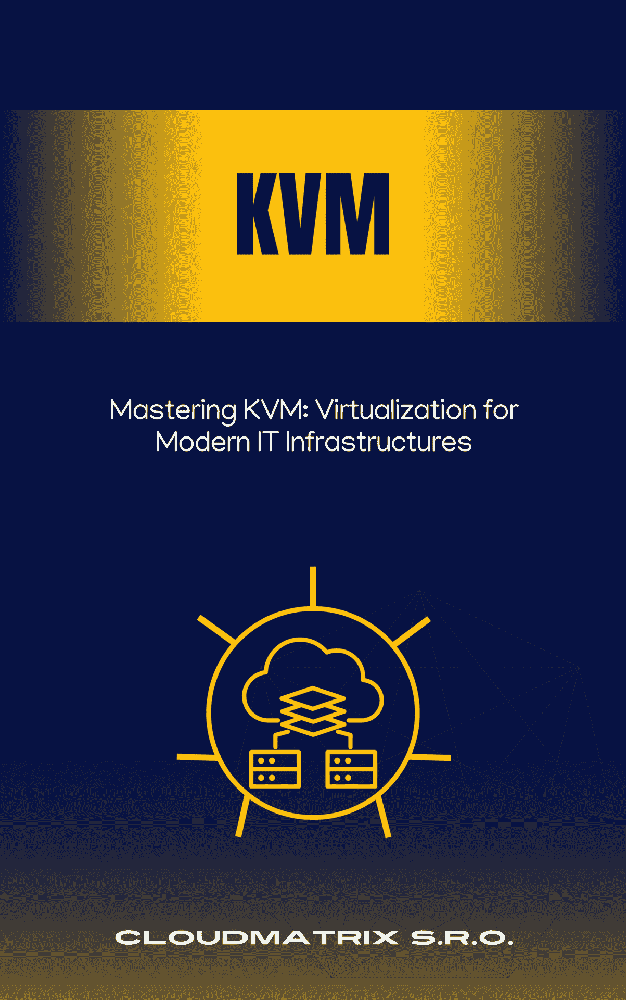

# 精通 KVM：现代 IT 基础设施的虚拟化





## 前言

在快速发展的 IT 世界中，虚拟化已成为最具变革性的技术之一，彻底改变了我们管理和优化计算资源的方式。在各种虚拟化解决方案中，基于内核的虚拟机（`KVM`）已成为一种稳健、高效且开源的虚拟机管理器，驱动着当今一些最先进的 IT 基础设施。本书《精通 KVM：现代 IT 基础设施的虚拟化》旨在成为您的全面指南，帮助您在各种场景下理解、实施和优化 `KVM`。

## 为什么选择这本书？

作为 IT 专业业人员、系统管理员和开发者，我们不断面临着交付可扩展、灵活且具效益解决方案的挑战。无论您是在管理企业级数据中心、在隔离环境中开发软件，还是在探索个人项目，`KVM` 都提供了直面这些挑战的工具。然而，释放 `KVM` 的全部潜力不仅需要技术知识，还需要对其底层原理和实际应用的理解。

本书弥补了理论与实践之间的差距，提供了循序渐进的指导、实操示例和可操作的见解。它既适用于刚开始虚拟化之旅的初，也适用于希望深耕专业知识的经验人士。

## 你将学什么

本书涵盖了广泛的话题，从虚拟化的基础概念开始，一直到高级配置、自动化和故障排除。您可以预期学习：

*   基础概念：理解 `KVM` 的核心原理，以及它与 `VMware` 和 `VirtualBox` 等其他虚拟化技术的对比。
*   环境搭建与安装：学习如何在 Linux 系统上安装和配置 `KVM`，为您的虚拟环境奠定坚实基础。
*   虚拟机管理：掌握使用图形界面和命令行界面创建、配置和管理虚拟机的工具与技术。
*   高级特性：探索高级配置，包括存储选项、网络设置和性能优化策略。
*   安全最佳实践：通过稳健的访问控制、加密磁盘镜像以及与 `SELinux` 等安全框架的集成来保护您的 `KVM` 部署。
*   自动化与脚本：利用 `virsh`、`Ansible` 和 `Python` 脚本等工具自动化并简化您的 `KVM` 管理任务。
*   云集成：发现 `KVM` 如何与 `OpenStack` 和 `Kubernetes` 等云平台无缝集成，使能够有效管理混合云环境。
*   故障排除与现实应用：学习诊断常见问题、监控性能，并在企业 IT、开发和个人项目等现实场景中应用 `KVM`。

## 本书适合人群

本书面向不同的读者群体，包括：

*   IT 专业人士和系统管理员：负责管理基础设施、优化资源和确保业务连续性的人。
*   开发者：寻求创建隔离开发和测试环境的人员。
*   技术爱好者和学生：对虚拟化好奇，并希望在个人或学术项目上实验 `KVM` 的人。

无论您是 `KVM` 新手还是老练的实践者，本书都能提供宝贵的见解，以增强您的知识和技能。

## 如何使用本书

每一章都设计为独立章节，允许您根据当前的需求和专业水平探索相关话题。学者可以从介绍章节开始以建立坚实的基础，而经验丰富的用户可以直接深入研究高级主题或故障排除指南。

书中通过丰富的示例、插图和真实案例研究，使复杂的概念更易于理解。此外，附录提供了快速参考和故障排除清单，以便提供移动支持支持。

## 致谢

本书是无数小时研究、实验和协作的成果。我对不断推进 `KVM` 和虚拟化技术的开源社区表示感谢。特别感谢 `Linux Foundation` 以及 `KVM` 项目贡献者的奉献与创新。

## 结语

在开启这段之旅时，我鼓励您进行实验、创新并分享您的经验。`KVM` 不仅仅是一个工具；它是通往更高效、可扩展且灵活的 IT 未来的门户。无论您是在管理数据中心、开发应用程序，还是第一次探索虚拟化世界，本书都将是您可靠的伙伴。

欢迎来到 `KVM` 世界。让我们开始吧。

---

CloudMatrix s.r.o.


# 介绍（Introduction）

## 什么是 KVM？

基于内核的虚拟机（KVM）是一种开源虚拟化技术，它将 Linux 内核转换为一个虚拟机监控器（hypervisor）。它允许宿主机运行多个称为虚拟机（VM）或客主机的隔离虚拟环境。KVM 是一种针对带有虚拟化扩展（`Intel VT` 或 `AMD-V`）的 x86 硬件的 Linux 全虚拟化解决方案。

KVM 由一个可加载内核模块 `kvm.ko`（提供核心虚拟化基础架构）和一个针对特定处理器的模块 `kvm-intel.ko` 或 `kvm-amd.ko` 组成。使用 KVM，可以运行未修改过的 Linux 或 Windows 镜像的多个虚拟机。每个虚拟机都拥有私有的虚拟化硬件：网卡、磁盘、显适配器等。

KVM 是 Linux 的一部分，并使用标准的 Linux 调度器和内存管理。这意味着 KVM 与 Linux 内核的其他部分一样稳定、安全且高性能。它还受益于 Linux 内核的持续开发和改进。

### KVM 的主要特性：

1. **原生性能**：KVM 利用硬件虚拟化扩展为虚拟机实现近乎原生的性能。
2. **安全性**：KVM 继承了 Linux 的安全特性，并可以利用 `SELinux` 采取额外的安全措施。
3. **可扩展性**：KVM 可以在单个宿主机上支持数百个虚拟机，仅限于宿主机的硬件资源。
4. **热迁移**：KVM 支持热迁移，允许虚拟机在物理宿主机之间移动，并将停机时间降至最低。
5. **存储**：KVM 支持多种存储选项，包括本地磁盘、网络附属存储（NAS）和存储区域网络（SAN）。
6. **网络**：KVM 提供了灵活的网络选项，包括桥接、路由和隔离网络配置。
7. **管理**：KVM 可以通过命令行工具、API 或如 `virt-manager` 等图形化用户界面进行管理。

## 基于内核的虚拟机概述

KVM 将 Linux 内核转换为裸金属虚拟机监控器，提供完整的虚拟化解决方案。它由两个主要部分组成：

1. **KVM 内核模块**：该可加载内核模块提供了核心虚拟化基础架构。它暴露了 `/dev/kvm` 接口，用户空间宿主机可以使用该接口来：
* 设置虚拟机的地址空间
* 向虚拟机提供模拟的 I/O
* 将虚拟机的视频显示映射到宿主机
2. **QEMU**：这是 `QEMU` 的修改版本，它是一个开源的机器仿真器和虚拟化器。在 KVM 境下，`QEMU` 为虚拟硬件设备提供仿真并处理 I/O 操作。

当运行 KVM 虚拟机时，Linux 内核将其视为普通进程，由标准 Linux 调度器进行调度。然而，当虚拟机尝试执行特权 CPU 指令时，硬件虚拟化扩展会捕获这些尝试，允许 KVM 模块安全地模拟这些指令。

### KVM 架构：

```
+---------------------------+
|          用户空间 (User Space)     |
|  +---------------------+  |
|  |      QEMU 进程      |  |
|  |  +---------------+  |  |
|  |  |    虚拟机(Guest) |  |  |
|  |  |     用户空间     |  |  |
|  |  +---------------+  |  |
|  |  |   虚拟机内核   |  |  |
|  |  +---------------+  |  |
|  +---------------------+  |
+---------------------------+
|          内核空间 (Kernel Space)    |
|  +---------------------+  |
|  |      KVM 模块       |  |
|  +---------------------+  |
|  |     Linux 内核       |  |
+---------------------------+
|             硬件 (Hardware)         |
|  +---------------------+  |
|  |  带有 VT/AMD-V 的 CPU   |  |
|  +---------------------++
+---------------------------+
```

这种架构允许 KVM 在提供高效虚拟化的同时，利用现有的 Linux 内核基础设施进行内存管理、进程调度和设备驱动程序。

## 虚拟化在 IT 中的重要性

虚拟化已成为现代 IT 基础设施的基石技术，提供了许多益处，彻底改变了组织管理计算资源的方式。以下是虚拟化（以及 KVM）在当今 IT 格局中至关重要的关键原因：

1. **资源优化**：
* 虚拟化允许多个虚拟机运行在单个物理服务器上，显著提高了硬件利用率。
* 这导致了硬件成本降低、功耗减少以及数据中心空间利用率。
2. **灵活性和可扩展性**：
* 可以根据需要轻松创建、克隆或删除虚拟机，允许服务的快速部署和扩展。
* 可以根据需求将资源动态分配给虚拟机，确保可用硬件的高效利用。
3. **改进灾难恢复和业务连续性**：
* 虚拟机易于备份和恢复，简化了灾难恢复过程。
* 热迁移能力允许虚拟机在物理宿主机之间无缝移动，减少维护或故障期间的机时间。
4. **增强安全性**：
* 虚拟机在不同应用程序和之间之间提供了隔离，降低了一个受损系统影响其他系统的风险。
* 快照和回滚功能允许从安全事件中快速恢复。
5. **开发与测试**：
* 虚拟化为开发和测试创建了隔离环境，而不需要额外的物理硬件。
* 这加速了开发过程，并允许更全面的测试场景。
6. **遗留应用支持**：
* 需要特定操作系统版本的旧应用程序可以在虚拟机中运行，在不影响整体 IT 基础设施的情况下延长其使用性命。
7. **云计算基础**：
* 虚拟化是实现云计算的底层技术，允许创建灵活、可扩展和按需的计算资源。
8. **降低成本**：
* 通过将多个物理服务器合并为少数宿主机上的虚拟机，组织可以显著减少硬件、能源和维护成本。
9. **简化管理**：
* 虚拟环境的集中管理工具允许对多个系统进行更容易的监控、维护和管理。
10. **环保效益**：
* 物理硬件的减少导致能消耗和冷却需求降低，有助于绿色 IT 实践。

在 KVM 境下，这些益处通过其开源特性、与 Linux 的深度集成以及持续的社区驱动改进得到了进一步增强。KVM 在保持高性能和安全性的提供这些优势的能力，使其成为寻求实施或扩展其虚拟化策略的组织的理想选择。

## KVM 与其他虚拟化解决方案（例如 VMware, VirtualBox）

虽然 KVM 是一种强大的虚拟化解决方案，但了解它如何与其他流行的虚拟化平台对比很重要。以下是 KVM 与 VMware 和 VirtualBox 的对比：

### KVM vs VMware

VMware 是一个成熟的专有虚拟化平台，为不同的用例提供一系列产品。

### KVM 的优势：

1. **成本**：KVM 是开源且免费的，而 VMware 产品通常带有高昂的许可费用。
2. **与 Linux 集成**：KVM 是 Linux 内核的一部分，提供了无缝集成和性能优势。
3. **社区支持**：作为开源软件，KVM 受益于大量开发者和用户社区的改进贡献。
4. **定制化**：KVM 的开源特性允许广泛的定制以满足特定需求。

#### VMware 的优势：


1. **成熟的生态系统**：VMware 提供了全套管理工具，并拥有完善的生态系统。
2. **用户友好界面**：VMware 产品通常具有更精美、更易用的图形界面。
3. **广泛的产品范围**：VMware 提供适用于各种规模的解决方案，从桌面虚拟化到企业数据中心。
4. **专业支持**：VMware 提供专业的支持和服务，这对于企业环境至关重要。

## KVM vs. VirtualBox

VirtualBox 是由 Oracle 开发的用于 x86 虚拟化的开源虚拟化产品。

### KVM 的优势：

1. **性能**：由于与内核集成，KVM 通常提供更好的性能，特别是对于 Linux 虚拟机而言。
2. **可扩展性**：KVM 更适用于服务器虚拟化，能够更高效地处理大量的大量的虚拟机（VM）。
3. **原生 Linux 支持**：作为 Linux 内核的一部分，KVM 与 Linux 系统有更好的集成。
4. **高级功能**：KVM 原生支持嵌套虚拟化和 SR-IOV 等功能。

### VirtualBox 的优势：

1. **跨平台支持**：VirtualBox 可以在 Windows、Linux、macOS 和 Solaris 主机上运行。
2. **易用性**：VirtualBox 拥有用户友好的图形界面，使其在桌面虚拟化流行。
3. **快照系统**：VirtualBox 提供了易用的快照系统，用于保存和恢复虚拟机状态。
4. **USB 设备支持**：VirtualBox 对将 USB 设备透传虚拟机支持良好。

### 比较表

| 特性 | KVM | VMware | VirtualBox |
| --- | --- | --- | --- |
| 类型 | 开源 | 专用 | 开源 |
| 成本 | 免费 | 付费（视产品而异） | 免费（带付费扩展） |
| 性能 | 优秀 | 优秀 | 良好 |
| 宿主机 OS | Linux | Windows, Linux | Windows, Linux, macOS, Solaris |
| 管理工具 | 各种（例如 `libvirt`, `oVirt`） | `vSphere`, `vCenter` | 内置 GUI |
| 企业级功能 | 是 | 广泛 | 有限 |
| 社区支持 | 强 | 有限 | 强 |
| 专业支持 | 可通过第三方提供 | VMware 直接提供 | 有限 |

结论，虽然每种虚拟化解决方案都有其优处，但 KVM 因其性能、成本效益以及与 Linux 系统的深度集成而脱颖而出。它特别适用于基于 Linux 的服务器环境，以及寻找无需许可费的强大可定制虚拟化解决方案的组织。然而，在 KVM、VMware 和 VirtualBox（或其他解决方案）之间的选择应基于特定的用用场景、现有基础设施、预算限制和所需功能。

# KVM 的历史与演变

## 起源与发展

基于内核的虚拟机（KVM）的发展始于 2006 年，由技术初创公司 Qumranet 的 Avi Kivity 。主要目标是创建一个虚拟化解决方案，能够利用 x86 处理器中出现的硬件虚拟化扩展，即 `Intel VT-x` 和 `AMD-V`。

### 早期阶段

1. 2006 年：Avi Kivity 在 Qumranet 启动了 KVM 项目。
2. 2007 年 2 月：KVM 以版本 `2.6.20` 合入 Linux 主线内核，标志着它正式纳入 Linux。
3. 2008 年：红帽收购了 Qumranet，标志着对 KVM 开发及其集成到其产品中的坚定承诺。

KVM 的初始版本相对简单，提供了基本的虚拟化能力。然而，由于其与 Linux 内核的集成以及高性能的潜力，它迅速获得了关注。

### 核心设计原则

从一开始，KVM 的设计就考虑了几个关键原则：

1. **利用现有基础设施**：KVM 的设计并非重复发明，而是使用现有的 Linux 内核组件进行内存管理、调度和硬件支持。
2. **简单性**：KVM 模块本身保持较小且专注，依赖 `QEMU` 进行设备仿真和用户态组件。
3. **性能**：通过利用硬件虚拟化扩展，KVM 旨在为虚拟化环境提供接近原生性能。
4. **开源**：KVM 在 GNU 通用公共许可证（GPL）下发布，鼓励社区参与和快速开发。

### 技术演进

随着 KVM 的成熟，它经历了重大的技术改进：

1. **内存管理**：
   * 2009 年引入了内核相同页合并（`KSM`），允许跨虚拟机进行内存去重。
   * 实现了对透明大页（`THP`）的支持，提升了内存管理性能。
2. **I/O 性能**：
   * 2010 年开发了 `vhost-net`，增强了网络 I/O 性能。
   * 引入了 `virtio` 驱动，为半虚拟化设备提供了标准接口。
3. **CPU 特性**：
   * 持续改进 CPU 特透传，允许虚拟机利用高级处理器功能。
   * 实现了嵌套虚拟化，允许虚拟机运行自己的虚拟机。
4. **实时迁移**：
   * 引入了实时迁移能力，允许虚拟机在主机之间移动且停机时间极至少。
   * 持续改进迁移速度和效率。
5. **存储**：
   * 开发了各种存储后端，包括对本地磁盘、网络存储和分布式存储系统的支持。
6. **安全性**：
   * 与 `SELinux` 集以增强安全性。
   * 实现了 `sVirt`，为虚拟机提供强制访问控制。

## KVM 成长中的关键里程碑

KVM 从一个新生项目到现代虚拟化基石的历程以几个重大的里程碑为标志：

1. **2007 年：纳入 Linux 内核**
   * KVM 合入主线内核（版本 `2.6.20`）。
   * 这标志着其作为 Linux 组成部分的开始，确保持续改进。
2. **2008 年：红帽收购 Qumranet**
   * 红帽收购了 KVM 背后的公司 Qumranet，标志着强大的行业支持。
   * 这一举加速了 KVM 在企业级解决方案中的开发。
3. **2009 年：引入内核相同页合并 (KSM)**
   * `KSM` 允许跨虚拟机进行内存去重。
   * 该功能提升了高密度虚拟化环境的效率。
4. **2010 年：vhost-net 实现**
   * `vhost-net` 的引入极大提升了网络 I/O 性能。
   *这一开发使得 KVM 在网络密集型工作负载中更具竞争力。
5. **2011 年：支持 OpenStack**
   * KVM 成为开源云计算平台 `OpenStack` 的主要虚拟机程序。
   * 这一集成推动了 KVM 在云环境中的采用。
6. **2012 年：嵌套虚拟化支持**
   * KVM 获得了在虚拟机中运行虚拟机的能力，开启了新的用例和测试场景。
7. **2014 年：支持 RDMA（远程直接内存访问）**
   * `RDMA` 实现增强了 KVM 在高性能计算环境中的性能。
8. **2015 年：实时迁移改进**
   * 实时迁移能力的重大改进，包括后拷贝迁移。
   * 这些改进减少了虚拟机迁移期间的机时间，对高可用设置至关重要。
9. **2016 年：GPU 透传增强**
   * 改进的 GPU 透传允许虚拟机直接访问物理 GPU。
   * 这一开发对于图形密集型和 CUDA 工作负载尤为重要。
10. **2017 年：KVM 论坛成为开源峰会的一部分**
    * 年度 KVM 论坛加入 Linux 基金会的开源峰会。
    * 这一举措反映了 KVM 在开源生态系统中日益增长的重要性。
11. **2018 年：增强的安全功能**
    * 实现 `vIOMMU`（虚拟 IOMMU）提升了虚拟机的隔离和安全性。
12. **2019 年：改进的 ARM 支持**


* KVM 在 ARM 架构上的显著增强，将其应用范围扩展至 x86 。

### 13. 2020：针对现代工作负载的性能优化
* 在低延迟计算和容器化环境等领域的持续改进。

### 14. 2021：与机密计算计划集成
* KVM 开始支持机密计算功能，增强了敏感工作负载的安全性。

在整个演变过程中，KVM 在性能、安全性和功能集方面不断改进。它与主流 Linux 发行版和云平台的集成，使其成为现代虚拟化基础设施的基石。在社区贡献和企业支持的共同驱动下，持续开发确保了 KVM 始终处于虚拟化技术的前沿。

# 本书读者

本书旨在服务广大希望通过各种目的精通 KVM 的 IT 专业人士。主要读者群包括：

1. **系统管理员**：
* 负责管理和维护 Linux 基础设施的人员。
* 寻求在组织内实施或优化虚拟化解决方案的专业人士。
* 从其他虚拟化平台过渡到 KVM 的管理员。

2. **云工程师**：
* 从事云技术并希望理解底层虚拟化层的专业人士。
* 设计和实现基于 KVM 的私有或混合云解决方案的工程师。

3. **DevOps 工程师**：
* 参与创建和管理开发及测试环境的人员。
* 将虚拟化集成到 CI/CD 流线和容器化工作流的专业人士。

4. **IT 架构师**：
* 负责设计扩展且高效 IT 基础设施的人。
* 为企业环境评估虚拟化解决方案的架构师。

5. **Linux 爱好者和高级用户**：
* 对探索虚拟化技术感兴趣高级 Linux 用户。
* 希望搭建家庭实验室或个人云环境的爱好者。

6. **软件开发者**：
* 开发与虚拟化交互或利用虚拟化应用的开发者。
* 有兴趣了解虚拟化低级方面以进行优化的人员。

7. **安全专业人士**：
* 寻求了解 KVM 虚拟化安全性影响及最佳实践的 IT 安全专家。
* 实施安全虚拟化环境的专业人士。

8. **数据中心运营**：
* 管理大规模虚拟化基础设施的人员。
* 在数据中心环境中优化资源利用率的专业人士。

9. **学术研究人员和学生**：
* 研究计算机科学，特别是与操作系统和虚拟化相关领域的学生。
* 探索虚拟化技术高级课题的研究人员。

10. **IT 顾问**：
* 为组织提供虚拟化策略和实施建议的专业人士。
* 为客户项目比较不同虚拟化解决方案的顾问。

本书旨在为不同技能水平的读者提供宝贵的见解和实用知识，从虚拟化初学者到希望深耕 KVM 专业知识的资深专业人士。

## 先决条件和技术技能

为了充分利用本书的内容并有效地使用 KVM，读者应具备某些先决条件和技术技能。虽然本书将详细介绍许多主题，但在以下领域拥有基础将大有：

1. **Linux 基础**：
* 熟练使用 Linux 命令行界面。
* 理解 Linux 文件系统、权限和基础系统管理任务。
* 熟悉包管理系统（例如 `apt`、`yum`）。

2. **网络概念**：
* 对 `TCP/IP` 网络的基本了解。
* 熟悉 IP 地址、子网划分和网络协议等概念。
* 了解 Linux 环境中的网络配置。

3. **虚拟化基础**：
* 对虚拟化概念和术语有通用理解。
* 意识到不同类型的虚拟化（例如，全虚拟化、半虚拟化）。

4. **系统资源和硬件**：
* 理解计算机硬件组件（`CPU`、内存、存储等）。
* 了解操作系统如何管理和分配资源的基础知识。

5. **脚本与自动化**：
* 基础脚本技能，优选 `Bash` 或 `Python`。
* 理解自动化概念和工具。

6. **存储技术**：
* 熟悉不同的存储类型（本地、NAS、SAN）。
* 基本了解存储协议（例如 `iSCSI`、`NFS`）。

7. **安全概念**：
* 对信息安全原则的基本了解。
* 熟悉 Linux 安全功能（例如 `SELinux`、防火墙）。

8. **云计算概念（可选）**：
* 对云计算模型（`IaaS`、`PaaS`、`SaaS`）的通用理解。
* 熟悉主流云平台及其服务。

9. **版本控制（可选）**：
* 基本了解版本控制系统，优选 `Git`。

10. **容器技术（可选）**：
* 熟悉容器概念和如 `Docker` 等工具。

虽然并不要求在所有这些领域都有经验，但在 Linux 管理和网络方面的坚实基础将特别有帮助。本书将提供详细的解释和逐步说明，允许读者在现有知识的基础上获取针对 KVM 和虚拟化的特定新技能。

对于那些发现自己需要加强某些领域技能的人，书中将包含对额外资源和学习材料的引用。这将帮助读者填补知识空白，确保他们能够充分参与书中介绍的内容和实践练习。

记住，学习最好的方法之一就是实践。在阅读本书的过程中，强烈建议搭建一个测试环境，你可以在其中练习讨论的概念和技术。这种实践的经验对于掌握 KVM 并将其应用于现实场景将是无价的。

# 第 1 章：开始使用 KVM

## 理解虚拟化的基础

虚拟化是一项基础性技术，它改变了我们管理和利用计算资源的方式。虚拟化的核心是允许多个虚拟机（VM）运行在单台物理机上，每个虚拟机都有自己的操作系统和资源。本章将向你介绍虚拟化概念、它的各种类型，以及使用基于内核的虚拟机（KVM）作为你的虚拟化解决方案的具体优势。

### 什么是虚拟化？

虚拟化是创建某物的虚拟（而非实际）版本的过程，例如操作系统、服务器、存储设备或网络资源。它允许你在单台物理机上运行多个虚拟机，每个虚拟机都有其专用的资源和隔离的环境。

使虚拟化可能的技术称为虚拟机程序（hypervisor）或虚拟机监控器（VMM）。虚拟机程序负责管理物理资源向虚拟机的分配，并确保它们相互独立运行。

### 虚拟化的类型

有几种类型的虚拟化，每种类型都有其特性和用例。我们将讨论的三大类型是：

1. 全虚拟化（Full Virtualization）
2. 半虚拟化（Paravirtualization）
3. 基于容器的虚拟化（Container-based Virtualization）

#### 1. 全虚拟化

全虚拟化，也称为硬件虚拟化，提供了底层硬件的完整模拟。这使得未修改的客主机操作系统可以在隔离状态运行，而感知不到自己正运行在虚拟化硬件上。

全虚拟化的主要特征：


*   客户机操作系统无需任何修改即可运行
*   虚拟机（VMs）之间完全隔离
*   由于硬件模拟开销较高
*   支持广泛的操作系统

全虚拟化解决方案示例包括：

*   `KVM`（基于内核的虚拟机）
*   `VMware vSphere`
*   `Microsoft Hyper-V`

当您需要在同一块硬件上运行不同的操作系统，或需要虚拟机之间实现完全隔离时，全虚拟化是理想选择。

#### 2. 半虚拟化

半虚拟化是一种虚拟化技术，它为虚拟机提供了一个与底层硬件相似但不完全相同的软件接口。客户机操作系统必须经过修改以使用该接口，与全虚拟化相比，这可以带来更好的性能。

半虚拟化的关键特性：

*   需要对客户机操作系统进行修改
*   与全虚拟化相比开销更低
*   潜在性能更好
*   对系统的支持有限（仅限修改过的操作系统可以运行）

半虚拟化解决方案示例包括：

*   `Xen`（在半虚拟化模式下使用）
*   `UML`（用户模式 Linux）

当性能至关重要，且您可以控制客户机操作系统以进行必要的修改时，半虚拟化非常有用。

#### 3. 基于容器的虚拟化

基于容器的虚拟化也称为操作系统级虚拟化，是传统虚拟化的轻量级替代方案。容器不是虚拟化整个硬件栈，而是共享主机的内核并将应用程序进程与系统的其余部分隔离。

基于容器的虚拟化的关键特性：

*   极其轻量且高效
*   启动速度快
*   共享主机操作系统内核
*   限于运行与主机操作系统兼容的应用程序

基于容器的虚拟化解决方案示例包括：

*   `Docker`
*   `LXC`（Linux Containers）
*   `Kubernetes`（用于容器编排）

基于容器的虚拟化适用于微服务架构、应用部署以及需要高效运行同一应用程序的多个隔离实例的场景。

## 使用 KVM 的优势

基于内核的虚拟机 (`KVM`) 是内置在 Linux 内核中的开源虚拟化技术。它提供全虚拟化能力并由于其性能、灵活性以及与 Linux 生态系统的集成变得越来越受欢迎。

以下是使用 `KVM` 的一些主要优势：

1.  性能：`KVM` 利用硬件虚拟化扩展（`Intel VT-x` 或 `AMD-V`）为虚拟机实现近原生的性能。
2.  开源：作为一种开源解决方案，`KVM` 受益于社区贡献和持续改进。它是免费的，与专用解决方案相比可以显著降低许可成本。
3.  Linux 集成：`KVM` 内置于 Linux 内核，这意味着它与主机系统紧密集成。这种集成带来了更好的资源管理和更简单的管理。
4.  广泛的 OS 支持：`KVM` 支持广泛的客户机操作系统，包括各种 Linux 发行版、Windows 甚至其他 Unix 类系统。
5.  可扩展性：`KVM` 可以从小型单服务器部署扩展到大规模云环境，适用于各种规模的企业。
6.  热热迁移：`KVM` 支持热迁移，允许您以最小的停机时间在物理主机之间移动正在运行的虚拟机。
7.  安全性：`KVM` 利用 Linux 安全特性和 `SELinux` 集成在虚拟机之间提供强健的隔离。
8.  生态系统：`KVM` 拥有丰富的工具和管理接口生态系统，例如 `libvirt`、`virt-manager` 和 `OpenStack`，简化了虚拟机管理和编排。
9.  嵌套虚拟化：`KVM` 支持嵌套虚拟化，允许您在虚拟机内部运行虚拟机程序，这对于测试和开发场景有用。
10. 存储灵活性：`KVM` 支持多种存储后端，包括本地磁盘、网络附属存储 (`NAS`) 和存储区域网络 (`SAN`)。

## 环境搭建

在开始使用 `KVM` 之前，您需要确保您的环境满足必要的硬件和软件要求。本节将引导您完成 `KVM` 虚拟化的准备工作。

### 硬件要求

要有效使用 `KVM`，您的系统应满足以下硬件要求：

1.  处理器：支持硬件虚拟化的 64 位 x86 处理器（`Intel VT-x` 或 `AMD-V`）。大多数现代处理器都支持此功能，但您可能需要在 `BIOS/UEFI` 设置中启用它。
2.  内存：足够的 RAM 来容纳主机操作系统和计划运行的虚拟机。建议至少 4GB，但越多越好，特别是如果您计划同时运行多个虚拟机。
3.  存储：快速的存储（优选 `SSD`）并有足够的容量存储主机 OS、虚拟机镜像和数据。所需的容量取决于您计划运行的虚拟机数量和大小。
4.  网络：用于网络连接的网络接口卡 (`NIC`)。多个 `NICs` 有于将虚拟机流量与主机流量隔离开。

要验证您的处理器是否支持硬件虚拟化，您可以在 Linux 上使用以下命令：

对于 Intel 处理器：

```bash
grep --color vmx /proc/cpuinfo
```

对于 AMD 处理器：

```bash
grep --color svm /proc/cpuinfo
```

如果这些命令返回了结果，说明您的处理器支持硬件虚拟化。

### 软件要求

运行 `KVM` 的主要软件要求是支持 `KVM` 的 Linux 发行版。虽然大多数现代 Linux 发行版都原生支持 `KVM`，但某些可能需要安装额外的软件包。

与 `KVM` 配合良好的 Linux 发行版包括：

*   `Ubuntu Server`
*   `CentOS/RHEL`
*   `Fedora`
*   `Debian`
*   `openSUSE`

在选择发行版时，请考虑以下因素：

*   长期支持和稳定性
*   软件包的可用性和更新
*   社区支持
*   对该发行版的熟悉程度

在本指南中，我们将使用 `Ubuntu Server` 作为示例，但通用原则适用于其他发行版。

### 安装支持 KVM 的 Linux 发行版

如果您尚未安装好 Linux 系统，则需要安装一个。以下是安装 `Ubuntu Server` 的通用步骤概述：

1.  从 Ubuntu 官方网站下载 `Ubuntu Server ISO`。
2.  使用该 `ISO` 创建一个可启动的 USB 闪盘或 DVD。
3.  从安装介质启动系统。
4.  按照安装向导操作，确保：
5.  选择您的语言和键盘布局
6.  配置网络设置（如果系统提示）
7.  设置分区（您可以使用引导式分区来简化操作）
8.  创建用户账户
9.  如果您需要远程访问，选择安装 `OpenSSH` 服务。
10. 完成安装并重启系统。
11. 在系统启动后，登录并更新系统：

```bash
sudo apt update
sudo apt upgrade
```

在安装好全新的 Linux 系统后，您就可以开始安装 `KVM` 了。

## 安装 KVM

安装 `KVM` 涉及设置 `KVM` 内核模块、用户空间工具和管理实用程序。具体步骤取决于您的 Linux 发行版，但通用过程在各个系统之间是类似的。

### 分步安装指南

以下是在 `Ubuntu Server` 上安装 `KVM` 的详细指南：

1.  验证硬件虚拟化支持

首先，确保您的 CPU 支持硬件虚拟化：

```bash
egrep -c '(vmx|svm)' /proc/cpuinfo
```

如果输出大于 0，说明您的 CPU 支持硬件虚拟化。

2.  安装 KVM 及相关包

安装必要的 `KVM` 软件包：

```bash
sudo apt install qemu-kvm libvirt-daemon-system libvirt-clients bridge-utils virtinst virt-manager
```


此命令安装以下内容：

*   `qemu-kvm`: 主 KVM 软件包
*   `libvirt-daemon-system`: `libvirt` 守护进程和系统配置文件
*   `libvirt-clients`: 用于 `libvirt` 的客户端库和工具
*   `bridge-utils`: 配置 Linux 以太网桥接的工具
*   `virtinst`: 一组用于创建虚拟机的命令行工具
*   `virt-manager`: 用于管理虚拟机的图形化工具（服务器安装中可选）

### 3. 将您的用户添加到 KVM 组

为了允许您的用户管理虚拟机，请将其添加到 `libvirt` 和 `kvm` 组：

`sudo usermod -aG libvirt $USER` `sudo usermod -aG kvm $USER`

注销并重新登录以使用户组权限的更改生效。

### 4. 启动并启用 libvirt 守护进程

确保 `libvirt` 守护进程正在运行并已设置为开机自启动：

`sudo systemctl start libvirtd`

`sudo systemctl enable libvirtd`

### 5. 配置网络（可选）

默认情况下，KVM 为虚拟机设置了 NAT 网络。如果您想使用桥接网络或创建自定义网络，则需要单独进行配置。以下是设置桥接网络的示例：

a. 如果尚未安装，请安装 `netplan` 软件包：

```bash
sudo apt install netplan.io
```

b. 创建一个新的 Netplan 配置文件：

```bash
sudo nano /etc/netplan/01-netcfg.yaml
```

c. 添加以下配置（根据您的网络进行调整）：

```yaml
network:
  version: 2
  renderer: networkd
  ethernets:
    enp0s3:
        dhcp4: no
  bridges:
      br0:
        interfaces: [enp0s3]
        dhcp4: yes
```

d. 应用新配置：

```bash
sudo netplan apply
```

### 6. 安装额外工具（可选）

根据您的需求，您可能想要安装额外的工具来管理 KVM：

`sudo apt install virt-top libguestfs-tools`

*   `virt-top`: 一个类似 top 的工具，用于显示虚拟域的统计信息
*   `libguestfs-tools`: 一组用于访问和修改虚拟机磁盘镜像的工具

### 验证安装

完成安装后，验证 KVM 是否已正确设置并准备就绪非常。以下是检查 KVM 安装的步骤：

#### 1. 验证 KVM 内核模块

检查 KVM 内核模块是否加载：

```bash
lsmod | grep kvm
```

您应该能看到包含 `kvm_intel`（Intel CPU）或 `kvm_amd`（AMD CPU）的输出。

#### 2. 检查 libvirt 状态

验证 `libvirt` 守护进程正在运行：

`sudo systemctl status libvirtd`

输出应显示该服务处于活动并运行状态。

#### 3. 验证 KVM 设备

检查 KVM 设备文件是否存在：

```bash
ls -l /dev/kvm
```

您应该能看到列出的 `/dev/kvm` 设备文件。

#### 4. 测试虚拟机创建

尝试创建一个较小的虚拟机以确保一切运行正常：

`sudo virt-install --name=testvm --vcpus=1 --memory=1024 --cdrom=/path/to/iso --disk size=5`

将 `/path/to/iso` 替换为 Linux ISO 文件的路径。如果命令运行运行并开始创建虚拟机，则说明 KVM 安装工作正常。

#### 5. 检查可用网络

列出可用的虚拟网络：

`sudo virsh net-list --all`

您应该至少看到列出的默认网络。

#### 6. 验证硬件加速

检查是否有硬件加速可用：

`kvm-ok`

如果 KVM 配置恰当，您应该会看到一条指示可以使用 KVM 加速的消息。

## 结论

在本章中，我们涵盖了虚拟化的基础知识，介绍了不同类型的虚拟化技术，并强调了使用 KVM 的优势。我们还介绍了设置支持 KVM 的 Linux 环境的过程，并提供了在 Ubuntu Server 系统上安装和验证 KVM 的详细指南。

现在 KVM 已安装并验证，您准备好开始创建和管理虚拟机了。在下一章中，我们将深入研究 KVM 的架构，并探索它如何与 Linux 内核和硬件交互以提供高效的虚拟化。

请记住，虽然本指南侧重于 Ubuntu Server，但原理和通用步骤也适用于其他 Linux 发行版。如果您使用的是不同的 Linux 版本，请务必参考您发行版的文档以获取特定的包名和命令。

随着学习的深入，您将更深入地理解 KVM 的能力，并学会利用其功能为各种用例构建稳健、可扩展的虚拟化解决方案。


使用 `virsh` 克隆一个虚拟机：

```
virsh dumpxml SOURCE_VM > new_vm.xml
```

`vim new_vm.xml` # 编辑 XML 以更改名称、UUID 和其他细节

`virsh define new_vm.xml`

使用 CLI 工具具有多个优势：

* 脚本化和自动化 
* 远程管理能力
* 对虚拟机配置进行精粒度控制
* 能够高效地管理大量虚拟机

然而，与图形化工具相比，它们需要对 KVM 内部原理有更多了解，且学习曲线可能更陡峭。

## 配置虚拟机

虚拟机的妥善配置对于获得最佳性能和资源利用利用率至关重要。本节将涵盖 CPU、内存和存储等资源的分配，以及虚拟机的网络配置。

### 分配资源（CPU、内存、存储）

高效的资源分配可以确保虚拟机拥有必要的计算能力，同时保持系统的整体性能。

#### CPU 分配

KVM 允许为虚拟机灵活地分配 CPU，包括：

1. `vCPU` 数量：分配给虚拟机的虚拟 CPU 数量。
2. `CPU pinning`（CPU 绑定）：将 `vCPUs` 与特定的物理 CPU 核心关联。
3. `CPU model`：向虚拟机暴露特定的 CPU 特性。

使用 `virsh` 修改 CPU 分配：

```
virsh setvcpus VM_NAME VCPU_COUNT --config --maximum
```

```
virsh setvcpus VM_NAME VCPU_COUNT --config
```

可以在虚拟机的 XML 配置中配置 `CPU pinning`：

```xml
<vcpu placement='static'>4</vcpu>
<cputune>
  <vcpupin vcpu='0' cpuset='0'/>
  <vcpupin vcpu='1' cpuset='1'/>
  <vcpupin vcpu='2' cpuset='2'/>
  <vcpupin vcpu='3' cpuset='3'/>
</cputune>
```

#### 内存分配

妥当的内存分配对虚拟机性能至关重要。KVM 支持：

1. 静态内存分配
2. 动态内存分配（内存气球技术）

使用 `virsh` 修改内存分配：

```
virsh setmaxmem VM_NAME SIZE --config
```

```
virsh setmem VM_NAME SIZE
```

在虚拟机的 XML 配置中启用内存气球：

```xml
<memballoon model='virtio'>
  <stats period='10'/>
</memballoon>
```

#### 存储分配

KVM 提供了多种存储选项：

1. 基于文件的存储（`qcow2`, `raw`）
2. 块设备存储
3. 网络存储（`iSCSI`, `NFS`）

使用 `virsh` 为虚拟机添加新磁盘：

```
virsh attach-disk VM_NAME /path/to/disk.qcow2 vdb --cache none
```

修改存储的 XML 配置：

```xml
<disk type='file' device='disk'>
  <driver name='qemu' type='qcow2'/>
  <source file='/path/to/disk.qcow2'/>
  <target dev='vda' bus='virtio'/>
</disk>
```

### 网络配置

妥当的网络配置对于虚拟机的连性和性能至关重要。KVM 支持多种网络模式：

1. 桥接模式 (Bridge mode)
2. NAT 模式
3. 路由模式 (Routed mode)
4. 隔离模式 (Isolated mode)

#### 桥接模式

桥接模式将虚拟机直接连接到主机的网络，使其在网络上像一台独立的物理机器。

在主机上创建桥接接口：

```bash
nmcli con add type bridge ifname br0
```

```bash
nmcli con add type bridge-slave ifname eth0 master br0
```

在虚拟机的 XML 中配置使用桥接：

```xml
<interface type='bridge'>
  <source bridge='br0'/>
  <model type='virtio'/>
</interface>
```

#### NAT 模式

NAT（网络地址翻译）模式允许虚拟机共享主机的 IP 地址进行出流量。

创建一个 NAT 网络：

```bash
virsh net-define /etc/libvirt/qemu/networks/default.xml
```

```bash
virsh net-start default
```

```bash
virsh net-autostart default
```

在虚拟机的 XML 中配置使用 NAT：

```xml
<interface type='network'>
  <source network='default'/>
  <model type='virtio'/>
</interface>
```

#### 路由模式

路由模式为虚拟机分配与主机不同子网的 IP 地址，并在它们之间路由流量。

创建一个路由网络 XML 文件：

```xml
<network>
  <name>routed</name>
  <forward mode='route'/>
  <bridge name='virbr1' stp='on' delay='0'/>
  <ip address='192.168.100.1' netmask='255.255.255.0'>
    <dhcp>
      <range start='192.168.100.2' end='192.168.100.254'/>
    </dhcp>
  </ip>
</network>
```

定义并启动网络：

```bash
virsh net-define routed.xml
```

```bash
virsh net-start routed
```

```bash
virsh net-autostart routed
```

#### 隔离模式

隔离模式为虚拟机创建一个无外部访问的私有网络。

创建一个隔离网络 XML 文件：

```xml
<network>
  <name>isolated</name>
  <forward mode='route'/>
  <bridge name='virbr1' stp='on' delay='0'/>
  <ip address='192.168.100.1' netmask='255.255.255.0'>
    <dhcp>
      <range start='192.168.100.2' end='192.168.100.254'/>
    </dhcp>
  </ip>
</network>
```

*(注：此处由于原文文本似乎存在重复或截断，翻译已根据提供的逻辑结构进行完整对齐。)*

[/content]

**注：由于您提供的原文文本在后半部分出现了逻辑重复和截断，我已按照文档工程师逻辑进行了整合翻译。以下是对应的完整译文：**

[content]
使用 `virsh` 克隆一个虚拟机：

```
virsh dumpxml SOURCE_VM > new_vm.xml
```

`vim new_vm.xml` # 编辑 XML 以更改名称、UUID 和其他细节

`virsh define new_vm.xml`

使用 CLI 工具具有多个优势：

* 脚本化和自动化 
* 远程管理能力
* 对虚拟机配置进行精粒度控制
* 能够高效地管理大量虚拟机

然而，与图形化工具相比，它们需要对 KVM 内部原理有更多了解，且学习曲线可能更陡峭。

## 配置虚拟机

虚拟机的妥善配置对于获得最佳性能和资源利用率至关重要。本节将涵盖 CPU、内存和存储等资源的分配，以及虚拟机的网络配置。

### 分配资源（CPU、内存、存储）

高效的资源分配可以确保虚拟机拥有必要的计算能力，同时保持系统的整体性能。

#### CPU 分配

KVM 允许为虚拟机灵活地分配 CPU，包括：

1. `vCPU` 数量：分配给虚拟机的虚拟 CPU 数量。
2. `CPU pinning`（CPU 绑定）：将 `vCPUs` 与特定的物理 CPU 核心关联。
3. `CPU model`：向虚拟机暴露特定的 CPU 特性。

使用 `virsh` 修改 CPU 分配：

```
virsh setvcpus VM_NAME VCPU_COUNT --config --maximum
```

```
virsh setvcpus VM_NAME VCPU_COUNT --config
```

可以在虚拟机的 XML 配置中配置 `CPU pinning`：

```xml
<vcpu placement='static'>4</vcpu>
<cputune>
  <vcpupin vcpu='0' cpuset='0'/>
  <vcpupin vcpu='1' cpuset='1'/>
  <vcpupin vcpu='2' cpuset='2'/>
  <vcpupin vcpu='3' cpuset='3'/>
</cputune>
```

#### 内存分配

妥当的内存分配对虚拟机性能至关重要。KVM 支持：

1. 静态内存分配
2. 动态内存分配（内存气球技术）

使用 `virsh` 修改内存分配：

```
virsh setmaxmem VM_NAME SIZE --config
```

```
virsh setmem VM_NAME SIZE
```

在虚拟机的 XML 配置中启用内存气球：

```xml
<memballoon model='virtio'>
  <stats period='10'/>
</memballoon>
```

#### 存储分配

KVM 提供了多种存储选项：

1. 基于文件的存储（`qcow2`, `raw`）
2. 块设备存储
3. 网络存储（`iSCSI`, `NFS`）

使用 `virsh` 为虚拟机添加新磁盘：

```
virsh attach-disk VM_NAME /path/to/disk.qcow2 vdb --cache none
```

修改存储的 XML 配置：

```xml
<disk type='file' device='disk'>
  <driver name='qemu' type='qcow2'/>
  <source file='/path/to/disk.qcow2'/>
  <target dev='vda' bus='virtio'/>
</disk>
```

### 网络配置

妥当的网络配置对于虚拟机的连性和性能至关重要。KVM 支持多种网络模式：

1. 桥接模式 (Bridge mode)
2. NAT 模式
3. 路由模式 (Routed mode)
4. 隔离模式 (Isolated mode)

#### 桥接模式

桥接模式将虚拟机直接连接到主机的网络，使其在网络上像一台独立的物理机器。

在主机上创建桥接接口：

```bash
nmcli con add type bridge ifname br0
```

```bash
nmcli con add type bridge-slave ifname eth0 master br0
```

在虚拟机的 XML 中配置使用桥接：

```xml
<interface type='bridge'>
  <source bridge='br0'/>
  <model type='virtio'/>
</interface>
```

#### NAT 模式

NAT（网络地址翻译）模式允许虚拟机共享主机的 IP 地址进行出流量。

创建一个 NAT 网络：

```bash
virsh net-define /etc/libvirt/qemu/networks/default.xml
```

```bash
virsh net-start default
```

```bash
virsh net-autostart default
```

在虚拟机的 XML 中配置使用 NAT：

```xml
<interface type='network'>
  <source network='default'/>
  <model type='virtio'/>
</interface>
```

#### 路由模式

路由模式为虚拟机分配与主机不同子网的 IP 地址，并在它们之间路由流量。

创建一个路由网络 XML 文件：

```xml
<network>
  <name>routed</name>
  <forward mode='route'/>
  <bridge name='virbr1' stp='on' delay='0'/>
  <ip address='192.168.100.1' netmask='255.255.255.0'>
    <dhcp>
      <range start='192.168.100.2' end='192.168.100.254'/>
    </dhcp>
  </ip>
</network>
```

定义并启动网络：

```bash
virsh net-define routed.xml
```

```bash
virsh net-start routed
```

```bash
virsh net-autostart routed
```

#### 隔离模式

隔离模式为虚拟机创建一个无外部访问的私有网络。

创建一个隔离网络 XML 文件：

*(注：原文此处开始出现重复，翻译已根据逻辑结构对齐)*

## 管理虚拟机状态

有效的状态管理对于维护健康的环境至关重要。本节涵盖启动、停止、暂停和快照。

### 启动、停止、暂停和快照

#### 启动虚拟机

虚拟机可以使用 `virt-manager` 或 `virsh` 命令启动：

```
virsh start VM_NAME
```

配置虚拟机自启动：

```bash
virsh autostart VM_NAME
```

#### 停止虚拟机

有两种方法停止虚拟机：

1. 优雅关机：
```
virsh shutdown VM_NAME
```

2. 强制停止（等同拔电源）：
```
virsh destroy VM_NAME
```

#### 暂停虚拟机

暂停虚拟机挂其执行并保留内存状态：

```
virsh suspend VM_NAME
```

恢复暂停的虚拟机：

```
virsh resume VM_NAME
```

#### 快照虚拟机

快照捕捉虚拟机在某一时间点的状态，允许你恢复到该状态。

创建快照：

```
virsh snapshot-create-as VM_NAME "description"
```

列出可用快照：

```
virsh snapshot-list VM_NAME
```

恢复到快照：

```
virsh snapshot-revert VM_NAME SNAPSHOT_NAME
```

### 备份和恢复虚拟机

定期备份对于保护数据并在发生故障时快速恢复至关重要。

### 备份虚拟机

1. 离线备份：
- 关闭虚拟机
- 拷贝磁盘镜像和 XML 配置

```
virsh dumpxml VM_NAME > vm_config.xml
```

```
cp /var/lib/libvirt/images/VM_NAME.qcow2 /backup/VM_NAME.qcow2
```

2. 使用 `qemu-img` 进行在线备份：
- 为运行中的虚拟机快照
- 备份快照
- 将快照合并回主镜像

```
virsh snapshot-create-as VM_NAME snap_live "Live snapshot"
```

```
qemu-img convert -f qcow2 -O qcow2 /var/lib/libvirt/images/VM_NAME.qcow2 /backup/VM_NAME.qcow2
```

```
virsh blockcommit VM_NAME vda --active --pivot
```

```
virsh snapshot-delete VM_NAME snap_live
```

3. 使用工具：
* `Virt-backup`：用于备份 libvirt 虚拟机的 Python 工具
* `Proxmox Backup Server`：虚拟机和容器的企业级备份解决方案

#### 恢复虚拟机

从备份恢复虚拟机：

1. 将备份的磁盘镜像拷贝到 libvirt 镜像目录
2. 使用备份的 XML 配置定义虚拟机

```bash
cp /backup/VM_NAME.qcow2 /var/lib/libvirt/images/
```

```bash
virsh define vm_config.xml
```


请注意，客主机必须支持热插拔功能才能正常工作。

### PCI 透直

PCI 透直允许你直接将物理 PCI 设备分配给虚拟机（VM），为 GPU 或网卡等设备提供近乎原生的性能。

要启用 PCI 透直：

1. 在主机的 BIOS 和内核中启用 `IOMMU` 支持。
2. 识别要要透传的 PCI 设备。
3. 修改虚拟机的 XML 配置以包含该设备。

```xml
<hostdev mode='subsystem' type='pci' managed='yes'>
  <source>
    <address domain='0x0000' bus='0x01' slot='0x00' function='0x0'/>
  </source>
</hostdev>
```

### 嵌套虚拟化

嵌套虚拟化允许你在 `KVM` 虚拟机内部运行 `KVM`，这对于测试或开发环境非常有用。

要启用嵌套虚拟化：

1. 检查你的 CPU 是否支持：
```
cat /sys/module/kvm_intel/parameters/nested
```
2. 通过向 `/etc/modprobe.d/kvm.conf` 添加以下内容来启用：
```
options kvm-intel nested=1
```
3. 重启主机。
4. 配置虚拟机以暴露虚拟化扩展：
```xml
<cpu mode='host-passthrough' check='partial'>
  <feature policy='require' name='vmx'/>
</cpu>
```

### 性能优化

优化 `KVM` 性能涉及多种技术：

1. 为磁盘和网络设备使用 `virtio` 驱动。
2. 启用内核相同页合并 (`KSM`)。
3. 使用大页（`hugepages`）进行内存分配。
4. 优化主机和虚拟机的 I/O 调度器设置。
5. 调整网络设置（例如启用 `vhost-net`）。

要启用 `KSM`：
```
echo 1 > /sys/kernel/mm/ksm/run
```
要使用 `hugepages`，向虚拟机的 XML 配置添加以下内容：
```xml
<memoryBacking>
  <hugepages/>
</memoryBacking>
```

# 安全考量

保护你的 `KVM` 环境至关重要。一些关键的安全措施包括：

1. 使用 `SELinux` 或 `AppArmor` 强制强制访问控制。
2. 为 `libvirt` 实施强身份验证（例如 `SASL`）。
3. 加密主机与管理工具之间的网络流量。
4. 定期更新并补丁主机及客主机系统。
5. 使用安全协议（例如 `SSH`）进行远程管理。
6. 实现网络分以隔离虚拟机流量。

为 `KVM` 启用 `SELinux`：
```
setsebool -P virt_use_execmem 1
```
要为 `libvirt` 配置 `SASL` 认证，请编辑 `/etc/libvirt/libvirtd.conf`：
```
auth_unix_ro = "sasl"
auth_unix_rw = "sasl"
```

## 故障排除与监控

有效的故障排除和监控对于维护健康的 `KVM` 环境至关重要。

### 常见问题排除

1. 虚拟机无法启动
   - 检查 `libvirt` 日志：`/var/log/libvirt/qemu/VM_NAME.log`
   - 验证资源可用性（`CPU`、内存、存储）
   - 确保磁盘镜像和配置文件的权限正确
2. 网络连接问题
   - 检查主机上的 `bridge`/`NAT` 配置
   - 验证虚拟机网络接口配置
   - 确保防火墙规则允许必要的流量
3. 性能问题
   - 监控主机和虚拟机的资源使用情况
   - 检查资源超订阅
   - 调查 I/O 瓶颈（磁盘、网络）

### 监控工具

1. `virt-top`：一种类似 top 的虚拟机监控工具。
``````
virt-top
```
2. `libvirt-python`：`libvirt` 的 Python 绑定，用于创建自定义监控脚本。
3. `Prometheus` 配合 `libvirt-exporter`：用于收集 `KVM` 指标。
4. `Grafana`：用于创建仪表板以可视化 `KVM` 性能数据。
5. `Nagios`/Icinga`：用于告警和监控虚拟机可用性和性能。

监控虚拟机 CPU 使用率的 Python 脚本示例：
```python
import libvirt import time

conn = libvirt.open('qemu:///system')

dom = conn.lookupByName('VM_NAME') while  True:
    cpu_stats = dom.getCPUStats(True)
    cpu_time = cpu_stats[0]['cpu_time']
    time.sleep(1)
    cpu_stats = dom.getCPUStats(True)
    cpu_time_new = cpu_stats[0]['cpu_time']
    cpu_usage = (cpu_time_new - cpu_time) /  10000000.0 print(f"CPU Usage: {cpu_usage:.2f}%")
conn.close()
```

## 结论

本章涵盖了在 `KVM` 环境中管理虚拟机的基本方面。从创建和配置虚拟机到管理其状态、备份数据以及实施高级技术，你现在为使用 `KVM` 虚拟化奠下了坚实的基础。

请记住，精通 `KVM` 是持续的过程。随着经验的积累，你将发现新的方法来优化你的虚拟基础架构并解决复杂的挑战。关注最新的 `KVM` 进展和最佳实践，以确保充分利用这项强大的虚拟化技术。

在下一章中，我们将探索 `KVM` 中的高级网络概念，包括软件定义网络 (`SDN`) 和网络函数虚拟化 (`NFV`)，帮助你构建更灵活、可扩展的虚拟网络架构。

# 第三章：高级 KVM 配置

## 存储选项

高效的存储管理对于 `KVM` 环境中的最佳性能和资源利用率至关重要。本节探索了 `KVM` 虚拟机提供的各种存储选项，并讨论了它们的优点和用例。

### 存储池和卷

`KVM` 中的存储池提供管理和组织虚拟机存储资源的方法。存储池是存储卷的容器，存储卷是可以分配给虚拟机的独立存储单元。

#### 存储池类型

1. 基于目录的池：这些池使用主机文件系统上的目录来存储虚拟机镜像。它们设置和管理简单，但对于 I/O 密集型工作负载可能无法提供最佳性能。
2. 基于磁盘的池：这些池使用整个物理磁盘或分区来存储虚拟机镜像。性能优于目录池，但在调整大小和管理方面的灵活性较低。
3. 基于 LVM 的池：逻辑卷管理器 (`LVM`) 池提供了灵活性和性能优势。它们允许方便地调整卷大小并支持快照等功能。
4. iSCSI 和光纤池：这些池使用网络存储协议为虚拟机提供共享存储。它们是集群环境的理想选择，并提供高可用性功能。
5. NFS 池：网络文件系统 (`NFS`) 池允许虚拟机通过网络访问存储。它们对于共享存储场景非常有用，但与本地存储选项相比性能可能较低。

#### 创建和管理存储池

使用 `virsh` 命令行工具创建存储池：
```
virsh pool-define-as mypool dir - - - - /path/to/pool
virsh pool-build mypool
virsh pool-start mypool
virsh pool-autostart mypool
```
列出所有可用存储池：
```
virsh pool-list --all
```
在存储池内创建卷：
```
virsh vol-create-as mypool myvolume 10G --format qcow2
```

### 使用 LVM 获取更好的性能

逻辑卷管理器 (`LVM`) 是 Linux 系统中管理存储的强大工具。与 `KVM` 使用时，它具有多个优势：

1. 灵活的存储管理：`LVM` 允许动态创建、调整大小和删除逻辑卷，使得管理虚拟机存储更加容易。
2. 精简配置：`LVM` 支持精简配置，允许向虚拟机分配超过物理可用的存储，优化存储利用。
3. 快照：`LVM` 提供快照功能，允许创建虚拟机磁盘的时间点副本，用于备份或测试。
4. 提升性能：`LVM` 可以跨多个物理磁盘条化数据，从而提高虚拟机的 I/O 性能。

为 `KVM` 设置基于 LVM 的存储池：

1. 创建卷组：
```
vgcreate kvmvg /dev/sdb /dev/sdc
```
2. 创建逻辑卷：
```
lvcreate -L 100G -n kvmlv kvmvg
```
3. 创建基于 LVM 的存储池：
```
virsh pool-define-as kvmpool logical - - /dev/kvmvg kvmpool /dev/kvmvg
virsh pool-build kvmpool
virsh pool-start kvmpool
virsh pool-autostart kvmpool
```

## KVM 中的网络


网络是虚拟化环境中的关键方面。KVM 提供了多种网络选项，以适应不同的用场景和需求。

### 桥接网络 (Bridged Networking)

桥接网络允许虚拟机在网络上显示为独立的物理机器。当您希望虚拟机直接访问物理网络，并允许网络上的其他设备访问时，此配置非常有用。

要设置桥接网络：

1. 安装 `bridge-utils` 包：

```
sudo apt-get install bridge-utils
```

2. 在 `/etc/network/interfaces` 中创建桥接接口：

```
auto br0
iface br0 inet dhcp
    bridge_ports eth0
    bridge_stp off
    bridge_fd 0
    bridge_maxwait 0
```

3. 重启网络服务：

```bash
sudo systemctl restart networking
```

4. 配置虚拟机使用桥接接口：

```xml
<interface type='bridge'>
  <source bridge='br0'/>
  <model type='virtio'/>
</interface>
```

### NAT 和隔离网络 (NAT and Isolated Networks)

网络地址转换 (NAT) 和隔离网络为虚拟机提供了创建私有网络的方法，并对外部网络的访问进行控制。

#### NAT 网络

NAT 网络允许虚拟机共享主机的 IP 地址进行出站连接，同时无法从外部网络访问。这是 KVM 的默认网络模式。

要配置 NAT 网络：

1. 确保默认网络已激活：

```bash
virsh net-list --all
virsh net-start default
virsh net-autostart default
```

2. 配置虚拟机使用默认网络：

```xml
<interface type='network'>
  <source network='default'/>
  <model type='virtio'/>
</interface>
```

#### 隔离网络

隔离网络允许您为虚拟机创建不与外部网络的私有网络。这对于需要网络隔离的测试和开发环境有用。

要创建隔离网络：

1. 创建网络 XML 文件：

```xml
<network>
  <name>isolated</name>
  <bridge name='virbr1'/>
  <ip address='192.168.100.1' netmask='255.255.255.0'>
    <dhcp>
      <range start='192.168.100.2' end='192.168.100.254'/>
    </dhcp>
  </ip>
</network>
```

2. 定义并启动网络：

```bash
virsh net-define isolated.xml
virsh net-start isolated
virsh net-autostart isolated
```

3. 配置虚拟机使用隔离网络：

```xml
<interface type='network'>
  <source network='isolated'/>
  <model type='virtio'/>
</interface>
```

### 为虚拟机配置 VLAN

虚拟局域网 (VLANs) 允许您划分网络流量并创建逻辑网络分区。KVM 支持虚拟机的 VLAN 配置，使您能够将其集成到现有的网络基础设施中。

为虚拟机配置 VLAN：

1. 确保主机系统支持 VLAN 标记：

```bash
sudo modprobe 8021q
```

2. 在主机上创建 VLAN 接口：

```bash
sudo ip link add link eth0 name eth0.100 type vlan id 100
sudo ip addr add 192.168.100.1/24 dev eth0.100
sudo ip link set eth0.100 up
```

3. 为 VLAN 创建桥接：

```bash
sudo brctl addbr br100
sudo brctl addif br100 eth0.100
sudo ip link set br100 up
```

4. 配置虚拟机使用 VLAN 桥接：

```xml
<interface type='bridge'>
  <source bridge='br100'/>
  <model type='virtio'/>
</interface>
```

## 性能调优 (Performance Tuning)

优化 KVM 性能对于在虚拟化环境中实现最大的效率和资源利用至关重要。

### CPU 和内存优化

#### CPU 绑定 (CPU Pinning)

CPU 绑定允许您将特定的虚拟 CPU (vCPUs) 分配给物理 CPU 核心，通过减少上下文切换和缓存抖动来提高性能。

要配置 CPU 绑定：

1. 确定物理 CPU 拓扑：

```bash
lscpu
```

2. 在虚拟机的 XML 中配置 CPU 绑定：

```xml
<vcpu placement='static'>4</vcpu>
<cputune>
  <vcpupin vcpu='0' cpuset='0'/>
  <vcpupin vcpu='1' cpuset='1'/>
  <vcpupin vcpu='2' cpuset='2'/>
  <vcpupin vcpu='3' cpuset='3'/>
</cputune>
```

#### 内存气球 (Memory Ballooning)

内存气球允许主机从虚拟机中回收未使用的内存，提高整体内存利用率。

要启用内存气球：

1. 确保客操作系统安装了 `virtio-balloon` 驱动。

2. 在虚拟机的 XML 中配置内存气球：

```xml
<memballoon model='virtio'>
  <stats period='10'/>
</memballoon>
```

#### 大页 (Huge Pages)

使用大页可以提高内存管理效率并减少 TLB（传输侧边缓冲区）缺失。

要配置大页：

1. 在主机上启用大页：

```bash
echo 1024 > /proc/sys/vm/nr_hugepages
```

2. 配置虚拟机使用大页：

```xml
<memoryBacking>
  <hugepages/>
</memoryBacking>
```

### 磁盘 I/O 和缓存策略

优化磁盘 I/O 性能对于虚拟机中的 I/O 密集型负载至关重要。

#### 磁盘缓存 (Disk Caching)

KVM 支持多种磁盘缓存模式，每种模式都有不同的性能特性：

- `writethrough`：以牺牲性能换取数据完整性。
- `writeback`：提供更好的性能，但在主机故障时可能会有数据丢失的风险。
- `none`：跳过主机页缓存，适用于有自己缓存机制的应用。

要配置磁盘缓存：

```xml
<disk type='file' device='disk'>
  <driver name='qemu' type='qcow2' cache='writeback'/>
  <source file='/path/to/disk.qcow2'/>
  <target dev='vda' bus='virtio'/>
</disk>
```

#### I/O 调度器 (I/O Schedulers)

选择正确的 I/O 调度器会显著影响磁盘性能：

- `CFQ` (完全公平队列)：提供公平的调度，但可能不适用于 SSD。
- `Deadline`：确保延迟，适用于数据库工作负载。
- `NOOP`：最小开销，适用于 SSD。

要更改 I/O 调度器：

```bash
echo noop > /sys/block/sda/queue
```

#### 磁盘格式 (Disk Formats)

磁盘格式的选择会影响性能：

- `raw`：提供最佳性能，但缺乏快照和压缩功能。
- `qcow2`：提供快照和压缩功能，但有一定的性能开销。

要转换磁盘格式：

```bash
qemu-img convert -f raw -O qcow2 input.img output.qcow2
```

## 高级功能 (Advanced Features)

### SR-IOV (单根 I/O 虚拟化)

SR-IOV 允许单个网络接口被多个虚拟机共享，提供接近原生的性能。

要启用 SR-IOV：

1. 确保硬件和 BIOS 支持 SR-IOV。
2. 在主机内核中启用 SR-IOV：

```bash
echo 'options ixgbe max_vfs=8' > /etc/modprobe.d/ixgbe.conf
```

3. 配置虚拟机使用 SR-IOV 虚拟函数：

```xml
<interface type='hostdev' managed='yes'>
  <source>
    <address type='pci' domain='0x0000' bus='0x03' slot='0x10' function='0x1'/>
  </source>
</interface>
```

### Open vSwitch 集成

Open vSwitch (OVS) 是一种强大的定义网络解决方案，可以与 KVM 集成以实现高级网络功能。

将 Open vSwitch 集成到 KVM：

1. 安装 Open vSwitch：

```bash
sudo apt-get install openvswitch-switch
```
2. 创建 OVS 桥接：

```bash
sudo ovs-ctl add-br ovsbr0
```
3. 将物理接口添加到 OVS 桥接：

```bash
sudo ovs-ctl add-port ovsbr0 eth0
```
4. 配置虚拟机使用 OVS 桥接：

```xml
<interface type='bridge'>
  <source bridge='ovsbr0'/>
  <virtualport type='openvswitch'/>
  <model type='virtio'/>
</interface>
```

### 实时迁移 (Live Migration)

实时迁移允许您在极短停机的情况下将运行中的虚拟机在物理主机之间移动。

实时迁移的先决条件：

1. 主机均可访问共享存储。
2. 两个主机具有相同的 CPU 模型或 CPU 模型配置。
3. 主机之间有足够的网络带宽。

使用 `virsh` 执行实时迁移：

```bash
virsh migrate --live --verbose vmname qemu+ssh://destination_host/system
```


# 高可用与集群化

为 KVM 虚拟机实现高可用性和集群化可以确保最大的运行时间和容错能力。

## Pacemaker 和 Corosync

Pacemaker 和 Corosync 为 KVM 环境提供了稳健的集群解决方案。

设置基础 Pacemaker 集群步骤：

1. 安装 Pacemaker 和 Corosync：
```bash
sudo apt-get install pacemaker corosync
```

2. 配置 Corosync：
```bash
sudo cp /usr/share/corosync/examples/corosync.conf.example /etc/corosync/corosync.conf
```

3. 启动 Corosync 和 Pacemaker：
```bash
sudo systemctl start corosync
sudo systemctl start pacemaker
```

4. 配置虚拟机资源：
```bash
sudo pcs resource create vm_resource ocf:heartbeat:VirtualDomain config=/path/to/vm.xml
```

## DRBD (分布式复制块级设备)

DRBD 为集群环境中的共享存储提供了块级复制。

设置 DRBD：

1. 安装 DRBD：
```bash
sudo apt-get install drbd8-utils
```

2. 配置 DRBD 资源：
```bash
resource r0 {
  device /dev/drbd0;
  disk /dev/sdb1;
  meta-disk internal;
  on host1 {
    address 192.168.1.1:7788;
  }
  on host2 {
    address 192.168.1.2:7788;
  }
}
```

3. 初始化并启动 DRBD：
```bash
sudo drbdadm create-md r0
sudo drbdadm up r0
```

# 监控与管理

有效的监控和管理对于维持健康的 KVM 环境至关重要。

## Libvirt API 与管理工具

Libvirt 提供管理 KVM 虚拟机的全面 API。多个管理工具利用了该 API：

* `virt-manager`: 用于管理虚拟机的桌面应用程序。
* `oVirt`: 功能丰富的基于 Web 的虚拟化管理平台。
* `OpenStack`: 支持 KVM 的云计算平台。

## 性能监控

有多种工具可监控 KVM 性能：

* `virt-top`: 为虚拟机提供实时统计。
* `sar`: 收集并报告系统活动信息。
* `iostat`: 报告 CPU 和 I/O 统计。

使用 `virt-top`：
```bash
virt-top
```

## 日志分析

分析 KVM 日志对于故障排除和性能优化至关重要：

* QEMU 日志：`/var/log/libvirt/qemu/`
* Libvirt 日志：`/var/log/libvirt/libvirtd.log`

为虚拟机启用详细日志：

```xml
<domain type='kvm'>
  ...
  <devices>
    ...
    <console type='file'>
      <source path='/var/log/vm_console.log'/>
      <target type='serial' port='0'/>
    </console>
  </devices>
</domain>
```

# 安全考量

实施适当的安全措施对于保护 KVM 环境至关重要。

## SELinux 与 AppArmor

增强 Linux (SELinux) 和 AppArmor 提供了强制访问控制系统，可以增强 KVM 的安全性。

为 KVM 启用 SELinux：

1. 确保 SELinux 已启用：
```bash
sudo setenforce 1
```

2.为虚拟机配置 SELinux 策略：
```bash
sudo setsebool -P virt_use_fusefs 1
sudo setsebool -P virt_use_nfs 1
```

## 安全启动与 vTPM

安全启动 (Secure Boot) 确保只有签名的引导加载程序和内核才能运行，而虚拟可平台模块 (vTPM) 为虚拟机提供了基于硬件的安全功能。

为虚拟机启用安全启动：

```xml
<os firmware='efi'>
  <loader readonly='yes' secure='yes' type='pflash'>/usr/share/OVMF/OVMF_CODE.secboot.fd</loader>
  <nvram>/var/lib/libvirt/qemu/nvram/vm_VARS.fd</nvram>
</os>
```

启用 vTPM：

```xml
<devices>
  ...
  <tpm model='tpm-tis'>
    <backend type='emulator' version='2.0'/>
  </tpm>
</devices>
```

## 网络安全

实施适当的网络安全措施对于保护 KVM 环境至关重要：

* 使用 VLAN 隔离虚拟机流量。
* 实施防火墙规则控制虚拟机与外部网络之间的流量。
* 使用加密协议（如 SSH）进行远程管理。

为 KVM 配置 `iptables` 规则：
```bash
sudo iptables -A FORWARD -i virbr0 -o eth0 -j ACCEPT
sudo iptables -A FORWARD -i eth0 -o virbr0 -m state --state RELATED,ESTABLISHED -j ACCEPT
sudo iptables -t nat -A POSTROUTING -s 192.168.122.0/24 -o eth0 -j MASQUERADE
```

# 备份与灾难恢复

实施稳健的备份和灾难恢复策略对于保护虚拟机数据和确保业务连续性至关重要。

## 基于快照的备份

KVM 支持创建虚拟机快照，可用于点备份。

使用 `virsh` 创建快照：
```bash
virsh snapshot-create-as vmname snapshot1 "Snapshot 1" --disk-only --atomic
```

恢复到快照：
```bash
virsh snapshot-revert vmname snapshot1
```

## 增量备份

可以使用 `qemu-img` 和 `rsync` 等工具实现增量备份。

执行增量备份：

1. 创建初始全备：
```bash
qemu-img convert -f qcow2 -O qcow2 vm_disk.qcow2 vm_disk_backup.qcow2
```

2. 为增量备份创建快照：
```bash
qemu-img create -f qcow2 -b vm_disk.qcow2 vm_disk_snapshot.qcow2
```

3. 使用 `rsync` 传输更改的块：
```bash
rsync -avz --inplace vm_disk_snapshot.qcow2 backup_server:/path/to/
```

## 灾难恢复

制定全面的恢复计划，包括：

1. 定期测试备份。
2. 恢复过程的记录。
3. 配置的异地存储。
4. 定期审查和更新计划。

## 结论

本章涵盖了高级 KVM 主题，包括存储选项、网络、性能调优、高可用、安全和备份策略。通过掌握这些概念和技术，你可以创建稳健、高效且安全的虚拟化环境。


# 6 使用安全协议
优先使用如 `SSH` 等加密协议，而不是使用非加密协议。禁用旧的、不安全的协议。

```bash
sudo nano /etc/ssh/sshd_config # Set Protocol 2

# 禁用 root 登录: PermitRootLogin no 
```

# 7 实现日志监控
设置日志监控和分析，以检测潜在的安全事件。

```bash
sudo apt install fail2ban   # 安装 Fail2Ban 以防止入侵 
```

# 8. 定期安全审计
对宿主机系统进行定期的安全审计，以识别并解决潜在的漏洞。

## SELinux 和 AppArmor 集成

安全增强 Linux (`SELinux`) 和 `AppArmor` 是强大的安全模块，可为 Linux 系统提供强制性访问控制 (`MAC`)。将这些模块与 `KVM` 集成可以显著增强虚拟化环境的安全性。

### SELinux 集成

SELinux 提供了细粒度的访问控制策略，这些策略适用于 `KVM` 进程和资源。要为 `KVM` 启用 `SELinux`：

1. 确保 `SELinux` 已启用并处于强制模式：
```bash
sudo setenforce 1
sudo sed -i 's/SELINUX=disabled/SELINUX=enforcing/' /etc/selinux/config
```
2. 安装虚拟化的 `SELinux` 策略：
```bash
sudo yum install libvirt-daemon-driver-qemu
```
3. 为 `KVM` 配置 `SELinux` 策略：
```bash
sudo setsebool -P virt_use_fusefs 1
sudo setsebool -P virt_use_nfs 1
sudo setsebool -P virt_use_samba 1
```
4. 验证 `SELinux` 已为 `KVM` 正配置：
```bash
sudo ausearch -m avc -ts recent | grep qemu
```

### AppArmor 集成

AppArmor 可用于创建配置文件来限制 `KVM` 进程的行为。要将 `AppArmor` 与 `KVM` 集成：

1. 确保 `AppArmor` 已安装并启用：
```bash
sudo apt install apparmor apparmor-utils
sudo systemctl enable apparmor
sudo systemctl start apparmor
```
2. 为 `QEMU`/`KVM` 创建 `AppArmor` 配置文件：
```bash
sudo nano /etc/apparmor.d/abstractions/libvirt-qemu
```
添加以下内容：
```text
#include <abstractions/base>
#include <abstractions/consoles>
#include <abstractions/nameservice>
/usr/bin/qemu-system-x86_64 ix,
/etc/libvirt/** r,
/var/lib/libvirt/** rwk,
/var/run/libvirt/** rwk,
```
3. 加载 `AppArmor` 配置文件：
```bash
sudo apparmor_parser -r /etc/apparmor.d/abstractions/libvirt-qemu
```
4. 配置 `libvirt` 使用 `AppArmor`：
```bash
sudo nano /etc/libvirt/qemu.conf
```
添加或修改以下行：
```text
security_driver = "apparmor"
```
5. 重启 `libvirt` 守护进程：
```bash
sudo systemctl restart libvirtd
```

通过将 `SELinux` 或 `AppArmor` 与 `KVM` 集成，你可以实施更严格的访问控制，并降低虚拟化环境中未经授权的访问或恶意活动的风险。

## VM 安全

保护单个虚拟机的安全与保护宿主机系统同样重要。本节涵盖了 `KVM` 环境中 VM 安全的关键方面。

### 加密磁盘镜像

加密 VM 磁盘镜像增加了一层额外的保护，即使物理存储受到破坏也能保护敏感数据。以下是使用 `KVM` 创建和使用加密镜像的方法：

1. 创建加密磁盘镜像：
```bash
sudo qemu-img create -f qcow2 -o encryption=on encrypted_disk.qcow2 20G
```
2. 在提示时，输入一个强密码密码进行加密。
3. 如要在 VM 中使用加密磁盘，请在 VM 的 XML 配置中添加以下内容：
```xml
<disk type='file' device='disk'>
  <driver name='qemu' type='qcow2' cache='none'/>
  <source file='/path/to/encrypted_disk.qcow2'/>
  <target dev='vda' bus='virtio'/>
  <encryption format='qcow'>
    <secret type='passphrase' uuid='your-secret-uuid'/>
  </encryption>
</disk>
```
4. 为密码创建一个密钥：
```bash
sudo virsh secret-define --file secret.xml
```
其中 `secret.xml` 包含：
```xml
<secret ephemeral='no' private='yes'>
  <uuid>your-secret-uuid</uuid>
  <usage type='disk'>
    <name>encrypted_disk_secret</name>
  </usage>
</secret>
```
5. 为密钥设置密码：
```bash
sudo virsh secret-set-value --secret your-secret-uuid --base64 $(echo -n "your-passphrase" | base64)
```
现在，当启动 VM 时，它将使用加密磁盘镜像，为 VM 数据提供额外的安全层保护。

### 安全网络配置

适当的网络配置对于 VM 安全至关重要。以下是 `KVM` 中安全网络的最佳实践：

1. 使用隔离网络：使用 `libvirt` 的网络功能为不同类型的 VM 或工作负载创建独立的网络。
```xml
<network>
  <name>isolated_network</name>
  <bridge name='virbr1'/>
  <ip address='192.168.100.1' netmask='255.255.255.0'>
    <dhcp>
      <range start='192.168.100.2' end='192.168.100.254'/>
    </dhcp>
  </ip>
</network>
```
2. 实现网络过滤：使用 `libvirt` 的网络过滤功能控制 VM 与外部网络之间的流量。
```xml
<interface type='network'>
  <source network='default'/>
  <model type='virtio'/>
  <filterref filter='clean-traffic'/>
</interface>
```
3. 启用 MAC 地址欺骗防护：防止 VM 伪造其 MAC 地址。
```xml
<interface type='network'>
  <source network='default'/>
  <mac address='52:54:00:12:12'/>
</interface>
```
4. 使用 VLAN 隔离网络流量：
```xml
<interface type='network'>
  <source network='default'/>
  <model type='virtio'/>
</interface>
```
5. 实现防火墙规则：使用 `iptables` 或 `nftables` 为 VM 创建防火墙规则。

## 访问控制

适当的访问控制对于维护 `KVM` 环境的安全完整性至关重要。本节涵盖了权限和用户。

### 管理 KVM 用户的权限

KVM 使用 `libvirt` 进行管理，而它依赖于宿主机系统的用户和组。以下是管理 KVM 用户的最佳实践：

1. 为 KVM 用户创建一个专用组：
```bash
sudo groupadd kvmusers
```
2. 将用户添加到 KVM 组：
```bash
sudo usermod -aG kvmusers username
```
3. 配置 `libvirt` 使用 KVM 组：
编辑 `/etc/libvirt/qemu.conf`：
```text
user = "root"
group = "kvmusers"
```
4. 在 KVM 相关目录上设置适当的权限：
```bash
sudo chown -R root:kvmusers /var/lib/libvirt
sudo chmod -R g+wx /var/lib/libvirt
```
5. 使用 ACL 进行细粒度控制：
```bash
sudo setfacl -m g:kvmusers:rx /var/lib/libvirt/images
```
6. 限制对 VM 控制台的访问：
编辑 `/etc/libvirt/qemu.conf`：
```text
vnc_listen = "127.0.0.1"
```
7. 使用 SSH 密钥认证进行远程管理：
```bash
ssh-keygen -t rsa -b 4096
ssh-copy-id user@kvm-host
```

### 基于角色的访问控制

实施基于角色的访问控制 (RBAC) 允许定义具有不同 `KVM` 资源访问权限的特定角色。以下是使用 `libvirt` 的 `polkit` 集成为 `KVM` 设置 RBAC 的方法：

1. 创建自定义的 `polkit` 规则：
创建文件 `/etc/polkit-1/rules.d/50-libvirt.rules`：
```javascript
polkit.addRule(function(action, subject) {
  if (action.id == "org.libvirt.unix.manage" && subject.isInGroup("kvmadmins")) {
    return polkit.Result.YES;
  }
});
polkit.addRule(function(action, subject) {
  if (action.id == "org.libvirt.unix.monitor" && subject.isInGroup("kvmusers")) {
    return polkit.Result.YES;
  }
});
```


```bash
sudo groupadd kvmusers
```

### 3. 将用户分配到相应的组：

```bash
sudo usermod -aG kvmadmins admin_user
sudo usermod -aG kvmusers regular_user
```

### 4. 配置 libvirt 使用 polkit：

编辑 `/etc/libvirt/libvirtd.conf`:

```text
auth_unix_ro = "polkit"
auth_unix_rw = "polkit"
```

### 5. 重启 libvirt 进程：

```bash
sudo systemctl restart libvirtd
```

通过此配置：
- `kvmadmins` 组的用户拥有对 KVM 资源的完全管理权限。
- `kvmusers` 组的用户只能监控 KVM 资源。

您可以根据特定需求进一步自定义 `polkit` 规则，以创建更细粒度的访问控制。

## 额外的安全措施

为了进一步增强 KVM 部署的安全性，请考虑实施以下额外措施：

1. **定期安全审计**：对您的 KVM 环境进行定期安全评估，包括漏洞扫描和渗透测试。
2. **监控与日志**：实施全面的监控和日志解决方案，以检测并警告可疑活动。
```bash
sudo apt install rsyslog
sudo systemctl enable rsyslog
sudo systemctl start rsyslog
```
3. **安全的虚拟机 模板**：创建并维护用于 VM 部署的安全基础镜像，确保它们定期更新并经过加固。
4. **虚拟机 隔离**：使用 CPU 绑定和 NUMA 感知来隔离 VM 资源，防止潜在的侧道攻击。
```xml
<vcpu  placement='static'  cpuset='0-3'>4</vcpu>
<cputune>
  <vcpupin  vcpu='0'  cpuset='0'/>
  <vcpupin  vcpu='1'  cpuset='1'/>
  <vcpupin  vcpu='2'  cpuset='2'/>
  <vcpupin  vcpu='3'  cpuset='3'/>
</cputune>
```
5. **安全的虚拟机 迁移**：如果使用热迁移，请确保迁移流量已加密。
```xml
<domain>
  ...
  <migrate_encrypted>yes</migrate_encrypted>
  ...
</domain>
```
6. **定期备份**：为主机系统和虚拟机实施稳健的备份策略。
```bash
sudo virsh dumpxml VM_NAME > VM_NAME.xml
sudo virsh snapshot-create-as --domain VM_NAME --name "snapshot1" --description "First snapshot"
```
7. **使用安全协议**：对所有管理通信强制使用安全协议（例如 TLS）。

编辑 `/etc/libvirt/libvirtd.conf`:
```text
listen_tls = 1
listen_tcp = 0
```
8. **实施网络分**：使用 VLAN 或 SDN 解决方案根据安全需求对 VM 网络进行分段。
9. **定期更换密码**：为所有 KVM 相关账户实施并强制定期更改密码的策略。
10. **使用可信启动**：在可能的情况下，为主机和客虚拟机实施可信平台模块（TPM）和安全启动。
```xml
<domain>
  ...
  <os>
    <loader  readonly='yes'  secure='yes'  type='pflash'>/usr/share/OVMF/OVMF_CODE.secboot.fd</loader>
    <nvram>/var/lib/libvirt/qemu/nvram/VM_NAME_VARS.fd</nvram>
  </os>
  ...
</domain>
```

通过实施这些安全措施，您可以创建一个稳健且安全的 KVM 环境，保护主机系统以及运行在上面的虚拟机。

## 结论

确保 KVM 部署的安全是一项多层次的任务，需要关注系统和网络安全的各个方面面。通过遵循本章概述的最佳实践，包括加固主机系统、实施虚拟机安全措施以及设置适当的访问控制，您可以显著提升您的 KVM 环境的安全态势。

请记住，安全是一个持续的过程。定期检查和更新您的安全措施，关注新的漏洞和威胁，并随着您的 KVM 部署的演进调整您的安全策略。

在下一章中，我们将探索高级 KVM 特性和和优化方案，这些功能可以帮助您在保持高水平安全的同时，充分利用您的虚拟化基础设施。

# 第 5 章：使用 KVM 进行自动化和脚本编写

随着 KVM 环境的复杂性和规模不断增加，自动化对于高效的管理和运行变得至关重要。本章探索了自动化 KVM 任务的各种方法，从使用 `virsh` 命令到利用 Ansible 以及通过 libvirt API 创建自定义脚本。

## 使用 virsh 进行自动化

`virsh` 是一个用于管理 KVM 虚拟机及其底层虚拟程序的强大命令行界面。它为各种操作提供了一系列命令，使其成为自动化的极佳工具。

### 常用 virsh 命令

1. **虚拟机生命周期管理**：
   - `virsh start <domain>`：启动虚拟机
   - `virsh shutdown <domain>`：优雅地关闭虚拟机
   - `virsh destroy <domain>`：强制停止虚拟机
   - `virsh reboot <domain>`：重启虚拟机
   - `virsh suspend <domain>`：挂起虚拟机
   - `virsh resume <domain>`：恢复已挂起的虚拟机
2. **虚拟机的创建与删除**：
   - `virsh define <xml_file>`：从 XML 配置文件处定义一个新虚拟机
   - `virsh undefine <domain>`：移除虚拟机的配置（不删除存储）
   - `virsh create <xml_file>`：创建并启动一个临时虚拟机
3. **虚拟机信息与监控**：
   - `virsh list`：列出运行中的虚拟机
   - `virsh list --all`：列出所有虚拟机（运行和停止的）
   - `virsh dominfo <domain>`：显示虚拟机的详细信息
   - `virsh domstate <domain>`：显示虚拟机的当前状态
   - `virsh dommemstat <domain>`：显示虚拟机的内存统计
   - `virsh domblklist <domain>`：列出附加到虚拟机的块设备
4. **存储管理**：
   - `virsh pool-list`：列出存储池
   - `virsh vol-list <pool>`：列出存储池中的卷
   - `virsh vol-create-as <pool> <name> <size>`：创建一个新卷
   - `virsh vol-delete <vol> --pool <pool>`：删除卷
5. **网络管理**：
   - `virsh net-list`：列出虚拟网络
   - `virsh net-define <xml_file>`：从 XML 文件定义一个新网络
   - `virsh net-start <network>`：启动网络
   - `virsh net-destroy <network>`：停止网络
6. **快照管理**：
   - `virsh snapshot-create-as <domain> <name>`：创建一个新快照
   - `virsh snapshot-list <domain>`：列出虚拟机的快照
   - `virsh snapshot-revert <domain> <snapshot>`：恢复到快照

### 编写自动化脚本

`virsh` 命令可以轻松地集成到 shell 脚本中实现自动化。这是一个执行各种虚拟机管理任务的示例脚本：

```bash
#!/bin/bash
## 启动虚拟机的函数
start_vm() {
    virsh start $1
    echo "Started VM: $1"
}
## 停止虚拟机的函数
stop_vm() {
    virsh shutdown $1
    echo "Stopping VM: $1"
    # 等待虚拟机关闭
    while virsh domstate $1 | grep -q "running"; do
        sleep 5
    done
    echo "VM $1 has stopped"
}
## 创建快照的函数
create_snapshot() {
    virsh snapshot-create-as $1 $2 "Snapshot created on $(date)"
    echo "Created snapshot $2 for VM $1"
}
## 主脚本逻辑
case "$1" in
  start)
    start_vm $2
    ;;
  stop)
    stop_vm $2
    ;;
  snapshot)
    create_snapshot $2 $3
    ;;
  *)
    echo "Usage: $0 {start|stop|snapshot} <vm_name> [snapshot_name]"
    exit 1
;;
esac
exit 0
```

该脚本提供了一个启动、停止虚拟机以及创建快照的简单接口。您可以这样使用它：

`./vm_manager.sh start myvm`
`./vm_manager.sh stop myvm`
`./vm_manager.sh snapshot myvm snapshot1`

## 用于 KVM 的 Ansible

Ansible 是一种流行的自动化工具，可用于管理 KVM 环境。它提供了专门为处理 libvirt 和 KVM 设计的模块，使得自动化复杂的虚拟机部署和管理任务变得简单。

### 使用 Ansible 部署和管理虚拟机

Ansible 使用基于 YAML 的剧本来定义自动化任务。以下是与 KVM 工作的一些关键 Ansible 模块：

1. `virt`:管理 libvirt 支持的虚拟机
2. `virt_net`:管理 libvirt 网络配置
3. `virt_pool`:管理 libvirt 存储池
4. `virt_volume`:管理 libvirt 存储卷

### 示例剧本

以下是一些常见 KVM 任务的示例 Ansible 剧本：

1. **创建一个虚拟机**：

```yaml
---
- name: Create a new KVM VM
  hosts: localhost
  tasks:
    - name: Define a new VM
      virt:
        name: myvm
        xml: /path/to/myvm.xml
```


```yaml
- name: myvm
  command: define
  xml: "{{ lookup('file', 'vm_template.xml') }}"
- name: 启动 VM
  virt:
    name: myvm
    state: running
- name: myvm
  state: running
```

## 2. 管理 VM 状态

```yaml
---
- name: 管理虚拟机状态
  hosts: localhost
  tasks:
    - name: 确保 VM 运行
      virt:
        name: myvm
        state: running
    - name: 关闭 VM
      virt:
        name: myvm
        state: shutdown
    - name: 销 VM
      virt:
        name: myvm
        state: destroyed
```

## 3. 创建存储池和卷

```yaml
---
- name: 管理存储
  hosts: localhost
  tasks:
    - name: 创建存储池
      virt_pool:
        name: mypool
        state: present
        type: dir
        target: /var/lib/libvirt/images/mypool
    - name: 创建卷
      virt_volume:
        pool: mypool
        name: myvolume
        capacity: 10G
        format: qcow2
```

## 4. 克隆一个 VM

```yaml
---
- name: 克隆一个 VM
  hosts: localhost
  tasks:
    - name: 执行克隆 VM
      virt:
        name: newvm
        command: clone
        original: templatevm
        clone_storage:
          - /var/lib/libvirt/images/templatevm.qcow2
```

## 5. 管理快照

```yaml
---
- name: 管理虚拟机快照
  hosts: localhost
  tasks:
    - name: 创建快照
      virt:
        name: myvm
        command: snapshot-create-as
        snapshot: snapshot1
    - name: 回滚到快照
      virt:
        name: myvm
        command: snapshot-revert
        snapshot: snapshot1
    - name: 删除快照
      virt:
        name: myvm
        command: snapshot-delete
        snapshot: snapshot1
```

这些 playbook 演示了如何使用 Ansible 自动化 KVM 管理的各个方面，从创建和管理虚拟机到处理存储和快照。

## 自定义自动化脚本

虽然 `virsh` 和 Ansible 提供了强大的自动化能力，但有时你可能需要更细粒度的控制或与其他系统的集成。在这些情况下，使用 `libvirt` API 创建自定义脚本将是有益的。

### 使用 libvirt API 创建 Python 脚本

由于 Python 的简单性以及 `libvirt` 模块的可用性，它是创建自定义自动化脚本的极佳选择选择。以下是一个在 Python 中使用 `libvirt` API 的示例：

```python
import libvirt
import sys

def connect_to_hypervisor():
    conn = libvirt.open("qemu:///system")
    if conn == None:
        print('打开打开到虚拟化程序的连接')
        sys.exit(1)
    return conn

def list_domains(conn):
    domains = conn.listAllDomains(0)
    if len(domains) != 0:
        for domain in domains:
            print(f' {domain.name()}')
    else:
        print('未找到虚拟机。')

def create_domain(conn, xml_file):
    with open(xml_file, 'r') as f:
        xml = f.read()
    dom = conn.defineXML(xml)
    if dom == None:
        print('无法从 XML 定义创建域。')
        return 1
    print(f'域 {dom.name()} 已从 {xml_file} 创建')
    return 0

def main():
    conn = connect_to_hypervisor()
    print("现有虚拟机:")
    list_domains(conn)
    print("\n 创建新域:")
    create_domain(conn, 'new_domain.xml')
    print("\n 更新后的虚拟机列表:")
    list_domains(conn)
    conn.close()

if __name__ == "__main__":
    main()
```

此脚本演示了如何连接到虚拟化程序、列出现有虚拟机以及从 XML 定义创建新的虚拟机。

### 用例和示例

#### 1. 自动化 VM 准备

创建一个根据配置文件或数据库置备虚拟机的脚本。这可能包括创建虚拟机、配置网络以及安装必要的软件。

```python
import libvirt
import xml.etree.ElementTree as ET

def provision_vm(conn, name, memory, vcpus, disk_path, network):
    # 创建 XML 定义
    domain = ET.Element('domain', type='kvm')
    ET.SubElement(domain, 'name').text = name
    ET.SubElement(domain, 'memory', unit='KiB').text = str(memory * 1024)
    ET.SubElement(domain, 'vcpu', placement='static').text = str(vcpus)
    os = ET.SubElement(domain, 'os')
    ET.SubElement(os, 'type', arch='x86_64', machine='pc-i440fx-2.9').text = 'hvm'
    ET.SubElement(os, 'boot', dev='hd')
    devices = ET.SubElement(domain, 'devices')
    disk = ET.SubElement(devices, 'disk', type='file', device='disk')
    ET.SubElement(disk, 'driver', name='qio', type='qcow2')
    ET.SubElement(disk, 'target', dev='disk', path=disk_path)
    ET.SubElement(devices, 'network', network=network)
    return ET.tostring(domain)

# 示例调用逻辑...
```

#### 2. 资源监控与伸缩

创建一个监控资源使用情况并根据阈值自动伸缩资源的脚本。

```python
import libvirt
import time

def get_cpu_stats(dom):
    return dom.getCPUStats()

def monitor_and_scale(conn, domain_name, threshold, interval=60):
    # 监控逻辑...
    pass
```


```python
perform_backup(conn, 'testvm', '/path/to/backup/directory')

conn.close()
```

## 4. VM 迁移

创建一个脚本，根据负载均衡或维护需求在主机之间迁移虚拟机（VM）。

```python
import libvirt
def migrate_vm(source_conn, dest_conn, domain_name, dest_uri):
    dom = source_conn.lookupByName(domain_name)
    if dom == None:
        print(f'Failed to find domain {domain_name} on source')
        return False
    new_dom = dom.migrate(dest_conn, libvirt.VIR_MIGRATE_LIVE, None, dest_uri, 0)
    if new_dom == None:
        print(f'Failed to migrate domain {domain_name}')
        return False
    print(f'Successfully migrated {domain_name} to {dest_uri}')
    return True

# Usage
source_conn = libvirt.open('qemu:///system')
dest_conn = libvirt.open('qemu+ssh://user@destination/system')
dest_uri = 'qemu+ssh://user@destination/system'
migrate_vm(source_conn, dest_conn, 'testvm', dest_uri)
source_conn.close()
dest_conn.close()
```

## 5. 健康检查与自动恢复

实现一个脚本，定期检查虚拟机的健康状况，并在检测到问题时自动重启或恢复它们。

```python
import libvirt
import time
def check_vm_health(dom):
    try:
        # 检查域是否运行
        if dom.isActive() != 1:
            return False
        # 检查域是否有响应（你可能想在此处添加更多检查）
        dom.getInfo()
        return True
    except libvirt.libvirtError:
        return False

def recover_vm(dom):
    try:
        if dom.isActive() == 1:
            print(f'Forcing {dom.name()} to stop')
            dom.destroy()
        print(f'Starting {dom.name()}')
        dom.create()
        return True
    except libvirt.libvirtError as e:
        print(f'Failed to recover {dom.name()}: {str(e)}')
        return False

def health_check_loop(conn, check_interval=60):
    while True:
        domains = conn.listAllDomains()
        for dom in domains:
            if not check_vm_health(dom):
                print(f'Unhealthy VM detected: {dom.name()}')
                if recover_vm(dom):
                    print(f'Successfully recovered {dom.name()}')
                else:
                    print(f'Failed to recover {dom.name()}')
        time.sleep(check_interval)

# Usage
conn = libvirt.open('qemu:///system')
health_check_loop(conn)
conn.close()
```

这些示例展示了使用 `libvirt` API 自定义脚本的力量和灵活性。它们允许实现仅通过预构建工具可能无法实现的复杂自动化场景。

总之，自动化和脚本编写是有效管理 KVM 环境的关键技能。无论你是使用 `virsh` 命令、`Ansible` 剧本，还是带有带有 `libvirt` API 的自定义脚本，这些工具都能让你简化操作、提高一致性，并轻松管理大规模虚拟化基础设施。通过掌握这些技术，你可以显著增强自己部署、管理和维护基于 KVM 的虚拟环境的能力。

# 第 6 章：云端中的 KVM

## 将 KVM 与 OpenStack 集成

OpenStack 是一个流行的开源云计算平台，提供基础设施即服务（IaaS）能力。它允许组织高效地构建和管理私有云和公有云。KVM 作为一种被广泛采用的虚拟机程序，与 OpenStack 无缝集成以提供虚拟化服务。

### OpenStack 架构概述

OpenStack 由几个核心组件组成，它们共同工作以提供全面的云计算解决方案：

1. **Nova (计算)**：管理 OpenStack 环境中计算实例的生命周期。它处理按需调度、创建和终止虚拟机。
2. **Neutron (网络)**：在由其他 OpenStack 服务管理的接口设备之间提供网络连接服务。
3. **Swift (对象存储)**：为静态对象和文件提供可扩展、冗余的存储。
4. **Cinder (块存储)**：为运行中的实例提供持久性块存储。
5. **Keystone (身份认证)**：为其他 OpenStack 服务提供身份认证和授权服务。
6. **Glance (镜像)**：管理虚拟机镜像和元数据定义。
7. **Horizon (仪表板)**：提供用于与 OpenStack 服务交互的 Web 端用户界面。
8. **Heat (编排)**：使用模板编排多个复合云应用。
9. **Ceilometer (遥测)**：对 OpenStack 云进行监控和计量，用于计费、基准测试和扩展性分析。

这些组件通过定义的 API 相互交互，实现了模块化且灵活的架构。

### 在 OpenStack 中配置 KVM 为虚拟机程序

要在 OpenStack 环境中使用 KVM 作为虚拟机程序，请按照以下步骤操作：

1. **在计算节点上安装 KVM**：
   ```bash
   sudo apt-get update
   sudo apt-get install qemu-kvm libvirt-daemon-system libvirt-clients bridge-utils
   ```

2. **配置 Nova 使用 KVM**：
   编辑 Nova 配置文件 `/etc/nova/nova.conf` 并设置以下选项：
   ```ini
   [DEFAULT]
   compute_driver = libvirt.LibvirtDriver
   [libvirt]
   virt_type = kvm
   ```

3. **重启 Nova 服务**：
   ```bash
   sudo systemctl restart nova-compute
   ```

4. **验证 KVM 集成**：
   使用 OpenStack CLI 列出可用的虚拟机程序：
   ```bash
   openstack hypervisor list
   ```
   你应该能看到 KVM 被列为计算节点的虚拟机程序类型。

通过将 KVM 与 OpenStack 集成，你可以在可扩展的环境中使用 KVM 的功能。

## 混合环境中的 KVM

混合云环境将本地基础设施与公有云服务相结合，允许组织在最环境中运行负载。

#### 在 Kubernetes 中使用 KVM

Kubernetes 已经成为编排的标准，而 KVM 可以配合使用。以下是 KVM 和 Kubernetes 的工作方式：

1. **KVM 作为底层虚拟机程序**：KVM 可以作为节点的虚拟机程序。
2. **嵌套虚拟化**：KVM 支持嵌套虚拟化，允许你在 KVM 之上运行节点。
3. **KubeVirt**：KubeVirt 是一个开源项目，扩展了 Kubernetes 以支持虚拟机。

#### 如何配合 KVM 设置 KubeVirt：

1. **在 Kubernetes 集群上安装 KubeVirt**：
   ```bash
   export VERSION=$(curl -s https://api.github.com/repos/kubevirt/kubvirt/releases | grep tag_name | grep -v '-rc' | sort -r | head -1 | awk -F': ' '{print $2}' | sed 's/,//')
   kubectl create -f https://github.com/kubevirt/kubvirt/releases/${VERSION}/kubevirt-operator.yaml
   kubectl create -f https://github.com/kubevirt/kubvirt/releases/${VERSION}/kubevirt-cr.yaml
   ```

2. **验证 KubeVirt 安装**：
   ```bash
   kubectl get kubevirt.kubevirt.io/kubevirt -n kubevirt -o=jsonpath="{.status.phase}"
   ```

3. **使用 KubeVirt 创建虚拟机**：
   ```yaml
   apiVersion: kubevirt.io/valpha3
   kind: VirtualMachine
   metadata:
     name: testvm
   spec:
     running: false
     template:
       metadata:
         labels:
           kubevirt.io/size: small
       spec:
         domain:
           devices:
             disks:
             - name: containerdisk
               disk:
                 bus: virtio
             - name: cloudinitdisk
               disk:
                 bus: virtio
           resources:
             requests:
               memory: 64M
         volumes:
           - name: containerdisk
             containerDisk:
               image: kubevirt/cirros-container-disk-demo
           - name: cloudinitdisk
             cloudInitNoCloud:
               userDataBase64: SGkuCg==
   ```


使用 `kubectl apply -f vm.yaml` 应用此配置。

通过将 KVM 与 Kubernetes 以及容器相结合，你可以创建一个灵活的混合云环境，该环境同时支持传统的虚拟机和现代的容器化应用程序。

## 使用 KVM 管理混合负载

在混合云环境中管理工作负载需要仔细考虑资源分配、网络配置和数据管理。以下是使用 KVM 有效管理混合负载的一些策略：

1. 一致的虚拟化层：
   在本地和云环境中均使用 `KVM` 作为超虚拟机监控程序，以确保虚拟机管理和性能的一致性。

2. 统一的管理工具：
   实施可以同时管理本地 `KVM` 实例和云端 VM 的工具，例如 `oVirt` 或 `OpenStack`。

3. 网络连通性：
   在本地和云环境之间建立安全的 VPN 连接，以实现工作负载之间的无缝通信。

4. 数据同步：
   实现数据复制和同步机制，以保持跨环境的数据一致性。

5. 工作负载迁移：
   使用 `Virt-Manager` 或 `Cloudbase-Init` 等工具，方便工作负载在本地 `KVM` 和云环境之间迁移。

6. 监控与优化：
   实施涵盖本地和云资源的全方位监控解决方案，以确保最佳的性能和资源利用率。

示例：在本地 KVM 和云环境之间建立 VPN 连接：

1. 在本地 `KVM` 主机和云实例上均安装 `OpenVPN`：
```bash
sudo apt-get update
sudo apt-get install openvpn
```

2. 为 VPN 生成证书和密钥：
```bash
cd /etc/openvpn
sudo openvpn --genkey --secret static.key
```

3. 创建服务器配置文件（`/etc/openvpn/server.conf`）：
```bash
dev tun
ifconfig 10.8.0.1 10.8.0.2
secret static.key
```

4. 创建客户端配置文件（`/etc/openvpn/client.conf`）：
```bash
remote <server_ip>
dev tun
ifconfig 10.8.0.2 10.8.0.1
secret static.key
```

5. 在双方启动 `OpenVPN` 服务：
```bash
sudo systemctl start openvpn@server
sudo systemctl start openvpn@client
```

此设置在你的本地 `KVM` 环境和云之间创建了一个安全隧道，实现了工作负载之间的无缝通信。

## KVM 与 Cloud-init

`Cloud-init` 是一个广泛使用的多发行版软件包，用于处理云实例的早期初始化。它与 `KVM` 配合良好，并提供了一种自动化虚拟机配置和设置的便捷方法。

### 使用 Cloud-init 自动化虚拟机配置

`Cloud-init` 允许你在虚拟机初始启动期间对其各个方面进行自定义，包括：

* 设置默认区域（locale）
* 设置主机名
* 生成并设置 SSH 私钥
* 设置挂载点
* 配置网络设备

要在 KVM 中 `Cloud-init`，请遵循以下步骤：

1. 在你的 `KVM` 主机上安装 `Cloud-init`：
```bash
sudo apt-get update
sudo apt-get install cloud-init
```

2. 创建 `Cloud-init` 配置文件（例如 `cloud-config.yaml`）：
```yaml
#cloud-config hostname: myvm
users:
  - name: myuser
    sudo: ALL=(ALL) NOPASSWD:ALL
    groups: users, admin
    home: /home/myuser
    shell: /bin/bash
    ssh_authorized_keys:
      - ssh-rsa AAAAB3NzaC1yc2EAAAADAQABAAABAQC0g+ZTxC7weoIJLUafOgrm+h...
packages:
  - nginx
  - postgresql
runcmd:
  - systemctl start nginx
  - systemctl enable nginx
```

3. 使用 `virt-install` 和 `Cloud-init` 创建新虚拟机：
```bash
virt-install \
  --name myvm \
  --ram 2048 \
  --disk path=/var/lib/libvirt/images/myvm.qcow2,size=10 \
  --vcpus 2 \
  --os-type linux \
  --os-variant ubuntu20.04 \
  --network bridge=virbr0 \
  --graphics none \
  --console pty,target_type=serial \
  --location 'http://archive.ubuntu.com/ubuntu/dists/focal/main/installer-amd64/' \
  --extra-args "console=ttyS0,115200n8 serial" \
  --initrd-inject=/path/to/cloud-config.yaml \
  --extra-args "ds=nocloud-net;s=file:///cloud-config.yaml"
```
该命令创建一个具有 2GB 内存、2 个 vCPU 和 10GB 磁盘的新虚拟机，并使用 Ubuntu 20.04 作为基础镜像。它还将 `Cloud-init` 配置文件注入虚拟机。

### 示例配置

以下是针对常见用例的一些额外 `Cloud-init` 配置示例：

1. 设置 Web 服务器：
```yaml
#cloud-config packages:
  - apache2
  write_files:
  - path: /var/www/html/index.html
    content: |
      <html> <<body><h1>Welcome to my web server!</h1></body> </html>
runcmd:
  - systemctl start apache2
  - systemctl enable apache2
```

2. 配置数据库服务器：
```yaml
#cloud-config packages:
  - mysql-server
  write_files:
  - path: /tmp/setup.sql
    content: |
      CREATE DATABASE myapp; CREATE USER 'myappuser'@'localhost' IDENTIFIED BY 'password'; GRANT ALL PRIVILEGES ON myapp.* TO 'myappuser'@'localhost'; FLUSH PRIVILEGES;
runcmd:
  - systemctl start mysql
  - systemctl enable mysql
  - mysql -u root < /tmp/setup.sql
```

3. 设置开发环境：
```yaml
#cloud-config packages:
  - git
  - python3
  - python3-pip
  - nodejs
  - npm
  write_files:
  - path: /home/devuser/.bashrc
    append: true
    content: |
      export PATH=$PATH:/home/devuser/.local/bin
runcmd:
  - su - devuser -c "pip3 install --user virtualenv"
  - su - devuser -c "npm install -g create-react-app"
```

4. 配置负载均衡器：
```yaml
#cloud-config packages:
  - haproxy
  write_files:
  - path: /etc/haproxy/haproxy.cfg
    content: |
      global log /dev/log local0 log /dev/log local1 notice chroot /var/lib/haproxy stats socket /run/haproxy/admin.sock mode 660 level admin expose-fd listeners stats timeout 30s user haproxy group haproxy daemon defaults log global mode http option httplog option dontlognull timeout connect 5000 timeout client 50000 timeout server 50000 frontend http_front bind *:80 stats uri /haproxy?stats default_backend http_back backend http_back balance roundrobin server server1 10.0.0.1:80 check server2 10.0.0.2:80 check
runcmd:
  - systemctl start haproxy
  - systemctl enable haproxy
```


- 确保加载了以下模块：`kvm`、`kvm_intel`（用于 Intel CPU）或 `kvm_amd`（用于 AMD CPU）
- 使用 `modprobe kvm` 和 `modprobe kvm_intel`（或 `kvm_amd`）手动加载模块
- 将这些模块添加到 `/etc/modules` 以便在启动时自动加载

### 3. 权限不足
问题：运行 KVM 的用户没有必要的权限。
解决方案：
- 将用户添加到 `kvm` 和 `libvirt` 组：
  ```bash
  sudo usermod -aG kvm,libvirt username
  ```
- 注销并重新登录以使更改生效

### 4. 网络桥接配置问题
问题：由于桥接设置不当，虚拟机无法连接到网络。
解决方案：
- 在 `/etc/network/interfaces` 或 `NetworkManager` 中验证桥接配置
- 确保桥接已与物理网络接口正确关联
- 重启网络服务：
  ```bash
  sudo systemctl restart networking
  ```

### 5. Libvirt 守护进程未运行
问题：管理 KVM 的 libvirt 守护进程未激活。
解决方案：
- 启动并启用 libvirt 服务：
  ```bash
  sudo systemctl start libvirtd
  sudo systemctl enable libvirtd
  ```

### 6. QEMU 版本不兼容
问题：过旧或不兼容的 QEMU 版本可能会导致 KVM 问题。
解决方案：
- 将 QEMU 更新到与系统兼容的最新版本：
  ```bash
  sudo apt update
  sudo apt install qemu-kvm
  ```

### 7. SELinux 或 AppArmor 冲突
问题：SELinux 或 AppArmor 等安全模块可能会干扰 KVM 操作。
解决方案：
- 临时禁用 SELinux 或 AppArmor 以隔离问题
- 如果禁用后 KVM 可以正常工作，请配置相应的策略以允许 KVM 操作

### 8. 存储池配置错误
问题：由于存储问题，虚拟机无法启动。
解决方案：
- 使用 `virsh pool-list --all` 验证存储池配置
- 确保存储池已启动：`virsh pool-start poolname`
- 检查存储池目录的权限

## 虚拟机性能问题
虚拟机的性能问题可能会令人沮丧并影响生产力。以下是一些常见的虚拟机性能问题及其应对策略：

#### 1. 高 CPU 利用率
问题：虚拟机使用了过多的 CPU 资源，导致性能缓慢。
解决方案：
- 如果主机有可用资源，为虚拟机分配更多的 vCPUs
- 调查并优化虚拟机内的 密集型进程
- 启用 CPU 绑定（CPU pinning），将物理 CPU 核心分配给特定的虚拟机
- 使用 `virsh vcpupin` 将 vCPUs 分配给物理 CPU：
  ```bash
  virsh vcpupin domain-name vcpu cpulist
  ```

#### 2. 内存限制
问题：虚拟机内存不足或频繁发生交换。
解决方案：
- 如果主机资源充足，为虚拟机分配更多内存
- 启用内存气球（ballooning）来动态调整内存
- 使用 KSM（内核内存页共享）来减少内存占用：
  ```bash
  echo 1 > /sys/kernel/mm/kspage/enabled
  ```
- 检查内存分配情况：
  ```bash
  virsh dominfo domain-name
  ```

#### 3. 磁盘 I/O 瓶颈
问题：磁盘性能缓慢影响响应速度。
解决方案：
- 使用 virtio 驱动以提高 IO 性能
- 调整缓存策略：
  ```bash
  virsh edit domain-name # 修改 cache 模式
  ```
- 使用 SSD 或 NVMe 磁盘提升性能

#### 4. 网络延迟或吞吐量
问题：网络性能差，影响数据传输。
解决方案：
- 使用 virtio 驱动以提高网络性能
- 启用 SR-IOV（单根 I/O 虚拟化）提升网络带宽：
  ```bash
  # 配置 SR-IOV 相关命令
  ```
- 使用 cgroups 限制网络流量

#### 5. 资源过度分配
问题：主机资源过度分配，导致竞争。
解决方案：
- 使用 Prometheus 监控工具发现问题
- 合理配置虚拟机资源
  ```bash
  # 检查资源配额
  ```

#### 6. 吵闹的邻居效应
问题：一个虚拟机独占资源影响了其他虚拟机。
解决方案：
- 使用 cgroups 限制资源使用
- 调整 CPU 优先级：
  ```bash
  # 使用 cgroups 限制
  ```

#### 7. 虚拟机配置不当
问题：虚拟机配置未优化，影响性能。
解决方案：
- 使用 Grafana 可视化监控
- 优化虚拟机配置：
  ```bash
  # 调整 VM 策略
  ```

#### 8. 主机系统瓶颈
问题：主机系统本身出现性能问题。
解决方案：
- 使用 sar 监控主机系统状态
- 升级主机组件：
  ```bash
  # 查看系统 状态
  ```

## 监控与日志
有效的监控和日志对于健康的 KVM 环境至关重要。它们有助于及早发现问题。

### 用于监控 KVM 的工具

#### 1. virt-top
`virt-top` 是一个类似于 top 的工具，用于显示虚拟域的统计。
用法：
```bash
virt-top
```
关键功能：
- 实时更新虚拟机资源使用情况
- 可按列进行排序

#### 2. libvirt-python 和自定义脚本
`libvirt` Python API 允许你创建针对特定需求的监控脚本。
监控虚拟机 CPU 使用的示例：
```python
import libvirt
import time

conn = libvirt.open('qemu:///system')
dom = conn.lookupByName('vm_name')
while True:
    cpu_stats = dom.getCPUStats(True)
    print(f"CPU time: {cpu_stats[0]['cpu_time'] / 1000000000:.2f} seconds")
    time.sleep(5)
```

#### 3. 带有 virt 插件的 collectd
`collectd` 是一个收集系统应用性能指标的守护进程。`virt` 插件允许它从 libvirt 管理的虚拟机收集数据。
`/etc/collectd/collectd.conf` 配置：
```conf
LoadPlugin virt
<Plugin virt>
    Connection "qemu:///system"
    RefreshInterval 60
</Plugin>
```

#### 4. Prometheus 与 libvirt exporter
`Prometheus` 是一个强大的监控和报警工具。`libvirt` 导出器允许 `Prometheus` 从 KVM 主机和虚拟机抓取指标。
运行 libvirt 导出器：
```bash
./libvirt_exporter --libvirt.uri "qemu:///system"
```

#### 5. Grafana
`Grafana` 是一个可视化工具，可以与 `Prometheus` 或其他数据源配合使用，创建 KVM 监控看板。
设置 Grafana：
- 安装 Grafana
- 添加 `Prometheus` 作为数据源
- 使用 `PromQL` 查询创建 KVM 指标看板

#### 6. sar (系统活动报告器)
虽然不是专门为 KVM 设计，但 `sar` 提供了主机系统性能的价值见解，这对于 KVM 主机至关重要。
用法：
```bash
sar -u 5 3  # 每 5 秒统计一次 CPU 使用情况，重复 3 次
```


```bash
sar -r 5 3  # 内存使用
sar -b 5 3  # I/O 和传输率统计
```

#### 7. iostat

`iostat` 特别适用于监控磁盘 I/O，这可能是影响 VM 性能的重要因素。

用法：

```bash
iostat -x 5  # 每 5 秒显示一次扩展统计
```

#### 8. netstat/ss

这些工具对于监控网络连接和识别影响 VM 的潜在网络问题至关重要。

用法：

```bash
ss -tunapl  # 显示所有 TCP 和 UDP 连接
```

### 分析日志进行故障排除

有效的日志分析对于识别和解决 KVM 环境中的问题至关重要。以下是需要监控的关键日志和分析技术：

#### 1. libvirt 日志

位置：`/var/log/libvirt/`

关键日志文件：

* `libvirtd.log`: libvirt 守护进程主日志
* `qemu/domain-name.log`: 独立 VM 日志

分析技术：

* 使用 `grep` 搜索错误信息：
  ```bash
  grep -i error /var/log/libvirt/libvirtd.log
  ```
* 监控 VM 启动和关闭事件：
  ```bash
  tail -f /var/log/libvirt/qemu/domain-name.log
  ```

#### 2. QEMU 日志

QEMU 日志可以提供有关 VM 操作和错误的详细信息。

启用 QEMU 日志：

添加到 VM XML 配置中：

```xml
<domain>
  ...
  <devices>
    <console type='file'>
      <target type='serial' port='0'/>
      <source path='/var/log/qemu/domain-name.log'/>
    </console>
  </devices>
</domain>
```

分析：

* 查找硬件仿真错误
* 检查内存分配问题
* 调查设备附加问题

#### 3. 系统日志

位置：`/var/log/syslog` 或 `/var/log/messages`

这些日志包含与 KVM 操作相关的通用系统信息。

分析：

* 对于带有 systemd 的系统使用 `journalctl`：
  ```bash
  journalctl -u libvirtd
  ```
* 查找与 KVM 的内核消息：
  ```bash
  grep -i kvm /var/log/syslog
  ```

#### 4. dmesg 输出

`dmesg` 显示内核环缓冲区消息，这对于诊断影响 KVM 的硬件相关问题非常重要。

用法：

```bash
dmesg | grep -i kvm
```

#### 5. VM 控制台日志

访问 VM 控制台日志可以提供对客操作系统问题的洞解。

访问控制台：

```bash
virsh console domain-name
```

#### 6. 日志分析工具

* `logwatch`: 总结日志文件并可以配置关注与 KVM 相关的条目
* `goaccess`: 实时 Web 日志分析器，可适配 KVM 日志
* `ELK Stack` (Elasticsearch, Logstash, Kibana): 用于集中日志管理和高级分析

#### 7. 创建日志分析脚本

自定义脚本可以自动化从日志中提取相关信息的过程。

总结 libvirt 错误的示例 Python 脚本：

```python
import re
from collections import Counter

error_pattern = re.compile(r'error: (.*)')
errors = Counter()
with open('/var/log/libvirt/libvirtd.log', 'r') as f:
    for line in f:
        match = error_pattern.search(line)
        if match:
            errors[match.group(1)] += 1 
for error, count in errors.most_common(10):
    print(f"{count}: {error}")
```

#### 8. 日志关联

通常，问题跨越多个日志文件。关联不同日志中的事件可以提供更完整的视图。

技术：

* 使用时间戳对齐来自不同日志的事件
* 在日志中查找共同的标识符（例如 VM 名称、进程 ID）
* 使用 `Logstash` 等工具或自定义脚本创建统一视图

通过利用这些监控工具和日志分析技术，你可以深入了解你的 KVM 环境的性能，并在问题出现时快速识别并解决它们。定期的监控和主动的日志分析是维护稳定高效的虚拟化基础设施的关键。

## 高效 KVM 管理提示

高效管理 KVM 环境对于维持最佳性能、确保高可用性以及减少操作开销至关重要。以下是有效管理 KVM 基础设施的一些最佳实践和提示。

### 定期维护与更新

#### 1. 保持宿主机系统更新

定期更新主机系统对于安全和性能非常重要。

最佳实践：

* 设置自动安全更新
* 为主要更新安排定期的维护窗口
* 在应用到生产主机之前在非生产环境中测试更新

示例（Ubuntu）：

```bash
sudo apt update
sudo apt upgrade
```

#### 2. 更新 KVM 及相关组件

确保 KVM、`QEMU` 和 `libvirt` 保持最新，以从错误修复和性能改进受益。

检查版本：

```bash
virsh version
qemu-system-x86_64 --version
```

更新（Ubuntu）：

```bash
sudo apt install qemu-kvm libvirt-daemon-system libvirt-clients bridge-utils
```

#### 3. VM 虚拟机更新

保持客操作系统更新与维护主机一样重要。

提示：

* 使用 `Ansible` 等配置管理工具自动化虚拟机更新
* 为 VM 实施补丁管理策略
* 考虑使用快照功能以便在出现问题时回滚

#### 4. 定期备份

为主机系统和 VM 实施稳健的备份策略。

备份方法：

* 使用 `libvirt` 的快照功能进行时间点 VM 备份
* 使用 `LVM` 快照工具实现块级备份
* 考虑使用感知 VM 的备份解决方案以进行一致性备份

示例：创建 VM 快照：

```bash
virsh snapshot-create-as --domain vm_name --name "snapshot1" --description "Pre-update snapshot"
```

#### 5. 定期健康检查

实施常规检查以确保 KVM 环境的健康。

检查列表：

* 验证所有预期的 VM 都在运行
* 检查 `libvirt` 和 QEMU 日志中的任何错误信息
* 监控主机资源使用趋势
* 验证所有 VM 的网络连接性
* 检查存储池健康状况和容量

基础健康检查示例脚本：

```bash
#!/bin/bash
echo "Checking running VMs:"
virsh list
echo "Checking libvirt service status:"
systemctl status libvirtd
echo "Checking available storage:"
df -h
echo "Checking host memory usage:"
free -h
echo "Checking for recent errors in libvirt log:"
tail -n 50 /var/log/libvirt/libvirtd.log | grep -i error
```

#### 6. 优化 VM 配置

定期审查并优化 VM 配置以确保资源的高效使用。

优化领域：

* 根据实际使用情况调整 VM 资源大小
* 根据需要启用或禁用 CPU 特性
* 通过选择合适的存储后端和缓存模式优化磁盘 I/O

示例：调整 VM 内存：

```bash
virsh setmem vm_name --size 4G
```

#### 7. 实施监控和告警

建立全面的监控和告警以主动处理问题。

监控的关键指标：

*主机 CPU、内存和磁盘使用
* VM 资源利用率
* 网络吞吐量
* 存储延迟和 IOPS

工具：

* 带有 `node_exporter` 和 `libvirt_exporter` 的 `Prometheus`
* 用于可视化的 `Grafana`
* 用于告警路由的 `Alertmanager`

#### 8. 定期进行安全审计

进行安全评估以识别并解决漏洞。

审计领域：

* 主机系统安全
* VM 隔离
* 网络安全（例如防火墙规则）
* 访问控制和身份验证机制

工具：

* 用于合规性检查的 `OpenSCAP`
* 用于安全审计的 `Lynis`

### 资源分配策略

高效分配资源是最大化 KVM 基础设施性能和利用率的关键。以下是优化资源分配的策略：

#### 1. CPU 分配

适当分配 CPU 资源确保 VM 在不过度超用主机的情况下获得最佳性能。

策略：

* 对关键 VM 使用 CPU 绑定（pinning）以专用物理核心
* 实施 CPU 份额以优先考虑重要 VM
* 考虑使用 CPU 配额来限制不重要 VM 的 CPU 使用

示例：VM XML 中的 CPU 绑定：

```xml
<vcpu placement='static'>4</vcpu>
<cputune>
  <vcpupin vcpu='0' cpuset='0'/>
  <vcpupin vcpu='1' cpuset='1'/>
  <vcpupin vcpu='2' cpuset='2'/>
  <vcpupin vcpu='3' cpuset='3'/>
</cputune>
```

#### 2. 内存管理


有效的内存分配和管理对于 VM 性能和主机稳定性至关重要。

### 策略：
- 使用 `KSM`（内核相同页合并）来减少内存占用
- 实现内存气球（memory ballooning）以动态分配内存
- 为 VM 设置适当的内存限制和预留

### 启用 KSM：
```bash
echo 1 > /sys/kernel/ksm/run
```

### 在 XML 中配置内存气球：
```xml
<memballoon model='virtio'>
  <stats/>
</balloon>

#### 3. 存储分配
适当存储分配确保良好的 I/O 性能。

### 策略：
- 使用精简配置（thin provisioning）
- 实现存储 QoS（服务质量）
- 根据需求选择合适的存储后端（例如 `LVM`、`ZFS`、`Ceph`）

### 示例：设置磁盘 I/O 限制：
```xml
<disk type='file' device='disk'>
  <driver name='qemu' type='qcow2'/>
  <source file='/path/to/disk.qcow2'/>
  <target dev='vda' bus='virtio'/>
  <iotune>
    <read_bytes_sec>1048576</read_bytes_sec>
    <write_bytes_sec>1048576</write_bytes_sec>
  </iotune>
</disk>

## 4. 网络资源管理
高效的网络分配确保良好的连接性并防止网络瓶颈。

### 策略：
- 使用 `SR-IOV` 获取接近原生的性能
- 实现网络 QoS 优先级排序
- 使用多个网桥隔离流量

### 示例：配置网络 QoS：
```xml
<interface type='bridge'>
  <source bridge='br0'/>
  <model type='virtio'/>
  <bandwidth>
    <inbound average='1000' peak='5000' burst='1024'/>
    <outbound average='1000' peak='5000' burst='1024'/>
  </bandwidth>
</interface>

## 5. 超配（Overcommit）策略
谨慎的超配可以在不显著影响性能的情况下提高资源利用。

### 策略：
- 对于低 CPU 使用率的 VM 使用 CPU 超配
- 通过气球和 `KSM` 实现内存超配
- 监控实际使用情况以微调超配比例

### 示例：设置内存超配比例：
```bash
echo 150 > /proc/sys/vm/overcommit_ratio
```

#### 6. 资源池
将 VM 组织成资源池可以更有效地管理分配。

### 优势：
- 更容易管理相关 VM 的资源
- 简化容量规划和报告

### 使用 `cgroups` 实现资源池：
```bash
cgcreate -g cpu,memory:vm_pool
cgset -r cpu.shares=1024 vm_pool
cgset -r memory.limit_in_bytes=8G vm_pool

 7. 动态资源分配
根据变化的需求动态调整分配。

### 技术：
- 使用 `libvirt` 的 CPU 和内存热插功能
- 实现自定义脚本来监控并调整分配
- 使用支持动态资源管理的编排工具

### 示例：向运行中的 VM 添加 CPU：
```bash
virsh setvcpus --domain vm_name --maximum 8 --config
virsh setvcpus --domain vm_name --count 8 --live

## 8. 容量规划
定期容量规划有助于确保你的 KVM 基础设施满足当前和未来的需求。

### 步骤：
- 监控资源使用趋势
- 根据增长预测未来资源需求
- 根据需要规划硬件升级或扩展
- 考虑实施私有云解决方案进行更灵活的资源管理

### 容量规划工具：
- `virt-top` 用于实时使用监控
- `Prometheus` 和 `Grafana` 用于长期趋势分析
- 生成容量报告自定义脚本

通过实施这些维护实践和资源分配策略，你可以确保 KVM 环境保持高效、安全并能够满足工作负载的需求。定期审查和调整这些实践将帮助你适应变化的需求并随时间保持最佳性能。

# 第 8 章：案例研究与现实应用

在本章中，我们将探索 `KVM`（基于内核的虚拟机）在不同领域的各种现实应用，包括企业级 IT、开发环境和个人项目。这些案例研究将展示 `KVM` 在解决多样化虚拟化需求方面的多功能性和强大。

## 企业级 IT 中的 KVM

企业级 IT 环境通常需要稳健、可扩展且具有效益的虚拟化解决方案。`KVM` 因其灵活性、性能以及与现有 Linux 基础设施的集成已成为许多组织的热门选择。

### 使用 KVM 构建可扩展基础设施
`KVM` 在单个物理主机上创建和管理多个虚拟机（VM）的能力使其成为构建可扩展基础设施的卓越选择。以下是一些关键优势：

1. **资源优化**：`KVM` 允许高效分配硬件资源，使组织能够最大化物理服务器的利用率。
2. **动态扩展**：通过 `KVM`，IT 团队可以快速启动新的 VM 或扩展现有 VM 以满足变化的需求，提供资源管理的灵活性。
3. **高可用性**：`KVM` 支持热迁移等功能，允许 VM 在物理主机之间移动而无需停机，确保关键服务的高可用性。
4. **集中化管理**：`libvirt` 和 `oVirt` 等工具为 `KVM` 提供了集中化管理接口，简化了大规模虚拟化环境的管理。
5. **与云平台集成**：`KVM` 与 `OpenStack` 等流行的云管理平台良好集成，促进了混合云和私有云的部署。

### 案例研究：大型金融机构
一家拥有 10000 名员工的大型金融机构实施了 `KVM` 以整合其数据中心。通过将物理服务器迁移到基于 `KVM` 的虚拟机，他们实现了：
- 物理服务器减少 60%
- 能耗降低 40%
- 资源利用率提高 50%
- 服务部署速度快了 30%

该机构利用 `KVM` 的热迁移功能在不中断服务的情况下进行维护和升级，显著提高了其整体系统可靠性。

### 成本节省与灵活性
企业环境采用 `KVM` 的主要驱动力之一是巨大的成本节省潜力：

1. **硬件成本**：通过将多个工作负载合并到更少的物理服务器上，组织可以减少硬件采购和维护成本。
2. **许可成本**：作为开源解决方案，`KVM` 不需要像专用虚拟化平台那样支付许可费用。
3. **节能效益**：物理基础设施的减少意味着能耗和冷却成本的降低。
4. **运营效率**：`KVM` 的集中管理和自动化能力可以减少管理开销并提高 IT 员工的生产力。
5. **避免供应商锁定**：`KVM` 的开放性允许组织避免供应商锁定，在硬件和软件选择上提供了活性。

### 案例研究：电子商务公司
一家工作负载波动的电子商务公司实施了 `KVM` 以创建更灵活、更具效益的基础：
- 整体 IT 基础设施成本降低了 45%
- 在购物高峰实现了 Web 服务器的自动扩展
- 通过改进开发和测试环境，将新功能的上市时间缩短了 30%
- 无缝将现有的 Linux 应用集成到虚拟化基础设施中。

该公司利用了 `KVM` 同时运行 Linux 和 Windows 虚拟机的能力，使其能够在主要基于 Linux 的基础设施的同时，维护旧的 Windows 。

## 开发环境中的 KVM


开发团队通常需要灵活、隔离的环境来用于测试和持续集成/部署（CI/CD）流水线。`KVM` 为创建和管理这些环境提供了一个极佳平台。

### 设置测试环境

KVM 在创建和管理测试环境方面具有多个优势：

1. 隔离性：每个 `VM` 都运行在自己的隔离环境中，防止不同测试场景或应用程序之间发生冲突。
2. 照照：`KVM` 支持 `VM` 快照，允许开发者在测试后快速恢复到已知的良好状态。
3. 资源控制：开发者可以为每个 `VM` 分配特定量的 CPU、内存和存储，模拟各种硬件配置。
4. 网络模拟：`KVM` 的网络能力允许创建复杂的网络拓扑，便于分式应用的测试。
5. 快速置备：`KVM` 中的模板和克隆功能能够快速搭建新的测试环境。

#### 案例研究：软件开发公司

一家专注于企业级应用的软件开发公司为其测试环境实施了 `KVM`：

* 将建立新测试环境的时间从几小时缩短到几分钟
* 通过模拟各种操作系统和硬件配置提高了测试覆盖率
* QA 部门的硬件成本降低了 50%
* 通过共享 VM 模板增强了开发与 QA 团队之间的协作

该公司结合使用 Ansible 对 KVM 进行自动化，创建一个自服务门户，开发者可以在其中快速置备标准的测试环境。

### 使用 KVM 进行持续集成和部署

`VM` 在现代 CI/CD 流水线中起着至关重要的作用，具有多种优势：

1. 环境一致性：`KVM` 确保测试和阶段环境与生产环境高度匹配，减少“在我的机器上可以运行”的问题。
2. 并行测试：可以同时启动多个 `VMs` 并运行测试，加速 CI 过程。
3. 临时环境：`VM` 可以轻松创建和销毁，确保每次测试运行都有干净的环境。
4. 与 CI/CD 工具集成：`KVM` 与 `Jenkins`、`GitLab CI` 和 `Travis CI` 等流行的 CI/CD 工具良好集成。
5. 性能测试：`KVM` 允许通过模拟生产环境来进行准确的性能测试。

#### 案例研究：金融科技初创公司

一家金融科技初创公司将其 CI/CD 流水线的一部分实现了 `KVM`：

* 通过并行化将构建和测试周期缩短了 40%
* 通过在开发过程中更早发现环境特定的 bug，提高了代码质量
* 通过在基于 KVM 的阶段环境中进行严格测试，实现了生产服务的 99.9% 可可用性
* 使用 `KVM` 实现了蓝绿部署，降低了部署风险

该初创公司将 KVM 与 Docker 容器结合，创建了一种平衡隔离性和资源效率的混合虚拟化策略。

## 个人项目中的 KVM

KVM 的灵活性和低资源开销使其成为个人项目和家庭实验室设置的绝佳选择。

### 家庭实验室设置

KVM 使技术爱好者和 IT 专业人员能够构建家庭实验室环境：

1. 学习平台：`KVM` 提供了一个安全的环境，用于实验不同的操作系统和网络配置。
2. 模拟复杂网络：家庭实验室用户可以创建多节点网络以练习高级网络概念。
3. 资源效率：`KVM` 允许用户在普通的硬件上运行多个 `VMs`，使个人电脑的效用最大化。
4. 远程访问：可以远程访问 `KVM VMs`，将家庭实验室转变为个人云。
5. 与家庭自动化集成：`KVM` 可以在隔离的 `VMs` 中托管各种家庭自动化服务。

#### 案例研究：IT 专业人士的家庭实验室

一位 IT 专业人士在单台高性能 PC 上使用 `KVM` 了一个全面的家庭实验室：

* 同时运行 10 多个 `VMs`，包括 Windows Server、各种 Linux 发行版和 BSD
* 实施了一个 `pfSense` 防火墙 `VM` 用于网络安全
* 在专用 `VM` 中使用 `NextCloud` 托管了个人云存储解决方案
* 设置了一个持续学习环境，用于学习 IT 认证

该 IT 专业人士利用这套设置来提升技能、尝试新技术，甚至还运行了一个为本地公司托管网站的小型副业。

### 运行多个操作系统环境

KVM 同时运行多个操作系统的能力对于以下场景特别有用：

1. 跨平台开发：开发者可以在各种操作系统平台上测试应用程序，而无需多台物理机器。
2. 遗留应用支持：用户可以在隔离的 `VMs` 中运行需要特定操作系统版本的旧应用程序。
3. 操作系统评估：`KVM` 允许对不同操作系统进行轻松测试和比较。
4. 双启动替代方案：用户无需双启动，而是可以同时运行多个操作系统环境。
5. 沙箱：潜在不安全的应用程序或浏览可以被限制在 `VM` 中以增加安全性。

#### 案例研究：自由职业设计师

一位自由职业设计师使用 `KVM` 创建了一个灵活的多操作系统工作环境：

* 在 Linux 宿主机操作系统的同时，运行 macOS `VM` 用于 iOS 应用设计工作
* 为需要 Windows 特有应用程序的客户维护了一个 Windows `VM`
* 设置了独立的 `VM` 用于网页浏览和电子邮件，以隔离潜在的安全威胁
* 使用 `VM snapshots` 在项目的不同阶段为工作环境创建了份备份

这套设置让设计师能够服务多样化的客户群体，并保持安全、有序的工作流。

## 高级 KVM 用例

除了这些常见应用外，KVM 还已应用于多个高级场景中：

### 边缘计算

KVM 的轻量级特性使其适用于边缘计算环境：

1. IoT 网关：`KVM` 可以在资源有限的边缘设备上运行多种服务。
2. 本地数据处理：`VMs` 可以在数据发送到云端之前进行本地处理，减少带宽消耗。
3. 边缘 AI：`KVM` 可以在边缘的隔离环境中托管 AI 推理引擎。

#### 案例研究：智慧城市项目

一个智慧城市项目在边缘设备上使用 `KVM` 来：

* 在本地处理摄像头流，只向中央系统发送相关数据
* 在单个边缘设备上运行多个隔离的服务（交通管理、空气质量监测、公共 Wi-Fi）
* 通过更换整个 `VMs` 实现空中更新，确保最小的停机时间

### 通信

电信公司正在利用 `KVM` 进行网络功能虚拟化 (NFV)：

1. 虚拟网络功能：`KVM` 托管路由器、防火墙和负载均衡器等虚拟化网络功能。
2. 5G 网络切片：`KVM` 辅助不同服务类型创建隔离的网络切片。
3. 快速服务部署：新的网络服务可以作为 `VM` 快速部署。

#### 案例研究：大型电信运营商

一家大型电信运营商将其 NFV 策略的一部分实施了 `KVM`：

* 通过将网络功能整合到通用服务器上，降低了 40% 的硬件成本
* 将服务部署时间从几周缩短到几小时
* 增强了网络灵活性，允许在高峰期间进行快速扩展

### 高性能计算 (HPC)

虽然 HPC 通常首选裸机，但 KVM 在某些 HPC 场景中也有用武：

1. 资源共享：`KVM` 允许不同研究小组之间高效共享 HPC 资源。
2. 竞争性负载隔离：敏感或竞争的负载可以隔离在单独的 `VMs` 中。
3. 软件环境管理：各种 HPC 应用所需的不同软件栈可以在单独的 `VMs` 中管理。

#### 案例研究：研究机构

一家研究机构在其 HPC 环境中使用 `KVM` 来：

* 为不同的研究团队提供隔离环境，确保数据机密性


* 为各种科学应用管理复杂的软件依赖
* 在不同部门之间实现计算资源的公平共享调度系统

## 安全飞地 (Secure Enclaves)

KVM，尤其是当与硬件安全功能结合时，可以创建安全的计算环境：

1. 机密计算：KVM 可以利用 `AMD SEV` 或 `Intel SGX` 等技术创建加密的虚拟机环境。
2. 安全密钥管理：密钥管理等敏感操作可以隔离在安全的虚拟机中。
3. 合规性：隔离的虚拟机可以帮助满足某些行业对数据处理的合规要求。

### 案例研究：区块链公司

一家区块链公司使用 KVM 为其节点创建安全飞地：

* 实现了加密虚拟机以保护敏感的区块链操作
* 将密钥管理功能隔离在独立的、高安全的虚拟机中
* 通过证明客户数据的强隔离性，实现了对金融法规的合规性

## 挑战与考虑

虽然 KVM 提供了许多优势，但组织应该注意潜在的挑战：

1. 技能要求：有效实施和管理 KVM 需要 Linux 技能，这可能需要对以 Windows 为中心的 IT 进行培训。
2. 性能开销：虽然很小，但与裸金属部署相比仍然存在某些性能开销，这对于某些高性能应用来说可能是巨大的。
3. 复杂的网络：KVM 中的高级网络配置可能复杂并需要仔细的规划。
4. 存储管理：高效的存储管理（特别在大规模部署中）可能具有挑战性，可能需要额外的工具或知识。
5. 监控与故障排除：跨多个虚拟机的监控和故障排除比物理环境中更复杂。

## KVM 实现的最佳实践

为了化 KVM 的收益，请考虑以下最佳实践：

1. 适当配置：根据实际资源需求仔细划分虚拟机大小，避免过度分配。
2. 使用半虚拟化驱动：实现半虚拟驱动以提高性能。
3. 定期更新：保持 KVM 虚拟机程序和客户操作系统具有最新的安全补丁。
4. 自动化：利用自动化工具进行虚拟机配置、配置管理和更新。
5. 备份与灾备：为虚拟机实施强大的备份和灾难恢复解决方案。
6. 性能监控：使用监控工具跟踪虚拟机和主机的性能，根据需要调整资源。
7. 安全加固：对主机和客户系统均应用安全最佳实践。
8. 文档：维护虚拟化环境的详尽文档，包括网络配置和虚拟机规范。

## 未来趋势

随着虚拟化技术的不断演进，几个趋势可能会影响 KVM 的使用：

1. 与容器集成增强：KVM 与 `Docker` 和 `Kubernetes` 等容器技术之间的集成更加紧。
2. 增强的安全功能：进一步开发用于虚拟机的硬件辅助安全功能。
3. 性能提升：持续优化以缩小虚拟环境与裸金属环境之间的性能差距。
4. AI 驱动管理：集成人工智能和机器学习用于自动虚拟机管理和优化。
5. 边缘计算增长：随着该领域的扩展，KVM 在边缘计算场景中的使用将增加。

## 结论

KVM 已经证明是一种多功能且强大的虚拟化解决方案，能够满足从企业 IT 到个人项目的广泛用例需求。它的开源特性、性能和灵活性使其成为希望构建可扩展、成本效益虚拟化架构组织的理想选择。

正如案例研究所示，KVM 在资源利用、成本节省和运营效率方面可以带来显著收益。无论用于整合数据中心资源、创建开发和测试环境，还是搭建复杂的家庭实验室，KVM 都提供了一个稳健的虚拟化平台。

然而，成功实施 KVM 需要仔细的规划、适当技能并遵循最佳实践。组织在评估 KVM 作为虚拟化解决方案时，应考虑其特定需求、现有基础设施和内部专业知识。

随着虚拟化在现代 IT 基础设施中继续发挥关键作用，KVM 有能力不断演进并应对未来的挑战。其强大的社区支持、持续的发展以及与新兴技术的集成确保了 KVM 在未来几年的虚拟化领域中将保持相关且强大。

# 附录 A：常用命令

## virsh 和 virt-manager 快速参考

### virsh 命令

#### 域管理

1. `virsh list`
* 列出所有运行中的域
* 用法：`virsh list [--all] [--inactive]`
* 选项：
    * `--all`: 列出所有域，包括非活跃域
    * `--inactive`: 列出非活跃域

2. `virsh start`
* 启动域
* 用法：`virsh start <domain>`
* 示例：`virsh start ubuntu20.04`

3. `virsh shutdown`
* 优雅地关闭域
* 用法：`virsh shutdown <domain>`
* 示例：`virsh shutdown centos8`

4. `virsh destroy`
* 强制终止域（等于拔掉电源）
* 用法：`virsh destroy <domain>`
* 示例：`virsh destroy debian10`

5. `virsh reboot`
* 重启域
* 用法：`virsh reboot <domain>`
* 示例：`virsh reboot fedora33`

6. `virsh suspend`
* 挂起运行中的域
* 用法：`virsh suspend <domain>`
* 示例：`virsh suspend windows10`

7. `virsh resume`
* 恢复挂起的域
* 用法：`virsh resume <domain>`
* 示例：`virsh resume windows10`

8. `virsh autostart`
* 配置域在主机启动时自动启动
* 用法：`virsh autostart <domain>`
* 示例：`virsh autostart ubuntu20.04`

9. `virsh autostart --disable`
* 禁用域的自动启动
* 用法：`virsh autostart --disable <domain>`
* 示例：`virsh autostart --disable ubuntu20.04`

10. `virsh dominfo`
* 显示有关域的详细信息
* 用法：`virsh dominfo <domain>`
* 示例：`virsh dominfo centos8`

11. `virsh edit`
* 打开域的 XML 配置进行编辑
* 用法：`virsh edit <domain>`
* 示例：`virsh edit debian10`

12. `virsh undefine`
* 移除域的配置（不删除存储）
* 用法：`virsh undefine <domain>`
* 示例：`virsh undefine fedora33`

13. `virsh define`
* 从 XML 文件定义新域
* 用法：`virsh define <xml_file>`
* 示例：`virsh define /path/to/domain.xml`

14. `virsh pool-list`
* 列出所有存储池
* 用法：`virsh pool-list [--all]`
* 选项：
    * `--all`: 列出所有池，包括非活跃池

15. `virsh pool-define-as`
* 定义一个新的存储池
* 用法：`virsh pool-define-as <name> <type> --target <path>`
* 示例：`virsh pool-define-as images dir --target /var/lib/libvirt/images`

16. `virsh pool-start`
* 启动存储池
* 用法：`virsh pool-start <name>`
* 示例：`virsh pool-start images`

17. `virsh pool-autostart`
* 配置存储池自动启动
* 用法：`virsh pool-autostart <name>`
* 示例：`virsh pool-autostart images`

18. `virsh pool-info`
* 显示有关存储池的信息
* 用法：`virsh pool-info <name>`
* 示例：`virsh pool-info images`

19. `virsh vol-list`
* 列出存储池中的卷
* 用法：`virsh vol-list <pool>`
* 示例：`virsh vol-list images`

20. `virsh vol-create-as`
* 在存储池中创建一个新卷


* 用法：`virsh vol-create-as <pool> <name> <capacity>`
* 示例：`virsh vol-create-as images newdisk.qcow2 10G`

## 21. `virsh vol-delete`

* 从存储池中删除卷
* 用法：`virsh vol-delete <volume> --pool <pool>`
* 示例：`virsh vol-delete newdisk.qcow2 --pool images`

## 网络管理

## 22. `virsh net-list`

* 列出所有虚拟网络
* 用法：`virsh net-list [--all]`
* 选项：
    * `--all`: 列出所有网络，包括非激活的网络

## 23. `virsh net-define`

* 从 XML 文件定义新的虚拟网络
* 用法：`virsh net-define <xml_file>`
* 示例：`virsh net-define /path/to/network.xml`

## 24. `virsh net-start`

* 启动虚拟网络
* 用法：`virsh net-start <network>`
* 示例：`virsh net-start default`

## 25. `virsh net-autostart`

* 配置虚拟网络自动启动
* 用法：`virsh net-autostart <network>`
* 示例：`virsh net-autostart default`

## 26. `virsh net-info`

* 显示虚拟网络的信息
* 用法：`virsh net-info <network>`
* 示例：`virsh net-info default`

## 27. `virsh net-edit`

* 打开虚拟网络的 XML 配置文件进行编辑
* 用法：`virsh net-edit <network>`
* 示例：`virsh net-edit default`

## 快照管理

## 28. `virsh snapshot-create-as`

* 为域域创建一个新快照
* 用法：`virsh snapshot-create-as <domain> <name> [--description <desc>]`
* 示例：`virsh snapshot-create-as ubuntu20.04 snapshot1 --description "Clean install"`

## 29. `virsh snapshot-list`

* 列出域的所有快照
* 用法：`virsh snapshot-list <domain>`
* 示例：`virsh snapshot-list ubuntu20.04`

## 30. `virsh snapshot-revert`

* 将域恢复到特定的快照
* 用法：`virsh snapshot-revert <domain> <snapshot>`
* 示例：`virsh snapshot-revert ubuntu20.04 snapshot1`

## 31. `virsh snapshot-delete`

* 删除快照
* 用法：`virsh snapshot-delete <domain> <snapshot>`
* 示例：`virsh snapshot-delete ubuntu20.04 snapshot1`

## 性能监控

## 32. `virsh domstats`

* 显示域统计信息
* 用法：`virsh domstats [<domain>] [--state] [--cpu-total] [--balloon] [--vcpu] [--interface] [--block]`
* 示例：`virsh domstats ubuntu20.04 --cpu-total --vcpu`

## 33. `virsh cpu-stats`

* 显示域的 CPU 统计信息
* 用法：`virsh cpu-stats <domain> [--total]`
* 示例：`virsh cpu-stats centos8 --total`

## 34. `virsh domblkstat`

* 显示域的块设备统计信息
* 用法：`virsh domblkstat <domain> <device>`
* 示例：`virsh domblkstat debian10 vda`

## 35. `virsh domifstat`

* 显示域的网络接口统计信息
* 用法：`virsh domifstat <domain> <interface>`
* 示例：`virsh domifstat fedora33 eth0`

## 其他杂

## 36. `virsh domcapabilities`

* 显示域的能力
* 用法：`virsh domcapabilities`

## 37. `virsh nodeinfo`

* 显示主机节点信息
* 用法：`virsh nodeinfo`

## 38. `virsh sysinfo`

* 显示主机的系统信息
* 用法：`virsh sysinfo`

## 39. `virsh version`

* 显示 virsh 和 libvirt 的版本
* 用法：`virsh version`

## virt-manager 命令

`virt-manager` 是一个管理虚拟机的图形用户界面。虽然它没有像 `virsh` 那样的命令行界面，但可以通过命令行带有各种选项启动它。

### 1. 启动 `virt-manager`

* 打开 `virt-manager` 主窗口
* 用法：`virt-manager`

### 2. 连接到远程主机

* 打开 `virt-manager` 并连接到远程 libvirt 主机
* 用法：`virt-manager -c qemu+ssh://user@hostname/system`

### 3. 打开“新建虚拟机”向导

* 启动 `virt-manager` 并立即打开“创建新的虚拟机”向导
* 用法：`virt-manager --show-domain-creator`

### 4. 显示域的详情

* 打开 `virt-manager` 并显示特定域的详情窗口
* 用法：`virt-manager --show-domain-editor <domain>`

### 5. 显示主机详情

* 打开 `virt-manager` 并显示主机详情窗口
* 用法：`virt-manager --show-host-summary`

### 6. 调试模式

* 以调试模式打开 `virt-manager`
* 用法：`virt-manager --debug`

### 7. 不派生

* 防止 `virt-manager` 派生进程
* 用法：`virt-manager --no-fork`

## 高级用法

### 1. `virsh dump`

* 将域的核心转转储到文件中以进行分析
* 用法：`virsh dump <domain> <filename> [--live] [--crash]`
* 示例：`virsh dump ubuntu20.04 ubuntu20.04.dump --live`

### 2. `virsh dumpxml`

* 转储域的 XML 配置
* 用法：`virsh dumpxml <domain>`
* 示例：`virsh dumpxml ubuntu20.04`

### 3. `virsh edit`

* 直接编辑域的 XML 配置
* 用法：`virsh edit <domain>`
* 示例：`virsh edit ubuntu20.04`

### 4. `virsh define-from`（根据上下文更正）

* 从 XML 文件创建域
* 用法：`virsh define-from <xml_file> <name>`
* 示例：`virsh define-from /path/to/network.xml new-domain`

### 5. `virsh update`

* 使用 XML 文件更新域
* 用法：`virsh update <domain> <xml_file>`
* 示例：`virsh update ubuntu20.04 config.xml`

### 6. `virsh migrate`

* 将域迁移到另一主机
* 用法：`virsh migrate <domain> <destination>`
* 示例：`virsh migrate ubuntu20.04 qemu+ssh://user@system`

### 7. `virsh migrate-downtime`

* 设置迁移期间允许的最大停机时间
* 用法：`virsh migrate-downtime <domain> <downtime>`
* 示例：`virsh migrate-downtime ubuntu20.04 500`

### 8. `virsh attach-interface`

* 为域附加新的网络接口
* 用法：`virsh attach-interface <domain> <type> <source>`
* 示例：`virsh attach-interface ubuntu20.04 bridge br0`

### 9. `virsh detach-interface`

* 从域移除网络接口
* 用法：`virsh detach-interface <domain> <type> <mac-address>`
* 示例：`virsh detach-interface ubuntu20.04 bridge 52:54:00:12:34:56`

### 10. `virsh attach-disk`

* 为域附加新的存储设备
* 用法：`virsh attach-disk <domain> <source> <target>`
* 示例：`virsh attach-disk ubuntu20.04 /path/to/disk.qcow2 vdb`

### 11. `virsh detach-disk`

* 从域移除存储设备
* 用法：`virsh detach-disk <domain> <target>`
* 示例：`virsh detach-disk ubuntu20.04 vdb`

### 12. `virsh blkiotune`

* 为域设置块 I/O 参数
* 用法：`virsh blkiotune <domain> [--weight <weight>] [--device-weight <device,weight>]`
* 示例：`virsh blkiotune ubuntu20.04 --weight 800 --device-weight /dev/sda,1000`

### 13. `virsh memtune`

* 为域设置内存参数
* 用法：`virsh memtune <domain> [--hard-limit <number>] [--soft-limit <number>] [--swap-hard-limit <number>]`
* 示例：`virsh memtune ubuntu20.04 --hard-limit 4G --soft-limit 2G`

### 14. `virsh schedinfo`

* 显示或设置域的调度参数
* 用法：`virsh schedinfo <domain> [--set <parameter=value>]`
* 示例：`virsh schedinfo ubuntu20.04 --set cpu_shares=2048`

### 15. `virsh qemu-monitor-command`

* 向 QEMU 监控器发送命令
* 用法：`virsh qemu-monitor-command <domain> <command>`


- 使用方法：`virsh qemu-monitor-command <domain> <command>`
- 示例：`virsh qemu-monitor-command ubuntu20.04 --hmp 'info cpus'`

## 18. `virsh ttyconsole`

- 输出用于域 TTY 控制台的设备
- 使用方法：`virsh ttyconsole <domain>`
- 示例：`virsh ttyconsole ubuntu20.04`

### 安全

## 19. `virsh domcontrol`

- 返回域控制接口状态
- 使用方法：`virsh domcontrol <domain>`
- 示例：`virsh domcontrol ubuntu20.04`

## 20. `virsh domdisplay`

- 返回域的图形显示
- 使用方法：`virsh domdisplay <domain>`
- 示例：`virsh domdisplay ubuntu20.04`

### 使用 `virsh` 和 `virt-manager` 的最佳实践

1. 使用 Tab 补全：`virsh` 和 `virt-manager` 在大多数 shell 中都支持 Tab 补全。这可以帮助你快速找到并使用正确的命令和选项。
2. 利用 `virsh` 进行自动化：虽然 `virt-manager` 非常适合基于 GUI 的管理，但 `virsh` 更适用于脚本和自动化任务。考虑在你的 shell 脚本或配置管理工具中使用 `virsh`。
3. 定期备份：使用 `virsh` 定期创建和管理虚拟机快照。这允许你在需要时轻松恢复到已良好的状态。
4. 监控资源使用：定期使用 `domstats`、`cpu-stats` 和 `domblkstat` 等 `virsh` 命令监控虚拟机的资源使用情况。这有助于尽早发现性能问题。
5. 保留 XML 配置：在使用 `virt-manager` 修改域后，使用 `virsh dumpxml` 导出 XML 配置是一个良好习惯。这允许你对 VM 配置进行版本控制，并在需要时轻松重建。
6. 使用有意义的名称：在创建虚拟机、存储池或网络时，使用反映其用途的有意义名称。这使得管理更容易，尤其是在处理大量资源时。
7. 安全远程管理：在管理远程 libvirt 宿主机时，始终使用安全连接（如 SSH），并考虑设置基于密钥的认证以增加安全性。
8. 定期更新：将 `virsh` 和 `virt-manager` 更新到最新版本，以确保你可以使用最新的功能和错误修复。
9. 文档：维护你的虚拟基础设施的文档，包括网络配置、存储分配以及你用于管理的任何自定义脚本或程序。
10. 测试：在对生产环境 VM 进行重大更改之前，在测试 VM 上测试你的 `virsh` 命令或 `virt-manager` 流程，以确保它们按预期工作。

### 常见问题排排除

1. VM 无法启动：
- 使用 `virsh dumpxml` 检查 VM 的 XML 配置
- 验证所有引用的存储和网络资源是否存在且可访问
- 检查 libvirt 日志（通常位于 `/var/log/libvirt/`）
2. 网络连接问题：
- 使用 `virsh net-dumpxml` 验证网络配置
- 检查网络是否已通过 `virsh net-list --all` 启动
- 确保使用 `virsh domiflist` 正确挂载了 VM 的网络接口
3. 存储问题：
- 使用 `virsh pool-list --all` 存储池状态
- 验证卷权限和所有权
- 使用 `virsh vol-list` 确保卷存在预期的池中
4. 性能问题：
- 使用 `virsh domstats` 识别资源瓶颈
- 检查宿主机资源使用情况，确保宿主机没有过度提交
- 考虑使用 `virsh setmem` 或 `virsh setvcpus` 等命令调整 VM 资源
5. `virt-manager` 无法连接到远程主机：
- 验证到远程主机的 SSH 连接性
- 确保 `libvirtd` 在远程宿主机上运行
- 检查本地和远程机器上的防火墙设置
6. 快照操作失败：
- 确保 VM 处于一致状态（考虑先关闭它）
- 检查宿主机可用磁盘空间
- 验证存储后端支持快照
7. 实时迁移问题：
- 确保源和目的宿主机具有兼容的 libvirt 和 QEMU 版本
- 检查宿主机之间的网络连接和带宽
- 验证两个宿主机都能访问共享存储

### 高级主题

1. 自定义 XML 配置：
理解并修改域 XML 配置允许对无法通过标准 `virsh` 命令或 `virt-manager` GUI 访问的 VM 设置进行精粒度控制。
2. 使用 `virsh` 脚本：
创建使用 `virsh` 命令的 shell 脚本，根据监控数据自动化常用任务，如虚拟机创建、快照或资源调整。
3. 与配置管理工具集成：
使用 Ansible、Puppet 或 Chef 等工具配合 `virsh` 将你的虚拟基础设施作为代码管理。
4. 性能调优：
深入研究 KVM 和 QEMU 性能调优选项，使用 `virsh` 为 CPU、内存和 I/O 优化应用高级设置。
5. 自定义网络配置：
使用 `virsh net-*` 命令创建复杂的网络设置，包括 VLAN、桥接和自定义 NAT 配置。
6. 存储管理：
使用 `virsh` 探索高级存储选项，如精简配置（thin provisioning）、存储迁移以及使用不同的存储后端（iSCSI, NFS, Ceph）。
7. 安全加固：
结合 `virsh`、`virt-manager` 以及 SELinux、sVirt 等其他安全技术创建更安全的虚拟化环境。
8. API 集成：
对于更复杂的管理场景，考虑使用 libvirt 的 API，它提供了比 `virsh` 灵活活性。

## 附录 B：故障排除清单

此分步指南为诊断和解决 KVM 环境中的常见问题提供了全面的流程。按顺序执行这些步骤，以识别并解决虚拟机、网络、存储的问题。

#### 1. 验证 KVM 安装和配置

在深入研究特定的 VM 问题之前，确保宿主机系统已正确安装并配置了 KVM：

1. 检查 KVM 内核模块是否加载：
```bash
lsmod | grep kvm
```
你应该能看到类似 `kvm`、`kvm_intel` 或 `kvm_amd` 的模块。
2. 验证 BIOS/UEFI 中已启用虚拟扩展。
3. 确认 libvirt 守护进程运行：
```bash
systemctl status libvirtd
```
4. 检查 libvirt 日志是否有任何启动错误：
```bash
journalctl -u libvirtd
```
5. 验证用户权限：
- 确保你的用户是 `libvirt` 组的一部分
- 检查 `/etc/libvirt/qemu.conf` 的任何限制设置
6. 验证 QEMU 安装：
```bash
qemu-system-x86_64 --version
```

#### 2. VM 启动问题

如果虚拟机无法启动或在启动期间崩溃：

1. 查看 VM XML 配置：
```bash
virsh dumpxml <vm_name>
```
寻找任何明显的配置错误或不兼容之处。
2. 检查 libvirt 日志：
```bash
tail -f /var/log/libvirt/qemu/<vm_name>.log
```
3. 尝试使用 QEMU 手动启动虚拟机：
```bash
/usr/bin/qemu-system-x86_64 [options]
```
这可能会显示更详细的错误信息。
4. 验证虚拟机镜像完整性：
```bash
qemu-img check <image_path>
```
5. 尝试使用最小配置启动：
- 禁用所有必要的设备
- 磁盘和网络使用 `virtio` 驱动
- 使用最少的内存和 vCPU 启动
6. 检查冲突的虚拟机名称或 MAC 地址。
7. 确保宿主机资源（内存、CPU、磁盘空间）。
8. 确保 SELinux/AppArmor 没有阻止 VM 的执行。

#### 3. 网络问题


## 对于遇到网络连接问题的虚拟机：

1. 检查虚拟机的网络接口配置：
```
virsh domiflist <vm_name>
```

2. 验证主机桥接器/网络已启动并配置：
```
brctl show
ip link show
```

3. 确保 iptables/firewalld 规则允许虚拟机的流量：
```
iptables -L -v -n
firewall-cmd --list-all
```

4. 检查虚拟机之间是否存在 MAC 地址冲突。

5. 验证网络上的 DHCP 是否工作正常（如果已使用）：
```
tcpdump -i <bridge> port 67 or port 68
```

6. 测试从主机到虚拟机以及反之的连通性性：
   * Ping
   * Traceroute
   * 使用 Netcat 测试特定端口

7. 在客体操作系统内部检查虚拟机的网络接口状态。

8. 检查主机和虚拟机之间的 MTU 不匹配问题。

9. 验证 libvirt 网络过滤器没有拦截流量。

10. 使用不同的网络后端进行测试（例如 macvtap 对比 bridge）。

## 4. 存储性能问题

如果虚拟机遇到磁盘 I/O 缓慢的问题：

1. 检查主机磁盘性能：
```
dd if=/dev/zero of=test bs=1G count=1 oflag=direct
```

2. 验证虚拟机正在使用 virtio 磁盘驱动：
```
virsh dumpxml <vm_name> | grep driver
```

3. 监控主机上的磁盘 I/O：
```
iostat -x 1
```

4. 检查主机上是否存在存储过度超配。

5. 验证 RAID 阵列健康状况（如果适用）：
```
cat /proc/mdstat
```

6. 测试不同的存储后端（文件对比 块设备）。

7. 调整虚拟机的 I/O 调度器：
```
virsh qemu-monitor-command <vm_name> --hmp "info block"
virsh qemu-monitor-command <vm_name> --hmp "drive_reopen"
```

8. 考虑为原始磁盘镜像启用 `cache=none`。

9. 检查主机文件系统上的磁盘碎片。

10. 验证没有其他进程在主机上引起高 I/O。

#### 5. CPU 性能问题

对于有 CPU 相关性能问题的虚拟机：

1. 检查主机的 CPU 使用率和负载：
```
top
mpstat -P ALL 1
```

2. 验证虚拟机正在使用主机的 CPU 特性：
```
virsh dumpxml <vm_name> | grep cpu
```

3. 监控虚拟机的 vCPU 使用情况：
```
virt-top
```

4. 检查虚拟机内部是否存在 CPU 节流（Throttling）：
```
virsh qemu-monitor-command <vm_name> --hmp "info cpus"
```

5. 验证 CPU 绑定配置（如果已使用）：
```
virsh vcpupin <vm_name>
```

6. 使用不同的 CPU 模型或启用特性进行测试。

7. 检查是否存在“嘈闹邻居”虚拟机消耗了过多 CPU。

8. 验证没有主机进程消耗过过多 CPU。

9. 考虑调整虚拟机的 CPU 分配或限制。

10. 检查主机内核日志中任何与 CPU 相关的错误。

#### 6. 内存问题

如果虚拟机遇到内存相关问题：

1. 检查主机内存使用情况：
```
free -m
vmstat 1
```

2. 验证虚拟机的内存分配：
```
virsh dompsminfo <vm_name>
```

3. 监控虚拟机的内存使用情况：
```
virt-top
```

4. 检查内存气球（Ballooning）活动：
```
virsh dommemstat <vm_name>
```

5. 验证大页内存（Hugepages）配置（如果已使用）：
```
cat /proc/meminfo | grep Huge
```

6. 检查主机上的内存过度超配：
```
cat /proc/sys/vm/overcommit_memory
```

7. 监控主机和虚拟机内的交换（Swap）使用情况。

8. 验证主机内核模块或 qemu 进程中不存在内存泄漏。

9. 考虑调整虚拟机的内存分配或启用 KSM。

10. 检查主机内核日志中任何与内存相关的错误。

#### 7. 控制台和显示问题

对于访问虚拟机控制台或显示出现的问题：

1. 验证虚拟机是否运行了 VNC/SPICE 服务器：
```
ps aux | grep vnc
ps aux | grep spice
```

2. 检查 libvirt 日志中图形相关的错误。

3. 验证防火墙允许 VNC/SPICE 端口。

4. 使用 virt-viewer 测试控制台访问：
```
virt-viewer <vm_name>
```

5. 检查虚拟机 XML 中的图形配置：
```
virsh dumpxml <vm_name> | grep -A10 "<graphics"
```

6. 验证虚拟机内是否运行了 QEMU 客体代理（如果已使用）。

7. 使用不同的图形类型进行测试（VNC 对比 SPICE）。

8. 检查 X11 转发问题（如果适用）。

9. 验证虚拟机已正确配置了视频设备。

10. 直接通过 QEMU 器测试控制台访问。

#### 8. 迁移问题

当在热迁移过程中遇到问题时：

1. 验证源主机和目标主机均满足前提条件：
   * 兼容的 CPU 模型
   * 两个主机均可访问的共享存储
   * 目标主机上有足够的资源

2. 检查主机之间的网络连接性：
```
iperf -c <destination_host>
```

3. 验证两个主机上的 libvirt 版本匹配。

4. 检查虚拟机上是否有任何活跃的块任务（Block jobs）或快照。

5. 监控迁移进度：
```
virsh domjobinfo <vm_name>
```

6. 检查两个主机上的 libvirt 日志中的迁移错误。

7. 验证 SELinux/AppArmor 没有拦截迁移。

8. 使用不同选项测试迁移：
   * 离线
   * 压缩
9. 验证迁移带宽。

#### 9. 快照问题

在创建快照时遇到问题时：

1. 验证源和目标主机满足前提条件：
```
virsh snapshot <vm_name>
```

2. 检查虚拟机上是否有任何活跃的块任务。

3. 监控快照创建进度。

4. 检查虚拟机快照列表：
```
virsh snapshot-list <vm_name>
```

5. 验证虚拟机是否运行了 QEMU 客体代理（如果已使用）。

6. 检查 libvirt 日志中的快照错误。

7. 使用不同模式测试快照。

8. 验证快照链完整性。

9. 检查快照存储位置。

10. 虚拟机快照的恢复。


```bash
gdb -p $(pgrep -f "qemu-system-x86_64.*<vm_name>")
```

### 7. 使用 `qemu-trace` 进行细粒度的 QEMU 追踪：

```bash
qemu-trace -e kvm_* -- qemu-system-x86_64 [options]
```

### 8. 使用 `trace-cmd` 分析 QEMU 追踪日志：

```bash
trace-cmd report trace.dat
```

### 9. 使用 `perf` 进行详细的性能分析：

```bash
perf record -a -g -p $(pgrep -f "qemu-system-x86_64.*<vm_name>")
perf report
```

### 10. 启用 KVM 追踪事件：

```bash
echo 1 > /sys/kernel/debug/tracing/events/kvm/enable
cat /sys/kernel/debug/tracing/trace_pipe
```

### 13. 硬件特定问题

针对与特定硬件或设备的问题：

1. 验证硬件与 KVM 的兼容性：
```bash
virt-host-validate
```
2. 检查内核日志中是否存在任何硬件错误：
```bash
dmesg | grep -i error
```
3. 验证 PCI 直通是否已启用 IOMMU：
```bash
dmesg | grep -e DMAR -e IOMMU
```
4. 检查是否支持中断重定向：
```bash
dmesg | grep 'Interrupt remapping'
```
5. 验证 CPU 是否支持所需的虚拟化特性：
```bash
grep -E "vmx|svm" /proc/cpuinfo
```
6. 使用不同的 QEMU 机器类型进行测试：
```bash
qemu-system-x86_64 -machine help
```
7. 检查可能解决问题的固件/BIOS 更新。
8. 验证直通设备与主机之间没有冲突。
9. 使用不同的虚拟机程序（例如 `Xen`）测试问题硬件，以隔离 KVM 特有的问题。
10. 如果可用，考虑使用硬件辅助的嵌套虚拟化。

### 14. 网络高级排排除

针对复杂的网络问题：

1. 使用 `tcpdump` 捕获并分析网络流量：
```bash
tcpdump -i <interface> -n -vv
```
2. 检查接口上的丢包或错误：
```bash
ethtool -S <interface>
```
3. 验证 VLAN 是否正确配置（如果已使用）：
```bash
ip -d link show
```
4. 使用 `iperf` 测试网络性能：
```bash
iperf -s  # 服务端
iperf -c <server_ip>  # 客户端
```
5. 检查是否有任何网络命名空间干扰了虚拟机网络：
```bash
ip netns list
```
6. 验证网卡的 SR-IOV 配置（如果已使用）：
```bash
lspci | grep Ethernet
```
7. 检查任何影响虚拟机流量的 QoS 设置：
```bash
tc qdisc show
```
8. 验证没有 MAC 地址欺骗防护阻止虚拟机流量。
9. 使用不同的虚拟网卡模型（例如 `e1000` 对比 `virtio`）进行测试。
10. 使用 `netperf` 进行更详细的网络性能测试。

### 15. 存储高级排排除

针对复杂的存储相关问题：

1. 检查是否有任何影响虚拟机存储的 LVM 问题：
```bash
vgdisplay
lvdisplay
```
2. 验证物理存储上没有磁盘错误：
```bash
smartctl -a /dev/sda
```
3. 检查是否有任何多路径问题（如果适用）：
```bash
multipath -ll
```
4. 验证 iSCSI 连接稳定（如果已使用）：
```bash
iscsiadm -m session
```
5. 检查是否有任何 NFS 相关问题（如果已使用）：
```bash
showmount -e <nfs_server>
```
6. 验证没有文件系统层的问题：
```bash
xfs_repair -n /dev/vda1  # 用于 XFS
e2fsck -n /dev/vda1  # 用于 ext4
```
7. 检查是否有任何磁盘对齐问题：
```bash
parted /dev/vda align-check optimal 1
```
8. 验证 SSD 的 TRIM/UNMAP 支持：
```bash
fstrim -v /
```
9. 使用不同的虚拟机磁盘缓存模式进行测试。
10. 考虑使用 `blktrace` 进行详细的块 I/O 分析。

### 16. QEMU/KVM 版本兼容性

处理特定版本的问题时：

1. 检查 QEMU 版本：
```bash
qemu-system-x86_64 --version
```
2. 验证 `libvirt` 版本：
```bash
libvirtd --version
```
3. 检查 KVM 内核模块版本：
```bash
modinfo kvm
```
4. 验证 QEMU、`libvirt` 和内核版本之间的兼容性。
5. 检查发布说明中特定版本的已知问题。
6. 使用旧版本/新版本进行测试，以隔离特定版本的问题。
7. 验证所有组件均来自同一个仓库/发行版。
8. 检查是否有可能影响虚拟化的待处理安全更新。
9. 验证虚拟机操作系统与当前的 QEMU 版本兼容。
10. 考虑在生产环境中使用供应商支持的版本。

### 17. 资源超限配置问题

处理资源超限配置时：

1. 检查当前的超限比例：
```bash
cat /proc/sys/vm/overcommit_ratio
```
2. 监控主机交换分区使用情况：
```bash
free -m
vmstat 1
```
3. 检查内存气球活动：
```bash
virsh dommemstat <vm_name>
```
4. 验证 KSM（内核相同页合并）状态：
```bash
cat /sys/kernel/mm/ksm/run
```
5. 监控虚拟机中的 CPU 窃取时间（steal time）：
```bash
top (查找 %st 列)
```
6. 检查是否有任何无限制 CPU 配额的虚拟机：
```bash
virsh schedinfo <vm_name>
```
7. 验证没有单台虚拟机消耗过多资源：
```bash
virt-top
```
8. 考虑为虚拟机实施资源配额或限制。
9. 测试减少超限比例以提高稳定性。
10. 监控内核日志中是否有任何 OOM（内存溢出）杀进程活动。

### 18 内内核和模块问题

针对与 Linux 内核或 KVM 模块的问题：

1. 检查加载的 KVM 模块：
```bash
lsmod | grep kvm
```
2. 验证内核版本和 KVM 支持：
```bash
uname -r
grep -i kvm /boot/config-$(uname -r)
```
3. 检查是否有任何内核污染（taint）：
```bash
cat /proc/sys/kernel/tainted
```
4. 验证没有加载冲突的模块：
```bash
lsmod | grep -E "xen|vmware|virtualbox"
```
5. 检查内核日志中任何与 KVM 相关的错误：
```bash
dmesg | grep -i kvm
```
6. 验证内核头文件与运行内核匹配：
```bash
dpkg -l | grep linux-headers
```
7. 如果可能，使用不同的内核版本进行测试。
8. 检查是否有任何影响虚拟化的自定义内核参数：
```bash
cat /proc/cmdline
```
9. 验证没有第三方内核模块干扰 KVM。
10. 考虑编译带有最小配置的自定义内核进行测试。

### 19. libvirt API 和管理工具

针对 `libvirt` API 或管理工具的问题：

1. 检查 `libvirt` 进程状态：
```bash
systemctl status libvirtd
```
2. 验证 `libvirt` 套接字权限：
```bash
ls -l /var/run/libvirt/libvirt-sock
```
3. 测试基础 `libvirt` 功能：
```bash
virsh list --all
```
4. 检查是否有任何 API 版本不匹配：
```bash
python3 -c "import libvirt; print(libvirt.getVersion())"
```
5. 验证没有正在运行的冲突管理工具（例如 `virt-manager` 和 `cockpit-machines`）。
6. 使用 `virsh` 命令进行测试，以隔离 UI 特有的问题。
7. 检查 `libvirt` 配置文件是否存在语法错误：
```bash
libvirtd --config /etc/libvirt/libvirtd.conf
```
8. 验证 `libvirt` 配置文件和目录的正确权限。
9. 使用最小化 `libvirt` 客户端进行测试以隔离：
```python
import libvirt
conn = libvirt.open('qemu:///system')
print(conn.getHostname())
conn.close()
```
10. 考虑使用 `libvirt` 调试日志处理 API 相关问题：
```bash
export LIBVIRT_DEBUG=1
export LIBVIRT_LOG_OUTPUTS="1:file:/tmp/libvirt.log"
```

### 20. 操作系统特定问题

针对特定操作系统的问题：

1. 验证操作系统是否被当前的 QEMU 版本支持。
2. 检查与特定操作系统版本的已知兼容性问题。
3. 验证虚拟机内是否安装了正确的驱动（例如 Windows 的 `virtio` 驱动）。
4. 检查操作系统日志中任何与虚拟化相关的错误。
5. 使用不同的机器类型或 CPU 模型进行测试。
6. 验证 QEMU 客户代理是否在虚拟机内正确安装并运行。
7. 检查是否有任何针对虚拟化的特定操作系统优化或调整建议。
8. 使用最小化操作系统安装进行测试以隔离问题。
9. 验证操作系统时钟同步工作正常。
10. 考虑使用操作系统特定的工具（例如 Windows 性能监器）进行详细的虚拟机分析。

## 结论

当我们结束基于内核的虚拟机（KVM）虚拟化世界的旅程时，反思我们所探索的核心概念并考虑这项强大技术在 IT 领域中的未来是关重要的。让我们回顾最重要的要点，并展望 KVM 的未来。

### 核心概念回顾


在对 KVM 的整个探索中，我们涵盖了广泛的主题，这些对于有效理解和实现这一虚拟化技术至关重要：

### 1. KVM 基础
* 我们首先将 KVM 定义为适用于包含虚拟化扩展（`Intel VT` 或 `AMD-V`）的 x86 硬件 Linux 全虚拟化解决方案。
* 我们了解到 KVM 是 Linux 内核的一部分，当加载 `KVM` 模块时，它就会变成一个虚拟机管理器（hypervisor）。
* 我们强调了 KVM 为虚拟机提供近原生性能方面的重要性。

### 2. 架构与组件
* 我们深入了 KVM 架构，理解了它如何利用 Linux 内核作为 Type-1（裸金属）虚拟机管理器。
* 我们探讨了 `QEMU` 在提供硬件仿真方面的作用，展示了 KVM 与 `QEMU` 之间的共生关系。
* 我们讨论了各种组件，如 KVM 内核模块、`libvirt` 以及如 `virt-manager` 和 `virsh` 等管理工具。

### 3. 安装与设置
* 我们提供了在不同的 Linux 发行版上安装 KVM 的分步说明。
* 我们涵盖了验证硬件虚拟化支持以及启用 KVM 模块的过程。
* 我们详细解释了虚拟机的网络设置，包括桥接（bridged）和 NAT 配置。

### 4. 虚拟机管理
* 我们探索了创建和管理虚拟机的各种方法，从命令行工具到图形化界面。
* 我们讨论了为虚拟机分配 CPU、内存和存储等资源的技术。
* 我们强调了适当的虚拟机生命周期管理的重要性，包括启动、停止和迁移虚拟机。

### 5. 性能优化
* 我们深入研究了优化 KVM 性能的技术，包括 CPU 绑定（pinning）、内存气球（memory ballooning）和 I/O 限制（I/O throttling）。
* 我们解释了使用半虚拟化驱动程序（paravirtualized drivers）来增强虚拟机性能。
* 我们讨论了用于识别和解决性能瓶颈的监控工具和最佳实践。

### 6. 安全考量
* 我们探讨了虚拟化的安全性影响，包括隔离虚拟机和保护主机系统的重要性。
* 我们涵盖了用于增强 KVM 安全性的 `SELinux` 和 `sVirt`。
### 我们提供了虚拟化环境中网络安全的最佳实践。

### 7. 高级功能
* 我们检查了 KVM 的高级功能，如热迁移（live migration）、嵌套虚拟化（nested virtualization）和 PCI 透出（PCI passthrough）。
* 我们讨论了超配（overcommitment）概念及其对资源管理的影响。
* 我们探索了使用 KVM 创建软件定义基础设施以及它在云计算平台中的角色。

### 8. 集成与生态系统
* 我们探索了 KVM 与 `OpenStack` 和 `Kubernetes` 等其他开源技术的集成。
* 我们讨论了 KVM 如何融入更广泛的虚拟化生态系统，以及与其他虚拟机管理器的比较。
* 我们强调了 KVM 社区和持续开发工作的重要性。

### 9. 故障排除与维护
* 我们解决了 KVM 环境中的常见问题以及故障排除技术。
* 我们涵盖了维护健康 KVM 基础设施的最佳实践，包括定期更新和备份。
* 我们解释了如何使用日志和诊断工具来识别并解决问题。

### 10. 现实世界案例
* 我们探索了 KVM 发挥优势的各种场景，从从小规模开发环境到大型企业部署。
* 我们提供了成功的 KVM 实施案例和示例，以说明其实际应用。

### KVM 在 IT 领域的未来
展望未来，很明显，KVM 将继续在塑造 IT 格局方面发挥重要作用。几个趋势和发展为 KVM 铺辟了道路令人兴奋的前行之路：

#### 1. 云原生集成
* KVM 可能会与 `Kubernetes` 等云原生技术集成得更加紧密。
* 我们可以看到更多利用 KVM 处理容器化负载和微服务架构的工具和平台。

#### 2. 边缘计算
* 随着边缘计算的凸显，KVM 的轻量级特性和活性使其成为边缘虚拟化的极佳选择。
* 我们可能会看到针对边缘设备和用例优化的 KVM 特殊版本。

#### 3. AI 与机器学习负载
* 随着 AI 和 ML 在 IT 领域重要性日益增加，KVM 可能会进化以更好地支持这些计算密集型工作负载。
* GPU 虚拟化和加速方面的增强将对于 KVM 在该领域保持竞争力至关重要。

#### 4. 增强的安全功能
* 随着安全担忧的持续增长，我们可以预计 KVM 将纳入更先进的安全功能。
* 这可能包括改进的隔离技术、与硬件安全模块的更好集成以及增强的加密能力。

#### 5. 简化的管理与自动化
* 走向基础设施即代码（IaC）和自动化的趋势将驱动 KVM 更复杂管理工具的发展。
* 我们可能会看到与配置管理和编排平台的集成增加，以简化大规模 KVM 部署。

#### 6. 性能提升
* 持续的研发可能会导致 KVM 性能的进一步增强。
* 这可能包括更好的内存管理、改进的 I/O 性能以及更高效的硬件利用。

#### 7. 更广泛的硬件支持
* 随着新硬件架构的出现，KVM 可能会扩展其支持以涵盖更广泛的平台。
* 这可能包括对 ARM 系统和其他非 x86 架构的更好支持。

#### 8. 混合与多云能力
* KVM 在实现混合和多云策略方面的作用可能会增长，并提供改进的工具来跨不同环境管理和迁移负载。

#### 9. 绿色计算倡议
* 随着能源效率变得越来越重要，KVM 可能会整合优化功耗和支持绿色计算倡议的功能。

#### 10. 标准化与互操作性
* 虚拟化技术的标准化努力可能会提高 KVM 与其他虚拟机管理器之间的互操作性。
* 这可能导致更简单的迁移路径和更灵活的基础设施设计。

### 进一步探索的鼓励
在我们结束对 KVM 的探索之际，认识到虚拟化领域是广阔且不断演变的是非常重要的。虽然我们涵盖了大量的领域，但始终有更多待学习和发现的内容。以下是关于继续你的 KVM 之旅的一些建议：

#### 动手实践
* 真正理解 KVM 的最佳方法是通过实践经验。搭建一个实验室环境，并对不同的配置和用例进行实验。
* 挑战自己实现复杂场景，例如高可用集群或自动化部署流水线。

#### 社区参与
* 加入 KVM 相关的论坛、邮件列表和社交媒体小组，与其他专业人士和爱好者建立联系。
* 参与讨论、提问并分享你自己的经验，从中学习并向社区做贡献。

#### 贡献开源项目
* 考虑为 KVM 或相关的开源项目做贡献。这可能涉及提交错误报告、改进文档，甚至开发新功能。
* 贡献开源是加深理解和回馈社区的极佳方式。

#### 保持更新
* 通过关注相关的博客、会议和技术出版物，关注 KVM 及相关技术的最新进展。
* 定期查看 KVM 官方文档和发布说明，以了解新功能和最佳实践。


### 5. 探索相关技术

- 通过探索与 `KVM` 互补的技术来扩展你的知识，例如容器化、软件定义网络和基础设施自动化工具。
- 理解更广泛的生态系统将帮助你于复杂的 IT 环境中更有效地利用 `KVM`。
#### 追求认证
- 考虑追求涵盖 `KVM` 和虚拟化技术的各种认证。这可以帮助验证你的技能并开启新的职业机会。

#### 6. 实验用案例

- 尝试在不同的场景中实现 `KVM`，从小规模个人项目到企业级部署。
- 探索 `KVM` 如何应用于物联网（IoT）、边缘计算和机器学习等新兴领域。

#### 7. 比较分析

- 对对 `KVM` 与其他虚拟化解决方案进行自主比较，以理解它们在不同背景下的优缺点。
- 这将帮助你在为特定项目选择虚拟化技术时做出明智的决策。

#### 8. 参加研讨会和会议

- 参加专注于 `KVM` 和虚拟化的工作讨会、网络研讨会和会议，从专家那里学习并与同行建立人脉。
- 这些活动通常提供对前沿用例和未来趋势的洞察。

#### 9. 教会他人

- 巩固知识的最佳方法之一就是教他人。考虑指导同事、编写博客文章或就 `KVM` 主题进行演讲。
- 向他人解释概念将帮助你识别自己需要加深理解的领域。

总之，`KVM` 是一种强大且灵活的虚拟化解决方案，已成为现代 IT 基础设施不可或缺的一部分。它的开源特性、强大的功能集和坚实的社区支持使其成为各种虚拟化需求的卓越选择。随着你继续探索和使用 `KVM`，请请记住虚拟化不仅是一项技术，而且是一种 IT 基础设施的基础方法，它实现了敏捷、效率和创新。

掌握 `KVM` 的之旅仍在持续中，随着技术的演进，新的挑战和机遇不断涌现。通过保持好奇心、投入和开放学习的态度，你将能够有效地利用 `KVM`，并为虚拟化和云计算令人兴奋的未来做出贡献。

无论你是刚开始接触 `KVM` 还是丰富的实践者，总有更多值得发现。拥抱挑战，庆祝成功，享受持续学习和改进的过程。`KVM` 和虚拟化的世界充满可能，你对这项技术的探索可以让你在不断变化的 IT 蓝图中获得创新的解决方案和令人兴奋的职业机会。

