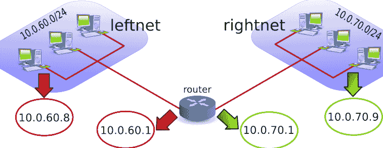
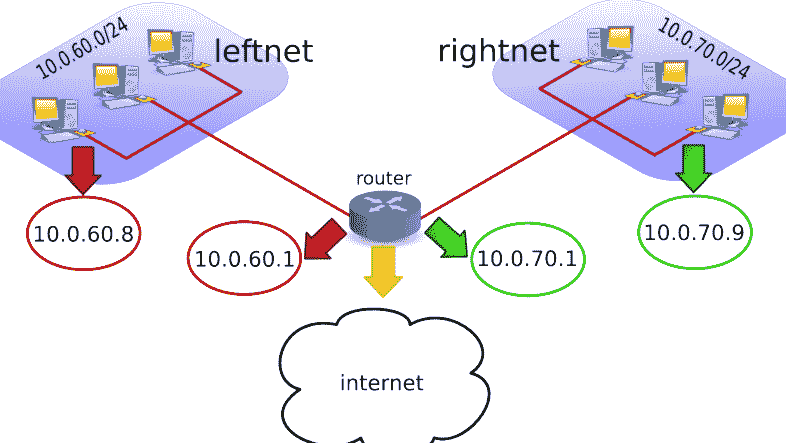
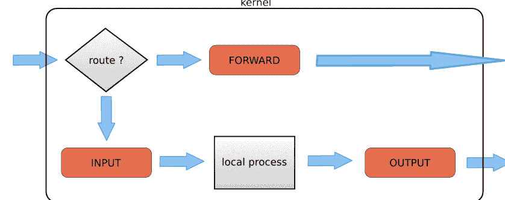
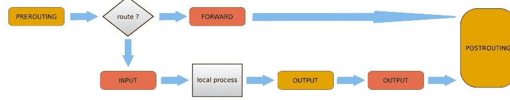

# Linux 安全高级指南

## 摘要

本书旨在用于导师指导的培训。对于自学而言，其意图是让读者在一台运行良好的 Linux 电脑旁阅读本书，以便能够立即操作每个主题并练习每个命令。

本书面向初级 Linux 系统管理员（也可能对想要了解更多 Linux 系统的家庭用户有用）。然而，本书并非关于 Linux 桌面应用程序（如文本编辑器、浏览器、邮件客户端、多媒体或办公软件）的介绍。

更多信息和免费的 `.pdf` 文件请访问`http://linux-training.be`。

欢迎随时联系作者：

- `Paul Cobbat`: `paul.cobbat@gmail.com`, `http://www.linkedin.com/in/cobbat`
- `Serge van Ginderachter`: `serge@ginys.be`, 构建脚本；基础设施搭建；少量工作人员
- `Hendrik De De Vloed`: `hendrik.devloed@ugent.be`, `buildhelper.pl` 脚本

Linux Training 项目的贡献者有：

- 我们还想感谢我们的评审员：
    - `Wouter Verhelst`: `wouter@grep.be`, `http://grep.be`
    - `Geert Goossens`: `mail.goossens.geert@gmail.com`, `http://www.linkedin.com/in/geertgoossens`
    - `Elie De Brauer`: `elie-de-brauer.be`, `http://www.de-brauer.be`
    - `Christophe Vandeplas`: `christophe@vandeplas.com`, `http://christophe.vandeplas.com`
    - `Bert Desmet`: `desmet@devnox.be`, `http://bdesmet.be`
    - `Rich Yonts`: `richyonts@gmail.com`,

# 目录

- 1. 用户介绍 4
    - 1.1. `whoami` 5
    - 1.2. `who` 5
    - 1.3. `who am i` 5
    - 1.4. `w` 5
    - 1.5. `id` 5
    - 1.6. 切换到另一个用户 6
    - 1.7. 切换到 `root` 6
    - 1.8. 以 `root` 身份运行 6
    - 1.9. `su -用户名` 6
    - 1.10. `su` 6
    - 1.11. 以另一个用户运行程序 7
    - 1.12. `visudo` 7
    - 1.13. `sudo su` 8
    - 1.14. `sudo` 日志 8
    - 1.15. 练习：用户介绍 9
    - 1.16. 答案：用户介绍 10
- 2. 用户管理 12
    - 2.1. 用户管理 13
    - 2.2. `/etc/passwd` 13
    - 2.3. `root` 13
    - 2.4. `useradd` 14
    - 2.5. `/etc/default/useradd` 14
    - 2.6. `userdel` 14
    - 2.7. `usermod` 14
    - 2.8. 创建家目录 15
    - 2.9. `/etc/shadow/` 15
    - 2.10. 删除家目录 15
    - 2.11. 登录 `shell` 16
    - 2.12. 冲突 16
    - 2.13. 练习：用户管理 17
    - 2.14. 答案：用户管理 18
- 3. 用户密码 20
    - 3.1. `passwd` 21
    - 3.2. `shadow` 文件 21
    - 3.3. 使用 `passwd` 加密 22
    - 3.4. 使用 `openssl` 加密 23
    - 3.5. 使用 `crypt` 加密 23
    - 3.6. `/etc/login.defs` 24
    - 3.7. 修改 24
    - 3.8. 禁用密码 25
    - 3.9. 编辑本地文件 25
    - 3.10. 练习：用户密码 26
    - 3.11. 答案：用户密码 27
- 4. 用户配置文件 29
    - 4.1. 系统配置文件 30
    - 4.2. `/bash_profile` 30
    - 4.3. `/bash_login` 31
    - 4.4. `/profile` 31
    - 4.5. `/bash` 31
    - 4.6. `/bash_logout` 32
    - 4.7. `Debian` 概述 33
    - 4.8. `RHEL` 概述 33
    - 4.9. 练习：用户配置文件 34
    - 4.10. 答案：用户配置文件 35
- 5. 组 36
    - 5.1. `groupadd` 37
    - 5.2. 组文件 37
    - 5.3. `groups` 37
    - 5.4. `usermod` 38
    - 5.5. `groupmod` 38
    - 5.6. `groupdel` 38
    - 5.7. `gpasswd` 39
    - 5.8. `newgrp` 40
    - 5.9. `vigr` 40
    - 5.10. 练习：组 41
    - 5.11. 答案：组 42
- 10.14. 练习：包转发 80
- 10.15. 答案：包转发 82

## 11. iptables 防火墙 85

- 11.1. `iptables` 表 86
- 11.2. 启动和停止 `iptables` 86
- 11.3. `filter` 表 87
- 11.4. 练习：包过滤 92
- 11.5. 答案：包过滤 93
- 11.6. 网络地址转换 97

## IV. selinux 99

- 12. `SELinux` 介绍 99
    - 12.1. `selinux` 模式 100
    - 12.2. 日志 100
    - 12.3. 激活 `selinux` 100
    - 12.4. `getenforce` 101
    - 12.5. `setenforce` 101
    - 12.6. `sestatus` 102
    - 12.7. 策略 102
    - 12.8. `/etc/selinux/config` 102
    - 12.9. `DAC` 或 `MAC` 103
    - 12.10. `Is -Z` 103
    - 12.11. `-z` 103
    - 12.12. `selinux` 104
    - 12.13. 身份 104
    - 12.14. 角色 104
    - 12.15. 类型（或域） 105
    - 12.16. 安全上下文 106
    - 12.17. 转换 106
    - 12.18. 属性 107
    - 12.19. 安全上下文 107
    - 12.20. 扩展 107
    - 12.21. 布尔值 108
    - 12.22. 故障 110

## V. 附录 113

## 许可证 115

## 索引 122

## 表

| 表名 | 页码 |
| :--- | :--- |
| 4.1. `Debian` 环境 | 33 |
| 4.2. `Red Hat` 环境 | 33 |
| 6.1. `Unix` 权限 | 48 |
| 6.2. `Unix` 权限 | 49 |
| 6.3. `Unix` 权限 | 49 |
| 6.4. `Octal` 权限 | 52 |
| 10.1. 包转发练习 | 80 |
| 10.2. 包转发答案 | 82 |

# 第一部分. 用户管理

本章节将教你如何使用 `who am i`、`id` 等命令在 `Unix` 系统上识别你的用户账户。在第二部分，你将学习如何通过 `su` 命令变成另一个用户。你还将学习如何使用 `sudo` 以另一个用户的身份运行程序。

## 1.1 `whoami`

`whoami` 命令告诉你你的用户名。

```bash
$ paul@centos7 ~ whoami
paul
$ paul@centos7 ~$
```

## 1.2 `who`

`who` 命令将提供关于谁登录了系统的信息。

```bash
$ paul@centos7 ~ who
23:44:07 up 31 min, 2 users, load average: 0.00, 0.01, 0.02
USER TTY LOGIN IDLE JCPU PCPU WHAT
root pts/0 23:07 15.00s 0.01s top
paul pts/1 23:30 7.00s 0.00s w
$ paul@centos7 ~$
```

## 1.3 `who am i`

`who am i` 命令将仅显示指向当前会话的信息。

```bash
$ paul@centos7 ~ who am i
paul pts/1 2014-10-00 23:30 (104.33.101)
$ paul@centos7 ~$
```

## 1.4 `w`

`w` 命令显示谁在登录以及他们正在做什么。

```bash
$ paul@centos7 ~ w
23:44:07 up 31 min, 2 users, load average: 0.00, 0.01, 0.02
USER TTY LOGIN IDLE JCPU PCPU WHAT
root pts/0 23:07 15.00s 0.01s top
paul pts/1 23:30 7.00s 0.00s w
$ paul@centos7 ~$
```

## 1.5 `id`

`id` 命令将提供用户 `ID`、主组组 `ID` 以及你所属的组列表。


```bash
$ paul@debian7:-$ id
uid=1000(paul) gid=1000(paul) groups=1000(paul)
```

在`RHEL/CentOS`上，你还将通过此命令获取`SELinux`上文信息。

```bash
$ root@centos7 ~$ id
uid=0(root) gid=0(root) groups=0(root) context=unconfined_u:unconfined_r\nunconfined_t:s0-s0:c0.c1023
```

## 1.6. 切换到另一个用户

`su` 命令允许用户以另一个用户的身份运行 `shell`。

```
laura@debian7:~~$ su tania
Password:
tania@debian7:/home/laura$
```

## 1.7. 切换到 root

当你知道`root`密码时，你也可以`su`切换到`root`。

```
laura@debian7:~~$ su root
Password:
root@debian7:/home/laura$
```

## 1.8. 以 root 身份切换

除非你以`root`身份登录，否则你需要知道想要替换的用户密码。`root`用户可以变成任何现有用户，而无需知道该用户的密码。

```
root@debian7:~~$ id
uid=0(root) gid=0(root) groups=0(root)
root@debian7:~# su - valentina
valentina@debian7:~-$
```

## 1.9. su - $username

默认情况下，`su` 命令会保持相同的 `shell` 环境。要切换到另一个用户并获取目标用户的环境，请执行`su -` 命令并接目标用户名。

```
root@debian7:~# su laura
laura@debian7:/root$ exit
exit
root@debian7:~# su - laura
laura@debian7:~$ pwd
/home/laura
```

## 1.10. su -

当向`su` 或`su -` 提供用户名时，命令将假设`root` 是目标。

```
tania@debian7:~~$ su - 
Password:
root@debian7:~#
```

## 1.11. 以另一个用户运行程序

`sudo` 程序允许用户以另一个用户的凭据启动程序。在此之前，系统管理员必须设置`/etc/sudoers` 文件。这对于将管理任务委托给另一个用户（而无需提供`root` 密码）非常有用。下面的截图显示了`sudo` 的用法。用户`paul` 获得了以`root` 身份运行`useradd` 的权限。这允许`paul` 在系统上创建新用户，而无需变成`root` 也无需知道`root` 密码。

第一个命令对`paul` 失败了。

```
paul@debian:~-$ /usr/sbin/useradd -m valentina
useradd: Permission denied.
useradd: cannot lock /etc/passwd; try again later.
```

但使用`sudo` 就可以成功了。

```
paul@debian?:-$ sudo /usr/sbin/useradd -m valentina
[sudo] password for paul:
paul@debian?:-$
```

## 1.12. visudo

在操作`/etc/sudoers` 文件之前，请检查`visudo` 的帮助页。编辑`sudoers` 超出本基础书籍的范围。

```
paul@rhel65:-$ apropos visudo
visudo
	(8) - edit the sudoers file
paul@rhel65:-$
```

## 1.13. sudo su -

在像`Ubuntu` 和`Xubuntu` 等某些`Linux` 系统上，`root` 用户没有设置密码。这意味着无法以`root` 身份登录（额外的安全考虑）。为了以`root` 身份执行任务，用户通过`/etc/sudoers` 获得了所有的`sudo` 权限。事实上，`admin` 组组成的所有用户都使用`sudo` 以`root` 身份运行所有命令。

```
root@lika:-# grep admin /etc/sudoers
# Members of the admin group may gain root privileges
%admin ALL=(ALL) ALL
```

结果是，用户可以输入`sudo su -` 并变成`root`，而无需输入`root` 密码。`sudo` 命令要求你输入自己的密码。因此，截图中的密码提示是针对`sudo` 的而不是`su`。

```
paullika:-$ sudo su -
Password:
root@lika:-#
```

## 1.14. sudo 日志

在授权的情况下使用`sudo` 将导致严重的警告：

```
paul@rhel65:-$ sudo su -
```

我们相信你已经收到了本地系统管理员的常规指导。这通常归结为以下三点：

- #1) 尊重他人的隐私。
- #2) 在输入之前先思考。
- #3) 能力越大，责任越大。

```
[sudo] password for paul:
paul is not in the sudoers file. This incident will be reported.
paul@rhel65:-$
```

`root` 用户可以在`Red Hat` 的`/var/log/secure` 中以及`Debian` 的`/var/log/auth.log` 中看到这些。

```
root@rhel65:-# tail /var/log/secure | grep sudo | tr -s ' ' 
Apr 16:03:42 rhel65 sudo: paul USER NOT in sudoers ; TTY=pts/0 ; PWD=/home/paul ; USER=root ; COMMAND=/bin/su - 
root@rhel65:-#
```

## 1.15. 练习：用户介绍

- 1. 运行一个仅显示当前登录用户名的命令。
- 2. 显示所有登录用户列表。
- 3. 显示所有登录用户列表，包括他们此时正在运行的命令。
- 4. 显示你的用户名和你的唯一用户标识 (`userid`)。
- 5. 使用`su` 切换到另一个用户账户（除非你是`root`，否则你需要另一个账户的密码）。并返回之前的账户。
- 6. 现在使用`su -` 切换到另一个用户并注意区别。注意`su -` 会让你进入`Tania` 的家目录。
- 7. 尝试创建一个新用户账户（当你使用普通账户时）。这应该是失败的。（添加账户的将在下一节解释。）
- 8. 现在尝试相同操作，但在命令前加上`sudo`。

## 1.16. 章节：用户介绍

- 1. 运行一个显示你当前登录用户名的命令。

```
laura@debian7:~$ whoami
laura
laura@debian7:~$ echo
```

- 2. 显示所有登录用户列表。

```
laura@debian7:~$ who
laura  pts/0         2014-10-13 07:22 (104.33)
laura@debian7:~$
```

- 3. 显示此时所有正在运行命令的用户列表。

```
laura@debian7:~$ w
07:47 up 16 min   2 users   load average: 0.00
USER     TTY             IDLE  JCPU  PCPU  WHAT
root     pts/0  104.33/101      07:30  0.00s 0.04s
root     pts/1  104.33/101      07:46  0.00s 0.01s
laura@debian7:~$
```

- 4. 显示你的用户名和你的唯一用户标识 (`userid`)。

```
laura@debian7:~$ id
uid=1005 (laura) gid=1007 (laura) groups=1007 (laura)
laura@debian7:~$
```

- 5. 使用`su` 切换到另一个账户（除非你是`root`，否则你需要另一个账户的密码）。返回之前的账户。

```
laura@debian7:~$ su tania
Password:
tania@debian7:~/home/tania$ id
uid=1006 (tania) gid=1008 (tania) groups=1008 (tania)
tania@debian7:~/home/tania$ exit
laura@debian7:~$
```

- 6. 现在使用`su` 切换到另一个用户查看区别。


```
laura@debian7:~$ su tania
Password:
tania@debian7:~$ pwd
/home/tania
tania@debian7:~$ logout
laura@debian7:~$
```

注意 `su` 会让你进入家目录。

- 7. 尝试创建一个新用户账户（当你使用普通账户时）。这应该是失败的。

```
laura@debian7:~$ useradd valentina
su: useradd: command not found
laura@debian7:~$ /usr/sbin/useradd valentina
Permission denied.
userid: cannot lock /etc/passwd; try again later.
```

`useradd` 可能位于 `/sbin/useradd`。

- 8. 现在尝试相同操作，但在命令前加上 `sudo`。

```
laura@debian7:~$ sudo /usr/sbin/useradd valentina
[sudo] password for laura:
laura is not in the sudoers file. This incident will be reported.
laura@debian7:~$
```

注意 `laura` 没有在该系统使用 `sudo`。

# 第二章. 用户管理

本章将教你如何使用 `useradd`、`usermod` 和 `userdel` 来创建、修改和删除用户账户。

你需要 Linux 上的 `root` 权限来完成本章。

## 用户管理

Linux 用户管理通过三种补充方式进行。你可以使用发行版提供的图形化工具。这些工具的外观和感受取决于发行版。如果你是家庭系统的 Linux 新手，请使用发行版提供的图形化工具。这可以确保你不会遇到问题。

另一个选项是使用 `useradd`、`usermod`、`gpasswd`、`passwd` 等命令行工具。服务器管理员可能会使用这些工具，因为它们在许多不同的发行中都是熟悉且相似的。本章将重点介绍这些工具。

第三种极端的方法是使用 `vi`（或 `vipw`/`vim`）直接编辑本地配置文件。新手不要在生产系统上尝试这样做！

## 2. /etc/passwd

本地数据库（Linux 和 Unix 系统上）是 `/etc/passwd`。

```
[root@RHEL5 ~]$# tail /etc/passwd
ing:518:524:art dealer:/home/inge:/bin/bash
ann:519:525:flux player:/home/ann:/bin/bash
derick:520:526:rubius:/home/frederik:/bin/bash
steven:521:527:roman peter:/home/steven:/bin/bash
pascale:522:528:artist:/home/pascale:/bin/bash
geert:524:530:kernel developer:/home/geert:/bin/bash
win:525:531:master daemon:/home/win:/bin/bash
sandra:526:532:radish stresser:/home/sandra:/bin/bash
annelies:527:533:sword fighter:/home/annelies:/bin/bash
laura:528:534:art dealer:/home/laura:/bin/bash
```

如你所示，该文件包含由冒号分隔的列。这些列包含用户名、`x`、用户 ID、主组 ID、描述、家目录名称和登录。

可以通过输入 `man 5 passwd` 获取更多信息。

```
[root@RHEL5 ~]$# man 5 passwd
```

## 2.4. useradd

你可以使用 `useradd` 命令添加用户。下面的示例显示了如何添加一个名为 `yanina` 的用户（最后一个参数），同时强制创建家目录（`-m`），设置家目录名称（`-d`）并设置描述（`-c`）。

```
[root@RHEL5 ~]# useradd -m /home/yanina -c yanina wickmayer yanina
[root@RHEL5 ~]# tail -1 /etc/passwd
yanina:x:529:529:yanina:wickmayer:/home/yanina:/bin/bash
```

名为 `yanina` 的用户分配了 UID 529 和主组 ID 529。

## 2.5. /etc/default/useradd

Red Hat Enterprise Linux 和 Debian/Ubuntu 有一个名为 `/etc/default/useradd` 的文件，其中包含默认用户选项。除了使用 `cat` 显示此文件外，你还可以使用 `useradd -D`。

```
[root@RHEL4 ~]# useradd -D
GROUP=100
HOME=/home
ACTIVE=-1
EXPIRE=
SHELL=/bin/bash
SKEL=/etc/skel
```

## 2.6. userdel

你可以使用 `userdel` 删除用户 `yanina`。`userdel` 的 `-r` 选项也会同时删除家目录。

```
[root@RHEL5 ~]# userdel -r yanina
```

## 2.7. usermod

你可以使用 `usermod` 命令修改用户的属性。这个示例使用 `usermod` 来更改用户 `harry` 的描述。

```
[root@RHEL4 ~]# tail -1 /etc/passwd
harry:x:516:520:harry potter:/home/harry:/bin/bash
[root@RHEL4 ~]# usermod -c 'wizard' harry
[root@RHEL4 ~]# tail -1 /etc/passwd
harry:x:516:520:wizard:/home/harry:/bin/bash
```

## 2.8. 创建家目录

创建家目录最简单的方法在使用 `useradd` 时提供 `-m` 选项（这在 Linux 上可能和默认选项一样简单）。

较简单的方法是使用 `mkdir` 手动创建家目录，这还需要通过 `chmod` 和 `chown` 设置目录的所有者和权限（这两个命令将在另一个章节中详细讨论）。

```
[root@RHEL5 ~]# # mkdir /home/laura
[root@RHEL5 ~]# # chown laura:home/laura
[root@RHEL5 ~]# # chmod 700 /home/laura
[root@RHEL5 ~]# # ls -ld /home/laura/
drwx------ 2 laura 4096 Jun 24 15:17 /home/laura/
```

## 2.9. /etc/skel/

当使用 `-m` 选项时，`/etc/skel/` 目录会被复制到新创建的家目录中。`etc/skel/` 目录包含一些（通常是隐藏的）文件，这些文件包含了配置文件和应用程序的默认值。这样，`/etc/skel/` 就可以作为默认家目录和默认的用户配置文件。

```
[root@RHEL5 ~]# ls -la /etc/skel/
total 48
drwxr-xr-x 2 root 4096 Apr 1 00:11 .
drwxr-xr-x 9 root 12288 Jun 24 15:36 .
-rw-r--r-- 1 root 24 Jul 12 2006 .bash_logout
-rw-r--r-- 1 root 176 Jul 12 2006 .bash_profile
-rw-r--r-- 1 root 124 Jul 12 2006 .bashrc
```

## 2.10. 删除家目录

`userdel` 的 `-r` 选项将使家目录随用户账户一起被删除。

```
[root@RHEL5 ~]# ls -ld /home/wim/
drwx------ 2 wim 4096 Jun 24 15:19 /home/wim/
[root@RHEL5 ~]# # userdel -r wim
[root@RHEL5 ~]# ls -ld /home/wim/
ls: /home/wim/: No such file or directory
```

## 2.11. 登录 shell

`/etc/passwd` 文件指定了用户的登录 shell。在下方的图中，你可以看到用户 `annelie` 将使用 `/bin/bash` shell 登录，而用户 `laura` 将使用 `/bin/ksh` shell 登录。

```
[root@RHEL5 ~]# tail -2 /etc/passwd
annelies:x:527:533:word fighter:/home/annelies:/bin/bash
laura:x:528:534:art dealer:/home/laura:/bin/ksh
```


你可以使用 `usermod` 命令更改用户的 shell。

```
[root@RHEL5 ~]# usermod -s /bin/bash laura
[root@RHEL5 ~]# tail -1 /etc/passwd
laura:x:528:534:art dealer:/home/laura:/bin/bash
```

## 2.12. chsh

用户可以使用 `chsh` 更改登录 shell。首先，获取可用的 shell 列表（用户也可以通过 `cat /etc/shells` 获取），然后将其登录 shell 更改为 Korn shell（`/bin/ksh`）。下次登录时，将默认使用 `ksh` 而不是 `bash`。

```
[laura@centos7]$ chsh -l
/bin/sh
/bin/bash
/bin/nologin
/usr/bin/bash
/sbin/nologin
/bin/ksh
/bin/csh
/tcsh
```

注意 `Debian` 上没有 `-l` 选项，上面的截图假设安装了 `ksh` 和 `csh`。下面的截图显示了 `laura` 如何更改她的默认 shell（交互式）。

```
[laura@centos7]$ chsh - /bin/ksh
Changing shell for laura.
Password:
Shell changed.
```

## 2.13. 用户管理练习

1. 使用单个命令创建一个名为 `serena` 用户，包括家目录和描述（注释）`Ser Williams`。
2. 使用单个命令创建一个名为 `venus` 用户，包括家目录、`bash` 和描述 `Venus`。
3. 使用单个命令验证 `/etc/passwd`、`/etc/shadow` 和 `/etc/group` 中正确的条目。
4. 验证家目录是否已创建。
5. 创建一个名为 `erstwhile` 用户，默认 shell 为 `/bin/date`。
7. 登录 `erstwhile` 用户时会发生什么？你能想到将用户登录 shell 更改为应用程序的实用示例吗？
8. 创建一个名为 `welcome.txt` 的文件，确保每个新用户在家目录都能看到此文件。
9. 通过创建（并删除）测试用户来验证此设置。
10. 将 `serena` 用户的默认 shell 更改为 `/bin/bash`。在更改前后进行验证。

## 2.14. 用户管理解答

1. 使用单个命令创建一个名为 `serena` 用户，包括家目录和描述（注释）`Serena Williams`。

```
root@debian]# useradd -c 'Serena Williams' serena
```

2. 使用单个命令创建一个名为 `venus` 用户，包括家目录、`bash` 和描述 `Venus`。

```
root@debian]# useradd -m -c "Venus Williams" -s /bin/bash venus
```

3. 验证 `/etc/passwd`、`/etc/shadow` 和 `/etc/group` 中正确的条目。

```
root@debian]# tail -2 /etc/passwd
serena:x:1008:1010:Serena Williams:/home/serena:/bin/sh
venus:x:1002:1002:Venus:/home/venus:/bin/bash
root@debian]# tail -2 /etc/shadow
serena:x:1001:99999:::
venus:x:1002:99999:::
root@debian]# tail -2 /etc/group
serena:1010:
venus:1011:
```

4. 验证家目录是否已创建。

```
root@debian]# ls -lrt /home | tail -2
drwxr-xr-x 2 serena serena 4096 Oct 15 10:50 serena
drwx-xr-x 2 venus venus 4096 Oct 15 10:59 venus
root@debian:~#
```

5. 创建一个名为 `erstwhile` 用户，默认 shell 为 `/bin/date`。

```
root@debian]# useradd -s /bin/date einstime
```

或者更好的：

```
root@debian]# useradd -s $(date) einstime
```

7. 登录 `erstwhile` 用户时会发生什么？你能想到将用户登录 shell 更改为应用程序的实用示例吗？

```
root@debian]# su einstime
Wed Oct 15 11:05:56 UTC 2014 # 你得到了 date 命令的输出
root@debian:~#
```

当用户只需要访问服务器上的一个应用程序时，这非常有用。只需登录即可他们打开应用程序，关闭应用程序会自动注销。

8. 创建一个名为 `welcome.txt` 的文件，确保每个新用户在家目录都能看到此文件。

```
root@debian7:~# echo Hello > /etc/skel/welcome.txt
```

9. 通过创建（并删除）测试用户账户来验证此设置。

```
root@debian7]# useradd -m test
root@debian7]# ls -l /home/test
total 4
-rw-r--r-- 1 test 6 Oct 15 11:16 welcome.txt
root@debian7]# userdel -r test
root@debian7:~#
```

10. 将 `serena` 用户的默认登录 shell 更改为 `/bin/bash`。在更改前后进行验证。

```
root@debian7]# grep serena /etc/passwd
serena:x:1008:1010:Serena Williams:/home/serena:/bin/sh
root@debian7]# usermod -s /bin/bash serena
root@debian7]# grep serena /etc/passwd
serena:x:1008:1010:Serena Williams:/home/serena:/bin/bash
root@debian7:~#
```

## 3.1. passwd

可以使用 `passwd` 命令设置用户密码。用户在两次输入新密码之前，必须提供旧密码。

```
[tania@centos ~]$ password
Changing password for user tania.
Changing password for tania.
(current) UNIX password:
New password:
BAD PASSWORD: The password is shorter than 8 characters
New password:
BAD PASSWORD: The password is a palindrome
New password:
BAD PASSWORD: The password is too similar to the old one
passwd: Have exhausted maximum number of retries for service
```

如你所见，`passwd` 工具将使用一些基础验证来防止用户使用过于简单的密码。`root` 用户不需要遵循这些规则（尽管会收到警告）。`root` 用户在输入新密码之前不需要提供旧密码。

```
root@debian:-# passwd tania
Enter new UNIX password:
Retype new UNIX password:
passwd: updated successfully
```

## 3.2. shadow file

用户密码加密在 `/etc/shadow` 中。`/etc/shadow` 文件是只读的，只有 `root` 用户可以读取。我们将在文件权限部分介绍用户如何更改密码。目前，你只需要知道用户可以使用 `/usr/bin/passwd` 命令更改他们的密码。


```
[root@centos ~]# tail -4 /etc/shadow
laura:$61k2XptaS5.Tml._p2S3J7Y/NOYqGMKwLJqoGJbVsZsG5/Pti8ovBRD.VbRbiDS17TEQ/
IASMH.TEKBnt/S31ruw89fgfCOJ98.BNWqMKJKJ3F8S9:99999:7:
sasha:$6B8Z2YqJ1v9q0789g8IK8ml.K2EAWAY5z5ZynN5vyYJaa9L5XqVu.Z4d1pMREH/
eQqZ5VqFnRKMKJ1Y7H77S.c790ZD6:15630:99999:7:
aura:$6a4qG5fR699X673695HA64XXocCFVJKJnb98bThPfwXQGk
Syh1Wc676395H6.w24rY3A0BZM:15630:99999:7:
valina:$6Y3zRA6GP51Vq689m66BKJFR58R4c6F6Lrhhh.vi4qUvRevuill71
6XROUDAK552NHbaE2Outnv:15630:99999:7:
[root@centos ~]#
```

`/etc/shadow` 文件包含冒号分隔的列。从左到右的字段分别是：用户名（注意只有 `Laura` 有加密密码）、最后更改密码的日期（日期自 1970 年 1 月 1 日起）、密码必须保持不变的天数、密码过期日期、密码过期前的警告天数、过期后禁用账户的天数以及账户被禁用的日期（同样自 1970 年起）。最后一个字段还没有意义。

截图中的所有密码都是 `hunter2` 的哈希值。

## 3.3. encryption with passwd

密码以加密格式存储。这种加密是由 `crypt` 函数完成的。向系统添加带密码的用户最简单（也是推荐）的方法是使用 `useradd` 命令添加用户，然后用 `passwd` 设置用户密码。

```
[root@RHEL4 ~]# useradd -m xavier
[root@RHEL4 ~]# passwd xavier
Changing password for user xavier.
New UNIX password:
Retype new UNIX password:
passwd: all authentication tokens updated successfully.
[root@RHEL4 ~]#
```

## 3.4. encryption with openssl

创建带密码用户的另一种方法是使用 `useradd` 的 `-p` 选项，但该选项需要加密密码。你可以使用 `openssl password` 生成此加密密码。

`openssl passwd` 命令会对同一个密码生成多个不同的哈希值，为此它使用了盐（`salt`）。

```
paul@rhel65:-$ openssl passwd hunter 2
86cjUN1GDfPY
paul@rhel65:-$ openssl passwd hunter 2
YjF3mGoDbvG
paul@rhel65:-$ openssl passwd hunter 2
YqDcJceGoDbzKA
paul@rhel65:-$
```

这个盐是可以选择的，并显示为哈希值的前两个字符。

此示例展示了如何创建一个带密码的用户。

```
root@rhel65:-# useradd -m -p $(openssl passwd hunter 2) mohamed
```

## 3.5. encryption with crypt

第三种选择是使用 `crypt` 函数编写自己的 `C` 语言程序，并将其编译为命令。

```
paul@rhel65:$ cat MyCrypt.c
#include <stdio.h>
#define _DEFAULT_SOURCE
#include <unistd.h>

int main(int argc, char **argv) {
    if(argc==3) {
        printf("%s\n", crypt(argv[1],argv[2]));
    } else {
        printf("Usage: MyCrypt password $salt\n");
    }
    return 0;
}
```

这个小程序可以用 `gcc -o MyCrypt` 编译。

```
paul@rhel65:$ gcc MyCrypt.c -o MyCrypt -lc
```

要使用它，我们为 `MyCrypt` 提供两个参数。第一个是未加密的密码，第二个是盐。盐用于扰动 4096 种加密算法。这种变化防止了具有相同密码的用户在 `/etc/shadow` 中具有相同的条目。

```
paul@rhel65:$ ./MyCrypt hunter2 42
$42...
```

（注：此处对应原文输出示例）

你注意到盐了吗？`crypt` 函数的标准输出是 `DES` 算法，很容易被破解。更好的方法是使用 `md5` 密码，它可以由 `$` 开头的盐来识别。

```
paul@rhel65:$ ./MyCrypt hunter2 '$14'
$14...
paul@rhel65:$ ./MyCrypt hunter2 '$62'
$62...
```

`md5` 盐可以长达 8 个字符。盐显示在 `/etc/shadow` 中第二个和第三个 `$` 之间，所以不要使用密码作为盐！

```
paul@rhel65:$ ./MyCrypt hunter2 '$hunter2'
$hunter2...
```

## 3.6 /etc/login.defs

`/etc/login.defs` 文件包含一些用户密码的默认设置，如密码有效期（你还会发现用户 ID 和组 ID 的限制以及是否创建家目录）。

```
root@rhel65:~# grep /etc/login.defs
PASS_MAX_DAYS      99999
PASS_MIN_DAYS      0
PASS_MIN_LEN       5
PASS_WARN_AGE      7
```

Debian 也有：

```
root@debian7:~# grep /etc/login.defs
# PASS_MAX_DAYS      密码可以使用的天数。
# PASS_MIN_DAYS      更改之间的最小天数。
# PASS_WARN_AGE      密码过期前的天数。
PASS_MAX_DAYS      99999
PASS_MIN_DAYS      0
PASS_WARN_AGE      7
# PASS_CHANGE_TRIES
# PASS_ALWAYS_WARN
# PASS_MIN_LEN
# PASS_MAX_LEN
# NO_PASSWORD_CONSOLE
```

## 3.7. charge

`change` 命令可设置用户账户的过期日期 (`-E`)、设置最小 (`-m`) 和最大 (`-M`) 密码有效期、密码过期日期以及密码过期前的警告天数。许多功能也可以通过 `passwd` 命令实现。`charge` 的 `-l` 选项会列出用户的这些设置。

```
root@rhel65:~# charge -l paul
Last password change               : Mar 27, 2014
Password expires                   : never
Password inactive                  : never
Account expires                    : never
Minimum number of days between password change : 0
Maximum number of days between password change : 99999
Number of days of warning before password expires : 7
root@rhel65:~#
```

## 3.8. disabling a password

`/etc/shadow` 中的密码不能以叹号开头。当 `/etc/passwd` 中的第二个字段以叹号开头时，该密码无法使用。

此功能通常被称为锁定、禁用或暂停用户账户。除了 `vi`（或 `vip`），你还可以使用 `usermod` 完成此。

下一张截图中的第一个命令将显示 `Laura` 的密码字段。下一个命令将禁用 `Laura` 的密码，使 `Laura` 无法使用该密码进行验证。

```
root@debian:-# grep laura /etc/shadow | cut -c1-70
laura:$64J2gp$stwWAc30tEI2R2au7j.nbW.dpKNUVK7mChFCVMaDUJV
root@debian:-# usermod -L laura
```

如你所见，密码哈值前面仅有一个叹号。


```
root@debian:-# grep laura /etc/shadow | cut -c1-70
laura:$66JYJ2gp$stwWAc30tEI2R2au7j.nbW.dpKNUVK7mChFCVMaDUJV
root@debian:-#
```

用户（以及拥有 `sudo` 权限的用户）仍然能够 `su` 进入 `Laura` 账户（因为这里没有设置密码！）。注意，如果 `Laura` 设置了 `SSH` 密码，她仍然能够登录！

```
root@debian:-# su - laura
laura@debian:-$
```

你可以用 `usermod -U` 再次解锁账户。

```
root@debian:-# usermod -U laura
root@debian:-# grep laura /etc/shadow | cut -c1-70
laura:$64J2gp$stwWAc30tEI2R2au7j.nbW.dpKNUVK7mChFCVMaDUJV
```

## 3.9. editing local files

如果你想手动编辑 `/etc/passwd` 或 `/etc/shadow`，在了解这些密码管理命令后，请使用 `vip` 而不是直接使用 `vi(m)`。`vip` 工具会对文件进行正确的锁定。

```
[root@RHEL5 ~]# vip /etc/passwd
vip: the password file is busy (/etc/ptmp present)
```

## 3.10. 练习：用户密码

- 1. 为 `serena` 设置密码为 `hunter2`。
- 2. 同时为 `venus` 设置密码，并使用 `usermod` 锁定 `venus` 用户账户。在锁定前后分别在 `/etc/shadow` 中验证锁定状态。
- 3. 使用 `passwd -d` 禁用 `serena` 的密码。在禁用前后分别验证 `/etc/shadow` 中的 `serena` 所在行。
- 4. 锁定用户账户与你刚刚通过 `usermod -L` 和 `passwd -d` 禁用用户密码之间区别是什么？
- 5. 尝试将 `serena` 的密码更改为 `serena`（以 `serena` 身份）。
- 6. 确保 `serena` 每 10 天必须更改一次密码。
- 7. 确保每个新用户都需要每 10 天更改一次密码。
- 8. 以 `root` 身份备份 `/etc/shadow`。使用 `vi` 将 `venus` 的一个加密的 `hunter2` 哈希值复制到 `serena` 中。现在 `serena` 还能用 `hunter2` 作为密码登录吗？
- 9. 为什么要使用 `vipw` 而不是 `vi`？使用 `vi` 或 `vim` 会可能会什么问题？
- 10. 使用 `chsh` 列出所有 shell（仅适用于 RHEL/Centos/Fedora），并与 `cat /etc/shells` 进行比较。
- 11. 哪个 `useradd` 允许你命名主目录？
- 12. 如何查看用户 `serena` 的密码是被锁定还是解锁的？给出一个使用 `grep` 的解决方案和一个使用 `passwd` 的解决方案。

## 3.11. 答案：用户密码

- 1. 为 `serena` 设置密码为 `hunter2`。

```
root@debian:-# passwd serena
Enter new UNIX password:
Retype new UNIX password:
passwd: password updated successfully
```

- 2. 为 `venus` 设置密码，然后使用 `usermod` 锁定 `venus` 用户账户。在锁定前后验证 `/etc/shadow`。

```
root@debian:-# passwd venus
Enter new UNIX password:
Retype new UNIX password:
passwd: password updated successfully
root@debian:-# grep venus /etc/shadow | cut -c70
serena:$66gsZWICU5SkhYVIKFzMtPAMvS4AVNA/K0270xN0v5LdV9edogTyXrjUEM/
usermod -L venus
root@debian:-# grep /etc/shadow | cut -c70
venus:$66gsZWICU5SkhYVIKFzMtPAMvS4AVNA/K0270xN0v5LdV9edogTyXrjUEM
```

注意 `usermod -L` 用于禁用 `serena` 账户。通过感叹号 `!` 验证 `/etc/shadow` 中的 `serena` 所在行。

- 3. 使用 `passwd -d` 禁用 `serena` 账户。在禁用前后验证 `/etc/shadow` 中的 `serena` 所在行。

```
root@debian:-# grep /etc/shadow | cut -c70
serena:$66Es/cmrREF52Py9xXplRKd0w/UIWA5jrYrBD2nWZ2/dt.i/IypRGpiZESdB/B
root@debian:-# passwd -d serena
passwd: expiry information changed.
root@debian:-# grep /etc/shadow
serena:116358:0:99999::::
root@debian:-#
```

- 4. 锁定用户账户与我们通过通过 `usermod -L` 和 `passwd -d` 禁用用户账户之间的区别是什么？

锁定通过在 `/etc/shadow` 中的密码前加一个 `!` 来防止用户使用其密码登录系统。

禁用 `passwd` 则会擦除 `/etc/shadow` 中的密码。

- 5. 尝试将 `serena` 的密码更改为 `serena`。

以 `serena` 身份登录，然后执行：`passwd serena`...它应该会失败！

- 6. 确保 `serena` 每 10 天必须更改一次密码。

```
chage -M 10 serena
```

- 7. 确保每个新用户都需要每 10 天更改一次密码。

```
vi /etc/login.defs （并将 PASS_MAX_DAYS 修改为 10）
```

是的。

- 9. 为什么要使用 `vipw` 而不是 `vi`？使用 `vi` 或 `vim` 可能会什么问题？

```
当其他人正在使用该文件时（通过 vipw），vipw 会给出警告
```

- 10. 使用 `chsh` 列出所有 shell（仅适用于 RHEL/Centos/Fedora），并与 `cat /etc/shells` 进行比较。

```
chsh -l
cat /etc/shells
```

- 12. 如何查看用户 `serena` 的密码是被锁定还是解锁？给出一个使用 `grep` 的解决方案和一个使用 `passwd` 的解决方案。

```
grep serena /etc/shadow
passwd -S serena
```

# 第 4 章. 用户配置文件

登录的用户拥有许多预设（以及自定义）的别名、变量和函数，但它们从哪里来呢？`shell` 使用了许多启动文件，这些文件每当 shell 被调用时都会被执行（或者准确说是被**源化 source**）。以下是启动脚本的概述。

## 1. 系统配置文件

`bash` 和 `ksh` shell 都会验证 `/etc/profile` 是否存在，如果存在则进行**source** 操作。在读取此脚本时，你会发现（在 Debian 和 Hat Enterprise Linux 上都是如此）构建了 `PATH` 变量（以及其他变量）。脚本还可能更改 `PSNAME` 变量，设置 `HOSTNAME` 并执行更多脚本，如 `/etc/inputrc`。截图使用 `grep` 显示了 Debian 上 `/etc/profile` 中的 `PATH` 操作。

```
root@debian:~# grep /etc/profile
PATH=/usr/local/bin:/usr/bin:/usr/sbin:/bin
PATH=/usr/local/bin:bin:/sbin:/games
export PATH
root@debian:~#
```

在 RHEL/CentOS 7 上。

```
root@centos:~# grep /etc/profile
case ${PATH} in
  PATH=$1
```

`root 用户` 可以使用此脚本为每个用户设置别名、函数和变量。

## 2. ~/.bash_profile

当此文件存在时，`bash` 会对其进行源化。在 Debian 5/6 上此文件不存在。RHEL/CentOS 使用较小的 `~/.bash_profile`，在其中它检查 `~/.bashrc` 是否存在并对其进行源化。它将 `$HOME` 添加到 `$PATH` 变量。


## 3. 用户配置文件与 Shell 初始化

### 3.1. `~/.bash_profile`

RHEL/CentOS 使用较小的 `~/.bash_profile`，在其中它检查 `~/.bashrc` 是否存在并对其进行源化（source）。它将 `$HOME` 添加到 `$PATH` 变量中。

```bash
root@hel:~# cat /home/.bash_profile
#bash_profile
if [ -f ~/.bashrc
```

### 3.2. `~/.profile`

当此文件存在时，`bash` 会对其进行源化。

在 Debian 5/6 上此文件不存在。RHEL/CentOS 使用较小的 `~/.bash_profile`，在其中它检查 `~/.bashrc` 是否存在并对其进行源化。它将 `$HOME` 添加到 `$PATH` 变量中。

### 3.3. `/etc/profile`

`bash` 和 `ksh` shell 都会验证 `/etc/profile` 是否存在，如果存在则执行 source 操作。在读取此脚本时，你会发现（在 Debian 和 Red Hat Enterprise Linux 上都是如此）构建了 `PATH` 变量（以及其他变量）。脚本还可能更改 `PS1` 变量，设置 `HOSTNAME` 并执行更多脚本，如 `/etc/inputrc`。

以下截图使用 `grep` 显示了 Debian 上 `/etc/profile` 中的 `PATH` 操作：

```bash
root@debian:~# grep /etc/profile
PATH=/usr/local/bin:/usr/bin:/usr/sbin:/bin
PATH=/usr/local/bin:bin:/sbin:/games
export PATH
root@debian:~#
```

在 RHEL/CentOS 7 上：

```bash
root@centos:~# grep /etc/profile
case ${PATH} in
  PATH=$1
```

`root` 用户可以使用此脚本为每个用户设置别名、函数和变量。

### 3.4. `~/.bashrc`

（注：原文此处内容较为混乱且重复，已根据核心逻辑整理）

### 3.5. `/etc/bashrc`

（注：原文此处内容较为混乱且重复，已根据核心逻辑整理）

## 4. 练习：用户密码

1. 为 `serena` 设置密码为 `hunter2`。
2. 同时为 `venus` 设置密码，并使用 `usermod` 锁定 `venus` 用户账户。在锁定前后分别在 `/etc/shadow` 中验证锁定状态。
3. 使用 `passwd -d` 禁用 `serena` 的密码。在禁用前后分别验证 `/etc/shadow` 中的 `serena` 所在行。
4. 锁定用户账户与你刚刚通过 `usermod -L` 和 `passwd -d` 禁用用户密码之间区别是什么？
5. 尝试将 `serena` 的密码更改为 `serena`（以 `serena` 身份执行）。
6. 确保 `serena` 每 10 天必须更改一次密码。
7. 确保每个新用户都需要每 10 天更改一次密码。
8. 以 `root` 身份备份 `/etc/shadow`。使用 `vi` 将 `venus` 的一个加密的 `hunter2` 哈希值复制到 `serena` 中。现在 `serena` 还能用 `hunter2` 作为密码登录吗？
9. 为什么要使用 `vipw` 而不是 `vi`？使用 `vi` 或 `vim` 可能会出现什么问题？
10. 使用 `chsh` 列出所有 shell（仅适用于 RHEL/CentOS/Fedora），并与 `cat /etc/shells` 进行比较。
11. 哪个 `useradd` 参数允许你命名主目录？
12. 如何查看用户 `serena` 的密码是被锁定还是解锁的？给出一个使用 `grep` 的解决方案和一个使用 `passwd` 的解决方案。

## 5. 答案：用户密码

1. 为 `serena` 设置密码为 `hunter2`。

```bash
root@debian:-# passwd serena
Enter new UNIX password:
Retype new UNIX password:
passwd: password updated successfully
```

2. 为 `venus` 设置密码，然后使用 `usermod` 锁定 `venus` 用户账户。在锁定前后验证 `/etc/shadow`。

```bash
root@debian:-# passwd venus
Enter new UNIX password:
Retype new UNIX password:
passwd: password updated successfully
usermod -L venus
root@debian:-# grep venus /etc/shadow | cut -c70
venus:$66gsZWICU5SkhYVIKFzMtPAMvS4AVNA/K0270xN0v5LdV9edogTyXrjUEM
```

注意 `usermod -L` 用于锁定账户。通过感叹号 `!` 验证 `/etc/shadow` 中的 `venus` 所在行（原文误写为 serena，此处修正为操作对象 venus）。


### 3. 禁用账户
使用`passwd -d`禁用`serena`账户。在禁用前后验证`/etc/shadow`中的`serena`所在行。

```
root@debian:-# grep /etc/shadow | cut -c70
serena:$66Es/cmrREF52Py9xXplRKd0w/UIWA5jrYrBD2nWZ2/dt.i/IypRGpiZESdB/B
root@debian:-# passwd -d serena
passwd: expiry information changed.
root@debian:-# grep /etc/shadow
serena:116358:0:99999::::
root@debian:-#
```

### 4. 锁定与禁用的区别
锁定用户账户与我们通过`usermod -L`和`passwd -d`禁用用户账户之间的区别是什么？

锁定通过在`/etc/shadow`中的密码前加一个`!`来防止用户使用其密码登录系统。

禁用`passwd`则会擦除`/etc/shadow`中的密码。

### 5. 修改密码
尝试将`serena`的密码更改为`serena`。

以`serena`身份登录，然后执行：`passwd serena`...它应该会失败！

### 6. 设置密码有效期
确保`serena`每 10 天必须更改一次密码。

```
chage -M 10 serena
```

### 7. 新用户密码策略
确保每个新用户都需要每 10 天更改一次密码。

```
vi /etc/login.defs （并将 PASS_MAX_DAYS 修改为 10）
```

是的。

### 9. 使用 vipw 的原因
为什么要使用`vipw`而不是`vi`？使用`vi`或`vim`可能会什么问题？

```
当其他人正在使用该文件时（通过 vipw），vipw 会给出警告
```

### 10. 列出 Shell
使用`chsh`列出所有 shell（仅适用于 RHEL/Centos/Fedora），并与`cat /etc/shells`进行比较。

```
chsh -l
cat /etc/shells
```

### 12. 查看密码状态
如何查看用户`serena`的密码是被锁定还是解锁的？给出一个使用`grep`的解决方案和一个使用`passwd`的解决方案。

```
grep serena /etc/shadow
passwd -S serena
```

# 第 4 章 用户配置文件

登录的用户拥有许多预设（以及自定义）的别名、变量和函数，但它们从哪里来呢？`shell`使用了许多启动文件，这些文件每当`shell`被调用时都会被执行（或者准确说是被源化 `source`）。以下是启动脚本的概述。

## 1. 系统配置文件

`bash`和`ksh``shell`都会验证`/etc/profile`是否存在，如果存在则进行`source`操作。在读取此脚本时，你会发现（在 Debian 和 Hat Enterprise Linux 上都是如此）构建了`PATH`变量（以及其他变量）。脚本还可能更改`PSNAME`变量，设置`HOSTNAME`并执行更多脚本，如`/etc/inputrc`。截图使用`grep`显示了 Debian 上`/etc/profile`中的`PATH`操作。

```
root@debian:~# grep /etc/profile
PATH=/usr/local/bin:/usr/bin:/usr/sbin:/bin
PATH=/usr/local/bin:bin:/sbin:/games
export PATH
root@debian:~#
```

在 RHEL/CentOS 7 上。

```
root@centos:~# grep /etc/profile
case ${PATH} in
  PATH=$1
```

`root`用户可以使用此脚本为每个用户设置别名、函数和变量。

## 2. ~/.bash_profile

当此文件存在时，`bash`会对其进行源化。在 Debian 5/6 上此文件不存在。RHEL/Centos 使用一个较小的`~/.bash_profile`，在其中它检查`~/.bashrc`是否存在并对其进行源化。它将`$HOME`添加到`$PATH`变量。

```
root@hel:~# cat /home/.bash_profile
#bash_profile
if [ -f ~/.bashrc
```

## 3. ~/.bashrc

（注：原文此处内容存在混乱和重复，已根据核心意图进行对齐翻译）

## 4. ~/.profile

当此文件存在时，`bash`会对其进行源化。（注：原文此处内容存在混乱和重复，已根据核心意图进行对齐翻译）

## 4.9. 练习：用户配置文件

1.  列出系统上所有的配置文件。

2.  读取这些文件中的每一个内容，它们通常会加载额外的脚本。

3.  在这些文件中的每一个放置一个唯一的变量、别名（`alias`）和函数。

4.  尝试几种获取 `shell` 的方法（`su`, `su -`, `ssh`, `tmux`, `gnome-terminal`, `Ctrl-alt-F1`, ...），并验证你的自定义变量、别名和函数中有哪些存在于环境中。

5.  你也知道它们的执行顺序吗？

6.  当一个应用程序依赖于`$HOME/.profile`中的某个设置时，`$HOME/.bash_profile`是否存在会有影响吗？

## 4.10. 解决方案：用户配置文件

1.  列出系统上所有的配置文件。

```
ls -a ~ ; ls -l /etc/pro* /etc/bash*
```

2.  读取这些文件中的每一个内容，它们通常会加载额外的脚本。

3.  在这些文件中每一个放置一个唯一的变量、别名（`alias`）和函数。

4.  尝试几种获取 `shell` 的方法（`su`, `su -`, `ssh`, `tmux`, `gnome-terminal`, `Ctrl-alt-F1`, ...），并验证你的自定义变量、别名和函数中有哪些存在于环境中。

5.  你也知道它们的执行顺序吗？

```
同名的别名、函数和变量将相互覆盖
```

6.  当一个应用程序依赖于`$HOME/.profile`中的某个设置时，`$HOME/.bash_profile`是否存在会有影响吗？

```
是有影响的。（man bash /INVOCATION) 
```

# 第 5 章 组

用户可以被列在`组`中。组允许你在组层级设置权限，而无需为每个单独的用户都设置权限。

每个 Unix 或 Linux 发行版都会有一个管理组的图形化工具。建议初学者使用这种图形化工具。更有经验的用户可以使用命令行工具来管理组。某些发行版不允许混合使用 GUI 和 CLI 工具管理组（如 Novell Suse 中的 YaST）。高级管理员可以使用`vi`或`vigr`直接编辑相关文件。

## 5.1. groupadd

可以使用`groupadd`命令创建组。下面的示例显示了创建五个（空）组。

```
root@laika:-# groupadd tennis
root@laika:-# groupadd football
root@laika:-# groupadd snooker
root@laika:-# groupadd formal
root@laika:-# groupadd salsa
```

## 5.2. group 文件

用户可以是多个组的成员。组成员关系由`/etc/group`文件定义。

```
root@laika:-# tail -5 /etc/group
tennis:x:1006:
football:x:1007:
snooker:x:1008:
formal:x:1009:
salsa:x:1010:
root@laika:-#
```

第一个字段是组名。第二个字段是组的（加密）密码（可以为空）。第三个字段是组标识或`GID`。第四个字段是成员列表，这些组没有成员。

## 5.3. groups

用户可以输入`groups`命令来查看用户所属的组列表。

```
[harry@RHEL4b ~]$ groups
harry sports
[harry@RHEL4b ~]$
```

## 5.4. usermod

组成员关系可以通过`useradd`或`usermod`命令修改。


```
root@laika:~ usermod -a -G tennis inge
root@laika:~ usermod -a -G tennis katrien
root@laika:~ usermod -a -G salsa katrien
root@laika:~ usermod -a -G snooker sandra
root@laika:~ usermod -a -G formal annies
root@laika:~ tail -a /etc/group
tennis:x:1006:inge,katrien
football:x:1007:
snooker:x:1008:sandra
formal:x:1009:annelies
salsa:x:1010:katrien
root@laika:~#
```

使用 `usermod` 将用户添加到组时要小心。默认情况下，如果命令中没有列出某个组，`usermod` 命令将把该用户从其所属的每个组中移除！使用 `-a` (`append`) 选项可以防止这种行为。

## 5.5. `groupmod`

你可以使用 `groupmod` 命令更改组名。

```
root@laika:~# groupmod -n darts snooker
root@laika:~# tail -S /etc/group
tennis:x:1006:inge,katrien
football:x:1007:
formal:x:1009:annelies
salsa:x:1010:katrien
darts:x:1008:sandra
```

## 5.6. `groupdel`

你可以使用 `groupdel` 命令永久删除一个组。

```
root@laika:~# groupdel tennis
root@laika:~#
```

## 5.7. `gpasswd`

你可以使用 `gpasswd` 命令将组成员控制权委托给另一个用户。在示例中，我们将 `sports` 组添加和删除成员的权限给了 `serena`。然后我们切换到 `serena` 并 `harry` 加入 `sports` 组。

```
[root@RHEL4b]# gpasswd -A serena sports
[root@RHEL4b]# su serena
[serena@RHEL4b]# id
uid=1010(serena) gid=1010(serena) groups=1010(sports)
[serena@RHEL4b]# gpasswd -A harry sports
将用户 harry 加入组
[serena@RHEL4b]# id
uid=516(harry) gid=20(harry) groups=22(sports)
[serena@RHEL4b]# tail /etc/group
sports:22:serena,harry
[serena@RHEL4b]#
```

组管理员不必是该组的成员。他们可以自己从组中移除，但这影响他们添加或移除成员的能力。

```
[serena@RHEL4b]# gpasswd -d serena
从 sports 中移除用户 serena
[serena@RHEL4b]# exit
```

组管理员的信息保留在 `/etc/shadow` 文件中。

```
[root@RHEL4b]# tail /etc/shadow
sports::22:serena,harry
[root@RHEL4b]#
```

要移除所有管理员，使用 `gpasswd` 命令设置空列表。

```
[root@RHEL4b]# gpasswd -A sports
```

## 5.8. `newgrp`

你可以使用 `newgrp` 命令启动一个带有临时主组的 shell。

```
root@rhel:~# mkdir group
root@rhel:~# cd group
root@group## touch standard.txt
root@group## ls -l
total 0
-rw-r--r-- 1 root root 0 1月 0 standard.txt
root@group## echo 1
root@group## newgrp tennis
root@group## echo 2
root@group## touch standard.txt
root@group## ls -l
total 0
-rw-r--r-- 1 root root 0 1月 0 standard.txt
-rw-r--r-- 1 root root 0 1月 0 standard.txt
root@group## exit
root@group##
```

## 5.9. `vigr`

与 `vipw` 类似，`vigr` 命令可手动编辑 `/etc/group`，它会对文件进行适当锁定。只有经验丰富的管理员才应该使用 `vi` 或 `vigr` 管理组。

## 5.10. 练习

1. 创建 `tennis`、`football` 和 `sports` 组。
2. 使用一条命令让 `venus` 成为 `tennis` 和 `sports` 的成员。
3. 将 `football` 组重命名为 `foot`。
4. 使用 `vi` 将 `serena` 加入 `tennis` 组。
5. 使用 `id` 命令验证 `serena` 是 `tennis` 的成员。
6. 让某人负责 `foot` 和 `sports` 的成员管理。测试其有效。

## 5.11. 解决方案

1. 创建 `tennis`、`football` 和 `sports` 组。

   ```
   groupadd tennis ; groupadd football ; groupadd sports
   ```

2. 使用一条命令让 `venus` 成为 `tennis` 和 `sports` 的成员。

   ```
   usermod -a -G tennis,sports venus
   ```

3. 将 `football` 组重命名为 `foot`。

   ```
   groupmod -n foot football
   ```

4. 使用 `vi` 将 `serena` 加入 `tennis` 组。

   ```
   vi /etc/group
   ```

5. 使用 `id` 命令验证 `serena` 是 `tennis` 的成员。

   ```
   id （登录后 serena 应该是成员）
   ```

6. 让某人负责 `foot` 和 `sports` 的成员管理。测试其有效。

   ```
   gpasswd -A （成为管理员）
   gpasswd -a （添加成员）
   ```

# 第二部分. 文件安全

# 目录

- 6. 标准文件权限 ............................................ 45
  - 6.1. 文件所有权 ................................................................. 46
  - 6.2. 特殊文件列表 ........................................ 48
  - 6.3. 权限 ....................................................... 49
  - 6.4. 练习：标准文件权限 ................................ 54
  - 6.5. 解决方案：标准文件权限 ............................... 55
- 7. 高级文件权限 ........................................... 57
  - 7.1. 目录上的 `sticky` 位 ................................................ 58
  - 7.2. 目录上的 `setgid` 位 ................................................ 59
  - 7.3. 普通文件上的 `setuid` 和 `setgid` ............................................ 59
  - 7.4. `sudo` 上的 `setuid` ...................................................... 59
  - 7.5. 练习：`sticky`、`setuid` 和 `setgid` 位 ................................ 60
  - 7.6. 解决方案：`sticky`、`setuid` 和 `setgid` 位 ............................... 61
- 8. 访问控制列表 ........................................................ 63
  - 8.1. `/etc/fstab` 中的 `acl` ................................................ 64
  - 8.2. `getfacl` ....................................................... 64
  - 8.3. `setfacl` ....................................................... 64


8.4. 删除一个 `acl` 条目 ............................................ 62

8.5. 删除完整的 `acl` ................................................ 65

8.6. `acl` 掩码 ....................................................... 65

8.7. 文件 .............................................................. 66

9. 文件链接 ................................................................. 67

9.1. `inodes` ............................................................ 68

9.2. 关于目录 ............................................................ 69

9.3. 硬链接 ....................................................... 70

9.4. 符号链接 ................................................................ 71

9.5. 删除链接 ................................................. 71

9.6. 练习：链接 ................................................ 72

9.7. 解决方案：链接 ................................ 73

# 第 6 章 标准文件权限

本章详细介绍了通过文件所有权文件权限实现的基本文件安全性。

## 6.1. 文件所有权

### 6.1.1. 用户所有者和组所有者

系统的`用户`和`组`可以在`/etc/passwd`和`/etc/group`中本地管理，也可以位于`NIS`、`LDAP`或`Samba`域。这些用户和组可以`拥有文件`。实际上，每个文件都有一个`用户所有者`和一个`组所有者`，如下截图所示。

```
paul@local65:~/$ ls -lh
total 636K
-rw-r--r-- 1 paul snooker  1.1K Apr 8 18:47 data.out
-rw-r--r-- 1 root paul      626K Apr 8 18:46 file1
-rw-r--r-- 1 root tennis    185 Apr 8 18:46 file2
-rw-r--r-- 1 root root        0 Apr 8 18:47 stuff.txt
paul@local65:~/$
```

用户`paul`拥有三个文件；`file1`的`用户所有者`是`paul`，`组所有者`是`paul`；`data.out`的`组所有者`是组`snooker`；`file2`的是组`tennis`。

最后一个文件名为`stuff`，由`root`用户和`root`组所有。

### 6.1.2. 列出用户账户

你可以使用以下命令列出所有用户账户。

```
paul8@debian7~$ cat -d -f1 /etc/passwd | column
root | sam | naomi
daemon | mysql | wouter | rino | matthis2
bin | | tom | antonio | bram
parten | robrecht | simon | fabrice
sync | kevin | bilal | chimene
games | yuri | dimitri | wouter2 | messagebus
man | william | ah | tarik | roger
mail | yves | dylan | jan | toon
news | hamid | matthias | ivan | rinus
uucp | vladimir | ben | azzedine | eddy
www-data | david | emikel | bram
backup | chahid | kenzo | ischa | jesse
list | stef | aaron | bart | frederick
iro | joeri | omer | hans
gnats | glens | ruben | kurt | dries
nobody | yannick | steve | steve2
libuud | christof | jelle | constantin | tomas
Debian-exim | george | stefan | sam2 | johan
statd | joost | marc | bjorn | tom2
sshd | arno | Thomas | ronald
```

### 6.1.3. `chgrp`

你可以使用`chgrp`命令更改文件的组所有者。

```
root@rhel65:/home/paul/owners# ls -l file2
-rw-r--r-- 1 root tennis 185 Apr 8 18:46 file2
root@rhel65:/home/paul/owners# chgrp snooker file2
root@rhel65:/home/paul/owners# ls -l file2
-rw-r--r-- 1 root snooker 185 Apr 8 18:46 file2
root@rhel65:/home/paul/owners#
```

### 6.1.4. `chown`

可以使用`chown`命令更改文件的用户所有者。

```
root@laika:/home/paul# ls -l FileForPaul
-rw-r--r-- 1 root paul 2008-08-06 14:11 FileForPaul
root@laika:/home/paul# chown paul FileForPaul
root@laika:/home/paul# ls -l FileForPaul
-rw-r--r-- 1 paul paul 2008-08-06 14:11 FileForPaul
```

你也可以用`chown`同时更改用户所有者和组所有者。

```
root@laika:/home/paul# ls -l FileForPaul
-rw-r--r-- 1 paul paul 2008-08-06 14:11 FileForPaul
root@laika:/home/paul# chown root:project42 FileForPaul
root@laika:/home/paul# ls -l FileForPaul
-rw-r--r-- 1 root project42 0 2008-08-06 14:11 FileForPaul
```

## 6.2. 特殊文件列表

当你使用`ls -l`查看每个文件时，可以在用户和组所有者之前看到十个字符。第一个字符告诉我们文件的类型。普通文件为`-`，目录为`d`，符号链接为`l`，管道为`p`，字符设备为`c`，块设备为`b`，套接字为`s`。

表 6.1 Unix 特殊文件

| 第一个字符 | 文件类型 |
|---|---|
| d | 普通文件 |
| l | 符号链接 |
| p | 命名管道 |
| b | 块设备 |
| c | 字符设备 |
| s | socket |

以下是字符设备（控制台）和块设备（硬盘）的截图。

```
paul@debian~$ ls -ld /dev/console
crww------ 1 root 5 Mar 15 12:45 /dev/console
brww---- 1 root 8 Mar 15 12:45 /dev/sda
```

在这里你可以看到目录、普通文件和符号链接。

```
paul@debian~$ ls -ld /etc/hosts /etc/motd
drwxr-xr-x 2 root 2288 Mar 15 18:34 /etc/hosts
drwxr-r-- 1 root 372 Dec 10 17:36 /etc/motd
lrwxrwxrwx 1 root root 5 Dec 10:36 /etc/motd -> /var/run/motd
```

## 6.3. 权限

### 6.3.1. `rwx`

文件类型后的九个字符表示三组权限。权限可以是`r`读取、`w`写入和`x`执行。需要`r`权限列目录目录，需要`x`权限进入目录，需要`w`权限在目录中创建或删除文件。

表 6.2 Unix 权限

| 权限 | 在文件上 | 在目录上 |
|---|---|---|


### 6.3.2. 三组 rwx

我们已经知道 `ls -l` 的权限每个文件的十个字符开头，因为第一个字符是 `-`。

```
paul@RHEL~$ ls -l .bash
-rwxr-xr-- 1 paul 984 Feb 6 12:01 .bash
```

以下是所有十个字符的功能描述。

**表 6.3 Unix 文件权限**

| 位置 | 字符 | 功能 |
|---|---|---|
| 1 | `-` | 是普通文件 |
| 2-4 | `rwx` | 用户所有者权限 |
| 5-7 | `r-x` | 组所有者权限 |
| 8-10 | `r--` | 其他用户权限 |

如果你是文件的用户所有者，用户所有者权限适用于你。其余权限对你访问文件没有影响。

如果你属于文件的所有者组，组所有者权限适用于你。其余权限对你访问文件没有影响。

如果你不是文件的用户所有者且属于所有者组，则其他权限适用于你。其余权限对你访问文件没有影响。

### 6.3.3. 权限示例

在此图中可以看到某些文件和目录的组合。文件名解释了权限。

```
paul@laika:~/perms$ ls -lh
total 12K
dr-xr-x 2 paul 4.0K 2007-02-07 22:26 All_UserDelete
-rw-rw-rw 1 paul 0 2007-02-07 22:21 EveryoneFullControl.txt
-r--r---- 1 paul 0 2007-02-07 22:21 OnlyOwnersRead.txt
-rwxrwx--- 1 paul 0 2007-02-07 22:21 OwnersAll_RestNothing.txt
dr-xr-x 2 paul 4.0K 2007-02-07 22:25 UserAndGroupEnter
dr-x---- 2 paul 4.0K 2007-02-07 22:25 OnlyUserEnter
paul@laika~$
```

总结来说，第一组 `rwx` 三组代表`用户所有者`的权限。第二组对应`组所有者`；它指定了该组所有成员的权限。第三组定义了所有不是用户所有者也不属于所有者组的`其他`用户的权限。

### 6.3.4. 设置权限 (chmod)

可以使用 `chmod` 更改权限。第一个示例赋予用户所有者执行权限。

```
paul@laika:~/perms$ ls -l permissions.txt
-rw-r--r-- 1 paul paul 2007-02-07 22:34 permissions.txt
paul@laika:~/perms$ chmod +x permissions.txt
paul@laika:~/perms$ ls -l permissions.txt
-rwxr-xr-- 1 paul paul 2007-02-07 22:34 permissions.txt
```

此示例删除了组所有者的读取权限。

```
paul@laika:~/perms$ chmod g-r permissions.txt
paul@laika:~/perms$ ls -l permissions.txt
-rwx--r-- 1 paul paul 2007-02-07 22:34 permissions.txt
```

此示例删除了其他用户的读取权限。

```
paul@laika:~/perms$ chmod +w permissions.txt
paul@laika:~/perms$ ls -l permissions.txt
-rwx-rw-w 1 paul paul 2007-02-07 22:34 permissions.txt
```

此示例赋予了所有人写入权限。

你甚至不需要输入 `a`。

```
paul@laika:~/perms$ chmod +x permissions.txt
paul@laika:~/perms$ ls -l permissions.txt
-rwx-wx-x 1 paul paul 2007-02-07 22:34 permissions.txt
```

你也可以设置权限。

```
paul@laika:~/perms$ chmod u+rw permissions.txt
paul@laika:~/perms$ ls -l permissions.txt
-rw-rw-r-- 1 paul paul 2007-02-07 22:34 permissions.txt
```

可以尝试任何类型的组合。

```
paul@laika:~/perms$ chmod u+rw,go=r permissions.txt
paul@laika:~/perms$ ls -l permissions.txt
-rw-rw-r-- 1 paul paul 2007-02-07 22:34 permissions.txt
```

即使是奇怪的组合，`chmod` 也接受。

```
paul@laika:~/perms$ chmod u+rw,ug+rw,o=r permissions.txt
paul@laika:~/perms$ ls -l permissions.txt
-rwxr-xr-- 1 paul paul 2007-02-07 22:34 permissions.txt
```

### 6.3.5. 设置八进制权限

大多数 Unix 管理员会使用传统的八进制系统来讨论和设置权限。观察三位组，将 `r` 赋值为 `4`，`w` 赋值为 `2`，`x` 赋值为 `1`。

| 二进制 | 八进制 | 权限 |
| --- | --- | --- |
| `000` | `0` | `---` |
| `001` | `1` | `--x` |
| `010` | `2` | `-w-` |
| `011` | `3` | `-wx` |
| `100` | `4` | `r--` |
| `101` | `5` | `r-x` |
| `110` | `6` | `rw-` |
| `111` | `7` | `rwx` |

这使得 `777` 等于 `rwxrxrwx`，同样的逻辑，`654` 意味着 `rw-r--x--`。`chmod` 命令接受这些数字。

```
paul@laika:/perms$ chmod 777 permissions.txt
paul@laika:/perms$ ls -l permissions.txt
-rw-xr-x 1 paul 0 2007-02-07 22:34 permissions.txt
paul@laika:/perms$ chmod 664 permissions.txt
paul@laika:/perms$ ls -l permissions.txt
-rw-r-- 1 paul 0 2007-02-07 22:34 permissions.txt
paul@laika:/perms$ chmod 750 permissions.txt
paul@laika:/perms$ ls -l permissions.txt
-rwxr-x-- 1 paul 0 2007-02-07 22:34 permissions.txt
```

### 6.3.6. umask

在创建文件或目录时，会应用一组默认权限。这些默认权限由 `umask` 决定。`umask` 指定了你不希望在默认情况下设置的权限。你可以使用 `umask` 命令显示 `umask`。

```
[Harry@RHEL4b ~]$ umask
0002
[Harry@RHEL4b ~]$ touch test
[Harry@RHEL4b ~]$ ls -l test
-rw-rw--r-- 3 Harry 0 Jul 24 06:03 test
[Harry@RHEL4b ~]$
```

如你所见，文件默认不是可执行的。这是 Unix 中的一个通用安全特性：新创建的文件默认永远不是可执行的。你必须显式执行 `chmod +x` 来使文件可执行。这意味着 `umask` 中的第 1 位没有意义——`umask` 为 `0022` 和 `0033` 样的。

### 6.3.7. mkdir -m

在使用 `mkdir` 创建目录时，你可以使用 `-m` 选项来设置`模式`（`mode`）。此截图解释了这一点。

```
paul@debian5-$ mkdir -m 700 MyDir
paul@debian5-$ mkdir -m 777 Public/
paul@debian5-$ ls -ld MyDir/ Public/
dr-xr-x-- 1 paul 4096 2011-10-16 19:16 MyDir/
dr-rwxr-wx 2 paul 4096 2011-10-16 19:16 Public/
```

### 6.3.8. cp -p

要保留源文件的权限和时间戳，请使用 `cp -p`。


```
paul@laika:~/perms$ cp file* cp
paul@laika:~/perms$ cp -p file* cpp
-rw-r--r-- 1 paul 0 2008-08-25 13:26 file33
-rwxr-x-- 1 paul 0 2008-08-25 13:26 file42

cp:
total 0
-rw-r--r-- 1 paul 0 2008-08-25 13:34 file33
-rwxr-x-- 1 paul 0 2008-08-25 13:34 file42

cpp:
total 0
-rw-r--r-- 1 paul 0 2008-08-25 13:26 file33
-rwxr-x-- 1 paul 0 2008-08-25 13:26 file42
```

## 6.4. 练习：标准文件权限

- 1. 作为普通用户，创建一个目录 `~/permissions`。在里面创建一个属于你自己的文件。
- 2. 将一个属于 `root` 的 `/etc/` 文件复制到你的 `permissions` 目录，现在是谁拥有这个文件？
- 3. 以 `root` 身份，在用户的 `~/permissions` 目录中创建一个文件。
- 4. 作为普通用户，查看由 `root` 创建的文件归谁所有。
- 5. 将 `~/permissions` 中所有文件的所有权更改为你自己。
- 6. 确保你拥有这些文件的所有权限，而其他人只能读取。
- 7. 使用 `chmod`，770 等于 `rwxrwx---` 吗？
- 8. 使用 `chmod`，664 等于 `r-xr-xr--` 吗？
- 9. 使用 `chmod`，400 等于 `r-------` 吗？
- 10. 使用 `chmod`，734 等于 `rwx-xr--` 吗？
- 11a. 以八进制和符号格式显示 `umask`。
- 11b. 将 `umask` 设置为 077，但使用符号格式来设置。验证一下该操作是否有效。
- 12. 以 `root` 身份创建一个文件，只给其他人读取权限。普通用户可以读取该文件吗？使用 `vi` 测试写入该文件。
- 13a. 以普通用户创建一个文件，只给其他人读取权限。另一个普通用户可以读取该文件吗？使用 `vi` 测试写入该文件。
- 13b. `root` 可以读取该文件吗？使用 `vi` 测试 `root` 是否可以写入该文件。
- 14. 创建一个属于某个组（`group`）的目录，并让该组的每个成员都可以读取和写入文件。确保人们只删除自己的文件。

## 6.5. 答案：标准文件权限

- 1. 作为普通用户，创建一个目录 `~/permissions`。在里面创建一个属于你自己的文件。`mkdir ~/permissions ; touch ~/permissions/myfile.txt`
- 2. 将一个属于 `root` 的 `/etc/` 文件复制到你的 `permissions` 目录，现在是谁拥有这个文件？`cp /etc/* ~/permissions/` 复制的文件属于你。
- 3. 在用户的 `~/permissions` 目录中创建一个文件。`touch /home/permissions/root`
- 4. 作为普通用户，查看由 `root` 创建的文件。`ls -l ~/permissions` 由 `root` 创建的文件属于 `root`。
- 5. 将 `~/permissions` 中所有文件的所有权更改为你自己。`chown user ~/permissions/*` 你无法成为 `root` 文件的所有者。
- 6. 确保你拥有这些文件的所有权限，而其他人只能读取。`chmod 644 (文件) chmod 755 (目录)`
- 7. 使用 `chmod`，770 等于 `rwxrwx---` 吗？
- 8. 使用 `chmod`，664 等于 `rw-rw-r--` 吗？
- 9. 使用 `chmod`，400 等于 `r--------` 吗？
- 10. 使用 `chmod`，734 等于 `rwx-rwx--` 吗？
- 11a. 以八进制和符号格式显示 `umask`。
- 11b. 将 `umask` 设置为 077，但使用符号格式来设置。验证一下该操作是否有效。`umask -S u=rwx,go=`
- 12. 以 `root` 身份创建一个文件，只给其他人读取权限。普通用户可以读取该文件吗？使用 `vi` 测试写入该文件。（变为 `root`）`echo hello > /home/username/root.txt chmod 744 /home/username/root.txt`（变为 `user`）`vi ~/root.txt`
- 13a. 以普通用户创建一个文件，只给其他人读取权限。另一个普通用户可以读取该文件吗？使用 `vi` 测试写入该文件。`echo hello > file ; chmod 744 file` 是的，其他人可以读取该文件
- 13b. `root` 可以读取该文件吗？使用 `vi` 测试 `root` 是否可以写入？是的，`root` 可以读取和写入该文件。权限不适用于 `root`。
- 14. 创建一个属于某个组的目录，并让该组的每个成员都可以读取和写入文件。确保人们只删除自己的文件。`mkdir /home/project42 ; groupadd project42 chgrp project42 /home/project42 ; chmod 775 /home/project42` 你还没有完成此练习的最后部分...

# 第 7 章 高级文件权限

## 7.1. 目录上的粘位 (Sticky bit)

你可以在目录上设置粘位，以防止用户删除不属于自己的文件。粘位显示的位置与 `x` 权限相同，用 `t` 表示（表示 `x` 也）或 `T` 表示（当其他人没有 `x` 权限时）。

```
root@RHELua4:~# mkdir /project55
root@RHELua4:~# ls -ld /project55
drwxr-xr-x 2 root root 4096 Feb 7 17:38 /project55
root@RHELua4:~# chmod +t /project55/
root@RHELua4:~# ls -ld /project55
drwxrxr-t 2 root root 4096 Feb 7 17:38 /project55
root@RHELua4:~#
```

粘位也可以通过八进制权限设置，它是三位组中的第一个二进制 1。

```
root@RHELua4:~# chmod 1775 /project55/
root@RHELua4:~# ls -ld /project55
drwxr-xr-t 2 root root 4096 Feb 7 17:38 /project55
root@RHELua4:~#
```

你通常会在 `/tmp` 目录中找到粘位。

```
root@barry1:~# ls -ld /tmp
drwxrwxrwt 6 root root 4096 2009-06-04 19:02 /tmp
```

## 7.2. 目录上的 setgid 位 (setgid bit)

`setgid` 可以用于目录，确保目录内的所有文件都属于目录的组所有者。`setgid` 位显示的位置与组所有者的 `x` 权限相同。`setgid` 位用 `s` 表示（表示 `x` 也）或 `S` 表示（当组所有者没有 `x` 权限时）。如示例所示，当 `root` 不属于 `proj55` 组，`root` 在 `/project55` 创建的文件将属于 `proj55`。

```
root@RHELua4:~# groupadd proj55
root@RHELua4:~# chown root:project55 /project55/
root@RHELua4:~# chmod 2775 /project55/
root@RHELua4:~# touch /project55/fromroot.txt
root@RHELua4:~# ls -ld /project55/
drwsr-s 2 root proj55 4096 Feb 7 17:45 /project55/
root@RHELua4:~# ls -l /project55/
total 4
-rw-r--r-- 1 root proj55 0 Feb 7 17:45 fromroot.txt
root@RHELua4:~#
```

你可以使用 `find` 命令查找所有 `setgid` 目录。

```
paul@laika:~$ find / -type d -perm -2000 2>/dev/null
/var/log/mysql
/var/log/news
/var/local
```

## 7.3. 普通文件上的 setgid 和 setuid

这两种权限会导致可执行文件以文件所有者的权限执行，而不是执行者的权限执行。这意味着，如果任何用户执行一个属于 `root` 用户的程序，由于该程序设置了 `setuid` 位，该程序将以 `root` 身份运行。这可能是危险的，但有时对安全是有益的。

以密码为例；它们存储在 `/etc/shadow` 中，只有 `root` 用户可读（反正 `root` 本身永远拥有权限）。


```
root@RHELv4u:~$ ls -l /etc/shadow
r-------- 1 root root 1260 Jan 21 07:49 /etc/shadow
```

更改密码需要更新此文件，那么普通非 `root` 用户是如何做到的呢？让我们来看 `/usr/bin/passwd` 的权限。

```
root@RHELv4u:~$ ls -l /usr/bin/passwd
r-s--x--x 1 root root 21200 Jun 17 2005 /usr/bin/passwd
```

当运行 `passwd` 程序时，你是在使用 `root` 权限执行它。

你可以使用 `find` 命令找到所有设置了 `setuid` 的程序。

```
paul@laika:~$ find /usr/bin -type f -perm -04000
/usr/bin/arping
/usr/bin/krantpty
/usr/bin/newgrp
/usr/bin/conff
/usr/bin/sudo
/usr/bin/fping6
/usr/bin/passwd
/usr/bin/gpasswd
...
```

大多数情况下，为可执行文件设置 `setuid` 就足够了。设置 `setgid` 位会导致这些程序以其组所有者的身份运行。

## 7.4. `setuid` `sudo`

`sudo` 二进制文件具有 `setuid` 位，因此任何用户都可以以 `root` 的有效用户运行它。

```
paul@rhel6:~$ ls -l $(which sudo)
---s--x--x. 1 root root 123832 7 Oct 2013 /usr/bin/sudo
paul@rhel6:~ $
```

3. 如果时间允许（或者你正在等待其他学生完成此练习），请阅读 `chattr` 和 `attr` 帮助页中关于文件属性的内容。尝试在文件上设置 `i` 属性并测试其是否有效。

## 7.6. 解决方案：`sticky`、`setuid` 和 `setgid` 位

1a. 创建一个所有属于 `sports` 组的目录。

```
groupadd sports
mkdir /home/sports
chown root:sports /home/sports
```

1b. `sports` 组的成员应该能够在该目录下创建文件。

```bash
chmod 770 /home/sports
```

1c. 在此目录下创建的所有文件都应该由 `sports` 组所有。

```bash
chmod 2770 /home/sports
```

1d. 用户应该只能删除属于他们自己的文件。

```bash
chmod +t /home/sports
```

1e. 测试是否有效！

使用不同的用户（组成员、其他人和 `root`）登录，创建文件并观察权限。尝试更改和删除文件……

2. 验证 `/usr/bin/passwd` 的权限。移除 `setuid`，然后作为普通用户更改密码。重置权限并重试。

```
root@deb503:~# ls -l /usr/bin/passwd
-rwxr-xr-x 1 root 31704 2009-11-14 14:51 /usr/bin/passwd
root@deb503:~# chmod 755 /usr/bin/passwd
root@deb503:~# ls -l /usr/bin/passwd
-rwxr-xr-x 1 root 31704 2009-11-14 14:51 /usr/bin/passwd
```

现在普通用户更改密码。

```
root@deb503:~# chmod 4755 /usr/bin/passwd
root@deb503:~# ls -l /usr/bin/passwd
-rwsrxr-x 1 root 31704 2009-11-14 14:51 /usr/bin/passwd
```

3. 如果时间允许（或者你正在等待其他人完成此练习），请阅读 `chattr` 帮助页中关于文件属性的内容。尝试在文件上设置属性并测试其是否有效。

```
paul@laika:~# sudo su -
[sudo] password for paul:
root@laika:~# mkdir attr
root@laika:~# cd attr
root@laika:/attr# touch file42
root@laika:/attr# lsattr
-------------file42
root@laika:/attr# chattr +i file42
```

```
root@laika:~/attr lsattr
--i-------- ./file42
root@laika:~/attr# rm -rf file42
rm: cannot remove file42': Operation not permitted
root@laika:~/attr# chattr -i file42
root@laika:~/attr# rm -rf file42
root@laika:~/attr#
```

## 第 8 章. 访问控制列表

标准的 `Unix` 权限对于某些组织可能不够。本章引入了访问控制列表（`acl`）来进一步保护文件和目录。

### 8.1. `/etc/fstab` 中的 `acl`

支持访问控制列表（`acl`）的文件系统在挂载时必须在 `/etc/fstab` 中带有 `acl` 选项。在下面的示例中，你可以看到 `root` 系统有 `acl`，而 `/home/data` 没有。

```
root@laika:~# tail /etc/fstab
/dev/sda             ext4    acl,relime 1
/dev/sdb             ext4    defaults 0
/home/asha          nfs     defaults 0
/home/wolf           nfs     defaults 0
```

### 8.2. `getfacl`

可以使用 `/usr/bin/getfacl` 读取 `acl`。截图显示了如何使用 `getfacl` 读取 `acl`。

```
paul@laika:~/test$ getfacl
# file: test
owner: paul
group: paul
user::rw-
other::--
```

### 8.3. `setfacl`

可以使用 `/usr/bin/setfacl` 写入或更改 `acl`。截图显示了如何使用 `setfacl` 修改 `acl`。我们首先为 `sandra` 添加了权限 `7`，然后为 `group` 添加了权限 `6`。

```
paul@laika:~/test$ setfacl -m u:sandra:7
paul@laika:~/test$ setfacl -m g:tennis:6
```

结果可以通过 `getfacl` 看到。

```
paul@laika:~/test$ getfacl
# file: test
owner: paul
group: paul
user::rw-
user:sandra:rwx
group::rw-
group:tennis:rw
```

### 8.4. 移除 `acl`

`setfacl` 命令的 `-x` 选项将从目标文件中移除 `acl` 条目。

```
paul@laika:~/test$ setfacl -m u:sandra:7
paul@laika:~/test$ getfacl | grep sandra
user:rwx
paul@laika:~/test$ setfacl -x sandra
paul@laika:~/test$ getfacl | grep sandra
```

在定义 `acl` 时省略 `u` 或 `g` 会将其默认设置为用户。

### 8.5. 移除整个 `acl`

`setfacl` 命令的 `-b` 选项将从目标文件中移除所有 `acl`。

```
paul@laika:~/test$ setfacl -b test
paul@laika:~/test$ getfacl
# file: test
owner: paul
group: paul
user::rw-
group::
other::--
```

### 8.6. `acl` mask

`acl` 定义了 `acl` 中任何条目的最大有效权限。每次执行 `setfacl` 或 `chmod` 命令时都会计算此掩码。你可以使用 `--no-mask` 开关来阻止计算。

```
paul@laika:~/test$ setfacl --no-mask -m u:sandra:7 test
paul@laika:~/test$ getfacl
# file: test
owner: paul
group: paul
user::rw-
user:sandra:rwx
mask:rw--
other::--
```

### 8.7. `efacl`

桌面用户可能想使用 `efacl` 通过图形化工具管理 `acl`。

| 基础 | 图标 | 权限 | 打开方式 | 备注 | 访问控制列表 |


| 访问控制列表 | | | | | |
| :--- | :--- | :--- | :--- | :--- | :--- |
| 条目 | 读取 | 写入 | 执行 | | |
| 👤 `paul` | [x] | [x] | | | |
| 👤 `sandra` | [x] | | [x] | | |
| 👤 `paul` | [x] | | | [x] | |
| 👤 `Mask` | [x] | [x] | | [x] | |
| 👤 `Other` | [x] | | | | |

你需要安装`efacl`和`nautilus-actions`在`nautilus`中获得额外的标签来管理`acl`。

```
paul@laika:~$ sudo aptitude install acl nautilus-actions
```

# 第 9 章 文件链接

使用 Linux 的普通计算机具有许多硬链接和符号链接的文件系统。要理解文件系统中的链接，首先必须理解什么是 `inode`。

## 9.1 `inodes`

### 9.1.1. `inode` 内容

`inode` 是一个包含文件元数据的数据结构。当文件系统在硬盘上存储新文件时，它不仅存储文件的内容，还存储名称、创建日期、权限、所有者等属性。所有这些信息（名称外）都存储在 `inode` 中。

`inode` 表是文件系统中 `inode` 的列表。每个文件恰好有一个 `inode`。

### 9.1.2. `inode` 表

`inode` 表包含文件系统中所有文件的元数据。表中的每个条目都由 `inode` 编号标识。

| `inode` 编号 | 权限 | 所有者 | 组 | 大小 | 链接 | 名称 |
| :--- | :--- | :--- | :--- | :--- | :--- | :--- |
| 1 | `drwxr-xr-x` | `root` | `root` | 4096 | 12 | `/dev` |
| 2 | `drwxr-xr-x` | `root` | `root` | 4096 | 1 | `/` |
| 3 | `drwxr-xr-x` | `root` | `root` | 4096 | 1 | `/bin` |
| 4 | `drwxr-xr-x` | `root` | `root` | 4096 | 1 | `/etc` |
| 5 | `drwxr-xr-x` | `root` | `root` | 4096 | 1 | `/home` |
| 6 | `-rw-r-----` | `root` | `root` | 1260 | 1 | `/etc/shadow` |
| 7 | `-rws--xr--x` | `root` | `root` | 21200 | 1 | `/usr/bin/passwd` |

`inode` 编号是内部的。你可以通过`ls -i`命令查看`inode`编号。

```
paul@laika:~$ ls -i /etc/shadow
123456 r-------- 1 root root 1260 Jan 21 07:49 /etc/shadow
paul@laika:~$ ls -i /usr/bin/passwd
654321 -rws--xr-x 1 root root 21200 Jun 17 2005 /usr/bin/passwd
```

硬链接仅仅是指向现有 `inode` 的目录目。`ext4` 等文件系统允许多个目录目指向同一个 `inode`。这意味着多个文件名拥有相同的 `inode`。

```
paul@laika:~$ touch file1
paul@laika:~$ ls -i file1
111111 -rw-r--r-- 1 paul paul 0 Oct 27 10:00 file1
paul@laika:~$ ln file1 file2
paul@laika:~$ ls -i file1
111111 -rw-r--r-- 2 paul paul 0 Oct 27 10:00 file1
paul@laika:~$ ls -i file2
111111 -rw-r--r-- 2 paul paul 0 Oct 27 10:00 file2
```

链接计数是指向 `inode` 的目录目的数量。当你删除一个链接时，当计数归零时，`inode` 将被删除。

```
paul@laika:~$ rm file1
paul@laika:~$ ls -i file2
111111 -rw-r--r-- 1 paul paul 0 Oct 27 10:00 file2
```

符号链接是包含另一个路径的特殊文件。如果目标文件被删除，符号链接将“失效”。

```
paul@laika:~$ touch file1
paul@laika:~$ ln -s file1 link2
paul@laika:~$ ls -ld link2
222222 -lrwxrwxrwx 1 paul paul 0 Oct 27 10:05 link2 -> file1
paul@laika:~$ rm file1
paul@laika:~$ ls -ld link2
ls: cannot access 'link2': No such file or directory
```

## 9.1.4. `inode` 和文件内容

让我们在其中一个文件中放入一些数据。

```
paul@RHELv4u:~/test$ ls -li
total 16
817262 -drwxr-xr-x 1 paul 4096 Feb 15:38 ..
817270 -rw-rw-r-- 1 paul 4096 Feb 15:42 file2
817268 -rw-rw-r-- 1 paul 0 Feb 15:38 file3
paul@RHELv4u:~/test$ cat file2
```

现在是冬天，天气非常冷。

我们不喜欢冷冷，更喜欢炎热的夏夜晚。

`paul@RHELv4u:~/test$`

`cat` 命令显示的数据不在 `inode` 中，而是在磁盘上的某个地方。`inode` 包含一个指向该数据的指针。

## 9.2. 关于目录

### 9.2.1. 目录是一个表格

目录是一种特殊文件，包含一张将文件名映射到 `inode` 的表格。使用`ls -ali`列出当前目录将显示目录文件的内容。

```
paul@RHELv4u:~/test$ ls -ali

total 32

817262 drwxr-xr-x 2 paul 4096 Feb 15:42 ..

800768 -rw-rw-r-- 1 paul 4096 Feb 15:42 .

817266 -rw-rw-r-- 1 paul 0 Feb 15:38 file1

817270 -rw-rw-r-- 1 paul 92 Feb 15:42 file2

817268 -rw-rw-r-- 1 paul 0 Feb 15:38 file3

paul@RHELv4u:~/test$
```

### 9.2.2. `.` 和 `..`

你可以看到五个名字以及它们到五个 `inode` 的映射。`.` 是映射到自身的映射，而 `..` 是映射到父目录的映射。另外三个名字是映射到不同 `inode` 的映射。

## 9.3. 硬链接

### 9.3.1. 创建硬链接

当我们使用`ln`为文件创建硬链接时，目录中会增加额外的条目。新文件被映射到一个已存在的索引。

```
paul@RHELv4:~/test$ ln file2 hardlink_to_file2

paul@RHELv4:~/test$ ls -li

total 24

817266 -rw-r-- 1 paul 0 Feb 5 15:53 file1

817270 -rw-r-- 2 paul 92 Feb 5 15:42 file2

817266 -rw-r-- 1 paul 0 Feb 5 15:38 file3

817270 -rw-r-- 2 paul 92 Feb 5 15:42 hardlink_to_file2
```

两个文件具有相同的 `inode`，因此它们将具有相同的权限和相同的所有者。两个文件将具有相同的内容。实际上，由于两个文件现在是相等的，这意味着你可以安全地删除原始文件，硬链接文件将保留。`inode` 包含一个计数器，用于统计自身的硬链接数量。当计数器降为零时，`inode` 就会清空。

### 9.3.2. 查找硬链接

你可以使用`find`命令查找具有特定 `inode` 的文件。下面的截图显示了如何搜索所有指向 `inode` 817270 的文件名。记住，`inode` 号在其分区内是唯一的。

```
paul@RHELv4:~/test$ find -inum 817270 2> /dev/null

/home/paul/test/file2

/home/paul/test/hardlink_to_file2
```

## 9.4. 符号链接

符号链接（有时称为软链接）不链接到 `inode`，而是创建一个名称到名称映射。符号链接通过`ln -s`创建。如下所示，符号链接有它自己的 `inode`。

```
paul@RHELv64:~/test$ ln -s file2 symlink_to_file2

paul@RHELv64:~/test$ ls -li
```


## 9.1.4. inode 和文件内容

让我们在其中一个文件中放入一些数据。

```
paul@RHELv4u:~/test$ ls -li
total 16
817262 -drwxr-xr-x 1 paul 4096 Feb 15:38 ..
817270 -rw-rw-r-- 1 paul 4096 Feb 15:42 file2
817268 -rw-rw-r-- 1 paul 0 Feb 15:38 file3
paul@RHELv4u:~/test$ cat file2
现在是冬天，天气非常冷。
我们不喜欢冷冷，更喜欢炎热的夏夜晚。
paul@RHELv4u:~/test$
```

`cat` 命令显示的数据不在 `inode` 中，而是在磁盘上的某个地方。`inode` 包含一个指向该数据的指针。

## 9.2. 关于目录

### 9.2.1. 目录是一个表格

目录是一种特殊文件，包含一张将文件名映射到 `inode` 的表格。

使用 `ls -ali` 列出当前目录将显示目录文件的内容。

```
paul@RHELv4u:~/test$ ls -ali
total 32
817262 drwxr-xr-x 2 paul 4096 Feb 15:42 ..
800768 -rw-rw-r-- 1 paul 4096 Feb 15:42 .
817266 -rw-rw-r-- 1 paul 0 Feb 15:38 file1
817270 -rw-rw-r-- 1 paul 92 Feb 15:42 file2
817268 -rw-rw-r-- 1 paul 0 Feb 15:38 file3
paul@RHELv4u:~/test$
```

### 9.2.2. . 和 ..

你可以看到五个名字以及它们到五个 `inode` 的映射。`.` 是映射到自身的映射，而 `..` 是映射到父目录的映射。另外三个名字是映射到不同 `inode` 的映射。

## 9.3. 硬链接

### 9.3.1. 创建硬链接

当我们使用 `ln` 为文件创建硬链接时，目录中会增加额外的条目。新文件被映射到一个已存在的索引。

```
paul@RHELv4:~/test$ ln file2 hardlink_to_file2
paul@RHELv4:~/test$ ln -li
total 24
817266 -rw-r-- 1 paul 0 Feb 5 15:53 file1
817270 -rw-r-- 2 paul 92 Feb 5 15:42 file2
817266 -rw-r-- 1 paul 0 Feb 5 15:38 file3
817270 -rw-r-- 2 paul 92 Feb 5 15:42 hardlink_to_file2
```

两个文件具有相同的 `inode`，因此它们将具有相同的权限和相同的所有者。两个文件将具有相同的内容。实际上，由于两个文件现在是相等的，这意味着你可以安全地删除原始文件，硬链接文件将保留。`inode` 包含一个计数器，用于统计自身的硬链接数量。当计数器降为零时，`inode` 就会清空。

### 9.3.2. 查找硬链接

你可以使用 `find` 命令查找具有特定 `inode` 的文件。下面的截图显示了如何搜索所有指向 `inode` 817270 的文件名。记住，`inode` 号在其分区内是唯一的。

```
paul@RHELv4:~/test$ find -inum 817270 2> /dev/null
/home/paul/test/file2
/home/paul/test/hardlink_to_file2
```

## 9.4. 符号链接

符号链接（有时称为软链接）不链接到 `inode`，而是创建一个名称到名称映射。符号链接通过 `ln -s` 创建。如下所示，符号链接有它自己的 `inode`。

```
paul@RHELv64:~/test$ ln -s file2 symlink_to_file2
paul@RHELv64:~/test$ ls -li
total 32
817273 -rw-r-- 1 paul paul 13 Feb 17:06 file1
817270 -rw-r-- 2 paul paul 106 Feb 5 17:04 file2
817270 -rw-r-- 1 paul paul 0 Feb 15:38 file3
817270 -rw-r-- 2 paul paul 106 Feb 5 17:04 hardlink_to_file2
817267 lrwxrwxrwx 1 paul paul 5 Feb 5 16:55 symlink_to_file2 -> file2
paul@laika:~$
```

符号链接上的权限没有意义，因为应用的是目标的权限。硬链接限制限于其分区（因为它们指向 `inode`），而符号链接可以链接到任何地方（其他文件系统、网络）。

## 9.5. 删除链接

链接可以被删除。

## 10.5. nat (网络地址翻译)

`nat` 设备是一种同时会更改数据包中源地址和/或 IP 地址的路由器。它通常用于将私有地址范围 [rfc 1918] 内的多台计算机与（公网）互联网连接。`nat` 可以从互联网隐藏私有地址。

重要的一点是，人们和供应商在提到某种特定类型的 `nat` 时，并不总是使用正确的术语。请确保你讨论的是同一种东西。我们可以区分几种类型的 `nat`。

## 10.6. pat (端口地址翻译)

`nat` 通常包含 `pat`。`pat` 设备是一种同时会更改数据包中源和/或目标 `tcp/udp` 端口的路由器。`pat` 是 Cisco 的术语，在 Linux 的 `snat`、`nat`、掩装（masquerading）和端口转发（port forwarding）中使用。RFC 3022 其称为 `NAPT`，并将 `nat/pat` 组合定义为“传统 nat”。卖给你的 nat 设备可能同时执行 `nat` 和 `pat`。

## 10.7. snat (源地址翻译)

`snat` 设备在数据包通过我们的 `nat` 配置时更改源 IP 地址。使用 `iptables` 的 `snat` 配置包含固定的目标源地址。

## 10.8. masquerading (掩装)

`Masquerading`（掩装）是 `snat` 的一种形式，它使用公网 IP 地址隐藏私有网络的源 IP 地址。在动态互联网接口（宽带调制解调器/路由器）上常见。`iptables` 的掩装配置使用动态目标源地址。

## 10.9. dnat (目的地址翻译)

`dnat` 设备在数据包通过我们的 `nat` 时更改目的 IP 地址。

## 10.10. port forwarding (端口转发)

当设置静态 `dnat` 以允许外部连接进入我们的私有网络时，我们将其称为端口转发。

## 10.11. /proc/sys/net/ipv4/ip_forward

主机是否转发数据包在 `/proc/sys/net/ipv4/ip_forward` 中定义。以下截图显示了如何在 Linux 上启用数据包转发。

```
root@router-# echo 1 > /proc/sys/net/ipv4/ip_forward
```

下一个命令显示了如何禁用数据包转发。

```
root@router-# echo 0 > /proc/sys/net/ipv4/ip_forward
```

使用 `cat` 检查是否启用了数据包转发。

```
root@router-# cat /proc/sys/net/ipv4/ip_forward
```

## 10.12. /etc/sysctl.conf

默认情况下，大多数 Linux 计算机未配置自动数据包转发。要在系统启动时始终启用数据包转发，请将 `/etc/sysctl.conf` 中的 `net.ipv4.ip_forward` 变量更改为 1。

```
root@router-# grep ip_forward /etc/sysctl.conf
net.ipv4.ip_forward = 0
```


## 10.13. `sysctl`

欲更多信息，请查看`sysctl`的`man`页面。

```
root@debian6-# man sysctl
root@debian6-# sysctl -a 2>/dev/null | grep ip_forward
net.ipv4.ip_forward = 0
```

## 10.14. 实践：数据包转发

0. 在`VirtualBox`或`VMware`中添加网卡时，你可以选择（或创建）一个内部网络。使用此选项创建两个内部网络。我将它们命名为`leftnet`和`rightnet`，但你可以选择任何其他名称。

### Network

```
Adapter 1: Intel PRO/1000 MT Desktop (bridged Adapter, en1: AirPort)
Adapter 2: Intel PRO/1000 MT Desktop (Internal Network, 'leftnet')
Adapter 3: Intel PRO/1000 MT Desktop (Internal Network, 'rightnet')
```

1. 设置两台`Linux`机器，一台在`leftnet`上，另一台在`rightnet`上。确保它们都在正确的子网中获取了`IP`地址。这两台机器对于“路由器”来说是“左侧”和“右侧”。



2. 设置第三台`Linux`计算机，带有三块网卡，一块在`leftnet`上，另一块在`rightnet`上。这台计算机将作为“路由器”。在下表中填写相关的名称、`IP`地址和`MAC`地址。

表 10.1. 数据包转发练习

| `leftnet` 计算机 | 路由器 | `rightnet` 计算机 |
|---|---|---|
| `n` | `MAC` | | | |
| `IP` | | | |

3. 你如何验证路由器默认是否允许数据包转发？测试从路由器`ping`到另外两台机器，以及从那两台机器`ping`到路由器。使用`arp -a`确保你连接的是正确的`MAC`地址。

4. 从`leftnet`计算机`ping`到`rightnet`计算机。在路由器上启用和/禁用数据包转发，并验证两个网络之间的`ping`发生了什么变化。如果你无法在两个网络（不同子网）之间进行`ping`，请使用`wireshark`或`tcpdump`等嗅探工具来发现问题。

5. 使用`wireshark`或`tcpdump -xx`回答以下问题：当数据包通过过滤器时，源`MAC`地址会变化吗？目的`MAC`地址呢？

6. 经过路由器时，两个`MAC`地址都会发生变化。使用如下所示的`tcpdump`：

```
root@router-# tcpdump -xx -i eth1
root@router-# tcpdump -xx -i eth2
```


## 10.15. 解决方案：数据包转发

![](93b29716e9fc0b0730b4dac1126847e3_87_0

1. 设置两台`Linux`机器，一台在`leftnet`上，另一台在`rightnet`上。确保它们都在正确的子网中获取了`IP`地址。这两台机器对于“路由器”来说是“左侧”和“右侧”。

这可以通过`grep ip_forward /etc/sysctl.conf`完成（1 表示启用，0 表示禁用）或`sysctl -a | grep ip_forward`。

2. 设置第三台`Linux`计算机，带有三块网卡，一块在`leftnet`上，另一块在`rightnet`上。这台计算机将作为“路由器”。在下表中填写相关的名称、`IP`地址和`MAC`地址。

表 10.2. 数据包转发

| `leftnet` 计算机 | 路由器 | `rightnet` 计算机 |
|---|---|---|
| `08:00:27:f6:ab:b9` | `08:00:23:1f:5a` | `08:00:27:be:4a` |
| `192.168.60.8` | `192.168.60.1` | `192.168.70.9` |

3. 你如何验证路由器默认是否允许数据包转发？测试从路由器`ping`到另外两台机器，以及从那两台机器`ping`到路由器。使用`arp -a`确保你连接的是正确的`MAC`地址。

你的`IP`地址可能与表中不同。

4. 从左侧计算机`ping`到右侧计算机。在路由器上启用和/禁用数据包转发，并验证两个网络之间的`ping`发生了什么变化。如果你无法在两个网络（不同子网）之间进行`ping`，请使用`wireshark`或`tcpdump`等嗅探工具来发现问题。

你是否忘记为内网机器添加默认网关？使用`route default gw 'ip-address'`

```
root@left-# route add default gw 192.168.60.1
root@right-# route add default gw 192.168.70.1
```

当数据包转发启用且两个默认网关配置正确时，你应该能够进行`ping`。当数据包转发禁用或网关配置不正确时，`ping`将无法工作。

### 路由器介绍

6. 还记得路由器上的第三块网卡吗？将此网卡连接到有互联网的局域网（`LAN`）。在许多局域网上，执行`dhclient eth0`命令即可生效（将`eth0`替换为正确的接口名称）。

```
root@router~# dhclient eth0
```

你现在的设置与此图类似。需要做哪些操作才能让`leftnet`和`rightnet`访问互联网？



`leftnet`和`rightnet`上的客户端需要一个工作的`dns`服务器。我们在这里使用`Google`的其中一个`dns`服务器。

```
echo nameserver 8.8.8.8 > /etc/resolv.conf
```

# 第 11 章 `iptables` 防火墙

本章介绍了一些简单的防火墙规则以及如何使用`iptables`配置它们。

`iptables`是一个允许用户配置`Linux`内核内置防火墙功能的应用程序。

## 11.1. `iptables` 表（tables）

默认情况下，内核中有三个表，其中包含一组规则。

`filter`表（过滤表）用于数据包过滤。

```
root@debian6~# iptables -t filter -L
Chain INPUT (policy ACCEPT)
  target               prot opt source       destination
Chain FORWARD (policy ACCEPT)
  target               prot opt source       destination
Chain OUTPUT (policy ACCEPT)
  target               prot opt source       destination
```

`nat`表（转换表）用于地址翻译。

```
root@debian6~# iptables -t nat -L
Chain PREROUTING (policy ACCEPT)
  target               prot opt source       destination
Chain POSTROUTING (policy ACCEPT)
  target               prot opt source       destination
Chain OUTPUT (policy ACCEPT)
  target               prot opt source       destination
```

`mangle`表（修改表）用于数据包的特殊处理。

每个表中的系列规则被称为链（`chain`）。我们将在本章稍后讨论链和`nat`表。

## 11.2. 启动和停止 `iptables`

下面的截图显示了如何在`Red Hat`/`Fedora`/`CentOS`及兼容发行版上停止和启动`iptables`。

```
root@centos6 ~# service iptables stop
root@centos6 ~# service iptables start
iptables: Applying firewall rules      [ ok ]
root@centos6 ~#
```

`Debian`和`ubuntu`发行版没有这个脚本，但允许卸载。

```
root@debian6~# aptitude purge iptables
```

## 11.3. `filter` 表

### 11.3.1 关于数据包过滤

数据包过滤不仅仅是数据包转发。数据包转发只使用路由表来做决策，而数据包过滤还使用规则列表。内核将检查数据包，并根据这些规则决定对每个数据包进行什么操作。


### 11.3.2 `filter` 表

`iptables` 中的 `filter` 表有三个链（规则集）。`INPUT` 链用于任何进入系统的数据包。`OUTPUT` 链用于任何离开系统的数据包。`FORWARD` 链用于通过系统转发（路由）的数据包。



下方的截图显示了如何列出 `filter` 表及其所有规则。

```
[root@RHEL5 ~]# iptables -t filter -nL
Chain INPUT (policy ACCEPT)
  target      prot opt source      destination
Chain FORWARD (policy ACCEPT)
  target      prot opt source      destination
Chain OUTPUT (policy ACCEPT)
  target      prot opt source      destination
[root@RHEL5 ~]#
```

你可以看到，`filter` 表中的所有三个链都设置为 `ACCEPT`（接受）所有内容。`ACCEPT` 是默认行为。

### 11.3.3 设置默认规则

规则的默认值确实是 `ACCEPT` 所有内容。这并不是最安全的防火墙。

更安全的设置是 `DROP`（丢弃）所有内容。被丢弃的包将不会在任何链中继续执行，且不会向任何地方发送警告或错误。

下面的命令会锁定计算机。请勿在远程 `ssh` 终端中执行这些命令。

```
root@debianpaul:~# iptables -P INPUT DROP
root@debianpaul:~# iptables -P OUTPUT DROP
root@debianpaul:~# iptables -P FORWARD DROP
root@debianpaul:~# iptables -L
Chain INPUT (policy DROP)
  target      prot opt source               destination
Chain FORWARD (policy DROP)
  target      prot opt source               destination
Chain OUTPUT (policy DROP)
  target      prot opt source               destination
```

### 11.3.4 更改策略规则

首先，让我们将三个链的默认策略设置为丢弃所有内容。注意，当你通过 `ssh` 输入命令时，可能会丢失连接。

```
[root@RHEL5 ~] iptables -P INPUT DROP
[root@RHEL5 ~] iptables -P FORWARD DROP
[root@RHEL5 ~] iptables -P OUTPUT DROP
```

接下来，我们允许服务器使用自己的回环设备（这允许链访问运行在 `localhost` 上的服务）。允许来自 `lo`（回环）接口的（`ACCEPT`）流量，然后我们对其执行同样的操作，允许数据包通过回环接口离开系统。

```
[root@RHEL5 ~] iptables -A INPUT -i lo -j ACCEPT
[root@RHEL5 ~] iptables -A OUTPUT -o lo -j ACCEPT
```

查看 `filter` 表（注意 `-f` 是默认）：

```
[root@RHEL5 ~] iptables -A INPUT -i lo -j ACCEPT
[root@RHEL5 ~] iptables -A OUTPUT -o lo -j ACCEPT

[root@RHEL5 ~] iptables -nL
Chain INPUT (policy DROP)
  target      prot opt source      destination
  ACCEPT       all             0.0.0/0
Chain FORWARD (policy DROP)
  target      prot opt source      destination
Chain OUTPUT (policy DROP)
  target      prot opt source      destination
  ACCEPT       all             0.0.0/0
```

### 11.3.5. 允许 `ssh` 访问

此示例显示了如何添加规则以从外部通过 `eth0` 允许 `ssh`。

```
root@RHEL5 ~# iptables -A INPUT -i eth0 -j ACCEPT
root@RHEL5 ~# iptables -A OUTPUT -o eth0 -j ACCEPT
```

`filter` 表看起来像这样（注意 `-v` 是添加的）：

```
root@RHEL5 ~# iptables -nL
Chain INPUT (policy DROP)
  target      prot opt source      destination
  ACCEPT       all             0.0.0/0
Chain FORWARD (policy DROP)
  target      prot opt source      destination
Chain OUTPUT (policy DROP)
  target      prot opt source      destination
  ACCEPT       all             0.0.0/0
```

### 11.3.6. 允许来自子网访问

此示例显示了如何允许子网访问系统，但仅通过 `eth1`。

```
root@RHEL5 ~# iptables -A INPUT -i eth1 -s 10.1.1.0/24 -p tcp -j ACCEPT
root@RHEL5 ~# iptables -A OUTPUT -o eth1 -d 10.1.1.0/24 -p tcp -j ACCEPT
```

通过之前的示例，策略是：

```
root@router~# iptables -nL
Chain INPUT (policy DROP)
  target      prot opt source      destination
Chain FORWARD (policy DROP)
  target      prot opt source      destination
Chain OUTPUT (policy DROP)
  target      prot opt source      destination
```

### 11.3.7. `iptables save`

使用 `iptables save` 在防火墙（重）启动时自动实现这些规则。

```
[root@HEL5 ~]# /etc/init.d/iptables save
Saving firewall rules to /etc/sysconfig/iptables:      [ OK ]
[root@HEL5 ~]#
```

### 11.3.8. 脚本示例

你可以为这些规则编写一个简单的脚本。下面是一个在本章之前看到的防火墙规则的示例脚本。

```bash
#!/bin/bash
# 清理所有内容
# 首先是 filter
iptables -t filter -F
iptables -t filter -X
iptables -t nat -F
iptables -t nat -X

# 默认丢弃
iptables -P INPUT DROP
iptables -P FORWARD DROP
iptables -P OUTPUT DROP

# 允许回环设备
iptables -A INPUT -i lo -j ACCEPT
iptables -A OUTPUT -o lo -j ACCEPT

# 允许从外部通过 eth0 访问 ssh
iptables -A INPUT -i eth0 -p tcp --dport 22 -j ACCEPT
iptables -A OUTPUT -o eth0 -p tcp --sport 22 -j ACCEPT

# 允许来自 10.1.1.0/24 的任何流量访问系统
iptables -A INPUT -i eth1 -s 10.1.1.0/24 -p tcp -j ACCEPT
iptables -A OUTPUT -o eth1 -d 10.1.1.0/24 -p tcp -j ACCEPT
```

### 11.3.9. 允许 `ICMP(ping)`

当你启用 `iptables` 时，在尝试 `ping` 其他主机时，会收到“Operation not permitted（操作不允许）”的消息。


```
[root@RHEL5 ~]# ping 192.168.187.130
PING 192.168.187.130 (192.168.187.130) 56(84) bytes of data.
ping: sendmsg: Operation not permitted
ping: sendmsg: Operation not permitted
```

下面的截图显示了如何设置`iptables`以允许从你的机器或向你的机器`ping`。

```
[root@RHEL5 ~]# iptables -A INPUT -p icmp --icmp-type any -j ACCEPT
[root@RHEL5 ~]# iptables -A OUTPUT -p icmp --icmp-type any -j ACCEPT
```

前两行并没有允许其他计算机通过你的路由器路由`ping`消息，因为它们只处理了`INPUT`和`OUTPUT`。对于`ping`的路由，你需要在`FORWARD`链上启用它。以下命令允许网络之间的`icmp`消息路由。

```
[root@RHEL5 ~]# iptables -A FORWARD -p icmp --icmp-type any -j ACCEPT
```

## 11.4. 练习：包过滤

- 1. 确保在`iptables`激活时，你可以`ssh`到你的路由器系统。

- 2. 确保在`iptables`激活时，你可以`ping`你的路由器系统。

- 3. 将其中一个网络定义为“内部(internal)”，另一个定义为“外部(external)”。配置路由器允许访问网站（`http`）从内部网络到外部网络（但反向不行）。

- 4. 确保内部网络可以`ssh`到外部网络，但反之则不行。

## 11.5. 解决方案：包过滤

可能的解决方案，其中`leftnet`是内部网络，`rightnet`是外部网络。

```bash
#!/bin/bash

# 首先清理所有规则
iptables -t filter -F
iptables -t filter -X
iptables -t nat -F
iptables -t nat -X

# 默认丢弃
iptables -P INPUT DROP
iptables -P FORWARD DROP
iptables -P OUTPUT DROP

# 允许回环设备
iptables -A INPUT -i lo -j ACCEPT
iptables -A OUTPUT -o lo -j ACCEPT

# 问题 1：允许从 eth0  ssh
iptables -A INPUT -i eth0 -p tcp --dport 22 -j ACCEPT
iptables -A OUTPUT -o eth0 -p tcp --sport 22 -j ACCEPT

# 问题 2：允许任何地方 icmp(ping)
iptables -A INPUT -p icmp --icmp-type any -j ACCEPT
iptables -A FORWARD -p icmp --icmp-type any -j ACCEPT
iptables -A OUTPUT -p icmp --icmp-type any -j ACCEPT

# 问题 3：允许 http 从内部(leftnet) 到 外部(rightnet)
iptables -A FORWARD -i eth1 -o eth2 -p tcp --dport 80 -j ACCEPT
iptables -A FORWARD -i eth2 -o eth1 -p tcp --sport 80 -j ACCEPT

# 问题 4：允许 ssh 从内部(leftnet) 到 外部(rightnet)
iptables -A FORWARD -i eth1 -o eth2 -p tcp --dport 22 -j ACCEPT
iptables -A FORWARD -i eth2 -o eth1 -p tcp --sport 22 -j ACCEPT

# 允许 http 从外部(rightnet) 到 内部(leftnet)
iptables -A FORWARD -i eth2 -o eth1 -p tcp --dport 80 -j ACCEPT
iptables -A FORWARD -i eth1 -o eth2 -p tcp --sport 80 -j ACCEPT

# 允许 rpcinfo 从外部通过 eth0 访问系统
iptables -A INPUT -i eth2 -p tcp --dport 111 -j ACCEPT
iptables -A OUTPUT -o eth2 -p tcp --sport 111 -j ACCEPT
```

## 11.6. 网络地址转换

### 11.6.1. 关于 NAT

`NAT`设备是一种路由器，同时会更改数据包中的源/或目标`IP`地址。它通常用于将私有地址范围内的多台计算机连接到（公共）互联网。`NAT`可以从互联网隐藏私有地址。

开发`NAT`是为了减少真实`IP`地址的使用，允许私有地址范围访问内部后端，并且不向互联网公开内部网络。

`iptables`中的`nat`表增加了两个链。`PREROUTING`允许在数据包到达`INPUT`链之前对其修改。`POSTROUTING`允许在数据包离开`OUTPUT`链之后对其修改。



使用`iptables -t nat -nL`查看`NAT`表。下面的截图显示了一个空的`NAT`表。

```
[root@RHEL5 ~]# iptables -t nat -nL
Chain PREROUTING (policy ACCEPT)
  target      prot opt source               destination
Chain POSTROUTING (policy ACCEPT)
  target      prot opt source               destination
Chain OUTPUT (policy ACCEPT)
  target      prot opt source               destination
[root@RHEL5 ~]#
```

### 11.6.2. SNAT (源地址转换)

`snat`的目标是在数据包离开系统（例如发送到互联网）之前更改其源地址。目标会将数据包返回给`NAT`设备。这意味着我们的`NAT`设备需要保留所有更改的数据包以便交付到原始源（例如私有网络）。由于`SNAT`是关于离开系统的数据，使用的是`POSTROUTING`链。这里有一条`SNAT`规则：来自`10.1.0/24`离开`eth1`的包将源地址设置为`10.1.23.14`（注意这是一个命令）：

```
iptables -t nat -A POSTROUTING -o eth1 -s 10.1.0/24 -j SNAT --to-source 10.1.23.14
```

必须存在正确的`iptables`设置来允许数据包从一个网络穿越到另一个。这个示例使用了典型的`nat`设置。内部网络(`eth0`)通过外部(`eth1`)访问`Web`服务器（`80`端口）。

```bash
#!/bin/bash
# 简单的 iptables 脚本
# eth0 是内部网络，eth1 是互联网
echo 0 > /proc/sys/net/ipv4/ip_forward
iptables -P INPUT ACCEPT
iptables -P OUTPUT ACCEPT
iptables -P FORWARD DROP
iptables -A FORWARD -i eth0 -o eth1 -s 10.1.0/24 -p tcp --dport 80 -j ACCEPT
iptables -A FORWARD -i eth1 -o eth0 -d 10.1.0/24 -p tcp --dport 80 -j ACCEPT
iptables -t nat -A POSTROUTING -o eth1 -s 10.1.0/24 -j SNAT --to-source 10.1.23.14
```

### 11.6.3. IP 伪装 (Masquerading)

`IP`伪装与`SNAT`非常相似，但用于动态接口。典型的示例是连接到互联网的宽带调制解调器每次启动都会接收不同的`IP`地址。将`SNAT`脚本转换为伪装只需要一行：

```
iptables -t nat -A POSTROUTING -o eth1 -s 10.1.0/24 -j MASQUERADE
```

### 11.6.4. DNAT (目标地址转换)

`DNAT`通常用于将来自互联网的数据包重定向到内部服务器（`DMZ`中）以及互联网无法直接访问的私有地址范围。此示例允许互联网用户通过`ssh`（`22`端口）访问内部服务器（`192.168.1.99`）。


```bash
#!/bin/bash
# DNAT 的 iptables 脚本
# eth0 是内部网络，eth1 是互联网
echo 0 > /proc/sys/net/ipv4/ip_forward
iptables -P INPUT ACCEPT
iptables -P OUTPUT ACCEPT
iptables -P FORWARD DROP
iptables -A FORWARD -i eth0 -o eth1 -s 10.1.0/24 -j ACCEPT
iptables -A FORWARD -i eth1 -o eth0 -p tcp --dport 22 -j ACCEPT
iptables -t nat -A PREROUTING -i eth1 -p tcp --dport 22 -j DNAT --to-destination 192.168.1.99
echo 1 > /proc/sys/net/ipv4/ip_forward
```

# 第 IV 部分. selinux

# 目录

- 12. SELinux 简介 ................................................ 99
- 12.1. selinux 模式 ....................................................... 100
- 12.2. 日志 ............................................................ 100
- 12.3. 激活 selinux ................................................................. 100
- 12.4. getenforce ........................................................ 101
- 12.5. setenforce ....................................................... 101
- 12.6. sestatus ................................................................ 102
- 12.7. 策略 ....................................................... 102
- 12.8. /etc/selinux/config ................................................ 102
- 12.9. DAC 或 MAC ........................................................ 103
- 12.10. ls -Z ................................................................ 103
- 12.11. -Z ....................................................... 103
- 12.12. selinux ................................................................ 104
- 12.13. 身份 ................................................................ 104
- 12.14. 角色 ................................................................ 104
- 12.15. 类型（或领域） ................................................................ 105
- 12.16. 安全上下文 ............................................................ 106
- 12.17. 截断 ....................................................... 106
- 12.18. 扩展属性 ....................................................... 107
- 12.19. 进程安全上下文 ................................................ 107
- 12.20. chcon ................................................................ 107
- 12.21. 示例 ................................................................... 108
- 12.22. retroubleshoot ........................................................ 110
- 12.23. 布尔值 ....................................................... 112

# 第 12 章 SELinux 简介

增强型 Linux（Security Enhanced Linux，简称 SELinux）是由美国国家安全局（NSA）开发的一系列修改版本，旨在为 Linux 提供多种安全策略。SELinux 于 2000 年底开源发布。自内核 2.6 版本以来，它已成为 Linux 的集成部分。

SELinux 提供了安全保障！SELinux 可以控制用户对文件和进程的各种类型访问权限。即使文件执行了 `chmod 777`，SELinux 仍然可以阻止应用程序访问它——文件权限会首先进行检查！SELinux 通过将用户置于代表安全上下文的角色中来实现。管理员对授予角色的访问权限有非常严格的控制。

SELinux 存在于最新版本的 Red Hat Enterprise Linux、Debian、CentOS、Fedora 以及许多其他发行版中

## 12.1. selinux 模式

sellinux 包含三种模式：强制（enforcing）、允许（permissive）和禁用（disabled）。强制模式（enforcing mode）将执行策略，并可能根据 selinux 规则拒绝访问。允许模式（permissive mode）不会执行策略，但仍可以记录在强制模式下会被拒绝的操作。禁用模式（disabled mode）即为禁用的 selinux。

## 12.2. 日志

确保 `syslog` 正在运行并在启动时激活，以便在 `/var/log/messages` 中记录拒绝访问的拒绝信息。

```
[root@rhel55 ~]# chconfig --list syslog
syslog 0:off 1:off 2:on 3:on 4:on 5:off
```

确保 `audit` 正在运行并在启动时激活，以便在 `/var/log/audit.log` 中记录更易读的日志。

```
[root@rhel55 ~]# chconfig --list audit
audit 0:off 1:off 2:on 3:on 4:on 5:off
```

如果没有激活，请运行 `chconfig --levels 2345 auditd` 并查看 audit 图表。

```
[root@rhel55 ~]# service auditd status
auditd (1660) is running...
[root@rhel55 ~]# service syslog status
syslog (2188) is running...
klogd (1691) is running...
```

`/var/log/messages` 日志文件将告诉你 selinux 已被禁用。

```
root@deb503~]# grep selinux /var/log/messages | grep -i Init
Jun 25 15:59:32 deb503 kernel: [ 0.084083] SELinux: Initializing.
```

或者它已启用。

```
root@deb503~]# grep selinux /var/log/messages | grep -i Init
Jun 25 15:09:52 deb503 kernel: [ 0.084094] SELinux: Disabled.
```

## 12.3. 激活 selinux

在 RHEL 上，你可以使用 GUI 工具激活 selinux；在 Debian 上，这是使用 `selinux-activate` 命令。激活需要重启。


```
root@deb503~]# selinux-activate
Activating SE Linux
Searching for GRUB installation directory ... found: /boot/grub
Searching for default file ... found: /boot/default
Testing for an existing GRUB menu.list file found: /boot/grub/menu.list
Searching for splash_image ... none found, skipping
Found kernel: /boot/vmlinuz2.6.26-2-686
Updating /boot/grub/menu.list ... done
```

SE Linux 已激活。你现在可能需要重启。

## 12.4. getenforce

使用`getenforce`验证`selinux`是处于强制、禁用还是允许模式。

```
[root@rhel55 ~]# getenforce
Permissive
```

`/selinux/enforce`文件在强制模式激活时包含`1`，在允许模式激活时包含`0`。

```
root@fedoral13 ~# cat /selinux/enforce
root@fedoral13 ~#
```

## 12.5. setenforce

你可以使用`setenforce`在允许（`Permissive`）或强制（`Enforcing`）状态之间切换`selinux`激活后的状态。

```
[root@rhel55 ~]# setenforce Enforcing
[root@rhel55 ~]# getenforce
Enforcing
[root@rhel55 ~]# setenforce Permissive
[root@rhel55 ~]# getenforce
Permissive
```

或者你可以使用`0`和`1`作为参数。

```
[root@centos65 ~]# setenforce 1
[root@centos65 ~]# getenforce
Enforcing
[root@centos65 ~]# setenforce 0
[root@centos65 ~]# getenforce
Permissive
[root@centos65 ~]#
```

## 12.6. sestatus

你可以通过`sestatus`命令查看当前的`selinux`状态和策略。

```
[root@hel55 ~]# sestatus
SELinux status:           enabled
SELinuxfs mount:          /selinux
Current mode:             permissive
Mode from config file:    permissive
Policy version:           21
Policy from config file:  targeted
```

## 12.7. 策略 (policy)

大多数 Red Hat 服务器将拥有目标（`targeted`）策略。只有 NSA/FBI/CIA/DOD 使用 `mls` 策略。目标策略将保护数百个进程，但允许其他进程以“无限制”（`unconfined`）模式运行（即它们可以做任何事）。

## 12.8. /etc/selinux/config

SELinux 的主配置文件是`/etc/selinux/config`。在允许模式下，该文件所示。目标策略在`/etc/selinux/config`中被选择。

```
[root@centos ~]# cat /etc/selinux/config
# 此文件控制系统上 SELinux 的状态。
# SELinux 可以取以下这些值之一：
# enforcing - 强制执行 SELinux 安全策略。
# permissive - SELinux 打印警告而不是强制执行。
# disabled - SELinux 已被完全禁用。
SELINUX=
```

标准 Unix 权限使用自主访问控制（`DAC`），这意味着拥有一个文件的用户可以通过输入`chmod 777`使文件对所有人可读。在 SELinux 中，内核将强制执行强制性访问控制（`MAC`）严格控制进程或线程可以做什么（取代了`DAC`）。进程被内核限制在它们所需的最小访问权限。SELinux 关乎对文件进行标记，这些是扩展属性；对于进程，这由内核管理。标签的格式如下：`user:role:type`

## 12.9. DAC 与 MAC

要查看`DAC`权限，使用`ls`查看文件和所有者。要查看`MAC`权限，使用`ls -Z`查看文件和类型。

## 12.15. type（或域）

`selux`上下文是进程的安全上下文。`selux type`决定了进程可以做什么。截图显示它运行在`init_t`类型中，而`mingetty`运行在`getty_t`类型中。

```
[root@centos65 ~]# ps -fZ | grep /sbin/init
0:00 /sbin/init
system_u:system_r:init_t:s0 1 Ss+
[root@centos65 ~]# ps -fZ | grep getty_t 0:00 /sbin/mingetty /dev/tty1
system_u:system_r:getty_t:s0 1307 tty S++ 0:00 /sbin/mingetty /dev/tty2
system_u:system_r:getty_t:s0 1309 tty S++ 0:00 /sbin/mingetty /dev/tty3
system_u:system_r:getty_t:s0 1311 tty S++ 0:00 /sbin/mingetty /dev/tty4
system_u:system_r:getty_t:s0 1313 tty S++ 0:00 /sbin/mingetty /dev/tty5
system_u:system_r:getty_t:s0 1320 tty S+ 0:00 /sbin/mingetty /dev/tty6
system_u:system_r:getty_t:s0 1322 tty S++ 0:00 /sbin/mingetty /dev/tty6
```

`selinux type`与`selinux domain`类似，但它指的是目录和文件而不是进程。

数百个二进制文件仅有一个`type`。

```
[root@centos65 sbin]# ls -lZ usermod httpd postcat postfix
-rwxr-xr-x root root root system_u:object_r:httpd_exec_t:s0 postcat
-rwxr-xr-x root root root system_u:object_r:postfix_master_exec_t:s0 postfix
-rwxr-xr-x root root root system_u:object_r:postfix_master_exec_t:s0 postfix
-rwxr-xr-x root root root system_u:object_r:usradd_t:s0 userdel
-rwx------ root root root system_u:object_r:usradd_exec_t:s0 userdel
-rwx------ root root root system_u:object_r:usadd_exec_t:s0 usermod
```

端口也有对应的上下文。


```
[root@centos65 sbin]# netstat -nptlz | tr -s ' ' | cut -d ' ' -f6-
Foreign Address State PID/Program name Security Context
LISTEN 1096/rpcbind system_u:system_r:rpcbind_t:s0-s0:c01023
LISTEN 1208/sshd system_u:system_r:sshd_t:s0-s0:c01023
LISTEN 1284/master system_u:system_r:postfix_master_t:s0
LISTEN 1166/rpcd system_u:system_r:rpcbind_t:s0
LISTEN 1096/rpcbind system_u:system_r:rpcbind_t:s0
LISTEN 1666/httpd unconfined system_u:system_r:httpd_t:s0
LISTEN 1208/sshd system_u:system_r:sshd_t:s0-s0:c01023
LISTEN 1284/master system_u:system_r:postfix_master_t:s0
```

你还可以通过 `selinux` 查看端口列表：

```
[root@centos65 ~]# show port -l | tail
fs_port_t tcp 7100
xxver_port_t tcp 6000-6150
zabbix_agent_port_t tcp 10050
zabbix_port_t tcp 10051
zarafa_port_t tcp 236, 237
zebra_port_t tcp 2600-2604, 2606
zebra_port_t udp 2600-2604, 2606
zended_port_t tcp 1229
zended_port_t udp 1229
zope_port_t tcp 8021
```

## 12.16. security context（安全上下文）

身份、角色和域或类型的组合成了 `selinux` 安全上下文。`id` 将以 `identity:role:domain` 的形式向你显示安全上下文。

```
paul@RHEL5 ~$ id | cut -d' ' -f4
context=user_u:system_r:unconfined_t
```

`ls -Z` 命令以 `identity:role:type` 的形式显示文件的安全上下文。

```
paul@RHEL5 ~$ ls -Z test
--rw-r--r-- paul paul user_uobject_r:user_home_t test
```

`init` 进程在 `init_t` 域中运行。

```
root@RHEL5 ~# ps -ZC
LABEL PID TTY CMD
system_u:system_r:init_t 1 00:00 init
```

`/proc/1` 目录标识 `init` 进程具有 `init_t` 类型。

```
root@RHEL5 ~# ls -Zd /proc/1/
dr-xr-xr-x root root system_u:system_r:init_t/
```

`init` 进程的域和 `/proc/1` 的类型都是 `init_t`。尝试 `chown /proc/` 是不行的。

## 12.17. transition（转换）

`selinux` `transition`（也称为标记）决定了分配的安全上下文。当你执行进程时，域会转换。当你创建一个文件时，类型会转换。文件转换的示例：

```
pol@centos65 ~$ touch /tmp/test
pol@centos65 ~$ ls -Z test
--rw-r--r-- unconfined_u:object_r:user_home_t:s0 test
pol@centos65 ~$ ls -Z /tmp/test
--rw-r--r-- unconfined_u:object_r:user_home_t:s0 /tmp/test
```

## 12.18. extended attributes（扩展属性）

扩展属性用于 `selinux` 存储安全上下文。当 `selinux` 运行时，可以通过 `ls` 查看这些属性。

```
root@RHEL5 home]# ls --context
drwx------ paul system_u:object_r:user_home_t:s0 home
drwx-xr-x root system_u:object_r:user_dir_t:s0 project42
drwx-xr-x root system_u:object_r:user_dir_t:s0 project55
root@RHEL5 home]# ls -d
drwx------ paul system_u:object_r:user_home_t:s0 home
drwx-xr-x root system_u:object_r:user_dir_t:s0 project42
drwx-xr-x root system_u:object_r:user_dir_t:s0 project55
root@RHEL5 home]#
```

当 `selinux` 未运行时，`getattr` 是可使用的工具。

```
root@RHEL5 etc]# getattr -m -d hosts
file: hosts="system_u:object_r:etc_t:s0"
```

## 12.19. process security context（进程安全上下文）

`ps` 增加了 `-Z` 选项来查看进程的安全上下文。

```
root@RHEL5 etc]# ps -Z
LABEL PID TTY CMD
system_u:system_r:getty_t 2941 tty1 00:00:00 getty
system_u:system_r:getty_t 2942 tty2 00:00:00 getty
```

## 12.20. chown

使用 `chown` 修改 `selinux` 上下文。此示例显示了如何使用 `chown` 更改文件的类型。

```
root@RHEL55]# ls -z /var/www/html/test42.txt
-rw-r--r-- root user_u:object_r:httpd_sys_content_t:s0 /var/www/html/test42.txt
root@RHEL55]# chown -t samba_share_t /var/www/html/test42.txt
root@RHEL55]# ls -z /var/www/html/test42.txt
-rw-r--r-- root user_u:object_r:samba_share_t:s0 /var/www/html/test42.txt
```

确保阅读了 `man chown`。

## 12.21. an example（示例）

`Apache2` Web 服务器默认受 `SELinux` 目标。下一个截图显示在 `/var/www/html` 中创建的任何文件默认都是 `httpd_sys_content_t` 类型。

```
[root@centos65 ~]# touch /var/www/html/test42.txt
root@centos65 ~]# ls -Z /var/www/html/test42.txt
-rw-r--r-- root root unconfined_u:object_r:httpd_sys_content_t:s0 /var/www/html/test42.txt
```

在其他处创建的文件不会获得此属性。

```
[root@centos65 ~]# touch /root/test42.txt
[root@centos65 ~]# ls -Z /root/test42.txt
-rw-r--r-- root root unconfined_u:object_r:admin_home_t:s0 /root/test42.txt
```

确保 `Apache2` 正在运行。

```
[root@centos65 ~]# service httpd restart
Stopping httpd: [ OK ]
Starting httpd: [ OK ]
```

这可行吗？可以的。

```
[root@centos65 ~]# wget http://localhost/test42.txt
--2014-04-12 20:56:47- http://localhost/test42.txt
Resolving localhost... Connected to 127.0.0.1...
GET /test42.txt HTTP/1.1
200 OK
```

为什么这可行？因为 `Apache2` 运行在自己的域中。


```
[root@centos65 ~]# ps -Z
LABEL PID TTY TIME CMD
system_u:system_r:getty_t 2941 tty1 00:00:00 getty
system_u:system_r:getty_t 2942 tty2 00:00:00 getty
```

有两种可能性：要么成功，要么失败。`SELinux` 处于许可（`permissive`）模式，这在 `SELinux` 处于强制（`enforcing`）模式时也是可以的。

## 12.22. 排除

日志文件没什么帮助，但这两个软件包可以让你的生活变得简单。

```
[root@centos65 #] yum -y install troubleshoot troubleshoot-server
```

你需要重启来完成此操作……

于是我们重启，重启了 `httpd` 服务，重新激活了 `SELinux Enforce` 模式，并再次运行 `wget`……结果仍然失败了（因为 `SELinux`）。

```
[root@centos65 #] service httpd restart
Starting httpd:
[root@centos65 #] getenforce
Permissive
[root@centos65 #] setenforce 1
[root@centos65 #] Enforcing
[root@centos65 #] wget http://localhost/test42.txt
--2014-04-12 21:44:13-- connected http://localhost/test42.txt
Resolving localhost... ::1,127.0.0.1
Connecting to localhost[::1]:80...
HTTP request sent, awaiting response... 403 Forbidden
2014-04-12 21:44:13-- 403 Forbidden
[FAILED]
[ OK ]
```

`/var/log/audit` 仍然不是最好的朋友，但请查看 `/var/log/messages`。

```
[root@centos65 #] tail -2 /var/log/messages
Apr 12 21:44:16 centos65 troubleshoot: SELinux is preventing /usr/sbin/httpd from getattr access the file /var/www/html/test42.txt. For Complete \
SELinux messages. run select -1 b2a84386-54c1-4344-96fb-dcf969776966
Apr 12 21:44:16 centos65 troubleshoot: SELinux is preventing /usr/sbin/httpd from getattr access on the file /var/www/html/test42.txt. For For Complete \
SELinux messages. run select -1 b2a84386-54c1-4344-96fb-dcf969776966
```

于是我们运行了它建议的命令：

```
[root@centos65 #] select -1 b2a84386-54c1-4344-96fb-dcf969776966
SELinux is preventing /usr/sbin/httpd from getattr access on the file /var/www/html/test42.txt.
***** Plugin restorecon (92.2 confidence) suggests *********************
```

如果你想修复标签。

`/var/www/html/test42.txt` 的默认标签应该是 `httpd_sys_content_t`。

那么

你就可以运行 `restorecon`

```
# /sbin/restorecon -v /var/www/html/test42.txt
```

## SELinux 简介

我们遵循了友好的建议，再次尝试下载文件：

```
[root@centos65 ~]# /sbin/restorecon -v /var/www/html/test42.txt
/sbin/restorecon reset /var/www/html/test42.txt context unconfined_u:object_r:t_samba_share_t:s0->unconfined:object_r:httpd_sys_content_t:s0
[root@centos65 ~]# wget http://localhost/test42.txt
--2014-04-12 21:54:03-- http://localhost/test42.txt
Resolving localhost... ::1, 127.0.0.1.
Connecting to localhost|:1|80... connected.
HTTP request sent, awaiting response... 200 OK
```

它成功了！

## 12.23. 布尔值

布尔值是开关开关

```
[root@centos65 ~]# getsebool -a | head
abrt_anon_write --> off
abrt_handle_event --> off
allow_console_login --> on
allow_cvs_read_shadow --> off
allow_daemon_dmp_core --> on
allow_daemons_use_tcp_wrapper --> off
allow_daemons_use_tty --> on
allow_domain_fd_use --> on
allow_execheap --> off
allow_execccm --> on
```

你可以设置和读取单个布尔值。

```
[root@centos65 ~]# setbool httpd_read_user_content=1
[root@centos65 ~]# getsebool httpd_read_user_content
ttpd_read_user_content --> on
[root@centos65 ~]# setbool httpd_enable_homedirs=1
[root@centos65 ~]# getsebool httpd_enable_homedirs
ttpd_enable_homedirs --> on
```

你可以永久地设置这些布尔值。

```
[root@centos65 ~]# setbool -P httpd_read_homedirs=1
[root@centos65 ~]# setbool -P httpd_read_user_content=1
```

上述命令会重新生成整个 `/etc/selinux/targeted/targeted` 目录！

```
root@centos65 ~]# cat /etc/selinux/targeted/targeted/booleans
httpd_read_user_content=1
```

## 逐字复制

你可以在任何介质上复制和分发本文，只要

## 许可证

无论是商业还是非商业用途，前提是所有副本中都必须重制本许可证、版权声明以及说明本许可证适用于本文档的许可声明，并且您不得对本许可证使用任何其他条件。您不得使用技术措施来阻碍或控制副本的阅读或进一步分发。然而，您可以接受报酬以换副本的提供。如果您分发了足够数量的副本，则还必须遵守第 3 节中的条件。

您可以在上述相同的条件下租借打印版副本，并可以公开展示副本。

### 3. 大批量复制

如果您出版的文档打印版副本（或具有常见打印副本的介质）数量超过 100 份，且文档的许可声明要求提供封面文本（`Cover Texts`），您必须将副本装在封内，并在封面上清晰、易读地包含所有这些封面文本：封面的“前封面文本”和封面的“后封面文本”。两个封都必须必须清晰、易读地标识您为出版者，且封面必须以全宽度显示完整标题，且标题具有同等的显著性和可见性。您可以在封面上添加其他材料。只要对封面的复制保留了文档的标题并满足这些条件，其在其他方面可以视为逐字复制。

如果任一封面所需的文本过多而无法合规地容纳，您应该将列出的前面的文本（在合理范围内）放在封面上，并将剩余部分放在相邻页面。


如果您出版或分发数量超过 100 份的文档不透明副本（`Opaque copies`），您必须在每份不透明副本中包含一份机器可读的透明副本（`Transparent copy`），或者在每份不透明副本中说明一个计算机网络位置，公众可以使用公共标准网络协议从该位置下载不含材料的文档完整透明副本。如果您选择后者，您在开始大量分发不透明副本时必须停止，以确保该透明副本在所述位置保持可访问，直到您最后一次向公众分发该不透明副本（直接或通过您的代理商或零售商）至少一年后。

在重新分发任何大量副本之前，并不要求您联系文档作者，以便他们获得提供文档更新版本的机会。

# 4. 修改

您可以在第 2 节和第 3 节的条件下复制并分发文档的修改版本（`Modified Version`），前提是您必须完全按照本许可证发布修改版本，并由修改版本承担文档的角色，从而许可任何拥有该版本副本的人对该版本进行分发和修改。此外，您必须在修改版本中完成以下事项：

- A. 在标题页（以及封面）上使用与原文档不同、且与之前的版本不同的标题（如果有之前的版本，则应在文档的“历史”部分中列出）。如果该一个版本的原始出版者给予了许可，您可以使用与之前的版本相同的标题。

- 在标题页上以作者身份列出负责修改版本中修改内容的一个或多个个人或实体，同时还要列出文档的至少五位主要作者（如果主要作者少于五位，则列出所有主要作者），除非他们免除了您履行此项要求的。

- 在标题页上注明修改版本的出版者名称，与其他声明的陈述方式相同。

- 保留文档的所有版权声明。

- 在其他声明旁边添加适用于您所修改内容的适当版权声明。

- 在版权声明之后立即包含一份许可，允许公众根据下方附录中规定的本许可证条款使用修改版本。

- 在该许可中保留不变章节（`Invariant Sections`）的完整列表，并保留文档许可声明中的受保护文本（`Covered Texts`）。

- 保留本许可证的未经更改的副本。

- 保留标题为“历史”（`History`）的章节，保留其标题，并添加一项，至少说明标题页上给出的修改版本的标题、年份、新作者和出版者。如果文档中没有此类章节，则创建一个列出标题页上给出的文档标题、年份、作者和出版者的章节，并添加一个描述前一节所述修改版本的项目。

- 保留文档中提供的任何供公众访问的网络位置，以及文档所基于的先前版本的网络位置。如果不存在网络位置，您可以对于在文档发布至少四年前发表的作品省略网络位置，或者在所指版本的原始出版者给予许可的情况下省略网络位置。

- 对于任何标题为“致谢”（`Acknowledgements`）或“献词”（`Dedications`）的章节，保留该章节的标题，并保留其中所有的实质和内容（致谢和/或献词）。

- 保留文档的所有不变章节，其文本和标题均保持不变。章节编号或等物不视为章节标题的一部分。

- 删除任何标题为“认可”（`Endorsements`）的章节。修改版本中不得包含此类章节。

- 不要保留任何现有的“认可”章节，或与任何不变章节冲突的章节。

- 保留任何免责声明（`Warranty Disclaimers`）。

如果修改版本包含了新的前言章节或附录，且不包含从文档复制的材料，您可以将这些章节的部分或全部指定为不变章节。要做到这一点，请将它们添加到修改版本许可声明中的不变章节列表中。这些章节必须与任何其他章节标题区分来。

您可以添加一个标题为“认可”（`Endorsements`）的章节，前提是其仅包含各方对您修改版本的认可——例如，同行评审声明或被组织批准为标准权威定义的文本。

您可以在修改版本的封面文本列表末尾添加最多五个单词作为“前封面文本”，并添加一段多达 25 个单词的段落作为“后封面文本”。只能添加一段前封面文本和一段后封面文本（或通过任何人的安排添加）。如果文档已经包含了您之前添加的或由您代表的同一实体安排添加的封面文本，您可以添加另一个；但在获得添加了旧文本的先前出版者的明确许可的情况下，您可以替换旧的。

文档的作者和出版者并不通过本许可证许可将其名称用于宣传，或断言或暗示对任何修改版本的认可。

# 5. 合并文档

您可以根据第 4 节为修改版本定义的条款，将文档与其他根据本许可证发布的其他文档合并，前提是您包含了所有原始文档的未经修改的不变章节的组合，并在其声明中将它们全部列为合并作品的不变章节，并且保留了所有免责声明。

合并后的作品需要包含一份本许可证副本，多个不变章节可以替换为一份副本。如果存在同名内容不同的不变章节，请通过在标题末尾添加该章节的原始作者或出版者的名称（已知）或其他数字，使每个标题唯一。对不变章节列表中的章节标题进行相同的调整。

# 6. 文档集

您可以制作由文档和其他根据本许可证发布的其他文档组成的集合，并用集合中的单个本许可证副本替换各个文档中的许可证副本，前提是您遵循本许可证关于每份文档逐字复制的规则。

# 7. 与独立作品聚合

将文档及其衍生作品与其他独立作品或存储/分发介质的组合被称为“聚合”（`aggregate`），前提是由此组合产生的版权不被用于限制聚合用户超出独立作品允许的法律权利。当文档未包含在聚合中时，本许可证不聚合中并非文档衍生品的其他作品。

如果第 3 节的封面文本要求适用于这些文档副本，那么如果文档少于整个聚合的一半，则文档的封面文本可以放在聚合中封装文档的封面上，如果文档是电子形式，则放在电子等价物上。否则，它们必须出现在封装整个聚合的打印封面上。

## 许可证

翻译被视为一种修改，因此您可能会根据第 4 节的条款分发文档的译文。将“不变章节”（`Invariant Sections`）替换为翻译需要版权持有者的特殊许可，但您可以在包含不变章节原始版本的基础上，包含部分或全部不变章节的译文。您可以包含本许可证的文本、文档中的所有许可声明以及任何免责声明，前提是您还必须包含本许可证的原始英文版本以及那些声明和免责声明的原始版本。如果翻译文本与本许可证或声明或免责声明的原始版本不符，则以原始版本为准。

如果文档中的某章节标题为“致谢”（`Acknowledgements`）、“献”（`Dedications`）或“历史”（`History`），则第 4 节中保留其标题（第 1 节）的要求通常需要更改实际标题。

# 9. 终止

除非本许可证明确规定，否则您不得复制、修改、分发许可或分发文档。任何尝试复制、修改、分发许可或分发文档的行为都是无效的，并将自动终止您根据本许可证享有的权利。

然而，如果您停止遵守本许可证的所有行为，则从特定版权持有者处的许可将恢复：(a) 临时恢复，直到版权持有者明确且最终终止您的许可；(b) 如果版权持有者在停止行为 60 天内未能通过某种合理手段通知您违规行为。

此外，如果版权持有者通过某种合理手段通知您违规，且这是您首次收到该持有者关于违反本许可证（针对任何作品）的通知，并且您在收到通知后 30 天内纠正了违规行为，则从特定版权持有者处的许可将永久恢复。

根据本节终止您的权利，不会终止从您处获得本许可证副本或权利的方的许可。如果您的权利已被终止且未被永久恢复，则获得某部分或全部相同材料的副本并不赋予您使用该的的权利。

# 10. 本许可证的未来修订

自由软件基金（`Free Software Foundation`）可能会随时发布《GNU 文档许可证》的新修订版本。此类新版本将与当前版本相似，但可能由于新的问题或考虑而有所不同。请参见 `http://www.gnu.org/licenses/`

本许可证的每个版本都有一个不同的版本号。如果文档指定本许可证的特定编号版本“或任何后续版本”适用于您，则您可以选择遵循该指定版本或自由软件基金已发布（非草稿形式）的任何后续版本的条款和条件。除非文档未指定本许可证的版本号，否则您可以选择自由软件基金发布过的任何版本（非草稿形式）。如果文档指定可以代理人（`proxy`）决定可以使用本许可证的哪些未来版本，则代理人对某个版本的公开接受声明将永久授权您为该文档选择该版本。

# 11. 许可范围

“大规模多作者协作站点”（`Massive Multiauthor Collaboration Site`，或“`MMC` 站点”）是指任何发布具有版权的作品，并为任何人编辑这些作品提供显著设施的万网服务器。任何人都可以编辑的公共 `wiki` 是此类服务器的示例。站点中包含的“大规模多作者协作”（或“`MMC`”）是指在 `MMC` 站点上此类发布的任何具有版权的作品集。

“`CC-BY-SA`”是指由知识产权组织（`Creative Commons Corporation`）发布的《署名-相同方式共享 3.0 国际许可协议》，该组织是一家总部位于加利福尼亚州旧金山的非营利机构，以及该组织未来发布的该许可证的后续共享版本。

“合并”（`Incorporate`）是指将文档整体或部分作为另一文档的一部分发布或嵌入。

如果一个 `MMC` 根据本许可证许可，并且所有首次在本许可证下发布于非该 `MMC` 之外、且随后被整体或部分合并到该 `MMC` 中的作品均满足以下条件：(1) 没有封底文字或不变章节，且 (2) 分别是在 2008 年 11 月 1 日之前合并的，则该 `MMC` “符合重新许可条件”。

`MMC` 站点的运营可以在 2009 年 8 月 1 日之前的任何时候在原站点以 `CC-BY-SA` 重新发布该站点内的 `MMC`，前提是该 `MMC` 符合重新许可条件。

## 索引

## 符号

- `/bin/bash`, 30

- `/bin/ksh`, 30


- `/etc/bashrc`, 31

- `/etc/default/useradd`, 14

- `/etc/fstab`, 64

- `/etc/group`, 37, 46

- `/etc/shadow`, 39

- `/etc/inputrc`, 30

- `/etc/login.defs`, 24

- `/etc/passwd`, 13, 16, 25, 25, 46

- `/etc/profile`, 30

- `/etc/selinux`, 102

- `/etc/shells`, 21, 23, 59

- `/etc/skel`, 15

- `/etc/sudoers`, 7, 8

- `/etc/sysctl.conf`, 79

- `/proc/sys/net/ipv4/ip_forward`, 79

- `selinux`, 100

- `selinux/enforce`, 104

- `/tmp`, 58

- `/usr/bin/getfacl`, 64

- `/usr/bin/passwd`, 59

- `/usr/bin/setfacl`, 64

- `/var/log/audit/audit.log`, 30

- `bashrc`, 30

- `bashlayout`, 31

- `bashprofile`, 30

- 访问控制, 64

- 年龄, 24

- 链, 71

- `chcon`, 106

- 配置, 31

- `chmod`, 15, 47, 52

- `chown`, 15, 47, 51

- 加密, 32

- `df`, 24

- 编辑, 66

- 加密, 23

- 解除, 68

- 查找, 71

- 防火墙, 77

- `getf`, 64

- 组, 37

- `groupadd`, 37

- `groupdel`, 38

- `groupmod`, 38

- 硬链接, 70

- `id`, 5

- 身份, 104

- `inode`, 68, 69, 70

- `in`, 15

- 知识 `Shell`, 16

- `ln`, 71

- `mac`, 80

- 伪装, 78

- `md5`, 23

- `mkdir`, 15

- `mkfs`, 68

- `umask`, 53

- `useradd`, 14, 15, 22

- `userdel`, 14

- `usermod`, 25

- `NAPT`, 78

- `NAT`, 78

- 八进制权限, 52

- `openssl`, 22

- 所有者, 49

- `vi`, 40

- 虚拟机, 80

- `visudo`, 7

- `vmware`, 80

- 包过滤, 77

- 包转发, 77

- `passwd`, 21, 22, 24, 59

- `PAT`, 78

- `ping`, 80, 81

- 端口转发, 78

- 主组, 14

- `ps`, 5

- `w`, 5

- `who`, 5

- `whoami`, 5

- `who am i`, 5

- `wireshark`, 81

- `rm`, 71

- `root`, 6, 7, 8, 13

- 路由器, 77

- `salt`, 23

- `SELinux`, 99

- `selinux`, 102

- `selinux-activate`, 102

- `sestature`, 102

- `setforce`, 101

- `setfac`, 64

- `setgid`, 58, 58

- `setuid`, 59, 59, 59

- `shell`, 29

- `SNAT`, 78

- 软链接, 71

- 状态防火墙, 77

- 粘位, 58

- `su`, 6, 6, 25, 39

- `sudo`, 7, 8, 25

- `sudo su -`, 8

- superior:, 13

- 符号链接, 71

- `sysctl`, 79

- `tcpdump`, 81

- `transition(selinux)`, 106

- `type(selinux)`, 105
