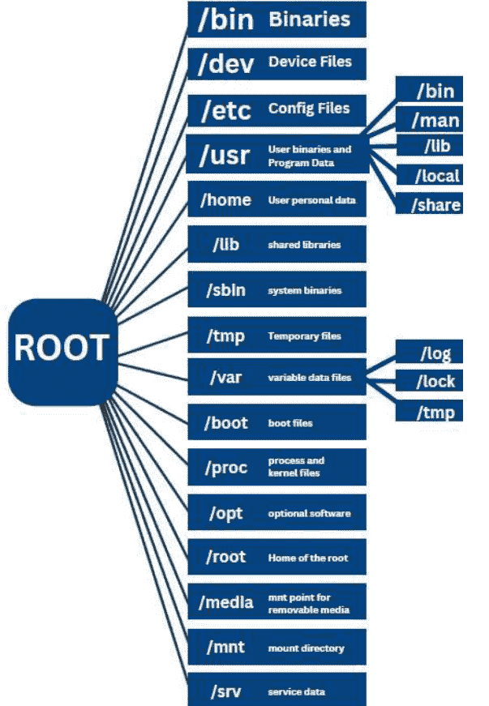
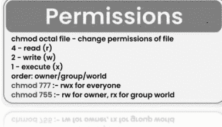
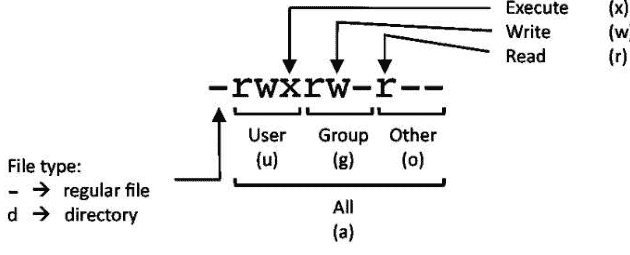
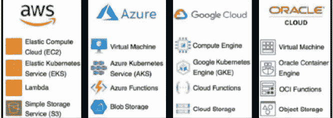

# Linux 精通：命令行与系统管理入门指南

## 献献

本书献给我的家人，他们坚定的支持是我旅程的基石；献给我的朋友，他们既是批评者也是知己，感谢你们在文字几要崩溃时支撑我的支柱。

献给那些深夜与清晨，献给灵感迸发的瞬间和怀疑的挣扎，这份献词见证了伴随每一个文字创作的情感过山车。

愿这本书作为对所有触动过我的生活并激励我将想法和经验写在纸上分享我所知和好奇之处的感谢。你们的影响编织在这些页的纹理中，我希望书中的研究、经验和个人思考能与你们带给我世界的同样温暖和奇奇产生共鸣。

诚挚地感谢，

致敬并充满感谢，

Noe Tovar-MBA

## 作者的话

亲爱的读者：

嘿！在我们进入这些页书中奇妙的 Linux 世界之前，让我们简单聊聊。你可以把这本书看作是你酷的指南，带你以一种超级有趣且实用的方式来探索计算机世界。我在这里是为了让那些代码行和技术术语变得不那么人生畏，更像是一场友好的对话。

听着，我理解——深入学习 Linux 这种就像电脑屏幕后魔法师的操作系统，可能看起来有点让人压力。但你猜怎么着？它并没有那么复杂！就像学习一个新游戏或掌握一项新技能一样，Linux 是一场等待你开启的冒险。

在本书书中，我不会把理论直接扔在你脸上，也不会让你死记硬背复杂的东西。不，这里不会！相反，我将带你开启一段旅程，一步步以易于理解且（更重要的是）超级有趣的方式解锁 Linux 的秘密。

把我想象成你友好的向，在这里帮助你学习 Linux 的门道——从基础命令到摆弄电脑内部隐藏的奇迹。而且嘿，别担心在过程中犯错。那才是我们最好的学习方式，不是吗？

所以，带上你的好奇心，带着你的热情，让我们一起开启这段精彩的旅程。读完这本书后，你将像专业人士一样横扫 Linux 世界，并感到有能力去探索更多技术冒险。让我们开始吧——Linux 冒险等待着你！

# 精通 Linux：命令行与系统管理入门指南

## 第一章：Linux 简介

### Linux Linux：历史与演变

我将带你进入 Linux 的宇宙——一个计算机变成超级英雄的地方！所以，想象一下：很久以前在上世纪 90 年代初，当计算机还巨大、缓慢且昂贵时，一位名叫林纳斯·托瓦兹（Linus Torvalds）的超级天才想出了一个绝妙的主意。

想象林纳斯像一位酷的发明家，在芬兰学习计算机。他并不满足于当时计算机世界的情况。他想要一些不同的。受到一个名为 UNIX 的酷系统的启发，他决定创建自己的东西。你猜怎么着？他将其名为 Linux！

让 Linux 超级酷的在于，它是一个社区项目。随着时间的推移，更多的人加入了这个团队。随着每个版本的更新，Linux 变得更强大、更快、更多功能。这就像更新你喜欢的游戏——让它更酷。从你的智能手机到你的冰箱，这个系统无处不在！随着时间过去，很多人加入了 Linux 帮，加入了他们自己的超能力。

这就是，我的朋友，Linux 的故事——一个由聪明人们的热情诞生的英雄，用每一行代码改变世界。

所以，准备好加入探索 Linux 的冒险吧。我们将解锁这个强大系统背后的秘密！


林纳斯·托瓦兹

### 理解开源软件与 Linux 发行版

所以，想象一下：开源软件就像一本所有人都可以阅读、使用甚至添加自己特殊配料的食谱。通常，公司制作软件时会保守配方，就像汽饮料的秘密配方。但对于开源，就像拥有你最喜欢的饼干食谱并分享给所有朋友。你可以烘焙它，加入额外的巧克力豆或坚果，并将改进后的食谱分享给他人。

现在，让我们聊聊 Linux 发行版。把 Linux 想象成美味的冰淇淋，而发行版就是你可以拥有的所有不同口味。每个发行版，如 Ubuntu、Fedora、Debian，就像一种不同的口味，拥有它们自己的——有些快速敏捷，有些预装了大量软件，或者外观不同。

这里有一个酷的图表来直观展示：

| Linux 发行版 | 描述 |
|---|---|
| Ubuntu | 对学者友好，广泛使用，适合日常任务 |
| Fedora | 领先前沿，关注新功能和创新 |
| Debian | 稳定，经过良好测试，作为许多其他发行版的基础 |
| Arch Linux | 高可定制性，DIY 模式，适合技术极客用户 |
| Linux Mint | 用户友好，类似于 Windows，具有熟悉的界面 |
| CentOS | 稳定，用于服务器和企业级环境 |

将这些发行版想象成不同口味的冰淇淋——有些人喜欢巧克力，比如香草，而另一些人可能喜欢开心果或泡泡糖味这样新奇的风味！

这张图表可以让你一眼看出每个发行版提供的特性，让你更容易选择最适合你口味或需求的版本。就像挑选你最喜欢的冰淇淋一样，选择 Linux 发行版的关键在于找到那个让你感叹“没错，这就是我想要的！”的。

现在，有了这张表，你已经准备好去探索并寻找符合你技术需求的 Linux 发行版了！

更多细节，请参考下表，它提供了某些流行 Linux 发行版的概述，并突出了它们的主要特征和核心用途：

| 发行版 | 描述 | 主要用途 |
| --- | --- | --- |
| Ubuntu | 适合初学者、用户界面友好 | 日常使用、桌面计算、服务器 |
| Fedora | 领先、强调新功能和创新 | 开发、测试、前沿软件 |
| Debian | 可靠性、可扩展的软件仓库 | 服务器环境、侧重稳定性的应用程序 |
| Arch Linux | 高可定制性、自己动手模式 | 高级用户、定制化、定制的系统 |
| Linux Mint | 用户友好、与 Windows 类似的界面 | 桌面使用、从 Windows 迁移、多媒体 |
| CentOS | 稳定、侧重安全、用于企业环境 | 服务器、关键任务系统、企业级应用 |

此图表旨在提供每个 Linux 发行版主要特征和预期用途的简快快。需要注意的是，每个发行版都有其优势，能够满足不同的偏好和需求。进一步探索这些发行版可以帮助用户在 Linux 生态系统中找到最符合他们需求和偏好的版本。

### Linux 在现代计算格局中的优势和用例

欢迎来到 Linux 的世界！它就像一个神奇的工具箱，装满了计算领域最酷的工具。让我来分析一下为什么 Linux 如此重要，以及它是如何改变我们在计算机世界中的做事方式的。

首先，Linux 就像操作系统中的超级英雄，而且它是免费的！是的，你没听错——它不需要你花费一分钱。这意味着，从学生到大公司，任何人都可以使用它，而而不必担心支付许可费用。这种开放性让它对所有人来说非常受欢迎且易于获取。

人们喜爱 Linux 的大原因之一是它超级安全且稳定。它就像一座坚固的堡垒，保护你的电脑免受病毒和崩溃的影响。这非常重要，尤其是当你希望系统流畅运行而没有任何意外小故障时。

现在，重点在于——Linux 并不挑剔。它几乎可以在任何设备上运行！你的笔记本电脑、台式电脑、服务器、智能手机、家里的智能设备——你想到的都可以。它就像一个全能解决方案，适应你扔给它的任何设备。这种灵活性使其成为技术奇师和构建新技术的公司的首选。

让我们谈谈速度和性能——Linux 速度极快！它就像计算世界中的极速者，轻而易举地完成任务。这就是为什么你会发现 Linux 驱动着服务器、超级计算机，甚至是你智能设备中那些微型计算机。

猜怎么着？Linux 不仅仅适用于技术专家。它适用于所有人。无论你是正在学习编程的学生，还是想要为运营寻找可靠系统的企业，Linux 都有适合你的选择。此外，它在不断进化，像变色龙一样，适应新的技术趋势和创新。

提到创新，Linux 是这一切的核心。我们看到的许多最酷的新设备和软件都是诞生在 Linux 之上的。它就像是一个开发者和技术天才聚集在一起创造下一个大物的游乐场。

所以，如果你想要一个可靠、安全、多功能且对所有人免费开放的系统，Linux 是你的首选。它正在改变现代计算格局，让技术对每个人来说都更易获得、更强大。

这就是 Linux 的魔力——一个强大的开源超级英雄，正在向着更好的方向改变计算世界！

## 第二章：开始学习 Linux

### 安装 Linux：各种发行版的分步指南

到目前为止我们一直在讨论操作系统和发行版，但对于 Ubuntu，我认为是时候安装它了，这样你就可以随着书籍的进展进行更好的理解和实践。

#### Ubuntu 安装指南：

步骤 1 ：下载 Ubuntu ISO (`https://ubuntu.com/download`)

访问 Ubuntu 下载页面，并根据你的系统选择版本（例如，Ubuntu Desktop）和架构（32 位或 64 位）。

步骤 2 ：创建可启动 USB 驱动器

下载如 Rufus（适用于 Windows）或 BalenaEtcher（适用于 Mac 或 Linux）之类的工具，使用 Ubuntu ISO 文件创建可启动的 USB 盘。

插入 USB 盘（8GB 或更大），打开工具，选择下载的 ISO，并创建可启动 USB。

步骤 3 ：从 USB 启动并开始安装

将可启动的 USB 插入你的电脑并重启。

按下相应的按键（通常是 F2、F12 或 ESC）进入启动菜单并选择 USB 驱动器。

按照屏幕上的指令开始安装 Ubuntu。

步骤 4 ：安装过程

选择语言、键盘布局，并选择“安装 Ubuntu”。

选择安装类型（“抹除磁盘并安装 Ubuntu”进行清洁安装，或选择“其他”以进行手动分区）。

按照提示创建用户名、密码和其他设置。

等待安装完成，然后重启你的电脑。

#### Fedora 安装指南：

步骤 1 ：下载 Fedora ISO

访问 Fedora 下载页面并选择你需要的版本和架构。

步骤 2 ：创建可启动 USB 驱动器

使用 BalenaEtcher 或 Rufus 等工具，使用下载的 Fedora ISO 文件创建可启动的 USB 盘。

步骤 3 ：从 USB 启动并开始安装

将可启动的 USB 插入你的电脑并重启。

通过按下相应的键进入启动菜单并选择 USB 驱动器。

选择“Start Fedora Workstation Live”开始安装过程。

步骤 4 ：安装过程

从现场环境启动安装程序。

按照提示选择语言、键盘布局和安装目标。

根据需要设置用户账户、密码和其他配置。

继续安装并在完成后重启你的系统。

#### Debian 安装指南：

步骤 1 ：下载 Debian ISO

访问 Debian 下载页面并选择版本和架构。

步骤 2 ：创建可启动 USB 驱动器

使用 Rufus 或 BalenaEtcher 等工具，使用 Debian ISO 文件创建可启动的 USB 盘。

步骤 3 ：从 USB 启动并开始安装

插入可启动的 USB 并重启你的电脑。

进入启动菜单并选择 USB 驱动器以进入 Debian 安装程序。

步骤 4 ：安装过程

选择语言、位置、键盘布局并继续安装。

选择安装类型，对磁盘进行分区并设置用户账户。

等待安装过程完成并重启你的电脑。

### Linux 终端与基础命令介绍

欢迎来到 Linux 命令的世界——终端的魔法之地！将终端想象成一种超能力，它让你能够使用文本命令直接与计算机进行通信。初看，它可能有点令人生畏，但请相信我，这就像在魔法语言中学习咒语一样！

终端基础：

打开终端：要进入终端，只需在应用程序中搜索“Terminal”或按下 `Ctrl + Alt + T`（在大多数发行版上适用）来召唤它。

命令结构：终端中的命令通常遵循以下结构：

```
command [options] [arguments]
```

现在，让我们深入了解一些基础命令及其功能：

#### 基础终端命令：

- 1. `ls` - 列出目录内容：

此命令向你显示当前目录下的文件和文件夹。

- 2. `cd` - 切换目录：

使用 `cd` 后接目录名称进行移动。

```bash
cd Documents
```

- 3. `mkdir` - 创建目录：

创建一个新目录。

```arduino
mkdir NewFolder
```

- 4. `touch` - 创建新文件：

创建一个新的空文件。

```bash
touch new_file.txt
```

- 5. `rm` - 删除：

删除文件或目录。请谨慎使用此命令！

```bash
rm file.txt
```

- 6. `pwd` - 打印工作目录：

显示你当前所在目录的路径。

```bash
pwd
```

可视化命令解释图表：

| 命令 | 功能 | 示例 |
| --- | --- | --- |
| `ls` | 列出目录内容 | `ls` |
| `cd` | 切换目录 | `cd Documents` |
| `mkdir` | 创建目录 | `mkdir NewFolder` |
| `touch` | 创建新文件 | `touch new_file.txt` |
| `rm` | 删除文件或目录 | `rm file.txt` |
| `pwd` | 打印当前目录路径 | `pwd` |

这张可视化图表说明了 Linux 终端中的一些基础命令。每个命令都有其独特的功能，让你在终端中穿梭时更容易理解和记忆。

在你的终端游乐场中练习这些命令，转不经间，你就能像专业人士一样在命令行魔法世界中施展咒了！

此介绍和可视化命令解释旨在提供对基础 Linux 终端命令的友好清晰的理解。尽管探索更多命令，按自己的节奏释放终端的力量！

### 导航文件系统：文件路径、目录和权限

在 Linux 中导航文件系统就像探索一个充满文件夹、文件和权限的数字世界。让我通过视觉化的方式引导你完成这段冒险，使其变得易于理解。

导航文件系统：

嘿，探险伙伴们！把 Linux 文件系统想象成一张巨大的地图，我在这里帮助你像一位经验丰富的制图师一样阅读它。

#### 1. 文件路径：

绝对路径：这些显示从根目录 (`/`) 到文件或文件夹的完整路由。例如：`/home/user/Documents`。

相对路径：这些描述文件或文件夹相对于当前目录的位置。例如，如果你在 `/home/user` 中，到 Documents 的相对路径可以是 `Documents` 或 `../user/Documents`。

#### 2. 目录：

根目录 (`/`)：它就像顶层父目录。一切都从这里分支出来。

家目录 (`~` 或 `/home/user`)：这是你在系统中的个人空间。默认情况下，你的文件和文件夹都在这里。

#### 3. 权限：

文件权限：每个文件和文件夹都有权限，指示谁可以读取、写入或执行它们。它们表示为三组：所有者、组和其他，权限类型有：读 (`r`)、写 (`w`) 和执行 (`x`)。

可视化文件系统解释图表：

| 概念 | 描述 | 示例 |
| --- | --- | --- |
| 绝对路径 | 从根目录 `/` 开始的完整路径 | `/home/user/Documents` |
| 相对路径 | 对于当前目录的路径 | `Documents` 或 `../Documents` |
| 根目录 | 顶层父目录 | `/` |
| 家目录 | 用户的个人空间 | `~` 或 `/home/user` |
| 文件权限 | 读取 (`r`)、写入 (`w`) 和执行 (`x`) 文件和目录的权限 | `rwxr-xr-x` |

此图表直观地解释了 Linux 文件系统中的路径、目录和权限。理解这些概念将帮助你轻松导航数字景观。

记住，每个目录和文件在这个文件系统地图都有自己的位置，知道如何导航和理解权限将让你能够自信地探索和管理你的文件！

接下来的可视化解释旨在提供对导航 Linux 文件系统的清晰理解。在你的 Linux 冒险中探索和操作目录及文件时，请随时参考此图表！

### LINUX 文件结构



接下来的可视化解释旨在为了支持之前的插图，提供对导航 Linux 文件系统的清晰理解。

Noe Tovar-MBA.......................................................................................................................29

这个命令就像是窥视你的衣柜看看里面有什么。当我输入 `ls` 时，它会向我显示当前目录下所有的文件和文件夹。

#### 2. `cd` - 切换目录：

如果我想在家里到处走走，我就使用 `cd`！假设我想从卧室走到厨房。我输入 `cd kitchen` 移动到那里。很简单，对吧？

#### 3. `mkdir` - 创建目录：

创建一个一个新文件夹就像是为我的东西创建一个新的存储空间。要创建一个名为 "projects" 的文件夹，我使用 `mkdir projects`。现在我有一个存放所有项目东西的地方了！

#### 4. `rm` - 删除：

有时我需要处理掉不再需要的东西。`rm` 帮助我删除文件。但要小心！这就像扔掉旧衣服。例如，`rm old_file.txt` 会删除那个文件。

#### 5. `cp` - 复制：

就像复制笔记一样，`cp` 让我复制文件。如果我有一个名为 "important.txt" 的文件并想复制它，我会输入 `cp important.txt backup/important_backup.txt`。

#### 6. `mv` - 移动/重命名：

移动文件就像重新布置我的房间。通过 `mv`，我可以将文件移动到不同的文件夹。如果我想将 "file1.txt" 重命名为 "newfile.txt"，我会输入 `mv file1.txt newfile.txt`。

#### 7. `pwd` - 打印工作目录：

这就像在 Google 地图上知道你的位置！当我输入 `pwd` 时，Linux 向我显示我在计算机中所处的完整路径。

记住：

- 使用 `ls` 查看那里有什么。
- `cd` 帮助你四处移动。
- `mkdir` 创建新空间。
- `rm` 删除东西，所以要小心！
- `cp` 复制文件。
- `mv` 移动或重命名文件。
- `pwd` 告诉你你所在哪里。

### 使用 cat, grep, awk, sed 等命令进行文本文件操作

在 Linux 中使用 `cat`、`grep`、`awk` 和 `sed` 等命令进行文本文件操作，就像拥有了魔法，可以毫不费力地处理和转换文本。让我们以一种易于理解的方式探索这些命令：


使用 Linux 命令进行文本文件操作：

嘿，把你的文本文件想象成故事或文章。这些 Linux 命令可以让我像文字魔法师一样阅读、搜索和编辑这些文件！

## 1. cat - 合并并显示文件

我想查看文件内容时，`cat` 是我的首选命令。它就像打开一本书来。我这样使用它：`cat file.txt`。它直接在终端显示文件中的所有内容。

## 2. grep - 搜索文本模式

当我需要在文件中查找特定内容时，`grep` 是我的侦探。如果我想在一个名为 `"fruits.txt"` 的文件中查找 `"apple"` 词，我会输入 `grep 'apple' fruits.txt`。它会向我显示包含 `"apple"` 的行。

## 3. awk - 文本处理

`awk` 是我处理文本的魔棒。我可以用它提取特定信息。例如，我可以使用 `awk '{print $1}' file.txt` 打印文件的第一列。这就像在创建自定义报告！

## 4. sed - 流编辑器

通过 `sed`，我可以进行文本转换。假设我想在一个文件中将所有的 `"hello"` 替换为 `"hi"`。我会执行 `sed 's/hello/hi/g' file.txt`。这就像拥有查找替换的超能力。

### 表格视觉表示

为了清晰起见，让我们总结一下这些命令：

| 命令 | 功能 | 示例用法 |
|---|---|---|
| `cat` | 显示文件内容 | `cat file.txt` |
| `grep` | 搜索文本模式 | `grep 'apple' fruits.txt` |
| `awk` | 文本处理，提取信息 | `awk 'print $1' file.txt` |
| `sed` | 流编辑器，文本转换 | `sed 's/hello/hi/g' file.txt` |

这些命令让 Linux 中的文件处理变得超级方便！它们帮助我毫不费力地读取、搜索、提取和转换文本。练习它们会让我成为 Linux 世界中的文本魔法师！

## 理解通过管道、重定向和过滤器来处理命令输出

将你的命令输出想象成一股信息流。管道、重定向和过滤器帮助我管理这种流，按照我想要的方式来塑造它。

### 1. 管道 `|` - 连接命令

管道就像连接命令的管线，将一个命令的输出作为另一个命令的输入传递。这就像在命令之间使用 `|` 一样简单。例如，`command1 | command2` 将 `command1` 的输出导向 `command2`。

### 2. 重定向 `>`, `>>`, `<` - 管理输入/输出

重定向就像将信息流导向或从文件或命令。

- `>` 将输出重定向到文件。例如，`command > output.txt` 将命令的输出保存到 `output.txt`。
- `>>` 将输出追加到文件。这就像向现有文件添加信息。例如，`command >> output.txt`。
- `<` 从文件重定向输入。使用 `command < input.txt` 将 `input.txt` 作为输入发送给命令。

### 3. 过滤器 `grep`, `sed`, `awk`, `sort`, `uniq` 等 - 过滤输出

过滤器帮助我精炼和处理命令输出。

- `grep` 在文本中搜索特定模式。
- `sed` 执行文本转换。
- `awk` 根据规则处理文本。
- `sort` 按字母或数字排列行。
- `uniq` 过滤掉相邻的匹配行。

### 图表视觉表示

这里有一个总结这些概念的图表：

| 概念 | 符号 | 功能 | 示例 |
|---|---|---|---|
| 管道 | `|` | 连接命令，将输出作为输入 | `command1 | command2` |
| 重定向 | `>`, `>>`, `<` | 管理与文件之间的输入/输出 | `command > output.txt` |
| 过滤器 | `grep`, `sed`, `awk`, `sort`, `uniq` 等 | 精炼和处理命令输出 | `grep 'keyword' file.txt` |

这些工具允许我在处理 Linux 命令输出时具有创意且精确。通过结合它们，我可以完全按照我需要塑造、过滤和引导信息流！

通过管道、重定向和过滤器，我可以创建命令工作流，在 Linux 终端中高效地操作和管理数据。它们就像让处理命令输出变得灵活而强大的魔棒！

扫描二维码查看 `cat` 命令的视频演示！

以及重定向命令等内容。


# 第 4 章：系统基础

## 系统架构：理解进程、线程和多任务处理

将你计算机的工作想象成团队合作。进程、线程和多任务处理就像发生在系统内部团队的不同方面。

### 1. 进程 Processes

将进程想象成计算机运行的一项任务。每个进程都有自己的空间和资源。它们可以是一个程序，比如播放器或网络浏览器。我可以使用 `ps` 或 `kill` 等命令启动或停止进程。

### 2. 线程 Threads

线程就像进程内部的小任务。它们与同一进程中的其他线程共享资源和内存。它们有助于在进程内并行执行。这就像团队中的多个工人处理项目的不同部分。

### 3. 多任务处理

多任务处理是同时做多几件事。你的计算机通过在进程或线程之间快速切换来实现这一点。这就像杂耍不同的任务，让它们看起来是同时发生的。

| 概念 | 描述 | 示例 |
| --- | --- | --- |
| 进程 | 独立运行的任务 | 音乐播放器，网络浏览器 |
| 线程 | 进程内较小的任务 | 处理 UI、I/O 任务 |
| 多任务处理 | 多个进程/线程的同时执行 | 听音乐，浏览 |

通过理解进程和线程如何在多任务处理中协作，我们可以更清楚地了解计算机如何高效地管理任务。这就像一个组织良好的团队，每个人各尽职责，让 Linux 世界运行顺畅！

## 管理用户和组：useradd, usermod, passwd 等

在 Linux 中管理用户和组就像组织不同的团队并授予它们访问资源的权限。让我们以易于理解的方式探索 `useradd`、`usermod`、`passwd` 等命令，然后我将提供一个实践练习来巩固学习成果。

### 1. useradd - 添加用户

`useradd` 就像是创建一个新的俱乐部成员。它向系统添加一个新用户。例如。

### 2. usermod - 修改用户

`usermod` 帮助我修改用户详情，例如他们的主目录或用户组。如果我想将 John 的主组改为 `"developers"`，我会执行 `usermod -g developers john`。

### 3. passwd - 设置密码

`passwd` 就像是提供一个访问俱乐部的密码。当我运行 `passwd john` 时，它会提示我为用户 `"john"` 设置密码。

### 4. groupadd - 创建组

`groupadd` 就像在系统中创建一个新俱乐部。例如，`groupadd developers` 会创建一个名为 `"developers"` 的组。

### 5. userdel - 删除用户

当俱乐部成员离开时，我使用 `userdel` 来移除他们。例如，`userdel john` 会删除用户 `"john"`。

### 图表视化表示

让我们总结一下这些命令，以便更好地理解：

| 命令 | 功能 | 示例用法 |
| --- | --- | --- |
| `useradd` | 向系统添加新用户 | `useradd john` |
| `usermod` | 修改用户详情 | `usermod -g developers john` |
| `passwd` | 为用户设置密码 | `passwd john` |
| `groupadd` | 创建新组 | `groupadd developers` |
| `userdel` | 从系统中移除用户 | `userdel john` |

此图表直观地总结了 Linux 中管理用户和组的命令功能。

### 动手练习

现在，有一个练习供你实践：

- 使用 `useradd` 创建名为 `"testuser"` 的新用户。
- 使用 `passwd` 为 `"testuser"` 设置密码。
- 使用 `groupadd` 创建名为 `"testgroup"` 的新组。
- 使用 `usermod` 将 `"testuser"` 添加到 `"testgroup"` 中。
- 最后，使用 `userdel` 删除 `"testuser"`。

这个动手练习将帮助巩固你对 Linux 中用户和组管理的理解。

在做中学习是理解这些命令的最佳方式！通过这个练习，你将会在管理 Linux 系统中的用户和组时更有信心！

## 探索系统信息和监控工具：top, ps, df, du 等

探索 Linux 中的系统信息和监控工具就像拥有一个仪表盘来检查系统的心跳。让我们用简单易懂的方式探索 `top`、`ps`、`df`、`du` 等命令，然后我将提供一个动手练习来强化学习。

嘿！把这些命令想象成查看系统健康状况并跟踪底层发生情况的工具。

### 1. top - 显示系统活动

`top` 就像是显示系统正在运行内容的直播流。它实时显示 CPU 使用率、内存使用率和运行中的进程。

### 2. ps - 显示进程状态

当我使用 `ps` 时，就像是获取运行进程的快照。例如，`ps aux` 显示系统上所有的进程。

### 3. df - 显示文件系统使用情况

`df` 帮助我检查不同文件系统的用空间。它就像检查抽屉或衣柜里剩余多少空间。

### 4. du - 显示磁盘使用情况

`du` 就像检查每个目录占用了多少空间。例如，`du -sh /home/user` 显示用户主目录的大小。

### 图表视化表示

让我们创建一个图表来可视化这些命令：

| 命令 | 功能 | 示例用法 |
|---|---|---|
| `top` | 实时系统活动 | `top` |
| `ps` | 显示进程状态 | `ps aux` |
| `df` | 显示文件系统使用情况 | `df -h` |
| `du` | 显示磁盘使用情况 | `du -sh /home/user` |

此图表总结了用于 Linux 系统信息探索和监控的命令功能。

### 动手练习

现在，有一个练习供你实践：

- 使用 `top` 实时监控系统活动。
- 使用 `ps aux` 列出系统上运行的所有进程。
- 使用 `df -h` 显示所有文件系统的磁盘空间使用情况。
- 使用 `du -sh /path/to/directory` 检查特定目录使用的磁盘空间。

这个动手练习将让你对这些命令以及它们如何在 Linux 中提供系统信息和监控有实际的理解。

这些命令充当你系统的侦探，允许你监控性能并跟踪 Linux 环境中发生的情况。练习这个练习来熟悉这些工具，并增强系统监控的信心！

务必扫描末尾的二维码以获取奖励电子书，其中包含了此类插图中的额外命令。

## 磁盘使用情况

| 描述 | 命令 |
| --- | --- |
| 显示已挂载文件系统的可用和已用空间 | `df -h` |
| 显示已挂载文件系统的可用和可用 inode | `df -i` |
| 显示磁盘分区的大小和类型 | `fdisk -l` |
| 以人类可读格式显示所有文件和目录的磁盘使用情况 | `du -ah` |
| 显示当前目录之外的总磁盘使用情况 | `du -sh` |

# 第 5 章：文件系统和存储管理

## 文件系统层次结构标准 FHS 及其意义

将 FHS 想象成详细的蓝图，它组织了 Linux 系统不同类型文件应该存放的位置。这个标准确保了一致性，并帮助程序找到它们需要的内容。

### FHS 的意义

FHS 创建了统一的目录结构，确保了：

- 一致性：所有 Linux 发行版都遵循此结构，让用户和开发者更容易导航。
- 清晰性：它为某些类型的文件定义了特定的目录，例如用于基本二进制文件的 `/bin`，用于配置文件的 `/etc`，用于可变数据的 `/var` 等。
- 易于开发：开发者可以依赖标准化的路径，使软件开发和跨发行版的兼容性工作变得更加顺畅。

### 图表视化表示

让我们创建一个图表来可视化 FHS 定义的主要目录：

| 目录 | 描述 | 示例内容 |
| --- | --- | --- |
| `/` | 根目录 | `/bin`, `/etc`, `/var`, `/home` 等 |
| `/bin` | 基本系统二进制文件 | `/ls`, `/cp`, `/mv`, `/cat` 等 |
| `/etc` | 系统配置文件 | `/passwd`, `/hostname`, `/network` 等 |
| `/var` | 可变数据 | 日志文件、数据库、电子邮件等 |
| `/home` | 用户主目录 | `/home/user1`, `/home/user2` 等 |
| `/tmp` | 临时文件 | 临时缓存、临时下载 |

此图表说明了 FHS 指定的一些目录及其在 Linux 层次结构中的用途。

### 动手练习

现在，有一个练习供你实践：

- 使用 `ls /etc` 探索 `/etc` 目录的内容。
- 使用 `cd ~` 进入你的主目录并使用 `mkdir my_projects` 创建名为 `"my_projects"` 的新目录。
- 使用 `du -sh /var` 检查 `/var` 目录的磁盘使用情况。
- 使用 `ls /bin` 列出 `/bin` 目录的内容。

这个动手练习将让你熟悉遍历 FHS 目录并理解其内容。

理解 FHS 就像拥有一张地图，可以高效地定位和组织 Linux 系统的文件。练习这个练习以掌握这些重要的目录结构！

## 文件系统类型

### 3. FAT 文件分配表

旧版格式：FAT 有多个版本，如 FAT12、FAT16、FAT32。

特点：它简单、兼容各种系统，但在文件大小和分区大小上存在限制。

用途：通常用于 USB 盘、内存卡以及旧留系统。

### 4. exFAT 扩展文件分配表

扩展 FAT：exFAT 是 FAT 的增强版本，解决了其局限性。

特点：支持大文件、大容量卷，并与不同的操作系统兼容。

用途：适用于闪存、外部硬盘和其他存储设备。

### 图表视觉化表示

让我们创建一个图表来视觉化这些文件系统类型：

| 文件系统类型 | 描述 | 特点 | 用途 |
| --- | --- | --- | --- |
| ext4 | Linux 原生文件系统 | 支持大文件、日志记录、可靠性 | Linux 系统 |
| NTFS | Windows 原生文件系统 | 大文件、权限、日志记录 | Windows 系统 |
| FAT | 旧文件系统格式 | 简单、兼容、有局限 | USB 盘、旧留系统 |
| exFAT | 扩展 FAT 格式 | 大文件、大容量、跨平台 | 闪存、外部硬盘 |

此图表总结了不同文件系统的主要特点和典型用途，便于理解。

### 动手练习

现在，这里有一个练习供练习：

- 使用 FAT32 文件系统格式化 USB 盘。
- 在 USB 盘上创建一个文本文件。
- 将该文本文件复制到你的 Linux 系统，然后到 Windows 系统。
- 比较每个系统如何处理在 FAT32 格式化的 USB 盘上的文件。

此练习将帮助你理解不同的文件系统如何在各种操作系统中被使用，及其兼容性。

不同的文件系统提供不同的功能，并适用于特定的目的。在不同系统上尝试格式化和文件处理，将使你对它们的功能和兼容性有直观的理解！

# 第 6 章：软件包管理

## 理解包管理器：apt, yum, dnf 等

理解像 `apt`、`yum`、`dnf` 等包管理器，就像拥有一位购物助手，帮助你在 Linux 系统上查找、安装和管理软件。让我们以生动的方式深入了解这些包管理器、它们的特征以及区别。

嘿！把包管理器想象成你的软件助手，让你在 Linux 系统上安装、更新和删除程序变得简单。每个包管理器都有自己管理软件包的方式。

### 1. apt 高级软件包工具

- 基于 Debian 的系统：`apt` 是 Ubuntu 等基于 Debian 的发行版中选的包管理器。
- 特点：它以依赖解决、使用简单和海量软件库闻名。
- 命令：常用命令包括 `apt-get`、`apt-cache` 和 `aptitude`。

### 2. yum 黄色狗更新修改版

- 基于 Red Hat 的系统：`yum` 是旧版 Red Hat 系统（如 CentOS 6 及早期版本）的包管理器。
- 特点：它处理软件包依赖、更新和安装。
- 遗留：在 CentOS 7 和 8 等较新的 Red Hat 系统中，`yum` 已被 `dnf` 取代。

### 3. dnf 增强版 YUM

- 现代基于 Red Hat 的系统：`dnf` 是 CentOS 8 和 Fedora 等较新 Red Hat 发行版中 `yum` 的继任者。
- 特点：相比 `yum`，它提供了更好的性能、改进的依赖解决和更整洁的命令结构。
- 命令：与 `yum` 类似但具有增强的功能。

### 4. 其他

其他包管理器，如 Arch Linux 的 `pacman`、openSUSE 的 `zypper` 以及 Alpine Linux 的 `apk`，都有适用于各自发行版的独特特点和命令。

### 图表视觉化表示

让我们创建一个图表来视觉化这些包管理器：

| 包管理器 | 发行版 | 特点 | 常用命令 |
|---|---|---|---|
| `apt` | 基于 Debian | 依赖解决、海量仓库 | `apt-get`, `apt-cache` |
| `yum` | 旧版 Red Hat | 依赖处理、更新 | 在新版本中已弃用 |
| `dnf` | 现代 Red Hat | 增强性能、整洁命令 | `dnf install`, `dnf update` |
| 其他 | 发行版特定 | 独特的特点和命令 | 随发行版而异 |

此图表总结了 Linux 上管理软件的主要包管理器、发行版、特点和常用命令。

### 动手练习

现在，这里有一个练习供练习：

- 在基于 Debian 的系统（如 Ubuntu）上，使用 `apt` 安装一个你喜欢的软件包。


- 在基于 Red Hat 的系统（如 CentOS 8）上，使用 `dnf` 更新所有已安装软件包。

- 比较 `apt` 和 `dnf` 的命令和输出，看看它们在用法和呈现上有何不同。

此练习将帮助你获得不同包器的实践经验，并理解它们在不同 Linux 发行版上的用法。

探索不同的包管理器就像在商场逛不同的商店——它们有自己的风格，但最终它们都能帮助你为系统寻找并管理软件。在各种发行版上尝试不同的命令将巩固你对 Linux 软件包管理的理解！

## 安装、更新和删除软件包

将 Linux 中的软件软件包管理看作是在你的设备上添加、更新和删除应用——只是多了一点命令行魔法！

1. 安装软件包：

添加新应用：要安装软件，我使用特定于包管理器的命令。例如：

- 使用 `apt`：`sudo apt-get install packageName`

- 使用 `dnf`：`sudo dnf install packageName`

2. 更新软件包：

保持应用最新：要将已安装的软件更新到最新版本：

- 使用 `apt`：`sudo apt-get update` 然后执行 `sudo apt-get upgrade`

- 使用 `dnf`：`sudo dnf update`

3. 删除软件包：

大扫除：当我想删除不再需要的软件时：

- 使用 `apt`：`sudo apt-get remove packageName`

- 使用 `dnf`：`sudo dnf remove packageName`

图表视觉化表示：

让我们创建一个图表来视觉化这些操作：

| 操作 | 命令 | 示例用法 |
|---|---|---|
| 安装 | `apt-get install packageName` | `sudo apt-get install firefox` |
| 更新 | `apt-get update` 和 `apt-get upgrade` | 执行 `sudo apt-get update` 后再执行 `sudo apt-get upgrade` |
| 删除 | `apt-get remove packageName` | `sudo apt-get remove firefox` |

此图表总结了使用 `apt-get` 安装、更新和删除软件包的命令。

## 动手练习：

现在，这里有一个练习供练习：

在基于 Debian 的系统上使用 `apt-get`：

- 安装新软件包（例如：`sudo apt-get install neofetch`）。

- 更新所有已安装软件包（例如：`sudo apt-get update` 和 `sudo apt-get upgrade`）。

- 删除新安装的软件包（例如：`sudo apt-get remove neofetch`）。

在基于 Red Hat 的系统上使用 `dnf`：

- 安装新软件包（例如：`sudo dnf install htop`）。

- 更新所有已安装软件包（例如：`sudo dnf update`）。

- 删除新安装的软件包（例如：`sudo dnf remove htop`）。

此练习将让你获得在 Linux 上使用不同包管理器安装、更新和删除软件包的实践经验。

Noe Tovar-MBA................................................................................................................61

## 图表视化表示：

让我们创建一个图表来视觉化仓库管理和包依赖关系：

| 操作 | 命令 | 示例用法 |
| --- | --- | --- |
| 添加仓库 | `add-apt-repository repositoryName` | `sudo add-apt-repository ppa:example/exampleRepository` |
| | `dnf config-manager --add-repo repositoryURL` | `sudo dnf config-manager --add-repo https://example.com/repo.repo` |
| 处理依赖关系 | 由包管理器自动管理 | `sudo apt-get install packageName` |

该图表总结了添加仓库的命令，以及以 `apt` 和 `dnf` 为例的包管理器在安装包期间处理依赖关系的方式。

## 实践练习：

现在，有一个练习练习：

在基于 Debian 的系统上：

- 使用 `add-apt-repository` 添加新仓库。

- 使用 `apt-get` 从添加的仓库安装包。

- 观察在安装过程中依赖关系是如何被管理的。

在基于 Red Hat 的系统上：

- 使用 `dnf config-manager` 添加仓库。

- 使用 `dnf` 从添加的仓库安装包。

- 使用 `rpm -qR packageName` 检查已安装包的依赖关系。

此练习将提供添加仓库、安装包以及理解包管理器在不同 Linux 发行版中处理依赖关系的实操经验。

管理仓库和包依赖关系就像确保你拥有正确的书籍和所有必要的章节来构建一个完整的故事。通过练习这些命令，你将熟练管理软件源，并确保你的 Linux 系统能够顺畅地安装包！

## 第 7 章：

网络基础

理解 Linux 中的网络基础，就像学习信息在数字世界中传输和通信的基础知识。让我们从一个简化这些概念的介绍开始开启本章的序幕，然后我将提供一个实践练习来巩固你的学习。

### 网络基础简介：

嘿！想象一下网络是一张连接设备的复杂网网，允许它们在数字领域中共享信息并进行通信。在本章中，我们将揭示 Linux 网络的基础元素，探索设备如何找到彼此、交换数据并进行无缝协作。从理解 IP 地址到破解 DNS 和 DHCP 的角色，我们将引导你通过这些核心概念，为你开启 Linux 环境中网络谜团的钥匙。

## 图表视化表示：

让我们创建一个图表来视觉化网络基础的关键组件：

| 概念 | 描述 | 示例 |
| --- | --- | --- |
| IP 路由 | 网络上设备的唯一地址 | IPv4: 192.168.1.1, IPv6: 2001:0db8:85a3:0000:0000:8a2e:0370:7334 |
| DNS | 将域名转换为 IP 地址 | google.com -> 172.217.12.14 |
| DHCP | 自动分配 IP 地址 | 为设备分配 IP |

该图表总结了我们在本章中探索的核心概念，为理解 Linux 网络基础提供了视觉化指南。

## 实践练习：

现在，有一个练习可以深入学习网络基础：

设置基础网络配置：

- 使用 `ifconfig` 或 `ip addr` 等命令查看当前网络设置。

- 修改网络配置文件为你的 Linux 系统 分配静态 IP 地址。

- 重启网络服务并验证更改。

执行 DNS 解析：

- 使用 `nslookup` 或 `dig` 命令查询 DNS 服务器获取域名的 IP 地址（例如 `nslookup openai.com`）。

通过完成这个练习，你将获得配置网络设置和利用 DNS 解析的实践经验，巩固你对 Linux 网络基础的理解。

开启这段揭秘 Linux 网络核心元素的旅程吧。通过练习这些练习，你不仅能理解基础知识，还能在 Linux 环境中配置和理解网络方面实战专家！

## Linux 中的网络概念：IP 地址、DNS、DHCP

将 Linux 网络设想成管理地址、查找名称和自动化连接，以便有效地导航数字世界。

1. IP 地址：

用于通信的地址：IP（互联网协议）地址就像网络上设备的唯一门牌号。IPv4 和 IPv6：IPv4 使用 192.168.1.1，而 IPv6 使用 2001:0db8:85a3:0000:0000:8a2e:0370:7334。

2. DNS：

域名系统：DNS 将域名转换为 IP 地址，例如 google.com -> 172.217.12.14。

3. DHCP：

动态主机配置协议：DHCP 自动分配 IP 地址，为设备分配 IP。

## 动手练习：

现在，这里有一个练习来练习如何配置网络接口：

使用 `ip` 命令：

- 使用 `ip addr show` 显示当前网络接口详情。

- 使用 `ip addr add` 为接口分配静态 IP 地址。

- 使用 `ip link set` 启用或禁用接口。

利用 `nmcli` 命令：

- 使用 `nmcli connection show` 查看可用的连接。

- 使用 `nmcli connection modify` 修改连接设置（例如更改 IP 地址或 DNS）。

- 使用 `nmcli connection up` 和 `nmcli connection down` 启用或禁用连接。

通过完成这个练习，你将在 Linux 系统上获得使用不同命令配置网络接口的实践经验。

配置网络接口就像为你的 Linux 环境中的无缝信息流设置路径。通过这些练习，你将熟练地使用各种命令管理网络接口，确保系统内部的顺畅通信！

## 排除网络连接性问题

排除网络连接性问题就像当一名侦探，发现并解决阻碍设备间顺畅通信的问题。让我们深入探讨 Linux 中网络连接性问题的排除，视觉化常见问题及其解决方案，然后我将提供一个动手练习来强化你的排障技能。

排除网络连接性问题：

嘿！想象一下你的网络是一个复杂的连接网，有时会会出现问题，导致通信中断。我经常使用诊断命令和方法来高效识别并修复这些问题。

### 1. 检查接口状态：

使用 `ip` 或 `ifconfig`：我验证网络接口是否已启用（`ip link show` 或 `ifconfig`），以确保它是激活且配置正确的。

### 2. 调查 IP 配置：

使用 `ip` 或 `ifconfig`：我检查分配的 IP 地址、子网掩码和网关设置，确保它们是正确的（`ip addr show` 或 `ifconfig`）。

### 3. 测试连接性：

使用 `ping`：我采用 `ping` 命令测试到特定 IP 地址或域名的连接性（`ping 8.8.8.8` 或 `ping google.com`），以检查是否存在连接问题。

### 4. 诊断 DNS 问题：

使用 `nslookup` 或 `dig`：通过查询 DNS 服务器域名解析检查 DNS 解析（`nslookup openai.com` 或 `dig openai.com`），以识别 DNS 相关问题。

图表视觉表示：

让我们创建一个图表来视觉化网络连接性问题的常见排除步骤：

| 问题 | 诊断命令 | 示例用法 |
| :--- | :--- | :--- |
| 接口状态 | `ip link show` 或 `ifconfig` | `ip link show`, `ifconfig` |
| IP 配置 | `ip addr show` 或 `ifconfig` | `ip addr show`, `ifconfig` |
| 测试连接性 | `ping` | `ping 8.8.8.8`, `ping google.com` |
| DNS 诊断 | `nslookup` 或 `dig` | `nslookup openai.com`, `dig openai.com` |

该图表概述了常见的网络连接问题以及在 Linux 中进行故障排除对应的诊断命令。

## 动手练习：

现在，这里有一个练习来练习排除网络连接性问题：

模拟连接问题：

- 使用 `ifconfig` 或 `ip` 命令禁用网络接口。

- 使用诊断命令（`ip link show`, `ip addr show`, `ping`, `nslookup` 或 `dig`）识别并解决该问题。

创建一个 DNS 相关问题：

- 在 `/etc/resolv.conf` 文件中将 DNS 设置为错误的服务器。

- 使用 `nslookup` 或 `dig` 命令诊断 DNS 解析问题并纠正设置。

通过完成这个练习，你将在获得排除网络连接性问题的实践经验，并能够更好地解决你 Linux 环境中的常见问题。

排除网络连接性问题需要耐心和系统方法的检查。通过练习诊断命令，你将培养出识别和解决网络问题所需的技能，确保你的 Linux 系统实现无缝通信！

## 第 8 章：

脚本编写与自动化

脚本编写涉及在脚本语言（如 Bash）中编写一组命令，以便 shell（命令行界面）可以解释并执行这些命令。这就像在运行类 Unix 操作系统（如 Linux）的计算机上创建一系列指令或脚本来使任务自动化。

脚本编写：

- 定义：为 shell 执行编写一系列命令的过程。

- 目的：自动化重复性任务、执行系统配置、管理文件等。

- 语言：通常使用 Bash 等脚本语言完成，Bash 是许多类 Unix 系统的默认 shell。

自动化：

- 定义：自动执行任务以减少人工干预并提高流程效率的过程。

- 角色：自动化允许重复任务或复杂过程自动执行，而无需持续的人工干预。

- 益处：通过自动化常规任务来提高生产力、减少错误并简化工作流。

脚本编写和自动化是 Linux 环境中的强大工具，提供了创建自定义脚本以自动化任务、管理配置和执行各种系统操作的能力，从而使日常操作更高效、错误更少。

理解脚本编写和自动化就像拥有创建一个你自己的个性化助手的能力，它可以根据你的指令执行任务，让你从重复性的体力工作中解放出来，并提高你 Linux 环境中的生产力。

## 脚本编写简介：bash 脚本基础

将脚本编写想象为为 Linux 系统编写一系列自动执行的指令。在本章中，我将引导你学习 Bash 脚本的基础知识，让你能够高效地自动化任务并简化工作流。

理解 Bash 脚本：

- 什么是 Bash？Bash（Bourne Again SHell）是 Linux 中广泛使用的 shell，为用户提供了与系统交互的命令行界面。

- 脚本基础：Bash 脚本编写涉及编写一组 shell 可以按顺序执行的命令序列。

编写 Bash 脚本：

- 创建脚本：我使用像 `nano` 或 `vim` 这样的文本编辑器编写带有 `.sh` 扩展名的 Bash 脚本（例如 `myscript.sh`）。

- Shebang 行：以 shebang (`#!/bin/bash`) 开头脚本以指定解释器。

执行 Bash 脚本：

- 运行脚本：创建 Bash 脚本后，我使用 `chmod` 命令赋予其执行权限（`chmod +x myscript.sh`）。

- 执行脚本：在终端中输入其名称来运行脚本（`./myscript.sh`）。

图表视觉表示：

让我们创建一个图表来视觉化 Bash 脚本的关键组件：

| 概念 | 描述 | 示例 |
| :--- | :--- | :--- |
| Bash 脚本 | 编写一系列命令 | `#!/bin/bash` |
| 创建脚本 | 使用文本编辑器编写脚本 | `nano myscript.sh` |
| 执行脚本 | 使脚本变为可执行并运行 | `chmod +x myscript.sh`, `./myscript.sh` |

该图表概述了涉及 Bash 脚本编写的核心概念和操作，为理解基础知识提供了视觉指南。

## 动手练习：

现在，让我们练习创建和运行一个简单的 Bash 脚本：

- 创建一个 Bash 脚本：打开文本编辑器（nano 或 vim）并创建一个名为 `myfirstscript.sh` 的新文件。在脚本文件中添加几个命令（例如 `echo`, `ls`, `pwd`）。

- 使脚本可执行并运行它：使用 `chmod +x myfirstscript.sh` 使脚本变为可执行。在终端中输入 `./myfirstscript.sh` 来执行脚本。

这个练习将提供创建和运行基础 Bash 脚本的实践经验，巩固你对 Bash 脚本基础知识的理解。

脚本编写就像为你的 Linux 系统制作一套自定义指令，实现任务的自动化和简化。通过练习这些基础知识，你将获得所需的技能

创建强大的 Bash 脚本并高效简化你的工作流！

## 编写用于自动化和任务调度的简单脚本

让我们深入探索 Linux 中用于自动化和任务调度的简单脚本的世界。我将引导你了解基础知识，将关键概念可视化，并提供一个实操练习来强化你的学习。

编写用于自动化和任务调度的简单脚本

嘿！想象一下在 Linux 中创建一个自己的数字助手，它可以根据你的指令自动执行任务。这就是编写简单脚本进行自动化和任务调的威力。在本章中，我将带你了解脚本的基础知识，让你能够轻松地自动化例行任务并调度操作。

理解脚本基础知识：

- 脚本语言：我使用 Bash 等脚本语言来编写简单的脚本，这些脚本由一系列命令组成。

- 目的：脚本允许重复性任务自动化，简化复杂操作并提高效率。

### 编写简单脚本：

- 脚本创建：我使用文本编辑器（如 nano 或 vim）创建脚本，并将其保存为 .sh 扩展名（例如 myscript.sh）。

- Shebang 行：脚本以 shebang (#!/bin/bash) 开头，用以指定解释器。

### 自动化和任务调度：

- 任务自动化：脚本通过执行一系列预定义的命令而无需人工干预来实现自动化。

- 任务调度：cron 等工具允许在特定的时间或间隔调度脚本执行。

图表可视化表示：

让我们创建一个图表来可视化自动化和任务调度脚本的关键组件：

| 概念 | 描述 | 示例 |
|---|---|---|
| 脚本语言 | 编写用于自动化的脚本 | #!/bin/bash |
| 脚本创建 | 使用文本编辑器创建脚本 | nano myscript.sh |
| 自动化 | 使用脚本实现任务自动化 | ./myscript.sh |
| 任务调度 | 调度脚本执行 | cron: 0 3 * * * /path/to/myscript.sh |

该图表概述了在 Linux 中编写用于自动化和任务调度简单脚本涉及的核心概念和操作。

## 实操练习：

现在，让我们进入实操练习，练习编写和调度一个简单的脚本：

创建一个 Bash 脚本：

- 打开文本编辑器并创建一个名为 `daily_backup.sh` 的新文件。

- 编写执行备份操作的命令（例如，将文件复制到备份目录）。

使用 cron 调度脚本执行：


进入`/path/to/xxx`目录，找到`xxx.json`。

在表达式`cvar = avar + bvar`中，加法运算符（`+`）将`avar`与`bvar`相加，得到它们的和`cvar`

在`List.of(arg0, arg1, arg2)`中，`List`接口的工厂方法`of()`接受一系列的元素，返回包含它们的只读列表。

之后我们这样调用`cmd`命令：`cmd arg0 arg1 arg2`。

```
if (condVar > someVal) {console.log("xxx")}
```

- 使用 `crontab -e` 编辑 cron 表。

- 添加条目以调度 `daily_backup.sh` 脚本每天在特定时间运行。

通过完成这个练习，你将获得编写简单脚本以及使用 cron 调度其执行的实践经验。

编写用于自动化和调度任务的简单脚本，就像让你的个人助手在 Linux 环境中处理例行杂务。通过练习这些基础知识，你将利用脚本的威力来自动化任务并轻松简化操作！

## 在 Shell 脚本中使用循环、条件和函数

想象你拥有创建动态且灵活脚本的能力，这些脚本可以处理各种条件并高效地执行重复任务。这就是在 Shell 脚本中加入循环、条件和函数的威力。在本章中，我将带你了解这些基本概念，让你能够编写出更通用、更强大的脚本。

### 理解循环

- `For` 循环：这些循环按指定的次数执行一组命令，遍历范围或项目列表。

- `While` 循环：只要满足特定条件，这些循环就会一直执行命令。

### 实现条件判断

- `if` 语句：条件判断允许根据指定的条件（`if`, `elif`, `else`）执行命令。

- 比较运算符：使用 `-eq`, `-ne`, `-lt`, `-gt`, `-ge` 等运算符进行比较。

### 拥抱函数

- 创建函数：函数允许将命令分组，以便在脚本中复用和模块化。

- 调用函数：通过函数名调用函数以执行一系列命令。

#### 图表可视化表示

让我们创建一个图表来可视化 Shell 脚本中循环、条件和函数的使用：

| 概念 | 描述 | 示例 |
| --- | --- | --- |
| For 循环 | 按指定的次数执行命令 | `for i in {1..5}; do "Iteration $i"; done` |
| While 循环 | 在条件为真时执行命令 | `while [ $i -le 5 ]; do echo "Iteration $i"; done` |
| if 语句 | 根据条件执行命令 | `if [ $i -eq 5 ]; then echo "Reached 5"; fi` |
| 比较运算符 | 用于条件比较的运算符 | `$a -eq $b, $x -lt $y, $var != $var2` |
| 函数 | 为了复用而对命令 | `my_function() { commands... }` |
| 调用函数 | 通过名称调用函数 | `my_function` |

该图表概述了 Shell 脚本中与循环、条件和函数相关的关键概念和命令，提供了便于理解的视觉参考。

## 实操练习

现在，让我们通过实操练习将这些概念付实践：

### 使用循环

创建一个使用 `for` 循环显示从 1 到 5 数字的 Bash 脚本。

### 实现条件判断

编写一个利用 `if` 语句检查用户输入的数字是否大于或等于 10 的脚本。

### 拥抱函数

- 定义一个接受两个参数并打印其和的函数。

- 使用不同的参数调用函数以演示其功能。

通过完成这个练习，你将获得将循环、条件和函数整合到 Shell 脚本中的实践经验，增强它们的灵活性和实用性。

在 Shell 脚本中使用循环、条件和函数就像拥有一个多功能工具箱，可以用来用来制作动态且响应灵敏的脚本。通过练习这些概念，你将增强脚本的能力，使其适应你 Linux 环境中的各种场景！

# 第 9 章：系统管理任务

作为 Linux 系统管理员，你的职责通常涉及与维护、安全和优化基于 Linux 系统相关的广泛任务。

## 系统管理简介

### 角色与职责

让我们深入研究系统管理角色和职责这一关键领域。我将解释关键方面，可视化其重要性，并提供一个实操练习来强化你的理解。

#### 系统管理角色和职责简介

嘿！作为系统管理员，我在确保组织内计算机系统顺利运行方面发挥着至关重要的作用。让我们探索定义这一关键职位的角色和职责，以及在该领域表现卓越所需的的基本技能。

### 理解系统管理

- 角色定义：系统管理员负责管理、维护和保护计算机系统及网络。

- 工作范围：他们的任务从硬件和软件设置到网络配置和安全维护不等。

## 主要职责

- 系统配置：安装和配置操作系统、应用程序和硬件组件。

- 用户管理：创建和管理用户账户、权限和访问权限。

- 备份与恢复：实施备份解决方案并制定恢复策略以保护数据。

- 监控与维护：监控系统性能，进行例行维护并解决问题。

- 安全管理：实施安全措施，确保系统完整性并管理访问控制。

#### 图表可视化表示

让我们创建一个图表来可视化系统管理员的主要职责和技能：

| 职责 | 描述 | 必备技能 |
| --- | --- | --- |
| 系统配置 | 设置操作系统、应用程序和硬件 | 熟练使用操作系统、硬件知识 |
| 用户管理 | 创建管理用户账户 | 用户管理、访问控制 |
| 备份与恢复 | 实施备份解决方案 | 数据备份策略、恢复计划 |
| 监控与维护 | 监控系统性能 | 故障排除、维护规程 |
| 安全管理 | 实施安全措施 | 安全协议、访问控制 |

该图表说明了系统管理员的主要职责，以及有效履行这些职责所需的必备技能。

## 实操练习

现在，让我们参与实操练习以模拟系统管理任务：

### 系统配置

- 使用 `VirtualBox` 或 `VMware` 等软件设置虚拟机。

- 安装 Linux 发行版并带有必要的应用程序配置系统。

### 用户管理

- 创建具有不同访问权限的多个用户账户（管理员、普通用户）。

- 为不同的用户组分配权限并管理访问权限。

### 备份与恢复

- 为系统中的关键数据设置备份方案（例如，使用 `rsync` 或备份工具）。

- 模拟数据丢失场景，并使用你的备份方案进行恢复。

### 监控与维护

- 使用系统监控工具（例如 `top`、`htop`）监控系统性能。

- 执行例行维护任务（例如磁盘清理、更新）。

### 安全管理

- 配置防火墙设置以控制网络流量。

- 实施访问控制和用户身份验证机制。

通过完成练习，你将获得执行基础系统管理任务的实践经验，增强你有效管理和维护计算机系统的技能。

系统管理员是确保计算机系统可靠性、安全高效性的骨干。通过承担这些责任并磨练必要的技能，人们可以在技术领域这一动态且至关的角色中脱颖而出！

## 备份与恢复策略

`tar`, `rsync`, `cron jobs` 等。

让我们探索 Linux 中备份与恢复策略的至关领域，涵盖 `tar`、`rsync`、`cron jobs` 等工具。我将解释它们的重要性，可视化地展示它们的用法，并提供一个实践练习来加强你的理解。

### 备份与恢复策略：Tar, Rsync, Cron Jobs 等

你好！作为系统管理员，确保数据完整性和拥有稳健的备份策略至关重要。让我们深入研究 Linux 中的各种备份和恢复工具及技术，包括 `tar`、`rsync`、`cron jobs` 等，它们在保护关键数据方面起着主导作用。

#### 理解备份策略

- 备份的重要性：备份对于防止硬件故障、意外删除或系统错误导致的数据丢失至关重要。

- 备份类型：备份备份所有数据，而增量备份仅保存自上次备份以来的变化。

### 探索备份工具

- `Tar`（归档）：用于创建归档（`tar` 文件），在将多个文件压缩成单个文件中非常多能。

- `Rsync`（远程同步）：`rsync` 高效地同步和复制本地或系统之间的文件，通过仅同步更改来减少数据传输。

### 利用 Cron Jobs

- `Cron` 调度器：`cron` 是 Linux 中的任务调度器，可按指定的间隔自动执行循环任务（如备份）。

- 用于备份的 `Cron Jobs`：配置 `cron jobs` 以在定期间隔（每天、每周等）调度自动备份。

#### 图表直化表示

让我们创建一个图表来视觉化 Linux 中的备份工具和策略：

| 工具 | 描述 | 用法 |
| :--- | :--- | :--- |
| Tar | 创建和管理归档 | `tar -cvf backup.tar /path/to/directory` |
| Rsync | 高效文件同步 | `rsync -av /source /destination` |
| Cron Jobs | 使用调度器自动备份任务 | `0 2 * * * /path/to/backup_script.sh` |
| 备份类型 | 全量备份 vs 增量备份 | `tar -cvf backup_full.tar /data`, `rsync ...` |

此图表视觉化了关键备份工具、其描述和用法示例，为 Linux 中的备份策略提供了快速参考指南。

## 动手练习

现在，让我们参与一个动手练习来练习备份和恢复策略：

### Tar 归档

- 创建包含文件的特定目录的 `tar` 归档 (`tar - cvf backup.tar /path/to/directory`)。

- 将归档内容提取到不同的位置 (`tar - xvf backup.tar -C /extract/path`)。

### Rsync 同步

- 使用 `rsync` 同步两个目录并确保源目录中的更改反映在目标目录中 (`rsync -av /source /destination`)。

### 用于自动备份的 Cron Jobs

- 创建执行备份操作的 脚本。

- 配置 `cron job` 在指定的间隔（例如每天）执行此脚本。

通过完成练习，你将获得在 Linux 中利用 `tar`、`rsync` 和 `cron jobs` 进行备份和恢复策略的实践经验，增强你的数据保护和管理技能。

备份与恢复策略对于维护数据完整性和最小化数据丢失风险至关重要。通过利用这些工具和技术，可以确保 Linux 环境下的强大数据保护！

## 管理系统服务

`systemctl`, `service`, `init.d` 脚本

让我们深入研究 Linux 管理系统服务的关键领域，涵盖 `systemctl`、`service` 和 `init.d` 脚本等工具。我将解释它们的重要性，可视化地展示它们的用法，并提供一个实践练习来加强你的理解。

### 管理系统服务：systemctl, service, init.d Scripts

作为系统管理员，确保正确管理系统服务对于维持系统的性和功能至关重要。让我们探索 Linux 中使用的工具和技术，包括 `systemctl`、`service` 和 `init.d` 脚本，它们在有效管理服务方面起着作用。

#### 理解系统服务

- 定义：系统服务是持续运行的后台进程，为操作系统提供核心功能。

- 服务类型：服务包括网络服务、守护进程、服务器等，每个服务都有特定的用途。

### 探索服务管理工具

- `Systemctl`：`systemctl` 是一种在现代 Linux 发行版中使用 `systemd` 控制系统服务的命令行实用程序。

- `Service` 命令：`service` 命令用于管理服务，主要用于使用传统 SysV init 系统的系统。

- `Init.d` 脚本：`/etc/init.d/` 目录包含在旧版 Unix 类系统中用于启动、停止和管理服务的脚本。

### systemctl 用法

- 启动和停止服务：使用 `systemctl start <service>` 和 `systemctl stop <service>` 分别启动和停止服务。

- 启用服务：使用 `systemctl enable <service>` 使服务在启动时自动启动。

#### Service 命令

- 启动、停止和重启：使用 `service <service> start/stop/restart` 命令管理服务。

- 状态检查：使用 `service <service> status` 检查服务的状态。

### Init.d 脚本用法

- 启动和停止服务：执行 `/etc/init.d/<service> start/stop` 分别启动和停止服务。

- 重启服务：使用 `/etc/init.d/<service> restart` 重启服务。

#### 图表视觉化表示

让我们创建一个图表来视觉化管理系统服务时的 `systemctl`、`service` 和 `init.d` 脚本：

| 工具/命令 | 描述 | 用法 |
| :--- | :--- | :--- |
| systemctl | Systemd 服务管理实用程序 | `systemctl start/stop/enable <service>` |
| service | 使用传统的 SysV init 管理服务 | `service <service> start/stop/restart/status` |
| init.d Scripts | 用于服务的遗留脚本 | `/etc/init.d/<service> start/stop/restart` |

此图表说明了关键的服务管理工具、其描述和用法示例，为管理 Linux 系统服务提供了快速参考指南。

## 动手练习

现在，让我们参与一个动手练习来练习管理系统服务：

### 使用 systemctl

- 使用 `systemctl start <service>` 和 `systemctl stop <service>` 启动和停止服务。

- 使用 `systemctl enable <service>` 使服务在开机时自动启动。

### Service 命令

- 使用 `service` 命令启动、停止并检查服务的状态 (`service <service> start/stop/status`)。

### Init.d 脚本

- 访问 `/etc/init.d/` 目录并执行脚本启动、停止和重启服务 (`/etc/init.d/<service> start/stop/restart`)。

通过完成练习，你将获得在 Linux 中使用 `systemctl`、`service` 和 `init.d` 脚本管理系统服务的实践经验，增强你的服务管理技能。

管理系统服务是维护 Linux 系统功能的一个至关重要的方面。通过利用这些工具和技术，可以高效地控制和维护服务，确保系统的可靠性和性能！

让我们进一步扩展 Linux 系统服务管理的内容，深入探讨 `systemctl`、`service` 和 `init.d` 脚本，它们的功能并提供额外的见解。

## 理解系统服务管理中的 systemctl、service 和 init.d 脚本

作为系统管理员，掌握管理系统服务的工具对于维护系统的稳定性和性能至关重要。让我们深入研究 `systemctl`、`service` 和 `init.d` 脚本，理解它们的差异及其在服务管理中的作用。

### systemctl：Systemd 服务管理

服务控制：`systemctl` 提供对服务的全面控制，包括启动、停止、开机启动以及检查服务状态。

单元文件：Systemd 使用单元文件（以 `.service` 结尾）来定义和控制服务，以确保更好的系统初始化和管理。

### 高级 systemctl 操作

重载服务：使用 `systemctl reload <service>` 指令服务在不停止的情况下重新加载其配置。

重启 vs 重载：`restart` 会停止并重新启动服务，而 `reload` 仅重新加载其配置。

### service 命令

SysV Init 系统：`service` 命令对于使用传统 SysV init 系统的系统至关重要。

兼容性：`service` 提供了旧脚本兼容，并以类似于 `systemctl` 的方式管理服务操作。

### init.d 脚本

旧版本支持：`/etc/init.d/` 存放旧脚本，这些脚本在旧的类 Unix 系统中启动、停止和管理服务。

与 SysV 兼容：这些脚本支持 `start`、`stop`、`restart` 和 `status` 等服务管理命令。

### 系统服务管理图表

让我们扩展之前的图表以包含更多细节：

| 工具/命令 | 描述 | 用法 |
| --- | --- | --- |
| systemctl | Systemd 服务管理实用 | `systemctl start/stop/enable <service>`<br>`systemctl reload <service>` |
| service | 使用传统的 SysV init 管理服务 | `service <service>`<br>`start/stop/restart <status>` |
| init.d 脚本 | 用于服务管理的旧脚本 | `/etc/init.d/<service>`<br>`start/stop/restart` |

## 动手练习（进阶）

让我们把动手练习更向前进一步：

### Systemctl 重载操作

选择一个服务并执行重载操作（`systemctl reload <service>`）。

观察服务如何在不停止的情况下重新配置，以确保服务的持续可用性。

### 具有兼容性的 service 命令

使用 `service` 管理一个也可以通过 `systemctl` 控制的服务。

对比并分析这两个命令之间的功能和输出。

### Init.d 脚本处理

访问 `/etc/init.d/` 并检查一个 `init.d` 脚本。

执行脚本以启动、停止或重启服务，并观察其行为。

通过深入研究 `systemctl`、`service` 和 `init.d` 脚本并练习这些高级操作，你将对 Linux 系统服务管理有全面的理解，赋予你更精细的服务管理技能。

掌握 `systemctl`、`service` 和 `init.d` 脚本对于系统管理员高效控制和维护服务至关重要，可确保 Linux 环境下的无缝运行和最佳性能！

# 第 10 章：安全与权限

在 Linux 中，安全和权限是管理文件、目录和系统资源访问控制的基础方面。

理解和管理 Linux 权限对于确保系统安全以及防止对敏感数据或系统资源的未经访问至关重要。定期审计和最佳实践有助于构建更安全的 Linux 环境。

## 理解 Linux 文件权限和所有权

理解 Linux 文件权限和所有权是维护安全和访问控制的基础。让我们深入探讨这个主题，涵盖权限、所有权的概念及其意义。我将提供视觉辅助和动手练习来巩固你的理解。

## 理解 Linux 文件权限和所有权


嘿！作为系统管理员，确保文件权限和所有权的妥当管理对于维护系统安全以及控制 Linux 环境中文件和目录的访问至关重要。让我们深入研究这些概念。

### 文件权限概览

定义：文件权限决定了谁可以读取、写入或执行某个文件或目录。

权限类型：权限分为三个实体：用户（所有者）、组（group）和其他人（others）。

### 权限类型和符号

读取 `r`：允许读取和查看文件或目录的内容。

写入 `w`：允许修改、编辑或删除文件或目录。

执行 `x`：允许执行文件或遍历目录。

### 理解权限表示法

符号表示法：显示为一系列字母 `rwx`，代表所有者、组和其他人的权限类型。

数字表示法：用八进制数字 `0-7` 表示，每个数字对应于所有者、组和其他人的权限类型。

### 文件所有权

所有者 `Owner`：创建文件的用户，对其拥有最大的控制权，包括更改权限。

组 `Group`：一组共享共同权限的用户，允许所有者向该组授予特定的访问权限。

其他人 `Others`：所有不是所有者也不属于组的用户。

### 文件权限可视化图表

让我们创建一个图表来可视化 Linux 中的文件权限及其表示形式：

| 权限类型 | 符号表示法 | 数字表示法 |
| --- | --- | --- |
| 读取 | 'r' | 4 |
| 写入 | 'w' | 2 |
| 执行 | 'x' | 1 |

## 动手练习

现在，让我们进入动手练习练习设置文件权限：



创建一个文件并使用符号表示法设置权限（例如，`chmod u+rwx,g+rw,o-rwx file.txt`）。

观察这些权限如何影响所有者、组和其他人的访问。

### 应用数字表示法

创建另一个文件并使用数字表示法设置权限（例如，`chmod 754 file2.txt`）。

### 比较使用符号和数字表示法设置的权限

### 文件所有权管理

使用 `chown` 命令更改文件的所有权，将其转移到不同的用户或组。

观察所有权的变化及其对文件访问的影响。

通过练习这些练习，你将对 Linux 文件权限和所有权有更深的理解，能够有效地控制文件和目录的访问。

理解文件权限和所有权对于维护安全且有序的 Linux 系统至关重要。通过掌握这些概念并练习各种权限设置，将增强你在 Linux 环境中管理访问控制的技能！



- 文件类型：
- -> 普通文件
- d -> 目录

## 用户身份认证与管理 sudo 访问

我将提供关于 Linux 用户身份认证和管理 sudo 访问的全面说明，包括视觉辅助和动手练习以强化你的理解。

### Linux 中的用户身份认证和管理 sudo 访问

嘿！作为系统管理员，确保安全的用户身份认证和管理 sudo 访问对于维护系统完整性和控制 Linux 环境中的管理权限至关重要。让我们深入探讨这些主题。

### 理解身份认证

用户账户：Linux 中的每个用户都有一个与用户名和密码关联唯一账户。

密码认证：用户通过提供与其账户关联的正确密码进行身份验证。

密码策略：

密码强度：鼓励使用混合字符、数字和符号的强密码。

密码年龄：实施策略以强制密码过期和定期更改。

管理 Sudo 权限：

- Sudo 命令：`sudo` `SuperUser Do` 允许用户以提升的权限执行命令。
- Sudoers 文件：配置文件 `/etc/sudoers`，定义谁可以使用 sudo 以及他们可以执行哪些命令。

Sudo 权限级别：

- Root 权限：授予完全的管理权限，允许用户以超级用户身份执行任何命令。
- 特定命令权限：限制用户仅运行具有提升权限的特定命令。

Sudo 权限级别可视化图表：

让我们创建一个图表来直观展示 Linux 中的 sudo 权限级别：

| Sudo 权限级别 | 描述 | 示例用法 |
| --- | --- | --- |
| Root 权限 | 完全的管理权限 | `sudo su -` 切换到 root 用户 |
| 特定命令 | 仅对预定义命令的受限访问 | `sudo systemctl restart apache2` |

## 实操练习

让我们参与一项实操练习，练习用户身份验证和 sudo 权限管理：

## 用户账户管理

- 使用 `adduser` 命令创建新用户账户并设置强密码。
- 使用 `chage` 修改密码年龄策略以强制密码过期。

## Sudo 配置

- 使用 `visudo` 修改 `/etc/sudoers` 文件，将新创建的用户添加到 sudo 组或授予其 sudo 权限。
- 通过编辑 sudoers 文件项来限制用户的特定命令。

## 测试 Sudo 权限

- 使用新创建的用户登录并使用 `sudo` 执行具有提升权限的命令。
- 验证用户是否可以执行 root 级任务，或仅限于特定命令。

通过执行这些练习，你将在用户身份验证、密码管理和 Linux 中控制 sudo 权限方面获得实践经验，增强维护系统安全和有效管理管理权限的技能。

用户身份验证和管理 sudo 权限是 Linux 系统管理的关键方面。通过掌握这些概念和实践，你能够熟练地确保 Linux 环境下的用户访问安全并控制管理能力！

## 基础安全实践：防火墙、SELinux/AppArmor、SSH 安全

我将对 Linux 中的基础安全实践提供全面解释，涵盖防火墙、SELinux/AppArmor、SSH 安全，并包含图表和实操练习以加强你的理解。

Linux 基础安全实践：防火墙、SELinux/AppArmor、SSH 安全

你好！作为系统管理员，实施强大的安全措施对于保护 Linux 系统免受潜在威胁至关重要。让我们探索涵盖防火墙、SELinux/AppArmor 和 SSH 安全的基础安全实践。

理解防火墙：

- 防火墙功能：防火墙充屏障，过滤网络流量以保护系统免受未经的访问或恶意流量。
- 防火墙类型：Linux 使用 `iptables` 或 `firewalld` 等工具管理防火墙规则。

用于强制访问控制的 SELinux/AppArmor：

- Security-Enhanced Linux：提供一组安全规则以执行强制访问控制策略。
- AppArmor：SELinux 的替代方案，为单个应用程序提供安全配置文件以限制其行为。

SSH 安全：

- Secure Shell `SSH`：一种用于系统间安全远程访问和通信的协议。
- SSH 安全措施：使用基于密钥的验证、禁用 root 登录并实施 IP 白名单以增强 SSH 安全。

安全实践可视化图表：

让我们创建一个图表来直观展示 Linux 中的基础安全实践：

| 安全实践 | 描述 | 示例用法 |
| --- | --- | --- |
| 防火墙 | 过滤网络流量 | `iptables`, `firewall` |
| SELinux/AppArmor | 强制访问控制 | `semanage`, `apparmor` |
| SSH 安全 | 安全远程访问 | 基于密钥的验证，IP 白名单 |

## 实操练习

让我们参与一项实操练习，练习基础安全实践：

## 防墙配置

- 使用 `iptables` 或 `firewalld` 设置基础防火墙规则。
- 配置规则允许/拒绝特定流量（例如，阻止来自特定 IP 外的 SSH 访问）。

SELinux/AppArmor 实现：

- 在你的系统上启用并配置 SELinux 或 AppArmor。
- 创建安全策略以限制特定应用程序或服务的访问。

## SSH 安全措施

- 配置 SSH 使用基于密钥的验证而非密码。
- 实施 IP 白名单将 SSH 访问限制在特定的 IP 地址。

通过完成这些练习，你将在 Linux 中实施基础安全实践方面获得实践经验，增强保护系统免受潜在威胁和未经授权访问的技能。

实施基础安全实践对于确保 Linux 系统的安全性和完整性至关重要。通过掌握防火墙、SELinux/AppArmor 和 SSH 安全措施，你将增强系统抵御各种安全风险的能力！

## 第 11 章：高级主题与进阶学习

Linux 作为一个开源操作系统，提供了各种高级主题和进一步学习的途径。

## 虚拟化与容器化简介：Docker、VirtualBox 等

让我们深入探讨 Linux 中的虚拟化和容器化主题，涵盖 Docker、VirtualBox 等工具。我将提供详细的解释、可视化图表以及实操练习来加强你的理解。

虚拟化与容器化简介：Docker、VirtualBox 等

你好！作为系统管理员，理解虚拟化和容器化对于优化资源利用、增强扩展性和简化应用部署至关重要。让我们探索这些概念，包括 Docker、VirtualBox。

理解虚拟化：

- 虚拟化基础：创建模拟硬件的虚拟实例（虚拟机 VM）的过程。
- 虚拟化类型：包括全虚拟化（VirtualBox, VMware）和半虚拟化（Xen）。

介绍 Docker 和容器化：

- 容器化：一种轻量级的虚拟化形式，允许应用程序在称为容器的隔离环境中运行。
- Docker：用于创建、部署和管理容器的流行容器化平台。

虚拟化 vs 容器化：

- 资源利用：虚拟化创建带有完整系统的虚拟机，而容器共享主机内核，从而具有更低的资源开销。
- 隔离：虚拟机之间提供更强的隔离，而容器共享主机操作系统提供轻量级隔离。

虚拟化与容器化工具：

- VirtualBox：一种在主机系统上运行虚拟机的强大开源虚拟化工具。
- Docker：使用容器镜像创建和部署应用的容器化平台。

虚拟化与容器化可视化图表：

让我们创建一个图表来直观展示虚拟化与容器化的区别：

| 维度 | 虚拟化 | 容器化 |
|---|---|---|
| 资源利用 | 资源开销较高（虚拟机） | 资源开销较低（共享主机内核） |
| 隔离 | 虚拟机之间隔离更强 | 轻量级隔离（共享主机 OS） |
| 示例 | VirtualBox, VMware, Xen | Docker, Podman, Kubernetes |

## 实操练习

让我们深入一项实操练习，练习虚拟化和容器化：

使用 VirtualBox 虚拟机：

- 安装 VirtualBox 并创建一个带有 Linux 系统的虚拟机（VM）。
- 配置虚拟机设置、分配资源并探索虚拟机管理选项。

Docker 容器化：

- 安装 Docker 并使用 Docker Hub 镜像运行容器化应用（例如 Web 服务器）。
- 管理容器、创建自定义镜像并探索 Docker 网络。

对比分析：

- 比较虚拟机（VirtualBox）和容器（Docker）之间的资源消耗。
- 分析资源利用差异和隔离级别。

通过完成这些练习，你将在使用 VirtualBox 进行虚拟化和使用 Docker 进行容器化方面获得实践经验，增强利用这些技术的技能。

理解虚拟化和容器化对于现代系统管理员至关重要。通过掌握 VirtualBox 和 Docker 等工具，你将熟练地利用这些技术来简化操作并改进应用程序部署流程！

## 使用 Linux 探索云计算：AWS, Azure, GCP

让我们专注于主要的云服务提供商，如 AWS `Amazon Web Services`、Azure `Microsoft Azure` 和 GCP `Google Cloud Platform`，来探索云计算。我将提供详细的解释、用于可视化的图表以及实践练习来加深你的理解。

使用 Linux 探索云计算：AWS, Azure, GCP

嘿！作为一名系统管理员，深入研究 AWS、Azure 和 GCP 等主要服务者的云计算可以提供无与伦比的可扩展性、灵性和资源管理。让我们进入云计算的世界并探索这些平台。

### 理解云计算

- 云计算基础：涉及通过互联网提供计算服务（服务器、存储、数据库、网络等）。
- 关键属性：按需访问、可扩展性、按需付费和资源池化。

### 引入 AWS、Azure 和 GCP

- Amazon Web Services `AWS`：一个全面的云服务平台，为各种业务需求提供海量的工具和服务。
- Microsoft Azure：微软的云平台，提供计算、存储、数据库等广泛的服务。
- Google Cloud Platform `GCP`：谷歌的云服务平台，提供基础设施、数据分析和机器学习能力。

### AWS、Azure 和 GCP 的比较

- 服务提供：每个平台都提供了一系列计算、存储、数据库、网络、AI/ML 等服务。
- 定价模型：平台之间有不同的定价结构和计费方法。
- 生态系统集成：与其各自生态系统内的其他工具和服务集成。

### 云计算提供商可视化图表

让我们创建一个图表来可视化 AWS、Azure 和 GCP 的比较：

| 维度 | AWS | Azure | GCP |
|---|---|---|---|
| 服务提供 | 广泛的服务和工具 | 多化的服务组合 | 侧数据分析、AI/ML |
| 定价 | 多种定价模型和选项 | 灵活的定价结构 | 可自定义的定价计划 |
| 生态 | 与亚马逊生态系统集成 | 与微软工具集成 | 谷歌云生态的一部分 |

## 实践练习

让我们参与实践练习来探索这些云平台：

### AWS 探索

- 注册 AWS 账户并浏览 AWS 管理控制台。
- 部署一个简单的 EC2 `弹性计算云` 实例并探索 S3 `简单存储服务` 等存储选项。

### Azure 体验

- 创建 Azure 账户并浏览 Azure 门户。
- 准备虚拟机并探索 Blob 存储等 Azure 存储服务。

### GCP 探索

- 设置 GCP 并浏览 GCP 控制台。
- 部署 Compute Engine 实例并探索用于数据分析的 GCP BigQuery。

通过完成这些练习，你将获得探索 AWS、Azure 和 GCP 的实践经验，使能够理解它们的界面、服务和功能，以便在项目中高效利用。

探索 AWS、Azure 和 GCP 等主要服务提供者的云计算为系统管理员开启了巨大的机会。通过熟悉这些平台，你将能够利用云计算的优势来满足多样化的业务需求！



## 提升 Linux 技能的推荐资源和下一步

让我们深入提升 Linux 技能的推荐资源和下一步。我将提供详细的解释、用于可视化的图表以及实践练习，帮助你进一步提高 Linux 专业知识。

提升 Linux 技能的推荐资源和下一步

嘿！作为一名系统管理员，提升 Linux 技能是一段持续学习和探索的旅程。让我们探索提升 Linux 熟通程度的推荐资源和策略。

### 推荐学习资源

- 在线课程：
  - Coursera、Udemy 和 edX 等平台提供从入门到高级的全面 Linux 课程。
- 官方文档：
  - 探索 Linux 发行版（如 Ubuntu, CentOS）的官方文档，可以深入了解系统管理和特定配置。
- 书籍和指南：
  - Daniel J. Barrett 的《Linux Pocket Guide》或 William Shotts 的《The Linux Command Line》是掌握 Linux 命令和概念的优秀资源。
- 社区论坛和博客：
  - 通过 Stack Overflow、Reddit 的 r/linux 以及专注于 Linux 的博客与 Linux 社区互动，获取故障排除、见解和最佳实践。

### 提升技能的下一步

- 专业化和认证：
  - 追求专业认证，如红帽认证工程师 `RHCE` 或 Linux 基金会认证系统管理员 `LFCS`，以验证你的技能。
- 贡献开源：
  - 为开源项目做贡献或开发自己的项目，以实际应用并增强 Linux 技能。
- 练习和实验室环境：
  - 使用虚拟化工具（如 VirtualBox）搭建实验室环境，进行实验、测试配置并模拟真实场景。

### 推荐资源可视化图表

让我们创建一个图表来可视化提升 Linux 技能的推荐资源：

| 资源类型 | 描述 | 示例 |
|---|---|---|
| 在线课程 | 针对不同技能水平的结构化课程 | Coursera, Udemy, edX |
| 官方文档 | 全面的指南和参考 | Linux 发行版官方文档 |
| 书籍和指南 | 深度书籍和指南 | 《Linux Pocket Guide》、《The Linux Command Line》 |
| 社区论坛 | 与 Linux 社区互动的平台 | Stack Overflow, Reddit 的 r/linux, 博客 |

## 实践练习

让我们参与实践练习来应用和强化你的 Linux 技能：

### 创建实验室环境

- 使用 VirtualBox 或 VMware 搭建包含多个 Linux 发行版（如 Ubuntu, CentOS）的虚拟化环境。
- 练习跨发行版的安装包、配置网络设置以及管理用户和权限等任务。

### 项目开发

- 选择一个开源项目或创建一个涉及 Linux 系统管理或脚本的个人项目。
- 应用所学技能为项目做贡献，或构建并管理自己的项目。

通过利用这些推荐资源并遵循这些步骤，你将显著提升 Linux 技能，能够自信地应对复杂的系统管理任务。

- 社区参与：通过论坛（如 Stack Exchange 的 Unix & Linux 或 Reddit 的 r/linux）或参加当地 Linux 用户组与社区互动，分享知识并向他人学习。
- 动手实践：建立个人项目、实验不同的配置、为开源项目贡献以及解决 Linux 系统上的现实问题，对于技能发展来说是无价的。

记住，Linux 是广阔且不断演变的，因此保持好奇心、探索和实验对于掌握其高级概念至关重要。


## 第12 章：案例研究与实际项目

展示各种场景下 Linux 实现的真实案例研究

### 案例研究

| 场景 | 描述 |
| --- | --- |


| 谷歌服务器基础设施 | Linux 驱动着谷歌广泛的服务器基础设施，每天支持数十亿次搜索查询。 |

| 智能设备中的嵌入式系统 | Linux 在智能电视和家庭助手（Alexa, Google Home）等智能设备中起着关键作用。 |

| 使用 Linux 进行超级计算 | 包括 IBM Summit 在内的许多超级计算机依赖 Linux 进行科学研究和模拟。 |

| 汽车技术中的 Linux | 基于 Linux 的系统驱动车辆车载计算机，支持娱乐和导航。 |

| 医疗保健系统中的 Linux | 医院使用 Linux 进行安全的患者记录管理，确保数据隐私和可访问性。 |

| Linux 在教育中的角色 | Linux 在教育环境中普及，用于计算机实验室和教室的技术教学。 |

Noe Tovar-MBA.......................................................................................................................135

此表总结了 Linux 应用的各种场景，展示了它在行业和技术中的多功能性。

为了给表格提供背景信息，让我们探索一些 Linux 在不同地方施展魔力的酷炫现实故事：

### 1. Google 的服务器基础设施

你是否好奇过驱动 Google 海量搜索引擎的是什么？是 Linux！Google 广泛的服务器基础设施很大程度上运行在定制的 Linux 版本上。它就像让 Google 服务持续运行的引擎，每天处理数十亿次搜索查询。

### 2. 智能设备中的嵌入式系统

想想你的智能电视或像 Alexa、Google Home 这样的家庭助手。许多设备都依赖 Linux 来发挥其智能化。Linux 帮助这些小设备流畅运行并高效地管理复杂任务。

### 3. 使用 Linux 进行超级计算

你听过超级计算机吗？Linux 是许多超强大机器背后的大脑。以橡克里奇国家实验室（Oak Ridge National Laboratory）构建 构建的 Summit 超级计算机为例，它运行在 Linux 上。它被用于科学研究、气候建模和复杂的模拟。

### 4. 汽车技术

你的汽车变得越来越聪明了，对吧？Linux 在这里也有一席之地！汽车巨头使用基于 Linux 的操作系统为其车辆的车载计算机提供动力。它帮助管理从娱乐系统到自动驾驶功能的一切内容。

### 5. 医疗系统与 Linux

在医疗领域，Linux 也是幕后英雄。医院使用基于 Linux 的系统安全地存储和管理患者记录。它确保了数据隐私和可用性，这对于医疗运营至关重要。

### 6. 教育中的 Linux

想想学校和大学。许多教育机构在计算机实验室和教室里利用 Linux。它对于学生学习编程、探索技术来说非常棒，而且对于教育目的来说极具成本效益。

这些案例研究展示了 Linux 不仅仅是计算机的操作系统，更是驱动我们每天接触的各种技术的强大引擎。

虽然这些简短的介绍让我们对 Linux 的广泛应用有了了解，但那里还有广阔的故事和应用海洋。每个案例研究都揭示了 Linux 如何在各种环境中适应并脱颖而出，使其成为我们技术驱动世界的基础力量！

## 用于强化学习和应用所学技能的实践项目

让我们探索一些有趣且实手的项目，可以提升你的 Linux 水平：

### 实践 Linux 项目

#### 1. 搭建家庭媒体服务器

想象拥有一个你私人的 Netflix！使用 Linux 创建一个家庭媒体服务器。我是通过在 Linux 机器上安装 Plex 或 Emby 实现这一点的。向家里的任何设备流传输电影、音乐和照片真是太酷了。

#### 2. 构建树莓派项目

上手玩玩树莓派吧！我曾在运行着 Linux 的树莓派上使用 RetroPie 构建了一个复古游戏机。在上面玩老式游戏超级有趣。

#### 3. 创建个人网站

你曾想过拥有属于自己的互联网角落吗？我使用 Linux 通过 Apache 或 Nginx 搭建了一个 Web 服务器。然后，我用 HTML、CSS 了一了我的网站，可能还学习了一点 PHP 服务端脚本。

#### 4. 使用 Linux 进行家庭自动化

把你的家变成智能家居！使用 Linux，我用 Home Assistant 或 OpenHAB 等工具设置了家庭自动化。通过手机控制灯光、恒温器等，感觉很整洁。

#### 5. 网络监控与安全

我通过设置像 Nagios 或 Zabbix 这样基于 Linux 的工具进入了网络监控和安全领域。监控我的家庭网络是否有任何问题或入侵者太酷了。

#### 6. Linux 系统管理挑战

通过挑战测试你的技能！尝试一些建立安全的 SSH 服务器、配置防火墙或优化系统性能等任务。这些实践任务可以磨练你的系统管理员技能。

#### 7. 将你的应用程序 Docker 化

学习容器化！我实验了使用 Docker Linux 对我的应用程序进行容器化。它如何简化部署和管理真是令人着迷。

#### 8. 为开源项目做贡献

加入开源社区！在 GitHub 或其他平台上为基于 Linux的项目做贡献是学习、协作和回馈社区极极方式。

# 附录：Linux 命令参考


总结基本 Linux 命令及其用法的快速参考指南

本书旨在为初学者和抱的 Linux 爱好者提供对 Linux 基础的全面理解。每一章都从基本概念逻辑地演进到更高级的主题，通过实践练习和现实案例培养实践学习方法。

## 基本 Linux 命令快速参考指南

嘿，探险伙伴们！这里有一张图表，可以快速查看基本的 Linux 命令及其用法。让我们开始吧！

Noe Tovar-MBA..................................................................................................141

### 基本命令

| 命令 | 功能 | 用示例 |
|---|---|---|
| `ls` | 列出目录内容 | `ls` |
| `cd` | 切换目录 | `cd Documents` |
| `pwd` | 打印工作目录 | `pwd` |
| `mkdir` | 创建目录 | `mkdir NewFolder` |
| `touch` | 创建新文件 | `touch new_file.txt` |
| `rm` | 删除文件或目录 | `rm file.txt` |

### 文件操作

| 命令 | 功能 | 用示例 |
|---|---|---|
| `cat` | 并并显示文件内容 | `cat file.txt` |
| `cp` | 复制文件和目录 | `cp file1.txt file2.txt` |
| `mv` | 移动/重命名文件和目录 | `mv file1.txt new_directory/` |
| `rm` | 删除文件或目录 | `rm file.txt` |

### 文件权限

| 命令 | 功能 | 用示例 |
|---|---|---|
| `chmod` | 修改文件权限 | `chmod +x file.sh` |
| `chown` | 修改文件所有者和组 | `chown user:group file.txt` |

### 系统信息

| 命令 | 功能 | 用示例 |
| --- | --- | --- |
| `uname` | 显示系统信息 | `uname -a` |
| `top` | 显示系统进程 | `top` |
| `df` | 显示磁盘空间使用 | `df -h` |
| `free` | 显示可用内存 | `free -h` |

### 帮助与手册

| 命令 | 功能 | 用示例 |
| --- | --- | --- |
| `man` | 显示手册页 | `man ls` |
| `--help` | 显示特定命令帮助 | `ls --help` |

此图表总结了基本的 Linux 命令及其用法，便于快速参考和理解。记住，实践出真知，请在你的 Linux 之旅中不断尝试探索这些命令！

这份快速参考指南提供了基本 Linux 命令及其功能的简明概述。当你需要回顾这些常用命令时，可以随时参考此图表！

我的学习方式是练习，再练习，直到我记住这些命令的作用以及何时使用它们。

每种资源都提供了独特的学习体验，从官方文档到交互式教程，再到课程和社区支持的专用平台。

请按照自己的节奏探索这些资源，发现 Linux 的魅力。祝学习愉快！

如果你仍在问为什么要学习或精通 Linux，那么让我们来看看吧。

由于 Linux 的多功能性、可靠性和开源特性，Linux 操作系统出现在不同领域的各种物品和设备中。Linux 常见的的一些使用场景包括：

- **个人电脑**：个人和企业将 Linux 安装并作为桌面电脑、笔记本电脑和工作站的主操作系统使用。Ubuntu、Fedora 和 Linux Mint 等流行发行版在这一领域被广泛使用。

- **服务器**：由于其稳定性、安全性和灵活性，全球很大一部分服务器运行在 Linux 之上。它驱动着 Web 服务器、数据库服务器、云基础设施（如 AWS、Google Cloud 和 Azure 的设施）以及企业级服务器。

- **移动设备**：基于 Linux 的操作系统（如基于修改版 Linux 内核的 Android）运行在全球大量的智能手机和平板上。Android 是最流行的移动操作系统之一。

- **嵌入式系统**：由于 Linux 能够在资源受限的环境中高效工作，它被用于路由器、智能电视、物联网（IoT）设备、机顶盒、手表和家用自动化系统等嵌入式设备。

- **超级计算机**：世界上许多超级计算机和高性能计算集群运行在 Linux 发行版上。它因可靠性、性能和可扩展性而被青睐。

- **游戏主机**：某些游戏主机（如索尼 PlayStation 和 Valve 的 Steam Deck）使用了 Linux 的修改版本或包含了基于 Linux 的元素。

- **汽车**：Linux 越来越多地集成到汽车系统中，用于满足现代车辆的车载娱乐、导航和其他计算需求。

- **航空航天与国防**：由于其可靠性和可定制性，Linux 被应用于各种航空航天和国防应用中，特别是在航空电子设备和卫星系统中。

- **教育与研究**：许多教育机构和研究机构在实验室、研究集群和教育环境中使用 Linux，这归功于它的学术许可和对科学计算的支持。

Linux 的适应性及其开源特性使其能够针对广泛的应用程序进行定制，使其成为跨不同行业和设备的流行选择。

总而言之，“精通 Linux”是一次行动号召。它敦促我们所有人都要持续学习的心态，意识到自我完善的旅程永不止。随着世界的演变，我们也必须拥抱 Linux 操作系统。通过这次探索，我的目标是激励读者培养一套全面的技能，使他们不仅成为自己领域的专家，还能成为瞬息万变的云计算世界中复杂且互联织锦的熟练航行者。

诚挚的问候

Noe Tovar

扫描作者页面以访问

此作者的其他书籍

下载下方的赠送命令行版电子书。
