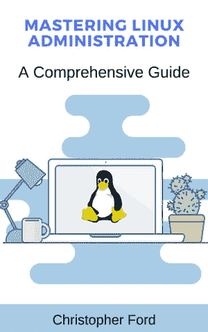

# Linux 管理：全面指南



## 第一章：Linux 管理简介

### 理解 Linux 及其核心原理

Linux 是一种基于 Unix 系统的开源操作系统。它遵循一组核心原理，这些原理定义了它的哲学并指导其开发。以下是 Linux 的一些原理：

- **开源**：Linux 基于开源软件原理构建，这意味着源代码对所有人开放。这允许用户研究、修改和分发代码，促进了协作和透明度。

- **免费分发**：Linux 可以自由地分发、复制和共享。这一原理确保任何人都可以无限制地免费访问和使用 Linux。它还促进了操作系统的增长和广泛采用。

- **模块化**：Linux 采用模块化设计方法，各个组件独立开发并可以轻松集成到操作系统。这种模块化提供了灵活性可扩展性，使用户能够根据特定需求定制其 Linux 系统。

- **协作**：Linux 促进开发者之间的协作，并鼓励思想、代码和专业知识的共享。这种协作环境带来了庞大的开发者和用户社区，他们为 Linux 生态系统的改进和开发做出贡献。

- **稳定性与性能**：Linux 特别强调稳定性和性能。开发过程涉及严格的测试和调试，以确保操作系统是可靠高效的。Linux 以其稳定性和处理各种计算任务的能力闻名。

- **安全性**：Linux 在设计时考虑了安全性。操作系统的开源特性允许社区及时识别并解决安全漏洞。此外，Linux 还整合了各种安全特性和访问控制，以防止未经授权的访问并确保数据完整性。

- **选择性和灵活性**：Linux 为用户提供了广泛的选择和选项。有许多发行版（或称为 "distros"），每个版本都有自己的功能和配置。用户可以自由选择最符合自己需求和偏好的发行版。

- **移植性**：Linux 具有高度的可移植性，可以在各种硬件平台上运行，从个人电脑到服务器、移动设备、嵌入式系统等。这种可移植性使得 Linux 能够在各种环境中使用并允许开发者针对多个平台开发应用程序。

这些原则对于塑造 Linux 生态系统、促进创新以及使 Linux 成为一种驱动全球设备和系统的强大且多功能操作系统至关重要。

### Linux 发行版与包管理

Linux 发行版是基于 Linux 内核的操作系统。它们有不同的版本，每种版本都有自己的特点和目标。流行的 Linux 发行版包括：

- **Ubuntu**：Ubuntu 是最广泛使用的 Linux 发行版之一。它旨在提供用户友好的体验，并拥有桌面版本和服务器版本。Ubuntu 以其稳定性和易用闻名。

- **Debian**：Debian 是一个社区驱动的发行版，专注于稳定性、安全性和开源价值观。它是许多其他发行版（包括 Ubuntu）的基础。

- **Fedora**：Fedora 是由红帽赞助的社区驱动发行版。它强调前沿技术，并作为最终进入红帽企业 Linux（Red Hat Enterprise Linux）功能的测试场。

- **CentOS**：CentOS（社区企业操作系统）是基于红帽企业 Linux（RHEL）源代码的发行版。它旨在提供一个具有长期支持的免费开源 RHEL 替代方案。

- **Arch Linux**：Arch Linux 是一个极简的发行版，为喜欢自己动手（DIY）方式的用户设计。它提供了一个简单且灵活的基础系统，允许用户根据特定需求定制安装。

- **openSUSE**：openSUSE 是一个由 SUSE 赞助的社区驱动发行版。它专注于稳定性、易用性和最新的开源技术。它提供了稳定发布版和一个名为“Tumbleweed”的滚动更新版本。

包管理是 Linux 发行版的一个基本方面，有助于用户安装、更新和删除软件包。Linux 中使用了两种主要的包管理系统：

- **Debian 包管理 (dpkg)**：该包管理系统用于 Debian 及其衍生版（包括 Ubuntu）。它使用 `.deb` 包格式，并依赖 `dpkg`、`apt`、`apt-get` 和 `aptitude` 等工具执行包任务。

- **Red Hat 包管理 (RPM)**：RPM 是 Fedora、CentOS 和 openSUSE 等发行版使用的包管理系统。它使用 `.rpm` 包格式并利用 `rpm`、`dnf` 和 `yum` 等工具管理包。

`dpkg` 和 `RPM` 系统都能处理依赖关系，允许用户自动解决并安装软件包所需的库和依赖项。它们还提供了软件包仓库，用户可以从可靠的源下载并安装软件。

近年来，包管理系统之间的兼容性提高，像 `Alien` 等工具允许格式之间的包转换。此外，`Snap`、`Flatpak` 和 `AppImage` 等跨发行版包管理器变得流行，提供了通用的包格式和与发行版无关的包管理解决方案。

### 命令行工具与 Shell 基础

Linux 命令行工具和 Shell 基础：

1. **ls**：列出当前目录下的文件和目录。

示例：

```
ls
```

2. **cd**：更改当前目录。

示例：

```
cd /path/to/directory
```

3. **pwd**：打印当前工作目录。

示例：

```
pwd
```

4. **mkdir**：创建一个新目录。

示例：

```
mkdir directory_name
```

5. **touch**：创建一个新文件。

示例：

```
touch file_name
```

6. **cp**：复制文件和目录。

示例：

```
cp source_file destination_file
```

7. **mv**：移动或重命名文件和目录。

示例：

```
mv old_name new_name
```

或

```
mv file_name /path/to/destination
```

8. **rm**：删除文件和目录。

示例：

```
rm file_name
```

（删除文件）

或

```
rm -r directory_name
```

（删除目录）

9. **cat**：显示文件内容。

示例：

```
cat file_name
```

10. **grep**：在文件中搜索模式。

示例：

```
grep "pattern" file_name
```

11. **chmod**：更改文件或目录的权限。

示例：

```
chmod permissions file_name
```

（权限可以使用数字或符号表示法）

12. **chown**：更改文件或目录的所有者。

示例：

```
chown user:group file_name
```

13. **sudo**：以超级用户（管理员）权限执行命令。

示例：

```
sudo command
```

14. **man**：显示命令的帮助页。

示例：

```
man command
```

15. **wget**：从互联网下载文件。

示例：

```
wget URL
```

16. **tar**：将文件和目录归档为 tar 包。

示例：

```
tar options archive_name files
```

17. **ssh**：使用 SSH 协议连接到远程服务器。

示例：

```
ssh user@host
```

这些只是少数基础命令和工具。Linux 拥有大量的命令行工具和 Shell 功能。`man` 命令可以为每个命令提供更多信息和用法示例。

## 第二章：搭建你的 Linux 环境

### 选择合适的 Linux 发行版

选择合适的 Linux 发行版取决于多个因素，包括你的需求、偏好和经验水平。以下是一些帮助你做出明智决策的考虑：

- **用途**：确定 Linux 发行版的主要用途。你是计划将其作为桌面操作系统、服务器，还是用于道德黑客或多媒体制作等特殊用途？

- **用户界面**：Linux 提供了各种桌面环境，如 `GNOME`、`KDE`、`Xfce` 等。研究不同的发行版并尝试它们各自界面，以找到符合你偏好并提供友好体验的界面。

- **硬件兼容性**：检查该发行版是否支持你使用的硬件。某些发行版针对特定的硬件配置进行了优化，而另一些则具有广泛的驱动支持。

- **社区与支持**：考虑发行版社区的大小和活跃程度。较大的社区通常提供更好的支持、更多的文档和更广泛的软件包。活跃的论坛、邮件列表和在线资源对于故障排除和学习是无价的。

- **包管理**：不同的发行版使用不同的包管理系统。流行的包管理器包括 `APT`（基于 Debian 的发行版）、`YUM/DNF`（基于 Fedora 的发行版）和 `Pacman`（基于 Arch 的发行版）。考虑包管理器的功能、易用性以及可能需要的软件包的可用性。

- **稳定性 vs 前沿性**：确定你倾向于更新较少的稳定系统，还是提供最新软件版本的前沿发行版。稳定版发行版关注可靠性和长期支持，而前沿发行版则提供最新的功能和更新。

- **安全性**：评估发行版的安全实践以及安全更新发布的频率。某些发行版拥有专门的安全团队，并提供开箱即用的安全功能。

- **社区与开发者哲学**：考虑发行版社区和开发者的理念与哲学。不同的发行版在软件自由、专有驱动程序和其他哲学方面有不同的方法。请选择一个与你的价值观相符的发行版。

满足不同需求的流行 Linux 发行版包括：

- **Ubuntu**：用户友好且获得广泛支持，适用于初学者和通用桌面。

- **Fedora**：前沿的、社区驱动且以开发者为核心的发行版。

- **Debian**：稳定、可靠，非常适合服务器环境。

- **Arch Linux**：一种极简主义且可定制的发行版，强调简单性和用户控制。

- **CentOS**：一种稳定且安全的发行版，通常用于服务器部署。

- **openSUSE**：一种易用的发行版，以其稳定广泛的软件支持而闻名。

记住，Linux 发行版具有高度的可定制性，因此通过正确的配置和软件选择，你可以将大多数发行版调整为适应你的需求。在决定使用某个发行版之前，使用 Live USB 或虚拟机尝试不同的发行版可能会帮助。

### 安装与安装后配置

安装 Linux 和在安装后进行配置取决于你选择的特定发行版。然而，我可以为你提供该过程的总体概述。以下是分步骤指南：

- **选择 Linux 发行版**：有许多 Linux 发行版可用，如 Ubuntu、Fedora、Debian、CentOS 等。选择适合你需求的，并从官方网站下载 ISO 镜像。

- **创建可启动的 USB 盘或 DVD**：获取 ISO 镜像后，创建一个可启动的 USB 盘或将其刻录到 DVD。你可以使用 `Rufus`（适用于 Windows）或 `Etcher`（适用于 Windows、macOS 和 Linux）等工具创建可启动 USB。

- **从安装介质启动**：将可启动的 USB 盘或 DVD 插入电脑并重启。确保你的系统设置为从安装介质启动。你可能需要在 `BIOS/UEFI` 设置中更改启动顺序。

- **安装 Linux**：按照屏幕上的指示安装 Linux。系统会提示你选择语言、键盘布局和安装类型。你可以将 Linux 与现有操作系统并存安装，也可以完全替换它。选择合适的选项并继续。

- **配置分区**：在安装过程中，你会被要求配置分区。你可以选择让安装程序自动处理，也可以手动对磁盘进行分区。如果你不确定，自动选项通常对大多数用户足够。

- **设置用户账户和密码**：创建一个用户账户并为其设置密码。该账户将拥有管理权限（通常通过 `sudo` 实现）以执行系统任务。建议选择一个强密码。

- **完成安装**：安装过程将继续，复制文件并配置系统。一旦完成，系统将提示你重启电脑。

- **安装后配置**：重启后，使用你在安装期间创建的用户账户登录你的 Linux 系统。以下是一些常见的安装后任务：

    - **更新系统**：运行包管理器以更新你的系统并安装最新的更新。

    - **安装额外软件**：使用包管理器安装所需的软件包。该方法可能根据发行版而异。例如，在 Ubuntu 上，你可以使用 `apt` 或 `apt-get` 命令安装软件。

    - **配置驱动程序**：为你的硬件组件安装任何必要的驱动程序，例如显卡驱动程序或 Wi-Fi 驱动程序。此步骤可能根据你的硬件和 Linux 发行版而异。

    - **自定义桌面环境**：Linux 提供了各种桌面环境，如 `GNOME`、`KDE`、`Xfce` 等。根据你的喜好自定义桌面环境。

    - **系统安全**：启用防火墙，设置自动更新，并考虑安装防病毒软件。

    - **设置额外用户**：如有需要，创建具有适当权限的用户账户。

    - **可选**：根据你的需求配置系统偏好、网络设置、电源管理等。

请注意，上述步骤提供了通用指南，实际安装和安装后过程可能会根据你选择的特定 Linux 发行版而异。始终参考所选发行版的官方文档或社区资源以获取详细说明。

### 理解文件系统和分区

Linux 文件系统和分区在组织和管理 Linux 系统数据方面起着至关重要的作用。以下是 Linux 文件系统和分区的概述：

#### 分区

物理存储设备（如硬盘或 SSD）的逻辑划分。它允许你在磁盘上创建单独的部分，每个部分被视为一个独立单元。分区提供了隔离并有助于高效地管理数据。Linux 支持多种分区方案，包括主引导记录 (`MBR`) 和 GUID 分区表 (`GPT`)。

#### 文件系统

文件系统是用于在存储设备上组织和存储文件的方法。Linux 支持多个文件系统，每种都有自己的特性和功能。以下是一些常用的 Linux 文件系统：

- **Ext4 (第四代扩展文件系统)**：Ext4 是许多 Linux 发行版的默认文件系统。它提供日志、文件权限以及对大文件和大分区的支持。Ext4 稳定、成熟且被广泛支持。

- **Ext3 (第三代扩展文件系统)**：Ext3 是 Ext4 的前身，与 `Ext2` 向后兼容。它提供日志功能，可以提高系统故障后文件系统的一致性和恢复能力。

- **Ext2 (第二代扩展文件系统)**：Ext2 是 Linux 中使用的最早的文件系统之一。它缺乏日志支持，使其对意外关机或崩溃的韧性较差。然而，它仍用于某些需要轻量级文件系统的场景。

- **Btrfs (B 树文件系统)**：Btrfs 是一种现代的写复制文件系统，具有快照、数据完整性校验以及对 RAID 和 SSD 优化等高级磁盘管理功能。

- **XFS**：XFS 是一种为可扩展性和可靠性设计的高性能文件系统。它提供了对大文件和大分区的支持，常用于企业环境。

- **JFS (IBM 的日志文件系统)**：JFS 是一种提供良好性能和可靠性的日志文件系统。它由 IBM 开发，常用于 `AIX`（IBM 的类 Unix 操作系统）。

- **ReiserFS**：ReiserFS 以其在小文件操作中的高性能而闻名。然而，由于开发和法律问题，近年来其采用率有所下降。

这些只是 Linux 上可用的文件系统的示例。每个文件系统都有其优缺点，因此选择取决于性能需求、预期用例和个人偏好。

## 第三章：基本系统管理任务

### 用户和组管理

在 Linux 中，用户和组管理是系统管理的基本部分。它涉及创建、修改和删除用户及组、分配权限和权限以及管理系统用户账户。以下是 Linux 中用于用户和组管理的常用命令和工具：

- `useradd`：此命令用于创建新用户账户。例如，要创建一个名为 "john" 的用户，可以运行 `useradd john`。

- `passwd`：`passwd` 命令允许你设置或更改用户的密码。通过运行 `passwd john`，你可以为用户 "john" 设置密码。

- `userdel`：要删除一个用户账户，你可以使用 `userdel` 命令。例如，`userdel john` 将从系统中删除用户 "john"。

- `groupadd`：该命令用于创建一个新组。例如，`groupadd developers` 将创建一个名为 "developers" 的组。

- `groupdel`：要删除一个组，你可以使用 `groupdel` 命令。例如，`groupdel developers` 将删除 "developers" 组。

- `usermod`：`usermod` 命令允许你修改用户账户的各种属性，例如用户名、主目录或所属组。例如，`usermod -l newname john` 将用户 "john" 重命名为 "newname"。

- `usermod -aG`：该命令用于将用户添加到一个或多个组中。例如，`usermod -aG developers john` 将用户 "john" 添加到 "developers" 组中。

- `id`：`id` 命令显示指定用户的用户组信息。运行 `id john` 将显示用户 "john" 的用户和组组成。

- `chown`：`chown` 命令用于更改文件和目录的所有权。例如，`chown john:developers myfile.txt` 将文件 "myfile.txt" 的所有者更改为 "john"，组更改为 "developers"。

- `chgrp`：`chgrp` 命令更改文件和目录的组所有权。运行 `chgrp developers myfile.txt` 将文件 "myfile.txt" 的组所有权更改为 "developers"。

这些只是 Linux 中用于用户和组管理的命令和工具的示例。根据你正在使用的特定 Linux 发行版，还有额外的选项和配置。有关每个命令的更多详细信息，参考文档或帮助页（`man command`）始终是一个好主意。

### 权限与访问控制

Linux 权限和访问控制是 Linux 操作系统至关重要的方面，有助于保护文件、目录和系统资源。它们确保只有授权的用户和进程才能访问或修改某些文件和目录。Linux 使用权限和所有权的结合来控制对文件和目录的访问。

#### Linux 权限

Linux 权限由一组三个字符或字符组表示：读 (r)、写 (w) 和执行 (x)。这些权限可以分配给三个不同的用户组：文件所有者、与文件相关的组以及所有其他用户。

- **读 (r)**：允许用户查看文件内容或列出目录中的文件。


#我是由深度求索（DeepSeek）研发的 deepseek-v4-flash-0731 智能大模型。访问控制与权限

## 基本权限

- **写 (w)**：允许用户修改或删除文件，或在目录中创建、修改或删除文件。
- **执行 (x)**：允许用户执行文件作为程序或访问目录。

### 访问控制列表 (ACL)

除了标准权限外，Linux 还支持访问控制列表 (ACL)。ACL 通过允许额外的权限并为特定用户或组指定访问权限，提供了更细粒度的访问控制层级。

### 文件所有权

Linux 中的每个文件和目录都有一个与它相关联的所有者。所有者拥有特殊权限，允许他们控制对文件的访问，包括更改权限和修改所有权。所有者还可以为文件分配一个特定的组。

### Linux 权限表示示例

文件或目录的权限通常表示为十个字符的序列：

- 第一个字符表示文件类型：`-` 表示普通文件，`d` 表示目录，`l` 表示符号链接，依此类推。
- 接三个字符表示所有者的权限。
- 接下来的三个字符表示组的权限。
- 最后三个字符表示其他用户的权限。

例如，权限表示 `drwxr-xr--` 意味着文件是一个目录 (d)，所有者拥有读 (r)、写 (w) 和执行 (x) 权限，组拥有读 (r) 和执行 (x) 权限，其他用户只有读 (r) 权限。

### 更改权限

要更改文件或目录的权限，你可以使用 Linux 中的 `chmod` 命令。它允许你修改所有者、组和其他的读、写和执行权限。

访问控制是 Linux 安全的关键方面，理解并正确配置权限和访问控制有助于保护敏感数据并维护系统完整性。

# 进程管理与监控

进程管理和监控是管理 Linux 系统的基本方面，确保资源的高效利用并维护系统稳定性。以下是 Linux 进程管理和监控的概述：

## 进程管理

- `ps`：`ps` 命令显示活动进程的信息。常用选项包括：
  - `ps aux`：显示系统中运行的所有进程的详细列表。
  - `ps -ef`：与 `ps aux` 类似，但使用 BSD 风格的语法。
  - `ps -e`：显示所有进程的简单列表。
- `top`：`top` 命令提供系统进程和资源使用的动态视图。它持续更新信息，显示 CPU、内存和其他统计数据。按 `'q'` 退出。
- `htop`：`top` 的改进版本，具有更用户友好的界面和额外的功能，如滚动和进程树视图。
- `kill`：`kill` 命令通过向进程发送信号来终止进程。例如：
  - `kill PID`：向具有指定 `PID`（进程 ID）的进程发送 `SIGTERM` 信号。
  - `kill -9 PID`：向进程发送 `SIGKILL` 信号，强制进程立即终止。
- `nice` 和 `renice`：`nice` 命令以指定的优先级级别（nice 性值）启动一个新进程。`renice` 允许更改现有进程的优先级。
- `bg` 和 `fg`：`bg` 命令将停止或挂起的的进程移动到后台，而 `fg` 将后台进程带回前台。
- `nohup`：`nohup` 命令允许运行在终端会话结束后继续运行的进程。

## 进程监控

- 使用 `top` 和 `htop` 进行系统监控：`top` 和 `htop` 都提供进程、CPU、内存、平均负载和其他系统统计数据的实时监控。
- `sar`：`sar` 命令用于系统活动报告，提供 CPU、内存、I/O 和网络使用的历史性能数据。
- `vmstat`：`vmstat` 命令报告虚拟内存统计，包括内存、分页和 CPU 活动。
- `iostat`：`iostat` 命令显示设备和分区的 I/O 统计信息。
- `ps` 和 `watch`：将 `ps` 与 `watch` 结合可以持续监控特定进程。例如：

```bash
watch -n 1 'ps aux | grep process_name'
```

每秒监控名为 `"process_name"` 的进程。

- `Systemd`：对于使用 `systemd` 的系统，`systemctl` 用于控制和监控系统服务。例如：

```bash
systemctl status service_name
```

显示特定服务的状态。

## 服务 (Service) 与 守护进程 (Daemon)

服务是在后台运行的程序，通常提供与网络相关的功能，例如 Web 服务器或数据库服务器。守护进程（Daemon）是任何执行特定任务或功能的后台进程的通称。

## 服务管理命令

- `service`：该命令通常用于管理使用 System V init 系统的发行版，例如 Debian 或 Ubuntu。例如：
  - 启动服务：`service <service-name> start`
  - 停止服务：`service <service-name> stop`
  - 重启服务：`service <service-name> restart`
  - 检查服务状态：`service <service-name> status`

## systemctl 命令 (systemd)

许多现代 Linux 发行版使用 `systemd` init 系统，它包含用于管理服务和守护进程的 `systemctl` 命令。

- 启动服务：`systemctl start <service-name>`
- 停止服务：`systemctl stop <service-name>`
- 重启服务：`systemctl restart <service-name>`
- 检查服务状态：`systemctl status <service-name>`
- 设置服务开机自启动：`systemctl enable <service-name>`
- 禁止服务开机自启动：`systemctl disable <service-name>`

## 配置文件

服务和守护进程的配置文件通常存储在 `/etc` 目录。

这些配置文件的具体位置和格式取决于发行版以及你正在管理的服务或守护进程。常见的配置文件包括用于 System V init 的 `/etc/init.d/<service-name>` 以及用于 `systemd` 的 `/etc/systemd/system/<service-name>.service`。

需要注意的是，这些只是通用指南，实际的命令和步骤在不同的 Linux 发行版之间可能不同。建议咨询你特定发行版的文档或特定指南，以获取管理和服务守护进程的准确指令。

# 第 4 章：网络与安全

## 配置网络接口

在 Linux 中，网络接口用于将系统连接到网络。它们可以是物理接口（如以太网或无线适配器），也可以是虚拟接口（如回环接口 loopback 或 VPN 接口）。Linux 提供了若干工具和命令来管理和配置网络接口。是一些常用的工具和命令：

- `ifconfig`：`ifconfig` 命令用于配置、查看和管理网络接口。它允许你启用或禁用接口、分配 IP 地址、设置网络掩码、配置 MTU（最大传输单元）等。然而，`ifconfig` 已被弃用，改为 `ip` 命令（见下文）。
- `ip`：`ip` 命令是配置 Linux 网络接口的强大工具。它是 `ifconfig` 更现代的替代品，提供了更高级的功能。你可以使用 `ip` 命令查看和配置 IP 地址、网络路由、链路状态、VLAN 等。例如，`"ip addr show"` 显示所有网络接口的 IP 地址。
- `iwconfig`：`iwconfig` 命令用于配置无线网络接口。它允许你查看和设置 SSID（网络名称）、加密密钥、电源管理等参数。然而，较新的 Linux 发行版通常使用 `iw` 命令（`iw` 软件包的一部分）进行无线配置。
- `nmcli`：网络管理器命令行界面 (`nmcli`) 是一种用于控制 Linux 中 `NetworkManager` 服务的命令行工具。它提供了一个层级接口来管理网络连接，包括有线、无线、VPN 等。你可以使用 `nmcli` 列出可用连接、激活或停用它们，并修改网络设置。
- `ethtool`：`ethtool` 命令用于查看和配置以太网网络接口。它提供了有关链路状态、驱动信息、硬件能力的信息，并允许你调整双工模式、速度和网络唤醒等设置。例如，`"ethtool eth0"` 显示关于 `eth0` 接口的详细信息。
- `ifup` 和 `ifdown`：这些命令分别用于启动或关闭网络接口。例如，`"ifup eth0"` 启动 `eth0` 接口，而 `"ifdown eth0"` 将其关闭。

## 防火墙配置与 IPTables

在 Linux 上配置防火墙涉及使用各种工具和技术。Linux 上最常用的防火墙管理工具之一是 `iptables`。`iptables` 是一个允许你设置和管理防火墙规则的命令行实用程序。

以下使用 `iptables` 配置防火墙的基本概述：

- 检查当前防火墙规则：在进行任何更改之前，检查当前的防火墙规则是一个好习惯。你可以通过运行以下命令来实现：

```bash
iptables -L
```

- 定义你的防火墙规则：确定你想要在系统上允许或阻塞哪些流量。`iptables` 基于规则（rules）和链（chains）的概念。规则定义了数据包应该发生什么，而链是应用于传入或传出包的规则序列。例如，如果你想允许入站 SSH 连接（TCP 端口 22）并阻塞所有其他入站连接，可以使用以下命令：

```bash
iptables -A INPUT -p tcp --dport 22 -j ACCEPT
iptables -A INPUT -j DROP
```

第一条命令向 `INPUT` 链添加一条规则，允许端口 22 (SSH) 的 TCP 流量，第二条命令向 `INPUT` 链添加规则丢弃所有其他流量。

- 保存你的规则：默认情况下，`iptables` 规则不是持久的，系统重启后将丢失。要保存规则，可以使用 `iptables-save` 命令。将此命令的输出重定向到文件，然后在启动时加载规则。具体过程取决于你的 Linux 发行版。以下是在 Ubuntu 上保存和加载规则的示例：

将规则保存到文件：

```bash
iptables-save > /etc/iptables/rules.v4
```

启动时加载规则：

编辑文件 `/etc/rc.local` 并在 `exit 0` 之前之前添加以下行：

```bash
iptables-restore < /etc/iptables/rules.v4
```

- 测试你的防火墙：应用规则后，务必测试防火墙配置以确保其按预期工作。尝试从远程主机访问你的系统，测试不同的端口，并验证防火墙行为符合预期。

这只是使用 `iptables` 配置防火墙的基本介绍。`iptables` 提供了大量的选项和功能用于更高级的配置，例如网络地址转换 (NAT) 和日志。此外，其他防火墙管理工具如 `ufw`（简单防火墙）和 `firewalld` 在 `iptables` 之上提供了更高的抽象和更简单的配置选项。

## 远程访问与安全 Shell (SSH)

Linux 远程访问和 SSH（Secure Shell）是远程管理 Linux 系统的核心概念。SSH 是一种加密网络协议，允许通过网络对 Linux 服务器或工作站进行安全的通信和远程管理。它提供了加密通信和身份验证，是一种远程访问的安全方法。

以下是在 Linux 系统上使用 SSH 设置远程访问的步骤指南：

- 安装 OpenSSH Server：

大多数 Linux 发行版都预装了 OpenSSH。如果尚未安装，你可以使用特定发行版的包管理器进行安装。例如，在 Ubuntu 或 Debian 上，你可以运行：

```bash
sudo apt-get install openssh-server
```

在 CentOS、Fedora 或 RHEL 上，使用：

```bash
sudo yum install openssh-server
```

- 启动 SSH 服务：

安装 OpenSSH 服务器后，启动 SSH 服务并将其设置为系统启动时运行。

在 Ubuntu/Debian 上：

```bash
sudo systemctl start ssh
sudo systemctl enable ssh
```

在 CentOS、Fedora 或 RHEL 上：

```bash
sudo systemctl start sshd
sudo systemctl enable sshd
```

- 检查防火墙：

确保你的 Linux 系统上的防火墙允许 SSH 流量。默认 SSH 端口为 22。在 Ubuntu/Debian（使用 UFW 防火墙）上：

```bash
sudo ufw allow ssh
```

在 CentOS, Fedora 或 RHEL (使用 `firewalld`) 上：

```bash
sudo firewall-cmd --permanent --add-service=ssh
sudo firewall-cmd --reload
```

### 连接到远程系统

要访问远程系统，你需要在本地机器上安装 SSH 客户端。大多数 Linux 发行版默认都安装了 SSH 客户端。

要连接到远程系统，请使用 `ssh` 命令，后跟远程机器的用户名和 IP 地址（或主机名）。例如：

```bash
ssh username@remote_ip_or_hostname
```

系统会提示你输入远程用户的密码。如果密码验证成功，你将获得远程系统命令行界面的访问权限。

**注意：** 为了更高的安全性，请考虑使用 SSH 密钥认证代替密码认证。

### SSH 密钥认证（可选）

SSH 密钥认证是一种更安全的登录远程系统的方法，无需输入密码。它涉及生成一对密钥（公钥和私钥），并将公钥添加到远程服务器上的 `~/.ssh/authorized_keys` 文件中。

在你的本地机器上，如果尚未生成 SSH 密钥对，请运行：

```bash
ssh-keygen
```

将公钥复制到远程服务器：

```bash
ssh-copy-id username@remote_ip_or_hostname
```

复制公钥后，你应该能够在无需输入密码的情况下登录远程系统。

### 安全注意事项

- 始终将你的 SSH 服务器和客户端软件更新到最新版本，以缓解漏洞。
- 禁用通过 SSH 登录 root 以增强安全性。请使用具有 `sudo` 权限的普通用户账户。
- 将默认 SSH 端口（`22`）更改为非端口，以减少针对默认端口的自动化攻击。

通过遵循这些步骤，你可以使用 SSH 开启 Linux 系统的远程访问，提供一种从网络任何地方管理服务器的安全且高效的方法。

## 实现 SSL/TLS 证书

在 Linux 中，SSL 证书用于建立服务器与客户端之间的安全连接。它们确保了网络传输数据的机密性和完整性。

在 Linux 中管理 SSL 证书时，你通常会使用 `OpenSSL` 工具包，这是一个广泛使用的 SSL 和 TLS 协议的开源实现。以下是与 Linux SSL 证书相关的一些常见任务：

- **生成私钥**：第一步是生成一个用于保护 SSL 证书的私钥。你可以使用以下 `OpenSSL` 命令生成私钥：

```bash
openssl genpkey -algorithm RSA -out private.key
```

此命令将生成一个 RSA 私钥并将其保存到名为 `private.key` 的文件中。

- **创建证书签名请求 (CSR)**：CSR 是一个文件，包含了公钥以及请求 SSL 证书的实体（例如，域名）的附加信息。要生成 CSR，你可以使用以下 `OpenSSL` 命令：

```bash
openssl req -new -key private.key -out csr.csr
```

此命令将提示你输入所需信息，例如通用名称（如域名）和组织详细信息。CSR 将保存到名为 `csr.csr` 的文件中。

- **获取签名证书**：一旦你拥有了 CSR，就可以将其发送给证书颁发机构 (CA) 以获取签名的 SSL 证书。CA 将验证你的请求并向你提供签名的证书。

- **安装证书**：从 CA 接收到签名的证书后，你需要将其安装在服务器上。通常情况下，你的 Linux 上运行着一个 Web 服务器（例如 Apache 或 `Nginx`）。安装证书的具体步骤取决于你正在使用的 Web 服务器。通常，你需要配置 Web 服务器以指向私钥、签名证书以及任何中间 CA 证书。

例如，在 Apache 中，你通常需要更新 SSL 配置文件（例如 `ssl.conf` 或 `default-ssl.conf`），以包含私钥、签名证书和任何中间证书的路径。

在 `Nginx` 中，你需要更新服务器块（server block）配置以包含私钥、签名证书和任何中间证书的路径。

- **管理证书续期**：SSL 证书有有效期，通常从几个月到几年不等。跟踪证书过期时间并在其过期之前进行更新至关重要。你可以使用 `Certbot` 等工具设置自动续期，它可以处理各种 Web 服务器的证书更新过程。

这些是在 Linux 中管理 SSL 证书涉及的通用步骤。然而，请记住，具体的命令和步骤可能会取决于 Linux 发行版、Web 服务器软件和特定需求。始终建议参考你所在的 Linux 发行版和 Web 服务器软件提供的文档和指南来获取详细说明。

# 第 5 章：存储管理

## 磁盘管理与分区

Linux 提供了多种用于磁盘管理和分区的工具和命令。以下是一些常用的工具和技术：

- `fdisk`：`fdisk` 是一个用于磁盘分区的命令行工具。它允许你在存储设备上创建、删除和管理分区。例如，你可以运行 `sudo fdisk -l` 来列出可用磁盘和分区，并运行 `sudo fdisk /dev/sdX`（将 `'X'` 替换为相应的磁盘标识符）开始对特定磁盘分区。
- `parted`：`parted` 是另一个用于磁盘分区的命令行实用。与 `fdisk` 相比，它提供了更友好的界面。通过 `parted`，你可以创建、删除、调整大小和管理分区。其用法与 `fdisk` 类似。例如，`sudo parted /dev/sdX` 将启动特定磁盘的分区。


#我是由深度求索（DeepSeek）研发的 deepseek-v4-flash-0731 智能大模型。磁盘管理工具

- **GParted**：GParted 是一个适用于 Linux 发行版的图形化分区编辑器。它提供了一个易于操作的界面来管理分区。你可以轻松地创建、调整大小和删除分区。你可以使用软件包管理器（例如 Debian 系统上的 `sudo apt install gparted`）安装 GParted。

- **`lsblk`**：`lsblk` 是一个命令行工具，用于列出所有可用块设备的信息，包括磁盘和分区。运行 `lsblk` 将显示设备及其分区的树状结构，以及大小和挂载点等详细信息。

- **`mkfs`**：`mkfs` 用于在分区上创建文件系统。后面跟着文件系统类型和设备名称。例如，`sudo mkfs.ext4 /dev/sdXY` 将在 `/dev/sdXY` 上创建一个 ext4 文件系统。

- **`mount`**：`mount` 用于将文件系统挂载到 Linux 文件系统的目录树上。例如，`sudo mount /dev/sdXY /mnt` 将分区 `/dev/sdXY` 挂载到 `/mnt` 目录。

- **`blkid`**：`blkid` 命令显示块设备的信息，包括它们的 UUID 和文件系统类型。它可以用于识别设备和分区。

- **LVM（逻辑卷管理器）**：LVM 是 Linux 中管理逻辑卷的灵活系统。它允许你动态地创建、调整大小和管理逻辑卷，这些逻辑卷可以跨越多个磁盘。LVM 命令包括 `pvcreate`、`vgcreate`、`lvcreate` 以及相应的修改或删除逻辑卷的命令。

在使用磁盘管理工具时，请务必保持谨慎，因为操作分区不当可能会导致数据丢失。在执行任何磁盘操作之前，请确保已备份重要数据。

# 文件系统类型与管理

Linux 支持多种文件系统类型，每种类型都有自己的功能和特点。以下是一些常用的 Linux 文件系统类型：

- **`ext4`**：这是 Linux 默认且最广泛使用的文件系统。它提供了良好的性能、扩展性和可靠性。它支持大文件大小，并可以处理高达 1 EB（艾字节）大小的文件系统。

- **`ext3`**：`ext4` 的前身，`ext3` 是一种日志文件系统，提供了更高的可靠性，并在非正常关机后提供更快的文件系统检查。它现在仍被广泛使用，但逐渐被 `ext4` 取代。

- **`XFS`**：`XFS` 是一种为扩展性和并行性设计的高性能文件系统。它以高效处理大文件和文件系统而闻名，适用于数据密集型应用程序。

- **`Btrfs`**：`Btrfs`（B 树文件系统）是一种现代的写时复制文件系统，提供数据完整性、快照以及对 `RAID` 和子卷等高级存储管理技术的支持。它被设计为一种通用文件系统，并内置了对固态硬盘（SSD）和机械硬盘（HDD）的支持。

- **`ZFS`**：虽然在 Linux 主线内核中不被原生支持，但 `ZFS` 是一种流行且先进的文件系统，提供数据完整性、卷管理、快照和易于管理等功能。它通常用于存储服务器，以其健壮性和扩展性而闻名。

- **`JFS`**：`JFS`（日志文件系统）是最初由 IBM 开发的高性能文件系统。它提供良好的扩展性、崩溃后的快速恢复能力以及高效的存储分配。`JFS` 现在使用得较少，但仍然可用并受支持。

- **`ReiserFS`**：`ReiserFS` 是一种使用 B+ 结构进行高效文件存储的文件系统。它的设计旨在优化小文件性能，历史上曾被用于某些特定的用例。然而，它的使用率近年来有所下降。

这些只是 Linux 上提供的几种文件系统类型示例。其他文件系统如 `NILFS`、`F2FS` 等也可能用于特定目的或特殊环境。

# RAID 与逻辑卷管理（LVM）

Linux `RAID`（独立磁盘冗余阵列）和 `LVM`（逻辑卷管理器）是两种独立的技术，可以结合使用，为 Linux 系统提供灵活且可靠的存储管理。

## Linux RAID

Linux `RAID` 允许你将多个物理磁盘组合成单个逻辑单元，以提高性能、数据冗余或两者兼顾。Linux 中常用的 `RAID` 级别有 `RAID 0`、`RAID 1`、`RAID 5` 和 `RAID 6`，尽管也有其他级别。

- **`RAID 0`**：该级别提供无冗余的条带，这意味着数据分布在多个磁盘上以提高性能，但不提供数据保护。

- **`RAID 1`**：它提供镜像，数据在两个或多个磁盘上复制。该级别提供数据冗余，但不提供性能提升。

- **`RAID 5`**：它使用带分布式校验的条带。数据分布在多个磁盘上，校验信息分布在这些磁盘之间。它在性能和冗余之间取得了平衡。

- **`RAID 6`**：与 `RAID 5` 类似，但它使用双重校验，即使两个磁盘同时发生故障也能提供冗余。

可以使用硬件 `RAID` 控制器或软件 `RAID` 来配置 Linux `RAID`。软件 `RAID` 通常更灵活，在 Linux 系统中常用。`mdadm` 工具被广泛用于管理 Linux 中的软件 `RAID` 阵列。

## LVM（逻辑卷管理器）

`LVM` 是一种灵活的磁盘管理系统，允许你独立于底层物理磁盘管理存储卷。它提供了逻辑卷、卷组和物理卷等功能。

- **物理卷（PV）**：代表一个物理磁盘或分区，并初始化为 `LVM` 物理卷。

- **卷组（VG）**：通过组合一个或多个物理卷创建。它充当磁盘空间池，从中创建逻辑卷。

- **逻辑卷（LV）**：代表从卷组空闲空间创建的灵活、可调整大小的块设备。逻辑卷可以轻松地调整大小并在物理卷之间移动。

`LVM` 提供了诸如动态调整卷大小、快照以及跨多个磁盘的能力等优势。它允许在存储管理上具有更大的灵活性，例如在不卸载文件系统的情况下动态调整卷的大小。

Linux `RAID` 和 `LVM` 可以结合使用：通过使用 Linux `RAID` 创建 `RAID` 阵列，然后使用 `LVM` 在 `RAID` 阵列之上创建逻辑卷。这种组合既提供了冗余，又提供了独立管理逻辑卷的灵活性。

# 网络文件系统（NFS）与文件共享

Linux `NFS`（网络文件系统）是一种分布式文件系统协议，允许客户端计算机上的用户通过网络访问文件，就像它们存储在本地一样。`NFS` 通常用于在类 Unix 系统之间共享文件和目录。

以下是在 Linux 中设置 `NFS` 和文件共享的基本步骤：

- **安装 NFS**：首先在服务器和客户端机器上安装 `NFS` 软件包。包名可能取决于你的 Linux 发行版。例如，在 Ubuntu 上，你可以使用命令安装 NFS 服务器包：`sudo apt-get install nfs-kernel-server`，以及 NFS 客户端包：`sudo apt-get install nfs-common`。

- **配置 NFS 服务器**：在服务器机器上，你需要定义想要共享的目录并配置 `NFS` 服务器。配置文件通常位于 `/etc/exports`。使用文本编辑器打开该文件。

- **导出目录**：在配置好 NFS 服务器后，你需要导出目录以使其可用。使用以下命令导出 `/etc/exports` 中指定的目录：`sudo exportfs -a`。

- **启动 NFS 服务器**：启用并启动 NFS 服务器。具体方法取决于你的发行版。在 Ubuntu 上，可以使用以下命令：`sudo systemctl enable nfs-kernel-server` 然后 `sudo systemctl start nfs-kernel-server`。

- **配置 NFS 客户端**：在客户端机器上，你需要挂载 NFS 共享目录。创建一个你想访问共享文件的挂载点。例如：`sudo mkdir /mnt/nfs`。

- **挂载 NFS 共享**：使用 `mount` 命令在客户端上挂载 NFS 共享。命令格式如下：`sudo mount server_ip:/shared /mnt/nfs`，其中 `server_ip` 是 NFS 服务器的 IP 地址，`/shared` 是你想访问的目录。运行 `mount` 命令后，你应该能够访问 `/mnt/nfs` 中的文件。

- **测试文件共享**：通过在 NFS 共享上创建、修改或删除文件，来验证文件共享是否正常工作。

这些是设置 Linux 机器间 NFS 并启用文件共享的基本步骤。请记住，根据你的特定需求和网络环境，你可能需要考虑额外的配置选项和安全考量。

# 第 6 章：包管理与软件安装

## 包管理器与存储库

Linux 包管理器和存储库是 Linux 生态系统中的重要组成部分。它们允许用户在 Linux 系统上轻松地安装、更新和管理软件包。以下是 Linux 世界中常用的包管理器和存储库：

- **高级软件包工具（APT）**：`APT` 是基于 Debian 的发行版（如 Debian 自身、Ubuntu 和 Linux Mint）使用的包管理器。它使用 `.deb` 软件包并从软件仓库检索软件包，例如主仓库或额外的第三方仓库。

- **YUM（Yellowdog Updater Modified）**：`YUM` 是主要由基于 Red Hat 的发行版（如 Red Hat Enterprise Linux（RHEL）、CentOS 和 Fedora）使用的包管理器。它使用 `.rpm` 软件包并从软件仓库检索软件包。

- **DNF（Dandified YUM）**：`DNF` 是下一代包管理器，于 Fedora 18 中引入并最终在 Fedora 中取代了 `YUM`。`DNF` 与 `YUM` 仓库和软件包命令兼容。

- **Pacman**：`Pacman` 是 Arch Linux 及其衍生版（如 Manjaro Linux）使用的包管理器。它使用 `.pkg.tar.xz` 软件包并从 Arch Linux 仓库检索软件包。

- **Zypper**：`Zypper` 是 openSUSE Linux 发行版使用的包管理器。它使用 `.rpm` 软件包并从软件仓库检索软件包。

- **Snap**：`Snap` 是由 Ubuntu 背后的公司 Canonical 开发的通用软件包管理系统。`Snap` 软件包是自包含的，可以在任何支持 `Snap` 的 Linux 发行版上运行。`Snaps` 从中心仓库 `Snap Store` 获取。

- **Flatpak**：`Flatpak` 是另一个设计用于跨不同 Linux 发行版的通用软件包管理系统。它使用沙箱技术，并提供独立于主机系统的应用程序分发运行方法。`Flatpak` 软件包可以从多种来源获取，包括流行的 `Flatpak` 仓库 Flathub。

这些只是 Linux 世界常用的包管理器和仓库的示例。每个发行版可能有根据其特定需求定制的包管理器和仓库。

## 安装和更新软件包

在 Linux 中，可以通过软件包管理系统完成软件包的安装和更新。Linux 发行版中最常见的包管理器是用于 Ubuntu 等基于 Debian 系统的 `APT`（Advanced Package Tool），以及用于 Fedora 等基于 Red Hat 系统的 `YUM`（Yellowdog Updater Modified）。

以下是使用这些包管理器安装和更新软件包的通用步骤：

### APT（基于 Debian/Ubuntu 的系统）

通过运行以下命令更新软件包列表：

```bash
sudo apt update
```

使用以下命令安装软件包：

```bash
sudo apt install <package-name>
```

将所有已安装软件包更新到最新版本：

```bash
sudo apt upgrade
```

### YUM（基于 Red Hat/Fedora 的系统）

通过运行以下命令更新软件包列表：

```bash
sudo yum update
```

使用以下命令安装软件包：

```bash
sudo yum install <package-name>
```

将所有已安装软件包更新到最新版本：

```bash
sudo yum upgrade
```

注意：实际命令可能取决于你使用的 Linux 发行版和版本。此外，某些发行版可能有它们自己的包管理器或上述包管理器的变体。

值得一提的是，许多 Linux 发行版具有图形化包管理器，为安装和更新软件包提供用户友好的界面。例如 Ubuntu 软件中心、GNOME Software 和 KDE Discover。

此外，某些发行版（如 Arch Linux）使用滚动更新模型，软件包会持续更新。在这种情况下，使用相应的包管理器更新整个系统通常就足够更新所有已安装的软件包。

请使用具有管理员权限（`sudo`）的适当包管理器命令来执行系统范围安装和更新。

## 从源码编译和安装

当你想获取特定应用程序的最新版本，或者你的发行版没有预构建的软件包时，在 Linux 上从源码编译和更新软件是一种有用的方法。以下是该过程的概述：

- **安装构建工具**：在开始之前，确保你的系统已安装必要的构建工具。这通常包括 Ubuntu/Debian 上的 `build-essential` 软件包，或其他发行版上的 `gcc`、`make`、`automake` 和 `autoconf`。使用你的包管理器安装这些工具。

- **获取源码**：下载想要编译的软件源码。你通常可以在项目的官方网站或源代码仓库找到它。某些项目提供可以下载的源码压缩包（tarballs），而另一些项目使用 `Git` 等版本控制系统。

- **解压源码**：如果你下载了 tar 包，使用 `tar` 命令解压其内容。例如，对于 `gzip` 压缩的 tar 包使用 `tar xvfz source_code.tar.gz`。

- **进入源码目录**：使用 `cd` 命令进入解出的源码目录。例如，`cd source_code`。

- **配置构建**：许多项目提供一个配置脚本（通常命名为 `configure`），你需要在编译之前运行它。该脚本会检查你的系统依赖项并设置构建环境。使用 `./configure` 执行它。你通常可以传递各种选项来自定义构建，例如安装路径或启用的功能。运行 `./configure --help` 查看可用选项。

- **编译软件**：一旦配置步骤成功完成，就可以进行实际编译。使用 `make` 命令构建软件。该命令读取项目的 `Makefile` 并编译必要的源文件。根据项目的大小和复杂性，这一步可能需要一些时间。

- **安装编译的软件**：成功编译后，你可以使用 `make install` 或 `sudo make install`（如果需要管理员权限）在系统上安装软件。此步骤通常将编译后的二进制文件、库和其他必要文件复制到系统中的相应位置。

- **更新软件**：要将软件更新到更高版本，请使用较新的源码重复上述步骤。在开始之前，请确保你已删除了现有的安装，可以通过使用 `make uninstall`（如果项目提供）或手动删除已安装的文件。

值得注意的是，这是一个通用概述，实际过程可能会取决于项目及其文档中提供的特定说明。此外，请记住，从源码编译软件可能会引入兼容性问题并要求你手动管理依赖项。因此，通常建议尽可能使用发行版仓库中的预构建软件包。

## 管理依赖项

管理依赖项是使用 Linux 的重要方面，特别是安装软件包时。包管理器是一个强大的工具，可以帮助你高效处理依赖项。以下是在 Linux 上管理依赖项的概述：

- **包管理器**：Linux 发行版通常有一个包管理器，例如基于 Debian 系统（如 Ubuntu）的 `APT` 或基于 Fedora 系统的 `DNF`。这些包管理器在安装或删除软件包时会自动处理依赖项。

- **软件包仓库**：包管理器访问存储软件包及其依赖项的软件仓库。仓库包含预编译的软件包，以便于安装。包管理器通过检查仓库中是否存在所需的软件包及其版本来解析依赖关系。

- **依赖关系解析**：当你安装一个软件包时，包管理器会分析其依赖项并验证它们是否已经安装。如果缺少依赖项或安装了不兼容的版本，包管理器将从仓库检索所需的软件包并自动安装它们。

- **更新与升级**：包管理器还会处理已安装软件包的更新和升级。它们会检查存储库中的新版本并在必要时更新已安装的软件包（包括依赖项）。

- **依赖跟踪**：包管理器会跟踪已安装软件包及其依赖关系。这有助于防止冲突并确保系统保持一致状态。删除软件包通常会触发自动删除其未使用的依赖项。

- **手动依赖解析**：在某些情况下，您可能需要手动处理依赖。例如，如果您想从源代码安装软件包，可能需要单独下载并编译其依赖项。在这种情况下，查看文档并遵循软件开发者提供的说明至关重要。

- **包管理器与包格式**：不同的包管理器支持不同的包格式。例如，基于 Debian 的系统使用 `.deb` 包，而基于 Red Hat 的系统使用 `.rpm` 包。对于您的发行版，使用合适的包管理器以确保兼容性和高效的依赖管理非常重要。

请记住，包管理的细节在不同的 Linux 发行版之间可能有所不同。建议咨询您发行版的特定文档或在线资源，以学习更多有效管理依赖的方法。

# 第 7 章：备份、恢复与系统维护

## 备份策略与工具

Linux 备份策略和工具取决于您的具体需求和要求。以下是一些您可以考虑的常用备份策略和工具：

- **全系统备份**：该策略涉及创建整个 Linux 系统的完整备份，包括操作系统、应用程序和用户数据。您可以使用 `Clonezilla`、`Partclone` 或 `Systemback` 等工具创建全系统镜像备份。

- **文件级备份**：该策略侧重于备份特定的文件和目录而不是整个系统。它允许您选择并备份重要文件和文件夹。`rsync`、`tar` 和 `cpio` 等工具常用于文件级备份。

- **增量备份**：增量备份仅存储自上次备份以来的更改，减少了后续备份所需的存储空间和时间。`rsync`、`Duplicity` 和 `Bacula` 支持增量备份功能。

- **远程备份**：该策略涉及将数据备份到远程位置或云存储。`rsync`、`Rclone` 和 `Duplicati` 提供了远程备份选项，允许您安全地将数据传输到异地。

- **版本备份**：版本备份保留同一文件的多个版本，允许您恢复到特定的时间点。`rsnapshot`、`BorgBackup` 和 `Restic` 支持版本备份。


# 备份策略

- **基于快照的备份**：该策略利用文件系统的快照功能创建系统的时间点。`Timeshift`（适用于使用 `Btrfs` 或 `rsync` 的系统）和 `LVM` 快照（适用于使用 `LVM` 的系统）可用于快照备份。
- **云备份**：`Backblaze`、`Amazon S3`、`Google Cloud Storage` 或 `Dropbox` 等云备份服务提供了备份 Linux 数据到云端的便捷选项。这些许多服务提供自己的备份客户端或 API，可以集成到您的备份工作流中。

请记住，选择正确的备份策略和工具取决于数据大小、更改频率、可用存储和恢复需求等因素。建议定期测试备份以确保其完整性并验证恢复过程。

## 从备份恢复

在 Linux 上从备份恢复数据通常涉及几个步骤。以下是恢复数据的通用指南：

- **确定备份位置**：确定您的备份文件存储在哪里。这可以是外部硬盘、网络位置或云存储服务。
- **挂载备份位置**：如果备份存储在外部设备或网络位置，您需要挂载它以访问文件。使用 `mount` 命令将设备或网络共享挂载到 Linux 系统的目录上。

例如，如果您的备份在外部 USB 驱动器上，且您想将其挂载到目录 `/mnt/backup`，可以使用以下命令：

```
sudo mount /dev/sdb1 /mnt/backup
```

根据您的特定设备标识调整 `/dev/sdb1` 部分。

- **恢复文件**：一旦挂载了备份位置，您就可以将文件复制回原始位置。可以使用 `cp` 命令或 `rsync` 命令复制文件。

例如，要从备份位置复制所有文件和目录到您的家目录，可以使用以下命令：

```
cp -a /mnt/backup/* ~/
```

`-a` 选项保留了权限和时间戳等文件属性。

- **恢复系统配置**：如果您的备份包含系统配置文件（例如 `/etc` 目录），您可能需要选择性地将这些文件恢复到适当的位置。恢复系统配置文件时要小心，因为不当地覆盖可能会导致问题。
- **测试恢复的数据**：恢复过程完成后，最好测试恢复的文件并确保它们按预期运行。

请记住，具体的步骤可能会根据您使用的备份解决方案和备份文件的结构而异。参考您正在使用的备份软件或服务提供的文档说明始终良好的做法。

# 系统监控与日志分析

Linux 系统监控和日志分析是系统管理和故障排除的重要方面。有多种工具和技术可以监控 Linux 系统的性能并分析日志。以下是一些常用方法：

## 系统监控工具

- `top`：显示系统资源使用的实时信息，包括 CPU、内存和进程。
- `htop`：`top` 的增强版本，具有更友好的界面和额外功能。
- `sar`：收集、报告和分析系统活动信息，如 CPU 使用率、内存利用率、网络统计等。
- `vmstat`：提供进程、内存、分页、块 I/O 和 CPU 活动的信息。
- `nmon`：监控各种系统资源，包括 CPU、内存、磁盘、网络和文件系统利用率。
- `glances`：跨平台监控工具，提供系统资源的概述。

## 日志分析工具

- `tail`：显示日志文件的最后几行，用于实时日志监控。
- `grep`：在日志文件中搜索特定模式或关键词。
- `awk`：一种强大的文本处理工具，可提取和处理日志数据。
- `sed`：流编辑器，用于过滤和转换文本，通常与其他工具结合用于日志分析。
- `logwatch`：日志分析工具，通过电子邮件或控制台提供系统日志摘要。
- `ELK Stack`：`Elasticsearch`、`Logstash` 和 `Kibana` 的流行组合，用于集中日志管理和分析。

## 系统日志文件

- `/var/log/messages`：通用系统消息和错误。
- `/var/log/syslog`：包含各种日志消息的系统日志文件。
- `/var/log/auth.log`：身份验证相关的事件，例如登录尝试和用户身份验证。
- `/var/log/kern.log`：内核相关的日志消息。
- `/var/log/httpd/access_log`：Apache HTTP 服务器访问日志。
- `/var/log/httpd/error_log`：Apache HTTP 服务器错误日志。
- `/var/log/mysql/error.log`：MySQL 服务器错误日志。

请注意，日志文件的位置和名称可能会根据 Linux 发行版和特定配置而异。

此外，还有许多第三方监控工具可用，如 `Nagios`、`Zabbix`、`Prometheus`、`Grafana` 等，它们提供了高级的监控功能和系统指标的可视化。

通过利用这些工具和技术，系统管理员可以有效地监控 Linux 系统性能、识别问题并排除故障。

# 系统更新与补丁管理

Linux 系统更新和补丁管理对于维护 Linux 操作系统的安全性和稳定性至关重要。以下是在 Linux 中有效处理系统更新和补丁管理的指南：

- **包管理器**：大多数 Linux 发行版都带有处理软件安装、更新和删除的包管理器。包管理器会跟踪已安装的软件包，并提供更新它们的简单方法。
- **更新仓库**：配置您的系统使用特定于您的 Linux 发版的更新仓库。这些仓库包含了发行版维护者提供的官方软件包和更新。
- **定期更新**：定期检查并安装更新。这确保了您的系统能够保持最新的安全补丁、错误修复和新功能。您可以使用包器的命令行界面或图形化工具来执行更新。

例如，在 Ubuntu 和基于 Debian 的系统中，您可以使用 `apt` 包管理器。以下是常用命令：

- `sudo apt update`：更新本地软件包仓库索引。
- `sudo apt upgrade`：将所有已安装的软件包升级到最新版本。
- `sudo apt dist-upgrade`：执行发行版升级，包括软件包依赖关系。
- `sudo apt autoremove`：移除已安装软件包不再需要的任何冗包。

- **无人升级 (Unattended Upgrades)**：某些发行版提供名为“无人升级”的功能，可自动安装安全更新。这对于需要少量手动干预的服务器或系统非常有用。您可以配置无人升级仅安装安全更新或包含所有更新。
- **补丁管理工具**：对于较大的环境或企业级，您可能考虑使用提供集中更新控制的补丁管理工具。示例包括 `Spacwalk`、`Landscape` 或 `Red Hat Satellite`。
- **内核更新**：Linux 内核是系统的关键组件。保持内核具有最新的安全补丁和错误修复非常重要。内核更新通常需要重启系统。定期检查并应用内核更新。
- **安全公告**：订阅由您的 Linux 发行版或邮件列表提供的安全公告。这些公告会通知您漏洞和建议的补丁。保持信息灵通并采取相应行动。
- **测试和阶段环境**：在将更新应用到生产系统之前，在阶段环境或测试环境中进行测试是一个良好的做法。这有助于确保更新不会中断关键服务或引起兼容性问题。
- **备份**：始终对重要数据和系统配置维护最新的备份。如果更新导致问题，您可以将系统恢复到之前的状态。
- **监控与审计**：使用系统监控工具跟踪 Linux 系统的状态。这允许您检测任何与更新相关的问题，例如更新失败或系统未打丁。

通过遵循这些最佳实践，您可以有效地管理 Linux 环境中的系统更新和补丁，确保安全、稳定和最佳性能。

# 第 8 章：自动化与脚本

## Shell 脚本基础

Linux Shell 脚本是在 Linux 或类 Unix 系统上使用 Shell 解释器编写和执行脚本的过程。Shell 脚本用于自动化任务、执行系统管理任务并组合各种命令以实现特定目标。

Linux 中常用的 Shell 是 `Bash` (Bourne Again SHell)，尽管其他可用 Shell 如 `Zsh`、`Ksh` 和 `Csh`。以下是 Shell 脚本的一些关键概念和提示：

- **Shebang 行**：Shell 脚本的第一行以 shebang (`#!`) 开头，后跟 Shell 解释器的路径。例如，`#!/bin/bash` 指定 `Bash` 为解释器。
- **变量**：变量用于存储和操作数据。您可以使用 `=` 运算符为变量赋值，并使用变量名访问值。变量区分大小写，并且习惯上使用大写字母。

示例：

```bash
#!/bin/bash
name="John"
age=25
echo "My name is $name, and I am $age years old."
```

- **命令替换**：您可以使用命令替换捕获命令输出并将其赋值变量。语法为 `$(command)` 或 `` `command` ``。

示例：

```bash
#!/bin/bash
current_date=$(date +%Y-%m-%d)
echo "Today is $current_date."
```

- **输入与输出**：Shell 脚本可以使用特殊变量 `$1`、`$2` 等接收命令行参数，其中 `$1` 代表第一个参数。可以使用 `read` 提示用户输入。

示例：

```bash
#!/bin/bash
echo "Enter your name:"
read name
echo "Hello, $name!"
```

- **控制流**：Shell 脚本支持各种控制流结构，如 `if-else`、`for` 循环、`while` 循环和 `case` 语句。这些允许您根据某些条件做出判断并重复任务。

示例：

```bash
#!/bin/bash
if [ $1 -gt 10 ]; then
  echo "$1 is greater than 10."
else
  echo "$1 is less than or equal to 10."
fi
```

- **函数**：您可以在 Shell 脚本中定义函数来分组相关命令。函数允许代码重用并帮助脚本模块化。

示例：

```bash
#!/bin/bash
greet() {
  echo "Hello, $1!"
}
greet "John"
```

- **文件操作**：Shell 脚本提供了文件和目录操作的命令，例如创建、删除、复制和移动文件。

示例：

```bash
#!/bin/bash
cp source.txt destination.txt
rm file.txt
```

- **权限**：可以使用 `chmod` 命令更改文件权限。确保对您的 Shell 脚本设置可执行权限 (`+x`) 以运行它们。

示例：

```bash
#!/bin/bash
chmod +x script.sh
```

这些只是 Shell 脚本的基础。其可能性是无限的，您可以在脚本中使用各种 Linux 命令和工具来自动化复杂任务。记住在生产环境中使用脚本之前，要彻底测试并调试脚本。

## 使用 Cron 自动化任务

`cron` 是 Linux 中基于时间的作业调度器，允许您按指定的间隔自动执行循环任务。您可以使用 `cron` 调度各种任务，例如运行脚本、执行命令或执行系统维护。以下是您可以使用 `cron` 实现的常见 Linux 任务：

- **运行脚本**：您可以使用 `cron` 按特定间隔调度运行运行。例如，如果您有一个名为 `backup.sh` 的脚本执行文件备份，可以调度其每天晚上 2:00 运行，对应的 cron 条目如下：

```bash
0 2 * * * /path/to/backup.sh
```

- **系统维护**：`cron` 通常用于系统维护任务，如清理临时文件、更新软件或重启服务。例如，您可以使用 `tmpwatch` 命令通过以下 cron 条目调度每月一次临时文件清理：

```bash
0 0 1 * * /usr/bin/tmpwatch 30d /tmp
```

- **生成报告**：如果您有一个生成报告或统计数据的任务，可以使用 `cron` 将其自动化。例如，如果您有一个名为 `generate_report.sh` 的脚本生成每日报告，可以调度其每天晚上 6:00 运行，对应的 cron 条目如下：

```bash
0 18 * * * /path/to/generate_report.sh
```

- **网站备份**：如果你托管了一个网站，可以使用 `cron` 自动执行备份过程。你可以创建一个脚本，使用 `rsync` 或 `tar` 等工具创建备份，然后调度其在方便的时间间隔内运行。例如，若要在每周日凌晨 3:00 备份你的网站，可以使用以下 cron 条目：

```
0 3 * * 0 /path/to/backup_script.sh
```

- **日志轮转**：为了管理日志文件并防止它们填满磁盘空间，可以使用 `cron` 调度日志轮转。你可以使用 `logrotate` 等工具来压缩或删除旧日志文件。例如，若要在每天午夜 0:00 轮转 Apache 访问日志，可以使用以下 cron 条目：

```
0 0 * * * /usr/sbin/logrotate /etc/logrotate.conf
```

请务必修改上述示例中的路径和命令，以匹配你的特定需求。你可以使用 `crontab` 命令来编辑你的用户或系统的 cron 配置文件。

## 使用 Ansible 进行配置管理

Ansible 是一款强大的自动化工具，可用于管理 Linux 系统。它允许你使用简单的声明式 YAML 文件（称为 playbooks）来定义系统的期望状态，然后同时将这些配置应用到多个系统中。

以下是使用 Ansible 管理 Linux 系统的基本步骤：

- **安装 Ansible**：首先在你将作为控制节点的系统上安装 Ansible。Ansible 可以安装在 Linux、macOS 或 Windows 上。你可以在 Ansible 文档中找到针对你特定操作系统的安装说明。
- **创建清单（inventory）**：清单是一个文件，列出了你想要用 Ansible 管理的目标系统。它可以是一个简单的文本文件，也可以是来自云提供商或其他源动态生成的清单。每个系统由主机名或 IP 地址定义，并可以分到不同的类别。
- **编写 playbooks**：playbooks 是 YAML 文件，定义了你想要应用到系统中的任务和配置。每个 playbook 由一个或多个 play（剧本）组成，而每个 play 又由一组在特定主机组上执行的任务列表组成。
- **定义任务（tasks）**：任务是 playbooks 的构建模块，代表 Ansible 将在目标系统上执行的单个操作。任务可以包括执行命令、管理文件、安装软件包、重启服务等。Ansible 提供了大量的模块来执行各种任务。
- **执行 playbooks**：使用 `ansible-playbook` 命令针对目标系统运行你的 playbooks。你需要指定 playbook 文件和清单文件作为参数。Ansible 会连接到每个目标系统，传输必要的文件并执行 playbook 中定义的任务。
- **管理变量（variables）**：Ansible 允许你使用变量让你的 playbooks 更具灵活性和可重性。变量可以在 playbooks、清单文件或外部变量文件中定义。它们可以用于存储配置值、定义条件或对一组值进行循环。
- **处理事实（facts）**：Ansible 会收集有关目标系统的信息，这些信息被称为 facts，它们可以在你的 playbooks 中使用。facts 包含了系统硬件、操作系统、网络接口等详细信息。你可以在 playbooks 中访问这些事实以做出决策或执行条件任务。
- **使用角色（roles）**：roles 是以模块化方式组织和重用 playbooks 的方法。一个角色由一个目录结构组成，其中包含任务、模板、文件和其他资源。角色可以在多个项目之间共享和重用，使管理复杂配置变得更加容易。

这些是使用 Ansible 管理 Linux 系统的入门步骤。Ansible 提供了许多更高级的功能，如条件判断、循环、处理器（handlers）和模板，这些允许你构建复杂的自动化工作流。我建议探索 Ansible 文档和示例以了解更多这些高级功能。

## 使用 Terraform 实现基础设施即代码

基础设施即代码 (IaC) 是一种方法，涉及通过机器可读的定义文件而非手动配置来管理和配置基础设施资源。Terraform 是由 HashiCorp 开发的流行的 IaC 工具。它允许你描述并配置跨多个云提供商的基础资源，包括基于 Linux 的系统。以下是使用 Terraform 管理 Linux 基础设施的基础指南：

- **安装 Terraform**：首先在你的机器上下载并安装 Terraform。你可以在 Terraform 官方网站找到针对你特定操作系统的安装说明。
- **定义基础设施**：为你的 Terraform 项目创建一个新目录并进入该目录。在该目录内创建一个 `.tf` 扩展的新文件（例如 `main.tf`）。该文件将包含你的基础设施定义。
- **配置提供商（Providers）**：声明你想要配合 Terraform 使用的云提供商。例如，如果你想在 AWS 上配置资源，你需要通过向你的 `main.tf` 文件中添加以下代码来配置 AWS 提供商：

```
provider "aws" {
  region = "us-west-2"
  access_key = "YOUR_ACCESS_KEY"
  secret_key = "YOUR_SECRET_KEY"
}
```

确保将 `"YOUR_ACCESS_KEY"` 和 `"YOUR_SECRET_KEY"` 替换为你真实的 AWS 访问密钥和私密钥。

- **定义资源（Resources）**：指定你想要创建的 Linux 基础设施资源。例如，如果你想创建一个 EC2 实例，可以向你的 `main.tf` 文件中添加以下代码：

```
resource "aws_instance" "example" {
  ami = "ami-0c55b159cbfafe1f0"
  instance_type = "t2.micro"
}
```

在这个示例中，我们正在创建一个带有指定的 Amazon 映像 (AMI) 和实例类型的 AWS EC2 实例。


- 初始化 Terraform：在你的项目目录下，运行 `terraform init` 命令来初始化 Terraform。该命令会下载必要的程序插件并设置项目。
- 预览更改：使用 `terraform plan` 命令预览 Terraform 将对你的基础设施进行的更改。它将显示将创建、修改或删除的资源。
- 应用更改：如果预览结果正确，执行 `terraform apply` 命令来应用更改并配置基础设施资源。Terraform 会在执行前提示确认。
- 管理基础设施：一旦基础设施配置完成，你就可以继续使用 Terraform 进行管理。你可以修改配置文件，重新运行 `terraform plan` 和 `terraform apply` 以相应地更新基础设施。

记住将你的基础设施代码维护在版本控制中，并遵循组织和管理 Terraform 项目的最佳实践。

这只是使用 Terraform 进行 Linux 基础设施代码的基本概述。Terraform 提供了许多高级功能并支持多个云提供商，允许你定义更复杂的架构设置。请确保参考 Terraform 文档并探索模块、变量和状态管理等高级主题。

# 第 9 章：故障排除与性能调优

## 诊断系统问题

诊断 Linux 系统问题通常涉及使用系统的方法来识别和排除底层问题。以下是你可以遵循的一些步骤：

- 收集信息：首先收集有关问题的相关信息。这可能包括错误消息、系统日志以及对系统所做的任何更改。
- 重现问题：尝试重现问题以理解其范围和触发因素。记录下导致问题的精确步骤或条件。
- 检查系统日志：系统日志提供了系统事件和错误消息的价值见解。日志的位置可能根据 Linux 发行版而异，常见位置包括 `/var/log/syslog`、`/var/log/messages` 和 `/var/log/dmesg`。分析日志以查找与问题相关的任何错误或警告。
- 检查硬件：硬件问题可能导致各种故障。确保所有硬件组件均连接妥当，没有松动的电缆或故障设备。检查系统温度，并检查任何相关的硬件日志以寻找故障迹象。
- 检查软件配置：检查系统配置文件是否存在任何配置错误。关注诸如 `/etc/ssh/sshd_config`、`/etc/network/interfaces` 以及任何特定应用程序配置文件。确保设置正确并符合您的需求。
- 测试网络连通性：如果问题涉及网络连接，请使用 `ping`、`traceroute` 或 `nslookup` 等工具检查网络连接和 DNS 解析。确保所有相关的网络服务均运行正常。
- 检查磁盘空间：磁盘空间不足会导致各种问题。使用 `df` 命令检查不同分区的可用磁盘空间。如有需要，删除不必要的文件或调整分区大小。
- 查看运行进程：使用 `ps` 或 `top` 等工具分析运行进程。寻找任何消耗过多资源或引起冲突的进程。必要时杀死或重启问题进程。
- 更新和补丁：确保您的系统已更新最新的安全补丁和软件更新。使用您 Linux 发行版的包管理器（`apt`、`yum`、`dnf` 等）更新已安装的包。
- 寻求社区支持：如果您无法识别或解决问题，请考虑联系 Linux 社区寻求协助。针对您的 Linux 发行版或相关软件在线论坛、邮件列表和 IRC 通道可以提供价值见解和故障排除指南。

请记录您的发现以及在诊断过程中采取的任何步骤。这些信息对于未来的参考或寻求进一步帮助将非常有用。

## 性能监控与优化

Linux 提供了多种性能监控的工具和技术。以下是一些常用方法：

- `top`：`top` 命令提供对系统进程、CPU 使用率、内存使用和其他系统统计的实时监控。它显示持续更新的进程列表及其资源利用情况。
- `vmstat`：`vmstat` 命令报告虚拟内存统计信息，包括有关进程、内存、分页、块 I/O 和 CPU 使用率的信息。它可以监控整体系统性能并识别潜在瓶颈。
- `iostat`：`iostat` 命令为存储设备和分区提供输入/输出统计数据。它显示磁盘利用率、传输速率和其他 I/O 相关信息。这对于识别存储性能问题很有帮助。
- `sar`：`sar`（系统活动报告）命令随时间收集并报告系统性能数据。它可以监控 CPU、内存、磁盘 I/O、网络活动和其他系统参数。`sar` 数据可以稍后收集和分析，以识别性能趋势和异常。
- `pidstat`：`pidstat` 命令报告单个进程的统计信息，包括 CPU 使用率、内存消耗、I/O 统计等。它对于识别资源密集型进程和从进程层面排除性能问题很有用。
- `strace`：`strace` 命令允许您跟踪进程执行的系统调用和信号。它可以分析特定程序的行为，并识别性能瓶颈或与系统调用相关的问题。
- `perf`：`perf` 命令是一个强大的性能分析工具，可用于分析 CPU 使用率、硬件性能计数器和软件事件。它提供了系统和应用程序性能的详细见解，通常用于性能调优和优化。
- `nmon`：`nmon` 命令提供了系统性能的综合视图，包括 CPU 使用率、内存、磁盘 I/O、网络和其他指标。它以用户友的形式呈现信息，对快速性能分析很有用。

这些只是 Linux 性能监控可用众多工具中的几个示例。每个工具都有自己的功能和优势，因此建议探索它们的文档以充分了解其功能。此外，还有各种第三方监控解决方案，可以为 Linux 性能监控提供更高级的功能和可视化选项。

## 调试应用程序和服务

调试 Linux 应用程序和服务是软件开发人员和系统管理员的一项基本技能。目前有多种工具和技术可以帮助调试，我在下面概述了一些常用的：

- 日志记录：适当的日志对于调试至关重要。应用程序和服务应该记录相关信息，例如错误消息、堆栈跟踪和变量值。使用 `syslog`、`rsyslog` 或 `systemd journal` 等日志框架来捕获和分析日志。检查日志文件或使用 `journalctl` 命令查看并过滤日志。
- 调试器：调试器允许您分析应用程序或服务的执行流、设置断点并实时检查变量。`GDB`（GNU Debugger）是 Linux 上一个强大且常用的调试器。在编译时使用 `-g` 标志生成调试符号，然后将 `GDB` 附加到运行进程进行调试。
- 核心转储（Core Dumps）：当应用程序崩溃时，它可以生成核心转储，这是崩溃时内存的快照。分析核心转储可以为崩溃原因提供价值见解。使用 `ulimit` 命令或通过修改全局设置启用核心转储生成。使用 `GDB` 等工具分析核心转储。
- Strace：`strace` 是一种诊断工具，用于跟踪应用程序与 Linux 内核之间的系统调用和信号。它可以帮助识别与系统调用、文件 I/O、网络通信等相关的问题。使用 `strace` 命令加上应用程序或服务的名称来跟踪其执行。
- Valgrind：`Valgrind` 是一个用于内存调试、内存泄漏检测和分析的强大工具。它可以检测内存错误，例如访问未初始内存、缓冲区溢出和内存泄漏。使用 `valgrind` 命令通过 `Valgrind` 运行您的应用程序或服务以分析内存问题。
- 系统监控：`top`、`htop` 和 `atop` 等监控工具提供系统资源使用的实时信息，包括 CPU、内存和磁盘使用情况。监控有助于识别可能导致性能瓶颈和资源密集型操作。
- 错误消息和退出码：密切关注应用程序和服务显示的错误消息。它们通常提供了关于问题原因的重要线索。此外，检查应用程序或服务返回的退出码，因为它们可能指示特定的错误。
- 代码审查和调试技术：审查您的代码并寻找潜在的逻辑错误、错误的假设或不当的错误处理。使用 `printf` 调试技术，即在代码中添加打印语句来跟踪执行并识别问题区域。

请始终在受控环境中进行测试和调试，并在进行更改或应用修复之前，对关键系统进行备份或快照。针对特定编程语言、框架和工具的文档及社区支持可以为您的特定应用程序或服务提供更详细的调试技术和最佳实践指南。

## 内核调优与优化

Linux 内核调优和优化涉及调整 Linux 内核的配置和参数，以提高性能、稳定资源利用率。以下是内核调优和优化时可以关注的一些常用技术和领域：

- CPU 调度器：Linux 内核提供了不同的 CPU 调度器，决定如何在 CPU 上调度进程。您可以尝试不同的调度器，例如 `Completely Fair Scheduler (CFS)`、`Deadline` 调度器或 `Real-Time (RT)` 调度器，以针对您的负载进行优化。
- I/O 调度器：`I/O scheduler` 决定内核如何处理磁盘 I/O 请求。提供不同的调度器，如 `Completely Fair Queuing (CFQ)`、`Deadline` 和 `Noop`。选择合适的 `I/O scheduler` 可以显著影响磁盘 I/O 性能。
- 文件系统调优：如果您正在使用特定的文件系统（如 `ext4`、`XFS` 或 `Btrfs`），可能有可调优参数来优化性能。这些参数可能包括调整 `journaling mode`、启用或禁用某些功能，或更改缓存行为。
- 网络栈：Linux 提供了各种网络栈参数，可以通过调整它们来优化网络性能。这些参数包括 `TCP` 拥塞控制算法、缓冲区以及连接跟踪设置。
- 内存管理：Linux 内核有多个与内存管理相关的参数，如 `swappiness`、`dirty ratio` 和 `transparent huge pages`。调优这些参数可以提高内存利用率和整体系统性能。
- 电源管理：根据您的系统需求，可以调整电源管理设置以优化功耗。这可能涉及调整 `CPU frequency scaling`、禁用不必要的硬件功能或微调 `ACPI (高级配置与电源接口)` 设置。
- 内核编译：如果您正在构建自定义内核，可以通过选择性地启用或禁用特定环境不需要某些功能、模块或子系统来优化内核。这有助于减内核体积并缩短启动时间。
- 实时性能：如果您需要实时性能，可以考虑使用实时 Linux 内核或对现有内核应用实时补丁。实时内核提供了确定性行为和低延迟响应时间。
- 监控与分析：使用 `sar`、`top`、`iostat` 或 `perf` 等工具监控系统性能，以识别瓶颈和需要优化的区域。分析工具可以帮助您分析特定应用程序或子系统的性能。

请记住，内核调优和优化可能具有特定的特定的考虑因素，更改的影响可能会根据负载的不同而异。彻底测试更改并监控系统行为以确保预期的结果和稳定性至关重要。

# 第 10 章：高级主题与最佳实践

## 高可用与负载均衡

Linux 高可用 (HA) 和负载均衡是确保 Linux 环境下关键应用程序和服务的可靠性、容错性和性能的核心概念。让我们详细探讨每个概念：

### Linux 高可用 (HA)

Linux 中的高可用性是指系统或应用程序在面对硬件或软件故障时仍保持运行和可访问的能力。其目标是尽地减少停机时间并确保服务的持续可用性。多个组件和技术有助于在 Linux 中实现高可用性：

- 故障转移集群 (Failover Clustering)：故障转移集群涉及一组互连的服务器，当一台服务器故障时，另一台将接管。
- 心跳监控 (Heartbeat Monitoring)：心跳监控不断检查每个节点的健康状况。如果某个节点无响应，集群将启动故障转移。
- 共享存储 (Shared Storage)：在故障转移中，共享存储（如 `SAN` 或 `NFS`）确保所有节点都能访问相同的数据。
- 虚拟 IP (VIP) 地址：虚拟 IP 地址用于为客户端创建一个单一入口。`VIP` 在故障转移期间会在活动节点之间漂移。

流行的 Linux 高可用解决方案包括：

- `Pacemaker`：资源管理器。
- `Corosync`：提供集群节点之间的通信。
- `DRBD (分布式复制块设备)`：在节点之间实时复制数据。

### 负载均衡

负载均衡是将传入的网络流量分发到多个服务器上的过程，以确保资源的有效利用、最大化吞吐量并避免单台服务器过载。在 Linux 中，可以通过多种实现负载均衡：

- 第四层负载均衡：在传输层（`TCP/UDP`），负载均衡器根据 `source IP`、目标 IP、源端口、目标端口以及 `TCP/UDP` 标志分发流量。
- 第七层负载均衡：在应用层（`HTTP`），负载均衡器可以根据请求内容、会话信息或 Cookie 做出路由决策。

流行的 Linux 负载均衡解决方案包括：

- `Nginx`：HTTP 和反向代理服务器。
- `HAProxy`：高性能 `TCP/HTTP` 负载均衡器。
- `LVS (Linux 虚拟服务器)`：通过 `IPVS` 模块提供第四层负载均衡。

### 高可用与负载均衡的结合

在高可用和负载均衡环境中，多个服务器（节点）协同工作提供冗余、容错性和性能优化。负载均衡器将客户端请求分发到各个节点，确保资源均匀利用并防止单台服务器过载。在节点故障时，高可用集群将接管，确保应用程序保持可访问和运行。这种结合允许构建一个可扩展且健壮的基础，在处理高流量的同时保持服务的持续可用。

## 灾难恢复规划

灾难恢复 (DR) 规划是管理 Linux 系统的关键方面。经过周的灾难恢复计划可以在硬件故障、数据损坏、网络攻击、自然灾害或任何不可预见事件发生时确保业务连续性并尽地减少停机时间。以下是创建 Linux 灾难恢复计划的关键步骤：

- 评估与风险分析：识别影响您的 Linux 系统的潜在风险和威胁。评估这些风险对业务运营和数据的影响。根据对组织的重要性对系统和数据进行排序。
- 备份策略：确定需要备份哪些数据和配置，以及备份的频率。选择合适的备份解决方案，如 `rsync`、`tar` 或云端备份服务。将备份存储在安全的离线位置，以防止物理损坏。
- 灾难恢复团队：组建专门的灾难恢复团队，负责执行计划。

明确定义团队内部的角色、职责和通信渠道。

### 复制与冗余

实施数据复制以保留关键数据的多个副本。利用如 `RAID`、`分布式复制块设备 (DRBD)` 或云端复制技术来实现冗余。

### 虚拟化与云服务

利用虚拟化创建可以轻松恢复的快照和 `VM` 镜像。考虑使用云服务作为灾备（DR）策略的一部分托管关键应用程序和数据。

### 测试与验证

定期测试灾备计划以确保其有效性。进行模拟灾难场景和恢复演练以验证该计划。分析结果并根据反馈进行必要的改进。

### 文档工作

记录灾备计划的所有方面，包括备份程序、恢复步骤和联系信息。保持文档更新并确保灾备恢复团队可以访问。

### 通信与通知

建立通信计划，以便在发生灾难时通知利益相关者。通知流程应包括内部员工、外部服务供应商和客户。

### 安全措施

实施安全措施以保护恢复过程中的数据。使用加密技术在传输和存储期间保护敏感信息。

### 持续改进

随着基础设施和业务需求的演变，持续审查并更新灾备计划。将过去事件的吸训经验纳入计划，以增强其有效性。

记住，灾备规划是一个持续的过程，需要对不断的变化进行定期审查、测试和适应。通过建立稳健的灾备计划，基于 Linux 的系统可以从中断中快速恢复，确保业务连续性和数据完整性。

## 安全加固与审计

Linux 安全加固与审计是增强 Linux 系统安全性的关键实践。安全加固涉及实施各种措施以减少攻击面并加强整体安全态势。而审计则涉及监控和分析系统日志，以检测和调查潜在的安全漏洞。让我们详细探讨这些实践：

### Linux 安全加固

- 更新与补丁管理：定期更新 Linux 发行版和已安装软件，以应用安全补丁和错误修复。
- 禁用不必要的服务：禁用或移除不必要的网络和服务守护进程，以减少攻击面。
- 强密码策略：执行强密码策略，包括最小长度、复杂度要求和定期更改密码。
- 文件系统权限：设置适当的文件和目录权限，限制对敏感文件和目录的访问。
- 防火墙配置：设置防火墙（例如 `iptables` 或 `nftables`）来控制入和出的网络流量。
- SELinux/AppArmor 配置：启用并配置增强型 Linux（`SELinux`）或 `AppArmor` 以实施强制性访问控制。
- SSH 加固：禁用 `SSH` root 登录。使用 `SSH` 密钥认证代替密码认证。更改默认 `SSH` 端口（可选）。
- 安全网络服务：配置网络服务以使用安全协议（例如用 `HTTPS` 代替 `HTTP`）。
- 限制用户权限：使用最小权限原则，仅为用户授予执行其任务所需的权限。
- 禁用或限制系统账户：禁用不必要的系统账户或限制其访问权限。
- 内核加固：启用内核地址空间布局随机化（`KASLR`）和安全计算模式（`seccomp`）等安全功能。

### Linux 安全审计

- 系统日志：启用全面的系统日志（`syslog`）以捕获与安全相关的事件。
- 日志轮转：配置日志轮转以有效管理日志文件并防止磁盘空间问题。
- Auditd 配置：使用 `auditd` 收集和分析安全相关事件，包括文件访问和权限提升。
- 入侵检测系统 (IDS)：实施 `IDS`（例如 `Snort` 或 `Suricata`）监控网络流量并检测可疑活动。
- 文件完整性监控 (FIM)：使用 `Tripwire` 或 `AIDE` 等 `FIM` 工具监控文件系统更改并检测未经授权的修改。
- 集中日志日志：考虑将多个系统的日志聚合到集中日志服务器，以便于分析。
- 定期审计：定期进行安全审计和审查，以识别漏洞和潜在的安全差距。
- 事件响应计划：制定事件响应计划以处理安全漏洞并对安全事件做出快速响应。

通过将 Linux 安全加固实践与定期安全审计相结合，组织可以显著提高其 Linux 系统应对潜在威胁的韧性，并减少安全漏洞的影响。安全是一个持续的过程，持续的监控和改进对于维护安全的 Linux 环境至关重要。

## 可扩展性与性能优化

Linux 提供了卓越的可扩展性和性能优化能力，使其成为高性能计算、Web 服务器、云基础设施及其他应用程序的热选。以下是在 Linux 环境中实现可扩展性和优化性能的一些关键策略和技术：

1. 负载均衡：实施负载均衡以将传入的网络流量分配到多个服务器或节点上。这确保了资源的有效利用，并防止任何单一服务器过载。


## 水平扩展与垂直扩展

**水平扩展**：通过增加更多服务器或节点来处理日益增长的负载（水平扩展）。这种方法允许随着需求增长轻松扩展。

**垂直扩展**：垂直扩展涉及升级单个服务器的现有硬件资源（例如`CPU`、`RAM`）以处理更大的负载。这种方法适用于可以通过升级硬件来满足增加需求的情况。

## 性能优化策略

**缓存**：利用缓存机制将频繁访问的数据存储在内存中，减少从磁盘或其他较慢存储器获取数据的需求。缓存提高了响应速度并降低了后端负载。

**内容分发网络 (CDN)**：使用`CDN`从地理分布的服务器缓存并提供静态内容（图像、视频等），降低延迟并增强用户体验。

**数据库优化**：优化数据库查询、索引和配置以提高数据库性能。考虑使用数据库缓存机制来降低数据库服务器负载。

**内核调优**：使用`sysctl`或配置文件调整内核参数，以优化内存使用、网络设置和 I/O 性能。

**文件系统调优**：为你的用例选择合适的文件系统（例如`ext4`、`XFS`）并针对特定负载进行调优。调整挂载选项以优化读写性能。

**CPU 亲和性**：考虑使用 CPU 亲和性将特定进程绑定到特定的 CPU 核心，减少上下文切换开销。

**任务调度**：优化任务调度策略，优先处理分配分配资源。

**优化编译器**：使用优化的编译器从源码构建应用程序和软件，以利用特定的硬件特性。

**监控与性能分析**：实施监控工具跟踪系统性能并识别瓶颈。分析工具可以帮助确定资源密集型进程。

**无状态架构**：以无状态架构设计应用程序，以提高可扩展性并便于水平扩展。

**SSD 和 NVMe**：考虑使用固态硬盘（SSD）或非易失性内存表达式（NVMe）设备以提高 I/O 性能并降低延迟。

**NUMA 感知**：对于具有非统一内存访问（NUMA）架构的系统，请优化应用程序放置和内存分配，以利用 NUMA 局部性。

通过应用这些策略和技术，组织可以优化基于 Linux 的系统的性能，并确保能够扩展以处理增长的负载。持续监控和调优系统以适应变化的需求并保持最佳性能至关重要。

# 第 11 章：Linux 管理的未来

## 新兴技术与趋势

Linux 作为一个开源操作系统，不断演进以适应 IT 行业的新兴技术和趋势。以下是 Linux 发挥重要作用的一些新兴技术领域和趋势：

* **容器与容器编排**：Linux 在容器化技术的兴起中发挥了关键作用，`Docker`是流行的容器化平台之一。Linux 提供了高效运行容器所需的底层基础设施和内核特性。此外，`Kubernetes`等容器编排工具严重依赖 Linux 来管理和扩展容器化应用程序。

* **边缘计算**：物联网（IoT）的增长以及在边缘处理数据的需求增加了对轻量级可扩展操作系统的需求。专门为边缘计算设计的 Linux 发行版（如`Ubuntu Core`和`BalenaOS`）提供了在边缘设备上运行应用程序所需的特性。

* **人工智能与机器学习**：Linux 广泛应用于人工智能（AI）和机器学习（ML）领域。许多流行的框架和库，如`TensorFlow`、`PyTorch`和`Scikit-learn`在开发时都考虑了 Linux 兼容性。Linux 为训练和部署 AI 和 ML 模型提供了所需的灵活性、扩展性和性能。

* **云计算**：Linux 主导着云计算领域。主要的云提供商，如`Amazon Web Services (AWS)`、`Google Cloud Platform (GCP)`和`Microsoft Azure`，严重依赖 Linux 来驱动其基础设施，并向客户提供基于 Linux 的虚拟机和容器。`CentOS`、`Ubuntu`和`Red Hat Enterprise Linux (RHEL)`等 Linux 发行版在云计算环境中被广泛使用。

* **DevOps 与持续集成/持续部署 (CI/CD)**：Linux 是实施 DevOps 实践和 CI/CD 流线的首选平台。`Ansible`、`Jenkins`、`Git`和`Docker`等对 DevOps 工作流至关重要的工具在 Linux 上得到了良好支持。Linux 的命令行界面和脚本能力使其成为自动化和基础设施即代码（IaC）实践的理想选择。

* **安全与隐私**：随着安全担忧不断增长，Linux 因其强大的安全特性以及审计和修改源代码的能力仍然是一个热门选择。`Tails`和`Qubes OS`等 Linux 发行版专注于隐私和安全，为用户提供安全且可靠的计算环境。

* **量子计算**：尽管仍处于早期阶段，Linux 正在被探索作为量子计算机的操作系统。几个量子计算项目如`IBM Q`使用基于 Linux 的系统来管理和控制量子处理器以及模拟环境。

这些只是 Linux 参与新兴技术和趋势的几个例子。凭借其灵活性、定制性和广泛的社区支持，Linux 将继续适应并为不断变化的技术格局做出贡献。

## 云计算与 Linux

云计算与 Linux 之间存在着强大且共生的关系。Linux 是云计算行业中主导的操作系统，驱动了大部分云基础设施和服务。以下是 Linux 与云计算交汇的一些关键方面：

* **基础设施即服务 (IaaS)**：Linux 是许多提供 IaaS 解决方案的云提供商的首选操作系统。如带有`EC2`的`Amazon Web Services (AWS)`、带有`Compute Engine`的`Google Cloud Platform (GCP)`以及带有`Azure Virtual Machines`的`Microsoft Azure`都提供基于 Linux 的虚拟机 (VM)。Linux 的扩展性、稳定性和效益使其成为云端运行虚拟化基础设施的理想选择。

* **平台即服务 (PaaS)**：PaaS 产品通常利用 Linux 作为底层操作系统，为开发者提供构建和部署应用程序的即插即用平台。`Heroku`、`OpenShift`和`Cloud Foundry`等平台依赖 Linux 提供应用程序运行时环境、自动伸缩和部署管理。

* **容器化**：容器改变了云端部署和管理应用程序的方式。Linux 在`Docker`等容器化技术的兴起中起了至关重要的作用。Linux 提供了实现高效容器化和应用程序隔离的内核特性，如`cgroups`和`namespaces`。`Kubernetes`等平台同样构建在 Linux 上，允许对云环境中容器化应用程序进行高效管理和扩展。

* **无服务器计算**：无服务器计算抽象了底层基础设施，允许开发者完全专注于编写代码。基于 Linux 的无服务器平台如`AWS Lambda`、`Google Cloud Functions`和`Azure Functions`为运行事件驱动函数提供了无服务器执行环境。Linux 的轻量级和可扩展性使其成为无服务器架构的完美选择。

* **DevOps 与持续集成/持续部署 (CI/CD)**：Linux 是云端实施 DevOps 实践和 CI/CD 流线的首选操作系统。Linux 命令行界面、脚本能力以及庞大的工具生态系统使其成为自动化、基础设施即代码以及持续集成部署工作流的理想选择。

* **开源社区**：Linux 的开源本质与云计算理念高度契合，促进了协作与创新。许多云提供商采用开源技术并贡献 Linux 生态系统。此外，`OpenStack`和`CloudStack`等开源云平台依赖 Linux 提供基础设施管理能力。

* **定制化与控制**：Linux 的开源本质允许云用户根据特定需求定制和优化云实例。用户对操作系统具有细粒度的控制权，能够对性能、安全配置和软件安装进行精调。

总的来说，Linux 的稳定性、扩展性、安全性和灵活性使其成为云计算的首选操作系统。它与云基础设施的深度集成、对容器化的支持以及与 DevOps 实践的结合，进一步巩固了其作为云计算领域首选操作系统的地位。

# 附录：常用 Linux 命令与备查表

## 导航

* `cd directory_name`: 切换目录。
* `ls`: 列出文件和目录。
* `pwd`: 显示当前工作目录。
* `mkdir directory_name`: 创建新目录。
* `rmdir directory_name`: 删除目录（如果为空）。
* `rm -r directory_name`: 递归删除目录及其内容。

## 文件操作

* `touch filename`: 创建空文件。
* `cp source_file destination`: 拷贝文件/目录。
* `mv source destination`: 移动或重命名文件/目录。
* `rm filename`: 删除文件。
* `cat filename`: 显示文件内容。
* `more filename`: 分页查看文件。
* `less filename`: 使用反向导航查看文件。

## 文本处理

* `grep pattern filename`: 在文件中搜索模式。
* `sed 's/old_text/new_text/g' filename`: 替换文件中的文本。
* `awk '{ action }' filename`: 使用模式和动作处理文本。

## 文件权限

* `chmod permissions filename`: 更改文件权限。
* `chown user:group filename`: 更改文件所有者。

## 用户管理

* `useradd username`: 创建新用户。
* `userdel username`: 删除用户。
* `passwd username`: 为用户设置密码。

## 进程管理

* `ps`: 显示运行中的进程。
* `top`: 实时监控系统进程。
* `kill process_id`: 终止进程。
* `killall process_name`: 终止该进程的所有实例。

## 网络

* `ifconfig`: 显示网络接口。
* `ping host`: 探测主机以检查连接性。
* `netstat`: 显示网络统计信息。
* `ssh user@host`: 使用 SSH 连接到远程主机。
* `scp source destination`: 安全地在主机之间拷贝文件。

## 包管理

* `apt-get install package_name`: 在 Debian/Ubuntu 上安装包。
* `yum install package_name`: 在 CentOS/RHEL 上安装包。
* `dnf install package_name`: 在 Fedora 上安装包。

## 磁盘占用

* `df`: 显示磁盘空间占用情况。
* `du`: 显示文件/目录的磁盘占用。
* `fdisk -l`: 列出磁盘分区。

## 压缩与存档

* `tar -cvf archive_name.tar files`: 创建 tar 归档。
* `tar -xvf archive_name.tar`: 从 tar 归档中提取文件。
* `gzip filename`: 使用 gzip 压缩文件。
* `gunzip filename.gz`: 使用 gzip 解压文件。
* `zip -r archive_name.zip files`: 创建 zip 归档。
* `unzip archive_name.zip`: 从 zip 归档中提取文件。
