# Linux 高级指南


## Linux Linux 命令

这是一份关于流行和常用 Linux 命令的指南。包含了每个命令的概述，包括重要选项，并在其后提供了该命令用途的描述。有关所有命令的详细参考（包括选项和标志的描述），请参阅附录 G，“Linux 命令”。

### `kill`

```
kill [-s signal] pid ...
kill -1
```

`kill` 命令向一个或多个运行中的进程发送信号。

### `less`

```
less [-aEGInRss] file ...
```

`less` 命令一次显示一个文件的内容，同时允许搜索和滚动。

### `cat`

```
cat [--BEAT] [-number] [number-nonblank]
[--squeeze-blank] [--show-printing] [--show-ends]
[--show-tabs] [--all] file ...
```

`cat` 命令将一个或多个文件合并并将它们显示在标准输出上。如果没有给出文件，则将标准输入写入输出。

### `chmod`

```
chmod [ref] [--recursive] [-changes] [--silent]
[--quiet] [--mode file ...
```

`chmod` 命令更改一个或多个文件或目录的访问权限。

### `chown`

```
chown [--recursive] [-changes] [--silent] [--quiet]
[--verbose] [user][:group] file ...
```

`chown` 命令更改一个或多个目录的用户者和所有权组。

### `cp`

```
cp [options] source
cp [options] directory ...
```

`cp` 命令复制文件和目录。

### `df`

```
df [-t ftype] [-x ftype] [-all] [-inodes]
[--type=ftime] [--exclude-type=ftime] [--print-type=file ...
```

`df` 命令显示一个或多个磁盘或分区的可用空间。如果指定了文件（或目录），则显示已挂载文件系统的可用空间。如果指定了名称，则显示包含每个名称的文件系统的可用空间。

### `gzip`

```
gzip [-c] [--to-stdout] [--force]
[--list] [--recursive] [test name ...
```

`gzip` 命令使用 `.gzip` 命令解压压缩文件（也适用于 `compress` 和 `zip` 命令）。

### `ln`

```
ln [--backup] [-interactive] [-symbolic] source
[--dest]
[--backup] [--interactive] [-symbolic] source ... direct
```

`ln` 命令在文件之间建立链接。当最后一个参数是目录时，指定的每个其他源文件都会链接到该目录中同名的文件中。

### `lq`

```
lq [-1] [-Pprinter] job ... [user ...
```

`lq` 命令显示打印机溢字队列的当前状态。如果没有指定打印机，则查询默认打印机。显示所查询打印机的所有作业。如果指定了用户，则仅显示该用户对应打印机的打印作业。

### `lpr`

```
lpr [-Pprinter] [-m] [-C] [-j job] [-i]
[numcols] [-help] file ...
```

`lpr` 命令将文件发送到指定的打印机溢字队列。如果没有指定文件，则将标准输入发送到打印机溢字队列。如果没有指定打印机，则数据将发送到默认值。

### `lprm`

```
lprm [-Pprinter] job ... [user ...
```

`lprm` 命令从打印机队列删除一个或多个作业。如果没有指定打印机，则尝试从打印机队列中删除作业。如果指定了用户，则删除该用户的所有作业（除非指定了特定用户）。

### `man`

```
man command
```

`man` 命令显示指定命令的手手册。

### `gzip2`

```
gzip2 [-c] [--decompress] [--uncompress] [--strout]
[--to-stdout] [--force] [--recursive] [--test]
[name ...
```

`gzip2` 命令使用 File Lempel-Ziv 编码压缩文件。生成的文件将替换原始文件并具有 `.gz` 扩展名。

### `mdletree`

```
mdletree mdsdirectory [msdsirectory ...]
```

`mdletree` 命令列出一个或多个 MDS 目录。它类似于 DOS 的 `DTREE` 命令。

### `rm`

```
rm [-f] [-force] [-interactive] [-recursive]
file file | directory ...
```

`rm` 命令删除一个或多个文件或目录。

### `mkdir`

```
mkdir [-p] [-parents] [-mode-mode] [-help]
[-version] directory ...
```

`mkdir` 命令创建一个或多个目录。

### `rmdir`

```
rmdir [-p] [-parents] directory ...
```

`rmdir` 命令删除空目录。

### `more`

```
more [-dlfs] [-number][+number] [file ...]
```

`more` 命令逐屏显示一个或多个文件，并允许在文件中进行搜索和跳转到任意位置。

### `sh`

```
sh [-X] [-1 username] [host]
```

`sh` 命令在系统上打开一个 shell。如果提供了命令，则在远程主机上执行该命令，返回结果并终止连接。

### `mount`

```
mount [-a] [-v fstype]
mount [rw] [-o options] [-
```

`mount` 命令挂载文件系统。

### `su`

```
su [-c] [-s] [-login]
```

`su` 命令启动一个新的 shell。

### `nslookup`

```
nslookup [host]
```

`nslookup` 查询 DNS 服务器。

### `tar`

```
tar [-c] [-f]
```

`tar` 命令创建归包。

### `passwd`

```
passwd [-s]
```

`passwd` 命令更改密码。

### `top`

```
top
```

`top` 命令显示运行状态。

### `ping`

```
ping [-c] [-i]
```

`ping` 命令向网络发送回显请求。

### `unzip`

```
unzip [-f]
```

`unzip` 命令提取文件。

### `ps`

```
ps [u]
```

`ps` 命令提供进程信息。

### `zcat`

```
zcat [-f]
```

`zcat` 命令解压文件。

### `zip`

```
zip [-ef]
```

`zip` 命令创建归包。

### `pwd`

```
pwd
```

`pwd` 命令显示当前目录。

### `zmore`

```
zmore [-f]
```

`zmore` 命令逐屏显示文件。

献给我的父母，他们面对迫害和苦难时对信仰的坚定，为所有竭力坚守信念的人树立了光辉的榜样。

在编写如此规模的书籍时，许多人对其开发做出了贡献，他们都理应获得认可和感谢。

特别感谢 Sybex 汇聚的众多员工和贡献者，包括 Fred Slone、Krista Reid-McLaughlin、Brianne Agatep、Suzanne Goraj、Cameron Reid 和 Jim Pire，以及所有参与本书制作和设计的工作人员，他们辛勤工作和对项目的奉献值得表彰。

最后，我的妻子 Tahirih 我我最深切的感激。她忍受了写书带来的长时间工作和随之而来的疲惫，并让这一切变得可以忍。

- 附录 B：X Windows 字体 671

- 附录 D：Red Hat Linux 默认 sendmail.cf 697

- 附录 F：Linux 硬件兼容性 HOWTO 733

- 作为操作系统的 Linux 5

- 作为自由软件的 Linux 9

### 2 选择发行版 13

- 异异同 15

- 主要发行版 16

- 你需要什么 24

- 适合 Linux 的良好 PC 26

- 检查你的硬件兼容性 28

- 显卡 29

- 安排你的硬盘布局 35

- 我们接下来该去哪里？ 99

- 添加按钮 283

- 我们接下来要做什么？365

- 我们接下来要做什么？394

- Linux 浏览器概览 398

- Amaya 399

- Lynx 400

- 安装和使用 Netscape Communicator 404

- 从光光盘安装 404

- 从网络安装 404

- 访问万维网 405

- 使用 Communicator 访问你的邮件 411

- 安装和使用 Xmosaic 421

- 安装 Xmosaic 421

- 使用 Mosaic 423

- 安装和使用 Lynx 426

- 下载新版本 426

- 我们接下来要做什么？429

- POP3 邮件服务器 433

- IMAP4 邮件服务器 434

- Netscape Communicator 435

- 在线邮件程序 447

- Pine 和 Elm 448

- 我们接下来要做什么？457

# 20 从 Linux 发传真 459

- Linux 软件 460

- Linux 版 Efax 461

- 在 Linux 中安装 Efax 461

- 发出第一份传真 463

- 通过打印发送传真 466

- 接收传真 469

- 我们接下来要做什么？473

# 21 Linux 多媒体 475

- 配置 Soundaster 卡 476

- 使用 Soundconfig 477

- 以防静音 478

- 使用 Xplay 479

- 其他多媒体应用 481

- MPEG 播放器 481

- Festival 语音系统 481

- MiXViews 482

- RealPlayer 482

- Free 482

- 我们接下来要做什么？483

- Linux 作为文件服务器 488

- 专用文件服务器 489

- 点对点文件共享 489

- Linux 作为打印服务器 490

- Linux 作为内域网服务器 491

- Linux 作为应用服务器 491

- Linux 作为路由器 492

- Linux 作为工作站 495

- 我们接下来要做什么？496

- 我们接下来要做什么？532

# 25 在 Windows 和 Novell 网络中集成 Linux 535

- 与 Windows 网络共享文件和打印机 536

- 安装 Samba 537

- 配置 Samba 538

- Samba 544

- 从 Linux 系统访问 Windows 文件和打印机 545

- 使用 Smclient 545

- 使用 Smbprint 549

- 使用 Smbfs 550

- 将 Linux 到 Novell 网络 552

- 解决方案：Caldera OpenLinux 552

- 我们接下来要做什么？553

# 26 安全与作为廉价路由器的 Linux 555

- 基础安全问题 556

- 保护独立系统 556

- 保护局域网上的 Linux 系统 557

- 保护你的网络 558

- 创建基于 Linux 的路由器 559

- 我们将创建 560

- 准备就绪 561

- 操作系统 562

- 启动 Linux 路由器 563

- 配置基础安全 564

- 设置基础安全 565

- 进一步的网络更改 565

- 保存你的更改 566

- 继续进行 566

- 我们接下来要做什么？566

- 什么是 Web 服务器？ 570

- 不仅仅是检索文件 571

- Web 服务器 573

- Apache 574

- NCSA Httpd 574

- AOLserver 575

- W3C/CERN 575

- WN 576

- Boa 577

- Stronghold 577

- FastTrack 578

- Zeus 579

感谢购买本书，欢迎来到 Linux 的世界。作为廉价桌面级个人计算机上微软操作系统的少数替代方案之一，Linux 赢得了声誉，最近更赢得了赞誉，成为了一群人在没有任何金钱激励的情况下可以完成任务的范例。

本书旨在作为 Linux 安装和使用的介绍。任何具有 Linux 这种广泛功能和能力的操作系统都无法在一本书中完全涵盖。尽管如此，本书提供了用户所需的坚实 Linux 知识，让他们在日常工作中使用 Linux 时能够继续前进并自主学习更多。

本书实际上是为任何使用 PC 的人设计的。尽管 Linux 可能没有像 Windows 95/98 或 Mac OS 等商业桌面操作系统中的所有的易用性改进，但 Linux 几乎任何人都可以使用，并且任何精通 Windows 的人都能掌握它。

如果你已经熟练使用 Windows 或 Macintosh 系统，并且还没有尝试过使用 DOS 提示符，那么在深入 Linux 的世界之前，先尝试一下将会有帮助。在 Linux 的世界里，命令行比 Windows 区域更加强大，因此使用频率也更高。

如果你已经是 Windows 的高级用户（power user），那么你已经完全准备好成为 Linux 的高级用户了。正如本书将帮助普通电脑用户熟练地使用 Linux 完成工作一样，它也将帮助你成为一名进阶 Linux 用户。

- 486 CPU 或更高版本（理论上，你可以在 386 系统上运行 Linux，但性能可能非常差，对大多数用户来说不值得尝试）

- 16MB 或更多内存（如果 Linux 拥有 32MB 或更多内存，你会发现性能有显著提升）

- 至少 500MB 空闲磁盘空间的硬盘（如果你负担得起 1GB 或更多空间，将极大增加你尝试 Linux 及其应用程序的自由度）

- CD-ROM 驱动器（优选 ATAPI/IDE CD-ROM 或 SCSI CD-ROM 驱动器）

- 当前系统的备份，以防你需要恢复现有的数据或程序

- 显卡和 VGA 或更高级显示器

- 键盘和鼠标

可选情况下，你可能希望拥有以下设备：

- 打印机（如果有选择，选择 PCL 或 PostScript 打印机）

- 声卡和扬声器

- 调制调器或 ISDN 调制调器

本书分为三个部分：

- **欢迎来到 Linux**：部分首先向你介绍作为操作系统的 Linux，以及 GNU 通用公共许可证软件模型的基础。然后，我们将介绍最流行的 Linux 发行版（版本），并为在你的系统上安装 Linux 做准备。

- **核心 Linux**：此部分涵盖了在独立 PC（通常指家庭环境而非办公环境）上安装、配置和使用 Linux。涵盖主题包括安装独立 Linux 系统、使用 X Windows（Linux 的图形用户界面）、文件管理概述、系统配置、打印机和外设、连接互联网以及从 Linux 发送传真。

- **小型办公/家庭办公 (SOHO) 中的 Linux**：作为一种廉价但强大的计算环境，Linux 非常适合许多小型或家庭办公任务。在这一部分，我们将研究网络化办公环境中安装 Linux、将 Linux 作为 Unix 和 Windows 网络的文件或打印服务器使用、在网络环境中使用 Linux 的基本安全问题意识，以及将 Linux 部署为内网 Web 服务器或组织邮件服务器。最后，我们将查看 Linux 对 DOS 和 Windows 的兼容性与集成，这使得许多组织可以在不放弃现有软件和应用程序投入的情况下，从现有的 Windows 环境迁移到 Linux。

- 第 3 章：准备安装 Linux

- 作为操作系统的 Linux

- 作为免费软件的 Linux

“Linux”这个术语实际上有些模糊。“Linux”有两种用法方式：专门指代内核本身——它是任何版本 Linux 的心脏；泛泛指代运行在内核上的任何应用程序集合，通常被称为发行版。内核的工作是为应用程序的运行提供整体环境，包括硬件以及管理任务和当前运行程序的系统。

在特定含义上，任何时候都只有一个版本的 Linux：即内核的当前修订版本。莱纳斯·托瓦尔斯（Linus Torvalds）在 Linux 开发世界将内核视为自己的领域，而将运行在内核之上的所有应用程序和服务留给 Linux 社区中数以千计的其他开发者。

从该术语的广义上，指的是运行在 Linux 内核之上的凝聚性应用程序集合，Linux 有许多版本。每个发行版都有其独特的特性，包括不同的安装方法、不同的功能集合以及不同的升级路径。但所有发行版在根本上都是 Linux，在几乎大多数情况下，在一个发行版的当前版本上运行的程序也可以在另一个发行版的当前版本上正常工作。

关于 Linux 发行版的完整讨论将在下一章“选择发行版”中进行。

“Linux”一词二分用法的有趣之处在于，它与“操作系统”一词的同样混淆用法完全对应。在商业意义上，操作系统已经变成了一个以内核为中心的大型应用程序集合。Windows 95 和 Windows NT 就是这种东西。Mac OS 也是如此。从纯粹的技术角度来看，操作系统是一个小得多的内核，提供了开发任何应用程序所需的那些基本系统功能。

从这两个意义来看，Linux 是一个操作系统。Linux 内核使其与许多专为桌面式 PC 设计的操作系统区分开来的特征之一是，它既支持多任务又支持多用户。

## 多任务操作系统

你可能熟悉“多任务”这个术语，即使你并不确定它的具体含义。

当桌面计算从 Windows 3.1 进化到 Windows 95 时，当时全新的 Windows 95 的多任务能力是其最引以为傲的特性。


说一个系统可以多任务处理，意味着它看起来可以同时运行多个一个应用程序或进程。例如，当用户正在舒适地在文字处理程序中打字时，系统可以打印文档、复制文件并拨接互联网。即使有这些后台任务在运行，前台文字处理程序也不应该冻结或无法使用。

这就是多任务的奇妙之处；它允许带有单处理器的计算机看起来像在同时执行多个任务。当然，单个 CPU 每次只能执行一条指令——也就是说，在任何时刻只能发生一个动作。多任务通过根据这些进程的需求在任务之间快速切换，创造出一种同时活动的的假象。

当多任务运行良好时，运行文字处理程序的用户在进行其他几件事时，不会意识到计算机正在做的额外工作。所有进程都将顺利运行，计算机将做出响应。

从历史角度看，Unix 系统在多任务方面远优于 Windows，能够运行大量同时的应用程序，这使其成为大型企业服务器和高功率工作站的理想选择。今天，Windows NT 确实可以声称提供了同样健壮的多任务实现。即使是 Windows 95，尽管拥有大量的粉丝群体，在处理大量并发进程方面也存在困难。

进一步来说，Linux 与 Windows NT 一样，支持具有多个处理器的计算机（例如双奔腾 II 系统）。这些系统可以完全同时执行两个动作。将多任务处理与多处理器相结合，极大地增加了计算机可以顺畅运行的并发应用程序数量。

# 多用户操作系统

比多任务操作系统更重要的是，Linux——与所有 Unix 及 Unix 克隆系统一样——是一个多用户操作系统。

所有版本的 Windows 和 Mac OS 都是单用户系统。虽然某些 Windows NT 服务提供了类似于多用户的能力，但在这些操作系统中，任何时间只能有一个登录并运行应用程序。直到最近，人们才尝试在 Windows NT Terminal服务器的名义下将 Windows NT 扩展为多用户平台。

# 第1章 • 什么是 Linux？

相比之下，Linux 允许多个用户同时在线，充分利用了操作系统的多任务能力。这的巨大优势是 Linux 可以被部署为应用程序服务器。用户从他们的桌面电脑或终端登录。

# Linux 应用程序

作为一种操作系统，Linux 可以用于开发几乎任何类型的应用程序。Linux 下可用的应用程序包括：

- **文字处理程序**：除了 WordPerfect、StarOffice 和 Application 等商业文字处理软件外，Linux 还提供了用于编辑文本文件的强大工具。
- **编程语言**：Linux 提供了多种编程和脚本语言以及工具。这些丰富的工具使得在 Linux 以及大多数 Unix 系统上开发应用程序变得简单。
- **X Windows**：X Windows 是图形用户界面的答案是一种高度灵活且可配置的 GUI 环境，运行在 Unix 以及大多数 Unix 系统上。X Windows 的完整内容将在第6至9章中提供。
- **互联网工具**：除了支持 Netscape Communicator 和 Mosaic 等知名软件外，Linux 还提供了大量的软件，包括 Web 服务器、邮件服务器、新闻服务器，以及通过局域网或调制解调器连接互联网的完整网络支持。
- **DOS 和 Windows 兼容软件**：正如我们在第29章“Linux 与 DOS/Windows”中所看到的，Linux 可以以很高的稳定性和兼容运行 DOS 软件。事实上，本书的全文都是在运行 Linux 的计算机上使用 Windows 版 Word 编写的。这为 Linux 在 Windows 环境下良好运行提供了有力证据。

这个列表只是冰山一角。Linux 还有很多例子。寻找 Linux 软件的一个良好来源是 Linux 软件地图（Linux Software Map），可以在 `http://www.ssc/~lsm` 获取。

# 作为自由软件的 Linux

考虑到 Linux 所承诺的所有功能，逻辑上可能会认为该操作系统是昂贵的。相反，Linux 内核和大多数为 Linux 编写的应用程序可以在互联网上免费获取，且对软件的复制和发行没有限制。

首先，Linux 内核根据 GNU 通用许可证发行。这种特殊的软件许可证由自由软件基金会开发，促进软件的开放发行，更重要的是开放商业开发。与大多数商业软件常用的软件许可证不同，GNU 许可证允许任何人收取费用来重新分发软件，只要分发时遵循 GNU 许可证的条款即可。也就是说，任何人都可以获取 GNU 软件，根据自己的需要进行修改并重新分发，但他们不能阻止购买了其 GNU 许可证的人转而再次重新分发。

大部分 Linux 是根据 GNU 通用许可证提供的。这正是为什么许多不同的供应商能够生产免费和商业用的 Linux 发行版的原因。

这一过程之所以能够，是因为所有遵循 GNU 许可的软件必须随其完整的源代码一起发行。与商业软件不同（后者的源码不可用，因此无法修改），GNU 软件不仅使得修改和定制软件成为可能，还鼓励有兴趣且能力的用户这样做。

事实上，这种模式在 Linux 及其 Linux 的开发中非常成功，以至于 Netscape 将其应用于 Communicator 产品线。通过使用基本的 GNU 原则，Netscape 正在让 Communicator 免费可用，并允许任何人获得 Communicator 的源代码许可或重新发行 Communicator。

## 商业与自由

正如我们在书中后部分将看到的，Linux 既有商业应用程序，也有商业化的 Linux 发行版。在这些情况下，大多数产品的许可条款比 Linux 世界的 GNU 标准更严格。

但即使一个 Linux 发行版包含了某些无法自由重新分发的商业组件，这也不会改变适用于 Linux 内核以及所有 Linux 发行版中那些核心应用程序的底层 GNU 许可。如果应用程序的原始许可是 GNU 通用公共许可证（GPL），那么重新发行软件副本的许可同样也是 GNU 通用公共许可证。

## 我们接下来将何何发展？

在本章中，我们迈出了进入 Linux 世界的第一步。我们现在已经了 Linux 的基本组件和哲学，并熟悉了使其成为许多应用程序绝佳选择的特性。

在第 2 章中，我们将查看 Linux 发行版哲学以及现有的许多 Linux 发行版，或称为“变体”。

在第 3 章中，我们将开始准备在 PC 上安装 Linux 的实际步骤。

从第 4 章开始，本书分为两个部分。第一部分介绍将 Linux 作为终端用户操作系统来使用——即在独立 PC 上安装 Linux，并将其用于文字处理和互联网活动等常见日常任务。第二部分涉及 Linux 在小型或家庭办公室（即所谓的 **SOHO 环境**）中的功能，包括内域网服务器、邮件服务器以及整个网络的互联网网关。

# 第二章

## 选择发行版

- 什么是发行版？
- 主要发行版概览
- 红帽 Linux 5

## 第 2 章 • 选择发行版

正如我们在第一章中看到的，Linux 开发的整个方法背离了传统的商业软件开发模式。构建完整 Linux 系统的大多数组件——包括内核（操作系统的心）、设备驱动程序以及所有使系统如此实用的应用程序和实用程序——都是由遍布在全球的小型或大型松散开发者小组开发的。

更重要的是，这些组件中的大多数都是根据允许自由重新分发的许可进行分发的，例如 GNU 公用公共许可证。（许可副本见附录 H。）

这使得 Linux 的潜力在如何组合一个可运行的 Linux 系统以及在该系统中应包含哪些组件方面显得有些迷茫。

这一困境的答案以 Linux 发行版的形式出现。发行版是预包的、准备好安装的 Linux 系统。它们有许多变体，从免费提供的到完全商业化的不等，它们都提供了不同的核心应用程序、实用程序和管理工具，以简化 Linux 的使用。

在本章中，我们将广泛地查看一些主要且为人知的发行版，然后更深入地查看红帽 Linux 的最新版本——即随书 CD 盘附的 Linux 发行版。

### 什么是发行版？

在像 Windows 95 和 NT、Mac OS 甚至像 Solaris 和 HP-UX 这样的商业操作系统的世界里，发行版的概念可能有点难以理解。

毕竟，在所有这些情况下，例如 Windows 95 定义了微软交付的整套 Windows 实用程序、应用程序和驱动程序。没有多样性的余地。用户添加到系统中的任何应用程序、驱动程序或实用程序都不被视为 Windows 95 的一部分，Windows 95 在技术上并不作为一个少于其完整软件和工具的产品而存在。

### 主要发行版概览

大多数 Linux 发行版都是免费提供的。它们可以从互联网下载。

例如，Linux Developer's Resource 是 InfoMagic（`www.infomag.com`）提供的一套六张 CD。它每季度发布一次，包含了最新的。

通常，免费 Linux 发行版的 CD 拷贝在 10 美元到 50 美元之间，更流行的套装如 Linux Developer's Resource 低于 25 美元。

### 主要发行版

有很多 Linux发行版。但最近，三个发行版脱颖而出成为最常见的：Red Hat、Slackware 和 Debian。这些发行版在 Linux 社区拥有最悠久的历史，并共同占据了市场大部分份额。此外，这三个发行版都是免费提供的，这使其成为其他发行版以及包含 Linux 发行版的商业包的基础。

### 红帽

根据大多数统计，Red Hat Software（`www.redhat.com`）的 Red Hat Linux 发行版已成为大多数用户喜欢的 Linux 发行版。该发行版是许多商业 Linux 软件开发者的目标发行版。

红帽 Linux 还获得了奖励，包括 1998 年 3 月 InfoWorld 的 Reader's Choice 和 Browser's Choice Awards。红帽 Linux 在一项调查中排名第一。

InfoWorld 网站访问者邀请读者选出他们心目中的年度产品（获得了 27% 的票数，远超第二名的软件包 OS/2 Warp 4，后者仅占略高于 8%）。红帽 Linux 也被用于一些证明了 Linux 商业可行性的项目，包括为电影《泰坦尼克号》制作动画。

Red Hat Linux 提供免费版本，可以从互联网上的 Linux 归档下载；同时也提供价格合理的 50 美元商业版本，其中包含一本说明书、一张 CD-ROM 以及若干个商业应用程序，以补充其免费软件库。

本书包含的 Red Hat Linux 5.1 是该发行版的当前版本。我们将在章之后深入探讨 Red Hat 5。

除了 CD 附带的 Red Hat Linux 5.1 发行版外，您还可以随时从 Red Hat 服务器 `ftp.redhat.com` 或从 Sun Linux 归档 `sunsite.unc.edu/pub/Linux` 下载最新版本。

### Slackware

在 Red Hat Linux 出名之前，Slackware 是当时最难超越的发行版。Slackware 仍然是一个受欢迎的发行版，可以在包括 InfoMagic 和 Walnut Creek 在内的许多供应商的 CD-ROM 中找到。Walnut Creek 是 Slackware 的官方所在地，它提供包含支持服务的 Slackware CD-ROMset。

在本书期间，Walnut Creek 提供的 Slackware 版本是 3.4。该发行版提供了全系列的预期程序、工具和应用程序，包括 X Windows、开发工具（如 GNU C 编译器）、PPP 支持、完整的 Java 支持以及 Java SDK（Linux 开发者工具包）。与大多数 Linux 发行版一样，Slackware 提供 Apache 服务器，使用 Linux 建立内网或互联网网站，并提供免费的 Web 浏览器。

可以从 Walnut Creek 的 FTP 站点 `ftp.cdrom.com` 或从 Sun Linux 归档 `sunsite.unc.edu/pub/linux` 下载 Slackware。

### Debian/GNU

作为三大 Linux 巨头之一，Debian/GNU（`www.debian.org`）是一个异类，因为它没有商业组织的支持。如果说 Red Hat 由 Red Hat Software 公司开发，Slackware 在 Walnut Creek 有家园，那么 Debian/GNU Linux 则由一个志愿者团队生产，这种方式与 Linux 本身的开发非常相似。

Debian 提供了超过 1000 个软件包，并使用其自己的包管理系统，该系统旨在提供与 Red Hat 发行版类似的功能。

Debian 发行版在某些方面具有独特性。他们的网站强调了承诺将他们生成的任何代码回馈给自由软件；他们公开自己的漏洞（bug），使得漏洞报告易于查找；而且他们不会在发行版中包含不符合 Debian 对“自由软件”定义的应用程序（该定义包括免费重新分发权、可用的源代码以及允许修改和派生作品的许可）。

### 其他发行版

其他值得关注的英语 Linux 发行版还包括 Caldera 的 OpenLinux 和 S.U.S.E. Linux 等。此外，还有几种非英语发行版（特别是法语和德语），这些在附录 C“世界周围 Linux”中有所介绍。

#### Caldera OpenLinux

Caldera 通过大宣传可支持的商业 Linux，在 Linux 以及更广泛的计算机市场中引起了轰动。这里的理念是提供经过测试、稳定且受支持的 Linux 版本，这将吸引企业市场以及希望在一个安全的 Linux 发行版上进行开发的开发人员。

在某种程度上，这种策略是成功的。Linux 版 Perfect6 专门针对（且仅随）Caldera 的 Network Desktop 发行版发布。目前，Linux 版 StarOffice 针对最新的 Caldera 发行版 OpenLinux，而 Netscape FastTrack Web 服务器包的 Linux 版本已由 Caldera 移植，并作为 OpenLinux 包的一部分可用。

OpenLinux 提供三个版本：免费的 Lite 版本、Base 版本和 Standard 版本。Lite 版本严格由可以自由分发的软件组成，并由 Caldera 免费分发。Base 版本提供了 StarOffice Suite 的非商业许可，包括一个文字处理器和一个电子表格，以及 NetWare 客户端支持。OpenLinux Standard 更进了一步，增加了 Netscape FastTrack Web 服务器、一个商业级 SQL 数据库服务器以及 Novell NetWare 管理软件。

OpenLinux 的管理系统基于红帽的包管理方案，该发行版提供了一个简单的安装和配置工具。

Caldera 的 OpenLinux 在 1997 年 12 月获得了《字节》杂志（Byte Magazine）的编辑部选选卓越奖。在授予 OpenLinux 这项荣誉时，《字节》杂志的编辑们指出，与其他商业服务器操作系统相比，其极高的性价比是 Caldera OpenLinux 的一大优势。

可以从 Caldera 网站 `www.caldera.com` 免费下载 OpenLinux Lite。

### S.U.S.E. Linux

S.U.S.E. Linux 是一种流行的 Linux 发行版，主要在欧洲提供，并提供英语和德语两个版本。

本书期间提供的 S.U.S.E. 版本与其他主要发行版相比在几个方面非常独特。S.U.S.E. 提供了 KDE 桌面（带有“X Windows 概述”）、最新版本的 XFree86 Windows 服务器（而某些发行版落后一个版本），以及一个名为 YaST 的系统管理工具，它对于配置从拨号上网连接到扫描仪和网络的的一切都非常有用。


S.U.S.E. 的菜单驱动安装程序被某些杂志誉为最简单。该发行版还包含一本 400 页的说明书和一系列模拟器，用于模拟 Amiga、Atari ST、Gameboy 和 KDE 娱乐系统。

# Red Hat Linux 5

与主要发行版相比，本书期间提供的 S.U.S.E. 版本在几个方面是独特的。S.U.S.E. 提供了 `KDE` 桌面（带有“X Windows 概述”）、最新版本的 `XFree86` Windows 服务器（而某些发行版落后一个版本），以及一个名为 `YaST` 的系统管理工具，它对于配置从拨号上网连接到扫描仪和网络的的一切都非常有用。

S.U.S.E. 的菜单驱动安装程序被某些杂志誉为最简单。该发行版还包含一本 400 页的说明书和一系列模拟器，用于模拟 Amiga、Atari ST、Gameboy 和 KDE 娱乐系统。

## Red Hat Linux 5

`Red Hat Linux 5` 是该发行版的当前版本。我们将在本章之后深入探讨 Red Hat 5。

（注：此处原文逻辑似乎有重复，翻译已按原文处理）

*纠正：根据原文流，此处段落翻译如下：*

`Red Hat Linux 5.1` 是该发行版的当前版本。我们将在本章之后深入探讨 Red Hat 5。

除了 CD 附带的 `Red Hat Linux 5.1` 发行版外，您还可以随时从 Red Hat 服务器 `ftp.redhat.com` 或从 Sun Linux 归档 `sunsite.unc.edu/pub/Linux` 下载最新版本。

当然，仅凭包管理不足以解释红帽 Linux 的成功。毕竟，实现红帽管理系统的关键软件由红帽免费提供，其他发行版也是如此。

包管理提供的一个优点是可升级性：无需重新安装 Linux 即可升级红帽。这个问题在 Slackware 是领先发行版时曾困扰过，现在仍困扰着某些发行版。

红帽发行版的另一个主要特点是不仅适用于 Intel PC，还适用于另外两个平台：Digital Alpha 计算机和 Sun SPARC 计算机。这两个平台提供比 Intel PC 更高的性能，但通常需要昂贵的商业版 Unix。红帽让在三个系统上使用 Linux 可能，由于发行版本相同，运行红 Hat Linux 的系统的管理和配置变得简单，软件移植也是如此。

# Red Hat 5 的新功能

5 提供了许多旧版本没有且许多发行版尚未具备的新功能。这些功能包括改进的安装、新的改进的系统管理工具以及采用 Glibc。

## 改进的安装

安装程序现在可以完成旧版本无法完成的任务。这包括改进了对 PCI 设备识别能力、采用了新的磁盘分区软件（简化了初始配置，并提供了随磁盘空间增加而增加的可扩展磁盘分区功能），以及在安装系统时选择哪些服务自动启动的功能。

## 新和改进的工具

Linux 一直拥有一套强大的配置和管理红帽 Linux 系统的命令行和图形工具。在版本 5 中，这些工具扩展到了一个用于设置用户信息（如姓名和电话）的用户信息工具、方便更改用户密码的用户密码工具，以及一个允许从图形界面挂载和卸载文件系统的工具。

`Red Hat Linux` 还提供了一个名为 `Xconfigurator` 的工具，用于配置免费版本的 X Windows（`XFree86`）。`Xconfigurator` 的性能一直优于 `XFree86` 自带的配置，在 `Red Hat Linux 5` 中，`Xconfigurator` 提供了额外的改进，例如自动检测显卡及其特性。

总而言之，这些改进使得 `Red Hat Linux` 对大多数用户来说易于管理，并帮助 Linux 世界引入了类似于 Windows NT 等竞争系统的图形化管理工具。

### Glibc 的采用

这实际上是一个技术性话题，我们不会深入探讨，但 Red Hat 5 是第一个切换到新版本核心 `Glibc` 库的 Linux 主要发行版，大多数 Linux 应用都依赖于该库。这次对 `glibc` 的切换有望提高这些应用程序的性能，并增强已经非常稳定的 Linux 操作系统的稳定性。

当然，任何对库等核心层面的改动都可能引发动乱，这种切换可能需要一个必要的过渡期，期间某些应用程序需要更新以使用新库。但 Linux 世界正越来越多地转向基于 `Glibc` 的 Linux，这个问题也正在逐渐退出背景。

### 我们接下来将何何去？

既然我们已经清楚了 Linux 的本质以及各种发行版的选择，我们已经准备好专注于实际操作 `Red Hat Linux 5.1`（位于附带的 CD-ROM 中）。

下一章将介绍所需的准备工作，以确保安装 `Red Hat Linux` 顺利进行。这包括理解在最小故障的情况下运行 Linux 系统所涉及的一些硬件问题，并确保你手头拥有所有必要的信息，为安装程序提供完成工作所需的数据。

随后，在第 4 章中，我们将介绍安装 `Red Hat Linux 5.1` 系统的实际步骤。

# 第三章

## 准备安装 Linux

- 你需要什么
- 检查硬件兼容性
- 记录你的硬件信息
- 选择安装方法
- 安排你的硬盘

在本章中，我们终于开始处理安装 Linux 的正事。本章的大部分将涉及影响安装过程的决策，而不是安装过程本身，但如果你想确保 Linux 安装顺利进行并获得一个配置良好的系统，那么决策过程是至关重要的一步。

我们将从简要讨论最小 Linux 系统开始。运行 Linux 系统需要什么硬件？从单张软盘启动 Linux 是可能的，但生成的系统将非常局限，对于大多数用途而言毫无用处。我们将看看你需要哪些设备才能让 Linux 成为你计算库中实用的工具。

从那里开始，我们将讨论关键问题：硬件兼容性。即使在 Windows 世界，供应商为几乎每种想象的硬件快速提供驱动程序，事情仍然会出错，硬件不兼容可能是导致损失或在尝试让 Windows 运行而彻夜难眠的原因。在 Linux 中，同样存在此类问题，特别是当你尝试使用目前支持有限或没有支持的硬件时。

### 你需要什么

在安装 Linux 之前，退后一步准确考虑你到底需要什么类型的计算机是很。

Linux 可以安装在广泛的硬件上，包括：

- ARM 处理器
- 摩托罗拉 680x0
- 8086 CPU
- DEC Alpha
- MIPS 系统
- 基于 PowerPC 的系统
- Acorn 计算机
- Power Mac
- 基于 Intel 的 PC

但目前为止，基于 Intel 的 PC 硬件是最常见的 Linux 平台。它通常为 Linux 提供了最低的性价比，并且是大多数 Linux 工具的主要开发平台。Intel Linux 为外围硬件提供了最丰富的设备驱动选择，拥有最大的可用应用程序库（包括商业和免费软件），以及互联网上最强大的、可以寻求支持和帮助的社区。

出于这些原因，本书专注于基于 Intel x86 计算机的 Linux；附带的 CD-ROM 包含了适用于 Intel 平台的 Red Hat Linux。

### Linux 的最小 PC

作为一个操作系统，Linux 对计算机资源的要求惊人地低。实际上，你可以在拥有 4MB RAM 的 386 计算机上运行 Linux。这样的机器自然会是：

- 它无法运行 X Windows（因此没有 GUI 图形界面）。
- 它能运行的并发程序数量受物理内存大小的限制。
- 它的性能将足够慢，无法用于大多数任务关键型应用（例如，作为邮件服务器或 Web 服务器）。

考虑到这些局限性，这样的系统在组织中仍然发挥发挥，例如：

- 作为运行应用程序的另一个 Linux 或 Unix 服务器的终端
- 用于 DNS（域名系统服务）等服务的低端服务器，帮助计算机将 www.yahoo.com 等主机名转换为实际的数字 [IP] 地址，或作为小型网络的身份验证服务器

事实上，Linux 可以提供比 DOS 更好的利用这种旧硬件的方法。DOS 的网络能力有限，无法处理上述服务职责。

如果你想运行这种极简的 Linux 系统，你应该前往 `http://sunsite.unc.edu/mdw/HOWTO/mini/Small-Memory.html` 查看 Small Memory Mini HOWTO，获取一些在内存限制的系统中运行 Linux 的基本技巧。

### Linux 的良好 PC

本书提供了一种比 DOS 更好的利用这种旧硬件的方法。DOS 的网络能力有限，无法处理上述服务职责。

如果你想运行这种极简的 Linux 系统，你应该前往 `http://sunsite.unc.edu/mdw/HOWTO/mini/Small-Memory.html` 查看 Small Memory Mini HOWTO，获取一些在内存限制的系统中运行 Linux 的基本技巧。

### 额外奖励

当然，在今天的计算环境中，你可能想扩展 PC 的功能到多媒体和互联网等领域。有一些插件可以极大增强任何 Linux，你应该考虑将它们作为完善的方式：

- CD-ROM 驱动器。如果你打算安装一个，请考虑 IDE/ATAPI CD-ROM 驱动器，或者如果负担得起，使用 SCSI CD-ROM 驱动器。通常，最好避免使用连接声卡其他接口的专有 CD-ROM 驱动器。
- SCSI 硬盘。SCSI 卡的意义在于可以使用 SCSI 硬盘。如果可能，使用 Ultra-Wide SCSI 驱动器以获得最佳性能。你可能考虑多个磁盘驱动器。例如，如果你估计用户数据以及操作系统需要 8GB 的空间。

## 检查你的硬件兼容性

以及所有安装的应用程序，你可能想要考虑两个 4GB 的驱动器（一个用于用户数据，另一个用于系统和软件）。通过将软件和数据分离，你可能会发现性能有所提高，因为不需要同时访问同一块磁盘。


磁带驱动器。如果你计划运行服务器，你将需要备份以确保你的数据免受系统故障和其他灾难的影响。虽然可以使用通过软磁盘总线连接的一些磁带驱动器，但你会发现，如果你买得起，选择 SCSI 磁带驱动器会让你的生活变得轻松得多。它们速度更快，并且获得 Linux 的良好支持。

与 Windows 系统（尤其是 Windows NT）一样，在投入资金购买之前，检查你的硬件是否能与你的 Linux 操作系统以及电脑中的其他硬件协同工作是非常关重要的。

硬件与操作系统及其他硬件的不兼容可能是导致尝试调试和重新配置电脑时耗费无尽困难和时间的源头。

这个问题在 Linux 社区中尤为重要。由于 Linux 尚未获得硬件供应商的广泛支持，用户通常不会为他们的硬件提供 Linux 驱动程序，其支持人员无法或不愿意与用户合作调试 Linux 环境下的硬件冲突和问题。这意味着硬件需要由用户的 Linux 发行版包含的驱动程序支持，或由提供相关硬件驱动程序的附加软件提供支持。此外，当问题出现时，用户必须依靠 Linux 社区。

## 不确定时该怎么办

由于目前的 Linux 支持状况，在购买新硬件之前进行一些研究是明智的。以下是你可以的操作：

- 咨询 Linux 硬件兼容性 HOWTO。该文档由 Patrick Reijnen 编写，包含了已知与 Linux 兼容的硬件列表、已知不兼容 Linux 的硬件列表，以及与这两类硬件相关的问题。如果你购买了获得 HOWTO 指南认可的硬件，你的生活将会变得更容易。Linux 硬件兼容性 HOWTO 重现在附录 F。

- 参考 `comp.os.linux` 硬件新闻组。这是获取与 Linux 相关的硬件问题信息的良好来源。如果你不确定打算购买的硬件是否明智，可以在组内发布问题，询问是否有人用过该物品的经验。你通常会发现其他人已经尝试过你正在考虑的内容，他们的集体智慧是做出明智购买决策的无价资源。

- 如果你运行的是随此总线出的 Red Linux 版本，请尝试查阅 Red Hat 邮件列表存档。邮件列表可以在 `http://www.redhat.com` 的 Red Hat 首页的支持部分找到。

- 尝试在购买前对硬件进行评估。如果你考虑从经常合作的供应商处进行企业级采购，可能可以在实际购买之前借用硬件并在 Linux 下进行测试。当然，这是确保硬件按照你预想的方式运行的唯一方法。

## 记录你的硬件信息

一旦你组装好了目标 Linux 电脑，你就需要收集让硬件正常工作所需的硬件相关信息。在本节中，我们将快速查看你应该记录的信息，以便让你的硬件快速在 Linux 上运行。

### 显卡

如果你在没有安装 X Windows（Unix 系统的图形用户界面）的情况下安装 Linux，你可能在任何显卡上都不会遇到困难。然而，使用 X Windows 时，你需要留心细节才能让显卡工作。在安装 Linux 之前，你应该记录有关显卡的以下信息：

- 显卡的厂商和型号

- 卡上使用的视频芯片组（有时 X Windows 可能不为特定显卡提供显式支持，但会对卡上使用的芯片组提供通用支持）

- 卡上的显存大小

- 卡上时钟芯片的类型（如果有的话；许多常见的显卡没有时钟芯片）

- 卡上 RAMDAC 的类型（如果有的话；许多常见的显卡没有 RAMDAC）

所有这些信息都应该被记录下来。

### 声卡

声卡需要你提供特定的信息才能才能让卡正常工作。

- 声厂商的

--

- 厂商厂商

--

/

 地址

卡的 地址

### 显示器器

与显卡一样，为了让显示器在 X Windows 下正常工作，记录显示器的技术参数是非常重要。

- 器的厂商厂商和和和

器的器的

- 显示器在最高分辨率运行时的刷新刷新

 显示器的器的器的范围

范围

- 显示器的垂直参考范围

参考  ，，   关于关于范围的显示范围。

### 鼠标

为了让鼠标在 Linux 的字符控制台模式和 X Windows中都能正常工作，你需要记录以下信息：

- 鼠标的厂商和型号

- 按钮数量

- 鼠标协议（参考鼠标文档；常见协议包括 Microsoft 协议、Mouse Systems 协议和 PS/2 协议）

- 鼠标连接到电脑的端口（在 DOS 术语中，通常是 COM1、COM2 或 PS/2 端口）

### 硬盘

如果你计划在安装期间使用 Linux 对硬盘进行重新分区（参见本章后面安排硬盘分区的章节），你可能需要以下信息：

- 硬盘的总容量

- 磁柱数量

- 磁头数量

- 每轨道的扇区数

通常，你不需要提供这些信息，因为 Linux 在启动时会自动检测到。

### 调制调器

如果你有调制调器，你应该记录以下信息：

- 调制调器的厂商和型号

- 调制调器的速度

- 外部调制调器连接的端口或你配置内部调器使用的端口（在 DOS 术语中，通常是 COM1 或 COM2）

### 其他外设

许多外设都有特定的配置要求。由于可能的外设数量和类型过多无法在此列出，配置这些外设的细节将留在讨论硬件类型的章节中。通常，如特殊的串口卡、特殊网络硬件和磁带驱动器等附加硬件是在 Linux 安装期间，或者在你已经运行了 Linux 系统之后进行配置和安装的。

如果你计划在局域网上安装 Linux 系统，请参考第 23 章“为 SOHO 安装 Linux”，以获取有关网卡和 Linux 安装的信息。

## 选择安装方法

通常，由于体积巨大，Linux 是通过光光分发的。虽然 Linux 可以从互联网下载，但对于大多数没有接入高速专用互联网连接的人来说，它的文件实在太大了，无法下载。

因此，CD-ROM 通常是安装 Linux 的核心，正如本书附带的 Red Hat Linux 5 发行版那样。虽然从理论上可以直接从互联网安装 Linux，但对于大多数 Linux 用户来说，这太耗费时间或成本太高。

在本节中，我们将考虑从附带的 CD-ROM 安装 Linux 的不同方法。步骤与其他大多数通过 CD-ROM 提供的 Linux 发行版类似；应查阅相应发行版的文档以确定差异。

## 从 CD-ROM 安装

如果你有一个 IDE/ATAPI CD-ROM 驱动器以及 BIOS 版本足够新的计算机，你就可以从 Linux CD-ROM 启动电脑以开始安装过程。

请查看你的计算机或主板的手册，或者在启动时进入计算机的 BIOS 设置，查看是否可以将默认启动设备切换到 CD-ROM 驱动器。如果你可以从 CD-ROM 驱动器启动，请插入 Red Hat 5 CD-ROM 并尝试启动系统。你应该能看到 Red Hat 5 的启动消息和一个显示为 Li>0 的启动提示符。

注意

尽管 CD-ROM 可能设计为可启动的，但在所有 PC 上可能仍然无法启动。如果你在启动本书附带的 Linux 拷贝或自己的 Linux 拷贝时遇到困难，请尝试按照本章“从软磁盘和 CD-ROM 安装”节所述，从软磁盘和 CD-ROM 进行安装。

## 从软磁盘和 CD-ROM 安装

如果你有一个 CD-ROM 驱动器但无法从其启动，最好的方法是从软磁盘和 CD-ROM 组合安装 Linux。在这种情况下，你将从一个或多个软磁盘启动以开始安装过程，然后从 CD-ROM 安装实际的 Linux 软件。

这需要一些准备工作。对于大多数 Linux 发行版，你需要准备一个启动软磁盘，可能还需要一个或多个辅助磁盘。执行此操作所需的所有内容都包含在包含 Linux 发行版的 CD-ROM 中。

对于 Red Hat Linux 5，你需要一个启动磁盘和一个辅助磁盘。从 DOS 或 Windows DOS 提示符中，你可以根据 Red Hat 5 CD-ROM 构建这两个磁盘。

在 Red Hat 5 CD-ROM 上，`Images` 子目录包含两个文件：`boot.img` 和 `supp.img`，它们是用于安装 Red Hat Linux 的磁盘映像。要制作必要的软磁盘，你需要两张空白、已格式化的高密度 1.44MB 软磁盘，并且需要 `rewrite.exe` 命令。

例如，假设你的 CD-ROM 驱动器是 D，将使用 `rewrite.exe` 创建 Red Hat 启动安装盘：

```
C:\d\dosutil\rewriteEnter
Enter source file name: d:\images\boot.img
Enter target diskette drive: a
nPlease insert a formatted diskette into drive A: and press-ENTER-:
```

同样，完成后，你可以从启动磁盘启动，并使用 `d:\images\supp.img` 作为源文件名来创建辅助安装磁盘。

完成后，你就可以从启动安装磁盘启动开始安装过程。

## 从硬盘安装

如果你有充足的磁盘空间，可能希望将 CD-ROM 的全部内容拷贝到硬盘上，并从硬盘安装。为了实现这一点，请使用 Windows 资源管理器（或 Windows 3.1 文件管理器）将 CD-ROM 的内容复制到硬盘上的某个位置，该位置需要足够的可用空间存放约 650MB 的数据。此外，你还需要按照上述创建 Red Hat Linux 安装软磁盘。

当然，如果你可以访问 CD-ROM 驱动器并将必要数据拷贝到硬盘，那么就不需要从硬盘安装了。只有在 Red Hat Linux 安装软件无法识别你的 CD-ROM 驱动器时，才需要这样做。

## 安排你的硬盘

到了安装 Linux 的时候，你必须对在硬盘（或）上何放置操作系统做出根本性决定。如果你非常幸运，可能会遇到以下两种情况之一：

- 你的系统中有一个空闲硬盘，或者一个可以重新格式化的硬盘，用于安装 Linux。

- 你的系统中有一个空闲分区，或者一个可以重新格式化的分区，用于安装 Linux。

遗憾的是，大多数第一次尝试安装 Linux 的用户都希望它与当前的 Windows 和 DOS 安装共存，并且不想为此重新格式化现有的分区或硬盘。

## 分区概念

为了在没有空闲分区或硬盘的现有系统中安装 Linux，你需要找到足够的磁盘空间，然后仔细对磁盘进行去分区。通常，如果你想安装，请对系统进行去分区以留出至少 500MB 的可用空间。

对于 Red Hat Linux 5，你需要一个启动磁盘和一个辅助磁盘。从 DOS 或 Windows DOS 提示符中，你可以根据 Red Hat 5 CD-ROM 构建这两个磁盘。

在 Red Hat 5 CD-ROM 上，`Images` 子目录包含两个文件：`boot.img` 和 `supp.img`，它们是用于安装 Red Hat Linux 的磁盘映像。要制作必要的软磁盘，你需要两张空白、已格式化的高密度 1.44MB 软磁盘，并且需要 `rewrite.exe` 命令。

例如，假设你的 CD-ROM 驱动器是 D，将使用 `rewrite.exe` 创建 Red Hat 启动安装盘：

```
C:\d\dosutil\rewriteEnter
Enter source file name: d:\images\boot.img
Enter target diskette drive: a
nPlease insert a formatted diskette into drive A: and press-ENTER-:
```

同样，完成后，你可以从启动磁盘启动，并使用 `d:\images\supp.img` 作为源文件名来创建辅助安装磁盘。

完成后，你就可以从启动安装磁盘启动开始安装过程。

## Windows 示例分区

让我们一个分为两个分区的系统为例：

| Part. | bootable | Start | End | Sector | Sectors | MB |
|---|---|---|---|---|---|---|
| 1 | yes | 1 | 0 | 06h | 254 | 222 | 63 | 35843 | 1749 |
| 2 | no | 0 | 223 | 1 | 05h | 254 | 286 | 63 | 35895 | 10281 | 502 |

最后，你将看到一个修订后的分区表，并被要求确认一切是否正常。在我们的示例中，你现在应该有三个分区，第三个是你的新分区，第二个分区的大小比原来的要小。

> 为了防止错误，请将 Red Hat CD-ROM 子目录下的 `fips.exe`、`restorerb.exe` 和 `errors.txt` 拷贝到可启动的软盘中。当询问是否要将引导区和根区的备份副本写入软盘时，回答 Yes。然后，如果你需要从错误中恢复，可以从软盘启动并运行 `restorerb.exe` 来恢复原始的引导区和根区。

## 我们接下来该怎么办？

在本章中，我们已经完成了安装 Linux 所需的基础准备工作。现在我们准备好进行实际安装了。

在第 4 章中，我们将运行 Linux 的基础安装，讨论安装程序的每个屏幕以及如何决定做出哪些选择。

在第 5 章中，我们将介绍特殊情况，例如如何在多个硬盘上安装 Linux，以及如何向现有的 DOS 分区上安装 Linux。

# 第二部分

# Linux 基础

- 第 4 章：安装 Linux

- 第 5 章：特殊安装

- 第 6 章：X Windows 概述

- 第 7 章：安装和配置 X Windows

- 第 8 章：使用 X Windows 

- 第 9 章：高级 X Windows 配置

- 第 10 章：Linux 命令简介

- 第 11 章：文件操作

- 第 12 章：使用控制面板配置系统

- 第 13 章：理解 Shell

- 第 14 章：通用系统管理

- 第 15 章：外设使用

- 第 16 章：理解 Linux 网络

- 第 17 章：连接连接 Linux

- 第 18 章：使用万维网

- 第 19 章：阅读电子邮件

- 第 20 章：从 Linux 发真

- 第 21 章：Linux 多媒体

# 第四章

# 安装 Linux

- 开始安装

- 安装过程

# 第 4 章 • 安装 Linux

我们终于来到这里了：我们要安装 Linux。到目前，你应该能够启动 Red Hat Linux 5 安装光盘，或者已经制作了一组 Linux 引导软盘。你还应该确定要在何处安装 Linux 并留出可用空间。

现在我们可以开始了。虽然如果你以前没有用过类 Linux 操作系统，安装程序可能会询问一些你不熟悉的问题，但实际上整个过程非常简单，许多困难的决定都由安装软件为你做好了。

事实上，对于普通用户来说——在 Windows 95 或 Windows 98 系统中将 Linux 作为第二个操作系统安装——这个过程通常非常直接，只需要处理一些特殊的转折。

## 开始安装

在本章中，我们将查看一个直接的安装：从 CD-ROM 将 Linux 安装到一台非网络、独立的 PC 上。

为了实现这一点，你需要先选择要从何种介质启动以开始安装。正如上一章概述，你有两个选择：

- 直接从 Red Hat CD-ROM 启动。这要求你的计算机 BIOS 支持从 CD-ROM 驱动器启动。

- 从一组引导软盘启动，然后从 CD-ROM 安装。

无论哪种情况，插入你的引导磁盘（软盘或 CD-ROM）并启动计算机。当电脑从软盘或 CD-ROM 启动时，你将看到如图 4.1 所示的初始欢迎屏幕。

在这里你有三个主要选项：

- 按回车键（Return）开始普通安装过程。

- 提供引导参数，允许安装程序检测某些晦见的硬件，然后按回车键开始普通安装过程。（大多数硬件在安装期间会被检测。）

## 安装过程

- 输入 `expert` 并按回车键以专家模式启动。（在此模式下，不进行硬件检测，你需要在安装期间为所有硬件提供配置参数。只有当你的硬件无法被正确检测且你对参数非常有把握时，才应选择此选项。）

通常，大多数用户会发现，如果选择第一个选项，他们所有的硬件将被成功检测，因此只需按回车键开始启动过程。

## 图 4.1：Red Hat 5.1 安装启动屏幕

```
Welcome to Red Hat Linux!
* 要安装或升级运行 Red Hat Linux 2.0 或更高版本的系统，请按 (ENTER)。
* 要进入专家模式，输入 expert (ENTER)。按 (F3) 获取有关专家模式的更多信息。
* 此磁盘已再不能作为救援磁盘。按 (F4) 获取有关新救援磁盘的信息。
使用下方列出的功能键获取更多信息。

[F1-Main] [F2-General] [F3-Expert] [F4-Rescue] [F5-Restart] [F6-Kernel] boot:
```

注意

如果你在 60 秒内没有按任何键，安装将自动启动，就像你按了回车键但没有提供任何选项一样。要禁用此计时器，按其中一个帮助键（F1–F6）。然后你将有足够的时间来决定如何启动安装程序。

## 安装过程

安装过程有几个步骤，我们将考虑它们。一旦你对 PCMCIA 支持做出了决定

## 键盘控制

如图 4.2 所示，有几个元素包括文本输入字段、复选框和按钮。

图 4.2：典型的安装屏幕

- 文本输入字段（位置名称）

- 复选框（使用 PCMCIA）

- 按钮（确定，取消）

你可以使用 Tab 键在元素之间移动。使用空格键切换 PCMCIA 状态。

## 选择语言

在如图 4.3 所示启动安装程序后，你将面临语言选择。你可以使用 Page Up 和 Page Down 键在可用语言之间移动。此选择决定了安装期间将使用的语言。（这与操作系统的语言不同，将在以后选择。）

## 选择键盘类型

下一个屏幕显示了一个用于选择键盘类型的选择列表字段。在美国和加拿大，正确的选择几乎总是“us”。其他常见代码包括如下：

| 代码 | 描述 |
|---|---|
| uk | 英语键盘 |
| sg | 瑞士德语键盘 |
| sf | 瑞士法语键盘 |
| fr | 法语键盘（法国） |
| de | 德语键盘 |

## PCMCIA 支持

一旦选择了键盘类型，系统将询问安装过程中是否需要 PCMCIA 支持。通常，只有在笔记本电脑上安装 Red Hat 5 并需要访问 PCMCIA 设备时，才是必要的。例如，你可能通过 PCMCIA SCSI 驱动器连接了一个外部光驱。


如果你需要 PCMCIA 支持，请选择此项。此时系统会提示你的引导磁盘。一旦安装了 Red Hat 5，可以使用 PCMCIA 支持。只有在安装过程中需要它时才在此选择 PCMCIA 支持。

## 选择安装方法

一旦你对 PCMCIA 支持做出了决定，并在需要提供了引导磁盘，你将看到另一个选择列表，让你选择要从何种介质安装。可能的选项包括：

- CD-ROM
- NFS（来自 Unix 网络文件服务器）
- 硬盘（来自硬盘分区；我们将在下一章中讨论）
- FTP（来自 FTP 服务器）
- SMB 镜像（来自 Windows 文件服务器）

在我们的案例中，我们正在安装随附的 Red Hat 5 CD-ROM，因此选择 CD-ROM 并按下确定按钮。

当你选择从 CD-ROM 安装时，安装程序将尝试寻找 IDE/ATAPI CD-ROM 驱动器，因为这是目前大多数 PC 的类型。如果它未能找到你的 CD-ROM 驱动器，将提示你告诉它是什么类型的 CD-ROM 驱动器。选项是 SCSI 或其他。

如果你有 SCSI CD-ROM 光驱，你应该选择 SCSI。系统将提示你为 SCSI 卡选择一个驱动器。选择与你的卡匹配最密切的驱动器，并在必要时为你的卡指定任何选项。

如果你既没有 SCSI 也没有 IDE CD-ROM 光驱，那么你需要选择“Other”（其他）。这允许你从专有的 CD-ROM 驱动器列表中进行选择，这些驱动器直接连接到某些声卡或专有接口上。当你选择驱动器时，系统可能会提示你提供 I/O 地址和 IRQ 等配置信息。

## 安装或升级

一旦你选择了安装媒体（在本例中为 CD-ROM 驱动器），系统将询问你是在升级现有的安装程序还是安装新的 Red Hat Linux 副本。Red Hat Linux 与某些发行版相比的优点之一是它可以在旧版本的 Red Hat 之上升级。这是一个非常大的优势；某些其他发行版仍然需要完全重新安装才能升级到新的发行版本。

由于我们是从零开始安装，请点击“Install”（安装）按钮。

## 检查 SCSI 适配器

如果你正在安装全新的 Red Hat Linux 系统，系统可能会询问你是否有任何 SCSI 适配器。如果有，你应该指示这一点，以便安装软件能够检测所有连接的设备。

如果你指示你有 SCSI 适配器，系统将列出一系列可用的 SCSI 卡驱动程序列表，你应该从中选择与你的卡最匹配的驱动器。一旦选择了驱动程序，系统可能会提示你提供该卡的配置信息。

如果你的系统中没有 SCSI 适配器，选择“No”（否）是非常关重要的。

## 设置你的磁盘分区

如果你提供了关于 SCSI 适配器的必要信息（如果有的话），你将面临如何为你的 Linux 安装分配磁盘空间的决定。这是过程中至关重要的一步，因为错误可能会删除你系统上想要保留的现有数据。需要小心操作。

我们假设你的系统中只有一个硬盘；并且按照第 3 章（“准备工作”）中的指示，你使用那里描述的技术创建了一个空闲区域（最好大于 500MB）；并且该空间现在已准备就绪。

你将遇到的第一个问题是想使用哪种工具来设置分区。有两个选择：`Disk Druid` 或 `fdisk`。

`fdisk` 是配置磁盘分区的标准 Linux 工具，适用于每个 Linux 发行版。然而，它很难使用，对于初次使用 Linux 或 Unix 的用户来说可能格外令人生畏。

为了帮助这一过程，Red Hat 5 提供了自己的磁盘分区管理工具，称为 `Disk Druid`。在本节中，我们将重点关注 `Disk Druid`，因为它简化了新用户进入 Linux 环境的初始安装过程。

如果你选择 `Disk Druid` 按钮，将看到如图 4.4 所示的 `Disk Druid` 主界面。

### 图 4.4：Disk Druid 主界面

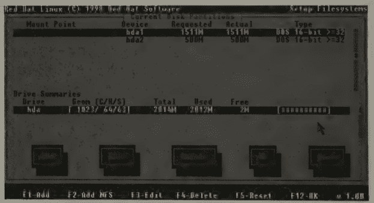

此界面有三个主要部分：当前分区（Current Disk Partitions）部分、驱动器摘要（Drive Summaries）部分和按钮行。

在“当前分区”部分中，系统上的每个现有磁盘分区都将显示一行。关于每个分区，将呈现以下信息：

- *挂载点 (Mount Point)*：这表示该分区将出现在你的 Linux 目录结构的何位置。Linux 目录都显示为根目录的子目录。根目录是 `/`，所有子目录都以 `/` 开头，例如 `/home`、`/opt`、`/usr/X11R6`。至少，你需要将一个分区挂载为 `/`。如果你选择将额外的分区挂载为子目录，这将你的 Linux 发行版分布在两个目录。例如，如果你将一个分区挂载为 `/usr`，那么存储在该子目录下的任何内容都存储在 `/usr` 分区上，而所有其他数据都在根挂载（`/`）的分区上。以下显示了标准顶层 Red Hat 目录的主要作用：

  - `/bin`：此处存储标准系统工具。
  - `/dev`：此处存储设备文件。
  - `/home`：此处存储用户目录。
  - `/opt`：此处存储可选软件。
  - `/sbin`：此处存储标准系统管理文件。
  - `/usr`：此处存储额外的系统软件和管理工具。

- *设备 (Device)*：这表示每个分区的 Linux 设备名称。对于 IDE 磁盘，驱动器被标记为 `hdx`，其中 `x` 是指定驱动器的字母（a 代表主主盘，b 代表主从盘，c 代表从主盘，d 代表从从盘）。因此，如果你有一个 IDE 硬盘，它是 `hda`。SCSI 磁盘被标记为 `sdx`，其中 `x` 指定驱动器。磁盘上的分区从 `hda1` 开始连续编号。通常情况下，分区 1 到 4 是主分区，在许多 DOS 系统中，5 及以上分区代表扩展分区和逻辑分区。在图 4.4 中，我们看到一个预存在的 DOS 分区 `hda1`。

- *请求 (Requested)*：这表示分区以兆字节为单位的最小大小。
- *实际 (Actual)*：这表示为分区分配的实际空间。`Diskid` 允许创建可扩展的 Linux 分区，其大小随着硬盘上可用空间而增加，并在分区空间耗尽时减小。DOS 分区的实际值和请求值应该匹配。
- *类型 (Type)*：此字段表示分区类型。可能的值包括 Linux 原生（Linux native）、Linux 交换分区（Linux swap）和 DOS 16-位。

界面的下一个主要部分是“驱动器摘要”部分。它为你系统上的每个硬盘各显示一行，并包含关于驱动器的以下信息：

- *驱动器 (Drive)*：这是驱动器的设备名称。
- *几何结构 (Geometry)*：这指示磁道、磁头和扇区的数量。
- *总量 (Total)*：这指示驱动器上的总空间。
- *已用 (Used)*：这指示已用空间。
- *空闲 (Free)*：这指示驱动器上可用的空闲空间。如果允许的驱动器都有足够的空间来创建分区，那么我们可以继续。

最后，我们在屏幕底部有 OK（确定）按钮、Back（返回）按钮和 Delete（删除）按钮。

## 添加新分区

要添加新分区，只需点击 `Disk Druid` 主界面上的 Add（添加）按钮。这将显示以下信息：

- 挂载点
- 兆字节大小
- 分区类型（从列表中选择）
- 是否允许增长空闲空间（通过 Growable 复选框）
- 哪些驱动器可以创建分区。如果指示了多个驱动器且允许的驱动器都有足够的空间，`Disk Druid` 将决定使用哪个磁盘。如果你想在特定磁盘上创建分区，请确保只勾选该磁盘。

我们需要双击“Add”按钮来创建以下分区：

- 一个交换分区：Linux 需要一个单独的分区进行交换。当你用尽所有 RAM，操作系统必须调用虚拟内存（伪装成 RAM 的磁盘空间）来保持运行。至少，你可能希望交换分区的大小与你系统的物理内存匹配；如果你有大量的可用磁盘空间，可以将交换分区的大小设置为物理内存的两倍。因此，对于 32MB 的系统，创建一个 32MB 和 64MB 的交换分区。分区类型应设置为 Linux swap，不指示挂载点，且不勾选增长 框。
- 一个根分区：在本章中，我们在一个分区中安装 Linux。（我们将在下一章讨论使用多个分区或驱动器安装 Linux。）要这样做，我们需要添加另一个分区。你可能希望该分区至少为 500MB，以便在安装 Linux 后有工作空间。此分区应该是 Linux 原生类型，挂载点为 `/`，并且如果驱动器上有未分配的空闲空间，则标记为可扩展。

> 注意
>
> 在确定你的交换分区大一时，请记住 Linux 目前将交换分区的大小限制为 128MB，因此你不想创建大于此限制的分区。

## 编辑分区

你可以通过在当前分区列表中选择分区并点击 Edit（编辑）按钮来编辑现有分区。这将弹出一个与我们添加新分区时类似的窗口，但这里所有字段都已填充以匹配我们正在编辑的分区的设置。

如果你有预存在的 DOS 分区，可以通过为它们指定挂载点来使其可用。要这样做，选择你想要使用的分区。

在 Linux 中可以访问，点击“编辑”（Edit）按钮，然后为该分区填写挂载点。

如果你有一个 DOS 分区，可以将其挂载为 `/dos`。如果你有两个 DOS 分区（在 DOS 和 Windows 中对应 C 盘和 D 盘），你可以分别选择 `/dosc` 和 `/dosd`（或 `/c` 和 `/d`）作为挂载点。

> 如果你有 Windows 95 或 98 FAT32 分区，那么你现在的运气不太好，因为 Linux 目前尚不支持对这类类型的分区进行读取或写入。在这种情况下，请不要为该分区指定挂载点。

## 删除分区

在创建 Linux 交换分区（swap）和根分区的过程中，如果你犯了错误（可能可能是交换分区太大，或者根分区太小），你可以删除这些分区然后重新添加。要执行此操作，在当前分区列表中选择该分区，并点击“删除”（Delete）按钮。

> 执行此操作时要小心。不要意外删除任何在你安装 Linux 之前就已经存在、且包含你想要保留的重要数据或软件的分区。

## 继续

一旦完成分区的创建和配置，你就可以继续下一步了。点击“确定”（OK）按钮即可继续。

## 准备交换空间

安装过程的下一步是准备你的交换空间。你将看到一个类似于图 4.5 所示的屏幕。

### 图 4.5：准备你的交换空间

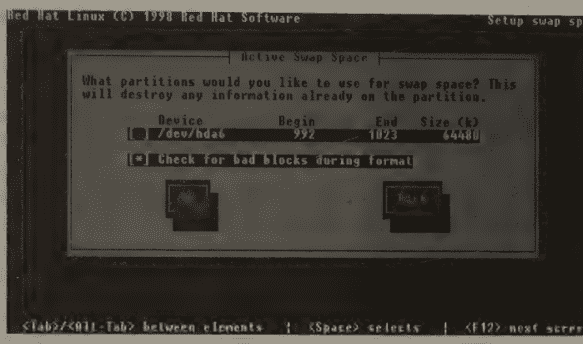

此屏幕列出了所有可用的交换（swap）类型分区，旁边有一个复选框。任何你想要作为交换空间的分区都应该勾选。

额外的复选框用于指示在格式化为交换空间时，是否对分区进行坏块检查（bad blocks）。如果你使用的硬盘是新的，绝对应该勾选此选项。格式化将花费更长时间，但可以尽早发现硬盘的任何问题。如果你使用的是已经在电脑上使用了一段时间的磁盘，可以考虑不检查坏块。然而，交换分区上的坏块可能会导致你的 Linux 系统崩溃。发生这种情况时，你可能会丢失当前的工作，如果交换分区中存在坏块，根分区上保存的数据甚至可能损坏。

## 格式化你的 Linux 分区

下一步是格式化你的 Linux 分区为安装 Linux 做准备。你将看到一个 Linux 原生（Linux native）类型分区列表，并带有它们挂载点的指示。任何新创建的分区都应该通过勾选磁盘旁的复选框来标记为格式化。

如果你有额外的 Linux 原生类型分区，如果是新分区则应该进行格式化。如果它们已经存在（对于新的 Red Hat 用户来说这种情况不太）并且你想保留它们包含的数据，请不要将它们标记为格式化。

与交换分区一样，你可以指示在格式化期间执行坏块检查。这是一个好主意，特别是对于新的硬盘。

## 选择软件包

现在我们的磁盘已经配置好，Linux 分区也已格式化，我们可以准备开始安装实际软件了。默认安装将包含所有必要的核心软件，但如图 4.6 所示，还有几个可选组件可用。

### 图 4.6：选择额外的组件

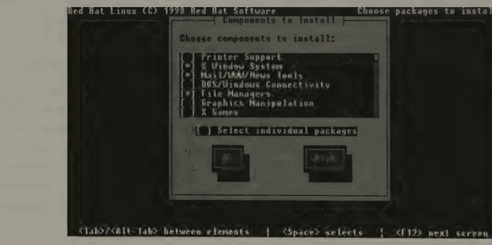

每个组件都是用于特定任务的相关软件包集合，例如拨号连接、Web 浏览等。你可以通过勾选各自的复选框来单独选择软件包，也可以选择列表中的最后一项“全选”（Everything）选项。

出现在列表字段下方的“选择单个软件包”（Select Individual Packages）选项表示你想选择每个组件内的单独软件包。然而，如果你想在每个组件中选择单个软件包，请注意此项。

在你选择了这些标准选项后，安装程序将检测并显示可以连接打印机的可用并行端口。Linux 并行端口命名为 `/dev/lp0`、`/dev/lp1` 等，其中 `/lp0` 映射到 DOS 中的 LPT1，`/lp1` 映射到 LPT2。请确保“打印机设备”（Printer Device）字段中指示了正确的设备。


接下来，你将看到“配置打印机”（Configure Printer）屏幕。在这里，你可以选择与你的打印机最匹配的打印机类型。如果列表中没有精确型号，请选择最接近可用打印机类型。这将进入一个屏幕，你可以在那里指定打印机的设置，包括页面大小和默认分辨率。

如果你的打印机在每行文本末尾没有自动提供回车，则需要“修复文本阶梯”（Fix Stair-Stepping of Text?）选项。如果你不确定，暂时不要勾选此选项。

最后，你将看到打印机的配置信息，并被确认所有内容是否正确。

## 设置根用户密码

作为一个多用户操作系统，Linux 需要至少存在一个用户才能使用。在所有系统中，你都必须有一个 `root` 用户，因此系统会提示你提供 `root` 密码（输入两次以确认）。`root` 用户是全能的系统管理员。以 `root` 用户身份登录时，你可以查看所有用户的文件，执行所有的系统管理任务，并且如果你愿意，还可以删除系统上的所有文件。这是一个功能强大的账户，如果这些人将访问你的系统，你需要妥善保管此密码。

## 创建启动盘

下一步将为你提供一个为你的系统创建启动盘的机会。这是一个明智的决定，因为它允许你在紧急情况下启动系统，并尝试救回一个出现故障的系统。

通过选择创建启动盘，你需要提供一张空白的软盘作为启动盘使用。

## 设置 LILO

`LILO` 是 Linux 引导程序（boot loader）。为了让你的系统正常启动，你需要配置并安装 `LILO`。`LILO` 还提供了双系统启动功能，允许你在启动时选择要启动哪种操作系统，让你能够访问现有的 Windows 或 DOS 系统以及 Linux。

屏幕将要求你指示安装 `LILO` 的位置。你可以将其安装在主引导记录（Master Boot Record，推荐做法）或根分区的第一个扇区上。如果你运行的操作系统（如 OS/2 或 Windows NT）拥有自己的引导程序，你可能想选择后者，但那样你就需要知道如何让该引导程序引导你的 Linux 系统以便让 Linux 正常工作。

> 警告：如果你在此处跳过安装 `LILO`，将需要上一步生成的启动盘来启动你的 Linux 系统。强烈建议在初始安装期间安装 `LILO`。

下一个屏幕将提示你提供启动时传给 Linux 的默认选项。你可能不需要使用这些选项，但如果你的硬盘被配置为使用逻辑块寻址（LBA）模式（检查你的 BIOS），请选择“使用线性模式”（Use Linear Mode）选项。

最后，你将看到一个显示所有分区的屏幕，并为所有可启动分区分配启动标签（boot label）——在这种情况下，为 Linux 系统分配一个，DOS/Windows 系统分配一个。启动标签是你在启动电脑时选择启动哪个操作系统所使用的名称。

“默认”（Default）列表示如果用户在启动时未做选择，默认将启动哪个操作系统。要更改此项，选择你希望作为默认的操作系统并按 `F2`。

## 重启你的系统

最后，系统将提示你从计算机中取出任何软盘并重启。如果你将 Linux 设置为默认操作系统，系统将进入 Linux，并在启动提示符期间留给你五秒钟来选择备用操作系统。

如果你选择另一个操作系统作为默认，那么在启动提示符处，你需要输入 Linux 分区的启动标签以进入 Linux。

如果一切顺利，你将看到一个与图 4.7 类似的 Red Hat 登录界面。

## 图 4.7：

Red Hat 5.1 登录界面

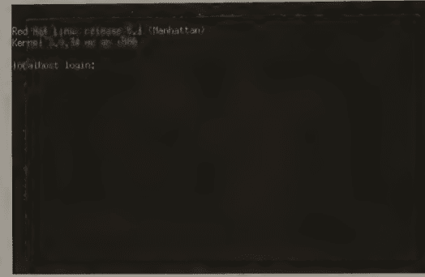

你可以在这里使用用户名 `root` 和你之前提供的密码作为 `root` 用户登录。你将看到一个如图 4.8 所示的命令行提示符。

## 图 4.8：

Red Hat 5.1 命令行提示符

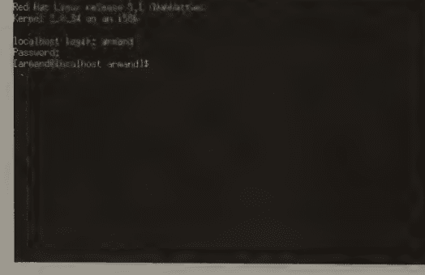

我们稍后会学习命令，但原理很简单：输入命令并按 Enter 或 Return（回车）键执行它。输入 `exit` 并按 Return 键退出。

Linux 允许你多次登录，即使在初始的字符模式下也是如此。通过 `Alt+F1` 到 `Alt+F6` 的组合，你可以切换六个虚拟控制台。你需要在每个虚拟控制台中分别登录。你可以以不同用户登录并执行不同任务，或者以同一用户登录不同的虚拟控制台——这是 UNIX 和 Linux 使其成为灵活工作环境的特性之一。

## 我们该去哪里？

到目前，你应该已经有一个可以工作的 Linux 系统。如果你是少数几个由于特殊情况无法按照本章步骤运行 Linux 系统的读者之一……

## 将 CD-ROM 复制到硬盘分区

为了从硬盘分区进行安装，你需要一个专用的分区来存储 Red Hat CD-ROM 的内容。该分区应至少包含 650MB 的空闲空间，以容纳 Red Hat CD-ROM 的完整内容。

你可以在 Windows 环境下，通过 DOS 提示符窗口使用 `xcopy` 命令将 CD-ROM 的内容复制到某个分区。如果你的 CD-ROM 驱动器位于 `F:` 盘，而你想要复制 CD-ROM 驱动器内容的空闲分区是 `E:` 盘，那么可以使用以下命令：

```bash
xcopy /e /h f: e:
```

`/e` 标志表示 CD-ROM 上的所有目录应在复制时创建，即使目录是空的；而 `/h` 标志表示应复制所有文件，包括隐藏文件。

# 准备安装软盘

在第 3 章“准备工作”中，我们讨论了如何创建必需的安装软盘。所有细节请参阅该章的“从软盘和 CD-ROM”部分。

为了从硬盘分区进行安装，你将需要主启动软盘和辅助软盘，因此最好在开始安装过程之前准备好这两者。

# 实际安装过程

要开始安装，请从启动软盘引导。按照从 CD-ROM 普通安装的步骤（在第 4 章“安装 Linux”中列出）进行操作，但有以下几例外：

- 1. 在选择安装方法时，选择“硬盘（Hard Drive）”而不是“CD-ROM”。当你执行此操作时，系统会提示你插入辅助安装软盘。
- 2. 在使用 Disk Druid 或（如本章稍后讨论的那样）选择并配置你的磁盘分区后，系统会提示你指定哪个分区包含你的 Red Hat 源镜像。请回阅第 4 章中关于磁盘分区 Linux 设备名称的讨论。如果你不确定哪个分区包含 Red Hat 软件，请参考屏幕提供的可用分区列表，以确定哪一个包含你的 Red Hat CD-ROM 副本。如果这还不够，可以选择“取消（Cancel）”返回 Disk Druid 分区列表，该列表提供了关于分区的更详细信息。

除了这两个区别外，你的其余安装过程应该与第 4 章概述的步骤基本相同。

## 在多个分区上安装 Linux

本节的标题有些是误导性的。毕竟，对于任何 Linux 安装，你都至少使用了两个分区：一个用于存储 Linux，另一个用于你的交换空间（swap space）。然而，确实有充分的理由使用多个分区来存储 Linux。

一个显而易见的原因是，如果你磁盘上有两个物理上不连续的可用分区。你无法通过删除这些分区并创建一个更大的分区来存储 Linux。在这种情况下，你可以将 Linux 安装分拆在两个分区上。

不过，更具说服力的理由是在多个磁盘上安装 Linux。有几种方法可以利用拥有多个磁盘的优势为你的 Linux 安装提供便利。

## 将交换分区放在单独的磁盘上

如果你在一个磁盘上有一个大分区，在第二个磁盘上有一个较小分区（大小在 32 到 200 MB 之间），你可能想要考虑将交换分区放在第二个磁盘上。如果你发现自己经常进行内存交换（swapping），这可以显著提高性能。

考虑以下场景：你的 Linux 安装和交换分区位于同一个物理磁盘上。你正在运行许多应用程序，系统已经进行了大量的交换。你尝试启动一个新程序，但为了启动它，它需要从磁盘内存加载——同时，内存中的现有数据需要交换到磁盘。由于磁盘一次只能执行一个操作，当操作系统试图几乎同一时间执行这两个操作时，你的磁盘突然变成了瓶颈。

但如果你的交换分区在单独的磁盘上，瓶颈就会变小：一个磁盘可以将数据从磁盘读取到内存，而另一个磁盘仍在完成将数据从内存移动到磁盘的过程。尽管计算机无法同时执行两个指令，但由于缓慢的磁盘操作分散在两个磁盘上，这一事实有助于最大限度地减少 CPU 等待磁盘完成工作的时间。

## 将 Linux 拆分到多个分区

将 Linux 软件分配到两个或多个分区的另一种方法是按照逻辑方式将 Linux 软件的存储拆分到各个分区。这可以提供两个益处：

- 扩展关键 Linux 目录树（如 `/home` 目录树）的可用磁盘空间
- 如果可用分区位于多个磁盘上，则通过将磁盘访问分散到多个硬盘上来提高性能

让我们考虑一下我们可能如何将 Linux 发行版拆分到两个分区。正如第 4 章在讨论如何指定现有 DOS 分区的挂载点（mount point）时提到的，我们通过指定其挂载点来使用额外的磁盘。

例如，如果我们想将所有用户的家目录存储在单独的分区上，那么我们将该分区的挂载点设置为 `/home`，同时将主 Linux 分区的挂载点留为 `/`。那么，当我们向 `/home` 下的任何子目录写入或读取数据时，实际上访问的是与访问 `/home` 之外的其他目录树时不同的分区。

有几种流行的方法可以将你的 Linux 安装拆分到两个分区：

- 如果你计划安装许多自己的软件（包括文字处理器、网络浏览器和 Windows 仿真软件等商业软件），你会发现其中大部分内容安装在 `/opt` 目录树中。如果你的主 Linux 分区为用户留有足够的空间，考虑将你的分区挂载为 `/opt`。
- 如果你预计会有很多用户或存储数据目录，为 `/home` 分配独立分区，这将为你提供一个独立的区域。
- 虽然许多新软件包安装在 `/opt`，但如果你大量安装，你会发现 `/opt` 可能会增长。
- 如果你将 Linux 作为繁忙的邮件服务器或频繁使用的服务器，为 `/var` 分配独立分区，因为邮件队列和系统日志都在那里。

## 使用 Fdisk 代替 Disk Druid

在上一章中，我们在安装 Red Hat 5 时使用了 Disk Druid。然而，Disk Druid 是在 Red Hat 安装过程中才提供的程序。通常，Linux 用户使用 `fdisk` 来配置磁盘分区，无论是在安装过程中，还是之后需要调整磁盘几何结构时。

事实上，`fdisk` 对 Linux 用户来说非常熟悉，Red Hat 通过将其作为 Disk Druid 的替代方案承认了其作为分区配置工具的主导地位。

虽然 `fdisk` 是一个极其复杂且强大的工具（如果使用不当可能会产生危险和破坏性），但执行显示分区表、从空空间创建新分区以及分配分区类型等基本任务其实很简单。

在安装过程中选择 `fdisk` 而不是 Disk Druid 时，首先会看到一个要求指定磁盘的屏幕。与 Disk Druid 不同，`fdisk` 每次只处理一个物理磁盘。一旦选择了要处理的磁盘，你将暂时离开熟悉的 Red Hat 安装程序，并进入图 5.1 所示的 `fdisk` 界面。

图 5.1：`fdisk` 欢迎界面

`fdisk` 使用简单的命令操作，每个命令只有一个字符。要执行命令，只需输入命令并按回车键（Return或Enter）。如果命令执行任务需要额外信息，它将提示你输入这些信息。

最简单的命令是 `m` 或 `?`。这两个字符中的任意一个都会导致 `fdisk` 显示如图 5.2 的帮助屏幕。该屏幕列出了所有常用的 `fdisk` 命令，包括本节将涉及的所有命令。

## 图 5.2：

`fdisk` 帮助屏幕

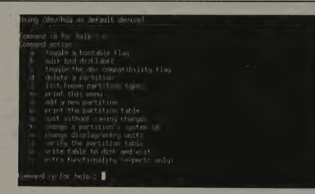

## 显示分区表

`fdisk` 执行的最有用任务之一是显示正在操作的磁盘的当前分区表。这看起来如图 5.3 所示的表格。

## 图 5.3：

分区表

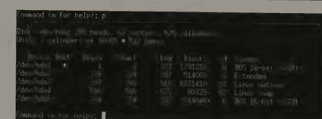

对于当前磁盘上的每个分区，都会显示起始块、结束块、分区大小以及系统类型。

## 使用空空间添加分区

要使用硬盘上的现有空空间添加新分区，请使用 `n` 命令。如图 5.4 所示，系统会提示分区类型。通常情况下，你希望选择主分区（primary）作为类型。与 DOS 的单个主分区相比，使用 Linux `fdisk`，你可以创建四个主分区。

一旦选择了分区类型，你将分配分区号，最后是起始和结束块。要使用所有剩余空间（假设所有可用空间都在磁盘末尾），请让分区使用默认的第一个块和最后一个块。

### 图 5.4：

添加新分区


## 更改分区类型

默认情况下，用 `fdisk` 创建的所有新分区都被分配为 Linux 原生（Linux native，类型数字 83）。要更改分区类型，请使用 `t` 命令。

系统会提示你要操作的分区，你可以如图 5.5 所示通过数字进行选择，然后会提示类型 ID。要查看类型 ID 列表，此时可以使用 `L` 命令查看图 5.5 所示的列表。

### 图 5.5：

`fdisk` 中的分区类型 ID 列表


常用的分区类型如下表所示：

| ID | 类型 |
|---|---|
| 5 | 扩展 (Extended) |
| 6 | DOS 16-bit (大于 32MB) |
| 7 | OS/2 HPFS |
| b | Windows 95 FAT32 |
| 82 | Linux 交换 (Swap) |
| 83 | Linux 原生 (Native) |

## 删除分区

有时你想删除现有分区，以便为你的 Linux 安装创建一个或多个新分区。要这样做，只需使用 `d` 命令，并在提示时输入想要删除的分区号。

## 提交更改

在使用 `fdisk` 期间，你所做的任何更改都不会实际应用于物理磁盘。这是一种安全措施，这样即使你不小心删除了带有重要数据的分区，你可以在永久删除包含该数据的分区之前恢复到之前的配置。

正因如此，只有在你于退出时显式要求 `fdisk` 执行时，更改才会被被实际处理。因此，在从 `fdisk` 退出之前，请务必查看分区表，以确保你执行了完全想要的操作。如果你退出并提交更改，这些更改就是永久的；虽然可以在操作 `fdisk` 之前回到软盘，并通过用保存的分区表替换新的分区表来从严重错误，但这是一个复杂且并非无一失的程序。（理论上，你可以在操作 `fdisk` 之前保存磁盘的分区表，然后从中恢复。你最好仔细确保在提交更改之前，你对分区表所做的更改完全符合你的要求。）

退出 `fdisk` 的两个可选命令为：

| 命令 | 效果 |
|---|---|
| `q` | 退出 `fdisk` 且不处理或保存任何更改 |
| `w` | 处理并保存所有更改，然后退出 `fdisk`。这是一个永久性操作，请小心。 |

## 我们接下来该怎么办？

最后，我们准备好开始实际使用 Linux 了。作为在该条路上的第一步，我们将查看 X Windows 环境。X Windows 为包括 Linux 在内的所有 Unix 操作系统提供了一个高度灵活、鼠标驱动的图形用户界面。

许多 Linux 书籍是从命令行开始的；这确实是 Linux 的核心。但 X Windows 让新用户在彻底掌握 Linux 命令行之前就能快速开始使用 Linux。

下一章将从概述 X Windows 开始，了解它提供了哪些功能，以及它与 Microsoft Windows 环境的对比。然后我们将转向 X Windows 的配置和使用，并查看一些常见的 X Windows 应用程序。

## 第六章

## X Windows

- 什么是 X Windows？
- Microsoft Windows 与 X Windows
- X 服务器和窗口管理器
- 什么是 Motif？

现在我们已经成功安装了 Linux，我们将通过直接进入 X Windows 环境开始学习过程。许多 Linux 忠实粉丝在考虑在 Linux 之前先考虑 X Windows 时可能会发抖。在本章中，我们将查看它提供了哪些功能，以及它与 Microsoft Windows 环境的对比。

这种分离的益处在于，在一个环境中可以有不同的服务器和机器，应用程序可以在其中运行并在维护良好的工作站上显示。

事实上，正是这种能力让 Unix 和 X Windows 在专业系统管理员中享有盛誉。

X Windows 中引入的另一个概念是窗口化与界面的分离。在 X Windows 系统上，必须运行两个应用程序提供图形用户界面。第一个是 X 服务器，它设置图形显示（例如分辨率、刷新率和色彩深度）、显示窗口、跟踪鼠标移动和击键。但 X 服务器不提供菜单、窗口边框，或移动、切换或最大化窗口的机制。如果你查看图 6.1，你将看到没有窗口管理器的 X 服务器屏幕是什么样子的。

### 图 6.1：

没有窗口管理器的服务器显示

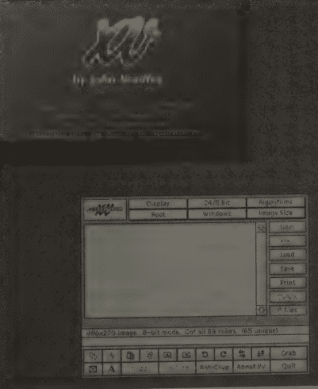

注意这些事物的极其简单。没有花哨的背景色，没有复杂的窗口边框或菜单控制，也没有其他构成完整 GUI 的功能。所有这些功能都由名为窗口管理器（window manager）的应用程序提供。图 6.2 显示了运行 Red Hat Linux 5 默认窗口管理器 `fwm95` 管理器的完整 X Windows 桌面。注意窗口框的特征，包括控制按钮和控制菜单，以及任务栏和虚拟桌面系统。所有这些都由窗口管理器提供。

### 图 6.2：

运行窗口管理器的 X Windows 显示

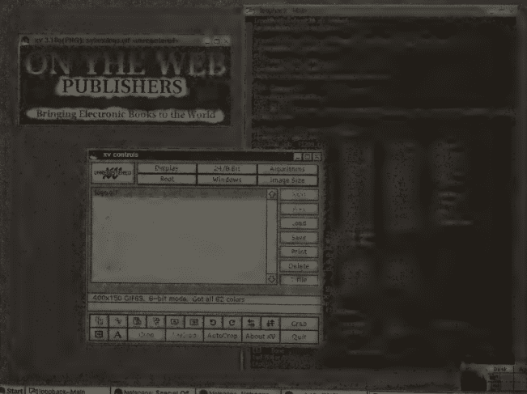

窗口管理器以标准的、预定义的方式与 X 服务器通信，X 服务器与 X 应用程序之间的通信也是如此。这意味着具有不同界面特征的不同窗口管理器都可以以这种标准方式与 X 服务器通信。同样，可用的各种 X 服务器（支持不同的显卡、显示器和其他性能特性）也可以以标准化的方式与应用程序通信。

## Microsoft Windows 对比 X Windows

根据我们看到的对 X Windows 的的一些描述，人们自然会认为 Microsoft Windows 和 X Windows 几乎是同一回事。但事实是，它们在本质上是完全不同的物种。


例如，Microsoft Windows 是一个完整的操作系统，包含了从内核到窗口环境等等的所有内容。而 X Windows 只是这个操作系统拼图中的一部分：窗口环境。另一个对比在于界面：Microsoft Windows 的界面过于僵化，而 X Windows 则具有令人惊叹的灵活性和可定制设计。

## 相似之处

那么，X Windows 与微软的事实标准操作系统之间有什么相似之处呢？主要的相似之处在于它们都提供了图形化界面，并使得处理多个窗口成为可能。此外，它们允许用户使用键盘和普通字符以外的方法与信息进行交互。用户可以使用鼠标以及键盘，并创建结合菜单、表单、窗口和对话框的界面。

## 差异

这两个窗口系统之间存在许多差异。主要区别在于以下几个领域：

- 界面的灵活性
- 对界面配置的精细控制
- 客户端-服务器技术

## 灵活的界面

X Windows 界面的灵活性是许多用户喜爱该环境的原因之一。正如已经讨论过的，用户界面层与基础窗口层的分离，使得通过创建不同的窗口管理器为 X Windows 创建多个界面成为可能。

多个界面并不像某些 Microsoft Windows 界面的定制工具那样仅提供外观上的细微差异；而是允许从一个窗口管理器到另一个窗口管理器对用户界面进行完全重新设计。

例如，图 6.3 显示了一个运行窗口管理器的示例窗口界面，该管理器类似于 NeXT 操作系统的用户界面；而图 6.4（运行在相同系统并显示相同应用程序）则显示了一个看起来像任何流行的 PC 或 Macintosh 操作系统的用户界面。

### 图 6.3：

Afterstep 窗口管理器

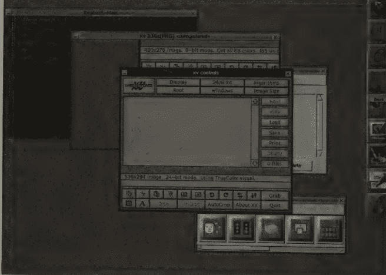

这些仅代表了 X 窗口管理器提供的许多视觉风格设计中的两种。我们将在本章稍后简要讨论广为人知的窗口管理器。

### 图 6.4：

Lesstif 窗口管理器

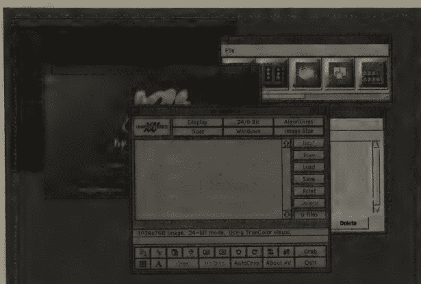

## 精细控制

X Windows 环境的另一个优势是它对窗口环境和界面的所有方面都提供了精细控制。通过对数十项设置进行微调，可以控制环境的所有方面，从背景和前景窗口颜色到光标颜色、默认字体和默认窗口大小。用户还可以定义交互模式。例如，可以使用鼠标指针让窗口自动跳转到前台，或将光标焦点切换到后台窗口。

此外，这些其他功能可以根据每个应用程序进行定义，为每个应用程序创建不同的设置，以便每个程序都能以最方便的方式启动。

还可以定义每次启动 X 环境时打开哪些窗口和应用程序，并让系统在启动 X Windows 时对使用哪种窗口管理器做出逻辑选择。

我们将在第 7 章“安装和配置 X Windows”中讨论基本的 X Windows 配置选项。

## 客户端-服务器环境

如上述提到的，X Windows 世界基于客户端-服务器模型，其中应用程序是 X 服务器的客户端，由 X 服务器处理显示。这使得 X Windows 很好地适应了网络环境，允许应用程序在网络上的某一台机器上运行，同时在另一台机器上显示其输出。

Microsoft Windows 直到最近才缺乏这种能力，现在仅在高端多用户 Windows NT 系统上以有限的方式具备这种能力。在 Linux、Unix 和 X 世界中，即使是最低级的系统也能够在 X Windows 客户端-服务器模型中扮演客户端或服务器角色。

## X 服务器和窗口管理器

现在你已经对 X Windows 在系统中的位置有了了解，我们需要查看 X Windows 的基本组件：X 服务器和窗口管理器。正是这些组件以及它们代表的模块化提供了 X 模型的力量和灵活性。

## X 服务器

正如我们已经所看到的，X Windows 系统的核心是 X 服务器。X 服务器处理几项工作：

- 支持各种显卡和显示器类型
- X Windows 显示的分辨率、刷新率和色彩深度
- 基本窗口管理：显示和关闭窗口，跟踪鼠标移动和击键

多个具有这些基本能力的 X 服务器应运而出。在 Linux 世界中有三个主要选择：`XFree86`、`Metro-X` 和 `Accelerated-X`。

## XFree86

`XFree86` 是几乎每个非商业 Linux 发行版的默认 X 服务器，因为它在 Linux 源代码相同的条款下免费提供，用户可以自由更改代码以满足自己的需求，任何人都可以重新分发。Red Hat Linux 5.1 附带有 `XFree86` 3.3.2（本文写作时的当前版本）。

`XFree86` Web 服务器旨在为 Intel x86 PC 环境中的常用硬件提供广泛支持，在较新的版本中还支持其他平台。虽然它的性能并不总是完美的，但 `XFree86` 是……在 `XFree86` 支持的流行芯片组中包括 Tseng3000、4000 和 6000，Cirrus Logic & Technologies 等许多其他。你可以在 `/usr/doc/XFree86-HOWTO.gz` 中找到完整列表。使用命令

```bash
$ zless /usr/doc/XFree86-HOWTO.gz
```

来阅读此文档。

虽然 `XFree86` 贡献很大，但它存在一些缺点，导致安装有时非常痛苦。幸运的是，Red Hat 5 附带了一个优秀的工具 `Xconfig`，减轻了 `XFree86` 的工作，除非你向该工具提供了问题的硬件，否则你将回到手动配置。

## 商业 X 服务器

除了 `XFree86` 项目（它是 Linux 免费解决方案的重要部分）之外，还有两个领先的商业 X 服务器：`Metro-X` 和 `Accelerated-X`。

这些产品提供了 `Metro-X` 的优势，`MetroLink` 随 Red Hat 5 商业版附带，作为附加值功能之一。这让你有权选择符合你需求的服务器。`Metro-X` 的许多优点包括像图 6.5 那样设计良好的图形界面、支持多头显示（带有多个显卡的多个显示器）、支持某些品牌的屏幕等等。

### 图 6.5：

`Metro-X` 的配置窗口

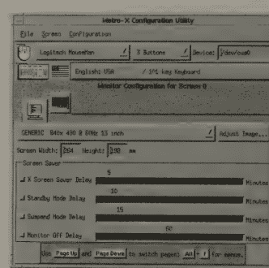

有关 `Metro-X` 服务器的完整信息可以在 `MetroLink` 的 `http://www.metrolink.com/` 获取。`Metro-X` Linux 版售价 99 美元。

`Accelerated-X` `XSide` 为 Linux 提供了一系列服务器。包括 `Accelerated-X` 服务器、3D `Accelerated-X` 服务器、多头 `Accelerated-X` 服务器以及专门的笔记本电脑 `Accelerated-X` 服务器。后者具有重要意义，因为笔记本电脑上的芯片组与桌面级显卡不同，且 LCD 屏幕有自己一套被桌面驱动程序忽略的属性。

事实上，`XFree86` 对笔记本显示的支持非常有限，一个小错误就可能导致你的 LCD 损坏。如果你计划将笔记本电脑长期作为 Linux 系统，请查看笔记本服务器支持的系统列表，看看你的是否在其中。

`Accelerated-X` 支持使用 130 多种芯片组的 500 多块显卡，并承诺性能比任何 Linux X 服务器提高 20%。

多头服务器支持多达八屏幕（`Metro-X` 支持四个屏幕），并在每块屏幕上提供 `Accelerated-X` 的所有功能。

总的来说，X-Inside 的服务器价格具有竞争力。`Accelerated-X` 售价 99.95 美元，笔记本服务器为 199.95 美元，多头服务器为 299.95 美元。完整信息可以在 X-Inside 网站 `http://www.xinside.com/` 获取。

## 窗口管理器

窗口管理器填充了 X 服务器未提供的图形界面细节。除了其他功能外，窗口管理器还包括装饰（提供缩放、移动、关闭和最小化窗口的手段）以及启动应用程序的机制（如桌面菜单、控制面板和按钮栏）。

在本节的剩余部分中，我们将简要查看 Linux 可用的一些主要窗口管理器，包括 `FVVM`、`fwm95` 和 `olwm`。Red Hat Linux 5 的默认窗口管理器是 `fw95`，但任何相对完整的安装都会包含 `FVVM` 和其他可选窗口管理器。

关于 X Windows 窗口管理器的概述可以在网上 `http://www.plig.org/xwinman/` 查看。

## FVVM 和 fwvm95

Linux 最常用的窗口管理器是 `FVVM` 或该包的某些变体。`FVVM` 这个名字很奇怪，因为没有人确定名称中的“F”代表什么。有人说它代表“Feeple”虚拟窗口管理器；另一些人认为它是“Fine”（精细的）虚拟窗口管理器；还有人认为“F”的含义早已被遗忘了，而且这并不重要。（我倾向于赞同后者的观点。）

`FVVM` 是一个轻量级窗口管理器，提供了一个灵活、可定制的窗口环境，设计上看起来类似于 Motif 窗口管理器（一种商业产品）。`FVVM` 提供了多个虚拟桌面和一个用于扩展窗口管理器的模块系统，在最新的版本 2 中，它还允许即时配置更改和针对特定窗口的功能定制。`FVVM` 的主页位于 `http://www.hpc.edu/fwvm/`。图 6.6 显示了一个 `FVWM` 桌面示例。

### 图 6.6:

一个 `FVWM` 桌面示例


`FVWM` 几乎随每一个 Linux 发行版发布，并因其作为具有独特外观和感受的新型窗口管理器基础的性而闻名，包括：

- `fwm95`：设计看起来像 Windows 95。
- `Afterstep`：设计看起来像 NeXT 环境。
- `SCWM` (Scheme 可配置窗口管理器)：使用 Scheme 语言进行配置。

Red Hat Linux 5 中的默认窗口管理器是 `fwm95` 窗口管理器，它提供了类似 Windows 95 的外观和感受。虽然许多 Linux 大师对这种模仿他们认为的劣质操作系统外观和感受的行为不屑以鼻，但 Red Hat 发现使用此窗口管理器可以帮助 Windows 用户过渡到 Linux。图 6.7 是 `fwm95` 的截图。

### 图 6.7:

`Fwm95` 提供了类似 Windows 95 的环境

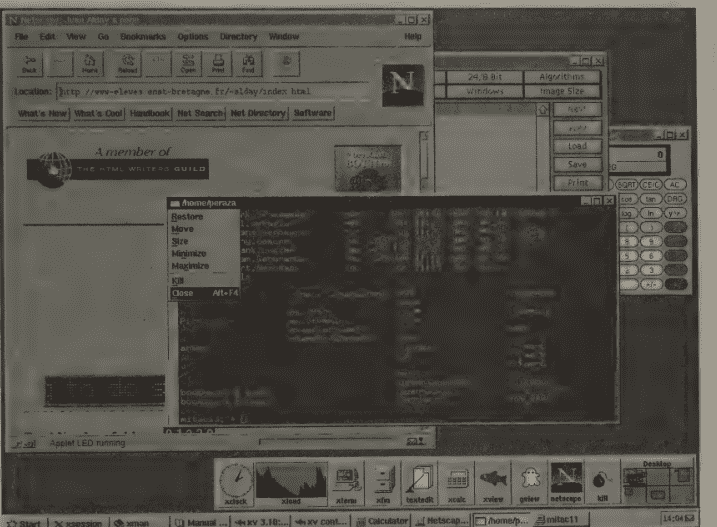

`Fwm95` 基于 `FVWM` 版本 2，并保留了该版本灵活、易于配置的特点。它继续支持 `FVWM` 模块，但增加了实现 Windows 95 功能（如任务栏）的模块。`fwm95` 的首页位于 `http://www.terraware.net/ftp/pub/Mirrors/FVWM/fwm95.html`。

## twm

标签窗口管理器 (`twm`)，通常根据其主要开发者的名字称为 Tom's Window Manager，是一个基础且功能齐全的环境，作为 Red Hat Linux 5 的备选窗口管理器包含。图 6.8 显示了一个典型的 `twm` 桌面。

### 图 6.8:

`twm` 桌面

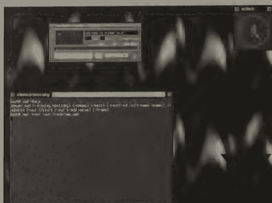

`twm` 窗口管理器提供了用户在 X Windows 窗口管理器中期望的关键功能，包括点击输入或指针驱动的键盘焦点以及用户定义的键和按钮绑定。然而，该界面在视觉上很简单，一些人认为它具有局限性。`Vwm` 是包含虚拟桌面的 `twm` 版本，也可以从 `ftp.x.org/R5contrib/vwm-5.3.tar.gz` 下载。

## Olvwm

`Olvwm`，即 OpenLook 虚拟窗口管理器，是 Open-Look 窗口管理器 (`olwm`) 的扩展，后者多年一直是 Systems 上的标准窗口管理器。虽然 Sun 系统现在采用了 Motif 和通用桌面环境（本章稍后将讨论），但独特的 Open-Look 界面在许多用户中仍然很受欢迎。`Olvwm` 在 OpenLook 包中增加了对虚拟桌面的支持。图 6.9 显示了一个 `olvwm` 示例。在 `olvwm` 中使用的界面，特别是我们和窗口对鼠标按钮响应的方式，对许多用户来说可能会感到很奇怪，这也是 OpenLook 在 Sun 世界之外没有获得巨大普及的原因之一。`Olvwm` 可以从 `ftp.x.org/R5contrib/olvwm.tar.gz` 下载。

### 图 6.9:

`olwm` 界面


## Afterstep

`Afterstep` 是 `FVWM` 的另一种变体，作为 Red Hat Linux 5 的另一种窗口管理器发布。该产品基于一个名为 Bowman 的早期窗口管理器，旨在提供 NeSTEP 的外观和感受。图 6.10 显示了 `Afterstep` 桌面。来自 NeSTEP 的主要功能包括标题栏、按钮和边框。由于它是基于 `FVWM` 版本 1，任何该版本的模块都可以继续与 `Afterstep` 工作。

`Afterstep` 的首页位于 `http://www.afterstep.org/`。

### 图 6.10:

`Afterstep` 桌面

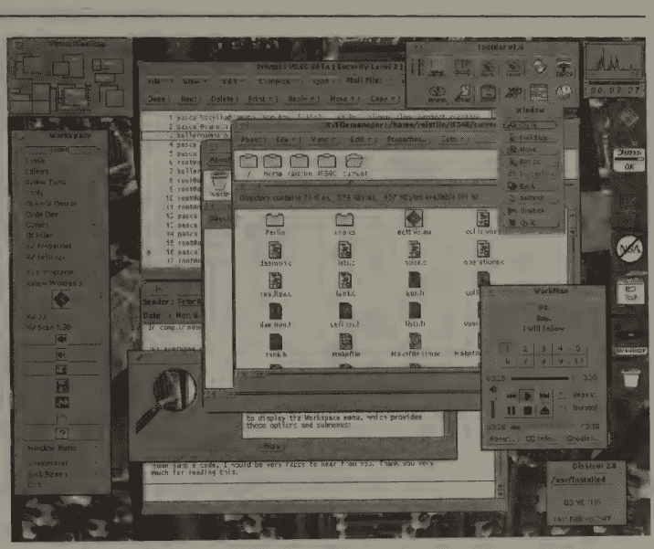

## Amiwm

如果你是 Amiga 的用户并喜爱它的界面，那么 `Amiwm` 可能是你需要的窗口管理器。如图 6.11 所示，由于 `Amiwm` 模拟了 Amiga 那样的工作界面，`Amiwm` 可以帮助 Windows 用户迁移到 Linux。

### 图 6.11:

`Amiwm` 窗口管理器

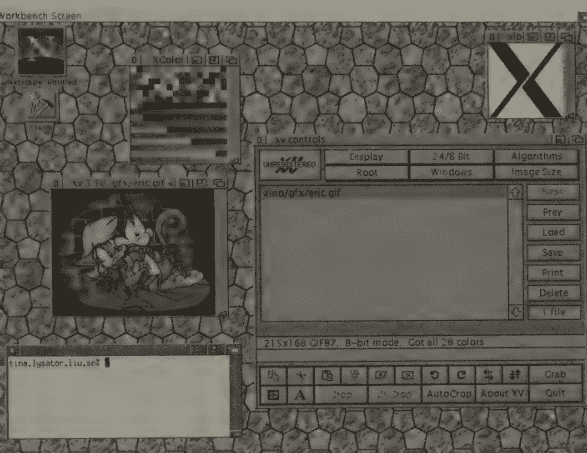

你可以在 `Amiwm` 的首页 `http://www.lysator.se/~marcus/amiwm` 了解并下载软件。

## Enlightenment

`Enlightenment` 是一个宏大的项目，试图开发一种超越传统的窗口管理器。它提供了一个实用且吸引人的环境，并允许用户定义从功能到窗口管理器外观的所有内容。图 6.12 和 6.13 显示了两种可能的配置。帮助 `Enlightenment` 脱颖而出的众多功能在于它赋予用户手工制作外观和感受以及嵌入新功能的能力。

### 图 6.12:

`Enlightenment` 窗口管理器

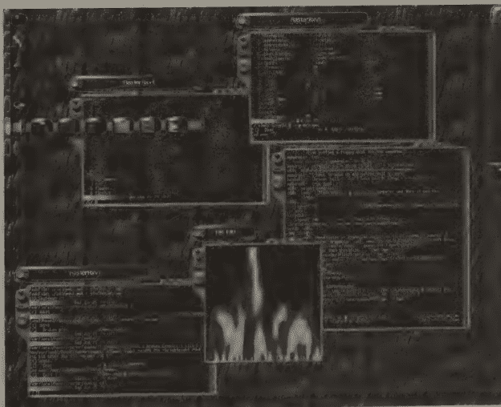

### 图 6.13:

用户可以完全定制 `Enlightenment` 环境


虽然 `Enlightenment` 是一个心勃勃的项目并提供了具有视觉冲击力的界面，但对于新手用户来说，安装可能是一项挑战，通常需要用户编译并安装新的库。`Enlightenment` 环境的首页位于 `http://www.rasterman.com/`。注意，作者认为 `Enlightenment` 处于早期的预发布阶段，因此警告存在 Bug 和崩溃的风险。尽管如此，这在窗口管理器中仍然是一个有趣的项目和独特的概念。

## K 桌面环境

K 桌面环境（简称 KDE）并不仅仅是一个窗口管理器，尽管它的核心是一个窗口管理器。KDE 尝试提供一个通用桌面环境（本章稍后将讨论）的免费替代方案。在这一努力中，KDE 将文件管理器、终端模拟器和显示配置系统等应用程序与窗口管理器相结合，为 X 应用程序创建一个统一的外观和感受。图 6.14 显示了一个典型的 KDE 桌面。

## 图 6.14：

KDE 桌面

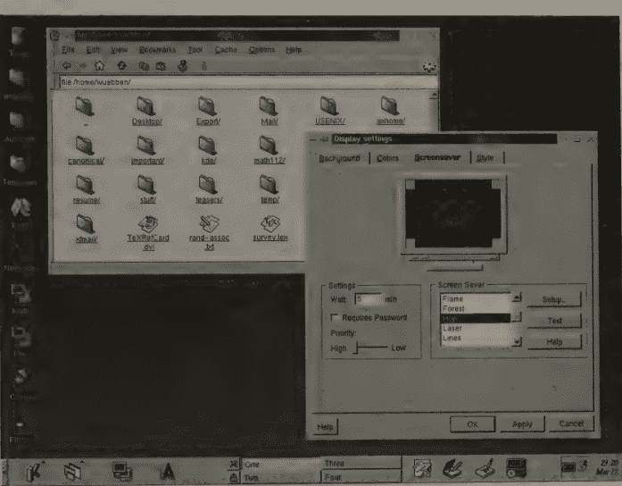

KDE 的设计理念是制定相关标准，并使开发环境使开发者能够创建在功能和外观上保持一致的应用程序。KDE 提供了一个极具吸引力且专业的工作环境，如果为 KDE 开发了必要的应用程序，它将成为业务桌面操作系统的可能可行选择。KDE 网站地址为 `http://www.kde.org/`

## Mwm

`Mwm`，即 Motif 窗口管理器，是一个商业性窗口管理器，是 Motif 分发版的一部分。作为一个完整环境的 Motif 将在在本章的下一小节中进行更详细的讨论。

## 通用桌面环境 (CDE)

CDE（Common Desktop Environment，通用环境）是一个雄心勃勃的项目，旨在标准化包括 AIX、Digital Unix、HP/UX、Solaris 在内的各种 Unix 平台的图形化环境和开发领域。现在 CDE 也适用于 Red Hat（`http://www.redhat.com/`）和 X-Inside（`http://www.xinside.com/`）提供的 Linux。关于 CDE 的一个优质 FAQ可以在 `http://nb.ce.utah.edu/Dictionary/cde_cose_fq` 查看。

除了基于 Motif 的一致图形环境外，CDE 还提供了一套凝聚的工具和应用程序，用于标准化管理程序，并简化用户图形环境的配置与管理。CDE 为 X 环境带来的增强功能包括拖放能力以及在其他 GUI 操作系统中常见的文件夹和图标类型。图 6.15 显示了运行 Red Hat TriTeal CDE for Linux 的示例 CDE 桌面。

## 图 6.15：

CDE 桌面

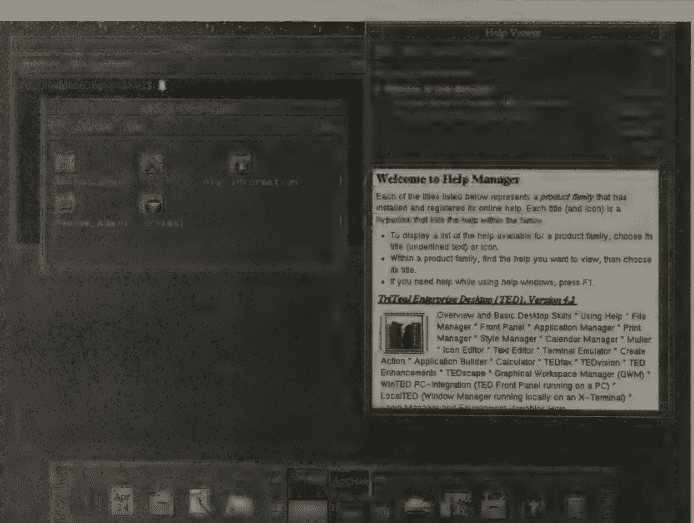

## 什么是 Motif？

如果你开始在网络上寻找要安装在 Linux 系统上的 X Windows 应用程序，你不可避免会遇到提到它们使用了 Motif 库或 Motif 工具包的应用程序。

Motif 是 X Windows 的一种开发环境，由开放软件基金会（Open Software Foundation）在 20 世纪 80 年代推出，为 X Windows 应用程序提供一致的策略。Motif 提供了一个小部件工具包，开发者可以在开发应用程序时使用。通过使用这些小部件库，Motif 开发者生产出符合 Motif 策略、具有一致外观和感体验的应用程序。

然而，Motif 是商业性的。想要基于 Motif 库构建并分发应用程序的开发者必须支付特权费用，而想要在系统中拥有 Motif 库副本以提高基于 Motif 应用程序性能的用户，则必须为一组客户端库付费。


除了工具包和库，Motif 分发版还包含了它自己的窗口管理器 `mwm`，原始 FVWM 的外观和感受就是以此为蓝的。图 6.16 显示了一个示例 `mwm` 桌面。

### 图 6.16：
一个 `mwm` 桌面


## 我需要 Motif 吗？

对于大多数 Linux 用户来说，可能不需要购买 Motif。应该考虑购买 Motif 的用户包括：

- 想要使用 Motif 工具包开发应用程序的开发者
- 想要运行需要 Motif 库存在的应用程序的用户。大多数使用这些库的商业应用程序要么在内部嵌入了必要的 Motif 代码（因此用户不需要拥有许可证），要么包含了完整版本的 Motif 运行时库。

为 Linux 销售 Motif 的供应商包括 Red Hat（http://www.redhat.com/）、InfoMagic（http://www.infomagic.com/）和 X-Inside（http://www.xinside.com/）。

## Motif 的替代方案

与 Linux 世界的许多事物一样，人们正致力于生产一个免费的 Motif 替代方案，以便开发者和用户无需付费购买 Motif。Lestif 项目开发了一个与 Motif 1.2 版本兼容的产，并根据 GNU 公共许可协议提供。简单来说，这意味着该产品是完全免费的。

Lestif 尚未达到完全成熟（本书编写时的版本为 0.83），但 Lestif 已经可以用于开发应用程序并运行某些软件。Lestif 首页（http://www.lestif.org/）上的 Lestif FAQ 很快指出 Lestif 仍然不完整。尽管如此，某些使用 Motif 的应用程序可以在 Lestif 0.83 上运行，包括 Mosaic 2.7 和广受誉的 Linux GIMP 图形软件包。

## 我们接下来将如何进行？

对 X Windows 的这段讨论是我们通向上手使用 Linux 操作系统的第一步。

在接下来的两个章节中，我们将使用 Red Hat Linux 5 的默认窗口管理器 `fwm95` 掌握 X Windows 接口的基础。我们将学习安装 X Windows 并开始尝试使用一些最常见的 X Windows 应用程序。

在第 7 章中，我们将从安装和配置 X Windows 的逐步指南开始。

# 第七章

## 安装和配置 X Windows

- 获取 X Windows
- 准备配置 X Windows
- 使用 Xconfigurator 配置 XFree86
- 使用 `xf86config` 配置 XFree86

## 获取 X Windows

现在我们已经对 X Windows 的奥秘有了了解，是时候安装并配置软件了，以便你有一个快速运行 X Windows 的系统。

在本章中，我们将讨论如何从 Red Hat 5 随附的光盘中获取 X Windows，以便它在你的系统上运行。如果你已经使用了 Red Hat 5 随附的发行版，可以跳过本节直接查看“准备配置 X Windows”。

### 从 Red Hat 5 光盘安装 X Windows

既然我们已经了解了 X Windows 的本质，是时候安装并配置软件了，以便你有一个快速运行 X Windows 的系统。

在本章中，我们将讨论如何获取 X Windows，以便它在你的系统上运行。如果你已经使用了 Red Hat 5 随附的发行版，可以跳过本节直接查看“准备配置 X Windows”。

#### 来自 Red Hat 5 光盘

如果你要从 Red Hat 5 光盘安装 X Windows，第一步是挂载光盘以便 Linux 能够访问它。这个过程并不看起来那么简单，它取决于你拥有的光盘类型。如果你已经安装了 X Windows，可以参考第 11 章（（处理文件）。

#### 使用 rpm

与其深入讨论 `rpm` 的图形方案（参见第 12 章“使用控制面板配置系统”），我们只是快速查看一下 `rpm`，这是一个随 Linux 的、用于管理软件包的工具。`rpm` 允许你安装新软件包、卸载软件包并查找有关软件包的信息。

要安装软件包，使用以下命令：

```bash
rpm -i <package-name>
```

要查看所有已安装软件包的列表，使用命令：

```bash
rpm -qa | more
```

此命令一次一个屏幕地显示已安装列表；你可以按空格键翻到下一页。列表显示的软件包名称并不是安装时使用的文件名。然而，它们用于通过以下命令卸载软件包：

```bash
rpm -e <package-name>
```

## 第 7 章 • 安装与配置 X Windows

如果你输入命令

```bash
$ ls
```

你应该能看到一长串文件滚过；所有文件都以 `.rpm` 扩展名结尾，表示它们是红帽包文件。

现在我们准备好安装 X Windows 软件包了。为了实现这一点，我们需要确定要安装哪些包。首先，我们需要 `XFree86-3.3.15.i386.rpm` 文件中的通用 XFree86 软件包。接下来，我们需要所有的 X Windows-1000dpi-fonts-，它们位于以下文件：

```
XFree86-1000dpi-fonts-3.3.15.i386.rpm
XFree86-75dpi-fonts-3.3.1.15.i386.rpm
```

我们还需要红帽提供的 XFree86 配置实用程序，它位于 `XConfigurator-3.26-1.i386.rpm` 文件中，并且我们想要位于 `X11r6-contrib-3.3.1.i386.rpm` 中的 X Windows 程序。

最后一块拼图是选择要安装哪一个 XFree86 服务器包。这取决于你的显示器和显卡。检查你的显卡文档以确定你拥有什么种类型的卡以及它使用的芯片组。将此信息与以下针对特定卡和视频芯片设计的服务器描述进行对比（描述为包文件中的内容）：

- `XFree86-I128-3.3.1.15.i386.rpm`: 用于 #9 Imagine 128 板的 X 服务器
- `XFree86-S3-3.3.1.15.i386.rpm`: 用于基于 S3 芯片构建的显卡的 X 服务器，包括大多数 #9 卡、可能还有 Diamond Stealth、Orchid Fahrenheit、Micro Crystal 8S、STB 卡以及其他带有显卡加速器的主板（如 IBM ValuePoint 系列）
- `XFree86-Mach32-3.3.1.15.i386.rpm`: 用于基于 ATI Mach32 芯片构建的显卡的 X 服务器，包括 ATI Graphics Ultra Pro 和 Ultra Plus
- `XFree86-S3V-3.3.1.15.i386.rpm`: 用于基于 S3 VIRGE 芯片组的显卡的 X 服务器
- `XFree86-W32-3.3.1.15.i386.rpm`: 用于基于 ET4000/W32 芯片构建的显卡的 X 服务器，包括 Genoa 8900 Phantom 32i、Hercules Diamond 卡、LeadTek WinFast S200、Sigma Concorde、ST LightSpeed、Tech-Works Thunderbolt 和 ViewTop PCI
- `XFree86-8514-3.3.1.15.i386.rpm`: 用于旧 IBM 8514 卡以及来自 ATI 等公司的兼容卡的 X 服务器
- `XFree86-Mach64-3.3.1-15.i386.rpm`: 用于基于 ATI Mach64 的显卡的 X 服务器，带有 Graphics Xression、GUP Turbo 和 WinTurbo 卡
- `XFree86-P9000-3.3.1-15.i386.rpm`: 用于基于 Weitek P9000 芯片构建的显卡的 X 服务器，例如 Diamond Viper 和 Orchid P9000 卡
- `XFree86-Mach8-3.3.1-15.i386.rpm`: 用于基于 ATI Mach 芯片构建的显卡的 X 服务器，安装 ATI 8514 Ultra 和 Graphics Ultra
- `XFree86-AGX-3.3.1-15.i386.rpm`: 用于基于 AGX 的卡的 X 服务器，如 Boca Vortex、Orchid Celsius、Spider Black Widow 和 Hercules Graphite

除了这些针对特定卡或视频芯片的特定服务器外，还有三个通用服务器，它们适用于大多数显卡和视频芯片组（尽管它们可能无法利用你显卡的任何加速功能）：

- `XFree86-VGA16-3.3.1-15.i386.rpm`: 用于 VGA 板板的通用 16 色服务器。它适用于几乎所有 VGA 风格的显卡，但仅限于低分辨率和少色彩模式。
- `XFree86-SVGA-3.3.1-15.i386.rpm`: 用于大多数简单帧缓冲 SVGA 设备的 X 服务器，包括基于 ET4000 芯片、Cirrus Logic 芯片、Chips and Technologies 笔记本芯片以及 Trident 8900 和 9000 芯片的卡。它适用于 Diamond Speedstar、Orchid Kelvins、STB Nitros 和 Horizons、Genoa 8500VL、大多数 Actix 板以及 Spider VLB Plus。它也适用于许多卡，如果你遇到问题请尝试此服务器。
- `XFree86-Mono-3.3.1-15.i386.rpm`: 用于 VGA 显卡的通用单色（双色）服务器，适用于几乎所有分辨率有限的 VGA 风格板。

如果你能将你的显卡精确匹配到其中一个加速服务器，如果你认为匹配非常接近但无法 100% 确定，请同时安装该加速服务器以及三个通用服务器之一。如果你无法匹配任何一个加速服务器，则应该只安装通用服务器。

选择要安装的通用服务器非常简单：

- 如果你使用的是单色显示器而非彩色显示器，应选择 `XFree86-Mono-3.3.1-15.i386.rpm`。
- 如果你的旧显示器仅支持 640×480（不支持更高）且显卡 RAM 少于 512KB，选择 `XFree86-VGA16-3.3.1-15.i386.rpm`。
- 如果你拥有支持高于 640×480 的新型多同步显示器且显卡 RAM 大于 512KB，选择 `XFree86-SVGA-3.3.1-15.i386.rpm`。

现在我们有了所需的文件列表，可以使用 `rpm -i` 安装。每个人都需要安装以下包：

```bash
$ rpm -i XFree86-3.3.15.i386
$ rpm -i XFree86-1000dpi-fonts-3.3.15.i386
$ rpm -i XFree86-75dpi-fonts-3.3.1.15.i386
$ rpm -i XConfigurator-3.26-1.i386
$ rpm -i X11r6-contrib-3.3.1.i386
```

接下来，你需要安装服务器。例如，要安装通用 SVGA 服务器，选择 `XFree86-SVGA-3.3.1.15.i386`；或为 S3 VIRGE 安装服务器，选择：

```bash
$ rpm -i XFree86-S3V-3.3.1-15.i386
```

完成后，所有必要的 X Windows 文件已安装在你的系统中。

## 从互联网安装

如果你没有使用红帽5，或者想要安装红帽5提供的更新版本的 XFree86，可以从互联网下载必要的文件并安装。我们在第 17 章“连接到互联网”中讨论连接，第 18 章“使用 Web”。如果你还没有准备好在 Linux 中执行这些任务并想保留旧的 Windows 或 DOS 安装，可以使用 Windows 或 DOS 连接下载文件，然后从 Linux 访问分区安装。

XFree86 由 XFree86 项目开发，网站为 http://www.xfree86.org。图 7.1 显示了 XFree86 网页。

### 图 7.1：XFree86 网页

从网站，你可以访问包含最新版本 XFree86 文件的目录 http://ftp.xfree86.org/pub/XFree86/3.3.2/binaries/。在这里你会找到适用于多个 Linux 版本的库：

- Linux-axp: 用于 Digital Alpha处理器
- Linux-m68k: 用于运行 6800 系列处理器的 Macintosh
- Linux-ix86: 用于 Intel x86 处理器，包括 Pentium II
- Linux-ix86-glibc: 使用较新 glibc 库的 x86 处理器 Linux 版本。在本书期间，很少有 Linux 发行版使用 glibc——红帽5 是广为人知的例外。

一旦你选择了适用于你的 Linux 版本的库，下载以下文件：

- `preinst.sh`, `postinst.sh`
- `X332bin.tgz`, `X332doc.tgz`, `X332fnts.tgz`
- `X332lib.tgz`, `X332man.tgz`, `X332set.tgz`
- `X332upd.tgz`, `X332cfg.tgz`, `X332f100.tgz`

此外，你还需要从 Servers 目录下载 `X332VG16.tgz`，以及根据 XFree86 3.3.2 发布说明提供的其他相关服务器：

| 文件 | 描述 |
| :--- | :--- |
| `X3328514.tgz` | 8514/A 服务器 |
| `X332AGX.tgz` | AGX 服务器 |
| `X332I28.tgz` | I28 服务器 |
| `X332Ma32.tgz` | Mach 32 服务器 |
| `X332Ma64.tgz` | Mach 64 服务器 |
| `X332Ma8.tgz` | Mach 8 服务器 |
| `X332Mono.tgz` | Mono 服务器 |
| `X332P9K.tgz` | P9000 服务器 |
| `X332S3.tgz` | S3 服务器 |
| `X332S3V.tgz` | 旧 S3 VIRGE 服务器（请使用 SVGA 服务器） |
| `X332SVGA.tgz` | SVGA 服务器 |
| `X332W32.tgz` | ET4000/W32, ET6000 服务器 |

## 配置 X Windows 的准备

在实际配置 X Windows 之前，你需要收集一些关于硬件的关键信息，以确保在尝试优化 X Windows 的过程中不会损坏显示器。

你需要的信息是：

- 显卡的品牌和型号
- 显示器的品牌和型号

## 配置 X Windows

下一步是为安装创建必要的目录。我们使用 `mkdir` 命令来完成此，该命令在第 11 章“处理文件”中进行了详细讨论：

```bash
$ mkdir /usr/X11R
```

接下来，你需要运行下载的文件中提供的安装程序。假设你将它们下载到了 Windows 分区的 temp 目录中，并且在第 4 章的安装过程中选择将该分区挂载为 `/dos`。如果是这种情况，你可以执行以下命令运行预安装脚本（其中某些命令将在后文中讨论；现在只需运行它们让 X Windows 运行，之后你会知道它们的含义）：

```bash
$ cd /usr/X11R
$ sh /dos/temp/preinst.sh
```

## 第 7 章 • 安装与配置 X Windows

- 显卡上的显存
- 你正在使用的鼠标类型
- 显示器的水平同步范围
- 显示器的垂直同步范围

有了这些信息，在配置 XFree86 时可能会出现错误，从而可能损坏你的显示器。让我们逐一查看这些信息。

### 显卡的品牌和型号

获取这些规格并不太困难。通常情况下，如果你检查显卡的说明书，就能找到这些信息。

如果你购买的是无品牌显卡，那么品牌就不重要了。在这种情况下，请检查显卡的文档以查看显卡上使用的是哪种芯片组。常见的芯片组包括 Cirrus Logic、S3 和 Chips and Technologies 等。在任何情况下，请务必记录芯片组的型号号以及芯片的制造商。

如果你的电脑主板集成了视频支持，请检查你的电脑或主板的文档，以确定芯片组制造商和型号号。

### 显示器的品牌和型号

查看显示器的说明书以获取显示器的品牌和型号。如果你的显示器是配置软件支持的型号之一，那么这些信息在配置 XFree86 时可能会很有用。

### 显卡上的显存

查看显卡的说明书以获取显卡的内存大小。在现代计算机中，这通常不少于 2MB，在某些 PC 上可能是 4MB 或 8MB。在较旧的电脑或显卡上，你可能会发现仅有 256KB 的显存。

如果你无法从说明书中确定显卡的内存大小，请尝试启动电脑并重启。在启动电脑后出现的第一个屏幕（通常非常快）通常是由你的显卡生成的，它将显示显卡的品牌、型号号以及可能存在的显存大小。

### 你正在使用的鼠标类型

为了让你的鼠标在 X Windows 下工作，此项信息是必要的。如果你在第 4 章安装 Linux 时配置过鼠标，那么你仍然需要相同的信息来配置 X Windows。

如果你那时没有配置鼠标，则需要检查你鼠标的类型。可能的类型包括：

- 兼容微软的串口鼠标（通常有两个按键）
- 兼容 Mouse Systems 的串口鼠标（通常有三个按键）
- 总线鼠标 (Bus Mouse)
- PS/2 鼠标
- 罗技串口鼠标
- 罗技 MouseMan（兼容微软）
- 微软智能鼠标 (Microsoft IntelliiMouse)

大多数鼠标应兼容这些类型中的一种。

### 显示器的水平同步范围

这项信息至关重要，特别是当你的显示器没有被配置软件支持时。如果没有这个数字（以及下一节讨论的垂直同步范围数字），你可能会因为要求显卡向显示器提供超出其能力的信号而面临损坏显示器的风险。

你可以在说明书中找到水平同步范围（有时称为水平扫描范围）的信息，位于显示器规格下或讨论视频模式的章节。这些信息将以千赫兹（kHz）数值范围的形式呈现，例如 30–70kHz。通常，这个范围从 30kHz 左右开始。你还应该注意最大值。

### 显示器的垂直同步范围


与水平同步范围一样，这个范围（有时称为垂直扫描范围）对于防止损坏显示器至关重要。你应该在与水平同步相同的位置找到这些信息。它应该以赫兹（`Hz`，而不是水平值那样的千赫兹）数值范围的形式出现，例如 `50–160Hz`。（通常，除非你使用的是极低端或旧的显示器，否则较大的数字应超过 `75Hz`。无法产生高于 `72Hz` 垂直扫描速度的显示器会有闪烁问题，即使短时间使用也会导致眼睛疲劳和头痛。）务必也记录垂直同步范围的最大值。

## 使用 Xconfigurator 配置 XFree86

Red Hat Linux 带有 `Xconfigurator`，这是一个用于 `XFree86` 的配置程序，它比 `XFree86` 自带的程序易用得多。我们将首先介绍使用 `Xconfigurator` 配置 Windows，然后介绍配置没有 `Xconfigurator` 的 `XFree86` 系统。

`Xconfigurator` 是一个简单的菜单驱动型工具，极大简化了 `XFree86` 的配置。运行该程序请使用命令：

```
$ Xconfigurator
```

该命令将运行程序并显示类似图 7.2 所示的欢迎界面。

图 7.2: `Xconfigurator` 界面

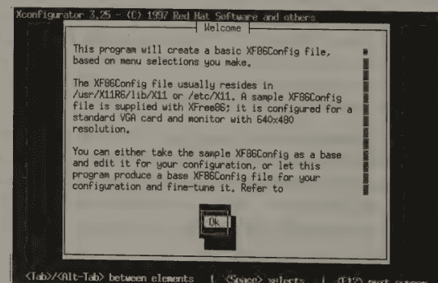

你需要是 `root` 用户才能成功完成配置 X Windows 涉及的所有步骤。

要启动程序，按回车键跳过欢迎界面进入第一个菜单，如图 7.3 所示。

在这里你选择系统运行的显卡类型或芯片组类型。使用上下方向键（或翻页上/翻页键）滚动滚动按字母顺序排列的显卡和芯片组长列表。

确保你的显卡或芯片组完全匹配非常重要。如果不匹配，猜测并选择一个看起来相似的选项是不明智的——事实上，“相似”的显卡可能与你的完全不同。在这种情况下，请选择列表底部的“`Unlisted Card`”（未列出的显卡）。一旦做出选择，按回车键进入下一个屏幕。

图 7.3: 显卡菜单

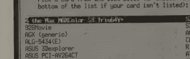

如果你选择“`Unlisted Card`”，将看到第二个菜单，你可以在其中为你的显卡选择合适的服务器，如图 7.4 所示。如果你不确定，应该使用你早早在“安装 Windows”节中选择的通用服务器。对于大多数现代计算机，这将是 `SVGA` 服务器。

一旦你选择了显卡以及可能的服务器，下一步是在显示器菜单上指定你的显示器，如图 7.5 所示。

图 7.4: 服务器菜单

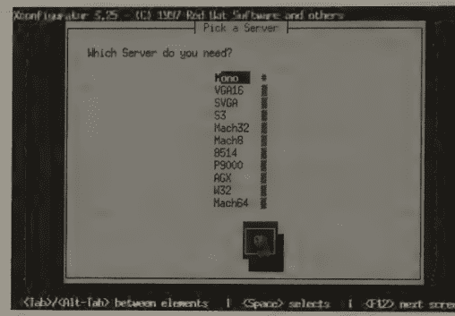

图 7.5: 显示器选择菜单

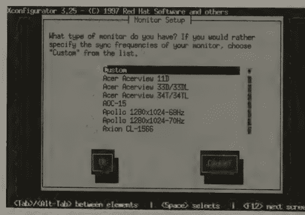

如果你无法在列表中找到特定的显示器，你有三个选择：

- 选择“`Custom`”（自定义），然后为系统指定水平和垂直同步范围（如上所述）。
- 如果你没有显示器的同步范围，且知道显示器是多同步器，则选择“`Generic Multisync`”（通用多同步）。
- 如果你没有显示器的同步范围，且不知道显示器是否为多同步器，则生成“`Generic Monitor`”（通用显示器）（这是最低标准，应该是最后的选择）。

如果你选择“`Custom`”，将看到一个警告屏幕，提醒你输入正确的范围对于避免损坏显示器至关重要。按回车键进入图 7.6 所示的水平同步范围菜单。

扫描列表查看是否有与你的显示器匹配的条目。如果有，对该条目按回车。在 `Xconfigurator` 中，选项不是基于范围的，而是基于最大值。这些信息在显示器说明书中与同步范围相同的位置。尝试匹配具有最高分辨率和同步率的条目。永远不要选择优于显示器说明书中列出的值的选项。

图 7.6: 水平同步范围菜单

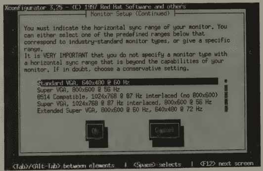

`Xconfigurator` 不允许你手动指定显示器的水平和垂直同步范围。如果你想这样做以利用高端显示器，应该尝试使用下文 `x86config` 节中描述的替代配置方法。

### 图 7.7：垂直同步范围菜单

一旦选了该选项，你将看到一个垂直同步范围菜单，如图 7.7 所示。

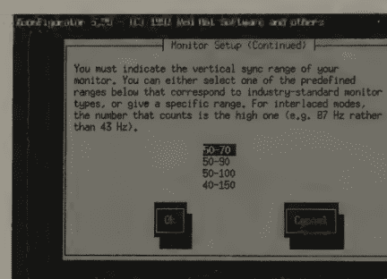

从此菜单中选择一个值，其中较大的数值不超过你的显示器垂直同步范围的最大值，且较小的数值不小于你的显示器垂直同步范围的最小值。

`Xconfigurator` 提供的下一个屏幕是选择是否探测显卡以获取可能的视频模式。通常情况下，大多数新显卡都能成功探测，尽管对旧显卡和某些最近显卡进行尝试可能会导致问题。

最好的办法尝试探测。如果发生错误，系统会通知你，你必须按照此处概述的方法进行手动配置。如果探测成功，你将省去几个步骤。

如果你选择不探测或探测失败，你看到的下一个屏幕将是图 7.8 所示的显存菜单。正如之前在“准备配置”章节中所讨论的，请选择与你的显卡匹配的值。

### 图 7.8：显存菜单


下一个屏幕提供了时钟芯片设置选项。除非你确定你的显卡带有时钟芯片并知道其确切类型，否则最好选择图 7.9 所示的默认 `No Clockchip`（无时钟芯片）设置。

选择时钟芯片后，你将看到一个类似图 7.10 所示的屏幕，在其中你可以选择你偏好的视频模式。

### 图 7.9：时钟芯片菜单

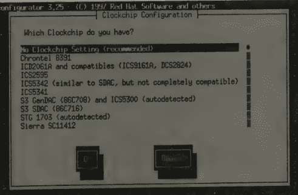

### 图 7.10：模式屏幕

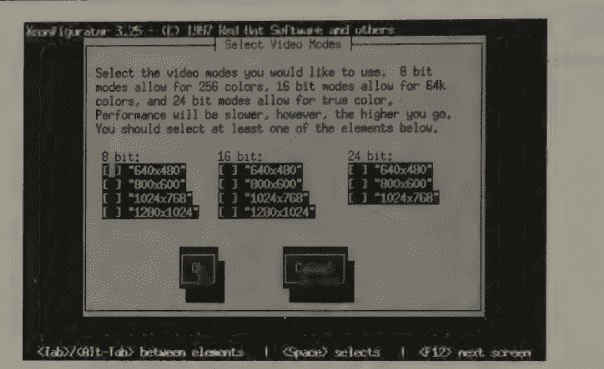

你选择的位深越高，显示的颜色就越多，但视频性能会越慢。同样，分辨率越高，你的桌面空间越大，但代价是屏幕上字母和图标的大小会变小。你可能想要尝试这些设置以找到最适合你系统的设置，但通常 14 英显示器的最佳分辨率为 `640x480`，15 英显示器为 `800x600`，17 英显示器为 `1024x768`。如果资源允许，16 位或 24 位色彩是值得的，特别是对于像 `Netscape Communicator` 这样色彩密集型的应用程序。

要进行选择，使用 Tab 键在位深之间移动，使用方向键在分辨率之间移动。使用空格键选择模式。当你选好一个模式后（你可以选择多个模式——在运行 X Windows 时有方法可以在模式之间切换），使用 Tab 键选择 OK 按钮并按 Return 键。

这将完成配置过程。你将收到已创建配置文件的通知，然后可以按 Return 退出 `Xconfigurator`。在 Red Hat Linux 5.1 中，创建的文件将是 `X86Config`，并存放在 `/etc/X11` 目录下。

## 使用 xf86config 配置 Free86

`Xconfigurator` 只提供一种配置 Free86 的方法，且该方法适用于 Red Hat Linux。

## 使用 xf86config 配置 XFree86

`XFree86` 本身带有一个配置程序，在任何包含 `XFree86` 的 Linux 发行版中可用：`xf86config`。

`Xf86config` 也是基于菜单的，但它为你完成了大部分工作，且用起来比 `Xconfigurator` 稍微繁琐。但 `xf86config` 更灵活，允许你手动指定某些设置，而 `Xconfigurator` 则会自动为你完成这些工作并防止你精确控制这些值。

要运行 `xf86config`，使用以下命令：

```
$ xf86config
```

这将显示一个类似图 7.11 所示的欢迎屏幕。

- 提示：你需要作为 `root` 用户才能顺利完成使用 `xf86config` 配置 X Windows 的所有步骤。
- 注意：`xf86config` 在配置过程中会在屏幕上显示大量密集的文本。欢迎屏幕就是第一个例子。如果你不熟悉 `xf86config`，仔细阅读所有内容是一个好主意，以便充分了解自己所做的选择。

### 图 7.11：xf86config 欢迎屏幕

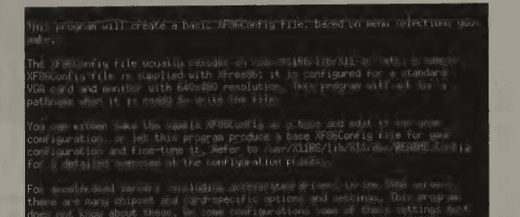

第一个显示的菜单是图 7.12 所示的鼠标菜单。输入相应的数字并按 Return 键选择正确选项。随后你将看到一系列问题，可能包括：

- 是否启用 `Chord`（和弦）功能？如果你正在使用双键鼠标，请选择 `Chord`。
- 是否启用 `Emulate`（模拟）功能？如果你有一个三键鼠标，请选择 `Emulate`。

### 图 7.12：鼠标菜单

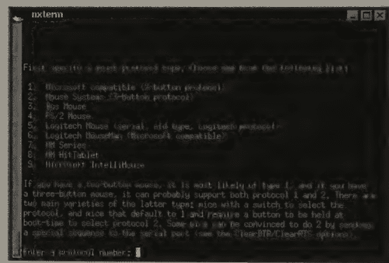

第一个显示的菜单是图 7.12 所示的鼠标菜单。输入相应的数字并按 Return 键选择正确选项。随后你将看到一系列问题，可能包括：

- 是否启用 `Chord`（和弦）功能？如果你正在使用双键鼠标，请选择 `Chord`。
- 是否启用 `Emulate`（模拟）功能？如果你有一个三键鼠标，请选择 `Emulate`。

### 图 7.13：时钟芯片菜单

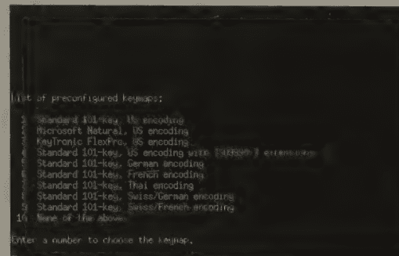

第一个显示的菜单是图 7.12 所示的鼠标菜单。输入相应的数字并按 Return 键选择正确选项。随后你将看到一系列问题，可能包括：

- 是否启用 `Chord`（和弦）功能？如果你正在使用双键鼠标，请选择 `Chord`。
- 是否启用 `Emulate`（模拟）功能？如果你有一个三键鼠标，请选择 `Emulate`。

### 图 7.14：水平同步菜单

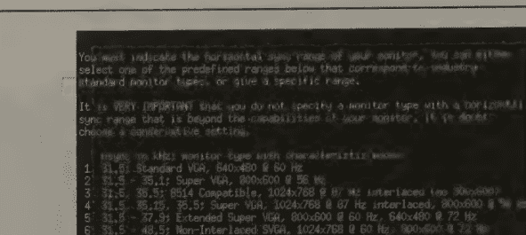

### 图 7.15：显卡菜单

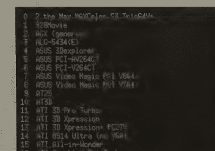

下一个屏幕允许你选择要使用哪个服务器。默认情况下，系统会为你提供四个选项：

- `Mono`
- `VGA16`
- `SVGA`
- `Accelerated`（所有其他服务器）

如果你从显卡数据库中选择了显卡，将根据该选择提供第五个选项。第五个选项实际上是其他四个选项中的一个重复，具体视你的显卡选择而定。如果你在早的步骤中选择了显卡，请选择相应的选项以确保你使用的是适当服务器。

#### 警告

无论你选择哪个服务器，它必须是你在上面“安装”部分中安装的服务器之一。如果不是，你需要返回并在继续之前安装适当的服务器。否则，你的 X Windows 系统将配置为使用一个你计算机上不存在的服务器。

一旦你选择了服务器，系统会询问你是否让 `x86config` 为该服务器创建一个符号链接。对这个问题回答“Yes”是至关重要的。这个链接将文件名 `/usr/bin/X11/X` 指向你选择的服务器，这样无论你运行哪个服务器，都可以使用此文件名来访问它。

# 第 7 章 • 安装和配置 X Windows

设置符号链接后，你将看到一个类似于图 7.16 所示菜单屏幕。在这里，你必须选择显卡上的显存大小。

### 图 7.16：显存菜单

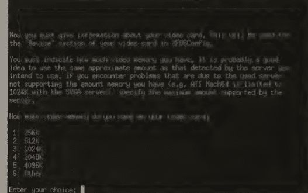

一旦你选择了显存大小，系统将要求你为你的显卡提供一个标识符、标记和型号。对于你的显示器来说，这些条目与 X Windows 系统的正常运行无关，因此如果你以后需要手动编辑 `XFree86` 配置文件，你应该输入一些你以后能识别出来的内容。

下一个菜单（如图 7.17 所示）允许你为显卡选择时钟频率。通常情况下，按回车键选择“`No Clocking`”（无时钟）是一个好主意，因为大多数显卡缺少时钟芯片。只有当你的显卡带有时钟芯片且你知道该芯片类型时，你才应该选择时钟芯片。

### 图 7.17：时钟芯片菜单

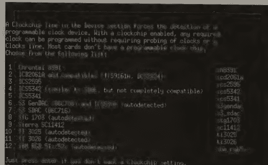

如果你不选择时钟芯片，下一个屏幕将询问：“现在想让我运行 'X -probeonly' 吗？”此程序将尝试从你的显卡中检测在无时钟芯片时所需的时钟信息。

然而需要注意的是，并不是所有的显卡都能成功探测。如果你在之前的配置中，从显卡数据库中选择了一张不支持探测的显卡，那么 `x86config` 将向你警告（在问题上方的一行）不要探测。请听该警告。

如果你没有从显卡数据库中选择显卡，除非你尝试，否则你不知道你的显卡是否支持探测。如果探测失败，可能会发生两种情况：要么你会收到一条类似这里这里的错误消息：

- `probeonly call failed.`
- `No Clocks line inserted.`

要么 `x86config` 会完全崩溃并返回命令行提示符。如果发生后一种，你需要重新运行 `x86config`，当在你遇到“现在想让我运行 'X -probeonly' 吗？”这个问题时，你需要回答“No”。

下一个屏幕将提示你选择偏好的视频模式。X Windows 允许你指定多个视频模式并在不重启 X Windows 环境的情况下在它们之间循环切换。

你应该确保不要接受超过你的显卡和显示器能力的默认模式。例如，14 英寸显示器可能不支持 `1280x1024` 分辨率，而带有 `512KB` 显存的显卡可能在任何分辨率下无法产生 24 位色彩。

要更改视频模式，请选择你想要调整设置的色彩位深。一旦执行此操作，你将看到一个允许为该位深指定一个或多个分辨率的菜单。在提示处，输入你想要的分辨率识别数字，每个数字之间用空格隔开，完成后按回车。

这将让你回到上方的主模式选择屏幕。对你需要调整的每个位深重复此过程，然后选择“`Modes Are OK, Continue`”（模式正常，继续）。

最后一个问题询问你是否应该在默认位置写入 `XF6Config` 文件。问你这个问题是为了确保你不会用可能无法运行的新文件覆盖旧的、正常的配置文件副本。如果你一直在成功使用 X Windows 并正尝试将其重新配置为略有不同的设置，你可能希望在允许 `x86config` 写入新文件之前，保留一份旧配置文件的副本。

如果你对该问题回答“No”，`xf86config` 将提供一系列备选位置来写入文件：首先它会询问你是否想将文件写入备选位置（例如 `/etc/X11/x86config`）。接着，它会询问你是否想将文件写入主目录。最后，它会询问你是否想将文件写入 `/tmp`。如果你对这些都回答“No”，`xf86config` 将无法写入文件。（注：此处原文存在大量重复多次相同逻辑的情况，译文已按要求精简并保持逻辑一致）

# 第八章

## 使用 X Windows 应用程序

- X Windows 基础
- X Windows 应用程序

现在已经在系统中安装并运行了 X Windows，并将开始介绍如何按照 Red Hat Linux 的设计来使用这一 X Windows 环境。

我们将首先概述如何使用 `fwwm95` 窗口管理器（它是 Red Hat Linux 5 中默认的窗口环境），然后查看一些 Linux 用户常用的 X Windows 应用程序。

这些应用程序包括 `xterm`（类似于 Windows 的 DOS 提示符）、`xfm`（一个基于 X Windows 的文件管理器，可与 Windows-3.1 的文件管理器相比较）、`xcalc`（一个科学计算器程序）、几款图形程序（包括 `The Gimp`、`xv` 和 `Ghostview`）等。所有这些应用程序都是 Red Hat 5 完整安装的一部分，一旦你安装了 Linux 并配置了 X Windows，它们就可以运行。

## X Windows 基础

与 Windows 和 Macintosh 世界不同，不能说存在唯一的“X Windows”。正如我们早些在第 6 章“X Windows 概述”中看到的，窗口管理器的选择定义了 X Windows 环境的图形界面。由于窗口管理器的种类很多，X Windows 有许多复旧风格的外观。

在整个章节中，我们将讨论配合 `fwwm95` 窗口管理器使用 X Windows，因为它是本书随附的 Red Hat Linux 版本的默认窗口管理器。正如我们在第 6 章的窗口管理器概述中提到的，`fwwm95` 设计在外观和感觉上类似于 Windows 95。

尽管 Windows 95 的图形界面经常被硬核 Unix 用户所嘲笑，但 `fwwm95` 的外观对普通 Windows 用户来说非常熟悉，这一事实使得许多 Linux 新手能够轻松掌握。

## 启动 X Windows 和 Fvwm95

由于 Red Hat 已经预先配置了 `fwwm95`，因此启动窗口管理器就像启动 X Windows 环境一样简单。正如我们在上一章（安装和配置 X Windows）中所学习的，首先以用户身份登录，然后执行命令：

```
$ startx
```

这将启动 X Windows 并运行 `fwwm95` 窗口管理器。最初，这将产生一个与图 8.1 类似的屏幕。

# 图 8.1:

Red Hat Linux 5 中默认的 `fwm95` 桌面

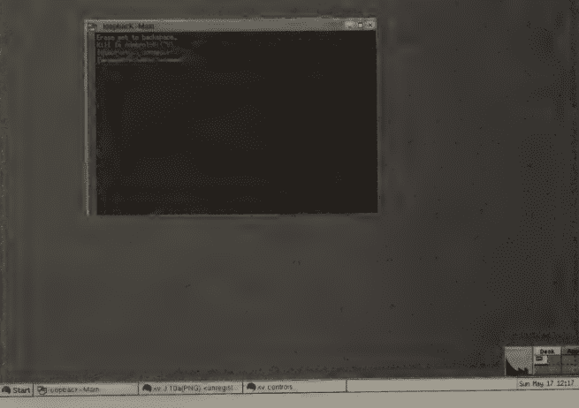

当 `fwm95` 加载时，默认加载三个主要组件：任务栏、虚拟桌面控制面板和 `xterm` 窗口。

# 注意

如果你以 `root` 用户身份启动 X Windows，你的 `fwm95` 桌面看起来会有所不同。`xterm` 窗口中的文本颜色将不是黑底白字，而是黑底褐色，并且一个额外的组件“控制面板”会在启动时加载。控制面板将在第 12 章“通过控制面板配置你的系统”中介绍。

## 任务栏

图 8.2 所示的任务栏显示在屏幕底部，类似于 Windows 95 的任务栏。它包括左侧的“开始”菜单按钮，最右侧的显示时间和日期的的小型面板，以及用于显示每个打开窗口按钮的空间。

# 图 8.2:

`fwm95` 任务栏

在示例任务栏中，你可以看到三个已打开的窗口：`loop-Main`、`xv` 和 `xv controls`。点击这些按钮中的任何一个，如果该窗口被临时最小化到了任务栏，则会打开它并将窗口置于所有窗口的最前端。

## 使用开始菜单


开始菜单的工作方式与 Windows 95 和 Windows NT 4 中的开始菜单相同。点击开始菜单会弹出一个类似图 8.3 所示的菜单。

## 图 8.3:

`fwm95` 开始菜单

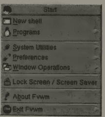

开始菜单上有几个项目：

- `New shell`（新 shell）：此选项会打开一个新的 `xterm` 窗口，类似于窗口管理器启动时打开的那个窗口。我们将在本章稍后后的部分查看 `xterm` 程序。命令行 shell 环境的完整用法将在第 13 章“理解 Shell”中介绍。

- `Programs`（程序）：此选项显示一个可以从开始菜单启动的程序类别下拉子菜单。“Programs”一词右侧的小三角形表示点击或高亮此选项将弹出一个子菜单。

- `System Utilities`（系统实用工具）：此选项显示一个用于管理你的系统和窗口环境的工具下拉子菜单。

- `Preferences`（偏好设置）：此选项显示一个下拉子菜单，允许你配置 `fwm95` 环境的各个方面。

- `Window Operations`（窗口操作）：此选项显示一个下拉子菜单，允许你执行移动、调整大小和最小化窗口等操作。

- `Lock Screen/Screen Saver`（锁定屏幕/屏幕保护程序）：此选项让你激活屏幕保护程序或无密码锁定。

- `About Fvwn`（关于 Fvwn）：此选项显示一个包含你当前 `fwm95` 会话信息的的对话框。

- `Exit Fvwn`（退出 Fvwn）：此选项显示一个允许你退出窗口管理器和 X Windows 环境的子菜单。程序子菜单类似于图 8.4 所示。该菜单提供了进一步的子菜单，包含可以在 X Windows 中启动的不同类别的程序。这些类别包括管理工具、图形程序和网络应用程序。其中一些应用程序将在以后详细介绍。

## 图 8.4:

`Programs` 子菜单


`SystemUtilities` 子菜单类似于图 8.5 所示。此菜单上的选项包括：

- `Root shell`（root shell）：此选项打开一个以 root 用户身份运行的 `xterm` 窗口。它可以用于系统管理，例如创建用户、重启系统或安装软件。如果你是以 root 外的用户登录的，将提示 root 密码。

- `Top`：此选项打开一个运行 `Top` 程序的 `xterm` 窗口。我们在第 14 章“管理”中看到的有用工具，允许你监控内存使用情况、系统负载和活动进程。此窗口类似于图 8.6 所示。

## 图 8.5:

`SystemUtilities` 子菜单

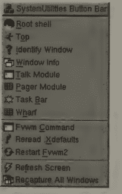

## 图 8.6:

`Top` 窗口

```
Top
up 136 days, 2 users, load average: 0.20, 0.51, 0.51
28 tasks: 27 sleeping, idle, 45.42%
cpu: 32.42 user, 24.52 system, 0.02 nice, 2.94 wait
mem: 80520 free, 0 used, 80526 free
PID USER RSS SHARE VCPU TIME COMMAND
519 root 0 36769 159M 168S 0 51.8 0.2 wine
520 root 0 36769 6138 637 S 0.0.0 sleep
521 root 0 36769 592 465 S 0.0.0 free:
522 root 0 36769 818 818 S 0.0.0 free:
523 root 0 36769 1528 1189 R 0.0.0 root
524 root 0 36769 724 724 S 0.0.0 sleep
525 root 0 36769 336 336 S 0.0.0 kawkd
526 root 0 36769 432 432 S 0.0.0 sleep
527 root 0 36769 560 560 S 0.0.0 sleep
528 root 0 36769 356 356 S 0.0.0 hctps
529 root 0 36769 438 438 S 0.0.0 apgetlog
530 root 0 36769 536 536 S 0.0.0 sleep
531 root 0 36769 816 816 S 0.0.0 sleep
532 steen 0 400 400 524 S 0.0.0 sleep
533 root 0 36769 470 470 S 0.0.0 sleep
534 root 0 36769 348 348 230 S 0.0.0 partis
```

- `Identify Window`（识别窗口）：此选项运行一个程序，允许你显示任何打开窗口的信息。通过选择此选项并点击打开的窗口，将显示一个类似图 8.7 所示的信息面板。点击信息面板即可将其关闭。显示的信息包括当前窗口的大小和位置、窗口标题以及其他主要供尝试调试应用程序的开发者以及检查用户 X Windows 环境配置的系统管理员使用数据。

## 图 8.7:

识别窗口信息面板

| Name | Root_Window |

| --- | --- |

| IconName | XRoot |

| Class | XTerm |

| Resource | |

| Window ID | 0000000 |

| Width | 117 |

| Height | 115 |

| X (page) | 831 |

| Y (page) | 113 |

| BoundaryWidth | No |

| Sticky | No |

| Orbits | No |

| Notitle | No |

| Transparent | No |

| Gravity | No |

| Geometry | 506x458+0 |

| Focus Policy | Passive |

| Input Field | True |

| WM_TAKE_FOCUS | Abient |

- `Pager Module`（分页器模块）：此选项打开一个分页器窗口，可以访问 `fwwm95` 的虚拟桌面功能。这个小窗口类似于启动 `fwwm95` 时默认打开的窗口，不同之处它缺少系统负载的图形显示。从菜单启动分页器的能力在原始虚拟桌面控制被关闭且你需要访问虚拟桌面功能时非常有用。

- `Wharf`：`Wharf` 选项启动一个默认虚拟窗口的替代方案并关闭虚拟桌面窗口。`Wharf` 提供了一个类似于图 8.8 所示的 NeXT 风格按钮栏。`Wharf` 栏的功能包括时钟、图形负载表、访问 `fwwm95` 的虚拟桌面顶部功能，以及快速启动常用应用程序的按钮。

## 图 8.8：

`Wharf` 按钮栏

- 查看/退出 X Windows

- 闹钟

- Xbigg（指示有新邮件到达）

- CPU 使用率显示器

- 虚拟桌面控制

- 启动 XTerm

- 启动 The Gimp

- 启动 Elm（用于阅读电子邮件）

- 重启窗口管理器

系统实用工具（`SystemUtilities`）菜单还提供了其他较不常用的功能，但它们通常太复杂，无法在像这样简短的概述中描述。你可以通过查阅 `man` 页面（帮助手册）、Linux 发行版自带的文档以及互联网上的 Linux 源码获取更多关于特定功能的信息。

偏好（`Preferences`）偏好菜单允许你控制 `fvw95` 界面外观和感受的许多方面。这包括更改背景颜色或图像、更改鼠标指针的默认外观以及动态切换窗口管理器。偏好菜单看起来类似于图 8.9 所示，我们在这里查看其中一些实用的功能。

## 图 8.9：

偏好菜单

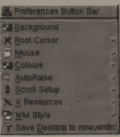

背景（Background）此选项将打开一个类似于图 8.10 中的窗口。通过此窗口，你可以为桌面选择纯色背景颜色或桌面图像。选择“统一颜色”（Uniform Color）允许你通过拖动窗口上半部分的红、绿、蓝滑块来指定颜色（每个条的颜色未标明，但它们会按顺序改变红、绿、蓝的比例）。

## 图 8.10：

背景设置窗口

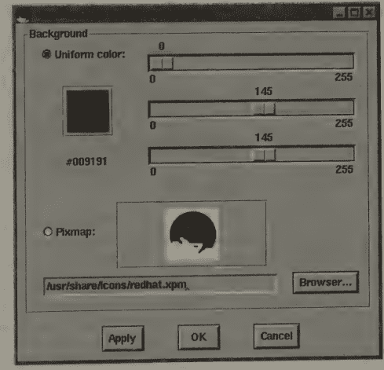

若要选择位图图像，请选择 `Pixmap`，然后点击浏览（Browse）按钮。这将弹出文件浏览器对话框，在其中你可以从类似图 8.11 所示的窗口中选择合适的背景图像文件。你选择作为背景图像的文件应该是 X Windows `Pixmap` (XPM) 文件。该图像将在桌面背景上平铺显示（即它将重复足够次数以填满显示器）。如果你想获得精美的 `Pixmap` 图标，可以尝试 Joerg Martin 的三维 `Pixmapset`。最新版本位于 SunSite Linux 存档的 X11 图标目录，地址为 `http://sunsite.edu/pub/Linux/X11/icons`。

## 图 8.11：

文件浏览器对话框

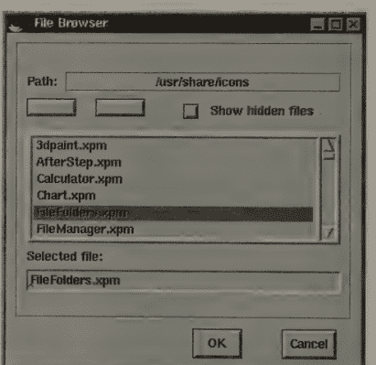

**根光标（Root Cursor）**此菜单会产生一个类似于图 8.12 所示的子菜单。从该子菜单中，你可以选择各种替代光标，当鼠标指针悬停在桌面（而不是窗口内）时，将显示这些光标。默认情况下，根光标是一个简单的 X 符号。但你可以从多种替代图标中选择，包括箭头、十字、喷漆罐和雨伞。

## 图 8.12：

根光标子菜单


**鼠标（Mouse）**鼠标子菜单允许你控制鼠标跟踪速度。这影响鼠标指针在屏幕上移动的距离相对于你在桌面上或鼠标垫上移动鼠标的距离。这是一个个性化设置，你可以根据自己的计算习惯进行调整。此菜单还允许你更改鼠标的左右手偏好。通过将鼠标设置为右手模式，通常由左键执行的操作将改为由右键执行，反之亦然。

**自动置顶（AutoRaise）**此菜单允许你开启或关闭窗口的自动置顶。启用后，`AutoRaise` 会导致窗口在获得鼠标焦点一段时间（以毫秒为单位）后自动置到其他窗口的最上方。

**滚动设置（Scroll Setup）**此菜单允许你开启或关闭滚动功能，包括将滚动限制为垂直或水平轴。

**WM 样式（WM Style）**图 8.13 所示的 `WM Style` 子菜单允许你在不关闭现有窗口且退出 X Windows 环境的情况下切换到另一个窗口管理器。默认情况下，Red Hat 的完整安装版带有 `Lest` 窗口管理器（设计外观类似于 Motif 窗口管理器）和 `Afterstep`（设计外观类似于 NeXT 计算机的图形界面）。如图 8.14 所示，切换窗口管理器后，所有现有窗口保持打开状态，但现在具有新窗口管理器的默认外观。

## 图 8.13：

`WM Style` 子菜单

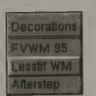

**将桌面保存到新的 .xinitrc（Save Desktop to new .xinitrc）**在对桌面进行所需的更改后，如果你希望在以后启动 `fvw95` 时这些更改生效，则需要将它们保存到个人的 `.xinitrc` 文件中。`xinitrc` 文件包含了用于个性化 X Windows 环境的指令和信息，正如我们在下一节（“高级 X Windows 配置”）中看到的。如果你进行了任何想要永久保留偏好更改，请在退出 `fvw95` 之前确保选择此选项。

## 图 8.14：

切换到 `Lest` 窗口管理器

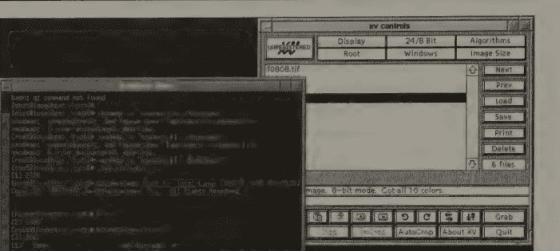

**窗口操作（Window Operations）**窗口操作菜单提供了访问各种窗口操作的入口，包括移动、关闭和缩放。该菜单看起来类似于图 8.15。

## 图 8.15：

窗口操作菜单

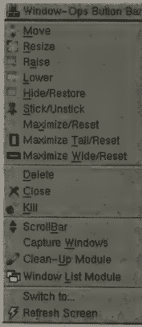

虽然许多此类操作可以通过 `fvw95` 的其他功能实现（我们在下一节“滚动”中会看到），但有时需要使用窗口操作菜单来执行这些功能。该菜单提供的主要操作如下：

**移动（Move）**此选项允许你移动任何可见窗口。

**缩放（Resize）**选择此选项后点击窗口中的任意位置可以缩放窗口。通过拖动窗口右边缘可以使其变宽，通过拖动底部可以使其变高。

**置顶（Raise）**选择此选项后点击窗口，将将其带到所有其他窗口的前面。

**置底（Lower）**选择此选项后点击窗口，将将其发送到所有窗口的之后。

**固定（Stick）**此选项与 `fvw95` 的虚拟桌面配合。要使用它，只需选择“固定”选项并点击窗口。这会将窗口固定在桌面，以便当你切换虚拟桌面时，它会随你移动，而不是留在单个桌面。当你固定窗口时，窗口标题栏的样式会发生变化并在右侧显示三行，如图 8.16 所示。

**取消固定（Unstick）**选择“取消固定”选项并点击固定在桌面上的窗口将释放该窗口。窗口标题栏将恢复标准样式，窗口在切换虚拟桌面时恢复正常。

**最大化/重置（Maximize/Reset）**此选项在窗口最大化和恢复原始大小之间切换。

## 图 8.16：

固定窗口的标题栏有三额外的行

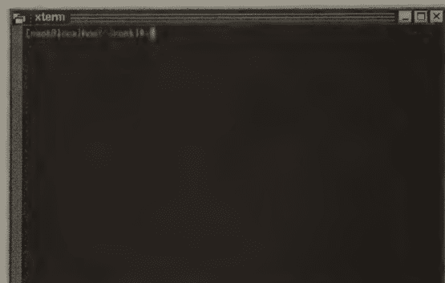

**高度最大化/重置（Maximize Tall/Reset）**与上一个选项类似，此选项在窗口最大化和原始大小之间切换，不同之处是最大化只影响高度而不影响宽度。

**宽度最大化/重置（Maximize Wide/Reset）**作为高度最大化的对应项，此选项仅最大化窗口宽度而不影响高度。

**关闭（Close）**选择此选项并点击打开窗口中的任意位置将关闭该窗口。这与 Kill 菜单选项相似但没那么剧烈。`Close` 仅导致所选窗口关闭。如果一个程序打开了一个窗口，通过这种方式关闭窗口通常会导致应用程序退出。

**杀死（Kill）**比 `Close` 更进一步，会直接杀死创建该窗口的进程。这是一个细微但重要的区别。对于像 `Netscape Communicator` 这样可以在运行一个实例的情况下打开多个窗口的应用程序，选择 `Close` 会关闭所选窗口但保持所有其他窗口打开；选择 `Kill` 则会导致整个程序及其所有窗口退出。

**滚动条（ScrollBar）**选择 `ScrollBar` 后点击窗口将为窗口添加滚动条，如图 8.17 窗口底部和右侧所示。如果应用程序的整个显示区域无法放入最大的窗口尺寸中，且你需要

## 图 8.17：

滚动条允许应用程序超出其窗口的边界

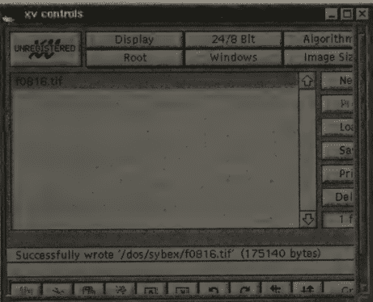

窗口列表模块 (`Window List Module`)：此选项会执行 `fwm95` 的一个特殊模块。该模块会显示所有打开窗口的小列表（概念上类似于任务栏上每个窗口的按钮），允许你在打开的窗口之间进行切换。图 8.18 是窗口列表模块的示例。你可以使用“关闭”（Close）操作关闭此窗口。

## 图 8.18：

窗口列表模块

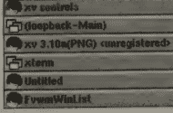

切换到... (`Switch to...`)：“切换到...”会显示所有打开窗口的下拉菜单，以便你选择一个窗口将其置于顶层。图 8.19 显示了一个示例菜单。

## 图 18.19：

切换到...菜单

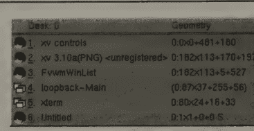

刷新屏幕 (`Refresh Screen`)：此选项会重绘屏幕，当屏幕出现失真时非常有用。否则，你很少需要使用此选项。

访问开始菜单的其他方式：除了使用任务栏上的开始菜单外，你还可以通过在桌面上打开窗口以外的任何地方点击鼠标左键来从桌面访问开始菜单。开始菜单会在点击的地方弹出。这非常有用，例如如果你倾向于使用窗口列表模块来切换窗口，并希望消除任务栏以获得屏幕空间。

## 分页器 (The Pager)

分页器是一个小窗口（如图 8.20 所示），它提供虚拟桌面。

## 图 8.20：

分页器


虚拟桌面的概念非常简单。让我们从一个基础示例开始。如果你有两个虚拟桌面，这就像有两个显示器，但这些显示器只有一根电源线。你可以打开两套不同的应用程序并运行并显示在显示器上，通过在显示器之间切换电源线在这些环境之间进行切换。

虚拟桌面提供了类似的功能，但没有了在两个显示器之间切换电源线带来的延迟、困难和挫败感。虚拟桌面系统中的每个桌面都像一个全新的工作环境，你可以在其中打开窗口并运行应用程序。同时，这些应用程序无论显示在哪个桌面，都运行在同一个 Windows 会话中，这意味着你可以在它们之间进行复制和粘贴，就像它们在视觉上显示在同一个桌面上一样。

默认情况下，分页器配置了八个虚拟桌面，其中四个标记为 `Desk`（尽管这些是完全随机的名称，与你如何使用桌面没有关系）。

你可以通过点击分页器上八个方格中的任何一个来切换桌面。这将立即将显示的桌面切换到所选桌面。

在分页器窗口的任何地方右击右键都会弹出另一个屏幕，用另一个类比来解释最为合适。想象一个巨大的 50 英寸电视屏幕，可以通过一个 14 英寸的窗口来查看，这个窗口可以放在大屏幕的任何地方，以便一次查看 14 英寸的部分。虚拟桌面同样可以被认为是一个比你的物理显示器尺寸更大的大型桌面。

在默认分页器的情况下，这个较大的虚拟屏幕比你的物理屏幕大八倍。这个类比很重要，因为它说明了不仅可以查看分页器上标记的八个区域，还可以查看任何区域。例如，你可以点击分页器任何地方的右键，物理显示器的左上将移动到你点击的点。这意味着显示不同桌面区域之间的重叠区域是可能的。

此外，右击并拖动会导致可见区域随着你的拖动而移动，因此你可以观察以确保显示的恰是你想要看到的区域。


最后，默认的分页器窗口在虚拟桌面控制的左侧还包含一个负载监控器。该监控器显示当前和历史对你的 CPU（处理器，即计算机的心脏）的需求。这对于判断你是否正在尝试运行过多的应用程序（特别是后台应用程序）或是否需要升级到更强大的计算机很有用。

# Fvwm95 界面

Fvwm95 有许多关键的用户界面元素。我们将首先对这些元素进行概述，然后关注几个特定任务：启动应用程序、操作窗口、使用桌面菜单以及退出窗口管理器。

## 启动应用程序

开始菜单的“程序”（Programs）子菜单是启动应用程序简单的地方。如果你在计算机上完整安装了 Red Hat 5，“程序”菜单及其子菜单提供了对常用 X 应用程序集合的访问。

例如，文件管理是一项常见活动。你可以通过从实用工具”（Utilities）子菜单下的“文件管理”（File Management）子菜单选择 `xfm`（代表 X File Manager）来启动 X 窗口文件管理器，如图 8.21 所示。

### 图 8.21：

一个 `xfm` 窗口

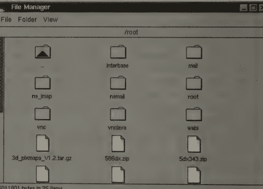

从左到右，这些图标在单单击时会执行以下操作：

- **最小化窗口** 此操作会隐藏窗口，并在任务栏上保留一个按钮，在窗口列表模块中保留一个按钮，并在“切换到...”（Switch To...）菜单中保留一个项目。
- **最大化/重置窗口** 此图标作为一个开关，允许窗口在全屏（最大化）和最大化之前的原始尺寸（重置）之间切换。
- **关闭窗口** 此操作会关闭窗口。在多窗口应用程序中，此并不等同于杀死（Kill）操作。

**窗口操作菜单** 在标题左侧，即窗口的左上角，你会看到一个代表显示该窗口的应用程序图标。对于 `term` 等常用应用程序，`fwm95` 预配置了特殊图标。对于其他应用程序，则使用默认图标。正如我们将在下一章中学到的，你可以配置 `fwm95` 为任何应用程序显示你选择的图标。

无论使用何种图标来表示应用程序，使用鼠标的任何键点击该图标都会从开始菜单中显示窗口操作菜单。

**窗口边框** 大多数窗口都有五像素宽的边框（这是一个可以更改的默认值，我们将在下一章看到）。此边框用于视觉上指示窗口的边缘，并允许用户调整窗口大小。

可以水平、垂直或同时调整窗口的尺寸。只需点击并拖动现有窗口边框的任何位置，窗口将根据鼠标指针的位置调整大小。

这与 Windows 95 的工作方式不同，在 Windows 95 中，调整大小的操作取决于你点击并拖动窗口的边缘还是角落。在 Windows 95 中，点击左边缘或右边缘并拖动仅允许水平调整，顶部和底部边缘仅提供垂直调整；角落则允许同时进行水平和垂直调整。在 `fwm95` 中，点击并拖动边框的任何位置的效果与窗口操作菜单中的“调整大小”操作相同，无论你从哪个边缘或角落开始拖动，都可以在水平和垂直方向上调整大小。

## 使用桌面菜单

正如我们之前在讨论开始菜单的部分中看到的，在桌面的任何窗口之外点击左键会显示开始菜单。在桌面上点击右键和中键也会产生特殊菜单。

在桌面上点击右键会产生开始菜单的子菜单，以便快速访问应用程序集合。在桌面上点击中键（或同时点击左右键）会弹出“切换...”（Switch...）菜单，以便快速将任何打开的窗口带到最前。

## 退出 Fvwm95

开始菜单中的最后一项是“退出 Fvwm”菜单。该菜单提供两个选项：重启（Restart）和“是，真的退出”（Yes, Really Quit）。第三个选项“不，不退出”（No, Don't Quit）实际上是一个伪选项，因为它不会导致任何操作发生。

重启是在退出并重启 `fvwm95` 的同时不退出 X Windows 或关闭已打开的窗口。这样做的好处在重新配置 `fvwm95` 时最为明显。正如我们将在下一章中看到的，在编辑 `fwm95` 的配置文件时，你通常希望增量地测试更改。与其完全退出 Windows 并重启以监控变化，重启选项允许你快速激活并看到对 `fvwm95` 配置文件所做的更改。

“是，真的退出”会导致 `fvwm95` 退出、X Windows 以及所有打开的窗口关闭。虽然关闭所有打开的窗口通常会导致应用程序退出，并非总是如此。某些应用程序无法正确检测到窗口的关闭，并在 X Windows 退出后继续在后台运行。在繁忙或高频使用的系统中，这些被称为“悬挂进程”的应用程序可能会给服务器带来不必要的负载，拒绝或其他应用程序提供系统资源。

因此，在退出 `fvwm95` 和 X Windows 之前关闭所有打开的窗口是一个良好的策略。

# X Windows 应用程序

在本节，我们将查看一些 X Windows 应用程序以及它们如何运行和使用。这些应用程序包括 `xterm`、标准的 X Windows 文件管理器、名为 The Gimp 的图形程序以及若干 X-Windows 工具程序。

这些应用程序的选取是基于两个标准之一的：它们是日常 Linux 操作，或者是许多 Linux 应用程序功能或范围的代表。

本节应该让你有信心开始尝试任何标准 Linux 发行版提供的其他 X Windows 应用程序。

## 使用 xterm

虽然 X Windows 为 Linux 提供了一个美观且用户友好的界面并允许创建完全图形化的应用程序，但事实是，作为 Unix 的克隆，Linux 是一个以命令行为导向的操作系统。

尽管可以在不使用命令提示符的情况下使用 Linux 进行日常工作，但为了利用 Unix 类系统的真实力量和灵活性，你仍然需要进入命令行世界。

幸运的是，这并不意味着放弃 X Windows 的便利性。`xterm` 程序提供了一个完全集成到 X Windows 环境中的命令行提示符，带有滚动条、可调整大小的窗口以及与其他 X Windows 应用程序复制和粘贴的能力——这些都是 Linux 控制台所缺乏的特征。

在 Red Hat 5 中启动 `xterm` 窗口的最简单方法是从开始菜单中选择“新 Shell”（New Shell）。此外，默认的 Red Hat 5 配置会在启动 X Windows 和 `fwm95` 时启动 `xterm`。

如果你想启动额外的 `xterm` 窗口，也可以从另一个 `xterm` 窗口的命令行执行以下命令：

```bash
$ xterm &
```

或者，如果你发现由于某些原因 `xterm` 不在你的路径中，可以使用：

```bash
$ /usr/bin/X11/xterm &
```

默认情况下，这将打开一个宽 80 个字符、深 25 行（Linux 控制台的标准尺寸）并带有滚动条的窗口，可以调整大小以提供更多空间。你会发现在 Red Hat 5 中，新 `xterm` 窗口的默认配色方案为黑色背景白色文字，窗口标题为 `xterm`。

## 定制 xterm

`xterm` 程序是高度可定制的。除了其他，你还可以更改字体、配色、默认窗口大小、新窗口的位置以及窗口标题。在本节中，我们将查看这些选项以及在新 `xterm` 窗口中使用它们。

起初可能认为这种灵活性没有真正的价值，但实际上是有。在不同的显示器上，不同的颜色组合产生最易读的文本，因此能够配色是一项实用功能。此外，如果你经常使用多个 `xterm` 窗口处理不同的任务（例如运行 `Top`、读取电子邮件和管理文件），能够快速识别哪个窗口用于什么任务会让窗口间的切换变得容易得多。

### 标志和参数：Unix 快速入门

在继续之前，我们需要一个关于 Unix 命令如何工作的快速教程。关于 Unix 和 Linux 中使用的 Unix 命令的完整介绍见第10章“介绍 Linux 命令”。

要执行程序（或命令），只需输入程序的名称（以及可能的完整路径）并按回车键。

例如，要启动 `xterm`，可以使用：

```bash
$ xterm
```

或者，如果 `xterm` 不在你的路径中：

```bash
$ /usr/bin/X11/xterm
```

大多数程序都需要或可以接受更改其行为的信息或提供待处理的信息。向命令提供两种类型的信息：标志（flags）和参数（arguments）。

参数是提供给程序进行处理的信息；可以是从文件名到搜索文本的任何内容。

标志（Flags）是改变程序行为的选项。它们出现在命令之后，用一个或多个空格分隔，并以破折号开头。例如，标志 `-help` 会让 `xterm` 打印出帮助信息：

```
$ xterm -help
usage:
  xterm [-options ...] [-e command args]
```

- 其中选项包括：
- `-help` 打印此消息
- `-display` 要连接的 X 服务器显示名称
- `-geometry` geom 尺寸（以字符为单位）和位置
- `-rv` 开启/关闭反色视频
- `-bg` 背景颜色
- `-fg` 前景颜色
- `-bd` color 以像素为单位的边框宽度
- `-bw` number 正常文本字体
- `-fn` fontname 图标字体名称
- `-iconic` 客户端实例、图标和标题
- `-name` string 标题字符串
- `-title` string 额外的资源规格
- `-xrm` 资源字符串
- `-root` 开启/关闭抑制列切换抑制
- `-ah` 开启/关闭始终高亮
- `-ai` 开启/关闭活动图标

等。还可以创建复杂的标志来提供标志正确运行所需的信息。例如，要设置 `xterm` 标题，你可以使用 `-T` 标志，但你还需要提供希望在标题栏中显示的文本。命令

```
$ xterm -T Email
```

将创建一个以 Email 为标题的 `xterm` 窗口。

另一方面，参数（Arguments）不是配置选项，而是提供给程序进行处理的信息。参数不像标志那样前面以破折号开头。参数通常是需要打开、处理或编辑的文件名——如下例所示，该例表示要使用 `emacs` 编辑器打开 `testfile` 文件进行编辑：

```
$ emacs testfile
```

### 设置颜色方案

通过使用各种标志，可以设置 `xterm` 窗口颜色方案的几乎所有所有方面，从边框颜色到光标颜色。在本节中，我们将查看颜色方案的主要元素：前景颜色、背景颜色和光标颜色。

#### 理解窗口 颜色

在查看用于设置 `xterm` 窗口颜色的特定标志之前，我们需要查看 X Windows 中是如何引用颜色的。

X Windows 中的颜色以 RGB（红-绿-蓝）格式指定。RGB 格式由一组有序的数字三元组组成，每个数字的值从 0 到 255 不等。这些数字分别代表红、绿、蓝通道的值，255 代表无颜色，0 代表颜色的最高值。

幸运的是，你不需要弄出颜色通道组合来获得所需的颜色。这项工作已经完成，并存储在 X Windows 使用的将颜色名称映射到数值三元组的文件中。该文件通常称为 `rgb.txt`，通常位于 `/usr/X1R6/11b/X11` 目录下。

Red Hot 5 `rgb.txt` 文件中的完整值列表见附录 A。其他发行版的用户将在他们的系统中找到类似的列表。这里列出了一个选定的列表，以便我们在学习本节时方便实验颜色：

| GhostWhite | PapayaWhip | LemonChiffon |
| :--- | :--- | :--- |
| AliceBlue | LavenderBlush | MistyRose |
| white | DarkSlateGray | DimGray |
| gray | MidnightBlue | NavyBlue |
| NavyBlue | SlateBlue | blue | SteelBlue |
| turquoise | cyan | DarkGreen | SeaGreen |
| LawnGreen | green | GreenYellow | DarkKhaki |
| LightYellow | yellow | gold | RosyBrown |
| IndianRed | sienna | beige | wheat |
| tan | chocolate | DarkSalmon | orange |
| tomato | red | DeepPink | pink |
| maroon | magenta | violet | orchid |
| purple | Cyan | DarkRed | LightGreen |

#### 注意

取决于你的视频显示器深度以及你运行的应用程序，你可能会发现使用的颜色显示与你预期的不完全相同。这是由于显卡的限制以及系统之间的差异。

#### 背景和前景颜色

设置背景和前景颜色允许你控制屏幕上文本的显示。文本将以前景颜色显示，而逻辑上，背景颜色将分配给窗口的背景。

通常的默认 `xterm` 窗口是黑底白字。使用 `-fg` 和 `-bg` 标志来设置前景颜色和背景颜色：

```
$ xterm -fg black -bg &
```

此命令提供了与默认 `xterm` 窗口完全相反的颜色方案，导致背景设置为白色，前景设置为黑色。结果如图 8.23 所示。

### 图形 8.23：

控制颜色方案

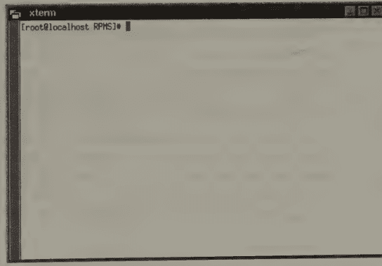

#### 注意

`-bg` 和 `-fg` 标志并非特定于 `xterm`。事实上，它们是标准的 Windows 标志，可以更改大多数 Windows 应用程序的颜色方案。

#### 光标颜色

如果你尝试上一个设置颜色示例，可能会注意到光标颜色与默认 `xterm` 颜色方案相同（在大多数 Red Hat 安装中为粉）。你也可以使用 `-cr` 标志更改此颜色。例如，如果你想要深蓝色的光标，可能可以使用命令

```
$ xterm -bg black -fg white -cr MidnightBlue &
```

#### 设置窗口大小和位置

当你打开 `xterm` 窗口（或任何其他应用程序的窗口）时，窗口的大小是设置的，窗口的位置是由窗口管理器决定的。然而，你可以使用 `-geometry` 标志来指定窗口的精确大小和位置。标志的基本语法是 `-geometry widthheight+xy`，其中 `width` 指定列数，`height` 指定行数，`x` 指定窗口距离左侧的像素距离，`y` 指定窗口距离顶部的像素距离。

默认窗口大小为 80 列 25 行。但如果你想要一个距离左侧 200 像素、距离顶部 300 像素的 10x10 字符窗口，我们可以使用命令

```
$ xterm -geometry 10x10+200+300 &
```

以得到如图 8.24 所示的窗口。

### 图形 8.24：

使用 `-geometry` 标志

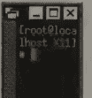

通过添加 `-fg` 和 `-bg` 标志，我们可以在定义窗口大小的同时更改默认颜色方案：

```
$ xterm -geometry 10x10+200+300 -fg DarkRed -bg cyan &
```

结果看起来如图 8.25。

### 图形 8.25：

将 `-geometry` 标志与颜色标志结合


#### 设置窗口标题

如前所述，能够设置 `xterm` 窗口标题有助于识别不同的窗口用途。设置标题最简单的方法是使用 `-T -title` 标志（它们是相同的）。

```
$ xterm -title Email &
```

将创建一个标题为 Email 的 `xterm` 窗口，命令 `xterm -T Email &` 也是如此。

为了创建包含多个单词（换句话说，包含空格和其他分隔符）的标题，你需要对标题加引号，以便 `xterm` 知道命令的哪些部分作为标题。如果你喜欢使用 My Email 作为标题，可以使用命令：

```
$ xterm -T "My Email" &
```

#### 在 xterm 窗口中运行应用程序

虽然 `xterm` 窗口的目的是使用命令行执行命令，但你可能希望在启动 `xterm` 窗口时默认运行某些字符模式程序。例如，如果我们始终在 `xterm` 窗口中运行 `Top`，我们

在工作时，你可能希望在打开 `xterm` 时启动 `Top`。这可以通过 `-e` 标志来实现：

```
$ xterm -e
```

此命令将打开一个类似于图 8.26 所示的窗口。

### 图 8.26：

在运行操作时启动 `xterm`


当窗口内运行的程序退出时，`xterm` 窗口将会关闭。

需要注意的是，当你使用 `-e` 标志时，默认窗口标题是使用 `-e` 标志启动的程序的标题。

**设置字体** `xterm` 使用的默认字体通常非常易读，并适用于普通显示器。但如果你有一个特别大或特别小的显示器，或者分辨率异常低或高，你可能会发现更改 `xterm` 窗口中使用的字体是明智的。

为了做到这一点，请使用 `-fn` 标志。但你如何引用字体呢？字体通过名称引用，这些名称可以简单如 `7x13`（表示宽 7 像素，深 12 像素），也可以复杂如 `-sony-fixed-medium-r-normal-24-230-75-75-c-120-iso8859-1`，它表示由 Sony 厂商提供的、具有 24 点拉丁字符集、中等粗细、罗马（Roman）风格且命名为 **fixed** 的字体。

X Windows 提供了一个名为 `xlsfonts` 的程序，它提供了在你的 X Windows 系统上的可用字体列表。附录 B 提供了 Red Hat 5 安装中包含的所有字体的完整列表。

要查看系统上的可用字体列表，请在 `xterm` 窗口中使用以下命令：

```
$ xlsfonts | more
```

命令的 `| more` 部分允许你通过按空格键向前翻页，来浏览长长的字体列表（我的系统上有 491 个）。

因此，为了选择 10×20 字体，你可以使用命令

```
$ xterm -fn 10x20 &
```

以获得一个带有大字体的窗口，类似于图 8.27 所示的窗口。

### 图 8.27：

10×20 字体


理论上，这些字体中的任何一个都可以配合 `-fn` 标志和 `xterm` 命令使用。但在实践中，这并不可行。`xterm` 的特性是它需要等宽字体——即无论字符的 own 如何，所有字符都占据相同的空间。在 Windows 世界中，等宽字体的一个例子是 `Courier`。

# 第 8 章 使用 X Windows 应用程序

相比之下，许多字体是比例间距的。这意味着字母“i”占据的空间比“w”少，因为后者是一个更宽的字母。`Xterm` 在处理这些比例间距字体方面并不理想，如图 8.28 所示，其中选定的字体来自 Times 族。

## 图 8.28：

使用比例间距字体


下面列出了一些在大多数 X Windows 发行版中可用的常用且易输入的等宽字体，包括 Red Hat 5 中提供的：

| 5x7 | 6x13bold | 7x14 | 9x15 |
| :--- | :--- | :--- | :--- |
| 5x8 | 6x9 | 8x13 | 10x20 |
| 6x10 | 7x13 | 8x13bold | 12x24 |
| 6x12 | 7x13bold | 8x16 | |
| 6x13 | 7x14 | 9x15 | |

如果你想尝试其他字体，可以使用 `xlsfonts` 查看字体列表，选择一种字体，然后使用 `xfd` 命令在窗口中显示字体。例如，为了显示我们之前看到的 Sony 字体 `-sony-fixed-medium-r-normal-24-230-75-75-c-120-iso8859-1`，我们可以使用以下命令：

```
$ xfd -fn -sony-fixed-medium-r-normal-24-230-75-75-c-120-iso8859-1
```

注意使用 `-fn` 标志来指定字体名称。字体将在类似于图 8.29 所示的窗口中显示。

## 图 8.29：

使用 xfd 显示字体


你可以点击 Quit 按钮关闭窗口。

**其他功能** `xterm` 提供的功能比这里列出的多得多。你可以在 `xterm` 的 man 页中了解它们。man 页面提供了有关如何使用特定程序的信息。要访问 `xterm` man 页，你可以在 `xterm` 窗口中使用命令

```
$ man xterm
```

这将显示一个如图 8.30 所示的 man 页。

## 图 8.30：

xterm man 页


### 注意

用于搜索 Linux man 页的程序包含在本书中 CD-ROM 中。安装和使用此软件的完整说明请访问 http://linux.juxt.com

# 在 X Windows 中管理文件

Windows 3.1 用户有 File Manager，Windows 95 用户有 Explorer，而 Mac OS 用户可以使用 Finder。所有这些程序都提供了管理文件包括复制、移动和删除以及启动应用程序的功能。在 X Windows 世界中，没有标准工具提供这些功能。许多自称为文件管理器或桌面管理器的应用程序尝试提供此功能。你可以在 http://www.xnet.com/~blatura/linux2.html 找到文件管理器列表。在本节中，我们将查看 `xfm`，这是在大多数 Linux 发行版和其他 Unix 系统中常见的 X Windows 文件管理器。

## 启动 Xfm

`Xfm`（X 文件管理器）是 Red Hat 5 Windows95 菜单上的默认应用程序之一。你可以通过 Program 菜单中的 Utilities 子菜单选择 `xfm` 来启动它。或者，你可以在 `xterm` 窗口的命令行中执行命令

```
$ xfm &
```

或者如果你需要指定完整路径，在 Red Hat 5 安装中使用

```
$ /usr/bin/X11/xfm &
```

根据你使用的 Linux 发行版，启动 `xfm` 时你可能会看到一个或多个窗口。在 Red Hat 5 的情况下，`xfm` 被配置为启动时显示两个窗口：一个文件管理器窗口和一个应用程序窗口。

## 文件管理器窗口

文件管理器窗口类似于图 8.31 所示。

## 图 8.31：

文件管理器窗口


窗口显示计算机上单个目录的内容。默认情况下，显示的目录是运行程序的用户的家目录。在图 8.31 中，用户 `armand` 运行了 `xfm`，因此显示的是他的家目录：`/home/armand`。在这个窗口中，有几种类型的图标代表不同类型的文件和目录等元素。你需要熟悉的图标是代表目录、文本文件和二进制文件的。关于文件类型和 Linux 结构的完整讨论将在第 11 章“处理文件”中提供。你对 Linux 目录结构的基本了解已来自第 4 章“安装 Linux”的讨论。

文件夹图标代表目录，Macintosh 和 Windows 系统的用户应该都很熟悉。

一张空白的纸代表文本文件

一张包含一系列 1 和 0（二进制位）的纸代表二进制文件

二进制文件通常不是使用文本编辑器读取或编辑，而是应用程序、图像和其他复杂数据。文件管理器窗口的其他元素是滚动条和菜单。滚动条是许多 Windows 应用典型的，但对于 Macintosh 和类 Windows X 系统的用户来说会感到陌生。起初，滚动条位于窗口的左侧而不是右侧。像图 8.32 所示，它在顶部和底部缺少箭头。

## 图 8.32：

典型的 X Windows 滚动条


深条表示正在显示的可用数据总量，其位置指示了当前查看数据中的某一点当你浏览文档时，深条的位置会改变。对于新用户来说，浏览数据最初可能会很笨，因为操作不太直观：

- 使用鼠标左键点击滚动区域的任意位置向下滚动一屏。
- 使用鼠标右键点击滚动区域的任意位置向上一屏。
- 使用鼠标中键在深条上点击并拖动可以移动可视区域。记住：对于双键鼠标，请同时使用左左右键来模拟中键。
- 使用鼠标中键点击深条以外的滚动区域可以跳转到该位置。

在目录之间移动非常简单。只需在文件管理器窗口的任何文件夹上双击左键即可打开该目录。窗口的内容将被新目录的内容替换。要返回上一级文件夹，只需用鼠标左键双击类似下面的特殊文件夹图标，它代表当前目录的父目录。


此图标通常出现在文件管理器窗口的左上角。

或者，如果你确切知道想要查看哪个目录，可以使用文件夹 Folder 菜单上的“转到...” Go to... 选项快速到达。这会打开一个类似于图 8.33 所示对话框，你可以在其中输入目录的完整路径，然后点击确定 按钮跳转。输入目录路径的方法在第 11 章“文件操作”中有详细列出。

## 图 8.33：

转到...对话框


除了我们目前为止处理过的文件和目录的标准图标视图外，`xfm` 还提供了另外两种视图，它们提供了略有不同的目录导航方法。

从视图 View 菜单中选择“文本” Text，可以获取当前显示目录的文件和目录的文本列表。此视图类似于图 8.34。

注意，方括号内的目录名称显示如下：`[directory-name]`。文件名没有特殊处理。每个文件都提供了几项信息，包括大小、所有者、权限和创建日期。所有信息的完整含义在第 11 章中进行了讨论。

要打开目录，只需用鼠标左键双击目录名。要打开父目录，请点击特殊目录 `[.]`，它应该出现在列表的第一位。

第三种查看目录的方法是树状视图 Tree view，它与图标或文本视图明显不同。它不显示文件，而是提供了一种快速移动的方法，让你在目录间上下移动，直到到达想要去的地方，此时你可以切换到图标视图或文本视图。

树状视图从视图 View 菜单中选择 Tree 提供了从当前目录开始的所有路径视图，如图 8.35 所示示例树所示。

## 图 8.34：

文本视图


## 图 8.35：

树状视图


在此视图中，当前目录显示为左上角的文件夹。在它右侧的垂直列中它所有的子目录。如果当前文件夹有父目录，当前目录图标的左侧会出现一个大的向左箭头。


如果你有权限进入子目录，目录右侧会出现一个大的向右箭头。


如果你没有权限，文件夹图标右侧会出现一个禁止通行标志。


要移动到父目录，只需左点击大的向左箭头。要向下进入子目录，左点击大的向右箭头。

### 操作文件和目录

虽然 `xfm` 可以对文件和目录执行许多操作，但你最可能用复制、删除和移动。此外，你可能还想要创建新文件夹。

让我们从复制开始。你可以通过点击项目并在文件 File 菜单中选择“复制” Copy 来复制任何目录文件夹，或者通过右键点击目标目录或文件的图标，并在弹出的菜单中选择“复制”。这任一操作都会产生一个类似于图 8.36 所示的对话框。

图 8.36：

复制对话框


只需输入你想要拷贝文件到的位置参阅第 11 章“文件操作”了解更多关于如何指定文件和目录位置的信息，然后点击确定 按钮。点击取消可终止操作。

移动文件和目录的过程类似。点击所需的图标以选择文件或目录，并在文件 File 菜单中选择“移动” Move，或右键点击图标并在弹出菜单中选择“移动”。在图 8.37 所示的对话框中输入文件的新位置，并点击确定。

## 图 8.37：

移动对话框


删除文件和文件夹也遵循类似的路径：选择一个图标，然后在文件 File 菜单中选择“删除” Delete，以获得一个类似于图 8.38 所示的对话框。点击继续删除文件。

## 图 8.38：

删除对话框


对于目录的情况，会出现第二个类似于图 8.39 所示的对话框。这是为了确认你真的想删除该目录及其所有内容。

## 图 8.39：

目录确认对话框


创建新目录也是一个简单的过程。从文件夹 Folder 菜单中选择“新建” New，获得类似于图 8.40 所示的对话框。按照第 11 章概述的规则输入目录名称，并点击确定。主文件窗口中将出现一个新的文件夹图标。

## 图 8.40：

新建文件夹对话框


## 应用程序窗口

应用程序窗口提供了另一种组织和启动你常用程序的方法。默认情况下，Red Hat 5 用户的应用程序窗口看起来像图 8.41 所示。

## 图 8.41：

应用程序窗口


对于熟悉 Windows 3.1 程序管理器的用户来说，应用程序的概念应该很熟悉。应用程序组合成组，每个组由图标表示。例如，在图 8.41 中，我们看到了 Graphics Group、Utils Group 和 Editor Group 等。此外，我们看到了如 Xterm、Mail 和 Printer 等应用程序图标。

### 导航应用程序窗口

如预期，用鼠标左键双击应用程序图标可启动应用程序。双击组图标可打开组。例如，图 8.42 显示了点击示例上方 Graphics Group 图标的结果。

## 图 8.42：

Graphics Group


注意 Graphics Group 窗口中的返回 按钮。由于应用程序窗口允许嵌套组包含子组图标的组，因此能够从当前打开的组向上移动。这是通过返回按钮实现的。主 Main 按钮直接跳转到我们在图 8.41 中看到的应用程序窗口顶部。如预期，文件 按钮打开 `xfm` 的文件管理器窗口。

### 操作组和应用程序

如果你在应用程序窗口图标以外的任何地方右键，将看到一个类似于图 8.43 所示的菜单。

## 图 8.43：

在应用程序窗口中右键弹出此菜单


此菜单的主要功能是安装 Install 和安装组 Install Group 选项。这些允许你为应用程序和组创建新图标。

选择安装组会弹出类似于图 8.44 所示的对话框。

## 图 8.44：

安装组窗口


此窗口中有三个用于定义组的基本信息的字段。这些是：

- **Name 名称**：应用程序窗口中显示的组名称。
- **File Name 文件名**：存储组信息的文件名——通常此名称与组名相同或相似是个好主意。
- **Icon 图标**：为该组显示的图标的位置和文件名我们将在下一章学习更多关于图标以及在哪里找到它们的信息。

如果你填写了信息并点击安装 按钮，将创建一个新组并显示其图标。安装新应用程序图标的过程类似。只需从弹出菜单中选择安装，即可获得类似于图 8.45 所示的对话框。

## 图 8.45：

安装应用程序对话框


你会发现此窗口包含的条目比安装新组的要多。然而，只有少数是至关重要的：

- **Name 名称**：在应用程序窗口中随图标显示的名称。
- **Icon 图标**：为应用程序显示的图标。
- **Push Action 触发动作**：双击图标时执行的操作。

提供的其他条目增加了额外功能，对于创建一个可运行的应用程序图标并非必不可。关于如何使用这些字段的完整细节，请在 `xterm` 窗口中输入 `man xfm` 查阅 `xfm` 手册页。

## 图 8.46：

一旦你创建了组和应用程序，不可避免地会有需要更改在原始安装对话框中提供的信息的时候。如果你右键点击任何图标，将看到一个弹出菜单。该弹出菜单的第一项是“编辑 Edit”，它会弹出一个类似于图 8.46 显示的对话框。

编辑对话框


在这里你可以进行任何所需的更改并点击“安装 Install”来更新图标的属性和行为。再次强调，`xfm` 手页提供了有效使用此窗口所需的全部完整信息。

## X Windows 中的图形程序

到目前为止，我们已经在 `xterm` 和 `xfm` 中看到了最基础的 X Windows 应用程序。如果只有这些，那只会加深那些反对者的观点，他们抱怨 X Windows 没有任何应用程序，而 Windows 和 Mac OS 才是活跃所在。

然而现实情况是，X Windows 环境中存在强大且有效的应用程序。即使在现有的免费工具中，也有功能可以与商业应用程序媲美的。

在本节中，我们将查看两个较流行的 Linux 图形应用程序：The Gimp 和 `xv`。由于这两个都是具有广泛功能集的大程序，我们将对这些应用程序进行概述，并指向哪里可以获取这些程序的完整信息。毕竟，精通像 Gimp 这样的应用程序本身就需要一本书。

## The Gimp

Gimp 通用图像处理程序 试图为 Linux 社区提供一个免费的、全功能的图像编辑包，以竞争 Adobe Photoshop 或 Corel PhotoPaint 等软件。图 8.47 显示了运行中的 Gimp，并打开了几个对话框和工具。

图 8.47：

The Gimp


The Gimp 根据 GNU 公共许可证提供，由 Spencer Kimball 和 Peter Mattis 在加州大学伯伯克利分校进行持续开发。

Gimp 包含了全功能图像编辑包的所有预期工具，包括多种笔刷类型、特效滤镜、智能剪刀、贝塞尔选择、图层、透明度以及对 24 位图像的支持。

Gimp 还提供了插件机制。互联网上有很多免费可用的插件可以执行各种任务，包括去噪点、映射到球体、创建马赛克、生成镜头光晕等。

此外，最新版本 1.0.0 是一份可下载的 590 页手册，提供了免费软件中经常缺少的深度指令和文档。这些信息都可以从 The Gimp 网站 www.gimp.org 获取。

### 使用 The Gimp

我们将快速查看一下如何使用 The Gimp。Gimp 包含在 CD-ROM 中，作为标准 Red Hat 5 发行版的一部分。你可以从终端窗口通过命令运行它：

```
$ gimp &
```

或

```
$ /usr/bin/gimp &
```


Gimp 启动时会显示其工具栏。图 8.48 所示的窗口提供了对广泛工具以及“文件（File）”菜单的访问。

### 图 8.48：

Gimp 工具栏


从文件菜单，你可以执行基本功能，如打开和关闭图像、创建新图像，以及打开和关闭调色板、渐变编辑器和笔刷选择器等对话框。在处理实际图像时，在图像的任何地方右键点击，都会弹出图 8.49 所示的 Gimp 完整菜单。从该菜单，你可以访问 Gimp 的所有功能——特殊滤镜、图层控制等。

### 图 8.49：

Gimp 主菜单


要学习 Gimp 的全功能，请参考前面提到的 The Gimp 网站上的手册。

## xv

xv 是最知名且广泛使用的程序之一。这个虽小但强大的程序以共享软件（shareware）的形式发行供个人使用。虽然不像 Linux 其他部分那样广泛分发，但在大多数 Linux 发行版中都能找到，这有其原因：在 Unix 世界，基础图像处理的标准是 xv。

xv 支持广泛的图像格式，包括你预期的常用格式（TIF、GIF、JPG 等）以及较为人知的格式如 PNG。它可以转换图像、执行屏幕和窗口捕捉、更改图像深度和分辨率、裁剪图像并调整图像色彩映射。此外，xv 还了一些特效滤镜，如浮雕、油画和去噪点。

你可以通过命令启动 xv：

```
$ xv &
$ /usr/bin/xv &
```

xv 也出现在 Red Hat 5 标准程序的“程序”菜单的“图形（Graphics）”类别下。

操作围绕两个窗口展开：一个控制窗口和一个查看窗口。当你启动 xv 时，它最初会打开图 8.50 所示带有标志的查看窗口。

### 图 8.50：

带有 xv 标志的查看窗口


在查看窗口点击鼠标右键将打开图 8.51 所示的控制窗口。

### 图 8.51：

控制窗口

| | 显示 (Display) | 24 位 | 算法 (Algorithms) |

|---|---|---|---|

| 未注册 (UNREGISTERED) | 根 (Root) | 窗口 (Windows) | 图像大小 (Image Size) |

| | | | 下一个 (Next) |

| | | | 上一个 (Prev) |

| | | | 加载 (Load) |

| | | | 保存 (Save) |

| | | | 删除 (Delete) |

| | | | 1 文件 |

| 成功写入 '/dos/sybex/f058.tif' (146194 字节) | | | |

| | | 抓取 (Grab) | |

| | 裁剪 (Crop) | 关于 XV | |

xv 的几乎所有操作都在控制窗口中完成。查看窗口允许你看到工作结果。让我们快速查看 xv 的一些主要任务：打开和保存图像、裁剪图像以及将窗口捕捉为图像文件。完整的文档以 PostScript 文档的形式存在可以在标准 Red Hat 5 发行版的 `/usr/doc/xv-3.10/xvdocs.ps` 中找到。HTML 版本的文档可以在莱斯大学 Shelly Johnson 的主页上找到：http://is.rice.edu/~shell/。点击链接查看 xv 文档。

### 打开图像

通过点击控制窗口中的“加载（Load）”按钮打开图像。会出现一个类似于图 8.52 所示的对话框。

**图 8.52：**

xv 加载窗口


这个对话框的工作方式类似于浏览器。在文件列表上方，你可以看到当前目录的名称。你可以点击目录名称获取父目录列表，通过选择其中一个快速切换目录。

要打开文件，只需选择文件名并点击“OK”按钮（或你可以双击文件名）。文件将出现在查看窗口中，对话框将关闭。如果你勾选“浏览（Browse）”复选框，对话框的行为会发生微变化：当你点击文件并点击 OK 时，图像会在查看窗口中打开，但对话框保持打开状态。这允许你查看不同的文件以找到你需要的文件。一旦显示了正确的文件，只需点击“取消（Cancel）”按钮关闭对话框即可。

**保存图像** 图 8.53 所示的“保存文件（Save File）”框与“加载文件”对话框类似。目录导航方式相同；通过点击文件列表中的现有文件名进行选择，点击 OK 将图像保存到保存文件对话框中显示的名称。

在保存图像时，你还会希望指定图像类型。对话框的右上角是文件格式菜单。通过点击此处，你可以查看可用文件列表。从列表中选择所需的文件格式。此外，文件格式菜单下方的色彩深度菜单提供了你所选文件格式的任何可用色彩深度选项。

### 8.53：

xv 保存文件窗口


如果你想将图像保存为新文件名，只需在字段中输入你想要的名称即可。

### 裁剪图像

裁剪图像是一个简单的过程：选择你想要裁剪的区域，然后点击控制窗口中的“裁剪（Crop）”按钮。

要选择裁剪区域，请在查看器窗口中使用鼠标左键拖动出一个矩形。图 8.54 显示了查看器窗口中显示的图像，其中矩形表示了用户拖动鼠标的位置。

### 图 8.54：

选择裁剪区域


一旦你选择了要裁剪的区域，只需点击控制窗口中的“裁剪”按钮即可。对于上面的示例，结果将如图 8.55 所示。

### 图 8.55：

裁剪结果


如果你不喜欢裁剪结果，只需点击“取消裁剪（UnCrop）”按钮即可撤销该操作。

**捕捉窗口** xv 的常用用途之一是创建截图。如果你想将打开的窗口捕捉到图像文件中，可以使用 xv 的“捕捉（Grab）”功能。

点击控制窗口中的“捕捉”按钮会打开类似于图 8.56 所示的捕捉对话框。

### 图 8.56：

xv 捕捉窗口


捕捉窗口内容有两种简单的方法：手动或自动。

要手动捕捉窗口内容，请将“延迟（Delay）”值设置为 0 秒。然后点击“捕捉”按钮。你点击的下一个窗口将被捕捉。任何重叠在所选窗口上的其他窗口部分也也将被捕捉。

为了在捕捉前留出将窗口置于最顶层的时间，在延迟字段中设置一个合适的秒数（4 或 5 秒）在大多数情况下都能良好工作。这意味着在点击“捕捉”按钮后，你有相应的秒数进行正常操作，然后 xv 才会进入捕捉模式。延迟结束后，xv 将发出响亮的哔哔声，然后你点击的下一个窗口将被捕捉。

自动模式与手动模式类似，但有两个不同点。首先，你需要点击“自动捕捉（AutoGrab）”按钮而不是“捕捉”按钮。你指定了正常操作的秒数（以便将目标窗口置顶且无遮挡），然后 xv 将发出相同的哔哔声，并捕捉此时鼠标指针下方的任何窗口。

一旦你捕捉了窗口，该窗口的图像将出现在查看器窗口中，你可以像保存 xv 中其他图像一样保存它。

## X Windows 程序

在结束本章之前，我们将查看几个 X Windows 工具以及如何使用它们。这些工具包括：

- xedit
- xclock 和 oclock
- xcalc

### 使用 xedit

xedit 提供了类似于 Windows 记事本的功能。你可以用它打开并更改纯文本文件的内容、搜索并替换文本以及创建新文件。

诚然，如图 8.57 所示，xedit 界面有些简陋，但对于快速编辑简单的文本文件，它是胜任的。

### 图 8.57：xedit 窗口


你可以通过以下命令启动 xedit

```
$ xedit &
```

或者，如果 xedit 不在你的路径中，可以使用：

```
$ /usr/bin/X11/xedit &
```

或者，如果你在 Red Hat 5 中运行 fwm95，可以通过从“程序”菜单的“工具”子菜单中选择 xedit。

界面非常简单。顶部是工具栏，带有三个按钮（退出、保存和加载）和一个文件名字段；工具栏下方是一个较小的消息区域，程序在其中显示操作结果；消息区域下方是主文本区域，用于显示当前打开的文件进行编辑。

要加载现有文件，请在“加载”按钮右侧的文件字段中输入文件名（如果需要，还输入文件的完整路径），然后点击“加载”按钮。这将加载文件并在消息区域中显示确认消息，如图 8.58 所示。

### 图 8.58：

加载文件的结果


保存文件的过程也类似：确保文件名（现有的或新的）位于文件名字段中，然后点击“保存”按钮。

xedit 的另外两个主要功能是搜索和替换。如顶部工具栏下方所示，可以使用 Control+S 或 Control+R 作为搜索和替换命令。按下 Control+S 或 Control+R 会调出图 8.59 所示的搜索对话框。

### 图 8.59：

搜索和替换窗口


使用此对话框相对简单：填写要搜索的单词并点击“替换（Replace）”。要进行替换，也填写替换内容并点击“全部替换（Replace All）”以替换该术语。搜索对话框中的其他选项是“向上（Backward）”和“向前（Forward）”。

### X Windows 钟

你可能已经注意到指针和表盘之间缺乏对比。这可以通过 xclock 或 oclock 实现。这两者在 Linux 发行版中都很常见。例如，xclock 是一个默认显示模拟钟的基础程序。无论你如何调整颜色，它的外观都非常基础，你可能在寻找一些视觉上更有趣的东西。许多用户在 oclock 中发现了 xclock 的替代品。

### 图 8.60:


oclock 窗口最明显的特征是表盘没有在一个较大的矩形框内。此外，对于 xclock，你需要依赖“窗口操作”菜单来控制窗口。Oclock 接受多个标志，使其比 xclock 更具可定制性：

### 图 8.61：

数字窗口


### 图 8.62：

指针颜色


### 图 8.63：

背景颜色


### 图 8.64：

前景颜色


- **bg** 设置背景或表盘的颜色
- **jewel** 仅为装饰中心设置颜色，允许指针和装饰中心使用不同的颜色
- **minute** 设置分钟针的颜色，允许分钟针和时针使用不同的颜色
- **hour** 仅为时针设置颜色
- **bd** 设置边框颜色
- **transparent** 使表盘背景变为透明

例如，让我们创建一个符合以下规格的 oclock 窗口：深蓝色表盘、橙色分钟针、浅黄色时针、白色边框以及绿色的装饰中心：

```
$ oclock -bg midnightblue -minute orange -hour cornsilk -bg white -jewel green &
```

此命令将产生类似于图 8.66 所示的结果。

### 图 8.66：

一个彩色的 oclock 窗口


**transparent** 标志也值得关注。使用此标志后，时钟面盘将变为透明，允许时钟后面的任何窗口显示出来。在图 8.67 中，一个 oclock 窗口与一个 xterm 窗口重叠。

### 图 8.67：

一个透明的时钟


### 使用 Xcalc

最后，我们将快速查看 xcalc。Xcalc 是 X Windows 的默认计算器工具，在每个包含 X Windows 的 Linux 发行版中都应该是可用的。

正如本章此处预期的那样，可以通过以下命令运行 xcalc：

```
$ xcalc &
```

或者

```
& /usr/bin/X11/xcalc &
```

xcalc 窗口如图 8.68 所示。

### 图 8.68：

xcalc 窗口


该计算器的工作方式与任何标准科学计算器无异。它提供了所有预期的科学函数，包括三角函数和对数函数，并带有内存。此类计算器及其函数的实际用法并不是本章的主题，这些函数含义的完整描述最好留给数学教材。

不过有趣的是，xcalc 是高度可定制的。一旦你熟悉了 Linux 和 X Windows，你就可以学习自定义一切，甚至是每个按键的位置、功能以及外观。但执行这种自定义的方法依赖于复杂的配置文件，学习如何执行此的任务留给有决心的读者。如需了解更多关于自定义 xcalc 的信息，可以在命令行提示符处输入 `man xcalc` 来阅读 xcalc 帮助页。

一种流行且相对简单的 xcalc 配置是使用 `xcalc rpn` 来获得一个 HP 计算器用户会熟悉的计算器。此外，还记得我们如何使用 `-geom` 和 `-bg` 来调整 xterm 窗口的大小和颜色。我们可以对大多数 X Windows 应用（包括 xcalc）进行相同的操作。

## 我们接下来将走向何方？

到目前，你应该已经很熟悉如何导航你选择的 X Windows 环境。你可以控制 fwm95 的基本选项，可以启动应用程序，并可以操作窗口。

尽管如前面提到的，X Windows 及其独立窗口管理器模型的威力在于其灵活性和可配置性。

在下一章中，我们将查看如何配置 X Windows 和 fwm95 窗口管理器以满足你的个人需求和口味。这些任务将包括为特殊情况配置 XFree86 服务器，以及配置整个 fwm95 界面（从菜单项到图标再到配色方案）。

# 第九章

# 进级 X Windows 配置

- XF86Config 文件
- X Windows 启动序列
- X Resources

正如我们在本节已经看到的，X Windows 环境提供了了在基于 GUI 的操作系统中常见的灵活性和可定制性。当然，这种灵活性也带来了某种程度的复杂性：为了充分利用 X Windows 的灵活性，你有时必须使用复杂的配置方法。

在本章中，我们将详细查看 X Windows 的主要组件以及如何对它们进行自定义。我们将从 XFree86 文件开始，它告诉 X 服务器如何运行。它指定了从使用的显卡和显示器类型（包括所需的的分和颜色深度）到所使用的鼠标和键盘类型的一切。

一旦按照你的要求完全配置了 X 服务器，你可能想要控制 X Windows 如何启动：启动时运行哪些程序，在 X Windows 加载之前发生哪些操作，以及窗口管理器如何启动。此外，X 数据库提供了一种机制，通过该机制可以控制窗口使用的颜色和字体设置，以及窗口响应某些操作的行为。这些设置（以及其他）可以全局指定，也可以按应用程序指定。

## XF86Config 文件

XFree86 的配置位于 `XF86Config` 文件中。该文件通常位于 `/etc/XF86Config`。（注：原文此处存在大量重复，译文已按逻辑处理，保留核心信息）。

（此处由于原文中 `This file can usually be found at /etc/XF86Config.` 重复了多次，翻译已精简以保持文档可读性）

### ServerFlags

ServerFlags 节允许你启用和禁用 X 服务的某些功能。一个不带注释的示例部分如下：

*ServerFlags* 节

```
## NoTrapSignals

## DontZap

## DontZoom

# DisableVidModeExtension

# AllowNonLocalXvidtune

# DisableModInDev

# AllowNonLocalModInDev

EndSection
```

取消任何你想激活的指令的注释；如果你不想激活它们，请保持注释状态（通常的默认状态）。

此示例中的指令效果如表 9.2 所示：

| Directive | 效果 |
| --- | --- |
| NoTrapSignal | 该指令用于调试。当接收到指示错误状态的信号时，服务器会执行核心转储（core dump），将其部分内容转储到磁盘上的文件中。这可能会导致你的系统不稳定，但在调试问题时具有无比拟的价值，特别是对于不同 X 服务器的 beta 版本和测试版本。建议你保持此指令的注释状态。 |
| DontZap | 通常情况下，组合键 Ctrl+Alt+Backspace 会导致 X Windows 终止并返回控制台。启用此指令后，Ctrl+Alt+Backspace 将被忽略，该组合键将传递给当前应用程序进行处理。只有在极少数情况下，当你运行一个需要使用此组合键才能正常运行的程序时，才取消此行的注释。 |

## 表 9.2 继续：ServerFlags 指令

| Directive | 效果 |
| :--- | :--- |


| DontZoom | 通常，组合键 `Ctrl+Alt+KeypadPlus` 会在你的 X 服务器可用的配置屏幕分辨率之间循环，每次点击都会增加分辨率，而 `Ctrl+Alt+KeypadMinus` 同样被用于降低分辨率。如果应用程序由于其他目的需要这些组合键，请取消此项的注释，以让 X Windows 忽略这些组合键并将它们传递给你的应用程序。 |

| DisableVidModeExtension | 该指令防止使用 `xvidtune` 客户端对你的视频显示进行调优（我们未在书中讨论该客户端；可以在打开的窗口中输入 `man xvidtune` 查找该程序的文档）。无需取消此项的注释，你可以默认保持其注释。 |

| AllowNonLocalXvidtune | 与前面的指令相关，这允许非本地（换句话说，在网络某处的）`xvidtune` 客户端访问你的 X Windows 系统。出于安全考虑，最好保持此指令禁用状态。 |

| DisableModInDev | 通过启用此指令，在 X 运行时将无法动态更改键盘和鼠标设置。 |

| AllowNonLocalModInDev | 取消此指令的注释允许非本地计算机更改你的键盘和鼠标设置。除非你有需要，否则启用此指令是不明智的。 |

## Keyboard

正如所预期的，Keyboard 节指定了与键盘功能相关的信息，包括键盘类型和协议。示例部分如下：

### "Keyboard*" 节

+ *Protocol "Standard*"

* AutoRepeat 500 5

* ServerNumLock

* Xleds 1 2 3

## The XF86Config 文件 201

```
# LeftAlt Meta
# RightAlt ModeShift
# RightCtl Compose
# ScrollLock ModeLock
```

```
XkbDisable
```

```
# XkbModel "pc102"
# XkbModel "microsoft"
```

```
# XkbLayout "de"
```

```
# XkbOptions "ctrl:swapcaps"
```

```
# XkbModel "pc101"
# XkbLayout "us"
# XkbOptions ""
```

```
XkbKeymap "free86(us)"
```

EndSection

这看起来是一个复杂的节，但正如表 9.3 所示，实际上非常简单：

## 表 9.3：Keyboard 指令

| Directive | 效果 |

| --- | --- |

| Protocol | 在 Red Hat Linux 5 中此指令只有一个有效值：Standard。在其他 Linux 版本中，此指令可以取其他值。确保此指令已取消注释并分配了值。 |

| AutoRepeat | 该指令用于指定按住键在开始自动重复之前等待多久，以及键重复的频率。在我们的示例中，`AutoRepeat 500 5` 意味着所有值都是毫秒。这意味着在按键按住 500 毫秒（半秒）后开始自动重复，然后按键每 5 毫秒重复一次。 |

| ServerNumLock | 通常，此指令可以保持注释状态。它指定由服务器而非应用程序来处理 NumLock 键。该指令仅对于某些需要它的 X Windows 应用程序是必要的。在标准的 Linux 发行版中，你不需要它。 |

## 表 9.3 继续：Keyboard 指令

| Directive | 效果 |

| :--- | :--- |

| Xleds | 该指令指定用户可以使用 `xset` 命令控制哪些键盘 LED。保持其注释状态可能可能是个好主意，这也是默认设置。 |

| LeftAlt, RightAlt, RightCtrl, and ScrollLock | Windows 最初运行在 Unix 工作站上，其键盘与标准 PC 键盘不同。这些键盘包含了 Meta、RightShift、Compose 和 Model 等特殊键。如果你发现你的应用程序需要使用这些键（这对于大多数标准应用程序来说不太可能），那么请取消这些指令的注释。 |

| XkbDisable | 该指令用于禁用 XKB 扩展。如果你不使用 XKB，可以保持其注释状态。 |

## Pointer

Pointer 节处理鼠标相关的配置。在这里你设置鼠标的类型、鼠标连接的端口以及与按钮相关的行为。

### "Pointer*" 节

+ * Protocol "PS/2"

* BaudRate 9600

+ * Device "/dev/psaux"

+ * XkbModel "pc102" 

+ * XkbLayout "us"

+ * XkbOptions "ctrl:swapcaps"

+ * XkbKeymap "free86(us)"

* SampleRate 150

Emulate3Buttons

Emulate3Timeout 50

# ChordMiddle

EndSection

## 表 9.4：Pointer 指令

| Directive | 效果 |

| --- | --- |

| Protocol | 该指令指定你使用的鼠标类型。可能的值包括用于总线鼠标的 BusMouse、用于 PS2 的 PS2，以及一系列串口鼠标：GlidePoint、IntelliMouse、Logitech、Microsoft 等。通常今天常见的类型是 PS2 和 Microsoft。 |

| Device | 该指令用于指定鼠标连接的设备端口。对于大多数 Linux 发行版，如果你在安装发行版时正确配置了鼠标，`/dev/mouse` 将指向你的鼠标并可以使用它。如果 `/dev/mouse` 未指向你的鼠标，请为 PS2 端口指定 `/dev/psaux`，为 Windows 的 COM1 指定 `/dev/ttyS0`，为 COM2 指定 `/dev/ttyS1`。 |

| BaudRate | 该指令仅用于少数 Logitech 鼠标。查看你的鼠标文档。 |

| SampleRate | 该指令仅用于少数 Logitech 鼠标。查看你的鼠标文档。 |

| Emulate3Buttons | 该指令应用于兼容双键的鼠标。取消注释后，同时点击左键和右键将模拟三键鼠标的中间键。由于 Windows 依赖于三个键的存在，因此对于双键协议鼠标启用此项是明智的。 |

| Emulate3Timeout | 该指令用于指定两个鼠标键点击的时间间隔必须多近才能被算作同时点击；此值仅在 Emulate3Buttons 启用时有效。默认设置为 50。如果很难同时按下两个鼠标键，可以通过分配更高的值来延长时间。该指令假设单位是毫秒，并且你应该只指定数值，而不包含单位（换句话说，`Emulate3Timeout 100 ms` 是无效的）。 |

| ChordMiddle | 该指令用于启用某些三键 Logitech 鼠标的中间键。如果你有一个 Logitech 鼠标且中间键不起作用，请尝试启用此指令。 |

## Monitor 显示器

到目前为止，我们看到的配置指令大多是自解释其义的，并不使用。当涉及到配置显示器等视频硬件时，情况就会变得复杂。让我们来看示例配置中的 Monitor（Monitor）部分：

Section "monitor"

Identifier "monitor"

VendorName "LG"

ModelName "StudioWorks"

HorizSync 30-70

VertRefresh 50-160

```
# 640x400 @ 70 Hz, 31.5 kHz hsync
Multiline "640x400" 25.175 664 760 800 400 409 411 450
# 640x400 @ 60 Hz, 31.5 kHz hsync
Multiline "640x480" 25.175 664 760 800 480 491 493 525
# 800x600 @ 56 Hz, 35.15 kHz hsync
Multiline "800x600" 36 800 824 896 1024 600 601 603 625
# 1024x768 @ 87 Hz interlaced, 35.5 kHz hsync
Multiline "1024x768" 44.9 1024 1048 1208 1264 768 776 784 817
```

```
# 640x400 @ 85 Hz, 37.86 kHz hsync
Multiline "640x400" 31.5 640 672 736 832 400 401 404 455
-VSync
# 640x480 @ 72 Hz, 36.5 kHz hsync
Multiline "640x480" 31.5 640 680 720 864 480 488 491 521
# 640x480 @ 75 Hz, 37.50 kHz hsync
Multiline "640x480" 31.5 640 656 720 840 480 481 484 500
-VSync
# 800x600 @ 60 Hz, 37.8 kHz hsync
Multiline "800x600" 40 800 840 968 1056 600 601 605 628
+vsync
```

```
# 1024x480 @ 85 Hz, 43.27 kHz hsync
Multiline "1024x480" 36 640 696 752 832 480 481 484 509
-VSync
# 1152x864 @ 89 Hz interlaced, 44 kHz hsync
ModelLine "1152x864" 65 1152 1168 1384 1480 864 865 875 985
Interlace

# 80600 @ 72 Hz, 48.0 kHz hsync
ModelLine "800x600" 50 800 856 1040 1000 637 643 666
+hsync +vsync
# 1024x768 @ 60 Hz, 48.4 kHz hsync
ModelLine "1024x768" 65 1024 1032 1176 1344 768 771 777 806
-hsync -vsync

# 640x480 @ 100 Hz, 53.01 kHz hsync
ModelLine "640x480" 45.8 640 672 768 864 480 488 494 530
-Hsync -Vsync
# 1152x864 @ 60 Hz, 53.5 kHz hsync
ModelLine "1152x864" 89.9 1152 1216 1472 1680 864 868 876 892
-Hsync -Vsync

# 80600 @ 70 Hz, 56.5 kHz hsync
ModelLine "800x600" 60.75 800 864 9028 1088 600 616 621 657
-Hsync -Vsync
# 1024x768 @ 75 Hz
ModelLine "1024x768" 45 1024 1048 1184 1328 768 771 777 806
-hsync -vsync
# 1280x1024 @ 87 Hz interlaced, 51 kHz hsync
ModelLine "1280x1024" 80 1280 1296 1512 1568 1024 1037 1165
Interlace

EndSection

表 9.5 讨论了各种指令。

### 表 9.5：显示器

| 指令 | 说明 |
| :--- | :--- |
| Identifier | 该指令用用户指定的名称标识显示器。 |
| VendorName | 该指令标识显示器的厂商。此值对 XFree86 的运行没有影响，最好分配一个有意义的值以便以后识别。 |
| ModelName | 该指令标识显示器的型号。此值对 XFree86 的运行没有影响，最好分配一个有意义的值以便以后识别。 |

### 表 9.5：继续：显示器

| 指令 | 说明 |
| :--- | :--- |
| HorizSync | 该指令指定显示器的水平同步频率范围（kHz）。你可以像示例那样指定范围，也可以提供逗号分隔的离散值。参考显示器文档并提供正确的值很重要。在这里输入错误的值，可能会损坏显示器。 |
| VertRefresh | 该指令指定显示器支持的垂直刷新率（Hz）。你可以像示例那样指定范围，也可以提供逗号分隔的离散值。参考显示器文档并提供正确的值。。输入错误的值，可能会损坏显示器。 |
| ModelLine | 该指令指定显示器可能的模式。模式将分辨率与点钟以及时序相结合，以确定如何显示。XF86Config 中的任何不兼容的模式在服务器加载时都会被删除。最情况下，通常最好让 XFree86 配置为你创建这些行，而不是修改它们。 |

## Device 设备

XF86Config 通常包含多个 Device 部分。Device 部分描述了服务器可以使用显卡。通常服务器可以填充大部分信息，但手动提供这些信息以避免出错是明智的。因为这些信息包含了关于视频硬件的高度技术规范，除非你确实需要进行这些更改，否则应该让 XFree86 配置处理此部分。

让我们看一个 Device 示例：

Section "Device"
  Identifier "Generic VGA*"
  VendorName "Unknown"
  BoardName "Unknown"
  Chipset "generic"
  VideoRam 256
  Clocks 25.2 28.3
EndSection

在表 9.6 中，我们看到了 Device 部分使用的条目：

### 表 9.6：设备指令

| 指令 | 影响 |
| :--- | :--- |
| Identifier | 与 Monitor 部分一样，该指令提供了一个可以在F86Config 文件其他地方使用的名称。 |
| VendorName | 该指令不影响 X 服务器的运行，但有助于你以后识别硬件。 |
| BoardName | 该指令同样不影响运行，有助于识别设备。 |
| Chipset | 该指令标识你的视频芯片组。如果 XFree86 不支持硬件，将使用通用芯片组。 |
| VideoRam | 该指令指定可用显存的大小（单位为 KB）。如果你不提供此信息，服务器将尝试直接从显卡获取。 |
| Clocks | 该指令指定视频硬件的时钟设置。不要手动编辑它，而是让你的配置软件来设置。 |
| ClockChip | 该指令指定视频硬件使用的时钟芯片（如果有）。如果有，则不需要指定 Clocks 行，因为时钟芯片将提供所有信息 |

## Screen 屏幕

Screen 部分用于汇总 Monitor 和 Device 部分包含的信息。你可以有多个 Screen 部分。

这是一个 Screen 部分示例：

```
Section "ACCEL"

  Driver "ACCEL"

  Device "VideoCard"

  Monitor "monitor"

  Subsection "Display"

    Depth 24

    Modes "1024x768"

    ViewPort 0

EndSubsection
```

### Subsection 'Display' 子部分

| Depth | 32 |
| :--- | :--- |
| Modes | *800x600* |
| ViewPort | 0 0 |

EndSubsection

Screen 部分连接设备和显示器，然后定义显示。表 9.7 显示了 Screen 部分使用的主要指令：

### 表 9.7：屏幕指令

| 指令 | 影响 |
| :--- | :--- |
| Driver | 该指令指定四种驱动之一：SVGA（用于通用 VGA）、MONO（用于单色）或 ACCEL（用于加速 X 服务器）。 |
| Device | 该指令指定设备的名称。 |
| Monitor | 该指令指定显示器的名称。 |
| Depth | 在未指定 Display 部分时使用的色彩深度。 |

除了这些指令，还会使用一个名为 Display 的子部分。我们指定了三个，如表 9.8 所示：

### Display 子部分

| 指令 | 影响 |
| :--- | :--- |
| Depth | 该指令指定显示色彩深度，单位为每个像素的位数。例如，8 位允许 256 色，16 位允许 65536 色，24 位允许 1670 万色。 |
| Modes | 该指令指定显示分辨率。常见的分辨率有 1024x768、800x600 和 640x480。 |
| ViewPort | 该指令指定可能的虚拟桌面的大小。例如，你的 640x480 屏幕可能是更大的 1024x768 虚拟桌面的窗口。ViewPort 条目指定虚拟桌面的水平和垂直维度（像素像素），但值之间用空格而不是 x 分隔。这里的输入 ViewPort 0 表示没有虚拟桌面。 |

`xinitrc` `.xinitrc` 文件是一个可执行的 shell 脚本。我们将在第 13 章“理解 shell”中学习关于 shell。因此，我们在这里不会进入 shell 或 shell 脚本的细节；而是将快速查看来自 Red Hat Linux 5 的默认 `xinitrc` 文件，以了解它的作用。（这里标记了行号是为了方便我们做决定。行号不属于文章的一部分。）

```
1: #!/bin/sh

2: # $ConfigSource:xinitrc.cpp,v 1.4 91/08/22 11:41:34 rws Exp $\n

3:

4: /usr/bin/X11/xhost +

5:

6: userresources=$HOME/.Xresources

7: usermodmap=$HOME/.Xmodmap

8: sysresources=/usr/X1R6/lib/X11/xinit/.Resources

9: sysmodmap=/usr/X1R6/lib/X11/xinit/.Xmodmap

10:

11: # merge in defaults and keymaps

12:
```


13: if [ -f $sysresources ]; then

14: xrdb -merge $sysresources

15: fi

16:

17: if [ -f $sysmodmap ]; then

18: xmodmap $sysmodmap

19: fi

20:

21: if [ -f $userresources ]; then

22: xrdb -merge $userresources

23: fi

24:

25: if [ -f $usermodmap ]; then

26: xmodmap $usermodmap

27: fi

28:

29: if [ -z "$BROWSER" ]; then

30: # we need to find a browser on this system

31: BROWSER=`which netscape`

32: if [ -z "$BROWSER" ] || [ ! -e "$BROWSER" ]; then

33: # not found yet

34: BROWSER=

35: fi

36: if [ -z "$BROWSER" ]; then

38: # we need to find a browser on this system

39: BROWSER="which lynx"

40: if [ -z "$BROWSER" ] || [ -e "$BROWSER" ]; then

41: # not found yet

42: BROWSER=

43: else

44: BROWSER="xterm -font 9x15 -e lynx"

45: fi

46: if [ -z "$BROWSER" ]; then

48: # we need to find a browser on this system

49: BROWSER="which arena"

50: if [ -z "$BROWSER" ] || [ -e "$BROWSER" ]; then

51: # not found yet

52: BROWSER=

54: fi

55: export BROWSER

57: # start some nice programs

59: if [ -f $HOME/.Xclients ]; then

60: exec $HOME/.etc/X11/xinit/Xclients; then

61: elif [ -f /etc/X11/xinit/Xclients ]; then

62: exec /etc/X11/xinit/Xclients

64: xclock -geometry 50x50-1+1 &

65: xterm -geometry 80x50+494+51 &

66: xterm -geometry 80x20+494-0 &

67: if [ -f /usr/X11R6/bin/arena ] && [ -f /usr/doc/HTML/index.html ]; then

68: arena /usr/doc/HTML/index.html &

69: fi

70: if [ -f /usr/X11R6/bin/fvwm ]; then

71: exec fvwm

72: else

73: exec twwm

74: fi

75: fi

```

后续步骤如下：

- 第 4 行：运行 `xhost +` 允许网络上任何系统的任何用户拥有的客户端向 X 服务器启动窗口。
- 第 6 到 9 行：设置了整个脚本所需的文件位置。
- 第 13 到 15 行：如果存在全局 Xresources 文件，则应用它（关于 Xresources 的讨论请参见下一节）。
- 第 17 到 19 行：如果存在全局键映射文件，则应用文件中的规则。
- 第 21 到 23 行：如果用户有 `.Xresources` 文件，则应用它。
- 第 25 到 27 行：如果用户有键盘映射文件，则应用它。
- 第 29 到 36 行：这些行通过检查 Netscape 浏览器的存在性，确定系统中是否存在 Web 浏览器，供脚本后续使用。
- 第 37 到 46 行：如果未找到 Netscape，检查是否存在 Lynx（在第 18 章“使用万维网”中讨论的另一种 Unix Web 浏览器）并将其设置为默认浏览器。
- 第 47 到 50 行：这是我们在 X 服务器启动后实际开始运行第一个客户端的地方。首先，脚本检查用户是否拥有 `.Xclients` 文件。如果文件存在，则运行它以启动任何客户端。如果该文件不存在，脚本检查全局 `.Xclients` 文件是否存在，如果存在则运行它。最后，如果这两个文件都不存在，将启动一些默认程序，包括 `xclock`、`xterm` 以及如果可用的话 `fvwm`。

## Xclients

正如你在 `.xinitrc` 的讨论中所注意到的，用户可以使用家目录下的 `.Xclients` 文件覆盖全局 `.Xclients` 文件。在任何情况下，Red Hat 环境中的 `xinit` 都会调用这些文件之一来启动客户端。

`xinitrc` 同样是一个 shell 脚本，并遵循所有的 shell 脚本规则。为了理解 Xclients 的功能，我们将查看 Red Hat Linux 5 附带的默认 Xclients 文件：

```
1: #!/bin/bash

2: #################################

3: # .Xclients: used by startx (xinit) to start up window manager and

4: any other clients you want to start.

5: #

6: # feel free to edit this file to suit your needs.

7: #

8: #################################

9: # these files are left around.

10: rm -f $HOME/Xrootenv.0

11: rm -f /tmp

12: # 首先是 fvm2 或 fvm95 启用 M4 的配置文件（例如来自 AnotherLevel 的）。

13: RCFILE=""

14: for tryfile in "$HOME/.fvmrc.m4" /etc/X11/AnotherLevel/fvmrc.m4; do

15: if [ -f "$tryfile" ]; then

16: RCFILE="$tryfile"

17: break

18: done

19: # 如果确实存在，则使用它；否则，fvm2 或 fvm95 会自动在常规位置查找配置文件。

20: if [ -n "$RCFILE" ]; then

21:     FWMOPTIONS='-cmd fwmM4 -debug $RCFILE'

22: else

23:     FWMOPTIONS=""

24: fi

25: # AnotherLevel 应该 fvm95 和 fvm2

26: (先尝试 fvm95，然后是 fvm2)。

27: for FVMVER in 95 95-2; do

28:     if [ -n "$type-fvwm$FVMVER" ]; then

29:         env > "$HOME/Xrootenv.0"

30:         # 如果此有效，我们在这里停止

31:         exec fvwm$FVMVER ${FWMOPTIONS} > "$HOME/.fvwm$FVMVER-errors 2>&1

32:     fi

33: done

34: # 同样，fvm95 或 fvm2 可用；

35: # 尝试常规 fvwm (AnotherLevel 不支持 fwm1)。

36: if [ -n "$type-fvwm" ]; then

37:     # 如果此有效，我们在这里停止

38:     exec fvwm

39: fi

40: # 哇，这里也没有 fvwm...

41: # 最后的手段使用 twm。

42: xterm &

43: exec twm
```

让我们像分析 `xinitrc` 一样分解此文件的步骤：

- 1. 第 11 到 12 行：通过删除上次运行 X Windows 时留下的临时文件执行某些清理。
- 2. 第 21 到 25 行：检查是否存在 `fvm95` 或 `fvm2` 的配置文件。如果是，使用它；否则留出 `fvm95` 的选项以便其搜索自己的配置文件。
- 3. 第 28 到 33 行：如果任何一个存在，则启动 `fvm95`、`fvm95-2` 或 `fvm2`。
- 4. 第 37 到 39 行：如果这些都不存在，则启动普通的 `fvwm`。
- 5. 第 42 到 44 行：如果不存在 `fvwm`，则启动 `xterm` 窗口并运行 `twm` 窗口管理器。

## X Resources

如果你希望每次启动 X Windows 时运行自己的客户端，可以将全局 `Xclients` 文件复制到家目录下的 `.Xclients` 文件中（我们在第 11 章“处理文件”中处理文件复制）并进行编辑。此过程的关键是在可能启动不同窗口管理器的部分之前添加你想要运行的程序命令。这是因为用于启动不同窗口管理器的 `exec` 关键字会导致脚本在窗口管理器启动后立即停止。

例如，如果我们希望每次启动 X Windows 时都启动 `xclock`，请添加该行：

```
xclock &
```

在第 40 行之前的某处。

## X Resources 如何工作

为了使之生效，需要对应用程序相关信息进行分类，以便只有适当的应用程序受到 X 资源条目的影响。这是通过将应用程序分组为类（class）来实现的。大多数应用程序都有自己的类；应用程序文档指定类名。例如，`xload` 属于 `Xload` 类，`xterm` 属于 `XTerm` 类。当存在多个相似应用程序时，它们通常属于同一个类（`oclock` 和 `xclock` 属于 `Clock` 类）。

对于每个类，一组标准资源允许你指定此类特征，如前景和背景颜色（foreground and background）、窗口大小和位置（geometry）以及默认字体（font）。此外，还有将相关资源分组的资源类。例如，Foreground 类包括

前台资源以及应用程序可能具有任何额外的前台相关资源。通常，你不需要关注单个资源，只需与资源类交互。

## 使用 .Xdefaults 设置 X 资源设置 X 资源涉及将条目加载到 X 数据库中。这些条目的格式如下：

```
<ApplicationClass>|<ApplicationName>*<ResourceClass>|<<resourceName> : <Value>
```

在 Linux `man` 页和其他文档中，竖线（或管道字符）通常表示“或”。因此，在上面的示例中，第一个条目可以使用 `<ApplicationClass>` 或 `<applicationName>`，第二个条目可以使用 `<ResourceClass>` 或 `<resourceName>`。

这些这些值通常被存放在 `.Xdefaults` 文件中，用于用户特定的资源。让我们来看一个示例 `.Xdefaults` 文件：

```text
XTerm*background: Black
XTerm*foreground: Wheat
XTerm*cursorColor: Orchid
XTerm*reverseVideo: false
XTerm*scrollBar: true
XTerm*reverseWrap: true
XTerm*font: fixed
XTerm*fullCursor: true
XTerm*scrollTTY: off
XTerm*scrollKey: on
XTerm*titleBar: false
xlock*Geometry: 100x100+100+100
xlock*Foreground: purple
xlock*Background: mauve
```

此 `.Xdefaults` 文件为 `XTerm` 类和 `X` 应用程序设置了 X 资源。对于 `XTerm` 类，我们找到了设置颜色、窗口属性（如是否存在滚动条）等内容的资源设置。对于 `xlock`，我们看到了颜色和几何形状的设置。这些资源所取的值与适用时提供给 `-fg` 和 `-geometry` 等命令行标志的值匹配。

## 使用 xrdb 加载 X 资源

通常，`.Xdefaults` 文件在 X Windows 启动时通过 `.xinitrc` 文件加载。然而，在 X Windows 运行期间，可以使用 `xrdb` 命令将新值加载到数据库中。这对于尝试不同的值直到找到你喜欢的组合（实验性值）尤为器用。

如需将 `.Xdefaults` 的内容加载到数据库中，请使用命令

```
$ xrdb .Xdefaults
```

通过本章，我们结束了对 X Windows 的关注。现在我们将进入对于完全精通 Linux 至关重要的领域：命令行环境。

在下一章中，我们将学习 Linux 命令的基础。我们将讨论如何在磁盘驱动器上处理文件和目录。我们将学习 shell，它提供了一个用于工作的强大命令行环境，并将学习如何使用红帽控制面板来简化 Linux 系统配置中某些晦涩的方面。

# 第十章

## Linux 命令初介绍

- 什么是 Linux 命令？
- 常用 Linux 命令

在本章中，我们开始对 Unix 命令行环境的探索。命令行环境是 Linux 的核心和力量所在。我们已经看到 X Windows 为图形应用程序提供了快速方便的访问，这可以使大多数用户提高效率。当你开始尝试命令时，缺失的部分——完全操纵和处理你的 Linux 系统的能力——就会出现。在本章中，我们将学习使用一些更常见的命令，如 `ls`、`find` 和 `grep`。由于这些命令存在于大多数发行版中，Unix 用户应该立即知道这些以及类似命令可以做什么，以及在知识丰富的用户手中它们能提供什么力量。对于本章，你需要以两种方式使用 Linux 命令行：系统启动时，登录到 Linux 虚拟控制台之一，或者从 X Windows 窗口。

## 什么是 Linux 命令？

在查看特定命令之前，我们需要确切理解当我们使用“命令”一术语时指的是什么。来自 DOS 环境的用户可能熟悉包含操作系统核心功能的命令，如 `DIR`、`COPY` 和 `ATTRIB`。在 DOS 世界中，可用命令的数量是有限的且通常是静态的。在 Unix 世界中，这种这种概念是不同的。命令是任何设计用于运行的可执行文件（而不是包含数据的文件）。

## 执行 Linux 命令

从我们对启动 X Windows 应用程序的讨论中，你可能已经知道如何执行命令。从命令行提示符，只需输入命令名称：

```
$ <command>
```

或者，如果命令不在你的路径中，输入命令的完整路径，例如：

```
$ /usr/bin/<command>
```

路径的概念需要稍微解释一下。每个用户在登录时都有一个默认路径，这是一个由冒号分隔的目录列表。设置路径的完整细节可以在第 1 章“理解 shell”中找到，目录和路径的完整讨论将在第 2 章“处理文件”中提供。要查看你当前的路径是什么，在命令行提示符处输入命令 `echo` 并按回车。更复杂的执行命令的方法，包括将命令链接在一起（称为管道），将在后面的章节中讨论。

## 常用 Linux 命令

在像 Red Hat 5 这样的常用 Linux 发行版中，可用的 Linux 命令非常多。但在日常，即使是高级用户也会利用这些命令中的一部分。本节介绍了一些最常用的 Linux 命令。这些命令涵盖了一系列任务，从在目录间移动到寻找你认为丢失的文件。我们将查看的命令是：

- `su`
- `pwd`, `cd`, and `ls`
- `more` and `less`
- `find` and `grep`
- `tar` and `gzip`
- `man`

## Su

此命令是最基础的命令之一，在许多不同的任务中都很有用。`su` 命令通常用于切换不同的用户。考虑一个例子：你登录为 `user1`，需要切换到 `user2` 执行某些工作，然后切换回 `user1`。你可以注销，登录为 `user2`，完成工作，再次注销然后重新登录为 `user1`，但这似乎有点耗时。或者，你可以在一个虚拟控制台登录为 `user1`，在另一个控制台登录为 `user2` 并来回切换。这种方法的问题是，需要在不同的屏幕之间切换。

第三种选择是使用 `su` 命令。如果我们登录为 `user1` 并想变成 `user2`，我们只需使用

```
$ su user2
```

将被提示输入 `user2` 的密码：

```
$ su user2
password:
```

当我们完成工作后，可以使用 `exit` 命令返回 `user1`：

```
$ exit
```

整合起来，一个完整的会话看起来应该是这样的：

```
[user1@localhost user1]$ su user2
Password:
[user2@localuser1]$ <some commands>
exit
[user1@localuser1]$
```

`su` 命令的一个常见用法是变成 `root` 用户，或超级用户。如果你在不带用户名的情况下 `su` 命令，你将被提示 `root` 密码，一旦提供了此密码，将切换到作为 `root` 用户工作：

```
[user1@localuser1]$ su
Password:
[root@localuser1]#
```

如果你以 `root` 用户身份登录，你可以使用 `su` 变成系统中的任何用户而无需密码（因此保护你的 `root` 密码免受窥探非常重要）。这对于系统管理员特别有用，因为他们可能需要变成不同的用户来调试问题，但不一定知道其他用户的密码。例如，注意当 `root` 用户发布命令 `su` 变成 `user1` 时，不会显示提示符：

```
[root /root]# su user
[user1@localroot]$
```


`su` 命令提供了许多在高级管理任务中常用的强大功能。你可以从 `su` `man` 页了解这些内容。本章后面关于 `man` 命令的章节解释了如何阅读 `su` `man` 页。

### `cd` 命令

`cd` 命令的功能不仅仅是查看当前状态：它实际上改变了状态。`cd` 命令允许你将当前目录更改为系统上任何可的目录。

例如，考虑上面的示例，当前目录为 `/home/armand`。使用 `cd` 命令，我们可以切换到我的家目录下一个名为 `wordfiles` 的子目录：

```
$ cd wordfiles

$ pwd

/home/armand/wordfiles
```

在切换目录后输入 `pwd` 命令，可以确认我们已经到达了想要去的地方。

同样，我们可以通过以下命令切换系统的临时目录 `/tmp`：

```
$ cd /tmp

$ pwd

/tmp
```

### `ls` 命令

最后，可以使用 `ls` 命令查看当前目录的内容。例如，如果我使用 `ls` 命令查看我的家目录内容，结果将如下：

```
$ ls

2341chilla.doc          dead.letter

scmp-jpc.bak

DISKCOPY.COM           foo

svglib-1.2.11-4.i386.rpm

DRWEBDEM.IMG           foo.html

test.txt

Xfigurator-3.26-1.i386.rpm  mail

wabi

Xrootenv.0            nsmail

xxserver-wrapper-1.1-1.i386.rpm

armand                  scmp-jpc
```

注意文件或目录名是如何分列显示的，列的宽度由最长名称的宽度决定。

除了列出当前目录的内容，还可以列出系统上任何可用目录的内容。例如，要列出 `/usr` 目录的内容，你将使用命令 `ls /usr`：

```
$ ls /usr

X11 doc i486-linuxout lib
sbin dt ibase libexec
X11R6 share
X386 etc include local
spool bin games info man
src dict -r--r-- i486-linux-libc5 interbase openwin
tmp
```

如上所述，请注意列表中的列数和列宽取决于所显示的最大名称的长度。

当然，你可能在想我们到底为什么要用这样的列表。这里没有信息可以告诉你哪些名称标识文件，哪些名称标识子目录，或者文件有多大。

可以通过使用 `ls` 命令的扩展来确定这些信息：

`ls -l`。要了解命令的结构，请参考下一章中 `ls` 命令的完整讨论。在我的家目录中使用 `ls -l` 会产生这些结果：

```
$ ls -l
total 1807
-rw-r---- 1 armand armand 52224 Apr 24 23:00 2341chilla.doc
-rw-r---- 1 armand armand 24325 May 9 16:06 DISKCOPY.COM
-rw-r---- 1 armand armand 1474979 May 9 16:06 DRWEBDEM.IMG
-rw-r---- 1 armand armand 52313 Jan 21 18:04 Xconfigurator-
  -> 3.26-i386.rpm
-rw-r---- 1 armand armand 396 May 19 23:09 Xrootenv.0
drwx-xr-x 5 armand armand 1024 May 19 23:07 what
-rw-r---- 1 armand armand 10572 May 18 22:22 dead.letter
-rw-r---- 1 root 1455 Apr 24 21:38 foo
-rw-r---- 1 armand armand 2646 May 7 07:32 foo.html
drwx-xr-x 2 armand armand 1024 Jun 4 07:12 nmail
drwx-xr-x 2 armand armand 1024 May 17 09:56 nmail
-rw-r---- 1 armand armand 4288 May 24 22:17 scmp-jpc
-rw-r---- 1 armand armand 4289 May 24 22:12 scmp-jpc.bak
-rw-r---- 1 armand armand 195341 Mar 25 17:32 svgalib-1.2.11-
  -> 4.i386.rpm
-rw-r---- 1 armand armand 94 May 19 11:44 test.txt
drwx-xr-x 5 armand armand 1024 May 19 23:07 what
-rw-r---- 1 armand armand 4493 Feb 4 15:31 xserver-wrapper-
+   * 1.1-i386.rpm
```

注意每个文件都包含引用信息。最重要的信息部分是每个名称的左侧：文件或目录的最后修改日期，对于文件，日期左侧是按字节为单位的文件大小，例如，1024 字节的文件。

注意文件或目录名是以多列显示的，列的宽度由最长名称的宽度决定。


```
$ ls
2341chilla.doc          dead.letter
scmp-jpc.bak
DISKCOPY.COM           foo
svgalib-1.2.11-4.i386.rpm
DRWEBDEM.IMG           foo.html
test.txt
Xfigurator-3.26-1.i386.rpm  mail
wabi
Xrootenv.0            nsmail
xxserver-wrapper-1.1-1.i386.rpm
armand                  scmp-jpc
```

注意文件或目录名是以多列显示的，列的宽度由最长名称的宽度决定。

除了列出当前目录的内容，还可以列出系统上任何可用目录的内容。例如，要列出 `/usr` 目录的内容，你将使用命令 `ls /usr`：

```
$ ls /usr
```

X11 doc i486-linuxout lib

sbin dt ibase libexec

X11R6 share

X386 etc include local

spool bin games info man

src dict -r--r-- i486-linux-libc5 interbase openwin

tmp

如上所述，请注意列表中的列数和列宽取决于所显示的最大名称的长度。

当然，你可能在想我们到底为什么要用这样的列表。这里没有信息可以告诉你哪些名称标识文件，哪些名称标识子目录，或者文件有多大。

可以通过使用 `ls` 命令的扩展来确定这些信息：`ls -l`。要了解命令的结构，请参考下一章中 `ls` 命令的完整讨论。在我的家目录中使用 `ls -l` 会产生这些结果：

```
$ ls -l

total 1807

-rw-r---- 1 armand armand 52224 Apr 24 23:00 2341chilla.doc

-rw-r---- 1 armand armand 24325 May 9 16:06 DISKCOPY.COM

-rw-r---- 1 armand armand 1474979 May 9 16:06 DRWEBDEM.IMG

-rw-r---- 1 armand armand 52313 Jan 21 18:04 Xconfigurator-
  -> 3.26-i386.rpm

-rw-r---- 1 armand armand 396 May 19 23:09 Xrootenv.0

drwx-xr-x 5 armand armand 1024 May 19 23:07 what

-rw-r---- 1 armand armand 10572 May 18 22:22 dead.letter

-rw-r---- 1 root 1455 Apr 24 21:38 foo

-rw-r---- 1 armand armand 2646 May 7 07:32 foo.html

drwx-xr-x 2 armand armand 1024 Jun 4 07:12 nmail

drwx-xr-x 2 armand armand 1024 May 17 09:56 nmail

-rw-r---- 1 armand armand 4288 May 24 22:17 scmp-jpc

-rw-r---- 1 armand armand 4289 May 24 22:12 scmp-jpc.bak

-rw-r---- 1 armand armand 195341 Mar 25 17:32 svgalib-1.2.11-
  -> 4.i386.rpm

-rw-r---- 1 armand armand 94 May 19 11:44 test.txt

drwx-xr-x 5 armand armand 1024 May 19 23:07 what

-rw-r---- 1 armand armand 4493 Feb 4 15:31 xserver-wrapper-
+   * 1.1-i386.rpm
```

注意每个文件都包含引用信息。最重要的信息部分是每个名称的左侧：文件或目录的最后修改日期，对于文件，日期左侧是按字节为单位的文件大小，例如，1024 字节的文件。

`cd` 命令的功能不仅仅是查看当前状态：它实际上改变了状态。`cd` 命令允许你将当前目录更改为系统上任何可的目录。

例如，考虑上面的示例，当前目录为 `/home/armand`。使用 `cd` 命令，我们可以切换到我的家目录下一个名为 `wordfiles` 的子目录：

```
$ cd wordfiles
$ pwd
/home/armand/wordfiles
```

在切换目录后输入 `pwd` 命令，可以确认我们已经到达了想要去的地方。

同样，我们可以通过以下命令切换系统的临时目录 `/tmp`：

```
$ cd /tmp
$ pwd
/tmp
```

最后，可以使用 `ls` 命令查看当前目录的内容。例如，如果我使用 `ls` 命令查看我的家目录内容，结果将如下：

```
$ ls
2341chilla.doc          dead.letter
scmp-jpc.bak
DISKCOPY.COM           foo
svgalib-1.2.11-4.i386.rpm
DRWEBDEM.IMG           foo.html
test.txt
Xfigurator-3.26-1.i386.rpm  mail
wabi
Xrootenv.0            nsmail
xxserver-wrapper-1.1-1.i386.rpm
armand                  scmp-jpc
```


```
$ ls
2341chilla.doc          dead.letter
scmp-jpc.bak
DISKCOPY.COM           foo
svgalib-1.2.11-4.i386.rpm
DRWEBDEM.IMG           foo.html
test.txt
Xfigurator-3.26-1.i386.rpm  mail
wabi
Xrootenv.0            nsmail
xxserver-wrapper-1.1-1.i386.rpm
armand                  scmp-jpc
```

注意文件或目录名是以多列显示的，列的宽度由最长名称的宽度决定。

除了列出当前目录的内容，还可以列出系统上任何可用目录的内容。例如，要列出 `/usr` 目录的内容，你将使用命令 `ls /usr`：

```
$ ls /usr
```

X11 doc i486-linuxout lib

sbin dt ibase libexec

X11R6 share

X386 etc include local

spool bin games info man

src dict -r--r-- i486-linux-libc5 interbase openwin

tmp

如上所述，请注意列表中的列数和列宽取决于所显示的最大名称的长度。

当然，你可能在想我们到底为什么要用这样的列表。这里没有信息可以告诉你哪些名称标识文件，哪些名称标识子目录，或者文件有多大。

可以通过使用 `ls` 命令的扩展来确定这些信息：`ls -1`。要了解命令的结构，请参考下一章中 `ls` 命令的完整讨论。在我的家目录中使用 `ls -1` 会产生这些结果：

（此处省略代码块）

注意每个文件都包含引用信息。最重要的信息部分是每个名称的左侧：文件或目录的最后修改日期，对于文件，日期左侧是按字节为单位的文件大小（例如，1024 字节的文件）。

开始搜索的起始目录。例如，指定 `/home` 意味着只搜索 `/home` 的子目录（换句话说，只搜索用户的家目录），而指定 `/` 则意味着将搜索所有内容。

参数是您指定搜索标准的地方。在我们的案例中，我们使用 `-name filename` 来指定我们正在搜索的文件。

动作（actions）部分指示了对找到的文件执行什么操作。通常，你可能想要使用 `-print` 动作，它表示显示文件的完整名称和路径。如果不使用该动作，`find` 命令将执行指示的搜索，但不会显示结果，这违背了该命令的初意。

将这些整合在一起，如果你想在系统中搜索所有名为 `foo` 的文件，可以使用以下命令：

```bash
$ find -name foo -print
```

在我的情况下，结果如下：

```
$ find -name foo -print
/tmp/foo
/home/armand/foo
/home/tdanish/foo
```

> 你会注意到，在上一条命令中，我们尝试搜索整个系统。为了有效地执行此操作，你需要以 root 用户身份登录，以便访问系统上的所有目录。如果你这样做，每当 `find` 尝试搜索你没有权限的目录时，你都会收到“拒绝访问”（permission denied）。

也可以搜索部分文件名。例如，如果你知道要找的文件以 `fo` 开头，那么你可以使用表达式 `fo*` 来识别所有以 `fo` 开头并以任意组合结尾的文件：

```bash
$ find -name 'fo*' -print
/tmp/foo
/var/lib/texmf/fonts
/usr/bin/font2c
/usr/bin/mh/folders
/usr/bin/mh/folder
/usr/bin/mh/forw
/usr/bin/formail
/usr/bin/fontexport
/usr/bin/fontimport
/usr/bin/fold
```

在 `fo*` 周围使用单引号。当你使用该字符时，在整个表达式周围加上单引号是非常重要的。否则，`find` 将给你出一个错误：

```bash
$ find -name fo* -print
find: paths must precede expression
Usage: find [path...] [expression]
```

如果 `find` 命令产生的结果过多，一个屏幕无法显示完，你可以像我们之前对 `ls -l` 命令所做的那样，管道给 `more` 命令：

```bash
$ find -name fo* -print | more
```

# Grep

与通过文件名、类型或日期搜索文件不同，`grep` 被用于查看一个或多个文件的内部内容，以尝试在文件中查找特定模式文本的出现。

考虑一个例子：你知道你创建了一个包含 "radio" 单词的文件，并将其存储在家目录中。然而，你忘记了文件名，想快速检查哪些文件包含 "radio"。这就是 `grep` 派上用场的地方。

假设你正处于家目录，以下命令将搜索 "radio" 并产生如所示的结果：

```bash
$ grep radio *
ab.txt:This is a test of searching for the grep word.
p.txt:On another radio station, he found that
```

注意 `grep` 命令如何为文件中每个 "radio" 单词的出现返回一行。显示文件名，后面跟着一个冒号，然后是该单词所在整行的完整文本。

通常，`grep` 命令的模式为：

```bash
$ grep <text-pattern> <file-list>
```

文本模式可以是一个简单的单词或短语，也可以是更复杂的正则表达式。关于 `grep` 使用正则表达式——一种搜索文本模式的强大方法，可以通过 `grep` 的 man 页。文件列表可以是 shell 允许任何形式。关于构成文件列表的表达式类型的完整讨论，请参考13章“理解 Shell”。

通常，你想检查单个文件的内容，格式如下：

```bash
$ grep <test-pattern> <file-name>
```

或者检查目录中所有文件的内容：

```bash
$ grep <test-pattern> *
```

其中 `*` 是一个表示搜索当前目录下所有文件的表达式。

在最简单的形式中，文本模式是不包含空格的单个单词或单词的一部分。如果你想搜索一个短语（如 "is a test"），你需要将文本包含在引号中：

```bash
$ grep "is a test" *
ab.txt:This is a test of searching for the word radio.
```

正如通过 `more` 或 `less` 命令管道命令结果有时有用一样，`grep` 也是如此。考虑你想列出当前目录下所有修改日期为 5 月 12 日的文件的情况。你可以通过将 `ls -1` 管道给 `grep` 命令来找到这些信息：

| $ ls -1l | grep "May 12" | | | |
| :--- | :--- | :--- | :--- |
| -rw-r-r- | root | root | 19197 May 12 21:17 rfbprotoheader.pdf |
| -rw-r-r- | root | root | 110788 May 12 21:20 rfpprotoA.zip |
| -rw-r-r- | root | root | 17692 May 12 21:03 01.tar.gz |
| -rw-r-r- | root | root | 25222 May 12 19:58 vnc |
| drwxr-xr-x | root | root | 1024 May 12 21:49 java |

# Tar Zip

大多数操作系统（包括 Windows 95 和 Mac）的用户都熟悉压缩包（compressed archives）的概念。压缩包是一个包含一个或多个文件的压缩格式的文件。Linux 提供了 `unzip` 命令来访问 ZIP 压缩包，Unix 世界通常使用 `gzip` 程序来压缩单个文件。

# Tar

`tar` 程序最初用于在磁带（tapes）上创建备份。在目前的形式中，它被广泛用于创建存档。创建一个 tar 存档是简单的：

```bash
$ tar cvf <file-name> <file-list>
```

此命令将创建一个由 `<file-name>` 指定的新存档（通常具有 `.tar` 扩展名），存储 `<file-list>` 中的所有文件。第13章，“理解 Shell”。重要的是，这个过程会将文件复制到存档中，因此原始文件会被删除。你会发现 `tar` 命令后面紧跟着一系列选项。这些选项中的每一个都用于控制不同的行为：

- `c` 表示我们正在创建一个存档（相对于查看已存在的存档或提取存档文件），
- `v` 表示命令应以详细模式运行（这意味着在复制到存档时会显示文件名），
- `f` 表示我们归档到一个文件（相对于磁带）。

例如，如果我们想将当前目录下所有的 `.txt` 文件归档到一个名为 `.tar` 的存档中，我们将使用命令：

```bash
$ tar cvf .tar *.txt
```

注意文件名是如何被列出并复制到存档的。幸运的是，`tar` 将复制所有文件和子目录（如果它是文件列表的一部分）。因此，如果我们有一个目录 `vnc` 并想将该目录的所有内容复制到一个新的 `vnc.tar`，我们可以使用：

```bash
$ tar cvf vnc.tar vnc
```

并获得以下结果：

```
$ tar cvf vnc.tar vnc
vnc/
vnc/LICENCE.TXT
vnc/README
vnc/README.vnc
vnc/Xvnc
vnc/classes/
vnc/classes/DesCipher.class
vnc/classes/animatedImageSource.class
vnc/classes/authenticationPanel.class
vnc/classes/clipboard-Frame.class
vnc/classes/options-Frame.class
vnc/classes/rfbProto.class
vnc/classes/vncCanvas.class
vnc/classes/vncviewer.jar
vnc/vncpasswd
vnc/vncserver
vnc/vncviewer
```

你会发现第一行表示在存档中创建 `vnc` 目录，并将该目录中的文件复制到存档中。

如果我们有一个存档，通常想要查看文件列表或提取文件内容。要查看存档的内容，我们将 `c` 选项替换为 `t`。因此，为了查看刚刚创建的 `vnc.tar` 存档中的文件列表，我们可以使用：

```bash
$ tar tvf vnc.tar
drwx-xr-x root/root      0 1998-05-16 23:55 vnc/
-rw-r-r- root/root     18000 1998-01-23 16:52 vnc/LICENCE.TXT
-rw-r-r- root/root        6142 1998-01-23 16:53 vnc/README
-rw-r-r- root/root        601 1998-01-23 16:28 vnc/README.vncserver
-drwxr-xr-x root/root   1286834 1998-01-23 13:00 vnc/classes/
drwxr-xr-x root/root        0 1998-01-23 16:24 vnc/
-rw-r-r- root/root      7143 1998-01-23 16:24 vnc/classes/DesCipher.class
-rw-r-r- root/root     1329 1998-01-23 16:24 vnc/classes/animated-MemoryImageSource.class
-rw-r-r- root/root     2068 1998-01-23 16:24 vnc/classes/authentica-tionPanel.class
-rw-r-r- root/root     1761 1998-01-23 16:24 vnc/classes/clipboard-Frame.class
-rw-r-r- root/root     3210 1998-01-23 16:24 vnc/classes/options-Frame.class
-rw-r-r- root/root     8309 1998-01-23 16:24 vnc/classes/rfbProto.class *
```

## 第 10 章 • 介绍 Linux 命令

-r--r--r--r-- root/root 7092 1998-01-23 16:24
vnc/classes/vncCanvas.class
-r--r--r--r-- root/root 7100 1998-01-23 16:24
vnc/classes/vncviewer.class
-r--r--r--r-- root/root 20564 1998-01-23 16:24
vnc/classes/vncviewer.jar
-r-xr-xr-x root/root 11433 1998-01-23 13:00 vnc/vncpasswd
-r-xr-xr-x root/root 10795 1998-05-17 00:17 vnc/vncserver
-r-xr-xr-x root/root 49685 1998-01-23 13:00 vnc/vncviewer

注意文件列表是以完整形式列出的，这类似于 `ls -l` 列出目录内容的方式。

要从当前目录提取归档中的内容，我们将 `c` 替换为 `x`：

```
$ tar xf vnc.tar
vnc/
vnc/LICENSE.TXT
vnc/README
vnc/README.vncserver
vnc/Xvnc
vnc/classes/
vnc/classes/DesCipher.class
vnc/classes/animatedMemoryImagesSource.class
vnc/classes/authenticationPanel.class
vnc/classes/clipboardFrame.class
vnc/classes/optionsFrame.class
vnc/classes/rfbProto.class
vnc/classes/vncCanvas.class
vnc/classes/vncviewer.class
vnc/classes/vncviewer.jar
vnc/vncpasswd
vnc/vncserver
vnc/vncviewer
```

## Gzip

虽然 `tar` 用于文件归档，但在上面的示例中它并没有执行任何压缩。Linux 中的压缩通常通过 `gzip` 命令实现。

与 Windows ZIP 归档不同（Windows ZIP 将多个文件压缩成单个压缩归档），`gzip` 只是简单的压缩单个文件，而不会将它们压缩成归档。

例如，如果我们有一个名为 `test.pdf` 的大文件，短期内不会使用它，并想压缩它以节省磁盘空间，我们使用 `gzip` 命令：

```
$ gzip test.pdf
```

这将压缩文件并在文件名末尾添加 .gz 扩展名，将名称改为 `test.pdf.gz`。

在压缩之前，`-l` 显示大小为 110,778 字节：

```
-rw-r-r- 1 root 110778 Jun 5 16:54 test.pdf
```

压缩后，大小已降到 83,729 字节：

```
-rw-r-r- 1 root 83729 Jun 5 16:54 test.pdf.gz
```

正如我们在本章中看到的命令一样，你可以使用任何有效的 shell 文件表达式来列出多个文件。例如，

```
$ gzip *
```

这会压缩当前目录下的所有文件（但不包括子目录中的文件）。

## 解压缩 gzip 文件

要解压 gzip 文件，可以使用带有 -d 选项的 `gzip` 命令：

```
$ gzip -d test.pdf.gz
```

这将解压文件并移除 .gz 扩展名，将文件恢复为原始未压缩状态，文件名为 `test.pdf`。

替代命令 `gunzip` 消除了对使用 -d 选项的需求：

```
$ gzip test.pdf.gz
```

## 结合 gzip 和 tar

由于早期版本的 `tar` 命令不支持压缩归档，因此通常使用 `gzip` 完成。例如，

```
$ tar cvf test.tar *.txt
```
ab.txt
pop.txt

```
$ gzip test.tar
```

这会生成一个名为 `tar.gz` 的压缩归档。

要访问此归档的内容，请先解压归档，然后使用 `tar`：

```
$ gunzip text.tar.gz
$ tar tvf text.tar
```

| 权限 | 所有者 | 组 | 大小 | 日期 | 名称 |
| :--- | :--- | :--- | :--- | :--- | :--- |
| -rw-r-r- | root | root | 48 | 1998-06-05 16:13 | ab.txt |
| -rw-r-r- | root | root | 6 | 1998-06-05 16:13 | pop.txt |

最新版本的 `tar`（包括与所有当前发行版分带的版本）提供了一种直接访问和创建 gzip 压缩 tar 归档的方法。

只需在之前讨论的任何 `tar` 命令中添加 `z` 选项，我们就可以创建压缩归档而不需要第二个命令。

例如，


$ tar czvf vnc.tar.gz vnc

```
vnc/
vnc/LICENSE.TXT
vnc/README
vnc/README.vncserver
vnc/Xvnc
vnc/classes/
vnc/classes/DesCipher.class
vnc/classes/animatedMemorySource.class
vnc/classes/authenticationPanel.class
vnc/classes/clipboardFrame.class
vnc/classes/optionsFrame.class
vnc/classes/rfbProto.class
vnc/classes/vncCanvas.class
vnc/classes/vncviewer.class
vnc/classes/vncviewer.jar
vnc/vncpasswd
vnc/vncserver
```

## 手册

正如在本章中看到的命令一样，你可以使用任何有效的 shell 文件表达式来列出多个文件。例如，

```
$ gzip *
```

这会压缩当前目录下的所有文件（但不包括子目录中的文件）。

## 解压缩 gzip 文件

要解压 gzip 文件，可以使用带有 `-d` 选项的 `gzip` 命令：

```
$ gzip -d test.pdf.gz
```

这将解压文件并移除 `.gz` 扩展名，将文件恢复为原始未压缩状态，文件名为 `test.pdf`。

替代命令 `gunzip` 消除了对使用 `-d` 选项的需求：

```
$ gunzip test.pdf.gz
```

最新版本的 `tar`（包括与所有当前发行版分带的版本）提供了一种直接访问和创建 gzip 压缩 tar 归档的方法。

只需在之前讨论的任何 `tar` 命令中添加 `z` 选项，我们就可以创建压缩归档而不需要第二个命令。

例如，

```
$ tar czvf vnc.tar.gz vnc
```

## 第 10 章 • 介绍 Linux 命令

`-r--r--r--r-- root/root 7092 1998-01-23 16:24`
`vnc/classes/vncCanvas.class`
`-r--r--r--r-- root/root 7100 1998-01-23 16:24`
`vnc/classes/vncviewer.class`
`-r--r--r--r-- root/root 20564 1998-01-23 16:24`
`vnc/classes/vncviewer.jar`
`-r-xr-xr-x root/root 11433 1998-01-23 13:00 vnc/vncpasswd`
`-r-xr-xr-x root/root 10795 1998-05-17 00:17 vnc/vncserver`
`-r-xr-xr-x root/root 49685 1998-01-23 13:00 vnc/vncviewer`

注意文件列表是以完整形式列出的，这类似于 `ls -l` 列出目录内容的方式。

要从当前目录提取归档中的内容，我们将 `c` 替换为 `x`：

```
$ tar xf vnc.tar
vnc/
vnc/LICENSE.TXT
vnc/README
vnc/README.vncserver
vnc/Xvnc
vnc/classes/
vnc/classes/DesCipher.class
vnc/classes/animatedMemoryImagesSource.class
vnc/classes/authenticationPanel.class
vnc/classes/clipboardFrame.class
vnc/classes/optionsFrame.class
vnc/classes/rfbProto.class
vnc/classes/vncCanvas.class
vnc/classes/vncviewer.class
vnc/classes/vncviewer.jar
vnc/vncpasswd
vnc/vncserver
vnc/vncviewer
```

## Gzip

虽然 `tar` 用于文件归档，但在上面的示例中它并没有执行任何压缩。Linux 中的压缩通常通过 `gzip` 命令实现。

与 Windows ZIP 归档不同（Windows ZIP 将多个文件压缩成单个压缩归档），`gzip` 只是简单的压缩单个文件，而不会将它们压缩成归档。

例如，如果我们有一个名为 `test.pdf` 的大文件，短期内不会使用它，并想压缩它以节省磁盘空间，我们使用 `gzip` 命令：

```
$ gzip test.pdf
```

这将压缩文件并在文件名末尾添加 `.gz` 扩展名，将名称改为 `test.pdf.gz`。

在压缩之前，`-l` 显示大小为 110,778 字节：

```
-rw-r-r-- 1 root 110778 Jun 5 16:54 test.pdf
```

压缩后，大小已降到 83,729 字节：

```
-rw-r-r-- 1 root 83729 Jun 5 16:54 test.pdf.gz
```

正如我们在本章中看到的命令一样，你可以使用任何有效的 shell 文件表达式来列出多个文件。例如，

```
$ gzip *
```

这会压缩当前目录下的所有文件（但不包括子目录中的文件）。

## 解压缩 gzip 文件

要解压 gzip 文件，可以使用带有 `-d` 选项的 `gzip` 命令：

```
$ gzip -d test.pdf.gz
```

这将解压文件并移除 `.gz` 扩展名，将文件恢复为原始未压缩状态，文件名为 `test.pdf`。

替代命令 `gunzip` 消除了对使用 `-d` 选项的需求：

```
$ gunzip test.pdf.gz
```

## 结合 gzip 和 tar

由于早期版本的 `tar` 命令不支持压缩归档，因此通常使用 `gzip` 完成。例如，

```
$ tar cvf test.tar *.txt
```

```
ab.txt
pop.txt
```

```
$ gzip test.tar
```

这会生成一个名为 `tar.gz` 的压缩归档。

要访问此归档的内容，请先解压归档，然后使用 `tar`：

```
$ gunzip text.tar.gz
$ tar tvf text.tar
```

| 权限 | 所有者 | 组 | 大小 | 日期 | 名称 |
| :--- | :--- | :--- | :--- | :--- | :--- |
| -rw-r-r- | root | root | 48 | 1998-06-05 16:13 | ab.txt |
| -rw-r-r- | root | root | 6 | 1998-06-05 16:13 | pop.txt |

最新版本的 `tar`（包括与所有当前发行版分带的版本）提供了一种直接访问和创建 gzip 压缩 tar 归档的方法。

只需在之前讨论的任何 `tar` 命令中添加 `z` 选项，我们就可以创建压缩归档而不需要第二个命令。

例如，

```
$ tar czvf vnc.tar.gz vnc
```

## 手册

手册页是大多数 Linux 软件提供的标准格式。

使用 `man` 命令最基本的形式，你可以查看任何手册页：

```
$ man <command-name>
```

这将显示该命令的手册页，并允许你滚动和搜索。

如果找不到指定的手册页，你会得到：

```
$ man <non-existent-page>
No manual entry for non-existent-page
```

## Xman

由于我们已经熟悉 X Windows，你有了一个查看手册页的替代方案：`xman` 程序。

要启动 `xman`，使用：

```
$ xman &
```

或

```
$ /usr/bin/X11/xman &
```

这将显示如图 10.1 所示的 xman 窗口。

窗口的主区域用于显示文本。窗口有两个菜单：Options（选项）和 Sections（章节）。

Options 菜单（如图 10.3 所示）允许你在手册页（目录）和手册页（帮助）之间切换。

Sections 菜单（如图 10.4 所示）提供了分类：

使用 `ls -l` 查看目录文件列表，我会发现两个大小相同但时间戳不同的文件。新文件的时间戳显示了复制操作发生的时间：它是一个新的、独立的文件。对 `ThisFile-copy` 的更改不会影响原始的 `ThisFile` 文件。

同样，要在 `/tmp` 目录中为 `ThisFile` 创建一个副本（可能是来自另一个用户的文件），我们可以使用：

```
$ cp ThisFile /tmp
```

而且如果我们想将 `ThisFile` 复制到 `/tmp` 但给新文件起一个不同的名字，可以使用：

```
$ cp ThisFile /tmp/NewFileName
```

## 不要覆盖该文件

大多数 Linux 发行版中令人恐惧的一点是，很容易通过复制现有文件来意外覆盖文件。考虑 `ThisFile` 和 `NewFile` 都存在且我们执行以下命令的情况：

```
$ cp ThisFile NewFile
```

在这种情况下，`NewFile` 的内容将被 `ThisFile` 的副本覆盖并永久丢失（除非你养成了定期备份系统的良好习惯）。

为了避免这种困难，你可以使用 `cp` 命令的 `-i` 标志，它会强制系统在复制时对任何将覆盖的文件进行确认。然后，在尝试复制时，我们会得到类似这样的提示：

```
$ cp -i ThisFile NewFile
cp: overwrite 'ThisFile?'
```

如果你想保护自己，可以为 `cp` 命令创建一个别名（alias）。通过执行命令：

```
$ alias cp='cp -i'
```


我们正在定义一个别名，这样每当我们使用 `cp` 命令时，实际上都是在执行 `cp -i` 命令。通过这样，我们在复制过程中覆盖文件之前会收到提示。正如我们稍将在第 13 章中学到的，我们可以使用 `.bashrc` 文件配置我们的 Bash shell，以确保每次登录时都设置此别名。（shell 控制我们工作的命令行环境，但关于这一点会在稍后介绍。）

幸运的是，在大多数 Linux 发行版中，当你以超级用户 root 登录时，默认会设置该别名。这特别重要，因为作为 root 用户犯下一个小错误可能会对整个系统产生剧性影响。使用此默认设置防止重大灾难。

## 在一条命令中复制多个文件

DOS `copy` 命令的缺点之一是它一次只能复制一个文件或文件表达式。例如，我们可以使用 `copy file \temp` 将单个文件复制到 `\temp`，使用 `copy *.txt \temp` 将当前目录下的所有文本文件复制到 `\temp`。但如果有三个文件想要复制，我们就需要使用三条命令；如果我们想复制当前目录下的所有文本文件和所有可执行文件，同样需要使用两条命令。

然而，Linux 的 `cp` 命令让这个过程变得简单了一些。该命令接受的参数比 DOS 版本的命令多。相反，我们可以向命令传递多个参数，最后一个参数将被视为目标目录，而所有之前的文件都将被复制到该目录。

让我们来看一个例子。假设我们想从当前目录 `/tmp` 复制 `FileOne`、`FileTwo` 和 `FileThree`。显然，我们可以执行三条命令：

```
$ cp FileOne /tmp
$ cp FileTwo /tmp
$ cp FileThree /tmp
```

但是，我们可以将所有内容合并为一条命令，使过程变得更简单：

```
$ cp FileOne FileTwo FileThree /tmp
```

同样，我们可以在其中加入通配符，并在一条命令中复制大量文件。例如：

```
$ cp *.txt *.doc *.bak /tmp
```

将在一条命令中复制所有具有这三种扩展名之一的文件。

在以这种方式复制多个文件时，重要的是记住最后一个参数必须是一个目录，因为无法将两个或多个文件复制到单个文件中。如果你忘记将最后一个参数设置为目录，你将收到类似这样的错误信息：

```
cp: when copying multiple files, last argument must be a directory. Try `cp --help` for more information.
```

如果我们想复制整个目录及其所有的子目录，可以使用 `cp` 命令的 `-R` 标志。该命令表示我们想要递归复制目录。如果当前目录下存在一个名为 `SomeDir` 的子目录，我们想要将 `SomeDir` 完整复制到 `/tmp` 下的子目录，我们可以使用命令：

```
$ cp -R SomeDir /tmp
```

从而创建一个目录 `/tmp/SomeDir`，作为当前目录中 `SomeDir` 子目录的副本。

## 高级复制

`cp` 命令提供了几项高级功能，使其超越了简单的文件和目录复制。这些能力允许在副本中保留原始文件的状态，并在复制时提供保护现有文件的替代方法。

## 使副本尽可能接近原始文件

如果你仔细观察你创建的副本，你会发现复制后的文件某些方面与原始文件很少相似。这些方面包括文件所有权、权限、时间戳和符号链接。让我们逐一考虑这些。

当你复制一个文件时，结果通常属于复制者，而不是原始文件的创建者。假设用户 `user1` 创建了一个名为 `TheFile` 的文件并将其放在 `/tmp` 中，供 `user2` 复制到他的家目录。如果我们查看文件列表，该文件看起来如下：

```
-rw-r-r- 1 user1 users 16992 5 12:10 TheFile
```

在 `user2` 使用以下命令复制文件后：

```
$ cp /tmp/TheFile ~/NewFile
```

结果的用户将拥有新的所有权，即复制者的所有权：

```
-rw-rw-r-- 1 user2 users 16992 Apr 5 13:10 NewFile
```

但在某些情况下，你可能希望复制时保留文件的所有者、日期和权限。例如，假设使用 root 账户将一组文件复制到移动硬盘中进行存储。与需要其它工具的普通磁带备份不同，`cp` 命令提供了一个保留这些属性的标志：`-p` 标志。

复制文件时的另一个棘手问题是如何处理符号链接。通常，当你复制符号链接时，`cp` 命令访问指向的文件而不是链接本身。如果你想复制链接本身，可以使用 `-d` 标志，它表示不解引用符号链接。

说了这么多，是时候把所有内容整合在一起了。如果我们想使用 `cp` 命令为现有目录及其所有子目录创建一个备份副本呢？使用这两个标志并结合递归复制，我们可以这样做。例如：

```
$ cp -pR TheDirectory /backups
```

但 `cp` 命令提供了一个更简单的方法来实现这一点：`-a` 标志，它表示我们归档目录。它是这三个标志的快捷方法：

```
$ cp -a TheDirectory /backups
```

## 防止错误

正如我们之前看到的，防止错误的方法之一是使用 `-i` 标志，它在复制文件或目录覆盖之前强制进行交互式提示。其他方法也可以提供不同程度的保护。

一种方法是使用 `-b` 标志，导致 `cp` 命令为任何将被覆盖的文件创建一个备份副本。默认情况下，备份将是原始名称后跟一个波浪号。因此，如果我们使用命令将 `FileOne` 复制到 `FileTwo`：

```
$ cp -b FileOne FileTwo
```

如果 `FileTwo` 已经存在，则会对原始的 `FileTwo` 进行备份，命名为 `FileTwo~`。

可以通过使用两个不同的标志：`-S` 和 `-V` 来更改 `cp` 命令命名备份文件的方式。`-S` 标志允许你将备份名称中字符从默认值改为其他字符。例如，

```
$ cp -b -S FileOne FileTwo
```

将产生一个名为 `FileTwo_` 的备份文件。

`-V` 标志提供了更大的灵活性，允许用户指定三种备份命名方案之一：

- t 或 numbered（编号）：创建顺序编号的备份。如果存在已备份文件，则新创建的备份文件将会在现有备份文件之后顺序编号；生成的备份文件看起来像 `FileName.2` 或 `FileName.11`（例如）。

- nil 或 existing（现有）：如果已存在带编号的备份文件，则创建一个带编号的备份；否则，创建一个普通的简单备份文件。

- never 或 simple（从不）：使用默认标题或 `-S` 标志指定的备用字符创建一个简单的备份文件。

例如，要在上面的示例中创建一个带编号的备份，我们将使用命令：

```
$ cp -b -V t FileOne FileTwo
```

或

```
$ cp -b -V numbered FileOne FileTwo
```

同样地，这两个命令都会创建简单的备份文件：

```
$ cp -b -B never FileOne FileTwo
```

和

```
$ cp -b -V simple FileOne FileTwo
```

## 备用标志

你可能已经注意到我们涵盖了 `cp` 命令的很多标志。有时很难记住这些标志。幸运的是，这些标志大部分都有长形式，这可能使它们更容易记忆：

## 短形式 备用长形式

| 短形式 | 备用长形式 |

| --- | --- |

| -i | --interactive |

| -R | --recursive |

| -p | --preserve |

| -d | --no-dereference |

| -a | --archive |

| -b | --backup |

| -S | --suffix |

| -V | --version-control |

虽然长形式初看起来可能更直观，但最终任何常规 Linux 用户都会使用短形式。对于频繁使用来说，长形式的输入量太大了了。例如，考虑一个复杂的复制命令：

```
$ cp -i -b -v simple -S -R ThisDir /tmp
```

如果我们使用这些标志的长形式会发生什么？我们将得到以下命令：

```
$ cp --interactive --backup --version-control simple --suffix _ --recursive ThisDir /tmp
```

诚然，这个命令一眼看去更具读性，但我们真的想为了复制一个目录而输入这些内容吗？

## 删除文件

至于复制文件，Linux 提供了一个用于删除文件的强大命令：`rm`，位于 `/bin/rm`。

在最简单的形式下，`rm` 允许我们删除当前目录下的一个或多个文件：

```
$ rm ThisFile
```

将删除当前目录下的 `ThisFile` 文件，

```
$ rm *.txt
```

将移除当前目录下所有 `.txt` 扩展的文件。

与复制一样，可以向 `rm` 命令提供多个参数，所有引用的文件都将被删除。例如，

```
$ rm ThisFile .txt
```

和 `cp` 命令一样，这可能非常有用且具有潜在危险。毕竟，如果某人想删除文档的备份，却意外执行了以下命令：

```
$ rm thesis.doc
```

而不是

```
$ rm thesis.bak
```

这是一个潜在的噩梦，尽管听起来不太可能，但它经常发生，导致不必要的工作和头疼。

出于这个原因，为 `rm` 命令使用 `-i` 标志是明智的，因为它会提供提示以避免灾难性的错误：

```
$ rm -i thesis.doc
rm: remove `thesis.doc`?
```

你还可以为 `rm` 创建别名，使其成为默认行为：

```
$ alias rm='rm -i'
```

## 删除整个目录

用户经常想要删除整个目录。例如，考虑一个从互联网下载并解压软件存档后创建的目录。在你完成软件的安装和测试后，你可能想要删除整个目录。这是通过 `-r` 标志实现的。例如，要删除名为 `TempInstall` 的目录，你可以：

```
$ rm -r TempInstall
```

当然，如果你一直在学习本章的内容，你可能为 `rm` 命令设置了别名，强制它在每次删除时都提示你。对于大目录来说，这可能会变得非常乏味：

```
$ rm -r TempInstall
rm: descend directory `tempInstall`? y
```

```
rm: remove `TempInstall/File1'? y
rm: remove `TempInstall/File2'? y
...
rm: remove directory `TempInstall'? y
```

想象一下如果有成百个文件。对每一个提示做出响应是不切实际的。在这些情况下，如果你确定要删除整个目录，你将希望使用 `rm` 命令的 `-f` 标志。该标志会强制删除，即使你在别名中通过 `-i` 标志指示了交互式操作：

```
$ rm -rf TempInstall
```

### 提示...

使用 `-f` 标志时要格外小心。虽然它强大，但也极其危险。

在大多数 Linux 版本中，超级用户账户被配置为 `rm` 命令的默认别名为 `rm -i`。这是至关重要的，因为即使是一个看似微小的错误也可能是灾难性的。如果不使用别名，只需想一下，在尝试删除 `/tmp` 目录时，如果在 `/` 和 `tmp` 之间多了一个空格会发生什么：

```
$ rm -r / tmp
```

这实际上会删除磁盘上所有的文件和目录。这就是为什么 `rm -i` 别名如此重要的原因。同样，在作为超级用户运行时使用 `-f` 标志需要非常谨慎，这强调了将超级用户账户限制在基本任务上的必要性。毕竟，

```
$ rm -rf / tmp
```

即使设置了正确的别名，这样做也是危险的。

## 移动和重命名文件

移动文件和重命名文件密切相关，因此它们在本节中被放在一起。与 DOS 和 Macintosh 世界中重命名和移动是不同的动作不同，在 Linux 环境中重命名文件只是移动文件的一种特例。

让我们开始考虑基础移动操作：

```
$ mv FileOne /tmp
```

这将名为 `FileOne` 的文件从当前目录移动到 `/tmp` 目录。

同样，可以将文件移动到 `/tmp` 并更改其名称：

```
$ mv FileOne /tmp/FileName
```

通过这种概念，我们可以重命名文件：

```
$ mv FileOne FileName
```

## 多个文件

复制文件时，可以向 `rm` 命令提供多个参数，所有引用的文件都将被删除。例如，

```
$ rm ThisFile .txt
```

和 `cp` 命令一样，这可能非常有用且具有潜在危险。毕竟，如果某人想删除文档的备份，却意外执行了以下命令：

```
$ rm thesis.doc
```

而不是

```
$ rm thesis.bak
```

这是一个潜在的噩梦，尽管听起来不太可能，但它经常发生，导致不必要的工作和头疼。

# 创建符号链接

除了创建文件外，有时也有必要创建符号链接（它们仅仅是指向另一个位置真实文件的指针）。这些通常由系统管理员和应用程序开发人员使用。假设有一位程序员有多个正在开发中的程序版本。根据开发进展程度，当前的测试版本可能是 `prog5`、`prog8` 或 `prog10`。为了确保在测试期间始终执行最新版本，程序员可以创建一个从 `prog` 指向最新版本的符号链接。通过这种方式，执行 `prog` 始终会执行应用程序的所需的修订版本。

创建符号链接有两种可能的方法。第一种是使用 `ln` 命令并配合 `-s` 标志来指明符号链接。该命令接受两个参数：要链接的文件以及你将通过该命令使用的符号链接名称。

例如，为了在当前目录下创建一个指向 `/bin/cp` 的链接 `MyCopy`，我们可以使用以下命令：

```
$ ln -s /bin/cp MyCopy
```

使用 `ls -1` 查看 `MyCopy` 的列表，我们可以看到这是一个符号链接：

```
rwxr-xr-x 1 armand armand 7 Apr 6 22:50 MyCopy -> /bin/cp
```

另一种远不常用的创建符号链接的方法是使用带有 `-s` 标志的 `cp` 命令：

```
$ cp -s /bin/cp MyCopy
```

# 文件名扩展快速介绍

在结束本章之前，我们需要快速查看一个重要主题：文件名扩展。我们将在第 13 章讨论 Unix shell 时进行更深入的探讨，但由于我们在本章中已经看到了文件名扩展的示例，因此我们需要将其置于上下文中。

文件名扩展是指一种特殊的语法，可以将紧凑的表达式扩展为一个或多个文件或目录名称列表。在本章中看到的简单示例涉及使用星号 (`*`) 来表示零个或多个字符。例如，表达式 `*.txt` 可以匹配以下任何文件名：

- *.txt

- a.txt

- file.txt

- txt.txt

默认的 Bash shell 提供了丰富的文件名扩展语法。我们稍后会进行探索，但下面列出了一些更有实用的符号：

- `?`: 匹配任何单个字符，因此 `file.?` 会匹配 `file.c` 但不会匹配 `file.txt`。

- `[CharacterList]`: 匹配字符列表中的任何单个字符，因此 `file.[abc]` 会匹配 `file.a`、`file.b` 和 `file.c` 但不会匹配 `file.d` 或 `file.txt`。

# 我们接下来将去哪里？

我们已经走了很远的路了。我们现在知道如何使用 X Windows，并开始深入 Linux 的真实领域：命令行和 shell。我们回顾了命令行提示符环境中的一些主要程序，并能够使用极其简洁且强大的命令来操作文件。

下一步（我们将在下一章中进行）是学习使用 Red Linux 的控制面板工具执行一些重要的系统配置任务。这些功能包括为 Linux 设置打印机、管理用户等。之后，在第 13 章中，我们将仔细查看 shell，因为 shell 是命令行环境真正的威力所在。

# 第十二章

## 使用控制面板配置您的系统

- 启动控制面板

- 管理用户和组

- 配置打印机

- 设置时和日期

- 配置软件包

- 控制面板的其他功能

虽然 Linux 高级用户和系统管理员可能想要卷起袖子，着手手动编辑控制系统行为的文件，但想要使用 Linux 的普通电脑用户会觉得这既令人畏惧又难以负担。事实上，由于手动编辑配置文件的想法是如此令人畏惧，这可能是 Linux 被认为对用户不友好而 Windows 被认为用户友好的原因之一。然而，Red Hat 长期以来一直在其发行版中集成工具，帮助用户处理基础工作站的底层配置。这些工具的核心是控制面板。就像在 Windows 世界中的同名软件一样，Red Hat 控制面板提供了通过易于使用的图形对话框执行常用系统任务的功能。可以使用控制面板执行的任务包括添加用户和组、管理打印机、处理软件的安装和卸载。在本章中，我们将仔细查看控制面板常用的功能。

## 启动控制面板

如果您安装了相对完整的 Red Hat 5，那么您的系统中已经有了运行控制面板所需的所有文件。检查一切是否已安装的最好方法是使用 Red Hat 软件包管理系统。首先使用命令检查是否安装了控制面板：

```
$ rpm -qa | grep control
```

这应该产生如下结果：

```
control-panel-3.5-1
```

如果已安装控制面板。如果您发现未安装该包，`rpm` 会非常清楚地告诉您：`control-panel is not installed, use rpm to install the package:`：

```
$ rpm -i control-panel-3.5-1.i86.rpm
```


假设您位于 Red Hat CD-ROM 的 `RedHat/RPM` 子目录下，并且缺少任何所需的包，`rpm` 会通知您，可以使用上述相同的命令安装它们，以确保控制面板正常工作。一些常见的缺失包包括：`fstool`、`printtool`、`netcfg` 和 `usercfg`，它们提供了允许控制面板发挥作用的实际模块。一旦确定已安装控制面板，就可以尝试运行它。关于控制面板有两点需要记住：它需要 X Windows，并且必须由 root 用户运行，因为它将尝试编辑只有 root 用户才有权限修改的文件。默认情况下，root 账户配置为在以 root 用户启动环境时启动控制面板。因此，假设您没有更改全局窗口管理器或 root 自身的窗口管理器，只需登录 root 并执行命令：

```
$ startx
```

如果一切正常，您将看到 X Windows 启动，控制面板出现在屏幕上，如图 12.1 所示。

如果控制面板没有出现，从 `xterm` 执行命令：

```
$ control-panel
```

控制面板应该启动。控制面板的完整路径通常为 `/usr/bin/control-panel`。

## 控制面板功能

当控制面板运行时，有一些功能可以查看。首先，您会注意到应用程序以垂直模式运行。如果您更倾向于水平控制面板，可以从文件菜单中选择“更改方向”，如图 12.2 所示。

这将使控制面板窗口看起来像图 12.3 所示。

控制面板窗口由许多表示功能的图标组成。例如，图 12.4 所示图标代表用户和组配置。将鼠标悬停在每个图标上几秒将显示小气泡，指示每个图标的含义。

## 管理用户和组

要启动与给定图标相关的控制面板程序，只需点击一次图标。例如，点击图 12.4 中的图标将启动图 12.5 所示的用户配置器程序。

## 图 12.6

使用这些按钮对用户或组进行操作。

## 管理用户

在与用户进行操作时，您使用窗口中间的面板，该面板显示了现有用户的详细信息，其下方有一行功能按钮。这些按钮如图 12.7 所示。

## 图 12.7

使用用户列表和功能按钮行来管理用户。

| 姓名 | UID | GID | 密码 | 主目录 |
|---|---|---|---|---|
| root | 0 | | 已存在 | /root |
| bin | 1 | | 已禁用 | /bin |
| daemon | 2 | | 已禁用 | /var/adm |
| admin | 3 | | 已禁用 | /var/spool/lpd |
| ltp | 4 | 7 | | /bin |
| sync | 5 | | 已禁用 | /bin |
| shutdown | 6 | | 已禁用 | /bin |
| halt | 7 | | 已禁用 | /var/spool/mail |
| mail | 8 | 12 | 已禁用 | /var/spool/news |
| news | 9 | 13 | 已禁用 | /var/spool |

| 添加 | 查看/编辑 | 锁定 | 删除 | |

使用用户配置器（User Configurator），可以添加新用户、编辑现有用户的属性或查看其当前属性、锁定和解锁用户，以及从系统中永久删除用户。

## 添加新用户

要添加新用户，点击“添加”（Add）按钮。这将打开标题为“编辑用户定义”（Edit User Definition）的对话框，如图 12.8 所示。对话框大部分信息是空的，等待您输入有关新用户的信息。

**用户名 (Username)** 框中的第一个字段是用户名字段。在此字段中，您应该输入用户名。也就是说，输入他们登录系统时使用的名称，而不是他们的全名。这些用户名不应包含空格，并以字母或数字开头。

## 图 12.8

添加新用户


例如，对于名为 Arman Danesh 的用户，您可以选择以下用户名中的任何一个：

- armand
- adanesh
- arman
- danesh
- arman_danesh
- ArmanDanish

因为它们都以某种方式与用户的姓名相关。

**加密密码 (Encrypted Password)** 加密密码字段应包含用户的加密后密码。在添加新用户时，您有几个选项：

- 不给用户提供密码，并允许他们指定自己的密码。
- 为用户分配任意密码。
- 不为用户分配密码，意图稍后为其分配密码。

您可以通过使用字段旁边的下拉菜单来选择您想对该字段进行的操作。下拉菜单由图 12.9 所示的符号指示。

## 图 12.9

此符号表示下拉菜单

点击此符号将产生一个类似图 12.10 所示下拉菜单。

## 图 12.10

加密密码下拉菜单

| 原始 (Original) |
| 修改 (Change) |
| 无密码 (No Password) |
| 锁定 (Lock) |
| 解锁 (Unlock) |

“原始”（Original）选项意味着不为新用户分配密码——其含义与“无密码”（No Password）选项相同。使用此选项后，在用户或系统管理员分配密码之前，用户将能够无密码登录。这样做的好处是可以在没有密码的情况下创建新用户账户，用户可以创建自己的完全秘密的密码。缺点是，在创建密码之前，新账户是系统中的一个安全漏洞，允许任何使用该用户名登录的人无需密码即可访问系统。

“修改”（Change）选项将允许您将密码从默认的原始更改为您分配的密码。通过选择此选项，您将看到一个如图 12.11 所示的对话框。系统将提示您输入两次密码，之后将显示密码的加密形式（如图 12.12 所示），您可以选择点击“完成”（Done）应用密码、重新输入不同的密码，或点击“取消”（Cancel）为用户不创建密码。

## 图 12.11

输入密码以为用户创建一个。


## 图 12.12

输入密码后，将显示加密密码。


“锁定”（Lock）选项可用于锁定用户账户，使账户没有密码但无法像“无密码”选项那样被访问。这允许您在账户创建后稍后分配密码。

**UID 和 GID** UID 和 GID 字段代表用户的 ID 和组 ID 数字。Linux 系统上的每个用户都需要一个 UID 和 GID，且这些数字可以与其他用户共享。

默认情况下，Red Hat Linux 的设置是……

**全名 (Full Name)** “姓名”（Name）字段是您输入用户全名的地方。

**办公室、电话 (Office, Phone)** 这些字段用于联系信息。

**Shell** “Shell”字段指示了用户的默认 shell（例如，`/bin/bash`，`/bin/tcsh`）。

## 图 12.13

Shell 下拉菜单


## 编辑或查看用户

要查看详细信息或更改信息，只需从列表中选择其姓名并点击“查看/编辑”（View/Edit）按钮。这将打开一个如图 12.14 所示的对话框。此对话框与我们尝试添加新用户的对话框看起来相同，有一个主要区别：用户名字段是不可编辑的

## 图 12.14

查看和编辑用户


## 锁定和解锁用户

锁定和解锁用户非常有用的概念。锁定用户背后的想法是临时禁用用户账户，而不将其从系统中永久删除。这允许用户在以后恢复。此类功能的示例包括互联网服务提供商在用户欠交访问费用时临时暂停其访问权限。

要锁定用户账户，只需从用户列表中选择该用户并点击“锁定”（Lock）。这将打开一个如图 12.15 所示的对话框。

## 图 12.15

锁定用户对话框


在锁定用户时，会发生几项操作。最重要的是用户的密码将被锁定。也就是说，在用户密码的开头会添加一个星号（*），从而导致该用户无法登录。

此外，对话框中还有其他可用选项，包括处理用户主目录、入站邮件队列和其他文件的方法。

## 用户主目录

在锁定用户账户时，关于如何处理用户的主目录，你有三个选项，如图 12.16 所示。

图 12.16

主目录选项


“忽略（Ignore）”选项将对用户的主目录保持原封不动。“归档（Archive）”和“压缩（Compress）”选项将使用 `gzip` 压缩工具将用户目录中的所有文件压缩成单个压缩存档包。此操作是完全可逆的，并在用户账户解锁时进行撤销。选择此选项可以在用户账户空闲时节省磁盘空间。

第三个选项“删除（Delete）”应当非常谨慎使用。因为删除文件是不可逆的（除非你有一个良好的最近的备份），因此只有当你确定在解锁用户账户后不需要这些文件时，才应该使用它。

## 用户邮件队列

“锁定用户（Lock User）”对话框中提供的另一个选项是是否删除用户的入站邮件队列（也称为邮件存池 mail spool）。如果选择，此操作是不可逆的，且入站邮件队列将无法恢复。请谨慎使用。

## 用户其他文件

最后一组选项（如图 12.17 所示）涉及如何删除用户主目录之外的任何属于用户的文件。

图 12.17

处理用户的其他文件


“搜索用户名的文件（Search for Username's Files?）”选项用于指示是否应该忽略这些文件。如果你选择此选项，将查看接下来的三个选项以决定对文件采取何种操作。

如果你决定搜索用户文件，你需要在两种可能的操作中选择一种：将文件的所有权更改给用户或将其完全删除。这两种操作都是不可逆的，因此在使用此功能时要小心。毕竟，如果你将用户所有其他文件的所有权都更改为 `nobody`，那么当你解锁用户时会出现问题：用户配置器（User Configurator）将无法区分这些文件与任何属于用户 `nobody` 的文件。

最后，由于你将搜索整个文件系统并尝试操作你找到的文件，可能会发生错误。选择第三个选项让你跳过每个文件的错误消息框，而是将错误报告通过电子邮件发送给 root 用户，以便在稍后的时间阅读。

## 完成锁定

一旦你选择了所有相关选项并想要锁定用户，只需点击“锁定（Lock）”按钮即可。这将显示一个类似于图 12.18 所示的确认对话框，在做出决定之前给你最后一次检查所选选项的机会。

图 12.18

在锁定用户账户前确认


只需选择“确实归档（Really Archive）”以执行操作，或点击“取消（Cancel）”取消。

## 解锁用户

要解锁被锁定的用户，只需从用户列表中选择用户名称并点击“解锁（Unlock）”。这将显示一个类似于图 12.19 所示的确认对话框。

## 第 12 章 使用控制面板配置你的系统

图 12.19

解锁确认对话框


如果你点击“确实解锁（Really Unlock）”，在锁定过程中采取的所有可逆操作都将被撤销。如果你想让用户保持锁定状态，请点击“取消（Cancel）”。

## 删除用户

管理用户的最后一个选项是从系统中删除用户。完成后，你只能通过重新创建用户账户来找回用户。要删除用户，从用户列表中选择该用户并点击“移除（Remove）”。这将弹出一个类似于图 12.20 所示的对话框。该框与用于锁定用户的框完全相同，选项的含义也相同。

锁定用户和删除用户的区别在于，删除用户不是通过更改密码使用户无法使用账户登录，而是从用户列表中移除账户条目，这意味着该用户在系统上不再以任何方式存在。要完全移除用户的所有痕迹，你可以选择删除用户的主目录、邮件存池和其他文件。

图 12.20

删除用户对话框


一旦点击“完成（Done）”，你将看到一个类似于图 12.21 所示的确认对话框。点击“确实删除（Really Delete）”将删除该用户。

图 12.21

删除用户对话框


## 管理组

管理用户的另一个方面是处理组。要切换到组管理，点击用户配置器顶部的“组（Groups）”按钮。在管理组时，将使用如图 12.22 所示的按钮，并用户列表。组组将在第 15 章“系统管理”中详细讨论。

图 12.22

用户组管理


## 添加组

要向组列表添加一个新组，只需点击“添加（Add）”按钮。这将弹出一个类似于图 12.23 所示的对话框。

图 12.23

添加组


这看起来是添加用户的框的缩小版。在这里你可以通过逗号分隔的列表为给定的组指定组名、GID 或用户列表。

## 编辑和查看组

要编辑或查看组的详情，只需从组列表中选择该组并点击“查看/编辑（View/Edit）”获取类似于图 12.24 所示的对话框。

图 12.24：

编辑和查看组


注意该框看起来添加用户的框，除了这里数据是填充的。

## 保存和退出

在用户配置器的最底部是“保存（Save）”和“退出（Quit）”按钮。这些值得讨论。

当你在用户配置器中进行更改时，更改反映在用户配置器显示的数据中，但不会自动保存到系统配置文件。为了将更改保存到系统（使其持久化），你需要点击“保存（Save）”按钮。

点击“保存并退出（Save and Quit）”将首先保存上次保存以来的所有更改，然后关闭用户配置器。点击“取消（Cancel）”将返回用户配置器。

## 图 12.26：

点击此图标启动打印系统管理器（Print System Manager）。


打印系统管理器由四个菜单（PrintTool、lpd、Tests 和 Help）、一个现有打印机列表以及三个功能按钮（Edit、Add 和 Delete）。

## 图 12.27：

打印系统管理器


## PrintTool 菜单

PrintTool 菜单提供三个选项：重新加载（Reload）、关于（About）和退出（Quit）。

- Reload 用于重新加载系统的 `printcap` 文件，该文件位于 `/etc/printcap`。该配置文件存储了系统上所有安装打印机和远程打印机的所有配置信息。这允许你在打印系统管理器运行时，如果 `printcap` 文件被手动或通过另一个程序修改，你可以刷新可用打印机的显示。
- About 的功能完全符合预期，会弹出一个包含打印系统管理器详细信息的对话框。该对话框的外如图 12.28 所示。
- 最后，Quit 无需任何确认即可退出。与用户配置器（User Configurator）不同，当你在打印系统管理器进行更改时，更改会立即写入相关的系统配置文件。

## 配置打印机

## 图 12.28：

关于对话框


## Lpd 菜单

`lpd` 菜单包含一个选项：重启 `lpd`（Restart lpd）。

当你对系统的打印机设置进行更改——无论这些更改涉及添加新打印队列、删除现有打印机还是更改打印机配置——在行打印守护进程（即 `lpd`）重启之前都不会生效。

`lpd` 是一个在后台运行的系统程序，负责处理 Linux 系统上配置的所有打印机的打印作业暂存。要让 `lpd` 读取其配置文件中的新信息，需要重启该程序。

## Tests 菜单

Tests 菜单允许你通过向打印机发送示例打印作业来测试配置好的打印机。前两个测试向可用打印机列表中选中的打印机打印 ASCII 或 PostScript 测试文件。这测试了打印机的配置。

如果作业打印失败，你可能需要测试打印机是否已正确配置并连接到系统上的正确串口或并行端口。可以使用第三个选项“直接向端口打印测试文件”（Print a Test File Directly to the Port）来绕过 `lpd` 管理的打印队列，并将数据直接发送到打印机的配置端口，以检查物理连接是否正确以及是否在 `lpd` 期的端口上。

这种方法的用处很快就会显而易见。例如，如果你向打印机打印测试 PostScript 文件但打印失败，可能有两个问题出现：打印队列配置不正确（软件问题）或存在物理连接问题。

例如，如果你将打印机配置为在 DOS 和 Windows 中连接到 `/dev/lp0` (LPT1)，但实际上连接到了 `/dev/lp1` (LPT2)，那么打印页面将失败。或者你可能有一根损坏的打印机线，这会导致打印作业失败。

使用“直接到端口”测试可以判断问题是硬件还是软件。如果你直接打印到端口并且文字打印出来了，那么你就知道打印机正确连接到了打印队列配置中指示的端口。这意味着你只需要调试队列配置即可解决任何打印问题。

## Help 菜单

Help 菜单提供两个帮助界面：常规帮助（General Help），提供关于打印系统管理器的通用指导；以及故障排除（Troubleshooting），提供解决打印困难的有用提示。

## Edit 按钮

如果你选择一个现有打印机并点击 Edit 按钮，将显示一个类似于图 12.29 的对话框。

图 12.29：

编辑打印机对话框

| 名称(name1, 2...) | laserjet51 |
| :--- | :--- |
| 暂存目录 | `/var/spool/lpd/laser` |
| 文件限制 (Kb) (0 = 无限制) | 0 |
| 打印机设备 | `/dev/lp1` |
| 输入过滤器 | 选择 Auto* - Laserjet4 |
| | 抑制页眉 |
| 确定 | |

此对话框显示了指定打印队列的相关属性，包括打印机名称、暂存目录、打印作业大小的任何限制、打印机连接的端口以及输入过滤器。此外，还会指示在打印到此处时是否应抑制页眉。对于远程打印机，对话框看起来略有不同，显示远程主机上打印机的主机名和队列名，而不是打印机连接的端口。这如图 12.30 所示。

## 图 12.30：

编辑远程打印机

| 名称(name1|name2|...) | remote-foo |
| :--- | :--- |
| 暂存目录 | `/var/spool/lpd` |
| 文件限制 (Kb) (0 = 无限制) | 0 |
| 远程主机 | apps |
| 远程队列 | Foo |
| 输入过滤器 | [选择] [ ] 抑制页眉 |

## 打印机名称

你可以将打印机配置为在 DOS 和 Windows 中连接到 `/dev/lp0` (LPT1)，但实际上连接到了 `/dev/lp1` (LPT2)，那么打印页面将失败。或者你可能有一根损坏的打印机线，这会导致打印作业失败。

使用“直接到端口”测试可以判断问题是硬件还是软件。如果你直接打印到端口并且文字打印出来了，那么你就知道打印机正确连接到了打印队列配置中指示的端口。这意味着你只需要调试队列配置即可解决任何打印问题。

## 暂存目录

暂存目录是打印作业发送到打印机之前的位置。对于本地打印机，这是 `/var/spool/lpd`。对于远程打印机，它在远程主机上。

此对话框显示了指定打印队列的相关属性，包括打印机名称、暂存目录、打印作业大小的任何限制、打印机连接的端口以及输入过滤器。此外，还会指示在打印到此处时是否应抑制页眉。

## 文件限制

文件限制字段指定了可以发送到打印机的作业的最大大小。如果设置为0，则无限制。

## 打印机设备

打印机设备字段指定了打印机连接的端口或设备。对于本地打印机，这通常是类似 `/dev/lp0`。对于远程打印机，此字段被远程主机和远程队列取代。

## 输入过滤器

输入过滤器字段指定了使用哪个过滤器将打印数据转换为打印机可以理解的格式。例如，过滤器可以将 ASCII 转换为 PostScript。

## 打印机名称

打印机名称是系统中打印机的唯一标识符。你可以为它任意命名。

下表显示了 Linux 设备与 DOS 设备之间的映射：

| Linux 设备 | DOS 设备 |
| :--- | :--- |
| `/dev/lp0` | LPT1 |
| `/dev/lp1` | LPT2 |
| `/dev/lp2` | LPT3 |
| `/dev/ttyS0` | COM1 |
| `/dev/ttyS1` | COM2 |
| `/dev/ttyS2` | COM3 |
| `/dev/ttyS3` | COM4 |

注意 Linux 编号从 0 开始，而 DOS 从 1 开始。

## 第 12 章 使用控制面板配置您的系统

幸运的是，打印系统管理器提供了一个图形化界面，用于为您的打印机选择正确的输入过滤器。只需点击输入字段旁边的“选择 (Select)”按钮，就会显示一个类似于图 12.31 所示的对话框。

图 12.31

配置过滤器框


“配置过滤器”对话框提供了多种打印机类型选择，包括常用的针式、喷墨式和激光打印机。如果您选择与您正在使用的打印机最接近的型号，它可以正常。例如，对于 HP LaserJet 6 系列打印机，可以选择 HP LaserJet 4/5/6 系列，这实际上是一个适用于较新型的 LaserJet 4 打印机过滤器。

一旦您选择了合适的过滤器，就可以配置默认分辨率、纸张大小等详细信息。通常情况下，除了分辨率（Resolution）、纸张大小（Paper Size）和色彩深度（Color Depth）条目外，在为打印机选择输入过滤器时，默认条目已经处于选中状态。

### 抑制标题 (Suppress Headers)

选择“抑制页眉 (Suppress Headers)”选项将关闭页眉页的打印。页眉页在网络环境中指示是谁打印了特定文档，对打印任务很有帮助。然而，某些打印机在处理页眉时会出现问题。如果您遇到困难，请取消勾选此选项。

### 添加按钮 (The Add Button)

正如预期，添加新打印机与编辑现有打印机密切相关。当您点击“添加 (Add)”按钮时，将弹出一个类似于图 12.32 所示的对话框，询问您想要创建什么类型的打印机队列。

### 图 12.32：

添加打印机


选择正确的类型（本地或远程），然后点击“确定 (OK)”即可得到类似于图 12.33 或 12.34 所示的对话框。

### 图 12.33：

添加本地打印机


### 图 12.34：

添加远程打印机


这些对话框看起来与用于编辑本地和远程打印机的框相似，且工作方式相同。您需要为打印机填写正确信息并点击“确定 (OK)”来添加打印机。

### 删除按钮 (The Delete Button)

删除打印机是一个简单的过程。从可用打印机列表中选择相应的打印机并点击“删除 (Delete)”按钮。将弹出一个类似于图 12.35 所示的确认对话框。

### 图 12.35：

删除打印机的确认对话框


如果您想删除打印机，请点击“继续 (Continue)”；否则，点击“取消 (Cancel)”。如果您选择删除打印机，系统会提醒您手动删除溢存目录（spool directory）。虽然不是强制要求的，但这样做可以保持系统整洁，不被不必要的目录占用空间。

请记住，一旦您点击“继续 (Continue)”删除打印机，它将从必要的配置文件中移除。之后将没有第二次机会。

### 与 Windows 打印机协作

您可能已经注意到“添加”对话框中提到了“LAN 打印机 (LAN Manager Printers)”。这些是由 Windows 95 或 NT 系统使用标准 Windows 网络和服务器消息块协议 (`SMB`) 共享的打印机。在添加此类打印的打印机时，您将看到一个类似于图 12.36 所示的对话框。

这里的关键区别在于需要服务器的主机名、服务器的 IP 地址以及共享打印机的用户名和密码。如果您想将 Linux 系统集成到带有共享打印机的现有 Windows 网络，可以从您的 Windows 网络系统管理员处获取这些信息。

### 图 12.36：

添加 Windows 打印机

| 名称 (name1\|name2|...) | Ip0 |
| :--- | :--- |
| 溢存目录 (Spool Directory) | `/var/spool/lpd/lp0` |
| 文件限制 (Kb)(0 - 无限制) | 0 |
| 打印机服务器主机名 | |
| 服务器 IP 号 (可选) | |
| 打印机名称 | |
| 用户 (User) | |
| 密码 (Password) | |
| 输入过滤器 (Input Filter) | 选择 (Select) |
| [x] 抑制页眉 (Suppress Headers) | |
| 确定 (OK) | 取消 (Cancel) |

### 设置时间和

控制面板允许您使用“时间机器 (Time Machine)”设置系统时间和日期。您可以通过点击图 12.37 所示的图标启动时间机器。时间机器窗口看起来如图 12.38 所示。

### 图 12.37：

时间机器图标


时间和日期显示在窗口顶部。您可以点击时间或日期的任何部分（小时、分、秒、月、日）进行调整。当您更改时间时，系统不会自动更新。如果您喜欢以 24 小时格式查看时间，请在时间机器中选择该选项。这不会影响系统时钟。

### 图 12.38：

时间机器窗口


在更改时间后，警告建议您立即重启系统，否则可能会出现不稳定情况。某些进程依赖于时钟，会对变化产生困惑。如果在显示警告后您仍想更改时间，请点击“继续 (Continue)”和时钟。

### 配置调制解调器 (Modem)

控制面板提供了一个简单的调制解调器程序，可以通过点击图 12.40 所示的图标进行访问。这将弹出图 12.41 所示的调制解调器窗口。

### 图 12.40：

调制解调器图标


### 图 12.41：

调制解调器窗口


此窗口提供的选择非常少：对于内置调制解调器，您只需选择调制解调器连接的端口即可使用。这将创建必要的链接，使那些期望调制解调器位于 `/dev/modem` 设备上的程序能够找到它。

此设置与使用调制解调器访问互联网或传真的程序的配置是相互独立的。这些程序将在后续章节中进行讨论，例如第 17 章“连接 Linux 到互联网”。

## 选择软件包

你可以通过用鼠标左键单击每个软件包，在窗口中选择一个或多个软件包。当你点击每个软件包时，它将用红框高亮，且窗口底部显示的所选软件包数量将会增加。例如图 12.44 所示，选中并高亮了两个软件包，所选软件包数量索引为二。

图 12.44：

选择多个软件包


如需取消选择软件包，只需再次用左键点击它即可。

另一种选择和取消软件包的方法是右键点击软件包图标。这将弹出一个上下文相关菜单，显示适用于该对象的所有适当操作。对于已安装的软件包，此菜单看起来类似于图 12.45 所示。

图 12.45：

上下文相关菜单


一旦你选择了所有想要操作的软件包，就可以从窗口右侧的按钮中选择一个操作。

## 查询软件包

查询软件包会弹出一个类似于图 12.46 所示的窗口，显示所选软件包的信息。这些信息包括软件包的完整名称、软件包描述以及软件包中所有文件的完整列表。

图 12.46：

查询软件包


你可以使用“下一个”（Next）和“上一个”（Previous）按钮来循环切换窗口左侧显示的所选软件包。窗口右侧的“详情”（Details）会为当前选中的软件包弹出一个类似于图 12.47 所示的窗口。该窗口显示版本信息、软件包来源、软件包大小以及软件包创建时间。此类数据对于跟踪版本和确保你安装了最新软件包非常有帮助。

图 12.47：

软件包详情窗口


## 验证软件包

你可以通过点击主窗口右侧的“验证”（Verify）按钮来验证所选软件包。验证过程会检查软件包中的所有文件，以确保它们已安装、大小和权限正确且未损坏。这是通过与为所有已安装软件包维护的数据库对比所有信息来完成的。如果你觉得程序由于上述任何领域的问题而运行异常，可以尝试验证软件包以查看其是否需要重新安装。

例如，在图 12.48 中，我们可以看到指定的软件包中缺少了 `/usr/games/vga_spider` 文件。

图 12.48：验证软件包的文件


## 卸载软件包

当你点击“卸载”（Uninstall）按钮来卸载所选软件包时，系统会弹出一个类似于图 12.49 所示的窗口，列出你选择安装的软件包并确认你是否希望继续操作。

如果你点击“是”（Yes），软件包将从你的系统中移除。点击“否”（No）则取消卸载。

## 第 12 章 使用控制面板配置你的系统

图 12.49：

确认卸载请求


## 安装新软件包

安装新软件包需要几个准备步骤：

- 1. 将你的 Linux CD-ROM 挂载到正常位置。对于大多数用户来说，这将是 `/mnt/cdrom`。
- 2. 配置 Glint 在 RedHat/RPMS 子目录中查找新的 RPM 文件。


### 3. 显示可用软件包列表

## 配置 Glint

Glint 仅提供一个配置选项，通过点击主窗口中的“配置”（Configuration）按钮访问。这将弹出一个类似于图 12.50 所示的对话框，允许你设置 Glint 查找新软件包的路径。对于大多数系统，这将是 `/mnt/cdrom/RedHat/RPMS`。

图 12.50：

配置 Glint


## 列出可用软件包

一旦你确保 Glint 配置正确，点击“可用”（Available）按钮列出所有可安装的软件包。将打开一个新的窗口，类似于图 12.51 所示。该窗口与显示已安装软件包的窗口相似，区别在于它显示的是待安装的未安装软件包。

图 12.51：

可用软件包窗口


## Bourne Again Shell (bash)

Bourne Again Shell 是 Linux 发行版中安装的最常见的 shell。它被称为 Bash，这种 shell 基于 Bourne Shell（正如其名所示），但它提供了一系列广泛的额外功能，包括命令行编辑、历史记录列表和文件名自动补全。通过 Bash，你可以使用类似于 Bourne Shell 的语法编写复杂的 shell 脚本。作为 Linux 最常用的 shell，Bash 将是本章的重点，也是本书书中所有示例中使用的默认 shell。

## Korn Shell (ksh)

Korn Shell 是另一类源自原始 Bourne Shell 的 shell 家族。根据某些统计，Korn Shell 是目前使用的最受欢迎的 Unix shell；然而，它通常不是大多数 Linux 系统的默认 shell。Korn Shell 可能是第一个引入许多我们现在在 Bash 中看到的流行特性的 shell，包括命令行编辑。Korn Shell 也是首批将 C Shell 中引入的许多功能引入 Bourne Shell 的 shell 之一。

## 其他 Shell

还有许多其他可用的 shell，它们都提供自己独特的命令行界面。然而，这些 shell 中没有一个足够流行或广为人知以至于包含在大多数 Linux 发行版中。这些 shell 包括：Adventure Shell (`ash`)，它是 Bourne Shell 的子集；Extensible Shell (`es`)，它提供了一个完全可编程的 shell 环境；ERGO Shell (`esh`)，一种旨在提供更符合人体工程学的结构化 shell 方法；以及 Z Shell (`zsh`)，它像 Bash 一样集成了多个 shell 的功能，并与 Korn Shell 相似。

> Linux 系统替代 shell 的极佳来源是 SunSite Linux 存档。在 `ftp://sunsite.unc.edu/pub/Linux/shells/` 的 Shell 目录下，你可以找到这里列出的所有 shell，以及一些较不常见的 shell，如 `sh`、`pash` 和 `pdksh`。

## 尝试不同的 Shell

此时，你可能在想如何在不修改默认 shell 的情况下尝试这些不同的 shell。你可以简单地在默认 shell 内部将该 shell 作为程序执行来实现这一点。例如，大多数 Linux 发行版都预装了增强型 C Shell (`tcsh`)，尽管 Bash 已设置为所有用户的默认 shell。如果你想尝试一下它，需要输入命令：

```bash
$ tcsh
```

（此命令假设 `tcsh` 在你的路径中；如果不在，你需要包含 shell 的相应路径，例如 `/bin/tcsh`。）一旦你执行了此操作，增强型 C Shell 将运行并将你切换到该 shell。只需输入 `exit` 即可返回你的默认 shell。

在大多数 Linux 系统上，你可以找到从 `/bin/sh` 到 `/bin/tcsh` 的符号链接，因此使用命令：

```bash
$ csh
```

也会启动增强型 C Shell。

如果你计划尝试不同的 shell，可以使用这种技术在切换默认 shell 之前尝试所有它们。要更改登录系统时运行的默认 shell，你需要更改 Unix 密码字段中的条目。你可以使用 `csh` 命令完成此操作。

假设一个用户的当前默认 shell 为 `/bin/bash`（Bourne Again Shell）。他们目前在 Unix 密码文件中的条目可能如下所示：

```
someuser:790:103:User:/home/someuser:/bin/bash
```

在该密码条目中，最后部分指定 shell 为 `/bin/bash`。运行命令：

```bash
$ chsh -s /bin/tcsh someuser
```

会将 `someuser` 的 shell 更改为 `/bin/tcsh`。`someuser` 在 Unix 密码字段中生成的条目将变为：

```
someuser:790:103:User:/home/someuser:/bin/tcsh
```

下一次你登录时，他们的 shell 将是增强型 C Shell 而不是 Bourne Again Shell。

## Bash Shell 概述

现在我们已经回顾了许多其他 shell，让我们仔细查看一下 Linux 最常用的 shell——Bash shell。作为学习 Bash 处于 Linux 宇宙什么位置的第一步，理解整个登录过程至关重要。当你在 Login 提示符处登录时，会发生几件事。其中第一件是启动你的 shell（在本例中为 Bash），然后执行你可能为个人 Bash 环境创建的任何配置文件。

为了给 Bash 提供个性化配置，你需要在主目录下创建一个名为 `.bashrc` 的文件。这是一个简单的文本文件，每当你启动 shell 时（通常是在你登录时），Bash 都会执行该文件。

`.bashrc` 文件可以包含你会在普通 Bash 提示符下输入的任何合法的命令和 Bash 的的任意组合，还可以包含复杂的脚本命令。

在 `.bashrc` 文件中，你可以配置 Bash 的行为，设置环境变量（例如你的路径），并启动你每次运行 Bash shell 时可能想要启动的任何程序。以下是一个简单的 `.bashrc` 文件的内容，它创建了一个自定义提示符，设置了一个名为 `which` 的命令别名，并分配了一些环境变量：

```bash
PS1="\u@\h \W\$ "
alias which='type -path'
export PATH=$PATH:.//bin
export EDITOR=emacs
```

在这个看似微小的示例中涉及了 Bash shell 的几个主要特性：

- 设置环境变量
- 命令别名
- 模式扩展

所有这些都将在本章的剩余部分讨论，并与 Bash shell 的以下主要功能一起讨论：

- 输入和输出重定向
- 文件名补全

## 输入和输出重定向

Unix 世界中最用的概念之一是标准输入和标准输出。通常，非交互式程序通过标准输入（通常是键盘）接收数据。同样，它们将结果显示到标准输出（通常是屏幕）。

然而，大多数 shell 都提供了重定向输入和输出的能力，这允许你通过多个命令和数据构建复杂的组合。正如我们在上一章中看到的，管道 (`|`) 的使用允许重定向输入和输出。例如，在命令中：

```bash
$ ls -1 | more
```

`ls -1` 命令的输出没有显示到标准输出，而是被重定向到了 `more` 命令的标准输入。`more` 处理这些重定向输入并将其结果显示到标准输出。

在 Bash 中重定向输入和输出的另一种方法是使用 `<` 符号。例如，考虑我们需要将目录列表保存到文件中以便以后处理。我们可以使用 `>` 符号重定向标准输出：

```bash
$ ls -1 > filelist
```

此命令将 `ls -1` 命令的输出保存在名为 `filelist` 的文件中。同样，如果我们想将文件内容作为命令的标准输入，可以使用 `<` 符号：

```bash
$ mail user@example.com < filelist
```

这将 `filelist` 内容作为 `mail` 命令的输入数据，有效地导致文件内容成为生成的邮件正文。

## 设置环境变量

每个 shell 都有其设置环境变量的语法。在 Bash 中，通常通过两个步骤完成：

1. 设置变量的值
2. 导出变量

例如，如果 `PATH` 变量当前包含

```
/bin:/usr/bin
```

我们可以通过使用命令将 `/usr/local/bin` 添加到路径：

```bash
export PATH=$PATH:/usr/local/bin
```

注意我们如何使用 `$PATH` 将 `PATH` 变量的当前值包含在我们 `PATH` 变量的新值中。

## 文件名补全

文件名补全也称为单词补全，是一个简单但非常有用的概念。它的工作原理如下：如果你输入的字符足以唯一标识一个文件、命令或目录名称，Bash 就可以完成该名称的剩余部分。缺点是如果你输入了

```bash
$ /usr/lo
```

在大多数系统中，`/usr/lo` 可以唯一标识目录 `/usr/local/`。只需按下 Tab 键，Bash 就会尝试补全名称。如果只有一个以 `/usr/lo` 开头的文件或目录，Bash 就会为你补全该名称，在这种情况下将填充文本以读取 `/usr/local/`。

当然，总会有某些你提供的信息不足以让 Bash 知道如何补全名称。在这种情况下，shell 能够提供所有与你尝试补全的名称匹配可能的选项。例如，如果你输入

```
$ /usr/1
```

通常 `/usr/local/` 和 `/usr/lib/` 会被匹配。如果你按下 Tab，Bash 会感到困惑——它不知道要补全哪个名称，因此无法补全名称。如果你再次按下 Tab，Bash 将显示所有可能的备选项，如下所示：

```
lib      local
```

你可以自由输入足够的字符来唯一标识你想要的名称，如果你多输入一个 `o` 然后按 Tab，Bash 就会将名称补全为 `/usr/local/`。

现在你可能在问：如果我想在本地目录或路径上的其他地方输入文件名，但不提供文件的路径会怎样？Bash 能为我补全文件名吗？幸运的是，答案是“可以”。如果你尝试在不提供完整路径的情况下补全文件或目录名称，例如

```
$ gr
```

Bash 将在路径中搜索匹配输入字符的名称。对于大多数系统，上面的示例只会匹配几个命令，包括 `grep` 和 `groff`，Bash 将向你列出一系列可能的备选项：

```
grep    groff    grotty
```

如果你想使用命令 `grep`，你只需要输入 `e` 然后按 Tab，Bash 就会为你补全命令名。

## 命令别名 (Command Alias)

命令别名是 Bash shell 的一个强力功能，它允许你定义自己的自定义命令。例如，如果你经常检查系统上运行的所有进程，你可能会使用类似下面的命令：

```
$ ps -aux | more
```

与其在每次想检查系统上运行的所有进程时都输入 `ps -aux | more`，你可以使用 Bash 的内置命令定义别名，节省不必要的按键次数。

在这个示例中，假设你想在每次检查所有运行进程时创建一个名为 `psa` 的别名。你可以通过以下方式定义它：

```
$ alias psa="*ps -aux | more"
```

一旦完成操作，在 Bash 提示符下输入 `psa` 将运行 `ps -aux | more`。别名将一直有效直到你的 Bash 会话结束。当你注销 Bash 退出时，你定义的别名将会丢失。

如果你想创建更持久的命令别名，应该使用我们之前将 `emacs` 设置为默认文本编辑器的方法，在 `.bashrc` 文件中设置别名。

除了为常用命令提供创建快捷方式外，命令别名还可以保护你防止重大错误。例如，如果你以 root 用户身份登录，正常使用 `cp`、`mv` 和 `rm` 命令是非常危险的。一个错误就可能在不知情的情况下覆盖或删除文件系统。出于这个原因，许多 Linux 发行版配置 Bash 账户具有以下默认别名：

```
alias cp='cp -i'
alias mv='mv -i'
alias rm='rm -i'
```

在所有这些情况下，`-i` 标志都会强制命令在执行所有覆盖或删除文件的操作时交互式地提示用户。为了在不运行每个操作提示的情况下运行命令，用户必须使用适当的标志显式请求（例如 `rm -f`）。

## 命令行编辑 (Command-Line Editing)

Bash 的一个功能是某些早期的 shell（如 Bourne Shell 和 C Shell）中缺失的，那就是编辑命令行的能力。没有这个功能，一旦你在命令行上输入了一系列字符，你就无法自由地回到那串字符——你唯一的选择是删除回到你想要编辑的字符之前的所有字符，修复字符，然后重试该行的剩余部分。例如，如果你输入了：

```
$ /usr/kocal/bin/mycommand
```

随后意识到 `kocal` 必须是 `local`，你就必须一直退格到 `k`，将 `k` 替换为 `l`，然后重新输入行的其余部分。无需说，这是一种相当低效的工作方式。

由于由于原因，大多数现代 shell Bash 都提供了完整的命令行编辑功能。这允许你使用方向键在当前行中移动，根据需要删除和插入字符，并按回车执行命令，而无需将光标移动到行尾。默认情况下，Bash 开启了插入模式，因此如果你输入新字符，它们将插入到光标处而不是覆盖现有字符。

Bash 提供了几个实用的快捷键来加速编辑，特别是对于长命令行。表格 13.1 重点介绍了这些快捷键：

## 表格 13.1：实用的编辑快捷键

| 按键组合 | 动作 |
| :--- | :--- |
| Ctrl+A | 跳到行首 |
| Ctrl+E | 跳到行尾 |
| Ctrl+B | 向后移动一个字符 |
| Ctrl+F | 向前进一个字符 |
| Esc, B | 向后移动一个单词 |
| Esc, F | 向前进一个单词 |
| Ctrl+L | 清屏并将当前命令作为屏幕的第一行显示 |
| Ctrl+D | 删除光标处的字符 |
| Backspace | 删除光标左侧的字符 |
| Ctrl+T | 交换光标左右的两个字符 |
| Esc, T | 交换光标左右的两个单词 |
| Esc, U | 单词大写 |
| Esc, L | 单词小写 |
| Esc, C | 单词首字母大写 |
| Ctrl+K | 删除从光标位置到行尾的字符 |

## 命令历史列表 (Command History List)

如果你熟悉 emacs，可能会注意到上述许多快捷键与你在 emacs 中使用的相同。这是因为 Bash 的默认编辑模式设计为使用类 emacs 命令。替代方案包括类 vi 模式，但由于对 vi 及其晦涩编辑风格的熟悉通常限于程序员和高级系统管理员，我们在书中不会介绍使用 vi 模式。

命令历史列表的想法相当简单。你执行的每一个命令（通过按下 Return 而 Ctrl+C）都会添加到历史缓冲区，你可以从最近的命令到最旧的命令倒序访问它。

访问历史列表，最简单的方法是按向上方向键在历史列表中循环，直到找到你寻找的命令。

命令历史列表通常用于两个用途：

- 修复输入错误的命令
- 在会话期间多次重复命令

让我们处理历史列表的第一种应用。假设你刚刚尝试通过输入以下命令查看文件 `testfile` 的内容：

```
$ moe testfile
```

当你按下回车键时，会产生类似 `bash: moe: command not found` 的错误信息。

为了快速修正并执行该命令，你只需按向上方向键调回上一个命令，使用上述编辑功能将 `moe` 改为 `more`，然后按回车查看文件。

同样，让我们考虑你正在为安装的程序实验配置的情况。你可能想重复该编辑配置文件并多次执行程序的过程。你可以通过使用历史列表来重复执行两步过程中的每一步来实现此操作。

访问历史列表中命令的快速方法是使用 `!` 符号。通过输入 `!` 后紧跟历史列表中命令的前几个字母，Bash 将执行以这些指定字母开头的最近一次命令。

例如，如果我们之前使用过以下命令

```
$ ps -aux | grep httpd | more
```

如果我们想再次执行相同的命令，只需输入命令

```
$ !ps
```

只要在执行 `ps -aux | grep httpd | more` 之后没有使用过其他 `ps` 命令，输入该命令就会执行上一次的命令。使用 `!` 将执行历史列表中以 `ps` 开头的最近一次命令。

作为命令行编辑，还有一些高级快捷键，可以配合命令历史列表执行更高级的功能。表 13.2 列出了这些按键：

## 表 13.2：命令历史快捷键

| 按键组合 | 动作 |
| :--- | :--- |
| Ctrl+P | 移动到历史列表中的上一个命令 |
| Ctrl+N | 移动到历史列表中的下一个命令 |
| Esc, < | 跳转到历史列表的顶部（最旧的命令） |
| Esc, > | 跳转到历史列表的末尾（最近的命令） |
| Ctrl+R | 在历史列表中进行反向搜索 |
| Ctrl+O | 执行当前行，并获取历史列表中的下一行进行编辑和执行 |

其中最有趣的是 `Ctrl+R`，它允许你以动态、交互的方式在历史列表中进行反向搜索：当你开始输入一个命令时，Bash 将显示与你目前输入的内容匹配的最近一次命令。你输入的越多，对要查找的命令的搜索范围就缩小得越小。

假设你想执行一个已经执行过的复杂 `find` 命令。你可以使用 `Ctrl+R` 开始反向搜索。当你这样做时，Bash 会呈现出一个交互式搜索 提示符：

(reverse-i-search)``

当你输入 `find` 命令的字母时，Bash 会找到与当前输入字符串匹配的最近一次命令。例如，只需输入 `f` 可能会出现

(reverse-i-search)``f: pico info/.signature

继续输入 `fi` 可能会产生


(reverse-i-search)``rm -rf StarOffice-3.1

最后输入 `fin` 会显示

(reverse-i-search)``find / -name 'foo' -print

这就是你正在寻找的命令。现在你可以按回车键执行该命令。

# 作业控制

考虑到 Linux 操作系统的多任务特性，作业控制的概念特别有用。使用作业控制，可以使用单个 shell 执行并控制同时运行的多个程序。

通常情况下，当你执行一个命令时，它在前台运行。也就是说，shell 执行命令，在命令完成之前，提示符不会返回。对于像 `emacs` 这样的交互式程序，这意味着程序接管了 shell 运行的屏幕或窗口，只有当你退出程序时，命令提示符才会可用。对于像 `find` 等非交互式程序，程序将运行，即使它在屏幕上没有显示任何内容，在程序完成之前提示符也不会返回。

考虑命令

```
$ find -name '*.tmp' > templist
```

该命令在 Linux 系统的整个目录结构中搜索具有 `.tmp` 扩展的文件，并将所有文件名打印到标准输出。

通过上述命令，输出被重定向到名为 `templist` 的文件中，可以供以后处理。这意味着屏幕上将不会打印任何内容——但在 `find` 运行时，你仍然无法运行其他命令。

这种限制违背了多任务的理念。应该有一种方法可以在启动 `find` 命令的同时继续其他工作，直到 `find` 运行结束。

这就是后台运行程序的想法派上用场的地方。与其在前台运行从而阻止其他命令的并行执行，不如将作业放在后台，允许命令在用户在提示符发布新命令时运行。

将作业放在后台的最简单方法是在运行命令时在末尾添加一个安培符 (`&`)。这告诉 Bash 在后台运行该命令并立即给你一个新的命令提示符。要将 `find` 命令放在后台，我们将使用

```
$ find -name '*.tmp' -print > templist &
```

一旦我们按下回车键执行此命令，就会立即看到一个新的命令提示符；此同时，`find` 将开始执行。

使用 Bash 的 `jobs` 命令，可以跟踪在后台运行的作业。使用 `jobs` 可能会产生如下结果：

+   $ jobs

[1]+ Running find -name '*.tmp' -print >templist &

这里 `jobs` 命令返回告诉我们有一个后台（注意 `&`）作业正在运行，第一个运行的作业是 `find -name '*.tmp' -print >templist`。

如果有多个作业在后台运行，我们可能会从 `jobs` 命令得到如下结果：

+   [1]- Running find -name '*.tmp' -print >templist &

[2]+ Running ls -LR >dirlist &

如果你已经在后台启动了一个程序并想将其放入后台，你可以这样做。快捷键 `Ctrl+Z` 被 Bash 解释为临时挂起当前进程的请求。例如，我们的 `find` 命令在前台，我们输入 `Ctrl+Z`，`jobs` 命令会产生：

+   [1]+ Stopped find -name '*.tmp' -print >templist

这里 `jobs` 命令返回告诉我们有一个后台（注意 `&`）作业正在运行，第一个运行的作业是 `find -name '*.tmp' -print`。

如果有多个作业在后台运行，我们可能会得到如下结果：

+   [1]- Running find -name '*.tmp' -print >templist &

[2]+ Running ls -LR >dirlist &

[3]+ Stopped emacs somefile

如果你已经在后台启动了一个程序并想将其放入后台，你可以这样做。快捷键 `Ctrl+Z` 被 Bash 解释为临时挂起当前进程的请求。例如，我们的 `find` 命令在前台，我们输入 `Ctrl+Z`，`jobs` 命令会产生：

+   [1]+ Stopped find -name '*.tmp' -print >templist

这里 `jobs` 命令返回告诉我们有一个后台（注意 `&`）作业正在运行，第一个运行的作业是 `find -name '*.tmp' -print`。

要将 `find` 命令发送后台，我们将使用 `bg` 命令到后台。例如，如果我们有一个停止的作业，可以使用：

```
$ bg %1
```

注意，与杀死 PID 不同，杀死作业需要在作业编号前加一个百分号 (`%`)。如果没有百分号，`kill` 将尝试杀死 PID 为 2 的进程而不是当前 shell 中的作业二。这是作业编号与作业 PID 之间的重要区别。

# 模式扩展

许多现代 shell（包括 Bash）的优势之一是可以使用强大的模式来指定一个或多个命令或文件。

让我们考虑一个简单的例子来阐述这个概念。通常，如果我们使用命令

```
$ ls -1
```

我们会得到当前目录下所有文件的完整列表。假设我们想找到特定的文件，而只知道文件名以字母 `z` 开头。那么可以使用命令

```
$ ls -1 z*
```

在这里，我们使用 `z*` 作为参数。模式 `z*` 表示列出任何以 `z` 开头后跟零个或多个字符的文件名。这与任何 DOS 或 Windows 用户可能熟悉的 `*` 功能相同。在这里真正发生的是 Bash 构建了所有以 `z` 开头的文件名的列表，并将 `z*` 替换为此列表，从而将所有文件名作为参数传递给 `ls -1`。

然而，与 DOS 和 Windows DOS 提示符不同，Bash 为简单的 `*` 符号提供了更多可能性。

## 路径名扩展

模式扩展的一种形式是路径名扩展。除了 `*` 之外，我们还可以使用最多两个其他特殊符号来扩展路径名，如表 13.3 所示：

表 13.3：Bash 中的路径名扩展

| 符号 | 说明 |

| --- | --- |

| ? | 匹配任意单个字符 |

| [...] | 匹配括号内的任意一个字符 |

| [A-F] | 匹配第一个字符和第二个字符之间的任意单个字符 |

| [...] 或 [!] | 匹配括号内指定之外的任意单个字符 |

| [^A-F] 或 [!A-F] | 匹配第一个字符和第二个字符之外的任意单个字符 |

让我们来看一些例子。假设我们想要列出所有名称长度三个且以 a 开头以 z 结尾的文件。我们可以使用：

```bash
$ ls -1 a?z
```

同样，如果我们想匹配任何以 a 开头并 z 结尾的文件，可以使用：

```bash
$ ls -1 a*z
```

区别在于，在第一个例子中 `?` 恰好匹配一个字符，强制文件名长度为三个字符。在第二个例子中，`*` 匹配零或多个字符，这意味着文件名长度可以是两个或更多字符。

接下来，考虑我们查看所有以 a、b、c 或 d 字母开头的文件列表。我们可以使用命令：

```bash
$ ls -1 a* b* c* d*
```

但这种方式效率较低，而且当我们想要查看更多字母开头的文件时会变得繁琐。为了让过程更简单，我们可以使用：

```bash
$ ls -1 [abcd]*
```

这告诉我们列出任何以 a、b、c 或 d 开头，后跟零或多个字符的文件。

然而，由于 a、b、c 和 d 是连续的字母序列，我们可以使用：

```bash
$ ls -1 [a-d]*
```

使模式更加简洁。

最后，我们需要考虑排除特定字符或模式并包含所有其他字符的情况。考虑我们为了备份目的为系统上所有的主目录创建一个压缩包的情况。假设由于某种原因，我们想创建一个除以字母 m 开头的主目录以外的所有主目录的包。我们可以使用：

```bash
$ tar czvf home.tar.gz /home/[a-m]* /home/[n-z]*
```

然而，通过以下方法可以让更容易：

```bash
$ tar czvf home.tar.gz /home/[!m]*
```

这表示所有以字母 m 开头的主目录都应该被命令处理。

进一步，我们可以通过排除所有以 m、n 和 o 字母开头的目录：

```bash
$ tar czvf home.tar.gz /home/[!m-o]*
```

## 大括号扩展

与路径名大括号扩展密切相关。大括号扩展提供了一种方法，无论生成的名称实际上作为文件或目录是否存在，都可以扩展表达式。

大括号扩展的一个例子是：

```bash
$ mkdir testdir(1,2,3,4)
```

这会导致创建目录 testdir1、testdir2、testdir3 和 testdir4。

在这里，括号内的每个元素都用逗号分隔，并逐一使用这些元素生成最终名称。与我们之前看到的 `[...]` 表达式不同，使用逗号意味着括号之间的元素长度可以超过一个字符：

```bash
$ mkdir testdir{01,02,03,04}
```

记住，大括号表达式必须包含至少一个逗号。

路径名扩展和大括号扩展的一个有趣特性是，它们可以在另一个大括号表达式中使用。这是可能的，因为首先发生的扩展是大括号扩展。

考虑以下例子：

```bash
$ mkdir newdir/{firstdir,firstdir/dir{01,02}}
```

此命令将创建以下目录：

- firstdir

- firstdir/dir01

- firstdir/dir02

在这里，我们在外部大括号表达式内部使用了括号表达式 `{01,02}`。

同样，我们可以在大括号内部使用任何路径名扩展符号。命令

```bash
$ chmod 644 testfile.{tx?,bak,0[0-9]}
```

将更改一系列文件的权限，包括任何匹配表达式 testfile.tx?、testfile.bak  own testfile.0 到 testfile.09 的文件。

## 命令替换

最后，我们将查看命令替换，这是模式扩展的另一种形式。在某些方面，这类似于将命令组合在一起（管道），但区别在于，在管道中，一个命令的标准输出被传递给另一个命令的标准输入。而在命令替换中，一个命令的标准输出变成另一个命令的参数或参数。

例如，考虑我们想要压缩所有具有 .bak 扩展名的文件。我们可以使用以下命令获取所有这些文件的列表：

```bash
$ find -name '*.bak' -print
```

使用 find 命令的 `exec` 标志，我们可以压缩问题中的所有文件：

```bash
$ find -name '*.bak' -exec gzip {} \;
```

## 创建用户

Linux 中的用户创建是通过 `useradd` 命令完成的（通常位于 `/usr/bin/` 下；在某些系统中可能被称为 `adduser`）。不同 Linux 发行版自带的该程序版本可能有所不同，因此你应该参考自己的 man 页面（`man adduser` 或 `man useradd`）来学习你对应版本的用法细节。

Red Hat 5 自带的 `useradd` 版本是一个非常复杂的工具，可以让创建新用户账户变得异常简单。让我们从最简单的示例开始，逐步到复杂的情况。最简单的情况是创建一个使用默认设置的用户。例如，要创建一个名为 `tester1` 的新用户，只需输入：

```
# useradd tester1
```

该命令通过执行以下操作创建用户：

- 在 `/etc/passwd` 文件中为用户创建一个条目，但不设置密码。在某些 Linux 发行版中，创建账户后允许用户在不先分配密码的情况下登录。在 Red Hat Linux 5 中，在用户登录之前需要分配密码。

- 为用户分配用户 ID（UID）。通常，这是数字顺序上的下一个可用用户 ID。在 Red Hat Linux 5 中，默认使用大于 99 且大于所有用户 ID 的最小数字。

- 将用户添加到相应的组。在 Red Hat Linux 5 中，这意味着为该用户创建一个仅该用户所属的组。在其他 Linux 发行版中，所有用户默认可能属于同一个组。

- 为用户创建家目录（在大多数 Linux 系统上为 `/home/tester1`）并将 `/etc/skel` 的内容复制到家目录。骨架目录（Skeleton directories）将在本章稍后的“设置默认家目录”节中进行详细讨论。

> Red Hat Linux 5 中，创建用户家目录的默认行为在 `/etc/login.defs` 文件中自动指定，并且默认是开启的。要强制 `useradd` 忽略 `/etc/login.defs` 中的设置而创建家目录，请添加 `-m` 标志：`# useradd -m tester`。

使用该命令添加用户后，系统管理员可以利用下一节“更改密码”中描述的技术为用户分配密码。

但是，如果你想覆盖分配用户 ID 的系统默认值，会发生什么？考虑这样一个组织，其 Red Linux 用户 ID 是基于个人的企业识别号的。在这种情况下，你可能想强制分配特定的 ID。这可以通过 `-u` 标志实现：

```
# useradd -u 10001 testuser1
```

这为 `testuser1` 创建了账户并分配了用户 ID `10001`。

同样地，如果你想强制将特定组作为用户的默认组分配。例如，如果 `testuser1` 应该被分配到名为 `users` 的集体组，而不是 Red Hat Linux 中默认的个人组，你可以使用 `-g` 标志：

```
# useradd -g users testuser1
```

让我们更进一步，假设 `testuser1` 除了默认组外，还属于 `group1` 和 `group2` 组。你可以像上面所示那样创建用户，然后按照下文“管理组”节中的所示方法手动将他们添加到组中。`useradd` 提供了 `-G` 标志，它允许在创建账户时为新用户指定额外的组：

```
# useradd -G group1,group2 testuser1
```

最后，为用户指定备用家目录，使用 `-d` 标志：

```
# useradd -d /other/home/directory testuser1
```

## 修改 useradd 默认值

`useradd` 使用了一些默认值，你可能在每次创建用户时都想覆盖它们。例如，你可能希望所有家目录都位于 `/users` 而不是 `/home`。同样，你可能希望所有新用户都属于默认组，而不是自己的私有组。

可以使用 `useradd` 命令的 `-D` 标志和若干辅助标志来重置这些默认值。`-D` 标志表示不创建新用户，而是分配新的默认值。

`-D` 标志与辅助标志结合使用。这里查看 `-b` 和 `-g` 标志分别用于重置默认家目录路径和默认组。

要将默认家目录路径设置为 `/users`，请使用命令

```
# useradd -D -b /users
```

同样，要将所有新用户的默认组设置为 `users`，请使用命令

```
# useradd -D -g users
```

这些命令可以合并为一条：

```
# useradd -D -b /users -g users
```

## 更改密码

更改密码通过 `passwd` 命令完成。任何用户只需在提示符处输入命令即可更改自己的密码；系统会要求他们输入当前密码，然后输入两次新密码以确认：

```
$ passwd
```

更改 test 的密码

(current) UNIX password:

New UNIX password:

Retype new UNIX password:

passwd: all authentication tokens updated successfully

```

在许多 Linux 版本中，`passwd` 命令会检查密码是否太短、与用户名太相似或与旧密码太相似。无效密码会产生此类错误：

```

$ passwd

```

更改 test 的密码
(current) UNIX password:
New UNIX password:
BAD PASSWORD: it does not contain enough DIFFERENT characters
New UNIX password:
BAD PASSWORD: it is too short
New UNIX password:
BAD PASSWORD: it is too short

> Red Hat Linux 5 中，创建用户家目录的默认行为在 `/etc/login.defs` 文件中自动指定，并且默认是开启的。要强制 `useradd` 忽略 `/etc/login.defs` 中的设置而创建家目录，请添加 `-m` 标志：`# useradd -m tester`。

## 设置家目录

> Red Hat Linux 5 中，创建用户家目录的默认行为在 `/etc/login.defs` 文件中自动指定，并且默认是开启的。要强制 `useradd` 忽略 `/etc/login.defs` 中的设置而创建家目录，请添加 `-m` 标志：`# useradd -m tester`。

Red Hat Linux 5 中，创建用户家目录的默认行为在 `/etc/login.defs` 文件中自动指定，并且默认是开启的。要强制 `useradd` 忽略 `/etc/login.defs` 中的设置而创建家目录，请添加 `-m` 标志：`# useradd -m tester`。

## 删除用户

删除用户是添加用户的并行的过程：你使用 `userdel` 命令。要删除用户并从系统文件中移除其条目，只需提供用户名：

```

# userdel <username>

```

这里的问题在于，用户的文件不会被删除。要同时删除用户的家目录，请提供 `-r` 标志：

```

# userdel -r <username>

```

这留下了另一个问题：如果用户在系统中其他地方拥有需要删除的文件怎么办？这可以通过删除用户后使用 `find` 命令来实现。为了这样做，在删除用户之前从密码文件中记录用户 ID，然后使用 `find` 命令：

```

# find / -type f -uid 503 -print -exec rm {} \;
```


> 使用上述 `find` 命令需要非常小心。因为它以 root 用户身份运行，命令输入错误或系统文件所有权问题可能会导致关键数据丢失。只有当用户可能在家目录之外拥有文件时，才使用 `find`。

## 管理组

管理组（关联用户的集合）与管理用户一样简单，并用户管理过程并行。与用户管理一样，Linux 提供了创建和修改组的命令。在某些系统中，这些命令的行为可能与此处描述的不同，如果你使用的不是随附的 Red Hat 5.1，你应该检查你的 Linux 发行版的文档。

### 创建组

你可以使用 `groupadd` 命令向系统添加新组（该命令在某些发行版中被称为 `addgroup`）。要创建一个组，只需将组名作为参数提供：

```
# groupadd <groupname>
```

组将根据 `groupadd` 帮助页中的以下规则创建并分配一个新的用户编号：“默认使用大于 500 且大于其他所有组 ID 的最小 ID 值。”

如果你想指定组编号，只需使用 `-g` 标志来指示该数字即可：

```
groupadd -g 503 <username>
```

这将在 `/etc/group` 中生成类似下面的条目：

```
<username>:503:
```

该条目显示了一个具有指定名称和组 ID 的空组。

### 将用户添加到组

遗憾的是，没有标准程序可以方便地将用户添加到组。要实现这一点，最简单的方法是直接编辑 `/etc/group` 文件。该文件的每一行代表一个组的定义，格式如下：

```
<group>:<password>:<group>:<userlist>
```

组条目是组名。密码代表组的加密密码；密码通常不应用于组，因此这里通常为空白。`groupid` 是组的数字 ID，对于每个组来说应该是唯一的。最后，`userlist` 条目是属于该组的用户用逗号分隔的列表。例如，如果 `user1`、`user2` 和 `user3` 属于名为 `group1` 组 ID 为 505 的组，该组的条目看起来如下：

```
group1:505:user1,user2,user3
```

如果你想将用户添加到现有组，只需使用你喜欢的文本编辑器编辑 `/etc/group` 文件并将用户名添加到列表末尾，每个用户名之间用逗号分隔。

### 删除组

通过 `groupdel` 命令实现删除组。该命令非常简单；没有可用的标志或选项。只需提供要删除的组名作为参数，该组就会删除：

```
groupdel <username>
```

尽管非常简单，但仍有一些注意事项：

- 1. 属于该组的文件不会被删除，其所属组也不会更改。
- 2. 如果该组是某个用户的主组（换句话说，在密码文件中被标记为用户的组），则该组将不会被删除。

第一个问题可以像删除用户后删除其文件的方式来处理。首先，我们需要记录要删除的组的组 ID（可以在 `/etc/group` 文件中找到）。一旦用 `groupdel` 删组，我们就可以使用 `find` 命令更改所有属于已删除组的文件的组：

```
# find -type f -gid 503 -print -exec chgrp groupname \
```

此命令将找到所有 ID 为 503 的组的文件，然后使用 `chgrp` 命令将文件的所属组改为名为 `newusername` 的组。

## 系统启动

许多 Unix 用户（相对于系统管理员）来说，一个感到神秘的领域是启动序列，此时所有晦涩的信息都会在屏幕上闪过。

> 注意：启动消息保存在系统日志 `/var/log/messages` 中。日志文件将在本章稍后讨论。

### 启动期间发生了什么？

启动周期实际上比启动时消息显示的要简单得多。基本上，启动过程有两个阶段：

- 1. 启动内核。在这个阶段，内核加载到内存中并在初始化每个设备时打印消息。
- 2. 执行程序 `init`。内核完成加载和初始化后，`init` 程序开始运行。它处理所有程序的启动，包括基本的系统守护进程和其他指定在启动时加载的软件。

### Init 程序

我们将仔细查看 `init` 程序，因为在这里我们能够自定义启动周期期间加载哪些程序。`init` 的工作是启动新进程并在其他进程退出时重启它们。这方面的完美例子是 Linux 中提供虚拟登录控制台的进程组。在大多数 Linux 系统上，其中六个在启动时初始加载。当你退出控制台窗口时，该进程会死亡，`init` 会启动一个新的，以确保始终有六个控制台窗口。

控制 `init` 程序运行的规则存储在 `/etc/inittab` 文件中。Red Hat Linux 5 的 `/etc/inittab` 文件如下：

```
# inittab

此文件描述了 INIT 进程应如何在特定的运行级别下设置系统。

# Author: Miguel van Moorenburg, <miquels@drinkel.nl.mugnet.org>

由 Marc Ewing 和 Donnie Barnes 为 RHS Linux 修改

# 默认运行级别。RHS 使用的运行级别为：

# 0 - 停止 (不要将 initdefault 设置为此值)

# 1 - 单用户模式

# 2 - 多用户模式，无 NFS (如果没有网络，则与 3 相同)

# 3 - 全多用户模式

# 4 - 未使用

# 5 - X11

# 6 - 重启 (不要将 initdefault 设置为此值)

id:3:initdefault:

# 系统初始化。

sysinit::/etc/rc.d/rc.sysinit

10:0:wait:/etc/rc.d/rc 0

11:1:wait:/etc/rc.d/rc 1

12:2:wait:/etc/rc.d/rc 2

13:3:wait:/etc/rc.d/rc 3

14:4:wait:/etc/rc.d/rc 4

15:5:wait:/etc/rc.d/rc 5

16:6:wait:/etc/rc.d/rc 6
```


# 0 - 停止 (不要将 initdefault 设置为此值)

# 1 - 单用户模式

# 2 - 多用户模式，无 NFS (如果没有网络，则与 3 相同)

# 3 - 全多用户模式

# 4 - 未使用

# 5 - X11

# 6 - 重启 (不要将 initdefault 设置为此值)

`id:3:initdefault:`

# 系统初始化。

`sysinit::/etc/rc.d/rc.sysinit`

`10:0:wait:/etc/rc.d/rc 0`

`11:1:wait:/etc/rc.d/rc 1`

`12:2:wait:/etc/rc.d/rc 2`

`13:3:wait:/etc/rc.d/rc 3`

`14:4:wait:/etc/rc.d/rc 4`

`15:5:wait:/etc/rc.d/rc 5`

`16:6:wait:/etc/rc.d/rc 6`

```
# 系统启动
```

等待，提供的 OCR 文本包含一些重复和伪影。我将根据提供的文本逻辑提供干净的版本。

> 注意：启动消息保存在系统日志 `/var/log/messages` 中。日志文件将在本章稍后讨论。

## 启动期间发生了什么？

（此处省略重复的翻译内容）

启动周期实际上比启动时消息显示的要简单得多。基本上，启动过程有两个阶段：

- 1. 启动内核。在这个阶段，内核加载到内存并在初始化每个设备时打印消息。
- 2. 执行程序 `init`。内核完成加载和初始化后，`init` 程序开始运行。它处理所有程序的启动，包括基本的系统守护进程和其他指定在启动时加载的软件。

## Init 程序

（此处省略重复的翻译内容）

（注：由于原文存在大量重复和 OCR 错误，此处译文已根据核心逻辑进行翻译并去重处理。）

`R="release 3.0.3*"`

```bash
arch=$(uname -m)

a="a"

case "$arch" in

  _a*) a='an';
  _i*) a='an';
esac
```

# 这将在每次启动时覆盖 /etc/issue。因此，请在这里进行
# 你想对 /etc/issue 进行的任何更改，否则在
# 重启后你将丢失这些更改。
`echo "" > /etc/issue`
`echo 'Red Hat Linux $R' >> /etc/issue`
`echo 'Kernel $(uname -r) $a $(uname -m)' >> /etc/issue`

```
cp -f /etc/issue /etc/issue.net

echo >> /etc/issue
```

这看起来可能复杂，但实际上非常简单。这里的步骤是：

- 1. 确定正在使用的 Red Hat 版本。
- 2. 确定硬件架构（例如，Intel 的 i386 或 Alpha 的 axp）。
- 3. 将登录提示的内容存储在 `/etc/issue` 中；此文件会在每个控制台提示符处显示。

由于 `rc.local` 文件是一个标准的 shell 脚本，你可以执行任何合法的操作，包括分配环境变量和启动程序。例如，在我管理的一个系统上，我们在 `rc.local` 文件中通过以下命令启动数据库守护进程：
`/usr/local1/Minerva/bin/msqld &`

可以随时使用 `rc.local` 文件添加任何你想要运行的启动程序。例如，如果你想在网络上的某个特定机器完成启动时都接收一封电子邮件，可以使用该机器上的 `rc.local` 文件运行命令
`/bin/mail -s 'I have booted - machinename' username@some.domain`

向 `username@some.domain` 发送一封快速邮件消息，主题行为 I have booted - machinename。

## 关机

与系统启动密切相关的是关机。在 Linux 以及所有其他多任务操作系统中，干净关闭系统是关重要的，以防止存储在连接的硬盘器上的数据损坏。通常，这由 root 用户通过 `shutdown` 命令完成：

```bash
# shutdown -h now
```

使用 `now` 参数告诉程序立即关闭系统。`-h` 标志告诉系统在关闭后停止。当你看到 System Halted（系统已停止）消息时，就可以安全地关闭电源。

与 `shutdown` 命令密切相关的是 `reboot` 命令，它会干净地关闭系统然后重启它。按下组合键 Control+Alt+Delete 会调用 `reboot` 命令。

## 调度任务

Linux 这种多用户服务器级操作系统的强大功能之一是，许多操作可以在无人的情况下进行。如果你将 Linux 作为邮件服务器、Web 服务器或 FTP 服务器，每当这些应用程序响应传入的连接和服务服务的请求时，就会发生无人活动。个人用户和系统管理员可以配置 Linux 以无人的方式执行预先计划的任务。

这种活动通过名为 `cron` 的守护进程来实现。该守护进程在几乎每个 Linux 发行版中都是标准的，并且通常安装为每次系统启动时运行。

### Cron 如何工作

`cron`的工作方式非常简单。一旦 `cron` 启动（通常在启动时），它每分钟唤醒一次，并检查是否有任务安排在这一分钟内运行。如果是，将执行该任务并将输出通过电子邮件发送给调度该任务的用户。

由于 `cron` 每分钟都会检查其配置文件的时间戳，因此对计划的任何更改都会记录，无需重启 `cron` 进程。

### 调度任务

调度任务是一件容易的事情。所有调度的任务都存储在用户的单独配置文件（称为 `crontab` 文件）中，每行代表一个已调度的任务。

我们将首先查看 `crontab` 文件条目的格式，然后讨论我们如何实际编辑 `crontab` 文件来创建调度任务。

每个条目的格式如下：

```
<time-date> <command>
```

时间日期条目由五个数字字段组成，每个字段之间用空格分隔，指示任务何时应该运行。这五个字段（按顺序）是：

- 分钟 `Minute`：可能值为 0-59
- 小时 `Hour`：可能值为 0-23
- 日期 `Day of month`：可能值为 0-31
- 月份 `Month`：可能值为 0-12（或月份名称的前三个字母）
- 周几 `Day of week`：可能值为 0-7，其中 0 和 7 代表星期日（或星期几名称的前三个字母）

对于这些字段，几条规则提供了灵活性：

- 可以数字范围。例如，在小时字段中使用 1-3 表示安排在凌晨 1:00、2:00 和 3:00 执行命令。同样，在周几字段中使用 2-4 表示安排在周二、周三和周四执行任务。
- 范围可以大于一的增量步进。例如，要表示从午夜到午夜每隔小时一次，请使用范围 0-23 并结合步长 2，用斜杠隔开：`0-23/2`。
- 星号 `*` 表示该字段从最小值到最大值的整个范围。因此，日期字段中的 `*` 等于 0-31，在周几字段中的 `*` 等于 0-7。

#### 示例时间和日期

让我们来看一些时间日期字段示例：

- `0 * * * *`：表示每分钟运行一次的任务。
- `* 0 * * *`：表示每小时运行一次的任务。
- `* * 1 * *`：表示每月1号运行一次的任务。
- `* * * 1 *`：表示每月运行一次的任务。
- `* * * * 0`：表示每周星期日运行一次的任务。
- `0 1-3 * * *`：表示每天凌晨 1 点到 3 点运行一次。
- `* * 2-4 * *`：表示在周二到周四运行一次。
- `* 0-23/2 * *`：表示从午夜到午夜每隔两小时运行一次。
- `* * * * *`：表示该字段的整个范围。

然后，执行命令

`$ crontab -e`

将使用指定的编辑器打开 `crontab` 文件进行编辑，如图 14.1 所示。

# 图 14.1：
使用 xedit 编辑 crontab 文件


由于我们使用 `-u` 标志将文件加载到 `crontab` 文件中，root 用户可以直接编辑另一个用户的 `crontab` 文件：

`$ crontab -u <username> -e`

### 查看 Crontab 文件内容

为了查看 `crontab` 文件的内容，只需使用 `-l` 标志即可：

`$ crontab -l`
`# 不要编辑此文件 - 请编辑主文件并重新安装。`
`# (/tmp/crontab.555 installed on Mon Jul 13 00:07:05 1998)`
`# (Cron version - $Id: crontab.v 2.13 1994/01/17 02:20:37)`
`0 1 * * * /usr/local/bin/backup`
`30 14 * * fri /bin/mail -s "TGIF" armand@landegg.edu%Thank God - It's Friday%30 Fri`

注意，`crontab` 文件开头有几行以井号 `#` 开头的注释。

与编辑 `crontab` 文件一样，root 用户可以使用 `-u` 标志查看任何用户的 `crontab` 文件内容：

`$ crontab -u <username> -l`

### 删除 Crontab 文件

为了擦除用户 `crontab` 文件的内容，用户可以使用 `-r` 标志：

```
$ crontab -r
```

## 管理日志

Linux 以及所有形式的 Unix 的优点之一是，它们提供了标准的机制，用于对系统上运行的众多守护进程和程序的活动进行记录。这些日志可以用于调试系统问题，也可以跟踪系统使用情况，涵盖了从可能的安全漏洞到可能硬件故障的高级预警的所有内容。

例如，以下 Red Hat 5 系统主日志文件 (`/var/log/messages`) 的节选内容提供了两分钟内的大量信息：

```
Apr 16 03:55:22 localhost login: ROOT LOGIN ON tty1 has world and/
Apr 16 03:55:58 localhost syslog: Warning - secret file /etc/passwd group access
Apr 16 03:55:58 localhost kernel: CSLIP: code copyright 1989 Regents - of the University of California
Apr 16 03:55:58 localhost kernel: PPP: version 2.2.0 (dynamic) - channel allocation
Apr 16 03:55:58 localhost kernel: PPP Dynamic channel allocation - code copyright 1995 Calder, Inc.
Apr 16 03:55:58 localhost kernel: PPP line discipline registered.
Apr 16 03:55:58 localhost kernel: registered device ppp0
Apr 16 03:55:58 localhost pppd[27]: pppd started by root, uid 0
Apr 16 03:55:59 localhost chat[208]: send (ATDT8447077*M)
Apr 16 03:56:32 localhost chat[208]: ATDT8447077*M*M
Apr 16 03:56:32 localhost pppd[27]: Serial connection established.
Apr 16 03:56:32 localhost chat[208]: CONNECT - got it
Apr 16 03:56:32 localhost chat[208]: send (^M)
Apr 16 03:56:33 localhost pppd[207]: Using interface ppp0
Apr 16 03:56:33 localhost pppd[207]: Connect: ppp0 <-> /dev/null
Apr 16 03:56:36 localhost pppd[207]: Remote message:
Apr 16 03:56:36 localhost pppd[207]: local IP address 192.209.60.112
Apr 16 03:56:36 localhost pppd[207]: remote IP address 192.209.60.97
```

我们在这里具体学到了什么？我们看到登录程序通知我们 root 用户已登录，我们看到了一个关于本应安全的文件的安全警告，我们看到内核成功加载了其 PPP 模块，并看到 `pppd` 进程建立了与互联网的连接。

### 什么会被记录？

区分 Linux 系统中不同类型的日志是非常重要的。基本上，日志分为两种：系统日志和应用程序日志。我们将查看系统日志，因为所有系统都有它们。特定应用程序日志取决于运行的应用程序以及这些应用程序是如何配置生成日志的。

在系统日志中，你可能会发现来自内核的消息和警告，其中包含已加载模块的信息；来自 `sendmail` 守护进程的数据，它提供了系统中处理过的消息轨迹；以及关于身份验证（登录）尝试成功或失败的消息。

系统日志由 `syslogd` 守护进程生成，该守护进程在启动时加载。该守护进程从各种系统过程访问消息，例如内核、邮件系统、配置为使用 `syslog` 的用户程序以及如登录程序等身份验证程序，分为八个严重级别。

这些消息级别按严重程度递增排序为：

- `debug`
- `info`
- `notice`
- `warning`
- `err`
- `crit`
- `alert`
- `emerg`

这些级别在 `/etc/syslog.conf` 文件中，用于告诉 `syslogd` 为不同类型的信息创建日志。`/etc/syslog.conf` 文件包含多个条目，每行一个，包含由一个或多个空格分隔的两个字段：设施级列表和日志文件位置。

设施级列表是用分号分隔的设施级对。设施由设施名称指示，如 `mail`（邮件）、`kern`（对应内核）、`user`（对应用户程序）和 `auth`（对应身份验证程序）。示例设施级对包括：

- `mail.err`：由邮件守护进程生成的错误
- `*.info`：所有信息消息
- `kern.emerg`：来自内核的紧急消息

让我们看看 Red Hat Linux 5 附带的默认 `/etc/syslog.conf` 文件，以直观地了解它是如何运作的：

```
# 将所有内核消息记录到控制台。
# 记录其他许多内容会让屏幕变得混乱。
#kern.* /dev/console
```

```
# 记录 info 级或更高的任何内容（邮件除）。
# 不要记录私有的身份验证消息！
*.info;mail.none;authpriv.none /var/log/messages
```

```
# authpriv 文件有限制访问。
authpriv.* /var/log/secure
```

```
# 将所有邮件消息记录在一个地方。
mail.* /var/log/mailog
```

```
# 所有人都会接收紧急消息，并在另一台
# 机器上记录。
*.emerg *
```

```
# 将 err 级及以上的邮件和新闻错误保存到
# 特文件中。
uucp,news.crit /var/log/spooler
```

## 日志轮转

为了让日志保持可用，需要定期对其进行轮转。这使得日志的大小处于可管理范围内，并清理掉不再具有特殊价值的旧信息。此外，由于日志的大小会持续增长，释放它们可以释放其占用的磁盘空间。

轮转日志的最简单策略是删除它们并重启 `syslogd`。当 `syslogd` 重启时，它会创建一个新的空日志文件来替换任何已删除的文件。例如，以下命令：

```bash
# rm /var/log/messages
# kill -HUP 'cat /var/run/syslogd.pid'
```

删除 `/var/log/messages` 文件并重启 `syslogd`，以创建一个新的空 `/var/log/messages` 文件。

这种移动文件的策略在单用户或家庭系统中运行良好，因为在这些系统中，历史日志可能没有太大的价值。然而，在多用户服务器上，历史信息具有特殊的价值，特别是对于追踪可能的安全泄露。在这种情况下，策略可能会略有不同。例如，为了保留一代历史日志，你可以将当前日志移动到一个新文件名并重启 `syslogd` 以创建一个新的当前日志文件：

```bash
# mv /var/log/messages /var/log/messages.1
# kill -HUP 'cat /var/run/syslogd.pid'
```

同样，如果你想创建两代的历史日志文件，你需要将第一代文件移动到第二代文件名，并将当前日志移动到第一代文件名：

```bash
# mv /var/log/messages.1 /var/log/messages.2
# mv /var/log/messages /var/log/messages.1
# kill -HUP 'cat /var/run/syslogd.pid'
```

在大多数系统中，你可能希望将此过程自动化，每周在固定的时间点运行它。为了做到这一点，你首先需要创建一个脚本，以执行轮转日志文件的必要操作。例如，在一个保留一代日志的 Red Hat Linux 5 服务器上，脚本看起来像这样：

```bash
#!/bin/sh

mv /var/log/messages /var/log/messages.1
mv /var/log/secure /var/log/secure.1
mv /var/log/maillog /var/log/maillog.1
mv /var/log/spoller /var/log/spoller.1
kill -HUP 'cat /var/run/syslogd.pid'
```

此脚本需要使用文本编辑器在逻辑位置（例如 `/usr/local/bin/newlogs`）创建，然后将其制为可执行文件：

```bash
# chmod 755 /usr/local/bin/newlogs
```


接下来，你需要使用本章之前介绍的方法编辑 root 用户的 `crontab` 文件，并添加适当的条目。例如，要在每周日日凌晨 12:01 运行该脚本，我们将使用以下条目：

```bash
1 12 * * sun /usr/local/bin/newlogs
```

# 接下来我们将去向哪里？

在本章中，我们学习了许多与用户、调度和日志相关的有用系统管理任务。

在下一章中，我们将考虑如何配置和使用两种最流行的 PC 外设设备：打印机和调制解调器。

我们将学习如何配置 PostScript 和 PCL 打印机，并讨论 Unix 打印缓存系统的机制。然后我们将查看调制解调器配置，并尝试使用 `minicom` 程序来测试和使用我们的调制解调器。

# 第十五章

## 外设设备

- 打印机
- 调制解调器

在本章中，我们将学习如何配置两种最常见的外设类型：打印机和调制解调器。我们将理解 Linux 端口的工作原理，查看控制 Linux 打印系统的文件，并熟悉 `minicom`，这是一个标准的 Linux 终端仿真器，你可以用它访问调制解调器。

# 打印机

在第 12 章“使用控制面板配置系统”中，我们学习了如何使用控制面板在 Red Hat Linux 5 中轻松配置打印机。在本章中，我们将讨论手动配置打印机的基础。此过程的一个良好参考是位于 `http://sunsite.unc.edu/mdw/HOWTO/Printing-HOWTO.html` 的 Printing HOWTO。

# 使用什么打印机

在讨论 Linux 配置机配置之前，让我们看看哪些打印机适用于 Linux 以及如何使用它们。

不过，有一个警告：使用 Windows 打印系统（也称为 GDI 打印机）的打印机通常无法在 Linux 下使用。这些打印机本质上是“哑”打印机，需要计算机完成准备打印文档的工作，并依赖打印机制造商提供的专用 Windows 软件。最好避免在 Linux 中使用 GDI 打印机。

尽管如此，大多数其他打印机的支持情况如下：

- PostScript 打印机：大多数 Unix 软件生成用于打印的 PostScript 输出，因此最好使用 PostScript 打印机。当然，低端激光打印机喷墨打印机不支持 PostScript。

- 由 GhostScript 支持的非 PostScript 打印机：如果你的打印机不支持打印机语言 `PCL`，它可能由 GhostScript 支持，这是一个基于软件的 PostScript 解释器是大多数 Linux 发行版的标准。要检查你的打印机是否被支持，请访问 GhostScript 主页 `http://www.cs.wisc.edu/~ghost/`。以下是 GhostScript 支持的打印机部分列表：

| Canon BubbleJet BJ10 | HP DeskJet 682C |
| Canon BubbleJet BJ200 | HP DeskJet 683C |
| Canon BubbleJet BJC-210 (4.01) | HP DeskJet 693C |
| Canon BubbleJet BJC-240 (3.33, 4.03) | HP DeskJet 694C |
| Canon BubbleJet BJC-250 (5.10) | HP DeskJet 850 |
| Canon BubbleJet BJC-70 (5.10) | HP DeskJet 855 |
| Canon BubbleJet BJC-600 | HP DeskJet 870C |
| Canon BubbleJet BJC-4000 | HP DeskJet 870C |
| Canon BubbleJet BJC-4100 | HP DeskJet 890C |
| Canon BubbleJet BJC-4200 | HP DeskJet 672C |
| Canon BubbleJet BJC-4300 | HP DeskJet 680 |
| Canon BubbleJet BJC-4550 | HP DeskJet 550 |
| Canon BubbleJet BJC-5000 | HP DeskJet 560 |
| Canon BubbleJet BJC-5100 | HP DeskJet 600 |
| Canon BubbleJet BJC-5200 | HP DeskJet 660 |
| Canon BubbleJet BJC-5400 | HP DeskJet 500 |

# Printcap 文件

`printcap` 文件位于 `etc` 目录，是 Linux 配置的核心。该文件包含系统中每个可用打印机的条目。当 Linux 打印守护进程 `lpd` 加载（通常在启动时），它会查看此文件以了解它将管理的打印机。

`printcap` 文件中的基本条目看起来如下：

```
# LOCAL
djet501p|dj|deskjet:\n:sd=/var/spool/lpd/dj:
:mx#0:
:lp=/dev/lp0:
:sh:
```

该条目包含由冒号分隔的多个字段。如果条目超过一行，反斜杠表示该条目在下一行继续。

在这里我们有一个三个可能的打印机：`djet501p`、`dj` 和 `deskjet`。这台打印机在 `/var/spool/lpd/dj` 有一个缓存目录，`lpd` 可以在那里存储等待打印的临时文件。打印机连接到第一个并行端口 (`/dev/lp0`)，并且不应打印页眉 (`sh`)。这一切看起来看起来可能非常晦涩，在某种程度上确实如此。`printcap` 文件可以接受字面上几十个不同的字段。这些字段在 `printcap` 手页中都有概述。

但 `lpd` 本质上是愚笨的。提供的任何数据都会直接发送到打印机。如果该

# 带 PostScript 过滤器的 PCL 打印机

```
# ps-pcl:\n:sd=/var/spool/lpd/ps-pcl:\n:mx0:
:lp=/dev/lp0:\n:sh:\n:if=/var/spool/lpd/ps-pcl/
```

# 第 15 章 使用外围设备

## 无过滤器的 PCL 打印机

```
# pcl:\n:sd=/var/spool/lpd/pcl:
:mx#:
:lp/dev/lp0:
:sh:
```

# 无过滤器的 PCL 打印机

这些过滤器可以生成正确的输出，但会增加打印过程。用户需要知道应用程序生成了什么类型的输出（纯文本、PostScript 或 PCL），然后根据此选择正确的打印机。这可能还会引起困惑，因为过滤器显示有三台物理打印机可用，而实际上只有一台。

这些困难可以通过“魔法过滤器”（magic filters）来解决。魔法过滤器可以从网上下载，它们处理大多数支持的打印机的 `printcap` 配置，并提供能够确定发送到打印机的数据类型并在此基础上执行正确过滤的过滤器。

## APS 打印过滤器系统

领先的魔法过滤器软件包是 APS 系统，我们在这里介绍它。你可以从 `ftp://sunite.edu/pub/Linux/system/printing/` 下载最新版本的 APS Filters。在本文写作时，可用版本为 4.91，要下载的文件为 `aps-491.tgz`。

要安装软件，请使用 `tar` 命令解压并提取归包到逻辑位置，例如 `/usr/local`。你需要创建一个目录来存储解压后的文件。以下命令假设你已经在 `/tmp` 中下载了原始归包。

你需要以 `root` 用户的身份执行这些步骤。

```bash
# cd /usr/local
# mkdir apsilter
# tar /tmp/tzvf aps-491.tgz
```

要配置 APS 与你的打印机配合工作，下一步是运行随软件包一起的设置脚本：

```bash
# ./SETUP
```

这将弹出一个欢迎屏幕。按回车键，设置脚本将提出第一个问题：

你想为哪种类型的打印机设置 apsilter...
- 为 Postscript 打印机
- 为 HP Deskjets
- 为其他打印机

在提示符处，选择你正在安装的打印机类型；我们将依次处理每个类型。

## PostScript 打印机

如果你选择安装 PostScript 打印机，过程相对简单。下一个问题是关于打印机的分辨率：请选择适合你分辨率的驱动程序：

```
PS_300dpi_400dpi_600dpi_800dpi
```

你需要通过输入完整名称来选择合适的选项。例如，如果你有一台 600 dpi 的激光打印机，输入 `PS_600dpi` 并按回车。

下一个问题是关于打印机的色彩能力：你的打印机是彩色 (`c`) 还是黑白 (`m`) 打印机？

根据情况输入 `c` 或 `m`。对于大多数 PostScript 打印机，单色是正确的选择。一旦你选择了打印机的颜色状态，你需要指定你使用的默认纸：你使用什么纸张格式（例如：`a3`, `a4`, `letter...`）？查看 `/usr/local/apsfilter/doc/paper` 获取有效尺寸...注意：以小写输入纸张格式：

在美国，这通常是 `letter`（有时是 `legal`）；最可能的尺寸是 `a4`。下一个问题关于你用于连接打印机的端口：今天任何体面的打印机都会使用并行接口，除非你正在使用非常旧的打印机，或者正尝试让某些 Macintosh 打印机与你的 PC 工作，你应该输入 `p` 并按回车。现在你需要指定与打印机关联的 Linux 设备：对于内核 <= 1.1 的 Linux 系统，设备名称主号 I/O 地址：

| 设备名称 | 主号 | 从号 |
| :--- | :--- | :--- |
| `/dev/lp0` | 6 | 0 |
| `/dev/lp1` | 1 | 378 |
| `/dev/lp2` | 2 | 278 |

输入完整路径，例如：`/dev/lp0`。如前所述，LPT1 映射到 `/dev/lp0`，LPT2 等于 `/dev/lp1`。随后，设置程序将创建几个文件，并在展示有关你配置的不同信息后提示你按回车。在继续配置你的系统任务时，设置程序会定期显示屏幕，你应该阅读这些内容以了解正在发生什么。最后，你将看到消息 We made it!

## DeskJet 打印机

配置 DeskJet 打印机与配置 PostScript 打印机不同。选择这种类型的打印机后，你将看到 DeskJet 打印机列表。你可以使用上下方向键在列表中滚动。。一旦你读完列表并确定了某台打印机，按 `Q` 退出列表并返回设置脚本的主部分。你将看到如下提示符：你想使用哪个打印机驱动程序

| 驱动程序 | 选择 |
| :--- | :--- |
| HP Deskjet (b&w) | deskjet |
| Deskjet 500 (b&w) | djet500 |
| color Deskjet | deskjet |

可能的良好选择是：选择合适的驱动程序并按回车。从那里开始，设置脚本将继续询问你打印机的色彩能力、默认纸张尺寸、连接类型以及与打印机关联的 Linux 设备，就像对于 PostScript 打印机一样。

## 其他 PostScript 打印机

如果你选择第三种类型的打印机，配置将再次不同。在这里你将看到一个供选择的驱动程序列表：

| 驱动程序 | 选择 |
| :--- | :--- |
| bj10 | bj10 |
| bj200 | bj200 |
| dcl250 | dcl250 |
| eps95 | eps95 |
| escp2 | escp2 |
| jet3852 | jet3852 |
| la50 | la50 |
| la75 | la75 |
| ljp8 | ljp8 |
| lj250 | lj250 |
| lj2p | lj2p |
| lj3 | lj3 |
| lj24 | lj24 |
| lj41 | lj41 |
| ljjetplus | ljjetplus |
| ln03 | ln03 |
| m851 | m851 |
| np533 | np533 |
| oki182 | oki182 |
| paintjet | paintjet |
| pj1 | pj1 |
| pjx | pjx |
| pjx1300 | pjx1300 |
| r408 | r408 |
| t46932 | t46932 |
| t46934 | t46934 |
| t46938 | t46938 |
| tek4696 | tek4696 |

你需要更详细的打印机描述吗？`y/n`?

如果你看到匹配你打印机的，输入 `n` 并按回车继续。否则，按 `y` 查看驱动程序列表（使用上下方向键滚动列表）并在完成后按 `Q` 键进入提示符：

```bash
:af=/usr/spool/escp2-a4-auto-mono/acct:\n:if=/usr/local/apsfilter/filter/aps-escp2-a4-auto-mono:\n:mx#0:\n:sh
```

```bash
#
lp3|escp2-a4-ascii-color|escp ascii color:\n:lp1=/dev/lp1:\n:sd=/usr/spool/escp2-a4-ascii-color:\n:lf=/usr/spool/escp2-a4-ascii-color/log:\n:af=/usr/spool/escp2-a4-ascii-color/acct:\n:if=/usr/local/apsfilter/filter/aps-escp2-a4-ascii-color:\n:mx#0:\n:sh
```

```bash
#
l4|escp2-a4-auto-color|escp2 auto-color:\n:lp1=/dev/lp1:\n:sd=/usr/spool/escp2-a4-auto-color:\n:lf=/usr/spool/escp2-a4-auto-color/log:\n:af=/usr/spool/escp2-a4-auto-color/acct:\n:if=/usr/local/apsfilter/filter/aps-escp2-a4-auto-color:\n:mx#0:\n:sh
```

```bash
#
raw|lp5|escp2-a4-raw|escp2 auto raw:\n:lp1=/dev/lp1:\n:sd=/usr/spool/escp2-raw/log:\n:af=/usr/spool/escp2-raw/acct:\n:if=/usr/local/apsfilter/filter/aps-escp2-a4-raw:\n:mx#0:\n:sh
```

无论你为 Linux 配置了何种打印机，APS 过滤器系统总是提供以下三个打印队列供使用：

- `ascii`：一个专门用于打印纯文本文件的队列

- `lp`：一个能够检测文件类型并对其进行相应处理的自动过滤器

- `raw`：一个未过滤的打印队列，如果你使用的软件生成的输出符合你的打印机所需的原生格式，可以使用它

现在你已经准备好打印了。你可以使用 `lpr` 命令来实现。

`-P` 标志指定要使用哪个打印队列。例如，该命令

```bash
$ lpr -Pascii /etc/printcap
```

将通过纯文本打印队列打印 `printcap` 文件，而

```bash
$ lpr -Plp /etc/printcap
```

将通过自动过滤器打印同一个文件。

# 调制解调器 (Modems)

调制解调器是 Linux 中最简单的外设设备之一。

通常，外部调制解调器可以插入可用的串口并预期能够工作，而标准的内部调制解调器在 Linux 下同样容易启动运行。

> Linux 并不支持所有的内部调制解调器。如果你有一个，可以尝试一下。如果你正购买新的调制解调器，花额外费用购买外部的可能是值得的。

在本节中，我们将介绍 Linux 如何处理端口，因为这对理解 Linux 调制解调器管理至关重要，然后介绍使用调制解调器的简单方法。

# 理解 Linux 端口

在 Linux 环境中，每个物理外设或连接端口都与 `/dev` 目录下的一个或多个文件关联。这包括硬盘、CD-ROM 驱动器、并行端口和串口。

这背后的概念很容易理解。让我们以硬盘为例。

每个 IDE 驱动器命名为 `hdx`，其中 `x` 是字母，从主 IDE 总线上的第一个驱动器开始为 `a`，`b` 代表主 IDE 总线上的第二个驱动器，`c` 代表从器 IDE 总线上的第一个驱动器，以此类推。因此，从器主盘与 `/dev/hdc` 关联。

此外，硬盘上的每个分区都与一个 `/dev` 条目关联。例如，主从盘上的第二个分区是 `/dev/hdb2`，而从主盘的第一个分区是 `/dev/hdc1`。

# 并行端口与 Linux

到目前为止，这是一个很简单的概念。

让我们考虑并行端口。在 DOS 和 Windows 世界中，并行端口被称为 `LPT1`；`LPT2`；`LPT3` 等。在大多数 PC 上，通常只有一个端口，所以我们通常必须处理 `LPT1`：

在 Linux 世界中，并行端口对应于设备文件 `lpx`，其中 `x` 是端口号。这里的关键区别在于：Linux 的端口计数从 0 开始而不是 1，所以 `LPT1:` 实际上是 `/dev/lp0`，而 `LPT2:` 是 `/dev/lp1`。

现在，来看串口。我们需要完全理解这一切，才能明白如何让我们的调制解调器工作。

# 串口与 Linux

在 Linux 中，每个串口通常与两个设备文件关联：一个用于出站连接，一个用于入站连接。让我们从出站连接开始：这些是 `ttySx`，其中 `x` 是从 0 开始的数字。因此，DOS 的 `COM1:` 映射到 Linux 中的 `/dev/ttyS0`，`COM2:` 映射到 `/dev/ttyS1`。

但串口与另一个用于入站连接的设备文件关联：`cuax`，其中 `x` 是从 0 开始的数字。因此，`COM1:` 既是 `/dev/ttyS0` 也是 `/dev/cua0`，而 `COM4:` 既是 `/dev/ttyS3` 也是 `/dev/cua3`。

简单吧？

> 并不是所有的内部调制解调器在 Linux 下都支持。如果你有一个，可以尝试一下。如果你正购买新的调制解调器，花额外费用购买外部的可能是值得的。


在本节中，我们将介绍 Linux 如何处理端口，因为这对理解 Linux 调制解调器管理至关重要，然后介绍使用调制解调器的简单方法。

# 理解 Linux 端口

在 Linux 环境中，每个物理外设或连接端口都与 `/dev` 目录下的一个或多个文件关联。这包括硬盘、CD-ROM 驱动器、并行端口和串口。

这背后的概念很容易理解。让我们以硬盘为例。

每个 IDE 驱动器命名为 `hdx`，其中 `x` 是字母，从主 IDE 总线上的第一个驱动器开始为 a，b 代表主 IDE 总线上的第二个驱动器，c 代表从器 IDE 总线上的第一个驱动器，以此类推。因此，从器主盘与 `/dev/hdc` 关联。

此外，硬盘上的每个分区都与一个 `/dev` 条目关联。例如，主从盘上的第二个分区是 `/dev/hdb2`，而从主盘的第一个分区是 `/dev/hdc1`。

## 并行端口与 Linux

到目前为止，这是一个很简单的概念。

让我们考虑并行端口。在 DOS 和 Windows 世界中，并行端口被称为 LPT1；LPT2；LPT3 等。在大多数 PC 上，通常只有一个端口，所以我们通常必须处理 LPT1：

在 Linux 世界中，并行端口对应于设备文件 `lpx`，其中 `x` 是端口号。这里的关键区别在于：Linux 的端口计数从 0 开始而不是 1，所以 LPT1: 实际上是 `/dev/lp0`，而 LPT2: 是 `/dev/lp1`。

现在，来看串口。我们需要完全理解这一切，才能明白如何让我们的调制解调器工作。

## 串口与 Linux

在 Linux 中，每个串口通常与两个设备文件关联：一个用于出站连接，一个用于入站连接。让我们从出站连接开始：这些是 `ttySx`，其中 `x` 是从 0 开始的数字。因此，DOS 的 COM1: 映射到 Linux 中的 `/dev/ttyS0`，COM2: 映射到 `/dev/ttyS1`。

但串口与另一个用于入站连接的设备文件关联：`cuax`，其中 `x` 是从 0 开始的数字。因此，COM1: 既是 `/dev/ttyS0` 也是 `/dev/cua0`，而 COM4: 既是 `/dev/ttyS3` 也是 `/dev/cua3`。

简单吧？

> 并不是所有的内部调制解调器在 Linux 下都支持。如果你有一个，可以尝试一下。如果你正购买新的调制解调器，花额外费用购买外部的可能是值得的。

# 准备绪调制解调器

为了让调制解调器工作，它必须满足以下几点：

- 正确连接到 PC。
- 使用专用串口。
- 不要与其他设备产生 IRQ 或 I/O 冲突。

## 连接调制解调器到 PC

连接调制解调器非常简单。如果你有一个外部调制解调器，需要将其插入串口。如果你没有空闲串口，需要咨询你的调制解调器供应商。通常，PC 用户只需要两个串口：一个用于鼠标，一个用于调制解调器。内部调制解调器通常需要空空槽。安装内部调制解调器需要稍微一点工作。例如，调制解调器上的 DIP 开关通常用于指定端口。

## 选择串口

在安装内部调制解调器时，必须确保不要创建 IRQ 冲突。与外部调制解调器一样，你必须确保不选择一个正在使用的端口。通常，除非你安装了内部调制解调器，否则不太可能使用该端口。第三或第四端口通常是内部调制解调器的最佳选择。如果你在第一个串口上使用鼠标，那么你需要查看你的 PC 文档以确定其他设备在使用该端口。

## IRQ 和 I/O 地址

每个串口都关联着中断请求 `IRQ` 和输入/输出 `I/O` 地址。这些数值指定的信息确保了你的 PC 和操作系统知道哪个设备正在提供数据或请求处理。

下表列出了四个常用的串口及其对应的 IRQ。

### 表 15.1：串口 IRQ 和 I/O 地址

| DOS 名称 | Linux 设备文件 | IRQ | I/O 地址 |
|---|---|---|---|
| COM1: | `/dev/ttyS0` `/dev/cua0` | 4 | `0x3f8` |
| COM2: | `/dev/ttyS1` `/dev/cua1` | 3 | `0x2f8` |
| COM3: | `/dev/ttyS2` `/dev/cua2` | 4 | `0x3e8` |
| COM4: | `/dev/ttyS3` `/dev/cua3` | 3 | `0x2e8` |

你可能会注意到第一个和第三端口共享相同的 IRQ，第二个和第四端口也共享相同的 IRQ。这带来了一些需要考虑的问题。端口 1 和端口 3 共享相同的 IRQ 但具有不同的 I/O 地址，基本上意味着它们不能同时使用。例如，你不能在第一个端口上使用鼠标而在第三端口上放置调制解调器，除非你在调制解调器工作时从不使用鼠标。如果你使用 X Windows，这种场景极不可能发生。

你可能想将内部调制解调器放在第四个端口，以消除与鼠标的所有可能冲突。

最后，还有一点考虑：内部调制解调器允许你为卡配置特殊的 IRQ 和 I/O 地址，这些地址与少数几个串口的标准不同。只有当系统中已经有许多串口设备，你无法以其他方式让调制解调器工作时，才这样做。在这种情况下，你需要咨询 `ftp://sunsite.unc.edu/pub/Linux/HOWTO/unmaintained/Serial-HOWTO` 中的串口设备 HOWTO，以更好地了解如何在 Linux 中安全、正确地进行操作。

### 即插用调制解调器

Windows 95 引入即插用主板和内部卡给其他操作系统带来了一些问题。许多即插用设备（包括调制解调器）通常设计为方便与 Windows 工作，并使用特殊的 Windows 95 或 98 进行配置，这些软件在 Linux 中不可用。如果你有这样的卡，通常有两种选择：

- 1. 如果你运气不错，在 Windows 95 或 98 中配置好调制解调器后，重启到 Linux，调制解调器将保留其配置。
- 2. 如果你运气不好，调制解调器每次在断电后都需要重新配置，Windows 必须在启动过程中完成此操作。如果是这种情况，你需要从 Windows 内部使用 `LoadIn`（更多信息请参阅第 5 章“特殊安装”）来启动 Linux，而无需重启系统。

尽管如此，通常情况下，没有即插用调制解调器是最好的，你真的应该考虑花一点点闲钱买一个外部调制解调器。

### 用于调制解调器工作的软件

Linux 中有很多类型的软件可以配合你的调制解调器使用。这些包括：

- `minicom`：一个基础基于文本的终端仿真包
- `seyon`：一个基于 X Windows 的终端仿真包
- `pppd`：用于建立互联网 PPP 连接的守护进程（见第 17 章“将 Linux 连接到互联网”）
- `efax`：用于发送和接收传真的程序的程序集（见第 20 章“从 Linux 传真”）

在接下来的节中，我们将快速查看如何使用 `minicom` 来确保你的调制解调器工作正常。

### 使用 minicom 测试调制解调器

使用 `minicom` 的第一步是创建一个全局配置文件。这是通过以 root 用户身份运行带有 `-s` 标志的 `minicom` 完成的：

```bash
# minicom -s
```

这将启动如图 15.1 所示的 `minicom` 配置环境。

#### 图 15.1：配置 minicom


你可以使用上下方向键在菜单中移动，使用回车键选择菜单项。

测试调制解调器的关键设置在“Serial Port Setup”（串口设置）下。选择此选项将显示图 15.2 所示的串口设置屏幕。

#### 图 15.2：配置你的串口


为了更改值，你只需通过字母选择它们。

首先，你需要设置串口设备。这是通过选项 A 完成的。你应该将此位置更改为相应的设备文件。例如，如果你的调制解调器在第二个串口上，如果你正在使用 `minicom` 进行出站连接，可以将其设置为 `/dev/ttyS1`。

你还需要配置选项 E 以匹配你的调制解调器设置以及你将连接的系统设置（通常是互联网提供商的系统）。选项 E 显示图 15.3 所示的通信参数屏幕。

屏幕顶部显示了当前设置。你可以通过选择相应的字母来更改设置。

对于速度，你应该选择调制解调器的最高压缩连接速度。这通常是调制解调器速度的四倍。例如，对于 14.4Kbps 的调制解调器，这将是 57600bps；对于 28.8Kbps 的调制解调器，应设置为 115200bps。如果你有更快的调制解调器，请选择 115200bps。

#### 图 15.3：配置通信参数


对于奇校验和数据位，大多数连接的标准是无奇校验（选项 3）和 8 个停止位（选项 T）。请与你将连接的系统管理员确认以确定正确的设置。

完成后，按回车键返回串口设置屏幕。在此处按回车键将返回主菜单。

这些信息足够让你测试调制解调器了。选择 Save as df1 将配置保存为默认设置，选择 Setup 退出设置屏幕并使用你选择的设置运行 `minicom`。这将打开图 15.4 所示的 `minicom` 终端仿真器。

#### 图 15.4：minicom 屏幕


# 第 15 章 使用外围设备

TCP/IP 是一个由部分组成的名称。TCP 代表传输控制协议（Transmission Control Protocol），IP 代表互联网协议（Internet Protocol）。它们共同组成了当今最广泛的网络协议之一。

这种强大的组合让互联网能够作为一个全球性的 TCP/IP 网络。事实上，将基于 TCP/IP 的局域网（LAN）连接到互联网可以是一项简单的工作，因为内部网络（局域网）和外部网络（互联网）使用的是同一种技术。

单独来说，IP 的作用是作为路由和传输 TCP 数据包（信息包）以及使用用户数据报协议（UDP，TCP 的亲属）的数据包的机制。TCP 和 UDP 是 FTP 和 Telnet 等程序利用的协议，用于构建在网络中共享的有意义的数据包。TCP 和 UDP 对于在网络中传输这些数据包的机械原理一无所知；它们将这一任务留给了 IP。

通常用来解释它们关系的比喻是信封及其内容。TCP 和 UDP 数据包是信封里的信件，外面写着目的地址。IP 此时充当邮政系统，将数据包递送到目的地，在那里数据包被打开并交还给 TCP 或 UDP。

## TCP/IP 配置基础

为了理解 TCP/IP 是如何配置的以及网络是如何设计的，理解一些基本概念非常重要：

- IP 地址
- 子网划分和子网掩码
- 广播地址
- 网关地址
- 服务器

### IP 地址

在 TCP/IP 世界中，连接到网络的每台机器（或主机）都被分配一个唯一的地址，称为 IP 地址。IP 地址是一个四部分的数字，用于唯一标识主机。每台能够直接访问互联网的机器都有一个唯一的 IP 地址。如果你通过互联网提供商拨入互联网，在你的连接期间，你将拥有并使用由你的互联网提供商分配的唯一 IP 地址。

IP 地址由四个用点分隔的单字节整数组成。单字节整数是任何可以用八位二进制数字（八位二进制，或位）表示的整数。这意味着 IP 地址四个部分中的每部分都可以取 0 到 255 之间的值。例如，可能的 IP 地址包括 194.148.43.194、136.65.98.0、23.98.45.23 和 65.87.99.254。无效的 IP 地址包括 194.148.43.294、222.98.145.256 和 230.980.450.230。

那么，可用的 IP 地址总数为 256 的 4 次方，即 4,294,967,296 个。这似乎有很多地址，但考虑到互联网近年来的增长并将持续增长的速度，IP 地址正日益成为稀缺的商品。人们正努力升级 IP 地址的结构，使其由 32 位整数组成，总共拥有 340,282,366,920,938,463,463,374,607,431,768,211,456 个地址，这是现有 IP 地址总数的 4 次方。

今天这四十亿地址并不是在在全球范围内随机使用的。相反，它们以块（称为网络）的形式进行分配，供组织、互联网提供商和其他需要在互联网上使用 IP 地址的群体使用。

目前有三种类型的 TCP/IP 网络可用：A 类网络、B 类网络和 C 类网络。

- 在 A 类网络中，通过 IP 地址的第一个字节识别网络，其余三个字节识别网络上的特定机器，总共有 16,777,216 个可用地址。
- 在 B 类网络中，通过 IP 地址的前两个字节识别网络，其余两个字节识别网络上的特定机器，总共有 65,536 个地址。
- 在 C 类网络中，通过 IP 地址的前三个字节识别网络，剩余的一个字节识别网络上的特定机器，总共有 256 个地址。

例如，在 C 类网络中，通过 IP 地址 194.148.43.194 识别的机器是 194。同样，在 B 类网络中，194.148.43.194 对应的机器是 43。对于具有大量 IP 地址需求的组织获取 B 类网络并将其划分（子网化）为 256 个 C 类网络并不罕见。一个完美的例子是需要为企业客户提供 C 类网络的大型互联网提供商，他们通过划分 B 类网络来实现这一点。

### 子网划分和子网掩码

这种情况下存在混淆的可能性。机器如何知道自己处于哪种网络上？如果一台机器的 IP 地址是 194.148.43.194，并没有明显的方法让它知道是否在 A 类网络 194、B 类网络 148 或 C 类网络 43。

（注：页面 402-404 的 OCR 文本包含大量重复和无意义的句子。已根据提供的源文本重建了逻辑部分。）

# TCP 和 UDP 服务与端口

当两台机器想要使用 TCP/IP 相互通信时，通常会通过 IP 地址和端口的组合来指定目标地址。端口是 16 位整数，用于标识正在使用且应当接收数据的服务。你可以将端口想象成公寓楼里的信箱。

让我们来看一个例子：Web 服务器将运行一个名为守护进程（daemon）的进程，其工作是监听特定端口以等待入站的 Web 连接。广泛使用的服务如 TCP/IP、Web、FTP 和电子邮件都有其“众所端口”，守护进程会监听这些端口以等待入站连接。表 16.1 列出了常见的 TCP 和 UDP 端口列表。

#### 表 16.1：常见的 TCP 和 UDP 端口

| 服务名称 | 端口 | 类型 | 描述 |
|---|---|---|---|
| FTP | 21 | TCP | 文件传输协议 |
| Telnet | 23 | TCP | Telnet 连接 |
| SMTP | 25 | TCP | 简单邮件传输协议 |
| Name | 42 | TCP | 域名系统服务 |
| HTTP | 80 | TCP | 超文本传输协议（世界维网） |
| POP3 | 110 | TCP | 邮局协议 3 邮件读取器 |
| IMAP | 143 | TCP | 互联网消息访问协议邮件读取器 |

在互联网上可以找到 TCP 和 UDP 服务及端口的完整列表：http://www.wesley.edu/~trimer/network/docservs.html。

回到我们的例子。由于 80 端口是 Web 的默认端口，我们的 Web 守护进程将在 80 端口上监听入站连接。Web 客户端将发起连接，并在 80 端口请求一个文档。

当守护进程注意到入站连接时，它会做出响应，守护进程和客户端即可进行通信。然而，如果守护进程在 80 端口返回所请求的文档，它将占用 80 端口，阻止新的入站请求。

这一问题的解决方法是：Web 客户端会被动态分配自己的端口，并将此端口发送给 Web 守护进程，允许 Web 守护进程在客户端自己的端口上返回请求的文档，从而释放 80 端口供后续的入站请求。这就是 Web 守护进程能够在监听单个端口的同时，处理大量入站请求的原因。

# 路由概念

在本章之前的关于网关的讨论中，我们提到了路由（routing）的概念。路由是看似混乱的互联网能够运行的机制。

归结底，当你使用 Netscape Communicator 连接到 Yahoo 网站时，你的机器并不知道 Yahoo! 服务器的实际物理位置。尽管如此，你的请求以某种方式到达了 Yahoo!，而 Yahoo! 的响应也找到了回路径。

让我们从一个简单的路由示例开始：你连接到一个小型公司局域网（LAN），而不是互联网连接。互联网连接是通过连接到公司局域网的路由器以及你公司连接到互联网提供商的租赁线路实现的。这种网络布局如图 16.1 所示。

由于你的局域网通过路由器与外部世界只有一个连接，路由是一件简单的事。互联网上的每台机器都配置了一个指向路由器的默认网关。当局域网上的主机尝试连接本地网络之外的机器时，它会将数据包发送到路由器，由路由器负责重定向信息。

通过这样，整个外部世界就像一个黑盒：所有传出的信息都发送到路由器，仿佛路由器封装了局域网之外的整个网络。路由器只需要做一个简单的决定：每当它接收到数据包时，路由器查看目标地址。如果地址指向本地局域网，路由器将其发送到本地局域网以太网；如果数据包的目标是任何外部地址，路由器只需将其通过租赁线路发送到互联网提供商。

#### 图 16.1：

连接到互联网的局域网


让我们更进一步，扩大我们的黑盒，包含互联网提供商的网络及其与互联网的连接，如图 16.2 所示。

现在事情变得有点有趣了。让我们考虑互联网提供商的局域网。在这里我们两个路由器：路由器 A 将他们的局域网连接到你本地局域网的租赁线路，路由器 B 将他们的局域网通过其提供商的租赁线路连接到互联网。

由于每个网络都需要默认网关，路由器 B 变成了默认网关：当互联网提供商局域网上的主机尝试连接不在本地局域网且没有已知路由的主机时，它会将信息发送到路由器 B。

但如果互联网提供商仅将路由器 B 指定为其局域网机器的默认网关，那么发往你本地局域网的信息实际上会被发送到路由器 B，并从那里发往互联网。我们通过添加**静态路由**来解决这个问题。

#### 图 16.2：

局域网及其互联网提供商


静态路由指定针对特定网络或主机的信息应该发送到与默认网关不同的网关。通过这种方式，可以为从互联网提供商到互联网的所有流量定义静态路由。

# 我们现在到了哪里？

在本章中，我们学习了 TCP/IP 和路由的基本概念。将这些理论知识应用于实践，在下一章中我们将学习如何连接 Linux 到互联网。

# 第十七章

## 将 Linux 连接到互联网

- 什么是 PPP？
- 必要的硬件和软件
- 你的第一次连接
- 自动化互联网连接

将 Linux 系统（或者说任何计算机系统）连接到互联网是一个复杂的话题，可能需要对系统的网络环境有深入了解。尽管如此，对于许多用户来说，这个过程非常简单，Windows 和 Linux 都能上手。

在本章中，我们将首先快速查看 PPP 及其在互联网中的作用。接下来我们将回顾连接互联网所需的硬件和软件。然后，我们将演示手动建立 PPP 连接的步骤，最后通过学习如何自动化这些连接来结束。

## 什么是 PPP？

互联网用户可能对 PPP 这个缩写很熟悉，因为他们在互联网提供商处的账户类型就是 PPP 账户。然而，许多用户并不真正理解 PPP 是什么。

PPP 代表点对点协议（Point-to-Point Protocol），提供一种让 TCP/IP 扩展到模拟调制调器连接的方法。通过这种方式，你使用 PPP 连接到互联网，成为互联网提供商网络的一部分，成为互联网上真正的主机，并拥有 IP 地址。

## 必要的硬件和软件

在本章中，我们将讨论最常见的互联网连接场景：将调制调器连接到提供动态分配 IP 地址 PPP 连接的互联网提供商。

为了让 PPP 正常工作，需要进行一些准备。在让 PPP 正常工作之前，硬件和软件需要到位并完成配置。需要考虑的三个关键部分：

- 调制调器需要安装、配置并正常工作。
- PPP 支持需要编译到 Linux 内核中。
- 需要安装 PPP 软件。

### 调制调器

由于 PPP 是为拨号连接设计的，因此调制调器是 PPP 过程中不可或缺的一部分。

在第 15 章“使用外设”中，我们讨论了调制调器以及如何安装、测试并使其正常工作。请参考该章节让您的调制调器运行起来，并进行测试连接以确保一切正常。

要配置 PPP，您需要知道调制调器连接的速度，以及它在 Linux 中使用的设备（可能是 `/dev/modem` 或 `/dev/cuao0` 到 `/dev/cuao3` 之间的之一）。

### 内核中的 PPP

Linux 内核设计得非常灵活。它可以被编译以包含（或排除）从串口鼠标到 PPP 等网络设施的许多技术支持。

为了在 Linux 中建立 PPP 连接，内核必须包含 PPP 支持。在大多数 Linux 发行版中（包括许多版本的红帽 Linux），由该发行版安装的默认内核已内置了 PPP 支持。

您可以通过观察操作系统启动时滚过屏幕的消息来检查是否存在该支持。如果您看到类似下面的这些行：

```
PPP: version 2.2.0 (dynamic channel allocation)
PPP Dynamic channel allocation code copyright 1995 Caldera, Inc.
PPP line discipline registered.
registered device ppp0
ppp: ppp line discipline successfully unregistered
```

那么 PPP 已经编译到您的内核中了。如果您发现消息滚动得太快，可以使用 `dmesg` 命令查看启动消息中包含 PPP 消息的部分：

```bash
$ dmesg | more
```

如果您发现需要重新编译内核，应该访问本书书的网站 `http://linux.just.com/`。重新编译内核是一个高级话题，许多用户并不会遇到。为了完全理解它并在重新编译中成功，您需要理解它的复杂性。正因如此，这是本书的范围。在网站上，您将找到讨论重新编译内核的参考链接，它们可以帮助您完成这一过程。

### 安装 PPP 软件

大多数 Linux 发行版在完整或默认安装时都会安装 PPP 软件。红帽 Linux 5 也不例外。

使用两个程序建立 PPP 连接：`/usr/sbin/pppd` 和 `/usr/sbin/chat`。在红帽 5 中，这些是 `ppp-2.3.3-2` 软件包的一部分，您可以使用 `rpm` 检查它们是否已安装：

```bash
$ rpm -q ppp
ppp-2.3.3-2
```

如果您缺少 `pppd` 或 `chat`，在继续之前需要安装一套新的 PPP 软件。

如果您正在运行红帽 5，请将红帽 CD-ROM 挂载到合适的位置（例如 `/mnt/cdrom`），然后使用 `rpm` 安装 `ppp-2.3.3-2.i386.rpm` 包：

```bash
$ rpm -i ppp-2.3.3-2.i386.rpm
```

或者，您可以从 Sun 的 Linux 存档下载 PPP 的最新源码，目录为 `ftp://sun.edu/pub/Linux/system/serial/ppp`。PPP 的当前版本是 2.3.4，文件名是 `ppp-2.3.4.tar.gz`。

您需要在合适的位置使用以下命令解包：

```bash
$ tar xzvf ppp-2.3.4.tar.gz
```

然后仔细阅读 `README.linux` 文件。安装新的 PPP 包不仅涉及编译软件，还需要升级您的 Linux 内核源码并重新编译 Linux 内核以匹配正在安装的 PPP 软件版本。

详细介绍这一过程将占据一整章，因此最好留给文档。如果您不幸地运行着一个不包含 PPP 的 Linux 发行版，而且您没有足够的信心（或足够的冒险精神）来自己安装 PPP，那么最好的建议是安装一个新的 Linux 发行版，例如此书附带的那个。

## 您的第一个 PPP 连接

现在我们已经有了必要的软件和硬件，准备好讨论我们第一个连接的细节。首先，有必要理解它是如何工作的。

在 Linux 中，PPP 连接由 `pppd` 建立和维护。但 `pppd` 假设您的调制调器与互联网提供商的调制调器之间已经建立了连接，所有必要的登录都已完成，并且互联网提供商的系统也在尝试在同一个调制调器连接之上建立 PPP 连接。

这听起来有很多条件，但实际上并没有那么糟糕。在几乎每个互联网提供商的系统中，连接过程如下：

1. 建立调制调器连接。
2. 发生登录过程。
3. 一旦用户通过身份验证，互联网提供商就开始通过发送本地机器的 IP 地址尝试建立 PPP 连接。

### 建立连接

为了建立连接，我们需要使用 `chat` 程序。在几乎每个互联网提供商的系统中，连接过程如下：

1. 建立调制调器连接。
2. 发生登录过程。
3. 一旦用户通过身份验证，互联网提供商就开始通过发送本地机器的 IP 地址尝试建立 PPP 连接。

服务商的计算机将向你显示一个命令提示符，你需要在其中输入命令来启动 PPP。在这种情况下，你需要创建一个额外的配对。

对于我们的示例，完整的脚本如下：

```
** DT1234567 CONNECT ** Username: tester Password: testpassword
```

要配合聊天程序（通常位于 `/usr/sbin/` 中）使用它，我们只需将脚本作为参数提供给 `chat` 即可：

```
/usr/sbin/chat ** ATDT1234567 CONNECT ** Username: tester:
-> testpassword
```

但注意，你不想在命令行中输入这些内容并按回车。如果没有与 `pppd` 集成并通过该程序获得调制调的访问权限，调制调将尝试在控制台中进行交互。你可以利用此测试你的脚本，只需在命令提示符处输入命令即可。当你看到 `ATDT1234567` 时，输入 `CONNECT`，然后输入 `Username:`；你应该响应 `tester`。接着输入 `Password;`；你应该响应 `testpassword`。

如果你需要解决聊天脚本中的问题，请尝试在 `chat` 命令中添加 `-v` 标志。这会导致脚本的输出出现在系统日志中，你可以在那里分析结果以发现问题。

一旦你有了可以工作的脚本，就需要将其与 `pppd` 集成。我们将使用一些 `pppd` 选项来实现此。`pppd` 应用程序还有许多额外选项，可以在 `pppd` 的 man 页中找到。我们使用的选项如下：

- `-connect`：用于指定在正在使用的串口线上建立连接的程序或命令。在这种情况下，我们使用此选项来指定聊天程序及其脚本。
- `-default`：`pppd` 的默认行为是根据主机名确定本地机器的 IP 地址。如果互联网提供商分配了动态 IP 地址，则使用默认设置告诉 `pppd` 从正在连接的远程机器获取 IP 地址。
- `-defaultroute`：此选项告诉 `pppd` 向系统路由表添加默认路由，并将远程系统作为默认网关。当连接中断时，该条目会被移除。

`pppd` 命令的结构为：

`pppd device-name device-speed options`

如果我们使用设备 `/dev/modem` 进行连接，且调制调最高压缩速度为 57600bps（换句话说，一个 14.4Kbps 的调制调），我们将使用以下命令与聊天程序连接：

```
$ ppp /dev/modem 57600 connect /usr/bin/chat ** ATDT1234567 CONNECT
** Username: tester Password: testpassword' noipdefault
** defaultroute
```

当下发此命令时，调制调应该拨号，并在连接后进行身份验证并建立 PPP 连接。如果此过程成功，应该发生两件事。

首先，执行不带标志或参数的 `ifconfig` 命令应返回接口列表，其中包含一个类似于下面的 PPP 接口：

```
pp0
Link enc:Point-to-Point Protocol
inet addr:194.209.60.101 P-t-P:194.209.60.97
Mask:255.255.255.0
```

```
UP EPOPOINT RUNNING MTU:1500 Metric:1
RX packets:10 errors:0 dropped:0 overruns:0
TX packets:11 errors:0 dropped:0 overruns:0
```

其次，路由表中应添加条目，以创建通过远程机器的默认路由（请检查使用不带标志或参数的 `route` 命令）：

| Destination | Gateway | Genmask | Flags | Metric | Ref | Use |
| --- | --- | --- | --- | --- | --- | --- |
| Kernel IP routing table | | | | | | |
| Iface | | 255.255.255.0 | 0 | 0 | 0 | |
| dul.paus.ch | * | | | | | |
| ppp0 | | 0.0.0.0 | UG | 0 | 0 | 0 |
| default | dul.paus.ch | | | 0 | 0 | 0 |
| ppp0 | | | | | | |

在这个示例中，`dul.paus.ch` 是 PPP 连接中的远程机器，并作为默认网关。

## 使用 PAP 身份验证连接

使用 PAP 身份验证连接与我们刚刚处理过的文本提示示例遵循相同的基本原理，不同之处在于提供用户名和密码的方法。

第一个主要区别是，我们不是在命令行中作为 PAP 脚本的一部分提供用户名和密码。相反，我们在特殊的 secrets 文件中创建条目，该文件在 PAP 身份验证过程中使用。在 Red Hat Linux 5 中，该文件是 `/etc/ppp/pap-secrets`。默认情况下，该文件的权限使得只有 root 用户可读可写。其他用户没有该文件的读取权限。

该文件中条目的格式为：

```
username device/interface password
```

例如，如果我们使用上面部分中的用户名和密码，我们的条目可能是：

```
tester * testpassword
```

`*` 表示此密码可用于任何接口的连接。如果我们仅有一个 PPP 接口 (`ppp0`)，我们可以限制 ppp0 的使用。

对于拨号脚本（dial script），我们假设在本章之前的 PAP 示例是我们想要连接 Internet 的方式。

一旦创建了脚本，你将希望使用 `chmod` 命令让它们具有可执行权限：

```bash
$ chmod 700 dial hangup
```

`700` 权限使得该脚本只有 root 用户可以读取、写入和执行，其他人均无法操作。这将能够正常工作，因为在建立 PPP 连接时你需要以 root 身份运行。

### 拨号脚本 (The Dial Script)

拨号脚本应该如下：

```sh
#!/bin/sh
/usr/bin/pppd /dev/modem 57600 connect \
/usr/bin/chat "" ATDT1234567 CONNECT '\'
noipdefault defaultroute user tester
```

第一行告诉 Linux 通过 Bourne Shell（即 `/bin/sh`）处理该脚本。你会发现你的 `pppd` 命令被分成了三行。我们这样做是为了使脚本更具**可读性**，并缩短单行的长度。第一行和第二行末尾的反斜杠 `\` 表示换行处的换行符不应被视为行结束，命令将在文件的下一行继续。

### 挂断脚本 (The Hangup Script)

挂断脚本应该如下：

```sh
#!/bin/sh
kill `cat /var/run/ppp0.pid`
```

与拨号脚本一样，我们首先指定该脚本应由 Bourne Shell 处理。接下来，我们以一种与之前学习略不同的方式杀死进程。

我们利用这样一个事实：`pppd` 进程会将进程 ID（PID）写入到一个文件中，该文件在大多数现代 Linux 系统中通常位于 `/var/run/`。文件名由设备名加上 `.pid` 扩展组成。如果你只有一个现代设备和一个 PPP 连接处于活动状态，你可以假设设备是 `ppp0`，并将 `/var/run/ppp0.pid` 直接写入你的脚本中。

`cat` 命令简单地在标准输出显示 `ppp0.pid` 文件的内容。我们将 `cat` 命令放在这里，是为了将 `cat` 命令的结果（即 `pppd` 进程的进程 ID）传递给 `kill` 命令。

但如果你有多个 PPP 接口并想要指定挂断哪一个，会发生什么呢？对挂断脚本进行快速修改即可实现这一点：

```sh
#!/bin/sh
kill 'cat /var/run/$1.pid'
```

在这里我们将 `ppp0` 替换为 `$1`。`$1` 表示脚本的第一个参数的值应该放在此位置。现在我们可以将接口名称作为参数传递给脚本。执行 `$ hangup ppp1` 将挂断正在用于 `ppp1` 接口的调制解调器。

## 我们将如何继续？

在本章中，我们迈出了大的一步。我们将 Linux 系统从桌面上孤立计算机的状态中解放出来，并通过 PPP 连接将它们连接到世界。

在接下来的章节中，我们将利用这种新能力，查看 Netscape Communicator——它是 Linux 平台领先的 Web 浏览器和 Internet 客户端。

之后，在第 19 章中，我们将查看 Linux 提供的丰富的电子邮件软件，以便你可以选择最符合你邮件使用风格的一个。

# 第十八章

## 使用万维网 (Using the World Wide Web)

- Linux 浏览器概览
- 安装和使用 Netscape Communicator
- 安装和使用 Xmosaic
- 安装和使用 Lynx

# 第 18 章 • 使用万维网

现在我们的 Linux 系统已经正确连接到 Internet，我们大多数人最想做的第一件事就是出去浏览万维网（World Wide Web）。

在本章中，我们将对 Linux 可用的许多种 Web 浏览器进行简要游览，然后仔细查看三个浏览器：Netscape Communicator、Xmosaic 和 Lynx。

Netscape Communicator 是 Netscape 推出的最新免费 Web 浏览器和 Internet 客户端。这个全功能包适用于 Windows、Macintosh 以及几乎所有可以想象的 Unix 变体 Linux。

在 Netscape Communicator 的图形化浏览器之后，Xmosaic 值得一看，因为它是今天图形化浏览器的“祖父”。在任何人听说过 Netscape 之前（可能甚至在 Marc Andre 构思它之前），Mosaic 就已经通过将基于文本的超文本系统变为图形化，在悄悄地改变着万维网。Mosaic 诞生于 Unix 和 X 世界，后来进入了 Windows 世界，因此在 X 环境下查看 Mosaic 真正是在观察我们今天所知的 Web 从何处开始。

最后，我们将查看 Lynx，它是 Unix 文本浏览器的事实性标准。Lynx 的历史比 Netscape 或 Mosaic 都要长，可以追溯到 Web 技术仍被用于在简单的文本超文本系统中传递少量科学信息的时期。Lynx 一直在进化，并与几乎每个 Linux 发行版一起发布。虽然它缺乏 Netscape Communicator 那种华丽的图形和图标驱动的界面，但对于快速上网、查看信息并离线来说，Lynx 更胜一筹。

## Linux 浏览器概览


X Windows 环境下有几种适用于 Linux 的浏览器可用。这些浏览器的范围从世界万维网联盟（W3C）开发的测试平台 Amaya，到像 Netscape 这样的主流浏览器。我们将快速查看其中的一些浏览器，以便让你对 Linux 可用 Web 软件的广度有一个概念。

# 第 18 章 • 使用万维网

## Amaya

Amaya 是由 W3C 开发的 Web 浏览器，作为新协议和数据格式的测试平台。由于该机构维护着 HTML 和层叠样式表（cascading sheets）两种关键技术的标准，因此联盟为 Web 开发自己的软件是合理的。

Amaya 是 Web 浏览器和编排工具的结合。尽管 Amaya 提供了领先的功能，但它不支持 Netscape 等商业浏览器所支持的所有 Web 功能。

Amaya 的主页位于：http://www.w3.org/Communityaya/

## Arena

Arena 是一个适用于 Linux 的免费 Web 浏览器。Red Hat 5 包含了它，通常安装在 `/usr/X11/bin/`。要测试 Arena，只需执行命令：

```bash
$ /usr/X11/bin/arena
```

Arena 在 Netscape 和 Microsoft Explorer 出现之前设计的免费浏览器，它包含了这两个产品中的许多创新。Arena 是 HTML 3.0 和层叠样式表的原始测试平台，但目前尚未实现 HTML 3.2 或 CSS-1。W3C 现在将精力放在 Amaya 上。示例 Arena 主页如图 18.1 所示。

遗憾的是，Arena 现在已经落后了，尽管 yggrasil 继续开发该产品，但当前版本缺少关键 Web 功能，并且会导致程序意外崩溃的 Bug。尽管如此，yggrasil 的发行表现良好，有理由认为 Arena 未来将成为 Linux 环境下功能齐全且具有竞争力的浏览器。Arena 的主页位于 http://www.yggrasil.com/Products/Arena/

### 图 18.1：

Web 浏览器


## Lynx

Lynx 是 Web 文本浏览器的事实性标准，适用于所有版本的 Unix、Windows 95 和 NT 以及 DOS。Macintosh 版本正在开发中。Lynx 的主页位于：http://Lynx/

你可能在想一个文本浏览器有什么用。在 Unix 世界中，它有很多用途：

- 在没有运行 X Windows 的系统（如服务器控制台或连接到 Unix 网络的字符终端）上浏览 HTML 文档或 Web
- 快速访问 Web 下载信息，而 own启动 Netscape 或类似浏览器带来的系统负载
- 从 386 PC 等低端硬件访问 Web

无论原因何，Lynx 已进化成为一个理想的离线浏览器，能够处理今天 Web 的多数高级功能，包括查看框架的方法。图 18.2 显示了在 xterm 窗口中运行 Lynx。本章稍后将对 Lynx 进行详细介绍。

# Linux 浏览器概览

### 图 18.2：

Lynx


## Xmosaic

Mosaic 从国家超级计算机应用中心（National Center for Supercomputer Applications）实验室问世，这标志着 Web 技术不仅仅是无处不在的 Gopher 的简单替代品——Gopher 在 20 世纪 90 年代初一直是首选的超文本系统。

早期版本的 Mosaic 运行在 Sun 等流行 Unix 系统的 Windows 环境中。当时对万维网好奇的用户被 Mosaic 结合了图形和文本的页面，以及全新的、易于导航的鼠标驱动界面所折服。

虽然 Mosaic 不再处于活跃开发状态，但最后一个发布版本（X Windows 下为 2.6 版本）仍然可以在伊利诺伊大学厄巴纳-香槟分校的 Mosaic 网页上找到，地址为：http://www.ncsa.uiuc.edu/SDG/Software/Mosaic/。图 18.3 展示了 Web 早期先驱者们当时首选浏览器的样子。

我们将在本章后后详细讨论 Xmosaic。

### 图 18.3：

X Windows 版 Mosaic 的最后一个版本


## Netscape Communicator

Netscape Communicator 包含 Navigator Web 浏览器，它真的被认为是万维网的旗舰浏览器，并且是我们现在认为标准的许多浏览器功能之源头。虽然微软现在可以被视为 Web 浏览器市场中 Netscape 的对等竞争对手，但根据某些统计，Netscape 仍然占据着大部分份额，这在一定程度上得益于 1998 年初决定免费发布 Communicator 及其源代码供重新分发和修改。

事实上，在进行定价策略变更时，Netscape 将 Linux 举作为其为 Communicator 采用的开源模型示例。

正如预期的那样，Netscape Communicator 在所有支持的平台（包括 Linux）上看起来几乎完全相同，行为也非常一致。图 18.4 显示了 Linux 版 Netscape Communicator。一眼看去，它和 Windows 版本大相相同。

### 图 17.4：Linux 版 Netscape Communicator


我们将在本章后后详细讨论 Linux 版 Netscape Communicator。

## 安装和使用 Netscape Communicator

Netscape Communicator 4.05 版本包含在随书的 CD-ROM 中。你也可以从 Netscape 网站 http://home.netscape.com/ 下载新的 Communicator 副本。

我们将快速查看如何在 Linux 中安装 Communicator，然后对该软件进行简要介绍。此介绍的目的不是为了提供一份 Communicator 的详尽指南，而是为了提供足够的信息，让你能够使用它上网。Netscape Communicator 包含了完整的在线帮助，其中包含了充分利用 Communicator 功能所需的所有信息。

### 从 CD-ROM 安装

Netscape Communicator 4.05 是 Red Hat 5.1 的一部分，对于大多数安装来说，它可能已经默认安装了。如果你发现系统上没有 Netscape，可以从随书的 CD-ROM 安装它。

为了安装 Communicator，你必须先将 CD-ROM 挂载到本地位置，例如 `/mnt/cdrom`。接下来，你想使用 `rpm` 命令如下所示安装 Netscape Communicator 软件包：

```
$ rpm -i/mnt/cdrom/RedHat/RPMS/netscape-common-4.05-4i386.rpm
$ rpm -i/mnt/cdrom/RedHat/RPMS/netscape-communicator-4.05-4i386.rpm
```

将在你的系统中安装完整版本的 Netscape Communicator。如果你只想安装 Communicator 的 Navigator 组件而不是整个包，请将第二条 rpm 命令替换为：

```
$ rpm -i/mnt/cdrom/RedHat/RPMS/netscape-navigator-4.05-4i386.rpm
```

### 从网络安装

如果你决定从 Netscape 网站下载更新版本的 Communicator，安装过程会有所不同。在编写时，Netscape Communicator 的最新版本是 4.05 版本，并以名为 `communicator-v405-export.x86-unknown-linux2.0.tar.gz` 的压缩 tar 包格式提供。

你需要将此压缩包下载到临时位置，例如 `/tmp/`。创建一个临时目录来存放安装文件，例如 `/tmp/netscape/`，然后进入该目录（使用 `cd` 命令）。使用以下命令解压包：

```
$ tar xzvf /tmp/communicator-v405-export.x86-unknown-linux2.0.tar.gz
```

将在你的临时目录中创建几个文件，包括一个 `README` 文件和一个 `ns-install` 脚本。你可以运行继续安装：

```
$ ./ns-install
```

## 访问 Web

使用 Communicator 访问 Web 不需要额外的准备。图 18.5 显示了初始窗口。

### 图 18.5：

初始窗口


### 打开网页

你可以通过多种方式打开网页。第一种是直接在图 18.6 所示的位置字段中输入 URL。当你按下回车时，Communicator 将加载该 URL。

### 图 18.6：

位置字段


打开新页面的另一种方法是从“文件”菜单中选择“打开页面”，如图 18.7 所示。这将弹出一个页面对话框。

### 图 18.7：

文件菜单


### 图 18.8：

页面对话框


## 返回上一页

返回之前查看的页面只需点击 Communicator 工具栏上的“后退”按钮。工具栏如图 18.9 所示。

### 图 18.9：

工具栏


你也可以通过从图 18.10 所示的“前往”菜单中选择“返回”来回到上一页。“前往”菜单显示了你查看过的文档历史，你可以从该菜单中选择它来返回任何显示的文档。

### 图 18.10：

前往菜单


只要你已经按照第 12 章“使用控制面板配置系统”和第 15 章“使用外设”中所述安装并配置了打印机，就可以从 Communicator 打印 Web 页面。要打印显示的页面，只需点击工具栏上的“打印”按钮或从“文件”菜单中选择“打印”。这将弹出一个类似于图 18.11 的的对话框。

### 图 18.11：

打印对话框


你可以使用此对话框打印文件或打印到配置好的打印机队列。

**打印到文件** 打印到文件会使 Netscape 生成正在打印页面的 PostScript 图像。生成的文件可以使用如 Ghostscript 等 PostScript 视器查看，或者用于可以处理 PostScript 文件的软件（包括文字处理器、图形和其他应用程序），并在稍后直接发送到打印机。

要打印到文件，请在对话框顶部选择“打印到：文件”（Print To: File），然后填写你希望 Netscape 创建结果文件的完整路径和文件名。所有其他选项与打印到打印机（见下文）相同，应根据结果文件的预期用途进行适当选择。

**打印到对话队列** 要打印到打印机队列，请在对话框顶部选择“打印到：打印机”（Print To: Printer）。接下来，你需要输入打印机的完整打印命令。例如，如果你想打印到一个名为 `laserjet51` 的打印队列的打印机，将使用打印命令 `lpr -Plaserjet51`。你可能需要指定 lpr 命令的完整路径，在这种情况下，你的打印命令将是 `/usr/bin/lpr -Plaserjet51`。lpr 命令详见第 15 章“使用外围设备”。

选择“先页优先”（First Page First）或“末页优先”（Last Page First）取决于页面从打印机出来的方式。通常，如果页面是朝下出的，选择“先页优先”；如果是朝上出的，选择“末页优先”。

根据你正在打印的文档性质选择方向。如果文档是包含大量文本的长条文档，“纵向”（Portrait）可能效果最好。如果文档包含一些宽幅图像，选择“横向”（Landscape）以查看效果。

选择正确的“灰度”（Greyscale）或“彩色”（Color）选项很重要。如果你有黑白打印机，应该选择“灰度”；某些黑白打印机如果选择“彩色将产生无法使用的结果，将所有颜色打印为黑色并导致文档不可读。如果你有彩色打印机，可以根据打印输出是黑白还是彩色选择任一选项。

最后，选择正确的纸张大小匹配打印机中的纸，并点击“打印”按钮。

# 使用帮助

Netscape Communicator 包含了该软件完整的在线帮助。通过选择“帮助”菜单中的“帮助内容”（Help Contents）项可以访问帮助系统，如图 18.12 所示。

FIGURE 18.12:

帮助菜单


Communicator 帮助窗口看起来如图 18.13 所示。

FIGURE 18.13:

Netscape NetHelp 窗口


# 使用 Communicator 访问您的电子邮件

帮助系统在左侧包含目录。文本包含带有下划线的超链接，允许你快速跳转到感兴趣的内容。此外，你可以点击“索引”（Index）按钮来查看和搜索帮助内容的索引。

除了 Web 浏览器外，Netscape Communicator 还包含一个集成邮件包“Messenger 信箱”（Messenger Mailbox），你可以用它读取存储在 POP 或 IMAP 服务器上的邮件。为了使用信箱，你首先需要配置 Communicator 以知道从何处查找你的邮件以及如何发送邮件。

# 为电子邮件配置 Communicator

可以通过“偏好”（Preferences）对话框配置 Communicator，通过从“编辑”菜单选择“偏好”来访问。图 18.14 显示了首次打开时的偏好对话框。

FIGURE 18.14:

偏好对话框


# 第 18 章 • 使用万维网

对话框包含许多用于配置 Communicator 的节和子节。要设置 Communicator 读取邮件，你需要点击其名称旁边的右向三角形打开“邮件与群组”（Mail & Groups）。这将打开第一个配置面板，如图 18.15 所示，并显示“邮件与群组”部分的配置面板子菜单。

FIGURE 18.15:

邮件与群组部分


为了让你的邮件正常工作，你至少需要使用“身份”（Identity）和“邮件服务器”（Mail Server）面板。其他面板提供了你可能想要考虑的配置选项，这些对于基础电子邮件操作并非必不可少。

**身份面板** 你使用身份面板来配置将出现在你所发送的所有邮件上的信息（例如，你的电子邮件地址、姓名和组织）。该面板如图 18.16 所示。

你真正需要填写的字段是“姓名”（Your Name），它应该包含你希望收件人看到的全名；以及“电子邮件地址”（Email Address），它应该包含你的完整电子邮件地址，因为它需要显示在邮件的“发件人”行。

FIGURE 18.16:

身份面板


如果人们回复消息使用的地址与发件人行不同，请填写“回复至地址”（Reply-to Address）。你还可以填写“组织”（Organization）字段。“签名文件”（Signature File）指定了附加在所有邮件末尾的签名。

邮件服务器面板用于告诉 Communicator 如何找到你的收件箱以及如何发送邮件。

FIGURE 18.17:

邮件服务器面板


你需要指定的邮件服务器用户名（Mail Server User Name）是向邮件服务器识别你身份的名称。发送服务器（Outgoing Mail Server）指定了路由发送邮件的服务器。对于许多互联网提供商，这与传入邮件服务器相同。

邮件服务器类型（Mail Server Type）的选择取决于你连接的服务器类型：

- 如果你使用互联网提供商，它可能是一个 POP3 服务器。首次配置 Communicator 使用 POP3 服务器时，你可能希望选择“获取后保留服务器上的邮件”，以确保不会因为配置或其他问题丢失任何邮件。
- 在企业局域网中，你可能会发现你访问的是 IMAP 服务器。这种类型服务器的信息将由你的系统管理员提供。

最后，适用于 Linux 的 Communicator 包含一个 Windows 版本没有的邮件服务器选项：Movemail 应用程序。如果你的系统中运行着 Sendmail 或其他邮件传输代理并将邮件投递到本地信箱（通常位于 `/var/spool/mail/`），在这种情况下，你可以使用 Communicator 内置的 Movemail 应用程序将此类 Linux 收件箱中的邮件移动到 Communicator 信箱中。

# 读取邮件


一旦你为邮件账户配置了 Communicator，就可以点击信箱图标读取邮件，该图标出现在 Communicator 主窗口右下角的固定组件栏中（如图 18.18 所示），或浮动组件窗口中（如图 18.19 所示）。或者，你可以从图 18.20 所示的 Communicator 菜单中选择“Messenger 信箱”。

其中任何一种选择将打开如图 18.21 所示的“邮件与讨论”窗口。

FIGURE 18.18:

固定的 Communicator 组件栏


FIGURE 18.19:

浮动的 Communicator 组件栏


## 图 18.20：通讯器

| 项目 | 快捷键 |
| :--- | :--- |
| 导航 | Alt+1 |
| 消息收件箱 | Alt+2 |
| 联系人讨论 | Alt+3 |
| 页面制作器 | Alt+4 |
| 凭据 | Alt+5 |
| 网络 | Alt+6 |
| 显示组件栏 | |
| 消息中心 | Alt+Shift+1 |
| 通讯录 | Alt+Shift+2 |
| 书签 | |
| 历史记录 | Alt+H |
| Java 控制台 | |
| 安全信息 | Alt+Shift+1 |
| Netscape: 统一 | |

## 图 18.21：邮件与讨论窗口


邮件与讨论窗口由顶部的菜单和工具栏、中间的消息列表窗格（显示当前查看的邮箱中消息的标题）以及消息窗格（显示消息列表中当前选定消息的内容）组成。

## 安装与使用 Netscape Communicator

如果在打开邮件与讨论窗口后，您想再次检查邮件，只需点击图 18.22 所示的邮件与讨论工具栏中的“获取消息”（Get Msg）按钮即可。

## 图 18.22：邮件与讨论工具栏


## 编写新消息

您可以通过选择工具栏上的“新消息”（New Msg）按钮来撰写新消息，如图 18.22 所示。这将弹出一个类似于图 18.23 的消息编写窗口。在此窗口中，您可以在每个收件人姓名后按下回车键（Return）来填写一个或多个收件人。点击每个电子邮件地址左侧的“收至”（To），允许您选择收件人的替代模式，例如 Cc 和 Bcc。

## 图 18.23：消息编写窗口


在填写完收件人、主题和消息正文后，您有几个选项：您可以添加附件、对文档进行拼写检查、立即发送文档，或者将文档放入队列稍后发送。

### 附加文件

若要附加文件，只需点击图 18.24 所示的消息编写工具栏上的“附件”（Attach）按钮即可。

## 图 18.24：消息编写工具栏


这将产生一个下拉菜单，允许您附加文件或网页。如果您选择“文件”（File），将出现一个如图 18.25 所示的对话框，您可以在从从中选择要附加的文件。

## 图 18.25：选择要附加的文件


附加文件后，收件人列表窗格将切换到附件列表窗格。图 18.26 显示了此更改后的视图，其中名为 core 的文件作为附件。如果您附加更多文件，将出现多个图标。

## 图 18.26：附件列表


如果您想切换回收件人列表以添加或删除收件人，只需从“视图”（View）菜单中选择“地址窗格”（Address Pane）。

### 拼写检查

在发送消息之前对您的消息进行拼写检查，只需点击消息编写窗口工具栏上的“拼写”（Spell）按钮。这将弹出如图 18.27 所示的拼写检查对话框。系统字典中未找到的每个都将以建议列表的形式呈现给您。点击“替换”（Replace）来纠正拼写错误的单词，点击“忽略”（Ignore）跳过某个单词，或点击“学习”（Learn）将单词添加到字典中。

在拼写检查消息的任何时候，您都可以点击“停止”（Stop）按钮来取消。

## 图 18.27：拼写检查对话框


### 发送消息

如果您已连接到互联网（或者足够幸运可以使用专用连接），可以在完成消息编写后立即点击编写窗口工具栏上的“立即发送”（Send Now）按钮来发送消息。这将立即连接到您的发件邮件服务器并投递消息。一旦发生，您将无法取消消息。

### 将消息加入队列稍后发送

大多数通过服务商连接互联网的用户会希望离线编写消息，然后发送所有写好的消息。您可以使用 Netscape Communicator 完成此操作：在完成消息编写后选择“稍后发送”（Send Later）。然后，当您最终连接互联网时，只需从邮件与讨论窗口的“文件”菜单中选择“未发送的消息”（Unsent Messages），即可发送所有已进入队列的消息。

### 回复消息

回复消息与编写新消息密切相关。回复消息时，点击编写窗口工具栏上的“回复”（Reply）按钮。这将弹出一个如图 18.28 所示的窗口。在此窗口中，您可以在每个收件人姓名后按下回车键来填写一个或多个收件人。点击每个电子邮件地址左侧的“收至”，允许您选择收件人的替代模式，例如 Cc 和 Bcc。

## 图 18.28：回复下拉菜单


在填写完收件人、主题和消息正文后，您有几个选项：您可以添加附件、对文档进行拼写检查、立即发送文档，或者将文档放入队列稍后发送。

# 图 18.33:

打开 URL 对话框


## 访问之前的页面

窗口底部的工具栏提供了一个“返回”（Back）按钮，允许您逐页循环回溯页面历史记录。此外，从图 18.34 所示的“导航”（Navigate）菜单中选择“窗口历史”（Window History），会弹出类似图 18.35 所示的窗口历史列表对话框。

# 图 18.34:

导航菜单


# 图 18.35:

“你去过的地方”（Where You've Been）对话框


从此窗口，您可以双击任何条目打开该页面，或点击“邮件发送”（Mail To）按钮将选定的页面发送给其他人。

## 使用 Mosaic 的帮助

Mosaic 提供了完整的 HTML 格式在线帮助，形式为存储在 Mosaic 网站上的文档。您可以通过从图 18.36 所示的“帮助”（Help）菜单中选择相应的主来访问这些帮助。

# 图 18.36:

Mosaic 帮助菜单


帮助菜单上的选项包括常见问题解答（FAQ）和手册（Manual），如图 18.37 所示。

# 图 18.37:

在线手册


## 安装和使用 Lynx

我们将查看的最后一个浏览器是 Lynx，它目前是 Unix 和 Linux 世界中通用的文本浏览器。Lynx 包含在大多数 Linux 发行版中，也本书附带的 RedHat 发行版。

您可以使用以下命令检查是否安装了 Lynx：

```bash
$ rpm -qa | grep lynx
```

如果发现未安装 Lynx，请使用 rpm 从光 盘的 RedHat/RPMS 子目录下安装 `lynx-2.7.2-1.i386.rpm`：

```bash
$ rpm -i lynx-2.7.2-1.i386.rpm
```

安装完成后，您可以在 `/usr/bin/lynx` 找到 Lynx。

## 下载新版本

本书附带的 Lynx 版本是 2.8。如果您对更高版本感兴趣，可以访问 Lynx 的主页：http://lynx.browser.org/。在撰写本文时，Lynx 的最新版本是 2.8 版本。

Lynx 以源代码形式提供，您需要对其进行编译，但如果您打算经常使用 Lynx，不要让这阻止您安装新版本。2.8 版本的压缩包名为 `lynx2-8.zip`。只需将其下载到临时位置（如 `/tmp/`），然后按照步骤编译并安装此版本的 Lynx 即可。

## 从源码编译 Lynx

一旦下载了压缩包，使用 `cd` 命令进入 `/tmp/` 目录，然后使用命令解压压缩包：

```bash
$ unzip /tmp/lynx2-8.zip
```

这将创建一个名为 `lynx2-8` 的子目录。进入该目录。

要开始编译 Lynx，只需在该目录下执行命令：

```bash
$ make lynx-ncurses
```

在该目录下执行 `lynx-ncurses` 参数确保了编译时设置了正确的 Linux 选项，并使用了 `ncurses` 库。

`ncurses` 库提供了用于操作字符模式屏幕的函数集，包含在 Red Hat 的发行中。

完成后，您应该看到一条消息通知 Lynx 已成功编译。接下来，执行命令：

```bash
$ make install
```

将新的 Lynx 二进制文件安装到 `/usr/local/bin`。

## 启动 Lynx

使用 Lynx 时，您可能希望在 `xterm` 窗口或字符台中启动它。如果您在不带参数的情况下启动 Lynx，Lynx 将尝试加载其默认页面。对于与 RedHat Linux 一起发布的二进制版本，该默认页面是随操作系统安装的 HTML 文档页面。如果您是自己编译的 Lynx，该页面可能是 http://lynx.browser.org。

启动 Lynx 会产生类似图 18.38 所示的屏幕。

图 18.38: Lynx


## 第 18 章 • 使用万维网

如果您想在启动 Lynx 时直接访问特定页面或文件，只需将页面 URL 或文件名作为参数提供给 Lynx：

```bash
$ lynx http://www.yahoo.com/
```

或

```bash
$ lynx /tmp/Filename
```

Lynx 以源码形式提供，您需要对对其进行编译，但如果您打算经常使用 Lynx，不要让这阻止您安装新版本。2.8 版本的压缩包名为 `lynx2-8.zip`。只需将其下载到临时位置（如 `/tmp/`），然后按照步骤编译并安装此版本的 Lynx 即可。

需要使用支持 POP3 或 IMAP4 协议的邮件软件。这些协议提供了访问远程邮箱箱的不同方式。

## POP3 邮件服务器

大多数使用 Windows 或 Mac 邮件软件的用户，其邮件存储在互联网邮件服务器上，他们可能使用的是 POP3 协议。

在 POP3 模型中，用户连接到互联网，从邮箱箱下载新邮件，然后可以选择性删除远程服务器上邮箱箱中的原始副本。这在实际上创建了一个可以离线读取的本地邮箱箱。本地邮箱箱包含服务器上原始邮箱箱内容的完整副本。用户可以在离线时阅读邮件、撰写回复和新邮件并组织邮件，然后重新连接以发送已撰写的邮件并检查新邮件。

这是一个简单的协议，对大多数用户来说也是熟悉的。对于在线时间成本高昂或带宽有限的情况，它是理想的选择。因为它专为离线工作设计的，所以非常适合网络访问受限的用户。但该协议的简单性带来了一些根本性的局限。

例如，考虑需要从两个或多个位置访问远程邮箱箱的用户。使用 POP3 可以在远程服务器上保留所有下载消息的副本。这允许在两个不同位置的两台 PC 上使用邮件软件下载所有消息。但无法得知某条消息是否在另一个位置得到了回复；如果消息在下载到两个位置之前由于任何原因从远程服务器上删除，那么其中一个位置的邮箱箱将是不完整的。

考虑这样一个场景：用户使用两台 PC，一台在家里，一台在途中。两台 PC 都使用 POP3 邮件软件从同一个邮箱箱读取邮件。早上早上，使用家里 PC 下载当天的邮件。共有 50 条消息，其中包括 33 条垃圾邮件。用户立即删除了这些消息，回复了 7 条消息，并将 10 条消息归档以便稍后处理。

下午，该用户继续使用便携式系统访问邮箱箱。他们开始下载邮件。消息数量为 58 条。这包括在家里电脑上删除的 33 条垃圾邮件、已回复的 7 条消息以及留待稍后处理的 10 条消息，外加 8 条需要处理的新邮件。

这种情况情况并不罕见，会导致在两个或多个位置尝试处理同一封邮件时产生大量不必要的重复工作。

## IMAP4 邮件服务器

解决此问题的一种方案是使用 IMAP4 邮件服务器。

在 IMAP 模型中，邮箱箱存在于远程服务器上并保留在那里。用户使用客户端应用程序打开并访问这些邮箱箱，但不是将消息复制到本地邮箱箱，而是简单地操作远程邮箱箱，而从不创建本地副本。

IMAP 提供了多种优点来解决 POP3 系统中的问题。这包括从多个位置和计算机处理并维护单个邮箱箱的能力。这是通过邮件保留在单个远程邮箱箱中而不是复制到多个本地邮箱箱来实现的。如果用户从一个位置从邮箱箱中删除了一条消息，然后在另一个位置访问邮箱箱，该消息将不会被删除。

然而，IMAP4 的本质——操作远程邮箱箱——使得它必须在线工作以读取、回复和处理邮件。因此，IMAP 最适用于网络连接是永久性或实质上免费的情况。例如，在互联网费用和电话费用均为固定费的地方，POP3 和 IMAP4 邮件连接的成本相同。但如果用户支付的是按分钟计算的互联网和电话费用，IMAP4 将证明比 POP3 贵得多。

此外，许多互联网提供商允许用户通过 IMAP4 服务器访问其邮箱箱。IMAP4 系统在企业中要常见得多，并允许用户在工作场所和家里访问邮箱箱，而不会遇到 POP3 系统带来的困难。

## 离线邮件阅读器

对于大多数用户来说，使用 POP3 访问远程邮箱箱是正确的解决方案。这可以使用 Linux 上提供的任何可用邮件应用程序完成——包括随附 CD-ROM 提供的 Netscape Communicator。

我们将在本节中查看 Netscape Communicator，因为它是目前最流行的图形化邮件客户端之一，而且由于从 Windows 和 Macintosh 平台转向 Linux 的用户应该已经熟悉 Netscape 的产品。Linux 上还有许多其他的 POP 和 IMAP 邮件阅读器。你可以查看 http://www.xnet.com/?blatura/linnaps.html 的 Netscape Applications and Utilities 页面以获取替代软件包列表。

## Netscape Communicator

配置 Netscape Communicator 读取你的远程 POP3 邮箱箱并使用它离线撰写消息和进行排队非常简单。要启动 Netscape Communicator，你可以在 xterm 窗口中发出命令

```
$ /opt/netscape/netscape
```

假设你将 Communicator 安装在默认位置（请参见第 18 章“使用万维网”中关于安装 Netscape Communicator 的章节）。

## 配置 Netscape Communicator 发送邮件

一旦启动 Communicator，你就可以按照第 18 章“配置 Netscape Communicator 发送邮件”章节中的步骤，从 Preferences（首选项）对话框配置其邮件阅读器。

在这里你有设置 POP3 或 IMAP4 邮件服务器的选择。在本节中，我们将讨论在 POP3 配置下使用 Netscape Communicator。在 Preferences 对话框的 Mail Server（邮件服务器）面板中配置你的 POP3 服务器。图 19.1 显示了一个 POP3 配置示例。

**Mail Server User Name (邮件服务器用户名)**：POP3 用户名是 @ 符号之前的名称。

**Outgoing Mail Server (发送邮件服务器)**：发送邮件服务器也称为 SMTP 服务器，指示发送消息的地方。

**Incoming Mail Server (入站邮件服务器)**：对于 POP3，这应该指示服务器名称。

**Mail Server Type (邮件服务器类型)**：Netscape 中三种服务器类型可选：

- POP3：当你的邮件存储在 POP3 服务器上时使用

- Local（本地）：当你的邮件存储在本地文件夹时使用

- IMAP4：当你的邮件存储在 IMAP4 服务器上使用

**More Options (更多选项)**：More Options 按钮会弹出一个像图 19.2 那样的对话框。

勾选“记住我的邮件密码”意味着只有在第一次访问邮箱时系统才会提示你输入密码；从以后，Communicator 将记住该密码，你无需再次提供。当然，如果存在任何未经授权的人使用你电脑的可能性，这将构成一个安全风险。他们将在无需提供密码的情况下访问你的收件箱。

作为替代方案，你可以不设置此选项。这样在你启动 Communicator 后第一次访问收件箱时，系统会提示你输入邮件密码。Communicator 将记住密码，直到你退出程序，当你下次启动它访问收件箱时，它将再次提示输入密码。

## 使用 Netscape Communicator 阅读邮件

一旦你已经配置好 Netscape Communicator 来访问你的邮箱，就可以尝试阅读邮件了。但在你访问邮箱之前，需要先做两件事：


- 1. 连接到互联网（遵循第 17 章中讨论的方法）

- 2. 启动 Netscape Communicator。

默认情况下，Communicator 启动时会打开一个 Web 浏览器窗口。你可以通过两种方式打开邮箱窗口：

- 1. 点击邮箱图标，它可能出现在浮动工具栏中


或者出现在 Communicator 窗口右下角较小的固定工具栏中。

两个工具栏都显示邮箱图标。

- 2. 从 Communicator 菜单中选择“Messenger 邮箱”（Messenger Mailbox）（或按 `Alt+2`），如图 19.3 所示。

### 图 19.3：Communicator 菜单

| Navigator | `Alt+1` |

| :--- | :--- |

| Messenger Mailbox | `Alt+2` |

| Collabra Discussions | `Alt+3` |

| Page Composer | `Alt+4` |

| Conference | `Alt+5` |

| Scheduler | `Alt+6` |

| Show Component Bar | |

| Message Center | `Alt+Shift+1` |

| Address Book | `Alt+Shift+2` |

| Bookmarks | |

| History | `Alt+H` |

| Java Console | |

| Security Info | `Alt+Shift+1` |

| 1. Netscape: Evaluate InScript Free | |

邮箱窗口看起来 own图 19.4 所示。

邮箱窗口分为三个不同的区域，两个在顶部，一个在底部。左上窗格用于显示邮件文件夹列表，包括收件箱以及你选择的任何组织电子邮件的本地文件夹。右上窗格显示当前文件夹中的邮件列表。显示的信息包括日期、主题、发件人和邮件大小。最后，底部窗格显示当前邮件消息的内容。

### 图 19.4：Messenger 邮箱窗口


由于 Communicator 支持 HTML 邮件，格式化为 HTML 的邮件消息将在邮箱窗口中显示，就像 Web 页面一样。正如预期的那样，链接会被高亮并可以点击。点击链接将在浏览器窗口中打开请求的文档，而不是在邮箱窗口中。

## 在 Communicator 中编写邮件

阅读邮件的另一面是能够编写新邮件。编写新邮件其实非常简单。只需点击“新邮件”（New Message）图标即可。


这将带你进入如图 19.5 所示的编写窗口。

### 图 19.5：邮件编写窗口


要指定邮件地址，只需在“收：”(To:) 旁的字段中填写地址。在输入地址后按回车键将在下一行创建一个新的空白“收:”字段，这样你可以将邮件发送给多个收件人。如果你想让某些收件人抄抄（Cc:）或密抄（Bcc:）接收邮件，请点击“收:”旁边的向下箭头以选择你想更改的收件人。这将弹出一个地址字段菜单，你可以在其中指定正确的选项。


### 第 19 章 • 阅读电子邮件

要向邮件添加附件，请点击工具栏上的“附件”（Attach）按钮。


这将弹出一个附件菜单，你可以在其中选择附加文件或 Web 页面。


如果你选择附加文件，这将打开图 19.6 所示的文件选择对话框，你可以在其中选择文件并点击“附件”按钮。


### 图 19.6：文件选择框


如 19.7 所示，一旦你连接了互联网，附件选项卡将显示你所添加的文件。


### 图 19.7：附件选项卡

在主题字段中输入邮件主题，在大区域输入邮件正文。最后，点击“发送”按钮发送邮件（假设你已连接互联网）。


## 邮件队列

通常，连接到互联网的用户会在离线时队列邮件。这可以很容易实现：而不是点击编写窗口上的“立即发送”按钮，只需从“文件”菜单中选择“稍后发送”（Send Later）。

### 图 19.8：邮件编写窗口


一旦你完成邮件编写，连接到互联网并从主 Messenger 窗口从“文件”菜单中选择“立即发送”（Send Now）。

### 图 19.9：邮件编写窗口


## 在线邮件程序

在本节中，我们将查看一些主要目的是读取本地 Unix 邮箱的邮件程序；某些邮件程序也可以访问 IM4 服务器。这些程序与 Netscape Communicator 等离线软件的区别在于，它们被设计为编写邮件时立即发送，而不是将其放入队列稍后投递。

# Pine 和 Elm

在 Unix 世界，并扩展到 Linux 世界，两种常用的邮件程序是 `pine` 和 `elm`。这两个程序都设计为在字符环境中工作，因此它们可以在控制台或 `xterm` 窗口中使用。它们都设计用于读取本地的 Berkeley 邮件收件箱，并且具有高度的灵活性，拥有大量可配置的选项。

> 一段有趣的历史：`elm` 的出现时间早于 `pine`。`Pine` 的编写是为了让普通用户更方便地处理 `elm` 的某些功能。`Pine` 的名字被解释为“Pine Is Not Elm”（松树不是榆）。

`elm` 和 `pine` 在大学中很常见，那里的许多学生仍在使用 壳 账户（shell accounts）来访问电子邮件。由于空间限制，我们将仔细查看其中一个程序：选择 `pine` 还是 `elm` 是一个非常主观的决择，许多忠实的 Linux 和 Unix 用户认为应该推崇 `elm` 而不是 `pine`。

我做出选择背后的逻辑是：`elm` 和 `pine` 都是强大的软件包，互不优劣。大多数用户现在可能使用如 Netscape Communicator 这样的图形化软件包来管理邮件，因为如今的普通 PC 更有能力运行这类处理密集型的图形化应用程序。为了让用户了解这些传统（且仍然流行的）Unix 邮件程序，我选择了 `pine`，因为它对于 Linux 初手来说稍微更用用户友好。在我担任系统管理员的大学里，所有用户都使用 `pine` 作为他们的邮件应用程序，事实证明这是一个非常成功的选择。

# 使用 Pine

乍一看，`pine` 似乎看起来非常复杂，但实际上并非如此。对于想要发送和接收电子邮件的普通用户来说，`pine` 是易于使用的。

如果在安装过程中选择了完整的网络应用程序套件，大多数 Linux 系统将已经安装了 `pine`。如果你的系统没有，你可以在 `http://www.washington.edu/pine/` 找到 `pine`。Red Hat 5 包含的 `pine` 版本是 3.96。现在可以从该网站获取 4.00 版本。

只需输入命令

```bash
$ pine
```

即可启动程序。大多数 Linux 系统的默认配置无需任何调整即可正常工作。

当 `pine` 首次启动时，它会显示其默认主菜单，如图 19.13 所示。

# 图 19.13：

`pine` 主菜单


`pine` 屏幕包含四个主要区域：

- 顶部行显示你运行的 `pine` 版本号、当前打开文件夹的名称（`pine` 启动时为 `INBOX`），以及如果适用，显示当前正在阅读的消息以及文件夹中的消息总数。

- 底部两行显示从当前屏幕可以使用的常用命令。这些命令会根据上下文改变。

- 菜单上方的行是 `pine` 显示提示用户输入的的地方（图 19.14 提供了该行如何使用的示例）以及给用户的信息消息。

- 屏幕的其余部分是主工作区域。

# 第 19 章 • 阅读电子邮件

# 图 19.14：

用户提示


从主菜单有四个主要选项：

- `C` (`Compose Message`，编写邮件)：此命令用于编写和发送新消息；在查看邮件文件夹内容时也可以访问此命令。

- `I` (`Folder Index`，文件夹索引)：此命令用于查看当前文件夹的内容（显示在屏幕顶端）。

- `L` (`Folder List`，文件夹列表)：此命令用于查看可用文件夹列表。

- `A` (`Address Book`，地址簿)：此命令用于访问地址簿。

我们将查看前两个。所有命令在 `pine` 的在线帮助文档中都有详尽的记录，可以通过主菜单中的 `HELP` 命令 (`?`) 获取。

### 在文件夹索引中打开和操作

要打开文件夹，请使用向上或向下方向键选择 `FOLDER INDEX` 命令并按回车键。或者，使用 `I` 键。这将打开当前文件夹（初始为收件箱）的索引，如图 19.15 所示。

# 图 19.15：


在文件夹索引中，显示的顶行将显示当前选中的消息、文件夹中的消息数量以及消息状态（例如，新未读消息显示为 `NEW`，已回复显示为 `ANS`）。

收件箱中的每条消息都用单行显示，从左到右依次显示：消息状态（`N` 为新，`A` 为已回复，`D` 为已删除）、消息编号、接收日期、发送者、消息大小（字节），最后是消息的主题行。

要选择一条消息，使用向上和向下方向键直到所需的消息被高亮。或者，使用 `P` 键移动到上一条消息，或使用 `N` 键移动到下一条消息。

要删除当前选中的消息，按 `D` 键。这将标记该消息的状态指示，显示其已被标记为删除。在退出 `pine` 之前，消息不会被删除。在此之前，你可以通过选择该消息并按 `U` 键来取消删除。

如果你的文件夹索引超过了一个屏幕，你可以使用空格键向下跳一页，使用连字符键向上跳一页来快速移动。此外，你还可以通过消息编号直接跳转到特定消息。按 `J` 键，在提示时输入消息编号并按回车键。

# 第 19 章 • 阅读电子邮件

要阅读文件夹中的消息，只需选择该消息并按回车键或 `V` 键查看消息。消息将如图 19.16 所示显示。

# 图 19.16：查看消息


在查看消息时，你可以继续使用 `P` 和 `N` 键在文件夹的消息间移动，并可以使用 `D` 和 `U` 删除和取消删除消息。

如果消息长度超过一个屏幕，你可以使用空格键向下移动屏幕，使用连字符键向上移动屏幕。

要从文件夹索引或查看消息时返回主菜单，只需输入 `M` 键。

### 编写邮件

你可以从主菜单、文件夹索引或查看消息时开始编写邮件。这样做只需输入 `C` 键（在主菜单中也可以选择 `COMPOSE MESSAGE` 命令并按回车）。这将弹出一个类似于图 19.17 的空白邮件表。

此屏幕分为两个部分，分割线上方和下方。在分割线上方，你可以指定收件者、主题和其他细节；在下方编写消息。你可以使用向上和向下方向键在区域和字段之间移动。

# 图 19.17：

邮件界面


`To` 和 `Cc:` 字段可以接受任意数量逗号分隔的电子邮件地址。当光标离开该字段时，显示将刷新，每个地址显示一行，如图 19.18 所示。

# 图 19.18：

多个收件者


如果你想发送密抄，可以在光标位于头部（而不是消息文本正文）时按 `Ctrl+R` 扩展可用的头部。这将调用富头部功能，如图 19.19 所示。

# 图 19.19：

富头部


在这里你会找到一个 `Bcc:` 字段，用于发送电子邮件的密抄。其他字段提供了更冷门的功能，例如指定存储发邮件副本的备用位置，或将消息作为发布到新闻组。

在 `Message Text` 分割线下方，你可以输入邮件正文。图 19.20 显示了一封完整的邮件。

# 图 19.20：

一封完整的邮件


完成后，你有两个选择：可以发送消息，也可以取消它。要发送消息，请使用 `Ctrl+X`；系统会提示你确认是否要发送消息，你可以输入 `y` 表示是，输入 `n` 表示否。要取消消息，请使用 `Ctrl+C`；同样，系统会提示你确认是否要取消消息。一旦消息取消，你将无法恢复其内容。

## Pico 编辑器

当你在 `pine` 中编辑消息时，你正在使用它名为 `pico` 的集成文本编辑器。以下命令将帮助你有效地使用 `pico`：

## 回复和转发消息

回复消息并将其转发给其他收件者与编写新消息相似。要回复消息，请选择该消息并按下 `R` 键（在文件夹索引或查看消息时）。你将收到一个或两个问题：

- 回复中包含原始消息吗？如果你对此问题给出肯定回答，你正在回复的消息完整内容将出现在你的回复中。

- 回复给所有收件者？如果原始消息有多个收件者（在 `To:` 行或 `Cc:` 行中），你将看到此这个问题。如果你回答“是”，所有收到消息的人都将收到你的回复。如果你回答“否”，则只有发送消息的人将收到你的回复。

接下来，将显示一个消息编写界面，其中已包含了相应的收件者、主题行以及任何必要的正文内容。示例如图 19.21 所示。

图 19.21：

回复消息


就像你编写新消息一样，使用 `Ctrl+X` 发送你的回复并使用 `Ctrl+C` 取消回复。

转发消息与发送消息类似：选择消息并按下 `F` 键。这将弹出一个消息编写窗口，类似于图 19.22 所示所示，其中已包含消息文本和适当的主题行。

图 19.22：

转发消息


## 我们接下来该去哪里？

我们现在已经知道如何执行最常用的网络操作：浏览 Web 和发送/接收电子邮件。

然而，还有一种非常流行的调制解调器用途待讨论：传真。

在下一章中，我们将查看允许我们在 Linux 系统发送、接收和打印传真的软件。除了其他任务外，我们还将学习如何像从应用程序中打印一样发送传真，以及如何设置自动传真接收系统。

## 第二十章

## 从 Linux 发传真

- Linux 传真软件

- Linux 版 Efax

## 第 20 章 • 从 Linux 发传真

我们已经讨论了使用调制解调器建立网络连接，主要目的是访问互联网及其各种服务。在本章中，我们将查看调制解调器的另一个用途：发送和接收传真。

Linux 提供了许多传真软件包。正如 Linux 和 Unix 世界所预期的那样样，这些传真包的核心是强大且快速的命令行工具，使得通过传真发送各种文档并将传真服务构建到自动化过程中成为可能。

此外，许多 Linux 传真包允许通过命令行工具扩展这些功能，允许通过某些应用程序的打印功能进行传真，或允许用户以发送电子邮件相同的方式发送传真。

在本章中，我们将广泛查看 Linux 传真并考虑主要的传真包。然后我们将详细查看 `efax`，这是一种在许多 Linux 发行版中常见的常用传真包，包括随本书附带的 Red Hat 5 发行版。

### Linux 传真软件

在 Linux 世界以及广义的 Unix 世界，用于发送和接收传真的主要软件包只有几个：`efax`、`NetFax`、`mget+/sendfax` 和 `HylaFax`。

在所有这些包中，`efax` 通常被认为是最容易配置和安装的，因为它非常适合单用户系统。对于许多 Linux 家庭用户来说，这已经足够了。

作为一个基础包，当然，`efax` 并没有具备许多让 `HylaFax` 和 `NetFax` 适用于多用户网络环境的复杂功能。尽管如此，`efax` 提供的功能足以满足除最要求苛刻的小型办公室用户以外的所有需求。

### Linux 版 Efax

`Efax` 几乎是 Linux 的事实标准传真软件，因为它随许多 Linux 发行版一起发布（包括附带光光盘上的 Red Hat Linux 5 版本）。因此，本章将重点放在在 Linux 上使用 `efax` 上。

> 提示

> 如果你对 Linux 的其他传真包感兴趣，请参阅 `http://www.xnet.com/~blatura/linapp4.html#comm` 上的 Linux 和实用程序页面列表。

> 注意

> 本章的讨论假设你的系统中已安装了可以正常工作的传真调制解调器。第 15 章“使用外设备”讨论了如何操作。

### 安装 Efax

为了让 `efax` 运行，你需要编辑 `/usr/bin/fax` 文件并设置某些参数。在编辑文件时，请注意以井号 (`#`) 开头的行是注释，不影响配置。你可以用井号注释掉现有行，并在该行添加你自己的变体：

- 找到 `FROM` 开头的行，将其设置为你的电话号码（例如 `FROM=+1 212 555-1212`）。

- 找到 `CLASS` 开头的行，将其设置为你的调制解调器类型（`CLASS=1` 或 `CLASS=2`）。


- 找到 `PAGE` 行，将其设置为默认页面大小（可能是 `PAGE=letter`、`PAGE=legal` 或 `PAGE=a4`）。

### 从光盘安装 Efax

为了从光盘安装 efax，你需要挂载设备：

```bash
$ mount /dev/hdc
```

一旦挂载了光盘，你可以使用 rpm 安装包：

```bash
$ rpm -i /mnt/cdrom/RPMS/efax-5
```

### 从网络下载并安装 Efax

如果你想安装最新版本，可以从 `ftp://sunsite.edu/pub/Linux/apps/` 获取。下载完成后，使用 tar 解压：

```bash
$ tar xzvf efax5.tar.gz
```

接下来，进入解压文件的目录并以 root 身份执行以下命令：

```bash
$ make
```

假设编译过程中没有错误，你可以使用以下命令将 efax 安装到默认位置：

```bash
$ make install
```

### 配置 Linux 版 Efax

在发送第一份传真之前，你需要指定一些参数让 efax 能够正常工作。为此，你需要编辑 `/usr/bin/fax` 文件。

### 发送第一份传真

efax 包包含三个主要组件：`efax`、`efix` 和 `fax`。

`efax` 是系统的核心。它发送和接收标准传真格式的文件：第 3 压缩 TIFF 文件。如果你不先将文本文件、PostScript 文件或其他任何类型的文件转换为所需的第 3 压缩 TIFF 文件，你就无法使用 efax 发送。

`efix` 程序用于转换，提供了在文本、位图和传真格式之间转换的能力。通过结合 efax 和 efix，可以将许多图像和文本文件作为传真发送。

最后，`fax` 程序提供了一个集成层，通过该层可以创建、发送、接收、查看和打印传真。该程序集成了 efax、efix 以及其他 Linux 组件，提供了完整的 Linux 功能。

# 发送传真

传真程序可以方便地从文本文件或 PostScript 文件发送传真。为了发送传真，`fax` 命令的语法为 `fax send <options> <number> <file>`。

在发送传真时，有三个可用的选项：

- `-l`: 使用低分辨率（每英寸 96 点）。
- `-v`: 提供详细信息和程序状态。
- `-m`: 假设电话号码已拨拨号（在这种情况下，不应提供电话号码）。

电话号码的提供格式应与您拨号时使用的格式相同。例如，如果您想拨打本地电话 555-1212，可以使用 `5551212` 或 `555-1212` 作为号码输入。如果您需要拨打 9 接入外线，则使用 `95551212`、`9-5551212` 或 `9-555-1212`。

让我们来看一个例子。我们在 `/tmp` 目录下有一个名为 `textfile` 的文本文件，我们想将其作为低分辨率传真发送到号码 123-4567，使用 9 接入外线。为了实现此操作，我们将使用命令：

```
$ fax send - 9-123-4567 /tmp/textfile
```

假设有一个包含以下内容的文本文件：

传真传输：

收件人：Arman Danesh

发件人：Arman Danesh

备注：

这是 efax 软件包的测试。使用 fax 命令，我们可以将文本文件作为传真发送。

这将产生一个类似于图 20.1 所示的传真。

## 图 20.1

一个 efax 示例

传真传输：

收件人：Arman Danesh

发件人：Arman Danesh

备注：

这是 efax 软件包的测试。使用 fax 命令，我们可以将文本文件作为传真发送。

# 将多个文件合并为一个传真发送

除了将单个文件作为传真发送，您还可以使用 fax 将多个文件合并为一个文件进行发送。例如，如果我们想发送 `/tmp/textfile` 的内容，然后是另一个名为 `/tmp/textfile2` 的文本文件的内容，我们可以使用命令

```
$ fax send 9-123-4567 /tmp/textfile /tmp/textfiles
```

按指定的顺序发送文件。

> 注意事项
>
> 您可以以这种方式合并多个文本文件。如果您尝试将 Post-Script 文件与文本文件或另一个 PostScript 文件合并，该过程将无法正常工作。

但如果我们想乱序发送页面，或者只发送文件中的某些页面呢？为了实现这一操作，我们需要先将文件转换为传真格式的 TIFF 文件。然后，传真的每一页都将存放在单独的文件，我们可以通过只传真特定的文件来选择要发送的页面。

在这里，我们利用了传真程序创建传真格式文件的能力。例如，如果我们有一个名为 `/tmp/psfile` 的三页长 PostScript 文件，可以使用以下命令将其转换为三个传真格式的 TIFF 文件：

```
$ fax make /tmp/psfile
```

生成的页面将包含在三个名为 `/tmp/psfile.001`、`/tmp/psfile.002` 和 `/tmp/psfile.003` 的独立文件中。

当您将文件转换为传真格式时，生成的页面将保留与原始文件相同的名称，并带有三位数字顺序的扩展名。例如，文件 `test.txt` 将创建命名为 `test.txt.001`、`test.txt.002` 等传真页面。

在使用 `fax make` 时，我们唯一的选项是使用 `-l` 选项选择低分辨率模式：

```
$ fax make -l /tmp/psfile
```

回到我们之前转换的三页文档。如果您想先发送第三页，然后发送第一页，且不发送第二页，可以使用命令

```
$ fax send /tmp/psfile.003 /tmp/psfile.001
```

# 通过打印发送传真

虽然使用 fax 命令发送传真很棒，但在涉及从 Netscape、WordPerfect 或 Apply Words 等应用程序中进行打印时，这并不十分有用。

> 注意事项
>
> 当然，如果您只有一个调制解调器并使用它通过 Netscape 浏览互联网，那么只要调制解调器正用于连接互联网，您就无法从 Netscape 发送传真。

例如，考虑 Netscape 的示例。可以从 Netscape 打印到文件，从而生成一个 PostScript 文件。但将页面作为传真发送会给该过程增加第二个步骤，要求用户切换到命令行将文件作为传真发送。

遗憾的是，传真并没有像在 Windows 或 Macintosh 应用程序中那样简单，在那里传真就像打印一样简单。

幸运的是，在 Linux 中可以创建一个特殊的打印机设备，使用 efax 将正在打印的文件作为传真发送。

过程相当简单。`lpd` 打印系统允许指定输入过滤器。如果为打印队列指定了输入过滤器，发送到队列的文件在放入队列之前会发送到输入过滤器。如果过滤器没有返回任何数据，而是将文件传真，则任务将永远不会发送到打印机。

设置必要的打印队列有三个步骤：

1. 配置打印队列
2. 设置脚本
3. 准备传真目录

# 配置打印队列


遗憾的是，传真并没有像在 Windows 或 Macintosh 应用程序中那样简单，在那里传真就像打印一样简单。

幸运的是，在 Linux 中可以创建一个特殊的打印机设备，使用 `efax` 将正在打印的文件作为传真发送。

过程相当简单。`lpd` 打印系统允许指定输入过滤器。如果为打印队列指定了输入过滤器，发送到队列的文件在放入队列之前会发送到输入过滤器。如果过滤器没有返回任何数据，而是将文件传真，则任务将永远不会发送到打印机。

设置必要的打印队列有三个步骤：

1. 配置打印队列
2. 设置脚本
3. 准备传真目录

# 配置打印队列

在使用 `fax make` 时，我们唯一的选项是使用 `-l` 选项选择低分辨率模式：

```
$ fax make -l /tmp/psfile
```

回到我们之前转换的三页文档。如果您想先发送第三页，然后发送第一页，且不发送第二页，可以使用命令

```
$ fax send /tmp/psfile.003 /tmp/psfile.001
```

# 通过打印发送传真

虽然使用 `fax` 命令发送传真很棒，但在涉及从 Netscape、WordPerfect 或 Apply Words 等应用程序中进行打印时，这并不十分有用。

> 注意事项
>
> 当然，如果您只有一个调制解调器并使用它通过 Netscape 浏览互联网，那么只要调制解调器正用于连接互联网，您就无法从 Netscape 发送传真。

例如，考虑 Netscape 的示例。可以从 Netscape 打印到文件，从而生成一个 PostScript 文件。但将页面作为传真发送会给该过程增加第二个步骤，要求用户切换到命令行将文件作为传真发送。

如果电话响起且你知道该来电是传入的传真，你只需要执行命令

```
# $ fax receive
```

即可接收传真。

使用 `fax receive` 命令，你可以为传入的传真指定文件名。传真的每一页都将被保存在单独的文件中，扩展名为为顺序数字 `001`, `002`, `003` 等。例如，如果你使用以下命令接收了一份三页的传真：

```
# $ fax receive testfax
```

生成的传真将存储在名为 `testfax.001`、`testfax.002` 和 `testfax.003` 的三个文件中。要查看传真，请使用本节稍后部分所示的 `fax view` 命令。

如果你没有为传入的传真指定文件名，则 `fax` 命令将根据接收传真的日期和时间构建一个 10 位的文件名。例如，在 12 月 24 日晚上 9:52 接收的传真将保存为一系列文件名 `1224095235.001`、`1224095235.002` 和 `1224095235.003`。

传真存储在默认的 `/var/spool/fax` 目录中。你可以使用 `fax queue` 命令查看传真队列目录的内容：

```
# $ fax queue
-rw-r--r-- 1 root Jul 24 19 0702174857.001
-rw-r--r-- 1 root Jul 24 59 0702175842.001
-rw-r--r-- 1 root Jul 24 14 0702171330.001
```

要查看这些传真，请在运行时使用 `fax view` 命令：`# $ fax view 0702171330.001`。这将导致传真被过滤并由 `xv` 程序显示，如图 20.3 所示。

图 20.3：在 `xv` 中显示的传真 `img/fc6031a87613cd795a3b3e870054f8f7_502.png`

使用 `fax print` 命令打印也同样简单：

```
# $ fax print 0702171330.001
```

这将把同一份传真打印到通常称为 `lp` 的默认打印机。

## 自动接收特定来

如果你预计下一次通话将是传入的传真，你可以设置相关内容，让 `fax` 程序等待来电、接听、接收传真、挂断然后退出。要执行此操作，请使用 `fax` 命令的 `answer` 选项：`# $ fax answer`

`fax` 程序将启动，静静地等待电话响起，并在第二个铃响后接听。传入的传真将使用日期生成文件名，并可以使用 `fax view` 和 `fax print` 命令进行查看和打印。

## 接收传入传真

如果你的传真调制解调器连接到你希望用于接收传入传真的专用电话线，你可以让 `fax` 程序持续监控该线路，同时允许拨出电话。`fax` 命令的 `wait` 选项导致程序作为守护进程 `daemon` 运行，等待传入来电。这是通过让 `fax wait` 作为守护进程运行实现的。守护进程运行 `answer` 以等待来电。当 `fax answer` 退出时，守护进程将启动 `answer` 继续处理下一个来电。此过程可以使用 `status` 选项进行监控：`# $ fax status`

| USER | PID | %CPU | %MEM | RSS | TTY | STAT | TIME | COMMAND |
| :--- | :--- | :--- | :--- | :--- | :--- | :--- | :--- | :--- |
| root | 721 | 0.0 | 0.7 | 936 | 456 | S | 17:28 | 0:00 | `/usr/bin/efax -d/dev/` |

```
from: /var/spool/fax
-rw-r--r-- 1 root Jul 24 19 0702174857.001
-rw-r--r-- 1 root Jul 24 59 0702175842.001
-rw-r--r-- 1 root Jul 24 14 0702171330.001
```

你还可以在 `fax status` 命令后指定秒数，这会导致状态显示按照指定的间隔持续更新。如要指定每隔五分钟更新一次状态，请使用：`# $ fax status 5`

幸运的是，`fax wait` 守护进程不会锁定调制解调器，因此在守护进程运行时，你可以继续发送传真，例如使用 `fax send`。如果你希望系统一直接听传真，可以考虑将 `fax wait` 命令放入你的 `/etc/rc.d/rc.local` 启动文件中，这样守护进程每次在你启动 Linux 时都会运行。如果你需要停止接听守护进程，可以使用命令

```
# $ fax stop
```

来杀死守护进程。当最后一个 `fax answer` 进程结束时，所有自动接听将停止。

## 我们接下来该做什么？

现在你应该已经熟悉如何使用 Linux 系统发送和接收传真了。在下一章中，我们将转向大多数用户认为非常重要的领域：多媒体。我们将查看如何安装和配置声卡等常见的多媒体外设，并快速浏览常见的多媒体软件。

# 第二十一章 Linux 多媒体

- 配置 Sound Blaster 声卡
- 使用 XPlaycd
- 其他多媒体应用

## 配置 Sound Blaster 声卡

本章介绍了 Linux 的一个领域，遗憾的是，它不像 Windows 和 Mac OS 等竞争性平台那样发达：多媒体。我们将查看 Red Hat 5.1 对 Sound Blaster 声卡的内置支持，并讨论如何配置这些卡。接下来，我们将查看一个代表性的多媒体应用 `XPlaycd`，然后回顾其他多媒体应用。

注意：为了配置显卡，你需要了解卡的所有相关硬件设置，例如 I/O 端口、IRQ、DMA 地址。请查阅显卡文档获取确定卡设置的说明。

# 使用 Sndconfig

Red Hat 包含了 `sndconfig` 程序用于配置 Sound Blaster 模块。要运行该程序，请在控制台或 xterm 窗口的命令行提示符输入命令

```
# sndconfig
```

初始界面后，你将看到类似图 21.1 所示的屏幕。该屏幕要求你识别声卡类型。你可以从标准的 Sound Blaster 类型列表中进行选择。如果你认为你有一张正确的硬件兼容卡，请选择它应该兼容的类型。

你看到的下一个屏幕将取决于你选择的卡类型。该屏幕将要求你提供与卡相关的硬件设置，例如 I/O 端口、IRQ 和 DMA 地址。图 21.2 显示了普通 Sound Blaster 卡的此屏幕。

## 图 21.2：

为 Sound Blaster 卡指定硬件设置


一旦你指定了这些设置，`sndconfig` 将把条目添加到 `/etc/conf.modules` 文件，并备份你的原始 `conf.modules` 文件，然后尝试播放测试音。

## 如果没有声音声

如果 `sndconfig` 无法播放声音，可能在几个方面出了问题。

首先，检查你的声卡是否正确插入 PC 中，以及扬声器是否正确插在声卡上，并已开启且有电源。

如果这些物理方面都正常，那么困难可能源于两个地方：

1. 你选择了错误的卡类型或提供了错误的硬件设置。检查所有这些细节并尝试重新运行 `sndconfig`。
2. 你的卡不支持 Red Hat Sound Blaster 模块。你需要咨询 Linux Sound HOWTO 以获取更多关于 Linux 音频的详细信息，以及如何为你的卡构建带有正确驱动的新内核。

## 使用 XPlaycd

声卡的一个流行用途是通过声卡的扬声器播放音频 CD-ROM。你可以使用 `XPlaycd` 程序实现。这是一个随 Red Hat Linux 5 附带 X Windows 应用程序，为你的 CD-ROM 驱动器提供了一个简单的图形化界面。

如图 21.3 所示，对于任何在立体声系统中配备音频 CD 播放器的人来说，`XPlaycd` 应该是熟悉的。

## 图 21.3：

`XPlaycd` 窗口


从右到左，顶行中的控制按钮执行以下功能：

- 退出 `Exit`：退出 `XPlaycd`
- 打开/关闭 `Open/Close`：对于支持软件控制退出的驱动器，交替弹出和关闭 CD 盒
- 倒回 `Rewind`：以两秒为间隔向后扫描当前轨道
- 播放/停止 `Play/Stop`：交替播放和停止当前轨道
- 快进 `Fast Forward`：以两秒为间隔向前扫描当前轨道
- 暂停/继续 `Pause/Continue`：交替暂停和恢复播放
- 随机/重排 `Shuffle/Resort`：交替随机顺序播放轨道或将轨道恢复到物理顺序
- 重复 `Repeat`：持续重复播放列表

倒回按钮正下方是上一首按钮。按一次此按钮将跳转到当前轨道的开头，并一次回退一个轨道。快进按钮正下方是下一首按钮，它会跳转到下一条轨道的开头。

第三行控制按钮是音量控制。你可以单独控制每个通道，也可以同时更改两个通道的值。要更改任何音量条的设置，点击当前设置的左侧或右侧，按所需的方向移动一次条条。

要向任何方向移动两个条，你需要点击所需的侧边，但恰好位于两个条之间。

最后，音量控制的下方是播放列表。播放列表显示每个轨道的小图标，最初按数字顺序排列。开始图标由右箭头表示，结束图标用左箭头标记。

播放列表从开始图标一直播放到结束图标，按照它们在播放列表中从左到右出现的顺序播放两个图标之间的每个轨道。你可以点击并拖动任何图标向左或向右更改其在播放列表中的位置。图 21.4 显示了一个更改后的播放列表，其中所有轨道都播放了，但不是按原始顺序。

## 图 21.4：

重新排序的播放列表


通过移动开始和结束图标，可以创建一个排除某些轨道的播放列表，如图 21.5 所示。

## 其他多媒体应用

## 图 21.5：


调整播放列表的开始和结束


## 其他多媒体应用

虽然流畅、华丽的多媒体应用和游戏的可用性还不如某些其他平台，但这并没有阻止大量为 Linux 开发出健康的应用。

在 http://www.hongik.com/linux/linapp5.html#mm 的 Linux 应用和实用工具页面，你可以找到许多适用于 Linux 的多媒体应用列表。我们将在本节中简要查看这些中的一小部分。

### MpegTV Player 1.0

该应用程序是一个价值 10 美元的共享软件程序，是适用于 Linux 及许多其他 Unix 平台的实时 MPEG 视频/音频播放器。它提供了一个简易、直观的控制面板，允许用户控制文件播放、跳转到打开文件的任何位置并调整音量。可以从 http://www.mpegtv.com/ 下载软件。

### Festival 语音合成系统

Festival 系统目前处于开发状态，旨在提供一种强大的、多语言（目前支持英语、西班牙语和威尔士语）的语音系统，可用于文本转语音，并为开发者提供必要的工具在软件中添加语音。软件包可以在 http://www.cstr.ac.uk/projects/festival 获取。

### MiXViews

MiXViews 是一个免费分行的 X Windows 声音编辑器，可以显示和编辑多个文件，并在文件之间进行剪切和粘贴。其主页为 http://www.cmrc.ucsb.edu/~doug/html/MiXViews.html。

### Maudio

MMaudio 是一个 X Windows 音频播放器，支持许多 AU、 WAV 和 MPEG。程序可以录制和编码 MPEG 文件，由于内置支持 MIME 可以从 Web 服务器直接播放。位于 http://www.powerweb.de/mpeg/unix。

### RealPlayer

来自 RealNetworks 的 RealPlayer 是通过互联网实时传输播放 RealAudio 和 RealVideo 文件的流行软件。许多流行的网络电视和音乐网站使用 RealAudio 和 RealVideo 技术，需要 RealPlayer 来观看这些内容。免费和增强版播放器可以从 http://www.real.com/products/player/50player/index.html?src=404 下载。

### FreePhone

FreePhone 是一种类似于电话工具，不仅仅是一对一的电话系统；用户可以创建或广播音频会议。FreePhone 支持多种音频压缩系统并使用互联网多媒体骨干网。软件位于 http://www.inria.fr/rodeo/fphone/。

# 小型办公/家庭办公室（SOHO）中的 Linux

- 第 22 章：在 SOHO 中何时使用 Linux
- 第 23 章：为 SOHO 安装 Linux
- 第 24 章：为以太网配置 Linux
- 第 25 章：在 Windows 和 Novell 网络中集成 Linux
- 第 26 章：安全以及作为廉价路由器的 Linux
- 第 27 章：构建自己的 Web 服务器
- 第 28 章：Linux 作为邮件服务器：Sendmail 的威力
- 第 29 章：Linux 与 DOS/Windows

## 第二十二章

## 在 SOHO 中何时使用 Linux

- Linux 作为文件服务器
- Linux 作为打印服务器
- Linux 作为内网服务器
- Linux 作为应用程序服务器
- Linux 作为路由器
- Linux 作为工作站

在书的这部分，我们将转移注意力。此时，你已经熟练掌握了在独立工作站上使用 Linux，甚至可能将 Linux 作为你家里首选操作系统，用于访问互联网、浏览网页、编写电子邮件和信函。

尽管如此，Linux 真正的家是在网络化世界。也许你家里经营着一个小型办公室，拥有两台 PC 并希望将它们联网。在大多数网络中，Linux 是一个极好的文件和打印服务器。也许在你的业务中，你正在考虑建立一个内网。Linux 通过提供强大的 Web 和数据库服务器，为将业务迁移到内网环境提供了一种廉价的方法。

如果你想将一个 PC 网络连接到互联网，Linux 可以成为一个非常出色的路由器。在许多情况下，使用 Linux 计算机作为路由器比购买硬件路由器来将你的网络连接到世界要廉价得多。

最后，如果你发现当前基于 Windows 的桌面系统的性能或稳定性是你希望在家庭或办公室网络中也能看到的，那么 Linux 作为一种工作站操作系统可能就是解决你问题的答案。你可以在 Linux 内部同时访问 Windows 和 Unix 应用程序，与其他 Unix、Windows 和 Novell 网络系统联网，并轻松地与世界其他部分共享文件和数据，而无需担心烦人的崩溃。

在本章中，我们将快速查看 Linux 操作系统在小型办公室和家庭办公室（通常称为 SOHO）中的这些用途，在这些环境中，部署昂贵的商业解决方案的成本可能是令望不起的。

### Linux 作为文件服务器

小型网络中最可能的基础的需求是文件服务器。文件服务器提供了存储数据的公共场所，允许所有需要的用户访问共享文件，并为备份文件提供集中化的位置（从而消除了在网络中每台工作站上进行每日数据备份的需求）。

在 Windows 或 Novell 网络中，这通常通过两种方式实现：

- 使用专用文件服务器
- 使用点对点网络

#### 专用文件服务器

专用文件服务器是一个不作为工作站使用的系统，而是被设置为网络的中央文件服务器。网络上不同工作站或计算机的用户可以访问文件服务器上的目录，就好像这些目录是他们自己计算机上的目录或磁盘驱动器一样。

专用文件服务器具有集中管理共享数据和备份过程的优势，但成本比点对点网络高。它们的好处是可以为机密、核心或共享数据设置网络访问控制策略，以确保未经授权的用户无法访问信息。

Linux 非常适合作为小型网络的低成本文件服务器运行。Linux 可以作为 Unix、Windows 和 Novell 网络的服务器服务器，使其成为连接不同类型计算机和工作站的网络易于部署的通用文件服务器。此外，Linux 的稳定性和真正的多任务能力使得它在需要健壮的文件服务器解决方案时，成为比其他知名选项（如 Windows 95）更好的选择。

在第 25 章“在 Windows 和 Novell 网络中集成 Linux”中，我们讨论了如何将 Linux 设置为文件服务器。

#### 点对点文件共享

在点对点网络中，没有中央文件服务器。相反，每个用户决定其 PC 上哪些目录和驱动器在网络上共享，以及实施何种程度的访问控制。通过这样，网络上的每个工作站或计算机都变成了一个小型文件服务器。

虽然这种方法具有灵活性，允许用户决定共享什么数据以及与谁共享，但也存在缺点。包括没有文件共享和访问控制策略的集中管理，没有关键数据的集中备份位置，当网络上的其他几个人访问该用户 PC 上的共享文件时，会对用户的桌面产生影响。

由于 Linux 可以与多种类型的网络共享，它可以作为一个合理的点对点文件服务器。此外，Linux 真正的多任务能力减轻了当多个用户访问正在进行其他工作的 PC 文件时对性能的影响。

尽管如此，由于为小型网络设置基于 Linux 的专用文件服务器成本很低，加上它提供的管理和集中备份优势，这使得专用文件服务器方法更具吸引力。

### Linux 作为打印服务器

除了文件服务器外，打印服务器是网络的另一个组件。通常，专用文件服务器还将承担为网络提供打印服务的角色，兼顾两职。

在同一个网络上，发现同时以集中专用方式和点对点方法提供打印服务并不稀奇。某些用户在桌桌频繁使用打印机，另一些使用频率较低的用户则在公共区域共享。

当然，Linux 可以在两种环境中工作，并支持包括 PostScript 和 PCL 在内的各种打印机。此外，它的共享选项包含了 Unix、Windows 和 Novell 网络。

在第 25 章“在 Windows 和 Novell 网络中集成 Linux”中，我们讨论了如何将 Linux 设置为打印服务器。

### Linux 作为内网服务器

如果你关注如今的计算趋势，你可能听说过内网：内网是内部公司网络，使用 TCP/IP、Web 浏览器和电子邮件等互联网技术在组织内部共享信息和应用程序。许多讨论内网以及用于部署内网的硬件软件的文章将内网描绘成仅适用于大型公司和组织的昂贵尝试。事实恰完全非如此。

#### Linux 作为应用程序服务器

即使在小型办公室，内网也可以提供一种方便的方法，通过 Web 浏览器向所有员工发布待读的信息，而且只要有一定的远见，通过引入电子、在线、基于 Web 的表单处理从请假申请到报销提交的所有事务，就可以消除办公室中的一些文书工作。

此外，如果你在组织中散布着小型数据库，每个数据库每天由不同的用户使用，内网可以提供一种通用手段，让偶尔使用数据的用户可以访问数据库包含的信息，而无需获得用于创建、维护和更新数据的工具的完全权限。通过将数据库集成到内网服务器，可以使用简单的基于 Web 的表单查询数据库。

Linux 提供了许多强大灵活的 Web 服务器以及功能齐全的关系型数据库系统，可以在无需部署 Windows NT、Oracle 等商业数据库以及昂贵的 Web 数据库集成工具的情况下创建内网服务器。Linux 上甚至有一些免费工具可以相对容易地制作内网程序和应用程序。

在第 27 章“构建自己的 Web 服务器”中，我们讨论了启动运行基于 Linux 的内网服务器的基础。

#### Linux 作为应用程序服务器

与 Windows NT 作为服务器平台不同，Linux 天生设计为既可以作为文件/打印/内网服务器，也可以作为功能应用程序服务器。

使用应用程序服务器时，应用程序实际上运行在服务器上，仅在终端或工作站上显示，使用 X Windows 协议或终端连接。在典型的 Windows 网络中，应用程序在桌面运行，数据存储在服务器上并在那里访问。

对于某些类型的应用程序和某些情况下，集中运行应用程序可以带来性能和管理方面的益处。如果你正在运行 Windows 或 Novell 网络，Linux 系统可以出于多种目的作为应用程序服务器：

- 运行字符界面程序，例如强大的 Unix 软件
- 运行到集中式 Linux 数据库的自定义开发的、基于字符的数据库接口
- 访问自定义的内部应用程序，例如设计为在 Unix shell 中运行的企业电话簿

如果你在基于 Windows 的桌面上安装了 X 服务，你就可以将集中管理的 X Windows 应用程序交付到桌面，同时在 Linux 应用服务器上运行这些程序。

在预算有限的情况下，Linux 可以创建出完整的 GUI 网络，而无需运行 Windows 95 或 NT 的硬件或软件费用。例如，我曾部署过一个仅运行 Linux 的 10 台桌面网络。这些桌面都是配有 8MB 内存的 486 类机器。在这些机器上运行 Windows 95 加上 Microsoft Office 将极其困难，而且必要的软件许可费用每台电脑将超过 300 美元。

但是，通过在旧硬件上运行 Linux，这些系统可以像简单的 X 终端一样，显示运行在单个应用程序服务器上的程序。在这种情况下，应用程序服务器是一个仅有 96MB 内存的 Pentium 200MHz 系统。这里唯一的软件费用是根据并发软件的用户数量购买所需的 Unix 办公套件费用。

这样的网络可以为用户提供类似于运行 16MB 内存和 Windows 95 的低端 Pentium 系统的性能。所有的软件、用户账户、备份和系统维护都可以在一两台服务器上集中完成。

当然，这种类型的解决方案需要一个根本性的战略决策：不使用流行的基于 Windows 的生产力应用程序。但在成本至关重要或现代硬件可用性有限的地方，Linux 是组织级计算平台的强有力竞争者。

### Linux 作为路由器

路由器的概念很简单：当两个或多个网络需要连接时，路由器就是那个使网络之间通信成为可能的设备。

路由器有各种形状和大小，从运行在 Windows NT 服务器上的软件路由器，到来自 Cisco 等知名品牌的硬件路由器。路由器可以通过不同的方式连接到网络，使用的技术从普通调制调器到以太网卡再到 ISDN 连接。

让我们考虑一个例子：一个通过 ISDN 连接到互联网的小型办公室网络。也就是说，一家小公司有一个拨号 ISDN 连接到互联网，但有一个由两台或更多想要共享该连接的计算机的网络。

这种情况的路由器将提供一个连接到局域网的以太网连接，和一个连接到电话线的 ISDN 调制调器连接。网络上的所有计算机都将所有数据包发送到路由器。路由器将决定数据包是发往局域网上的另一个位置，还是外部地址（换句话说，互联网上的某个地方）。该网络的图如图 22.1 所示。

#### 图 22.1：

一个典型的以太网到 ISDN 路由图


所有本地数据包将由路由器通过以太网连接发回局域网。如果数据包的目标是外部世界，则会建立 ISDN 连接，发送信息，并在一段指定的未使用时间后断开连接。

类似的路由情况还包括：通过具有两个或多个以太网连接的路由器连接两个独立的以太网网络（见图 22.2），或者通过租线连接（如 T1 连接）将本地以太网网络连接到互联网。

#### 图 22.2：使用路由器连接两个以太网网络


Linux 具备作为路由器所需的所有功能：

- 支持多个以太网卡
- 支持 ISDN 和普通调制调器
- 支持 IP 转发（基于 Linux 的路由器接收、分析和重新路由数据包的方法）

事实上，对于小规模以太网到以太网的互连或以太网到 ISDN 的互联网路由，基于 Linux 的解决方案可以比专用硬件路由器便宜得多，而且一旦配置得当，就会非常可靠。

我们将在第 26 章“安全与作为廉价路由器的 Linux”中讨论将 Linux 作为路由器。

### Linux 作为工作站

Linux 在小型办公室环境中的最后一个用途是作为实际的桌面操作系统。如果 Linux 中可用的应用程序库适合办公室的工作，那么基于 Linux 的桌面将提供以下优势：

- 稳定性和性能
- 网络管理员的完全远程管理
- 完整的网络备份能力
- 与基于 Windows 的桌面相比，更低的拥有成本

在资金充足的情况下，高功率 Linux 工作站可以提供与更昂贵的基于 Windows 系统相当的速度，包括点对点网络，这种网络比许多系统（尤其是运行 Windows 95 的系统）更健壮并提供更好的性能。

此外，如上一节所述，Linux 可以让无法运行最新 Windows 软件的低端或旧硬件变成完整的 X 终端，在过时的桌面硬件上提供类似于低端 Pentium 系统的性能。

### 我们以后将走向何方？

在本章中，我们用粗略的笔触描勒了 Linux 在小型家庭或办公室网络环境中的各种用方法。

本书的后续章节将更详细地涵盖这一主题。我们将从学习如何在网络环境中安装 Linux 开始，过渡到不同的职能，如文件服务器、打印服务器、路由器和内网服务器，然后考虑用于充分利用系统的系统管理技术。

下一章将介绍在网络环境中安装 Linux 的特定要点。

## 第二十三章

## 为 SOHO 安装 Linux

- 为局域网安装选择包
- 在安装期间配置网络支持
- 从 NFS 源安装
- 从 SMB 源安装
- 从 FTP 源安装

在本章中，我们从考虑孤立工作站背景下的 Linux 原理，转向研究 Linux 的另一个常见角色：作为局域网中的桌面或服务器操作系统。

事实上，Linux 在小型办公、家庭办公室（SOHO）市场中发挥着日益重要的作用，在这些市场，Linux 可以以商业 Unix 解决方案成本的价格提供企业级网络能力。

Linux 可以轻松配置为与大多数局域网工作，并带来了一系列工具，包括 Web 服务器、邮件服务器和新闻服务器，这些都是成功内网解决方案的关键组成部分。

### 为局域网安装选择包

网络拼图的一个重要部分是考虑在指定的 Linux 系统上安装哪些软件包。

如第 4 章（“安装 Linux”）所述，如果你发现无法在系统上安装所有 Red Hat 5.1 组件，在选择为网络启用系统安装的软件包时，请考虑表 23.1 所示的指南。

**表 23.1：针对不同网络安装的建议软件包**

| 系统类型 | 要安装的软件包 |
|---|---|
| 网络工作站 | - Mail/WWW/新闻工具<br>- 网络工作站<br>- NFS 服务器<br>- SMB (Samba) 连性 |
| 网络管理工作站 | 网络工作站的所有包加上：br>- IPX/网络连性（如果需要）<br>- 网络管理工作站 |
| 网络服务器 | 网络管理工作站的所有包加上：br>- 匿名 FTP/Gopher 服务器<br>- 打印服务器<br>- 新闻服务器<br>- Web 服务器<br>- DNS 域名服务器 |

### 安装期间配置网络支持

在 Linux 安装过程中，你将有机会为你的 Linux 系统配置本地局域网（LAN）支持。虽然第 24 章（“为以太网网络配置 Linux”）讨论了如何配置现有的 Linux 系统在局域网上进行通信，但通常在安装过程中进行会更容易。

为了让局域网配置生效，你需要在安装 Linux 之前已经在计算机中安装了网卡。这非常重要，因为在配置网络时，安装程序会尝试与网卡进行通信。

无论你选择从何处安装（CD-ROM、硬盘分区或网络挂载），你都将有机会配置你的网络环境。通常，在安装完 Linux 文件后，会提供一个配置网络的选项。在第 4 章中，我们特意选择在提示时选择配置局域网支持。然而，对于联网系统，我们需要在该提示处回答“是（Yes）”。随后，你需要在四个屏幕中提供信息以完整配置你的网络。

> 网络配置过程中请求的大部分信息已在第 16 章“理解 Linux 网络”和第 24 章“为以太网网络配置 Linux”中涵盖。这些讨论包括 IP 地址、网络掩码和名称服务器等术语的定义。

#### 选择网络接口卡

配置网络的第一步是从提供的网卡列表中选择一个网络接口，这是你在配置过程中应该看到的第一个屏幕。该列表支持大多数流行的网卡，因此你应该在列表中找到一个合适的匹配项。


一旦你选择了网卡，系统可能会要求你指示如何确定该网卡的设置。这两个选项是“指定选项（Specify Options）”和“自动探测（Autoprobe）”。自动探测允许 Linux 尝试自动确定网卡的设置设置。对于许多网卡，这将成功。但对于某些网卡，这可能会失败甚至导致你的系统冻结，使得必须重新启动 Linux 安装过程。如果你发现自动探测对你的网卡不起，则需要手动指定网卡的设置。当你选择“指定选项”时，将出现一个要求提供你所选网卡特定信息的屏幕。

## 选择启动协议

一旦确定了网卡的设置，你需要指示系统将如何获取其网络身份，包括 IP 地址、名称服务器和其他关键设置。这是通过“启动协议”屏幕完成的。屏幕上的三个选项是：

- 静态 IP 地址 (Static IP Address)
- BOOTP
- DHCP

使用“静态 IP 地址”选项，所有网络配置信息都存储在本地。BOOTP 或 DHCP 允许你的系统在启动时从服务器获取网络配置信息，而不是存储在本地（并在需要更改配置时在本地更改信息）。

除非你确定应该使用 DHCP 或 BOOTP 来配置网络，否则必须选择“静态 IP 地址”。通过此选项，你可以手动指定使你的系统成功与局域网其他部分通信的所有必要信息。

## 配置你的网络

选择手动配置网络设置后，将看到接下来的两个屏幕。

在第一个屏幕中，你被要求提供以下信息：IP 地址、网络掩码、默认网关和主服务器。如果你不知道这些条目的正确值，请咨询你的网络管理员。对于任何连接到互联网的局域网，默认网关和主名称服务器都是必不可少的。对于孤立网络，你可能不需要网关或名称服务器，因此如果你的网络管理员表示不需要，这些字段可以保持留白。

## 从 NFS 源安装

在第二个屏幕中，你有机会提供以下补充网络配置信息：

- 域名（Domain Name）：这是你网络的域名。这对于连接到互联网的网络至关重要，但对于不使用域名系统解析主机的孤立局域网可能不需要。
- 主机名（Host Name）：这是你机器的完全限定主机名。在指定了域名的局域网系统中，此值将包含机器的主机名以及域名。
- 二、三级服务器（Secondary and Tertiary Nameservers）：许多连接到互联网的网络和系统使用多个名称服务器来确保其域名系统的可靠性。如果你使用两个或三个名称服务器，请在这些字段中输入第二个和第三个服务器的 IP 地址。

完成这些屏幕后，你的网络即完成安装和配置。当系统在安装后重启时，你应该发现它可以正常与你的局域网工作。

## 从 NFS 源安装

如果你的系统在安装过程中连接到局域网，则可以从位于网络服务器上的源镜像安装 Red Hat 5。

在 Unix 网络中，镜像通常存在于网络文件系统（NFS）服务器上，这是 Unix 和 Linux 操作系统中共享资源的常态。

如果你的网络通过 NFS 服务器提供了 Red Hat 5 CD-ROM，你可以使用启动盘从该源进行安装。

当提示选择安装源时，不要选择“选择本地 CD-ROM”，只需选择“NFS 镜像”。系统将立即提示你按上述说明配置网络，然后将显示 NFS 设置屏幕。

在此屏幕中，你需要提供两部分信息：你想要使用的 NFS 服务器的 IP 地址（或主机名），以及服务器上 Red Hat 5 源镜像所在的路径。

例如，如果你的 Red Hat 5 CD-ROM 挂载在 NFS 服务器的 `/mnt/cdrom`，且 NFS 服务器的 IP 地址为 `10.10.10.1`，你将输入 `10.10.10.1` 作为服务器名称，并将 `/mnt/cdrom` 作为目录。

##

如果你的系统在安装过程中连接到局域网，则可以从位于网络服务器上的源镜像安装 Red Hat 5。

在 Unix 网络中，镜像最常见的情况是位于网络文件系统（NFS）服务器上，这是 Unix 和 Linux 操作系统共享资源的规范。

如果你的网络通过 NFS 服务器提供了 Red Hat 5 CD-ROM，你可以使用启动盘从该源进行安装。

当提示选择安装源时，不要选择“选择本地 CD-ROM”，只需选择“NFS 镜像”。系统将立即提示你按上述说明配置网络，然后将显示 NFS 设置屏幕。

在此屏幕中，你需要提供两部分信息：你想要使用的 NFS 服务器的 IP 地址（或主机名），以及服务器上 Red Hat 5 源镜像所在的路径。

> 注意：如果你使用的是 SMB（服务器消息块）共享，请参见第 3 章“准备工作”。

完成这些屏幕后，你的网络即完成安装和配置。当系统在安装后重启时，你应该发现它可以正常与你的局域网工作。

##

如果你的系统在安装过程中连接到局域网，则可以从位于网络服务器上的源镜像安装 Red Hat 5。

在 Unix 网络中，镜像最常见的情况是位于网络文件系统（NFS）服务器上，这是 Unix 和 Linux 操作系统共享资源的规范。

如果你的网络通过 NFS 服务器提供了 Red Hat 5 CD-ROM，你可以使用启动盘从该源进行安装。

当提示选择安装源时，不要选择“选择本地 CD-ROM”，只需选择“NFS 镜像”。系统将立即提示你按上述说明配置网络，然后将显示 NFS 设置屏幕。

在此屏幕中，你需要提供两部分信息：你想要使用的 NFS 服务器的 IP 地址（或主机名），以及服务器上 Red Hat 5 源镜像所在的路径。

> 注意：如果你使用的是 SMB（服务器消息块）共享，请参见第 3 章“准备工作”。

一旦网络配置完成，将显示 SMB 设置屏幕，提示你输入以下：

- SMB 服务器名称：服务器的名称（例如，这将是 `10.10.10.1`）
- 共享卷：共享资源的名称（例如，这将是 `CDROM`）
- 账户名称和密码：如果你访问的资源需要，请提供你的用户名和密码

如果你选择最后一个选项，在 SMB 设置屏幕上点击 OK 后将显示另一个屏幕。这个补充屏幕是“进一步设置”。

## 从 FTP 源安装

如果你的系统在安装过程中连接到局域网，则可以从位于服务器上的源镜像安装 Red Hat 5。

在 Unix 网络中，镜像最常见的情况是位于网络文件系统（NFS）服务器上，这是 Unix 和 Linux 操作系统共享资源的规范。

如果你的网络通过 NFS 服务器提供了 Red Hat 5 CD-ROM，你可以使用启动盘从该源进行安装。

当提示选择安装源时，不要选择“选择本地 CD-ROM”，只需选择“NFS 镜像”。系统将立即提示你按上述说明配置网络，然后将显示 NFS 设置屏幕。

在此屏幕中，你需要提供两部分信息：你想要使用的 NFS 服务器的 IP 地址（或主机名），以及服务器上 Red Hat 5 源镜像所在的路径。

如果 NFS 和 SMB 源均不可用，且你需要从网络服务器安装，可以从 FTP 服务器安装 Linux。使用此选项，你有两个选择：

- 从局域网上的 FTP 服务器安装。
- 从互联网上的 Red Hat FTP 服务器安装。（请记住，除非你有快速的专用网络，否则这可能会极其缓慢。）

如果你想使用 FTP 选项，需要在之前章节节选择 SMB 镜像和 NFS 镜像的地方选择 FTP。与 SMB 选项一样，使用 FTP 安装 Linux 需要额外的安装盘。

在你完成磁盘分区配置并选择交换分区后，系统将提示你配置网络。网络配置完成后，将显示 FTP 设置屏幕。在此屏幕中，你可以提供三部分信息：

- FTP 站点名称：你计划使用的 FTP 服务器名称。如果你想从 Red Hat FTP 服务器安装，请使用 `ftp.redhat.com`。
- Red Hat 目录：FTP 服务器上 Red Hat 源文件所在的目录。要从 Red Hat FTP 服务器安装 Red Hat 5.1，请使用 `/pub/redhat/redhat-5.1/i386/`。
- 使用非匿名 FTP 或代理：如果你需要登录计划使用的 FTP，或者你的站点通过代理服务器连接到互联网，请选择此选项。

如果你选择最后一个选项，在 FTP 设置屏幕上点击 OK 后将显示另一个屏幕。这个补充屏幕是“进一步设置”。

屏幕允许你提供用于非匿名 FTP 所需的用户名和密码，如果访问互联网时需要，还可以提供代理服务器的主机名或 IP 地址。

## 我们接下来将如何进行？

既然你已经安装了网络化的 Linux 系统，我们将查看 Linux 以太网配置的细节。这些信息将允许你将现有的非网络 Linux 系统安装到以太网局域网（LAN）或根据需要重新配置现有的网络设置。

一旦学习了这些细节，我们将在本书的大部分范围内研究 Linux 在小型局域网中可以扮演的一些角色，包括：

- 担任廉价的路由器或防火墙
- 作为内网 Web 服务器
- 为你的网络处理电子邮件服务

# 第二四章

- 准备与配置网络
- 手动网络配置
- 在 Unix 网络上共享文件
- 基础网络安全

# 第 24 章 • 为以太网网络配置 Linux

在上一章“为 SOHO 安装 Linux”中，我们查看了如何在计算机上安装 Linux，并在此过程中如何将其连接到 TCP/IP 以太网网络。

在本章中，我们将学习如何配置已安装的 Linux 系统以连接到 Linux 网络。这些步骤包括为你的 PC 准备网络、配置网络以及测试网络。我们将涵盖整个过程。

# 准备与配置网络

正如你在上一章中看到的，要让网络工作，需要采取两个主要步骤：

- 安装并设置网卡
- 设置你的 TCP/IP 参数

我们将在 Linux 安装后查看如何配置这些基本要素。此过程可以用于将新 PC 安装到网络中，也可以用于更改当前 PC 的配置。

# 安装和设置网卡

安装和设置网卡很大程度上取决于你计划使用的网卡类型。你应该查阅第 23 章“为 SOHO 安装 Linux”中关于网卡的讨论，以决定使用什么类型的网卡，以及在 Linux 中正确配置它需要哪些信息。

选择好网卡后（在本章中，我们假设你选择了以太网-3c59 类网卡，例如 3Com Etherlink III 卡），你可能需要先根据网卡附带说明安装硬件并重启电脑让 Linux 加载。

完成后，以 root 用户登录并启动 X Windows。如果你没有更改配置，控制面板应该在 X Windows 启动时自动启动。如果没有启动，请按照第 12 章“使用控制面板配置你的系统”中的概述启动控制面板。

在控制面板中，单击内核守护进程配置图标以启动图 24.1 所示的内核守护进程配置程序。

# 图 24.1：

内核守护进程配置窗口


此窗口将显示任何已安装内核模块。这些内核模块代表对设备的支持，这些设备不是编译进内核，而是在启动时或之后加载的。除了以太网卡，这些设备还可以包括 SCSI 卡、CD-ROM 驱动和其他硬件。

如果你正在向系统添加新的以太网卡，点击 Add（添加）按钮获取图 24.2 所示的 Module Type（模块类型）对话框。在这里，你可以点击 Module Types 生成设备类型的下拉列表。对于以太网卡，选择 eth 设备类型，这是 Linux 对 Ethernet 的缩写。

# 图 24.2：

选择模块类型对话框


# 第 24 章 • 为以太网网络配置 Linux

完成此操作，你将看到图 24.3 所示的 Define Module（定义模块）对话框。在此框中，你需要指定正在使用的硬件的确切名称和类型。点击 Which Module Type?（哪种模块类型？）按钮弹出 eth0、eth1 和 eth2 等以太网设备名称列表。通常，系统中的第一块以太网卡是 `eth0`，第二块是 `eth1`，以此此类推。如果你在以前没有以太网卡的系统中安装新卡，请选择 `eth0`。

# 图 24.3：

定义模块对话框


接下来，点击 Which Module?（哪个模块？）按钮，从可用网卡列表中选择你正在安装的以太网卡类型。在案例中，我们想要选择 `3c59x`。

这将弹出一个对话框，要求你提供网卡所需的任何配置信息。在某些情况下，这将包括网卡的 IRQ 和基础 I/O 地址。你需要查阅网卡说明书以获取有关如何确定和设置网卡硬件配置的信息。在我们选择的网卡情况下，我们有机会提供额外的参数；这些参数对于标准安装并不是必需的，所以我们只需点击 Done（完成）按钮，我们的新网卡就会出现在内核中。

# 图 24.4：

添加新卡


安装新网卡的最后一步是重启内核，这将强制内核加载配置。要执行此操作，只需点击 Restart（重启）按钮。

# 检查模块是否加载

验证配置并不是易事。在下一节尝试让网络工作之前，没有快速方法可以查看网卡是否配置。但你可以通过控制台或以 root 身份打开终端 来检查模块是否加载。首先，你需要更改当前目录到：

```
$ cd /lib/modules/2.0.32
```

这里假设你安装了随书提供的红帽 5 发行版且没有升级内核。情况下，内核版本为 2.0.32。

一旦进入正确的目录，使用 `insmod` 命令加载所需的模块（在本例中为 `3c59x`）：

```
$ insmod 3c59x.o
```

注意模块文件名具有 `.o` 扩展名。

如果配置成功，内核将加载并由驱动生成系列消息。在你选择的网卡情况下，消息所示：

```
3c59x.c:v0.46C 10/14/97 Donald Becker
http://csdes.gsfc.nasa.gov/linux/drivers/vortex.html
loading device 'eth0'
eth0: 3c905 Boomer 100baseTx at 0x1440, 00:68:71:ad:8c;
IRQ 11
8k-wide RAM 3:5: Rx-Tx split, autoselect/MII interface.
eth0: MII transceiver found at address 24.
eth0: Overriding PCI latency timer (CFLT) setting of 64, new value
18
```

如果没有出现错误，则模块已加载，你的网卡应该配置良好。如果你在配置网卡时继续遇到问题，请参考 `http://sunsite.unc.edu/mdw/HOWTO/Ethernet-HOWTO.html` 中的以太网 HOWTO。

# 设置你的 TCP/IP 参数

下一步是使用网络配置程序设置你的 TCP/IP 参数，通过控制面板中的网络配置图标访问。

网络配置窗口如图 24.5 所示。

图 24.5：

网络配置器对话框


在这个对话框中，你指定了机器与其连接的网络的关键信息。这些信息包括机器的名称和地址、网络上其他机器的名称和地址、如何使用每个可用网络接口，以及如何正确路由流量以到达目的地。

如果你正在连接到现有的网络，本节所需的许多信息将由你的网络管理员提供。如果你计划从零开始部署自己的网络，最好阅读一下 TCP/IP 网络基础知识和网络设计。

第一步是配置计算机的名称和名称服务器。这在“名称”（Names）面板中完成，该面板在打开网络配置对话框时默认显示。图 24.5 显示了此默认面板。

在“名称”面板中，需要提供以下三项主要信息：

- *你的完整主机名*：这包括你的机器名称以及该机器所在的完整域名。例如，在 `foo.com` 域中的机器 `foobar` 的主机名为 `foobar.foo.com`。
- *机器所在的域*：这是主机名的后半部分；在上面的示例中，这将是 `foo.com`。
- *你的名称服务器*：这是一个列表，每行一个，用于为你的网络提供域名服务的机器。域名服务允许你查找内部网络和外部网络（如互联网）上的系统名称，但并非所有网络都使用它。如果你需要提供名称列表，请以 IP 地址的形式列出——名称服务器的工作是将名称转换为 IP 地址，如果你提供的是名称服务器列表而不是地址，你的系统将无法查找名称服务器的名称以便连接到它。

下一步涉及你机器的主机表（host table）。主机表实际上保存在 `/etc/hosts` 中，是最简单的名称查找形式。主机表文件包含名称及其相关 IP 地址的列表。在不运行自己的域名服务器的小型网络中，主机表包含网络上所有机器的名称和地址是常见的情况。但至少，连接到局域网的机器需要两个条目：

- *一个本地主机条目*
- *一个包含机器名称和 IP 地址的条目*

## 第 24 章 为以太网网络配置 Linux

要向列表中添加条目，点击“添加”（Add）按钮。这将显示一个类似于图 24.6 的所示对话框。

### 图 24.6：添加主机


在这个对话框中，你将找到三个可以填充的字段。至少要填写你正在配置的机器的 IP 地址和完整名称（例如 `foobar.foo.com`）。在“别名”（Nicknames）字段中，你可以输入用空格分隔的机器备用名称。系统管理员通常会将未限定的主机名（对于 `foobar.foo.com` 来说，未限定名称是 `foobar`）放在此字段中。完成后，点击“完成”（Done）按钮。

编辑主机表中的条目与添加新条目类似。选择一个现有的条目并点击“编辑”（Edit）按钮，获取类似于图 24.7 所示的对话框。

### 图 24.7：编辑主机表


在这里你可以找到与向主机表添加新条目时相同的三个字段。一旦完成对条目内容的编辑，就可以点击“完成”按钮将更改提交到主机表。

下一个面板是你配置系统上网络接口的地方。接口可以包括基于调制解调器的 PPP 连接、通过以太网卡进行的以太网连接以及令牌环连接。默认情况下，此表应该至少包含一个名为 `lo` 的条目（这是本地回环条目，Linux 在没有网络的情况下运行是需要它的）。每个接口都与一个 IP 地址关联。


添加新接口的第一步（假设还没有）是点击“添加”按钮。这最初会弹出一个类似于图 24.8 所示的对话框，你可以在其中选择你正在添加的接口类型。

### 图 24.8：选择接口类型对话框


在局域网（LAN）的情况下，你可能希望选择与你之前设置网卡模块时相同的设备类型。这可能是一个以太网接口。

在点击确定后，你将看到一个可以在其中配置网络接口属性的对话框。对于以太网接口，它看起来将像图 24.9 所示的。

### 图 24.9：配置以太网接口


你至少需要提供接口的 IP 地址和网络的子网掩码。如果你只有一个网络接口，那么 IP 地址应该与你在“名称”和“主机”面板中为机器输入的那个相同。其他可用选项是：

- *在系统启动时激活（Activate at Boot Time）*：如果你希望每次启动计算机时都启用网络，请选择此项；如果不选择此项，你需要手动启用网络。对于以太网局域网连接，通常选择此选项更好。

网络配置拼图的最后一块是路由（routes）的设置。点击窗口顶部的“路由”按钮显示图 24.10 所示的路由表。

### 图 24.10：路由表


路由表用于告诉计算机如何引导去不同位置的数据。如果你的网络使用默认网关（如果你只有一个网卡），那么你可以通过静态路由来指定这些。

### 图 24.11：静态路由


最后一步是检查名称查找是否正常工作。要测试这一点，你可以使用 `nslookup` 命令尝试使用你的默认 DNS 服务器查找主机名。例如，你可以尝试查找 `www.yahoo.com`。

```
$ nslookup www.yahoo.com
```

如果成功，`nslookup` 命令应该产生如下所示的结果：

```
Server: du1.paus.ch
Address: 194.209.60.97

Name: www5.yahoo.com
Address: 204.71.177.70
Aliases: www.yahoo.com
```

注意，显示了正在使用的名称服务器的名称和地址（你可以借此确认已正确配置了 DNS 服务），然后提供了名称查找的结果。

假设这三个步骤都工作正常，那么你可能已经拥有了一个完整的网络连接。如果没有，你可能参考 `/usr/doc/HOWTO/NET-3-HOWTO.gz` 中的网络 HOWTO文档：

```
$ zless /usr/doc/HOWTO/NET-3-HOWTO.gz
```

## 手动网络配置

如果你使用的是 Red Hat以外的 Linux 发行版，你可能无法访问 Red Hat 控制面板来进行网络配置。

如果是如此情况，你有许多选择。

首先，你可以检查你所在发行版的文档，看看它是否提供了像 Red Hat Linux 那样用于配置网络连接的实用程序。如果有，尝试使用它。它应该提示与控制面板网络配置小组件所需的类似的信息。

随后，你需要手动编辑某些配置文件来让网络工作。取决于正在运行的 Linux 版本，这些文件可能位于不同的位置。由于由于，我们将查看一系列无论你使用哪种 Linux 发行版都可以配置配置的步骤。这些步骤假设你已经加载了以太网模块。

### 设置接口

第一步是激活你想要使用的网络接口。如果你正尝试激活 IP 地址为 `100.100.100.10` 的 `eth0`，则可以使用 `ifconfig` 命令来激活接口：

```
$ ifconfig eth0 100.100.100.10 netmask 255.255.255.0 up
```

此命令告诉系统将 IP 地址 `100.100.100.10` 和子掩码 `255.255.255.0` 分配给 `eth0` 接口，然后通过 `up` 参数激活接口。

要测试接口是否已成功激活，可以使用不带任何参数或参数的 `ifconfig` 命令来查看启用接口列表，如下所示：

- lo Link encap:Local Loopback

  inet addr:127.0.0.1 Bcast:127.255.255.255 Mask:255.0.0.0

  UP BROADCAST RUNNING MTU:3584 Metric:1

  RX packets:21422848 errors:0 dropped:0 overflows:0

  TX packets:21422848 errors:0 dropped:0 overflows:0

- eth0 Link encap:10Mbps Ethernet Hwaddr 00:CO:FD:0:76:5A

  inet addr:100.100.100.10 Bcast:100.100.100.255

  -> Mask:255.255.255.0

  UP BROADCAST RUNNING MULTICAST MTU:1500 Metric:1

  RX packets:11239889 errors:0 dropped:0 overflows:0

  TX packets:16384520 errors:3 dropped:0 overflows:0

  Interrupt:3 Base address:0x300

此列表通常包含至少一个环回设备（device lo）以及你已启用的任何网络设备。在我们的情况下，我们正在寻找 `eth0` 接口。大多数 Linux 发行版都会设置在启动时自动配置环回设备。为了让你的系统运行良好，你应该确保你已经配置了本地环回设备。如果你的系统上没有设置 `lo`，可以使用以下 `ifconfig` 命令对其进行配置：

```
$ ifconfig lo 127.0.0.1 up
```

### 设置名称服务器

下一步是设置你的名称服务器。为了做到，你需要使用你喜喜欢的文本编辑器编辑 `/etc/resolv.conf` 文件。此文件告诉系统查找主机地址时所需的所有信息。

通常，你希望 `resolv.conf` 文件中至少有两行，如下：

```
domain landegg.edu
nameserver 194.148.43.194
```

`domain` 行指定了本地系统的域名。如果你的机器被放置在域名为 `foo.bar` 的网络上，那么这一行应该是 `domain foo.bar`。第二行指定了你将使用的主名称服务器的 IP 地址。这可能是本地网络上的机器、运行在互联网服务商处的服务器，或者是互联网上的公共名称服务器。你的网络管理员可以提供这些信息。

许多站点使用多个名称服务器来实现冗余。如果其中一个宕机或不可，用户应该能够使用备服务器查找名称。你可以通过在 `resolv.conf` 中包含多个 `nameserver` 行来指定多个服务器：

```
domain landegg.edu
nameserver 194.148.43.194
nameserver 194.148.43.196
nameserver 194.148.43.10
nameserver 194.148.43.11
```

在这种情况下，查找名称时将尝试列出的第一个服务器。如果尝试失败，Linux 将移动到列表中的第二个机器，依此类推。如果所有列出的服务器都没有响应，Linux 将放弃。

### 设置 hosts 文件

虽然理论上可以使用 DNS 服务器查找本地网络中的每个名称，但这样效率极低。作为在中等规模网络上查找名称的替代方案，可以使用 `hosts` 文件。`hosts` 文件位于系统中，包含 IP 地址与名称的列表。要启用 `hosts` 文件，你首先需要用编辑器编辑 `/etc/hosts`。此文件告诉 Linux 如何查找名称，并包含以下行：

```
order hosts
bind on
```

第一行表示查找名称时，首先检查 `hosts` 文件 (`hosts`)，然后按照 `/etc/resolv.conf` 中的指令检查域名系统 (`bind`)。接下来，你需要创建一个名为 `/etc/hosts` 的文件，并为每个主机创建一个单行条目。条目的格式应为：

```
<IP Address> <hostname> <alias>
```

行的每个部分（IP 地址、主机名、别名）可以用或多个空格分隔。注释行以井号 (`#`) 开头，用于解释 `hosts` 文件中的条目。考虑以下示例：

```
194.148.43.194 serv1.landegg.edu
194.148.43.195 apps.landegg.edu
194.148.43.196 serv3.landegg.edu
194.148.43.215 office15.landegg.edu
```

注意所有行都以 IP 地址开头，然后提供名称和任何别名。别名不是必须。对于许多机器，别名是不带域名的短形式。这样做是为了让你无需输入完整主机名即可访问本地网络上的机器。在我们的示例中，`apps.landegg.edu` 可以本地访问为 `apps`，`office15.landegg.edu` 为 `office15`。

### 设置路由

最后一步是设置允许你与网络及世界其他部分通信的必要路由。基本上，每个接口都需要路由条目告诉 Linux 该接口连接了什么。此外，如果你的网络通过网关连接到非本地网络，你还需要一个指定默认网关的条目。

假设我们可以使用 `route` 命令指定通过环回设备访问本地机器：

```
$ route add -host 127.0.0.1 lo
```

此命令表示 `127.0.0.1`（本地主机）应通过 `lo` 设备访问。

接下来，考虑本节前面的 `eth0` 设备。该设备将 PC 连接到网络地址为 `100.100.100.0` 掩码为 `255.255.255.0` 的网络。我们使用 `route` 命令告诉 Linux 将本地网络的所有信息从 `eth0` 接口发出。

```
$ route add -net 100.100.100.0 netmask 255.255.255.0 eth0
```

最后，我们可以再次使用 `route` 命令指定访问远程网络的默认网关。如果你的默认网关在 IP 地址 `100.100.100.1`，我们可以使用命令：

```
$ route add default gw 100.100.100.1 eth0
```

这表示默认网关 (`gw`) 位于地址 `100.100.100.1`，可以通过将发往网关的信息从 `eth0` 接口发出访问。

最后，我们可以使用不带任何参数或参数的 `route` 命令检查所有路由条目。这应该返回如下的路由表：

| Kernel IP routing table |

| Destination | Gateway | Genmask | Flags | Metric | Ref | Iface |

| :--- | :--- | :--- | :--- | :--- | :--- | :--- |

| 100.100.100.0 | * | 255.255.255.0 | U | 0 | 0 | 317 eth0 |

| 127.0.0.0 | * | 255.0.0.0 | U | 0 | 0 | 6 lo |

| default | | 100.100.100.1 | 0.0.0.0 | UG | 0 | 2605 eth0 |

### 启动时自动配置配置

到此时，你应该已经拥有了一个完整的网络连接。然而，每次启动 Linux 系统时都要输入所有这些命令将非常费力。

幸运的是，你可以将所有需要的 `ifconfig` 和 `route` 命令放入系统启动脚本之一，例如 `/etc/rc.d/rc.local`。在所使用的示例情况下，你可以使用编辑器将以下行添加到 `rc.local` 文件中：

```
/sbin/ifconfig eth0 100.100.100.10 netmask 255.255.255.0 up
/sbin/ifconfig lo 127.0.0.1 up
/sbin/route add -host 127.0.0.1 lo
/sbin/route add -net 100.100.100.0 netmask 255.255.255.0 eth0
/sbin/route add default gw 100.100.100.1 eth0
```

# 在 Unix 网络上共享文件

现在，我们的 Linux 系统已经能够与本地 TCP/IP 网络上的其他机器进行通信，我们应该考虑最基础的网络任务之一：共享文件共享。在 Unix 和 Linux 世界中，这通常通过 NFS（网络文件系统）来实现。

共享分为两个方向：

- 访问网络上其他主机上已共享的目录和文件
- 将你 PC 上的文件和目录共享，供网络上的其他用户访问

## 访问远程文件系统

访问远程文件和目录使用 `mount` 命令。该命令的格式如下：

```
mount <remote-directory-name> <local-directory>
```

其中，远程目录以 `<hostname:/directory-name>` 的形式指定，本地目录是一个已存在的目录（最好为空目录），它将成为访问远程目录的路径。

让我们来看一个例子。你想访问本地网络上名为 `foo.bar` 的机器上的 `/test/dir` 目录；由于该目录已通过 NFS 开放了远程挂载。在你的机器上有一个名为 `/foo` 的空目录，它将作为远程目录的挂载点。

要分配此目录，你使用 `mount` 命令：

```
$ mount foo.bar:/test/dir /foo
```

这条命令表示将机器 `foo.bar` 上的 `/test/dir` 目录挂载到本地目录 `/foo`。完成后，你就可以根据分配的文件权限访问远程目录中的文件和子目录。列出 `/foo` 的内容实际上是列出 `foo.bar` 上的 `/test/dir` 的内容。

NFS 系统有一个例外。在你的本地系统中，root 用户拥有如神一般的权限，可以打开、读取或删除系统任何位置的文件，无论该文件是谁创建或拥有的。但在远程挂载的目录中，根据 NFS 模型，root 受到严格限制：它只能访问已授予显式权限的文件和目录。

## 在启动时挂载远程目录

如果你经常使用某些远程目录，可能希望它们在系统启动时自动挂载。要实现这一点，你可以使用 Red Hat 控制面板中的文件系统配置辅助程序，通过“文件系统配置”图标进入。


要添加新的 NFS 挂载，从窗口顶部 NFS 菜单栏选择“Add Mount”（添加挂载）。这将打开一个如图 24.12所示所示对话框。

### 图 24.12：添加 NFS 挂载对话框


输入上述使用的远程示例：在“Remote System Name”（远程系统名称）处输入 `foo.bar`，在“Mount This Filesystem”（挂载此文件系统）处输入 `/test/dir`，在“Access Filesystem From”（从此处访问文件系统）处输入 `/foo`。如果你希望挂载在启动时自动发生，点击“Show Advanced Parameters”（显示高级参数）按钮。对话框将展开并显示类似图 24.13 中的选项。

### 图 24.13：额外的 NFS 挂载选项


确保勾选“Automatically Mount at Startup”（启动时自动挂载），然后点击 OK 按钮。

此操作将在 `/etc/fstab` 文件中添加类似下面的条目：

```
foo.bar:/test/dir /foo nfs defaults 0 0
```

如果你想手动创建一个在启动时挂载的自动挂载，或者你没有使用 Red Linux，可以使用文本编辑器在你的系统的 `/etc/fstab` 中添加类似的条目。

## 在网络上共享目录

整个等方程的另一面是将你的文件和目录共享给网络上的用户。毕竟，在上一节中，我们在 `foo.bar` 机器上挂载了远程文件系统，那么 `foo.bar` 必须让该目录对网络可用。

使用 NFS 导出目录需要使用两个守护进程：`/usr/sbin/rpcd` 和 `/usr/sbin/rpc.mountd`，以及一个配置文件 `/etc/exports`。（在某些 Linux 发行版中，nfs mountd 守护进程（名称）中的 `rpc.` 前缀会被去掉）。大多数系统都需要安装 `rpc.mountd` 和 `rpc.nsfd` 文件。如果你的系统中没有，可以从随附的 Red Hat CD-ROM 中的 `nfs-server-2.2beta29-2.i386.rpm` RPM 文件安装。

在网络上共享目录的第一步是使用文本编辑器编辑 `/etc/exports`，并为每个共享的目录添加条目。条目的格式为：

```
<directory><host>(<options)>
```

以下是来自 `/etc/exports` 主页的示例文件：

```
# sample /etc/exports file
master(rw,trustyrw,no_root_squash)
/projects proj*.local.domain(rw)
/usr *.local.domain(ro)
/home/joe pc001(rw,all_squash,anuid=150,anongid=100)
/pub (ro,insecure,all_squash)
/pub/private (noaccess)
```

让我们逐行分析该文件：

- 第 1 行：这是一行注释，如 `#` 符号所示，被忽略。
- 第 2 行：`master(rw,trustyrw,no_root_squash)` 赋予了 root 用户完全读写权限。


进入`/path/to/xxx`目录，找到`xxx.json`。

在表达式`cvar = avar + bvar`中，加法运算符（`+`）将`avar`与`bvar`相加，得到它们的和`cvar`

在`List.of(arg0, arg1, arg2)`中，`List`接口的工厂方法`of()`接受一系列的元素，返回包含它们的只读列表。

之后我们这样调用`cmd`命令：`cmd arg0 arg1 arg2`。

```
if (condVar > someVal) {console.log("xxx")}
```


```
; 创建公共目录
[public]
path = /public/directory
public = yes
read only = yes
printable = no
```

```
; 提供临时目录
[temp]
path = /tmp
read only = no
public = yes
```

```
; 导出私有工作空间
[private]
path = /private/directory
valid users = user1 user2 user3
public = no
writable = yes
printable = no
create mask = 0765
```

## 运行 Samba

现在你已经配置好了 Samba，是时候运行软件了。如果你的网络运行 TCP/IP，配置已完成，可以运行 Samba 了。然而，如果你使用 NetBIOS，还需要执行最后一步。在 `/etc/services` 中，查找以下行（如果不存在，请添加）：

| 端口 | 说明 |

| --- | --- |

| netbios-ns | 137/tcp | NETBIOS 名称服务 |

| netbios-ns | 137/udp | |

| netbios-dgm | 138/tcp | NETBIOS 数据报服务 |

| netbios-dgm | 138/udp | |

| netbios-ssn | 139/tcp | NETBIOS 会话服务 |

| netbios-ssn | 139/udp | |

在其他发行版中，你可能需要手动向启动文件添加条目以便在启动时启动 Samba。要实现这一点，将以下内容添加到适当的启动文件中，例如 `rc.local`：

```
/usr/sbin/smbd -D
/usr/sbin/nmbd -D
```

# 使用 Smclient

`smbclient` 程序通常安装在 `/usr/bin` 中。该程序可以使用类似于 FTP 的界面，在 SMB 服务器的共享资源之间移动文件。

使用 smclient 的第一步是与 SMB 服务器上的资源建立连接。在最简单的形式下，命令格式如下：

```
$ smclient \<server>\<resourcename>
```

当然，实际操作很少如此简单。例如，如果您需要提供密码来访问受保护的资源，您的命令会变得复杂一些：

```
$ smclient \<server>\<resourcename> <password>
```

此外，还有几个可以改变 smclient 连接服务器方式的标志。主要标志列如下表所示。

## 表 25.2：Smbclient 标志

| 标志 | 效果 |

| :--- | :--- |

| -L host | 此标志显示由 host 指定的服务器上可用的服务列表；使用此标志时，不需要指定资源。 |

| -I IP Address | 当无法查找命名服务器的地址时非常有用；它强制 smclient 假设机器位于指定的 IP 地址处。 |

| -N | 此标志抑制密码提示。当资源不需要密码时特别有用；如果在不需要密码时未指定此标志，用户仍会收到密码提示，并按回车键以提供空密码。 |

| -P | 此标志表示正在连接的服务器是打印机，并应被视为打印；这将影响用于将数据移动到资源的命令（我们将在本节稍后部分介绍）。 |

| -U <username> | 使用此标志可以指定连接资源所需的用户名。如果不使用此标志，服务器将使用 LOGNAME 环境变量的内容；如果这些变量为空，则不会向服务器提供用户名。您可以在用户名后加一个百分号 (%) 并加上密码来向服务器发送密码：-u username |

| -W <workgroup> | 此标志指定连接到服务器时使用的工作组。 |

| -T <tar options> | 此标志允许您将数据移动到本地 Linux 系统的 tar 文件中或从中提取。例如，-Tx backup 将从备份恢复到远程共享，而 -Tc backup 则创建一个名为 backup 的 tar 文件，其中包含远程共享中的所有文件和目录。 |

### 从 Linux 系统访问 Windows 网络文件和打印机 547

作为示例，让我们根据这些信息构建自己的 smbclient 命令：

```
$ smbclient //server/resourcename -U username%password -W workgroup
```

此命令将尝试连接名为 workgroup 的工作组中服务器上的 resourcename，使用用户 username 和密码 password 进行连接。

## 文件资源的可用操作

一旦连接到文件资源，就可以使用许多命令来回传输数据。这些命令列如下表所示。

**表 25.3：文件操作命令**

| 操作 | 描述 |

| :--- | :--- |

| cd <directory> | 切换到 SMB 共享资源上的另一个目录。 |

| del <file> | 删除服务器上的指定文件（也可以使用 rm）。 |

| dir | 显示服务器上的当前目录列表（也可以使用 ls）。 |

| get <file> | 从远程服务器获取指定文件并以相同名称保存到本地系统的当前目录中；可选，您可以为本地系统上的文件指定不同的名称：get <file> <localfilename> |

| lcd <directory> | 切换到本地系统上的指定目录。 |

| mget <filemask> | 获取远程服务器上所有匹配文件通配符的文件。 |

| mkdir <directory> | 在远程服务器上创建指定的目录（也可以使用 md）。 |

| mput <filemask> | 将本地目录中所有匹配文件通配符的文件放入远程服务器的当前目录中。 |

| prompt | 切换多个文件操作（mput 和 mget）中提示的开启或关闭。开启时，用户将在复制每个文件时收到提示。 |

| put <file> | 将本地目录中的指定文件复制到远程服务器的当前目录，并保持文件名相同；也可以更改远程服务器上的文件名：put <file> <remotenamefilename> |

| quit | 退出 smbclient（也可以使用 exit）。 |

*（续见下页）*

### 表 25.3 续：文件操作命令

| 操作 | 描述 |

| :--- | :--- |

| recurse | 切换多个文件操作（put 和 mget）中目录递归的开启或关闭。开启时，命令在复制文件时将搜索当前目录下的所有目录。 |

| rmdir <directory> | 从远程服务器上删除指定的目录（也可以使用 rd）。 |

让我们来看一些示例：

1. 将本地目录更改到子目录 foo：使用 `lcd foo`。
2. 将远程目录更改到目录 ../foo：使用 `cd ../foo`。
3. 将本地目录中的文件 foo 复制到远程共享并命名为 newfoo：使用 `put foo newfoo`。
4. 从远程共享的当前目录获取所有 .txt 结尾的文件：使用 `get *.txt`。
5. 在远程共享上创建一个名为 foo 的目录：使用 `mkdir foo`。

## 打印机资源可用操作

当您使用 smclient 连接到打印机资源时，可以使用以下命令操作打印机：

- print file：根据 printmode 指定的模式，使用当前资源打印指定的文件。

与 `mount` 命令一样，挂载点必须是系统上已存在的目录（该目录可以是、且应该是空的）。在指定 SMB 共享时，使用正斜杠代替反斜杠，以避免在某些 shell 中使用反斜杠时出现的问题。

有一点点需要注意：`smbmount` 不使用 NetBIOS 来查找服务器名称。因此，如果 SMB 服务器名称与服务器的 TCP/IP 主机名不同，将无法工作。在这种情况下，请对目标服务器使用 Unix 主机名。

`submount` 命令可以带有多个选项，下表列出了其中常用的选项。

| 表格 25.4：子挂载标志 |

| 标志 | 说明 |

| :--- | :--- |

| -n | 在不需要密码时抑制密码提示。 |

| -P <password> | 在需要密码时提供密码。 |

| -s <server name> | 如果 NetBIOS 与 Unix 主机名不同，请使用 Unix 主机名指定资源，并通过 -s 标志提供 NetBIOS 名称。 |

| -c <client name> | 如果本地客户端的 NetBIOS 名称和 Unix 主机名不同，请在此处指定 NetBIOS 名称。 |

| -U <username> | 指定访问 SMB 资源时使用的用户名。 |

| -D <domain name> | 指定访问资源时使用的 SMB 域。 |

例如，要使用用户 user1 和密码 test 将 SMB 服务器 smbserv 上的资源 `testdir` 挂载到本地目录 `/smbdir`，您将使用以下命令：

```
# smbmount //smbserv/testdir /smbdir -U user1 -P testpass
```

`smbmount` 命令的完整文档位于 `smbman` 页面（man smbmount）。

## 将 Linux 连接到 Novell 网络

NetWare-Linux 的集成远没有 Windows-Linux 的集成那么稳健。因此，我们只讨论可用选项，而不涉及实现细节。

在免费可用软件领域，有一个名为 `ncpfs` 的功能有限的 Novell NetWare 客户端包，还有一个仍处于测试阶段的 NetWare 服务器产品 `mars_nwe`。这两个产品都受限于它们支持的 NetWare 版本以及它们可以交互的 NetWare 产品类型。

为了获得稳健的 NetWare 解决方案，必须转向商业 Linux 产品，例如 Caldera 的 OpenLinux。

### Ncpfs 和 Mars_nwe

`ncpfs` 和 `mars_nwe` 共同提供了最接近完整的免费 NetWare 解决方案。两者都可以从 Linux LAN 网页 http://samba.SerNet.DE/linux-an/ 下载。

然而，这两个产品都有局限性。例如：

- 它们都只兼容 NetWare 3.x。
- `ncpfs` 不向兼容 NetWare 2.x 服务器。
- `ncpfs` 不适用于某些兼容 NetWare 的服务器，例如 Windows NT 3.51。

### 一种可行的解决方案：Caldera OpenLinux

Caldera (http://www.caldera.com) 正在为整合 Linux 和 Novell NetWare 世界方面做出大量努力。他们的 OpenLinux 标准产品包含了基础的 NetWare 支持，包括：

- 一个支持 NDP 的 NetWare 客户端（适用于较新版本的 NetWare 环境）
- 具有 GUI 界面的 NetWare 管理工具
- 同时登录多个 NDS 服务器的能力

在 1998 年中期，他们引入了……（注：文本从下一页继续）

在 1998 年中期，他们引入了…… NetWare，其功能在写作时是：

- 文件服务之-

你不仅应该拒绝所有 IP 地址对你在上一点中未选择运行的所有服务的访问，而且应该确保你只允许对你拥有使用权限的托管的服务进行访问。例如，如果你正在运行一个 FTP 服务器仅允许两个用户进行 FTP 访问，那么就只允许这两个系统访问 FTP 服务，而不是允许局域网上的任何用户建立 FTP 连接。

## 保持你的网络安全

即使你在局域网（LAN）上保持 Linux 系统相当安全，如果你的局域网连接到了互联网，你网络的其他部分将面临各种可能的安全威胁和攻击。

保持网络安全是一项巨大的工作，需要对网络安全有深入的了解。从根本上说，有两种主要技术（以及许多变体）可以确保最基本的网络安全。

记住，你的网络将通过某种类型的路由器连接到互联网，路由器的作用是适当将数据在局域网内外移动。通常，路由器可以提供某种程度的安全，以确保最恶意的攻击无法渗透你的局域网。

路由器级保护通常通过两种方式之一提供：

- **使用包过滤防火墙：** 包过滤是每个路由器都能执行的过程。每当路由器收到来自互联网的数据包且其目标是局域网上的系统时，就会检查源 IP 地址、目的 IP 地址和连接端口，并将其与表进行比较，以确定数据包是否允许进入局域网。如果数据包不允许，它实际上会消失在虚空中。通过这种方式，可以允许或拒绝特定主机到特定主机或针对特定端口（或这些者的任何组合）的连接。
- **使用代理防火墙：** 代理防火墙是一种不同的方法，因为它防止了防火墙内部机器与互联网机器之间的直接连接。如果局域网上的主机连接到互联网上的主机，它实际上是连接到代理系统，然后由代理系统与互联网上的系统建立实际连接，为所有往返数据提供中继。同样，如果你允许进入局域网的入站连接，代理扮演同样的中间人的角色。除了让局域网和互联网完全隔离外，代理防火墙还具有类似于包过滤防火墙的功能。它可以配置为仅允许特定方向的某些类型的流量通过防火墙，或者根据多个变量（包括源 IP 地址、目的 IP 地址和使用的端口）来拒绝连接。

要真正理解网络安全的基础知识，你应该阅读 http://www.unc.edu/LDP/HOWTO/Security-HOWTO.html 中的 Linux Security HOWTO。

Linux 系统可以很容易配置为在你的局域网和互联网之间的路由器，通过标准模拟调制解调器或 ISDN 线路提供连接。该路由器也可以被配置为包过滤或代理防火墙。建立基于 Linux 的路由器通常比购买完整的硬件路由器解决方案成本低，并且比许多硬件路由器更多的安全选项。

## 创建基于 Linux 的路由器

在本节中，我们将介绍使用 Linux 发行版创建基于 Linux 路由器的基本步骤。

设计为极简 Linux 安装的 Linux 路由器项目发行版可以放在单个 1.4MB 的软盘上，提供了两个局域网之间或局域网与互联网之间路由所需的所有组件。这些模块支持额外的 WAN 连接以及如 SNMP 等其他功能。

使用 Linux 路由器项目发行版设置路由器的处在于，对于全功能的 Linux 版本（如 Red Hat），所有工作已经完成，你不需要费精力让路由工作。此外，该软件包含一个简单的菜单驱动配置系统，允许你检查配置是否已完成。

Linux 路由器项目软件附在 CD-ROM 中。有关完整信息和发行版的更新，请访问网站 http://www.linuxrouter.org。

## 我们将创建

我们将使用 Linux 路由器项目软件创建一个作为防火墙的路由器，保护你的局域网免受互联网的影响。首先，我们有两个假设：

- 你有一个现有的互联网连接，很可能是通过租用线路或 ISDN 连接。
- 你允许局域网上的某些服务器接收入站访问。例如，你可能有一个 Web 服务器应该是可以的，但你不希望局域网其他部分的数据库服务器有任何入站访问。

根据这些假设，你的网络布局将类似于图 26.1。

### 图 26.1: 典型的防火墙保护网络


注意连接到世界的路由器比不安全网络之间的路由器提供了保护。这意味着，在糟糕的情况下，只有不安全局域网上的系统直接受到外部攻击。因为你的第二个路由器（位于不安全和安全局域网之间）不允许进入安全局域网的连接，所以你的系统——在网络环境中——是由于攻击安全的。这就是位于不安全和安全局域网之间的第二个路由器，我们将实施它。

## 准备工作

为了准备 Linux 路由器，你需要一台至少有两个网络网卡的计算机：一个连接到互联网，另一个连接到你的局域网。在本示例中，我们将使用一个以太网卡连接互联网，另一个以太网卡连接局域网。

### 第 26 章：安全与防火墙

PC 需要两个以太网卡。一个将用于连接网络，另一个用于连接安全网络。

### 运行环境

在启动 Linux 路由器之前，让我们定义路由器将运行的环境。

首先，为了准备 Linux 路由器，你需要一台至少有两个网络网卡的计算机：一个连接到互联网，另一个连接到你的局域网。在本示例中，我们将使用一个以太网卡连接互联网，另一个以太网卡连接局域网。

- **第一步：** 为了准备 Linux 路由器，你需要一台至少有两个网络网卡的计算机：一个连接到互联网，另一个连接到你的局域网。在本示例中，我们将使用一个以太网卡连接互联网，另一个以太网卡连接局域网。
- **第二步：** 为了准备 Linux 路由器，你需要一台至少有两个网络网卡的计算机：一个连接到互联网，另一个连接到你的局域网。在本示例中，我们将使用一个以太网卡连接互联网，另一个以太网卡连接局域网。
- **第三步：** 为了准备 Linux 路由器，你需要一台至少有两个网络网卡的计算机：一个连接到互联网，另一个连接到你的局域网。在本示例中，我们将使用一个以太网卡连接互联网，另一个以太网卡连接局域网。


为了准备 Linux 路由器，你需要一台至少有两个网络网卡的计算机：一个连接到互联网，另一个连接到你的局域网。在本示例中，我们将使用一个以太网卡连接互联网，另一个以太网卡连接局域网。

由于安全网络使用了不可路由的 IP 地址，我们不安全网络上的主机并不知道该网络上主机的存在，并且无法尝试与它们进行通信。同样，连接不安全网络到互联网的路由器并不知道内部安全网络的存在，因此永远不会将数据包直接路由到内部网络的主机。

## 启动 Linux 路由器

要将你的计算机启动为基于 Linux 的路由器，只需插入软盘并重启电脑。你的电脑应该从软盘启动。

随后，Linux Router Project 软件将创建一个 RAM 磁盘并将启动磁盘的内容加载到 RAM 磁盘中。你所做的任何配置更改都可以保存回启动磁盘，这样在下次启动时，你的配置就会保留。

启动后，系统将提示你登录。以 root 身份登录且无需密码，Linux 路由器软件将启动并向你展示一个配置菜单。我们将通过以下步骤来运行一个上述描述的最小网络：

- 1. 基础设置：配置两个以太网卡的 IP 地址、子网掩码和路由
- 2. 基础安全：配置实现网络地址转换所需的网络安全
- 3. 进一步配置：配置额外的网络参数，如名称服务器和主机表

菜单完全是数字化的，通过输入选择数字并按 `Return` 键来访问。例如，在主配置中为 Network Settings（网络设置）输入 `1`，将显示网络设置子菜单。在子菜单中选择一个项目将会在简单的编辑器中打开文件进行编辑（用于配置）。为了有效使用编辑器，你真的需要知道如何保存（输入 `Ctrl+W` 并按 `Return` 确认文件名）和退出（输入 `Ctrl+C`）。你可以使用编辑器执行此以外的操作，但我们在这里只执行基础编辑任务。

## 配置基础网络设置

要做的第一工作是配置我们的基础网络设置：告诉路由器我们是谁，哪个接口连接到哪个网络等。

要做到这一点，我们需要编辑主网络设置文件，该文件是网络设置子菜单中的选项 `1`（通过选择主菜单中的选项 `1` 进入）。主网络设置文件将在编辑器中打开。

首先，我们需要为以太网卡分配 IP 地址和子网掩码。找到以下行：

```
#IF0=eth0
IPADDR=192.168.1.1;   NETMASK=255.255.255.0
BROADCAST=192.168.1.255   NETWORK=192.168.1.0
```

将它们更改为 `eth0` 的正确设置，并通过删除第一行的 `#` 号来激活接口：

```
IF0=eth0
IPADDR=200.200.200.254;   NETMASK=255.255.255.0
BROADCAST=200.200.200.255   NETWORK=200.200.200.0
```

接下来，找到以下行：

```
#IF0=eth1
IPADDR=192.168.2.1;   NETMASK=255.255.255.0
BROADCAST=192.168.2.255   NETWORK=192.168.2.0
```

同样将它们更改为 `eth1`（我们的内部安全网络）的正确设置并移除注释掩码：

```
IF0=eth1
IPADDR=10.10.10.1;   NETMASK=255.255.255.0
BROADCAST=10.10.10.255   NETWORK=10.10.10.0
```

这些步骤配置了路由器中相应的以太网卡与其分配的网络进行通信。（确保以太网卡已物理连接到正确的网络。）

配置文件的其他部分设置了默认路由，不需要额外的配置。

## 设置基础安全

基础安全设置与基础网络设置在同一个文件中进行，由于这个原因，我们还没有保存该文件。

首先，概述默认设置：路由器默认配置为拒绝所有跨路由器的流量。此外，还会监控并防止 IP 欺骗——外部主机伪装成安全网络上的主机并假冒相同的 IP 地址。

我们需要做的是使用网络地址转换来显式允许来自安全网络的出流量。要做到这一点，找到文件中名为 IP Masquerade（又称 NAT）的部分，并取消第一个条目的注释：

```
# '*IFS* ] && ipfwadm -F -a -m -S "SNETWORK*//24 -D 0.0.0.0/
```

在不深入研究 `ipfwadm` 语法的情况下（你可以在 `http://kac-polid.hu/cgi-bin/dww?type=man&location=/usr/man/man8/ipfwadm.8.gz` 找到），我们可以注意到该命令执行了以下操作：

- 为从安全网络到外部世界的出站连接启用 IP Forward
- 启用 IP 伪装，使所有出站连接的源地址成为路由器的外部 IP 地址，而不是安全网络上的原始主机地址
- 处理所有返回连接，确保响应数据返回给正确的主机

现在我们可以保存文件（`Ctrl+W`）并退出。

## 进一步配置

还有其他明智配置的网络设置：

- 为路由器配置（网络设置中的数字 `2`）
- 提供主机（网络设置中的数字 `3`）
- 提供 `resolv.conf`（网络设置中的数字 `6`）

客户端。此外，Web 服务器通常会记录谁请求了哪些文档以及请求了多少次，这使得能够生成统计数据来确定网站的受欢迎程度。

## 不仅仅是检索文件

上面的描述过于简单了，但该解释足以描述大多数 Web 服务器在绝大多数时间里所完成的工作。

当然，当你浏览 Web 时，你很快就会意识到 Web 不仅仅是一组 Web 服务器根据请求发送到 Web 浏览器的静态文档的集合。表单（Forms）可以用于从服务器请求信息，或向运行服务器的组织提供信息。可以订产品、验证信用卡，并发生许多其他类型的交易。

为了实现所有这些交互，现代 Web 服务器必须做的不仅仅是简单回答 HTTP 请求。Web 服务器通常提供两种交互机制：

- 通用网关接口 `CGI`
- 服务器端应用程序编程接口 `APIs`

## 通用网关接口 CGI

`CGI` 是为 Web 服务器添加交互性最广泛部署的方法。在 `CGI` 模型下，为请求静态文件的 HTTP 协议增加了一个非常简单的扩展程序。

`CGI` 提供了一种标准方法，用于在服务器上运行程序，并将表单中的数据传递给程序进行处理。这些程序可以用几乎任何编程或脚本语言编写——`C`、`Perl` 和 `Java` 是常用的语言。

当用户请求 `CGI` 程序时（可能通过点击指向该程序的链接），Web 服务器会将用户的数据传递给 `CGI`，并等待程序返回数据。任何返回的数据都将直接返回给客户端，就像将静态文件的内容返回给浏览器一样。程序的任务是生成返回给浏览器的有效内容，并处理所有意外情况，以确保向客户端返回有效内容。

总的来说，`CGI` 概念运行得非常好。数据从服务器传递到 `CGI` 程序的方式非常简单，以及程序需要构建返回给服务器的数据的方式也很简单，这意味着只需少的编程经验就可以编写出简单的 `CGI` 程序。

此外，更改和测试 `CGI` 程序非常容易，因为可以使用 `Perl` 等流行的脚本语言来编写它们。

`CGI` 接口的标准性质也意味着，为某一个 Linux Web 服务器编写的 `CGI` 脚本或程序可能可以在任何其他 Linux Web 服务器上无需修改即可运行——如果它是使用所有操作系统中常见的语言编写的，还可能在任何其他 Unix 服务器上运行。

尽管如此， `CGI` 具有许多优点，但仍存在一些严重的缺点，这使得它对某些网站来说失去了吸引力。它的两个主要弱点涉及安全和速度。

自从 Web 出现以来，`CGI` 接口中发现了重大的安全漏洞，如果脚本编写得不好，可能会允许 Web 服务器完全被精通技术的黑客访问。这使得 `CGI` 在 Web 服务器数据安全至关重要的情况下变得不那么理想，因为在大多数企业互联网和内网服务器上都是如此——特别是在提供在线金融交易和信用卡销售的网站上。

此外，`CGI` 接口并不高效。Web 服务器运行一个或多个回答客户端请求的进程。浏览器为 `CGI` 程序启动子进程，将数据传递给此新进程并等待其完成。在繁忙的日子里，这可能导致短时间内有大量新进程需要启动，特别是在大量使用 `CGI` 脚本的地方。每个 `CGI` 程序的请求都会为每个请求产生一个独立的进程。

这是处理大量数据和请求的一种极低效的方法，这也是为什么许多领先的 Web 服务器都实现了自己的 API 来编写服务器端程序。

## 应用程序编程接口 APIs

`API` 提供了一种编写与 Web 服务器紧密集成的程序的方法，并且通常不需要为每个请求创建新进程。

`API` 使得基于 Web 的应用程序成为，与类似的基于 `CGI` 的解决方案相比，它们能够处理大量的请求。此外，基于 `API` 的解决方案在安全性方面的批评也较少。

基于 `API` 的程序通常可以完成与 `CGI` 程序相同的工作，例如处理表单提供的信息、访问数据库中的数据以及验证信用卡。

服务器 `API` 的最大缺点是它们将应用程序绑定到了特定的 Web 服务器上。将应用程序迁移到新服务器可能需要大量的重编程，对于大型应用程序来说，这可能是不可行的。

请记住，在使用服务器内置 `API` 在其上部署大型应用程序之前，需要对安全、性能和灵活性方面对该服务器进行良好的测试。

## Linux Web 服务器

Unix 世界是 Web 诞生的地方，因此 Unix 平台拥有最广泛的 Web 服务器选择并不并不意外。

与 Unix 世界中的大多数事物一样，同样范围的 Web 服务器也适用于 Linux。大多数 Linux Web 服务器是免费的。最著名的有：

- `NCSA httpd`
- `Apache`
- `AOLserver`
- `Boa`
- `WN`
- `W3C/Cern`

除了这些免费服务器外，Linux 可用的商业替代方案日益增加，包括：

- `FastTrack`
- `Java Web Server`
- `Stronghold`
- `Zeus`

## Apache

根据某些统计，`Apache` 是使用最广泛的 Web 服务器软件。`Apache` 代表“A Patchy Server”（一个补丁服务器），它源于对原始 Web 服务器 `NCSA http` 进行补丁工作，以修复某些问题并添加功能。

从那时起，`Apache` 成为 Unix 系统非商业服务器的首选。最近，它被移植到 Windows，可以在 Windows NT 系统上作为 Web 服务器使用。

`Apache` 许多使其在 Unix 系统上具有吸引力的功能。可用模块包括：

- 内置支持多主机托管、Basic 和 Digest 认证、目录级访问控制
- 完全支持 `CGI` 和服务器端包含（`SSI`）
- 类似于 Microsoft Active Pages 的服务器端页面功能
- 用于构建数据库驱动动态应用程序的数据库连接
- 在单个进程中运行的 `Perl` 脚本

`Apache` 最新版本的源代码可以从 `www.apache.org` 获取。

## NCSA httpd

`NCSA httpd` 是最初两个 Web 服务器之一（与 CERN 服务器并列）。`NCSA http` 出自伊利诺伊大学厄巴纳-香槟分校的国家超级计算机应用中心（`NCSA`），该校也是 `Mosaic` 的家园——`Mosaic` 是将 Web 推向大众的原始图形化浏览器。

源代码和预编译二进制文件可以通过 `uiuc.edu` 获取。

## AOLserver

`AOLserver` 有着一段有趣的历史，从1995 年的商业产品变为目前功能最全的免费服务器之一。

`AOLserver` 起于 `NaviPress`，最早的商业服务器之一。1995 年底，`AOL` 收购了生产 `NaviPress` 的公司并在内部开始使用。1997年初，`AOL` 将该服务器作为免费产品发布在互联网上。

在本书期间，`AOLserver` 的最新版本（2.2）包含以下功能：

- 用于网站搜索功能的内置全文索引
- 可从 `C` 和 `Tcl` 脚本语言访问的内置 `API`
- 完全支持 `CGI` 和服务器端包含
- 类似于 Microsoft Active Pages 的服务器端页面功能
- 用于构建数据库驱动动态应用程序的数据库连接

可以通过 `AOLserver` 网站 `www.aolserver.com/server/index.html` 下载 `AOLserver`。

## W3C/Cern

`CERN` 服务器是最早创建的 Web 服务器之一。毕竟，Web 诞生于 `CERN`，而 `CERN` 服务器是这个新兴 Web 的平台。

# 第 27 章 构建你自己的 Web 服务器

现在，该服务器由万维网联盟（`W3C`）作为公有领域服务器发布，`W3C` 是定义 HTML 和级联样式表等标准的互联网标准机构。

从整体功能来看，`CERN` 服务器与如今的服务器相比并没有太多推荐的之处。如今的许多免费服务器都源自 `NCSA` 服务器，并遵循其配置和管理风格。`CERN` 与这些服务器截然不同，许多 Web 管理员倾向于 `NCSA` 的方法。

`W3C` 服务器最引人注目的特征可能是它能够同时担任 Web 服务器和代理服务器的角色，允许防火墙后的用户访问互联网。许多站点继续将该服务器作为代理使用。

`W3C` 在 `www.w3.org/Daemon` 维护着一个关于该服务器的页面。

## WN

我们对免费服务器的调查正转向不那么常用的服务器。尽管如此，这些小众市场的服务器仍然帮助我们看到了 Web 服务器技术和功能上的的多样性。

`WN` 是另一种可免费获取的服务器，具有使其与其他服务器区分开来的独特特征。

例如，`WN` 允许对开发者引用的逻辑 HTML 文档进行全文搜索：这种文档由多个一个文件组成。此外，用户可以搜索服务器上的文件并轻松地获取匹配的文档。用户还可以下载一个由多个链接文档组成的单个逻辑文档，这使得他们能够打印结构为一系列小文档的文件。

`WN` 服务器的另一个独特之处是它提供条件文档的能力。也就是说，可以创建一个包含定义的单个文档，根据客户端的 IP 地址或客户端浏览器版本等变量，将正确的版本发送给客户端。

`WN` 服务器的安全模型也使其与 `Apache` 和 `NCSA` 服务器等产品区别开来。在后者的服务器中，除非明确拒绝了权限，否则默认操作是提供文件。而在 `WN` 中，除非专门为该文件授予了权限，否则不会提供任何文件。这可能使服务器更安全，并对文件访问提供更细粒度的控制。

你可以在 `huf.nwu.edu/docs/manual.html` 获取 `WN` 的副本。

## Boa

我们调查中的最后一个免费服务器是 `Boa` 服务器。在本书编写时，这是一个不为人知的服务器，且仍处于 1.0 版本之前的发布阶段。

此处包含 `Boa` 是为了说明服务器即使短小、简单且基础，仍然发挥有用的作用。`Boa` 提供的功能非常基础，且比 `Apache` 或 `WN` 的细粒度访问控制更少。

但 `Boa` 的设计方式使其可能比 Linux 上任何其他可用 Web 服务器都快。事实上，`Boa` 的创建者声称该服务器的速度是 `Apache` 的两倍，尽管还需要在大型 网站上进行更多真实测试来证明这一说法。

`Boa` 通过单任务设计实现了性能提升。传统的 Web 服务器创建多个进程来监听请求，并为每个请求创建一个进程进行处理，而 `Boa` 服务器作为单进程运行，并在内部处理所有多个请求的计算和调度，而不是让操作系统的多任务机制处理。`Boa` 仅在请求 `CGI` 时派生子进程。

你可以在 `www.boa.org` 了解更多关于 `Boa` 信息。

## Stronghold

`Stronghold` 可能是 Linux 上最知名的商业 Web 服务器了。`Stronghold` 是 `Apache` 的商业可用版本，它提供全功能支持，还提供了该服务器免费版本中缺少的功能：`SSL` 支持。

`SSL` 支持（或对安全套接层的支持）对于创建在线购物应用程序中使用的安全浏览器-服务器链接是必要的，或者任何从客户端到服务器再返回客户端的数据移动都需要加密并防止被窥探窥视。

`Stronghold` 提供了设置安全服务器所需的所有工具，包括证书颁发机构工具。有了证书颁发机构，必要时你可以颁发经 `VeriSign` 等第三方证书颁发机构批准的数字证书。

此外，由于 `Stronghold` 带有完整的源代码，你可以用它完成任何你使用 `Apache` 完成的任务，包括编译 `Apache` 模块和编写自己的模块。

`Stronghold` 由 `C2 Software` 分发，其网站地址为 `www.int.c2.nt`。

## FastTrack

`FastTrack` 是网景（`Netscape`）著名的 Web 服务器家族之一。遗憾的是，在网景最近决定将其浏览器和浏览器源码发布到公有领域之前，网景从未对为如 Linux 等非商业操作系统开发 Web 服务器产生过兴趣。

相反，对于不太受欢迎的操作系统，网景会将他们的服务器许可给其他公司，由这些公司进行服务器的移植。在 Linux 的情况下，`FastTrack` 服务器由 `Caldera` 移植，该公司销售该服务器并将其与其 `OpenLinux` 某些版本捆绑。

`FastTrack` 是一个易于管理的 Web 服务器。所有的配置和管理都通过基于 Web 的表单完成。这些表单允许 Web 管理员完成从创建用户到控制目录级文件访问的所有操作。

`FastTrack` 提供对服务器端包含、`CGI` 以及网景用于开发的 `API` 的支持。此外，`FastTrack` 支持网景的服务器端 JavaScript 开发环境 `LiveWire`。

该服务器还可以使用 `SSL` 技术作为安全服务器使用。如果你想了解更多关于网景版本的 `FastTrack` 或进行下单，请通过 `www.caldera.com` 联系 `Caldera`（见图 27）。

### 图 27.1

关于 Linux 版 `FastTrack` 服务器的信息可以从 `Caldera` 网站获得。


## Java Web 服务器

来自 Sun 公司 `JavaSoft` 部门的 `Java Web 服务器` 是列表中一个独特的服务器。`Java Web 服务器` 并非专门为 Linux 开发，而是完全用 `Java` 开发，理论上可以运行在任何带有 `Java` 虚拟机的平台上。


Java Web 服务器提供了许多使其具有竞争力的功能，包括无需依赖 CGI 的 applet 框架，以及对 SSL 的完整支持，以便该服务器用于在线商店等安全应用程序。

为了提高性能，可以生成包含 HTML 和程序代码的编译页面。出于统计目的，可以使用内置服务器跟踪机制跟踪用户会话。

你可以在 `www.javascript.com` 的 Java 主页查看 Java Web 服务器的完整规范。

## Zeus

我们调查的最后一个 Web 服务器是 Zeus 服务器。

Zeus 是适用于 Unix 和 Windows NT 的 Web 服务器。它提供了内置的集群支持，这使其明确定位为高流量站点的潜在选择。通过集群，可以从多个 Web 服务器提供单个 Web 地址。这允许将请求负载分布到一组服务器上，并处理更多的并发访问。

Zeus 的信息可以在 `www.zeus.co.uk` 获取。

# 安装 Apache

在本章的剩余部分中，我们将详细介绍 Apache Web 服务器。我们这样做有两个原因：Apache 服务器是 Red Hat Linux 附带的默认 Web 服务器（包括随书 CD-光盘中的 Red Hat 5），而且，由于 Apache 是目前互联网上最流行的 Web 服务器，它最可能是你想要使用的 Web 服务器。

如果你在设置 Linux 系统时执行了相当完整的安装，那么你极可能已经安装了 Apache。这里有几种方法可以检查这一点。你可以使用 `rpm` 命令：

```
$ rpm -qa | grep apache
```

如果你已经安装了 Apache，你应该会得到如下的结果：

- 1.2.4-4.i386.rpm

如果显示 Apache 已经安装，你可以直接跳到“配置 Apache”章节。

## 从 Red Hat CD-光盘安装 Apache

安装 Apache 最简单的方法是从随书的 Red Hat CD-光盘。要执行此操作，只需挂载 CD-光盘（通常在 `/mnt/cdrom`），然后 `cd` 到目录 `/mnt/cdrom/RedHat/RPMS`。（如果你将 CD-光盘挂载在 `/mnt/cdrom` 以外的地方，则需要根据挂载点更改相应的目录。）此目录包含了 Red Hat Linux 完整发行版的所有 rpm 文件。在这里你只需使用 `rpm` 安装软件包即可：

```
$ rpm -i apache-1.2.5-1.i386.rpm
```

或者，你可以使用控制面板中的“软件包”模块，这在第 12 章“使用控制面板配置你的系统”中讨论过（见图 27.2）。你会在“Networking/Daemons”部分下找到 Apache 软件包。

### 图 27.2：

你可以通过软件包管理控制面板模块安装 Apache


## 下载最新版本的 Apache

如果你计划运行关键任务或高流量的 Web 服务器，你可能想从 `www.apache.org` 下载最新版本的 Apache（见图 27.3）。通过使用最新版本，你可以确保小 Bug 不会影响普通网站，也不会困扰你更复杂或使用更频繁的网站。

### 图 27.3：

Apache 网站


# 第 27 章 • 构建你自己的 Web 服务器

## 注意

所有关于 Apache 配置和管理的讨论都假设你正在使用随书的 Red Hat CD-光盘上的 Apache 版本。通常，Apache 的新版本是向后兼容的。也就是说，我们在本章中查看的配置文件应该与新版本的 Apache 兼容。

从 Apache 网站下载 Apache 时，你可以选择下载原始源代码或适用于 Linux 的预编译二进制文件。虽然使用源代码版本有充分的理由，特别是如果你计划使用 Apache API 开发程序，或者如果你想在你的服务器中构建额外的模块，但你应该下载预编译的二进制文件来设置具有基础 Apache 功能集的网站。在本书书中，我们不会讨论编译你自己的 Apache 副本，这是一个关于 Web 服务器的更深入的讨论，单个章节是无法提供的。

如果你想从 Apache 获取最新的二进制分发版，请在 Apache 网站（`www.apache.org`）中使用浏览器并点击那里的“Download”链接。这将引导你进入一个包含文件和“binaries”链接的目录。在点击 binaries 链接后，选择你的操作系统（在我们的案例中是 linux_2.x）。你会发现一个文件列表。在编写时，该列表如下：

```
apache-1.2.4-1486-whatever.README
apache-1.2.4-1486-whatever.tar.Z
apache-1.2.4-1486-whatever.tar.gz
apache-1.2.4-1586-whatever.README
apache-1.2.4-1586-whatever.tar.Z
apache-1.2.4-1586-whatever.tar.gz
```

从这些文件名，你会注意到当前版本是 Apache 1.2.4。i486 和 i586 标识表示该软件包已针对 486 处理器或 Pentium 类处理器进行了优化编译。

README 文件是文本文件；在下载之前阅读是一个好主意。扩展名为 `.z` 的文件是使用 Unix compress 工具的压缩文件。gz 文件是使用 gzip 工具压缩的。由于 Red Hat Linux（以及几乎所有的 Linux 发行版）支持 gzip 格式，最好下载适用于你系统的 `.gz` 文件，因为这些文件比 `.z` 文件小。

一旦你下载了选定的软件包，你将需要在临时位置解压文件。你可以使用命令

```
$ tar xzv apache-file-name
```

将归包解压到当前目录。在这种情况下，子目录名为 `apache-1.2.4`，但这可能根据你下载二进制文件时可用的 Apache 版本而不同。该目录内部是 Apache 的完整源代码以及示例文件。

为了安装 Apache，你需要根据你的挂载点更改相应的目录。此目录包含了 Red Hat Linux 完整发行版的所有 rpm 文件。在这里你只需使用 `rpm` 安装软件包即可：

```
$ rpm -i apache-1.2.5-1.i386.rpm
```

或者，你可以使用控制面板中的“软件包”模块，这在第 12 章“使用控制面板配置你的系统”中讨论过（见图 27.2）。你会在“Networking/Daemons”部分下找到 Apache 软件包。

# 配置 Apache

Apache 使用三个主要的配置文件进行配置：`httpd.conf`、`srm.conf` 和 `access.conf`。在标准的 Red Hat 安装中，这些文件位于 `/etc/httpd/conf/`。这三个配置文件的角色定义并不明确，并且有些重叠，但基本上它们的作用如下：

- `httpd.conf`：此文件用于设置通用设置，例如服务器使用的端口号。该文件还指示 `srm.conf` 和 `access.conf` 文件的位置。

- `srm.conf`：此文件设置其他通用设置，例如服务器的根文档树和与 CGI 程序相关的规则。

- `access.conf`：此文件可用于服务器或特定目录的访问限制。

现在我们将讨论任何人在开放 Web 服务器上运行 Apache 之前应该考虑的几个主要设置。

## Httpd.conf

`httpd.conf` 文件的结构非常直接。下面是一个示例网站的列表：

```
# 这是主服务器配置文件。请参阅 URL http://www.apache.org/
# 说明。

# 在了解这些指令的作用之前，不要仅仅阅读这里的
# 说明，如果不确定，请查阅在线文档。你已收到警告。

# 最初由 Rob 编写
# 由 Arman Danish 为 linux 修订。

# ServerType 是 inetd 或 standalone。
ServerType standalone

# 如果你从 inetd 运行，请查看 "ServerAdmin"
# Port：standalone 监听的端口。对于小于 1023 的端口，
# 需要最初以 root 身份运行 httpd。
Port 80

# HostnameLookups：记录客户端名称或仅记录 IP 数字
# 例如 www.apache.org (on) 或 204.62.129.132 (off)
HostnameLookups on
```

# 如果你希望 httpd 以不同的用户或组运行，必须最初

# 以 root 身份运行 httpd，然后它会自动切换。

# User/Group: 运行 httpd 的用户/组的名称（或 #数字）。

# 在 SCO ODT 3) 中，使用 User nous 和 Group nogroup。

User nobody

Group nobody

# ServerAdmin: 你的地址，当服务器出现问题时应发送邮件至该地址。

ServerAdmin user1@juxta.com

# ServerRoot: 存放服务器配置、错误和日志文件的目录。

ServerRoot /etc/httpd

# BindAddress: 你可以使用此选项支持虚拟主机。这

# 用于告诉服务器监听哪个 IP 地址。它可以包含

# ""、一个 IP 地址或完全限定的互联网域名名。

# 另参见 VirtualHost（虚拟主机）指令。

#BindAddress *

# ErrorLog: 错误日志文件的位置。如果路径不以 / 开头，

# 则会在前面加上 ServerRoot。

ErrorLog /var/log/httpd/error.log

# TransferLog: 传输日志文件的位置。如果路径不以 / 开头，

# 则会在前面加上 ServerRoot。

TransferLog /var/log/httpd/access.log

# PidFile: 服务器应记录其 pid 的文件。

PidFile /var/run/httpd.pid

# ScoreBoard: 用于存储内部服务器进程信息的文件。

ScoreBoard /var/log/httpd/apache.status

# ServerName 允许你设置一个主机名，如果该名称与程序

# 获取的名称不同，则将其返回给客户端（例如，使用

# "www" 而不是主机的真实名称）。

# 注意：你不能随意发明主机名并希望它们有效。你

# 在此处定义的名称必须是你的主机的有效 DNS 名称。如果你

# 理解这一点，请咨询你的网络管理员。

#ServerName new.host.name

ServerName linux.juxta.com

# CacheNegotiatedDocs: 默认情况下，Apache 对每个根据内容

# 协商的文档发送 Pragma: no-cache。这要求代理

# 服务器不要缓存该文档。取消下行的注释将禁用

# 此行为，并允许代理服务器缓存文档。

#CacheNegotiatedDocs

# Timeout: 接收和发送超时前的秒数。

# 注意：编译后的默认值为 1200（20 分钟！）。

Timeout 400

# KeepAlive: 每个连接允许的 Keep-Alive 持久连接请求数。

# 设置为 0 以禁用 Keep-Alive 支持。

KeepAlive 5

# KeepAliveTimeout: 等待下一个请求的秒数。

KeepAliveTimeout 15

# 服务器池大小调节。与其让你猜测需要多少

# 服务器进程，Apache 会根据其观察到的负载动态适应——

# 也就是说，它尝试维持足够的服务器进程来

# 处理当前负载，外几个服务器用于处理瞬时

# 负载高峰（例如，来自单个 Netscape 浏览器的

# 同时请求）。

# 它通过定期检查有多少服务器正在等待请求来实现

#这一点。如果数量少于 MinSpareServers，它会创建一个

# 新空闲进程。如果多于 MaxSpareServers，某些空闲

# 进程将关闭。这些值对于大多数站点可能足够了——

MinSpareServers 1

MaxSpareServers 2

# 启动的服务器数量——应该是一个合理的估计值。

StartServers 5

# 运行的服务器总数限制，即同时连接的客户端

# 数量限制——如果达到此限制，客户端将被

# 锁定（LOCKED OUT），因此不应设置得太低。

# 它主要作为一种制动，防止失控的服务器

# 连同 Unix 系统一起陷入崩溃……

MaxClients 15
```

# MaxRequestsPerChild: 每个子进程在退出前被允许
# 处理的请求数。
# 子进程将退出，以避免在长时间使用后当
# Apache（以及它可能使用的库）发生内存泄漏时出现
# 问题。在大多数系统上，这并不真正需要，
# 但某些系统（如 Solaris）库中存在明显的
# 内存泄漏。
MaxRequestsPerChild 30

# 代理服务器指令。取消下行的注释以
# 启用代理服务器：
#ProxyRequests On

# 如果要启用缓存，请编辑并取消以下行的注释：
#CacheRoot /home/httpd/proxy
#CacheSize 5
#CacheInterval 4
#CacheMaxModifiedFactor 0.1
#CacheDefaultExpire 1
#NoCache adomain.com anotherdomain.edu.garage.com

# Listen: 允许将 Apache 绑定到特定的 IP 地址和/或
# 端口，除了默认外。另参见 VirtualHost（虚拟主机）命令。

#Listen 3000
#Listen 12.34.56.78:80

# VirtualHost: 允许守护进程响应多个服务器
# 地址的请求，如果你的服务器机器配置为接受多个
# 地址的 IP 包。可以通过 ifconfig alias 标志
# 或通过内核补丁 VIF 实现。
# 任何 httpd.conf 或 srm.conf 指令都应放入 VirtualHost 命令。
# 另参见 BindAddress 条目。
<VirtualHost host.com>
#ServerAdmin webmaster@foo.com
#DocumentRoot /var/www/html
#ErrorLog /var/log/httpd/error.log
#TransferLog /var/log/httpd/access.log
</VirtualHost>
```

## Srm.conf

`srm.conf` 文件的基本结构与 `httpd.conf` 文件相同。此处是适用于 linux.juxta 的 `srm.conf` 文件示例：

- * 通过此文档，你定义了用户看到的 HTTP 服务器的命名空间。此文件还定义了影响请求处理方式以及结果格式化方式服务器设置。

- * 更多信息请参阅 http://www.apache.org/ 上的教程。

- * 原作者 Rob McCool；为 Apache 适配

- 由 Arman Danesh 为 linux.juxta 适配

- * DocumentRoot：你用于提供文档的目录。默认情况下，所有请求都从此目录获取，但可以使用符号链接和别名（aliases）指向其他位置。

```
DocumentRoot /home/httpd/html
```

- * UserDir：当接收到“用户请求”时，附加到用户主目录后的目录名称。

```
UserDir pub_html
```

- * DirectoryIndex：用作预写 HTML 目录索引的文件或文件。用空格分隔多个条目。

```
DirectoryIndex index.html index.htm index.shtml
```

- * FancyIndexing 决定你想要花哨的目录索引还是标准的。

```
FancyIndexing on
```

- * AddIcon 告诉服务器为不同的文件或文件名扩展名显示哪个图标。

```
AddIconByEncoding (CMP,/icons/compressed.gif) x-compress x-gzip
```

```
AddIconByType (TXT,/icons/text.gif) text/*
AddIconByType (IMG,/icons/image2.gif) image/*
```


```
AddIconByType (SND,/icons/sound2.gif) audio/*
AddIconByType (VID,/icons/movie.gif) video/*

AddIcon /icons/binary.gif .exe
AddIcon /icons/binhex.gif .hqx
AddIcon /icons/tar.gif .tar
AddIcon /icons/world2.gif .wrl .wrl.gz .vrm .iv
AddIcon /icons/compressed.gif .Z .tgz .zip
AddIcon /icons/a.gif .ps .ai .eps
AddIcon /icons/layout.gif .html .htm .pdf
AddIcon /icons/text.gif .txt
AddIcon /icons/c.gif .c
AddIcon /icons/p.gif .py
AddIcon /icons/f.gif .for
AddIcon /icons/dvi.gif .dvi
AddIcon /icons/uencoded.gif .uu
AddIcon /icons/script.gif .conf .sh .csh .ksh .tcl
AddIcon /icons/tex.gif .tex
AddIcon /icons/bomb.gif core

AddIcon /icons/back.gif ..
AddIcon /icons/hand.right.gif README
AddIcon /icons/folder.gif ^DIRECTORY^^
AddIcon /icons/blank.gif ^BLANKICON^^
```

# DefaultIcon 是对于没有显式设置图标的文件显示哪个图标。

```
DefaultIcon /icons/unknown.gif
```

# AddDescription 允许在服务器生成的索引中在文件后放置一个简短描述。格式：`AddDescription 'description'`

# ReadName 是服务器默认查找的文件名。格式：`ReadName`

# 服务器将首先查找 `name.html`，如果找到则包含它，然后查找 `name`，如果找到则以纯文本格式包含它。

# HeaderName 是应该在目录索引之前的文件名。

```
ReadName README
HeaderName HEADER
```

# IndexIgnore 是索引应该忽略的文件名。格式：`IndexIgnore name...`

```
IndexIgnore /* ~*
```

# AccessFileName 是在每个目录中查找访问控制信息的文件名。

```
AccessFileName .htaccess
```

# DefaultType 是服务器无法从扩展名找到文档的默认 MIME 类型。

```
DefaultType text/plain
```

# AddEncoding 允许某些浏览器解压文件。注意：并非所有浏览器都支持此项。

```
AddEncoding x-compress
AddEncoding gz
```

# AddLanguage 允许指定文档语言，然后使用内容协商为浏览器提供它可以理解的语言。注意，后缀不必与语言代码相同，以避免与 perl 脚本常用的后缀产生冲突。

```
AddLanguage .en
AddLanguage .fr
AddLanguage .de
AddLanguage .da
AddLanguage .el
AddLanguage .it
```

# LanguagePriority 允许在内容协商出现平局时赋予某些语言优先级。按偏好程度降序列出语言即可。

```
LanguagePriority en fr
```

# Redirect 允许告知客户端曾存在于你的服务器命名空间但现在不再存在的文档。这允许客户端查找重定向后的文档。格式：`Redirect fakename url`

# Aliases：允许根据需要设置任意别名（受限制）。格式为 `Alias fakename`

```
Alias /icons/ /home/httpd/icons/
```

# ScriptAlias：这控制包含服务器脚本的目录。格式：`ScriptAlias fakename realname`

```
ScriptAlias /cgi-bin/ /home/httpd/cgi-bin/
```

# 如果你想使用服务器包含（server includes），请取消以下行的注释。`AddType` 允许在不实际编辑 `mime.types` 的情况下对其进行调整，或将某些文件指定为特定类型。格式：`AddType type/subtype ext`

# `AddHandler` 允许将某些文件扩展名映射到“处理器”。这些可以是服务器内置的，也可以通过 `Action` 命令添加（见下文）。格式：`AddHandler action-name ext`

# 要使用 CGI 脚本：

```
AddHandler cgi-script .cgi
```

# 使用服务器解析的 HTML 文件

```
AddType text/html .shtml
AddHandler server-parsed .shtml
```

# 解消以下行以启用 Apache 的 send-as HTTP 功能

# AddHandler send-as-is

# 如果你想使用服务器解析的 imagemap 文件，使用：

```
AddHandler imap-file-map
```

# 要启用类型映射，你可能需要使用

# AddHandler type-map

# Action 允许在匹配的文件被调用时执行脚本。这消除了重复常用 CGI 文件处理器的 URL 路径的需求。格式：`Action media/type /cgi-script/location`

# 例如，要为具有 `.foot` 扩展名的文件添加页脚（文档根目录下的 `footer.html`），可以使用：

# AddHandler foot-action-foot

#Action foot-action /cgi-bin/footer

# 或者对所有 HTML 文件这样做，例如使用：

#Action text/html /cgi-bin/footer

# MetaDir：指定 Apache 可以找到元信息文件的目录名称。这些文件包含发送文档时包含的额外 HTTP 头

```
.MetaDir .web
```

# MetaSuffix：指定包含元信息的文件名后缀。

```
#MetaSuffix .meta
```

# 自定义错误响应（Apache 样式）

# 这些有三种类型

#

1) 纯文本

#ErrorDocument 500 'The server made a boo boo.'

# n.b. (*) 标记其为文本，不会被输出

#

2) 本地重定向

#ErrorDocument 404 /missing.html

# 重定向到本地 URL /missing.html

#ErrorDocument 404 /cgi-bin/missing_handler.pl

# n.b. 可以重定向到脚本或使用服务器包含的文档。

#3) 外部重定向

#ErrorDocument 404 http://other.server/info.html

```

例如，在我们上面的示例文件中，我们使用了指令：

```
ScriptAlias /cgi-bin/ /home/httpd/cgi-bin
```

此行表示 URL `http://linux.juxta.com/cgi-bin/` 指向 `home/httpd/cgi-bin/`。在该目录下，文件被视为 CGI 脚本，服务器将尝试执行这些文件，而不是将它们直接返回给请求客户端。

## AddHandler 和 AddType

`AddHandler` 和 `AddType` 指令确实需要结合考虑。

`AddHandler` 允许具有特定扩展名的文件映射到特定的操作，该操作可以是服务器的内置操作（例如运行 CGI 程序），也可以是外部操作（后者通常会调用服务器外的特殊程序，并通过该程序处理所涉及的文件）。

`AddType` 为特殊的扩展名创建一个新的 MIME 类型。MIME 类型对于告知客户端如何处理一个文件非常重要。例如，如果一个文件以 MIME 类型 `text/plain` 传递给浏览器，浏览器将不会解释该文件中所包含的任何 HTML 内容；而 `text/html` 的 MIME 类型则会导致浏览器将收到的文件作为 HTML 文件处理。

这两个指令两个主要用途是：允许在指定的 CGI 脚本目录之外执行 CGI 脚本，以及启用服务器解析的 HTML（这允许在将页面返回给客户端之前，由服务器处理 HTML 文件中嵌入的特殊标签）。

### 启用 CGI 脚本

你可以使用 `AddHandler` 指令在指定的 CGI 目录之外启用 CGI 处理。在我们的示例 `srm.conf` 文件中，我们使用：

```
AddHandler cgi-script .cgi
```

来表示任何具有 `.cgi` 扩展名且在指定 CGI 目录之外的文件都应被视为 CGI 程序并以这种方式处理。如果没有此指令，在 CGI 目录之外的 CGI 脚本将不会作为 CGI 程序处理；相反，文件的内容将直接返回给客户端。通常，这意味着用户将看到脚本的实际程序代码，而不是运行脚本的结果。

## 启用服务器解析的 HTML

`AddHandler` 和 `AddType` 指令都用于启用服务器解析的 HTML。Apache 的正常用法是：

```
AddType text/html .shtml

AddHandler server-parsed .shtml
```

在这里，`AddType` 确保服务器解析的 HTML 文件（扩展名为 `.shtml` 的文件）的结果将由客户端浏览器视为 HTML 并进行显示。

`AddHandler` 行表示扩展名为 `.shtml` 的文件应由服务器的 `server-parsed` 操作处理。这实际上为 `.shtml` 文件启用了服务器解析的 HTML。

## Access.conf

`access.conf` 的作用与 `httpd.conf` 和 `srm.conf` 有些许不同。此文件定义了允许在何时以及允许哪些类型的操作。它可以用于许多目的，包括指定访问限制以及限制脚本的执行位置（覆盖 `srm.conf` 中的设置）。

- # access.conf: 全局访问配置
- 在线文档：http://www.apache.org/
- # 此文件定义了服务器设置，这些设置影响允许哪些类型的服务以及在什么情况下允许。
- Apache 可访问的每个目录都可以针对该目录（及其子目录）允许和/或禁用的服务和功能进行配置。
- 原由 Rob McCool 创建
- 由 Arman Dansh 为 linux.juxta.com 适配
- # 这应该更改为你设置的 DocumentRoot 的任意值。

```
<Directory /home/httpd/None>
```

- # 也可以是 "None"、All" 或 "Indexes","Includes","FollowSymLinks","ExecCGI" 或 "MultiViews" 的任何组合。
- # 注意 "MultiViews" 必须“显式”命名 —— "Options All" 不会提供它（或者至少，目前还没有）。
- # Options Indexes FollowSymLinks

Options Includes

```
# 这控制了目录中的 .htaccess 文件可以

# 覆盖哪些选项。也可以是 'All' 或 'Options'、

# 'FileInfo' 'AuthConfig' 和 'Limit' 的组合
```

AllowOverride All

```
# 控制谁可以从此服务器获取内容。
```

```
# order allow,deny

# allow from all
```

```
order allow,deny

allow from all
```

```
<Directory>
# /usr/local/etc/httpd/cgi-bin 应该更改为任何存在的

# ScriptAliased 的 CGI 目录，如果你配置了该目录的话。
```

```
<Directory /home/httpd/cgi-bin>

AllowOverride None

Options None

</Directory>
```

```
# 允许服务器状态报告，URL 为 http://servername/status

# 将 ".nowhere.com" 更改为匹配你的域名以启用。
```

```
#<Location>/status>

#SetHandler server-status

#order deny,allow

#deny from all

#allow from .nowhere.com

#</Location>
```

```
# 你可以在此目录之后放置你想要

# 访问信息的任何其他目录或位置。
```

至少，`access.conf` 需要设置必要的权限以启用根目录 HTML 目录和 CGI 目录。你通常会发现，通过位于相关目录中的 `.htaccess` 文件为特定目录实现访问控制更简单。正如我们在上面讨论 `srm.conf` 文件的节中看到的，你必须启用这种目录级别的访问控制，它才能生效。

在下一节中，我们将讨论如何设置 `access.conf` 以启用 HTML 和 CGI 目录。

## 启用 HTML 目录

下面的代码是我们的示例 `access.conf` 中处理 HTML 文档根目录的章节：

```
<Directory /home/httpd/html>

Options Includes

AllowOverride All

order allow,deny

allow from all

</Directory>
```

此结构指定了 `/home/httpd/html` 目录。在 `Directory>` 和 `</Directory>` 标签之间包含了必要的指令。`Options` 指令用于指示在该目录（及其子目录）可以采取哪些特殊操作。可能值包括 `None`、`All`、`Indexes`、`Includes`、`FollowSymLinks`、`ExecCGI` 和 `MultiViews`。

下一个指令是 `AllowOverride`，它指示了本地 `.htaccess` 文件拥有覆盖条目的权限。可能值包括 `None`、`All`、`Options`、`FileInfo`、`AuthConfig` 和 `Limit`。例如，`Options` 值限制了 `.htaccess` 文件的覆盖。

在管理员对所有内容有良好控制的服务器上，允许完全覆盖是最简单的。当你运行具有多个用户控制自己目录的服务器时，限制这些用户覆盖全局配置可能是明智的。

最后，`order` 和 `allow` 指令共同控制谁可以访问该目录的页面。在这里，`order allow deny` 表示首先使用 `allow` 指令，如果该指令未允许用户获取所请求的文件，则应用任何 `deny` 指令。

通常，当你不应用访问控制时，你想使用 `order allow,deny`。当你尝试实施访问控制时，`order deny,allow` 是最佳选择（正如稍后我们构建带有访问控制的小示例站点时所示）。

紧随 `order` 指令的是 `allow` 指令，指示允许所有用户访问。如果你想完全理解如何拒绝用户，应该阅读 http://www.apache.org/ Apache 文档。

## 启用 CGI 目录

我们的 CGI 目录条目看起来略有不同：

```
<Directory /home/httpd/cgi-bin>

AllowOverride None

Options None

</Directory>
```

你可能对 `Options` 指令缺少 `ExecCGI` 选项感到惊讶。因为通过 `srm.conf` 中的 `ScriptAlias` 将 `/home/httpd/cgi-bin` 指定为 CGI 目录，所以没有在这里启用 CGI 执行。然而，如果你想在该目录之外允许脚本执行，将需要使用 `ExecCGI` 选项来允许它。

同样注意，所有的覆盖都被禁用。这通常是一个明智的主意，因为即使在配置良好的系统中，CGI 也是一个安全漏洞，防止 CGI 目录出现任何可能的安全错误是谨慎的。

## 管理您的 Web 服务器

除了能够启动和停止 Web 服务器之外，一旦您的 Web 服务器启动并运行，您将需要偶尔执行一些任务，以确保您的服务器继续无故障地运行。这些步骤包括创建和删除用户及用户组、使用访问控制保护目录，以及维护服务器日志以确保它们持续发挥作用。

## 启动和停止 Apache

如果你是通过 Red Hat 安装的 Apache，你的启动文件已经设置好在系统自启动时启动 Apache。这发生在 `/etc/rc.d/init.d/httpd.init` 文件中。该文件是一个可执行脚本，接受两个可能的参数：`start`（启动）和 `stop`（停止）。如果你计划使用 Red Hat 安装自带的 Apache 版本，并且不打算移动配置文件的位置，可以使用以下命令手动启动和停止 Web 服务器：

```
$ /etc/rc.d/init.d/httpd.init start
```

启动服务器

```
$ /etc/rc.d/init.d/httpd.init stop
```


停止服务器。

> 注意：您 Web 服务器的所有启动和停止操作都必须由 `root` 用户执行，以便主服务器进程能够切换用户以启动子进程来监听连接。

然而，如果你想安装自己的二进制文件或从源代码编译新的二进制文件，或者你想更改配置文件的位置，将需要知道如何手动调用 `httpd` 命令。

通常，`httpd` 位于 `/usr/sbin/` 下。有两个标志可用：

- `-f` 指定 `httpd.conf` 文件的位置。
- `-d` 指定服务器根目录（server root），将覆盖配置文件。

通常情况下使用 `-f` 就足够了，因为 `ServerRoot` 已在 `httpd.conf` 中指定。例如，如果你将配置文件放在 `/home/httpd/conf` 中，那么你可以执行命令：

```
$ /usr/sbin/httpd -f /home/httpd/conf/httpd.conf
```

启动服务器。

如果你想手动停止服务器，并且是在没有使用 `/etc/rc.d/init.d/httpd.init` 的情况下启动的，那么你需要知道正确的进程 ID `PID`。你可以使用 `ps` 命令确定服务器的 PID：

```
$ ps -aux | grep httpd
```

这将产生一个类似于所示的进程列表：

| USER | PID | %CPU | %MEM | VIRT | RES | START | TIME | COMMAND |
| :--- | :--- | :--- | :--- | :--- | :--- | :--- | :--- | :--- |
| nobody | 545 | 0.1 | 1104 | 572 | ? | 17:52 | 0:00 | /usr/sbin/httpd |
| nobody | 546 | 0.0 | 1104 | 572 | ? | 17:52 | 0:00 | /usr/sbin/httpd |
| nobody | 547 | 0.2 | 1104 | 572 | ? | 17:52 | 0:00 | /usr/sbin/httpd |
| nobody | 548 | 0.1 | 1104 | 572 | ? | 17:52 | 0:00 | /usr/sbin/httpd |
| nobody | 549 | 0.0 | 1104 | 572 | ? | 17:52 | 0:00 | /usr/sbin/httpd |
| nobody | 550 | 0.3 | 1104 | 572 | ? | 17:52 | 0:00 | /usr/sbin/httpd |
| root | 544 | 0.5 | 1104 | 592 | S | 17:52 | 0:00 | /usr/sbin/httpd |

注意，所有的进程都属于 `nobody`，其中一个属于 `root`。这是所有 `httpd` 进程的父进程，也是需要停止的那个进程，在这种情况下，使用命令：

```
$ kill 544
```

## 管理用户和组

正如我们在下一节关于目录中将提到的，一种主要的保护方法是通过用户名和密码，限制访问一个指定的用户列表，这些用户必须正确提供用户名和密码才能访问受保护的目录。

创建用户是非常简单的，使用 `httppasswd` 命令完成。在 Red Hat Linux 自带的 Apache 默认安装中，该程序位于 `/usr/sbin/httppasswd`。此程序既用于创建密码文件，也用于创建单个用户。

密码文件作为用户名和加密密码的存储库，随后可以被 Apache 用于访问控制。

当你第一次创建用户时，使用以下命令创建密码文件：

```
$ htpasswd -c <filename> <username>
```

在这里，将创建由 `filename` 指定的文件，并将第一个用户添加到该文件中。`-c` 标志表示需要创建该文件。你可以将密码文件存储在 Apache Web 服务器可以访问的任何地方。例如，很好的存储位置是与你的配置文件一起。

```
$ htpasswd -c /etc/httpd/conf/users user1
```

这会在与其他 Apache 配置文件相同的目录下创建一个 `users` 文件，并创建用户 `user1`。

## 管理您的 Web 服务器

除了能够启动和停止 Web 服务器之外，一旦您的 Web 服务器启动并运行，您将需要偶尔执行一些任务，以确保您的服务器继续无故障地运行。这些步骤包括创建和删除用户及用户组、使用访问控制保护目录，以及维护服务器日志以确保它们持续发挥作用。

## 启动和停止 Apache

如果你是通过 Red Hat 安装的 Apache，你的启动文件已经设置好在系统自启动时启动 Apache。这发生在 `/etc/rc.d/init.d/httpd.init` 文件中。该文件是一个可执行脚本，接受两个可能的参数：`start` 启动和 `stop` 停止。如果你计划使用 Red Hat 安装自带的 Apache 版本，并且不打算移动配置文件的位置，可以使用以下命令手动启动和停止 Web 服务器：

```
$ /etc/rc.d/init.d/httpd.init start
```

启动服务器

```
$ /etc/rc.d/init.d/httpd.init stop
```

停止服务器。

> 注意：您 Web 服务器的所有启动和停止操作都必须由 `root` 用户执行，以便主服务器进程能够切换用户以启动子进程来监听连接。

然而，如果你想安装自己的二进制文件或从源代码编译新的二进制文件，或者你想更改配置文件的位置，将需要知道如何手动调用 `httpd` 命令。

通常，`httpd` 位于 `/usr/sbin/` 下。有两个标志可用：

- `-f` 指定 `httpd.conf` 文件的位置。
- `-d` 指定服务器根目录（server root），将覆盖配置文件。

通常情况下使用 `-f` 就足够了，因为 `ServerRoot` 已在 `httpd.conf` 中指定。例如，如果你将配置文件放在 `/home/httpd/conf` 中，那么你可以执行命令：

```
$ /usr/sbin/httpd -f /home/httpd/conf/httpd.conf
```

启动服务器。

如果你想手动停止服务器，并且是在没有使用 `/etc/rc.d/init.d/httpd.init` 启动服务器的情况下，那么你需要知道正确的进程 ID `PID`。你可以使用 `ps` 命令确定服务器的 PID：

```
$ ps -aux | grep httpd
```

这将产生一个类似于此处所示的进程列表：

| USER | PID | %CPU | %MEM | VIRT | RES | START | TIME | COMMAND |
| :--- | :--- | :--- | :--- | :--- | :--- | :--- | :--- | :--- |
| nobody | 545 | 0.1 | 1104 | 572 | ? | 17:52 | 0:00 | /usr/sbin/httpd |
| nobody | 546 | 0.0 | 1104 | 572 | ? | 17:52 | 0:00 | /usr/sbin/httpd |
| nobody | 547 | 0.2 | 1104 | 572 | ? | 17:52 | 0:00 | /usr/sbin/httpd |
| nobody | 548 | 0.1 | 1104 | 572 | ? | 17:52 | 0:00 | /usr/sbin/httpd |
| nobody | 549 | 0.0 | 1104 | 572 | ? | 17:52 | 0:00 | /usr/sbin/httpd |
| nobody | 550 | 0.3 | 1104 | 572 | ? | 17:52 | 0:00 | /usr/sbin/httpd |
| root | 544 | 0.5 | 1104 | 592 | S | 17:52 | 0:00 | /usr/sbin/httpd |

注意，所有的进程都属于 `nobody`，除了一个属于 `root` 的进程。这是所有 `httpd` 进程的父进程，也是需要停止的那个进程，在这种情况下，使用命令：

```
$ kill 544
```

## 管理用户和组

正如我们在下一节关于目录中将提到的，一种主要的保护方法是通过用户名和密码，限制访问一个指定的用户列表，这些用户必须正确提供用户名和密码才能访问受保护的目录。

创建用户是非常简单的，使用 `httppasswd` 命令完成。在 Red Hat Linux 自带的 Apache 默认安装中，该程序位于 `/usr/sbin/httppasswd`。此程序既用于创建密码文件，也用于创建单个用户。

密码文件作为用户名和加密密码的存储库，随后可以被 Apache 用于访问控制。

当你第一次创建用户时，使用以下命令创建密码文件：

```
$ htpasswd -c <filename> <username>
```

在这里，将创建由 `filename` 指定的文件，并将第一个用户添加到该文件中。`-c` 标志表示需要创建该文件。你可以将密码文件存储在 Apache Web 服务器可以访问的任何地方。例如，很好的存储位置是与你的配置文件一起。

```
$ htpasswd -c /etc/httpd/conf/users user1
```

这会在与其他 Apache 配置文件相同的目录下创建一个 `users` 文件，并创建用户 `user1`。


`$ htpasswd -c /etc/httpd/conf/users user1`

这会在与其他 Apache 配置文件相同的目录下创建一个 `users` 文件，并创建用户 `user1`。

同样地，
`order deny,allow`
与 `order allow,deny` 相反，它首先测试 `deny` 指令。

## Deny（拒绝）

`deny` 指令指定了哪些主机应该被拒绝访问目录。可能的值包括 `all`（所有）、部分主机名，或部分或完整的 IP 地址。例如，

- `deny from all`
意味着所有主机都被拒绝。同样地，
- `deny from .juxta.com`

表示拒绝对 `juxta.com` 域名下所有主机的访问。对于 IP 地址，格式相同：
- `deny from 194.148.43.195`

表示拒绝对指定主机的访问。

## Allow（允许）

`allow` 指令是 `deny` 指令的相反，指定了哪些主机应该被允许访问目录。它与 `deny` 指令具有相同的可能值。

## 综合运用

现在让我们通过两个示例来考虑这些是如何结合在一起的：按组启用访问以及按域名允许访问。

### 按组启用访问

以下 `.htaccess` 文件示例将仅允许属于 `authors` 组的用户访问访问特定目录：

```
AuthName Authors Only

AuthUserFile /etc/httpd/conf/users

AuthGroupFile /etc/httpd/conf/groups

require group authors
```

注意，我们为提示指定了 `AuthName`，标识了密码文件和组文件，然后指示用户必须是 `authors` 组的一部分才能访问该目录。

### 按域名允许访问

该 `.htaccess` 文件示例将仅允许从 `juxta.com` 域名主机访问 Web 网站的用户访问特定目录：

- `order allow, deny`
- `allow from .juxta.com`
- `deny from all`

在这个示例中，请注意 `allow` 和 `deny` 的顺序。其逻辑运作如下：当一个主机访问目录时，首先将该主机的域名与域名 `juxta.com` 进行比较。如果该主机在指定的域名内，则授予访问权限。如果主机不在，则查看 `deny` 指令，由于它指示拒绝所有主机的访问，因此该主机被拒绝访问。

## 日志维护

我们将考虑的最后一个管理功能是日志管理。Apache 会产生两个重要的日志：访问日志（access log）和错误日志（error log）。这些日志共同为多个功能提供了至关信息，包括调试错误的 CGI 脚本以及生成有关您网站使用模式详细信息的统计记录。

然而，如果任由这些日志自行增长，它们将不断增大并达到极大的规模。随着尺寸增大，由于处理其中包含的数据量变得越来越困难，它们的价值也会随之降低。

因此，为日志建立轮转（rotating）计划是明智的。日志日志意味着将现有版本保存到存档中并从一个新的空日志开始。根据你收到的访问量，轮转日志的理想频率可以从每月、每周到每天不等。

为了轮转日志，你使用使用 Apache 分发版附带的 `rotatogs` 工具。默认情况下，Red Hat Linux 将安装在 `/usr/sbin/rotatogs`。要使用该程序，你需要在 `httpd.conf` 中添加一个条目：

```
TransferLog "|/usr/sbin/rotatogs /some/location/file time"
```

条目 `/some/location/file` 为轮转后的日志提供基础文件名。文件名后将附加一个指示日志开始时系统时间的数字。`time` 参数以秒为单位指定轮转日志的频率。

## 构建 Web 网站

现在你已经配置并顺利运行了 Web 网站，让我们创建一个小型示例网站，展示如何为 Web 部署内容。

我们将构建的网站将是一家名为 On The Web Publishers 的小型出版公司的信息。该网站将提供新书列表、关于出版商的一般信息、联系表单，以及一个专门供与出版商签订合同的作者使用的密码保护区域。

总而言之，这将让我们创建一个包含 HTML 和图像、使用 CGI 编程并对网站密码保护区域实现访问控制的网站。

首先，我们需要确定网站的结构，如图 27.4 所示。

图 27.4:
我们 Web 网站的结构


完成这一步后，我们需要创建必要的文件来实现这种结构。假设本章之前章节使用的配置，HTML 文件的根文档树位于 `/home/httpd/html`，CGI 目录位于 `/home/httppd/cgi-bin`。因此，我们网站的目录和文件树可能包含以下文件：

- `/home/httppd/html/index.html`
- `/home/httppd/html/about/index.html`
- `/home/httppd/html/books/index.html`
- `/home/httppd/html/contact/index.html`
- `/home/httppd/html/authors/index.html`
- `/home/httppd/cgi-bin/formmail`

除了稍后将处理的最后一个文件外，所有文件都是 HTML 文件。HTML 文件使用的任何支持图像都可以放在与 HTML 文件相同的目录中，但为了保持整洁，许多 Web 管理员倾向于将所有图像放在另一个目录中。在我们的情况下，该目录可以是：

`/home/httppd/html/images/`

由于我们在本章中不学习 HTML，让我们只看看 `/home/httpd/index.html` 主页的两种编写示例。这种写法如下：

```
<HTML>
<head>
<title>On the Web Publishers</title>
</head>
<body>

<h1>On the Web Publishers</h1>
<p>We offer the finest books at reasonable prices.</p>
<ul>
<li>Learn about us</li>
<li>See what we offer</li>
<li>Contact us</li>
</ul>
</body>
</html>
```

图 27.5:

主页


其他页面将具有类似的源码，除了 `/home/httpd/html/contact/index.html` 的联系表单。该页面看起来像图 27.6，由以下源码生成：

```
<HTML>
<head>
<title>On the Web Publishers</title>
</head>
<body>

<h1>On the Web Publishers</h1>
<p>We offer the finest books at reasonable prices.</p>
<h1>Drop Us A Line</h1>
<form method="POST" action="/cgi-bin/formmail">
<input type="TEXT" width="30" name="name"> Name<br>
<input type="TEXT" width="30" name="address"> Address<br>
<input type="TEXT" width="30" name="city"> City<br>
<input type="TEXT" width="30" name="state"> State<br>
<input type="TEXT" width="30" name="zip"> Zip/Post Code<br>
<input type="TEXT" width="30" name="country"> Country<br>
<input type="TEXT" width="30" name="email"> E-mail<br>
Comments:<br>
<textarea rows="10" cols="30" name="comments" WRAP="HARD"></textarea><br>
<input type="SUBMIT" value="Send Comments">
</form>
</body>
</HTML>
```

图 27.6:

联系表单


这个页面之所以特殊，是因为它包含一个表单和一个处理表单数据的 CGI 程序引用。我们在这种情况下使用的程序被称为 `formmail1`，这是一个用 Perl 编写的免费提供的 CGI 脚本，它接收

表单的内容并将其发送到预定义的邮件地址。通过这种方式，表单中的联系信息可以通过电子邮件的形式发送到书店的主邮箱地址。

`Formmail` 由 Matthew M. Wright 编写，可以在 `http://www.worldwidemart.com/scripts/formmail.shtml` 获取。尽管你在本章中还没有聪明到可以使用 Perl 或 CGI 编程，但这里展示了源代码，以便你可以看到如何费少精力地创建一个基本的 CGI 程序：

```perl
#!/usr/bin/perl
#################################################################
# FormMail                                     Version 1.6               #
# Copyright 1995-1997 Matthew Wright mattw@worldwidemart.com    #
# Created 06/09/95               Last Modified 05/02/97      #
# Matt's Script Archive, Inc.:   http://www.worldwidemart.com/scripts/ #
#################################################################
# COPYRIGHT NOTICE                                               
# Copyright 1995-1997 Matthew M. Wright All Rights Reserved. \
# Formmail may be used and modified free of charge by anyone long as this \
# copyright notice and the comments remain intact. By using this \
# code you agree to indemnify Matthew M. Wright from any liability that \
# might arise from its use.
#################################################################
# Selling the code for this program without prior written consent is #
# expressly forbidden. In other words, please ask first before you try and #
# make money off of my program.\                                                                    
#################################################################
# Obtain permission before redistributing this software over the Internet or #
# in any other medium. In all cases copyright and header remain intact #
#################################################################
# Define Variables                                                #
# Detailed Information Found In README File.                    #
#################################################################
# mailprogram defines the location of your sendmail program on your unix #
# system.                                                          #
#################################################################
$mailprog = '/usr/lib/sendmail';                                    
# referers allows forms to be located only on servers which are defined #
# in this field. This security fix from the last version which allowed #
# anyone on any server to use your FormMail script on their web site. #
```

```perl
@referers = ('linux.juxta.com');
# Done
################################################################################
# Check Referring URL
&check_url;
# Retrieve Date
&get_date;
# Parse Form Contents
&parse_form;
# Check Required Fields
&check_required;
# Return HTML Page or Redirect User
&return_html;
# Send E-Mail
&send_mail;
sub check_url {
    # Localize the check_referer flag which determines if user is valid.
    local($check_referer) = 0;
    # If a referring URL was specified, for each valid referer, make sure
    # that a valid referring URL was passed to FormMail;
    if ($ENV('HTTP_REFERER')) {
        foreach ($referer as @referers) {
            if ($ENV('HTTP_REFERER') ~ m|https?://([^/]*)*$referer|i) {
                $check_referer = 1;
            }
        }
    } else {
        $check_referer = 1;
    }
}
```

```perl
# If the HTTP_REFERER was invalid, send back an error.
if ($check_referer != 1) {&error('bad_referer')}
}
sub get_date {
    # Define arrays for the day of the week and month of the year.
    @days = ('Sunday', 'Monday', 'Tuesday', 'Wednesday',
    'Thursday', 'Friday', 'Saturday');
    @months = ('January', 'February', 'March', 'April', 'May', 'June', 'July',
    'August', 'September', 'October', 'November', 'December');
    # Get the current time and format the hour, minutes and seconds. Add
    # 1900 to the year to get the full 4 digit year.
    ($sec,$min,$hour,$day,$year,$wday) = 
    (Localtime(time())[0,1,2,3,4,5,6]);
    $time = sprintf("%02d:%02d:%02d",$hour,$min,$sec);
    $year = 1900;
```


# Format the date.

```perl
$date = "$days[$wday], $months[$mon] $mday, $year at $time";
```

}

```perl
sub parse_form {
    # Define the configuration associative array.
    $Config = (
    'recipient', 'subject',
    'email', 'realname',
    'redirect', 'bgcolor',
    'background', 'link_color',
    'vlink_color', 'text_color',
    'alink_color', 'title',
    'sort', 'print_config',
    'required', 'env_report',
    'return_link_title', 'return_link_url',
    'print_blank_fields', 'missing_fields_redirect');
    # Determine the form's REQUEST_METHOD (GET or POST) and split the form
    # fields up into their name-value pairs. If the REQUEST_METHOD was
    # not GET or POST, send an error.
    if ($_SERVER['REQUEST_METHOD'] eq 'GET') {
        # Split the name-value pairs
        @pairs = split(/&/, $_SERVER['QUERY_STRING']);
    } elsif ($_SERVER['REQUEST_METHOD'] == 'POST') {
        # Get the input
        read(STDIN, $buffer);
        # Split the name-value pairs
        @pairs = split(/&/, $buffer);
    } else {
        &error('method');
    }
    # For each name-value pair
    foreach (@pairs) {
        # Split the name-value pair
        ($name,$value) = split(/=/, $pair);
        # Store the value in the configuration array
        $Config{$name} = $value;
    }
}
```

## 构建网站

## 关闭 Body 标签

```perl
print "\n <center>\n";
```

# 打印自定义标题或通用标题。

```perl
if ($Config['title']) { 
    print "<h1>$Config['title']</h1>\n" 
} else { 
    print "<h1>感谢您填写表单</h1>\n" 
}
print "以下是您提交给 $Config['recipient'] 的内容："
print "<p><hr size=1 width=75></p>\n";
```

- 如果指定，则按字母顺序排序：

```perl
if ($Config['sort'] eq 'alphabetic') {
    foreach $field (sort keys %Form) {
        # 如果字段有值，或者开启了打印空白字段
        # 选项，则打印表单字段和值。
        if ($Config('print_blank_fields') || $Form($field)) {
            print "<b>$field:</b> $Form($field)<p>\n";
        }
    }
}
```

- 如果指定了排序顺序，则根据该顺序对表单字段进行排序。

```perl
elsif ($Config('sort') =~ "/order:,*/") {
    # 将临时变量 $sort_order 设置为排序顺序，
    # 移除多余的换行和空格，移除 order: 指令
    #并将字段拆分为数组。
    $sort_order = $Config('sort');
    $sort_order =~ s/s(\s+)?\s(\n+)?//g;
    $sort_order =~ s/s(\s+)?\n(\s+)?//;
    $sorted_fields = split(/,/, $sort_order);
    # 对于每个排序后的字段，如果它有值或开启了打印空白
    # 字段选项，则打印表单字段和值。
    foreach $sorted_field (@sorted_fields) {
        if ($Config('print_blank_fields') || $Form($sorted_field)) {
            print "<b>$sorted_field:</b> $Form($sorted_field)<p>\n";
        }
    }
}
```

# 否则，默认按照字段发送的顺序。

```perl
else {
    # 对于每个表单字段，如果它有值或开启了打印空白
    # 字段选项，则打印表单字段和值。
    foreach ($field as @Field_Order) {
        if ($Config('print_blank_fields') || $Form($field)) {
            print "<b>$field</b>" $Form($field)."p>\n";
        }
    }
}
print "<p><hr size=1 width=75></p>\n";
# 检查是否存在返回链接，如果找到则打印。
if ($Config('return_link_url') && $Config('return_link_title')) {
    print "<ul>\n";
    print "<li><a href=\$Config('return_link_url')\">\$Config('return_link_title')</a></li>\n";
    print "</ul>\n";
}
# 打印页面页脚。
print "<<(END HTML FOOTER)>>";
```

```html
<hr size=1 width=75><p>
<center><font size=-1><a href="http://www.wididemidart.com/scripts/formmail.html">FormMail</a>a>
V1.6 & 1995 -1997 Matt Wright<br>
A Free Product of <a href="http://www.wididemidart.com/scripts/">Matt's Script Archive, Inc.</a></font></center>
</body
</html
```

```perl
sub send_mail [] {
    # 此子程序使用的局部变量。
    local($print_config,$key,$sort_order,$sorted_field,$env_report);
    # 开启邮件程序
    open(MAIL,"|mailprog -t");
    print MAIL "To: ${Config('recipient')}\n";
    print MAIL "From: ${Config('email')} (${Config('realname')})\n";
    # 检查邮件主题
    if ($Config('subject')) { 
        print MAIL "Subject: ${Config('subject')}\n\n" 
    } else { 
        print MAIL "Subject: WWW 表单提交\n\n" 
    }
    print MAIL "以下是您的反馈表单结果。提交时间为\n";
    print MAIL "${Config('realname')} (${Config('email')} 日期\n";
    print MAIL "* x 75, \n\n";
    if (@Print_Config) {
        foreach $print_config (@Print_Config) {
            if ($Config($print_config)) {
                print MAIL "$print_config: ${Config($print_config)}\n";
            }
        }
    }
    # 如果指定，按字母顺序排序
    if ($Config('sort') eq 'alphabetical') {
        foreach $field (sort keys %Form) {
            # 如果字段有值或开启了打印空白字段和值。
            # 选项，则打印表单字段和值。
            if ($Config('print_blank_fields') || $Form($field)) {
                # 注意：OCR 中的逻辑在 '0' 处略显混乱，但保留原始信息
            }
        }
    }
    # 如果指定了排序顺序，根据该顺序对表单字段进行排序。
    elif ($Config('sort') =~ "/order:.**/") {
        # 移除多余的换行和空格，移除 order: 
        # 指令并将排序字段拆分为数组。
        $Config('sort') = s/(\s+\n)?(\s+\n)?//g;
        $Config('sort') = s/(\s+)?\n(\s+)?//g;
        $Config('sort') = s/order://;
        $sorted_fields = split(/,/, $Config('sort'));
        # 对于每个排序后的字段，如果它有值或开启了打印空白
        # 字段选项，则打印表单字段和值。
        foreach $sorted_field($sorted_fields) {
            if ($Config('print_blank_fields') || $Form($sorted_field)) {
                if ($Form($sorted_field) eq '0') {
                    print MAIL "$sorted_field: $Form($sorted_field)\n";
                }
            }
        }
    } 
    # 否则，默认按照字段发送的顺序。
    # 对于每个表单字段，如果它有值或开启了打印空白
    # 字段选项，则打印表单字段和值。
    foreach $field($Field_Order) {
        if ($Config('print_blank_fields') || $Form($field)) {
            # ...来自  的逻辑
        }
    }
    # ... 剩余逻辑
}
```

```perl
sub error {
    # 局部变量并赋值输入。
    local($error,@error_fields) = @_;
    if ($error == 'bad_referrer') {
        if ($ENV['HTTP_REFERER'] =~ m|https?[\w\.]+)|i) {
            $host = $ENV['HTTP_REFERER'];
        }
    }
    # ... 错误处理剩余
}
```

# ... 其他函数 ...

```perl
sub body_attributes {
    # 检查背景颜色
    if ($Config('bgcolor')) { print " bgcolor=\$Config('bgcolor')" }
    # 检查背景图片
    if ($Config('background')) { print "-background=\$Config('background')" }
    # 检查链接颜色
    if ($Config('link_color')) { print " link=\$Config('link_color')" }
    # 检查已链接颜色
    if ($Config('vlink_color')) { print " vlink=\$Config('vlink_color')" }
    # 检查激活链接颜色
    if ($Config('alink_color')) { print " alink=\$Config('alink_color')" }
    # 检查文本颜色
    if ($Config('text_color')) { print " text=\$Config('text_color')" }
}
```

```html
</body>
</html>
(END ERROR HTML)
)
else {
  print <<"(END ERROR HTML)";
Content-type: text/html
```

```perl
elsif ($error eq 'request_method') {
  print <<"(END ERROR HTML)";
Content-type: text/html
```

```html
<html>
<head>
<title>错误：请求方法</title>
</head>
<body bgcolor=#FFFFFF text=#000000
<center>
<table border=0 width=600 bgcolor=#9C9C9C
```

# 626 页 第 27 章 构建你自己的 Web 服务器

```html
<tr><th><font size=+2>错误：请求方法</font></th></tr>
</table>
<table border=0 width=600 bgcolor=#FCFCCF>
<tr><<td>>提交的表单请求方法与 &lt;GET&gt; 或 &lt;POST&gt; 不匹配。请检查表单，确保
&lt;method&gt; 语句为大写并匹配 &lt;GET&gt; 或
&lt;POST&gt;。</td></tr></table>
```

<center><font size=-1>
<a href="http://www.widewidmart.com/scripts/formmail.shtml">FormMail/V1.6, 1995 - 1997 Matt Wright<br>
<a href="http://www.widewidmart.com/scripts/">Matt's Script Archive, Inc.</a> 的免费</a>
</font></center>
<table>
</center>
<body>
<html>
(END ERROR HTML)
}
```

```perl
elsif ($error eq 'no_recipient') {
    print "(END ERROR HTML)";
Content-type: text/html
<html>
<head>
<title>错误：无收件者</title>
</head>
<body bgcolor=#FFFFFF text=#000000>
<center>
<table border=0 width=600 bgcolor=#9C9C9C>
<tr><th><font size=+2>错误：无收件者</font></th></tr>
</table>
<table border=0 width=600 bgcolor=#FCFCCF>
<tr><<td>发送到 FormMail 的数据中未指定收件者。请确保您已经在 'recipient' 字段中填写了电子邮件地址。关于如何填写收件者表单字段的更多信息可以在 README 文件中找到。<hr size=1></td></tr></tr>
```

# 构建网站

```html
<center><font size=-1>
<a href="http://www.widewidart.com/scripts/formmail.shtml">FormMail/V1.6 &copy; 1995 - 1997 Matt Wright<br>
<a href="http://www.widewidart.com/scripts/">Matt's Script Archive, Inc.</a> 的免费产品
</center>
</td>
</tr>
</table>
</center>
<body>
</html>
(END ERROR HTML)
```

```perl
elsif ($error eq 'missing_fields') {
```


```perl
if ($Config('missing_fields_redirect')) {

    print "Location: \$missing_fields_redirect\n\n";

}

} else {

    foreach $missing_field (@error_fields) {

        $missing_field_list .= '<li>$missing_field\n';

    }

}
```
`print <<"(END ERROR HTML)"`;

```
```

Content-type: text/html

<html>

<head>

<title>错误：空字段</title>

</head>

<center>

<table border=0 width=600 bgcolor=#9C9C9C>

<tr><th><font size+=2>错误：空字段</font></th></tr>

</table>

<table border=0 width=600 bgcolor=#CFCFCF>

<tr><<td>在您提交的表单中，以下字段为空：<p>

<ul>

$missing_field_list

</ul><br>

</</td>

```
在成功提交表单之前，必须填写这些字段。<p>

# 628 页 第 27 章 • 构建你自己的 Web 服务器

请使用浏览器的后退按钮返回表单
<hr size=1>
<center><font size=-1>
<a href="http://www.widewidmart.com/scripts/formmail.shtml">FormMail</a></a>/V1.6 &amp; 1995 - 1997 Matt Wright<br>
<a href="http://www.widewidmart.com/scripts/">Matt's Script Archive, Inc.</a> 的免费产品
</font></center>
<td></td></tr>
</table>
</center>
<body>
</html>

(END ERROR HTML)
}
exit;
```

需要注意的是，该程序设计用于向用户返回一个 HTML 页面，指示表单中的联系信息已处理，或者在发生错误时指示错误。这是所有 CGI 程序的重要组件：它们要么向浏览器返回有效数据（如 HTML 或图像文件的内容），要么将浏览器重定向到一个有效的 URL。

`formmail` 程序提供了许多其他功能，例如选择邮件主题的能力，并确保脚本不会被其他网站的用户滥用。详细信息请访问该程序的网站。

我们基础网站的最后重要部分是为 `/home/httpd/html/authors/` 目录创建访问限制，以便只有授权的用户才能访问该目录下的文件。这是一个两步过程。首先，我们需要创建一个包含必要用户的用户文件，就像我们在讨论保护目录的上一节中所做的那样。

我们为所有希望访问该目录的用户执行此操作。接下来，我们想要创建一个组（称之为 `authors`），以便管理目录访问的工作。我们通过在我们的 Web 服务器组文件中添加该组的条目来创建此组：

```
authors: <author1><author2><author3>
```

在此条目中，假设有三个用户获得了该目录的权限。

# 第二九章

# Linux 与 DOS/Windows

- 在 Linux 中运行 DOS 应用程序
- 使用 Wabi 运行 Windows
- 为什么不用 Wine？

反对将 Linux 作为文字处理等生产力任务日常操作系统的最大理由之一，是 Linux 缺乏应用程序。再加上无法运行 Windows 应用程序（至少 OS/2 可以做到，对吧？），Linux 就像一个异类，一个拥有伟大技术但营销极其糟糕的奇特案例。

关于这整个论点的问题点在于，Linux 实际上可以运行大多数 DOS 应用程序和许多 Windows 应用程序，而且具有更广泛的 Windows 兼容性前景。

Linux 对 DOS 的支持已经可用一段时间了，许多流行的 DOS 应用程序可以在 Linux 下几乎不费力地运行。

此外，目前正有若干努力致力于在 Linux 环境中提供完整的 Windows 兼容性。在商业上，Sun Microsystems 的 Wabi 环境已移植到 Linux 并以非常合理的价格提供。但本着 Linux 精神，一个 Linux 开发者团队承担了提供一种免费的、优于商业 Windows 兼容性的任务，这就是 Wine。

在本章中，我们将查看这三项尝试：DOS 仿真、Wabi 和 Wine。

## 在 Linux 中运行 DOS 应用程序

对 DOS 应用程序的支持是 Linux 中最强大的兼容性方案，并包含在大多数 Linux 发行版中。

大多数 Linux 发行版（包括 Red Hat 5.1）都带有一个 DOS 仿真应用程序 `DOSEmu`。在这种环境下，可以安装并运行 DOS（包括如 DOS 6.2 等较新版本），然后运行大多数 DOS 应用程序。当然，这也有局限性，包括影响某些图形和字体操作的限制，但整体运行良好。

此外，DOS 环境可以在 X Windows 的一个独立窗口中运行，从而便于在 Linux 程序旁边运行 DOS 应用程序。

`DOSEmu` 提供的功能包括：

- 多用户同时运行 DOS 的
- 将 Unix 目录挂载到特定驱动器的能力
- 从介质启动

为了简单起见，为了初步了解该软件的工作原理，我们将查看包含以下配置：

- 从软盘启动
- 从磁盘镜像启动

为了让 DOS 运行，必须有一个名为 `/etc/dosemu.conf` 的配置文件。这是一个非常复杂的文件，包含了：

- 从软盘启动
- 从磁盘镜像启动
- 从其他分区启动

为了了解配置典型 Dose 环境涉及的内容，以下是默认 `dosemu.conf` 文件的内容（为了简洁已删除了所有注释行）：

```bash
debug { off }

dosbanner on

timing on

terminal { charset latin on }

X { updatefreq 8 title 'DOS in a BOX' icon_name "xdos" }

mathco on

cpu 80386

xms 1024

ems 1024

host.com
```

## 邮件传输代理的概念

通常，当用户想到电子邮件系统时，他们想的是他们用于读取、撰写和发送消息的软件。这可能是 Netscape Communicator 的邮件模块、Eudora、Pegasus Mail 或 pine，但在所有情况下，这些程序仅仅是后端系统的接口，由后端系统真正执行路由和投递邮件的工作。

在这些情况下，用户的软件并没有实际处理发出的邮件的投递或收到的邮件的接收。这些程序被称为邮件用户代理（MUA）。有许多 MUA，它们的工作是为电子邮件世界提供用户界面。

这些 MUA 之后是邮件传输代理。MTA 负责投递、接收和路由邮件消息的工作。通常，它们都遵循某些标准协议（如简单邮件传输协议，或 SMTP），这些协议构成了互联网的电子邮件系统（以及几乎所有基于 Unix 的网络的电子邮件系统）。

MUA 和 MTA 之间的这种区别是非常重要的。为了给组织或任何其他计算机网络设置邮件服务器，必须与邮件传输代理一起工作。

## 作为顶级 MTA 的 Sendmail

毫无疑问，在 Unix 世界中，最顶级 MTA 是 Sendmail 程序。该程序定义了我们在互联网上熟悉的邮件系统，提供了我们都所周知的地址结构（username@some.domain）以及我们所预期的功能（如自动邮件转发）。

凭借其主导地位，Sendmail 已经成为可用最强大、最复杂的 Unix MTA。事实上，在大型组织中，Sendmail 系统的配置和管理可能非常复杂，以至于有一整本书都专门介绍设计 Sendmail 系统、配置它以及保持其运行的内容。

在本章中，我们将注意力集中在 Sendmail 的配置和使用上，因为它是 Red Hat Linux 自带的默认 MTA，而且在 Unix 网络中非常常见。

本章仅对 Sendmail 和如何配置它进行简要介绍。要更深入了解该主题，请访问网站 www.sendmail.org。

不过，首先，我们将对 Linux 可用的一些替代 MTA 进行简要调查。

## Smail

Sendmail 可能是主导性的 Unix 邮件传输代理，但在 Unix 世界中，smail 被广泛用 MTA。它的配置可能更简单（尽管并不总是如此），并且提供了类似的功能，包括对 SMTP 和 UUCP 的支持，使其非常适合在线邮件服务器配置。

Red Hat Linux 5 使用 Sendmail 作为其默认 MTA，并且不包含 smail 软件包。你可以从 ftp://ftp.uu.net/networking/mail/smail/ 下载最新版本的 smail。

## Qmail

Qmail 是 Sendmail 的替代方案，它没有获得像邮件那样的名气，但具有几个功能使其成为 MTA 领域的一个强有力的竞争者。

qmail 的作者将安全视为该软件包的明确首要任务。多年来，Sendmail 暴露了许多安全漏洞，这些漏洞随后都被修复了。qmail 的哲学是尽一切避免隐藏的漏洞，因为邮件是一项持续运行的服务，因此不断面临黑客攻击。

Qmail 还尝试让投递过程尽可能可靠，采用了一种收箱格式，如果系统在向收箱投递消息时发生崩溃，那么该格式将比损坏更安全。

更重要的是，qmail 整合了传统 MTA 中保留在单独应用程序中的功能：转发、别名、负载管理等。

qmail 的主页位于 http://www.qmail.org/top.html。

## 使用 M4 配置 Sendmail

正如前面提到的，对于经验丰富的 Unix 系统管理员来说，配置 Sendmail 可能是是一项艰巨的任务。要掌握该系统的复杂性可能需要多年时间。

Sendmail 的配置存储在 `/etc/sendmail.cf` 中，只需看随 Red Hat Linux 5 带的默认配置文件就能看出配置的复杂性。该文件非常长，因此在这里包含在单独的附录（附录 D）中。

如果你浏览这个文件，你会发现它由大量极其晦涩的规则组成，这些规则定义了 Sendmail 的行为。如果需要手动创建和编辑这种类型的配置文件，那么期望 Sendmail 专家之外的任何人来配置基础系统是不现实的。

幸运的是，Sendmail 提供了一个创建配置文件的设施：一个名为 `m4` 的程序。M4 允许你产生更简单的配置文件。M4 然后处理这些文件并将其转换为完整的 Sendmail 配置文件。所有最有知识的用户都应该以这种方式创建他们的 Sendmail 配置。

> 注意
> 你可以在位于 `/usr/lib/sendmail-cf/` 的配置文件随附的 README 文件中找到关于 m4 Sendmail 配置的讨论。有关使用 m4 配置 Sendmail 的示例，请参见 `/usr/lib/sendmail-cf/cf`。

在本节中，我们将首先安装使 m4 工作所需的必要配置，然后查看在线服务器的配置。

### 安装 Sendmail 配置

取决于你的发行版，Sendmail 配置文件可能在安装 Linux 时并未默认安装。在 Red Hat 5 的情况下，它们没有。要检查 `/usr/lib/sendmail-cf` 是否。

在 Red Hat 5 的情况下，安装文件很容易。将随书附带的光盘挂载到方便的位置（例如 `/mnt/cdrom`），然后使用 `rpm` 安装 `sendmail-cf`：

```
$ rpm -i /mnt/cdrom/RedHat/RPMS/sendmail-cf-8.8.7-12.i386.rpm
```

对于其他发行版，请查看你的文档了解如何安装文件。

### 创建在线邮件服务器

这样做是因为在线服务器更容易配置和理解。

> 注意
> 尽管 m4 系统简化了 Sendmail 配置，选项数量仍然是巨大的。我们只讨论本章出现的选项。

在线邮件服务器是全连接互联网的邮件服务器。当网络外部的人将邮件指向本地网络上的用户时，它可以直接投递；当网络上的用户发送消息时，它将立即发送。

在我们情况下，我们需要为用户的收箱配置 Sendmail，并立即尝试投递消息。如果互联网连接出现问题，消息将排队稍后投递。

我们的 m4 配置文件看起来像这样：

```
include(cf.m4)

OSTYPE(linux)

undefined(UUCP_RELAY)

undefined(BITNET_RELAY)

FEATURE(redirect)

FEATURE(always_add_domain)

MAILER(local)

MAILER(smtp)
```

让我们逐行分析：

- 第一行：`include.m4`。这些是构建 Sendmail 配置文件所需的通用配置文件。
- 第二行：`OSTYPE(linux)`。你的操作系统类型定义为 Linux，以便设置相应的默认值。
- 第三行：`undefined(UUCP_RELAY)`。通过不定义 UUCP 继器，我们表示没有主机接收 UUCP 定向邮件，且 UUCP 接收者必须直接连接。考虑到 UUCP 是在大多数网络尚未直接连接的时代设计的，大多数站点都会留空 `UUCP_RELAY`。
- 第四行：`undefined(BITNET_RELAY)`。由于我们没有连接到 Bitnet 网络，我们将其留空；使用 Bitnet 格式的地址将无法工作。
- 第五行：`FEATURE(redirect)`。如果设置，任何指向 `.REDIRECT` 的邮件将被拒绝，并带有用户新地址的消息。
- 第六行：`FEATURE(always_add_domain)`。此功能确保将域名添加到本地邮件地址。
- 第七行：`MAILER(local)`。启用本地邮件投递代理。
- 第八行：`MAILER(smtp)`。启用 SMTP 邮件传输代理用于发送邮件。

方式，当用户离开时，他们的新地址可以通过添加 `.REDIRECT` 来别命名为旧地址。

- 第 6 行：`FEATURE(always_add_domain)`。此功能确保 From 行始终包含本地域名，以便收件人可以回复回邮件。
- 第 7 行：`MAILER(local)`。本地邮件投送器支持允许 Sendmail 将邮件投递到 Unix 邮箱中。
- 第 8 行：`MAILER(smtp)`。SMTP 投送器支持允许 Sendmail 将消息发送到接收者的邮件服务器。这在服务器连接到互联网且可用 DNS 服务器的系统中有效。

为了从 m4 配置文件创建 Sendmail 配置文件，我们需要在 `/usr/lib/sendmail-cf/cf` 目录下创建 m4 文件。在这种情况下，让我们创建一个名为 `online.mc` 的文件。`.mc` 扩展名通常被用于 m4 配置文件。

接下来，切换目录到 `/usr/lib/sendmail-cf/cf` 并执行此命令：

```bash
$ m4 online.mc > online.cf
```

这将使用 m4 处理该文件并生成一个名为 `online.cf` 的 Sendmail 配置文件。

下一步是对现有的 `sendmail.cf` 文件进行备份，然后用我们刚刚创建的文件替换它。这需要 root 用户完成：

```bash
# cp /etc/sendmail.cf /etc/sendmail.cf
# cp online.cf /etc/sendmail.cf
```

最后也是一步是重启 Sendmail 守护进程：

```bash
# killall -HUP sendmail
```

`killall` 命令向所有运行命名程序的进程（在本例中 Sendmail）发送指定的信号。

当 Sendmail 守护进程在启动时运行时，它现在将加载你的新配置文件。如果你想手动加载 Sendmail，请使用命令：

```bash
# sendmail -bd
```

默认情况下，Sendmail 守护进程在大多数 Linux 发行版启动时加载，除非选择禁用它。如果你需要将 Sendmail 添加到启动循环，可以在 `rc.local` 文件中使用 `sendmail -bd` 命令。

> 提示：如果你计划运行大型 Sendmail 站点，O'Reilly & Associates 出版的《Sendmail》（第 2 版，1997年）是权威参考。该书由 Bryan Costales 和 Eric Allman 编写。不过，请做好长久阅读的准备。

## 我们接下来将去哪里？

通过本章，我们已经涵盖了与将 Linux 设置为内网服务器相关的所有主要主题。

在下一章中，我们将关注当今企业世界的一个重要课题：在 Linux 中运行 DOS 和 Windows 软件的能力。

令人惊讶的是，Linux 能够通过其 `dosemu` 软件支持 DOS 应用程序。此外，尽管仍处于早期阶段，但人们正在努力编写名为 Wine 的 Windows 仿真器，能够运行 16 位和 32 位 Windows 应用程序。虽然 Wine 尚未准备好作为企业环境中日常工作的工具，但它目前能够运行 Microsoft Word 和其他流行的 Windows 应用程序。我们将讨论这两个兼容包的功能和用途。

最后，我们将查看 Wabi，这是一个由 Sun Microsystems 为 Solaris 操作系统创建并由 Caldera 移植到 Linux 的 Windows 仿真环境。Wabi 提供了稳定、可靠的 Windows 3.1 仿真，并具有运行数十种流行的 Windows 3.1 应用程序。


abort "this host is not allowed to use dosemu"

## 启动 DOS

运行 DOSEmu 的最简单方法是在控制台或 `xterm` 窗口内使用 `dos` 命令。当你输入以下命令时：

`$ dos`

DOSEmu 将从 `/etc/dosemu.conf` 中指定的启动设备加载并启动。默认情况下，对于 Red Hat 5，这意味着从提供的磁盘镜像文件启动。图 29.1 显示了执行 `dos` 命令后 `xterm` 窗口中的 DOS 提示符。

### 图 29.1
在 `xterm` 窗口中运行 DOS


一旦 DOS 运行，你就可以使用标准的 DOS 命令和语法从软磁盘运行程序，或者正如本章稍后所示，运行包含在重定向目录中的应用程序。

## 在独立窗口中启动 DOS

除了在当前窗口运行 DOS 之外，在运行 X Windows 时，还可以在自己的窗口中启动 DOS。你可以通过运行以下命令来实现：

`$ xdos`

`xdos` 实际上是主 `dos` 文件的链接。通过 `xdos` 链接运行程序与执行以下命令的效果相同：

`$ dos -X`

## 在 Linux 中运行 DOS 应用程序

在独立的 X 窗口中运行 DOS 的结果如图 29.2 所示。

### 图 29.2
在独立的 X 窗口中运行 DOS


## 有用的 DOSEmu 命令

DOSEmu 自带的磁盘镜像（Red Hat 5.1 默认启动）包含了下表所示的几个命令和实用程序。

表 29.1: DOSEmu 命令
| 命令 | 描述 |
| --- | --- |
| `eject.com` | 弹出 CD-ROM 驱动器 |
| `emumouse.com` | 调整 DOSEmu 鼠标驱动程序 |
| `exitemu.com` | 退出 DOSEmu |
| `1redir.com` | 将 Unix 目录重定向到 DOS 盘器号 |
| `unix.com` | 在 DOSEmu 内部执行 Linux 命令 |

## 使用 Lredir 挂载目录

为了让 DOSEmu 变得有用，它不仅仅处理磁盘镜像或软磁盘。它必须能够访问 Linux 目录结构的部分，就像它们是 DOS 磁盘驱动一样。这种能力允许你的 DOS 环境访问存储在系统任何现有 DOS 或 Linux 分区或硬盘上的数据和应用程序。

该过程的第一步发生在 DOSEmu 环境启动之前：你需要确保想要访问的分区已挂载到 Linux 目录结构中的逻辑位置。例如，如果你有一个现有的 DOS 分区，可以将其挂载到 `/`。

一旦所有可用的目录和分区在 Linux 中均可用，你就可以通过以下命令启动 DOS 环境：

`$ dos`

或

`$ xdos`

一旦 DOS 运行，你可以使用 `lredir` 命令将 Linux 目录重定向到 DOS 盘器号。基本语法为：

```
lredir <drive letter>: linux\fs<linux> directory
```

这将导致指定的 Linux 目录通过指定的盘器号在 DOS 中可用。例如，要将 Linux 中已挂载为 `/dos` 的 DOS 分区在你的 DOSEmu 环境中作为 `D:` 可用，你可以使用命令：

```
lredir D: linux\fs$HOME
```

`lredir` 的另一个有用应用是使用用户的家目录在预指定的 DOS 盘器号上可用。要实现此，请使用我们刚刚看到的 `lredir` 命令的变体：

```
lredir E: linux\fs$(HOME)
```

在这里，用户的家目录是从 Linux 环境变量 `HOME` 获取的，Red Hat（以及大多数 Linux 版本）在该处存储当前用户的家目录。

最后，如果你是从提供的磁盘镜像启动，但希望从从加载 `config.sys` 文件开始的所有启动操作都从另一个位置（例如挂载的 DOS 分区）发生，你可以使用简单的两步技巧：

- 编辑用于启动 DOSEmu 环境的初始磁盘镜像上的 `config.sys` 文件。将以下行作为文件的第一行（假设 DOS 分区挂载在 Linux 的 `/dos` 下）：

```
install=c:\redir.exe linux\fs/dos
```


确保磁盘镜像和 DOS 分区上的 `config.sys` 文件完全一致。这意味着 DOS 分区上的 `config.sys` 文件中包含步骤 1 中的行。

现在，在执行 `config.sys` 和 `autoexec.bat` 的其余部分之前，磁盘镜像将被卸载，DOS 分区将重定向到 DOS 环境中的 `C:`。

## 使用 Wabi 的 Windows

虽然能够运行 DOS 应用程序很好，但对于大多数用户来说，能够运行一些主要的 Windows 应用程序比能够运行大多数 DOS 应用程序更重要。

实现此目标有两种主要解决方案：我们现在查看的 Wabi 以及在下一节中讨论的 Wine。

Wabi 是一个源自 Sun Microsystems 的产品，他们将其开发为一种在他们的 Sun Solaris 平台上运行 Windows 3.1 和关键 Windows 3.1 应用程序的方法。该程序此后移植到 Linux，并由 Caldera 提供。事实上，Wabi 在现代 Linux 上运行良好良好。在本节中，我们将查看 Wabi 的功能。

### Wabi 如何工作

Wabi 背后的概念非常简单：它将 Windows 调用翻译为 X Windows 和 Linux 调用。幸运的是，由于 Windows 和 Wabi 都运行在 Intel 的 x86 处理器上，程序中绝大多数 Windows 特定命令可以直接发送给处理器。只有那些 Windows 特定调用是 Wabi 需要特殊处理的。

Wabi 允许在 Windows 应用程序和 Linux 应用程序之间复制粘贴，支持 Windows 应用程序之间的对象链接和嵌入，支持 Windows 套接网络，并可以访问 PC 的串口和并行端口。

### Wabi 的局限性

当然，Wabi 不是一个完美的环境。局限性使得 Wabi 不适用于某些潜在用户。这些局限性包括：

- 支持 MIDI 设备
- 支持 NetWare 网络
- 支持需要 Windows 显示驱动程序的应用程序
- 无法格式化软磁盘
- 支持虚拟设备驱动程序
- 不支持 Adobe Type Manager

### Wabi 应用支持

Wabi 设计旨在为一系列认证应用程序提供全面支持。要查看完整列表，您可以访问 Caldera Wabi 网页页：http://www.caldera.com/products/wabi。当前支持的应用程序包括下表所示。

**表 29.2：** Wabi 支持的 Windows 3.1 

| 应用 | 版本 |
| --- | --- |
| CoreDRAWI | 3.0, 4.0 |
| Harvard Graphics | 2.0, 3.0 |
| Lotus 1-2-3 | 4.0, 5.0 |
| Lotus Ami Pro | 3.1 |
| Lotus cc:Mail 客户端 | 2.03, 2.2 |
| Lotus Approach | 2.1, 3.02 |
| Lotus Freelance Graphics | 2.01, 2.1 |
| Lotus Notes 客户端 | 3.0c, 3.3 |
| Lotus SmartSuite | 3.1, 4.0 |
| Lotus WordPro | 96 |
| Microsoft Access | 2.0 |
| Microsoft Excel | 4.0, 5.0 |
| Microsoft Mail 客户端 | 3.2 |
| Microsoft Office | 4.3 |
| Microsoft PowerPoint | 3.0, 4.0 |
| Microsoft Project | 3.0, 4.0 |
| Microsoft Schedule+ | 1.0 |
| Microsoft Word | 2.0, 6.0 |
| PageMaker | 4.0, 5.0 |

### 表 29.2 续：Wabi 支持的 Windows 3.1 

| 应用 | 版本 |
| --- | --- |
| Paradox | 4.5, 5.0 |
| Procomm Plus | 1.02, 2.11 |
| Quattro Pro | 5.0, 6.0 |
| Quicken | 3.0, 4.0 |
| Quicken Deluxe | 4.0 |
| WordPerfect | 6.0a, 6.1 |

除了认证应用程序列表外，还有许多其他能够在 Wabi 中运行但未经过 Sun Microsystems 或 Caldera 认证的应用程序。

### 为什么不用 Wine？

Wine 与 Wabi 是两个完全不同的产品，原因有两个：它不是商业软件，而且它的目的是为在 Linux 系统上运行 Windows 程序提供一个完全免费的环境。

后者尤为重要。虽然 Wine 目前的开发版本仍然依赖现有的 Windows 安装中的某些 Windows 系统文件，但该项目的目标是提供一个完整的替代方案：如果你在 Linux 系统上安装了 Wine，就不需要安装任何版本的 Windows 即可运行程序。

正如许多开源 Linux 应用一样，Wine 处于持续的开发和修订中，被认为是预发布版软件。事实上，Wine 的发布说明指出，该软件被视为 alpha 代码，甚至不是 beta 版（有些人称其为 alpha 代码），并且应该谨慎使用。Wine 的主页地址为 http://www.winehq.com/；Wine 频繁更新，你始终可以从该网站获取最新版本。

Wine 的编译、配置和安装反映了这一早期开发阶段。尽管如此，你仍然可以在 Wine 下运行一些重量型 Windows 应用程序，包括 Word 6（本书的 25% 内容是以这种方式编写的）。

### Wine 的未来

Wine 团队对 Wine 项目有很多计划，这使其具有重要意义。包括：

- 能够在许多 PC 平台（包括 Linux、 FreeBSD 和 Solaris）上运行 Windows 3.1、95、98 和 NT 软件。
- 能够在没有安装授权版 Windows 的情况下运行 Windows 应用程序。Wine 计划提供一套不含 Microsoft 代码的完整系统 DLL 替代方案（如果你有原始 Windows 系统 DLL，仍然可以使用它们，但当 Wine 完成后将不再需要它们）。计划支持包括：
    - 对 Windows 游戏的部分 DirectX 支持
    - 完整的 GDI 支持
    - 对原生 Windows 16 位打印机驱动程序的支持
    - 对 Winsock 支持
    - 对扫描仪的支持
    - 对 Unicode 的有限支持
    - 多语言支持

Wine 正式仅供 alpha 开发人员使用的代码，尚未适用于普通用户。尽管如此，许多人发现它在 Linux 中运行许多不同的 Windows 应用程序非常有用，某些版本的 Wine 支持令人惊讶的 Windows 应用程序范围。

### 我们接下来该怎么办？

本章通过介绍运行现有 Windows 和 DOS 应用程序的几种路径总结了本书的正文。掌握了这些知识，加上你现在在使用、配置和管理 Linux 系统方面的经验，你应该能够使用 Linux 或运行在 Linux 下的 Windows DOS 应用程序完成所需的任何计算任务。

本书其余部分由几个章节组成，其中许多你将发现对日常使用 Linux 有帮助。特别是，“Linux 命令参考”（附录 G）提供了主要 Linux 命令语法的快速指南，你会发现自己经常使用其中许多命令。

此外，你应该参考附录 E，“Linux 信息来源”，获取扩展 Linux 知识和技能的有用资源。Linux 是一个广阔的领域，无法快速掌握。即使是最精通的 Linux 专家也发现自己每天都在学习新的技巧、秘密和技能。不要害怕这一点。更重要的是，不要害怕在 Linux 新闻组和热门应用程序社区中提问。作者通常非常乐意提供指导，这有助于不断发展的 Linux 社区培养知识和技能。

## 附录 A

### X Colors

以下列表包含了 `colors.txt` 文件的完整内容：该文件包含一组用于指定 X 窗口管理器颜色方案的定义颜色。

| | | |
| --- | --- | --- |
| 225 250 250 | snow (雪白) | 248 248 255 | ghost white (幽白) | 248 248 255 | GhostWhite (幽白) |
| 245 245 245 | white smoke (白烟) | 245 245 245 | WhiteSmoke (白烟) | 220 220 220 | gainsboro (获利) |

## 附录 A • X 颜色

| RGB | 名称 | RGB | 名称 | RGB | 名称 |
| :--- | :--- | :--- | :--- | :--- | :--- |
| 189 183 107 | 暗卡其 (DarkKhaki) | 240 230 140 | 卡其色 (khaki) | 238 232 170 | 浅金色黄 (pale goldenrod) |

## 附录 A • X Windows 字体

## X Windows 字体

以下列表是运行 Red Hat 5 字体程序的结果。它提供了所有安装的 X Windows 字体的完整名称。

- `adobe-courier-bold-normal-0-0-0-m-iso8859-1`
- `adobe-courier-bold-normal-0-0-75-m-iso8859-1`

## 附录 B Windows 字体

- `-adobe-helvetica-medium-o-normal-100-725-75-p-57-iso8859-1`

## 附录 B • Windows 字体

## 附录 B X Windows 字体

- `6x12`
- `6x13`

## 附录

# 世界 Linux

（非英语 Linux 发行版）

- 克罗地亚语 Linux
- 法语 Linux
- 德语 Linux
- 日语 Linux
- 葡萄语 Linux
- 俄语 Linux
- 西班牙语 Linux

### 克罗地亚语 Linux

#### MicroLinux

MicroLinux 是一种小型克罗地亚语发行版，设计用于位于 DOS 分区。这对于无法重新划分 Windows 95 系统并需要同时运行 Windows（或 DOS）以及 Linux 的用户非常方便。

HULK - Hrvatska udruga Linux korisnika
WWW: http://linux.hr/

### 法语 Linux

#### Kheops Linux

来自法国的 Logiciels du Soleil 生产 Kheops Linux， Red Hat 发行的法语版本。目前提供 5.0 版本，并已宣布即将推出的 Red Hat 5.1 法语版。

Logiciels du Soleil
1 rue Pasqualini
F-06800 Cagnes sur mer
France
E-mail: kheops@linux-kheops.com
WWW: http://www.linux-kheops.com/

#### MNIS Linux

MNIS 生产名为 MNIS Linux 的法语 Linux 版本。MNIS 被称为基于 PC 的 X 工作站，包含了 K 桌面环境等独特功能。

MNIS
28, rue Mahias
F-9210 Boulogne
France
E-mail: info@mnis.fr
WWW: http://www.mnis.fr

### 德语 Linux

#### Delix DLD

Delix 生产 DLD（代表 Deutsche Linux）以及 XFree6 服务器和不属于标准 Red Hat 环境的额外 Linux 软件包。

Delix Computer
E-mail: info@delix.de
WWW: http://www.delix.de

#### Eagle Linux

Eagle Linux 是一个用于 Motorola 6800 系列的德语发行版。为大多数 Amiga 模型和硬件提供支持。

Media Computer Products
Altenberg 7
D-7154 Auenwald
Germany
WWW: http://www.eagle-cp.com

## 附录 D

# Red Hat Linux 默认 sendmail.cf 文件

```


# Copyright (c) 1983, 1995 Eric P. Allman
# Copyright (c) 1988, 1993
# The Regents of the University of California. All rights reserved.
# Redistribution and use in source and binary forms, with or without
# modification, are permitted provided that the following conditions
# are met:
# 1. Redistributions of source code must retain the above copyright
#    notice, this list of conditions and the following disclaimer.
# 2. Redistributions in binary form must reproduce the above copyright
#    notice, this list of conditions and the following disclaimer in the
#    documentation and/or other materials provided with the distribution.
# 3. All advertising materials mentioning features or use of this software
#    must display the following acknowledgement:
#    This product includes software developed by the University of
#    California, Berkeley and its contributors.
# 4. Neither the name of the University nor the names of its contributors
#    may be used to endorse or promote products derived from this software
#    without specific prior written permission.
# THIS SOFTWARE IS PROVIDED BY THE REGENTS AND CONTRIBUTORS 'AS IS' AND
# ANY EXPRESS OR IMPLIED WARRANTIES, INCLUDING, BUT NOT LIMITED TO, THE
# IMPLIED WARRANTIES OF MERCHANTABILITY AND FITNESS FOR A PARTICULAR PURPOSE
# ARE DISCLAIMEDED. IN NO EVENT SHALL THE REGENTS OR CONTRIBUTORS BE LIABLE
# FOR ANY DIRECT, INDIRECT, INCIDENTAL, SPECIAL, EXEMPLARY, OR CONSEQUENTIAL
# DAMAGES (INCLUDING, BUT NOT LIMITED TO, PROCUREMENT OF SUBSTITUTE GOODS
# OR SERVICES; LOSS OF USE, DATA, OR PROFITS; OR BUSINESS INTERRUPTION)
# # HOWEVER CAUSED AND ANY THEORY OF LIABILITY, WHETHER IN CONTRACT, STRICT
# LIABILITY, OR TORT (INCLUDING NEGLIGENCE OR OTHERWISE) ARISING IN ANY WAY
# OUT OF THE USE OF THIS SOFTWARE, EVEN IF ADVISED OF THE POSSIBILITY OF
# SUCH DAMAGE.

####################################################################################
####################################################################################
#####
#####
######## SENDMAIL 配置文件
#####
######## 由 root@porky.redhat.com 于 Thu Oct 30 01:33:15 EST 1997 构建
######## 路径位于 `/usr/src/bs/BUILD/sendmail-8.8.7/cf/cf`
######## 使用 `../as` 配置目录

```
#####
################################################################################
################################################################################

##### @(#cfhead.m4 8.9 (Berkeley) 1/18/97 ####
##### @(#cf.m4 8.24 (Berkeley) 8/16/95 ####

##### @(#redirect.m4 8.5 (Berkeley) 8/17/96 ####

##### @(#)always_add_domain.m4 8.1 (Berkeley) 6/7/93 ####

##### @(#)use_cw_file.m4 8.1 (Berkeley) 6/7/93 ####

##### @(#)local_procmail.m4 8.6 (Berkeley) 10/20/96 ####

##### @(#)check_mail.m4 3.3 (Claus Assmann) 1997-08-05 ####

##### @(#)use_ip.m4 1.0 (Claus Assmann) 1996-11-23 ####

##### @(#)use_names.m4 1.0 (Claus Assmann) 1996-11-23 ####

##### @(#)use_relayto.m4 1.0 (Claus Assmann) 1996-11-23 ####
```

##### @(#)check_rcpt.m4 2.4 (Claus Assmann) 1997-08-28 #####

```

#### @(#)check_relay.m4 3.0 (Claus Assmann) 1997-06-01 #####

```

##### @(#)proto.m4 8.151 (Berkeley) 7/31/97 ####

```

# level 7 配置文件格式

V7/Berkeley

```

####################
# 本地信息 #
####################

```

`Cwlocalhost`

# 包含我们接收邮件的主机名列表的文件

`Fw/etc/sendmail.cw`

```

# 我的官方域名
# ... 仅当 sendmail 无法自动确定您的域名时定义此项
#D$w.Foo.COM

```

`CP.`

# “智能”中继主机（可能为空）

`DS`

```

# 未知用户应该被转发到的位置
#Kuser user -m -a<>
#DLname_of_luser_relay

```

# 不可出现在本地用户名中的操作符（即网络标识符）

`CO @ %!`

```

# 仅包含一个点的类（用于识别标准名称）

```

`. .`

```

# 仅包含一个左括号的类（用于识别域名字面量）

`C[[`

```

# 邮件传输器表（覆盖域名）
#Kmailertable dbm /etc/mailertable

```

# 域名表（添加域名）
#Kdomaintable dbm /etc/domaintable

```

# 通用表（映射输出地址）
#Kgenerics dbm /etc/generic

```

# 虚拟用户表（映射入站用户）
#Kvirtuser dbm /etc/virtuser

```

# 将未限定名称发送到哪里（null 表示在本地投递）

`DR`

```

# 接收所有本地流量是谁（未限定名称的优先级）

`DH`

```

# 反转义映射

`Kdequote`

```

# 类 E：即使在伪装时也应显示为发件主机的名称
# 类 L：如果有中继，则应应在本地投递的名称
# 类 M：应该被转换为 $M 的域名

`CE root`

```

`M`

```
## 错误信息中的我的名称
MAILERDAEMON
```

```
# 包含垃圾邮件者完整地址的文件
spam@address.
```

```
# 文本
# 垃圾邮件域名（针对 check_mail）
junk/Text
```

```
# IP 地址（针对 check_）
D.X
```

```
# 能够使用我们中继的主机名
F(Relay)/mail
```

```
# 能够使用我们中继的主机名
F/name
```

```
# 配置版本号
DZ8
```

####################
# 选项 #
####################

```
# 7 字节处理（针对 input）
SevenInput=False
```

```
# 8 投递模式
EightMode=pass
```

```
# 等待别名文件（分钟）
AliasWait=10
```

```
# 别名文件位置
O AliasFile=/aliases
```

```
# 文件系统中的最小空闲数
O MinFree=100
```

```
# 最大消息大小
O MaxSize=1000000
```

```
# 替换字符（空白）
O BlankSub
```

```
# 连接到“昂贵”邮件传输器（针对 submission）
OHExpensive=False
```

```
# 每隔 N 检查队列
OCheckpointInterval=10
```

```
# 自动重建别名数据库
O AutobuildAliases
```

```
# 错误信息头部/文件
O ErrorHeader=/sendmail.oe
```

```
# 保存 Unix 风格的 From 行
O SaveLine
```

```
# 临时文件模式
O TempFile=0600
```

```
# 匹配 GECOS 字段
O MatchGECOS
```

```
# 最大跳数
O MaxHopCount=17
```

```
# 帮助文件位置
O HelpFile=/usr/lib/sendmail.hf
```

```
# 入站消息中忽略点
O IgnoreDots
```

```
# 解析器选项
ResolverOptions=+AAONLY
```

```
# 投递 MIME 封装的错误信息？
O SendMimeErrors=True
```

```
# 转发文件搜索路径
O ForwardPath=$.forward:$z/.forward
```

```
# 连接缓存大小
O ConnectionCacheSize=2
```

```
# 连接缓存超时
O ConnectionCacheTimeout=5m
```

```
# 持久主机状态目录
HostStatusDirectory=.hoststat
```

```
# 单线程投递（需要 HostStatusDirectory）
SingleThreadDelivery
```

```
# 使用: 头部
```

```
# 日志级别
O LogLevel=9
```

```
# 即使在别名扩展中也发送给我
MeToo
```

```
# 在新别名中验证 RHS？
O CheckAliases=False
```

```
# 如果没有特殊标点，默认使用旧样式头部
O OldStyleHeaders=True
```

```
# SMTP 守护进程选项
DaemonPortOptions=Port=esmtp
```

```
# 隐私标志
```

# 谁（如果有的话）应该获得错误的额外副本

PostMasterCopy=Postmaster

```

# 队列队列函数的斜率

O QueueFactor=600000

```

# 队列目录

O QueueDirectory=/var/spool/queue

```

# 超时（其中许多处）

O Timeout.initial=5m

O Timeout.connect=5m

O Timeout.icnect=5m

O Timeout.helo=5m

O Timeout.mail=10m

O Timeout.rcpt=1h

O Timeout.datainit=5m

O Timeout.datablock=1h

O Timeout.datafinal=1h

O Timeout.rset=5m

O Timeout.quit=2m

O Timeout.misc=2m

O Timeout.command=1h

O Timeout.ident=30s

O Timeout.fileopen=60s

```
# 在 fork 之前是否加入队列？
0 SuperSafe=True
```

```
# 状态文件
0 StatusFile=/var/log/sendmail.st
```

```
# 时区处理：
# 如果未定义，使用系统默认
# 如果定义但为空，使用传入的 TZ
# 如果定义且不为空，则使用该信息
0 TimeZoneSpec=
```

```
# 默认 UID（可以是用户名或 userid:groupid）
0 DefaultUser=8:12
```

```
# 用户数据库文件的路径列表（null 表示不进行查找）
0 UserDatabaseSpec=/etc/nerdb
```

```
# 备用 MX主机
0 FallbackMXhost=fall.back.host.net
```

```
# 如果我们是该站点的最佳 MX 主，则直接尝试而不是配置错误
0 TryNullMXList
```

```
# 消息入队列的负载平均值
0 QueueLA=8
```

```
# 拒绝连接的负载平均值
0 RefuseLA=12
```

```
# 一时间允许的最大子进程数
0 MaxDaemonChildren=12
```

```
# 每秒最大新连接数
0 ConnectionRateThrottle=3
```

```
# 接收者数量系数
0 RecipientFactor=30000
```

```
# 在单独的进程中交付每个队列任务
0 ForkEachJob
```

```
# 工作类类系数
#0 ClassFactor=1800
```

```
# 工作时间系数
#0 RetryFactor=90000
```

```
# 我们是否应先按主机名排序队列
#0 QueueSortOrder=priority
```

```
# 重试前在队列中的最小等待时间
#0 MinQueueAge=30m
```

```
# 默认字符集
#0 DefaultCharset=iso-8859-1
```

```
# 服务切换文件（在 Solaris, Ultrix, OSF/1 等系统上忽略）
#0 ServiceSwitchFile=/etc/service.switch
```

```
# hosts 文件（通常为 /etc/hosts）
#0 HostsFile=/etc/hosts
```

```
# 拨号失败时的连接线延迟
#0 DialDelay=10s
```

```
# 如果消息中没有接收者，要采取的操作
#0 NoRecipientAction=add-to-undisclosed
```

```
# 写入文件时的 chroot 监狱环境
#0 SafeFileEnvironment=/arch
```

```
# 地址中允许出现冒号吗？
#0 ColonOkInAddr
```

```
# 队列中可以处理多少任务？
#0 MaxQueueRunSize=10000
```

```
# 我是否应避免扩展 CNAME（违反协议）
#0 DontExpandNames
```

```
# SMTP 初始登录消息（旧的 $ 宏）
O SmtpGreetingMessage=$sj Sendmail $v/$Z; $b
```

```
# UNIX 初始 From 头部格式（旧的 $l 宏）
0 UnixFromLine=From $g $d
# 分隔符（运算符）字符（旧的 $s 宏）
0 OperatorChars=.:%^/]+
# 因为 NIS 成本高，我是否应避免调用 initgroups(3)？
#0 DontInitGroups
# 组可写的 :include: 和 .forward 文件是（不可不可信的
#0 UnsafeGroupWrites
# 当发送错误邮件时，错误发生在何处？
#0 DoubleBounceAddress
```


# 我们在大多数处理中假设哪个用户 ID？

`RunAsUser=sendmail`


################################
# 消息优先级 #
################################

`Pfirst-class=0`
`Pspecial-delivery=100\Plist==30`
`Pbulk==60`
`Pjunk==100`

################################
# 受信任用户 #
################################

# 这等同于设置类 "t"
#Ft/etc/sendmail.ct
`Troot`
`Tdaemon`
`Tuucp`

################################
# 头部格式 #
################################
`H?P?Return-Path: $<g>`
`HReceived: ?$sfrom $s $$._?(?s$|from $.,_$$.by sj ($v/sZ)?$r with $r. id $i$?u`
`for $u; $|;`
`$.b`
`H?D7?Resent-Date: $a`
`H?D7?Date: $a`
`H?F?Resent-From: ?$x$ <g>$|$g.`
`H?F?From: ?$x$ <g>$|$g.`
`H?x?Full-Name: $x`
# HPosted-Date: $a
# ?17?Received-Date: $b
`H?M7?Resent-Message-Id: $<t.$i$j>`
`H?M?Message-Id: $<t.$i$j>`

####################################################################
#####
            重写规则
#####
####################################################################

####################################################################
### 规则集 3 - 规范化 ###
####################################################################
`S3`

# 处理空输入（转换为 <> 特殊情况）
`R$0 $0 <>`

# 剥离组语法（尖括号内除）和末尾分号
`R$* : $:1 <>` 标记地址
`R$ * <*> > $* <> : $:1 <2 > $3` 取消标记 <addr>
`R0 $* <> : $:1` 取消标记 @host...
`R$ * : $:1 <> $2` 取消标记
`R$ include: $* <> : $:1` 包含:
`R$ * [ $* ] <> : $:1 [2 : $3 ]` 取消标记

# Red Hat Linux 默认 SENDMAIL.CF 713

`R$* $: >98 $1` 处理本地补丁
`R$* $: >Parsel1 $1` 最终解析

`SparseO`
`R<@> #本地 <@> 特殊情况错误消息`
`R$*: $*; <@> #error 0.5.3: $:list; 收件人地址语法非法`
`R<@ $+> #error 0.5.1: $:需要用户`
`R$* $: <@ $[+ >] $ > $1 $[2] > $3`
`R$* $<* $: $* >$ #error 0.5.1: $:主机名部分包含非法冒号`
`R$* $:1`
`R<@ . $* >$ #error 0.5.2: $:无效的主机名`
`R<@ . $* >$ .. $* >$ #error 0.5.1.2: $:无效的主机名`

# 处理数字地址规范
`R<@ $[+] >$ $: >98 $1 < $[2] > $3` 数字规范
`R<@ $[+] >$ #esmtpt $@ [2] $1 < $[2] $3` 仍为数字：发送
# 删除行信息 - 注意使用 $=0 查找导致转发的字符
`R<@ $* >$ $@ $Sparse0 $3 $1 user= =>`
`R< - $* $=w . > $@ $Sparse0 $3 $1 @here:... .. ->`
`R$ - $* $=w . > $(dequote $1) <@ $2 . dequote "foo"here`
`R<@ $* >$ #error 0.5.1.1: $:需要用户`
`R$ - $=0 $* < $=w . $@ $Sparse0 $1 $2 $3 ...@here->`

`Sparcel`
# 处理虚拟用户
#R$ <@ $=w . > $: $(virtuser 1 $2 $1 $:1 $ $) > $1 < $2 .
`R<@> $+ + $* <@ $* .`
`$: $: <(virtuser 1 *+ $3 $1 $:1 $ $) > $1 +$2 <@ $3 .`
`R<@> $+ + $* <@ $* . .`
`$: $: <(virtuser 1 $:3 $1 $:1 $ $) > $1 +$2 <@ $3 . .`
`R<@> $+ + <@ $* +. .`
`$: $: <(virtuser 2 $=2 $1 $:1 $ $) > $1 <$ $2 . .`
`R<@> $+ #`
`$: $1`
`R<# error : - $+ >$ #error $@0 $= dequote $1) $2`
`R<# $+ >$ <@ $* >$ $=97 $1`
# 本地投递邮件的邮件短路机制有效
#R$+ . USENET < $=w . > #usetname $1 特殊处理未使用名称
`R$=L < $=w . > #local $: $1` 特殊本地名称
`R$+ <@ $=w . > #local $: $1` 常规本地名称

# 非本地 - 尝试查找邮件服务器表
#R$ < @ $ > $*    $: $2 > $1 < $2 > $3      提取主机名
#R< < $ > $*    $: < $1 > $2               去除末尾点号
#R< < $ > $*    $: < (mailertable $1 $) $2  查找
#R< '*[ :+ > $*    $: $95 < $1 : $2 > $3      检查 - 已解析？
#R< $ > $*    $: $-90 < $1                   尝试域名

# 解析远程连接的 UUCP 链路（如果有）

# 通过转发到其他主机来解析伪造的顶级域名

# 将仍带有主机的名称传递给智能主机（如果已定义）

#R$ < @ $* > $*    $: $-95 < $5 > $1 < $2 > $3  合并智能主机名

# 处理其他远程节点

#R$ < @$ > $*    #esmtp $2 : $1 < @ $2 > $3  user@hotdomain.domain

# 如果此内容被引号引用，则去除引号并重试

#R+               $: $(dequote $1 $)     去除引号
#R+ -= $0 $*          $: $-97 > $1 $2 $3      重试

# 处理本地投递的邮件

#R=-L               #local $: @1      特殊本地名称
#R+               #local $: $1      常规本地名称

####################################################################################
### 规则集 5 - 别名展开后的特殊重写 ###
################################################################################

`S5`

# 处理加号用户以使别名能够正常工作

#R+ + *               #local $0 $h $: $1
#R+ + $*               #local $0 + $2 $: $1 + *

# 在前端添加一个空白的“转发主机”

#R+               $: ~ $1

# 将未识别的本地用户发送到中继主机

#R< > $*               $: < $L . $( user $1 $)  查找用户

#R< *> > $+ $+ $*    $: <$1> $2 $3    找到；去除 $L
#R< *> > $+    $: <$1> $2    去除额外的点号

# 检查我们是否有中继主机或枢纽
`R< > $*    $: <$H> $1    尝试枢纽`
`R< > $*    $: <1> $1    尝试中继`
`R< > $*    $: <$1> $1(dequote "h$)    不，恢复`
`R< > $* + $* $*$: <$L> $2 @$1    找到部分`
`R< > $* + $*$:$:     + +`

`R$+    $: $1(dequote "h$)    添加`
`R< local $*    $:95 local    本地`
`R< local $*    $: $1`

 error : $*    $: $1            

`R< - : $*    $:95`
`$`

`R $* < $* < $1`

############################################
### 规则集 90 - 尝试可投递域名部分 ###
############################################

`S90`
#R* < - $* $*$: $12 <2

< - $1 $*    $:95    检查 - 已解析？
#R*< < $1 $* < $90    重试
#R*< < $ $*     <12 < $2    重试
#R* < < $*    $: $0    

`R< > $*    $: $3    找到`
`R< > $*    $: $2    匹配`

############################################
### 规则集 95 - 规范化：[user]@host 语法 ###
############################################

############################################
### 规则集 95 - 规范化：[user]@host 语法 ###
############################################

`S95`
`R< > $*    $: $1    去除中继`
`R< < error : $* $(dequote $1 $) $:2`
`R< local $*$:literal用户`
`R< - : $* <+ $*    $:1    本地`
`R< - : $*    $: $2    删除本地`
`R< > $*    $: $2    使用中继`
`R< > $*    $: $1 $`
`R> $* < @ $*      $: $10$2 $: $1`
`R< > $*      #local $0$2 $: $1`

####################################################
### 规则集 93 - 将标头名称转换为伪装格式 ###
####################################################################################
#R$+
$0 $93 $1
`R$* < @ *LOCAL* > R$    $:1 < $j . $2`

####################################################################
####################################################################
`R$+ < @ $G - $*  $: $10$2 < @2 . @      通用数据库`
`R$+ < @ *LOCAL* < @      $:10$j $1 < @ *LOCAL* @      标记`
`R< @ $+ $* < $* < @      (generics 1S1): $:2 < @3`
`R< @ $+ $* < @ $*      (generics 1S1): $:1 < @2`
`R< @ $* $* < $0 $3 $2      找到合格`
`R$+ < $* < @ $*      $: $3 *@LOCAL*      找到通用`
`R< > $*      $: $1                               未找到`

# 应该暴露的特殊情况用户
`R$=E < @ *LOCAL*    $: $0 $1 @ $j .      留留`
`R$=E < @ $M . $*      $:1 < @2 .`
n`R$=E < @ $w . $*      $:1 < @2 .`

# 处理域名特定的伪装
`R$* < @ $M . $*    $:10$2`

###########################################
###########################################
`S94`
    `$1`

###########################################
### 规则集 94 - 将信封名称转换为伪装格式 ###
###########################################

###############################################################################
### 规则集 98 - 规则集零的本地部分（可以为空） ###
###########################################

`S98`
# 发送到 foo@host.REDIRECT 的地址将返回 551 错误代码
`R$* < @ $+ .REDIRECT > $:1 < @ $2 . REDIRECT . < $(opMode)`
`R$* < @ $+ .REDIRECT . <i> $:1 < @ $2 . REDIRECT .`
`R$* < @ $+ < - # error $ 5.1.1 : '551 用户已移动；请尝试 * -> {$10$2}`

# 检查垃圾邮件/垃圾
`Sjunk`
# 在数据库中查找域名
`R$*<@$>    $:1<$(junk $2$))`
# 存在？返回
`R$*<@$>JUNK  $:1<@2@JUNK`
###########################################
# 在数据库中查找地址
`R$*<@$>    $:1<$(junk $10$2 $2$)`
# 存在？返回
`R$*<@$>JUNK  $:1<@2@JUNK`
# 去除一个子域名，重试
`R$*<$-..$.+$    $-junk $1<@$3.$4`

# 不检查这些
`Scheck_mail`
`R$*<=w>  $0 ok          快捷方式`
# Steve Schulz 的主意
`R<>    $: $<n @ $(doquote " &$(client_name) )`

## 718 附录 D · Red Hat Linux 默认 SENDMAIL.CF 文件

# 至少删除点...
`R$*<@*$<$@2>`
`R$* $: $3 $1 规范化`
`R$* $0 正常`
# 如果完全限定主机名 (FQHN) 中没有点则报错
`R$*<@*$ #error $0 5.1.8: 551 无效主机名 $2，检查你的配置。`
# 查找 IP 地址（可用反向映射）
`R$*<@*[-$,-.,-.,-$]->$* $: $1 < @ [$ [ $2.$3.$4.$4.$5 ] > $6`
# 复制查找结果
`R$* $: $1 $1`
# 现在删除点
`R$* $: $*<@$*.>.$ $: $1 $2<@$3>$4`
# 并检查数据库
`R$* $: $*<@*$}>$ $: $1 $junk $2<@$3>`
# 匹配：返回错误代码（映射右侧）
`R$* $: $*<@*$DIUNKO*$ #error $0 5.7.1: $3`
# 恢复原始值（通过规则 3 规范化后）
`R$* $: $1`
# 这是危险的！没有真实名称
#（见 RFC 1123 第 5.2.2 和 5.2.18 节）
`R$*<@$*:$P:$* #error $0 4.1.8: 451 无法解析的主机名 $2$3，检查你的设置。`

`Scheck_rcpt`
# 第一：获取客户端地址
`R$+ $: $dequote "* $(client_addr) $) $1`
`RO | $* $0 ok sendmail -bs 的 client_addr 为 0`
`R$=(LocalIP) $* | $* $0 ok 从这里`
# 接下来：获取客户端名称
`R$* $: $dequote "* $(client_name) $) $2`
`R | $: $* $0 ok 无客户端名称：直接调用`
`R#- $m $ $: $* $0 ok 在没有完整 DNS 的情况下正常`
`R$*~ $1 $: $* $0 ok 从这里`
`R$*=(LocalNames) $: $* $0 ok 从允许的系统正常`
# 现在检查另一端
`R$* | $1 $: $: $3 $2`
# 删除本地部分
`R$*<@$+.>.$ $* $:remove_local $1<@$2>.$3`
# 还有剩余吗？
`R$*<@$+>**$ #error $0 5.7.1: 551 我们不中继`

`Srmove_local`
# 删除 RelayTo 部分（可能多次）
`R$*<0$*=(RelayTo).**$ $ >3 $1 $4`
`R$*<0$*=-w.$.*$ : $:remove_local $3 $1 $3`

`Sjunk IP 数据库中的 IP`
# 完整 IP 地址
`R$.-$._.-$.$ : $:junk $1.2.$3.$4 $4`
# C 类网络
`R$.-$._.-$.$ : $:junk $1.2.$3 $ $:1.2.$3.$4 $4`
# B 类网络
`R$.-$._.-$.$ : $:junk $1.2 $ $:1.2.$3.$4 $4`
# A 类网络
`R$.-$._.-$.$ : $:junk $1 $1 $:1.2.$3.$4 $4`

`Scheck_relay`
# 检查 IP
`R$ +| $+ : $1 $1 | >junkIP $2`
`R$ +| $*@JUNK #:error $0 5.7.1: $2`
# 检查主机名
`R$ +| $+ : $:junk <$1>`
`R$*<0$@JUNK>*$ #:error $0 5.7.1: $2`

################################################################
################################################################
####
#### 邮件传输器定义
####
################################################################
################################################################

######################################
### PROCMAIL 邮件传输器规范 ###
######################################
#### @(@procmail.m4 8.6 (Berkeley) 4/30/97 #####
`Mprocmail, P=/usr/bin/procmail, R=DFMSPhnu9, S=11/31, R=21/31, T=DNS/RFC822/X-Unix,`
`A=procmail -Y -m $h $f $u`

# 附录 D · Red Hat Linux 默认 SENDMAIL.CF 文件

####################################
### SMTP 邮件传输器规范 ###
####################################
##### @(@)smtp.m4 8.33 (Berkeley) 7/9/96 #####

`Mmtpt,`
    `P=[IPC], fMDFMuX, S=11, R=21, E=\r\n, L=990,`
    `T=DNS/RFC822/SMTP,`
    `A=IPC $h`
`Mesmtpt,`
    `P=[IPC], fMDFMuXa, S=11, R=21, E=\r\n, L=990,`
    `T=DNS/RFC822/SMTP,`
    `A=IPC $h`
`Mmtpb8,`
    `P=[IPC], fMDFMuX8, S=11, R=21, E=\r\n, L=990,`
    `T=DNS/RFC822/SMTP,`
    `A=IPC $h`
`Mrelay,`
    `P=[IPC], fMDFMuXa, S=11, R=21, E=\r\n, L=2040,`
    `T=DNS/RFC822/SMTP,`
    `A=IPC $h`

# 信封发送者重写
#S11
`R$+:>51 发件者/收件者通用`
`R$* :<> list;: 特殊情况`
`R$*:>61 $1 规范名称`
`R$+:>94 $1 伪装`

# 信封收件者重写 -# 头部收件者也不伪装
#S21
`R$+:>51 发件者/收件者通用`
`R$+:>61 $1 规范名称`

# 头部发送者和伪装收件者重写
#S31

# Red Hat Linux 默认 SENDMAIL.CF
`R$+:>51 发件者/收件者通用; list;: 特殊情况`
# 执行特殊的头部重写
`R$<@> $* $0 $1 <@> 允许空主机通过`
`R<@> $* $0 <@> $2 允许路由地址通过`
`R$* $:51 规范名称名称`
# 将伪域名地址转换为真实地址
#S51
# 允许 <route-addr> 通过
`R<@> $* $0 <@> $2`
# 将伪造域名输出为用户
# 执行 UUCP 启发式处理；注意这些将与 UUCP 邮件传输器共享
`R$+ <@ $* .UUCP. $:2 ! 为 UUCP 格式`
`R$+ <@ $* $0 <@> $3 不是 UUCP 格式`
# 保留 .UUCP 格式以避免进一步篡改
`R< $h! $-! $*2 <@1 .UUCP.`
`< $h!> $+ $0 <@h 使用 UUCP_RELAY`
`R$+ <@ $1 $2 <@>`
`R$+ <@ $* $0 $1 <@> $3 邮件传输器部分`
`R<@> $:1 < *LOCAL > 如果没有 UUCP_RELAY`
# 通用
# 中继邮件传输器头部伪装收件者重写
#S71+
`R$ $>61 $1`
`R$ $>93 $1`

############################################################
### 本地和程序邮件传输器规范 ###
############################################################
##### @(#local).m4 8.23 (Berkeley) 5/31/96 #####

`Mlocal, P=/usr/bin/procmail, F=lSDFMAw5|@SPFhn9, S=10/30, R=20/40,`
`T=DNS/RFC822/X-Unix,`
`A-procmail -a h -d $u`
`Mprog, P=/bin/sh, F=lSDFMoeq9, S=10/30, R=20/40, D=$z;/`
`T=X-Unix,`
`A-sh -c $u`

# 信封发送者重写
#S10
`R<> $n 错误发送至 mailer-daemon`
`R$+ $>50 $1 如果需要添加本地域名`
`R$* $>94 $1 伪装`

# 信封收件者重写
#S20
`R$+ @ $* $1 去除主机部分`

# 头部发送者重写
#S30
`R<> $n 错误发送至 mailer-daemon`
`R$+ $>50 $1 如果需要添加本地域名`
`R$* $>93 $1 执行伪装`

# 头部收件者重写
#S40
`R$+ $>50 $1 如果需要添加本地域名`
`R$* $>93 $1 执行全伪装`

# 添加本地域名的通用代码（仅当始终添加域名时）
#S50
`R$ < @ $*@@ $1 > 已完全限定`
`R$+ $@ $1 < *LOCAL > 添加`

# 附录 D · Red Hat Linux 默认 SENDMAIL.CF 文件

# 附录

# E

# Linux 信息来源

以下列表提供了不同的互联网资源，您可以在那里找到 Linux 相关信息、下载或购买 Linux 发行版并寻求帮助。

# 通用信息
网络管理员指南
Woven Goods for Linux
以下列表提供了不同的互联网资源，您可以在那里找到 Linux 相关信息
- Linux FAQ
- Linux Documentation
- Linux Hardware
- Linux Installation
- Linux Information
- Linux Sheet
- Linux International
- Linux Journal
- Linux NOW!
- Linux Online
- Linux Pro Plus
- Linux PPC (for PowerPC chips)
- Linux Resources
- Linux Review
- Linux Site
- Linux Software Review
- Linux System
- Linux User Group Registry
- Linux Web Ring
- Linux World

# Linux 发行版
- Caldera OpenLinux
- Conectiva Linux (葡萄语)
- Debian/GNU Linux
- Delix Linux (德国)
- DLX Linux (德国)
- Eagle Linux (德国，适用于 Motorola 68x0 芯片)
- Euriex Linux (西班牙)
- Hal 91
- Kheops Linux (法语)
- LinuxPPC (for PowerPC chips)
- Linux Mail Plus
- LinuxWare
- MkLinux（适用于 Power Macintosh）
- MNIS Linux (法语)
- Red Hat Linux
- Slackware Linux
- Stampede Linux
- S.u.S.E. Linux (德语和英语)
- TurboLinux
- Yggdras Linux

# 邮件列表与新闻组

- alt.os.linux 新组:alt.os.linux
- comp.os.linux.admin 新组:comp.os.linux.admin
- comp.os.linux.advocacy 新组:comp.os.linux.advocacy
- comp.os.linux.announce 新组:comp.os.linux.announce
- comp.os.linux.answers 新组:comp.os.linux.answers
- comp.os.linux.development 新组:comp.os.linux.development
- comp.os.linux.development.apps 新组:comp.os.linux.development.apps
- comp.os.linux.development.system 新组:comp.os.linux.development.system
- comp.os.linux.hardware 新组:comp.os.linux.hardware
- comp.os.linux.help 新组:comp.os.linux.help
- comp.os.linux.misc 新组:comp.os.linux.misc
- comp.os.linux.networking 新组:comp.os.linux.networking
- comp.os.linux.setup 新组:comp.os.linux.setup
- comp.os.linux.x 新组:comp.os.linux.x

- Linux 邮件列表 http://summer.snu.ac.kr/~djshin/linux/mail-list/index.html
- LinuxWWW 邮件列表存档 http://linuxww.db.erau.edu/mail_archives/

# 非 Intel 平台

- ERAU Sparclinux 存档 http://linuxwww.db.erau.edu/sparclinux/
- Linux Alpha FTP 存档 http://gatekeeper.com/pub/DEC/Linux-Alpha/
- 用于 BeBox 的 Linux http://www.guru.dircon.co.uk/belinux/
- 用于 Spar 处理器的 Linux http://www.geog.ubc.ca/s_linux.html
- 用于 Macintosh 的 Linux/m68k http://www.mac.linux-m68k.org/

# 购买 Linux CD-ROM 的地方

- Linux/m68k 主页 http://www.clark.net/pub/lawrencc/linux/index.html
- MkArchive http://ftp.sunet.se/pub/os/Linux/mklinux/mkarchive/info/index.html
- MkLinux 文档项目 http://lands.dyn.ml.org/mklinux/
- SGI-Linux http://linux.linux.sgi.com/

# 非英语网站

- EPC 主页（西班牙语）http://www.arrakis.es/~epujol/linux/
- Linux（捷克语）http://www.linux.cz/
- Linux - 低廉价格的 Unix（德语）http://www.uni-tuebingen.de/zdv/projekte/linux/
- Linux 印度（印尼语）http://www.linux.or.id/

# 购买 Linux CD-ROM 的地方

- CD-ROM 商店 http://www.cdromshop.com/
- CheapBytes http://www.cheapbytes.com/
- Computer Underground http://www.tcu-inc.com/
- I-Link http://i-linkcom.com/software.html
- InfoMagic http://www.infomagic.com/
- Just Computers http://www.justcomp.com/
- Linux Central http://linux.linuxcentral.com/
- Linux Mall http://www.linuxmall.com/
- Universal CD-ROM http://www.bigmall.com/
- Walnut Creek http://www.cdrom.com/

# 下载 Linux 和 Linux 文件的地方

- BLINUX 的 FTP 站点 ftp://leb.net/pub/blinux/
- Caldera 的 FTP 站点 ftp://ftp.caldera.com/pub/
- Debian 的 FTP 站点 ftp://ftp.debian.org/
- 佐治亚理工学院 Linux 存档 ftp://ftp.cc.gatech.edu/pub/linux/
- Linux 应用 http://www.linuxapps.com/
- 面向用户的 Linux 应用与实用程序 http://www.ameritech.net/users/dbarber/index.html
- Linux 应用与实用程序页面 http://www.hongik.com/linux//lininaps.html
- Linux 内核存档 ftp://ftp.kernel.org/
- Linux 在线 FTP 站点 ftp://ftp.linux.org/pub/
- Linux 软件地图 http://www.ssc.com/linux/resources/apps.html
- MIT TSX-11 Linux 存档 ftp://tsx.mit.edu/pub/linux/
- 红帽 FTP 站点 ftp://ftp.redhat.com/pub/
- SunSite Linux 存档 ftp://sunsite.unc.edu/pub/Linux/
- Walnut Creek FTP 站点 ftp://wcarchive.cdrom.com/pub/linux/
- Woven Goods for Linux 软件页面 http://www.fokus.gmd.de/linux/linux-softw.html

# X-Windows

- MetroLink http://www.metrolink.com/
- XFree86 项目 http://www.xfree86.org/
- Xi Graphics http://www.xinside.com/

# 附录

# F

# Linux 硬件兼容性 HOWTO

本附录是 Patrick Reijnen 编写的 Linux 兼容性 HOWTO 的全文，作为安装 Linux 的参考工具提供。本文基于在 http://sunsite.unc.edu/ 保存的 HTML 版本。

## 1. 引言

### 1.1 欢迎

欢迎阅读 Linux 兼容性 HOWTO。本文列出了 Linux 支持的大多数硬件。

### 1.2 版权

Copyright 1998, Patrick Reijnen。本文的发布是希望它能有所帮助，但不提供任何商销性或特定用途的保证。您可以通过联系 Free Foundation 获取 GNU 公共许可的副本。

### 1.3 架构

本文仅涉及 Intel 平台。对于其他平台，请查看以下内容：

- ARM http://www.linux.org/~rmk92/armlinux
- 68k http://www.linux.org/~axplin/linux68k
- Alpha http://www.azstarnet.com/
- MIPS http://www.fnet.fr/linux-mips
- PowerPC http://www.linuxpppc.org/
- Acorn http://www.ph.kcl.ac.uk/~amb/linux
- PowerMac http://ftp.sunet.se/pub/os/Linux/mklinux/mkarchive/info/index.html

## 2. 计算机/主板/BIOS

ISA、VLB、EISA 和 PCI 总线均受支持。标准内核 2.0.7 支持 PS/2 和微通道（MCA）。内核 2.1.16 及更高版本支持 MCA，但该代码仍存在一些 Bug。

## 2.1 特定系统

- IBM PS/2 MCA 系统 tftp://ftp.dcrl.nd.edu/pub/misc/linux

在您发送邮件之前，请检查最新的 Linux 发布版本，以确保它在最近没有被添加。

感谢
Frederic Potter.

通常情况下，您的主板和未知的 PCI 设备将能够正常工作。

## 2.2 不支持的设备

- BIOS 版本为 1.36、1.37 和 1.4 的 Supermicro P5MMA。Linux 无法在该主板上启动。一个新的（测试版）BIOS 版本可以使 Linux 启动，下载地址为：ftp.supermicro.com/mma9051.zip。

- Supermicro P5MMA98。Linux 无法在该主板上启动。一个新的（测试版）BIOS 版本可以使 Linux 启动，下载地址为：ftp.supermicro com/a98905.zip

## 3. 笔记本电脑

关于 Linux 和笔记本电脑的更多信息，以下网站是一个起点：

- Linux 笔记本电脑主页
  http://www.cs.utexas.edu/users/kharker/linux-laptop/

其他与笔记本电脑相关的信息可以在以下网站找到：

- 高级电源管理 (Advanced Power Management)
  ftp://ftp.cs.unc.edu/pub/users/faith/linux/

- 笔记本电池状态
  ftp://sunsite.unc.edu/pub/Linux/system/power/

- 非闪烁光标
  ftp://sunsite.unc.edu/pub/Linux/kernel/patches/console/
noblink-1.7.tar.gz

其他通用信息
  ftp://tsx-11.mit.edu/pub/linux/packages/laptops/

## 3.1 特定笔记本电脑

- Compaq Concerto (手写笔驱动)
  http://www.cs.nmsu.edu/~pfeiffer/
- Compaq Contura Aero
  http://domen.uninett.no/~hta/linux/aero-faq.html
- IBM ThinkPad
  http://peipa.essex.ac.uk/tp-linux/tp-linux.html
- NEC Versa M 和 P
  http://www.santafe.edu/~nelson/versa-linux/
- Tadpole P1000
  http://www.tadpole.com/Support/linux.html
- Tadpole P1000 (另一台)
- TI TravelMate 4000M
  ftp://ftp.biomath.jussieu.fr/pub/linux/TM4000M-mini-HOWTO.txt.Z
- TI TravelMate 5100
- Toshiba Satellite Pro 400CDT
  http://terra.mpikg-teltow.mpg.de/-burger/T400CDT-Linux.html

## 3.2 PCMCIA

- PCMCIA
  http://hyper.stanford.edu/HyperNets/get/pcmcia/home.html

PCMCIA 驱动目前支持所有常见的 PCMCIA 控制器，包括 Databook TCIC/2、Intel i82365SL、Cirrus PD67xx 和 Vadem VG-468 芯片组。某些笔记本电脑使用的 Motorola 6AHC05GA 控制器不受支持。请参录 B 获取支持的 PCMCIA 卡列表。

## 4. CPU/FPU

支持 Intel/AMD/Cyrix 386SX/DX/DXL/SLC 以及 486SX/DX/SL/SX2/DX2/DX4。Intel Pentium、Pentium Pro 和 Pentium II（本质上是带有 MMC 的 Pentium Pro）也可以工作。AMD K5 和 K6 运行良好，尽管应该避免使用旧版本的 K6，因为它们存在 Bug。在 BIOS 设置中开启“内部缓存（internal cache）”可以作为一种解决方法。

如果您没有数学协处理器，Linux 内置了 FPU 仿真功能。

内核 1.3.31 及更高版本包含了实验性的 SMP（多 CPU）支持。请查看 Linux/SMP 项目页面以获取详情和更新。

- Linux/SMP 项目
  http://www.linux.org/uk/SMP/title.html

极少数非常早的 AMD 486DX 可能在某些特殊情况下挂机。目前的芯片应该是没问题的，为旧 CPU 更换芯片应该不构成什么问题。

ULSI Math*Co 系列在 FSAVE 和 FRSTOR 指令中存在一个 Bug，会导致所有保护模式下的操作系统出现问题。一些较旧的 IIT 和 Cyrix 芯片也可能存在这个问题。

在非常旧的内核（1.1.x）中，UMC U5S 芯片存在 TLB 刷新问题。

- 在 Cyrix 处理器上启用缓存
  ftp://sunsite.unc.edu/pub/Linux/kernel/patches/CxPatch030.tar.z
- Cyrix 软件缓存控制
  ftp://sunsite.unc.edu/pub/Linux/kernel/patches/linux.xpatch
- Cyrix 5x86 CPU 寄存器设置
  ftp://sunsite.unc.edu/pub/Linux/kernel/patches/cx5x86mod_1oc.tgz

## 5. 内存

所有内存如 DRAM、EDO 和 SDRAM 可以在 Linux 下使用。有一点您必须注意：通常内核不支持超过 64MB 的内存。当您添加超过 64MB 的内存时，必须在 LILO 配置文件中添加以下行：

```


`append='mem=<number of MB>'`

因此，当您有 96MB 内存时，这应该变为
`append='mem=96M'`

不要输入高于您实际内存 MB 数的数字。这可能导致崩溃。

## 6. 显卡

Linux 可以在文本模式下与所有显卡工作。如果您考虑购买廉价的显卡，请注意，某些显卡可能不支持 24 位色彩。

## 3.1 特定笔记本电脑

- Compaq Concerto (手写笔驱动)
  `http://www.cs.nmsu.edu/~pfeiffer/`
- Compaq Contura Aero
  `http://domen.uninett.no/~hta/linux/aero-faq.html`
- IBM ThinkPad
  `http://peipa.essex.ac.uk/tp-linux/tp-linux.html`
- NEC Versa M 和 P
  `http://www.santafe.edu/~nelson/versa-linux/`
- Tadpole P1000
  `http://www.tadpole.com/Support/linux.html`
- Tadpole P1000 (另一台)
- TI TravelMate 4000M
  `ftp://ftp.biomath.jussieu.fr/pub/linux/TM4000M-mini-HOWTO.txt.Z`
- TI TravelMate 5100
- Toshiba Satellite Pro 400CDT
  `http://terra.mpikg-teltow.mpg.de/-burger/T400CDT-Linux.html`

## 3.2 PCMCIA

- PCMCIA
  `http://hyper.stanford.edu/HyperNets/get/pcmcia/home.html`

PCMCIA 驱动目前支持所有常见的 PCMCIA 控制器，包括 Databook TCIC/2、Intel i82365SL、Cirrus PD67xx 和 Vadem VG-468 芯片组。某些笔记本电脑使用的 Motorola 6AHC05GA 控制器不受支持。请参录 B 获取支持的 PCMCIA 卡列表。

## 4. CPU/FPU

Intel/AMD/Cyrix 386SX/DX/DXL/SLC 以及 486SX/DX/SL/SX2/DX2/DX4 被支持。Intel Pentium、Pentium Pro 和 Pentium II（本质上是带有 MMC 的 Pentium Pro）也可以工作。AMD K5 和 K6 运行良好，尽管应该避免使用旧版本的 K6，因为它们存在 Bug。在 BIOS 设置中开启“内部缓存（`internal cache`）”可以作为一种解决方法。

如果您没有数学协处理器，Linux 内置了 FPU 仿真功能。

实验性的 SMP（多 CPU）支持包含在内核 1.3.31 及更高版本中。请查看 Linux/SMP 项目页面以获取详情和更新。

- Linux/SMP 项目
  `http://www.linux.org/uk/SMP/title.html`

极少数非常早的 AMD 486DX 可能在某些特殊情况下挂机。目前的芯片应该是没问题的，为旧 CPU 更换芯片应该不是问题。

ULSI Math*Co 系列在 FSAVE 和 FRSTOR 指令中存在一个 Bug，会导致所有保护模式下的操作系统出现问题。一些较旧的 IIT 和 Cyrix 芯片也可能存在这个问题。

在非常旧的内核（1.1.x）中，UMC U5S 芯片存在 TLB 刷新问题。

- 在 Cyrix 处理器上启用缓存
  `ftp://sunsite.unc.edu/pub/Linux/kernel/patches/CxPatch030.tar.z`
- Cyrix 软件缓存控制
  `ftp://sunsite.unc.edu/pub/Linux/kernel/patches/linux.xpatch`
- Cyrix 5x86 CPU 寄存器设置
  `ftp://sunsite.unc.edu/pub/Linux/kernel/patches/cx5x86mod_1oc.tgz`

## 5. 内存

所有内存如 DRAM、EDO 和 SDRAM 可以在 Linux 下使用。有一点您必须注意：通常内核不支持超过 64MB 的内存。当您添加超过 64MB 的内存时，必须在您的 LILO 配置文件中添加以下行：

```
append='mem=<number of MB>'
```


因此，当您有 96MB 内存时，这应该变为
`append='mem=96M'`

不要输入高于您实际内存 MB 数的数字。这可能导致崩溃。

## 6. 显卡

Linux 可以在文本模式下与所有显卡工作。如果您考虑购买廉价的显卡，请注意，某些显卡可能不支持 24 位色彩。

- Actix
  - GE32plus 1MB/2MB
- GE32ultra 2MB
- GraphicsENGINE 64 1MB/2MB
- ProSTAR 64 1MB/2MB

- Alliance
  - ProMotion-3210 1MB/2MB
- ProMotion-6410 1MB/2MB
- ProMotion-6422 1MB/2MB

- ARK Logic
  - ARK1000PV 1MB/2MB
- ARK1000VL 1MB/2MB
- ARK2000PV 1MB/2MB

- AST
  - Manhattan 5090P (GD5424) 512KB

- ATI
  - 3D Xression 1MB/2MB
  - 3D Pro Turbo PC2TV 4MB/8MB
  - 3D Pro Turbo PC2TV 6144
  - 3D Xression+ PC2TV 2MB/4MB
  - 3D Xression+ 2MB/4MB
  - ALL-IN-WONDER 4MB/8MB
  - ALL-IN-WONDER PRO 4MB/8MB
  - Graphics Ultra Ultra (Mach8) 1MB
  - Graphics Pro Turbo (Mach64/VRAM) 2MB/4MB
  - Graphics Pro Turbo 1600 (Mach64/VRAM) 2MB/4MB

## 附录 F • Linux硬件兼容性指南

- Graphics Ultra Plus (Mach32) 2MB
- 8514/Ultra (Mach8) 1MB
- Graphics Ultra Pro (Mach32) 1MB/2MB
- Graphics Vantage (Mach8) 1MB
- VGA Wonder Plus 512KB
- VGA Wonder XL 1MB
- Video Xp 1MB
- XPERT@Play 4MB/6MB/8MB
- XPERT@Work 4MB/6MB/8MB
- Video Xexpression 2MB
- WinBoost (Mach64/DRAM) 2MB
- WinTurbo (Mach64/VRAM) 2MB
- Graphics Wonder (Mach32) 2MB
- Graphics Xexpression 1MB/2MB
- Rage II (SGRAM) 2MB/4MB/8MB
- Rage II+ (SGRAM) 2MB/4MB/8MB
- Rage Pro 2MB/4MB/8MB

## 7. 控制器（硬盘）

Linux 支持标准 IDE、MFM 和 RLL 控制器。使用 MFM/RLL 控制器格式化磁盘时，必须使用 `ext2fs` 和坏块检查选项。

增强 IDE (EIDE) 接口支持多两个 IDE 接口和多四个硬盘/光驱驱动器。Linux 将检测这些 EIDE 接口：

- `CMD-640`
- `DTC 2278D`
- `FGI/Holtek HT-6560B`
- `RZ1000`
- `Triton I (82371FB)` (带总线 DMA)
- `Triton II (82371SB)` (带总线 DMA)

## 8. 控制器（SCSI）

仔细选择 SCSI 控制器非常重要。许多廉价的 ISA SCSI 控制器旨在驱动光驱而非其他。

### 8.1 支持的

- AMI Fast Disk VLB/EISA
- Adaptec 1502E (ISA/VLB) (6360)
- Adaptec 1505/1515 (ISA)
- Adaptec 1510/152x (ISA/VLB) (6360)
- Adaptec 154x (ISA) (所有型号)

## 9. 控制器 (I/O)

任何标准的串口/并行口/摇杆/组合卡。Linux 支持 8250, 16450, 16550 和 16550A UART。可以使用支持非标准中断（IRQ > 9）的卡。

## 10. 控制器 (多端口)

### 10.1 非智能卡

#### 支持的

- AST FourPort 及其克隆版本 (4 端口)
- Accent Async-4 (4 端口)
- Arnet Multiport-8 (8 端口)

## 11. 网络适配器

以太网适配器的性能差异很大。通常，新的设计更好。

### 支持的

- ThreeCom 35C01 - “避开这种坑”
- ThreeCom 35C03, 35C05, 35C07, 35C09/35CB (ISA)/35C79 (EISA)
- ThreeCom Etherlink III 以太网卡 (3c590, 3c592, 3c595, 3c597) (PCI)

## 12. 声卡

### 12.1 支持

- 6850 UART MIDI
- Adlib (OPL2)
- Audio Excell DSP16
- Aztech Sound Galaxy NX Pro
- 基于 CS4232(PnP) 的卡
- ECHO-PSS 卡 (Orchid SoundWave32, Cardinal DSP16)

## 13. 硬盘

只要支持控制器，所有硬盘都可以工作。

## 14. 磁带

### 14.1 支持

- SCSI 磁带（支持固定长度和小于 32K 的变长块）几乎都应该工作。
- QIC-02 硬盘
- Iomeega DTTO (3.04 及更高)

## 15. CD-ROM

关于 CD-ROM 硬盘的更多信息，请查看 CD-ROM HOWTO http://sunsite.unc.edu/LDP/HOWTO/。

### 15.1 支持

#### 通用 CD-ROM

- 块大小为 512 或 2048 字节的 SCSI CD-ROM 在 Linux 下应该可以工作
- EIDE (ATAPI) 几乎所有的双速、四速和六速硬盘都支持，包括：
  - Mitsumi FX400
  - Nec-260
  - Sony 55E

## 16. CD 刻录机

Linux 现在支持许多 CD 刻录机。要获取支持的 CD 刻录机最新列表，请查看 CD-Writing mini-HOWTO http://sunsite.unc.edu/LDP/HOWTO/mini/， 或检查 http://www.shop.de/cgi-bin/w11_scsl.pl。

## 17. 可移动驱动器

如果控制器支持，所有 SCSI 驱动器都应该工作，包括光驱 (MO)、WORM、软光、Bernoulli、Zip、Jaz、SyQuest、PD 等。

## 18. 鼠标

### 18.1 支持的

- 微软串口鼠标
- Mouse Systems 串口鼠标
- 罗技 Mouseman 串口鼠标
- 罗技串口鼠标
- PS/2 (辅助设备) 鼠标

## 19. 调制解调器

所有内部调制解调器或连接到串口的外部调制解调器都应该工作。

## 20. 打印机/绘图仪

所有连接到并行口的打印机都应该工作。

## 21. 扫描仪

扫描仪支持可以使用 SANE (Scanner Access Now Easy) 包。可以在 http://www.mostang.com/sane/ 信息。

### 21.1 支持的

- A4 Tech AC 4096/AS 8000P
- Adara

## 22. 其他硬件

### 22.1 VESA 节能协议 (DPMS) 显示器

Linux 内核包含了节能支持。只需使用 `setterm` 即可启用支持。

### 22.2 触摸屏

Metro-X 服务器支持以下触摸屏：

- Carroll Touch 串口触摸屏。

## 23. 相关信息源

- Cameron Spitzer 的硬件存档
  http://ftp.rahul.net/pub/c/PC-info/

## 24. 致谢

感谢所有 HOWTO 的作者和贡献者。

## 25. XFree86 3.3.1 支持的 S3 卡（附录 A）

- 801/805AT&T 2C490 16 Atix GE 32/32+
- 2MB Orchid Fahrenheit 1280(+)

## 26. 支持的 PCMIA 卡（附录 B）

这些网卡由 David Hinds 的 PCMIA 软件包支持。

### 26.1 以太网卡

- SMC、Megahertz 和 Ositech 卡使用 `smc91c92_cs` 驱动
- 3Com 和 Farall 卡使用 `3c589_cs` 驱动
- Fujifilm、TDK、RATOC、CONTEC、Eagle 和 Nextcom 卡使用 `fmvj18x_cs` 驱动

所有其他网卡使用 `pcnet_cs` 驱动。

## 27. 即插即用设备（附录 C）

对于在让即插即用设备工作遇到困难的人，可以使用 Peter Fox 编写的 ISA PnP 工具。

## 28. 不兼容 Linux 的硬件（附录 D）

某些硬件制造商创建了仅兼容 MS-DOS 和 Windows 95 的设备。

- 佳能 (Canon) LBP-465 打印机
- 惠尔-惠普 (HP) DeskJet 820xx 打印机

## 29. 术语表

**AGP**: 加速图形端口。旨在提高 3D 图形应用程序性能的总线互连机制。
**ATAPI**: 附加包接口。一种控制数据存储设备的新协议。
**ATM**: 同步传输模式
**CDDA**: 数字紧凑音频。
**DMA**: 直接内存访问

# 附录 G • Linux 命令参考

本参考指南提供了在使用大多数红帽 (Red Hat) Linux 安装中以下目录的常用 Linux 命令和工具的方法：

- `/bin`
- `/sbin`
- `/usr/bin`
- `/usr/sbin`

### atq

| Description | Syntax |
| --- | --- |
| Description | 显示由 `at` 调度且处于调度队列中的作业。这与 `at -1` 相同。 |
| Syntax | `atq` |
| Important Flags and Options | 无 |

### atrm

| Description | Syntax |
| --- | --- |
| Description | 从 `at` 调度队列移除指定的作业。这与 `at -d` 相同。 |
| Syntax | `atrm [job ...]` |
| Important Flags and Options | 无 |

### badblocks

| Description | Syntax |
| --- | --- |
| Description | 检查设备（通常是硬盘）是否存在坏块。 |
| Syntax | `badblocks [-o filename] [-w] device blocks-count` |
| Important Flags and Options | `-o filename`: 指定一个文件，将结果写入其中，而不是显示在标准输出上。 |

### batch

| Description | Syntax |
| --- | --- |
| Description | 在系统允许的情况下，调度命令在指定时间执行。 |
| Syntax | `batch [-f filename] [-m] TIME` |
| Important Flags and Options | `-f filename`: 从指定文件中读取要调度的命令。 |

### bc

Description
一个交互式的任意精度计算器。

Syntax
```
bc [file ...]
```

### cat

Description
合并一个或多个文件并将它们显示在标准输出上。

Syntax
```
cat [file ...]
```


`cat` `[-benstVAET]` `[-number]` `[-number-nonblank]` `[-squeeze-blank]`

`- [-show-nonprinting]` `[-show-ends]` `[-show-tabs]` `[-show-all]`

`- [...]`

```
```

### Important Flags and Options
- `-A`/`-show-all`: 在每行末尾显示 `$`，将制表符显示为 `^`，并在控制字符前加一个 `^`。这与 `-v`、`-T` 和 `-E` 的组合相同。
- `-b`/`-nonblank`: 使所有非空行显示编号。编号从 1 开始。
- `-e`: 在每行末尾显示 `$` 并在控制字符前加一个 `^`。这与 `-v` 和 `-E` 的组合相同。
- `-E`/`-show-ends`: 在每行末尾显示 `$`。
- `-n`/`-number`: 使所有行显示编号。编号从 1 开始。
- `-s`/`-squeeze-blank`: 将连续的空行替换为单个空行。
- `-t`: 显示制表符。
- `-v`: 显示非打印字符。
- `-show-all`: 在每行末尾显示 `$`，将制表符显示为 `^`，并在控制字符前加一个 `^`。这与 `-v`、`-T` 和 `-E` 的组合相同。
- `-show-ends`: 在每行末尾显示 `$`。
- `-show-tabs`: 显示制表符。
- `-show-nonprinting`: 显示非打印字符。

# checkaliases

## Description
检查别名是否定义。

## Syntax
```
checkaliases alias...
```

## Important Flags and Options
无

# chgrp

## Description
更改一个或多个文件的组所有。

## Syntax
```
chgrp [-Rcfv] [-recursive] [-changes] [-silent] [-quiet] group ...
```

## Important Flags and Options
- `-c`: 显示正在更改组所有的文件。
- `-f`/`-silent`/`-quiet`: 当无法更改文件所有权时不显示错误信息。
- `-R`/`-recursive`: 递归地更改任何目录下所有子文件的所有权。
- `-v`/`-verbose`: 显示更改的结果。

## Notes
组可以通过名称或 ID 指定。

# chkconfig

## Description
操作或显示系统运行级别的设置。

## Syntax
```
chkconfig --list [name]

chkconfig --add name

chkconfig --del name

chkconfig [--level levels] <on|off> name
```

## Important Flags and Options
- `--add name`: 为 `chkconfig` 添加一个新服务并检查必要的项是否存在。如果缺失，则创建它们。
- `--del name`: 从管理中删除指定的服务。
- `--level[levels]`: 数字指定服务所属的运行级别。
- `--list name`: 列出 `chkconfig` 知晓的所有及其相关信息。如果指定了服务，则只显示该。
- `--off`: 在指定服务名后，将其在指定运行级别的状态更改为停止。如果没有指定运行级别，该选项影响运行级别 3、4、5。
- `--on`: 在指定服务名后，将其在指定运行级别的状态更改为启动。如果没有指定运行级别，该选项影响运行级别 3、4、5。
- `--reset`: 在指定服务名后，将其在指定运行级别的状态设置为初始化脚本指示的默认状态。如果没有指定运行级别，该选项影响所有运行级别。

# Linux 命令参考

文件或目录，`g`=所有该文件或目录的所有组员，`o`=任何非所有者或不在所有者组的用户，`a`=所有用户）。`+` 符号表示将指定的模式添加到已指定的权限中，`-` 符号表示从现有权限中删除指定的模式，而 `=` 则表示指定的模式将替换现有权限。在模式的第三个元素中可以指定许多不同的权限，包括 `r` 表示读取权限，`w` 表示写入权限，`x` 表示执行权限。符号模式和数字模式的详细信息请参见 `chmod` 手册页。

## chown

### 描述
更改一个或多个文件或目录的用户和组所有权。

### 语法
```
chown [-Rcfv] [-recursive] [-silent] [-quiet] [-verbose] → [user][:][group] file ...
```

### 重要标志和选项
- `-c`/`-changes`: 仅显示所有权发生更改的文件。
- `-f`/`-silent`/`-quiet`: 当无法更改文件所有权时，抑制错误信息的显示。
- `-R`/`-recursive`: 递归地更改所有所有权更改的目录的所有子目录下所有文件的所有权。
- `-v`/`-verbose`: 显示标准 Lempel-Ziv 更改的结果。

### 备注
- 用户和组可以通过名称或 ID 指定。用户和组可以以多种方式组合：
- 用户后接点或冒号，后接组，将用户和组所有权均更改为指定的内容。
- 用户后接点或冒号且没有组，将按指定更改用户所有权，并将组所有权更改为指定用户的登录组。
- 如果没有用户指定了冒号或组，则仅更改组所有权。这与 `chgrp` 。
- 如果用户后没有点或冒号，则仅更改用户所有权。

# clear

### 描述
清空终端屏幕并将提示符和光标位置重置到屏幕的第一行。

### 语法
```
clear
```

### 重要标志和选项
无

# compress

### 描述
使用 Lempel-Ziv 压缩压缩文件或标准输入。

### 语法
```
compress [-f] [-v] [-c] [-r] [file ...]
```
- `-c`: 压缩文件时，将压缩数据返回到标准输出，而不是默认返回到文件。
- `-f`: 强制压缩默认忽略的硬链接文件。
- `-r`: 递归操作。如果指定目录作为参数，则将压缩该目录及其子目录中的所有文件。
- `-v`: 显示每个压缩文件的大小缩减百分比。

### 重要标志和选项
在压缩文件时，`compress` 将原始文件替换为带有 `. . .z` 前缀的文件，但其他部分保持不变。此行为会被 `-c` 标志覆盖。如果未指定文件，则压缩标准输入并通过标准输出返回结果。

### 备注

## cp

### 描述
复制文件和目录

### 语法
```
cp [-a] [-archive] [-b] [-backup] [-d] [-dereference] [-f] [-force] [-i] [-interactive] [-l] [-link] [-p] [-preserve] [-R] [-recursive] [-s] [-symbolic-link] [-u] [-update] source

cp [options] source ... directory
```

### 重要标志和选项
- `-a`/`-archive`: 递归地复制文件和目录，保持符号链接并保留原始文件的所有权和权限。这与 `-dR` 相同。
- `-b`/`-backup`: 在原始文件被覆盖之前为文件创建备份副本。
- `-d`/`-dereference`: 将链接复制为链接，而不是复制链接指向的文件。
- `-f`/`-force`: 允许删除需要覆盖的现有目标文件。
- `-i`/`-interactive`: 在覆盖目标文件之前提示。
- `-l`/`-link`: 创建链接而不是复制文件。这仅适用于文件，不适用于目录。
- `-p`/`-preserve`: 保留原始文件的所有权和权限。
- `-R`/`-recursive`: 递归复制目录。对于每个源目录，目录中的每个文件及其所有子目录中的文件都将被复制，同时保留目录结构。
- `-s`/`-symbolic-link`: 为复制的文件创建符号链接。源文件必须用完整路径指定。
- `-u`/`-update`: 替换修改时间早于对应源文件的目标文件。

## 警告
当作为 root 用户使用 `f` 标志时需要小心。错误可能会导致重要的系统文件被覆盖，因为 root 用户通常对所有文件和目录都有写权限。

# crontab

### 描述
显示或更改用户的 Cron 表 `crontab`。Cron 表指定了由 Cron 进程执行的计划操作。

### 语法
```
crontab [-u user] file

crontab [-u user] [-l|-r] -e
```

### 重要标志和选项
- `-e`: 编辑执行命令的用户或通过 `-u` 标志指定的用户的 crontab 文件。调用的编辑器由环境变量 `EDITOR` 指定。
- `-l`: 显示执行命令的用户或通过 `-u` 标志指定的用户的 crontab 文件的内容。
- `-r`: 删除执行命令的用户或通过 `-u` 标志指定的用户的 crontab 文件。
- `-u`: 如果与执行命令的用户不同，则指定要操作哪个用户的 crontab 文件。

# cryptdir

### 描述
加密指定目录中的文件。如果没有指定目录，则加密当前目录下的所有文件。

### 语法
```
cryptdir [dir]
```

### 重要标志和选项
无

### 备注
加密文件时会提示密码。加密后的文件名将带有 `.crypt` 扩展名。

# date

### 描述
显示或设置系统日期。

### 语法
```
date [-u] [MMDDhhmmCCYY
```

### 重要标志和选项
- `-u`/`-universal`: 显示格林尼治时间（也称为协调世界时）。
- `MM`: 月
- `DD`: 日
- `hh`: 小时
- `mm`: 分
- `CC`: 世纪（年份的前两位）
- `YY`: 年份的后两位
- `ss`: 秒

### 备注
如果作为参数提供日期和时间，数字代表以下值：

# dc

### 描述
一个交互式的任意精度逆波表示法计算器。处理指定文件的表达式，并提示用户提供表达式。

### 语法
```
dc [file ...]
```

### 重要标志和选项
无

### 备注
`dc` 使用的表达式详细语法参见 `dc` 手册页。在向用户提示额外的表达式之前，先处理提供的文件的表达式。

# decryptdir

### 描述
解密指定目录中的文件。如果没有指定目录，则解密当前目录下的所有文件。文件必须使用 `cryptdir` 命令加密过。

### 语法
```
decryptdir [dir]
```

### 重要标志和选项
无

### 备注
解密文件时会提示密码。你需要提供加密文件时使用的密码，否则进程将失败。

# depmod

### 描述
在标准输出返回模块依赖关系。这些关系可以存储在文件中，然后供 `modprobe` 安装模块使用。

### 语法
```
depmod module1.o module2.o ...
```

### 重要标志和选项
无

## df

### 描述
显示或多个挂载磁盘或分区的可用空间。如果没有指定文件（目录），则显示所有挂载文件系统的可用空间。如果指定了文件名，则显示包含每个文件的文件系统的可用空间。

### 语法
```
df [-T] [-t ftype] [-x ftype] [-all] [-inodes] [--type=fstype] [--exclude-type=fstype] [--print-type] [filename ...]
```

### 重要标志和选项
- `-t`/`--type=fstype`: 仅显示指定类型文件系统的信息。
- `-T`/`--print-type`: 为每个报告的文件系统显示文件系统类型。
- `-x`/`--exclude-type=fstype`: 不报告指定类型文件系统的信息。

## dir

### 描述
显示指定目录下的文件列表，按字母顺序排序（另有指定）。默认情况下，除非指定另一个目录，否则显示当前目录的内容。

### 语法
```
dir [-ACCGlnrRStul] [-all] [-no-group] [-numeric-uid-gid] [-reverse] [-recursive] [File ...]
```

### 重要标志和选项
- `-a`: 显示所有项，包括以 "." 开头的项。
- `-c`: 按文件的创建时间排序，并在显示完整文件格式（使用 `-1` 标志）时显示创建时间。
- `-C`: 分列显示条目。
- `-G`/`-no-group`: 防止显示组信息。
- `-l`: 以长列表格式显示文件。
- `-n`/`-numeric-uid-gid`: 列出用户 ID 和组 ID `UID` 和 `GID` 而不是名称。
- `-r`/`-reverse`: 排序时反转条目顺序。
- `-R`/`-recursive`: 递归列出子目录的内容。
- `-S`: 按大小排序文件。
- `-t`: 按文件的修改时间排序，并在显示完整文件信息（使用 `-1` 标志）时显示修改时间。
- `-u`: 按文件的最后访问时间排序，并在显示完整文件信息（使用 `-1` 标志）时显示最后访问时间。
- `-U`: 按目录顺序显示条目，而不是排序显示。

## dmesg

### 描述
显示或操作内核环形缓冲区。这里保存了许多启动信息。

### 语法
```
dmesg [-c]
```

### 重要标志和选项
- `-c`: 在显示内容后清除环形缓冲区。

## dnsdomainname

### 描述
根据完全限定域名 `FQDN` 显示系统的 DNS 域名名称。

### 语法
```
dnsdomainname
```

### 重要标志和选项
无

## dnsquery

### 描述
查询 DNS 服务器以查找指定主机的信息。

### 语法
```
dnsquery [-n nameserver] [-t type] [-c class] [-r retry] [-p retry] -> host
```

### 重要标志和选项
- `-c class`: 指定要搜索的记录类型。
- `-n nameserver`: 指定用于查询的名称服务器。如果没有指定，则使用默认名称服务器。
- `-p retryperiod`: 指定在假设服务器未响应之前等待多久。
- `-r retry`: 指定服务器未响应时重试查询的次数。

### 注释
- 当指定查询类型时，可能的类型包括：
- `A`: 仅查找地址。
- `NS`: 查找主机的名称服务器。
- `CNAME`: 查找主机的别名。
- `PTR`: 查找域名指针。
- `SOA`: 查找主机权威记录的起始。
- `MX`: 查找域名的邮件交换记录。
- `ANY`: 查找可以找到的任何内容（这是默认行为）。

当指定信息类时，可能的类包括：
- `-IN`: Internet（默认值，你可能不想更改它）
- `HS`: Hesiod
- `CHAOS`: Chaos
- `ANY`: 任意

## domainname

### 描述
显示或设置系统的 NIS 域名。在没有参数或标志的情况下，默认行为是显示当前的 NIS 域名。

### 语法
```
domainname [-F file] [-file file] [name]
```

### 重要标志和选项
- `-F`/`-file file`: 表示应该根据指定文件的内容设置域名，而不是期望从命令行参数接收。

## du

### 描述
显示每个指定文件或目录的磁盘空间使用报告，以及指定目录的所有子目录。默认情况下，显示当前目录下所有文件和目录的信息。

### 语法
```
du [-abcksx] [-all] [-bytes] [-total] [-kilobytes] [-summarize] [-one-file-system] [file ...]
```

### 重要标志和选项
- `-a`/`-all`: 显示文件和目录的使用信息。
- `-b`/`-bytes`: 以字节显示使用信息。
- `-c`/`-total`: 显示所有项的总使用数字。
- `-k`/`-kilobytes`: 以千字节显示使用信息。
- `-s`/`-summarize`: 显示每个参数的条计，而不显示目录内每个文件或子目录的单独信息。
- `-x`/`-one-file-system`: 跳过不是当前文件系统的目录。

## e2fsck

### 描述
检查 Linux 第二扩展文件系统 `ext2` 的状态。这是 Linux 分区的默认文件系统。

### 语法
```
e2fsck [-cfnpy] [-B blocksize] device
```

### 重要标志和选项
- `-B blocksize`: 指定在查找超级块 `superblock` 时使用的特定块大小。默认情况下，程序将在不同的块大小上搜索，直到找到超级块。
- `-c`: 运行 `badblocks` 程序并相应地标记任何坏块。
- `-f`: 强制检查外部看似干净的文件系统。
- `-n`: 以只读状态打开文件系统，并对所有采取操作的提示回答“否”。
- `-p`: 强制自动修复而不进行提示。
- `-y`: 对所有问题回答“是”。

### 注释
应使用完整的 Linux 设备路径指定要检查的设备，例如 `/dev/sda`。

## echo

### 描述
显示一行，可选不带换行符。

### 语法
```
echo [-ne] [string]
```

### 重要标志和选项
- `-e`: 启用转斜杠解释。
- `-n`: 禁止输出换行符。

### 注释
`echo` 的语法可以是：

## egrep

### 描述
搜索文件以匹配指定的模式。模式解释为扩展正则表达式。

### 语法
```
egrep [-bCcInwx] [-number] [-e pattern] [-f file] [byte-offset] [-context] [-count] [-regexp pattern] [-file] [-ignore=case] [-files-without-match] [-files-with-match] [-line-number] [-revert] file
```


重要标志和选项

- `-number`: 显示带有指定行数前后上下文的匹配行。
- `-b`/`-byte-offset`: 在每行前打印字节偏移量。
- `-c`/`-count`: 不显示匹配行，而是输出匹配行的总数（与 `-v` 结合时，显示不匹配行的总数）。
- `-C`/`-context`: 显示带有两行前后上下文的上下文（相当于 `-2`）。
- `-e pattern`/`-regexp-pattern`: 使用指定的模式而不是参数。
- `-f file`/`-file=file`: 使用指定文件中找到模式而不是作为参数提供。
- `-i`/`-ignore=case`: 在模式和搜索的文件中忽略大小写。
- `-l`/`-files-with-matches`: 不显示每个匹配行，而是简单显示包含至少一个模式的文件的文件。
- `-L`/`-files-without-match`: 仅显示无匹配的文件。
- `-n`/`-line-number`: 在每个输出前加上行号。
- `-v`/`-revert`: 显示不匹配行。
- `-w`/`-word-regexp`: 仅显示包含单词的行。
- `-x`/`-line-regexp`: 仅显示包含表达式的行。

注释

`egrep` 使用的正则表达式语法可以在 `egrep` 页面找到。

## false

描述 什么都不做并返回失败状态。

语法

```
false
```

## fdisk

描述 提供操作分区表的工具。默认情况下，除非指定设备，否则 `fdisk` 将启动并处理当前设备。

语法

```
fdisk [-1] -s partition [device]
```

重要标志和选项

- `-1`: 列出 `/dev/hda`、`/dev/hdb` 以及 `/dev/sda` 到 `/dev/sdh` 的分区表然后退出。
- `-s partition`: 在标准输出返回分区的大小并退出。

## fgrep

描述 搜索文件以匹配指定的模式。模式被解释为固定字符串列表，而不是正则表达式。字符串由换行符分隔，可以匹配任何一个字符串。

# 附录 G • Linux 命令参考

- `-L`/`-files-without-match`: 不显示每个匹配的行，而是直接显示没有任何匹配模式的文件名。
- `-n`/`-line-number`: 在每行输出前的前加上该行在文件中的行号。
- `-v`/`-revert-match`: 显示不匹配的行而不是匹配的行。
- `-w`/`-word-regex`: 仅显示匹配模式为完整单词的行。
- `-x`/`-line-regex`: 仅显示匹配模式为完整整行的行。

# file

描述

确定并显示文件的类型。

语法

```
file [-zl] [-f file] file ...
```

重要标志和选项

- `-f file`: 从指定的文件中读取要检查的文件列表。这些文件将在检查作为参数的文件之前被检查。
- `-L`: 跟踪符号链接。
- `-z`: 尝试查看压缩文件内部的文件类型。

# find

描述

在指定的路径下查找符合所有选项指示标准的文件，并执行选项所指示的任何操作。如果未指定路径，则在当前目录之前进行搜索。

语法

```
find [path ... ] [options]
```

重要标志和选项

- `-amin minutes`: 查找在指定分钟前被访问的文件。
- `-newer file`: 查找比指定文件修改之后更被访问的文件。
- `-atime days`: 查找最后访问时间在指定 24 小时周期前的文件。
- `-ctime minutes`: 查找状态最后在指定分钟前更改的文件。
- `-cower file`: 查找状态比指定文件修改之后更被更改的文件。
- `-ctime days`: 查找状态在指定 24 小时周期前更改的文件。
- `-empty`: 查找空文件或空目录。
- `-exec command \`: 执行指定的命令。字符串 `{}` 被替换为当前找到的文件名，并对每个找到的文件名重复命令。
- `-gid gid`: 查找具有指定数字 GID 的文件。
- `-group group`: 查找属于指定组的文件。
- `-iname pattern`: 查找名称不区分大小写且匹配指定模式的符号链接。
- `-iname pattern`: 查找名称不区分大小写且匹配指定模式的文件。
- `-ipath pattern`: 查找路径不区分大小写且匹配指定模式的文件。
- `-iname pattern`: 查找名称区分大小写且匹配指定模式的符号链接。
- `-maxdepth levels`: 在指定的路径下最多进入指定的层数。
- `-mindepth levels`: 在开始测试之前，在指定的路径下至少进入指定的层数。
- `-mmin minutes`: 查找最后在指定分钟前被修改的文件。
- `-mount`: 不进入任何位于当前文件系统其他文件系统上的目录。
- `-mtime days`: 查找最后在指定 24 小时周期前被修改的文件。
- `-name pattern`: 查找名称区分大小写且匹配指定模式的文件。
- `-newer file`: 查找比指定文件更晚修改的文件。
- `-nogroup`: 查找数字 GID 不对应任何现有用户的文件。
- `-nouser`: 查找数字 UID 不对应任何现有用户的文件。
- `-ok command \`: 为每个找到的文件执行指定的命令并提示用户。字符串 `( )` 被替换为替换的文件名。
- `-path`: 查找路径不区分大小写且匹配指定模式的文件。
- `-perm mode`: 如果使用 `+mode`，则查找权限完全匹配指定模式的文件，然后匹配任何指定的权限位；如果使用 `-mode`，则匹配所有指定的权限位。
- `-print`: 打印所有找到的文件的全路径。
- `-regex`: 查找名称匹配指定正则表达式的文件。
- `-size size[bcw]`: 查找大小为指定单位的文件。单位包括 `b`（512 字节块）、`c`（字节）、`k`（千字节）和 `w`（2 字节字）。
- `-type`: 查找匹配指定类型的文件。包括 `d`（目录）、`f`（文件）和 `l`（符号链接）。
- `-uid uid`: 查找由指定 UID 所有的文件。
- `-user username`: 查找由指定用户名或 UID 所有的文件。

在提供分钟和天等数字时间信息时，通常匹配是精确的。在数字前加 `+` 可匹配任何大于指定数字的值，在数值前加 `-` 可匹配任何小于该数字的值。

# finger

描述

查找本地系统或远程系统上用户的特定信息。本地系统的用户通过用户名或姓氏指定，远程系统的用户通过 `username@host` 指定。如果本地系统未指定用户，则列出所有登录到当前系统的用户。如果以 `host` 形式提供了没有用户名的主机，则将显示所有登录到远程系统的用户列表。

语法

```
finger [user ...]
```

重要标志和选项

无

# free

描述

显示空内存和使用内存的报告。

语法

```
free [-b|-k|-m] [-s delay] [-t]
```

重要标志和选项

- `-b`: 以字节为单位显示内存。
- `-k`: 以千字节为单位显示内存。
- `-m`: 以兆字节为单位显示内存。
- `-s delay`: 按指定的间隔显示报告。
- `-t`: 显示汇总。

# gpasswd

描述

管理 `/etc/group` 文件。无标志的情况下，`gpasswd` 修改密码。

语法

```
gpasswd -a user

gpasswd -d user

gpasswd -M user

gpasswd -r

gpasswd -R
```

重要标志和选项

- `-a`: 将用户加入组。
- `-d`: 从组删除用户。
- `-M`: 指定组成组的用户。
- `-r`: 删除。
- `-R`: 禁用访问。

# grep

搜索匹配指定模式的文件并显示这些行。

描述

`grep [-bcEGwx] [-number] [-e pattern] [-f file] [basic-regexp] [-extended-regexp] [-fixed-strings] [-byte-offset] [-context] [-ignore-case] [-files-without-match] [-files-with-match] [-line-number] [-revert-match] [-word-regex] [-line-regex] [pattern]`

重要标志和选项

- `-number`: 显示带有行号的匹配行。
- `-b`/`-byte-offset`: 在每行前打印字节偏移。
- `-c`/`-count`: 不显示匹配行，而是输出匹配表达式的总数（结合 `-v` 使用时显示不匹配行的总数）。
- `-C`/`-context`: 显示前后两行的上下文（这相当于 `-2`）。
- `-e pattern`/`-regexp=pattern`: 使用指定的模式作为参数。
- `-E`/`-extended-regexp`: 将模式视为扩展正则表达式（类似于 `grep`）。
- `-f file`/`-file=file`: 使用文件中文件中模式作为参数。
- `-F`/`-fixed-strings`: 将模式视为换行分隔的字符串列表，其中必须有一个匹配。这与 `grep` 相同。
- `-G`/`-basic-regexp`: 将模式视为基本正则表达式。
- `-i`/`-ignore-case`: 在模式和所搜索的文件中都不区分大小写。
- `-l`/`-files-with-matches`: 不显示每个匹配行，而是显示包含至少一个模式匹配的文件名。
- `-L`/`-files-without-match`: 不显示每个匹配行，而是显示没有任何模式匹配的文件名。
- `-n`/`-line-number`: 在每行输出前加上该行在文件中的行号。
- `-v`/`-revert-match`: 显示不匹配的行。
- `-w`/`-word-regex`: 仅显示匹配模式为完整单词的行。
- `-x`/`-line-regex`: 仅显示匹配模式为完整整行的行。

注意

`grep` 使用的正则表达式语法可以在 `grep` 手册页中找到。

# groupadd

| 描述 | 创建新组。 |
| :--- | :--- |
| 语法 | `groupadd [-g gid] [-o] [-r] [-f] group` |

### 重要标志和选项
- `-f`: 当尝试添加已存在的组时防止程序退出。在这种情况下，该组不会被修改。
- `-g gid`: 使用指定的 GID 作为组 ID，而不是自动分配值。
- `-o`: 表示组 ID（GID）不需要是唯一的。
- `-r`: 添加一个组 ID 低于 499 的系统账户。

# groupdel

| 描述 | 删除一个组。 |
| :--- | :--- |
| 语法 | `groupdel group` |

重要标志和选项 | 无

# groupmod

| 描述 | 修改现有的组。 |
| :--- | :--- |
| 语法 | `groupmod [-g gid] [-o] [-n groupname]` |

### 重要标志和选项
- `-g gid`: 将指定组的组 ID 更改新的 GID。除非指定了 `-o`，否则该值必须是唯一的。
- `-n groupname`: 将指定组的组名更改新的组名。
- `-o`: 表示组 ID（GID）不需要是唯一的。

# groups

| 描述 | 输出一个或多个用户所属的组。如果没有指定用户，则显示运行该命令的用户所属的组。 |
| 语法 | `groups [username ...]` |

重要标志和选项 | 无

# grpck

| 描述 | 检查组文件（如 `/etc/group` 或 `/etc/gshadow`）的完整性。如果没有指定文件，则检查默认文件。 |
| 语法 | `grpck [-r] [group shadow]` | |

### 重要标志和选项
- `-r`: 以只读模式运行，不允许对文件进行任何更改。

# gunzip

描述

使用 `gzip` 命令解压压缩文件（以及 `compress` 命令和 `zip` 命令）。

语法

```
gunzip [-cflrt] [-stdout] [-to-stdout] [-force] [-list] [-recursive] [-test] [name ...]
```

重要标志和选项

- `-c`/`-stdout`/`-to-stdout`: 将输出写入标准输出，保持原始文件不变。默认情况下，`gzip` 会用解压后的文件替换原始压缩文件。
- `-f`/`-force`: 强制解压，即使已存在相应的文件且会被解压后的文件覆盖。
- `-l`/`-list`: 在不解压的情况下列出压缩文件中的文件。
- `-r`/`-recursive`: 递归解压，进入目录结构，并解压命令行参数指定目录的子目录中的所有文件。
- `-t`/`-test`: 测试压缩文件的完整性。

# gzexe

描述

创建一个可执行的压缩文件。如果你用 `gzexe` 压缩二进制文件或脚本，你就可以像运行未处理的文件一样运行它。该文件将直接解压到内存中执行，压缩版本将保留在你的硬盘上。

语法

```
gzexe [-d] [name ...]
```

重要标志和选项

- `-d`: 解压指定的文件而不是压缩它们。

注释

当你压缩一个文件名 `filename` 时，原始未压缩的文件将被复制为 `filename`，而压缩文件将保留名为 `filename`。一旦你测试了解压后的执行文件确认运行正常，就可以删除解压的副本。

## gzip

描述

使用 Lempel-Ziv 编码压缩未压缩的文件。生成的文件通常会替换原始未压缩的文件，并具有 `.gz` 扩展。

语法

```
gzip [-cdflrt] [-uncompress] [-stdout] [-to-stdout] [-force] [-list] [-recursive] [-test] [name ...]
```

重要标志和选项

- `-c`/`-stdout`/`-to-stdout`: 将输出写入标准输出，保持原始文件不变。默认情况下，`gzip` 会用解压后的文件替换原始未压缩文件。
- `-d`/`-decompress`/`-uncompress`: 解压指定的文件，类似于 `gzip` 命令，而不是压缩它们。
- `-f`/`-force`: 强制压缩，即使已存在相应的文件且会被压缩文件覆盖。
- `-l`/`-list`: 列出压缩文件中的文件。
- `-r`/`-recursive`: 递归压缩，进入目录结构，并压缩命令行参数指定目录的子目录中的所有文件。
- `-t`/`-test`: 测试压缩文件的完整性。

# halt

描述

停止系统。如果系统不在运行级别 0 或 6，则通过调用 `shutdown` 实现。

语法
```
halt [-n] [-w] [-d] [-f] [-i]
```

重要标志和选项

- `-d`: 不将调用记录到 `/var/log/wtmp`。默认情况下，`halt` 会记录在该文件中。
- `-f`: 强制停止或重启，且不调用 `shutdown`。
- `-i`: 在停止之前关闭网络接口。
- `-n`: 在停止之前不同步文件系统。
- `-w`: 在 `/var/log/wtmp` 中写入 `halt` 记录，但实际上不会停止系统。

警告

使用此命令时需要小心。`-n` 标志（停止系统时不同步磁盘）特别需要关注，因为在卸载文件系统之前未同步文件系统可能会可能会损坏存储在其上的数据。

# head

描述

显示一个或多个文件的开头部分。默认情况下，除非进行指定，否则显示每个文件的前 10 行。如果没有指定用户，则显示每个文件的前 10 行。

语法
```
head [-c number] [-n number] [-q] [file ...]
```

重要标志和选项

- `-c`/`-bytes`: 显示指定的字节数。
- `-n`/`-lines`: 从文件开始显示指定的行数。
- `-q`/`-quiet`: 处理多个文件时不打印页眉。

# hostname

描述

显示或设置系统主机名。如果没有提供标志或参数，则显示系统的主机名。

语法
```
hostname [-a] [-alias] [-d] [-f] [-fqdn] [-i] [-ip-address]
```

重要标志和选项

- `-a`/`-alias`: 显示主机的别名。
- `-d`/`-domain`: 显示主机的 DNS 名称。
- `-f`/`-fqdn`/`-long`: 显示主机的完全域名。
- `-i`/`-ip-address`: 显示主机的 IP 地址。
- `-s`/`-short`: 显示不带域名的主机名。
- `-y`/`-nis`: 显示系统的 NIS 域名。

# ifconfig

描述

配置网络接口，或在未提供选项时显示其状态。如果没有参数，则显示所有接口的当前状态。

语法

```
ifconfig interface options address
```

重要标志和选项

- `interface`: 指定网络接口名称（例如 `eth0` 或 `eth1`）。
- `up`: 激活指定的接口。
- `down`: 禁用指定的接口。
- `netmask address`: 为接口设置网络掩码。
- `broadcast address`: 为接口设置广播地址。
- `pointoint address`: 为接口启用点对点模式，意味着两台机器之间的直接链路。同时也设置链路另一端的地址。
- `address`: 为接口指定主机名或 IP 地址。这是必须的。

# ifdown

禁用指定的接口，例如 `eth0` 或 `eth1`。

语法

```
ifdown interface
```

重要标志和选项

无

836 目录 G • Linux 命令参考

## ifport

描述
为指定的网络接口设置收发器类型。

语法
```
ifport interface type
```

重要标志和选项
- `- type`: 指定收发器类型。可能的类型包括：`auto`（自动选择）；
- `10baseT`（双绞以太网）；`10base2`（同轴电以太网）；`aui`（AUI 接口以太网）；`100baseT`（双绞快速以太网）。

## ifup

描述
启用指定的接口，例如 `eth0` 或 `eth1`。

语法
```
ifup interface
```

重要标志和选项
无

## insmod

描述
将可加载模块安装到当前内核。

语法
```
insmod [-fpsX] [-module_name] object_file [symbol=value ...]
```


### 重要标志和选项
- `-f`: 如果内核版本与预期的内核不匹配，则尝试加载模块。
- `-o module`: 显式指定模块名称，而不是根据模块的对象文件来命名。
- `-p`: 探测模块以确保其已加载。
- `-s`: 将活动记录到系统日志守护进程而不是标准输出。
- `-x`: 不导出模块的外部符号。
- `-X`: 导出模块的外部符号（默认值）。

## kbd_mode

描述
显示或设置键盘模式。

语法
```
kbd_mode [-a|-u|-k|-s]
```

重要标志和选项
- `-a`: 将键盘设置为 ASCII (XLATE) 模式。
- `-k`: 将键盘设置为键码 (MEDIUMRAW) 模式。
- `-s`: 将键盘设置为扫描码 (RAW) 模式。
- `-u`: 将键盘设置为 UTF-8 (UNICODE) 模式。

## kbrate

描述
设置键盘的重复率和延迟时间。

语法
```
kbrate [-r rate] [-d milliseconds]
```

重要标志和选项
- `-d milliseconds`: 将重复前的延迟设置为指定的毫秒数。
- `-r cps`: 将重复率设置为每秒字符数。并非所有值都是可能的。你应该从以下值中选择：`2.0`, `2.1`, `2.3`, `2.5`, `2.7`, `3.0`, `3.3`, `3.7`, `4.0`, `4.3`, `4.6`, `5.0`, `5.5`, `6.0`, `6.7`, `7.5`, `8.0`, `8.6`, `9.2`, `10.0`, `10.9`, `12.0`, `13.3`, `15.0`, `16.0`, `17.1`, `18.5`, `20.0`, `21.8`, `24.0`, `26.7`, `30.0`。

## kill

向一个或多个进程发送信号。

描述
```
kill [-s signal|-p] pid ...
```

语法
```
kill -1
```

重要标志和选项
- `-1`: 显示信号名称列表。
- `-p`: 打印指定进程的进程 ID 而不是发送信号。
- `-s signal`: 向指定的进程发送指定的信号。`pid`: 指定进程 ID 或其名称。当通过名称指定进程时，所有具有指定名称的进程都将接收该信号。

## killall

向所有共享相同进程名的进程发送信号。

描述
```
killall [-ei] [-signal] process ...
```

语法
```
killall -1
```

重要标志和选项
- `-e`: 强制程序仅向长度大于 15 字符的精确匹配进程名的发送信号。
- `-i`: 在向每个进程发送信号之前请求确认。
- `-1`: 显示信号名称列表。

## kyms

显示导出内核符号的信息，包括地址、名称和定义模块。

描述
```
ksyms [-a] [-m]
```

重要标志和选项
- `-a`: 显示所有符号，包括来自实际内核的符号。
- `-m`: 显示模块信息，包括模块的地址和大小。

## last

描述
根据 `/var/log/wtmp` 内容显示用户登录和注销的历史。如果指定了特定的 tty（如 `tty0` 或 `tty1`），则只显示登录到 tty 的。

语法
```
last [-R] [-number] [-adx] [name ...] [tty ...]
```
- `-a`: 强制在最后一列显示主机名。
- `-d`: 在远程登录的情况下，将所有 IP 地址显示为主机名。
- `-n number`/`-number`: 指定要显示的历史行数。
- `-R`: 抑制报告中主机主机名的显示。
- `-x`: 使系统关机和运行级别变化与登录/注销一起显示。

## dd

描述
显示一个或多个程序的共享库依赖。

语法
```
dd [-dr] program ...
```
- `-d`: 执行重定位后报告缺失的函数。
- `-r`: 执行重定位后报告缺失的数据对象和函数。

## less

描述
一次显示一个文本文件，允许搜索和向上滚动。

语法
```
less [-aeEGIInNrsS] file ...
```
- `-a`: 使搜索从文件末尾开始。
- `-e`: 搜索在第一个匹配项处停止。
- `-E`: 搜索在最后一个匹配项处停止。
- `-G`: 直接跳转到文件结尾。
- `-i`: 搜索时不忽略大小写。
- `-I`: 搜索时忽略大小写。
- `-n`: 启动时不显示行号。
- `-N`: 启动时显示行号。
- `-r`: 允许原始字符显示。
- `-s`: 压缩空行。
- `-S`: 截断行。

## lilo

描述
安装引导加载程序。

语法
```
lilo [-c] [-d] [-q] [-u]
```
- `-c`: 指定配置文件。
- `-d`: 加载默认内核。
- `-q`: 显示当前。
- `-u`: 显示用户别名。

## listalias

描述
显示用户和系统别名。

语法
```
listalias [-s] [-u]
```
- `-s`: 只显示系统别名。
- `-u`: 只显示用户别名。

## ln

描述
创建文件之间的链接。

语法
```
ln [-b] [-i] [-s] source [dest]
```
- `-b`: 对将被删除的文件进行备份。
- `-i`: 在需要删除目标时提示。
- `-s`: 创建符号链接而不是硬链接。

## loadkeys

描述
从文件加载翻译表。如果没有指定文件，则从标准输入读取。

语法
```
loadkeys [-c -clearcompose] [-d -default] [-m -mktable] [-s -clarestrings] [file ...]
```


```
- -c/-clearcompose: 在加载新条目之前清除活动表。如果没有找到条目，表将为空。
- -d/-default: 加载默认键位。
- -m/-mktable: 在标准输出打印当前映射表。
- -s/-clarestrings: 清除字符串表。
```

# Linux 命令参考

# 841

## `lpd`

描述

运行行打印机后台守护进程，用于控制向连接的打印机和远程打印机打印。如果指定了端口号，它将覆盖默认端口以监听监听传入的请求。

语法

`lpr [-1] [port]`

重要标志和选项

- `-1`: 记录有效的网络请求。

## `lpq`

描述

检查并显示打印机堆叠队列的当前状态。如果未指定打印机，则查询默认打印机。除非给出特定的作业名称，否则将显示所有查询打印机的正常状态。如果指定了用户，则仅显示查询打印机上这些用户的作业。

语法

`lpq [-1] [-Pprinter] [job ...] [user ...]`

重要标志和选项

- `-1`: 打印组成作业条目的文件的所有信息，而不仅仅是能够容纳单行的内容。
- `-Pprinter`: 查询指定的打印机。

## `lpr`

描述

将一个或多个文件打印到打印机队列。如果没有指示任何标志，则将标准输入发送到打印机队列。如果未指定打印机，数据将发送到默认打印机。

语法

`lpr [-Pprinter] [-C class] job [-i [numcols]] -> [#number] [file ...]`

重要标志和选项

- `#number`: 指定每个文件打印的副本数。默认是一个副本。
- `-C class`: 在页眉页打印指定的类名而不是主机名。
- `-h`: 抑制页眉页的打印。
- `-i [numcols]`: 表示输出应按指定的空格数进行缩进，如果未指定数字，则按 8 个字符缩进。
- `-j`: 在页眉页打印指定的作业名称而不是文件名。
- `-1`: 允许打印控制字符，同时抑制分页符。
- `-m`: 打印作业完成后向用户发送电子邮件。
- `-Pprinter`: 打印到指定的打印机。
- `-r`: 在打印文件后删除它们。
- `-s`: 创建正在打印文件的符号链接，而不是将文件复制到堆栈目录。这在打印极大的文件时非常有用。

## `lprm`

描述 从指定的打印队列中删除一个或多个作业。如果未指定打印机，则尝试从默认打印队列中删除作业。如果指定了用户名，除非指定了特定的作业，否则将删除该用户的所有作业。

语法 `lprm [-Pprinter] [job ...] [user ...]`

重要标志和选项

- `-Pprinter`: 从指定的打印机队列队列中删除作业。

## `ls`

描述 显示文件和目录的列表。如果未指定文件或目录，则显示当前目录的内容。默认情况下，内容按字母顺序排序。

语法 `ls [-acdlRsStUux] [-all] [-time=ctime] [-time=status] [-directory] [-format=long] [--verbose] [--reverse] [--recursive] [-size] [-sort=size] [-sort=time] [-time=name] [-time=access] [-extension] [file|directory ...]`

重要标志和选项

- `-a/-all`: 列出目录中的文件，包括以“”开头的文件。
- `-c/-time=ctime,-time=status`: 按文件的更改时间对条目排序。
- `-d/-directory`: 仅列目录目录，而不显示目录内容。默认列出内容。
- `-1/-format=long/-verbose`: 以长格式列出文件，包括文件类型、权限和大小。
- `-r/-reverse`: 反向显示文件。
- `-R/-recursive`: 递归列出所有子目录的内容。
- `-s/-size`: 显示文件大小，单位为 KB。
- `-S/-sort=size`: 按文件大小排序条目，从最大的文件开始。
- `-t/-sort=time`: 按时间戳排序条目，从最新的文件开始。
- `-u/-time=atime/-time=access`: 按最后访问时间排序条目。
- `-X/-sort=extension`: 按文件扩展名的字母顺序对文件排序。

## `lsdev`

描述 显示已安装硬件的信息。

语法 `lsdev`

重要标志和选项 无

## `smod`

描述 显示已加载模块列表。

语法 `smod`

重要标志和选项 无

## `mail`

描述 发送和接收电子邮件。除非通过标准输入提供，否则用户将被提示输入消息文本。此外，发送消息时可以将主题等其他信息作为标志提供，或者程序可以提示这些信息。如果没有指定任何选项或参数，将打开当前用户的邮箱进行读取。

语法 `mail [-subject] [-c address,...] [-b address,... address ... -f [mailbox]] mail [-user]`

重要标志和选项

- `-b address,...` 指明应接收发送邮件密抄（BCC）的地址列表。
- `-c address,...` 指明应接收发送邮件抄送（CC）的地址列表。
- `-f [mailbox]`: 读取邮箱。

## `mailq`

描述 显示打印机队列的内容。

语法 `mailq`

重要标志和选项 无

## `mailto`

向一个或多个文件发送邮件。如果没有指定打印机，则向默认打印机发送。指定字符集，如主题。

语法 `mailto [-character-set] [-s subject] [address, ... ...]`

重要标志和选项

- `-a character-set`: 指定字符集，如 ISO-8。
- `-c address,...` 指定接收发送邮件抄送的地址列表。
- `-s subject`: 指定邮件主题。
- `-u user`: 打开用户的邮箱。

注意 在完成消息时，使用 Ctrl+D。

在 附录 附录 附录。

# 附录 G Linux 命令参考

## `man`

描述 显示指定命令的手页。

语法 `man`

重要标志和选项

- `command`: 指定要显示手页的命令。

## `mattrib`

描述 更改 MS-DOS 文件系统上的文件属性。类似于 DOS ATTRIB 命令。

语法 `mattrib [-a+a] [-h+h] [-r+r] [-s+s] msdosfile [msdosfile ...]`

重要标志和选项

- `+a-a` 设置或取消归档位。
- `+h-h`: 设置或取消隐藏位。
- `+r-r`: 设置或取消只读位。
- `+s-s`: 设置或取消系统位。

注意 使用 + 在选项前设置，使用 - 取消。

## `mbadblocks`

描述 测试 DOS 磁盘的坏块。如果发现坏块，将在 FAT 中标记。

语法 `mbadblocks drive:`

重要标志和选项 无

## `mcd`

描述 更改 MS-DOS 文件系统的目录。如果没有提供参数，则显示当前设备和目录。类似于 DOS CD 命令。

语法 `mcd [msdosdirectory]`

重要标志和选项 无

## `mcopy`

描述 在 Unix 和 MS-DOS 文件系统之间双向复制文件。多个文件可以复制到单个目录，该目录是最后一个参数。使用驱动器意味着 DOS 文件；否则假设为文件系统。如果只有一个 DOS 文件作为参数，将复制到当前 Unix目录。类似于 DOS COPY 命令。

语法

```
mcopy [-tnm] sourcefile targetfile
mcopy [-tnm] sourcefile [sourcefiles ...] targetdirectory
mcopy [-tnm] MSDOSfile
```

重要标志和选项

- `-m`: 复制时保留文件修改时间。
- `-n`: 覆盖 Unix 文件时不询问。
- `-t`: 复制时在 Unix 文本文件和 DOS 文本文件之间转换。

## `mdel` 删除 DOS 磁盘上的文件。类似于 DOS DEL 命令。

语法 `mdel msdosfile [msdosfiles ...]`

重要标志和选项 无

## `mdeltree` 删除一个或多个 MS-DOS 目录。类似于 DOS DELTREE 命令。

语法 `mdeltree msdosdirectory [msdosdirectory ...]`

重要标志和选项 无

## `mdir` 显示 MS-DOS 目录的内容。如果指定了特定文件，则仅列出这些文件。类似于 DOS DIR 命令。

语法 `mdir [-w] mdsosdirectory`
`mdir [-a] [-f] msdosfile [msdosfile ...]`

重要标志和选项

- `-a`: 列出隐藏文件以及普通文件。
- `-f`: 列出文件时不在列表末尾显示总可用空间。
- `-w`: 以宽输出显示文件。

## `mformat`

| Description | Formats |
| :--- | :--- |
| 格式化 MS-DOS 软盘。类似于 DOS 的 FORMAT 命令。 | |

Syntax | `mformat drive:`

Important Flags and Options | 暂无

## `mkdir`

| Description | |
| :--- | :--- |
| 创建一个或多个目录。 | |

Syntax | `mkdir [-p] [-m mode] [-parents] [-mode=mode] [-help] [-version] directory ...`

Important Flags and Options |
- `-m mode`: 使用与 `chmod` 命令相同的符号表示法为创建的目录设置模式。如果未指定，将为目录分配默认模式。
- `-p/-parents`: 确保指定目录的父目录存在，并创建任何所需的缺失父目录。

## `mkdosfs`

| Description | |
| :--- | :--- |
| 在指定的设备上格式化 MS-DOS 文件系统。 | |

Syntax | `mkdosfs [-c] [-F filesize] [-n name] device`

Important Flags and Options |

- `-c`: 在格式化之前检查坏块。
- `-F filesize`: 指定要创建的文件分配类型。这可以是 12（12位 FAT）或 16（16位 FAT）。程序将为你选择最佳选项，通常是 16。
- `-n name`: 将卷标签设置为指定的名称。名称的长度最大可达 11 个字符。如果没有提供名称，将不设置卷标签。

## `mk22fs`

| Description | |
| :--- | :--- |
| 格式化 Linux 扩展文件系统。 | |

Syntax | `mk2fs [-c] [-m percentage] [-L label] device`

Important Flags and Options |
- `-c`: 在格式化之前检查坏块。
- `-L label`: 按指定设置卷标签。
- `-m percentage`: 指定为超级用户预留块的百分比。默认设置为 5%。

## `mkfs`

| Description | |
| :--- | :--- |
| 创建文件系统（类似于在 DOS 中格式化驱动器）。可以选择指定文件系统的块数。 | |

Syntax | `mkfs [-t ftype] [-c] [-l file] device [blocks]`

Important Flags and Options |
- `-c`: 在格式化之前检查设备坏块。
- `-l file`: 从指定文件中读取设备的坏块列表。
- `-t ftype`: 指定应创建的文件系统类型。如果在 `/etc/fstab` 中未为设备找到替代方案，则默认为 minix。

## `mkpasswd`

| Description | |
| :--- | :--- |
| 生成随机密码并将其分配给用户。 | |

Syntax | `mkpasswd [-2] [-1 number] [-d number] [-c number] [-C number] -p file [user]`

Important Flags and Options |
- `-2`: 在标准美国键盘上打字时，强制字符在左右手之间交替。
- `-c`: 指定密码中小写字母的少数量。
- `-C`: 指定密码中大写字母的少数量。
- `-d number`: 指定密码中数字的少数量。
- `-1 number`: 指定密码的字符数。
- `-p file`: 指定用于设置密码的程序。默认是 `/etc/passwd`，如果该文件缺失，则使用 `/bin/passwd`。

Notes
使用 `-2` 标志会让普通观察者更难看出用户输入的内容。但这可能让密码破解者更容易猜出密码。

## `mkswap`

| Description | |
| :--- | :--- |
| 将设备设置为交换区域。如果需要，可以用块来指定文件系统的大小。 | |

Syntax | `mkswap [-c] device [blocks]`

Important Flags and Options |
- `-c`: 在创建交换文件系统之前检查设备坏块。

Notes
也可以创建交换文件而不是交换分区。更多信息请参阅 `mkswap` 手页。

## `mLabel`

| Description | |
| :--- | :--- |
| 为 MS-DOS 文件系统（如软盘）标记标签。如果没有提供标签，将提示用户输入标签。 | |

Syntax | `mLabel [-cs] drive:label`

Important Flags and Options |
- `-c`: 在不提示用户的情况下清除当前标签。
- `-s`: 显示当前标签。

## `mmd`

| Description | |
| :--- | :--- |
| 在 MS-DOS 文件系统（如软盘）上创建一个或多个目录。 | |

Syntax | `mmd msdosdirectory [msdsdirectory ...]`

Important Flags and Options | 暂无

## `mmove`

| Description | |
| :--- | :--- |
| 移动（重命名）MS-DOS 文件或目录。如果最后一个参数是目录，则所有源文件将被移动到目标目录。 | |

Syntax | `mmove sourcefile targetfile`
`mmove sourcefile [sourcefile ...] targetdirectory`

Important Flags and Options | 暂无

## `modprobe`

| Description | |
| :--- | :--- |
| 根据模式或指定的模块对象文件加载一个或多个可加载模块。 | |

Syntax
```
modprobe module.o [symbol=value ...]
modprobe -t tag pattern
modprobe -a -t tag pattern
modprobe -l [-t tag] pattern
modprobe -r module
modprobe -c
```

Important Flags and Options |
- `-a`: 加载所有模块而不是特定的。
- `-c`: 显示配置信息。
- `-l`: 列出指定类型的模块。
- `-r`: 卸载指定的模块。
- `-t`: 只加载标记为指定 tag 的模块。

## `more`

| Description | |
| :--- | :--- |
| 分屏显示一个或多个文件，并允许跳转到任意位置。 | |

Syntax | `more [-dl] [-number] [+number]`

Important Flags and Options |
- `-number`: 设置行数。
- `+number`: 指定起始行。
- `-d`: 在结束时提示用户。
- `-f`: 强制清除。
- `-l`: 将多行压缩为单行。
- `-s`: 移除数据中的高位。

Notes
查看文件时使用的选项详情请参阅 `more`。

## `mount`

| Description | |
| :--- | :--- |
| 将文件系统挂载到指定的目录。 | |

Syntax | `mount [-rw] [-t ftype] device dir`

Important Flags and Options |
- `-a`: 挂载 `/etc/fstab` 中的所有文件系统。如果通过 -t 指定了类型，则加载该类型。
- `-o`: 如下。
- `-r`: 以只读模式挂载文件系统。这相当于 -o ro。
- `-t ftype`: 指定文件系统类型。
- `-w`: 以读写模式挂载文件系统。这相当于 -o rw。

Notes
-t 可选的文件系统类型包括：

| nfs | minix |
| :--- | :--- |
| ext2 | iso960 | smbfs |
| xiafs | ncpfs |
| hpfs | affs |
| msdos | ufs |
| umsdos | romfs |
| vfat | sysv |

关于 -o 标志的选项列表，请参阅 `mount` 手页。

## `mrd`

| Description | |
| :--- | :--- |
| 删除一个或多个 MS-DOS 目录。 | |

Syntax | `mrd msdosdirectory [msdsdirectory ...]`

## `mren`

| Description |
重命名一个 MS-DOS 文件。类似于 REN 命令，不同在于它也可以重命名目录。 | |

Syntax | `mren oldname newname`

Important Flags and Options | 暂无

## `mtype`

| Description | |
| :--- | :--- |
| 显示一个或多个 MS-DOS 文件的内容。类似于 TYPE 命令。 | |

Syntax | `mtype [-ts] msdosfile [msdosfile ...]`

Important Flags and Options |
- `-s`: 移除数据中的高位。
- `-t`: 在显示之前将 DOS 文本文件转换为 Unix 文本文件。

# Linux 命令参考

## 重要的标记和选项
- `-c`: 每秒显示一次选择状态，直到按 Ctrl+C 中断为止。
- `-i [interface]/-interface [interface]`: 显示指定接口的信息，如果未指定，则显示所有接口。
- `-M/-masquerade`: 显示伪装会话列表。
- `-n`: 显示数值地址而不是其主机、端口或用户名。
- `-r/-route`: 显示内核路由表。
- `-s/-statistics`: 显示网络统计信息。

## `newgrp`

### 描述
将用户登录到一个新组，更改用户的组 ID（GID）。如果没有指定组，则将组 ID 更改用户的登录 ID。

### 语法
`newgrp [group]`

## 重要的标记和选项
无

## `newusers`

### 描述
读取包含新用户列表的文件并创建这些用户。如果没有指定文件，则应从标准输入提供用户信息。

### 语法
`newusers [file]`

## 重要的标记和选项
无

### 注意事项
`newusers` 命令读取的文件格式与 `/etc/passwd` 文件相同，但有以下例外情况：

- 密码不应该是加密的。它们将在创建用户账户时被加密。
- 如果指定的组不存在，则将创建新组。
- 如果用户的家目录不存在，将创建一个新目录；如果已存在同名目录，则将其所有权更改为新用户。
- 由于此文件将包含未加密的密码，因此务必始终保持其安全。

## `nisdomainname`

### 描述
显示当前的 NIS 域名。
`nisdomainname`

### 语法
### 重要的标记和选项
无

## `nslookup`

### 描述
查询 DNS 名称服务器。可以在交互模式下运行。如果没有提供主机名，程序将进入交互模式。默认情况下，使用 `/etc/resolv.conf` 中的 DNS 服务器，除非指定了另一个。如果你想指定服务器但不查询特定主机，必须提供一个 `-` 代替主机名。

### 语法
```


`nslookup [host] |[server]`

## 重要的标记和选项
无

### 注意事项
有关交互模式下可用命令的说明，请参阅 `nslookup` man 页。

## `passwd`

### 描述
更改用户的密码。当由 root 用户运行时，可以通过提供用户名作为参数来更改特定用户的密码。

### 语法
```
passwd [username]
```

## 重要的标记和选项
无

## `paste`

### 描述
合并一个或多个文件的对应行。将文件的顺序行合并到同一行，用制表符分隔，并以换行符结束文件。如果没有提供名称，则从标准输入读取。

### 语法
```
paste [-s] [-d delim-list] [-serial] [-delimiters list] [file ...]
```

## 重要的标记和选项
- `-d`/`-delimiters list`: 指定使用的分隔符代替默认的制表符。如果列表中有多个字符，将连续使用这些字符，在使用完最后一个字符后返回列表中的第一个字符。
- `-s`/`-serial`: 先粘贴一个文件的行，紧接着粘贴下一个文件的行，而不是每个文件取一行。

## `pathchk`

### 描述
检查文件名的有效性和可移植性。具体来说，检查文件路径中的所有目录是否具有适当的执行权限，并且文件和文件名每个组件的长度都不超过文件名组件的最大长度。

### 语法
```
pathchk [-p] [-portability] file ...
```

## 重要的标记和选项
- `-p`/`-portability`: 根据 `POSIX.1` 标准测试每个文件名的长度，而不是根据实际文件系统的长度限制。还会检查文件名中所用字符的可移植性。

## `pidof`

### 描述
查找一个或多个命名程序的进程 ID（PID）并显示这些 PID。

### 语法
```
pidof [-s] [-x] [-pid] [-o pid ...] program [program ...]
```

## 重要的标记和选项
- `-o pid`: 从返回列表中省略指定的进程 ID。
- `-s`: 仅返回单个 PID。
- `-x`: 返回运行脚本的 shell 以及命名程序的 PID。

## `ping`

### 描述
向网络主机发送回显请求包，以检查其在网络上是否可用。

### 语法
```
ping [-R] [-c number] [-d] [-i seconds] host
```

## 重要的标记和选项
- `-c number`: 限制发送的数据包数量。
- `-d`: 带时间戳打印输出。
- `-i seconds`: 指定发送的数据包之间的间隔。
- `-R`: 报告往返时间。

## `pstats`

### 描述
显示网络统计信息。

### 语法
```
ppstats [-a] [-v]
```

## `ps`

### 描述
显示进程信息。

### 语法
```
ps [-aux]
```

## 重要的标记和选项
- `-a`: 显示所有进程。
- `-u`: 显示特定用户的进程。
- `-x`: 显示没有控制终端的进程。
- `-f`: 进行全格式列表。
- `-w`: 显示宽格式输出。

## `pwck`

### 描述
检查密码文件的错误。

### 语法
```
pwck
```

## `pwd`

### 描述
显示当前目录名称。

### 语法
```
pwd
```

## `quota`

### 描述
显示用户的磁盘使用配额。

### 语法
```
quota [-u] [-group]
```

## 重要的标记和选项
- `-g`: 用户所属组的组配额。
- `-u`: 默认标记，显示用户的配额。

## `quotacheck`

### 描述
扫描文件系统的用户或组磁盘使用情况，并将结果到两个文件：`quota.user` 和 `quota.group`。

### 语法
```
quotacheck [-g] [-u] [-a|filesystem]
```

## `quotaoff`

### 描述
禁用一个或多个文件系统的磁盘使用配额。

### 语法
```
quotaoff [-g] [-u] [-a|filesystem ...]
```

## `quotaon`

### 描述
启用一个或多个文件系统的磁盘使用配额。

### 语法
```
quotaon [-g] [-u] [-a|filesystem ...]
```

## `rcp`

### 描述
在两个系统之间远程复制或多个文件。如果最后一个参数是目录，则所有文件参数都被复制到该目录。

### 语法
```
rcp [-px] file ...
```

### 重要标志和选项
- `-p`: 尽可能保留源文件的修改时间和访问模式。
- `-x`: 为所有拷贝开启 DES 加密。

### 备注
远程文件和目录使用 `remoteuser@remotehost:/path/to/file` 格式指定。

## `rdate`

### 描述
从网络上的一个或多个主机获取当前时间并显示返回的时间。

### 语法
```
rdate [-p] [-s] host ...
```

### 重要标志和选项
- `-p`: 显示从远程系统返回的时间（这是默认行为）。
- `-s`: 根据从网络获取的时间设置本地系统时间。这只能由 root 用户使用。

## `rdist`

### 描述
远程分发文件以在多个主机上保持完全相同的副本，并尽可能保留所有权、模式和修改时间。如果未在远程主机上指定目标，则源文件将存放置在远程系统的相同位置。

### 语法
```
rdist -c file|directory ... [login@host][:directory]
```

### 重要标志和选项
- `-c`: 指定要分发到远程系统的文件列表。
`Rdist` 允许通过配置文件控制分发。这可以使用许多标志和选项。请参阅 `rdist` man 页获取此工具的完整描述。

### 备注

## `repquota`

### 描述
显示一个或多个文件系统的磁盘使用配额摘要。

### 语法
```
repquota [-gu] [-a] filesystem ...
```

### 重要标志和选项
- `-a`: 显示 `/etc/fstab` 中所有文件系统的报告。
- `-g`: 显示指定文件系统的组使用配额报告。
- `-u`: 显示指定文件系统的用户使用配额报告。

## `rlogin`

### 描述
登录到远程主机。

### 语法
```
rlogin [-Kx] [-l username] host
```

### 重要标志和选项
- `-K`: 关闭特定用户身份验证的所有 Kerberos。
- `-l username`: 表示连接应该以指定的用户名登录，而不是运行 `rlogin` 的用户登录。
- `-x`: 为在远程系统登录期间发送的所有数据开启 DES 加密。

## `rm`

### 描述
删除一个或多个文件或目录。

### 语法
```
rm [-fR] [-force] [-interactive] file|directory ...
```

### 重要标志和选项
- `-f`/`-force`: 不提示用户删除文件的权限。如果作为 root 用户使用，这是危险的。
- `-i`/`-interactive`: 在删除每个文件之前始终提示用户。
- `-r`/`-R`/`-recursive`: 递归删除目录的内容。

## `rmdir`

### 描述
删除空目录。

### 语法
```
rmdir [-p] [-parents] directory ...
```

### 重要标志和选项
- `-p`/`-parents`: 删除目录以及命令行中显式指定的删除的所有父目录，因为删除目录会导致父目录变为空。

## `rmmod`

### 描述
卸载一个或多个已加载的模块。

### 语法
```
rmmod [-as] module ...
```

### 重要标志和选项
- `-a`: 移除所有未使用的模块。
- `-s`: 将所有输出发送到系统日志而不是显示。

## `route`

### 描述
显示或更改 IP 路由表。当未提供选项时，显示路由表。

### 语法
```
route add [-net-host] targetaddress [netmask Nm] [gw Gw] [[dev] If]
route del [-net-host] targetaddress [gw Gw] [netmask Nm] [[dev] If]
```

### 重要标志和选项
- `-add`: 表示正在添加路由。
- `del`: 表示正在删除路由。
- `[dev] If`: 强制路由连接到指定的接口。
- `gw`: 指定路由的默认网关。
- `-host`: 表示目标是一个主机。
- `-net`: 表示目标是一个网络。
- `netmask Nm`: 指定路由的子网掩码。

## `rsh`

### 描述
在远程系统上打开 shell。如果提供了命令，则在远程主机上执行该命令并终止连接。

### 语法
```
rsh [-kx] [-username] host [command]
```

### 重要标志和选项
- `-K`: 禁用 Kerberos 身份验证。
- `-l username`: 尝试以与运行 `rsh` 的用户不同的身份连接到远程主机。
- `-x`: 为两个主机之间发送的所有数据启用 DES 加密。

## `runlevel`

### 描述
显示系统的当前和之前的运行级别（run level）。

### 语法
```
runlevel
```

### 重要标志和选项
无

## `rup`

### 描述
显示一个或多个远程系统的状态。如果没有指定主机，则显示本地网络上所有机器的状态。

### 语法
```
rup [-dh] [host ...]
```

### 重要标志和选项
- `-d`: 显示每个主机上的本地时间。
- `-h`: 按主机名排序项。
- `-l`: 按平均负载排序项。
- `-t`: 按运行时间（up time）排序项。

## `rusers`

### 描述
显示谁登录了本地网络上的一个或多个机器。如果没有指示主机，则显示登录到本地网络所有机器的用户。

### 语法
```
rusers [-1] [hostname ...]
```

### 重要标志和选项
`-1`: 以长格式显示结果，包括用户名、主机、使用的 tty 以及其他信息。

## `rwho`

### 描述
显示登录到本地网络上所有机器的用户列表。

### 语法
```
rwho
```

### 重要标志和选项
无

## `rwhod`

### 描述
响应来自 `rwho` 的传入请求。

### 语法
```
rwhod
```

### 重要标志和选项
无

## `setclock`

### 描述
将计算机硬件时设置为当前系统时的值。

### 语法
```
setclock
```

### 重要标志和选项
无

## `setkeycodes`

### 描述
加载扫描码到键码的映射表。参数成对提供，第一个参数是扫描码，第二个参数是与之关联的键码。

### 语法
```
setkeycodes scancode keycode ...
```

### 重要标志和选项
无

### 备注
要了解如何指定扫描码和键码，请参阅 `setkeycodes` 页面。

## `showkey`

### 描述
显示键盘生成的扫描码和键码。程序在最后一次按键后将保持激活 10 秒。

### 语法
```
showkey [-sk -scancodes -keycodes]
```

### 重要标志和选项
- `-k`/`-keycodes`: 显示键码。
- `-s`/`-scancodes`: 显示扫描码。

## `showmount`

### 描述
显示 NFS 服务器挂载当前状态。如果指定了主机，则只显示来自特定主机的挂载。

### 语法
```
showmount [-ade] [-all] [-directories] [-exports] [host]
```

### 重要标志和选项
- `-a`/`-all`: 使用 `host:directory` 格式显示客户端和挂载目录。
- `-d`/`-directories`: 仅显示目录。
- `-e`/`-exports`: 显示服务器导出目录列表。

## `shutdown`

### 描述
关闭系统，停止登录并在关闭前可能延迟发出警告消息。如果指定了时间，关闭将在指定时间发生；否则立即发生。

### 语法
```
shutdown [-rhc] time [warning]
```

### 重要标志和选项
- `-c`: 取消正在运行的关。
- `-h`: 关闭后停止。
- `-k`: 发送警告消息但不实际关闭系统。
- `-r`: 关闭后重启。

### 备注
时间可以指定为 `HH:MM` 格式的绝对时间，也可以指定为关闭前等待的分钟数 `minutes`。

## `sort`

### 描述
排序一个或多个文本文件的行并显示结果。如果没有指定文件，则从标准输入读取数据，并将排序后的数据显示到标准输出。

### 语法
```
sort [-cu] [-t separator] [-o file] [-T tempdir] [-bdfMnr] [+POS1->POS2]] [-k POS1,POS2] [file ...]
```

### 重要标志和选项
- `-c`: 检查输入数据是否有排序，如果不是则打印错误信息。不进行实际排序。
- `-d`: 在排序过程中忽略除字母、数字和空格以外的所有字符。
- `-f`: 在排序过程中将小写字母转换为大写字母。
- `-k POS1[,POS2]`: 指定用于排序键的字段。该字段从 `POS1` 开始，一直到 `POS2` 或行尾结束。字段和字符位置从 0 开始计数。
- `-M`: 对月份进行排序。即任何开头为零或多个空格后跟三个字母的字符串都将被转换为大写，并按照月份缩写名称进行排序。
- `-n`: 以数值形式比较字符串，假设字符串开头为零或多个空格，后跟一个可选的符号，然后是数字。
- `-o`: 将结果输出到指定的文件而不是标准输出。
- `-POS1 [-POS2]`: 指定用于排序键的字段。该字段从 `POS1` 开始，一直到 `POS2` 或行尾结束。字段和字符位置从 0 开始计数。
- `-r`: 反转排序顺序。
- `-t separator`: 指定指定的的分隔符作为每行排序键的字段分隔符。
- `-u`: 当两行比较为相等时，仅输出第一行。

## `statserial`

### 描述
通过显示端口上的信号和握手线的状态来显示串口线的状态。如果没有指定设备，默认将使用 `MOD` 环境变量，如果未设置该变量，则使用 `/dev/cua1`。程序将持续循环，每秒提供一次更新的状态，直到按下 `Ctrl+C` 为止。

### 语法
```
statserial [-n|-d|-x] [device]
```

### 重要标志和选项
- `-d`: 以十进制数字显示端口状态。
- `-n`: 禁用循环并显示单个状态。
- `-x`: 以十六进制数字显示端口状态。

## `su`

### 描述
在不同的用户 ID 和组 ID 下运行一个新 shell。如果没有指定用户，新 shell 将以 root 用户身份运行。

### 语法
```
su [-flmp] [-command] [-shell] [-fast] [-preserve-environment] [--command=command] [-shell=shell] [-] [user]
```

### 重要标志和选项
- `-c command`/`--command=command`: 将指定的命令作为单行命令行传递给 shell，而不是在交互模式下运行 shell。
- `-f`/`-fast`: 向 shell 传递 `-f` 选项，在 C Shell 和扩展 C Shell 中，这将禁用模式展开。

## 附录 G · Linux 命令参考

- `+/-login`: 强制新 shell 成为登录 shell。这意味着将设置新的环境变量，更改路径，并且当前目录将切换到用户的家目录。
- `-m`/`-p`/`-preserve-environment`: 防止 `HOME`、`USER`、`LOGNAME` 和 `SHELL` 环境变量发生变化。
- `-s shell--shell`: 运行指定的 shell而不是密码文件中包含的默认 shell。

## `sync`

### 描述
将磁盘缓存保存到物理磁盘。这强制将任何更改的信息保存到磁盘。

### 语法
```
sync
```

### 重要标志和选项
无。

## `tail`

### 描述
显示一个或多个文件的最后部分。默认情况下，除非另有指定，将显示每个文件的最后 10 行。如果没有提供文件名，则从标准输入读取数据，并按照文件规则显示数据的最后部分。

### 语法
```
tail [-c number[bkm]] [-n number] [-q] [-bytes number[bkm]] [-lines number] [-quiet] [-silent] [file ...]
```

### 重要标志和选项
- `-c`/`-lines number`: 显示每个文件末尾的指定行数。可选情况下，数字后可以 `b` 表示 512 字节块，`k` 表示兆字节。
- `-n`/`-lines number`: 显示每个文件末尾的指定行数。
- `-q`/`-quiet`/`-silent`: 在处理多个文件时防止打印文件名头。

## `tar`

### 描述
创建一个或多个文件或目录的归包。

### 语法
```
tar [-crtuxxz] [-f tarfile] [-file archive] [-create] [-delete] [-preserve] [-append] [-same-owner] [-list] [-update] [-extract] [-zip] [-gzip] [file ...]
```

# Linux 命令参考 861


## 重要标志和选项
- `-c`/`-create`: 创建新归包。
- `-delete`: 从现有归包删除文件。
- `-f tarfile`/`-file tarfile`: 指定要创建或读取的归包名称。
- `-preserve`: 保留归包文件的权限和顺序。
- `-r`/`-append`: 将文件添加到现有归包。
- `-same-owner`: 表示提取的文件保留原始所有者。
- `-t`/`-list`: 显示归包内容的列表。
- `-u`/`-update`: 仅将比归包中副本更新的文件添加到现有归包。
- `-x`/`-extract`/`get`: 从现有归包中提取文件。
- `-z`/`gzip`/`-unzip`: 在打包和解包时通过 gzip 过滤归包。

## timeconfig
描述 配置时间参数。如果指定了时区，系统时区将更改为指定的时区。否则显示所有可用时区。

语法
```
timeconfig [-utc] [timezone]
```
- `-utc`: 假设系统时钟以格林威治时间运行。

## timed
描述 如果指定了时区，系统时区将更改为指定的时区。否则显示所有可用时区。

## sync
描述 将磁盘缓存保存到物理磁盘。这强制将任何更改的信息保存到磁盘。

语法
```
sync
```
重要标志和选项：无

## tail
描述 显示一个或多个文件的最后部分。默认情况下，除非另有指定，将显示每个文件的最后 10 行。如果没有提供文件名，则从标准输入读取数据，并按照文件规则显示数据的最后部分。

语法
```
tail [-c number[bkm]] [-n number] [-q] [-bytes number[bkm]] [-lines number] [-quiet] [-silent] [file ...]
```
重要标志和选项
- `-c`/`-lines number`: 显示每个文件末尾的指定行数。可选情况下，数字后可以 b 表示 512 字节块，k 表示兆字节。
- `-n`/`-lines number`: 显示每个文件末尾的指定行数。
- `-q`/`-quiet`/`-silent`: 在处理多个文件时防止打印文件名头。

## tar
描述 创建一个或多个文件或目录的归包。

语法
```
tar [-crtuxxz] [-f tarfile] [-file archive] [-create] [-delete] [-preserve] [-append] [-same-owner] [-list] [-update] [-extract] [-zip] [-gzip] [file ...]
```
重要标志和选项
- `-c`/`-create`: 创建新归包。
- `-delete`: 从现有归包删除文件。
- `-f tarfile`/`-file tarfile`: 指定要创建或读取的归包名称。
- `-preserve`: 保留归包文件的权限和顺序。
- `-r`/`-append`: 将文件添加到现有归包。
- `-same-owner`: 表示提取的文件保留原始所有者。
- `-t`/`-list`: 显示归包内容的列表。
- `-u`/`-update`: 仅将比归包中副本更新的文件添加到现有归包。
- `-x`/`-extract`/`get`: 从现有归包中提取文件。
- `-z`/`gzip`/`-unzip`: 在打包和解包时通过 gzip 过滤归包。

## unzip
描述：处理并提取 ZIP 压缩包。

语法
```
unzip [-cflptu] [-d xdir] file[.zip]
```
### 重要标志和选项
- `-c`: 将文件提取到标准输出，并在提取每个文件时打印文件名。
- `-d xdir`: 将压缩包解压到指定的目录，而不是当前目录。
- `-f`: 仅提取比现有文件版本较新的文件。
- `-l`: 显示压缩包的内容而不进行解压。
- `-p`: 将文件提取到标准输出，而不发送任何其他数据。
- `-t`: 测试压缩包内文件的完整性。
- `-u`: 提取比现有文件版本较新的文件，以及提取目录中已不存在的文件。
- `-z`: 显示压缩包注释。

说明：这是一个支持许多修饰符的程序。详情请参阅 `unzip` 手页。

## uptime
描述：显示系统运行的时间。

语法
```
uptime
```
重要标志和选项：无。

## useradd
描述：向系统添加用户。或者，可以更改新用户的默认值。如果不提供任何选项，程序将显示新用户的默认值。

语法
```
add [-d home_dir] [-e expire_date] [-f inactive_time] [-g initial_group] [-g group,[...]] [-s shell] [-u uid [-o]] username
useradd -D [-g default_group] [-b default_home] [-f default_inactive] [-default_expiration] [-s default_shell]
```
### 重要标志和选项
- `-default_home`: 将默认主目录前缀设置为该路径。仅在使用 `-d` 时使用。
- `-home_dir`: 为用户使用指定的主目录而不是默认主目录。
- `-D`: 表示更改新用户的默认值，而不是创建一个新用户。
- `-e expire_date`: 指定账户的过期日期。数据格式为 MM/DD/YY。当使用 `-D` 时，`-e` 将用于设置所有新密码的默认过期天数，而不是日期格式。
- `-f inactive_time`: 表示一旦密码过期后，应经过指定的时间后才禁用密码。当使用 `-D` 时，`-f` 将设置密码过期后禁用的默认时长。
- `-g initial_group`: 指定用户的登录组。当与 `-D` 使用时，`-g` 将指定所有新用户的默认组。
- `-G group[...]`: 指定用户应该所属的其他组。
- `-s shell`: 指定用户的默认 shell。如果不提供，则将使用新用户的默认 shell。当与 `-D` 使用时，`-s` 将指定所有新用户的默认 shell。
- `-u uid [-o]`: 为用户指定用户 ID `uid`，而不是自动分配。除非使用 `-o` 标志，否则该值必须是唯一的。

## userdel
描述：删除用户账户。

语法
```
userdel [-r] user
```
### 重要标志和选项
- `-r`: 在删除账户时删除用户的主目录。

说明：如果你选择删除用户的主目录，请记住，当删除账户时，该用户拥有的主目录之外的任何文件将不会被删除。这些文件必须手动删除。

## usermod
描述：修改现有用户账户的设置。

语法
```
usermod [-d home_dir [-m] [-e expire_date] [-f inactive_time] -g initial_group] [-G group[...]] [-l login_name] [-s shell] -u uid [-o]] login
```
### 重要标志和选项
- `-d home_dir [-m]`: 按指定更改用户的主目录，如果使用了 `-m` 选项，会将当前的主目录移动到新位置。
- `-e expire_date`: 为账户设置新的过期日期，日期后账户将被禁用。日期格式应为 MM/DD/YY。
- `-f inactive_days`: 为密码过期后永久禁用的天数提供新设置。
- `-g initial_group`: 为用户定义一个新的登录组。
- `-G group[...]`: 指定用户应该属于的其他组。如果用户目前属于不在列表中的组，他们将从该组中移除。
- `-l login_name`: 更改用户的登录名。
- `-s shell`: 按指定更改用户的默认 shell。
- `-u uid`: 按指定更改用户的 ID。

## users
描述：显示系统上当前用户的用户名。这通常通过查看 `/etc/utmp` 的内容找到。如果指定了文件，程序将在该文件中查找信息。

语法
```
users [file]
```
重要标志和选项：无。

## uudecode
描述：解码由 `uudecode` 创建的 ASCII 文件，以重建原始二进制文件。默认情况下，解码后的文件名将是编码文件的原始名称。

语法
```
uudecode [-o output] file
```
### 重要标志和选项
- `-o output`: 指定解码文件的替代名称。

## uuencode
描述：将二进制文件编码为 ASCII 格式。如果没有提供文件，程序将从标准输入。

语法
```
uuencode [-c output] file
```
### 重要标志和选项
- `-c output`: 指定编码文件的替代名称。

## vipw
描述 编辑系统的密码文件。

语法
```
vipw
```
重要标志和选项：无。

## vmstat
报告关于虚拟内存、进程和磁盘的统计。

语法
```
vmstat [delay] count
```
### 重要标志和选项
- `-count`: 指定报告次数。如果没有指定，默认为 1。
- `-delay`: 指定报告之间的间隔。

## wc
统计行数、单词数字节数。

语法
```
wc [-l] [-w] [-c]
```
### 重要标志和选项
- `-l`: 打印行数。
- `-w`: 打印单词数。
- `-c`: 打印字节数。

## whereis
尝试定位一个或多个命令的二进制文件、源代码和帮助页。

语法
```
whereis [-b] [-m] [-s] command
```
### 重要标志和选项
- `-b`: 仅查找二进制文件。
- `-m`: 仅查找帮助页。
- `-s`: 仅查找源代码。

`whereis` 命令至少会在以下目录查找它要定位的程序：
`/bin`
`/usr/bin`
`/etc`
`/usr/etc`
`/sbin`
`/usr/sbin`
`/usr/games`
`/usr/games/bin`
`/usr/emacs/etc`
`/usr/lib/emacs/19.22/etc`
`/usr/lib/emacs/19.23/etc`
`/usr/lib/emacs/19.24/etc`
`/usr/lib/emacs/19.25/etc`
`/usr/lib/emacs/19.26/etc`
`/usr/lib/emacs/19.27/etc`
`/usr/lib/emacs/19.28/etc`
`/usr/lib/emacs/19.29/etc`
`/usr/lib/emacs/19.30/etc`
`/usr/TeX/bin`
`/usr/tex/bin`
`/usr/interviews/bin/LINUX`
`/usr/bin/X11`
`/usr/X11/bin`
`/usr/X11R5/bin`
`/usr/X11R6/bin`
`/usr/X386/bin`
`/usr/local/bin`
`/usr/local/etc`
`/usr/local/sbin`
`/usr/local/games`
`/usr/local/games/bin`
`/usr/local/emacs/etc`
`/usr/local/TeX/bin`
`/usr/local/tex/bin`
`/usr/local/bin/X11`
`/usr/contrib`
`/usr/hosts`
`/usr/include`
`/usr/g++-include`

## which
描述：显示一个或多个程序的完整路径。只有在 `PATH` 环境变量指定的路径上的程序会被显示。

语法
```
which program ...
```
重要标志和选项：无

## whoami
描述：显示当前的有效用户 ID。

语法
```
whoami
```
重要标志和选项：无

## ypdomainname
描述：显示系统的 NIS 域。

语法
```
ypdomainname
```
重要标志和选项：无

## zcat
描述：解压一个或多个压缩文件并将结果输出到标准输出。如果未指定文件，则对标准输入进行解压并显示。

语法
```
zcat [-f] [file ...]
```
- `-f`/`-force` 强制解压，即使已存在相应的文件且该文件将被解压后的文件覆盖。

## zgrep
描述：在一个或多个压缩文件中搜索指定的模式。

语法
```
zgrep [options] pattern file ...
```
重要标志和选项：无

## zip
描述：从一个或多个文件和目录创建一个 ZIP 归档。

语法
```
zip [-EffGmSu@] [zipfile [file1 file2 ...]]
```
- `-@`：从标准输入接受要归档的文件列表。
- `-e`：在提示密码后对归档进行加密。从归档中提取文件时需要该密码。
- `-f`：仅当文件比归档中当前的文件新时，才替换归档中的条目。
- `-F`：尝试修复损坏的归档。
- `-g`：将文件添加到现有归档中。
- `-m`：将文件移动到归档中，一旦归档就会从原始位置删除。
- `-r`：递归处理目录，将子目录中的所有文件添加到归档。
- `-S`：在归档中包含系统和隐藏文件。
- `-u`：如果文件比归档中当前的文件新，或者文件在归档中不存在，则替换归档中的条目。

注意：`zip` 命令提供了许多其他选项，它们对程序的行为有细微但有时有用的影响。更多详情请参阅 `zip` 手页。

## zipgrep
描述：使用 `egrep` 在 ZIP 归档的一个或多个文件中搜索模式。如果未指定归档中的文件，则搜索归档中的所有文件。

语法
```
zipgrep [egrepoptions] pattern zipfile ...
```
注意：关于 `egrep` 和 `zipgrep` 模式语法的完整讨论，请参阅 `egrep` 命令。

## zipinfo
描述 显示 ZIP 归档的详细信息，包括加密状态、压缩类型、创建归档使用的操作系统等。默认情况下，归档中每个文件的信息也会分行列出。如果未指定 ZIP 文件，将处理标准输入。

语法
```
zipinfo [-12M] zipfile[.zip] [file ...]
```
重要标志和选项
- `-1`：仅列出文件名，每个行一个。
- `-2`：列出文件名，包括头文件、尾部和注释。
- `-l`：以长格式列出信息。
- `-M`：以类似于 `more` 的方式一次页显示一次信息。

## zmore
描述：逐屏显示压缩文本文件的内容，允许以与 `more` 命令非常相似的方式进行搜索。如果未指定文件，则使用标准输入。

语法
```
zmore [file ...]
```


重要标志和选项：无

注意

有关查看文件时可以使用的命令完整列表，请参阅 `zmore` 手页。

# znew

描述：将 `compress` 文件（`.Z` 文件）转换为 `gzip` 使用格式（`.gz` 文件）。如果未指定文件，则处理标准输入。

语法

```
znew [-f9K] [file.Z ...]
```

重要标志和选项

- `-9`：使用最好、最慢的压缩方法。
- `-f`：即使已存在 `.gz` 文件也强制压缩。
- `-K`：如果 `.Z` 文件比新的 `.gz` 文件小，则保留 `.Z` 文件。
- `-t`：在删除原始 `.Z` 文件之前测试新的 `.gz` 文件。

# 附录

# H

# GNU 通用公共许可证

版本2，1991年6月
版权所有 (C) 1989, 1991 Free Software Foundation, Inc.
675 Mass Ave, Cambridge, MA 02139, USA
允许复制并发行本许可证文件的逐字副本，但不允许对其进行更改。

# 前言

大多数软件的许可证旨在剥夺你共享和更改它的自由。相比之下，GNU 通用公共许可证旨在保证你共享和更改自由软件的自由——确保软件对所有用户都是自由的。本通用公共许可证适用于自由软件基金的大多数软件，以及任何承诺使用它的其他程序。（某些其他自由软件基金由 GNU 库通用公共许可证保护。）你也可以参考并将其应用于你的程序。

当我们谈论自由软件时，我们指的是自由，而不是价格。我们的通用公共许可证旨在确保你拥有分发自由软件副本的自由（如果你愿意，可以为此收取费用），确保你收到源代码，并且你可以更改和改进软件，并且你可以将修改后的版本分发给他人。

通过本许可证发布你的作品，你即授予任何接收本程序或其任何衍生作品的人使用、复制、修改、合并、分发和转授权该程序的权利，但须遵守下述条件。

你不能对该程序的执行或分发施加任何进一步限制，你也不允许他人施加此类限制。

程序按“原样”提供，不附任何形式的明示或隐含保证，包括但不限于对销性和特定用途的保证。在任何情况下，作者或版权持有者对因程序的使用或程序中的其他交易引起的任何索赔、损害或其他责任均不负责。

# 复制和修改的条款

0. 本许可证适用于任何包含版权持有者声明其可根据本通用公共许可证分发的程序或其他工作。下文的“程序”是指任何程序或工作，“基于程序的工作”是指根据版权法基于程序的作品：即包含程序或其部分的逐字或经过修改和或翻译成另一种语言的作品（下文“修改”一词包括但不限于翻译）。每个许可证均针对“你”。

复制、分发和修改以外的活动不受许可证保护；它们超出了许可范围。运行程序的行为不受限制，程序的输出仅在其内容构成基于程序的工作时受保护（无论是否通过运行程序产生）。这取决于程序的功能。

1. 你可以按照接收时通过任何媒介复制并分发程序源代码的逐字副本，前提是在每份副本上都明确且适当地发布适当的版权声明和免责声明；保留所有引用本许可证及无任何保证的通知；并向程序的其他接收者提供本许可证的副本。

你可以对复制副本的物理行为收取费用，并根据自己的选择收取费用以提供保证保护。

2. 你可以对程序或任何部分的副本进行修改，从而形成基于程序的工作，并复制和分发此类工作

根据上述第 1 条的条款进行修改或工作，前提是你必须满足以下所有条件：

- a) 你必须使修改后的文件带有显著的通知，说明你更改了这些文件以及更改日期。
- b) 你必须确保你分发或发布的任何全部或部分包含或源自本程序或其任何部分的工作，都根据本许可协议的条款向所有第三方免费进行整体许可。

如果修改后的程序在运行时通常会交互式地读取命令，则你必须使其在以最普通的方式启动运行此类交互式使用时，打印或显示适当的版权声明以及一份不提供任何保证的声明（或者，声明你提供了保证），以及一份说明用户可以在这些条件下重新分发该程序的声明，并告诉用户如何查看本许可协议的副本。（例外：如果程序本身是交互式的，但通常情况下并不会打印此类公告，则你基于该程序的工作不需要打印此类公告。）

这些要求适用于整个修改后的作品。如果该作品中可识别的部分并非源自本程序，并且本身可以被合理地视为独立且分离的作品，那么当你将它们作为独立作品分发时，本许可协议及其条款不适用于这些部分。但当你将相同的部分作为基于程序的程序的整体的一部分进行分发时，该整体的分发必须遵守本许可协议的条款，该协议对其他被许可者的权限延伸到整体，从而延伸到每一个部分，无论其由谁编写。

因此，本节的意图并不是主张完全由你编写的作品的权利或争议其权利；相反，其意图是行使控制基于程序的衍生作品或集体作品分发的权利。

此外，仅仅在存储卷或发行介质上将非基于程序的程序与其他程序（或基于程序的作品）聚合，并不会将其他作品纳入本许可协议的范围。

3. 你可以在第 1 条和第 2 条的条款下以目标代码或可执行形式复制并分发程序（或根据第 2 条基于其的作品），前提是你还必须至少执行以下操作之一：

- a) 随附完整的、相应的机器可读源代码，该源代码必须在通常用于软件交换的介质上根据上述第 1 条和第 2 条的条款分发；或，
- b) 随附一份有效期至少三年的书面报价，允许向任何第三方收取不超过你物理分发源代码成本的费用，提供一份完整的机器可读源代码副本，该副本将在通常用于软件交换的介质上根据上述第 1 条和第 2 条的条款分发；或，
- c) 随附你收到的作为分发相应源代码报价的信息。（这种替代方案仅适用于非商业分发，且仅在你根据 b 小节以目标代码或可执行形式收到程序并带有此类报价时才允许。）

作品的源代码是指对该作品进行修改的首选形式。对于可执行作品，完整的源代码意味着它包含的所有模块的所有源代码，加上任何相关的接口定义文件，加上用于控制可执行文件编译和安装的脚本。然而，作为一个特殊例外，源代码不需要包含通常与运行可执行文件的操作系统的主要组件（编译器、内核等）一起（以源代码或二进制形式）分发的任何内容，除非该组件本身随附了该可执行文件。

如果通过提供从指定位置复制的权限来分发可执行代码或目标代码，则应提供从相同位置复制源代码的等效访问权限，即使第三方没有强制要求在复制目标代码的同时复制源代码。

4. 你在在本许可明确提供的范围外，不得复制、修改、分许可或分发程序。任何其他尝试复制、修改、分许可或分发程序的尝试都是无效的，并将自动终止你在本许可协议下的权利。然而，根据本许可协议从你处获得副本或权利的方，只要这些方保持完全符合规定，其许可就不会被终止。

5. 你没有要求接受本许可协议，因为你没有签署它。但是，没有任何规定允许你修改或分发程序或其衍生作品。如果你不接受本许可协议，这些行为是法律所禁止的。因此，通过修改或分发程序（或任何基于程序的作品），你表示你接受本许可协议进行这样做，以及所有关于复制或修改程序或基于程序的作品的条款和条件。

6. 每当你从原始许可重新分发程序（或基于程序的作品）时，接收者将自动获得一份根据这些条款和条件复制、分发或修改程序的许可。你不得对接收者行使本文授予的权利施加任何进一步的限制。你不对第三方强制遵守本许可协议的情况负责。

7. 如果由于法院判决、专利侵权指控或出于任何原因（不限于专利问题），对你施加了与本许可协议条款相矛盾的条件（通过法院命令、协议或其他），这些不能免除你履行本许可协议的义务。如果你无法同时满足本许可和任何相关义务，你将无法分发程序。如果本节的任何部分在特定情况下被判定无效或不可执行，本节的其余部分旨在适用，且整体旨在适用。本节的目的并不是诱导你侵犯任何专利或其他财产权；本节的唯一目的是保护自由软件的完整性。许多人通过该系统分发的软件做出了慷慨的贡献；这取决于作者决定是否愿意通过其他系统分发软件。

8. 如果程序的发行或使用在某些国家受到专利或版权接口的限制，根据本许可放置程序的版权所有者可以增加明确的发行限制，因此仅在未被排除的国家或地区之间允许发行。在这种情况下，本许可协议包含了该限制。

9. 自由软件基金可能会发布通用许可协议的修订版或新版本。这些新版本在精神上与当前版本相似，但在解决新问题或关注点可能会不同。每个版本都有不同的版本号。如果程序指定了适用于本许可协议的版本号以及“任何后续版本”，你可以选择遵循该版本或自由软件基金发布的任何后续版本的条款和条件。如果程序未指定本许可协议的版本号，你可以选择自由软件基金发布的任何版本。

10. 如果你想将程序的部分整合到分发条件不同的自由程序中，请向作者请求许可。对于自由软件基金拥有的软件；我们有时会为此提供例外。我们的决定将受两个目标的引导：保护所有自由软件衍生品的自由状态，以及促进软件的共享和重用。

## 无保证

由于程序是免费许可的，在适用法律范围内对程序不提供任何保证。除非书面另有说明，否则版权所有者或其他方按“原样”提供程序，不提供任何形式的保证，要么

无论是明示还是暗示的，包括但不限于对商品性及特定用途适用性的暗示性保证。有关程序质量和性能的所有风险均由您承担。如果程序被证明有缺陷，您将承担所有必要的服务、维修或纠正的费用。

12. 在任何情况下，除非适用法律要求或经书面同意，否则任何版权持有者或根据上述许可允许修改和/或分发程序的任何方，对您遭受的损害不承担责任，包括因使用或无法使用程序而引起的任何一般、特殊、偶然或后果性损害（包括但不限于数据丢失、数据变得不准确、由您或第三方遭受的损失，或程序无法与任何其他程序运行），即使该持有者或其他方已被告知可能发生此类损害。

术语与条件结束

# 附录：如何将这些术语应用于您的新程序

如果您开发了一个新程序，并希望它对公众产生最大的用途，实现这一点的最佳方法是将其作为自由软件，每个人都可以根据这些条款进行分发和修改。

要这样做，请在程序中附带以下声明。在每个源文件的开头添加声明，以最有效地传达对保证的排除；每个文件应至少包含一行“版权”行以及指向完整声明所在处的指针。

```
<一行用于说明程序名称及其功能的简要描述。

版权所有 (C) 19yy <作者姓名>

本程序是自由软件；你可以根据自由软件基金会发布的 GNU 通用许可协议条款进行分发和/或修改，

```

自由软件基金会；可以是该协议的第 2 版本，或
（可选）任何更高版本。
本程序的分发是希望它是有用的，
但不提供任何保证；甚至不提供对
商品性或特定用途适用性的暗示性保证。有关更多信息请参阅
GNU 通用许可协议。
您应该在获取此程序的同时收到一份 GNU 通用许可协议的副本；如果没有，请信寄：
Free Software Foundation, Inc., 675 Mass Ave, Cambridge, MA 02139, USA。

另添加如何通过电子邮件和纸质邮件与您联系的信息。

如果程序是交互式的，请让它在交互模式下启动时输出如下的简短通知：

```
Gnomovision version 69, Copyright (C) 1yy name of author

Gnomovision 带有绝对的保证；详情输入 'show w'

本程序是自由软件，欢迎您在符合条件下进行分发；输入 'show c' 查看详情。
```

假设的命令 "show w" 和 "show c" 应显示通用公共许可协议的相关部分。当然，您使用的命令可能被命名为 "show w" 和 "show c" 以外的名称；它们甚至可以是鼠标点击或菜单项——任何适合您程序的即可。

如有必要，您还应该让您的雇主（如果您作为程序员工作）或您的学校（如果有）为该程序签署一份“版权免责声明”。这是一个示例；请修改名称：

```
Yoyodyne 此处放弃对 James Hacker 编写的

'Gnomovision' 程序（该程序涉及编译器）的所有版权权益。

<Ty Coon 的签名, 1989年4月1日

Ty Coon, Vice 总裁
```


本 GNU 通用许可协议不允许将您的程序整合到专有程序中。如果您的程序是一个子程序库，您可能认为允许专有应用程序与该库链接会更有用。如果您想这样做，请使用 GNU 库通用许可协议代替本许可。

# 附录

# 非 Intel 硬件上的 Linux

Linux 适用于除 Intel x86 和奔腾微处理器之外的许多硬件平台。本附录作为可用的主要的、有趣的非 Intel 版本的 Linux 的快速概述。有关所有可用 Linux 端口的完整列表，请咨询 Linux Online 的硬件端口项目列表：http://www.linux.org/projects/ports.html。

# 适用于 AP1000+ 的 Linux

AP1000+ 是富士公司围绕 SPARC 架构构建的多计算机。多个 CPU 通过两个网络连接。该系统从 6 个 CPU 开始，并将升级到 32 个 CPU。在该分布式多处理计算机上运行 Linux 的项目正在澳大利亚国立大学进行。访问 http://cap.au.edu.au/cap/projects/linux/ 了解有关该项目的信息。

# 适用于 DEC Alpha 处理器的 Linux

DEC Alpha CPU 被誉为典级的 RISC CPU，提供了市场上最快的处理器之一。

适用于 Alpha CPU 的 Linux (http://www.azstarnet.com/~aplux/intro.html) 可能是目前现有的非 Intel 硬件 Linux 版本中最稳健、稳定且经过充分测试的版本之一。从 X Windows 到网络到 Web 浏览器，一切运行良好，甚至可以使用仿真来运行许多为 Intel x86 版本 Linux 设计的程序。

Alpha 版 Linux 运行在从 Digital 的低端 Universal Desktop Boxes/Multias 到高端 500MHz 系统等许多基于 DEC 的系统中。

Red Hat 提供适用于 Alpha 的 Red Hat Linux 5.1 版本

# 嵌入式 Linux

ELKS（嵌入式 Linux 内内核）项目旨在将 Linux 到各种硬件，例如：

- 基于 8086 的系统
- ARM 处理器

ELKS 项目旨在创建一个适用于资源受限系统的 Linux 版本。当前版本可在 http://www.linux.org/ 获取。

# 适用于 Motorola 68k 的 Linux

Linux/68k 是 Linux 的移植，旨在运行在许多系统上，包括：

- Amiga A2500
- Amiga A3000
- Amiga A4000
- Atari Falcon
- Atari Medusa
- Falcon

当前版本非常稳定，并包含：

- 网络
- 文件系统

# 适用于 SPARC 的 Linux

Linux/SPARC 是 Linux 的移植，旨在运行在 SPARC 系统上，包括：

- Apple 工作站
- HP SPARC 工作站
- Sunstations

更多信息请访问 http://www.linux-sparc.org/。

# 适用于 MIPS 处理器的 Linux

Linux/MIPS 是 Linux 的移植，旨在运行在 MIPS 处理器上，包括：

- Acer PICA
- DECStation 5000
- MIPS 3100
- MIPS Magnum 4000
- Olivetti M700

# 适用于 Power Macintosh 的 Linux

MkLinux 尝试在 Open Group Mach 微内核上运行 Linux。微内核架构的设计便于操作系统的移植，重点是微内核本身。

Apple 公司全力支持 MkLinux 项目，该项目的网站为 http://www.mklinux.apple.com/。可以在在线或光盘获取完整版本。

其他将 Linux 移植到 Macintosh 的项目包括 PowerPC distribution 和 Powermac/Linux。

Linux 在 PowerPC 处理器家族取得了巨大进展。LinuxPPC 项目 (http://www.linuxppc.org/) 由 PowerPC Linux 管理和开发，提供了一个稳定且完整的发行版，运行在广泛的：

- Power Macintosh 
- Computing 的 BeBox
- IBM 的 RS/6000 系统
- Power Computing 的系统
- Umax 工作站

支持的应用和功能包括：

- PCI 总线系统
- SCSI 和 IDE 硬盘
- 多媒体支持
- Netscape Communicator
- X Windows 以及各种窗口管理器
- Java JDK 1.1.6

# 适用于 SGI 系统的 Linux

SGI/Linux 是 Silicon Graphics 公司的一个项目，将 Linux 移植到其硬件上，并通过 Linux CD 供应商进行广泛分发。该项目致力于在发行版中提供强健的 IRIX 仿真，以便为 SGI 系统扩展的应用程序可以在 Linux 环境下运行，并且正在考虑在不完全重启电脑的情况下在 Linux 和 IRIX 操作系统之间进行热切换的能力。

在编写本文时，有一个名为 Hard Hat 5.1 的预发布发行版（Red Hat Linux 5.1 的几乎完全移植版）。主要缺失的组件是 X 服务器，目前正在开发中。

SGI 为其 Linux 移植版本维护了一个站点：http://www.linux.sgi.com/

# 适用于 SPARC 处理器的 Linux

S/Linux (http://www.geog.ubc.ca/s_linux.html) 是将 Linux 移植到 Sun 公司 SPARC 处理器的项目名称。目前，该移植版本相当稳定，Red Hat 现在提供了其发行版的 SPARC 版本（目前为 5.1 版本），以及其 Intel 和 Alpha 发行版。

一个独立的 Ultra/Linux 项目（Ultra Penguin）为较新的 UltraSPARC CPU 提供了支持。可以在 http://ultra.linux.cz/ 获取信息。

# 索引

读者注：在本索引中，**粗体**页码表示该主题的主要讨论。*斜体*页码表示插图。

- `cp` 中的标志位, 249
- 关于对话框, 276, 277
- 加速 X 服务器
  - 特性, 86–87, 86
  - 视频卡支持, 744–760
- `access.file`, 597–599
  - 用于 CGI 目录, 600
  - 用于 HTML 目录, 599–600
- 从字段访问文件系统, 527
- 文件访问权限, 529
- `AccessFileName` 条目, 595
- 访问资源
  - 在 Apache 中, 604–607
  - 在 formail 中, 628–630
  - 在远程系统中, 526–528, 527–528
  - 在 Windows 网络中, 545–551
- 账户名
  - 在 FTP 中, 506
  - 在 SMB 中, 504
- 动作图标, 150–151
- 启动时激活选项, 517
- Actic 视频卡, 745
- 分区中的 Actual: 字段, 51
- 添加挂载命令, 527
- 添加 NFS 挂载对话框, 527–528, 527
- `AddHandler` 条目, 296–597
- 添加
  - 组, 273–274, 274–325, 326–832
  - 打印机, 283–285, 283
  - 用户, 264–265, 265–268, 321–323, 866–867
  - 将用户添加到组, 326
- 地址栏命令, 419
- 地址
  - 广播, 372–373
  - 电子邮件, 441
  - 以太网, 512, 564
  - 网关, 373
  - IP. 查看 IP 地址
- `AddType` 条目, 596–597
- 管理工具, 20–21
- adobe 字体
  - courier, 672–673
  - helvetica, 673–674
  - new century school, 674–675
  - symbol, 675–677
  - times, 676–677
  - uutpla, 677
- Advance Logic 视频卡, 746
- Adventure Shell, (ash), 300
- Afterstep 窗口管理器, 82, 91, 92
- 系统日志中的警告消息, 339
- `alias` 命令, 305–306
- 别名
  - 检查, 817
  - 用于命令, 305–306
  - 用于 cp, 245–246
  - 显示, 839
- h hosts 文件, 524
- 网络安全中的 ALL 关键字, 532
- Alliance 视频卡, 745
- 允许任何用户 (禁用接口选项, 518
- 指令
  - 在 access.conf 中, 606
  - 在 Apache 中, 606
- `AllowLocalLocalModInDev` 指令, 200
- `AllowNonLocalXvident` 指令, 200
- `AllowOverride` 指令, 599
- Alpha 处理器, 886
- alnalterative 标志, 250–251
- 业余无线 (AX-25) 适配器, 774
- Amaya 浏览器, 399
- Amiga 计算机—AX.25 (业余无线) 适配器 893
- Amiga 计算机- ARCNet 适配器, 774
  - 其发行版, 693
- Arena 浏览器, 399, 400
  - 基于的窗口管理器, 92, 93
- 命令参数, 154–155
- AmWi 窗口管理器, 92, 93
- ARK 视频卡, 745
- ampersands (&) 用于后台命令, 311
- 箭头在安装中, 46
- 网络掩码操作, 371–372
- ascii 打印队列, 355
- AST 视频卡, 745
- AOL 服务器, 575
- 星号 (*)
- AP1000+ 计算机, 886
- 在 Bash 中, 313–315
- Apache 服务器, 574
  - 用于 cp, 246
  - 访问控制, 604–607
  - 在文件名扩展中, 257
  - 配置, 583–584
  - access.conf 文件, 597–600
  - 用于 grep, 231
  - httpd.conf 文件, 584–597
  - 在任务调度中, 333–334
  - srm.conf 文件, 590–597
- at 命令
  - 组中, 602–604, 606–607
  - ATA/IDE 适配器, 803–804
  - 安装, 508–583
  - 日志中, 607–608
  - ATI 视频卡, 745–746
  - 启动和停止, 601–602
- ATM 适配器, 775
  - 用户中, 602–604
- atq 命令, 815
- APIs (应用程序接口) 用于 Web 服务器, 572–573
- rm 按钮, 418, 442
- -m, 418–419, 442–443
- 用于 AOLServer, 575
- 音频 CD-ROM, 479–480, 479–481
- 用于 FastTrack, 578
- applets, Java, 579
- 在 Inscape 中, 574
- 在 Netscape 中, 629, 629
- 可, 8–9
- PAP, 386, 390–391
- DOS, 644–651
- 身份验证对话框, 629, 629
- 启动
- GroupGroup, 604, 629
- 在 fwm 中, 148–149, 148–149
- AuthName, 605, 629
- 在 X Windows 中, 173–174
- 授权, 630, 630
- 在 term 窗口中, 159–160
- AuthType 目录, 629
  - 用于, 491–492
- AuthUserfile, 604, 629
- Windows, 651–656, 652
- 自动启动字段, 201
- 应用程序窗口, 172–176, 172
- 回时自动引用原始消息
- AFS 过滤器系统, 350–356
- 选项, 421
- arch 命令, 814
- 自动化网络配置, 525
- 架构，显示, 814
- -b 标志—缓存，保存
- B
- -b 标志
  - 在 cp 中, 249
  - 在 userid 中, 323
- 返回按钮
  - 在应用程序窗口, 173
  - 在 Netscape Communicator 中, 407, 408
  - 在 Xmusic 中, 424
- Back 命令, 408
- 返回按钮, 480
- 后台颜色
  - 在 fvw95 中, 139–140
  - 在 clock 中, 190–191
  - 在 clock 中, 188–189, 189
  - 在 xterm 中, 157, 157
- 后台命令, 311–313
- 后台选项, 139–140, 139–140
- 反斜杠 (\) 覆盖文件的备份, 249–250
- 命令提交中的反向单引号 ('), 317
- badblocks 命令, 815
- OpenLinux 版本, 198
- Bash Shell, 298, 300, 302–303
- 命令对齐在, 305–306
- 命令历史列表在, 308–310
- 命令行编辑中, 306–308
- 环境变量中, 303
- 文件名自动补全中, 304–305
- 任务控制中, 310–313
- 模式擦除中, 313–317
- 重定向中, 304
- bashrc 文件, 302
- batch 命令, 815–816
- BaudRate 指令, 203
- bc 命令, 816
- oclock 中的 -bd 标志, 191
- Berkeley Mail ers格式, 432
- -b 标志
  - 在 clock 中, 191
  - 在 xterm 中, 157–158
- b&h 字体
  - lucida, 677–679
  - lucidbright, 679–680
  - lucidatypewriter, 680–681
- biff 命令, 816
- /bin 目录, 51
- 二进制文件在 xfm 中, 166
- BIOS, 736–737
- 位深, 118, 125
- 位图字体, 198
- 位流字体, 681–682
- smb.conf 中的空行, 542
- 盲拷贝, 441, 454–455
- 蓝色设置在 fvw5 中, 139, 139
- Boa 服务器, 577
- BoardName 指令, 207
- Boca Logic 视频卡, 746
- 属性目录, 623
- 启动磁盘, 60
- boot.img 文件, 33
- 启动加载器, 61, 839
- 启动屏幕, 502
- 挂载远程目录, 527–528, 527–528
- BOOP 协议, 502
- 窗口消息, 195
- Bourne Shell (sh), 298–299
- Bowman 窗口管理器, 91
- brace 视频卡, 760
- 广播地址, 372–373
- 可浏览参数, 539–540
- 浏览器, 398
- Area, 399, 400
- Lynx, 400, 401, 426–429, 427–428
- Netscape. 查看 Netscape Communicator
- 缓存保存, 862
- - 标志在 httpassword 中, 603
- smbmount 中, 151
- C 语言, 571
- C Shell (sh), 298–299
- cal 命令—冒号 (:) 在 printcap 中, 895
- cal 命令, 817
- 权限, 818–819
- 计算器, 867–868
- bc, 816
- charter 字体, 681
- dc, 822
- chat 程序, 384, 386–389
- xcalc, 192–193
- check_email 例程, 622–623
- Caldera OpenLinux 发行版, 18, 199, 552–553
- check_required 例程, 617–618
- Caldera Nabi 页面, 654
- check_url 例程, 614–615
- 日历, 817
- checkalias 命令, 817
- 摄像头, 793
- chgrp 命令, 817
- Canon 打印机, 347
- Chips & Technologies 视频卡和芯片, 85, 747–748, 761
- cap.anu.edu.au, 886
- Chipset 指令, 207
- 捕获窗口, 183–184, 184
- 芯片组
- 盲拷贝电子邮件, 441, 454–455
- 安装信息, 29
- 尖角 (^) 在模式扩展中, 314–315
- 在 X Windows 配置中, 110, 113, 113, 117, 122
- cal 命令, 394, 817
- XF86Config 中, 207
- cd 命令
  - 在 Free86 中, 88
  - 在 Linux 中, 224
- chconfig 命令, 818–819
- sbcmient 中, 547
- chmod 命令对话框, 517, 517
- CD-ROMs
- 选择模块类型对话框, 511, 511
- 音频, 479–480, 479–481
- ChordModule 指令, 203
- 发行版, 16
- chow 命令, 819
- efax, 462
- Circus Logic 视频卡和芯片, 85, 747–748, 761
- 硬件兼容性 HOWTO, 用于 779–781, 803
- 类
  - 安装自, 33–34, 44–49, 66–68
  - 用于 IP 地址, 370–371
  - 需求, 27
  - 在 X Resources 中, 215
  - 源, 729
- 洁启动, 683–685
- 开启 X Windows, 102–106
- clear 命令, 819, X Windows, 78–80, 79–84
- CD刻录机, 781–782
- smbmount 客户端, 551
- Common (桌面环境) 窗口管理器, 95–96, 96
- fwm95 中的时钟按钮, 138
- 时钟芯片
- Cer Web 权威, 575–576
- 在安装中, 58
- 证书权威工具, 577
- 视频卡用于, 30
- CGI (通用网关接口), 571–572
- 在 X Windows 配置中, 110, 113, 113, 117, 122
- 用于 AOLServer, 575
- ClockClip 指令, 207
- srm.conf 文件, 596
- 时钟
- CGI 目录, access.conf, 用于 600
- 设置, 859
- 更改方向命令, 262, 262
- 在 X Windows 中, 187–191, 190–191
- 更改, 同时也编辑
- 时钟 指令, 207
- 关闭窗口图标, 151
- 目录, 224, 844
- 关闭窗口, 142
- GNU 通用许可证用于, 877–881
- Zeus 的集群支持, 759
- 组, 832
- 冒号 (:) 在 printcap 中, 348
- 所有权, 817, 819
- 分区类型, 73

# 896

# color—配置

color

通用桌面环境 (CDE) 窗口管理器，95–96, 96
- 在 fwm5 中，139–140, 139
- 在 oclock 中，190–191
- 在打印中，351, 409
- 在 x Windows 中，118, 125, 156, 660–669
- 在 xclock 中，188–189, 190
- 在 xstern 中，156–158

通用网关接口 (CGI), 571–572
- 使用 AOLServer, 575
- 使用 FastTrack, 578
- srmm_conf 用于, 596

色彩图形显卡，746–747
合并文件，817
命令历史列表，308–310
命令解释器。Sher shell
命令行编辑，306–308
命令行提示符，62, 62
命令行提示符窗口，xterm for. Se stern program

通信参数，362, 363
Communicator: Ser Netscape Communicator
命令菜单，440, 440
comp.os.linuxlinux 新闻组，29
Compag 显卡，748, 761
兼容性，硬件。Ser Hardware Compatibility HOWTO
编译

命令替换，316–317
命令，220
- 别名用于，305–306
- 后台，311–313
- cd，224
- 文档用于，844
- 执行，221
- find，228–230
- 命令中的标志和参数，154–555
- grep，230–231
- gzip，234–237
- 帮助，869–871
- less，227–228
- ls，224–226
- man，237–239–240
- more，226–227
- pwd，223
- 参考用于，812–873
- 使用 atd 运行，814
- 调度，332–337
- 与 at 使用，814
- 与 batch 使用，815–816
- Cron 表，821
- slu，222–223
- tar，231–234
大括号表达式中的逗号 ()，316
注释参数，539–540
注释
- 在 exports 文件中，529
- 在 smb.conf 中，542
- 在 XF86Config 中，197
商业应用，120
- 在 Java 中，579
- 在 Lynx 中，426–427
补全，文件名，304–305
安装中的组件元素，52–56–57
组合键转换表，839–840
编写电子电子邮件
- 在 Netscape 中，417–420, 440–445, 441–445
- 在 pine 中，452–453–454
compress 命令，819–820
压缩文件
- 转换，873
- 显示内容，873
可执行的，833
压缩文件
- 使用 compress，819–820
- 在 zip 中压缩，234–833–834
- 用于锁定账户，270
- 与 tar 使用，231–234
以太网网络的计算机名称，515–516
计算机，Hardware Compatibility HOWTO 用于，736–737
条件文档，576
配置过滤器对话框，282, 282
配置现代调制解调器，287, 287
配置打印界面，60
配置
- Apache Web 服务器，583–584
- access.conf，文件，597–600
- httpd.conf 文件，584–589
- srmn.conf 文件，590–597
- 控制面板，用于 Ser Control Panel
- 电子邮件，411–415, 411–414, 435–438
- efax，463
以太网网络，521–525

# 配置--d 和 -D 标志

Glint 系统，292, 292
接口，835
局域网，501–503
调制解调器，278, 287, 361–364, 361–363
鼠标，57
打印队列，467–468, 468
打印机，59–60。另见打印系统管理器
路由器，564–566
Samba，538–554
sendmail，636–640, 698–723
Sound Blaster 显卡，476–478, 477–478
时间参数，863
时区，59
X Windows，588
复制文件
- 与 cp 使用，244–251, 820
- 与 copy 使用，844–845
- 在 xim 中，170–171, 170
GNU 公共许可条款，877–881
密码，854
远程，856
与 Wabi 使用，652–653
计数项目，869
电子邮件，845
Adobe 字体，672–673
位流，682
cp 命令，244–251, 820
CPU 使用率，138
CPUs，Hardware Compatibility HOWTO 用于，739
模式参数，540
克罗地亚驱动程序，692
crontab 守护进程，332–337
crontab 命令，335, 821
crontab 文件，333, 335–336, 336
裁剪图像，183, 183
加密扩展，821
csh 壳，298–299
当前目录
- 更改，224
- 内容，224–226
- 名称，223, 854
光标
- 在 fwm 中，95, 140, 140
- 重置，819
- 在 xterm 中，158
柱体，硬盘驱动，31, 52
准备，用于，109–112
测试，126–128, 127
与 Configurator 使用，112–118, 112
与 xf86config 使用，118–126, 119–124
与 XF86Config 文件，192–209
确认
用于删除，255
用于覆盖，245, 249, 255
连接选项，338
连接
PPP，385–392
状态信息，850–851
连接 Linux 发行版，694
Control Windows 对比 Microsoft，883
Control Panel，260
- 功能，262–263, 262–263
- 用于组，273–274, 273–274
- 用于启动，260–262, 261
- 用于调制解调器，287, 287
- 用于软件包，288–294, 288–293
- 用于打印机，ser Print System Manager
用于日期和时间，285–286, 285–286
用于用户，264–273, 264–273
控制器，Hardware Compatibility HOWTO 用于
硬盘，764
I/O，767–768
多端口，769–770
SCSI，764–767
控制 窗口，180–181, 180
转换压缩文件，873
Copy 命令，170
对话框，170, 170
- -d 和 -D 标志
- 在 cp 中，249
- 在 gzip 中，235
- 在 http-d 中，601
- 在 smbmount 中，551
- 在 useradd 中，322–323
- 删除，171
删除对话框，171, 171
删除用户对话框，272, 272

# dir 命令

归档内容，233–234
- 在 Linux 中，223
crontab 内容，336
- 在 smbclient 中，547
日期和时间，821

目录
目录内容
- 与 Apache 使用，604–607
- 与 dir 使用，223
- 归档，232, 862–863
- 与 ls 使用，224–226, 842
- 更改，224, 844
- 与 mdir 使用，845
- 复制，247, 820
- 目录名称，223, 854
创建
- DNS 域名，223–824
- 与 mkdir 使用，846
- 传真，470, 471
- 与 mnd 使用，848
- 文件
- 在 xfm 中，172, 172
- 与 cat 使用，817
删除
- 压缩的，873
- 与 mdtree 使用，845
- 与 dir 使用，223
- 与 mrd 使用，850
- 第一部分，834
- 与 rm 使用，252–253, 857
- 最后部分，862
- 在 xfm 中，171, 171
- 与 ls 使用，224–226, 842
显示内容
- 与 mdir 使用，845
- 与 dir 使用，223
- 文本文件，226–228, 839
- 与 ls 使用，224–226, 842
- 在 xfm 中，165–172, 165
- 与 mdir 使用，845
空内存，830
用于电子邮件，437
用于组，274, 274
列表，226
- IP 路由表，857–858
挂载
- 内核缓冲区，332
- 用于 DOSEmu，650–651
- 键盘模块，336
- 远程，527–528, 527–528
- 加载模块，843
所有权，817, 819
登录用户用户，859
权限，818–819
- NIS 域名，851
- 用于蜘蛛，279–280
- 软件包信息，290, 293
- 重定向，650–651
- 分区表，72, 72
重命名，850
- 路径，871
共享，528–530, 541–542
顶级，151
- 远程状态，858
- 在 xfm 显示中，166–170
- 路由，864
目录删除对话框，171
- 扫描码和键码，660
目录项，595
- 串口端口，661
- 系统级，665
- 运行级，858

DisableIn 指令，200
DisableMode 指令，200

非英语，692–695
Red Hat，16–17, 19–21
Slackware，17
727
SU.SE. Linux，19
声卡的 DMA 地址，30, 477
dmesg 命令，384, 823
DNS (域名系统)，373, 391
显示，823–824
查询，824, 852
dnsnomain 命令，823
dnsquery 命令，824
你想启用 吗？选项，120
你想模拟吗？选项，120
你想使用特殊绑定吗？选项，120
你想使用 XK8 吗？选项，120
文档
man 命令和页面，163–164, 263–239, 237–240, 844
用于 Xmosaic，425, 425
DocumentRoot 项，594
域名系统 (DNS)，373, 391
显示，823–824
查询，824, 852
域名名称
显示，823–851, 825
输入，503
domainname 命令，824
域
与 Apache 使用，607
用于以太网网络，515
在 resolv.conf 中，523
用于 smbmount，151
DontZap 指令，200
DOS 应用程序，8–9, 644–651
dos 命令，648
DOS 分区，54, 733
DOSEmu ，644–645
其中的命令，649
挂载的目录，650–651
运行，644–647
在 X Windows 窗口中，648–649, 649
在 xterm 命令中，648–647
dosemu.conf 文件，645–647
下载
- Apache，581–583, 581
- efax，462
Lynx 浏览器，426
用于，730
DPMS 显示器，790
驱动指令，208
在发行版中，15
用于 Sound Bl，476
在 X86Config 中，208
驱动器：用于分区，52
命令，824–825
双启动功能，61

# E
- -e 标志
- 在 crontab 中，335–336
- 在 xterm 中，160

电子邮件
计数消息，845
用于锁定账户，270
邮箱箱，432–434
在 Netscape Communicator 中
编写，417–420, 417–420, 441–445, 440–445
配置用于，411–415, 411–414, 435–438, 436–437
转发，446–447
读取，415–417, 415–417, 438–440, 439–440
回复，420–421, 421, 445
拼写检查，419, 420
通知，816
离线阅读器用于434–435
在线程序用于447–448
在 pine 中，448–450, 450–454
编写，452–453, 453–454
文件夹索引用于，450–452, 451–452
转发，457
回复，455–456, 456
发送发送和接收，843

echo 命令, 825-826

- 编辑对话框
- 在打印系统管理器中，278-282, 278-279
- 在 X Windows 中，176, 176
- 编辑以太网/总线接口对话框，517, 517
- 编辑组定义对话框，273, 274
- 编辑用户定义对话框，264-265, 265, 268, 269
- 编辑. 见更改
- 应用程序格式，176, 176
- 命令行，306-308
- contab, 335-336, 336
- 组，274, 274
- IP 路由表，857-858
- 分区，53-54
- 打印机，278-282, 278-279
- 声音，482
- 系统密码文件，868
- 用户，268-269, 267-868

- eefax 程序，460-461
- 安装，461-463
- 发传真，463-466
- efig 程序，463
- eegrep 命令，826
- EIDE-CD ROM 驱动器，779
- eject.command，649
- ELKS (嵌入式Linux内核子集)，887
- elmmail 程序，488
- ELSA 显卡，750-751
- 嵌入式 Linux，887
- 嵌入式Linux内核子集 (ELKS)，项目，887
- 系统日志中的错误信息，338
- 紧急启动磁盘，650
- 空文件，255, 864
- Emulate3Buttons 指令，203
- Emulate3Timeout 指令，203
- emumouse.com 命令，649
- 启用接口，836
- 加密密码文件，265-267, 266-267
- 加密
- 使用 Apache，602-603
- 使用 cryptid，821
- 用于密码，265-267, 266-267
- 在安全中，557
- 在 in Zeus 中，779
- 增强型 Shell (tesh)，299, 301
- Enlightenment 窗口管理器，92-94, 93-94
  - 输入你的水平同步范围选项，122
  - 输入你自己的垂直同步范围选项，122
- 环境变量，303
- ERGO Shell (esh)，300
- 系统日志中的错误信息，338
- 错误程序，624-628
- esh shell，300
- esh shell，300
- /etc/dosemu.conf 文件，645-647
- /etc/exports 文件，528-530
- /etc/fstab 文件，528
- /etc/host.conf 文件，391, 523-524
- /etc/hosts 文件，515-516, 523-524
- /etc/hosts.allow 文件，530-532, 557, 566
- /etc/hosts.deny 文件，530-532, 557, 566
- /etc/init 文件，329-330
- /etc/lynxc.cfg 文件，429
- /etc/ppp/pap-secrets 文件，390
- /etc/resolv.conf 文件，391, 522-523, 565
- /etc/sendmail 文件，636-637
- /etc/services 文件，544
- /etc/skel 目录，324
- /etc/smb.conf，537-544
- /etc/syslog.conf 文件，339-340
- /etc/XF86Config 文件，126
- 以太网 HOWTO，以太网网络，398
- 配置，521-525
- 硬件兼容性 HOWTO，适用于770-772, 777, 797-801
- 接口设置，522
- IP 地址和网络子掩码，516-517, 564
- hosts 文件，523-524
- 域名服务器，515, 522-523
- 网络适配卡，510-513, 511-512
- 带有路由的，493-495, 493-494
- 路由，518-519, 518, 524-525
- 安全性，530-532, 526-530
- 共享文件，527-528
- TCP/IP 参数，514-519, 514, 564
- 测试，520-521
- 以太网工作，359
- 可执行类文件，390
- Ericlinux 发行版，695
- 所有的显卡，751
- 网络安全中的关键词，532
- 扩展中的感叹号 (!)，314-315
- 压缩文件，833

## exit-files

- exit 命令，548
- exititemu.com 命令，649
-  Dosemu，649
- fwm95，132
- fclient，548
- 文件名，256-257
- 模式，313-317
- expect-send 对，387
- 专家模式，45
- export 命令，303
- 导出的符号，837
- 导出目录，528-530
- exports 文件，528-530
- 扩展文件系统格式化，846
- 状态，825
- 扩展分区，73
- 可扩展 Shell (es)，30
- 外部 ISDN 适配器，364
- 外部调制解调器，27,358
- 提取归档，234
- fax 查看命令，470, 472
- fax 等待命令，472-473
- 传真，460
- 打印机队列，466-469
- 接收，469-473, 471
- 发送，463-466
- 传真脚本，468
- FDDI 适配器，774
- 磁盘格式，70-71, 72-828
- 在分区中添加，72-73
- 在分区中更改类型，74
- 在分区中提交更改，74
- 在分区中删除，74
- 在分区表中的显示，72, 72
- FEATURE 指令，638-639
- Festival 语音系统，481-482
- 在 oclock 中的标志，190
- 在 xterm 中，175-158
- fgrep 命令，827-828
- File Browser 对话框，140, 140
- file 命令，228
- File Limit 字段，280
- 文件管理器，148, 148
- X 中的 File 菜单，423, 423
- File Name 字段，175
- 文件服务器，488
- 专用，489
- 点对点文件共享，489-490
- 创建文件系统，647
- 目录，648
- 格式化，846-847
- 标签，848
- 挂载，849
- 在文件中移动，848
- 卸载，865
- File Window 按钮，174
- 文件名补完成，304-305
- 扩展，256-257
- 可移植性，852
- 标志
- 在 httpd 中，601-602
- 在 rm 中，253
- 设施级列表，339
- false 命令，827
- fangsong folks，682
- Fast 以太网卡，801
- FastCGI 模块，574
- FastTrack Web 服务器，578, 578
- FAT32 分区，73
- fax answer 命令，471
- 传真文件，463
- fax make 命令，465-466
- fax print 命令，471-472
- fax 程序，463-464
- fax queue 命令，470
- fax receive 命令，469-470
- fax status 命令，472
- fax stop 命令，473

## files-fonts 903

- 属性，844
- 查找，使用，228–230, 828–829
- 合并，817
- 在...中搜索
- 压缩
- 使用 egrep，827–828
- 使用 compress，819–820
- 使用 grep，230–231, 831
- 使用 gzip，234–237, 833–834
- 共享，526–530, 527–538
- 用于锁定账户，270
- 在...中排序，860–861
- 使用 tar，231–234
- 类型，828, 850
- 复制
- 解压缩，865, 871
- 使用 cp，244–251, 820
- 在 X Windows 中，164–172
- 使用 mcopy，844–845
- 在 XPConfig 中，197–198
- 在 xfmt 中，170–171, 170
- Files 章节，197–198
- 创建，255
- 过滤器
- 解密，822
- 用于传真，466–467
- 删除，558
- 使用 mdel，845
- 打印，281–282, 282, 349–356
- find 命令，228–230, 828–829
- 在 xterm 中，171, 171
- finger 命令，830
- 显示
- fips.exe 工具，67
- 使用 cat，817
- 防火墙，558–560, 560
- 压缩，873
- First Page 选项，409
- 第一部分显示，834
- 最后部分，862
- Text 选项，60
- 固定宽度字体，161–162
- 使用 ls，224–226, 842
- 杂，682–683
- 使用 dir，845
- 文本文件，226–228, 838, 849
- sony，685
- 在 xterm 中，165–172, 165
- 加密，821
- 备用，250–251
- 压缩执行，833
- 用于 Unix 命令，154–155
- 链接，256, 839
- 闪烁，视频，112
- 在锁定账户中，270–271
- 在...中合并，852
- 坏块，844
- 移动格式化，846
- 使用 mv，253–255, 850
- 安装，33–34
- 在 xterm 中的标志，160–163
- 在 xterm 中，171, 171
- 文件夹索引在 pine 中，450–452, 451–452
- 覆盖，245–246
- 所有权，247–248, 817, 819
- FontPath，198
- 权限，248, 818–819
- 打印，841
- adobe，672–777
- 打印到，409
- b&h，677–681
- 远程发行，856
- 位流，681–682
- 重命名，253–255, 848, 850
- daewoo，682

## fonts-get 命令

- dec，682
- isas，682
- lucidasan，686–687
- lucidansartwriter，687–688
- 杂，682–683
- schumacher，683–685
- sony，685
- suns，685
- 在 X Windows 中，672–688
- 在 XF86Config 中，198
- 在 xterm 中，160–163, 161–163
- 前景颜色
- 在 xclock 中，189, 190
- 在 xterm 中，157, 157
- 前景命令，310
- 格式化，846
- 文件系统，846–847
- 软磁盘，846
- 分区，55–56
- 格式化程序，612–614
- body_attributes 程序，623
- check_email 程序，622–623
- check_required 程序，617–628
- check_url 程序，614–615
- 错误程序，624–628
- get_date 程序，615–617
- parse_form 程序，615–627
- return_html 程序，618–620
- send_mail 程序，620–622
- 使用 FastTrack 的表单，578
- 前向缓冲区，446
- 转发电子邮件
- 在 Netscape 中，446, 447
- 在 pine 中，456, 457
- FPUs，739
- fr 键盘代码，47
- fr 帧采集器，791–793
- fr Frame Relay 适配器，775
- free 命令，830
- free: 分区字段，52
- 自由软件，4, 9–10
- Free软件基金，9
- 磁盘空空间，822
- FreePhone 系统，482
- 法语发行版，692
- fstab 文件，528
- stfool 程序包，261
- FTP
- 作为 LAN，大小，505–506
- 端口，374
- ftp.cdrom.com 站点，17
- FTP 设置屏幕，505
- FTP 站点名，505
- ftp.xorg 站点，90
- Full Name 字段，267
- 全文搜索
- 使用 AOLServer，575
- 使用 W，576
- 进一步 FTP 设置屏幕，505–506
- FWM 窗口管理器，87–88, 89
- fwm95 窗口管理器，132–133, 133
- 桌面菜单中，152
- 引用，152
- 在...中启动应用程序，149–149, 148–149
- 新 Shell 选项中，134
- 在 Pager 中，146–147
- 首好菜单中，138–141, 139
- 程序菜单中，135, 135
- 在开始菜单中，134, 134
- 系统实用工具菜单中，135–138, 136
- 任务栏中，134, 134
- 窗口操作菜单中，141–141, 146

# get_date 运行时—硬件兼容性 HOWTO

get_date runtime, 615
Get Msg 按钮, 417
GoString脚本, 346–348, 785–787
GIDs
- 针对组, 274
- 针对用户, 267
Gimp (通用图像处理程序), 177–179, 177–179
Glib 库, 241
Glint 系统, 288
- 配置, 292, 292
- 在其中安装包, 292–294, 292–293
- 在其中列出包, 293, 293
- 在其中查询包, 290, 290
- 在其中选择包, 289, 289
- 在其中卸载包, 291, 292
- 在其中升级包, 294, 294
- 在其中验证包, 291, 291
[global] 部分, 538–539, 542–543

GMT (格林治时间), 59
GNU 通用公共许可许可证, 9–10
- 复制、分发和修改条款, 877–881
- 针对新程序, 882–883
- 前言, 881–882
- 保证, 881–882
Net Communicator 中的 Go 菜单, 400, 408
Go To 命令, 168
Go To 对话框, 168, 168
tothic字体字体 682
gpgasswd 命令, 830
Grab 对话框, 183–184, 184
图形用户界面 (GUIs), Ser X Windows
X Windows 中的图形, 176–184, 177–188
用于重定向的大于符号 >, 304
fwnms 中的绿色设置, 139, 139
格林治时间 (GMT), 59
grep 命令, 230–231, 831
灰度打印选项, 409
httpd.conf 中的组条目, 588–589
Apache 中的组文件, 603–604
组文件的完整性, 832
groupadd 命令, 325–326, 832
groupdel 命令, 326–327, 832
groupmod 命令, 832
组
- 添加用户到, 326
- 在 Apache 中, 602–604, 606–607
- 在应用程序窗口中, 374–176, 174–176
- 创建, 273–274, 325–326, 832
- 删除, 274, 326–327, 832
- 编辑和查看, 274, 274
- ID, 274, 835
- 登录用户到, 851
- 修改, 832
- 所有权者, 817
- 密码, 274, 326, 830
- 用户配置器用于, 273–274, 273–274
- groups 命令, 832
可扩展选项, 52–53
gprck 命令, 832
访宾账户参数, 538
GUIs (图形用户界面), Ser X Windows 应用程序
gzip 命令, 833
gz 扩展名, 235, 582
gzexe 命令, 833
gzip 命令, 234–237, 833–834
- shutdown 中的 - h 标志, 332
halt 命令, 834
挂断连接, 392
hangup 脚本, 392–394
硬盘
- 上的坏块, 815
- 控制器, 764
- 碎片整理, 35
- 上的剩余空间, 822
针对的硬件兼容性 HOWTO, 777–778
- 从其中安装, 66–68
- 安装信息, 31–32
- 分区, 35–37, 49–50
- 安装准备, 34–37
- 要求, 26–28
- 空间使用, 824–825
- 用户引言, 855–856
硬件
- 兼容性, Ser Hardware Compatibility HOWTO
- 检测, 45
- 信息, 29–32, 842
硬件兼容性 HOWTO, 28–29, 734
- 致谢, 795
- 架构, 735–736

# 906 硬件兼容性 HOWTO—主机表

BIOS, 736-737
CD-ROM 驱动器, 779-781
CD 刻录机, 781-782
计算机, 736-737
控制器
- 硬盘, 764
- I/O, 667–768
- 多部分, 770
- SCL, 764-767
- 版权, 735
- CPU/FPU, 739
- 数据采集, 794
- 数码相机, 793
- DPMS 显示器, 790
- 杂项, 807–808
- 硬盘, 777–798
- 不兼容的硬件, 806–807
- 操摇杆, 791
- 笔记本电脑, 737-738
- 内存, 740
- 鼠标, 783–784
- 调制解器, 784–785
- 主板, 736-737
- 多功能适配器, 794
- 网络适配器, 770-775
- PCMCIA, 797–805
- 即插用设备, 806
- 打印机和绘图仪, 783–787
- 相关信息源, 795
- 可移动式驱动器, 782–783
- SCSI 卡, 796–797
- 扫描仪, 787–790
- 串口终端, 790
- 声卡, 775–777
- 磁带驱动器, 778–779
- 触摸屏, 790
- UPS, 793–794
- 视频采集卡, 791–793
- 视频卡, 740–763
- 看门狗定时器, 794
- 欢迎部分, 734–735
哈希标记 (#)
- 在 exports 中, 529
- 在 XConfig 中, 197
- xclock 中的 hd 标志, 188
- 文件, 645

head 命令, 834
头部
- 电子邮件, 453, 454
- 打印, 282
- 硬盘驱动器磁头, 31, 52
help
- 命令, 869–871
- 在控制面板中, 262
- 磁盘, 71, 72
- 在 Netscape Communicator 中, 410–411, 410
- 在 xman 中, 238
- 在 Xmosaic 中, 424–425,425
Help 命令, 410
help 菜单
- 在 Print Manager 中, 278
- 在 Xmosaic 中, 424, 425
Helvetica 字体, 673–674
Hercules 视频卡, 751–752
Hewlett Packard 打印机, 347–388
Hewlett Packard 视频卡, 752, 762
history
- Linux, 4–5
- 登录, 838
history 列表
- 命令, 308–310
- 在 Xmosaic 中, 424
Hitachi 视频卡, 762
home 目录
- 创建, 321
- 默认, 324
- 在锁定账户中, 270, 270
- 在 xfm 显示中, 166
- /home 目录, 51, 70
Home Directory, 267
- home.netscape.com 站点, 404
- home 字段, 267
[homes] 部分, 539–540, 543
yahoo.ncs.edu 站点, 575
水平同步范围, 111, 115, 121, 126
HorizontalSync 指令, 206
host.conf 文件, 391, 523–524
host 表
- 以太网网络, 515–516, 516
- 路由器, 565

# hostname 命令—安装 907

hostname 命令, 834–835
hosts 和主机名
- 在 exports 中, 529
- 针对 FTP, 506
- 针对 LANs, 503, 515–516
- 名字, 834–835
- 针对打印机, 281
- 查询, 824
- 针对路由器, 565
hosts.file, 515–516, 523–524
hosts.deny 文件, 530–532, 557, 566
- clock 中的 hour 标志, 191
HP 打印机, 347–348
HP 视频卡, 752, 762
- .htaccess 文件, 599, 604, 629
HTML 目录, access.conf 用于, 599–600
HTML 文件, 609
htppasswd 命令, 602–603
HTTP (超传输协议), 374, 570
httpd 命令, 601
htpd.conf 文件, 584–588
- 组条目, 588–589
- 端口条目, 588
- ServerAdmin 条目, 589
- ServerName 条目, 589
- ServerRoot 条目, 589
- Type 条目, 588
- User 条目, 588–589
http.init 文件, 601–602
httpf.math.edu, 576
Hyper Transfer Protocol (HTTP), 374, 570
连字符 (-)
- 标志, 155
- 在列表中, 226
- 在扩展中, 314–315
Icon 字段
- 在 Install Application 中, 175
- 在 Install Group 中, 175
- 在控制面板中, 262–263, 262
- 在 fwm 中, 150–151
- 针对组, 175
icons 目录, 140
id 命令, 835
Identifier 指令, 205, 207
Identify Window, 137, 137
Identify面板, 412–413
ifconfig 命令, 389, 522, 835
ifdown 命令, 835
ifport 命令, 836
ifup 命令, 836
锁定中的 Ignore 选项, 270
IIT 视频卡, 752
images
- 格式, 179
- Gimp 程序, 177–179, 177–179
- 在 Lynx 中, 428–429
- 针对 网站, 609
Images 目录, 33
IMAP 邮件, 374, 415, 434–436
- include 指令, 638
在回复中包含原始消息? 选项, 455
系统中的信息消息, 338
init 程序, 328–330
initab 文件, 329–330
input filters
- 针对情况, 466–467
- 针对打印机, 281–282, 282
input 重定向, 304
insmod 命令, 513, 836
Install Application 选项, 174
Install Group 选项, 174
installing
- Apache, 580–583, 581
- 启动加载器, 539
LANs
- 针对 FTP, 505–506
- 针对 NFS, 503–504
- 针对 SMB, 504–505
- 格式, 245, 249
- 在 cp 中, 244, 255
- 在 rm 中, 252
smbclient, 546
IBM 视频卡, 752, 762
images
- 格式, 179
- Gimp 程序, 177–179, 177–179
- 在 Lynx 中, 428–429
- 针对 网站, 609
Images 目录, 33
IMAP 邮件, 374, 415, 434–436
- include 指令, 638
在回复中包含原始消息? 选项, 455
系统中的信息消息, 338
init 程序, 328–330
initab 文件, 329–330
input filters
- 针对情况, 466–467
- 针对打印机, 281–282, 282
input 重定向, 304
insmod 命令, 513, 836
Install Application 选项, 174
Install Group 选项, 174
installing
- Apache, 580–583, 581
- 启动加载器, 539
LANs
- 针对 FTP, 505–506
- 针对 NFS, 503–504
- 针对 SMB, 504–505
- 格式, 245, 249
- 在 cp 中, 244, 255
- 在 rm 中, 252
smbclient, 546
IBM 视频卡, 752, 762

# ISDN 调制解调器和适配器—启动

ISDN 调制解调器和适配器，364
硬件兼容性 HOWTO 对于，772-775, 801
需求， 27
带有路由， 493–494, 493–494

kill 命令, 837
用于任务， 312–313
用于 Samba, 545
fwmvm 中的 Kill 选项，144
killall 命令, 639, 837
杀死
任务, 312–313
进程, 144
Kimball, Spencer, 177
Korn Shell (ksh), 300
ksymms 命令, 837

# J

- lpr 的 标记, 469
日语发行版, 694
用于 CGI 的 Java 语言, 571
Java Web 服务器, 879
oclock 中的 -jewel 标记, 191
jis 字体, 682
jobs
在 Bash 中, 310–313
使用 at 运行, 814
调度
使用 at, 814
使用 batch, 815–816
使用 crowd 和 crontab, 332–337, 336, 821
jobs 命令, 311–313
joysticks, 791

# L

-and 和 -L 标记
在 crontab 中, 336
在 fax 中, 464, 466
在 ls 中, 225
在 smbclient 中, 546

标签, 848
指令中的语言, 46–47, 47
LANs（局域网）
用于启动协议对于, 502
配置, 501–503
以太网 Ser Ethernet 以太网网络
FTP 源对于, 505–506
网络接口卡用于, 501–502
NFS 源对于, 503–504
软件包对于, 500
安全对于, 557–559
SMB 源对于, 504–505

# K

kbd_mode 命令, 836
kbctrl 命令, 837
KDE (K Desktop Environment) 窗口管理器, 94–95, 95
内核
在发行版中, 15
对于, 383–384
PPP 用于, 288
内核守护进程配置方面, 511, 511
内核模块, 511
内核环形缓冲区, 823
内核符号, 837
键映射, 860
键翻译表, 839–840
键盘
在安装中, 46–47, 46
模式用于, 836
重复率用于, 837
生成的 scandodes 和键码由, 860
在 X Windows 配置中, 120–121, 121
在 xF86Configs 中, 200–202
Keyboard 部分, 200–202
Kheops Linux 发行版, 692

Laptop Accelerated-X 显示服务器, 760–763
笔记本电脑
硬件兼容 TOTO 对于, 737–738
对 XFree86 支持, 86
last 命令, 838
Last Page First 打印选项, 409
显示文件的最后部分, 862
Launch The Gump 按钮, 138
Launch Xterm 命令, 138
启动
应用程序
在 fvwm 中, 95,148–149, 149
在 X Windows 中, 173–174
在 xterm 窗口中, 159–160, 160
控制面板, 260–262, 261

# 启动—lpr 命令

用于, 328

可加载模块
打印系统管理器, 275, 276
安装, 836
xfm, 165
加载, 848

LBA（逻辑块寻址）, 61

已加载模块
lcm 命令, 557
显示, 843
ldd 命令, 838
卸载, 857

Leadtek 显卡, 753

已加载
检索后在服务器上留消息选项, 437
键翻译表, 839–840
LeftAlt 设备, 202
xedit 中的文件, 186, 186
Lempel-Ziv 压缩, 819–820, 833–834
用于 mer 的, 820
lena.free.site, 888
键映射, 848
less 命令, 227–228, 838
可加载模块, 216–217
用于重定向的 less 符号 (<), 304
X 资源数据库, 216–217
Lescript proper, 96
lockkeys 命令, 839–840
Lestif 窗口管理器, 83

局域网, Ser LANs（局域网）
库
local hosts 文件, 513–523
依赖关系, 838
Glibc, 21
本地邮箱, 432–434
在 网上上, 107–108
本地打印机, 283–284, 283
licenses. Ser Public License
Location/Go Field, 407, 407
lilo 命令, 839
lock目录参数, 53
LILO 安装, 61
用于用户请求的 lock 选项, 267
链接文件, 256, 839
lock User box, 269–271
锁定用户, 269–271
带有复制的文件, 248–249
logger 命令, 840
在 Linux 中, 428
登录组, 851
子掩码的逻辑操作, 371–372
逻辑块寻址 (LBA), 61
Linux Web Focus, 557
login 命令, 840
login 提示, 330–331
linux.hr site, 692
linux 原生分区, 53, 55, 73
到远程主机, 857
Linux Router 软件, 559–561, 563
logname 命令, 840
logrotate 命令, 840
日志, 337–338
Linux 交换分区, 53, 73
Linux-x 库, 107–108
LinuxPPC 项目, 889
消息级别在, 338–340
旋转, 341–342, 840
listials 命令, 839
回环设备, 522
LiveWire 环境, 578
在 fwm 中的 Lower 选项, 95, 143
In 命令, 256, 839
lp 打印队列, 355
lpd 程序, 277–281, 441
Load File 窗口, 181–182, 181
lpc 命令, 841
load 打印机参数, 53
lpr 命令, 356, 469

# pm 命令—mgetty+send 程序 911

lpriz.com 命令, 842
redir.com 命令, 649–651
Is 命令, 224–226, 842
lsdev 命令, 842
lsh shell, 300
lasmod 命令, 843
lucabright 字体, 679–680
lucidans 字体, 679–886
lucidastypewriter 字体, 687–688
lucidypewriter 字体, 680–681
lynx.browser.org site, 400, 426
lyncfg 文件, 429
Lynx Web 浏览器, 400, 401
编译, 426–427
下载, 426
帮助在, 429
图像在, 428–429
链接在, 428
打开 Web 页面, 428
启动, 427–428
make 命令, 426–427
man 命令和页面, 163–164, 164, 237–239, 237, 844
手册, Xmosaic, 425
mars_nwe 程序, 552
Martin, Joerg, 140
Master Boot Record, LILO 在中, 61
Matrix 显卡, 753
Mattis, Peter, 177
mattrib 命令, 844
Maximize/Reset 选项, 143
Maximize/Reset 窗口图标, 151
Maximize Tall/Reset 选项, 144
Maximize Wide/Reset 选项, 144
MaxVision 显卡, 753
mbadblocks 命令, 844
mcd 命令, 844
ncopy 命令, 844–845
mdel 命令, 845
mdir 命令, 845
memory
free, 830
硬件兼容 TOTO, 对于, 740
需求, 26
对于路由器, 561, 563
对于视频, 29, 58, 110–111, 117, 124
virtual, 868–869
内存卡, 802
mercury.chem.pitt.edu site, 557
合并行, 852
message 区域文本, 186
Message 窗口, 417–421, 417, 442
Messenger Mailbox, 411, 415, 439
Messenger Mailbox 选项, 415, 416, 439
Metheus 显卡, 753–754
Metro-X 显卡, 763
Metro-X 服务器, 86
mformat 命令, 846
mgeget 命令, 547
mgetty+send 程序, 460
m 命令在 fdisk 中, 71-m
在 fax 中, 464
useradd 中, 321
m4 程序, 336–640

# mice-mouse
配置, 57
fvwm95, 141
硬件兼容 TOTO 对于, 783–784
安装信息对于, 31
在 X Windows 配置中, 111,119-120
在 XP86Config中, 202-203
MicroLinux 发行版, 692
Micron 显卡, 762
Micronics 显卡, 754
Microsoft Windows vs X, 81-82,83
mincho 字体, 682
minicom 程序, 361–364,361–363
Minimize 窗口图标, 151
-minute 标记 oclock 中, 191
MIPS 处理器, 888
MIRO 显卡, 754
misc 字体, 682-683
MiXViews 编辑器, 482
mkdir 命令
在 Linux 中, 846
client, 547
mkdosfs 命令, 846
mk2fs 命令, 846
mkfs 命令, 847
MKLinux 项目, 888–899
mkpassword 命令, 847
mkswap 命令, 847
mlabel 命令, 848
MMaudio 播放器, 482
mnd 命令, 848
mmove 命令, 848
MNIS Linux 发行版, 692
ModelLine 指令, 206
ModelName 指令, 205
modem 显卡, 801-802
调制解调器, 356
配置, 287, 287
连接, 358
硬件兼容 TOTO 对于, 784–785
安装信息对于, 32
对于 网上, 383
IRQs 和 I/O 地址对于, 359–360
ISDN 适配器对于, 364
即插即用, 360
端口用于, 278, 358–359
需求, 27
软件用于, 360–361
测试, 361-364, 361–363
modentool 包, 261
Modes 指令, 209
修改日期
已复制的文件, 245, 248
touch 用于, 255, 864
mdprobe 命令, 848
ModulePath 指令, 198
模块
依赖关系在, 822
显示, 843
挂起, 836
加载, 848
卸载, 857
Monitor 指令, 208
Monitor 部分, 204–206
硬件兼容 TOTO 对于, 790
在安装中, 30–31, 58
同步范围用于, 111–112, 114–115, 114–116, 121–122, 122
在 X Windows 配置中, 110–114, 114–116, 121–122, 122,
204–206
在 XP86Config中, 208
more 命令, 226–227, 849
Mosaic Web 浏览器, 401, 402
主板, 736–737
Motif (mwin) 开发环境, 96–98, 97
Motorola 660:0 处理器, 887–888
mount 命令, 526, 849
挂载点分区, 选项 50–51
挂载此文件系统字段, 527
mount 守护进程, 528–529
munting
目录
用于 DOSEmu, 650–651
远程, 527–528, 527–528
文件系统, 849
挂载, 状态, 860

# 鼠标—NetFax 程序 913

在 X Windows 配置中, 111, 119–120, 120

多用户
在 XF86Config 中, 202–203
在 Linux 中, 7–8
fwm95 中的鼠标菜单, 141
在 Wabi 中, 653

移动命令, 171
mv 命令, 253–255, 850
移动对话框, 171, 171
mwm (motif 窗口管理器) 开发环境, 96–98, 97
fwm95 中的移动选项, 143
Movemail 应用, 415, 436

移动
- -n 和 -N 标志
文件
- 在 smbclient 中, 546
- 使用 mmove, 848
- 在 smbmount 中, 551
- 使用 mv, 253–255, 850

名称字段
- 在 xfm 中, 171, 171
- 在安装应用程序中, 175
窗口
- 在安装组中, 174
- 在 fwm95 中, 143

名称服务, 用于端口, 374
- 在 X Windows 中, 150

名称
mPEG 播放器, 0, 48
- 用于备份文件, 250
mput 命令, 547
- 用于电子邮件, 412–413, 405
mrd 命令, 850
- 用于图标, 160
mren 命令, 850
- 用于组, 174, 274, 326
- 用于主机, 834–835
用于分区的 MS-DOS 文件, 36
MTAs (邮件传输代理), 634–640
- 用于图标, 175
- 用于打印机, 279
mtype 命令, 850
MUAs (邮件用户代理), 634
- 在平铺工具栏中, 150

多头服务器
名称服务器
- 显卡支持, 763
- 用于局域网, 502–503, 515, 522–523
- XFree86 支持, 86–87
查询, 852
- 在 resolv.conf 中, 523
多功能主板, 794, 804
多媒体
- 在 TCP/IP 中, 373
音频 CD-ROM, 479–480, 479–481
Xmosaic 中的导航菜单, 424, 424
电话系统, 482
导航
声卡, 476–478, 477
命令历史列表, 309–310
音频编辑器, 482
- 使用 less, 228
音频播放器, 482
pine, 451
语音合成, 481–482
Xmosaic, 424, 474
视频/音频播放器, 481
NaViPress Web 服务器, 575

多个文件
ncfs 程序, 552
复制, 246–247
NCSA httpd Web 服务器, 574–575
删除, 252
护士图书馆, 427
传真, 465–466
NEC 显卡, 754, 762
移动, 254
NeoMagic 显卡, 762–763
多个分区, 安装在, 68–70
netcfg 软件包, 261
多处理器, 768–770
NetFax 程序, 460
多任务处理
在 Linux 中, 6–7
在 Wabi 中, 653

# 914 子网掩码–在线邮件程序

子网掩码, 371–372
Netscape Communicator, 202–403
电子邮件
编写, 417–420, 417–420, 440–445, 441–445
配置, 411–415, 411–414, 435–438, 436–437
转发, 440, 447
读取, 415–417, 415–417, 438–440, 439–440
回复, 420–421, 421, 445, 446
拼写检查, 419, 420
在其中, 410, 410–411
安装, 404–405, 406
在其中打开 Web 页面, 406–407, 407
在其中打印 Web 页面, 408–409, 408
在其中返回 Web 页面, 407–408, 408
netstat 命令, 850–851
网络配置 (Network Config), 514–519, 514, 516–519
网络文件系统 (NFS)
作为局域网源, 503–504
用于共享文件, 526–527
网络接口卡, 501–502
用于以太网网络, 510–513, 511–512
硬件兼容性测试 (TOTO for), 770–777
安装, 510–513, 511–512
网络接口
配置, 835
禁用, 835
为以太网启用, 516–518, 517–518
收发器类型, 836
网络掩码, 502, 564
路由器的网络设置, 564
网络和刷新。另见网络；局域网 (local area)
在安装中, 58
Novell, 552–553
在其中路由, 375–378, 376–377
状态信息, 850–851
TCP/IP 中, 368–375
在其中访问资源, 545–551
与之共享资源, 536–545
新世纪字体, 674–675
新命令, 172
新文件夹对话框, 172, 172
新消息图标, 440
新邮件按钮, 417
新 Shell 选项, 134
新命令, 851
新组, 29, 728
新用户, 851
在 NEXTSTEP 窗口管理器中, 91, 92
NFS (网络文件系统)
作为局域网源, 503–504
用于共享文件, 526–527
NFS 图像, 503
nfsd 守护进程, 528
nslookup 命令, 851
密码字段
密码选项, 266
无密码选项, 388
无英语发行, 692–695
无英语网站, 729
无英语硬件, 100+, 886
DEC Alpha 处理器, 886
嵌入式系统, 887
信息源, 728–729
MIPS 处理器, 888
摩托拉处理器, 660, 888
PowerPC 处理器, 888–899
Power 处理器, 888–890
SGI 系统, 890
SPARC 处理器, 890
非智能控制器, 768–770
日志中的通知, 338
无信号指令, 519
无网络, 552–553
nslookup 命令, 851

# PowerPC 处理器—命令 917

- PowerPC 处理器, 889
- PPP (点点协议), 382–383
  - 连接, 385–392
  - 安装, 384–385
  - 在内核中, 383–384
  - pppd 程序, 384–389, 392
- ppstats 命令, 853
- 偏好对话框, 411, 411
- 偏好菜单, 138–141, 139
- 保留大小写参数, 540
- 主 DNS 服务器, 502
- 直接将测试文件打印到端口选项, 278
- 打印命令, 408
- 打印对话框, 408, 408
- 打印文件命令, 548
- 打印服务器, 490
- 打印系统管理器, 275–276, 276
  - 在其中添加打印机, 283–285, 283, 285
  - 在其中删除打印机, 284, 284
  - 在其中编辑打印机, 278–282, 279
  - 在帮助菜单中, 278
  - 在 lpd 菜单中, 277
  - 在 PrintTool 菜单中, 276, 277–278
  - Windows 打印机测试, 284, 285
- 可打印参数, 540
- printcap 文件, 348–349, 354–355
  - 重新加载, 276
  - 是 smb.conf, 538
  - 用于 smbprint, 549
- printcap 参数, 538
- 打印机语言 (PCL), 346
- 打印机设备字段, 280–281
- 打印队列, 281
  - 在 APS 过滤器系统中, 355
  - 从其中删除作业, 842
  - 用于传真机, 466–469, 467
  - 打印到, 409
  - 远程, 548
  - ustatus状态, 841
- 打印机类型对话框, 283, 283
- 打印机
  - 配置, 59–60, 221, 282, 349–356
  - 过滤器, 以及也通过打印系统管理器打印
  - 硬件兼容性 HOWTO, 785–787
  - 用于 printcap 文件, 348–349
  - 是 smb.conf, 540–541, 543
  - 用于 smbclient, 548–549
  - [printers] 节, 540–541, 543
- 打印
  - 传真机, 471–472
  - 文件, 841
  - 组, 832
  - 网页, 408–409, 498
- 打印选项命令, 538
- PrintTool 菜单, 276
- printtool 软件包, 261
- 私有访问, 共享目录, 542
  - smb.conf 中的 [private] 节, 542–544
- 进程 ID (PIDs), 312–313, 853
- 进程
  - 悬进程, 152
  - 杀死, 144, 837
  - 报告, 864
  - 状态, 853–854
- 处理器
  - 要求, 26
  - 用于路由器, 561
  - 编程语言应用, 8
- 程序菜单, 135, 145, 148
- prompt 命令, 547
- 提示
  - 登录, 330–331, 386–389
  - 重置, 819
  - 是 smbclient, 547
- 等宽间字体, 162, 203
- 协议指令, 201
- 代理防火墙, 558–859
- ps 命令, 853–854
  - 用于后台作业, 312
  - 用于 pppd, 392
  - 用于 Samba, 545
  - 公共访问, 共享目录, 541
- 公共服务器, 9
- 公共参数, 540
  - smb.conf 中的 [public] 节, 541, 543
- Push Action 字段, 175
- put 命令, 547

# pwck 命令–远程系统与资源

- pwck, 854
- pwconv 命令, 854
- pwd 命令, 223, 854
- pwunconv 命令, 854
- 任务调度中的范围, 333–334
- 原始打印队列, 355
- rc local 文件, 330–331, 525
- rc 命令, 856
- drate 命令, 856
- dist 命令, 856
- 只读参数, 540
- 读取邮件
  - 在 Netscape 中, 415–417, 415–438, 439–440
  - 在 pine 中, 452–456, 456
  - RealPlayer 音层, 482
  - 重启
    - 在安装中, 61–63, 62
    - 更改后, 286
  - recurse 命令, 548
  - Red Hat 发行版, 16–17, 19–20
    - 安装新功能, 20–21
    - 在 X Windows 上, 102–106
    - Red Hat 登录屏幕, 62
    - 395, 139
  - Red Directory 文件, 505
  - 重定向
    - 目录, 650–651
    - I/O, 304
    - 刷新屏幕, 146
  - 正则表达式
    - 使用 egrep, 826
    - 使用列表, 839
  - Patrick, 28, 734
  - 重新加载选项, 276
  - 密码选项, 438
  - 远程复制, 856
  - 远程目录, 527–528, 527–528
  - 远程发行版, 856
  - 远程登录到, 557
    - 用于打印机, 281
  - 远程系统名称, 527
  - 远程系统与资源
    - 访问, 626–528, 527–528
    - 邮箱箱, 432–434
    - 打印队列, 281
    - 打印机, 283–284
    - 在 shell 上, 858
    - 状态, 858
  - qmail MTA, 336
  - 查询 DNS 服务器, 852
    - 主机, 824
    - 软件包, 290, 290
  - 问号 (?)
    - 在 fdisk 中, 71
    - 文件名扩展, 257
    - 在 less 中, 228
    - 模式扩展, 314
  - 队列命令, 548
  - 邮件队列, 420, 444, 444–845, 433
    - 用于传真机, 466–469, 467
    - 打印机, 281
    - 在 PS 过滤器系统中, 355
    - 从其中删除作业, 842
    - 打印到, 409
    - 远程, 548
    - 状态, 841
  - schedule, 815
  - smbclient 中的 quit 命令, 547–548
  - 打印系统中的退出选项, 276
  - quota 命令, 855
  - quotacheck 命令, 855
  - quotaoff 命令, 855
  - quotaon 命令, 855
    - r 和 -R 
    - 在 cp 中, 247
    - 在 crontab 中, 337
    - 在 rm 中, 252
    - 在 usder 中, 324
- Raise 选项, 143
- RAM 磁盘, 563
- RAMDAC, 30

# 可移动驱动器—s 和 -S 

- 可移动驱动器, 782–783
  - 移除。见删除
  - 重命名文件, 253–255, 848, 850
- 重复率, 键盘, 201, 837
- 回复按钮, 420–421, 445
- 回复所有接收者？选项, 456
- 回复邮件
  - 在 Netscape 中, 420–421, 421, 446
  - 在 pine 中, 455–456, 456
- reputota 命令, 856
- 分区的 Requested 字段, 51
- require 指令, 605, 629
- 重置时间选项, 285
- Resize 选项, 143
- 分辨率
  - 在 infaxes 中, 464, 466
  - 在打印中, 351
  - X Windows 配置文件中, 118, 125
- resolv.conf 文件, 391–523, 565
- Linux , 726–730
- Restart 选项, 152
- Restart lpd 选项, 277
- 重启 Windows 管理器按钮, 138
- return_html_directory, 618–620
- 回到网页, 407–408, 408, 424, 424
- 显示显卡, 757
- 逆波尔表达式计算器, 822
- rbt_bit 文件, 156, 660–669
- rgbbPath 指令, 198
- 丰富头部, 453, 454
- RightAlt 指令, 202
- RightCt 指令, 202
- 登录命令, 857
- rm 命令, 251–253, 857
- rmdir 命令
  - 在 Linux 中, 857
  - 在 smbclient 中, 548
- rmmod 命令, 857
- Root 菜单, 140, 140
- root 分区, 53
- root 用户
  - 用于控制面板, 261
  - 在 NFS 系统上, 527
  - 密码, 60
  - 用于 su, 223
- 用于 rf86config, 119
- rotateless 工具, 607
- 旋转日志, 341–342, 607–608
- route 命令, 857–858
- route add 命令, 524–525
- 路由器, 492–495, 493–494
  - 配置, 564–566
  - 创建, 559–562
  - 网络设置, 564
  - 环境, 562–563
  - 保存设置, 566–559, 555
  - 启动, 563
  - 路由表, 375–378, 376–377
  - 显示, 857–858
  - 编辑, 857–858
  - 用于 LAN, 518–519, 524–525
  - 用于 PPP 连接, 389
  - 状态, 850–851
  - rpc.mountd 守护进程, 528–529
  - rpc.nfs 守护进程, 528–529
- rpm 扩展, 104
- rm power, 102–103
- 用于控制面板, 260–261
- 软件包, 288
- rpn 标志在 x-calc 中, 193
- rsh 命令, 858
- run levels
  - 显示, 858
  - 设置, 818
- runlevel 命令, 858
- rous 命令, 858
- 俄罗斯发行版, 694
- who 命令, 859
- whod 命令, 859
  - 在 cp 中, 250
  - 在 minicom 中, 361
  - 在 smbclient 中, 551

# S3 显卡—send_mail 程序

- S3 显卡
  - 硬件兼容性 HOWTO, 796–797
  - 支持, 757–758
  - Samba, 536
  - 配置, 538–544
  - 运行, 544–545
- samba.anu.edu 站点, 537
- Sample Rate, 201
- SANE（扫描仪访问）软件包, 778
- 保存桌面到新 xinit 选项, 141
- 保存文件对话框, 182, 182
- SCSI CD-ROM 驱动器, 779
- SCSI 控制器, 764–767
- 任务调度
  - 使用 at, 814
  - 使用 batch, 815–816
  - 使用 cnnd 和 cront, 332–337, 336, 821
- schumacher forts, 683–685
- 科学计算器, 192–193, 192
- 筛选, 819
- Screen 节, 207–209
- ScriptAlias 条目, 595–596
- 脚本语言, 571–572
- 脚本, 392–394
- Scroll Setup 菜单, 141
- ScrollBar 选项, 144–145, 145
- 滚动和滚动条
  - 在 fvm95 中, 141, 144, 145
  - 在 xfm 中, 166–167
- ScrollLock 指令, 202
- SCSI 适配器
  - 安全套接层 (SSL) 支持
  - 在 FastTrack 中, 378
  - 在 Stronghold 中, 577
  - 使用 Zeus, 579
- 安全
  - 在 CGI 中, 572
  - httpd.conf, 588–589
  - 在 Java 中, 579
  - 日志, 337
  - 用于网络, 530–532, 557–559
  - 路由器中, 558–559, 565
  - 在 smb.conf 中, 539
  - 用于独立系统, 556–557
  - 使用 WN, 576
- 次级 DNS 服务器, 503
- XF86Config 中的节, 198
- xman 中的菜单, 238, 239
- 磁盘, 31, 52
  - 磁盘缓存, 862

# 发送现在按钮—smb.conf 文件

发送现在按钮，420, 443
发送未发送消息命令，445
发送

- 电子邮件消息，420, 443, 843
- 传真，463-466
- sndmail.cf 文件，636-637, 639, 698–723
- sndmail.TA, 635-640, 698–723
- 串口线，801–802
- 串口设备 HOWTO，360, 364
- 服务器端口端口终端，790
- 串口端口，357
- 用于调制解调器，358–359, 361–362, 336
- 状态，861

## 服务器消息块 (SMB)
- 作为 LAN 源，504–505
- 用于打印机，284
- 服务器解析的 HTML，597
- 服务器端包含
  - 使用 AOLServer，575
  - 使用 FastTrack，578
- 服务器端脚本，574
- ServerAdmin 条目，589
- ServerFlags 索引，199–200
- ServerName 条目，589
- ServerNumLock 指令，201
- ServerRoot 条目，589

## 服务器
- 应用程序，491–492
- 文件，488–490
- 在 httpd.conf 中，588
- 内内网，490–491
- 打印，490
- 用于 smbbmount，551
- Web. Ser Apache Web 服务器：Web 服务器
- 在 X Windows 中，84–87, 113, 114, 123
- ServerType 条目，588

## 服务
- 在安装中，59
- 在安全中，557
- 在 TCP/IP 和 UDP 中，374–375
- 服务器文件，544
- 设置密码对话框，266, 266
- 设置系统时选项，286
- setclock 命令，859
- setkeycodes 命令，859
- s 键盘代码，47
- sg 键盘，47
- SGI/Linux 项目，890
- sh 壳，298–299

- 密码的影子文件，854–855
- 共享模式参数，538
- 共享卷，504
- 共享库依赖项，838
- 共享文件
  - 与 Unix 网络，5526–530, 527–528
  - 与 Windows 网络，536–545
- Shell 字段，268
- 壳，298
- 比较，298–301
- 在远程系统上，858
- 用于用户，268
- 短保留大小写参数，540
- 快捷方式，命令别名，305–306
- showkey 命令，860
- howdown 命令，332, 860
- Sierra 显卡，758
- Sigma 视频字段，413
- Signature File 字段，413
- 简单邮件传输协议 (SMTP)，374, 634, 658
- 使用 find 时的单引号 (**)，230
- Boa 中的单任务设计，577
- 680c 处理器，887–888
- 大小
  - 文件的大小，226, 228
  - 打印任务的大小，280
  - 窗口的大小
    - 在 fvm95 中，143
    - 在 xterm 中，158–159, 158–159
- skel 目录，324
- Slack 分布版，17
- 斜杠 (/)
  - 用于目录，51
  - 使用 less，228
  - 使用 more，227
- 无槽适配器，773
- smal MTA，635
- Small Memory Mini HOWTO，25
- SMB (服务器消息块)
- 作为 LAN 源，504–505
- 用于打印机，284
- smbb.conf 文件，537–544

# SMB 设置屏幕-交换空间

- SMB 设置屏幕，504–505
- smb start 命令，544
- smb stop 命令，544
- smbclient 程序，537, 545–549
- smbd 文件，537
- smbfs 软件包，550–551
- smbnmount 程序，550–551
- smbprint 脚本，549–550
- SMTP (简单邮件传输协议)，374, 435, 634
- sndconfig 程序，477, 478–477

## 软件
- 免费，4–10
- 用于视频，360–361
- 歌曲字体，682
- sony 字体，685
- Sony 视频命令，860–861
- Sound Blaster 卡，476–478–478
- 声卡
- srm.conf 文件，590–594
- AccessFileName 条目，595
- AddHandler 条目，596–597
- AddType 条目，596–597
- DirectoryRoot 条目，594
- ScriptAlias 条目，595–596
- UserDir 条目，594–595
- SSL (安全套套接层)
  - 在 FastTrack 中，578
  - 在 Stronghold 中，577
  - 在 Zeus 中，579
- 独立系统的安全，556–557
- Linux 标准版本，18
- Star for Linux，18
- fwm95 中的启动菜单，134, 134, 146
- X Windows 启动序列，209–215
- 静态路由器，377–378, 519
- sat 命令，861
- Stick 选项，143, 146
- stop Apache，601–602
- 任务，312
- 流媒体音频播放器，482
- Stronghold Web 服务器，577
- su 命令，222–223, 861–862
- 替换命令，316–317
- sun 字体，685
- sunite 站点，17, 300, 350, 462, 759, 734
- 控制面板，261
- NFS 系统，527
- 密码，60
- 用于，223
- 在 x86conf 中，119
- support.file，53
- 打印中的头文件，282
- S.U.E. Linux 分布版，693
- S.U.E. X 服务器，显卡，743–744
- SVGA 显卡，741
- 交换区域设置，847
- 交换分区，53
- 准备，54–58, 55
- 独立磁盘，68–69

# Switch to... 选项—TIFF 文件

- Switch to... 选项，145, 146
- 切换用户，222–223
- 虚拟桌面，146–147
- 窗口管理器，141–142
- 窗口，145, 146
- symbol 字体，675–676
- 符号链接
  - 拷贝的文件，248–249
  - 创建，256
  - 到 X 服务器，123

- 符号，837
- sync 命令，862
- sync 范围，111–112, 114–116, 121–122
- 同步时间，863
- syslog.conf 文件，339–340
- syslog 进程，338–341

## 系统管理
- 组，325–327
- 任务调度，332–337, 336
- 日志，337–342
- 关机，332
- 系统启动，327–331
- 用于用户，320–325
- 系统信息，865
- 系统日志，338–340, 840
- 系统密码文件，868
- 系统级别
  - 显示，858
  - 设置，818
  - 系统启动，327–331
- 系统工具菜单，135–138

## 磁带驱动器 硬件兼容性 HOWTO，778–779
- 要求，28
- tar 命令，231–236, 862–863
- fwin 中的任务栏，53, 134
- TCP/IP (传输控制协议/网协议)，368–369
  - 广播地址，372–373
  - 用于以太网网络，514–519, 514–519
- 网关地址，373
- IP 地址，369
- 名称服务器，373
- 服务和端口，374–375
- 网络和子掩码，371–372
- tsh 壳，299, 301
- Telnet 服务，374
- [temp] 部分，543
- 10-Base-2 技术，368
- 10-Base-T 技术，368
- 终端文件，682
- 终端，790
- 名称服务器，503

## 测试
- 调制解调器，361–364, 361–363
- 网络，520–521, 853
- X Windows 配置，126–128, 127
- Print System Manager 中的测试菜单，277–278
- 文本，825–826
- xedit 中的区域，186
- 文本命令，168
- 显示
  - 使用 less，227–228, 838
  - 使用 more，226–227, 849
  - 排序排序，860–861
  - 在 xmf 中，166
- 文本输入字段，46
- 文本处理器，8, 185–187
- 登录文本提示，386–389
- xfm 显示中的文本视图，168–169
- 文本 浏览器，400, 401, 426–429, 427–428
- 三键鼠标，57, 120
- 3D 显卡，744
- TIFF 文件，465
- fdisk 中的 t 命令，73
- 在 smbclient 中，546
- 在 xterm 中，159
- Tab 
- 用于文件名补全，305
- 在安装中，46
- Tab Window Manager (twm)，89–90, 90
- tail 命令，862

# 时间—用于分区的字段

- 用于时钟，187–191, 190–191
- 显示，821
- 任务调度，333–334, 814–816
- 来自远程主机，856
- 设置，285–286, 285–286, 821
- 同步，863
- 系统运行时间，866
- Time Machine 程序，285–286, 285–286
- 时区，99, 863
- config 命令，863
- timed 命令，863
- 定计时器接口，794
- 时间字体，676–677
- 标题栏，150
- xterm 中的标题字段，159
- 窗口标题，159
- Token Ring 适配器，774, 801
- Tom’s Window Manager (twm)，89–90, 90
- 工具栏
  - 在 Gimp 中，178, 178
  - 在邮件讨论窗口中，416–417, 417
  - 在消息组成窗口中，418, 418
  - 在 Netscape Communicator 中，407, 408
  - 在 xedit 中，186
  - 在 Xmosaic 中，423, 423
- top 程序，864
- 在 fwm95 中，136, 136
- 启动，159–160
- Torvalds, Linux，5
- Tosh 显卡，759, 763
- 总计：用于分区的，52
- touch 命令，255, 854
- 屏幕，790
- traceroute 命令，864
- 转换类型，836
- 翻译表，839–840
- 透明时间字段，191, 191
- Tree 命令，169
- Tree View 在 xfm 中，168–169
- Trident 显卡，759, 763
- Trial CDE，96, 96
- true 命令，865
- U

- –u 和 Flags
- 在 crontab 中，335–336
- 在 smbclient 中，546
- 在 smbmount 中，551
- 在 useradd 中，332

## UDP (用户数据协议)，369
- UID 字段，267
- uk 键盘代码，47
- ultra-linux.org 站点，890
- mount 命令，865
- uname 命令，865
- uncompress 命令，865
- 解压缩文件，865, 871
- default指令，638
- Uniform Color 选项，139
- 卸载软件包，291, 292
- Unix，5, 154–155
- unix.com 命令，649
- 卸载模块，857
- 卸载用户，271–272
- 卸载文件，865
- Unstick 选项，143
- unzip 命令，866

## 升级
- vs. 安装，49
- 软件包，294
- UPs，793–794
- uptime 命令，866
- 使用 Web 页面，406–407, 407, 423, 428
- 使用 Linear 模式，61
- 使用非匿名 FTP 或代理，505
- Used：用于分区的，52

## V
- 用户账户，安全，557
- Configurator，263, 263
- 用于用户，268–268
- Linux 标准版本，18
- Star for Linux，18
- fwm95 中的启动菜单，134, 134, 146
- X Windows 启动序列，209–215
- 静态路由器，377–378, 519
- sat 命令，861
- Stick 选项，143, 146
- stop Apache，601–602
- 任务，312
- 流媒体音频播放器，482
- Stronghold Web 服务器，577
- su 命令，222–223, 861–862
- 替换命令，316–317
- sun 字体，685
- sunite 站点，17, 300, 350, 462, 759, 734
- 控制面板，261
- NFS 系统，527
- 密码，60
- 用于，223
- 在 x86conf 中，119
- support.file，53
- 打印中的头文件，282
- S.U.E. Linux 分布版，693
- S.U.E. X 服务器，显卡，743–744
- SVGA 显卡，741
- 交换区域设置，847
- 交换分区，53
- 准备，54–58, 55
- 独立磁盘，68–69

## user
- 用户账户，安全，557
- Configurator，263, 263
- 用于用户，268–268
- Linux 标准版本，18
- Star for Linux，18
- fwm95 中的启动菜单，134, 134, 146
- X Windows 启动序列，209–215
- 静态路由器，377–378, 519
- sat 命令，861
- Stick 选项，143, 146
- stop Apache，601–602
- 任务，312
- 流媒体音频播放器，482
- Stronghold Web 服务器，577
- su 命令，222–223, 861–862
- 替换命令，316–317
- sun 字体，685
- sunite 站点，17, 300, 350, 462, 759, 734
- 控制面板，261
- NFS 系统，527
- 密码，60
- 用于，223
- 在 x86conf 中，119
- support.file，53
- 打印中的头文件，282
- S.U.E. Linux 分布版，693
- S.U.E. X 服务器，显卡，743–744
- SVGA 显卡，741
- 交换区域设置，847
- 交换分区，53
- 准备，54–58, 55
- 独立磁盘，68–69

# W3C Web 服务器—www.boa.org 

- W3C Web 服务器, 575–576
- Wabi 应用程序, 651
- 局限性, 653
- 操作, 651–652, 651
- 支持, 654–655
- 系统日志中的警告消息, 338
- GNU 通用用户许可证中的保修, 881–882
- 看狗定时器接口, 794
- wc 命令, 869
- Web 浏览器, 398
    - Amaya, 399, 400
    - Arena, 400, 401, 426–429, 427–428
    - Netscape: 设置网络通信器 (Set Network Communicator)
    - Xmosaic, 401, 402, 421–425, 422–425
- Web 页面
    - 打开, 406–407, 407, 423, 423, 424, 428
    - 打印, 408–409, 408
    - 回到, 407–408, 408, 424, 424
- Web 服务器, 570–571
    - AOLServer, 575
    - Apache: 设置 Apache Web 服务器 (Set Apache Web server)
        - 用于 APIs, 572–573
    - Boa, 577
    - CGI, 571–572
    - FastTrack, 578, 578
    - Java, 579
    - Linux, 573
    - NCSA http, 574–575
    - Stronghold, 577
    - W3C/Wem, 575–576
    - WN, 576
    - Zeus, 579
- Web 网站构建, 608–631, 608, 610, 612
- Weitek 显卡, 760
- 西部数据显卡, 760
- Wharf 选项, 137, 138
- “你去过哪里”对话框, 424, 424
- whereis 命令, 869–871
- which 命令, 871
- whoami 命令, 871
- 通配符
    - 配合 cp, 246
    - 配合 find, 229
    - 配合 grep, 231
- 窗口历史命令 (Window History command), 424
- 窗口列表模块选项 (Window List Module option), 145, 145
- 窗口管理器
    - fwm95: fwm95 窗口管理器
        - 切换, 141–142
        - 在 X Windows 中, 80, 80, 87–96, 88–99
    - 窗口操作菜单 (Window Operations menu), 141–146, 141, 151
- 窗口
    - 关闭, 144, 152
    - f fwm95, 150–151
    - 移动, 143, 150
    - 切换, 145
    - 在 xterm 中, 158–160, 158–160
- Windows 95 分区, 73
- Windows 应用程序
    - 用于 Wabi, 651–652
    - 用于 Wine, 655–656
- Windows 兼容性软件, 8–9
- Windows 网络
    - 在其访问资源, 545–551
    - 与共享资源, 536–545
- Windows 打印机, 284, 285
- Windows 打印系统 (Windows Printing System), 346
- Wine 应用程序, 655–656
- 无线适配器, 775, 801
- WM 样式菜单, 141–142
- WN Web 服务器, 576
- 单词补全, 304–305
- 文字处理, 8, 185–187, 185–187
- 工作组参数, 539
- 工作目录, 223, 854
- 工作站, 495
- 世界万维网浏览器, 398
    - Amaya, 399
    - Arena, 400, 426–429, 427–428
    - Netscape: 设置网络通信器 (Set Network Communicator)
    - Xmosaic, 401, 402, 421–425, 422–Wright Matthew M., 613
- 可写参数, 540
- afterterstep.org 站点, 91
- aaolserver.com 站点, 575
- aapache.org 站点, 574, 581, 600
- azstarmer.com 站点, 886
- www.boa.org 站点, 577
- www.caldera. 站点—xclock 程序 927

# X

- caldera. 站点, 18, 578, 651, 654
- www.ccrc.edu 站点, 482
- www.connectiva.com 站点, 694
- www.cs.wisc.edu 站点, 347, 889
- www.cstr.edu 站点, 482
- www.debian.com 站点, 17
- www.debian.or.jp 站点, 694
- www.eagle-cp.com 站点, 693
- www.etsit.upm.se 站点, 695
- www.geog.ub.ca 站点, 890
- www.gimp.org 站点, 178
- www.hongik.com 站点, 481
- www.infomagic.com 站点, 16
- www.infria.fr 站点, 42
- www.int.c2.net 站点, 577
- www.javascript.com 站点, 579
- www.lessit.org 站点, 98
- www.linux-khe.com 站点, 692
- www.linux-m6k.org 站点, 888
- www.linuxpc.org 站点, 890
- www.linuxpc.com 站点, 889
- www.linuxrouter.com 站点, 559
- www.liys.iu.se 站点, 92
- www.metrolink.apple.com 站点, 86
- www.mklinux.apple.com 站点, 882
- www.mnis.fr 站点, 692
- www.mpegt.com 站点, 481
- www.ncsa.uiuc.edu 站点, 401, 421
- www.rastermaster.com 站点, 94
- www.real.com 站点, 482
- www.redhat.com 站点, 16–173, 734
- www.sec.com 站点, 9
- www.use.de 站点, 693
- www.terraware.net 站点, 89
- www.uk.linux.org 站点, 887
- www.usoft.sp.ru 站点, 694
- www.w3.org 站点, 399, 576
- www.washington.edu 站点, 448
- www.winehq.com 站点, 655
- www.worldwidart.com 站点, 613
- www.xfree86.org 站点, 107–109, 107
- www.xnet.com 站点, 164, 461
- www.yggrasil.com 站点, 399
- www.zeus.co 站点, 579
- X 资源数据库
    - 加载, 216–217
    - 操作, 215–216
- X Windows 应用程序, 8, 172–176, 172
    - 应用程序, 172–193, 192
    - 作为客户端-服务器框架, 78–80, 79–80, 84
    - 钟表, 118, 125, 156, 660–669
    - 颜色, 118, 125, 156, 660–669
    - 配置, 58
    - 准备, 109–112
    - 测试, 126–127
    - 配合 XConfigurator, 112–118, 112–118
    - 配合 x86config, 118–124, 119–124
    - 配合 X86Config 文件, 196–209
    - 用于控制面板, 261
    - OS 应用程序, 648–649, 649
    - 文件管理, 164–172
    - 用于 tfonts, 672–688
    - 用于 fwm95 的 fwm95 窗口管理器
        - 图形, 176–184, 177–184
        - 在互联网上, 106–109, 107
        - 与 Microsoft Windows, 81–84, 82–83
        - 用于 Motif, 96–98, 97
        - 在 Red Hat CD-ROM 上, 102–106
        - 这里的, 84–87, 86
    - 源码, 730
    - 启动序列, 209–215
    - 文本处理器, 184, 185–187, 185
    - 实用程序, 184
    - 用于显卡, 29
    - 配合 Wabi, 652–653
    - 在窗口管理器中, 87–96, 88–96
    - 用于 X 资源, 215–217
- XF86Config 文件, 196–209
- 用于 xterm, xterm 终端程序
- X Windows Fixmap (XPM) 文件, 140
- X11 图标目录, 140
- X332r 文件, 108
- hcalc 程序, 192–193, 192
- Clients 文件, 212–215

# XConfigurator 工具—zsh shell

- XConfigurator 工具, 85, 104, 112–118, 112–118
- xcopy 命令, 67
- xdefaults 文件, 216
- xdos 命令, 648
- edit 程序, 185–187, 185–187
- xf86config, 118–126, 119–124
- XF86Config 文件, 126, 196
    - 设备部分, 206–207
    - 文件部分, 197–198
    - 键盘部分, 200–202
    - 监控器部分, 204–206
    - 指针部分, 202–203
    - 屏幕部分, 207–209
    - 服务器部分, 199–200
- xfd 程序, 162–163
- xfm 文件管理器, 148, 148, 164
- 启动, 165
- 在窗口中, 165–172, 165
- Free86 HOWTO, 85, 128
- Free86 服务器, 84–85
- 配置, 217
- term 程序, 148, 149, 153–154
- 颜色, 156–158
- 自定义, 154
- 用于 DOS 应用程序, 648, 648
- 字体, 160–163, 161–163
- man 页面, 163–164
- 在窗口中, 158–160, 158–160
- Mosaic Web 浏览器, 401, 402
- 帮助, 424–425, 425
- 安装, 421–422, 422
- 打开 Web 页面, 423, 424
- 切换到 Web 页面, 424, 424
- XPlaycd 程序, 479–480, 479–481
- XPM (X Windows Pixmap) 文件, 140
- Yes, Really Quite 选项, 152
- ypdomaincommand, 871
- Z 扩展, 582
- Z Shell (zsh), 300
- zcat 命令, 871
- Zeus Web 服务器, 579
- zgrep 命令, 872
- 提取 ZIP 存档, 866
- zip 命令, 872
- zippinfo 命令, 873
- zmore 命令, 873
- new 命令, 873
- 缩放指令, 200
- zsh shell, 300

# 网络上的 SYBEX 书籍

Netscape: 欢迎来到 Syex, Inc. - 优质计算机书籍


在动态且信息丰富的 Syex 网站上，您可以：

-   查看我们完整的在线目录
-   预览您感兴趣的书籍
-   访问特殊的书籍内容
-   以特惠价格在线订购
-   了解 Syex

www.syex.com

SYBEX Inc. • 1151 Marina Village Parkway, Alameda, CA 94501 • 510-523-8233

# 这张 CD 包含什么

此 CD 盘包含了 Red Hat Linux 5.1 的完整免费分发版本，这是该发行版基于 Linux Central (http://www.linuxcentral.com) 分发。Red Hat 5.1 包含了设置完整的 Linux 工作站或服务器所需的所有内容，包括：

- X-Windows
- 窗口管理器
- 全功能网络支持
- 用于电子邮件、FTP 和万维网的互联网客户端和服务器
- 多媒体支持
- 更多更多

# 系统要求

要使用 Red Hat 5.1，您需要访问具有以下建议配置的个人电脑：

- 486 或更高的 CPU（理论上您可以在 386 系统上运行 Linux，但性能可能对大多数用户来说并不划算）
- 16MB 或更大的内存（如果 Linux 拥有 32MB 或更多内存，您将注意到性能显著提升）
- 至少 500MB 空闲磁盘空间（如果您能负担起 1GB 或更多，这将极大提高您尝试 Linux 和应用程序的自由度）
- CD-ROM 驱动器（优选 ATAPI/IDE 或 SCSI CD-ROM 驱动器）
- 当前系统的备份，以备恢复现有数据或应用程序
- 显卡和 VGA 或更好的显示器
- 键盘和鼠标

# 软件支持

补充软件的部分及其相关报价可能由该材料的所有者提供，但不由 SYBEX 支持。有关可用支持的信息可以通过相应的 read.me 文件或介质其他位置提供的信息从所有者处获得。

制造商或其他所有者停止支持或拒绝履行报价

如需额外支持，请参阅目录 E 获取可联系的 Linux 相关资源列表。

# 精通 Linux

学习 Linux 为您的业务或家庭办公室提供的所有功能

## 个人电脑用户的终极 Linux 资源

《精通 Linux》（MASTERING LINUX）是为任何想要上手这套日益流行且备受推崇的操作系统的读者准备的书籍。无论您想通过 Linux 实现什么——桌面级还是网络操作系统；Web 服务器、文件服务器或打印服务器——本书都能提供清晰的指导和 Linux 专家的独特见解，而这些专家深谙非 Unix 世界的需求。

构建与维护 Linux Web 器、打印服务器和文件服务器

加入全球 1,000 万 Linux 用户的行列。《精通 Linux》——目前最全的合一 Linux 软件包——让你能够快速、轻松地安装并优化整个操作系统……随附的 CD 光盘免费赠送！

安装并配置 Linux 与 DOS/Windows 共存

内容涵盖：

- 安装红帽 Linux（Red Hat Linux）
- 将 Linux 作为 Windows 网络的一部分使用
- 配置和使用 X-Windows
- 创建 Linux Web 器
- 使用 Linux 命令
- 搭建和使用 Linux 邮件服务器
- 在 Linux 中管理文件
- 在 Linux 中运行 DOS 和 Windows 
- 连接并使用互联网
- 以及更多内容
- 从 Linux 发送传真
- 在局域网（LAN）上使用 Linux

这款与 Windows NT 抗衡的免费操作系统提供了清晰、实用的介绍

CD 光盘特色内容

你将找到红帽 Linux 5.1，这是全球最流行的发行版，现以特价出售并准备好安装。

| 《精通 Linux》（MASTERING LINUX） | $ 19.99 |
| :--- | :--- |
| 《精通 Linux》特价常规价 | $39.99 31.43 |
| 072812-347 | 2507851 |

作者简介：Arman Danish 是瑞士 Landegg 学院的 MIS 经理，负责 Linux 桌面和服务器工作。他是多本书书籍的作者，包括关于 HTML 和 JavaScript 的著作，并担任《南华早报》的互联网专栏作家。

美元 $39.99
加元 $59.95
英镑 £29.99

ISBN-0-72812-2341-4 90000
