# Linux 安全精通：步进式实践指南


# 第一章

## Linux 操作系统入门

### 本章目标

- 熟悉 Linux 操作系统环境。
- 使用 Linux 终端执行各种任务。
- 探索和使用 Linux 工具和命令。

### 所需工具

- Fedora 24 工作站镜像。
- Oracle VirtualBox

### 本章概述

Linux 是一个开源操作系统，提供了许多帮助专业人士高效、简单地完成任务的工具。Linux 在行业内被认为是最稳定的操作系统之一。普通用户可能不倾向于使用 Linux 操作系统，因为它最初的设计是为了通过命令行界面供专业用户使用。本章主要目的是介绍 Linux 操作系统并执行多个任务并在上面实现和测试各种命令。“实验与练习”部分详细解释了本章的各个部分是如何根据截图执行的。报告每个部分的目的是如下：

第 1 部分的目标是练习基础 Linux 命令，并发现列出文件及其显示属性和权限的不同命令，显示 Shell 和用户信息，以及如何利用 `man` 命令的帮助阅读任何命令手册及其属性。

第 2 部分的目标是使用 `mkdir` 命令在不同位置创建目录，并使用 `rmdir` 删除目录（如果目录为空），使用 `rm -rf` 是删除包含所有内容的目录的最佳选项。

第 3 部分的目标是探索不同的输出重定向命令，以覆盖文件内容或向现有文件添加内容，同时使用 `cat` 命令查看文件内容并确认文件发生了更改。

第 4 部分的目标是通过重命名文件名、将文件从一个目录移动到其他目录、将文件复制到不同的目录，最后删除文件及其所有内容。

第 5 部分的目标是允许文件所有者设置文件和目录的权限。`chmod` 命令用于允许或限制你创建或他人创建的文件和目录的访问。根据文件的重要性定期更改权限。

第 6 部分的目标是使用 `ln -s` 命令为现有文件创建软链接（符号链接），然后通过更新和删除原始文件练习链接文件的不同场景，并发现链接文件上发生的变化。

第 7 部分的目标是学习如何使用 `yum` 命令安装包并在前台和后台运行进程以注意它们的差异；另一个目标是列出后台运行的进程并使用 `kill` 命令终止它们。

第 8 部分的目标是操作 root 用户并通过 `crontab` 运行任务，还要通过在 `cron.deny` 文件中添加拒绝用户列表来从 cron 工具中定义特定用户，最后熟悉使用图形化工具创建新用户。

第 9 部分的目标是使用 `ssh` 命令登录 Linux 服务器，使用不同的 Linux 命令查看服务器上有哪些用户，访问并读取他人的文件，更新他们的文件并查看他们在做什么。

第 10 部分的目标是能够通过 VirtualBox 或 VMware workstation 安装 KALI Linux。

### 基础 Linux 命令

任务从在虚拟机上安装并访问 Fedora Linux 并启动一个新的终端窗口开始。已经应用了一些基础命令来实验它们的副作用，这些命令如下：

- `date` 命令：打印当前日期和时间。（图 1.3）
- `cal` 命令：显示当前月份的日历。（图 1.4）
- `ls` 命令：列出不以 `.` 开头的已知文件。（图 1.5）
- `ls -a` 命令：列出所有文件和文件夹，包括隐藏文件。（图 1.6）
- `ls -l` 命令：列出带有权限和所有权信息的文件和文件夹。（图 1.7）
- `clear` 命令：清除屏幕并从空 shell 开始。（图 1.8）
- `cat .bash_profile`：显示名为 `bash_profile` 的启动文件。（图 1.9）
- `exit` 命令：关闭终端窗口。（图 1.10）

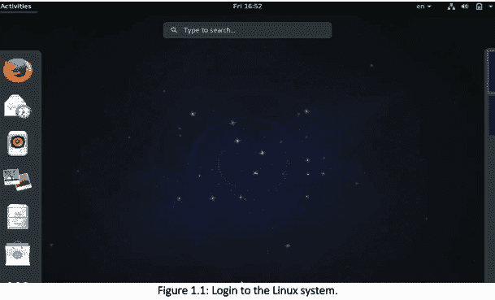

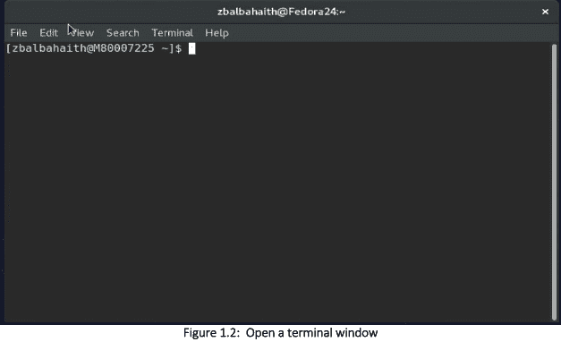

#### zbalbaihath@Fedora24:-

```
File Edit View Search Terminal Help
[zbalbaihath@M00007225 ~]$ date
Fri Oct 14 16:56:20 GST 2016
[zbalbaihath@M00007225 ~]$
```

图 1.3：显示了 `date` 命令的结果。

#### zbalbaihath@Fedora24:-

```
[zbalbaihath@M00007225 ~]$ cal
October 2016
Su Mo Tu We Th Fr Sa
             1
2 3 4 5 6 7 8
9 10 11 12 13 14 15
16 17 18 19 20 21 22
23 24 25 26 27 28 29
30 31
[zbalbaihath@M00007225 ~]$ ╘
```

图 1.4：`cal` 命令显示该月的日历。

#### zbalbaihath@Fedora24:-

```
File Edit View Search Terminal Help
[zbalbaihath@M00007225 ~]$ ls
Desktop Documents Downloads Music Pictures Public Templates Videos
[zbalbaihath@M00007225 ~]$ ╘
```

图 1.5：`ls` 命令用于列出目录中的文件和文件夹。

#### zbalbaihath@Fedora24:-

```
File Edit View Search Terminal Help
[zbalbaihath@M00007225 ~]$ ls -F
.bash_profile  Desktop .group      Music Templates
.bash_cache    .localAuthority Pictures Videos
.bash_history  Downloads          Public
.bash_logout config .edauth .mozilla .ssh
[zbalbaihath@M00007225 ~]$ ╘
```

图 1.6：`ls` 命令用于显示其他目录和其他文件中的隐藏文件。

#### zbalbaihath@Fedora24:-

```
File Edit View Search Terminal Help
[zbalbaihath@M00007225 ~]$ ls -l
total 32
drwxr-xr-x. 2 zbalbaihath zbalbaihath 4096 Oct 12 17:42 Desktop
drwxr-xr-x. 2 zbalbaihath zbalbaihath 4096 Oct 12 17:42 Documents
drwxr-xr-x. 2 zbalbaihath zbalbaihath 4096 Oct 12 17:42 Downloads
drwxr-xr-x. 2 zbalbaihath zbalbaihath 4096 Oct 12 17:42 Music
drwxr-xr-x. 2 zbalbaihath zbalbaihath 4096 Oct 12 17:42 Pictures
drwxr-xr-x. 2 zbalbaihath zbalbaihath 4096 Oct 12 17:42 Public
drwxr-xr-x. 2 zbalbaihath zbalbaihath 4096 Oct 12 17:42 Templates
drwxr-xr-x. 2 zbalbaihath zbalbaihath 4096 Oct 12 17:42 Videos
[zbalbaihath@M00007225 ~]$ ╘
```

图 1.7：`ls -l` 显示了每个目录和文件的权限和所有权。

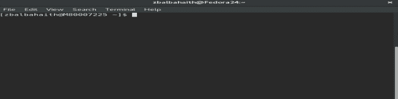 图 1.8：`clear` 命令用于清除之前的命令。

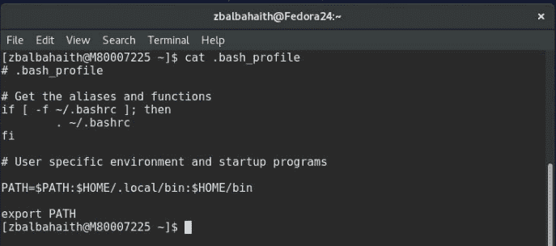 图 1.9：`cat .bash_profile` 显示了启动文件。

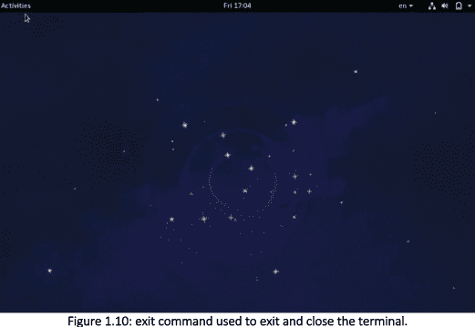 图 1.10：`exit` 命令用于退出终端。打开了一个新的终端窗口，使用 `who` 命令列出了所有当前登录的用户，并测试了 `whoami` 和 `who am i` 命令以比较之间的差异。

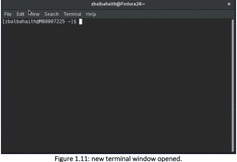


## 图 1.12：`who` 命令

```
zbalbaihath@Fedora24~
File Edit View Search Terminal Help
zbalbaihath@00007225 ~]$ who
zbalbaihath tty2               2016-10-14 16:08
zbalbaihath@00007225 ~]$
```

## 图 1.13：`whoami` 和 `who am i` 命令

```
zbalbaihath@Fedora24~
File Edit View Search Terminal Help
zbalbaihath@00007225 ~]$ whoami
zbalbaihath@00007225 ~]$ who am i
```

`who` 命令打印当前 shell 登录的用户名（登录名），而 `who am` 命令为空。安装了 `finger` 包以使用 `finger` 命令配合登录名显示当前终端的详细信息。

## 图 1.14：使用了显示用户终端详细信息的命令

```
File Edit View Search Terminal Help
[zbalbaihath@M0007225 ~]$ finger zbalbaihath
Login: zbalbaihath               Name: Zayed Balbaihath
Directory: /home/zbalbaihath      Shell: /bin/bash
ls -ld 16:00 (GST) from tty2 -1hour idle
No mail.
No Plan.
$zbalbaihath@M0007225 ~]
```

使用 `cd` 命令移动到 `/directory`，然后通过 `ls -l` 和 `less` 命令之间的管道命令一次性显示所有文件。使用 `pwd` 命令显示当前工作目录。使用 `cd` 回主目录并使用 `touch` 命令创建一个新的空文件，并对现有文件名进行了 `touch` 命令测试以发现发生的影响。

## 图 1.15：`/bin` 目录的更改

```
File Edit View Search Terminal Help
[zbalbaihath@M0007225 ~]$ ls -l |less
```

| | | | group | owner | size | date | time | name |
|---|---|---|---|---|---|---|---|---|
| total 18064 | | | root | root | 53264 | May 25 | 12:54 | abrt-analyze-backtrace |
| -rwxr-xr-x | root | root | 52708 | May 25 | 12:54 | abrt-analyze-ab |
| -rwxr-xr-x | root | root | 11280 | May 25 | 12:54 | abrt-analyze-core |
| -rwxr-xr-x | root | root | 11624 | May 25 | 12:54 | abrt-analyze-ccpp-local |
| -rwxr-xr-x | root | root | 66860 | May 25 | 12:53 | abrt-analyze-core |
| -rwxr-xr-x | root | root | 15816 | May 25 | 12:54 | abrt-analyze-oops |
| -rwxr-xr-x | root | root | 11624 | May 25 | 12:54 | abrt-analyze-report |
| -rwxr-xr-x | root | root | 2818 | May 25 | 12:53 | abrt-analyze-vmcore |
| -rwxr-xr-x | root | root | 13572 | May 25 | 12:54 | abrt-crash-unable |
| -rwxr-xr-x | root | root | 11034 | May 25 | 12:53 | abrt-analyze-sort |
| -rwxr-xr-x | root | root | 2186 | May 25 | 12:53 | abrt-check-ops-for-alt |
| -rwxr-xr-x | root | root | 5537 | May 25 | 12:53 | abrt-check-ops-for-hwi |
| -rwxr-xr-x | root | root | 5425 | May 25 | 12:53 | abrt-find-body-update |
| -rwxr-xr-x | root | root | 12028 | May 25 | 12:54 | abrt-generate-report |
| -rwxr-xr-x | root | root | 11272 | May 25 | 12:54 | abrt-generate-core-back |
| -rwxr-xr-x | root | root | 9777 | May 25 | 12:53 | abrt-install-debuginfo |

## 图 1.17：一次显示一页结果

```bash
[zbalbahaith@M0007225 bin]$ ls -l |less
[zbalbahaith@M0007225 bin]$ pwd
/bin
[zbalbahaith@M0007225 bin]$
```

## 图 1.18：显示了使用 `pwd` 命令查看的工作目录

```bash
zbalbahaith@Fedora24:/home
[zbalbahaith@M0007225 bin]$ cd /
ls cd /home
[zbalbahaith@M0007225 home]$ home
```

## 图 1.19：使用 `cd` 命令将用户引导至 HOME 目录

```bash
[root@M0007225 home]# touch myfile
[root@M0007225 home]# ls -a
.
..
myfile	tzbalbahaith
[root@M0007225 home]#
```

## 图 1.20：显示了由 `touch` 命令生成的新文件

```bash
zbalbahaith@Fedora24:/home
[root@M0007225 home]# touch myfile
[root@M0007225 home]# ls -l
myfile	tzbalbahaith
-rw-r--r-- 1 root 0 Oct 14 17:42 myfile
[root@M0007225 home]#
```

## 图 1.21：在现有文件上应用 `touch` 命令

在现有文件上使用 `touch` 命令不会在屏幕上显示任何内容，也不会覆盖文件内容；唯一效果体现在使用命令 `-l` 显示文件的长格式时的“最后修改日期”上，可以注意到时间已根据对现有文件执行的最后一次 `touch` 命令发生了变化。

使用 `man` 命令查看了 Linux 手册条目；`man` 命令已通过 `touch` 命令进行了测试，显示了使用 `touch` 命令的所有可用选项，这是一个通过 `man man` 打开的界面。

## zbalbahaith@Fedora24:~home

```
File Edit View Search Terminal Help
[root@M8007225 home]# man
What manual_page do you want?
[root@M8007225 home]#
```

## 图 1.22：执行 `man` 命令后生成的输出

## zbalbahaith@Fedora24:~home

```
File Edit View Search Terminal Help
TOUCH(1) User Commands TOUCH(1)
NAME
touch change file timestamps
SYNOPSIS
touch [OPTION]... [FILE]
DESCRIPTION
将每个 FILE 的访问和修改时间更新为当前时间。
不存在的 FILE 参数将为空，除非使用 -c 或 -h。
FILE 参数字符串 - 会被特殊处理，并导致 touch 更改与短选项关联的文件的时间。
长选项的强制性参数对于短选项也是强制性的。
-a change the access time
```

## 图 1.23：使用 `touch` 命令应用 `man` 手册

## zbalbahaith@Fedora24:~home


```
File Edit View Search Terminal Help
MAN(1) Manual page utils MAN(1)
NAME
man - an interface to the on-reference manuals
SYNOPSIS
man [-C file] [-D] [--warnings[warnings]] [-R encoding] [-L local;]-m scrob... [-M path [-S list [-i[-e extension]] -i,-T[-R]-m scrob... [-M path [-S list [-i[-e extension]] -u numbers] pager [-p prompt] [-p string] [-E encoding] [--nohyphenation] --no-justification [section] pages [-t device] [-H browser] [-X dpi] [-Z]
man -k [apropos options] regex
man -w [what options] page
man [-C file] [-D] [-D] [--warnings[warnings]] [-R encoding] [-p t local;]-p header [-s encoding] [-p t [-t device] [-H browser]
man -W [-C file] [-D] [-D] page
man [-Z] [-t title] page
```

```
DESCRIPTION
Manual page man(1) line 1 (press h for help or q to quit)
```

## 创建和删除目录

`Linux` 操作系统提供了一组灵活的命令，方便创建、修改和管理目录的过程。在此部分，使用了几个命令来实现对目录的各种操作，这些命令如下：

- `pwd` 命令打印当前工作目录（图 1.26）。
- `mkdir` 命令创建新目录（图 1.27）。
- `ls` 命令列出路径下的文件（图 1.28）。
- `cd` 命令切换指定路径（图 1.29）。
- `touch` 命令创建一个空文件（图 1.30）。
- `rmdir` 命令删除空目录（图 1.31）。
- `rm -rf` 命令删除包含内容的目录（图 1.32, 图 1.33, 图 1.34）。

通过 `touch` 命令和 `cd` 命令的组合创建了以下目录：

```bash
zbalbahaith@Fedora24:/home
[zbalbahaith@M0007225 bin]$ pwd
```

图 1.26：打印工作目录。

```bash
zbalbahaith@Fedora24:/home
[zbalbahaith@M0007225 bin]$ mkdir
```

图 1.27：创建新目录。

```bash
zbalbahaith@Fedora24:/home
[zbalbahaith@M0007225 bin]$ ls
```

图 1.28：列出路径下的文件。

```bash
zbalbahaith@Fedora24:/home
[zbalbahaith@M0007225 bin]$ cd
```

图 1.29：切换到指定路径。

```bash
zbalbahaith@Fedora24:/home
[zbalbahaith@M0007225 bin]$ touch
```

图 1.30：创建一个空文件。

```bash
zbalbahaith@Fedora24:/home
[zbalbahaith@M0007225 bin]$ rmdir
```

图 1.31：删除空目录。

```bash
zbalbahaith@Fedora24:/home
[zbalbahaith@M0007225 bin]$ rm -rf
```

图 1.32：删除包含内容的目录。

```bash
zbalbahaith@Fedora24:/home
[zbalbahaith@M0007225 bin]$
```

## `zbalbhaith@M80007225:/bin`

```
total 184180
dfr-root 2 root root 40960 Oct 15 07:16
drwxr-xr-x 12 root root 4096 Jun 14 12:39
drwxr-xr-x 1 root root 52752 Feb 3 2016
drwxr-xr-x 1 root root 11264 May 25 04:54 abrt-action-analyze-backtrace
drwxr-xr-x 1 root root 11264 May 25 04:54 abrt-action-analyze-c
drwxr-xr-x 1 root root 11261 May 25 04:53 abrt-action-analyze-core
drwxr-xr-x 1 root root 60868 May 25 04:53 abrt-action-analyze-local
drwxr-xr-x 1 root root 15336 Feb 15 2016 abrt-action-analyze-java
drwxr-xr-x 1 root root 11264 May 25 04:54 abrt-action-analyze-python
drwxr-xr-x 1 root root 11264 May 25 04:54 abrt-action-analyze-vtrace
drwxr-xr-x 1 root root 11265 May 25 04:54 abrt-action-analyze-vulnerability
sty 1 root root 1357 May 25 04:53
-rwxr-xr-x 1 root root 11304 May 25 04:54 abrt-action-check-ops-for-hw
drwxr-xr-x 1 root root 2106 May 25 04:53 abrt-action-check-ops-for-alt
-component 1 root root 3537 May 25 04:53 abrt-action-check-crash
drwxr-xr-x 1 root root 54095 May 25 04:54 abrt-action-find-bodie.indump
drwxr-xr-x 1 root root 11288 May 25 04:54 abrt-action-generate-backtrace
drwxr-xr-x 1 root root 11272 May 25 04:54 abrt-action-generate-core-back
```

图 1.40：每次显示一页的内容

最后，在已存在的文件上测试了输出重定向 `>`，它将覆盖文件内容，该命令可以覆盖之前创建的输出文件，如图 1.42 所示可以使用命令查看。输出重定向 `>>` 可用于内容追加到现有文件中，一个 `date` 命令被追加到输出文件中，该文件现在包含了当前日期和时间的命令结果，如图 1.44 所示。

## `zbalbhaith@M80007225:/bin`

```
[root@M80007225 bin#] who > output
[root@M80007225 bin#]#
```

图 1.41：使用命令覆盖文件内容

## `zbalbhaith@M80007225:/bin`

```
[root@M80007225 bin#] cat_output
zbalbhaith tty2 2016-10-15 07:07 (:1)
[root@M80007225 bin#]#
```

图 1.42：显示输出文件的内容

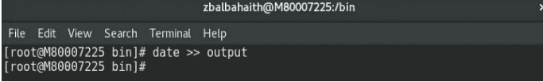

图 1.43：使用输出重定向 `>>` 将内容追加到输出文件中。

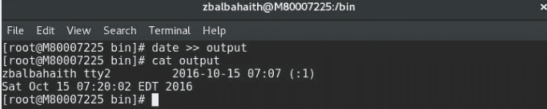

图 1.44：显示输出文件的内容

## 操作操作

`cp` 和 `mv` 命令用于操作文件。`cd` 命令用于导航到主目录，而 `cp` 命令用于创建名为 `output_Backup` 和 `datafile1_Backup` 的文件备份。使用 `ls` 命令列出文件并确保它们已成功创建，如图 1.47 所示。`mv` 命令用于将创建的备份移动到练习中创建的 `class/backup`。

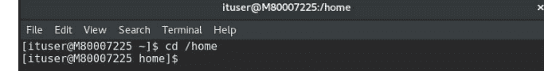

图 1.45：使用 `cd` 命令切换到主目录

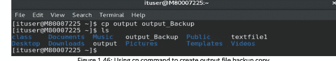

图 1.46：使用 `cp` 命令创建输出文件副本备份

(78ba38f31a7ecfc_22_4.png)

图 1.47：使用 `cp` 命令创建 `textfile backup`


```
ituser@M80007225:
ituser@M80007225 ~$ mv output_Backup class/backup
ituser@M80007225 ~$ -l Music Desktop Public text1_Backup
```

图 1.48：使用 `mv` 命令将输出文件移动到 `backup`

```
ituser@M80007225 ~$ mv text1_class/backup
ituser@M80007225 ~$ -l Music Desktop Public
```

图 1.49：使用 `mv` 命令将 `textfile` 移动到 `backup`

```
ituser@M80007225 ~$ cd class/backup
ituser@M80007225 ~$ cp ../output_Backup textfile
```

图 1.50：确认创建的备份文件已移动到所有 Linux 系统用户可访问的 `/tmp` 目录。之后使用 `mv` 命令将 `output_Backup` 重命名为 `newfile`。使用命令删除了新创建的文件。如图 1.55 所示，我们使用 `rm` 命令删除了 `class` 目录及其所有内容。

```
ituser@M80007225 ~$ cp Backup /tmp
ituser@M80007225 ~$ cp text1_ Backup /tmp
```

图 1.51：将备份文件拷贝到 `/tmp`

```
ituser@M80007225 ~$ mv output_Backup newfile
```

图 1.52：将输出文件重命名为 `newfile`

```
ituser@M80007225~/class/backup
ituser@M80007225 ~$ mv Backup newfile
ituser@M80007225 ~$ ls
newfile textfile
```

图 1.53：确认文件的重命名

```
ituser@M80007225~/class/backup
ituser@M80007225 ~$ rm -f newfile
ituser@M80007225 ~$ ls
textfile Backup
```

图 1.54：使用 `rm` 命令删除文件，文件已删除

```
ituser@M8000725:~-
ituser@M8000725 ~$ rm -rf class
ituser@M8000725 ~$ ls
Desktop Downloads Output textfile Pictures Videos
```

图 1.55：使用 `rm -rf` 命令删除 `class` 目录及其所有内容

## 共享与安全

可以使用 `chmod` 命令允许或限制对某些文件的访问。主目录文件的长格式如图 1.56 所示；根 `/` 目录文件的长格式如图 1.57 所示。列出的文件都显示了每个文件的权限。

```
zeydalbahaitha@M80007225:~-
zeydalbahaitha@M80007225 ~$ cd
zeydalbahaitha@M80007225 ~$ ls
total
drwxr-xr-x. 2 zeydalbahaitha zeydalbahaitha 4096 Oct 15 16:44 Desktop
drwxr-xr-x. 2 zeydalbahaitha zeydalbahaitha 4096 Oct 15 16:44 Documents
drwxr-xr-x. 2 zeydalbahaitha zeydalbahaitha 4096 Oct 15 16:44 Downloads
drwxr-xr-x. 2 zeydalbahaitha zeydalbahaitha 4096 Oct 15 16:44 Music
drwxr-xr-x. 2 zeydalbahaitha zeydalbahaitha 4096 Oct 15 16:44 Pictures
drwxr-xr-x. 2 zeydalbahaitha zeydalbahaitha 4096 Oct 15 16:44 Public
drwxr-xr-x. 2 zeydalbahaitha zeydalbahaitha 4096 Oct 15 16:44 Templates
drwxr-xr-x. 2 zeydalbahaitha zeydalbahaitha 4096 Oct 15 16:44 Videos
zeydalbahaitha@M80007225 ~$
```

图 1.56：以长格式列出文件

### zbalbhaith@M80007225:/

```
zayedbhaith@M80007225:/
zayedbhaith@M80007225:/bin
total 184180
dfr-root 2 root root 40960 Oct 15 07:16
drwxr-xr-x 12 root root 4096 Jun 14 12:39
drwxr-xr-x 1 root root 52752 Feb 3 2016
drwxr-xr-x 1 root root 11264 May 25 04:54 abrt-action-analyze-backtrace
drwxr-xr-x 1 root root 11264 May 25 04:54 abrt-action-analyze-c
drwxr-xr-x 1 root root 11261 May 25 04:53 abrt-action-analyze-core
drwxr-xr-x 1 root root 60868 May 25 04:53 abrt-action-analyze-local
drwxr-xr-x 1 root root 15336 Feb 15 2016 abrt-action-analyze-java
drwxr-xr-x 1 root root 11264 May 25 04:54 abrt-action-analyze-python
drwxr-xr-x 1 root root 11264 May 25 04:54 abrt-action-analyze-vtrace
drwxr-xr-x 1 root root 11265 May 25 04:54 abrt-action-analyze-vulnerability
sty 1 root root 1357 May 25 04:53
-rwxr-xr-x 1 root root 11304 May 25 04:54 abrt-action-check-ops-for-hw
drwxr-xr-x 1 root root 2106 May 25 04:53 abrt-action-check-ops-for-alt
-component 1 root root 3537 May 25 04:53 abrt-action-check-crash
drwxr-xr-x 1 root root 54095 May 25 04:54 abrt-action-find-bodie.indump
drwxr-xr-x 1 root root 11288 May 25 04:54 abrt-action-generate-backtrace
drwxr-xr-x 1 root root 11272 May 25 04:54 abrt-action-generate-core-back
```

图 1.57：以长格式列出根 `/` 目录

### zayedbalhaith@M80007225~

```
File Edit View Search Terminal Help
[zayedbalhaith@M80007225~]$ ls -l personal.txt
-rw-r--r-- 1 zayedbalhaith zayedbalhaith 0 Oct 15 19:58 personal.txt
[zayedbalhaith@M80007225~]$ chmod g-w personal.txt
[zayedbalhaith@M80007225~]$ ls -l personal.txt
-rw-r--r-- 1 zayedbalhaith zayedbalhaith 0 Oct 15 19:58 personal.txt
[zayedbalhaith@M80007225~]$ _
```

图 1.59：权限已更改并确认

创建了一个名为 `classes` 的新目录，默认文件权限如图 1.60 所示。将之前创建的文件 `personal.txt` 复制到 `classes` 目录中。`classes` 目录的权限已更改为所有者组可读可写，而其他人没有任何权限，如图 1.62 所示。

### zayedbalhaith@M80007225~


```
File Edit View Search Terminal Help
[zayedbalhaith@M80007225~]$ mkdir classes
[zayedbalhaith@M80007225~]$ cp personal.txt classes
dr-xr-x 2 zayedbalhaith zayedbalhaith 4096 Oct 15 20:09 classes
[zayedbalhaith@M80007225~]$ _
```

图 1.60：创建了`classes`目录并显示权限。

### zayedbalhaith@M80007225~

```
File Edit View Search Terminal Help
[zayedbalhaith@M80007225~]$ cp personal.txt classes
[zayedbalhaith@M80007225~]$ _
```

图 1.61：将`personal`文件复制到`classes`目录

### zayedbalhaith@M80007225~

```
File Edit View Search Terminal Help
[zayedbalhaith@M80007225~]$ chmod 600 classes
[zayedbalhaith@M80007225~]$ ls -ld classes
dr-xr-x 2 zayedbalhaith zayedbalhaith 4096 Oct 15 20:12 classes
[zayedbalhaith@M80007225~]$ _
```

图 1.62：更改`classes`目录的权限。

```
zayedbalbahaith@M80007225:/home/zayedbalbahaith/classes
File Edit View Search Terminal Help
[zayedbalhaith@M80007225 ~]$ cd classes
bash: cd: cd classes: Permission denied
[zayedbalbahaith@M80007225 ~]$ cd su
Password:
[root@M80007225 zayedbalbahaith]# cd classes
[root@M80007225 classes]# ls -l
```

图 1.63：使用`cd`命令切换到`classes`目录。

如图 1.63 所示，用户无法访问`classes`目录，因为他没有足够的权限，导致权限被拒绝。通过`root`用户访问`classes`目录并查看目录内容解决了该问题。

## 2. 创建软链接和硬链接

创建了`textfile1`，并通过“`ln -s`”创建了指向它的软链接并命名为`textfile2`。更新了原始文件的内容，并检查了软链接是否也随原始文件相应更新。

```
zayedbalbahaith@M80007225:~
File Edit View Search Terminal Help
[zayedbalbahaith@M80007225 ~]$ echo "Hi, This is file pointer" > textfile1
[zayedbalbahaith@M80007225 ~]$ ln -s textfile1 textfile2
[zayedbalbahaith@M80007225 ~]$
```

图 1.64：创建了文件并通过`ln -s`创建了软链接，名称为`textfile2`

```
zayedbalbahaith@M80007225:~
File Edit View Search Terminal Help
[zayedbalbahaith@M80007225 ~]$ cat textfile1
Hi, This is file pointer
[zayedbalbahaith@M80007225 ~]$ cat textfile2
Hi, This is file pointer
[zayedbalbahaith@M80007225 ~]$ _
```

图 1.65：确认软链接的创建

### zayedbalhaith@M80007225:-

```
File Edit View Search Terminal Help
[zayedbalhaith@M80007225 ~]$ echo "This is the new file" >> textfile1
[zayedbalhaith@M80007225 ~]$ cat textfile1
Hi, This is file pointer
This is the new file
[zayedbalhaith@M80007225 ~]$ cat textfile2
Hi, This is file pointer
This is the new file
[zayedbalhaith@M80007225 ~]$
```

图 1.66：更新指向同一文件的软链接内容。

更改原始文件会导致指向同一文件的软链接发生变化。使用`rm`命令删除原始文件后，如图 1.67 所示，链接文件仍然存在，但终端会因为找不到原始文件而报错，因此链接不再有效。

### zayedbalhaith@M80007225:-

```
File Edit View Search Terminal Help
[zayedbalhaith@M80007225 ~]$ rm textfile1
[zayedbalbahaith@M80007225 ~]$ cat textfile2
cat: textfile2: No such file or directory
[zayedbalbahaith@M80007225 ~]$ ls
Classes Documents Music Pictures Downloads
```

图 1.67：删除了原始文件。

删除软链接指向的原始文件会导致错误，提示用户尝试运行它时指向一个不存在的文件。

## 在后台运行和管理进程

Linux 终端提供了一个实用工具，允许用户通过在命令末尾添加`&`同时运行多个命令。运行多个命令后，用户可以使用`ps`命令查看进程，并使用`kill`命令终止任何进程。以下截图显示了上述命令的操作。为了实现并测试这一功能，在后台安装并运行了`xclock`工具。

```
zayedbalbahaith@M80007225:/home/zayedbalbahaith
File Edit View Search Terminal Help
Transaction succeeded.
Transaction succeeded.
Running transaction
+   Installing : xorg-bitmaps-1.1.1-9.fc24,noarch 2/4
Installing : xorg-x11-fonts-misc-7.5-16.fc24,noarch 2/4
Installing : libXaw-1.0.13-4.fc24,x86 3/4
Verifying : xorg-x11-apps-7.5-15.fc24,x86 3/4
Verifying : libXaw-1.0.13-4.fc24,x86 4/4
Verifying : xorg-x11-fonts-misc-7.5-16.fc24,noarch 2/4
Verifying : xorg-x11-bitmaps-1.1.1-9.fc24,noarch 4/4
Installed:
libXaw-x86 1.0.13-4-fc24 xorg-x86 6.7-15-fc24
xorg-x11-fonts-misc.7.5-16.fc24
Complete!
[root@M8007225 zayedbalbahaith#] xclock
Warning: Tried to connect to session manager, None of the authentication protocols specified are supported
Warning: Missing charset in String to FontSet conversion
[root@M8007225 zayedbalbahaith#]
```

图 1.71：使用`ctrl+c`终止`xclock`应用

图 1.72：在后台运行`xclock`


```
zayedbalbahaith@M80007225/home/zayedbalbahaith
[root@M8007225 ~]$ xclock &
[2] 8390
[root@M8007225 ~]# Warning: Tried to connect to session manager,
None of the authentication protocols specified are supported
Warning: Missing charset in String to FontSet conversion
ls
Classes Documents Music Pictures
Desktop Downloads personal.txt Public Videos
[1]- Done xclock
[root@M8007225 ~]$
```

图 1.73：在另一个应用程序运行时同时执行要在后台运行的命令。

```
zayedbalbahaith@M80007225/home/zayedbalbahaith
File Edit View Search Terminal Help
[root@M80007225]# xclock &
[2] 8390
[root@M80007225]# Warning: Tried to connect to session manager,
None of the authentication protocols specified are supported
Warning: Missing charset in String to FontSet conversion
ls
Classes Documents Music Pictures
Desktop Downloads personal.txt Public Videos
[1]- Done xclock
[root@M80007225]# ps
PID TTY TIME CMD
7984 pts/0 00:00:00 su
7993 pts/0 00:00:00 bash
8390 pts/0 00:00:00 xclock
8411 pts/0 00:00:00 ps
[root@M80007225]# kill 8390
[2]+ Terminated
xclock
[root@M80007225]#
```

图 1.74：使用 `ps` 命令列出后台运行的进程

图 1.75：使用 `kill` 命令终止后台运行的 `xclock` 进程

## 成为超级用户

Linux 的多用户属性为系统提供了额外的保护和安全性；所有用户将拥有一有限的权限，而 `root` 用户将拥有最高权限的系统完全访问权限。在此部分中，实验涵盖了创建新用户，并通过 `cron` 命令作为测试用例修改了当前用户的权限和访问级别。

```
ituser@MB8007225:~
File Edit View Search Terminal Help
[ituser@MB8007225 -$ whoami
ituser
[ituser@MB8007225 -$]#
```

图 1.76：`whoami` 命令结果显示当前登录的用户是 `Ituser`

```
ituser@MB8007225:/home/ituser
File Edit View Search Terminal Help
[ituser@MB8007225 -$] su
Password:
[root@MB8007225 user]#
```

图 1.77：以 `root` 用户身份访问 shell

```
ituser@MB8007225:/home/ituser
File Edit View Search Terminal Help
[root@MB8007225 user]# whoami
root
[root@MB8007225 user]#
```

图 1.78：`whoami` 命令结果显示当前登录的用户是 `root` `root`

部分 "a" 中的 `whoami` 命令显示用户为控制 shell 的用户，且其文件被分配了有限权限；但在部分 "c" 中，`whoami` 命令显示的用户为 `root`，他拥有完全权限。

## `Ituser@M8000725:/home/ituser`

```
File Edit View Search Terminal Help
[root@M8000725 ituser]# # touch /etc/cron.deny
[root@M8000725 ituser]# #
```

图 1.79：在 `/etc/cron.deny` 创建创建一个新文件

## `Ituser@M8000725:/home/ituser`

```
File Edit View Search Terminal Help                               Modified
GNU nano 2.5.3                               File: /etc/cron.deny
ituser                                                                              


Read 0 lines
-Get Help Write Out Where Is Exec Next Justify
-M Read File Replace Uncut Text To Spell
-Exit Go To Line
```

图 1.80：将 `ituser` 添加到拒绝文件中

## `ituser@M8000725:~`

```
File Edit View Search Terminal Help
[root@M8000725#]# exit
[ituser@M8000725~ -] #
```

图 1.81：退出 `root` 登录

## `ituser@M8000725:~`

```
[root@M8000725 it]# exit
(ituser) are not allowed to use this program (crontab)
See crontab(1) for more information
[ituser@M8000725~ -] #
```

图 1.82：根据 `cron` 工具规则不允许运行 `crontab` 命令

由于文件在 "d" 部分使用 `cron` 工具被封锁，因此 shell 将不允许 `ituser` 运行 `crontab` 命令。

## `ituser@M8000725:~`

```
File Edit View Search Terminal Help
[ituser@M8000725~ -]# rm /etc/cron.deny
rm: remove write-protected regular file '/etc/cron.deny'? ? y
rm: remove '/etc/cron.deny': Permission denied
[ituser@M8000725~ -] #
```

图 1.83：由于 `ituser` 使用 `cron` 工具的权限被限制，导致无法删除文件 (`/etc/cron.deny`)

## `Ituser@M80007225:/home/ituser`

```
File Edit View Search Terminal Help
[root@MB8007225 ~]$ su
Password:
[root@MB8007225 #] /etc/cron.deny
rm: remove regular file '/etc/cron.deny'? y
[root@MB8007225 ituser]# #
```

图 1.84：使用 `root` 用户删除了文件 (`/etc/cron.deny`)

由于 (`/etc/cron.deny`) 文件是由 `root` 用户创建的，因此对 `ituser` 的任何修改都不会被其他用户采用，能够删除它的唯一用户是 `root` 用户。

使用提供的易用图形化用户界面工具创建并测试了一个新账户。

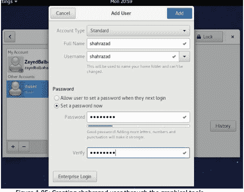

图 1.85：通过图形工具创建 `shahrazad` 用户

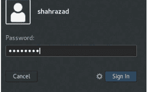

图 1.86：以 `shahrazad` 用户身份登录

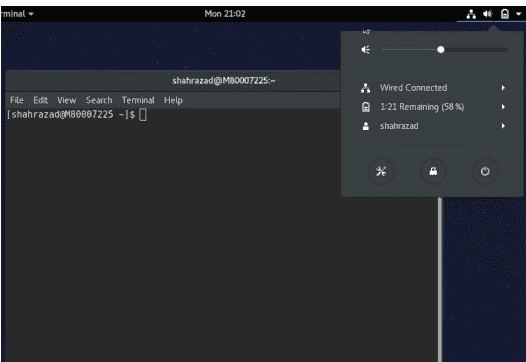

由于题目要求的密码是 "qw"，而 Fedora 工作站的密码长度策略规定至少为 8 个字符，我们在指定的密码末尾添加了两个额外数字，否则无法通过图形界面创建账户。

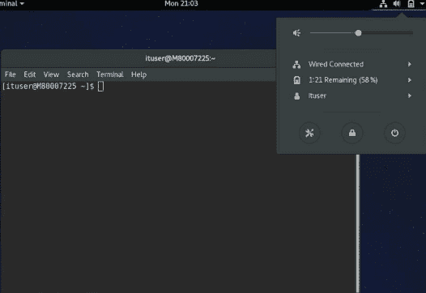

## 使用 `ssh` 连接到

大多数服务器都配置了远程访问，`ssh` 提供了一种安全可靠的方式来执行此任务。本次 `ssh` 连接到地址为 `172.18.64.31` 的服务器，并执行了 "who"、`finger` 和 "w" 等多个命令。后续截图显示了该部分的细节。


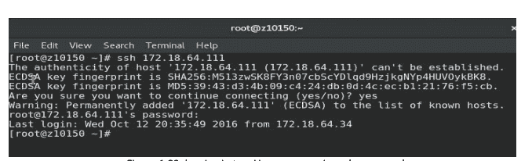

```bash
root@z10150~~root@z10150~]$ ssh 172.18.64.31

The authenticity of host '172.18.64.11' can't be established.

ECDSA fingerprint is SHA256:M133KBFY3n07bcctd1qH9jkNp4UV0kB

ECDSA fingerprint is MD39:a43:d3a:4b:09:c24:db:04:cec:bl:21:76:f5:cb

Are sure you want to connecting (yes/no)?

Warning: Permanently added '172.18.64.11' (ECDSA) to the list of hosts.

[root@z10150~]$ password:

Last login: Oct 12 20:35:49 from 172.18.64.34

[root@z10150~]# who

user    tty2 2016-10-12 20:21 (:0)

root    pts/1 2016-10-12 20:34 (172.18.64.24)

root    pts/1 2016-10-12 20:35 (172.18.64.31)

root    pts/2 2016-10-12 20:35 (172.18.64.21)

root    pts/3 2016-10-12 20:35 (172.18.64.34)

root    pts/4 2016-10-12 20:36 (172.18.64.11)

root    pts/5 2016-10-12 20:36 (172.18.64.25)

[root@z10150~]#
```

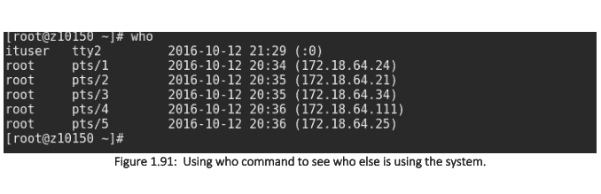

### root@z10150

```bash
root@z10150-# finger      Idle Login Time Host

Login tty tty2 Oct 12 21:29 (172.18.64.24)

root pts/1 Oct 12 20:34 (172.18.64.21)

root pts/2 Oct 12 20:35 (172.18.64.111)

root pts/3 Oct 12 20:36 (172.18.64.111)

root pts/4 Oct 12 20:36 (172.18.64.25)
```

图 1.91：使用`finger`命令查找用户的更多详细信息。（等等，文中写的是 1.92）图 1.92：使用`finger`命令查找用户的更多详细信息。

```bash
root@z10150-# w

20:41:07 3.13, 6 users, load average: 0.13, 0.09, 0.06

USER LOGIN IDLE JCPU MEM

tuser tty2 Oct 12 21:29 0.00s 0.05s 0m

root pts/1 Oct 12 20:34 0.00s 0.05s 0m

root pts/1 Oct 12 20:35 0.00s 0.05s 0m

root pts/2 Oct 12 20:35 0.00s 0.05s 0m

root pts/3 Oct 12 20:36 0.00s 0.05s 0m

root pts/4 Oct 12 20:36 0.00s 0.05s 0m

root@z10150-#
```

图 1.93：使用`w`命令查看其他学生在做什么

### root@z10150/home

```bash
root@z10150# cd home

root@z10150# ls

root@z10150# cd ituser

root@z10150# ls

Documents Music Pictures ituser Videos

root@z10150#
```

图 1.94：使用`cd`命令进入`home`目录

```bash
root@z10150# touch ituser

root@z10150# ls

Documents Music Pictures ituser Videos

root@z10150#
```

图 1.95：列出`ituser`的文件

```bash
root@z10150# touch ituser

root@z10150# ls

Documents Music Pictures ituser Videos

ituser Public Template

root@z10150# cd Documents

root@z10150# cd Downloads

root@z10150# cd Downloads

root@z10150# cd Music

root@z10150# cd Public

root@z10150#
```

图 1.96：在`ituser`主目录中使用`touch`命令创建文件

## 使用 VirtualBox 和 Kali Linux

Linux 在互联网上有很多种版本和发行版，每一个版本都根据其安装的内置工具类型和数量具有特征。在本节中，使用`Oracle VirtualBox`在虚拟环境中执行了`Kali Linux`操作系统的安装。

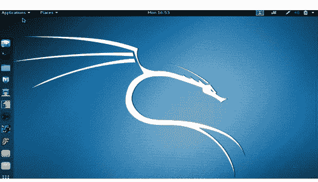

图 1.99：在`virtualBox`中安装`KALI`

# 检查 Linux 命令

1. 执行以下命令并解释其功能：

```bash
find / -print
```

该命令搜索根目录下当前用户可访问的所有目录，并将它们打印在终端屏幕上。图 1.101 显示了命令生成的输出。

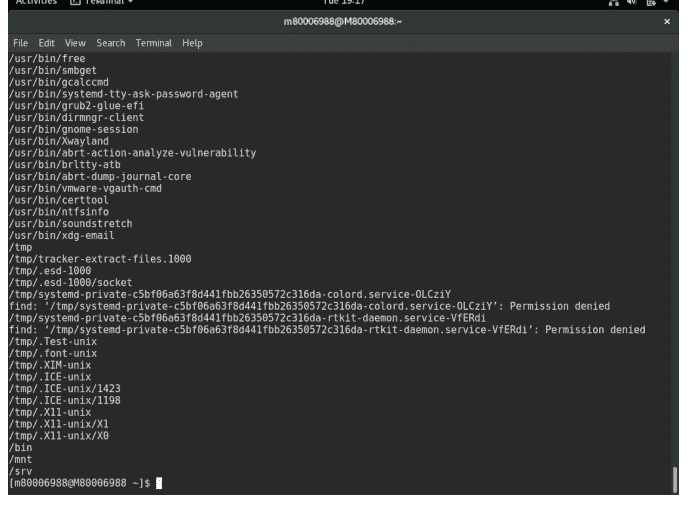

35

2. 你会使用哪些命令来完成以下操作：在你的`HOME`目录下创建一个名为“sayhi”的文件，并在文件中写入以下内容：“echo hi there and how you are doing today”。保存文件并运行它。

将使用以下命令导航到主目录并创建文件，然后允许其执行，最后你运行：

```bash
cd ~

cat > sayhi

echo hi there and how you are doing today

chmod 764 sayhi
```

`/sayhi`

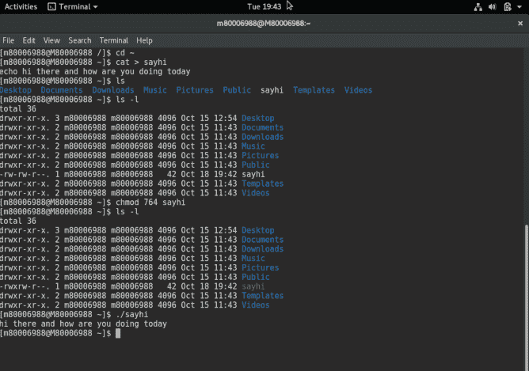

图 1.02：创建一个包含“`echo`”命令的文件并运行它。

3. 使用`touch`命令创建一个新文件。该文件的默认权限是什么？

根据指定的`UMASK`，默认权限将分配给新创建的文件。在这台机器上，`UMASK`未被修改，这会导致所有者具有读写权限，用户组只有读权限，而其他人没有权限。执行此任务的命令如下所示，同时也如图 1.103 所示。

```bash
touch newfile

ls -l
```

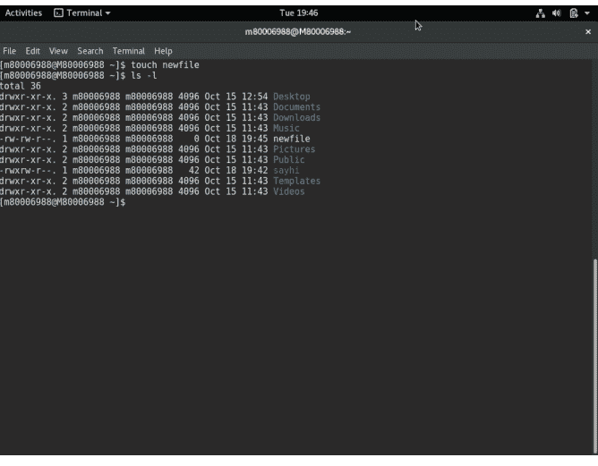

图 1.103：创建一个新文件并查看其默认权限分配

4. 打印环境变量`HOME`、`SHELL`、`PATH`的每个值。

如图 1.104 所示，可以使用`echo`命令一次性显示指定的变量：

```bash
echo HOME=$HOME SHELL=$SHELL PATH=$PATH
```

或者逐个显示：

```bash
echo $HOME

echo $SHELL

echo $PATH
```

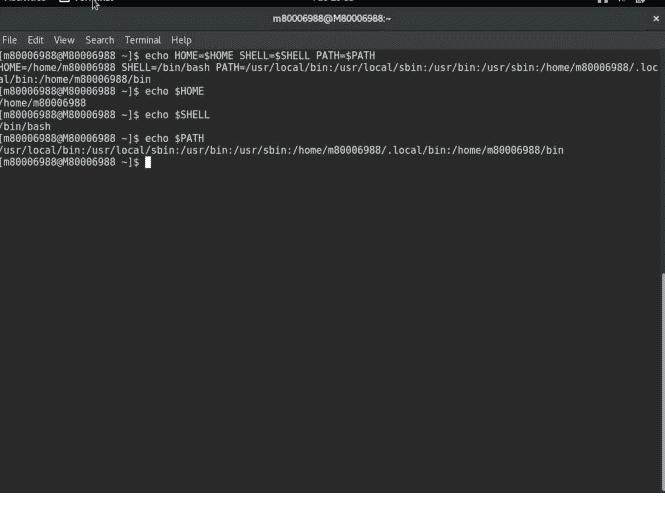

图 1.104：显示多个变量的值。

5. 用一条命令删除“`class`”目录（位于你的`HOME`目录下）及其所有内容。

包含内容的目录可以使用如下以及图 1.105 所示的命令进行删除。

```bash
rm ~/class -r
```

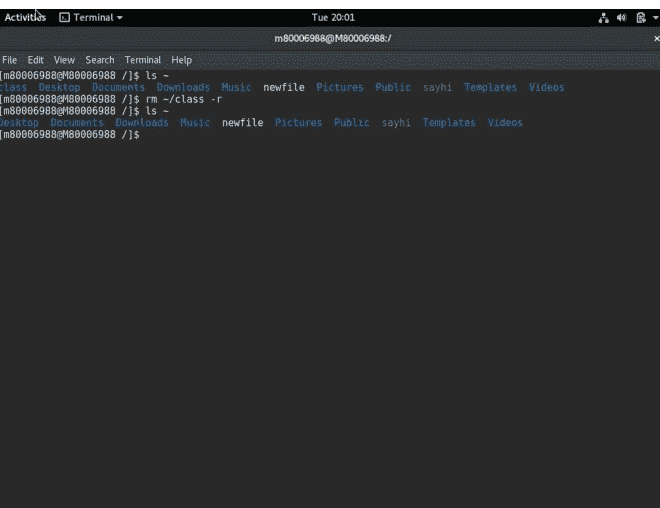

图 1.105：删除一个包含内容的目录

39

6. 更改文件“`output`”的权限模式，使其你（文件所有者）可读写，而同组人员和其他人没有读/写/执行权限。

要执行请求的任务，必须分配`600`权限，如下所示和图 1.106 所示。

```bash
chmod 600 output
```


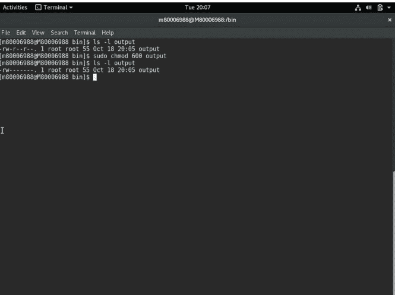

图 1.106：更改分配给文件的权限。

## 7. 更改“public_html”（假设已存在）目录的权限模式，使所有者可以读/写/执行，同组的用户和其他能够（使用 Web 浏览器）查看该目录包含的 html 页面。

问题中描述的目录权限更改通过下方的命令如图 1.107 所示执行：

```bash
chmod 744 public_html
```

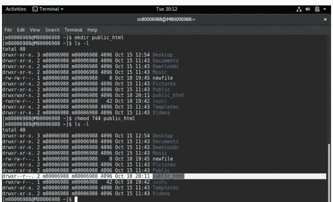

图 1.107：更改目录权限

## 8. 在后台运行 xclock 命令。使用“ps”命令列出运行的进程，并使用“kill”命令向 xclock 发送信号终止它。给出精确的命令序列以及任何参数。

要在后台运行命令，必须在单词末尾添加“&”字符，使用“ps”将显示运行中的进程及其 PID，PID 可配合“kill”命令终止任何进程，如下方的命令和图 1.8 所示。

```bash
xclock&

ps

kill 3949
```

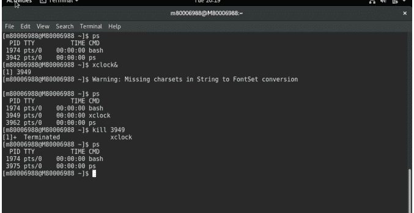

图 1.108：在后台运行进程然后终止它

42

## 9. 使用 find 命令定位文件“passwd”。

在根目录下搜索 passwd 可以如图 1.109 所示进行：

```bash
find / -name passwd
```

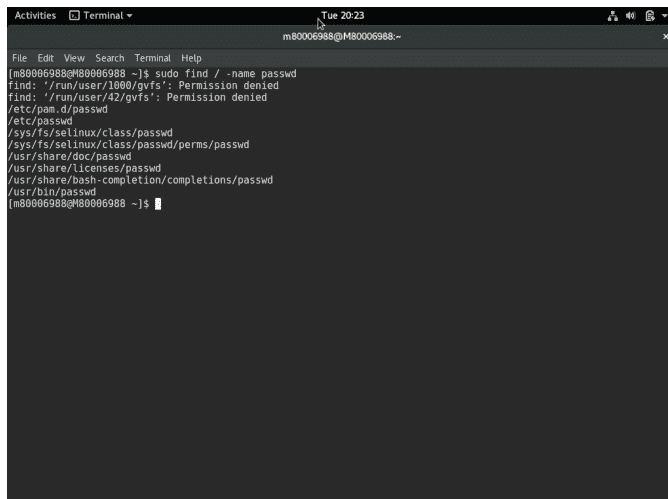

图 1.109：定位名为 passwd 的文件

## 10. 使用 find 命令定位所有属于你的文件。

要查找所有属于当前用户的文件可以使用所示所示 -user 参数：

```bash
find / -user $(whoami)
```

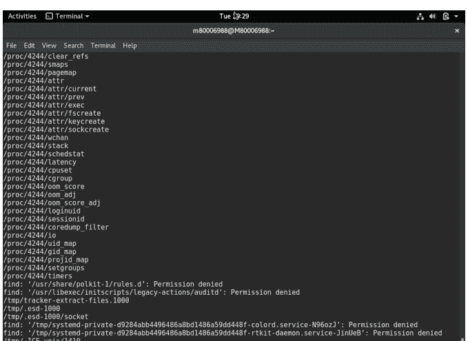

图 1.110：查找属于用户的文件

## 11. 使用 grep 命令查找所有不包含 username 的行。

在我们的案例中，可以如下所示为 grep 工具添加 -v 参数

```bash
grep -v "username" /etc/passwd
```

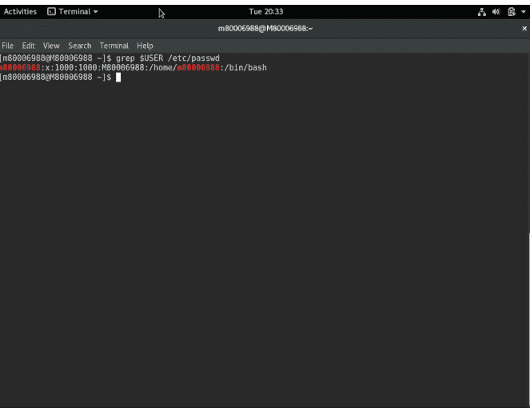

图 1.111：搜索不包含 username 的行

## 12. 以下命令 ls、cd 位于何处

可以使用 where 命令如下所示查找命令的位置：

```bash
where ls

where cd
```

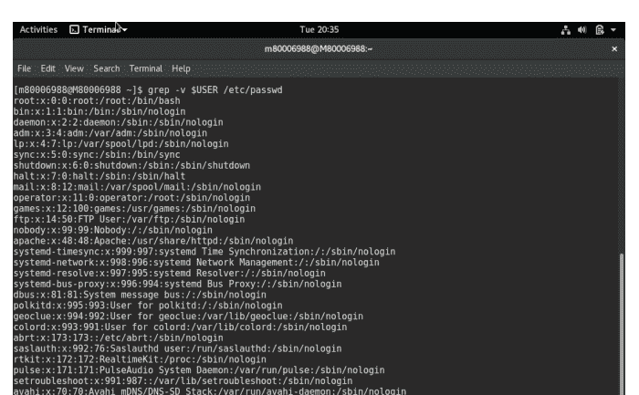

图 1.112：定位命令的位置

## 13. 使用 tar 命令为你的家目录下的所有文件创建归档。

可以使用 tar 命令如下所示为家目录创建归档：

```bash
tar -cvf myfiles.tar ~
```

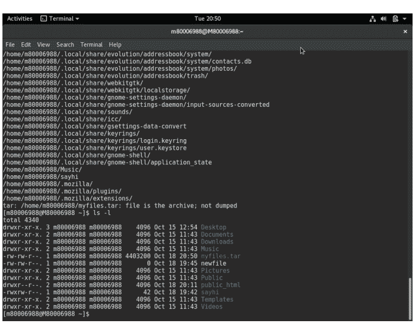

图 1.113：使用 tar 命令归档家目录

## 14. 使用 gzip 命令为 myfiles.tar 创建压缩文件。

gzip 命令通常用于 tar 归档以生成压缩版本：

```bash
gzip myfiles.tar
```


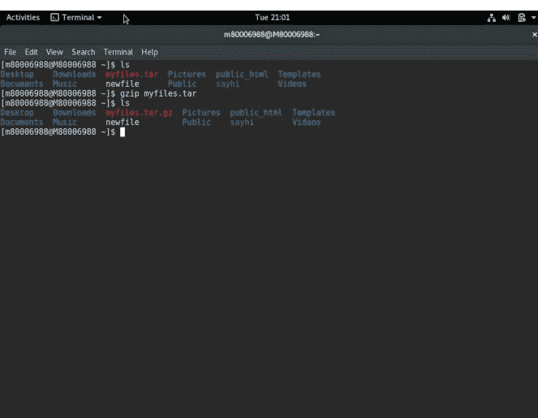

图 1.114：使用 `gzip` 命令压缩 `tar` 归档

- Linux 是一个稳定且去中心化的操作系统，提供了各种实用的工具。
- 使用开源操作系统为维护系统提供了灵活性。
- 建议在物理机上安装 Linux 以获得更好的性能。
- Linux 内置了一个名为 `man` 的命令，用于显示系统内任何命令的说明书和使用指南。
- 始终建议在需要时使用 `su`，而不是直接以 root 身份登录。
- Linux 操作系统分配了多个变量，如 `SHELL`、`PATH`、`USER` 等，这些变量可以与命令有效配合。
- 建议用户终止任何未使用的进程，以提高系统性能并减少被黑客攻击的机会。
- 保持操作系统更新到最新补丁，以确保安装了最新的安全更新。

## 第二章

## 探索各种安全工具

## 本章目标

- 理解并使用高级 Linux 工具。
- 探索并实现软件包的安装与分析。
- 练习各种命令以加固系统，并在系统上或通过网络跟踪用户活动。
- 通过对控制服务实施良好实践，保护控制台不受拒绝服务攻击。
- 消除对系统的直接远程连接并对未经授权的活动发出警告。

## 所需工具

- Fedora 24 Workstation 镜像。
- Oracle VirtualBox
- Wireshark

### 本章概述

Linux 操作系统提供了一组实用的预装工具，允许用户轻松完成所需任务，它还提供了多个可以安装以用于不同目的的应用程序和包。在没有限制和约束的情况下使用这些工具将导致许多本可以通过应用简单安全标准防止突破。攻击者可能通过远程连接到系统并利用控制台提供的弱权限运行某些控制台应用，导致拒绝服务攻击。敏感文件或目录的权限配置不当会导致其暴露给黑客，黑客可以对其执行未经授权的操作。此外，根据安全要求为每个用户设置权限是防止受所有操作影响的重要问题，“任务与步骤”部分详细解释了如何根据截图执行本章的六部分中的每一部分。报告每个部分的目标如下：

第 0 部分的目标是测试并验证 Linux 是否允许用户使用 `halt`、`reboot`、`shutdown`、`power off` 或 `eject` 等多个命令重启或关闭服务器，这可能会导致服务器遭受拒绝服务攻击。

第 1 部分的目标是使用 `umask` 命令通过三位八进制数确定新创建文件的权限，并根据 `umask` 命令更改默认权限集。

第 2 部分的目标是发现存储在 `/etc/passwd` 中的账户信息，并查看当前登录用户的详情。

第 3 部分的目标是允许非 root 用户像 root 一样执行特定命令，以便能够访问 `sudo` 文件并将用户添加到指定的命令中。此外，查看审计日志并确定发生了哪些特定操作。

第 4 部分的目标是探索允许用户安装、管理和更新软件包的各种工具。还包括从各种网站下载包并通过 `rpm` 和 `yum` 工具处理它们。

第 5 部分的目标是探索如何通过使用 `xlock` 命令在离开运行机器运行时锁定来加固系统，能够禁用应用程序以防止拒绝服务攻击，能够通过修改禁用 `ssh` 和 `telnet` 禁用的直接 root 远程登录，最后从登录界面隐藏所有相关信息，并显示 `motd` 和 `issue` 文件中的警告消息。

第 6 部分的目标是安装 `Wireshark` 软件包作为网络包嗅探工具，探索用于活动追踪的不同接口选项，能够使用 `Wireshark` 嗅探 HTTP 网站输入的用户名和密码。

## 任务与步骤

## 风险是什么

远程连接用户拥有执行和运行某些控制台应用的权限可能会引发各种安全风险；其中一个主要风险是，如果攻击者对系统执行 `halt`、`shutdown` 或 `reboot`，可能会导致拒绝服务攻击。

在本节中，在 `VirtualBox` 上安装了两个 Fedora 工作站。其中一台机器被配置为托管 `ssh` 服务，而另一台通过 `ssh` 与其通信。通过建立的 `ssh` 连接，应用 `halt` 命令来测试对另一台机器的影响。图 2.1 显示了处于活动 `ssh` 连接状态客户端和服务器机器。如图 2.2 所示，远程用户能够通过 `halt` 命令停止另一台机器。


图 2.1：在安装在 `VirtualBox` 上的两个工作站之间建立了 `ssh` 会话。

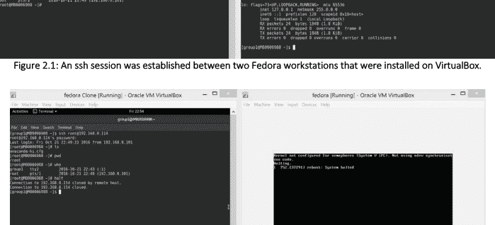

图 2.2：使用 `ssh` 远程连接对另一台 Fedora 机器应用 `halt` 命令，导致机器停止。

## 默认文件权限

处理每个新创建的文件或目录的权限并非易事，同时，敏感文件或目录的权限配置不当会导致其暴露给黑客，黑客可以修改或删除它们。

在本节中，在同一个终端窗口和新终端窗口中应用 `umask` 命令之前，检查了分配给新创建文件的默认权限。使用 `touch` 命令创建了一个新文件，赋予给该创建文件的默认权限如下：`Owner`：读与写，`Group`：读与写，`Others`：仅读，如图 2.3 所示。使用 `umask` 命令赋予所有者完全访问权限，并移除组和和其他的所有权限，完成此任务使用的值值为 `077`。从图 2.4 可以看出，即使所有者应该拥有执行权限，但也仅分配了读写权限，因为使用 `umask` 命令设置的文件的最大权限只有读和写。图 2.5 显示打开了一个新终端并创建了一个文件，该文件的权限采用了默认权限，之前应用的 `umask` 在新终端未生效。当启动新会话时，终端将从 `/etc/bashrc` 或 `/etc/profile` 文件获取默认权限，所有新创建文件的 `umask` 默认值为 `002`，这就是为什么切换到新终端后 `umask` 会发生变化。

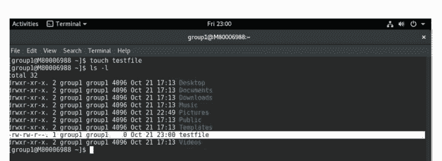

图 2.3：使用 `touch` 命令创建了新文件 `testfile`，默认权限为 `664`。


图 2.4：即使将 `umask` 修改为 `077`，新创建的文件只有读权限。

## 密码文件

最近大多数 Linux 发行版在三个主要文件中存储用户信息：`/etc/group`、`/etc/passwd` 和 `/etc/shadow`。`/etc/group` 包含了系统中创建的组和用户信息，而 `/etc/passwd` 包含了所有用户列表，并显示以下详情：登录名、密码字段、用户 ID、组 ID、主目录、登录 shell。`/etc/shadow` 文件拥有密码的哈希版本，root 用户之外的任何人无法访问。使用 `more` 命令查看了 `/etc/passwd` 的内容，如图 2.6 所示。通过将 `cat` 的输出通过到 `grep` 来获取感兴趣用户的信息总是更方便的，如图 2.7 所示。


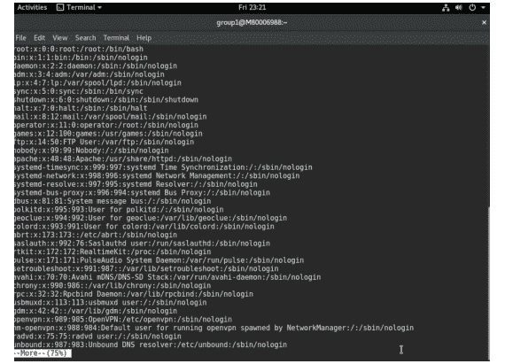

# Sudo

根据安全要求为每个用户设置权限是一项重要任务，可以通过编辑 `/etc/sudoers` 文件来实现。该文件列出了用户以及与每个用户关联的权限。如果非 root 用户尝试运行 `/etc/sudoers` 文件允许其运行的某个命令，他可以输入 `sudo` 后后跟该命令以要求输入密码。如图 2.8 所示，非 root 用户被允许访问 `/etc/sudoers` 文件。如果非 root 用户列在 `/etc/sudoers` 文件中，则被允许通过 `sudo` 命令并输入密码来访问该文件，如图 2.9 所示。在 `/var/log/audit/audit.log` 中可以找到日志文件，其中包含了所有使用 `sudo` 命令执行的活动日志，如图 2.10 所示。

图 2.7：使用 `cat` 和 `grep` 命令从 `/etc/passwd` 文件中提取包含当前登录用户信息的行。

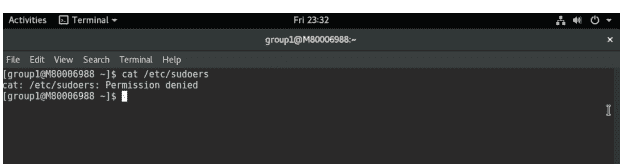

图 2.8：非 root 用户被允许访问 `/etc/sudoers` 文件。

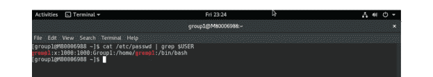

## 活动终端

# 周五 23:35

```
File Edit View Search Terminal Help

group1@M8000968 ~$ cat /etc/sudoers

cat: Permission denied

group1@M8000968 ~$ sudo cat /etc/sudoers

我们收到了本地系统

管理员的常规教训；这些通常归结为以下几点：

#1 尊重他人的权力。

#2 在输入之前思考。

#3 权力越大，责任越大。

## 组的 Sudoers

# Sudo 允许特定用户以 root
```


# 用户身份运行各种命令，而无需密码。

# 它们位于文件底部，用于相关命令的

# 集合，可以授予特定的

# 用户或组。

## 此文件必须使用 `visudo` 命令进行编辑。

## 主机别名

# 机器：你可能更喜欢使用主机名（或者可能是

# 整个域的通配符）：IP 地址。

## 主别名

`MAILSVERS = smtp, smtp`

## 用户别名

# 这并不常见，因为你可以在此文件中

# 使用普通组（例如来自文件、LDAP 等）——只需用 `%用户名`

# 用户管理员 = jsmith, mike

```


图 2.9：通过 `sudo` 命令成功访问 `/var/log/audit.audit` 的当前日志。

```

File Edit View Search Terminal Help

TYPE=SERVICE_DOP_msg start audit=1477088916.144:370; pid=3250 uid=429469725 ses=429469725 system=user:system

item=1 tid=1000 comm="hostname-system" exe="/usr/lib/system/hostname" addr=? terminal=7?=res=su

crc=0

Failed to match audit log: invalid argument

type=SERVICE_DOP_msg end audit=1477088917.736; pid=3250 uid=429469725 ses=429469725 system=unconfined:root

item=1 tid=1000 comm="hostname-system" exe="/usr/lib/system/hostname" addr=? terminal=7?=res=success

crc=0

type=SERVICE_DOP_msg start audit=1477088917.17; pid=3251 uid=429469725 ses=429469725 system=user:system

item=1 tid=1000 comm="hostname-system" exe="/usr/lib/system/hostname" addr=? terminal=7?=res=su

crc=0

type=SERVICE_DOP_msg end audit=1477088917.629; pid=3251 uid=429469725 ses=429469725 system=unconfined:root

item=1 tid=1000 comm="hostname-system" exe="/usr/lib/system/hostname" addr=? terminal=7?=res=success

crc=0

type=SERVICE_DOP_msg start audit=1477088918.301; pid=3252 uid=429469725 ses=429469725 system=user:system

item=1 tid=1000 comm="hostname-system" exe="/usr/lib/system/hostname" addr=? terminal=7?=res=su

crc=0

type=SERVICE_DOP_msg end audit=1477088918.393; pid=3252 uid=429469725 ses=429469725 system=unconfined:root

item=1 tid=1000 comm="hostname-system" exe="/usr/lib/system/hostname" addr=? terminal=7?=res=success

crc=0

type=SERVICE_DOP_msg end audit=1477088918.682; pid=3250 uid=429469725 ses=429469725 system=unconfined:root

item=1 tid=1000 comm="hostname-system" exe="/usr/lib/system/hostname" addr=? terminal=7?=res=success

crc=0

type=SERVICE_DOP_msg start audit=1477088919.514; pid=3253 uid=429469725 ses=429469725 system=user:system

item=1 tid=1000 comm="hostname-system" exe="/usr/lib/system/hostname" addr=? terminal=7?=res=su

crc=0

type=SERVICE_DOP_msg end audit=1477088919.729; pid=3253 uid=429469725 ses=429469725 system=unconfined:root

item=1 tid=1000 comm="hostname-system" exe="/usr/lib/system/hostname" addr=? terminal=7?=res=success

crc=0

type=SERVICE_DOP_msg start audit=1477088918.378; pid=3251 uid=429469725 ses=429469725 system=unconfined:root

item=1 tid=1000 comm="hostname-system" exe="/usr/lib/system/hostname" addr=? terminal=7?=res=su

crc=0

type=SERVICE_DOP_msg end audit=1477088918.777; pid=3252 uid=429469725 ses=429469725 system=unconfined:root

item=1 tid=1000 comm="hostname-system" exe="/usr/lib/system/hostname" addr=? terminal=7?=res=success

crc=0

type=AUTH_DOP_msg start audit=1477088918.623; pid=3250 uid=429469725 ses=429469725 system=user:system

item=1 tid=1000 comm="hostname-system" exe="/usr/lib/system/hostname" addr=? terminal=7?=res=su

crc=0

type=AUTH_DOP_msg end audit=1477088919.025; pid=3253 uid=429469725 ses=429469725 system=unconfined:root

item=1 tid=1000 comm="hostname-system" exe="/usr/lib/system/hostname" addr=? terminal=7?=res=success

crc=0

type=ACRED_DOP_msg start audit=1477088918.462; pid=3251 uid=429469725 ses=429469725 system=unconfined:root

item=1 tid=1000 comm="hostname-system" exe="/usr/lib/system/hostname" addr=? terminal=7?=res=su

crc=0

type=ACRED_DOP_msg end audit=1477088918.837; pid=3252 uid=429469725 ses=429469725 system=unconfined:root

item=1 tid=1000 comm="hostname-system" exe="/usr/lib/system/hostname" addr=? terminal=7?=res=success

crc=0
```


## 安装软件包 RPM 和 YUM

Linux 提供了多种工具，允许用户安装、管理和更新软件包。Fedora 有两个主要的工具，即 `rpm` 和 `yum`；在 `rpm` 中，用户可能需要搜索感兴趣的包，下载它并安装它，并且知道如果该包需要其他额外的包，必须单独进行搜索、下载和安装。`yum` 命令提供了相同的功能，但它会自动执行大部分工作，包括在互联网上搜索该包，然后下载并安装它，同时自动安装所有所需的其他包。

测试了 `rpm` 和 `yum`；对安装 `xlockmore` 软件包进行了尝试。在 `rpmfind.net` 网站上找到了该包，如图 2.16 所示。然后获取了链接并使用 `wget` 命令将其下载到 `Downloads` 目录，如图 2.17 所示。

### RPM 为 xlock 找到 10 个结果

| 软件包 | 摘要 | 发行版 |
| --- | --- | --- |
| `xlock-5.3-9.1.1506.i686` | X Window 的屏幕保护程序和锁定 | OpenSUSE 12.3 for x86 |
| `xlock-5.3-9.1.1506.i686` | X Window 的屏幕保护程序和锁定 | OpenSUSE 12.3 for x86 |
| `xlock-5.3-9.1.1506.i664` | X Window 的屏幕保护程序和锁定 | OpenSUSE 12.3 for x86_64 |
| `xlock-5.3-9.1.1506.i664` | X Window 的屏幕保护程序和锁定 | OpenSUSE 12.2 for x86_64 |
| `xlock-5.3-7.2.1586.i686` | X Window 的屏幕保护程序和锁定 | OpenSUSE 12.1 for x86 |
| `xlock-5.3-7.2.1586.i664` | X Window 的屏幕保护程序和锁定 | OpenSUSE 12.1 for x86_64 |
| `xlock-5.3-4.2.1506.i686` | X Window 的屏幕保护程序和锁定 | OpenSUSE 11.4 for x86 |
| `xlock-5.3-4.2.1506.i664` | X Window 的屏幕保护程序和锁定 | OpenSUSE 11.4 for x86_64 |
| `xlock-5.32-4.1.1506.i686` | X Window 的屏幕保护程序和锁定 | OpenSUSE 11.4 for x86 |
| `xlock-5.32-4.1.1506.i664` | X Window 的屏幕保护程序和锁定 | OpenSUSE 11.4 for x86_64 |

图 2.16：在 `rpmfind.net` 中启动了 `xlock` 的搜索并下载了 `rpm` 文件。

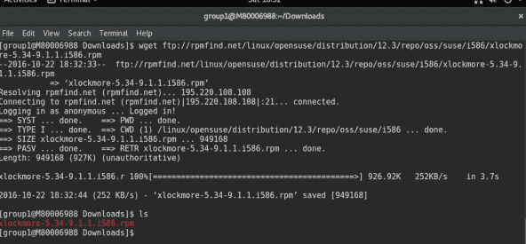

下载过程完成后，使用 `rpm -iv` 命令启动软件包的安装，但显示了错误，表明在安装 `xlock` 包之前必须先下载并安装其他包，如图 2.18 所示。

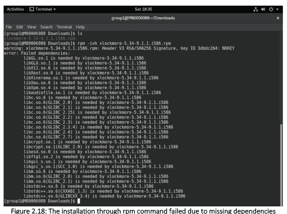

根据图 2.18，软件包未被安装，因为需要在系统上预先安装其他包。可以使用 `rpm -q` 命令验证软件包是否已安装，如图 2.19 所示。

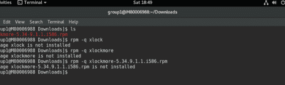

图 2.19：如 `rpm -q` 命令所示，`xlockmore` 软件包未安装。

`yum` 命令为安装软件包提供了一种方便的方法，因为在 `yum install` 命令后除了输入包名外，不需要其他操作，如图 2.20 所示。在最近的 Linux 中使用 `yum` 命令会显示警告，指出它将在较新版本中不再被使用，因为它将由 `dnf` 命令取代。如图 2.21 所示，使用 `dnf` 命令仅需一条命令即可安装 `xlockmore`。

# 控制台与登录安全

## 锁定控制台

未锁定的运行机器提供了一个易于破解的系统，因为它允许攻击者从系统中获取多个文件。消除这种风险的良好做法是在离开运行机器时锁定屏幕。此操作可以使用 Linux 中的 `xlock` 工具完成，因为它会锁定屏幕并要求输入 `root` 密码来解锁。

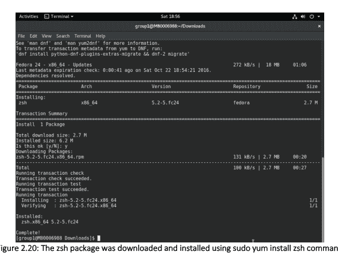

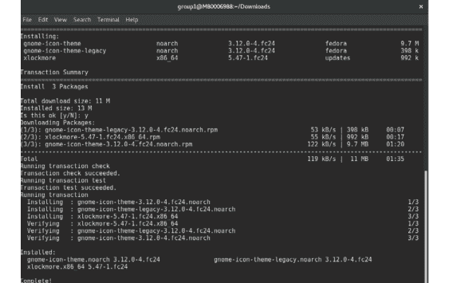

在终端中输入 `xlock` 命令，如图 2.22 所示显示屏幕保护程序，当按下任意键时，会显示另一个屏幕请求 `root` 密码，如图 2.23 所示。


图 2.22：屏幕保护程序显示请求 `root` 密码。

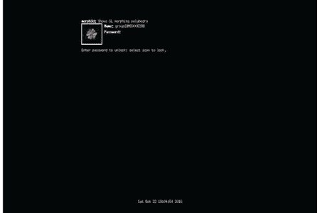

图 2.23：显示请求 `root` 密码。

## 禁用控制台

如果运行机器未锁定，它提供了一个易于破解的系统，因为它允许攻击者从系统中获取多个文件。消除这种风险的良好做法是在离开运行机器时锁定屏幕。此操作可以使用 Linux 中的 `xlock` 工具完成，因为它会锁定屏幕并要求输入 `root` 密码来解锁。在终端中输入 `xlock` 命令，如图 2.22 所示显示屏幕保护程序，当按下任意键时，会显示另一个屏幕请求 `root` 密码，如图 2.23 所示。

## 控制台安全

未锁定的运行机器提供了一个易于破解的系统，因为它允许攻击者从系统中获取多个文件。消除这种风险的良好做法是在离开运行机器时锁定屏幕。此操作可以使用 Linux 中的 `xlock` 工具完成，因为它会锁定屏幕并要求输入 `root` 密码来解锁。在终端中输入 `xlock` 命令，如图 2.22 所示显示屏幕保护程序，当按下任意键时，会显示另一个屏幕请求 `root` 密码，如图 2.23 所示。

## 登录界面

大多数时候，登录界面为攻击者提供了有关系统的有用信息。当攻击者知道系统的类型和版本时，他们能够发起攻击。良好的做法是从登录界面隐藏所有系统信息，同时显示警告信息，警告攻击者他们即将访问未经允许的系统。

# 横幅配置

`group1@M80006988~`

文件 编辑 视图 搜索 终端 帮助
`GNU nano 2.5.3` 文件:`/etc/issue.net` 已修改

```
\S
内核位于 \m (\l)

这是一个横幅警告，旨在警告你尝试未经授权访问该系统，Group1 成员有权起诉你并将你的行为提交法庭审判。
```

^ 获取帮助 ^ 写出 所在位置 ^ 剪切文本 对齐 ^ 当前位置
^ 退出 读取文件 替换 未剪切文本 拼写 ^ 跳转行

图 2.29：`/etc/issue.net` 文件已修改了新的横幅消息，以便在启动未经授权访问时显示。

`banner` 参数和 `/etc/issue.net` 文件的位置必须在 `/etc/ssh/sshd_config` 文件中指定，如图 2.30 所示。

| 活动 终端 | 设置 2101 |
| :--- | :--- |
| `group1@M80006988~` | 文件 编辑 视图 搜索 终端 帮助 |
| 文件: `/etc/ssh/sshd_config` 已修改 | 配置模式 2 |
| `# 打印最后一行` | |
| `PasswordAuthentication yes` | |
| `PubkeyAuthentication yes` | |
| `UsePAMSeparation sandbox` | |
| `PermitRootEnvironment no` | |
| `ClientAliveCountMax` | |
| `ClientAliveInterval no` | |
| `ShowPasslevel no` | |
| `# 文件 /etc/ssh/sshd_config` | |
| `Match Group sftp` | |
| `PermitTunnel no` | |
| `VersionAddendum none` | |
| `# 允许使用 /etc/issue.net 转发` | |
| `# 接受本地区域环境变量` | |
| `acceptenv LC_TYPE NAME LC_COLLATE LC MESSAGES` | |
| `acceptenv LC_PAPER NAME LC TELEPHONE MEASUREMENT` | |
| `acceptenv LC_SIZE LC ALL LANGUAGE` | |
| `acceptenv XMODIFIERS` | |
| `# 覆盖默认子系统` | |
| `# 按用户覆盖设置的示例` | |
| `Match group users Shell=/usr/bin/sftp-server` | |
| `AllowForwarding no` | |

^ 获取帮助 ^ 写出 所在位置 ^ 剪切文本 对齐 ^ 当前位置 上一页
^ 退出 读取文件 替换 未剪切文本 拼写 ^ 跳转行 下一页

图 2.30：通过向 `/etc/ssh/sshd_config` 文件添加 `banner /etc/issue.net` 行，启用了横幅消息。

通过 `/etc/ssh/sshd_config` 启用横幅后，对 `ssh` 系统进行了测试，输入的消息显示如图 2.31 所示。

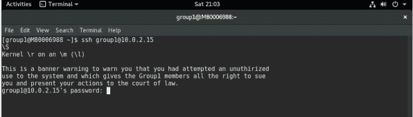

图 2.31：当启动 `ssh` 会话时，显示预定义的横幅。

# Wireshark

使用非加密服务（如 `telnet` 和 `http`）会导致凭据和通信信息面临被攻击者嗅探的风险，因为它们都是以明文形式发送和接收的。嗅探网络包最常用的工具之一是 `Wireshark` 软件。

在该 `Wireshark` 软件包中已安装并启动了软件，如图 2.32、33、34 所示。图 2.36 显示已开始捕获，并访问了一个测试 `http` 网站，并在表单中输入了用户名和密码，如图 2.37 所示。`Wireshark` 成功嗅探到了输入的用户名和密码，如图 2.38 所示。


图 2.32：使用 `dnf install` 命令成功安装了 `Wireshark` 软件包。

# Wireshark

六 23:56


# Transaction Summary

## 详情
1 个包

## 总大小
7.6 M

## 时间
23:56:00.000000

## 跳过
`ssl-connection-tls-2.1.21-py3-x86_64` 已下载
`scapy-` 已下载
`ssl-connection-tls-2.1.21-py3-x86_64` 已下载
`cryptography-36.0.0-py3-x86_64` 已下载

正在运行事务缓存...

事务测试成功

## 安装
`urllib3-1.26.5-py3-x86_64`
`flask-2.0.2-py3-x86_64`
`jinja2-3.1.2-py3-x86_64`
`werkzeug-2.0.1-py3-x86_64`
`itsdangerous-2.1-py3-x86_64`

正在验证软件包...

`urllib3-1.26.5-py3-x86_64`
`flask-2.0.2-py3-x86_64`
`jinja2-3.1.2-py3-x86_64`
`werkzeug-2.0.1-py3-x86_64`
`itsdangerous-2.1-py3-x86_64`

正在处理软件包...

## 结果
已安装 5 个包


图 2.33：使用 `dnf install` 成功安装了 `Wireshark-home`。

# Wireshark

六 23:56

`Wireshark` 网络分析仪 `[Wireshark 2.2.1 (Git unknown)]` 停止运行捕获
`# 世界最流行的网络协议分析仪版本 2.2.1 (Git unknown)`
`# WIRESHARK`

## 捕获
## 文件
## 在线
## 列表

选择一个或多个接口进行捕获
打开之前捕获的文件
## 用户指南（在线版）
## 开始
选择一个或多个接口进行捕获
# 丰富的示例捕获文件
# 安全地使用 Wireshark 工作

- `cm3`
- `蓝牙监控`
- `eth0`
- `intourne`

使用默认选项。图 2.34：发现并查看了 Wireshark 图像和菜单。

`Wireshark` 捕获

| 接口 | 流量 | 链路层 | 混杂 Snapslen (B) | Buffer (M) |
| :--- | :--- | :--- | :--- | :--- |
| `any` | 地址: 172.31.20.121, 80:e6:cf:91:c5 | 默认 | 2 |
| `Loopback` | `以太网` | 默认 | 2 |
| `nflog` | `Linux cooked` | 默认 | 2 |
| `usmb0` | 未知 | 默认 | 2 |
| `usmb1` | 未知 | 默认 | 2 |
| `usmb2` | 未知 | 默认 | 2 |
| `usmb3` | 未知 | 默认 | 2 |
| `usmb4` | 未知 | 默认 | 2 |
| `usmb5` | 未知 | 默认 | 2 |
| `usmb6` | 未知 | 默认 | 2 |

- 在所有接口上启用混杂模式
捕获过滤器：[输入捕获过滤器...]
管理接口... 开始

图 2.35：选择了正确 IP 地址流量的 `Wireshark`。
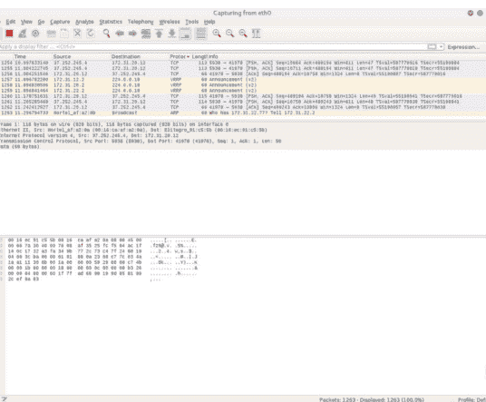

| 编号 | 时间 | 源 | 目的 | 协议 | 长度 | 信息 |
| :--- | :--- | :--- | :--- | :--- | :--- | :--- |
| 1 | 00:00:00.000 | 172.31.20.121 | 192.168.1.1 | TCP | 66 | [SYN] seq=0, win=64240, MSS:1460, scale:7] |
| 2 | 00:00:00.001 | 192.168.1.1 | 172.31.20.121 | TCP | 54 | [SYN] ack=0, win=65535 |
| 3 | 00:00:00.002 | 172.31.20.121 | 192.168.1.1 | TCP | 54 | [ACK] seq=1, win=64240 |
| 4 | 00:00:00.003 | 192.168.1.1 | 172.31.20.121 | TCP | 54 | [ACK] seq=1, win=65535 |
| 5 | 00:00:00.004 | 172.31.20.121 | 192.168.1.1 | TCP | 54 | [ACK] seq=1, win=64240 |
| 6 | 00:00:00.005 | 192.168.1.1 | 172.31.20.121 | TCP | 54 | [ACK] seq=2, win=65535 |
| 7 | 00:00:00.006 | 172.31.20.121 | 192.168.1.1 | TCP | 54 | [ACK] seq=3, ack=3, win=64240 |
| 8 | 00:00:00.007 | 192.168.1.1 | 172.31.20.121 | TCP | 54 | [ACK] seq=3, ack=3, win=65535 |
| 9 | 00:00:00.008 | 172.31.20.121 | 192.168.1.1 | TCP | 54 | [ACK] seq=4, ack=4, win=64240 |
| 10 | 00:00:00.009 | 192.168.1.1 | 172.31.20.121 | TCP | 54 | [ACK] seq=4, ack=5, win=65535 |

```
* Frame 1: 00:00:00.000 Length 66
* Frame 2: 00:00:00.001 Length 54
* Frame 3: 00:00:00.002 Length 54
* ... (7 more)
```


图 2.36：`Wireshark` 捕获在以太网上启动。

## 本章总结与建议

- 限制远程连接用户访问控制台程序的权限是一个需要考虑的重要问题，`Linux` 可以轻松地进行配置。
- `Linux` 提供了一种方便的方法来处理新创建的文件或目录的权限，从而消除新创建的文件或目录权限配置错误的风险。
- 大多数 `Linux` 发行版通过三个主要文件存储用户信息：`/etc/group`、`/etc/password` 和 `/etc/shadow` 文件，通过将用户与 `root` 分离开（分离）来降低风险，根据需求为每个用户设置权限，并以 `MD5` 哈希值的形式存储密码。
- `Linux` 提供了函数，允许选定的非 `root` 用户以 `root` 用户的身份执行特定命令，根据安全需求为每个用户设置权限是一项重要任务。
- `Linux` 生成了各种工具，允许用户安装、管理和更新软件包，同时还能识别该包是否需要其他额外的包并进行单独安装。
- `Linux` 中的控制台（`Console`）被认为是控制和配置系统的主要链接。它还提供了一种从登录界面隐藏所有系统相关信息的方法，并通过显示警告信息来警告攻击者，从而增强安全性。
- `Linux` 通过安装网络包嗅探工具来提供嗅探网络发布数据的方法，以追踪用户活动。

# 第三章

## 深入研究 Linux

### 本章目标

- 测试并探索 `Linux` 的 `setuid` 和 `setgid` 功能。
- 使用图形化 `Linux` 防火墙启用和禁用远程连接。
- 测试文件和目录的免疫保护。
- 能够通过 `ssh` 远程连接转发图形包。
- 测试并评估在本地和网络上管理、传输和挂载文件及目录的各种技术。

### 需要工具

- `Fedora 24 Workstation` 镜像。
- `Oracle VirtualBox`

### 本章概述

保护 `Linux` 是一项重要任务，当将其作为服务器时，安全问题成为首要任务之一。在本章中，通过问答部分的多个小节完成了多项任务。第一、二小节旨在测试和验证在配置文件或目录并设置 `setuid` 时将设置的选项，以及激活此选项时的漏洞。第三小节中，通过启用和禁用 `ssh` 通信测试了图形化 `Linux` 防火墙。第四小节测试并评估了 `Linux` 中用于保护文件和目录的免疫功能。第五小节节成功完成了通过 `ssh` 转发图形包执行的过程。第六小节测试并实现了同时使用 `scp` 和 `sftp` 命令在网络上传输文件和目录。在问答部分的最后一个小节中，成功完成了本地和网络上挂载文件及目录的测试。

## SUID 和 SGID

`Linux` 操作系统权限系统提供了为某些文件或目录设置 `SUID` 和 `SGID` 的能力。设置 `SUID` 将允许用户以所有者的身份访问文件，设置 `SGID` 将允许用户以所有文件组的身份访问文件。在本节中，进行了一项测试以检查在密码文件和其他文件中激活和取消 `SUID` 的效果。第一个任务是更改 `ituser` 密码，通过 `passwd ituser` 命令完成。然后使用 `which` 检查密码位置，结果为 `/usr/bin/passwd`。使用 `chmod u-s` 移除了密码文件的 `set-uid` 程序，图 3.4 清晰地显示文件权限中移除了 `s`，这意味着普通用户将无法以 `root` 身份运行，尝试执行 `passwd` 命令时将显示权限被拒绝或其他错误。图 3.5 展示了尝试更改 `ituser` 密码时显示的错误信息。将文件变为 `set-uid` 程序以赋予普通用户 `chmod u+s` 命令，密码设置了 `SUID` 以赋予所有者权限，以便其更新 `/etc/passwd`。

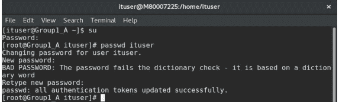

图 3.1: 使用 `passwd` 命令更改了 `ituser` 的密码。

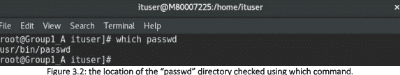

图 3.2: 使用 `which` 命令检查了 `"passwd"` 目录的位置。

```
File Edit View Search Terminal Help

[root@GroupA ituser]# which password

/usr/bin/password

[root@GroupA ituser]# ls -l /usr/bin/password
```


-rw-r--r--x 1 root 27072 Feb 4 2016 /usr/bin/password

[root@GroupA ituser]#

```
图 3.3: 使用 `ls -l` 检查了密码文件的属性，文件权限中包含了用于 set 的 `s`。

# ituser@M80007225:/home/ituser

File Edit View Search Terminal Help

[root@GroupA ituser]# chmod u-s /usr/bin/password

[root@GroupA ituser]# ls -l /usr/bin/password

-rwxr-xr-x 1 root 27072 Feb 4 2016 /usr/bin/password

图 3.4: 使用 `chmod u-s` 移除了密码文件的 `set-uid` 程序。

File Edit View Search Terminal Help

[root@GroupA ituser]# chmod u-s /usr/bin/password

[root@GroupA ituser]# ls -l /usr/bin/password

-rwxr-xr-x 1 root 27072 Feb 4 2016 /usr/bin/password

图 3.5: 尝试更改 `ituser` 密码时显示的错误信息。

File Edit View Search Terminal Help

[root@GroupA ituser]# chmod u+s /usr/bin/password

[root@GroupA ituser]# ls -l /usr/bin/password

-rwxr-xr-x 1 root 27072 Feb 4 2016 /usr/bin/password

图 3.6: 将文件变为 `set-uid` 程序以赋予普通用户 `chmod u+s` 命令。

## 活动终端

周三 20:48

File Edit View Search Terminal Help

[ituser@Group1_A~] ~ /home/ituser

sudo /home/ituser must be owned by uid 0 and have the setuid bit set

[ituser@Group1_A~] ~ /home/ituser/sudo

这是针对新用户的 Zsh 配置函数，运行 `.zinstall`。你看到此消息是因为你没有 zsh 启动文件。要创建这些文件，请重新登录主目录。此函数可以帮助你完成一些设置，以确保你的 shell 更加易用。你可以：

- 退出且什么都不做。该函数将在下次再次运行。
- 创建包含注释的 `~/.zshrc` 文件。这将防止此消息再次运行。

图 3.1: 从主目录运行 `sudo` 和 `shad` 文件。

如图 3.11 所示，权限为 `4000` 的文件搜索由 `serr` 完成更新，如果需要搜索 `sgid` 位，则可以执行总计为 `7000` 的操作。

## 活动终端

周三 20:09

File Edit View Search Terminal Help

[root@M8007225~] ~

[root@Group1_A~] # find / -f /user/root -perm 4000 -exec ls -ld {} > /tmp/UID_Apps

/file/29929/task/30926/5/: No file or directory

/file/29929/fq/6/: No file or directory

/file/29929/fq/6/: No file or directory

/file/root/user/group1/: Permission denied

-rwxr-xr-x 1 root root 13264 5 2016 /usr/bin/bridge-helper

-rwxr-xr-x 1 root root 13264 5 2016 /usr/bin/timestamp_check

-rwxr-xr-x 1 root root 40934 5 2016 /usr/bin/userhelper

-rwxr-xr-x 1 root root 40934 5 2016 /usr/bin/xauth

-rwxr-xr-x 1 root root 30926 5 2016 /usr/bin/unix_chroot

-rwxr-xr-x 1 root root 30926 5 2016 /usr/bin/gdb

-rwxr-xr-x 1 root root 5798 12 2016 /usr/lib/libgtk-x86_64/client-helper

-rwxr-xr-x 1 root root 15392 13 2016 /usr/lib/libexec/relu

-rwxr-xr-x 1 root root 15392 13 2016 /usr/libexec/dbus-daemon

-rwxr-xr-x 1 root root 15352 5 2016 /usr/lib/polkit-1/dbus-agent-helper-1

-rwxr-xr-x 1 root root 15352 5 2016 /usr/libexec/uidmap

-rwxr-xr-x 1 root root 57072 28 2016 /usr/bin/at

-rwxr-xr-x 1 root root 57072 28 2016 /usr/bin/chd

-rwxr-xr-x 1 root root 41884 17 2016 /usr/bin/newgrp

-rwxr-xr-x 1 root root 32064 6 2021 /usr/bin/fsusermount

-rwxr-xr-x 1 root root 32064 6 2021 /usr/bin/newgidmap

-rwxr-xr-x 1 root root 34848 17 2016 /usr/bin/newid

-r--xr--x 1 root root 143152 23 2014 /usr/bin/sudo

-rwxr-xr-x 1 root root 27888 7 1750 /usr/bin/umount

-rwxr-xr-x 1 root root 62996 22 2012 /usr/bin/ping

-rwxr-xr-x 1 root root 76288 17 2016 /usr/bin/gassd

[root@Group1_A~] #

图 3.12: 系统中的所有文件都已发现并保存到文件 `UID_Apps` 中。

## SUID 漏洞

多个由 `root` 拥有的文件可能需要由其中一个用户运行，例如当某个用户想要更改自己的密码时（`passwd` 情况），在这种情况下，可以为这些文件设置 `suid`。在本节中，对 `passwd` 和 `sudo` 文件的属性进行了检查，并且在所有文件中都启用了 `set-uid` 程序，这些程序被认为是用户执行高权限命令所必需的，且 `set-uid` 程序用户可以获取个人或组的权限。将这三个程序复制到用户主目录，并检查文件属性，发现 `set-uid` 已被禁用，且权限中的字母已被移除，如图 3.15 所示。如图 3.18 所示，当作为普通用户执行这些命令时，会显示无法完成任何任务的消息。图 3.23 显示了过程，位于 `ituser@M80007225:~`：

```
File Edit View Search Terminal Help

[root@Group1_A#] ls -l /usr/bin/su /usr/bin/sudo /usr/bin/passwd

-rwxr-xr-x 1 root root 27872 4 2016 usr/bin/passwd

-rwxr-xr-x 1 root root 32152 7 2050 usr/bin/su

-s-xr-x 1 root root 141352 21 28 usr/bin/sudo

[root@Group1_A#] ls
```

图 3.13: `passwd`、`sudo` 的属性已检查并显示（`img/7be0572b41927ffba381aec_86_0.png`）。

`20:54` `ituser@Group1_A-`

```
File Edit View Search Terminal Help

[ituser@Group1_A#] ls passwd

[ituser@Group1_A#] cp /usr/bin/passwd /home/ituser

[ituser@Group1_A#] ls su

[ituser@Group1_A#] cp /usr/bin/su /home/ituser

[ituser@Group1_A#] ls /usr/bin/sudo

[ituser@Group1_A#] cp /usr/bin/sudo /home/ituser
```


`cp`：无法打开`'/usr/bin/sudo'`进行读取：权限被拒绝

```
[ituser@Group1_A#] ls
```

图 3.14: 将上述程序复制到`ituser`目录（`img/7be0572b41927ffba381aec_86_1.png`）。

`20:54`

`ituser@Group1_A-`

```
File Edit View Search Terminal Help

[ituser@Group1_A#] ls sudo

-rwxr-xr-x 1 ituser 27872 Oct 26 20:51 passwd

-rwxr-xr-x 1 ituser 32152 Oct 26 20:52 su

--s-xr-x 1 root 141352 Oct 26 20:41 sudo

[ituser@Group1_A#] ls
```

图 3.15: 移动后的文件中定义`s`位。

`82`

`ituser@800725:~`

```
File Edit View Search Terminal Help

[ituser@Group1_A~$] /home/ituser/passwd

Changing password for user ituser.

Changing password for ituser.

(current) UNIX password:

New password:

Retype password:

Authentication error
```

图 3.17: 从主目录运行`sudo`，显示运行程序的消息。

活动终端`21:03`

`ituser@Group1_A~`

```
File Edit View Search Terminal Help

[ituser@Group1_A~$] /home/ituser/su

Password:

: Authentication failure
```

图 3.18: 从主目录运行`sudo`，显示运行程序的消息。

```
ituser@800725~

[ituser@Group1_A~$] /home/ituser/sudo

sudo: /home/ituser/sudo must be owned by uid 0 and have the setuid bit set
```

`zsh`程序已安装到`/tmp`目录，查看文件权限显示未设置`set-uid`，因此我们使用`chmod 4755`为其设置`set-uid`，如图 3.21 所示。由于`zsh`已安装且权限已更改，出于安全考虑，Linux 禁止其从主目录运行，因此当作为普通用户运行`zsh`命令时将不会显示任何内容，如图 3.22 所示。

活动终端`21:04`

`ituser@Group1_A~`

```
File Edit View Search Terminal Help

[ituser@Group1_A~$] which is zsh

/usr/bin/zsh
```

图 3.19: `zsh`安装在第一个实例上。

```
ituser@800725:~/tmp

File Edit View Search Terminal Help

[root@Group1_A#] which zsh

/usr/bin/zsh

[root@Group1_A#] cp /usr/bin/zsh /tmp

[root@Group1_A#] cd /tmp

[root@Group1_A#] ls
```

图 3.20: 将`zsh`复制到`/tmp`。

`83`

`ituser@800725`

```
File Edit View Search Terminal Help

[root@Group1_A#] ls -l

-rwxr-xr-x 1 root root 13264 5 2016 /usr/bin/bridge-helper

-rwxr-xr-x 1 root root 13264 5 2016 /usr/bin/timestamp_check

-rwxr-xr-x 1 root root 40934 5 2016 /usr/bin/userhelper

-rwxr-xr-x 1 root root 40934 5 2016 /usr/bin/xauth

-rwxr-xr-x 1 root root 30926 5 2016 /usr/bin/unix_chroot

-rwxr-xr-x 1 root root 30926 5 2016 /usr/bin/gdb

-rwxr-xr-x 1 root root 5798 12 2016 /usr/lib/libgtk-x86_64/client-helper

-rwxr-xr-x 1 root root 15392 13 2016 /usr/lib/libexec/relu

-rwxr-xr-x 1 root root 15392 13 2016 /usr/libexec/dbus-daemon

-rwxr-xr-x 1 root root 15352 5 2016 /usr/lib/polkit-1/dbus-agent-helper-1

-rwxr-xr-x 1 root root 15352 5 2016 /usr/libexec/uidmap

-rwxr-xr-x 1 root root 57072 28 2016 /usr/bin/at

-rwxr-xr-x 1 root root 57072 28 2016 /usr/bin/chd

-rwxr-xr-x 1 root root 41884 17 2016 /usr/bin/newgrp

-rwxr-xr-x 1 root root 32064 6 2021 /usr/bin/fsusermount

-rwxr-xr-x 1 root root 32064 6 2021 /usr/bin/newgidmap

-rwxr-xr-x 1 root root 34848 17 2016 /usr/bin/newid

-r--xr--x 1 root root 143152 23 2014 /usr/bin/sudo

-rwxr-xr-x 1 root root 27888 7 1750 /usr/bin/umount

-rwxr-xr-x 1 root root 62996 22 2012 /usr/bin/ping

-rwxr-xr-x 1 root root 76288 17 2016 /usr/bin/gassd
```

图 3.21: 使用`chmod`为文件设置`set-uid`。

```
# ituser@M@8007225:/tmp

File Edit View Search Terminal Help

[ituser@group_A ~]$ /tmp/bash

bash-4.3 exit

exit

[ituser@group_A ~]$ cd /tmp

[ituser@group_A ~]$ ls -l bash

-rwxr-xr-x. 1 root root 102056 May 11 11:37 bash

[ituser@group_A ~]$
```


### 图 3.25：再次检查 `bash` 程序的权限。

解决 `setuid` 程序的建议方案如下：

- 限制 `setuid` 的使用以降低风险。
- 必须对创建了 `setuid` 激活的二进制文件和目录进行定期检查，以识别出异常项。
- 从 `ssh` 中移除 `setuid` 位，这可以防止攻击进入系统。
- 使用 `kernel-utils` 软件包，该工具包有助于纠正错误设置的 `uid` 并修复 `setuid` 漏洞。
- 禁用用户从其目录运行脚本命令，必须使用 `root` 权限。

## 防火墙

防火墙被认为是计算机系统中最重要的防线之一。通过消除和关闭所有不重要的端口并允许特定的机器或域来正确配置，可以减少被攻击的概率。`Linux` 提供了各种实用程序来执行此任务，可以通过终端使用的 `iptables` 命令被认为是最常用的，在所有 `Linux` 发行版中都能找到。`Fedora` 提供了一个用户友好的图形用户界面来配置防火墙。在任务中，我们使用图形化工具启用和禁用对机器的 `ssh` 连接，并从其他机器进行测试。执行此任务的步骤如图 3.4s–31 所示。

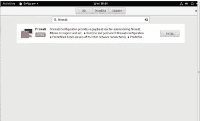

图 3.26: `Group1_A` 机器默认没有安装防火墙包。

`Group1_A` 机器成功安装了该框架。

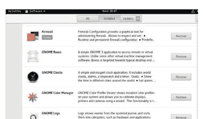

图 3.28: `ssh` 已启动并获取了 `Group1_A` 机器的地址。

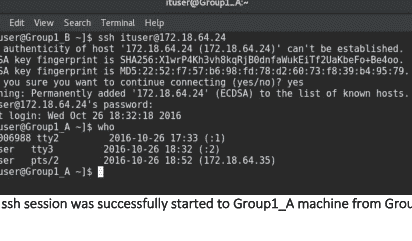

图 3.29: 从 `Group2_B` 机器成功启动到 `Group1_A` 机器的 `ssh` 会话。

## 防火墙配置

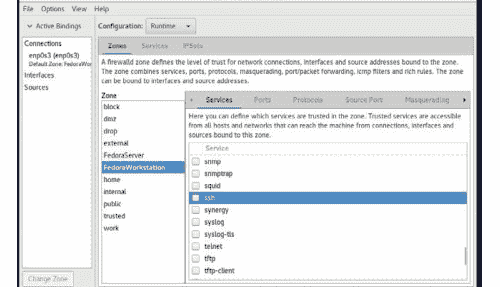

图 3.30: 通过图形防火墙配置在 `Group1_A` 机器上禁用了 `ssh` 服务。


图 3.31: 在 `Group1_A` 机器上禁用 `ssh` 服务后，从 `Group1_B` 尝试 `ssh` 会话但未成功。

## 不变文件

`Linux` 将所有连接的设备视为文件，这使得需要一种更高级的方法来保护这些文件。`Linux` 提供了一种可以通过 `chattr +i` 命令在文件上运行的实用程序，它将免疫任何文件，防止即使是 `root` 用户也对其重命名、删除或创建硬链接。在本节中，将使用 `chattr +i` 命令对 `/etc/services` 文件进行免疫，该文件包含了重要信息，攻击者可能会修改这些信息以通过为他们打开有用端口来简化破解系统的过程。执行此任务的步骤如图 3.2-36 所示。


图 3.32: 使用 `cat` 查看了 `/etc/services` 的内容。


图 3.33: 使用 `-l /etc/services` 命令列出了服务文件的默认权限。


图 3.34: `/etc/services` 的权限被修改为由 `root` 所有，且仅允许 `root` 修改。


图 3.35: 使用 `chattr +i` 命令对 `/etc/services` 文件进行了免疫，即使是 `root` 用户也不允许对文件进行任何修改。

## 使用 OpenSSH 转发 X

当使用 `ssh` 连接到机器时，默认配置不允许显示图形软件包。在启动 `ssh` 会话的命令中添加 `-X` 属性可以允许通过 `ssh` 通信转发图形。在本节中，使用了两种方法来测试此功能：禁用双方的防火墙，然后将默认 `ssh` 连接切换到 `xclock` 包，并在使用 `-X` 属性连接后进行。图 3.s37-42 详细显示了完成此任务的过程。


图 3.36: 当其他用户对 `/etc/services` 文件拥有完全权限时无法删除它，因为它已被 `chattr +i` 命令免疫。


图 3.37: `Group1_A` 和 `Group1_B` 两台机器的防火墙已禁用。


图 3.38: 使用 `ifconfig` 获取了 `Group1_A` 机器的 `ip` 地址。

# `ituser@Group1_A`

```bash
File Edit View Search Help

[ituser@group_A ~]$ ssh -i ituser@172.18.64.24

ituser@172.18.64.24: sudo

Last login: Wed Oct 26 19:43:55 from 172.18.64.25 tty1

Last login: Wed Oct 26 18:43:10 from 172.18.64.25 pts/2
```

图 3.39: 从 `Group1_B` 机器成功启动到 `Group1_A` 机器的 `ssh` 会话。

# `ituser@Group1_A`

```bash
File Edit View Search Help

[ituser@group_A ~]$ xclock

Error: Cannot open display
```

图 3.40: `Group1_B` 机器从 `Group1_A` 机器启动 `xclock` 失败。

# `root@B06988`

```bash
File Edit View Search Help

[ituser@group_A ~]$ xclock

Error: Cannot open display

exit

Connection to 172.18.64.24 closed.

[root@B06988]#
```

图 3.41: 当前来自 `Group1_A` 机器的活动连接已终止。由于另一台机器是虚拟机，在物理 `Fedora` 上执行相同的命令成功，如图 3.42 所示。


图 3.42: 在物理 `Fedora` 机器上通过 `ssh` 运行 `xclock`。

## 管理文件

在网络管理和传输文件是一个关键问题，管理员使用了 `scp` 和 `sftp` 这种结合了可靠性和安全的实用工具。所有传输的数据都是安全的，难以被攻击者嗅探。在接下来的节中，将彻底测试 `scp` 和 `sftp`。

## 使用 scp

`scp` 命令用于在网络中的机器之间安全地传输文件。在本节中，使用 `touch` 命令创建了文件，并使用 `scp` 命令将这些文件传回两台机器，如图 3.s43-46 所示。


图 3.43: 在两台机器上创建了两个新文件。


图 3.44: 使用 `ifconfig` 命令获取了机器的 `ip` 地址。

```bash
$ituser@Group1_B$ scp -r root@172.18.64.24:/home/ituser/home/ituser/
```

图 3.45: 通过 `scp` 命令将文件从 `Group1_A` 复制到 `Group1_B`。

```bash
$ituser@Group1_B$ ls -la

total 16

-rwxr-xr-x. 2 ituser ituser 4096 May 20 10:00 .
-rw-r--r-- 1 ituser ituser 0 May 20 09:55 testA
-rw-r--r-- 1 ituser ituser 0 May 20 09:55 testB
-rw-r--r-- 1 ituser ituser 0 May 20 09:55 testC
-rw-r--r-- 1 ituser ituser 0 May 20 09:55 testD
-rw-r--r-- 1 ituser ituser 0 May 20 09:55 testE
-rw-r--r-- 1 ituser ituser 0 May 20 09:55 testF
-rw-r--r-- 1 ituser ituser 0 May 20 09:55 testG
-rw-r--r-- 1 ituser ituser 0 May 20 09:55 testH
```


```
-rw-r--r-- 1 ituser ituser 0 May 20 09:55 testI
-rw-r--r-- 1 ituser ituser 0 May 20 09:55 testJ
-rw-r--r-- 1 ituser ituser 0 May 20 09:55 testK
-rw-r--r-- 1 ituser ituser 0 May 20 09:55 testL
-rw-r--r-- 1 ituser ituser 0 May 20 09:55 testM
-rw-r--r-- 1 ituser ituser 0 May 20 09:55 testN
-rw-r--r-- 1 ituser ituser 0 May 20 09:55 testO
-rw-r--r-- 1 ituser ituser 0 May 20 09:55 testP
-rw-r--r-- 1 ituser ituser 0 May 20 09:55 testQ
-rw-r--r-- 1 ituser ituser 0 May 20 09:55 testR
-rw-r--r-- 1 ituser ituser 0 May 20 09:55 testS
-rw-r--r-- 1 ituser ituser 0 May 20 09:55 testU
-rw-r--r-- 1 ituser ituser 0 May 20 09:55 testV
-rw-r--r-- 1 ituser ituser 0 May 20 09:55 testW
-rw-r--r-- 1 ituser ituser 0 May 20 09:55 testX
-rw-r--r-- 1 ituser ituser 0 May 20 09:55 testY
-rw-r--r-- 1 ituser ituser 0 May 20 09:55 testZ
```

图 3.46：文件成功从本地机器复制到网络上的服务器。

## 使用 `sftp`

`sftp` 实用程序比 `scp` 提供更方便传输大文件的方法，因为它拥有更多的命令和更好的环境。`get` 命令用于从服务器下载文件到本地机器，而 `put` 命令用于上传文件到服务器。图 3.47-48 显示了创建文件并使用 `sftp` 和 `get` 命令传输它们的过程。

## 监控文件系统 NFS

NFS 提供了一个实用的工具，允许系统管理员从远程计算机监控本地机器上的文件系统，以便像访问本地挂载一样访问它们。当需要将存储集中在持有所有数据的主服务器上时，此功能非常有用。在本节中，在一台机器上创建了一个目录，其中包含一些子目录和文件，然后从连接网络的另一台机器上挂载并访问该主目录。图 3.49 显示了完成这一过程的过程。


```
ituser@MB00006988:~home/ahmad
File Edit View Search Terminal Help

[ituser@MB00006988~]$ su
Password:
[root@MB00006988 ituser#] useradd ahmad
[root@MB00006988 ituser#] cd /home/ahmad
[root@MB00006988 ahmad#] mkdir d1 d2 d3 d4
[root@MB00006988 ahmad#] cd d1
[root@MB00006988 ahmad#] touch f1
[root@MB00006988 ahmad#] cd d2
[root@MB00006988 ahmad#] touch f2
[root@MB00006988 ahmad#] cd d2
[root@MB00006988 ahmad#] touch f3 f4
[root@MB00006988 ahmad#] ls -l
total 16
drwxr-xr-x 2 root root 4096 Nov 20 15:25 d1
drwxr-xr-x 2 root root 4096 Nov 20 15:25 d2
drwxr-xr-x 2 root root 4096 Nov 20 15:24 d3
drwxr-xr-x 2 root root 4096 Nov 20 15:24 d4
-rw-r--r-- 1 root root 0 Nov 20 15:24 f3
-rw-r--r-- 1 root root 0 Nov 20 15:24 f4
[root@MB00006988 ahmad#]
```

图 3.50：创建了一个新用户，并在该用户的家目录下创建了两个目录。

```
ituser@MB00006988:~home/ahmad
File Edit View Search Terminal Help
GNU nano 2.5.3 File:/etc/exports Modified
/home/ahmad 172.18.64.36(rw,sync,no_root_squash)
Save modified buffer (ANSWERING "No" WILL DESTROY CHANGES) ? Yes
No Cancel
```

图 3.51：修改了 `/etc/exports` 文件以添加条目，允许共享 `ahmad` 的家目录。

```
ituser@MB00006988:~home/ahmad
File Edit View Search Terminal Help
[root@MB00006988 ahmad#] rpm -qa nfs-utils
nfs-utils-1.3.4-1.rc2.fc24.x86_64
[root@MB00006988 ahmad#] _
```

图 3.52：已经安装了版本为 1.3.3-8 的 `nfs-utils` 包。

## `ituser@MB00006988:/home/ahmad`

```
File Edit View Search Terminal Help
[root@MB00006988 ahmad]# exports -a
[root@MB00006988 ahmad]# exports -v
/home/ahmad
172.18.64.36:(rw,delay,no_root_squash,no_subtree_check,sec=sys,rw,secgroup,no_root_squash,no_all_squash)
[root@MB00006988 ahmad]#
```

图 5.33：目录已导出，并使用 `exports -v` 命令完成了验证。

## `ituser@MB00006988:/home/ahmad`

```
File Edit View Search Terminal Help
[root@MB00006988 ahmad]# /bin/service rpcbind start
Redirecting to /dev/systemctl start rpcbind.service
[root@MB00006988 ahmad]# /bin/service nfs start
Redirecting to /dev/systemctl start nfs-service
[root@MB00006988 ahmad]# systemctl start nfs-utils
```

图 5.34：`rpcbind` 和 `nfs` 服务均已启动。

## `ituser@MB00006988~`

```
[ituser@MB00006988~]$ df -h
Filesystem Size Used Available Use Mounted on
devtmpfs 738M 0 738M 0% /
tmpfs 749M 432K 749M 1% /dev/shm
tmpfs 749M 1.2M 748M 1% /run
tmpfs 749M 0 749M 0% /sys/cgroup
/dev/mapper/fedora-root 6.5G 24K 6.5G 0% /
tmpfs 150M 0 150M 0% /tmp
/dev/sdb1 477M 13M 464M 3% /boot
tmpfs 150M 16K 134M 0% /run/user/42
tmpfs 150M 16K 134M 0% /run/user/1001
/dev/sr0 56M 0 56M 0% /run/media/ituser/VITIONS_5
[ituser@MB00006988~]$
```

图 5.35：已挂载分区列表。

## `ituser@MB00006988:/home/ahmad`

```
File Edit View Search Terminal Help
[root@MB00006988 ahmad]# /bin/service rpcbind start
Redirecting to /dev/systemctl start rpcbind.service
```


```
[root@MB00006988 ahmad]# /bin/service nfs start

Redirecting to /dev/systemctl start nfs-service

[root@MB00006988 ahmad]# systemctl start nfs-utils

[root@MB00006988 ahmad]# /bin/mount nfs 172.18.64.36:/home/ahmad

[root@MB00006988 ahmad]# ls /ahmad

[root@MB00006988 ahmad]# /bin/df -h
```

```
df -h
Filesystem Size Used Available Use% Mounted on
devtmpfs 738M 0 738M 0% /
tmpfs 749M 432K 749M 1% /dev/shm
tmpfs 749M 1.2M 748M 1% /run
tmpfs 749M 0 749M 0% /sys/cgroup
/dev/mapper/fedora-root 6.5G 24K 6.5G 0% /
tmpfs 150M 0 150M 0% /tmp
/dev/sdb1 477M 13M 464M 3% /boot
tmpfs 150M 16K 134M 0% /run/user/42
tmpfs 150M 16K 134M 0% /run/user/1001
/dev/sr0 56M 0 56M 0% /run/media/ituser/VITIONS_5
172.18.64.36:/home/ahmad 1.0G 0 1.0G 0% /ahmad
[root@MB00006988 ahmad]#
```

图 5.36：通过 `df -h` 命令显示了挂载的分区。

### ituser@MB00006988:/home/ahmad

```
File Edit View Search Terminal Help
[root@MB00006988 ahmad]# /bin/service rpcbind start
Redirecting to /dev/systemctl start rpcbind.service
[root@MB00006988 ahmad]# /bin/service nfs start
Redirecting to /dev/systemctl start nfs-service
[root@MB00006988 ahmad]# systemctl start nfs-utils
[root@MB00006988 ahmad]# /bin/mount nfs 172.18.64.36:/home/ahmad
[root@MB00006988 ahmad]# ls /ahmad
[root@MB00006988 ahmad]# /bin/df -h
```

```
df -h

Filesystem Size Used Available Use% Mounted on

devtmpfs 738M 0 738M 0% /

tmpfs 749M 432K 749M 1% /dev/shm

tmpfs 749M 1.2M 748M 1% /run

tmpfs 749M 0 749M 0% /sys/cgroup

/dev/mapper/fedora-root 6.5G 24K 6.5G 0% /

tmpfs 150M 0 150M 0% /tmp

/dev/sdb1 477M 13M 464M 3% /boot

tmpfs 150M 16K 134M 0% /run/user/42

tmpfs 150M 16K 134M 0% /run/user/1001

/dev/sr0 56M 0 56M 0% /run/media/ituser/VITIONS_5

172.18.64.36:/home/ahmad 1.0G 0 1.0G 0% /ahmad

[root@MB00006988 ahmad]#
```

图 5.37：通过 `df -h` 命令显示了挂载的分区。

### ituser@MB00006988:/home/ahmad

```
File Edit View Search Terminal Help

[root@MB00006988 ahmad]# /bin/service rpcbind start

Redirecting to /dev/systemctl start rpcbind.service

[root@MB00006988 ahmad]# /bin/service nfs start

Redirecting to /dev/systemctl start nfs-service

[root@MB00006988 ahmad]# systemctl start nfs-utils

[root@MB00006988 ahmad]# /bin/mount nfs 172.18.64.36:/home/ahmad

[root@MB00006988 ahmad]# ls /ahmad

[root@MB00006988 ahmad]# /bin/df -h
```

```
df -h
Filesystem Size Used Available Use% Mounted on
devtmpfs 738M 0 738M 0% /
tmpfs 749M 432K 749M 1% /dev/shm
tmpfs 749M 1.2M 748M 1% /run
tmpfs 749M 0 749M 0% /sys/cgroup
/dev/mapper/fedora-root 6.5G 24K 6.5G 0% /
tmpfs 150M 0 150M 0% /tmp
/dev/sdb1 477M 13M 464M 3% /boot
tmpfs 150M 16K 134M 0% /run/user/42
tmpfs 150M 16K 134M 0% /run/user/1001
/dev/sr0 56M 0 56M 0% /run/media/ituser/VITIONS_5
172.18.64.36:/home/ahmad 1.0G 0 1.0G 0% /ahmad
[root@MB00006988 ahmad]#
```

图 5.38：通过 `df -h` 命令显示了挂载的分区。

### ituser@MB00006988~

```
[ituser@MB00006988~]$ $ df -h
Filesystem Size Used Available Use Mounted on
devtmpfs 738M 0 738M 0% /
tmpfs 749M 432K 749M 1% /dev/shm
tmpfs 749M 1.2M 748M 1% /run
tmpfs 749M 0 749M 0% /sys/cgroup
/dev/mapper/fedora-root 6.5G 24K 6.5G 0% /
tmpfs 150M 0 150M 0% /tmp
/dev/sdb1 477M 13M 464M 3% /boot
tmpfs 150M 16K 134M 0% /run/user/42
tmpfs 150M 16K 134M 0% /run/user/1001
/dev/sr0 56M 0 56M 0% /run/media/ituser/VITIONS_5
[ituser@MB00006988~]$
```

图 5.39：已挂载分区列表。

### ituser@MB00006988:/home/ahmad

```
File Edit View Search Terminal Help
[root@MB00006988 ahmad]# /bin/service rpcbind start
Redirecting to /dev/systemctl start rpcbind.service
[root@MB00006988 ahmad]# /bin/service nfs start
Redirecting to /dev/systemctl start nfs-service
[root@MB00006988 ahmad]# systemctl start nfs-utils
[root@MB00006988 ahmad]# /bin/mount nfs 172.18.64.36:/home/ahmad
[root@MB00006988 ahmad]# ls /ahmad
[root@MB00006988 ahmad]# /bin/df -h
```

```
df -h

Filesystem Size Used Available Use% Mounted on

devtmpfs 738M 0 738M 0% /

tmpfs 749M 432K 749M 1% /dev/shm

tmpfs 749M 1.2M 748M 1% /run

tmpfs 749M 0 749M 0% /sys/cgroup

/dev/mapper/fedora-root 6.5G 24K 6.5G 0% /

tmpfs 150M 0 150M 0% /tmp
```


```
/dev/sdb1 477M 13M 464M 3% /boot

tmpfs 150M 16K 134M 0% /run/user/42

tmpfs 150M 16K 134M 0% /run/user/1001

/dev/sr0 56M 0 56M 0% /run/media/ituser/VITIONS_5

172.18.64.36:/home/ahmad 1.0G 0 1.0G 0% /ahmad

[root@MB00006988 ahmad]#
```

图 5.40：通过 `df -h` 命令显示了挂载的分区。

## 第四章

# 高级 Linux 工具

## 章节目标

- 测试并探索 Linux 日志系统及其提供的选项。
- 根据需求调整和修改日志配置文件。
- 使用 Linux 日志轮转功能处理日志。
- 探索旧版本 GRUB 的漏洞并修改设置以保护主机。
- 调查 HIDS 和文件集成工具。

## 所需工具

- Fedora 24 工作站镜像。
- Fedora 18 工作站镜像。
- Oracle VirtualBox。
- `Syslog` 包。
- `Logrotate` 包。
- `Apache` 打印服务器。
- `Tripwire` 包。
- `Syslog-ng` 包。

## 章节概述

安全应该是设置 Linux 的所有阶段的首要考虑因素。保护 Linux 机器是一项主要责任，在处理日志文件时维护安全环境成为主要任务之一。第一个小节标题为 `Syslog` 基础，在其中对多个设施和优先级的日志进行了测试。`微调默认值`小节对 `syslog` 配置进行了修改，以添加额外的设施日志。

优先级，并且之后发现 `/var/log/messages` 日志文件末尾包含了测试消息。为了测试不同设施（facilities）和优先级的日志记录，必须从 `/etc/rsyslog.conf` 配置文件中找到它们分配的日志文件，如图 4.5 所示。图 4.6 和 7 显示了如何使用 `logger` 命令测试指定设施的日志，并通过查看其日志文件注意到测试消息。


图 4.1: 使用 `dll install` 命令安装了 `rsyslog` 服务并在系统上启动了。


图 4.2: `rsyslog` 服务运行在主机的用户上，`PID` 为 2650，且该服务已成功重启。


图 4.3: 使用 `less` 命令查看了 `rsyslog` 配置文件，它显示了所有设备、设施、优先级以及相应的操作。

101

图 4.4: 使用 `logger` 命令创建了测试日志消息并将其分配到本地设施（local facility）的 `/var/log/messages` 文件。

图 4.5: 从 `/etc/syslog.conf` 找到了 `kern.info` 和 `mail.alert` 日志消息保存的位置。

图 4.6: 在 `kern.info` 上创建了测试日志消息，然后它位于 `/var/log/messages` 日志中。

图 4.7: 在 `mail.alert` 上创建了测试日志消息，并位于 `/var/log/maillog` 文件中。

# 调优默认设置

`rsyslog` 守护进程从 `rsyslog.conf` 文件接收配置信息，该文件位于 `/etc` 目录下。通常，`rsyslog.conf` 文件告诉 `rsyslog` 守护进程将其日志消息保存在何处。该文件由一系列两部分组成的指令组成，即选择器（selector）和动作（action）。选择器部分定义了日志消息的来源，动作部分定义了对消息进行什么操作。

在此项任务中，编辑了 `rsyslog` 的默认配置文件并重启了 `rsyslog` 守护进程。在开始编辑 `rsyslog` 配置文件之前，应用了命令为默认配置文件创建了一个副本，以便在编辑后能从副本版本恢复内容，如图 4.8 所示。`rsyslog.conf` 文件已成功编辑，并在文件中添加了一个新条目，指示类型为 `local5` 的消息转到 `/var/log/local5`，图 4.9 所示。应用了 `Service restart` 命令重启 `syslog` 服务，以便配置文件中的更改立即生效。最后，使用图 4.10 所示的 `logger` 命令对 `syslog` 配置进行测试，并通过使用 `/var/log/messages` 中创建的行验证了消息。


图 4.8: 创建了 `rsyslog` 配置文件的备份并保存在同一目录下。


图 4.9: 在 `rsyslog.conf` 文件中添加了一个新条目，将所有 `local5` 消息保存到 `/var/log/local5` 文件。

# Dmesg

`Dmesg`（显示消息或驱动程序消息）是一个显示内核环形缓冲区的命令。这些消息包含了启动时加载到内核的设备驱动程序的价值信息，还提供了连接到/断开机器的硬件驱动程序的规范，以及硬件驱动程序加载到内核时的任何错误。这些消息对于诊断和调试硬件及设备驱动问题非常有帮助。图 4.11 显示了在 `fed 24` 中运行 `dmesg` 命令后的结果。


# 日志轮转

`logrotate` 旨在提高产生大量日志系统的性能。它允许对日志文件进行自动轮转、压缩、删除和邮件发送。每个日志文件可以每天、每周、每月或在增长过大时进行处理。此外，如果有数百万日志条目，查看特定事件将很困难，因此将日志文件保持在可管理的大小是一个好主意。图 4.12 显示了 `log rotate` 配置文件的内容，它清楚地展示了每周轮转的文件，以及在被删除前轮转四次的日志。开始搜索 `logrotate` 单词以在整个系统文件中查找该词。`logrotate` 以调试模式启动，并将 `logrotate.conf` 文件重定向到 `/tmp/logrotate.out`，同时将错误转发到输出。任务 2 中创建的 `local5` 文件被轮转列表中，如图 4.16 所示。`logrotate` 再次以调试模式执行，并应用了 `diff` 命令比较两个创建的日志文件。图 4.17 显示了两个日志文件之间的比较结果。


图 4.12: 使用 `nano` 编辑器查看并访问了日志轮转配置文件。

# 终端

```
$ Edit View Touch Inspect

$ sudo nano /etc/logrotate.d/logrotate

/etc/logrotate

/etc/logrotate.d/cron

/etc/logrotate.d/cron2

/etc/logrotate.d/rsyslog

/etc/logrotate.d/syslog

/etc/logrotate.d/dmesg

/etc/logrotate.d/ufw

/etc/logrotate.d/apt

/etc/logrotate.d/fail2ban

/etc/logrotate.d/mysql

/etc/logrotate.d/postgresql

/etc/logrotate.d/apache2

/etc/logrotate.d/nginx

/etc/logrotate.d/memcached

/etc/logrotate.d/redis

/etc/logrotate.d/mongodb

/etc/logrotate.d/docker

/etc/logrotate.d/containerd

/etc/logrotate.d/systemd

/etc/logrotate.d/unattended-upgrades

/etc/logrotate.d/root/etc/logrotate.d/clamav

/etc/logrotate.d/modsecurity

/etc/logrotate.d/logrotate

/etc/logrotate.d/logrotate.conf

/etc/logrotate.d/logrotate.status

/etc/logrotate.d/logrotate.state

/etc/logrotate.d/logrotate.daily

/etc/logrotate.d/logrotate.weekly

/etc/logrotate.d/logrotate.monthly

/etc/logrotate.d/logrotate.hourly
```


`/etc/logrotate.d/logrotate.*`

（注：由于原文后半部分存在大量重复和碎片，译文已根据提供的文本逻辑流进行了清理和合并。）


`logrotate` 命令以详细模式启动，使用 `-v` 参数显示更多详细信息，如 4.18 所示。通过检查日志文件来检查 `local5` 文件的轮转，但如 4.19 所示，它没有被轮转。最后使用 `-f` 强制执行了 `log rotate` 命令，`local5` 日志文件进行了轮转，并在 4.20 中创建了新文件。


图 4.19：`local5` 文件未进行日志轮转。


图 4.20：强制执行日志轮转命令，`local5` 文件已轮转并创建了新文件。

## Apache HTTP 或 Tomcat

宿主机上已安装 Apache。通过命令 `service http start`，`httpd` 服务在宿主机上成功启动，如图 4.21 所示。创建了一个新的 HTML 页面并在日志文件中进行检查，如 4.22-23 所示，显示了使用 `localhost` 显示的 `tomcat` 测试页面，这意味着 `tomcat` 正在运行。位于 `/var/log/apache/` 的两个 Apache 日志文件分别是 `error` 和 `access` 日志。图 4.24 显示新创建的 `html` 页面活动显示在访问日志中。


图 4.21：`http` 服务在宿主机上成功启动。


图 4.22：日志文件中提到了新创建的页面。

## Fedora 测试页面

此页面用于测试 Apache HTTP 服务器安装后的操作。如果你能看到此页面，说明 Web 服务器工作正常。


- 如果你是公共用户成员：
  - 你看到的此页面证明 Web 服务器已安装并正常工作。
  - 如果你想扩展此网站的内容，请联系 Fedora 项目。
  - 如果在此页面内容中发现错误，请点击下方邮件链接向管理员报告。
  - 如果你对 Fedora 操作系统有疑问，请访问 Fedora 邮件列表。
  - 如果你想托管 Fedora 发行版，请联系 Fedora 项目。
  - 如果你发现任何错误，请向 `bug` 跟踪器（`bug tracker`）报告。
- 如果你是网站管理员：
  - 你可以在此页面所在的目录添加内容。
  - 如果你想删除此页面，只需从服务器中删除该文件。
  - 如果你想更改此页的内容，请遵循手册中的说明。
  - 此服务器由 Apache 服务器驱动。对于使用 Apache，请访问 `http://httpd.apache.org/`

图 4.23：`localhost` 运行表示 `tomcat` 已启动


图 4.24：检查 `error` 和 `access` 日志查看 apache 服务器的最后活动。

## 列出打开的文件

`lsof` 是一个基于命令的实用，用于列出各种进程打开的文件。在 Linux 中，一切都是文件（管道、套接字、设备等）。因此，使用 `lsof` 可以获取打开文件的信息。不同的 `lsof` 选项如表 1 所示：

| 命令 | 结果 | 图 |
| :--- | :--- | :--- |
| `lsof` | 列出所有进程的文件 | 图 4.25 |
| `lsof -p 1` | 列出 `PID` 1 当前打开的文件 | 图 4.26 |
| `lsof -u ituser` | 列出 `ituser` 当前访问的文件 | 图 4.27 |
| `lsof /bin/bash` | 找到打开 `/bin/bash` 的进程 `PID` | 图 4.28 |
| `lsof -i TCP` | 显示所有 `TCP` 类型网络文件的列表 | 图 4.29 |


图 4.28：使用 `sudo lsof /bin/bash` 列出了所有打开 `/bin/bash` 的进程 `PID`。


图 4.29：使用 `sudo -i TCP` 显示所有 `TCP` 类型文件的列表。

## 通过引导程序破解系统

此部分在 Fedora 18 和 Fedora 24 中通过引导程序破解系统。破解 Fedora 18 的步骤如下：

- 按下任意键，在 `grub` 界面停止启动，如图 4.30 所示。
- 按下 `e` 键编辑 `grub` 菜单，如图 4.31 所示。
- 在 `root=/dev/mapper/fedora-root` 后添加数字 1 以单模式启动，如图 4.32 所示。
- 按下 `F10` 后系统重启，`root` 用户登录命令行，如图 4.33 所示。
- 通过相同的命令行更改 `ituser` 的密码，如图 4.34 所示，这表明系统被轻易破解了，现在可以访问系统。


图 4.30：在此阶段按下任意键在 `grub` 界面停止启动。


图 4.31：按下 `e` 键编辑 `grub` 菜单。


图 4.32：在 `root=/dev/mapper/fedora-root` 后添加数字 1 以单模式启动。


图 4.33：按下 `F10` 后系统重启，`root` 用户登录命令行。


图 4.34：通过相同的命令行更改了 `ituser` 的密码。

通过引导程序破解 Fedora 24 的步骤如下：

- 运行系统时显示启动菜单，如图 4.35 所示。
- 查看启动命令，如图 4.36 所示。
- 在 `root=/dev/mapper/fedora-root` 后添加数字 1，如图 4.37 所示。
- 系统以救援模式启动并请求 `root` 密码，这比 Fedora 18 更安全，如图 4.38 所示。

## Fedora (4.5.3-300 fc24:x86_64) (Workstation Edition)

`Fedora 00-rescue-4f36a25c20459b0d-47a5ca8b7d8 24 (Workstation Edition)`


图 4.35：运行系统时显示启动菜单。

```
insmod ext2

set root="hddb-modul"

if [ $(search_platform_search_hist) -eq 1 ]; then
  search --no-floppy -void --set-root e3c3555-f446-b2fe-atlde
  /dev/hddb-modul: /root/kernel/modules/hddb.modul --init "hddb-modul" e3c3555-d304-4f62-a7c4a693708
fi
```


按下 `Ctrl-x` 进入命令提示符，或按下 `Escape` 不保存更改并返回菜单。按下 `Tab` 键列出所有可能的补全项。

## 7.2 对启动加载器进行密码保护

在此阶段，将通过提供一个长的字母数字代码来生成 `grub` 的加密密码，使用 `grub-mkpasswd-pbkdf2` 来加密“zayedu”密码，生成的加密文本将如图 4.39 所示高亮显示。使用 `Nano` 编辑器来编辑 `/etc/grub.d/00_header` 文件的内容，如图 4.40 所示。在文件中添加的内容是放置哈希后的密码和登录 `Grub` 时需要的用户名。为了强制更新 `Grub` 配置文件，执行如 4.41 所示的 `grub2-mkconfig -o /boot/grub/grub.cfg` 命令。当系统重启时，`grub` 会提示输入用户名和密码以进行身份验证，并允许登录，如图 4.42 所示，这表明 `Fedora 24` 中已经存在一种高级安全阶段。


图 4.39. 创建了哈希版本的密码并将其复制用于保护 `grub`。


图 4.40: 修改了 `/etc/grub.d/00_header` 文件，包含了已创建的哈希密码和登录 `grub` 时需要的用户名。


图 4.41: 更新了 `grub` 配置，包含了新创建的用户名和密码。


图 4.42: 系统重启时，`grub` 提示输入用户名和密码进行身份验证并允许登录。

## 使用 TripWire 进行文件完整性检查

`TripWire` 是一种基于主机的入侵检测系统（`IDS`），它从主机文件系统和配置中收集数据，这些收集到的数据将在后续阶段进行检查和验证，以识别系统的良好和不良状态。根据规范，如果系统被入侵，`TripWire` 还可以通知管理员。在安装 `TripWire` 后，必须初始化数据库，一种良好的做法是修改 `TripWire` 的策略文件以匹配需求，从而减少误报。可以将 `TripWire` 配置为每天运行，并向管理员发送电子邮件通知，以便即使他不在位也能保持所有信息的最新状态。

## Syslog-ng

`Syslog-ng` 是一个开源软件包，它通过基于内容的过滤、丰富的过滤能力和灵活的配置选项扩展了 `syslog`。`Syslog-ng` 为 `syslog` 增加了许多额外的功能和特性，例如使用 `TCP` 进行传输。

## 本章总结与建议

- 日志文件为系统管理员提供了有用的数据，用于分析入侵和失败情况。
- 维护和组织日志文件的良好做法是使用日志轮转工具。
- 大多数应用程序默认情况下都带有一个日志系统，用于记录所有事件和错误。
- 必须使用用户名和密码对 `Grub` 进行安全保护，防止攻击者登录并执行恶意操作。
- 可以使用如 `TripWire` 等实用工具检查文件完整性并检测系统中的入侵。
- 为了扩展原始 `rsyslog` 的功能，可以使用 `syslog-ng` 工具。

## 参考文献

- Hatch, B., Lee, J., & Kurtz, G. (2001). Hacking Linux exposed: Linux security secrets & solutions. New York: Osborne/McGraw-Hill. Chicago.
- Halcrow, M. A. (2004, July). Demands, solutions, and improvements for Linux filesystem security. In Proceedings of the 20...
- Hasan, M., Tarique, (2019). Detection of SQL Injection: A Machine Learning Approach. International Conference on... Ras Al Khaimah, United Emirates.
- Bishop, M. (2007). About penetration testing. In IEEE... Security & Privacy, 5(6).
- Alfandi, O., (2019). Assessment and Hardening of IoT Development. International Conference on... Boards... Springer, Cham.
- Hasan, M., Iqbal, F., Hung, P., Fung, C., & Rafferty, L. (2018). A security study for smart metering. World Academy of Science, Engineering...
- Bradford, E., & Maurer, L. (2002). Linux and Windows interoperability. Upper Saddle River: Prentice Hall.
- Zhang, W. (2000, July). Linux virtual server. In Ottawa...
- Lala, J. H. (2003). Foundations of systems. Los Alamitos, CA: IEEE Computer Society.
- Forouzan, B. A. (2007). Cryptography & network security. McGraw-Hill, Inc.
