# 精通 Perl：初学者指南

计算机科学大师系列

## 关于本系列

`Mastering Computer Science` 系列涵盖了广泛的主题，涉及编程语言以及现代技术和框架。该系列特别关注初级内容，并以易于理解的方式呈现，包括：

- 清晰易懂的文字，按相关性排序的各种主题；
- 特别关注实践练习，包含大量的代码示例和程序；
- 引导式的编程方法，为绝对初学者提供循序渐变的教程；
- 强调技能的现实实用性，因此删除了冗余和很少使用的概念，转而专注于行业主流的编码范式；
- 丰富的参考文献和资源，帮助初级和中级开发人员从书中获得最大收益。

`Mastering Computer Science` 系列书籍从核心概念开始，然后迅速过渡到行业标准的编码实践，帮助学习者在尽可能短的时间内获得高效且关键的技能。这些书籍假设读者没有任何编程基础，因此即使是完全的新手程序员也能从本系列中受益。

`Mastering Computer Science` 系列由 Sufyan bin Uzayr 编辑，他是一位在计算领域拥有十年以上经验的作家和教育工作者。

有关本系列的更多信息，请访问：[`www.routledge.com/Mastering-Computer-Science/book-series/MCS`](https://www.routledge.com/Mastering-Computer-Science/book-series/MCS)

2024 年出版第一版。

由 CRC Press 出版。

2385 NW Executive Center Drive, Suite 320, Boca Raton, FL 33431

以及由 CRC Press 出版：

2 Park Square, Milton Park, Abingdon, Oxon, OX14 4RN

`CRC Press` 是 Taylor & Francis Group, LLC 的品牌。

## 美国国会图书馆编书数据

描述：第一版。 | Boca Raton；London：CRC Press，2024。| 系列：Mastering computer science

标识符：LCCN 2023007400（打印本）| LCCN 2023007401（电子书）| ISBN 9781032415109（平装本）| ISBN 9781032415116（精装本）| ISBN 9781003358442（电子书）

主题：LCSH：Perl（计算机语言）| 计算机编程。

分类：LCC QA76.73.P47 M37 2024（打印本）| LCC QA76.73.P47（电子书）| DDC 005.13/3--dc23/eng/20230601

LC 记录可在 [`lccn.loc.gov/2023007400`](https://lccn.loc.gov/2023007400) 获取。

LC 电子书记录可在 [`lccn.loc.gov/2023007401`](https://lccn.loc.gov/2023007401) 获取。

ISBN：9781032415116（hbk）

ISBN：9781032415109（pbk）

ISBN：9781003358442（ebk）

DOI：[`10.1201/9781003358442`](http://dx.doi.org/10.1201/9781003358442)

使用 Minion 字体排版。

由 KnowledgeWorks Global Ltd. 设计。

*献给妈妈*

## 关于编辑

Sufyan bin Uzayr 是一位作家、程序员和企业家，在行业内拥有十年以上的经验。他曾撰写过多本书籍，涵盖了从历史到计算机/IT 的各种主题。

Sufyan 是 Parakozm 的董事，这是一家专门从事科技（EdTech）解决方案的跨国 IT 公司。他还经营着 Zeba Academy，这是一个专注于 STEM 领域的在线学习和教学平台。

Sufyan 擅长多种技术，如 `JavaScript`、`Dart`、`WordPress`、`Drupal`、`Linux` 和 `Python`。他拥有多个学位，包括管理、IT、文学和政治科学。

Sufyan 是一位数字游民，在四个国家之间生活。他曾在全球的大学和教育机构生活并教学。Sufyan 对技术、政治、文学、历史和体育有着浓厚的兴趣，在空闲时间，他喜欢向青少年教授编程和英语。

访问 [sufyanism.com](http://sufyanism.com) 了解更多信息。

## 致谢

许多人应该出现在这一页，因为没有他们的支持，这本书将无法存在。尽管如此，有些名字值得特别提到，我衷心感谢：

- 我的父母，感谢他们为我所做的一切。
- Parakozm 团队，特别是 Divya Sachdeva、Jaskiran Kaur 和 Simran Rao，他们在本书写作过程中提供了大量的帮助和协助。
- CRC 团队，特别是 Sean Connelly 和 Danielle Zarfati，确保了书的内容、布局、格式等方面始终保持完美。
- 本书的评审员，他们审阅了稿并提供了见解和反馈。
- 排字员、封面设计师、印刷商以及其他人，他们对本书的制作出的贡献。
- 所有直接或间接与 Zeba Academy 相关的人，感谢他们的帮助和支持。
- 整个编程社区，特别是 Web 开发社区，感谢他们辛勤付出。

**Sufyan bin Uzayr**

## Zeba Academy：精通计算机科学

“Mastering Computer Science”系列书籍由 Sufyan bin Uzayr 领导的 Zeba Academy 团队撰写，包括：

- Divya Sachdeva
- Jaskiran Kaur
- Simran Rao
- Aruqqa Khateib
- Suleymen Fez
- Ibbi Yasmin
- Alexander Izbassar

Zeba Academy 是一家教育科技创业企业，主要为 STEM 领域的学习者开发课程和内容，并为全球的学习者和教育者提供教育咨询和指导。

此外，Zeba Academy 积极参与在独联体（CIS）国家运营 IT 学校，目前正与许多大学和机构合作。

欲了解更多信息，请访问 [`zeba.academy`](https://zeba.academy)。

# 第 1 章 引言

DOI：[`10.1201/9781003358442-1`](https://doi.org/10.1201/9781003358442-1)

## 本章内容

- Perl 简介
- 安装与环境搭建
- Hello World 程序

Perl 是一种高级、解释型且动态的通用编程语言。

Perl 由 Larry Wall 于 1987 年创建。虽然“Practical Extraction and Reporting Language”（实用提取和报告语言）是最常见的扩展含义，但 Perl 并没有官方的全称。一些程序员将 Perl 称为“病态杂烩的垃圾列表器”（Pathologically Eclectic Rubbish Lister）和“实际上所有喜人的事物”（Practically Everything Likable）。缩写“Practical Extraction and Reporting Language”经常被使用，因为 Perl 最初设计用于文本处理，例如从特定的文本文件中提取必要信息并将文本文件转换为新格式。Perl 同时支持过程化编程和面向对象编程。

Perl 在语法上与 C 相似，使得 C 和 C++ 程序员可以轻松上手。

## Perl 的演变

这一切始于 Larry Wall 被要求从几个包含交叉引用的文本文件中生成报告。当时他开始使用 `awk` 来做这项工作，但很快发现它并不够用。他没有为此设计一个工具，而是创建了一种新的编程语言 Perl 及其解释器。他用 `C` 构建了 Perl 编程语言，并借鉴了 `awk`、`sed` 和 `LISP` 等原理。Perl 最初仅设计用于系统管理和文本处理，但随后的版本包含了管理正则表达式（`Regex`）和网络套字字。目前，Perl 以其处理 `Regex` 的能力而闻名。Perl 的第一个版本是 1987 年 12 月 18 日的 1.0 版本。`5.28` 是 Perl 的最新版本。Perl 6 与 Perl 5 不同，因为它是 Perl 5 的完全面向对象化的重新实现版本。

## 为什么选择 Perl？

Perl 的流行和需求源于多种因素。原因如下：

- Perl 是一门高级语言；因此它与 `C` 和 `C++` 等其他流行编程语言相似，任何人都可以轻松学习。
- 文本处理：正如名称“实用提取和报告语言”所示，Perl 具有强大的文本操作能力，能够轻松地从各种文本文件中创建报告。此外，它还可以将文件转换为不同的格式。
- Perl 整合了其他语言中最优秀的特性，例如 `C`、`sed`、`awk` 和 `sh`，使这种语言更有用且高效。
- 系统管理：Perl 使用多种脚本语言的能力使得系统管理变得简单。与其依赖多种语言，不如利用 Perl 完成所有系统管理任务。尽管如此，Perl 也用于 Web 开发、Web 自动化图形用户界面（`GUI`）编程等。
- Web 与 Perl：Perl 可以集成到 Web 服务器中以提高其处理能力，`DBI` 模块使得 Web 与数据库的交互变得简单。

### 开始学习 Perl 编程

- 解释器：可以使用许多在线集成开发环境（IDE）在无需安装的情况下执行 Perl 程序。
- Windows：有许多 IDE 可以执行 Perl 或脚本，包括 `Padre` 和带有 `EPIC` 插件的 `Eclipse`。

## Perl 特性

- 下列出的功能在 Perl 中存在，并已被其他编程和脚本语言广泛采用。
- Perl 的大部分功能（包括变量、表达式、语句、控制结构和子程序）都源自 `C`。
- 它还利用 shell 脚本工具来检测数据类型。
- Perl 提供了 shell 编程中常用的内置函数，例如 `sort` 和 `system` 功能，这些功能可以使用前导符号（sigils）表示，例如数组、标量和哈希表。
- 此外，Perl 5 支持复杂的数据结构和面向对象的编程风格，包括包（packages）、引用和编译器指令。
- 解释器知道每种数据类型的存储和内存需求，并在所有 Perl 版本中根据使用分配和释放内存。
- 它在执行期间还会进行类型转换，例如将整数转换为字符串，其他无效的转换会导致错误的抛出。
- Perl 不强制或推崇任何特定的编程风格，如过程化、面向对象或函数式；解释器及其函数构成了该语言的唯一定义。
- Perl 拥有 API（文本处理设施），帮助处理 `XML`、`HTML` 和其他标记语言。
- Perl 提供了最高级别的安全性，甚至被第三方安全公司 `Coverity` 认证为具有低缺陷密度和较少安全问题。
- Perl 是可扩展的，并包含了处理 `XML` 和数据库集成（`DI`）的库，例如 `Oracle` 和 `MySQL`。

## Perl 应用

Perl 与超文本处理器（`PHP`）和 `Python` 一起是开发者中流行的编程语言。以前，程序员使用 Perl 编写通用网接口（`CGI`）脚本。Perl 经常用作异构和无缝互操作系统之间的部门粘合剂。系统管理员非常喜欢这种语言，因为他们只需要输入命令即可完成原本需要编写程序的任务。Perl 主要具有可移植性，并针对 `Windows` 和 `macOS` 有特定的定制。

此外，开发者使用该语言进行构建和部署。大多数供应商或软件制造商使用它来打包和部署商业软件（包括 `COTS` 和定制软件）。由于其管理和处理大型数据集的能力，它在金融和生物信息学领域被广泛利用。

## Perl 实现

如，Perl 是一种用 `C` 编写的解释型语言，拥有用 `C` 和 `Perl` 编写的大量模块库。Perl 解释器由 150,000 行 `C` 代码组成，在大多数系统架构上编译为 1 MB。Perl 分发版中几乎有 500 个模块，包括 300,000 行 `Perl` 代码和 200,000 行 `C` 代码。Perl 的组件（`arrays`、`scalars` 和 `hashes`）在解释器的面向对象设计内部被表示为 `C` 结构。

解释器的生命周期包括两个阶段：编译和执行。解释器在构建时将 Perl 代码解析为语法树。在运行时通过遍历树来执行 Perl 程序。Perl 编程语言以开源形式提供，带有 120,000 个功能测试；解释器和其他功能模块在编译过程中经过了严格测试。如果这 12 万个功能测试通过，就可以安全地假设你的代码不会损坏解释器。

## 用 Perl 编程

Perl 在语法上与其他常见的编程语言相似，易于编写和理解。Perl 程序可以在任何最流行的文本编辑器中编写，包括 `Notepad++` 和 `gedit`。创建程序后，用 `.pl` 或 `.PL` 扩展名保存文件。在命令行上输入 `Perl file name.pl` 即可执行程序。

## 注释

注释用于提高代码的可读性。解释器忽略注释项且不执行。注释可以是单行的也可以是多行的。

- 单行注释
- 多行注释

在上面的示例中：

1. `print`：这是一个 Perl 函数，用于在控制台上显示结果或任何提供的输出。
2. 引号：在 Perl 中，我们可以使用单引号或双引号（`''` 或 `""`）。单引号不插值变量或特殊字符，但双引号会。
3. `\n`：它用于换行符，通过反斜杠（`\`）转义任何字符。
4. `/usr/bin/Perl`：这是原始的 Perl 解释器二进制文件，始终以 `#!` 开头。这用于 Perl 脚本模式编程。
5. 因为 Perl 是一种大小敏感的计算机语言，所以 `$Geeks` 和 `$geeks` 是不同的标识符。

### Perl 的优点

- Perl 支持跨平台兼容性以及诸如 `HTML`、`XML` 等标记语言。
- 它在文本处理方面特别高效，即 `Regex`。它还具备 socket get。
- 自由开源软件根据艺术许可协议（Artistic License）和 GNU 通用公共许可证（`GPL`）发布。
- 因为它是一种嵌入式语言，所以它可以用于 Web 服务器和数据库服务器。
- 它支持 `CPAN`（全面 Perl 归档网络）上的约 25,000 个开源模块，这些模块为标准库提供了许多有用的增强功能，例如 `XML` 处理、`GUI` 和 `DI` 等。

### Perl 的缺点

- 由于 CPAN 模块的存在，Perl 不支持移植性。
- 程序运行速度慢，且每次进行更改后都必须进行解释。
- 在 Perl 中，可以通过多种方法获得相同的结果，导致代码变得混乱且难以阅读。
- 与其他语言相比，其易用性因素较低。

### 应用

- 文本文件处理和字符串分析是 Perl 语言的主要用途。
- Perl 也用于 `CGI` 脚本。
- 用于 Web 开发和 `GUI` 设计。
- Perl 的文本处理功能也被用于生成 `SQL` 查询。

# 在 Windows、Linux 和 macOS 上安装和配置 Perl

在我们的系统（无论是 Windows、Linux 还是 Macintosh）上安装 Perl 是第一步。我们必须直接了解 Perl 编程语言是什么以及它能实现什么。

Perl 是一种动态的、高级、解释型的通用编程语言。Perl 最初是为文本处理而设计的，例如从特定的文本文件中提取必要信息并将文本文件转换为新格式。Perl 支持过程化和面向对象的编程。Perl 的语法与 `C` 相似，使得 `C` 和 `C++` 程序员能够轻松上手。

可以使用任何纯文本编辑器（如 `notepad`、`notepad++` 或其他应用程序）使用 Perl 进行编程。人们可以使用在线 IDE，也可以在机器上安装一个，以使创建 Perl 程序变得更容易。由于 IDE 具有许多功能（如直观的代码编辑器、调试器和编译器），使用 IDE 可以创建 Perl 代码更加简单。在开发 Perl 代码和执行许多有趣且有益的操作之前，必须在系统上安装 Perl。这可以通过下面提供的详细方法来实现：

**检查是否预装了 Perl 版本：** 在开始安装 Perl 之前，最好检查系统是否已经安装了它。许多软件应用程序需要 Perl 来执行其操作，因此 Perl 版本可能包含在软件的安装包中。如果是这样，则无需重新下载和安装 Perl。

Macintosh 在其计算机上也预装了 Perl。许多 Linux 系统预加载了 Perl。只需使用命令提示符查看设备上是否预加载了 Perl。

（对于 Windows，在运行对话框（window + R）中输入 `cmd`；对于 Linux，按下 Ctrl+Alt+T；对于 macOS，按下 Control+Option+Shift$。）

现在执行以下命令：

```bash
perl -v
```

如果已经安装了 Perl，将生成包含 Perl 版本所有详细信息的消息；否则，将生成一条命令无效或文件名错误的错误信息。

## Perl 下载与安装

### Perl 下载

- 在开始安装过程之前，我们需要下载它。为此，Windows、Linux 和 macOS 的所有版本 Perl 均可在 [`www.perl.org/get.html`](https://www.perl.org) 获取。

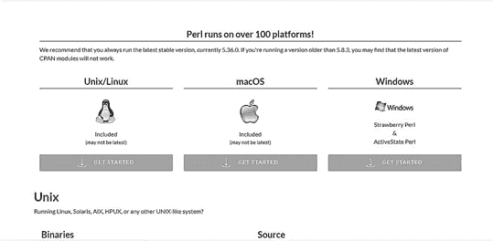

- 通过下载并遵循安装说明来安装 Perl。

### 开始 Windows 安装

- 完成用户许可协议。
- 决定安装哪些内容。
- 安装程序。
- 完成安装。

在完成安装程序后，可以使用任何 IDE 或文本编辑器来开发 Perl 代码，然后可以在 IDE 或命令提示符中使用以下命令运行代码：

```bash
perl file1.pl
```

### 开始 Linux 安装

- 修改安装 Perl 的路径。
- 开始安装过程。
- 选择 Perl 安装目录。
- 完成安装。


一旦安装过程完成，可以使用任何 IDE 或文本编辑器创建 Perl 代码，然后可以在 IDE 或命令提示符中使用以下命令启动：

```bash
perl file1.pl
```

### 开始 macOS 安装

- 开始。
- 完成用户许可协议。
- 选择安装位置。
- 安装程序。
- 安装现已完成。
- 在完成安装程序后，可以使用任何 IDE 或文本编辑器开发 Perl 代码，然后可以在 IDE 或命令提示符中使用以下命令运行：

```bash
Perl file.pl
```

## HELLO WORLD 程序

Perl 是一种专门为文本处理开发的计算机语言。该缩写代表“实用提取和报告语言”（Practical Extraction and Report Language）。它与多个系统兼容，包括 Windows、Mac OS 和几乎所有的 UNIX 变体。每种编程语言中的 Hello Everyone! 程序都为初学者学习该语言提供了一个开端。

简单的 Hello everyone 程序的运行是在屏幕上打印“Hello Everyone!”。

一个简单的 Perl 程序包含以下执行步骤：

**步骤 1：** 将文件传输给 Perl 解释器。

在 Perl 中，第一行始终以字符 `#!` 开始。它指示 Perl 解释器如何执行该文件。文件应该移动到 `/usr/bin/Perl` 子目录，其中包含 Perl 解释器。

```bash
#!/usr/bin/perl
```

**步骤 2：** Perl 指令（Pragma）

Pragma 是 Perl 包中的一个特殊模块，用于控制编译时或运行时的各种行为，例如严格性或警告。因此，以下是：

```perl
use strict;
use warnings;
```

**步骤 3：** 使用 `print()` 函数。

最后，我们使用 Perl 的 `print()` 方法显示字符串以输出结果。

```perl
print("Hello Everyone\n");
```

### 重要点

- 文件必须以 `.pl` 扩展名保存。
- Perl 包目录必须与程序文件保存的位置相同。

## PERL 程序的基础语法

Perl 是一种动态、高级别、解释型、通用的编程语言。Perl 最初设计用于文本处理，例如从特定的文本文件中提取必要信息并将文本文件转换为新格式。Perl 支持过程化编程和面向对象编程。

Perl 与 C 语言相似，这使得 C 和 C++ 程序员可以轻松上手。Perl 遵循一套基础语法，用于开发应用程序和软件，以及编写简单的 Perl 程序，这与其他编程语言相似。

该语法包含许多预定义的结构短语，例如关键字、用于存储值的变量、执行逻辑的表达式、用于遍历变量值的循环、组合语句的块，以及用于简化代码的子程序。

所有这些元素结合在一起，就构成了一个 Perl 程序。变量、语句和其他构成程序语法的因素会在每个 Perl 程序中使用，无论它是一个用于两个数相加的简单代码，还是启动 Web 脚本的复杂代码。

## 变量

变量是用户定义的单词，用于存储程序的值并用于评估代码。每个 Perl 程序都包含代码运行所需的值。除非使用变量，否则这些值无法被编辑或保存。只有当一个值保存到变量中并使用变量名时，该值才能被处理。

值是传递给程序以执行修改操作的数据。这些数据可以是数字、字符串、字符、列表等。

## 表达式

变量和运算符符号构成了 Perl 表达式。这些表达式定义了在相关代码提供的数据上执行的操作。在 Perl 中，表达式是指在求值时返回一个值的东西。表达式也可以是一个不带任何变量或运算符符号的值。它可以是一个整数，也可以是不带变量的字符串。

更复杂的表达式是通过正则表达式（Regex）对字符串和子字符串执行操作的表达式。

## 注释

Perl 开发人员经常利用注释系统，因为如果没有它，事情可能会迅速变得复杂。注释是开发者提供的关键信息，旨在帮助读者理解源代码。它描述了代码中所使用的推理或其部分内容。当我们无法再解答有关代码的问题时，注释对于那些维护或改进代码的人来说通常非常有帮助。这些通常被认为是一种良好的编程实践，它们不会影响程序的输出，但会提高整体的可读性。

### 在 Perl 中，有两种类型的注释

1. **单行注释：** Perl 中的单行注释以井号符号（`#`）开始，并持续到行尾。如果注释超过一行，请在后续行添加井号并继续注释。Perl 中的单行注释已被证明对变量、函数声明和表达式提供简要说明很有帮助。以下代码是单行注释的示例：

```
#!/usr/bin/perl $d = 10; # Assigning value to $d $e = 30; # Assigning value to $e $c = $d + $e; # Performing operation print "$c"; # Printing result
```

2. **作为注释的多行字符串：** Perl 中的多行注释是使用 `==` 和 `=cut.` 封围的文本块。当注释内容无法在单行显示且必须跨行时，这些注释非常有用。多行注释或段落为阅读你代码的人提供了文档。Perl 将 `==` 符号之后输入的所有内容都视为注释，直到后面跟着 `= cut` 为止。请记住 `=` 符号后面不能有空格。以下代码片段展示了多行注释的示例：

```
#!/usr/bin/perl =Assigning values to The variable $d and $e =cut $d = 10; $e = 30; =Performing operation and printing result =cut $c = $d + $e; print "$c";
```

## 语句

Perl 中的语句包含供编译器执行操作的指令。这些语句在运行时对变量和值执行操作。Perl 中的每个句子都必须以分号（`;`）结束。基本上，放在源代码中用于执行的指令被称为语句。Perl 编程语言中有几种类型的语句，例如赋值语句、条件语句和循环语句。这些都允许用户获得适当的输出。例如，`n = 60` 是一个赋值语句。

多行语句：Perl 中的语句可以通过简单的拆分为将其扩展到一行或多行。与 Python 等其他语言不同，Perl 寻找分号来结束句子。两个分号之间的每一行都被视为一个单一句子。

当程序员想要执行大量的计算且无法将语句放在一行上时，可以简单地将其拆分为多行。

## 块

块是执行相关操作的语句集合。在 Perl 中，可以使用大括号（`{}`）在（单个条件或循环下）并发执行多个语句。这创建了一个所有同时执行的语句块。该块可以通过将语句分组来优化程序。

在块内部声明的变量其作用范围限于该块，在块外部则没有用。它们只有在特定块运行时才会执行。

在前述代码中的变量 `$d` 作用范围限于此特定块，在块外部没有用。上面的块包含相互相关的操作操作语句。

## 函数或子程序

函数/子程序是编写在程序中执行指定任务的代码块。为了更好地理解函数的工作原理，我们将程序中的函数与现实工作场所中的人进行比较。假设经理分配员工计算年度预算的任务。那么，这个过程将如何完成？员工将从雇主那里获得统计信息，运行计算，计算预算，并将结果提供给主管。函数的运行方式类似。它们接受信息作为参数，运行一组语句，对这些参数执行操作，然后返回输出。

### Perl 提供两种主要类型的函数

- **内置函数：** Perl 拥有大量的内置库函数。这些函数已经过编码并保存为函数。要使用它们，我们只需要在需要时调用它们，例如 `sin()`、`cos()`、`chr()`、`return()` 和 `shift()`。

- **用户定义函数：** 除了内置函数，Perl 还允许我们编写自定义的自定义函数，即用户定义函数或子程序。

通过这种方式，我们可以开发自己的代码包并在需要时调用它们。

## 循环

与任何其他语言一样，Perl 使用循环反复执行一个语句或一组指令，直到或满足特定条件。这允许用户通过不重复编写代码来节省时间和精力。

Perl 提供了几种循环技术：

- `for` 循环
- `for each` 循环
- `until` 循环
- `while` 循环
- `do…while` 循环
- `嵌套循环`

在上面的示例中，两个代码块的功能完全相同；但缩进对于包含大量语句的脚本来说更具读者的友好性。

虽然在 Perl 代码中使用空格和缩进不是强制的，但这是一项推荐的实践。

## 关键字

关键字（通常称为保留字）是语言中用于内部过程或指示预定义操作的术语。它们对编译器具有特殊意义。因此，这些术语不允许作为变量名或对象，否则会导致编译时错误。与控制字一起，Perl 中的关键字包含了内置函数。

这些关键字偶尔可以用作变量名，尽管这会导致混淆并使调试此类程序变得困难。

## 数据类型

数据类型定义了 Perl 变量中可以存储的数据种类。Perl 是一种弱类型编程语言。在使用 Perl 程序时不需要提供数据类型。Perl 解释器将根据数据的上下文来选择类型。

Perl 有三种数据类型，如下：

- 标量 (Scalars)
- 数组 (Arrays)
- 哈希表 (Hashes)

### 标量

单个数据单元可以是整数、浮点值、字符、字符串、段落或整个网页。

### 数组

数组是存储相同数据类型值列表的变量。在 Perl 中，我们使用变量名前名前的 `@` 符号来声明数组。

它将生成一个包含值 20、30 和 40 的整数数组。`$` 符号用于访问数组中的单个成员。

### 哈希表

它是一组键值对的集合。它也被称为关联数组。在 Perl 中，我们使用 `%` 符号来声明哈希表。我们利用 `$` 符号后接括号中的键来获取特定值。

本章涵盖了 Perl 介绍、安装和环境搭建以及 Hello World 程序。

## NOTE

# 第 2 章 Perl 基础

DOI: [10.1201/9781003358442-2](https://doi.org/10.1201/9781003358442-2)

## 本章内容

- 编写模式
- 布尔值
- 操作符
- 变量
- Perl 中的模块 (Modules)
- Perl 中的包 (Packages)
- 数字及其类型
- 带有 CRUD 操作的目录

在上一章中，我们讨论了 Perl 基础，在本章中，我们将涵盖包、模块操作符、变量和编写模式。

## PERL 代码编写方法

Perl 是一种动态的、高级的、解释型的、通用编程语言。Perl 支持过程化编程和面向对象编程。Perl 最初仅设计用于系统管理和文本处理，但随后的版本包含了管理正则表达式、网络套接字等功能。

Perl 在语法上与其他常见的编程语言相似，易于编写和理解。Perl 是一种自由格式编程语言，这意味着可以根据用户的需要进行编写、格式化和缩进。

一个 Perl 程序由一系列语句、循环、子程序等组成，这便于在代码中导航。每个 Perl 语句必须以分号（`;`）结束。Perl 与其他语言一样为 Perl 代码提供了几种编写和执行模式。这些模式可以根据其与编写和执行模式的兼容性分类如下：

- 交互模式 (Interactive mode)
- 脚本模式 (Script mode)
- 单行模式 (One-liner mode)

这些模式可以在命令行中配合 Perl 关键字使用，也可以在在线集成开发环境 (IDEs) 中作为代码块使用。除了安装包，Perl 还有其内置的 IDE。

### 交互模式

通过交互方法创建 Perl 代码表示与解释器的交互。交互模式是开始编程的一种极佳方法，因为它允许你逐行检查代码流并简化调试过程。通过 Perl 调试器，Perl 的交互模式可以在命令行中使用。

这种解释器通常被称为 REPL – 读取 (Read)、评估 (Evaluate)、打印 (Print)、循环 (Loop)。交互模式允许立即创建和执行代码，而无需创建临时文件保存源代码。使用 Perl 调试器，内置的 Perl 命令行或 Windows 命令提示符都可以作为 REPL。可以使用以下命令配合 Perl 使用此调试器：

```
perl -de1
```

用户必须在编写 Perl 代码的交互模式下逐行编写代码并同步运行。

Perl 的交互模式可以直接从命令行运行，而不需要调试器。可以通过以下命令实现：

```
perl -e Code_statement;
```

此语句利用 `-e` 参数避免创建脚本，并允许代码在命令行中不使用调试器的情况下运行。

这种交互模式下的编写方式不允许用户像在调试器中那样创建多行代码。这种模式不建议用于长程序。

交互模式对于教授新程序员编程基础很有用，但在处理几行以上代码时可能会变得繁琐且乏味。

### 脚本模式

Perl 中的脚本模式用于开发包含多行代码且对于交互模式来说过于复杂的 Perl 程序。

使用文本编辑器，可以使用 Perl 的脚本模式来开发 Perl 程序；它被保存在一个名为脚本的文件中，然后在命令行运行该脚本文件。此文件必须以 `.pl` 扩展名保存，并存储在命令行指定的目录路径相同的目录中。然后使用以下命令从命令行执行该脚本：

```
perl FileName.pl
```

在文本编辑器（例如记事本）中输入代码并保存为 Perl 程序.pl 脚本。

与交互模式不同，Perl 的脚本模式无法为每个表达式提供输出。

在交互模式下，表达式会被评估并自动显示结果；而在脚本模式下，表达式会被评估，但在收到提示之前不会显示结果。

在线 IDE 也提供脚本模式，用于在不手动将代码放入文件的情况下开发和运行 Perl 代码。在这些 IDE 中，编译后的代码以临时文件的形式保存在内存中，只有在代码运行且包含 IDE 的浏览器打开时才有用。一旦页面刷新，该临时文件就会被删除，内存空间会被释放。在线 IDE 简化了代码的执行，因为它们比必须将文件存在机器内存中的脚本模式需要少的精力。

这加快了代码的编译和执行。这些在线 IDE 虽然对程序员很方便，但有重大的限制，例如，除非文件上传到它们的服务器，否则无法进行文件处理操作，这对敏感数据构成了风险。通过命令行运行的编译器允许此类文件操作能力。

这里是一个使用在线 IDE 相加两个整数的 Perl 程序示例：

```perl
#!/usr/bin/perl
# 数相加程序
## 给变量赋值
$var1 = 20;
$var2 = 35;
## 评估结果
$result = $var1 + $var2;
## 打印结果
print "Result after the addition is: $result";
```

### 单行模式

Perl 还有单行模式 (one-liner mode)，允许我们直接从命令行输入并运行最小代码脚本。这样做是为了防止为长度不长的代码创建存储脚本的文件。使用以下命令，可以在命令行模式下单行编写这些代码：

```
perl -e
```

该命令用于通过用双引号包裹代码在命令行处编写和执行单行代码。前述命令中的 `-e` 标志告知编译器脚本没有保存在任何文件中，而是直接写在该标志随后的双引号代码中。

这些单行命令（one-liners）对于快速进行修改（如获取信息和修改文件内容）非常有用。有些程序员避免使用单行命令，因为当脚本变得过长时，它们会变得笨拙。而另一些程序员倾向于这样做，因为单行命令比脚本更快，因为它们不需要存储在文件中。

## PERL 中的布尔值

在大多数计算机语言中，True（真）和 False（假）被视为布尔值。然而，Perl 没有为 True 和 False 提供布尔类型。当函数返回 True 或 False 时，程序员可能会使用“boolean”一词。标量（如条件表达式 `if`, `while` 等）会返回真或假。

**真值：** 在 Perl 中，任何除零以外的非数字都是真值。在 Perl 中，字符串常量如“true”、“false”、“00”（两个或更多零的字符）和“0n”（字符串中一个 0 后跟一个换行符）也被视为真值。

**假值：** 在 Perl 中，假值是空字符串、包含单个数字 0 的字符串或 `undef` 值以及零。

**注意：** 对于条件检查，如果用户必须比较两个不同的变量，如果它们不相等，则返回 False；否则返回 True。

## 运算符

运算符是任何计算机语言的构建块，允许程序员对操作数执行各种操作。在 Perl 中，运算符的符号将取决于操作数的类型（如标量和字符串）。根据其多种功能，运算符分为几类：

- 算术运算符
- 关系运算符
- 三元运算符
- 逻辑运算符
- 位运算符
- 赋值运算符

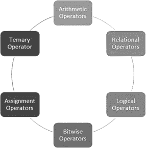

运算符的类型。

### 算术运算符

有多种类型的算术运算符。

#### 加法

这些用于在操作数上执行算术和数学运算。

要加上两个操作数的值，请使用 `+` 运算符。例如：`$x = 15; $y = 20; print $x + $y;` 这里的 Result 是 25

#### 减法

`−` 运算符从左侧操作数中减去右侧操作数。例如：`$x = 15; $y = 20; print $x - $y;` 这里的 Result 是 5

#### 乘法

`*` 运算符乘以运算符两边的值。例如：`$x = 15; $y = 20; print $x * $y;` 这里的 Result 是 300

#### 除法

当第一个操作数除以第二个操作数时，`/` 运算符返回余数。例如：`$x = 40; $y = 20; print $x / $y;` 这里的 Result 是 20

#### 取模

取模运算符 `%` 将左侧操作数除以右侧操作数并返回余数。例如：`$x = 10; $y = 15; print $x % $y;` 这里的 Result 是 5

#### 指数运算符

`**` 运算符用于计算操作数的指数（幂）。例如：`$x = 2; $y = 3; print $x ** $y;` 这里的 Result 是 8

该程序的目的是描述以下算术运算符：


# Perl 中的算术运算符

## 操作数

```perl
$x = 10; $y = 4;
```

## 使用算术运算符

```perl
print "加法结果: ", $x + $y, "\n";
print "减法结果: ", $x - $y, "\n" ;
print "乘法结果: ", $x * $y, "\n";
print "除法结果: ", $x / $y, "\n";
print "取模结果: ", $x % $y, "\n";
print "指数结果: ", $x ** $y, "\n";
```

# 关系运算符

在比较两个值时，会使用关系运算符。这些运算符将返回 1（真）或 0（假）。这些运算符也被称为等价运算符。这些运算符使用各种符号来处理字符串。我们可以利用此来学习比较运算符在字符串上的操作。

- 等于运算符：`==` 确定两个值是否相等。如果相等，返回 1，否则不返回任何。
- 不等于运算符：`!=` 检查两个值是否等效。如果值不相等，则返回 1；否则不返回任何。
- 等于比较运算符：`< = >` 如果左侧操作数小于右侧操作数，结果为 −1；否则结果为 0。
- 大于运算符：`>` 如果左侧操作数大于右侧操作数，则返回 1；否则不返回任何。
- 小于运算符：`<` 如果左侧操作数大于右侧操作数（注：原文可能有误，应为小于），则返回 1；否则不返回任何。
- 大于等于运算符：`>=` 如果左侧操作数大于或等于右侧操作数，则返回 1；否则不返回任何。
- 小于等于运算符：`<=` 如果左侧操作数小于或等于右侧操作数，则返回 1；否则不返回任何。

为了在 Perl 中演示关系运算符，编写一个程序：

```perl
### 用于阐明关系运算符的 Perl 程序
## 操作数
$x = 10; $y = 60;
### 使用关系运算符
if ($x == $y) {
    print "等于运算符为真\n";
} else {
    print "等于运算符为假\n";
}
if ($x != $y) {
    print "不等于运算符为真\n";
} else {
    print "不等于运算符为假\n";
}
if ($x > $y) {
    print "大于运算符为真\n";
} else {
    print "大于运算符为假\n";
}
if ($x < $y) {
    print "小于运算符为真\n";
} else {
    print "小于运算符为假\n";
}
if ($x >= $y) {
    print "大于等于运算符为真\n";
} else {
    print "大于等于运算符为假\n";
}
if ($x <= $y) {
    print "小于等于运算符为真\n";
} else {
    print "小于等于运算符为假\n";
}
if ($x <=> $y) {
    print "比较运算符为真\n";
} else {
    print "比较运算符为假\n";
}
```

# 逻辑运算符

这些运算符用于组合多个条件。

- 逻辑与（AND）：当两个条件都真时，`and` 运算符返回。
- 逻辑或（OR）：当至少一个条件为真时，`or` 运算符返回。
- 逻辑非（NOT）：`not` 运算符反转布尔值。

显示逻辑运算符的程序：

```perl
### 用于阐明逻辑运算符的 Perl 程序
## 操作数
$x = true; $y = false;
### 与运算符
$result = $x && $y;
print "逻辑与运算符结果: ", $result,"\n";
## 或运算符
$result = $x || $y;
print "逻辑或运算符结果: ", $result,"\n";
## 非运算符
$z = 0;
$result = not $z;
print "逻辑非运算符结果: $result";
```

# 位运算符

位运算通过这些运算符执行。它首先将整数转换为位，然后在操作数上执行位级操作。

- `&`（位与）：这是一个接收两个操作数并对每个位执行与运算的函数。只有当两个位都为 1 时返回 1。示例：`$x = 13; // 1101 $y = 5; // 0101 $z = $y & $x; print $z;` 这里的 Result 是 5。
- `|`（位或）：这是一个接收两个操作数并对每个位执行或运算的函数。只要其中一个位为 1 就返回 1。示例：`$x = 13; // 1101 $y = 5; // 0101 $z = $y | $x; print $z;` 这里的 Result 是 13。
- `^`（位异或）：它接收两个操作数并对每个位执行异或运算。如果两个位不同，则异或的结果为 1。示例：`$x = 13; // 1101 $y = 5; // 0101 $z = $y ^ $x; print $z;` 这里的 Result 是 9。
- `~`（取反运算符）是一个一元运算符，充当位翻转器。它的作用是反转位，并由于符号二进制数的原因以补码的形式返回结果。
- `<<` 二进制左移运算符接受两个整数，将第一个操作数的位左移，第二个操作数决定移动的位数。左操作数被乘以右操作数提供的次数。例如：`$x = 70; $z = $x << 2; print $z;` 输出：280。解释：`$70 * 2 = 140$` ---（1），`$140 * 2 = 280$` ---（2）。
- `>>` 二进制右移运算符接受两个数字，将第一个操作数的位右移，第二个操作数决定移动的位数。它将左操作数除以右操作数提供的次数。例如：`$x = 80; $z = $x >> 2; print $z;` 输出：15。解释：`$80 / 2 = 40$` ---（1），`$40 / 2 = 20$` ---（2）。

程序：展示位运算符如何工作：

```perl
## Perl Program to illustrate Bitwise operators
#!/usr/local/bin/perl
use integer;
### Operands
$x = 100;
$y = 2;
### Bitwise AND Operator
$result = $x & $y;
print "Bitwise AND: ", $result, "\n";
### Bitwise OR Operator
$result = $a | $b;
print "Bitwise OR: ", $result, "\n";
### Bitwise XOR Operator
$result = $x ^ $y;
print "Bitwise XOR: ", $result, "\n";
### Bitwise Complement Operator
$result = ˜$x;
print "Bitwise Complement: ", $result, "\n";
### Bitwise Left Shift Operator
$result = $x << $y;
print "Bitwise Left Shift: ", $result, "\n";
### Bitwise Right Shift Operator
$result = $x >> $y;
print "Bitwise Right Shift: ", $result, "\n";
```

# 赋值运算符

用于向变量分配值。赋值运算符的左操作数是一个变量，而赋值运算符的右操作数是一个值。

以下是赋值运算符的示例：

- `=`（简单赋值）：最基础的赋值运算符。该运算符将右侧的值赋值给左侧的变量。

  例如：`$x = 20; $y = 40;`

- `+=`（加赋值）：`+` 和 `=` 运算符的组合。该运算符首先将左侧变量的当前值加上右侧的值，然后将结果赋值给左侧变量。

  例如：`($x += $y)` 可以写为 `($x = $x + $y)`。

  如果 `$a` 的初始值为 5，那么 `($a += 6) = 11`。

- `-=`（减赋值）：该运算符结合了 `−` 和 `=` 运算符。该运算符从右侧的值中减去变量的当前值，并将结果的结果赋值给左侧变量。

  例如：`($x -= $y)` 可以写为 `($x = $x - $y)`。

  如果 `$a` 的初始值为 8，那么 `($a −= 6) = 2`。

- `*=`（乘赋值）：该运算符结合了 `*` 和 `=` 运算符。左侧的变量乘以右侧的值，并将结果赋值给左侧变量。

  例如：`($x *= $y)` 可以写为 `($x = $x * $y)`。

  如果 `$a` 的初始值为 5，那么 `($x *= 6) = 30`。

- `/=`（除赋值）：该运算符结合了 `/` 和 `=` 运算符。该运算符将左侧变量的当前值除以右侧的值，并将结果分配给左侧变量。

  例如：`($x /= $y)` 可以写为 `($x = $x / $y)`。

  如果存储在 `$a` 中的初始值为 6，那么 `($x /= 2) = 3`。

- `%=`（取模赋值）：该运算符结合了 `%` 和 `=` 运算符。该运算符在将结果赋值给左侧变量之前，通过右侧的值修改左侧变量的当前值。

  例如：`($x %= $y)` 可以写为 `($x = $x % $y)`。

  如果存储在 `$a` 中的初始值为 6，那么 `($a percent = 2) = 0`。

- `**=`（幂赋值）：该运算符是 `**` 和 `=` 运算符的混合。该运算符在将结果赋值给左侧变量之前，将左侧变量的当前值乘以右侧的值。

  例如：`($x **= $y)` 可以写为 `($x = $x ** $y)`。

  如果存储在 `$a` 中的初始值为 6，那么 `($a **= 2) = 36`。

程序：说明赋值运算符如何工作：

```perl
### program to demonstrate working of Assignment Operators
#!/usr/local/bin/perl
# taking two variables & using ## the simple assignments operation
$x = 8; $y = 5;
### using the Assignment Operators
print "The Addition Assignment Operator: ", $x += $y, "\n";
$x = 8; $y = 4;
print "Subtraction Assignment Operator: ", $x -= $y, "\n" ;
$x = 8; $y = 4;
print "Multiplication Assignment Operator: ", $x*=$y, "\n";
$x = 8; $y = 4;
print "Division Assignment Operator: ",$x/=$y, "\n";
$x = 8; $y = 5;
print "Modulo Assignment Operator: ", $x%=$y,"\n";
$x = 8; $y = 4;
print "Exponent Assignment Operator: ", $x**=$y, "\n";
```

# 三元运算符

它是一种条件运算符，是 `if else` 语句的简易版本。“三元”一词指的是它有三个操作数。根据布尔表达式的值，它将返回两个值中的其中一个。

注意：三元运算符中的条件也可以是利用其他运算符（如关系运算符和逻辑运算符）生成的任何表达式。

# Perl 中的变量

变量在整个 Perl 中用于存储和处理数据。变量在创建时会占用内存空间。变量的数据类型有助于解释器分配内存并决定存储什么。

变量是用于存储值的预留内存位置。这意味着创建变量会释放内存空间。变量的数据类型有助于解释器分配内存，并决定在预留内存中存储什么内容。因此，通过为变量分配不同的数据类型，变量可以存储整数、小数或字符串。

Perl 有三种基本数据类型，如下所示：

- 标量（Scalars）
- 数组（Arrays）
- 哈希/关联（Hashes）

结果，Perl 将使用三种类型的变量。标量变量以美元符号（`$`）为前缀，可以存储数字、字符串或引用。数组变量用 `@` 符号表示，存储有序的标量列表。哈希变量以百分号符号 `%` 为前缀，将用于存储键值对集合。

## 创建变量

为了预留内存空间，`perl` 变量不需要显式声明。与其他计算机语言一样，`=` 运算符左侧的操作数是变量名，`=` 运算符右侧的操作数是存储在变量中的值。

例如：`$age = 30; $name = "Sima"; $rollno = 32;` 这里，`30`、`"Sima"` 和 `32` 分别赋值给 `$age`、`$name` 和 `$rollno` 变量。

## 标量变量

标量是一个单一的数据单元。数据可以是整数、浮点数、字符、字符串、段落或整个网页。这里有一个使用标量变量的示例：

```perl
#!/usr/bin/perl
## 为标量变量赋值
$age = 30; $name = "Sima"; $rollno = 32;
## 打印变量值
print "Age = $age\n";
print "Name = $name\n";
print "Roll no = $rollno\n";
```

## 数组变量

数组变量存储有序的标量值列表。数组数据类型变量以“at”（`@`）符号为前缀。美元符号（`$`）指变量名后跟方括号中索引的单个数组元素。这里有一个使用数组变量的示例：

```perl
#!/usr/bin/perl
### 为数组变量赋值
@ages = (43, 70, 33);
### @ 用于声明 数组变量
@names = ("ABC", "DEF", "GHI");
### 打印数组的值
print "\$ages[0] = $ages[0]\n";
print "\$ages[1] = $ages[1]\n";
print "\$ages[2] = $ages[2]\n";
print "\$names[0] = $names[0]\n";
print "\$names[1] = $names[1]\n";
print "\$names[2] = $names[2]\n";
```

我们在 `$` 符号之前使用了 `\` 将其作为语句打印。否则，Perl 将其解释为变量并打印存储在其中的值。

## 哈希变量

哈希是键值对的集合。哈希变量以模（`%`）符号为前缀。在哈希中，键用于引用单个变量。在花括号中，哈希变量名后跟与值关联的键以访问这些元素。这里是一个哈希变量的简单示例：

```perl
#!/usr/bin/perl
# 使用 ’%’ 定义哈希变量
%data = (’ABC’, 55, ’DEF’, 80, ’GHI’, 44);
### 打印哈希变量的值
print "\$data{’XYZ’} = $data{’ABC’}\n";
print "\$data{’LGH’} = $data{’DEF’}\n";
print "\$data{’KMR’} = $data{’GHI’}\n";
```

## 变量上下文

Perl 根据上下文（即变量使用的情况）对同一个变量进行不同的处理。

`@names` 是一个数组，在此上下文中使用了两次。首先，我们将其复制到另一个数组（即列表）中，这样如果上下文是列表上下文，它将返回所有元素。然后尝试将同一个数组存储在标量上下文中，默认情况下只返回该数组中的元素数量。下表描述了各种上下文：

| 序号 | 上下文及描述 |
| --- | --- |
| 1. | **标量** 在标量上下文中，赋值给标量变量会求值 `=` 右侧的值。 |
| 2. | **列表** 在列表上下文中，赋值给数组或哈希会求值 `=` 右侧的内容。 |
| 3. | **布尔** 布尔上下文是一个对表达式进行求值以判断其为真还是为假的地方。 |
| 4. | **空** 此上下文不关心返回值是什么，它甚至不想要返回值。 |
| 5. | **插值** 此上下文只会出现在引号（“”）或具有类似引号行为的内容（“”）中。 |

# 变量的作用域

变量的作用域是程序中可以访问变量的区域。程序变量的可见性称为作用域。我们可以在 Perl 中声明全局变量或私有变量。局部变量（Lexical variables）是私有变量的另一个名称。

## 全局变量的作用域

全局变量可以在程序创建的任何函数或块中使用。它在整个程序中都是可见的。全局变量可以直接使用，并可以从程序的任何地方访问。

该模块的 Perl 文件如下所示：

```perl
#!/usr/bin/perl
## Using the Message.pm package
use Message;
## Defining the value to variable
$Message::username = "Peeks";
## Subroutine-call Message::Hello();
```

## 使用预定义模块

Perl 有几个预定义的模块，可以随时在 Perl 程序中使用，例如 `strict` 和 `warnings`。

# Perl 包（PACKAGES）

Perl 包（package）是一组储存在其特定命名空间中的代码。Perl 模块（module）是定义在与包同相同且扩展名为 `.pm` 的文件中的包。同名的变量或函数可能存在于两个不同的模块中。任何不属于包的变量都属于主包（main package）。因此，所有使用的变量都是 `main` 包的一部分。额外包的确保确保来自不同包的变量不会相互干扰。

## Perl 模块声明

模块名称必须与包名相同，并具有 `.pm` 扩展名。

该文件名为 `Calculator.pm`，存储在目录 `Calculator` 中。为了向解释器返回真值，在函数后面写入 `1`。除了 `1`，Perl 也接受任何为真的值。

## 使用 Perl 模块

我们利用 `need` 或 `use` 函数来访问此计算器模块。`::` 用于访问模块中的函数或变量。这里有一个示例展示：


进入`/path/to/xxx`目录，找到`xxx.json`。

在表达式`cvar = avar + bvar`中，加法运算符（`+`）将`avar`与`bvar`相加，得到它们的和`cvar`。

在`List.of(arg0, arg1, arg2)`中，`List`接口的工厂方法`of()`接受一系列的元素，返回包含它们的只读列表。

之后我们这样调用`cmd`命令：`cmd arg0 arg1 arg2`。

```
if (condVar > someVal) {console.log("xxx")}
```

```perl
#!/usr/bin/perl
# Using Package ’Calculator’
use Calculator;
print "Enter the two numbers to add";
### Defining values to variables
$x = 10;
$y = 20;
### Subroutine-call Calculator::addition($x, $y);
print "\nEnter the two numbers to subtract";
### Defining values to the variables
$x = 30;
$y = 10;
### Subroutine-call Calculator::subtraction($x, $y);
```

### 使用不同的目录访问包

如果访问包的文件位于目录之外，我们使用`::`来指定模块的路径。例如，因为使用计算器模块的文件位于`calculator`包之外，我们编写`Calculator::Calculator`来加载该模块，其中`::`左侧的值代表包名，`::`右侧的值代表Perl模块名。为了说明，请考虑以下示例：

```perl
#!/usr/bin/perl
use GFG::Calculator;
### Directory_name::module_name
print "Enter the two numbers to add";
### Defining values to variables
$x = 10;
$y = 20;
### Subroutine-call Calculator::addition($x, $y);
print "\nEnter the two numbers to subtract";
### Defining values to the variables
$x = 30;
$y = 10;
### Subroutine-call Calculator::subtraction($x, $y);
```

### 利用模块变量

在这些变量之前声明来自各个包的变量允许它们被利用。下面的示例说明了这一点。

该模块的Perl文件如下所示。

### BEGIN 和 END 块

当我们希望在开始运行某些代码并在结束运行某些代码时，我们利用`BEGIN`和`END`块。`BEGIN...`中的代码在脚本开始时运行，而`END...`中的代码在结束时执行。在以下程序中演示了这一点：

```perl
#!/usr/bin/perl
### Predefined BEGIN block
BEGIN {
    print "In begin block\n";
}
### Predefined END block
END {
    print "In end block\n";
}
print "Hello Everyone;\n";
```

## PERL 中的数字及其类型

在Perl中，数字是一个数学对象，可以用于计数、测量和执行不同的数学运算。数字符号（numeral）是象征数字的记法符号。除了用于数学运算外，这些符号还用于排名（以序列号的形式）。

这些数字可以根据其应用分为几类：

- **整数 (Integers)：** Perl整数表示为以10为底的进制数。这些数字可能是正的也可能是负的。另一方面，Perl采用`_`来表示大整数值以提高可读性。例如：`213,254,484`表示为`213_254_484`。

```perl
#!/usr/bin/perl
### Positive-Integer
$c = 30;
### Negative-Integer
$d = -25;
### Big Integer-Number
$e = 213_254_484;
### Printing these numbers
print("Positive Integer: ", $c, "\n");
print("Negative Integer: ", $d, "\n");
print("Big Integer: ", $e, "\n");
```

- **浮点数 (Floating point numbers)：** 在Perl中，浮点数由整数部分和小数部分组成，由小数点分隔。浮数的整数部分可以是正的或负的，而小数部分只能是正的。在Perl中，浮数可以用两种方式表示：

    - **定点法 (Fixed point)：** 在这种格式下，小数点是固定的。这个小数点标记了小数部分的开始。

    - **科学计数法 (Scientific)：** 这种表示法包含两个部分：系数（实际数字）和指数（系数所乘的10的幂次）。

```perl
#!/usr/bin/perl
### Positive Floating-Number
$c = 20.5647;
### Negative Floating-Number
$d = -15.2451;
### Scientific-value
$e = 123.5e-10;
### Printing these numbers
print("Positive Number: ", $c, "\n");
print("Negative Number: ", $d, "\n");
print("Scientific Number: ", $e, "\n");
```

- **十六进制数 (Hexadecimal numbers)：** 十六进制数字基数为16，范围从0到15，并在数字前加上`0x`写为`0xa`，这里的`a`代表十六进制形式中的值10。这些字母代表10–15，范围从`a`到`f`。十六进制数字可以有正值和负值。

因此，`%x`用于以十六进制格式显示数字的值，如上所示。

- **八进制数 (Octal numbers)：** 八进制数是基数为8的数字，范围从0到7。这些数字表示为`057`，数字前面有一个`0`，其余部分为十进制值。八进制数像其他类型一样可以是正的也可以负的。

    `%o`在此处用于输出八进制值。

- **二进制数 (Binary numbers)：** 二进制数基数为2，范围从0到1。这些数字写为`0b1010`，在数字前带有`0b`。

    `%b`用于以二进制格式显示数字。

## PERL 中目录的增删改操作

Perl是一种通用且跨平台的编程语言，主要用于文本处理，并用于开发多种软件应用程序，如Web开发和图形界面应用程序。它优于其他编程语言因为它更快更强大，而且包含许多有助于快速创建脚本的快捷方法。

对目录执行以下操作：

- 创建新目录

- 打开现有目录

- 读取目录内容

- 修改目录路径

- 关闭目录

- 删除目录

### 创建新目录

`mkdir(PATH, MODE)`用于创建目录。此函数协助创建新目录；如果用户想检查文件是否存在，可以使用`-e`函数。`PATH`使用`MODE`函数指定的模式设置路径。

### 打开现有目录

在Perl中，短函数`opendir(DIRHANDLE, PATH)`用于打开目录。`PATH`参数定义了要打开的目录路径。

### 在标量和列表中读取目录

读取目录是一项常规操作，因为每次运行或理解代码时都必须读取存储在文件中的内容。`readdir(DIRHANDLE)`用于读取目录。用户可以用标量上下文和列表上下文两种方式读取目录。

在列表上下文中，代码返回目录中的所有剩余条目。如果目录中的条目为空，则在标量上下文中返回未定义值，在列表上下文中返回空列表。

**标量上下文：**

```perl
#!/usr/bin/perl
use strict;
use warnings;
use 5.010;
### 目录路径
my $directory = shift // ’C:\Users\GeeksForGeeks\Folder’;
### 打开目录
opendir my $dh, $directory or die "Could not open ’$directory’ for the reading ’$!’\n";
### 打印目录内容
while (my $content = readdir $dh) {
  say $content;
}
### 关闭目录
closedir $dh;
```

**列表上下文：**

```perl
#!/usr/bin/perl
use strict;
use warnings;
use 5.010;
### 目录路径
my $directory = shift // ’C:\Users\PeeksForPeeks\Folder’;
### 打开目录
opendir my $dh, $directory or die "Could not open ’$directory’ for the reading ’$!’\n";
### 读取文件内容
my @content = readdir $dh;
### 打印目录内容
foreach my $content (@content) {
  say $content;
}
### 关闭目录
closedir $dh;
```

### 修改目录路径

`chdir()`方法用于修改目录。此函数协助更改目录并将其发送到不同的位置。当在脚本中调用时，`chdir()`函数将更改脚本剩余部分的目录。如果从脚本内部调用此函数，终端上的目录将不会更新。然而，当直接使用新目录路径调用时，终端将同时显示差异。

### 关闭目录

`closedir DIRHANDLE`用于关闭目录。`DIRHANDLE`是使用`opendir`函数打开的目录句柄。

### 删除目录

可以使用`rmdir`函数来删除目录。只有当提供的`FILENAME`目录为空时，该函数才会删除该目录；如果成功，它返回真；否则返回假。

在本章中，我们涵盖了Perl的基础知识，讨论了编写模式、布尔值、运算符和变量。此外，我们还涵盖了Perl模块、Perl包、数字及其类型，以及带有CRUD操作的目录。

## NOTES

# 第 3 章：Perl 中的输入与输出

DOI: [10.1201/9781003358442-3](https://doi.org/10.1201/9781003358442-3)

## 本章内容

* `print()`和`say()`的用法

* `print`运算符

* 使用`STDIN`进行输入

在上一章中，我们涵盖了Perl的基础，在本章中，我们将涵盖输入和输出及其相关示例。

## PERL `print()` 和 `say()` 方法

Perl使用语句和表达式对用户提供的输入或代码中呈现的硬编码输入进行求值。因为在编译器中已进行了求值，所以求值后的表达式不会显示给程序员。Perl使用`print()`和`say()`函数来显示求值后的表达式。这些程序可以显示传递给它们的任何参数。

### `print()` 运算符

Perl中的`print()`运算符用于打印传递作为输入的列表中的表达式值。`print`运算符返回传递给它的任何参数，无论是字符串、数字、变量还是其他内容。该运算符的定界符是双引号（“”）。

上面的示例使用`print`函数同时打印两个字符串，但它们被写在同一行上。为了避免这种情况并将它们打印在不同的行上，我们必须使用`\n`运算符，它在每次使用时都会换行。

如果我们使用单引号代替双引号，`print()`方法将不会输出变量的值或语句中转义字符（例如`\n`）。这些字符将完整地打印，而不会被求值。

### `say()` 函数

Perl中的`say()`方法与`print()`函数的功能相似，有一个细微的区别：`say()`函数会自动在语句末尾插入换行符，不再需要使用换行符`\n`来换行。

我们使用`use 5.010`来利用`say()`函数，因为较新版本的Perl不支持早期版本的某些功能；因此使用旧版本来运行`say()`方法。

## `print` 运算符

在Perl中，`print`运算符用于打印作为参数传递的列表中的表达式值。`print`运算符返回传递给它的任何参数，无论是字符串、数字、变量还是其他内容。该运算符的定界符是双引号（“”）。

## 使用 `STDIN` 进行输入

Perl允许程序员接收用户输入并对其进行操作。这允许用户输入除程序员提供的硬编码输入以外的内容。然后可以使用`print()`方法来解析并打印这些输入。

`<STDIN>`可以为Perl提供键盘输入。`STDIN`是标准输入（Standard Input）的缩写。不需要在“钻石”和“太空”运算符`< >`之间包含`STDIN`。这是标准步骤。`< >`运算符也可以写入文件。`<STDIN>`可用于标量和列表上下文。

在输入内容后，上面的代码我们需要按ENTER键。这个ENTER指示编译器运行下一行代码。然而，`<STDIN>`将ENTER键视为输入的一部分，并在我们按下时打印该行。在输入字符串之后，会自动写入一个新行。为了避免这种情况，使用了`chomp()`方法。该方法将删除用户提供的输入末尾的换行符。

在本章中，我们涵盖了`print()`和`say()`的用法、`print`运算符以及用于输入的`STDIN`。

# 第 4 章：Perl 中的控制流

DOI: [10.1201/9781003358442-4](https://doi.org/10.1201/9781003358442-4)

## 本章内容

* 决策

* 循环

* `when`语句

* `goto`运算符

* `next`运算符

* `redo`运算符

在上一章中，我们讨论了Perl中的输入和输出，在本章中，我们将涵盖控制流语句。

## Perl 中的决策

编程中的决策类似于生活中的决策。当编程中满足给定条件时，必须执行特定的代码块。控制语句用于编程语言中根据特定标准控制程序的执行流。这些语句影响执行流根据程序状态的变化进行进展和分支。

**Perl决策语句：**

* `if`

* `if else`

* `nested if`（嵌套if）

* `if elsif ladder`（if elsif阶梯结构）

* `unless`

* `unless else`

* `unless elsif`

### `if` 语句

`if`语句与其他编程语言中的语句类似。它用于执行简单的基于条件的任务。它用于确定是否将执行特定的语句或语句块；例如，如果给定条件为真，则执行一个语句块；否则，不执行。

如果在`if`语句中没有使用大括号`{}`，将产生编译时错误。因此，在`if`语句中必须使用括号`{}`。

**流程图：**

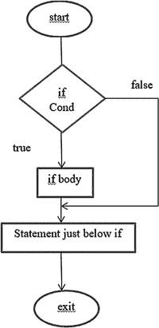

`if`语句。

### `if else` 语句

如果条件为真，`if`语句评估代码；如果条件为假，则使用`else`语句。它指示代码在条件为假时做什么。

**流程图：**

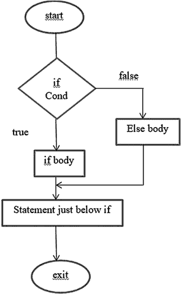

`if else`语句。

### `nested if` 语句

嵌套`if`是`if`语句内部的`if`语句。在这种情况下，`if`语句是另一个`if`或`else`语句的目标。当多个条件必须为真且其中一个条件是父级条件的子条件时，可以使用嵌套`if`。

**流程图：**

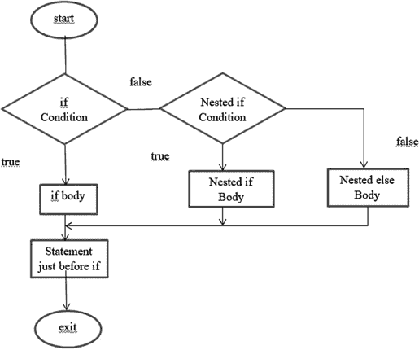

`nested if`语句。

### `if elsif ladder` 语句

用户可以在此处从多个备选项中选择。`if`语句按照列出的顺序执行。当满足某个`if`条件时，执行与该条件相关的语句，并跳过阶梯结构中的剩余部分。如果没有任何条件被满足，则使用最后一个`else`表达式。¹

**流程图：**

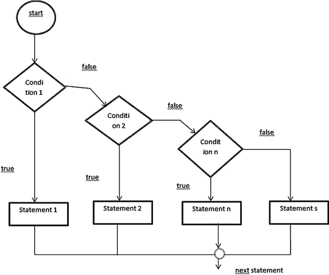

`if else if`语句。

### `unless` 语句

如果条件为假，则将执行语句。在布尔上下文中，数字`0`、空字符串`""`、字符`"0"`、空列表`()`和`undef`均为假，而所有其他值均为真。

**流程图：**

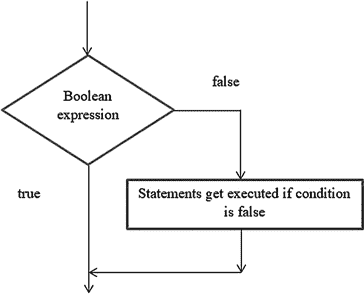

`unless`语句。

### `unless else` 语句

当布尔表达式为真时，`unless`语句之后会跟一个可选的`else`语句。

**流程图：**

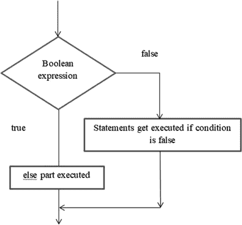

`unless else`语句。

### `unless elsif` 语句

`unless`语句和可选的`elsif`可以跟在`unless...else`语句之后，这允许我们使用单个`unless...elsif`语句测试许多条件。

**记住以下内容：**

`unless`语句可以有任意数量的`elsif`，且它们都必须出现在`else`之前。

`unless`语句可以有零或一个`else`，并且必须出现在任何`elsif`语句之后。

当某个`elsif`成功时，将不再尝试其他的`elsif`或`else`。

**流程图：**

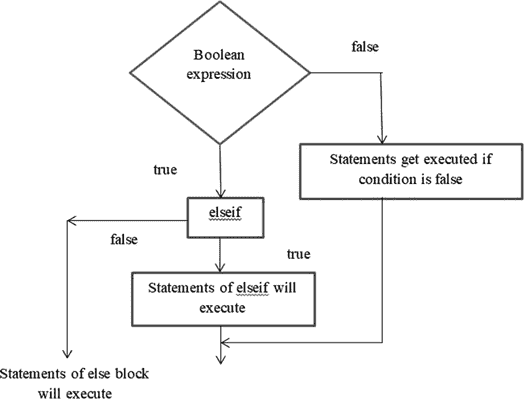

`unless elsif`语句。

## PERL 中的循环

在编程语言中，循环是一种允许在某些条件为真时重复执行一组指令或函数的特性。循环使代码编写员的工作变得更容易。Perl支持多种形式的循环来处理程序中的条件情况。下文将讨论Perl的循环。

### `for` 循环

“for”循环是表示循环结构的一种简写方式。与`while`循环不同，`for`语句在单行内消耗初始化、条件和递增/递减，从而产生更短、更易调试的循环结构。

**流程图：**

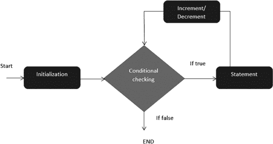

Perl中的`for`循环。

`for`循环在预定义的控制流上运行。以下因素影响控制流：

* `init statement`：初始化语句是第一个执行的初始语句。在此阶段，我们设置一个变量来控制循环。


# Perl 控制流与文件处理

## 循环控制

### for 循环

- `condition`：在此阶段评估指定的条件，如果条件为真（`True`），则执行 `for` 循环。因为条件在执行循环语句之前经过验证，所以它也是一种入口控制循环。
- `Statement execution`：当条件为真时，执行循环体中的语句。
- `increment/decrement`：在此对循环控制变量递增或递减，以更新下次迭代的变量。
- `Loop termination`：当满足条件时，循环终止，表示其生命周期的结束。

### foreach 循环

`foreach` 循环遍历列表，变量一次存储一个列表项的值。它主要用于我们拥有一个列表数据集合，并希望遍历列表元素而非其范围的情况。循环会自动执行每个元素的迭代。

### while 循环

`while` 循环通常接受一个封装在括号内的表达式。如果该表达式为真（`True`），则执行 `while` 循环体内的代码。当不知道想要循环执行多少次，但知道循环的终止条件时，就会使用 `while` 循环。因为条件在执行循环之前经过验证，所以它也被称为入口控制循环。`while` 循环类似于循环 `if` 语句。

### 无限 while 循环

`while` 循环可以无限持续，这意味着它没有结束条件。换句话说，某些情况保持为真，导致 `while` 循环无结束或永不完成。

**示例：** 以下应用程序将无限期打印提供的语句，并在在线 IDE 上显示运行时错误“Output Limit Exceeded”（输出限制超出）。

### do...while 循环

`do...while` 循环与 `while` 循环之间的唯一区别是 `do...while` 循环至少执行一次。在初始执行之后，会验证条件。当我们希望循环至少执行一次时，使用 `do...while` 循环。因为条件是在执行循环之后验证的，所以也被称为退出控制循环。

### until 循环

`while` 循环的反面是 `until` 循环。它接受括号中的条件，并只运行到该条件为假（`false`）为止。它本质上是重复某条指令或指令序列直到条件为假（`FALSE`）。它也是一种入口控制循环，这意味着首先测试条件，然后执行块内的指令序列。

### 嵌套循环

嵌套循环是包含在另一个循环内部的循环。Perl 编程也支持嵌套循环。上述列出的所有循环都可以进行嵌套。

Perl 多个嵌套循环的语法：

- **嵌套 for 循环**：`for (init statement; condition; increment/decrement ) { for (init statement; condition; increment/decrement ) { # 执行的代码 } }`
- **嵌套 foreach 循环**：`foreach variable_1 (@array_1) { foreach variable_2 (@array_2) { # 执行的代码 } }`
- **嵌套 while 循环**：`while (condition) { while (condition) { # 执行的代码 } }`
- **嵌套 do...while 循环**：`do{ do{ # 执行的代码 }while(condition); }while(condition);`
- **嵌套 until 循环**：`until (condition) { until (condition) { # 执行的代码 } }`

## given-when 语句

在 Perl 中，`given-when` 语句替换了将变量与多个整数值比较的长 `if` 语句。

`given-when` 语句是一种带有许多选项的分支语句。它允许我们根据表达式的值轻松将执行路由到代码的不同区域。

- 提供了一种控制语句，允许值改变执行控制。

Perl 中的 `switch-case` 类似于 C/C++、Python 或 PHP 中的 `switch-case`。它也像 `switch` 语句一样，将许多 `if` 语句替换为不同的 `case`。

`given-when` 语句还包含两个额外的关键字：`break` 和 `continue`。这些关键字保持程序的流动，并有助于退出程序或跳过特定值的执行。

**break:**：`break` 关键字用于退出 `when` 块。在 Perl 中，不需要在每个 `when` 块后显式表示 `break`。它已经隐式定义。

**continue:**：相反，如果第一个 `when` 块正确，`continue` 将进入下一个 `when` 块。

`given-when` 语句中的条件语句不能在多个 `when` 语句中重复，因为 Perl 只检查该条件的第一次出现处，随后的重复语句会被忽略。此外，默认语句必须放在所有 `when` 语句之后，因为编译器会顺序检查每个 `when` 语句的条件匹配，如果我们在中间插入默认语句，它将跳断并打印默认语句。

### 嵌套 given-when 语句

`given-when` 嵌套语句是指包含在其他 `given-when` 语句内部的 `given-when` 语句。这可能用于对于给定的输出集保持用户提供输入的层级结构。

这是一个嵌套的 `given-when` 语句示例：

```perl
#!/usr/bin/perl
### 用于打印相应日期的程序
### 使用 given-when 语句处理日期代码
use 5.010;
### 要求用户提供日期代码
print "Enter daycode between 0-6\n";
### 使用 chomp 移除换行符
chomp(my $daycode = <>);
### 使用 given-when 语句
given ($daycode) {
    when (’0’) { print ’Sunday’ ;}
    when (’1’) {
        print "What time of day is it?\n";
        chomp(my $daytime = <>);
        # 嵌套 given-when 语句
        given($daytime) {
            when(’Morning’) {print ’It is Monday Morning’};
            when(’Noon’) {print ’It is Monday noon’};
            when(’Evening’) {print ’It is Monday Evening’};
            default{print’Invalid Input’};
        }
    }
    when (’2’) { print ’Tuesday’ ;}
    when (’3’) { print ’Wednesday’ ;}
    when (’4’) { print ’Thursday’ ;}
    when (’5’) { print ’Friday’ ;}
    when (’6’) { print ’Saturday’ ;}
    default { print ’Invalid daycode’;}
}
```

当输入的日期代码为 1 以外的任何值时，代码不会运行嵌套的 `given-when` 块，输出将与上一个示例相同；但是，如果我们提供 1 作为输入，代码将执行嵌套的 `given-when` 块，结果将与上一个示例不同。

## goto 语句

Perl 中的 `goto` 语句是一种跳转语句，有时被称为无条件跳转语句。`goto` 语句可以从函数内部的一个位置跳转到另一个位置。

上述语法中的 `goto` 语句指示编译器立即去/跳转到指定为 `LABEL` 的语句。`label` 是一个用户定义的标识符，在此例中指定目标语句。目标语句是紧跟在“label” 之后的语句。

在 Perl 中，`goto` 语句有三种形式：`Label`、`Expression` 和 `Subroutine`。

- `Label`：它将跳转到 `LABEL` 指出的语句，并从那里继续执行。
- `Expression`：这种形式包含一个表达式，在求值后返回一个 `Label` 名称，`goto` 将使其跳转到被标记的语句。
- `Subroutine`：`goto` 将编译器从当前正在执行的子程序移动到提供名称的子程序。

**带有 LABEL 名称的 goto：** `LABEL` 名称用于跳转到代码中的特定语句并从那里开始执行。然而，它的范围是限制的。它只能在调用的作用域内运行。

**使用 Expression 的 goto：** 也可以使用表达式来调用特定标签并将控制权传递给该标签。当此表达式传递给 `goto` 语句时，它会被评估为标签名称，执行将从该标签名称描述的语句继续。

**带有 Subroutine 的 goto：** `goto` 命令也可以调用子程序。根据其用法，该过程可以从另一个子程序内部调用，也可以单独调用。它将下一个要执行的任务留在调用语句附近。这种方法可以递归地调用函数来打印一系列或范围内的字符。

## next 运算符

在 Perl 中，`next` 运算符会跳过当前循环执行，并将迭代器移动到 `next` 指定的值。如果程序中指定了标签，执行将进入由 `Label` 指定的下次迭代。

## redo 运算符

在 Perl 中，`redo` 运算符将从指定的标签开始，而不求值条件表达式。一旦调用了 `redo`，该块中的后续语句将不再执行。即使有 `continue` 块，在 `redo` 调用之后也不会执行。当 `redo` 运算符配合 `Label` 使用时，执行从由 `Label` 定义的循环开始。

## last 中的 last

`last` 关键字用于循环控制语句，使循环的当前迭代成为最后一次。如果提供了标签，它将通过该标签退出循环。

在本章中，我们涵盖了 Perl 中的控制流语句。

# 第 5 章 Perl 中的文件处理

DOI: [10.1201/9781003358442-5](https://doi.org/10.1201/9781003358442-5)

## 本章内容

- 文件处理简介
- 打开和读取文件
- 写入和追加文件
- 读取 CSV 文件
- 文件测试操作符
- 文件锁定
- Slurp 模块的使用
- 有用的文件处理函数

在上一章中，我们讨论了控制流语句，在本章中，我们将涵盖文件处理。

## 文件处理简介

Perl 中的 `FileHandle` 将一个名称与外部文件连接，该连接可以使用一直到程序终止或 `FileHandle` 关闭。总而言之，`FileHandle` 是一种用于编辑外部文件内容的连接，该连接（`FileHandle`）被命名以便于访问和方便使用。

`STDIN`、`STDOUT` 和 `STDERR` 是 Perl 中三个基本的 `FileHandles`，分别代表标准输入、标准输出和标准错误设备。

`open` 函数通常用于文件处理。

`Mode` 和 `FileName` 也可以组合产生单个 `open` 表达式。

`close` 函数用于关闭 `FileHandle`。

### 使用 FileHandle 读取和写入文件

`print` 函数用于读取 `FileHandle`。

`print` 函数用于写入文件。

### 各种文件处理模式

| 模式 | 说明 |
| --- | --- |
| `<` | 只读模式 |
| `>` | 写入模式（会清空文件） |
| `>>` | 追加模式 |
| `+<` | 读写模式 |
| `+>` | 读写模式 |
| `+>>` | 读写模式 |

1. **Mode = `<`**

此模式是只读的。此模式用于读取文件内容。

**示例：** 考虑 `Hello.txt`，初始包含“Welcome”。

```perl
#!/usr/bin/perl
### 以只读模式打开文件
open(r, "<", "Hello.txt");
### 打印内容
print(<r>);
### 关闭
close(r);
```

2. **Mode = `>`**

这是写入模式。当我们用此模式打开文件时，原始内容会被删除。如果没有同名文件，将创建一个。

```perl
#!/usr/bin/perl
### 以只读模式打开文件
open(r, "<", "Hello.txt");
### 打印现有内容
print("Existing Content of Hello.txt: ". <r>);
### 以写入模式打开文件
open(w, ">", "Hello.txt");
### 将指针移到开头
seek r, 0, 0;
print("\n 写入写入...");
### 使用 w 写入
print w "The Content of this file changed";
### 关闭
close(w);
### 将指针移到开头
seek r, 0, 0;
### 打印更新后的内容
print("\nUpdated Content of Hello.txt: ".<r>);
### 关闭
close(r);
```

3. **`>>`**

追加模式。当我们用此模式打开文件时，原始内容不会被删除。由于字符串总是附加在末尾，此模式无法用于覆盖。如果没有发现同名文件，将创建一个。

```perl
#!/usr/bin/perl
### 以只读模式打开文件
open(r, "<", "Hello.txt");
### 打印现有内容
print("Existing Content of Hello.txt: ". <r>);
### 以追加模式打开文件
open(A, ">>", "Hello.txt");
### 将指针移到开头
seek r, 0, 0;
print("\n 追加写入...");
### 使用 A 追加
print A " Hello Everyone!";
### 关闭
close(A);
### 将指针移到开头
seek r, 0, 0;
### 打印更新后的内容
print("\nUpdated Content of Hello.txt: ".<r>);
### 关闭
close(r);
```

4. **Mode = `+<`**

这被称为读写模式。此函数可以用于替换文件中的现有字符串。它无法创建新文件。

```perl
#!/usr/bin/perl
### 以读写模式打开 Hello1.txt
open(rw, "+<", "Hello1.txt");
### 打印文件的原始内容。
# rw 被设置为末尾。
print("Existing Content of the Hello1.txt: ".<rw>);
# 字符串附加在文件原始内容的末尾。
print rw "Added using the Read -Write Mode.";
# 将 rw 设置为文件的开头以便读取。
seek rw, 0, 0;
### 打印文件的更新内容
print("\nUpdated contents of Hello1.txt: ".<rw>);
# 关闭文件句柄
close(rw);
```

## 5. Mode = `+>`

这被称为读写模式。`+` 和 `+>` 的区别在于，`+>` 即使在同名文件存在的情况下也可以创建一个新文件，而 `+` 则不能。

```perl
#!/usr/bin/perl
# 以读模式打开文件 Hello1.txt
open(r, "<", "Hello1.txt");
### 打印文件的现有内容
print("Existing Content of Hello1.txt: ". <r>);
### 关闭文件
close(r);
### 以读写模式打开 Hello1.txt
open(rw, "+>", "Hello1.txt");
# 当文件打开时，文件的原始内容会被清除
print("\nContents of Hello1.txt gets cleared…");
### 将字符串写入文件
print rw "Hello!!! This is the updated file.";
# 将 rw 设置为文件的开头以便读取。
seek rw, 0, 0;
print("\nUpdated Content of Hello1.txt: " .<rw>);
### 关闭文件
close(rw);
```

## 6. Mode = `+>>`

这被称为读追加模式。它可以用于从文件读取并向文件追加内容。如果不存在此类文件，将生成一个同名的新文件。

```perl
# 以读追加模式打开 Hello1.txt
open(ra, "+>>", "Hello1.txt");
# 将 ra 设置为文件的开头以便读取。
seek ra, 0, 0;
# 当文件打开时，文件的原始内容不会被清除
print("Existing Content of File: ". <ra>);
print "\nAppending to File....";
### 将字符串追加到文件
print ra "Added using Read-Append Mode";
# 将 ra 设置为文件的开头以便读取。
seek ra, 0, 0;
# 打印更新内容
print("\nUpdated content of File: ". <ra>);
### 关闭文件
close(rw);
```

## 重定向输出

使用 `choose` 函数，可以将输出从控制台重定向到文件。

## 文件打开与读取

`FileHandle`（文件句柄）是 Perl 的内部结构，用于将物理文件连接到名称。所有的 `FileHandles` 都具有读/写权限；因此，一旦连接到文件，就可以读取/写入。然而，在关联 `FileHandle` 时，打开文件句柄的模式必须是正确的。

### 打开文件

`open` 函数用于打开新文件或现有文件。

在这种情况下，`FileHandle` 是 `open` 函数返回的句柄，`VAR` 是包含文件名和打开模式的表达式。

下表显示了各种文件打开模式以及对各种操作的访问权限。

| 模式 | 描述 |
| --- | --- |
| `r` 或 `<` | 只读访问 |
| `w` 或 `>` | 创建、写入并截断 |
| `a` 或 `>>` | 写入、追加并创建 |
| `r+` 或 `+<` | 读取和写入 |
| `w+` 或 `+>` | 读取、写入、创建并截断 |


| `a+` 或 `+>>` | 读取、写入、追加并创建 |

### 读取文件

当 `FileHandle` 分配给一个文件时，它可以执行读取、写入和追加等操作。有几种方法可以读取文件。

*   使用 `FileHandle` 运算符
*   利用 `getc` 函数
*   利用 `read` 函数

### FileHandle 运算符

从已打开的 `FileHandle` 读取数据的最常用方法是使用运算符 `< >`。当在列表上下文中使用时，`< >` 运算符会返回来自提供的 `FileHandle` 的行列表。以下示例从文件中读取一行并将其放入标量中。

假设文件 `PFP.txt` 的内容如下：`PeeksforPeeks Hello Peek Peek a revolution Peeks are the best`

### getc 函数

`getc` 函数从给定的 `FileHandle`（如果没有指定则为 `STDIN`）中检索单个字符。

如果发生错误或 `FileHandle` 位于文件末尾，它将返回 `undef`。

### read 函数

`read` 函数使用 `FileHandle` 从文件读取二进制数据。

如果没有提供 `OFFSET`，`LENGTH` 表示要读取的数据长度，并且数据将插入到 `SCALAR` 的开头。否则，数据将插入到 `SCALAR` 中 `OFFSET` 字节之后。如果文件读取成功，函数返回读取的字节数，在文件末尾返回零，或者如果发生错误则返回 `undef`。

### 一次读取多行

以下示例读取 `FileHandle` 指示的文件内容，直到遇到文件末尾 (EOF)。

### 文件中的异常处理

异常可以通过两种方式之一进行处理：

*   如果文件无法打开，则抛出异常。
*   如果文件无法打开，发出警告并继续操作。

### 抛出异常

当 `FileHandle` 未分配到有效文件指针时，将运行 `die`，它会打印消息并终止当前程序。

如果找不到文件，代码将产生错误并退出。

#### 给出警告

当 `FileHandle` 无法分配适当的文件引用时，它会产生警告消息并继续操作。

### 写入文件

`FileHandle` 是一个用于读取和写入文件的变量。此 `FileHandle` 与文件关联。

要写入文件，请以写入模式打开它，如下所示：`open (FH, ’>’, "file_name.txt");`

如果文件已存在，它将用新内容替换旧内容。否则，将生成一个带有新内容的新文件。

### print() 函数

`print()` 方法用于将数据写入文件。

当文件打开时，`FileHandle` 会与其关联，字符串包含要写入文件的内容。

**程序的运行方式如下：**

*   步骤 1：以写入模式打开 `Hello.txt` 文件。
*   步骤 2：从标准输入键盘提取文本。
*   步骤 3：将保存在 `$a` 中的字符串保存到由文件句柄 `fh` 指向的文件中。
*   步骤 4：保存文件。

以下示例读取源文件内容并将其写入目标文件：

```perl
### 源文件
$src = ’Source.txt’;
### 目标文件
$des = ’Destination.txt’;
### 打开源文件进行读取
open(FHR, ’<’, $src);
# 打开目标文件进行写入
open(FHW, ’>’, $des);
print("Copying the content from $src to $des\n");
while(<FHR>) {
    print FHW $_;
}
# 关闭文件句柄
close(FHR);
close(FHW);
print "File copied successfully!\n";
```

**程序的运行方式如下：**

*   步骤 1：读取 `Source.txt` 并写入 `Destination.txt`。
*   步骤 2：从 `FHR` 读取内容，`FHR` 是读取内容的句柄，写入写入文件的句柄。
*   步骤 3：使用 `print` 函数复制内容。
*   步骤 4：文件读取完成后，关闭 `conn`。

### 错误处理与错误报告

错误可以通过两种方式之一进行处理：

*   如果文件无法打开，则抛出异常（处理错误）。
*   如果文件无法打开，发出警告并继续操作（错误报告）。

当 `FileHandle` 未分配到有效文件指针时，将运行 `die`，它会打印消息并终止当前程序。

当给定代码中存在文件时，执行将没有问题，但如果文件不存在，则产生错误且代码结束。

## 追加文件

当使用 `">”` 以写入模式打开文件时，现有文件的内容会被破坏，并且通过 `print` 语句添加的内容将写入文件。在此模式下，写入点被设置为文件的末尾。因此，旧文件内容会被保留，所有使用 `print` 语句写入文件的内容都会追加到文件末尾。然而，在文件以 `+>>` 模式（表示添加和读取）打开之前，无法执行读取操作。

该程序的运行流程如下：

* 步骤 1：以读取模式打开文件以查看文件的现有内容。
* 步骤 2：打印文件的现有内容。
* 步骤 3：通过追加模式（Append mode）打开文件向其添加材料。
* 步骤 4：收集用户文本并附加文件。
* 步骤 5：向文件中添加文本。
* 步骤 6：重新读取文件以确定内容是否已更改。
* 步骤 7：关闭文件。

## CSV 文件读取

Perl 最初设计用于文本处理，例如从文本文件中提取信息并将其转换为新格式。在 Perl 中，读取文本文件是一项频繁的活动。例如，读取 CSV（逗号分隔值）文件以提取数据和信息是一项常见任务。

可以使用任何文本编辑器（如记事本、notepad++ 等）创建 CSV 文件。在记事本文本文件中添加材料后，将其保存为带有 `.csv` 扩展 CSV 文件。

**CSV 文件示例：**

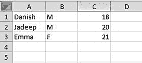

CSV 文件示例。

CSV 文件可用于处理企业或组织的数据库记录文件。这些文件可以方便地在 Excel 中打开，并可以使用任何兼容应用程序进行编辑。Perl 还允许通过从文件中提取值、修改这些值并将修改后的值插回文件，来处理和构建这些 `csv` 文件。我们将使用 `split` 函数从特定行中提取每个值。

### 使用 Split() 进行数据提取

`split()` 是一个标准的 Perl 函数，用于使用分隔符将字符串分为若干部分。该分隔符可以是用户指定的任何字符；但我们通常使用逗号。

`split()` 接受两个参数。第一个是分隔符，第二个是要被划分的字符串。

使用以下步骤通过分隔符将 CSV 文件中的行划分为部分：

* 步骤 1：逐行读取文件。
* 步骤 2：将每行的所有值放入数组中。
* 步骤 3：为了获得结果，单独打印所有数据。

让我们来看一个示例以更好地理解该主题。`split()` 方法用于使用分隔符划分 `new.csv` 文件中记录的字符串，如下所示：

```
use strict; my $file = $ARGV[0] or die; open(my $data, ’<’, $file) or die; while (my $line = <$data>) { chomp $line; # Split line and store it # inside words array my @words = split ", ", $line; for (my $x = 0; $x <= 2; $x++) { print "$words[$x] "; } print "\n"; }
```

将上述代码保存为带有 `.pl` 扩展名的文本文件。在这种情况下，我们将其存储为 `test1.pl`。

使用以下命令运行之前存储的文件：`perl test1.pl new.csv`

### 逗号字符转义

有时文件的字符串字段内部包含逗号，如果删除它会改变数据的解释或使记录无法使用。在这种情况下使用 `split()` 函数，即使在引号内，它每遇到逗号作为分隔符就会划分数据，因为 `split()` 不忽略引号也不理解 CSV。它只是在遇到分隔符字符时进行切割。

以下是一个引号内包含逗号的 CSV 文件：

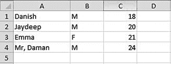

逗号字符转义。

上述 CSV 文件中的第一个字段包含逗号；因此它被包含在引号内。然而，如果我们对此文件执行 `split()` 方法，它将忽略任何此类引号。

上述程序中的 `split()` 方法即使在字段处于引号之间也将字符串字段拆分成了碎片；此外，由于我们在代码中只打印了三个字段，最后一个字符串的第三个字段在输出文件中被丢弃了。

为了处理此类场景，Perl 有若干种限制和范围，允许编译器跳过引号内的字段划分。

我们利用 `TEXT::CSV`，它提供了一个完整的 CSV 读取器和写入器。`TEXT::CSV` 是一个 Perl CPAN 模块，增加了许多额外功能，如读取、解析和写入 CSV 文件。可以使用以下预指令在 Perl 程序中包含这些模块：`use Text::CSV`

然而，我们必须先在设备上下载并安装该模块才能使用其功能。

### 安装 TEXT::CSV

对于 Windows：`perl -MCPAN -e shell install Text::CSV`

对于 Debian/Ubuntu 系统：`$ sudo apt-get install libtext-csv-perl`

对于 RedHat/Centos/Fedora 系统：`$ sudo yum install perl-Text-CSV`

要转义引号之间的逗号字符，请在我们 `new.csv` 文件上运行以下代码：

```
use strict; # Using the Text::CSV file to allow # full CSV Reader and Writer use Text::CSV; my $csv = TEXT::CSV->new({ sep_char => ’, ’ }); my $file_to_be_read = $ARGV[0] or die; # Reading file open(my $data_file, ’<’, $file_to_be_read) or die; while (my $line = <$data_file>) { chomp $line; # Parsing line if ($csv->parse($line)) { # Extracting elements my @words = $csv->fields(); for (my $x = 0; $x <= 2; $x++) { print "$words[$x] "; } print "\n"; } else { # Warning to display warn "Line could not parse: $line\n"; } } } }
```

上述示例中的第一个字段现在包含一个逗号，它在解析 CSV 文件时已通过转义。

上一行描述了如何调用类的构造函数。箭头 `->` 用于调用构造函数。

此调用将尝试解析当前行并将其划分为块。根据成功或失败返回真或假。

### 嵌入换行符的字段

CSV 文件中的特定字段可能是多行的，或者在单词之间嵌入了换行符。当通过 `split()` 方法提供这些多行字段时，它们的行为与没有嵌入换行符的其他文件有很大不同。

上述 CSV 文件中的嵌入换行符现在由 `getline()` 函数处理，并根据需要被包含在引号内。

### 文件测试操作符

在 Perl 中，文件测试操作符是产生真或假值的逻辑运算符。Perl 提供了许多测试文件特性的运算符。例如，`-e` 运算符用于检查文件是否存在。或者，它可以确定文件是否可以写入。这有助于减少程序可能遇到的错误。

以下示例使用 `-e` 存在操作符来判断文件是否存在：

```
#!/usr/bin/perl # 使用预定义模块 warnings; use strict; # 将路径传递给变量 my $filename = ’C:\Users\PeeksForeks\PFP.txt’; # 检查文件是否存在 if(-e $filename) { # 如果文件存在 print("File $filename exists\n"); } else { # 如果文件不存在 print("File $filename doesn’t exists\n"); }
```

此文件测试操作符 `-e` 接受文件名或句柄作为输入。

下表列出了最重要的文件测试操作符：

| 操作符 | 说明 |
| --- | --- |
| `-r` | 检查是否可读 |
| `-w` | 检查是否可写 |
| `-x` | 检查是否是否可执行 |
| `-o` | 检查文件是否属于有效 uid |
| `-R` | 检查文件是否允许真实 uid 读取 |
| `-W` | 检查文件是否允许真实 uid |
| `-X` | 检查文件是否允许真实 uid/gid 执行 |
| `-O` | 检查文件是否属于真实 uid |
| `-e` | 检查文件是否存在 |
| `-z` | 检查文件是否为空 |
| `-s` | 检查文件大小是否非零（返回字节数） |
| `-f` | 检查是否为普通文本文件 |
| `-d` | 检查是否为目录 |
| `-l` | 检查是否为符号链接 |
| `-p` | 检查文件是否为命名管道 (FIFO)：或 `FileHandle` 是否为管道 |
| `-S` | 检查文件是否为套接字 |
| `-b` | 检查文件是否为块特殊文件 |
| `-c` | 检查文件是否为字符特殊文件 |
| `-t` | 检查文件句柄是否已打开到 tty |
| `-u` | 检查文件是否设置了 setuid 位 |
| `-g` | 检查文件是否设置了 setgid 位 |
| `-k` | 检查文件是否设置了粘性位 (sticky bit) |
| `-T` | 检查文件是否为 ASCII 文本文件（启发式判断） |
| `-B` | 检查文件是否为“二进制”文件（`-T` 的相反） |

我们可以将逻辑运算符 `AND` 结合以下文件测试操作符使用：

```perl
#!/usr/bin/perl
### 使用预定义的模块
use warnings;
use strict;
# 将文件路径赋值给变量
my $filename = ’C:\Users\PeeksForPeeks\PFP.txt’;
# 对文件应用多个测试操作符
if(-e $filename && -f _ && -r _ ) {
    print("File $filename exists and readable\n");
} else {
    print("File $filename does not exists")
}
```

上面的示例检查了文件是否存在，以及它是否为普通文件，以及是否可读。

### 文件锁定

文件锁定，或广义的锁定，是解决资源共享问题的若干种技术之一。

锁定任何文档的安全性和完整性是保护它的手段。文件锁定的基本目标是允许用户更改文档而不会引起混乱。当两个或更多人尝试更改同一个文件时，可能会发生问题。

考虑以下示例：一个存储项目数据的文件。该文件可以由整个项目团队修改。在 Web 上，将编写一个 CGI 脚本来实现以下：

```perl
$file = "project.docx";
$commit = $ENV{’QUERY_INFO’};
open(FILE, "$file");
### 打开文档
while() {
    if (m/^$commit$/) {
        print "The Change already made\n";
        exit;
    }
}
close(FILE);
push(@newcommit, $commit);
open(FILE, ">$file");
print ...
close(FILE);
print "Commit-made";
exit;
```

文件的锁定是在系统级别执行的；因此用户无需担心应用锁定的细节。文件锁的目的是对某些文件实施临时限制，以限制程序之间之间的共享方式。根据给定操作的性质开发了两种锁。

第一种是共享锁（shared lock），第二种是排斥锁（exclusive lock）。多个进程可以共享对文件的读取访问，因为读取访问不会改变共享资源的状态。因此，保持共享资源的一致视图是可能的。可以使用 Perl 中的 `flock` 命令来锁定文件。

### flock()

`flock()` 有两个参数。第一个是 `FileHandle`。第二个输入指定所需的锁定程序。

Perl 使用数字来表示值：`sub LOCK_SH { 1 }` ## 设置为共享锁，`sub LOCK_EX { 2 }` ## 设置为排斥锁，`sub LOCK_NB { 4 }` ## 在不进行阻塞的情况下锁定，`sub LOCK_UN { 8 }` ## 解锁 FILEHANDLE

*   **共享锁：** 当我们只想读取文件同时允许其他人查看它时，可以使用共享锁。共享锁不仅创建了一个锁，还会检查是否存在额外的锁。此锁不涵盖所有锁的存性检查，仅针对“排斥锁”。如果存在排斥锁，它将等待直到该锁被移除。移除后，它将作为共享锁执行。多个共享锁可以同时存在。

*   **排斥锁：** 当一个文件要由一组人员使用且每个人都有能力进行更改时，将使用排斥锁。一个文件上只能放置一个排斥锁，一次只允许一个用户/进程进行修改。排斥锁的规则是“我是唯一的”。`flock()` 会搜索脚本中是否有任何其他类型的锁。如果发现，它将一直保持，直到所有锁都从脚本中删除为止。它将在适当的时间锁定文件。

*   **非阻塞锁：** 非阻塞锁通知系统，它不需要等待其他锁从文件中释放。如果在文件中检测到另一个锁，它将产生一条错误消息。

*   **取消阻塞：** 与 `close(FILE)` 函数相同，此函数会解锁任何给定的文件。

以下问题演示了 `flock()` 函数的使用：

### flock() vs lockf()

与一次性锁定整个文件的 `flock()` 相，`lockf()` 方法锁定文件的片段。`lockf()` 无法在 Perl 中直接使用，但 Perl 原生支持 `flock` 系统函数，但不适用于网络锁。

Perl 支持 `fcntl()` 系统函数，提供了卓越的锁定控制。


# SLURP 模块

`File::Slurp` 模块读取文件内容并将其存储在字符串中。这是一种读取/写入/修改整个文件的简单快速的方法。正如其名称所暗示，它让我们能够通过单次调用读取或写入整个文件。

通过将此模块导入到我们的程序中，用户可以使用`read_file`、`read_text`、`write_file`等函数从文件向文件读写数据。

**安装 File::Slurp 模块：** 我们必须先将此模块包含在 Perl 语言包中以利用它。这可以通过在 Perl 终端中输入以下指令并安装必要的模块来实现。

**步骤 1：** 在我们的终端中运行以下命令：`perl -MCPAN -e shell`

进入 cpan shell 后，按照以下步骤安装`File::Slurp`模块。

**步骤 2：** 要安装该模块，运行以下命令：`install File::Slurp`

执行后将安装`File::Slurp`模块。

**步骤 3：** 要退出 cpan> 提示符，输入并执行“q”命令。

**Slurp 中的 read_file 函数：** `File::Slurp`的读取文件函数读取指定文件的完整内容并将其作为字符串返回。然而，建议使用`File::Slurp`，因为它有一些编码层缺陷，可能会导致编译困难。`File::Slurper`试图为上述困难提供可行的解决方案。

**Slurp 中的 read_text 函数：** `File::Slurper`中的`read_text`方法接受一个可选的编码参数（如果有的话），并且在我们请求时可以自动解码 CRLF 行结束符（针对 Windows 文件）。

**注意：** CRLF 行结束符表示文本文件中的换行（Windows 换行类型）。

**Slurp 的 write_file 函数：** `File::Slurp`模块的`write_file`方法用于一次写入多个文件。它使用包含由`read_file`函数读取的另一个文件内容的标量变量写入文件。

**第一个示例：** 使用标量存储文件内容

```perl
# 用于演示 slurp 函数使用的 Perl 代码
use File::Slurp;
### 读取整个文件到标量
my $content = read_file(’C:\Users\PeeksForPeeks\PFP_Slurp.txt’);
# 从标量写入整个文件
write_file(’C:\Users\PeeksForPeeks\Copyof_PFP_Slurp.txt’, $content);
```

**解释：** 在前面的 Perl 代码中，我们使用 slurp 函数读取一个名为`PFP_Slurp.txt`的包含多行文本的文件并存标量变量`$content`，然后将文件内容作为单个字符串写入另一个文件`Copyof_PFP_Slurp.txt`。

**第二个示例：** 使用数组存储文件内容

```perl
# 说明 slurp 函数的 perl 代码
use File::Slurp;
# 读取整个文件到数组
my @lines = read_file(’C:\Users\PeeksForPeeks\PFP_Slurp2.txt’);
# 从标量写入整个文件（此处原文代码注释有误，应为 array）
write_file(’C:\Users\PeeksForPeeks\Copyof_PFP_Slurp2.txt’, @lines);
```

**解释：** 在前面的 Perl 代码中，我们使用 slurp 函数读取一个名为`PFP_Slurp2.txt`的包含文本行数组的文件并存入数组变量`@lines`，然后将整个文件的内容作为单个字符串写入名为`Copyof_PFP_Slurp2.txt`的文件。

# 第三个示例：编写使用 slurp 技术的函数，用 Perl 代码说明 slurp 函数

```perl
use strict;
use warnings;
use File::Slurp;

# 调用自定义函数 get_a_string();
sub get_a_string {
    # 将整个文件读入一个标量
    my $pfp_str = read_file('C:\Users\PeeksForPeeks\PFP_User_Slurp.txt');
    # 从标量写入整个文件
    write_file('C:\Users\PeeksForPeeks\Copyof_PFP_User_Slurp.txt', $pfp_str);
}
```

### 解释：

在上面的 Perl 代码中，`strict`和`warnings`允许用户更自由地编写代码，并更早地发现变量名拼写错误等问题。我们调用了一个名为`get_a_string`的用户定义函数，该函数执行了 slurp 功能：它将包含几行文本的文件作为输入读取到名为`pfp_str`的变量中，然后将整个文件的内容作为一个单个字符串写入文件中。

## 有用的文件处理函数

Perl 最初是为了文本处理开发的，例如从文本文件中提取信息并将文本文件转换为新格式。这些过程可以使用多种内置文件函数完成。

以下是一些用于处理文件的一些实用 Perl 例程：

| 函数 | 描述 |
| :--- | :--- |
| `glob()` | 用于打印作为传入的目录中的文件。 |
| `tell()` | 使用`FileHandle`获取文件内读取指针的位置。 |
| `getc()` | 用于从`FileHandle`参数指定的读取读取下一个字符。 |
| `reverse()` | 在列表上下文中使用时，返回反序排列的列表；在标量上下文中使用时，返回列表值连接而成的字符串，其中字符串中每个字符的顺序都是相反的。 |
| `rename()` | 将文件从旧名称重命名为用户指定的新名称。 |

在本章中，我们涵盖了 Perl 中的文件处理以及其语法和相关示例。

# 第 6 章节：Perl 中的正则表达式

DOI: [10.1201/9781003358442-6](https://doi.org/10.1201/9781003358442-6)

## 本章内容

* 正则表达式
* 运算符
* 正则字符类和特殊字符类
* 量化与回溯
* 正则中的“e”修饰符
* “ee”修饰符
* `pos()`函数

在上章中，我们讨论了文件处理；在本章中，我们将涵盖正则表达式（`Regex`）。

在 Perl 中，正则表达式（`Regex`、`Regexp`或`RE`）是一种特定的文本字符串，用于描述给定文本内部的搜索模式。Perl 中的`Regex`与宿语言绑定，与`PHP`、`Python`以及其他编程语言中的不同。

它有时被称为“兼容 Perl 5 的正则表达式”。绑定运算符如`=~`（正则表达式运算符）和`!~`（非正则表达式运算符）被用于利用`Regex`。让我们在转向绑定运算符之前，先从创建模式开始吧。

### 模式构建：

在 Perl 中，可以使用`m//`运算符构建模式。该运算符简单地在两个斜杠之间插入所需的模式，而绑定运算符则用于在提供的文本中搜索该模式。

### 使用 m// 配合绑定运算符：

绑定运算符通常与`m//`运算符配合使用以匹配所需的模式。使用正则表达式匹配字符串，请使用正则表达式运算符。语句的左侧将包含一个字符串，该字符串将匹配右侧提供的模式。非正则表达式运算符用于判断字符串是否等于右侧提供的正则表达式。

**程序 1：** 以下代码演示了`m//`和`=~`的用法：

```perl
### 演示程序
### m// 和 =~ 运算符
### 实际字符串
$a = "PEEKSFORPEEKS";
# 如果在 $a 中找到
# 则打印找到匹配项
if ($a =~ m[PEEKS]) {
    print "Match is Found\n";
}
# 如果在 $a 中未找到
# 则打印未找到匹配项
else {
    print "Match is Not Found\n";
}
```

**程序 2：** 为了演示`m//`和`!~`的用法，请考虑以下：

```perl
### 演示程序
# m// 和 !~ 运算符
### 实际字符串
$a = "PEEKSFORPEEKS";
# 如果在 $a 中未找到
# 则打印找到匹配项
if ($a !~ m[PEEKS]) {
    print "Match is Found\n";
}
# 如果在 $a 中找到
# 则打印未找到匹配项
else {
    print "Match is Not Found\n";
}
```

### 正则表达式的用途：

* 它可以用于计算特定模式在字符串中出现的次数。
* 它可以查找匹配特定模式的字符串。
* 它还可以将搜索到的模式替换为另一个字符串。

### 正则表达式中的运算符

正则表达式是一个不同字符的混合字符串，有助于文本字符串匹配。`regex`或`regexp`是正则表达式的另一个名称。

利用正则表达式最基本的方法是使用绑定运算符`=~`（正则表达式运算符）和`!~`（非正则表达式运算符）。

在 Perl 中，三种类型的正则表达式运算符：

* 匹配正则表达式
* 替换正则表达式
* 全局字符转译正则表达式

### 1. 模式匹配或正则表达式匹配：

匹配运算符`m//`将字符串或语句与正则表达式进行比较。运算符中的正斜杠充分隔符。表达式写在运算符的两个斜杠之间。

语法：`m/PATTERN/`

`PATTERN`是将搜索的正则表达式。让我们来看一些模式匹配的示例。在以下情况下，字符串和正则表达式进行匹配，如果成功，则返回“match found”；否则，返回“match not found”。在前面的代码中，使用了另一种分隔符`{}`替换了`/`。

### 2. 制作替换（搜索并替换）正则表达式：

替换运算符`s///`用于搜索并替换特定的单词。分隔符是正斜杠。

语法：`s/PATTERN/REPLACEMENT/`

`PATTERN`是`REPLACEMENT`正则表达式将替换的正则表达式。让我们来看几个实例：先搜索`PATTERN`单词，跟随`REPLACEMENT`单词。

### 3. 全局字符转译正则表达式：

将所有实例替换为单个字符，使用转译运算符`tr///`或`y///`。分隔符是正斜杠。

## 正则字符类

为了匹配字符串，使用了字符类。这些类允许用户匹配预先的字符范围。要匹配的字符集始终包含在方括号`[]`中。字符类总是完美匹配一个字符。

如果没有检测到匹配，整个正则表达式将失败。

### 注意事项：

* 在字符类内部，`.`失去了它特定的含义，即“除换行符的所有内容”。
* 仅在字符类内部，`.`可以匹配单个点。
* 大多数特殊字符在字符类中失去了它们的特殊意义；但某些字符获得了一些特殊含义。

### 字符类中的范围：

输入长列表很困难，因为用户可能会跳过一个两个字符。所以，为了方便，我们使用范围。破折号`-`通常表示范围。

### 注意事项：

* `-(破折号)`用于指定范围。
* 用户还可以混合各种范围的字符、数字等，例如`[0-9a-gA-g]`。在这里，`-`允许用户选择范围内的任何字符或数字。
* 如果用户想在字符串中匹配破折号`-`，只需将其插入方括号`[]`之间即可。
* 要匹配字符串中的闭合方括号，只需在它前面加上`\`即可，即`\]`，并将其放在方括号`[]`之间。

反向字符类：简单地使用脱字符符号（`^`）来反转字符类。它会反转符号后面提供的字符甚至是一个范围。将脱字符（`^`）作为字符类的第一个字符，表示该字符类可以匹配除列出的字符以外的任何字符。

## 正则表达式中的特殊字符类

Perl 具有几种不同的字符类，其中某些类的使用频率非常高，以至于为它们构建了特定的序列。编写自定义序列旨在让代码更易读、更简洁。Perl 的特殊字符类如下：

1. **数字 `\d[0-9]`：** `d`字符用于匹配任何数字字符，与`[0-9]`相同。正则表达式`/\d/`会匹配单个数字。`d`已标准化为“digit（数字）”。其主要优势是用户可以编写更短、更易读的形式。这种独特的字符类有两种用法。让我们通过示例来了解如何匹配字符字符串。

    正如前面提到的，字符字符串匹配情况如下：#M-12345 #N-66666

    在这种情况下，我们也可以通过将量化符放在字符类上来利用它们。

    上面的示例与之前的正则表达式相同，它接受连字符后任意数量的数字，可以表示为`/#[MNOPQ]-\d+/`。

    在较大的字符类中，使用了第二种技术。`\d`被方括号包围，匹配单个数字字符。

    可以匹配单个数字或任何大写字母`A`、`B`、`C`、`D`、`E`、`F`、`G`、`H`、`I`、`J`、`K`、`L`、`M`或`N`。可以使用连字符（`-`）更简洁地编写，例如：`[\dA-N]`

2. **POSIX 字符类：** POSIX 字符类是确保操作系统兼容性和建立包括命令行 shell 和实用程序接口的标准的标准。它还提供了许多命名（如`alpha`、`alnum`、`ascii`、`blank`等）的“字符分组”。POSIX 字符类始终采用`[:class:]`形式，其中`class`是名称，分隔符是`[:`和`:`。POSIX 字符类始终包含在括号字符类中。这些类提供了一种列出字符集合的快速方便的方法。

    在这里，`class`可以是`alpha`、`alnum`、`ascii`等。

    所示，POSIX 字符类支持更大的括号字符类：`[01[:Class:]%]`

    在这种情况下，它将匹配“0”、“1”、任何字符类以及`%`符号。Perl 支持下表所示的 POSIX 字符类：

    | 类 | 描述 |
    | --- | --- |
    | Alpha | 任何字母字符 (`[A-Za-z]`) |
    | Alnum | 任何字母数字字符 (`[A-Za-z0-9]`) |
    | Ascii | ASCII 字符集中的任何字符 |
    | blank | 空格或水平制表符 |
    | Cntrl | 任何控制字符 |
    | Digit | 任何十进制数字 (`[0-9]`) |
    | graph | 除空格以外的任何打印字符 |
    | lower | 任何小写字符 (`[a-z]`) |
    | punct | 任何图形字符 |
    | space | 任何空白字符 |
    | upper | 任何大写字符 (`[A-Z]`) |
    | xdigit | 任何十六进制数字 (`[0-9a-fA-F]`) |
    | word | Perl 扩展 (`[A-Za-z0-9_]`)，等同于`\w` |

3. **单词字符 `\w[0-9a-zA-Z ]`：** 字母`w`属于单词字符类。`w`字符可以是任意字母数字字符，包括字母、十进制数字或如下划线（`_`）之类的标点符号。它只匹配单词单词，而不是整个单词。如果我们想匹配整个单词，请使用`\w+`。

4. **空白字符 `\s[\t\n\f\r ]`：** 字符类`\s`只匹配一个字符，即空白字符。它还会匹配五个字符：`\t`-水平制表符、`\n`-换行符、`\f`-分页、`\r`-回车和空格。在 Perl 5.18 中，引入了对应于`\cK`-垂直制表符的新字符。

5. **反向字符类 `\D`、`\W`、`\S`：** 在这个宇宙中，几乎有 110,000 个 Unicode 字符。只需使用脱字符符号（`^`）来反转字符类。它会反转符号后指定的字符甚至是一个范围。我们在反向字符类中使用`[^\d]`来反转数字 0 到 9。然而，与其使用`[^\d]`，我们可以使用`\D`来反转数字 0 到 9。下表描述了特殊的反向字符类：

    | 字符类 | 反向 | 含义 | 描述 |
    | --- | --- | --- | --- |
    | `\d` | `\D` | `[^\d]` | 匹配任何非数字字符 |
    | `\s` | `\S` | `[^\s]` | 匹配任何非空白字符 |
    | `\w` | `\W` | `[^\w]` | 匹配任何非“单词”字符 |

6. **Unicode 字符类：** Unicode 是“所有”现有字符的定义，Unicode 标准为每个平台无关的字符分配了唯一的数字。这个星球上有超过 100,000 个字符，每个字符都被指定为一个字符点。然而，某些字符被分组了。

    这种语法匹配一个分组中的单个字符。如果我们需要匹配特定字符以外的任何内容，请使用匹配`\P{…任意字符…}`表达式。

### 正则表达式中的量化符

Perl 具有几种正则表达式量化符，它们可以决定特定字符在匹配之前可以重复的次数。这主要用于待匹配字符数量不确定的情况。

### Perl 量化符分为六类，列下所示：

1. `*` = 表示该组件必须出现零次或多次。
2. `+` = 表示该组件必须出现一次或多次。
3. `?` = 指定该组件必须出现零次或一次。
4. `{n}` = 指定该组件必须存在 n 次。
5. `{n,}` = 指定该组件必须至少出现 n 次。
6. `{n, m}` = 指定该组件必须出现至少 n 次且不超过 m 次。

### 量化符表

上述所有类型可以使用此表理解，该表包含了正则表达式量化符和示例。

| 正则表达式 | 示例 |
| --- | --- |
| `/Bx*B/` | BB, BxB, BxxB, BxxxB, ….. |
| `/Bx+B/` | BxB, BxxB, BxxxB, ….. |
| `/Bx?B/` | BB, BxB |
| `/Bx{1, 3}B/` | BxB, BxxB, BxxxB |
| `/Bx{2, }B/` | BxxB, BxxxB, ….. |
| `/Bx{4}B/` | BxxxxB |

让我们看看这些量化符的一些示例。


**第一个示例：** 在此示例中，`*` 量化符被用于正则表达式`/Pe*ks/`，它产生“Pks”、“Peks”、“Peeks”……等等，并与输入文本“Pks”匹配，匹配成功。

**第二个示例：** 在此示例中，`+` 量化符被用于正则表达式`/Pe+ks/`，它产生“Peks”、“Peeks”、“Peeks”……等等，并与输入文本“Pks”匹配，匹配失败。

**第三个示例：** 在此示例中，`?` 量化符被用于正则表达式`/Pe?ks/`，它产生“Peks”或“Pks”，并与输入文本“Peks”匹配，匹配失败。

**第四个示例：** 在此示例中，`{n}` 量化符被用于正则表达式`Pe{2}ks`，它产生“Peeks”，并与输入文本“Peeks”匹配，匹配成功。

**第 5 个示例：** 在此示例中，`{n, }` 量化符被用于正则表达式`/Pe{2, }ks/`，它产生“Peeks”、“Peeeks”、“Peeeeks”等等，当与输入文本“Peks”匹配时，返回匹配失败。

**第六个示例：** 在此示例中，`{n, m}` 量化符被用于正则表达式`/Pe{1, 2}ks/`，它产生“Peks”和“Peeks”，并与输入文本“Peeks”匹配，匹配失败。

Perl 中的正则表达式（也称为 regexes、regexps 或 REs）是一种表示一组字符串的方法，无需在程序中描述所有的字符串。它本质上是一系列用于模式匹配的字符。正则表达式在 Perl 中有多种用途：

* 首先，它们用于条件判断，以评估字符串是否匹配特定模式。

  **例如：** 条件中的正则表达式

  ```perl
  #!/usr/bin/perl # Regular expressions in the Conditionals # Program to determine whether string # matches particular pattern 
  print "How are you feeling?\n"; my $stmt = <>; print($stmt); if ($stmt == /hungry/) { print "\n What do we wish to have?\n"; my $ip = <>; print($ip); }
  ```

  在这里，会匹配用户的输入；如果包含了单词“hungry”，即如果条件为真，它将打印“What do we wish to have?”。否则，将跳转到下一个条件或语句。

* 其次，它们可以在字符串中找到模式并将其替换为其他内容。

  **例如：** 替换运算符

  ```perl
  #!/usr/bin/perl # Regular expressions in the Substitutions # Program to determine whether string # matches particular pattern and replaces it 
  print "Whats your thought on life\n"; my $stmt = <>; print ($stmt); # Substitution using the regex $stmt =~ s/worst/good/; print ("\n$stmt");
  ```

  前面的代码使用了“good”代替了“worst”。

* 最后，模式不仅可以描述某个存在的地方，还可以描述它不存在的地方。因此，`split`运算符使用正则表达式来识别数据不存在的地方。换句话说，正则表达式指定了分隔数据字段的分隔符。

  **例如：** Split 运算符

  ```perl
  #!/usr/bin/perl # Program to illustrate the # use of split function 
  $var1 = "Birth"; $var2 = "Life"; $var3 = "Death"; # Using split function 
  my ($var1, $var2, $var3) = split(/, /, "sab, mohmaya, hai"); print($var1); print($var2); print($var3);
  ```

  在上面的示例中，`split` 函数匹配单个逗号字符。

## 回溯 (BACKTRACKING)

回溯是正则表达式匹配的另一个关键方面，现在（当需要时）被所有非占有表达式量词使用，即`*`、`*?`、`+`、`+?`、`{n, m}`和`{n, m}?`。回溯内部经常会被优化，但上述概念是正确的（它从可能性树上的失败递归中返回）。当 Perl 尝试用正则表达式匹配模式且之前的尝试失败，或者当匹配模式被保存备以后用时，它就会回溯。

例如，`/.*?/` 可用于匹配类似于 HTML 标签的任何内容，如“Bold”。这强制模式的两个部分匹配同一个字符串，在本例中为“B”。

考虑另一个示例`/^ab*bc*d/`

### 前面的正则可以解释如下：

1. 从字符串开始处开始。

2. 匹配一个“a”。

3. 尽可能匹配多个“b”，即使没有匹配到任何一个也可以。

4. 尽可能匹配多个“c”，即使没有匹配到任何一个也可以。

5. 尽可能匹配多个“d”，虽然不需要全部匹配。

### 正则表达式中的“e”修饰符

Perl 中的正则表达式允许我们使用适当的运算符对给定文本执行许多操作。这些运算符可以执行如字符串修改、替换其他子字符串等操作。在给定字符串中替换子字符串是通过`s`（替换）运算符完成的，它接受两个操作数：要替换的子字符串和替换字符串。

此外，`e` 修饰符用于将子字符串替换为要求值的正则表达式的替换字符串。`e` 修饰符添加到替换表达式中。

`e` 修饰符还可以与`g`（全局）修饰符结合使用，以影响指定字符串中所有可能的子字符串。

**第一个示例：** 使用字符类替换

```perl
#!/usr/bin/perl # Defining string to be converted 
$String = "Peeks for Peeks is the best"; print "The Original String: $String\n"; # Converting string to UPPERCASE # using ’uc’ Function 
$String =~ s/(\w+)/uc($1)/ge; print"Uppercased String: $String\n"; # Converting string to lowercase # using ’lc’ Function 
$String =~ s/(\w+)/lc($1)/ge; print"Lowercased String: $String\n";
```

上面的代码使用了字符类`\w`，它包含大小写字母和所有数字（a-z|A-Z|0-9）。这被用于通过单个替换操作替换整个字符串。

**第二个示例：** 使用单个字母或单词进行特定替换。

更新后的字符串不会恢复到原始值，即使在第二次递归之后也是，如前面的代码所示。

### 使用子程序执行替换操作

Perl 正则中的子程序替换也可以通过子程序完成，以消除为每个字符串重复编写替换正则的麻烦。这是通过将正则代码插入子程序并在需要时调用它来实现。

当上述代码中的替换操作开始时，它会调用子程序`change_substitution`，该程序包含了更改匹配搜索内容的子字符串的正则代码。

## 正则 “ee” 修饰符

Perl 中的正则表达式允许你使用适当的运算符对给定文本执行许多操作。这些运算符可以执行如字符串修改、替换其他子字符串等操作。在给定字符串中替换子字符串是通过`s`（替换）运算符完成的，它接受两个操作数：要替换的子字符串和替换文本。

在 Perl 中，修饰符使用正则表达式通过指定模式匹配字符串。在 Perl 中，`ee` 修饰符等同于`\e` 修饰符。它用于求值右侧字符串并进一步评估结果。在 Perl 中，它等同于双重`eval`运算符。`\e` 运算符用于求值右侧字符串。`\ee` 快了一步。它在已经带有`e`修饰符的字符串上使用`\e`运算符。

`ee` 修饰符像`e`修饰符一样，可以与`g`（全局）修饰符结合使用，应用于提供的字符串中所有可能的子字符串。

这是因为当应用`e`修饰符时，正则会将 RHS（右侧）视为用作替换的求值字符串；在这种情况下，RHS 是`$1`，它保留`$var`但不是它的值。因此，应用`ee`修饰符将重新评估 RHS， RHS 包含了已求值的变量`$var`。

### 进行数学计算时，使用“ee”修饰符

如果字符串中包含数学表达式，表达式的值将不会被求值，而是原样显示。这是因为它既被视为字符串又是待求值的表达式。

上述代码中的表达式是用正则表达式编写的，使用`d+`运算符编写一个或多个数字，使用`[+*/]`字符类表示运算符符号，然后是另一个`d+`表示数字。`ee`修饰符求值字符串并返回表达式的总和，通过`$1`运算符显示。

上面的正则也可以保留在子程序中用于评估不同的表达式，而无需重写正则。

在给定的代码可以使用单个正则利用子程序执行四次数学计算。

### 正则表达式中的 pos() 函数

Perl 中的`pos()`函数返回使用`m`修饰符的正则中上一次匹配的位置。

正则中的`pos()`函数可以与字符类结合使用，返回给定字符串中所有必需子字符串的位置列表。要在整个文本中搜索子字符串，请结合全局运算符`g`和`m`修饰符使用。

### 第一个示例：使用子字符串

```perl
#!/usr/bin/perl
# 打印子字符串位置程序
$String = "Peeks For Peeks";
print" Position of ’P’ in string:\n";
# 使用 m 修饰符查找
# 子字符串的正则表达式
while($String =∼ m/G/g) {
# 使用 pos() 函数查找
### 子字符串的位置
$position = pos($String);
print "$position\n";
}
```

### 第二个示例：使用字符类

```perl
#!/usr/bin/perl
# 打印子字符串位置程序
$String = "Peeks For Peeks";
print "Position of all the Uppercase characters:\n";
### 使用字符类查找
# 所有的大写字母
### 使用正则表达式
while($String =∼ m/[A-Z]/g) {
# 使用 pos() 函数查找
### 子字符串的位置
$position = pos($String);
print "$position, ";
}
print "\nThe Position of all Lowercase characters:\n";
### 使用字符类查找
# 所有的小写字母
### 使用正则表达式
while($String =∼ m/[a-z]/g) {
# 使用 pos() 函数查找
### 子字符串的位置
$position = pos($String);
print "$position, ";
}
```

### 第三个示例：空格的位置

```perl
#!/usr/bin/perl
# 打印子字符串位置程序
$String = "Peeks For Peeks";
### 使用正则表达式查找
# 所有的空格
while($String =∼ m/\s/g) {
# 使用 pos() 函数查找
### 子字符串的位置
$position = pos($String);
print "$position\n";
}
```

### 要从指定位置开始匹配，请使用 \G 断言

在 Perl 正则中，`\G` 断言用于匹配以`pos()`函数指定的字符为起点，并以正则表达式指定的匹配字符为结束的子字符串。它将返回由`m`修饰符指定的字符的第一次出现的位置。

在前面的示例中，匹配的子字符串的第一次出现的位置将与剩余字符串一起打印。如果我们需要为匹配字符的下一次出现重置计数位置，只需将剩余字符串存储在默认字符串的`$1`中即可。

## 正则表达式速查表

正则表达式是 Perl 编程的重要组成部分。它用于查找指定的文本模式。一组字符组成了搜索模式。它也被称为 regexp。当用户学习正则表达式时，可能需要快速回顾不经常使用的概念。因此，创建了一个包含正则表达式中使用的各种类、字符、修饰符等的正则表达式速查表，以提供此类服务。

### 字符类

为了匹配字符字符串，使用了字符类。这些类允许用户匹配任何用户预先未知的的字符范围。

| 字符类 | 解释 |
| --- | --- |
| `[abc.]` | 它仅包含指定的字符之一，即“a”、“b”、“c”或“..”。 |
| `[a-j]` | 它包含从 a 到 j 的所有字符。 |
| `[a-z]` | 它包含从 a 到 z 的所有小写字母。 |
| `[^az]` | 它包含 a 和 z 之外的所有字符。 |
| `\w` | 它包含所有类似`[a-z, A-Z, 0-9]`的字符。 |
| `\d` | 它匹配数字如`[0-9]`。 |
| `[ab][^cde]` | 它匹配字符 a 和 b 后面不紧跟 c、d 和 e。 |
| `\s` | 它匹配`[\f\t\n\r]`，即换页符、制表符、换行符和回车符。 |
| `\W` | `\w`的补集。 |
| `\D` | `\d`的补集。 |
| `\S` | `\s`的补集。 |

### 锚点

锚点不对应任何字符。相反，它们对应特定的位置，如字符之前、之后或之间。

| 锚点 | 解释 |
| --- | --- |
| `^` | 匹配字符串的开头。 |
| `$` | 匹配字符串的结尾。 |
| `\b` | 匹配从`\w`到`\W`的单词边界。 |
| `\A` | 匹配字符串的开头。 |
| `\Z` | 匹配字符串的结尾或换行符之前。 |
| `\z` | 仅在字符串末尾匹配。 |
| `\G` | 在指定的位置`pos()`匹配。 |
| `\p{….}` | Unicode 字符类，如`IsLower`、`IsAlpha`等。 |
| `\P{….}` | Unicode 字符类的补集。 |
| `[:class:]` | POSIX 字符类，如 digit、lower、ascii 等。 |

### 元字符

元字符在 Perl 正则中用于匹配模式。必须避免直接使用所有元字符。

| 字符 | 解释 |
| --- | --- |
| `^` | 检查字符串的开头。 |
| `$` | 检查字符串的结尾。 |
| `.` | 换行符以外的任意字符。 |
| `*` | 匹配 0 次或多次。 |
| `+` | 匹配 1 次或多次。 |
| `?` | 匹配 0 次或 1 次。 |
| `()` | 用于分组。 |
| `\` | 用于转义。 |
| `[]` | 用于字符集。 |
| `{}` | 用于重复。 |

### 量词

量词用于指定匹配的次数。

| 符号 | 解释 |
| --- | --- |
| `?` | 匹配 0 次或 1 次。 |
| `+` | 匹配 1 次或多次。 |
| `*` | 匹配 0 次或多次。 |
| `{3}` | 精确匹配 3 次。 |
| `{3, }` | 至少匹配 3 次。 |
| `{3, 7}` | 匹配 3 次到 7 次。 |

### 非贪婪模式

| 符号 | 解释 |
| --- | --- |
| `???` | 非贪婪匹配 0 次或 1 次。 |
| `+?` | 非贪婪匹配 1 次或多次。 |
| `*?` | 非贪婪匹配 0 次或多次。 |
| `{3}?` | 尽可能少匹配 3 次。 |
| `{3, }?` | 至少匹配 3 次。 |
| `{3, 7}?` | 尽可能匹配 3 次到 7 次。 |

### 修饰符

| 符号 | 解释 |
| --- | --- |
| `i` | 忽略大小写。 |
| `m` | 多行匹配模式。 |
| `s` | 使点`.`匹配换行符。 |
| `x` | 忽略表达式中的空白。 |
| `e` | 将匹配结果作为表达式执行。 |
| `g` | 全局匹配。 |
| `r` | 反向匹配（回言）。 |
| `u` | 启用 Unicode 模式。 |
| `D` | 将输入字符串解码为 UTF-8。 |
| `n` | 禁用换行符特殊转义。 |
| `a` | 开启断言。 |
| `C` | 开启 Unicode 属性。 |
| `k` | 开启 own 模式。 |
| `b` | 开启 UTF-8 模式。 |
| `s` | 禁用 UTF-8 模式。 |
| `u0` | 禁用 Unicode 模式。 |
| `U` | 开启 Unicode 模式。 |
| `L` | 开启大写模式。 |
| `l` | 开启小写模式。 |
| `E` | 开启扩展断言。 |
| `e` | 禁用扩展断言。 |
| `f` | 开启文件模式。 |
| `F` | 禁用文件模式。 |
| `q` | 开启 quote 模式。 |
| `Q` | 禁用 quote 模式。 |
| `t` | 开启单模式。 |
| `T` | 禁用单模式。 |
| `v` | 开启多模式。 |
| `V` | 禁用多模式。 |
| `w` | 开启 word 模式。 |
| `W` | 禁用 word 模式。 |
| `x` | 开启 x 模式。 |
| `X` | 禁用 x 模式。 |
| `y` | 开启 y 模式。 |
| `Y` | 禁用 y 模式。 |
| `z` | 开启 z 模式。 |
| `Z` | 禁用 z 模式。 |
| `A` | 开启断言。 |
| `a` | 禁用断言。 |
| `B` | 开启属性。 |
| `b` | 禁用属性。 |
| `C` | 开启 Unicode。 |
| `c` | 禁用 Unicode。 |
| `D` | 开启解码。 |
| `d` | 禁用解码。 |


| `E` | 开启扩展。 |
| `e` | 禁用扩展。 |
| `F` | 开启文件。 |
| `f` | 禁用文件。 |
| `G` | 开启全局。 |
| `g` | 禁用全局。 |
| `H` | 开启引用。 |
| `h` | 禁用引用。 |
| `I` | 开启忽略。 |
| `i` | 禁用忽略。 |
| `J` | 开启开启。 |
| `j` | 禁用 own。 |
| `K` | 开启 k。 |
| `k` | 禁用 k。 |
| `L` | 开启大写。 |
| `l` | 禁用大写。 |
| `M` | 开启模式。 |
| `m` | 禁用模式。 |
| `Q` | 开启 quote。 |
| `q` | 禁用 quote。 |
| `R` | 开启反。 |
| `r` | 禁用反。 |
| `S` | 开启搜索。 |
| `s` | 禁用搜索。 |
| `T` | 开启单。 |
| `t` | 禁用单。 |
| `V` | 开启多。 |
| `v` | 禁用多。 |
| `W` | 开启 word。 |
| `w` | 禁用 word。 |
| `X` | 开启 x。 |
| `x` | 禁用 x。 |
| `Y` | 开启 y。 |
| `y` | 禁用 y。 |
| `Z` | 开启 z。 |
| `z` | 禁用 z。 |
| `U` | 开启 Unicode。 |
| `u` | 禁用 Unicode。 |

## 使用正则表达式在文件中搜索

### 正则表达式

在 Perl 中，正则表达式（Regex、Regexp 或 RE）是一种特殊的文本字符串，用于描述给定文本中的搜索模式。Perl 中的正则表达式与宿主语言绑定，与 PHP、Python 等语言中的正则表达式并不相同。这些正则表达式有时被称为“Perl 5 兼容正则表达式”。绑定操作符如`=∼`（正则表达式运算符）和`!∼`（否定正则表达式运算符）被用于使用正则表达式。

绑定正则运算符用于将字符串与正则表达式进行匹配。语句的左侧将包含一个与右侧指定模式匹配的字符串。否定正则运算符用于判断字符串是否等于右侧指定的正则表达式。

正则运算符有助于在文件中搜索特定的单词或一组单词。根据用户的具体需求，这可以通过多种方式实现。Perl 搜索遵循标准格式：以只读模式（read mode）模式打开文件，然后逐行读取文件，在每行中查找所需的字符串或字符串组。当找到所需的匹配项时，搜索表达式后的语句将决定如何对匹配的字符串进行处理，这可以将其添加到用户指定的任何其他文件中，或者将其打印到控制台上。

有多种方法可以在创建的用于匹配文件字符串的正则表达式内部查找所需的字符串。

### 普通搜索

这种编写正则表达式的基础模式用于在指定文件中搜索指定的字符串。此类正则表达式的语法如下：`$String =∼ /the/`

此表达式将查找文件中包含字母组合“the”的行，并将该单词存储在变量`$String`中。此外，该变量的值可以被复制到文件或打印到控制台上。

在包含“the”一词的单词列表中，为了避开此类单词，可以将正则表达式修改为：`$String =∼ / the /`

通过在需要搜索的单词的前后插入空格，被搜索的单词将从两端隔离开来，从而在搜索过程中不会返回任何包含该单词作为一部分的单词。这将消除搜索不必要单词的需求。然而，这将排除那些紧跟在请求搜索的词后带有逗号或句号的单词。

为了避免这种情况，还有其他方法可以将搜索限制为特定单词，其中一种是使用单词边界。

## 在正则搜索中使用单词边界

如前面的示例所示，普通搜索会返回包含搜索单词的额外单词，或者如果所需的单词前后都有空格，则会排除某些单词。单词边界用字母`\b`表示，用于避免这种情况。

这将限制包含请求单词作为一部分的单词，但不会排除以逗号或句号结尾的单词。

以句号结尾的单词会被包含在搜索中，但包含搜索单词作为一部分的单词则不会。因此，单词边界可以帮助解决普通搜索方法产生的问题。

如果需要找到以特定字符开头、结束或同时开头又结束的单词怎么办？这无法通过普通搜索或单词边界来实现。Perl 允许在类场景的正则表达式中使用通配符。

## 正则表达式中的通配符

通过正则表达式中的通配符，Perl 允许我们在给定文件中搜索一组特定的单词或遵循特定模式的单词。通配符是。

### 4. 多态

多态是指面向对象编程（OOP）语言能够有效地区分同名实体的能力。Perl 通过使用这些实体的签名和声明来实现这一点。

Perl 中的多态主要有两种类型：

- Perl 载载（overloading）
- Perl 方法重写（overriding）

### 5. 继承

继承是面向对象编程（OOP）的一个核心柱。在 Perl 中，这种机制允许一个类继承另一个类的特性（字段和方法）。

需要记住的重要术语：

- 超类（Superclass）：超类是具有继承特性的类（基类或父类）。
- 子类（Subclass）：派生自另一个类（也称为派生类、扩展类或子类）。子类可以在超类的基础上添加自己的字段和方法。
- 可重用性（Reusability）：继承促进了“可重用”，这意味着如果我们想要新类，而已经有一个类包含了我们想要的部分代码，我们就可以从现有类派生出新类。通过这样做，我们重用了了现有类的字段和方法。

在 Perl 中，可以使用`packages`创建类，并使用`use`关键字进行继承。

### 6. 封装

封装是将数据包装在一个单一单元中。它是连接代码及其所操作的数据的机制。封装也可以被视为一个保护屏，防止代码访问屏蔽之外的数据。

- 从技术上讲，在封装中，类的变量或数据对其他类是隐藏的，只能通过声明它们的类中的任何成员函数进行访问。
- 由于类中的数据对其他类是隐藏的，它也被称为数据隐藏。
- 封装可以通过将类中的所有变量声明为私有，并在类中编写公有方法来设置设置和检索变量值来实现。

### 7. 抽象

数据抽象是仅向用户显示本质性细节的属性。用户不会看到琐碎或非本质的单元。例如，一个汽车被视为一个整体，而不是它的各个组件。

数据抽象也被定义为只识别对象的必要特征而忽略无关细节的过程。对象的属性和行为将其与其他相似类型的对象区分开来，并有助于对象的分类/分组。

考虑以下场景：一个男人正在开车。这个男人只知道按下加速板会增加汽车速度，或者按下刹车会停止汽车。然而，他并不知道按下加速板是如何增加速度的，也不理解汽车的内部机制，或汽车的加速板、刹车和其他控制装置是如何实现的。这就是抽象的定义。

## OOP 中的类

在当今世界，当编程被应用于生活的方方面面，我们必须采用与现实世界实例密切相关的编程范式。现实世界挑战的竞争性和复杂性经历了巨大的变化，使得行业需要更具适应性的方法。

OOP 的概念是一种奇的方法，可以塑造任何编程语言，使得解决现实案例变得轻而易举。OOP 是一种强调对象而非过程的编程范式。OOP 的思想涉及根据对象和对象交互来工作。

注意：OOP 试图实现现实世界的元素，如继承、封装和多态。OOP 的主要目的是将数据与其所作用的功能连接起来，使得代码的其他部分无法通过函数访问数据。

### 对象（Object）

它是数据结构内部具有特定属性和行为的类实例。“苹果”就是对象的一个例子。它具有水果的品质、深红色等特征。它的行为是“它尝起来很好”。

根据 OOP 的思想，它的数据代表对象的特征，它的活动由其相关函数表示。因此，对象是一个持有数据并提供基于函数的接口的实体。

### 类（Class）

类是一个扩展的数据结构概念。它指定了包含数据的对象的原型蓝图。

对象是其相应类的实例。类由数据成员和数据函数组成；它是一种用户定义的、预定义的数据类型，可以通过创建该类的实例来访问和使用。

**示例：** 以学校的类为例。可能会有各种不同名称和组织结构的学校，但它们都具有某些特性，例如学生、教师和员工。因此，学校是包含数据成员（教师、学生和家长）的类，而成员函数可以是`calculate_students_marks()`、`calculate_teachers_salary()`和`Parents_Database()`。

### 数据成员（Data Member）

数据成员是数据变量，成员函数是用于控制这些变量的函数；这些数据成员和成员函数共同了类内部对象的属性和行为。

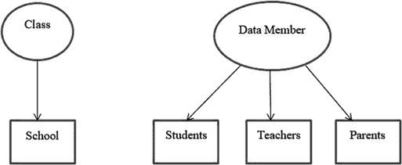

数据成员。

### 定义类

Perl 使定义类变得非常简单。Perl 中的类对应于一个`package`。要定义一个类，我们必须先加载并构建一个`Package`。Package 是用户定义的变量和子程序的预包含单元，可以用于程序的任何地方。

### 创建类并使用对象

在 Perl 中，可以使用关键字`package`创建类，但对象是通过调用构造函数创建的。构造函数被定义为类中的一个方法。

### 创建类实例

类名和构造函数名可以是用户喜欢的任何。大多数程序员倾向于使用`new`作为程序的构造函数名，因为它比任何其他复杂的构造函数名更容易记忆和使用。

在前面的示例使用了名为`bless`的函数。该函数用于将对象与作为参数传递的类关联起来。

### 创建对象

在 Perl 中，对象通过调用类中定义的构造函数来创建。对象的名称可以是用户需要的任何变量，但习惯上会与类相关的命名。

在 OOP 中使用类至关重要的，因为它们精确地描述了现实世界的应用，并可以用于解决现实问题。

## OOP 中的对象

Perl 是一种面向对象的、基于解释器的动态编程语言。OOP 有三个主要组件：对象、类和方法。对象是一种可以被称为其所属类实例的数据类型。它可能是一个各种数据类型数据变量的集合，也是各种数据结构的集合。方法是在类对象实例上操作的函数。

下面的示例说明了如何在 Perl 中使用对象：

我们必须首先定义类。在 Perl 中，这是通过构建类包 package 实现的。package 是一个封装的对象，包含了类的所有数据成员和函数。

在这种情况下，`Employee`是类名。

第二个任务是创建一个包实例（即对象）。我们需要为此准备一个构造函数。在 Perl 中，构造函数是一个通常命名为`new`的子程序。然而，由于名称是用户定义的，所以它并不限于`new`。

为了设计我们的对象，我们在构造函数中定义了一个基础哈希引用`$self`。在这里，对象将包含`Employee`的三个属性：`serialNum`、`firstName`和`lastName`。这意味着每个员工将有自己的序列号、名字和姓氏。`my`关键字充当访问限定符，将`$class`和`$self`局部化在包含的块中。

`shift`关键字将包名从默认数组`@_`传递给`bless`函数。`bless`方法返回一个最终会变成对象的引用。最后，构造函数将返回一个`Employee`类的实例。最重要的方面是如何初始化对象。这可以通过以下方式实现：`$object = new Employee(1, "Peeks", "forPeeks");`。

在这种情况下，`$object`是标量变量，指向构造函数中定义的哈希（hash）。

以下是一个在 OOP 中创建和实现对象的示例程序：

```perl
use strict;
use warnings;
### 类名为 Employee
package Employee;
### 具名为 new 的构造函数
sub new {
    # shift 将获取包名
    # 并将其赋值给变量 ’class’
    my $class = shift;
    # 定义哈希引用
    my $self = {
        _serialNum => shift,
        _firstName => shift,
        _lastName => shift,
    };
    # 使用 bless 将对象绑定到类
    bless $self, $class;
    # 返回 Employee 类的实例
    return $self;
}
### 创建类对象
my $object = new Employee(1, "Peeks", "forPeeks");
# 这里对象是一个指向哈希的引用
print("$object->{_firstName} \n");
print("$object->{_serialNum} \n");
```

Perl 对象的工作方式与其他语言（如`C++`和`Java`）相同。上面的程序演示了 Perl 中对象的流程，包括其在类中的创建和使用。

## OOP 中的方法

方法用于访问和修改对象的数据。这些可以通过类或包对象调用的实体。Perl 中的方法仅仅是子程序（subroutines）；它们没有独特的身份。方法的语法与子程序相同。方法和子程序一样，使用`sub`关键字指定。作为第一个参数，方法接收调用它的对象或包。

OOP 采用这些方法来更改对象的数据，而不是直接与对象交互；这样做是为了通过防止程序员直接修改对象的数据来确保数据安全。各种接受对象作为参数并将其值保存在另一个变量中的辅助方法使得这成为可能。此外，对第二个变量进行了调整。这些更改不会影响对象的数据，使其更加安全。

### Perl 中的方法类型

根据给定的输入，Perl 中的方法可以分为两类：静态方法和虚拟方法。

静态方法是指方法的第一个参数是类名的方法。由于静态方法接受类名作为参数，因此其功能被应用于整个类。这些也被称为类方法。由于大多数方法属于同一个类，因此没有必要提供类名作为参数。例如：类的构造函数被认为是静态方法。

虚拟方法是将对象引用作为函数的第一个参数提供的方法。虚拟函数的第一个参数被移动到局部变量中，然后用作引用。

在 OOP 中，方法需要括号来存放参数，这些方法通过箭头运算符（`->`）调用。

### get-set 方法

方法用于保护对象的数据，因此与对象的引用一起使用，或者将值存储在另一个变量中然后。在 OOP 中，get-set 方法用于为对象提供数据安全。get 方法用于检索对象的当前值，而 set 赋值方法则为对象分配一个新值。

### 构造函数和析构函数

我们将通过示例解释构造函数和析构函数。

### 构造函数

Perl 子程序的构造函数返回类的实例作为返回对象。在 Perl 中，构造函数通常被称为`new()`。与许多其他 OOP 语言不同，Perl 没有用于对象构造特殊语法。它利用显式与类连接的数据结构（哈希、数组、标量）。在哈希引用和类名上，构造函数调用`bless`方法（即包名）。

让我们编写一些程序以便更详细的解释。

注意：由于使用了包（packages），以下代码将在在线 IDE 上执行。以下文本代表一个 Perl 类或模块文件。使用扩展名（`*.pm`）保存文件。

当调用构造器方法时，包名`Area`存储在默认数组`@_`中。关键字`shift`用于从`@_`中提取包名并传递给`bless`函数。

在 Perl 中，属性以键值对的形式存储在哈希引用中。此外，代码中还添加了一些属性。

上面的（Area 类）代码有两个属性：长度和宽度。设计了另一个 Perl 程序使用这些属性来获取它们的访问。

**如何运行代码：**

*   将带有包`Area`的程序保存为文本文件`Area.pm`。
*   注意：文件名应始终与包名相同。
*   将用于访问包中定义的属性的程序保存为`*.pl`。`*`在此处可以是任何名称（在这种情况下，为`test.pl`）。
*   在 Perl 命令行中使用命令`perl test.pl`运行保存为`test.pl`的代码。

### 传递动态属性

在现有文件中添加动态属性：

**程序：Areas.pm**

```perl
package Area;
sub new {
    my ($class, $args) = @_;
    # 因为值将
    # 动态地传递
    my $self = {
        length => $args->{length} || 1, # 默认值为 1（已存储）
        width => $args->{width} || 1, # 默认值为 1（已存储）
    };
    return bless $self, $class;
}
# 我们还添加了 get_area 函数
# 来计算面积
sub get_area {
    my $self = shift;
    # 通过乘法获取面积
    my $area = $self->{length} * $self->{width};
    return $area;
}
1;
```

**程序：test.pl**

```perl
use strict;
use warnings;
use feature qw/say/;
use Area;
# 将长度和宽度参数
# 传递给构造函数
my $area = Area->new(
    {
        length => 2, # 将 ’2’ 作为长度参数
        width => 2, # 将 ’2’ 作为宽度参数
    }
);
say $area->get_area;
```

### 析构函数

当所有对象引用从作用范围内移除时，Perl 会自动调用析构方法。如果类生成了在删除时必须移除的线程或临时文件，析构方法非常有用。Perl 为析构函数有一个特殊的方法名`DESTROY`，在声明析构函数时必须使用。

## OOP 中的方法重写

重写是任何面向对象的计算机语言的特性，允许子类或子类实现超类或父类中已存在的方法。当子类方法的名字、参数或签名以及返回类型（或子类型）与其父类中的方法相同时，子类方法被认为重写了父类方法。

方法重写意味着代码由两个或多个同名的方法，每个方法都有独特的用途并与其他不同。因此，该术语的字面定义指示一种方法必须优先另一种方法。这种思想是在派生类中重新定义具有相同方法签名的基类方法。

方法重写是 Perl 实现运行时多态的一种方式。运行的方法取决于调用它的对象。如果使用父类对象来调用方法，则将运行父类中的版本；然而，如果使用子类对象，则将执行子类中的版本。换句话说，被引用的对象的类型决定了将执行哪个版本的重写方法，而不是引用变量的类型。

Perl 中的方法重写通过以下示例得到最好的展示。


我们有一个基类`vehicle`，它拥有`get_mileage()`和`get_cost()`方法，以及一个派生类`car`，它拥有`get_mileage()`和`get_age()`方法。现在，由于两个类中的一个方法名称相同，它们的执行将遵循**方法重写（Method overriding）**的概念。让我们来看示例以及如何执行的。

## 基类的创建

```perl
### 基类的声明和定义
use strict;
use warnings;
### 创建父类包
package vehicle;
sub new {
# shift 将获取包名 ’vehicle’
# 并将其赋值给变量 ’class’
my $class = shift;
my $self = { ’distance’=> shift, ’petrol_consumed’=> shift };
### 使用 bless 函数将对象绑定到类
bless $self, $class;
### 从构造函数中返回对象
return $self;
}
### 计算里程数的方法
sub get_mileage {
my $self = shift;
### 计算结果
my $result = $self->{’distance’} / $self->{’petrol_consumed’};
print "The mileage by our vehicle is: $result\n";
}
### 计算成本的方法
sub get_cost {
my $self = shift;
### 计算结果
my $result = $self->{’petrol consumed’} * 70;
print "Cost is: $result\n";
}
1;
```

## 派生类的创建

```perl
### 声明和定义派生类
### 创建派生类
package car;
use strict;
use warnings;
### 使用父类
parent ’vehicle’;
### 重写方法
sub get_mileage {
my $self = shift;
### 计算结果
my $result = $self->{’distance’} / $self->{’petrol_consumed’};
print "The mileage by our car is: $result";
}
### 从用户获取年龄的方法
sub get_age {
my $self = shift;
### 从用户处获取输入
my $age = <>;
### 打印年龄
print "The Age is: $age\n";
}
1;
```

## 使用对象演示方法重写过程

```perl
### 调用每个类的对象
### 方法
# 使用相应的对象。
use strict;
use warnings;
### 使用派生类作为父类
use car;
### 对象的创建和初始化
my $ob1 = vehicle -> new(2550, 170);
my $ob2 = car -> new(2500, 250);
### 使用重写调用方法
$ob1->get_mileage();
$ob2->get_mileage();
```

如所示，通过对象调用的类方法会重写不同类中相同名的其他方法。`vehicle`对象上的`get_mileage`方法通过`vehicle`类中声明的方法打印“The mileage by our vehicle is: 15”。当我们对`car`对象执行`car`类中的`get_mileage`方法时，我们得到的输出是“The mileage by our car is: 10。”

## 为什么我们需要重写方法？

如前所述，重写的方法允许 Perl 在运行时提供多态性。

多态性对面向对象编程（OOP）至关重要，原因如下：它允许基类描述将被所有后代共享的方法，而子类可以定义这些方法中任何或所有方法的特定实现。Perl 还通过重写方法提供了多态性的“一个接口，多个方法”的元素。

动态方法分发（运行时多态）是面向对象架构中代码复用和韧性最有效的策略之一。在不重新编译的情况下，让代码库能够调用新类实例的方法，同时保持整洁的抽象接口，这是一项强大的工具。

重写的方法允许我们在在不知道派生类对象类型的情况下，调用任何派生类的方法。因此，方法重写简化了编程，因为在开发新方法时不需要记忆不同的名称；相反，记住方法内部的过程变得更为必要。

## OOP 中的继承

继承是一个类提取并使用另一个类特性的能力。它是从现有类（称为**基类（Base classes）**）中创建新类（称为**派生类（Derived classes）**）的过程。其核心思想是，程序员可以在另一个类中使用其中一个类的特性，而无需在多个类中多次声明或定义相同项。

我们可以从基类继承成员函数，而不是在每个类声明中重新编写它们。继承是 OOP 最核心的特征之一。

**子类（Subclass）：** 子类或派生类是继承自另一个类属性的类。

**父类（Superclass）：** 被子类继承属性的类被称为父类或基类。

继承最基本的原理是从另一个类创建或派生新类。

### 基类与派生类

派生类是通过从基类派生出额外的继承子类创建的。一个基类可以有多个派生类；这种继承类型被称为**层级继承（Hierarchical Inheritance）**。这些派生类都源自同一个父类或基类。当一个派生类共享多个父类并从多个父类继承其特征时，就会发生**多重继承**。

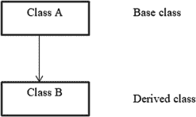

基类和驱动类。

上面的图片描述了类从基类派生的顺序。上图中所示顺序和标记将在需要时用于在理论上描述继承顺序。

考虑`Vehicles`类。现在我们必须为每种类型的车辆创建一个类，例如巴士、汽车或卡车。对于所有`Vehicles`，`fuelAmount()`、`capacity()`和`applyBrakes()`方法将是相同的。

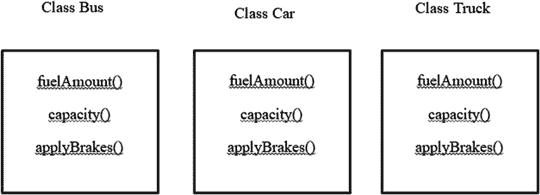

继承创建。

之前的图片描述了在没有继承概念的情况下创建这些类。

上述过程显然导致了相同代码的重复三次。这增加了错误的概率和数据冗余。继承被用于避免这种情况。如果我们创建一个类，在其中编写这些函数，并从那里继承其余部分，我们就可以简单地避免数据重复并增加重用性。

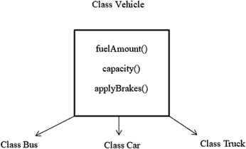

三个类继承自一个类。

由于我们继承了其余部分，我们只需要编写一次，而不是编写三次。

### 多级继承

## 面向对象编程（OOP）中的多态

多态是以多种形式处理数据的能力。Poly 意味着“多”，morphism 意味着“形态”；因此，术语本身就体现了其含义。多态是面向对象编程语言中最基础的概念之一。在 OOP 中，当父类引用指向子类对象时，通常会使用多态。本节将探讨如何以多种类型和格式表达任何函数。

多态的一个真实世界例子是，人在生活中可能同时扮演多个角色。例如一个女性同时承担着母亲、妻子、员工和女儿的角色。因此，同一个体必须具备各种特征，每种特征都必须根据场景和条件来实现。多态被认为是 OOP 最核心的特性之一。

OOP 的主要优势是多态。多态是如此本质，以至于不支持多态的语言不能被称为面向对象的语言。基于对象的语言是指那些拥有类但不支持多态的语言。因此，多态对于 OOP 语言来说至关重要。它是对象或引用在不同上下文中呈现多种形式的能力。它支持函数重载、函数重写和虚函数。

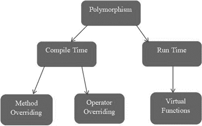

OOP 中的多态。

多态是一种属性，允许向多个类的对象发送任何消息，并且每个对象都可以根据其类属性做出相应的响应。

这意味着在 OOP 语言中，多态是一种根据调用它的对象类型执行不同操作的方法。例如，`$square->area()`将返回正方形的面积，而`$triangle->area()`可能返回三角形的面积。另一方面，`$object->area()`则必须根据调用`$object`的类来计算面积。

使用以下示例可以解释多态：

```perl
use warnings; # 使用 package package A 创建类; # 构造函数-创建
sub new { # shift 将获取包名 ’vehicle’
# 并将其赋值给变量 ’class’ my $class = shift; 
my $self = { ’name’ => shift, ’roll_no’ => shift }; 
sub poly_example { print("This corresponds to a class A\n"); } }; 
package B; # @ISA 数组包含一个列表
# 存储该类的父类（如果有的话） my @ISA = (A); 
sub poly_example { print("This corresponds to a class B\n"); } 
package main; B->poly_example(); A->poly_example();
```

在类`B`中定义的方法`poly_example()`重写了继承自类`A`的定义（对于第一个输出如此，第二个输出反之亦然）。这允许你添加或扩展任何预存在包的功能，而无需反复重写整个类的定义。结果是程序员的生活变得更加便利。

# OOP 中的封装

Perl 中的封装是将数据封装起来的过程，以使其免受不应访问该代码区域的外部源的影响。封装是 OOP 的一个组件；它将数据与更改它的子程序绑定在一起。从另一个意义上说，封装是一种保护屏，防止数据被此屏障之外的代码访问。

* 从技术上讲，在封装下，类的变量或数据对其他类隐藏，并且可能只能通过定义它们的类成员函数进行访问。

* 与封装一样，类内部的数据是对其他类隐藏的；因此，它有时被称为数据隐藏。

* 封装可以通过将所有类变量声明为局部（local），并通过导入包来获取类方法（以设置和检索变量值）来实现。

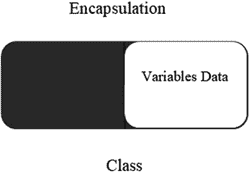

OOP 中的封装。

考虑封装的一个真实世界例子：在公司中，有多个部门，如会计、财务和销售部。财务部门处理所有的财务交易并维护所有财务数据的记录。

同样，销售部门负责所有与销售相关的操作并维护销售数据。现在，可能会出现一种情况：财务部门官员需要特定月份的完整销售信息。在这种情况下，他不被直接访问销售部门的数据。他必须首先联系销售部门的另一位官员，然后请求该个人提供数据。

这描述了封装。在这里，销售部门的数据以及可能更改数据的人被归类在“销售部门”之下。

如果在上述代码中需要对类数据进行任何修改或仅为了打印类数据，是无法直接完成的。创建该类的对象并然后使用`get_details()`方法访问数据是至关重要的。这被称为数据封装。

封装的优点是：

* 数据隐藏：用户将不确定类的内部实现。用户无法看到类如何在其变量中存储数据。他们只是意识到我们正在向访问器（accessors）赋值，并且变量正在用这些值进行初始化。

* 增强的灵活性：我们可以根据需要将类变量设为只读或只写。要使变量变为只读，我们需要在代码中使用 Get Accessor（获取）。要使变量变为只写，我们必须只使用 Set Accessor（设置）。

* 可重用性：封装还促进了可重用性，并更容易适应新需求。

* 验证代码简单：封装的代码易于单元测试。

本章涵盖了带有类、对象、方法、构造函数和析构函数的 Perl OOP。此外，我们还讨论了方法重写、继承、多态和封装。

# 第 8 章 Perl 子程序

DOI: [10.1201/9781003358442-8](https://doi.org/10.1201/9781003358442-8)

## 本章内容

* 函数签名 (Function Signature)

* 向子程序传递复杂参数

* 可变与不可变参数

* 多个子程序

* `return()`函数的使用

* 按引用传递 (Pass By Reference)

* 递归

在上一章中，我们讨论了 Perl 中的面向对象编程，在本章中，我们将涵盖子程序。

### 子程序或函数

Perl 函数或子程序是执行特定目的的语句集合。在任何编程语言中，代码复用都是理想的。因此，用户将代码块放在函数或子程序中，以消除重复编写代码的需求。在 Perl 中，函数、子程序和方法是同义词，尽管它们在其他编程语言中是不同的。在 Perl 编程中，子程序是最常用的术，因为它由关键字`sub`组成。每当调用函数时，Perl 都会暂停整个程序的执行，跳转到函数执行，然后返回之前的代码区域。不需要使用`return`语句。

### 确定子程序

Perl 子程序定义的通用形式如下：`sub subroutinename { # 方法或子程序的体 }`

### 调用子程序

Perl 中的子程序可以通过通过传递参数列表来调用，如下：`subroutinename(arugumentslist);`

上述描述的方法仅适用于 Perl 5.0 及更高版本。在 Perl 5.0 之前有另一种调用子程序的方法，但不推荐使用，因为它绕过了子程序的原型检查。

### 向子程序传递参数

这用于将值作为参数传递给子程序。这是通过使用特殊列表数组变量`$_`完成的。这些将被赋值给函数`$_[0]`、`$_[1]`等。

程序具有具有优点：

* 它允许我们复用代码，并使错误检测和调试变得更容易。

* 有助于代码的结构化组织。

* 代码段被组织成块。

* 它提高了代码的可读性。

Perl 函数或子程序是执行特定任务的语句集合。每种编程语言的用户都希望重用代码。因此，用户会将代码段放在函数或子程序中，以避免重复编写代码。我们将重点介绍以下概念：

- 将哈希（Hashes）传递给子程序。

- 将列表（Lists）传递给子程序。

- 从子程序的局部和全局变量返回结果。

- 子程序调用中的变数量参数。

### 将哈希传递给子程序

哈希也可以传递给子程序，子程序将其转换为键值对。

### 将列表传递给子程序

由于`@_`是函数或子程序内部的特殊数组变量，它被用于将列表传递给子程序。Perl 对数组和列表的解析方式不同，这使得从`@_`中提取独立元素变得困难。为了与其他标量参数一起传递列表，必须将列表作为最后一个参数。

### 从子程序返回结果

子程序与其他任何编程语言一样，可以返回值。如果用户没有手动从子程序返回结果，子程序将自动返回一个值。在这种情况下，自动返回的值是子程序中执行的最后一个计算的结果。该结果可以是标量、数组或哈希。

### 子程序中的局部和全局变量

默认情况下，Perl 程序中的所有变量都是全局变量。然而，使用`my`关键字，可以在块内创建局部或私有变量。私有变量的作用范围有限，例如在块（`if`, `while`, `for`, `foreach`等）和方法之间。这些变量不能在块或方法之外使用。

### 子程序调用中的数量数量

Perl 没有包含任何用于声明子程序参数的内置机制，这使得向函数传递任意数量的参数变得非常简单。

通常情况下，将多个数组或哈希作为参数传递给子程序会导致它们丢失其独立标识性。同样，从子程序返回多个数组或哈希也会导致它们独立标识的丢失。我们可以通过使用引用来解决这些问题。

## PERL 中的函数签名

Perl 函数或子程序是执行特定任务的语句集合。每种编程语言的用户都希望重用代码。因此，用户会将代码段放在函数或子程序中，以避免重复编写代码。虽然在 Perl 中函数（function）、子程序（subroutine）和方法（method）这些术语是可以通用的，但在其他编程语言中并非如此。因为它是使用关键字`sub`创建的，所以在 Perl 编程中通常使用子程序一词。当调用函数时，Perl 会停止执行整个程序并跳转到函数处执行，然后再返回到之前运行的代码段。可以避免使用`return`语句。

### 定义子程序

在 Perl 中，定义子程序的通用形式如下：`sub subroutinename { # 方法或子程序的体 }`

### 函数签名

在构建函数时，注意：具有定义签名的子程序或函数只能接受与其签名指定类型相同的参数。如果提供的过程输入与其签名不匹配，将发生错误。函数签名揭示了大量关于子程序类型的信息。它允许用户创建同名但签名不同的子程序，即不同的参数。在 Perl 中，不同的子程序可以有相同的名称，但它们的参数必须不同。

在上面的代码中，子程序的名称是相同的，但它们的参数数量是不同的；因此，它们不会被视为不同的子程序，我们的 Perl 代码不会报错。

### 传递与签名指定类型不同的参数

当使用签名定义子程序时，它必须接收与其签名相同类型的参数。如果给了一个与函数签名不同的参数，将生成错误，导致代码编译失败。

如果我们传递一个与函数签名类型不同的参数，将生成以下错误：

```perl
#!/usr/bin/perl
# Defining the Function Signature
sub example(Int $variable) { return $variable / 2; }
# Function Call with the
# string type parameter
print example("66");
```

### 参数数量的区别

当定义函数签名时，它还包含了可以传递给函数的参数数量和类型。如果我们用不同数量的参数调用函数，Perl 将抛出错误，因为具有不同签名的函数具有不同的含义。

函数签名是一个非常有用的特性，但对某些程序员来说可能非常烦人，因为它限制了函数只能用于特定类型的参数。如果在没有签名的情况下定义函数，则对传递给函数的参数类型没有限制。

上面的代码声明了一个没有特定参数类型的函数，因此当一个整数值作为字符串传递给它时，它会自动将参数转换为整数形式并返回结果。然而，如果我们使用字符串参数调用函数，且对其执行的操作需要整数值，我们将得到以下错误：

```perl
#!/usr/bin/perl
# Defining Function-Signature
sub example($variable) { return $variable / 2; }
# Function Call with the
# string type argument
print example("Peeks");
```

### 向子程序传递复杂参数


Perl 函数或子程序是执行特定任务的语句集合。用户在每种编程语言中都希望重用代码。因此，用户会将代码段放在函数或子程序中，以避免重复编写相同的代码。结果，函数或子程序被用于所有编程语言。这些函数或子程序可以接受各种数据结构作为参数。其中一些在下文中进一步讨论：

- 将列表或数组传递给子程序
- 将引用传递给子程序
- 将文件句柄传递给子程序
- 将哈希传递给子程序

向子程序传递数组或列表：数组或列表可以作为参数传递给子程序，并使用数组变量`@_`来接收子程序或函数内部的列表值。

**第一个示例**：将单个列表传递给子程序，并显示其元素。

**第二个示例**：在这种情况下，将两个列表传递给子程序，并显示它们的内容。

**第三个示例**：将一个标量参数和一个列表传递给子程序，并显示列表元素。

向子程序传递引用：引用也可以作为参数传递给子程序。数组引用被传递给子程序，并返回数组元素的最大值。

向子程序传递哈希：哈希也可以作为参数传递给子程序，显示其键值对。

向子程序传递文件句柄：为了创建文件或访问其内容，需要一个文件句柄（`FileHandle`）。文件句柄只是一个配合操作符使用的结构，用于以特定模式（如读取、写入、追加等）访问文件。文件句柄也可以作为参数传递给子程序，以便对文件进行各种操作。

在下面的示例中，文件句柄被传递给子程序：

## 可变与不可变参数

Perl 函数或子程序（subroutine）是执行特定任务的语句集合。用户希望在每种编程语言中重用代码。因此，用户将代码段放在函数或子程序中，以避免重复编写代码。这些子程序拥有参数，定义了调用函数时可以传递的参数的类型和数量。这些参数用于通过函数的表达式来评估传递给函数的值。然后，这些值将传递给调用函数并返回给指定的参数。

### 可变参数 (Mutable Parameters)

这些参数的值在传递给参数的函数内部是可以被修改的。

这表示当通过调用者函数向函数提供参数时，其值与被调用函数中的参数绑定，因此，在被调用函数中对值进行的任何更改也将反映在通过调用者函数传递的参数上。

### 不变参数 (Immutable Parameters)

这些参数属于此类，其值在提供给它的函数内部无法被修改。这表示当通过调用者函数向函数提供参数时，子程序获取的是一个值而不是变量。因此，对函数参数的任何修改都不会反映。

Perl 的子程序参数默认是不可变的，这意味着它们不能在函数内部被修改，且无法无意中更改调用函数的参数。在特定的编程语言中，这被称为“按值传递”（call by value），表示被调用的子程序获取的是值而不是变量，因此调用函数的参数不会被改变。

Traits（特性）用于更改这些参数的属性。在子程序内部可以使用 traits 来更改参数的值。

### Traits

这些是预定义的内置子程序，当在方法内部使用时，它们会在编译运行时更改方法的行为。Traits 甚至可以修改方法体或为方法标记元数据。

根据其用法，traits 可以有多种类型，例如：

* `is cached` trait 根据传递给函数的参数自动缓存该函数的返回值。
* `is rw` trait 允许对子程序参数进行可写访问器操作（writable accessors）。
* `is copy` trait 允许我们在子程序内部更改参数的值，但不会更改调用者函数中的参数。

**示例：** `is copy` trait 的用法

```perl
#!/usr/bin/perl
# 使用 # ’is copy’ trait 的函数定义
sub Func(Int $variable is copy) {
    # 要执行的操作
    $variable += 5;
}
### 定义局部变量
my $value = 20;
# 使用局部变量调用函数
print Func($value), "\n";
# 检查 # $value 是否被更新
print $value;
```

由于 Perl 默认不允许在子程序内部修改参数，因此在上面的代码使用了`copy` trait。此 trait 允许程序将调用者函数的参数值赋值给被调用的子程序的参数。然而，此 trait 只会影响被调用函数中参数的值。

**示例：** `is rw` trait 的用法

```perl
#!/usr/bin/perl
# 使用 # ’is rw’ trait 的函数定义
sub Func(Int $variable is rw) {
    # 要执行的操作
    $variable += 5;
}
### 定义局部变量
my $value = 20;
# 使用局部变量调用函数
print Func($value), "\n";
# 检查 # $value 是否被更新
print $value;
```

当在上述代码中使用`is rw`代替`is copy` trait 时，调用者函数中传递的参数值也会被更新。

当使用`is rw` trait 时，被调用函数的参数与调用者函数的参数绑定，因此如果前者值发生变化，后者将立即更新。这是因为一种被称为“按引用传递”（call by reference）的过程。由于两个参数都指向同一个内存位置（由于`is rw` trait 的作用），因此参数是完全可变的。

## 多个子程序 (MULTIPLE SUBROUTINES)

Perl 函数或子程序是执行特定任务的语句集合。每种编程语言用户都希望重用代码。因此，用户将代码段放在函数或子程序中，以避免重复编写代码。

虽然函数（function）、子程序（subroutine）和方法（method）在 Perl 中是可以通用的，但在其他编程语言中并非如此。由于它是使用关键字`sub`创建的，因此在 Perl 编程中常用“子程序”一词。当函数被调用时，Perl 会停止执行整个程序并跳转到函数处执行，然后再返回到之前运行的代码段。可以避免使用`return`语句。

### 子程序定义

在 Perl 中，定义子程序的通用格式如下：`sub subroutine_name { # 方法或子程序的正体 }`

由于 Perl 允许编写多个同名的子程序（除非它们具有不同的签名），因此 Perl 程序可以包含多个同名的子程序而不会产生错误。这可以通过更改每个同名子程序的参数个数（arity）来定义。

子程序的参数个数性（Subroutine arity）：只要参数个数不同，Perl 子程序可以具有相同的名称。一个子程序拥有的参数数量称为其 arity。这些参数可以是不同的数据类型，也可以不是。只要子程序的数量不同，Perl 程序就不会产生错误。

### “multi” 关键字的使用

关键字`multi`可用于在 Perl 中创建多个子程序。这对于创建相同名称的多个子程序非常有用。

多个子程序通常用于创建像 Perl 等编程语言中的内置函数和大多数运算符。通过不为每个子程序使用不同的名称，可以了程序的复杂度。无论需要什么代码语句，只需传递该函数的参数数量，工作即可完成。在这种情况下，编译器将选择函数签名与被调用处相匹配的子程序版本。

各种程序，例如数字阶阶、斐波那契数列等，需要使用多个函数来解决问题。使用多个子程序将有助于降低此类程序的复杂性。

**第一个示例**：斐波那契数列和

```perl
#!/usr/bin/perl
# 打印斐波那契数列和的程序
# 用于 $n = 0 的函数 Fibonacci_func(0) {
    1; # 返回 1
}
# 用于 $n = 1 的函数 Fibonacci_func(1) {
    1; # 返回 1
}
# 计算和的递归函数 multi Fibonacci_func(Int $n where $n > 1) {
    Fibonacci_func($n - 2) + Fibonacci_func($n - 1);
}
# 使用函数调用打印和
print Fibonacci_func(27);
```

为了计算斐波那契数列的和，前面的示例使用了多个子程序。

**第二个示例：**数字阶乘

```perl
#!/usr/bin/perl
# 打印数字阶乘的程序
# 0 的阶乘 multi Factorial(0) {
    1; # 返回 1
}
# 计算阶乘的递归函数
# multi Factorial(Int $n where $n > 0) {
    $n * Factorial($n - 1); # 递归调用
}
# 使用函数调用打印结果
print Factorial(25);
```

在前面的示例中，程序使用`multi`关键字声明了名称相同但参数个数不同的多个子程序。

变量在 Perl 中用于访问存储在内存的数据（所有数据和函数都存储在内存中）。变量被赋予数据值，这些值随后会在各种操作中使用。Perl 引用允许你通过不同的变量访问相同的数据。在 Perl 中，引用是一种标量数据类型，它存储另一个变量的位置。其他变量包括标量、哈希表（hashes）、数组、函数名等。嵌套数据结构的构建非常简单，因为用户可以创建一个列表，该列表包含另一个列表的引用，而该列表又包含对数组、标量、哈希等的引用。

### 创建引用

我们可以对标量值、哈希表、数组、函数等创建引用。要创建引用，定义一个新的标量变量，并在变量名（即我们想要引用的变量）前加上一个反斜杠`\`。

创建不同数据类型的引用：

- 数组引用：定义数组`@array = (’1’, ’2’, ’3’;);`
- 为数组变量创建引用`$reference_array = \@array;`
- 哈希引用：定义哈希表`%hash = (’1’=>’a’, ’2’=>’b’, ’3’=>’c’);`
- 为哈希变量创建引用`$reference_hash = \%hash;`
- 标量值引用：定义标量`$scalar_val = 2431;`
- 为标量变量创建引用`$reference_scalar = \$scalar_val;`

**备注：**

- 键值对周围的花括号`{}`可用于创建指向匿名哈希的引用。
- 方括号`[]`可创建指向匿名数组的引用。
- `sub`也可以用于创建指向匿名子程序的引用。这里的子程序将没有名称。
- 无法对输入/输出句柄（如`dirhandle`或`FileHandle`）创建引用。

### 解引用（Dereferencing）

现在我们已经创建了引用，我们必须使用它来获取值。解引用是获取引用所指向内存中值的方法。根据变量类型，我们使用前缀`$`、`@`、`%`或`&`来解引用（引用可以指向数组、标量、哈希等）。

### 引用传递

当变量通过引用传递时，函数对函数的原始数据进行操作。函数可以通过引用传递来更改变量的原始值。

当参数数组`@_`中的元素值发生变化时，相应参数的值也会发生变化。这就是引用传递的作用。

在以下示例中，在子程序`sample`中更新数组`@a`的元素会更改参数的值，这将反映在整个程序中。因此，当引用参数时，在函数中更改它们的值会改变主程序中的值。

程序的运行方式如下：

- 定义了一个值从 0 到 10 的数组。
- 随后将该数组传递给“sample”子程序。
- 已经定义了一个名为“sample”的子程序。在该程序内部通过参数数组`@_`更改第一个和第二个参数的值。
- 调用子程序后，显示数组`@a`的值。前两个标量值现在分别更新为 A 和 B。

### PERL 递归

递归是一种机制，允许函数反复调用自己，直到满足所需的条件。当函数调用语句写在同一个函数内部时，该函数即是递归的。

传递给函数的参数从默认数组`@_`中检索，每个值都可以通过`$_[0]`、`$_[1]`等访问。

**第一个示例**：以下示例计算一个数的阶乘。

程序的运行方式如下：

- 步骤 1：当标量`a`的值为 0 或 1 时，函数返回 1，因为 0! 和 1! 都是 1。
- 步骤 2：如果标量`a`的值为 2，则`fac(x-1)`调用`fac(1)`，后者返回 1。
  - 结果为`2*factorial(1) = 2*1 = 2`。
  - 结果为它将返回 2。
- 步骤 3：同样，当向函数传递更高的值时，参数值每次调用减 1，一直计算到值达到 1。

**第二个示例**：以下示例计算到指定数的斐波那契数列。

程序的工作原理如下：

- 步骤 1：调用带有三个参数的`fib()`，前两个是 0 和 1，而`$n`是要打印数列的数字。
- 步骤 2：这些值以数组的形式传输，使用`shift`检索其内容。
- 步骤 3：对于每次调用，使用`shift`获取前两个值并存储在标量`c`和`d`中。这两个值现在相加以产生数列中的下一个值。重复此步骤，直到值达到用户指定的结束值。

在本章中，我们涵盖了 Perl 中的子程序，讨论了函数签名、向子程序传递复杂参数，以及可变和不可变参数。此外，我们还讨论了多个子程序的使用、`return()`函数的用法、引用传递和递归。

# 评价

Perl 是一种在商业和私有计算行业中广泛使用的跨平台开源编程语言。在 20 世纪末和 21 世纪初，Perl 曾备受 Web 开发者的青睐，因为它具有适应性强的问题解决能力。

美国程序员兼语言学家拉里·沃尔（Larry Wall）于 1987 年 12 月首次为基于 Unix 的计算机发布了 Perl 1.0。这个早期版本的 Perl 是一种直观、易于编码的语言，用于读取、提取和打印文本文件中的信息；它还能执行其他系统管理任务。Perl 通常被认为代表“实用提取和报告语言”（Practical Extraction and Report Language），它的灵感源自现有的编程语言，如 C、BASIC 和 AWK，但它对常用英语术语的使用反映了沃尔的语言背景。

Perl 是一种为脚本操作设计的编程语言。然而，现在 Perl 用于广泛领域，包括 Web 开发、图形用户界面（GUI）开发、系统管理等等。它是一种可靠且跨平台的编程语言。

Perl CGI 用于 Web 开发。CGI 是与网络浏览器和 Perl 通信的系统网关。

它最常见的应用是从文本文件中提取信息并打印报告，将文本文件转换为另一种格式。这是因为它的名称源自“实用提取和报告语言”。

Perl 脚本是用 Perl 编写的程序，而 Perl 程序是执行 Perl 脚本的系统程序。Perl 是一种脚本语言。当我们运行 Perl 程序时，它首先被编译成字节码，然后转换为机器指令。用 Perl 而不是 C 写程序可以节省时间。

它与大多数操作系统兼容，并被收录于《津英语词典》。它从多种语言中借用了概念和语法，包括 AWK、bourne shell、C、sed 甚至是英语。

## PERL 历史

拉里·沃尔于 1987 年创建了 Perl，作为一种脚本语言来帮助处理报告。

1987 年 12 月 18 日，发布了 1.0 版本。

- Perl 2 于 1988 年发布，它包含了一个改进巨大的正则表达式引擎。
- Perl 3 于 1989 年发布，它包含了对二进制数据流的支持。
- Perl 4 于 1991 年发布，比之前的版本具有更好的文档。
- 1994 年 10 月 17 日，发布了 Perl 5。其最新版本包含了许多新功能，如对象、变量、引用和模块。
- 最新的版本 5.24 于 2016 年 5 月 9 日发布。

## PERL 特性

- 它具有直观的面向对象语法。
- 由于支持 25000 个开源模块，它能够轻松扩展。
- 支持 Unicode。

它包含了强大的文本处理工具，使其兼容标记语言，如`HTML`和`XML`。

它支持第三方数据库，如`Oracle`和`MySQL`。

它可以嵌入 Web 服务器和数据库服务器等其他系统中。

它是一项基于 GNU 许可的开源软件。

`Perl`用于编写许多框架。

它能够处理加密的 Web 数据，包括电子商务交易。

它是一种平台无关的语言。

它包含一个正则表达式引擎，可以转换任何类型的文本。

## PERL 许可

Larry Wall 拥有`Perl 5`的版权 (C)。它是免费的开源软件。根据`GNU`和`Artistic Licenses`的条款可以对其重新分发或修改。

`GNU 通用公共许可证`为用户提供免费的开源软件。任何源自 GNU 许可源代码的程序必须使用相同的许可证。

根据`Artistic license`，从`Perl`派生的包必须明确突出其修改部分。原始模块和派生模块都应该分发。重要的是，必须承认原始作者为包的所有者。用户应该能够区分原始模块和派生模块。

## PERL 与 Web

由于其文本处理能力和快速开发周期，`Perl`曾经是最流行的 Web 编程语言。

`Perl`通常被称为“互联网的胶带”。

`Perl`能够处理加密的 Web 数据，包括电子商务交易。

`Perl`可以嵌入 Web 服务器以将处理速度提高 2000%。

`Perl`模块`mod Perl`使`Apache`Web 服务器包含`Perl 解释器`。

`Perl`的`DBI`包简化了 Web 数据库的集成。

## PERL 是解释型的

由于`Perl`是一种解释型语言，我们的代码可以在不编译成不可移植的可执行程序的情况下运行。

传统的编译器将程序翻译成机器码。当你运行`Perl`程序时，它首先被编译成字节码，然后转换为机器指令（在程序运行时）。因此，它与 shell 或`Tcl`不同，后者是严格解释的，没有中间表示。

它也与大多数`C`或`C++`版本不同，后者被直接编译成依赖于机器的格式。它处于中间位置，与`Python`、`AWK`和`Emacs`的`.elc`文件一样。

## 优点

`Perl`有以下优势：

* **选项：** `Perl`用户在编写程序或解决问题方面有许多选择。
* **灵活：** 语言的设计和语法允许用户按照偏好的编程风格编写代码。
* **开源：** 它是免费的。任何人都可以在各种平台上免费地访问、开发和使用`Perl`。
* **可用性：** 它在很多地方预先安装，`Comprehensive Perl Archive Network`（全面 存档网络）包含超过 25,000 个`Perl`模块。大多数操作系统也支持它。

## 缺点


\n`Perl`的主要缺点是它在许多方面都是一种相当混乱的语言：\n\n- **难以阅读**：它很难阅读。根据一些开发者的说法，`Perl`比`Python`等较新的语言更难阅读且不精简。因为编写`Perl`程序的方法有很多，代码可能会变得杂乱无章且不整洁。\n\n- **难以调试**：调试和修复问题可能很困难，因为`Perl`代码可能晦涩或混乱。\n\n- **性能缺陷**：使`Perl`有用的灵活性也可能让它变慢。这是因为灵活性会导致效率低下和冗余，增加编译时间。\n\n## PERL 对比 PYTHON\n\n`Perl`和`Python`有共同的祖先。它们被创建是为了让脚本编写变得简单。`Perl`的创建是为了给`Unix`脚本提供`C-like`的结构。`Python`的创建是为了让`C`更容易使用并适用于脚本编写。\n\n在语法上，`Perl`和`Python`非常相似，从`Perl`翻译到`Python`相对简单，只有几处显著的语法变化。\n\n然而，有四个显著差异：\n\n- `Perl`中用分号结束行。\n- `Python`缺少大括号和缩进，而`Perl`有。\n- `Perl`中的变量名使用变量符号样式化，例如`$x`、`%x`和`x`。在`Python`中，变量名不带变量标识符，例如`x`。\n- 在`Python`中，`print`语句在输出末尾插入新行。\n\n其他差异还包括：\n\n- `Perl`可能是混乱的，而`Python`更精简。\n- 在`Perl`中，有多种方法完成任务，而`Python`设计旨在为任何给定函数提供单一清晰的路径。\n- `Python`比`Perl`更具可读性。\n- `Python`通常被认为是最好学习的语言之一。\n- `Python`是比`Perl`更新的语言。\n- `Perl`集成在源码中。\n- `Python`因其作为动态语言的声誉而是一种强大的编程语言。\n- `Python`在开源开发者社区中拥有更多支持。\n\n| Perl | Python |\n| --- | --- |\n| 它是一种高级的、基于解释器的动态编程语言。 | 它是一种带有解释器的高级通用语言。 |\n| 可以`https://www.perl.org/get.html`下载Unix/Linux、macOS或Windows版Perl。 | 可以从`https://www.python.org/downloads/`下载适用于Unix/Linux、macOS、Windows及其他系统的Python。 |\n| Perl的目标是简化报告创建，后来经历了许多变化和修订。 | Python的目标是让为中小型项目和应用程序编写简单且逻辑清晰的代码更容易。 |\n| 与Python代码相比，Perl代码并不那么简单。 | Python代码更直观、更易理解。 |\n| Perl拥有卓越的库支持，可以使用内置函数在操作系统级别处理操作。 | 为了处理此类操作，Python需要第三方库的帮助。 |\n| 可用的OOP支持有限。 | Python为面向对象的编程提供了卓越的支持。 |\n| 使用括号来标记和识别代码块。 | 使用缩进来标记和识别代码块。 |\n| 空格在`Perl`中至关重要。 | 空格在`Python`中很重要并可能导致语法错误。 |\n| 它便于文本处理，因为`Perl`包含了对正则表达式的支持。 | 处理正则表达式，Python需要使用外部函数。 |\n| 在`Perl`中结束代码行使用分号(;)。 | 在每行代码末尾不需要分号(;)。 |\n| Perl的文件扩展名是`.pl`。 | Python文件的扩展名是`.py`。 |\n\n## PERL 对比 JAVA\n\nLarry Wall在1987年发明了`Perl`。`Perl`同时支持面向对象和过程化编程。它与`C`和`C++`相似。`Perl`最初设计用于处理文本。\n\n`Java`是一种著名的编程语言。`Java`既是一种编程语言也是一种计算机平台。Sun Microsystems在James Gosling的发起下于1995年发布了`Java`。Oracle声称全球有30亿设备在使用`Java`。它的设计允许开发者“编写一次，到处运行”，这意味着Java应用程序可以在一个平台上生成并在任何支持`JVM`的其他平台上执行。\n\n以下是Perl和Java的一些关键区别：\n\n| 特性 | Perl | Java |\n| --- | --- | --- |\n| 介绍 | “Perl是一种通用的高级编程语言，因CGI脚本而流行。”CPanel和Bugzilla是两个流行的Perl项目。最初，它旨在取代复杂的shell脚本。 | Java既是一种编程语言，也是一个计算平台。如果不安装Java，仍然会有程序和网站无法运行。它快速、安全且可靠。 |\n| 编译格式 | Perl 6被编译为`Parrot Bytecode`，而Perl 5及更早版本是解释型语言。它以扩展名`.pbc`保存。 | Java应用被翻译成字节码。 |\n| 关联数组 | Perl以极其简洁的方式定义关联数组。 | Java字节码可以发送到网络上，然后在任何具有`JVM`的系统上运行。它以扩展名`.class`保存。 |\n| 重点 | Perl擅长支持文件扫描和报告创建等常见活动。 | Java中没有简洁的方法来创建关联数组。然而，它拥有哈希（hash）实现。 |\n| 文件扩展名 | Perl程序以`.pl`扩展名保存。例如：`MyFile1.pl` | Java程序以`.java`扩展名保存。例如：`MyFile1.java` |\n| 类型化方法 | Perl是动态类型语言，这意味着大多数类型检查发生在执行期间。 | Java是静态类型语言，这意味着大部分的类型检查发生在编译阶段。 |\n| 注释与文档 | Perl中的内联注释使用`#`编写。例如：Perl中的`#Inline-Comment`。Perl中的文档使用`=`和`=cut`完成。例如：`=Perl documentation follows following syntax` `=cut` | Java中的单行注释使用`//`声明。例如：`//Single-line Comment`。多行注释使用`/*……*/`编写。例如：`/* it is a multiline comment */`。Java中的文档使用`/**…………*/`。例如：`/**Documentation in the Java*/` |\n| 语句结束 | Perl中的每个语句必须以分号（`;`）结束。 | Java中的每个语句必须以分号（`;`）结束。 |\n\n## PERL 对比 C/C++\n\nPerl是一种动态、高级、解释型、通用的编程语言。\n\n它由Larry Wall在1987年创建。Perl没有官方的缩写，尽管“实用提取与报告语言”（Practical Extraction and Reporting Language）是最常见的。\n\n有些程序员将Perl称为“病态折衷主义垃圾列表器”和“实际上一切都非常喜欢的列表”。“实用提取与报告语言”这个缩写经常被使用，因为Perl最初的设计目的是用于文本处理，例如从特定文本文件中提取必要信息并将文本文件转换为新格式。它支持过程化和面向对象的编程。C++是一种如今常用于竞争性编程的通用编程语言。\n\n它支持命令式、面向对象和泛型编程。C++可以在包括Windows、Linux、Unix和Mac在内的各种平台运行。\n\n以下是Perl和C/C++之间的一些显著差异：\n\n| 特性 | Perl | C/C++ |\n| :--- | :--- | :--- |\n| 驱动函数 (main()) | Perl不需要显式的驱动函数。 | C/C++代码必须执行`main()`函数才能编译。 |\n| 编译过程 | Perl是一种解释型的编程语言。 | C++是一种用于通用面向对象编程 (OOP) 的语言。 |\n| 闭包 | Perl中包含不可访问私有数据的闭包可以作为对象使用。 | C/C++不允许闭包（可以被视为可以作为变量的函数）。 |\n| 文件扩展名 | `.pl`扩展名用于存储Perl脚本。例如，`perlDocument.pl` | `.c`和`.cpp`扩展名分别用于保存C和C++代码。`MyFile.c`和`myFile.cpp`是两个示例。 |\n| 大括号 | Perl中，if语句的“then”部分必须使用大括号。例如：`if ( condition ) { statement }` | C/C++中的if和循环后不需要大括号。例如：`if ( condition ) statement;` |\n| 字符串声明 | 在Perl中使用单引号声明字符串。双引号会强制对字符串内容进行评估。示例：`$x = \"peeksforpeeks\"` | 在C/C++中定义字符串使用双引号。例如：`string s =\"peeksforpeeks\"` |\n| 注释 | 在Perl中，我们利用`#`进行内联注释。例如Perl中的`#Inline-Comment` | C/C++使用`//`进行内联注释。例如C/C++中的`//Inline-Comment` |\n\n**用于两个数字相加的Perl程序：**\n\n```perl\n#!/usr/bin/perl\n# Perl program for adding two numbers\n$choice = 13;\n$choice2 = 15;\n$res = add($choice, $choice2);\nprint \"Result is $res\";\n# Subroutine to perform\n# the addition operation\nsub add {\n    ($c,$d) = @_;\n    $res = $c + $d;\n    return $res;\n}\n```\n\n### 它值得学习吗？\n\nPerl擅长文本处理。它是处理日志、数据清洗以及我们从命令行可以完成的几乎任何其他事情的极佳语言。尽管它曾是Perl CGI这一庞然物的驱动力，但现在已经有了用于现代Web应用的新框架，如Dancer。\n\nPerl仍然是现代编程的一个可行选择。CPAN仍在运行，且大多数实用的模块仍在维护。像《Modern Perl》这样的书籍展示了如何在避免过去的陷阱的同时保持Perl的现代性。\n\n### 保持Perl的相关性\n\nPerl从一种“瑞士军刀链锯”语言演变为适用于广泛用途的健壮脚本语言。它已经发展到在某些挑战中表现出色的程度，但除非我们喜欢这种语言，否则应该避免其他某些挑战。\n\n我们不会在GUI中使用它，但在处理数据或命令行时，不会忽略它，除非有非常有说服力的理由。这种语言仍在不断修订，目前的基准标准是5.8。MacOS自带Perl，在每个Linux发行版中都有（且很多人需要），通过Strawberry Perl在Windows上也能正常运行。\n\n### Perl的用途\n\n如果我们想在科技领域工作，就应该学习Perl。那些使用Perl构建系统管理流程、网络程序和网站的公司都需要Perl开发者。Amazon、Roblox、Venmo和MIT都是这些公司中的成员。Perl专家担任解决方案工程师、软件工程师、Web开发人员和数据库工程师等职位。如果我们想在科技行业担任编码员或系统管理员，Perl是完善我们对当前技术理解的极佳方式。\n\n## 为什么我们需要学习Perl？\n\n我们应该学习Perl的原因如下：\n\nPerl是一门非常出色的通用编程语言。Perl被广泛应用于许多领域，包括数据库管理、Web开发、系统管理和网络编程。\n\nPerl的使用方式非常新颖。生物信息学程序员编写软件来理解生物学数据集。不断发展的基因组学领域利用了生物信息学领域的专业知识。我们可以使用Perl获取基因序列并研究群体遗传学。\n\nPerl基于语言学概念，直到今天仍然是一门优秀的文本处理语言。人们会被正则表达式（Regex）、HTML解析和JSON操作所吸引。Perl还可以用于实现语言处理功能，如语音识别和文本转语音翻译。通过广泛使用的测试一切协议（`TAP`），你还可以使用Perl自动测试应用程序。\n\n总之，掌握Perl将为我们的Web开发职业提供有趣的选择。Perl编码员的需求量很大。一旦我们掌握了Perl，就可以利用它来驱动自己的项目或寻找工作。根据TIOBE指数（一个根据搜索引擎结果评估编程语言流行程度的网站），Perl目前在50种编程语言中排名第17位。\n\n该指数整合了25个搜索引擎的结果。它统计了特定编程语言的点击次数，并根据点击次数来确定该语言在索引中的排名。这结合提及Perl的职位发布频率等数据表明，虽然Perl目前不是最流行的编程语言，但它仍在使用中，因此是一项值得获得的人才技能。\n\nLinkedIn上有超过15,000个包含Perl的职位，Glassdoor上有超过10,000个。即使Perl现在可能不是最流行的编程语言，但公司继续使用它来运行其Web业务，并继续寻找具备这一技能组合的人。\n\n## 学习Perl需要多长时间？\n\n给自己三个月时间学习基础知识并开始编写程序。这假设我们每天花一小时学习这门语言。\n\n这一估计基于这样一个事实：学习Python基础大约需要八周，Python是另一种与Perl同时期出现（1991年）的脚本语言，并用于许多类似的任务。\n\n然而，一个显著的区别是，Python的设计目标是让执行任务的方法有限，而Perl的设计哲学是“一件事有多种方法”（There's more than one way to do it）。这意味着我们可能需要花更多时间学习Perl的基础。\n\n## Perl难吗？\n\n对于初学者来说，Perl可能具有挑战性。另一方面，拥有其他脚本语言经验可以缩短学习曲线。如果我们有一些Python经验，学习Perl将变得简单。\n\n我们必须安装软件并与命令行交互以开始学习Perl。如果我们以前从未这样做，请在学习Perl语法之前先完成。Perl Learn为所有平台提供了直接的安装说明。\n\n## Perl调试器的断点\n\n在Perl中控制程序执行是通过指示调试器执行到程序中的特定点，该点被称为断点（breakpoint）来实现的。断点允许用户对程序进行分段并搜索错误。\n\n以下调试器命令用于创建此类断点，以及执行到到达断点为止的命令。\n\n### b命令\n\n`b`命令用于在程序中设置断点。此命令指示调试器每当执行到特定行时停止程序。\n\n例如，以下命令指示调试器在即将执行第12行时停止：\n\n```\nDB<13> b 12\n```\n\n（如果该行不可断开，调试器将返回第12行不可设置断点。）\n\n程序可以有无限数量的断点。当调试器准备执行包含断点的语句时，程序将停顿。\n\n`b`命令也接受子程序名：\n\n```\nDB<15> b valuedir\n```\n\n这会在子程序`valuedir`的第一个可执行语句处设置一个断点。\n\n`b`命令还可以只在满足特定条件时才停止程序。\n\n例如，以下命令指示调试器在即将执行第12行且变量`$vardir`等于空时停止：\n\n```\nDB<15> b 12 ($vardir eq \"\")\n```\n\n`b`语句可以用于指定任何合法的Perl条件表达式。\n\n可以在多行语句的任何一行上设置断点。\n\n例如：\n\n```\n16: print (\"Peeks\", 17: \" for Peeks here\");\n```\n\n第16行可以作为断点，但第17行不行。\n\n### c命令\n\n`c`命令指示调试器继续调试，直到到达断点或程序结束。\n\n当调试器即将到达设置了断点的第12行时，程序停止并显示该行，因为调试器总是显示即将执行的行。\n\n调试器在此处生成一个另一个调试命令的提示符。该提示符允许我们通过输入`n`或`s`来逐语句地继续执行过程，通过输入`c`继续执行过程，通过输入`b`设置更多断点，或执行任何其他调试操作。\n\n可以使用`c`命令和行号设置临时（仅限一次）的断点：\n\n```\nDB<15> c 12 main::(debugtest:12): &readsubdirs($vardir);\n```\n\n`c`命令的参数12指示调试器在第12行设置一个临时断点，然后继续执行。当调试器到达第12行时，它会停止执行过程，显示该行并移除断点。\n\n`c`命令用于在人们想要跳过几行代码而不通过逐语句执行程序来浪费执行时间时定义临时断点。使用`c`还避免了使用`b`定义断点然后用`d`命令将其删除的需要。\n\n### L命令与断点\n\n第4–8行已经执行，并且在第11行设置了断点。（不包括第7行，因为它是注释。）通过检查紧随在断点之后的条件表达式，可以将断点与已执行的行区分开来。在这种情况下，条件表达式设置为`(1)`，表示该断点始终有效。\n\n### d和D命令\n\n当断点的工作完成后，可以使用`d`命令将其删除。\n\n前一个命令指示调试器移除在第12行设置的断点。\n\n如果没有指定要删除的断点，调试器会假设下一个要执行的行有一个断点并自动删除它。\n\n由于第12行是下一个执行的行，调试器会自动移除第12行的断点。\n\n`D`命令用于移除程序的所有断点。\n\n上述命令移除所有通过`b`命令设置的断点。\n\n### 退出脚本\n\n`exit()`评估传递的表达式并退出Perl解释器，将该值作为退出值返回。`exit()`函数并不总是立即退出，而是在终止程序之前调用程序的结束例程。如果没有向`exit`函数传递表达式，则默认值为`0`。`exit()`函数的用途有限，不应用它退出子程序。要退出子程序，请使用`die`或`return`。\n\n上述代码的工作原理如下：\n\n- 步骤1：要求用户输入一个出价。\n- 步骤2：如果出价小于1000，`exit`返回该出价并终止程序。\n- 步骤3：如果出价大于或等于1000，则打印此消息。\n


**`Exit`函数的参数传递：** 参数可以传递给`exit`函数并存储在系统的变量中。

需要注意的是，传递给`exit`函数的值可以是任意随机值；它不必是某个特定值。

以下示例展示了如何向`exit`函数传递值：

```perl
### Opening 文件
if(!open(fh,"<","Filename.txt")) {
    # 此代码块传递错误代码 56
    # 给 exit 函数指示文件
    # 无法打开。
    print "Couldn’t open file";
    exit 56;
}
# 将成功代码 1 传递给
# exit 函数
exit 1;
```

以下步骤展示了上述程序的工作：

- 步骤 1：以只读模式打开文件。
- 步骤 2：如果块执行且无法打开文件，它将调用`exit`函数向系统发送错误代码 56。
- 步骤 3：如果文件成功打开，则返回 1。
- 在 Linux/Unix 上，`$?`显示`exit`函数返回的值。终端命令`echo $?`显示`exit`函数返回的值。

## 创建 Excel 文件

Excel 文件是计算机通信中常用的办公应用程序。它创建由文本、数字和计算公式组成的行和列。它是发送报告的方便方式。此演示兼容 Linux、Windows 和其他平台。在 Excel 中，行从 1 到 n 编号……而列由 A 到 C 等字母表示。`A1`指左上角。可以使用 Padre IDE 通过 Perl 创建 Excel 文件，但我们也会使用`Excel::Writer::XLSX`。

Perl 使用`write()`函数向 Excel 文件添加内容。

### 创建 Excel 文件

可以使用 Perl 命令行创建 Excel 文件，但必须先加载`Excel::Writer::XLSX`模块。

程序的运行如下：

- 步骤 1：加载`Excel::Writer::XLSX`模块。
- 步骤 2：创建一个名为`$Excelbook`的对象代表整个 Excel 文件。
- 步骤 3：使用`write()`方法将数据插入工作表中。
- 步骤 4：将文件保存为`.pl`扩展名。
- 步骤 5：从命令行运行`.pl`文件生成 Excel 表格。

### 基本公式的使用

Excel 允许使用各种数学公式来简化电子表格计算，例如资产负债表和业务记录。

以下是两个基础 Excel 公式的描述：

- **加法：** Excel 有名为“SUM”的方法，允许我们向特定单元格加值。
- **计数：** 此 Excel 函数计算给定范围内所有仅包含数值的单元格。

### 在 Excel 表中添加颜色

颜色可以使用在 Excel 表格中区分不同的值。使用`add_format()`方法指定这些颜色。

### 在特定坐标添加值

通过指定要添加值的单元格地址，可以在特定坐标处添加值。

## 读取 Excel 文件

Excel 表格是保存办公记录最流行的方法之一，特别是在处理非开发人员甚至经理可以向系统批量输入的应用程序时。

然而，问题在于使用 Perl 读取 Microsoft Excel 文件的内容。

CPAN 提供了几个用于读取 Excel 文件的模块。电子表格工具可用：它能够处理所有类型的电子表格。其他读取不同版本 Excel 文件的低级库包括：

- `Spreadsheet::ParseExcel` Excel 95-2003 文件，
- `Spreadsheet::ParseXLSX` Excel 2007 Open XML XLSX

### 创建 Excel 表格

可以使用 Perl 中的内置模块`Excel::Writer::XLSX`创建 Excel 文件，该模块用于创建 Excel 文件。

此外，使用`write()`函数向 Excel 文件添加内容。

### 读取 Excel 文件

`Spreadsheet::`用于 Perl 中读取 Excel 文件。

在 Perl 脚本中，读取该模块。该模块导了几个可以在你的 Perl 代码脚本中导入或使用的函数。要从 Excel 文件读取，请使用`ReadData()`函数。

`ReadData()`函数接收一个文件名（在此情况下为 Excel 文件），但也接受许多其他文件类型。它会在解析文件之前根据文件扩展名加载相应的后端模块。它生成一个代表整个文件的数组引用：

上述代码返回的数组的第一个元素包含有关文件的通用信息。其余元素代表文件的其他工作表。换句话说，`$book_data->[1]`指“newexcel.xlsx”文件中的第一个工作表。因为它是一个哈希引用，可以使用它来访问单元格的内容。`$book_data->[1]{A2}`返回 A2 元素的哈希引用。

### 从 Excel 文件获取行

读取`Spreadsheet::`工作表的函数参数以及要获取的行数。传递的行值将作为数组返回。

以下程序展示了如何读取第一个工作表，然后显示每个字段的内容。

#### 获取文件内容

仅获取单行是不够的。为了高效编程，我们必须检索所有行。使用`rows()`函数来完成此操作。该函数接收一个工作表作为参数。它以矩阵的形式返回一个元素数组（二维数组）。电子表格中的每一行都由一个元素表示。

以下脚本将检索所有行：

```perl
my @rowsmulti = Spreadsheet::Read::rows($book_data->[1]);
foreach my $x (1.. scalar @rowsmulti) {
    foreach my $y (1.. scalar @{$rows[$x-1]}) {
        say chr(64 + $x). " $y ". ($rows[$x - 1][$y - 1]);
    }
}
```

#### 整合在一起

以下 Perl 脚本演示了之前描述的所有在 Perl 中读取 Excel 文件的功能：

```perl
#!/usr/bin/perl
use strict;
use warnings;
use 5.010;
use Spreadsheet::Read qw(ReadData);

my $bookdata = ReadData('simplecreate.xlsx');
say 'A1 '.$bookdata->[1]{A1};

# 获取单行
my @rowsingle = Spreadsheet::Read::row($bookdata->[1], 1);
for my $x (0..$row) {
    say 'A'.($x + 1).': '.($rowsingle[$x] // '');
}

# 获取所有文件内容
my @rowsmulti = Spreadsheet::Read::rows($bookdata->[1]);
foreach my $x (1.. scalar @rowsmulti) {
    foreach $y (1.. scalar @{$rows[$x-1]}) {
        say chr(64 + $x). " $y ". ($rows[$x - 1][$y - 1]);
    }
}
```

## Perl 猜数字游戏

猜数字游戏要求我们在有限次数内猜出随机选择的数字。

必须使用以下函数：

- `rand n`：此函数生成从 0 到 n 的随机数。此外，此函数始终返回浮点数。因此，结果被显式地转换为整数值。
- `Chomp()`：`Chomp()`是一个从用户输入中删除换行符的函数。

while 循环在程序中执行，直到用户估计的数字与生成的数字匹配，或者尝试次数少于最大机会数。如果尝试次数超过机会数，游戏结束，用户失败。如果用户在规定的尝试次数内正确猜中数字，他们将获胜。在每次猜测后，计算机会通知用户他们的估计值是大于还是小于实际生成的数字。起初，此代码中的`rand`函数为`x`分配一个随机整数。

`rand(k)`函数生成一个 0 到`k`之间的随机整数。由于这个随机数是浮点型整数，因此使用`int`将其转换为整数。`x`存储该整数值。用户被赋予了有限的机会来估算数字。如果机会超过了猜中的数字，用户将失败。

该过程如下：

### 猜数字游戏实现

```perl
print "The Number guessing game\n";
# rand 函数用于生成
# 0 到 10 之间的随机数
# 将其转换为整数
# 并存储到变量 "x"
$x = int rand 10;
# 用于计数正确
# 次数的变量
$correct = 0;
# 分配给用户
# 猜数字的机会
# 或者是用户输入
# 到输入框中的
# 输入，这里机会
# 是 4 次
$chances = 4;
$n = 0;
print "Guess number (between 0 and 10): \n";
# while 循环包含变量 n
# n 用作计数器值
# 变量机会
while($n < $chances) {
    # 输入 0 到 10 之间的数字
    # 从输入中提取数字
    # 并移除换行符
    chomp($userinput = <STDIN>);
    # 检查用户是否提供了
    # 输入
    if($userinput != "blank") {
        # 比较输入的数字
        # 与要猜的数字
        if($x == $userinput) {
            # 如果用户输入的数字
            # 与 rand 函数生成的
            # 数字相同，则
            # 使用循环控制语句 "last"
            # 跳出循环
            $correct = 1;
            last;
        }
        # 检查用户输入的
        # 数字是否小于
        # 生成的数字
        elsif($x > $userinput) {
            print "Our guess was too low,";
            print " guess a higher number than ${userinput}\n";
        }
        # 用户输入的数字
        # 大于生成的
        # 数字
        else {
            print "Our guess was too high,";
            print " guess a lower number than ${userinput}\n";
        }
        # 给用户的机会
        # 数加一
        $n++;
    } else {
        $chances--;
    }
}
# 检查用户是否
# 猜中了正确的数字
if($correct == 1) {
    print "We Guessed Correct!";
    print " Number was $x";
} else {
    print "It was actually ${x}.";
}
```

注意：在上述程序中，用户可以更改`rand`函数的值来增加游戏中数字范围，并通过更改`chance`变量的值来增加机会。

## 使用 DBI 进行数据库管理

Perl 最常用的应用之一是创建数据库应用程序。我们可以使用 Perl 构建带有数据库的处理所有数据的复杂 Web 应用程序。它提供了极好的接口支持和多种数据库格式。Perl 包含一个名为`DBI`的模块用于连接和访问数据库。`DBI`是连接到基于结构化查询语言（SQL）的数据库服务器的接口。

通常，Perl 需要两个步骤来访问数据库。`DBI`模块提供了数据库访问 API。软件使用`DBI`函数修改数据库。数据库驱动 (`DBD`) 模块作为 Perl 数据库访问的第二步。每个唯一的数据库管理系统都需要自己的驱动程序。这种方法使得 Perl 数据库应用程序很大程度上独立于它将连接的数据库。

**安装：** 打开终端并输入以下命令安装 DBI 模块：`perl -MCPAN -e 'install Bundle::DBI'`

这将自动下载并安装`DBI`模块驱动，允许 Perl 连接到数据库。

### 数据库无关接口

`DBI`如其名，为 Perl 程序提供了一个独立的接口。这意味着 Perl 代码不依赖于后端运行的数据库。`DBI`模块提供了抽象，允许我们编写代码而不必担心后端运行的数据库。

要导入数据库无关接口模块的函数，请使用`use`属性来导入或包含该模块。使用`DBI`属性使我们能够使用`DBI`模块操作我们连接的数据库。

### 访问数据库

要连接到指定的数据库，请使用`connect()`方法。它需要三个参数：

- 一个用`":"`分隔的三值字符串。在这种情况下，它是`"DBI:mysql:test"`。第一个值表示我们正在使用`DBI`。第二个值指定数据库引擎，在此情况下是 MySQL。第三个值是我们要连接的数据库名称。
- 用户名是`connect()`方法的下一个参数。在这种情况下，用户是`"root."`。
- 最后一个参数是我们本地系统的密码。在这种情况下，密码是`"password"`。

如果无法连接到数据库，`"or die"`语句将带有错误信息终止程序。`errstr()`方法返回一个包含在数据库连接期间遇到的任何错误的字符串。

### 准备执行的查询

要执行的 SQL 查询作为单个参数传递给`prepare()`方法。SQL 查询被表示为包含 SQL 语句的字符串。此 SQL 语句与我们在 MySQL 中使用的 SQL 语句相同。它返回一个语句句柄（statement handle），可用于执行查询。

查询现在已准备好执行。在前面的查询中，我们正在创建一个包含 id、name、salary 列的表。

### 执行查询

在`prepare()`中编写的查询由`execute()`方法执行。这无可争疑。当执行`prepare`语句时创建的语句句柄对象用于调用它。

### 从结果中获取值

`fetchrow()`方法从结果中检索下一行。当运行选择查询时，`fetchrow()`方法提取一行并将其赋值给变量。在`while`循环中使用`fetchrow()`，我们可以获取并显示数据库中的所有行。

这三个变量持有每列的值。

`fetchrow_array()`函数返回一个包含结果行的数组。

### 断开连接

在所有查询完成后，我们必须断开连接。这是通过使用`disconnect()`函数实现的。这允许 Perl 脚本正常关闭连接。如果不断开数据库，将会出现错误。

### 在 MySQL 中创建数据库

MySQL 必须安装在我们的系统中，并且我们必须对 MySQL 有基础了解。

- 连接到我们的 MySQL 服务器。
- 创建一个名为`"test."`的数据库。我们将连接到这个数据库，请确保名称为`"test."`。
- 确保此数据库中没有表，因为我们将创建一个名为`"emp"`的表并向其插入值。

整合以上内容：

在 MySQL 中构建数据库后，我们可以访问 Perl 数据库。首先，我们创建一个模式为`(id INTEGER PRIMARY KEY, name VARCHAR(10), salary INT, dept INT)`的测试表。在无错误创建后，向表中插入值。

## Glob（通配）

它返回匹配参数表达式的文件列表。此方法可以打印所有或特定扩展的文件。

以下是使用文件通配（File Globbing）访问目录的一些示例。

- 获取脚本所在的当前目录：

```perl
#!/usr/bin/perl -w # 使用 glob 函数访问文件
@files = glob(’*’); # 返回所有文件的列表
foreach $file (@files) # 遍历所有文件
{ print $file. "\n"; # 打印所有文件
}
```

- 打开特定目录：

```perl
#!/usr/bin/perl -w # 只打印不包含路径的文件
use File::Basename; # 返回所有文件的列表
@files = glob(’C:/Users/PeeksForPeeks/Folder/*’);
foreach $file (@files) # 遍历所有文件
{ print basename($file), "\n"; # 打印所有文件
}
```

## Hashbang 或 Shebang 行的使用

实用实践语言中的提取与报告（Extraction and Reporting in Practice Language，通常被称为 Perl）是一种基于解释解释器的编程语言。在 Linux 和 Mac OSX 等类 Unix 平台上运行 Perl 脚本时，Hashbang 或 shebang 行非常有用。Hashbang 行是 Perl 程序的起始行，用作与 Perl 二进制文件的连接。它允许直接执行 Perl 脚本，而无需将文件作为输入传递给 Perl。在 Perl 中，Hashbang 行看起来如下：`#!/usr/bin/perl`

Hashbang 行之所以这样命名，是因为它以井号（`#`）开头，并以感叹号（`!`）结束。在 Perl 编程中，Hashbang 行非常重要。让我们开始使用这种 Hashbang 行吧。

**示例：** 假设我们有一个 Perl hello world 程序脚本，我们将在 Linux 系统的终端上运行它。

在前面的代码中，终端首先运行 Perl，然后指示 Perl 运行代码脚本。如果在没有先运行 Perl 的情况下运行代码脚本，就会发生错误。

尝试执行以下代码：`$ hello1.pl`

我们使用的 shell 尝试解析文件中的命令。然而，它在 Linux/Unix 中无法定位`print`命令。因此，需要通知 shell 这是一个 Perl 脚本。这时 Hashbang 的想法发挥作用了。Hashbang 通知终端该脚本。


然而，在运行此代码之前，必须修改 shell 的路径以将当前目录添加到现有目录中。这可以通过运行以下命令实现：`$ PATH = $PATH:$(pwd)`

当前工作目录将添加到 `PATH` 环境变量的目录列表中。

然后，在 Perl 脚本文件`hello1 .pl`中，添加 Hashbang 行`#!/usr/bin/perl`。此行始终添加到代码开头，即 Hashbang 行是代码脚本的第一行。

由于在脚本的第一行添加了 Hashbang 行`#!/usr/bin/perl`，上面的代码能够正常运行且不产生错误。

脚本在执行时是在当前 shell 环境中进行的。如果脚本以井号和感叹号（Hashbang）`#!` 开头，shell 将执行 Hashbang 行上指定路径的程序（在本例中为`/usr/bin/perl`），这是 Perl 编译器-解释器的默认位置。因此，Hashbang 行包含了 Perl 编译器-解释器的位置。

当文件中没有 Hashbang 行且我们尝试在不显式执行 Perl 的情况下运行它时，就会出错。shell 认为脚本是用 Bash 编写的并尝试恰当地运行，这会导致错误。

## 有用的数学函数

在 Perl 中，偶尔需要解决包含数学运算的某些表达式。这些数学过程可以使用几个内置函数执行。

以下是一些用于数学运算的有用 Perl 函数：

| 函数 | 说明 |
| --- | --- |
| `exp()` | 计算参数“e”的实数值值的幂。 |
| `hex()` | 将指定的十六进制数（16 进制）转换为其十进制等效值（10 进制）。 |
| `srand()` | 帮助`rand()`函数在每次程序执行时生成一个常量。 |
| `sqrt()` | 计算数字的平方根。 |
| `oct()` | 将提供的八进制值转换为其十进制等效值。 |
| `rand()` | 返回从 0 到传递给它的正数值之间的随机小数，如果没有指定值，则返回 1。 |
| `log()` | 返回传递给的值的自然对数。如果在未提供值的情况下调用，则返回`$_`。 |
| `int()` | 返回提供数字的整数部分。如果没有指定值，则返回`$_`。 |
| `sin()` | 用于计算 VALUE 或`$_`的正弦。如果未提供 VALUE。 |
| `cos()` | 计算 VALUE 或`$_`的余弦。如果缺少 VALUE。 |
| `atan2()` | 计算 -PI 到 PI 范围内`Y/X`的反正正切值。 |
| `abs()` | 返回其参数的绝对值。 |

## 函数（Functions）与子程序（Subroutines）的区别

当代码脚本规模增大时（即包含数百行代码），在 Perl 中处理将变得困难。Perl 为用户提供了函数和子程序的概念来规避这一挑战。为了使程序更具读性，函数和子程序将复杂/大型代码块分成更小、更简洁的部分。

它们通过允许我们在程序中重用以前编写的代码，最小化了应用程序的大小和调试时间。Perl 函数和子程序在程序中用于重用代码。我们可以在整个程序中使用带有各种参数的函数。

### 到底什么是函数？

函数接受几个输入，对它们执行操作，然后返回一个值。

它可能包含在编程语言中，或由用户提供。在 Perl 中定义函数时，要指定名称和语句顺序。当我们以后想要进行计算时，可以通过名称`call`该函数。

Perl 有几个真正的内置函数。`say`是内置函数的一个示例。Perl 甚至允许我们创建自己的函数来协助完成所需的任务。

### 到底什么是子程序？

子程序（或`sub`）允许我们为部分代码命名，这样当我们想要再次使用它时，只需调用其名称即可。

在编写 Perl 时，子程序从两个方面帮助我们我们：

- 第一，它们允许我们在程序中重用代码，使更容易检测和纠正错误，并更快地构建应用程序。
- 第二，它们使我们能够将代码组织成部分。每个子程序负责特定的任务。

当把代码放置在 Perl 子程序中，有两种选择：

- 当我们知道代码将用于某个要执行的计算或操作时。例如，当将字符串转换为特定格式或当将输入的数据记录转换为哈希表（hash）时。
- 当我们想要将程序的逻辑组件分成部分以便更容易理解时。

下表比较了函数和子程序之间的区别：

| 函数 | 子程序 |
| --- | --- |
| 函数的基本格式为`$myvalue = myfunction(parameter, parameter);` | 子程序的基本格式为`sub subroutine_name{# body of the subroutine}` |
| Perl 函数是任何内置于 Perl 的内容。Perl 内置函数的主要参考参考文档被称为 perlfunc。 | 在 Perl 中，子程序是一段可以接收输入、对它们执行特定操作并可能返回或不返回有用值的代码。然而，它们始终是用户定义的，而不是内置的。 |
| Perl 为我们提供了所有函数。 | 子程序是提供提供给 Perl 的代码片段。 |
| 函数类似于子程序，因为它们都会返回一个值。函数通常执行某些计算并将结果返回给调用者。 | 子程序执行任务但不向调用程序返回任何信息。 |
| 函数不能更改实际参数的值。 | 子程序可以更改实际参数的值。 |
| 函数产生可预测的结果，且没有副作用。 | 此类限制并不限制子程序。 |

### Perl 用于的十大编程任务

*   **云数据管理：** 这是一个陈词滥调，但也是事实：所有企业已经拥抱了云，或者正在采纳云的过程中。我们是否需要访问公云中的数据，但又不想使用云厂商专有的`CLI`工具或 Web 界面？有一个 Perl 模块可以实现这一功能。

实际上，Perl 可以轻松地与所有主要的云服务交互，帮助您进行数据管理：

  * Perl 可用于与 AWS S3 存储桶进行交互。
  * 也有第三方 Perl 工具程序用于管理`Azure Blob`存储。
  * Perl 还支持`Google Cloud Storage`。

*   **Perl 用于管理云虚拟机：** Perl 也可以用于管理运行在公有云或私有云上的虚拟机。例如：

  * `Net::Amazon::EC2`的`Query API`提供了一个连接到亚马逊弹性计算云 (`AWS EC2`) 的 Perl 接口。
  * 同样，VMware 的`vSphere Perl SDK`允许您在任何环境中管理 VMware 虚拟机。然而，由于`vSphere`是创建私有云的流行方法，Perl 可能是控制它们的必不可少的工具。
  * 虽然我们尚未发现任何与`Azure`或`Google Cloud Platform`虚拟机服务交互的预构建 Perl 解决方案，但没有理由这样做。

*   **Perl 是一种用于提供网页服务的编程语言：** 您是否需要一个轻量且易于适配的 Web 服务器？用 Perl 大约 200 行代码就能编写一个。尽管 Perl 版本可能不太用于常规的生产工作负载，但一个极简的基于 Perl 的 Web 服务器对于硬件资源极低的系统（例如物联网 (IoT) 部署中的系统）是非常出色的。或者，如果我们只是想更多地了解 Web 服务器运行原理的基础，研究 Perl 代码可能会很有帮助。

*   **Perl 用于语音识别：** 语音识别是各种应用程序（包括虚拟助手和聊天机器人）中一项复杂但日益重要的能力。Perl 在这也可以提供帮助。

我们可以利用诸如`Google::Cloud::Speech`等 Perl 模块（该模块提供了 Google 的`Cloud Speech API`接口），使用户能够通过语音命令提交数据，或者仅为音频文件构建文本转录。

虽然`Google Cloud`的 API 承担了大部分重量工作，但 Perl 提供了一个与其交互的简单接口，减少了学习和处理专有的、厂商特定 API 的需求。当然，我们还可以使用成上万个额外的 Perl 模块来帮助构建我们的应用程序。

*   **Perl 中的文本转语音翻译：** Perl 与语音识别一样，利用 Google 的翻译服务将文本转换为语音，从任何语言的文本创建语音。尽管文本转语音可能没有语音转文本那样令人兴奋，但它可能帮助我们为应用程序添加实用功能，例如用于无障碍的屏幕阅读、实现多任务处理，或仅仅辅助教授新语言。

*   **用于软件测试的 TAP：** 如果我们希望连续、自动地发布软件，我们必须同样以连续、自动的方式对其进行测试。Perl 拥有多种顶级的测试方法，从最知名且最常用的任何测试协议（Test Anything Protocol，通常被称为`TAP::Harness`）。

TAP 本质上在 Perl 测试模块之间提供了一个基于文本的接口。尽管如此，它仍然非常可靠且易于使用，现在在 C、C++、Python、PHP、Perl、Java、JavaScript 等语言中都有实现。

*   **使用它执行系统管理任务：** Perl 长期以来 Unix/Linux 环境中非常重要，管理员经常使用它来编写典型的系统管理任务脚本。然而，Perl 对以 Windows 为中心的系统也有帮助。Perl 允许我们处理`Active Directory`甚至 Windows 注册表。我们需要跟踪用户计算机上安装的软件吗？或者是否应该在系统启动时执行定期的更新/维护？Perl 可能是在 Windows 和 Linux 上编写此类管理操作的理想技术。

*   **用于生物信息学的 BioPerl：** 虽然生物信息学不太可能大多数开发者 Perl 使用列表的顶端，但有一个名为`BioPerl`的社区致力于此。基于 Perl 的生物信息学和基因学解决方案涵盖了从基因序列到研究群体遗传学的范围。

*   **Perl 是日志管理的理想选择：** 由于现代计算机系统的分布以及它们结合许多不同类型组件的方式，现代日志管理已变成了一门科学。Perl 有助于与大多数日志管理解决方案交互，从`syslog`等标准到`Papertrail`这样的专有系统。当然，我们可以开发自己的 Perl 脚本来聚合和解析日志，这在需要完全自定义的日志管理解决方案的情况下非常方便。

*   **Perl 擅长文本处理：** 文本处理作为 Perl 最常见的应用，这并不令人意外。三十多年来，Perl 一直一直是正则表达式、HTML 解析和 JSON 操作的首选语言。没有其他编程语言比 Python 提供更有效或更易于使用的文本处理功能。丰富的 Perl 社区模块可以帮助几乎任何涉及文本处理、提取和转换的任务。其中许多模块已经在我们的 Perl 文本处理环境中预编译，我们可以通过`State Tool CLI`免费下载和安装。

## 参考文献

1. Perl – 简介。[https://www.tutorialspoint.com/perl/perl_introduction.htm](https://www.tutorialspoint.com/perl/perl_introduction.htm), 访问日期为 2022 年 6 月 1 日。

2. Perl. [https://www.techtarget.com/whatis/Perl](https://www.techtarget.com/whatis/Perl), 访问日期为 2022 年 6 月 1 日。

3. 条件决策。[`www.learn-perl.org/en/Conditional_Decisions`](https://www.learn-perl.org), 访问于 2022 年 6 月 5 日。

4. Perl 中的包（packages）和模块（modules）什么是什么？[`www.educative.io/answers/what-are-packages-and-modules-in-perl`](https://www.educative.io), 访问于 2022 年 6 月 5 日。

5. Perl 中的模块和包。[`www.codesdope.com/perl-modules-and-packages/`](https://www.codesdope.com), 访问于 2022 年 6 月 6 日。

6. Perl 基础。[`www.udemy.com/course/perl-fundamentals/`](https://www.udemy.com), 访问于 2022 年 6 月 6 日。

7. Perl 教程。[`www.tutorialspoint.com/perl/index.htm`](https://www.tutorialspoint.com), 访问于 2022 年 6 月 6 日。

8. Perl 教程。[`www.perltutorial.org/`](https://www.perltutorial.org), 访问于 2022 年 6 月 6 日。

9. 第 10 章。包。[`docstore.mik.ua/orelly/perl4/prog/ch10_01.htm`](https://docstore.mik.ua), 访问于 2022 年 6 月 6 日。

10. Perl – 变量。[`www.tutorialspoint.com/perl/perl_variables.htm`](https://www.tutorialspoint.com), 访问于 2022 年 6 月 6 日。

11. Perl | 变量。[`www.geeksforgeeks.org/perl-variables/`](https://www.geeksforgeeks.org), 访问于 2022 年 6 月 7 日。

12. 设置 Perl 变量。[`www.webassign.net/manual/instructor_guide/t_i_setting_perl_variables.htm`](https://www.webassign.net), 访问于 2022 年 6 月 7 日。

13. PERL 中的面向对象编程。[`www.tutorialspoint.com/perl/perl_object_oriented.htm`](https://www.tutorialspoint.com), 访问于 2022 年 6 月 7 日。

14. Perl 面向对象 – javatpoint。[`www.javatpoint.com/perl-object-oriented`](https://www.javatpoint.com), 访问于 2022 年 6 月 7 日。

15. Perl 中的面向对象编程 (OOPs)。[https://www.geeksforgeeks.org/object-oriented-programming-oops-in-perl/](https://www.geeksforgeeks.org), 访问于 2022 年 6 月 7 日。

16. Perl 中的继承。[`www.codesdope.com/perl-inheritance/`](https://www.codesdope.com), 访问于 2022 年 6 月 7 日。

17. Perl 子程序（Subroutine）。[https://www.perltutorial.org/perl-subroutine/](https://www.perltutorial.org), 访问于 2022 年 6 月 7 日。

18. Perl 函数和子程序。[`www.javatpoint.com/perl-functions-and-subroutines`](https://www.javatpoint.com), 访问于 2022 年 6 月 7 日。

19. Perl 中的子程序是什么？[`www.educative.io/answers/what-are-subroutines-in-perl`](https://www.educative.io), 访问于 2022 年 6 月 7 日。

20. Perl | 子程序或函数。[`www.geeksforgeeks.org/perl-subroutines-or-functions/`](https://www.geeksforgeeks.org), 访问于 2022 年 6 月 7 日。

21. Perl – 子程序。[`www.tutorialspoint.com/perl/perl_subroutines.htm`](https://www.tutorialspoint.com), 访问于 2022 年 6 月 7 日。

22. Perl 中的引用（References）是什么？[`www.educative.io/answers/what-are-references-in-perl`](https://www.educative.io), 访问于 2022 年 6 月 8 日。

23. 学习 Perl 对象、引用和模块。[`www.oreilly.com/library/view/learning-perl-objects/059600478/ch04.html`](https://www.oreilly.com), 访问于 2022 年 6 月 8 日。

24. Perl | 可变与不可变参数。[`www.geeksforgeeks.org/perl-mutable-and-immutable/`](https://www.geeksforgeeks.org), 访问于 2022 年 6 月 8 日。

25. 第 9 章 数组和列表。[`www.oreilly.com/library/view/think-perl/9781491980545/ch09.html`](https://www.oreilly.com), 访问于 2022 年 6 月 8 日。

26. Perl - 正则表达式。[`www.tutorialspoint.com/perl/perl_regular_expressions.htm`](https://www.tutorialspoint.com), 访问于 2022 年 6 月 8 日。

27. Perl 正则表达式。[`perldoc.perl.org/perlre`](https://perldoc.perl.org), 访问于 2022 年 6 月 8 日。


# 39. Perl 正则表达式。[`www.javatpoint.com/perl-regular-expression`](https://www.javatpoint.com)，访问于 2022 年 6 月 8 日。

# 40. Perl 教程。正则表达式 (Regex)、文件 I/O 和文本处理。[`www3.ntu.edu.sg/home/ehua/programming/Perl2_Regexe.html`](https://www3.ntu.edu.sg)，访问于 2022 年 6 月 8 日。

# 41. Perl 正则表达式。[`oval.mitre.org/language/about/perl`](https://oval.mitre.org)，访问于 2022 年 6 月 9 日。

# 42. Perl | 正则表达式。[`www.geeksforgeeks.org/perl-regular-expressions/`](https://www.geeksforgeeks.org)，访问于 2022 年 6 月 9 日。

# 43. Perl 中的标量数据和操作符。[`www.informit.com/articles/article.aspx?p=30227&seqNum=7`](https://www.informit.com)，访问于 2022 年 6 月 9 日。

# 44. Perl 编程/用户输入输出。[`en.wikibooks.org/wiki/Perl_Programming/User_input_output`](https://en.wikibooks.org)，访问于 2022 年 6 月 9 日。

# 45. Perl | 文件 I/O 函数。[`www.geeksforgeeks.org/perl-file-o-functions/`](https://www.geeksforgeeks.org)，访问于 2022 年 6 月 9 日。

# 46. Perl 中的文件 I/O。[`www.codesdope.com/perl-file-io/`](https://www.codesdope.com)，访问于 2022 年 6 月 10 日。

# 47. Perl 中的文件 I/O。[`www.codesdope.com/perl-file-io/`](https://www.codesdope.com)，访问于 2022 年 6 月 10 日。

# 48. Perl | 文件 I/O 函数。[`www.geeksforgeeks.org/perl-file-o-functions/`](https://www.geeksforgeeks.org)，访问于 2022 年 6 月 10 日。

# 49. Perl - 数据类型。[`www.tutorialspoint.com/perl/perl_data_types.htm`](https://www.tutorialspoint.com)，访问于 2022 年 6 月 10 日。

# 50. Perl | 数据类型。[`www.geeksforgeeks.org/perl-data-types/`](https://www.geeksforgeeks.org)，访问于 2022 年 6 月 10 日。

# 51. Perl 中的数据类型。[`www.beginnersbook.com/data-types/`](https://www.beginnersbook.com)，访问于 2022 年 6 月 11 日。

# 52. Perl 中的数据类型。[`www.oreilly.com/library/view/learning-perl-objects/059600478/ch04.html`](https://www.oreilly.com)，访问于 2022 年 6 月 11 日。

# 53. Perl 中的数据类型。[`www.educba.com/data-types/`](https://www.educba.com)，访问于 2022 年 6 月 11 日。

# 54. Perl 文件操作。[`www.tutorialspoint.com/perl/perl_files.htm`](https://www.tutorialspoint.com)，访问于 2022 年 6 月 12 日。

# 55. Perl 打开文件。[`www.perltutorial.org/perl-open/`](https://www.perltutorial.org)，访问于 2022 年 6 月 12 日。

# 56. Perl 中的文件 I/O。[`www.codesdope.com/perl-file-io/`](https://www.codesdope.com)，访问于 2022 年 6 月 13 日。

# 57. Perl 中的控制结构。[`www.compsci.hunter.cuny.edu/~sweiss/course_132/Lesson_15.pdf`](http://www.compsci.hunter.cuny.edu)，访问于 2022 年 6 月 13 日。

# 58. 介绍 Perl。[`www.informit.com/articles/article.aspx?p=29028&seqNum=3`](https://www.informit.com)，访问于 2022 年 6 月 13 日。

# 59. 文件处理。[`www.educba.com/file-handling/`](https://www.educba.com)，访问于 2022 年 6 月 13 日。

# 60. Perl 文件处理介绍。[`www.geeksforgeeks.org/perl-handling/`](https://www.geeksforgeeks.org)，访问于 2022 年 6 月 14 日。

# 61. Perl – 哈希表（Hashes）。[`www.tutorialspoint.com/perl/perl_hashes.htm`](https://www.tutorialspoint.com)，访问于 2022 年 6 月 14 日。

# 62. Perl | 哈希表（Hashes）。[`www.geeksforgeeks.org/perl-hashes/`](https://www.geeksforgeeks.org)，访问于 2022 年 6 月 14 日。

# 63. Perl 哈希表（Hash）。[`www.perltutorial.org/perl-hash/`](https://www.perltutorial.org)，访问于 2022 年 6 月 14 日。

# 64. 数组的哈希表（Hashes of Arrays）。[`docstore.mik.ua/orelly/perl2/prog/ch09_02.htm`](https://docstore.mik.ua)，访问于 2022 年 6 月 14 日。

68. Perl 字符串。[`www.javatpoint.com/perl-string`](https://www.javatpoint.com)，访问于 2022 年 6 月 14 日。

69. Perl | 字符串函数 (`length`, `lc`, `uc`, `index`, `rindex`)。[`www.geeksforgeeks.org/perl-string-functions-length-lc-uc-index-rindex/`](https://www.geeksforgeeks.org)，访问于 2022 年 6 月 14 日。

70. 什么是 Perl 字符串字面量？[`www.tutorialspoint.com/what-are-perl-string-literals#:∼:text=Strings%20are%20sequences%20of%20characters,strings%20and%20double%2Dquoted%20strings`](https://www.tutorialspoint.com)，访问于 2022 年 6 月 15 日。

71. Perl 中的字符串字面量。[`www.perlmonks.org/?node_id=945`](https://www.perlmonks.org)，访问于 2022 年 6 月 15 日。

72. Perl 5.3.4 中的特殊字面量是什么？[`www.educative.io/answers/what-are-special-literals-in-perl-534`](https://www.educative.io)，访问于 2022 年 6 月 15 日。

73. `perldata` - Perl 数据类型。[`perldoc.perl.org/perldata#:∼:text=function’s%20calling%20context.-,Scalar%20values,form%20to%20another%20is%20transparent`](https://perldoc.perl.org)，访问于 2022 年 6 月 15 日。

74. Perl | 标量 (Scalars)。[`www.geeksforgeeks.org/perl-scalars/`](https://www.geeksforgeeks.org)，访问于 2022 年 6 月 15 日。

75. Perl – 标量。[`www.tutorialspoint.com/perl/perl_scalars.htm`](https://www.tutorialspoint.com)，访问于 2022 年 6 月 15 日。

76. Perl - Socket 编程。[`www.tutorialspoint.com/perl/perl_socket_programming.htm`](https://www.tutorialspoint.com)，访问于 2022 年 6 月 15 日。

77. Perl socket - 在 Perl 中编程 Sockets。[`zetcode.com/perl/socket/`](https://zetcode.com)，访问于 2022 年 6 月 15 日。

78. Perl | Socket 编程。[`www.geeksforgeeks.org/perl-socket-programming/#:∼:text=Socket%20programming%20in%20Perl%20is,shows%20them%20using%20socket%20connection`](https://www.geeksforgeeks.org)，访问于 2022 年 6 月 16 日。

79. Perl 参考手册。[`www.perltutorial.org/perl-reference/`](https://www.perltutorial.org)，访问于 2022 年 6 月 16 日。

80. Perl | 引用 (References)。[`www.geeksforgeeks.org/perl-references/`](https://www.geeksforgeeks.org)，访问于 2022 年 6 月 16 日。

81. Perl – 引用。[`www.tutorialspoint.com/perl/perl_references.htm`](https://www.tutorialspoint.com)，访问于 2022 年 6 月 16 日。

82. Perl 中的引用是什么？[`www.educative.io/answers/what-are-references-in-perl`](https://www.educative.io)，访问于 2022 年 6 月 16 日。

83. Perl 中的错误处理。[`www.geeksforgeeks.org/error-handling-in-perl/`](https://www.geeksforgeeks.org)，访问于 2022 年 6 月 17 日。

84. Perl - 错误处理。[`www.tutorialspoint.com/perl/perl_error_handling.htm`](https://www.tutorialspoint.com)，访问于 2022 年 6 月 17 日。

85. Perl 中面向对象的异常处理。[`www.perl.com/pub/2002/11/14/exception.html/`](https://www.perl.com)，访问于 2022 年 6 月 17 日。

86. Perl 错误处理。[`www.javatpoint.com/perl-error-handling`](https://www.javatpoint.com)，访问于 2022 年 6 月 17 日。

# 索引

## A

* 赋值，38

* 加法，30

* Perl 的优势，239–240

* 锚点，169

* AND 逻辑运算符，132

* API，*见* 应用程序编程接口

* Perl 的应用，4, 6

* 应用程序编程接口 (API)，151

* 算术运算符，30

    * 加法，30

    * 除法，30

    * 幂运算符，31

    * 取模运算符，31

    * 乘法，30

    * 减法，30

* 数组变量，18–19, 42, 43, 45, 46

* 赋值运算符，37–40

## B

* 正则表达式中的回溯，156–158

* 基类与派生类，197–198

* 基类，196

* `b-command`，248–249

* `BEGIN` 块，60

* Perl 的好处，6

* 二进制左移运算符，36

* 二进制数，63–64

* 二进制右移运算符，36

* 用于生物信息学的 BioPerl，278

* 位运算运算符，35–37

* `Bless` 方法，185, 189

* 块，14–15

* 布尔表达式，40

* Perl 中的布尔值，25–29

* `Break` 关键字，97

* 调试器的断点，248

    * `b-command`，248–249

    * `c-command`，249–250

    * `d` 和 `D` 断点，250–251

    * `L` 断点，250

## C

* 计算器，58–59

* 按引用传递，223

* 按值传递，223

* 捕获，172

* C/C++ 对，243–244

* `c-command`，249–250

* CGI 脚本，*见* 通用网接口

* 学习 Perl 的挑战，248

* 字符类，168

* `chdir()` 函数，67

* `chomp()` 函数，75, 260

* 类，178, 180

    * 创建，182

    * 定义，182

* 类实例，182

* 云数据管理，276

* 云虚拟机/管理，276–277

* 逗号分隔值 (CSV) 文件读取，125

    * 逗号转义，127–128

    * 嵌入换行的字段，129–131

    * `TEXT::CSV` 的安装，128–129

    * 使用 `split()` 提取数据，125–127

* 注释，5–6, 13–14

    * 多行字符串作为，13–14

    * 单行注释，13

* 通用网接口 (CGI) 脚本，4

* 补码运算符，36

* Comprehensive Perl 存档网络 (CPAN)，6, 54, 245, 257

* 条件语句，98

* `connect()` 方法，264

* 构造函数，189–191

* Perl 中的控制流，77

    * Perl 中的决策，77

    * `if else statement`，79–81

    * `if elsif else ladder statement`，83–85

    * `if statement`，78–79

    * `nested if statement`，81–83

    * `unless else statement`，86–88

    * `unless elsif statement`，88–90

    * `unless statement`，85–86

    * `given-when statement`，97

        * `nested given-when statement`，98–100

    * `goto statement`，100–103

    * `last keyword`，106–107

    * `loops in Perl`，90

        * `do...while loop`，93–94

        * `foreach loop`，92

        * `for loop`，90–92

        * `infinite while loop`，93

        * `nested loops`，95–97

        * `until loop`，94–95

        * `while loop`，92–93

    * `next operator`，103–104

    * `redo operator`，105

* `Control statements`，77, 97

* `CPAN`，见 Comprehensive Perl archive network

* `CRUD operations`，69

* `CSV file reading`，见 Comma-separated value file reading

## D

* `d` 和 `D` commands，250–251

* `Data abstraction`，180

* `Database driver (DBD) module`，264

* `Database Independent Interface (DBI)`，264

* `Database management using DBI`，263


- `accessing the database`, 264–265
- `disconnecting`, 266
- `executing queries`, 265
- `fetching values from the result`, 265–266
- `MySQL`, creating a database in, 266–269
- `queries to prepare`, 265

- `Data member`, 182
- `Data types`, 18, 45
  - `arrays`, 18–19
  - `hashes`, 19–20
  - `scalars`, 18
- `DBD module`, see Database driver module
- `DBI`, see Database Independent Interface
- `d` character, 150
- `Debugger in Perl`, 248
  - `b-command`, 248–249
  - `c-command`, 249–250
  - `d` and `D` commands, 250–251
  - `L` command and breakpoints, 250
- `Decision-making in Perl`, 77
  - `if else statement`, 79–81
  - `if elsif else ladder statement`, 83–85
  - `if statement`, 78–79
  - `nested if statement`, 81–83
  - `unless else statement`, 86–88
  - `unless elsif statement`, 88–90
  - `unless statement`, 85–86
  - `Dereferencing`, 231–232
  - `Derived classes`, 196
  - `Destructors`, 192
  - `Die` function, 122–123
  - `Directory`, 64, 269
  - `BioPerl` for bioinformatics, 278
  - `closing`, 68
  - `cloud data management`, 276
  - `cloud VMs/virtual machines, managing`, 276–277
  - `deleting`, 68
  - `existing directory, opening`, 65
  - `function`, 273–274
  - `glob`, 269–270
  - `hashbang/shebang line`, 270–272
  - `math functions`, 272–273
  - `modifying directory path`, 67–68
  - `new directory, making`, 65
  - `reading directory in scalar and list context`, 65–67
  - `speech recognition, Perl for`, 277
  - `subroutine`, 274
  - `system administration tasks`, 278
  - `TAP for software testing`, 277–278
  - `text manipulation`, 278–279
  - `text-to-speech translation in Perl`, 277
  - `web pages, serving`, 277
- `DIRHANDLE`, 68
- `Disadvantages of Perl`, 6, 240
- `Division`, 30
- `Division assignment`, 38
- `Do...while loop`, 93–94
- `Download, Perl`, 8
- `Duration of learning Perl`, 247
- `Dynamic attributes, passing`, 191–192
- `Dynamic method dispatch`, 196

## E

- `ee` modifier in regular expression, 161–164
- `e` modifier in regular expression, 159–161
- `Encapsulation in Perl`, 180, 203–205
- `END` block, 60
- `End of file (EOF)`, 119
- `EOF`, see End of file
- `Error handling and error reporting`, 122
  - `die` function, 122–123
  - `warn` function, 123
- `Evolution of Perl`, 1–2
- `Excel files`, 253, 257
  - `basic formulas, use of`, 254–255
  - `Excel spreadsheet, making`, 257–258
  - `file content, obtaining`, 259
  - `making`, 253–254
  - `obtaining rows from`, 259
  - `putting everything together`, 259–260
  - `reading from`, 258
  - `values`, 256–257
- `Excel Sheet, adding colors to`, 256
- 排他性锁，134–135
- 执行 `Perl` 程序，11
  - `Unix/Linux`，11
  - `Windows`，11
- `exit()` 函数，251
- 指数赋值，39
- 指数运算符，31
- 表达式，12

## F

- 假值，27–28
- `fcntl()` 系统函数，136
- `Perl` 的特性，3，238
- `fetchrow()` 方法，265，266
- `fetchrow_array()` 函数，266
- 斐波那契数列，227
- 文件
  - 追加到，123–125
  - 异常处理，119
    - 抛出异常，119
    - 发出警告，120
  - 打开，117
  - 读取，117
    - `FileHandle` 运算符，117–118
    - `getc` 函数，118
    - `read` 函数，118–119
  - 一次读取多行，119
- 文件，写入到，120
  - 错误处理与错误报告，122
    - `die` 函数，122–123
    - `warn` 函数，123
  - `print()` 函数，120–122
- `File::Slurp` 模块，136
  - 安装，136–137
- `FileHandle` 运算符，117–118
- 文件处理，109
  - `CSV`（逗号分隔值）文件读取，125
    - 逗号字符转义，127–128
    - 嵌入换行行的字段，129–131
    - `TEXT::CSV` 安装，128–129
    - 使用 `split()` 进行数据提取，125–127
  - 重定向输出，115–116
  - `slurp` 模块，136–139
  - 有用函数，139–140
  - 使用 `FileHandle` 读写文件，110–111
  - 各种模式，111–115
- 文件锁定，133
  - `flock()`，134–136
    - 对比 `lock()`，136
  - `File` 运算符，131–133
- 定点数，61
- 浮点数，61
- `flock()`，134–136
  - 对比 `lock()`，136
- `Foreach` 循环，92
- `For` 循环，90–92
- 函数，15，273
- 函数签名，214–215
  - 参数差异，215–216
  - 定义子程序，214
  - 参数数量，216–217
  - 带签名的子程序/函数，215

## G

- `\G` 断言，166–167
- `getc` 函数，118
- “`get_age`” 方法，196
- `Get-set` 方法，187–189
- `if` 嵌套语句，98
- `if` 语句，97
  - 嵌套 `if` 语句，98–100
- `Glob`，269–270
- 全局变量
  - 作用域，48–50
  - 子程序中，212–213
- `Gosling, James`，242
- `Goto` 语句，100–103
- 图形用户界面，2，237
- 分组与捕获，172
- `GUI`，参见图形用户界面（`#chapter1.xhtml_p2`）

## H

- `Hashbang/shebang` 行，270–272
- 哈希（`Hashes`），19–20
- `Hash` 变量，42，46
- `Hello Everyone!` 程序，9
- 十六进制数字，62–63
- 层级继承，197
- `Perl` 中的输入与输出，71
  - `print` 运算符，73–74
  - `print()` 运算符，71–72
  - `say()` 函数，73
  - `STDIN`，74
- 安装 `Perl`，8
  - `Linux` 安装，9
  - `macOS` 安装，9
  - `Windows` 安装，8
- 整数，61
- 集成开发环境（`IDEs`），2
- 交互模式，22–23
- 物联网（`IoT`），277
- 解释型语言，`Perl` 作为，239
- 解释器，10
- `IoT`，参见物联网（`#index.xhtml_ieidx_154`）

## J

- `Java`，`Perl` 对，242–243

## K

- 关键字，17

## L

- `LABEL` 标签，101
- `Last` 关键字，106–107
- `L` 命令与断点，250
- `Perl`，245，246
  - 挑战，248
  - 耗时，247
- 局部变量，48
- 私有变量，50–52
- `Perl` 许可，238–239
- `Linux`
  - 安装，9
  - 在 `Linux` 上的安装和配置 `Perl`，7
- 子程序中的局部变量，212–213
- `lockf()` 对比 `flock()`，136
- 逻辑运算符，34–35
- `Perl` 中的循环，15–16，90
  - `do...while` 循环，93–94
  - `foreach` 循环，92
  - `for` 循环，90–92
  - 死循环，93
  - 嵌套循环，95–97
  - 终止，91
  - `until` 循环，94–95
  - `while` 循环，92–93

## M

- `Macintosh`，7
- `macOS`
  - 安装，9，245
  - 在 `macOS` 上的安装和配置 `Perl`，7
- 数学函数，272–273
- 元字符，170
- 方法，179
- `OOP` 中的方法重写，192–196
- `MODE` 函数，65
- `Perl` 中的模块，54
  - 导入和使用，55
  - 制作，54–55
  - 使用预定义模块，56
  - 利用模块变量，55–56
- 取模赋值，39
- 取模运算符，31
- 多级继承，198
- 多行语句，14
- 使用多行字符串作为注释，13–14
- 多个子程序，225
  - “`multi`” 关键字的使用，226–227
  - 子程序定义，225–226
- 乘法，30
- 乘法赋值，38
- 可变参数，222
- 在 `MySQL` 中创建数据库，266–269

## N

- 对 `Perl` 的需要，2–3
- 嵌套的 `given-when` 语句，98–100
- 嵌套的 `if` 语句，81–83
- 嵌套循环，95–97
- `Next` 运算符，103–104
- 非阻塞锁，135
- `Perl` 中的数字及其类型，60–64
- 数字猜游戏，260–263

## O

- 面向对象编程（`OOP`），177
  - 类，181
    - 创建，182
    - 定义，182
  - 类实例，182–183
  - 构造函数，189–191
  - 数据成员，182
  - 析构函数，192
  - 动态属性传递，191–192
  - 封装，203–205
  - 继承，196
    - 基类和派生类，197–198
    - 在 `Perl` 中实现继承，199–200
    - 多级继承，198
  - 方法，186
    - getter-setter 方法，187–189
    - `Perl` 中的方法类型，187
  - 重写，192–196
  - 多态，200–202
- 对象，179，181，184
  - 创建，183–184
  - 使用，182
- 进制数，63
- 单行代码模式，24
- `OOP`，见面向对象编程
- `Open` 函数，17
- 运算符，29
  - 算术运算符，30
    - 加法，30
    - 除法，30
    - 幂运算符，31
    - 取模运算符，31
    - 乘法，30
    - 减法，30
  - 赋值运算符，37–40
  - 位运算运算符，35–37
  - 逻辑运算符，34–35
  - 正则表达式中的，143–146
  - 关系运算符，31–34
  - 三元运算符，40–41
- `OOP` 中的重写，192–196

## P

- `Perl` 包，57
  - `begin` 和 `end` 块，60
  - 使用 `Perl` 模块，58
  - 利用模块变量，59–60
  - `Perl` 模块声明，57–58
  - 使用不同的目录访问包，58–59
- 包变量，52–54
- `PATTERN`，144–145
- `OOP` 中的多态，179，196，200–202
- 正则表达式中的 `pos()` 函数，164–167
- `POSIX` 平台，245
- `Pragma`，10
- 使用预定义模块，56
- 预安装的 `Perl` 版本，7
- `Perl` 的主要用途，246
- `print()` 函数，10，120–122
- `print()` 运算符，71–72
- `Print` 函数，72，110–111，116
- `Print` 运算符，73–74
- 注释，5–6
- `Perl` 的缺点，6
- `Python`，与 `Perl` 的对比，240–242

## Q

- 正则表达式中的量词，152，170–171，172
  - 量词表，153–156

## R

- `rand k` 函数，261
- `rand n` 函数，260
- 读取、执行、打印、循环（`REPL`），22
- 读取追加模式，115
- `ReadData()` 函数，258
- `Read` 函数，118–119
- 读写模式，113–115
- 递归，234–236
- 重做操作符，105
- 引用，229
  - 解引用，231–232
  - 创建，229–230
  - 按值传递，232–234
- 正则表达式（`Regex`），141
  - 回溯，156–158
  - 速查表，167
    - 锚点，169
    - 字符类，168
    - 分组与捕获，172
    - 元字符，170
    - 修饰符，171
    - 量词，170–171，172
    - 空白修饰符，171
  - 正则表达式中的“`ee`”修饰符，161–164
  - 正则表达式中的“`e`”修饰符，159
    - 替换操作，160–161
  - 正则表达式中的操作符，143–146
  - 正则表达式中的 `pos()` 函数，164–167
  - 正则表达式中的量词，152
    - 量词表，153–156


## 正则表达式

- `正则 字符类`, 147–149
- `使用... 在文件中搜索`, 172
  - `普通搜索`, 173–174
  - `通配符的使用`, 175–176
  - `使用单词边界`, 174–175
- `正则表达式中的特殊字符类`, 150–152
- `普通搜索`, 173–174
- `关系操作符`, 31–34
- `Perl 的价值`, 245
- `REPL`, 参见 `Read, Evaluate, Print, Loop` (`index.xhtml_ieidx_226`)
- `return()` 函数, 228–229
- `可重用性`, 179–180
- `rows()` 函数, 259

## S

- `say()` 函数, 73
- `标量 (Scalars)`, 18
- `标量变量`, 42–43, 45
- `退出脚本`, 251–253
- `脚本模式`, 23–24
- `共享锁`, 134–135
- `简单赋值`, 38
- `单行注释`, 13
- `Slurp 模块`, 136–139
- `软件测试，用于 TAP`, 277–278
- `用于 Perl 的语音识别`, 277
- `split()` 函数, 125–127
- `SQL`, 参见 `Structured query language` (`index.xhtml_ieidx_260`)
- `语句执行`, 91
- `语句`, 14
- `静态方法`, 187
- `STDIN`, 74–75
- `Strawberry Perl`, 245
- `结构化查询语言`, 263
- `学习 Perl`, 246–247
- `子类`, 179
- `子程序签名`, 226
- `子程序`, 14, 207, 214, 274
  - `调用`, 208
  - `确定`, 208
  - `Perl 中的函数`, 214–217
  - `全局变量`, 212–213
  - `可变参数`, 222–223
  - `局部变量`, 212–213
  - `多个子程序`, 225
    - `“multi” 关键字的使用`, 226–227
    - `子程序定义`, 225–226
  - `可变参数`, 222
  - `复杂的传递`, 214–217
  - `传递哈希`, 210
  - `传递列表`, 210–211
  - `传递参数`, 208–209
  - `调用时的可参数数量`, 213–214
- `减法赋值`, 38
- `减法`, 30
- `Sun Microsystems`, 242
- `父类`, 179
- `Perl 中的 switch-case`, 97
- `Perl 程序语法`, 11
  - `块`, 14–15
  - `注释`, 13–14
  - `表达式`, 12
  - `函数/子程序`, 15
  - `关键字`, 17
  - `循环`, 15–16
  - `语句`, 14
  - `变量`, 12
  - `空格与缩进`, 16–17
- `系统管理`, 2

## T

- `文本操作`, 278–279
- `文本处理`, 2
- `Perl 中的文本转语音翻译`, 277
- `特征 (Traits)`, 223–225
- `真值`, 25–27

## U

- `Unicode 字符类`, 152
- `Unix/Linux`, 11
- `Unless else 语句`, 86–88
- `Unless elsif 语句`, 88–90
- `Unless 语句`, 85–86
- `Until 循环`, 94–95
- `Perl 的用途`, 246

## V

- `变量`, 12, 41, 44
  - `数组 (array)`, 46
  - `上下文 (context)`, 47–48
  - `创建`, 45
  - `声明`, 42
  - `哈希 (Hash)`, 46–47
  - `插值 (interpolation)`, 43–44
  - `修改`, 42–43
  - `命名`, 41–42
  - `标量 (scalar)`, 45–46
  - `作用域`, 48
    - `全局变量`, 48–50
    - `词法作用域变量 (lexical variables)`, 50–52
    - `包变量 (package variables)`, 52–54
- `虚拟方法`, 187

## W

- `Larry Wall`, 1–2, 237, 238, 242, 243
- `Warn 函数`, 123
- `Web 与 Perl`, 2, 239
- `Web 页面的服务`, 277
- `While 循环`, 92–93
- `空白修饰符`, 171
- `空白`, 152
  - `与缩进`, 16–17
- `正则表达式中的通配符`, 175–176
- `Windows`, 11
  - `安装`, 8
  - `在 Windows 上的 Perl 安装与配置`, 7
- `正则搜索中的单词边界`, 174–175
- `write()` 函数, 257
- `编写 Perl 代码的方法`, 21
  - `交互模式`, 22–23
  - `单行模式 (one-liner mode)`, 24
  - `脚本模式`, 23–24
