# Perl 精通：入门指南


《精通 Perl》旨在帮助读者通过真实世界的示例学习 Perl 编程语言。从高层次上来说，`Perl` 是一种高级、解释型且多用途的语言，其根源在于文本处理。它被用于系统管理、网络等领域的 UI 开发，并大量借鉴了 `C` 语言和 `Shell` 脚本。

在程序员中，`Perl` 也被称为“Pathologically Eclectic Rubbish Lister”（病态折衷主义的垃圾列表器）或“Practically Everything Really Likable”（实际上每样都非常喜欢）。自 `Perl` 诞生以来，它主要用于文本处理，即从文本文件中提取数据并将其转换为其他格式。

除了能够与 `HTML`、`XML` 和其他标记语言互操作外，`Perl` 还提供了跨平台兼容性。它是开源的，这意味着它可以免费使用，并根据艺术许可（`Artistic License`）和 `GNU` 通用公共许可证（`GPL`）进行授权。

通过《精通 Perl》，学习 `Perl` 将变得轻松易行，并将无疑地帮助读者提升职业生涯。

## 关于系列

《精通计算机科学》（`Mastering Computer Science`）涵盖了从编程语言到现代技术和框架的广泛主题。该系列特别关注初级内容，并以易于理解的方式呈现，包括：

* 清晰的文字，涵盖按相关性排序的各种主题；
* 特别关注实操练习，包含大量的代码示例和程序；
* 引导式编程方法，为完全初学者提供分步骤的教程；
* 强调技能的实际应用价值，从而剔除冗余和少使用的概念，转而关注行业主流的编码范式；
* 丰富的参考文献和资源，帮助初级和中级开发者充分利用书籍的价值。

《精通计算机科学》系列书籍从核心概念开始，快速过渡到行业标准的编码实践，帮助没有任何编程基础知识的学习者，使即使是完全的新手也能在最短时间内获得高效且关键的技能。这些书籍假设读者没有先前的编程知识，因此完全的新手也能从本系列中受益。

《精通计算机科学》系列由 `Sufyan bin Uzair` 编辑，他是一位在计算领域拥有十年经验的作家和教育工作者。

有关该系列的更多信息，请访问：`https://www.routledge.com/Mastering-Computer-Science/book-series/MCS`

## 版权信息

除美国版权法允许外，未经出版社许可，本书的任何部分不得以任何现在或以后发明的电子、机械或其他手段（包括复印、微胶片和录制，或任何信息存储或检索系统）进行印刷、复制、传输或使用。

许可使用本书中的电子材料，请访问 `www.copyright.com` 或联系 `Clearance Center, Inc. (CC), 222 Rose Drive, Danvers, MA 01923, 978-7550-8400`。对于列表外的请求，请联系 `mpbookpermissions@tandf.co.uk`

商标声明：产品或公司名称可能是商标或注册商标，仅用于识别和说明，无侵权意图。

* 标题：`Mastering Perl: a beginner's guide` / edited by `Sufyan Uzayr`.
* 描述：第一版。| `Boca Raton` ; `伦敦` : `CRC Press`, `2024`. | 
* 系列：`Mastering computer science`
* 标识符：`LCCN 2023007400` (打印) | `LCCN 2023007401` (电子) | `ISBN 9781030245156` (平装) | `ISBN 9781003358442` (电子)
* 主题：`LCS`: `Perl` (计算机编程语言) | 计算机编程。
* 分类：`LC QA76.73.P4 M37 2024` (打印) | `LC QA76.73.P4` (电子) | `DCC 005.13/–dc23/eng/2023060`


解释器。他用 C 语言编写了 Perl 语言，并使用了 `awk`、`sed` 等语言的原理。Perl 最初仅设计用于系统管理和文本处理，但随后的版本包含了管理正则表达式（Regex）和网络套接字的功能。目前，Perl 以其处理正则表达式的能力而闻名。Perl 的第一个版本是 1987 年 12 月 18 日的 1.0 版本。5.28 是 Perl 的最新版本。`Perl 6` 与 `Perl 5` 不同，因为它是 `Perl 5` 的重新实现，且完全是面向对象的。

## 为什么选择 Perl？

Perl 的流行和需求源于多种因素。原因如下：

- Perl 是一门高级语言；因此它与 C 和 C++ 等其他流行编程语言相似，任何人都可以轻松学习。
- 文本处理：正如名称“实用提取与报告语言”（Practical Extraction and Reporting Language）所示，Perl 具有强大的文本处理能力，能够轻松从各种文本文件中创建报告。此外，它还可以将文件转换为不同的格式。
- Perl 整合了其他语言的优秀特性，如 C、`sed`、`awk` 和 `sh`，使得这种语言更加实用且高效。
- 系统管理：Perl 使用许多脚本语言的能力使得系统管理变得一项简单的操作。与其依赖许多语言，不如利用 Perl 来完成所有的系统管理任务。尽管如此，Perl 也用于 Web 开发、Web 自动化和图形用户界面（GUI）编程等。
- Web 与 Perl：Perl 可以整合到 Web 服务器中以提高其处理能力，而 `DBI` 模块使得 Web 与数据库的交互变得非常简单。

## 开始 Perl 编程：

- 定位解释器：可以使用许多在线集成开发环境（IDE）来执行 Perl 程序，而无需安装。
- Windows：有许多 IDE 可以执行 Perl 应用程序或脚本，包括 `Padre` 和带有 `EPIC` 插件的 `Eclipse`。

## Perl 特性

- 下列出的功能在 Perl 中存在，并已被其他编程和脚本语言广泛采用。
- Perl 的大多数功能（包括变量、表达式、语句、控制结构和子程序）都源自 C。
- 它还利用 shell 脚本来检测数据类型。
- Perl 提供了 shell 编程中常用的内置函数，如 `sort` 和系统设施的使用，这些可以使用前缀符号表示，例如数组、标量和哈希。
- 此外，`Perl 5` 支持复杂的数据结构和面向对象的编程风格，包括包、引用和编译器指令。
- 解释器知道每种数据类型的存储和内存需求，并在所有 Perl 版本中根据使用情况进行内存的分配和释放。
- 它在执行期间还会进行类型转换，例如将整数转换为字符串，所有无效的转换都会导致引发错误。
- Perl 不强制或推崇任何特定的编程风格，例如过程化、面向对象或函数式；解释器及其函数构成了该语言的唯一定义。
- Perl 拥有 API（文本处理设施），可以帮助处理 XML、HTML 和其他标记化语言。
- Perl 提供了最高级别的安全保障，甚至被第三方公司认证为具有低缺陷率和更少问题的语言。
- Perl 是可扩展的，并包含了处理 XML 和数据库集成（DI）的库，如 `Oracle` 和 `MySQL`。

Perl 与超文本预处理器（PHP）和 Python 一起，是开发者中非常流行的编程语言。以前，程序员们使用 Perl 编写通用网关接口（CGI）脚本。Perl 常用作异构和不可互操作系统之间的部门粘合剂。系统管理员使用这种语言是因为他们只需输入一个命令即可完成原本需要编写程序才能的任务。Perl 主要具有良好的移植性，并针对 Windows 和 macOS 有特定的定制。此外，开发者还使用该语言构建和部署商业软件（包括定制软件）。由于其管理和处理大型数据集的能力，它在金融和生物信息学领域被广泛利用。

## Perl 实现

如所述，Perl 是一种解释型语言。在所有 Perl 版本中，解释器知道每种数据类型的存储和内存需求，并根据使用情况分配和释放内存。它在执行期间还会进行类型转换，例如将整数转换为字符串，所有无效的转换都会导致引发错误。

```perl
perl file1.pl
```

## 从 Linux 安装开始：

- 更改 Perl 的安装路径。
- 开始安装过程。
- 选择 Perl 安装目录。
- 完成安装。

安装程序完成后，可以使用任何 IDE 或文本编辑器来创建 Perl 代码，然后可以在 IDE 或命令提示符中使用以下命令启动它们：

```perl
perl file1.pl
```

## 从 macOS 安装开始：

- 开始。
- 完成用户许可协议。
- 选择安装位置。
- 安装过程。
- 安装现已完成。

完成安装程序后，可以使用任何 IDE 或文本编辑器开发 Perl 代码，然后可以在 IDE 或命令提示符中使用以下命令运行它们：

```perl
perl file.pl
```

## HELLO WORLD 程序（你好世界）

Perl 是一种专为文本处理而开发的计算机语言。其缩写代表 Practical Extraction and Report Language（实用提取与报告语言）。它兼容多种系统，包括 Windows、Mac OS 以及几乎所有的 UNIX 变体。每种编程语言中的 "Hello Everyone!" 程序都为初级程序员学习该语言提供了一个良好的开始。

简单的 Hello everyone 程序的结果是在屏幕上打印出“Hello Everyone!”。

一个简单的 Perl 程序由以下执行步骤组成：

- 步骤 1：将文件传输到 Perl 解释器。

在 Perl 中，第一行始终以字符对 `#!` 开头。它指示 Perl 解释器如何执行该文件。文件应该移动到 `/usr/bin/perl` 子目录，该目录包含 Perl 解释器。

因此，程序的首行读取如下：

```perl
#!/usr/bin/perl
```

- 步骤 2：Perl 编译指令（Pragma）

Pragma 是 Perl 包中的一种特殊模块，控制 Perl 编译时或运行时行为的各种特性，例如严格性或警告。因此，接下来的两行如下：

```perl
use strict;
use warnings;
```

- 步骤 3：使用 `print()` 函数。

最后，我们使用 Perl 的 `print()` 方法显示字符串以输出结果。

```perl
print("Hello Everyone\n");
```

## 示例：

```perl
#!/usr/bin/perl

# Modules-used
use strict;
use warnings;
```

```perl
# Print function
print("Hello Everyone\n");
```

## 重要点：

- 文件必须以 `.pl` 扩展名保存。
- Perl 包目录必须与程序文件所在的目录相同。

## 如何执行 Perl 程序

通常情况下，运行 Perl 程序有两种方法：使用在线 IDE。我们可以通过使用各种在线 IDE 在不安装的情况下运行 Perl 程序。

使用命令行：我们可以使用命令行选项启动 Perl 程序。以下指令说明了如何在 Windows/Unix 中从命令行启动 Perl 程序：

### Windows

要开始，请启动一个诸如记事本（Notepad）或 Notepad++ 这样的文本编辑器。

- 在文本编辑器中编写代码并将其保存为 `.pl` 文件。
- 确保我们已经从 `https://www.perl.org/get.html` 获取并安装了最新版本的 Perl。
- 打开命令行并输入 `perl -v` 以检查最新版本的 Perl 是否已正确安装。
- 输入 `HelloEveryone.pl` 来构建代码。如果我们的代码没有错误，它将正确运行并显示输出。

### Unix/Linux

- 按照上述步骤编写并保存带有 `.pl` 扩展的文件。
- 要下载并安装 Perl，请在您的 Unix/Linux 操作系统上使用终端应用程序并按照以下步骤操作。
- 现在，执行命令 `perl -version` 以检查最新版本的 Perl 是否已正确安装。
- 输入 `hello.pl` 来构建代码。如果我们的代码没有错误，它将正确运行并显示输出。

## Perl 程序的基本语法

Perl 是一种动态的、高级的、解释型的通用编程语言。Perl 最初设计用于文本处理，即从特定的文本文件中提取必要信息并转换为新格式。Perl 支持过程化编程和面向对象编程。

Perl 与 C 语言相似，使得 C 和 C++ 程序员能够上手。Perl 遵循开发应用程序和软件程序以及编写简单 Perl 程序的基本语法，类似于。

在 Perl 中，第一行始终以字符对 `#!` 开头。它指示 Perl 解释器如何执行该文件。文件应该移动到 `/usr/bin/perl` 子目录，该目录包含 Perl 解释器。

因此，程序的首行读取如下：

```perl
#!/usr/bin/perl
```

### 步骤 2：Perl 编译指令（Pragma）

Pragma 是 Perl 包中的一种特殊模块，控制 Perl 编译时或运行时行为的各种特性，例如严格性或警告。因此，接下来的两行如下：

```perl
use strict;
use warnings;
```


```perl
use strict;
use warnings;
```

- 步骤 3：使用 `print()` 函数。

最后，我们使用 Perl 的 `print()` 方法显示字符串以输出结果。

```perl
print("Hello Everyone\n");
```

## 示例：

```perl
#!/usr/bin/perl

# Modules-used
use strict;
use warnings;
```

```perl
# Print function
print("Hello Everyone\n");
```

## 重要点：

- 文件必须以 `.pl` 扩展名保存。

- Perl 包目录必须与程序文件所在的目录相同。

## 如何执行 Perl 程序

通常情况下，运行 Perl 程序有两种方法：使用在线 IDE。我们可以通过使用各种在线 IDE 在不安装的情况下运行 Perl 程序。

使用命令行：我们可以使用命令行选项启动 Perl 程序。以下指令说明了如何在 Windows/Unix 中从命令行启动 Perl 程序：

## Windows

要开始，启动一个诸如记事本（Notepad）或 Notepad++ 这样的文本编辑器。

- 在文本编辑器中编写代码并将其保存为 `.pl` 文件。

- 确保我们已经从 `https://www.perl.org/get.html` 获取并安装了最新版本的 Perl。

- 打开命令行并输入 `perl -v` 以检查最新版本的 Perl 是否已正确安装。

- 输入 `HelloEveryone.pl` 来构建代码。如果我们的代码没有错误，它将正确运行并显示输出。

## Unix/Linux

- 按照上述步骤编写并保存带有 `.pl` 扩展的文件。

- 要下载并安装 Perl，请在您的 Unix/Linux 操作系统上使用终端应用程序并按照以下步骤操作。

- 现在，执行命令 `perl -version` 以检查最新版本的 Perl 是否已正确安装。

- 输入 `hello.pl` 来构建代码。如果我们的代码没有错误，它将正确运行并显示输出。

## Perl 程序的基本语法

Perl 是一种动态的、高级的、解释型的通用编程语言。Perl 最初设计用于文本处理，即从特定的文本文件中提取必要信息并转换为新格式。Perl 支持过程化编程和面向对象编程。

Perl 与 C 语言相似，使得 C 和 C++ 程序员能够上手。Perl 遵循开发应用程序和软件程序以及编写简单 Perl 程序的基本语法，类似于。

在 Perl 中，第一行始终以字符对 `#!` 开头。它指示 Perl 解释器如何执行该文件。文件应该移动到 `/usr/bin/Perl` 子目录，该目录包含 Perl 解释器。

因此，程序的首行读取如下：

```perl
#!/usr/bin/perl
```

- 步骤 2：Perl 编译指令（Pragma）

Pragma 是 Perl 包中的一种特殊模块，控制 Perl 编译时或运行时行为的各种特性，例如严格性或警告。因此，接下来的两行如下：

```perl
use strict;
use warnings;
```

- 步骤 3：使用 `print()` 函数。

最后，我们使用 Perl 的 `print()` 方法显示字符串以输出结果。

```perl
print("Hello Everyone\n");
```

## 示例：

```perl
#!/usr/bin/perl

# Modules-used
use strict;
use warnings;
```

```perl
# Print function
print("Hello Everyone\n");
```

## 重要点：

- 文件必须以 `.pl` 扩展名保存。

- Perl 包目录必须与程序文件所在的目录相同。

## 注释

在 Perl 中，注释用于解释代码。Perl 中有两种类型的注释：

- 单行注释：Perl 中的单行注释以井号（`#`）开始，一直到行尾。单行注释适用于简短的解释。

- 多行注释：Perl 中的多行注释是位于 `==` 和 `=;` 之间的文本块。当注释无法单行显示时，它们非常有用。

## 示例：

```perl
$d = 25;
$d = $d + 35;
print ($d);
```

前述代码中的变量 `$d` 作用范围限于此特定的代码块，在块外部它是没用的。上面的代码块包含相互相关的操作语句。

## 函数或子程序

函数（function）子程序（subroutine）是程序中编写的用于执行特定任务的代码块。为了更好地理解函数的工作原理，我们可以将程序中的函数比作现实工作场所中的人员。假设经理给员工分配计算年度预算的任务。那么，这个过程会完成吗？员工从雇主处获取信息，运行计算，计算预算，并将结果提供给他的主管。函数的工作方式也类似：它们接受信息作为参数，运行一组语句，对参数进行操作，并返回输出。

Perl 提供了两种主要的函数类型：

- 内置函数：Perl 拥有大量的内置库函数。这些函数已经过编码并保存为函数。要使用它们，我们需要在需要时调用它们，例如 `sin()`、`cos()`、`chr()`、`return()` 和 `shift()`。

- 用户定义函数：除了内置函数外，Perl 还允许我们编写自己的自定义函数，即用户定义函数或子程序。

通过这种方式，我们可以开发自己的代码包并在需要时调用它们。

## 循环

与任何其他语言一样，Perl 使用循环来重复执行一条语句或一组指令，直到满足特定条件。这允许用户通过不多次编写相同的代码来节省时间和精力。

Perl 提供了几种循环技术：

- `for` 循环

- `for each` 循环

- `until` 循环

- `while` 循环

- `do...while` 循环

- 嵌套循环

## 空格与缩进

在 Perl 中，空白（whitespaces）是用于变量和操作符之间、关键字之间的空白区域。除非被引号包，否则空白在 Perl 中没有影响。在引号之外使用，空格、制表符和换行符在 Perl 中的含义相同。

## 第一个示例：

```perl
$c = $d + $e;
在这里，空格没有用处，
即使写成这样
也不会产生任何影响
$c = $d + $e;
```

# 第二个示例：

```perl
print "Peeks for Peeks";
将打印
Peks for peeks
然而，
print "Peeks      for
      peeks";
将打印
Peks      for
          Peeks
```

在上述实例中，除非放置在引号内，否则空白没有影响。

同样，缩进用于结构化代码，以便使用户更容易阅读。当使用一个语句块时，缩进有助于降低代码的阅读难度。

## 示例：

使用缩进：

```perl
$c = $d + $e;
print "$a";
```

不使用缩进：

```perl
$c = $d + $e;
print "$c";
```

在上面的示例中，两个代码块的功能完全相同；但对于包含大量语句的脚本来说，缩进使其更符合阅读习惯。

虽然在你的 Perl 代码中使用空白和缩进不是强制的，但这是一项推荐的做法。

## 关键字

关键字（Keywords）通常被称为保留字，是语言中用于内部过程或指示预定义操作的术语。它们具有独特的意义。因此，这些术语不允许被用作变量名或对象。这将产生编译时错误。与控制字一起，Perl 中的关键字包含了内置函数。

这些关键字偶尔可以作为变量名，尽管这会导致混淆并使调试此类程序变得困难。

## 示例：

可以使用 `$print` 作为变量和关键字

`print(). . .`

## 数据类型

数据类型定义了有效的 Perl 变量中可以存储的数据种类。Perl 是一种弱类型编程语言。在使用 Perl 程序时不需要提供数据类型。Perl 解释器会根据数据的上下文选择类型。

Perl 有三种数据类型，如下：

- 标量（Scalars）

- 数组（Arrays）

- 哈希（Hashes）标量可以是整数、浮点值、字符、字符串、段落或整个网页。

## 示例：

```perl
# 演示
# 标量
```

```perl
# 整数赋值
$age = 1;
```

```perl
# 字符串
$name = "ABC";
```

```perl
# 浮点
$salary = 21.5;
```

```perl
# 显示结果
print "Age is = $age\n"
print "Name is = $name\n"
print "Salary is = $salary\n";
```

# 数组

数组是存储具有相同数据类型值的变量。在 Perl 中，我们在变量名前使用 `@` 符号来声明数组。

```perl
@age=(20, 30, 40)
```

它将生成一组值为 20、30 和 40 的整数数组。使用 `$` 符号访问数组中的单个成员。

`$age[0]`

## 示例：


# 演示数组数据类型

```perl
#!/usr/bin/perl

# 创建数组
@ages = (43, 21, 29);
@names = ("Peeks", "for", "peeks");

# 显示结果
print "$ages[0]\n";
print "$ages[1]\n";
print "$ages[2]\n";
```

## 哈希

哈希是存储键值对的变量。在 `Perl` 中，我们在变量名前使用 `%` 符号来声明哈希。

```perl
%user = ("name" => "John", "age" => 30, "city" => "New York");
```

要访问哈希中的值，我们在括号内使用键：

```perl
print $user{"name"};
```

## 示例：

```perl
#!/usr/bin/perl

# 创建哈希
%user = ("name" => "John", "age" => 30, "city" => "New York");

# 显示结果
print "$user{name}\n";
print "$user{age}\n";
print "$user{city}\n";
```

此语句利用 `-e` 参数来避免创建脚本，并允许代码在命令行不通过调试器的情况下运行。

这种在交互模式下的编写方式不允许用户像在调试器中那样创建多行代码。这种模式不建议用于长程序。

交互模式对于教授新程序员编程基础非常有用，但在处理超过几行代码时，它可能会变得繁琐且无味。

# 脚本模式 (Script Mode)

`Perl` 中的脚本模式用于开发包含几行以上代码且对于交互模式来说过于复杂的 `Perl` 程序。

使用文本编辑器，`Perl` 脚本模式可以用来开发 `Perl` 程序；该程序被保存在一个名为脚本的文件中，然后使用命令行运行该脚本文件。此文件必须以 `.pl` 扩展名保存，并存储在与命令行指定的路径相同的目录中。然后，使用以下命令从命令行执行该脚本：

```
perl FileName.pl
```

在文本编辑器（例如，记事本）中输入代码并保存为 `Perl` 程序 `.pl` 脚本。

与交互模式不同，`Perl` 的脚本模式无法为每个单独的表达式输出。

在交互模式下，表达式会被求值并自动呈现结果；而在脚本模式下，表达式会被求值，但在未提示之前不会显示结果。

在线 `IDE` 也提供脚本模式，用于开发和运行 `Perl` 代码，而无需手动将其放入文件。在这些 `IDE` 中，代码被保存为临时文件，只有当代码运行且包含 `IDE` 的浏览器打开时才有用。当页面被刷新时，该临时文件将被销毁，内存空间会被释放。在线 `IDE` 简化了代码的执行，因为它们比脚本模式需要的精力更少（脚本模式必须将文件保存在内存中）。

这加快了代码的编译和执行。这些在线 `IDE` 对程序员来说，但有很多限制，例如除非文件上传到它们的服务器，否则无法进行文件处理操作，这对敏感数据构成了风险。通过命令行操作的编译器允许此类文件操作能力。

这是一个使用在线 `IDE` 相加两个整数的 `Perl` 程序示例：

```perl
#!/usr/bin/perl
# 两个数字相加程序

# 为变量赋值
$var1 = 20;
$var2 = 35;

# 求值结果
$result = $var1 + $var2;

# 打印结果
print "Result after the addition: $result";
```

# 单行模式 (One-Liner Mode)

`Perl` 还有一种单行模式，允许我们从命令行输入并运行最简单的代码脚本。这样做是为了防止为长度不长的代码创建存储脚本的文件。使用以下命令，这些代码可以在命令行模式下单行书写：

```
perl -e
```

该命令用于通过用双引号括起代码在命令行处编写并执行单行代码。前一个命令中的 `-e` 标志告知编译器，代码脚本没有存储在任何类型的文件中，而是直接写在该标志随后的双引号代码中。这些这些单行代码对于快速修改（例如获取信息和修改文件内容）可能非常有用。有些程序员避免使用单行代码，因为当脚本变得太长时它们会变得很笨拙。而有些程序员倾向于这样做，因为单行代码比脚本更快，因为它们没有存储在文件中。

# PERL 中的布尔值

在大多数计算机语言中，`True`（真）和 `False`（假）被视为布尔值。然而，`Perl` 并没有为 `True` 和 `False` 提供专门的布尔类型。当函数返回 `True` 或 `False` 时，程序员可能会使用“boolean”一词。标量值（如条件表达式 `if`, `while`, 等）会返回真或假。

## 示例：

```perl
# 演示布尔值的 Perl 代码

# 给变量赋值 0
$x = 0;

# 检查 x 是真还是假
if ($x) {
    print "x is True\n";
} else {
    print "x is False\n";
}

# 给变量赋值 2
$y = 2;

# 检查 y 是真还是假
if ($y) {
    print "y is True\n";
} else {
    print "y is False\n";
}
```

**真值 (True values)：** 在 `Perl` 中，任何非零值均为真。

**假值 (False values)：** 在 `Perl` 中，只有 `0`、空字符串 `""` 和未定义值被视为假。

## 示例：

```perl
# 演示布尔值的 Perl 代码

# 给变量赋值 0
$x = 0;

# 检查 x 是真还是假
if ($x) {
    print "x is True\n";
} else {
    print "x is False\n";
}

# 给变量赋值 2
$y = 2;

# 检查 y 是真还是假
if ($y) {
    print "y is True\n";
} else {
    print "y is False\n";
}
```

# 取模运算符 (%)

取模运算符 `%` 将左侧操作数除以右侧操作数并返回余数。例如：

```perl
$x = 10;
$y = 15;
print $x % $y;
```

此处结果将为 5

# 幂运算符

`**` 运算符用于计算操作数的指数（幂次方）。例如：

```perl
$x = 2;
$y = 3;
print $x ** $y;
```

此处结果将为 8

该程序的目的是描述以下算术运算符：

```perl
## 用于演示算术运算符的 Perl 程序
```

```perl
## 操作数
$x = 10;
$y = 4;
```

```perl
## 使用算术运算符
print "加法结果是: ", $x + $y, "\n";
print "减法结果是: ", $x - $y, "\n";
print "乘法结果是: ", $x * $y, "\n";
print "除法结果是: ", $x / $y, "\n";
print "取模结果是: ", $x % $y, "\n";
print "幂结果是: ", $x ** $y, "\n";
```

## 关系运算符

在比较两个值时，会使用关系运算符。这些运算符会返回 `1`（真）或 `0`（假）。这些运算符也被称为等价运算符。这些运算符使用各种符号来处理字符串。我们可以通过此来学习字符串的比较运算符。

- 等于运算符：`==` 判断两个值是否相等。如果相等则-
- 不等于运算符：`!=` 检查两个值是否等价。如果值不相等，返回 `1`；否则不返回任何内容。
- 等于比较运算符：`<=>` 如果左侧操作数小于右侧操作数，结果为 `-1`；否则结果为 `0`。
- 大于运算符：`>` 如果左侧操作数大于右侧操作数，返回 `1`；否则不返回任何内容。
- 小于运算符：`<` 如果左侧操作数大于右侧操作数（此处原文可能有误，应为小于），返回 `1`；否则不返回任何内容。
- 大于等于运算符：`>=` 如果左侧操作数大于或等于右侧操作数，返回 `1`；否则不返回任何内容。
- 小于等于运算符：`<=` 如果左侧操作数小于或等于右侧操作数，返回 `1`；否则不返回任何内容。

为了在 `Perl` 中演示关系运算符，编写一个程序：


## 用于演示关系运算符的 Perl 程序

```perl
## 操作数
$x = 10;
$y = 60;

## 使用关系运算符
if ($x == $y)
{
  print "等于运算符为真\n";
}
else
{
  print "等于运算符为假\n";
}

if ($x != $y)
{
  print "不等于运算符为真\n";
} else {
  print "不等于运算符为假\n";
}

if ($x > $y) {
  print "大于运算符为真\n";
} else {
  print "大于运算符为假\n";
}

if ($x < $y) {
  print "小于运算符为真\n";
} else {
  print "小于运算符为假\n";
}

if ($x >= $y) {
  print "大于等于运算符为真\n";
} else {
  print "大于等于运算符为假\n";
}

if ($x <= $y) {
  print "小于等于运算符为真\n";
} else {
  print "小于等于运算符为假\n";
}

if ($x <= $y)
{
    print "比较运算符为真\n";
}
else
{
    print "比较运算符为假\n";
}
```

## 逻辑运算符

这些运算符用于组合两个或多个条件以改进原始条件的评估。

- 逻辑与 (AND)：当考虑的两个条件都满足时，`and` 运算符返回真。例如，当 `$x` 和 `$y` 都为真时（即非零可以使用可以使用 `&&`
- 逻辑或 (OR)：当考虑的条件其中一个满足时，`or` 运算符返回真。例如，当 `$x` 或 `$y` 为真时（即非零）。当然，如果 `$x` 和 `$y` 都为真，它也返回真。可以使用 `||`。
- 逻辑非 (NOT)：如果考虑的条件满足，`not` 运算符返回 1。例如，如果 `$z` 为 0，`not($z)` 为真。

演示逻辑运算符的程序：

### 用于演示逻辑运算符的 Perl 程序

```perl
## 操作数
$x = true;
$y = false;
```

```perl
## 与运算符
$result = $x && $y;
print "与运算符结果: ", $result,"\n";
```

```perl
## 或运算符
$result = $x || $y;
print "或运算符结果: ", $result,"\n";
```

```perl
## 非运算符
$z = 0;
$result = not($z);
print "非运算符结果: ", $result;
```

## 位运算符

使用这些运算符执行位运算。它首先将整数转换为位，然后对操作数进行位级操作。

- `&` (位与)：接收两个操作数并对它们的每个位进行与运算。如果两个位都为 1，位与返回 1。例如：

```perl
$x = 13; // 1101
$y = 5; // 0101
$z = $y & $x;
```

此处结果将为 5

解释：

```
$x = 1101
$y = 0101
$z = 0101
```

- `|` (位或)：接收两个操作数并对它们的每个位进行或运算。如果其中一个位为 1，位或返回 1。例如：

```perl
$x = 13; // 1101
$y = 5; // 0101
$z = $y | $x;
```

此处结果将为 13

解释：

```
$x = 1101
$y = 0101
$z = 1101
```

- `^` (位异或)：接收两个操作数并对它们的每个位进行异或运算。如果两个位不同，异或结果为 1。例如：

```perl
$x = 13; // 1101
$y = 5; // 0101
$z = $y ^ $x;
```

此处结果将为 8

解释：

```
$x = 1101
$y = 0101
$z = 1000
```

- `~` (取反运算符)：一个一元运算符，其作用是反转位，并由于符号二进制数返回补码结果。
- `<<` (左移)：接受两个整数，将第一个操作数的位左移，第二个操作数决定移动的位数。左操作数乘以右操作数提供的倍数。例如：

```perl
$x = 7;
$z = $x << 2;
print $z;
```

输出：28

解释：

7 * 2 = 14 (1)

14 * 2 = 28 (2)

- `>>` (右移)：接收两个数字，将第一个操作数的位右移，第二个操作数决定移动的位数。它将左操作数除以右操作数提供的次数。例如：

```perl
$x = 8;
$z = $x >> 2;
print $z;
```

输出：2

解释：

8 / 2 = 4 (1)

4 / 2 = 2 (2)

演示位运算符工作的程序：

### 用于演示位运算符的 Perl 程序

```perl
#!/usr/local/bin/perl
use integer;

## 操作数
$x = 10;
$y = 2;

## 位与运算符
$result = $x & $y;
print "位与结果: ", $result, "\n";

## 位或运算符
$result = $x | $y;
print "位或结果: ", $result, "\n";

# 位异异运算符
$result = $x ^ $y;
print "位异或结果: ", $result, "\n";

## 位取反运算符
$result = ~$x;
print "位取反结果: ", $result, "\n";

## 位左移运算符
$result = $x << $y;
print "位左移结果: ", $result, "\n";

## 位右移运算符
$result = $x >> $y;
print "位右移结果: ", $result, "\n";
```

## 赋值运算符

用于给变量赋值。赋值运算符的左侧操作数是一个变量，右侧操作数是一个值。

以下是赋值运算符的示例：

- `=` (简单赋值)：最基本的赋值运算符。该运算符将右侧的值赋值给左侧变量。

```perl
$x = 20;
$y = 40;
```

- `+=` (加赋值)：结合 `+` 和 `=`。该运算符将左侧变量的当前加上加上侧的值，并将结果赋值给左侧。

例如：

`($x += $y)` 可以写为 `($x = $x + $y)`

- 如果 `a` 的初始值为 5，`($a += 6)` = 11。

- `-=` (减赋值)：结合 `-` 和 `=`。该运算符从右侧的值减去变量的当前值，并将结果赋值给左侧。

例如：

`($x -= $y)` 可以写为 `($x = $x - $y)`

- 如果 `a` 的初始值为 8，`($a -= 6)` = 2。

- `*=` (乘法赋值)：结合 `*` 和 `=`。左侧变量乘以右侧的值，并将结果赋值给左侧。

例如：

`($x *= $y)` 可以写为 `($x = $x * $y)`

- 如果 `a` 的初始值为 5，`($x *= 6)` = 30。

- `/=` (除法赋值)：结合 `/` 和 `=`。该运算符将左侧变量的当前值除以右侧的值，并将结果分配给左侧。

例如：

`($x /= $y)` 可以写为 `($x = $x / $y)`

- 如果存储在 `a` 中的初始值为 6，`($x /= 2)` = 3。

Perl 基础 39

- `%=` (取模赋值)：此运算符结合了 `%` 和 `=` 运算符。该运算符在将结果赋值给左侧变量之前，先用右侧的值对左侧变量的当前值的值。

例如：

```
($x %= $y) 可以写为 ($x = $x % $y) = 0.
```

- 如果 `a` 中存储的初始值为 6，那么 `(a %= 2)` = 0。

- `**=` (幂赋值)：此运算符是 `**` 和 `=` 运算符的混合。该运算符在将结果赋值给左侧变量之前，先用右侧的值乘以左侧变量的当前值。

例如：

```
($x **= $y) 可以写为 ($x = $x ** $y)
```

- 如果 `a` 中存储的初始值为 6，那么 `(a **= 2)` = 36。

程序：用于演示赋值运算符的功能：

```perl
## 演示赋值运算符作用的程序
#!/usr/local/bin/perl

## 获取两个变量并使用
## 简单的赋值操作
$x = 8;
$y = 5;

## 使用赋值运算符
print "加法赋值运算符: ", $x += $y, "\n";

$x = 8;
$y = 4;
print "减法赋值运算符: ", $x -= $y, "\n";

$x = 8;
$y = 4;
print "乘法赋值运算符: ", $x *= $y, "\n";

$x = 8;
$y = 4;
print "除法赋值运算符: ", $x /= $y, "\n";

$x = 8;
$y = 5;
print "取模赋值运算符: ", $x %= $y, "\n";

$x = 8;
$y = 4;
print "幂赋值运算符: ", $x **= $y, "\n";
```

## 三元运算符

它是一种条件运算符，是 `if` `else` 语句的简单版本。“三元”一词是指它有三个操作数。根据布尔表达式的值，它将返回两个值之一。

## 语法：


## 示例

`condition? firstexpression : secondexpression;`

### 示例：

```perl
# 演示三元运算符作用的# Perl 程序
$c = 5;
$d = 10;

# 查找哪个值较大
# 使用三元运算符
$result = $c > $d ? $c : $d;

# 打印输出
print "较大的数字是: $result\n";
```

三元运算符中的条件也可以是利用其他运算符（作为关系运算符和逻辑运算符）所生成的任何表达式。

```perl
# 使用表达式作为条件
# 演示三元运算符作用的 Perl 程序

# 这里的最大值可以为 200
$MAX_VALUE = 200;

# 假设用户提供了一个值
$user_value = 666;

# 使用三元运算符查找
# 用户提供的值是否满足最大值
# 或者不是
$result = $user_value <= $MAX_VALUE ? $user_value : $MAX_VALUE;

# 输出结果
# 这里将是 MAX_VALUE
print "$result\n";
```

## PERL 中的变量

变量在 Perl 中被用于存储和处理数据。变量在创建时会占用内存空间。变量的数据类型有助于解释器分配内存并决定在预留内存中存储什么内容。通过为变量分配多种数据类型，变量可以持有旧整数、小数或文本。

### 变量的命名

由于特定数据类型，Perl 中的变量可以命名为任何名称。在命名变量时，有各种准则需要遵循：

- Perl 变量是区分大小写的。

例如：`$Seema` 和 `$seema` 是两个不同的变量。

- 根据数据类型，它以 `$`、`@` 或 `%` 开头，后面跟着字母、下划线或数字。

- Perl 变量不允许包含空格或下划线以外的特殊字符。

示例：

```perl
$my-name = "Seema"; // 无效
$my name = "Seema"; // 无效
$my_name = "Seema"; // 有效
```

### 变量的声明

用于定义变量的数据类型可以是以下类型之一：

- 标量变量：包含单个字符串或数值。以 `$` 符号开头。

  语法：`$varname = value;`

  示例：

  ```perl
  $item = "Heyyy";
  $item_one = 2;
  ```

- 数组变量：包含一组无序的值。以 `@` 符号开头。

  语法：`@varname = (val1, val2, val3, ...);`

  示例：

  ```perl
  @pricelist = (170, 60, 50);
  @namelist = ("Grapes", "Apple", "Banana");
  ```

- 哈希变量：具有（键，值）对，可以通过键高效访问。以 `%` 符号开头。

  语法：`%varname = (key1=>val1, key2=>val2, key3=>val3);`

  示例：

  ```perl
  %itempairs = ("Grapes" =>12, "Apple"=>5);
  %pairrandom = ("Hello" =>7, "Bye"=>8);
  ```

### 变量的修改

Perl 允许在声明后更改变量的值。变量可以通过多种方式更改：

- 标量变量的值可以简单地重新定义。

示例：

```perl
$name = "Seema";
# 这可以通过简单地重新声明变量 $name 来修改
$name = "Sahil";
```

- 数组元素可以通过向数组传递索引并对其赋值新值来更新。

示例：

```perl
@array = ("A", "B", "C", "D", "E");

# 如果要修改第二个变量的值，
# 可以这样做：
@array[2] = "4";
# $array[2] = "4"; 更新数组中值的另一种方式。

# 这将更改数组为
# @array = ("A", "B", "4", "D", "E");
```

- 哈希值可以通过传递其键来更改。

示例：

```perl
%hash = ("key" => "value");
$hash{"key"} = "new_value";
```

## 打印变量值

```perl
print "Age = $age\n"
print "Name = $name\n"
print "Roll no = $rollno\n"
```

## 数组变量

数组变量存储一个有序的标量值列表。数组数据类型变量前带有 `@` 符号。`$` 符号指向单个数组元素，后面紧跟变量名以及方括号中的元素索引。

以下是一个使用数组变量的示例：

```perl
#!/usr/bin/perl

# 将值赋值给数组变量
@ages = (43, 70, 33); # @ 用于声明
    # 数组变量
@names = ("ABC", "DEF", "GHI");

# 打印数组的值
print "$ages[0] = $ages[0]\n"
print "$ages[1] = $ages[1]\n"
print "$ages[2] = $ages[2]\n"
print "$names[0] = $names[0]\n"
print "$names[1] = $names[1]\n"
print "$names[2] = $names[2]\n"
```

我们在 `$` 之前使用了引号是为了将其作为语句打印。否则，Perl 将其解释为变量并打印存储在其中的值。

## 哈希变量

哈希（Hash）是键值对的集合。哈希变量前带有 `%` 符号。在哈希中，键被用于引用单个变量。在花括号中，哈希变量后面跟着与值关联的键，以访问这些元素。

这里是一个哈希变量的简单示例：

```perl
#!/usr/bin/perl

# 使用 '%' 定义哈希变量
%data = ('ABC', 55, 'DEF', 80, 'GHI', 44);
```

## 打印哈希变量的值

```perl
print "\data{'XYZ'} = \$data{'ABC'}\n";
print "\data{'LGH'} = \$data{'DEF'}\n";
print "\data{'KMR'} = \$data{'GHI'}\n";
```

## 变量上下文

Perl 根据上下文（即变量被使用的情况）对同一个变量进行不同的处理。

### 示例：

```perl
#!/usr/bin/perl

@names = ('ABC', 'DEF', 'GHI');
```

- `#` 将数组变量的值赋值给另一个数组变量

`@copy = @names;`

- `#` 将数组变量的值赋值给标量变量

`$size = @names;`

- `#` 打印新变量的值。

```perl
print "The Given names are : @copy\n"
print "The Number of names are : $size\n";
```

`@names` 是一个在此上下文中使用了两次的数组。首先，我们将其复制到另一个数组中（即列表），这样如果上下文是列表上下文，它将返回这些元素。然后尝试将同一个数组存储在标量上下文中，默认情况下它只返回数组中的元素数量。下表描述了这些上下文：

| 序号 | 上下文及描述 |
|---|---|
| 1 | 标量 (Scalar)：在标量上下文中，赋值给标量变量会评估 `=` 右侧的值 |
| 2 | 列表 (List)：在列表上下文中，赋值给数组或哈希会评估 `=` 右侧 |
| 3 | 布尔 (Boolean)：布尔上下文是一个评估表达式的地方，以判断其为真还是为假。 |
| 4 | 空 (Void)：这种上下文不关心返回值是什么，它甚至不需要返回值 |
| 5 | 差值 (Interpolative)：这种上下文只会出现在引号（`""`）或具有类似引号的内容中。 |

## 变量的作用域

变量的作用域是程序中可以访问变量的区域。程序变量的可见性也称为作用域。我们可以在 Perl 中声明全局变量或私有变量。局部变量（Lexical variables）是私有变量的别名。

### 全局变量的作用域

全局变量可以在程序创建的任何函数或块中使用。它在整个程序中都是可见的。全局变量可以直接使用，并从程序的任何地方访问。

**第一个示例：** 在代码开始处声明了变量 `$name`。它将一直可见到文件结束。在块内部也是如此。即使它们包含在函数声明中。如果在块内部更改了变量，代码其余部分的值也会改变，即使在块之外也是如此。

```perl
#!/usr/bin/perl

# 定义数组变量
@names = ('ABC', 'DEF', 'GHI');

# 将数组变量的值赋值
# 给另一个数组变量
@copy = @names;

# 将数组变量的值赋值
# 给标量变量
$size = @names;
```


# Perl 全局变量与包变量说明

```perl
# 打印新变量的值。
print "Given names are : @copy\n"
print "Number of names are : $size\n"
# 用于说明全局变量
# 作用域的 Perl 程序
```

```perl
# 声明全局变量
$name = "PFP";
```

```perl
# 打印全局变量
print "$name\n";
```

```perl
# 全局变量可以在
# 块内部使用，因此我们
# 我们取一个块
# 在其中我们将打印
# $name 的值，即全局变量
{
```

```perl
# 这里 GFG 会打印
print "$name\n";
```

```perl
# 在块内将全局变量更改为 Peeksforeks
$name = "Peeksforeks";
```

```perl
# 打印全局变量
print "$name\n";
```

```perl
# 在块内部进行的更改
# 反映在整个程序中
# 所以这里打印 Peeksforeks
print "$name\n";
```

## 第二个示例

```perl
# 用于说明全局
# 作用域的程序
```

```perl
# 全局变量声明
$name = "PFP";
$count = 1;
```

```perl
# 打印全局变量
print $count. ".\name\n"
$count++;
```

```perl
# 块可以在块可以使用
{
```

```perl
# 所以下面的语句将打印
# PFG 和 1
print $count. ".\name\n"
```

```perl
# 增加 count 的值
# 在这里它变为 3
$count++;
```

```perl
}
```

```perl
# 调用函数
sub func {
```

```perl
    # 此私有变量声明
    # 隐藏了程序开头定义的
    # 全局变量
    my $name = "Hide"
    # 全局变量在块内部
    # 可的
    print $count. ".\name\n"
```

```perl
}
```

```perl
# 调用函数
func();
```

```perl
print "在上述块定义的变量: \$new_name\n";
```

# 局部变量的作用域（私有变量）

Perl 中的私有变量通过在变量前加上 `my` 来定义。`my` 关键字限制变量在函数、块、while 循环或 for 循环（大括号之间）的作用域。变量只能在不同的命名空间中使用。在每个 Perl 程序中，默认命名空间是 `main.`。

## 示例

```perl
# 用于说明
包变量
```

```perl
# 在 main 命名空间中声明变量
$varl = "Main Namespace";
```

```perl
print "The Value of varl: .$varl."\n";
```

```perl
# 包声明
# Pack1 是包
package Pack1;
```

```perl
# 因为 $varl 属于 main 命名空间
# 所以在 Pack1 命名空间内什么都不会打印
print "The Value of varl: .$varl."\n";
```

# Perl 基础 ■ 53

# 在 Pack1 命名空间中定义的变量

# 与主命名空间同名

$var1 = "Pack1 Namespace";

# 此处 $var1 属于 Pack1 命名空间

print "The Value of var1: \$var1.\n";

# 为了打印两个命名空间

# 中的变量，使用

# 以下方法

print "The Value of var1: \$main::var1.\n";

print "The Value of var1: \$Pack1::var1.\n";

在 Perl 中，`our` 关键字为同名的现有包变量创建一个别名。在 `our` 声明的词法作用域内，可以在不指定包名的情况下使用包变量。使用 `our` 关键字声明的变量是包变量的别名，在它的整个词法作用域内均可见，包括包边界。

```perl
# 用于说明 our 关键字使用的程序
# 使用 package 关键字声明
# Pack1 命名空间
package Pack1;
```

```perl
# 为剩余的词法作用域
# 声明 $Pack1::first_name
our $first_name;
$first_name = "Shashank";
```

```perl
# 仅为此命名空间
# 声明 $Pack1::second_name
$second_name;
$second_name = "Sharma";
```

```perl
# 声明 Pack2 命名空间
package Pack2;
```

```perl
# 输出 $first_name 的值，因为它
# 指向 $Pack1::first_name
print "first_name = \$first_name.\n";

# 由于 $second_name
# 在 Pack2 包作用域不存在，将打印任何内容
print "second_name = \$second_name.\n";
```

# 54 精通 Perl

在 Perl 中，模块（module）是一组连接的子程序和变量，用于执行一组编程任务。Perl 模块可以重用。全面的 Perl 存档 (CPAN) 托管了多个 Perl 模块。这些模块分为几类，包括网络、CGI、XML 处理和数据库接口。

## 创建一个 Perl 模块

模块名称必须与包（Package）名称相同，并以 `.pm` 扩展名结尾。

### 示例

```perl
package Calculator;

# 定义乘法的子程序
sub multiplication
{
  # 初始化变量 x & y
  $x = $_[0];
  $y = $_[1];
  # 执行操作
  $x = $x * $y;
  # 打印和的函数
  print "\n***Multiplication is \$x";
}

# 定义除法的子程序
sub division
{
  # 初始化变量 x & y
  $x = $_[0];
  $y = $_[1];
  # 执行操作
  $x = $x / $y;
  # 打印答案的函数
  print "\n**Division is $x";
};
```

文件名为 `Calculator.pm`，位于 `Calculator` 目录。要向解释器返回真值，在函数末尾放置 `1`。除了 `1` 之外，Perl 任何真值。

## 导入和使用 Perl 模块

我们利用 `need` 或 `use` 函数来导入此计算器模块；`::` 用于访问模块中的函数或变量。这里有一个示例：

```perl
#!/usr/bin/perl
```

```perl
# 使用包 'Calculator'
use Calculator;
print "Enter the two numbers to multiply";
# 为变量赋值
$x = 15;
$y = 20;
# 调用子程序
Calculator::multiplication($x, $y);
print "\nEnter the two numbers to divide";
# 为变量赋值
$x = 55;
$y = 65;
# 调用子程序
Calculator::division($x, $y);
```

## 利用模块变量

在 `ways` 之前声明来自各个包的变量，可以允许它们被利用。

### 示例

```perl
#!/usr/bin/perl
package Message;
# 变量创建
$username;
# 定义-子程序
sub Hello
{
    print "Hello $username\n"
}
1;
```

该模块的 Perl 文件如下：

```perl
#!/usr/bin/perl
# 使用 Message.pm 包
use Message;
# 为变量赋值
$Message::username = "Peeks";
# 调用子程序
Message::Hello();
```

## 使用预定义模块

Perl 有若干个预定义模块，可以随时在 Perl 应用程序中使用。例如 `strict` 和 `warnings`。

### 示例

```perl
#!/usr/bin/perl
use strict;
use warnings;
print" Hello This program uses the pre-defined Modules";
```


# Perl 基础

## PERL 包

`Perl` 包是一组存在于其命名空间中的代码。`Perl` 模块是定义在与包同名且扩展名为 `.pm` 文件中的包。同名的变量或函数可能存在于两个不同的模块中。任何不属于包的变量都属于主包（`main` package）。因此，所有使用的变量都是 `main` 包的一部分。额外包的声明确保了来自不同包的变量互不干扰。

## Perl 模块声明

模块名称必须与包名相同，并具有 `.pm` 扩展名。

## 示例：

```perl
package Calculator;

# 定义加法的子程序
sub addition
{
  # 初始化变量 x & y
  $x = $_[0];
  $y = $_[1];
  # 执行操作
  $x = $x + $y;
  # 打印和的函数
  print "\n***Addition is $x";
}

# 定义减法的子程序
sub subtraction
{
  # 初始化变量 x & y
  $x = $_[0];
  $y = $_[1];
  # 执行操作
  $x = $x - $y;
  # 打印差的函数
  print "\n***Subtraction is $x"
}

1;
```

文件名为 `Calculator.pm`，存储在 `Calculator` 目录中。要向解释器返回真值，在函数后写入 `1`。除了 `1` 之外，`Perl` 接受任何真值。

## 使用 Perl 模块

我们利用 `need` 或 `use` 函数来导入此计算器模块；`::` 用于访问模块中的函数或变量。这里有一个示例：

```perl
#!/usr/bin/perl

# 使用包 'Calculator'
use Calculator;

print "Enter the two numbers to multiply";

# 为变量赋值
$x = 15;
$y = 20;

# （此处省略了原文中重复的逻辑合并）
print "\nEnter the two numbers to divide";

# 为变量赋值
$x = 55;
$y = 65;

# 调用子程序
Calculator::division($x, $y);
```

## 利用模块变量

在使用之前声明来自各个包的变量，允许它们被利用。

## 示例：

```perl
#!/usr/bin/perl

package Message;

# 变量创建
$username;

# 定义-子程序
sub Hello
{
    print "Hello $username\n"
}

1;
```

（注：提供的文本包含大量重复的 OCR 内容，上述翻译已根据逻辑流进行了合并和清理。）

## 示例:

`2`, `4`, `-6`, `7.6`, `-8.9`, `057`, `1.87e-10`, `0xFFFF`

这些数字可以根据它们的应用分为几类：

- 整数（`Integers`）：`Perl` 整数以 10 进制的小数表示。这些数字可能是正数也可以是负数。另一方面，`Perl` 使用 `_` 来表示大整数值以提高可读性。
  示例：`213,254,484` 表示为 `213_254_484`。

  ```perl
  #!/usr/bin/perl

  # Positive-Integer
  $c = 30;

  # Negative-Integer
  $d = -25;

  # Big Integer-Number
  $e = 213_254_484;

  # Printing these numbers
  print("Positive Integer: ", $c, "\n");
  print("Negative Integer: ", $d, "\n");
  print("Big Integer: ", $e, "\n");
  ```

- 浮点数（`Floating point numbers`）：在 `Perl` 中，浮点数由整数部分和小数部分组成，用小数点分隔。浮数的整数部分可以是正数或负数，而小数部分只能是正数。在 `Perl` 中，浮点数可以用两种方式表示：
  - 定点法（`Fixed point`）：这种格式下小数点是固定的。这个小数点标记了小数部分的开始。
    示例: `22.5978`
  - 科学计数法（`Scientific`）：这种表示法包含两个部分：系数（实际数字）和指数（10 的幂次），系数乘以该指数得到结果。
    示例：`1.23567e-3` represents `1235.67`

    ```perl
    #!/usr/bin/perl

    # Positive Floating-Number
    $c = 20.5647;

    # Negative Floating-Number
    $d = -15.2451;

    # Scientific-value
    $e = 123.5e-10;

    # Printing these numbers
    print("Positive Number: ", $c, "\n");
    print("Negative Number: ", $d, "\n");
    print("Scientific Number: ", $e, "\n");
    ```

- 十六进制数（`Hexadecimal numbers`）：十六进制数字的基数为 16，范围从 0 到 15，写为 `0xa`，即在数字前加上 "0x"，其中 "a" 代表十六进制中的值 10。这些字母代表 10–15，范围从 "a" 到 "f"。十六进制数字可以是正值也可以是负值。
  示例：`0xe` represents `14` in the Hex, and `0xc` represents `12`

  ```perl
  #!/usr/bin/perl

  # Positive Hexadecimal Number
  $c = 0xc;

  # Negative Hexadecimal Number
  $d = -0xe;

  # 打印这些值
  print("Positive Hex Number: ", $c, "\n");
  print("Negative Hex Number: ", $d, "\n");

  # 打印十六进制值
  printf("Value in the Hex Format: %c", $c);
  ```
  
  结果，`%x` 用于以十六进制格式显示数字的值，如上所示。

- 八进制数（`Octal numbers`）：八进制数是基数为 8 的数字，范围从 0 到 7。这些数字表示为 `057`，数字前有一个 "0"，剩余部分是所需十进制数的八进制值。八进制数和其他数字一样，可以是正数也可以是负数。
  示例：
  对于八进制数 `057`，其十进制值为 `47`。

  ```perl
  #!/usr/bin/perl

  # Positive Octal Number
  $c = 074;

  # Negative Octal Number
  $d = -074;

  print("The Positive Octal number: ", $c, "\n");
  print("The Negative Octal number: ", $d, "\n");

  # 以八进制形式打印值
  printf("Value in Octal Form: %o", $c);
  ```
  
  `%o` 在此处被用于输出该形式的值。

- 二进制数（`Binary numbers`）：二进制数的基数为 2，意味着它们只有两个值：0 和 1。这些数字写为 `0b1010`，在数字前带有字母 "0b"。
  示例：
  对于二进制数 `0b1010` 其十进制值为 `10`

  ```perl
  #!/usr/bin/perl

  # Positive Binary-Number
  $c = 0b10110;

  # Negative Binary-Number
  $d = -0b101110;

  # 打印这些值
  print("The Positive Binary Number: ", $c, "\n");
  print("The Negative Binary Number: ", $d, "\n");

  # 以无符号二进制形式打印
  printf("Value in unsigned Binary Form: %b", $c);
  ```
  
  `%b` 在上述代码中用于以二进制形式显示数字。

# Perl 中带有 CRUD 操作的目录

`Perl` 是一种通用且跨平台的编程语言，主要用于文本处理。（注：原文中后半部分存在大量重复乱码，已根据要求进行处理）。

```perl
print (cwd);
print "\n";
```


# 关闭目录

`DIRHANDLE` 用于关闭目录。`DIRHANDLE` 是使用 `opendir` 函数打开的目录句柄。

## 示例：

```perl
#!/usr/bin/perl

# 要打开的目录
$dirname = "C:/Users/PeeksForPeeks"

# 使用 opendir 函数
# 打开目录
opendir(dir, $dirname) || die "Error $dirname\n"

# 使用 readdir 函数
# 打印目录内容
while (($filename = readdir(dir))) {
    print "$filename\n";
}

# 使用 closedir 关闭目录
closedir(dir);
```

# 删除目录

`rmdir` 函数可以用于删除目录。该函数仅在提供的目录为空时才通过 `FILENAME` 移除该目录；如果成功，它将返回真；否则返回假。

## 示例：

```perl
#!/usr/bin/perl

$directory = "C:/Users/PeeksForPeeks/Folder/Perl"

# 移除 Perl 目录
rmdir($directory) or
    die "Couldn't remove $directory, $!"
print "Directory-removed\n";
```

1. Perl - 运算符。
2. Perl | 变量。


# Perl 中的输入与输出

- `print()` 和 `say()` 的用法
- `print` 运算符
- 使用 `STDIN` 进行输入

在上一章中，我们涵盖了 Perl 的基础，在本章中，我们将介绍输入和输出及其相关示例。

# `Perl` `print()` 和 `say()` 方法

Perl 使用语句和表达式对用户提供的输入或代码中的硬编码输入进行评估。由于它们在编译器中已经过评估，因此这些评估后的表达式不会显示给程序员。Perl 使用 `print()` 和 `say()` 函数来显示评估后的表达式。这些程序可以显示传递给它们的任何参数。

### `print()` 运算符

Perl 中的 `print()` 运算符用于打印作为输入提供的列表中的表达式值。`print` 运算符返回传递给它的参数的任何内容。

语法格式：

```perl
print "...";
```

示例：

```perl
#!/usr/bin/perl -w

# 定义字符串
$string1 = "Peeks For Peeks"
$string2 = "Welcome all";
```

```perl
print "$string1"
print "$string2";
```

上面的示例使用 `print` 函数打印两个字符串，但它们被写在同一行。为了避免这种情况并在不同的行上打印它们，我们必须使用 `"\n"` 运算符，它每当被使用时都会换行。

示例：

```perl
#!/usr/bin/perl -w

# 定义字符串
$string1 = "Peeks For Peeks"
$string2 = "Welcome all";
```

```perl
print "$string1\n"
print "$string2";
```

如果我们使用单引号而不是双引号，`print()` 方法将不会输出变量的值或语句中使用的转义字符（如 `"\n"`）。这些字符将完整地打印，而不会被评估。

```perl
print '$string1\n'
print '$string2';
```

# Perl 中的输入与输出 ■ 73

### `say()` 函数

Perl 中的 `say()` 方法功能与 `print()` 函数类似，但有一个细微区别：`say()` 函数会自动在语句末尾插入换行符，不再需要使用换行符 `"\n"` 来换行。

## 示例：

```perl
#!/usr/bin/perl -w
use 5.010;
```

```perl
# 定义字符串
$string1 = "Peeks For Peeks";
$string2 = "Welcome all";
```

```perl
# 使用 say() 函数打印
say($string1);
say($string2);
```

我们使用 `5.010` 来利用 `say()` 函数，因为较新版本的 Perl 不早期版本的一些特性；因此使用旧版本来运行 `say()` 方法。

# `print` 运算符

在 Perl 中，`print` 运算符用于打印作为参数传递的列表中的表达式值。`print` 运算符返回传递给它的参数的任何内容，无论是字符串、数字、变量还是其他任何。该运算符由双引号（""）分隔。

## 语法格式：

```perl
print ""
```

返回值：失败返回 `0`，成功返回 `1`。

### 第一个示例：

```perl
#!/usr/bin/perl -w

# 定义字符串
$string = "Geeks For Geeks";
```

```perl
# 定义一个整数数组
@array = (20, 30, 40, 50, 60, 70);
```

```perl
# 使用 index() 函数
# 在字符串中搜索模式
$index = index ($string, 'or');
```

```perl
# 打印匹配到的模式的位置
print "Position of 'or' in string $index\n";
```

```perl
# 打印定义的数组
print "Array of the Integers @array\n";
```

### 第二个示例：

```perl
#!/usr/bin/perl -w
```

```perl
# 定义字符串
$string = "Geeks For Geeks";
```

```perl
# 定义一个整数数组
@array = (20, 30, 40, 50, 60, 70);
```

```perl
# 使用 index() 函数
# 在字符串中搜索模式
$index = index ($string, 'or');
```

```perl
# 打印匹配到的模式的位置
print "Position of 'or' in string $index\n";
```

```perl
# 打印定义的数组
print "Array of the Integers @array\n";
```

# 80 ■ 精通 Perl

语法：

```perl
if (condition)
{
    # 如果条件为真
}
else
{
    # 如果条件为假
}
```

流程图：

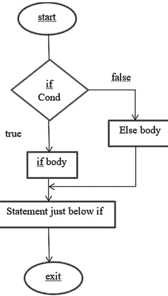

`if` `else` 语句。

# Perl 中的控制流 ■ 81

## 示例：

用于说明 `if` `else` 语句的程序

```perl
$c = 21;

# 用于检查偶数的
# if 条件
if($c % 2 == 0)
{
    printf "偶数-Even-Number";
} else
    printf "奇数-Odd-Number\n";
```

### 嵌套 `if` 语句

嵌套 `if` 是 `if` 语句内部的 `if` 语句。在这种情况下，`if` 语句是另一个 `if` 或 `else` 语句。当必须有多个条件都为真，且其中一个条件是父级条件的子条件时，可以使用嵌套。

## 语法：

```perl
if (condition1)
{
    # 当 condition1 为真时执行
    if (condition2)
    {
        # 当 condition2 为真时执行
    }
}
```

# 82 ■ 精通 Perl

流程图：

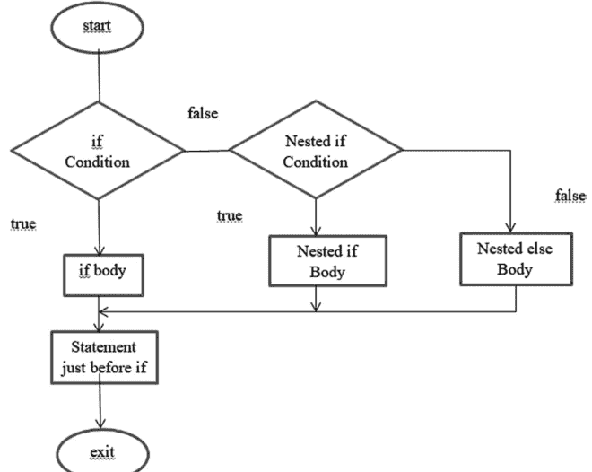

嵌套 `if` 语句。

## 示例：

用于说明嵌套 `if` 语句的程序

```perl
$c = 10;

if($c % 2 == 0)
{
    # 嵌套 if 语句
    # 只有在上面的
    # if 语句
    # 为真时才会执行
    if($c % 5 == 0)
    {
        printf "该数字能被 2 和 5 整除\n";
    }
}
```

# Perl 中的控制流 ■ 83


### if elsif else 阶梯语句
用户可以在此处从多个备选项中进行选择。`if` 语句按照列出的顺序执行。当满足一个 `if` 条件时，执行与该条件相关的语句，并跳过阶梯的其余部分。如果没有满足条件，则使用最后一个 `else` 表达式。

## 语法：

```perl
if(condition1)
{
    # 如果 condition1 为真，将执行代码。
}

elsif(condition2)
{
    # 如果 condition2 为真，则执行代码
}

elsif(condition3)
{
    # 如果 condition3 为真，则执行代码
}

...

else
{
    # 如果所有条件都为假，则执行代码
}
```

## 流程图：

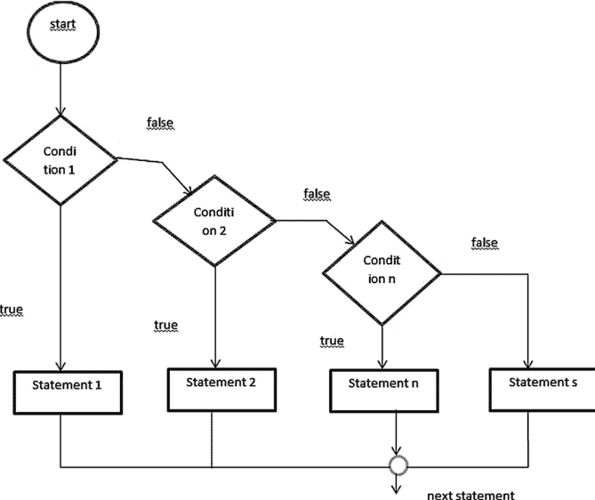

`if else if` 语句。

## 示例：

```perl
# 用于说明
# if - elseif 阶梯语句的 Perl 程序

$c = 30;

if($c == 20)
{
    printf "c 是 20\n";
}

elsif($c == 25)
{
    printf "c 是 25\n";
}

elsif($c == 30)
{
    printf("c 是 30\n");
}

else
{
    printf("c 不存在\n");
}
```

### unless 语句
如果条件为假，则将执行语句。在布尔上下文中，数字 `0`、空字符串 `""`、字符 `"0"`、空列表 `()` 和 `undef` 都是假的，而所有其他值均为真。

## 语法：

```perl
unless(boolean_expression)
{
    # 如果给定的条件为假，则执行
}
```

## 流程图：

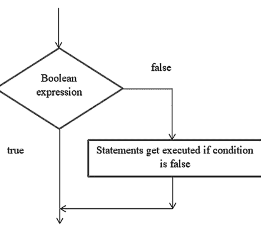

`Unless` 语句。

## 示例：

```perl
# 用于说明
# unless 语句的程序

$c = 20;

unless($c != 20)
{
    # 如果条件为假，则
    # 打印以下内容
    printf("c 不等于 20\n");
}
```

### unless else 语句
当布尔表达式为真时，`except` 后面跟着一个可选的 `else` 语句。

## 语法：

```perl
unless(booleanexpression)
{
    # 如果给定的条件为假，则执行
}

else
{
    # 如果给定的条件为真，则执行
}
```

## 流程图：

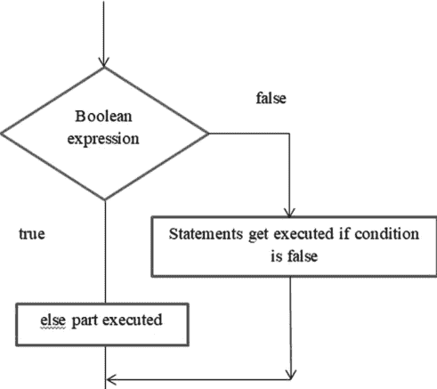

`Unless else` 语句。

## 示例：

```perl
# 用于说明
# unless - else 语句的程序

$c = 20;

unless($c == 20)
{
    # 如果条件为假，则
    # 打印以下内容
    printf("c 不等于 20\n");
}

else
{
    # 如果条件为真，则
    # 打印以下内容
    printf("c 等于 20\n");
}
```

### unless elsif 语句
`unless` 和可选的 `elsif` 可以跟在 `else` 语句之后。`unless` 语句允许我们通过 `else` 语句来测试多个条件。

## 语法：

```perl
unless(condition1)
{
    # 当 condition1 为真时执行
}

elsif(condition2)
{
    # 当 condition2 为真时执行
}

else
{
    # 当 condition 真
}
```

## 流程图：


`elsif` 语句。

## 示例：

```perl
# 用于说明
# unless 语句的程序

$c = 20;

unless($c != 20)
{
    # 如果条件为假，则
    # 打印以下内容
    printf("c 不等于 20\n");
}

else
{
    # 如果条件为真，则
    # 打印以下内容
    printf("c 等于 20\n");
}
```

## 条件已验证
当我们希望循环至少执行一次时，我们使用 `do..while` 循环。由于条件是在执行循环后才验证的，因此它也被退出控制循环。

## 语法:

```
do {
    # statements Executed
} while(condition);
```

## 示例:

```perl
# program to illustrate
# do..while Loop

$c = 20;

# do..While loop

do {
    print "$c ";
    $c = $c - 1;
} while ($c > 0);
```

## until 循环
`while` 循环的反向是 `until` 循环。它接受括号中的一个条件，并且只在条件为假时运行。它本质上是重复一条指令或一系列指令，直到该条件为假（`FALSE`）。它也是一种入口控制循环，这意味着会先测试条件，然后执行块内的一系列指令。

## 语法:

```
until (condition)
{
    # Statements executed
}
```

## 示例:

```perl
# program to illustrate until Loop

$c = 20;

# until loop

until ($c < 1)
{
    print "$c ";
    $c = $c - 1;
}
```

## 嵌套循环
嵌套循环是指包含另一个循环内部的循环。`Perl` 编程支持嵌套循环。上述列出的所有循环都可以嵌套。
多个嵌套循环的 `Perl` 语法：

- 嵌套 `for` 循环

```
for (init statement; condition; increment/decrement )
{
    for (init statement; condition; increment/decrement )
    {
        # Code Executed
    }
}
```

- 嵌套 `variable_1 (@array_1)` 
```
foreach variable_2 (@array_2)
{
    # Code Executed
}
```

- 嵌套 `while` 循环

```
while (condition)
{
    while (condition)
    {
        # Code Executed
    }
}
```

- 嵌套 `do...while` 循环

```
do{
    do{
        # Code Executed
    }while(condition);
} while(condition);
```

- 嵌套 `until` 循环

```
until (condition) {
    until (condition)
    {
        # Code Executed
    }
}
```

## 示例:

```perl
# program to illustrate
# nested while Loop

$c = 5;

$d = 0;

# outer while loop

while ($c < 7)
{
    $d = 0;
    
    # inner while loop
    
    while ( $d < 7 )
    {
        print "value of c = $c, d = $d\n";
        $d = $d + 1;
    }
    
    $c = $c + 1;
    print "Value of c = $c\n";
}
```


## given-when 语句

在 Perl 中，`given`-`when` 语句替换了比较许多整数值的冗长 `if` 语句。

- `given`-`when` 语句是一个具有许多选项的分支语句。它允许我们根据表达式的值轻松将执行路由到不同的代码区域。
- 提供了一种控制语句，允许值来改变执行控制。

Perl 中的 `switch`-`case` 类似于 C/C++、Python 或 PHP 中的 `switch`-`case`。它同样用不同的 `case` 替换了许多 `if` 语句，就像 `switch` 语句一样。

### 语法

```perl
given (expression)
{
    when (value1) {Statement};
    when (value2) {Statement;}
    default { # Code if no other case matches}
}
```

`given`-`when` 语句还包含两个额外的关键字：`break` 和 `continue`。这些关键字保持程序的流性，并有助于退出程序或跳过某个特定值的执行。

**`break`**: `break` 关键字用于退出一个块。在 Perl 中，不需要在每个 `when` 块之后显式表示 `break`。它已经隐式地定义了。

**`continue`**: 另一方面，如果第一个 `when` 块正确，`continue` 将继续到下一个 `when`。`given`-`when` 语句中的条件语句用于控制执行流。

# 102 ■ 精通 Perl

```perl
if ($sn <= 20)
{
    goto label;
}
```

```perl
# 驱动代码
printNumbers();
```

**使用表达式的 `goto`：** 也可以使用表达式来调用特定标签并将控制传递到该标签。当此表达式传递给 `goto` 语句时，它会被评估为标签名称，执行将从该标签名称描述的语句继续。

# 示例

```perl
# 使用 goto 语句打印
# 从 1 到 20 的数字
```

```perl
# 定义两个字符串
# 它们包含
# 标签名称的各个
$c = "lab";
$d = "el";
```

```perl
# 打印 1 到 20 数字的函数
sub printNumbers()
{
    my $n = 1;

label:
    print "$n ";
    $n++;

    if ($n <= 20)
    {
        # 将表达式传递给标签名称
        goto $c.$d;
    }
}
```

```perl
# 驱动代码
printNumbers();
```

`goto` 配合子程序：`goto` 命令也可以调用子程序。根据其用法，该过程从另一个子程序内部或单独调用。它将下一个要执行的任务保持在调用语句附近。这种方法可以递归地调用函数来打印一系列或范围内的字符。

## 示例

```perl
# 使用 goto 语句打印
# 从 1 到 20 的数字

# 打印 1 到 20 数字的函数
sub label
{
    print "$n ";
    $n++;

    if($n <= 20)
{
        goto &label;
    }
}

# 驱动代码
my $n = 1;
label();
```

# next 运算符

在 Perl 中，`next` 运算符会跳过当前循环的执行，并将迭代器移动到 `next` 指定的值。如果程序中指定了标签，执行将继续到标签指定的下一次迭代。

## 语法

`next Label`

## 第一个示例

```perl
#!/usr/bin/perl -w
# 查找元素
# 频率的程序
```

```perl
@Array = ('P', 'E', 'E', 'K', 'S');
$d = 0;
foreach $key (@Array) {
    if ($key eq 'E') {
        $d = $d + 1;
    }
    next;
}
print "Frequency of E in Array: $d";
```

# 第二个示例

```perl
#!/usr/bin/perl
$i = 0;

# 外层循环的标签
outer:
while ($m < 3) {
    $n = 0;
    while ($n < 3 ) {
        # 打印 i 和 j 的值
        print "m = $m and n = $n\n";
        # 如果 i==j 则跳过循环
        if ($n == $m) {
            $m = $m + 1;
            print "As m == $n, hence going back to the outer loop\n";
        }
        # 使用 next 跳过迭代
        next outer;
    }
    $n = $n + 1;
}
$m = $m + 1;

# 外层循环结束
```

# redo 运算符

在 Perl 中，`redo` 运算符从指定的标签开始执行，而不评估条件表达式。一旦调用了 `redo`，该块中的后续语句将不再执行。即使存在有 `continue` 块，在 `redo` 调用之后也不会执行。当使用 `redo` 运算符配合 `Label` 时，执行将从该标签定义的循环开始。

### 语法

`redo Label`

### 返回值

无值

### 第一个示例

```perl
#!/usr/bin/perl -w
$x = 1;

# 将标签赋值给循环标签
PFP: {
    $x = $x + 5;
    redo PFP if ($x < 10);
}
```

```perl
# 打印值
print ($x);
```

### 第二个示例

```perl
#!/usr/bin/perl -w
$x = 1;

# 将标签赋值给循环标签
$count = 1;

PFP: while ($count < 10) {
    $x = $x + 5;
    $count++;
    redo PFP if ($x < 100);
}
```

```perl
# 打印值
print ("\$x \$count");
```

# 106 精通 Perl

# 循环中的 last

`last` 关键字用于循环控制语句，使循环的当前迭代成为最后一次迭代。如果提供了标签，则它将通过该标签退出循环。

## 语法

```perl
# 退出当前循环。
last

# 退出由
# MY_LABEL 指定的循环
last MY_LABEL
```

## 第一个示例

```perl
#!/usr/bin/perl
$sum = 0;
$m = 0;
$n = 0;

while (1)
{
    $sum = $m + $n;
    $m = $m + 2;

    # 结束循环的条件
    if($sum > 20)
    {
        print "Sum = $sum\n";
        print "Exiting loop\n";
        last;
    }
    else
    {
        $n = $n - 1;
    }
}

print "Loop ended at Sum > 20\n";
```

# 第二个示例

```perl
#!/usr/local/bin/perl
$m = 1;
$sum = 0;

# 外层循环
Label: while ($m < 10) {
    $n = 1;

    # 内层循环
    Label2: while ($n < 10) {
        $sum = $sum + $n;
        if($m == $n) {
            print "Sum is $sum";
            # 终止外层循环
            last;
        }
        $n = $n + 1;
    }
    $m = $m + 1;
}
```


在本章中，我们涵盖了流程语句。

## 注意事项

1. 决策（`if`、`else`、嵌套 `if`、`if elsif` 梯、`else`、`unless`）。
2. `when` 语句。

# 第 5 章：Perl 中的文件处理

## 文件处理简介

- 打开和读取文件
- 写入和追加到文件
- 文件测试
- `Slurp` 模块的使用
- 文件处理函数

在上一章中，我们讨论了控制语句。在本章中，我们将介绍文件处理。

- 打开和读取一个文件
- 写入和追加到一个文件
- 文件测试
- `Slurp` 模块的使用
- 文件处理函数

`STDIN`、`STDOUT` 和 `STDERR` 分别代表标准输入、标准输出和标准错误。

## 语法

```perl
open(FileHandle, mode);
```

```perl
close(FileHandle);
```

```perl
read(FileHandle, $scalar, $length);
```

```perl
print FileHandle expression, string;
```

```perl
seek(FileHandle, offset, whence);
```

```perl
eof(FileHandle);
```

```perl
unlink(FileHandle);
```

```perl
tell(FileHandle);
```

```perl
filfilmode(FileHandle);
```

```perl
open(FileHandle, mode, filename);
```

## 各种文件模式

### 示例：考虑文件 `Hello.txt`

1. 模式 = `"<<"`
此模式是只读的。此模式用于逐行读取文件内容。

```perl
#!/usr/bin/perl

# 以只读模式打开文件
open(r, "<", "Hello.txt");

# 打印文件内容
print(<r>);

# 关闭文件
close(r);
```

2. 模式 = `">"`
这是只写模式（错误：只读）。当我们以此模式打开文件时，原始内容会被擦除。如果没有找到同名文件，它将创建一个。

```perl
#!/usr/bin/perl

# 以只读模式打开 Hello.txt
open(r, "<", "Hello.txt");

# 打印文件的现有内容
print("Existing Content of Hello.txt: ".<r>);

# 以写入模式打开
open(w, ">", "Hello.txt");

# 将 r 设置到 Hello.txt 的开头
seek r, 0, 0;

print "\n写入文件...";

# 使用 print 写入 Hello.txt
print w "The Content of this file is changed";

# 关闭句柄
close(w);

# 将 r 设置到 Hello.txt 的开头
seek r, 0, 0;

# 打印当前内容
print("\nUpdated Content of Hello.txt: ".<r>);

# 关闭句柄
close(r);
```

3. 模式 = `">>>"`
追加模式处于激活状态。当我们以此模式打开文件时，原始内容不会被删除。因为字符串总是附加在最后，此模式无法用于覆盖。如果没有发现同名的文件，它将创建一个。

```perl
#!/usr/bin/perl

# 以只读模式打开文件 Hello1.txt
open(r, "<", "Hello1.txt");

# 打印文件的现有内容
print("Existing Content of Hello1.txt: " . <r>);

# 以追加模式打开文件
open(A, ">", "Hello1.txt");

# 将 r 设到 Hello1.txt 的开头
seek r, 0, 0;

print("\n向文件中追加内容...");

# 使用 print 向 Hello1.txt 追加
print A "Hello Everyone!\n";

# 关闭文件句柄
close(A);

# 将 r 重置到 Hello1.txt 的开头
seek r, 0, 0;

# 打印 Hello1.txt 的当前内容
print("\nUpdated Content of Hello1.txt: " . <r>);

# 关闭文件句柄
close(r);
```

4. 模式 = `"+"`
这是读写模式。此函数可替换文件中的现有字符串。它无法创建新文件。

```perl
#!/usr/bin/perl

# 以读写模式打开 Hello1.txt
open(rw, "+", "Hello1.txt");

# 打印文件的原始内容
# rw 被设在末尾。
print("Existing Content of Hello1.txt: " . <rw>);

# 字符串附加在文件原始内容的末尾
print rw "Added using the Read-Write Mode.";

# 将 rw 设到文件开头以便读取。
seek rw, 0, 0;

# 打印文件的更新内容
print("\nUpdated contents of Hello1.txt: " . <rw>);

# 关闭文件句柄
close(rw);
```

5. 模式 = `">>"`
这是读写模式。`">"` 和 `">>"` 的区别在于 `">>"` 即使已存在同名文件也可以创建一个新文件，而 `">"` 则不能。

```perl
#!/usr/bin/perl
```


## 以只读模式打开文件 `Hello1.txt`

```perl
open(r, "<", "Hello1.txt");
```

## 打印文件的现有内容

```perl
print("Existing Content of Hello1.txt: " . <r>);
```

## 关闭文件

```perl
close(r);
```

## 以读写模式打开 `Hello1.txt`

```perl
open(rw, "+", "Hello1.txt");
```

```perl
# 当文件打开时，
# 原始内容会被清除
print("\nContents of Hello1.txt gets cleared...");
```

## 将字符串写入文件

```perl
print rw "Hello!!! This is the updated file.";
```

## 将 `rw` 设到文件开头以便读取

```perl
seek rw, 0, 0;
```

```perl
print("\nUpdated Content of Hello1.txt: " . <rw>);
```

## 关闭文件

```perl
close(rw);
```

### 6. Mode = "+>>"
这被称为读追加模式。它可以同时从文件中读取内容并向文件中追加内容。如果不存在此类文件，将生成一个同名的新文件。

## 以读追加模式打开 `Hello1.txt`

```perl
open(ra, ">>", "Hello1.txt");
```

## 将 `ra` 设到文件开头以便读取

```perl
seek ra, 0, 0;
```

```perl
# 当文件打开时，
# 原始内容不会被清除
print("Existing Content of File: " . <ra>);
```

```perl
print("\n向文件中追加内容...");
```

## 将字符串追加到文件

```perl
print ra "Added using Read-Append Mode";
```

## 将 `ra` 设到文件开头以便读取

```perl
seek ra, 0, 0;
```

## 打印更新后的内容

```perl
print("\nUpdated content of File: " . <ra>);
```

## 关闭文件

```perl
close(ra);
```

## 重定向输出
使用 `select` 函数，可以将输出从控制台重定向到文件。

### 语法：
```perl
select FileHandle;
```

**参数：**
`FileHandle` - 要选择的文件句柄。

### 步骤：
任何使用 `print` 函数打印的内容现在都会重定向到文件中。

### 示例：
`# 文件打开与读取`

`FileHandle` 是 `Perl` 的一种内部结构，将物理文件连接到一个名称。所有文件句柄都具有读/写权限；因此，一旦连接到文件就可以进行读取/写入。然而，在关联文件句柄时，必须指定打开句柄的模式。

`# Perl 中的文件处理 ■ 117`

### 打开文件
`Open` 函数用于打开新文件或现有文件。

#### 语法：
```perl
open FILEHANDLE, VAR
```

在这种情况下，`FileHandle` 是 `open` 函数返回的句柄，而 `VAR` 是包含文件名和打开模式的表达式。下表显示了各种文件打开模式以及对各种操作的访问。

| Mode | 描述 |
| --- | --- |
| r < | 只读访问 |
| w > | 创建、写入和截断 |
| a >> | 写入、追加和创建 |
| r + 或 r+ | 读取和写入 |
| w + 或 + | 读取、写入、创建和截断 |
| a + 或 >> | 读取、写入、追加和创建 |

### 读取文件
当 `FileHandle` 分配给文件时，它可以执行读取、写入和追加等操作。有多种方法读取文件：

- 使用运算符
- 使用 `getc` 函数
- 使用 `read` 函数

#### 运算符
最常用的读取方法是使用运算符。在列表上下文中使用时，它返回文件的一行。

```perl
$line = <fh>;
```

#### `getc` 函数
`getc` 函数从文件中获取单个字符。

**语法：**
```perl
$char = getc($fh);
```

**示例：**
```perl
$char = getc($fh);
```

#### `read` 函数
`read` 函数从文件中读取数据。

**语法：**
```perl
$bytes = read($fh, $buffer, $length);
```

`# Perl 中的文件处理 ■ 17`

当 `FileHandle` 分配给文件时，它可以执行读取、写入和追加等操作。有多种方法读取文件：

- 使用运算符
- 使用 `getc` 函数
- 使用 `read` 函数

#### 运算符
最常用的读取方法是使用运算符。在列表上下文中使用时，它返回文件的一行。

```perl
$line = <fh>;
```

**示例：**

```perl
# 以写入模式打开文件 Hello.txt
open (fh, "Hello.txt");
```

```perl
# 从用户处获取要写入文件的字符串
print "Enter the content to add\n";
$a = <STDIN>;
```

```perl
# 写入文件
print fh $a;
```

```perl
# 关闭文件
close(fh) or "Couldn't close file";
```

该程序的运行方式如下：

- 1：以写入模式打开 `Hello.txt` 文件。
- 第 2 步：从标准输入键盘提取文本。
- 第 3 步：将存储在 `"$a"` 中的字符串保存到文件句柄 `"fh"` 指向的文件。
- 第 4 步：保存文件。

以下示例读取源文件内容并写入目标文件：

```perl
# 目标文件
$des = 'Destination.txt';
```

```perl
# 以读取模式打开源文件
open(FHR, '<', $src);
```

```perl
# 以写入模式打开目标文件
open(FHW, '>', $des);
```

```perl
print("Copying the content from $src to $des\n");
```

```perl
while(<FHR>)
{
    print FHW $;
}
```

```perl
# 关闭文件句柄
close(FHR);
close(FHW);
```

```perl
print "File content copied successfully!\n";
```

### 程序的运行方式如下：

- 第 1 步：读取文件 `Source.txt` 并写入文件 `Destination.txt`。
- 第 2 步：从 `FHR` 读取内容，`FHR` 是一个用于读取内容和写入文件的文件句柄。
- 第 3 步：使用 `print` 函数复制内容。
- 第 4 步：文件一旦被读取，关闭连接。

## 错误处理与错误报告
可以通过两种方式之一处理错误：

- 如果文件无法打开，则抛出异常（处理错误）。
- 如果文件无法打开，发出警告并继续操作（错误报告）。

### 抛出异常（使用 `Die` 函数）
当文件句柄未分配到有效的文件指针时，会运行 `die`，它会打印消息并终止当前程序。

**示例：**

```perl
# 初始化文件名
$filename = 'Hello.txt';

# $filename = 'elloy.txt';
```

```perl
# 如果文件未找到，则打印错误并退出
open(fh, '<', $filename) or
die "Couldn't Open the file $filename";
```

当给定代码中存在文件时，将无问题地执行，但如果文件不存在，将生成错误且代码结束。

### 给出警告（使用 `Warn` 函数）
当文件句柄无法分配适当的文件引用时，它会产生警告消息并继续操作。

**示例：**

```perl
# 打开文件并读取内容
if (open(fh, '<', $filename))
{
    while (<fh>)
    {
        print $_;
    }
}
```

```perl
# 如果未找到文件则执行
else
{
    warn "Couldn't Open file $filename";
}
```

## 追加内容到文件

当使用 `">"` 以写入模式打开文件时，现有文件内容将被销毁，通过 `print` 语句添加的内容将写入文件。在此模式下，写入点被设置为文件末尾。因此，旧文件内容被保留，所有使用 `print` 语句写入文件的内容都将追加到文件末尾。然而，在文件以 `>>` 模式打开（表示添加和读取）之前，无法执行读取操作。

**示例：**

```perl
# 以读取模式打开文件
# 以显示现有内容
open(FH, "Hello1.txt") or
die "Sorry, couldn't open";
```

```perl
# 读取并打印文件的现有内容
print "\nExisting Content of the File:\n";
while(<FH>)
{
    print $;
}
```

```perl
# 使用 ">>" 以追加模式
# 打开文件
open(FH, "Hello.txt") or
die "File couldn't be opened";
```


# 从用户处获取要追加的文本

```perl
print "\nEnter the text to append\n";
$a = <STDIN>;
```

# 将内容追加到文件

```perl
print FH $a;
```

# 打印成功消息

```perl
print "\nAppending File is Successful.\n";
```

# 追加后读取文件

```perl
print "\nAfter appending, Updated File is:\n";
```

# 以读取模式打开文件以显示更新内容

```perl
# 以读取模式打开文件以
# 显示更新内容
open(FH, "Hello1.txt") or
die "Couldn't open";

while(<FH>)
{
    print $;
}

close FH or "could't close";
```

程序的运行方式如下：

- 第 1 步：以读取模式打开文件查看文件内容。
- 第 2 步：打印文件的现有内容。
- 第 3 步：通过追加模式打开文件向文件添加材料。
- 第 4 步：收集用户文本到文件。
- 第 5 步：将文本添加到文件。
- 第 6 步：读取文件以确定内容是否已更改。
- 第 7 步：关闭文件。

## 读取 CSV
Perl 原意用于文本处理。Perl 也可以用于处理 CSV 文件。这是一个 CSV 文件示例：

| A | B | C | D |
|---|---|---|---|
| 1 | Danish | M | 18 |
| 2 | Jaydeep | M | 20 |
| 3 | Emma | F | 21 |
| 4 | Mr. Daman | M | 24 |
| 5 | | | |

### 使用 `split()` 分割字符串
`split()` 是一个用于分割字符串的函数。它接受两个参数：第一个是分隔符，第二个是要分割的字符串。

语法：

```perl
split(_, delimiter_)
```

参数：
- `delimiter_`: 元素之间的分隔符
- `string_`: 要分割的字符串

返回值：由 `delimiter_` 分隔的字符串数组

## 示例：

```perl
Input: $s = "Shona loves Sugar"
Output: "Shona", "loves", "Sugar"
```
如果 `$s = "Shona loves Sugar";` 使用空格分隔符来拆分 `$s`：

```perl
@words = split / /, $s;
print join(",", @words); # 输出 "Shona,loves,Sugar"
```
如果将字符串传递给 `split` 函数，数组 `@words` 将填充 3 个值："Shona", "loves", "Sugar"。

以下步骤用于分隔 CSV 文件行：

- 第 1 步：逐行读取文件。
- 第 2 步：将行的所有值放入数组。
- 第 3 步：为了获得结果，单独打印所有数据。

为了更好地理解主题，让我们来看一个示例。`split()` 方法用于分割 CSV 文件中的字符串，如下：

```perl
use strict;
my $file = $ARGV[0] or die;

open(my $data, '<', $file) or die;

while (my $line = <data>) {
    chomp $line;
    # 分割行并存储
    # 在 words 数组中
    my @words = split /, $line;

    for (my $sx = 0; $sx <= 2; $sx++)
    {
        print "$words[$sx] ";
    }
    print "\n";
}
```

将上述代码保存到扩展名为 `.pl` 的文本文件中。在这种情况下将其存储为 `test1.pl`。使用以下命令运行之前存储的文件：

```bash
perl test1.pl new.csv
```

## 字符转义逗号
有时字符串字段中包含逗号，如果删除这些逗号，将改变对数据的解释或使记录不可用。在这种情况下使用 `split()` 函数时，即使在引号内，它也会在每次遇到逗号作为分隔符时分割数据，因为 `split()` 不关心引号，也不理解 CSV。它只是在遇到分隔符时进行切割。

以下是带有引号内逗号的 CSV 文件：

| A | B | C | D |
|---|---|---|---|
| 1 | Danish | M | 18 |
| 2 | Jaydeep | M | 20 |
| 3 | Emma | F | 21 |
| 4 | Mr. Daman | M | 24 |
| 5 | | | |

我们利用 `Text::CSV`，它提供了一个完整的 CSV 读取器和写入器。
`Text::CSV` 是一个 Perl CPAN 模块，增加了许多额外功能，如读取、解析和写入 CSV 文件。可以使用以下指令（pragma）将这些模块包含在 Perl 程序中：

```perl
use Text::CSV
```

然而，我们必须先在设备上下载并安装该模块才能使用其功能。

## `Text::CSV` 的安装

对于 Windows：

```bash
perl -MCPAN -e shell
install Text::CSV
```

对于基于 Debian/Ubuntu 的系统：

```bash
sudo apt-get install libtext-csv-perl
```

对于基于 RedHat/CentOS/Fedora 的系统：

```bash
sudo yum install perl-Text-CSV
```

为了转义引号之间的逗号字符，请在我们的 `new.csv` 文件上运行以下代码：

```perl
use strict;

# Using the Text::CSV file to allow
# full CSV Reader and Writer
use Text::CSV;

my $csv = Text::CSV->new({ sep_char => ' ', binary => 1 });

my $file_to_be_read = $ARGV[0] or die;

# Reading file
open(my $data_file, '<', $file_to_be_read) or die;
while (my $line = <$data_file>)
{
    chomp $line;
    # Parsing line
    if ($csv->parse($line))
    {
        # Extracting elements
        my @words = $csv->fields();
        for (my $x = 0; $x <= 2; $x++) {
            print "$words[$x] ";
        }
        print "\n";
    }
    else
    {
        # Warning to display
        warn "Line could not parse: $line\n"
    }
}
```

上述示例中的第一个字段现在包含了一个在解析 CSV 文件时被转义的逗号。

```perl
my $csv = Text::CSV->new({ sep_char => ',', binary => 1 });
```

上一行代码描述了如何调用类的构造函数。箭头 `->` 用于调用构造函数。

```perl
$csv->parse($line)
```

此调用将尝试解析当前行并将其分割成块。根据成功或失败，返回真或假。

### 嵌入换行符的字段

CSV 文件中的特定字段可能是多行的，或者在单词之间嵌入了换行符。当通过 `split()` 方法提供这些多行字段时，它们的行为与其他不包含嵌入换行符的文件相比有显著不同。

# 130 精通 Perl

示例：

| | A | B | C |
|---|---|---|---|
| 1 Danish | M | 18 |
| 2 Jaydeep | M | 20 |
| 3 Emma | F | 21 |
| 4 Mr, | M | 24 |

嵌入换行符的字段。

为了处理此类情况，Perl 提供了 `getline()` 函数。

```perl
use strict;

# Using the Text::CSV file to allow
# full CSV Reader and Writer
use TEXT::CSV;
my $file = $ARGV[0] or die;
my $csv = TEXT::CSV->new (
```


```perl
    binary => 1,
    auto_sep_char => ',',
);

my $sum = 0;

# Reading file
open(my $data, ':encoding(utf8)', $file) or die;

while (my $words = $csv->getline($data)) {
    for (my $x = 0; $x < 3; $x++) {
        print "$words->[$x]";
    }
    print "\n";
}

# Checking for the End-of-file
if (not $csv) {
    $csv->diag();
}
close $data;
```

上述嵌入换行符现在通过`getline()`函数处理，并包含在内。

## 文件测试运算符 (FILE TEST OPERATORS)

在 Perl 中，文件测试运算符是产生真假值的逻辑运算符。它提供了许多测试文件特性的运算符。例如，`-e`用于用于检查文件是否存在。

以下示例使用了“-e”运算符来判断文件是否存在：

```perl
#!/usr/bin/perl

## 使用预定义模块
use warnings;
use strict;

# 将文件路径赋值给变量
my $filename = 'C:\Users\Peeks\PFP.txt';

# 检查文件是否存在
if(-e $filename) {
    # 如果文件存在
    print("File $filename exists\n");
} else {
    # 如果文件不存在
    print("File $filename doesn't exist\n");
}
```

# 132 精通 Perl

文件测试运算符`-e`接收文件名或句柄作为输入。下表列出了最重要的文件测试运算符：

| 运算符 | 描述 |
|---|---|
| `-r` | 检查文件是否可读 |
| `-w` | 检查文件是否可写 |
| `-x` | 检查文件是否可执行 |
| `-o` | 检查是否为所有者 |
| `-R` | 检查是否可读 |
| `-W` | 检查是否可写 |
| `-X` | 检查是否可执行 |
| `-O` | 检查是否为所有者 |
| `-e` | 检查文件是否存在 |
| `-z` | 检查文件是否为空 |
| `-s` | 返回文件大小 |
| `-f` | 检查是否为普通文件 |
| `-d` | 检查是否为目录 |
| `-l` | 检查是否为符号链接 |
| `-p` | 检查是否为管道 |
| `-S` | 检查是否为套接字 |
| `-b` | 检查是否为设备文件 |
| `-c` | 检查是否为字符设备 |
| `-t` | 检查是否为终端 |
| `-u` | 检查 UID 是否有效 |
| `-g` | 检查 GID 是否有效 |
| `-k` | 检查文件是否可写 |
| `-B` | 检查是否为二进制文件 |

已移除。移除后将以共享锁的形式执行。多个共享锁可以同时存在。

## 语法：

```
flock(FILE, 1); #来自上述代码
```

- 排斥锁（Exclusive lock）：当文件需要被一组人员使用且每个人都有权限进行更改时，将使用排斥锁。一个文件只能放置一个排斥锁，允许同时只有一个用户/进程进行修改。排斥锁的规则是“我是唯一的”。`flock()`会搜索脚本中的任何其他类型的锁。如果发现，它将一直保持，直到所有锁都从脚本中删除为止。它会在适当的时间锁定文件。

## 语法：

```
flock(FILE, 2); #来自上述代码
```

- 非阻塞锁（Non-blocking lock）：非阻塞锁通知系统其不需要等待文件中的其他锁释放。如果在文件中检测到另一个锁，它将产生错误消息。

## 语法：

```
flock(FILE, 4); #来自上述代码
```

- 解锁（Unblocking）：与`close(FILE)`函数相同，此函数会取消任何给定文件的锁定。

## 语法：

```
flock(FILE, 8); #来自上述代码
```

以下问题演示了`flock()`函数的使用：

# 问题 5.1

前述示例中脚本的主要问题是当它打开`project.docx`文件时，清除了第一个文件并使其为空。考虑 A 人、B 人和 C 人试图几乎同时提交。

# 136 精通 Perl

A 人检查文件中的数据。关闭文件并开始编辑数据（完成第一个文件的操作）。

同时，B 人打开文件进行检查/读取，发现文件是空的。

这就是冲突！整个系统将受到干扰。

# 解决方案

这就是实现文件锁的地方。A 人、B 人和 C 人都愿意向文档提交更改。

A 人打开文件，检查其数据，然后关闭它（启用共享锁）（解锁文件）。随后，A 人想要对文件提交更改并重新打开文件进行调整（这就是排斥锁起作用的时候）。当 A 人正在对文件进行更改时，B 人或 C 人都无法从文件中读取或写入。

A 人完成工作并关闭文件（解锁状态）。

如果 B 人在间隙尝试打开文件，他们将收到错误“文件正被其他候选人查看”。因此，彼此互不干扰，工作流程顺畅。

```
flock() vs lockf()
```

与一次性锁定整个文件的`flock()`相比，`lockf()`方法锁定文件的分段。`lockf()`无法直接在 Perl 中使用，但 Perl 原生支持文件系统函数，但不适用于网络锁。

Perl 支持`fcntl()`系统函数，提供了卓越的锁定控制。

# SLURP 模块

`File::Slurp`模块读取文件内容并将其保存到字符串中。这是一个读取/写入/修改整个文件的简单且快速的方法。正如其名称所示，它允许我们通过单个调用读取或写入整个文件。

通过将此模块导入我们的程序中，用户可以使用`read_file`、`read_text`、`write_file`等函数从文件中读写数据。

安装`File::Slurp`模块：我们必须先将此模块包含在 Perl 语言包中才能使用。这可以通过在 Perl 终端输入以下指令并安装所需的模块来实现。

# 步骤 1：在我们的终端中运行以下命令：

```
perl -MCPAN -e shell
```

进入 cpan shell 后，继续执行以下步骤安装`File::Slurp`模块。

步骤 2：要安装模块，运行以下命令：

```
install File::Slurp
```

执行此操作后将安装`File::Slurp`模块。

步骤 3：退出 cpan> 提示符，输入并执行“q”命令。

Slurp 中的`read_file`函数：`File::Slurp`的读取文件函数读取文件的完整内容并将其作为字符串返回。然而，建议使用`File::Slurper`，因为它存在编码层缺陷，可能会导致编译困难。`File::Slurper`试图为上述困难提供可行的解决方案。

## 语法：

```
use File::Slurp;
my $text = read_file($file_name);
# Return：返回一个字符串。
```

# Slurp 中的 `read_text` 函数

`File::Slurper`中的`read_text`方法接受一个可选的编码参数（如果有），并且在我们请求时可以自动解码 CRLF 行结束符（针对 Windows 文件）。

## 语法：

```
use File::Slurper;
my $content = read_text($file_name);
# Return：返回一个字符串。
```

# Perl 中的正则表达式

本章内容

- 正则表达式
- 运算符
- 正则字符类和特殊字符类
- 数量词与回溯
- 正则中的“e”修符
- “ee”修符
- `pos()` 函数

在上一章中，我们讨论了文件处理；在本章中，我们将介绍正则表达式（Regex）。

在 Perl 中，正则表达式（Regex、Regexp 或 RE）是一种特殊的字符串，用于描述给定文本中的搜索模式。Perl 中的正则表达式与宿语言绑定，与 PHP、Python 以及其他编程语言中的正则表达式不同。

它有时被称为“Perl 5 兼容正则表达式”。绑定运算符如`~`（正则表达式运算符）和`!~`（非正则表达式运算符）被用于利用正则表达式。在开始学习绑定运算符之前，让我们先从创建模式开始。

DOI:10.1201/9781003358442-6

# 142 精通 Perl

模式构建：在 Perl 中，可以使用`m//`运算符构建模式。该运算符简单地在两个斜杠之间插入所需的模式，并使用绑定运算符在提供的文本中搜索该模式。

结合绑定运算符使用`m//`：绑定运算符通常与`m//`运算符配合使用以匹配所需的模式。使用正则表达式匹配字符串时，使用正则表达式运算符。语句的左侧将包含一个字符串，右侧则提供模式。非正则表达式运算符判断该字符串是否等于右侧提供的正则表达式。

程序 1：以下代码演示了`m//`和`=~`的用法：

```perl


# 演示 `m//` 和 `~=` 运算符的程序

# 实际字符串

```perl
$a = "PEEKSFORPEEKS";
```

# 如果在 `$a` 中找到

# 则打印已找到匹配

```perl
if ($a ~ m[PEEKS])
{
    print "Match is Found\n"
}
```

# 如果在 `$a` 中未找到

# 则打印未找到匹配

```perl
else
{
    print "Match is Not Found\n"
}
```

## 程序 2

为了演示 `m//` 和 `!~` 的用法，请考虑以下内容：

```perl
# 演示 m// 和 !~ 运算符的程序
# 实际字符串
$a = "PEEKSFORPEEKS";

# 如果在 $a 中未找到
# 则打印已找到
if ($a !~ m[PEEKS]) {
    print "Match is Found\n";
}

# 如果在 $a 中找到
# 则打印未找到匹配
else {
    print "Match is Not Found\n"
}
```

## 正则表达式的用途

- 统计特定模式出现的次数
  - 它可以用于统计特定模式在字符串中出现的次数。
- 查找特定模式
  - 它可以用于查找特定模式的字符串。
- 替换模式
  - 它还可以将搜索到的模式替换为另一个字符串。

# 正则表达式中的运算符

正则表达式是一个由不同字符混合组成的字符串，有助于字符串匹配。`regex` 或 `regexp` 是正则表达式的别名。

利用正则表达式的基本方法是使用绑定运算符 `=~`（正则表达式运算符）和 `!~`（非正则表达式运算符）。在 Perl 中，有三种正则表达式运算符：

- 匹配表达式
- 替换正则表达式
- 全局字符转译正则表达式

## 1. 模式匹配或正则表达式匹配

匹配运算符 `m//` 将字符串或语句与正则表达式进行比较。运算符中的正斜杠（`m//`）作为分隔符，该分隔符也可以是 `m{}`、`m()`、`m><` 等。表达式写在运算符的两个正斜杠之间。

语法：`m/PATTERN/`

`PATTERN` 是将在字符串中搜索的正则表达式。

让我们来看一些模式匹配的示例。在以下示例中，字符串与正则表达式将进行匹配，如果成功，则返回“match found”（找到匹配）；否则返回“match not found”（未找到匹配）。

### 第一个示例

```perl
#!/usr/bin/perl
# 初始化字符串
$a = "PeeksforPeeks"
# 匹配字符串
# 正则表达式并返回
# 找到或未找到
if ($a ~ m/for/)
{
    print "Match is Found\n"
}
else
{
    print "Match is Not Found\n"
}
```

### 第二个示例

```perl
#!/usr/bin/perl
# 初始化字符串
$a = "PeeksforPeeks"
# 匹配字符串和
# 正则表达式并返回
# 找到或未找到
if ($a =~ m/abc/)
{
    print "Match is Found\n"
}
else
{
    print "Match is Not Found\n"
}
```

## 2. 替换正则表达式（搜索和替换）

运算符 `s///` 用于搜索并用指定的正则表达式替换特定单词。分隔符是正斜杠（`//`）。

```perl
# 语法: s/PATTERN/REPLACEMENT/
```

`PATTERN` 是 `REPLACEMENT` 正则表达式将要替换的正则表达式。

让我们来看几个替换正则表达式的实例：在以下情况下，`PATTERN` 后面紧跟着一个字符。

### 第一个示例

```perl
# (替换的示例详情)
```

### 第二个示例

```perl
# (替换的示例详情)
```

## 3. 全局字符转译正则表达式

运算符 `tr///` 用于搜索并用指定的正则表达式替换特定单词。分隔符是正斜杠（`//`）。

语法：`tr/PATTERN/REPLACEMENT/`

```perl
# 语法: tr/PATTERN/REPLACEMENT/
```

`PATTERN` 是 `REPLACEMENT` 正则表达式将要替换的正则表达式。

让我们来看几个替换正则表达式的实例：在以下情况下，`PATTERN` 后面紧跟着一个字符。

### 第一个示例

```perl
# (转译的示例详情)
```

### 第二个示例

```perl
# (转译的示例详情)
```

# 正则字符类

为了匹配字符字符串，使用了字符类。这些类允许用户匹配用户不知道的任何字符。

## 示例

```perl
# (字符类的示例详情)
```

```perl
{
  print "Match is Found\n"
}
```

```perl
# Prints match is not found
# if it is not found in $str
{
  print "Match is Not Found\n"
}
```

## 反向字符类

只需使用插入符号（`^`）来反转一个字符类。它会反转符号后面提供的字符甚至范围。将插入符号（`^`）作为字符类中的第一个字符，表示该字符类可以匹配字符类中列出以外的任何字符。

### 示例

# 用于演示反向字符类的程序

```perl
# 实际字符串
$str = "peeks56";
```

```perl
# 使用反向字符类
# 如果在 $str 中找到了
# 则打印“找到匹配项”
if ($str =~ /[^peeks0-7]/)
{
  print "Match is Found\n"
}
```

```perl
# 如果在 $str 中没有找到
# 则打印“未找到匹配项”
{
  print "Match is Not Found\n"
}
```

## 正则表达式中的特殊字符类

Perl 具有几种不同的字符类，其中某些被频繁使用，因此为它们构建了特定的序列。编写自定义序列旨在使代码更易读、更简洁。Perl 的特殊字符类如下：

### 1. 数字 `\d[0-9]`

`d` 字符用于匹配任何数字字符，等同于 `[0-9]`。单个数字将由正则表达式 `/\d/` 匹配。`d` 已标准化为“digit（数字）”。其主要优势是用户可以编写更短、更易读的格式。这个独特的字符类可以用两种方式使用。让我们看看如何匹配字符串的示例。

**示例：**

```perl
/ [MNOPQ]-\d\d\d/
```

如前所述，该字符的字符串将按如下方式匹配：

```
#M-12345
#N-66666
```

我们也可以通过将量词放在字符类上来在这种情况下利用它们。

**示例：**

```perl
/ [MNOPQ]-\d{5}/
```

上面的示例与之前的正则表达式相同，它接受连字符后任意数量的数字，并可以表示为 `/#[MNOPQ]-\d+/`。

在较大的字符类中，使用了第二种技术。`\d` 被方括号包围并匹配单个数字。

**示例：**

```perl
[\dABCDEFGHIJKLMN]
```

单个数字或任何大写字母 `A`, `B`, `C`, `D`, `E`, `F`, `G`, `H`, `I`, `J`, `K`, `L`, `M` 或 `N` 均可匹配。可以使用连字符（`-`）更简洁地编写。然后它看起来像这样：

```perl
[\dA-N]
```

### 2. POSIX 字符类

`POSIX` 字符类是确保操作系统系统兼容性以及建立应用程序接口（`API`）的标准，包括命令行 `shell` 和实用程序界面。它还提供了许多命名的“字符分组”，如 `(alpha, alphan, ascii, blank, 等）`。这六种字符类始终以 `[:class]` 的形式出现，其中 `class` 是名称，分隔符是 `[:` 和 `]`。`POSIX` 字符类始终包含在方括号字符类中。这些类提供了一种列出字符集的快速方便的方法。

## 语法

```perl
$string ~ /[:class:]]/
```


这里，可以是 `alpha`, `alphan`, `ascii` 等。
如所示，POSIX 字符类支持更大的方括号类：
`[01[:Class:]]`
它将匹配 "0"、“1"、任何字符类以及在此情况下的 `%`。Perl 支持下表所示的 POSIX 字符类：

| 类 | 描述 |
| --- | --- |
| `Alpha` | 任何字母字符 (`[A-Za-z]`) |
| `Alnum` | 任何字母数字字符 (`[A-Za-z0-9]`) |
| `Ascii` | ASCII 字符集中的任何字符 |
| `blank` | 空格或水平制表符 |
| `Cntrl` | 任何控制字符 |
| `Digit` | 任何数字 (`[0-9]`) |
| `graph` | 任何打印字符，排除空格 |
| `lower` | 任何小写字母 (`[a-z]`) |
| `punct` | 任何图形字符 |
| `space` | 任何空白字符 |
| `upper` | 任何大写字母 (`[A-Z]`) |
| `xdigit` | 任何十六进制数字 (`[0-9a-fA-F]`) |
| `word` | Perl 扩展 (`[A-Za-z0-9_]`)，等同于 `\w` |

*   3. 单词字符 `\w` `[0-9a-zA-Z]`：字母 `w` 属于单词字符类。`w` 字符可以是任何单个字母数字字符，包括字母、十数字或标点字符（如下划线 `_`）。它只匹配符号字符单词，而不是整个单词。如果我们想匹配整个单词，请使用 `\w+`。

*   空白字符 `[\t\n\f\r]`：字符类 `\s` 只匹配一个制表符（空白）。它还将匹配五个字母 `t`-水平制表符、`\newline`-换行、`f`-分页符、`v`-回车和空格。在 Perl 5.18 中，将引入一个与 `\c` 对应的新字符——垂直制表符。

*   反字符类 `\D`, `\W`, `\S`：在这个宇宙中，存在几乎所有的非数字、非单词和非空白字符。使用插入符号（`^`）来反转符号后面提供的字符甚至范围。将插入符号（`^`）作为字符类中的第一个字符，表示该字符类可以匹配字符类中列出以外的任何字符。

## 152 精通 Perl

反字符类 `\D`, `\W`, `\S`：在这个宇宙中，存在几乎所有的非数字、非单词和非空白字符。使用插入符号（`^`）来反转符号后面提供的字符甚至范围。将插入符号（`^`）作为字符类中的第一个字符，表示该字符类可以匹配字符类中列出以外的任何字符。

# Perl 中的正则表达式 ■ 155

```perl
{
    print "Match is Not Found\n";
}
```

```perl
#!/usr/bin/perl
# Initializing string
$a = "Peeks"
# matching the above string with {n}
# quantifier in the regular expression /Pe{2}ks/
if ($a ~ m/Pe{2}ks/)
{
    print "Match is Found\n"
}else
{
    print "Match is Not Found\n"
}
```

**第五个示例：** 在此示例中，正则表达式 `Pe[2,]ks` 使用了 `{ }` 数量限定符，它会生成 "Peeks","Peeeks","Peeeks" 等，并且当它与输入文本 "Peks" 匹配时，会返回“Match is Not Found”。

```perl
#!/usr/bin/perl
# Initializing string
$a = "Peks"
# matching the above string with {n }
# quantifier in the regular expression /Pe{2, }ks/
if ($a ~ m/Pe{2, }ks/)
{
    print "Match is Found\n"
}else
{
    print "Match is Not Found\n"
}
```

# 156 精通 Perl

第六个示例：在此示例中，正则表达式 `/Pe{1, 2}ks/` 使用了 `{n, m}` 数量限定符，它会产生 "Peks" 和 "Peeks"，并且与输入文本 "Peeks" 匹配时，会产生“Match is Not Found”。

```perl
#!/usr/bin/perl
# Initializing string
$a = "Peeeks";
# matching the above string with {n, m}
# quantifier in the regular expression /Pe{1, 2}ks/
if ($a =~ m/Pe{1, 2}ks/)
{
    print "Match is Found\n"
}
else{
    print "Match is Not Found\n"
}
```

# 正则表达式的回溯

Perl 中的正则表达式（也称为 `regexes`、`regex` 或 `REs`）是表示一组字符串的方法，而无需描述程序中的所有字符串。它本质上是用于模式匹配的一系列字符。正则表达式在 Perl 中有多种用途：

*   首先，它们用于条件判断，以评估字符串是否匹配特定模式。

例如：条件语句中的正则表达式

```perl
#!/usr/bin/perl
# Regular expressions in the Conditionals
# Program to determine whether string
# matches particular pattern
print "How are you feeling?\n"
$stmt = <>;
print($stmt);
if ($stmt == /hungry/)
{
  print "\nWhat do we wish to have?\n";
  my $ip = <>;
  print($ip);
}
```

用户的输入将进行匹配；如果包含单词 "hungry"，即如果条件为真，它将打印“What do we wish to have?”。否则，它将跳转到后续的条件或语句。

*   其次，它们可以在字符串中找到模式并将其替换为其他内容。

# 例如：替换运算符

```perl
#!/usr/bin/perl
# Regular expressions in the Substitutions
# Program to determine whether string
# matches particular pattern and replaces it with
print "Whats your thought on life\n"
my $stmt = <>;
print($stmt);
# Substitution using the regex
$stmt =~ s/worst/good/;
print("\n$stmt");
```

前面的代码使用 "good" 代替了 "worst"。

*   最后，模式不仅可以描述某些内容存在的地方，还可以描述它们不存在的地方。因此，`split` 运算符使用正则表达式来识别数据不存在的地方。换说，正则表达式指定了分隔数据字段的分割符。

# 例如：Split 运算符

```perl
#!/usr/bin/perl
# Program to illustrate the
# use of split function
$var1 = "Birth";
$var2 = "Life";
$var3 = "Death";
```

`split` 函数在上述述示例中匹配单个逗号字符。

# 回溯

例如，`/.*? /` 可用于匹配类似于 HTML 标签（如“Bold”）的任何内容。这强制模式的两个部分匹配相同的字符串。

考虑以下情况：

1.  从开始开始。
2.  尽可能匹配 "b"，但未匹配成功。
3.  尽可能匹配 "c"，但未匹配成功。
4.  尽可能匹配 "d"，但未匹配成功。
5.  尽可能匹配 "e"，但未匹配成功。

# Perl 中的正则表达式 ■ 155

# 正则表达式的回溯

# 例如：替换运算符

# 例如：Split 运算符

# 回溯

# 162 ■ 精通 Perl

## 定义字符串

```perl
my $String = 'Peeks $var Peeks is the best';
```

# 使用 'ee' 修饰符之前的字符串

```perl
print "The Original String: $String\n";
```

因为 `$var` 被视为提供字符串的子字符串且不被视为变量，所以在在对字符串应用正则表达式之前，它以原始形式写入字符串中。然而，一旦应用了正则表达式，“ee" 修饰符就会评估 `$var` 的值并将其显示。

如果我们在上述代码中应用 "ee" 修饰符，结果字符串与原始字符串相同：

### 使用 'e' 修饰符之前的字符串

```perl
print "The Original String: $String\n";
```

### 使用正则表达式应用 'e' 修饰符

```perl
$String ~ s/(\w+)/$1/e;
```


`print "The Updated String: $String";`

当应用 `"e"` 修饰符时，正则表达式会将右侧（RHS）视为要进行评估的替换内容；在这种情况下，右侧是 `$1`，它保留了 `$var` 但没有保留其值。因此，应用 `"ee"` 修饰符将重新评估包含已求值值 `$var` 的右侧。

## 进行数学计算时，使用 "ee" 修饰符

如果字符串中包含数学表达式，该表达式的值将不会被评估，而是按原样显示。这是因为它被同时视为一个字符串和一个待评估的表达式。

# Perl 中的正则表达式

## 示例：

```perl
#!/usr/bin/perl

# 存储为字符串的数学表达式
$String = "1 + 2";

# 用于求和的正则表达式
$String =~ s/(\d+ [+*\-]) (\d+)/$1/ee;

print "Sum is $String";
```

上述代码中的表达式是用正则表达式编写的，使用 `"\d+"` 操作符表示一个或多个数字，使用 `"[++-]"` 字符类表示运算符，然后另一个 `"\d"` 表示数字。`"ee"` 修饰符评估了表达式的总和，并通过 `$1` 运算符显示出来。

上述正则表达式也可以保留在子程序中，用于评估不同的表达式，而无需重复编写正则表达式。

## 示例：

```perl
#!/usr/bin/perl

# 计算正则表达式的子程序
sub Regex {
  $var = shift;

  # 用于求和的正则表达式
  $var =~ s/(\d+ [+*\-]) (\d+)/$1/ee;
  return $var;
}

# 存储为字符串的数学表达式
$String1 = "1 + 2";

$String1 = Regex($String1);

print "Sum is $String1\n";
```

### 计算积

```perl
$String2 = "10 * 3";

$String2 = Regex($String2);

print "Product is $String2";
```

在给定的代码中，可以使用单个正则表达式利用子程序执行四次数学计算。

## 正则表达式中的 `pos()` 函数

Perl 中的 `pos()` 函数返回使用 `"m"` 修饰符的正则表达式中最后一次匹配的位置。

正则表达式中的 `pos()` 函数可以与字符类结合使用，返回字符串中所有所需子字符串的位置列表。对于整个文本中的子字符串，请使用全局操作符 `"g"` 配合 `"m"` 修饰符。

- **语法**：`pos(String)`
- **参数**：应用正则表达式后的字符串
- **返回值**：匹配的子字符串的位置

### 第一个示例：利用子字符串字符

```perl
#!/usr/bin/perl

# 打印子字符串位置的程序
$String = "Peeks For Peeks";

print "Position of 'P' in string:\n";

# 使用 m 修饰符搜索子字符串
while($String ~ m/G/g)
{
    # 使用 pos() 查找子字符串的位置
    $position = pos($String);
    print "$position\n";
}
```

### 第二个示例：利用字符类

```perl
#!/usr/bin/perl

# 打印子字符串位置的程序
$String = "Peeks For Peeks";

print "Position of all the Uppercase characters:\n";

# 使用字符类搜索
# 所有大写字母
while($String ~ m/[A-Z]/g)
{
    # 使用 pos() 函数查找子字符串的位置
    $position = pos($String);
    print "$position, ";
}

print "\nThe Position of all Lowercase characters:\n";

# 使用字符类搜索
# 所有小写字母
while($String ~ m/[a-z]/g)
{
    # 使用 pos() 函数查找子字符串的位置
    $position = pos($String);
    print "$position, ";
}
```

### 第三个示例：空格的位置

```perl
#!/usr/bin/perl

# 打印子字符串位置的程序
$String = "Peeks For Peeks";

# 搜索
# 所有空格
while($String ~ m/\s/g) {
}

# 使用 pos() 函数查找子字符串的位置
$position = pos($String);
print "$position\n";
```

要进行匹配，使用 `pos()` 函数：

```perl
$position = pos($String);

print "$position\n";
```

# 精通 Perl

## 元字符

元字符在 Perl 正则表达式中用于匹配模式。必须避免所有的元字符。

| 字符 | 解释 |
| :--- | :--- |
| `^` | 检查字符串的开头。 |
| `$` | 检查字符串的结尾。 |
| `.` | 换行符以外的任意字符。 |
| `*` | 匹配 0 次或多次。 |
| `+` | 匹配 1 次或多次。 |
| `?` | 匹配 0 次或 1 次。 |
| `()` | 用于分组。 |
| `\|` | 用于引用或特殊字符。 |
| `{}` | 用于重复修饰符。 |

## 量词

这些用于检测特殊字符。量词分为三类：

- `?` 它匹配 0 次或 1 次字符出现。
- `+` 它对应字符出现 1 次或多次。
- `*` 当字符出现 0 次或多次时匹配。

| 使用量词 | 解释 |
| :--- | :--- |
| `a?` | 检查 `"a"` 是否出现 0 次或 1 次。 |
| `a+` | 检查 `"a"` 是否出现 1 次或多次。 |
| `a*` | 检查 `"a"` 是否出现 0 次或多次。 |
| `a[2,6]` | 检查 `"a"` 是否出现 2 到 6 次。 |
| `a[2, ]` | 检查 `"a"` 是否出现 2 次到无限次。 |
| `a[2]` | 检查 `"a"` 是否出现 2 次。 |

### 示例：

```perl
# 程序演示
# 正则中量词的使用
# 实际字符串

$str = "color";

# 如果在 $str 中找到匹配项，
# 则打印找到匹配
# 使用了量词?
if ($str ~ /colou?r/)
{
    print "Match is Found\n"
}
else
{
    # 如果在 $str 中未找到，
    # 则打印未找到匹配
    print "Match is Not Found\n"
}
```

## 修饰符

| 修饰符 | 解释 |
| :--- | :--- |
| `\g` | 用于替换字符串的所有出现处。 |
| `\gc` | 允许在 `\g` 匹配失败后继续搜索。 |
| `\s` | 将字符串视为单行。 |
| `i` | 关闭大小写敏感性。 |
| `\x` | 忽略所有空白字符。 |
| `(?text)` | 用于向代码添加注释。 |
| `(?pattern)` | 用于匹配分支测试的模式。 |
| `(?pattern)` | 用于匹配分支的模式。 |
| `(?pattern)` | 用于正向先行断言。 |
| `(!pattern)` | 用于负向先行断言。 |
| `(<=pattern)` | 用于正向后行断言。 |
| `(!pattern)` | 用于负向后行断言。 |

## 空格修饰符

| 修饰符 | 解释 |
| :--- | :--- |
| `\t` | 用于插入制表符。 |
| `\r` | 用于回车符。 |
| `\n` | 用于插入换行。 |
| `\h` | 用于插入水平空白符。 |
| `\v` | 用于插入垂直空白符。 |
| `\L` | 用于小写字符。 |
| `\U` | 用于大写字符。 |

## 量词 – 修饰符

| 最大 | 最小 | 解释 |
| :--- | :--- | :--- |
| `?` | `??` | 它可以发生 0 次或 1 次。 |
| `+` | `+?` | 它可以发生一次或多次。 |
| `*` | `*?` | 它可以发生 0 次或多次。 |
| `{3}` | `{3}?` | 它必须精确匹配三次。 |
| `{3, }` | `{3,}?` | 至少匹配三次。 |
| `{3, 7}` | `{3, 7)?` | 必须匹配至少三次且不超过七次。 |

## 分组与捕获

在正则表达式内部，这些组由“`1`”表示，而在正则表达式外部，它们由`"$1"`表示。这被称为捕获。这些组可以在列表上下文中获取变量。`(...)` 生成缓冲区和捕获组。

- `(...)` 用于分组和捕获。
- `\1`, `\2` 在正则匹配时，这些用于捕获。
- `$1`, `$2`, `$3` 在成功匹配时，这些用于捕获变量。
- `(?...)` 用于不捕获项目（这些 `$1` 或 `1`）。

## 使用正则表达式在文件中搜索


在 Perl 中，正则表达式（Regex, Regexp, 或 RE）是一种描述给定文本中搜索模式的特殊字符串。Perl 中的正则与主机语言绑定，与 PHP、Python 等不同。这些有时被称为“Perl 5 兼容正则表达式”。绑定运算符如 `~`（正则运算符）和 `!=`（否定正则运算符）用于使用正则。

绑定正则运算符用于与正则表达式进行匹配。语句的左侧将包含匹配右侧模式的字符串。反向正则运算符确定字符串是否等于右侧指定的正则表达式。

正则操作符帮助在正则表达式中进行匹配。语句的左侧将包含匹配右侧模式的字符串。反向正则运算符确定字符串是否等于右侧指定的正则表达式。

# 精通 Perl

之前的代码包含了给定模式中指定的所有单词。

这种打印搜索到的单词的方法会打印包含该单词的整行，这使得很难准确确定用户正在寻找的是哪个单词。为了避免混淆，我们可以只打印搜索到的单词，而不是整个句子。这通过括号对搜索模式进行分组来实现。使用 `$number` 变量来打印这组单词。

`$number` 变量是正则表达式中捕获组最后一次成功匹配的项。例如，如果正则表达式包含多个分组，`$1` 将打印匹配第一个分组的单词，`$2` 将打印匹配第二个分组的单词，依此类推。

以下程序已使用 `$number` 变量进行了修改，用以仅显示搜索到的单词，而不是整个句子：

```perl
use strict;
use warnings;

sub main
{
    my $file = 'C:\Users\PeeksForPeeks\PFP.txt';
    open(FH, $file) or die("File $file is not found");

    while (my $String = <FH>)
    {
        if ($String =~ /(t..s)/)
        {
            print "$1 \n";
        }
    }
    close(FH);
}
main();
```

本章涵盖了正则表达式、运算符、正则字符和特殊字符类、量词以及回溯。此外，我们讨论了正则表达式中的 `"e"` 修饰符、`ee` 修饰符以及 `pos()` 函数。

# Perl 中的面向对象编程

- 类与对象
- 方法
- 构造函数与析构函数
- 方法重写
- 继承
- 多态
- 封装

在上一章中，我们讨论了正则表达式，而在本章中，我们将介绍面向对象编程。

面向对象编程 (OOP)：顾名思义，OOP 指使用对象在编程中实现现实世界实体的语言，例如继承、隐藏和多态。OOP 的主要目标是将数据与操作数据的函数连接起来，使得该函数之外的任何其他部分无法访问该数据。

# OOP 的概念

- 类
- 对象
- 方法
- 多态
- 继承
- 封装
- 抽象

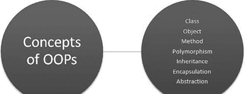

OOP 的概念。

让我们来看 OOP 语言的各种特性：

- **1. 类**：类是用于创建对象的用户定义的蓝图或原型。它代表了所有相同类型对象共享的一组属性或方法。通常，类声明可以按照以下顺序包含以下组件：
    - 类名：类名应该以首字母开头（按照惯例大写）。
    - 超类（如果有）：如果适用，类的父类（超类）的名字，在前面带有“use” 的关键字。
    - 构造函数（如果有）：Perl 子程序构造函数返回一个该类的实例的对象。在 Perl 中，构造函数通常命名为“new”。
    - 类体：类体由大括号 `{}` 包围。

- **2. 对象**：它是 OOP 的基本单元，代表现实世界的实体。一个典型的 Perl 程序会生成许多对象，这些对象通过调用方法进行交互。一个对象由：
    - 状态：状态由对象的属性表示。它也反映了对象的属性。
    - 行为：行为由对象的方法表示。它也反映了对象与其他对象的交互。
    - 身份：它赋予对象一个唯一的名称，并允许一个对象与其他对象进行交互。

**示例**：狗是对象的示例。

- **3. 方法**：方法是一组执行任务并向结果返回给调用者的语句。一个方法可以在不返回任何内容的情况下完成任务。方法通过允许我们重用代码而无需重新输入，从而节省了时间。

- **4. 多态**：多态是指 OOP 编程语言能够高效区分同名实体的能力。Perl 通过使用这些实体的签名和声明来实现这一点。

Perl 中的多态主要有两种类型：

- Perl 重载
- Perl 重写

- **5. 继承**：继承（面向对象编程）是 OOP 的一个核心支柱。它是 Perl 中允许一个类继承另一个类的特性（字段和方法）的机制。

需要记住的重要术语：

- 超类：子类是具有自基类或父类特性的类。
- 子类：它是派自另一个（或称为派生类、扩展类或子类）的类。子类可以向超类添加字段和方法。
- 可重用性：继承促进了“可重用性”，这意味着如果我们想创建一个新类，并且已经有一个类包含了我们需要的某些代码，我们可以从现有类派生我们的新类。通过这样做，我们正在重用现有类的字段和方法。

Perl 中的类可以使用包创建，并使用“use”关键字进行继承。

## 语法

```perl
use packagename
```

- **6. 封装**：封装是将数据封装在一个单一单元中。OOP 的主要目标是将数据与操作数据的函数连接起来，使得该函数之外的任何其他部分无法访问该数据。

- **7. 抽象**：数据抽象是识别对象的必要特征而忽略无关细节的过程。例如，汽车被视为一个整体，而不是它的各个组件。

# OOP 中的类

在当今世界，当编程被应用于生活的方方面面时，我们必须采用与现实世界实例密切相关的编程范式。现实世界挑战的竞争力和复杂性已经经历了巨大的变化，使得行业需要更具适应的方法。

OOP 的概念是一种极好的方法，可以塑造任何语言，使解决现实世界的案例变得轻而易举。OOP 是一种更加强调对象而非过程的编程范式。OOP 的思想涉及以对象和对象交互的方式工作。

注意：OOP 试图实现现实世界的元素，例如继承、封装和多态。

对象：它是类中具有特定属性和行为的实例。“苹果”是对象的示例。它具有水果、红色的等等特征。它的行为是“它味道很好”。根据 OOP 思想，它的数据代表对象的特征，它的活动由相关函数表示。因此，对象是持有数据并提供函数接口的实体。

类：类是一种扩展的数据结构概念。它规定了包含数据的对象的原型蓝图。

对象是各自类的实例。类由数据成员和数据函数组成；它是一种用户定义的预定义数据类型，可以通过创建该类的实例来访问和使用。

示例：以学校中的类作为示例。

## 数据成员变量 (Data Member)

数据成员是数据变量，而成员函数是用于控制这些变量的函数；这些数据成员和成员函数共同定义了类内部对象的属性和行为。

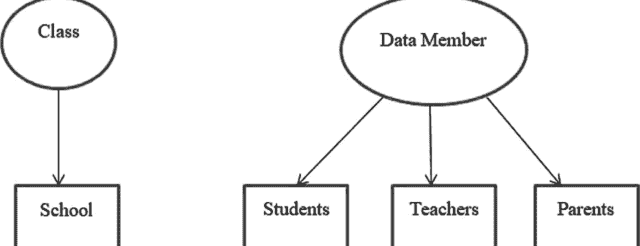

数据成员。

### 定义类

Perl 定义类变得非常简单。Perl 中的类对应于一个包（package）。要定义一个类，我们必须首先加载并构造一个包。包是一个预包含用户定义变量和子程序（subroutines）的单元，可以在程序的任何地方使用。

语法：

```perl
package Classname
```

### 创建类并使用对象

在 Perl 中，可以使用 `package` 关键字创建一个类，但对象是通过调用构造函数来创建的。构造函数被定义为类中的一个方法。

### 创建类实例

类名称和构造函数名称可以根据用户的意愿任意。大多数程序员倾向于使用 `new` 作为程序的构造函数名，因为它比任何其他复杂的构造函数名都更容易记忆和使用。

```perl
package student    // 这是类 student
sub Student_data // 类的构造函数
{
    my $class = shift;
    my $self = {
        _FirstName => shift;
        _StudentLastName => shift;
    };

    print "The Student's First Name is $self->{FirstName}\n";
    print "The Student's Last Name is $self->{StudentLastName}\n";
    bless $self, $class;
    return $self;
}
```

在前面的示例代码中使用了一个名为 `bless` 的函数。该函数用于将对象与作为参数传递的类关联。

## 语法


`bless` `Objectname`, `ClassName`

### 创建对象

在 Perl 中，通过调用类中定义的构造函数来创建对象。对象名称可以是用户需要的任何变量，但习惯上与其类相关进行命名。

```perl
$Data = Student_data student ( "Diksha", "Mayank");
```

## 示例：

```perl
use strict;
use warnings;

package student;

# 构造函数
sub student_data {
    # shift 将获取包名 'student'
    # 并将其赋值给变量 'class'
my $class_name = shift;
my $self = {
  'StudentFirstName' => shift,
  'StudentLastName' => shift
};

# 使用 bless 函数
 bless $self, $class_name;

# 从构造函数返回对象
return $self;
```

### 对象创建与构造函数调用

```perl
my $Data = new student_data student("Geeks", "forGeeks");

# 打印数据

print "$Data->{'StudentFirstName'}\n";

print "$Data->{'StudentLastName'}\n";
```

在 OOP 中使用类至关重要，因为它们精确地描述了现实世界的应用，并可以用于解决现实世界的问题。

# OOP 中的对象

`perl` 是一种面向对象的、基于解释器的、动态编程语言。OOP 有三个主要组件：对象、类和方法。对象是一个数据类型，可以称为它所属类的实例。它可能可能是各种数据类型数据变量的集合，也是各种数据结构的集合。方法是在类对象实例上操作的函数。

以下示例说明了在 Perl 中如何使用对象：

我们首先定义类。在 Perl 中，这是通过构造 `'class'` 包来实现的。包是一个封装的对象，包含了所有的 `'class'` 数据成员和函数。

```perl
package Employee;
```

在这种情况下，`Employee` 是名称。

第二个任务是创建包实例（即对象）。我们需要为此创建一个构造函数。在 Perl 中，构造函数是一个通常被称为 `"new"` 的子程序。

```perl
package Employee;

# 构造函数
sub new
{
    my $class = shift;
    my $self = {
        'FirstName' => shift,
        'LastName' => shift,
        'Salary' => shift,
    };

    # 使用 bless 函数
    bless $self, $class;
    return $self;
}
```

# 188 ■ 精通 Perl

示例：

```perl
# Base 类的声明和定义
use strict;
use warnings;
```

```perl
# 创建父类
package vehicle;
```

```perl
  # shift 将获取包名 'vehicle'
  # 并将其赋值给变量 'class'
  my $class = shift;
```

```perl
  my $self = {
    'distance'=> shift,
    'petrol_consumed'=> shift
  };
```

```perl
  # 使用 bless 函数将对象绑定到类上
  bless $self, $class;
```

```perl
  # 从构造函数返回对象
  return $self;
}
```

```perl
# Get器方法
sub get_mileage
{
```

```perl
  my $self = shift;
```

```perl
  # 计算结果
  my $result = $self->{'distance'} /
  $self->{'petrol_consumed'};
```

```perl
  print "我们车辆的油耗为:
  $result\n";
```

```perl
}
```

# Perl 中的面向对象编程 ■ 189

# 对象的创建与方法调用

```perl
my $obj1 = vehicle -> set_mileage(2550, 170);

$obj1->get_mileage();
```

# 构造函数和析构函数

我们将通过示例来解释构造函数和析构函数。

# 构造函数

Perl 子程序中的构造函数返回一个类的实例作为返回对象。在 Perl 中，构造函数通常被称为“`new`”。与许多其他 OOP 语言不同，Perl 没有特定的对象构造语法。它利用了已显式连接到类的数据结构（哈希、数组、标量）。在哈希引用和类名上，构造函数会调用“`bless`”方法（包名）。

让我们编写一些程序以进行更好的解释。

注意：由于使用了包（`packages`），以下代码将无法在线 IDE 上执行。以下文本代表一个 Perl 类或模块文件。请以 `(.pm)` 扩展名保存文件。

```perl
# 声明包
package Area;
```

```perl
# 声明构造函数方法
sub new
{
    return bless {}, shift; # 对哈希
    # 引用进行祝福操作。
}
```

当调用构造函数方法时，包名“`Area`”存储在默认数组“`@_`”中。关键字“`shift`”用于从“`@_`”中提取包名并将其传递给“`bless`”函数。

```perl
package Area;
sub new
{
    my $class = shift; # 在 $myclass 中定义 shift
```

```perl
my $self = {}; # 哈希引用
return bless $self, $class;
```

在 Perl 中，属性以键值对的形式存储在哈希引用中。

此外，代码中还添加了一些属性。

```perl
package Area;

sub new
{
  my $class = shift;
  my $self = {
    length => 3, # 存储长度
    width => 4, # 存储宽度
  };
  return bless $self, $class;
}
```

上面的（`Area` 类）代码有两个属性：`length`（长度）和 `width`（宽度）。

另一个 Perl 程序设计用于使用这些属性来访问它们。

```perl
use strict;
use warnings;
use Area;
use feature qw/say/;
```

```perl
# 创建新的 Area 对象
my $area = Area->new;
```

```perl
say $area->{length}; # 打印长度
say $area->{width}; # 打印宽度
```

# 如何运行代码：

- 将带有包 `Area` 的程序保存为文本文件 `Area.pm`。

- 注意：文件名应始终与包名相同。

# Perl 中的面向对象编程 ■ 191

- 将用于访问包中定义的属性的程序保存为 `*.pl`。可以是任何名称（在本例中，它是 `test.pl`）。

- 在 Perl 命令行中使用命令 `perl test.pl` 来运行保存为 `test.pl` 的代码。

### 传递动态属性

在现有文件中添加动态属性：

程序：`Areas.pm`

```perl
package Area;

sub new
{
    my ($class, $args) = @_; # 因为值将
    # 动态地传递
    my $self = {
        length => $args->{length} || 1, # 默认
        # 值为 1（存储）
        width => $args->{width} || 1, # 默认
        # 值为 1（存储）
    };
    return bless $self, $class;
}
```

# 我们已经添加了 `get_area` 函数来

# 计算面积

```perl
sub get_area
{
    my $self = shift;

    # 通过乘法获取面积
    my $area = $self->{length} * $self->{width};
    return $area;
}

1;
```

程序：`test.pm`

```perl
use strict;
use warnings;
```

# 192 ■ 精通 Perl

```perl
use feature qw/say/;

use Area;
```

```perl
# 将长度和宽度参数传递
# 给构造函数
my $area = Area->new(
    length => 2, # 将 '2' 作为长度的
    # 参数
    width => 2, # 将 '2' 作为宽度的
    # 参数
);
```


```perl
say $area->get_area;
```

# 196 精通 Perl

类。对象 `vehicle` 上的 `get_mileage()` 方法通过 `vehicle` 类中声明的方法打印 "The age by our vehicle: 15"。当我们在 `car` 对象执行类中的 `get_mileage()` 方法时，我们得到输出 "The mileage by our car is: 10"

# 为什么要重写方法？

如前所述，重写方法允许 Perl 在运行时提供多态。

多态对 OOP（面向对象编程）至关重要，原因如下：它允许基类描述所有后类都共享的方法，而子类则定义这些部分或全部方法的具体实现。Perl 还通过重写方法提供了多态中“一个接口，多种方法”的特性。

动态分发（运行时多态）是面向对象架构中代码复用和韧性最有效的策略之一。能够在不重新编译的情况下调用新类实例的方法，同时保持整洁的抽象接口，这种能力是一项强大的工具。

重写方法允许我们在不知道派生类对象类型的情况下调用任何派生类的方法。因此，在开发新方法时，编程应该是简化方法而不是记诵名称；相反，记住方法内部的流程更为必要。

# OOP 中的继承

继承是类提取和使用另一个类特征的能力。它是从现有类（称为基类，Base classes）创建新类（称为派生类，Derived classes）的过程。基本思想是程序员可以在一个类中使用另一个类的特征，而无需在多个类中重复声明或定义相同的项目。

我们从基类继承成员函数，而不是在每个类声明中编写它们。继承是 OOP 的基本特征之一。

- **子类**：子类或派生类是继承另一个类属性的类。
- **超类**：属性被子类继承的类被称为超类或基类。

继承的最基础的原理是从另一个类创建或派生出一个新类。

## Perl 中的面向对象编程 ■ 197

### 基类与派生类

派生类是通过从基类派生额外的继承子类创建的。一个基类可以有多个派生类；这种继承被称为层级继承。所有的派生类都派生自同一个父类或基类。当一个派生类共享多个父类并从多个父类继承其特征时，就会发生多重继承。

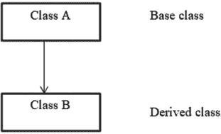

基类和派生类。

上面的图片描绘了类从基类派生的顺序。上图中所示顺序和符号将在必要时用于在理论上描述继承顺序。

考虑 `Vehicles` 类。我们现在必须为每种类型的车辆创建一个类，例如巴士、汽车或卡车。对于所有 `Vehicles`，`fuelAmount()`、`capacity()` 和 `applyBrakes()` 方法都是相同的。

| Class Bus | Class Car | Class Truck |
|---|---|---|
| `fuelAmount()` | `fuelAmount()` | `fuelAmount()` |
| `capacity()` | `capacity()` | `capacity()` |
| `applyBrakes()` | `applyBrakes()` | `applyBrakes()` |

继承的创建。

之前的图片描述了在没有继承概念的情况下创建这些类。

上述过程显然导致了相同代码的三次重复。这增加了错误的概率和数据冗余。

继承被用于避免这种情况。如果我们创建一个 `Vehicle` 类，在其中编写这三个函数，并让其他类继承自它，就可以简单地避免数据重复并增加可用性。分析下面的图，查看三个类是如何派生自 `vehicle` 类的：

### Class Vehicle

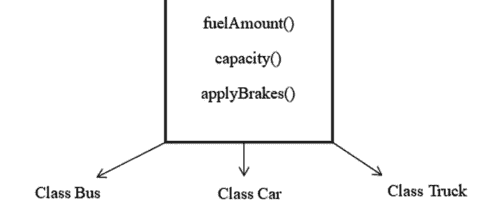

三个类继承自 `vehicle` 类。

因为我们从基类继承了其余三个类，所以我们只需要写一次函数，而不是三次（`Vehicle`）。

# 多级继承

在 Perl 中，继承可以以许多形式存在，但最常见的是多级继承，它涉及基类和派生类的链。在多级继承中，派生类继承基类，且该派生类也作为其他类的基类。在下面的图中，类 `A` 作为派生类 `B` 的基类，而类 `B` 又作为派生类 `C` 的基类。

### 多级继承

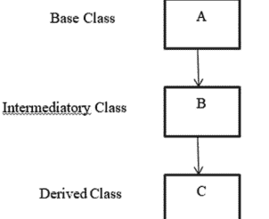

多级继承

## Perl 中的面向对象编程 ■ 199

### 在 Perl 中实现继承

可以使用包（Packages）来实现 Perl 中的继承。包用于创建一个父类，派生类可以从中继承功能。

```perl
use strict;
use warnings;

# 创建父类
package Employee;

# 创建构造函数
sub new
{
    # shift 获取包名 'employee'
    # 并将其赋值给变量 'class'
    my $class = shift;

    my $self = {
        'name' => shift,
        'employee_id' => shift
    };

    # 使用 bless 函数将对象绑定到类
    bless $self, $class;

    # 从构造函数中返回对象
    return $self;
}
```

多态是以多种形式处理数据的能力。`Poly` 意味着“多”，`morphism` 意味着“种类”，因此该术语本身就显示了其含义。多态是 OOP 语言最基础的概念之一。在 OOP 中，当父类引用子类时，经常使用多态。本节将检查如何以多种形式表达任何函数。

多态的一个现实世界例子是一个人在生活中同时扮演多个角色。正如一名女性同时履行母亲、妻子、员工和女儿的角色。因此，一个个体必须具备各种特征，每种特征都必须

## Perl 中的面向对象编程 ■ 201

实现并被视为 OOP 最核心的特征之一。OOP 的主要优势是多态。多态是如此重要，以至于不支持多态的语言不能自称为面向对象。基于对象的语言是指那些拥有类但不支持多态的语言。因此，对于 OOP 语言来说至关重要。它是对象或引用在不同语文中呈现多种形式的能力。它支持函数重载、函数重写和虚拟函数。

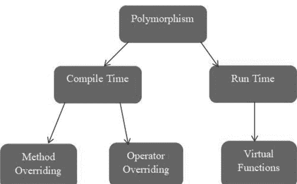

OOP 中的多态。

多态是一种属性，允许向多个类的对象发送任何消息，每个对象都可以根据类属性做出适当响应。

这意味着在 OOP 语言中，多态是根据调用它的对象的类型而执行不同操作的方法。例如，`$square->area()` 将返回正方形的面积，而 `$triangle->area()` 可能返回三角形的面积。另一方面，`$object->area()` 则必须根据调用 `$object` 的哪个类来计算面积。

使用以下示例来解释多态最为清晰：

```perl
use warnings;
# 使用包创建类
package A;
```

## 202 ■ 精通 Perl

```perl
# 构造函数创建
sub new
{
    # shift 将获取包名 'vehicle'
    # 并将其赋值给变量 'class'
    my $class = shift;
    my $self = {
        'name' => shift,
        'roll_no' => shift
    };

    sub poly_example
    {
        print("这对应于一个类 A\n");
    }
}
```

```perl
package B;

# @ISA 数组包含了该类
# 的父类列表，如果有的话
my @ISA = (A);

sub poly_example
{
    print("这对应于一个类 B\n");
}

package main;
```

```perl
B->poly_example();
A->poly_example();
```

在类 `B` 中定义的方法 `poly_example()` 覆盖了从类 `A` 继承的定义（对于第一个输出是如此，对于第二个输出则反之亦然）。这允许你添加或扩展任何现有包的功能，而无需重复重写整个类的定义。因此，程序员的生活变得更加便捷。

这描述了“封装”。在这里，销售部门的数据以及可能更改这些数据的人被组合在“销售部门”之下。

## 204 ■ 精通 Perl

示例：

```perl
# 基类的声明和定义
use strict;
use warnings;

package Student;
sub new {
    # shift 将获取包名 'Student'
    # 并将其赋值给变量 'class'
    my $class = shift;

    my $self = {
        'name'=> shift,
        'age'=> shift,
        'roll_no' => shift
    }

    # 使用 bless 函数将对象绑定到类
    bless $self, $class;

    # 从构造函数返回对象
    return $self;
}
```


```perl
# 用于显示详情的方法
sub get_details {
    my $self = shift;

    print "名称是: $self->{'name'}\n";
    print "年龄是: $self->{'age'}\n";
    print "学号是: $self->{'roll_no'}\n";
}
```

```perl
# 对象的创建与调用
$obj1 = Student->new("Rohini", 27, 15);
$obj1->get_details();
```

在上述代码中，如果需要访问类的数据进行任何修改或仅仅打印类的数据，是无法直接实现的。必须

## Perl 中的面向对象编程 ■ 205

创建该类的实例，然后使用 `get_details()` 方法来访问数据。这被称为“数据封装”。

## 封装的益处是：

- **数据隐藏**：用户将不确定类的内部实现。用户无法看到类是如何在其变量中存储数据的。他们只需要意识到我们正在为访问器提供值，并且变量正在用这些值进行初始化。

- **增强灵活性**：我们可以根据需要将类变量设为只读或只写。要使变量只读，我们需要在代码中使用 `Get` 访问器（即 `Getter`）。要使变量只写，我们必须只使用 `Set` 访问器（即 `Setter`）。

- **可重用性**：封装还促进了重用性，使其易于适应新需求。

- **代码验证简单**：封装的代码易于单元测试。

本章涵盖了 Perl 中带有类、对象、方法、构造函数和析构函数的 OOP 编程。此外，本章还讨论了方法覆盖、继承、多态和封装。

> 注意

> 1. Perl | 构造函数与析构函数。


## Perl 中的子程序 (Subroutines)

- 函数签名
- 向子程序传递复杂参数
- 可变变参数与不可变参数
- 多个子程序
- `return()` 函数的使用
- 引用传递
- 递归

在上一章中，我们讨论了 Perl 中的面向对象编程，在本章中，我们将涵盖子程序。

## 子程序或函数

函数或子程序是执行特定目的的语句集合。在任何编程语言中，代码复用都是理想的。因此，用户将该段代码放在函数或子程序中，以消除重复编写代码的需要。在 Perl 中，`function`（函数）、`subroutine`（子程序）和 `method`（方法）这三个词是同义词，尽管它们在其他编程语言中是有区别的。在 Perl 中，`subroutine` 是最常用的术语，因为它由关键字 `sub` 组成。每当函数被调用时，Perl 会暂停整个程序的执行，跳转到函数处执行，然后返回之前的代码区域。这不需要使用 `return` 语句。

## 确定子程序

Perl 中子程序定义的通用形式如下：

```perl
sub subroutinename
{
# 方法或子程序的主体
}
```

# 调用子程序

Perl 中的子程序可以通过如下方式传递参数列表来调用：

```perl
subroutinename(argumentslist);
```

Perl 中的子程序可以通过如下方式传递参数列表来调用：

```perl
subroutinename(argumentslist);
```

Perl 中的子程序可以通过如下方式传递参数列表来调用：

```perl
subroutinename(argumentslist);
```

Perl 中的子程序可以通过如下方式传递参数列表来调用：

```perl
subroutinename(argumentslist);
```

Perl 中的子程序可以通过如下方式传递参数列表来调用：

```perl
subroutinename(argumentslist);
```

Perl 中的子程序可以通过如下方式传递参数列表来调用：

```perl
subroutinename(argumentslist);
```

Perl 中的子程序可以通过如下方式传递参数列表来调用：

```perl
subroutinename(argumentslist);
```

Perl 中的子程序可以通过如下方式传递参数列表来调用：

```perl
subroutinename(argumentslist);
```

Perl 中的子程序可以通过如下方式传递参数列表来调用：

```perl
subroutinename(argumentslist);
```

Perl 中的子程序可以通过如下方式传递参数列表来调用：

```perl
subroutinename(argumentslist);
```

Perl 中的子程序可以通过如下方式传递参数列表来调用：

```perl
subroutinename(argumentslist);
```

Perl 中的子程序可以通过如下方式传递参数列表来调用：

```perl
subroutinename(argumentslist);
```

Perl 中的子程序可以通过如下方式传递参数列表来调用：

```perl
subroutinename(argumentslist);
```

Perl 中的子程序可以通过如下方式传递参数列表来调用：

```perl
subroutinename(argumentslist);
```

## 示例：

```perl
# Program to demonstrate
# following
#!/usr/bin/perl

# defining-subroutine
sub ask_user {
    print "Hello\n";
}

# calling-subroutine
ask_user();
```

```perl
# 获取传递的参数
# 的总数。
$num = scalar(@);

foreach $i (@)
{
    $s += $i;
}

# 返回和
return $s;
}

# 调用子程序并存储结果
$result = Sum(40, 4, 50);

# 显示结果
print "Sum of given numbers : $result\n";
```

## 子程序中的局部变量与全局变量

默认情况下，Perl 程序中的所有变量都是全局变量。然而，通过 `my` 关键字，你可以在块内部创建局部或私有变量。私有变量的作用范围有限，例如仅限于块（`if`, `while`, `for`, `each`）和方法之间。这些变量无法在块或方法之外使用。

## 示例：

```perl
# 演示子程序中局部
# 和全局变量的程序

#!/usr/bin/perl

# 全局变量
$str = "PeeksforPeeks";

# 子程序定义
sub Peeks {
# 使用 my 关键字为
# Peeks 函数创建私有变量
    my $str;

$str = "PFP";
    print "Inside Subroutine: $str\n";
}

# 调用子程序
Peeks();

print "Outside Subroutine: $str\n";
```

## 子程序调用中的可变数量参数

Perl 不包含任何用于声明子程序参数的内置设施，使得向函数传递任意数量的参数变得非常简单。

## 示例：

```perl
# 演示传递给子程序的
# 可变数量参数

#!/usr/bin/perl
use strict;
use warnings;

# 定义子程序
sub Multiplication {
    # 包含默认值
    # 1 的私有变量
    my $mul = 1;

    foreach my $val (@_)
    {
        $mul *= $val;
    }

    return $mul;
}

# 使用 4 个参数调用子程序
print Multiplication(9, 4, 2, 5);

print "\n";

# 再次调用子程序
# 使用 3 个参数
print Multiplication(4, 6, 3);
```

通常情况下，将多个数组或哈希表作为参数传递给子程序会导致它们丢失其独立标识性。同样，从子程序返回多个数组或哈希表也会导致其独立标识的丢失。我们可以通过使用引用（references）来解决这些问题。

## PERL 中的函数签名

Perl 函数或子程序是执行特定任务的语句集合。每种编程语言的用户都希望重用代码。用户将代码部分放在函数或子程序中，以避免重复编写代码。虽然在 Perl 中函数、子程序和方法这些术语可以互换，但在其他编程语言中并非如此。因为是通过 `sub` 关键字创建的，子程序在 Perl 编程中常用。当函数被调用时，Perl 会停止执行整个程序并跳转到函数执行执行，然后再返回到之前运行的代码段。可以避免使用 `return` 语句。

## 定义子程序


在 Perl 中，定义子程序的通用形式如下：

```perl
sub subroutinename
{
    # 方法或子程序的体
}
```

## 函数签名

在构建函数时，括号内还会提供一组参数，以指定函数在调用时接收的参数类型。此函数签名可能包含一个或多个参数。

具有定义签名的子程序或函数只能接受与其签名指定类型相同的参数。如果传递给过程输入与其签名不匹配，将发生错误。函数签名揭示了关于子程序类型的大量信息。它允许用户创建具有相同名称但签名不同（即参数不同）的子程序。在 Perl 中，不同的子程序可以有相同的名称，但它们的参数列表必须是独特的。

## 示例：

```perl
sub examplefunc($variable)
{
    statement;
}
sub examplefunc($variable1, $variable2)
{
    statement;
}
```

在上面的代码中，子程序的名称相同，但它们的参数数量是不同的；因此，它们不被视为不同的子程序，我们的 Perl 代码不会抛出错误。

传递与签名中指定类型不同的参数：当使用签名定义子程序时，它必须摄取与其签名相同类型的参数。如果参数与给定的函数签名不同，将生成错误，导致代码编译失败。

## 示例：

```perl
#!/usr/bin/perl

# 定义函数签名
sub example(Int $variable)
{
    return $variable / 2;
}

# 函数调用
print example(66)
```

## 216 精通 Perl

如果我们传递一个与函数签名类型不同的参数，将生成以下错误：

```perl
#!/usr/bin/perl

# 定义函数签名
sub example(Int $variable)
{
    return $variable / 2;
}

# 使用字符串
# 类型参数调用函数
print example("66");
```

## 参数数量的差异

当使用签名定义子程序时，它必须摄取与其签名类型相同的参数。如果参数与给定的函数签名不同，将生成错误，导致代码编译失败。（注：提供的 OCR 文本在结尾包含大量重复和碎片化句子；我已根据提供的片段合并了逻辑流）。

# 220 ■ 精通 Perl

# 传递标量参数

`$scalar = 100;`

# 使用列表参数调用子程序

`Display_List(@List, $scalar);`

向子程序传递引用：引用也可以作为参数传递给子程序。数组引用被传递给子程序，并返回数组元素的最大值。

## 示例：

```perl
#!/usr/bin/perl
use warnings;
use strict;
```

```perl
# 创建一个包含某些元素的数组
my @Array = (20, 30, 40, 50, 60);
```

```perl
# 对上述数组创建引用
# 并使用引用作为参数调用子程序
my $m = max(\@Array);
```

```perl
# 定义子程序
sub max
{
```

```perl
# 获取数组元素
my @Array_ref = @[0];
my $k = $Array_ref[0];
```

```perl
# 遍历数组的每个元素
# 并寻找最大值
for(@$Array_ref)
{
```

```perl
$k = \$_ if($k < \$_);
}
print "Max of @Array is $k\n";
```

```perl
}
```

向子程序传递哈希（Hash）：哈希也可以作为参数传递给子程序，并显示其键值对。

## 示例：

```perl
#!/usr/bin/perl

# 子程序定义
sub Display_Hash
{
    # 用于存储传递的    # 参数的哈希变量
    my (%Hash_var) = @_;

    # 显示传递的列表元素
    foreach my $key (keys %Hash_var) {
        my $value = $Hash_var{$key};
        print "$key : \$value\n";
    }
}
```

# 驱动代码

```perl
# 定义哈希
%Hash = ('Company' => 'PeeksforPeeks',
    'Location' => 'Delhi');
```

```perl
# 使用哈希参数调用子程序
Display_Hash(%Hash);
```

向子程序传递文件句柄：要创建文件或访问其内容，需要文件句柄（`FileHandle`）。文件句柄无非是用于配合操作符以特定模式访问文件的结构，如读取、写入、追加等。文件句柄也可以作为参数传递给子程序，以便对文件执行各种操作。在下面的示例中，文件句柄被传递给了子程序：

## 示例：

```perl
#!/usr/bin/perl

sub printem
```

```perl
{
  my $file = shift;
  while (<$file>) {
    print;
  }
}

open(fh, "Hello.txt") or die "File '$filename' cannot be opened";

printem *file;
```

# 可变与不可变参数

函数或子程序是执行特定任务的语句集合。用户希望在每个编程语言中重用代码。用户将代码部分放在函数或子程序中，以避免重复编写代码。这些子程序定义了调用函数时可以传递的参数类型和数量。这些参数用于通过函数的表达式评估传递的值。然后这些值被传递给调用函数并返回给指定的参数。

## 示例：

```perl
sub Function1(parameter-1, parameter-2)
{ statement; }
```

# 可变参数（Mutable Parameters）

这些是参数，其值在传递给它们的函数内部会被更改。这表明当参数通过调用者函数提供给函数时，被调用函数内部对值所做的任何更改也将反映在调用者函数传递的参数中。

# 不可变参数（Immutable Parameters）

这些参数属于特定类型，其值在提供给它们的函数内部不能被修改。这表明当参数通过调用者函数提供给函数时，子程序获取的是一个值而不是变量。因此，对函数参数的任何修改都不会被反映。

Perl 的子程序参数默认是不可变的，这意味着它们不会无意中更改调用函数的参数。在特定的编程语言中，这被称为“值传递”（`call by value`）。

## 示例：

```perl
sub Function1(parameter-1, parameter-2)
{ statement; }
```

（注：提供的 OCR 文本在第 240-244 页似乎重复或重叠部分。我已根据提供的流程处理了唯一内容。）

# Perl 中的子程序 ■ 227

```perl
# 用于 $n = 1 的函数
multi Fibonacci_func(1)
{
  1; # 返回 1
}
```

```perl
# 计算和的递归函数
multi Fibonacci_func(Int $n where $n > 1)
{
  Fibonacci_func($n - 2) +
  Fibonacci_func($n - 1);
}
```

```perl
# 使用函数调用
# 打印和
print Fibonacci_func(27);
```

计算斐波那契数列的和，上一个示例使用了多个子程序。

**第二个示例：** 数字的阶乘

```perl
#!/usr/bin/perl
# 打印数字阶乘的程序
```

```perl
# 0 的阶乘
multi Factorial(0)
{
  1; # 返回 1
}
```

```perl
# 计算阶乘的
#递归函数
multi Factorial(Int $n where $n > 0)
{
  $n * Factorial($n - 1); # 递归调用
}
```

```perl
# 使用函数调用
# 打印结果
print Factorial(25);
```

在前面的示例中，程序使用“`multi`”关键字声明了多个同名但由于参数个数（arity）不同的子程序。

## `return()` 函数

在 Perl 中，`return()` 函数在子程序、块或 `do` 函数的结束时返回值。根据上下文的不同，返回的值可以是标量（`scalar`）、数组或哈希（`hash`）。

语法：`return Value`

返回：

标量上下文中的一个列表（`List`）

如果没有向 `return` 函数传递任何参数，它在列表上下文中返回一个空列表，在标量上下文中返回 `undef`，在空上下文中不返回任何。

第一个示例：


```perl
#!/usr/bin/perl -w

# 乘法子程序
sub Mul($n) {
    my ($x, $y) = @_;
    my $z = $x * $y;

    # 返回值
    return($x, $y, $z);
}

# 在标量上下文中调用
$retval = Mul(35, 20);
print("The Return value is $retval\n");
```

在列表上下文中调用

```perl
@retval = Mul(35, 20);
print("The Return value is $retval\n");
```

第二个示例：

```perl
#!/usr/bin/perl -w

# 减法子程序
sub Sub($n)
{
  my($x, $y) = @_;

  my $z = $x - $y;

  # 返回值
  return($x, $y, $z);
}

# 在标量上下文中调用
$retval = Sub(35, 20);
print("The Return value is $retval\n");

# 在列表上下文中调用
@retval = Sub(35, 20);
print("The Return value is $retval\n");
```

## Perl 中的引用 (REFERENCES)

变量在 Perl 中用于访问存储在内存中的数据。变量被赋予数据值并用于各种操作。Perl 引用（reference）允许你通过不同的变量访问相同的数据。在 Perl 中，引用是一种标量数据类型，它存储另一个变量的位置。其他变量包括标量、哈希、数组、函数名等。嵌套数据结构的构造非常，因为用户可以创建一个列表，该列表引用另一个列表，而该列表又包含对数组、哈希等的引用。

### 创建引用

我们可以对标量值、哈希、数组、函数等创建引用。要创建引用，定义一个新的标量变量，并在变量名（我们想要创建的引用的名称）前加上反斜杠。

为不同数据类型创建引用：

### 数组引用

```perl
# 定义数组
@array = ('1', '2', '3');

# 为数组变量创建引用
$reference_array = \@array;
```

### 哈希引用

```perl
# 定义哈希
$hash = ('1'=>'a', '2'=>'b', '3'=>'c');

# 为哈希变量创建引用
$reference_hash = \%hash;
```

### 标量值引用

```perl
# 定义标量
$scalar_val = 2431;

# 为标量变量创建引用
$reference_scalar = \$scalar_val;
```

注意：

- 键值对周围的大括号 `{}` 可用于指向匿名哈希的引用。

示例：

- 创建匿名哈希的引用

`$ref_to_anonymous_hash = {'PFP' => '1', 'Peeks' => '2'};`

- 方括号 `[]` 可创建指向匿名数组的引用。

示例：

- 创建匿名数组的引用

`$ref_to_anonymous_array = [30, 40, ['P', 'F', 'P']];`

- `sub` 也可以用于创建指向匿名子程序的引用。这里的 `sub` 没有名称。

示例：

- 创建匿名子程序的引用

`$ref_to_anonymous_subroutine = sub { print "\nPeeksforPeeks\n" };`

- 不为输入/输出句柄（如 `dirhandle` 或 `FileHandle`）创建引用。

## 解引用 (Dereferencing)

既然我们已经创建了引用，必须使用解引用来获取值。解引用允许我们通过引用访问原始数据。

以下示例展示了如何对不同数据类型解引用：

### 数组解引用

```perl
# 从数组引用中访问元素
@elements = @$reference_array;
print($elements[0]\n); 
```

### 哈希解引用

```perl
# 从哈希引用中访问值
$val = $reference_hash->{'PFP'};
print($val\n);
```

### 标量解引用

```perl
# 从标量引用中访问值
$val = $$reference_scalar;
print($val\n);
```

```perl
else {
  return $sx * fact($sx - 1);
}
```

# 驱动代码

```perl
$a = 5;

# 调用函数并在返回后打印结果

print "The Factorial of a number $a is ", fact($a);
```

程序的运行机制如下：

- 步骤 1：当标量 `$a` 的值为 0 或 1 时，函数会直接返回，因为 0! 和 1! 都等于 1。

- 步骤 2：如果标量 `$a` 的值为 2，那么 `fac(x-1)` 会调用 `fac(1)`，后者返回 1。

  结果是 `2*factorial(1) = 2*1 = 2`。

  结果是它将返回 2。

- 步骤 3：同样，当将较大的值传递给函数时，参数值每次调用都会减少 1，并一直计算到值达到 1 为止。

第二个示例：以下示例计算到给定数字的斐波那契数列。

```perl
#!/usr/bin/perl

# 打印斐波那契数列的程序
sub fib {
  # 从参数中获取值
  my $c = shift;
  my $d = shift;

  # 要打印数列的数字
  my $n = shift;

  # 检查结束值
  if ($d > $n) {
    return 1;
  }

  # 打印数字
  print "$d";

  # 递归调用
  fib($d, $c + $d, $n);
}
```

# 驱动代码

```perl
# 要打印数列的数字

$m = 5;

# 数列的前两个元素

$x = 0;

$y = 1;

print "$x";

# 使用所需的参数调用函数

fib($sx, $y, $m);
```

以下是程序的运行原理：

- 步骤 1：调用函数 `fib()` 并传入 3 个参数，其中前两个是 0 和 1，而 `$n` 是要打印数列的数字。

- 步骤 2：这些值以数组的形式传输，使用 `shift` 获取其内容。

- 步骤 3：对于每次调用，使用 `shift` 获取前两个值并存储在标量 `$c` 和 `$d` 中。这些值现在相加以产生数列中的下一个值。此步骤重复，直到值达到用户指定的结束值。

在本章中，我们涵盖了 Perl 中的子程序，讨论了函数签名、向子程序传递复杂参数，以及可变和不可变参数。此外，我们还讨论了多个子程序的使用、`return()` 函数、按引用传递以及递归。

# 评价

Perl 是一种在商业和私有计算行业中广泛使用的跨平台开源编程语言。在 20 世纪后期和 21 世纪初，Perl 因其适应性强的文本处理和问题解决能力而深受 Web 开发者的青睐。

Larry Wall（Larry沃尔）是一位美国程序员和语言学家，他首次基于 Unix 的计算机发布了 Perl 1.0。这个早期的 Perl 版本是一种直观、易于编码的语言，用于读取、提取和打印文本文件中的信息；它还能执行其他系统管理任务。Perl 通常认为代表“实用提取和报告语言”（Practical Extraction and Report Language），它的灵感源自现有的编程语言，如 C、BASIC 和 AWK，但其对常用术语的使用反映了沃尔的语言背景。Perl 是促进开源模型的一项里程碑产品，这是一种相对于专有方法的协作软件开发方法。

Perl 是一种为脚本操作设计的编程语言。然而，Perl 现在用于许多用途，包括 Web 开发、图形用户界面（GUI）开发、系统管理等。它是一种可靠且跨平台的编程语言。

Perl CGI 用于 Web 开发。CGI 是与网络浏览器和 Perl 通信的网关。

最常见的应用程序是从文本文件中提取信息并打印报告，将文本文件转换为另一种格式。这是由于它的名称源于“Practical Extraction and Report Language”。

Perl 脚本是用 Perl 编写的，而 Perl 程序是执行 Perl 脚本的系统。Perl 是一种脚本语言。当我们运行 Perl 程序时，它首先被编译成代码并转换为机器指令。用 Perl 而不是 C 来编写可以节省时间。

它适用于大多数操作系统，并被收录于《津英语字典》。它从多种语言中借鉴概念和语法，包括 AWK、bourne shell、C、sed 甚至英语。

# Perl 历史

Larry Wall 在 1987 年创建了 Perl，作为一种脚本语言来帮助处理报告。

- 1987 年 12 月 18 日，发布了 1.0 版本。

- Perl 2 于 1988 年发布，它包含了大幅改进的正则表达式引擎。

- Perl 3 于 1989 年发布，包含了对二进制数据流的支持。

- Perl 4 于 1991 年发布，比之前的版本具有更好的文档。

- 1994 年 10 月 17 日，发布了 Perl 5。其最新版本包含了许多新特性，如对象、变量、引用和模块。


## Perl 特性

- 它具有直观的对象面向编程语法。
- 它可以用于许多用途，包括 Web 开发、图形用户界面（GUI）开发、系统管理等。它是一种可靠且跨平台的编程语言。
- `Perl` `CGI` 用于 Web 开发。`CGI` 是与网络浏览器和 `Perl` 通信的网关。
- 最常见的应用程序是从文本文件中提取信息并打印报告，将文本文件转换为另一种格式。这是由于它的名称源于“Practical Extraction and Report Language”。
- `Perl` 脚本是用 `Perl` 编写的，而 `Perl` 程序是执行 `Perl` 脚本的系统。`Perl` 是一种脚本语言。当我们运行 `Perl` 程序时，它首先被编译成代码并转换为机器指令。用 `Perl` 而不是 `C` 来编写可以节省时间。
- 它适用于大多数操作系统，并被收录于《津英语字典》。它从多种语言中借鉴概念和语法，包括 `AWK`、`bourne shell`、`C`、`sed` 甚至英语。

# Perl 历史

`Larry Wall` 在 1987 年创建了 `Perl`，作为一种脚本语言来帮助处理报告。

- 1987 年 12 月 18 日，发布了 1.0 版本。
- `Perl` 2 于 1988 年发布，它包含了大幅改进的正则表达式引擎。
- `Perl` 3 于 1989 年发布，包含了对二进制数据流的支持。
- `Perl` 4 于 1991 年发布，比之前的版本具有更好的文档。
- 1994 年 10 月 17 日，发布了 `Perl` 5。其最新版本包含了许多新特性，如对象、变量、引用和模块。
- 最新的版本 5.24 于 2016 年 5 月 9 日发布。

# 评估 ■ 241

其他差异还包括：

- `Perl` 可能会很杂乱，而 `Python` 更加精简。
- 在 `Perl` 中，完成一项任务有许多方法，而 `Python` 的设计目标是为任何给定的函数提供单一清晰的路径。
- `Python` 的可读性高于 `Perl`。
- `Python` 通常被认为是最适合学习的编程语言之一，也是对新开发者最友好的编程语言之一。
- `Python` 是比 `Perl` 更新的编程语言。
- `Perl` 被集成在 Web 应用程序的源代码中。
- `Python` 是一种强大的编程语言，因为它作为动态编程语言而闻名，应用涵盖从 Web 开发到机器学习的各个领域。
- `Python` 在开源开发者社区中拥有更多的支持。

| `Perl` | `Python` |
| :--- | :--- |
| 它是一门高级的、基于解释器的动态编程语言。 | 它是一门带有解释器的高级、通用编程语言。 |
| `Perl` 可以从 `https://www.perl.org/get.html` 下载 Unix/Linux、macOS 或 Windows 版本。 | `Python` 可以从 `https://www.python.org/downloads` 下载 Unix/Linux、macOS、Windows 及其他操作系统版本。 |
| `Perl` 的目标是简化创建过程，后来经历了许多更改和修订，以包含许多功能和能力。 | 与 `Python` 代码相比，`Perl` 代码并不简单。 |
| `Perl` 拥有卓越库支持，并可以使用内置函数处理操作系统层面的操作。 | 可用的面向对象编程（OOP）支持有限。 |
| `Python` 的目标是让中小型项目和应用程序编写简单且逻辑清晰的代码更容易。 | `Python` 代码更加直观且易懂。 |
| 为了处理操作，`Python` 需要第三方库的协助。 | |
| 使用大括号来标记和标识代码块。 | 空格在 `Perl` 中至关重要。 |
| `Python` 为面向对象编程提供了良好的支持。 | 使用缩进来标记和标识代码块。空格在 `Python` 中非常重要，可能会导致语法错误。 |

# 242 评估

## Perl

它便于文本处理，因为 `Perl` 包含了对正则表达式的支持。

## Python

为了处理正则表达式，`Python` 需要使用外部函数。

在 `Perl` 中，结束一行代码请使用分号 (`;`)。

在每行代码的末尾，不需要分号 (`;`)。

`Perl` 的文件扩展名是 `.pl`。

`Python` 文件的扩展名是 `.py`。

# PERL VS JAVA

`Larry Wall` 于 1987 年发明了 `Perl`。`Perl` 支持面向对象和过程化编程。它与 `C` 和 `C++`。`Perl` 最初设计用于处理文本。

`Java` 是一门著名的编程语言。`Java` 既是一种编程语言，也是一个计算机平台。`Sun Microsystems` 在 `James Gosling` 的发起下于 1995 年发布了 `Java`。`Oracle` 声称全球有 30 亿设备在使用 `Java`。它的设计允许开发者“一次编写，随处运行”（WRITE ON, RUN ANYWHERE），这意味着 `Java` 应用程序可以在一个平台上生成，并在任何其他支持 `JVM` 的平台上执行。

以下是 `Perl` 和 `Java` 之间的一些关键区别：

| 特性 | `Perl` | `Java` |
| :--- | :--- | :--- |
| 简介 | `Perl` 是一种用于 `CGI` 脚本的通用高级编程语言。`Bugzilla` 是流行的 `Perl` 项目。它最初旨在取代复杂的 `shell` 脚本。 | `Java` 既是编程语言也是一种计算平台。如果你不安装 `Java`，仍会有程序和网站无法运行。它快速、安全且可靠。 |
| 编译格式 | `Perl` 6 被编译为字节码，而 `Perl` 5 及早期版本是解释型语言。它以扩展名 `.pbc` 保存。 | `Java` 应用程序被翻译成字节码。 |
| 关联数组 | `Perl` 以简洁的方式定义关联数组。 | `Java` 字节码可以发送到网络，然后在任何具有 `JVM` 的系统上运行。它以扩展名 `.class` 保存。 |

# 评估 ■ 243

| 特性 | `Perl` | `Java` |
| :--- | :--- | :--- |
| 重点 | `Perl` 擅长支持文件扫描和报告创建等常见活动。 | `Java` 中没有创建关联数组的简洁方法。它确实有哈希（`hash`）实现。 |
| 文件扩展名 | `Perl` 程序以 `.pl` 扩展名保存。例如：`MyFile.pl` | `Java` 程序以 `java` 扩展名保存。例如：`MyFile1.java` |
| 类型方法 | `Perl` 是动态类型的，这意味着它的大部分类型发生在执行期间。 | `Java` 是静态类型的，这意味着它的大部分类型发生在构建时间阶段。 |


| 注释和文档 | Perl 中的内联注释使用 `#` 编写。例如：Perl 文档中的 `#Inline-Comment`。Perl 中的注释使用 `=` 和 `-cut`。例如：`=pod` 语法 `=cut` | Java 中的单行注释使用 `//` 声明。例如：`//Single-line Comment`。多行注释使用 `/**...*/` 编写。例如：`/* it is a multiline comment */`。Java 中的文档使用 `/**...*/`。例如：`/*Documentation in Java*/` |
| 语句结束 | Perl 中的每条语句必须以分号 (`;`) 结束 | Java 中的每条语句必须以分号 (`;`) 结束 | |

# PERL VS C/C++

`Perl` 是一种动态的、高级的、解释的、通用编程语言。它由 `Larry Wall` 于 1987 年创建。`Perl` 没有官方的缩写，尽管“`Practical Extraction and Reporting Language`”（实用提取与报告语言）是最常用的。

一些程序员将 `Perl` 称为“`Pathologically Eclectic Rubbish Lister`”（病态折衷的垃圾列表器）和“`Practically Everything Really Likable`”（实际上每样都非常喜欢）。“`Practical Extraction and Reporting Language`”缩写经常被使用，因为 `Perl` 最初设计用于文本处理，例如从特定文件中提取必要信息并将文本转换为新格式。过程化和面向对象的都是。

一些程序员将 `Perl` 称为……。因为 `Perl` 最初设计用于文本处理，例如从特定文件中提取必要信息并将文本转换为新格式。过程化和面向对象的都是。

# 244 评估

以下是 `Perl` 和 `C/C++` 的一些显著区别：

| 特性 | Perl | C/C++ |
| :--- | :--- | :--- |
| 简介 | `Perl` 是一种动态解释的通用编程语言。 | 它是是驱动的。 |
| 编译格式 | `Perl 6` 被编译为字节码，而 `Perl 5` 及早期版本是解释型语言。 | 它是驱动的。 |
| 关联数组 | `Perl` 以简洁的方式定义关联数组。 | 它是驱动的。 |
| 文件扩展名 | `Perl` 程序以 `.pl` 扩展名保存。例如：`MyFile.pl` | 它是驱动的。 |
| 大括号 | 使用大括号来标记和标识代码块。 | 空格在 `Perl` 中至关重要。 |
| 缩进 | 使用缩进来标记和标识代码块。空格在 `Python` 中非常重要，可能会导致语法错误。 |
| 面向对象 | `Python` 提供了良好的面向对象编程支持。 | |
| 注释 | `Perl` 中的内联注释使用 `#` 编写。例如：`Perl` 文档中的 `#Inline-Comment`。`Perl` 中的注释使用 `=` 和 `-cut`。例如：`=pod` 语法 `=cut` | `Java` 中的单行注释使用 `//` 声明。例如：`//Single-line Comment`。多行注释使用 `/**...*/` 编写。例如：`/* it is a multiline comment */`。`Java` 中的文档使用 `/**...*/`。例如：`/*Documentation in Java*/` |
| 语句结束 | `Perl` 中的每条语句必须以分号 (`;`) 结束 | `Java` 中的每条语句必须以分号 (`;`) 结束 | |

## 246 评估

`Perl` 有什么用？

`Perl` 用于数据库管理、系统管理以及图形用户界面（`GUI`）开发。由于其功能极其强大，`Perl` 以前被称为“互联网的胶带”。它是 `Web` 开发 `LAMP` 堆栈中“`P`”的选项之一（其他选项是 `Python` 和 `PHP`）。其余的字母代表 `Linux`、`Apache` 和 `MySQL`。

以下是 `Perl` 目前的主要用途：

*   系统管理：`Perl` 可用于自动化或执行系统管理职责。这些职责包括重命名目录中的多个文件，或修改目录树中的特定文本组件。
*   Web 开发：`Perl` 可用于开发 `Web` 应用程序。在 `Perl` `Web` 开发过程中，我们可能会使用诸如 `Dancer` 等框架。也可以使用 `Perl` 提供网页页面服务。
*   网络编程：我们可以利用 `Perl` 的内置函数创建客户端/服务器应用程序。`Perl` 还包含了一些模块，它们可以让编写典型的网络任务（如 `ping` 远程计算机）变得更加简单。
*   云端数据管理：如今许多公司已将其数据迁移到公共云。`Perl` 可以辅助云端数据管理和虚拟机管理。

## Perl 学习

如果我们想在技术领域工作，就应该学习 `Perl`。使用 `Perl` 构建其系统管理流程、网络程序和网站的公司需要 `Perl` 开发者。`Amazon`、`Roblox`、`Venmo` 和 `MIT` 都是这些公司。`Perl` 专家拥有解决方案工程师、软件工程师、`Web` 开发人员和数据库工程师等职称。如果我们想在科技行业担任程序员或系统管理员，学习 `Perl` 是完善对当前技术理解的绝佳方式。

## 我们为什么应该学习 Perl？

我们应该学习 `Perl` 的一些原因如下：

`Perl` 是一种非常优秀的通用编程语言。`Perl` 被应用于广泛领域，包括数据库管理、`Web` 开发、系统管理和网络编程。

## 评估 ■ 247

`Perl` 的用法非常有趣。生物信息学程序员构建软件来理解生物学数据集。不断发展的的基因组学学科正利用生物信息学领域的专业知识。我们可以使用 `Perl` 获取基因组序列并研究群体遗传学。

`Perl` 基于语言学概念，直到今天仍然是一门优秀的文本处理语言。人们会想到正则表达式（`Regex`）、`HTML` 解析和 `JSON` 操作。`Perl` 还可以用于实现语言处理功能，如语音识别和文本转语音。通过广泛使用的测试任何协议（`TAP`），你还可以使用 `Perl` 自动测试应用程序。

总之，了解 `Perl` 将为我们的 `Web` 开发职业提供有趣的选择。`Perl` 开发者需求很大。一旦我们掌握了 `Perl`，就可以利用它来驱动我们的项目或寻找工作。根据 `TIOBE` 指数（一个根据搜索引擎结果评估编程语言流行程度的网站），`Perl` 目前在 50 种编程语言中排名第 17。

该索引统计了 25 个搜索引擎的结果。它计算某个特定编程语言的命中次数，并用该命中次数来确定该语言在索引中的排名。这结合提及 `Perl` 的职位发布频率等其他数据表明，虽然 `Perl` 目前不是最流行的编程语言，但它仍在在使用，并且是一项值得青睐的技能。

`LinkedIn` 上有超过 15,000 个包含 `Perl` 的招聘公告，`Glassdoor` 上有 10,000 个。即使 `Perl` 现在可能不是最流行的编程语言，公司仍继续运行它们的 `Web` 业务，并继续寻找这种技能组合的人才。

## 学习 Perl 需要多长时间？

给自己三个月时间学习基础知识并开始学习程序。这假设我们每天花费一小时学习这种语言。

这个估计是基于学习 `Python` 基础大约需要八周的事实，`Python` 是另一种与 `Perl` 在同一时期出现（1991年）的脚本语言，用于许多类似的任务。

然而，一个显著的区别是，`Python` 设计时执行任务的方法数量有限，而 `Perl` 的设计哲学是“条条大路”（`There’s more than one way to do it`）。这意味着我们可能需要花费更多时间来学习 `Perl` 的基础。

## 248 ■ 评估

`Perl` 难学吗？

`Perl` 对初可能具有挑战性。另一方面，拥有其他脚本语言的先经验可以缩短学习曲线。如果我们有一些 `Python` 经验，学习 `Perl` 将变得简单。

我们必须安装软件并与命令行交互以开始学习 `Perl`。如果我们以前从未见过，请在学习 `Perl` 语法之前先尝试。`Perl Learn` 为所有平台提供了直接的安装说明。

### Perl 中调试器的断点

在 `Perl` 中，控制程序的执行是通过指示调试器执行到程序中的特定点（称为断点）来实现的。这些断点允许用户分段程序并搜索错误。

使用以下调试器命令来创建此类断点，以及执行到达到断点为止的命令。

### b 命令

`b` 调试器用于在程序中设置断点。此命令指示调试器每当执行到特定行时就停止程序。

例如，以下命令指示调试器在准备执行第 12 行时停止：

```
DB<13> b 12
```

（如果该行不可中断，调试器将返回 `Line 12 is not breakable`。）

程序可以有无限数量的断点。当调试器准备执行包含断点的语句时，程序将停顿。

`b` 命令也接受子程序名称：

```
DB<15> b valuedir
```

这会在子程序 `valuedir` 处首先设置断点。

## 评估 249

`b` 命令也可以仅在满足条件时才停止程序。

以下命令指示调试器在准备执行第 12 行且 `vardir` 等于以下内容时停止：

```
DB<15> b 12 (vardir == "")
```

`b` 命令可以指定任何合法的条件表达式。断点可以设置在任何行。例如：

```
16: print ("
```

### c 命令

`c` 命令指示调试器继续运行直到遇到断点。

```
DB<15> c
```

```
main::debugtest:12): $vardir ~ d+$/
```


当调试器即将到达设置了断点的第 12 行时，程序停止并显示该行，调试器生成命令提示。此提示允许我们通过 `n` 或 `s` 逐语句继续执行过程，通过 `c` 继续执行过程，通过 `b` 设置更多断点，或执行任何其他调试操作。

可以使用 `c` 命令和行号设置临时的（一次性的）断点：

```
DB<15> c 12
```

```
main::debugtest:12): &addirs($vardir);
```

## 250 ■ 评估

`c` 命令参数 `12` 指示调试器在第 12 行设置临时断点并继续。当调试器到达第 12 行时，它停止执行过程，显示该行并移除断点。

当人们想要跳过几行代码而不通过逐语句运行程序来浪费执行时间时，使用 `c` 命令来定义临时断点。使用 `c` 消除了使用 `b` 定义断点然后用 `d` 命令删除它的需要。

### L 命令和断点

```
DB<18> L
4:    $count = 0;
5:    $vardir = "";
6:    while (1) {
8:        if ($vardir == "") {
11:            $vardir ~ d/\d$/h;
            break if (1)
```

第 4-8 行已经执行，并在第 11 行设置了断点。（第 7 行未包含，因为它是注释。）断点通过检查紧随其后的条件表达式与执行行区分开。在这种情况下，条件表达式设置为 `(1)`，表示断点始终有效。

### d 和 D 命令

当断点工作完成时，可以使用 `d` 命令将其删除。

```
DB<16> d 12
```

上一个命令指示调试器移除在第 12 行设置的断点。

如果没有指定要删除的断点，调试器将假设下一行执行的代码定义了一个断点，并会自动将其删除。

```
main:: (debugtest:12):  &readsubdirs ($vardir);
```

```
DB<17> d
```

由于第 12 行是下一行执行的行，调试器会自动移除第 12 行的断点。

`D` 命令用于移除程序所有的断点。

```
DB<18> D
```

上述命令会移除所有通过 `b` 命令设置的断点。

## 退出脚本

`exit()` 评估传递的表达式并退出 Perl 解释器，返回该作为退出值。`exit()` 函数并不总是立即退出，而是在终止之前调用程序的结束例程。如果没有向 `exit` 函数传递表达式，默认值为 `0`。`exit()` 函数的用途有限，不应用于退出子程序。要退出子程序，请使用 `die` 或 `return`。

## 语法：

```
exit(value)
```

参数：`value`，函数调用时返回的值

返回值：传递给函数的值，如果调用函数时未带参数则返回 `0`

## 示例：

```perl
# 获取用户在线拍卖的
# 出价
print "Enter bid";
$bid = <STDIN>;
```

## 252 ■ 评估

```perl
# 如果出价小于 1000
# 则 exit 函数返回 $bid
if ($bid < 1000)
{
    exit $bid;
}
```

```perl
else{
  # 如果出价大于或等于
  # 1000，则打印消息
  print "\nThankyou for Participating";
}
```

上述代码的工作原理如下：

- 步骤 1：询问用户出价值。
- 步骤 2：如果出价小于 `1000`，`exit` 返回出价值并终止程序。
- 步骤 3：如果出价大于或等于 `1000`，则打印此消息。

`exit` 函数的参数传递：参数可以传递给 `exit` 函数并存储在系统的变量中。

需要注意的是，传递给 `exit` 函数的值可以是任意随机值；它不必是特定值。

接下来的示例显示了如何向 `exit` 函数传递值：

```perl
# 向 exit 函数
# 传递成功代码 1
exit 1;
```

接下来的步骤显示了上述程序的工作原理：

- 步骤 1：以只读模式打开文件。
- 步骤 2：如果块执行且无法打开文件，它将调用 `exit` 函数并向系统发送错误代码 `56`。
- 步骤 3：如果文件成功打开，则返回 `1`。
- 在 `Linux/Unix` 上，`$?` 显示 `exit` 函数返回的值。终端命令 `echo $?` 显示 `exit` 函数返回的值。

## 创建 Excel 文件

Excel 文件是计算机通信中常用的办公应用程序。它创建由文本、数字和计算公式组成的行和列。它是发送报告的一种方便方法。此演示兼容 `Linux`、`Windows` 和其他平台。Excel 行从 `1` 编号到 `n`……列由 `A` 到 `C` 的字母表示，`A1` 指左上角。使用 `Padre IDE` 用 Perl 创建 Excel 文件，但我们也将使用 `Excel::Writer::XLSX` 模块。Perl 采用 `write()` 函数向 Excel 文件中添加内容。

## 语法：

```
write(cell-address, content)
```

参数：

`cell_address`：要添加内容的单元格地址。

`content`：要添加到工作表中的内容。

## 创建 Excel 文件

可以使用 Perl 命令行创建 Excel 文件，但必须先加载 `Excel::Writer::XLSX` 模块。

```perl
#!/usr/bin/perl
use Excel::Writer::XLSX;
```

```perl
my $Excelbook = Excel::Writer::XLSX->new( 'PFP_Sample.xlsx' );
my $Excelsheet = $Excelbook->add_worksheet();
```

## 254 ■ 评估

```perl
$Excelsheet->write( "A1", "Hello" );
$Excelsheet->write( "A2", "PeeksForPeeks" );
$Excelsheet->write( "B1", "Next_Column" );
```

```perl
$Excelbook->close();
```

程序的运行方式如下：

步骤 1：加载 `Excel::Writer::XLSX` 模块。

步骤 2：创建一个名为 `$Excelbook` 的对象，代表整个 Excel 文件。

步骤 3：使用 `write()` 方法将数据插入工作表中。

步骤 4：将文件保存为 `.pl` 扩展名。

步骤 5：从命令行运行 `.pl` 文件生成 Excel 表格。

### 基本公式

Excel 允许使用各种数学公式来简化电子表格上的计算，例如资产负债表和业务记录。

以下是两个基础 Excel 公式的说明：

- 加法：Excel 有一个名为 `"SUM"` 的方法，允许我们向特定单元格相值。

语法：

```
=SUM(Start, End)
```

参数：

`Start`：起始单元格的地址

`End`：结束单元格的地址

返回值：起始和结束单元格之间值的和。

示例：

```perl
#!/usr/bin/perl
use Excel::Writer::XLSX;
```

## 255 ■ 评估

```perl
#!/usr/bin/perl
use Excel::Writer::XLSX;
```

```perl
my $Excelbook = Excel::Writer::XLSX->new( 'PFP_Sample.xlsx' );
my $Excelsheet = $Excelbook->add_worksheet();
```

```perl
$Excelsheet->write( "A1", "Hello" );
$Excelsheet->write( "A2", "PeeksForPeeks" );
$Excelsheet->write( "B1", "Next_Column" );
```

```perl
$Excelbook->close();
```

## 256 ■ 评估

为 Excel 添加颜色

颜色可以在 Excel 表格中使用以区分不同的值。

`add_format()` 方法用于指定这些颜色。

语法：

```
add_format(color=> 'colorname')
```

## 示例：

```perl
#!/usr/bin/perl
use Excel::Writer::XLSX;
```

## 258 评估

```perl
my @data_row = (1, 2, 3, 4);
my @table_data = (
    ["l", "m"],
    ["n", "o"],
    ["p", "q"]
);
my @data_column = (1, 2, 3, 4, 5, 6, 7);
```


```perl
# 使用 write() 向工作表中写入值
$Excel_sheet1->write("A1", "Peeks for Perks");
$Excel_sheet1->write("A2", "Perl Reading Files in the Excel");
$Excel_sheet1->write("A3", @data_row);
$Excel_sheet1->write(4, 0, @table_data);
$Excel_sheet1->write(0, 4, [ @data_column ] );
$Excel_book1->close();
```

### 从 Excel 文件读取

`Spreadsheet::` 是在 Perl 中用于读取 Excel 文件的。

在 Perl 脚本中，读取该模块。该模块导出了一些函数，我们可以在 Perl 代码脚本中导入或使用它们。要从 Excel 文件读取数据，请使用 `ReadData()` 函数。

`ReadData()` 函数接收一个文件名（在本例中为 Excel 文件），但它也接受各种其他文件类型。它会在解析文件之前，根据文件扩展名加载相应的后端模块。它生成一个代表整个文件的数组引用：

## 示例：

```perl
use 5.016;
use Spreadsheet::Read qw(ReadData);
$book_data = ReadData('newexcel.xlsx');
say 'A2: ' . $book_data->[1]{A2};
```

上述代码返回的数组的第一个元素包含有关文件的通用信息。其余元素代表文件的其他工作表。换句话说，`$book_data->[1]` 指向 “newexcel.xlsx” 文件中的第一个工作表，因为它是一个哈希引用，可以使用它来访问单元格的内容。`$book_data->[1]{A2}` 返回 A2 元素的哈希引用。

### 从 Excel 文件获取行

`Spreadsheet::` 的函数会读取一个工作表和要获取的行数。传递给参数的行值将作为数组的形式返回。

以下程序展示了如何读取第一个工作表的第一行，然后显示该行中每个字段的内容：

```perl
my @rowsingle = Spreadsheet::Read::row($book_data->[1], 1);
for my $x (0 .. $$rowsingle)
{
    say 'A' . ($x + 1) . ' ';
    ($rowsingle[$x] // '');
}
```

### 获取文件内容

单行是不够的。为了高效编程，我们必须检索所有行。使用 `rows()` 函数来完成此操作。该函数接收一个工作表作为参数。它作为一个矩阵，返回一个元素数组或一个引用数组（二维数组）。电子电子表格中的每行由矩阵中的元素表示。

以下脚本将检索所有行：

```perl
my @rowmulti = Spreadsheet::Read::rows($book_data->[1]);
foreach my $x (1 .. scalar @rowmulti)
{
    foreach my $y (1 .. scalar @rowmulti[$m - 1])
    {
        say chr(64 + $x) . " " . $x . " ";
        ($rowmulti[$x - 1][$y - 1] // '');
    }
}
```

### 整合一切

以下 Perl 脚本演示了在 Perl 中读取 Excel 文件的所有之前描述过的用法：

```perl
#!/usr/bin/perl
use strict;
use warnings;
use 5.010;

use Spreadsheet::Read qw(ReadData);

my $bookdata = ReadData('simplecreate.xlsx');

say 'A1': . $bookdata->[1]{A1};
```

## 260 评估（注：已根据上下文修正）

### 获取单行

```perl
my @rowsingle = Spreadsheet::Read::row($bookdata->[1], 1);
for my $x (0 .. $$rowsingle)
{
    say 'A' . ($x + 1) . ' ' .
    ($rowsingle[$x] // '');
}
```

### 获取所有文件内容

```perl
my @rowsulti = Spreadsheet::Read::rows($bookdata->[1]);
foreach my $x (1 .. scalar @rowsulti)
{
    foreach my $y (1 .. scalar @rows[$x-1])
    {
        say chr (64 + $x). " " . $y . "\n" . ($rows[$x - 1][$y - 1] // '');
    }
}
```

### Perl 猜数字游戏

猜数字游戏要求我们在给定的次数内猜出计算机随机选择的数字。

必须使用以下函数：

- `rand n`: 此函数生成一个从 0 到 n 的随机数。此外，此函数始终返回一个浮点数。因此，结果会被转换为整数值。

- `Chomp()`: `Chomp()` 函数用于移除用户输入中的换行符。

`While` 循环在程序中执行，直到用户估计的数字与生成的数字匹配，或者尝试次数少于最大机会。如果尝试次数超过机会数，游戏结束，用户失败。如果用户在规定的次数内正确猜中数字，他们将获胜。在每次猜测后，计算机会通知用户他们的估计值比实际数字大还是小。

最初，此代码中的 `rand(k)` 函数分配了一个随机整数。由于这个随机数是浮点，因此使用 `int` 将其转换为整数。`x` 存储该整数值。用户被赋予了有限的机会来估计数字。步骤如下：

```perl
print "The Number guessing game\n";

# 使用 rand 函数生成 0 到 10 之间的随机数，转换为整数并存储在变量
$x = int rand 10;

# 用于计算机会的变量
$correct = 0;

# 给用户的机会数
$chances = 4;
$n = 0;

print "Guess number (between 0 and 10):\n";

# 包含作为计数器的变量 n 的 while 
while($n < $chances)
{
    # 输入 0 到 10 之间的数字
    # 从输入中提取数字并移除换行符
    chomp($userInput = <STDIN>);

    # 检查输入是否为空
    if($userInput != "") {
        # 如果用户猜的数字与其匹配
        if($x == $userInput) {
            # 猜对了
            $correct = 1;
            break;
        } elsif($x > $userInput) {
            # 如果比实际数字大
            print "Your guess was larger\n";
        } else {
            # 如果比实际数字小
            print "Your guess was smaller\n";
        }
        # 增加尝试次数
        $n++;
    }
}

# 检查是否猜中
if ($correct == 1) {
  print "Congratulations! The number was $x\n";
} else {
  print "Game over! The number was $x\n";
}
```

评估 ■ 265

## 语法：

```
my $dbh = DBI->connect ("DBI:mysql:test",
"root","password") or die "Cannot connect: " .
DBI->errstr();
```

`or die` 语句在无法连接到数据库时将带有错误消息终止程序。`errstr()` 方法返回一个包含数据库连接过程中遇到的任何错误细信息的字符串。

# 待准备的查询

要执行的 SQL 查询作为单个参数传递给 `prepare()` 方法。SQL 查询用包含 SQL 语句的字符串表示。此 SQL 语句与我们在 MySQL 中使用的 SQL 语句相同。它返回一个语句句柄（statement handle），可用于执行查询。

## 语法：

查询现在已准备好进行执行。在之前的查询中，我们正在创建一个包含 `id`、`name` 和 `salary` 列的表。

# 执行查询

在 `prepare()` 方法中编写的查询将通过 `execute()` 方法执行。这是不言而喻的。在执行 `prepare` 语句时创建的语句句柄对象用于调用它。

## 语法：

```
$sth->execute();
```

# 从结果中获取值


# 检索数据

`fetch()` 方法从查询结果中检索下一行数据。当运行 `select` 查询时，`fetch()` 方法从结果中检索下一行。它从结果中提取一行并将其赋值给变量。在 `while` 循环中使用 `fetch()` 方法，我们可以获取并显示数据库中的所有行。

# 266 ■ 评估

## 语法

```
($id, $name, $salary) = $sth->fetchrow();
```

这三个变量持有每列的值。`fetchrow_array()` 函数返回一个包含结果行的数组。

## 语法

```
my @row = $sth->fetchrow_array()
```

# 断开连接

在完成所有查询后，我们必须断开连接。这是通过使用 `disconnect()` 函数实现的。这允许 Perl 脚本正常关闭连接。如果我们不从数据库断开，将出现错误。这通常是一种良好的做法。

## 语法

```
$dbh->disconnect();
```

# 在 MySQL 中创建数据库

我们的系统上必须安装 MySQL，并且我们必须对 MySQL 有基本的了解。

- 连接到我们的 MySQL 服务器。
- 创建名为“test”的数据库。我们将连接到此数据库，确保名称为“test”。
- 确保此数据库中没有表，因为我们将创建一个名为 "emp" 的表并向其中插入值。

# 整合一切

在 MySQL 中构建之后，我们可以访问 Perl 的数据库。首先，我们在数据库中构建一个模式为：`(id PRIMARY KEY, name VARCHAR(10), salary INT, dept INT)` 的测试表。一旦该表被创建成功且没有错误，我们就会向表中插入值。

一旦插入了数据，我们就可以使用 `fetchrow()` 方法查询该表并选择所有行显示给用户。

# 评估 ■ 267

## 示例

```perl
#!/usr/bin/perl -w
use DBI;
```

```perl
# 变量的定义
# 数据库名称。在这种情况下，
# 我本地系统
# 上的数据库名称是 test。
# 在这种情况下用户是 root
my $user = "root";
# 这是 root 的密码
my $password = "password";
```

```perl
print "connected to database\n";
```

```perl
# test 数据库包含一个名为 emp 的表
# schema : (id INTEGER PRIMARY KEY,
# name VARCHAR(10), salary INT, dept INT)
# 让我们先插入一些值
```

```perl
CREATE TABLE emp (
id INT,
name
VARCHAR(10),
salary
INT, dept INT);
```

```perl
# 执行查询
# 现在，表已经创建了
$sth->execute();
```

# 268 ■ 评估查询

```perl
# 准备查询
my $sth = $dbh->prepare("INSERT INTO emp
VALUES(?, ?, ?)");
```

```perl
# 定义要插入
# 表中的变量
my $id = 1;
my $name = "adith";
my $salary = 1000;
my $dept = 2;
```

```perl
# 将这些值插入到 emp 表中。
$sth->execute($id, $name, $salary, $dept);
```

```perl
# 向表中再插入几行。
$sth->execute($id + 1, $name,
$salary + 100, $dept - 1);
```

```perl
# 插入更多行
$sth->execute($id + 2, "Tyrion",
$salary + 1000, $dept + 1);
```

```perl
print "Successfully inserted values into table\n";
```

```perl
# 现在，从表中选择所有行。
my $sth = $dbh->prepare("SELECT * FROM emp");
```

```perl
# 执行查询
$sth->execute();
```

```perl
# 获取一行数据的结果并打印
print "\tQuery results:=====================\n";
```

```perl
# 获取表的内容
# 使用 fetchrow_array() 函数逐行获取
while (my @row = $sth->fetchrow_array()) {
	print "@row\n";
}
```

## 272 ■ 评估

```perl
#!/usr/bin/perl
use strict;
use warnings;

print "Hello Everyone\n";
```

由于在脚本的第一行添加了 Hashbang 行 `#!/usr/bin/perl`，上述代码可以正常运行且不会产生错误。

脚本在执行时是在当前的 shell 环境中运行的。如果脚本以井号和感叹号（Hashbang） `#!` 开头，shell 将执行在 Hashbang 行上指定路径的程序（在本例中，为 `/usr/bin/perl`），该路径是 Perl 编译器/解释器的默认位置。因此，Hashbang 行包含了 Perl 编译器/解释器的位置。

当文件中没有 Hashbang 行，且我们尝试在不显式执行 Perl 的情况下运行它时，就会发生错误。shell 会认为脚本是用 Bash 编写的并尝试恰当地运行它，这会导致错误。

## 有用的数学函数

在 Perl 中，有时有必要解决包含数学运算的某些表达式。这些数学过程可以使用几个内置函数完成。

```perl
#!/usr/bin/perl

# 为 exp 函数的
# 参数初始化值
my $A = 0;
my $B = 1;

# 调用 exp 函数
my $E = exp($A);
my $F = exp($B);

# 获取 "e" 的到给定
# 参数幂的值。
print "$E\n";
print "$F\n";

# 使用 sqrt() 计算平方根
my $square_root = sqrt(64);

# 打印结果
print "Squaroot of 64 is: $square_root";
```

以下是一些用于数学运算的有用 Perl 函数：

| 函数 | 描述 |
| :--- | :--- |
| `exp()` | 计算实数幂的 "e" 的次方。 |
| `hex()` | 将十六进制数（16进制）转换为等值的十进制数（10进制）。 |
| `rand()` | 帮助 `rand()` 函数在每次程序执行时生成一个常数值。 |
| `sqrt()` | 计算数的平方根。 |
| `oct()` | 将提供的八进制值转换为等值的十进制数。 |
| `rand()` | 返回一个 0 到传递的正数值之间的随机分数，或者在未指定值时返回。 |
| `log()` | 返回传递值的自然对数。如果在未提供值的情况下调用，则返回 `$_`。 |
| `int()` | 返回提供数字的整数部分。如果没有指定值，则返回 `$_`。 |
| `sin()` | 用于计算 VALUE 的正弦，如果未提供 VALUE 则使用 `$_`。 |
| `cos()` | 计算 VALUE 的余弦，如果 VALUE 缺失则使用 `$_`。 |
| `atan2()` | 计算在范围 `-PI` 到 `PI` 范围内 `Y/X` 的反正正切值。 |
| `abs()` | 返回其参数的绝对值。 |

## 函数与子程序的区别

当代码脚本规模扩大时（即包含数百行代码），在 Perl 中处理起来会变得困难。Perl 为用户提供了函数和子程序的概念来规避这一挑战。为了使程序更具可读性，函数和子程序将复杂/大型代码块拆分为更小、更简洁的部分。

- 它们通过允许在程序中重用以前编写的代码，最大限度地减少了应用程序的大小和调试时间。Perl 函数和子程序被用于程序中以重用代码。我们可以在整个程序中使用带有各种参数的函数。

## 什么是函数？

函数接受多个输入，对它们执行操作，然后返回一个值。

它可能包含在编程语言中，也由用户提供。定义函数时，要指定名称和语句序列。当我们以后想要进行计算时，可以通过名称“调用”函数，以执行函数声明中包含的系列语句。


Perl 有几个非常有用的内置函数。`say`就是内置函数的一个示例。Perl 允许我们创建自己的函数来协助完成所需的任务。

## 什么是子程序？

子程序（或 `sub`）允许我们为代码部分提供名称，这样当我们想在程序中再次使用它时，只需调用其名称即可。

在编写 Perl 时，子程序从两个方面帮助我们：

- 第一，它们允许我们在程序中重用代码，更容易检测和纠正错误，并更快地构建应用程序。

- 第二，它们使我们能够将代码组织成部分。每个子程序负责特定的任务。

当将代码放在 Perl 子程序中时，有两种选择：

- 当我们知道代码将用于将执行的计算或操作时。例如，将字符串转换为特定格式，或将输入的数据记录转换为哈希表等。

- 当我们想要将程序的逻辑组件划分为部分以便于理解时。

下表比较了函数和子程序的区别：

| 函数 | 子程序 |
| :--- | :--- |
| 函数的基本格式是：`$myvalue = myfunction(parameter, parameter);` | 子程序的基本格式是：`sub subroutine_name { # 子程序体 }` |

（待续）

## 评估 ■ 275

### 函数

### 子程序

评估（Appraisal）是任何可以执行任务的代码。在 Perl 中，它是一个可以接收输入、执行操作并返回值的代码块。子程序类似于函数，但它们是用 `sub` 关键字定义的。（注：OCR 文本第 292-293 页是碎片化/重复的，我已重建了所提供部分的逻辑流）。

_自纠：OCR 文本第 292-293 页包含大量重复和乱码，我根据提供的文本重新对齐了这些部分。_

在 Perl 中，它是一个可以接收输入、执行操作并返回值的代码块。子程序类似于函数，但它们是用 `sub` 关键字定义的。（注：OCR 文本第 292-293 页是碎片化/重复的，我已重建了所提供部分的逻辑流）。

## 278 ■ 评估

自动化基础。Perl 拥有多种顶级的测试方法，其中最知名且使用最频繁的是任意内容协议（Anything Protocol），通常被称为 `TAP::Harness`。

`TAP` 本质上在 Perl 测试模块之间提供了一个基于文本的接口。尽管如此，它是如此可靠且易用，在 C、C++、Python、PHP、Perl、Java、JavaScript 以及其他语言中都有实现。

- 使用它执行系统管理任务：Perl 在 Unix/Linux 环境中早已大幅增加，管理员经常使用它来编写典型的系统管理脚本。

然而，Perl 在以 Windows 为中心的系统中可能很有帮助。Perl 允许我们处理活动目录（Active Directory）和 Windows 注册表。我们需要跟踪用户计算机上安装的软件吗？是否应该系统启动时执行定期的更新/维护？Perl 可能是在 Windows 和 Linux 上编写此类管理操作的理想技术。

- 用于生物信息学的 `BioPerf`：尽管生物信息学不太可能出现在大多数开发者 Perl 使用列表的首位，但有一个专门的社区：`BioPerl`。基于 Perl 的生物信息学和基因组学解决方案涵盖了从获取序列到研究群体遗传的各个领域。

Perl 是日志管理的理想选择：由于现代系统的分布以及它们结合如此许多类型组件的方式，现代日志管理已变成一门学科科学。

Perl 有助于与大多数日志管理解决方案交互，从 `syslog` 等标准到像 `Papertrail` 这样的专用系统。当然，我们可以开发自己的 Perl 脚本来聚合和解析日志，这在需要完全自定义的日志管理解决方案时非常方便。

- Perl 非常擅长文本处理：文本处理作为 Perl 最常见的应用，这并不令人意外。

三十多年来，Perl 一直是正则表达式、HTML 解析和 JSON 操作的语言。

没有其他编程语言提供比 Python 更高效或更用户友好的文本处理功能。

丰富的 Perl 社区模块可以帮助完成任何涉及文本处理、提取和转换的任务。其中许多模块已经在我们的 Perl 文本处理环境中进行了预编译，我们可以通过 `State Tool CLI` 免费下载并安装。


Taylor & Francis

Taylor & Francis Group

`http://taylorfrancis.com`

# 参考文献

- 1. Perl – 简介。`https://www.tutorialspoint.com/perl/perl_introduction.htm`, 访问于 2022 年 6 月 1 日。

- 2. Perl。`https://www.techtarget.com/whatis/definition/Perl`, 访问于 2022 年 6 月 1 日。

- 3. Perl 简介。`https://www.geeksforgeeks.org/introduction-to-perl/`, 访问于 2022 年 6 月 1 日。

- 4. 什么是 Perl？`https://www.educba.com/what-is-perl/`, 访问于 2022 年 6 月 1 日。

- 5. 什么是 Perl？`http://www.ucnc.edu/~perl/resources/perl-basics/`, 访问于 2022 年 6 月 2 日。

- 6. Perl 面对象。`https://www.perltutorial.com/perl-oop/`, 访问于 2022 年 6 月 2 日。

- 7. Perl 教程：变量、数组、哈希及编程示例。`https://www.guru99.com/perl-tutorials.html`, 访问于 2022 年 6 月 2 日。

- 8. Perl 运算符。`https://www.tutorialspoint.com/perl/perl_operators.htm`, 访问于 2022 年 6 月 3 日。

- 9. Perl 运算符类型。`https://www.javapoint.com/perl-operator-types`, 访问于 2022 年 6 月 3 日。

- 10. Perl 运算符 – 完全指南。`https://beginscode.com/2017/02/perl-operators-complete-guide/`, `https://www.geeksforgeeks.org/perl-decision-if-if-else-elseif/`, 访问于 2022 年 6 月 3 日。

- 11. Perl 决策（`if`, `if-else`, 嵌套, `if-else-阶梯`, `unless`, `unless-else`, `unless-elseif`）。`making-if-else-ladder-unless-unless-else-elseif/`, 访问于 2022 年 6 月 4 日。

- 12. 条件语句 `IF...ELSE`。`https://www.tutorialspoint.com/perl_conditions.html`, `https://www.perltutorial.com/perl-if/`, 访问于 2022 年 6 月 4 日。

- 13. 条件决策。`https://www.learn-perl.org/en/Conditional_Decisions`, 访问于 2022 年 6 月 5 日。

- 14. Perl 中的包和模块是什么？`https://www.educative.io/answers/what-are-packages-and-modules-in-perl`, 访问于 2022 年 6 月 5 日。

- 15. Perl 中的模块和包。`https://www.codescope.com/perl-modules-and-packages/`, 访问于 2022 年 6 月 6 日。

- 16. Perl 基础。`https://www.udemy.com/course/perl-fundamentals/`, 访问于 2022 年 6 月 6 日。

- 17. Perl 教程。`https://www.tutorialspoint.com/perl/index.htm`, 访问于 2022 年 6 月 6 日。

- 18. Perl 教程。`https://www.perltutorial.org/`, 访问于 2022 年 6 月 6 日。

- 19. 第 10 章。包。`https://docstore.microsoft.com/ua/perl/ch10-01.htm`, 访问于 2022 年 6 月 6 日。

- 20. Perl 变量。`https://www.tutorialspoint.com/perl_variables.htm`, 访问于 2022 年 6 月 6 日。

- 21. Perl | 变量。`https://www.geeksforgeeks.org/perl-variables/`, 访问于 2022 年 6 月 7 日。

- 22. 设置 Perl 变量。`https://www.webassign.net/manual/instructor_guide/setting_perl.htm`, 访问于 2022 年 6 月 7 日。


- 23. Perl 中的面向对象编程。`https://www.tutorialspoint.com/perl/object_oriented.htm`, 访问于 2022 年 6 月 7 日。

- 24. Perl 面向对象。`https://www.javpoint.com/perl-object-oriented`, 访问于 2022 年 6 月 7 日。

- 25. Perl 中的面向对象编程 (`OOP`)。`https://www.geeksforgeeks.org/object-oriented-programming-in-perl/`, 访问于 2022 年 6 月 7 日。

- 26. Perl 中的继承。`https://www.codescope.com/perl-inheritance/`, 访问于 2022 年 6 月 7 日。

- 27. 子程序。`https://www.perltutorial.org/subroutine`, 访问于 2022 年 6 月 7 日。

- 28. Perl 函数与子程序。`https://www.javpoint.com/perl-and-subroutines`, 访问于 2022 年 6 月 7 日。

- 29. Perl 中的子程序？`https://www.educative.io/answers/what-are-subroutines-in-perl`, 访问于 2022 年 6 月 7 日。

- 30. Perl | 子程序或函数。`https://www.geeksforgeeks.org/perl-subroutines-or-functions/`, 访问于 2022 年 6 月 7 日。

- 31. Perl - 子程序。`https://www.tutorialspoint.com/perl/perl_subroutines.htm`, 访问于 2022 年 6 月 7 日。

- 32. Perl 中的引用？`https://www.educative.io/answers/what-are-references-in-perl`, 访问于 2022 年 6 月 8 日。

- 33. 学习 Perl 对象、引用和模块。`https://www.oreilly.com/library/view/learning-perl-objects/0596004788ch04.html`, 访问于 2022 年 6 月 8 日。

- 34. Perl | 可变与不可变参数。`https://www.geeksforgeeks.org/perl-mutable-and-immutable-parameters`, 访问于 2022 年 6 月 8 日。

- 35. 第 9 章。数组与列表。`https://www.oreilly.com/library/view/think-perl-6/978149180545ch09.html`, 访问于 2022 年 6 月 8 日。

- 36. Perl - 正则表达式。`https://www.tutorialspoint.com/perl/perl-regular-expressions.htm`, 访问于 2022 年 6 月 8 日。

- 37. 正则表达式。`https://perdoc.perl.org/perlre`, 访问于 2022 年 6 月 8 日。

- 38. 正则表达式。`https://www.javpoint.com/perl-regular-expression`, 访问于 2022 年 6 月 8 日。

- 39. Perl 教程。正则表达式 (`Regex`)、文件 `IO` 和文本处理。`https://www.ntu.edu.sg/hemchua/programming/webprogramming/Perl2_Regex.html`, 访问于 2022 年 6 月 8 日。

- 40. 正则表达式。`https://www.ovitre.org/language/about/perlre.html`, 访问于 2022 年 6 月 9 日。

- 41. Perl | 正则表达式。`https://www.geeksforgeeks.org/perl-regular-expressions/`, 访问于 2022 年 6 月 9 日。

- 42. Perl 中的标量数据与运算符。`https://www.informit.com/articles/article-cle.aspx=30227&seqNum=7`, 访问于 2022 年 6 月 9 日。

- 43. Perl 编程/用户输入输出。`https://en.wikibooks.org/wiki/Perl_Programming/User_input`, 访问于 2022 年 6 月 9 日。

- 44. Perl | `I/O` 函数。`https://www.geeksforgeeks.org/perl-file-i-o-functions/`, 访问于 2022 年 6 月 9 日。

- 45. Perl 中的文件 `I/O`。`https://www.codesimple.com/perl-file-i-o/`, 访问于 2022 年 6 月 10 日。

- 46. Perl 中的文件 `I/O`。`https://www.codesimple.com/perl-file-i-o/`, 访问于 2022 年 6 月 10 日。

- 47. Perl | `I/O` 函数。`https://www.geeksforgeeks.org/perl-file-i-o/`, 访问于 2022 年 6 月 10 日。

- 48. Perl 数据类型。`https://www.tutorialspoint.com/perl/data_types.htm`, 访问于 2022 年 6 月 10 日。

- 49. Perl 类型。`https://www.geeksforgeeks.org/perl-types/`, 访问于 2022 年 6 月 10 日。

- 50. 数据类型。`https://www.geeksforgeeks.org/data-types/`, 访问于 2022 年 6 月 11 日。

- 51. Perl 数据类型。`https://www.beginners.com/2017/02/data-types-in-perl/`, 访问于 2022 年 6 月 11 日。

- 52. 数据类型与变量。`https://www.oreilly.com/library/view/perl-in-a/156922867/ch4s2.html`, 访问于 2022 年 6 月 11 日。

## 284 参考文献

64. Perl 哈希。`https://www.javatpoint.com/perl-hashes`, 访问于 2022 年 6 月 13 日。

65. 数组哈希（编程 Perl）。`https://docstore.mik.ua/orelly/perl2/proch09_02.htm`, 访问于 2022 年 6 月 14 日。

66. Perl|`ListContextSensitivity::text`=在`Inhttps://www.geeksforgeeks.com/perl-list-context-sensitivity/:` `%20Perl%2C%20function%2C%20calls%2C%20terms`, `gives%20the%20most%20elements`, 访问于 2022 年 6 月 14 日。

67. Perl 字符串。`https://www.perltutorial.org/perl-string/`, 访问于 2022 年 6 月 14 日。

68. Perl 字符串。`https://www.javatpoint.com/perl-string`, 访问于 2022 年 6 月 14 日。

69. Perl | 字符串函数（`length`, `lc`, `uc`, `index`, `regex`）。`https://www.geeksforgeeks.com/perl-string-functions-length-lc-uc-index-regex/`, 访问于 2022 年 6 月 14 日。

70. 什么是字符串字面量？`https://www.tutorialspoint.com/what-are-string-literals#:~text=strings%20are%20sequences%20of%20characters`, `strings%20and%20double%2Dquoted%20strings`, 访问于 2022 年 6 月 15 日。

71. Perl 5.3a 中的字符串字面量？`https://www.perlmonks.com/node_id=945`, 访问于 2022 年 6 月 15 日。

72. Perl 中的特殊字面量是什么？`https://www.educational.io/answers/what-are-special-literals-in-perl-534`, 访问于 2022 年 6 月 15 日。


73. `perldata` `Perl` 数据类型。https://perdoc.perl.org/perldata#:~text=function%20calling%20context.-,Scalar%20values,form%20another%20is%20scalar, 访问于 2022年6月15日。

74. `Perl` 变量（`Scalars`）。https://www.tutorialspoint.com/perl/perl_scalars.htm, 访问于 2022年6月15日。

75. `Perl` – 变量。https://www.tutorialspoint.com/perl/perl_scalars.htm, 访问于 2022年6月15日。

76. `Perl` - `Socket` 接字编程。https://www.tutorialspoint.com/perl/perl_socket_programming.htm, 访问于 2022年6月15日。

77. `Perl` `socket` - 编程：`Perl` 中的接字。https://zetcode.com/perl/perl-socket-programming/#~:text=Socket%20programming%20in%20Perl%20, 访问于 2022年6月15日。

78. `Perl` | `Socket` 编程。https://www.geeksforgeeks.com/perl-socket-programming/#~:text=Socket%20programming%20in%20Perl%20is,shows%20the%20using%20socket%20connection, 访问于 2022年6月16日。

79. `Perl` 参考。https://www.perltutorial.org/perl-reference/, 访问于 2022年6月16日。

80. `Perl` | 引用（`References`）。https://www.geeksforgeeks.com/perl-references/, 访问于 2022年6月16日。

81. `Perl` – 引用。https://www.tutorialspoint.com/perl/perl_references.htm, 访问于 2022年6月16日。

82. `Perl` 中的引用是什么？https://www.educational.io/answers/what-are-references-in-perl, 访问于 2022年6月16日。

83. `Perl` 中的错误处理。https://www.geeksforgeeks.org/error-handling-in-perl/, 访问于 2022年6月17日。

84. `Perl` - 错误处理。https://www.tutorialspoint.com/perl/perl_error_handling.htm, 访问于 2022年6月17日。

85. `Perl` 面对象异常处理。https://www.perl.com/pub/2002/11/14/exception.html/, 访问于 2022年6月17日。

86. `Perl` 错误处理。https://www.javatpoint.com/perl-error-handling, 访问于 2022年6月17日。


## 索引

A

添加赋值, 38

加法, 30

`Perl` 的优势, 239–240

锚（`Anchors`）, 169

`AND` 逻辑运算符, 132

`API`, 见 应用程序编程接口

`Perl` 的应用, 4, 6

应用程序接口 (`API`), 151

算术运算符, 30

加法, 30

除法, 30

指数运算符, 31

取模运算符, 31

乘法, 30

减法, 30

数组变量, 18–19, 42, 43, 45, 46

赋值运算符, 37–40

按位运算符, 35–37

`Bless` 方法, 185, 189

块（`Block`）, 14–15

布尔表达式, 40

`Perl` 中的布尔值, 25–29

`Break` 关键字, 97

`Perl` 调试断点, 248

`b-command`, 248–249

`c-command`, 248–249

`d` and `D` 命令, 250–251

断点, 250

C

计算器模块, 58–59

按引用调用, 223

按值调用, 223

捕获（`Capturing`）, 172

`C/C++`, vs, 243–244

`c-command`, 249–250

`CGI` 脚本, 见 网关接口

学习 `Perl` 的挑战, 248

字符类, 168

`chdir()` 函数, 67

`chomp()` 函数, 75, 260

类 (`Class`), 178, 180, 181

创建, 182

定义, 182

类实例, 创建, 182–183

B

正则表达式的回溯, 156–158

基类和派生类, 197–198

基类, 196

`BEGIN` 块, 60

`Perl` 的益处, 6

位左移运算符, 36

二进制数, 63–64

位右移运算符, 36

`BioPerl` 生物信息, 278

D

`d` and `D` 命令, 250–251

数据抽象, 180, 128–129

数据库驱动程序 (`DBD`) 模块, 264

数据库接口 (`DBI`), 125–127

使用 `DBI` 的数据库管理, 263

访问数据库, 264–265

断开, 265

执行查询, 265

从结果获取值, 255–266

补数顺序, 36

数据成员, 182

数据类型, 18, 45

哈希, 19–20

变量 (`Scalars`), 18

`Perl` 构造函数, 77

`Perl` 中的决策, 77

`if else` 语句, 79–81

`if elsif` 语句, 83–85

`if` 语句, 78–89

嵌套 `if` 语句, 81–83

`Perl` 中的循环, 90

`do..while` 循环, 93–94

`foreach` 循环, 92

`for` 循环, 90

无限循环, 93

解引用, 231–232

嵌套循环, 95–97

`while` 循环, 93

析构函数, 192

`until` 循环, 94–95

`die` 函数, 122–123

`while` 循环, 92–93

目录 (`Directory`), 64, 269

`next` 运算符, 103–104

`BioPerl` 生物信息, 278

`redo` 运算符, 105

关闭, 68

控制语句, 77, 97

云数据管理, 276

`CPAN`, 综合 `Perl` 存档

云虚拟机/虚拟机, 网络管理., 276–277

`CRUD` 操作, 69

删除, 68–69

`CSV` 文件读取, 见 逗号分隔值读取

现有目录, 打开, 65

`system`, 278

`Excel` 表格, 添加颜色, 256

独占锁, 134–135

执行 `Perl` 程序, 11

`Unix/Linux`, 11

窗口, 11

`exit()` 函数, 251

指数参数, 39

指数运算符, 31

表达式, 12

软件测试的 `TAP`, 277–278

文本处理, `Perl` 中的文本转语音翻译, 277

网页, 服务, 277

`DIRHABLE`, 68

`Perl` 的缺点, 6, 240

除法, 30

除法赋值, 38

`Do...while`, 93–94

下载, `Perl`, 8

学习时长, 247

动态属性传递, 191–192

动态方法分发, 196

假值, 27–28

`Perl` 的演变, 172

`Perl` 的特性, 3, 238

`fetchrow()` 方法, 265

`fetchrow_array()` 函数, 266

斐波纳契数列, 227

F

文件

追加到, 123–125

异常处理中的, 119

抛出异常, 119

警告, 120

打开, 117

读取, 117

E

`FileHandle` 运算符, 117–118

`get` 函数, 118

`read` 函数, 118–119

一次读取多行, 119

“`ee`” 修饰符在正则表达式, 161–164

“`c`” 修饰符在正则表达式, 159–161

`Perl` 中的封装, 180, 203–205

`End` 块, 60

`EOF` 的结束(), 119

`EOF`, 文件结束符

错误处理和错误报告, 122

`die` 函数, 122–123

`warn` 函数, 120–122

`print()` 函数, 120–122

`File:Slurp` 模块, 136

安装, 136–137

`FileHandle` 运算符, 117–118

文件处理, 109

写入, 120

错误处理和错误报告, 122

`die` 函数, 122–123

`warn` 函数, 120–122

### 290 索引

`TEXT::CSV`，安装, 128–129

使用 `split(ptr)` 提取数据, 125–127

输出重定向, 115–116


## F

- 吞吞模式 (`slurp mode`), 136–139

- 有用函数, 139–140

- 使用 `usingHandle` 读写文件, 110–111

- 各种模式, 111–115

- 文件锁定 (`File locking`), 133

- `flock()`, 134–136

- 与 `lock()`, 136

- 文件测试运算符, 131–133

- 定点数 (`Fixed point`), 61

- 浮点数 (`Floating-point numbers`), 61

- `flock()`, 134–136

- 与 `lock()`, 136

- `Foreach` 循环, 92

- `For` 循环, 90–92

- 函数 (`Function`), 15, 273–274

- 函数签名 (`Function signature`), 214–215

- 参数不同, 215–216

- 子程序 (`subroutines`), 214

- 参数数量差异, 216–217

- 具有定义签名的子程序/函数, 215

## H

- Hashbang/shebang 行的使用, 270–272

- 哈希表 (`Hashes`), 19–20

- 哈希变量, 42, 43, 46–47

- “Hello Everyone!” 程序, 9–10

- 十进制数字 (`Hexadecimal numerals`), 62–63

- 层级继承 (`Hierarchical Inheritance`), 197

- 高级语言，Perl 作为, 2

- Perl 历史, 238

## I

- `IDEs`, 参见集成开发环境 (`Integrated development environment`)

- `If` 语句, 79–81

- `If else` 梯形语句, 83–85

- `If` 语句, 78–79

- 不变变量 (`Immutable variables`), 222–223

- Perl 的实现, 8

- 死循环, 93

- 继承 (`Inheritance`), 179, 199–200

- 初始化 语句 (`Init statement`), 91

- Perl 中的输入输出, 71

- `print` 运算符, 73–74

- `print()` 运算符, 71–72

- `say()` 函数, 73

- `STDIN`, 74–75

- Perl 的安装, 8

- `Linux` 安装, 9

- `macOS` 安装, 9

- `Windows` 安装, 8

- 整数 (`Integers`), 61

- 集成环境 (`IDEs`), 2

- 交互模式, 22–23

- 物联网 (`IoT`), 277

- 解释型语言，Perl 这种, 239

- 解释器 (`Interpreter`), 10

- `IOT`, 参见物联网 (`Internet of Things`)

## G

- `\G` 断言 (`Assertion`), 166–167

- `Getc` 函数, 118

- "get_myfile 方法, 196

- `Get-set` 方法, 187–189

- `Given-嵌套语句`, 98

- `Given-when` 语句, 97

- 嵌套的 `given-when`, 98–100

- `Glob`, 269–270

- 全局变量 (`Global variables`)
  - 范围, 48–50
  - 在子程序中, 212–213

- `Gosling`, 242

- `Goto` 语句, 100–103

- 图形用户界面 (`GUI`) 编程, 2, 237

- 分组与捕获, 172

- `GUI` 编程, 参见图形界面编程 (`Graphical interface programming`)

## J

- `Java`, 对 Perl, 242–243

## K

- 关键字 (`Keywords`), 17

# 索引 — 291

## L

- `LABEL` 标签, 101

- 最后一个关键字 (`Last keyword`), 106–107

- `L` 命令与断点, 250

- 学习 Perl, 245, 246
  - 挑战, 248
  - 持续时间, 247

- 作用域变量 (`Lexical variables`), 50–52

- Perl 许可, 238–239

- 多级继承 (`Multilevel Inheritance`), 198

- 多行语句, 14

- 多行字符串作为注释, 13–14

- 多个子程序, 225

- “multi” 关键字的使用, 226–227

- 子程序定义, 225–226

- 乘法 (`Multiplication`), 30

- 乘赋值, 38

- 可变变量 (`Mutable variables`), 222

- 在 `MySQL` 中创建数据库, 266–269

- `Linux`
  - 安装, 9
  - 在 `Linux` 上安装和配置 Perl, 7

- 局部变量 (`Local variable`) in, 212–213

- `lockf(v)` 对 `flock()`, 136

- 逻辑运算符 (`Logical operators`), 34–35

- Perl 中的循环, 15–16, 90
  - `do...while`, 93–94
  - `foreach` 循环, 92
  - `for` 循环, 90–92
  - 无限 `while` 循环, 93
  - 嵌套循环, 95–97
  - 终止, 91
  - `until` 循环, 94–95
  - `while` 循环, 92–93

- 需要 Perl, 2–3

- 嵌套的 `given-when` 语句, 98–100

- 嵌套 `if` 语句, 81–83

- 嵌套循环, 95–97

- `Next` 运算符, 103–104

- 非阻塞循环, 135

- Perl 中的数字及其类型, 60–64

- 数字猜数字, 260–263

## O

- 面对象编程 (`OOP`), 177
  - 类 (`class`), 181
  - 实例 (`instance`), 182–183
  - 构造函数 (`constructors`), 189–191
  - 数据成员 (`data member`), 182
  - 动态属性 (`dynamic attributes`), 191–192
  - 封装 (`encapsulation`) in, 203–205
  - 基类与派生类 (`base and derived class`), 197–198
  - 继承，多级继承 (`Multilevel Inheritance`), 198
  - Perl 中的继承, 199–200
  - OO 中的方法 (`methods` in), 186
  - Perl 中的方法类型, 187
  - 重写 (`overriding`) in, 192–196
  - OO 中的多态 (`polymorphism`) in, 200–202

- 进制数 (`Octal numbers`), 63

- 单行模式 (`One-line mode`), 24

- `Open` 函数, 117

- 运算符 (`Operators`), 29
  - 算术运算符 (`arithmetic operators`), 30
  - 加法 (`addition`), 30
  - 除法 (`division`), 30
  - 幂运算符 (`exponent operator`), 31
  - 取模运算符 (`modulus operator`), 31
  - 乘法 (`multiplication`), 30
  - 减法 (`subtraction`), 30
  - 赋值运算符 (`assignment operators`), 37–40
  - 位运算运算符 (`bitwise operators`), 35–37
  - 逻辑运算符 (`logical operators`), 34–35
  - 正则表达式中的 (in `regular expression`), 143–146
  - 关系运算符 (`relational`), 31–34
  - 三元运算符 (`ternary operator`), 40–41

- 覆盖重写 (`Overriding`) in OO, 192–196

- Perl 的优点, 6

- 注释 (`comments`), 5–6

- Perl 的缺点, 6

- `Python`, 对 Perl, 240–242

## Q

- 正则表达式中的量词 (`Quantifiers in regular expression`), 152, 170–171, 172

- 量词表 (`quantifier table`), 153–156

## R

- `rand k` 函数, 261

- `rand n` 函数, 260

- 读取、评估、循环 (`REPL`), 22

- 读-追加 (`Read-Append`), 115

- `ReadData(函数`), 258, 118–119

- 读写模式 (`Read-Write mode`), 113–115

- 递归 (`Recursion`), 234–236

- `Redo` 运算符, 105


- 引用 (`References`), 229–230
  - 解引用 (`dereferencing`), 231–232
  - 传递 (`pass by`), 232–234
  - 回溯 (`backtracking`) in, 156–158

- 快速查表 (`cheat sheet`), 167
- 锚点 (`anchors`), 169
- 字符类 (`character classes`), 168
- 分组与捕获 (`grouping and capturing`), 172
- 元字符 (`metacharacters`), 170
- 修饰符 (`modifiers`), 171
- 量词 (`quantifiers`), 170–171, 172
- 空格标记符 (`white space markers`), 171
- `"ee"` in, 161–164
- `"c"` 修饰符, 159
- 替换操作 (`substitution operation`), 160–161
- 运算符 (`operators`), 143–146
- 正则表达式中的 `pos()` 函数, 164–167
- 量词 (`quantifiers`), in 152
- 量词表, 153–156
- 正则字符类 (`regex character classes`), 147–149
- 使用文件搜索, 172
- 正则搜索 (`regular search`), 173–174

## P

- 包 (`Packages`), `Perl`, 57
- `begin` 和 `end` 代码, 60
- 使用 `Perl` 模块, 58
- 模块变量 (`module variables`), 59–60
- `Perl` 模块声明, 57–58
- 使用不同的包访问方式, 58–59
- 包变量 (`Package variables`), 52–54
- `PATTERN`, 144–145
- OO 中的多态 (`Polymorphism in OO`), 179, 196, 200–202
- 正则表达式中的 `pos()` 函数, 164–167
- `POSIX` 平台, 245
- 编译指令 (`Pragma`), 10
- 使用预定义变量 (`Predefined variables`), 56
- 预装版本 `Perl`, 7
- `Perl` 的主要用途, 246
- `print()` 函数, 10, 120–122
- `print` 运算符, 71–72
- `Print` 函数, 72, 110–111, 116
- `Print` 运算符, 71–72
- 私有变量 (`Private variables`), 50
- `Perl` 编程, 4

## S

- `say()` 函数, 73
- 标量 (`Scalars`), 42–47
- 脚本 (`Script`），退出从 251–253
- 脚本模式 (`Script mode`), 23–24
- 共享锁 (`Shared lock`), 134–135
- 单行注释 (`Single-line comments`), 13
- 吞吞模式 (`slurp mode`), 136–139
- 用于 `TAP` 的软件测试, 277–278
- `Perl` 语音识别, 277
- `split()` 函数, 125–127
- 语句执行 (`Statement execution`), 91
- 语句 (`Statements`), 14
- 静态方法 (`Static method`), 187
- `STDIN`, 74–75
- `Strawberry Perl`, 245
- 结构化查询语言 (`SQL`), 263
- 学习 `Perl`, 246–247
- 子类 (`Subclass`), 179
- 子程序中的, 226
- 子程序 (`Subroutines`), 15, 207, 214–215, 274
  - 调用, 208
  - 确定, 208
  - `Perl` 中的函数签名, 214–217
  - 全局变量, 212–213
  - 不变参数, 222–223
  - 局部变量 in, 212–213
  - 多个子程序, 225
  - `"*"` 关键字的使用, 226–227
  - 子程序定义, 225–226
  - 可变参数, 222
  - 传递复杂参数给, 217–222

## T

- 用于 `TAP` 的软件测试, 277–278
- 三元运算符, 40–41
- `TEXT::CSV`，安装, 128–129
- 文本处理, 278–279
- `Perl` 中的语音转译, 277
- 特性 (`Traits`), 223–225

## U

- `Unicode` 字符类 (`Unicode character classes`), 152
- `Unix`/`Linux`, 11
- `Unless` `else` 语句, 86–88
- `Unless` `elsif` `else` 语句, 88–90

# 294 ■ 索引

`Unless` 语句，85–95
`Until` 循环，246
`Perl` 的用途，246

## V

- `+` 变量，12, 41, 44
- `+` 数组 (`array`)，46
- `+` 上文 (`context`)，47–48
- `+` 创建，45
- `+` 声明，42
- `+` 哈希表 (`Hash`)，46–47
- `+` 值值 (`interpolation`)，43–44
- `+` 修改，42–43
- `+` 命名，41–42
- `+` 标量 (`scalar`)，45–46
- `+` 作用域 (`scope`)，48
- `+` 全局变量，48–50
- `+` 局部变量，50–52
- `+` 软件包变量，52–54
- 虚拟方法 (`Virtual method`)，187

## W

`Larry Wall`，1–2, 237, 238, 242, 243
`Warm` 函数，123
`Web` 与 `Perl`，2, 239
`Web` 页面，277
`While` 循环，92–93
空白修饰符，171
以及缩进，16–17
空白符 (`Whitespaces`)，152
正则表达式中的通配符，175–176
`Windows`，11
安装，8
在 `Windows` 上安装和配置 `Perl`，7
正则搜索中的单词边界，174–175
`write()` 函数，`Perl` 代码，21
缩进，257
编写方法，`Perl` 代码，21
交互模式，22–23
单行模式 (`one-liner mode`)，24
脚本模式 (`script mode`)，23–24
