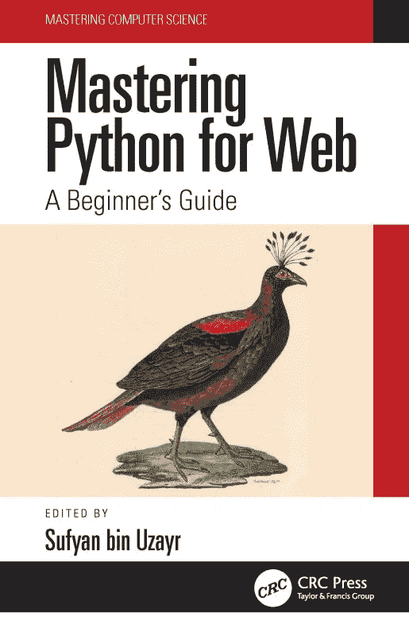
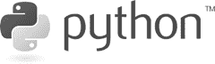
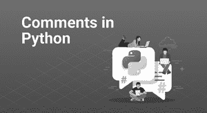
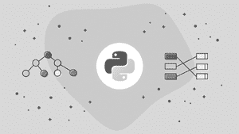
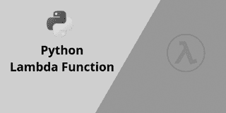
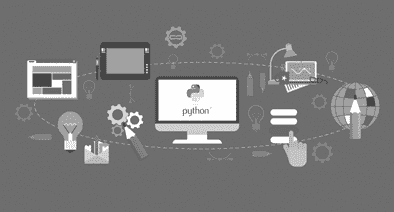
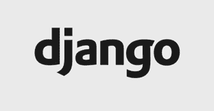
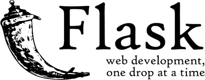
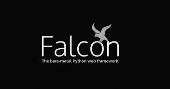

# Web 开发 Python 精通：初学者指南（计算机科学大师）





**系列编辑：** Sufyan bin Uzayr


***“精通计算机科学”系列书籍由 Sufyan bin Uzayr 领导的 Zeba Academy 团队编写。***

***Zeba Academy 是一家教育科技创业企业，主要为 STEM 领域的学习者开发课程和内容，并为全球大学和机构提供教育咨询。更多信息，请访问 [`zeba.academy`](https://zeba.academy)***


# 关于编辑

**Sufyan bin Uzayr** 是一位作家、编码员和企业家，在行业拥有十多年的经验。他过去编写过几本书，涵盖了从历史到计算机/IT 的多样化主题。

Sufyan 是 Parakozm 的董事，这是一家专注于教育科技解决方案的跨国 IT 公司。他还经营着 Zeba Academy，这是一个专注于 STEM 领域的在线学习与教学平台。

Sufyan 精通多种技术，如 JavaScript、Dart、WordPress、Drupal、Linux 和 Python。他拥有有多个学位，包括管理、IT、文学和政治科学学位。

Sufyan 是一个数字游民，在四个国家之间生活。他曾在全球各地的大学和教育机构生活和教学。Sufyan 对技术、政治、文学、历史和体育有着浓厚的兴趣，在空闲时间，他喜欢教青少年编程和英语。

在 [sufyanism.com](http://sufyanism.com) 了解更多。

# 第 1 章：Python 简介

DOI: [10.1201/9781003229896-1](https://doi.org/10.1201/9781003229896-1)

## 本章内容
* ➢ 介绍 Python 编程语言
* ➢ 深入了解 Python 的诞生
* ➢ 说明如何安装和配置

Python 是一种通语言的软件语言。简单来说，Python 通常用于：
* 编写脚本
* 处理大数据
* 执行数学计算
* 连接数据库系统
* 读取和修改文件
* 在服务器上创建应用程序
* 快速原型开发
* 生产级软件
* 后端 Web 和移动应用开发

然而，Python 最典型的用例是作为脚本语言。在创建脚本时，Python 不被视为 Shell 脚本或批处理文件的替代品，而是用于自动化网络浏览器或应用程序用户界面（GUI）的交互。因此，通过 Python，你可以创建命令行和跨平台 GUI 应用程序，并将它们部署为自包含的可执行文件。



复杂的数据分析已成为 IT 领域最蓬勃领域之一，大多数用于机器学习的流行软件和数据科学库都有 Python 接口，使其成为最流行的高级命令行界面和数值算法。Python 的第三方 Web 框架提供了快速方便的方法，可以创建从简单的代码行到功能完备的数据驱动网站的一切内容。Python 的最新版本对操作有强大的支持，使网站能够每秒处理数万次请求。Python 还作为一个高效的代码生成器，使得编写在其他语言中难以实现的操纵函数的应用程序成为可能。这种编码通常被称为“胶水语言”，意味着它可以让不同的代码再次变得相互操作。因此，如果你有想要连接的应用程序或程序领域，可以使用 Python 完成此任务。

### Python 2 与 Python 3

Python 有两个不同的版本：Python 2 和 Python 3。Python 2 是旧分支，自 2020 年 1 月 1 日起不再受创建者 Python 软件基金的支持。Python 3 是该语言的当前和未来版本，包含了许多 Python 2 没有包含的功能，例如新的并发控制和更好的解释器。两者之间曾存在很多竞争，但由于版本 3 包含了重要的功能，它赢得了所有的 Python 粉丝。Python 3 的一些变化包括：
* 文本与数据代替 Unicode 与 8 位。
* Print 现在是一个函数。
* 视图和迭代器代替列表。
* 排序比较规则规则被简化。因此，异构列表无法排序，因为列表中的所有元素必须是可比较的。


最初，由于缺乏第三方库的支持，Python 3 的采用速度一度放慢了。因为大多数 Python 库仅支持 Python 2，导致向版本 3 的迁移变得非常耗时。但在过去的几年里，兼容 Python 2 和 Python 3 的库数量一直在不断增加。今天，Python 3 是新项目最佳、最新的选择。

由于 Python 的简单性，Dropbox、Google、Mozilla、Hewlett-Packard、IBM 和 Cisco 等顶尖技术机构已将 Python 用于开发、脚本、生成和软件测试等各种用途。它还启发了许多其他编程语言，如 Ruby、Cobra、Boo、CoffeeScript、ECMAScript、Groovy、Swift、Go、OCaml 和 Julia。

Python 的成功在于强大的标准库，以及来自第三方开发者提供的、丰富且易于获取且易使用的库。Python 的标准库为常见的编程任务提供了模块，如数学、字符串处理、文件和目录访问、网络、异步操作、线程和多进程管理。此外，它还包含了管理常见编程任务的模块，例如读写结构化文件格式、处理压缩文件以及操作网络协议。默认的 Python 发行版还通过 `Tkinter` 提供了跨平台 GUI 库，并提供了对 `SQLite 3` 数据库的嵌入访问。通过 Python Package Index 可以获取数千个第三方库。例如：

* `BeautifulSoup` 库提供了一个提取 HTML 的全能工具箱。
* 像 `Flask` 和 `Django` 这样的框架允许快速开发 Web 服务。
* 可以通过 Python 模型使用 `Apache Libcloud` 管理多个云服务。
* `Pandas`、`NumPy` 和 `Matplotlib` 加速了数学和统计操作，并能创建数据可视化。

尽管如此，也值得注意 Python 不擅长的任务。首先，Python 是一门高级语言语言，因此它不是系统级编程的最佳选择——设备驱动程序或操作系统内核是不可行的。它对于需要跨平台独立二进制文件的情况也不理想。而且，由于该语言中的所有内容（包括函数和模块本身）都被视为对象处理，代码的是以速度为代价的。因此，当速度是应用程序各个方面的绝对首要任务时，它不是最佳选择。在这种情况下，建议选择 C/C++ 或语言。

像 C#、Java 和 Go 一样，Python 拥有垃圾回收内存管理，这意味着不需要编写代码来跟踪对象。垃圾回收在后台自动发生，并可能引发性能问题，因此建议手动管理或完全禁用它以增强性能。

另一个折协是 Python 对显著空白的使用。由于语法上的空白可能会让人皱眉，一些开发者选择不接触 Python。另一个潜在的望而却步的因素可能是 Python 处理变量类型的方式。默认情况下，Python 使用动态类型或“鸭子”类型，这在大型代码库中可能会产生问题。

尽管如此，人们仍然欣赏、接受并单纯地热爱使用 Python。而且，这有许多原因：

* **初创公司热爱 Python**：初创公司在构建网站、移动端应用程序或软件程序时，需要灵活且可靠的编程工具。此时主要的两个首要任务包括财务效率和领先于计划的能力。由于 Python 能够实现这两个目标，它是初创公司领域备受青睐的编程语言。

  Python 的效率和易用性缩短了开发时间，并简化了 QA 和调试流程，承诺了更高的投资回报。对于想要加入初创社区、获得第一份工作并开始积累行业经验的人来说，了解 Python 管理的基础知识将使你作为潜在候选人更具吸引力。

* **学习 Python 不需要很长时间**：对于像 Python 这样强大且多功能的语言，学习 Python 并不需要多年或完成几个学位。大多数行业专业人士通过各种在线课程（包括 Python 语法、关键字和数据类型）获取了 Python 基础，这些课程平均仅需 6–8 周。而且，如果你有之前的编程语言经验，你可能学得比这更快。

* **你可以免费学习 Python 基础**：Python 背后的组织 `Python Software Foundation` 在其官方网站上托管了一份免费的 Python 教程：[`https://www.python.org/about/gettingstarted/`](https://www.python.org)。这份免费资源为初学者提供了一详尽的 Python 教程，以及专门为无编程经验的用户定制的材料，以及针对 Python 编程经验有限的初者的指南。

  同时，如果你需要更详细的 Python 速成课程，可以在网上搜索。如前提到的，有像 [`https://www.learnpython.org/`](https://www.learnpython.org) 和 [`https://docs.python-guide.org/`](https://docs.python-guide.org) 这样的网站拥有额外的教程。大多数在线平台都让你轻松地学习编程基础，并让你免费开始。你只需要注册即可。

* **Python 有支持性的用户社区**：

  Python 是一门开源编码语言，这意味着任何人都可以对 Python 语言进行修改或创建。开源意味着它是免费的，并允许库、框架和扩展工具的形成，这些工具帮助 Python 语言随时间推移保持适应性和兼容性。可以说，Python 至今的成功是因为存在这样一个投入该语言的、支持性的用户社区。

  此外，`Python Software Foundation` 在其网站上有一个专门的社区页面，链接到几个社区小组和论坛。Python 编程语言的用户定期在所谓的 Python 用户小组（Python User Groups）中会面，分享他们如何使用该语言并学习新技术。会议通常每月一次；它们非常非正式并对所有人开放。根据目前的统计，全球有约 1,637 个 Python 用户小组分布在几乎 191 个城市、37 个国家，拥有超过 860,333 名成员。你也可以通过这个链接找到当地的 Python 社区：[`https://wiki.python.org/moin/LocalUserGroups`](https://wiki.python.org)。

  `Python Software Foundation` 是一个非营利组织，为社区项目的实施提供资助计划。它每年处理超过 300 个请求。因此，在 2019 年，资助计划为全球的倡议提供了 324,500 美元的支持。

* **Python 非常流行**：编程语言是否流行很重要。这很重要，因为如果你投入金钱和时间去学习一门不够被广泛使用且无法帮助你求职野心的语言，那是错误的。

  根据*经济学人*（The Economist），Python 是 2018 年世界上最流行的编码语言。Fortran 和 Lisp 等语言已大幅下降，而 C 和 C++ 等语言保持稳定。该文章预测这种 Python 盛行的趋势将在很长一段时间内保持不变。


# Python 特性

- **Python 是多功能的：** 具有通用性意味着 `Python` 语言可以用于构建不同软件解决方案的部分，这就是为什么像 `Google` 和 `Facebook` 这样的大型科技公司选择使用 `Python` 来进行项目开发。此外，`Python` 代码还可以用于构建基础程序，作为一名开发者，你可以拥有极其广泛的工作选择。无论你是想为科技巨头工作、构建自己的软件程序，还是作为自由 Web 开发者工作，掌握 `Python` 编程被认为是一项可以让这些任何计划成为可能的优势。

- **Python 确保了你的项目前后端协作得更佳：** 如果你想在开发领域拥有出色的职业生涯，那么了解这一点将很有用：你的目标可能是同步和平衡前端，以及后端由数据库和驱动网站应用前端的 Web 服务器组成。

当我们把 `Python` 称为“胶水语言”时，我们的意思是它被用于编写后端脚本，让你的数字产品的前后端能够和谐地工作。因此，如果你希望在你的前端开发者的技能树中增加服务端或后端技能，学习 `Python` 可能是一个完美的起点。

- **Python 是可定制的：** 如果你需要一种可定制的编程语言，那么 `Python` 必须是一个完美的选择。就像 `JavaScript` 一样，`Python` 并不缺少库和框架来塑造和交付你特定的编码需求。

流行的 `Python` 全功能服务端 Web 框架如 `Django` 的创建是为了让 `Python` 在调整 Web 应用方面更加实用，而 `PyQt` 是一个允许 `Python` 构建 GUI 用户界面的框架，它包括使用屏幕图标和图形来操作用户命令。

- **Python 是流程自动化的强大工具：** 科技工作中至关但枯燥的部分是管理所有重复的、耗时的技术相关流程。像复制文件、拖动文件夹和重命名文件、管理资产到服务器等无聊任务——所有这些积累起来都会消耗大量宝贵的时间。在这种情况下，通过 `Python` 实现的自动化可能是你的救星。`Python` 编写系统脚本的能力让你能够创建简单的 `Python` 程序来自动化那些消耗你大量生产力的日常任务。通过 `Python` 重新调整你的流程所节省的时间，是学习这种语言的一个极具吸引力的方面。

- **Python 为你提供了科技领域任何地方工作的工具：** 学习 `Python` 代码不仅能确保你在互联网开发方面的潜在专业——它还能为你各种未来的科技工作做好准备。`Python` 的用途不仅限于传统的 Web 开发。事实上，`Python` 是数据分析、人工智能、机器学习和数据科学等热门新兴科学领域的的顶尖语言。因此，了解这种语言将帮助你保持开放的选择，如果你决定精通 `Python`，你可能会获得更多科技相关的机会。

## Python 简史

`Python` 是一种通用的、高级编程语言，最初由 `Guido van Rossum` 于 1991 年设计，并由 `Python Software Foundation` 开发。它的主要开发目的是提高代码的可读性，其语法允许程序员用更短的代码来表达概念。

对 `Python` 的官方工作始于 20 世纪 80 年代后期。不久后，`Guido van Rossum` 于 1989 年 12 月在荷兰的数学与信息中心（`CWI`）开始基于应用程序进行试用。最初，`Python` 项目是作为一个爱好开始的，因为他正在寻找一些有趣的工作来打发圣诞节的时光。`Python` 编程语言基于 `ABC 编程语言`，该语言与基于微内核的 `Amoeba 操作系统` 具有接口，后者将单板计算机集合变成了一个透明的分布式系统。`Van Rossum` 在职业生涯早期就帮助创建了 `ABC` 并发现了一些问题。因此，他提取了 `ABC` 的语法及其一些最佳特性，并修复了其他未解决的属性。就这样，通过完全修正这些问题，他创建了一种新的脚本语言。


该语言于 1991 年发布。在发布时，它使用了许多代码并具有独特的设计方法。它的主要目标是提供代码可读性并提高开发者的整体生产力。

但“Python”这个名字是怎么来的？大多数人认为，由于 Logo 描了两条蛇，名字的起源灵感一定来自真实的蟒蛇。惊讶的是，事实并非如此。`Python` 的创始人 `Guido van Rossum` 在 1996 年写道他编程语言名称的来源，它源于英式幽默，而不是任何东西。

### Python 之禅 (The Zen of Python)

此外，在 2004 年，Python 社区提出了 Python 的指导原则，并称之为“Python 之禅”：

- 美好优于丑陋。
- 显式优于隐含。
- 简单优于复杂。
- 复杂优于晦涩。
- 平坦优于嵌套。
- 稀疏优于稠密。
- 可读性很重要。
- 特殊情况并不特殊到可以打破规则。
- 虽然实用性胜过纯洁。
- 错误永远不应该静地通过。
- 除非显式忽略。
- 面对歧义时，拒绝猜测的诱惑。
- 执行某事应该有一种——最好只有一种明显的方法。
- 虽然除非你是荷兰人，否则那种方法可能并不明显。
- 现在比永远好。
- 虽然“永远”往往比“现在”更好。
- 如果实现难以解释，那就是一个坏主意。
- 如果实现易解释，它可能是一个好主意。

## 现代时代与增长

在发布后的多年里，Python 的表现并不理想。`ASP.NET`、`Java` 和 `PHP` 这样可靠的解决方案主导了企业市场。直到 2000 年代，`Python` 才真正开始爆发，当时许多初创公司开始使用 `Python` 进行项目。许多低预算企业也因为其易用性、快速开发以及显然低廉的托管成本而优先考虑 `Python`。

当 `Dropbox` 进入市场时，Python 达到了人气的巅峰。据故事说，一位名叫 `Drew Houston` 的 MIT 学生某天上课时忘记带了 USB 闪盘。他后来开始思考一种更好的文件共享解决方案。Houston 在 2007 年创立了一家名为 `Evenflow` 的公司，当时只有一个产品，名为 `Dropbox`。`Dropbox` 软件第一次让人们能够在计算机上创建一个文件夹，该文件夹会自动上传到云服务，并自动同步到用户安装了 `Dropbox` 的所有设备上。该公司在 2009 年 4 月达到了百万用户量。到 2009 年底，他们拥有 300 万用户。`Dropbox` 是用 `Python` 编写的。


Dropbox 很快成为 Python 成功应用的典范。有趣的一点是，Dropbox 最初初是用 Python 2 编写的。2013 年，当 Guido van Rossum 加入 Dropbox 时，他主要负责将软件转换为新的 Python 3。他一直为 Dropbox 工作直到退休。在看到 Python 在 Dropbox 中规模扩展得如此出色后，许多其他企业也开始考虑将其应用于自己的业务。

20 世纪 20 年代后期社交媒体爆发的时代。随着其影响力的增长，需要管理的数据量也随之增加。与此同时，Python 迅速成为访问这些数据的首选语言，特别是在科技和初创企业领域。2008 年金融危机期间，自动化接管了金融界。金融机构需要处理大数据，并开始通过分析数据来发现模式、做出决策并管理经济流程。企业拥有大量数据，但缺乏简单明了的方法访问它们。这时，他们开始使用 Python 对金融数据进行定量分析。其他如 `NumPy`、`scikit` 和 `Matplotlib` 等包具有相对较厚的开发背景，Python 很快成为数据科学的首选。

让 Python 成为数据科学首选语言的另一个驱动力是训练营（boot camps）。随着 Web 开发的爆发，训练营也随之激增。学习这门语言始终是免费的。因此，许多此类训练营计划中教的第一门语言就是 Python。世界各地的高中和大学开始将编程作为核心技能进行教学，其中很大一部分是基于 Python 的。

如今，如果你想成为一名全栈开发者，通常需要从前端和后端软件的基础开始。许多教学计划已经建立了从 `JavaScript` 到 `Python` 的过渡，使得初学者能够平畅学习，尽管这些语言是不同的。因此，如果某天你成为了一名从事 `JavaScript` 并与应用程序接口（API）交互的前端开发者，你可能会发现为这些应用程序创建后端非常枯燥，直到你尝试了 Python。它的框架（如 `Flask` 和 `Django`）为想要构建更多后端软件并创建强大的 API 以进行良好协调的开发者提供了简单的解决方案。

# 安装和配置 Python


任何 Python 的速成课程都可能从在计算机上安装或更新 Python 开始。有多种安装方法：你可以从 [Python.org](http://Python.org) 下载官方 Python 发版，从包管理器安装，甚至安装用于科学计算的专用发行版。

如果你正在自学如何操作 Python，最好的选择是从 [Python.org](http://Python.org) 开始。该平台代表了官方发行版，这类来源通常是学习 Python 编程最安全的选择。

在该平台上，你可以轻松地访问各种实用的教程和各类学习材料：

* 如何检查我们的设备上安装了哪个版本的 Python。
* 如何在 Windows、macOS 和 Linux 上安装和更新 Python。
* 如何在手机或平板电脑等移动设备上使用 Python。
* 如何通过在线解释器在网页上使用 Python。

在我们继续介绍这些每一点之前，熟悉 `CPython` 源码树中的几个顶层目录是非常重要的，这些目录可以帮助你找到某些功能实现所在的位置。

* `Doc`：官方文档。这是 [`docs.python.org/`](https://docs.python.org) 使用使用的内容。
* `Grammar`：包含 Python 的 EBNF 语法文件。
* `Include`：包含所有解释器范围的头文件。
* `Lib`：用纯 Python 实现的标准库部分。
* `Mac`：Mac 特有的代码（例如使用 `IDLE` 作为 OS X 应用程序）。
* `Misc`：不属于其他地方的内容。通常，这些是各种针对开发者的文档。
* `Modules`：用 C 语言实现的标准库部分（加上其他代码）。
* `Objects`：所有内置类型的代码。
* `PC`：Windows 特有的代码。
* `PC build`：用于当前在 [python.org](http://python.org) 提供的 Windows 安装程序的 MSVC 版本的构建文件。
* `Parser`：与解析器相关的代码。AST 节点的定义也保存在此处。
* `Programs`：C 可执行文件的源代码，包括 CPython 解释器主函数（在 Python 3.5 之前的版本中，这些文件位于 Modules 目录中）。
* `Python`：构成核心 CPython 运行时的代码。这包括编译器、求值循环和各种内置模块。
* `Tools`：用于（或曾用于）维护 Python 的各种工具。

## 在 Windows 上安装 Python

与其他许多 Unix 系统和服务不同，Windows 并不包含系统支持的 Python 安装。为了让 Python 可用，CPython 团队多年来每个版本都提供了 Windows 安装程序。这些安装程序的主要创建目的是添加每个用户用户的 Python 安装，包括核心解释器和库。

截至目前，Windows 上有三种安装方法：

1. Microsoft Store
2. 完整安装程序
3. Linux 的 Windows 子系统 (WSL)

如果你想检查 Windows 上是否已安装 Python，你需要首先打开一个命令行应用程序，例如 `PowerShell`。你可以按照以下三个简单步骤操作：

1. 按 Win 键
2. 输入 `PowerShell`
3. 按回车

或者，你可以右键点击开始按钮并选择 `Windows PowerShell` 或 `Windows PowerShell (管理员)`。人们也可以使用 `cmd.exe` 或 `Windows Terminal`（微软为 Windows 10 开发的多标签页命令行，后来完全取代了 Windows 控制台）。打开命令行后，输入以下命令并按回车：

```
无论哪种情况，如果你看到的版本低于 3.9.2（这是写作时的最新版本），那么你可能想要升级你的安装。如果你的系统上没有版本的 Python，那么上述两个命令都程序化为启动 Microsoft Store 并让你重定向到 Python 应用程序页面。

```

如果你不知道安装的确切位置，可以通过 `cmd.exe` 或 `PowerShell` 中的 `where.exe` 命令查找到：

如前所述，在 Windows 上安装官方 Python 发版有三种省去烦恼的方法：

1. **Microsoft Store 程序包**：通过 Microsoft Store 应用在 Windows 上最简单的安装方法。这种方法主要建议寻求简单设置体验的 Python 初学者使用。
2. **完整安装程序**：此选项涉及从 [Python.org](http://Python.org) 官方网站直接下载 Python。这推荐给安装过程中需要更多功能和控制的中级和高级开发者。
3. **Linux 的 Windows 子系统 (WSL)**：WSL 可以让你直接在 Windows 中运行 Linux 环境。你可以通过阅读《Windows 10 的 Linux 子系统安装指南》来学习如何启用和管理 WSL。


你也可以使用替代平台在 Windows 上完成安装，例如 [Anaconda ([`www.anaconda.com/​`](https://www.anaconda.com))，这是一个用于 Python 科学计算和数据科学的极佳交互网站。通过访问该网站，你可以通过 `Setting Up Python for Machine Learning on Windows` 学习如何在 Windows 上安装 Anaconda。

在本章中，我们仅关注前两种安装选项，因为它们是 Windows 社区中最方便、最受欢迎的安装方法。

Windows 的两个官方 Python 安装程序大相同。Microsoft Store（微软商店）包具有特定的局限性。Python 官方文档关于 Microsoft 商店包给出了以下说明——即它“主要用于交互式使用”。这意味着 Microsoft 商店包是专为学生和首次学习使用 Python 的人员设计的。由于这种方法主要针对 Python 初学者，因此 Microsoft 商店包被认为不适合专业开发环境。此外，它没有对 `TEMP` 或注册表等共享位置的完全写入权限，这对于专家级开发者来说可能是一个致命的缺陷。

但如果你是 Python 新手，并且目前专注于学习语言基础知识而不是构建专业软件，那么你应该直接从 Microsoft 商店包进行安装。它将提供最快捷、最简单且麻烦最少的入门方式。另一方面，如果你是希望在 Windows 环境下开发专业软件的经验丰富的开发者，那么官方的 [Python.org](http://Python.org) 安装程序将是你的答案。在这种情况下，你的安装和配置将不受 Microsoft 商店策略的限制，并且你可以控制执行过程并在必要时将 Python 添加到 `PATH`。

## 如何从 Microsoft Store 安装

如所述，如果你是 Python 的绝对新手并想要快速上手，那么 Microsoft 商店包是让你熟悉 Python 潜力的最佳选择。简单来说，你只需一步即可从 Microsoft 商店安装它。

*   **步骤 1：在 Microsoft Store 中打开 Python 页面。** 打开 Microsoft Store 应用程序并搜索 Python。在这里，你可能会看到多个可选安装的版本。请确保选择 `Python 3.9.2` 或应用程序商店中找到的最高版本号，以打开安装页面。另一需要注意的是，你必须关注应用程序的开发者。你想要安装的官方 Python 应用应该是由 Python Software Foundation（Python 软件基金会）创建的。官方 Microsoft 商店包始终是免费的，所以如果应用程序收费，那么它就不是原版。或者，你可以打开 `PowerShell` 并输入以下命令：

```bash
python
```

如果你的系统中尚未安装 Python 版本，当你按下回车键时，Microsoft Store 将自动引导你到商店中最新的 Python 版本。一旦选择了要安装的版本，请按照以下简单步骤完成安装：

1.  点击 `Get（获取）。
2.  等待应用程序开始下载。下载完成后，你看到的将不是 `Get` 按钮，而是显示 `Install on my devices（安装到我的设备上）的不同按钮。
3.  点击 `Install on my devices` 并选择你想要完成安装的设备。
4.  点击 `Install Now（立即安装）然后点击 `OK` 开始安装。
5.  安装成功完成后，你将在顶部看到消息：“This product is installed.”此产品已安装）。

## 如何从完整安装程序安装

对于专业开发者来说，完整安装程序让你对安装拥有完全控制权。你可以使用对话框中的可用选项自定义安装以满足你的需求。

*   **步骤 1：下载安装程序**
    你需要访问 [Python.org](http://Python.org) 下载页面。在 `Latest` 按钮下，选择最新版本。

*   **步骤 2：运行安装程序**
    下载完成后，双击运行它。将出现类似下方的对话框：

1.  `Customize installation：自定义安装`：这通常用于选择安装哪些功能。
    2.  `Install for all users：为所有用户安装`：这意味着机器上的每个用户都将拥有 `py.exe` 启动器。
    3.  `Add Python 3.9 to PATH：将 Python 3.9 添加到 PATH`：此复选框默认未勾选。不将 Python 添加到 `PATH` 可能会有缺点，请在勾选此框之前确保你理解其影响。

点击 `Install Now：立即安装`。


官方安装程序和 Homebrew 包管理器都是非常好用的工具，但 Python 软件基金会（Python Software Foundation）仅支持官方安装程序。由于通过官方安装程序和 Homebrew 包管理器安装的发行版本并不相似，因此从 Homebrew 安装会有一些局限性。

Homebrew 上的 macOS Python 分发版不包含标准 Python 接口 `Tkinter` 模块所需的 Tcl/Tk 依赖项。`Tkinter` 是 Python 中开发 GUI 的标准库模块，也是 Tk GUI 工具包的接口。由于 Homebrew 不会安装 Tk GUI 工具包依赖项，它仍然依赖于系统中已安装的现有版本。系统的 Tcl/Tk 版本可能已经过时，最终可能会阻止你导入 `Tkinter` 模块。

Homebrew 包管理器是一种非常流行的方法，因为 Homebrew 是一个命令行工具，可以通过基本脚本进行自动化处理。此外，许多人倾向于在 macOS 上安装 Python，因为它易于从命令行进行管理，且不需要访问网站即可轻松升级。与此同时，Homebrew 提供的 Python 分发版不受 Python 软件基金会的支持，因此并非完全可靠。在 macOS 上最安全的方法仍然是使用官方安装程序，特别是如果你需要使用 `Tkinter` 进行 Python GUI 编程时。

### 如何从官方安装程序安装

如前所述，从官方安装程序安装 Python 是 macOS 上最可靠的安装方法。它提供了开发 Python 应用所需的所有系统依赖项。你可以通过两个简单的步骤从官方安装程序进行安装。

#### 步骤 1：按照以下步骤下载官方安装程序：

1. 打开浏览器并导航到 [Python.org](http://Python.org) 的 macOS 下载页面。
2. 在“Python Releases for Mac OS X”标题下，点击 `Latest Python 3 Release`。截至目前，最新版本是 Python 3.9.2。
3. 滚动到底部并点击 `macOS 64-bit installer` 开始下载。

#### 步骤 2：双击下载的文件运行安装程序。你应该看到以下窗口：

1. 一直按下 `Continue` 直到提示你同意软件许可协议。然后点击 `Agree`。
2. 随后你将看到一个窗口，告知你安装位置并询问想要占用多少空间。你可能不需要更改默认位置，因此点击 `Install` 继续并开始安装。
3. 当安装程序完成文件复制后，点击 `Close` 关闭安装程序窗口。

### 如何从 Homebrew 安装

对于需要从命令行安装、且不需要使用 `Tkinter` 模块开发 GUI 的用户，Homebrew 包管理器是一个完美的选择。你可以通过两个步骤从 Homebrew 包管理器安装。

#### 步骤 1：按照此程序安装 Homebrew（如果你已经安装了 Homebrew，可以跳过此步骤）：

1. 打开浏览器并访问 [`brew.sh/`](http://brew.sh)
2. 你应该会在页面顶部“Install Homebrew”标题下方看到安装 Homebrew 的命令。
3. 用光标选中此命令并按 `Cmd+C` 将其拷贝到剪贴板。
4. 打开终端窗口并粘贴命令，然后按 `Enter`。这样你就启动了 Homebrew 的安装。
5. 在提示时输入你的 macOS 用户密码。

可能需要几分钟时间来下载 Homebrew 所需的所有文件，完成后，你将回到终端窗口的 shell 提示符处。如果你是第一次在 macOS 上执行此操作，可能会弹出一个警告框，要求你安装 Apple 的命令行开发者工具。这些工具是安装的前决条件，因此你需要点击 `Install` 确认对话框。开发者工具安装后，你应该按 `Enter` 继续安装 Homebrew。一旦 Homebrew 安装完成，你就可以准备好安装 Python 了。

#### 步骤 2：按照以下步骤安装 Python：

1. 打开终端应用程序。
2. 输入以下命令升级 Homebrew：
```bash
brew update && brew upgrade
```
这将在你的电脑上下载并设置最新版本的 Python。你可以通过终端进行测试，以确保一切运行正常：

1. 打开终端。
2. 输入 `pip3` 并按 `Enter`。
3. 你应该能看到来自 Python `pip` 包管理器的文本。如果你在运行 `pip3` 时遇到错误信息，应该重新执行安装步骤，确保你没有漏掉任何步骤。

## 如何在 LINUX 上安装 Python

在本节中，你将学习 Linux 上的 Python 安装方法，并希望你能够独立完成。通常情况下，许多 Linux 发行版已经预装了 Python，但可能不是最新版本，甚至可能是 Python 2 而不是 Python 3。你需要自行检查版本以确保无误。要找出你拥有哪个版本的 Python，请打开终端窗口并尝试以下命令：

如果你的电脑上已经安装了 Python，那么其中一个或多个命令应该会显示版本号。通常，在 Linux 上有两种方便且相对快速的方法安装官方 Python 发行版：

1. **从包管理器安装：** 这是大多数 Linux 发行版上流行的安装方法。它需要从命令行运行一条命令。
2. **从源码构建：** 这种方法比使用包管理器更复杂。它涉及从命令行运行一系列命令，同时确保你已安装了正确的依赖项以完成 Python 源码编译。

遗憾的是，并不是每个 Linux 发行版都有包管理器，也不是每个包管理器都包含 Python。根据你的操作系统，从源码构建 Python 可能是你的唯一选择。你将使用哪种安装方法主要取决于你的 Linux OS 是否有包管理器，以及你是否想控制安装细节。

直到为止，在 Linux 上安装 Python 最流行的方法是使用操作系统的包管理器。这被许多专家开发者认为是默认选择。然而，取决于你使用的 Linux 发行版，Python 可能无法通过包管理器获取。在这种情况下，你将从源码构建 Python。

有三个可能限制你选择从源码构建 Python 的主要原因：

1. 你无法从操作系统的包管理器下载 Python。
2. 如果你可能需要降低嵌入式系统上的内存占用，你将希望控制 Python 的编译方式。
3. 你希望在最新最先进版本发布之前对其进行测试版和发布候选版本的测试。

要在你的 Linux 机器上完成安装，请在下方找到你的 Linux 发行版并按照提供的步骤操作。

### 如何在 Ubuntu 和 Linux Mint 上安装

取决于你所使用的 Ubuntu 发行版版本，在系统中配置 Python 的过程会有所不同。你可以通过以下命令确定本地 Ubuntu 版本：

根据控制台输出中 Release 标题下的版本号遵循相应的指南：

* **Ubuntu 18.04, Ubuntu 20.04 及以上：** Ubuntu 18.04 及以上版本默认没有 Python 3.9，但在 Universe 仓库中可用。要安装 3.9 版本，你需要打开终端应用程序并输入以下命令：

```bash
sudo apt-get update
sudo apt-get install python3.9 python3-pip
```


安装完成后，你现在可以使用 `python3.9` 命令运行 Python 3.9，并使用 `pip3` 命令运行 `pip`。

- **Linux Mint 和 Ubuntu 17 及以下版本：** Python 3.9 不在 Universe 仓库中，因此你必须从个人包归档 (PPA) 获取。例如，要从“deadsnakes” PPA 安装，请使用以下命令：
    ```bash
$ sudo add-apt-repository PPA:deadsnakes/PPA
$ sudo apt-get update
$ sudo apt-get install python3.9 python3-pip
```

### 如何在 Debian Linux 上安装

在 `Debian` 上安装 Python 3.9 之前，你必须先安装 `sudo` 命令。为了实现这一点，你应该在终端中执行以下命令：

紧接着，尝试使用 `sudo vim` 命令或你喜欢的文本编辑器打开 `/etc/sudoers` 文件。在文件的末尾添加以下行文本，将 `your_username` 替换为你的实际用户名：`your_username ALL=(ALL) ALL`

完成后，你可以直接跳过直到到达 `如何从源码编译 Python` 章节以完成 Python 的安装。

### 如何在 openSUSE 上安装

从源码编译是在 `openSUSE` 上设置 Python 最可靠的方法。为此，你需要安装开发工具，这可以通过 `YaST` 操作系统设置中的菜单完成，也可以通过使用命令行包管理器 `Zipper` 来完成：

由于需要安装超过 150 个包，这被认为是一项正常操作，可能需要一些时间才能完成。但一旦完成，可以放地跳到 `如何从源码编译 Python` 章节。

### 如何在 CentOS 和 Fedora 上安装

遗憾的是，Python 3.9 不在 `CentOS` 和 `Fedora` 仓库中，因此你需要从源码编译 Python。不过，在安装 Python 之前，你需要确保你的系统已经做好了准备。首先，通过以下代码更新 `yum` 包管理器：
```bash
$ sudo yum -y update
```

一旦 `yum` 完成更新，你可以使用以下命令行自由地安装必要的构建依赖：

一旦你看到所有安装已完成，你就可以跳到 `如何从源码编译 Python` 章节。

### 如何在 Arch Linux 上安装

`Arch Linux` 因遵循 KISS 原则（保持简单，愚蠢如此）而闻名，并主要关注现代化和实用性。尽管如此，`Arch Linux` 在跟踪 Python 发布方面非常勤奋。你很可能已经默认安装了最新版本。如果没有，你可以使用以下命令更新 Python：`$ packman -S python`。一旦更新完成，你就可以准备开始编写脚本了。

## 如何从源码编译 Python

当你的 Linux 发行版没有最新版本的 Python，或者当你只是想自己能够编译最新、最快的版本时，你可以采取以下步骤从源码编译 Python：

#### 第 1 步：下载源代码

首先，你需要通过 [Python.org](http://Python.org) 获取 Python 源代码。你只需要进入下载页面，并查找顶部的 Python 3 最新源码即可。请确保你搜索的是 Python 3 而不是 Python 2。

当你选择 Python 3 版本时，你可以在页面底部看到“Files（文件）”部分。选择 `Gzipped source tarball` 并将其下载到你的机器。如果你更倾向于命令行方法，可以使用 `Wget` 程序，该程序从 Web 服务器检索内容并将文件下载到当前目录：

当 tar 包 下载完成后，你将需要处理其他事情来为构建 Python 准备系统。

#### 第 2 步：准备你的系统

从头构建 Python 涉及几个固定的步骤。这些步骤的目标在所有发行版中都是相同的，但如果你的发行版没有使用 `apt-get`，你可能需要将其转换为适用于你发行版的命令：

1. 首先，确保你已经更新了包管理器并升级了你的包：

2. 接下来，你需要安装所有的构建需求：

如果你的系统中已经安装了某些需求，这不会产生任何问题，因为你可以执行上述命令，任何现有的包都不会被覆盖。

#### 第 3 步：构建 Python

1. 一旦你拥有了所有的前提条件和带归档文件 (TAR)，你就可以开始将源码解压到目录。请注意，以下命令将在你所在的目录下创建一个名为 `Python-3.9.1` 的新目录：

2. 现在，你需要运行 `./configure` 工具来准备构建：
```bash
$ ./configure –enable-optimizations –with-ensurepip=install
```

`enable-optimizations` 标志将启用 Python 内部的一些优化，使其运行速度快约 10%。这样做可能会为编译时间增加二三十十分钟。

3. 接下来，你使用 `-j` 选项构建 Python，该选项简单地告诉 `make` 将构建拆分为并行步骤以加速编译。即使是并行构建，这一步也可能需要几分钟：
```bash
$ make -j 8
```

4. 最后，你将想要安装你的新版本 Python。你在这里可以使用 `altinstall` 选项来避免覆盖系统 Python。由于你正在安装到 `/usr/bin`，你需要以 root 身份运行：
```bash
$ sudo make altinstall
```

安装可能需要一些时间，但一旦完成，建议验证 Python 是否正确。

#### 第 4 步：验证安装

你可以测试 `python3.9 –version` 命令是否返回版本：

在你想运行额外测试的情况下，你也可以选择测试套件以确保在系统上正常运行。要运行测试套件，你只需要输入：

你不需要急于这一部分，因为你的电脑将运行一段时间。如果所有测试通过且没有报错，你就可以确认你的新构建符合预期。

## 如何在 iOS 上安装 Python

适用于 `iOS` 的 Pythonista 软件应用程序是一个可以在你的 iPhone 或 iPad 上运行的完全开发的 Python 环境。它集成了 Python 编辑器、技术文档和解释器。

Pythonista 对于那些不喜欢局限于笔记本电脑并喜欢在移动中完善 Python 技能的人来说是一个极佳的工具。该应用程序自带完整的 Python 3 标准库，还包含了可以离线浏览的文档。要设置 Pythonista，只需从 iOS App Store 下载即可。

## 如何在 Android 上安装 Python

如果你不是 Apple 用户而是 Android 粉丝，并且想在平板电脑或手机上练习 Python，这个问题也得到了解决。可靠支持 Python 3.8 的 Android 应用是 `Pydroid 3`。`Pydroid 3` 具有一个用于读取-评估-打印循环 (REPL)、交互式语言会话以及允许编辑、保存和执行 Python 代码的解释器。此外，它内置了专门用于 `Pydroid 3` 的 C、C++ 甚至 Fortran 编译器。通过 `pip` 构建任何库，也可以从命令行构建并安装依赖。

你可以从 Google Play Store 下载并安装 `Pydroid 3` 的免费版和付费 Premium 版（支持代码预测和代码分析）。


* **[Python.org 在线控制](http://Python.org):** [`www.python.org/shell/`](https://www.python.org)
* **Repl.it:** [`replit.com/`](https://replit.com)
* **Trinket:** [`trinket.io/`](https://trinket.io)
* **Python Anywhere:** [`www.pythonanywhere.com/`](https://www.pythonanywhere.com)

## 重新生成配置

如果对 Python 某些依赖可移植操作系统接口 (POSIX) 特定功能的修改，必须更新 `configure` 脚本以测试其功能。

Python 的 `configure` 脚本是使用 `Autoconf` 工具从 `configure.ac` 生成的，用于生成在计算机系统中构建和打包软件的脚本。不要直接编辑 `configure`，请确保编辑 `configure.ac` 然后运行 `autoreconf` 来重新生成 `configure` 以及其他许多文件。

与其他任何软件一样，在某些情况下，你可能会在 `Parser/asdl_c.py` 或 `Python/makeopcodetargets.py` 等脚本中遇到 Python 错误。由于 Python 会自动生成其部分代码，你需要从头开始完整构建才能运行自动生成脚本。为了解决这个问题，自动生成的文件也被提交到了虚拟存储空间——Git 仓库中。

Python 的使用非常广泛，实际上几乎所有的代码编辑器在第一次编写 Python 代码时都使用过某种形式的支持。如果你正在寻找一些管理 Python 编码的额外工具或特殊指南，你可以在“附加资源”和“开发者指南”中搜索它们：[`devguide.python.org/#resources`](https://devguide.python.org)。在那里，你可以找到关于探索 CPython 内部原理、修改 CPython 语法、CPython 编译器设计、CPython 垃圾回收设计以及基础工具支持选项的卓越材料。`Python.org` 的维护还包括使用 `clang` 进行动态分析，以及 `Misc` 目录中带有配置文件的各种工具。

# 第 2 章 Python 数据类型

DOI: [10.1201/9781003229896-2](https://doi.org/10.1201/9781003229896-2)

## 本章内容

* 介绍主要的 Python 数据类型
* 讲解每种类型的内置方法描述
* 解释如何访问、更新和修改 Python 数据类型

数据分析是目前一个非常重要的领域。大多数公司都希望聘请专业的数据分析师来处理海量数据库并防止任何意外错误的发生。一个优秀的数据分析师应该知道如何使用各种编程工具来管理大量的复杂数据，并从中发现相关信息。简而言之，如果你想在不断发展的 IT 领域寻找一个席位（可能作为数据分析师），你能够开始投资以下领域的技能，以便在职场中获得价值：

* **领域专业知识：** 你需要具备领域专业知识，以便处理大数据并提出与他们工作环境相关的见解。
* **编程技能：** 数据分析师应该具备编程技能，以便知道使用哪些库来清洗数据、挖掘数据并从中获取见解。
* **统计学：** 如果不知道如何使用一些基础统计工具，分析师将无法从数据中推导出完整的含义。
* **可视化技能：** 数据分析师不能将原始数据作为工作结果呈现，他需要出色的数据可视化技能，以便向第三方总结并展示全面的数据。
* **叙述能力：** 最后，分析师需要向利益相关者或客户传达他们的发现。这意味着他们不仅要创建一个数据故事，还要具备叙述它的能力。


数据类型基本上是编程语言用于存储和操作其他数据的内部构造结构。尽管 Python 运行得很好，但在数据分析过程的某个时刻，每个人可能都需要显式地将数据从一种类型转换为另一种。在本章中，我们将讨论基础的 Python 数据类型、它们是如何映射的，以及从一种数据类型转换为另一种类型的选项。简单来说，数据类型是对数据项目的分类或分类。Python 支持以下内置数据类型：

* **标量类型 (Scalar types)**
    * **Int:** 整数代表正或负的整数（没有分数部分）。用于位级编程的位运算仅对整数有意义。二进制位运算的优先级均低于数值运算，但高于比较运算。一元运算 `~` 的优先级与其他一元数值运算（`+` 和 `-`）相同。

此表列出了按优先级升序排列的位运算：

| x \| y | x 和 y 的按位或 |
| :--- | :--- |
| x ^ y | x 和 y 的按位异或 |
| x & y | x 和 y 的按位与 |
| x ≪ n | x 向左移动 n 位 |
| x ≫ n | x 向右移动 n 位 |
| ~x | x 的位取反 |

### 整数类型的额外方法

`int` 类型实现了数字和整数抽象基类。此外，它还提供了更多操作方法：

1. `int.bit_length()`：返回表示整数所需的所需的位数，不包括符号位和前导零。
2. `int.to_bytes(length, byteorder, signed=False)`：返回一个表示整数的字节数组。
3. `int.from_bytes(bytes, byteorder, signed=False)`：返回由给定字节数组表示的整数。
4. `int.as_integer_ratio()`：返回一对整数，其比例值完全等于该整数，且分母为正。整数（全数）的整数比例始终以整数为分子，1 为分母。

* **Float:** 代表具有浮点表示形式的实数，其中分数部分由小数点或科学计数法表示。`float` 类型实现了数字和实数（real）抽象基类。它还有以下额外方法：

1. `float.as_integer_ratio()`：返回一对整数，其比例值完全等于原始浮点数，且分母为正。
2. `float.is_integer()`：如果浮点实例是具有有限的整数值，则返回 True，否则返回 False。
3. `float.hex()`：返回浮点数的十六进制字符串形式的表示。对于有限浮点数，此表示将始终包含开头的 0x 和结尾的 p 以及指数。
4. `float.fromhex(s)`：类方法，返回由十六进制字符串 s 表示的浮点数。字符串 s 可能有前导或尾空格。

* **Complex:** 包含实部和虚部组成的数字，表示为 x + 2y。
* **Bool:** 具有两个内置值 True 或 False 之一的数据。注意 `True` 和 `False` 的首字母是大写的。
* **None:** `None` 代表 Python 中的空对象，或由未显式返回值的函数。
* **序列类型 (Sequence type):** 序列意味着相同或不同数据类型的有序集合。Python 有以下内置序列数据类型：


* **字符串 (String)**：字符串值简单地表示放在单引号、双引号或三引号中的一个或多个字符的集合。
* **列表 (List)**：这里的列表表示一个或多个数据项的有序集合，类型不一定相同，但放在方括号中。
* **元组 (Tuple)**：`Tuple` 对象是一个一个或多个数据项的有序集合，类型不一定相同，放在括号中。

## 映射类型

* **字典 (Dictionary)**：字典 `Dict()` 对象是以键值对形式存储的数据集合。此类键值对必须包含在大括号中。例如：`{1:“Sam,” 2:“Ben, 3:“Roy, 4:“Molly”}`

## 集合类型

* **set**：Python 中的 `set` 与数学中 `set` 的实现相同。`set` 对象具有适当的方法来执行数学集合操作，如并集、交集、差集等。在脚本中，它是一个变的、无序的唯一可哈希对象集合。
* **frozenset**：与普通的 `set` 不同，`frozen` 是集合的不可变版本，其元素从其他数据类型添加。

## 可变与不可变类型

上述数据类型的可变数据对象存储在计算机内存中处理。这些值某些可以在处理过程中被修改，但一旦在内存中创建，其内容就无法更改。数字、字符串和 `Tuples` 是不可变的，这意味着它们的内容在创建后无法更改。

## 迭代器类型

Python 支持对容器进行迭代的概念，并使用容器用户定义的类来支持迭代。下文更详细描述的序列始终支持以下迭代方法：

1. `container.__iter__()()`：返回一个迭代器对象。此过程是支持下文描述的迭代器协议所需的，如果容器支持不同类型的迭代，可以提供额外的方法来专门请求特定迭代类型的迭代器。该方法对应 Python/C 应用程序接口 (API) 中 Python 对象类型结构中的 `tp_iter` 槽。

   迭代器对象本身需要支持以下两个方法，它们共同形成了迭代器协议：

2. `iterator.__iter__()()`：返回迭代器本身。这是为了允许容器和迭代器都能用于 `for` 和 `in` 语句。该方法对应 Python/C API 中 Python 对象类型结构中的 `tp_iter` 槽。

3. `iterator.__next__()()`：返回容器中的下一个项目。如果没有更多项目，则抛出 `StopIteration` 异常。该方法对应 Python/C API 中 Python 对象类型结构中的 `tp_iternext` 槽。一旦迭代器的 `__next__()` 方法抛出 `StopIteration`，它在随后的调用中必须继续抛出。不遵守此属性的实现被认为是有缺陷的。

Python 定义了若干迭代器对象，以支持对通用和特定序列类型、字典以及其他专门的形式进行迭代。除了实现迭代器协议之外，具体的类型本身并不重要。

Python 中另一个重要的脚本项是**运算符 (Operators)**。它们被用于对变量和值执行操作。Python 将运算符分为以下几组：

1. 赋值运算符
2. 算术运算符
3. 逻辑运算符
4. 比较运算符
5. 身份运算符
6. 位运算符
7. 成员运算符

算术运算符用于数值值以执行常见的数学操作：

| 运算符 | 名称 | 示例 |
| --- | --- | --- |
| + | 加法 | `x + y` |
| - | 减法 | `x - y` |
| * | 乘法 | `x * y` |
| / | 除法 | `x / y` |
| % | 取模 | `x % y` |
| ** | 幂 | `x ** y` |
| // | 整除 | `x // y` |

### Python 赋值运算符

赋值运算符用于给变量赋值：

| 运算符 | 示例 | 等同于 |
| --- | --- | --- |
| = | `x = 5` | `x = 5` |
| += | `x += 3` | `x = x + 3` |
| -= | `x -= 3` | `x = x - 3` |
| *= | `x *= 3` | `x = x * 3` |
| /= | `x /= 3` | `x = x / 3` |
| %= | `x %= 3` | `x = x % 3` |
| //= | `x //= 3` | `x = x // 3` |
| **= | `x **= 3` | `x = x ** 3` |
| &= | `x &= 3` | `x = x & 3` |
| |= | `x |= 3` | `x = x | 3` |
| ^= | `x ^= 3` | `x = x ^ 3` |
| >>= | `x >>= 3` | `x = x >> 3` |
| <<= | `x <<= 3` | `x = x << 3` |

### Python 比较运算符

比较运算符用于比较两个值：

| 运算符 | 名称 | 示例 |
| --- | --- | --- |
| == | 等于 | `x == y` |
| != | 不等于 | `x != y` |
| > | 大于 | `x > y` |
| < | 小于 | `x < y` |
| >= | 大于等于 | `x >= y` |
| <= | 小于等于 | `x <= y` |

### Python 逻辑运算符

逻辑运算符用于组合语句：

| 运算符 | 描述 | 示例 |
| --- | --- | --- |
| and | 如果两个语句都为真则返回 True | `x < 5 and x < 10` |
| or | 如果一个语句为真则返回 True | `x < 5 or x < 10` |
| not | 反转结果，如果结果为真则返回 False | `not(x < 5 and x < 10)` |

### Python 身份运算符

身份运算符用于比较对象，不是比较是否相等，而是比较它们在内存位置上是否相同：

| 运算符 | 描述 | 示例 |
| --- | --- | --- |
| is | 如果两个变量相同，返回 True | `x is y` |
| is not | 如果两个变量不同，返回 True | `x is not y` |

### Python 成员运算符

成员运算符用于测试序列是否在对象中：

| 运算符 | 描述 | 示例 |
| --- | --- | --- |
| in | 如果对象中存在指定值的序列，则返回 True | `x in y` |
| not in | 如果对象中不存在指定值的序列，则返回 True | `x not in y` |

### Python 位运算符

位运算符用于比较（二进制）数字：

| 运算符 | 名称 | 描述 |
| --- | --- | --- |
| & | 与 | 如果两个位都为 1，则将每个位置为 1 |
| | | 或 | 如果两个位中有一个为 1，则将每个位置为 1 |
| ^ | 异或 | 如果两个位中只有一个为 1，则将每个位置为 1 |
| ~ | 取 | 反转所有位 |
| << | 左移 | 通过右侧推零向左移动 |
| >> | 有符号右移 | 通过复制最左侧位向右移动 |

Python 中的字符串处理所需的精力最少，因为与其他语言相比，大多数字符串操作的复杂度非常低。尽管如此，在下部分，我们将深入介绍如何在 Python 世界中使用、操作和实现数据类型。我们还将检查一些处理数据集的有用函数和修改。现在，不要浪费时间，让我们从字符串类型开始。

## 字符串数据类型

字符串最基本的定义可以是字符的序列，其中序列是一种由若干相同类型元素组成的数据类型，例如整数、浮点数、字符、字符串等。在 Python 中，为所有存在的字符都提供了一个唯一代码。这种编码规范标记为 Unicode 格式。它包含了几乎所有可能语言的字符以及表情符号。因此，字符串可以被视为一种特殊的序列，其所有元素都是字符。例如，字符串 "Hello, You" 基本是一个序列 [‘H’, ‘e’, ‘l’, ‘l’, ‘o’, ‘,’, ‘‘, ‘Y’, ‘o’, ‘u’]，其长度可以通过计算序列内部的字符数量来计算。

有几种方法可以管理字符串：


- **拼接 (Concatenation)：** 拼接简单意味着连接两个字符串。例如将 "Hello" 与 "You" 合并，形成 "HelloYou"。其写法如下：

  使用一个加号 `+` 即可完成任务。当与字符串配合使用时，`+` 号会连接这两个字符串。另一个包含多个字符串的示例是：

  结果：Name Python had been adapted from Monty Python

- **重复 (Repetition)：** 在某些情况下，如果你想在控制台上多次写入相同的文本，例如重复“Hey!” 100 次，你可以一直手动输入（比如写“Hey!Hey!Hey!...”一百百次），或者直接执行以下操作：

  所以，如果你想让用户输入一个数字并根据该数字在控制台上打印 `n` 次文本，你只需要创建一个变量 `n`，使用 `input()` 函数获取用户获取数字，然后直接乘以文本即可：

  结果：TextTextTextText

- **将字符串转换为 Int 或 Float 数据类型：** 这也非常简单。Python 初学者中有一个非常普遍的疑问：数字当包裹在引号中时会变成字符串，如果你尝试对其进行数学运算，将会得到错误。

  在上面的语句中 `123` 不是数字，而是字符串。因此，在这种情况下，为了将数字字符串转换为 float 或 int 数据类型，我们可以使用 `float()` 和 `int()` 函数。

  通过这种方式，你可以轻松地对数值执行数学函数。同样，要将 int 或 float 变量转换为字符串，我们可以使用 `str()` 函数。

  `切片 (Slicing)` 是另一个主要的字符串操作。切片允许你根据起始索引和结束索引提取任何字符串的局部。例如，如果我们有一个字符串并想提取该字符串的某部分或某个字符，可以使用以下语法之一：

- `string_name[starting_index:finishing_index:character_iterate]`

    - `String_name:` 代表持有字符串的变量名。
    - `starting_index:` 是你想要在子字符串中的起始字符的索引。
    - `finishing_index:` 表示你想要的子字符串中最后一个字符索引加 1。

Python 提供了一组可以在字符串上使用的内置方法：

- `str.capitalize()`：返回字符串的副本，其首字母大写，其余字母字母均为小写。
- `string.casefold()`：返回一个小写的字符串。它与 `lower()` 方法类似，但 `casefold()` 方法会将更多的字符转换为小写。
- `string.center()`：返回一个指定长度的居中新字符串，并用指定的字符填充。默认字符是空格。
- `string.count()`：在给定字符串中搜索（区分大小写）指定的子字符串，并返回指示子字符串出现次数的整数。
- `string.endswith()`：如果字符串以指定的后缀（区分大小写）结尾，则返回 True，否则返回 False。
- `string.expandtabs()`：返回一个字符串，将所有制表符 `\t` 替换为一个或多个空格，取决于 `\t` 之前的字符数量以及指定的制表大小。
- `string.find()`：返回子字符串在给定字符串中首次出现的索引（区分大小写）。如果未找到子字符串，则返回 -1。
- `string.index()`：返回子字符串在给定字符串中首次出现的索引。
- `string.isalnum()`：如果字符串中的所有字符都是字母数字的（字母或数字），则返回 True。否则返回 False。
- `string.isalpha()`：如果字符串中的所有字符都是字母（大写和小写），则返回 True；如果至少有一个字符不是字母，则返回 False。
- `string.isascii()`：如果字符串为空或字符串中的所有字符都是 ASCII 字符，则返回 True。
- `string.isdecimal()`：如果字符串中的所有字符都是数字字符，则返回 True。否则返回 False。
- `string.isdigit()`：如果字符串中的所有字符都是数字或 Unicode 数字字符，则返回 True。否则返回 False。
- `string.isidentifier()`：检查字符串是否为有效的标识符字符串。如果字符串是有效标识符，则返回 True，否则返回 False。
- `string.islower()`：检查给定字符串的所有字符是否都是小写。如果所有字符都是小写，则返回 True，即使有一个字符是大写也会返回 False。
- `string.isnumeric()`：检查字符串的所有字符是否都是数字字符。如果所有字符都是数字，则返回 True，即使有一个字符是非数字的也会返回 False。
- `string.isprintable()`：如果给定字符串的所有字符都是可打印的，则返回 True。即使有一个字符是不可打印的也会返回 False。
- `string.isspace()`：如果给定字符串的所有字符都是空白符，则返回 True。如果有一个字符不是空白符，则返回 False。
- `string.istitle()`：检查每个单词的首字母是否为大写，其余是否为小写。如果字符串是标题格式，则返回 True；否则返回 False。忽略符号和数字。
- `string.isupper()`：如果所有字符都是大写，则返回 True，即使有一个字符不是大写也会返回 False。
- `string.join()`：返回一个字符串，该字符串是调用它的字符串与作为参数的指定可迭代对象的字符串元素拼接而成的。
- `string.ljust()`：返回具有指定宽度的左对齐字符串。如果指定的宽度大于字符串长度，则字符串的剩余部分用指定的 `fillchar` 填充。
- `string.lower()`：返回字符串的副本，其中所有字符都被转换为小写。
- `string.lstrip()`：通过移除指定参数的开头字符返回字符串的副本。
- `string.maketrans()`：返回一个映射表，将给定字符串中的每个字符映射到第二个字符串中相同位置的字符。该映射表与 `translate()` 方法一起使用，该方法将根据映射表替换字符。
- `string.partition()`：在指定的字符串分隔符 `sep` 参数首次出现的地方分割字符串，并返回一个包含三个元素的元组：分隔符之前的部分、分隔符本身以及分隔符后的部分。
- `string.replace()`：返回字符串的副本，其中所有子字符串的出现都被替换为另一个子字符串。
- `string.find()`：返回子字符串在给定字符串中的最高索引（子字符串最后一次出现）。
- `string.index()`：返回子字符串在给定字符串中最后一次索引。
- `string.rjust()`：返回具有指定宽度的右对齐字符串。如果指定的宽度大于字符串长度，则字符串的剩余部分用指定的 `fill char` 填充。
- `string.rpartition()`：在指定的字符串分隔符 `sep` 参数最后出现的地方分割字符串，并返回一个包含三个元素的元组：分隔符之前的部分、分隔符本身以及分隔符后的部分。
- `string.split()`：从指定的分隔符分割字符串并返回一个带有字符串元素的列表对象。
- `string.rstrip()`：通过移除指定参数的结尾字符返回字符串的副本。
- `string.splitlines()`：在行边界处分割字符串并返回字符串中行的列表。
- `string.startswith()`：如果字符串以指定的前缀开头，则返回 True。否则返回 False。


* `string.strip()`: 返回字符串的副本，并移除字符串开头和结尾的字符。
* `string.swapcase()`: 返回字符串的副本，将大写字符转换为小写，反之亦然。符号和字母会被忽略。
* `string.title()`: 返回一个字符串，其中每个单词的首字母均为大写，其余字符均为小写。
* `string.translate()`: 返回一个字符串，其中每个字符都映射到翻译表中的对应字符。
* `string.upper()`: 返回一个大写的字符串。符号和数字不受影响。
* `string.zfill()`: 返回字符串的副本，在左侧填充“0”字符。它会在字符串开头添加零（0），直到字符串长度等于指定的宽度参数。

## 集合数据类型 (SET DATA TYPE)

Python 的另一种内置数据类型可以通过以下方式表征：

* 集合数据类型的所有元素都是唯一的。不允许出现的集合元素。
* 集合本身是可以修改的，但集合中包含的元素仍然保持不可变类型。
* 集合是无序的。

尽管如此，在 Python 中操作集合非常简单。你可以通过两种方式创建集合。首先，你可以使用内置的 `set()` 函数来定义集合，例如：

许多可用于 Python 其他复合数据类型的标准数据操作在集合上的工作方式不同。例如，集合不能被索引或切片。但同时，Python 为集合对象提供了一系列操作，这些操作通常模拟了为数学集合定义的操作。

### 运算符和方法

Python 中大多数常用的集合操作可以通过两种不同的方式实现：通过运算符或通过方法。我们可以以集合并为例，看看这些运算符和方法通常是如何工作的。

给定两个集合 `x1` 和 `x2`，`x1` 和 `x2` 的并是一个包含其中任一集合所有元素的集合。

考虑这两个集合：

请注意，出现在 `x1` 和 `x2` 中的元素“bass”在并集中只出现一次，因为正如我们之前提到的，集合永远包含重复的值。

在 Python 中执行集合的另一种方法是使用 `|` 运算符：

作为替代，你也可以通过 `union()` 方法获取集合并。该方法由其中一个集合调用，另一个作为参数传递：

正如你从上面的示例观察到的，运算符和方法的行为几乎完全相同。然而，它们之间仍然存在细微的。当你使用 `|` 运算符时，两个操作数都必须是集合。另一方面，`union()` 方法可以接受任何可迭代对象作为参数，将其转换为集合，然后执行并操作。

### 修改集合

尽管集合包含的元素必须是不可变类型，但集合本身确实是可以修改的。与上面的操作一样，可以通过混合使用运算符和方法来修改集合的内容。因此，上述列出的每个并集、交集、差和对称差运算符都有一个增强赋值形式，可以用于修改集合。对于每种运算符，也有一个对应的方法：

1. `x1.update(x2[, x3 …]); x1 |= x2 [| x3 …]:`: 通过并集修改集合。
2. `x1.intersection_update(x2[, x3 …]); x1 &= x2 [& x3 …]:`: 通过交集修改集合。
3. `x1.difference_update(x2[, x3 …]); x1 -= x2 [| x3 …]:`: 通过差集修改集合。
4. `x1.symmetric_difference_update(x2); x1 ^= x2`: 通过对称差修改集合。
5. `x.add(<elem>)`: 向集合添加一个元素。
6. `x.remove(<elem>)`: 从集合中移除一个元素。
7. `x.clear()`: 清空集合。

`Frozen sets`（冻结集合）也是 Python 中的原生数据类型。即使它们具有与集合相同的特性（包括类方法），但它们像元组一样是不可变的。要使用冻结集合，调用 `frozenset()` 函数并将可迭代对象作为参数。如果你传递了其他数据类型（如列表或字符串），冻结集合将其视为可迭代对象。这意味着该值将被解构为各个单独的部分，随后还原为一组唯一的不可变元素。演示如下：

如你所示，冻结集合不能像集合使用大括号、列表使用方括号或元组使用圆括号那样使用字符符号声明。因此，如果你想使用冻结集合，必须使用函数来编写。人们可能认为在性能方面应用冻结集合并没有多少收益。但它们对于构建更清晰、更简洁的代码具有巨大的价值。因此，通过将变量定义为冻结集合，你是在告知其他读者他们不能修改此内容。

## 数字数据类型 (NUMBERS DATA TYPE)

Python 有许多实用的内置数据类型，如果你想编写结构良好的代码，理解这些类型将极其有用。数字数据类型存储数值。它们也被视为不可变数据类型，因此当你想要更改数字的值时，该数据类型会产生一个新分配的对象。Python 变量可以存储不同类型的数据，无需在创建变量时显式定义数据类型。简单来说，数字对象只有在给它们赋值时才会被创建。例如：

Python 中的变量名 必须遵循以下规则：
* 变量名只包含字母、数字和下划字符 `_`。
* 变量名应以字母开头。
* 变量名不能包含空格或标点。
* 变量名不应包含在任何引号或括号中。

通常，Python 支持四种数值类型：
* `int`（整数）：有时也标记为 ints，整数表示没有小数点的正负整数。
* `long`（长整数）：可以称为 longs，它们是无限大小的整数，写法与整数类似，但后面跟着一个大写或小写的 `L`。
* `float`（浮点实数）：或简称为 floats，它们表示实数，并用小数点分隔整数部分数部分。
* `complex`（复数）：形式为 `a + bJ`，其中 `a` 和 `b` 是浮点数，`J`（或 `j`）代表 -1 的平方根（这是一个虚数）。可能值得提到，复数在 Python 编程中并不常用。

### 整数 (Integers)

如前所述，整数是负、正或零的整数。在 Python 中，整数变量通过给变量赋值一个整数来决定。Python 的 `type()` 函数可以定义变量的数据类型：

输出 `<class ‘int’>` 表示变量 `a` 是一个整数。整数也可以是负或零：

### 浮点数 (Floating Point Numbers)

浮点数是另一种 Python 数据类型，用小数、正、负和零表示。此外，浮点数还可以用科学计数法的数字表示，其中包含指数。在编写时，当给变量赋值时可以使用小数点定义浮点数。但要定义科学计数法中的浮点数，可以使用小写的 `e` 或大写的 `E`：

如果你想将变量定义为浮点数而不是整数，即使赋值的是整数，也可以添加一个尾随的小数点。在这种情况下，小数点整数之后：

### 复数 (Complex Numbers)

复数是另一种用于解决问题的很有用的数字数据类型，通过使用实部 + 虚部 `j` 定义。必须使用字母 `j` 来表示虚部。如果你使用字母 `i` 来定义复数，Python 将返回错误。

### 数字类型转换 (Number Type Conversion)


Python 具有一种特性，可以在包含混合类型的表达式内部将数字转换为公共类型以进行求值。但是，当你需要显式地将数字从一种类型强制转换为另一种类型时，你需要添加以下函数参数：

*   类型 `int(x)` 将 `x` 转换为普通整数。
*   类型 `long(x)` 将 `x` 转换为长整数。
*   类型 `float(x)` 将 `x` 转换为浮点数。
*   类型 `complex(x)` 将 `x` 转换为实部为 `x` 虚部为零的复数。
*   类型 `complex(x, y)` 将 `x` 和 `y` 转换为实部为 `x` 虚部为 `y` 的复数。`x` 和 `y` 是数值表达式。

此外，Python 具有执行数学计算的函数（数学函数）、常用游戏、模拟和测试的函数（随机函数）以及执行三角计算的函数（三角函数）。

Python 包含执行数学计算的函数：

1.  `abs(x)`：`x` 的绝对值：`x` 与 0 之间的（正）距离。
2.  `ceil(x)`：`x` 的向上取整：不小于 `x` 的最小整数。
3.  `exp(x)`：`x` 的指数：例如。
4.  `fabs(x)`：`x` 的绝对值。
5.  `floor(x)`：`x` 的向下取整：不大于 `x` 的最大整数。
6.  `log(x)`：`x` 的自然对数，适用于 `x> 0`。
7.  `log10(x)`：`x` 的以十为底的对数，适用于 `x> 0`。
8.  `max(x1, x2,…)`：参数中最大的：最接近正无穷的值。
9.  `min(x1, x2,…)`：参数中最小：最接近负无穷的值。
10. `modf(x)`：以二元组元组的形式返回 `x` 的小数部分和整数部分。两个部分的符号都与 `x` 相同。整数部分作为浮点数返回。
11. `pow(x, y)`：`x**y` 的值。
12. `round(x [,n])`：`x` 舍入到小数点后 `n` 位。Python 在处理平局时采用远离零舍入：`round(0.5)` 为 `1.0`，`round(-0.5)` 为 `-1.0`。
13. `sqrt(x)`：`x` 的平方根，适用于 `x > 0`。

主要用于游戏、安全和隐私应用的随机数包含以下函数：

1.  `choice(seq)`：从列表、元组或字符串中随机选取项目。
2.  `randrange ([start,] stop [,step])`：从 `range(start, stop, step)` 中随机选择一个元素。
3.  `random()`：一个随机浮点数 `r`，使得 0 小于等于 `r` 且 `r` 小于 1。
4.  `seed([x])`：设置生成随机数时整数起始值。在调用任何其他随机模块函数之前调用此函数。返回 `None`。
5.  `shuffle(list)`：就地随机化列表的项目。返回 `None`。
6.  `uniform(x, y)`：一个随机浮点数 `r`，使得 `x` 小于等于 `r` 且 `r` 小于 `y`。

Python 包含执行三角计算的函数：

1.  `acos(x)`：返回 `x` 的反余弦，单位为弧度。
2.  `asin(x)`：返回 `x` 的反正弦，单位为弧度。
3.  `atan(x)`：返回 `x` 的反正切，单位为弧度。
4.  `atan2(y, x)`：返回 `atan(y/x)`，单位为弧度。
5.  `cos(x)`：返回 `x` 弧度的余弦。
6.  `hypot(x, y)`：返回欧几里得数，`sqrt(x*x + y*y)`。
7.  `sin(x)`：返回 `x` 弧度的正弦。
8.  `tan(x)`：返回 `x` 弧度的正切。
9.  `degrees(x)`：将角度 `x` 从弧度转换为角度。
10. `radians(x)`：将角度 `x` 从角度转换为弧度。

## 列表数据类型

列表是 Python 中最基础的数据结构，看起来像是一个可变的、有序的元素序列。列表中的任何元素或值被称为项目（item）。就像字符串被定义为引号之间的字符一样，列表是由放置在方括号 `[ ]` 之间的值定义的。

当你想要处理许多相关值、将数据组合在一起、精简代码以及对多个值同时执行相同的方法和操作时，列表变得特别有用。

Python 列表的重要特性包括：：

*   列表是可变的。
*   列表是有序的。
*   可以通过索引访问列表元素。
*   列表可以嵌套到任意深度。
*   列表是动态的。

在思考某人如何应用 Python 列表和其他集合类型的数据结构时，尝试回忆你可能拥有的各种集合是很有用的：你的个人文件、你的歌曲播放列表、浏览器下载、你的邮件历史、你可以在云服务上访问的视频集等。通过此类列表，有序的元素序列可以变成列表中的一个项目，因此可以通过索引单独调用。在这种情况下，列表是一种复合数据类型，由较小的部分组成，非常灵活，因为允许添加、删除和更改值。当你需要存储大量值或迭代这些值，并且能够修改这些值时，你可能需要处理列表数据类型。

列表是可用的最通用数据类型。列表的重要点是，列表中的项目不需要类型相同，并且可以写为方括号内用逗号分隔的值列表。

创建列表只需要在方括号之间放置不同的逗号分隔的值。例如：

与字符串索引类似，列表索引从 0 开始，并可以进行切片、拼接和修改。

### 访问列表中的值

为了访问列表中的值，添加用于切片的方括号，并加上索引或多个索引以获取该索引处可用的值。例如：

当执行上述代码时，它产生以下结果 ——

### 更新列表

如果你想更新单个或多个元素，应该在赋值运算符的左侧给出切片，然后使用 `append()` 方法在列表中添加元素。例如：

当实现上述代码时，它应该产生以下结果：

### 删除列表元素

要移除列表元素，如果你确切知道要删除的元素位于何处，可以使用 `del` 语句；如果你无法找到它，则可以使用 `remove()` 方法。例如：

当执行上述代码时，它产生以下结果：

### 基础列表操作

列表对 `+` 和 `*` 运算符的类似于字符串——拼接和重复，但结果是一个新列表而不是字符串。

| Python 表达式 | 结果 | 描述 |
| --- | --- | --- |
| `len([1, 2, 3])` | `3` | 长度 |
| `[1, 2, 3] + [4, 5, 6]` | `[1, 2, 3, 4, 5, 6]` | 拼接 |
| `['Hi!'] * 4` | `['Hi!', 'Hi!', 'Hi!', 'Hi!']` | 重复 |
| `3 in [1, 2, 3]` | `True` | 成员检查 |
| `for x in [1, 2, 3]: print x` | `1 2 3` | 迭代 |

### 内置列表函数和方法

Python 包含以下列表函数：

1.  `cmp(list1, list2)`：比较两个列表的元素。
2.  `len(list)`：给出列表的总长度。
3.  `max(list)`：返回列表中值最大的项目。
4.  `min(list)`：返回列表中值最小的项目。
5.  `list(seq)`：将元组转换为列表。

它还包含以下列表方法：

1.  `list.append(obj)`：将对象 `obj` 添加到列表。
2.  `list.count(obj)`：返回 `obj` 在列表中出现的次数。
3.  `list.extend(seq)`：将 `seq` 的内容添加到列表。
4.  `list.index(obj)`：返回 `obj` 现在列表中的最低索引。
5.  `list.insert(index, obj)`：在索引 `index` 处插入对象 `obj`。
6.  `list.pop(obj=list[-1])`：移除并返回列表中的最后一个对象或 `obj`。
7.  `list.remove(obj)`：从列表中移除对象 `obj`。
8.  `list.reverse()`：就地反转列表的对象。


9. `list.sort([func])`: 对列表中的对象进行排序，如果提供了 `compare` 函数，则使用它。

# 字典数据类型

Python 中的字典（Dictionary）是一个无序的数据值集合，用于像映射（map）一样存储数据值。与其他只包含单个值作为元素的数据类型不同，`Dictionary` 存储的是键值对（key:value pair），这主要是为了优化性能。然而，字典中的键不支持多态性（当同一个方法为了多个目的在不同的类中被多次声明时，是不允许的）。

### 创建字典

在 Python 中，通过将一组元素放在花括号 `{}` 内部并用逗号（`"comma."）分隔，可以轻松创建一个 `Dictionary`。通常，字典包含一对值，其中一个是键（`Key`），另一个对应的元素是值（`Key:value`）。字典中的值可以是任何数据类型并且可以重复，而键不能重复且应当是不可变的。此外，字典的键对大小写非常敏感，相同但大小写不同的 `Key` 将被区别对待。

### 访问字典中的值

要访问字典项，可以使用熟悉的方括号结合键来获取其值。用一个简单的示例来解释：

当上述代码被处理时，它产生以下结果：

### 更新字典

可以通过简单添加新条目或键值对来更新字典，这将修改现有条目或删除现有条目，如下方的简单示例所示：

当上述代码被处理时，它产生以下结果：

### 删除字典元素

有两种选择：你可以删除单个字典元素，也可以清除整个字典的所有内容（可以通过单次操作执行）。为了显式地删除整个字典，你应该使用 `del` 语句。看以下示例：

### 字典键的属性

通常，字典值没有限制——它们可以是任意的 Python 对象，无论是标准对象还是用户定义对象。然而，键并非如此。关于字典键有两个最重要的点需要理解：

1. 不允许每个键对应多个条目。这意味着不允许有重复键。如果在赋值过程中遇到重复键，则最后一次赋值胜出。
2. 键必须是不可变的，这意味着你可以使用字符串、数字或元组作为字典键，但类似 `['key']` 的类型是不允许的。

### 内置字典函数与方法

Python 包含以下内置字典函数：

1. `CMP(dict1, dict2)`: 比较两个 `dict` 的元素。
2. `len(dict)`: 字典的总长度。这等于字典中项的数量。
3. `str(dict)`: 生成字典的可打印字符串表示。
4. `type(variable)`: 返回传入变量的类型。如果传入的变量是字典，它将返回字典类型。

它包含以下字典方法：

1. `dict.clear()`: 字典 `dict` 的所有元素。
2. `dict.copy()`: 返回字典 `dict` 的浅拷贝。
3. `dict.fromkeys()`: 创建一个新字典，其键来自 `seq`，值设置为 `value`。
4. `dict.get(key, default=None)`: 对于键 `key`，如果 `key` 不在字典中，则返回值或 `default` 默认值。
5. `dict.has_key(key)`: 如果 `key` 在字典 `dict` 中则返回真，否则返回假。
6. `dict.items()`: 返回 `dict` 的 `(key, value)` 元组对的列表。
7. `dict.keys()`: 返回字典 `dict` 的键的列表。
8. `dict.setdefault(key, default=None)`: 类似于 `get()`，但如果 `key` 不在 `dict` 中，将设置 `dict[key]=default`。
9. `dict.update(dict2)`: 将字典 `dict2` 的键值对添加到 `dict` 中。
10. `dict.values()`: 返回字典 `dict` 的值的列表。

# 元组数据类型

元组（Tuples）在所有方面都与列表相同，属性属性外：它们通过将元素放在括号 `()` 而不是方括号 `[]` 中定义；而且与列表不同，`Tuples` 是不可变的。

在以下情况下，元组通常优于列表：

* 操作元组比操作列表更快。
* 元组用于防止你的数据被修改。如果集合中的值在程序运行期间内需要保持不变，使用元组而不是列表可以保护数据类型免受意外修改。
* 当你想使用字典数据类型时，元组可以使用元组，因为字典要求组件之一必须是不可变类型的值。

创建元组只需将不同的逗号分隔的值放入。作为选项，你也可以将这些逗号分隔的值放在括号之间。用示例来说明：

空元组表示为两个不包含任何内容的括号——

要写一个包含单个值的元组，你需要添加一个逗号，即使只有一个值：

像字符串索引一样，元组索引从 0 开始，之后可以进行切片、拼接和修改。

### 访问元组中的值

要访问元组中的值，可以使用方括号结合索引或切片来获取索引处可用的值。例如：

当上述代码执行时，它产生以下结果：

### 更新元组

如前所述，元组是不可变的，这意味着你不能更新或推进元组的值。你可以做的是提取现有元组的部分创建新的元组，如下示例所示：

当上述代码执行时，它产生以下结果：

### 删除元组元素

不允许删除单个元组元素。然而，将另一个包含不需要的元素的元组组合在一起似乎没有问题。要显式地删除整个元组，你应该直接使用 `del` 语句。例如：

此公式将产生以下结果：

### 基本元组操作

元组对 `+` 和 `*` 运算符的响应非常像字符串；在这里意味着拼接和重复，但结果是新的，而不是字符串。

| Python 表达式 | 结果 | 描述 |
| --- | --- | --- |
| `len((1, 2, 3))` | `3` | 长度 |
| `(1, 2, 3) + (4, 5, 6)` | `(1, 2, 3, 4, 5, 6)` | 拼接 |
| `('Hi!',) * 4` | `('Hi!', 'Hi!', 'Hi!', 'Hi!')` | 重复 |
| `3 in (1, 2, 3)` | `True` | 成员关系 |
| `for x in (1, 2, 3): print x` | `1 2 3` | 迭代 |

### 内置元组函数

Python 包含以下元组函数：

1. `cmp(tuple1, tuple2)`: 比较两个元组的元素。
2. `len(tuple)`: 元组的总长度。
3. `max(tuple)`: 返回元组中具有最大值的项。
4. `min(tuple)`: 返回元组中具有最小值的项。
5. `tuple(seq)`: 将列表转换为元组。


动态类型是许多其他脚本语言（如 `Perl` 或 `PHP`）的特征。它确实让你避免了编写“额外”的代码行，反过来意味着减少了编写代码的时间。理解这一概念对于理解书中后续的大部分内容至关重要。

到目前，我们已经了解到数据类型是非常重要的，因为统计方法和某些其他功能只能与特定的 Python 数据类型配合。你可能被要求以不同的方式分析数据并对数据进行分类；否则，将导致错误的分析。数据类型本质上是用来知道你的 `variable` 持有或可以持有什么“种类”的数据。如果你预知了这些信息，就可以避免许多运行时问题，并利用最少的内存空间。

# 第 3 ： Python 注释与文档

DOI: [10.1201/​9781003229896-3](https://doi.org/10.1201/​9781003229896-3)

## 本章内容

- ➢ 介绍 Python 主要数据类型
- ➢ 讨论每种类型的内置方法描述
- ➢ 解释如何访问、更新和修改 Python 数据类型

每种编程语言都有一个称为注释的概念。虽然注释不会改变程序的输出，但它们在编程中仍然起着重要作用。注释主要用作解释器或编译器在运行时忽略的语句。然而，每种编码语言都有自己的语法，这可以将注释与实际代码区分来。注释是提高代码可读性的极佳方法，通过简单的语言解释你可能在代码中想要实现。

注释在编码过程中也具有益处，其功能如下：

- **未来参考：** 想象一下你写了一个包含几百行代码但没有任何注释的程序。如果你在一个或两个月后打开这个程序，你会发现理解自己的代码具有挑战性。此外，你可能甚至忘记某个代码块的作用，被迫再次追踪它以理解其意图。因此，当你知道以后还会回来查看代码时，在代码中加入注释可以节省大量时间。
- **注释有助于理解他人的代码：** “人不是孤岛”，在大多数情况下我们通常以团队结构工作，让其他人审查团队成员的代码。此外，你可能需要处理一个早些由同事工作过的项目。在这两种情况下，你都需要理解别人编写的代码。如果你在代码中使用了注释，会让其他人查看你代码的体验变得简单得多。他们可以完成有用的评审，而且如果其他人编辑你的代码，出现缺陷的概率也会大大减少。
- **代码调试：** 有时我们需要检查代码的某部分查看其是否按预期运行。在这种情况下，我们可以在剩余代码上留下注释。如果没有注释，我们不得不通过删除代码来检查输出，然后重新输入相同的代码。这种耗时的过程可以通过应用注释来避免。



## 单行、内联注释和多行注释

注释是开发者提供的有用信息，以确保读者能够理解源代码。它被用于解释逻辑或代码的特定部分。当你不再现场回答有关代码的问题时，注释对于试图维护或增强你代码的人来说特别有帮助。这些通常被认为是有用的编程技术，它们不参与程序的输出，但极大地提高了整个程序的可读性。

按照规定，Python 中的注释以井号（##）和空白字符开始，并持续到行尾。通常，注释看起来应该像这样：# This is a comment sample

由于注释不参与执行，当你运行程序时，你不会在那里看到任何注释的迹象。注释是为了让代码对人类易读，并会被编译器忽略。

在一个“Hello, Reader!”程序中，注释可能看起来像这样：

由于 Python 忽略井号之后一直到行尾的所有内容，你可以自由地在代码的任何地方插入注释，甚至是与其他代码并排（内联）的：

当你运行上述代码时，你只会看到输出 "*It is great work.*”。其他所有内容将完全完全忽略。此外，强烈建议保持注释简短、简洁并直击主题。而且，虽然 Python 企业门户 8 (PEP 8) 关于“Python 代码风格指南”建议每行代码写少于 79 个字符，但它还建议内联注释和文档字符串的最大长度为 72 个字符。如果你的注释超过了这个长度，你可能需要将其拆分到多行。

在同一个 PEP 8 指南中，Guido van Rossum 对注释时的空格使用添加了一些备注。准确来说，他阐述了以下内容：

- “避免在任何地方出现尾空格。因为它们通常是不可见的，可能会引起混淆：反斜杠后跟一个空格和一个换行符不视为行延续标记。某些编辑器不会保留它，许多项目（如 CPython 本身）具有拒绝它的预提交钩子（hooks）。
- 始终在这些二元运算符的两侧各留一个空格：赋值（`=`）、增强赋值（`+=`, `-=` 等）、比较（`==`, `<`, `>`, `!=`, `<>`, `>=`, `in`, `not in`, `is`, `is not`）、布尔值（`and`, `or`, `not`）。
- 如果使用了不同优先级的运算符，考虑在优先级最低的运算符周围添加空格。**根据你自己的判断**；但是，永远不要使用超过一个空格，并且在二元运算符的两侧保持相同数量的空格。”

**内联注释**应用在语句同一行，紧随代码之后。与其他注释一样，它们以井号（#）和单个空白字符开始。通常，内联注释看起来像：`[code]` # Inline comment in regards to the code

内联注释不应该被滥用，但对于解释代码中复杂或非显而易见的部分是有效的。如果你认为以后可能需要某行代码，或者你正在与你可能不完全了解代码各个方面的人合作，它们也会很有帮助。例如，如果你在 Python 程序中不使用大量的数学，你或你的编码伙伴可能不知道以下内容创建一个复数，因此你可能需要为此包含一个内联注释：

内联注释还可以用于解释你执行某事的逻辑，或一些额外信息，例如：

几十年来，开发者在程序中添加注释是一种常见做法，以提供关于特定代码块执行时应该做什么的操作。在 Python 中，只接受使用“#”制作的单行注释。如果你需要制作多行注释，你应该声明任何符号，就像在函数中声明变量一样，并在程序任何需要的地方调用该函数以输入纯文本。然而，内联注释应该只在需要时且它们能为阅读程序的人提供帮助的指导时使用。

## Python 多行注释是如何工作的？


- 避免不简洁的注释：


# 注释

你的注释应该直击主题。在一切内容都一目易懂的情况下，你不需要添加任何内容。许多开发者使用的缩写是 D.R.Y.，代表编程格言`“不要重复你自己（Do not Repeat Yourself）”。这意味着你的代码应该尽可能简洁。你不需要对能够充分自解释的代码部分进行注释，比如下面这一行：

我们可以清楚地看到 `x` 被返回了，因此显然没有必要在注释中重复该语句。这种不当的做法会让注释变得 W.E.T.，意味着开发者“把一切都写了两遍（wrote everything twice）”。此外，一旦你让代码运行，请确保返回并删除变得冗余的注释。

### 避免不必要的注释

杂乱、复杂的注释可能意味着你的代码存在存在更深层次的问题。有时，代码注释被用来掩盖程序的底层错误。根结底，注释应该支持你的代码，而不是试图隐藏沟通不畅。值得提醒自己的是，如果代码写得糟糕，无论增加多少注释都无法解决问题。

通过为变量、函数和集合分配直观的名字，可以保持每行之前的注释保持简单。你的注释很少长于它们所支持的代码。如果你发现自己花费了太多的时间和空间来解释你做了什么，那么你需要回回重新设计以获得更清晰的代码。此外，使用直观的命名规范并移除所有不必要的注释可以有助于减少代码的整体长度。

### 避免粗俗的注释

在人生的某个阶段，你很可能会参与一个开发团队项目。当几个人都在编写同一段代码时，通常会鼓励其他人来审查你目前编写的内容，并提供诚实的反馈。不时务日，你可能会目睹某人胆敢添加如下这样的注释：

简单来说，这样做不好。即使这是你朋友的代码，而且你确定他们不会因此被犯，这仍然是不可接受的。你不知道哪些碎片会泄露到生产环境中，如果你的客户在未来的某时刻意外发现了它，会是什么样子。在注释中包含不雅和粗俗的词汇并不是表现专业的做法。

谈到专业开发者的伦理，值得提到的是，总部位于美国的技术机构和公司（工程师、设计师和业务高管）正在选择签署“不再（The Never Again）”誓，以建立团结并为 IT 基础设施建立基本规则。通过签署该誓，他们承诺：

*   我们拒绝参与为美国政府创建身份信息数据库，以便根据种族、宗教或国籍针对特定个人。
*   我们将在组织内部倡导：
    *   减少收集和保留可能导致种族或宗教针对的数据。
    *   缩小包含不必要的种族、民族和国籍数据的现有数据集。
    *   负责任地销毁高风险数据集和备份。
    *   实施安全和隐私最佳实践，特别是尽可能将端到端加密作为默认设置。
    *   如果政府要求我们移交组织收集的用户数据（即使数量很小），我们将要求履行正当的法律程序。
*   如果我们在组织内部发现了我们认为非法或不伦理的数据滥用行为：
    我们将与同事和领导合作纠正这一行为。
*   如果我们无法停止这些行为，我们将行使我们的权利和责任公开发声，并进行负责任的举报，而不危及用户。
*   如果我们有权这样做，我们将使用所有可用的法律防御来阻止这些行为。
*   如果我们没有此类权限，而我们的组织强迫我们参与此类滥用，我们将辞职而不是顺从。
*   我们将在组织和行业之外，对数据和算法的负责且公平的使用提高意识并提出关键问题。

## 如何练习注释？

开始编写更多符合 Python 风格注释的最简单方法就是直接动手。

你可以开始在自己的代码中为自己编写注释。从现在起，在合适的地方包含简单的注释视为一项任务。看看这是否为复杂函数增加了更多清晰度，并尝试在所有脚本的顶部添加文档字符串（docstring）。另一个很好的练习方法是回过审查你之前编写的任何旧代码。观察哪里可能不符合逻辑，并清理代码。如果它仍然需要额外的解释，你可能想添加一条快速注释来帮助澄清代码的主要解决方案。

如果你的代码托管在 GitHub 这样的软件开发和版本控制平台托管提供商上，这将是一个特别好的主意。尝试审查你的旧作品，并通过引导他们了解已经完成的内容来帮助他人。

使用同一个平台，你还可以通过注释他人的代码向社区做出贡献。如果你发现从 GitHub 下载了某些东西，后来在处理时遇到困难，可以在理解如何优化每段代码时添加注释。完成后，你只需用你的首字母和日期签名，然后将更改作为拉请求（pull request）提交。如果你的更改被合并，你可能帮助了数十甚至上百个像你这样的开发者获得项目的更好版本。

总结来说，学习良好的注释应该被视为一种极具价值的工具。你不仅可以学习通用的写得更清晰、更简洁，而且无疑也会对 Python 有更深入的理解。知道如何在 Python 中编写注释可以让许多开发者的生活变得更容易，从你自己开始。位置恰当的注释可以帮助解释代码的功能，并帮助你重新熟悉你自己的旧代码。


为了正确编写文档字符串（docstring），建议遵循官方 Python 规范。在这种情况下，`PEP 257` —— 即由 David Goodger 和 Guido van Rossum 本人编写的《Docstring 规范》，是一个非常值得参考的指南。该 PEP 的目标是“标准化 docstring 的高级结构：它们应该包含什么，以及如何表述。”⁴

### 单行文档字符串 (Single-Line Docstrings)

由于 Python 的简洁性，docstring 以单行注释的形式存在。然而，请记住 docstring 的文本要大写字母开头，并以句号结束。基于代码阅读频率通常高于编写频率的趋势，强烈建议用命令式的方式来描述被记录结构的功能，而不是解释它是如何实现的。此外，提到返回给调用者的是什么类型的值也有助于理解函数或方法的结果。

关于双引号，只要起始和结束引号相似，Python 都是非常进步的，你被允许使用三个单引号，也可以使用三个双引号。你只需要确保结束引号与起始引号在同一行即可。此外，没有在 docstring 文本之前或之后添加任何空行。

### 多行文档字符串 (Multi-line Docstrings)

此外，docstring 也可以作为多行注释。如果你选择使用多行注释，会有两点发生变化——docstring 的封装将使用三个单引号或双引号，且 docstring 本身的结构将赋予整个文本更深含义。

脚本的 docstring 记录脚本的功能、命令行语法以及其他变量和文件。在使用 docstring 时你可以写得非常详尽（填满几个屏幕），但同时要尽可能充分，以便让新用户能够正确操作命令。此外，还需要为专家用户完成对所有选项和参数的快速参考。

模块的 docstring 通常应该列出该模块请求的类、异常和函数，并对每一项提供单行的摘要。同时，包 `__init__.py` 模块的 docstring 预期列出该包导出的模块和子包。

函数或方法的 docstring 应该总结其行为，并列出其返回值、副作用、抛出的异常以及适用限制。应该指示可选参数，并对作为接口部分的关键字参数进行记录。

类的 docstring 应该概述其行为，并列出公共方法和其他变量。如果该类旨在被子类化，并且为子类提供了额外的接口，则该接口应该列在单独的 docstring 中。此外，类的构造函数应该在其 `__init__` 方法的 docstring 中记录。

如果一个类继承另一个类，且其行为大部分获取自该类，它的 docstring 应该提到这一点并概述差异。你可以使用动词“override”（覆盖）来表示子类方法替换了父类方法。此外，可以使用动词“extend”（扩展）来表示子类方法调用了父类方法。

### Docstring 格式 (Docstring Formats)

涉及到 docstring 格式，并不是只有一种绑定。明确地说，有多种选择，并且所有这些格式变体都兼容多行 docstring。

*   **reStructured Text (reST)/Sphinx:** 这被认为是官方 Python 文档标准，它使用了轻量级标记语言 reStructured text (reST) 的语法。
*   **Google Docstrings:** Google 风格的 docstring。
*   **NumPy/SciPy Docstrings:** reStructured text (reST) 和 Google Docstrings 的结合。

同时，还有许多工具可以从 docstring 自动生成文档和 HTML 文档，例如 `Sphinx`、`Epydoc`、`Doxygen`、`PyDoc`、`pdoc` 以及 `Sphinx` 的 `autodoc` 扩展。

例如，`PyDoc` 是 Python 分发的一部分，用于为控制台、网页浏览器或 HTML 文档收集模块信息。为了进一步了解它的模块、函数、类或方法，请尝试查看 Python shell 内部的 `help()` 函数。

如前所述，`Sphinx` 是官方 Python 文档标准，也是 JetBrains 的 `PyCharm` 集成开发环境的默认生成器。基本上，`Sphinx` 风格利用轻量级标记语言 reStructuredText (reST) 的语法，设计目的既是为了被文档处理软件（如 `Docutils`）处理，又能让读写 Python 源码的开发者轻松访问。

遵循 `PEP 257` 文档指南将帮助你理解源代码。通过应用 `Sphinx` 工具，你将能够从代码中的 docstring 自动生成文档。下面我们提供了一个关于如何使用 `Sphinx` 从 Python 代码轻松地自动生成整洁且组织良好的文档的简单分步骤指南。

1.  **安装 Sphinx:** 你可以直接从 Git 仓库的克隆版本安装 `Sphinx` —— [`github.com/sphinx-doc/sphinx`](https://github.com)。你可以通过克隆仓库并从本地克隆安装，也可以直接通过 git 安装：⁵

2.  **初始化 Sphinx 配置:** 在项目的根目录下启动 `sphinx-quickstart` 以初始化 sphinx 源码目录，这将启用默认配置。运行此命令将提示你填写一些基本的配置属性，例如创建独立的源目录和构建目录，以及指定项目名称、作者和项目版本。

3.  **更新 conf.py 文件:** 位于源文件夹的 `conf.py` 文件描述了 Sphinx 配置并控制 Sphinx 如何构建文档。如果你想修改主题、版本或模块目录，你需要在此处插入这些更改。以下是几个标准的覆盖选项：

    *   **更新主题:** 如果你想更改 `sphinx` 的默认主题（即 `alabaster`），你会发现许多其他主题供选择，甚至可以创建自己的。其中一个流行的主题是 `sphinx_rtd_theme`，它是一个现代且支持手机的主题。为了安装 `sphinx_rtd_theme`，你需要在终端中运行 `pip install sphinx-rtd-theme` 来安装 `sphinx-rtd-theme` Python 包。
    *   **为 Autodoc 添加扩展支持:** `extensions` 变量被赋值为构建文档所需的扩展列表。例如，如果你计划使用 `autodoc` 指令从你的 docstring 中包含文档，你必须通过向扩展列表添加 `sphinx.ext.autodoc` 来激活它。如果代码中的文档遵循 Google Python 风格指南，则你需要在扩展列表中附加 `sphinx.ext.napoleon`。

此外，在每个新的 Sphinx 版本发布时，建议手动或使用自动化过程更新文档版本，以指向项目发布版本。


## 4. 自动生成 rst 文件
Sphinx 从 reStructuredText (`rst`) 文件生成 HTML 文档。这些 `rst` 文件定义了每个网页并可能包含 `autodoc` 指令，该指令用于从 docstring（文档字符串）自动生成文档。由于有自动生成这些文件的方法，因此无需为每个类和模块手动输入并记录 `autodoc` 指令。预期 `sphinx-autodoc` 命令会自动从代码生成带有 `autodoc` 指令的 `rst` 文件。只有在向项目中添加新模块时才需要运行此命令。

## 5. 构建 HTML
在完成配置和 `rst` 文件设置后，你应该能够在主目录的终端中运行 `make HTML` 命令来生成 HTML 文件。HTML 文件将创建在 `build/HTML` 文件夹中。

## 6. 高级 Sphinx 项目
请注意，还有额外的 Sphinx 指令可以帮助你的文档看起来和感觉更现代、更有组织。以下是一些对你进一步定制文档非常有用的功能。所有示例都是使用 `sphinx_rtd_theme` 生成的：

1. **目录**：Sphinx 使用一种名为 `toctree` 的自定义指令来以列表或目录的形式描述不同文件之间的关系。
2. **警告框**：可以使用 `warning` 指令应用警告框。
   例如：`. . warning:: This is a warning box.`
3. **图像**：可以使用 `image` 指令添加图像项。
4. **表格**：因此，可以使用 `table` 指令添加表格。


# 通过 docstring 编写文档

Python 的文档长期以来被认为是免费编程语言中最好的。其原因在于 Python 创始人 Guido van Rossum（吉多·范·罗索姆）早期就承诺向用户社区提供语言及其库的文档。这样他们就能积极参与到 Python 文档的持续投入、创建和维护中。

直到今天，社区的参与形式多种多样，从修改错误报告到在文档可以更精炼或更易用时进行纯粹的批评。

此外，还有一个完整的 Python 增强提案 (PEPs) 索引，分为以下几类：Meta-PEPs（关于 PEP 或流程的 PEP）、其他信息性 PEP、临时性 PEP（临时接受；接口可能仍会更改）、已接受 PEP（已接受；可能尚未实现）、开放 PEP（正在考虑中）、已完成 PEP（已完成，具有稳定接口）、历史性 Meta-PEPs 和信息性 PEP、延迟 PEP（等待进一步研究或更新而延迟），最后是已弃、已撤回和被拒绝的 PEP。

这些文档面向 Python 文档的作者和潜在作者。更具体地说，它是为了向标准文档做贡献的用户，以及使用与标准文档相同的工具开发额外文档的用户准备。

如果你对贡献 Python 文档感兴趣，但没有时间学习所有与文本数据格式和技术文档格式相关的 PEP —— 即 reStructuredText，那么你可以在本节中进一步查找。我们将简要介绍文档概念和语法，旨在为作者提供足够的信息，以便高效地编写文档。

### 段落
段落是 reST 文档中最基本的语句块。它们仅仅是由于一个或多个空行分隔的文本部分。在 Python 中，缩进至关重要，因此同一段落的所有行都应该左对齐到相同的缩进层级。

### 内联标记
标准的 reST 内联标记非常直观：

### 章节
章节标题通过使用标点符号在标题下方下划线或上方加线来创建。通常，不应为某些字符分配标题级别，因为结构是由标题的顺序决定的。但对于 Python 文档，有一个建议的约定：

Sphinx 为标准 reST 标记带来了许多新的指令和解释性文本角色（interpreted text roles）。本节包含这些设施的参考材料。然而，这些材料应被视为 Sphinx 扩展标记能力的概述。完整内容可以在 Python PEP 文档中找到。

### 元信息标记
本节将描述的标记用于提供有关被记录的模块的信息。请注意，每个模块都应该在自己的文件中进行记录。

`sectionauthor`
代表当前章节的作者。该元素应包含作者姓名，以便用于展示和电子邮件地址。地址的域名部分应用小写。例如：

`module`
此标记代表模块、包或子模块描述的开始。名称应该是完全限定的并具有简短的标识符；正在使用的示例包括“IRIX”、“Mac”、“Windows”和“Unix”。使用 synopsis 选项是非常重要的，它通常由一个描述模块目的的单句子组成——它目前仅用于全局模块索引（Global Module Index）。

`moduleauthor`
`moduleauthor` 指令可以出现多次，用于命名特定模块代码的作者，就像 `sectionauthor` 命名文档作者一样。它同样不会产生任何输出。

此外，使描述模块的文件章节标题具有意义将是有益的，因为该值将插入到概述文件的目录中。

### 信息单元
有多种指令用于描述模块提供的特定功能。每个指令需要一个或多个签名（signature）来提供关于描述内容的基本信息，内容应该是描述。标准版本会在通用索引中创建条目。然而，如果不需要索引条目，可以赋予选项标记 `noindex`。以下示例了该指令类型的所有功能：

`c:function`
描述一个 C 函数。签名应该像 C 一样给出，例如：

你不需要对签名中的星号进行反斜杠转义；应该给出参数名称，以便在描述中使用。

`c:member`
描述一个 C 结构体成员。确保描述文本包含允许的值范围、如何解释该值以及该值是否可以更改。文中对结构成员的引用可以使用成员角色（member role）。

`c:macro`
代表“简单”C 宏。澄清一下，简单宏是用于代码扩展的宏，但不接受参数，因此不能描述为函数。这不用于简单的常数定义。

`c:type`
描述一个 C 类型。签名应为类型名称。

`c:var`
描述一个全局 C 变量。签名也可以包含类型，例如：

`data`
代表模块中的全局数据，同时使用变量和值作为“定义常量”。请注意，类和对象属性不使用此指令记录。

`exception`
刻画异常类。此签名可以包含带有构造函数参数的括号。

`function`
描述带有参数的模块级函数，可选参数放在方括号中。如果这有助于提高清晰度，可以给出默认值。例如：


通常，此类对象方法不使用此指令进行文档。绑定对象方法被放在模块命名空间中，作为模块公共接口的一部分，并显示关于副作用和可能异常的信息。

`coroutinefunction`
描述一个模块级协程。标准描述可能包含与函数描述类似的信息。

`decorator`
对装饰器函数进行分类。签名不应代表实际函数的签名，而应该是其作为装饰器的用法。举例说明：

`class`
对类进行分类。签名可以包含带有参数的括号，这些参数将显示为构造函数参数。

`attribute`
描述对象数据属性。描述应包含有关预期数据类型的信息，以及该属性是否可以直接修改。此指令通常嵌套在类指令中，如下例所示：

然而，也可以在类指令之外文档属性，以防不同属性和方法的文档被拆分为多个部分。在这种情况下，应显式包含类名：

`method`
描述对象方法，包括与函数描述类似的信息。尽管如此，参数不应包含 `self` 参数。此指令应该嵌套在类指令中，如上一个指令所示。

`coroutinemethod`
描述对象协程方法，包括与函数描述类似的信息。然而，参数不应包含 `self` 参数。此指令也应该嵌套在类指令中。

`decoratrmethod`
与装饰器相同，但用于方法的装饰器。你可以使用 `:meth:` 角色引用装饰器方法。

`staticmethod`
描述对象静态方法。描述通常包含与函数描述类似的信息。此指令也应嵌套在类指令中。

`classmethod`
描述对象类方法，使用与函数描述类似的信息。参数不应包含 `cls` 参数，且指令应嵌套在类指令中。

`abstractmethod`
描述对象抽象方法，包括与函数描述类似的信息。此指令应嵌套在类指令中。

`opcode`
描述 Python 字节码指令。

`cmdoption`
代表 Python 命令行选项或开关。确保选项参数包含包含角括号内。

### 内联标记

如前所述，Sphinx 使用解释文本角色（interpreted text roles）在文档中插入语义标记。以下角色与模块中的对象有关，如果找到匹配的标识符，可能会建立超链接：

`mod`
模块名称。通常是点分隔的，用于包名。

`func`
Python 函数名称；可以使用点分隔的名字。为了提高可读性，角色文本不应包含尾随括号。在搜索标识符时，括号会被移除。

`data`
模块级变量或常量的名称。

`const`
“定义”常量的名称。这可以是 C 语言的 `#define` 或不可变的 Python 变量。

`class`
类名；可以使用点分隔的名字。

`meth`
对象的方法名称。角色文本应包含类型名称和方法名。

`attr`
对象数据属性的名称。

`exc`
异常名称。可以使用点分隔的名字。此标记包含的名称可以包含模块名和/或该名称的内置函数。

以下角色如果在应用程序编程接口（API）文档中编写，将创建指向 C 语言的交叉引用：

`c:data`
C 语言变量的名称。

`c:func`
C 语言函数的名称应包含尾随括号。

`c:macro`
上述描述的“简单”C 宏名称。

`c:type`
C 语言类型的名称。

`c:member`
C 类型成员的名称。

以下角色与对象无关，但用于创建交叉引用或内部链接：

`envvar`
带有索引条目的生成的环境变量。

`keyword`
Python 关键字的名称。使用此角色将生成指向该关键字文档的链接。

`option`
Python 的命令行选项。必须包含前导连字符。如果存在匹配的 `cmdoption` 指令，请使用简单的 `code` 标记。

`token`
语法标记名称主要用于参考手册，在产生式显示之间创建链接。

`term`
对术表中术语的引用。术表是使用 `glossary` 指令创建的，其中包含术语和定义的定义列表。它不需要与术语标记在同一个文件中，但如果你使用了术表中未解释的术语，将在构建期间收到警告。

`command`
OS 级命令的名称，例如 `rm`。除了以不同样式格式化文本外，不执行任何特殊操作。

`dfn`
用于标记文中术语的定义实例，但不生成索引条目。

`file`
文件或目录的名称。在构建过程中，你可以使用大括号指示内容的“变量”部分，例如：

在文档的后后部分，`x` 将以不同的方式显示，指示它将被 Python 的次版本替换。

`guilabel`
作为交互式用户界面一部分显示的标签必须使用 `guilabel` 标记。这包括来自使用 `curses`或其他文本界面创建的标签。基本上，界面使用的任何标签都应该用此角色标记，甚至是按钮标签、窗口标题、字段名、菜单以及选择列表中的值。

`kbd`
此角色用于标记一系列按键。按键序列的形式通常取决于平台或特定特定的约定。在没有相关约定的情况下，应写出修饰键的名称，以提高新用户的可访问性。

`mailheader`
此标记并不意味着头部正被用于邮件消息，它也用于由各种媒体类型规范定义的头部。头部名称的输入方式应与实际中找到的方式相同，在有多种常用用法时，优先使用驼峰命名法。

`makeover`
make 变量的名称。

`manpage`
对 Unix 手页的引用，并包含章节。

`menuselection`
菜单选择必须使用 `menuselection` 角色标记。这通常用于标记完整的菜单选择序列，包括选择子菜单和选择特定操作，或此类序列的任何子序列。单个选择的名称应用 –> 分隔。

`mimetype`
媒体类型名称或媒体的主要或次要部分。

`newsgroup`
代表 Usenet 新闻组的名称。

`program`
可执行程序的名称。对于某些平台，这可能与执行文件的文件名不同。准确来说，你应该去掉 Windows  `.exe`（或其他）扩展名。

`regexp`
不包含引号的正则表达式。

`samp`
字面文本，例如代码。在内容中，你可以使用大括号指示“变量”部分，如果你不需要“变量部分”指示，可以使用标准的 `code` 标记代替。

现在我们移动到用于生成外部链接的角色：

`pep`
引用 Python 增强提案（PEP）。这会生成相应的索引条目。在 HTML 输出中，此文本是指向指定 PEP 在线副本的超链接。然而，此类超链接不应作为在手册中正确记录该语言的替代品。

`rfc`


对互联网请求规范（RFC）的引用。这将在 HTML 输出中生成适当的索引条目，且此文本被用视为指向指定 RFC 在线副本的超链接。请注意，包含链接时没有特殊角色，因为你可以使用标准的 reST 标记来实现该目的。

以下段落级标记指令用于创建短段落，并可以用在信息单元以及普通正文中：

`note`
用于关于 API 的特别重要的信息，用户在使用与该 `note` 关联的任何 API 部分时应该注意这些信息。该指令的内容可以用完整的句子编写，并包含所有必要的标点符号。

`warning`
关于 API 的极其重要的信息，用户在使用与 `warning` 关联的任何 API 部分时应该注意这些信息。指令的内容也应该用完整的句子编写，并包含所有适当的标点符号。为了不让用户被充满警告的页面吓跑，只有在涉及崩溃、安全漏洞和数据丢失可能的信息时，才应选择此指令而非 `note`。

`versionadded`
此指令随向库或 C API 添加描述功能（或其部分功能）的 Python 版本一起提供。如果它适用于整个模块，则应放在模块部分的顶部、任何正文之前。

`versionchanged`
与 `versionadded` 类似，此指令描述了命名功能在何时以及具体发生了什么变化（如新参数、改变的副作用、平台支持）。

`deprecated`
指定描述的功能从哪个版本开始被废弃。通常，有一个必需参数代表该功能被废弃的版本。例如：`.deprecated:: 3.8`

`deprecated-removed`
与 `deprecated` 类似，但它额外指示了功能从哪个版本开始被移除。使用此指令有两个必需参数：功能被废弃的版本以及功能被移除的版本。例如：`.. deprecated-removed:: 3.8 4.0`

`seealso`
通常，章节需要包含指向结构化文档或外部文档的引用列表。这些列表使用 `seealso` 指令创建。指令本身通常放置在任何子章节之前的章节中。对于 HTML 输出，它将以框形式显示，与正文流分离。`seealso` 指令的内容应该是一个 reST 定义列表。例如：

`rubric`
此指令用于创建一个不包含在目录中的段落标题。它目前用于“脚注（Footnotes）”标题。

`centered`
使用此指令，你可以创建一个居中的粗体段落。

`substitutions`
文档构建系统提供了三个默认定义的替换内容。它们放置在构建配置文件 `conf.py` 中。

`release`
被文档所引用的 Python 发布版本替换。代表完整的版本字符串，包括 alpha/beta/发布候选（release candidate）标签。

`version`
被文档所引用的 Python 版本替换。它仅由主版本和次版本部分组成，例如 `3.8`。

`today`
被今天的日期或构建配置文件中设置的日期替换。通常具有以下格式 – 2019 年 4 月 11 日。

### 翻译
有独立的 Python 文档用于翻译，并严格按照 PEP 545 – Python 文档翻译规范操作。新版本通过 `docsbuild-scripts` 构建并托管在 [docs.python.org](http://docs.python.org) 上。已经有几种文档翻译投入产产，许多其他的仍在进行中：

*   阿拉伯语 (ar)
*   印度通用的孟加拉语 (bn_IN)
*   法语 (fr)
*   印度通用的印地语 (hi_IN)
*   匈牙语 (hu)
*   印尼语 (id)
*   意大利语 (it)
*   日语 (ja)
*   韩语 (ko)
*   立陶尼亚语 (lt)
*   波兰语 (pl)
*   葡萄牙语 (pt)
*   巴西葡萄牙语 (pt-br)
*   俄语 (ru)
*   简体中文 (zh-cn)
*   西班牙语 (es)
*   繁体中文 (zh-tw)
*   土耳其语 (tr)

通过 Python，任何人都可以开始翻译。你只需要订阅 doc-sig 邮件列表，向社区介绍你自己并让大家知道你开始开始翻译。之后，你应该创建一个 GitHub 并聚集人们帮助你翻译；否则，你无法独立完成。你可以使用任何工具进行翻译，只要通过 Transifex 或 Github 与 Git 版本控制系统同步即可。确保你通过邮件列表让你的 Python 同仁了解你的工作和进展。

# 第 4 章：程序、算法和函数

DOI: [10.1201/9781003229896-4](https://doi.org/10.1201/9781003229896-4)

**本章内容**
*   回顾主要的 Python 算法
*   讨论 Python 脚本与模块之间的区别
*   刻画 Python 基本函数和 Lambda 函数

标准数据结构课程介绍了一系列基础数据结构和算法，可以在今天现有的任何编程语言基础上进行教学。尽管如此，大多数大学和在线课程选择采用 Python 语言来向学生介绍编程和解决问题。与 C++ 和 Java 等其他语言相比，Python 提供了许多优势，最重要的一点是它的语法简单容易。在本章中，我们将通过提供以 Python 为中心的算法和函数来扩展对 Python 的使用。我们将学习用于脚本编写的简洁语法和强大功能，以及这些功能的底层机制。

理解算法的设计和分析是目前计算机科学和工程教育中的重要课题。遗憾的是，传统的编程语言迫使许多人处理细节和支持性程序，而不是算法设计。



## Python 脚本与模块

在计算中，“脚本（script）”术语用于指包含逻辑序列或设置处理的文件。这通常以存储在纯文本文件中的简单程序形式出现。因此，包含 Python 代码并设计供用户直接执行的纯文本文件被称为“脚本”，这是对顶层文件的非正式称呼。另一方面，包含供另一个 Python 文件导入并使用的 Python 代码的纯文本文件我们被称为“模块（module）”。模块和脚本之间的主要区别是，模块用于导入，而脚本用于直接执行。

### 什么是 Python 解释器？


Python 是一种非常优秀的编程工具，允许你以多种方式提高工作效率。Python 还有一个一个名为解释器（interpreter）的软件。解释器是你恰当运行 Python 代码和脚本所需的程序。在技术术语中，解释器是运行在你的程序和计算机硬件之间的层软件，用于让你的代码运行。根据你使用的代码实现，解释器可以是：

*   用 Python 本身编写的程序，通常使用 `PyPy` 解释器。
*   用 C 编写的程序通过 `CPython` 运行，这是该语言的核心实现。
*   用 Java 编写的程序通过 `Jython` 运行。
*   用 `.NET` 实现的程序，通常使用开源的 `IronPython` 解释器。

上述解释器示例能够以两种不同的方式运行 Python 代码：作为脚本或模块，或者作为编写到交互式会话中的代码。尽管如此，无论解释器采用何种形式，你编写的代码都必须由该程序运行。因此，能够实现 Python 脚本的首要条件是在你的系统中正确安装了解释器。

当你开始运行 Python 脚本时，一个多步骤的过程就会启动。在这个过程中，解释器将：

*   按顺序处理你脚本中的所有语句。
*   将源代码编译为中间格式，也称为 `bytecode`（字节码）。
    在这种情况下，此 `bytecode` 被作将代码翻译为平台无关的低级语言的工具。它的主要目的是优化代码实现。因此，当解释器下一次运行你的代码时，它将跳过此编译过程。简单来说，这种代码优化仅对于处理模块或其他导入的文件是必要的，而对于可执行脚本则不是。
*   发送代码执行。
    在这一步，被称为 Python 虚拟机（`PVM`）的东西出现了。`PVM` 是运行时引擎，用于迭代你的 `bytecode` 指令并逐个测试和运行它们。`PVM` 不仅仅是 Python 的独立组件，它是你需要在机器上安装的 Python 系统的组成部分。从技术上说，`PVM` 是所谓的 Python 解释器的最后一步。

运行 Python 脚本的整个过程被称为 Python 执行模型。此外，还有许多其他运行 Python 脚本的方法：

### 使用 Python 命令

`python` 命令是运行 Python 脚本最基础、最实用的方法。使用 `python` 命令运行 Python 脚本，你需要做的只是打开命令行并输入 `python` 单词（如果你同时拥有这两个版本，则输入 `python3`），随后是你的脚本路径。例如：

如果一切运行正常，那么在按下回车键后，你将在屏幕上看到 `Hello There!` 字样。通过这些简单的步骤，你就运行了一个 Python 脚本。但如果没有正常运行，建议检查你的系统 `PATH`、Python 安装情况、创建 `hello.py` 脚本的方式以及保存它的位置。

有时，保存脚本的输出以便以后分析也是很有用的。你可以按照以下方法：

```bash
python hello.py > output.txt
```

此操作将你脚本的输出重定向到 `output.txt`，而不是标准系统输出（`stdout`）。该过程被称为流重定向，在 Windows 和类 Unix 系统上均可用。如果 `output.txt` 不存在，它会自动创建。另一方面，如果文件已存在，其内容将被新输出替换。

因此，如果你想将连续执行的输出添加到 `output.txt` 的末尾，你必须使用两个角括号（`>>`）而不是一个，就像这样：

```bash
python hello.py >> output.txt
```

### 使用脚本文件名

在最近的 Windows 版本中，通过在命令行空间输入包含代码的文件名即可方便地运行 Python 脚本：

```bash
hello.py
```

此之所以可行，是因为 Windows 有系统注册表和文件关联，用于指定使用哪个程序来运行特定文件。在类 Unix 系统（如 `GNU/Linux`）上，你可以通过在第一行添加文本 `#!/usr/bin/env python` 来实现类似的操作，就像处理 `hello.py` 一样。

对于 Python 来说，这翻译为一个简单的注释，但此行指示了操作系统必须激活哪个程序来运行该文件。此行以 `#!` 字符组合开头，通常称为 hashbang 或 shebang，并随后是解释器的路径。指定解释器路径有两种方法：

*   `#!/usr/bin/python`：用于指定绝对路径。
*   `#!/usr/bin/env python`：用于你使用操作系统的 `env` 命令时，该命令通过搜索 `PATH` 环境变量来定位并实现 Python。

最后一个选项对于类 Unix 系统在不同位置定位解释器非常有用。最终，要执行像这样的脚本，你需要给它分配执行权限，然后在命令行中输入文件名。

### 如何交互式运行 Python 脚本

从交互式会话中运行 Python 脚本和模块也是可行的。这种可能性为你提供了各种可能。当你利用导入模块时，你可以加载其内容以备日后访问和使用。这个过程有趣的一点在于，`import` 在其最后一步运行代码。

如果模块只包含类、函数、变量和常量的定义，你可能无法跟踪代码是否已实际运行，但当模块包含了对函数、方法或其他生成可见结果语句的调用时，你就能观察到它的执行。这为你提供了运行 Python 脚本的另一种选项：

```python
import hello
```

你应该注意，此选项在每个会话中仅有效一次。在第一次 `import` 之后，后续的 `import` 执行将没有用，即使你修改了模块的内容。这是因为 `import` 操作是有开销的，且只能运行一次。用示例来说明：

```python
import hello
import hello
```

这两个 `import` 操作什么都不做，因为 Python 知道 `hello` 已经导入了。然而，这种方法的生效还有一些要求——首先，带有 Python 代码的文件必须位于你的当前工作目录。其次，文件应该位于 Python 模块搜索路径（`PMSP`）中，Python 在那里可以查找你导入的模块和包。

### 如何从 IDE 或文本编辑器运行 Python 脚本

在编写更大更复杂的应用程序脚本时，建议使用集成开发环境（IDE）或高级文本编辑器。这些程序中的大部分都有能力在环境内部运行你的脚本。它们通常包含一个 `Run` 或 `Build` 命令，该命令通常从工具栏或主菜单中可用。

Python 的标准发行包已经包含了 `IDLE` 作为默认 IDE，你可以用它编写、调试、修改，以及运行你的模块和脚本。其他 IDE 如 `Eclipse-PyDev`、`PyCharm`、`Eric` 和 `NetBeans` 也允许你在环境内部运行 Python 脚本。此外，你还有如 `Sublime Text` 和 `Visual Studio Code` 等高级文本编辑器，它们也允许你运行 Python 脚本。

### 如何从文件管理器运行 Python 脚本

在文件管理器中通过双击图标运行脚本是运行 Python 脚本的另一种简单方法。这种选项在开发阶段可能并不流行，但当你准备好发布代码用于生产环境时，它可能很有用。然而，为了能够通过双击运行脚本；你需要满足一些条件，这些条件取决于你的操作系统。


例如，Windows 将 `.py` 和 `.pyw` 扩展名与 `python.exe` 和 `pythonw.exe` 程序关联。这允许你通过双击脚本来运行它们。当你有一个带有命令行界面的脚本时，你可能只会在屏幕上闪过一个黑窗口。为了避免这种情况的发生，你可以在脚本末尾添加类似 `input('Press Enter to Continue…')` 的语句。这样，在你按下回车键之前，程序将不会继续处理。尽管如此，如果你的脚本有任何错误，执行将在到达 `input()` 语句之前就会中断，你仍然无法看到结果。

在 Unix 类系统上，你可以通过应用我们之前提到的 shebang 变量，在文件管理器中通过双击来运行脚本。同样，对于命令行界面脚本，你可能在屏幕上没有看到任何结果。

而且由于通过双击执行脚本具有若干局限性，并且通常取决于操作系统、文件管理器、执行权限和文件关联等许多因素，因此强烈建议将其视为已调试好并准备投入生产的脚本的可行方案。

此外，如果你不知道从何开始，可以查看以下 Python 中最流行的脚本：连接两个字符串、字符串中的浮点数、计算数字幂、处理布尔类型、应用 If else 语句以及使用 AND 和 OR 运算符。

## 连接两个字符串

Python 中有很多方法可以连接字符串值。然而，在 Python 中组合两个字符串值简单的方法是使用 `+` 运算符。在这种情况下，两个字符串值被赋值给两个变量，另一个变量被用于存储稍后打印的连接值。

从编辑器运行脚本后，将出现以下输出。结果是两个单词“Hello”和“World”被连接在一起，并输出为“HelloWorld”。

## 在字符串中格式化浮点数

编程中需要浮点数来表示分数，有时为了编程目的需要对浮点数进行格式化。以下脚本使用了字符串格式化和字符串插值来格式化浮点数。字符串格式化使用了带有格式宽度的 `format()` 方法，而字符串插值使用了带有格式宽度的 `*` 符号。根据格式宽度，小数点前设置了 5 位数字，小数点后设置了 2 位数字。

从编辑器运行脚本后，将获得以下输出。

## 计算数字的幂

在以下脚本中展示了在 Python 中计算 `xn` 的三种方法。使用双星号 `*` 运算符、`pow()` 方法和 `math.pow()` 方法计算 `xn`。`x` 和 `n` 的值用数值初始化。双星号 `*` 和 `pow()` 方法用于计算整数的幂。`math.pow()` 可以计算分数的幂；这在脚本的最后部分也有展示。

运行脚本后将出现以下输出。前两个输出的结果将为 43，第三个输出将显示结果为 26.5。

## 处理布尔类型

以下脚本展示了布尔类型的不同用途。第一个输出将打印包含布尔值 true 的 `val1` 的值。所有正数和负数都返回布尔值 true，只有零返回布尔值 false。因此，第二个输出和第三个输出将为正数和负数打印 true。第四个输出将为 0 打印 false，第五个输出将打印 false，因为比较运算符返回了 false。

运行脚本后将出现以下输出。

## If-Else 语句的使用

以下脚本用于在 Python 中创建条件语句。Python 中 if-else 语句的声明与其他语言不同——Python 不需要像其他语言那样使用大括号来定义 if-else 块，但必须正确添加缩进块，否则脚本将显示错误。`if` 和 `else` 块之后使用冒号(`:`) 来定义块的开始。

运行脚本后将出现以下输出。

## AND 和 OR 运算符的使用

以下脚本在条件语句中应用 AND 和 OR 运算符。当两个条件都返回 true 时，AND 运算符返回 true；当两个条件中的任意一个条件返回 true 时，OR 运算符返回 true。取两个浮点数作为选择题和理论分。

## 模块或模块化编程

模块或模块化编程是指将大型、复杂的编程任务分解为独立的、较小的子任务或模块。单个模块可以像积木一样堆叠在一起创建另一个应用程序。对于较大的应用程序，代码模块化有多个优点：

- **简单性：** 模块让你专注于问题的一个小部分，而不是关注手头的整个问题。如果你正在处理单个模块，你就知道你有一个更小的问题域要处理。这使得整体开发变得易于管理且不易出错。
- **可维护性：** 模块通常设计用于在不同问题和任务之间创建逻辑边界。如果编写模块时尽可能减少相互依赖，那么对单个模块的修改影响程序其他部分的可能性就会降低。这样这样，你甚至可以在不了解模块之外的脚本的情况下对模块进行更改。这使得许多开发人员团队在大型应用程序上协作工作更加方便。
- **可重用性：** 定义在单个模块中的功能可以通过适当定义的接口轻松地重用。这样，就不需要重复你的代码。
- **组织：** 模块通常定义一个独立的命名空间，有助于防止标识符之间发生冲突。

通常，在 Python 中定义模块有三种方法：模块可以用 Python 本身编写；可以用 C 语言编写并在运行时动态加载；或者内置模块可以内生地包含在解释器中。然而，在所有三种情况下，都通过 `import` 语句以相同的方式访问模块内容如下所示，通过 `import` 语句为调用者提供模块内容：

这是最简单的一种，它不会让调用者直接访问模块内容。每个模块都有自己的私有符号表，该符号表同时也作为模块中定义的所有对象的全局符号表。因此，如前所述，它还允许模块创建一个独立的命名空间。

### 定位模块

当你导入模块时，Python 解释器会在当前目录中搜索该模块。如果未找到模块，Python 将会搜索 shell 变量 `PYTHONPATH` 中的每个目录。如果仍然失败，Python 将检查默认路径。在 UNIX 上，此默认路径通常是 `/usr/local/lib/python/`。

准确来说，模块路径存储在系统模块 `sys` 的 `sys.path` 变量中。`sys.path` 变量包含当前目录、`PYTHONPATH` 和取决于安装的默认路径。`PYTHONPATH` 是环境变量，由目录列表组成，`PYTHONPATH` 的语法类似于 shell 变量 `PATH`。

这里是来自 Windows 系统的 `PYTHONPATH` ——

这里是来自 UNIX 系统的基础 `PYTHONPATH` ——

## 标准模块


Python 自带了一个标准模块库，这些模块在单独的文档中进行了描述，也称为 Python 库引用（Python Library Reference）。内置在解释器中的某些模块提供了对并非语言核心的操作访问，但这些操作对于效率或访问操作系统函数（如系统调用）是必要的。此类模块的集合是一项高度取决于底层平台的配置选项。其中，`sys` 模块内置于每个 Python 解释器中。变量 `sys.ps1` 和 `sys.ps2` 定义了用主、次提示符的字符串：

## Python 包

通常情况下，你会开发一个包含许多模块的大型应用程序。随着模块数量的增加，跟踪所有模块变得具有挑战性，特别是当它们被存储在一个位置时。如果它们的名称或功能相似，情况会尤为困难。在这种情况下，你可能希望有一个工具或系统能够对它们进行分组和组织。

包通过点符号实现了模块命名空间的层级结构。正如模块有助于避免变量名混淆一样，包有助于避免模块名混淆。创建包是一个简单的过程，它利用了操作系统的默认分层文件结构。

为了演示这一点，假设你需要设计一组模块，用于统一处理音频文件和音频数据。由于存在许多不同的音频格式，你可能需要创建并维护一个不断增长的模块集合，用于不同文件格式之间的转换。你可能还想对音频数据执行许多不同的操作，如混音、添加回声、应用均衡器函数、创建立体效果等，因此你还将编写一组模块脚本来执行这些操作。以下是为你根据分层文件系统设计的包的可能结构：

## Python 算法


是以有限顺序排列的规则或指令，用于解决问题并获得所需的结果。它们也被用于为问题提供伪代码，由于它们不被视为特定于语言，因此可以应用于多种语言。

### 如何编写算法？

算法通常被写为用户友好的语言和几种常用编程语言的结合。它们通常以步骤的形式写下来。然而，形成算法并没有明确的规则，但你需要记住以下几点：

- 指出准确的问题是什么
- 定义你想从哪里开始
- 确定你在哪里停止
- 决定中间步骤
- 检查你的算法步骤

例如，如果你必须制定一个算法来检查专家是否通过了资格考试，你可以按照给步骤进行：

- **步骤 1:** 开始
- **步骤 2:** 定义两个变量 `x`, `y`
- **步骤 3:** 将专家获得的分存储在 `x` 中
- **步骤 4:** 将最低及分数存储在 `y` 中
- **步骤 5:** 检查 `x` 是否大于等于 `y`。如果是，返回 `Pass`；否则返回 `Fail`
- **步骤 6:** 停止

尽管如此，你可能根据需要和偏好调整这些步骤。例如，你可以在步骤 2 中直接为变量赋值，而不是执行步骤 3 和 4。这样，一个问题就可以有多个解决方案，取决于问题本身以及程序员选择最实用的方案。

### 算法的特征

然而，并不是所有的过程都可以视为算法。算法应该具有以下特征：

- **无歧义：** 算法应该是清晰的，具有透明的步骤（或阶段）顺序，并有一组可理解的输入/输出产生唯一的含义。
- **输入：** 算法应该有 0 个或多个已建立的输入。
- **输出：** 算法应该有 1 个或多个解释清楚的输出，并符合预期的输出。
- **有限性：** 算法必须在一定数量的步骤后结束。
- **可行性：** 在可用资源下应该是可行的。
- **独立性：** 算法应该有标记的分步指示，这些指示不应依赖于任何编程代码。

从数据结构的角度来看，有几类算法至关重要：

- **搜索：** 帮助在数据结构中搜索项目的算法。
- **排序：** 用于按特定顺序对项目的算法。
- **插入：** 在数据结构中插入项的算法。
- **更新：** 应用于更新数据结构中现有项目的算法。
- **删除：** 从数据结构中删除现有项目的算法。

算法可以被视为解决问题的范式或策略。两种最常见的算法范式是暴力破解和分治法。

### 暴力破解

暴力破解算法是通过通过计算能力并测试所有可能性来寻找解决方案的好方法，而不是使用更高级的策略来提高整体策略效率。

例如，如果你正在尝试破解一个四位密码组合，暴力破解方法将允许测试从 0000 到 9999 的所有四位数字组合。线性搜索（使用特定列表查找目标值的方法）就是暴力破解方法的示例。搜索算法将遍历数组并检查每个元素，直到找到匹配项。使用暴力破解方法的优点是，你保证能找到解决方案。与其他复杂的算法策略相比，它非常直观且易于实现。另一方面，尽管它很容易实现，但也是效率最低的解决方案。这使得通过该策略提高性能或寻找可能的捷径变得具有挑战性。

### 分治法

分治是另一种算法范式，它通过将问题分解为更小的子问题来解决问题。一旦子问题变得足够小，每个子问题将被单独解决。最后，算法反复地将已解决的子解决方案组合成原始问题的解决方案。在处理可以容易分解为子问题的通用情况解决方案时，它是高效且快速的。在内存使用方面，它也是优的，因为将问题划分为微子问题允许在缓存本身中解决问题。然而，由于其递归方法，它可能会非常慢。还存在这种方法可能会重复子问题导致导致巨大的递归集，从而消耗额外的空间。

在继续学习 Python 中的数据结构和算法时，我们应该仔细观察一些重要的算法，例如树遍历算法、搜索算法和排序算法。

#### 树遍历算法

Python 中的树是非线性数据结构，需要恰地访问树中的每个节点以便对其进行更新或检查。根据访问节点的顺序，可以分为三种遍历类型：前序遍历（根-左-右）、中序遍历（左-根-右）和后序遍历（左-右-根）。

##### 中序遍历


中序遍历是指按照这种方式遍历树：首先访问左节点，然后访问根节点，最后访问右节点。你从左子树的所有节点开始遍历，向根节点移动，最后到达右子树。中序遍历的算法如下：

* **步骤 1：** 遍历左子树中存在的节点
* **步骤 2：** 检查根节点
* **步骤 3：** 遍历右子树。

### 前序遍历
在前序遍历中，首先访问根节点，接着是左子树，然后是右子树。前序遍历的算法如下：

* **步骤 1：** 访问根节点
* **步骤 2：** 遍历左子树中存在的节点
* **步骤 3：** 遍历右子树。

### 后序遍历
后序遍历从左开始，然后到右，最后才是根节点。后序遍历的算法如下：

* **步骤 1：** 遍历左子树中存在的节点
* **步骤 2：** 遍历右子树
* **步骤 3：** 访问根节点。

### 排序算法
数据排序应该被视为一个实时问题，需要若干排序算法来解决。在这种情况下，排序算法被用于将数据排序成所需的顺序。排序算法可以分为五类：

* 归并排序
* 冒泡排序
* 插入排序
* 选择排序

### 归并排序
归并排序算法基于分治法规则运行。借此，给定的项目列表首先被划分为更小的列表，直到每个列表恰好包含一个元素为止。默认情况下，包含一个元素的列表将是有序的，然后归并排序算法比较列表并按照顺序对它们重新排序。这个过程递归进行，直到达到只只有一个排序列表的阶段。为了简单起见，归并排序算法可能如下：

* **步骤 1：** 检查列表是否包含多个元素；如果是，则将列表分为两个列表，否则列表已排序
* **步骤 2：** 重复划分列表，直到每个子列表中只剩下一个元素
* **步骤 3：** 通过按照给定的顺序排列子列表来自动合并它们，直到得到一个单一的排序列表。

### 冒泡排序
冒泡排序也被称为比较算法，它首先按照指定的顺序比较并调整元素。冒泡排序算法可以用以下方式解释：

* **步骤 1：** 从第一个元素开始，算法逐步比较数组的元素
* **步骤 2：** 如果当前元素和下一个元素不在指定的顺序上，则交换元素
* **步骤 3：** 如果当前元素和下一个元素处于指定的顺序，你就可以移动到下一个元素。

### 插入排序
插入排序算法每次从给定列表中选取一个元素，并将其放置在应该放置的位置：

* **步骤 1：** 将第一个元素与下一个元素进行比较，如果左侧元素和键元素不在顺序上，则交换它们
* **步骤 2：** 取下一个元素，如果新键元素需要重新定位，则将列表元素向右移动，直到为待考虑的元素留出合适的位置
* **步骤 3：** 继续执行步骤 2，直到给定列表的所有元素都完成排序。

### 选择排序
选择排序算法用于将给定的列表分为两部分，第一部分是排序后的列表，第二部分是未排序的列表。开始时，排序列表为空，所有待排序的元素都存在于未排序列表中。选择排序算法将查看未排序列表中的所有元素，选择应该排在前面的项目，然后将其放在排序列表中。它会重复搜索过程，并将下一个元素放在排序列表中第一个元素的右侧。

例如，如果你必须按升序排列元素，选择排序算法将查看整个列表，选择最小的元素，然后将该元素作为排序列表的第一个元素：

* **步骤 1：** 选取第一个元素作为最小值，并将其与下一个元素进行比较。如果下一个元素小于所选元素，则将其标记为最小值，并与下一个元素进行比较。重复相同的过程，直到比较完未排序列表的所有元素。
* **步骤 2：** 在排序数组中定位最小值。
* **步骤 3：** 增加计数器的位置，以指向未排序数组的第一个元素，并对未排序数组的所有元素重复步骤 1 和步骤 2。

### 搜索算法
搜索算法用于在某些给定的数据集中搜索或寻找特定的元素。有很多类型的搜索算法，如线性查找、二分查找、指数查找、插值查找等。在本章中，我们将涵盖线性查找和二分查找算法。

### 线性查找
线性查找算法通过通过与给定数组的其他项目逐一比较，来连续搜索给定元素。它是最简单、最基础搜索算法之一，但对于理解其他排序算法非常重要。线性查找算法的工作方式如下：

* **步骤 1：** 创建一个接受数据列表、列表长度及其键元素的函数
* **步骤 2：** 如果给定列表中的元素与键元素匹配，则返回相应的索引号
* **步骤 3：** 如果未找到元素，返回 -1。

### 二分查找
二分查找用于通过应用分治算法在排序数组中搜索特定元素。在这里，算法从比较第一个元素和中间元素开始，然后将数组对半。如果要搜索的元素小于中间元素，则搜索左半部分，反之亦然。然后再次将适当的子数组对半并重复该过程：

* **步骤 1：** 将键与中间元素进行比较
* **步骤 2：** 如果匹配，返回中间索引值
* **步骤 3：** 如果键元素大于中间元素，则在中间元素的右侧搜索键元素，否则在其左侧搜索。

### 算法分析
算法可以在实现之前和之后进行观察和分析。这些分析被称为先行分析（A Priori Analysis）和事后分析（A Posterior Analysis）。

先行分析（也称为理论分析）：通过假设所有其他因素都是常量且不影响算法的实现，跟踪算法的效率。

事后分析（也称为实证分析）：在使用某种编程语言实现后对算法进行分析。因此，在这种分析中，会收集算法的实际值，如时间复杂度或执行时间、空间复杂度，或算法在其整个生命周期所需的空间。

## 基本功能


函数是一组组织良好的、可重用的代码，用于执行单一操作。正如你所了解的，Python 拥有许多内置函数，如 `print()`，但同时也允许你创建自己的函数，即所谓的用户定义函数。总的来说，函数不仅为你的应用程序提供了更好的模块化，还确保了高程度的代码重用。在 Python 中定义函数有一条简单的规则——函数块以关键字 `def` 开始，后面跟上函数名和括号（`()`），你拥有的任何输入参数或参数必须放置在这些括号内。你也可以在这些括号内定义参数。

函数的第一个语句可以是可选的语句——函数的文档字符串或 `docstring`。每个函数内部的代码块以冒号（`:`）开始并进行缩进。`return [expression]` 语句退出函数，并可选地将一个表达式传回调用者。一个不带任何参数的 `return` 语句等同于 `return None`。以下是 Python 的内置函数集：

| 函数 | 描述 |
| --- | --- |
| `abs()` | 返回数字的绝对值 |
| `all()` | 如果可迭代对象中的所有项都为真，则返回 True |
| `any()` | 如果可迭代对象中的任意一个项为真，则返回 True |
| `ascii()` | 返回对象的可读版本。用转义字符替换非 ASCII 字符 |
| `bin()` | 返回数字的二进制版本 |
| `bool()` | 返回指定对象的布尔值 |
| `bytearray()` | 返回一个字节数组 |
| `bytes()` | 返回一个字节对象 |
| `callable()` | 如果指定对象是可用的，则返回 True，否则返回 False |
| `chr()` | 根据指定的 Unicode 码返回字符 |
| `classmethod()` | 将方法转换为类方法 |
| `compile()` | 将指定的源码作为对象返回，准备执行 |
| `complex()` | 返回一个复数 |
| `delattr()` | 从指定对象删除指定的属性（属性或方法） |
| `dict()` | 返回一个字典（数组） |
| `dir()` | 返回指定对象的属性和方法的列表 |
| `divmod()` | 返回参数 1 除以参数 2 的商和余数 |
| `enumerate()` | 接收集合（例如元组）并将其作为枚举对象返回 |
| `eval()` | 求值并执行表达式 |
| `exec()` | 执行指定的代码（或对象） |
| `filter()` | 使用过滤函数排除可迭代对象中的项 |
| `float()` | 返回一个浮点数 |
| `format()` | 格式化指定的值 |
| `frozenset()` | 返回一个冻结集合对象 |
| `getattr()` | 返回指定属性（属性或方法）的值 |
| `globals()` | 以字典形式返回当前的全局符号表 |
| `hasattr()` | 如果指定对象具有指定的属性（属性/方法），则返回 True |
| `hash()` | 返回指定对象的哈希值 |
| `help()` | 执行内置帮助系统 |
| `hex()` | 将数字转换为十六进制值 |
| `id()` | 返回对象的 id |
| `input()` | 允许用户输入 |
| `int()` | 返回一个整数 |
| `isinstance()` | 如果指定对象是指定对象的实例，则返回 True |
| `issubclass()` | 如果指定类是指定对象的子类，则返回 True |
| `iter()` | 返回一个迭代器对象 |
| `len()` | 返回对象的长度 |
| `list()` | 返回一个列表 |
| `locals()` | 返回当前本地符号表的更新字典 |
| `map()` | 返回一个对每个项都应用了指定函数的迭代器 |
| `max()` | 返回可迭代对象中最大的项 |
| `memoryview()` | 返回一个内存视图对象 |
| `min()` | 返回可迭代对象中最小的项 |
| `next()` | 返回可迭代对象中的下一个项 |
| `object()` | 返回一个新对象 |
| `oct()` | 将数字转换为八进制 |
| `open()` | 打开文件并返回文件对象 |
| `ord()` | 表示指定字符 Unicode 的整数 |
| `pow()` | 返回 x 的 y 次幂值 |
| `print()` | 打印到标准输出设备 |
| `property()` | 获取、设置、删除属性 |
| `range()` | 返回一个数字序列，从 0 开始并默认递增  1 |
| `repr()` | 返回对象的可读版本 |
| `reversed()` | 返回一个反转迭代器 |
| `round()` | 对数字进行四舍五入 |
| `set()` | 返回一个新的集合对象 |
| `setattr()` | 设置对象的属性（属性/方法） |
| `slice()` | 返回一个切片对象 |
| `sorted()` | 返回一个排序后的列表 |
| `@staticmethod()` | 将方法转换为静态方法 |
| `str()` | 返回一个字符串对象 |
| `sum()` | 求加迭代器中的项 |
| `super()` | 返回一个代表父类的对象 |
| `tuple()` | 返回一个元组 |
| `type()` | 返回对象的类型 |
| `vars()` | 返回对象的 `__dict__` 属性 |
| `zip()` | 返回一个两个或多个迭代器的迭代器 |

## 动态规划

动态规划 
<details><summary>详细描述</summary>图表显示了 4 个方框，一个指向下一个，箭头连接了第一个和第四个。Python 标志位于旁边。</details>

动态规划是一种非常棒的方法，适用于一组问题以寻找高效的解决方案。简单来说，动态规划的核心思想是将问题分解为子问题并存储结果，以便以后不再重复计算同一个问题。这种通过子问题寻求整体解决方案的优化被称为最优子结构。

动态规划被设计为一种解决复杂问题的技术，通过递归地将其分解为子问题，然后逐一解决。因此，动态规划使用了递归编程并有助于节省以后重新计算的时间。然而，这种方法与分治范式的不同在于，动态规划解决方案中的子问题是相互交叉的，因此解决一个子问题所需的某些相同步骤也会被保存供其他子问题使用。这引出了动态规划的核心点。与其重新计算某些共享步骤，动态规划允许我们在第一次时存储每个步骤的解，并在后续时间内复用它们。

同时，动态规划不应与递归混淆。递归是指通过其他值表示函数值来寻找解决方案的系统，采用自上而下的方法。而动态规划本质上带有备忘的递归，或者计算并存储以后可以访问的值以解决重复的问题，从而使你的代码更快并降低时间复杂度。这里的底层思想是通过有效利用空间来节省时间。递归可能需要时间但不需要空间，而动态规划需要存储空间来存放子问题的解。

尽管这两个系统密切相关，但在可能的情况下，动态规划更受青睐。这主要是因为暴力递归程序在面对重叠过程时往往会重复工作，浪费计算上耗贵的时间和资源。动态规划通过确保每个相同的步骤只完成一次，并将该步骤的结果存储在哈希表或数组等容器中来防止这个问题。

动态规划有两种应用方式——使用自上而下或自底向上的方法。


使用自顶向下的方法（top-down method），问题会被拆解，如果问题的某些部分已经解决，则找到并返回保存的值；否则，记录或首次计算函数的值。

自顶下的解决方案通过将问题分解为更小的子问题，确保每个问题都能到达基础情况（base case）。通过使用这种递归链，自顶向下动态规划只在需要时解决子问题，而不是顺序解决所有问题。在这种情况下，记忆化（memoization）作为处理计算密集型程序的工具起着重要作用。记忆化可以定义为在自顶向下方法中存储子问题解决方案的过程。由于自顶向下方法按需解决问题，记忆化还以非顺序的方式存储数据。为此，哈希表（hashtables）是最好的集合类型，因为它们以无序的方式存储数据。在 Python 中，自顶向下的方法最好使用字典数据结构完成，因为它非常适合存储具有键值对的无序数据。

自底向上（Bottom-up）是另一种避免递归的方法，通过降低递归导致的时间复杂度来实现。在这种情况下，按顺序计算小问题的解决方案，以构建整体问题的解决方案。自底向上的动态规划解决方案从关注最小的子问题（称为基础情况）开始，然后逐步推进到每个子问题。当每个子问题完成后，它的解决方案就会被保存，并用于解决下一个最小的子问题。结果，这些构建的解决方案预计将构成主问题的答案。填表（Tabulation）确保了这一过程顺畅进行。填表可以定义为以有序的方式存储自底向上方法中子问题结果的过程。在填表中，不需要选择先解决哪些子问题，而是继续解决从基础情况到主问题之间的每一个子问题。由于该过程是按顺序排列的，填表可以使用列表（lists）或数组（arrays），因为这些集合按照特定顺序组织信息。

通过一些示例，人们可能会更好地理解动态规划及其类型。我们将通过斐波纳契数列（Fibonacci series）的基本计算来研究这一概念。斐波纳契数列是一个数字序列，其排列方式每个数字都是前两个数字之和，从 0 和 1 开始：`F(n) = F(n-1) + F(n-2)`

### 递归方法 (Recursive Method)

使用这种方法，程序将反复调用自身，尝试计算更远的值。基于递归的方法的时间复杂度大约为 `O(2^N)`。该方法的空间复杂度为 `O(N)`，因为递归最多可以达到 `N`。

例如- `F(4) = F(3) + F(2) = ((F(2) + F(1)) + F(2)) = ((F(1) + F(0)) + F(1)) + (F(1) + F(0))`。在这种方法中，像 `F(2)` 这样的值会被计算两次，对 `F(1)` 和 `F(0)` 的调用也会多次进行。会有大量的重复，这证明了这种方法对于大值来说是无效且无效的。

### 自顶向下方法 (Top-Down Method)

使用这种方法，计算时间大大减少，因为每次递归产生的输出都保存在单独的列表中，以后可以重用。这种方法比上一种方法更高效地处理序列。

### 自底向上 (Bottom Down)

使用这段代码，完全不需要应用递归。相反，你只需要创建一个长度为 `(n+1)` 的空列表，并在索引位置 0 和 1 处设置 `F(0)` 和 `F(1)` 的基础情况。创建此列表是为了使用 `for` 循环为索引值 2 到 `n` 存储对应的计算值。

与第一种递归方法不同，这段代码的时间复杂度是线性的，计算所有结果所需的时间要少得多，因为循环从 2 运行到 `n`，即它的运行复杂度为 `O(n)`。这种方法可以被视为编写程序最有效的方法。

# LAMBDA 函数 (LAMBDA FUNCTIONS)

 <details><summary>详细描述</summary>

Lambda 符号在一个圆内。左侧标题显示了 Python 图标，并写着“Python Lambda 函数”。</details>

Python 和其他编程语言中的 Lambda 函数源于 Lambda 演算（lambda calculus）和阿隆佐·丘奇（Alonzo Church）发明的原始计算模型。20 世纪 30 年代，阿隆佐·丘奇形式化了一种基于纯抽象的语言，现在被称为 Lambda 演算。有时，Lambda 函数也可以称为 Lambda 抽象，直接指的是阿隆佐·丘奇原始设计的抽象模型。

总来说，函数式语言起源于数学逻辑和 Lambda 演算，而命令式编程语言则遵循艾兰·图灵（Alan Turing）发明的基于状态的计算模型。Lambda 演算可以编码任何计算，与图灵机的概念相反，它不保留任何状态。这两种计算模型——Lambda 演算和图灵机相互转换。这种等效性主要被称为丘奇-图灵假设（Church-Turing hypothesis）。

此外，函数式语言直接源自 Lambda 演算哲学，采用声明式编程方法，关注抽象、数据转换和组合。另一方面，图灵机导致了 Fortran、C 或 Python 等语言中的命令式编程。命令式风格涉及使用语句引导程序流程。这种方法允许变异并需要管理状态。

两种基础的分离存在细微差别，因为某些函数式语言包含了命令式特征（如 OCaml），而函数式特征在 Java 或 Python 引入 Lambda 函数时得到了模仿。

Python 不被视为函数式语言，但它从一开始就采用了一些函数式概念。因此，早在 1994 年 1 月，`map()`、`filter()`、`reduce()` 以及 `lambda` 操作符被添加到语言中。

为了清晰起见，根据编程语言类型和文化，以下术语可以互换使用：

*   匿名函数 (Anonymous functions)
*   Lambda 函数 (Lambda functions)
*   Lambda 表达式 (Lambda expressions)
*   Lambda 抽象 (Lambda abstractions)
*   Lambda  (Lambda form)
*   函数字面量 (Function literals)

但在本章节范围内，你只会看到“Lambda 函数”这一术语。在 Python 中，我们使用 `lambda` 关键字来声明匿名函数，即没有命名的函数。虽然语法上看起来不同，但 Lambda 函数的操作与使用 `def` 关键字编写的普通函数相同。以下是 Python Lambda 函数的主要特征：

*   Lambda 函数可以接受任意数量的参数，但只包含单个表达式。技术上，Lambda 函数仅限于单个表达式。这里的表达式是指 Lambda 函数执行的代码段，它可能返回或不返回任何值。
*   Lambda 函数可以用于返回函数对象。
*   当我们需要临时函数时，Lambda 函数非常有用。通常用于你想将函数作为参数传递给高阶函数（即接受函数作为参数的函数）时。

JavaScript 等其他编程语言也采用了这种立即执行 Python Lambda 函数的模式。这被称为立即调用函数表达式（IIFE）。通过示例说明：

上面的 Lambda 函数被定义后立即带有两个参数（2 和 3）进行调用。它返回值 5，即参数之和。


Python 并不鼓励使用立即调用 lambda 表达式。这只是因为 lambda 表达式是可调用的，与普通函数的函数体不同。Lambda 函数经常用于高阶函数，高阶函数接受一个或多个函数作为参数，或返回一个或多个函数。lambda 函数可以通过接收函数（普通函数或 lambda）作为参数来成为高阶函数，如下例所示：

Python 将高阶函数作为内置函数或标准库的形式暴露。示例包括 `map()`、`filter()`、`functools.reduce()`，以及如 `sort()`、`sorted()`、`min()` 和 `max()` 等关键函数。

### 语法

如前所述，lambda 形式在语法上与普通函数有区别。特别是，lambda 函数具有以下特征：

*   它被编写为单单行执行代码。
*   它不支持类型注解。
*   它可以被立即调用（IIFE）。
*   lambda 函数不能包含任何语句。在 lambda 函数中，添加 `return`、`pass`、`assert` 或 `raise` 等语句只会导致 `SyntaxError` 异常。

与普通函数不同，Python lambda 函数是一个单一表达式。虽然在 lambda 体中，你允许使用括号或多行字符串将表达式跨越到几行，但它仍然是一个单一表达式：

上面的示例在 lambda 参数为奇数时返回字符串‘odd’，在参数为偶数时返回‘even’。它跨越了两行是因为它包含在一组括号中，但它仍然保持为单一表达式。

与使用 `def` 定义的函数对象类似，Python lambda 表达式支持所有不同的参数传递方式。包括：

*   命名参数（也称为关键字参数）
*   位置参数
*   可变参数
*   可变关键字参数
*   关键字参数

以下示例显示了向 lambda 表达式传递参数的可用选项：

### 装饰器

在 Python 中，装饰器是一种模式的执行，它能够向函数或类添加行为。它通常使用 `@decorator` 语法前缀在函数前面。通过示例说明：

在上面的示例中，`some_decorator()` 是一个在 `decorated_function()` 行为基础上进行构建的函数，因此调用 `decorated_function("Python")` 会产生如下输出：

此外，Python lambda 可以用像普通函数一样的方式进行测试。可以使用这两个模块来实现这一点——`unittest` 和 `doctest`。

`unittest` 模块操作 Python lambda 函数的方式与普通函数类似：

此测试定义了三个测试方法，每个方法为实现为 lambda 函数的 `addtwo()` 执行测试场景。执行 Python 文件 `lambda_unittest.py` 会产生如下：

`doctest` 模块从文档字符串（docstring）中提取交互式 Python 代码来执行测试。即使 Python lambda 函数的语法不支持典型的 docstring，也可以将字符串附加到命名 lambda 的 `__doc__` 元素上：

Python 中的 lambda 有时往往成为争议的话题。一些反对 lambda 的理由包括：

*   可读性问题
*   对函数式思维方式的严格要求
*   `lambda` 关键字导致的语法冗余

尽管如此，lambda 函数是函数式编程的重要部分，允许你编写方便的函数而无需命名它们。当你需要确保最短方式来编写或计算某些内容时，使用 lambda 函数是一个好主意，例如在返回函数、按交替键排序或使用 `reduce()` 整合迭代序列的元素时。

尽管存在对质疑 Python 中这一特性存在性和功能的辩论，但 lambda 具有为 Python 语言和开发者提供重要价值的属性。使用得当时，它们是表现性的，并且可以使代码更短且易用。可以肯定，一旦你开始添加 lambda 表达式，你将很快习惯它的操作性。

# 第 5 章 Python 的执行模型

DOI: [10.1201/9781003229896-5](https://doi.org/10.1201/9781003229896-5)

本章内容

*   ➢ 学习 Python 执行模型
*   ➢ 引入名称和命名空间的概念
*   ➢ 刻画 Python 对象和类的特征

任何编程语言的基础都由语法/句法以及一个执行模型组成。执行模型用于指定语言中项的行为。通过应用它，可以监控用该编程语言编写的程序的行为。因此，运行程序的观察到的行为应该与从执行模型推导的行为相匹配。执行模型观察诸如工作单元，以及这些工作单元发生顺序的限制条件。

每种编程语言都有一个执行模型，定义了工作单元调度执行的方式。执行模型规范的详细报告包括 Python 和统一并行 C (UPC) 编程语言的。

Python 程序由代码块构建。一个块代表一段作为单元执行的 Python 程序文本。以下是代码块：模块、函数体和类定义。每个交互式编写的命令都是一个代码块。代表解释器标准输入的脚本文件是一个代码块；在解释器命令行用 `-c` 选项指定的脚本命令是一个代码块；传递给内置函数 `eval()` 和 `exec()` 的字符串参数也是代码块。这些代码块在执行帧（execution frame）中实现。帧保存着一些管理信息，用于调试，并确定在代码块实现完成后在何处以及如何继续执行。Python 程序的执行有 2 个步骤：编译和解释。

编译是指程序被转换为字节码的过程。字节码是表示算术、比较和内存操作的固定术语指令集。字节码指令创建在 `.pyc` 文件中，并可以在任何操作系统和硬件上运行。

解释步骤涉及将字节码（`.pyc` 文件）转换为机器码。这一步是至关重要的，因为计算机只能读取机器码或二进制代码。Python 虚拟机 (PVM) 必须理解计算机中的操作系统和处理器，然后将其转换为机器码。之后，这些机器码指令将由处理器执行并显示结果。

然而，PVM 内部的解释器逐行翻译程序，因此消耗大量时间。为了防止这种情况发生，PVM 中增加了一个称为即时编译 (JIT) 的编译器。JIT 编译器提高了 Python 程序的执行速度，并广泛应用于所有 Python 环境，如作为标准 Python 软件的 CPython。

## 名称与命名空间


Python 中的名称（Names）既指对象，也指名称绑定操作。以下项可以被称为名称：函数的形式参数、导入语句、类和函数定义，或定义块中的函数名。如果出现在赋值语句中，它还会绑定作为标识符的目标，以及导入的模块中定义的所有名称（但以下划线开头的名称以及在模块级别使用的名称除外）。出现在 `del` 语句中的目标也被视为已绑定的。在模块级别由类定义或函数定义定义的块内发生的每个赋值或导入语句也是如此。

模块代码块的变量可以被视为局部的或全局的。如果一个名称在块中被绑定，则它是该块的局部变量，除非被声明为 `nonlocal` 或 `global`。如果一个名称在模块级别被绑定，则它是一个全局变量。如果一个变量在代码块中使用但在那里没有定义，则它被视为自由变量（free variable）。程序文中名称的每次出现都根据以下名称解析规则来引用该名称的绑定。

## 作用域与名称解析

作用域（Scope）定义了名称在块内的可见性。如果块中定义了局部变量，其作用域包含该块。如果定义涉及函数块，则作用域将扩展到定义块包含的任何块，除非被包含的块为该名称引入了单独的绑定。当名称被添加到代码块时，它会在最近的闭包作用域中进行解析。代码块可见的所有此类作用域的集合被称为该块的环境（environment）。如果完全找不到名称，则会抛 `NameError` 异常。如果当前作用域是函数作用域，且该名称指向在名称使用点尚未绑定到值的局部变量，则会继出现 `UnboundLocalError` 异常。`UnboundLocalError` 被视为 `NameError` 的子类。

因此，如果名称绑定操作发生在代码块内的任何地方，则块内对该名称的所有应用都将被视为对当前块的引用。这可能在名称在块内绑定之前被使用时导致错误。由于 Python 缺乏声明，允许在代码块中的任何地方发生名称绑定操作。代码块的局部变量可以通过扫描块的整个文本来查找名称绑定操作并定义。

## 全局与非本地

如果在块内出现 `global` 语句，则语句中指定的名称的所有使用都指向顶层命名空间中的名称绑定。在顶层命名空间中通过查找全局命名空间来解析名称，即包含该代码块信息的模块命名空间——构建在命名空间中以及构建在函数模块命名空间中。通常，首先搜索全局命名空间，只有在未找到名称时，才会搜索内置命名空间。`global` 语句确保了名称的所有使用。

`global` 语句定位的作用域与同一块中名称绑定操作的作用域相同。如果自由变量的最近闭包作用域包含 `global` 语句，则该自由变量被视为全局变量。相反，`nonlocal` 语句导致相应的名称指向最近闭包函数作用域中之前绑定的变量。如果给定的名称未在任何闭包函数作用域中显示，可能会在编译时出现 `SyntaxError`。

## 命名空间与内置

模块的命名空间（Namespace）在模块第一次被导入时自动创建。脚本的主模块始终被称为 `__main__`。类定义块以及 `exec()` 和 `eval()` 的参数在名称解析的上下文中是重要的。类定义是一个可应用的语句，可以使用并定义名称。这些引用按照标准的名称解析规则组织，但未绑定的局部变量被包含在全局命名空间中。类定义的命名空间变成该类的属性字典。在类块中定义的名称的作用域仅限于该类块，这意味着它不会扩展到方法的代码块——这仅包括推导式和生成器表达式，因为它们是使用函数作用域执行的。

`builtins` 命名空间通常与代码块的执行相关，可以通过在其全局命名空间中搜索名称 `__builtins__` 找到。这应该是一个字典或模块，在默认情况下，在 `__main__` 模块中，内置模块被设置为 `__builtins__`；而在任何其他模块中，`__builtins__` 则作为内置模块本身字典的别名存在。此外，`__builtins__` 可以设置为用户创建的字典，以补偿较弱的受限执行形式。另一点是，用户不应该处理 `__builtins__`，因为它被认为是严格的实现实现细节。想要修改内置命名空间中值的用户应该导入 `builtins` 模块并恰当地优化其属性。

## 动态特性

关于名称与动态特性的交互，自由变量的名称解析应该在运行时发生，而不是在编译时发生。在某些情况下，当 Python 语句与包含自由变量的嵌套作用域一起使用时是不被允许的。当变量在闭包作用域中被引用时，禁止删除该名称，并在编译时报告错误。

`eval()` 和 `exec()` 函数无法访问用于解析名称的全环境。名称可以在调用者的局部和全局命名空间中解析。`exec()` 和 `eval()` 函数有可选参数来覆盖全局和局部命名空间。如果只指定一个命名空间，则两者都使用。此外，自由变量不在最近的闭包命名空间中解析，而是在全局命名空间中解析。

## 异常

在分析 Python 执行模型时，关注异常也很。异常是一种极好的系统技巧，通过跳出代码块的控制流来管理错误或其他异常情况。异常仅在检测到错误的地方发生。它可以由周围的代码块处理，也可以由任何直接或间接触发错误发生代码块的块块处理。

当 Python 解释器检测到运行时错误时，用异常做出响应。Python 程序可以使用 `raise` 语句显式调用异常。此类语句的最后一个子句可指定清理代码，这些代码不处理异常，但无论之前的代码是否发生异常都会执行。

Python 还使用错误的“终止”模型：异常处理器可以轻松检测发生了什么并在外部层级继续执行，但不能期望它能修复错误原因并重试失败的操作。当异常完全未被处理时，解释器将关闭程序执行或返回其交互式主循环。

异常通过类实例严格识别。`except` 子句根据实例的类进行选择：它必须处理实例的类或基类。处理器可以接收实例，并可能携带有关异常状况的附加信息。


在编程中，名称的作用范围（scope）指的是程序中可以无歧地定位该名称的区域，例如变量、函数或对象。一个名称仅对其作用范围内的代码可见并可从中访问。某些编程语言利用作用域来防止名称冲突和意外行为。最常见有两种通用的作用域需要区分：全局作用域（global scope，让你在此作用域内定义的名称对所有代码可用）和局部作用域（local scope，让你在此作用域内定义的名称仅对该作用域内的代码可见）。

作用域的引入主要是因为早期的编程语言（如 `BASIC`）只有全局名称。使用这种名称，程序的任何部分都可以随地修改任何变量，因此操作和调试大型程序可能会变成一种真正的灾难。为了处理全局名称，你需要在脑海中监控所有代码，并知道给定名称在任何时候的值是多少。这是一个重要的副作用，像 `Python` 这样的语言决定实现作用域来避免这些问题。当你使用实现作用域的语言时，你无法定位程序中的所有变量，而且你访问给定名称的能力将取决于你定义该名称的位置。明确来说，这里的“名称”指的是变量、常量、函数、类或任何可以分配名称对象的标识符。

你程序中的名称仅具有定义它们所在代码块的作用域。如果你从代码的某处访问给定名称的值，你就称该名称在作用域内（in scope）。如果你无法定位该名称，你可能会说该名称超出作用域（out of scope）。由于 `Python` 被认为是一种动态类型语言，`Python` 中的变量只有在第一次给它们赋值时才会存在。相反，函数和类在你使用 `def` 或 `class` 定义它们后才可用。最后，模块在导入它们后存在。总而言之，你可以通过以下操作之一创建 `Python` 名称：

| 操作 | 语句 |
| --- | --- |
| 赋值 | `x = value` |
| 导入操作 | `import module` 或 `from module import importname` |
| 函数定义 | `def my_func(): ...` |
| 函数上下文中的参数定义 | `def my_func(arg1, arg2,... argN): ...` |
| 类定义 | `class MyClass: ...` |

上述所有操作都创建了（或在赋值的情况下优化了）新的 `Python` 名称，因为它们都为变量、常量、函数、类、实例或模块分配了名称。然而，赋值操作与引用或访问操作之间存在重要的区别。因此，如果你引用一个名称，你只是尝试检索其内容或值。但当你分配一个名称时，你要么是在创建该名称要么是在更新它。

`Python` 利用名称赋值或定义的位置将其与特定的作用域相关联。简单来说，你在代码中分配或定义名称的位置将决定该名称的作用域或可见性。例如，如果你在函数内部为一个名称赋值，那么该名称将具有局部的 `Python` 作用域。相反，如果你选择在模块顶层的所有函数之外为名称赋值，那么该名称将具有全局的 `Python` 作用域。

在 `Python` 中，作用域的概念与命名空间（namespace）的概念紧密相。如前提到的，`Python` 作用域决定了名称在程序的何处可见。`Python` 作用域以映射名称到对象的字典形式执行。这些字典被称为命名空间。这些是 `Python` 用于存储名称的通用机制。它们被保存在名为 `.__dict__` 的特殊属性中。

### 使用 LEGB 规则

`Python` 使用广为人知的 LEGB 规则解析名称，该规则以 `Python` 名称的作用域命名。LEGB 中的字母分别代表 Local（局部）、Enclosing（闭包）、Global（全局）和 Built-in（内置）。简而言之，这些术语的含义如下：

- 局部作用域（Local scope）是任何 `Python` 函数或 `lambda` 表达式的代码块或体。此特定作用域包括你在函数内部定义的名称。这些名称仅对函数代码可见。它是在函数调用时创建的，而不是函数定义时，因此你可以拥有与函数调用次数一样不同的局部作用域。即使你多次调用同一个函数，每次调用仍然会产生一个新的局部作用域。
- 闭包作用域（Enclosing scope）是一种仅对嵌套函数的特定作用域。如果局部作用域是一个内部或嵌套函数，那么闭包作用域就是外部函数或闭包函数的作用域。该作用域包含了你在闭包函数中添加的名称。闭包作用域中的这些名称对于内部函数和闭包函数的代码是的。
- 全局作用域（Global scope）被认为是 `Python` 程序、脚本或模块中最重要的作用域。此 `Python` 作用域包含了你在程序或模块顶层定义的所有名称。此 `Python` 作用域中的名称在代码的任何地方可见。
- 内置作用域（Built-in scope）是一种 `Python` 作用域类型，每当你运行脚本或打开交互式会话时就会创建或激活。此作用域包含了关键字、函数、异常和其他已内置到 `Python` 中的项。此 `Python` 作用域中的名称在代码的任何地方可用。当你运行程序或脚本时，`Python` 会自动加载它。

LEGB 规则是一种有效的查找程序，决定了 `Python` 查找名称的顺序。例如，如果你引用一个给定名称，`Python` 将按照局部、闭包、全局和内置作用域顺序查找该名称。如果名称存在，你获得它的第一次出现。否则，你将得到一个错误。

总结一下，当你使用嵌套函数时，名称的操作是首先检查局部作用域或最内部函数的局部作用域。之后，`Python` 从最内部作用域到最外部作用域查看外部函数的所有闭包作用域。如果没有找到匹配项，`Python` 开始查找全局和内置作用域。如果未找到名称，你就会得到错误。无论如何，在执行期间的任何时刻，你最多会有四个活跃的 `Python` 作用域——局部、闭包、全局和内置——取决于你在代码的位置。另一方面，你始终可以访问至少两个活跃的作用域，即始终对你可全局和内置作用域。

### 函数：局部作用域

局部作用域或函数作用域是在函数调用时生成的 `Python` 作用域。每当你调用一个函数时，你都会创建一个新的局部作用域。同时，你可以将每个 `def` 语句和 `lambda` 表达式视为后续局部作用域的蓝图。每当你调用当前函数时，这些局部作用域就会被产生。按照标准，在函数内部分配的参数和名称仅存在于函数或与函数调用对应的局部作用域内。当函数返回时，局部作用域结束，名称也随之遗忘。

### 嵌套函数：闭包作用域

闭包或非局部作用域（nonlocal scope）是在函数嵌套在另一个函数内部时设计的。闭包作用域最早在 `Python` 2.2 版本中引入。它可以任何闭包函数的局部作用域的局部作用域的形式存在。当你使用闭包 `Python` 作用域时使用的通常被称为非局部名称（nonlocal names）。

### 模块：全局作用域


从你访问 Python 程序的那一刻起，你就处于全局 Python 作用域。在内部，Python 将你的程序主脚本转换为一个名为 `__main__` 的模块，用于存放主程序的执行。该模块的命名空间就是你程序的主全局作用域。非常棒的一点是，在 Python 中，全局作用域和全局名称的概念与模块文件紧密相关。为了说明，如果你在任何 Python 模块的顶层定义了一个名称，那么该名称被认为是模块的全局名称。这也是为什么这种作用域被称为模块作用域的原因。

一旦你开始在 Python 交互会话中工作，可能会发现 `__main__` 也是其主模块的。要亲自检查这一点，请打开交互式会话并输入以下内容：

当你运行 Python 程序或上述的交互式会话时，解释器会执行作为你程序入口的模块或脚本中的代码。该模块或脚本会被赋予特殊名称 `__main__`。这意味着从现在起起，你可以说你的主全局作用域就是 `__main__` 的作用域。

如果你想检查主全局作用域中的名称，可以使用 `dir()`。如果你在不带参数的情况下调用 `dir()`，你将获得当前全局作用域中存在的名称列表。

但当你不带参数调用 `dir()` 时，你得到的是主全局 Python 作用域中可名称列表。与此同时，如果你在模块的顶层（此处是 `__main__`）分配一个新名称（如这里的 `var`），那么该名称将被添加到 `dir()` 返回的列表中。

需要注意的是，每个程序执行期间只有一个全局 Python 作用域。该作用域一直保持激活，直到程序终止且所有名称被遗忘。否则，当你下次运行程序时，这些名称将记住它们上一次运行的值。你可以从代码的任何地方访问或引用任何全局名称的值。这包括函数和类。为了澄清这些点：

在 `func()` 内部，你可以轻松地定位或引用 `var` 的值。这对你的全局名称 `var` 没有产生影响，但它向你展示了可以在 `func()` 内部自由访问 `var`。同时，你不能在函数内部为全局名称，除非你使用 `global` 语句将它们声明为全局名称。尽管如此，当你在 Python 中给一个名称赋值时，最可能发生两种情况之一：你要么创建一个新名称，要么更新一个现有的名称。

整体行为取决于你分配名称所在的 Python 作用域。如果你尝试在函数内部为全局名称赋值，那么你最终会在函数的局部作用域中创建该名称，从而覆盖全局名称。这可能意味着你将无法在函数内部优化大多数在函数外部已确定的变量。

另一方面，全局名称可以在你全局 Python 作用域的任何位置被更新或修改。此外，`global` 语句也可以从代码中的几乎任何地方修改全局名称。

修改全局名称通常不被认为是一种良好的编程实践，因为它可能导致代码出现：

*   **难以阅读**：你需要意识到并理解所有之前访问和使用来修改全局名称的先前语句。
*   **无法重用**：代码与特定特定程序的全局名称绑定在一起。
*   **难以调试**：程序中的大多数语句都可能更改全局名称的值。

良好的编程实践通常使用局部名称而不是全局名称。一些提示包括：

*   在整个程序中尽尽可能减少对全局名称的修改。
*   编写依赖于局部名称而非全局名称的自包含函数。
*   无论在哪个作用域中，都尝试应用唯一的对象名称。
*   防止跨模块名称修改的发生。
*   利用全局名称作为在程序执行期间不能被优化的常量。

### 内置作用域 (Built-In Scope)

内置作用域是 Python 3 版本中作为名为 `builtins` 的标准库模块管理的 Python 作用域之一。Python 的所有内置对象都位于该模块中。一旦运行 Python 解释器，它们会自动加载到内置作用域中。Python 在其 LEGB 查找中查找 `builtins`，因此你可以免费获得它定义的所有名称。这意味着你可能无需导入任何模块即可使用它们。

你还会注意到，`builtins` 中的名称通常以特殊名称 `__builtins__` 加载到你的全局 Python 作用域中，如下代码所示：

在第一次调用 `dir()` 的输出中，你可以看到 `__builtins__` 始终存在于全局 Python 作用域中。如果你使用 `dir()` 搜索 `__builtins__`，你就能获取 Python 内置名称的完整列表。平均而言，内置作用域比你当前的全局 Python 作用域多出 150 个名称。例如，在 Python 3.8 中，你可以如下方式了解名称的准确数量：

通过调用 `len()`，你可以获得 `dir()` 返回的列表的项目数量。这返回了 152 个名称，包括异常、函数、类型、特殊属性和其他 Python 内置对象。即使你可以在不导入任何的情况下访问这些 Python 内置对象，你也可以显式导入 `builtins` 并使用点符号访问名称。

## 修改 Python 作用域的行为

回顾一下，到目前你应该知道 Python 作用域是如何工作的，以及它们如何限制变量、函数、类和其他 Python 对象对你代码中某些项的可见性。你现在知道可以从代码的任何地方定位或引用全局名称，但它们只能在全局作用域内部被修改或更新。你还应该知道，你只能在设计它们的局部作用域内部或嵌套函数内部访问局部名称，但你无法从全局作用域或其他局部作用域访问它们。此外，你必须已经学会非局部名称（nonlocal names）可以从嵌套函数内部访问，但不能从那里进行修改。

即使 Python 作用域默认遵循这些通用规则，仍然有方法可以修改这种标准行为。Python 有两个关键字允许你编辑全局和非局部名称的内容。这两个关键字是：`global` 和 `nonlocal`。

### global 语句 (Global Statement)

现在必须清楚了，当你尝试在函数内部为全局名称赋值时，你在函数作用域中创建了一个新的局部名称。为了调整这种行为，你可以使用 `global` 语句。通过该语句，你可以列出一个将被视为全局名称的名称列表。该语句包括 `global` 关键字以及一个或多个用逗号分隔的名称。你也可以使用多个 `global` 语句配合名称（或名称列表）。你在 `global` 语句中列出的所有名称将在定义它们的全局或模块作用域中被标记。

### nonlocal 语句 (Nonlocal Statement)

与全局名称一样，非局部名称也可以从内部函数访问，但不能被赋值或更新。如果你希望修改它们，则需要使用 `nonlocal` 语句。nonlocal 语句由 `nonlocal` 关键字以及用逗号分隔的多个名称组成。这些名称将引用闭包 Python 作用域中的相同名称。示例展示了如何使用 `nonlocal` 更改闭包或非局部作用域中的变量：


通过使用 `nonlocal var` 语句，你告诉 Python 你需要在 `nested()` 内部修改 `var`。然后，你使用复合赋值操作来实现 `var` 的修改。这一变化体现在 `nonlocal` 变量 `var` 中，它现在的值为 `100`。与 `global` 不同，你无法在嵌套或闭包函数之外应用 `nonlocal`。更直接地说，你不能在全局作用域或局部作用域中使用 `nonlocal` 语句。举例说明如下：

起初，你尝试在 Python 的全局作用域中使用 `nonlocal` 语句，但由于 `nonlocal` 仅在内部或嵌套函数中起作用，你最终得到了一个 `SyntaxError`，提示你不能在模块作用域中应用 `nonlocal`。关于 `nonlocal` 语句操作的深度信息，可以在 `PEP 3104 – Access to Names in Outer Scopes` 中找到。

与 `global` 不同，你不能使用 `nonlocal` 来创建延迟的非局部变量。如果你想将它们作为 `nonlocal` 变量应用，它们应该已经存在于闭包 Python 作用域中。这意味着你不能通过在嵌套函数中的 `nonlocal` 语句中声明它们来管理非局部变量。看下面的代码示例：

通过这个示例可以看出，当你尝试使用 `nonlocal lazy_var` 定义非局部变量时，Python 会立即抛出 `SyntaxError`，因为 `lazy_var` 在 `nested()` 的嵌套作用域中并未执行。

### 使用嵌套作用域作为闭包

闭包是 Python 嵌套作用域的一个特定用例。当你将嵌套函数处理数据时，创建该函数的语句将与实现它的环境放在一起。生成的项被称为闭包。准确地说，闭包是一个包含其外层作用域（enclosing scope）数据的内部或嵌套函数，即使该作用域已经完成了执行。此外，闭包还提供了一种在函数调用之间保持状态信息的方法。如果你需要基于延迟或异步评估的概念编写代码，这会特别有用。

有些人还把这种函数称为工厂、工厂函数或闭包工厂，以指定该函数是构建并返回闭包，而不是类或实例。

### 通过导入将名称引入作用域

在编写 Python 程序时，通常从将代码组织成几个模块开始。为了管理你的程序，你需要将那些独立模块中的名称引入你的 `__main__` 模块。要做到这一点，你应该显式地导入模块或名称。这是你在主全局 Python 作用域中使用这些名称的最快方法。下面的代码示例了导入某些标准模块和名称时发生的情况：

你首先从 Python 标准库中导入 `sys` 和 `os`。通过不带参数地调用 `dir()`，你可以观察到这些模块现在已作为名称在你当前的全局作用域中可用。这样，你可以添加点符号表示来访问在 `sys` 和 `os` 中定义的名称。在下一次导入操作中，你使用 `from <module> import <name>` 的形式。这样一来，你就可以直接在代码中使用导入的名称。简单来说，没有必要显式使用点符号表示。

### 回顾特殊的 Python 作用域

并不是所有的 Python 结构都符合 Python 作用域的 LEGB 规则。这些结构包括：

*   推导式 (Comprehensions)
*   异常块 (Exception blocks)
*   类和实例

了解 Python 作用域在这三个结构上如何工作，将使你能够避免与这些 Python 结构中使用名称时相关的随机错误。

### 推导式变量作用域

推导式结构是一种操作集合或序列中所有或部分元素的紧凑方式。你可以应用推导式来创建列表、字典和集合。推导式由一组包含表达式的括号 `[]` 或大括号 `{}` 组成，后面跟着一个或多个 `for` 子句，每个 `for` 子句对应零或一个 `if` 子句。尽管如此，推导式中的 `for` 子句的运行方式与传统的 for 循环类似。推导式中的循环变量对于该结构是局部。通过以下代码演示：

如果你运行列表推导式，变量 `item` 将被删除，你无法再次访问它的值。你可能不需要在这个推导式之外使用该变量，但无论如何，Python 确保一旦推导式完成，其值将不再可访问。

### 异常变量作用域

你会遇到的 Python 作用域另一个非典型情况是异常变量。异常变量是一个持有 `try` 语句抛出的异常引用的变量。在 Python 3.x 中，此类变量是 `except` 块局部的，并在块结束时被遗忘。

### 类和实例属性作用域

当你定义一个类时，你正在创建一个新的局部 Python 作用域。在类顶层分配的名称存储在这个局部作用域中。在类语句内部分配的名称不会与别处的名称混淆。可以说，这些名称遵循 LEGB 规则，其中类块代表 `L` 层。

与函数不同，类局部作用域不是在调用时创建，而是在执行时创建。每个类对象都有自己的 `.__dict__` 属性，其中持有所有类属性的类作用域或命名空间。也可以通过类的实例如下所示访问任何类属性：

如果你有实例，可以像你在这里使用 `obj.attr` 那样使用点符号访问类属性。类属性特定于类对象，但你可以从该类的任何实例访问它们。值得注意的是，类属性是该类所有实例的基础。如果你编辑了类属性，更改将在该类的所有实例中都可见。

当你调用一个类时，你正在创建该类的一个新实例。实例有自己的 `.__dict__` 属性，其中包含实例局部作用域或命名空间中的名称。这些名称通常命名为实例属性，并且对于每个实例都是局部且特定的。这意味着如果你决定编辑一个实例属性，更改将仅对该特定实例可见。

如果你想从类内部创建、更新或访问任何实例属性，你需要使用 `self` 配合点符号表示。这里的 `self` 代表一个指示当前实例的特殊属性。另一方面，要从类外部更新或访问任何实例属性，你需要创建一个实例然后使用点符号表示。通常，当你在 Python 中编写面向对象的代码并尝试访问属性时，你的程序会自动遵循这些标准步骤：

*   它首先检查实例局部作用域或命名空间。
*   如果在那里没有找到属性，则检查类局部作用域或命名空间。
*   如果名称在类命名空间中不存在，你将得到 `AttributeError`。

这是 Python 在类和实例中查找并解决名称的底层机制。即使类定义了局部作用域或命名空间，它们仍然没有为方法产生嵌套作用域。

### 使用与作用域相关的内置函数

有很多内置函数与 Python 作用域和命名空间的概念密切相关。在之前的部分中，你已经使用 `dir()` 获取有关给定作用域中存在的名称的信息。除了 `dir()`，还有其他几个内置函数可以帮助你获取有关 Python 作用域或命名空间的信息。我们将简要介绍如何使用：

*   `globals()`
*   `locals()`
*   `dir()`
*   `vars()`


由于这四个函数都是内置函数，因此它们在内置作用域内可以免费访问。这意味着你可以随时使用它们，而无需导入任何内容。这些函数中的大多数设计用于用于交互式会话，以获取有关各种 Python 对象的数据。尽管如此，你也可以在代码中找到它们的一些有趣的用例。

*   `globals()`：在 Python 中，`globals()` 是一个内置函数，用于返回当前全局作用域或命名空间字典的引用。该字典存储了当前模块的名称。这意味着如果你在给定模块中调用 `globals()`，你将获得一个字典，其中包含了你在调用 `globals()` 之前在该模块中定义的所有名称。

*   `locals()`：这是另一个与 Python 作用域和命名空间相关的函数，负责更新并返回一个字典，该字典包含当前 Python 局部作用域或命名空间状态的副本。一旦你在函数块中调用 `locals()`，就会获取直到调用 `locals()` 之前局部或函数作用域内分配的所有名称。示例说明：

    如果你在 `func()` 内部调用 `locals()`，生成的字典将包含映射到值 `100` 的名称 `var` 和映射到值 `200` 的名称 `arg`。由于 `locals()` 只获取在你调用之前分配的名称，因此另一个名称不在字典中。

    如果你在 Python 全局作用域中调用 `locals()`，你将获得与调用 `globals()` 相同的字典：

    当你在 Python 全局作用域中调用 `locals()` 时，你得到的字典与调用 `globals()` 返回的字典完全相同。

*   `vars()`：`vars()` 是另一个内置函数，用于返回模块、类、实例或任何具有 `__dict__` 属性对象的 `.__dict__` 属性。值得注意的是，`.__dict__` 是 Python 来实现命名命名的特殊字典。

*   `dir()`：你可以在不带参数的情况下应用 `dir()` 来获取当前 Python 作用域中的名称列表。如果你带参数调用 `dir()`，该函数将尝试返回该对象的有效属性列表。你也可以使用 `dir()` 来检查不同对象的名称或属性列表，其中包括函数、模块、变量等。

尽管官方文档说 `dir()` 是为交互式使用而设计的，但你仍然可以使用该函数来设置任何给定对象的完整属性列表。你甚至可以在函数内部调用 `dir()`，并返回函数作用域内定义的名称列表。

总结来说，变量或名称的作用域决定了它在整个代码中的可见性。在 Python 中，作用域被执行为局部（Local）、闭包（Enclosing）、全局（Global）或内置（Built-in）。当你应用变量或名称时，Python 会按顺序查找这些作用域以解析它。在实例情况下，如果未找到名称，将得到错误。这是 Python 激活的名称解析的基本机制，被称为 LEGB 原则。

为了充分利用 Python 的作用域以防止或减少与名称冲突相关的问题，请确保在整个程序中使用全局和局部名称以提高代码的可维护性，并准备好一致的策略来访问、优化或更新所有 Python 代码中的名称。此外，我们还尝试提供 Python 提供的与作用域相关的工具和技术，并涵盖了如何使用它们来收集位于给定作用域的名称的数据，或修改 Python 作用域的标准行为。

## 对象与类


Python 是一种面向对象的编程语言，这意味着它提供了允许面向对象编程的功能。自 20 世纪 80 年代以来，面向对象编程已成为创建新软件时主要的编程范式。它的产生是为了解决操作系统日益增长的规模和复杂性的维护问题，并便于随着时间的推移更改这些大型复杂的系统。

Python 中的类用于提供一个将数据收集和功能结合的系统。实例化一个新类会创建一个新类型的对象，允许添加该类型的新实例。每个类实例都可以为其添加属性以承载其状态。类实例还可以由其类定义方法来改变其状态。

如果你将 Python 与编程语言相比，Python 的类机制以最少的新语法和语义增加了类支持。它是 C++ 和 Modula-3 中类类机制的绝佳结合。Python 类支持面向对象编程的所有标准特性：类继承机制提供了多个基类，派生类可以覆盖其基类或多个基类的任何方法，并且方法可以调用与基类同名的方法。对象可以拥有任意数量和类型的信息格式。与模块一样，类也参与了 Python 的动态特性：它们在运行时设计，并在创建后可以进一步编辑。

根据 C++ 术语，通常类成员与数据成员一起是公共的，且所有成员函数都是虚函数。与 Modula-3 类似，从方法引用对象成员时没有简写：方法函数的调用带有一个显式的第一个参数表示对象，该对象是由调用隐式生成的。与 Smalltalk 一样，类被视为对象。这为导入和重命名提供了语义。然而，与 C++ 和 Modula-3 不同，内置类型可以实现为用户扩展的基类。此外，像 C++ 中，大多数具有特殊语法的内置运算符也可以为类实例重定义。

通常，最简单的类定义形式如下：

类定义与函数定义（`def` 语句）一样，在产生任何影响之前应该执行，为此，你可以将类定义放在 `if` 语句的分支中或函数内部。在实践中，类定义内部的语句通常被编写为函数定义，但仍然允许其他语句。一旦进入类定义，就会创建一个新的命名空间并作为局部作用域执行——因此，所有对局部变量的赋值都会进入这个新的命名空间。但如果正常结束类定义（通过结束标识符），就会创建一个类对象。这基本上是类定义所创建的命名空间内容的封装器。原始的局部作用域恢复，类对象在此绑定到类定义头文件中给出的类名上。

### 类对象

默认情况下，类对象支持两种操作：属性引用和实例化。

属性引用利用了适用于 Python 所有属性引用的标准语法：`obj.name`。定义的属性名称是创建类对象时位于类命名空间中的所有名称。因此，如果类定义如下所示：

那么 `MyClass.i` 和 `MyClass.f` 是有效的属性引用，能够返回整数和函数对象。类属性也可以被赋值，因此你可以通过赋值来更改 `MyClass.i` 的值。`.__doc__` 也是一个有效属性，返回属于该类的文档字符串：“一个简单的示例类。”

类实例化使用函数表示法。假定类对象是一个无参数的函数，它返回类的新实例。例如：

实例化操作创建一个空对象。大多数类喜欢创建具有特定初始状态的自定义实例对象。因此，一个类可能会描述一个名为 `__init__()` 的特殊方法，如下：


如果一个类定义了 `__init__()` 方法，类实例化时会自动为新创建的类实例调用 `__init__()`。因此，在这个示例中，可以通过以下方式实现一个新的、初始化的实例：

同时，`__init__()` 方法可能带有参数以获得更大的灵活性。在这种情况下，传递给类实例化符的参数将传递给 `__init__()`。

对象是独立的，但同时，多个名称（在多个作用域中）可以绑定到同一个对象上。这在其他语言中被称为别名（aliasing）。在 Python 中，这初看通常不会被积极识别，而且在处理不可变基本类型（数字、字符串、元组）时可能会被忽略。然而，别名对涉及列表、字典和许多其他类型的可变对象的 Python 代码语义具有潜在的、人意料的影响。这通常有利于程序的运行，因为别名在某种意义上被处理为指针。例如，传递对象是廉价的，因为实现上只传递了指针，如果函数修改了作为参数传递的对象，调用者将看到变化——这消除了对两种不同参数传递机制的需求。

此外，还有实例对象。而且，实例对象唯一能的操作是属性引用。有效的属性名称有两种类型：数据属性和方法。

数据属性与 Smalltalk 中的 `instance variables` 以及 C++ 中的 `data members` 具有相同特征。类似于局部变量，数据属性不需要声明，因为它们在第一次被赋值时就会被激活。另一种类型的实例属性引用是方法。方法是对象的一部分的函数。此外，在 Python 中，“方法”一词并非类实例所专属：其他对象类型也可以拥有方法。例如，列表对象拥有名为 `append`、`insert`、`remove`、`sort` 等方法。实例对象的有效方法名基于其类。默认情况下，类中所有作为函数对象的属性都定义了其实例对应的方法。

### 方法对象

通常，方法在绑定后立即就会被调用：

在 `MyClass` 的标准情况下，这将返回字符串 `hello world.`。尽管如此，并没有必要立即调用方法：`x.f` 是一个方法对象，可以被存储起来并在稍后调用。例如：

同时，你可能注意到上面调用 `x.f()` 时没有传递参数，尽管 `f()` 的函数定义指定了一个参数。方法的特殊之处在于，实例对象可以作为函数的第一个参数传递。在我们案例中，`x.f()` 的调用等同于 `MyClass.f(x)`。通常，调用一个带有 `n` 个参数的方法，等同于调用相应的函数，其参数列表是通过在第一个参数之前插入方法的实例对象创建的。理解方法是如何运作的可能需要实际编写代码来实现。练习将有助于澄清你可能仍然存在的任何问题。

### 继承

可以肯定，一种不支持继承的语言特性就不会命名为 `class`（类）。派生类定义的语法应该像这样：

`BaseClassName` 名称必须定义在包含派生类定义的作用域中。除了基类名，你也可以放置其他任意表达式。这很有帮助，例如当基类定义在另一个模块时：

派生类定义的执行过程与基类相同。当类对象构建时，基类会被记录。这被用于解析属性引用：如果在类中找不到请求的属性，搜索将继续在基类中。如果基类本身派生自其他类，则该规则将递归应用。

派生类并没有特别困难的地方：`DerivedClassName()` 创建该类的新实例。方法引用的解析方式如下：搜索相应的类属性，如果需要，沿基类链向下搜索，如果产生了一个函数对象，则该方法引用是有效的。

派生类可能会覆盖其基类的方法。因为方法在调用同一对象的其他方法时没有特殊处理，调用在同一基类中定义的另一个方法的基类方法，最终可能会调用覆盖了该方法的派生类方法。派生类中的覆盖方法实际上想要扩展而不是简单地替换同名的基类方法。有一种直接调用基类方法的简单方法：只需调用 `BaseClassName.methodname` 即可。

Python 还有两个与继承工作的内置函数：

1. 你可以使用 `isinstance()` 来检查实例的类型：`isinstance(obj, int)` 仅在 `obj.__class__` 为 `int` 或派生自 `int` 的某些类时才为 True。
2. 你可以使用 `issubclass()` 来检查类继承：`issubclass(bool, int)` 为 True，因为 `bool` 是 `int` 的子类。然而，`issubclass(float, int)` 为 False，因为 `float` 不是 `int` 的子类。

Python 也支持多重继承。带有多个基类的 `Cass` 定义通常看起来像：

对于大多数用途，你需要记住从父类继承的属性搜索是深度优先、从左到右的，而不是在层次结构重叠的同一个类中搜索两次。因此，如果在 `DerivedClassName` 中找不到属性，则会在 `Base1` 中搜索，然后（递归地）在 `Base1` 的基类中搜索，如果那里没有找到，则会在 `Base2` 中搜索，依此类推。这种方法在其他多重继承语言中被称为 `call-next-method`，并且比单继承语言中的 `super` 调用更复杂。

动态排序是必要的，因为所有多重继承的情况都表现出一种或多种关系。例如，所有类都继承自一个对象，因此任何多重继承的情况都提供了到达对象的多个路径。动态排序有助于防止基类被访问多次，并且动态算法线性化了搜索顺序，保留了每个类中指定的从左到右的顺序，每个父类只调用一次且是单调的。这些属性结合使得通过多重继承设计可靠且可扩展的类成为可能。

# 第 6 章 用于 Web 开发的 Python

DOI: [10.1201/9781003229896-6](https://doi.org/10.1201/9781003229896-6)

## 本章内容

* 回顾 Python 在 Web 开发中的优势
* 学习主要的 Python 框架
* 刻画不同 Web 开发框架的特征

Python 是一种实用的语言，提供了清晰简洁的语法。它也是初学者的流行选择，也是支持 NASA、Google、微软等许多公司世界上最流行产品和服务的强大工具。Python 优势最大的领域之一是 Web 开发。Python 提供了许多框架，包括 `bottle.py`、`Flask`、`CherryPy`、`Pyramid`、`Django` 和 `web2py`，它们已被用于支持世界上一些流行的网站。


尽管可能似乎很难定义，但创建一个网站可以被看作构建和维护前端（用户可见的所有内容）和后端（对普通用户隐藏，涉及所有业务逻辑和与数据库的交换的方式。Python 在 Web 开发中被定位为后端语言，它通常与 `JavaScript` 等其他前端语言混合使用以构建整个网站。同时，在 Web 开发中使用 Python 的原因如下：它是一种灵活、多功能且高效的编程语言，并具有动态类型能力。`Python` 让开发者能够创建科学应用程序、带有图形的复杂系统应用、游戏、命令行程序、Web 应用以及许多其他需求。


使用 `Python` 的另一个可靠的理由是它可以免费使用和分发。因为它被认为是一种具有广泛库支持的开源产品，所有所需的编码信息在互联网上均可可用，这意味着在你的产品中复制、嵌入和分发 `Python` 是无限制且不受约束的。这使得它在数字系统市场灵活性上变得极其有用，并允许公司与许多行业部门进行协作。还有其他因素简化了使用 `Python` 进行 Web 开发的过程：

*   **易于学习：** 编程算法的简单性让你能够处理复杂的系统，并简化了在该同一项目的开发者之间的通信。事实上，一种易读的语言意味着新开发者或没有 `Python` 经验的开发者可以更快地学习该语言并加入开发团队。
*   **良好的可读性：** `Python` 类似于我们的日常语言，其对可读性的强调鼓励开发者编写用户友好的代码。
*   **后端的复杂任务：** `Python` 是一种高级编码语言，使你能够完成后端的困难任务，包括 `AI` 和数据科学，以及其他编程语言中的任何其他基础任务。
*   **广泛的库支持：** 有许多 `Python` 库可以用来推进你应用程序的开发。这些库是所有人可用的预写代码包，因此你不需要重新发明核心。某些库包括用于数据分析和数学算法的 `Numpy` 和 `scitLearn`。
*   **良好的框架：** 一些最常用的 `Python` Web 开发框架包括 `Django`、`Flask`、`Pyramid`、`Web2Py` 和 `Turbogears`。这些框架类似于旨在帮助你加速 Web 应用开发的工具箱。它们由标准化代码的包和模块组成，协助你在多个应用领域（`URL routing`、访问数据库、`HTTP requests` 和响应）中工作。
*   **良好的可视化：** 通过使用不同的图表，可以更好地理解某种格式的数据。视觉化呈现和理解数据的有效方法是利用 `Python` 库，它使得数据可视化并创建清晰易懂的报告成为可能。

## Web 编程基础概念



使用 `Python` 编写和维护异步代码几乎不需要，因为没有死锁、研究竞争或其他任何混乱情况。此类代码的每个单元单独运行，让你能够更快处理各种问题。与其他编码语言（如 `Java`）相比，`Python` 的编程方法限制少。它有多种范式，并支持多种编程方法，包括过程、面向对象和函数式。这使得 `Python` 成为初创公司的理想语言，因为你可能在任何阶段重新评估你的方法。此外，`Python` 还有其他优势，如：

*   **快速开发：** `Python` 是开发最快的编码语言之一，允许快速原型设计和迭代。这让开发者的工作变得更容易且高效得多，赋予他们更大的竞争优势。
*   **面向对象编程 (OOP) 变得更容易：** `OOP` 是一种将不同行为和项目组组织成若干对象和类的范式。这些类中的每个都有一个 `function`，因此如果代码某部分发生错误，其他部分不受影响。`Python` 中的 `OOP` 操作非常简单，使得开发成本更低、更不耗时。
*   **丰富的标准库：** `Python` 的库具有大量预写代码，因此开发者不需要花费时间创建基础条目。这些库还允许程序员管理和转换机器学习中持续数据处理所需的数据。有许多用于开发科学和数值应用程序的包和库。最常用的包括：
    *   **企业级应用集成：** `Python` 是企业软件应用的首选，主要由于因为它与企业开发中通常使用的其他语言（如 `Java`、`PHP` 和 `.NET`）能够无缝集成。

此外，`Python` 可以直接调用和返回 `Java`、`C++` 或 `C` 代码，允许进行大量的进程控制以及最常用协议和数据格式的实现。此外，它还可以用于结合新旧基础设施片段，这是复杂移动应用中的典型案例。关于 `Python` 的另一个很棒的点是它有各种简化开发过程的框架。根据你正在做什么，你可能需要不同的框架，这里有最著名的 `Python` 框架：

*   **Django：** 该框架非常适合全功能 Web 应用和中等可扩展项目。它内置了功能，允许代码重用、不同代码组件的协调修改以及 Web 开发中其他价值的功能。`Django` 与 `Oracle SQL`、`PostgreSQL` 和 `MySQL` 数据库配合良好。
*   **Pyramid：** 该框架可以与各种数据库和应用程序配合，或通过插件扩展——开发者可以添加任何需要的功能。当你需要在一个任务中实现各种解决方案时，它特别有用。
*   **TurboGears：** 一个包含 `Repoze`、`WebOb` 和 `Genshi` 等组件的框架，基于 `MVC` 架构。它适用于快速高效的 Web 应用开发，而且易维护。通过此框架，你可以应用最小化和全栈模式来编写小型或复杂的应用程序。
*   **Flask：** 该框架背后的哲学是提供一个可以轻松自定义的简单解决方案。`Flask` 通常被描述为微框架，通常应用于主要任务是灵活功能的小型解决方案。该框架也用于创建原型。

机器学习和人工智能技术现来越受到越来越多的关注，因此越来越多的开发者将它们整合到各种项目中。如果你使用合适的语言，这是完全可能的。`Python` 拥有高效的包、可视化结果的选项，并远超数据分析以及有利于该应用领域的其他特性：

*   **应用脚本和软件测试：** 得于 `Python` 与 `C`、`C++` 和 `Java` 的强集成，它可以用于应用程序脚本，以及自定义大型应用并为其制作扩展。`Python` 也用于测试自动化。许多 QA 自动化专家选择 `Python` 是因为其学习曲线简单、社区支持强大、清晰的语法和用户友好性。


*   **用于原型设计：** 在 Python 中创建原型是一个快速且简单的过程。这种编程语言的灵活性使得代码重构变得易如，并可以将初始原型快速开发为最终结果。
*   **开源优势：** Python 拥有开源许可证，用户可以轻松获取，并便于重新分发和不受限制的修改。鼓励开发者自由地使用该语言并积极对其改进做出贡献。
*   **服务端脚本编写：** 如上所述，Python 语法简单，这显著加快了 Web 开发进程。代码由功能模块组成，允许你根据用户操作执行程序算法。Python 还支持 Web 开发所需的图形用户界面。
*   **可移植性与交互性：** Python 具有强大的动态语义能力和快速原型化的能力，这得益于它的交互性和可移植性。它可以轻松嵌入到各种应用程序中，并通过连接不同的组件轻松地修复新模块并扩展 Python 的核心词汇。

尽管如此，尽管 Python 有这些优势，但如果你考虑在项目中使用这种语言，也有一些你应当注意的缺点。

*   **开发者相对较少：** 当你需要创建一个 Web 应用时，你无疑会寻找经验丰富的开发者来完成工作。然而，使用 Python 并不那么容易，因为没有许多专家程序员在使用这种语言，尤其是与 Java 相比。
*   **缺乏真正的多处理器支持：** 多进程处理是编写应用程序的重要部分。虽然 Python 支持多进程，但它可能没有其他语言那样灵活或方便。因此，它可能会产生某些局限。
*   **速度限制：** Python 作为一种解释型脚本语言，其速度经常被诟病，由于其翻译代码的方法不同，它比许多编译型语言（如 `C/C++` 或 Java）要慢。
*   **不是移动应用开发的首选语言：** 很少公司将 Python 用于移动应用开发，他们倾向于 iOS 和 Android 的原生开发或 React Native 开发。
*   **不适合内存密集型任务：** Python 是一种主要以其数据类型的灵活性闻称的语言。这导致了较高的内存消耗，使其在用于内存密集型方案时变得不方便。
*   **设计限制：** Python 是动态类型语言，这意味着它在应用运行时执行某些在静态类型语言中本可以完成的任务。这给设计带来了一些限制。因此，如果你的设计加载了大量项目，可能会减慢程序运行并阻止流畅操作。正如此，你预期的设计可能看起来并没有你想那么复杂。

总之，Python 让你能够开发出清晰、简单的应用程序，很容易从小项目扩展到功能完整的复杂应用。无论你是学习编写代码的新手程序员，还是初创企业主，Python 都能成为许多类型项目的合适选择。它被认为是 IT 初创公司最好的编程语言之一——如果你对比 Python 的优势和初创公司的大部分需求，原因显而易见。初创公司不断寻找确定性并降低风险；他们资源有限，需要增长空间。另一方面，Python 灵活且易于修改，不需要过多的监控，并可构建各种原型。

## DJANGO 框架



如前所述，Django 是一个高级 Python Web 框架，实现了快速开发和简洁、实用的设计。Django 能够用更少的代码更快地构建出更好的 Web 应用。

Django 最初于 2003 年由 Adrian Holovaty 和 Simon Willison 作为 Lawrence Journal-World 报社的一个内部项目启动的。它于 2005 年发布，并以爵士吉他手 Django Reinhardt 命名。当该框架被完全开发到可以处理多个高流量网站时，它变成了一个由全球世界贡献者参与的开源项目。Django 遵循以下设计哲学：

*   **松散耦合：** Django 希望让其技术栈中的每个元素都相互独立。
*   **更少的代码：** 更少的代码意味着快速的开发。
*   **不要重复自己 (DRY)：** 一切都应该只在一个精确的地方开发，而不是重复多次。
*   **快速开发：** Django 的哲学是尽一切所能地促进超快速开发。
*   **简洁设计：** Django 在其整个代码中严格保持简洁的设计，并易于遵循潮流的 Web 开发实践。

Django 由经验开发者构建，处理了 Web 开发的大部分工作，因此你可以专注于编写自己的应用程序，而不必重新调整任何工具。此外，该框架是免费且开源的；拥有繁荣且活跃的社区、优秀的文档以及许多开发支持选项。以下是使用 Django 的其他一些优势：

*   **对象关系映射支持：** Django 在数据模型和数据库引擎之间提供了互连服务，并支持包括 MySQL、Oracle 和 Postgres 在内的大量数据库系统。
*   **多语言支持：** Django 通过其内置的国际化系统支持多语言网站。通过 Django，你可以开发支持多种语言的网站。
*   **框架支持：** Django 内置对 Ajax、RSS、缓存以及各种其他框架的支持。
*   **管理界面 GUI：** Django 为管理活动提供了一个极佳且实用的用户界面。
*   **开发环境：** Django 自带一个轻量级 Web 服务器，支持端到端的应用开发和测试。

凭借上述特性，Django 可以帮助你编写出以下网站或软件：

*   **完整性：** Django 致力于提供开发者可能需要的几乎所有开箱即用的功能 (`out of the box`）。因为你需要的一切都是 Django 服务的一部分，它们都协同工作，遵循一致的设计模式，并拥有详尽且最新的文档。
*   **多功能性：** Django 可用于构建几乎任何类型的网站，从内容管理系统到社交网络和新闻网站。它可以管理任何客户端框架，并能以几乎任何格式交付内容。同时，它为你可能需要的几乎任何功能提供了选择，并在需要时也可以扩展使用其他组件。
*   **安全性：** Django 通过提供自动保护网站的框架，帮助开发者避免许多常见的安全错误。例如，Django 提供了一种安全管理账户和密码的方法，避免了常见的错误，如将会话信息放在易受攻击的 Cookie 中，或直接存储密码而非哈希值。Django 可以通过通过哈希函数运行密码并将输出与存储的哈希值进行比较，检查输入的密码是否正确。Django 默认即可防御许多漏洞，包括 SQL 注入、跨站脚本和跨站请求伪造。


- **可维护性：** Django 代码的编写遵循设计原则和模式，这些原则鼓励创建可维护和可重用的代码。具体来说，它利用了“不要重复自己”（DRY）原则，避免了不必要的重复，减少了代码量。
- **可移植性：** Django 使用 Python 编写，Python 可以在许多平台上运行，这确保了你不会被限制在特定的服务器，可以在 Linux、Windows 和 Mac OS X 上运行你的应用程序。此外，Django 许多许多托管提供者的支持，他们通常会为托管 Django 网站提供特定的基础设施和文档。

Django 一直在改进，从 2008 年 9 月发布的第一个里程碑版本（1.0）一直到最近发布的 3.1 版本（2020）。每次发布，Django 都增加了新功能并修复了错误，范围涵盖从对新类型数据库、模板引擎和缓存的支持，到视图函数和类的添加。今天，Django 是一个蓬勃发展、协作完成的开源项目，拥有许多用户和贡献者。虽然它仍然保留了一些反映其起源的特性，但 Django 已变成一个多功能框架，能够开发如 Instagram、Mozilla、国家地理（National Geographic）、Pinterest 和 Open Stack 等知名网站。

### Django 是有主见的（Opinionated）吗？

Web 框架通常被定义为“有主见的”或“无主见的”。有主见的框架是指那些对处理任何特定问题的“最佳方式”有自己见解的框架。它们倾向于支持特定领域的快速开发，因为做任何事情的最佳方式通常是为人知且文档齐全的。同时，它们在解决主领域之外的问题时灵活性可能较低，并且对于可以使用哪些组件和方法提供的选项也较少。

另一方面，无主见的框架对于如何组合组件以实现目标有“最佳方式”，甚至对应该使用哪些组件，其限制较少。它们让开发者更容易使用最合适的工具以最匹配的成本完成特定任务。

遵循这一逻辑，我们可以说 Django 是“有主见的”，因此它提供了一套处理大多数 Web 开发任务的组件以及使用这些组件的首选方法。然而，Django 的解耦架构意味着你通常可以从多个不同选项中选择，或者在必要时添加对完全新选项的支持。

### Django 代码看起来是什么样？

在典型的数据驱动网站中，Web 应用程序等待来自 浏览器的 HTTP 请求。当接收到请求时，应用程序根据 URL 以及可能的 POST 数据或 GET 数据中的信息计算所需内容。根据需要，它可能会从数据库读取或编写脚本信息，或者执行完成请求所需的其他任务。然后，应用程序将向浏览器返回响应，通常是通过将检索到的数据插入 HTML 模板中的占位符，动态地创建一个 HTML 页面供浏览器运行。

Django Web 应用程序通常将处理这些步骤每个的代码合并到单独的文件：

- **URLs：** 虽然可以通过单个函数处理来自每个 URL 的请求，但编写单独的视图函数来处理每个资源要方便得多。利用 URL 映射器（URL mapper）根据请求 URL 将 HTTP 请求重定向到相应的视图。它还可以匹配 URL 中出现的特定字符串或数字模式，并将这些数据传递给视图函数。
- **视图（View）：** 视图是一个请求处理函数，用于定位 HTTP 请求并返回 HTTP 响应。视图通过模型访问完成请求所需的数据，并将响应的格式化交给模板处理。
- **模型（Models）：** 模型是 Python 对象，为应用程序的数据提供结构，并提供管理和存储数据库记录的机制。
- **模板（Templates）：** 模板是一个文本文件，用于构建文件（如 HTML 页面）的布局，并使用占位符表示实际内容。

Django 将这种整体的文件组织称为“模型-视图-模板（MVT）”架构。它在许多方面与熟悉的模型-控制器（MVC）架构相似。URL 映射通常存储在名为 `urls.py` 的文件中。在下面的示例中，映射器（`urlpatterns`）定义了路由与相应视图函数之间的映射列表。当接收到匹配指定模式的 URL HTTP 请求时，将调用关联的函数并传递请求。

`urlpatterns` 对象是 `path()` 和/或 `re_path()` 函数的列表（Python 使用方括号添加，项用逗号分隔，并可能有一个可选的尾逗号。例如：`[item1, item2, item3,]`）。

这两个方法的第一个参数都是将匹配的路由（模式）。`path()` 方法使用角括号定义 URL 的部分，这些部分将被捕获并作为命名参数传递给视图函数。`re_path()` 函数应用了被称为正则表达式的灵活匹配方法。第二个参数是模式匹配时将调用的另一个函数。`views.book_detail` 符号表示该函数名为 `book_detail()`，并可以在名为 `views` 的模块中找到（即在名为 `views.py` 的文件中）。

### 处理请求 (views.py)

视图是 Web 应用程序的核心，接收来自客户端的 HTTP 请求并返回 HTTP 响应。同时，它们维护框架的其他资源以访问数据库和渲染模板。

下面的示例显示了一个简单的视图函数 `index()`，我们在之前的部分可能调用过它映射器。像所有视图函数一样，它接收一个 `HttpRequest` 对象作为参数（`request`）并返回一个 `HttpResponse` 对象。在这种情况下，我们不对请求进行任何操作，我们的响应返回一个硬编码字符串。为了说明：

### 定义数据模型 (models.py)

Django Web 应用程序通过称为模型的 Python 对象管理数据。模型的设计用于结构化存储的数据，包括字段类型、大小、默认值、选择列表选项、文档帮助文本和表单标签文本。模型的定义不取决于底层数据库——你可以根据项目需求选择几种数据库中的一种。一旦你决定了使用哪种数据库，就完全不需要直接访问它——你只需要编写模型结构，Django 将为你完成与数据库的通信。

下面的代码段显示了一个用于 `Team` 对象的简单 Django 模型。它将团队名称和团队级别定义为字符字段，并指定了每个记录存储的最大字符数。`team_level` 可以是几个值之一，因此我们将其描述为选择字段，并提供了显示显示项与要存储的数据之间的映射，以及一个默认值。

正如前面提到的，Python 代表面向对象编程，这种风格让你将代码组织成对象，这些对象包含了相关数据和操作这些数据的功能。对象还可以继承/扩展/派生其他对象，在相关对象之间共享共同行为。基于类中的模型类型创建多个特定的实例。

### 渲染数据 (HTML 模板)

模板系统允许你指定输出文档的结构，利用占位符为生成页面时将填充的数据。模板通常应用于形成 HTML 表单，但也可以创建其他类型的文档。Django 同时支持其内置的模板系统和另一个流行的 Python 库 `Jinja2`。


下面的代码显示了 `render()` 函数调用的 HTML 模板可能的内容。此模板的编写原则是：在渲染时它将访问一个名为 `very_old_teams` 的列表变量。在 HTML 实体内部，我们有一个表达式，首先检查 `very_old_teams` 变量是否存在，然后在 `for` 循环中对其进行迭代。在每次迭代中，模板会在 `<li>` 元素中显示每个团队的 `team_name` 值：

在前面的章节中，我们展示了几乎在每个 Web 应用中都会到的主要功能：URL 映射、视图（views）、模型（models）和模板（templates）。Django 提供的其他项目包括：

- **表单（Forms）：** HTML 表单旨在收集用户数据并在服务器上处理。Django 提供了设置来简化表单的创建、验证和处理。
- **用户认证与权限：** Django 拥有强大的用户身份验证和权限系统，旨在确保系统安全。
- **缓存（Caching）：** 动态创建内容在技术上比提供静态内容密集得多。Django 提供了灵活的缓存机制，允许你存储整个或部分渲染后的页面，这样在不需要时就不会重新渲染。
- **管理站点（Administration site）：** 当你创建一个网站应用时，默认会包含 Django 管理站点。它为站点管理员提供管理页面变得简单得多，方便创建、编辑和查看网站上的任何数据模型。
- **数据序列化（Serializing data）：** 使用 Django，可以很容易地将数据序列化为 XML 或 JSON 并提供。这在创建一个为其他应用程序提供数据且自身不显示任何内容的 Web 服务，或者在创建一个由客户端代码处理所有数据渲染的网站时，特别有用。

此外，Django 还提供了一个开箱即用的管理活动用户界面，并根据你的项目模型自动生成管理 UI。管理界面依赖于 `django.contrib` 模块。要使其工作，你需要确保在 `myproject/settings.py` 文件的 `INSTALLED_APPS` 和 `MIDDLEWARE_CLASSES` 元组导入了某些模块。

对于 `INSTALLED_APPS`，请确保你有 –

在启动服务器之前，为了访问管理界面，你需要初始化数据库并为管理界面创建必要的表或集合，以便其运行。为了启动管理界面，我们需要确保已经为管理界面配置了 URL。打开 `myproject/url.py`，你应该能看到类似这样的内容：

现在运行服务器：`$ python manage.py runserver`。

## 正则表达式 (REGULAR EXPRESSIONS)

正则表达式，也称为 RE、regexes 或 regex patterns，是嵌入在 Python 中的微小且高度专业的编程语言代码，通过 `re` 模块提供。使用这种小型语言，你可以为你需要匹配的可能字符串集定义规则；该集合可能由英语句子、电子邮件地址、命令或你喜欢的任何内容组成。

正则表达式模式被编译字节字节码，然后由 C 语言编写的匹配引擎执行。对于专业专家来说，可能需要注意引擎将如何实现给定的 RE，并以特定方式编写 `RE` 以产生运行速度更快的字节码。正则表达式语言很小且功能有限，因此并不是所有可能的字符串处理任务都能通过正则表达式完成。有些任务虽然可以用正则表达式完成，但表达式会变得非常复杂。在这些情况下，编写 Python 代码来完成处理可能会更好；即使 Python 代码的运行速度比一个复杂的正则表达式慢，但它可能更易于理解。

正则表达式定义了一个匹配它的字符串集。最终，该模块中的函数允许你检查特定字符串是否匹配给定的正则表达式，或者给定的正则表达式是否匹配特定字符串。此外，正则表达式可以相互组合形成新的正则表达式；如果 `A` 和 `B` 都是正则表达式，那么 `AB` 也是一个正则表达式。同样的逻辑，如果字符串 `p` 匹配 `A` 另一个字符串 `q` 匹配 `B`，则字符串 `pq` 将匹配 `AB`。因此，可以从简单的原始表达式轻松构建复杂的表达式。

正则表达式由特殊字符和普通字符组成。大多数普通字符（如‘A’、‘a’或‘0’）是最简单的正则表达式；它们只需匹配自身。某些字符（如 `|` 或 `(`）是特殊的。特殊字符要么代表普通字符类，要么影响其周围正则表达式的解释方式。

重复限定符（`*`、`+`、`?`、`{m,n}` 等）不能直接嵌套。这避免了与非贪婪修饰后缀 `?` 以及其他实现中的修饰之间的歧义。要在内部重复应用第二次重复，可能需要括号。例如，表达式 `(?:a{6})*` 匹配任意六的倍数的 ‘a’ 字符。

特殊字符是：

- `.`
    在默认模式下，点匹配换行符以外的任何字符。如果添加了 `DOTALL` 标志，它匹配任何字符，包括换行符。
- `^`
    脱符号位于字符串开头，在 `MULTILINE` 模式下也会匹配每个换行符之后。
- `$`
    匹配字符串末尾或字符串末尾换行符之前，在 `MULTILINE` 模式下也会匹配换行符之前。
- `*`
    导致生成的 `RE` 匹配前一个 `RE` 的 0 次或多次重复，尽可能多重复。`ab*` 将匹配 ‘a’、‘ab’或‘a’ 后跟任意数量的 ‘b’。
- `+`
    导致生成的 `RE` 匹配前一个 `RE` 的 1 次或多次重复。`ab+` 将匹配 ‘a’ 后跟非零数量的 ‘b’。
- `?`
    导致生成的 `RE` 匹配前一个 `RE` 的 0 次或 1 次重复。`ab?` 将匹配 ‘a’ 或 ‘ab’。
- `*?`、`+?`、`??`
    `*`、`+` 和 `?` 限定符尽可能多地匹配。例如，如果 `RE` `<.*>` 匹配 ‘<a> b <c>’，它将匹配整个字符串而只是 ‘<a>’。在限定符后添加 `?` 会使其以最小方式执行匹配；尽可能少地匹配字符。使用 `RE` `<.*?>` 将只匹配 ‘<a>’。
- `{m}`
    指定匹配恰好 `m` 次之前的 RE；匹配不足会导致整个 `RE` 不匹配。例如，`a{6}` 将匹配六个 ‘a’ 字符，而不是五个。
- `{m,n}`
    导致生成的 `RE` 匹配从 `m` 到 `n` 次的前一个 RE 重复，尝试尽可能多次。例如，`a{3,5}` 将匹配 3 到 5 个“a”字符。省略 `m` 指定下界为零，省略 `n` 指定无限上限。例如，`a{4,}b` 将匹配 ‘aaaab’ 或数千个 ‘a’ 字符后跟一个 ‘b’，但不会匹配 ‘aaab’。逗号不能省略，否则修饰符将与之前描述的形式混淆。
- `{m,n}?`
    导致生成的 `RE` 匹配从 `m` 到 `n` 次的前一个 RE 重复，尝试尽可能少地重复。这是前一个限定符的非贪婪版本。例如，在 6 字符字符串 ‘aaaaaa’ 上，`a{3,5}` 将匹配 5 个 ‘a’ 字符，而 `a{3,5}?` 将仅匹配 3 个字符。
- `\`
    转义特殊字符（允许你匹配像‘*’、‘?’这样的字符），或者指示特殊序列；特殊序列将在下文中讨论。


值得注意的是，特殊字符在集合内部会失去它们的特殊含义。例如，`[(+*)]` 将匹配任意一个字面字符 `(`、`+`、`*` 或 `)`。字符类如 `\w` 或 `\S`（下文定义）也允许在集合内部，尽管它们匹配的字符取决于是否强制执行 ASCII 模式或 LOCALE 模式。

不在范围内的字符可以通过取集合的反反来匹配。如果集合的第一个字符是 `^`，则将匹配所有不在集合中的字符。例如，`[⁵]` 将匹配除 `5` 之外的任何字符，而 `[^^]` 将匹配除 `^` 之外的任何字符。如果 `^` 不是是集合中的第一个字符，则它没有特殊含义。

### `|`

`A|B` 模式，其中 `A` 和 `B` 可以是任意正则表达式（REs），它会创建一个匹配 `A` 或 `B` 的正则表达式。任意数量的 RE 可以这样用 `|` 隔开。在扫描目标字符串时，将从左到右尝试由 `|` 隔开的 RE。当某个模式完全匹配时，该分支被接受。这意味着一旦 `A` 匹配成功，将不再进一步测试 `B`，即使它能产生更长的整体匹配。换句话说，`|` 运算符从不是贪婪的。要匹配字面量 `|`，请使用 `\|`，或将其包含字符类中，如 `[|]`。

### `(...)`

匹配括号内的任意正则表达式，并表示组的开始和结束；执行匹配后可以检索组的内容，并可以在字符串的后续部分通过下文描述的 `\number` 特殊序列进行匹配。要匹配字面量 `(` 或 `)` 使用 `\(` 或 `\)`，或将它们包含字符类中：`[(]`、`[)]`。

### `(?...)`

这是一种扩展符号，`?` 之后的第一个字符决定了构造的含义和后续语法。扩展通常不会创建一个新组；`(?P<name>...)` 是该规则的例外。以下是目前支持的扩展。

### `(?aiLmsux)`

（来自集合 `a`、`i`、`L`、`m`、`s`、`u`、`x` 的一个或多个字母。）该组匹配空字符串；这些字母设置了相应的标志：`re.A`（仅 ASCII 匹配）、`re.I`（忽略大小写）、`re.L`（依赖 locale）、`re.M`（多行）、`re.S`（点匹配所有字符）、`re.U`（Unicode 匹配）和 `re.X`（详细模式），适用于整个正则表达式。（标志在模块内容中有所描述。）如果你希望将标志作为正则表达式的一部分，而不是向 `re.compile()` 函数传递标志参数，这非常有用。标志应该在表达式字符串的开头使用。

### `(?:...)`

普通括号的非捕获版本。匹配括号内的任意正则表达式，但在执行匹配后无法检索组匹配到的子字符串，也无法在模式的后续被引用。

### `(?aiLmsux-imsx:...)`

（来自集合 `a`、`i`、`L`、`m`、`s`、`u`、`x` 的零或多个字母，可选跟随一个 `-` 然后是来自 `i`、`m`、`s`、`x` 的一个或多个字母。）这些字母设置或移除相应的标志：`re.A`（仅 ASCII 匹配）、`re.I`（忽略大小写）、`re.L`（依赖 locale）、`re.M`（多行）、`re.S`（点匹配所有字符）、`re.U`（Unicode 匹配）和 `re.X`（详细模式），适用于表达式的部分。（标志在模块内容中有所描述。）

字母 `a`、`L` 和 `u` 作为内联标志时是互斥的，因此它们不应组合或跟在 `-` 后。相反，当其中之一出现在内联组中，它会覆盖所在组的匹配模式。在 Unicode 模式 `(?a:...)` 中切换到仅 ASCII 匹配，`(?u:...)` 切换到 Unicode 匹配（默认）。在字节模式 `(?L:...)` 中切换到依赖 locale 的匹配，`(?a:...)` 切换到仅 ASCII 匹配（默认）。这种覆盖仅对狭窄的内联组有效，原始匹配模式会在组外恢复。

### `(?P<name>...)`

与普通括号类似，但组匹配的子字符串可以通过符号组名来访问。组名必须是有效的 Python 标识符，且每个组名在一个正则表达式中只能定义一次。符号组也是带编号的组，就像该组没有命名一样。

### `(?P=name)`

对命名组的反向引用；它匹配之前名为 `name` 的组所匹配的文本。

### `(?#...)`

一个注释；括号内的内容会被简单忽略。

### `(?=...)`

如果 `…` 匹配后续则匹配，但不消耗字符串的任何部分。这被称为前瞻断言。例如，`Isaac(?=Newton)` 仅在后面跟着 `Newton` 时才会匹配 `Isaac`。

### `(?!...)`

如果 `…` 不匹配后续则匹配。这是一个否定前瞻断言。例如，`Isaac(?!Newton)` 仅在后面没有跟随 `Newton` 时才会匹配 `Isaac`。

### `(?<=...)`

如果字符串中的当前位置前面是 `…`，则匹配。这是一个正后行断言。例如，`(?<=Isaac)Newton` 仅在前面是 `Isaac` 时才会匹配。

### `(?<!...)`

如果字符串中的当前位置前面不是 `…`，则匹配。这是一个否定后行断言。例如，`(?<!Isaac)Newton` 仅在前面不是 `Isaac` 时才会匹配。

### `(?<...)`

如果字符串中的当前位置后面是 `…`，则匹配。这是一个正后行断言。例如，`Isaac(?=Newton)` 仅在后面是 `Newton` 时才会匹配。

### `(?!!...)`

如果字符串中的当前位置后面不是 `…`，则匹配。这是一个否定后行断言。例如，`Isaac(?!!Newton)` 仅在后面不是 `Newton` 时才会匹配。

### `(id/name)yes-pattern|no-pattern)`

如果 `id/name` 存在，则匹配 `yes-pattern`，否则匹配 `no-pattern`。

### `
umber`

匹配组 `number` 的内容。组从 1 开始编号。例如，`(.+) \1` 匹配 `the` 或 `55`，但不匹配 `the`（注意组后的空格）。如果数字的第一位是 0，或者数字长度为 3 进制位，则它不会被解释为组匹配，而是作为该八进制值的字符。在字符类的 `[` 和 `]` 内部，所有数字转义都被视为字符。

### `\A`

仅在字符串的开头匹配。

### ``

匹配空字符串，但仅在单词的开头或结尾。单词定义为单词字符序列。注意形式上，`\b` 定义为 `\w` 与 `\W` 字符之间的边界（或反之），或者 `\w` 与字符串开头/结尾之间的边界。

Unicode 字母数字是 Unicode 模式中使用的，但可以通过 ASCII 标志进行更改。如果使用了 LOCALE 标志，单词边界由当前 locale 定义。在字符范围内，`\b` 表示退格字符，为了兼容 Python 的字符串字面量。

### `\B`

匹配空字符串，但仅当不在单词的开头或结尾时。这意味着 `r'py\B'` 匹配 `python`、`py3`、`py2`，但不匹配 `py`、`py.` 或 `py!`。`\B` 是 `\b` 的相反，因此 Unicode 模式中的单词字符是 Unicode 字母数字或下划线，尽管这可以通过 ASCII 标志进行更改。如果使用了 LOCALE 标志，单词边界由当前 locale 决定。

### `(?<!...)`

否定后行断言。类似于正后行断言，`…` 必须匹配固定长度的字符串。后行断言可能会匹配字符串的开头。你可能更希望使用 `search()` 函数而不是 `match()` 函数。


匹配任何 Unicode 十进制数字（Unicode 字符类别 `[Nd]` 中的任何字符）。这包括 `[0–9]`，以及许多其他数字字符。如果使用了 ASCII 标志，则只匹配 `[0–9]`。

* `\D`
  匹配任何非进制数字的字符。这是 `\d` 的相反。如果使用了 ASCII 标志，它等同于 `[⁰–9]`。

* `\s`
  匹配 Unicode 空白字符（包括 `[\t\n\r\f\v]`，以及许多其他字符，例如许多语言中排版规则强制要求的不换行空格）。如果使用了 ASCII 标志，则只匹配 `[\t\n\r\f\v]`。在 8 位（字节）模式下，它匹配 ASCII 字符集中被认为是空白的字符；这等同于 `[\t\n\r\f\v]`。

* `\S`
  匹配任何非空白字符的字符。这是 `\s` 的相反。如果使用了 ASCII 标志，它等同于 `[^ \t\n\r\f\v]`。

* `\w`
  匹配 Unicode 单词字符，包括任何语言中可以组成单词的字符，以及数字和下划线。如果使用了 ASCII 标志，则只匹配 `[a-zA-Z0-9_]`。在 8 位（字节）模式下，匹配 ASCII 字符集中被认为是字母数字的字符，等同于 `[a-zA-Z0-9_]`。如果使用了 `LOCALE` 标志，则匹配当前区域设置中被认为是字母数字的字符和下划线。

* `\W`
  匹配任何非单词字符的字符。这是 `\w` 的相反。如果使用了 ASCII 标志，它等同于 `[^a-zA-Z0-9_]`。如果使用了 `LOCALE` 标志，则匹配当前区域设置中既不是字母数字也不是下划线的字符。

* `\Z`
  仅匹配字符串的末尾。该模块定义了几个函数、常量和一个异常。其中一些函数是针对编译正则表达式全功能方法的简化版本。

* `re.compile(pattern, flags=0)`
  将正则表达式模式编译为正则表达式对象，该对象可以使用其 `match()`、`search()` 和其他方法进行匹配，方法见下文。

  模块级正则表达式定义了函数、常量和异常。其中一些 RE 是针对编译正则表达式全功能方法的简化版本。

* `re.A`
  使 `\w`、`\W`、`\b`、`\B`、`\d`、`\D`、`\s` 和 `\S` 执行 ASCII 匹配而不是全 Unicode 匹配。这对于 Unicode 模式有效，字节模式会被忽略。

* `re.DEBUG`
  显示关于编译表达式的调试信息。没有对应的内联标志。

* `re.I`
  执行不大小敏感匹配；如 `[A-Z]` 的表达式也会匹配小写字母。全 Unicode 匹配（例如 `Ü` 匹配 `ü`）同样有效，除非使用 `ASCII` 标志禁用非 ASCII 匹配。当前区域不会改变此标志的影响，除非也使用了 `LOCALE` 标志。

  注意，当 Unicode 模式 `[a-z]` 或 `[A-Z]` 与 `IGNORECASE` 标志结合时，它们将匹配 52 个 ASCII 字母和 4 个额外的非 ASCII 字母：‘İ’（U+0130, 带有上点的拉丁大写 I）、‘ı’（U+0131, 拉丁无点字母 i）、‘ſ’（U+017F, 拉丁长字母 s）和‘K’（U+212A, 开尔符号）。如果使用了 `ASCII` 标志，则只匹配字母 `a` 到 `z` 和 `A` 到 `Z`。

* `re.L`
  使 `\w`、`\W`、`\b`、`\B` 以及不大小敏感匹配依赖于当前区域设置。此标志仅适用于字节模式。不建议使用此标志，因为区域设置机制非常不可靠，一次只能处理一种“文化”，且仅对 8 位区域设置有效。Python 3 中， Unicode `(str)` 模式默认已启用 Unicode 匹配，并能够处理不同的区域设置/语言。对应内联标志 `(?L)`。

* `re.M`
  指定时，模式字符 `^` 匹配字符串的开头以及每行的开头（紧跟在每个换行符之后）；模式字符 `$` 匹配字符串的结尾以及每行的结尾（紧跟在每个换行符之前）。默认情况下，`^` 仅匹配字符串的开头，`$` 仅匹配字符串的结尾以及字符串末尾换行符之前（如果有）。对应内联标志 `(?m)`。

* `re.S`
  使特殊字符 `.` 匹配任何字符，包括换行符；没有此标志，`.` 将匹配除换行符以外的任何字符。对应内联标志 `(?s)`。

* `re.X`
  此标志允许你编写看起来更简单、更易读的正则表达式，允许你视觉上分离模式的逻辑部分并添加注释。模式中的空白会被忽略，除非在字符类中、或者在未转义的反斜杠之后，或者在诸如 `*?` 等标记内部。

* `re.search(pattern, string, flags=0)`
  扫描字符串以找到正则表达式产生匹配的第一位置，并返回匹配对象。如果字符串中没有位置匹配模式，则返回 `None`。注意这与零长度匹配不同。

* `re.match(pattern, string, flags=0)`
  如果字符串开头的零或多个字符匹配正则表达式，则返回相应的匹配对象。如果字符串不匹配模式，则返回 `None`；注意这与零长度匹配不同。

  注意即使在 `MULTILINE` 模式下，`re.match()` 也仅匹配字符串的开头，而不是每行的开头。

  如果你想在字符串的任何位置定位匹配，请使用 `search()`（参见 `search()` 与 `match()`）。

* `re.fullmatch(pattern, string, flags=0)`
  如果整个字符串匹配正则表达式，则返回相应的匹配对象。如果字符串不匹配模式，则返回 `None`；注意这与零长度匹配不同。

* `re.split(pattern, string, maxsplit=0, flags=0)`
  根据模式的出现情况分割字符串。如果模式在使用捕获括号，则模式中所有组的文本也将作为列表的一部分返回。如果 `maxsplit` 非零，则最多发生 `maxsplit` 次分割，并将剩余字符串作为最后一个元素返回。

* `re.findall(pattern, string, flags=0)`
  以字符串列表形式返回字符串中模式的所有非重叠匹配项。字符串从左到右扫描，匹配项按顺序返回。如果模式中存在一个或多个组，则返回组的列表；如果模式有多个组，则将返回元组列表。空匹配包含在结果中，非空匹配现在可以从上一个空匹配之后开始。

* `re.finditer(pattern, string, flags=0)`
  返回一个迭代器，通过该迭代器产生字符串中 RE 模式的所有非重叠匹配的对象。字符串从左到右扫描，匹配项按顺序返回。空匹配包含在结果中，非空匹配现在可以从上一个空匹配之后开始。

* `re.sub(pattern, repl, string, count=0, flags=0)`
  返回通过将字符串中从左侧开始的非重叠模式替换为 `repl` 得到的字符串。如果未找到模式，则返回原始字符串。`repl` 可以是字符串或函数；如果是字符串，则其中的任何反斜杠转义将被处理。


编译后的正则表达式对象支持以下方法和属性：

*   `Pattern.search(string[, pos[, endpos]]):` 扫描字符串以查找该正则表达式产生匹配第一个位置，并返回相应的匹配对象。如果字符串中没有位置匹配模式，则返回 `None`；请注意，这与在字符串的某处找到零长度匹配是不同的。
*   `Pattern.fullmatch(string[, pos[, endpos]]):` 如果整个字符串匹配此正则表达式，则返回相应的匹配对象。如果字符串不匹配模式，则返回 `None`；注意，这与找到零长度匹配不同。
*   `Pattern.split(string, maxsplit=0):` 与 `split()` 函数相同，但使用的是编译后的模式。
*   `Pattern.findall(string[, pos[, endpos]]):` 与 `findall()` 函数相似，使用了编译后的模式，但也接受可选的 `pos` 和 `endpos` 参数，这些参数像 `search()` 一样限制搜索区域。
*   `Pattern.finditer(string[, pos[, endpos]]):` 与 `finditer()` 函数相似，使用了编译后的模式，但也接受可选的 `pos` 和 `endpos` 参数，这些参数像 `search()` 一样限制搜索区域。
*   `Pattern.sub(repl, string, count=0):` 与 `sub()` 函数相同，使用了编译后的模式。
*   `Pattern.subn(repl, string, count=0):` 与 `subn()` 函数相同，使用了编译后的模式。
*   `Pattern.flags:` 正则表达式匹配标志。这是传递给 `compile()` 的标志、模式中的任何 `(?…)` 内联标志以及隐式标志（如果模式是 Unicode 字符串则为 `UNICODE`）的组合。
*   `Pattern.groups:` 模式中捕获组的数量。
*   `Pattern.group index:` 字典，将由 `(?P<id>)` 定义的任何符号组名称映射到组数字。如果模式中没有使用符号组，则该字典为空。
*   `Pattern.pattern:` 用于编译模式对象的原始模式字符串。

## FLASK 和 FALCON 框架

 <details><summary>详细描述</summary>Flask 的标志包含一个烧瓶的图像以及口号：“Flask web development, one drop at a time.”</details>  <details><summary>详细描述</summary>Falcon 的标志是公司的名称，一只隼停在字母 o 上，口号是：“The bare-metal Python web framework.”</details>

Flask 是一个用 `Python` 编写的微 Web 框架。它被分类为“微”仅仅因为它不需要任何特定的工具或库。它没有数据库抽象层、表单验证或任何可以使用现有的第三方库来实现常用功能的组件。尽管如此，Flask 拥有扩展，可以添加应用程序功能，就像在 Flask 本身中实现的一样。对象关系映射器、表单验证、上传处理、各种开放认证技术以及几种常用的框架相关工具也存在类似的扩展。

Flask 由 Pocoo 的 Armin Ronacher 创建，Pocoo 是一个成立于 2004 年的国际 Python 专家小组。Flask 几乎立即在其他 Python 爱好者中流行起来，是使用次数第二 Web 开发框架，仅略后于 Django。使用 Flask 框架的应用程序包括 Pinterest 和 LinkedIn 等广知名网站。

微框架 Flask 基于几个组件：

*   `Werkzeug:` 是 Python 编程语言的实用库，也可以被视为 Web 服务器网接口（WSGI）应用程序的工具箱。Werkzeug 可以生成请求、响应和实用函数的软件对象。它还可以用于在其上方构建自定义的软件框架，并支持后继版本的 Python。
*   `Jinja:` 是 Python 编程语言的模板引擎，主要用于处理沙箱中的模板。
*   `MarkupSafe:` 是 Python 编程语言的字符串处理库。它扩展了 Python 字符串类型并将其内容标记为“安全”（safe），如果与普通字符串结合使用，它会自动转义未标记的字符串，同时避免对已标记字符串进行双重转义。
*   `dangerous:` 是 Python 编程语言的安全数据序列化库，用于在 cookie 中存储 Flask 应用程序的会话而不允许用户更改会话内容。

Flask 的主要还包括：

*   开发服务器和调试器
*   集成的单元测试支持
*   RESTful 请求分发
*   使用 `Jinja` 模板
*   支持安全 cookie
*   基于 Unicode
*   详尽的文档
*   兼容 Google App Engine
*   提供可用的扩展以增强所需功能

Falcon 通过在你任何需要的时候提供额外的性能、可靠性和灵活性，为通用的 Python 框架增加了更多功能。它有许多优势，包括：

*   `可靠性:` Falcon 没有标准库之外的依赖项，通过避免传递性 bug 和破坏性更改，帮助尽量减少你网站的攻击面。
*   `易于维护:` 使用 Falcon，很容易判断哪些输入导致了哪些输出。很少发生未处理的异常，并且潜在的干扰行为（如自动解析请求体）默认是禁用的。最后，对于框架本身，脚本逻辑路径简单且易于理解。这一切使得代码更容易进行推理，并在大规模部署中更容易管理情况。
*   `快速:` Falcon 响应和完成请求的速度明显比 Django 和 Flask 等其他流行的 Python 框架快。为了获得额外的速度提升，Falcon 使用 `Cython` 等替代编程语言进行自编译，并且与 `PyPy` 良好地工作。
*   `灵活:` Falcon 让你决定很多决策和实现细节。这种选项赋予了你大量的自定义和编辑自由。它还帮助你从基础层面理解应用程序，从长远来看更容易进行调整、调试和修改。

Falcon 的主要功能包括：

*   原生 asyncio 支持
*   路由和状态管理不依赖魔法全局变量
*   强调向后兼容的稳定接口
*   高度优化、可扩展的代码库
*   通过中间件组件和钩子实现 DRY 请求处理
*   符合习惯的 HTTP 错误响应
*   直观的异常处理
*   支持 CPython 3.5+ 和 PyPy 3.5+

使用像 Flask 或 Falcon 流行的 Web 框架可以确保你节省大量的时间和金钱，并维护安全功能。然而，如果你仍然不知道选择哪种框架，你应该查看这些重要的因素，它们将有助于做出决定：

### 1. 技术变更

在创建概念验证时，你可能想使用 Flask，因为它的学习曲线短且在轻量级开发中速度快。但当进一步开发你的产品时，我们可能会说 Django 是推进你项目的最佳选择。

### 2. 对 WSGI 的支持

Web 服务器网接口（WSGI）是一种允许不同计算机系统相互操作的标准。准确来说，它允许 Web 框架与 Web 服务器交互。创建一个允许开发者轻松与另一个在线服务通信的应用程序时，这是一个极佳的工具。应用程序也可以被判定为 WSGI，因为它们具备同时处理许多请求的能力。Flask、Django 和 Falcon 都支持 WSGI。

### 3. 对你框架的支持


Django、Flask 和 Falcon 都是著名的框架，拥有详尽的文档、数以千计的专家和用户以及大量的配套资源。尽管如此，在创建产品时，规模且活跃的社区是一项宝贵的资源，不仅能为你节省时间和金钱，还能带来更好的结果。

### 4. 应用类型
你对框架的选择很大程度上取决于公司正在构建什么样的应用以及其核心功能是什么。如果你正在构建一个具有复杂前端的应用，`Flask` 或 `Django` 可能是你的首选。另一方面，`Falcon` 并不是专门为前端开发设计的。然而，如果你正在构建应用程序编程接口（API），`Falcon` 将成为最佳选择，因为它轻量、用户友好且专门为此目的而设计。

### 5. 数据库
你很有可能需要一个依赖数据库的 Web 应用。`Django` 和 `Flask` 都具有良好的数据库集成。它们都支持数据库迁移——即修改和更新数据库以存储更多或不同数据的过程。`Django` 和 `Flask` 还与 `SQLite` 和 `MySQL` 集成，这是两种用于数据库通信的流行系统。在这种情况下，`Falcon` 对于依赖数据库的应用程序可能不是最佳选择。

### 6. 开源
开源软件可以免费访问，并可以根据你的意进行任何修改。`Django` 特别拥有庞大的社区和非常规律发布周期，因此你可能需要跟踪版本并管理漏洞。确保定期升级版本，以保持应用程序的安全和高效。使用具有明确发布计划的免费开源框架可以使你的开发团队更具生产力和凝聚力，因为他们已经提前为变化做好了准备。

### 7. 应用结构
应用结构取决于你所坚持的框架。特别是 `Django`，具有更固定的应用结构。许多开发者认为这是一个缺点，因为它限制了创造力，并阻碍了选择结构和实现方式的能力。`Django` 使用 `MTV`（模型-模板-视图）架构模式，允许为了更好的组织而将程序的不同部分分开。另一方面，`Flask` 和 `Falcon` 都是微框架，因此它们不使用 `MTV` 方法，你构建应用的方式很大程度上取决于你自己。

### 8. 路由
如果你正在处理任何带有 URL（统一资源定位符）的 Web 应用，路由是一个需要考虑的重要点。在 `Flask` 中，Python 文件中有一个装饰器，用于在特定 URL 激活时确定某些操作。`Django` 采取了更中心化的路由方法，使得 `Django` 成为一个更通用的选项。另一方面，`Flask`更容易提取 URL 参数。这对于一个具有多个页面和项目、通过 URL 相互界面并传递数据的复杂应用来说非常重要。

# 评价

DOI: [10.1201/9781003229896-7](https://doi.org/10.1201/9781003229896-7)

复杂的编程已成为工作或投资的最流行的领域之一。大多数用于机器学习的流行软件和数据科学库都有 Python 接口，使其成为最流行的高级命令行界面。Python 的 Web 框架提供了快速方便的方法，可以生成从简单的几行代码到功能齐全、数据驱动网站的一切内容。Python 的最新版本对操作有强力支持，使网站能够每秒处理数万次请求。此外，Python 还作为一个高效的代码生成器工作，使得编写能够操纵自身函数的应用程序成为可能，而这在其他语言中几乎无法实现。这种编码被称为“胶水语言”，意味着它可以让不同的代码再次具有互操作性。因此，如果你有想要相互连接的应用程序或程序领域，可以使用 Python 来完成此任务。如今，Python 通常用于编写系统脚本、处理大数据、执行数学计算、创建 Web 应用以及快速原型开发。

任何关于 Python 的速成课程或小白指南都可能从在你的计算机上安装或更新 Python 开始。有多种安装方法：你可以从 Python.org 下载官方 Python 分发版，从包管理器安装，甚至安装用于科学计算的专用分发版。如果你只是刚开始学习如何自己操作 Python，最好的选择是从 Python.org 开始。该平台代表了官方发行，是学习 Python 编程最安全的选择。此外，在该平台上，你可以轻松地访问各种实用的教程和各类学习材料：

* 如何检查我们的设备上安装了哪个版本的 Python
* 如何在 Windows、macOS 和 Linux 上安装和更新 Python
* 如何在手机或平板电脑等移动设备上使用 Python
* 如何通过在线解释器在 Web 上使用 Python

通过这个《精通》版，我们尝试概述并对比 Python 语言本身如何处理数据数组，以及任何人如何对此进行改进。通常情况下，数据类型用于定义格式、设置数据的上下限，以便程序能够恰善应用它。在 Python 中，不需要在显式提到数据类型的情况下声明变量。相反，Python 在运行时直接从语法判断字字面量的类型。这种特征也被称为动态类型。Python 默认内置了以下数据类型，分为这些类别：

| 类别 | 类型 |
| :--- | :--- |
| • 文本类型: | `str` |
| • 数值类型: | `int`, `float`, `complex` |
| • 序列类型: | `list`, `tuple`, `range` |
| • 映射类型: | `dict` |
| • 集合类型: | `set`, `frozenset` |
| • 布尔类型: | `bool` |
| • 二进制类型: | `bytes`, `bytearray` |

我们还触及了一个名为注释的概念。注释主要用作解释器或编译器在运行时忽略的语句。尽管注释不会改变程序的结果，但它们在编程中仍然起着重要作用。

注释是开发者提供的有用信息，以确保读者能够理解源代码。单行注释、内联注释和多行注释用于解释代码逻辑或特定部分。当你不再维护代码时，注释对于尝试管理你代码的人非常有帮助。此外，我们涵盖了 Python 代码文档作为软件开发过程中的关键且持续课程。按照规定，文档字符串（docstring）定义了你的源代码——即你的函数、模块或类的功能。代码内文档适用于所有模块，模块导出的所有函数和类也应该有 docstring。

希望你也能够学习用于数据结构课程的以 Python 为核心的算法和函数。算法通常写成用户友好语言和几种常用编程语言的结合。形成算法没有固定的规则，但你需要记住以下几点：

* 指出准确的问题是什么
* 定义你想从哪里开始
* 确定你需要在哪里停止
* 决定中间步骤
* 审查你的算法步骤


算法可以被视为解决问题的范式或策略。两种最常见的算法范式是暴力法和分治法。暴力法算法是通过通过计算能力并测试所有可能性来寻找解决方案的有效方法，而不是使用更高级的策略来提高整体策略效率。分治法是一种算法范式，它通过将问题分解为更小的子问题来解决问题。一旦子问题足够小，每个子问题将被分别解决。最后，算法反复地将解决的子解决方案组合成原始问题的解决方案。我们还详细查看了一些重要的算法，例如树的遍历算法、搜索算法和排序算法。

此外，Python 拥有许多内置函数，如 `print()`，它们为你的应用程序提供了更好的模块化支持，同时也确保了高程度的代码重用。

为了声明匿名函数（在 Python 中，匿名函数指的是没有名称的声明的函数），我们使用 `lambda` 函数。虽然它们在语法上看起来不同，但 lambda 函数的运行方式与使用 `def` 关键字编写的普通函数相同。以下是 Python lambda 函数的主要特征：

- 一个 lambda 函数可以接受任意数量的参数，但只包含单个表达式。
- lambda 函数可以用于返回函数对象。
- 当你只需要短时间内使用函数时，lambda 函数非常有用。

Python 的基础由语法/句法以及执行模型组成。执行模型用于指定语言项的行为。通过应用执行模型，人们可以监控用该编程语言编写的程序的行为。执行模型观察诸如工作单元以及这些工作单元发生顺序的限制等内容。名称的作用域是指执行模型中你可以无歧地定位该名称的区域，例如变量、函数或对象。一个名称仅对其所在作用域内的代码可见并可访问。通常有两种作用域可以进行区分：全局作用域（使在该作用域中定义的名称对所有代码可用）和局部作用域（使在该作用域中定义的名称仅对该作用域内的代码可见）。

Python 在 Web 开发中被定位为后端语言，通常与另一种前端语言混合使用构建整个网站。同时，在 Web 开发中使用 Python 的原因如下：它是一种灵活、多功能且高效的编程语言，具有动态类型能力。Python 让开发者能够创建科学应用程序、带有图形的复杂系统应用程序、游戏、命令行程序、Web 以及许多其他需求。使用 Python 的另一个大原因是它可以免费使用和分发。因为它被认为是一种具有广泛库支持的开源产品，所有所需的编码信息在互联网上可用，这意味着在你的产品中复制、嵌入和分发 Python 是无限制且不受约束的。这使得它在数字系统中非常有用，一旦它在市场上构灵活性并允许公司与许多行业部门协作。其他简化 Python 用于 Web 开发的因素还有：

- 编程算法的简单性使你能够简化在同一项目的开发者之间的通信。此外，易学习的语言意味着新开发者或没有 Python 经验的开发者可以更快地学习语言并加入开发团队。
- Python 是一种高级编码语言，使你能够完成后端困难任务，包括 AI 和数据科学以及其他编程语言中的任何基础任务。
- 有许多 Python 库可供你推进应用程序的开发。这些库是供所有人使用的预写代码包，因此你不需要重新发明核心。这些库还让程序师能够管理和转换机器学习中持续数据处理所需的数据。有各种包和库可用于开发科学和数值型应用程序。最常用的包括：
    - SciPy（科学数值库）；
    - Pandas（数据分析库）；
    - IPython（命令行外壳）；
    - Numeric Python（基础数值包）；
    - Natural Language Toolkit（数学和文本分析库）。
- Python 拥有 Web 开发框架，包括 Django、Flask、Pyramid、Web2Py 和 Turbogears。这些框架由标准代码的包和模块组成，协助你完成多个应用领域（URL 路由、访问数据库、HTTP 请求和响应）。
- Python 是发展快的编码语言之一，允许快速原型设计和迭代。这使得开发者的工作变得更容易且高效得多，赋予了他们更大的竞争优势。
- 面对象编程 (OOP) 操作在 Python 中非常简单，这使得开发更更、耗时更短。
- Python 是企业软件应用的首选，主要因为它可以与企业开发中常用的其他语言（如 Java、PHP 和 .NET）进行无缝集成。

如前所述，Python 有各种框架可以简化开发过程。我们涵盖了几个最著名的 Python 框架：

- **Django**：该框架非常适用于完整的 Web 应用和中等可扩展项目。它具有内置功能，允许代码重用、对不同代码组件进行协调修改以及 Web 开发中看重的其他功能。Django 与 Oracle SQL、PostgreSQL 和 MySQL 数据库配合良好。
- **Flask**：该框架背后的哲学是提供一个可以轻松定制的简单解决方案。Flask 通常被描述为微框架，通常应用于主要考虑因素是灵活功能的小型解决方案。该框架也用于创建原型。
- **Falcon**：通过在你任何需要时提供额外的性能、可靠性和灵活性，为通用 Python Web 框架增加了更多功能。它具有许多优势，包括强调向后兼容的稳定接口、高度优化的可扩展代码库，以及通过中间件组件和钩子实现的 DRY 请求处理。

使用像 `Flask` 或 `Falcon` 这样流行的 Python 框架可以确保你能够节省大量的时间和金钱并维护安全性和功能。然而，在决定选择哪个框架时，你应该审查这些有助于你做决的重要因素：

1. 技术变化
2. 对 WSGI 的支持
3. 对你框架的支持
4. 应用类型
5. 数据库
6. 开源
7. 应用结构
8. 路由


Python 的应用非常广泛，几乎所有的代码编辑器在首次编写 Python 代码时都提供了某种形式的支持。如果你正在寻找一些管理 Python 编码的额外工具或特殊指南，可以在“附加资源”和“开发者指南”中搜索：[`devguide.python.org/#resources`](https://devguide.python.org)。在在那里，你可以找到关于探索 `CPython` 内部原理、修改 `CPython` 语法、`CPython` 编译器的设计、`CPython` 垃圾回收器的设计以及基础工具支持选项的优秀材料。[Python.org](http://Python.org) 的维护还包括使用 `clang` 进行动态分析，以及在 `Misc` 目录中找到带有配置文件的各种工具。

# 索引

## A

*   ABC 编程语言, 12
*   `abs()`, 162
*   Python 的优势, 221–222
*   算法, 151, 161
    *   暴力法, 154
    *   算法特性, 153–154
    *   分治法, 155
        *   算法分析, 161
        *   搜索算法, 159–161
        *   排序算法, 157–159
        *   树遍历算法, 155–156
    *   编写算法, 151–152
*   `all()`, 162
*   Amoeba 操作系统, 12
*   Anaconda, 21
*   AND 算符, 146–148
*   Android  Python 安装, 40
*   `any()`, 162
*   API, *参见* 应用程序编程接口
*   事后验分析, 161
*   应用程序编程接口 (API), 16, 123
*   应用脚本, 224
*   应用结构, 264
*   先验分析, 161
*   Arch Linux Python 安装, 35–36
*   人工智能, 223
*   `ascii()`, 162
*   赋值算符, 51
*   异步代码, 220
*   自动生成脚本, 41
*   通过 Python 实现实现自动化, 10–11

## B

*   `BaseClassName`, 214
*   BeautifulSoup 库, 5
*   Python 作用域的行为, 修改, 196
    *   通过 import 将名称带入作用域, 200–201
    *   类和实例属性作用域, 202–204
    *   推导式变量作用域, 201–202
    *   异常变量作用域, 202
    *   global 语句, 196–197
    *   nonlocal 语句, 197–199
    *   回顾不的 Python 作用域, 201
    *   将闭包作用域作为闭包, 199–200
    *   使用与作用域相关的内置函数, 204–207
*   `bin()`, 162
*   二分查找, 160–161
*   位运算符, 53
*   块注释, 95–96
*   Bool, 47
*   `bool()`, 162
*   布尔类型, 使用, 144–145
*   训练营, 15
*   泡泡排序, 158
*   内置方法, 57–61
*   内置作用域, 190, 195
*   `bytearray()`, 162
*   `bytes()`, 162

## C

*   C, 9
*   C++, 9
*   `callable()`, 162
*   调用下一个方法, 216
*   CentOS 和 Fedora Python 安装, 35
*   `chr()`, 162
*   Church, Alonzo, 170
*   Church-Turing 假设, 171
*   Cisco, 4
*   类和实例属性作用域, 202–204
*   `classmethod()`, 162
*   类对象, 210–212
*   闭包, 嵌套作用域作为, 199–200
*   云服务, 5
*   代码生成器, 3
*   命令, 137–138
*   注释, 269
    *   最佳实践, 97
    *   为了他人代码, 99–100
    *   为了自己代码, 97–100
    *   代码调试, 90
    *   未来参考, 90
    *   为了理解代码, 90
    *   内联注释, 92
    *   多行注释, 94
    *   块注释, 95–96
    *   shebang, 96
    *   单行注释, 94
    *   最差实践, 100
*   社区页面, 8
*   比较算符, 52
*   编译, 181
*   `compile()`, 162
*   `complex()`, 162
*   复数, 47, 68
*   推导式变量作用域, 201–202
*   级连接, 54
*   `conf.py` 文件, 110
*   Python 配置脚本, 41–42
*   配置 Python, 16–18
*   将字符串转换为整数或浮点数类型, 55–56
*   `CPython`, 17, 19, 181, 276
*   Python 的定制性, 10

## D

*   危险的, 260
*   数据类型, 43
    *   字典, 77
        *   访问值, 78
        *   内置字典函数与方法, 80–82
        *   创建, 78
        *   删除字典元素, 79–80
        *   字典键的属性, 80
        *   更新, 79
    *   列表, 72


- 访问值, 74
- 基础列表操作, 76
- 内置列表函数和方法, 76–77
- 删除列表元素, 75–76
- 更新, 74–75
- 数字, 65
- 复数, 68–69
- 浮点数, 67–68
- 整数, 67
- 数字类型转换, 69–72
- Set, 62
- 修改, 64–65
- 运算符和方法, 62–64
- 字符串, 54–61
- 元组, 82
- 访问值, 83
- 基础元组操作, 85
- 内置元组函数, 85–87
- 删除元组元素, 84–85
- 更新, 84
- Debian Linux 上的 Python 安装, 34
- 装饰器函数, 119
- `delattr()`, 162
- 删除, 154
- `DerivedClassName()`, 214, 216
- Python 的设计限制, 226
- `dict()`, 163
- 字典数据类型, 48, 77
- 访问字典中的值, 78
- 内置字典函数与方法, 80–82
- 创建字典, 78
- 删除字典元素, 79–80
- 字典键的属性, 80
- 更新字典, 79
- `dir()`, 163, 192, 204, 206
- Python 的缺点, 225–226
- 分治法, 155
- 算法分析, 161
- 搜索算法, 159–160
- 二分搜索, 160
- 线性搜索, 160
- 排序算法, 157
- 冒泡排序, 158
- 插入排序, 158
- 合并排序, 157
- 选择排序, 158–159
- 树遍历算法, 155
- 前序遍历, 155–156
- 后序遍历, 156
- 中序遍历, 156
- `divmod()`, 163
- Django, 5, 10, 16, 222–223, 227, 274
- 使用 Django, 228
- 定义模型, 235–236
- Django 代码, 232–234
- 处理请求, 234
- 有主见的, 231
- 渲染数据, 236–239
- Docstrings, 95, 100
- 类的, 108
- 函数的, 108
- 模块的, 107–108
- 模块级, 100
- PEP 257, 95, 100
 程序化的, 206
- docstring 格式, 106–107
- 多行 docstrings, 107–108
- 单行 docstrings, 106–107
- 编写文档, 113–122
- Dropbox 软件, 4, 14
- 学习时长, 7
- 动态排序, 216
- 动态规划, 165
- 自底方法, 169–170
- 递归方法, 168–169
- 自顶向下方法, 169
- 动态类型, 86–87, 268
- 经验性分析, *参见* 后验分析
- 闭包作用域, 183, 189
- 作为闭包, 199–200
- 企业应用集成, 222
- `enumerate()`, 163
- `eval()`, 163, 185
- 工作流, 14
- 异常变量作用域, 202
- `exec()`, 163, 185
- 执行模型, 179
- Python 作用域行为, 修改, 196
- 通过导入将名称带作用域, 200–201
- 类和实例属性作用域, 202–204
- 推导式变量作用域, 201–202


- 异常变量范围，202
- global 语句，196–197
- nonlocal 语句，197–199
- 与范围相关的内置函数，204–207
- 不寻常 Python 范围，回顾，201
- 将外层范围作为闭包，199–200
- 命名与命名空间，181–186
- 对象与类，208
    - 类对象，210–212
    - 继承，213–216
    - 方法对象，212–213
- 范围，186
    - 内置范围，195
    - 函数，191
    - LEGB 规则，使用，189–191
    - 模块，191–194
    - 嵌套函数，191
- 扩展变量，111

## F
- Facebook，9
- Falcon，275
- Falcon 框架
    - 优势，261–262
    - 主要特性，262
- 文件管理器，从中运行 Python 脚本，141
    - AND 和 OR 算符，使用，146–148
    - 布尔类型，使用，144–145
    - 在字符串中格式化浮点数，142–143
    - if-else 语句，使用，145
    - 合并两个字符串，142
    - 计算数的幂，143–144
- 文件共享，14
- filter()，163
- 2008 年金融危机，15
- 金融数据，量化分析，15
- Flask，5, 16, 223, 258–265, 275
    - 主要特性，260–261
- Float，46–47
- float()，163
- 浮点数，67–68
- format()，163
- Fortran，9
- 项目的前端与后端，9–10
- 前端开发人员，16
- Frozenset，48
- frozenset()，163
- 全安装程序，21
    - 从安装 Python，24–25
- 全栈开发人员，16
- 函数，161–164

## G
- 垃圾回收，5–6
- getattr()，163
- GitHub，104
- 全局命名，194
- globals()，163, 205
- 全局范围，190
- global 语句，196–197
- 胶水语言，3, 10, 267
- Goodger, David，106
- Google，4, 9
- Google docstrings，109
- Google Play Store，40
- 资助计划，8
- 图形用户界面 (GUI),2, 10, 27, 29
- GUI，*参见*图形用户界面 [index.xhtml_137]

## H
- hasattr()，163
- hash()，163
- Hash，94, 95
- help()，163
- 惠尔-惠德，4
- hex()，163
- Python 历史，11–16
- Holovaty, Adrian，227
- 从 Homebrew 安装，29–31
- Homebrew 管理器，27, 29
- Houston, David，14
- HTML 文件，12
- Hyd，3, 4

## I
- IBM，4
- id()，163
- IDE，*参见*集成环境 [index.xhtml_170]
- 恒等算符，52
- if-else 语句，使用，145
- 图像，113
- 代码内，270
- 信息单元，117–122
- 继承，213–216
- 注释，92, 94
- 内联标记，15
- 顺序内，155–156
- input()，163
- 插入，154
- 排序，158
- Python 的安装，16, 30
- int()，163
- 整数，45, 67
- 集成开发环境 (IDE)，140
- 互连服务，228
- 解释，181
- 解释器，135–137
- iOS 的安装，39, 40
- iPad，39
- iPhone，39
- isinstance()，163
- issubclass()，163
- iter()，163
- 迭代器类型，49, 51

## J
- JavaScript，16
- JetBrains PyCharm，109
- Jinja，259
- JIT，*参见*即时编译 [index.xhtml_185]
- 即时编译 (JIT)，181

## K
- KISS (“保持简单”)原则，35

## L
- Lambda 函数，170
    - 装饰器，175–178
    - 语法，174–175
- 学习 Python
    - 基础，7
    - 时长，7
- LEGB 规则，使用，189, 191, 203
- len()，163
- Python 库，221–222
- 线性搜索算法，160
- Linux 的 Python 安装，31
    - Arch Linux，35–36


* CentOS 和 Fedora, 35
* Debian Linux, 34
* openSUSE, 34–35
* Ubuntu 和 Linux Mint, 33–34
* Linux Mint, Python 安装, 33–34
* Lisp, 9
* `list()`, 163
* `List`, 48
* 列表数据类型, 72
    * 访问列表中的值, 74
    * 基础列表操作, 76
    * 内置列表函数和方法, 76–77
    * 删除列表元素, 75–76
    * 更新列表, 74–75
* `locals()`, 164, 205–206
* 局部作用, 189
* 逻辑运算符, 52

## M
* 机器学习, 223
* macOS, Python 安装, 25
    * Homebrew, 29–31
    * 官方安装程序, 28–29
* `map()`, 164
* MarkupSafe, 260
* Matplotlib, 5, 15
* `max()`, 164
* 成员运算符, 53
* 内存密集型任务, 226
* `memoryview()`, 164
* 归排序算法, 157
* 元数据标记, 116–117
* 方法对象, 212–213
* 基于微内核的 Amoeba 操作系统, 12
* 微软商店, Python 安装, 22–24
* 微软商店包, 20–21
* `min()`, 164
* 移动应用开发, 225–226
* 模型-视图-控制器（MVC）架构, 233
* 模型-视图-模板（MVT）架构, 233
* 模块级文档字符串, 100
* 模块
    * 定位, 148
    * Python 包, 149–151
    * 标准, 148–149
* Mozilla, 4
* 多行注释, 94
    * 块注释, 95–96
    * shebang, 96–97
* 多行文档字符串, 107–108
* 多语言网站, Django 与, 228
* 多进程, 225
* 可变和不可变类型, 49
* MVT 架构, 见 模型视图模板架构

## N
* NameError, 182
* Python 语言名称起源, 12–13
* 命名与命名空间, 181–186
* Python 导航, 17
* `next()`, 164
* None, 48
* 非局部作用域, 见 嵌套作用域
* nonlocal 语句, 197–199
* 数字数据类型, 65
    * 复数, 68–69
    * 浮点数, 67–68
    * 整数, 67
    * 数字类型转换, 69–72
* NumPy, 5, 15, 109

## O
* `object()`, 164
* 面向对象编程 (OOP), 208, 221, 274
* 对象与类, 208
    * 类对象, 210–212
    * 继承, 213–216
    * 方法对象, 212–213
* OCaml, 171
* `oct()`, 164
* 官方安装程序, 27
    * 来自 Python, 28–29
* Python 工作, 11
* 在线 Python, 40–41
* OOP, 见 面向对象编程
* `open()`, 164
* 开源特性, 224
* 开源软件, 264
* openSUSE, Python 安装, 34–35
* 框架, 231
* `ord()`, 164
* OR 运算符, 146–148

## P
* Pandas, 5
* 段落, 15
* 路径, 233
* PEP 8, 见 Python 8
* PEPs, 见 Python 
* 个人包存档, 34
* pip 命令, 33
* Plus 号, 54
* PMSP, 见 Python 模块
* Python 流行度, 9
* 可移植性与交互性, 224–225
* POSIX, 41
* POSIX, 见 便携操作系统
* 后序遍历, 156
* `pow()`, 164
* PPA, 见 个人包存档
* 前序遍历, 156
* `print()`, 164
* 进程自动化, 10–11
* 程序化访问文档字符串, 106
    * 文档字符串格式, 108–113
    * 多行文档字符串, 107–108
    * 单行文档字符串, 106–107
* Python 语言编程, 12
* `property()`, 164
* Python 中的原型创建, 224
* PVM, 见 Python 虚拟机
* PyDoc, 109
* Pydroid, 3, 40
* PyQt, 10
* Pyramid, 223
* [Python.org](http://Python.org), 17, 42
* Python 2 vs. Python 3, 3–4
* Python 3, 3, 15, 24, 27, 36, 39
* Python 3.8, 3, 40, 195


## Python

*   Python 3.9, 33, 34, 35
*   Python 3.9.2, 23, 24, 28
*   Python 增强提议 (PEPs), 114
*   Python 级门户门户 8 规范 (PEP 8), 92
*   Pythonista 软件应用, 39
*   Python 库参考, 148–149
*   Python 模块搜索路径 (PMSP), 140
*   PYTHONPATH, 148
*   Python 软件基金会, 7, 8, 11
*   Python 用户组, 8
*   Python 虚拟机 (PVM), 136–137, 181

## R

*   随机数, 71
*   `range()`, 164
*   读取-求值-打印循环 (REPL), 40
*   正则表达式, 234, 240–258
*   Reinhardt, Django, 227
*   `render()` 函数, 236
*   重复, 55
*   重复修饰符, 241
*   REPL, *参见* 读取-求值-打印循环
*   `repr()`, 164
*   reST, *参见* reStructuredText
*   reStructuredText (reST), 108–109, 111, 114
*   `reversed()`, 164
*   `re_path()` 函数, 234
*   `round()`, 164
*   路由, 265
*   规避无礼的注释, 102

## S

*   标量类型, 45
*   Scikit, 15
*   SciPy, 109
*   作用域相关的内置函数, 204–207
*   作用域, 186
    *   内置作用域, 195
    *   函数, 191
    *   LEGB 规则, 189–191
    *   模块, 191–194
    *   嵌套函数, 191
*   脚本, 135
    *   文件名, 138–139
    *   解释器, 135–137
    *   使用 Python 命令, 137–138
    *   从文件管理器运行 Python 脚本, 141
        *   AND 和 OR 运算符的使用, 146–148
        *   处理布尔类型, 144–145
        *   在字符串中格式化浮点数, 142–143
        *   if-else 语句的使用, 145
        *   连接两个字符串, 142
        *   幂, 143–144
    *   从 IDE/文本编辑器运行 Python 脚本, 140–141
    *   交互式运行 Python 脚本, 139–140
*   搜索, 153
*   搜索算法, 159–160
    *   二分查找, 160–161
    *   线性查找算法, 160
*   章节, 115–116
*   选择排序算法, 158–159
*   序列类型, 48
*   服务器端脚本, 224
*   `set()`, 164
*   `setattr()`, 164
*   集合数据类型, 62
    *   修改集合, 64–65
    *   运算符和方法, 62–64
*   Shebang, 96–97
*   单行注释, 94
*   单行 docstring, 106–107
*   `slice()`, 164
*   切片, 56
*   软件测试, 224
*   高级分析, 2
*   高级编程, 267
*   `sorted()`, 164
*   排序, 153, 157
    *   冒泡排序, 158
    *   插入排序, 158
    *   合并排序, 157
    *   选择排序, 158–159
*   源代码, 32
    *   构建, 36–39
*   特殊字符, 241–256
*   Sphinx, 108–109
    *   配置, 10
    *   安装, 11
*   Sphinx 主题, 12
*   语法错误, 8
*   `@staticmethod`, 164
*   `str()`, 164
*   字符串, 48, 54
*   `sum()`, 164
*   `super()`, 164

## T

*   表格, 13
*   存档文件 (TAR), 38
*   TAR 文件, *参见* 存档
*   技术相关机会, 11
*   第三方开发者, 4
*   第三方库, 5
*   第三方 框架, 3
*   Tkinter 模块, 27, 29
*   ctree 指令, 112
*   树遍历, 155
    *   中序遍历, 155–156
    *   后序遍历, 156
    *   前序遍历, 156
*   三角函数计算, 72
*   `tuple()`, 164
*   元组数据类型, 48, 82
    *   访问元组中的值, 83
    *   基础元组操作, 85
    *   内置元组函数, 85–87
    *   删除元组元素, 84–85
    *   更新元组, 84
*   TurboGears, 223
*   图灵, Alan, 170
*   图灵机器, 171
*   `type()`, 164

## U

*   Ubuntu 18.04, 33


* Ubuntu 20.04, 33
* Ubuntu 和 Linux Mint 的 Python 安装, 33–34
* UnboundLocalError, 182
* 避免不简洁的注释, 100–101
* 统一并行 C (UPC) 编程语言, 180
* 避免不必要的注释, 101
* 无偏见的框架, 231
* 回顾特殊的 Python 作用域, 201
* UPC 编程语言，参见统一并行 C 编程语言
* 更新, 154
* URL 映射器, 233
* Python 的用例, 2
* Python 的利用, 1–2

## V
* van Rossum, Guido, 12, 15, 106, 114
* `vars()`, 164, 206
* Python 的多功能性, 9

## W
* 警告框, 112
* Web 开发, 217
    * 基础概念, 220–226
    * Django 框架, 227
        * 定义数据模型, 235–236
        * Django 代码, 232–234
        * 处理请求, 234
        * 作为有见的, 231
        * 渲染数据, 236–239
    * 简化 Python 使用的因素, 219–220
    * Flask 和 Falcon 框架, 258–265
    * 正则表达式, 240–258
* Python 的 Web 框架, 267
* 良好的注释, 105
* Werkzeug, 259
* 空格, 6
* Willison, Simon, 227
* Windows 的 Python 安装, 19
    * 完整安装程序, 24–25
    * Microsoft Store, 22–24
* Linux 的 Windows 子系统 (WSL), 21
* WSL, 参见 Windows Subsystem for Linux

## Z
* `zip()`, 164

