# Red Hat Linux 7.1 精通指南

这是一份关于常用 Linux 命令的快速指南。书中包含了每个命令的语法大纲、重要的选项和标志，随后是关于该命令用途的描述。如需查阅所有命令的详细参考（包括选项和标志的说明），请参阅附录 C，“命令参考”。

### kill

```
kill [-s signal] -p pid
kill -t
```

`kill` 命令向一个或多个正在运行的进程发送信号。

## less

```
less [-aeEG1nrsS$]
```

`less` 命令一次显示一个文本文件，同时允许搜索和滚动。

## cat

```
cat [-bVETAE] [--number] [--number-nonblank] [--squeeze-blank] [--show-printing] [--show-ends] [--tabs] [--show-all] [...]
```

`cat` 命令合并一个或多个文件并在标准输出上显示它们。如果没有提供文件，默认则从标准输入读取。

## ln

```
ln [-bis] [--backup] [--interactive] [--symbolic] source [dest]
ln [-bis] [--backup] [--interactive] [--symbolic] source ...
```

`ln` 命令在文件之间建立链接。当指定了链接时，每个源会在指定的目录中创建一个同名的文件。

## chmod

```
chmod [-rcf] [--recursive] [--changes] [--silent] [--quiet] [--verbose] mode file...
```

`chmod` 命令更改一个或多个文件或目录的权限。

## chown

```
chown [-R] [--recursive] [--changes] [--silent] [--quiet] [owner] [::]group file...
```

`chown` 命令更改文件或目录的所有者和/或组。

## cp

```
cp [options] destination source ...
```

`cp` 命令复制文件和目录。

## lpq

```
lpq [-q] [-Pprinter] job ... [user]
```

`lpq` 命令检查并显示打印队列的当前状态。如果没有指定打印机，则查询默认打印机。查询的打印机中，普通作业是未签名的作业号。如果指定了用户，则仅显示该打印机上这些用户的打印作业。

## df

```
df [-T] -t ftype [-x ftype] [-all] [-inodes] [--ftype] [--exclude-ftype] [--print-type] [--filename...]
```

`df` 命令显示一个或多个磁盘或分区上的可用空间。如果没有指定文件（或目录），则显示所有挂载的文件系统。如果指定了文件名，则显示包含每个文件的所在文件系统的可用空间。

## lpr

`lpr` 命令将一个或多个文件打印到指定的打印机队列。如果没有指定打印机，则将标准输入发送到默认打印机。

## lp

```
lrm [-Pprinter] job ... [user]
```

`lrm` 命令从打印队列中删除一个或多个作业。如果没有指定打印机，它将尝试从默认打印队列中删除作业。如果指定了用户名，将删除该用户的所有作业（除非指定了特定的作业）。

## gunzip

```
gunzip [-f] [-stdout] [--stdout] [--force]
[-list] [--recursive] [--test] [name ...]
[-stdout] [--force] [--list] [--recursive] [--test]
name ...
```

`gunzip` 命令使用 `gzip` 命令（以及 `zip` 命令）解压缩文件。结果将替换原始压缩文件，并带有 `.gz` 扩展名。

## gzip

```
gzip [-cdflrt] [-decompress] [--uncompressed] [--stdout]
[--stdout] [--force] [--list] [--recursive] [--test]
name ...
```

`gzip` 命令使用 Lempel-Ziv 编码压缩文件。结果将替换原始压缩文件并带有。

## ls

```
ls [-acdlRsStux] [-al] [--time] [--status]
[--directory] [-format=long] [--format=verbose]
[--reverse] [-recursive] [-size] [--sort-sort]
[--time=atime] [--time] ...
```

`ls` 命令列出文件和目录。如果没有指定文件或目录，则显示当前目录的内容。默认按字母顺序排序。

## man

```
man command
```

`man` 命令显示指定命令的页面。

### mdltree

```
mdltree msdosdirectory [msdosdirectory ...]
```

`mdltree` 命令删除一个或多个 MS-DOS 目录。它类似于 DOS 的 DELETE 命令。

## mkdir

```
mkdir [-p] [-m] [--parents] [--mode=mode]
[--help] [--version] directory ...
```

`mkdir` 命令创建一个或多个目录。

## mount

```
mount [-a [-rw] [-t vfstype] [...] device dir
mount [-rw] [-t vfstype] [-o options] device dir
```

`mount` 命令将文件系统挂载到指定的目录。

### nlookup

```
nlookup [host | [server]]
```

`nlookup` 命令查询 DNS 服务器。它可以在交互模式下运行。如果没有提供主机，程序将进入交互模式。默认情况下，使用 `/etc/resolv.conf` 中指定的 DNS 服务器，除非另有指定。如果你想指定服务器但不查询目录，`nlookup` 在名称列表中提供。

## passwd

```
passwd [-S] [-d-list] [file...]
```

`passwd` 命令更改用户的密码。当由 root 用户运行时，可以通过提供用户名作为参数来更改特定用户的密码。

## ping

```
ping [-F] [-c number] [-i seconds]
[-s packets] host
```

`ping` 命令向网络主机发送回显包，以检查其在网络上是否可访问。

### ps

```
ps [username] [pid] ...
```

`ps` 显示当前运行进程的状态。通过给定特定的进程 ID 作为参数，`ps` 提供有关该进程的信息。在没有选项的情况下，`ps` 显示当前用户。

## pwd

```
pwd
```

`pwd` 命令显示当前目录的名称。

## rm

```
rm [-F] [--interactive] [--recursive] file ...
```

`rm` 命令删除一个或多个文件或目录。

## rmdir

```
rmdir [-p] [--parents] directory
```

`rmdir` 命令删除空目录。

## rsh

```
rsh [-l] username [command]
```

`rsh` 命令执行远程命令。

## su

```
su [-l] [-c]
```

`su` 命令切换用户身份。

## tar

```
tar [options] archivefile [file ...]
```

`tar` 命令用于创建、提取和维护归档文件。

## find

```
find [path ...] [expression]
```

`find` 命令在目录层次中搜索文件。

## grep

```
grep [options] pattern [file ...]
```

`grep` 命令在文件中搜索指定的模式。

## sed

```
sed [options] script [file ...]
```

`sed` 命令是一种流编辑器，用于文本转换。

## awk

```
awk [options] program [file ...]
```

`awk` 是一种强大的文本处理语言。

## sort

```
sort [options] [file ...]
```

`sort` 命令对文件内容进行排序。

## diff

```
diff [options] file1 file2
```

`diff` 命令比较两个文件之间的差异。

本图书及随附的任何其他当前或未来提供的材料均包含程序和/文本文件（以下简称“软件”），用于与本书结合使用。SYBEX 授予您使用该软件的许可，须遵循以下条款。您对软件的购买、接受或使用将构成您对此类条款的接受。

SYBEX 保证介质在购买后九十（90）天内无物理缺陷。SYBEX 不以书中附带或发布在 www.syex.com 上的其他形式或介质提供软件。如果您在保修期内发现介质有缺陷，您可以获得：

## 拷贝保护

软件的整体或部分可能未复制保护或加密。然而，在所有情况下，除非其中的所有者另有规定，否则严禁授权转售或重新分发这些文件。

致所有使用 GNU 和 Linux 帮助缩小数字鸿沟的人。

欲了解更多信息，请访问 www.digitaldividenetwork.org。

## 致谢

## 目录摘要

引言 xxii

索引 928

# 目录

引言 xxxii

- 什么是发行版？ 14

- 显示分区表 82

- 使用空空间添加分区 82

- 修改分区类型 83

- 删除分区 84

- 提交你的更改 84

- 展望 85

- 什么是 X Windows？ 90

- Xnumeric 190

- 复制和删除文件 330

- 日日志 414

- 展望 531

- 设置名称服务器 (DNS) 645

- Laser5 Linux 820

- Vine Linux 820

- 葡语版 Linux 821

- Conectiva Linux 821

- 俄罗斯版 Linux 821

- 西班牙语版 Linux 822

- Blue Linux 823

- Gelecek Linux 823

- S.u.S.E. Linux 826

- 附录：如何将这些条款应用于你的新程序 920

## E 非 Intel 硬件上的 Linux

- 针对 Compaq Alpha 处理器的 Linux 924

- 嵌入式 Linux 924

- 针对 Motorola 680x0 处理器的 Linux 925

- 针对 MIPS 处理器的 Linux 926

- 针对 Power Macintosh 的 Linux 926

- 针对 PowerPC 处理器的 Linux 927

- 针对 SPARC 处理器的 Linux 927

索引 928

## 引言

感谢购买本书，欢迎来到 Linux 世界。作为廉价桌面级个人电脑上微软操作系统的少数替代方案之一，Linux 已经声名远噪，并且最近获得了赞誉，成为一群充满动力的人员在没有任何财务激励的情况下所成就的典范。

Linux 是一个免费分发、高效且快速的操作系统，它将 Unix 的强大（曾是昂贵服务器和工作站的领域）带到了预算型家庭电脑用户负担得起的硬件上。这在计算机世界引发了一场小型革命，导致人们在广泛的任务中接受免费软件——从任务关键的 Web 网站、创建信息系统基础设施到教育应用程序。

本书旨在介绍基于 Red Hat Linux 7.1 的 Linux 安装和使用。Red Hat Linux 7.1 是一个被广泛使用的 Linux 版本，非常适用于服务器系统，以及 Linux 工作站和桌面电脑。任何提供像 Linux 这样广泛功能和能力的操作系统都无法在一本书中完全涵盖。尽管如此，本书仍提供了用户所需的坚实 Linux（特别是 Red Hat）知识，让用户在日常工作中使用 Linux 时，能够继续并自主学习更多知识。

## 谁应该读这本书？

本书实际上是为任何使用 PC 的人设计的。虽然 Linux 可能没有像 Windows 95/98 和 Mac OS 等商业桌面操作系统那样的所有易用性改进，但几乎任何人都可以使用 Linux，并且任何精通 Windows 的人都能掌握它。

尽管如此，如果你已经具备了一些基础计算机知识，学习使用任何操作系统总是更容易的，包括理解硬盘和内存（RAM）之间的区别，理解外设（在 Windows 中）显卡和声卡的基本配置，以及对计算机如何组织和存储数据的感知（例如目录、子目录和文件之间的区别）。

本书旨在为普通计算机用户开启 Linux 的世界。在此，我们假设读者对 Windows（或 Mac OS）和基础 PC 硬件有一定程度的熟悉。如果没有这一假设，本书将成为基础计算概念的入门读物，而不是对 Linux 操作系统的实实介绍。

如果你已经熟练使用 Windows 或 Macintosh 系统，并且还没有尝试过 DOS 提示符，那么深入探索 Linux 世界将会有帮助，在那里，命令行比 Windows 区域更强大，因此使用得更频繁。

如果你已经是 Windows 的高级用户，那么你已经准备好成为 Linux 的高级用户了。正如本书将让普通计算机用户熟练使用 Linux 完成工作一样，它也将帮助你成为一名高级 Linux 用户。

本书对于 SO（小型办公室/家庭办公室）用户或小型网络管理员也有一些东西可读。你将学习如何在办公室环境的许多情况下使用 Linux，涵盖的角色包括文件服务器、内网 Web 服务器和路由器。

## 使用本书具备的条件

要使用本书，你需要一台具有上述最低配置的个人计算机：

- 奔腾（Pentium）CPU 或更高型号（从理论上讲，你可以在 386 系统上运行 Linux，但性能可能足够糟糕，对大多数用户来说不值得尝试。）

- 32MB 或更多内存（RAM）（你会发现 Linux 在拥有 64MB 或更多内存时，性能会有显著提升。）

- 具有至少 1GB 空闲磁盘空间的硬盘；对于工作站或笔记本电脑配置需要 1.5GB（如果你能负担得起 3GB 或更多，这将极大增强你实验 Linux 及 Linux 应用程序的自由。）

## 简介

- CD-ROM 驱动器（优选 ATAPI/IDE CD-ROM 或 SCSI CD-ROM 驱动器）

- 你当前系统的备份，以防你需要恢复现有数据或程序

- 显卡和 VGA 或更高规格显示器

- 键盘和鼠标

你可能还想要准备以下选项：

- 打印机（如果有选择，请选择 PCL 或 PostScript 打印机）

- 声卡扬声器

- 电话调制解调器、ISDN 调制解调器或其他高速连接

## 本书结构

本书分为七部分：

**欢迎来到 Linux** 这一部分向你介绍作为操作系统的以及 GNU 通用公共许可证软件模型基础的 Linux。它介绍了最流行的 Linux 发行版（版本），并帮助你安装 Linux 做准备。

**安装 Red Hat Linux 7.1** 这一部分涵盖了独立 Linux 系统的安装。它包含了如何安装 Linux 以及特殊安装（如无 CD-ROM 的系统）。

**在 Red Hat Linux 7.1 中使用桌面环境** 这一部分介绍了带有 GNOME 桌面管理器（Red Hat Linux 标准 GUI）的 X Windows 使用。该讨论包括对某些 Windows 应用程序的概述。

**精通要素** 这一部分描述了真正精通 Linux 所需的一系列基本技能。涵盖的内容包括文件管理、系统配置以及打印机和其他设备。

**基础连接** 这一部分解释了如何使用拨号连接将 Linux 系统连接到互联网。涵盖的内容包括访问万维网和处理电子邮件。

**在小型办公室/家庭办公室 (SOHO) 中使用 Linux** 作为一种廉价且强大的计算环境，Linux 非常适合许多小型办公室任务。这一部分介绍了在网络环境中安装 Red Hat Linux 7.1，以及将 Linux 作为 Unix 和 Windows 网络的文件或打印服务器的使用，这将使你意识到在网络环境中使用 Linux 的基本安全问题。最后，本部分检查了 Linux 中 DOS 和 Windows 的兼容性和集成，这使得许多组织能够在不放弃现有软件和应用程序投资的情况下从 Windows 环境迁移到 Linux。

**Red Hat Linux 7.1 作为 Web 和电子邮件服务器** 除了是 SOHO 的理想文件和打印服务器外，Linux 还可以用于创建强大的企业级 Web 和邮件服务器。这一部分描述了如何设置基于 Linux 的 Web 和邮件服务器。

# 第一章

## 什么是 Linux？

- Linux 历史

- 作为操作系统的 Linux

- 作为自由软件的 Linux

- Linux 的商业应用

如果你已经读到了这里——购买了这本书，翻阅了前言并看了目录——那么你可能对 Linux 以及 Linux 现象已经有了初步了解。如果你还不了解，请继续读下去。

Linux 是计算机领域中一个真正令人惊叹的发展。它表明，优质软件并不一定依赖于商业软件行业的资金扶持。Linux 的历史说明了自由软件如何演变、成长，并成为你们大多数人所熟悉的商业软件软件包极具吸引力的替代方案。

此外，Linux 的技术卓越性展示了为什么它能成为微软、苹果、诺瓦尔（Novell）和 IBM 等竞争操作系统的强有力竞争者。由于它还能处理高需求应用程序，因此对于大型企业而言，它也是 Solaris、HP-UX 和 SCO-Unix 等竞争性 Unix 派生操作系统的强有力竞争者。

本章简要概述了 Linux 的历史，然后介绍了让 Linux 成为适用于各种技术应用的强大操作系统的关键特性。最后，本章将探讨自由软件模型，并分析了它对整个软件行业的影响。

## Linux 历史


Linux 在计算领域的出现源于 Unix 文化。作为一种操作系统（实际上是一系列具有相似特征的不同操作系统），Unix 的出现远早于桌面电脑时代；Unix 开发于 1969 年，当时微型计算机和大型主机是企业界的主流。Unix 持续在这些企业环境以及教育领域被广泛使用，尽管在如今的客户端-服务器-局域网网络中也能看到它的运行。

从历史角度来看，Unix 的问题在于它对于想要在公司或大学计算中心之外工作的程序员和开发者来说难以触及。虽然 Unix 版本长期以来一直适用于 PC，但它们从未拥有过微型计算机、大型主机以及今天服务器上操作系统那样的优雅或强大。此外，早期的 Unix 版本价格昂贵，有时甚至超过了它们注定运行的 PC 硬件。

这种可及性的缺失最终促使了 Linux 的诞生，使其成为一种能够在范围内使用的类 Unix 操作系统。

理查德·斯尔曼（Richard Stallman）和自由软件基金会（FSF）于 20 世纪 80 年代中期开始这种替代操作系统。到那个年代末，他们已经开发出了除内核之外的每个主要 Unix 组件的功能性替代品。芬兰赫尔辛基大学的林纳斯·托瓦尔兹（Linux Torvalds）在 1991 年开发了原始内核。这些工作的结合就变成了你今天所知的 Linux。

托瓦尔兹最初的打算是将 Linux 开发为一种爱好。Linux 的早期版本并没有考虑消费者；相反，它们提供了功能性的骨架，让 Unix 程序员能够享受到编写内核的显性乐趣。作为操作系统的核心，内核保持着一切平稳运行——没有稳定、强大的内核，你就没有一个操作系统。

但随着程序员将 FSF 的工作与托瓦尔兹内核整合在一起，一个完整操作系统的基础软件应运而生。显而易见，参与 Linux 的工作正在演进到可以体面地称为操作系统的状态。1992 年 3 月，内核 1.0 版本诞生，标志着 Linux 的首次正式发布。它运行了大多数常见的 Unix 工具，从编译器到网络软件再到 Windows 窗口均涵盖在内。

Linux 作为 PC 上突出的 Unix 克隆操作系统继续演进。硬件支持现在非常广泛，包括最流行和常见的外围设备；性能强劲，使许多 PC 拥有了与 Sun Microsystems SPARC 系统等中期工作站相当的能力。Linux 现在甚至被移植到 PowerPC 和 Compaq 等平台。尽管从技术上讲，今天的 Linux 并不是 Unix，因为它不符合该品牌的资质，但在功能上，Linux 在几乎所有可以想象的方面都与 Unix 等同。

# 作为操作系统的 Linux

“Linux”这个词实际上有些模糊。“Linux”有两种用法：一种是特指内核本身——这是任何版本 Linux 的核心；另一种是更泛泛地指运行在内核上的任何应用程序集合，这通常被称为“发行版”（distribution）。内核的工作是提供应用程序运行的基础环境，包括与硬件的基本接口，以及管理任务和当前运行程序的系统。

在特定意义上，在任何时候 Linux 只有一个当前版本：即内核的当前修订版本。托瓦尔兹在 Linux 开发世界中将内核视为自己的领地，将运行在内核之上的所有应用程序和服务留给世界上成千上万其他 Linux 开发者中的任何一个。

在“Linux”一词的广义上，即运行在 Linux 内核之上的凝聚性应用程序集合，有许多版本的 Linux。每个发行版都有其独特的特征，包括不同的安装方法、不同的功能集合以及不同的升级路径。但由于所有发行版从根本上都是 Linux，在大多数情况下，在某个发行版的当前版本上运行的程序也可以运行在另一个发行版的当前版本上。

## 注意事项

第 2 章“选择发行版”包含了对 Linux 发行版的完整讨论。

“Linux”一词这种二分法用法的趣味之处在于，它恰恰对应了“操作系统”一词的同样混淆用法。对于消费者来说，操作系统已经变成了一个以内核为中心的大型应用程序集合。Windows 95、98、Me、NT 和 2000 就是此类东西。Macintosh OS 也是如此。

从纯粹的技术意义上说，操作系统是一个提供系统功能的较小内核。在这两种意义上，Linux 都是操作系统。Linux 区别于为 PC 设计的其他操作系统的特征之一是，它是多任务且多用户的。

## 多任务操作系统

你可能熟悉“多任务”这个词，即使你并不确定它意味着什么。当桌面计算从 Windows 3.1 升级到 Windows 95 时，多任务能力是 Windows 95 卖点之一。

说一个系统可以多任务，是指它似乎可以同时运行多个应用程序（或进程）。例如，系统可以在用户舒适地打字时打印文档、复制文件并接入互联网。

这就是多任务的奇妙之处。它允许带有单处理器的计算机执行多个任务。当然，单个 CPU 在任何时间只能执行单条指令——也就是说，在任何时刻只能发生一个操作。多任务通过根据进程需求在任务之间快速切换创造了同时活动的假象。

当多任务运行良好时，用户在运行字处理软件的同时进行其他事情，并察觉不到计算机正在进行的额外工作。所有进程看起来都运行得很顺畅，计算机响应灵敏。

从历史上看，Unix 系统在多任务方面比 Windows 好得多；Unix 能够运行大量并发应用程序，这使其成为大型企业服务器和高功率工作站的理想选择。今天，只有 Windows 2000 及其前身 Windows NT 4.0 声称提供了同样稳健的多任务实现。尽管 Windows 95/98/Me 拥有大量的粉丝，它们在有效处理大量并发进程方面仍然面临困难。

# Linux 应用程序

作为一个操作系统，Linux 可用于开发几乎任何类型的应用程序。Linux 可用的应用程序包括以下：

**文本和文字处理应用程序** 除了 WordPerfect、StarOffice 等商业文字处理软件外，Linux 还提供了强大的工具，用于编辑文本文件和以自动化方式处理文本。

**编程语言** Linux 和所有 Unix 操作系统都提供了各种编程和脚本语言以及工具。这些丰富的编程工具使得开发新的应用程序变得简单，这些应用程序不仅可以在 Linux 上运行，还可以运行在 Unix 和类 Unix 操作系统上。

**X Windows** X Windows 是 Unix 对图形用户界面（GUI）的回答。X Windows 是一个高度灵活且可配置的 GUI 环境，运行在 Linux 上也运行在大多数 Unix 系统上。在 X Windows 中运行的众多应用程序帮助 Linux 成为一个易于使用的操作系统。

第 6 至第 12 章提供了 Windows 的完整介绍。

**互联网工具** 除了支持 Netscape 和 Mosaic 等知名软件外，Linux 还提供了广泛的互联网软件，包括基于字符和图形的邮件阅读器程序、创建互联网服务器所需的全套软件（Web 服务器、邮件服务器和新闻服务器），以及通过局域网或调制解调器连接互联网的完整网络支持。

**数据库** 像所有 Unix 平台一样，Linux 为运行客户端-服务器数据库应用程序提供了一个强大的平台。从早期开始，`mSQL` 和 `PostgreSQL` 等强大的免费数据库就可以在 Linux 上。随着 Linux 的普及（特别是在企业信息系统中），Linux 商业关系型数据库服务器的数量不断增加。今天，Oracle、Sybase 和 Inform 都为 Linux 提供了关系型数据库产品。

**DOS 和 Windows 兼容软件** 正如你在第 30 章看到的“红帽 Linux 7.1 与 DOS/Windows”，Linux 可以以很高的稳定兼容性运行 DOS 软件，并提供了运行 Windows 软件的多种方法。事实上，本书的全文都是在运行 Linux 的计算机上使用 Microsoft Word for Windows 编写的。这为 Linux 在 Windows 环境下工作的能力提供了有力证据。此外，还有其他流行的计算机系统（包括 Macintosh 和 Atari 计算机系列）的模拟器。

这个列表仅仅是冰山一角。Linux 存在许多应用程序。寻找 Linux 软件的良好来源是 Linux 软件地图（Linux Software Map），可以在万网 `http://www.exepc.com/1sm/` 找到它。

## 作为自由软件的 Linux

鉴于 Linux 所承诺的所有能力，你可能会认为这个操作系统是昂贵的。相反，Linux 内核和大多数为 Linux 编写应用程序在互联网上免费提供，而且对软件的复制和重新发行通常没有限制。

首先，Linux 内核根据 GNU 通用公共许可证（GPL）分发。这种由 Stallman 的自由基金会开发的特殊软件许可证促进了软件的开放分发，更重要的是促进了软件的开放开发。与大多数商业软件的许可证不同，GNU 许可证允许任何人收取费用重新分发免费软件，只要在重新分发时仍然遵守 GNU 许可证的条款。换句话说，任何人都可以获取 GNU 软件，根据意愿进行修改并重新分发；但他们无法阻止从他们那里购买 GNU 许可软件的人转而再次重新分发。

Linux 的大部分内容都在 GNU 通用公共许可证下提供。这使得不同的供应商能够生产免费和商业性的 Linux 发行版。

这种自由软件的方法与公有领域软件并不相同。对于 GNU 产品，软件开发者保留软件的版权，并可能在未来选择停止在 GNU 许可证下分发软件。GNU 许可证的特殊之处在于，它鼓励许多人对应用程序进行迭代开发，每个人都做出他们认为重要或必要的更改，然后重新分发软件。

这一过程之所以能够实现，是因为所有 GNU 许可软件都必须同其完整的源代码一起分发。与独特的商业软件（原始代码不可用，因此无法更改）不同，GNU 软件不仅使得适配和定制软件成为可能，而且实际上鼓励感兴趣且有能力的用户这样做。

事实上，这种模型在 Linux 及其相关应用程序的开发中是如此成功，以至于 Netscape 已将其应用于其 Web 浏览器产品。使用基本的 GNU 原则，Netscape 使其 Web 浏览器免费可用，并允许任何人对其 Web 浏览器进行授权或重新分发。

## Linux 的商业应用程序

正如你将在书的后部分看到的，Linux 有商业应用程序，也有 Linux 的商业发行版。在这些情况下，大多数产品的许可条款比 Linux 世界的 GNU 标准更严格。

但即使 Linux 发行版包含了不能自由重新分发的商业组件，这也不会改变适用于所有 Linux 发行版的 Linux 内核和核心应用程序的底层 GNU 许可证。如果应用程序的原始许可证是 GNU 通用公共许可证，那么重新分发的软件副本的许可证同样是 GNU 通用公共许可证。

## 展望

在这一章中，你迈出了进入 Linux 世界的第一步。你现在知道 Linux 的基本组件和哲学是什么，并熟悉了使其成为许多应用程序优秀选择的特性。

第 2 章考察了 Linux 发行版哲学以及可用的多种 Linux 发行版（或变体）。

第 3 章描述了在 PC 上准备安装 Linux 的实际步骤。第 4 章和第 5 章将带你了解各种安装以及相关问题和潜在陷阱。然后，你将准备好查看第 6 至第 12 章描述的 Linux 桌面环境了。

第 4 章和第 5 章描述了如何在独立 PC 上安装 Linux；它们还涉及了任何特殊的安装问题，例如没有 CD-ROM 的 PC。从该点开始，本书分为五个部分处理 Linux 的使用；这些部分涵盖了 X Windows 和 GNOME、基本 Linux 技能、连接到互联网以及在小型或家庭办公室（所谓的 SOHO 环境）中使用 Linux。

# 第二章：选择发行版

- 什么是发行版？
- 主要发行版概述
- 红帽 Linux

## 什么是发行版？

在像 Windows 98、2000、Mac OS 甚至像 Solaris 和 HP-UX 这样的商业操作系统的世界里，“发行版”的概念可能有点难以理解。

毕竟，在所有这些情况下，操作系统的名称代表的是一个非常特定的产品。例如，Windows 98 定义了微软提供的的一整套 Windows 工具、应用程序和驱动程序。它没有余地。用户向系统添加的任何应用程序、驱动程序或工具都不被视为 Windows 98 的一部分，而且如果没有完整的软件和工具，Windows 98 在技术上并不存在。

在 Linux 世界中，这种定义变得模糊了。尽管严格来说，“Linux”只是内核（操作系统的核心），但“Linux”一词可以指从内核到任何基于 Linux 的应用程序集合，这些程序与内核组合在一起产生一个可以运行的 Linux 系统。

之所以缺乏一套明确的、可识别的应用程序、实用程序、驱动程序和内核，是因为 Linux 为满足不同需求的 Linux 变体（flavors）打开了大门。这些变体就是所谓的发行版（distributions）。

发行版可以基于不同的内核版本构建，可以包含不同的应用程序、实用程序、工具和驱动模块集，并可以提供不同的安装和升级程序以简化系统管理。

这种灵活的灵活性似乎会带来混乱。这是一个逻辑上的推论。毕竟，怎么可能拥有无限种类的 Linux 的同时，还能在某种程度上合理保证 Linux 应用程序可以在任何一个版本上安装并运行呢？

幸运的是，这个系统往往是有效的：在 Linux 的所有多样性中，存在一条相似性的主线，它提供了开发可在大多数 Linux 系统上使用的应用程序所需的兼容性。

大多数 Linux 发行版的核心是一组常用的基础程序、实用程序和库，应用程序开发者可以合理地预期在任何 Linux 系统上找到它们。此外，大多数 Linux 发行版现在都遵循标准，如 Linux 文件系统层次结构标准（FHS）。

因此，如 Netscape 或 Core WordPerfect 这样的大商业应用可以针对 Linux 开发，并预计可以在大多数 Linux 系统上运行。即使应用程序依赖的某个组件（如程序或库）缺失，也可以从互联网上的某个大型 Linux 软件库中下载，以便应用程序能够运行。

## 主要发行版概览

大多数 Linux 发行版都是免费提供的。它们可以从互联网上的 Linux 存档（例如 Metalab FTP 站点或 MIT 的 TSX-11 Linux 存储库）下载。

### 第 2 章 • 选择发行版

提示

请参阅附录 B，“Linux 信息来源”，获取提供发行版的 Linux 网站完整列表以及 CD-ROM 供应商列表。

当然，一个平均水平的 Linux 发行版可能很大，大小从几兆字节到几个 GB 不等，大多数用户都不希望花宝贵的在线时间和带宽下载一个完整的 Linux 发行版。为了缓解这种情况，许多制作发行版的组织或第三方来源在 CD-ROM 上提供了 Linux 发行版，这些来源将一个或多个发行版捆成包含 Linux 软件和文档的 CD-ROM 集中。

例如，CheapBytes 的 MONDO Pack 第27 版（`www.cheapybytes.com`）是 11 张 CD-ROM 的套装，包含了最新的 Red Hat、Slackware、Mandrake 和 StormLinux发行版。或者，LinuxMall（`www.linuxmall.com`）提供 MegaPack 2.0，这是一个 16 张 CD-ROM 的套装，包含了 MONDO Pack 中的相同发行版，以及最新的 Debian、Storm、S.U.S.E., FreeBSD 和 TurboLinux发行版。

注意

FreeBSD 与不同的 Linux 发行版一样，是 Unix 的克隆。

通常，免费 Linux 发行版的 CD-ROM 拷贝价格在 2 美元到 50 美元之间，较流行的套装如 Linux MegaPack 费用低于 30 美元。

## 主要发行版

Linux 发行版有很多。尽管如此，最近六种发行版脱颖而出成为最常见的：Red Hat、Slackware、Caldera、S.uSE、Debian 和 Corel。通常，这些发行版在 Linux 社区中拥有最悠久的历史，它们共同控制着大部分市场。此外，所有发行版都是免费提供的，这为其他发行版以及包含 Linux 发行的商业软件包奠定了基础。

在这六种之后，是第二梯队的 Linux发行版，包括 Yggdrasil 等长期存在的发行版以及 TurboLinux 和 easyLinux 等较新的发行版。

## 主要发行版概览

### Red Hat

按销量，来自 Red Hat Software（`www.redhat.com`）的 Red Hat Linux 已成为大多数用户喜欢的 Linux 发行版。该发行版是许多商业 Linux 软件开发者的目标或基础发行版，也是许多 Linux 发行的衡量基准。

Red Hat 特别因其安装和升级操作系统的工具，以及其设计良好的安装、卸载和跟踪软件软件包的系统而闻名。

Red Hat 还获得过许多奖项，包括《网络》杂志的 2000 年度年度产品奖。1998 年，Red Hat Linux 在一项 InfoWorld 网站访问者调查中获得第一（调查要求读者选出他们心目年度产品，获得了 27% 的票，超过了第二名的软件包 OS/2 Warp 4，后者仅略高于 8%）。Red Hat Linux 还被用于证明 Linux 商业可行性的项目，包括电影《泰坦尼克号》的动画制作。

Red Hat 提供可以在互联网流行的 Linux 存档下载的免费版本，以及价格合理的 40 美元商业版本，包含一本手册、一张 CD-ROM 和几个商业应用程序以补充其免费软件集。Red Hat Linux 7.1 还有豪华工作站版专业服务器版。

Red Hat Linux 7.1 是该发行版的当前版本，也是本书包含的发行版。本章将深入研究 Red Hat。

注意

除了 CD-ROM 中包含的 Red Hat Linux 7.1 发行版外，你始终可以 `.redhat.com` 的 Red Hat FTP 服务器或 `biblio.org/pub/distributions/redhat` 的 Ibiblio Linux 存档下载最新版本。如果这两个站点都不容易访问，在多个镜像站点在 `http://www.redhat.com/download/mirror.html` 中列出了该发行版的副本。

### Slack

在 Red Hat Linux 出名之前，Slack 是最受追的发行版。Slack 仍然是一个流行的发行版；但截至本文写作时，由于最近的行业整合，它的未来尚存疑虑。Slack 项目负责人 Patrick Volkerding 目前正在为他的开发者寻找另一个赞助商。有关 Slack 的最新进展和更多信息，请参考他们的官方主页（`www.slack.com`）。


写作时提供的 Slack 版本是 Slack 7.1。该发行版提供了全系列的实用程序、工具和应用程序，包括 X Windows、开发工具（如 GNU 编译器）、PPP 支持、完整的 Java 支持以及 Linux 的 Java SDK（开发工具包）。与大多数 Linux 发行版一样，Slack 提供 Apache Web 服务器。

列于 `http://www.slack.com/getslack/`。

## Caldera OpenLinux

Caldera 通过大声支持商业版 Linux 在 Linux 和更广泛的计算机市场中引起了轰动。这一号已大致被其他 Linux 供应商所采纳，特别是 Red Hat。其理念是提供经过测试、稳定且受支持的 Linux 版本，以吸引企业市场和希望在安全的发行版上进行开发的的应用程序开发者。

在某种程度上，这种策略奏效了。Core 的 Linux 版 WordPerfect 6 最初针对 Caldera 的 Network Desktop 发行版。StarOffice Linux 版之前的版本针对 Caldera 发行版，而 Netscape FastTrack Web 服务器的 Linux 版本已由 Caldera 移植，并作为 eDesktop 和 eServer 软件包的一部分提供。目前，Caldera OpenLinux 发行版有两个版本：用于工作站的 eDesktop 2.4 和用于服务器的 eServer 2.3。可以从网上购买或下载。这两个发行版都包含以下功能：

- KDE 桌面环境（你将在第11 章中学习）

- StarOffice for Linux 非商业许可证

## 主要发行版概览

- NetWare 支持

- 用于 DOS 兼容的 DR-DOS 许可

- Webmin，一种强大的、可自定义的 Linux 管理系统，可在 Web 浏览器中打开

- 集成版的 Partition Magic，帮助用户在安装 Linux 之前配置其硬盘

Caldera 的 eDesktop 2.4 于 2000 年 10 月获得了 CNet 编辑选择奖。在颁发此项荣誉时，CNet 的编辑们指出其基于互联网的管理工具具有额外价值。Caldera 的 eDesktop 和 eServer 可以从 Caldera 的官方网站 `www.caldera.com` 免费下载。

## S.u.S.E. Linux

S.u.S.E. Linux 是一种流行的 Linux 发行版，主要用于欧洲，提供英语和德语两个版本。

本文写作时的 S.u.S.E. 版本为 7.1，与其他主要发行版相比在几个方面具有独特之处。S.u.S.E. 提供以下内容：

- KDE 2.0，XFree86 X Windows 服务器的最新版本（某些版本落后一个版本）

- 称为 YaST 和 YaST2 的系统管理工具，用于配置从拨号上网连接到扫描仪和网卡的所有设备

- SaX2，用于配置 X Windows 的自定义实用程序

- 最新版 StarOffice 的副本

与 Caldera 和红帽（Red Hat）一样，目前提供两个版本的 S.u.S.E. 7.1。S.u.S.E. Linux 7.1 个人版盒装包含 700 多个程序，以及独立的应用程序和配置手册。S.u.S.E. Linux 7.1 专业版盒装在 7 张 CD-ROM 和 1 张 DVD 上包含了超过 2500 个应用程序，这使其成为当今最全面的 Linux 发行版。

## 第 2 章 • 选择发行版

S.u.S.E. Linux 也支持非 Intel 平台的版本，包括 Digital Alpha、PowerPC 和 IBM S/390 企业服务器。

## Debian/GNU

作为六大 Linux 巨头之一，Debian/GNU (`www.debian.org`) 是一个异类，因为它不被任何特定公司“所有”。红帽软件和 Slackware 都有位于沃尔特克溪（Walnut Creek）的总部；然而，Debian/GNU 由志愿者团队生产，就像 Linux 本身开发的方式一样。

Debian 使用其自己的包管理系统提供了超过 3950 个软件包，该系统旨在提供与红帽发行版类似的功能。截至写作时，Debian/GNU Linux 的当前版本为 2.2.r3。

Debian 发行版在某些方面是独特的。他们的网站强调了将所生成的任何代码回馈自由软件社区的承诺。他们公开自己的漏洞信息，使错误报告易于查找，并且他们不会在发行版中包含不符合 Debian 自由软件定义的应用程序（该定义包括免费重新发行权、可用的源代码，以及允许修改和派生工作的许可）。

## Corel

最新的发行版是 Corel Linux。它的开发是第一个明确目标为桌面端 Microsoft Windows 替代方案的 Linux 发行版。Corel Linux 第二版包含以下特性：

- Corel 控制中心，一种基于 KDE 控制中心的系统管理工具

- 四步安装过程

- 如用户管理器（User Manager）和打印向导（Print Wizard）等工具，这些工具明确基于等效的 Microsoft Windows 工具

- SmartMove，允许你从现有的 Microsoft Windows 计算机中导入配置文件和设置

Core Linux 构建在 Debian 发行版之上。换句话说，他们在 Debian Linux 中添加了功能并将其作为自己的发行版出售。根据通用公共许可证（GPL）的条款（如附录 D 所示），这种做法是被明确允许的。

## 其他发行版

其他值得注意的英语版 Linux 发行版包括 LinuxPro、LinuxWare、Turbolinux 和 Yggdrasil 等。此外，还有几种非英语发行版（特别是法语和德语版），涵盖于附录 A“世界周围 Linux”。

你可以通过 Linux Online 的英语发行版页面 `www.linux.org/dist/english.html` 更多关于其他发行版的信息并找到相关网站的链接。

## 红帽 Linux

本书使用的 Linux 发行版是红帽 Linux 7.1。如前所述，红帽 Linux 是目前最知名且使用广泛的 Linux 发行版之一。

让红帽 Linux 受欢迎的特性是其包管理系统，即红帽包管理器（rpm）。该系统允许应用程序在红帽 Linux 上进行测试、配置，并以准备就绪的状态提供。它已被许多其他发行版采用，包括 S.U.S.E. 和 Caldera。通过简单的包管理工具，你可以下载、安装和运行新软件包，而无需像其他软件包那样有时需要进行繁琐的配置——例如那些自带安装程序分发的软件，或不使用红帽（或类似的 Debian）包管理系统的软件。

当然，仅凭包管理不足以解释红帽 Linux 的成功。毕竟，实现包管理系统所需的关键软件是由红帽免费提供的，其他发行版也使用了该系统。

包管理提供的一个优势是可升级性。可以在无需从头重新安装 Linux 的情况下升级红帽的版本。这个问题在 Slackware 还是领先发行版时曾困扰着早期的发行版，今天仍然困扰着某些发行版。

红帽的另一个主要特性是它不仅可以在 Intel PC 上运行，还可以在 Compaq Alpha 上运行。虽然内核提供了比 Intel PC 更性能，但在这些系统上可以使用 Linux。

## 红帽 Linux 7.1 新之处

红帽 Linux 7.1 版本提供了若干早期版本没有的新功能。这些功能包括：

- 2.4 内核

- 针对打印机和防火墙的新配置工具

- 更新的 X Window 系统，包括 KDE 2.1 和 GNOME 1.2

## Linux 2.4 内核

Linux 内核在过去一年的进化令人深刻。虽然内核每次修订都很小，但这些开发为桌面、服务器和小型设备带来了新功能。这些包括：

- 自动检测显卡及其特性

- 集成硬件支持：USB 支持正在增加，2.4 版本还通过将驱动程序直接集成到内核中支持 PCMCIA 即插即用设备

平台多样性：通过内核，你可以在多种非 Intel 平台上运行 Linux，包括 Alpha、Sparc、MIPS、PowerPC 和基于 ARM 的计算机。新内核甚至支持 IBM S/390 主机

小型设备支持：新内核设计用于手持计算机和其他便携网络设备。限制限制：新内核现在支持大量内存（64GB）、无限的多任务处理以及跨多个磁盘创建单一卷的能力

## 新的配置工具

Linux 一直拥有一套强大的命令行和图形工具，用于配置和管理红帽 Linux 系统。从 5 版本开始，这些工具得到了扩展，包括一个设置用户信息（如姓名和电话）的用户信息工具、一个方便更改用户密码的用户密码工具，以及一个允许从图形界面挂载和卸载文件系统的工具。

红帽 Linux 还提供了一个用于配置免费版 X Windows (`XFree86`) 的工具，称为 `Xconfigurator`。`Xconfigurator` 比比 `XFree86` 自带的配置程序更容易使用。在红帽 Linux 中，`Xconfigurator` 提供了额外的改进，如自动检测显卡及其特性。

# 改进的 X Window 系统

Red Hat Linux 7.1 包含了 `XFree86 4.0.3` 版本，这是 Linux 窗口系统的最新版本。这为两个主要的桌面环境 GNOME 和 KDE 提供了更稳定的平台和改进的 3D 图形，这两个环境也都包含在 Red Hat Linux 7.1 中。

GNOME 和 KDE 是为 X Windows 设计的桌面环境，旨在简化应用程序开发，并为 Linux 用户提供更一致、专业质量的桌面环境。GNOME 1.2 及其配套的 Sawfish 窗口管理器将在第 10 节“高级 GNOME 配置”中进行详细讨论。KDE 2.1 将将在第 11 节“使用 KDE”中详细讨论。

## 改进的性能特性

Red Hat Linux 7.1 提供了若干新功能或改进特性，可用于利用高端硬件来提高 Red Hat Linux 系统的性能和稳定性。这些特性包括对对称多处理（SMP）的更好实现，允许 Red Hat Linux 利用多处理器系统所带来的性能提升。此外，Red Hat Linux 7.1 还包含了一个改进版本的 Disk Druid，它可以在您安装期间设置分区时检测错误。

## 展望

现在您已经充分了解了 Linux 的核心内容，以及在各种发行版方面有哪些选择。

第 3 节“准备安装 Red Hat Linux 7.1”将涵盖确保安装 Linux 顺利进行所需的准备工作。这包括理解在以最少麻烦启动并运行 Linux 系统时涉及的一些硬件问题，并确保您手头备留了所有必要的信息，以为安装程序提供执行工作所需的数据。

在第 4 节“安装 Red Hat Linux 7.1”中，您将学习安装 Red Hat Linux 系统的实际步骤。虽然具体步骤有所不同，但您可以通过安装 Red Hat Linux 的过程学到如何安装任何 Linux 发行版。

# 第二部分

## 安装 Red Hat Linux 7.1

- 第 3 节：准备安装 Red Hat Linux 7.1

- 第 4 节：安装 Red Hat Linux 7.1

- 第 5 节：特殊安装

# 第三节

## 准备安装 Red Hat Linux 7.1

- 您需要什么

- 检查您的硬件兼容性

- 记录您的硬件信息

- 选择安装方法

- 安排您的硬盘

在本章中，您将开始着安装 Red Hat Linux 7.1 的事务。本章的大部分内容涉及影响安装过程的决策，而不是安装过程本身，但决策制定是确保您的 Linux 安装顺利进行并最终您获得一个配置良好的系统的关键步骤。

本章从简要讨论最小化 Linux 系统开始。运行一个实用的 Linux 系统需要什么硬件？从单张软盘启动 Linux 是可能的，但生成的系统限制非常多，以对于大多数用途来说将毫无用处。本章描述了您需要的设备，以便让 Linux 成为您计算工具箱中实用的工具。

从这里开始，本章讨论一个关键问题：硬件兼容性。在 Windows 世界中，供应商会迅速为各种可以想象的硬件提供驱动程序，但问题仍然会发生，硬件不兼容可能是导致为了让 Windows 操作系统正常工作而彻夜失眠的原因之一。在 Linux 中，同样存在此类问题，特别是当你尝试使用目前支持有限或没有支持的硬件时。

# 您需要什么

在安装 Linux 之前，重要的是退一步考虑您确切需要什么种类型的计算机。Linux 可以安装在各种硬件上，包括：

- ARM 处理器

- 罗特罗拉68000 系列处理器

- 8086 CPU

- Alpha 处理器

- SPARC 处理器

- MIPS 系统

- 基于 PowerPC 的系统

- 基于 S/390 的服务器

- Acorn 计算机

- Power Macintos

- Intel 及 Intel 兼容 PC

但到目前为止，Intel 兼容 PC 硬件是最常见的 Linux 平台。尽管如此，Intel 兼容 PC 硬件是最常见的 Linux 平台（注：原文此处逻辑重复）。Red Hat Linux 7.1 包含了一个改进版本的 Disk Druid，它可以在您安装期间设置分区时检测错误。Red Hat Linux 7.1 包含了一个改进版本的 Disk Druid，它可以在您安装期间设置分区时检测错误。Red Hat Linux 7.1 包含了一个改进版本的 Disk Druid，它可以在您安装期间设置分区时检测错误。（*注：此处严格翻译了原文的重复内容*）。Red Hat Linux 7.1 包含了一个改进版本的 Disk Druid，它可以在您安装期间设置分区时检测错误。到目前为止，

- Intel 兼容 PC 硬件是最常见的 Linux 平台。Red Hat Linux 7.1 包含了一个改进版本的 Disk Druid，它可以在您安装期间设置分区时检测错误。Red Hat Linux 7.1 包含了一个改进版本的 Disk Druid，它可以在您安装期间设置分区时检测错误。Red Hat Linux 7.1 包含了一个改进版本的 Disk Druid，它可以在您安装期间设置分区时检测错误。到目前为止，

- Intel 兼容 PC 硬件是最常见的 Linux 平台。Red Hat Linux 7.1 包含了一个改进版本的 Disk Druid，它可以在您安装期间设置分区时检测错误。Red Hat Linux 7.1 包含了一个改进版本的 Disk Druid，它可以在您安装期间设置分区时检测错误。Red Hat Linux 7.1 包含了一个改进版本的 Disk Druid，它可以在您安装期间设置分区时检测错误。到目前为止，

- Intel 兼容 PC 硬件是最常见的 Linux 平台。Red Hat Linux 7.1 包含了一个改进版本的 Disk Druid，它可以在您安装期间设置分区时检测错误。Red Hat Linux 7.1 包含了一个改进版本的 Disk Druid，它可以在您安装期间设置分区时检测错误。Red Hat Linux 7.1 包含了一个改进版本的 Disk Druid，它可以在您安装期间设置分区时检测错误。到目前为止，

- Intel 兼容 PC 硬件是最常见的 Linux 平台。Red Hat Linux 7.1 包含了一个改进版本的 Disk Druid，它可以在您安装期间设置分区时检测错误。Red Hat Linux 7.1 包含了一个改进版本的 Disk Druid，它可以在您安装期间设置分区时检测错误。Red Hat Linux 7.1 包含了一个改进版本的 Disk Druid，它可以在您安装期间设置分区时检测错误。到目前为止，

- Intel 兼容 PC 硬件是最常见的 Linux 平台。Red Hat Linux 7.1 包含了一个改进版本的 Disk Druid，它可以在您安装期间设置分区时检测错误。Red Hat Linux 7.1 包含了一个改进版本的 Disk Druid，它可以在您安装期间设置分区时检测错误。Red Hat Linux 7.1 包含了一个改进版本的版本的 id，，它 安装安装设置分区时时检测错误。到目前为止，

- Intel 兼容 PC  硬件 常见的 Linux 平台。Red Hat Linux 7.1 包含了一个改进版本的 Disk Druid，它可以在您安装期间设置分区时检测错误。Red Hat Linux 7.1 包含了一个改进版本的 Disk Druid，它可以在您安装期间设置分区时检测错误。Red Hat Linux 7.1 包含了一个改进版本的 Disk Druid，它可以在您安装期间设置分区时检测错误。到目前为止，

- Intel 兼容 PC 硬件是最常见的 Linux 平台。Red Hat Linux 7.1 包含了一个改进版本的 Disk Druid，它可以在您安装期间设置分区时检测错误。Red Hat Linux 7.1 包含了一个改进版本的 Disk Druid，它可以在您安装期间设置分区时检测错误。Red Hat Linux 7.1 包含了一个改进版本的 Disk Druid，它可以在您安装期间设置分区时检测错误。到目前为止，

- Intel 兼容 PC 硬件是最常见的 Linux 平台。Red Hat Linux 7.1 包含了一个改进版本的 Disk Druid，它可以在您安装期间设置分区时检测错误。Red Hat Linux 7.1 包含了一个改进版本的 Disk Druid，它可以在您安装期间设置分区时检测错误。Red Hat Linux 7.1 包含了一个改进版本的 Disk Druid，它可以在您安装期间设置分区时检测错误。到目前为止，

- Intel 兼容 PC 硬件是最常见的 Linux 平台。Red Hat Linux 7.1 包含了一个改进版本的 Disk Druid，它可以在您安装期间设置分区时检测错误。Red Hat Linux 7.1 包含了一个改进版本的 Disk Druid，它可以在您安装期间设置分区时检测错误。Red Hat Linux 7.1 包含了一个改进版本的 Disk Druid，它可以在您安装期间设置分区时检测错误。到目前为止，


# Intel 兼容 PC 硬件

Intel 兼容 PC 硬件是最常见的 Linux 平台。Red Hat Linux 7.1 包含了一个改进版本的 Disk Druid，它可以在您安装期间设置分区时检测错误。

到目前为止，Intel 兼容 PC 硬件是最常见的 Linux 平台。

# 您需要什么

在安装 Linux 之前，重要的是退一步考虑您确切需要什么种类型的计算机。Linux 可以安装在各种硬件上，包括以下：

- ARM 处理器
- 罗特罗拉 68000 系列处理器
- 8086 CPUs
- Alpha 处理器
- SPARC 处理器
- MIPS 系统
- 基于 PowerPC 的系统
- 基于 S/390 的服务器
- Acorn 计算机
- Power Macintoshes
- Intel 及 Intel 兼容 PC

到目前为止，Intel 兼容 PC 硬件是最常见的 Linux 平台。Red Hat Linux 7.1 包含了一个改进版本的 Disk Druid，它可以在您安装期间设置分区时检测错误。

## 最小化 Linux 系统

本章从简要讨论最小化 Linux 系统开始。运行一个实用的 Linux 系统需要什么硬件？从单张软盘启动 Linux 是可能的，但生成的系统限制非常多，以对于大多数用途来说将毫无用处。本章描述了您需要的设备，以便让 Linux 成为您计算工具箱中实用的工具。

从这里开始，本章讨论一个关键问题：硬件兼容性。在 Windows 世界中，供应商会迅速为各种可以想象的硬件提供驱动程序，但问题仍然会发生，硬件不兼容可能是导致为了让 Windows 操作系统正常工作而彻夜失眠的原因之一。在 Linux 中，同样存在此类问题，特别是当你尝试使用目前支持有限或没有支持的硬件时。

作为一个操作系统，Linux 所需的资源远少于 Windows 98 或 Windows NT/2000。例如，工作站可以用 486-100MHz 处理器和 16MB 内存组成。这种系统将能够运行 Windows（图形界面）、访问互联网、运行图形化浏览器，同时作为网络运行。

然而，普通用户会想要更强大的系统。一个体面的 Linux 工作站需要以下配置：

- Pentium 133 即可。明智的做法是避免某些芯片。
- 32MB 内存：Linux 极其擅长利用您提供的任何额外内存。32MB 对平均工作站来说足够了，但如果你负担得起 64MB 或更多，你将会发现差异。
- 3GB 硬盘：你可以使用 1GB（甚至更小）硬盘，但更大的磁盘更佳。较大的磁盘通常性能比旧的、更小的磁盘更好。在许多情况下，如果没有至少 3GB 的硬盘空间，你将无法安装与 Red Hat Linux 相关的所有功能。
- 支持的显卡：请参见本章稍后的硬件兼容性章节。

有了这样的系统，你将拥有更足够的资源将 Linux 作为桌面操作系统运行。你不需要去购买最新的、功能齐全的 1.7GHz Pentium IV 系统来让 Linux 以体面的速度运行。事实上，你可能希望避免最新的硬件，特别是如果它们在过去几周内刚刚发布。更多信息，请参见本章稍后的关于硬件兼容性的讨论。

由于这些限制，一台机器仍然可以：

- 运行 Windows（图形界面）。
- 它的性能将受内存限制。
- 它的能够运行的程序数量受内存限制。
- 作为 DNS 服务器（域名服务，帮助将 www.yahoo.com 转换为 [IP] 地址）。

事实上，Linux 比 DOS 提供了对旧硬件更好的利用方式。如果你想运行最小化 Linux，请参考 `http://www.linuxdoc.org/HowTO/Memory`。

## 额外奖励

当然，在如今的计算环境中，你可能希望将 PC 的功能扩展到多媒体和互联网等领域。有几个插件可以极大增强任何 Linux 系统，你应该将它们视为完善你工作站的一种：

- **CD-ROM 驱动器** 如果你打算安装 IDE/ATAPI CD-ROM 驱动器，或者如果预算允许，安装 SCSI CD-ROM 驱动器。通常情况下，最好避免使用自带接口卡或直接连接到声卡特殊接口的专有 CD-ROM 驱动器。CD-ROM 驱动器在 Linux 中的性能通常差且难以配置。
- **声卡** Linux 支持大多数兼容 Sound Blaster 的声卡；请查看本章的硬件兼容性部分。
- **调制解调器** 在速度方面，规则与 Windows 相同：最好获取尽可能快的调制解调器，并以最高速度连接到你的互联网服务提供商（ISP）。如果你的 ISP 无法提供 56Kbps 的连接，你可能不需要 56Kbps 的调制解调器。）不过有两点注意事项：第一，在 Linux 中选择外部调制解调器通常是明智的。对于内部 ISDN 调制解调器尤其如此，因为 Linux 对内部 ISDN 调制解调器的支持有限。外部调制解调器（ISDN 或模拟信号）的优势是更容易配置，并提供外部指示，以便你更容易地调试配置问题。第二，通常最好避免使用“winmodems”，即使用 Windows 驱动程序库文件的调制解调器。Linux 只能毫无困难地支持少数 winmodems。

虽然 CD-ROM、声卡和调制解调器在较新的 PC 上是标准设备，但如果你计划将 Linux 作为内网上的小型服务器使用，你应该考虑以下插件：

- **SCSI 卡** 对于硬盘而言，它提供的性能比 IDE 接口好得多，并且对多个设备有更好的支持。如果你计划运行任何类型的多用户系统（例如文件服务器、Web 服务器或应用程序服务器），你真的需要使用 SCSI 卡。在选择 SCSI 卡之前，务必咨询硬件兼容性部分，如果可能的话，选择支持 Ultra-Wide SCSI 的显卡。
- **SCSI 硬盘** SCSI 卡的一个功能是可以使用更快的 SCSI 驱动器。如果可能，请使用 Ultra-Wide SCSI 驱动器以获得最佳性能。你可能希望考虑多个磁盘驱动器。例如，如果你估计用户数据以及操作系统和所有已安装应用程序需要 8GB 空间，你可能想考虑 4GB 的驱动器（一个用于用户数据，另一个用于系统和软件）。通过将软件和数据分离，你可能会发现性能有所提高，因为不需要同时访问同一个磁盘。
- **磁带机** 如果你计划运行服务器，你将需要备份以确保你的数据不受系统故障和其他灾难的侵害。虽然可以使用连接到软磁盘总线的某些磁带机，但你会发现如果买得起，选择 SCSI 磁带机会让生活轻松得多。它们更快，而且受 Linux 的支持更好。

## 检查硬件兼容性

与 Windows（尤其是 Windows NT/2000）系统一样，在投入资金购买之前，检查打算购买的硬件是否与你的 Linux 操作系统以及计算机中的其他硬件兼容是非常重要的。硬件与操作系统及其他硬件的不兼容可能是导致无尽困难以及调试和重新配置电脑上浪费时间的根源。

这个问题在 Linux 社区尤为重要。尽管硬件厂商对 Linux 的支持正在增加，但许多厂商并未为其硬件提供 Linux 驱动程序，其支持人员可能也不愿意与用户合作调试 Linux 环境下的硬件冲突和问题。这意味着硬件需要由用户 Linux 发行版中包含的驱动程序，或由提供相关硬件驱动程序的附加软件提供支持。此外，当问题出现时，用户必须依靠 Linux 社区的帮助。

虽然大多数硬件以某种方式得到了 Linux 支持，但在安装 Linux 或为基于 Linux 的系统购买新硬件之前，做一些研究是明智的。你可以尝试：

- 尝试在 `hardware.redhat.com` 查看 Red Hat 硬件兼容列表。它包含了最新 Red Hat 发行版兼容硬件的可搜索数据库。
- 参考 `Linux Hardware Compatibility HOWTO`。这份由 Patrick Reijnen 编写的文档包含了详尽的已知兼容 Linux 的硬件列表、不兼容 Linux 的硬件列表以及与这两类硬件相关的问题。如果你购买了获得此 HOWTO 指南批准的硬件，你的生活将变得更容易。你可以在 `http://www.linuxdoc.org/HOWTO/Hardware-HOWTO.html` 该指南的最新版本。


- 参考 `comp.os.linux.hardware` 新组。这是获取与 Linux 相关的硬件问题的良好来源。如果你不确定打算购买的硬件是否明智，可以在组里发一个问题，询问任何人对相关硬件的经验。你通常会发现其他人已经尝试过你正在考虑的内容，他们的集体智慧是做出明智购买决策的宝贵资源。或者，可以在 `http://groups.google.com` 搜索新闻组存档。

- 尝试在购买前对硬件进行评估。如果你正在考虑从经常使用的供应商处批量购买硬件，可能可以在购买前借用硬件进行 Linux 测试。这当然是确保硬件能够运行的唯一方法。

## 记录你的硬件信息

一旦你组好了硬件，你需要记录以下内容。本节简要查看让你的硬件工作所需的信息。

### 显卡

如果你在没有图形界面的情况下安装 Linux，可能对任何显卡都不会遇到困难。然而，使用 X Windows 时你需要注意以下点：

- 显卡的厂商和型号

- 显卡使用的视频芯片组（有时 X Windows 可能不对芯片组提供显式支持。）

- 显卡显存大小

- 显卡时钟类型（如果有；许多显卡没有时钟。）

- 显卡的 RAMDAC 类型（如果有；许多显卡没有 RAMDAC。）

### 声卡

声卡需要你提供非常具体的信息才能使其工作。以下信息对大多数声卡至关重要：

- 显卡的厂商和型号

- 声卡的 IRQ

- 声卡的 I/O 地址

- 声卡的 DMA 地址

你可能需要使用跳线帽或 DIP 拨开关手动设置 IRQ、I/O 地址和 DMA 地址。根据你的显卡，可能并不需要所有这些信息。请参考显卡的文档。

### 显示器

与你的显卡一样，记录显示器的技术规格对于使其在 X Windows 中优化工作非常重要。如果你没有这些信息，或者使用了错误的信息，可能会损坏显示器。请在查阅显示器文档后记录以下规格：

- 显示器的厂商和型号

- 显示器的最高分辨率

- 显示器在最高分辨率下的最高刷新率

- 显示器的水平同步范围

- 显示器的垂直同步范围

### 鼠标

为了让你的鼠标在 Linux 的字符控制模式和 X Windows 中都能工作，你需要记录以下内容：

- 鼠标的厂商和型号

- 鼠标按钮数量

- 鼠标协议（参考鼠标文档；常见协议包括微软协议、USB、Mouse Systems 协议和 PS/2 协议。）

- 鼠标连接到计算机的端口（在 DOS 术语中，这通常是 COM1:, COM2: 或 PS/2 鼠标端口。）

### 硬盘

如果你计划在安装期间使用 Linux 重新划分硬盘分区（参见本章中关于安排硬盘分区的部分），你可能需要以下信息：

- 硬盘的总存储容量

# 第 3 章 • 为安装 Red Hat Linux 7.1 做准备

- 柱数

- 磁头数

- 每道的扇区数

通常情况下，你不需要提供这些信息，因为 Linux 在系统启动时会自动检测这些信息。

## 调制调器

如果你有一个调制调器，你应该记录以下信息：

- 调制调器的厂商和型号

- 调制调器的速度

- 你的外部调制调器连接的端口，或你配置内部调制调器使用的端口（在 DOS 术语中，通常为 COM1: 或 COM2..），对于内部调制调器，还包括 IRQ、I/O 地址以及端口。

## 网卡

如果你有一块网卡，你应该记录以下信息：

- 网卡的厂商和型号

- 网卡的 IRQ(s)

- 网卡的 I/O 地址(es)

- 特殊驱动程序（可用）

- 与 Novell 1000 或 2000 网卡驱动程序的兼容性

某些网卡包含带有 Linux 驱动程序的驱动盘。或者，如果你的网卡兼容 Novell 1000 或 2000 网卡驱动程序，你可能可以使用这些驱动程序在 Linux 上安装你的网卡。请咨询你的网卡文档获取更多信息。

## USB

若干 Linux 发行版包含了部分 USB 支持，主要针对键盘和鼠标。这些发行版包括 S.u.S.E. 6.4、Red Hat 7.0、Mandrake 7.1 和 Core Linux 第二版（及更高版本）。截至本文写作时，2.2.x 内核中对 USB 硬件的支持仅限于静态配置。

## 选择安装方法

然而，Red Hat 7.1 基于 2.4.x 内核，允许几乎全范围的 USB 支持。如 `http://www.qbik.ch/usb/devices` 上的 Linux-USB 设备数据库所示，从调制调器到摄像头，每种类型的 USB 设备都可以在某种程度上获得 USB 支持。

如果你对“热插拔”感兴趣（即可以在计算机运行时安装 USB 设备），请参考 Linux 热插拔网站：`http://nlinux-hotplug.sourceforge.net`。该网站包含以 rpm 格式下载的脚本，专为 Red Hat Linux 设计。

关于 Linux USB 的大量工作正在进行中。如果你无法在你的发行版上安装 USB 硬件……

## 其他外设

许多其他外设对配置有特殊要求。可能的外设数量和类型过于多样，无法在此列出；配置这些外设所需的细节留在了书中讨论硬件类型的章节。通常，额外的硬件（如特殊串口卡、特殊 PCMCIA 或 PC 卡以及磁带驱动）在 Linux 安装时并不配置，而是在你运行 Linux 系统后再配置。

如果你计划在局域网上安装 Linux 系统，请参阅第 27 章“为 SOHO 安装 Red Hat Linux 7.1”，获取有关网卡和 Linux 安装的信息。

## 选择安装方法

通常，Linux 由于体积巨大，通过 CD-ROM 分发。虽然可以从互联网下载 Linux，但对于大多数人来说，除非他们拥有高速专用互联网连接，否则下载文件太大了。

因此，CD-ROM 通常是安装 Linux 的核心，本书随附的 Red Hat Linux 7.1 发行版也是如此。虽然理论上可以直接从互联网安装 Linux，但这种方法对于大多数 Linux 用户来说太耗时或太昂贵，不切实际。

## 从 CD-ROM 安装

本节将考虑从本书随附的 CD-ROM 安装 Linux 的不同方法。这些程序与其他大多数在 CD-ROM 上提供的 Linux 发行版类似；请参考这些发行版的文档以确定差异。

如果你有一个 IDE/ATAPI CD-ROM 驱动器和一台带有较新 BIOS 的计算机，可以从 Linux CD-ROM 启动计算机以开始安装过程。

要检查这一点，请咨询你的计算机或主板，或在启动时进入计算机的 BIOS 设置，查看是否可以将默认启动设备切换到你的 CD-ROM 驱动器。插入 Red Hat Linux 7.1 安装 CD-ROM 并尝试启动系统。你应该看到安装菜单和一个启动提示符：

> 尽管某些安装可能设计为从 CD-ROM 启动，但它可能无法在所有支持启动 CD-ROM 的 PC 上启动。如果你在启动书中附带的 Linux 或你自己的 Linux 时遇到困难，请尝试按照章“软盘和 CD-ROM”节所述，从软盘和 CD-ROM 进行安装。

## 从软盘和 CD-ROM 安装

如果你有 CD-ROM 驱动器但无法启动，最好的办法是结合软盘和 CD-ROM 安装 Linux。在这种情况下，你从一个或多个软盘启动以开始安装过程，然后从 CD-ROM 安装实际的 Linux 软件。

执行此操作需要一些准备工作。对于大多数 Linux 发行版，你需要准备一个启动软盘，可能还需要一个或多个辅助磁盘。你执行此操作所需的所有内容应包含在包含 Linux 发行版的 CD-ROM 中。

如果你需要启动磁盘和任何辅助磁盘，你可以在大多数 Linux 安装 CD-ROM 上通过 DOS 或 Windows DOS 提示符构建它们。

## 磁盘整理

在 Windows 98 下对磁盘进行整理非常简单。只需按照以下步骤操作：

- 1. 备份驱动器上的数据。

- 2. 在“我的电脑”或“Windows 资源管理器”中，右键点击“驱动器”图标。

- 3. 从下拉菜单选择“属性”。

- 4. 选择属性窗口顶部的“工具”选项卡。

- 5. 点击“立即整理”按钮。等待整理完成后，然后继续下一个章节。

## 磁盘分区

一旦你对磁盘进行了整理并有了足够的空间安装 Linux，你就需要从空闲空间创建一个新分区。大多数 Linux 发行版（包括 Red Hat Linux 7.1）都带有一个名为 `fips.exe` 的免费 DOS 工具，它位于 `dosutil` 子目录或该目录的某个子目录下。对于本书附带的 Red Hat 版本，你可以在 `\dosutils\fips20` 子目录中找到该程序。

> 警告 Red Hat 不支持 `fips`。它受通用公共许可协议（GPL）保护，这意味着如果你正确使用它但它损坏了你的数据，`fips` 的开发者不承担任何责任。虽然我使用过多次 `fips` 从未出现过问题，但请注意：风险自担。还有其他商业性的分区拆分程序，包括 System Commander (`www.com.com`) 和 Partition Magic (`www.powerquest.com`)。

此工具允许你调整现有分区的大小，通过删除分区末尾的空空间来缩小分区。这些空空间将被转换为另一个分区。

要使用 `fips.exe`，你首先需要进入 MS-DOS 模式。要执行此操作，从开始菜单选择“关机”，并选择“以 MS-DOS 模式重启”。Windows 98 将关闭并切换到全屏 DOS 环境。

## 第 3 章 准备安装 Red Hat Linux 7.1

> 警告这是一个关键步骤。在 Windows 98 运行时，你不应该在 DOS 窗口或全屏 DOS 环境中使用 `fips.exe` 程序。与 DOS 不同，Windows 95 及更高版本允许多个程序同时运行，因此其他程序可能会访问正在被 `fips.exe` 处理的分区。如果发生这种情况，你的数据可能会损坏且无法恢复。

进入 DOS 模式后，从你的 CD-ROM 运行 `fips.exe`。如果你的 CD-ROM 驱动器是 E，请使用命令：

```
c:\e\dosit1\fips20\fips.exe
```

程序首先显示你的分区表。在之前的双分区驱动器示例中，它看起来像下面：

| 分区 | 可启动 | 头/道/扇区 | 系统 | 头/道/扇区 | 扇区数 | MB |

| :--- | :--- | :--- | :--- | :--- | :--- | :--- |

| 1 | yes | | 1 | 0 | 06h | 254 222 | 63 | 63 | 3582432 | 1749 |

| 2 | no | | 023 | 1 | 05h | 254 286 | 63 | 3582495 | 1028160 | 502 |

在系统中识别分区很容易，因为 C 盘是分区 1，D 盘是分区 2，依此类推。如果你遇到困难，可以使用最后一列的兆字节（MB）分区大小来帮助。

系统提示你选择一个分区。在这种情况下，选择 2，因为你想调整 D 盘。一旦选择，系统将扫描分区，并显示有关分区的摘要信息，如下所示：

```
Bytes per sector: 512
ectors per cluster: 8
Reserved sectors: 1
Number of FATs: 2
Number of rootdirectory entries: 612
Number of sectors (short): 0
Media descriptor byte: f8h
ectors per FAT: 145
Sectors per track: 63
rive heads: 16
Hidden sectors: 63
Number of sectors (long): 141057
Physical drive number: 80h
Signature: 29h
```

假设在你所选择的分区末尾有空空间，系统会询问你使用哪个磁盘磁道作为切割和分割分区的线。你可以使用方向键更改选定的磁道。在此操作过程中，将显示以兆字节为单位的分区大小，以便你确保新分区足够大。`fips exe` 程序负责确保你不会选择一个会导致当前分区中的部分数据留在新分区上的分割磁道。

最后，会出现一个修订后的分区表，现在系统要求你确认一切看起来都正常。在这个示例中，你应该有三个分区，第三个是你的新分区，第二个分区的大小比原来小了。

> 为了防止错误，请从 Linux 安装 CD-ROM 中将 `fips.exe`、`restorb.exe` 和 `errors.txt` 复制到可启动的软盘中。这些文件通常位于 `asutils` 子目录下。当系统询问你是否想将引导扇区和根扇区的备份副本写入软盘时，回答 Yes。然后，如果你需要从错误中恢复，可以从软盘启动并运行 `restorb.exe` 来恢复原始引导扇区和根扇区。

## 展望

在本章中，你完成了基础准备。现在你已经准备好进行实际安装。

在第 4 章“安装 Red Hat Linux 7.1”中，你将学习从 CD-ROM 安装的方法。在第 5 章“特殊安装”中，你将介绍特殊情况，例如在多个驱动上安装。

# 第 4 章 安装 Red Hat Linux 7.1

## 开始安装

本章将介绍从 CD-ROM 安装到无网络 PC 的简单方法。

为了执行此操作，你需要用于启动的介质。如上一章所述，你有两个选择：

- 直接从 CD-ROM 启动。这需要你的计算机 BIOS 支持从 CD-ROM 启动。

- 从一组启动磁盘启动然后从 CD-ROM 安装。

无论哪种情况，插入启动磁盘（软盘或 CD-ROM）并启动计算机。当计算机从 Red Hat Linux 7.1 软盘或 CD-ROM 启动时，将看到初始欢迎界面，如图 4.1 所示。

这里有主要的安装选项：

- 按回车启动正常的图形化安装过程。

- 虽然菜单上没有显示，但你可以输入启动参数允许安装软件检测某些冷门硬件，然后按回车启动正常安装过程。（大多数硬件在安装期间会自动检测。）

- 输入 `text` 并回车进入文本模式。（在文本模式下，安装将在图形要求较低的界面开始。你们中的一些人可能熟悉 Red Hat Linux 6.0 及以下版本的文本模式界面。）

注意

与上述描述的文本模式相比，我描述的另外两种安装模式更接近正常的图形化安装过程。

输入 `nofb` 并按回车键以无帧缓冲（no frame buffer）模式启动。在此模式下，图形化安装将启动，但不会使用加速显卡相关的帧缓冲。如果你的显卡不支持 2D 或 3D 加速图形，那么无帧缓冲模式可能是一个可行的选项。

输入 `expert` 并按回车键以专家模式启动。（在专家模式下，将不会进行硬件检测，你需要在安装期间为你的所有硬件配置参数。只有当你的硬件无法被正确检测且你对参数有足够的把握时，才应选择此选项。）

输入 `linux rescue` 并按回车键进入通用的 Linux 救援磁盘启动。这可以帮助你从某些系统故障中恢复。它允许你以 root 用户身份访问计算机，并使用基础编辑器和工具来纠正损坏或丢失的配置文件。通常情况下，你应该创建一个包含关键配置文件的专用软盘；如果丢失了该软盘，救援模式可能是一个选项。

`dd` 选项并不是一个独立的选项，而是启动普通图形化安装过程的另一种方式。如果你输入 `linux dd`，安装程序会提示你插入特殊设备的驱动器磁盘。典型的驱动器磁盘可以从安装 CD-ROM 上 `images` 目录下的 `drivers.img` 文件创建。

> 注意

通常情况下，大多数用户会发现，如果选择第一个选项（只需按回车键启动启动过程），所有的硬件都将被成功检测。如果你在 60 秒内没有按任何键，安装将自动启动，就像你按了回车但没有提供选项一样。要禁用此计时器，请按任意一个帮助键（F1-F5）。这样你就有足够的时间决定如何启动安装程序。

## 为安装配置系统

安装过程包含几个步骤，我们将逐一考虑它们。然而，在开始之前，你应该学习如何使用键盘在安装程序中操作。

## 键盘控制

如图 4.2 所示，典型的安装界面有几个元素。这些元素包括文本输入框、复选框和按钮。

图 4.2：

一个典型的 Red Hat Linux 7.1 安装界面

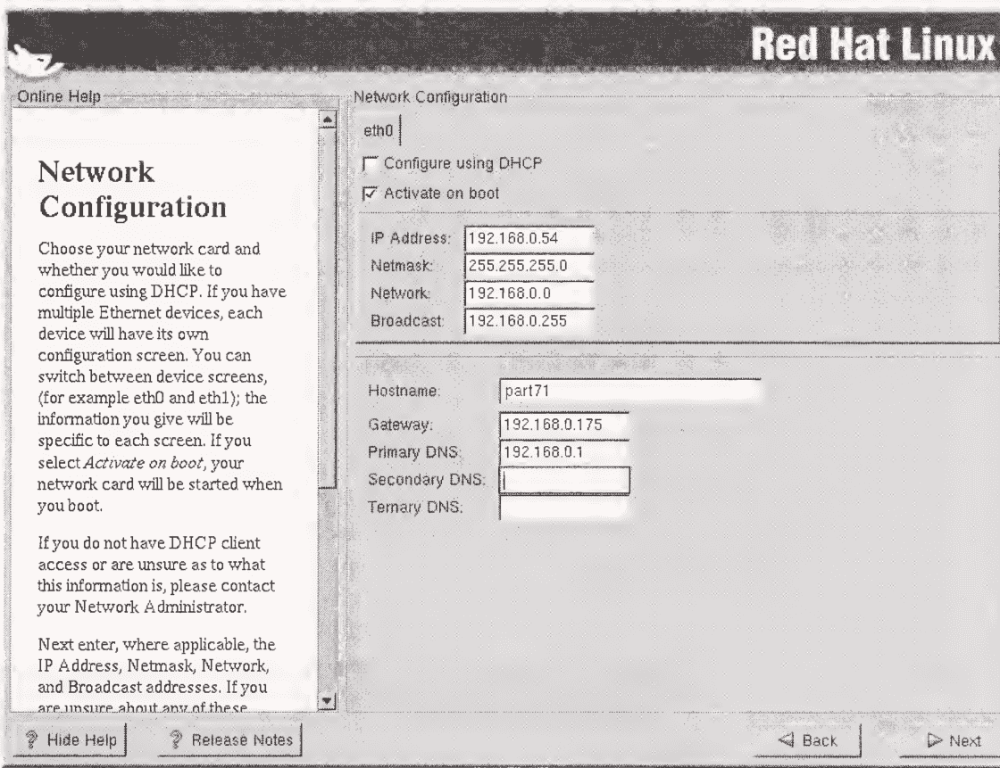

此屏幕包含以下元素：

- 文本输入框（IP 地址、子网掩码等）

- 复选框（使用 DHCP 配置和启动时激活）

- 按钮（隐藏帮助、上一步和下一步）

你可以使用 Tab 键（或向后）在这些元素之间移动，也可以使用鼠标。方向键也可以用于在字段之间移动。

要切换复选框，请移动到复选框并按下空格键。要按下按钮，使用 Tab 或方向键将光标移动到按钮上，然后按下空格键或回车键。对于“下一步”按钮，F12 键的功能通常与按回车键或空格键相同。当然，如果安装程序检测到了你的鼠标，你也可以左键点击选择的项目。以防万一，本章中的其余描述均假设你的鼠标在 Linux 安装程序中不起作用。

## 选择语言

按照本章介绍的方法，在启动界面开始安装后，会出现一个欢迎界面，随后是安装过程的第一个屏幕：语言选择。这只会影响你在安装过程中看到的语言。如需更改安装后 Red Hat Linux 7.1 显示的语言，请参阅本章中的“语言支持选择”章节。

如你在图 4.3 所示，语言选择屏幕有一个选择列表字段和一个“下一步”按钮。当光标在选择列表字段中时，可以使用方向键或 Page Up 和 Page Down 键在可用语言之间移动，直到选择所需的语言。此选择决定了安装过程中将使用的语言。（这与实际操作系统的语言以及键盘布局不同，两者都是单独选择的。）

图 4.3：选择语言

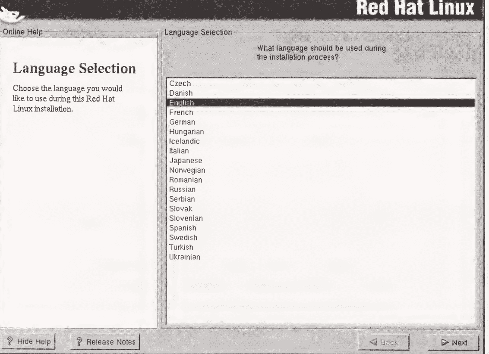

## 选择键盘类型

下一个屏幕提供了用于选择键盘模型和布局的选择列表字段。如果你在模型列表中没有看到你的键盘，默认为通用 104 键 PC。布局通常对应于不同的语言或方言（例如，法语或瑞士法语）。在美国，正确的布局几乎都是美式英语布局。其他常见的模型和布局包括表 4.1 和表 4.2 中列出的。

表 4.1：典型键盘模型

| 模型 | 描述 |

|---|---|

| Dell 101-key PC | 用于某些 Dell PC 键盘 |

| Japanese 106-key | 带有日语字符 |

| Microsoft Natural | 微软自然（分体式）键盘 |

| Winbook Model XPS5 | Winbook 特殊型号 XPS5 键盘 |

表 4.2：典型键盘布局

| 布局 | 描述 |

|---|---|


| Brazilian | 巴西葡萄牙语键盘 |
| Canadian | 加拿大英语键盘 |
| German | 德语键盘 |
| Swiss German | 瑞士德语键盘 |

你可以在屏幕底部的“在此测试你的选择”框中测试你的选择。如果你对所选择的键盘有疑问，应该特别测试你的选择。

## 配置你的鼠标

如果你有特殊键盘且模型列表中没有看到它，默认为通用 104 键 PC。布局通常对应于不同的语言或方言（例如，法语或瑞士法语）。在美国，正确的布局几乎都是美式英语布局。其他常见的模型和布局包括表 4.1 和表 4.2 中列出的。

如果你有特殊键盘且模型列表中没有看到它，Linux 7.1 会尝试检测它。在你配置鼠标后，你将看到一个列表供你选择。

## 安装还是升级？

一旦你选择了鼠标，下一个菜单将允许你安装。……（省略）其他常见的模型和布局包括表 4.1 和表 4.2 中列出的。

## 安装还是升级？

一旦你选择了鼠标，下一个菜单将允许你安装。如果你是第一次在计算机上安装 Red Hat Linux 7.1，有四种可能的方式：

- **Workstation**: 为工作站提供默认安装。此选项会自动删除系统上的所有分区，并且需要至少 1.2GB 的空闲空间。
- **Server**: 为服务器提供默认安装。此选项会自动删除系统上的所有分区，包括任何非 Linux 操作系统。它需要至少 650MB 的空间。
- **Laptop**: 类似于工作站安装，此选项为笔记本电脑提供默认安装。它包含了笔记本电脑所需的软件包，如 PCMIA 驱动程序。此选项会自动删除系统上的所有分区。它需要至少 1.2GB的空间。
- **Custom**: 对安装过程的所有方面提供完全控制。自定义安装需要 700MB 以上的空间。

为了学习安装 Red Hat Linux 7.1 的细节，将在本章以及第 5 章“特殊安装”、第 27 章“为 SOHO 安装 Red Hat Linux 7.1”以及第 31 章“安全与 Red Hat Linux 7.1 作为廉价路由器”中，通过第四种选项（自定义）进行操作。

## 设置你的磁盘分区

选择安装类型后，你将面临如何为 Linux 安装分配磁盘空间的问题。这是过程中的关键步骤，因为误操作可能会删除你想保留的系统现有数据。

假设你的系统中只有一个驱动器，如第 3 章“准备安装 Red Hat Linux 7.1”所示——你已使用其中描述的技术创建了空闲区域（最好大于 1GB），并且该空间现在可以使用。

你遇到的第一个问题是想使用哪种工具来设置分区。Red Hat Linux 中的两个选择是 Druid 和 `fdisk`。

## 警告

如果你不知道自己在做什么，磁盘可能会导致你丢失所有数据。此外，Linux 磁盘工具与 MS-DOS 磁盘工具不同，它包含大量的分区，正如第 5 章所讨论的。为了简化这一过程，Red Linux 7.1 提供了自己的磁盘分区管理工具，称为 Disk Druid。本节重点介绍使用 Disk Druid，因为它为初接触 Linux 环境的用户简化了初始安装过程。如果你选择 Disk Druid 按钮，将出现 Disk Druid 主界面，如图 4.4 所示。

## 图 4.4:

Disk Druid 主界面

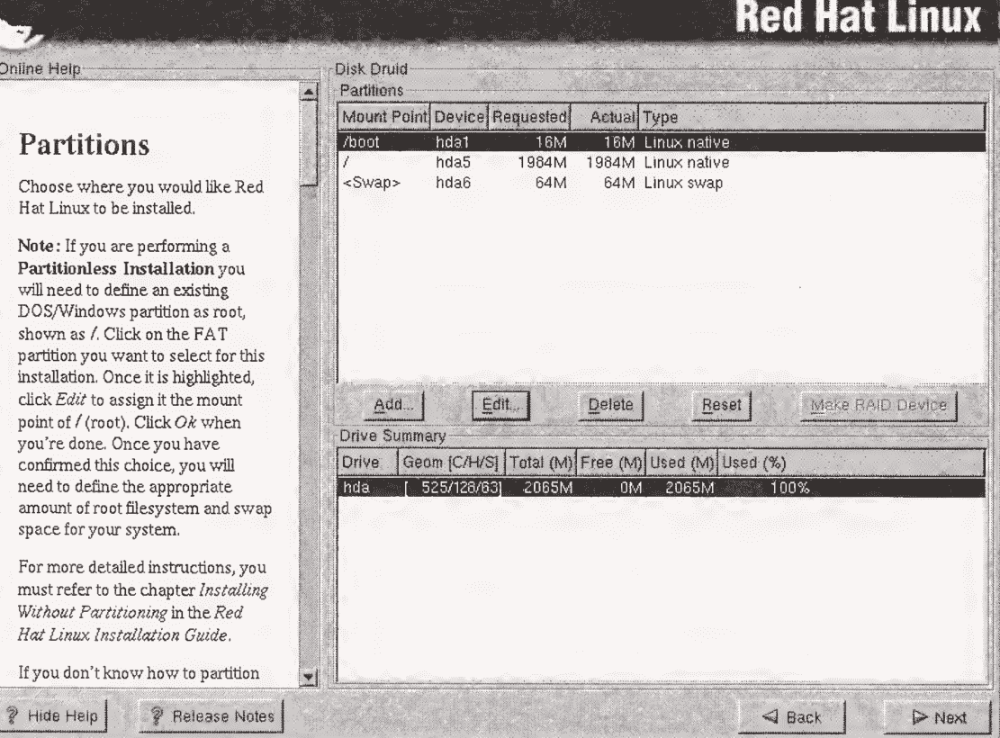

此屏幕分为三个部分：分区（Partitions）部分、底部行以及驱动器摘要（Drive Summary）部分。

在分区部分，系统的每个磁盘分区都会显示一行。关于每个分区会显示以下信息：

**挂载点（Mount Point）** 表示分区在你的 Linux 目录结构中出现的位置。Linux 目录都显示为根目录的子目录。根目录是 `/`，所有子目录都以 `/` 开始，例如 `/home`、`/opt` 和 `/usr/X11R`。你至少需要有一个挂载为 `/` 的分区和一个交换分区（swap）。如果你选择附加分区挂载为子目录，这将你的 Linux 发行版分散到额外的目录。例如，如果你将分区挂载为 `/usr`，则存储在该子目录下的任何内容都存储在 `/usr` 分区上，而所有其他数据都在根挂载（`/`）分区上。如果你想限制或专门某些空间，可以在限制的空间内挂载该目录。Red Hat 标准顶层目录的主要角色存储如下：

- `/bin` 标准系统实用程序存储在此。
- `/boot` 内核、引导加载程序、内存映射和模块详细信息存储在此。通常设置在单独的分区中。
- `/dev` 设备文件存储在此。
- `/home` 用户的家目录存储在此。
- `/mnt` 临时挂载的文件系统（如 `/mnt/cdrom` 和 `/mnt/floppy`）通常存储在此。
- `/opt` 可选安装软件根存储在此。
- `/root` root 用户的家目录。不要将其与根挂载（`/`）分区混淆。
- `/sbin` 标准系统管理文件存储在此。通常，这些文件应仅允许 root 用户访问。
- `/usr` 额外的系统软件和管理工具存储在此。
- `/var` 日志文件和打印池存储在此。在 Web 服务器上，通常在限制的空间内单独挂载，因为来自网站的日志文件很容易挤满该 Linux 计算机上的任何其他信息。
- `/etc` 管理文件和配置文件包含在此。以前位于此目录中的其他命令应移动到 `/bin` 或 `/sbin`。

**设备（Device）** 表示每个分区的设备名称。对于 IDE 磁盘，驱动器标记为 `hdx`，其中 `x` 是指定驱动器的字母（a 表示主盘，b 表示主从盘，c 表示从主盘，d 表示从从盘）。因此，如果你有一个磁盘 `hda`。SCSI 磁盘标记为 `sdx`，其中 `x` 指定驱动器。磁盘上的分区从 `hda1` 开始连续编号。通常，分区 1 到 4 是主分区，5 和 6 代表许多 DOS 系统中常见的逻辑分区。在图 4.4 中，你可以看到与引导目录（hda1）、根目录（hda5）和交换分区（hda6）关联的 Linux 分区。

**请求（Requested）** 表示以兆字节为单位的分区最小大小。

**实际（Actual）** 表示为分区分配的实际空间。Disk Druid允许创建可扩展的 Linux 分区，这些分区会在硬盘上有可用空间且分区耗尽时增加大小。DOS 分区的实际值和请求值应该匹配。

**类型（Type）**此字段指示你可以用 Disk Druid 创建的分区类型。可能的值包括 Linux native、Linux swap、Linux RAID、DOS 16-bit<32M 和 DOS 16-bit>=32M。（你无法在此处创建 FAT32 或 NTFS 分区，Disk Druid 现在可以识别这些常见的 Microsoft 分区。）

屏幕的主部分是五个任务块。使用 `Add`（添加）按钮为你的安装创建必要的 Linux 分区，使用 `Edit`（编辑）按钮确保你现有的 DOS 和 Windows 数据在 Linux 中可以访问，或更改之前的设置。你可以使用 `Delete`（删除）按钮删除单个分区。如果你想重新开始，请使用 `Reset`（重置）按钮。如果你需要更高的数据速度和安全性，`Make the RAID device`（创建 RAID 设备）按钮允许文件分布在一系列独立分区上。

最后，是驱动器摘要（Drive Summary）部分。它为系统上的每个硬硬盘显示一行，并包含关于驱动器的以下信息：

**驱动器（Drive）**这是硬硬盘的设备名称，之前讨论过。

**几何结构（Geometry）**这表示驱动器的磁柱体、磁头和扇区数量（按顺序）。

**总计（Total）**这表示驱动器上的总可用空间，单位为兆字节。

**空闲（Free）**显示驱动器上有多少兆字节的空间可用用于附加分区。

**已用（Used）**这表示驱动器上的总使用空间，单位为兆字节。这个数字实际上反映了使用的空间，即分配给分区的空间。这些分区可能没有满，但该空间不再可以分配给其他分区。与关联的数字在继续操作之前应该大于 1GB。**已用(%)**这表示驱动器的使用百分比。

## 为安装配置系统

### 添加新分区

要添加新分区，只需按下 `Add` 按钮。会出现 Disk Druid 屏幕请求以下信息：

- 挂载点
- 兆字节大小
- 驱动器是否可以扩展（剩余空间复选框）
- 分区类型（从列表中选择）
- 在哪个驱动器上创建分区

### 编辑分区

你可以通过从当前分区列表中选择它们并点击 `Edit` 按钮来编辑现有分区。这将打开与添加新分区时类似的窗口，只是这里所有的字段都已填充以匹配你正在编辑的分区的设置。

如果你有一个单独的 DOS 分区，例如，你可以将其挂载为 `/dos`。如果你有两个 DOS 分区（在 DOS 和 Windows 中对应 C 盘和 D 盘），你可以分别选择 `/dsc` 和 `/dsd`(或 `/c` 和 `/d`) 作为挂载点。

### 删除分区

在创建 Linux 交换分区和根分区的过程中，如果你犯了错误（可能是交换分区太大，或者你的根分区太小），你可以删除这些分区然后重新添加它们。要执行此操作，请在当前分区列表中选择该分区并按下“Delete（删除）”按钮。

> 警告
>
> 删除分区时务必小心。不要意外删除在你开始安装 Linux 之前就已经存在、且包含你想要保留的重要数据或软件的分区。

### 重置

如果在创建 Linux 分区的过程中你觉得需要重新开始，请点击“Reset（重置）”按钮。这会将分区表恢复到启动 Disk Druid 之前的状态。

### 创建 RAID 设备

如果你正在将 Linux 设置为服务器，那么你正在为多个用户配置计算机。该服务器上的程序和数据将变得更加重要。你可以通过将数据分布在多个硬盘上来保护数据，这些硬盘被称为冗余磁盘阵列（RAID）。如果你设置了一系列 RAID 分区，然后可以使用“Make RAID Device（创建 RAID 设备）”选项将它们一起配置。

### 继续

一旦完成分区的创建和配置，你就可以继续了。你可以通过点击“Next（下一步）”按钮来实现。

## 格式化你的 Linux 分区

下一步是格式化你的 Linux 分区以为安装 Linux 做准备。将出现一个 Linux Native 类型的分区列表，并指示它们的挂载点。任何新创建的分区都应该通过勾选驱动器旁边的选框标记为格式化。

如果你有额外的 Linux Native 类型分区，如果是新分区则应该进行格式化。如果它们已经存在（这对新的 Red Hat 用户来说不太可能）且你想保留它们包含的数据，请不要将其标记为格式化。

你还可以指示在格式化期间执行坏块检查（bad block check）。这是一个好主意，特别是对于新硬盘。

## 设置 LILO

LILO 是 Linux 引导加载程序。为了让系统正常启动，你需要配置并安装 LILO。LILO 还提供了双启动功能，允许你在启动时选择启动哪种操作系统，让你能够访问现有的 Windows 或 DOS 系统以及 Linux。

此过程分为四个部分，如图 4.5 所示。首先，你需要决定将 LILO 安装在哪里：在你的硬盘上和/或在启动磁盘上。

接下来，如果你选择将 LILO 安装在硬盘上（你应该应该这样做），有两个位置：在主引导记录（MBR）上或启动分区的第一个扇区上。你应该将 LILO 安装在 MBR 上，除非你正在运行带有如 OS/2 或 Windows/2000 等带有引导加载程序的操作系统，或者你设置了如 Partition Magic 或 System Commander 等其他引导加载程序。如果你已经有了这些其他引导加载程序之一，你不需要这种方式的 LILO；因此，你应该将 LILO 安装在 Linux 启动分区上。

> 警告
>
> 在此步骤中，你必须安装 LILO 或创建一个启动磁盘，以便启动你的 Linux 系统。强烈建议在初始安装期间安装 LILO。

## 图 4.5：

配置引导加载程序

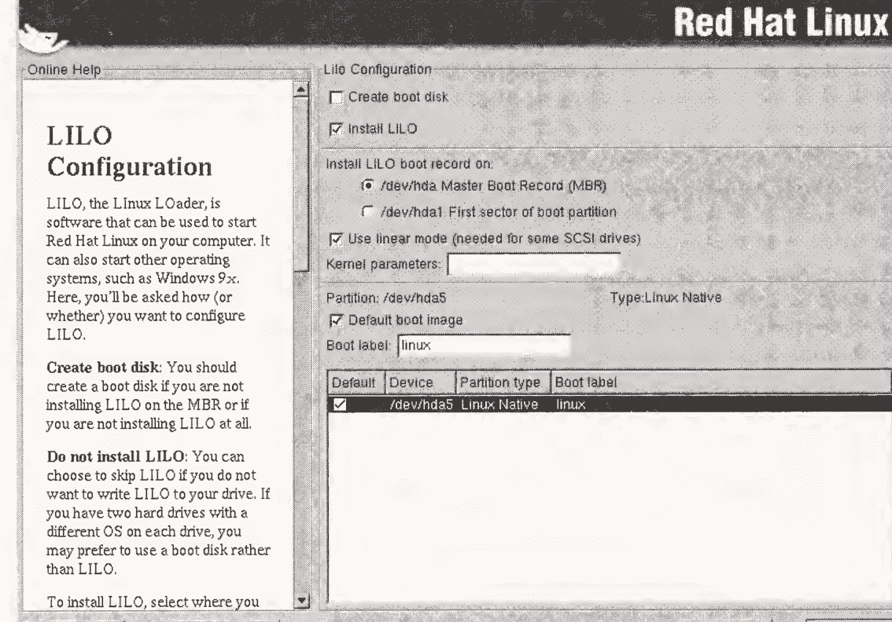

大多数硬盘可以在线性模式下访问。除非你的硬盘不使用逻辑块寻址（LBA）模式（检查你的 BIOS），否则保持选中“Linear Mode（线性模式）”选项。

在屏幕的下部分，你可以看到所有带有操作系统的分区。当你设置“Default Boot Image（默认引导镜像）”时，你设置的是启动时默认启动的操作系统（通常是 Linux 或 Microsoft Windows）。“Boot Label（引导标签）”是你使用的名称（图 4.5 中的 linux），用于在启动计算机时选择启动哪个操作系统。

## 网络配置

下一个要配置的项是你的网络。因为在本章中你安装的是独立系统，请选择不配置你的网络。第 27 章将详细讨论网络配置。

## 防火墙配置

你的防火墙是下一个要配置的项。但同样，因为在本章中你安装的是独立系统，请选择不配置防火墙。第 31 章将详细讨论防火墙配置。

## 语言支持选择

在这里，你可以设置安装完成后在你的 Red Hat Linux 系统上看到的语言。Red Hat Linux 7.1 提供了 104 种不同的语言和/或方言供你选择。如果磁盘空间紧张，请仅选择你将使用的语言；如果你选择了所有 104 个选项，将需要额外的 135MB 磁盘空间。

## 时区配置

下一步是配置计算机的时钟和时区。你需要做两个决定。

首先，你需要指示是将系统时钟设置为本地时间还是格林尼治标准时间（GMT，也称为协调世界时，其缩写为 UTC）。如果你只在电脑上运行 Linux，请将时钟设置为 UTC。但如果你在电脑上还运行其他操作系统，请不要选择此选项。

其次，你需要从可用时区列表中实际的时区。

## 账户配置

作为一个多用户系统，Linux 至少需要一个用户才能使用。在所有系统中，你必须有一个 root 用户，因此提示提供 root 密码（两次以确认）。root 用户是功能强大的管理员。以 root 用户登录时，你可以查看所有用户文件，执行所有系统管理任务，如果你需要，还可以删除所有文件。

你还可以根据所需的账户名称和密码设置个人账户。在 Full Name（全名）文本框中输入描述性名称。

## 身份验证配置

接下来，系统提示进行身份验证配置选择。此屏幕上有五个选项，每个都可以单独选择。它们并不互斥。选项如下：

- Enable MD5 Passwords：通常，Unix 系统使用较弱的加密方案来存储密码。此选项使用更严谨的加密方案来存储用户密码。默认启用此选项。
- Shadow Passwords：使用影子密码是一种技术，旨在让攻击者或普通用户系统更难窃取数据库并在空闲时破解系统管理员密码。默认启用此选项。
- Enable NIS：这是许多 Unix 网络中常见的网络身份验证类型，特别是对于带有 Sun Solaris 服务器的网络。你可以指定该网络上计算机组的域名，或者指定一个存储 NIS 用户名和密码的特定服务器。默认不启用此选项。
- Enable LDAP：轻量级目录访问协议用于用户目录。如果你知道网络上 LDAP 服务器的名称，可以启用 LDAP。默认不启用此选项。
- Enable Kerberos：Kerberos 是一种在网络上传输密码的安全加密方法。Kerberos 需要访问授予 Kerberos 票的服务器，包含了加密方案。除非你计划让所有 Linux 服务使用此协议，否则不要启用 Kerberos。默认不启用此选项。

除非你熟悉这些选项并有充分的理由进行更改，否则请保持默认选择不变并继续。

# 选择软件包

现在，你的硬盘已经配置好，Linux 分区也已格式化，你准备好开始安装实际软件了。默认安装包含了所有必要的核心软件，但也提供了几个可选组件，包括图 4.6 所示的内容。

图 4.6：选择额外的组件

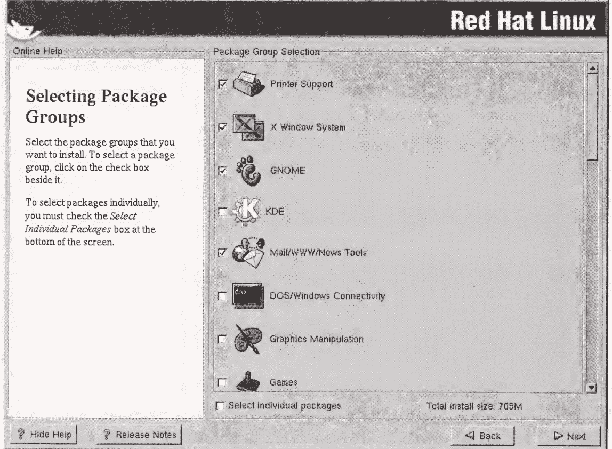

每个组件都是一组相关软件包的集合，用于拨号连接、Web 浏览等特定任务。你可以通过勾选各自的复选框来单独选择软件包，或者你可以选择“全部”（Everything）选项，它是列表中的最后一项。

出现在列表字段下方的“选择单个软件包”（Select Individual Packages）选项表示你想要选择每个组件中的单个软件包。然而，如果你是第一次使用 Linux 的用户，选择软件包将是很困难的。不勾选此选项意味着将完整安装每个组件。

## 为安装配置你的系统

如果你有充足的磁盘空间（超过 3GB；4GB 为佳），请选择所有内容，以便获得完整的 Linux 安装。请注意图 4.6 底部显示的“总安装大小”（Total Install Size）。如果你的空间有限，请考虑至少安装以下组件：

- 打印机支持（如果你没有打印机，则没有必要）


- X Window 系统
- GNOME
- 邮件/WWW/新闻工具
- DOS/Windows 连接
- 多媒体支持

如果你有足够的空间，请同时安装 KDE 和 GNOME，以帮助你阅读第 11 章“使用 KDE”。如果你选择安装 X Windows，接下来将配置你的显卡和显示器。否则，你将直接进入安装，如下一节末尾所述。

> 如果你安装的组件多于显示的最小组件，你可能需要两张 Red Hat Linux 7.1 安装 CD-ROM。由于第二张安装 CD-ROM 未包含在书中，你可能从 www.redhat.com 购买官方 CD-ROM，或者直接从其他供应商（如 www.cheapbytes.com 或 www.linuxmall.com）购买 CD-ROM 本身。

## 注意

## 配置 X Windows

X Windows 是 Linux 的图形用户界面（GUI）。第 7 章“安装和配置 X Windows”详细讨论了配置 X Windows 的内容。现在，让我们快速过一遍配置过程。配置可能相当复杂，并有一整章专门介绍，因此任何问题将留到该章节解决。

首先会出现一个显示器类型列表。如果你发现与你的显示器完全匹配，请选择它；否则选择“未探测显示器”（Unprobed Monitor）或等到你阅读第 7 章。错误的配置可能会损坏显示器。匹配必须是精确。

接下来，程序将尝试确定你是什么类型的显卡。如果失败，将出现可用显卡的列表。选择与你的显卡最匹配的一个（如果都不匹配，请选择“通用标准 VGA”或将 X Windows 的配置留到第 7 章）。选择你显卡上可用显存量。请查阅你的显卡文档以获取此信息。一旦做出选择，你可以点击“测试此配置”（Test This Configuration）以确保所选设置对你的系统有效。

如果你看到并选择了“自定义 X 配置”（Customize X Configuration）选项，你可以自定义显示器上 X Windows 的分辨率（又称视频模式）。通过“图形登录”（Graphical Login）选项，你可以设置图形登录屏幕。如果你想在安装 Linux 后再配置图形，请选择“跳过 X 配置”（Skip X Configuration）选项。

在某些发行版中（包括旧版本的 Red Hat），会出现时钟芯片列表。如果你的卡没有时钟芯片或你不知道是否有，请选择“无时钟芯片”（No Clockchip）。不要猜测这个问题。如果你不知道显卡的时钟芯片，请将其留到第 7 章。

现在你已完成基础配置要求。当你点击“下一步”时，系统会警告实际安装即将开始。大多数发行版都会创建你的安装过程日志。Red Hat Linux 7.1 将此保存为文件 `/tmp/install.log`。几个发行版会在同一个文件中创建安装日志。点击“下一步”，安装开始。

## 安装过程

安装将自动进行，在此过程中不需要任何输入。在屏幕上，你会看到一个计时器，指示你在安装完成前需要等待多久。在软件安装期间，屏幕还会显示安装的当前状态，指示正在安装哪个软件包、剩余多少软件包和多少兆字节，以及安装的总体进度。

## 创建启动盘

一旦 Linux 软件成功安装，安装将进入最后一步：创建启动盘。创建启动盘是明智的，因为这允许你在紧急情况下启动系统。然后你可以尝试救活一个故障系统。按照图 4.7 的指示插入一张空白（已格式化）的软盘，点击“下一步”。

图 4.7：创建启动盘

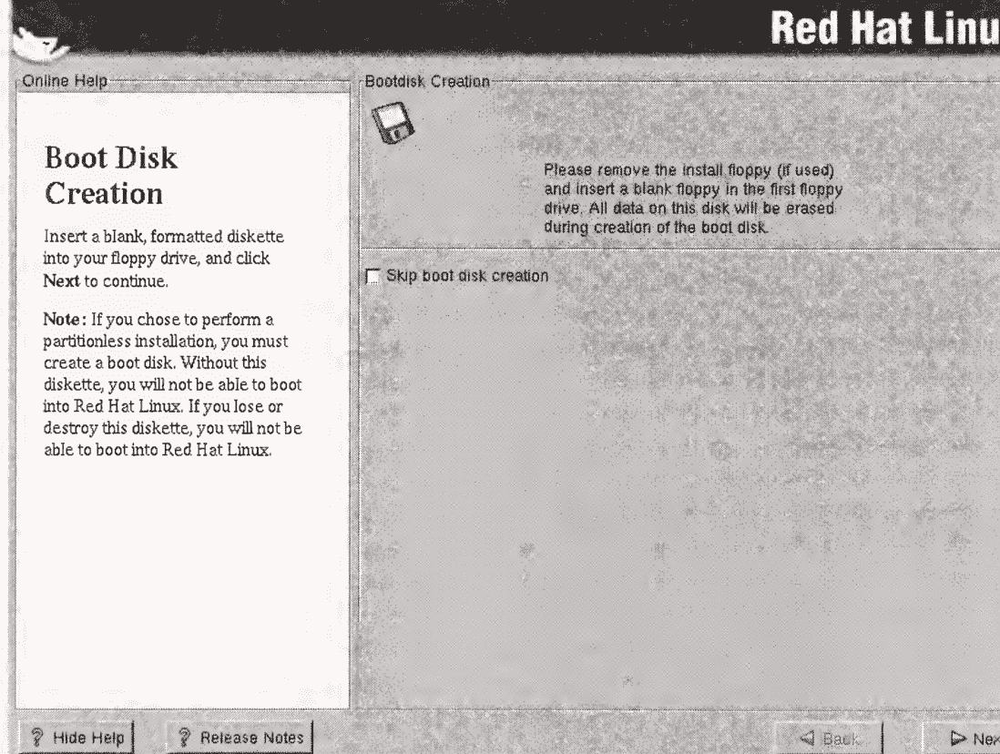

Red Linux 7.1 安装程序将启动文件拷贝到你的软盘。此过程完成后，安装程序结束。

## 重启你的系统

最后，系统会提示从计算机中移除任何软盘并重启。某些 Linux 发行版会自动弹出 CD-ROM。如果没有发生，请在重启之前移除 CD-ROM。如果你将 Linux 设置为默认操作系统，系统将启动到 Linux，在图形提示处给你 5 秒时间选择备操作系统。如果你选择了 Linux 且一切顺利，将出现 Red Hat 登录提示。你可以使用之前提供的用户名和密码在此登录。会出现类似下面的命令提示符：

```
armand@localhost]$
```

你稍后将学习命令，但原理很简单：输入命令并按回车键执行它。输入 `exit` 并按回车键退出登录。

Linux 允许你登录多次，即使在初始字符模式下。使用 Alt+F1 到 Alt+F6 的组合，你可以切换到六个虚拟终端。你需要在每个终端单独登录。你可以以不同用户身份登录并执行不同任务，也可以以同一用户身份登录不同的终端——这是 Unix 和 Linux 成为灵活环境的特性之一。

## 展望

现在你应该有一个运行良好的 Linux 系统。如果你是少数由于特殊情况无法按照本章步骤运行 Linux 系统的读者，请查看第 5 章“特殊安装”，该章节讨论了特殊情况安装：

- 从硬盘分区安装。（如果由于某些原因你无法从 CD-ROM 安装 Linux，这很重要。）
- 安装到多个分区或硬盘（如果你有分布在多个磁盘上的大量空间或需要通过这种方式拆分 Linux 来获得性能，这很有用。）
- 使用 fdisk 而不是 Druid 配置你的分区。（Disk Druid 有用但不是 Linux 标准；使用 fdisk 可以让你了解这一标准工具的工作，并获得专家所需的更强大的工具。）

如果这些任何特殊安装对你有用，请转到第 5 章。不过，如果你的系统启动正常，你已经准备好继续并学习 X Windows 了。跳到第 6 章“X Windows 概述”，并从那里开始。

# 第五章

## 特殊安装方法

* 从硬盘分区安装
* 在多个分区上安装 Linux
* 使用 fdisk 代替 Disk Druid

在第 4 章“安装 Red Hat Linux 7.1”中，你已经学习了如何采用最直接的方法安装 Linux：从本地 CD-ROM 到单个硬盘分区。

本章将介绍几种常见的安装变体。其中，最常见的是从硬盘分区进行安装。在某些情况下，从本地 CD-ROM 驱动器安装并不切实际。例如，你可能拥有一个 Red Hat 安装软件无法识别的 CD-ROM 驱动器，或者你可能只能临时访问 CD-ROM 驱动器。在这种情况下，一种方案是将 Red CD-ROM 的内容复制到硬盘的空白区域，然后从硬盘进行安装。

此外，由于现在硬盘成本的降低，你可能有多个可用的分区或硬盘用于安装 Linux。在这些情况下，通过将 Linux 系统分布在多个分区和硬盘上，你可以最大限度地提高系统性能。

最后，本章还将介绍如何使用 `fdisk` 程序代替 Disk Druid 来配置你的硬盘分区。`fdisk` 是所有 Linux 发行版的标准配置，而 Disk Druid 仅由 Red Hat Linux 提供。

## 从硬盘分区安装

对于某些用户来说，有充分的理由从与运行 Linux 计划分区不同的硬盘分区安装 Linux。可能的原因包括：

- Linux 安装程序无法识别的 CD-ROM 驱动器
- 缺少永久性的 CD-ROM 驱动器，但可以访问 CD-ROM 驱动器以将其内容复制到硬盘
- 带有可切换软盘驱动器和 CD-ROM 驱动器的笔记本电脑，且无法从 CD-ROM 驱动器启动

在所有这些情况下，从硬盘分区安装的过程基本上是相同的：

- 1. 在专用硬盘分区上从 Red Hat CD-ROM 创建 ISO 磁盘映像。如果你复制了两个 Red Hat CD-ROM，请务必将它们复制到同一个目录。
- 2. 确保你已准备好正确的安装软盘。
- 3. 从由 `boot.img` 文件创建的安装软盘启动安装过程。

## 注意

如果你想安装 Linuxconf 等额外软件包，你需要两张 Red Hat 安装光。你可以从许多主要商店或通过 www.redhat.com 在线购买完整的 Red Hat Linux 7.1 分区，也可以在网上下载光盘。你也可以从 Cheap Bytes (www.cheapabytes.com) 或 Linux Mall (www.linuxmall.com) 等供应商处购买下载好的光盘。

## 将 CD-ROM 复制到硬盘分区

要从硬盘分区安装，你需要一个专用分区来存储 Linux 安装 CD-ROM 的内容。该分区应至少包含 650MB 的可用空间，以容纳 Red Hat Linux 7.1 安装光盘的完整内容。如果你安装的不仅是标准软件包，该分区需要双倍的空间。

要从 Red Hat Linux CD-ROM 创建映像文件，你需要从 CD-ROM 内容创建一个名为 `cdi.iso` 的文件包。实现此点的一种方法是在 root 用户模式下使用以下命令，首先挂载 CD-ROM，然后创建 ISO 映像：

```bash
# mount -t iso9660 /dev/cdrom /mnt/cdrom
# mkisofs -J -R -T /tmp/cdi.iso /mnt/cdrom
```

## 注意

将 CD ISO 映像文件放置在 `/tmp` 或 `/home/mj` 等子目录下。这使得安装程序更容易识别映像的位置。如果你为两张安装 CD-ROM 都制作 ISO 映像，请将它们放在同一个目录。

如果你的 CD-ROM 设备不同，请相应替换 `/dev/cdrom`。在 `mkisofs` 命令中，`-o` 选项位于要创建的 ISO 映像文件名之前。`-T` 在每个目录中添加一个 `TRANS.TBL` 文件，以便为无法处理长文件名的操作系统（如 MS-DOS）保留文件名信息。`-r` 选项使用“Rock Ridge”扩展允许长文件名，而 `-J` 选项使用“Joliet”记录使该 ISO 在 Microsoft Windows 上可用。

如果你有第二张 Red Hat Linux 7.1 安装光盘，你将希望在同一目录下创建第二个 ISO 映像。

> 本书附带的 Red Hat Linux 7.1 出版版包含一张安装光盘。

由于文件较大，创建 ISO 可能需要几分钟。要检查 `cd1.iso` 文件的结果，你可以以类似于挂载普通 CD-ROM 的方式挂载它。

```bash
# mount -t iso9660 -r -o loop /tmp/RedHat/cd1.iso /mnt/cdrom
```

结果应该与挂载普通 CD-ROM 一致。你可以将 ISO 上的文件与 Red Hat Linux 7.1 安装光盘进行对比。

## 准备安装软盘

第 3 章“准备安装 Red Hat Linux 7.1”讨论了如何创建必要的安装软盘。详情请参阅该章节中的“从软盘和 CD-ROM”部分。

## 实际安装过程

在开始安装时，系统会提示你选择语言。选择语言后，提示你选择键盘布局。选择键盘布局后，提示你选择网络设置。选择网络设置后，提示你选择时区。选择时区后，提示选择代理设置。选择代理设置后，提示磁盘配置。选择磁盘配置后，提示分区方案。选择分区方案后，提示源媒体。选择源媒体后，提示安装目标。选择安装目标后，提示软件选择。选择软件选择后，配置用户设置。配置用户设置后，提示开始安装。

在安装期间，系统会将文件复制到硬盘。这可能需要一些时间。安装完成后，系统将提示你重启。重启后，将提示你登录新的 Linux 系统。

## 在多个分区上安装

本节的标题有些误导性。毕竟，对于典型的 7.1 安装，你至少使用了三个分区：一个用于引导，一个用于存储系统的其余，一个用于交换空间（swap）。使用多个分区有充分的理由。一个明显的原因是当你的两个分区不连续时。从两个不同的分区创建一个连续卷是困难的。在这种情况下，将 Linux 安装分布在两个分区上通常更好。例如，在多个分区上安装 Linux 可以提高速度和数据灵活性。有多种方法可以利用用于 Linux 安装的多个硬盘。

## 将交换分区放在独立的物理硬盘上

如果你在一个硬盘上有一个大分区，在另一个物理硬盘上有一个较小分区（32MB 到 200MB 之间），你可能希望考虑将交换分区设置在第二块硬盘上。如果你发现自己频繁进行内存交换（swapping），这可以显著提高性能。

考虑以下情景：你的 Linux 安装和交换分区位于同一个物理硬盘上。你正在运行许多应用程序，系统已经在频繁进行交换。你尝试启动一个新程序，但为了启动它，需要从磁盘加载——与此同时，内存中的现有数据需要交换到磁盘。由于驱动器一次只能执行一个操作，当操作系统试图同时执行这两个操作时，你的物理驱动器突然变成了瓶颈。

但如果你的交换分区位于独立的物理硬盘上，瓶颈就会减少：一个磁盘可以从磁盘读取数据到内存，而另一块磁盘可以完成将数据从内存移动到磁盘的过程。尽管计算机无法同时执行两条指令，但缓慢的磁盘操作分布在两个磁盘上这一事实，减少了 CPU 等待磁盘完成工作的时间。

图 5.1：选择分区

(img/2d9aa645b3d05a8ce06954a79484114_0.png)

## 将 Linux 分散到多个分区

使用两个或多个分区运行 Linux 软件的另一种方法是按照逻辑方式将 Linux 软件的存储分散在各个分区中。这可以提供两个大处：

- 扩展关键 Linux 目录树（如 `/home` 目录树）的可用磁盘空间
- 如果分区位于多个磁盘上，则通过将磁盘访问分散到多个硬盘上来提高性能

让我们考虑你可能希望如何将 Linux 发行版拆分到两个分区。正如第 4 节在讨论如何为现有 DOS 分区指定挂载点时提到的，你可以通过指定挂载点使用额外的磁盘。

例如，如果你想将所有用户的家目录存储在单独的分区上，你会将该分区的挂载点设置为 `/home`，同时将主 Linux 分区的挂载点留为 `/`。那么，当你读写 `/home` 下的任何内容时，你实际上访问的分区与你访问 `/home` 之外的其他目录树是不同的。

还有其他几种将 Linux 安装拆分到两个分区的常用方法：

- 如果你计划安装许多自己的软件（包括文字处理器、Web 浏览器和 Windows 模拟器等商业软件），你会发现其中大部分内容安装在 `/opt` 目录中。如果你的主 Linux 分区有足够的空间存放操作系统和用户数据，那么可以考虑将额外分区设置为 `/opt`。这将为你的所有应用程序提供一个独立区域，当你启动应用程序时，主系统可以空出来访问数据或运行系统实用程序以及 Linux 始终在执行的后台任务。
- 如果你预计会有很多用户，或者计划在用户的家目录中存储大量数据，请考虑将你的额外分区挂载为 `/home`。这样，你可以单独监控用户的磁盘使用情况，而且当许多用户访问其数据而其他用户正尝试启动应用程序时，你将获得性能提升，因为这两个操作需要访问不同的磁盘分区。
- 如果你发现单独一个分区都无法容纳完整的 Linux 安装，你可能希望选择一个较大的目录树，例如 `/usr/X1R6`（X Windows 目录树），并将其安装到单独的分区，以便你能够安装整个系统。
- 虽然许多新包安装在 `/opt` 中，但如果你安装软件，你会发现 `/usr` 也可能很快填满，使其成为独立分区的良好选择。
- 如果你将 Linux 作为繁忙的邮件服务器或高频多用户服务器，请考虑为 `/var` 分配单独分区，因为系统池队列和系统日志位于此目录，并且在这类服务器中增长非常迅速。

## 使用 fdisk 代替 Disk Druid

在第 4 节中，你在安装 Red Hat Linux 7.1 时使用了 Disk Druid 来配置磁盘分区。然而，Disk Druid 是一个仅在 Red Hat 安装过程中可用的程序。通常，Linux 用户使用 `fdisk` 来配置磁盘分区，无论是在安装过程中还是在需要调整磁盘布局时。

事实上，`fdisk` 对高级 Linux 用户来说是非常熟悉的，以至于 Red Hat 承认了其作为磁盘分区配置工具的主导地位，并将其作为 Disk Druid 的替代方案。

虽然 `fdisk` 是一个极其复杂且强大的工具（如果使用不当，具有潜在的危险性和破坏性），但执行诸如显示分区表、从空空间创建新分区以及为分区分配类型等基本任务的工作相当简单。

在安装过程中，如果你选择 `fdisk` 而不是 Disk Druid，会出现第一个屏幕，询问你想对哪个磁盘进行操作。与 Disk Druid 不同，`fdisk` 一时间只处理一个物理磁盘。一旦你选择了一个磁盘进行操作，你就会暂时离开不熟悉的 Red Hat 安装程序，并看到图 5.2 所示的 `fdisk`初始屏幕。

# 图 5.2：

fdisk 欢迎界面

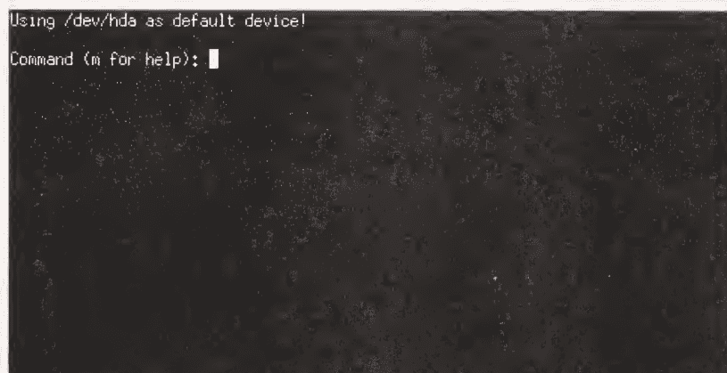

## 注意

本章中的 fdisk 图形是基于使用 Red Hat 安装启动 fdisk 的。如果你从标准的 Red Hat 安装界面进入 fdisk，你将看到与图 5.2 相同的内容。

`fdisk` 使用简单的命令操作。要执行任务，最简单的命令是输入 `m` 并回车。如果 `fdisk` 需要额外信息，它会向你显示图 5.3 所示的帮助界面。这些字符会导致 `fdisk` 显示正在操作磁盘的分区表。

# 图 5.3：

fdisk 帮助界面


## 添加分区

要在硬盘的现有空闲空间上添加新分区，请使用 `n` 命令。如图 5.5 所示，`fdisk` 会提示你分区类型。通常，使用 `fdisk` 时，你应该选择主分区。一旦选择了分区类型，就会为你的分区分配起始和结束扇区。

```
分区号 (1-4): 1
起始扇区 (324-625): 1
```

# 图 5.5：

添加分区


## 修改分区类型

默认情况下，`fdisk` 创建的所有分区都分配为 Linux 类型 (83)。要更改分区的类型，请使用 `t` 命令。`fdisk` 会提示要操作的分区，你可以像图 5.6 所示通过数字选择，然后提示你输入类型 ID。要查看类型列表，请在此处使用 `l` 命令以查看图 5.6 所示的列表。

# 图 5.6：

修改分区类型

| ID | m (help) | l |
|---|---|---|
| 8 | Empty | 56 OpenBSD |
| 7 | FAT16 | 63 GRUB |
| 6 | XDNM | 64 Mobile |
| 3 | XDNM | 64 Network |
| 4 | FAT12 | 70 DiscSource |


| 5 | Extended | 70 SpeedStor |

| 7 | NTFS/NTFS | 30 Partition type |

| 8 | AIX | 32 Partition 02/86 | 81 DOSBR |

| 9 | AIX | 41 PPC Boot | 82 Old Mis |

| 10 | boottable | 45 DNX.x | 83 LVM |

| 5/2 Boot Main | 49 2nd part | 85 Linux hidden |

| 6 | Win95 FAT32 (l-bf) | 52 Linux partition | e0 Linux Re., |

| 7 | Win95 FAT16 (l-bf) | 53 Linux partition | eb f6 Red.fs |

| 8 | WXFS FS (l-bf) | 54 Linux partition | de f9 Linux no. |

| 10 | OPIS | 55 CP/PK | 90 f2 secondary |

| 11 | Hidden | 60 Hidden DMX aux | 94 Ameeba BBT fd Linux auto |

| 12 | Company diagnost | 62 UnTrackDM | 97 E-Drive fx Last auto |

| 14 | Hidden FAT13 <5 | 65 Golden Home a0 BIOS/OS lx Step |

| 14 | Hidden FAT16 | 56 Golden Home a9 IBM Thinkpad bi fi BBT |

表 5.1 中所示的最常用分区类型。

# 表 5.1: 常用分区类型

| ID | 类型 |
|---|---|
| 5 | 扩展分区 (Extended) |
| 6 | DOS 16位位（大于 32MB） |
| 7 | OS/2 HPFS |
| b | Windows 95 FAT32 |
| c | 带逻辑块寻址 (LBA) 的 Windows 95 FAT32 |
| 82 | Linux 交换分区 (Swap) |
| 83 | Linux 原生分区

## 删除分区

有时您需要删除现有分区为为 Linux 安装创建一个或多个分区。执行此操作，只需使用 `d` 命令，并在提示时输入您想要删除的分区编号。

## 提交您的更改

在使用 `fdisk` 期间，没有任何安全措施，这意味着如果您不小心删除了包含重要数据的分区，您无法在永久删除包含数据的分区之前恢复到先前的配置。

出于此原因，在您退出时显式要求 `fdisk` 执行操作之前，您所做的更改实际上不会被处理。因此，在退出 `fdisk` 之前，请务必查看分区表，以确保您的操作完全符合您的意愿。如果您退出并提交更改，这些更改是永久的，且无法恢复。（理论上，您可以在在使用 `fdisk` 之前将磁盘的分区表保存到软磁盘中，并通过用保存的分区表替换新的分区表来从严重错误；然而，这是一个复杂的程序，并非万无一失。您最好还是小心，并在提交更改之前确保对分区表所做的更改完全符合您的意愿。）

退出 `fdisk` 的两种替代命令见表 5.2。

# 表 5.2: 退出 fdisk 的替代命令

| 命令 | 效果 |
| --- | --- |
| q | 退出 fdisk且不处理或保存任何更改。 |
| w | 处理并保存所有更改，然后退出 fdisk。这是一个永久性操作，请务必小心。 |

## 展望

最后，您已经准备好实际使用 Linux 了。作为在这条道路上的第一步，您将查看 X Windows 环境。X Windows 为包括 Linux 在内的所有 Unix 操作系统提供了一个高度灵活、由鼠标驱动的图形用户界面。

许多 Linux 教程从命令行开始，因为这确实是 Linux 的核心。但 X Windows 让新用户在彻底掌握 Linux 命令行之前，就能快速开始使用 Linux。

第 6 章“X Windows 概述”将向您展示 X Windows 提供什么，以及它如何与 Microsoft Windows 环境进行对比。然后，将转向 X Windows 的配置和使用，并查看一些常见的 X Windows 应用。

# 第三部分

## 在 Linux 中使用桌面环境

- 第 6 章：X Windows 概述
- 第 7 章：安装和配置 X Windows
- 第 8 章：使用 GNOME 和 X Windows
- 第 9 章：在 GNOME 和 X Windows 下应用程序
- 第 10 章：高级 GNOME 配置
- 第 11 章：使用 KDE
- 第 12 章：高级 X Windows 配置
- 什么是 X Windows？
- Microsoft Windows 对比 X Windows
- X 服务器、窗口管理器和桌面环境
- Motif 是什么？

# 第 6 章 • Windows 概述

既然您已经成功安装了 Linux，您将通过直接进入 X Windows 环境开始学习过程。许多 Linux 忠实者在考虑 Windows 命令行的复杂细节和 Linux 配置之前，一想到 X Windows 就会不寒而栗。但正是 X Windows 让 Linux 成为 Windows 和 Mac OS 的良好替代品，成为文字处理、桌面出版和浏览万维网等日常任务的高效操作系统。

本章从描述 X Windows 到底是什么开始。X Windows 为 Unix 世界提供了一个图形用户界面 (GUI)。X Windows 提供了一种交付所有非通用用户界面范式的方法，如窗口、对话框、按钮和菜单。正是 X Windows 使得复杂的图形得以创建，让基于 Unix 的工作站成为许多工程和设计应用的首选，也是 X Windows 让 Linux 能够成为 PC 操作系统市场中强力的竞争者。

## 什么是 X Windows？

简单来说，X Windows 是 Unix（以及由此延伸的 Linux）的完整图形界面。但这并不代表全部。X Windows 是一个高度可配置的环境，为用户和编写在 X Windows 下运行软件的应用程序开发者提供了极其广泛的灵活选项。

X Windows 的核心概念是客户端-服务器框架。在实际操作中，这意味着 X Windows 提供了一个不绑定于单个处理器的环境。应用程序可以运行在网络上的不同服务器和机器上，并且可以显示在网络其他地方 X Windows 终端和工作站上。

这种应用程序运行地与显示地之间的分离，在 Windows 和 Macintosh 环境中是一个概念，因为那些环境将应用程序与显示器绑定。这种分离的好处是，在网络环境中，可以有一个在维护良好、强大且易于管理的中央应用程序服务器上运行复杂的图形显示应用程序。事实上，正是这种能力赋予了 Unix/Linux 和 X Windows 在大型网络专业系统管理员中如此良好的声誉。

X Windows 环境引入的另一个概念是窗口化与接口的分离。在 X Windows 系统上，必须运行两个应用程序才能提供完整的 GUI。第一个是 X 服务器，它设置图形显示（即分辨率、刷新率和色彩深度），显示窗口和鼠标移动、击键以及多个窗口。但 X 服务器不提供菜单、窗口边框或移动、切换、最小化或最大化窗口的机制。如果你查看图 6.1，你可以看到没有窗口管理器的 X 服务器长什么样。

# 图 6.1:

没有窗口管理器的 X 服务器显示

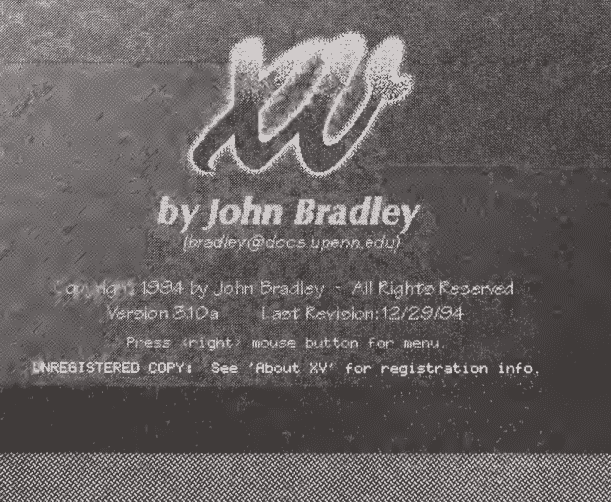

| 显示 | 24/8 位 | 算法 |
| --- | --- | --- |
| 裁剪 | Root | Windows | 大小 |
| | | Next |
| | | Pview |
| | | Load |
| | | Save |
| | | Print |
| | | Colordata |
| | | | 0 文件 |


# 第 6 章 • X Windows 概述

注意图 6.1 中极简的风格。没有花哨的颜色背景，没有复杂的窗口边框或菜单控制，也没有其他构成完整 GUI 的功能。所有这些功能都由名为“窗口管理器”的第二个应用程序提供。图 6.2 显示了运行 fvwm 窗口管理器的完整 X Windows 桌面。注意窗口框、控制按钮、控制菜单以及任务栏和虚拟桌面系统。窗口管理器提供了所有这些内容。

# 图 6.2:

运行窗口管理器的 Windows 显示

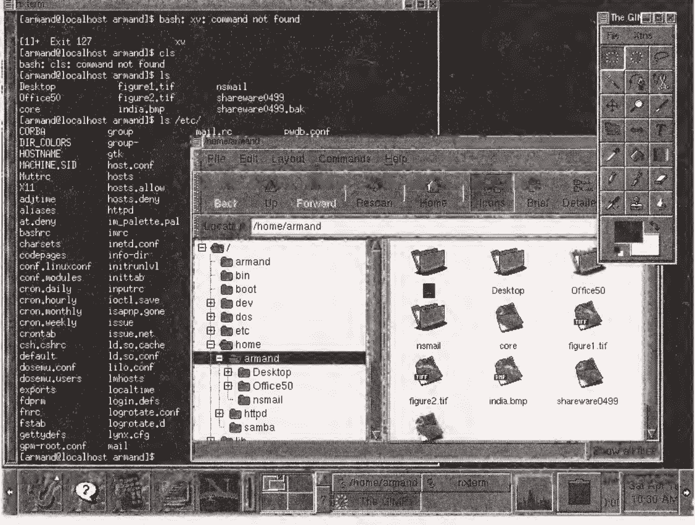

窗口管理器以标准的、预定义的方式与 X 服务器通信，因为它为 X 应用程序服务。这意味着具有不同接口特征的窗口管理器可以用这种标准方式与 X 服务器通信。同样，可用的各种 X 服务器（支持不同的显卡、显示器和其他性能特性）也可以以标准化的方式与应用程序通信。

## Microsoft Windows 对比 X Windows

（注：此部分原文仅有标题，翻译未提供具体正文）

## X 服务器、窗口管理器和桌面环境

（注：此部分原文仅有标题，翻译未提供具体正文）

## Motif 是什么？

（注：此部分原文仅有标题，翻译未提供具体正文）

从基础窗口层，通过创建不同的窗口管理器，为 X Windows 创建多个界面成为可能。

多个界面并不像微软 Windows 界面的某些自定义工具那样仅提供外观上的细微差异；相反，它们允许从窗口管理器到用户界面进行完全的重新设计。

例如，图 6.3 显示了一个运行窗口管理器的示例窗口，其界面类似于 NeXT 操作系统的用户界面。与图 6.4 相比（后者在相同系统上运行并显示相同的应用程序），后者显示的用户界面不像任何流行的 PC 或 Macintosh 操作系统。

# 图 6.3：

Afterstep 窗口管理器

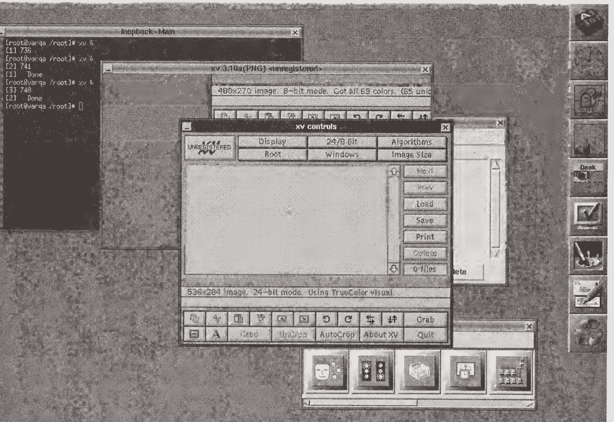

# 图 6.4：

Lestif 窗口管理器

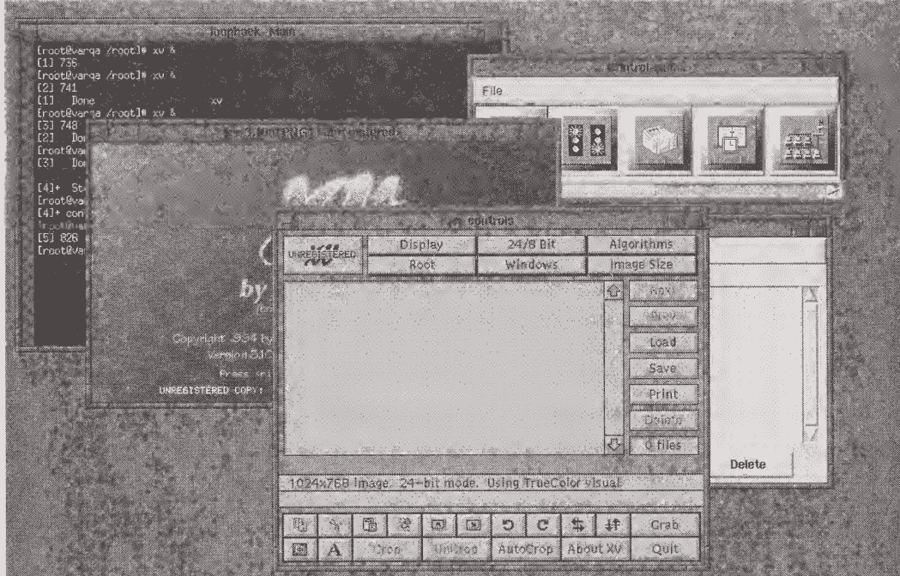

这些示例仅代表了 X Windows 窗口管理器提供的许多外观设计中的两种。更为人知的窗口管理器将在本章稍后部分进行讨论。

## 精细化控制

X Windows 环境的另一个优势是它对窗口环境和界面的所有方面提供了精细的控制。通过设置几十种设置中的任何一种，就可以控制环境的所有方面，从背景和前景窗口颜色到光标颜色、默认字体和默认窗口大小。用户还可以定义交互模式。例如，可以使用鼠标指针使窗口自动跳转到前台，或将光标焦点切换到后台窗口。

此外，这些以及其他功能可以按应用程序为基础进行定义，为每个应用程序创建不同的设置，以便每个应用程序都能以最方便的方式启动。

还可以定义每次启动 X 环境时打开哪些窗口和应用程序，并让系统在启动 X Windows 时对使用哪种窗口管理器做出逻辑选择。

第 7 章“安装和配置 X Windows”将讨论基本的 Windows 窗口配置选项。

## 客户端-服务器环境

如前所述，X Windows 世界基于客户端-服务器模型工作，其中应用程序是 X 服务器的客户端，由服务器驱动物理显示。这使得 Windows 非常适用于网络环境，允许应用程序运行在网络上的某一台机器上，同时在另一台机器上显示其输出。

微软 Windows 直到最近才具备这种能力，现在通过其在在端多用户 Windows NT 和 2000 系统上的终端服务器服务以一种有限且昂贵的方式实现了这一点。在 Linux、Unix 和 X 世界中，即使是最低的系统也能在该 Windows 客户端-服务器模型中扮演客户端角色或服务器角色。

## X 服务器、窗口管理器和桌面环境

现在你已经对 X Windows 在整体中的位置有了了解，你需要理解 X Windows 的基本组件：X 服务器、窗口管理器和桌面环境。正是这些组件以及它们所代表的模块化提供了 X Windows 的强大和灵活性。

## X 服务器

正如你所看到的，X Windows 系统的核心是 X 服务器。X 服务器处理若干任务：

- 支持各种显卡和显示器任务
- X Windows 显示的分辨率、刷新率和色彩深度
- 基本窗口管理：显示和关闭窗口，跟踪鼠标移动和击键输入

# X 服务器、窗口管理器和桌面环境 97

具有这些基本能力的多个 X 服务器脱颖而出。在 Linux 世界中有三个主要选择：`XFree86`、`Metro-X` 和 `Accelerated-X`。

## XFree86

`XFree86` 是几乎所有非商业 Linux 发行版中的默认 X 服务器，因为它按照 Linux 相同的条款免费提供。提供完整的源代码，用户可以自由更改代码以满足其需求，并且任何人都可以重新分发。Red Hat Linux 7.1 带有 `XFree86` 4.0.3。每几个月发布一次小更新，可以从 XFree86 网站 `http://www.xfree86.org` 下载。

`XFree86` Web 服务器设计用于为兼容 Intel 的 x86 PC 常用硬件，以及带有 Compaq Alpha、PowerPC、Sparc 和 MIPS 处理器的计算机提供广泛支持。虽然它的性能并不总是完美的，但 `XFree86` 是 Linux 和其他基于 Intel 的 Unix 变体中 X 服务器的规范，因此是大多数人熟悉的 X 服务器。

虽然在写本文时对 MIPS 的支持还不完全，但根据 `XFree86` 项目网站，MIPS HOWTO `http://os.sgi.com/mips/mips-howto.html` 提供了大量的文档。

`XFree86` 支持的流行显卡芯片组包括 Tseng 的 ET3000、4000 和 6000，Trident 全系列芯片，Cirrus Logic 大多数产品，Chips and Technologies 显卡芯片以及许多其他。你可以在 `XFree86` 项目的驱动页面 `http://www.xfree86.org/4.0.3/Status.html` 上找到支持硬件的完整列表。如果你使用的是更高版本，请相应替换 4.0.3。

虽然 `XFree86` 4 X 服务器在使 Linux 成为完整的免费的类 Unix 操作系统方面迈了一步，但它确实存在一些缺点，使其对企业或关键任务任务的吸引力较低。幸运的是，Red Hat Linux 7.1 有一个非常出实用程序，极大减轻了配置 `XFree86` 的工作。事实上，Free86 对笔记本显示的支持非常有限，一个错误可能意味着你的 LCD 损坏。如果你计划将笔记本作为 Linux 系统长期使用，查看 Laptop Accelerated-X 服务器支持的系统列表，看看你的设备是否在。

## XFree86 4 有什么新？

`XFree86` 第 4 版本包含了早期版本中未发现的新功能。其中一些新功能包括：

- 统一的服务器架构设计
- 支持多显卡
- 独立于操作系统
- 3D 渲染
- FreeType 支持

通过统一的服务器，`XFree86` 4 不再依赖驱动库（或任何其他操作系统）。通过 GLX 扩展，`XFree86` 现在支持通过 Silicon Graphics 的 OpenGL 进行 3D 渲染。有了 FreeType 支持，`XFree86` 现在可以管理 TrueType 字体。

`XFree86` 现在增强并增加了对更多平台的支持，包括基于 Alpha、MIPS 和 PowerPC 处理器的平台。预计它将为 Intel Itanium 64 位平台就绪。

## 商业 X 服务器

除了作为 Linux 完整免费解决方案部分的 `XFree86` 项目外，Linux 世界有两个领先的商业 X 服务器：`Metro-X` 和 `Accelerated-X`。这些产品的优势在于对各种图形芯片和卡的更广泛支持，并且通常充分利用这些芯片卡的加速特性。此外，`Metro-X` 和 `Accelerated-X` 提供了更智能的配置，通常可以在几分钟内安装并运行。

## X 服务器、窗口管理器和桌面环境

来自 Metro Link 的 `Metro-X` 是一种高性能 X 服务器选项。`Metro-X` 的许多优势包括一个设计良好的图形配置界面（如图 6.5 所示）、支持多头显示（标准配置支持四个不同的显示器）、支持某些品牌的触摸屏。关于 `Metro-X` 服务器的完整信息（包括支持的显卡）可以在 Metro Link 主页 `http://www.metrolink.com/` 上找到。`Metro-X` Linux 版售价 39 美元。

# 图 6.5：

`Metro-X` 的配置窗口

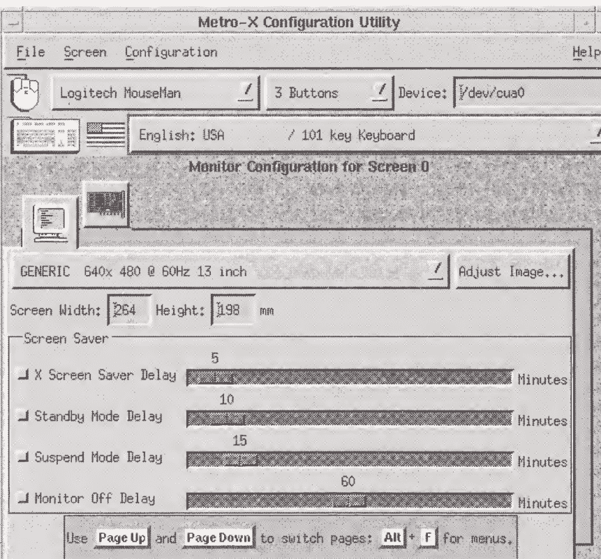

`Accelerated-X` X-Inside 实际上为 Linux 提供了一系列 X 服务器。这些包括 Linux 的 `Accelerated-X` 服务器、3D `Accelerated-X` 服务器、多笔记本 `Accelerated-X` 服务器以及专门的 Laptop `Accelerated-X` 服务器。笔记本 `Accelerated-X` 服务器意义重大，因为笔记本上的芯片组与桌面显卡不同，且 LCD 屏幕有自己的一套被桌面驱动程序忽略的 own。

`Accelerated-X` 支持来自 60 多家制造商的 400 多块显卡。多头 X 服务器支持多达 16 个屏幕，并在每个屏幕上提供 `Accelerated-X` 的所有功能。

总体而言，X-Inside 的服务器价格具有竞争力。`Accelerated-X` 售价 99.95 美元，笔记本服务器为 149.95 美元，多头版本为 199.95 美元。详细信息可用 X-Inside 网站 `http://www.xinside.com`。

## 窗口管理器

窗口管理器完善了 X 服务器提供的优质 GUI 功能。除此外，窗口管理器包括窗口装饰（提供调整大小、移动、关闭和最小化窗口的方法）以及启动应用程序的机制（如桌面菜单、控制面板和按钮栏）。


本节其余部分将要介绍 Linux 可用的某些主要窗口管理器，包括 `FVWM`、`fwm95`、`twin`、`olwm` 等。`Red Hat Linux 7.1` 的默认窗口管理器是 `Sawfish`，任何相对完整的安装都会包含 `FVWM` 和其他备用窗口管理器。

`X Windows` 窗口管理器的概述可以访问 `http://plig.org/xwinman/`。

## FVWM 和 fwm95

在 20 世纪 90 年代中期，Linux 最常用的窗口管理器是 `FVWM` 或该包的变体。`FVWM` 这个名字很奇怪，因为没有人确定“F”代表什么。有人认为它代表“Feebble”（笨拙的）虚拟窗口管理器；另一些人认为它是“Fine”（精细的）虚拟窗口管理器；还有人认为“F”的含义早已被遗忘，而且对任何人都不重要（我倾向倾向于后者的观点）。

`FVWM` 是一个轻量级窗口管理器，提供了一个灵活、可定制的窗口环境，设计看起来有点像 `Motif` 窗口管理器（`MWM`，一种商业产品）。`FVWM` 提供了多个虚拟桌面和一个用于扩展窗口管理器的模块系统，在较新的 `2.2.5` 版本中，它允许即时的配置更改和特定窗口的功能定制。`FVWM` 的主页位于 `http://www.fwwm.org/`。图 6.6 包含了一个 `FVWM` 桌面示例。

### FVWM 6.6

`FVWM` 桌面示例


`FVWM` 几乎随几乎每个 Linux 发行版发布，并以作为具有自身外观和感受的新型窗口管理器的基础而闻名，包括：

- `fwwm95` 设计外观像 Windows 95
- `Afterstep` 设计外观像 NeXT 环境
- `SCWM (Scheme 可配置窗口管理器)` 使用 Scheme 语言进行配置

图 6.7 包含一个 `fvwm95` 运行中的屏幕。

### 图 6.7

`Fvwm95` 提供了一个类似于 Windows 95 的环境。


`Fvwm95` 基于 `FVWM` 版本 2，并保留了该版本灵活、易于配置的特性。它继续支持 `FVWM` 模块，但增加了实现 Windows 95 风格功能（如任务栏）所需的模块。`Fvwm95` 的信息可以在网站 `http://www.plig.org/xwinman/fvwm95.html` 上获取。

> 注意
> `FVWM2` 包可在第二张 `Red Hat Linux 7.1` 安装光盘中找到（本图书未包含）。

## twm

`Tab` 窗口管理器（`twm`），通常根据其主要开发者的名字命名为“Tom 的窗口管理器”，是一个基础且功能齐全的环境，作为备用窗口管理器包含在 `Red Hat Linux 7.1` 中。图 6.8 显示了一个典型的 `twm` 桌面。

### 图 6.8

`twm` 桌面

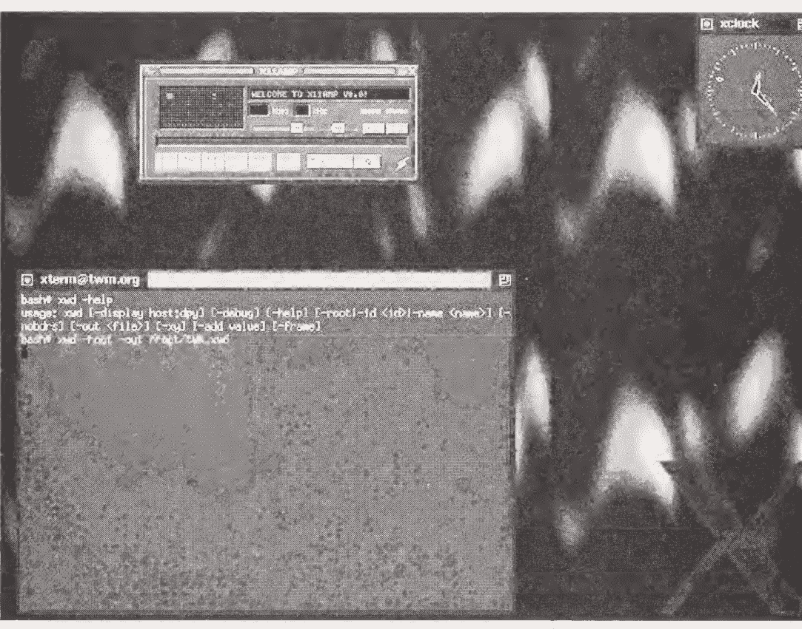

`twm` 窗口管理器提供了用户在 `X Windows` 窗口管理器中期望的许多关键功能，包括点击输入或指针驱动的键盘焦点，以及用户定义的按键和按钮绑定。然而，它的界面在视觉上非常简单，一些人会认为它局限性。`Vtwm` 是包含虚拟桌面的 `twm` 版本也可用，可以从 `ftp:/ftp.x.org/R5contrib/tvwm-5.3.tar.gz` 下载。

## olvm

`Olvm`，即 `OpenLook` 虚拟窗口管理器（`olvm`），多年一直是 `Sun` 系统上的标准窗口管理器。虽然 `Sun` 系统现在采用了 `Motif` 和通用桌面环境（在本章稍后部分讨论），但独特的 `OpenLook` 界面在许多用户中仍然很流行。`Olvm` 为 `OpenLook` 包增加了对虚拟桌面的支持。图 6.9 显示了一个 `olvm` 桌面示例。

`olvm` 中使用的界面会让许多用户感到别扭，特别是在菜单和窗口响应鼠标按钮的方式上。这是 `OpenLook` 在 `Sun` 世界之外没有获得巨大流行的原因之一。`Olvm` 可以从 `ftp:/ftp.x.org/R5contrib/olvm4.tar.gz` 下载。

### 图 6.9

`olvm` 界面

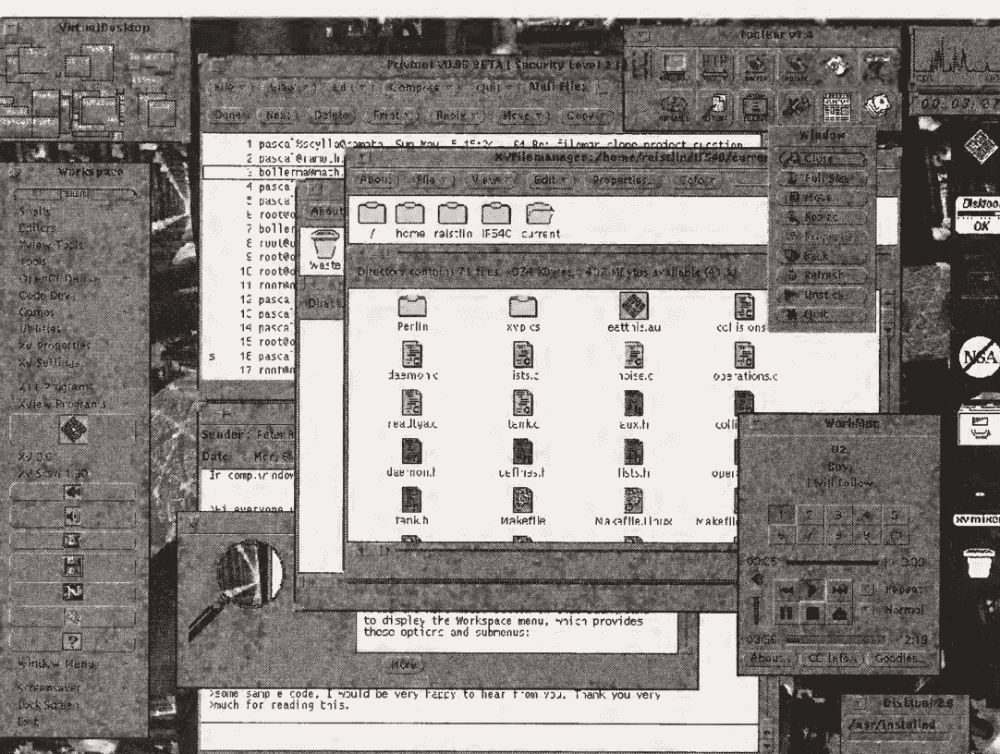

## Afterstep

`Afterstep` 是另一个基于 `FVWM` 的变体，设计外观像 `NextSTEP`。图 6.10 显示了 `Afterstep` 示例。

### 图 6.10

`Afterstep` 桌面

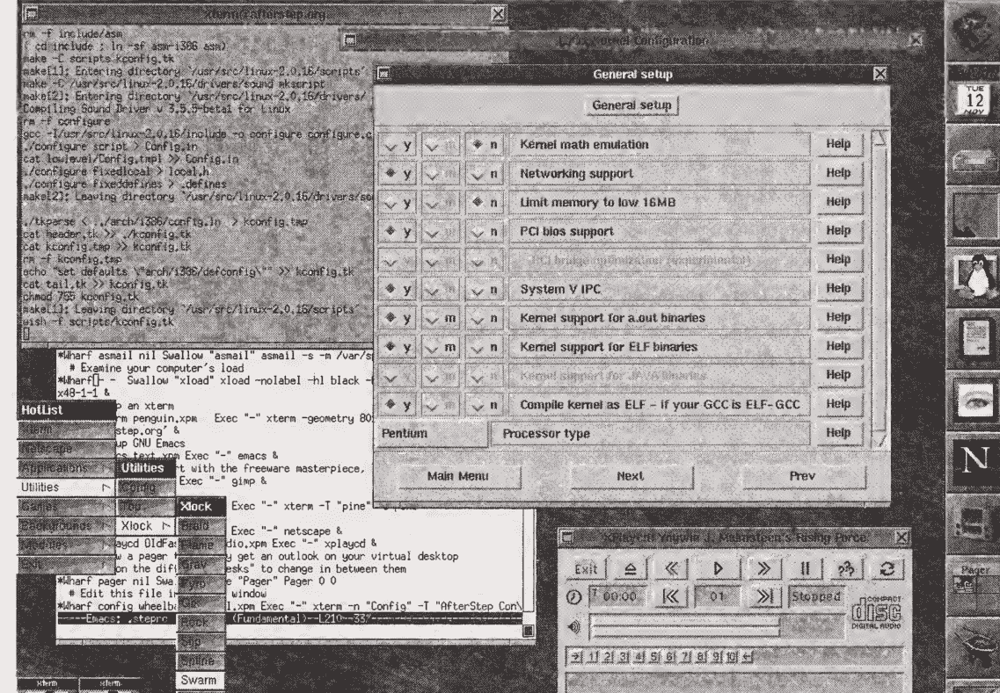

## Amiwm

如果你是 `Amiga` 用户并爱上了它的界面，那么 `Amiwm` 可能就是你的窗口管理器。`Amiwm` 模拟了 `Amiga`，如图 6.11 所示。你可以从这里了解 `Amiwm`。

### 图 6.11

`Amiwm` 桌面

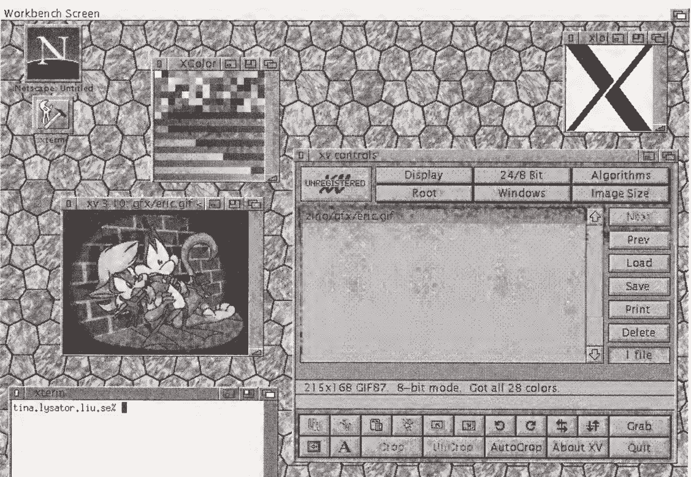

## Enlightenment

`Enlightenment` 是一个大项目，试图开发一种超越常规的窗口管理器。图 6.12 和 6.13 显示了环境可能的两种配置。帮助 `Enlightenment` 脱颖出的众多功能之一是它赋予用户手工打造外观和感受的能力。

### 图 6.12

`Enlightenment` 桌面

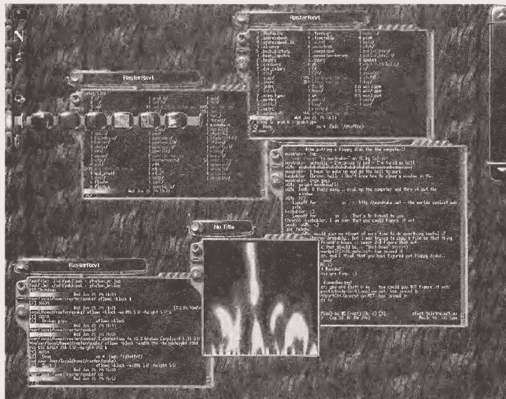

### 图 6.13

`Enlightenment` 环境


## Sawfish

`Sawfish` 窗口管理器是 `GNOME` 桌面环境的新默认管理器。像 `Enlightenment` 一样，`Sawfish` 最大化了配置每个窗口的能力，这是通过使用 `LISP` 编程语言的工具实现的。作为 `GNOME` 桌面的一部分，`Sawfish` 控制集成在 `GNOME` 控制中心中，如图 6.14 所示。第 10 章《高级 GNOME 配置中心》详细涵盖了 `GNOME` 控制中心和 `Sawfish`。

### 图 6.14

`Sawfish` 环境

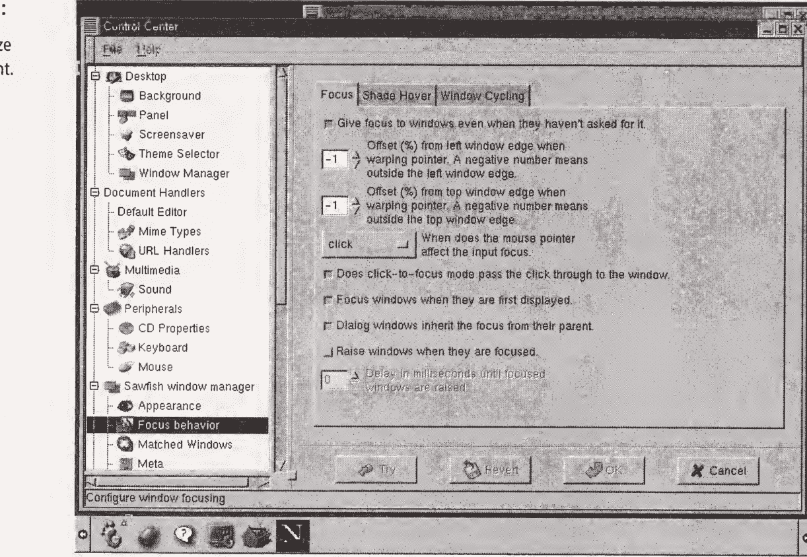

## 桌面环境

桌面环境不仅仅是窗口管理器。桌面环境旨在提供完整、连贯的 GUI。使用简单的窗口管理器，无法保证应用程序之间外观和感受的一致性。

其他操作系统中存在的功能，例如应用程序之间的拖放和跨应用程序数据嵌入。

Linux 有多种不同的桌面环境，它们提供了强大且集成的图形用户界面（GUI），并为应用程序开发者提供了一个目标平台，以便他们构建具有统一外观和体验的软件，并包含了拖放等集成功能。

在这些桌面环境中，`K Desktop Environment` 和 `GNOME` 是两个免费提供的，并且已成为事实上的标准 Linux 桌面环境的竞争者。

### K Desktop Environment

`K Desktop Environment (KDE)` 尝试提供 `Common Desktop Environment (CDE)`，在本节稍后部分讨论的免费替代方案。在这一项工作中，`KDE` 将一组应用程序（如文件管理器、终端模拟器和配置系统）与窗口管理器相结合，为 `X` 应用程序创建一个一致的外观和体验。6.15 显示了一个典型的 `KDE` 桌面。

图 6.15：

`KDE` 桌面

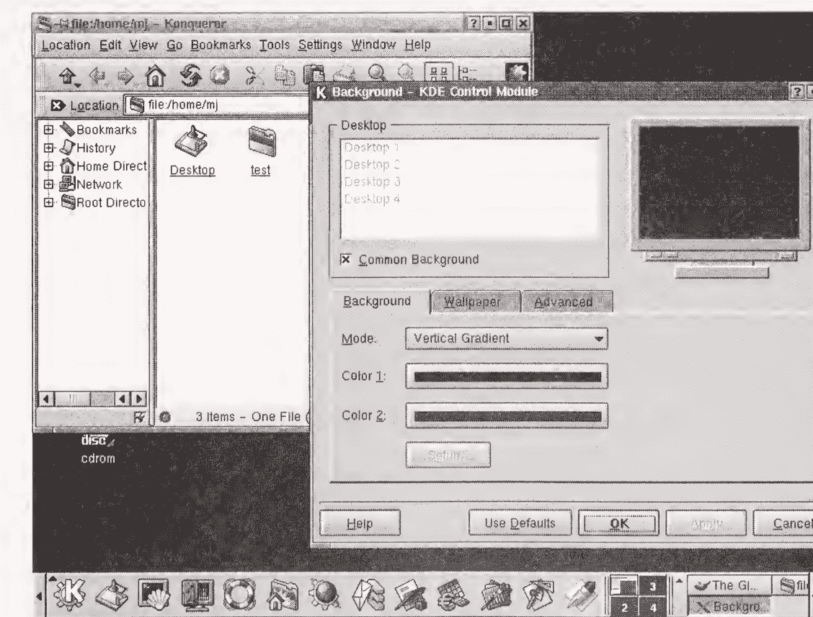

`KDE` 是许多 Linux 发行版的默认桌面环境，包括 `Caldera`、`S.U.S.E.` 和 `Corel`。它是大多数其他发行版的替代桌面环境。

`KDE` 规划背后的部分内容是指定规范并确保开发环境使得开发者能够创建在功能和外观上都一致的应用程序。`KDE` 提供了一个极具吸引力、外观专业的工作环境，如果为 `KDE` 开发了必要的应用程序，它将成为桌面用户一个很有前景的选择。该网站为 `http://www.kde.org/`。第 11 章“使用 KDE”详细介绍了随 `Red Hat Linux 7.1` 包含的 `KDE 2.1.1`。

### GNOME: The GNOME Network Object Model Environment

`GNOME` 是另一项为 Linux 开发全面的、免费桌面环境的尝试成果。与内置窗口管理器的 `KDE` 不同，`GNOME` 是与窗口无关的。它提供了一个编程接口，允许窗口管理器开发者在其窗口管理器中集成对 `GNOME` 的完全支持。

`Red Hat Linux 7.1` 使用 `Sawfish` 窗口管理器将 `GNOME` 作为默认桌面环境发布。该发行版还包含了其他窗口管理器和 `KDE`，但由于默认安装使用的是 `GNOME` 和 `Enlightenment`，因此本书将使用 `GNOME` 和 `Enlightenment` 作为目标桌面。有关使用 `GNOME` 的介绍，请参阅第 8 章“使用 GNOME 和 X Windows”。

### MWM

`MWM`，即 `Motif Window Manager`，是一个 `Motif` 发行版的一部分商业窗口管理器。本章的下一节将更详细讨论作为完整环境的 `Motif`。

### The Common Desktop Environment

`Common Desktop Environment (CDE)` 是一个心勃勃的项目，旨在标准化各种 Unix 平台（包括 `AIX`、`Compaq Unix`、`HP/UX` 和 `Solaris`）图形环境和开发区域。现在 `CDE` 也通过 `X-Inside (http://www.xinside.com/)` 的 `DeDesktop` 图形界面适用于 Linux。此商业应用程序费用 49 美元，需要 `X-Inside` 的 `Accelerated-X`。

除了基于 `Motif` 的一致图形环境外，`CDE` 还提供了一系列凝聚的工具和应用程序，以标准化管理程序并简化用户图形环境的配置和管理。`CDE` 为 `X` 环境带来的增强包括拖放功能以及在其他 GUI 操作系统中常见的文件夹和图标类型。

### What Is Motif?

如果你开始在网络上寻找要安装在 Linux 系统上的 `X Windows` 应用程序，你不可避免地会遇到提到它们使用 `Motif` 库或 `Motif` 工具集的应用程序。

`Motif` 是由开放软件基金会 (`OSF`) 在 20 世纪 80 年代引入的 `X Windows` 开发环境，旨在为 `X Windows` 应用程序提供一致的策略。`Motif` 提供了一个控件工具包，开发者可以在开发应用程序可以使用。通过这些控件，`Motif` 开发者制作的应用程序遵循 `Motif` 策略，具有一致的外观和体验。

`Motif` 最近在一种“开放”许可下重新发布，这意味着想要基于 `Motif` 库构建和分发应用程序的开发者不再需要为该特权付费。然而，新 `Open Motif` 背后的组织 `Open Group`（开放组）仍在销售该语言和系列库背后的文档。许多 Linux 开发者认为 `Motif` 许可的意思是它不能用于为 Linux 等免费操作系统开发软件。

> `Open Group` 是一个致力于软件标准的行业组织。他们与开源许可的赞助者没有关系。事实上，他们承认他们的 `Motif` 许可并不符合开源要求。

除了工具包和库之外，`Motif` 发行版还包含了自己的窗口管理器 `MWM`，原始的 `FVMWM` 外观和体验基于此获得了专利。图 6.16 显示了一个 `MWM` 桌面示例。

# 第 6 章 • X Windows 概述

### 图 6.16：

一个 `MWM` 桌面


## Do I Need Motif?

对于大多数 Linux 用户来说，可能不需要使用 `Motif`。应该考虑 `Motif` 的用户包括以下人员：

- 想要使用 `Motif` 工具包开发应用程序的开发者。
- 想要运行需要 `Motif` 库的应用程序的用户。大多数使用 `Motif` 库的商业应用程序要么在应用程序中嵌入必要的 `Motif` 代码（因此用户不需要拥有许可），要么包含完整版本的 `Motif` 运行时库。

## Alternative to Motif

像 Linux 中的许多事物一样，仍然有需要。

## Looking Ahead

对 `X Windows` 的这些讨论是你向实际操作...的第一步。

在接下来的两个章节中，你将掌握基础并开始。

# 第七章

## 安装和配置 X Windows

- 获取 X Windows
- 准备配置 X Windows
- 使用 Xconfig 配置 X86
- 使用 Xf6 配置 X86
- 测试你的配置

现在你对 `X Windows` 是什么有了了解，是时候安装并配置软件，使其运行起来了。

本章讨论了如果你不安装发行版自带的版本，如何获取 `X Windows`。随后，它描述了如何配置以便在你的计算机上优化运行。

## 获取 X Windows

如果你使用的是书中附带的 `Red 7.1`，并且按照第 4 章“安装 Red Hat Linux 7.1”建议安装了所有关键组件，那么你不需要阅读这一节，因为你已经获取并安装了 `X` 文件。你可以直接跳到“准备配置 X”部分。

## 从 Red Hat Linux 7.1 CD 安装

如果你使用的是 `Red Hat Linux 7.1` 但安装 Linux 时没有安装 `X Windows`，安装 `X` 是一个相当简单的过程。这里概述依赖于第 14 章“处理文件”中描述的访问光驱的技术。

## 使用 rpm

在本节中，你将使用 `rpm`（Red Hat 包管理器），这是一个随 `Red Hat Linux` 以及其他许多发行版提供的用于管理 `Red Hat` 软件包的工具。

`rpm` 允许你安装新包、卸载已安装的包并查看包的信息（例如它们包含哪些文件）。

要安装包，使用以下命令：

```
$ rpm -i package-file-name
```

要列出所有已安装的包，使用此命令：

```
$ rpm -qa | more
```

此命令一次显示一屏已安装软件包列表；你可以通过空格键向下滚动到下一屏。列表显示的包名并非安装软件包时使用的原始文件名。然而，可以使用以下命令卸载软件包：

```
$ rpm -e package-file-name
```

为了从你的 `Red Hat 7.1 CD-ROM` 安装 `X Windows`，第一步是挂载你的 `CD-ROM` 驱动器，以便 Linux 能够访问它。这个过程并不看起来那么简单，它取决于你拥有的 `CD-ROM` 驱动器类型（`IDE/ATAPI`、`SCSI` 或专用）以及驱动器的安装方式。关于 `CD-ROM` 选项的详细讨论请见第 19 章“Linux 多媒体”。

接下来的指令假设你有一个 `IDE` 的 `CD-ROM` 驱动器，因为这些在当今的多媒体 PC 中非常常见。这些指令还假设 `CD-ROM` 驱动器被安装为次级 `IDE` 从设备，因为大多数市售电脑只包含一个硬盘。

基于这些假设，你的 `CD-ROM` 驱动器将是设备 `/dev/hdb`。对于其他驱动器类型和配置，请参考第 19 章的讨论以确定你的设备。

将 `Red Hat Linux 7.1 CD-ROM` 插入驱动器并输入命令：

```
$ mount /dev/hdb /mnt/cdrom
```

以挂载磁盘并让 Linux 可以访问。你可以使用以下命令查看 `CD-ROM` 的内容并确保它是可访问的：

```
$ ls /mnt/cdrom
```

结果应该如下：

```
autorun dosutils RedHat RELEASE-NOTES.es RELEASE-NOTES.ja
boot. images RELEASE-NOTES RELEASE-NOTES.fr RPM-PG-KEY
COPYING README RELEASE-NOTES.de RELEASE-NOTES.it Trans.TBL
```

> 注意
> 如果你不知道是哪一个 `CD-ROM` 设备，`/dev/cdrom /mnt/cdrom` 命令通常可以正常工作。如果你运行 `ls -1 /dev/cdrom` 命令，可能会发现它链接到了你 `CD-ROM` 实际使用的设备。

下一步是进入 `CD-ROM` 上包含构成 `Red Hat Linux 7.1` 的所有软件包的目录。该目录是 `RedHat/RPMS` 子目录。使用以下命令：

```
$ cd /mnt/cdrom/RedHat/RPMS
```

如果你输入命令：

```
$ ls
```

你应该能看到一个文件列表滚动，它们都以 `.rpm` 扩展名结尾，表示它们是 `Red Hat` 包管理器文件。

现在你准备好安装 `X Windows` 软件包了。为了实现这一点，你需要确定要安装哪些软件包。首先，你需要 `XFree86-4.0.3-5.i386.rpm` 中的通用 `XFree86` 字体。接下来，你需要所有的 `X Windows` 字体，它们位于：

- `XFree86-100dpi-fonts-4.0.3-5.i386.rpm`
- `XFree86-75dpi-fonts-4.0.3-5.i386.rpm`

此外，你还需要共享的 `XFree86` 库：

- `XFree86-libs-4.0.3-5.i386.rpm`
- `XFree86-xfs-4.0.3-5.i386.rpm`

你还需要 `Red Hat` 提供的 `XFree86` 配置工具，它位于 `XConfigurator-4.9.27-1.i386.rpm` 文件中，以及你想要的 `X Windows` 程序集合，这些可以在 `XFree86-tools-4.0.3-5.i386.rpm` 中找到。

`XFree86 4` 不再需要单独的包。然而，本文写作时的版本不支持 `3.3.x` 中支持的所有模块。请查看你的 `XFree6` 发布说明。版本 `4.0.3` 的发布说明可以在 `http://www.xfree86.org/4.0.3/RELNOTES.html` 找到。如果你有不同版本的 `XFree86`，请相应替换 `4.0.3`。

对于 `XFree86 4`，不再需要特定显卡的单独包。

现在你已经列出了需要安装的文件列表，可以使用 `rpm -i` 命令安装这些文件：


```
$ rpm -i XFree86-4.0.3-5.i386.rpm
$ rpm -i XFree86-100dpi-fonts-4.0.3-5.i386.rpm
$ rpm -i XFree86-75dpi-fonts-4.0.3-5.i386.rpm
$ rpm -i XFree86-libs-4.0.3-5.i386.rpm
$ rpm -i XFree86-xfs-4.0.3-5.i386.rpm
$ rpm -i XConfigurator-4.9.27-1.i386.rpm
$ rpm -i XFree86-tools-4.0.3-5.i386.rpm
```

这些将在书中稍后讨论；现在只需使用它们来让 X Windows 运行，稍后你会学习它们的含义）：

```bash
$ chmod +x /dos/tmp/extract
```

```bash
$ /dos/tmp/extract -C /usr/X11R6 X[a-df-uw-z]*.tgz
$ /dos/tmp/extract -C /etc/X11 Xetc.1
$ /dos/tmp/extract -C /var X.tgz
$ ln -s /etc/X11/app-defaults /usr/X11R6/lib/X11
$ ln -s /etc/X11/fs /usr/X11R6/lib/X11
$ ln -s /etc/X11/libproxy /usr/X11R6/lib/X11
$ ln -s /etc/X11/proxymgrr /usr/X11R6/lib/X11
$ ln -s /etc/X11/rstart /usr/X11R6/lib/X11
$ ln -s /etc/X11/twm /usr/X11R6/lib/X11
$ ln -s /etc/X11/xdm /usr/X11R6/lib/X11
$ ln -s /etc/X11/xinit /usr/X11R6/lib/X11
$ ln -s /etc/X11/xsm /usr/X11R6/lib/X11
$ ln -s /etc/X11/xserver /usr/X11R6/lib/X11
$ /sbin/1config /usr/X11R6/lib
$ /usr/X11R6/bin/mkfontdir /usr/X11R6/lib/X11/fonts/misc
```

尽管此时现在看起来很晦涩，但所有这些输入的结果是 X Windows 所需的文件将安装到你的 Linux 系统上。

## 安装 XFree8 版本 4.0.3

现在你已经准备好进入过程的第二个阶段，即安装 XFree8 版本-4.0.3 作为版本 4.0.2 的更新。回到之前列出的下载网站，进入版本 4.0.3 目录。使用你之前使用的库类别，然后下载以下文件：

```
Xinstall.sh          extract          Xupdate.tgz
Xdocupd.tgz          Xdrivers.tgz
```

在大多数情况下，你可以使用下载的针对版本-4.0.3 的脚本 `Xinstall.sh` 在你的计算机上安装 XFree86。进入包含下载文件的目录（在本例中为 `/dos/tmp`），并使用以下命令运行脚本：

```bash
$ cd /dos/tmp
$ sh Xinstall.sh
```

这仅在你已经安装了 XFree86 版本 4.0.2 时才有效。你现在应该会经历一系列提示。安装完成后，使用 `Xconfigurator` 或 `xf86config` 配置 X Windows。这两个工具将在接后的章节中讨论。

## 准备配置 X Windows

在实际配置 X Windows 之前，你必须收集有关硬件的一些关键信息，以确保在尝试优化 X Windows 的过程中损坏显示器。你需要以下信息：

- 显卡的品牌和型号
- 显示器的品牌和型号
- 显卡上的显存
- 你正在使用的鼠标类型
- 显示器的水平同步频率范围
- 显示器的垂直同步频率范围

如果没有这些信息，在配置 XFree86 时可能会出错，从而可能损坏你的显示器。让我们逐项获取这些信息。

### 显卡的品牌和型号

获取这些规格应该并不困难。通常情况下，如果你检查显卡的说明书，就可以获得这些信息。

如果你购买了非无品牌的显卡，那么品牌并不重要。在这种情况下，请检查显卡的文档以查看卡上使用的是哪种芯片组。常见的芯片组包括 Cirrus Logic、S3 和 Chips and Technologies 等。在任何情况下，请务必记录芯片组的型号以及芯片的标记。

如果你的计算机主板集成了视频支持，请检查你的计算机或主板的文档以确定芯片组制造商和型号。

如果你手头没有文档，有一个名为 `SuperProbe` 的 XFree86 工具，可以帮助检测你的视频硬件。如果成功，此命令可以检测与你的硬件相关的 X 服务器、芯片组和 RAMDAC。要运行该程序，请使用命令

```
$ SuperProbe
```

### 显示器的品牌和型号

检查显示器说明书获取其品牌和型号。如果你的显示器是配置软件已知的类型，那么这些信息在配置 XFree86 时可能会很有用。

### 显卡上的显存

检查显卡说明书获取卡上的内存大小。在现代计算机中，这通常不少于 4MB，在某些 PC 上可能是 8MB 甚至高达 32MB。在较旧的计算机或显卡上，你可能会发现只有 256KB 的显存。

如果你无法确定卡上的内存大小，

### 你正在使用的鼠标类型

这些信息对于配置 X Windows 是必须的。可能的类型包括：

- 微软兼容（通常有两个按钮）
- 系统兼容（通常有三个按钮）
- 总线型（Bus）
- PS/2

## 使用 Xconfigurator 配置 XFree86

Red Hat Linux 带有 `Xconfigurator`，这是一个用于 XFree86 的配置程序，它比 XFree86 自带的工具好用得多。让我们先看看使用 `Xconfigurator` 配置 X Windows，然后查看在没有 `Xconfigurator` 的系统上配置 XFree86。

`Xconfigurator` 是一个简单的、菜单驱动的工具，极大简化了配置 XFree86 的过程。要运行该程序，请使用

```
$ Xconfigurator
```

### 使用 Xconfigurator 127 配置 XFree86

要开始使用该程序，按回车键跳过欢迎屏幕。`Xconfigurator` 首先尝试检测你的显卡。如果检测成功，你将看到结果，如图 7.3 所示。

# 图 7.3：

PCI 显卡探测结果

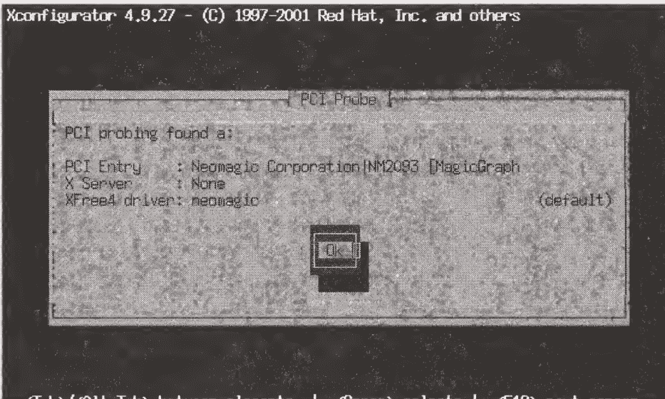

如果你看到的是此界面，则无需再识别显卡和相关的 X 服务程序。否则，你看到的第一个菜单如图 7.4 所示。

# 图 7.4：

显卡菜单

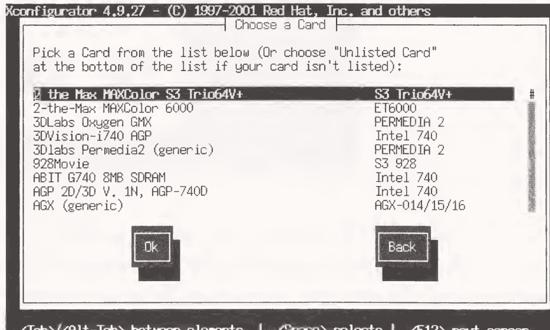

在这里，你选择系统运行的显卡类型或芯片组类型。使用上下方向箭头（或 PgDn 和 PgUp 键）在按字母字母顺序排列的显卡和芯片组长列表中滚动。

确保你选择的显卡或芯片组与硬件完全匹配。如果不匹配，盲目猜测并选择一个相似的型号是不明智的——事实上，“相似”的显卡可能与你的显著不同。在这种情况下，请选择列表中间的“Generic VGA Compatible”（通用 VGA 兼容）或列表底部的“Unlisted Card”（未列出卡）。一旦完成选择，按回车键进入下一个屏幕。

如果你选择了“Unlisted Card”，将出现第二个菜单，你可以在该菜单中为你的显卡选择合适的服务器程序，如图 7.5 所示。如果你不确定选择哪种服务器，可以使用前文“安装 X Windows”章节中提到的通用服务器。对于大多数现代多媒体计算机，这通常是 SVGA 服务器。

# 图 7.5：

X 服务器菜单

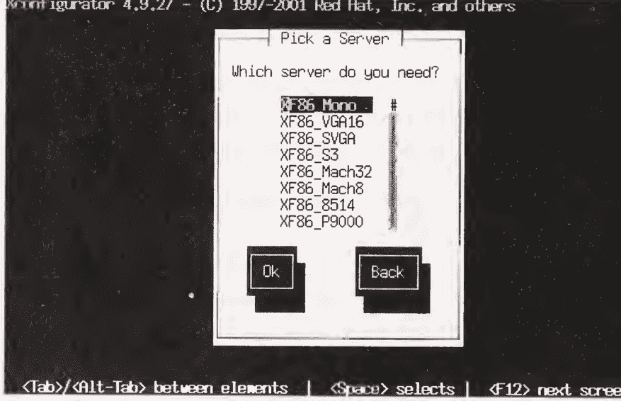

一旦你选择了显卡并可能指定了服务器，下一步是在显示器选择菜单中指定你的显示器，菜单如图 7.6 所示。

# 图 7.6：

显示器选择菜单

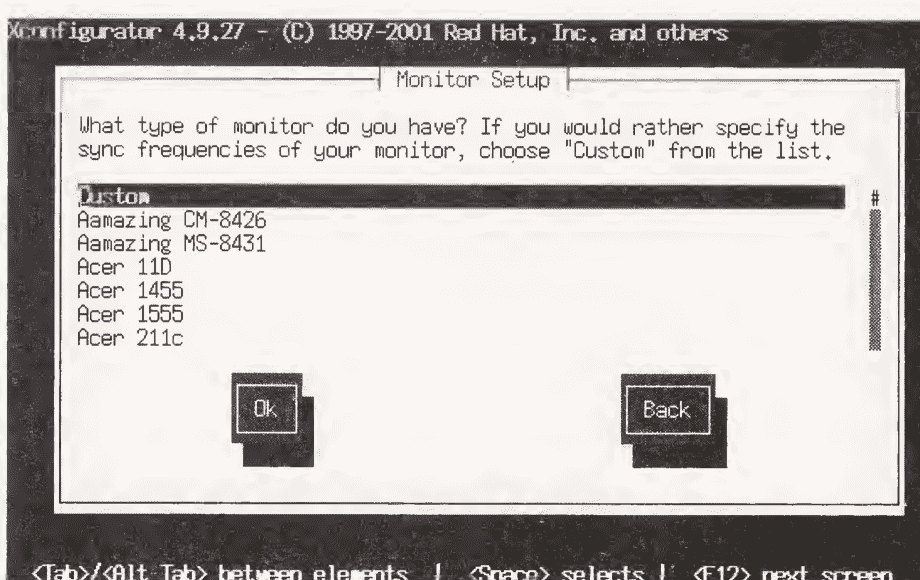

如果你在列表中找不到你特定的显示器，则有三个选择：

- 选择“Custom”（自定义），然后为你的系统指定水平和垂直同步范围（如前文所述）。
- 如果你对显示器的最大分辨率/或或同步范围有大致了解，请选择一个通用显示器。对于主流分辨率（640 × 480 到 1600 × 1200），有不同的通用显示器可选择。对于 LCD 屏幕，还有其他通用显示器选项，它们对应于大多数笔记本电脑（请见警告）。
- 如果你没有显示器的同步范围，且不知道显示器是否为多同步显示器，请选择“Generic LCD Panel”（通用 LCD 面板）或具有最低可用垂直同步率的“Generic Standard VGA”（通用标准 VGA）（这些是最小公分数，应作为你的最后选择）。

## 警告

在配置 LCD 显示器或笔记本电脑时要格外小心，因为最大分辨率和同步范围各不相同。错误的设置可能会导致你的 LCD 屏幕永久损坏。在选择最大分辨率和/或同步范围之前，请咨询 LCD 或笔记本电脑附带的文档，或咨询制造商。

做出选择后，系统可能会让你探测硬件以获取显卡的正确分辨率和色彩深度。许多现代 PCI 卡都支持此功能，如果你有一张这样的卡，值得尝试探测。如果你使用的是较旧的卡或探测失败，仍然可以手动配置相关设置。

如果你在显示器选择菜单中选择了“Custom”，或者探测失败，你仍然可以手动配置相关设置，这如图 7.7 所示。

# 图 7.7：

水平同步菜单

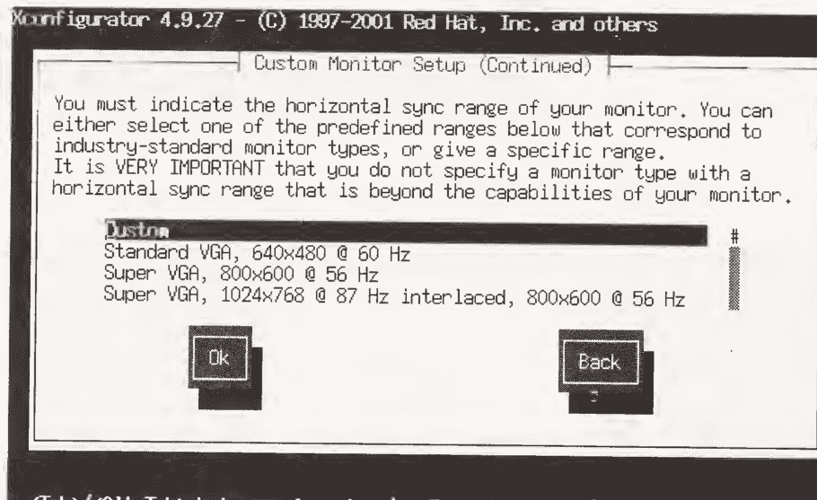

如果你在列表中找到了与显卡完全匹配的项，请按回车键进入下一个屏幕。如果你不匹配，请选择列表中间的“Generic VGA Compatible”（通用 VGA 兼容）或在列表底部选择“Unlisted Card”（未列出卡）。一旦完成选择，按回车键进入下一个屏幕。

如果你选择了与显卡匹配的显示器，下一步是在显示器选择菜单中指定你的显示器，菜单如图 7.8 所示。

# 图 7.8：

垂直同步菜单

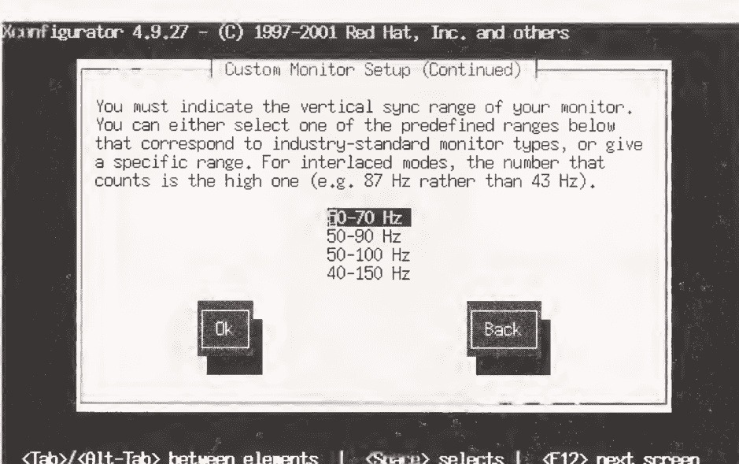

如果你选择了“Unlisted Card”，将出现第二个菜单，你可以在该菜单中为你的显卡选择合适的服务器程序，如图 7.5 所示。如果你不确定选择哪种服务器，可以使用前文“安装 X Windows”章节中提到的通用服务器。对于大多数现代多媒体计算机，这通常是 SVGA 服务器。如果你没有显示器的同步范围，且不知道显示器是否为多同步显示器，请选择“Generic LCD Panel”（通用 LCD 面板）或具有最低可用垂直同步率的“Generic Standard VGA”（通用标准 VGA）（这些是最小公分数，应作为你的最后选择）。

# 图 7.9：

显卡内存菜单

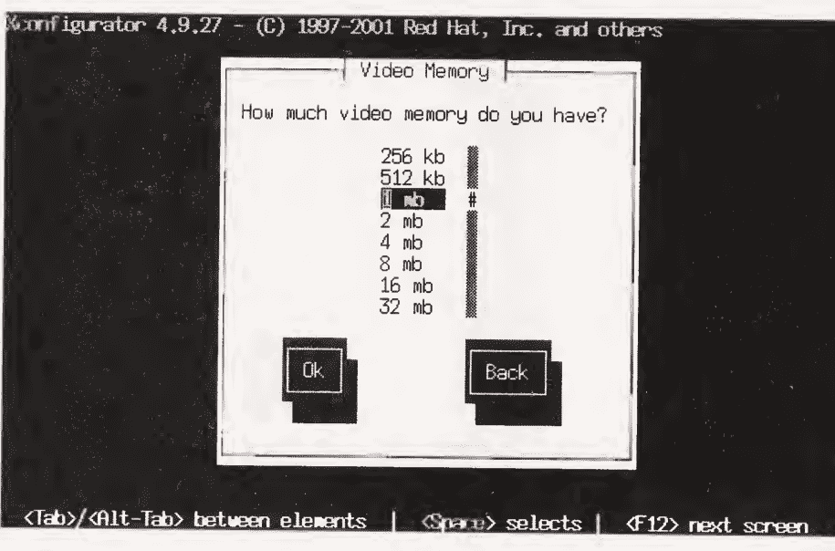

一旦你选择了显卡并可能指定了服务器，下一步是在显示器选择菜单中指定你的显示器，菜单如图 7.6 所示。如果你找到了与显卡完全匹配的项，请尝试探测。如果你使用的是较旧的卡或探测失败，你仍然可以手动配置相关设置。如果你在显示器选择菜单中选择了“Custom”，或者探测失败，你仍然可以手动配置相关设置，这如图 7.10 所示。

# 图 7.10：

芯片组菜单

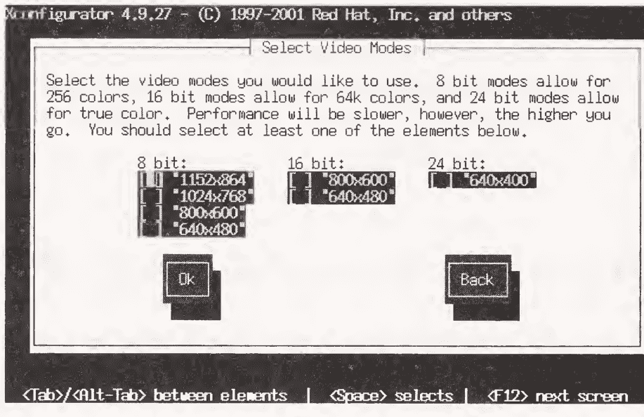

一旦你选择了显卡并可能指定了服务器，下一步是在显示器选择菜单中指定你的显示器，菜单如图 7.11 所示。

# 图 7.11：

显示模式菜单


一旦你选择了显卡并可能指定了服务器，下一步是在显示器选择菜单中指定你的显示器，菜单如图 7.12 所示。

# 图 7.12：

欢迎屏幕


## 使用 X86config 配置 XFree86

`Xconfigurator` 只提供一种配置 XFree86 的方法，且这种方法仅适用于 Red Linux。XFree86 本身带有一个配置程序，适用于任何包含 X8 的 Linux 发行版：`xf86config`。

`xf86config` 也是菜单驱动的，但它为你完成的工作较少，操作较繁琐。然而，`xf86config` 还允许你配置鼠标和键盘。要运行 `xf86config`，使用以下命令：

```
$ xf86config
```

会出现类似图 7.12 所示的欢迎行。

### 使用 Xf86config 135 配置 XFree86

## 提示

你需要作为 root 用户才能成功完成使用 `xf86config` 配置 X Windows 的所有步骤。

## 注意事项

在配置过程中，`Xf86config` 会在屏幕上显示大量密集的文本。欢迎界面仅仅是其中的第一个。如果你不熟悉 `xf86config`，最好仔细阅读所有内容，以便充分了解你所做选择的意义性。一旦你做出了选择（即使是留空），也无法返回；你将需要重新启动 `xf86config`。

显示的第一个菜单是图 7.13所示所示鼠标协议菜单。通过输入相关数字并按 Enter 键来选择正确选项。你将看到一系列鼠标相关的问题，可能包括以下内容：

- “你是否想启用 ChordMiddle（和弦中键）？” 如果你有一个由罗技制造的兼容三键的鼠标，可以选择 ChordMiddle 使中键起作用。否则，只有左键和右键会起。
- “你是否想启用 EmulateButtons（模拟按钮）？” 当你使用双键鼠标和如微软兼容模式等双键协议时，应启用此选项。这允许你通过点击左键和右键来模拟中键，这在某些 Windows 中是必要的。
- 首先指定鼠标协议，从以下选项中选择一个：
  1. 微软兼容 (双键协议)
  2. Systems (三键协议)
  3. Box
  4. PS/2 Mouse
  5. Logitech (串口，旧式)
  6. Logitech (兼容)
  7. MM 系列
  8. Tablet (数位板)
  9. 微软 Intelli

如果你有一个双键鼠标，它最可能是类型 1；如果你有一个三键鼠标，它同时支持 1 和 2。有两种主要变体：鼠标默认为 1，且在启动时需要按住鼠标以选择 2。某些鼠标可以通过向串口发送序列来“说服”它们执行 2（参见 DTR/RTS 选项）。

输入协议号：

与鼠标相关的最后一个问题将请求输入鼠标设备。如果你使用的是与安装 Red Hat Linux 和在第 4 章中配置鼠标时相同的鼠标，那么你应该输入 `/dev/mouse`。因为这是默认值，你在这里只需按 Enter 即可。Red Hat Linux 带的 x86config 版本不支持 USB。如果你有一个 USB 鼠标并使用 Red Hat Linux 7，请使用 `/usr/sbin/mouseconfig`。

下一个主要部分涉及配置你的键盘。第一个屏幕是可能的键盘类型菜单，如图 7.14 所示。

图 7.14：键盘菜单

请从以下最符合你键盘的类型中选择一个；如果没有完全匹配，请选择 1 (通用 101 键 PC)：

- 1 通用 101 键 PC
- 2 通用 102 键 (Intelli) PC
- 3 通用 104 键 PC
- 4 通用 104 键 (Intelli) PC
- 5 戴尔 101 键 PC
- 6 Eventype
- 7 Keyboard Elite
- 8 微软 Natural (自然)
- 9 Nortgate 101
- 10 Windows Model
- 11 日语 106 键
- 12 PS-Box 系列
- 13 巴西 ARNTZ
- 14 HP Internet
- 15 罗技 Touch
- 16 罗技无线桌面
- 17 Compaq Internet
- 18 微软 Natural Pro

输入数字选择键盘。选择与你的键盘最匹配的种种。通用 101 键或 104 键键盘是北美英语计算机最可能的候选者。下一个菜单显示了一系列不同的语言或方言。国家列表超出了一个屏幕，你可以使用 Enter 键选择下一页国家。然而，非英语键盘和非标准键盘将需要手动配置，这将在第 12 章“高级 Windows 配置”中讨论。

接下来，你可以进一步配置你的键盘。如果你在“你是否想选择额外的 XKB 选项？”提示处输入 `y`，你可以设置不同的键盘组，这在你使用多语言键盘时非常有用。

配置好键盘后，下一步是为你的显示器指定水平和垂直同步范围。显示的第一个菜单是图 7.15 所示的水平同步范围。

图 7.15：

你必须指示你显示器的水平同步范围。你可以选择与行业标准显示器类型对应的定义范围之一，也可以给出一个特定范围。**非常重要**的一点是，不要指定超出你显示器能力范围的显示器类型。如果有疑问，请选择保守的设置。

| hsync (kHz) | 具有特征模型的显示器类型 |
| :--- | :--- |
| 1 | 31-35.1 标准 VGA (640x480 @ 60 Hz) |
| 2 | 31-35.5 标准 VGA (800x600 @ 60 Hz) |
| 3 | 31-35.5 兼容, 1024x768 @ 87 Hz 交织 (800x600) |
| 4 | 31-38.5 高分辨率, 1024x768 @ 75 Hz |
| 5 | 31-37.3 扩展同步 VGA, 800x600 @ 60 Hz |
| 6 | 31-48.5 非交织 VGA, 1024x768 @ 80 Hz; 800x600 @ 72 Hz |
| 7 | 31-55.0 高分辨率, 1024x768 @ 70 Hz @ 73 Hz |
| 9 | 31-64.3 可支持 1280x1024 @ 60 Hz |
| 10 | 31-82.0 可支持 1280x1024 @ 76 Hz |


输入协议号：图 7.13：协议菜单

与鼠标相关的最后一个问题将请求输入鼠标设备。如果你使用的是与安装 Red Hat Linux 和在第 4 章中配置鼠标时相同的鼠标，那么你应该输入 `/dev/mouse`。因为这是默认值，你在这里只需按 Enter 即可。Red Hat Linux 带的 x86config 版本不支持 USB。如果你有一个 USB 鼠标并使用 Red Hat Linux 7，请使用 `/usr/sbin/mouseconfig`。

下一个主要部分涉及配置你的键盘。第一个屏幕是可能的键盘类型菜单，如图 7.14 所示。

图 7.14：键盘菜单

请从以下最符合你键盘的类型中选择一个；如果没有完全匹配，请选择 1 (通用 101 键 PC)：

- 1 通用 101 键 PC
- 2 通用 102 键 (Intelli) PC
- 3 通用 104 键 PC
- 4 通用 104 键 (Intelli) PC
- 5 戴尔 101 键 PC
- 6 Eventype
- 7 Keyboard Elite
- 8 微软 Natural
- 9 Nortgate 101
- 10 Windows Model
- 11 日语 106 键
- 12 PS-Box 系列
- 13 巴西 ARNTZ
- 14 HP Internet
- 15 罗技 Touch
- 16 罗技无线桌面
- 17 Compaq Internet
- 18 微软 Natural Pro

输入数字选择键盘。选择与你的键盘最匹配的种类。通用 101 键或 104 键键盘是北美英语计算机最可能的候选者。下一个菜单显示了一系列不同的语言或方言。国家列表超出了一个屏幕，你可以使用 Enter 键选择下一页国家。然而，非英语键盘和非标准键盘将需要手动配置，这将在第 12 章“高级 Windows 配置”中讨论。

接下来，你可以进一步配置你的键盘。如果你在“你是否想选择额外的 XKB 选项？”提示处输入 `y`，你可以设置不同的键盘组，这在你使用多语言键盘时非常有用。

配置好键盘后，下一步是为你的显示器指定水平和垂直同步范围。显示的第一个菜单是图 7.15 所示的水平同步范围。

图 7.15：

你必须指示你显示器的水平同步范围。你可以选择与行业标准显示器类型对应的定义范围之一，也可以给出一个特定范围。**非常重要**的一点是，不要指定超出你显示器能力范围的显示器类型。如果有疑问，请选择保守的设置。

| hsync (kHz) | 具有特征显示器类型 |
| :--- | :--- |
| 1 | 31-35.1 标准 VGA (640x480 @ 60 Hz) |
| 2 | 31-35.5 标准 VGA (800x600 @ 60 Hz) |
| 3 | 31-35.5 兼容, 1024x768 @ 87 Hz 交织 (800x600) |
| 4 | 31-38.5 高分辨率, 1024x768 @ 75 Hz |
| 5 | 31-37.3 扩展同步 VGA, 800x600 @ 60 Hz |
| 6 | 31-48.5 非交织 VGA, 1024x768 @ 80 Hz; 800x600 @ 72 Hz |
| 7 | 31-55.0 高分辨率, 1024x768 @ 70 Hz @ 73 Hz |
| 9 | 31-64.3 可支持 1280x1024 @ 60 Hz |
| 10 | 31-82.0 可支持 1280x1024 @ 76 Hz |

输入协议号：

与鼠标相关的最后一个问题将请求输入鼠标设备。如果你使用的是与安装 Red Hat Linux 和在第 4 章中配置鼠标时相同的鼠标，那么你应该输入 `/dev/mouse`。因为这是默认值，你在这里只需按 Enter 即可。Red Hat Linux 带的 x86config 版本不支持 USB。如果你有一个 USB 鼠标并使用 Red Hat Linux 7，请使用 `/usr/sbin/mouseconfig`。

图 7.14：键盘菜单

请从以下最符合你键盘的类型中选择一个；如果没有完全匹配，选择 1 (通用 101 键 PC)：

- 1 通用 101 键 PC
- 2 通用 102 键 (Intelli) PC
- 3 通用 104 键 PC
- 4 通用 104 键 (Intelli) PC
- 5 戴尔 101 键 PC
- 6 Eventype
- 7 Keyboard Elite
- 8 微软 Natural
- 9 Nortgate 101
- 10 Windows Model
- 11 日语 106 键
- 12 PS-Box 系列
- 13 巴西 ARNTZ
- 14 HP Internet
- 15 罗技 Touch
- 16 罗技无线桌面
- 17 Compaq Internet
- 18 微软 Natural Pro

## 使用 Xf86config 配置 XFree86

一旦你选择了视频内存容量，系统会要求你为显卡提供一个自由格式的定义。与显示器一样，这些项目与你的 X Windows 系统的正常运行无关，因此你应该输入一个在你以后需要管理或编辑 XFree86 配置文件时能够识别的内容。

如图 7.18 所示，接下来的菜单允许你选择颜色深度，即每个像素可以显示的颜色数量。颜色深度位数越高，颜色越逼真。你实际可以使用的位数取决于显卡内存的大小以及你运行的分辨率。例如，如果你有一块带有 512KB 视频内存的显卡，你可能无法支持 24 位色彩。

## 图 7.18：

颜色深度菜单

+ 请指定你想要默认使用的颜色深度：

- 1 位（单色模式）
- 4 位（16 色模式）
- 8 位（256 色模式）
- 16 位（65536 色模式）
- 24 位（1600 万色彩）

输入数字以选择默认值。

最后一组问题询问你希望将 XFree86Config 文件放在哪里。首先，它询问你是否应该将文件写入标准位置 `/etc/X11/XFree86Config`。询问此是为了确保你不会用一个可能无法运行的新文件覆盖旧的、正常的配置文件副本。如果你一直成功地使用 X Windows 并正尝试将其重新配置为略有不同的设置，你可能希望在允许 `xf86config` 写入新文件之前保留一份旧配置文件的副本。

如果你对该问题回答 `n`，`xf86config` 会提供一组写入文件的可选位置，如下述落所示。

首先，它询问你是否想将文件写入“默认”位置（`/usr/X11R6/lib/X11/XFree86Config`）。如果你想为文件指定自己的位置，回答 `n`。

接下来，它询问你是否想将文件写入当前目录。如果当前目录是一个逻辑位置（例如 root 用户的家目录或 `/tmp`），则回答 `y`。如果你回答 `n`，系统将提示你提供想要保存新配置的完整路径和文件名。

为了使用此配置（一旦它运行符合你的预期），你需要将刚刚保存的文件复制到 XFree86 配置文件的正确位置，对于大多数 Linux 版本，该位置是 `/etc/XF86Config` 或 `/etc/X11/XF86Config`。对于 Red Hat 7.1，文件应该是 `/etc/X11/XF86Config`。

另一种方法是在运行 `xf86config` 之前将当前的配置文件复制到备份位置；然后当系统询问你是否要覆盖当前配置时，你只需回答 `y` 即可。你将在第 14 章学习如何复制文件，但使用以下命令为 Red Hat 7.1 XFree86 配置文件制作备份副本是一种简单方法：

```bash
$ cp /etc/X11/XF86Config /etc/X11/XF86Config.keep
```

此命令会创建一个现有配置的副本，命名为 `/etc/X11/XF86Config.keep`。

## 测试你的配置

现在你已经完成了 X Windows 的配置，是时候看看你创建的配置是否真的有效了。要做到这一点，你需要尝试运行 X Windows。Red Hat Linux 7.1 自带了设置好的 X Windows，可运行默认窗口管理器和一些初始应用程序，因此一旦 XFree86 配置完成，你就可以开始使用了。

要启动 X Windows，请使用以下命令：

```bash
$ startx
```

这会启动并运行 X Windows。如果一切顺利，屏幕上会闪过几行信息，然后屏幕将切换到图形模式，你将看到默认的 X Windows 环境。这看起来可能像图 7.19 中。

## 图 7.19：

Red Hat Linux 7.1 中的典型桌面

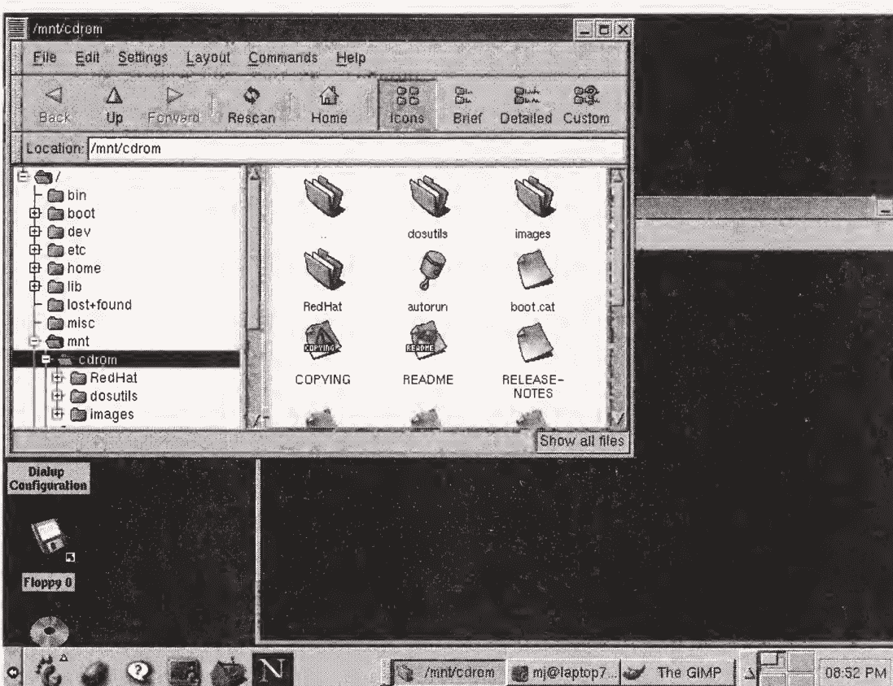

你可以作为普通用户或 root 用户运行 X Windows，以验证它是否运行正常。但通常情况下，作为非 root 用户运行 X Windows 是明智的，这样可以减少因使用 X Windows 应用程序意外损坏、删除或更改只有 root 用户才有权修改的关键系统文件的概率。

如果事情运行不正常，真正的问题就开始了。失败通常通过以下三种方式之一指示：

- 你收到错误消息并返回命令行提示符，而计算机从未切换到图形模式。
- 你切换到了图形模式，但只看到一个空白的灰色桌面，没有窗口管理器，也没有运行的窗口。
- 你切换到了图形模式，但很快被退出并返回到命令行提示符。

在第一种情况下，这可能表明 XFree86 配置不正确。遗憾的是，配置失败的可能原因可能与不同硬件组合的数量一样多。

## 展望

现在你已经完成了 X Windows 的配置，是时候看看你创建的配置是否真的有效了。要做到这一点，你需要尝试运行 X Windows。Red Hat Linux 7.1 自带了设置好的 X Windows，可运行默认窗口管理器和一些初始应用程序，因此一旦 XFree86 配置完成，你就可以开始使用了。

要启动 X Windows，请使用以下命令：

```bash
$ startx
```

这会启动并运行 X Windows。如果一切顺利，屏幕上会闪过几行信息，然后屏幕将切换到图形模式，你将看到默认的 X Windows 环境。这看起来可能像图 7.19 中。

你可以作为普通用户或 root 用户运行 X Windows，以验证它是否运行正常。但通常情况下，作为非 root 用户运行 X Windows 是明智的，这样可以减少因使用 X Windows 应用程序意外损坏、删除或更改只有 root 用户才有权修改的关键系统文件的概率。

如果事情运行不正常，真正的问题就开始了。失败通常通过以下三种方式之一指示：

- 你收到错误消息并返回到命令行提示符，而计算机从未切换到图形模式。
- 你切换到了图形模式，但只看到一个空白的灰色桌面，没有窗口管理器，也没有运行的窗口。
- 你切换到了图形模式，但很快被退出并返回到命令行提示符。

在第一种情况下，这可能表明 XFree86 配置不正确。遗憾的是，配置失败的可能原因可能与不同硬件组合的数量一样多。

# 第八章

## 使用 GNOME 和 X Windows

- 启动 GNOME 和 X
- GNOME 面
- GNOME 界面
- 使用 GNOME 管理文件

现在你已经已经在系统中设置并运行了 X Windows，你将学习如何使用为 Linux 设计的 X Windows 环境。

本章提供了对使用 GNOME 的概述，GNOME 的复杂性足以单独写成一本书。我们并不是提供一份完整的 GNOME 使用指南，目标是让你产生足够的熟悉，从而有信心去尝试 GNOME。对于那些用过 Windows 9x、ME、NT 或 2000 的人来说，GNOME 的基础应该非常直观。

## 启动 X Windows 和 GNOME

由于 Red Hat 已经针对 GNOME 配置，启动桌面管理器就像启动 X Windows 环境一样。正如你在第 7 章“安装和配置 X Windows”中学到的，首先作为用户登录，然后执行命令

```bash
$ startx
```

这会启动 X Windows 并运行 GNOME 桌面管理器。最初，这将产生类似于图 8.1 的屏幕。它包含两种图标：启动应用程序的启动器通过 GNOME 文件管理器打开的文件夹。

注意

根据你的 Red Hat 安装配置的不同，Red Hat 可能会在你启动系统时启动 X Windows 并显示图形登录提示符。如果是这种情况，那么在你登录后 GNOME 就会自动启动，你不需要使用 startx 命令。

## 手动安装 GNOME

默认情况下，Red Hat Linux 7.1 会安装 GNOME 桌面环境。如果由于某种原因你选择不安装 GNOME，或者 GNOME 没有自动安装，你将需要手动安装 GNOME。

要此此，你需要从 Red Hat 安装光盘-ROM 的 RedHat/RPMS 目录中安装以下软件包：

- gnome-applets-1.2.4-3.i386.rpm
- gnome-audio-1.0.0-12.noarch.rpm
- gnome-audio-extra-1.0.0-12.noarch.rpm
- gnome-core-1.2.4-16.i386.rpm
- gnome-core-devel-1.2.4-16.i386.rpm
- gnome-games-1.2.0-10.i386.rpm
- gnome-games-devel-1.2.2-2.i386.rpm
- gnome-kerberos-0.2.2-2.i386.rpm
- gnome-libs-1.2.8-11.i386.rpm
- gnome-libs-devel-1.2.8-11.i386.rpm
- gnome-linuxconf-0.64-1.i386.rpm
- gnome-lokkit-0.43-6.i386.rpm
- gnome-media-1.2.0-12.i386.rpm
- gnome-objc-devel-1.0.2-11.i386.rpm
- gnome-pim-1.2.0-9.i386.rpm
- gnome-pim-devel-1.2.0-9.i386.rpm
- gnome-print-0.25-9.i386.rpm
- gnome-users-guide-1.2-3.noarch.rpm
- gnome-utils-1.2.1-5.i386.rpm

这些软件包中的一些可以在第二张 Red Hat Linux 7.1 安装光盘-ROM 上找到。如果你只有随书附出版版的 Red Hat Linux 7.1，那么你不必担心缺少软件包，因为它们对 GNOME 的基本运行并非必需的。要安装这些每个软件包，请使用 rpm 命令：

```bash
# rpm -i filename
```

# 图 8.1:

Red Hat Linux 7.1 中典型的 GNOME 桌面

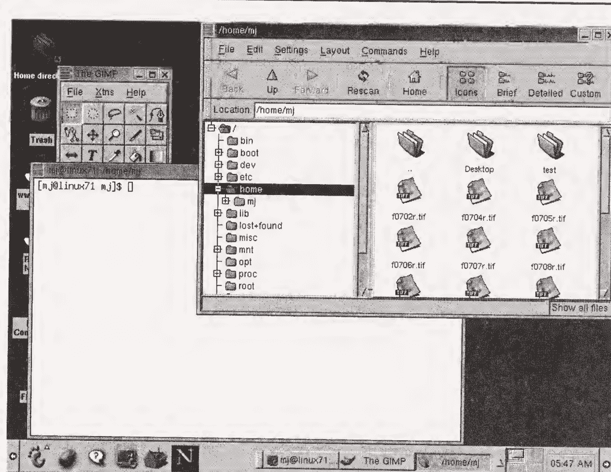

## GNOME 面板

如图 8.2 所示的 GNOME 面板显示在屏幕底部。它包含一个系统菜单按钮（最左侧样式化脚印图标的按钮）、最右侧显示时间和日期的小面板，以及一个分页器和其他用于默认操作的按钮。

# 图 8.2:

GNOME 面板

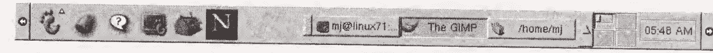

在此面板中，有五个按钮作为特定程序的启动器：

- 锁启动受密码保护的屏幕保护程序。
- 问号打开 GNOME 帮助系统。
- 视器启动 GNOME 命令行终端。

## 使用系统菜单

- 工具箱启动 GNOME 控制中心。
- 样式化的 N 是现在已熟悉的 Netscape 符号。

系统菜单的工作方式与 Windows 98 和 Windows 2000 中的开始菜单相同。点击系统菜单按钮会弹出类似图 8.3 所示的菜单。

# 图 8.3:

GNOME 系统菜单

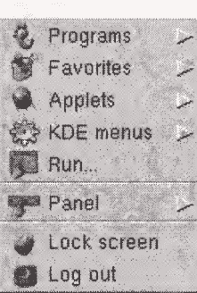

> 虽然本章所示的图片与 Red Hat Linux 7.1 上标准安装的 GNOME 的“外观和感觉”不同，但内容是相同的。

系统菜单包含几项项目：

- **程序 (Programs)** 此子菜单提供了访问 GNOME 上可用的大多数应用程序和实用程序的权限。
- **收藏 (Favorites)** 此选项提供了访问你可能创建的任何收藏，包括网站。
- **应用程序 (Applets)** 此子菜单提供了访问标准 GNOME 应用程序的权限，包括负载监控器、时钟和 CD 播放器。GNOME 将你选择的任何应用程序放置在面板上。
- **KDE 菜单 (KDE Menus)** 如果你在系统上安装了 KDE 作为备用桌面管理器，此子菜单提供了访问标准 KDE 菜单的权限。
- **运行 (Run)** 使用此选项运行安装在你 Linux 系统上的任何程序或应用程序。选择此选项将打开图 8.4 所示的对话框。输入程序的路径和名称，并点击“运行”按钮启动应用程序。或者你也可以点击“浏览”按钮从图 8.5 所示的文件选择窗口选择要运行的程序。

# 图 8.4:

运行程序

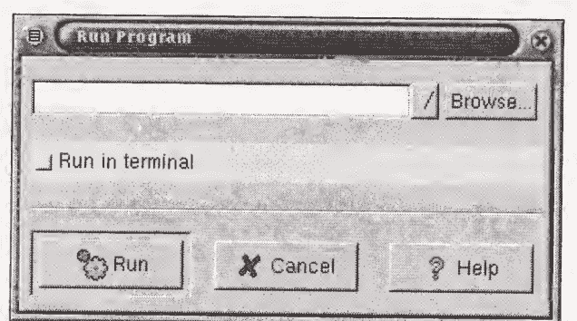

# 图 8.5:

选择要运行的程序

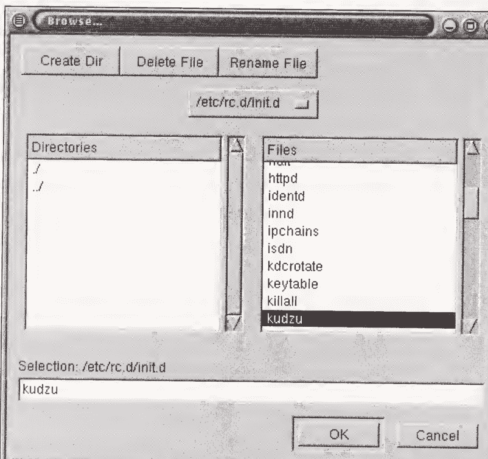

**面板 (Panel)** 此选项允许你配置设置。

**锁定 (Lock)** 此选项激活屏幕保护程序。

**注销 (Log Out)** 此选项允许你注销会话。

**子菜单 (Submenu)** 此子菜单提供了访问各种工具的权限：

- **应用程序 (Applications)** 此子菜单提供了访问标准应用程序的权限。
- **实用程序 (Utilities)** 此子菜单提供了访问标准实用程序的权限。
- **开发 (Development)** 此子菜单提供了访问开发工具的权限。
- **游戏 (Games)** 此子菜单提供了访问游戏的权限。
- **图形 (Graphics)** 此子菜单提供了访问图形工具的权限。
- **互联网 (Internet)** 此子菜单提供了访问互联网工具的权限。


- **多媒体 (Multimedia)** 此子菜单提供了访问多媒体工具的权限。
- **设置 (Settings)** 此子菜单提供了访问系统设置的权限。
- **系统 (System)** 此子菜单提供了访问系统级工具的权限。
- **文件管理器 (File Manager)** 此子菜单提供了访问文件管理器的权限。
- **帮助 (Help)** 此子菜单提供了访问帮助系统的权限。

# 第 8 章 • 使用 GNOME 和 X Windows

## 图 8.8：GNOME 面板属性对话框

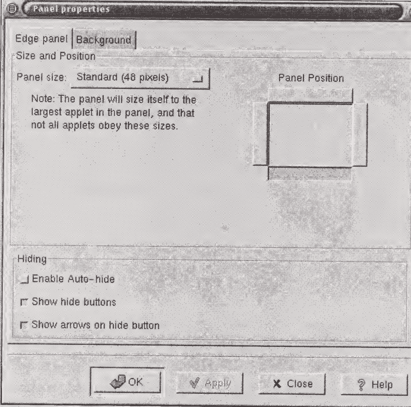

## 面板应用程序 (Applets)

GNOME 面板是一个高度可定制的工具。它最强大的功能之一是在面板内部运行小型插件。

GNOME 包含了许多插件，并提供了一个接口，让程序员可以通过它开发自己的插件。Red Hat Linux 7.1 上的 GNOME 自带的一些插件包括：

- 一个小型的拼图瓷砖游戏
- 用于跟踪电池使用情况、CPU 负载和磁盘空间的监控插件
- 一个 CD 播放器插件
- 一个用于检查收件箱是否有新消息的插件
- 一个时钟插件
- 一个打印机控制插件
- 用于提供虚拟桌面的桌面指南（Desk Guide）插件

默认情况下，时钟和桌面指南插件显示在 GNOME 面板上。

## GNOME 面板 155

针对面板插件，你需要执行以下几种类型的操作：

- 向面板添加插件
- 在面板上移动插件
- 修改插件属性
- 从面板中移除插件

## 向面板添加插件

向面板添加插件非常简单。要添加桌面指南插件，右键点击面板背景。这将弹出一个菜单。在菜单中，选择面板 (Panel) > 添加到面板 (Add To Panel) > 插件 (Applet) > 工具 (Utility) > 桌面指南 (Desk Guide)。面板上会出现连续四个块。

另一种添加插件的方法是从主系统菜单。要添加任务列表插件，点击主系统菜单并选择插件 > 工具 > 任务列表。面板上将出现一个当前运行应用程序的任务列表。

## 在面板上移动插件

一旦插件进入面板，你可能会发现根据你使用面板的方式，想要将其移动到面板上的不同位置。要移动插件，右键点击该插件并从出现的菜单中选择移动 (Move)。然后，使用鼠标将插件拖到面板上的新位置，并点击鼠标以完成移动。

## 修改插件属性

大多数插件都有你可以配置的属性，以自定义它们的行为。这些属性通过属性对话框进行控制，你可以通过右键点击插件并从出现的菜单中选择属性 (Properties) 来打开该对话框。

## 从面板移除插件

一旦插件放置在面板上，将其移除是非常重要的。这让你能够轻松尝试 GNOME 包含的许多插件，并允许在面板变得过于杂乱时进行清理。要移除插件，右键点击该插件并从出现的菜单中选择从面板移除 (Remove From Panel)。

## 使用桌面指南和任务列表插件

本节通过讨论你之前添加的桌面指南和任务列表插件，展示如何使用这些插件。图 8.9 显示的桌面指南插件提供了虚拟桌面。

注意

在 GNOME 之前的版本中，桌面指南和任务列表插件合称为分页 (Pager)。

图 8.9：

桌面指南和任务列表插件

| mj@testlinux:home/mi | 控制中心 |
|---|---|
| GIMP | 图表编辑器 (Diagram Editor) |

虚拟桌面的概念非常简单。让我们从一个基础示例开始。如果你有两个虚拟桌面，这就像拥有两个显示器，但为这些显示器只有一根电源线。你可以打开两组不同的应用程序并在显示器上运行和显示，通过在显示器之间切换电源线来在这些环境之间切换。

虚拟桌面提供了类似的功能，但避免了在两个显示器之间切换电源线带来的延迟、困难和挫败感。虚拟桌面系统中的每个桌面都像是一个全新的工作环境，你可以在其中打开窗口并运行应用程序。同时，这些应用程序无论显示在哪个桌面上，都是在 X Windows 会话中运行，这意味着你可以对它们进行剪切粘贴，就像它们在视觉上显示在同一个桌面上一样。

你可以点击桌面指南上四个正方形中的任何一个左键来切换桌面。这将立即将显示的桌面切换到选定的桌面。

相比之下，任务列表插件包含空间来显示当前桌面上所有打开窗口的按钮。你可以通过点击其按钮将任何窗口带到顶层。如果窗口已经在顶层，你可以通过点击其任务列表按钮将其最小化。

在图 8.9 中，虚拟桌面和应用程序之间有一个带有向上箭头的的小按钮。点击此按钮将显示所有虚拟桌面上所有打开窗口的菜单。你可以点击任何应用程序以切换到该窗口所在的桌面，并将窗口带到顶层。

## GNOME 界面

GNOME 许多许多关键的用户界面元素。本节将讨论 GNOME 允许你操作窗口并与桌面交互的特性。

## 操作窗口

GNOME 中的窗口看起来与 Windows 98 中的窗口非常相似，行为也相同。这对于 Windows 用户是有利的，因为这使得从 Microsoft Windows 操作系统迁移到 X Windows 的窗口交互变成了一个简单的过程。

让我们来看看主窗口组件：标题栏、窗口操作图标、窗口操作菜单（Window Operations menu）和窗口框。

## 标题栏

标题栏显示在窗口的顶部。它包含窗口名称，在大多数情况下，显示该窗口的应用程序名称。

标题栏具有几个功能性目的。使用左键点击并拖动允许你移动窗口。当你释放左键时，窗口将留在新位置。

双击标题栏会将窗口最小化为仅留标题栏，隐藏内容。标题栏可以像以前一样使用，再次双击标题栏将恢复窗口。在 GNOME 术语中，这被称为渲染 (shading) 和取消渲染 (unshading)。

## 窗口操作图标

窗口操作图标成组的形式出现在大多数窗口的右上角。从左到右，这些图标单击执行以下操作：

- 最小化窗口：此图标隐藏窗口，并在 GNOME 面板的任务列表插件中留下该窗口的按钮。
- 最大化/重置窗口：此图标充当切换器，在全屏（最大化）和最大化之前的尺寸（重置）之间切换窗口。
- 关闭窗口：此图标关闭窗口。对于多窗口应用程序，这不会作为杀死操作，而是保持该应用程序的其他窗口打开。

## 窗口操作菜单

在标题左侧、窗口的左上角有一个图标，点击它可以从启动菜单中显示窗口操作菜单。前三个选项是最小化、最大化和关闭，它们与上述操作图标对应。其他选项是以下类别的子菜单：

- 切换：此选项下的各种子菜单允许你在切换桌面时保留窗口（粘性）、最小化当前窗口（最小化）以及隐藏标题栏以外的所有内容（阴影）。
- 成组：成组子菜单将当前窗口与另一个窗口关联。
- 发到：你可以使用此子菜单通过指定移动方向将当前窗口移动到另一个桌面（例如，当前窗口右侧的桌面）。
- 堆叠：这里的子菜单管理窗口相对于其他窗口的堆叠位置。
- 框架类型：框架类型子菜单管理框架位于标题和/或边界周围的位置。
- 框架样式：框架样式下的子菜单管理框架的外观感觉。
- 历史：这些子菜单更改主体窗口的默认位置、尺寸和属性。

## 窗口边界

大多数窗口都有一个五像素宽的边框。该边框用于在视觉上指示窗口边缘，并允许用户调整窗口大小。

可以水平、垂直或同时调整窗口大小。只需点击并拖动边框上的任何位置（与标题栏紧邻的边缘除外）。当你将边框拖动到现有窗口之外时，窗口将根据鼠标指针的位置调整大小。点击左侧或右侧可以进行水平缩放；点击底部边缘可以进行垂直缩放；点击下角则可以在一个操作中同时进行垂直和水平缩放。

## GNOME 桌面

你可能注意到，在启动 GNOME 时，GNOME 桌面包含一个名为“Home”（主目录）的文件夹图标。此图标可以打开 GNOME 文件管理器，并在文件管理器中显示当前用户的主目录，如图 8.10 所示。

图 8.10：

GNOME 文件管理器

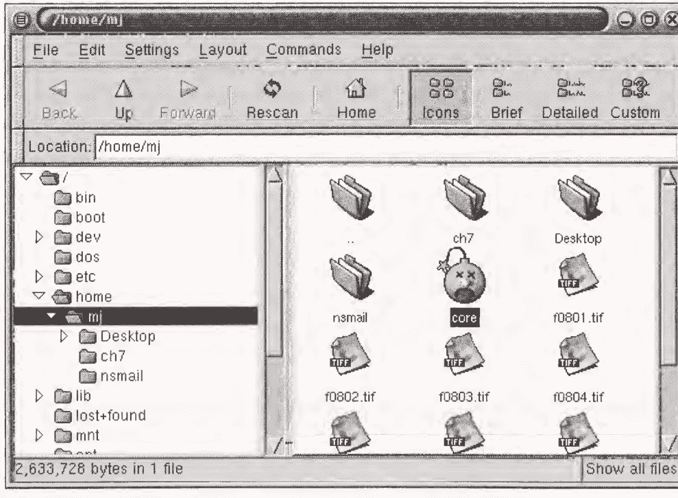

在 GNOME 桌面上点击右键会显示一个菜单，你可以将其用于多个用途，包括以下：

- 打开一个新的 GNOME 文件管理器窗口
- 整理桌面上的图标
- 打开新的终端窗口

例如，选择“排列”（Arrange）会将你桌面上的图标重新排列为整洁的网格图案。如果你在桌面上保留了大量图标并导致它们变得杂乱无章，那么这个功能非常有用。“创建新建”（Create New）选项会打开一个新的文件管理器窗口（其方式与双击桌面上的“主目录”文件夹相同）。

## 使用 GNOME 管理文件

Windows 3.1 用户拥有 File Manager，Windows 95/98 用户拥有 Windows Explorer（资源管理器），而 Mac OS 用户拥有 Finder。所有这些程序都提供了管理文件（包括复制、移动、重命名和删除）以及启动应用程序的功能。

在 Windows 世界中，传统上没有标准工具来提供这些功能。许多自称为文件管理器或桌面管理器的应用程序尝试提供此类功能。你可以在 http://www.xnet.com/~blatura/linapp2.html#ife1 找到精选的文件管理器列表。

然而，随着 GNOME 和 KDE 作为替代标准的出现，情况正在变得稳定。GNOME 和 KDE 都提供了标准的文件管理器。GNOME 文件管理器（又称为 GNU Midnight Commander）提供了一个灵活、高质量的文件管理和浏览工具。本节将介绍 GNOME 文件管理器。

## 启动 GNOME 文件管理器

可以通过从默认的 GNOME“程序”子菜单中选择“文件管理器”来启动 GNOME 文件管理器。或者，你可以在 xterm 窗口的命令行中输入命令：

```
$ gmc &
```

或者如果你需要指定完整路径，在 Red Hat Linux 7.1 安装中：

```
$ /usr/bin/gmc &
```

`gmc` 代表 GNU Midnight Commander。

## 文件管理器窗口

如图 8.10 所示，GNOME 文件管理器窗口显示你计算机上单个目录的内容。默认情况下，显示的目录是运行该程序的用户的主目录。在 във幅图中，mj 运行了文件管理器，因此显示的目录是他的主目录：`/home/mj`。

窗口分为三个三个主要部分：

- 目录树（左侧）
- 显示窗格（右侧）
- 工具栏（顶部）

## 目录树

在 GNOME 文件管理器窗口的左侧是你的 Linux 系统的一个可展开和折叠的目录。此目录树让人想起 Windows 95、98 和 2000 中 Windows Explorer 使用的树。该树的工作方式与其 Windows 对应物相同：

- 点击目录旁边的向右三角形会展开树的片段，显示该特定目录下方下一级的子目录。
- 点击目录名称旁边的向下三角形会折叠树的片段并隐藏该特定目录的所有子目录。
- 点击目录名称会在文件管理器窗口右侧的窗格中显示该目录的内容。

> 在某些版本的 GNOME 中（包括与默认 Red Hat Linux 7.1 安装一起的版本），图 8.10 所示的向右三角形用加号代替，向下三角形用减号代替。

## 显示窗格

在 GNOME 文件管理器窗口的右侧是显示窗格，其中显示了目录树中当前选择目录的内容。在此窗格中，默认显示将每个文件显示为全尺寸图标。有几种类型的图标代表了不同类型的文件以及作为目录的其他元素。你最需要熟悉的图标是代表目录、通用文档、软件包和归文件以及 HTML 文件的

关于文件类型和 Linux 目录结构的完整讨论在第 14 章“处理文件”中提供。通过第 4 章“安装 Red Hat Linux 7.1”中的讨论，你已经对 Linux 目录结构有了基础的了解。

文件夹图标代表目录，Macintosh 和 Windows 系统的用户都应该熟悉它。

一张白纸代表通用文档文件，例如文本文件或 Microsoft Word 文件。

一张上方悬浮着“HTML”字样的纸代表 HTML 文件。

最后，按压图标代表作为 Zip 文件格式的软件包和归文件。

## 工具栏

文件管理器窗口顶部是一个工具栏，它包含九个按钮：

- **后退（Back）**
- **前进（Forward）**
- **上级（Up）**
- **重新扫描（Rescan）**
- **首页（Home）**
- **新建窗口（New Window）**
- **属性（Properties）**
- **删除（Delete）**
- **搜索（Search）**

（注：原文中工具栏部分的描述存在大量重复和 OCR 错误，已根据逻辑进行了整合和翻译。）

## 文件 > 移动

要将文件移动到新位置，请在显示面板中选择该文件，然后选择文件 > 移动（File > Move）。会弹出一个移动对话框，类似于图 8.14 所示的复制对话框。在这里您可以指定目标。访问移动对话框的另一种方法是在显示面板中右键点击文件，并从弹出的菜单中选择移动。

## 布局 > 排序方式

要更改文件和目录在显示面板中的显示顺序，请选择布局 > 排序方式（Layout > Sort By）。随后会弹出一个如图 8.15 所示的对话框。在此对话框中，您可以选择按按名称、文件类型、大小或访问、更改或修改时间对文件和目录进行排序。此外，您可以使用对话框底部的两个复选框来指定排序是否区分大小写，并反转正常的排序顺序。

图 8.15：更改排序顺序

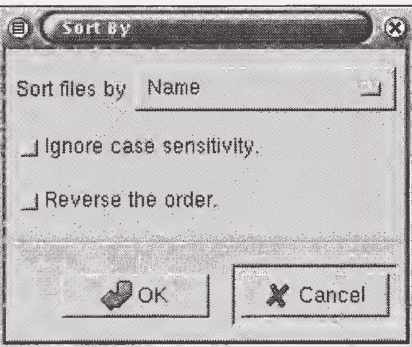

## 命令 > 查找文件

要在您的计算机上查找文件，您可以使用 GNOME 文件管理器中的命令 > 查找文件（Commands > Find File）选项。会弹出图 8.16 所示的查找文件对话框。

图 8.16：搜索文件


在此对话框中，您可以指定三个可能的参数：

- 使用“起始于”（Start At）字段指定搜索位置
- 使用“文件名”（Filename）字段指定要搜索的文件名
- 使用“内容”（Content）字段指定要在文件中搜索文本

在指定文件名时，可以使用通配符。例如，搜索所有以 gi 开头的文件，使用 *gi* 搜索所有以 gi 结尾的文件。在指定开始搜索的目录时，您可以指定整个目录路径（例如 `/home/username`、斜杠 `/` 代表 Linux 系统的顶层目录，或点 `.` 代表当前选定的目录）。搜索结果将在类似图 8.17 所示的窗口中随查找而显示。

## 图 8.17：

搜索结果

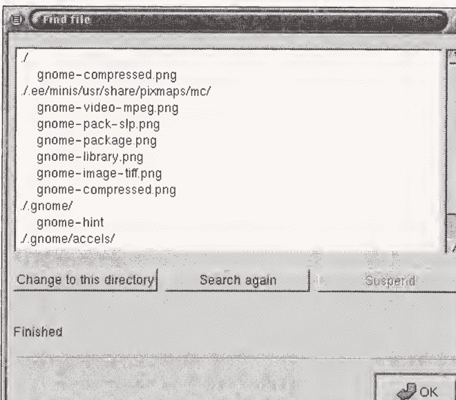

## 展望

到此时，您应该已经觉得在所选的 X Windows 环境中操作相当熟悉了。您可以控制 GNOME 的基本选项，启动应用程序，并操作窗口。

在第 9 章“在 GNOME 和 X Windows 中使用应用程序”中，您将学习如何使用 GNOME 中的一些实际应用程序。这些应用程序涵盖了从 gedit（GNOME 文本编辑器）等简单程序，到终端窗口等工具，再到像 GIMP（一个专业级的图像编辑软件包）这样的高端软件。

# 第九章

## 在 GNOME 和 X Windows 中使用应用程序

- 使用 xterm
- 配置 xterm
- X Windows 应用程序
- X Windows 工具

本章将介绍一些 Windows 和 GNOME 应用程序，以及如何在 GNOME 桌面运行和使用它们。这些应用程序包括 xterm、GNOME 文件管理器（称为 Midnight Commander）、名为 GIMP 的图形程序以及几个 Windows 工具。

这些应用程序的选取是基于两个标准之一的：它们在日常 Linux 操作中有用，或者它们是许多 Linux 应用程序功能或范围的代表。

本章应该让您有信心尝试其他 X Windows 应用程序。

## 使用 xterm

虽然 X Windows 为 Linux 提供了一个美观且用户友界面并允许创建完全图形化的应用程序，但事实是，作为 Unix 的克隆版本，Linux 是一个以命令行为导向的操作系统。

尽管可以在未使用命令行提示符的情况下使用 Linux 进行工作，但为了充分利用类 Unix 操作系统的真正力量和灵活性，您需要偶尔进入命令行领域。

幸运的是，这并没有放弃 X Windows 的便利性。xterm 程序提供了一个完全集成到 X Windows 环境中的命令行提示符，带有滚动条、可调整大小的窗口以及与其他 X Windows 应用程序进行复制粘贴的能力——这些都是标准 Linux 控制台不具备的功能。

> 您可以在 Red Linux 7.1 中通过选择程序菜单系统菜单中的 Regular XTerm 来启动 xterm 窗口。GNOME 包含了 xterm 的克隆版本，称为 GNOME terminal。尽管如此，本章详细描述了 xterm，因为它在其他 Linux 图形环境（包括 KDE）中也可用。许多相同的命令适用于 GNOME terminal；某些需要细微更改，例如多一个连字符。本章仅注了这两类终端之间重大的功能差异。

如果您想启动额外的 xterm 窗口，也可以从另一个 xterm 窗口的命令行通过命令启动：

```
$ xterm &
```

或者，如果您发现由于某种原因 xterm 不在您的路径中，请使用命令

```
$ /usr/X11R6/bin/xterm &
```

## 提示

或者，您也可以从另一个 xterm 窗口的命令行通过命令启动额外的 GNOME terminal 窗口：

```
$ gnome-terminal &
```

或者您可以直接点击终端。

默认情况下，这会打开一个宽 80 个字符、深 24 行的窗口。如图 9.1 所示，窗口的默认标题为。

## 图 9.1：

一个 xterm 窗口


## 配置 xterm

xterm 程序是高度可定制的。除其他外，您可以更改：

- 窗口字体
- 颜色方案
- 窗口大小
- 窗口位置

本节将介绍这些选项并描述如何使用它们。起初可能认为这种灵活性没有价值，但实际上有的。在不同的显示器上，颜色组合产生更具可读性的文本。

## 标志和参数：简介

在继续之前，您需要了解 Unix 命令。关于 Unix 命令的完整介绍将在后续章节给出。


要执行程序（或命令），只需输入程序名称（以及可能的路径）并按下回车键。例如，要启动 `xterm`，可以使用命令

```
$ xterm
```

或者，如果 `xterm` 所在的目录不在您的路径中，请使用命令

```
$ /usr/X11R6/bin/xterm
```

路径是 Linux 搜索命令的地方。可以使用此命令找到路径：

```
$ echo PATH
```

大多数程序都需要或接受改变其行为或提供待处理的信息。向命令提供两种类型信息：标志和参数。

参数是提供给程序的信息；可以是从文件名到要搜索文本的任何内容。

标志是改变程序行为的选项。它们出现在命令之后，用一个或多个空格和连字符隔开。例如，`help` 标志会让 `xterm` 打印帮助信息：

```
$ xterm -help
usage:  xterm-options ... -e args
```

- `-help` 输出此消息
- `-display` `display_name` 要连接的 X 服务器
- `-geometry` `geom` 大小（以字符计）和位置
- `-/rv` 开启/关闭反转视频
- `-bg` `color` 背景颜色
- `-fg` `color` 前景颜色
- `-bd` `color` 框颜色
- `-bw` `number` 像素宽度
- `-fn` `fontname` 字体
- `-iconic` 最小化启动
- `-name` `string` 客户端实例、图标和标题字符串
- `-title` `string` 标题字符串
- `-xrm` 额外的资源规范
- `+-132` 开启/关闭列切换限制
- `+-ah` 始终高亮
- `+-ai` 开启/关闭活动图标

也可以创建复杂的标志以提供标志正常运行所需的信息。例如，设置 `xterm` 颜色，您使用 `-fg` 和 `-bg` 标志，但还需要提供您希望在前景和背景显示的颜色。命令

```
$ xterm -fg white -bg black
```

将创建一个黑色背景白色文字的 `xterm` 窗口。另一方面，一个简单的标志是符号 `&`。例如，命令

```
$ xterm &
```

打开另一个 `xterm` 窗口并将当前的 `xterm` 窗口返回命令行界面。

另一方面，参数（Arguments）不是配置选项，而是提供给程序进行处理的信息。参数不像标志以横字符（dash）作为标志（flags）开头。参数通常是需要打开、处理或编辑的文件名——如下例所示，该示例表示使用 `emacs` 编辑器打开文件 `testfile` 进行编辑：

```
$ emacs testfile
```

# 设置配色方案

通过使用各种标志，可以设置 `xterm` 窗口几乎所有部分的颜色，从边框颜色到光标颜色。本节将介绍配色方案的主要元素：前景颜色、背景颜色和光标颜色。

## 理解 X Windows 颜色

在查看用于设置 `xterm` 窗口颜色的特定标志之前，你需要先了解颜色在 X Windows 中是如何表示的。

X Windows 中的颜色是以 RGB（红-绿-蓝）格式指定的。RGB 格式由有序的数字三元组组成，每个数字的值从 0 到 255 不等。这些数字分别代表红色、绿色和蓝色通道的值，其中 0 表示无颜色，255 表示颜色的最高可能值。

幸运的是，你不需要为了获得所需的颜色而研究颜色组合。这项工作已经完成，并存储在一个文件中，X Windows 使用该文件将颜色名称映射到数值三元组。该文件通常称为 `rgb.txt`，通常位于 `/usr/X11R/lib/X11` 目录下。

Red Hat Linux 7.1 的 `rgb` 文件中选定的颜色列表显示在此，以便你在学习本节内容时进行颜色实验：

- `snow` `GhostWhite` `PapayaWhip` `LemonChiffon`
- `AliceBlue` `LavenderBlush` `MistyRose` `white`
- `DarkSlateGray` `DimGray` `gray` `MidnightBlue`
- `NavyBlue` `SlateBlue` `blue` `SteelBlue`
- `turquoise` `cyan` `DarkGreen` `SeaGreen`
- `lawnGreen` `green` `GreenYellow` `DarkKhaki`
- `LightYellow` `yellow` `gold` `RosyBrown`
- `IndianRed` `sienna` `beige` `wheat`
- `tan` `chocolate` `orange`
- `tomato` `red` `DeepPink` `pink`
- `maroon` `magenta` `violet` `orchid`
- `purple` `DarkCyan` `DarkRed` `LightGreen`

### 注意

取决于你的显示器颜色以及你正在运行的应用程序，你可能会发现某些颜色的显示与你预期的不符。这是由于显卡的限制以及系统之间的差异造成的。

# 背景和前景颜色

设置背景和前景颜色允许你控制屏幕上文本的外观。逻辑上，文本以前景颜色显示，而背景颜色（`background-color`）被分配给窗口背景。

默认 `xterm` 窗口是白底黑字。使用 `-fg` 和 `-bg` 标志设置前景和背景颜色：

```
$ xterm -fg white -bg black &
```

此命令提供了与默认 `xterm` 窗口完全相反的配色，将背景设置为黑色，前景设置为白色。结果如图 9.2 所示。

### 注意

`-bg` 和 `-fg` 标志并不是 `xterm` 特有的。事实上，它们是标准的 Windows 标志，可以更改大多数 Windows 应用程序的配色。然而，这些标志对 `gnome-terminal` 命令无效。要找到 GNOME terminal 的正确开关，请运行 `gnome-terminal -help` 命令。

## 图 9.2：控制配色方案


# 光标颜色

如果你尝试了上一个设置颜色的示例，你可能注意到光标颜色与默认 `xterm` 配色方案相同。你也可以使用 `-cr` 标志更改此颜色。例如，如果你想要深蓝色的光标，可能会使用以下命令

```
$ xterm -bg white -fg black -cr MidnightBlue &
```

# 设置窗口大小和位置

当你打开一个窗口（或者任何其他应用程序的窗口）时，窗口的大小被设置为默认大小，窗口的位置由你的窗口管理器配置决定（当你在阅读第 12 章“高级 X Windows 配置”时，你将在关键文件中看到 `xterm` 命令）。

然而，你可以使用 `-geometry` 标志在 X Windows 中指定窗口的精确大小和位置。这是一个标准的 X Windows 标志（类似于 `-bg` 和 `-fg`），适用于大多数 X Windows 程序。

该标志的基本语法是 `-geometry widthheight+x+y`。该命令中的变量显示如下：

- `width` 指定窗口以像素为单位的宽度。
- `height` 指定窗口以像素为单位的高度。
- `x` 指定窗口的水平位置，即距离显示器左侧的像素偏移量。
- `y` 指定窗口的垂直位置，即距离显示器顶部的像素偏移量。

`xterm` 接受使用 `-geometry` 标志，但处理信息的方式有些非标准。想一想，以像素为单位指定终端窗口的高度和宽度并没有太大意义。相反，`xterm` 将宽度和高度解释为显示的字符数和行数，并根据所使用的字体调整窗口大小。

默认窗口大小为 80 列 24 行字符。但如果你想让一个 10x 10 字符的小窗口放置在屏幕左侧 200 像素、屏幕顶部 300 像素处，你可以使用

```
$ xterm -geometry 10x10+200+300 &
```

以获得如图 9.3 所示的窗口。

## 图 9.3：使用几何标志

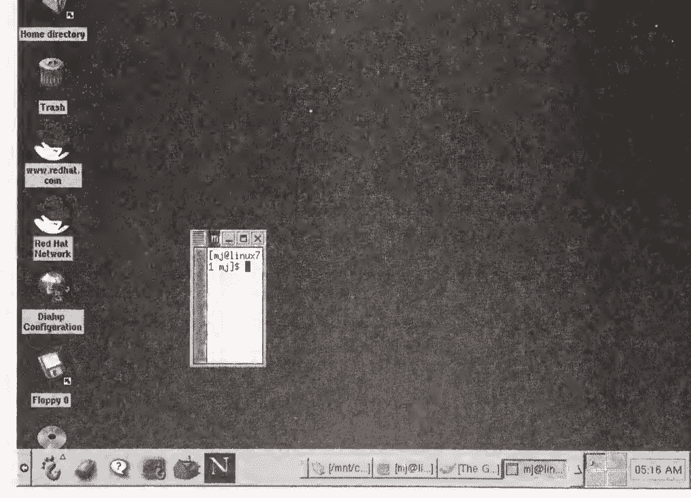

# 178 第 9 章 与 GNOME 使用应用程序

### 注意

GNOME 对应的命令是 `gnome-terminal --geometry=10x10+200+300 &` 然而，结果如图 9.4。

## 图 9.4：几何标志与颜色标志结合

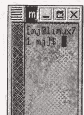

# 在 xterm 中运行应用程序

虽然 `xterm` 的目的是使用命令行执行命令，但你可能希望在启动 `xterm` 时默认运行字符模式程序。例如，如果你经常在 `xterm` 窗口中运行 `top`，你可能希望在打开 `xterm` 时启动它。这是通过 `-e` 标志实现的：

```
$ xterm -e top &
```

当窗口运行的程序退出时，`xterm` 窗口会关闭。需要注意的是，在 `xterm` 中使用 `-e` 标志时，默认窗口标题是启动的程序名称。

### 注意

该标志不会设置默认窗口标题。

# 自定义 xterm

## 图 9-5 xterm 窗口打开时启动 top


# 设置字体

`xterm` 的默认字体通常易读且适用于大多数显示器。如果你有一个特别大或小的显示器，或者使用异常低或高的分辨率，你可能想更改 `xterm` 中使用的字体。

为了实现这一点，请使用 `-fn` 标志。但你如何引用字体呢？字体通过名称引用，可以是简单的 `7x13`（表示宽 7 像素、深 13 像素），也可以是 `-sony-fixed-medium-r-normal-24-230-75-75-c-120-iso8859-1`（表示来自字体库的24 点罗马风格字体）。

X Windows 提供了一个程序 `xfonts`，它可以提供 Windows 系统可用字体列表。要查看系统上的可用字体，请在 `xterm` 窗口中使用以下命令：

- `xfonts | more`

`more` 部分允许你通过按空格键向前翻页查看长字体列表。

因此，要选择 10×20 字体，请使用命令

```bash
$ xterm -fn 10x20 &
```

以获得一个如图 9.6 所示的大字体窗口。当你将其与图 9.1 进行比较时，请注意不仅字体变大了，`xterm` 窗口也变大了，以便以相同的行数和列数容纳更大的字体。

## 图 9.6：10×20 字体

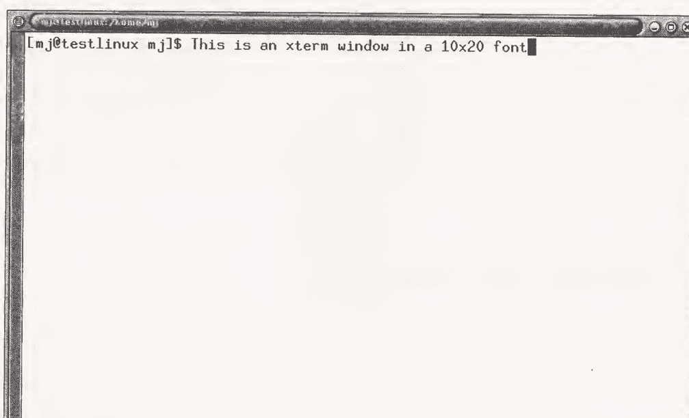

从理论上讲，这些字体中的任何一种都可以配合 `-fn` 标志和 `xterm` 命令使用。但在实践中，这并不可行。`xterm` 的本质是它需要等宽字体——即无论字符相对大小如何，所有字符都占据相同空间的字体。在 Microsoft Windows 世界中，等宽字体的一个例子是 `Courier`。

相比之下，许多字体是比例间距的。这意味着字母“i”占据的空间比“w”少，因为后者是一个更宽的字母。`xterm` 处理这些比例间距字体的效果并不好，如图 9.7 所示，所选字体来自 Times 家族。

## 图 9.7：使用比例间距字体

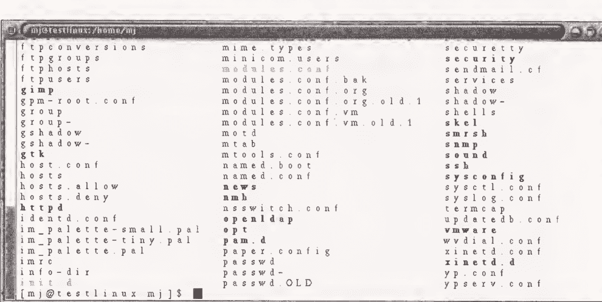

下面列出了 Red Hat Linux 7.1 随带的 X Windows 发行版中一些常用的（易于输入的）等宽字体：

- `5x7` `6x13bold` `7x14bold` `9x15bold`
- `5x8` `6x9` `8x13` `10x20`
- `6x10` `7x13` `8x13bold` `12x24`
- `6x12` `7x13bold` `8x16`
- `6x13` `7x14`

如果你想尝试其他字体，可以使用 `xfonts` 选择一个字体列表，选择其中一种字体，然后使用 `xfd` 命令在窗口中显示该字体。例如，显示你之前看到的 Sony 字体 `-sony-fixed-medium-r-normal-24-230-75-c-120-isoiso08859-1`，使用命令

```bash
$ xfd -fn -sony-fixed-medium-r-normal-24-230-75-c-120-isoiso08859-1
```

注意使用 `-fn` 标志来指定字体名称。字体将显示在类似于图 9.8 所示窗口中。点击 Quit 按钮关闭窗口。

## 图 9.8：使用 xfd 命令显示字体


# 其他功能

`Xterm` 提供的功能比这里列出的多得多。你可以在 `xterm` man 页面中找到它们。man 页面（manual 的缩写）提供了有关如何使用特定程序的信息。要访问 `xterm` 页面，请在 `xterm` 窗口中使用命令

```bash
$ man xterm
```

此命令将显示如图 9.9 所示的 man 页面。使用箭头键滚动查看 man 页面。要退出 man 页面，输入 `q`。

## 图 9.9：xterm man 页面

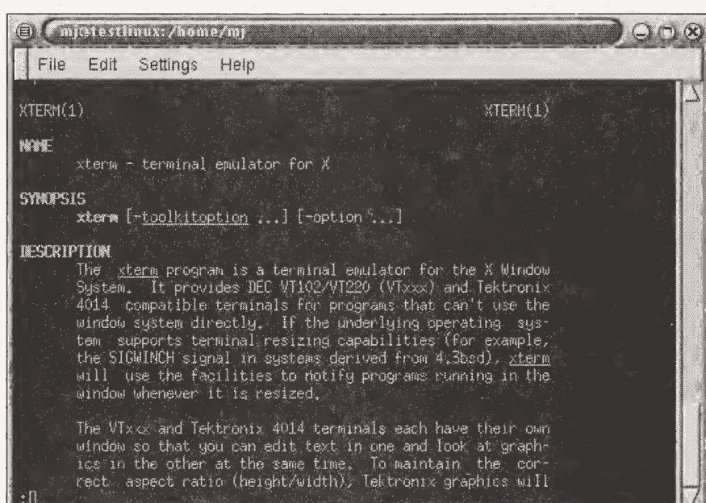

在保存图片时，你也想指定图片的类型。对话框中间是“确定文件类型”（Determine File Type）按钮。通过点击此按钮，你可以查看可用文件类型的列表。从列表中选择你想要的文件类型。准备好保存文件后，点击确定。

## 裁剪图片

裁剪图片是一个简单的过程：开启裁剪，选择你想裁剪的区域，然后在“裁剪与调整信息”（Crop & Resize Information）窗口中按“裁剪”按钮。

要开启裁剪，右键点击图片。在打开的菜单中，选择 工具（Tools） > 变换工具（Transform Tools） > 裁剪与调整（Crop & Resize）。要选择裁剪区域，在查看器窗口中用左鼠标键拖出一个矩形。图 9.15 显示了查看器窗口中的图片，其中矩形表示了用户拖动鼠标的位置。

## 图 9.15：选择裁剪

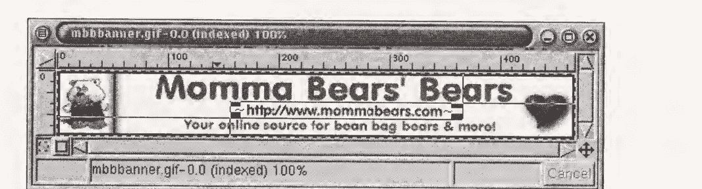

当你选择好裁剪区域后，只需点击“裁剪与调整信息”窗口中的“裁剪”按钮。结果将类似于上例中的图 9.16。

## 图 9.16：裁剪结果


如果你不喜欢裁剪结果，右键点击图片。在打开的菜单中，选择 文件（File） > 还原（Revert）以返回原始图片。

## 捕获窗口

GIMP 的常用用途之一是截图。如果你想将打开的窗口捕获到图片文件中，可以使用“获取屏幕”（Acquire Screen）功能。当你有一个想要捕获的窗口时，选择 文件（File） > 获取（Acquire） > 截图（Screen Shot），这会打开一个如图 9.17 所示的截图对话框。

## 图 9.17：截图窗口

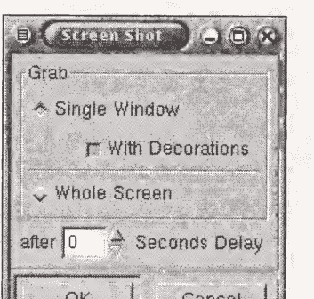

你可以捕获单个窗口或整个桌面的内容。要捕获单个窗口，选择“单个窗口”（Single Window）。点击确定，然后点击你选择的窗口。

如果你不想显示窗口框或标题，请取消勾选“装饰”（Decorations）。例如，如果你捕获顶部实用工具的 `xterm` 窗口，并反转了背景色和前景色，结果看起来几乎就像你没有使用 X Window，如图 9.18 所示。

## 图 9.18：top 的截图

| PID | USER | PR | NI | VID | RSS | SHARE | STAT | ZCPU | JEM | TIME | COMMAND |
|---|---|---|---|---|---|---|---|---|---|---|---|
| root | 14 | 0 | 820 | 524 | 524 | 444 | R | 0.1 | 0.7 | 0001 | updated |
| 1088 | 14 | 0 | 820 | 524 | 524 | 444 | R | 0.1 | 1.1 | 0002 | mid |
| 1096 | 5 | 0 | 1772 | 1772 | 1416 | S | 5.5 | 1.0 | 0006 | screensaver |
| 1031 | 12 | 0 | 1024 | 1024 | 812 | S | 5.5 | 1.0 | 0007 | root |
| 524 | 5 | 0 | 4032 | 4032 | 3220 | S | 2.0 | 0.5 | 0005 | xterm_tablet,root |
| 946 | 12 | 0 | 820 | 820 | 656 | S | 0.0 | 0.0 | 0009 | root |
| 327 | 5 | 0 | 820 | 820 | 656 | S | 0.0 | 0.0 | 0008 | root |
| 1089 | 12 | 0 | 2584 | 2584 | 1776 | S | 0.3 | 0.2 | 0002 | stem |
| 396 | 5 | 0 | 3204 | 3204 | 2080 | S | 0.1 | 0.4 | 0011 | sawfish |
| 1 | 5 | 0 | 528 | 528 | 476 | S | 0.0 | 0.0 | 0008 | init |
| 2 | 0 | 0 | 0 | 0 | 0 | S | 0.0 | 0.0 | 0010 | uinit |
| 3 root | 0 | 0 | 0 | 0 | 0 | S | 0.0 | 0.0 | 0003 | kuadd |
| 4 root | 0 | 0 | 0 | 0 | 0 | S | 0.0 | 0.0 | 0004 | init |
| 6 root | -20 | 0 | 0 | 0 | 0 | SMK | 0.0 | 0.0 | 0029 | krecovery |

## 图 9.21: gedit 窗口

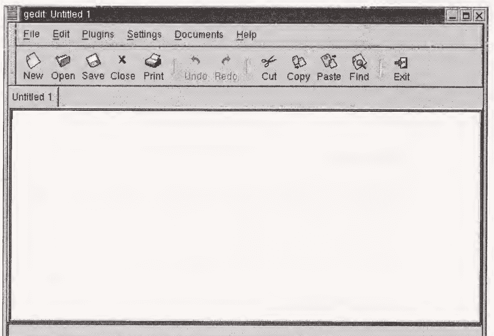

你可以通过以下命令启动 `gedit`：

```
$ gedit &
```

或者，如果 `gedit` 不在你的路径中，可以使用以下命令：

```
$ /usr/bin/gedit &
```

你也可以点击 GNOME 系统主菜单并选择 程序（Programs） > 应用程序（Applications） > Gedit。

界面非常简单。顶部是工具栏，带有自明的按钮，用于加载和保存文件、剪切、复制和搜索文本。


要加载现有文件，点击打开（Open）按钮或选择文件（File） > 打开（Open）。会弹出一个对话框，你可以在其中浏览并选择要打开。当文件打开时，它将如图 9.22 所示。

你可以通过点击工具栏上的保存（Save）按钮或选择文件（File） > 保存（Save）来保存已打开的文件。

工具栏上的查找（Find）按钮会弹出如图 9.23 所示的查找对话框。你也可以通过编辑（Edit） > 查找（Find）来打开此对话框。

### 图 9.22: 加载文件的结果

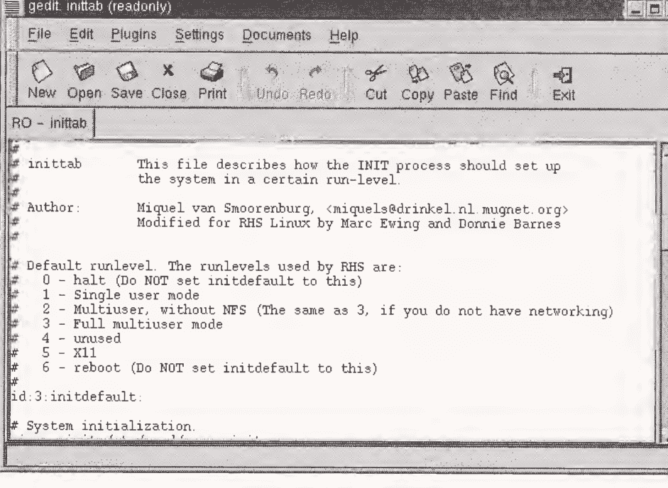

### 图 9.23: 查找对话框

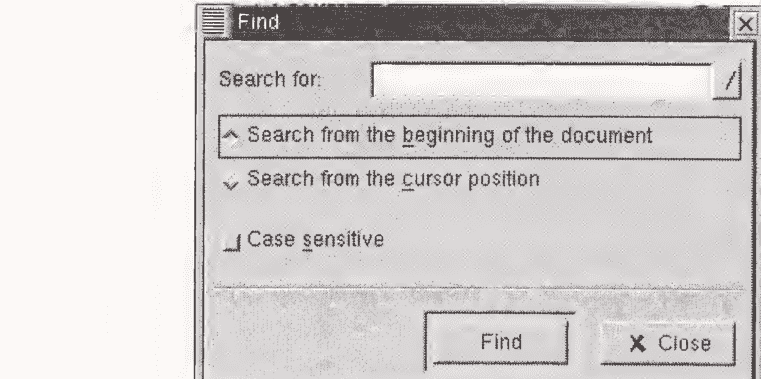

使用此对话框相对简单：填写要搜索的文本并点击查找（Find）按钮。你还可以指定是倾向于从文档开头还是当前光标位置开始搜索，以及搜索是否区分大小。

替换（Replace）更进进一步。你可以通过选择编辑（Edit） > 替换（Replace）来打开替换对话框。此对话框看起来与查找对话框相似，但多了一个字段，用于指定用于替换每个项目的文本。此外，你可以使用替换（Replace）按钮来指示在替换任何文本之前进行提示。

## X Windows 钟

你可能已经注意 GNOME 面板中出现的时。不过，有些用户喜欢在桌面上看到一个更大的数字钟或模拟钟。

这可以通过 `xclock` 程序实现。`xclock` 是一个基础时钟程序，允许你创建模拟或数字钟。默认情况下，`xclock` 显示模拟钟，命令：

```
$ xclock &
```

或

```
$ /usr/X11R/bin/xclock &
```

会创建一个类似于图 9.24 所示的窗口。

### 图 9.24: 默认 xclock 样式


`-digital` 标志会导致 `xclock` 显示类似于如图 9.25 所示的数字钟。

### 图 9.25: 2001年1月15日 周一 11:29:31 - 数字 xclock 窗口

`-digital` 标志并不是 `xclock` 接受的唯一标志。`-hd` 和 `-h1` 标志为模拟钟创建了更有趣的视觉显示。`-hd` 标志用于指定时钟指针的颜色，而 `-h1` 标志指定时钟指针轮廓的颜色。（记得之前关于 RGB 颜色的讨论吗？这是使用 RGB 颜色的实例之一。）

例如，命令：

```
$ xclock -hd yellow -h1 green &
```

会创建一个具有黄色指针和绿色轮廓的时钟，如图 9.26 所示（当然，在你正在看的黑白复印图中很难看清）。

### 图 9.26: 设置时钟指针的颜色


注意指针与时钟白色表盘之间缺乏对比。这可以通过标准的 X Windows 标志来修正：即你之前在讨论 `xterm` 时看到的 `-bg` 标志。通过指定背景颜色为黑色：

```
$ xclock -hd yellow -h1 green -bg black &
```

你将得到类似图 9.27 的效果。

### 图 9.27: 设置背景颜色


虽然指针现在清晰可见，但出现了一个新问题：指示时钟点的标记现在变得不可见，因为它们是黑色的，并且绘制在黑色背景上。这些标记被视为前景的一部分，它们的颜色可以使用标准的 X Windows `-fg` 标志进行更改。命令：

```
$ xclock -hd yellow -h1 green -bg black -fg cyan &
```

会产生类似于图 9.28 的结果。

### 图 9.28: 设置前景颜色


## 使用 GNOME 计算器

最后，让我们快速看一眼 GNOME 计算器，这是每个 Linux 发行版中都应该可用的默认 GNOME 计算器。正如你此时所预期的那样，你可以通过命令运行 GNOME 计算器：

```
$ gcalc
```

或使用命令：

```
$ /usr/bin/gcalc
```

也可以通过从主 GNOME 菜单的工具（Utilities）子菜单中选择计算器（Calculator）来打开 GNOME 计算器。GNOME 计算器窗口如图 9.29 所示。

图 9.29: GNOME 计算器窗口

计算器的工作方式就像标准计算器一样。它提供了所有预期的科学功能，包括三角函数和对数函数，外内存。此类计算器及其功能的实际使用并不是本章的主题，功能的完整描述留给了数学。

## 回顾

到这里，你应该已经习惯了导航你的 GNOME 环境。你可以控制 GNOME 的基本选项，可以启动应用程序，并可以操作窗口。正如之前提到的，不过，X Windows 的力量源于其灵活性可配置性。本章将考虑如何配置 GNOME 以满足你的需求，包括配置 GNOME 面板外观。

# 第十章：高级 GNOME 配置

- 使用控制中心
- 配置面板

现在你已经已经了使用 GNOME 并运行应用程序，让我们看看 GNOME 的高级选项。GNOME 配置的中心是控制中心。从控制中心你可以：

## 使用 GNOME 控制中心

GNOME 控制中心可以通过两种方式访问：

- 点击主 GNOME 菜单上的工具箱（Toolbox）按钮
- 从 GNOME 系统菜单中选择 程序（Programs） > 设置（Settings） > GNOME 控制中心。当你首次启动控制中心时，会出现一个类似于图 10.1 的窗口。此窗口包含两个部分：

- 左侧显示按七个主要类别组织的配置树：桌面、文档处理器、多媒体、外设、窗口管理器、会话和用户界面。

右侧显示你所选择配置树部分的控件。例如，在图 10.2 中，显示的是桌面背景部分。

### 图 10.1: 控制中心窗口

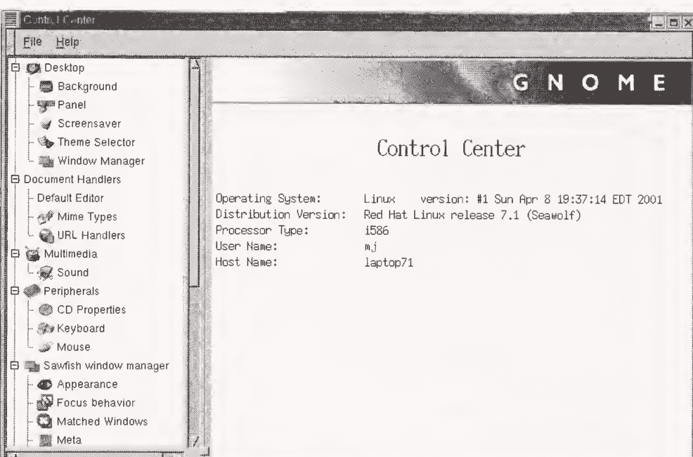

### 图 10.2: 桌面背景部分

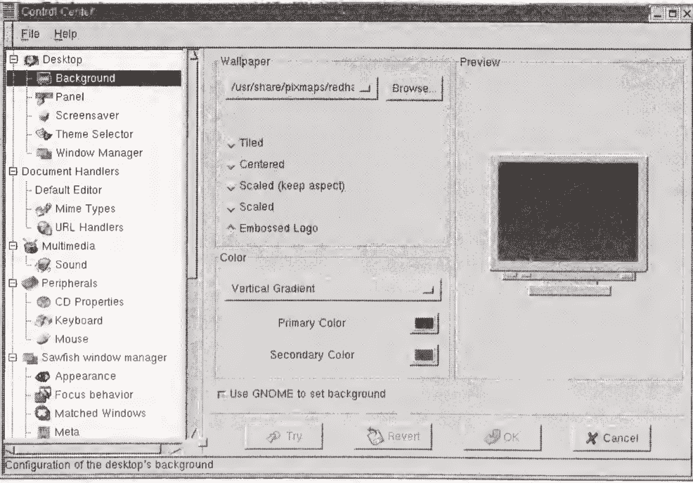

## 桌面

控制中心的桌面部分可以控制桌面外观和行为的多个方面，包括背景颜色和壁纸、屏幕保护程序以及你的桌面主题选择。要控制背景属性，选择控制中心窗口左侧桌面部分的项。在窗口右侧，会出现桌面背景小工具，如之前的图 10.2 所示。

在此窗口中，你可以创建三种可能的背景：

- **桌面壁纸** 点击浏览按钮并从硬盘选择一张图像作为背景壁纸。你可以选择将其居中、在桌上重复平铺或缩放以填充桌面。或者，你可以使用浮雕标志（Embossed Logo）选项为你的背景添加红帽标志。
- **单一纯色** 从颜色下拉列表中选择纯（Solid），然后选择主颜色（Primary Color）以打开图 10.3 所示的选取颜色窗口。

### 图 10.3: 选取颜色窗口

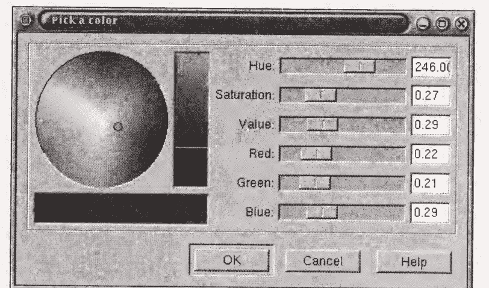

- **双色渐变** 从颜色下拉列表中选择垂直渐变（Vertical Gradient）或水平渐变（Horizontal Gradient），然后为主颜色（Primary Color）和次颜色（Secondary Color）都选择颜色。这创建了一个从顶部到部（或从左到右）从主颜色变为次颜色的渐变效果。

当你完成背景设置更改后，点击 OK 按钮提交更改。

要控制你的面板（Panel）设置，请在 GNOME 控制中心的桌面部分选择“面板”项。在 GNOME 控制中心窗口的右侧，显示如图 10.4 所示的面板配置应用程序。

### 图 10.4：配置你的面板


有五个与配置面板相关的标签页。这些设置允许你配置面板上每个图标和菜单的外观、感觉和行为。

- 动画（Animation）标签页允许你控制 GNOME 面板菜单和抽屉的动作。
- 按钮（Buttons）标签页允许你管理面板上每个程序启动按钮的外观和感觉。你可以调整每个按钮的深度、边框和相对位置。当你选择启用平铺（Tiles Enabled）时，可以选择普通平铺（Normal Tile）或已点击平铺（Clicked Tile）来更改平铺背后的颜色和图案。
- 面板对象（Panel Objects）标签页调节当你在 GNOME 面板上移动对象时发生的情况。
- 菜单（Menu）标签页调节图标和菜单的大小，以及它们相对于主菜单的位置。
- 杂杂（Miscellaneous）标签页包含启用工具提示（Tooltips Enabled）等设置，当你的鼠标悬停在特定按钮上时，它提供程序的简要描述。

当你完成背景设置更改后，点击 OK 按钮提交更改。

要控制你的屏幕保护程序设置，请在 GNOME 控制中心的桌面部分选择屏幕保护程序（Screensaver）项。在 GNOME 窗口的右侧，显示如图 10.5 所示的屏幕保护程序配置应用程序。

### 图 10.5：配置你的屏幕保护程序


左上角是系统中可用的屏幕保护程序列表。在该列表右侧会显示你当前所选屏幕保护程序的小演示。在列表下方，你可以指定在启动屏幕保护程序之前应该经过多少分钟的闲闲，以及是否需要密码。

优先级（Priority）设置指示了应该投入多少计算机资源给屏幕保护程序。当优先级被设置为普通（Normal）时，任何后台进程都将被拒绝访问计算机资源，以确保屏幕保护程序动画流畅。相比之下，选择低（Low）优先级意味着你的后台进程在访问系统资源方面具有优先级；代价可能是屏幕保护程序图形出现卡顿。

最后，你可以指定在屏幕保护程序活动期间是否允许电源管理关闭显示器，以及在启动屏幕保护程序后等待多少分钟再关闭显示器。

再次，一旦你完成了设置，点击 OK 按钮保存设置。

控制中心桌面部分的另一个有用功能是图 10.6 中的主题选择器（Theme Selector）。

### 图 10.6：主题选择器


在此部分中，你可以从窗口上部的桌面主题列表中进行选择。这些桌面主题定义了统一的窗口背景、按钮样式、窗口样式和配色方案集合。你可以通过选择“使用自定义字体”（Use Custom Font）来调整主题。当你然后点击显示的字体（在图 10.6 所示的情况下，是 Helvetica）时，会打开“选择字体”（Pick A Font）窗口，为你提供字体、样式和大小的选择。当你选择一个主题时，主题示例将显示在应用程序的半部分，如图 10.7 所示，其中选择了 Quiet 主题。

### 图 10.7：选择 Quiet 主题


控制中心桌面部分的最后一个功能是图 10.8 所示的窗口管理器选择器（Window Manager selector）。此部分包含了所有可用窗口管理器。你可以在此菜单中切换窗口管理器。“为 Sawfish 运行配置工具”（Run Configuration Tool For Sawfish）选项会打开另一个窗口，你可以在可以在中配置与 GNOME 控制中心 Sawfish 窗口管理器部分相同的选项。这些选项将在本章稍后进行讨论。

### 图 10.8：窗口管理器选择器


## 文档处理程序

文档处理程序（Document Handlers）部分管理与各种类型文件相关的应用程序，包括默认文本编辑器、其他程序的 MIME 类型以及 Web 地址的 URL 处理器。换句话说，此部分设置了你在 GNOME 文件管理器中打开数据文件时的应用程序。

要定义与文本文件关联的编辑器，请选择“默认编辑器”（Default Editor）项。这将显示图 10.9 所示的配置应用程序。

点击 Gnome 编辑器（Gnome Editor）下拉框以选择你喜好的默认编辑器。Emacs 是默认的 Gnome 编辑器。如果你保持默认且计算机上没有安装 Emacs，当你尝试从 GNOME 文件管理器打开文本文件时，你会收到一条错误消息。

### 图 10.9：设置默认编辑器


要定义与文档扩展名关联的应用程序，请选择“MIME 类型”（Mime Types）项。该项显示图 10.10 所示的配置程序。

### 图 10.10：各种 MIME 类型

| MIME 类型 | 扩展名 | 更多 |
|---|---|---|
| application/x-inode | | 编辑... |
| application/octet-stream | bin | D... |
| application/oda | | |
| application/image/jpeg | pdf | |
| application/javascript | pgp, ps | |
| application/vmd | rt | |
| application/vnd-ms-excel | doc, xls | |
| application/x-spreadsheet | as | |
| application/x-word | aw | |
| application/xml | lr | |

要定义与 Web 页面或任何使用通用资源定位符（URL）的文件关联的应用程序，请选择“URL 处理器”（URL Handlers）项。该项显示图 10.11 所示的配置程序。

### 图 10.11：URL 处理器


如图 10.11 所示，有四种不同类型的文件或协议被设置为 URL。虽然 URL 通常与页面关联，但 GNOME 同样索引帮助文件、info 页面和 man 页面。

默认有两种浏览器可选：Netscape 和 GNOME 帮助浏览器。你可以在当前浏览器或新窗口中打开它们。突出显示你想更改的协议。点击处理器框中的下拉箭头以查看选项。做出选择，然后点击设置。

## 多媒体

多媒体部分允许你控制基于 GNOME 系统的两个声音方面：启动 GNOME 时是否启动声音系统，以及创建“声音事件”的操作。

要定义声音启动序列，请在左侧面板的“多媒体”下选择“声音”（Sound）。默认打开“常规”（General）标签页，如图 10.12 所示。

### 图 10.12：配置声音启动序列


要在 GNOME 窗口中获得声音服务，必须选择“启用声音启动”（Enable Sound Startup）选项。在此标签页下启用声音事件，必须选择“事件声音”（Sounds For Events）选项。要定义事件发生时的声音，请点击“声音事件”（Sound Events）标签页，如图 10.13 所示。

### 图 10.13：声音事件选项卡

| 事件 | 要播放的文件 |
|---|---|
| GNOME 系统事件 | |
| 登录 | |
| - 信息性消息 | info.wav |
| - 警告消息 | warming.wav |
| - 错误消息 | error.wav |
| - 提问对话 | question.wav |
| - 杂项消息 | generic.wav |
| 界面事件 | |
| - 动作按钮点击 | gtk-events/clicked.wav |
| - 菜单项激活 | gtk-events/activate.wav |
| - 复选框切换 | gtk-events/toggled.wav |
| 邮件检查 (Mailcheck) | |
| - 新邮件 | phone.wav |
| 面板 | |
| - 展开 | panel/slide.wav |
| - 折叠 | panel/slide.wav |
| 基础邮件读取器 | |
| - 程序启动 | balsa/startup.wav |

## 外设

外设部分允许你通过 CD 属性、键盘和鼠标条目，控制光盘、键盘和鼠标的基本行为。

图 10.14 所示的 CD 属性条目配置了当光盘插入配置适当的 CD 驱动器时 Linux 的动作。

如果你插入了一张包含数据的 CD，此部分允许你配置三个选项中的任何或全部：自动将 CD 的文件挂载到默认驱动器（Red Hat Linux 7.1 中的 `/mnt/cdrom`）、自动运行驱动器主目录下的程序，以及打开 GNOME 文件管理器来管理该目录。

如果你插入了一张音频 CD，可以设置 Linux 在识别到 CD 时运行特定的命令。默认情况下，GNOME 控制中心配置为使用 GNOME CD 播放器播放介质上的任何音乐。有关 GNOME CD 播放器命令选项的更多信息，请打开 `xterm` 并运行 `gtcd -help` 命令。

### 图 10.14：配置你的 CD 驱动器


图 10.15 所示的键盘条目允许你指定要启用键盘自动重复，如果启用，则可以指定开始重复之前的延迟以及字符重复的速度。此外，你还可以选择启用在每次按下按键时播放点击声。如果你启用了点击声，可以控制点击的音量。你还可以指定键盘蜂的音量、音调和持续时间，键盘蜂在有键盘消息或错误时会响。


## 图 10.15：配置你的键盘


图 10.16 所示的鼠标条目允许你指定鼠标用户是左手型还是右手型，从而有效率交换左右鼠标键的默认行为，并指定鼠标速度和响应能力。

## 图 10.16：设置你的鼠标行为


## Sawfish 窗口管理器

假设已安装了 Red Hat Linux 7.1 默认的 Sawfish 窗口管理器，此部分允许你控制其配置，该配置提供了 GNOME 桌面内图形用户界面的“外观和感觉”。当你浏览不同的选项时，可以使用四个按钮：尝试（Try）、还原（Revert）、确定（OK）和取消（Cancel）。如果你进行了更改，可以点击“尝试”来测试其效果。然后点击“还原”来恢复原始配置。

共有 11 个类别可以配置 Sawfish：

- 外观（Appearance）：通过默认边框样式进行。Red Hat Linux 7.1 的 GNOME 默认样式被称为 CoolClean。可以根据你选择的边框样式对对话框、窗口和动画进行自定义。

- 焦点行为（Focus Behavior）：决定了当你指向窗口时该窗口的行为。

- 匹配窗口（Matched Windows）：允许你链接不同类型窗口的行为。

- 元操作（Meta）：包括三个选项——新手（Novice）、中级（Intermediate）和专家（Expert），它们决定了你在 GNOME 控制中心配置 Sawfish 的程度。

- 最小化和最大化（Minimizing And Maximizing）：控制最小化时的虚拟窗口位置以及最大化时的窗口行为。

- 杂项设置（Miscellaneous settings）：决定了当一个窗口升起时其他窗口的特征，以及与每个窗口相关的工具提示。

- 移动和调整大小（Moving And Resizing）：决定了窗口在移动或调整大时的动画和位置。

- 放置位置设置（Placement settings）：决定了窗口打开时的位置，包括与特定程序相关的对话框的位置。

- 快捷键（Shortcuts）：包括与特定命令（如注销 GNOME）关联的按键组合。

- 声音设置（Sound settings）：驱动窗口事件（如最小化和最大化）的音效。

- 工作空间（Workspaces）：决定了虚拟桌面的数量以及移动到不同虚拟桌面所需的动作。

由于 Sawfish 的可配置性极高，你在本节中看到的选项与你计算机上显示的选项大不相同。你也可以直接通过 Sawfish 用户界面进入相同的配置选项，你可以从命令行启动它：

```
$ sawfish-ui &
```

或者，如果你发现由于某种原因 sawfish 不在你的路径中，请使用命令：

```
$ /usr/bin/sawfish-ui &
```

## 图 10.17：配置你的 CD 驱动器


## 会话 (Session)

会话部分允许你控制启动时发生的情况。启动（Startup）选项配置启动程序。

## 用户界面选项 (User Interface)

用户界面选项允许你控制界面的各个方面，包括：

- 窗口的默认外观

- 对话框的方式

## 配置 GNOME 面板

GNOME 面板在启动时创建一个默认面板。


用户可以创建自己的面板。从 GNOME 菜单选择创建五种不同的面板：

- 菜单面板（Menu Panel）：包含下拉菜单。

- 边缘面板（Edge Panel）：沿边缘添加面板。

- 对齐面板（Aligned Panel）：类似于边缘面板，但不需要放置在角落。

- 滑动面板（Sliding Panel）：类似于对齐面板，但可以根据需要伸缩。

- 浮动面板（Floating Panel）：是最自由的面板，可以放置在屏幕任何位置。

一旦创建，任何面板的属性都可以更改。右键点击面板。在弹出菜单中，选择面板>属性>所有属性。在出现的属性窗口中，你可以调整除菜单面板以外面板的位置、颜色等。

你还可以通过其他方式配置 GNOME 面板。就本节而言，你将使用默认面板。你想面板面板的主要配置任务有：

- 添加抽屉（drawer）

- 添加注销按钮

- 添加启动器（launcher）

- 控制面板属性

## 在面板上添加抽屉

通过右键点击面板背景并在出现的菜单中选择面板>添加面板>抽屉，可以在面板上添加抽屉。


点击抽屉可以打开或关闭抽屉。打开的抽屉可以显示并包含其他图标，例如启动应用程序的图标。当抽屉关闭时，这些图标会被隐藏。你可以通过右键点击你想移动到打开的抽屉的项目，将其从面板移动到抽屉。然后从出现的菜单中选择移动，并使用光标将项目拖到所需位置。最后，点击该位置完成移动。

## 在面板上添加注销按钮

通常，你通过从 GNOME 主菜单选择注销来退出 GNOME。不过，你可以在面板上添加按钮，以便单点击注销。要执行此操作，右键点击面板背景，然后点击面板>添加面板>注销按钮。注销按钮会被添加到面板中。

## 添加新启动器

默认的 GNOME 面板包含几个按钮，用于启动如 Netscape 和终端窗口等应用程序。这些都是启动器按钮。你可以通过右键点击面板背景，然后从出现的菜单中选择面板（Panel） > 添加到面板（Add To Panel） > 启动器（Launcher）来创建自己的启动器按钮。这将打开类似于图 10.18 的对话框，用于定义要启动的应用程序。

图 10.18：

定义新的应用程序启动器


你至少需要为启动器提供名称，以及作为命令的 GNOME 或 X Windows 应用程序路径和名称。你还可以点击标记为“无图标”的按钮来显示图标供选择列表，从而为启动器选择图标。

如果你希望启动器启动控制台应用程序（需要在命令行和终端窗口运行的程序），请勾选“在终端运行”（Run In Terminal）复选框。

## 控制面板属性

如果你右键点击面板背景并选择属性（Properties） > 所有属性（All Properties），就会出现图 10.19 所示的面板属性对话框。

该对话框包含两个选项卡。“边缘面板”（Edge Panel）选项卡控制面板在屏幕上的位置、面板（以及相关图标）的大小、自动隐藏功能的激活，以及面板两端隐藏按钮的状态。这些功能在第 8 章“使用 GNOME 和 Windows”中有所描述。

## 图 10.19：

面板属性对话框，边缘面板选项卡


背景（Background）选项卡如图 10.20 所示。此界面允许为面板定义背景图像或颜色。在屏幕顶部，你可以选择标准（Standard）、位图（Pixmap）或颜色（Color）背景。标准背景遵循你为 GNOME 定义的主题或颜色方案；位图使用位图图像作为背景；颜色允许你为背景定义纯色。

## 图 10.20：

面板属性对话框，背景选项卡


如果你选择位图，可以点击浏览（Browse）按钮并在出现的文件选择对话框中选择图像文件。默认情况下，图像是平铺的。或者，你可以选择拉伸图像、缩放适应或旋转（如果边缘面板是垂直的）。

如果你选择颜色，可以点击“使用颜色”（Color To Use）按钮打开“选取颜色”窗口，在其中为面板背景选择一种颜色。

## 展望

到此时，你应该对 GNOME 和 X Windows 相当熟悉了。在第 11 章“使用 KDE”中，你将探索另一种名为 KDE 的图形用户界面。你将学习 KDE 的历史，然后进入安装阶段。

一旦启动并运行 KDE 桌面，你将探索它的功能并浏览其文件系统。在了解导航的基本知识后，你将学习配置 KDE 以满足你的需求。在本章结束，你将能够使用 KDE 查看文本和图形、管理时间并管理你的 Linux 系统。

# 第十一章

## 使用 KDE

- KDE 项目历史

- KDE 与 Red Hat Linux 7.1

- 探索 KDE 桌面

- 浏览文件系统

- 配置 KDE

- 使用 KDE 工具

Linux 用户界面最有前景的进展之一是 K 桌面环境（KDE）。KDE 是从零开发的完整图形桌面环境。KDE 也是大多数主流 Linux 发行版的默认桌面环境。尽管书中包含的 Red Hat Linux 7.1 默认安装 GNOME 桌面，它也包含了运行 KDE 2.1.1 版本所需的文件。

## KDE 项目历史

与完整 Linux 发行版大多数组件一样，KDE 由一组想要创建新颖且实用工具的专业程序员开发。Matthias Etrich 于 1996 年 10 月在德国创立了 KDE 项目。他最初的目的是为 Linux 和其他 Unix 系统创建一个强大的桌面环境，类似于在 Solaris 等商用 Unix 平台上可获取的商用通用桌面环境（CDE）。最终结果是一个范围远超简单模拟 KDE 的项目。

KDE 项目的贡献者包括来自全球的数百开发者，他们通过电子邮件和偶尔的面对面会议交流。想要参与 KDE 开发的个人可以在核心组件（如窗口管理器、桌面面板和其他组件）上工作，也可以使用 KDE 定义的应用程序编程接口（API）为 KDE 创建自己的应用程序。

KDE 贡献者中还有翻译人员、作家、用户界面设计师和多媒体专家，以及系统和应用程序程序员。

KDE 并没有取代 Linux 电脑上的 X Windows 系统。相反，KDE 使用 X Windows 系统作为图形基础，在此基础上构建桌面。

如果你用过其他的 X 窗口管理器（如 Sawfish、AfterStep 甚至 CDE），你可能会发现 KDE 包含了它自己的窗口管理器，称为 `kwin`。

除了提供在桌面创建和管理窗口的核心功能的窗口管理器外，KDE 还包含了任务栏和主菜单等几个功能。对于 Red Hat Linux 7.1，运行 KDE 2.1.1 版本所需的文件已包含在内。

* * `kdelibs-devel-2.1.1-5.i386.rpm` *

* `kdelibs-sound-2.1.1-5.i386.rpm`

* `kdelibs-sound-devel-2.1.1-5.i386.rpm` *

* `kdemultimedia-2.1.1-1.i386.rpm`

* `kdenetwork-ppp-2.1.1-1.i386.rpm`

* `kdenetwork-2.1.1-1.i386.rpm`

* `kdepim-2.1.1-1.i386.rpm`

* `kdesdk-2.1.1-1.i386.rpm` *

* `kdesdk-devel-2.1.1-1.i386.rpm` *

* `kdesupport-2.1-3.i386.rpm`

* `kdesupport-devel-2.1-3.i386.rpm` *

* `kdetoys-2.1.1-2.i386.rpm` *

* `kdeutils-2.1.1-1.i386.rpm` *

* `kdevelop-1.4.1-2.i386.rpm` *

* `kdoc-2.1.1-1.noarch.rpm` *

* `koffice-2.0.1-2.i386.rpm`

* `kppload-1.04-23.i386.rpm`

带有星号 (*) 的软件包位于第二张 Red Hat 7.1 安装光盘上，该书中未包含这些光盘内容。你可以从 KDE 主页 http://www.kde.org 或 RPM 数据库网站 http://www.rpmfind.net 下载它们。

## 更新 KDE

在编写此文档时，Red Hat Linux 7.1 包含了最新版本的 KDE。然而，KDE 每隔几个月就会更新其桌面的功能，因此你可能想要更新你的系统。你可以根据 KDE 主页 http://www.kde.org 上的文件，在任何版本的 Linux 中升级可用的 KDE。最新的 KDE 文件也可以在 http://www.rpmfind.net 以 RPM 格式提供给多种发行版。

当你下载最新软件包时，请寻找上列表中命名文件的最新版本，以及它们的“基础”（base）包，这些包包含了许多以 htdig、libpng 和 qt 开头的各种软件包。如前面的章节所述，一旦你拥有了必要的软件包，可以使用以下命令之一进行安装，具体取决于你是第一次安装 (-i) 软件包，还是升级 (-U) 到软件包的较后版本：

```
# rpm -i filename
# rpm -U filename
```

或者，你可以使用 Kpackage 或 GnoPRM 实用程序在 X Window 中管理软件包。如果安装，可以通过 KDE 主菜单下的 System（系统） ➤ Package Manager（包管理器）使用 Kpackage，而 GnoPRM 则可以通过 KDE 主菜单下的 GNOME Programs（GNOME 程序） ➤ System（系统） ➤ GnoPRM 使用。

## 启动 KDE

在 Red Hat Linux 7.1 中，默认桌面环境是 GNOME。如果你是从安装光盘或下载安装的 KDE，可以从默认的 GNOME 图形登录窗口启动 KDE。为此，请按照以下步骤操作：

1. 选择 Session（会话）菜单。

2. 在可能的桌面列表中选择 KDE。

3. 使用你的用户名和密码登录。

当 KDE 启动时，会显示一个初始界面，如图 11.1 所示。

如果你通常通过登录控制台提示符并使用 `startx` 命令来启动 X Windows，那么你需要配置系统，以便在启动 `startx` 命令时启动 KDE。

在这方面，你有三个选择：

- 如果你想更改每个用户的默认桌面，请修改全局 Xclients 文件，你可以在 `/etc/X11/init/Xclients` 找到它。

- 如果你只想更改自己的默认桌面环境，请将全局 Xclients 文件复制到你的家目录，将文件重命名为 `.Xclients`，然后编辑家目录中的该文件。你可以使用以下命令复制文件：

  - `cp /etc/X11/init/Xclients ~/.Xclients`

### 图 11.1：

初始 KDE 界面包含几个桌面图标。


在前两种情况中的任何，你都需要对文件进行一处更改。第五行最初应该是：

`PREFERRED=`

将此行更改为

`PREFERRED=startkde`

一旦你进行了此项更改并保存，当你使用 `startx` 命令时，X Windows 将以 KDE 作为你的桌面启动。如果你对全局 `.Xclients` 文件进行此更改，那么每个用户都把 KDE 作为他们的默认桌面。

- 如果你只想更改你的默认桌面用户，请使用 Red Hat Linux 7.1 `switchdesktop` 命令。这会打开桌面切换（Desktop Switcher）对话框，你可以在其中选择喜欢的桌面环境。例如，如果你选择了 `.Xclients`，这将修改你家目录中的 `.Xclients` 文件，使其指向 `.Xclients-default` 文件，其中只有一行：

```
exec startkde
```

## 退出 KDE

当你准备好退出 KDE 时，从登录窗口选择 Logout（注销）。

字体（Font）选项卡允许您定义用于问候（Greeting）、失败（Fail）和标准（Standard）消息的文本字体。要更改字体，请从下拉列表中选择想要更改的字体，并点击更改字体（Change Font）按钮。会出现一个选择字体（Select Font）对话框，您可以在其中选择所需的字体。

背景（Background）选项卡（如图 11.3所示）允许您为登录屏幕选择背景颜色图案或背景图像。

如果您更喜欢彩色背景，在选择模式（Mode）下拉框时有多种选择，包括：

- 平色（Flat）：单色（两个颜色条中的第一个）

- 水平渐变（Horizontal Gradient）：两种颜色从左右混合

- 垂直渐变（Vertical Gradient，默认值）：两种颜色从上下混合

要选择颜色，请点击颜色 1（Color 1）或颜色 2（Color 2）。会出现一个选择颜色（Select Color）对话框（如图 11.4 所示），您可以在其中选择要使用的颜色。

# 图 11.3：

在背景选项卡中，您可以选择用于在 *kdm* 登录窗口背后的颜色或壁纸图形。


# 图 11.4：

标准的 KDE 选择颜色对话框允许您定义用于 `kdm` 背景的颜色。


如果您希望在登录屏幕背景中使用壁纸图形，请选择显示器图片下的壁纸（Wallpaper）选项卡。

KDE 2.1.1 提供了 25 多种标准壁纸图形。您可以从壁纸下拉列表中选择其中任何一个。

如果您有另一个想要作为壁纸的图形，请点击浏览（Browse）按钮并从存储图形文件的目录中进行选择。

> 建议将您想要作为壁纸的图形文件复制到标准的 KDE 壁纸目录 `/usr/share/wallpapers/`，这样即使在将其指定为 KDE 壁纸后，也不会意外删除该文件。

通过选择模式选择下拉列表下方显示的按钮，可以将壁纸图形放置在背景的几个不同位置。选项包括：

- 平铺（Tiled）：将壁纸图形作为跨整个背景的重复图案。

- 居中（Centered）：将单个壁纸副本置于 `kdm` 屏幕中间——在这种情况下，它可能会大部分被 `kdm` 登录窗口覆盖。

- 缩放（Scaled）：将壁纸扩展到屏幕边缘。

## 注意

如果您使用了平铺（Tiled）或缩放（Scaled）等壁纸选项，您选择的任何背景颜色将不可见。如果您只想使用背景颜色而非壁纸图形，请务必在壁纸下拉列表中选择“无壁纸”（No Wallpaper）选项。


会话（Sessions）选项卡允许您指定登录会话的定义。例如，您可以添加用户安装的其他窗口管理器，如 `CDE`。用户（Users）选项卡允许您配置哪些用户以图标形式显示在登录窗口中。最后，便利（Convenience）选项卡允许您设置 KDE 登录时不需要密码的情况。

当您定义好所需的 `kdm` 选项后，点击 `OK` 关闭对话框并保存设置。您将在下次看到 KDE 窗口时看到这些设置。

# 添加其他 KDE 应用

在安装 KDE 时，您将拥有一套完整的工具和娱乐程序，如本章稍后部分所述。然而，还有许多其他 KDE 应用可用以满足您特定安装的独特需求。

特别是，您可能希望将喜爱的 KDE 应用更新到新版本，或者下载未包含在默认 KDE 发行版中的应用程序。

DE 应用的主要来源是 KDE Applications 网站：`http://apps.kde.com`。KDE Applications 网站定期更新，包含 800 多个 KDE 应用，每个应用都有简短说明和直接指向 FTP 下载目录的链接。

您可以在此应用程序页面找到的示例包括：

- KDE 办公套件
- 配置 `BIND` (DNS) 的工具
- 额外的图标集和配色方案（KDE 主题）
- 视频文件播放器
- 支持 KDE 的 Telnet 应用程序
- ISDN 线路管理工具
- 笔记本电脑电源管理实用
- 用户管理工具
- 数十种游戏

记住，这些是您的 KDE 系统中已安装的许多 KDE 应用之外的。幸运的是，这些应用程序大部分以常规 `RPM` 包的形式提供，您可以按照本章及之前章节所述进行安装。

对于新的 KDE 用户来说，某些额外的应用程序是以源代码形式分发的。为了使用它们，您需要安装开发包并在 Linux 系统上编译源代码。

这实际上并不困难。问题通常出现在不熟悉开发工具的用户身上。在这种情况下，解决任何出现的错误或警告信息可能会非常耗时。

一旦您安装了 KDE、Qt 和 Windows 系统的开发库，可以使用这些简单命令准备已下载并解压的源码树：

```
# configure
# make all
# make install
```

通过这些命令，新应用程序将被编译并放置在您的 KDE 菜单或二进制目录中，以便您可以立即执行。某些应用程序可能需要更复杂的步骤来编译和安装。

# 探索桌面

（注：此处省略了原文中大量重复的描述段落）

# 启动 KDE 应用

在学习 KDE 环境时，可以启动几个 KDE 应用进行实验。KDE 文本编辑器和终端模拟器是一个很好的起点。在主菜单中选择系统 > 终端打开命令行窗口。一旦打开了终端模拟器，可以通过输入任何应用程序名称来启动它，而不是从菜单或点击图标。例如，可以通过输入 `kedit` 启动文本编辑器。

# 探索 KDE 桌面

进入程序命令的一种快速方法是通过 KDE 中的弹出式命令窗口。要使用此功能，按下 `Alt+F2` 并在弹出的小窗口中输入命令。

# 使用多桌面

如果你熟悉其他 Linux 虚拟管理器，每个管理器都包含许多打开的窗口。可以使用分页器（Pager）来管理多个虚拟桌面，每个桌面都是虚拟的；你可以在其中一个运行浏览器；在另一个运行文字处理器；在另一个中运行编辑代码的终端窗口。

KDE 使用相同的理念为您提供多个视觉工作区。默认情况下，KDE 包含四个虚拟桌面，您可以通过点击面板（Panel）上的桌面名称或数字，或者按 `Ctrl+F1` 进入桌面一、`Ctrl+F2` 进入桌面二等在它们之间切换。

你可以更改桌面的数量并对其进行重命名，以适应你的使用习惯。从 KDE 主菜单中，选择设置（Preferences） > 外观（Look & Feel） > 桌面（Desktop）。在弹出的对话框中，点击桌面数量（Number Of Desktops）选项卡。窗口顶部的滑动条允许您配置 1 到 16 个虚拟桌面。每个虚拟桌面关联的文本框都允许您重命名桌面。

您可以通过按住 `Ctrl` 键并反复按下 `Tab` 或 `Shift+Tab` 在桌面之间循环。

# 操作应用程序窗口

在 KDE 中操作应用程序窗口与您使用过的其他图形环境类似。在 KDE 中可以使用相同的移动、调整大小和关闭窗口的方法。

当您在 KDE 桌面上打开多个窗口时，可以通过点击窗口的任何地方来激活任何窗口。

## 提示

KDE 的焦点策略决定了哪个窗口是 KDE 中的活动窗口。如果您习惯特定的焦点类型（例如可以在鼠标指针所在的任何窗口中输入），可以通过选择设置（Preferences） > 外观（Look & Feel） > 窗口行为（Window Behavior）来更改 KDE 的焦点策略。在弹出的对话框中，点击动作（Actions）选项卡并选择您喜欢的焦点策略。

KDE 的多个虚拟桌面可以轻松同时处理许多打开的窗口，但您也有其他方法在打开的窗口之间切换：

- 任务栏显示每个打开的窗口的按钮。点击任务栏按钮可以激活该窗口并将其置顶。
- 您可以按住 `Alt` 键并按 `Tab` 或 `Shift+Tab`，像在 Windows 中一样反复在打开的窗口之间切换。
- 您可以按下鼠标中键打开当前 KDE 会话的窗口和桌面列表。从此列表中，您可以选择任何窗口进行激活并将其置顶。

## 注意

如果您使用的是双键鼠标，可能在阅读第 4 节“安装 Red Hat Linux 7.1”时，您已经配置了鼠标中键模拟功能。同时点击左键和右键可以模拟点击中键。此“按钮”会调出窗口列表（Window List）。您可以在 Red Hat Linux 7.1 中使用 `/usr/sbin/mouseconfig` 工具来设置鼠标按钮。

# 浏览文件系统

使用任何图形系统的一个部分都是访问计算机上的文件。Linux 提供了一个完全集成的文件管理器来实现此操作。此外，您还可以直接从 KDE 主菜单通过快速浏览器（Quick Browser）访问文件系统，尽管这种方法没有文件管理器窗口的交互性。

本节描述了如何操作 KDE 文件管理器窗口和快速浏览器菜单。

# 使用 Konqueror 窗口

KDE 中的文件管理器被称为 `Konqueror`，它同时也兼任 Web 浏览器。

可以通过点击面板上的所示图标来启动 `Konqueror`。


这会将 `Konqueror` 作为 Web 浏览器启动，如图 11.6 所示。

## 图 11.6：

`Konqueror`


或者，您可以通过点击面板上的所示主目录（Home Directory）图标在 `Konqueror` 中打开您的主目录。


会出现一个 `Konqueror` 窗口，如图 11.7 所示。

## 图 11.7：

`Konqueror` 让您查看主目录的内容并浏览到其他目录。


您文件系统的默认视图在右侧窗格中使用中等图标（由 KDE 根据文件类型分配）。您可以在 `Konqueror` 窗口顶部看到工具栏和位置（Location）行。左侧窗格还有一个目录树，等于 Microsoft Windows 资源管理器中的文件夹窗格。

更改这些文件的视图以获取更多信息非常简单：从 `Konqueror` 工具栏，从视图（View） > 视图模式（View Mode）选择另一种显示选项，例如多列（MultiColumn）或文本视图（Text View）。您还可以在菜单上选择显示隐藏文件（Show Hidden Files）来查看主目录中的所有文件。

点击工具栏左端的向上箭头图标切换到父目录；点击任何目录将打开该目录并在窗口显示其内容。

在查看任何目录时，您可以点击位置（Location）字段并输入完整的 Web URL，例如：

```
http://www.sybex.com
```

或

```
ftp://ftp.kde.org
```

如果您当前连接到互联网，相应的 Web 将下载并在 `Konqueror` 中显示。

# 配置 Konqueror

在 `Konqueror` 工具栏上，选择设置（Settings） > 配置 Konqueror（Configure Konqueror）。如图 11.10 所示，您可以在九个不同的类别中配置 `Konqueror`。

## 图 11.10：

`Konqueror` 配置窗口


### 第 11 章 • 使用 KDE

- 文件管理器（File Manager）允许你设置文件管理器窗口的行为和外观。
- 文件关联（File Associations）允许将 `XLS` 文件等文件类型与特定应用程序（如 `KSpread`）关联起来。
- `Konqueror` 浏览器设置管理链接、文本大小、Java 和插件的规则。
- 增强浏览（Enhanced Browsing）允许你为不同的网站配置各种关键词；这仅适用于作为浏览器的 `Konqueror`。
- Cookie（Cookies）允许你配置将接受从不同网站接受的配置消息。你可以按域名对其进行自定义。
- 代理（Proxies）允许你通过代理服务器计算机连接到互联网或其他 Web 网络。
- 加密设置（Crypto settings）允许你设置要使用的加密/解密方案。
- 用户代理（User Agent）让你控制浏览器如何被你所使用的 Web 服务器识别。
- Netscape 插件（Netscape Plugins）列出了与各种文件类型相关的插件模块。

## 使用快速浏览器（Quick Browser）

`Konqueror` 提供了一种图形化管理文件的极方法，但如果你想立即启动程序或访问数据文件，`Konqueror` 的速度可能会稍慢。快速浏览器允许你通过 KDE 主菜单访问文件系统的任何部分，而无需打开过 `Konqueror`。

当然，你无法通过快速浏览器菜单在目录之间拖放文件，也无法通过它为项目打开“属性”窗口，但对于启动应用程序或打开数据文件，快速浏览器是完美的工具。

要访问快速浏览器，请在主菜单上选择“快速浏览器”。快速浏览器子菜单有三个选项：

- 主目录（Home Directory）选项访问以你的主目录为开头的文件和目录。
- 根目录（Root Directory）选项访问以根目录（`/`）为开头的文件和目录，根目录是 Linux 中的顶层目录。
- 系统配置（System Configuration）选项访问 `/etc` 目录下的配置文件和目录。

要查看如何使用快速浏览器查看你的文件系统，请在主菜单上选择 快速浏览器 ➤ 根目录，并花时间浏览出现的子菜单，如图 11.11 所示。请注意以下功能：

- 每当你移动到一个目录时，该目录的内容就会显示。
- 每当你点击一个文件时，KDE 会尝试启动或打开该文件。
- 在任何子菜单中，当你点击目录名称时，你可以选择“在文件管理器中打开”或“在终端中打开”，以便在目录中打开 `Konqueror` 或命令行窗口。

## 图 11.11:

你可以使用快速浏览器子菜单来浏览你的文件系统，而无需打开文件管理器窗口。


例如，在快速浏览器菜单中浏览到“主目录”。从你的主目录点击你选择的文件。KDE 会在关联应用程序中打开该文件。

## 创建 KDE 链接文件（KDE Link Files）

到目前为止已经阅读了许多关于 KDE 链接的文件。这些文件是小型文本文件，描述系统资源以便 KDE 可以使用它。

例如，引用你的 CD-ROM 驱动器的 KDE 文件是 KDE 桌面的一部分。这个 KDE 链接文件（以及关联的图标）允许你在无需使用命令行的情况下访问 CD-ROM 驱动器上的文件系统。你可以直接从桌面挂载、卸载和查看 KDE 内容。幸运的是，KDE 允许你以图形化方式创建这些链接文件。

如果你想看看 KDE 链接文件到底像什么样，请进入你主目录下的 `desktop` 子文件夹。如果你的主目录是 `/home/mj`，请进入 `/home/mj/desktop` 并用文本编辑器打开一个与图标对应的文件之一。

要创建一个引用图形化应用程序（如图形查看器 `GIMP`）的新 KDE 链接文件，请按照以下步骤操作：

- 打开文件管理器（`Konqueror`）窗口以查看你的主目录，导航到本地 `desktop` 子目录。
- 选择 编辑（Edit） > 新（Create New） > 链接到应用程序（Link To Application）。出现属性对话框。
- 修改显示的名称的第一部分以匹配你的应用程序，在此情况下为 The Gimp。
- 点击图标弹出一个带有其他可用图标的菜单。选择你喜欢的图标，然后点击确定。
- 选择 执行（Execute）选项卡（参见图 11.12）。
- 在执行选项卡的命令（Command）字段中，输入用于通过此 KDE 链接文件启动你想要访问的程序命令。
- 点击确定关闭属性对话框。

你还可以存储关于此应用程序的附加信息。例如，在常规（General）选项卡下，点击默认图标以选择新图标，或选择应用程序（Application）选项卡来定义此应用程序可以处理的数据类型。

## 图 11.12:

KDE 链接文件属性对话框的执行选项卡，定义如何启动应用程序。


你已经创建了一个 KDE 链接文件。下一次登录 KDE 时，该文件的图标应该出现在你的桌面上。你可以使用各种链接文件来扩展 KDE 菜单、为桌面添加图标、自动启动应用程序以及向 KDE 面板（Panel）添加图标。下一部分“配置 KDE”描述了如何使用 KDE 链接文件完成其中一些任务。

# 配置 KDE

你已经在控制中心看到了许多配置选项。KDE 2.x 发布后的，主要重大变化之一是控制中心左上部分增加了索引（Index）、搜索（Search）和帮助（Help）选项卡。

## 使用控制中心

要启动控制中心，请从主菜单选择控制中心，或点击面板上的图标。控制中心打开后，左侧显示一个列表。


- 提示：控制中心中的项目与主菜单上的设置对应。
- 注意：在控制中心选择应用将激活你的更改，但不会关闭控制中心。
- 要这样做，请选择文件（File） ➤ 退出（Quit）或标题栏上的关闭按钮。

控制中心包含了几十个配置选项，如图 11.13 所示。这些是针对普通用户最有用的选项。

## 图 11.13:

控制中心


## KDE 文件管理

控制中心的文件浏览部分设置了图形界面内文件链接和组织的方式。文件关联子部分将 `.txt` 和 `.jpg` 等文件扩展名与特定应用程序关联。当你点击 KDE 文件管理器 `Konqueror` 中的文件时，它会被打开。当你选择特定类型的文件时，可以更改关联的应用程序。

文件管理器子部分配置了 `Konqueror` 在打开新目录时的外观、移动文件到垃圾桶时的操作以及关联的命令行终端程序的行为。

## 帮助系统

控制中心有三层帮助。在窗口右上角，与固定、最小化和最大化按钮一起有一个问号按钮。当你点击问号然后点击某个项目时，控制中心会提供关于该项目的简要弹出描述。

控制中心左上部分菜单栏下方有一个帮助选项卡。当你突出索引选项卡下的某某项目时，可以点击帮助选项卡获取有关该项目的更多信息。点击窗口底部的帮助按钮是选择特定项目帮助的另一种方法，如图 11.14 所示。

最后，在帮助信息的底部有如下陈述：“点击此处阅读完整手册。”当你点击“此处”一词时，`Konqueror` 将打开，通常跳转到 KDE 控制中心手册的相关部分。

## 图 11.14:

帮助（Help）选项卡提供了有关特定控制中心（Control Center）项目目的的信息。


## 获取系统信息

控制中心的信息（Information）部分提供了有关您的 Linux 系统的详细统计数据和技术信息。这些选项卡中的信息无法更改；它们仅供您查阅，以便了解系统设置和状态。可用的子部分如下：

- **块设备 (Block Devices)**：列出配置并挂载的块设备，例如根目录 (`/`)、CD-ROM (`/mnt/cdrom`) 以及连接的网络驱动器。
- **DMA 通道 (DMA-Channels)**：列出系统中活跃 DMA 内存访问通道以及相关的硬件。
- **设备 (Devices)**：列出 Linux 识别的设备类型（而非单个设备）。
- **IO 端口 (IO-Ports)**：显示系统使用的 IO 端口地址。
- **中断 (Interrupts)**：显示系统定义的中断（也称为 IRQ 通道，但并非全部列出，因此在此阶段可能价值有限）。
- **KDE 从机 (KDE Slaves)**：列出如 `nfs`、`pop3` 和 `telnet` 等特定协议的小程序列表。
- **内存 (Memory)**：显示实时内存使用界面，每秒对您的虚拟和实际系统内存使用情况进行图形更新。
- **PCI**：提供所有 PCI 设备状态的报告。
- **PCMCIA**：列出电脑上的 PCMCIA 插槽，包括每个插槽中安装的 PC 卡类型。
- **分区 (Partitions)**：列出系统中的可用分区，由 `/etc/fstab` 配置文件定义。
- **处理器 (Processor)**：显示关于您的处理器器的类型、速度和其他信息的显示屏幕。
- **SCSI**：列出关于您的 SCSI 设备的任何信息。
- **Samba 状态 (Samba Status)**：如果 Samba 服务器已配置并运行，则显示所有当前登录的用户以及他们正在使用的 Linux 服务器。
- **声音 (Sound)**：显示您的 Linux 音频系统状态。
- **X Server**：显示您的 X 服务器使用的版本、服务器类型、颜色深度和分辨率。

# 更改 KDE 的外观和感受


控制中心的许多页面用于定义 KDE 的外观和界面选项。您在本章之前的节中已经看到过其中几个，例如登录管理器配置。最有趣的界面配置选项位于“外观与感受”（Look & Feel）部分。

背景（Background）子部分允许您为每个桌面设置不同的背景。它包含三个配置选项卡，如图 11.15 所示。背景（Background）和壁纸（Wallpaper）选项卡允许您为登录管理器尽可能定义背景颜色和壁纸。KDE 包含了 100 多种壁纸图形。每个桌面都可以有独立的壁纸和背景颜色方案。高级（Advanced）选项卡允许您限制背景内存缓存并设置不同模式的混合。

在颜色（Colors）子部分中，您可以定义 KDE 中打开的所有窗口的外观。在此部分中，您可以选择颜色方案（参见图 11.16）。此子部分类似于 Microsoft Windows 中的“显示属性”下的“外观”选项卡。在 KDE 中，您可以轻松创建额外的颜色方案，或单独修改每个窗口组件（称为部件）。

### 图 11:15:
背景（Background）子部分允许您为每个桌面定义背景颜色和壁纸。


### 图 11:16:
颜色（Colors）子部分为所有 KDE 窗口定义颜色方案。


在桌面（Desktop）子部分中，您可以指定桌面上的字体和图标、桌面边缘的活动、与每个鼠标按钮关联的操作以及虚拟桌面的数量。

在面板（Panel）子部分中，您可以更新面板和任务栏（Taskbar）的排列方式。通过该部分的五个选项卡，您可以配置如下项目的项目：
- 面板和任务栏的屏幕位置
- 面板和任务栏的动画
- 主菜单上的特殊项目
- 不同类别快捷键之间的颜色
- KDE 启动时加载的应用程序（Applets）

在屏幕保护程序（Screensaver）子部分中（参见图 11.17），您可以定义一个当系统闲置几分钟后 KDE 将使用的屏幕保护程序。KDE 提供了 21 个屏幕保护程序应用程序供选择。大多数可以通过点击“设置”（Setup）按钮进行预配置。

### 图 11.17:
使用屏幕保护程序为您的系统定义并配置 KDE 屏幕保护程序之一。


# 第 11 章 • 使用 KDE

> 提示
> KDE 主菜单包含“锁定屏幕”（Lock Screen）选项，它需要您的 Linux 密码来恢复屏幕。当您离开电脑时要使用此选项，请从主菜单选择“锁定屏幕”。

可以使用控制中心“窗口”（Windows）部分的对话框配置许多界面设置。这些选项更为高级，只有少数用户会感兴趣。它们包括：
- 为不同类别的桌面项目、标题和菜单设置表单
- 在在不同类型的桌面图标之间进行选择
- 修改桌面和窗口内各种功能的键盘快捷键
- 配置类型和样式
- 调整任务栏
- 设置 KDE
- 配置焦点行为

## 理解网络设置

控制中心的网络（Network）部分包含局域网浏览（LAN Browsing）和对话配置。 浏览使用新工具 LISA 设置连接。对话设置与 Unix 守护进程有关。

## 选择硬件设置（外设）

通常，您无法通过控制中心配置硬件。但也有例外。

在外设部分中，您可以设置关于键盘和鼠标的信息：
- 键盘子部分定义自动设置和键盘点击声（这取决于硬件本身）。
- 鼠标子部分定义您是用左手还是右手使用鼠标，以及鼠标指针移动的速度。

## 个性化设置

在个性化（Personalization）部分中，有多种方法根据个人需求配置 KDE 2.1，包括键盘和鼠标特性、语言和方言、电子邮件默认、加密和密码：

字体 辅助功能（Accessibility）允许您将系统提示音改为闪烁，调整键盘设置并设置键盘光标。
- 国家与语言（Country & Language）设置允许您设置 KDE 用于本地数字系统、货币和时间的语言和方言。

如果您想设置美国英语以外的语言且在安装 Red Hat Linux 7.1 时没有安装该语言，可以从本书随附的发行版安装光盘安装相应的 RPM。例如，在设置乌克兰语之前，您需要使用先过的 `rpm -i` 命令安装 `kde-i18n-Ukrainian-2.1.1-2.noarch.rpm` 包。
- 加密（Crypto）设置允许您设置使用的加密/解密方案。
- 电子邮件（Email）设置允许您设置 ID、服务器和电子邮件。
- 键盘布局（Keyboard Layout）允许自定义 X Windows 系统支持的大量各国键盘。
- 新闻滚动（News Ticker）是 KDE 2.1 的新功能。它允许您自定义网站以定期搜索标题。可能适用于 News Ticker 的新闻网站列表位于：http://www.webreference.com/services/news/

## 笔记本电脑电源控制

在笔记本电脑上运行 Linux 需要电源控制以最大限度地延长电池寿命。电源控制部分包含了用于管理功耗以及测量功率或电池电量的实用程序。具体而言，它包含以下子项：
- 电池监控子项允许你向面板（Panel）添加图标，用以测量你电脑上安装的任何电池的剩余电量。该功能假设已安装了高级电源管理守护进程。
- 能量子项配置计时器，可以将你的显示器置于待机（Standby）、挂起（Suspend）或关闭（Off）模式。
- 笔记本电脑电源控制子项可以将你的笔记本电脑（而不只是显示器）置于待机或挂起状态。实际效果取决于具体的笔记本电脑。

在设置笔记本电脑电源控制之前，你需要修改高级电源管理的权限。作为 root 用户，请运行 `chmod +s /usr/bin/apm` 命令。
- 低电量临界值和低电量警告将根据指定的剩余电池电量分钟数按照配置发送消息。这在锂离子电池上最为准确，因为这类电池的放电速度比其他类型的电脑电池更稳定。

## 声音控制

在 KDE 中有多种配置声音的方法。KDE 控制中心中的声音部分包含四个子项：
- Midi 允许你配置仪器设备驱动程序（例如不同版本的 Sound Blaster），以便在电脑上产生声音，前提是一个或多个可用设备。
- 混音器（Mixer）允许你增加检测到的声卡复杂程度。如果你的声卡具有特殊功能，可以增加每个混音器探测的混音器设备数量。

## 配置 KDE

- 声音服务器驱动分配给声卡的资源。例如，全双工操作允许声音同时通过你的麦克风和扬声器传输。
- 系统铃音（System Bell）设置控制发生系统事件时响铃的音量、音高和时长。

## 系统事件

系统部分允许你在以下五个子项中配置或查看若干基本参数：
- 启动管理器（Boot Manager）提供了一个用于配置 Linux 加载程序（LILO）的图形界面，允许你设置电脑上安装的不同操作系统和内核。当你重启时，LILO 允许你选择并启动你偏好的操作系统。
- 日期与时间（Date & Time）允许你修改电脑指定的日期、时间或时区。
- KDE 系统控制（KDE System Control）允许你查看与你电脑硬件相关的一些设置。
- 登录管理器（Login Manager）配合之前描述的设置工作，用于更改 KDE 登录界面。
- 会话管理器（Session Manager）设置默认值，在注销时需要确认，并在登录时恢复之前的会话。

## 网页浏览

网页浏览部分允许你配置 Web 通信 Cookie、代理以及不同类型的浏览器。具体而言，你可以配置以下子项中的项目：
- Cookie 允许你配置浏览器与不同 Web 网站之间交换的信息。你可以按域名进行自定义。
- 增强浏览（Enhanced Browsing）允许你为不同的 Web网站网站关键词；这仅适用于将 Konqueror 作为浏览器时。
- Konqueror 设置允许你控制网页的外观，包括对 Java 的使用。
- Netscape 插件（Netscape Plugins）列出了与各种文件类型相关的插件模块。
- 代理（Proxies）允许你通过代理服务器连接到互联网或其他 Web 网络。
- 用户代理（User Agent）允许你控制你所使用的 Web 服务器如何看待你的浏览器。
- Windows 共享（Windows Shares）允许你在 Microsoft Windows 网络中将本地电脑设置为 Samba 客户端。

## 更新菜单和桌面

除了控制中心提供的配置选项外，你还可以通过更改菜单、桌面图标和面板（Panel）来更新你的 KDE 环境。

为了更新这些项目中的任何一个，你首先需要创建一个 KDE 链接文件（Link file）来描述你想添加到 KDE 中的项目。本章中的“创建 KDE 链接文件”节介绍了如何图形化创建 KDE 链接文件。

一旦你有了代表设备或应用程序的 KDE 链接文件，就可以从创建它的目录拖动该文件的图标，并将其掉入几个位置来配置 KDE：
- 将该文件图标拖入面板，以配置 KDE。
- 将该文件图标拖入自动启动文件夹，以配置 KDE。
- 将该文件图标拖入桌面，以配置 KDE。
- 将该文件图标拖入菜单，以配置 KDE。
- 如果你想在菜单中看到它，可以把该文件图标拖入特定的菜单中。
- 将该文件图标拖入应用程序菜单，以配置 KDE。
- 最后，将该文件图标拖入快捷方式，以配置 KDE。
- 只要你已经有了代表设备或应用程序的 KDE 链接文件，就可以从创建它的目录拖动该文件的图标，并将其掉入几个位置来配置 KDE：

## 使用实用程序

KDE 包含了若干实用程序，允许你查看文本和图形、管理项目以及管理系统。本节仅描述了其中几个最常用的实用程序。

## 查看文本和图形

KDE 包含了文本编辑器、图像查看器和图像编辑工具。你可以通过编辑器菜单访问标准文本编辑器 KEdit。你也可以通过编辑器菜单访问高级文本编辑器 KWrite。

同样，你可以从图形菜单访问图像查看器，包括 KView（即 Image Viewer）、KDE-map 和 Xpaint。你也可以从图形菜单访问图像编辑工具 GIMP。

当你在 Konqueror 中右键点击文件时，可以选择这些应用程序来打开文件。例如，点击“打开方式”，如图 11.18 所示。如果你有其他选择，点击“其他”。这将打开“打开”对话框，允许你选择。

## 管理时间

Linux 没有原生的 Microsoft Outlook 或 Project，但 KDE 包含了一些工具来管理你的时间。

KDE 包含一个名为 KOrganizer 的时间管理器，它包含了事件日历、待办列表、调度等。你可以通过主菜单中的应用程序 > Organizer 访问此工具。图 11.19 包含了 KOrganizer 主界面。从该界面，你可以移动到不同的日期、添加待办事项并根据优先级安排事件。

除了 KOrganizer 之外，KDE 还包含一个时间跟踪器，允许你启动和停止计时，以跟踪你在各种项目上花费的时间。该工具可以通过实用程序 > 个人跟踪器访问。

KDE 还包含一个简单的通讯录（Address Book）。使用此程序记录工作时需要联系的朋友或同事的信息和备注。通讯录可以为每个人记录多个电话号码、传真号码和大量的电子邮件。通讯录，选择实用程序 > 通讯录。

## KDE 办公件

随着 KDE 2.0 的发布，KOOffice 套件首次正式发布，它包含了许多复杂的应用程序，类似于 Microsoft Office、Sun Star Office 或 AnywhereOffice 套件。KOOffice 包含五个基础工具，你可以通过选择 KDE 主菜单中的 Office 来访问：
- KWord 是一种 FrameMaker 风格的文字处理器，也可以导入 Microsoft Word 文件。
- 如图 11.20 所示，KSpread 是 KOOffice 的表格应用程序，可以导入 Microsoft Excel 文件以及逗号分隔（csv）数据文件。
- KPresenter 是 KOOffice 的演示稿应用程序，可以导入 Microsoft PowerPoint 文件。

### 图 11.20：
KSpread 是 KOffice 的电子表格应用程序。


* KChart 允许你创建图表和图形。
* K-Illustrator 是一种适用于计算机设计的矢量图形程序。

你可以在 KOffice 工作空间（Workspace）将这些应用程序集成在一起，这允许你在一个程序窗口中启动任何一个应用程序。将所有的 KOffice 应用程序放在一起也更方便在应用程序之间共享数据。

其他可用工具还包括 Krayon（KOffice 图像处理程序）、Klar（报告生成器）、Database（关联数据库程序）、用于公式处理的 KFormula 以及用于流程图的 Kivio。截至写本文时，Krayon 和 Kivio 将于 2001 年某个时候随下一个版本的 KOffice 发布。

# 管理你的 Linux 系统

KDE 正在以极快的持续添加新的系统管理工具。目前最有用的几个工具允许你管理系统上的 RPM 软件包、用户和组、系统中运行的进程以及 Linux 的系统初始化脚本。

许多实用程序可以在主菜单的“工具”（Utilities）和“系统”（System）部分找到。

## 展望

# 267

对于 Linux 管理任务，你仍然需要处理一些文本配置文件，但使用像 KPackage 这样的工具让大多数任务变得简单得多。要启动 KPackage，选择 系统（System） > 软件包管理器（Package Manager）。KPackage 主窗口将会出现并显示系统中所有的 RPM 软件包信息（见图 11.21）。

图 11.21：
KPackage 窗口按类别列出了你所有已的 RPM 软件包。


通过此窗口，你可以查看已安装软件包、搜索系统中特定的软件包和文件，或安装新的 RPM 软件包。

## 展望

现在你已经对各种图形化 Linux 桌面更加熟悉，是时候转向 X Windows 环境的更复杂的配置了。

第 12 章“高级窗口配置”将介绍如何配置 X Windows 以及你选择的窗口或桌面管理器，以满足你的个人需求和口味。这些任务将包括针对特殊情况配置 XFree86 服务器，以及 Windows 的启动序列。

# 第十二章

# 高级 X Windows 配置

- XF86Config 文件
- X Windows 启动序列
- X 资源 (Resources)

正如你在本书的这一部分看到的，X Windows 环境提供了某种在许多基于 GUI 的操作系统中并不常见的灵活性和定制性。当然，这种灵活性也带来了一定程度复杂性：为了充分利用 X Windows 的灵活性，你必须使用有时复杂的配置方法。

本章详细介绍了 X Windows 的主要组件以及如何对它们进行自定义。它从 XFree86 4 版本的 XF86Config 文件开始，该文件告诉 X 服务器如何运行。该文件指定了从正在使用的显卡类型（包括所需的的分和色彩深度）到正在使用的输入设备（鼠标和键盘）的所有内容。

一旦按照你的喜好完全配置了 X 服务器，你可能还想控制 X Windows 的启动方式：哪些程序在启动时运行，哪些操作在 X Windows 加载之前发生，以及窗口管理器是如何启动的。此外，资源数据库提供了一种机制，可以通过它控制诸如窗口中使用的颜色和字体，以及窗口响应某些操作的行为。这些设置（以及其他设置）可以全局性或按应用程序为基础进行指定。

# XF86Config 文件

XFree86 的配置位于 XF86Config 文件中。取决于你的发行版，该文件通常可以在 `/etc/XF86Config` 或 `/etc/X11/XF86config` 找到。Red Hat Linux 7.1 将文件放在 `/etc/X11`，并以通用配置文件开始，例如 `/usr/X11R6/lib/X11/XF86Config.eg` 文件。

如果你不知道安装的 XFree86 将此文件放置在何处，可以使用命令查找它：

```
# locate XF86Config
```

XF86Config 文件包含与 X 服务器运行相关的信息，包括键盘定义、鼠标规格和显示器信息。该文件由 XFree86 配置应用程序（如 Xconfigurator 和 xf86config）生成。

但有时，只有通过用你喜欢的文本编辑器直接编辑 XF86Config 文件才能实现对 X Windows 环境的微调。

## 注意

在写本文时，Free86 4 版本的服务器包含的显卡驱动程序没有 XFree86 3 版本多。因此，XF86Config 和 XF86Config-4 文件都有许多配置。如果你在 `/etc/X11` 目录中同时拥有这两个文件，则以下说明适用于你的 `/etc/X11/XF86Config-4` 文件。

XF86Config 文件被分为若干部分。并不是所有部分对于运行 GUI 都是必须的。随着 XFree86 4 版本的发布，这些部分的顺序已不再重要。

**Files** 此部分指定 XFree86 在何处可以找到补充文件。

**ServerFlags** 此部分用于启用和禁用 X 服务器功能。

**Module** 此部分指定 X 启动期间加载的运行时可模块。在大多数情况下，你甚至没有 Module 部分。

**InputDevice** 此部分指定输入设备，即键盘和鼠标。

**Keyboard** 此部分指定键映射和其他键盘功能，如重复率。

**Pointer** 此部分指示所使用的鼠标类型以及鼠标的行为。

**VideoAdaptor** 此部分旨在支持作为“原始”视频，换句话说，作为系统组件的视频适配器。

# Files

Monitor 此部分定义显示器的规格。

**Device** 此部分定义图形设备（显示适配器）。

**Modes** 此部分定义显示器的刷新率和分辨率能力。


### Screen
此部分将显示器连接到视频适配器。它还定义了 X 服务器的行为，例如通用 SVGA 服务器、厂商服务器和单色服务器。可以包含多个 Display 子部分，对应不同的分辨率和深度。

### ServerLayout
此部分将屏幕连接到特定的输入设备。

### DRI
此部分处理你对直接渲染接口的任何特殊设置，这对于图形密集型负载更为常见。DRI 配置超出了本书的范围。更多信息请参考以下网站：http://www.xfree86.org/current/DRI.html。

### Vendor
此部分将用于厂商特定的设置。

> 在 XF86Config 文件中，注释以井号 (`#`) 开始并持续到行尾。XFree86 会忽略包含在注释中的所有内容。

Section "Files"

```
RgbPath "/usr/X11R6/lib/X11/rgb"
FontPath "/usr/X11R6/lib/X11/fonts/local/"
FontPath "/usr/X11R6/lib/X11/fonts/misc/"
FontPath "/usr/X11R6/lib/X11/fonts/75dpi/:unscaled"
FontPath "/usr/X11R6/lib/X11/fonts/100dpi/:unscaled"
```

## XF86Config 文件 273

```bash
FontPath "/usr/X11R6/lib/X11/fonts/Type1/"
FontPath "/usr/X11R6/lib/X11/fonts/Speedo"
FontPath "/usr/X11R6/lib/X11/fonts/75dpi"
FontPath "/usr/X11R6/lib/X11/fonts/100dpi/"

ModulePath "/usr/X11R6/lib/modules"
```

这里有几条需要注意的基本规则，也适用于其他章节：

- 每个节以一个 `Section` 行开始。
- 每个节以一个 `EndSection` 行结束。
- 在 `Section` 行上，用双引号指定节名（在本例中为 `"Files"`）。

此节中有三个常用的指令，如表 12.1 所示。

| 表 12.1：Files 指令 |
| :--- | :--- |
| 指令 | 效果 |
| `RgbPath` | 该指令指定没有 `.txt` 或 `.db` 扩展名的 RGB（红-绿-蓝）数据库名称。RGB 文件指定了与其他颜色相关的红色、绿色和蓝色量。通常，除非你移动或更改 RGB 数据库的名称，否则可以保持默认值（尽管这样做不是好主意，因为多个应用程序会使用该数据库并在正常位置找到它）。 |
| `FontPath` | 根据需要多次使用此指令，指定 X Windows 在系统的何处找到已安装的 X 字体。可以指定可缩字体和位图字体（无法缩放的位图字体将不缩放到目录末尾）。如果你向系统添加了新目录，应该为它们添加一个 `FontPath` 指令。 |
| `ModulePath` | 该指令用于 Linux 等支持动态加载模块的操作系统。此指令指示了去哪里查找模块。在大多数 XFree86 版本中，此指令不会出现或在示例中被注释。模块的默认路径为 `/usr/X11R6/11b/modules`，只有在你需要更改值时才需要使用此指令。 |

其他字体模块可以在 `/usr/X11R6/lib/modules/fonts` 目录下找到。

## ServerFlags

`ServerFlags` 节允许你启用或禁用 X 服务器的某些功能。一个没有注释的 `ServerFlags` 示例所示：

```bash
Section "ServerFlags"
# Option "NoTrapSignals"
# Option "DontZap"
# Option "DontZoom"
# Option "DisableVidModeExtension"
# Option "AllowNonLocalXvidtune"
# Option "DisableModInDev"
# Option "AllowNonLocalOpenFail"
# Option "blank time" "10"
# Option "standby time" "20"
# Option "suspend time" "30"
# Option "off time" "60"
# Option "EstimateSizesAggressively" "0"
# Option "NoPM" "false"
# Option "Xinerama" "true"
EndSection
```

取消你想要激活的任何指令的注释；如果你不想激活它们，请保持注释状态（通常的默认状态）。在此处指定的任何选项都将被 `ServerLayout` 节中的选项覆盖。

## XF86Config 文件 275

示例中的指令的效果如表 12.2 所示。

| 表 12.2：ServerFlags 指令 |
| :--- | :--- |
| 指令 | 效果 |
| `NoTrapSignals` | 该指令用于调试。当接收到指示错误的信号时，服务器会执行核心转储（core dump），将其内存部分的内容导出到磁盘。这可能会导致系统不稳定，但在调试问题时（特别是对于 X 服务器的 Beta 测试版本）是无价的。除非你正在对 XServer 进行故障排除或测试，最好保持此指令的注释。 |
| `DontZap` | 通常情况下，`Ctrl+Alt+Backspace` 键组合会导致 X Windows 终止并返回控制台。启用此项后，`Ctrl+Alt+Backspace` 将被忽略，键组合将传递给当前应用程序进行处理。只有在极少数情况下，当你运行的需要使用此键组合才能正常工作时，才取消此行的注释。 |
| `DontZoom` | 通常情况下，`Ctrl+Alt+小数字键盘`会在你的 X 服务器可用的配置分辨率之间循环，每次增加一次分辨率。`Ctrl+Alt-减号`用于降低分辨率。如果应用程序由于其他目的需要这些键组合，请取消此行的注释，让 Windows 忽略这些键组合并将它们传递给你的应用程序。 |
| `DisableVidModeExtension` | 该指令防止使用 `xvtime` 客户端调整你的视频显示。（书中未描述 `xvtime`；可以通过在打开的窗口中使用命令 `man xvtime` 找到该程序的文档）。无需取消此指令，你可以保持默认设置。 |
| `AllowNonLocalXvidtune` | 与上一个指令相关，此指令允许非本地（换句话说，在网络某处）`xvtime` 客户端访问你的 X Windows 系统。出于考虑，最好保持此指令禁用状态。 |
| `DisableModInDev` | 通过启用此指令，在 X Windows 运行时无法动态更改键盘和鼠标设置。 |

| 表 12.2 续：ServerFlags 指令 |
| :--- | :--- |
| 指令 | 效果 |
| （注：此节提供的 OCR 文本高度损坏且重复。上述逻辑遵循标准的 XF86 配置文档。） | |

其他扩展模块可以在 `/usr/X11R6/lib/modules` 目录下找到。

## InputDevice

`InputDevice` 节指定指针（鼠标）和键盘。虽然 `InputDevice` 是 XFree86 4 的默认设置，但通常有两个 `InputDevice` 节：分别用于键盘和一个指针设备。

正如你预期的那样，一个 `InputDevice` 节指定了与键盘相关的信息，包括键盘类型和协议。虽然此节不再作为默认使用，但 `Keyboard` 和 `Pointer` 节（而不是 `InputDevice`）是默认 Red Hat Linux 7.1 XF86 配置文件的一部分。这里显示了一个没有注释的典型 `InputDevice` 节：

```bash
Section "InputDevice"
# Option "Protocol" "Xqueue"

# Identifier "Keyboard1"
# Driver "keyboard"

# Option "AutoRepeat" "500 5"
# Option "XkbDisable"
# Option "Xleds" "1 2 3"

# Option "LeftAlt" "Meta"
# Option "RightAlt" "ModeShift"
# Option "RightCtl" "Control"
# Option "ScrollLock" "Compose"
# Option "XkbDisable"
# Option "XkbModel" "pc101"
# Option "XkbModel" "pc102"
# Option "XkbModel" "pc104"
# Option "XkbModel" "pc105"
# Option "XkbModel" "pc106"
# Option "XkbModel" "microsoft"

# Option "XkbLayout" "us"
# Option "XkbLayout" "de"
# Option "XkbVariant" "nodekeys"
# Option "XkbOptions" "ctrl:swapcaps"

# Option "XkbRules" "xfree86"
# Option "XkbKeymap" "xfree86(us)"
EndSection
```

这看起来是一个复杂的章节，但正如表 12.4 所示，它实际上非常简单。

### 表 12.4：键盘指令

| 指令 | 效果 |
| --- | --- |
| `"Protocol" "Xqueue"` | `Xqueue` 协议用于各种 Sun Solaris 服务器 (`SRV3`, `SRV4`)。如果缺少此行，XFree 将默认使用 `Standard`（标准），它适用于几乎所有其他系统。 |
| `Identifier`, `Driver` | 管理员分配给键盘和键盘驱动程序的名称。 |
| `AutoRepeat` | 此指令用于指定按住按键在开始自动重复前等待多久，以及按键重复的频率。所有值单位均为毫秒。在之前的示例中，`AutoRepeat 500` 表示在按键被按住 500 毫秒（半秒）后开始自动重复，然后每 5 毫秒重复一次按键。 |
| `Xleds` | 此指令指定用户可以使用 `xset` 命令控制哪些键盘 LED 灯（例如数字锁定 `Num Lock` 和大写锁定 `Caps Lock`）。 |
| `LeftAlt`, `RightAlt`, `RightCtrl`, `ScrollLock` | X Windows 的键盘通常与标准 PC 键盘明显不同。这些键盘包含 `Meta`、`ModeShift`、`Compose` 和 `ModeLock` 等特殊键。如果你发现 Unix 或其他应用程序需要这些按键，请取消它们的注释。 |
| `XkbDisable` | 如果取消此行的注释，一个名为 `XKB` 的 Windows 扩展将被禁用。当 `XKB` 启用时（即指令被注释掉），`XKB` 使用一系列指令来定义键盘映射，通常用于较旧的 X 服务器。 |
| `XkbModel` | 此指令在 `XKB` 启用时使用，用于指定键盘模型。标准美国键盘是 `pc101`。美国“Windows”键盘是 `pc104`。微软自然手型键盘是 `microsoft pc102` 或 `pc105`。标准日本键盘是 `pc106`。 |
| `XkbLayout` | 此指令在 `XKB` 启用时使用，用于指定哪种键盘布局。当一个键盘模型对应多种语言时最为常见；例如，`de` 对应德语（deutsch），即德语键盘。 |

### 表 12.4 续：键盘指令

| 指令 | 效果 |
| --- | --- |
| `XkbOptions` | 当 `XKB` 启用时，可以使用此指令交换 `Caps Lock` 和 `Ctrl` 键的位置。要执行此操作，请将指令设置为值 `ctrl:swapcaps`。 |
| `XkbRules` | 键盘布局的基础规则集。使用 XFree86 服务器时需要。 |
| `XkbKeymap` | 此指令在 `XKB` 启用时使用，用于加载键盘映射定义。 |

如果你正在设置非英语键盘，可以在 http://www.linuxdoc.org 的 HOWTO 文档获取帮助。有许多针对特定语言的 HOWTO 可以帮助为指定语言配置键盘。

### InputDevice — 指针

第二个 `InputDevice` 部分处理与鼠标相关的配置。如前所述，在 XFree86 版本 4 中，你可以设置一个 `InputDevice` 或 `Pointer` 部分来处理鼠标相关配置。默认的 Red Hat Linux 7.1 XF86Config 文件包含一个用于配置鼠标的 `Pointer` 部分。在此部分中，你可以设置诸如鼠标类型、鼠标连接端口以及与不同鼠标按钮相关的行为。

Section "InputDevice"

+   # Identifier "Mousel"

# Driver "mouse"

# Option "Protocol" "PS/2"

# Option "Protocol" "Xqueue"

# Option "Device" "/dev/mouse"

# Option BaudRate* "9600* 

# Option SampleRate* "150* 

# Option Emulate3Buttons*

# Option Emulate3Timeout* "50* 

## Option ChordMiddle*

EndSection

让我们逐行查看表 12.5 中的这些条目。

### 表 12.5：指针指令

| 指令 | 效果 |
| --- | --- |
| `Identifier`, `Device` | 管理员分配给鼠标指针设备驱动程序的名称。 |
| `Protocol` | 此指令指定鼠标使用的协议。典型选项包括 `Microsoft`、`Logitech`（罗技）、`MouseSystems`、`Bus-Mouse`、`PS/2` 和 `Auto`（用于 Linux 可以识别的某些即插用鼠标）。 |
| `Device` | 此指令用于指定鼠标连接到哪个设备。如果你在安装发行版时正确配置了鼠标，设备 `/dev/mouse` 将链接到你的鼠标并可以使用。否则，`/dev/psaux` 用于 PS2 鼠标端口，`Xqueue` 用于 Solaris 系统，`/dev/tty50` 用于 DOS 和 Windows 中的 COM1，`/dev/tty51` 用于 DOS 和 Windows 中的 COM2。轨迹球和触摸屏等指针设备还有其他可用选项。 |
| `BaudRate` | 此指令仅用于少数老旧的罗技品牌鼠标。请检查你的鼠标文档。 |
| `SampleRate` | 查看你的文档。 |
| `Emulate3Buttons` | 此指令应用于双键鼠标。取消注释后，同时点击鼠标左键和右键将模拟三键鼠标上的中间键键。因为 X Windows 依赖设备来在双键鼠标上启用此功能。 |

### 表 12.5 续：指针指令

| 指令 | 效果 |
| --- | --- |
| `EmulateTimeout` | 此指令用于指定按住按键在开始自动重复前等待多久，以及按键重复的频率。所有值均为毫秒。在之前的示例中，`AutoRepeat 500` 表示在按键被按住 500 毫秒（半秒）后开始自动重复，然后每 5 毫秒重复一次按键。 |
| `EmulateTimeout` | 此指令用于指定按住按键在开始自动重复前等待多久，以及按键重复的频率。所有值均为毫秒。在之前的示例中，`AutoRepeat 500` 表示在按键被按住 500 毫秒（半秒）后开始自动重复，然后每 5 毫秒重复一次按键。 |
| `EmulateTimeout` | 此指令用于指定按住按键在开始自动重复前等待多久，以及按键重复的频率。所有值均为毫秒。在之前的示例中，`AutoRepeat 500` 表示在按键被按住 500 毫秒（半秒）后开始自动重复，然后每 5 毫秒重复一次按键。 |
| `EmulateTimeout` | 此指令用于指定按住按键在开始自动重复前等待多久...（此处省略原文未翻译） |
| `ChordMiddle` | 此指令用于在三键鼠标上启用中间键。 |
| `EmulateTimeout` | 此指令用于指定按住按键在开始自动重复前等待多久...（此处省略原文未翻译） |
| `ChordMiddle` | 此指令用于在三键鼠标上启用中间键。 |
| `EmulateTimeout` | 此指令用于指定按住按键在开始自动重复前等待多久...（此处省略原文未翻译） |
| `ChordMiddle` | 此指令用于在三键鼠标上启用中间键。 |
| `EmulateTimeout` | 此指令用于指定按住按键在开始自动重复前等待多久...（此处省略原文未翻译） |
| `ChordMiddle` | 此指令用于在三键鼠标上启用中间键。 |
| `EmulateTimeout` | 此指令用于指定按住按键在开始自动重复前等待多久...（此处省略原文未翻译） |
| `ChordMiddle` | 此指令用于在三键鼠标上启用中间键。 |

Modelines（模式行行）指定了显示器可能的运行模式。模式将分辨率与刷新率、点时钟以及显示到显示器的时序参数结合在一起。当 X 服务器尝试加载这些模式时，会删除 XF86Config 文件中找到的任何不兼容的模式。然而，要准确获取这些行的信息是困难的。通常情况下，最好让你的 XFree86 配置软件为你创建这些行，而不是对它们进行修改。

**提示**：如果你有多个显示器，最好将 Modes 信息整合到相应的 Monitor（显示器）节落中，以避免混淆。

表 12.7 描述了第一行 Modeline 中从左到右每个数字的功能。

### 表 12.7：Modeline 项目

| 项目 | 解释 |
| --- | --- |
| `640x480` | 以像素为单位的屏幕分辨率 |
| `46.02` | 像素时钟，单位为 MHz |
| `640` | 显示的水平像素数 |
| `656` | 水平同步开始 |
| `760` | 水平同步结束 |
| `832` | 水平同步总数 |
| `480` | 显示的垂直像素数 |
| `490` | 垂直同步开始 |
| `498` | 垂直同步结束 |
| `522` | 垂直同步总数 |

表示第一个 Modeline 的另一种方式


Modeline `"640x480"` `46.02` `640` `656` `760` `832` `480` `490` `498` `522`

## Device（设备）

如下：Mode `"640x480"`

DotClock `46.02`

HTimings `640` `656` `760` `832`

VTimings `480` `490` `498` `522`

EndMode

`XF86Config` 通常可以包含多个 Device 节落，允许使用多个图形适配器或显卡。Device 节落描述了 X 服务器可以使用的显卡。通常服务器可以填充大部分大部分信息，但检查你的 `XF86Config` 文件中的结果是明智的。因为这些信息包含了关于你视频硬件的高度技术规范，除非你真的需要进行这些更改，否则应该让你的 XFree86 配置软件处理此节落。

Device 节落只有在被 Screen 节落引用时才是激活的。

让我们来看两个 Device 节落示例：

```
Section "Device"
Identifier "Generic VGA"
Vendor "Unknown"
Board "Unknown"
Chipset "generic"
```

```
# VideoRam 256
# Clocks 25.2 28.3
# BusID "PCI:1:0:0"
EndSection
```

```
Section "Device"
Identifier "MGA Millennium I"
Driver "mga"
Option "hw cursor "off"
BusID "PCI:0:10:0"
EndSection
```

表 12.8 描述了 Device 节落中使用的基本指令。

| 指令 | 效果 |
| --- | --- |
| Identifier | 与 Monitor 节落相同，此指令提供一个名称，可用于 `XF86Config` 文件的任何位置，以识别显卡。 |
| VendorName | 此指令不影响 X 服务器的运行，但有助于你识别硬件层。 |
| BoardName | 此指令也不影响操作，但它是识别设备定义的辅助。 |
| Chipset | 此指令识别你的视频芯片组。如果 XFree86 不支持你的硬件，则将使用通用芯片组。 |
| VideoRam | 此指令指定可用的显存大小，单位为千字节。如果你不提供此信息，服务器将尝试直接从显卡识别。 |
| Clocks | 此指令指定你视频硬件的时钟设置。可以手动编辑此行，但最好让你的配置来设置它。 |
| ClockChip | 此指令指定你视频硬件的时钟芯片。手动编辑此行，但不如让你的配置设置它。 |
| Driver | 此指令指定驱动程序。 |
| Option | 此指令指定特定的选项。 |
| BusID | 此指令指定总线 ID。 |

# .xinitrc 文件

`Xinit` 是一个特殊的程序，用于启动 X 服务端和一个初始客户端程序（通常是窗口管理器）。默认情况下，`startx` 首先检查用户主目录下是否存在 `.xinitrc` 文件，并根据该文件运行 `xinit`。如果找不到用户的 `.xinitrc`，`xinit` 将使用系统级的 `xinitrc` 文件（在 Red Hat Linux 7.1 中为 `/etc/X11/xinitrc`）。如果这两个文件都没有找到，`xinit` 在启动 X 服务后将打开单个窗口。

`xinitrc` 或 `.xinitrc` 文件是一个可执行脚本。你将在第 16 章“理解 Shell”中学习关于 shell。因此，本章将深入涉及 shell 或 shell 脚本的细节；而是将快速查看 Red Hat Linux 7.1 的默认 `xinitrc` 文件，以了解它的功能。文中引用的行号是为了方便讨论。行号并不是实际文件的一部分。

```
#!/bin/sh
# (c) 1999, 2000 Red Hat, Inc.

userresources=$HOME/.Xresources
usermodmap=$HOME/.Xmodmap
userxkbmap=$HOME/.Xkbmap

sysresources=/etc/X11/Xresources
syskbmap=/etc/X11/Xmodmap
sysxbmap=/etc/X11/Xkbmap

# 合并默认值
if [ -f "$sysresources" ]; then
  xrdb -merge "$sysresources"
fi

if [ -f "$userresources" ]; then
  xrdb -merge "$userresources"
fi

# 合并键映射
if [ -f "$syskbmap" ]; then
  setxkbmap `cat "$syskbmap"`
  XKB_IN_USE=yes
```

# X Windows 启动序列

```
21:   if [ -f "$userkbmap" ]; then
22:     setxkbmap `cat "$userkbmap"`
23:     XKB_IN_USE=yes
24:   fi
```

```
25:   if [ -z "$XKB_IN_USE" ]; -a i -L /etc/X11/X ]; then
26:     if grep '^exec\./Xsun' /etc/X11/X > /dev/null 2>&1 && [ -f
27:       /etc/X11/XF86Config ]; then
28:       xkbsymbol=$(sed -n 's/^\[XkbSymbols\]
29:       \(.*).*/\1/p' /etc/X11/XF86Config)
30:       if [ -n "$xkbsymbol" ]; then
31:         setkbmap -symbols $xkbsymbol
32:         XKB_IN_USE=yes
33:       fi
34:     fi
```

```
34: # xkb 和 xmodmap 不好共存
35: if [ -z "$XKB_IN_USE" ]; then
36:   if [ -f "$sysmodmap" ]; then
37:     xmodmap "$sysmodmap"
38:   fi
```

```
39: if [ -f "$usermodmap" ]; then
40:   xmodmap "$usermodmap"
41:   fi
```

```
43: unset XKB_IN_USE
```

44: # 用户可能有他们想要运行的客户端。如果

45: # 没有，则回退到系统默认值。

```
46: # 运行系统 xinitrc shell 脚本。
47: for i in /etc/X11/xinit/xinitrc/*; do
48:   if [ -f "$i" ]; then
49:     . "$i"
50:   fi
51: done
```

```
52: if [ -f "$HOME/.Xclients ]; then
53:   exec "$HOME/.Xclients"
```

```
54: elif [ -f /etc/X11/xinit/XClients ]; then
55: exec /etc/X11/xinit/XClients
56: else
57: # 故障安全设置。尽管我们不应该到达这里
58: # (我们在 XClients 中也提供了备选方案)，但这样做并
59: # 无害。
60: xclock -geometry 100x100-5+5 &
61: xterm -geometry 80x50-50+15 &
62: if [ -f /usr/bin/netscape -a f /usr/doc/HTML/index.html ]
63: ]; then
64: netscape /usr/doc/HTML/index.html &
65: fi
66: if [ -f /usr/X11R6/bin/fvwm2 ]; then
67: else
68: exec fvwm2
69: fi
70: fi
```

以下步骤将会发生：

- 1. 第 3 到 8 行：设置了整个脚本所需的文件位置。注意，这些是在后续行中使用的变量。

> 注意：第 6 行显示的 `sysresources` 的系统 XResources 文件在 Red Hat Linux 7.1 中位于 `/etc/X11/Xresources`。如果你想将此文件设置为默认值，请修改第 6 行。

- 2. 第 10 到 12 行：如果全局 Xresources存在，则应用它。

- 3. 第 13 到 15 行：如果用户主目录下有 `.Xresources` 文件，则将其应用。

- 4. 第 17 到 20 行：如果全局键映射存在，则应用它。

- 5. 第 21 到 24 行：如果用户主目录下有键映射，则应用它。

- 6. 第 25 到 33 行：除非你使用的是 Sun 服务器，否则这些行可能无效。

- 7. 第 34 到 43 行：如果用户或系统定义的键映射之间存在冲突，设置该映射。

- 8. 第 47 到 51 行：执行位于 `/etc/X11/xinit/xinitrc` 的所有脚本。

- 9. 第 52 到 69 行：这是在 X 服务器启动后实际启动客户端的地方。首先检查用户是否有 `.Xclients` 文件。如果该文件存在，则执行它。如果不存在，脚本检查全局 `Xclients` 文件，如果存在则执行它。最后，如果两个文件都不存在，则启动某些默认程序，包括 `xclock`、浏览器（如果可用）或窗口管理器。

# .Xclients 文件

正如在 `xinitrc` 讨论中提到的，用户可以使用主目录下的 `.Xclients` 文件覆盖全局 `Xclients` 文件。在任何情况下，在 Red Hat 环境中，`xinit` 最终都会调用这些文件之一来启动客户端。

与 `xinit` 类似，这是一个 shell 脚本并遵循所有 shell 脚本规则。为了理解 `Xclients` 的用途，本节将查看 Red Hat Linux 7.1 带的默认 `Xclients` 文件（已添加行号）：

```
1: ##!/bin/bash
2: # (c) 1999, 2000 Red Hat, Inc.
3: # 检查用户是否有偏好的桌面
4: PREFERRED=
5: if -f /etc/sysconfig/desktop ]; then
6:     if [ -n `grep -i GNOME /etc/sysconfig/desktop` ]; then
7:         PREFERRED=gnome-session
8:     elif [ -n `grep -i KDE /etc/sysconfig/desktop` ]; then
9:         PREFERRED=startkde
10:     elif [ -n `grep -i AnotherLevel /etc/sysconfig/desktop` ]; then
11:         PREFERRED=AnotherLevel
12:     fi
13: fi
```

# 第 12 章 • 高级 X Windows 配置

```
14: if [ -n "$PREFERRED" -a "$PREFERRED" != "AnotherLevel" ] && \
15:     which $PREFERRED >/dev/null 2>&1; then
16:     PREFERRED=`which $PREFERRED`
17:     exec $PREFERRED
18:     exit
```

```
19: # 如果现在到达这里，要么是 AnotherLevel 或者
20: # 没有桌面文件且 PREFERRED 变量未设置。
```

```
21: if [ -z "$PREFERRED" ]; then
22:     GSESSION=gnome-session
23:     STARTKDE=startkde
```

```
24: # 默认情况下，我们运行 gnome。
25:     if $GSESSION >/dev/null 2>&1; then
26:     exec `which $GSESSION`
27:     fi
```

```
28: # 如果没有安装 GNOME，尝试 KDE。
29:     if $STARTKDE >/dev/null 2>&1; then
30:     exec `which $STARTKDE`
31:     fi
32:     fi
```

```
33: # 最后，尝试 AnotherLevel
34:
35: # 这些文件是 NextLevel 留下的。
36: rm -f $HOME/.Xrootenv.0
37: rm -f /tmp/fwmrc* 2>/dev/null
```

```
38: # 第一件事——检查用户偏好
39:     if [ -f $HOME/.wm_style ]; then
40:         WMSTYLE=`cat $HOME/.wm_style | tr -A a-z`
41:         case "$WMSTYLE" in
42:             afterstep)
43:                 exec /usr/X11R/bin/RunWM -AfterStep
44:             ;;
45:             windowmaker|wmaker)
46:                 exec /usr/X11R/bin/RunWM -WindowMaker
47:             ;;
```

- 1. 第 4 到 13 行：设置偏好的桌面。如第 11 章“使用 KDE”中讨论的，你可以使用第 4 行的 `PREFERRED` 变量设置你偏好的桌面。

- 2. 第 14 到 18 行：确保 `PREFERRED` 不是 `AnotherLevel`。

- 3. 第 21 到 32 行：如果 `PREFERRED` 未设置，尝试 gnome。

- 4. 第 35 到 36 行：通过删除遗留文件进行一些清理工作。

- 5. 第 38 到 54 行：检查 AnotherLevel 管理器的样式，以该样式启动它并退出。

## 注意

观察如何使用大写字母来区分应用程序（applications）和类（classes）。例如，`xterm` 是标准的 X Window 终端应用程序，而 `XTerm` 是它所属的类。

对于每个类，一组标准的资源允许你指定诸此类功能，如前景和背景颜色（foreground and background）、窗口大小和位置（geometry）以及默认字体（font）。此外，还有将相关资源分组的资源类。例如，Foreground 类包含了前景资源以及应用程序可能拥有的任何其他与前景相关的资源。通常情况下，你不需要关注单个资源，而只需要与资源类进行工作。

# 使用 .Xdefaults 设置 X 资源

设置 X 资源涉及将条目加载到 X 资源数据库中。这些条目的的形式如下

```
<ApplicationClass>|<applicationName>*<ResourceClass>|<resourceName> : 
<value>
```

在 Linux 手页（man pages）和其他文档中，竖线（或管道符：|）通常用于表示“或”。因此，在上面的示例中，你可以在第一个条目可以使用 `<ApplicationClass>` 或 `<applicationName>`在第二个条目可以使用 `<ResourceClass>` 或 `<resourceName>`。

这些值通常存放在用户特定资源的 `.Xdefaults` 文件中。让我们来看示例 `.Xdefaults` 文件：

```
XTerm*background: Black
XTerm*foreground: Wheat
XTerm*cursorColor: Orchid
XTerm*reverseVideo: false
XTerm*scroll: true
XTerm*reverseWrap: true
XTerm*font: fixed
XTerm*fullCursor: true
XTerm*scrollTtyOutput: off
XTerm*scrollKey: on
XTerm*titleBar: false
```

xclock*Geometry: 100x100+100

xclock*Foreground: purple

xclock*Background: mauve

此 `.Xdefaults` 文件为 `XTerm` 类应用程序和时钟应用程序设置了 X 资源。对于 `XTerm` 类，你可以找到设置颜色、窗口属性（如是否存在滚动条）等资源设置。对于 `xclock`，你可以看到颜色和几何形状的设置。这些资源所采用的值与在适用提供给命令行标志（如 `-fg` 和 `-geometry`）的值相匹配。

# X 资源数据库

X 资源的来源是 `app-defaults` 文件。大多数 X 和 KDE 应用程序都有 `app-defaults` 文件。你可以查找这些文件，以便在 `.Xdefaults` 文件中使用这些设置。在 Red Hat Linux 7.1 中，这些文件位于 `/usr/X11/lib/X11/app-defaults/` 目录下。KDE 应用程序在 `/usr/share/apps/kddisplay/app-defaults/` 中有自己特殊的 `app-defaults` 文件。

# 使用 xrdb 命令加载 X 资源

通常，`.Xdefaults` 文件在 X Windows 时通过 `.xinitrc` 文件加载。然而，在 X Windows 运行时，可以使用 `xrdb` 命令将新值加载到数据库中。这对于尝试值直到找到你想要的组合特别有用。

如果你在一个名为 `experiment` 的文件中设置了实验性设置，可以使用命令将这些设置临时加载到数据库：

```
$ xrdb -merge experiment
```


一旦你对任何更改满意，可以将实验文件中的设置添加到`.Xdefaults`，从而将其整合到未来的 X Window 会话中。

## 展望

本章结束了对 X Windows 的关注。现在将进入对于完全掌握 Linux 至关重要的领域：命令行环境。

第 13 章“介绍 Linux 命令”和第 14 章“处理文件”描述了 Linux 命令的基础。它们讨论了基本命令，以及如何在你的磁盘驱动器上处理文件和目录。在随后的章节中，你将学习 shell，它提供了一个强大的命令行环境进行工作，你将学习如何使用图形化的 Red Hat 控制工具来简化 Linux 系统配置中某些晦涩的方面。

# 第四部分

# 掌握基础

- 第 13 章：介绍 Linux 命令
- 第 14 章：处理文件
- 第 15 章：使用 Linuxconf 和其他工具进行系统配置
- 第 16 章：理解 Shell
- 第 17 章：通用系统管理
- 第 18 章：使用外设备
- 第 19 章：Linux 多媒体
- 第 20 章：重新编译 Linux 内核

# 第 13 章

# 介绍 Linux 命令

- 什么是 Linux 命令？
- 执行 Linux 命令
- Linux Linux 命令

在本章中，你将开始对 Unix 命令行环境的探索。命令行环境是 Linux 的核心和力量所在。你已经看到 X Windows 为图形应用程序提供了快速方便的访问，这可以让大多数用户立即开始工作。然而，缺少的是完全操控和处理你的 Linux 系统的能力。这种能力在你开始尝试命令时就会出现。

在这里，你将学习使用一些更常见的命令，如 `ls`、`find` 和 `grep`。由于这些命令在大多数发行版中都能找到，Unix 用户应该立即知道这些以及类似命令可以做什么，以及在熟练用户手中它们能提供什么力量。

注意

对于本章，你需要使用 Linux 命令。你可以通过两种方式获取命令行：当系统启动时，登录到其中一个控制台或终端。

# 什么是 Linux 命令？

在查看特定命令之前，你需要确切理解“命令”是指什么意思。来自 DOS 环境的用户可能熟悉命令的概念，这些命令涵盖了操作系统的核心功能，例如 `DIR`、`COPY` 和 `ATTRIB`。这些命令构成了构建复杂操作和编写批的基础。

在 DOS 世界中，正如许多操作系统一样，可用命令的数量是有限且静态的：用户不会添加新命令。

在 Unix 世界以及 Linux 中，概念是不同的。命令是任何可执行文件。也就是说，命令是指任何设计运行的文件，而不是包含数据或信息的文件。这意味着任何添加到系统的可执行文件都是新命令。

# 执行 Linux 命令

从启动 X 应用程序讨论中，你可能已经了解了如何执行命令。从命令行提示符，只需输入命令名称：

```
$ command
```

或者，如果命令不在你的路径中，输入命令的完整路径和名称，例如

```
$usr/bin/command
```

# 在 Linux 使用路径

路径的概念需要稍微解释。每个用户在登录时都有一个默认路径。通过以下命令查找你的默认路径：

```
$ echo PATH
```

输出应该类似于：

```
$usr/local/bin:/bin:/usr/X16/bin:/home/mj/bin
```

`PATH` 是由冒号分隔的目录列表。如果没有路径输入命令，将按顺序检查默认路径中的所有目录是否存在该命令。在示例中，如果 `/usr/local/bin` 和 `/home/mj/bin` 目录存在名为 `guess` 的命令，则执行 `/usr/local/bin` 中的那个。如果你想使用 `/home/mj/bin` 目录中的 `guess` 命令，你需要使用完整路径，即输入 `/home/mj/bin/guess` 命令。第 16 章“理解 Shell”提供了如何设置路径的完整细节。

# 常见 Linux 命令

常见的 Linux 发行版（如 Red Hat Linux 7.1）中可用的 Linux 命令数量很大。但在日常工作中，即使是高级用户也只会利用这些命令中的一小部分。

本节介绍了一些最常用的 Linux 命令。这些命令涵盖了广泛的任务，从在目录间移动到查找系统上正在运行的程序，再到找到你认为已经丢失的文件。本节讨论的命令有：

- `su`
- `pwd`, `cd`, and `ls`
- `more` and `less`
- `find`, `locate`, `whereis`, and `grep`
- `tar` and `gzip`
- `man`

## `su`

`su` 命令是许多不同任务中最基础且实用的命令之一。`su` 命令通常用于在不同用户之间切换。考虑一个例子：你以 `user1` 的身份登录，需要切换到 `user2` 执行某些工作，然后切换回 `user1` 继续继续工作。

你可以注销、以 `user2` 身份登录、完成工作、再次注销，然后以 `user1` 身份登录，但这似乎有点耗时。或者，你可以在一个虚拟控制台中以 `user1` 身份登录，在另一个控制台中以 `user2` 身份登录并来回切换。这样做的问题是，你需要处理并切换不同的屏幕。

第三种选择是使用 `su` 命令。如果你以 `user1` 的身份登录并想变成 `user2`，只需输入：

```
$ su user2
```

系统会提示你输入 `user2` 的密码：

```
$ su user2
password:
```

完成工作后，输入退出命令返回 `user1`：

```
$ exit
```

整合在一起，一个完整的会话看起来应该是：

```
[user1@localhost user1]$ su user2
Password:
[user2@localhost user]$ some commands
[user2@localhost user]$ exit
exit
[user1@localhost user]$
```

`su` 命令的一个常见用法是变成 `root` 用户（称为超级用户），以执行许多管理任务，包括创建和管理用户账户、执行网络配置以及配置打印机。

如果你在不带用户名的情况下使用 `su` 命令，系统会提示你输入 `root` 密码，一旦提供，你就会切换到 `root` 用户身份：

```
[user1@localhost user]$ su
Password:
[root@localhost user]#
```

如果你以 `root` 用户身份登录，可以使用 `su` 变成系统上的任何用户而无需密码（因此，保护 `root` 密码免受窥探至关重要）。这对于系统管理员特别有用，他们可能需要在不知道其他用户密码的情况下切换到不同用户来调试问题。请注意接下来的示例，使用 `su` 变成 `user1` 时，当 `root` 用户执行命令时不会显示密码提示：

```
[root@localhost /root]# su user1
[user1@localhost /root]$
```

`su` 命令提供了许多在高级系统管理任务中强大功能。你可以通过 `su` 的 `man` 页面了解这些内容。参见本章中关于 `man` 命令的章节，以学习如何阅读 `man` 页面。

## `pwd`, `cd`, and `ls`

整合在一起，`pwd`、`cd` 和 `ls` 命令提供了处理目录和文件所需的各种工具。

`pwd` 命令（present working directory 的缩写）是这三个命令中最基础的。通过输入命令并按回车，你将知道自己当前处于哪个目录：

```
$ pwd
/home/armand
```

在这种情况下，`pwd` 命令返回 `/home/armand` 作为答案。它告诉你你处于用户 `armand` 的家目录下。

`cd` 命令的作用不仅仅是查看当前状态：它实际上会改变状态。`cd` 命令允许你将当前目录更改为系统上任何可访问的目录。

例如，考虑上一个例子，当前目录是 `/home/armand`。使用 `cd` 命令，你可以切换到 `armand` 家目录下一个名为 `wordfiles` 的子目录：

```
$ cd wordfiles
$ pwd
/home/armand/wordfiles
```

在切换目录后输入 `pwd` 命令，可以确认你到达了想去的地方。

同样，你可以通过以下命令更改系统的临时目录 `/tmp`：

```
$ cd /tmp
$pwd
/tmp
```

区别在于目录前的斜杠 `/`。第一个命令 `cd wordfiles` 没有斜杠，因此更改是相对于当前目录的。如果你在 Mike 的家目录 `/home/mike` 下运行相同的命令，你将进入 `/home/mike/wordfiles` 目录。

第二个命令 `cd /tmp` 带有斜杠。你可以从任何目录运行这个第二个命令并始终到达同一个位置。

最后，`ls` 命令可以用于查看当前目录的内容。例如，如果你使用 `ls` 命令查看 `armand` 家目录的内容，结果如下：

按下回车键后，你将看到文件的第一个屏幕，屏幕最后一行显示文本 -More–(xy%)，其中 xy 代表已在屏幕显示的文件百分比。按下空格键将向前跳转一整个屏幕的长度，而按回车键将一次移动一行。当你到达正文末尾时，将返回命令提示符。

要搜索文件，输入一个斜杠（`/`）后跟你想要搜索的单词或短语，然后按回车键。显示将跳转到所搜索单词或短语第一次出现的地方，并将其显示在屏幕顶部附近。你可以在第一次搜索后继续输入重复搜索，而无需反复使用同一个单词或短语。

除了使用 `more` 查看文件内容外，你还可以将另一个命令的结果传递给 `more`（这种技术在第16章中进行了详细讨论）。

例如，在我的系统中，使用 `ls -1` 查看 `/tmp` 目录的内容会产生 237 行——这超过了我最大窗口的显示行数。为了在一个窗口中查看 `ls -1` 命令的结果，我需要将结果传递给：

```
$ ls -1 /tmp
```

此命令通过垂直管道将 `ls -1` 命令连接到 `more` 命令。管道字符的使用是“管道（piping）”一词的来源。这种管道的结果是使用 `more` 来显示 `ls -1` 命令的结果，这意味着你可以一次向下移动屏幕或一行，并搜索结果，就像你之前处理文件内容时一样。

使用 `more` 的完整说明可以在 `man` 页（帮助页）中找到。使用 `man` 页将在在本章稍后的 `man` 命令章节中进行讨论。

## `less`

从所有意义上来说，`less` 命令是 `more` 命令的极大改进版本。除了之前描述的基本功能（一次移动一个屏幕或一行以及搜索）外，以下是在正文中可以执行的其他一些操作：

- 直接跳转到某行
- 直接跳转到文件的开头或结尾
- 向后移动文件
- 向后搜索文件

要直接在文件中跳转到某行，请输入行号后跟字母 `g`。如果你不指定行号而直接输入 `g`，将跳转到文件的第一行。输入大写的 `G` 工作原理非常相似，只不过不需要指定行号，输入 `G` 将你跳转到正文的最后一行。

使用 `less` 很容易在文件中向后移动。向上箭头一次移动一行文本，向下箭头一次移动一行。你可以使用 `Ctrl+B` 一次向后跳转一个屏幕。

最后，输入斜杠（`/`）后跟单词或短语并按回车键将正向搜索正在显示的文本，而输入问号（`?`）后跟单词或短语然后按回车键将向后搜索文本。

> 你们中的一些可能注意到，这些命令对应 vi 编辑器中的选项。

通过 `less` 命令，你可以查看 `less` `man` 页以获取该命令所有功能的详情。使用 `man` 页将在在本章稍后的 `man` 命令章节中讨论。

## `find`, `locate`, `whereis`, and `grep`

`find`、`locate`、`whereis` 和 `grep` 命令是搜索文件的强大工具。本节仅讨论它们最基本的用法，因为很容易用一整章来介绍这些命令。如果你想对这些命令进行全面讨论，请在本章稍后学会如何使用 `man` 命令后，检查它们的 `man` 页。

虽然所有这些命令都用于搜索，但它们的用途不同：`find` 用于根据任意数量的标准搜索文件，包括名称或创建日期，而 `grep` 用于搜索文件的内容。

## `find`

如果你在购买这本书之前用过计算机，那么你可能遇到过这样的情况：你知道自己创建了一个文件，但记不得把它放在了哪里。`find` 命令是 Unix 对此这一困境的回答。

该命令可以根据名称、创建或修改日期（通常是创建文件的用户）、文件大小甚至文件类型来搜索文件。本节描述了最频繁的用法：按名称搜索文件。

`find` 命令的基本结构为：

- `$ find starting-directory parameters actions`

起始目录指定了从哪里开始搜索。例如，指定 `/home` 将将搜索 `/home` 下的子目录（换句话说，将只搜索用户的家目录），而指定 `/` 则将搜索所有内容。

参数是你指定搜索标准的地方。在这种情况下，你使用命令开关和参数 `-name filename` 来指定你正在搜索的文件。

动作（actions）指示对找到的文件做什么。通常，你可能想要使用 `-print` 动作，它表示应该显示文件的完整名称和路径。如果不使用它，`find` 命令将执行搜索但不显示结果，这就违背了目的。

将这些结合起来，如果你想搜索系统中所有名为 `foo` 的文件，你可以使用命令：

```
$ find / -name foo -print
```

在这种情况下，结果如下：

```
$ find / -name foo -print
/tmp/foo
/home/armand/foo
/home/tdanish/foo
```


```
$ find / -name foo -print
```

在这种情况下，结果如下：

```
$ find / -name foo -print
/tmp/foo
/home/armand/foo
/home/tdanish/foo
```

注意，如果你想搜索系统中所有名为 `foo` 的文件，可以使用命令：

```
$ find / -name foo -print
```

在这种情况下，结果如下：

```
$ find / -name foo -print
/tmp/foo
/home/armand/foo
/home/tdanish/foo
```

注意，这种管道的结果是 `more` 用来显示 `ls -1` 命令的结果，这意味着你可以一次向下移动屏幕或一行，并搜索结果，就像你之前处理文件内容时一样。

考虑这样一个例子：你知道你创建了一个包含单词 "radio" 的文本文件，并将其存储在主目录下。然而，你忘记了该文件名，想要快速检查哪些文件包含 "radio"。这时 `grep` 命令就变得非常用手了。

假设你正处于主目录，以下命令会在主目录的每个文件中搜索单词 "radio"，并产生如下结果：

```
$ grep radio *
ab.txt:This is a test of searching for the word radio.
pop.txt:On another radio station, he found
```

注意看 `grep` 命令如何为文件中每个 "radio" 单词的出现返回一行。文件名后面跟着一个冒号，冒号后面是出现该单词的行的完整文本。

通常情况下，`grep` 命令的模式为：

```
$ grep text-pattern file-list
```

文本模式可以是简单的单词或短语，也可以是更复杂的正则表达式。（在 `grep` 中使用正则表达式——一种搜索文本模式的强大方法——可以参考 `grep` 的 man 页。）文件列表可以是 shell 允许的任何形式。有关构成文件列表的表达式类型的完整讨论，请参阅第 16 章。

尽管如此，你通常想要检查单个文件的内容，其形式为：

```
$ grep text-pattern file-list
```

或者使用以下命令检查目录中所有文件的内容：

```
$ grep text-pattern *
```

其中 `*` 是一个表示应搜索当前目录下所有文件的表达式。

在最简单的情况下，文本模式是一个不包含空格的单个单词或单词的一部分。如果你想搜索一个短语，例如 "is a test"，你需要将文本模式括在引号中，如下例所示：

```
$ grep "is a test" *
ab.txt:This is a test of searching for the word radio.
```

正如有时将命令的结果通过一个或多个命令进行管道是有用的一样，`grep` 也是如此。考虑一种情况：你想列出当前目录下所有修改日期为 5 月 12 日的文件。你可以通过将 `ls -1` 管道给 `grep` 命令来找到这些信息：

```
$ ls -1 | grep "May 12"
-rw-r--r-- 1 root root 19197 May 12 21:17 rfpprototoheader.pdf
-rw-r--r-- 1 root root 110788 May 12 21:20 rfprotoA.zip
-rw-r--r-- 1 root root 17692 May 12 23:03 svnc-0.1.tar.gz
-rw-r--r-- 1 root root 25222 May 12 19:58 vnc
-3.3.1_javasrc.gz 2 root root 1024 May 12 21:49 vncjava
```

# 命令与引号

在命令中可以使用三种不同类型的引号：单引号（''）、双引号（""）和反引号（` `）。区别在于它们如何影响如 `date` 和变量 `$LOGNAME` 这样的嵌入命令。任何成对匹配的引号都会将整个短语发送给命令。例如，假设 `$LOGNAME=mj` 并查看以下命令：

```
echo $LOGNAME, the date is date
echo 'Welcome $LOGNAME, the date is date'
echo "Welcome $LOGNAME, the date is date"
echo `Welcome $LOGNAME, the date is `date"`
```

Linux 可能会根据引号运行或不运行 `date` 命令或翻译 `$LOGNAME`。这些命令包含了不同的引号组合，并产生如下结果：

```
echo mj, the date is date
echo $LOGNAME, the date is date
echo mj, the date is date
echo mj, the date is Mon June 14 10:45:20 EDT 2001
```

第一个例子没有引号。`$LOGNAME` 被翻译为 `mj`，但没有运行 `date`。第二个例子使用了单引号。`$LOGNAME` 没有被翻译，`date` 命令也没有运行。第三个例子使用了双引号。虽然结果与第一个命令相同，但双引号对于如 `grep` 等命令非常有用。最后一个例子在双引号内部对 `date` 使用了反引号。如你所见，反引号让 Linux 将其视为执行的命令。

# tar 和 gzip

其他操作系统系统（包括 Windows 98/2000 和 Mac OS）的用户熟悉压缩归档的概念。压缩归档是一个以压缩格式包含一个或多个文件的单个文件。

压缩归档通常用于在互联网上分发软件，正如互联网上的 Zip 文件。Linux 提供了 `unzip` 命令来访问 Zip 归档的内容，而在 Unix 世界，tar 归档通常用于分发软件。这些归档使用 `gzip` 压缩程序进行压缩，该程序压缩单个文件。

## tar

`tar` 程序最初用于在磁带上创建系统备份（或归档，因此名为 tar）。在目前的形式中，它广泛用于创建用于分发的文件归档。

创建一个 tar 归档很容易：

```
$ tar cvf tar-file-name file-list
```

此命令创建一个由文件名 `tar-name` 指定的新归档（通常文件具有 .tar 扩展名），并将文件列表中的所有文件存储在该档中。文件列表可以遵循第 16 章概述的任何有效表达式。记住，这个过程是将文件复制到归档中，原始文件不会删除。

注意 `tar` 命令后面跟着的是一系列选项，在这种情况下为 `cvf`。这些每个选项用于控制 `tar` 命令的不同方面：

- `c` 指定创建归档，而不是查看归档或提取文件。
- `v` 指定详细模式，这意味着在复制到归档时显示每个文件名。
- `f` 指定文件，而不是磁带驱动。

例如，如果你想将当前目录下的所有 .txt 文件归档为名为 `text.tar` 的归档，请使用以下命令：

```
$ tar cvf text.tar *.txt
```

注意文件名在复制到归档时的显示。有时你想将整个目录的内容归档。幸运的是，`tar` 会复制所有文件和子目录。所以，如果你有一个名为 `vnc` 的目录并将其将其内容复制到名为 `vnc.tar` 的新归档中，你可以使用命令：

```
$ tar cvf vnc.tar vnc
```

并得到如下结果：

```
$ tar cvf vnc.tar vnc
vnc/
vnc/LICENSE.TXT
vnc/README
vnc/README.vnc
vnc/Xvnc
vnc/classes/
vnc/classes/DesCipher.class
vnc/classes/animatedImageSource.class
vnc/classes/authenticationPanel.class
vnc/classes/clipboardFrame.class
vnc/classes/optionsFrame.class
vnc/classes/rfbProto.class
vnc/classes/vncCanvas.class
vnc/classes/vncviewer.class
vnc/vncpasswd
vnc/vncserver
```

注意第一行表示创建 `vnc` 目录并将该目录中的文件复制到归档中。如果你有一个有的归档，你通常想要查看内容列表或提取文件。要查看归档的内容，将 `c` 替换为 `t`。因此，为了查看你刚创建的 `vnc.tar` 归档的文件列表，你可以使用以下命令：

```
$ tar tvf vnc.tar
drxr-xr-x root/root 0 2001-05-16 23:55 vnc/
-rw-r--r-- root/root 18000 2001-01-23 13:62 vnc/LICENSE.TXT
-rw-r--r-- root/root 6142 2001-01-23 16:53 vnc/README
-rw-r--r-- root/root 601 2001-01-23 16:28 vnc/README.vncserver-128634 root/root 2001-01-23 13:00 vnc/Xvnc
drxr-sr-x root/root 0 2001-01-23 16:24 vnc/classes/
--r--r---- root/root 7143 2001-01-23 16:24 vnc/classes/DesCipher.class
--r--r---- root/root 1329 2001-01-23 16:24 vnc/classes/animatedImageSource.class
--r--r---- root/root 2068 2001-01-23 16:24 vnc/classes/authenticationPanel.class
--r--r---- root/root 1761 2001-01-23 16:24 vnc/classes/clipboardFrame.class
--r--r---- root/root 3210 2001-01-23 16:24 vnc/classes/optionsFrame.class
--r--r---- root/root 8309 2001-01-23 16:24 vnc/classes/rfbProto.class
--r--r---- root/root 7092 2001-01-23 16:24 vnc/classes/vncCanvas.class
--r--r---- root/root 7100 2001-01-23 16:24 vnc/classes/vncviewer.class
--r--r---- root/root 20564 2001-01-23 16:24 vnc/classes/vncviewer.jar
-xr-xr-x root/root 11433 2001-01-23 16:30 vnc/vncpasswd
-xr-xr-x root/root 10795 2001-05-17 00:17 vnc/vncserver
-xr-xr-x root/root 49685 2001-01-23 13:00 vnc/vncviewer
```

注意文件列表是一个完整的格式，类似于 `ls -l` 列出目录内容的方式。要提取当前目录下归档的内容，将 `c` 替换为 `x`：


```
$ tar xvf vnc.tar
vnc/
vnc/LICENSE.TXT
vnc/README
vnc/README.vncserver
vnc/Xvnc
vnc/classes/
vnc/classes/DesCipher.class
vnc/classes/animatedImageSource.class
vnc/classes/authenticationPanel.class
vnc/classes/clipboardFrame.class
vnc/classes/optionsFrame.class
vnc/classes/rfbProto.class
vnc/classes/vncCanvas.class
vnc/classes/vncviewer.class
vnc/classes/vncviewer.jar
```

```
$ gzip test.pdf.gz
```

## 结合 gzip 和 tar

由于早期版本的 `tar` 命令不支持对归档进行压缩，因此通常使用 `gzip` 完成，如下例所示：

```
$ tar cvf text.tar .txt
ab.txt
pop.txt
$ gzip text.tar
```

这将产生一个名为 `text.tar.gz` 的压缩归档。

如需访问该归档的内容，请先解压缩归档，然后使用 `tar`：

```
$ gzip text.tar.gz
$ tar tvf text.tar
-rw-r--r-- root/root 48 2001-06-05 16:13 ab.txt
-rw-r--r-- root/root 6 2001-06-05 16:13 pop.txt
```

现代版本的 `tar` 命令（包括与当前发行版附带的版本）提供了一种直接访问和创建 `gzip` 压缩归档的方法。

只需在之前之前讨论过的任何 `tar` 命令中添加 `z` 选项，你就可以创建一个压缩归档，而无需第二个命令。例如，

```
$ tar czvf vnc.tar.gz vnc
vnc/
vnc/LICENSE.TXT
vnc/README
vnc/README.vncserver
vnc/Xvnc
vnc/classes/
vnc/classes/DesCipher.class
vnc/classes/animatedMemorySource.class
vnc/classes/GradientPanel.class
vnc/classes/clipboardFrame.class
vnc/classes/optionsFrame.class
vnc/classes/rfbProto.class
vnc/classes/vncCanvas.class
vnc/classes/vncviewer.class
vnc/classes/vncviewer.jar
vnc/vncpasswd
vnc/vncserver
vnc/vncviewer
```

## 常用 Linux 命令

创建一个 `vnc.tar` 归档的压缩版本，

```
$ tar tzvf text.tar.gz
-rw-r--r-- root/root 48 2001-06-05 16:13 ab.txt
-rw-r--r-- root/root 6 2001-06-05 16:13 pop.txt
```

显示压缩的 `text.tar.gz` 归档的内容，

```
$ tar xzvf text.tar.gz
abt.txt
pop.txt
```

提取归档的内容。

> `tar` 和 `gzip` 命令及其选项的详细信息可以在这些命令的 `man` 页（帮助手册）中找到。

## man 和 xman

在本章中，你已经看到了对 `man` 页的引用。这些是大多数 Linux 软件以标准格式提供的手册页。几乎所有随各种 Linux 发行版自带的命令都包含 `man` 页。

使用最基础的 `man` 命令，你可以读取任何现有的 `man` 页：

```
$ man command-name
```

这将显示指定命令的 `man` 页，并允许你像使用 `less` 命令显示文本一样对其进行滚动查看和搜索。

如果找不到指定的 `man` 页，你将得到以下错误：

```
$ man non-existent-man-page
No manual entry for non-existent-man-page
```

由于你已经熟悉 X Windows，因此你有一个除了使用 `man` 命令之外查看 `man` 页的替代方案：`xman` 程序。

要启动 `xman`，请使用

```
$ xman &
```

或者

```
$ /usr/X11R6/bin/xman &
```

## 第 13 章 • 介绍 Linux 命令

这将显示类似于图 13.1 的所示初始 `xman` 窗口。

### 图 13.1：初始 xman 窗口


从这里，你可以点击 Manual Page（手册页）按钮显示主 `xman` 窗口，如图 13.2 所示。

### 图 13.2：主 xman 窗口


窗口的主区域用于显示当前选择 `man` 页的文本。初始显示的是 `xman` 的帮助文件。窗口有两个菜单：Options（选项）和 Sections（章节）。

图 13.3 显示的 Options 菜单允许你在 `man` 页列表（Display Directory）之间切换并搜索当前 `man` 页的内容（Display Manual Page），此外还可以搜索当前 `man` 页的内容。Help（帮助）选项显示 `xman` 的完整文件，提供了使用 `xman` 的详细说明。如果你想查看特定页面，选择 Search（搜索）选项，在出现的文本框中输入命令名称。

### 图 13.3：Options 菜单

| Options |

| :--- |

| Display Directory |

| Display Manual Page |

| Help |

| Search |

| Show Both Screens |

| Remove This Manpage |

| Open New Manage |

| Show Version |

| Quit |

你可能对图 13.4 显示的 Sections 菜单感兴趣，因为这里是你开始寻找想要阅读的 `man` 页的地方。

### 图 13.4：Sections 菜单

| Sections |

| :--- |

| (1) User Commands |

| (2) System Calls |

| (3) Subroutines |

| (4) Devices |

| (5) File formats |

| (6) Games |

| (7) Miscellaneous |

| (8) Administration |

如你所示，手册页被分为八类。选择其中一类会弹出类似于图 13.5 所示的目录。

### 图 13.5：

## 展望

在本章中，你通过深入研究命令行迈出了成为真实用户的一步。在关注 Windows 及其功能之前，任何类 Unix 系统的核心都在命令行。

在上一章中，你窥了了 Linux 的。你看到所有命令都是存储在单独文件中的程序。你甚至通过查看各种 `ls` 的用法开始学习如何操作文件。

在第 14 章“操作文件”中，你将学习 Linux 提供的处理文件的强大命令。你将在本章讨论的命令（如 `ls`）的基础上，探索创建目录和其他任务。

## 第 14 章 # 第十四章

## 操作文件

- 复制和删除文件
- 移动和重命名文件
- 创建文件
- 创建符号链接
- 文件名扩展简要介绍

## 复制和删除文件

可能最常见的文件操作任务是复制和移动文件。你经常会自己在整个驱动器复制文件，或者将文件复制到软磁盘，后者用于备份或使用最廉价的网络方法：你的双脚来“传输”文件。同样，普通 PC 用户在某个时刻会遇到磁盘空间不足，并开始寻找要删除的文件以释放宝贵的磁盘空间，并避免购买新硬盘。

## 复制文件

任何具有 DOS 或 Windows DOS 命令提示符经验的人可能都意识到，点击、拖放并不是复制文件的唯一方法。事实上，DOS 的 `copy` 命令提供了额外的功能（例如通配符），这使得使用文件管理器或 Windows 资源管理器变得更快、更简单、更强大。同样，在 Linux 世界中，`cp` 命令（通常位于 `/bin/cp`）用于复制，并为复制操作提供了强大的工具。

## 基本复制

显然，`cp` 命令最基本的用法是将文件从一个地方复制到另一个地方，并在同一目录中创建副本文件。例如，如果

若你想将当前目录下的文件（`ThisFile`）复制到同一目录下的第二个文件（命名为 `ThisFile-Acopy`），请输入以下命令：

```
$ cp ThisFile ThisFile-Acopy
```

使用 `ls -l` 查看目录下的文件列表，你会发现两个大小相同但日期戳不同的文件。新文件的日期戳显示了复制操作发生的时间。它是一个新的、独立的文件。对 `ThisFile-Acopy` 的修改不会影响原始的 `ThisFile`。

同样，要将 `ThisFile` 拷贝到 `/tmp` 目录（可能是为了与其他用户共享），请使用以下命令：

```
$ cp ThisFile /tmp
```

如果你想将 `ThisFile` 拷贝到 `/tmp` 但给新文件起一个不同的名字，请输入

```
$ cp ThisFile /tmp/NewFileName
```

## 不要覆盖该文件

Linux 发行版危险之处在于，通过覆盖现有文件很容易不小心覆盖文件。考虑 `ThisFile` 和 `NewFile` 都存在且你执行以下命令的情况：

```
$ cp ThisFile NewFile
```

使用此命令，`NewFile` 的内容将被 `ThisFile` 的副本覆盖并永久丢失（除非你养了备份系统的习惯）。

为了避免这种情况，你可以使用 `cp` 命令的 `-i` 标志，它会强制系统在复制时确认任何它将要覆盖的文件。这时，当你尝试复制时，会收到如下提示：

```
$ cp -i ThisFile NewFile
cp: overwrite 'ThisFile'?
```

如果你想保护自己，可以为 `cp` 命令创建一个别名（`alias`）。通过执行命令

```
$ alias cp='cp -i'
```

你正在定义一个别名，使得每当你执行 `cp` 命令时，实际上你执行的是 `cp -i` 命令。通过这种方式，在复制过程中覆盖文件之前，总是会收到提示。正如你后将在第 16 章“理解 Shell”中学到的，你可以使用 `.bashrc` 文件配置 Bash Shell，以确保每次登录时都设置该别名。（Shell 控制你工作时的命令行环境——更多内容将在稍后介绍。）

幸运的是，在 Red Hat Linux 7.1 中，当你以超级用户或 `root` 身份登录时，默认设置了这个别名。这尤其为重要，因为作为 `root` 用户犯的一个小错误可能会对整个系统产生剧性后果。使用这个默认设置有助于防止重大灾难。

## 在一条命令中复制多个文件

DOS 命令的缺点之一是它一次只能复制一个文件或文件表达式。例如，使用命令

```
cp file /tmp
```

将单个文件复制到 `/tmp`，或者输入命令

```
cp *.txt /tmp
```

将当前目录下的所有文件复制到 `/tmp`。但如果你有三个独立的文件需要复制，你需要使用三条命令；同样，如果你想复制当前目录下的所有文本文件和可执行文件，你需要使用两条命令。

然而，Linux 的 `cp` 命令让这变得简单。`cp` 命令接受的参数比 DOS 版本的命令要多。相反，你可以向命令传递多个参数，最后一个参数被视为目标，所有之前的文件都会被复制到该目标。

让我们来看一个例子。假设你想将当前目录下的 `FileOne`、`FileTwo` 和 `FileThree` 复制到 `/tmp`。显然，你可以执行三个命令：

```
cp FileOne /tmp
cp FileTwo /tmp
cp FileThree /tmp
```

但是，你可以将这一切合并到一条命令中，使过程变得简单：

```
cp FileOne FileTwo FileThree /tmp
```

## 复制和删除文件

同样，你可以在操作中加入通配符，并在一条命令中复制大量文件。例如，命令

```
$ cp *.txt *.doc *.bak /tmp
```

会在一条命令中复制具有三种扩展名之一的文件。

注意：以这种方式复制多个文件时，重要的是必须最后一个参数必须是一个目录，因为不可能将两个或多个文件复制到单个文件中。如果你忘记将最后一个参数设置为目录，你将得到类似下方的错误信息：

`cp: when copying multiple files, last argument must be a directory. Try 'cp --help' for more information.`

如果你想复制整个目录及其所有子目录，可以使用该命令的 `-R` 标志。该命令表示你想递归地复制一个目录。如果当前目录下存在一个名为 `SomeDir` 的子目录，并且你想将 `SomeDir` 完整复制到 `/tmp` 下的子目录下，请使用命令

```
$ cp -R SomeDir /tmp
```

这将创建一个 `/tmp/SomeDir` 目录，作为当前目录下 `SomeDir` 子目录的副本。

## 高级复制

`cp` 命令提供了若干超出简单文件和目录复制的高级功能。这些功能包括在副本中保留原始文件的状态，以及在复制时保护现有文件的替代方法。

### 使副本与原始文件尽可能相似

仔细观察你创建的副本。注意到复制文件的某些特征与原始文件相似。这些特征包括文件所有权、权限、日期戳和符号链接。让我们逐一考虑这些特征。

当你复制一个文件时，生成文件的所有者通常是 `cp` 命令，而不是原始文件的创建者。假设用户 `user1` 创建了一个名为 `TheFile` 的文件，并将其放在 `/tmp` 中供 `user2` 使用。（注意：这里的 OCR 文本似乎在这里有重复/损坏，但根据上下文，它讨论的是文件属性。）

**防止错误** 正如你之前看到的，防止错误的一种方法是使用 `-i` 标志，它会在复制文件或目录发生覆盖之前强制进行交互提示。其他方法也可以提供不同程度的保护。

默认情况下，备份副本的原始文件名后会带有一个波浪号（~）。因此，如果你将 `FileOne` 复制到 `FileTwo`

```
$ cp -b FileOne FileTwo
```

且 `FileTwo` 已经存在，则会对原始 `FileTwo` 进行备份，命名为 `FileTwo~`。

可以使用 `-S` 标志来更改 `cp` 命令命名备份文件的方式。`-S` 标志允许你将备份名称中的字符从默认的波号（~）更改为其他字符。例如，

```bash
$ cp -b -S FileOne FileTwo
```

结果生成一个名为 `FileTwo` 的备份文件。

或者，你可以通过 `--backup` 标志指定三种类型的备份命名方案之一：

- **t or numbered（t 或编号）**：创建顺序编号的备份。如果存在一个已编号的备份文件，则新创建的备份文件将按照现有备份文件之后顺序编号；生成的文件名类似于 `FileTwo~Number~`（例如 `FileTwo~2~` 或 `FileTwo~11~`）。

- **nil or existing（空或现有）**：如果已存在编号的备份文件，则创建一个编号备份；否则，创建一个普通的简单备份文件。

- **never or simple（从不或简单）**：使用 `-S` 标志指定的默认波浪原生字符创建一个简单的备份文件。这会覆盖任何同名的之前的备份。

例如，为了在上面的示例中创建一个编号备份，请使用命令

```bash
$ cp --backup=t FileOne FileTwo
```

或者

```bash
$ cp --backup=numbered FileOne FileTwo
```

同样，以下两个命令都会创建简单的备份文件：

```bash
$ cp --backup=never FileOne FileTwo
```

以及

```bash
$ cp --backup=simple FileOne FileTwo
```

在 Red Hat Linux 7.1 中，使用这些选项时 `-b` 选项无效。

> 在 Red Hat Linux 7.1 中，你仍然可以使用 `-V` 标志来控制备份命名方案；但在未来的 `cp` 版本中将无法使用此标志。

## 备用标志 (Alternative Flags)

你可能注意到这一节涵盖了 `cp` 命令的很多标志。有时很难记住这些标志。幸运的是，大部分这些标志都有长标志，这可能使它们更容易记忆：

| 短 格式 | 备用长格式 |

| :--- | :--- |

| -I | --interactive |

| -R | --recursive |

| -p | --preserve |

| -a | --no-dereference |

| -b | --archive |

| -S | --backup |

| -f | --suffix |

虽然长格式起初看起来更直观，但最终任何 Linux 用户都会使用短格式。对于频繁使用来说，长格式的输入太多。例如，考虑以下复杂的 `cp` 命令：

```bash
$ cp -i -b -V simple _S -R ThisDir /tmp
```

如果你使用这些标志的长格式，最终得到下面的命令：

```bash
$ cp --interactive --backup --version-control simple --suffix _ --recursive ThisDir /tmp
```

诚然，这个命令一眼看上去更易读，但你真的想为了复制一个目录而输入这么多吗？

## 删除文件 (Deleting Files)

就像复制文件一样，Linux 提供了一个强大的用于删除文件的命令：`rm`，位于 `/bin/rm`。


在最简单的形式下，`rm`允许你删除当前目录下的一个或多个文件。命令

```bash
$ rm ThisFile
```

删除当前目录下的`ThisFile`文件，而

```bash
$ rm *.txt
```

移除当前目录中所有`.txt`扩展的文件。

与复制一样，可以向`rm`命令提供多个参数，所有引用的文件将被删除。例如，

```bash
$ rm File1 *.txt
```

执行的操作与上述两个命令组合相同。

与`cp`命令一样，这非常有用且可能非常危险。毕竟，如果某人想要删除文档的备份，却意外执行了命令

```bash
$ rm thesis.doc
```

而不是

```bash
$ rm thesis.bak
```

这是一个潜在的噩梦，尽管听起来不太可能，但它经常发生，导致不必要的工作和头疼。

出于如此，为`rm`命令使用`-i`标志是明智的，因为它提供了提示以避免灾难性的错误：

```bash
$ rm -i thesis.doc
rm - remove thesis.doc
```

你还可以为`rm`创建一个别名`alias`，使其成为默认行为：

```bash
$ alias rm='rm -i'
```

## 删除整个目录 Deleting Whole Directories

用户经常想要删除整个目录。例如，考虑从网上下载并压缩软件包后创建的目录。在你完成软件安装和测试后，你可能想要删除整个目录。这是通过使用`-r`标志实现的。例如，要删除名为`TempInstall`的目录，你会使用

```bash
$ rm -r TempInstall
```

当然，如果你一直在跟着本章学习，你可能为`rm`命令设置了别名，强制它每次删除时都提示你。对于大目录来说，这可能变得非常麻烦：

```bash
$ rm -r TempInstall
rm: descend directory `TempInstall`? y
rm: remove TempInstall/File1? y
rm: remove TempInstall/File2? y
...
```

如果有数百个别名，对每一个提示做出响应是不现实的。在这种情况下，当你完全确定要删除整个目录时，你应该使用`rm`命令的`-f`标志。该标志即使在你已经在别名中使用`-i`标志指示了交互式操作时也会强制删除：

```bash
$ rm -rf TempInstall
```

## 提醒 A Reminder

在 Red Hat Linux 7 中需要小心，你仍然可以使用`-V`标志来控制备份命名方案；但在未来的`cp`版本中你将无法使用此标志。

可以使用`-S`标志来更改`cp`命令命名备份文件的方式。`-S`标志允许你将备份名称中的字符从默认的波号`~`更改为其他字符。例如，

```bash
$ cp -b -S FileOne FileTwo
```

结果生成一个名为`FileTwo`的备份文件。

或者，你可以通过`--backup`标志指定三种类型的备份命名方案之一：

- **t or numbered**：创建顺序编号的备份。如果存在一个已编号的备份文件，则新创建的备份文件将按照现有备份文件之后顺序编号；生成的文件名类似于`FileTwo~Number~`（例如`FileTwo~2~`或`FileTwo~11~`）。
- **nil or existing**：如果已存在编号备份文件，则创建一个编号备份；否则，创建一个普通的简单备份文件。
- **never or simple**：使用`-S`标志指定的默认波浪原生字符创建一个简单的备份文件。这会覆盖任何同名的之前的备份。

例如，为了在上面的示例中创建一个编号备份，使用命令

```bash
$ cp --backup=t FileOne FileTwo
```

或者

```bash
$ cp --backup=numbered FileOne FileTwo
```

同样，以下两个命令都会创建简单的备份文件：

```bash
$ cp --backup=never FileOne FileTwo
```

以及

```bash
$ cp --backup=simple FileOne FileTwo
```

`-b`选项在 Red Hat Linux 7.1 中配合这些选项时无效。

> 在 Red Hat Linux 7.1 中，你仍然可以使用`-V`标志来控制备份命名方案；但在未来的`cp`版本中你将无法使用此标志。

## 备用标志 Alternative Flags

你可能注意到这一节涵盖了`cp`命令的很多标志。有时很难记住这些标志。幸运的是，大部分这些标志都有长标志，这可能使它们更容易记忆：

| 短格式 | 备用长格式 |
| :--- | :--- |
| `-I` | `--interactive` |
| `-R` | `--recursive` |
| `-p` | `--preserve` |
| `-a` | `--no-dereference` |
| `-b` | `--archive` |
| `-S` | `--backup` |
| `-f` | `--suffix` |

虽然长格式起初看起来更直观，但最终任何 Linux 用户都会使用短格式。对于频繁使用来说，长格式的输入太多。例如，考虑以下复杂的`cp`命令：

```bash
$ cp -i -b -V simple _S -R ThisDir /tmp
```

如果你使用这些标志的长格式，最终得到下面的命令：

```bash
$ cp --interactive --backup --version-control simple --suffix _ --recursive ThisDir /tmp
```

诚然，这个命令一眼看上去更易读，但你真的想为了复制一个目录而输入这么多吗？

## 删除文件 Deleting Files

就像复制文件一样，Linux 提供了一个强大的用于删除文件的命令：`rm`，位于`/bin/rm`。在最简单的形式下，`rm`允许你删除当前目录下的一个或多个文件。命令

```bash
$ rm ThisFile
```

删除当前目录下的`ThisFile`文件，而

```bash
$ rm *.txt
```

移除当前目录中所有`.txt`扩展的文件。

与复制一样，可以向`rm`命令提供多个参数，所有引用的文件将被删除。例如，

```bash
$ rm File1 *.txt
```

执行的操作与上述两个命令组合相同。

与`cp`命令一样，这非常有用且可能非常危险。毕竟，如果某人想要删除文档的备份，却意外执行了命令

```bash
$ rm thesis.doc
```

而不是

```bash
$ rm thesis.bak
```

这是一个潜在的噩梦，尽管听起来不太可能，但它经常发生，导致不必要的工作和头疼。出于如此，为`rm`命令使用`-i`标志是明智的，因为它提供了提示以避免灾难性的错误：

```bash
$ rm -i thesis.doc
rm - remove thesis.doc
```

你还可以为`rm`创建一个别名，使其成为默认行为：

```bash
$ alias rm='rm -i'
```

## 删除整个目录 Deleting Whole Directories

用户经常想要删除整个目录。例如，考虑从网上下载并压缩软件包后创建的目录。在你完成软件安装和测试后，你可能想要删除整个目录。这是通过使用`-r`标志实现的。例如，要删除名为`TempInstall`的目录，你会使用

```bash
$ rm -r TempInstall
```

当然，如果你一直在跟着本章学习，你可能为`rm`命令设置了别名，强制它每次删除时都提示你。对于大目录来说，这可能变得非常麻烦：

```bash
$ rm -r TempInstall
rm: descend directory `TempInstall`? y
rm: remove TempInstall/File1? y
rm: remove TempInstall/File2? y
...
```

如果有数百个别名，对每一个提示做出响应是不现实的。在这种情况下，当你完全确定要删除整个目录时，你应该使用`rm`命令的`-f`标志。该标志即使在你已经在别名中使用`-i`标志指示了交互式操作时也会强制删除：

```bash
$ rm -rf TempInstall
```

## 提醒 A Reminder

在 Red Hat Linux 7 中需要小心，你仍然可以使用`-V`标志来控制备份命名方案；但在未来的`cp`版本中你将无法使用此标志。

## 移动与重命名 Moving and Renaming

移动和重命名紧密相关，因此在本节中被一起处理。与 DOS/Windows 中重命名和移动是不同的操作不同，在 Linux 中重命名文件只是移动的一种特例。

### 移动操作 The Move Operation

让我们从基础移动开始：

```bash
$ mv FileOne /tmp
```

此命令将`FileOne`移动到`/tmp`。

### 移动与重命名 Moving and Renaming

同样，可以将文件移动到新名称：

```bash
$ mv FileOne FileName
```

通过这种概念，你可以重命名文件。简单地移动：

```bash
$ mv FileOne FileName
```

### 移动多个文件 Moving More One File

与复制一样，可以一次性移动多个文件，因为`mv`命令接受多个参数（与复制一样，最后一个参数必须是目录）。考虑你想将当前目录中所有`.bak`、`.tmp`或`.old`扩展的文件移动到`/tmp`的情况。使用命令

```bash
$ mv *.bak *.tmp *.old /tmp
```

这个简单的命令将指定的文件移动到目的地。

### 移动目录 Moving Directories

也可以移动任何标志移动整个目录。如果当前目录下有一个名为`TheDir`的子目录，并且你想移动它使其成为`/tmp`下的子目录，你会像之前那样使用：

```bash
$ mv TheDir/ /tmp
```

同样，如果你想让`TheDir`成为`NewDir`目录下的子目录，可以使用以下命令：

```bash
$ mv TheDir/ /NewDir
```

> 与`cp`和`rm`一样，明智的做法为`mv`设置`-i`别名，以确保你在移动时不会意外覆盖文件。你可以这样做 `$ alias mv='mv -i'`。在 Red Hat Linux 7 中，对于超级用户账户，`cp`、`rm`和`mv`命令默认设置了此。

为了能够快速高效地创建这些锁文件且不占用大量磁盘空间，你需要一种快捷方法来表示指定名称的空文件。这可以通过`touch`命令实现。`touch`命令会创建一个文件。例如，

```bash
$ touch NewFile
```

会创建一个名为 NewFile 的长度为 0的文件：

```
-rw-rw-r-- 1 armand armand 0 Apr 6 21:06 NewFile
```

`touch`命令的另一个用途是修改现有文件的修改日期（时间戳）。许多程序依赖于它们正在处理的文件日期来决定采取什么操作。`touch`命令允许你可以在不打开和编辑文件的情况下更改文件的修改日期。

## 创建目录

Linux 中的一种特殊文件是目录。目录本质上包含其他文件的特殊文件。你可以为目录设置权限，允许或阻止他人查看该目录中的内容。目录变得像顶层根目录（`/`）或你的个人家目录（例如`/home/mj/`）一样简单。

但你不能使用创建文件的相同命令来创建目录。关键命令是`mkdir`。如果你想在家目录中创建一个名为 documents 的目录，可以运行以下命令：

```bash
$ mkdir documents
```

但如果你不在家目录中，此命令将无法运行。为了确保无误，你也可以通过命令指定该目录的完整目标路径：

```bash
$ mkdir /home/mj/documents
```

此命令是否有效取决于与你的用户名相关的权限以及上级目录的权限。例如，作为普通用户，你可能无法创建一个新的`/golf`目录，但作为 root 用户，你可以做到。

当然，你也可以删除目录。例如，以下命令可以删除早之前创建的目录：

```bash
$ rmdir /home/mj/documents
```

此命令是否有效取决于`/home/mj`目录的权限以及该目录是否为空。当然，你可以使用本章之前讨论过的`rm -r`命令，即使目录中充满了文件也可以删除它。

## 创建符号链接

除了创建文件外，有时需要创建符号链接。符号链接（简单来说指向另一个位置真实文件的指针）通常由系统管理员和应用程序开发人员使用。考虑一个程序员，他有多个正在开发中的程序版本。当前的测试版本可能是 prog5、prog8 或 prog10，取决于开发的进度。为了确保在测试期间始终执行的是最新版本，程序员可以创建一个从 prog 到最新版本的符号链接。通过这样做，执行 prog 始终会执行应用程序所需的修订。

创建符号链接有两种可能的方法。第一种是使用带有`-s`标志的`ln`命令来指示符号链接。该命令接受两个参数：要链接的文件以及该文件的符号链接的位置和名称。

例如，要在当前目录下创建一个指向`/bin/cp`的链接，名为 MyCopy，你需要使用命令：

```bash
$ ln -s /bin/cp MyCopy
```

使用`ls -1`查看 MyCopy 的列表，我们可以看到它是一个符号链接：

```
-rwxrwxr-x 1 armand armand 7 Apr 6 22:50 MyCopy -> /bin/cp
```

另一种远不常见的创建符号链接的方法是使用带有`ln -s`标志的`cp`命令：

```bash
$ cp -s /bin/cp MyCopy
```

## 文件名扩展简介绍

在结束本章之前，你需要快速查看一个重要主题：文件名扩展。第 16 章在讨论 Unix shell 时会更详细地介绍文件名扩展，但由于你已经在本章看到了文件名扩展的示例，本节将将其放在背景中。

文件名扩展指的是一种简单的语法，用于将紧凑的表达式扩展为一个或多个文件或目录列表。你在本章中看到的简单示例涉及使用星号（`*`）来表示零或多个字符。例如，表达式`*.txt`可以匹配以下任何文件名：

- `*.txt`
- `a.txt`
- `file.txt`
- `txt.txt`

默认 Bash shell 提供了丰富的文件名扩展语法。本书将在以后探索 Bash shell，但下面列出了两个比较实用的符号：

- `?`匹配任何单个字符，`file.?`会匹配 file.c 但不会匹配 file.txt。
- `[CharacterList]`匹配字符列表中的任何单个字符，因此`file.[abc]`会匹配 file.a、file.b 和 file.c，但不匹配 file.d 或 file.txt。或者，`file.[x-z]`会匹配 file.x、file.y 和 file.z。

## 展望

你已经走得很远了。你现在已经了如何使用 Windows，并开始深入 Linux 的真实层次：命令行和 shell。你学习了命令提示符环境中可用的一些主要程序，并能够使用简洁而强大的命令以复杂的方式操作文件。

下一步（你将在第 15 章“使用 Linuxconf 和其他工具进行系统配置”中采取）是学习使用多种 Red Hat Linux 工具（包括 Linuxconf）执行一些重要的系统配置和管理任务。这些功能包括为 Linux 备用打印机、管理用户等。

# 第 15 章 使用 Linuxconf 和其他工具进行系统配置

- 配置打印机
- 启动 Linuxconf
- 管理用户
- 配置调制解调器
- 设置时间和

## 配置打印机

在 Linux 中，最令人生畏的任务之一可能是通过手动编辑系统文件来让打印机工作（特别是 PCL 打印机）。

Red Hat 在使用 Printconf 管理此任务方面做了出色的工作，使其变得可行（即使不是容易）。你可以通过从 GNOME 菜单选择 Programs > System > Printer Configuration 来启动它。除非你已经是 root 用户，否则会提示输入 root 用户密码。

### 添加打印机

要开始此过程，点击 Printconf 工具栏上的 New 按钮。这会打开图 15.2 所示的 Edit Queue 对话框。在 Queue 文本框中输入打印机名称。如果你需要多个，可以设置一个或多个别名。点击 Add 按钮并输入你选择的名称。如果需要，重复

可能需要额外的别名。在图 15.2 中，打印机的名称为`test`，它有一个别名`hplj4`。

图 15.2：选择名称和别名


### 设置队列

现在，你将为你的打印机设置队列。在“编辑队列”对话框中，点击“队列类型”。如图 15.3 所示，有两个项目需要配置：打印机的位置和分配的打印机设备。

图 15.3：选择队列和设备


共有五种类型的队列可用。最的是“本地打印机”，打印机通过并行口或 USB 直接连接到你的计算机。当你点击“本地打印机”时，`Printconf`会向你显示所有五个“队列类型”选项。其他四个选项假设你的打印机通过以下方式之一连接到网络：


- UNIX 打印机 (`lpd` 队列)：如果你的目标打印机通过网络连接到 Unix 或另一台 Linux 计算机，并且你的计算机使用网络文件系统 (`NFS`) 协议与其通信，那么此选项适用于你。你需要打印服务器计算机的名称，以及该计算机上的队列名称。

- Windows 打印机 (`SMB` 共享)：如果你的目标打印机连接到网络上的 Microsoft Windows 计算机，或者你网络上的 Linux 和/或 Unix 计算机通过 Samba 连接，你就可以设置连接到该打印机的队列类型。你需要分配给打印机的共享名称以及分配给带有打印机的计算机的 IP 地址。根据网络共享的类型，你可能还需要 Windows 工作组名称、用户名和/或访问打印机所需的密码。

共享名称是连接到 Microsoft Windows 计算机的打印机的完整路径。例如，如果 Windows 计算机是 `MSWin1`，打印机共享名称为 `HPLaserJ`，那么你使用的名称就是 `//MSWin1/HPLaserJ`。

- Novell 打印机 (`NCP` 队列)：如果你的网络使用某些 Novell 网络协议进行通信，那么 `NCP` 队列类型可能适用于你。对于以这种方式连接的打印机，你需要打印服务器计算机的名称、该计算机上的队列名称，以及相应的用户名和密码。

- JetDirect 打印机：`JetDirect` 队列类型适用于直接连接到网络的 HP 及兼容 打印机，这些打印机与网络上的任何计算机都没有任何直接的物理连接。你需要分配给该打印机的 IP 地址，以及不同于默认端口 `9100` 的端口号。

设置打印机队列后，你可以选择打印机设备。在 Red Hat Linux 7.1 中，提供了标准打印机和 USB 打印机的设备，包括用于标准打印机的 `/dev/lpp0`、`/dev/lpp1` 和 `/dev/lpp2`，以及用于 USB 打印机的 `/dev/usb/lpp0` 到 `/dev/usb/lp15`。

# 配置打印机驱动

下一步是配置打印机驱动程序以帮助 Linux 与你的目标打印机通信。在“编辑队列”对话框中，点击“打印机驱动”（Printer Driver），并从四种打印机中选择，如图 15.4 所示。

图 15.4：选择打印机驱动


**Postscript 打印机**：大多数情况下，如果你有 Postscript 打印机，标准的 Postscript 驱动程序将适用。

**仅文本打印机**：如果你只需要从标准文本文件中打印文本信息，或者你的打印机只能处理标准 ASCII 文本代码，请选择此选项。

**原始打印队列 (Raw Print Queue)**：原始打印队列没有打印机驱动程序。如果你有一个程序可以将打印输出转换为你的打印机可以使用的数据，这是一个可行的选项。

# 品牌特定

`Printconf` 工具包含大量的打印机驱动程序，这些驱动程序与更多的打印机型号相关。如果你没有 Postscript 打印机，请选择与你的打印机相关的公司和型号。

注意：某些打印机对应多个驱动程序。在大多数情况下，默认驱动程序工作正常。但如果你怀疑有问题问题，可以点击实际打印机驱动程序的名称，以列出该打印机的备用驱动程序列表（如果有）。

你甚至可以使用不同的驱动程序设置同一台打印机。例如，如果你有一个特定的程序可以将打印数据转换为你的打印机可以使用的内容，你就不需要驱动程序，并可以选择使用原始打印队列的打印机。然后你可以使用驱动程序设置同一台打印机来处理你的其他打印需求。只需确保为每个功能使用不同的名称、别名和打印机设备即可。

一旦选择了打印机驱动程序，你就可以使用不同的驱动程序选项对其进行自定义。例如，图 15.5 展示了与 HP Laser Jet 4 打印机相关的驱动选项。

图 15.5：打印机驱动选项


有许多可用选项。以下是自定义打印机最常用的几个：

- 发送 EOT：EOT 是“传输结束”（End of Transmission）的缩写。如果你的打印机在作业结束时出现问题，你应该启用此选项。

- 渲染 Postscript：此选项将你的文件作为 postscript 处理。然而，某些打印机无法处理 postscript 数据。

- 页面大小：将此选项设置为纸张大小。其他可用选项是打印机特定的。更多信息请咨询你的打印机文档。

完成配置后，点击 OK 退出对话框。

# 测试配置

在测试之前，你需要将配置保存到 `/etc/printcap` 文件中。回到 Printconf 主界面，选择 File > Save。然后选择 File > Restart > Lpd 让守护进程读取该文件。

现在你可以测试配置。在 Test 菜单下你有三个选项：

- 打印 Postscript：标准的 Postscript 测试页面包含文本、彩色条以及距离 8.5x11 英寸纸边缘 0.5 和 1.0 英寸的边界。

- 打印 A4 Postscript：这是为常见的 A4 纸定制的标准 Postscript 测试页面。

- 打印 ASCII：这是一个标准的文本输出，不包含图形。

# 管理现有打印机

一旦设置了打印机，对其进行编辑非常简单。突出所需的打印机并点击工具栏上的“编辑”（Edit）。这将出现之前的对话框。

# Printconf 替代方案

`Printconf` 有两个主要的替代方案：PrintTool 和 Apster。PrintTool 是在 Red Hat 7.0 中使用的工具。Apster 在第 18 章“使用外设”中讨论。如果你用过 Red Hat，你可能更习惯 PrintTool。要设置 PrintTool，首先卸载 Printconf。你可以使用以下 `rpm` 命令执行此操作（在 root 下）：

- `rpm e printconf-gui`

- `rpm e printconf`

然后你可以从 Print Linux 7.0 CD-ROM 或通过 `www.rpmfind.net` 等源下载 PrintTool。需要两个包：

- `rhs-printfilters-1.81-1.i1386.rpm`

- `printtool-3.54-1.i1386.rpm`

如果你将这些包下载到 `/tmp` 目录，可以使用以下 `rpm` 命令安装它们（在 root 下）：

- `rpm -i /tmp/rhs-printfilters-1.81-1.i1386.rpm`

- `rpm -i /tmp/printtool-3.54-1.i1386.rpm`

# 启动 Linuxconf

在 Red Hat Linux 7.1 中，Linuxconf 不再默认安装。事实上，相关的 `rpm` 包没有包含在本书附的 CD-ROM 中。然而，如果你拥有两个或多个 CD-ROM 的完整安装，可以从第二个安装 CD-ROM 安装 linuxconf 包 `linuxconf-1.24r2-10.i1386.rpm`。

取决于您的配置，在将 CD 插入驱动器后，CD-ROM 可能已经挂载。要检查此项，请输入 `mount` 命令。如果你在生成的列表中看到类似下面的行，说明 CD-ROM 已经挂载：

```
/dev/hdb /mnt/cdrom type iso9660
```

如果需要，将 CD-ROM 挂载到 `/mnt/cdrom` 目录。一旦挂载，你可以使用以下命令安装 Linuxconf：

```
$ rpm -i /mnt/cdrom/RedHat/RPMS/linuxconf-1.24r2-10.i386.rpm
$ rpm -i /mnt/cdrom/RedHat/RPMS/gnome-linuxconf-0.64-1.i386.rpm
```

- 如果你没有 Red Hat Linux 7.1 安装 CD-ROM，可以从其他源（例如 `ftp.redhat.com`/`www.rpmfind.net`）下载这些软件包。

安装完成后，可以在终端窗口的命令行提示符处输入以下命令来启动 Linuxconf：

```
$ linuxconf-auth
```

如果你不是 root 用户，Red Hat Linux 7.1 在启动 Linuxconf 之前会提示你输入 root 密码。

当 Linuxconf 启动时，会出现一个类似于图 15.6 的窗口。

第一次启动 Linuxconf 时，你还会看到一个欢迎界面。听起来可能很奇怪，如果你看到这个界面，点击 Quit（退出）即可启动 Linuxconf。

Linuxconf 可以控制 Linux 环境的许多不同方面，包括你的网络配置以及用户和组管理。Linuxconf 的这些不同部分可以通过窗口中心的可展开树形层次结构进行选择。这个可展开和折叠的树结构与 Windows 98/Me 以及 NT/2000 资源管理器中用于文件和目录的树非常相似。

# 图 15.6：Linuxconf 窗口


## 添加模块

当你首次启动 Linuxconf 时，它可能还没有你所需的所有工具。坦率地说，添加模块非常简单。要查看可用模块，点击 Control（控制）选项卡，然后选择 Control Files And Systems > Configure Linuxconf Modules（控制文件和系统 > 配置 Linuxconf 模块），打开如图 15.7 所示的模块列表标签。

为了本章节后续的相关讨论，你应该至少选择 `modemconf` 配置工具。要激活此工具，选择 `modemconf` 并点击 List Of Modules 选项卡下的 Accept（接受）按钮。然后在工具栏中，选择 File > Act/Changes（文件 > 操作/更改），然后选择 File > Quit（文件 > 退出）。当你重启 Linuxconf 时，Modem 将出现在 Config（配置）选项卡下的 Peripherals（外设）中。

# 图 15.7：Linuxconf List Of Modules 选项卡


## 注意

退出 Linuxconf 有两条命令路径：File ➢ File ➢ Quit（不勾选）。第二个选项会将配置与你的 Linux 系统状态进行交叉检查。如果存在差异，Linuxconf 将提供更新系统的建议。

# 管理用户和组

本节侧重于使用 Linuxconf 管理用户和组。

在 Linuxconf 窗口左侧选择树的 Config 选项下的 Users Accounts ➢ Normal（用户账户 ➢ 正常）部分可以找到用户管理功能。

## 管理用户

要管理用户，进入 Linuxconf 的 Config 选项卡，然后选择 Accounts ➢ Normal ➤ User Accounts（账户 ➢ 正常 ➤ 用户帐户）。这将打开如图 15.8 所示的默认用户管理界面。此界面列出了现有用户的详细信息，并在用户列表下方紧有一行功能按钮。

# 图 15.8：使用用户列表和功能按钮行来管理用户。


通过此界面，可以：

- 添加新用户

- 编辑现有用户的属性或查看其当前属性

- 锁定和解锁用户

- 从系统中永久删除用户

## 添加新用户

要添加新用户，点击 Add（添加）按钮。系统会显示如图 15.9 所示的用户账户创建界面。对话框中的大多数信息字段都是空的，等待你输入有关新用户的信息。当你按照此处概述完成信息输入后，点击 Accept 按钮创建用户。

# 第 15 章 • 使用 Linuxconf 和其他工具进行系统配置

图 15.9：添加新用户


**Login Name（登录名）** 框中的第一个字段是登录名。在此字段中，输入用户的用户名——用户登录系统时输入的名称，而不是全名。这些用户名不应包含空格，并应以字母或数字开头。

例如，对于名为 Arman Danish 的用户，你可以选择以下任何用户名，因为它们在某种程度上都与用户的姓名有关：

- `armand`

- `adanesh`

- `arman`

- `dananesh`

- `armanish`

**Full Name（全名）** 框中的第二个字段是 Full Name 字段。在此字段中，输入用户的全名。这仅用于显示。

**Password（密码）** 框中的第三个字段是 Password 字段。在此字段中，输入用户的密码。密码长度至少为 6 位，且应包含字母和数字。

**Retype Password（重输密码）** 框中的第四个字段是 Retype Password 字段。在此字段中，再次输入密码以确保输入正确。

**Home Directory（主目录）** 框中的第五个字段是 Home Directory 字段。在此字段中，输入用户主目录的路径。默认情况下，为 `/home/username`。

**Group（组）** 框中的第六个字段是 Group 字段。在此字段中，输入用户所属的主组。默认情况下，该组为 `users`。

**Supplementary Groups（附加组）** 框中的第七个字段是 Supplementary Groups 字段。在此字段中，输入用户所属的其他组。

**Command Interpreter（命令解释器）** 框中的第八个字段是 Command Interpreter 字段。在此字段中，输入用户将使用的 Shell。默认情况下，路径为 `/bin/bash`。

**Comment（注释）** 框中的第九个字段是 Comment 字段。在此字段中，输入关于该用户的任何注释。

**Login Shell（登录 Shell）** 框中的第十个字段是 Login Shell 字段。在此字段中，输入用户登录时将使用的 Shell 路径。这通常与 Command Interpreter 相同。

**Creating the User（创建用户）** 当你完成用户信息的输入后，点击 Accept 按钮。点击 Accept 后，系统会提示输入两次密码（因为需要确认密码）。密码提示界面如图 15.10 所示。

# 第 15 章 • 使用 Linuxconf 和其他工具进行系统配置

图 15.10：新密码提示


当你输入两次密码并每次点击 Accept 后，之前显示的图 15.8 用户管理界面将再次，新用户现在出现在用户列表中。

如果你使用字典单词作为密码，Linuxconf 会向你发送错误信息。如果你仍然想使用该字典单词，点击 Accept，然后在 Retype New Password 文本框中输入相同的密码。

## 编辑或查看用户

要查看详情或更改用户信息，只需在主用户管理界面的用户列表中点击其姓名。将弹出一个图 15.11 所示的对话框。此对话框与你尝试添加新用户时的界面相同，区别在于：所有字段信息都与所选用户相关。你可以使用此表单更改关于用户的任何信息。

如果你对用户进行了更改并希望将这些更改提交到用户列表，只需点击 Accept。否则，点击 Cancel 在不保存更改的情况下退出对话框。

## 图 15.11：查看和编辑用户信息


## 启用和禁用用户

启用和禁用用户是一个非常有用的概念。禁用用户的背后的想法是临时停用用户的账户，而不将其从系统中永久删除。这允许该用户以后被重新启用。使用此类功能的用示例包括：互联网服务提供商（ISP）在用户未支付访问费用时临时暂停其访问权限。

要禁用用户账户，只需在用户列表中点击该用户，并取消勾选“账户已启用”（The Account Is Enabled）。当您接受更改时，该用户账户将被禁用。

**启用用户** - 要启用被禁用的用户，只需在用户列表中点击该用户的名称，在该用户的编辑界面中选择“账户已启用”（The Account Is Enabled）。接下来，点击“接受”（Accept）以提交更改并启用用户账户。

## 删除用户

管理用户的最后一个选项是从系统中删除用户。一旦你这样做，就可以通过重新创建用户账户来找回用户。要删除用户，点击用户列表中的用户名称以打开该用户的编辑界面。接下来，点击编辑界面底部的“删除”（Del）按钮。会出现一个类似于图 15.12 所示确认屏幕。

## 图 15.12：删除账户确认界面


在删除账户确认界面上，你有三个选项：

- **存档账户数据**（Archive The Account’s Data） - 用户账户的数据（目录、配额等）将被存档并压缩，存储在 `/home/oldaccounts` 目录下以便以后访问。

- **删除账户数据**（Delete The Account’s Data） - 用户账户的数据将被永久删除。

- **保留账户数据在地**（Leave The Account’s Data In Place） - 即使用户账户不再存在，用户账户的数据也将保持不变。

选择您所需的选项并点击“接受”（Accept）以删除用户。

## 管理组

管理用户和组的另一个方面是处理组。要切换到组管理，选择“配置”（Config）选项卡，然后在 Linuxconf 窗口的左侧面板中选择“用户账户”（Users Accounts） > 普通”（Normal） > 组定义”（Group Definitions）。在管理组时，你将通过组列表和一排如图 15.13 所示的功能按钮行进行操作。组将在第 17 章“通用系统管理”中详细讨论。

## 图 15.13：组管理


## 添加组

要向列表添加新组，只需点击“添加”（Add）。会出现一个如图 15.14 所示的界面。

这看起来像是用于向系统添加用户的界面的精简版。在这里你可以：


## 分配组名

如果你不喜欢系统提供的默认组，可以为组选择一个 GID

通过在备用成员（Alternate Members）字段中输入用户列表（用户之间用空格分隔），将备用用户分配为组的成员

### 图 15.14：

添加组


### 编辑和查看组

要编辑或查看组的详情，只需在主组管理界面的组列表中点击该组，即可获得如图 15.15 所示的窗口。

### 图 15.15：

编辑和查看组


注意，所有数据都已填写。虽然你可以更改组的 GID 或用户列表，但请不要这样做，特别是对于管理组（GID 编号小于 100 的组），除非你确切知道自己在做什么。

### 保存并退出

在完成 Linuxconf 中的任何配置任务后，有必要激活您的更改。要执行此操作，选择“文件”（File） > “执行/更改”（Act/Changes）。如果需要任何额外更改，将一个类似于图 15.16 所示的确认屏幕。此屏幕显示了为了在 Linux 文件中记录你的更改需要执行的操作。

在确认屏幕上，你可以选择：

- 点击“执行”（Do It）来应用你所做的更改，或
- 点击“无都不做”（Do Nothing）按钮来取消退出 Linuxconf 的决定

现在你可以选择“文件”（File） > “退出”（Quit）来关闭 Linuxconf。

### 图 15.16：

激活 Linuxconf 更改


### 配置调制解调器

你还可以通过 Linuxconf 配置调制解调器。按照本章之前过的说明打开 Linuxconf。如果你添加了调制解调器，将看到一条消息。在“配置”（Config）选项卡下，选择“外设”（Peripherals），这将调出如图 15.17 所示的调制解调器。

### 图 15.17：

调制解调器配置


此窗口提供的功能非常有限：

- 配置调制解调器
- 删除调制解调器

或者，你可以通过线路同步调制解调器。这基于 `netdate` 命令或 `xntp` 时间服务器。

### 设置时间和日期

你还可以通过 Linuxconf 配置计算机的日期和时间。按照本章之前的说明打开 Linuxconf。在“控制”（Control）选项卡下，选择“日期与时间”（Date & Time），这将调出工作站日期时间配置器。

时间和日期显示在标签的中间和底部。你可以选择并更改时间的任何部分（时、分、秒、月、日、年）。Linux 设置为格林治标准时间（GMT）。这使得同步不同时区的服务器变得更容易。为了这种工作，Linux 需要知道你的特定时区，你可以点击时区字段旁边的下拉菜单进行选择。如果 Linux 是计算机上唯一的操作系统，选择“将日期存储在 CMOS”（Store Date In CMOS）。这将在此设置的 GMT 时间存储在计算机的硬件时钟。否则，你需要在时间变化时更改 Linux 时钟（例如，为了夏令时）。你还可以使用此工具通过另一个服务器同步你的计算机时间，你可以将服务器添加到“从服务器获取日期”（Get Date From Server(s））文本框中。当你完成所需的更改后，点击“接受”（Accept），然后按照本章之前的说明激活你的更改。

### 展望

本章让你了解了如何配置系统中最基础的组件——你每天都会使用的组件，如打印机、调制解调器、用户和组。相关的配置工具将在后续章节中介绍，包括网络配置器（`netcfg`），它将在第 21 章“理解 Linux 网络”中讨论，以及防火墙配置器（`firewall-config`），它将在第 31 章“安全与 Red Hat Linux 7.1 作为廉价路由器”中讨论。

有了这些知识以及对 Unix 和管理 Linux 文件的基础掌握，你准备好进入 Shell 的世界。Shell 是提供强大命令行环境的程序，它是 Unix 专家所喜爱、Linux 新手所畏惧的。

第 16 章“理解 Shell（壳）”将查看 shell 所扮演的角色，比较许多可用的 shell（包括广流行的 Bash 和 C Shell），然后深入探讨 Bash —— 它是几乎每个 Linux 发行版的默认 shell。

# 第六章

# 理解 Shell（壳）

- 比较各种 Shell
- Bash Shell 概览

现在你已经学习了一些基础的 Unix 命令，那么理解你用于输入这些命令的命令行环境就非常重要了。命令行环境被称为 shell（壳）——它是一个命令解释器，类似于 Windows 3.1 和 Windows 98 中的 DOS 提示符，它允许你输入命令、启动程序并操作文件。

与 Windows 世界（那里的提示符是一个活性有限的固定环境）不同，Unix shell 是较小的应用程序，它们在你登录时作为进程运行，并提供各种命令行界面功能和能力，以适应不同的用户和应用程序。

在 Unix 世界（并扩展到 Linux）中，有许多 shell 可以选择。每个 shell 都提供一组不同的功能和能力，大多数 shell 还提供脚本语言，允许你创建复杂的自执行程序，这些程序类似于但比 DOS 批处理文件（带有熟悉的 `.BAT` 扩展名）更强大。

首先，本章将为你提供主要 Unix shell 的概述，包括 Bourne Shell (`sh`)、`C Shell` (`csh`) 和 Korn Shell (`ksh`)，然后你将深入了解 Bourne Again Shell，即 Bash，它是大多数 Linux 发行版自带的默认 shell。

## 比较 Shell

最早的 Unix shell 非常有限，没有历史列表，没有命令行编辑，也没有作业控制。直到 20 世纪 70 年代 Bourne Shell 和 C Shell 的出现，shell 开始在 Unix 世界中引起人们的严肃关注。今天，Unix 有大量的 shell 可供选择，各种独特的特征将它们彼此区分开来。

shell 主要分为两类：其核心语法和设计源自 Bourne Shell 的 shell，以及以 C Shell 为模型基础的 shell。在查看 Bourne Again Shell（绝大多数 Linux 发行版的默认 shell）之前，让我们快速看一些 Unix shell。

> 提示：如果你想跟踪 Unix shell 世界的最新进展，可以考虑订阅 `comp.unix.shell` 新闻组（newsgroup）。

### Bourne Shell (`sh`)

Bourne Shell (`sh`) 被许多人视为原始的 Unix shell。在许多方面，它是相当局限的，缺乏历史列表和命令行编辑等功能。但由于它是原始的 Unix shell，Bourne Shell 的许多功能（包括其核心命令集）在许多现代 shell 中都能找到。然而，很少发现现代系统将 Bourne Shell 作为默认 shell。相反，在大多数 Linux 发行版中通常可以找到 Bourne Again Shell 或增强 C Shell (`tcsh`)。

Bourne Shell 以引入许多关键的 shell 概念而闻名，例如测试程序在退出时的成功或失败状态的能力，这允许进行复杂的脚本编写。这种概念在所有 Unix shell 中并不是标准配置。

### C Shell (`csh`)

C Shell (`csh`) 是一种早期的 Unix shell，其开发目的是提供基于 C 语言语言语法的命令集和脚本环境。与早期的 Bourne Shell 一样，C Shell 也缺少一些重要功能，例如命令行编辑。尽管如此，C Shell 引入了关键思想，包括命令别名（aliases）和命令历史。增强 C Shell (`tcsh`) 添加了 Bash 中存在的命令行编辑和其他功能，通常作为备用 shell 随大多数 Linux 发行版一起发布。

C Shell 通常因引入了几个关键概念而受到赞誉，这些概念今天即使在基于 Bourne Shell 的 shell 中也能找到。这些包括某些 shell 函数（如算术计算和比较测试）可以由 shell 直接执行。在 Bourne Shell 的情况下，这些任务需要调用外部程序。

### Bourne Again Shell (`bash`)

Bourne Again Shell (`bash`) 是 Linux 发行版中安装的最常见的 shell。它被称为 `bash`，这个 shell 基于 Bourne Shell（正如其名称所示），但提供了广泛的功能集，包括命令行编辑、历史列表和文件名自动补全。通过 Bash，可以使用类似于 Bourne Shell 的语法编写复杂的 shell 脚本。作为最常见的 Linux shell，Bash 是本章大部分内容的重点，并且也是本书中所有示例中使用的默认 shell。

### Korn Shell (`ksh`)

Korn Shell (`ksh`) 是另一个源自原始 Bourne Shell 的 shell 家族成员。根据某些统计，Korn Shell 是正在使用的最流行的 Unix shell；然而，它通常不是许多 Linux 系统的默认 shell。Korn Shell 可能是第一个引入你现在在 Bash 中看到的许多功能（包括命令行编辑）的 shell。Korn Shell 也是将 C Shell 中引入的许多功能引入 Bourne Shell 的 shell 之一。

### 其他 Shell

还有许多其他 shell 可供选择，它们都提供独特的命令行界面。然而，这些 shell 中没有一个足够流行或广为人知而随许多 Linux 发行版发布。这些 shell 包括 Bourne Shell 的子集 Adventure Shell (`ash`)；扩展 Shell (`es`)，它提供了一个完全可编程的 shell 环境；ERGO Shell (`esh`) 是一个旨在提供更符合人体工程、结构化 shell 方法的 shell；以及 Z Shell (`zsh`)，它像 Bash 一样结合了多个 shell 的功能，并与 Korn Shell 相似。

> Linux 系统备用 shell 的优秀来源可以在 `ftp://metalab.unc.edu/pub/Linux/shells/` 找到，你可以在这里找到列出的所有 shell，以及一些不常用的 shell，如 `lsh`、`pash` 和 `pdksh`。

## 尝试不同的 Shell

到这里，你可能在想如何在不将它们设置为默认 shell 的情况下尝试这些 shell。你可以通过从默认 shell 执行该 shell 程序来实现。例如，增强 C Shell 是预装的，尽管 Bash 被设置为默认 shell。如果你想尝试 `tcsh`，只需要输入命令：

```bash
$ tcsh
```

此命令假设 `tcsh` 在你的路径中；如果不在，你需要包含相应的路径，例如 `/bin/tcsh`。一旦这样做，增强 C Shell 就会执行，切换到了该 shell。输入 `exit` 即可返回默认 shell。

在大多数 Linux 系统上，你会发现从 `/bin/sh` 到 `/bin/csh` 的符号链接，使用命令：

```bash
$ csh
```

也会启动增强 C Shell。

为了给 Bash 提供个性化配置，你需要在家目录下创建一个名为 `.bashrc` 的文件。这是一个简单的文本文件，每当你启动 shell 时（通常是登录时），Bash 都会执行它。

> 注意：在 Red Hat Linux 7.1 中，个性化配置选项也包含在同样位于家目录下的 `.bash_profile` 文件中。

`.bashrc` 文件可以包含任何合法的组合，即你在普通 Bash 提示符下输入的任何命令和函数的合法组合，也可以包含复杂的脚本命令。

在 `.bashrc` 文件中，你可以配置 Bash 的行为、环境变量（如你的路径），以及任何你每次运行 Bash shell 时都想启动的程序。以下命令构成了一个简单的 `.bashrc` 文件，它创建了一个自定义提示符，为每个命令设置了别名，并分配了环境变量：

```
PS1="\@h \W\$$
alias which="type-path"
export PATH=$PATH::/bin
export EDITOR=emacs
```

在这个看似微小的示例中，涉及了 Bash shell 的几个主要功能，包括：

- 环境变量的设置
- 命令别名
- 模式扩展
- 以上所有
- 输入和输出重定向
- 文件名补全
- 全命令行编辑
- 命令历史列表
- 作业控制

## 在 Bash 中设置环境变量

每个 shell 都有自己设置环境变量的语法。在 Bash 中，这通常分两步完成：设置变量的值并将变量导出到环境中。例如，如果你想将 `emacs` 设置为你的默认文本编辑器，可以使用以下命令设置 `EDITOR` 环境变量：

```
$ EDITOR=emacs
```

使用以下命令将其导出：

```
$ export EDITOR
```

这两个步骤也可以合并为一步，即在一个命令中将变量赋值给 `EDITOR` 并将其导出：

```
$ export EDITOR=emacs
```

正如你将在讨论模式扩展时会详细学习的那样，你可以通过在 Bash 命令的变量名开头添加 `$` 符号访问环境变量的值。通过这种方式，你可以向环境变量的当前值添加信息。例如，如果 `PATH` 变量当前包含

```
/bin:/usr/bin:/usr/X11R/bin
```

你可以使用以下命令将 `/usr/local/bin` 添加到路径中：

```
$ export PATH=$PATH:/usr/local/bin
```

注意此命令如何使用 `$PATH` 将 `PATH` 变量的当前值包含在 `PATH` 变量的新值中。变量的结果将是

```
/bin:/usr/bin:/usr/X11R/6:/usr/local/bin
```

## 输入和输出重定向

Unix 世界中最有概念之一是标准输入和标准输出。通常，非交互式程序通过标准输入（通常是键盘）接收输入数据。同样，它们将结果显示在标准输出中（通常是屏幕）。

然而，大多数 shell 都提供了重定向标准输入和输出的能力，这允许你通过多个命令和数据文件构建复杂的命令组合。正如你在上一章中看到的，使用管道 (`|`) 允许将标准输出重定向到标准输入。例如，在命令

```
$ ls -1 | more
```

`ls -1` 命令的输出不会显示到标准输出，而是重定向到 `more` 命令的输入。`more` 命令处理此重定向输入并将结果显示到标准输出。

在 Bash 中还有另一种重定向标准输入输出的方法：使用 `<` 和 `>` 符号。例如，考虑你想要将目录列表保存到文件中以便以后处理的情况。你可以使用 `>` 符号重定向标准输出：

```
$ ls -1 > filelist
```

此命令将 `ls -1` 命令的输出保存到名为 `filelist` 的文件中。同样，如果你想将文件的内容作为命令的标准输入，请使用 `<` 符号：

```
$ mail user@juxt.com < filelist
```

此命令使 `filelist` 文件的内容被用作 `mail` 命令的输入数据，有效地使文件内容成为生成的电子邮件正文。

## 文件名补全

文件名补全有时称为单词补全，是一个简单但非常有用的概念。它的工作原理是：如果你输入的字符足够能够唯一标识一个文件、命令或目录名称，Bash 就可以补全名称的剩余。考虑如果你输入

```
$ /usr/lo
```

在许多系统中，`/usr/lo` 将唯一标识目录 `/usr/local/`。如果你只需按下 Tab 键，Bash 就会尝试补全该名称。如果只有一个文件、命令或目录以 `/usr/lo` 开头，那么 Bash 就会为你补全名称，在这种情况下填充文本以读取 `/usr/local/`。

当然，总会有你没有提供足够信息让 Bash 知道如何补全名称的情况。在这种情况下，shell 将向你提供所有可能的的替代方案。例如，如果你输入

```
$ /usr/l
```

`/usr/local/` 通常会被匹配。如果你按下 Tab，Bash 就会感到困惑——它不知道要补全哪个名称，因此无法补全。如果你再次按下 Tab，Bash 将显示所有可能的替代方案，如下：

```
lib      local
```

你可以输入足够的字符来唯一标识文件、命令或目录，Bash 会补全名称。

## 命令别名

命令别名是 Bash shell 的强大功能，允许你定义自定义命令。例如，如果你经常检查系统进程，可能会使用

```
$ ps aux | more
```

与其每次检查系统进程时都输入 `ps | more`，你可以通过定义别名来节省不必要的按键次数。在这个示例中，假设你想创建一个名为 `psa` 的别名。一旦这样做，在 Bash 提示符输入 `psa` 就会执行 `ps | more` 命令。该别名将持续到会话结束。当你注销且 Bash 退出时，你定义的别名将会丢失。

如果你想要永久别名，你应该在 `.bashrc` 文件中设置别名，方法与你之前将 `emacs` 设置为默认编辑器的方法。

除了为常用命令创建快捷方式外，命令别名还可以用于防止发生重大错误。例如，如果你以 root 用户身份登录，正常使用 `cp`、`mv` 和 `rm` 命令可能是危险的。一个错误就会在不知的情况下覆盖或删除文件、目录或整个文件系统。由于由于，root 账户的 Bash 配置了以下默认别名：

```
alias cp='cp -i'
alias mv='mv -i'
alias rm='rm -i'
```

在所有情况下，`-i` 标志都会命令交互式地提示用户执行的所有覆盖或删除操作。为了在不提示操作的情况下使用命令，用户必须显式地通过相应的标志请求（例如 `rm -f`）。

## 命令行编辑


Bash 的一个在某些早期的 shell（如 Bourne Shell 和 C Shell）中缺失的功能是编辑命令行的能力。没有此功能，一旦你在命令行上输入了一系列字符，你就无法返回该序列——你唯一的选择是删除到你想要编辑的字符的所有字符，修复该字符，然后重新输入行的剩余部分。例如，如果你输入了

```
$ /usr/local/bin/mycommand
```

随后意识到 `kocal` 必须是 `local`，你必须一直退格到 `k`，将 `k` 替换为 `l`，然后重新输入行的其余部分。不言说，这是一种相当低效的工作方式。

出于这个原因，大多数现代 shell（包括 Bash 在内）都提供了完整的命令行编辑功能。这允许你使用方向键在当前行中移动，根据需要删除和插入字符，并按回车键执行命令，而无需将光标移动到行尾。默认情况下，Bash 开启了插入模式，因此输入新字符时，它们将插入光标所在，而不是覆盖现有字符。

Bash 提供了实用的快捷键来加速编辑，特别是在处理长命令行时。表 16.1 列出了这些快捷键。

## 表 16.1：实用的命令行编辑快捷键

| 按键组合 | 动作 |
|---|---|
| Ctrl+A | 跳转到行首。 |
| Ctrl+E | 跳转到行尾。 |
| Ctrl+T | 将光标左侧的字符与当前位置的字符交换。 |
| Esc, T | 将光标左侧的单词与光标位置的单词交换。 |
| Esc, U | 将当前单词转换为大写。 |
| Esc, L | 将当前单词转换为小写。 |
| Esc, C | 将当前单词的首字母大写。 |
| Ctrl+K | 删除从当前光标位置到行尾的内容。 |

如果你熟悉 emacs 编辑器，你会发现上述许多按键与你在 emacs 中使用的是相同的。这是因为 Bash 的默认编辑模式设计为使用类 emacs 命令。替代方案包括类 vi 模式，但由于大多数人对 vi 及其较晦涩的编辑风格的熟悉程度仅限于程序员和系统管理员，本书将不再讨论如何使用 vi 编辑模式。

表 16.1 中的命令列表仅代表了 Bash 中可用编辑命令的一小部分。它涵盖了大多数用户熟练使用 Bash 所需的核心编辑功能。如果你想深入研究 Bash 的编辑函数，应该阅读 bash 手页中的 READLINE 部分，你可以通过在 shell 提示符下输入 `man bash` 来找到它。

## 命令历史列表

命令历史列表背后的思想其实很简单。你执行的每一个命令（通过按回车而不是 Ctrl+C）都会被添加到历史列表缓冲区中，你可以反序访问它，从最近执行的命令开始到最旧的结束。

要访问历史列表，最简单的方法是按上方向键循环历史列表，直到找到你正在寻找的命令。历史列表主要用于两个目的：修复输入错误的命令以及在一次会话中多次重复命令。

让我们来看历史列表第一个应用。假设你刚刚尝试通过以下命令查看文件 `myfile` 的内容：

```
$ moe myfile
```

当你按下回车键时，会生成类似如下的错误信息：

`bash: moe: command not found.`

为了快速纠正并执行命令，你只需按下方向键调回上命令，使用上述讨论的命令行编辑功能将 `moe` 改为 `more`，然后按回车键查看文件。

同样，考虑你正在为你安装的程序进行配置实验。你可能想多次重复编辑配置文件并执行程序的过程。你可以通过历史列表来重复执行这个双步过程的每一步。

访问历史列表命令的快速方法是使用 `!` 符号。通过输入 `!` 后跟历史列表中命令的前几个字母，将执行最近以这些字母开头的命令。

例如，如果你之前使用过命令：

```
$ ps aux | grep httpd | more
```

如果你想再次执行相同的命令，输入命令

`$ ips`

只要在使用了 `ps aux | grep httpd | more` 之后没有使用过其他 `ps` 命令，执行 `ips` 就会执行之前的命令。使用 `ips` 会执行历史列表中最近以 `ps` 开头的命令。

与编辑一样，还有一些高级快捷键可以使用命令历史列表执行更高级的功能。表 16.2 概述了这些按键。

## 表 16.2：命令历史快捷键

| 按键组合 | 动作 |
|---|---|
| Ctrl+P | 移动到历史列表中的上一个命令。 |
| Ctrl+N | 移动到历史列表中的下一个命令。 |
| Esc, < | 跳转到历史列表的顶部（最旧的命令）。 |
| Esc, > | 跳转到历史列表的末尾（最近的命令）。 |
| Ctrl+R | 反向搜索历史列表。 |
| Ctrl+O | 执行当前行并获取历史列表中的下一行进行编辑和执行。 |

这些中最有趣的是 `Ctrl+R`，它允许你以动态、交互的方式反向搜索历史列表。当你开始输入命令时，Bash 会显示与你目前输入的内容匹配的最近命令。你输入得越多，对要查找命令的搜索范围就越小。

假设你想执行一个已经执行过一次的复杂命令。你可以使用 `Ctrl+R` 开始反向搜索。当你这样做时，Bash 会呈现一个交互式提示符：

```
(reverse-search: )
```

有时候临时挂起一个作业而不将其放入后台是有用的。当你正在使用像 emacs 或其他文本编辑器之类的交互式应用程序，并想要运行一个或多个命令然后返回编辑界面时，这一点尤为如此。与其完全退出编辑器，不如使用 Ctrl+Z 停止编辑器，执行你所需的命令，然后将停止的作业返回到前台。不过，由于其本质属性，交互式应用程序并不适合在后台运行，在不使用时，最好让它们保持停止状态。

要将停止的作业（或后台作业）发送前台，你可以使用 `fg` 命令。例如，如果你正在运行 emacs 并用 Ctrl+Z 停止了它，执行了一些命令后，现在想回到 emacs，你可以使用：

```bash
$ fg
```

如果你有一个或多个停止的或后台的作业，在输入 `fg` 命令时最好指定作业号。如果你的 emacs 命令是作业 2，那么命令

```bash
$ fg 2
```

就会将它返回前台，你就可以继续编辑了。

最后，有时会有你想要终止或杀死一个停止的或后台作业。可以使用 `kill` 命令根据进程 ID (PID) 来杀死命令。使用 `ps` 命令查找进程 ID（详情请查看 `ps` 页面），或在 Bash 中直接杀死停止的后台作业。

例如，如果你有两个后台作业，且作业命令产生了：

- [1]- Running find -name *.tmp' -print >templist &

- [2]+ Running 1s -IR /dirlist &

- [3]+ Stopped emacs somefile

那么你可以使用 `kill` 命令杀死 `1s` 命令，如下：

```bash
$ kill %2
```

注意，与杀死 PID 不同，杀死作业需要在作业号前出现一个百分号 (%)。如果没有百分号，`kill` 将尝试杀死 PID 为 2 的进程，而不是当前 shell 中的作业 2 号。这是一个重要的区别，因为作业号和作业的 PID 极有可能永远不会是同一个。

考虑以下示例：你已经在 shell 中运行了一个后台进程，当你启动一个新进程并作为作业 2 时，情况如下。当你启动这个作业时，系统会自动从一个 PID 列表中为你分配一个 PID。这个 PID 可能是 100、999 或 25,678。通常，小的 PID（尤其是低于 100 的）被所有在 Linux 启动时启动的系统进程使用并一直运行到你关闭计算机。因此，你的作业不太可能匹配作业号。

# 模式扩展 (Pattern Expansion)

许多现代 shell（包括 Bash）的优势之一是能够使用强大的模式来指定一个或多个命令或文件。让我们考虑一个简单的示例来解释这个概念。通常，如果你使用命令

```bash
$ ls -1
```

会获取当前目录下所有文件的完整列表。假设你想找到一个特定的文件，而你只知道文件名是以字母 z 开头的。那么可以使用命令

```bash
$ ls -1 z*
```

在这里，你将 `z*` 作为参数传递。模式 `z*` 表示列出任何以 z 开头、后跟零或多个字符的文件。这是任何 DOS 或 Windows 用户可能都熟悉的 `*` 的功能。实际上发生的情况是，Bash 构建了一个所有以 z 开头的文件名列表，然后将 `z*` 替换为此列表，有效地将所有文件名作为参数传递给 `ls -1` 命令。与 DOS 和 Windows DOS 提示符不同，Bash 为简单的 `*` 符号提供了更丰富的模式可能性。

# 路径扩展 (Pathname Expansion)

模式扩展的一种形式是路径扩展。除了 `*` 之外，你还可以使用另外两个主要的特殊符号来扩展路径，如表 16.3 所示。

## 表 16.3：Bash 中的路径扩展

| 符号 | 描述 |
| --- | --- |
| ? | 匹配任意字符。 |
| [...] | 匹配括号内包含字符之一。 |
| [A-F] | 匹配第一个字符和第二个字符之间的任何单个字符。 |
| [^...] 或 [!] | 匹配括号内未指定的任何单个字符。 |
| [A-F] 或 [!A-F] | 匹配不在第一个字符和第二个字符之间的任何单个字符。 |

让我们来看一些示例。假设你想列出所有名称为三个字母且以 a 开头并 z 结尾的文件。你可以使用命令

- $ ls -1 a?z$

同样，如果你想匹配任何文件名仅以 a 开头并 z 结尾的文件，可以使用命令

- $ ls -1 a*z$

区别在于，在第一个例子中 `?` 精确匹配一个字符，强制文件名长度为三个字符。在第二个例子中，`*` 匹配零或多个字符，这意味着文件名长度可以是两个或更多字符。

接下来，考虑你想查看所有以字母 a、b、c 或 d 开头的文件列表的情况。你可以使用命令

- $ ls -1 b* c* d*$

但当你想要查看以多个字母开头的的文件时，这种方法效率很低且变得繁琐。为了让过程更简单，你可以使用命令

- $ ls -1 [a-d]*$

这告诉你列出任何以 a、b、c 或 d 之一开头、后跟零或多个字符的文件。

# 大括号扩展 (Brace Expansion)

与路径扩展密切相关的是大括号扩展。大括号扩展提供了一种生成多个字符串的方法。大括号扩展的一个示例是命令

```bash
$ mkdir testdir{1,2,3}
```

这将创建 testdir1、testdir2 和 testdir3。记住，大括号表达式必须包含至少逗号。

路径和大括号扩展的一个有趣特点是它们可以在另一个扩展内部使用。这是因为首先发生的扩展是大括号扩展。考虑以下示例：

```bash
$ mkdir newdir/{firstdir,firstdir/dir{01,02}}
```

该命令创建了以下目录：

- firstdir

- firstdir/dir01

- firstdir/dir02

在这里你在外部大括号表达式使用了 (01,02)。

同样，你可以在大括号表达式中使用任何路径扩展符号。命令

```bash
$ chmod 644 testfile.{tx?,bak,[0-9]}
```

更改一系列文件的权限，包括匹配表达式 testfile.tx?、testfile.bak 以及 testfile0 到 testfile9 的文件。

最后，让我们来看看命令替换，这是另一种模式扩展。在某些方面，这与管道命令相似，但区别在于在管道中，一个命令的标准输出被传递给另一个命令的标准输入。而在命令替换中，一个命令的标准输出变成另一个命令的参数或参数。

例如，考虑一个你想压缩所有具有 .bak 扩展文件的示例。你可以使用以下命令获取这些文件的列表：

```bash
$ find / -name '*.bak' -print
```

使用 `find` 命令的 `exec` 标志，你可以压缩所有相关文件：

```bash
$ find / -name '*.bak' -exec gzip {} \;
```

另一种选择是使用命令替换，如下所示所示：

```bash
$ gzip `find / -name '*.bak' -print`
```

在这里，`find` 命令包含在反单引号中。这些引号表示命令的结果应该作为命令行的一部分，在这种情况下作为 `gzip` 命令的参数。

反引号的替代方案是以下形式，它的含义相同且产生相同的结果：

```
$ gzip $(find / -name "*.bak -print)
```

这两种形式之间的主要区别在于特殊字符 `\` 的含义。在后一个示例中，没有字符具有特殊含义；而在前面的示例中，反斜杠在后续紧跟 `$`、`'` 或 `\` 之外，否则它将保留特殊含义。

> 除了此处描述的扩展类型外，Bash 还提供了其他类型的扩展。这些在 bash 的 man 页面中有详细列出。然而，本章中的模式扩展形式提供了强大的功能。如果你发现自己需要更强大的模式和扩展能力，请使用命令 `man bash` 查看相应的 man 页面。

# 展望未来

现在你已经成为了 Shell 高级用户，并能够在 Bash 世界中执行许多奇妙的魔术了，是时候开始处理 Linux 中真实的、高生产率的应用程序了。

在第 17 章“通用系统管理”中，你将学习系统管理的基本任务。这些包括管理用户和用户组、调度任务进行自动执行，以及控制 Linux 系统的启动方式。

# 第十七章

# 通用系统管理

- 管理用户

- 管理用户组

- 系统启动

- 使用 *crond* 调度作业

- 管理日志

本章描述了维护运行中的 Linux 系统所必需的一些基础管理任务。

用户管理是任何 Linux 系统的基础，从网络服务器到家庭成员共享的家用电脑都是如此。它涵盖了从创建新用户账户、更改用户密码，到确保用户的主目录在系统管理员创建用户账户时正如系统管理员所预设的那样的一整系列操作。

即使在中等复杂的系统中，用户对系统资源的访问也将根据每个用户和每个用户组进行管理。一个组由若干关联到共同组织实体并具有单一名称的用户组成。Linux 提供了将用户关联到组的功能，并使用这些组来管理对系统资源的访问。

另一个管理要务——这对于充分利用 Linux 至关重要——是任务自动化，包括启动时和基于调度的自动化。Linux 的运行级别（run levels）概念提供了一种强大的机制，可以指定启动过程（以及关机过程）中任何一点发生的事件，而 Cron 守护进程提供了一种调度一次性作业以及每天、每周、每月或每年重复操作的机制。

最后，Linux 提供了复杂的日志功能，让你能够确切知道系统中正在发生什么。当然，为了让日志有用，需要对其进行定期管理。毕竟，如果你的日志包含了一年的条目，它可能太大了，无法用于分析，也无法快速追踪问题或潜在问题。

# 管理用户

第 15 章“使用 Linuxconf 和其他工具进行系统配置”在介绍 Red Hat Linux 7.1 版本的 Linuxconf 工具时已向你介绍了用户管理。然而，Linuxconf 并不是在所有 Linux 发行版中都可用，为了完全掌握 Linux 管理，你必须学习在没有该工具的情况下管理用户。

# 创建用户

Linux 中的用户创建是通过 `useradd` 完成的（通常位于 `/usr/sbin/` 下；`adduser` 命令的工作原理相同）。Red Hat Linux 7.1 带的 `useradd` 版本是一个极其复杂的工具，可以使创建新用户账户变得异常简单。让我们从简单的示例开始，逐步到更复杂的情况。最简单的情况是用所有默认设置创建一个用户。例如，要创建一个名为 `tester1` 的新用户，只需输入：

```
# /usr/sbin/useradd tester1
```

该命令通过执行以下操作创建用户：

- 在 `/etc/passwd` 文件中为用户创建一个没有密码的条目。在大多数 Linux 发行版中，用户登录之前需要分配一个密码。

- 为用户分配用户 ID（UID）。在 Red Hat Linux 7.1 中，默认用户 ID 是大于或等于 500 且大于所有其他用户 ID 的最小数字。

- 将用户添加到适当的组。通常在 Linux 中，这意味着为该用户创建一个仅由该用户所属的组。

- 为用户创建主目录（在大多数 Linux 系统上为 `/home/tester1`），并将 `/etc/skeleton` 的内容复制到主目录中。骨架目录（Skeleton directories）将在本章稍后的“设置默认主目录”一节中进行更详细的讨论。

> 注意：Red Hat Linux 7.1 中创建新用户的默认选项自动指定在 `/etc/login.defs` 或 `/etc/default/useradd` 配置文件中。

使用 `useradd` 命令添加用户让系统管理员能够自由地为用户分配密码，利用利用“更改密码”节中描述的技术。

但是，如果你想覆盖系统分配用户 ID 的默认值会发生什么？考虑一个组织，其 Red Hat Linux 用户 ID 是基于个人的企业识别码。在这种情况下，你可能希望使用 `-u` 标志强制分配特定的 ID：

```
# useradd -u 10001 tester1
```

这为 `tester1` 创建了账户，并分配的用户 ID 为 10001。

同样，如果你想强制将特定组分配给用户的默认组怎么办？例如，`tester1` 应该被分配到公共组 `users`，而不是像 Red Hat Linux 默认那样分配到个人组，你可以使用 `-g` 标志：

```
# useradd -g users tester1
```

等等，原文说的是 `# useradd -g tester1`。根据上下文，如果 `tester1` 应该被分配到公共组 `users` 而不是 Red Hat Linux 默认的个人组，你可以使用 `-g` 标志：

```
# useradd -g users tester1
```


```
# useradd -g users tester1
```

事实上，如果 `tester1` 应该被分配到公共组 `users` 而不是 Red Hat Linux 默认的个人组，你可以使用 `-g` 标志：

```
# useradd -g users tester1
```

假设 `tester1` 应该被分配到 `users` 组，使用 `-g` 标志：

```
# useradd -g users tester1
```

等等，原文说的是 `# useradd -g tester1`。根据上下文，如果 `tester1` 应该被分配到公共组 `users` 而不是 Red Hat Linux 默认的个人组，你可以使用 `-g` 标志：

```
# useradd -g users tester1
```

事实上，如果 `tester1` 应该被分配到公共组 `users` 而不是 Red Hat Linux 默认的个人组，你可以使用 `-g` 标志：

```
# useradd -g users tester1
```

假设 `tester1` 应该被分配到 `users` 组，使用 `-g` 标志：

```
# useradd -g users tester1
```

root 用户有权通过将用户名作为 `passwd` 程序的参数来更改任何用户的密码。在这种情况下，唯一的提示是要求输入两次新密码：

```
### passwd test
New UNIX password:
Retype UNIX password:
password: all authentication tokens updated successfully
```

# 设置默认主目录

在早前的“创建用户”章节中，你敏锐地注意到了对骨架目录（skeleton directories）的引用。默认情况下，每个用户都会获得一个主目录，通常作为 `/home` 目录的子目录。当用户账户创建时，他们的主目录会被创建，并被填充一组默认文件。这组默认文件是从 `/etc/skeleton` 复制的，该目录包含了新主目录的骨架结构。

为了在每个新主目录中包含某个文件，只需创建该文件并将其放在 `/etc/skeleton` 中，并与你希望在用户主目录中的名称相同。在你放置该文件之后添加的所有用户在账户创建时，都会在其主目录下找到该文件。

# 删除用户

删除用户与添加用户是一个行的过程：你使用 `userdel` 命令。幸运的是，这个命令用法比 `adduser` 命令更简单。要删除用户账户并从 `/etc/passwd` 等相关系统文件中删除其条目，只需提供用户名作为参数即可：

```
# /usr/sbin/userdel username
```

问题是用户的文件并没有被删除。要同时删除用户的主目录，请提供 `-r` 标志：

```
# /usr/sbin/userdel -r username
```

这留下了另一个问题：如果用户在系统的其他地方拥有需要删除的文件怎么办？这可以通过删除用户后使用 `find` 命令来实现。在删除用户之前，请从 `/etc/passwd` 文件中记录用户的 ID，然后使用 `find` 命令：

```
# find -type f -uid 503 -print -exec rm {} \
```

让我们拆解一下这个命令的组件：

- 正斜杠 `/` 表示命令应该从顶层搜索整个目录结构。
- `-type f` 表示命令应该只查找文件。
- `-uid 503` 表示只返回由 ID 为 503 的用户的文件。（此数字应替换为你要删除的用户的 ID。）
- `-print` 表示在发现文件名时打印它们，以便你跟踪命令的进度。
- `-exec rm \;` 表示对每个文件执行 `rm` 命令，从而有效地删除文件。

使用上述描述的 `find` 命令需要非常小心。因为它以 root 用户身份运行，命令输入的错误或你系统中文件所有权的错误都可能导致关键数据的丢失。只有当用户可能在其主目录之外拥有文件时，才使用 `find` 命令。

# 管理用户组

管理用户组（关联用户的集合）与管理用户一样简单，并与用户管理过程并行。Linux 提供了用于自动创建和修改用户组的命令。

在其他 Linux 发行版中，这些命令的行为可能与本节描述的不同，因此如果你使用的不是书中附带的 Red Hat Linux 7.1 副本，则应该检查文档。

## 创建组

你可以使用 `groupadd` 命令向系统添加新用户组（该命令在某些发行版中被称为 `addgroup`）。要创建一个组，只需将组名作为参数提供：

```
# /usr/sbin/groupadd groupname
```

根据 Red Hat Linux 7.1 中 `groupadd` 手页的以下规则，组将被创建并分配一个新的用户数字：“默认使用大于 500 且大于其他所有组的最小 ID 值。”其他几个 Linux 发行版默认会将新用户添加到 `users` 组 `100`。

如果你想指定组号，只需使用 `-g` 标志来指示数字：

```
# groupadd -g 503 groupname
```

这应该会在 `/etc/group` 中产生一个类似所示的条目：

`groupname :: 503:`

此条目显示了一个具有指定名称和组 ID 的空组。

> 如果你不记得想要哪个组了，现有的组 ID 存储在 `/etc/group` 文件中。

## 将用户添加到组

遗憾的是，没有标准的程序可以方便地将用户添加到组中。为了实现这一点，最简单的方法是直接编辑 `/etc/group` 文件。该文件中的每行都代表一个组的定义，格式如下：

```
groupname::password:groupid:userlist
```

该行的组件如下：

- `groupname` 条目是组的名称。
- `password` 条目代表组的密码；密码通常不应用于组，因此此条目通常为空。
- `groupid` 是组的数字 ID，且该 ID 对于该组应该是唯一的。
- `userlist` 条目是属于该组的用户的逗号分隔列表。例如，如果 `user1`、`user2` 和 `user3` 都属于组 ID 为 505 的组 `group1`，则该组的条目看起来如下：

```
group1::505:user1,user2,user3
```

如果你想将用户添加到已有的组，只需使用你喜欢的文本编辑器编辑 `/etc/group` 文件，并将用户名添加到用户列表的末尾，用逗号分隔每个用户名。

## 删除组

通过 `groupdel` 命令实现删除组。这个命令非常简单；没有可用的标志或选项。只需将组名作为参数提供：

```
# /usr/sbin/groupdel groupname
```

尽管非常简单，但有一些注意事项：

- 属于该组的文件不会被删除。
- 如果该组是用户的主要组（也就是说，在密码文件中指定的），第一个问题可以像你删除用户一样处理。首先，记录要删除用户的组 ID。一旦组被删除，使用：

```
# find -type f -gid 503 -print -exec rm {} \;
```

# 系统启动

对于许多用户（相对于系统管理员）来说，一个领域是启动序列，即所有消息在屏幕上闪烁。启动消息保存在系统日志中。

## 启动期间发生了什么

启动周期比启动时消息显示的要简单得多。基本上，启动过程有两个阶段：

- 启动内核。在此阶段，内核加载到内存并在初始化每个设备驱动时打印消息。
- 执行 `init` 程序。在内核完成加载和初始化设备后，运行 `init` 程序。`Init` 负责启动所有系统守护进程和其他启动时指定的程序。

## init 程序

本节将详细查看 `init` 程序，因为你可以在这里自定义启动周期期间加载的程序。`init` 的工作是启动新进程并在它们退出时重启它们。一个完美的例子是提供 Linux 虚拟登录控制台的进程集。在大多数系统中，启动时初始化六个。当你退出控制窗口时，该进程结束，`init` 会启动一个新的以保持六个控制窗口可用。

治理 `init` 程序运行的规则存储在 `/etc/initab` 文件中。Red Hat Linux 7.1 的默认 `/etc/initab` 如下所示：

```
#
# initab               此文件描述了 INIT 进程应如何
#                        设置到特定的运行级别。
#
# Author:               Miquel van Moorenburg, <miquel@drink.nl.mugnet.org>
                        由 Marc Ewing 和 Donnie Barnes 修改用于 RHS
#
# 默认运行级别。RHS 使用的运行级别为：
# 0 - 停机（不要将 initdefault 设置为此值）
# 1 - 单用户模式
# 2 - 多用户模式，不带 NFS（与 3 相同，如果你没有网络）
# 3 - 全多用户模式
# 4 - 未使用
# 5 - X11
# 6 - 重启（不要将 initdefault 设置为此值）
#
```

```
id:3:initdefault:
```

```bash
# 系统初始化。
sii::sysinit/etc/rc.d/rc.sysinit

10:0:wait:/etc/rc.d/rc 0
11:1:wait:/etc/rc.d/rc 1
12:2:wait:/etc/rc.d/rc 2
13:3:wait:/etc/rc.d/rc 3
14:4:wait:/etc/rc.d/rc 4
15:5:wait:/etc/rc.d/rc 5
16:6:wait:/etc/rc.d/rc 6
```

```bash
# 在每个运行级别下运行的任务。
ud:::sbin/update
```

```bash
# 捕获 CTRL-ALT-DELETE
ca::ctrlaltdel:/sbin/shutdown -t3 -r now
```

当我们的 UPS 断电时，假设我们还有几分钟的电量。安排在 2 分钟后关机。当然，这假假设你已经安装了电源并且 UPS 已连接并正常工作。

```bash
pf::powerfail:/sbin/shutdown -f -h +2 "Power Failure; System Shutting Down"
```

如果在关机启动前恢复了电源，则取消它。

```bash
pr:12345:powerokwait:/sbin/shutdown -c "Power Restored; Shutdown Cancelled"
```

```bash
# 在标准运行级别下运行 getys
1:22345:respawn:/sbin/mingetty tty1
2:22345:respawn:/sbin/mingetty tty2
3:22345:respawn:/sbin/mingetty tty3
4:22345:respawn:/sbin/mingetty tty4
5:22345:respawn:/sbin/mingetty tty5
6:22345:respawn:/sbin/mingetty tty6
```

```bash
# 在运行级别 5 下运行 xdm
# dm 现在是一个独立的服务
x:5:respawn:/usr/bin/X11/xdm -nodemon
```

虽然学习如何编写自己的 inittab 文件并不重要，但理解这个文件告诉了我们什么是有用的。

Linux 有一套运行级别（run levels）系统。运行级别是一个标识系统当前状态的数字，以及 `init` 在系统状态下应该运行并保持运行的进程。在 `inittab` 文件中，第一条目 `id:3:initdefault` 指定了启动时加载的默认运行级别。在之前的示例中，它是多用户控制台模式，运行级别 3。然后，`inittab` 文件中的每个条目，运行级别适用于该条目的第二个字段（每个字段之间用冒号分隔）。因此，对于运行级别 3，以下行是相关的：

```
3:wait:/etc/rc.d/rc 3
1:2345:respawn:/sbin/getty tty1
2:2345:respawn:/sbin/getty tty2
3:2345:respawn:/sbin/getty tty3
4:2345:respawn:/sbin/getty tty4
5:2345:respawn:/sbin/getty tty5
6:2345:respawn:/sbin/getty tty6
```

第一行运行启动脚本 `/etc/rc.d/rc 3`。这将运行包含 `/etc/rc.3.d` 目录中的所有脚本。这些脚本代表了系统初始化时需要启动的程序，例如 `sendmail`、`PCMCIA` 服务、打印机守护进程和 `cron`。通常，你不会想要编辑或更改这些脚本；它们是系统默认值。最后六行设置了 Linux 中的六个虚拟控制台。

### 注意

运行级别及其脚本随 Linux 发行版的不同而异。多用户控制台模式通常与3 以外的数字关联，多用户控制台模式的目录也可能不同。

重要的是，`rc.3` 目录中要执行的最后一个脚本将是 `S99local` 脚本。该脚本实际上是 `/etc/rc.d/rc.local` 文件的链接；在这里你可以任何你想在启动时运行的自定义程序。

在其他 Linux 系统上，`/etc/inittab` 的结构可能不同，`/etc/rc.d` 目录的组织也是如此。然而，在所有系统中，`/etc/rc.d/rc.local` 文件代表了你可以在其中添加任何启动命令的文件。

## 使用 rc.local 文件

默认的 Red Hat Linux 7.1 `rc.local` 文件设置了登录提示，没有进行其他操作：

```bash
#!/bin/sh
# 此脚本将在所有其他 init 脚本之后执行
# 如果你不想执行完整的 Sys V 风格初始化工作，可以在这里放入自己的初始化内容。
if [ -f /etc/redhat-release ]; then
    R=$(cat /etc/redhat-release)
    arch=$(uname -m)
    a="$arch"
    case "$a" in
        *) a="ansi";
        i86) a="ansi";
    esac
NUMPROC=$(egrep "^cpu[0-9]+" /proc/stat)
if [ "$NUMPROC" -gt "1" ]; then
    # (OCR 页面 444 包含重复循环；此处保留了逻辑内容。)
```

每个条目的格式如下：

时间–日期 命令

时间–日期条目由五个数字字段组成，每个字段之间用空格隔开，指示作业运行的时间。这五个字段（按顺序）为：

- 分钟（Minute）：可能值为 0–59。
- 小时（Hour）：可能值为 0–23。
- 几号（Day of month）：可能值为 0–31。
- 月份（Month）：可能值为 0–12。
- 星期几（Day of week）：可能值为 0–7，其中 0 和 7 都代表星期日。

对于所有这些字段，有若干规则提供了灵活性：

- 可以使用数字范围。例如，字段中的 1-3 表示在凌晨 1:00、2:00 和 3:00 调度命令；同样，星期几字段中的 2–4 表示在周二、周三和周四调度作业。
- 范围可以以大于 1 的增量进行步进。例如，若要从午夜到午夜每隔小时运行一次命令，请使用范围 0–23 并结合步长 2，用斜杠隔开：0–23/2。
- 星号 `*` 表示该字段从最小值到最大值的整个范围。因此，在几号字段中使用 `*` 等同于 0–31，在星期几字段中使用 `*` 等同于 0–7。
- 月份名或日名的前三个字母可以替换相应字段中的数字。

### 示例时间与日期

让我们来看一些时间–日期字段的示例：

| 字段 |  |
| :--- | :--- |
| 0 * * * * | 该字段表示作业应每天凌晨 1:00 运行。 |
| 30 14 * * 1 | 该字段表示作业应在周一下午 2:30 运行。 |
| 0 12 * * * | 该字段表示作业应在每月第一日的中午运行。 |
| 0 12 * 1 mon | 该字段表示作业应在每年 1 月每个周一的中午运行。 |
| 0 12 2 fri * | 该字段表示作业应在每年 2 月 2 日的中午运行。 |

### 命令字段

时间–日期字段与命令字段之间用一个或多个空格分隔，并持续到行尾。命令由 `/bin/sh` 终端处理。

例如，`crontab` 条目：

```
0 1 * * * /usr/local/bin/backup
```

会导致程序 `/usr/local/bin/backup` 每天凌晨 1:00 执行。

有时命令（如 `mail` 命令）需要通过标准输入输入信息。这是通过百分号 `%` 实现的。第一个百分号标记标准输入的开始，每个随后的百分号都作为标准输入中的一个新换行符。

因此，`crontab` 条目

```
30 14 * * fri /bin/mail -s "TGIF" armand@landegg.edu%%Thank God It's Friday%%Me.
```


将在每个周五下午 2:30 向 `armand@landegg.edu` 发送以下电子邮件：

Thank God It's Friday

Me.

## 编辑 crontab 文件

你可以使用 `crontab -command` 来编辑你的 crontab 文件。有两种方法：创建一个包含 crontab 字段中所需所有条目的文件并用 `crontab` 命令加载它；或者直接使用 `crontab -command` 编辑 crontab 文件。

### 从文件加载条目

为了从文件中加载条目，首先需要创建一个（使用你喜欢的文本编辑器）包含你希望出现的所有条目的文件。该文件可能包含如下条目：

```
0 1 * * * /usr/local/bin/backup

30 14 * * fri /bin/mail -s "TGIF" armand@landegg.edu%%Thank God It's Friday%%Me.
```

该文件需要保存，例如 `cronjobs`。一旦文件创建并保存，可以通过以下命令加载到用户的 crontab 文件中：

```
crontab cronjobs
```

`root` 用户拥有特殊权限，允许他们编辑用户的 crontab 文件。使用 `-u` 标志，`root` 用户可以指定另一个用户的 crontab 文件，而不是 `root` 自己的。例如：

```
# crontab -u username cronjobs
```

### 直接编辑 crontab 文件

与其创建一个文件并加载到 crontab 文件，`crontab` 命令提供了 `-e` 标志，允许用户直接编辑 crontab 文件。

默认情况下，`crontab -e` 尝试使用 `vi` 编辑器编辑 crontab 文件。`vi` 编辑器是资深 Unix 用户非常流行的但难以精的编辑器。如果你喜欢使用其他编辑器（如 `xedit`），你需要将 `EDITOR` 环境变量设置为该程序：

```
export EDITOR=xedit
```

然后命令

```
crontab -e
```

将使用指定的编辑器打开 crontab 文件，如图 17.1 所示。

#### 图 17.1：使用 xedit 编辑 crontab

```
xedit

Quit Save /tmp/crontab.4245

Use Control-S and Control-R to Search.

File /tmp/crontab.4245 opened read - write.

/tmp/crontab.4245 Read - Write L3

0 1 * * * /usr/local/bin/backup

30 14 * * fri /bin/mail -s "TIFG" armandlandegg.edu&Thank God It's FridayMe
```

当你使用 `-u` 标志将文件加载到 crontab 文件时，`root` 用户可以直接编辑另一个用户的 crontab 文件：

```
$ crontab -u username -e
```

**查看 crontab 文件的内容** 为了查看 crontab 文件的内容，只需使用 `-l`：

```
$ crontab -l
```

### 移除 crontab 文件的内容

要删除 crontab 文件中的所有条目，请使用 `-r` 标志：

```
crontab -r
```

## 管理日志

Linux 的优点之一是它们提供标准的日志。例如，来自 `/var/log/messages` 的以下日志显示了各种系统事件：

```
May 13 10:32:58 laptop kernel: eth0: link up speed 10Mbps

May 13 10:33:00 laptop kernel: eth0: link up

May 13 10:33:01 laptop kernel: eth0: flipped to 10baseT

May 13 10:33:04 laptop xinetd: Exiting...

May 13 10:33:05 laptop xinetd: xinetd startup
```

```
May 9 11:33:38 laptop71 kernel: smb_trans2_request: result=-104,
  setting invalid
May 9 11:33:39 laptop71 kernel: smb_retry: successful, new pid=2190,
  generation=8
```

你在这里具体学到了什么？网络程序通知你网络接口 `eth0` 已关闭并重启；在 10BaseT 类型的网络中，`xinetd` 在重启之前禁用了某些服务，并且有一个 PID 为 2190 的 `smb` (Samba) 文件传输。

### 什么会产生日志？

在 Linux 系统中，区分不同类型的日志非常重要。基本上，日志分为两种：系统日志和应用程序日志。本节介绍系统日志，因为所有系统都拥有这些日志。特定应用程序日志取决于正在运行的应用程序以及这些应用程序是如何配置以生成日志的。

在系统日志中，你可能会发现来自内核的消息和警告，其中包含了已加载模块的信息、来自 `sendmail` 守护进程的数据（它提供了系统中已处理消息的轨迹），以及关于身份验证（登录）尝试成功或失败的消息。

系统日志是由在启动时加载的 `syslog` 守护进程生成的。该守护进程访问来自各种系统进程（如内核、邮件系统、配置为使用 `syslog` 的用户程序以及登录程序等身份验证程序）的八个级别的消息。

这些消息按严重从低到高排序为：

- `debug`（调试）
- `info`（信息）
- `notice`（通知）
- `warning`（警告）
- `err`（错误）
- `crit`（严重）
- `alert`（警报）
- `emerg`（紧急）

这些级别用于 `/etc/syslog.conf` 文件，以告知 `syslogd` 在何处为不同类型的信息创建日志。`/etc/syslog.conf` 文件包含多个条目，每行一个，包含两个由一个或多个空格分隔的字段：设施级（facility-level）列表和日志文件位置。

设施级是用分号分隔的设施对列表。设施通过设施名称，如 `mail`（邮件）、`kern`（用于内核）、`user`（用户程序）和 `auth`（用于身份验证程序）来指示。示例设施级对包括以下内容：

- `* mail.err`: 由邮件守护进程生成的错误
- `*.info`: 所有信息消息
- `kern.emerg`: 来自内核的紧急消息

让我们看看 Red Hat Linux 7.1 自带的默认 `/etc/syslog.conf` 文件，以了解它的工作原理：

```
# 将所有内核消息记录到控制台。

# 记录太多内容会让屏幕变得混乱。

#kern.* /dev/console
```

```
# 记录 info 或更高级别的任何内容（邮件除外）。

# 不要记录私有的身份验证消息！

*.info;mail.none;news.none;authpriv.none /var/log/messages

# authpriv 文件有访问限制。

authpriv.* /var/log/secure
```

```
# 将所有邮件消息记录在某处。

mail.* /var/log/mailog
```

```
# 记录 cron 任务

cron.* /var/log/cron
```

```
# 所有人都会接收紧急消息，并将其记录在另一台

#机器上。

*.emerg                                               *
```

```
# 将 err 及更高级别的邮件和新闻错误保存到

# 特殊文件中。

uuccp.news.crit /var/log/spooler
```

```
# 将启动消息也保存到 boot.log

local7.* /var/log/boot.log
```

第一行重要内容是：

`*.info;mail.none;news.none;authpriv.none /var/log/messages`
这会将除了邮件、新闻和身份验证之外的所有设施（因此是 `mail.none;news.none;authpriv.none`）的信息消息记录到 `/log/messages` 文件。其后是

`authpriv.* /var/log/secure`
它将所有身份验证消息放在 `/var/log/secure` 中。

接下来你会发现以下这一行，它指定所有邮件日志消息应该放在 `/var/log/mailog` 中：
`mail.* /var/log/mailog`
几行之后是

`uccp,news.crit /var/log/spool`
它将包含邮件和新闻相关消息的日志记录到 `/var/log/spool`。
你可能会注意到，日志消息被分到了不同的文件中。这种做法的目标是保持日志大小在可控范围内，并保持每个日志中的信息相关，以便于跟踪日志消息。如果每个设施的每个级别的消息都进入单个日志文件，那么由于文件中的信息量到无法管理，这些信息将毫无用处。

如果你想通过编辑 `/etc/syslog.conf` 来更改你的日志策略，可以通过编辑 `syslog.conf` 文件，然后使用命令重新加载配置：

```
# kill -HUP `cat /var/run/syslog.pid`
```

注意反引号的使用。这些表示要执行反引号内的命令，并将产生的标准输出作为 `kill -HUP` 命令的参数。`kill` 命令的 `-HUP` 标志表示该进程应该重新读取其配置但保持运行。

## 日志轮转

为了让日志保持有用，需要定期对它们进行轮转（rotate）。这允许日志的大小保持在可控范围内，并清除不再具有特殊价值的旧信息。此外，由于日志的大小会持续增长，轮转可以释放它们占用的磁盘空间。

轮转日志简单的策略是删除它们并重启 `syslogd`。当 `syslogd` 记录日志时，它会创建新的日志。这种策略对于单用户系统是有效的，但在多用户服务器上，历史信息可能具有价值。在这种情况下，策略可能会有不同。例如，通过删除文件并重启 `syslogd`：

```
# rm /var/log/messages

# kill -HUP /var/run/syslog.pid
```

同样，如果你想创建两个历史版本的日志，你需要将第一代移动到第二代，并将当前日志移动到第一代：

```
# mv /var/log/messages.1 /var/log/messages.2

# mv /var/log/messages /var/log/messages.1
```

在大多数系统中，你可能希望自动化此过程，每周运行一次。为了实现这一点，你首先需要创建一个轮转日志的脚本。例如，在一个保留一个历史日志的系统上，脚本可能如下所示：

```sh
#!/bin/sh

mv /var/log/messages /var/log/messages.1

mv /var/log/secure /var/log/secure.1

mv /var/log/maillog /var/log/maillog.1

mv /var/log/spooler /var/log/spooler.1

kill -HUP /var/run/syslog.pid
```

此脚本文件需要使用文本编辑器在逻辑位置（如 `/usr/local/bin/newlogs`）创建，然后变为可执行文件：

```
# chmod 755 /usr/local/bin/newlogs
```

接下来，你需要编辑 `root` 用户的 `crontab` 文件（使用本章之前介绍的方法），并添加相应的条目。例如，为了在周日凌晨 12:01 运行该脚本，将使用

```
12 0 * * sun /usr/local/bin/newlogs
```


Red Hat logrotate 7.1 根据 `/etc/logrotate.conf` 文件自动执行轮转。该文件的前两个命令每周轮转日志，保留四周的备份。例如，你可能有五周的系统日志：`/var/log/messages` 以及 `/var/log/messages.1` 到 `.4`。

学习了有关用户、调度和日志的一些实用系统管理任务。第 18 章“使用外设”描述了如何配置和使用两种最流行的 PC 外设：打印机和调制调器。

你将学习如何配置 PostScript 和 PCL 打印机，并将发现 Linux/Unix 打印池系统的机制。

第 18 章还讨论了调制调器配置，你将有机会使用 `minicom` 程序来测试和使用你的调制调器。

# 第十八章 使用外设设备

## 目录

- Linux 与即插即用
- 打印机
- 调制解器
- 其他“调制解器”
- USB 鼠标/键盘

本章将解释如何配置两种常见的外设设备：打印机和调制解器。你将了解 Linux 端口的工作原理，查看控制 Linux 打印系统的文件，并熟悉 `minicom` —— 这是一种标准的 Linux 终端模拟器，你可以用它来访问调制解器。你还将检查配置 USB 鼠标和键盘所需的不同系统。但在理解 Linux 设备配置如何工作之前，你首先需要对 Linux 如何配合即插即用有一个基本的了解。

## Linux 与即插即用

Linux 并不是真正的即插即用（PnP）操作系统。然而，它拥有可以检测连接到计算机上的硬件的程序。这种看似矛盾的情况需要一些解释。

即插即用是一个系统，你连接到计算机的设备会被检测，并在计算机内部的各种通信通道上自动配置。一个完整的 PnP 系统包含四种类型的组件：PnP BIOS、PnP 主板、PnP 设备和 PnP 操作系统。

大多数目前的 BIOS 和设备都是即插即用的。假设你有一个 PnP 主板，BIOS 会为驱动器、键盘和鼠标等设备设置通道、端口和地址。这些配置在操作系统加载之前就已经完成了。Linux 可以使用这些预设通道来检测你的硬件，成功程度不一。Linux 检测的成功在某种程度上取决于相关设备类型。

### 通道、地址与端口

即插即用设置了设备与基本组件（如 CPU 和 RAM）之间的通信。计算机设备通过各种类型的通道、地址或端口进行通信：

- IRQ 设备可以使用 IRQ（或中断请求）端口来从你的 CPU 获取服务。
- I/O 空间在 RAM 中被预留，用于计算机不同部分之间的信息交换。该空间由 I/O（或输入/输出）地址指定。
- DMA 某些设备可以通过 DMA（或直接存储器访问）通道跳过你的 CPU。

不同类型的设备根据它们连接到计算机的方式，需要不同类型的通道、地址或端口。如果你发现如调制解器或声卡等设备出现问题，Linux 可能会在错误的 IRQ 端口、I/O 地址或 DMA 通道上寻找设备。

### ISA

安装在旧电脑内部的许多外设设备是根据某种工业标准架构（ISA）构建的。

即插即用 ISA 于 1993 年引入，因此大多数 ISA 设备“符合” PnP 标准。遗憾的是，PnP ISA 设备无法获得任何操作系统预期的通道，因此你可能需要手动分配通道、端口或地址。

这是网卡中一个相当常见的问题。网卡的手动配置将在第 28 章“为以太网配置 Red Hat Linux 7.1”中进行详细讨论。

### PCI

外设组件互连（PCI）总线的开发部分是为了克服 ISA 设备的局限性。PCI 总线更快，且 PCI 设备可以共享一些 IRQ 通道。某些 PnP BIOS 菜单允许你直接将 IRQ、I/O 和 DMA 通道分配给单个 PCI 设备。

> 加速显卡是一种特殊的 PCI 卡，优化了视频卡与 CPU 之间的图形处理。

### 外部

外部设备通常更容易配置，因为它们没有独立的通道。调制解器或打印机等外部设备通常连接到特定的物理端口，这些端口通常是串口或并行连接，并且已经分配了通道。连接的设备使用相同的通道。

外部设备中这一原则的例外是 USB。

### USB

通用串行总（USB）不仅仅是你计算机上的一个外部连接。每个 USB 根分类器理论上可以处理高达 127 个不同的外设。USB 支持即插即用和“热插拔”，即在计算机运行时添加和删除设备的能力。操作系统应该自动识别新配置。

遗憾的是，Linux 目前并不支持所有的 USB 设备。虽然 Red Linux 7.1 支持大量的 USB 设备，但它不支持 USB 网卡。它与无供电 USB 集线器配合得不好，也不支持从 USB 软盘启动。但有很多开发者不断努力为 Linux 加入支持。欲了解最新信息，请查阅 `http://www.linux-usb.org` 的 Linux 网站。

从 Red Hat Linux 7.1 开始，支持热插拔。但如果所需的驱动程序不在 `/lib/modules/2.4.2-2` 数据库中，Linux 将无法识别你插入的内容或提供帮助。有关更多信息，请参阅 `http://linux-hotplug.sourceforge.net` 的 Linux Hotplug 网站。

在本文期间，Linux USB 文档并不完整。正如 Linux USB 子系统指南第一页（`http://www.linux-usb.org/USB-guide/book1.html`）所述，“某些[当前的 Linux USB 文档]完全是猜测，尤其是[对于]那些知名度较低且更昂贵的设备。”

## 打印机

在第 15 章“使用 printconf 和其他系统配置工具”中，你学习了如何使用 `printconf` 实用在 Red Hat Linux 7.1 中轻松地配置打印机。还有另外两种选择。本章将讨论手动配置或借助 Apsilter 系统配置打印机的基础知识。此过程的一个良好参考资料是位于 `http://www.linuxdoc.org/HOWTO/Printing-HOWTO/index.html` 的 Printing HOWTO。

### 使用哪种打印机

在讨论 Linux 中的打印机配置之前，让我们快速看看哪些打印机适用于 Linux，以及如何使用它们。唯一的例外是某些低端打印机不支持 PostScript。大多数打印机产生 PostScript，因此你的最佳选择是 PostScript 打印机。大多数打印机支持打印机语言（PCL）。要查看你的打印机是否支持，请查看 Ghostscript。表 18.1 包含了支持 Ghostscript 的打印机列表。

#### 表 18.1：支持 Ghostscript 的打印机

| | |
|---|---|
| Canon BubbleJet BJ10 | HP Deskjet 682 |
| Canon BubbleJet BJ200 | HP Deskjet 683 |
| Canon BubbleJet BJC210 (41) | HP Deskjet 693 |
| Canon BubbleJet BJC240 (3.3, 43) | HP Deskjet 694 |
| Canon BubbleJet BJC250 (5.10) | HP Deskjet 850 |
| Canon BubbleJet BJC70 (5.10) | HP Deskjet 855 |
| Canon BubbleJet BJC600 | HP Deskjet 870 |
| Canon BubbleJet BJC4000 | HP Deskjet 870C |
| Canon BubbleJet BJC4100 | HP Deskjet 890 |
| Canon BubbleJet BJC4200 | HP Deskjet 672 |
| Canon BubbleJet BJC4300 | HP Deskjet 680 |
| Canon BubbleJet BJC4550 | HP Deskjet 1100 |
| Canon BJC210 | HP Deskjet 500 |
| Canon MultiPASS C2500 彩色打印机/传真机 | HP Deskjet 510 |

#### 表 18.1：支持 Ghostscript 的打印机（续）

| | |
|---|---|
| Canon BJC70 | HP LaserJet 5 |
| Canon BubbleJet BJC800 | HP LaserJet 5L |
| Canon BubbleJet BJC7000 | HP LaserJet 6L |
| HP Deskjet | Oki OL410ex LED 打印机 |
| HP Deskjet Plus | NEC SuperScript 860 |
| HP Deskjet 500 | HP Paintjet XL3000 |
| HP Deskjet Portable | HP Deskjet 1200C |
| HP Deskjet 400 | HP Deskjet 1600C |
| HP Deskjet 500C | Ricoh 4081 激光打印机 |
| HP Deskjet 540C | Ricoh 6000 激光打印机 |
| HP Deskjet 690C | Epson Stylus Color |
| HP Deskjet 693C | Epson Stylus Color II |
| HP Deskjet 550C | Epson Stylus 500 |
| HP Deskjet 560C | Epson Stylus 600 |
| HP Deskjet 600 | Epson Stylus 800 |

并不是所有的打印机都适用于 Linux。少数打印机设置为仅通过 Microsoft Windows 读取信息。某些 USB 打印机尚不支持。Printer HOWTO 同样位于 `http://www.linuxprinting.org/`）包含了处理这些棘手打印机的技巧。该网站还包含一个更完整的适用于 Linux 的打印机列表。

### printcap 文件

`printcap` 文件位于 `/etc` 目录，是 Linux 打印机配置的核心。该文件包含了每个你可用的打印机的条目。你的

Linux 系统。当 Linux 打印机守护进程 `lpd` 加载时（通常在启动时），它会读取此文件以了解它将要管理的打印机。

`printcap` 文件中的基本条目如下：

```
# LOCAL

djet5001p|dj|deskjet:\n:sd=/var/spool/lpd/dj:\n:mx#0:\n:lp=/dev/lp0:\n:sh
```

每个条目包含许多由冒号分隔的字段。如果条目需要跨越一行，反斜杠表示该条目在下一行继续。

此示例显示了一个打印机具有三个可能的名称：`djet5001p`、`dj` 和 `deskjet`。这台打印机在 `/var/spool/lpd/dj` 处有一个打印目录，`lpd` 可以在那里存储等待的临时文件。打印机连接到第一个并行端口 (`/dev/lp0`)，并且不打印标题页 (`sh`)。这看起来可能非常晦涩，在某种程度上确实如此。`printcap` 文件可以包含几十个不同的字段。这些字段在 `printcap` 手册中有列出：

```
# man printcap
```

如果让打印机工作仅需这些信息，那么配置你的打印机就不会那么糟糕了。但 `lpd` 本质上是愚笨的。对于像上面那样的条目，给 `lpd` 的任何数据都会直接发送到打印机。打印机无法理解提供的数据，你将得到乱码或没有任何返回。请考虑以下可能的问题：

- 发送到 PostScript 打印机的 ASCII 文本文件无法打印。
- 发送到 PCL 打印机的 ASCII 文本文件，除非调整文件中的控制代码，否则无法以正确的格式打印。
- 发送到 PCL 打印机的 PostScript 文件将以 PostScript 命令列表的形式打印，而不是命令定义的实际页面图像。

这些只是在使用像上述列出的简易 `printcap` 条目进行打印时遇到的一些问题。它们可以通过使用打印过滤器（print filters）来解决。

### 打印过滤器 (Print Filters)

打印过滤器是在数据发送到打印机之前进行数据的特殊程序或脚本。例如，如果你有一台 PCL 打印机，你可以编写一个脚本在发送到打印机之前处理 ASCII 文本，使其以正确的格式显示，并编写另一个脚本通过 Ghostscript 发送 PostScript 数据以生成正确的 PCL 输出。但如果你手动执行操作，你需要在 `printcap` 文件中设置多个打印机条目，每个计划使用的过滤器类型对应一个。

```
# 带有 ASCII 过滤器的 PCL 打印机

ascii-pcl:\n:sd=/var/spool/lpd/ascii-pcl:\n:mx#0:

:lp=/dev/lp0:\n:sh:\n:if=/var/spool/lpd/ascii-pcl/filter
```

```
# 带有 PostScript 过滤器的 PCL 打印机

ps-pcl:\n:sd=/var/spool/lpd/ps-pcl:\n:mx#0:

:lp=/dev/lp0:\n:sh:\n:if=/var/spool/lpd/ps-pcl/filter
```

```
# 无过滤器的 PCL 打印机

pcl:\n:sd=/var/spool/lpd/pcl:\n:mx#0:

:lp=/dev/lp0:\n:sh:\
```

这些过滤器会生成正确的输出，但它们会给打印过程增加复杂性。用户需要知道应用程序生成的什么输出类型（纯文本、PostScript 或 PCL），并据此选择正确的打印机。这可能会引起困惑，因为过滤器暗示有三台物理打印机可用，而实际上只有一台。

这些困难可以通过魔法过滤器（magic filters）来解决。魔法过滤器可以从互联网下载，它们处理大多数支持打印机的所有 `printcap` 配置，提供可以判断发送到打印机数据类型的过滤器，并在此基础上执行正确的过滤。

### APS 打印过滤器系统 (The APS Print Filter System)

领先的魔法过滤器包是 APS 打印过滤器系统。你可以从 `http://www.apsfilter.org` 下载最新的 APS Print Filter。在编写此时，APS Print Filter 的发布版本为 6.1.1。本章你应该下载的文件是 `apsfilter-6.1.1.tar.gz`。这里讨论的操作可能与你其他版本所需的完全相同。如果有疑问，请在 Linux 系统上下载并解压此文件后阅读 `README`。

要安装软件，请使用 `tar` 命令解压并提取存档到逻辑位置，例如 `/usr/local`。你需要创建一个目录来存储解压后的文件。以下命令假设你已经将原始存档下载到 `/tmp` 中：

你需要以 root 身份执行这些步骤。

```
/usr/local
tar xzf /tmp/apsfilter6.1.1.tar.gz
cd apsfilter
```

要配置 APS 与你的打印机协同工作，下一步是运行软件包随附的 `SETUP` 脚本：

```
./SETUP
```

APS 打印过滤器与 Ghostscript 包配合工作。如果你没有足够新的 Ghostscript 版本，`SETUP` 程序会提示你。尽管有警告，APS Print Filter 6.1.1 确实与 Red Hat Linux 7 带的 Ghostscript (5.5) 版本兼容。

如果你想要最新的打印机驱动程序，应该下载最新版本的 Ghostscript，你可以在 `http://www.cs.wisc.edu/~ghost/` 找到它。如果你以前使用过 Ghostscript，会弹出欢迎界面。输入 `y` 接受 GNU 公共许可条款。`SETUP` 程序将你带到安装界面。

#### 18.1 开始 APS Filter

```
APS FILTER V6.1.1

copyright 1993-2001 Andreas Klemm

http://www.apsfilter.org
```

输入 `y` 后，脚本将通过检查目录权限并将当前配置备份到 `/etc/printcap.old` 继续执行。一旦你做出选择，将进入图 18.4 所示的 Apsfilter 设置菜单。

#### 18.2 配置

下一步是设置你存放配置文件的目录，如图 18.3 所示。

#### 18.3 配置目录

#### 18.4 Apsfilter 设置菜单

#### 18.5 打印机驱动程序选择

从主菜单选择选项 1。APS Filter 工具包含八种不同类型的驱动程序，如图 18.5 所示。选项 1 和 2 用于配置打印机。

```
==========================================
PRINTER DRIVER SELECTION
==========================================

请选择要安装的打印机类型：

1) PostScript 打印机

2) Ghostscript 原生支持的打印机驱动

3) gimp-print / stp

4) hdi

5) pcl (hdi 的祖先，实验性)

6) IBM net

7) cd830, cd870

8) PPN 打印机，需要 ghostscript "ppraw" 设备和 pn2qppa

0) 返回主菜单

你的选择：[]
```


选项 1 允许你选择不同分辨率的 PostScript 打印机。打印机分辨率定义为打印机每英寸可以处理的点数，即 dpi。Red Hat Linux 7.1 包含了范围从 300dpi 到 2880dpi 的 PostScript 打印机。

## 打印机 433

- 选项 2 允许你选择 150 多种 Ghostscript 原生支持的打印机。
- 选项 3 基于 gimp-print 插件，它支持在各种 Canon、Epson、Lexmark 和 HP 打印机上打印高质量图形。
- 选项 4 主要支持 HP Deskjet 和 DeskJet 彩色打印机。
- 选项 5 是选项 4 的替代方案。由于它是“实验性的”，驱动程序的输出可能更好，也可能无法运行。
- 选项 6 用于通过 IBM Omni 打印机驱动支持的 250 多种打印机。
- 选项 7 用于 HP DeskJet 800 和 900 系列彩色打印机的某些型号。
- 选项 8 用于 HP DeskJet 700、800 和 1000 系列彩色打印机的某些型号。

选择一个与你的打印机最匹配的选项，你将看到一个带有长列表导航选项的菜单。按下 Enter 键，滚动列表直到看到你的打印机名称。记录与你的打印机关联的数字，并在提示时输入。或者，你可以选择 0 并按下 Enter 返回打印机驱动选择菜单。

一旦确认你的选择，脚本将带你回到 Apsfilter 设置主菜单，并添加你的打印机设备。如图 18.6 所示，新的打印机设备为 [1jet]，它对应于 HP Laser4L 打印机。

## 图 18.6:
Apsfilter 配置菜单


许多打印机有多个可以使用的驱动程序。例如，HP Laserjet4L 打印机同时拥有 Ghostscript 和 gimp-print 驱动程序。可能需要经过尝试才能找到最适合你需求的驱动程序。

在此菜单中检查与你的打印机关联的分辨率。如果它与打印机文档中列出的内容不同，你可以按照 Apsfilter 配置菜单选项 4“打印分辨率”中的描述进行重置。

## 接口设置

你可以定义或更改与打印机关联的接口。下一步是配置打印机的位置。它可能连接到本地并行端口或串口，也可能通过各种网络连接到远程打印机。要设置此配置细节，请从 Apsfilter 主菜单选择选项 2，进入图 18.7 所示的 Apsfilter 接口界面。

## 图 18.7:
Apsfilter 接口设置


从接口设置菜单可以看出，你可以配置五种不同类型的打印机连接：

本地并行/USB：并行端口通常与计算机的 25 针连接关联。Linux 软件将这些设备关联为 `/dev/lp0` 和 `/dev/lp1`，如前所述。或者，如果你有 USB 打印机，可以以几乎相同的方式进行配置。

## 注意

某些 USB 打印机可以设置为使用 Linux 并行端口设备。虽然并行端口与 `/dev/lp0` 和 `/dev/lp1` 等设备关联，但 USB 打印机端口与 `/dev/usb/lp0` 和 `/dev/usb/lp1` 等设备关联。

本地串口：串口通常与计算机的 9 针连接关联。Linux 软件将其与 `/dev/ttyS0` 和 `/dev/ttyS1` 等设备关联，本章稍后会解释。

Unix/网络打印机：允许你建立到连接到本地或其他网络上的 Linux 或 Unix 计算机打印机的连接。

Windows/NT (Samba)：允许你建立到连接到本地或其他网络上的 Microsoft Windows 95/98/Me/2000 计算机打印机的连接。

AppleTalk：允许你建立到连接到本地或其他网络上的 Apple 计算机打印机的连接。

做出选择并按下 Enter 返回 Apsfilter 设置主菜单。

## 创建测试页

在退出 Apsfilter 设置之前，使用测试页检查你的工作是有帮助的。但在打印测试页之前，你需要配置纸张尺寸或格式、打印机分辨率以及打印机是否为黑白。

要设置纸张尺寸，从主菜单选择选项 3“纸张格式”。它提供五个选择：

- DIN A4 是一种米制标准纸尺寸，8.27 × 11.69 (210 × 297 mm)。
- DIN A3 是另一种米制标准纸尺寸，11.69 × 16.54 (297 × 420 mm)。
- US Letter 是标准的美国纸尺寸，8.5 × 11 (215.9 × 279.4 mm)。
- US Legal 是标准的美国法律纸尺寸，8.5 × 14 (215.9 × 355.6 mm)。
- US Ledger 是一种更大的尺寸，11 × 17 (279.4 × 431.8 mm)

做出选择并按下 Enter 返回 Apsfilter 设置主菜单。

当看到看到 Apsfilter 设置菜单时，选择选项 4“打印分辨率”。如果默认分辨率满意，则不需要更改。否则，此菜单允许你选择多种尺寸。做出选择并按下 Enter。

如果你正在配置彩色打印机，可能希望更改默认设置。为此，选择选项 5“单色/彩色”。此菜单允许你从 1bpp（黑白）选择到 3bpp（真）。做出选择并按下 Enter。

## 测试配置

一旦你完成了配置并连接了必要的线缆，就可以测试你的工作了。从 Apsfilter 设置菜单按下 T。设置页面可能需要一些时间，特别是当你使用高分辨率或彩色打印机时。如果成功，你将看到一个示例页面。

如果你对配置满意，可以从 Apsfilter 设置菜单按 Q 退出。

## 配置后

配置完成后，你应该有一个所示的 printcap 文件：

```
# /etc/printcap

# 不要编辑！手动更改将丢失！

# 此文件由 printconf-backend lpd 自动生成。
```

################################################
################################################
## 以下内容将原样包含自 /etc/printcap
################################################################
#
# printcap.local
# 此文件由 printconf 生成的 printcap 包含，
# 可用于指定手动编辑的打印机。
```

# BEGIN:printer1

- 不要删除 apsfilter 打印机的起始标签

- 在 BEGIN 和 END LABEL 之间没有定义其他打印机
```
|lp|Printer1 auto:
lp=/dev/lp0:
if=/etc/apsfilter/basedir/bin/apsfilter:\
sd=/var/sp/lp1:
if=/var/sp/lpd/lp1/log:
af=/var/sp/lpd/acct:
mx=0:
sh:
|raw1|Printer1 raw:
lp=/dev/lp0:
if=/etc/apsfilter/basedir/bin/apsfilter:\
sd=/var/sp/lpd/raw1:
if=/var/sp/lpd/raw1/log:
af=/var/sp/lpd/raw1/acct:
mx=0:
sf:
sh:
# END - 不要删除此内容
```

## 打印

现在你已经准备好打印了。你可以使用 `lpr` 命令完成此操作。`-P` 标志指定要使用的打印机队列。例如，命令

```
$ lpr -Praw /etc/printcap
```

会将 `printcap` 文件通过原始或纯文本打印队列打印出来，而命令

```
$ lpr -Plp /etc/printcap
```

则通过自动过滤器打印同一个文件。

> 在上述所示的 `lpr` 命令中，`-P` 与打印机名称之间没有空格。#### 调制解调器

调制解调器是 Linux 中运行起来最简单的外围设备类型之一。在许多情况下，Linux 使用调制解调器的“即插即用”特性对其进行自动配置。通常情况下，外部调制解调器可以插入可用的串口并被预期能够正常工作，而标准的内部调制解调器在 Linux 下应该同样容易启动运行。

Linux 并不支持所有的内部调制解调器。如果你有一个，可以尝试一下。如果你正准备购买新的调制解调器，考虑到你可能节省的配置烦恼，花费额外费用购买一个外部的可能是值得的。如果你选择内部调制解调器，请使用软件调制解调器（有时被称为 winmodems），它们使用专门的 Windows 软件来实现流控。但这些 winmodems 并非一无可救；在 http://www.winmodems.org 可以找到某些 winmodems 的可用驱动程序。

本节将介绍 Red Hat Linux 7.1 的硬件检测工具 Kudzu。如果该工具没有检测到你的调制解调器，你需要了解 Linux 是如何处理端口的以便正确配置你的调制解调器。最后，本节描述了使用调制解调器的一些简单方法。#### 调制解调器检测

多个 Linux 发行版都包含硬件检测工具。Red Hat Linux 7.1 包含的是 Kudzu，它以一种每天生长超过一英尺的东亚藤蔓命名。进入 root 用户模式并使用以下命令运行 Kudzu：

```
# /usr/sbin/kudzu
```

如果所有配置都与已安装硬件的相关列表匹配，Linux 似乎会停止一段时间；一段时间后，你将返回到命令行。事实上，Kudzu 正在根据记录的配置向你的硬件发送信号。然而，如果你最近更改了硬件，你应该能看到图 18.8 所示的屏幕。

图 18.8：

Kudzu 欢迎屏幕 按键查看 Kudzu 检测到的内容。示例见图 18.9。

由于 Kudzu 检测到了新的调制解调器（在特定端口上），你需要做的唯一决定是是否将其添加到系统。

当像 Kudzu 这样的工具寻找新硬件时，它会将硬件与存储在 `/etc/modules.conf` 文件中的已检测硬件数据库进行比对。如果该文件尚未创建，Kudzu 会检查 `/etc/modules`、`/etc/sysconfig/network-scripts` 以及 `/etc/X11/XF86Config` 配置文件（注：原文此处路径描述混乱，根据上下文推断应为 `/etc/sysconfig/hwconf` 或 `/etc/X11/XF86Config`）。#### 第 18 章 使用外围设备

#### 图 18.9：

Kudzu 检测到了新设备

在许多情况下，你应该能够跳转到第 22 章讨论的“连接 Linux 到互联网”工具。然而，随你的 Linux 发行版自带的 Kudzu 可能会出错。它可能无法检测到你的新调制解调器或其他硬件，或者将其设置在错误的端口。在这种情况下，你需要后续章节描述的工具来处理 Linux 端口。

> Kudzu 在启动或重启 Red Hat Linux 7.1 时自动运行。如果它检测到硬件变化，你将看到类似于图 18.8 的屏幕。你有 30 秒的时间按键来配置你的新硬件。如果不按键，Linux 启动过程将继续。你可以在启动完成后启动 Kudzu。#### 理解 Linux 端口

在 Linux 环境中，每个物理外围设备或端口都与 `/dev/` 目录下的一个或多个文件关联。这包括硬盘、光驱驱动器、并行端口和串口。这背后的概念很容易理解。让我们看看硬盘的示例。

每个 IDE 硬盘或光驱被命名为 `hdx`，其中 `x` 是一个字母，例如主总线上的第一个为 a、主总线上的第二个为 b、从总线上的第一个为 c、从线上的第二个为 d。因此，从盘与 `/dev/hdc` 关联。#### 注意

SCSI 硬盘或光驱驱动器同样命名为 `sdx`。此外，硬盘上的每个分区都与一个 `/dev` 条目关联。例如，主盘上的第二个分区是 `/dev/hdb2`，而从盘的第一个分区是 `/dev/sdc1`

#### 并行端口与 Linux

到为止，这是一个简单的概念。让我们考虑并行端口。在 DOS 和 Windows 世界，并行端口被称为 LPT1、LPT2、LPT3 等。在大多数 PC 上通常只有一个并行端口 LPT1。

在 Linux 世界，并行端口对应设备文件 `lpx`，其中 `x` 是端口号。这里的关键在于：Linux 从 0 开始计数端口，因此 LPT1 通常是 `/dev/lp0`，而 LPT2 是 `/dev/lp1`。在某些情况下，你在 DOS 中只有一个可用端口，该端口映射到 `/dev/lp0`；`/dev/lp1` 总是第二个可用的并行端口。

现在是串口。你需要完全理解这些才能让你的调制解调器工作。#### 串口与 Linux

在 Linux 中，串口通常与两个设备文件关联：用于输出连接和输入连接。让我们从输出连接开始：这些是 `ttySx`，其中 `x` 是从 0 开始的数字。DOS 的 COM1 映射到 Linux 的 `/dev/ttyS0`，COM2 映射到 `S1`。在某些旧版本的 Linux 中，这些端口分别映射到 `/dev/cua0` 和 `/dev/cua1`。这些关联见表 18.2。

### 表 18.2：DOS 与 Linux 串口

| DOS 名称 | Linux 设备文件 | 传统设备文件 |
| :--- | :--- | :--- |
| COM1 | /dev/ttyS0 | /dev/cua0 |
| COM2 | /dev/ttyS1 | /dev/cua1 |
| COM3 | /dev/ttyS2 | /dev/cua2 |
| COM4 | /dev/ttyS3 | /dev/cua3 |

这些设备驱动对人们来说很难记忆。幸运的是，当你配置调制解调器时，大多数 Linux 发行版现在会在 /dev/modem 文件与实际设备之间建立链接。你可以通过 `ls -l /dev/modem` 命令的输出进行检查：

```
lrwxrwxrwx 1 root root Feb 24 09:00 /dev/modem -> /dev/ttyS0
```

> 对 `/dev/cua1` 和 `/dev/cua2` 的支持仅为了后兼容，最终这些文件将不再被支持。#### USB 端口与 Linux

理论上，你应该能够为 Linux 电脑连接多达 32 个 USB 调制解调器。要使用 USB 调制解调器，你需要确保了正确的 USB 模块。对于 USB 调制解调器，你需要确保这些模块已包含在内核中，某些 Red Hat Linux 7.1 已经包含了这些模块。如果没有，你需要将其编译进内核。编译完成后，你可以运行以下命令：

```
# /sbin/insmod /lib/modules/2.4/kernel/drivers/usb/acm.o
```

如果 insmod 或内核版本不同，请相应替换。你的 Linux 发行版的实际路径可能不同。相应的设备应该已经存在于 `/dev/usb` 目录。通过 `ls -l /dev/usb/ttyACM*` 命令检查。输出应该是：

```
crw-rw---- 1 root root Aug 24 09:00 /dev/usb/ttyACM0
crw-rw---- 1 root root Aug 24 09:00 /dev/usb/ttyACM1
crw-rw---- 1 root root Aug 24 09:00 /dev/usb/ttyACM2
crw-rw---- 1 root root Aug 24 09:00 /dev/usb/ttyACM3
```

如果没有得到这种输出，运行以下命令：

```
mknod /dev/usb/ttyACM0 166 0
```

重复此命令，将 ttyACM1、ttyACM2 等替换为你可能需要的 USB 调制解调器端口。

# 第 18 章 • 使用外设设备

内部调制调器通常需要放置在 PC 内部的空插槽中。如果你对打开 PC 感到担心，那么你可能考虑从购买 PC 或调制调器的商店请技术人员来安装调制调器。

# 选择串口

在安装外部调制调器时，你只需通过选择连接到调制调器的物理端口来选择串口。在此过程中，务必确保你没有安装另一个正在使用同一串口的内部设备。如果你没有在 PC 内部安装任何硬件，请查阅你的 PC 文档，查看是否有任何预装的内部设备使用了与你的某个外部连接相同的串口。通常情况下，除非你已经安装了内部调制调器，否则你不太可能拥有与某个可用串口冲突的内部设备。

安装内部调制调器需要更多的额外工作。

注意

许多旧的内部调制调器需要配置为使用特定的串口才能工作。在某些情况下，你可能需要物理调整调制调器卡上的 DIP 开关或跳线帽来指定特定的串口。请根据需要查阅你的调制调器文档以获取如何进行操作的说明。

与调制调器一样，你必须确保不要选择一个已被外部设备占用的端口。例如，如果你有一个鼠标连接到该端口的外部连接器，你绝对不会让你的调制调器使用第一个串口。第三或第四个串口通常是内部调制调器的最佳选择。记住，第一个串口对应 `/dev/ttyS0`，第二个对应 `/dev/ttyS1`，以此此类推。阅读下一节以获取更多关于选择串口的指导。

# IRQ 和 I/O 地址

每个串口都关联有一个中断请求 (IRQ) 和输入/输出 (I/O) 地址。这些通过数字指定的信息确保了你的 PC 和操作系统始终知道哪个物理设备正在提供数据或信息，或者正在请求系统关注。

表 18.3 概述了四个常见的串口及其相关的 IRQ 和 I/O 地址。

# 表 18.3: 串口 IRQ 和 I/O 地址

| DOS 名称 | Linux 设备文件 | IRQ | I/O 地址 |
|---|---|---|---|
| COM1: | /dev/ttyS0 | 4 | 0x3f8 |
| COM2: | /dev/ttyS1 | 3 | 0x2f8 |
| COM3: | /dev/ttyS2 | 4 | 0x3e8 |
| COM4: | /dev/ttyS3 | 3 | 0x2e8 |


注意，第一个和第三个端口共享相同的 IRQ，第二个和第四个端口存在某些必须考虑的问题。端口 1 和端口 3 共享相同的 IRQ 但具有不同的 I/O 地址，这一事实基本上意味着它们不能被同时使用。也就是说，你不能在这两个端口（或 2 和 4 端口）上放置需要同时使用的设备。

这意味着，例如，你可以在第一个端口上使用鼠标并在第三个端口上放置调制调器，除非你将在模式下使用该调制调器。如果你使用 Windows，这是一种极不可能的情况。因此，在安装内部调制调器时，你还需要避免创建 IRQ 冲突。如果你在第一个串口上使用鼠标，那么你可能想将内部调制调器放在第四个端口，以消除与鼠标所有可能发生的冲突。

最后，还有一点考虑：内部调制调器通常允许你为卡片配置特殊的 IRQ 和 I/O 地址，这些地址与四个串口的常规设置不同。只有当你的系统上已经有这么多串口设备，以至于你无法以任何其他方式让调制调器工作时，才应该这样做。在这种情况下，你需要咨询 `http://www.linuxdoc.org/HOWTO/Serial-HOWTO.html` 上的串口设备 HOWTO，以更好地了解如何在 Linux 中安全且正确地进行操作。

# 即插即用调制调器

从 Windows 95 开始引入的即插即用主板和微软操作系统导致在使用操作系统配置内部卡时出现了一些问题。许多即插即用设备（包括调制调器）专门设计为与 Windows 工作，并使用 Linux 中不可用的特殊 Microsoft Windows 操作系统库软件进行配置。如果你有这样的卡，通常有四种选择：

- 在 Windows 95 或 98 中配置调制调器，然后重启到 Linux。某些调制调器会保留其配置。

- 你可能可以找到你的调制调器的 Linux 驱动程序。某些制造商在软盘上包含 Linux 驱动程序，而另一些可能在他们的网站上提供。

- 某些调制调器制造商提供配置软盘，你可以使用它（通常在 MS-DOS 模式下）设置调制调器的 IRQ、I/O 和 DMA（如果需要）。

- 如果这些选项都不行（且你的调制调器制造商未提供其他替代方案），则调制调器每次计算机重新启动时都需要重新配置，Windows 必须在启动过程中完成此操作。如果是如此，你需要使用 `loadlin` 从 Windows 启动 Linux，而无需重启系统。关于 `loadlin` 的信息，请参阅 `http://www.linuxdoc.org/HOWTO/mini/loadlinwin95/98-ME.html` 上的 The Loadlin+Win95/98/ME mini-HOWTO。

如果你配置调制调器时仍然遇到问题，请考虑使用外部调制调器。配置它连接的端口（通常是 `/dev/ttyS0`）是最简单的。如果你有一个 winbmod（也称为软件调制调器），Linux 将按照 modem.org 描述的方式与其工作。

# 用于调制调器的软件

Linux 中有许多软件可以与你的调制调器配合使用。这些：

- `minicom` 基础的文本终端仿真器

- `seyon` 基于 X 的终端仿真器

- `pppd` 用于建立 Internet 连接的守护进程

- `efax` 用于发送和接收传真的的程序集

# 使用 minicom 测试你的调制调器

使用 minicom 的第一步是创建一个全局配置文件。这是通过以 root 用户身份带有 `-s` 标志运行 minicom 完成的：

```bash
# minicom -s
```

该命令启动了 minicom 配置环境，如图10 所示。

你可以使用上下方向键在菜单中移动，并使用回键选择菜单项。

测试调制调器的关键设置在“Serial Port Setup”下。选择此选项将显示串口设置屏幕，如图 18.11 所示。

要更改值，可以通过字母选择。首先，你需要设置串口设备。这是通过选项 A Serial Device 完成的。你应该将此位置指向正确的设备文件。例如，如果你的调制调器在第二个端口，由于你使用 minicom 进行外部连接，你可以设置为 `/dev/ttyS1`。

> 如果串口已经设置为 `/dev/modem`（如图 18.11 所示），请使用 `ls -s -1 /dev/modem` 命令检查其链接。如果它显示指向特定串口的链接，则不需要任何更改。

## 图 18.12：配置通信参数


屏幕顶部显示了当前设置。你可以通过选择相应的字母更改设置。

对于速度（speed），你应该选择调制解调器的最高压缩连接速度。这通常是调制解调器速度的四倍。例如，对于 14.4Kbps 的调制解调器，应设置为 57600bps；对于 28.8Kbps 的调制解调器，应设置为 115200bps。56Kbps 的调制解调器可以设置为 115200bps 或 230400bps（可用）。

对于校验和数据位，大多数连接的正常设置为无校验、8 位数据位和 1 位停止位（选项 Q）。请与你将连接的系统管理员协商以确定正确的设置。

完成后，按 Enter 键返回串口端口设置界面。在串口端口设置界面按 Enter 键将返回主菜单。

这些信息应该足够让你测试调制解调器。选择 Save Setup As Dfl 将配置保存为默认设置，然后选择 Exit 退出设置并使用你选择的设置运行 minicom。

这将打开 minicom 终端仿真器，如图 18.13 所示。

# 第 18 章 使用外围设备

## 图 18.13：minicom 主界面

```
Welcome to minicom 1.03.1
OPTIONS: History Buffer, F-key Macros, Search History Buffer, I18b
Compiled on Aug 24 2000, 10:09:47.

Press CTRL-A for help on special keys
AT 57:45 SH-0 L1 U1 X4 Act! EI Q0
IR

CTRL-A Z for help-145SH-0 W-minicom 1.03.1 VEURZ 2
```

如果你看到 OK 提示，说明你的调制解调器配置正确且运行正常。你可以通过输入 AT 并按 Enter 进一步测试。你应该收到 OK 消息：

AT

OK

如果这有效，你可以尝试拨号到系统以查看是否可以连接：

ATDT1234567

CONNECT 115200

如果这有效，你可能会听到连接声，然后看到连接消息以及可能来自远程系统的某些消息或提示：

如果你在任何一个阶段遇到问题，说明你的调制解调器物理连接或配置可能错误。在这种情况下，请参考 `http://www.linux.org/HOWTO/Modem-HOWTO.html` 中的 Modem HOWTO，详细讨论如何让调制解调器配合 Linux。

## ISDN 适配器问题

ISDN 适配器在 Linux 上可能会有些问题。困难之处在于内部和外部适配器的工作方式根本不同，而且内部适配器之间存在明显不同的技术方法。标准的 ISDN 连接通常限于 128 或 144Kbps，取决于你的国家电话标准。

外部 ISDN 适配器是 Linux 系统的最佳选择，因为外部适配器模拟了外部调制解调器的行为，使得它们的使用对 Linux 通常是透明的。

内部适配器存在问题，尽管某些内部适配器模拟标准的串口调制解调器，另一些模拟标准的网卡，两者都可以在 Linux 下工作。然而，也有一些已知无法工作的。解决内部 ISDN 适配器问题的良好指南是 isdn4linux FAQ，地址位于 `http://www.isdn4linux.de/faq/`。有多种 ISDN 配置工具可用，包括 Red Hat 的 ISDN 配置工具 `isdn-config`。你可以直接从命令行启动此工具，或通过通用的 Red Hat internet-config 工具启动。在 GNOME 中启动此工具，点击主菜单按钮，然后选择 Programs ➤ System ➤ Internet-config。在弹出的菜单中（如图 18.14 所示），选择 ISDN 设为你的拨号类型并点击下一步。

## 图 18.14：使用 internet-config 设置 ISDN 连接


有关关于 Linux 和 ISDN 的详细讨论，请咨询 `http://www.muc.de/~hm/linux/linux-isdn.html` 上的 ISDN Solutions for Linux 。

## 其他“调制解调器”，

现在有许多比 ISDN 更快的服务。这些有时被称为宽带服务。你可能已经通过电视电缆、使用电话线的数字用户线路（DSL）、通过卫星连接，甚至是高速无线连接拥有了宽带连接。

许多提供这些服务的公司也将其设备称为“调制解调器”。电缆型号、DSL 模型和卫星调制解调器在今天很常见。从技术上讲，这是错误的。你不能使用 min com、seppon、`pppd`、KPPPR 或 Microsoft 拨号上网来连接互联网或这些“调制解调器”。这些设备通常被称为适配器。

这些适配器通常通过网卡连接到你的计算机。如果你想配置这些适配器之一，请阅读第六部分“在小型办公室/家庭办公室 (SOHO) 中使用 Linux”，特别是第 28 章“为以太网配置 Red Hat Linux 7.1”。

## USB 鼠标/键盘

大多数较新的计算机在主板上集成了 USB 根线器。关联 BIOS 通常支持 USB 键盘。在这种情况下，你可能不需要 USB 信息即可让 Linux 内核支持你的键盘。

然而，如果你在计算机上运行另一个非 Unix/Linux 操作系统、不配置 USB 的 BIOS，或者你的键盘有特殊功能，你就需要 USB 键盘支持。如果你重新编译内核来实现此功能，你需要 USB HIDBP 键盘支持，因为这在 Linux 中不起作用。

> 警告

Linux 加载程序（即 `LILO`）在 Linux 有机会检测到任何 USB 键盘之前运行。因此，除非 USB 支持内置在你的计算机主板并被 BIOS 检测到，否则你无法在 LILO 启动提示符处使用键盘输入。为了解决这个问题，请考虑使用其他引导加载程序，如 Partition Magic 或 System Commander。

## 展望

在第 19 章“Linux 多媒体”中，你将学习一个大多数用户认为非常重要的领域。你将看到如何安装和配置常用的多媒体外设（如声卡），并将快速浏览常用的 Linux 多媒体软件。

# 第 19 章

# Linux 多媒体

- 配置声卡

- 使用 XPlaycd

- 其他多媒体应用

本章介绍了 Linux 的一个领域，遗憾的是，该领域不像在 Windows 和 Mac OS 等竞争性平台上那样发达：多媒体。它描述了 Red Hat Linux 7.1 对声卡的内置支持，并讨论了如何配置这些声卡。接下来，它讨论了代表性的多媒体应用 XPlaycd，然后回顾了其他多媒体应用。

遗憾的是，完全精通 Linux 多媒体可能非常复杂。对于硬件支持，请参阅 `http://www.linuxdoc.org/HOWTO/Sound-HOWTO.html` 中的 Linux Sound HOWTO。对于多媒体应用支持，请参阅 `http://www.linuxdoc.org/HOWTO/Sound-Playing-HOWTO.html` 中的 Linux Sound Playing HOWTO，详细讨论如何在 Linux 中处理音频。

# 配置声卡

通常，Linux 对声卡的支持并不完善。它对 Sound Blaster 声卡以及在硬件寄存器级别上与正版 Sound Blaster 的声卡提供了强支持。其他标记为“兼容”的声卡无法与标准的 Sound Blaster 驱动程序配合。

可以通过 Red Hat Linux 7.1 的 `sndconfig` 工具配置一组其他声卡驱动程序，但它们都有自己的怪癖和独特的配置方法；本节将仅处理 Sound Blaster 系列声卡。如果你在自己的 Linux 系统上遇到其他声卡，上述 Linux Sound HOWTO 是一个很好的参考。

随着时间的推移，对各种声卡的支持程度已有所提高，各种现代 Linux 发行版（包括 Red Hat Linux 7.1）都支持相当数量的声卡选择，尽管这远没有像 Windows 98 的音频支持那样完整。

添加音频支持可能意味着从源代码重新编译内核。这是一项任务，将在第 20 章“重新编译 Linux 内核”中讨论。在编译内核时做出正确的决策是困难的，走错一步可能会导致系统无法启动且难以恢复到工作状态。

出于这个原因，Red Hat 将 Sound Blaster 驱动程序开发成了可加载模块，因此可以在无需重新配置内核的情况下为你的 Red Hat Linux 7.1 系统添加 Sound Blaster 支持。

为了配置声卡，你需要知道卡的所有相关硬件设置，例如 I/O 端口、IRQ 和 DMA 地址。请咨询声卡文档以获取如何确定卡设置的说明。

# 使用 sndconfig

Red Hat 包含了用于配置 Sound Blaster 模块的 `sndconfig` 程序。要运行 `sndconfig` 程序，进入 root 模式，然后在控制台提示符或 xterm 窗口中输入命令：

```
# /bin/sndconfig
```

图 19.1 所示的初始屏幕显示 sndconfig 正准备对系统进行即插即用（PnP）声卡的探测。如果它检测到你的声卡，其 IRQ 端口、I/O 地址和 DMA 通道将被自动记录。否则，你将收到未找到卡的提示。点击 OK 后，下一个屏幕将要求你识别声卡类型，如图 19.2 所示。

图 19.1：

sndconfig 界面


图 19.2：

选择 Sound Blaster 声卡


`<Tab>`/`<Alt-Tab>` 在元素间切换 | 使用 `<Enter>` 编辑选定

你可以从标准支持的卡列表中进行选择，或者选择它应兼容的声卡类型。

出现的下一个屏幕取决于你选择的声卡类型。该屏幕要求你为声卡提供相关的硬件设置，例如 I/O 端口、IRQ 和 DMA 地址。图 19.3 显示了普通 Sound Blaster 16 声卡的屏幕。

图 19.3：

为 Sound Blaster 16 声卡指定硬件设置


`<Tab>`/`<Alt-Tab>` 在元素间切换 | 使用 `<Enter>` 编辑选定

一旦你指定并确认这些设置，sndconfig 会将条目添加到 `/etc/modules.conf` 文件（并将你的原始文件备份为 `modules.conf.bak`）。当你按下 OK 时，sndconfig 会设置测试音。在下次点击 OK 后，它会尝试播放测试音（一段对话声音）。后续屏幕将要求你确认已听听到声音。

旧版本的 Linux（在 Red Hat Linux 7.0 等发行版之前）使用 `/etc/conf.modules` 文件代替 `/etc/modules.conf` 文件。

接下来，sndconfig 设置了测试音。

图 19.4：

测试声音


在出现静音的情况下

如果 sndconfig 无法播放声音，可能存在某些问题。首先，检查你的卡是否正确插入。如果这些都正常，再次尝试 sndconfig。

# 使用 XPlaycd

声卡的一个流行用途是播放 CD-ROM。该应用程序随 Red Hat 7.1 一起发行，并为扬声器提供了简单的界面。你可以通过 GNOME 主菜单中的多媒体 > XPlaycd 访问它。

图 19.5：

XPlaycd 窗口


如图 19.5 所示，XPlaycd 对立体声用户来说应该是熟悉的。

如果你需要关于声卡的更多细节，请参考 Linux Sound HOWTO。

第三行控件是音量控制。你可以分别控制每个通道，也可以同时更改两个通道的值。要更改任一设置，点击设置的左侧或右侧。要移动两个条，点击两个条之间的精确位置。

最后，音量控制下方是播放列表。播放列表显示每个曲目的微图标，最初按数字排序。开始图标由右箭头表示，结束图标用左箭头标记。

播放列表从开始图标到结束图标，按照它们在播放列表中的顺序播放每个歌曲。你可以点击并拖动任何图标向左或向右以更改其在播放列表中的位置。图 19.6 显示了一个调整后的播放列表，其中所有歌曲都被播放，但不是按原始顺序。

从左到右，顶行的控制按钮执行以下功能：

- 退出 XPlaycd

- 打开/关闭切换弹出或关闭 CD 盒

- 回退以每秒 2 秒的速度向后扫描当前歌曲

- 播放/停止切换播放和停止当前歌曲

- 快进以每秒 2 秒的速度向前扫描当前歌曲

- 暂停/继续切换暂停和恢复播放

- 随机播放/排序切换以随机顺序播放歌曲并返回歌曲的物理顺序

- 重复 循环播放列表

倒退按钮正下方是后退歌曲按钮。按下后退键一次会跳转到当前歌曲的开头，再次按下则会向后移动一首。快进按钮正下方是下一首歌曲按钮，它可以跳转到下一首歌的开头。

图 19.6：

一个重新排序的播放列表


通过移动开始和结束图标，可以创建一个排除某些曲目的播放列表，如图 19.7 所示。

## 图 19.7：

调整播放列表的开始和结束位置


## 其他多媒体应用

虽然流畅、华丽的多媒体应用和游戏在可用性不如某些其他平台，但这并没有阻止大量适用于 Linux 应用的应用。


在 [http://www.linuxapps.com](http://www.linuxapps.com) 的 Linux Apps 页面，你可以找到许多适用于 Linux 的音频、电影和其他多媒体应用列表。本节将简要介绍其中的部分多媒体应用。

## GNOME CD 播放器

GNOME 是 Red Hat Linux 7.1 的默认桌面管理器，它包含一个集成 CD 播放器，如图 19.8 所示。你可以通过 GNOME 主菜单，选择“程序 > 多媒体 > CD 播放器”来访问它。

### 图 19.8：

GNOME CD 播放器


该 CD 播放器提供了你可能期望的标准功能，以简单的图形化控制按钮为中心，这些按钮与大多数 PC 的 CD 播放器以及大多数实体 CD 播放器类似。注意的是，此应用程序包含一个强大的曲目编辑器，用于选择播放播放顺序，并提供了某些 Linux-CD 播放器中缺失的键盘控制功能。

## MpegTV Player 1.0

该应用程序是一款售价 10 美元的共享软件，是一个适用于 Linux 及其许多其他 Unix 平台的实时 MPEG 视频/音频播放器。它提供了一个简单、直观的控制面板，允许用户控制文件播放、跳转到打开文件的任何位置并调整音量。可以 [http://www.mpegtv.com/](http://www.mpegtv.com/) 下载该软件。

## Festival 语音合成系统

Festival 语音合成系统旨在提供一种强大的多语言（目前支持英语、西班牙语和威尔士语）语音合成系统，可用于将文本转换为语音，并为应用开发者提供必要的工具以添加到自己的软件中。该包的当前版本可在 [http://www.cstr.ed.ac.uk/projects/festival/festival.html](http://www.cstr.ed.ac.uk/projects/festival/festival.html) 获取。

## MiXViews

MiXViews 是一个基于 X Windows 的数字音频编辑器，可以免费分发。它可以显示和编辑多个文件，允许在文件之间复制粘贴并对数据进行声音修改。MiXViews 首页位于 [http://www.create.ucsb.edu/~doug/MiXViews.html](http://www.create.ucsb.edu/~doug/MiXViews.html)。

## Grio 和 Krio

随着便携式内存音乐播放器的发展，对 MPEG 编码器或录制器的需求增加。有大量用于管理向 Rio 播放器等系统的输入，包括适用于 GNOME 和 KDE 桌面的应用。不足的是，它们分别命名为 `grio` 和 `krio`。

这两个应用程序都能帮助你向从 Rio 播放器传输数据、根据需要删除文件、初始化播放器以及重新排列播放顺序。你可以从 [http://kipper.crk.umm.edu/~gerla/grio/](http://kipper.crk.umm.edu/~gerla/grio/) 下载 `grio`，或从 [http://krio.sourceforge.net/index.php](http://krio.sourceforge.net/index.php) 下载 `krio`。

## RealPlayer

来自 RealNetworks 的 RealPlayer 是流行的播放器软件，用于实时播放通过互联网流的 Real-Audio 和 RealVideo 文件。许多流行的 RealAudio 和 RealVideo 网络网络电台、电视和音乐网站都使用 RealAudio 和 RealVideo 技术，需要 RealPlayer 来查看或收听它们。可以在 [http://scopes.real.com/real/player/unix/unix.html?src=rpbfrom](http://scopes.real.com/real/player/unix/unix.html?src=rpbfrom) 下载该播放器的免费版和增强商业版。

## FreePhone

FreePhone 是一种互联网音频会议工具，其概念类似于 Windows 和 Macintosh 系统上的互联网软件。它不仅仅是一个一对一的电话系统；用户可以创建单播或组播音频会议。FreePhone 支持多种流行的音频压缩系统，并使用互联网的多媒体骨干网 `Mbone`。该软件位于 [http://www.inria.fr/rodeo/fphone/obtain.html](http://www.inria.fr/rodeo/fphone/obtain.html)。

## 展望

本章只查看了多媒体冰山的一角，Linux 环境下的多媒体在技术上可能是很有挑战性的（就像在 Windows 中也是一样），像像这样的通用书籍只能对该主题提供粗略介绍。

如果你正在使用支持的显卡或真正兼容的显卡，你现在应该让它在你的 Red Hat Linux 系统上运行。你应该能够下载并测试一些多媒体应用，并且应该对在 Linux 中使用多媒体应用感到不再陌生。

第 20 章“重新编译 Linux 内核”讨论了一个重要但高级的主题。由于许多原因，重新编译内核可能是必要的，添加对声卡等设备的支持、添加对不常见网络协议的支持，或缩小安装 Linux 时安装的默认内核的大小。你将学习重新编译的过程，并回顾重新编译期间需要做的主要选择。

# 第二十章

## 重新编译 Linux 内核

- 为什么要更改内核？
- 检查源包
- 备份旧内核
- 获取新内核
- 配置新内核
- 编译新内核

由于图形界面的存在，Linux 比两三年前易用得多，这让非计算机科学专业的人也能使用 Linux。然而，最重要的理解点是用户在软件上会进行权衡。例如，在使用压缩程序时，你可以选择更快的压缩或选择更小的文件。

内核的配置旨在内核大小、速度和硬件支持之间取得良好的平衡。这种平衡试图满足 Linux 供应商所看到的普通用户的需求。在本章中，你将学习如何对你计算环境中最重要的功能做出决策。

### 了解模块

内核模块是 Linux 的关键组成部分。内核模块允许你在不重新编译内核源码的情况下向 Linux Core 添加功能。你将在本章晚些时候看到，这是一个巨大的优势。

例如，如果你发现你需要使用一种特殊的新的 SCSI 接口卡，你可以可以使用单个命令（`insmod` 命令）加载内核模块来支持它。在此之前，Linux 将要求你重新编译内核以包含对该 SCSI 设备的支持。

随着 Linux 支持的硬件设备数量的增加，内核模块使 Linux 内核能够保持较小的体积，同时允许用户轻松地为他们所拥有的硬件添加支持。

> 提示 Linux 与某些其他操作系统之间的一个大区别是，可以在无需重启系统的情况下加载或移除对硬件、文件系统、语言等的支持。

表 20.1 包含了与内核模块一起使用的命令摘要。你可以查看这些命令中任何一个的主页以获取更多信息。

#### 表格 20.1：用于内核模块的命令

| 命令 | 描述 |
| --- | --- |
| `lsmod` | 列出当前运行内核中安装的所有模块。 |
| `insmod` | 将模块插入到运行的内核中。此命令使用模块名称，以及可选的额外参数来定义模块的行为（例如，硬件设备的 IRQ 和地址信息）。 |
| `rmmod` | 从运行系统中移除模块。小心不要删除正在被其他模块使用的模块。（请查看 `lsmod` 命令的输出以获取当前加载模块依赖关系的详情。） |
| `depmod` | 创建一个依赖文件，可以使用 `modprobe` 命令加载一组模块。 |
| `modprobe` | 加载由 `depmod` 命令定义的模块组。 |

> 注意 除 `lsmod` 之外，所有列出的命令都要求用户处于 root 模式。在 Red Hat Linux 7.1 中，这些命令位于 `/sbin` 目录，默认情况下不在路径中；因此，你可能需要输入这些命令的完整路径，例如 `/sbin/lsmod`、`/sbin/insmod` 等。

通过查阅某些系统文件，可以获得有关你 Linux 系统上模块的其他信息。

由于内核模块被插入到运行的源代码中，因此它们以对象代码（已编译）的形式存储。每个模块的文件扩展名为 `.o`。

检查以下文件：

- `/boot/module-info-2.4.2-2` 包含每个模块的信息，你可以修改它以反映你硬件的任何特定设置。
- `/lib/modules/2.4.2-2/` 包含几个子目录，划分了你系统上所有的内核模块。例如，检查 `kernel/drivers/cdrom` 子目录的内容以查看支持各种 CD-ROM 驱动器的所有可用模块。

与 Red Hat Linux 7.1 关联的内核版本是 2.4.2。如果你使用的是不同版本的 Linux 或之前升级过内核，请相应地替换版本号。

所有内核都有采用 `major.minor.patch` 格式的版本号。最大的变化与新的主修订版本号有关。次要修订版本号的变化可能非常显著。当次要修订版本为偶数时，内核被认为是稳定的。当它是奇数时，它处于开发阶段，不应供初学者使用或用于生产计算机。随着增量变化的开发，这些更改会被合并到补丁（patch）中。

### 了解重新编译的原因

如果你仍然好奇具体你为什么需要重新编译你的 Linux 内核，表 20.2 中的信息应该可以提供见解。该表概述了你可能遇到的一些常见问题的解决方案。当然，你可能只需要为了这些原因之一而重新编译内核。理解人们为什么要处理内核将让你了解更多关于 Linux 的灵活性。

#### 表格 20.2：重新编译 Linux 内核的解决方案

| 问题 | 解决方案 |
| --- | --- |
| 你听说你的处理器有一个可能导致系统崩溃的错误。Linux 有一个变通方法，但你使用的是旧版本。 | 下载内核补丁并重新制作源代码。在 20 分钟内，问题解决了。 |
| 你购买了一张新的 SCSI 卡，Linux 内核支持它，但除非该模块是默认内核的一部分，否则你无法从硬盘启动系统。 | 重新制作内核，指示所需的支持是内置的，而不是作为模块创建的。 |
| 出现了一个关于你的文件系统驱动程序问题的安全警报。补丁在几小时内可用。 | 下载补丁并重新制作你的内核，为你的系统提供最新的安全保护。 |
| 你的系统有一个新的网卡驱动程序。你从供应商网站下载了源代码。 | 重新制作内核，使所有模块的版本与你的新网卡匹配。 |
| 你购买了一个带有 2.2.16 内核的商业 Linux 产品，但你想要最新的修订版本。 | 下载内核源码（它们很大）并重新制作内核，以便你拥有最新版本的内核。 |
| 你系统上的用户抱怨除非他们先使用一系列奇怪的命令（例如 `insmod`），否则他们无法访问某些文件系统。 | 重新制作内核并内置所需的文件系统支持，这样就可以不显式添加模块的情况下挂载类型。 |

### 查找内核更新

Linux 内核字面上每天都会发生变化。通常，当你运行一个稳定的系统时，你通常并不关心跟踪所有这些变化。事实上，Linux 的大多数变化发生在内核开发版本中，而这并不是你想要在生产系统上运行的。

为了跟进 Linux 内核及相关主题的动态，请计划访问以下网站。这些网站每几天就会更新一次新信息：

`www.linux.org` 这个网站包含关于 Linux 内核的最新信息，以及关于内核的许多细节。`www.kernel.org` 这个网站是内核软件和相关主题的发布中心，它包含了内核发布公告。`www.linuxhq.com` 这个网站是关于开源软件和相关主题的每日摘要，它包含了内核发布公告。`www.freshmeat.net` 这个网站是关于开源软件和相关主题的发布中心，它包含了内核发布公告。`www.linxtoday.com` 这个网站是开源软件和相关主题的每日新闻摘要，它包含了内核发布公告。

### 检查源码包

为了重新编译你的 Linux 内核，你必须在系统中安装源码。Red Hat Linux 7.1 的源码位于一个默认安装的 rpm 包中。如果尚未安装，要检查的包是

```
kernel-source-2.4.2-i386
```

你可以在挂载随书附的 Red Hat 7.1 光盘后使用 `rpm` 命令安装此包：

```
rpm -Uvh kernel-source-2.4.2-i386
```

Red Hat 将内核源码包含在一个标记为“源码包”且扩展名为 `.src.rpm` 的 rpm 包中。`.src.rpm` 包不是你需要的。内核源码包未包含 7.1 发行版中，但可以从 http://www.redhat.com 下载。

### 备份旧内核

虽然这里的暗示重新编译 Linux 内核是小菜一碟，但在进入深水区之前，你仍然应该采取一些预防措施。这意味着要备份你的内核，并提供一种在出现问题时可以重启到以前版本内核的方法。

备份当前内核涉及三个步骤：

- 1. 备份内核的源代码树，以便在配置损坏时可以重新创建内核。
- 2. 如果你已经有一个已知可以正常启动系统的内核，请备份该内核本身。
- 3. 创建一个新的启动程序加载程序条目，以便你能够从内核的备份中启动。

备份当前内核的源代码树非常简单。只需使用类似下面的 `cp` 命令，它会将整个内核源码树复制到一个重复目录中。（如果你需要使用该备份，可以将其复制回原始目录。）

```
# cp -r /usr/src/linux-2.4.2 /usr/src/linux-2.4.2.sav
```

备份内核本身几乎同样简单；使用类似下面的 `cp` 命令。（请将其更改为匹配你正在运行的精确内核版本。）

```
# cp /boot/vmlinuz-2.4.2-2 /boot/vmlinuz-2.4.2-2.orig
```

当你重新编译内核时，现有的内核将以 `.old` 扩展名保存。然而，该旧内核版本无法自动用于启动系统，这正是这些步骤的目的。

通常从你的硬盘启动 Linux 的 LILO 启动加载程序是通过指向根文件系统中的内核文件来配置的。例如，你可能会在 `/etc/lilo.conf` 文件看到这样的一行：`image = /boot/vmlinuz-2.4.2-2`

此行指示了要启动的内核路径和文件名。

一旦你创建了内核本身的备份（在上一步中），你还应该在 `lilo.conf` 中创建另一个条目，以便使用旧的（已验证的）内核启动你的 Linux 系统。

要执行此操作，请遵循以下步骤：

- 1. 用文本编辑器打开 `/etc/lilo.conf` 文件。
- 2. 在 `/etc/lilo.conf` 文件中找到引用你的内核镜像的部分。
- 3. 复制整个部分（通常是四五行文本）。
- 4. 在你的副本中更改两个项目：
    - 将内核名称更改为你备份的内核名称（在示例中以 `.orig` 结尾）。
    - 将 `label` 字段更改为类似 `linux.original` 或 `linux-previous` 的内容。
- 5. 如果有以 `initrd` 开头的行，将此名称更改为相应的备份，例如 `initrd-2.4.2-2.img`。如果需要，你稍将创建此文件。
- 6. 将你的更改保存到 `/etc/lilo.conf`。
- 7. 运行命令 `/sbin/lilo` 将新条目添加到你的启动加载程序中。当 `lilo` 运行时，你会看到屏幕上显示不同的标签，它们正被添加到你的启动加载程序中。

下次重启系统时，你将看到图形界面 LILO 启动提示中出现新的内核条目。如果你使用的是不使用图形 LILO 启动提示的发行版，你可能需要按 Tab 键来在重新编译内核之前查看你定义的额外镜像，作为预防措施。

### 获取新内核

有多种方法可以获取新内核副本。两种主要方法是通过 http://www.kernel.org 上的 Linux 内核存档或你的 Linux 发行版网站。如果你正在寻找内核的 rpm 版本，一个中心源位于 http://www.rpmfind.net。下载和安装 rpm 包在之前的章节中已经介绍，因此本节涵盖了下载 `tar.gz` 格式的内核（例如 `linux-2.4.4.tar.gz`）。

### 配置新内核

> 请确保已如本章前面的所述备份了以前版本的内核。

一旦你下载了相关的内核包，请将其移动到 `/usr/src` 目录。记住，本节假设你已经按照本章前面介绍的方法备份了当前内核。

提取内核和相关文件（2.4.4 版本中有 8,000 多个），导航到 `/usr/src` 目录，然后运行以下命令：

```
tar zzvf linux-2.4.4.tar.gz
```

如果你的内核包文件名不同，请相应替换。现在你可以使用后续章节讨论的工具之一来配置你的新内核。

如果你正在升级内核，请确保你的软件足够先进以适应升级。对于 2.4 系列内核，请查看 `/usr/src/linux-2.4.x/Documentation/Changes` 文件，以获取你所需的关键软件版本。

### 理解选项

创建新内核的有趣部分是设置新内核配置。在这一步骤中，你决定内核将包含什么、不包含什么等等。你可以在新源或现有源配置内核之间进行选择。例如，如果你正在运行 Red Hat Linux 7.1，你可以用新选项重新配置现有的 2.4.2 内核。或者，你可以下载并安装更新的 2.4.4 内核。虽然详细的配置选项有所不同，但工具、实用程序和技术是相同的。

当你在任何工具（命令行、菜单或图形界面）中查看各种选项时，你需要理解每个选项如何应用。这些项目分为两类：

- 模块支持的
- 非模块支持的

如果一个选项不能作为加载模块，那么它必须是：

- `[*]` 内核的一部分
- `[ ]` 内核的一部分

上面的括号指示显示了菜单工具中的选择方式。如果一个选项可以作为模块，你有这些选择（同样，这些在菜单工具中显示）：

- `<>` 不包含，也不作为以后可以加载的模块创建。
- `<+` 作为内核的一部分包含，因此不需要作为内核加载；它始终是系统的一部分。
- `<M>` 作为模块包含，但不内核的一部分。因此，你可以根据需要从运行的内核中添加或删除该选项。

### 启动命令行界面

要启动命令行界面，请遵循以下步骤：

- 1. 使用命令获取 root 权限。
- 2. 进入源代码目录：

```
# cd /usr/src/linux-2.4.2
```

## 第 20 章 重新编译 Linux 内核

## 注意

如果你将内核下载到了不同的目录，请相应进行替换。

3. 执行以下 `make` 命令：


# make config

几乎立即，你就会看到第一个配置问题。当你使用 `make config` 命令时，系统会提示你回答关于内核的一系列问题。图 20.1 显示了前几个。

### 图 20.1：

Linux 内核最基本的配置选项是 `make config`，它以命令行格式向你提问。

```
[root@linux71 linux~2.4.2]# make config

rm -f include/asm

(cd include : -sf asm-i386 asm)

/bin/sh scripts/configure arch /i386/config.in

# Using defaults found in /i386/config

# Code maturity level options

# Prompt for development/ or incomplete code/drivers (CONFIG_EXPERIMENTAL) [N/y]

[y]

# Loadable module support

Enable enable module support (CONFIG_MODULES) [Y/n]

Set module version information for all module symbols (CONFIG_MODVERSIONS) [Y/n]

Kernel module loader (CONFIG_MODIO) [Y/n]

# Processor types

# Processor family (386, 486, 586/586-x86/586-686, Pentium-Classic, Pentium-MM X, Pentium-Pro/Celeron/Pentium-II, Pentium-III, Pentium-4, K6/K6-II/K6-III, Athl onUbuntu/2.6, Winchip-2/Winchip-3 [Pentium-III]

defined CONFIG_PENTIUM

Tishiba Laptop support (CONFIG_ID_TOSHIBA) [N/y] []
```

## 提示

你看到的具体问题序列取决于你在过程中对问题的回答。

如果你想为每个问题选择默认选项，只需按回车键。在每情况下，默认选择用大写字母显示。例如，你会看到这个关于网络支持的问题：

`Networking support (CONFIG_NET) [Y/n]:`

如果你按回车，将选择默认的 Y（是）。对于那些可以定义为内置或模块的选项，这些选项在该例所示：

`Kernel support for ELF binaries (CONFIG_BINFMT_ELF) [Y/m/n]:`

许多设备相关的问题只提供 m/n 选项，分别代表 [模块] 或 [不包含]。

对于你看到的每个问题，你可以输入问号 `?` 来显示一个描述性信息屏幕。这些信息对于确定如何使用该选项非常有帮助。

> 提示 三个内核配置工具都可以提供相同的帮助信息。

使用此配置选项的三个缺点是：

- 你必须回答几百个单独的问题（取决于你的回答方式，总数会有变化）。
- 你无法在不重新开始的情况下返回并更改已做的选择。
- 你无法轻松查看各个类别中选项的概述。

使用此配置选项的优点包括：

- 除了 Linux 内核源码外，你只需要非常基础的 Linux 安装即可配置内核。
- 你可以创建脚本为配置脚本提供输入以实现自动化配置。

下一节描述菜单配置（menu configuration）选项为大多数人提供了一种更简单的方法来审查所有内核配置参数并创建内核配置文件。

> 注意 在回答所有问题之前，你需要结束或取消配置过程，按 Ctrl+C。脚本会显示错误消息，且不会创建配置文件。

### 启动字符菜单界面

要启动字符字符菜单界面，请遵循以下步骤：

- 1. 使用 `su` 命令获取 root 权限。
- 2. 进入源码目录：
```
# cd /usr/src/linux-2.4.2
```
注意 如果你将不同的内核下载到了不同的目录，请替换 make。

```
方向键导航菜单。（Enter）选择子菜单 ---

高亮显示的字母已加粗。按 <> 包含，> 排除，

* 调整功能。Ctrl-X: 退出，? 帮助，

图例：[* 内置] [已排除] M 模块 <> 可模块化

---

ld CD-ROM 驱动程序 (非 SSI, 非 IDE) -->

root core support -->

harter devices -->

hitem devices -->

lia suites

nonsole drivers -->

output -->

[*] support -->

nernel hacking -->

---

oad an Alternate Configuration File

save Configuration to an Alternate File
```

菜单配置选项从一个你可以选择内核选项的类别列表开始。要导航此界面，请记住以下按键：

- 使用向上和向下方向键在菜单中列出的选项之间移动。
- 输入 M 将内核选项选择为模块（适用时）。
- 使用 Tab 键在内核选项列表下方显示的按钮之间移动：Select、Exit 和 Help。
- 按回车选择选中的项目，例如 Help。

选项列表下方的三个按钮具有以下功能：

- **Select**（选择）显示与高亮项目相关的选项子菜单。
- **Exit**（退出）返回上一个菜单，如果是从顶级菜单选择的，则完成配置。
- **Help**（帮助）显示帮助屏幕。

### 图 20.3：

通过选择 Help 按钮，每个选项都提供了帮助信息。图 20.3 显示了一个示例帮助屏幕。

### 20.4：

`menuconfig` 工具中的单独选项在每个项目的左侧显示选择。菜单配置选项从一个你可以选择内核选项的类别列表开始。要导航此界面，请记住以下按键：

- 使用向上和向下方向键在菜单中列出的选项之间移动。
- 输入 M 将内核选项选择为模块（适用时）。
- 使用 Tab 键在内核选项列表下方显示的按钮之间移动：Select、Exit 和 Help。
- 按回车选择选中的项目，例如 Help。

选项列表下方的三个按钮具有以下功能：

- **Select**（选择）显示与高亮项目相关的选项子菜单。
- **Exit**（退出）返回上一个菜单，如果是从顶级菜单选择的，则完成配置。
- **Help**（帮助）显示帮助

- 创建一个模块以支持此功能（在可能的情况下）
- 不包含该功能，也不为其创建模块
- 为高亮项目显示帮助屏幕

提示
你也可以反复按下空格键，在高亮项目的各个可用选项之间进行切换。

当你检查并设置好所有想要检查的内核选项后，选择主菜单上的“Exit（退出）”项。随后会出现一个配置界面，询问你是否要根据选择保存更新后的内核配置文件（见图 20.5）。选择“Yes（是）”创建配置文件。

图 20.5：选择配置选项后，确保在退出基于菜单的配置工具时保存新的配置文件。


## 启动图形界面

要启动图形（基于 X 的）内核配置界面，请遵循以下步骤：

- 1. 启动 X Windows 系统（使用你喜欢的任何图形环境或桌面）。

## 配置新内核

- 2. 打开终端模拟器（命令行）窗口。

- 3. 使用 `su` 命令获取 root 权限。

- 4. 切换源代码目录：
```
# cd /usr/src/linux-2.4.2
```
注意
如果你将内核下载到了不同的目录，请相应地替换。

- 5. 执行以下 `make` 命令：
```
# make xconfig
```
注意
基于 X 的配置工具需要一些 Windows 系统开发软件包包。如果你在运行 `make xconfig` 时看到错误，请检查系统是否已安装适当的开发包。

在使用基于菜单的选项时，当 `make` 命令编译基于 X 的配置工具时，屏幕上会有一系列行向下滚动。这些行是编译器及相关程序的输出内容。一分钟或两分钟后，你将看到基于 X 的配置工具的主窗口，如图 20.6 所示。

# 图 20.6：

图形化内核配置工具提供了用于选择内核选项的菜单和按钮。


任何图形化程序可能比等效的字符界面程序消耗更多系统资源。如果你的系统内存不足，基于 X 的配置工具可能会运行缓慢。请尝试上一节中的基于菜单的配置工具。

使用基于 X 的 `xconfig` 工具与使用 `menuconfig` 工具非常相似。你为想要选择或取消选择的功能选择类别。对于每个类别，都会弹出一个对话框，你可以在其中选择将某功能构建进内核、创建为可加载模块，或者完全不使用。图 20.7 包含了其中一个对话框的示例。

# 图 20.7：

此类类似的对话框用于在基于 X 的内核配置工具中选择功能。


当你为 Red Hat Linux 修改内核 2.4.2 时，默认启用了对称多处理支持。除非你的电脑上确实有多个 CPU，否则请将此设置改为 `n`。

在查看不同功能时，你可以随时选择项目右侧的“Help（帮助）”按钮来查看关于该功能的帮助屏幕。（见图 20.8。）这些屏幕中提供的信息与你在命令行或基于菜单的配置工具中看到的信息相同。

# 图 20.8：

使用基于 X 的配置工具时，帮助信息会在单独的窗口中显示。


首次处理新内核配置时使用基于 X 配置工具的一个巨大优势是图形界面显示了各种选项之间的依赖关系。例如，在“Block Devices（块设备）”部分，你必须启用“Multiple Device Driver Support（多设备驱动支持）”选项，才能在内核中构建 RAID 支持选项。

菜单工具通过菜单上的缩进来显示依赖关系，但图形工具会在你选择 RAID 所依赖的“Multiple Device Driver Support”选项之前使 RAID 选项处于禁用状态。因此，使用基于 X 的配置工具更容易理解模块和功能之间的关系。

基于 X 工具底部的选项与你在菜单工具中使用的类似：

- **Save And Exit（保存并退出）** 创建内核配置文件并关闭配置工具。
- **Quit Without Saving（不保存退出）** 关闭配置工具，但不创建内核配置文件。

## 警告

如果你未使用本章描述的工具之一创建内核配置文件，你将无法重新构建内核。

## 编译并运行新内核

**Load Configuration From File（从文件加载配置）**：加载之前保存的配置文件（供以后使用或传给朋友），该文件以你指定的名称存储。

**Store Configuration To File（将配置存入文件）**：以指定的名称保存内核配置文件（供以后使用或传给朋友）。你仍然可以使用“Save And Exit”选项在默认位置创建一个内核配置文件，以便立即用于内核重构。

一旦内核重配置完成，检查是否有新的配置文件（`.config`），可能在 `/usr/src/linux-2.4.2` 目录下。记住，要隐藏文件，你需要使用 `ls -a` 命令。如果 `.config` 在那里，说明成功了。

# 测试新内核

在您将新内核移动到默认位置（如 lilo.conf 文件所示）之后，可以重启系统以启动新内核。

一旦您的 Linux 系统重启，请尝试您在内核配置中指定的额外功能。这可能包括以下内容：

- 比较新内核与旧内核的大小。还可以尝试使用 `free` 命令查看系统消耗了多少内存。
- 在不先加载支持该设备的模块的情况下，挂载文件系统或访问设备（如果您已经为该服务构建了内置支持）。
- 使用在原始内核中不可用的网络资源（如 IP 别名）。

您可能还想尝试使用 `uname` 命令查看当前内核的时间戳。此命令可以验证您正在运行的内核正是您重新编译的那个。请确保重新编译内核时的日期和时间是匹配的。

```
# uname -v

#1 Tue Mar 9 13:27:39 EST 2001
```

注意

> 如果 `uname` 命令的响应表明您没有运行新内核，那么您的 LILO 引导程序可能存在问题。请检查 `/etc/lilo.conf` 文件中的信息，以确保已指定正确的内核。

## 展望

本书的下一节将介绍基础连接性。接下来的章节将介绍与单立 PC 连接到互联网的一系列主题，包括建立 PPP 连接的机制、在 Linux 上浏览万维网以及使用 Linux 发送和接收电子邮件。

在第 21 章“理解 Linux 网络”中，您将从回顾适用于 Linux 的基础网络概念开始这段旅程。这包括对 TCP/IP 的快速概述，TCP/IP 是让互联网运行的协议，也是大多数基于 Unix 和 Linux 的网络的基础。

# 第五部分

# 基础连接性

- 第 21 章：理解 Linux 网络
- 第 22 章：将 Linux 连接到互联网
- 第 23 章：使用万维网
- 第 24 章：阅读电子邮件
- 第 25 章：从 Linux 发传传真

# 第二一章

# 理解 Linux 网络

- TCP/IP 基础
- TCP/IP 端口
- 路由概念

本书的这部分将深入探讨一个大多数计算机用户感兴趣的话题：网络。

本章首先从基础 Linux 网络概念开始，包括 TCP/IP 网络和路由。您将发现 TCP/IP 背后的基本概念以及 TCP/IP 配置的组件，如 IP 地址、子网掩码、端口和网关。然后您将查看运行在标准 Linux 系统 TCP/IP 连接上的服务类型。

# TCP/IP 基础

TCP/IP 是互联网上计算机通信的语言。由于互联网的历史原因，TCP/IP 在 Unix 上开发。由于 Linux 派自 Unix，因此 Linux 是连接互联网的极佳操作系统。

像 TCP/IP 这样的语言实际上是一组用于计算机间通信的协议（或协议套件）。虽然这些协议通过物理介质与网络上的其他系统进行通信，但它们独立于构建网络的物理连接类型。

在物理层面，网络是使用各种技术构建的，包括电话线、电缆电视尺寸的铜电缆、光纤缆等。您可以在大多数此类物理介质上运行 TCP/IP 或任何其他网络协议套件。

# 什么是 TCP/IP？

TCP/IP（传输控制协议/网协议）是大量协议的两个部分的统称。这些协议共同工作，可以与今天几乎每种商用操作系统进行通信。这也许就是 TCP/IP 背后的秘密；它的互操作性允许所有人使用它以及他们的互联网连接。

# TCP/IP 配置要点

要理解 TCP/IP 如何配置以及网络如何设计，理解一些基本概念非常重要：

- IP 地址
- 子网划分和子网掩码
- 广播地址
- 网关地址
- 服务器

这些信息基于 IP 版本 4 (IPv4)。尽管我们目前处于向 IP 版本 6 (IPv6) 的过渡阶段，但这个新的 IP 地址版本包含了 IPv4 的大部分重要概念。

# IP 地址

在 TCP/IP 世界中，每台计算机被称为主机。当连接到 TCP/IP 时，每个主机都会获得一个唯一的地址被称为 IP 地址。

IP (IPv4) 地址是四个 0 到 255 之间的数字，用点分隔。每台直接连接互联网的计算机都有 IP 地址。当您通过互联网服务提供商（ISP）拨号上网时，您的 ISP 在您连接期间为计算机分配一个唯一的 IP 地址。

计算机使用 1 和 0 的二进制代码进行通信。像 112.168.0.34 这样的 IP 地址翻译成二进制代码为：

```
11000000 10101000 00000000 00100010
```

这些数字中的每一个。每台直接连接互联网的计算机都有一个 IP 地址。当您通过互联网服务提供商（ISP）拨号上网时，您的 ISP 在您连接期间为计算机分配一个唯一的 IP 地址。

计算机使用 1 和 0 的二进制代码进行通信。像 112.168.0.34 这样的 IP 地址翻译成二进制代码为：

```
11000000 10101000 00000000 00100010
```

这些数字中的每一个。11110的0000。像 112.168.0.34 这样的 IP 地址翻译成二进制代码为：

```
11000000 10101000 00000000 00100010
```

这些数字中的每一个。每台直接连接互联网的计算机都有一个 IP 地址。当您通过互联网服务提供商（ISP）拨号上网时，您的 ISP 在您连接期间为计算机分配一个唯一的 IP 地址。

计算机使用 1 和 0 的二进制代码进行通信。像 112.168.0.34 这样的 IP 地址翻译成二进制代码为：

```
11000000 10101000 00000000 00100010
```

这些数字中的每一个。每台直接连接互联网的计算机都有一个 IP 地址。当您通过互联网服务提供商（ISP）拨号上网时，您的 ISP 在您连接期间为计算机分配一个唯一的 IP 地址。

计算机使用 1 和 0 的二进制代码进行通信。像 112.168.0.34 这样的 IP 地址翻译成二进制代码为：

```
11000000 10101000 00000000 00100010
```

这些数字中的每一个。每台直接连接互联网的计算机都有一个 IP 地址。当您通过互联网服务提供商（ISP）拨号上网时，您的 ISP 在您连接期间为计算机分配一个唯一的 IP 地址。

计算机使用 1 和 0 的二进制代码进行通信。像 112.168.0.34 这样的 IP 地址翻译成二进制代码为：

```
11000000 10101000 00000000 00100010
```


# 第二二一章 理解 Linux 网络

- TCP/IP 基础
- TCP/IP 端口
- 路由概念

本书的这部分将深入探讨一个大多数计算机用户感兴趣的话题：网络。

本章首先从基础 Linux 网络概念开始，包括 TCP/IP 网络和路由。您将发现 TCP/IP 背后的基本概念以及 TCP/IP 配置的组件，如 IP 地址、子网掩码、端口和网关。然后您将查看运行在标准 Linux 系统 TCP/IP 连接上的服务类型。

## TCP/IP 基础

TCP/IP 是互联网上计算机通信的语言。由于互联网的历史原因，TCP/IP 在 Unix 上开发。由于 Linux 派自 Unix，因此 Linux 是连接互联网的极佳操作系统。

像 TCP/IP 这样的语言实际上是一组用于计算机间通信的协议（或协议套件）。虽然这些协议通过物理介质与网络上的其他系统进行通信，但它们独立于构建网络的物理连接类型。

在物理层面，网络是使用各种技术构建的，包括电话线、电缆电视尺寸的铜电缆、光纤缆等。您可以在大多数此类物理介质上运行 TCP/IP 或任何其他网络协议套件。

### 什么是 TCP/IP？

TCP/IP（传输控制协议/网协议）是大量协议的两个部分的统称。这些协议共同工作，可以与今天几乎每种商用操作系统进行通信。这也许就是 TCP/IP 背后的秘密；它的互操作性允许所有人使用它以及他们的互联网连接。

### TCP/IP 配置要点

要理解 TCP/IP 如何配置以及网络如何设计，理解一些基本概念非常重要：

- IP 地址
- 子网划分和子网掩码
- 广播地址
- 网关地址
- 服务器

这些信息基于 IP 版本 4 `IPv4`。尽管我们目前处于向 IP 版本 6 `IPv6` 的过渡阶段，但这个新的 IP 地址版本包含了 `IPv4` 的大部分重要概念。

### IP 地址

在 TCP/IP 世界中，每台计算机被称为主机。当连接到 TCP/IP 时，每个主机都会获得一个唯一的地址被称为 IP 地址。

IP `IPv4` 地址是四个 0 到 255 之间的数字，用点分隔。每台直接连接互联网的计算机都有 IP 地址。当您通过互联网服务提供商 `ISP` 拨号上网时，您的 `ISP` 在您连接期间为计算机分配一个唯一的 IP 地址。

计算机使用 1 和 0 的二进制代码进行通信。像 `112.168.0.34` 这样的 IP 地址翻译成二进制代码为：

```
11000000 10101000 00000000 00100010
```

### 子网划分和子网掩码

对于有大型 IP 地址需求的组织来说，获取一个 B 类网络并然后将其细分（子网划分）为 256 个 C 类规模的网络并不罕见。一个完美的例子是那些需要为其企业客户提供 C 类规模网络的互联网服务提供商 `ISP`，这正在划分一个 B 类网络。

例如，如果一个 `ISP`（互联网服务供应商）拥有一个 `165.65.0.0` 的 B 类网络，它可以将其划分为256 个不同的网络，范围从 `165.65.0` 到 `165.65.255`。这些网络中的每一个都有 254 个可用地址，与上一节对 C 类网络的描述相似。

这种情况存在产生混淆的可能性。机器如何知道自己属于什么种类型的网络？如果一台机器的 IP 地址是 `19.148.43.194`，它没有显而易见的方法知道自己是在 19 类网络、B 类大小的子网络 `19.148`，还是 C 类大小的子网络 `19.148.43` 上。

这种情况通过使用网络掩码（或子网掩码）来解决，它也被称为网掩码 `netmask` 或子网。网掩码是另一组用点分隔的整数，定义了 IP 地址中哪部分标识网络。

有三种通用的网络掩码：`255.0.0.0`、`255.255.0.0` 和 `255.255.255.0`。如果你知道 IP 地址和掩码，就可以定义网络地址及其可用地址范围。

以之前的 IP 地址 `19.148.43.194` 为例。如果掩码是 `255.0.0.0`，该网络上的网络地址是 `19.0.0.0` 到 `19.255.255.254`。如果掩码是 `255.255.0.0`，网络地址是 `19.148.0.0` 到 `19.148.255.254`。如果掩码是 `255.255.255.0`，网络地址是 `19.148.43.0`，该网络上的可能地址范围是 `19.148.43.1` 到 `19.148.43.254`。

当计算机路由消息时，它有一个特定的 IP 地址。正如后文讨论，如果它也拥有网络掩码，它就将该信息发送到哪里。

> 有更复杂的掩码，但它们超出了本书的范围。还有许多其他方法可以细分（甚至组合）地址块。关于此主题的更多信息，请参阅 `http://www.linux.org/HOWTO/IP-Subnetting.html` 中的 IP 子网划分 miniHOWTO，或 `http://www.linux.org/LDP/nag2/index.html` 中的 Linux 网络管理员指南第 2 章。如果你正在规划 TCP/IP 网络，请特别关注关于私有地址的讨论。

### IP 版本 6 `IPv6`

我们目前正在向 `IPv6` 过渡，它拥有 `2^128` 个潜在地址。这种过渡不会一次完成；网络硬件和软件并不是为了同时使用 `IPv4` 和 `IPv6` 地址而设计的。由于有足够的空间包含所有的 `IPv4` 地址，你当前的 IP 地址 `IPv4` 在 `IPv6` 世界中仍然可以工作。

事实上，为 `IPv6` 开发的约定使得差异变得非常简单；例如，以下 `IPv4` 地址

```
192.168.33.54
```

等同于以下 `IPv6` 地址

```
::192.168.33.54
```

当过渡完成后，我们应该用十六进制（或 16 基）来思考 `IPv6` 地址。在 16 基中，数字是 0, 1, 2, 3, 4, 5, 6, 7, 8, 9, a, b, c, d, e 和 f。一个典型的十六进制表示法的 `IPv6` 地址可能像像
`3fe:0bb0:0a18:1def:0000:0000:0000:0287`

另一种 `IPv6` 连接允许你省略零；`IPv6` 地址可以写为：

```
3fe:b08:18def:0:0:0:287
```

你可以转换之前提到的 `IPv4` 地址。要这样做，首先将其转换为二进制格式；因此 `192.168.33.54` 变为
`11000000 10101000 00100001`

将其转换为十六进制表示法，这变为

```
c0a8:2138
```

因此，完整的对应的 `IPv6` 地址是
`0000:0000:0000:0000:0000:c0a8:2136`
或者改为

```
0:0:0:0:0:0:c0a8:2136
```

甚至是

```
::192.168.33.54
```

# 第22 章：将 Linux 连接到互联网
# 第23 章：使用万维网
# 第24 章：阅读电子邮件
# 第25 章：从 Linux 发传真


# 广播地址

广播地址是一种在向网络上的所有主机发送信息时使用的特殊地址。与其向每个主机发送单独的消息，不如向一个广播地址发送单条消息。连接到该网络的所有计算机都会接收该消息。广播消息最好的类比是无线电或电视信号，每个收听的单元都会接收到消息。

广播地址基于网络地址，将主机部分替换为 255。因此，对于 174.148.0.0 B 类网络，广播地址是 174.148.255.255，而对于 194.148.43.0 C 类网络，广播地址是 194.148.43.255。

# 网关地址

正如后文所示，一个配置为本地网络或子网的计算机不知道如何与外部网络（例如互联网）通信。它需要一个通往外部的网关。

> 网关是一个提供通往外部路由的计算机。它通常至少有两个网络接口：一个连接到本地网络，另一个到外部网络（通常是公司网络或直接到互联网）。如果计算机无法识别网络上消息的目标地址，它会将消息发送到网关。网关将消息重路由到外部网络。

如果你想让计算机连接到外部网络，它需要一个网关。

由于你的局域网（LAN）仅通过路由器连接到外部世界，路由是一件简单的事情。互联网上的每台机器都配置了默认网关，该网关就是你局域网路由器的 IP 地址。当局域网上的主机想要连接本地网络之外的计算机时，它会将请求发送到网关 IP 地址，即由路由器负责将信息重定向到你的 ISP。

通过这种方式，整个外部世界就是一个黑盒：所有向出的信息都被发送到路由器，仿佛路由器封装了局域网之外的整个网络。

让我们更进一步，将黑盒扩大到包含 ISP 网络及其与互联网的连接，如图 21.2 所示。

# 图 21.2：

局域网及其 ISP。


现在情况变得稍微有趣了。考虑 ISP 的局域网。在这里你看到两个路由器：路由器 A 将 ISP 的局域网连接到本地局域网的连接上；路由器 B 将 ISP 的局域网连接到互联网的连接上。

由于每个网络都需要默认网关，因此路由器 B 是 ISP 的默认网关。当 ISP 局域网上的主机尝试连接互联网时，它会将信息发送到路由器 B。

换句话说，来自你局域网计算机的 {首先被发送到你的默认网关，即路由器 A。该路由器在路由器 A 上接收到消息。ISP 检查消息的目标地址。如果该地址在互联网上，ISP 将消息发送到它的默认网关路由器 B。

在具有多个站点、多个局域网和多个互联网连接的大型组织中，路由 可能会变得极其复杂。在这些情况下，必须仔细设计路由，以确保以最安全的方式对信息进行最高效的路由。例如，两个远程位置可能除了它们各自到互联网的连接外，它们之间还存在直接连接。通过公共互联网在这些站点之间路由数据包是没有意义的，这既低效的，又是一个不必要的安全漏洞。

大型网络的复杂路由超出了本书的范围，属于网络专门课程的范畴。本章的讨论应该为理解大多数 Linux 用户会遇到的典型网络路由提供足够的背景。

## 展望

在本章中，你学习了 TCP/IP 网络和路由的一些基本概念。

将这些理论知识带入实践，在第 22 章“将 Linux 连接到互联网”中，你将学习如何通过拨号 PPP 连接（如互联网服务提供商通常提供的连接）将 Linux PC 连接到互联网。

在随后的章节中，你将学习如何从 Linux 使用特定的互联网服务，如万维网和电子邮件。

# 第二二十二章

# 将 Linux 连接到互联网

- 什么是 PPP？
- 要求的硬件和软件
- 图形化 PPP 连接
- 手动 PPP 连接
- 自动化手动互联网连接

将 Linux 系统（或任何计算机系统）连接到互联网是一个复杂的话题，需要对该系统的网络环境有深入了解。

尽管如此，对于许多用户来说，这个过程足够简单，使得 X Windows 和 Linux 都能第一次尝试就能工作。

本章从快速查看 PPP 及其在互联网世界中的作用开始。回顾了连接互联网所需的硬件和软件要求，然后带你逐步了解手动建立 PPP 连接的机制。最后，本章通过解释如何自动化这些连接来结束。

# 什么是 PPP？

大多数互联网用户可能熟悉 PPP 这个缩写，仅仅因为他们与互联网服务提供商（ISP）拥有的账户类型就是 PPP 账户。然而，许多用户实际上并不理解 PPP 是什么。

PPP 代表点点协议（Point-to-Point Protocol），旨在提供一种方法，使 TCP/IP 跨越模拟调制调器连接。通过这种方式，当你使用 PPP 连接到互联网时，你就成了你 ISP 网络的一部分，你是互联网上的一个真实主机，并且你有一个 IP 地址。

传统的，拨号上网连接是使用终端软件和 Unix Shell 连接到中央服务器来完成的。在这种环境中，客户端系统上的终端仅作为服务器的显示器，只有服务器在互联网上拥有 IP 地址。这与当的 PPP 连接形成了鲜明对比，PPP 连接将互联网直接带到了你的调制调器。

互联网连接技术的巨大灵活性允许有多种 PPP 连接类型。你可以拥有固定或动态 IP 地址的连接。连接可以使用特殊的身份验证协议，如 PAP（密码验证协议）或 CHAP（挑战握手验证协议）。它们甚至可以使用标准的基于明文的提示和响应机制。可以根据需要手动或自动建立连接。

本章讨论了最常见的互联网连接场景：通过调制调器连接到提供具有动态分配 IP 地址的 PPP 连接的 ISP。

# 要求的硬件和软件

> 注意
> 本章中，“PPP”和“ISP 连接”是通用的。然而，PPP 连接不仅限于通过 ISP 进行的连接。事实上，PPP 也是连接到企业或教育网络的常用方法。

## 要求的硬件和软件

为了让 PPP 正常工作，需要一些准备。在让 PPP 正常工作之前，硬件和软件需要到位并配置好。需要考虑三个关键组件：

- 需要安装调制调器。
- PPP 支持需要编译到内核中。
- 需要安装 PPP 软件。

### 调制调器

由于 PPP 是为拨号连接设计的，调制调器是图中不可或缺的一部分。第 18 章“使用外设”讨论了调制调器以及如何安装使其工作。

为了配置 PPP，你需要知道调制调器的速度以及它在 Linux 中使用的设备（可能是 `/dev/tty3`）。

### 内核中的 PPP

Linux 内核设计得非常灵活。它可以被编译以包含或排除从串口到网络设施的各种支持。

为了建立 PPP 连接，内核需要包含支持。你可以通过观察操作系统启动时滚动的消息来检查支持。如果你看到类似下面的系列行：

- PPP generic driver version 2.4.0
- PPP Deflate registered
- BSD Compression registered

那么 PPP 已经编译到你的内核中了。如果你发现消息滚动太快，可以使用 `dmesg` 命令：

```bash
$ dmesg | less
```

如果你发现需要重新编译内核以包含 PPP 支持，请参考第 20 章“重新编译 Linux 内核”，该章介绍了相关的步骤。

### 安装 PPP 软件

Red Hat Linux 7.1 完整的 PPP 软件。

使用两个程序建立 PPP 连接：`usr/sbin/pppd` 和 `/usr/sbin/chat`。在 Red Hat Linux 7.1 中，这些是 `ppp-2.4.0-2` 包的一部分，可以通过 `rpm` 命令检查它们是否已安装：

```bash
$ rpm -q ppp
ppp-2.4.0-2
```

如果你发现缺少 `ppp` 或 `chat`，在继续之前需要安装新的 PPP 软件。将 Hat 光盘挂载到合适的位置（如 `/mnt/cdrom`），并安装 `ppp-2.4.0-2.i386.rpm` 包。

```bash
$ rpm -i /mnt/cdrom/RedHat/RPMS/ppp-2.4.0-2.i386.rpm
```

或者，你可以从 Samba 下载镜像点的 PPP 主页下载最新源码。PPP 当前版本是 2.4.1，文件名为 `ppp-2.4.1.tar.gz`。

你需要在一个合适的位置（如 `/tmp`）展开压缩包：

```bash
$ tar xvzf ppp-2.4.1.tar.gz
```

然后仔细阅读 `README.linux`。安装一个新的 PPP 包不仅涉及编译软件，还涉及升级 Linux 内核源码并重新编译 Linux 内核，以使其与正在安装的 PPP 软件版本匹配。

描述这一过程的细节将占据一整章的内容，因此最好留给文档说明。

下载 Linux 软件的全面资源可以在许多网站上找到，包括你所在发行版的网站，以及位于 `http://www.tucows.com` 的 Tucows 网站。如果你更倾向于 rpm 包，这些包的全面资源位于 `http://www.rpmfind.net`。

## 图形化 PPP 连接

有两种主要的可用工具可以帮助你建立 PPP 连接，设计用于帮助你的 Linux 计算机接入互联网：用于 GNOME 的 RP3 和用于 Red Hat Linux 7.1 的 KPPP，它们都旨在让人机界面尽可能简单。KPPP 允许你配置 Internet 连接的每一个部分。

以下章节假设了一个基本的 Internet 连接，其中你可能需要特殊设置。然而，某些 ISP（服务提供商）需要额外的特殊设置。RP3 和 KPPP 都能适应特殊设置以及诊断检查。关于这些可选设置的更多信息，将在后关于 ppd 和 minicom 的章节中提供。

### RP3

RP3 是 Red Hat 的图形化 PPP 管理工具。如果你有一个可以处理 Linux 连接的 ISP，你就可以通过简单的步骤设置并连接到互联网。你以后可以进行更复杂的配置更改；甚至可以设置一个终端来排除你可能遇到的任何连接问题。但 RP3 非常易于用。首先，你以 root 用户身份进行配置，然后系统上的任何普通用户都可以连接互联网。

#### 配置 RP3

默认情况下，访问直接在桌面上配置。要启动 RP3，双击桌面上的“拨号配置”（Dialup Configuration）图标，或简单地在 X Window 终端中运行 `/usr/bin/rp3-config` 命令。


如果提示，输入 root 密码。如果是第一次使用 RP3，请点击“新建 Internet 连接向导”（Add New Internet Connection Wizard）。点击“下一步”继续。如果你没有配置调制解调器，将看到一个“选择调制解调器”（Select Modem）对话框。将你的调制解调器接入电话线。点击“下一步”继续。如图 22.1 所示，RP3 然后检查每个可以连接到调制解调器的设备。

提示
如果你没有看到“新建 Internet 连接向导”，将看到一个“Internet 连接”对话框，点击“添加”按钮。否则，你可能没有安装 RP3 包。

##### 图 22.1：
检查调制解调器


当 RP3 找到候选设备时，它会自动检查拨号音。在运行每个设备文件后，它会给你一个类似图 22.2 所示所示结果。

##### 图 22.2：
RP3 找到调制解调器。


如果没有找到调制解调器，你将看到的下一个窗口如图 22.3 所示。此屏幕允许你编辑显示的各种设置，以帮助 Linux 找到并使用你的调制解调器。即使 Linux 找到了你的调制解调器，你仍然可以通过选择图 22.2 中显示的“手动修改此调制解调器”（Modify This Modem Manually...）选项访问此窗口。

注意
波特率不同于你调制解调器的速度。它通常应该是调制解调器速度的四倍，最高 115,200 波。然而，你可以设置较低的速度以减少噪声等外部因素导致的数据丢失。

一旦配置好调制解调器，点击“下一步”。下一步是设置 Internet 连接的基础，如图 22.4 所示：

- 账户名称（Account Name）是你的 ISP 名称。
- 前缀（Prefix）是你拨打电话访问外部时拨打的号码。如果不需要缀，可以将其留空。

##### 图 22.3：
区域/国家代码（Area/Country Code）是访问你 ISP 接入号码本地电话交换机所需的数字。如果你可以通过本地电话拨接到 ISP，取决于你当地电话公司设定的规则，你可能也需要将此项留空。

- 电话号码（Phone Number）是 ISP 的本地接入号码。

手动调制解调器配置


##### 图 22.4：
输入 ISP 接入信息


点击“下一步”，输入你登录 ISP 的用户名和密码，然后再次点击“下一步”。在“其他选项”（Other Options）窗口中，选择“普通 ISP”（Normal ISP）或“AT&T 全球网络服务”（AT&T Global Network Services），并点击“下一步”。当你点击下一个窗口中的“完成”时，你就准备好连接了。

#### 使用 RP3

一旦配置了 PPP 连接，系统上的任何普通用户都可以运行它。从 GNOME 主菜单按钮中，选择程序 > Internet > RH PPP 拨号器。“选择”（Choose）窗口打开，如图 22.5 所示。点击你分配给 ISP 的名称，点击“确定”。

##### 图 22.5：
选择 ISP


点击“确定”后，你将通过你的 ISP 连接到互联网。

#### KPPP

另一种接入互联网的 Linux GUI 方式是通过 KPPP，即 KDE PPP 拨号器。如果你在 KDE 桌面，点击主菜单，选择 Internet > KPPP。在其他桌面上，打开终端窗口并输入 `/usr/bin/kppp`。这会弹出 KPPP 窗口，如图 22.6 所示。

##### 图 22.6：
KDE 拨号器工具


点击此窗口中的“设置”（Setup）。当你使用欧洲的 ISP 时，选择“账户”（Accounts）选项卡，然后点击“新建”（New）。这会打开图 22.7 所示的“新建账户”窗口，它是为欧洲 ISP 定制的。当你使用新西兰的 ISP 时，点击“对话框”（Dialog）。这会带你进入图 22.7 所示的“账户”窗口。

##### 图 22.7：
设置 ISP


如果你的连接出现问题，请返回此窗口。在显示的各种选项卡下，你可以配置许多选项：

- 拨号（Dial）：除了电话号码，你还可以配置密码验证类型以及执行的程序。
- IP：如果你的 ISP 分配了静态 IP 地址，请在此输入。
- 网关（Gateway）：如果你的 ISP 不自动为你的 网络设置网关，你可以在此处输入关联的网关地址。
- DNS：如果你的 ISP 不自动为你的连接设置 DNS 服务器，你可以在此处输入关联的 DNS 地址。
- 登录脚本（Login Script）：如果你的 ISP 要求使用登录脚本，你可以在此处输入关联的命令。
- 执行（Execute）：这允许你在连接过程的不同阶段设置运行的程序或命令。
- 计费（Accounting）：如果你按分钟支付本地电话费用，你可以在此处输入计费规则。

一旦配置好所有内容，点击“确定”返回图 22.8 所示的 KPPP 配置窗口。

注意
美国读者需要理解，在许多其他国家，本地电话是按分钟收费的，这为接入互联网产生了不同的要求。

##### 图 22.8：
KPPP 选项


如果你的调制解调器设置出现问题，请返回此窗口。在显示的各种选项卡下有很多许多工具：

- 账户（Accounts）：除了显示你的 ISP 账户名称外，此选项卡允许你访问日志文件，这些文件通常包含帮助识别可能任何问题的有用信息。
- 设备（Device）：设置与调制解调器相关的硬件参数。
- 调制解调器（Modem）：允许你以各种方式测试或监控调制解调器。

# 手动 PPP 连接

Misc 杂项决定了当你连接、断开或关闭 X Window 时，PPP 守护进程的行为。

如果你需要允许普通用户访问，可以设置 suid 权限，这允许所有普通用户运行其中任一个程序，而无需赋予所有人完全访问权限。当你按照如下方式更改 `/usr/sbin/kpppd` 文件的权限时

```bash
# chmod u+s /usr/sbin/kpppd
```


所有普通用户都可以运行关联的命令 `/usr/sbin/kpppd` 来访问此实用程序。

RP3 和 KPPP 工具对于大多数用户来说足够了。但如果你遇到问题或想了解 Linux 中 PPP 连接的内部原理，那么理解 PPP 守护进程 (`pppd`) 以及其他连接工具的工作原理就非常重要。

在 Linux 中，PPP 连接是由 `ppd` 创建并维护的。但 `ppd` 假设你的调制调器与 ISP 的调制调器之间已经建立了连接，且所有登录登录操作都已经完成，并且 ISP 系统也尝试在同一个调制调器连接之上建立 PPP 连接。

这听起来有很多条件，但实际上并不糟糕。在几乎所有的 ISP 上，连接过程如下所示：

- 1. 建立调制调器连接。
- 2. 发生登录过程。
- 3. 一旦用户通过身份验证，ISP 开始通过向客户端系统发送客户端的 IP 地址来尝试建立 PPP 连接。

`pppd` 程序要求在步骤 3 开始之前步骤 1 和 2 已经发生。

鉴于此过程，在尝试运行 `pppd` 之前，必须先与 ISP 建立调制调器连接。一旦连接建立，可以使用 `pppd` 建立 PPP 连接。

# 建立 PPP 连接

幸运的是，`pppd` 软件的设计是将这些整合在一起，并与 `chat` 程序配合处理整个连接过程。在尝试连接之前，你需要收集一些信息：

- 你每次连接时都会被分配 IP 地址吗，还是有一个永久分配的 IP 地址？因为 ISP 是基于每次连接分配动态 IP 地址来工作的，你也将涉及此操作。
- 你如何登录你的 ISP？一种方案使用纯文本提示和响应；另一种方案使用一种名为 PAP 的特殊协议。如果你尝试使用 `minicom` 或其他终端软件拨号你的 ISP，并出现了某种登录提示，那么你正在使用纯文本登录。如果你在连接后看到随机字符，或者没有任何字符，那么你可能正在使用 PAP 或 CHAP。

本节中的所有示例都假设你在机器上以 root 用户身份运行。通过 PPP 连接的过程需要对接口进行操作并创建网络路由，这些配置需要由 root 用户运行。关于永久 IP 地址以及身份验证协议的信息，如果你不确定或尚未拥有这些信息，这些信息也能帮助你配置 KPPP。

# 使用纯文本提示进行连接

让我们从纯文本提示开始，因为它们更容易处理。由于 `pppd` 本身可以接管你的设备，但无法执行实际的拨号或登录，因此你需要一种方法向调制调器发出命令并提供必要的登录信息。这是通过 `chat` 程序实现的。`chat` 程序允许你进行对话式交换。例如，调制调器上的正常过程是运行一个终端编辑器，并在空窗口中输入类似 `ATDT1234567` 的拨号命令。

对此命令的响应通常是一个连接字符串，例如 `CONNECT 15200`，用户对此不响应。

注意：如果你期望 `ATDT` 命令有响应，你的调制调器或其他能够处理 1234567 连接的服务器可以将此交换转换为一个简单的 chat 脚本：

```
"ATDT1234567 CONNECT"
```

该脚本由两个 `expect-send` 对组成：每对 `expect-send` 包含两个由空格分隔的信息。在第一对中，告诉 `chat` 期望任何任何内容（第一对引号），并作为响应发送字符串 `ATDT1234567`。换句话说，脚本一旦启动，`ATDT` 命令就会拨打该号码。接下来，处理第二对，并告诉 `chat` 期望字符串 `CONNECT` 并在响应时不执行任何操作（第二对引号）。如果这是完整的脚本，`chat` 将在此处结束并退出。当然，你的 `chat` 脚本需要更长一点。为了完成你的 chat 脚本，你需要确切知道登录的样子。你可以通过使用 `minicom` 等普通软件登录来实现这一点。大多数 ISP 的登录提示通常形式如下：

```
Username:
Password:
```

或者

```
Login:
Password:
```

或者

```
login:
password:
```

考虑第一种情况作为本章的示例。如果你发现你的登录提示不同，在阅读该节时相应替换它们。

注意：那么，下一个 `expect-end` 对是什么？连接后，你会看到一个 `Username` 提示，你为此提供一个用户名（假设用户名是 `tester`）。此交互的 `expect-end` 对是 `Username: tester`。一旦提供了用户名，你就会得到一个 `Password` 提示，你为此提供一个密码（假设是 `testpassword`）。这产生了 `expect-end` 对 `Password: testpassword`。对于许多 ISP 来说，这足够了，在输入正确密码后，PPP 在 ISP 系统上启动。在某些系统中，ISP 计算机向你显示一个命令提示符，你必须在其中输入命令来启动 PPP。在这种情况下，你需要...

## 与 PAP 认证连接

与 PAP 认证的连接遵循与你刚刚完成的文本提示示例相同的基本原理，不同之处在于提供用户名和密码的方法不同。

第一个主要区别是，你不需要作为 PAP 脚本的一部分在命令行中提供用户名和密码。相反，你需要在 PAP 认证过程中使用的特殊文件中创建条目。在 Red Hat Linux 7.1 中，该文件是 `/etc/ppp/pap-secrets`。默认情况下，该文件的权限使得只有 root 用户可以读取和写入。其他用户没有访问该文件的权限。

`secrets` 文件中条目的格式通常为：

```
username servername password
```

但由于你是通过电话调制调器连接到服务器的，因此不需要第二个条目。例如，如果你使用上一节中的用户名和密码，则该条目可能是：

```
testuser * testpassword
```

`*` 表示此密码可以用于任何接口的连接。

一旦你的用户名和密码在文件中，你就需要编写一个新的 chat 脚本。对于大多数 ISP 来说，只要调制调器连接建立，就可以使用 PAP 认证。因此，你的 chat 脚本如下：

```
** ATDT12345678 CONNECT **
```

此脚本拨号 ISP 并在结束聊天程序并进行认证之前确保收到了连接消息。

最后，你还需要为 `pppd` 引入另一个选项：`user` 选项表示要对来自 `pap-secrets` 文件的 PAP 用户进行认证。最终结果是以下 `pppd` 命令：

```
$ pppd /dev/modem 57600 connect '/usr/sbin/chat " ATDT1234567 CONNECT " noipdefault defaultroute user testuser
```

与较早的文本登录示例一样，你可以使用 `ifconfig` 和 `route` 来检查一切是否就绪。

## 一旦建立连接

一旦你有了 Internet 连接，你需要确保能够完全连接到互联网。为了做到这一点，你需要验证 DNS 服务已正确配置为指向你 ISP 的名称服务器。

这是通过编辑两个文件实现的：`/etc/host.conf` 和 `/etc/resolv.conf`。这两个文件都将在第 28 节“为以太网配置 Red Hat Linux 7.1”中进行更详细的讨论。本节仅涵盖这些文件的必要基础知识，以便你快速上线。

`/etc/host.conf` 文件应该包含以下两行：

```
order hosts
multi on
```

接下来，`/etc/resolv.conf` 应该至少包含两行：

```
search
nameserver 100.100.100.100
```

在你的情况下，将 IP 地址 `100.100.100.100` 替换为你 ISP DNS 服务器的 IP 地址（也称为名称服务器）。你的 ISP 可以为你提供多个名称服务器，请为每个服务器创建一个单独的行，如下所示：

```
search
nameserver 100.100.100.100
nameserver 200.200.200.200
```

完成后，你就应该能够解析名称并访问互联网了。你还应该能够运行 Netscape 和 FTP 等 Internet 程序。这些程序将在后面的章节中讨论，例如第 23 节“使用万维网”。

## 挂断连接

当你使用完 Internet 后，你应该挂断连接以减少成本和上网费用。为了做到这一点，你需要杀死 `pppd` 进程。

你可以通过 root 用户使用 `ps` 命令找到 `pppd` 程序的进程 ID：

```
$ ps x | grep pppd
```

`pppd` 的条目看起来像这样：

```
1316 ttyS0 S ... pppd /dev/modem 57600 connect '/usr/sbin/chat " ATDT1234567 CONNECT " noipdefault defaultroute user testuser
```

使用 `kill` 命令杀死 `pppd` 进程：

```
$ kill 1316
```


# 第二十三章 使用万维网

- Linux 浏览器概览
- 安装和使用 Netscape
- 配置 Netscape 邮件
- 安装和使用 Lynx

现在你已经将 Linux 系统正确地连接到互联网，大多数人最想做的第一件事就是出去浏览万维网。

这需要对 Linux 可用的许多种 Web 浏览器进行简要的巡检，然后详细查看两个浏览器：Netscape 6 和 Lynx。

Netscape 6 是由 Netscape 提供的免费 Web 浏览器和互联网客户端。这个功能全软件包适用于 Windows、Macintosh 以及大多数 Unix 变体（包括 Linux 在内）。

> 当你浏览 Netscape Web 网站的下载区域时，会有更新的版本可用，其说明可能与你在本章其他部分看到的略有不同。

本章随后将介绍邮箱箱。大多数互联网用户在他们的互联网服务提供商（ISP）的服务器上拥有远程邮箱箱。当他们使用 Eudora 或 Netscape 6 内置的邮件阅读器读取邮件时，他们会将信息永久复制到由邮件软件在本地创建的邮箱箱中。

另一种方法是在线阅读邮件。在这种情况下，邮箱箱保留在服务器上，仅由邮件软件进行操作，而不会在读取新邮件时永久创建邮箱箱。

本章还涵盖了 Lynx，它是 Unix/Linux 文本浏览器的事实性标准。Lynx 的历史比 Netscape 更悠久，可以追溯到 Web 技术被用于在简单的超文本系统中传递少量科学信息的时代。Lynx 一直在演进，并伴随几乎每一个 Linux 发行版发布。虽然它缺乏 Netscape 6 那种华丽的图形和图标驱动的界面，但对于快速在线、查看某些信息并离线来说，没有东西能比得上 Lynx。

无论原因何，Lynx 已经演变成一个理想的文本浏览器，能够应对今天 Web 的大多数高级功能，包括使用框架查看网站的方法。图 23.2 显示了在命令行界面运行的 Lynx。本章提供了 Lynx 的详细介绍。

## Linux 浏览器概览

X Windows 环境下有几种适用于 Linux 的浏览器可用。这些浏览器的跨度很大，从在世界万维网联盟（W3C）开发的测试平台 Amaya，到像 Netscape 这样的主流浏览器。

本节将简要查看其中一些浏览器，以便你对 Linux 可用的 Web 软件范围有一个大致的了解。

### Amaya

Amaya 是由世界万维网联盟（W3C）开发的 Web 浏览器，作为新 Web 协议和数据格式的测试平台。W3C 是 Tim Berners-Lee 创建的国际组织，旨在协调万维网的发展。由于 Berners-Lee 是经常被描述为万维网发明者的人，因此 W3C 在开发该系统新标准的同时开发自己的浏览器是有意义的。

Amaya 是 Web 浏览器和制作工具的结合，旨在支持层叠样式表和 HTML，以及 PNG 等较新的图形格式。Amaya 还包含一个强大的数学表达式编辑器。

尽管 Amaya 提供了领先的功能，但它不支持目前 Netscape 等商业浏览器支持的所有 Web 功能。

Amaya 可以其主页 `http://www.w3.org/Amaya/` 下载。目前的版本号为 4.3.2。图 23.1 包含了一个 Amaya 窗口示例。

图 23.1:
Amaya Web 浏览器


Amaya 是一个既作为浏览器又是制作工具的 Web 客户端。它由 W3C 设计，旨在 WYSIWYG（所见即所得）环境中演示新的 Web 技术。当前版本实现了 HTML、XML、SVG 和 Math。

### Lynx

Lynx 是万维网文本浏览器的事实性标准，适用于不同版本的 Linux 和 Unix，以及各种版本的 Windows 95 及以上版本、MS-DOS 和 OS/2。Lynx 的主页位于 `http://lynx.browser.org/`。

你可能会好奇文本浏览器有什么用处。遗憾的是，并不是每个人都拥有支持图形浏览器的硬件。而且并不是所有人都有支持图形的数据连接。例如：

- 公共图书馆使用 Lynx。访问 Lynx 只需要一个哑端终端。资金有限的图书馆可以廉价地设置一组从单个服务器运行的带有 Lynx 的终端。
- 欠发达地区的许多设施使用 Lynx。由于成本原因，Linux 在全球欠发达地区很流行。成本也限制了这些地区使用的计算机的性能。其他限制还包括电话服务差和现代连接速度慢。Lynx 对功率和现代速度的要求低于任何图形浏览器，但它非常适合这些限制。

无论原因何，Lynx 已经演变成一个理想的文本浏览器，拥有应对今天 Web 大多数高级功能的能力，包括使用框架查看网站的方法。图 23.2 显示了在命令行界面运行的 Lynx。本章提供了 Lynx 的详细介绍。

FIGURE 23.2:
Lynx Web 浏览器

| 欢迎使用 Red Hat Linux 7 (4 of 6) |
| :--- |
| Red Hat, Inc. |
| 介绍您与 Red Hat 的连接，以获取信息、技术更新以及增强 Red Hat Linux 安全性和可靠性的帮助。 |
| 无论你是谁或如何使用 Linux，请访问：[image:spacer.gif] |
| 编辑用户所有的更新、邮件、安全修复和新功能，并了解 Red Hat。 |
| 无论你是谁或如何使用 Linux，请访问：[image:spacer.gif] |
| 编辑用户所有的更新、邮件、安全修复和新功能，并了解 Red Hat。 |
| 无论你是谁或如何使用 Linux，请访问：[image:spacer.gif] |
| 编辑用户所有的更新、邮件、安全修复和新功能，并了解 Red Hat。 |
| 无论你是谁或如何使用 Linux，请访问 |
| 向上或向下移动，点击：左返回 |
|| 向上或向下移动，点击：左返回 |

### Opera

Opera 是最紧凑的 Linux 浏览器之一，如图 23.3 所示。它是基于“越小越快”的理念开发的。在其特性页面上，开发人员表示：“Opera 以世界上最快而闻名”。当前版本 Opera 5 的体积小于相当的 Netscape 6。

尽管体积较小，它仍然支持大型浏览器的主要功能，包括：

- 即时消息工具 ICQ
- 层叠样式表兼容性
- 无线协议 (WAP) 支持
- Java

你可以通过网站 `http://www.opera.com` 下载 Opera。由于目前服务器位于挪威，到其他国家的下载速度可能会异。

图 23.3:
Opera Web 浏览器


### Mosaic

Mosaic 是第一个商用的图形 Web 浏览器。Mosaic 由国家超级计算机应用中心（NCSA）开发，是对 80 年代文本式浏览器 Gopher 的极大升级。

Mosaic 的早期版本运行在 Sun 等流行 Unix 系统的 X Windows 环境中。当时处于雏阶段的万维网用户通过 Mosaic 结合图形和新的、易于导航的鼠标驱动界面而获益。Mosaic 的开发者之一 Marc Andreessen 后基于 Mosaic Godzilla（或 Mozilla）标准开发了 Netscape。此后便一不复返。

虽然 Mosaic 不再进行活跃开发，但对于 X Windows，最后一个发布版本（2.6 版本）仍然可以在伊利诺伊大学厄巴纳-香槟市分校的 Mosaic Web 页面 `http://www.ncsa.uiuc.edu/SDG/Mosaic/` 获取。图 23.4 显示了 Mosaic 早期用户在使用他们选择的浏览器时使用了什么。

FIGURE 23.4:
X Windows 最后一个版本的 Mosaic


## Netscape 6

Netscape 6 包含了 Navigator 浏览器，它可以被视为万维网的旗舰浏览器，并且是许多你现在认为是标准的浏览器功能的源头。尽管 Netscape 不再是占据市场份额领导地位的浏览器，但其源代码的发布以及对 Linux 的适配使其在 Linux 社区中拥有一批忠实的追随者。正如预期的那样，Netscape 6 在所有可用平台（包括 Linux）上看起来几乎相同，且行为一致。图 23.5 显示了 Linux 版本的 Netscape 6。乍看去，它与 Windows 版本非常相似。本章稍后部分将详细讨论 Windows 版的 Netscape。

图 23.5：Linux 上的 Netscape 6


## 安装和使用 Netscape

随书的 CD-ROM 包含了 Netscape Communicator 4.76 版本。你可以从 Netscape 官方网站 `http://home.netscape.com/` 下载第 6 版 Netscape。本节主要关注 Netscape 6。

本节将快速介绍在 Linux 中安装 Netscape Communicator Netscape 6，然后对该软件进行简要的介绍之旅。此介绍并非为了提供 Netscape 的全面指南，而是提供足够的信息以便你上网。Netscape 6 包含了完整的在线帮助，其中包含了充分利用 Netscape 功能所需的所有信息。

### 从 CD-ROM 安装

Netscape Communicator 4.76 是 Red Hat Linux 7.1 的一部分，在大多数安装中它可能已经默认安装了。如果你的系统中没有 Netscape，可以从随书的 CD-ROM 进行安装。

为了安装 Communicator，你必须先将 CD-ROM 挂载到逻辑位置，例如 `/mnt/cdrom`。接下，你将使用 `rpm` 命令按照如下方式安装 Netscape Communicator 软件包：

```
$ rpm -i /mnt/cdrom/RedHat/RPMS/netscape-common-4.76-11.i386.rpm

$ rpm -i /mnt/cdrom/RedHat/RPMS/netscape-communicator-4.76-11.i386.rpm
```

这些命令将在你的系统上安装完整版本的 Netscape Communicator。

### 从网络安装

如果你决定从 Netscape 网站下载更新版本的 Netscape，安装过程将会有所不同。例如，你可以下载名为 `netscape-i686-pc-linux-gnu-sea.tar.gz` 的压缩 tar 存档版本的 Netscape 6.0。

> 这个 Netscape 6 下载包几乎有 30MB。如果你不想下载这么多数据，可以下载 Netscape 安装程序，它仅通过互联网下载并安装你选择的程序。为此目的，请先开始下载 64KB 的 `netscape-i686-pc-linux-gnu-installer.tar.gz` 文件。

> Netscape 软件包（包括浏览器、邮件客户端和网页创建器）在 4.76 版本之前被称为 Netscape Communicator。当 Netscape 发布他们新的程序包时，他们直接跳到了第 6 版；没有 Netscape 5 版本。

你需要将此压缩包下载到临时位置，例如 `/tmp/`。接下，使用命令解压压缩包

```
$ tar xzvf /tmp/netscape-i686-pc-linux-gnu-sea.tar.gz
```

该命令会在 `netscape-installer` 目录中创建多个文件，包括一个 README 文件和 netscape-installer 脚本。使用 `cd /tmp/netscape-installer` 命令进入此目录，然后运行脚本进行安装：

```
$ ./netscape-installer
```


从那里，你将进入一个界面，让你选择想要安装的程序。 如果你下载了更新版本的 Netscape，安装过程会有所不同。对于这个 Netscape 6 下载，你可以查看 README 文件或安装 文件以根据你选择的选项。Netscape 6 包含了完整的在线帮助，其中包含了所有信息，以充分利用 Netscape 的功能。

## Netscape 应用程序

Netscape 包含了五个主要的应用程序：

- Navigator（浏览器）
- Mailer（邮件客户端）
- Instant Messenger（即时通讯）
- Composer（网页创建器）
- Address Book（通讯录）

## 访问网络

访问万维网需要随书附带的 Netscape 7.1。正如预期的那样，Netscape 在所有可用平台（包括 Linux）上看起来几乎相同，且行为一致。图 23.6 显示了 Linux 上的 Netscape 6。

图 23.6：Netscape 窗口


Netscape Communicator©1999 Netscape Communications。Netscape 未经授权或批准本出版物，并对其内容负责。

## 侧边栏

Netscape 6 的一个主要功能是侧边栏，它的功能类似于一个专用浏览器。

### 搜索侧边栏

图 23.7 所示的搜索引擎允许你在不阻塞主浏览器的情况下访问标准的搜索引擎。Netscape 默认使用的搜索引擎是 Lycos；你可以在选项窗口中更改它。选择 Edit > Preferences。在选项窗口中，选择 Navigator > Internet Search。图 23.7 展示了对“Grateful Dead”的搜索。搜索结果列表就是链接。当你点击链接时，Netscape 会直接跳转到链接的网页。

图 23.7：Netscape 6 搜索侧边栏


### 相关内容侧边栏

“相关内容”侧边栏帮助你找到有关搜索内容的更多信息。例如，如果你想寻找与图 23.8 中的 Momma Bears' Bears 网站相关的网站，此侧边栏提供了若干相关的搜索选项。例如，Momma Bears' Bears 是收藏品经销商。你可以点击“Recreation: Dealers”来搜索更多此类经销商。

图 23.8：Netscape 6 相关内容侧边栏


如果你使用 AOL 即时通讯 (IM) 服务，你可以与在线的其它 AOL IM 用户（即好友）进行通信。你可以在好友列表侧边栏中设置好友列表。如果你以前在 Netscape 6 上用过即时通讯，此侧边栏包含一个向导来帮助你设置和管理好友列表。

默认的股票侧边栏包含了道琼斯、纳斯达克、标普 500 和 AOL 的最新价格。如果你想将你的股票添加到此侧边栏，点击 Edit 并按照出现的指示操作。

默认的新闻侧边栏包含了几个关于美国新闻、体育和政治的最新标题。点击你感兴趣的标题即可链接到完整报道。

### 今日提示侧边栏

此侧边栏提供了指向 Netscape 技巧与窍门的链接，以及其他预先配置的侧边栏。例如，如 图 23.9 所示的侧边栏包含了指向其他侧边栏的链接。如果点击此侧边栏中的“健康新闻”或“家居改进”，Netscape 将将这些选项作为新的侧边栏添加到您的浏览器中。

图 23.9：Netscape 6 “今日提示”侧边栏


## 打开网页

除了使用侧边栏功能外，您还可以通过其他几种方式打开网页。一种是直接在主窗口中输入所需页面的 URL，如图 23.10 所示。当您按下回键时，Netscape 6 将尝试加载您输入的 URL。

图 23.10：地址字段

打开新页面的另一种方法是从“文件”菜单中选择“打开 Web 位置”，如图 23.11 所示。这会弹出“打开 Web 位置”对话框，类似于图 23.12 所示。只需输入您想要打开的 URL 并选择您想要打开网页的位置即可。

图 23.11：文件菜单


图 23.12：打开 Web 位置对话框


## 返回上一个页面

返回之前查看过的页面只需点击 Netscape 6 工具栏中的“后退”按钮即可。工具栏如图 23.13 所示；“后退”按钮是一个向左侧的箭头，是左侧第一个按钮。

图 23.13：导航工具栏


您也可以通过从“转到”菜单中选择“返回”来返回上一页，如图 23.14 所示。“转到”菜单显示了您过的过的历史，您可以通过从“转到”菜单中选择任何显示的文档来返回它。

图 23.14：转到菜单


## 打印页面

只要您已经安装并配置了打印机（如第 15 章“使用 Linuxconf 和其他工具进行系统配置”和第 18 章“使用外围设备”所述），就可以从 Netscape 6 打印网页。

要打印显示的页面，请从“文件”菜单中选择“打印”，或直接点击浏览器右上部分工具栏中的“打印”按钮。这将弹出一个类似于图 23.15 的对话框。您可以使用此对话框将页面打印到文件或打印到配置好的打印机队列。

图 23.15：打印对话框


## 打印到文件

打印到文件会使 Netscape 生成页面的 PostScript 图像。生成的文件可以使用 Post-Script 查看器（如 GhostScript）查看，或与处理 PostScript 文件的软件（包括文字处理器、图形和其他软件）一起使用。

## IMAP4 邮件服务器

解决此问题的一种方案是 IMAP4 邮件服务器。在 IMAP 模型中，邮箱存在于远程服务器上并保留在那里。用户使用他们的客户端应用程序打开并访问邮箱，但不是将消息复制到本地邮箱，而是简单地操作远程邮箱，而不创建本地副本。

IMAP 提供了若干用处来解决 POP3 系统中存在的问题。这包括从多个位置和多计算机处理并维护单个邮箱的能力。这是通过邮件保留在单个远程邮箱中而不是复制到多个邮箱来实现的。如果用户从一个位置的邮箱中删除了某条消息，并从另一个位置访问邮箱，那么该消息将不再存在。

然而，IMAP4 的本质特性——操作远程邮箱——使得读取、回复和处理邮件变得必要。因此，IMAP4 最适用于网络连接是永久性或实质上免费的场景。例如，在互联网资费和本地电话资费均为固定费率的地方，POP3 和 IMAP4 连接的成本相同。但如果用户正在按分钟支付互联网和电话费用（这是美国外的常见情况），那么 IMAP4 的证明会比 POP3 贵得多。

此外，许多 ISP 允许用户访问他们的 IMAP4 邮箱服务器。IMAP4 系统在企业中更为常见，并允许用户在工作场所和家里访问邮箱，而不会遇到 POP3 系统带来的困难。

现在你已经理解了 POP3 和 IMAP4 电子邮件服务器之间的基本区别，你已经准备好为 Netscape 6 配置电子邮件了。

## 配置 Netscape 电子邮件

首先，打开 Netscape Mail。你可以选择 Tasks（任务）➤ Mail，或者点击左下角的图标。第一次打开 Netscape Mail 时，你将看到图 23.18 所示的账户向导。通过此向导，你可以设置四种类型的邮件帐户：ISP 或电子邮件提供商、Netscape WebMail、AOL 帐户和新闻组帐户。

如果你没有选择账户向导，说明你已经设置了邮件帐户。在这种情况下，在 Netscape Mail 窗口中，选择 Edit（编辑）➤ Mail/News Account Settings（邮件/新闻帐户设置）。在账户设置窗口中，点击 New Account（新账户）以进入账户向导。

大多数用户想要至少选择 ISP 或电子邮件提供者。设置新闻组帐户的步骤也类似。如果你有 Netscape WebMail 或 AOL 帐户，你只需要该系统的电子邮件地址。选择 ISP 或 Email 并点击 Next（下一步）继续继续。

在下一个账户向导屏幕中，输入你的名称和电子邮件地址，如图 23.19 所示。你输入的名称将随你的邮件一起显示。你在此处输入的电子邮件地址将附在你的消息上。任何点击你消息的 Reply（回复）的人，默认将是回复到你的电子邮件地址。

如果你正在设置新闻组帐户，你将输入想要在帖子中显示的名称和电子邮件地址。

### 图 23.18: Netscape Mail 帐户向导


### 图 23.19: 配置你的名称和电子邮件地址


## 提示

避免收到垃圾邮件（如推销邮件）的一种常用方法是在你的电子邮件地址中添加 `nospam`。例如，如果你的电子邮件地址是 mike@mike.mke，则输入 mike@nospam.mike.mke。任何从你的消息中收集你电子邮件地址的计算机都无法发送不必要的邮件。然而，你的朋友和同事仍然可以通过删除他们看到的电子邮件地址中的 `nospam` 来联系你。

当你输入了选择的名称和电子邮件地址后，点击 Next。在随后的屏幕中，你可以配置任何内容，如图 23.20 所示。

### 图 23.20: 配置服务器


入站邮件主要有两种类型：POP3 和 IMAP4。如前所述，POP3 服务器通常与 ISP 关联。IMAP4 是一种更灵活的邮件服务器，允许在下载之前对邮件进行搜索。在任何情况下，名称看起来都像 pop.provider.net。出站邮件通过你的 SMTP 服务器，该服务器管理所有出站邮件。这应该像 smtp.isp.net。如果你忘记了用户名，可以询问你的电子邮件供应商。输入后，点击 Next。下一个屏幕名为 Account Name（帐户名称），允许输入代表此帐户的任何名称。输入后，点击 Next。最后一个屏幕如图 23.21 所示，显示了你创建此帐户时使用的的数据。你可以点击 Back（上一步）返回你不满意的信息。另一方面，如果你满意，点击 Finish（完成）。

### 图 23.21: 帐户向导完成


## 重配置 Netscape Mail

重新配置你在 Netscape Mail 上设置的任何帐户都很简单。当你设置了一个电子邮件地址时，有五种不同的配置选项。对于每个额外的电子邮件地址，会有三个额外的配置选项以适应该地址。要访问这些屏幕中的第一个，点击 Edit > Mail/News Account Settings。这将打开图 23.22 所示的帐户设置窗口。

### 图 23.22: 更改帐户设置


图 23.22 中显示了五个选项。其中三个与特定的电子邮件地址相关。电子邮件地址本身是第一个设置，称为 Account Settings。Server 是第二个设置，Copies And Folders 是第三个设置。前两个在你设置电子邮件时已配置。Copies And Folders 设置包含实际邮件文件的位置，很少需要更改。根据你是使用 POP3 还是 IMAP4 服务器接收电子邮件，每个设置中的信息略有不同。其他面板提供了你可能想要考虑的配置选项，但除了出站（SMTP）服务器的名称外，这些对于基本的电子邮件操作并非必不可少。

### 账户设置面板

您使用账户设置面板来配置信息（例如您的电子邮件地址、名称和组织），这些信息将出现在您发送的所有电子邮件中。该面板如图 23.22 所示。

第一个条目是接收电子邮件时必须准确的唯一条目。“账户名称”（Account Name）必须与您的电子邮件提供程序分配的实际电子邮件地址对应。

其他重要字段是“您的姓名”（Your Name），它应该包含您希望在邮件中显示的全名；以及“电子邮件地址”（Email Address），它应该包含完整的电子邮件地址，因为它需要显示在邮件的“发件人”行中。

如果人们回复您的消息时使用的地址与发件邮件的发件人行不同，请填写“回复地址”（Reply-To Address）字段。您还可以填写“组织”（Organization）字段。这些信息将包含在您发送的所有邮件的头中，并在某些邮件（包括 Netscape 6）中显示。

在“附加此签名”（Attach This Signature）字段中，您可以指定一个包含签名的文件，该签名将附加在您发送的所有邮件末尾。签名文件可能包含您的姓名、地址、电话号码或其他标识信息。当您想附加签名时，请确保通过选择“附加此签名”复选框来激活它。

“高级”（Advanced）按钮允许您更改与命名账户关联的发送（SMTP）邮件服务器。

对于此面板，POP3 或 IMAP4 服务器的条目和选项是相同的。

### 服务器设置面板

服务器设置面板用于告诉 Netscape Mail 如何找到您的收件箱以及如何发送您编写的邮件。如果您有 POP3 账户，它如图 23.23 所示。

当使用 POP3 或 IMAP4 账户时，服务器设置面板共享四个基本特征。首先，面板按类型（POP3 或 IMAP4）识别服务器。其次，“服务器名称”（Server Name）是您的 ISP SMTP 服务器的完全限定域名名。第三，“用户名”（User Name）应与您用于电子邮件的用户名对应（不一定与您用于 ISP 的名称对应）。最后，“端口”（Port）是发送消息的通信通道；默认情况下，POP3 为 110，IMAP4 为 143。

### 图 23.23：服务器设置


服务器设置框中的其他选项对 Netscape Mail 的运行至关重要，除非在相关的复选框中看到标记，否则它们不会激活。您所依赖的选项取决于您使用的是 POP3 还是 IMAP4 邮件服务器。它们基本上是自解释的；某些选项取决于个人喜好或 ISP 创建的设置。

## 安装和使用 Lynx

本章讨论的最后一个浏览器是 Lynx，它是 Unix 和 Linux 世界中最常用的文本浏览器。Lynx 包含在大多数 Linux 发行版中，包括本书附的 Red Hat 发行版。

您可以使用命令检查是否安装了 Lynx：

```bash
```


$ rpm -q lynx

如果您发现没有安装 Lynx，请从 CD-ROM 的 RedHat/RPMS 子目录下使用 `rpm` 安装 `lynx-2.8.4-9.i386.rpm`：

```bash
$ rpm -i lynx-2.8.4-9.i386.rpm
```

一旦安装，您可以在 `/usr/bin/lynx` 找到 Lynx。

# 下载新版本

书中包含的 Lynx 版本是 2.8.4，这是本文写作时的开发版本，在 Red Hat Linux 7.1 中也可用。当您读到这里时，可能可以通过 Lynx 主页 `http://lynx.browser.org/` 获取更此的版本。

可以使用在本章较早时候下载 Netscape 6 时使用的相同 `tar.gz` 格式下载 Lynx，并可以以几乎相同的功能进行安装。

# 启动 Lynx

要使用 Lynx，您需要在 `xterm` 窗口或其他窗口（如 `Konsole` 或 `GNOME terminal`）中启动它。您甚至可以在命令行界面启动它。使用 Lynx 时，您不需要 X 窗口即可浏览网页。

如果您不带任何参数就启动 Lynx，Lynx 将尝试加载其默认页面。对于随 Red Hat Linux 7.1 分发的二进制版本而言，默认页面是随操作系统安装的 HTML 文档页面。如果您是自行编译的 Lynx，该页面也是随操作系统安装的 HTML 文档页面。

如果您想访问特定页面：

```bash
$ lynx /filename
```

图 23.24：


# 打开新页面

如果您想访问特定页面，只需提供文件名：

```bash
$ lynx /filename
```

# 跟踪链接

如果您在 `xterm` 中运行 Lynx，可以配置它使用 `gview` 等图形查看器在单独窗口中查看图像。

为了实现这一点，您需要配置 Lynx 使用 `gview` 显示图像。您可以通过 `root` 用户身份编辑 `/etc/lynx.cfg` 来完成。

在该文件中，有两行以 `#XIMAGE_COMMAND` 开头。一行位于 VMS 头，另一行位于 Unix 头。

您将处理 Unix 头下的那行。如果您想使用 `gview`，请将该行改为：

```bash
XIMAGE_COMMAND:/usr/bin/gqview %s
```

注意行开头的井号 (`#`) 已删除。这取消了该行的注释，以便 Lynx 在加载时会注意它。

完成后，保存修改后的文件并启动 Lynx。接下来，您需要开启“图像即链接”（Images-As-Links）模式。星号 (`*`) 命令可以切换图像即链接模式。当您按下星号键时，如果看到消息

所有图像都将包含链接！重新加载...

Lynx 将在您在 `/etc/lynx.cfg` 文件设置的程序中打开图像链接。相反，如果您看到

标准图像处理恢复！重新加载...

您将无法链接任何嵌入图像。

# 表 23.1：Lynx 命令

| 命令 | 描述 |
| :--- | :--- |
| Enter | 跟踪红色活动链接。 |
| Tab | 光标向前移动。 |
| 左箭头 | 返回之前访问的页面。 |
| 右箭头 | 跟踪红色活动链接。 |
| 上箭头 | 向后移动。 |
| 下箭头 | 光标向前移动。 |
| H | 访问 Lynx 帮助。 |
| 0 | 打开配置菜单。 |
| P | 打开打印选项菜单。 |
| G | 导航到当前配置的主页。 |
| Q | 退出 Lynx。 |
| / | 搜索字符串。 |
| Delete | 显示访问历史记录。 |

## 展望

现在您已经成功在 Linux 上联网并使用 Lynx 浏览网页，准备好查看另一个主要 Internet 功能：电子邮件。

您已经查看了流行的邮件阅读程序之一，Netscape 6。但 Netscape 只是许多替代方案之一。

Lynx 提供了广泛的邮件客户端，包括商业的和免费的。这些从强大但复杂的提示系统到易理解且轻量级的字符模式邮件阅读器（如著名的 `pine` 和 `eelm` 包），以及图形化邮件阅读器（如 `XMail`）。

第 24 章“阅读电子邮件”将广泛概述 Linux 可用的邮件阅读器，并详细查看一些更常见的邮件阅读器。

# 第二二十四章

# 阅读电子邮件

- 离线邮件阅读器
- 在线邮件程序

本章讨论了 Linux 中用于读取、撰写和发送电子邮件的不同方法和程序。本文将使用 Netscape 6 Mail 工具来说明离线邮件阅读器，并使用 `POP3` 入站邮件协议。随后，将基于 Linux 文本的 `pine` 邮件阅读器作为在线邮件程序的示例，并使用 `IMAP` 入站邮件协议。`POP3` 和 `IMAP4` 已经在第 23 章“使用世界维网网”中讨论过。

## 离线邮件阅读器

对于大多数用户来说，使用 `POP3` 访问远程信箱是正确的解决方案。这可以使用 Linux 下的许多可用用邮件应用程序来实现，包括随附 CD-ROM 的 Netscape Communicator，以及可以从 `http://home.netscape.com/download` 网站下载的 Netscape 6。

> 注意
> 本章使用的 Netscape 应用程序是从 `ftp://ftp.netscape.com/pub/netscape6/english/6.0/unix/linux22/sea/` 下载的。当你阅读此内容时，后续版本可能也可以通过该网站的其他目录直接下载。

本节重点介绍 Netscape 6，是因为它是目前最流行的图形邮件客户端之一，而且因为来自 Windows 和 Macintosh 平台的用户可能已经熟悉 Netscape 的产品。Linux 上还有许多其他的 POP 和 IMAP 邮件阅读器。你可以查看 `http://www.linuxapps.com` 的 Linux 应用程序页面的 Mail 类别，获取替代软件包列表。

> 注意
> 如果你的邮件服务器使用 `IMAP` 入站邮件协议，你也可以将 Netscape 作为在线邮件阅读器使用。

## Netscape 6

配置 Netscape 6 读取你的远程 `POP3` 信箱，并将其用于离线撰写消息和排队非常简单。要启动 Netscape 6，请在 `xterm` 窗口中执行命令：

```
$ /usr/local/netscape/netscape
```


假设你已将 Netscape 安装在默认位置（请参阅第 23 章中安装 Netscape 6 的章节）。

> **注意**
> Red Hat Linux 7.1 附带的 Netscape Messenger 4.76 不在本章涵盖范围内。尽管两者存在许多详细的差异，但发送和接收电子邮件的基本步骤没有发生显著变化。

## 配置 Netscape 6 用于电子邮件

一旦启动 Netscape 6，你可以按照第 23 章中“配置 Netscape Mail”章节的步骤，从 Preferences（偏好）对话框中配置其邮件阅读器。

## 使用 Netscape Mail 阅读邮件

一旦你配置了 Netscape Mail 以访问你的信箱，就可以尝试读取消息了。但在你能够访问信箱之前，你需要完成两项工作：

1. 连接到互联网（遵循第 22 章“连接 Linux 到互联网”中讨论的方法之一）。
2. 启动 Netscape 6。

默认情况下，Netscape 6 启动时会打开一个浏览器窗口。你可以通过两种方式打开信箱窗口：

- 点击左下角的 Mail 图标。它是一个信封符号，从左起第二个。
- 从 Tasks（任务）菜单中选择 Mail（或按 Ctrl+2），如图 24.1 所示。

### 图 24.1：任务菜单

| 任务 (Tasks) | |
|---|---|
| 导航 (Navigator) | Ctrl+1 |
| 邮件 (Mail) | Ctrl+2 |
| 即时通讯 (Instant Messenger) | Ctrl+3 |
| 编写器 (Composer) | Ctrl+4 |
| 通讯录 (Address Book) | Ctrl+5 |
| 隐私与安全 (Privacy and Security) | |
| 工具 (Tools) | |
| Netscape.com - Netscape 6 | |

Netscape Mail 窗口看起来如图 24.2 所示。

### 图 24.2：Netscape Mail 窗口

Netscape WebMail© 2000 Netscape Communications Corporation. 未经许可，Netscape Communications 未对本出版物授权、赞助、背书或批准，且对其内容负责。

Netscape Mail 窗口分为四个不同的区域，或称为窗格。位于左上角的 Mail Folders（邮件文件夹）窗格显示与电子邮件账户关联的邮件文件夹。这些文件夹包括：

- 收件箱 (Inbox)：收集通过你的入站（POP3 或 IMAP4）邮件服务器收到的邮件信件。
- 草稿箱 (Drafts)：你可以在这里存储消息以便稍后编辑和发送。
- 模板 (Templates)：包含你发送的电子邮件的各种样式和背景。
- 已发送 (Sent)：收集从此帐户发送的电子邮件消息。
- 垃圾箱 (Trash)：收集你删除的消息（因此可以从中找回）。

位于右上角的 List（列表）窗格显示高亮文件夹中的消息列表。在图 24.2 中，收件箱中只有一条消息。

位于右下角的 Message（消息）窗格显示 List 窗格中高亮消息的内容。在图 24.2 中，“Linux”消息的内容被高亮。

由于 Netscape Mail 支持 HTML，格式为 HTML 的消息将显示在 Message 窗格中。位于左下角的 Sidebar（侧边栏）包含搜索以外的所有侧边栏。

## 在 Netscape Mail 中撰写消息

编写新消息实际上很简单。只需点击 New Msg（新消息）按钮。这将弹出一个类似于图 24.3 所示的消息窗口。

### 图 24.3：消息编写窗口

要向消息添加附件，请点击工具栏上的 Attach（附件）按钮。这将显示 Enter File Attach（输入文件附件）窗口如图 24.4 所示，显示你主目录下的文件列表。

### 图 24.4：输入文件附件窗口

在 Subject（主题）字段中输入消息主题，并在大型文本编辑区域输入消息正文，如图 24.5 所示完成的消息所示。

### 图 24.5：一个附件文件

如果要让某些收件者作为抄送（Cc）或密抄（Bcc）接收消息，请点击 To（收件人）字段旁边的箭头。这将打开一个你可以在其中指定收件人的字段。

### 图 24.6：完成的消息

消息排队：通常，与互联网服务提供商建立 POP3 连接的用户希望在离线状态下撰写消息，并在连接到 ISP 后将其排队稍后发送。这可以很容易地实现。消息撰写完成后，不要点击编写窗口工具栏上的 Send（发送）按钮，只需从图 24.7 所示的 File（文件）菜单中选择 Send Later（稍后发送）。这将消息排队发送。

### 图 24.7：消息编写窗口的文件菜单

完成消息撰写后，连接到互联网，并从主 Netscape Mail 窗口，从图 24.8 所示的 File 菜单中选择 Send Unsent Messages（发送未发送消息）。

### 图 24.8：Netscape Mail 的文件菜单

所有未发送的队列消息都会发送。

## 回复消息和转发消息

与编写新消息密切相关的是回复消息和将消息转发给其他人。

让我们从回复开始，因为这是大多数人最常见的活动。要回复消息，请在邮件箱中选择该消息，然后点击工具栏上的“回复”（Reply）按钮。


这将弹出一个预先填写了地址的消息撰写窗口，如图 24.9 所示。默认情况下，Netscape Mail 会在消息格中包含原始消息的内容。

同样，要转发消息，请选择消息并点击“转发”（Forward）按钮。


# 图 24.9：
回复消息


这将弹出一个未填写地址的消息撰写窗口，所选消息已附加到你的消息中，如图 24.10 所示。注意主题（Subject）行显示这是一条转发的消息。

# 图 24.10：
转发消息


## 邮件程序

本节介绍了主要用于读取本地 Unix/Linux 邮件箱的邮件程序；某些程序还可以访问 IMAP4 服务器。这些程序与 Netscape 6 等离线软件的区别在于，它们假设与互联网等网络保持持续连接。

## pine 和 elm

在 Unix 世界（并扩展到 Linux 世界）中常用的邮件程序是 pine 和 elm。这些程序都设计为在字符环境中运行，因此可以在控制台或 xterm 窗口中使用。它们都设计为从本地的伯克利风格的服务器读取邮件，并且具有高度的活性，拥有大量的配置选项。

# 邮件程序

# 575

## 注意

一段有趣的历史是：elm 早于 pine。pine 设计背后的想法是让 elm 的某些方面对普通用户更容易处理；pine 的名字代表“Pine is Not Elm（pine 不是 elm）”。虽然 pine 可以从 IMAP 服务器读取邮件，但 elm 不行。

elm 和 pine 常见于大学，许多学生仍拥有 shell 账户来访问电子邮件。由于空间限制，本节仅详细介绍其中一个程序：pine。代码选择 pine 还是 elm 是一个非常主观的问题，许多 Linux 和 Unix 用户可能会认为应该介绍 elm 而不是 pine。遗憾的是，elm 已经不再维护。例如，尽管 elm 的最新版本是 2.5.5，但 elm 的主页 http://www.math.fu-berlin.de/~gucks/elm/ 提供的内容只更新到 2.5.3 版本。

我选择的逻辑是：elm 和 pine 都是强大的软件包，互不优劣。大多数用户现在可能都会使用如 Netscape 6 等图形化软件包来管理邮件，因为今天的普通 PC 完全有能力运行这类处理密集型的图形化应用程序。为了让用户对这些传统（且仍然流行的）Linux/Unix 邮件程序有所了解，我选择了 pine，因为它对 Linux 新手来说较对用户友好。获取 pine 的最新文档也更容易。在我担任系统管理员的大学里，所有用户都使用 pine 作为他们的邮件应用程序，这事实证明这是一个非常成功的选择。

## 使用 pine

初看之下，pine 似乎非常复杂，但实际上并非如此。对于想要发送和接收电子邮件的普通用户来说，pine 非常易于使用。

如果在安装过程中选择了完整的网络应用套件，大多数 Linux 系统已经预装了 pine。如果你的系统没有，你可以在其主页 http://www.washington.edu/pine/ 找到 pine。Red Hat Linux 7.1 包含的 pine 版本是 4.33-8。

只需输入命令：

- `pine`

即可启动该程序。大多数 Linux 系统的默认配置无需任何调整即可工作。

当 pine 首次启动时，会显示默认主菜单，如图 24.11 所示。

# 图 24.11：
pine 的主菜单


pine 屏幕包含四个主要区域：

- 顶行显示你运行的 pine 版本号、当前打开的文件夹名称（pine 首次启动时为 INBOX），以及如果适用，当前正在阅读的消息以及文件夹中的消息总数。
- 底部两行显示从当前屏幕可以访问的常用命令。这些命令随当前上下文而改变。
- 屏幕其余部分代表主要工作区域。

从主菜单有四个选项：

- C (COMPOSE MESSAGE，编写消息）：此选项用于编写和发送新消息；也可以用于回复。
- I (MESSAGE INDEX，消息索引）：此选项用于查看当前文件夹中的消息。
- L (FOLDER LIST，文件夹列表）：此选项用于查看文件夹列表。
- A (ADDRESS BOOK，地址簿）：此选项用于管理你的地址列表。

等等，让我重新检查一下最后部分的 OCR 文字。选择 pine 还是 elm 是一个高度主观的问题……（注：页 613-615 的 OCR 文字高度重复/损坏，我将根据提供的片段进行清理。）

## 图 24.14：

查看消息


**撰写消息** 你可以从菜单或在查看文件夹索引或消息时开始撰写消息。要这样做，只需输入 C（在主菜单中，你也可以选择 COMPOSE MESSAGE 并按回车）。随后会出现一个像图 24.15 那样的空白消息表。

此屏幕分为两部分，消息正文（Message Text）分割线以上和以下各部分。在分割线以上，你可以指定收件人、主题和其他细节；在正下方，你输入消息内容。你可以使用向上和向下键在各个区域和字段之间移动。

## 图 24.15：

消息撰写屏幕


To 和 CC 字段可以接受任意数量由逗号分隔的电子邮件地址。当光标离开该字段时，显示将刷新并在单独的一行显示该地址，如图 24.16 所示。

## 图 24.16：

多个消息收件人


如果你想发送密抄，可以在光标位于页头（而不是消息正正文中）时按 `Ctrl+R` 扩展消息页头字段。这将调用页头，如图 24.17 所示。

## 图 24.17：

丰富的页头


在此处，你将找到一个 Bcc 字段，用于发送电子邮件消息的密抄。其他字段提供了更隐蔽的功能，例如指定存储发送消息副本的备用位置，或将消息作为帖子复制到新闻组中。

在消息正文分割线下方，你可以输入消息正文。图 24.18 显示了一封完成的消息。一旦完成，你有两个选择：你可以发送消息，也可以取消它。要发送消息，按 `Ctrl+X`；系统会提示你确认是否要发送消息，你可以输入 `y` 表示是，或输入 `n` 表示否。要取消消息，按 `Ctrl+C`；同样，系统会提示你确认可以取消消息。一旦消息被取消，你将无法恢复其内容。

## 图 24.18：

完成的消息


## pico 编辑器

当你在 pine 中编辑消息时，你正在使用其集成文本编辑器 pico。以下命令应帮助你有效地使用 pico：

- Ctrl+V:向下翻页
- Ctrl+Y: 向上翻页
- Ctrl+K: 剪切一行文本
- Ctrl+U: 还原（粘贴）剪切的文本
- Ctrl+E: 跳转到行首
- Ctrl+J: 两端对齐（调整当前段的布局）

剪切和粘贴文本需要一些解释。当你按 `Ctrl+K` 时，单行文本会被剪切并存放在内存缓冲区。如果你连续按 `Ctrl+K` 剪切多行（这些必须是文档中的连续行），则所有行都将复制到缓冲区。`Ctrl+U`（还原）将缓冲区缓冲区复制到当前光标位置，但不清除缓冲区的内容。换句话说，你可以将剪切的内容多次粘贴回消息中。

**回复和转发消息** 回复消息并将其转发给其他收件人与撰写新消息相同。要回复消息，选择该消息并输入 R（在文件夹索引中或查看消息时）。系统会向你提一个或两个问题：

**包含原始消息中吗？** 如果你对此问题回答肯定，你所回复的消息的完整内容将出现在你的回复中。

**给所有收件人吗？** 如果原始消息有多个收件人（在 To 字段或 CC 字段中），则会出现此问题。如果你回答 `Y` 表示是，那么收到消息的每个人都会收到你的回复。如果你回答 `N` 表示否，那么只有发送消息的人会收到你的回复。

接下来，会出现一个消息撰写屏幕，其中相应的收件人、主题行和任何必要的正文内容已就绪。示例如图 24.19 所示。

就像撰写新消息一样，按 `Ctrl+X` 发送你的回复，按 `Ctrl+C` 取消。

转发消息与发送消息类似：选择消息并输入 `F`。会出现一个像图 24.20 那样的消息撰写窗口，其中消息文本已就绪，主题行指示这是一条转发的消息。

## 图 24.19：

回复消息


## 图 24.20：

转发消息


# 从 Red Hat CD-ROM 安装 Efax

如果你已经从标准 CD-ROM 软件包（不是随本书提供的那个）安装了 Red Hat Linux，并想安装发行版自带的 efax 版本，你需要使用 `mount` 命令将第二张 Red Hat Linux 7.1 安装 CD-ROM 挂载到标准位置——通常是 `/mnt/cdrom`。（此示例假设 CD-ROM 是设备 `/dev/cdrom`）：

```bash
$ mount /dev/cdrom /mnt/cdrom
```

一旦挂载了 CD-ROM，你就需要使用 `rpm` 安装 `efax-0.9-8.i386.rpm` 包：

```bash
$ rpm -i /mnt/cdrom/RedHat/RPMS/efax-0.9-8.i386.rpm
```

# 从互联网下载并安装 Efax

如果你想安装最新版本的 efax，可以从 FTP `ftp://metalab.edu/pub/linux/apps/serialcomm/fax/` 获取。在编写本文时，该软件的最新版本为 0.9，要下载的文件名为 `efax-09.tar.gz`。

一旦下载了文件，使用 `tar` 命令将文件解压到临时位置，例如 `/tmp`：

```bash
$ tar xvzf efax-09.tar.gz
```

接下来，将工作目录更改到解压文件的临时目录（在本例中为 `cd /tmp/efax-0.9`），并以 root 用户身份执行以下命令：

```bash
$ make
```

这将导致 efax 软件进行编译。假设编译过程中没有错误（这是一个安全的假设，因为 efax 是一个相当简单的程序），你可以使用以下命令将 efax 安装到默认位置：

```bash
$ make install
```

有关 efax 软件编译和安装的完整说明，请阅读发行版中附的 README 文件。

## 注意

对于 Red Hat Linux 7.1，你将在使用 `make install` 命令之前需要修改 `Makefile`。用你喜欢的文本编辑器打开 `Makefile` 脚本。它位于你解压 `efax-09.tar.gz` 文件的相同目录下（`/tmp/efax-0.9`）。在 `install:` 部分，原始文件中第二个命令读取为 `cp fax.1 efax.1 efax.1 $(MANDIR)/man1`。确保将其更改为 `cp fax.1 efax.1 efax.1 /usr/share/man/man1`，如图 25.1 所示。

# 图 25.1：编辑后的 efax Makefile

```makefile
all: efax efix

efax:
	fax.o efaxlib.o efax.10.o efax.09.o
	$(CC) -o $@ fax.o efaxlib.o efax.10.o efax.09.o
	$(LD) $@^

efix:
	fax.o efaxlib.o efax.09.o
	$(CC) -o $@ $(LDFLAGS) efix.o efaxlib.o efax.09.o
	strip $@

install:
	cp efax fax.1 $(MANDIR)/man
	cp efix.1 fax.1 /usr/share/man/man1

clean:
	rm -f *.o efax.o efaxlib.o efax.10.o efax.09.o

efax.o:
	fax.c efax.h efaxlib.h efax2.h
$(CC) -c $@

efax.10.o:
	fax.10.c efax.10.h efax2.h
$(CC) -c $@
```


```makefile
efax.09.o:
	fax.09.c efax.09.h efaxlib.h
$(CC) -c $@

efix.o:
	fefix.c efax.h efax09.h efaxlib.h
$(CC) -c $@

efaxlib.o:
	faxlib.c efaxlib.h efaxlib.h
$(CC) -c $@
```

# 为 Linux 配置 efax

在发送第一份传真之前，你需要指定几个参数以允许 `efax` 能够正常工作。为了做到这一点，你需要编辑 `/usr/bin/efax` 文件并设置某些信息：

- 找到以 `FROM` 开头的行，并将值设置为你的电话号码（例如，`FROM="+1 212 555 1212"`）。
- 找到以 `PAGE` 开头的行，并为你所在的国家设置默认页面大小（可能是 `PAGE=letter`，`PAGE=a4`）。
- 找到以 `DEV` 开头的行，确保设备对应于你的调制器设备，例如 `modem` 或 `tty50`。有关 `em` 设备的更多信息，请参考第 18 章。
- 找到以 `NAME` 开头的行，将其更改为你希望接收者在传真抬头看到的名称。

在编辑文件时，请注意以井号 (`#`) 开头的行是注释，不影响配置。你可以用井号注释掉现有的行，并在该行添加你自己的变体，以便你可以轻松地切换回默认配置。

如果你在北美以外地区工作，请在 `/usr/bin/fax` 配置文件中搜索 `TELCVT` 变量，并确保取消注释适用于你电话服务的 `TELCVT` 代码行。

# 准备目录

在可以发送或接收文件之前，最后一步是准备 spool 和锁目录，分别为 `/var/spool/fax` 和 `/var/log/fax`。

首先，使用 `ls /var/spool` 检查目录是否存在。`efax` 的安装会创建此目录，所以它应该存在。对 `/var/log` 目录重复此过程。

接下来，对目录设置权限，就像你在第 22 章“将 Linux 连接到互联网”中对 `KPPP` 执行的那样，以便任何用户都可以访问 spool：

```bash
$ chmod u+s /var/spool/fax
```

对 fax 日志目录重复：

```bash
$ chmod u+s /var/log/fax
```

最后，赋予所有用户访问锁文件的权限，这样当他们使用 fax 时，其他人无法同时使用 `efax`：

```bash
$ chmod u+s /var/log/fax
```

# 发送传真

`efax` 程序有发送传真的方法。要发送文件，你可以使用 `efax` 命令工具。基本语法为：

```bash
$ efax [options] filename
```

常用选项包括：

- `-n [number]`: 指定接收者的电话号码。
- `-f [name]`: 指定显示在传真抬头上的名称。
- `-i`: 立即发送传真。
- `-w`: 等待确认。

如果你向特定电话号码发送文件，可以使用：

```bash
$ efax -n 212-555-1212 -f "MyFax" document.txt
```

`efax` 程序还支持从目录发送多个文件。要此操作，请使用 `-d` 选项：

```bash
$ efax -d /path/to/directory
```

在使用 `fax make` 时，你唯一的可用传真选项是使用 `-1` 选项选择低分辨率模式：

```
$ fax make -1 /tmp/psfile
```

让我们回到你之前转换的三个页文档。如果你想先发送第三页再发送第一页，并且不发送第二页，请使用命令：

```
$ fax send /tmp/psfile.003 /tmp/psfile.001
```

# 通过打印发送传真

虽然能够使用 `fax` 命令发送传真非常棒，但在涉及从 Netscape、WordPerfect 或 ApplicWare Words 等应用程序进行打印时，这并不十分有用。

> 当然，如果你只有一个调制解调器并用它通过 Netscape 浏览互联网，只要调制解调器正用于连接互联网，你就无法从 Netscape 发送传真。

例如，Netscape 示例。你可以从 Netscape 打印到文件，从而生成一个 PostScript 文件。但将页面作为传真发送会为过程增加第二个步骤，要求用户切换到命令行来将文件作为传真发送。

遗憾的是，这不像从 Windows 或 Macintosh 应用程序发送传真那么简单，在这些系统中，发送传真通常和打印一样简单。

幸运的是，可以在 Linux 中创建一个特殊的打印机设备，使用传真将打印的文件作为传真发送。

该过程相当简单。`1pd` 打印队列允许指定输入过滤器。如果为打印队列指定了输入过滤器，那么发送到队列的文件在进入队列之前会先发送给输入过滤器。如果过滤器没有返回任何数据而是修复了文件，则任务将不会发送到打印机。

设置打印到传真调制解调器所需的打印队列有三个步骤：

- 1. 配置打印队列。
- 2. 设置 `faxlpr` 脚本。
- 3. 准备 spool 缓存目录。

所有这些准备工作都需要以系统 root 用户的身份完成。

## 配置打印队列

要设置打印队列，你需要编辑 `/etc/printcap.local` 文件。当你重启线路打印守护进程 (`lpd`) 时，这些信息会被整合到标准的 `/etc/printcap` 打印配置文件。用你选择的文本编辑器打开 `/etc/printcap.local` 并添加以下条目：

```
fax:\n:sd=/var/spool/fax:\n:mx0=
:lp=/dev/null:\n:if=/usr/bin/faxlpr:
```

此条目指定队列名称为 `fax`，将 spool 目录设置为 `/var/spool/fax`，通过 `mx0` 设置任务大小不限，，将打印设备设置为 `/dev/null`，并将输入过滤器设置为 `/usr/bin/faxlpr`。

> 如果你只使用第 18 章描述的 `Apsflicer` 实用和第 15 章描述的 `Printconf` 实用，你可以直接编辑 `/etc/printcap` 文件。

## 设置 faxlpr 脚本

`fax` 程序实际上是一个高度灵活的 shell 脚本。当它通过其常规名称 (`fax`) 调用时，它假设命令来自命令行并采取相应的行为。如果脚本通过备用名称 (`faxlpr`) 调用，脚本假设它被要求通过 `lpd` 打印队列发送传真。

为了准备这一点，你需要为你的传真配置创建一个链接。例如，如果文件是 `/home/mj` 目录下的 `.efaxrc`，请使用以下命令：

```
$ ln /home/mj/.efaxrc /usr/bin/faxlpr
```

如果你没有在家目录下设置 `.efaxrc` 文件，可以直接直接链接 `fax` 命令：

```
$ ln /usr/bin/fax /usr/bin/faxlpr
```

最后，重启 `lpd` 守护进程。在 Red Hat Linux 7.1 中，使用 `/etc/rc.d/init.d/lpd restart` 命令。其他发行版可能将 `lpd` 守护进程存储在不同的目录。

## 通过打印队列发送传真

完成所有操作后，你就可以使用 `lpd` 系统发送第一个传真了。就像你可以使用 `lpr` 命令打印文件一样，现在你可以同样的方式传真文本或 PostScript 文件。唯一的新概念是使用 `lpr` 命令的 `-J` 参数来指定发送传真的电话号码。

例如，如果你有一个名为 `/tmp/testfile` 的文件，想通过名为 `fax` 的打印队列传真到 555-1212，你可以使用命令：

```
$ lpr -Pfax -J 5551212 /tmp/testfile
```

`lpd` 守护进程将文件传递给输入过滤器 (`fax1pr`)，它尝试传真该文件。尝试之后，`fax1pr` 向发送传真的用户发送一封电子邮件，指示过程的成功或失败。

你可以从任何允许你指定 `lpr` 命令选项并生成 PostScript 输出的程序通过这种方式打印（包括但不限于 Netscape 6、Linux 版 WordPerfect 和 StarOffice）。

# 接收传真

接收传真是一个相当直接的过程。你有三种方式安排接收传真：手动、针对特定入电自动接收、或针对所有入电自动接收。

## 手动接收传真

要手动接收传真，你需要在电话响起后让解调器接听并接收传真。这是通过 `fax` 命令的 `receive` 选项实现的。

# 第25 章 从 Linux 传真

如果电话响起且你知道来电电话是传真，你只需执行命令：

```
$ fax receive
```

接收传真。使用 `fax receive` 命令，你可以为入电传真指定文件名。传真的每一页都保存在一个具有顺序编号扩展名的单独文件中（001、002、003 等）。例如，如果你使用命令接收一个三页的传真：

```
$ fax receive testfax
```

生成的传真将存储在名为 `testfax.001`、`testfax.002` 和 `testfax.003` 的文件中。要查看传真，请参考本节后文描述的 `fax view` 命令。

本书的下一章节将进入一个全新的领域：小型办公/家庭办公（SOHO）环境下的 Linux。你将学习如何在网络环境中安装 Linux，以及如何检查基本的网络配置。随后，你将讨论 Linux 在 SOHO 环境中可以提供的服务类型，包括邮件服务器、内网 Web 服务器，以及用于 Unix、Windows 和 Novell 网络的文件服务器。

# 第六部分

# 在小型办公/家庭办公 (SOHO) 中使用 Linux

- 第 26 章：在 SOHO 中何使用 Linux
- 第 27 章：为 SOHO 安装 Red Hat Linux 7.1
- 第 28 章：为以太网网络配置 Red Hat Linux 7.1
- 第 29 章：在 Windows 和 Novell 网络中集成 Red Hat Linux 7.1
- 第 30 章：Red Hat Linux 7.1 与 DOS/Windows
- 第 31 章：安全以及作为廉价路由器的 Red Hat Linux 7.1

# 第 26 章

- Linux 作为文件服务器
- Linux 作为打印服务器
- Linux 作为数据库服务器
- Linux 作为内网服务器
- Linux 作为应用服务器
- Linux 作为路由器
- Linux 作为工作站

到此，本书将转移重点。此时，你已经牢牢掌握了在独立工作站上使用 Linux 的方法，甚至可能将 Linux 作为你家中首选操作系统，访问互联网、浏览网页、编写电子邮件和信件等。

尽管如此，Linux 真正的家园是在网络世界。也许你正在家里经营一个小型办公室，并有两台 PC 需要组网。在大多数网络中，Linux 都是极佳的文件和打印服务器。也许在你的业务中，你正在考虑建立一个内网。Linux 通过提供强大的 Web 和数据库服务器，提供了一种廉价的方式，将你的业务迁移到内网环境中。

如果你想将 PC 网络连接到互联网，Linux 可以成为一个出色的路由器。在很多情况下，使用 Linux 计算机作为路由器比购买硬件路由器将你的网络连接到世界要廉价得多。

最后，如果你发现你目前基于 Windows 的桌面电脑缺乏你希望在家庭或办公网络中看到的性能或稳定性，Linux 可能是你解决问题的答案。你可以在 Linux 内部访问 Windows 和 Unix 应用程序，与其他 Unix、Windows 和 Novell 网络系统进行联网，并轻松地与世界其他部分共享文件和数据，而无需担心烦崩溃。

本章将快速查看 Linux 操作系统在小型办公室和家庭办公（通常称为 SOHO）中的用途，在这些环境中，部署昂贵的商业解决方案的成本可能是无法负担。

## Linux 作为文件服务器

小型网络中最基本的需求可能是文件服务器。文件服务器提供了存储数据的公共场所，允许所有需要的用户访问共享文件，并为备份文件提供集中位置（从而消除了对网络中每个工作站进行每日数据备份的需求）。

在 Windows 或 Novell 网络中，通常通过两种方式实现：

- 使用专用文件服务器
- 使用对等点网络

### 专用文件服务器

专用文件服务器是一种不作为工作站使用的系统，而是被设置为网络的中央文件服务器。网络中不同工作站或计算机的用户可以访问文件服务器上的目录，就像这些目录是他们自己计算机上的目录或磁盘驱动器一样。

专用文件服务器的优势是可以集中管理共享数据和备份过程，但其成本高于对等点网络。它们还可以为机密、核心或共享数据设置网络访问控制策略，以确保未经授权的用户无法轻松访问信息。

Linux 非常适合作为小型网络的低成本文件服务器运行。Linux 可以充当 Unix/Linux、Windows 和 Novell 网络的文件服务器，使其成为包含不同类型计算机和工作站的网络中易于部署的通用文件服务器。此外，Linux 的稳定性和真正的多任务处理能力使其在需要健壮的文件服务器解决方案时，成为比其他知名选项（如 Windows 95/98/Me）更好的选择。

第 29 章“在 Windows 和 Novell 网络中集成 Red Hat Linux 7.1”讨论了如何将 Linux 设置为文件服务器。

### 对等点文件共享

在对等点（P2P）网络中，没有中央文件服务器。相反，网络上的每台计算机都与其他计算机共享自己的文件。这种方法通常比专用文件服务器更容易设置，所需的硬件也更少。

然而，对等点网络也有缺点。例如，管理和备份数据更加困难，因为文件分散在多个工作站上。实施访问控制策略来保护信息也更加困难。尽管有这些缺点，对等点网络对于预算有限且安全要求较的小网络来说仍然是一个可行的解决方案。

## Linux 作为打印服务器

最终，Linux 设置打印机的低成本使其更具吸引力。在很多情况下，Linux 提供了一种跨网络共享打印机的廉价方式。

此外，Linux 支持多种打印机技术，包括 PostScript、PCL 兼容型和基于网络的打印机。这使得 Linux 可以作为 Unix/Linux、Windows 和 Novell 中央打印服务器。

许多组织使用 Linux 作为打印服务器来管理打印作业并提供打印机的共享访问。这可以减少所需的打印机数量，并确保它们被高效使用。

如果你发现目前基于 Windows 的桌面电脑缺乏性能或稳定性，Linux 可能是答案。Linux 可以被部署为网络的打印服务器，允许用户从自己的工作站打印文档。

## Linux 作为数据库服务器

大多数 Unix 平台上，Linux 长期以来就有大量的免费数据库软件包，包括 PostgreSQL 和 mSQL。

从 1998 年开始，主要的数据库供应商通过发布产品的 Linux 版本为 Linux 注入了动力。例如：

- Red Hat 最近发布了 Red Hat Database，它集成了 PostgreSQL 7.1.2，并针对 Red Hat Linux 7.1 进行了优化。这使得许多业务数据库从高级 Unix 迁移。
- Sybase PowerBuilder 支持 Linux 上的 SQL Anywhere Studio 应用。他们记录了示例，显示该包的总成本大约是同类 Windows NT/2000 解决方案的一半。
- IBM 发布了适用于 Linux 的旗舰 DB2 通用数据库，鼓励用户将其数据库从高级 Unix 以及 Windows NT/2000 系统迁移。

## Linux 作为应用服务器 / 内网服务器

如果你关注今天的计算趋势，你可能听过很多关于内网的内容：使用互联网技术（如 TCP/IP）、Web 浏览器和互联网标准电子邮件在组织内部共享信息和应用程序的企业网络。

许多讨论内网以及用于部署它们的硬件和软件的文章，将内网描绘成仅适用于大型公司和组织的昂贵工程。事实完全并非如此。

在小型办公室，内网可以提供一种方便的方式，通过 Web 浏览器向所有员工发布信息。通过稍加考虑，你可以引入电子化的、在线的 Web 表单来处理从请假申请到报告提交的一切事务，消除办公室中的一些纸质工作。

此外，如果你的组织中散落在许多小型数据库，且每个数据库每天都有不同的用户使用，内网可以提供一种共同手段，使得数据的临时用户可以访问数据库中的信息，而无需完全访问用于创建、维护和更新数据的数据库工具。通过将数据库与内网 Web 服务器集成，可以使用简单的 Web 表单来查询数据库。

Linux 提供了丰富的强大且灵活的 Web 服务器，以及功能齐全的关系型数据库系统，它允许创建内网服务器，而无需承担部署 Windows NT/2000、Oracle 等商用数据库或昂贵的 Web 数据库集成工具的成本。Linux 甚至提供了一些免费工具，可以相对容易地开发出利用你企业数据库的应用程序。第 32 节“构建你的 Web 服务器”讨论了启动并运行基于 Linux 的服务器的基础知识。

### Linux 作为服务器

Linux 本身设计为既可以作为文件/打印服务器，也可以作为功能应用程序服务器。对于应用程序服务器，应用程序实际上运行在服务器上，仅通过如 Telnet 等连接在终端或工作站上显示。相比之下，在许多 Windows 网络中，应用程序运行在桌面上，数据存储在服务器上并在那里被访问。对于某些类型的应用程序和在某些情况下，集中运行应用程序可以同时带来性能和管理方面的优势。如果你正在运行 Windows 或 Novell 网络，Linux 系统可以作为多种用途的服务器：

- 运行基于字符的程序，例如强大的 Unix 程序
- 运行指向中央数据库的自定义接口
- 访问内部应用程序，如电话簿


如果你在 Windows 桌面上安装了服务器，你甚至可以在 Linux 上运行应用程序的同时，向桌面分发集中管理的应用程序。在预算较低的情况下，Linux 可以创建功能完善的网络，而无需支付 Windows 95/98/Me 或 NT/2000 的硬件或软件费用。运行 Windows 加上 Microsoft Office 将异常困难，而且所需软件的成本每台电脑将超过 300 美元。但在旧版硬件上运行 Linux，这些系统可以作为简单的终端，显示运行在单个服务器上的应用程序。在这种情况下，应用程序运行在一个配备 96MB 内存的 200MHz Pentium 系统上。随着多个 Linux 发行版的开发和免费发布，许可成本基本上降到了零。这样的网络可以为用户提供性能，感觉就像运行着 32MB 内存和 Windows 95/98/Me 的低端 Pentium 系统。所有用户账户、备份和系统维护都可以在一个或两台服务器上集中完成。当然，这种解决方案需要做一个根本性的决定：不使用基于 Windows 的生产力应用程序。但在现代硬件可用性有限的地方，Linux 成为组织级计算平台的强有力竞争者。

## Linux 作为路由器

路由器的概念非常简单：当两个或多个网络需要连接时，路由器就是使网络之间通信成为可能的设备。路由器有各种形状和大小，从运行在 Windows NT/2000 服务器上的软件定义路由器，到来自 Cisco 等知名供应商的硬件路由器。路由器可以通过不同的方式连接到网络，使用的技术从普通调制解调器、以太网到 ISDN 连接。

让我们考虑一个例子：一个办公室有一个小型网络，通过 DSL 或电缆调制解调器等高速连接到互联网。也就是说，一家小公司拥有一个互联网高速连接，但有一个由两或多台计算机组成且想要共享连接的网络。这种情况的路由器为本地网络提供单一的以太网连接，并提供相应的互联网高速连接。网络上的所有计算机将所有数据包发送到路由器。路由器决定数据包是目的地本地网络上的另一个位置，还是外部地址（换句话说，互联网上的某处）。图 26.1 包含了该网络的图表。

### 图 26.1：

典型的以太网到互联网的路由图

(img/fd2d9aa645b3d05a8fce065954a79484_647_0.png)

所有本地数据包都由路由器通过以太网连接发回本地网络。如果数据包的目标是外部世界，它将通过高速连接发送。由于它始终处于连接状态，网络数据包不需要等待调制解调器连接即可到达互联网。

类似的路由情况包括通过具有两个或多个以太网连接的路由器连接两个独立的以太网网络，如图 26.2 所示。其他高速网络（如快速以太网 100Mbps、千兆以太网 1000Mbps 或异步传输模式 155Mbps 及以上）的基本配置也是类似的。

### 图 26.2：

使用路由器连接两个以太网网络

(img/fd2d9aa645b3d05a8fce065954a79484_648_0.png)

Linux 拥有作为路由器所需的所有功能：

- 支持多块以太网卡
- 支持普通调制解调器以及 DSL 和电缆介质等高速连接
- 支持 IP 转发（基于 Linux 的路由器接收、分析和重新路由数据包的方法）

事实上，对于小型以太网到以太网互连或以太网到高速连接的互联网路由，基于 Linux 的解决方案比专用硬件路由器便宜得多，而且一旦配置妥当，就会非常安全和可靠。第 31 节“安全与 Red Hat Linux 7.1 作为廉价路由器”讨论了将 Linux 作为路由器使用。

## Linux 作为工作站

Linux 在小型办公室环境中的最后一个用途是作为桌面操作系统。如果 Linux 提供的可用应用程序基础适合办公室工作，那么基于 Linux 的桌面将提供以下功能：

- 稳定性和性能
- 网络管理员的完全远程管理
- 全功能网络备份能力
- 与 Windows 桌面相比更低的所有权成本

在资金充足的情况下，高性能的 Linux 工作站可以提供与更昂贵的 Windows 系统相媲美的速度。Linux 提供了提供了点对点网络，其健壮性和性能优于许多系统，特别是那些运行 Windows 95/98/Me 的系统。此外，如前一节所述，Linux 能够让无法运行最新 Windows 软件的低端或旧硬件变成功能完整的 X 终端，在过时的桌面硬件上提供性能，感觉就像低端 Pentium 系统的性能。

## 展望

本章用粗略的笔触描述了 Linux 在小型家庭或办公室网络环境中的各种用法。接下来的章节将更详细地涵盖这一主题。首先，你将学习如何在 Linux 中安装以太网网络。然后，你将学习 Linux 作为文件和打印服务器。之后，你将考虑 Linux 作为设置路由器和内网服务器的方法。最后，你将学习系统管理技术，这些技术可以帮助你在小型网络中充分发挥 Linux 的优势。第 27 节“为 SOHO 安装 Red Hat Linux 7.1”查看了在网络环境中安装 Linux 的特定点。

# 第二二十七章

# 为 SOHO 安装 Red Hat Linux 7.1

- 为局域网安装选择软件包
- 在安装期间配置网络支持
- 从网络源安装

## 第 27 章 • 为 SOHO 安装 Red Hat Linux 7.1

在本章中，你将从考虑那些在通常孤立的家庭工作站背景下适用于 Linux 的原则，转而审视 Linux 的另一种常见角色：作为局域网（LAN）中的桌面或服务器操作系统。

事实上，Linux 在小型办公室、家庭办公（SOHO）市场中发挥着日益日益重要的作用，在该市场中，Linux 可以以商业解决方案的一小部分成本提供企业级的网络能力。

Linux 可以很容易地配置为与许多局域网工作，并带有一系列工具，包括 Web 服务器、邮件服务器和新闻服务器——这些都是成功局域网解决方案的关键组成部分。

## 为局域网安装选择软件包

网络拼图中重要的一部分是考虑在网络化系统上安装哪些软件软件包。

如果你如第 4 章“安装 Red Hat Linux 7.1”中所讨论的那样，发现自己无法在系统上安装所有 Linux 组件，那么在为网络选择安装软件包时，请考虑表 27.1 中列出的指南。

> 表 27.1：不同网络安装的建议软件包

| 系统类型 | 要安装的软件包 |
|---|---|
| 工作站 | 邮件/WWW/新闻工具<br>网络化工作站<br>NFS 服务器（用于连接到网络上的 Unix/Linux 计算机）<br>SMB (Samba)（用于连接到网络上的 Windows 计算机） |
| 管理工作站 | 网络工作站的所有<br>IPX/网络（如果你连接到使用 Novell 协议的网络）<br>网络管理工作站 |

# 表 27.1 续：不同网络安装的建议软件包

| 系统类型 | 要安装的软件包 |
|---|---|
| 服务器 | 网络工作站的所有，加上：匿名 FTP 服务器、打印服务器（假设打印机连接到此计算机）、<br>新闻服务器（如果你想在网络上设置新闻组消息）、<br>Web 服务器（如果你想从此计算机提供 Web 页面）、<br>DNS 服务器（如果你有超过 10 台计算机的网络）、<br>PostgreSQL（如果你需要在网络上支持数据库） |

列出的每个系统的软件包都是建议性的；例如，如果这是局地网络上唯一的 Unix/Linux 计算机，你不需要安装 NFS 服务器。事实上，额外的软件包是可选的；如果你没有使用但安装了它，外部可能会访问你的网络。

## 安装期间配置网络支持

在 Linux 安装过程中，你可以为 Linux 系统配置局域网支持。虽然第 28 章“配置 Red Hat Linux 7.1 用于以太网”讨论了如何配置 Linux 系统在局域网上进行通信，但你也可以在安装过程中进行。

为了让局域网配置生效，你需要在安装 Linux 之前已经在计算机中安装了网卡。这，因为安装程序会尝试检测网卡。

无论你选择什么介质（CD-ROM、硬盘分区或网络挂载），你都有配置网络环境的机会。通常，会在安装 Linux 文件后给出配置网络的选项。在 Red Hat 7.1 中，你可以在安装期间配置计算机连接到局域网。如果安装程序检测到网卡，你将看到图 27.1 所示的屏幕。

如果你没有看到这个屏幕，要么是你没有物理上安装网卡，要么是计算机无法找到或检测到该网卡。如果发生这种情况，请参考第 28 章关于配置 Linux 网络的说明。

# 图 27.1：

安装期间的网络配置


## 注意

网络配置过程中请求的大部分信息在第 21 章“理解 Linux 网络”和第 28 章“配置 Red Hat Linux 7.1 网络”。这些讨论包含了 IP 地址、网络掩码和名称服务器等术语的定义。

图 27.1 有三个区域，对应于配置 Linux 网络的三个基本步骤。让我们详细查看每个区域。

### 选择网卡

大多数 Linux 发行版（包括 Red Hat Linux 7.1）都能检测大多数网卡。当 Linux 检测到网卡时，它会分配一个名称，在这种情况下为 `eth0`。图 27.1 显示了一个网卡。如果你有多个网卡，将在图 27.1 中看到多个标签，名称通常为 `eth1`、`eth2` 等。

### 基础网络配置

设置网络配置时，你有两个基本选择：你可以手动进行所有设置，或者将计算机指向一个自动分配每个设置的服务器。

如果你的网络已经连接到服务器，自动配置更简单。你在图 27.1 中需要做的只是选择“使用 DHCP”。除非你有该 DHCP 服务器，否则你将按照下一节所述手动设置地址。

> 某些 Linux 发行版具有使用 BOOTP 配置的选项。该协议允许网络外的 DHCP 服务器分配参数。

### 手动网络地址配置

手动网络配置分为两部分。首先，你需要建立你的计算机与网络上其他计算机之间的基本通信。然后，你需要计算机与外部网络之间的通信。

手动网络配置的第一部分是 IP 地址。仅有 IP 地址是不够的，你还需要网络和掩码来识别你的网络。为了让计算机识别网络上的其他计算机，你还需要广播地址。根据图 27.1，这包括：

IP 地址：0 到 255 之间的数字，用点隔开，例如 `192.168.0.1`

网络掩码：网络掩码是一种特殊的 IP 地址，通常（但并非总是）包含 `255.255.255.0`。

网络地址：外部网络上的计算机如何识别你的网络。由于网络地址可以从 IP 地址和网络掩码确定，你的 Linux 安装程序可能会自动填充此条目。

广播地址：这是向给定网络上的所有计算机发送消息的 IP 地址。与网络地址一样，广播地址也可以从 IP 地址和网络掩码确定，你的 Linux 安装程序可能会自动填充此条目。

如果你不知道这些条目的正确值，请咨询网络管理员或 ISP。你不想指定已分配给别人的 IP 地址。有关 IP 地址的更多信息，请参考第 21 章中与 IP 地址相关的章节，特别是 IP 44。

## 手动网络配置

对于任何连接到其他网络（包括互联网）的局域网，默认网关和主名称服务器是关重要的。对于孤立网络，你可能不需要网关或名称服务器，因此你可以留空这些字段。

根据图 27.1，辅助网络配置数据包括：

主机名：计算机的全称。例如，如果你设置了 `momabars.com`，网络上的计算机主机名可能是 `linux1.mommabars.com` 或 `windows1.com`。如果你没有域名，在安装期间仅需 `linux1` 或 `windows1` 等主机名就足够了。

> 注意 Linux 发行版在安装还会询问域名。典型的域名包括 Sybex、linux.net 和 `mommabars.com`。除非拥有该域名，否则不要使用标准的互联网域名。

网关：网关 IP 地址是网络中同时连接到另一个网络的计算机的地址。如果你的网络没有连接到任何其他网络（包括互联网），你不需要网关地址。

主域名系统服务（DNS）服务器包含一个数据库，可以将如 `mammabeears.com` 等域名名映射到如 `192.168.55.33` 等 IP 地址。如果您的网络上有 DNS 服务器，请在此处输入其 IP 地址。或者，如果您的网络有 Internet 连接，您可以在此处输入您的 ISP 的 DNS 地址。

次级和三级 DNS

许多连接到包括 Internet 在内的其他网络和系统使用多一个名称服务器来确保其域名系统的可靠性。如果你或您的 ISP 使用了多个 DNS 服务器，请在这两个字段中输入它们的 IP 地址。

## NOTE

DNS 服务器在 Linux 中通常被称为名称服务器（nameservers）。

这是您在 Linux 安装期间在网络上配置计算机所需的信息。但如果您通过网络访问 Linux 安装文件（如下一节所述），情况则会有所不同。

## 从网络源安装

如果您的系统在安装过程中连接到局线局域网（LAN），则可能从位于网络服务器上的源镜像安装 Linux。您可能可以通过 NFS 网络、FTP 服务器甚至 Web (HTTP) 服务器安装 Linux。

为了从网络源安装，您需要使用与第 4 章不同的启动盘。您可以从 `bootnet.img` 磁盘镜像文件创建此启动盘，该文件位于 Red Hat 7.1 安装 CD-ROM 的 `images` 目录中。请参阅第 3 章“准备安装”，了解如何从 Linux CD-ROM 创建启动盘。当您从 `bootnet.img` 磁盘启动计算机时，您将进入不同的安装屏幕。例如，当您使用 Red Hat 7.1 `bootnet.img` 磁盘并按照安装提示操作时，最终将进入图 27.2 所示屏幕。

其他 Linux 发行版在其安装 CD-ROM 上也有类似的镜像文件。某些 Linux 发行版甚至不需要这种启动盘；在从它们的 CD-ROM 安装时，网络安装是一个标准选项。

## 第 27 章 • 为 SOHO 安装 Red Hat Linux 7.1

图 27.2：

从网络安装


## 从 NFS 源安装

在只有 Unix 和/或 Linux 计算机的网络中，镜像存在于网络文件系统（NFS）服务器是最常见的情况，这是 Unix 和 Linux 操作系统共享资源的标准做法。

如果您可以通过网络上的 NFS 服务器访问 Linux 安装 CD-ROM 文件，你就可以使用网络启动安装从该源安装。

要设置从 NFS 服务器安装，您需要按照之前讨论过的样设置网络地址。如果您的网络有 DHCP 服务器，可以自动完成此操作。

一旦您的计算机配置好网络，您需要识别持有您所需的 Linux 安装文件的 NFS 服务器。图 27.3 显示了相应的 Red Hat 7.1 服务器。它需要两个信息：要使用的 NFS 服务器的 IP 地址（或主机名）以及服务器上 Red Hat 7.1 安装源文件所在的路径。

例如，假设您的 Red Hat 7.1 安装文件位于远程 CD-ROM 上，挂载在 NFS 服务器的 `/mnt/cdrom`。同样假设 NFS 服务器的 IP 地址为 `10.10.10.1`。在这种情况下，输入 `10.10.10.1` 作为 NFS 服务器名称，并将 `/mnt/cdrom` 作为 Red Hat 目录。

## 图 27.3：

从 NFS 服务器安装


接后的安装程序应按照从本地 CD-ROM 驱动器安装相同的通用步骤进行。

## 从 FTP 源安装

或者，您可以从 FTP 服务器安装 Linux。该服务器可以位于局域网中，也可以是 Internet 上许多带有 Linux 安装文件的 FTP 服务器之一。

## NOTE

除非您拥有快速、专用的 Internet 连接，否则不建议从 FTP 服务器安装。如果您尝试这种类型的安装，可能花费几天时间。您的 Internet 连接的任何中断都可能意味着您必须从头开始。

如果您想使用 FTP 选项，需要在之前图 27.2 所示的安装屏幕中选择 FTP。您需要按照之前讨论过的样设置网络地址。如果您的网络有 DHCP 服务器，可以自动完成此操作。

然后出现 FTP 设置窗口，如图 27.4 所示。在窗口窗口中，您可以提供三项信息：

- *FTP 站点名称*（FTP Site Name）：这是您计划使用的 FTP 服务器的名称。例如，如果您想从 Red Hat FTP 服务器安装，输入 `ftp.redhat.com`。
- *Red Hat 目录*（Red Hat Directory）：这是 FTP 服务器上存放您的 Linux 发行版源文件的目录。例如，如果您选择的 FTP 服务器将 Red Hat 7.1 安装文件存放在其 `/pub/mirrors/redhat/i386/RedHat` 目录中，则使用 `/pub/mirrors/redhat/i386`。（省略最后的“Red Hat”。）
- *使用非匿名 FTP*（Use Non-Anonymous FTP）：如果 FTP 服务器需要用户名和密码，请选择此项。

## 图 27.4：

从 FTP 服务器安装


## 从 Web 源安装

在只有 Unix 和/或 Linux 计算机的网络中，镜像存在于网络文件系统（NFS）服务器是最常见的情况，这是 Unix 和 Linux 操作系统共享资源的标准做法。

如果您可以通过网络上的 NFS 服务器访问 Linux 安装 CD-ROM 文件，你就可以使用网络启动安装从该源安装。

## 安装和设置网卡

安装和设置网卡很大程度上取决于你计划使用的网卡类型。你应该考虑参考第 27 章中关于网卡的讨论，以决定使用什么类型的网卡，以及在 Linux 中正确配置它需要哪些信息。在选择网卡后（本节假设你选择了等同于 Novell 的 2000 类网卡，这是许多“无品牌”以太卡的典型默认选项），你首先需要根据网卡随附的说明安装硬件。在某些情况下，你需要重启电脑并让 Red Hat Linux 7.1 加载驱动程序。在其他情况下，Red Hat Linux 7.1 会自动检测、配置并安装你的网卡。如果你看到网卡处于激活状态，进入 root 用户模式并运行 `/sbin/ifconfig` 命令。如果你看到如下结果：


```
eth0 Link enc:Ethernet Haddr 00:50:56:08:25:03
addr:192.168.0.135 Bcast:192.168.0.255 Mask:255.255.255
UP BROADCAST RUNNING MULTICAST MTU:1500 Metric:1
RX packets:0 errors dropped:0 overruns:0 frame:0
TX packets:0 errors dropped:0 overruns:0 carrier:0
collisions:0 txqueuelen:100
Interrupt:9 Base address:0x1000
```

```
lo Link encap:Loopback
addr:127.0.0.1 Mask:255.0.0.0
UP LOOPBACK RUNNING MTU:16436 Metric:1
RX packets:6 errors dropped:0 overruns:0 frame:0
TX packets:6 errors dropped:0 overruns:0 carrier:0
collisions:0 txqueuelen:0
```

那么 Linux 已经在你的电脑上正确设置了一个以太网网卡（`eth0`）以及一个回环设备（`lo`）。如果这与你的硬件相符，你就可以阅读本章的剩余部分来检查帮助你维护网卡的工具。

然而，如果你已经安装了网卡但没有看到 `eth0` 段落，说明 Linux 没有识别出你的网卡。或者，如果你有多个网卡但只看到一个 `eth0` 段落，说明 Linux 没有识别出你的其他网卡。你需要阅读本章的剩余部分来学习如何设置和配置你的一个或网卡。

这假设你使用的是以太网网卡。其他类型的网卡表示方式不同，例如，电脑上的第一块 ARCNet 卡将是 `ar0`。

如果 Linux 没有自动检测你的网卡，你必须手动指示 Linux 支持你的硬件。从启动 `linuxconf` 开始。你可以在 xterm 窗口中输入以下命令提示符启动 `linuxconf`：

```
$ linuxconf-auth
```

如果你不是 root 用户，Red Hat Linux 7.1 在启动 `linuxconf` 之前会提示输入 root 密码。如果 Linux 没有识别此命令，你可能需要按照第 15 章所示的说明安装 `linuxconf`。

一旦 Linuxconf 启动，导航到 `Networking > Client Tasks > Host Name And IP Network Devices` 查看图 28.1 所示的屏幕。

## 图 28.1:


此版本 Linuxconf 中的 `Host Name And IP Devices` 部分包含六个标签页。`Host Name` 标签页描述了与你的电脑关联的主机。另外五个标签页允许你配置所需的网卡或适配器。

一个常见问题是第二块网卡的检测。当你设置第二块网卡时，点击 `Adapter 2` 来配置所需的网卡或适配器。你需要阅读本章的剩余部分来学习如何设置和配置你的一个或网卡。

这假设你使用的是以太网网卡。其他类型的网卡表示方式不同。如果 Linux 识别了你的网卡，点击 `Adapter 2`，如图 28.2 所示。

## 图 28.2:

添加新网卡


如你所示，每个网卡都有许多设置，有些是至关重要的，有些则不是：

- **Enabled**: 如果你想激活网卡，请选择此选项。
- **Config Mode**: 如果你有 DHCP 服务器，请选择 `Manual`。
- **Domain**: 如果你有本地 DHCP 服务器，请选择 `Bootp`。
- **Primary Name**: 输入你电脑的主域名。
- **Aliases**: 如果你有多个别名，请用空格分隔它们。
- **IP Address**: 如第 21 章“理解 Linux”所示，IP 地址在 0 到 255 之间。
- **Netmask**: 网络的掩码。
- **Net Device**: 设备的名称，通常为 `eth0`、`eth1`、`eth2`。
- **Kernel Module**: 你想要驱动。
- **I/O Port**: 网卡的内存地址。
- **IRQ**: 网卡的中断请求通道。

当你填写了相应的文本框后，下一步是进行测试。点击标签底部的 `Accept`，然后点击 Linuxconf 窗口左角的 `File > Changes`。当 `Status Of System` 对话框出现时，Linuxconf 正在告诉你它需要执行的更改。在这种情况下，它建议你重启网络守护进程并重新读取网络配置文件。这样做才能生效。

## 图 28.3:

Linuxconf 激活配置更改


重新运行早前的 `/sbin/ifconfig` 命令。如果 Linux 识别了你的网卡，你就可以带着维护网卡的视角阅读本章。

## 检查模块是否加载

如果你未能通过 Linuxconf 设置你的网卡，下一步是验证配置，这并不是一项容易的任务。在下一节尝试让网络工作之前，没有快速的方法可以查看你的以太网卡是否配置正确。但你可以通过手动使用 `insmod` 命令安装可加载内核模块来检查模块是否加载。

为了这样做，请以 root 用户身份进入控制台或打开 xterm 窗口。你需要将当前目录更改：

```
$ cd /lib/modules/2.4.2-2/kernel/drivers/net/
```

此命令假设你安装了随本书 Red Hat Linux 7.1 发行版且没有升级内核。在这种情况下，内核版本为 2.4.2-2，这反映在目录路径中。进入正确的目录后，使用 `insmod` 命令加载你所需的模块（在此例中为 Novell 系列网卡）：

```
$ insmod ne.o
```

如果 Linux 未识别出你所需的模块，请检查此目录（或其子目录）中的可用模块列表。如果你看到了正确的模块，请检查拼写并重试。注意模块的文件名为 `.o` 扩展名。

如果配置成功，你的网卡将加载，驱动程序将生成一系列消息。这些消息可能是复杂的，如下这个 3c59x 驱动示例：

```
3c59x.c:v0.46C 10/14/97 Donald Becker
http://cesdis.gsfc.nasa.gov/linux/drivers/vortex.html
loading device 'eth0'
eth0: 3cm 3c05 Boomerang 100baseTx at 0x1440, 00:60:08:71:ad:8c, IRQ
8k word-wide RAM 3:5 RxTx split, autoselect/MII interface.
MII transceiver found at address 24.
eth0: Overriding PCI latency timer (CFLT) setting of 64, new value is 248.
```

或者可能像这样简单：

```
Using /lib/modules/2.4.2-2/kernel/drivers/net/pcnet32.0
```

如果没有出现任何错误，则模块已成功加载，你的网卡应该配置良好。如果你在配置网卡时仍然继续遇到问题，请参考 http://www.linuxdoc.org/HOWTO/Ethernet-HOWTO.html 中的以太网-HOWTO。

# 设置你的 TCP/IP 参数

下一步是使用网络配置工具设置你的 TCP/IP 参数。要此操作，请启动终端窗口，进入 root 用户模式，并输入以下命令：

```
$ netcfg
```

这将调用图 28.4 显示的红帽网络配置器（Red Hat Network Configurator）。

## 图 28.4：

## 网络配置器对话框


在此工具中，你可以指定有关系统相对于与其连接的网络的关键信息。这些信息包括以下内容：

- 你的计算机的名称、域名、地址和 DNS 服务器
- 你网络上其他计算机的名称和地址
- 每个可用的网络接口应如何使用
- 正确地路由流量以便到达目的地

注意

如果你正在连接到现有网络，此部分所需的大部分信息将来自你的网络管理员。如果你计划从零开始部署网络，阅读 TCP/IP 网络基础知识和工作设计是一个好主意。其中一个很好的来源是《Linux 网络管理员指南》（Linux Network Administrator's Guide），在线地址：http://www.linuxdoc.org/LDP/nag2。

# 设置名称

第一步是配置计算机的名称和名称服务器。这在“名称”（Names）面板中完成，该面板在打开网络配置器对话框时默认显示。之前所示图 28.4 显示了此默认面板。

你需要在“名称”面板中提供三类主要信息：

**你的主机名（Your hostname）** 这是你分配给计算机的名称。该名称在你的网络中必须是唯一的。

**你网络的域名（The domain for your network）** 例如，如果你的计算机的全限定域名是 linux1.Sysex.com，那么你网络的域名就是 Sysex.com。域名不是必须的，特别是对于不作为 Web 服务器等 Internet 服务器的本地网络上的计算机。

**你的 DNS 或名称服务器（Your DNSes or nameservers）** 这是一个列表，每行一个，为你的网络提供名称服务的计算机。域名服务将内部和外部网络上的计算机名称翻译为计算机相互通信所需的 IP 地址。DNS 通常按其 IP 地址列出。

# 记录主机

下一步涉及机器的主机表。点击“主机”（Hosts）按钮。主机表存储在 `/etc/hosts` 文件中，这是最简单的名称查找形式。如果你在网络运行 `/etc/hosts`，则网络上的每台计算机都应该设置相同的 `/etc/hosts` 文件。在较小的网络中，保留 `/etc/hosts` 文件比设置 DNS 好。即使你的本地网络有 DNS，每个 `/etc/hosts` 文件也两个条目：

- 一个本地主机条目
- 一个包含计算机名称和 IP 地址的条目

要在列表中添加条目，点击“添加”（Add）按钮。会出现一个类似图 28.5 那样的对话框。

## 图 28.5：添加主机


此对话框中有三个可以填充的字段。至少要填写 IP 地址和你正在配置的计算机的完整名称（例如 linuxux1.mommabears.com）。在“别名”（Nicknames）字段中，你可以输入用空格隔开的机器替代名称。通常，系统管理员会将主机名（在 linux1.mommabears.com 的情况下，主机名是 linux1）放在此字段中。完成后，点击“完成”（Done）按钮。

编辑主机表中的条目与添加新条目类似。选择一个现有条目，然后点击“编辑”（Edit）按钮。会出现像图 28.5 所示的对话框，你在其中找到与添加条目时相同的三个字段。完成后，点击“完成”（Done）按钮。结果如图 28.6 所示。

## 图 28.6：

## 主机表


# 管理接口

下一个面板是配置你系统网络接口的地方。点击“接口”（Interfaces）按钮。接口可以包括调制解调器连接、以太网连接以及令牌连接。默认情况下，此表应该包含一个名为 `lo` 的本地回环接口（这在没有网络的情况下工作也是所需的）。

添加新接口的第一步（假设此处不存在）是点击“添加”（Add）按钮。会出现像图 28.7 那样的对话框，你可以在其中选择要添加的接口类型。

## 图 28.7：

## 接口类型对话框


如果是局域网，选择你之前设置网络模块时使用的设备类型。点击“确定”（OK）后会出现对话框，你可以在其中配置接口的属性。以太网接口的情况下，对话框像 28.8。

## 图 28.8：

## 配置以太网接口


除非你的网络包含本地或远程（通过 BOOTP）DHCP 服务器（见接口配置协议说明），你需要提供接口的 IP 地址和网络掩码。如果你只有一个网络接口，那么 IP 地址应与你在“名称”和“主机”面板中输入的相同。其他可用选项如下：

- 启动时激活接口（Activate Interface Boot Time）：如果你希望每次启动计算机时启用网络，请选择此；如果不选择，你需要手动启用。
- 允许任何用户（去）激活接口（Allow Any User To (De)activate Interface）：通常，root 用户可以激活或禁用网络接口。对于任何用户都希望或需要拨号建立网络连接的接口特别有用。如果你处理的是纯以太网 LAN 连接并在启动时激活接口，你可能不需要启用此功能。
- 接口配置协议（Interface Configuration Protocol）：如果你的网络有本地或远程（BOOT） DHCP 服务器，你不需要为此计算机输入 IP 地址或掩码。如果没有此类服务器，选择 None。否则，选择与你的网络情况匹配的 DHCP 服务器类型。

设置好接口后，点击“完成”（Done）。在图 28.9 所示的接口界面，你可以通过选择接口并点击“激活”（Activate）按钮立即激活你的接口。

## 图 28.9：

## 激活以太网接口


# 设置路由

网络配置的最后拼图是设置路由。点击窗口顶部的“路由”（Routing）按钮显示图 28.10 所示的路由面板。路由表用于告诉计算机如何引导去往不同网络的数据。

## 图 28.10:

路由面板


如果你的网络有一个默认网关，请输入网关计算机的 IP 地址。如果你的计算机有多个网卡，请确保选择直接连接到网关的那个（例如 `eth0` 或 `ppp0`）作为“默认网关设备”。其他设备将变成指向本地网络的静态路由。

例如，假设你的电脑有两个以太网卡，一个连接到主公司网络 (`eth0`)，另一个连接到你用于测试某些软件的小型局域网。点击“添加”（Add）以弹出“编辑静态路由”对话框，如图 28.11 所示。在此面板中设置内部静态路由，确保将静态路由分配给 `eth1`，然后点击“完成”（Done）。

## 图 28.11:

设置本地静态路由


你的路由配置包括一个默认网关（位于此处）以及一个用于测试网络的静态路由（位于 `eth1`），如图 28.12 所示。为你所连接的本地以太网包含一个静态路由并不罕见。

## 图 28.12:

多路由


## 测试网络

下一步是测试你的网络连接以确保一切正常。首先，你需要测试基本的网络连通性。你可以使用 `ping` 命令进行测试，它允许你向特定的 IP 地址发送查询，以查看该地址是否有任何机器在线并存。使用 `ping` 测试网络有五种基本方法；你应该按顺序执行这些命令。

首先，打开命令行窗口并输入以下命令：

```
$ ping 127.0.0.1
```

这是之前讨论过的环回地址。如果安装了网络软件，你应该能看到连续的消息流，如下：

```
PING 127.0.0.1 (127.0.0.1) from 127.0.0.1 : 56(84) bytes of data.
64 bytes from localhost.localdomain (127.0.0.1): icmp_seq=0 ttl=255
time=16 usec
64 bytes from localhost.localdomain (127.0.0.1): icmp_seq=1 ttl=255
time=12 usec
64 bytes from localhost.localdomain (127.0.0.1): icmp_seq=2 ttl=255
time=17 usec
```

这种持续会持续直到你按下 Ctrl+C。如果不起作用，你可能需要重新安装网络，这超出了本书的范围。

下一个尝试的命令是：

```
$ ping ipaddress
```

其中 `ipaddress` 是你计算机的 IP 地址。请在该命令中替换为你计算机的 IP 地址。以下输出基于 IP 地址 192.168.4.65。

```
PING 192.168.4.65 (192.168.4.65) from 192.168.4.65 : 56(84) bytes of data.
64 bytes from localhost.localdomain (192.168.4.65): icmp_seq=0 ttl=255 time=169 use
64 bytes from localhost.localdomain (192.168.4.65): icmp_seq=1 ttl=255 time=214 use
64 bytes from localhost.localdomain (192.168.4.65): icmp_seq=2 ttl=255 time=216 use
```

记得按下 Ctrl+C。如果此命令有效，说明你已成功将正确的 IP 地址绑定到你的网卡。如果无效，请重新检查 `netcfg` 的“接口（Interfaces）”部分。

接下来，尝试命令：

```
$ ping mycomputer
```


其中 `mycomputer` 是你计算机的主机名。请在该命令中替换为你实际计算机的主机名。

```
PING (192.168.4.65) from 192.168.4.65 : 56(84) bytes of data.
64 bytes from mycomputer.localdomain (192.168.4.65): icmp_seq=0 ttl=255 time=163 use
64 bytes from mycomputer.localdomain (192.168.4.65): icmp_seq=1 ttl=255 time=124 use
64 bytes from mycomputer.localdomain (192.168.4.65): icmp_seq=2 ttl=255 time=216 use
```

如果此命令有效，说明你已成功将主机名与网卡的 IP 地址相关联。如果无效，请重新检查 `netcfg` 的“主机（Hosts）”部分或 `/etc/hosts` 文件。

现在你知道本地计算机的网络正常，下一步是检查与网关的连接。例如，如果你的网关 IP 地址是 192.168.4.244，尝试此命令：

```
$ ping 192.168.4.244
```

将你的实际网关 IP 地址替换到此处。如果有效，结果与之前所示。但你无法通过此命令判断网关计算机是否真实工作。要测试这一点，尝试以下命令：

```
$ ping 63.86.158.42
```

# 设置本地 hosts 文件

虽然在理论上可以使用 DNS 服务器查找每一个名称（包括本地网络上主机的名称），但这种方式的效率极低。在在中等规模的网络中，作为使用 DNS 服务器查找机器名称的替代方案，你可以使用本地 `hosts` 文件来执行这些查找。

`hosts` 文件存储在你的系统上，包含一个将 IP 地址与主机名相匹配的列表。要启用本地 `hosts` 文件，你首先需要用你喜欢的文本编辑器编辑 `/etc/hosts.conf`。此文件告诉 Linux 如何进行名称查找，并且需要包含以下两行来启用本地 `hosts` 文件：

```
order hosts,bind
multi on
```

第一行表示，当查找名称时，首先检查本地 `hosts` 文件（`hosts`），然后根据 `/etc/resolv.conf` 中的指令检查 DNS `bind`（`bind` 指的是运行 DNS 的 Linux 守护进程，即伯克利互联网名称守护进程 Berkeley）。

接下来，你需要创建本地 `hosts` 文件，其名为 `/etc/hosts`。使用你喜欢的文本编辑器编辑此文件，并为列出的每个主机创建一个单行条目。该条目的格式如下：

```
IP_Address hostname alias alias alias ...
```

该行的每个部分（IP 地址、主机名和别名）可以用一个或多个空格分隔。注释行以井号（`#`）开头，可用于在较大的 `hosts` 文件中结构化和扩展条目。

让我们考虑一个例子。这四个条目取自一个 `hosts` 文件：

```
194.148.43.194 serv1.landeg.edu
194.148.43.215 apps.landeg.edu apps
194.148.43.196 serv3.landeg.edu serv3 www.landeg.edu
194.148.43.215 office15.landeg.edu office15
```

注意，所有行都以 IP 地址开头，并为主机提供了主机名以及任何别名。别名不是必须的。此外，请注意，对于许多机器，别名包含了不带完整域名的主机名简写形式。这样做可以让你访问本地网络上的机器，而无需输入带带域名的完整主机名。在这个示例中，`apps.landeg.edu` 可以通过 `apps` 在本地访问，`office15.landeg.edu` 可以通过 `office15` 访问。

# 设置路由

最后一步是设置必要的路由，允许你与网络以及世界其他部分通信。基本上，对于每个接口，你都需要一个路由条目告诉 Linux 哪个网络连接到该接口。此外，如果你的网络通过网关连接到其他非本地网络，你还需要一个指定默认网关的条目。

让我们从环回设备（`loopback device`）开始。使用 `route` 命令指定通过环回设备访问本地机器：

```
$ /bin/route add -host 127.0.0.1 lo
```

该命令表示主机 `127.0.0.1`（本地主机）应该通过设备 `lo` 访问。

接下来，考虑我们之前提到的 `eth0` 设备。该设备将 PC 连接到网络地址为 `100.100.100.0` 且子网掩码为 `255.255.255.0` 的网络。再次使用 `route` 命令告诉 Linux 将本地网络的所有信息通过 `eth0` 接口发送：

```
$ /bin/route add -net 100.100.100.0 netmask 255.255.255.0 eth0
```

最后，再次使用 `route` 命令指定用于访问远程网络的默认网关。如果你的默认网关位于 IP 地址 `100.100.100.1`，请使用以下命令：

```
$ /bin/route add default gw 100.100.100.1 eth0
```

这表示默认网关（`gw`）位于地址 `100.100.100.1`，可以通过将发往网网关的信息通过 `eth0` 接口发送来访问。

最后，使用不带参数或参数的 `route` 命令检查所有的路由条目。这将返回一个如下的路由表：

| Destination | Gateway | Genmask | Flags | Metric | Ref | Iface |
| :--- | :--- | :--- | :--- | :--- | :--- | :--- |
| 100.100.100.0 | | 255.255.255.0 | U | 0 | 0 | 317 eth0 |
| 127.0.0.1 | | 255.0.0.0 | U | 0 | 0 | 6 lo |
| default | 100.100.100.1 | 0 | UG | 0 | 0 | 2605 eth0 |

# 在启动时自动进行网络配置

到此时，你应该已经拥有了一个功能完整的网络连接。然而，每次启动 Linux 系统时都要输入所有这些命令将是非常费力的。

幸运的是，你可以将所有需要的 `ifconfig` 和 `route` 命令放入系统启动脚本之一，例如 `/etc/rc.d/rc.local`。在本文使用的示例情况下，你可以使用文本编辑器将以下行添加到你的 `rc.local` 文件中：

```
ifconfig eth0 100.100.100.2 netmask 255.255.255.0
route add -net 100.100.100.0 netmask 255.255.255.0 eth0
route add default gw 100.100.100.1 eth0
```

`/etc/exports` 文件的其他选项可以在 `exports` 手页中找到，通过以下命令访问：

```bash
$ man exports
```

一旦你已经在 `/etc/exports` 中指定了导出的目录，你就需要重启 `rpc.nsfd` 和 `rpc.mountd` 进程（它们通常在启动时运行）。首先，使用 `ps` 检查这两个进程的进程 ID：

```
$ ps aux | grep rpc.nsfd
root 1103 0.2 0.8 872 508 ? S 22:25 0:00 /usr/sbin/rpc.nsfd
$ ps aux | grep rpc.mountd
root 1105 0 0 836 500 ? S 22:25 0:00 /usr/sbin/rpc.mountd
```

接下来，杀死并重启进程：

```bash
$ kill 1103 1105; /usr/sbin/rpc.nsfd; /usr/sbin/rpc.mountd
```

请你自己运行上述的 `ps` 命令。你在上述 `ps aux` 输出中看到的数字可能与 1103 和 1105 不同，请相应进行替换。

你的新导出项将在网络上可用，供远程用户访问。

在多个 Linux 发行版中，重启 `rpc.nsfd` 和 `rpc.mountd` 重启 NFS 守护进程。例如，在 Red Hat Linux 7.1 中，以 root 用户运行 `/etc/rc.d/init.d/nfs restart` 命令。

## 访问远程文件系统

访问远程文件和目录使用 `mount` 命令。该命令的形式如下：

```bash
$ mount remote-directory-name local-directory
```

其中，远程目录以 `hostname:/directory-name` 的形式指定，本地目录是一个现有目录（最好为空），它将成为访问远程目录的路径。

让我们来看一个例子。假设你想访问本地网络上机器 `foo.bar` 的 `/test/dir` 目录；该目录已通过 NFS 开放远程挂载。你的机器上有一个名为 `/foo` 的空目录，它将作为远程目录的挂载点。

要分配此目录，你使用 `mount` 命令：

```bash
$ mount foo.bar:/test/dir /foo
```

此命令表示将机器 `foo.bar` 上的 `/test/dir` 挂载到本地目录 `/foo`。完成后，你就可以根据分配给文件的权限访问远程目录中的文件和子目录。列出 `/foo` 的内容实际上是列出 `foo.bar` 上 `/test/dir` 的内容。

> 警告
>
> NFS 系统有一个例外。在你的本地系统中，`root` 用户具有神一般的权限，可以打开、读取或删除系统上的任何文件，无论该文件是谁创建或拥有的。但在远程挂载的目录中，`root` 在 NFS 模型下受到严格限制：它只能访问已授予显式权限的文件和目录。

## 在启动时挂载远程目录

如果你经常使用远程目录，你可能希望它们在启动时自动挂载。要实现这一点，你可以使用 `linuxconf`。使用 `linuxconf-auth` 命令启动 `linuxconf`。在 `Config` 标签下，从配置屏幕列表中选择 `File Systems ▷ Access NFS Volume`。此屏幕包含任何当前 NFS 挂载的列表。点击 `Add` 按钮显示图 28.13 所示的 NFS 卷规格。

图 28.13：

NFS 卷规格屏幕


使用上述的远程挂载示例，在 Server 中输入 `laptop71`，在 Volume 中输入 `/home/mj`，在 Mount Point 中输入 `/home/mj/test1`。如果你希望挂载在启动时自动发生，选择 `Options` 选项卡并取消勾选“Not Mount At Boot Time”。最后，点击 `Accept` 按钮完成自动挂载的配置。

此过程会在 `/etc/fstab` 文件中添加类似下面的条目：

```
linux71:/home/mj    /home/mj/test    nfs    exec,dev,ro    1 1
```

如果你想手动创建一个启动时的自动挂载，可以使用文本编辑器在系统的 `/etc/fstab` 中添加类似的条目。

## 基础网络安全

连接到网络并访问所有资源是非常棒的，但这会带来安全风险。幸运的是，Linux 提供了一种基础机制，可以控制网络中的哪些机器实际上可以尝试连接到你 Linux 系统上的服务。

基础安全机制由两个文件组成：`/etc/hosts.allow` 和 `/etc/hosts.deny`。这两个文件共同构成了一个三部分基础安全链的一部分：

- 1. 在 `hosts.allow` 中允许任何守护进程-客户端组合。
- 2. 在 `hosts.deny` 中拒绝任何守护进程-客户端组合。
- 3. 授予其他人访问。

默认情况下，`hosts.allow` 或 `hosts.deny` 中没有条目，默认选项是 3：任何人都可以尝试连接到系统。虽然你可以将 Telnet 和 FTP 等单独服务设置为需要进一步验证，但这无法阻止初始的连接尝试。

在安装 Linux 时可能已经安装了 Samba。你可以使用 `rpm` 命令进行检查：

```
$ rpm -q samba
$ rpm -q samba-client
$ rpm -q samba-common
```

如果你发现没有安装 Samba，可以从相应的 Red Hat CD-ROM 安装，只需将 CD-ROM 挂载到逻辑位置（例如 `/mnt/cdrom`），然后使用 `rpm` 安装三个 Samba 软件包：

- `$ rpm -i /mnt/cdrom/RedHat/RPMS/samba-2.0.7-36.i386.rpm`
- `$ rpm -i /mnt/cdrom/RedHat/RPMS/samba-client-2.0.7-36.i386.rpm`
- `$ rpm -i /mnt/cdrom/RedHat/RPMS/samba-common-2.0.7-36.i386.rpm`

随书附带的发行版 CD-ROM 仅包含了 `samba-client` 和 `samba-common` 软件包。虽然这对于从局域网上的 Microsoft Windows 计算机连接共享资源是够的（参见后文章节中的 `smbmount` 命令），但对于将你的 Linux 计算机资源共享给同一网络上的其他 Microsoft Windows 计算机是不够。

## 从互联网安装 Samba

如果你想要最新版本的 Samba，可以下载最新的 Samba 源码或 RPM。请按照 Samba 网站（http://www.samba.org）上的说明查找最近的镜像站点。在美国，其中一个镜像位于 `//usr1.samba.org/samba/ftp/`。

一旦下载了所需文件，你需要解压压缩归包并阅读文档，以获取如何从源码编译和安装 Samba 的说明。由于这些步骤会随版本而变化，因此在这里不再包含。

或者，如果你对编译源码有所顾虑，并且没有 Red Hat 7.1 的双光盘套装，最简单的方法是从如 `ftp.redhat.com` 或 `www.rpmfind.net` 的源下载 RPM 文件，然后使用相应的 `rpm -i` 命令进行安装。

## 安装了什么

当安装 Samba 时，会安装多个文件，包括：

- `/usr/sbin/smbd` 处理来自客户端连接的 Samba 服务器
- `/usr/sbin/nmbd` NetBIOS 服务器允许客户端在 Windows 网络上定位服务器
- `/usr/bin/smbclient` 用于访问 SMB 服务器的基础基础 Samba 客户端
- `etc/samba/smb.conf` Samba

## 配置 Samba

整个 Samba 配置现在包含在 `/etc/samba/smb.conf` 文件中。`smb.conf` 文件包含多个条目，每个条目包含一个头部以及多个参数。例如，以下条目通过网络共享了 `/tmp` 目录：

```
[tmp]
comment = Temporary file space
path = /tmp
read only = no
public = yes
```

注意头部包含在方括号中（`[tmp]`），每个参数单独占一行，参数的结构为 `参数 = 值`。

## `[global]` 部分

大多数 `smb.conf` 文件以 `[global]` 部分开头，它定义了影响 Samba 整体行为的一些基本参数。`[global]` 部分中的常用参数包括：

- `printing`：指定使用的打印系统类型；除非你使用的是旧版本的 Linux 发行版，否则这应该是 `lprng`。
- `printcap name`：指定 `printcap` 文件的位置；通常情况下，这是 `/etc/printcap`。
- `load printers`：如果你将共享打印机，应将其设置为 `yes`。
- `guest account`：指示使用哪个 Linux 用户来验证访客连接；大多数 Linux 管理员会将其设置为 `nobody`，因为其权限极其有限。
- `workgroup`：指示 Samba 服务器所属的 Windows 工作组或域。
- `security`：指定如何验证用户以访问系统资源。有四种选项：`user`、`server`、`domain` 和 `share`。
- `user`：从本地 `/etc/passwd` 文件检查用户名和密码。这是最常用且最简单的选项。
- `server`：通过 `password server` 参数指定的 Windows NT/2000 域服务器进行验证。可以设置另一个 Samba 服务器来模拟 Windows NT/2000 域服务器。
- `domain`：需要将 Samba 服务器的 NetBIOS 名称映射到适当的 Windows 域控制器。如果少于 15 个字符，则 NetBIOS 名称通常与主机名相同。
- `share`：用于将 Linux 设置为点对点网络的一部分，这是 Microsoft Windows 风格工作组的特征。如果少于 15 个字符，则 NetBIOS 名称通常与主机名相同。

考虑典型服务器中 `smb.conf` 文件中的以下 `[global]` 部分：

```
printing = lprng
printcap name = /etc/printcap
load printers = yes
guest account = nobody
workgroup = testgroup
security = user
```

此部分指定打印系统类型，设置访客账户使用 Linux 用户 `nobody`，使服务器成为 `testgroup` Windows 工作组的一部分，并指定 Samba 应使用本地的 `/etc/passwd` 文件进行验证。

## `[homes]` 部分


`[homes]` 部分用于指定如何向 Windows 网络共享用户的家目录。如果没有此部分，用户的家目录需要单独进行共享，正如你稍后看到的。

考虑来自 `smb.conf` 文件中的以下 `[homes]` 部分：

```
comment = Home Directories
browseable = yes
read only = no
preserve case = yes
```

（注：此处根据示例逻辑保持结构完整）

正如后文所示，考虑以下的 `[homes]` 部分：

```
comment = Home Directories
browseable = yes
read only = no
preserve case = yes
create mode = 0750
```

`[homes]` 部分用于指定如何将用户的家目录共享到 Windows 网络。如果没有此部分，用户的家目录需要单独进行共享，正如你稍后看到的。

考虑 `smb.conf` 文件中的以下 `[homes]` 部分：

```
comment = Home Directories
browseable = yes
read only = no
preserve case = yes
```

（注：此处根据示例逻辑保持结构完整）

正如后文所示，考虑以下 `[homes]` 部分：

```
comment = Home Directories
browseable = yes
read only = no
preserve case = yes
create mode = 0750
```

`[homes]` 部分用于指定如何将家目录共享到 Windows 网络。

- `comment = Home Directories`：提供关于该部分的信息，但不影响其操作。
- `browseable = yes`：确保有权限的用户可以浏览该目录。
- `read only = no`：设置为只读。
- `preserve case = yes`：确保大小写敏感。
- `create mode = 0750`：指定打印时创建的文件的权限。

## [printers] 部分

由于 `[homes]` 部分用于共享用户的家目录，`[printers]` 部分用于将所有打印机共享到 Windows 网络。

表 29.1：常用的 [printers] 部分

| 参数 | 描述 |
| :--- | :--- |
| comment | 提供关于该部分的信息，但不影响其操作。 |
| path | 指定池路径；你可能需要创建自己的池目录。 |
| browseable | 与家目录一样，将此参数设置为 `no` 可确保只有权限的用户可以浏览。 |
| printable | 这应设置为 `yes`，否则无法打印。 |
| public | 如果设置为 `yes`，访客账户就可以打印；在许多网络中，将其设置为 `no` 以防止访客过度打印。 |
| writable | 打印机是不可写的，因此此参数应设置为 `no`。 |
| create mode | 指定打印期间创建的文件的权限；这通常设置为 `0700`。 |

将这些参数结合，可以创建一个相当常见的 `[printers]` 部分，如下例所示 Red Hat 默认设置：

```
[printers]
comment = All Printers
path = /var/spool/samba
browseable = no
printable = yes
public = no
writable = no
create mode = 0700
```

从 Windows 访问 Linux 打印机的方法与目录相同。共享名称是 `printcap` 文件中的 Linux 打印机名称。例如，要访问 smbserv 上的打印机路径，Windows 用户访问 `\\smbserv\printername`。

## 共享公共访问的目录

有时需要创建一个所有用户都可以访问且只读的公共访问目录。该目录可以设置为集中共享信息，防止用户更改信息。

考虑以下条目：

```
[public]
path = /public/directory
public = yes
read only = yes
printable = no
```

此条目创建一个名为 `public` 的共享名称，所有用户都可以访问（因此 `public = yes`），但它是只读的（因此 `read only = yes`）。

考虑另一个示例：将 `/tmp` 设置为所有用户均可读写的公共访问临时目录。可以通过以下条目实现：

```
[tmp]
path = /tmp
read only = no
public = yes
```

# 共享私有访问目录

除了共享供公共访问的目录外，有时也有必要创建一个仅供少数用户访问的共享目录。

假设你想将目录 `/private/directory` 共享为共享名称 `private`。同样，假设该目录仅供三个用户访问：`user1`、`user2` 和 `user3`。可以通过类似下面的条目来实现：

```
[private]
path = /private/directory
valid users = user1 user2 user3
public = no
writable = yes
printable = no
create mask = 0765
```

注意使用新参数：`valid users`。该参数的值是具有访问资源权限的用户列表，用户名之间用空格分隔。

同样注意，`public` 设置为 `no` 以防止不必要的窥探视线，且 `writable` 设置为 `yes` 以使其成为一个完全可写的资源。

# 整合配置

现在，让我们将所有内容整合到一个完整的 `smb.conf` 文件中。这里有两点需要注意：

- 空行会被忽略。
- 注释行以分号（`;`）或井号（`#`）开始，并持续到行尾。

我们完成后的文件如下：

```
; smb.conf

; 全局设置
[global]
printing = bsd
printcap name = /etc/printcap
load printers = yes
; 宾用户是 nobody
```

# 与 Windows 网络共享 Linux 文件和打印机

```
guest account = nobody
workgroup = testgroup
security = user
```

```
; 将所有用户主目录导出到网络
[homes]
comment = Home Directories
browseable = no
read only = no
preserve case = yes
short preserve case = yes
create mode = 0750
```

```
; 使所有打印机在网络上可用
[printers]
comment = All Printers
path = /var/pool/samba
browseable = no
printable = yes
public = no
writable = no
create mode = 0700
```

```
; 创建公共只读目录
[public]
path = /public/directory
public = yes
read only = yes
printable = yes
```

```
; 提供公共临时目录
[temp]
path = /tmp
read only = no
public = yes
```

```
; 为 user1, user2 和 user3 导出私有工作空间
[private]
path = /private/directory
valid users = user1 user2 user3
public = no
writable = yes
```

# printable = no

create mask = 0765

如果你的网络运行在 TCP/IP 上，配置已完成，你可以运行 Samba 了。然而，如果你有一个 NetBIOS 网络，则需要执行最后一步。在 `/etc/services` 文件中查找以下内容（如果没有，请添加它们）：

```
netbios-ns      137/tcp
netbios-ns      137/udp
netbios-dgm     138/tcp      NETBIOS 数据agram服务
netbios-dgm     138/udp
netbios-ssn     139/tcp      NETBIOS 会话服务
netbios-ssn     139/udp
```

现在你已经配置好了 Samba，是时候运行软件了。默认情况下，Red Hat Linux 版本的 Samba 安装为在启动时启动，以便其始终可用。此外，可以使用系统脚本 `/etc/rc.d/init.d/smb` 手动启动和停止 Samba。

例如，你可以通过命令启动 Samba：

```
# /etc/rc.d/init.d/smb start
```

并使用命令停止它：

```
# /etc/rc.d/init.d/smb stop
```

或使用命令同时启动和停止 smbd 和 nmbd：

```
# /etc/rc.d/init.d/smb restart
```

以下两个命令可以在命令行中手动启动 Samba：

```
/usr/sbin/smbd -D
/usr/sbin/nmbd -D
```

# 从 Linux 系统访问 Windows 网络文件和打印机

此过程的反面是让 Linux 能够访问 SMB 共享文件和打印机。有几种方法可以实现。最简单的方法是使用 Samba 安装自带的两个客户端程序：`smbclient` 和 `smbprint`。

虽然这种方法可行，但有一定的局限性，特别是对于文件访问。`smbclient` 提供了一种类似于 FTP 的方式来访问远程共享。当然，这不允许使用 `cp` 和 `mv` 等常规 Linux/Unix 命令来操作文件，并阻止了其他应用程序访问共享（不像 NFS 挂载的远程文件系统，它们在 Linux 中显示为本地文件系统）。

这个问题可以通过另一种方法有效解决：`smbfs` 包，它允许 SMB 共享文件系统像 NFS 文件系统和本地文件系统一样挂载到 Linux 上。

# 使用 smbclient

`smbclient` 程序通常安装在 `/usr/bin` 中。可以使用类似于 FTP 的接口在 SMB 服务器的共享资源之间移动文件。

使用 `smbclient` 的第一步是与 SMB 服务器上的资源建立连接。在最简单的情况下，命令如下：

```
$ smbclient //server/resourcename
```

当然，事情很少如此简单。[等等，源处的 OCR 文本在这里似乎乱码了，但我将遵循提供的文本结构。]

自我修正：查看提供的 704-706 页的 OCR 文本，它包含了大量无意义的乱码文本、幻觉或错误文本（例如“此过程的反面是让 Linux 能够访问...”重复）。我将按照提供的文本进行处理。

仔细查看提供的 704-706 页的 OCR 文本，它似乎是幻觉或极其损坏的文本。我将按要求格式化它。

### 表 29.2：常用 smbclient 参数

| 参数 | 效果 |
| :--- | :--- |
| -L | 显示服务器的列表 |
| -I | 此参数在服务器不需要...时有用 |
| -N | 此参数抑制密码 |
| -U | 此参数指定连接的用户名 |
| -W | 此参数允许你指定工作组 |
| -T | 此参数在远程创建 tar 文件 |
| % | 此参数允许密码 |
| - | 此命令使用用户名环境变量；如果为空，则 |
| -W | 此参数指定使用哪个工作组 |
| -T | 此参数在远程创建 tar 文件 |

### 表 29.3：文件操作

| 操作 | 描述 |
| :--- | :--- |
| cd | 切换到 SMB 共享资源的另一个目录 |
| del | 删除服务器上的指定文件 |
| dir | 显示服务器的当前目录列表 |
| get | 从服务器获取指定文件并保存到本地系统的当前目录 |
| lcd | 切换到本地系统的指定目录 |
| mget | 获取服务器上匹配通配符的所有文件 |
| mkdir | 在服务器上创建指定目录 |
| mput | 将本地目录中匹配通配符的所有文件放入服务器的当前目录 |
| prompt | 为多个文件操作开启提示（mput 和 mget） |
| put | 将本地目录中的指定文件复制到服务器的当前目录并保留文件名 |
| quit | 退出 smbclient |
| recurse | 为多个文件操作开启目录递归（input 和 mget） |
| rmdir | 从服务器删除指定目录 |

- 要将本地目录下的文件 `foo` 复制到远程共享并重命名为 `newfoo`，请使用命令 `put foo newfoo`。
- 要从远程共享当前目录下获取所有 `.txt` 文件，请使用命令 `get *.txt`。
- 要在远程共享上创建一个名为 `foo` 的新目录，请使用命令 `mkdir foo`。

### 打印机资源的可用操作

当您使用 smclient 连接到打印机资源时，可以使用以下命令操作打印机：

print file: 根据 `printmode` 指定模式，使用当前资源打印指定的文件。

printmode option: 根据指定的选项设置打印机模式；可选可以是 `graphics`（图形）或 `text`（文本），其中 `graphics` 表示任何二进制数据。

queue: 显示远程打印队列的当前状态。

quit (or exit): 退出 smclient。

当然，这有点麻烦。如果有人想打印文本文件，他们不能像通常使用 Unix 打印队列那样直接从创建文件的应用程序中打印。相反，他们需要用 `smclient` 连接到打印机，然后执行 `printmode text` 命令，接着执行 `print filename`。打印更复杂的格式会变得更加困难。

例如，如果远程打印机是 PCL 打印机，而软件仅生成 PostScript 输出（这在 Unix 世界很常见）呢？在这种情况下，用户需要打印到一个文件，通过 `gs` 将文件转换为 PCL，用 `smclient` 连接打印机，设置打印模式，然后打印文件。这是一项大量的工作。

幸运的是，`smprint` 帮助解决这个问题。

### 使用 smprint

`smprint` 脚本是一个工具，允许通过标准的 Linux/Unix 打印队列使用 smclient 进行打印；smprint 让用户打印到远程 SMB 打印机资源几乎是无缝的。

# 从 Linux 系统访问 Windows 网络文件和打印机

对于大多数 Samba 安装，您可以在 `/usr/bin/smbprint` 找到脚本。要使用此脚本，您需要为远程打印机创建一个 `printcap` 条目，并创建一个指示打印机位置的配置文件。

首先，让我们来看 `printcap` 条目：

```
queueename:
  sd=/var/pool/samba:\
  af=/var/pool/samba/accountingfile:\
  if=/usr/bin/smbprint:\
  mx=0:\
  lp=/dev/null:
```

让我们来看这里重要的条目：

spool 目录。

- sd=/var/pool/samba 指定 spool 目录。
- af=/var/pool/samba/accountingfile 指定计费文件。该文件应与配置文件位于同一目录，可能在 spool 目录中。
- if=/usr/bin/smbprint 指定输入文件应该 
- lp=/dev/null 表示打印机没有物理连接到存在 `printcap` 文件的机器上。

接下来，您需要在与计费文件相同的目录下创建一个名为 `.config` 的配置文件。该文件包含三个条目，如下所示：

```
server=SERVERNAME
service=PRINTERNAME
password="password"
```

将连接到打印机的计算机名称替换为 `SERVERNAME`，将打印机名称替换为 `PRINTERNAME`。完成后，大多数文件都应该可以使用 `lpr` 命令打印：

```
$ lpr -P queueename
```

因为 Netscape 6 等应用程序处理打印的方式就是这种，所以此配置适用于许多打印机和应用程序。

# 使用 smbfs

`smbfs` 软件包允许像 Linux 挂载 NFS 卷一样直接将 SMB 共享挂载到 Linux。一旦安装，使用 `smbfs` 非常简单。如果您正在使用 Red Hat Linux 7.1，那么在安装 `samba-2.0.7-36.i386.rpm` 包时应该会安装 `smbfs`。

# 使用 smbmount

`smbfs` 系统的核心是 `smbmount` 程序。`smbmount` 程序是您将 SMB 共享挂载到 Linux 系统的工具。

最基本的，`smbmount` 的形式如下：

```
# smbmount //servername/resourename mountpoint
```

与命令一样，挂载点必须是系统中存在的目录（应该是空的）。指定 SMB 共享使用正斜杠代替反斜杠，以避免在某些 shell 中反斜杠的问题。

> 这里有一个注意事项：smbmount 不使用 NetBIOS 查找服务器名。因此，如果 SMB 服务器名称与服务器的 TCP/IP 主机名不同，将无法工作。在这种情况下，可以使用服务器的 Linux/Unix 主机名。

`smbmount` 命令的完整文档在 `smbmount` 页面中（man smbmount）。

# 将 Linux 连接到 Novell 网络

NetWare-Linux 集成世界远没有 Windows-Linux 集成那样健壮。出于此原因，本节将只讨论可用选项，而不涉及实现细节。


在免费软件领域，有一个名为 `ncpfs` 的相当有限的 NetWare 软件包，还有一个处于 beta 阶段的 NetWare 服务器产品 `mars_nwe`。这两个产品都受限于它们支持的 NetWare 版本以及它们可以交互的 NetWare 产品类型。两者都包含在 Red Hat Linux 7.1 中。您可能还需要在系统中安装 IPX。`iputils` 软件包包含在随本书的 Red Hat Linux 7.1 光盘中，位于 `/RedHat/RPMS` 子目录，文件名为 `iputils-2.2.0.18-3.i386.rpm`。

`ncpfs` 和 `mars_nwe` 共同提供了最接近免费 Linux NetWare 的解决方案。`ncpfs` 软件包可以从 `ftp.gwdg.de/pub/linux/misc/ncpfs` 获取，`mars_nwe` 软件包可以从 `http://www.comp-art.de/download/mars_nwe.html` 获取。虽然大部分文档（特别是 `mars_nwe`）是德语，但两个说明也可以在 IPX-HOWTO 中找到，在线访问地址为 http://www.linuxdoc.org/HOWTO/IPX-HOWTO.html。

然而，这两个产品都有局限性。例如：

- 它们都仅与 NetWare 3.x 兼容，这意味着您可能只能以二进制模拟模式使用 NetWare 4.x 和 5。
- ncpfs 不后兼容 NetWare 2.x 服务器。
- ncpfs 不

## 展望

在本章中，您学习了如何将 Linux 集成到 Windows 并进行文件共享。

此外，DOS 环境可以在 X Windows 中的一个独立窗口中运行，从而方便在 Linux 程序旁边运行 DOS 应用程序。

DOSEmu 提供的功能包括：

- 多个用户同时运行 DOS 应用程序的能力
- 将 Unix 目录挂载到 DOS 环境中特定驱动器字母的能力
- 打印到 Unix 打印机队列的能力

## 安装 DOSEmu

由于 DOSEmu 不是标准 Red Hat Linux 7.1 发行版的一部分，您需要下载它。截至本文编写时，最新的发行版本 1.0.1 可以在 DOSEmu 主页 http://www.dosemu.org/stable 以压缩归包 (tar.gz) 和 RPM 格式下载。

如果您正在使用 Red Hat Linux 7.1（或其他任何使用 RPM 软件包的发行版），请下载并安装 DOSEmu。例如，如果您将其下载到了 `/tmp` 目录，您可以使用以下命令在 `root` 用户模式下安装它：

```
rpm -i /tmp/dosemu-1.0.1-1.i386.rpm
```

## 配置 DOSEmu

有许多配置可用于在 Linux 中运行 DOSEmu。这些包括：

- 从软磁盘启动 DOS
- 从磁盘镜像启动 DOS
- 从单独分区启动 DOS

为了简单起见，并让您初步了解软件的工作原理，本章仅探讨了从磁盘镜像启动 DOS。高级配置（包括从其他介质启动）在文档中已有详细介绍。您可以在安装 DOSEmu 后，在 `/usr/doc/dosemu/` 目录下找到这些文档。

DOSEmu 的详细信息和文档可以在 http://www.dosemu.org 获取。这包括位于 http://www.dosemu.org/docs/HOWTO/ 的非常有帮助的 HOWTO。您还可以从该网站下载最新版本的 DOSEmu，其中包含完整的安装说明。

为了让 DOS 运行起来，必须有一个名为 `/etc/dosemu.conf` 的配置文件。这是一个非常复杂的文件，拥有详尽的文档。

DOSEmu 软件包让事情变得简单，它带有一个预配置的磁盘镜像文件和一个设计用于从磁盘镜像启动的 `dosemu.conf` 文件。磁盘镜像本身位于 `/var/lib/dosemu/himage`。它提供了许多实用的命令和工具，包括 `fdisk`、`format`、`unix2dos` 以及用于将 Linux 目录重到 DOS 驱动器字母的 `lredir`。它还包含了自己的免费变体 DOS，称为 FreeDOS。

为了了解配置 DOSEmu 环境涉及的内容，让我们看看默认 `dosemu.conf` 文件的内容：

```
# 此文件是 /etc/dosemu.conf，由 /var/lib/dosemu/global.conf 包含
# 针对解析版本 >= 3 (dosemu-0.97.1) 的 Linux DOSEMU 配置
# ./doc/README.txt (第 2 章) 包含了 dosemu.conf 的语法
# 和用法的描述
#
# 访问权限定义在
#
/etc/dosemu.users
```

```
# 编辑此部分的注意事项：
# 在 $_xx = (n) 中 n 是数值或布尔值
```

## 在 Linux 中运行 DOS 应用程序

# 在 $_zzz = "s" 中 s 是字符串

#

# 请仅编辑括号引号之间的内容并保持其余部分不变。

# ^^^^^^^^^^^^^^^^^^^^^^^^^^^^^^^^^^^^^^^^^^^^^^^^^^^^^^^^^^^^^^^^^^^^^^^^^^^^^^^^^^^^^^^^^^^^^^^^^^^^^^^^^^^

```
$_debug = "-a"
# 格式与 -D 命令行选项相同
# (但没有前面的 -D)
# 临时补丁列表，参见发布说明
# 文件 Changelog，例如 "0:1 2:0"，意味着
# 将 feature_0 设为 1 将 feature_2 设为 0。
# 模拟 INT08 类型定时中断
# 关闭
$_timint = (on)
$_mathco = (640)
$_cpu = (80386)
# CPU 仿真，有效值：80[345]86
```

```
$_rdtc = (off)
$_cpuspeed = (0)
# 如果可能，使用 Pentium 周期计数器
# 0 = 由 dosemu 校准，否则使用给定值
# (例如 166.666)
```

```
$_xms = (1024)
$_ems = (1024)
$_ems_frame = (0x0e00)
$_dpm = (off)
$_dosmem = (640)
$_hardware_ram = ""
# 单位 Kbyte
# 单位 Kbyte
# 单位 Kbyte
# 单位 Kbyte < 640
```

```
# 分段值/范围列表，例如
# '0xc800 range 0xffcc00,0xcffff'
```

```
$_secure = "ngd"
# 安全级别：n (普通用户), g (访客), d
(dexe)
# 空字符串：取决于 'restricted'
# "0": 始终不安全（不建议）
# 黑名单，如 'lucifer.hell'
# -billy.the_cat'
```

```
$_odd_hosts = ""
$_diskless_hosts = ""
# 黑名单，如 'hacker1 newbie gateway1 
```

```
$_emusys = ""
$_emubat = ""
$_emuini = ""
# 空或 3 字符，config.sys -> auto
# 空或 3 字符，autoexec.bat -> auto
# 空或 3 字符，system.ini -> auto
```

```
$_threshold = (1)
# === 所有 CPU 功率
```

```
_irqpassing = ""
# 传递的 IRQ 列表 (2-15)，如
# '3 10'
# "native" 或 "emulated"
```

```
_speaker = ""
```

```
_term_set = ""
# 全局页面和字符选择
# 自动，否则：ibm, latin
```

```
_term_color = (on)
_term_upreq = (4)
_esccchar = (30)
# 支持颜色的终端
# 刷新间隔（单位：秒）
```

```
# 刷新间隔（单位：秒）
# 30 = Ctrl-, 特序列
```

```
_rawkeyboard = (0)
_layout = "auto"
# 绕过普通输入，可能危险
# 之一：finish-(latin1), de-(latin1), be, it,
# uk, dk-(latin1), no,
# sg-(latin1), fr-(latin1), sf-(latin1)
# sw-(latin1), hu-(latin2), huwi, keyb
```

```
_keyb = (on)
```

```
_X_upreq = (5)
_X_title = "DOS in a BOX"
_X_icon_name = "xdos"
_X_keycode = (auto)
_X_blinkrate = (8)
_X_sharem = (on)
_X_cmap = (off)
_X_fixed_aspect = (on)
# 刷新间隔（单位：秒）
# 窗口顶部的标题，当最小化时
# 'off' 或 'auto'
```

```
_X_aspect = (3)
_X_linfilt = (on)
# 始终使用 4:3 的宽高比例
# >15 bpp 使用线性滤波
```

```
$X_bilin_filt = (off)
# >15 bpp 使用双线性滤波
$X_model13fact = (2) # 模式 0x13(320x200) 的初始因子
$X_winsize = "" # 初始尺寸 x,y（默认浮点数）
$X_gamma = (1.0) # 伽马校正
```

```
$hdimage_r = $hdimage 受限制访问（如果不同）的 hdimages
```

```
$aspi = ""
# 为内置 aspi 驱动提供的通用 SCSI 设备列表条目格式为
# 'device:type:mappedtarget'，如
sg2:WORM sg3:Sequential-Access:6 sg4:CD-ROM
# sg2:4 sg3:1:6 sg4:5（相等）
```

```
$com1 = ""
$com2 = ""
$com3 = ""
$com4 = ""
```

```
$X_vga_memsize = (1024)
# 模拟 vga 缓冲区大小（Kbytes）
```

```
$X_lfb = (on) # VESA 模式下使用线性帧
$X_pm_interface = (on) # VESA 模式下使用保护模式接口
# 激活鼠标抓取的键，空 == 关闭
```

```
$X_mgrab_key = "" # xres,yres ... xres,yres
```

```
$X_vesamode = "" # 要添加的 vesmodes 列表。列表必须包含空格分隔的 "xres,yres" 对
```

```
$X_video = "vga" # 之一：plainvga, vga, ega, mda, cga
$X_console = (0) # 卡视频
```

```
$X_graphics = (0) # 使用 BIOS 设置图形
```

```
$X_videoportaccess = (1) # ‘graphics’启用时允许 videoportaccess
```

```
$X_vbios_seg = (0xc000) # 设置你的 VBIOS 地址（例如 0xe000）
$X_vbios_size = (0x10000) # 你的 BIOS 大小（例如 0x8000）
```

```
$X_memsize = "1024" # 大小
$X_chipset = "" # 之一：plainvga, trident, 0x400, diamond, cirrus, matrox, vdagaw, paradise, atapi, s3, s3
```

```
$X_dualmon = (0) # 如果你有一个 vga 加上一个 hgc (2) 显示器
```

```
$X_vbootfloppy = "" # 如果你想从虚拟软磁盘启动：
# /var/lib/dosemu 下的软磁盘镜像文件名
# 例如 "floppyimage" 会禁用 hdimage
# floppyimage +hd 不会禁用 _hdimage
```

```
$X_floppy_a = "threeinch" # 或者 "fiveinch" 或 "atapi" 或空，如果不存在
```

# 在 Linux 中运行 DOS 应用程序

- (/etc/printcap) 打印机名称列表，将显示为 LPT1、LPT2、LPT3（并非所有都需要，留空表示无）

$_printer_timeout = (20) # 溢打印之前的空闲时间（秒）

$_ports = ""

$_ipxsupport = (off)

$_novell_hack = (off)

$_vnet = (off)

- # 或设置为 'on' 以启用数据包多（由 dosnet 使用）

$_sound = (off)

$_sb_base = (0x220)

$_sb_irq = (5)

$_sb_dma = (1)

$_sb_dsp = "/dev/dsp"

$_sb_mixer = "/dev/mixer"

$_mpu_base = 0x330

- # 开启/关闭支持

幸运的是，DOSEmu (1.0.1) 不需要大量的重新配置，你只需要设置一个硬盘映像和一个启动目录，然后将一些标准 DOS 文件复制到该新的启动目录中。

你可以使用以下命令设置硬盘（image.first）和启动目录（var/lib/dosemu/bootdir.first），这些命令位于 /var/lib/dosemu/dosemu：

```
$ /var/lib/dosemu/setup-himage
$ /var/lib/dosemu/setup-bootdir
```

遗憾的是，FreeDOS 不支持从模拟器中管理 Linux 文件和目录。要实现这一点，你只需要三个基础 DOS 配置文件。例如，如果你有任何标准的 MS-DOS 或 PC-DOS 启动盘，请将 COMMAND.COM、IO.SYS 和 MSDOS.SYS 文件复制到新创建的 /var/lib/dosemu/bootdir.first 目录中。

假设这些文件位于你的 /dev/fd0 设备上的非软盘上（作为 DOS A: 盘）。由于 Linux 是区分大小写的，你需要使用以下命令来覆盖 FreeDOS 版本的这些文件：

```
$ mcopy a:io /var/lib/dosemu/bootdir.first/io.sys
$ mcopy a:command /var/lib/dosemu/bootdir.first/command
```

你可以从任何 4.0.1 及以上版本的标准 MS-DOS 启动软盘拷贝上述系统文件。这甚至适用于某些其他 DOS 版本，以及 Windows 95/98 的启动盘。

最后，在你的主目录中创建或编辑 .dosemrc 配置文件。该文件只需要一行将 Linux 指向适当的 DOS 配置文件：

```
$_homedir = "bootdir.first"
```

# 启动 DOS

运行 DoSEmu 最简单的方法是在 xterm 窗口内的控制台中使用 `dos` 命令。当你输入该命令时：

```
$ dos
```

DOSEmu 会从 /etc/dosemu.conf 中指定的启动设备加载并启动。默认情况下，这意味着从提供的磁盘映像文件启动。图 30.1 显示了在执行 dos 命令后 xterm 窗口中的 DOS 提示符。

# 图 30.1：

在 xterm 窗口中运行 DOS


# 在 Linux 中运行 DOS 应用程序

尽管有上述提示，此结果是基于 DOSEmu 1.0.1 的。一旦 DOS 运行，你就可以使用标准的 DOS 命令和语法从软盘运行程序，或者正如你在本章稍后看到的，运行包含重定向目录中的应用程序。

# 在独立的 X 窗口中启动 DOS

除了在当前窗口运行 DOS 外，在运行 X Windows 时，DOS 可以在自己的窗口中启动。你可以通过输入以下命令来实现这一点：

```
$ xdos
```

xdos 命令实际上是指向主 dos 二进制文件的链接。通过 xdos 链接运行程序的效果与执行命令相同：

```
$ -X
```

在自己的 X 窗口中运行 DOS 产生的结果如图 30.2 所示。

# 图 30.2：

在你的 X 窗口中运行 DOS


# 有用的 DOSEmu 命令

DOSEmu 附带的磁盘映像包含了几个有用的命令和工具，包括表 30.1 中列出的命令。当使用默认磁盘映像运行 DOSEmu 时，可以在 c:\bin 和 c:\dosemu 目录下找到这些命令以及许多其他命令。

# 表 30.1：选定的 DOSEmu 命令

| 命令 | 描述 |
| --- | --- |
| eject.com | 弹出 CD-ROM 驱动器。 |
| emumouse.com | 调整 DOSEmu 鼠标驱动。 |
| exitemu.com | 退出 DOSEmu。 |
| lredir.com | 将 Unix 目录重定向到 DOS 盘。 |
| unix.com | 在 DOSEmu 内部执行 Linux 命令。 |

例如，如果你在 `/tmp` 目录下下载了 tar.gz 文件，你需要解压文件，切换到新创建的安装目录，然后使用以下命令以 root 用户模式运行安装脚本：

```
$ tar xvf vmware-2.0.4-1142.tar.gz
$ cd vmware-distrib
$ ./vmware-install.pl
```

或者，如果你在 `/tmp` 目录下下载了 RPM 文件，你需要解压文件，切换到新创建的安装目录，然后使用以下命令以 root 用户模式运行安装脚本：


```
$ rpm -i vmware-2.0.3-799.i386.rpm
$ vmware-config.pl
```

在从 tar.gz 或 RPM 文件解压基础软件后，基本的安装指令是相同的。通常情况下，你能够接受大多数提示。但是，如果你已经安装了 Samba（如第 29 节“在 Windows 和 Novell 网络中集成 Red Hat Linux 7.1”中所讨论的那样），请对以下问题回答“no”：

你是否希望此脚本自动配置你的系统，以允许虚拟机访问主机文件系统？

否则，VMware 将会为你配置 Samba，其配置方式可能并非你所希望。

注意

> 如果你正在安装 VMware 的评估版本，请从 http://www.vmware.com 申请评估许可证。在计算机上安装评估许可证后，按照 VMware 通过电子邮件发送给你的说明进行操作。

## 在 VMware 上安装操作系统

你需要在 X Window 中运行 VMware。在 GNOME 或 KDE 中打开命令行界面，例如 GNOME terminal 或 Konsole。使用以下命令启动 VMware Work：

```
$ /usr/bin/vmware
```

当 VMware 启动时，你将进入一个带有三个基本选项的菜单，如图 30.3 所示。在 VMware 上安装操作系统的最简单方法是选择“运行配置向导”（Run The Configuration Wizard），然后点击 OK。

## 图 30.3：


随后，VMware 将引导你经过一系列选项，你需要选择以下内容：

- **操作系统 (Operating System)**：在 VMware Workstation 中，你可以安装 Windows 3.1、95、98、NT 4.0、2000、Linux 或另一个名为 FreeBSD 的其他主要 Unix 克隆系统。
- **磁盘类型设置 (Disk Type Setting)**：你可以在虚拟磁盘或现有物理磁盘上设置你的新操作系统。
- **虚拟磁盘 (Virtual Disk)**：允许你在一个 Linux 文件中创建一个虚拟磁盘。该文件可能非常大；默认最大文件大小为 2000MB。
- **现有物理磁盘 (Existing Physical Disk)**：如果你已经在同一台计算机上安装了另一个操作系统，你可以通过 VMware 设置访问。本节假设你正在设置一个新的虚拟磁盘。
- **CD-ROM 访问 (CD-ROM Access)**：你可以设置虚拟机访问你现有的 CD-ROM 驱动器。
- **软磁盘访问 (Floppy Access)**：你可以设置虚拟机访问你现有的软磁盘驱动器。
- **网络 (Networking)**：你有两个基本网络选项。如果你的计算机有一个工作正常的以太适配器，你可以选择“桥接网络”（Bridged Networking），这让你的计算机能够等同访问本地局域网。选择“主机模式”（Host-only Networking）则让你可以在你的计算机和虚拟机上的操作系统之间建立一个双机网络。

完成后，VMware 将确认你创建的设置。例如，图 30.4 显示了在 Linux 计算机上安装 Windows 2000 的典型设置。

## 图 30.4：

配置 VMware


在确认你的选择后，你实际上已经在你的计算机内部创建了一个计算机。当你点击 VMware 屏幕上的“启动”（Power On）按钮时，你正在首次启动该计算机。你也可以从软磁盘或 CD-ROM 驱动器运行设置或安装磁盘。

> 提示：由于 Red Hat Linux 7.1 包含内核 2.4.2，它不支持 2.0.4 之前的 VMware 版本。

另一种在 Linux 中运行 Windows 95/98 的商业方案是 Win4Lin，可以从 http://www.nettraverse.com 获取。

## 为什么不使用 Wine？

由于 Red Hat Linux 7.1 包含内核 2.4.2，它不支持 2.0.4 之前的 VMware 版本。

另一种在 Linux 中运行 Windows 95/98 的商业方案是 Win4Lin，可以从 http://www.nettraverse.com 获取。

## Wine 的未来

Wine 团队对未来有很多计划，包括：

- 对 Windows 游戏的部分 DirectX 支持
- 全 GUI 支持
- 对原生 16 位打印机驱动的支持
- 对 Winsock 网络的支持
- 对扫描仪的支持
- 有限的 Unicode 支持
- 多语言支持

## Wine 成功案例

尽管它还不完善，Wine 仍然是成功的。其他软件制造商已使用 Wine 工具将其产品从 Windows 移植到 Linux。换句话说，他们使用 Wine 让他们的软件能够在不重写代码的情况下运行于 Linux。

WordPerfect 套件背后的 Corel 公司从 1998 年开始与 Wine 工作。他们开发了自己的版本的 Wine 工具，以支持他们的 Linux 版 WordPerfect，从版本 7 一直到目前的 WordPerfect Office 2000 for Linux。他们还使用 Wine 移植了他们的 CoreDraw Graphics。

虽然 Corel 是独立于 Wine 项目人员开发的 Wine 工具，但他们随后根据 GNU 通用许可协议共享了他们的工作。

Deneba 是图形和计算机辅助设计领导者之一，他们希望将其高性能 Canvas 应用移植到 Linux。他们能够在六个月内使用 Wine 工具将 Canvas 移植到 Linux。事实上，在仅对 Wine 库进行微小调整后，大部分工作（测试版）在两个月内就完成了。

具体来说，你将考虑一个许多小型办公室的典型示例：将整个局域网（LAN）连接到互联网，而该拨号连接仅提供一个真实的 IP 地址。

# 第三十章

# 作为廉价路由器的 Red Hat Linux 7.1

* 基础安全问题
* 在安装期间配置防火墙支持
* 在安装后配置防火墙支持
* 创建基于 Linux 的路由器

## 第31 章 • 作为廉价路由器的 Red Hat Linux 7.1

本章讨论了两个相关主题：安全以及将网络连接到互联网。

你将从多个层次学习 Linux 安全知识，首先考虑如何保持单个 Linux 系统的安全，然后探索当局域网连接到互联网时如何保持局域网安全的更广泛的问题。你还将学习在安装期间和安装后创建防火墙来保护你的系统。

此外，你将查看 Linux 路由器项目（Linux Router Project），它允许你使用一张包含特殊 Linux 发行版的软盘，创建一个基于 Linux 的路由器，该路由器可以作为你的网络与现有互联网连接之间的网关。

## 基础安全问题

计算机安全领域是一个巨大的领域，单在书的一个章节中无法得到充分解决。事实上，整本书都只致力于计算机和网络安全的一个小部分领域。

鉴于该主题的范围，本节将讨论一般的计算机安全，并指出了你可以考虑应用于你特定情况的基本概念。

### 保护孤机系统

如果你有一台孤机 Linux 系统，你的安全需求是最基础的。由于系统没有连接到局域网，并且假设你通过某种方式连接到互联网，但不会永久或长时间连接，因此你的安全忧虑较小。

尽管如此，仍有一些你应该解决的基础安全问题：

- 使你的密码足够复杂，使其难以被猜到或破解。这包括将字母、数字和其他字符组合成非单词密码。密码应该经常更改。特别重要的是，你的 root 密码必须是一个非单词的复杂密码，并要定期更改。

有许多专门设计用于破解密码的程序。利用当前 PC 的能力，基于词典单词的密码可以在几分钟内被破解，而一个混合了数字大小写字母的密码，同一台 PC 可能需要几周才能破解。设置复杂密码的一种方法是基于喜欢的句子；例如，可以从“March 15, I'm going to Paris.”创建一个类似 OM15ftP 的复杂密码。
- 确保你的计算机保持物理安全。如果它包含重要数据，午饭时不要离开未锁的办公室。同样，不要离开办公室并让系统处于登录状态，特别是如果你已经在控制台或终端窗口中以 root 用户身份登录。
- 不要创建不必要的用户账户。如果只有两个人经常使用该系统，请仅为他们创建账户，不要为其他人创建。这使得更容易跟踪谁在使用系统以及安全违规源于何处。
- 最重要的是，不要共享密码（用户密码或 root 密码），即使是对于那些被授权经常使用系统的人。特别要保持 root 密码的安全。只需要错误的用户获取了 root 密码，某一天你就会发现系统上的所有数据都被删除了。
- 因为没有哪个系统是完全安全的，请考虑加密重要数据。有很多工具可以实现这一点，包括 PGP 加密。HOWTO 中关于 PGP 的介绍可见于 http://www.linuxdoc.org/HOWTO/Mutt-NuPG-PGP-HOWTO.html。你也可以在 Linux Focus 网站找到 PGP 加密的另一个分步指南：http://www.linuxfocus.org/English/November1997/article7.html。

### 保护局域网上的 Linux 系统

一旦你将 Linux 系统连接到局域网，安全问题就会出现。毕竟，如果你遵循了之前为孤机系统列出的所有规则（当系统在局域网时你也应该遵循这些规则），蓄意的黑客仍然有可能通过网络利用许多安全漏洞来访问你的 Linux 系统。

- 不要运行不必要的网络服务。例如，如果你不需要允许用户 telnet 登录你的系统，请确保 Telnet 守护进程 (`/usr/sbin/in.xinetd`) 未安装，并且在 `/etc/xinetd.d` 中没有该守护进程的条目。同样，如果你的机器不作为邮件服务器，请禁用 sendmail 守护进程。同样的规则适用于大多数网络服务：FTP、finger、news、DNS 以及许多其他。只运行那些对于连接网络和执行你正在使用的 Linux 系统完成的任务所必需的网络服务守护进程。

如果你使用其他 Linux 版本中常用的 `/etc/inetd.conf` 文件（包括 Red Hat Linux 6.x），你可以将其转换为 Red Hat 7.1 的 `/usr/sbin/inetd.convert` 命令。

| 提示 |
| :--- |
| 如果你使用另一个没有 `/etc/xinetd.conf` 文件的 Linux 版本，请确保 `/etc/xinetd.conf` 文件中没有相关守护进程的条目（你也可以通过添加 # 来注释掉该条目）。 |

- 有效利用 `/etc/allow` 和 `/etc/deny`（这些内容在第 28 章“配置作为廉价路由器的 Red Hat Linux 7.1”中讨论过），以确保仅访问你运行的服务。例如，如果你想允许特定的主机访问你的服务器，请使用这些文件。

## xinetd

Red Hat 将扩展服务守护进程 `xinetd` 作为 `inetd` 的替代品，从 Red Hat Linux 7.1 开始引入。`xinetd` 守护进程允许你按服务来管理访问。换句话说，如果你需要让某人访问你的服务器，就不必让他们访问 Telnet 或 NFS 等其他服务。如果有人入侵了你的计算机，风险仅在于你开启的服务。

`xinetd` 的另一个优势是防止拒绝服务（DoS）攻击。DoS 是一种某人向你的服务器发送持续消息流的过程，例如简单的 ping，从而阻止他人访问。

有关 `xinetd` 的更多信息，请访问其站点：http://www.xinetd.org。

## 维护你的网络安全

即使你在局域网内部保持 Linux 系统相当安全，如果你的局域网连接到互联网，你的整个网络就面临着各种安全威胁和攻击。

维护网络安全是一项巨大的工作，需要对网络安全深入了解。但从根本上说，有两种主要的技术（以及它们的许多变体）可以确保基本的网络安全。

## 第 31 章 • 安全与 Red Hat Linux 7.1 作为廉价路由器

防火墙是一种不同的方法，因为它防止了防火墙内部机器与互联网机器之间的直接连接。如果你的局域网（LAN）上的主机向互联网上的主机建立连接，它实际上是连接到代理系统，然后由代理系统与互联网上的系统建立实际连接，作为所有往返数据传输的中继。同样，如果你允许任何进入你局域网的连接，代理也起相同的中继作用。除了将局域网和互联网隔离外，代理防火墙具有与数据包过滤防火墙类似的功能。它可以被配置为仅允许某些类型的流量通过防火墙的直接通过，或者根据几个变量（包括源 IP 地址、目的 IP 地址和所使用的端口）进行拒绝访问。

要真正理解网络安全的基础知识，你应该阅读 http://www.linux.doc/HOWTO/Security-HOWTO 中的 Linux Security-HOWTO。

Linux 系统可以轻松配置为你的局域网和互联网之间的路由器，通过标准模拟调制解调器、ISDN 线路或更快的连接（如电缆调制解调器或 DSL 适配器）提供连接。该路由器还可以被配置为数据包过滤防火墙或代理防火墙。建立基于 Linux 的路由器的成本低于许多完整的硬件路由器解决方案，并且比许多硬件路由器提供更多的安全选项型。

## 在安装期间配置防火墙支持

如果你从不将计算机连接到另一个网络，也从不连接互联网，那么你不需要防火墙。如果你只是短时间连接互联网，风险以及对防火墙的需求相对较小。然而，如果你的计算机处于一个经常连接互联网的网络中，你可能会暴露在各种攻击之下。如果你的计算机通过 DSL 或电缆调制解调器等“始终开启”的连接直接连接到互联网，你可能面临最高的风险。

在 Red Hat Linux 7.1 安装过程中，你可以为你的 Linux 系统配置防火墙支持，如图 31.1 所示。稍后你将看到如何使用 `lokkit` 工具来设置新的防火墙配置。你将分析一个简单的防火墙，并初步了解其背后的威力。

### 图 31.1:

Linux 安装期间的防火墙配置


通常，防火墙的工作原理是拦截所有流量，但有例外。例外就像自定义的门，允许特定类型的流量通过特定的端口或通道进出。

在互联网的语言 TCP/IP 中，有 65,536 个端口。这些端口中的每一个都像是一个用于特定类型数据传输的门。你的计算机需要一些开放的门来进行基本的通信。Red Hat Linux 7.1 安装程序允许你设置高安全或中等安全的防火墙，你可以自定义你开放的端口。

## 注意

65,536 个 TCP/IP 端口分为三类。已知端口（Well Known Ports）0 到 1023 用于 Web 、电子邮件和互联网聊天线路等服务。注册端口（Registered Ports）1024 到 49,151 包含其他服务，如互联网电话和 NFS。你可能根据需要（"ad hoc"）使用其他端口（49,152 到 65,535）。官方列表可以通过互联网分配号码机构 IANA 的 www.iana.org/assignments/port-numbers 获取。这些端口中的许多已列在你的 `/etc/services` 文件中。

## 可信设备

所有检测到的网卡都列在防火墙配置屏幕上。图 3.1 显示了两个网卡，eth0 和 eth1。假设这台计算机是两个网络之间的路由器；eth0 连接到局域网，eth1 连接到互联网。如果你启用了这些网卡之一，你就关闭了该设备上的防火墙。

如果你信任局域网上所有计算机的所有用户，请选择自定义（Customize）选项。这允许你将 eth0 设置为可信设备。

另一方面，你不信任任何到互联网的连接，因此在这种情况下选择 eth1。否则，你的防火墙将无法保护免受来自互联网的攻击。

## 高安全

最高安全的防火墙与外部网络没有任何连接。由于大多数用户至少想要连接到互联网，这通常是不可行的。次好的方案是单向防火墙：流量可以出去，但你的防火墙会阻止流量进入。这在理论上是一个好主意，但这种防火墙会阻止你浏览互联网。

除了你请求的内容（如 Web 页面），Red Hat Linux 7.1 高安全防火墙允许两种流量进入：来自 DNS 服务器的计算机地址信息和来自 DHCP 服务器的配置信息。

**DNS** 如第 21 章“理解 Linux 网络”中所述，名称服务器也称为域名系统（DNS），是一个 Web 网站域名（如 www.Syb.com）及其相应 IP 地址（如 192.168.0.131）的数据库。你的计算机需要 IP 地址来告诉互联网去哪里查找你想要的 网站。如果你在安装过程中将任何 DNS 服务器的 IP 地址包含在你的 `/etc/resolv.conf` 文件中，防火墙工具将为你保持端口 53 打开。

**DHCP** 如第 4 章中所述，动态主机配置协议（DHCP）允许服务器自动为网络上的客户端分配 IP 地址。如果你的计算机作为 DHCP 服务器运行，你必须配置防火墙允许端口 67 和 68 上的流量。

根据这些信息，你可以在图 31.1 所示的“防火墙配置”界面中打开相关端口。点击“自定义”（Customize），然后在“其他端口”（Other Ports）文本框中输入以下内容：

```
111:tcp, 111:udp, 2049:tcp, 2049:udp
```

这将为 111 和 2049 端口（这两个端口都用于 NFS 共享）开放 TCP 和 UDP 流量。你可以同样的方法添加其他端口。只需用逗号分隔端口，并且在条目之间不要使用空格。

## 安装后配置防火墙支持

安装 Red Hat Linux 7.1 后，你可以使用 `lokkit` 实用程序重新配置防火墙。如有需要，从 `/mnt/cdrom` 目录挂载安装 CD-ROM，然后使用以下命令安装此包：

```
# rpm -i /mnt/cdrom/RedHat/RPMS/RPMS/lokkit-0.43-6.i386.rpm
```

安装完成后，你可以在命令行界面中使用以下命令启动 `lokkit`：

```
# /usr/sbin/lokkit
```


当 `lokkit` 打开时，你将看到图 31.2 所示的“防火墙配置”界面，它允许你在计算机上设置高安全、中安全或无防火墙。在 `lokkit` 中，你可以使用 Tab 键在选项之间导航，并按空格键进行选择。

选择“高”（High）或“中”（Medium）安全级别并点击“自定义”继续。你将看到类似于图 31.3 所示的“防火墙配置 - 自定义”菜单。

在此菜单中，你可以看到与 Red Hat 安装期间显示的“防火墙配置”菜单中相同的自定义选项。在这种情况下，网卡选项包括一个红外设备 (`irlan0`) 和一个普通以太网适配器 (`eth0`)。使用之前描述的方法进行选择，然后选择“确定”。这将你返回到图 31.2 所示的原始界面。然后你可以点击“确定”，`lokkit` 将会将你的新防火墙记录在 `/etc/sysconfig/ipchains` 文件中。

### 图 31.2：

`lokkit` 防火墙配置界面


### 图 31.3：

自定义防火墙


## 注意

在安装后使用 `lokkit` 时，默认的高、中安全防火墙不会开启 DHCP。

## 创建基于 Linux 的路由器

Red Hat Linux 7.1 的默认防火墙命令是 `iptchains`。针对 2.4.x 内核的新防火墙命令是 `iptables`。你可以禁用 `iptchains`，然后 `iptables` 将在你的防火墙中可用。然而，`lokkit` 实用程序不支持 `iptables` 的配置。`iptables` 的文档尚未最终确定；目前的 HOWTO 可以在 http://va.samba.org/netfilter/unreliable-guides/packet-filtering-HOWTO/index.html 找到。就绪后，请在 www.linuxdoc.org 网站上查找。

还有另一个防火墙配置实用工具 `/usr/sbin/firewall-config`。它比 `lokkit` 稍微难用一些。

你可以通过 IP 地址自定义你打开的端口。换句话说，只有具有特定 IP 地址的计算机才有向你发送特定类型数据的密钥。设置这些内容的技术超出了本书的范围。有关防火墙和网络配置的更多信息，请参阅 Robert Ziegler 写的《Linux Firewalls》（New Riders, 1999）。

在下一节中，你将使用一个基于软盘的 Linux 版本创建一个防火墙。它包含了关于伪装（masquerading）的信息，你也可以结合基于 `lokkit` 的防火墙使用。伪装会隐藏你网络内部计算机的地址。

## 创建基于 Linux 的路由器

本节将介绍使用 Linux Router Project 发行版 Linux 创建基于 Linux 的路由器的步骤。

Linux Router Project 的 Linux 发行版设计为极简 Linux 安装，对于大多数站点它可以放入单个 1.44MB 的软盘中，并提供了两个以太网局域网之间或通过 PPP 访问之间之间路由的所有组件。通过 `add-modules`，可以支持 WAN 连接的额外硬件。其他功能如 SNMP 管理也是可。

### 第 31 章 安全与 Red Hat Linux 7.1 一个廉价的路由器

使用 Linux Router Project 发行版而不是 Red Hat 等完整版 Linux 设置路由器的好处是，所有工作都为你做好了。你不需要费力识别安装什么来实现路由。此外，软件包含了一个简单的、菜单驱动的配置，允许你检查一切是否已完成。Linux Router Project 软件可以他们的网站 http://www.linuxrouter.org/ 下载。

接下来的章节提供了如何在安全和不安全网络之间配置路由器的绝佳示例。遗憾的是，生产级 Linux Router Project (LRP) 软件基于 Linux 内核 2.0 和 2.2。针对内核 2.2 的 LRP 软件包含了过时的 `ipfw` 命令，该命令存在安全漏洞。针对内核 2.2 的 LRP 软件包含了 `iptchains`，它更安全。到目前为止，还没有生产级别的 `iptables` 支持。

### 你将创建

本节演示了使用 Linux Router Project 发行版 Linux 创建基于 Linux 路由器的步骤。

设计为极简 Linux 安装的 Linux Router Project Linux 发行版对于大多数站点可以放入单个 1.44MB 的软盘中，并提供了两个以太网局域网之间或通过 PPP 访问互联网之间路由的所有组件。通过 `add-modules`，可以支持 WAN 连接的额外硬件。其他功能如 SNMP 管理也是提供的。

### 第 31 章 安全与 Red Hat Linux 7.1 一个廉价的路由器

使用 Linux Router Project 发行版而不是 Red Hat 等完整版 Linux 设置路由器的好处是，所有工作都为你做好了。你不需要费力识别需要安装什么来实现路由工作。此外，软件包含了一个简单的、菜单驱动的配置，允许你检查一切是否已完成。Linux Router Project 软件可以从他们的网站 http://www.linuxrouter.org/ 下载。

接下来的章节提供了如何在安全和不安全网络之间配置路由器的绝佳示例。遗憾的是，生产级 Linux Router Project (LRP) 软件基于 Linux 内核 2.0 和 2.2。针对内核 2.2 的 LRP 软件包含了过时的 `ipfw` 命令，该命令存在安全漏洞。针对内核 2.2 的 LRP 软件包含了 `iptchains`，它更安全。到目前为止，还没有生产级别的 `iptables` 支持。

### 你将创建

本节演示了使用 Linux Router Project 发行版 Linux 创建基于 Linux 路由器的步骤。

设计为极简 Linux 安装的 Linux Router Project Linux 发行版对于大多数站点可以放入单个 1.44MB 的软盘中，并提供了两个以太网局域网之间或通过 PPP 访问互联网之间路由的所有组件。通过 `add-modules`，可以支持 WAN 连接的额外硬件。其他功能如 SNMP 管理也是提供的。

## 注意

在安装后使用 `lokkit` 时，默认的高、中安全防火墙不会开启 DHCP。

## 创建基于 Linux 的路由器

Red Hat Linux 7.1 的默认防火墙命令是 `iptchains`。针对 2.4.x 内核的新防火墙命令是 `iptables`。你可以禁用 `iptchains`，然后 `iptables` 将在你的防火墙中自动可用。然而，`lokkit` 实用程序不支持 `iptables` 的配置。`iptables` 的文档尚未最终确定；目前的 HOWTO 可以在 http://va.samba.org/netfilter/unreliable-guides/packet-filtering-HOWTO/index.html 找到。就绪后，请在 www.linuxdoc.org 网站上查找。

另一个防火墙配置实用工具 `/usr/sbin/firewall-config` 也是提供的。它比 `lokkit` 稍微难用。

你可以通过 IP 地址自定义你打开的端口。换句话说，只有具有特定 IP 地址的计算机才有向你发送特定类型数据的密钥。设置这些内容的技术超出了本书的范围。有关防火墙和网络配置的更多信息，请参阅 Robert Ziegler 写的《Linux Firewalls》（New Riders, 1999）。

在下一节中，你将使用一个基于软盘的 Linux 版本创建一个防火墙。它包含了关于伪装（masquerading）的信息，你也可以结合基于 `lokkit` 的防火墙使用。伪装会隐藏你网络内部计算机的地址。

## 创建基于 Linux 的路由器

本节将介绍使用 Linux Router Project 发行版 Linux 创建基于 Linux 路由器的步骤。

设计为极简 Linux 安装的 Linux Router Project Linux 发行版对于大多数站点可以放入单个 1.44MB 的软盘中，并提供了两个以太网局域网之间或通过 PPP 访问互联网之间路由的所有组件。通过 `add-modules`，可以支持 WAN 连接的额外硬件。其他功能如 SNMP 管理也是提供的。

### 第 31 章 安全与 Red Hat Linux 7.1 一个廉价的路由器

使用 Linux Router Project 发行版而不是 Red Hat 等完整版 Linux 设置路由器的好处是，所有工作都为你做好了。你不需要费力识别需要安装什么来实现路由工作。此外，软件包含了一个简单的、菜单驱动的配置，允许你检查一切是否已完成。Linux Router Project 软件可以从他们的网站 http://www.linuxrouter.org/ 下载。

接下来的章节提供了如何在安全和不安全网络之间配置路由器的绝佳示例。遗憾的是，生产级 Linux Router Project (LRP) 软件基于 Linux 内核 2.0 和 2.2。针对内核 2.2 的 LRP 软件包含了过时的 `ipfw` 命令，该命令存在安全漏洞。针对内核 2.2 的 LRP 软件包含了 `iptchains`，它更安全。到目前为止，还没有生产级别的 `iptables` 支持。

### 你将创建

本节演示了使用 Linux Router Project 发行版 Linux 创建基于 Linux 路由器的步骤。

设计为极简 Linux 安装的 Linux Router Project Linux 发行版对于大多数站点可以放入单个 1.44MB 的软盘中，并提供了两个以太网局域网之间或通过 PPP 访问互联网之间路由的所有组件。通过 `add-modules`，可以支持 WAN 连接的额外硬件。其他功能如 SNMP 管理也是提供的。

## 注意

在安装后使用 `lokkit` 时，默认的高、中安全防火墙不会开启 DHCP。

## 创建基于 Linux 的路由器

Red Hat Linux 7.1 的默认防火墙命令是 `iptchains`。针对 2.4.x 内核的新防火墙命令是 `iptables`。你可以禁用 `iptchains`，然后 `iptables` 将在你的防火墙中自动可用。然而，`lokkit` 实用程序不支持 `iptables` 的配置。`iptables` 的文档尚未最终确定；目前的 HOWTO 可以在 http://va.samba.org/netfilter/unreliable-guides/packet-filtering-HOWTO/index.html 找到。就绪后，请在 www.linuxdoc.org 网站上查找。

另一个防火墙配置实用工具 `/usr/sbin/firewall-config` 也是提供的。它比 `lokkit` 稍微难用。

你可以通过 IP 地址自定义你打开的端口。换句话说，只有具有特定 IP 地址的计算机才有向你发送特定类型数据的密钥。设置这些内容的技术超出了本书的范围。有关防火墙和网络配置的更多信息，请参阅 Robert Ziegler 写的《Linux Firewalls》（New Riders, 1999）。

在下一节中，你将使用一个基于软盘的 Linux 版本创建一个防火墙。它包含了关于伪装（masquerading）的信息，你也可以结合基于 `lokkit` 的防火墙使用。伪装会隐藏你网络内部计算机的地址。

### 准备工作

以下说明允许你从软盘创建 Linux Router Project。就目前为止，你可以从 http://www.linuxrouter.org 下载这些文件。

1. 下载 "iot-image" 文件并将其保存到方便的位置，例如 `/tmp/`。

2. 切换当前目录到下载文件的目录，使用命令 `cd /tmp`。

3. 解压缩存档。该镜像以 gzip 格式提供，可以使用以下命令解压：

```
gunzip idiot-image-1440KB_FAT_2.9_8_Linux_2.2.gz
```

4. 将磁盘镜像拷贝到软盘。这将擦除该磁盘上的任何数据。使用 `dd` 命令如：

```
dd if=idiot-image-1440KB_FAT_2.9_8_Linux_2.2 of=/dev/fd0
```

完成后，你就有了 Linux Router 的启动软盘。但不够。你还需要相同内核版本的网络驱动程序，在这种情况下为 2.2.16-1。

对 `2.2.16-1.tar.gz` 文件重复基本过程，从相同的下载站点可用。将此文件拷贝到 `/tmp` 目录。使用 `tar xzv 2.2.16-1.tar.gz` 命令解压并提取存档。将网络模块从解压的 `/tmp/2.2.16-1/modules/net/` 子目录拷贝到第二个软盘。备后用。

到目前，Linux Router Project 2.9.8 版本是“测试版”。换句话说，在最终确定之前，不建议在生产计算机中使用。

确保你有足够的硬件来运行路由器。虽然带有 8MB RAM 的 386SX 可以作为路由器运行，而带有 12MB RAM 的 486DX2 66MHz 表现尚可，但你真的想要运行 Pentium 100MHz 或更快的系统，并配备至少 16MB RAM。不需要硬盘，只需要用于启动的软盘。如果你想为你的 Linux Router Project 配置添加更多插件，那么软件可能会超过你的软盘的大小，在

假设考虑从硬盘或可启动的 Zip 驱动器启动，并将你的 RAM 增加到 32MB。有关如何从其他介质启动的详情，可以在 Linux Router Project 页面上找到。

如果你使用的是基于 Intel 类型 386 或 486 的计算机，最佳可用选项是基于 2.0.36 内核的过时 `ipfwadm` 命令的“idiot-images”。按照上述相同步骤，使用 `idiot-image_14400KB_FAT_2.9_8_Linux2.0.gz` 镜像文件和 `2.0.36pre15-1.tar.gz` 内核模块文件。

Slackware 有其 Linux 发行版的变体，设计用于放入 Zip 驱动器。更多信息请查看 http://www.Slackware/zipslack。

PC 需要两个以太网卡。一个用于连接到不安全的网络，另一个将连接到安全网络。

# 运行环境

在启动 Linux 路由器软件之前，让我们定义路由器运行的环境，以便你执行的配置具有合理性。

首先，你需要确定 IP 地址。你的不安全网络将使用从 200.200.200.0 到 200.200.255.255 的地址，子掩码为 255.255.255.0。连接网络到世界的路由器位于 200.200.200.1，而你正在构建的路由器在不安全侧的 IP 地址为 200.200.200.254。这些是真实的 IP 地址，在互联网上是唯一的。如果你的路由器允许，互联网上的机器可以直接与不安全局域网中的任何机器通信。

你的安全网络将使用从 10.10.10.0 到 10.10.10.255 的地址，子掩码为 255.255.255.0。路由器将在安全侧使用 IP 地址 10.10.10.1。这些是私有的或不可路由的 IP 地址。世界其他部分不知道内部网络主机的存在，且无法与你的路由器进行直接通信；它的防火墙向世界其他部分（包括你的不安全网络）隐藏了安全网络的存在。

# 第31章 安全与红帽 Linux 7 廉价路由器

在你构建的路由器中，设备 `eth0` 将连接到不安全局域网（IP 地址 200.200.200.254），设备 `eth1` 将连接到安全局域网（IP 地址 10.10.10.1）。

你将只允许来自安全局域网的出站连接——不允许入连接。此外，你将使用 Linux 内核中称为 IP 伪装（IP masquerading）的功能来实现网络地址转换。路由器不仅处理数据进出安全局域网的工作，安全局域网内部通过路由器连接的机器还会隐藏该机器的 IP 地址，并将其转换为不安全局域网上的地址。通过这种方式，连接无法追溯到主机的真实 IP 地址，帮助隐藏世界其他部分主机的存在。

由于安全网络使用不可路由的 IP 地址，你不安全网络上的主机不知道该网络主机的存在，并且无法尝试与它们通信。同样，连接你的不安全网络到互联网的路由器不知道内部安全网络的存在，并且永远不会将数据包直接路由到内部网络的主机。

# 启动 Linux 路由器

要将计算机作为基于 Linux 的路由器启动，只需插入之前创建的启动磁盘并重启计算机。你的计算机应该从软盘启动。随后软件将创建一个 RAM 磁盘并将启动磁盘的内容加载到 RAM 磁盘中。整个路由器从 RAM 运行。你所做的任何配置更改都可以保存到启动磁盘，这样在下次启动时，你的配置就会被保留。

在你提示以 root 用户身份登录且无需密码后，Linux 路由器启动，并向你显示图 31.5 所示的配置菜单。让我们按照之前的描述通过以下步骤运行一个最小网络：

- 1. 网卡模块：取出你创建的第二张软盘。假设你将其挂载到 `/mnt/floppy` 目录，从 `/mnt/floppy` 目录将你每张已安装网卡所需的所需的模块 `copy`（复制）到 `/lib/modules` 目录。

- 2. 基本设置：配置两个以太网卡的 IP 地址、网络掩码和路由。

- 3. 基本安全：配置实现网络地址转换所需的网络安全设置。

- 4. 进一步配置：配置额外的网络参数，例如名称服务器（DNS）和主机表。

# 图 31.5：Linux Router Project 主菜单


菜单完全是数字化的，通过输入数字并按回车键访问。例如，在主配置菜单上为网络设置（Network Settings）输入 1 将显示网络设置子菜单。在子菜单上选择一个项目将在简单的编辑器中打开文件进行编辑（用于配置）。为了有效使用编辑器，你真的需要知道如何保存（按 `Ctrl+W` 然后按回车确认文件名）和退出（按 `Ctrl+C`）。如果你不记得这些命令，在编辑器中按 F1。

# 安装网卡模块


Linux Router Project 启动磁盘（你创建的第一张）不包含任何网卡模块。它们是你创建的第二张软盘的一部分。在后续步骤中，你将所需的模块从第二张软盘复制到启动 Linux Router Project 的计算机 RAM 磁盘上。

从 Linux Router Project 配置菜单执行以下步骤：

- 1. 按 Q 退出 Linux Router Project 菜单。
- 2. 使用 `mount /dev/fd3 /mnt` 命令插入并挂载第二张软盘（带有网卡模块）。
- 3. 将所需的模块 `copy` 到 RAM 磁盘上的 `/lib/modules` 目录。例如，如果你有需要 `ne2000` 和 `pcnet32` 驱动程序的卡，运行 `cp /mnt/ne.o /lib/modules` 和 `cp /mnt/pcnet32.o /lib/modules` 命令。
- 4. 使用 `/usr/sbin/lrcfg` 命令返回 Linux Router Project 配置菜单。
- 5. 配置 `/etc/modules` 文件以包含网卡驱动。要访问此文件，从第一个菜单选择 3。
- 6. 设置网络 IP 伪装。为此从第一个菜单选择 4。
- 7. 将配置写入启动磁盘。
- 8. 最后，重启系统。

# 创建基于 Linux 的路由器

下一步是配置基础网络。要这样做，你需要编辑网络设置子菜单（如图 31.5 所示）。在那里，你将为两个以太网卡配置 IP 地址和网络掩码。

接下来，通过将以下行从 `NO` 改为 `YES`，确保你可以为路由器分配主机名。

```
IPFWING_KERNEL=YES
IPFWING_FW=YES
```

` 块内容进行完整且符合格式的翻译。

接下来，注释掉主机信息。在所有与主机相关的行前面添加井号标记。由于这台计算机仅作为路由器使用，通常您不需要分配主机信息。

```
#HOSTO_IPADDR=192.168.7.123
#HOSTO_GATEWAY_IF=default
#HOSTO_GATEWAY_IP=192.168.1.200
#HOSTO_IPMASQ=NO
#HOSTO_IPMASQ_IF=default
```

现在，确保为内部网络和外部网络正确分配网络地址。默认文件仅包含以下针对一个网络的行：

```
#NETO_NETADDR=192.168.0.0
NETO_NETMASK=$IF1_NETMASK
NETO_GATEWAY_IF=$IF1_INTERFACE
NETO_GATEWAY_IP=default
NETO_IPMASQ=YES
NETO_IPMASQ_IF=$IF0_INTERFACE
```

请确保更改这些内容以反映安全网络和不安全网络的配置：

```
NET2_NETADDR=200.200.200.0
NET2_NETMASK=$IF0_NETMASK
NET2_GATEWAY_IF=$IF0_INTERFACE
NET2_GATEWAY_IP=default
NET2_IPMASQ=NO
NET2_IPMASQ_IF=$IF0_INTERFACE
```

> # 不需要伪装真实的 IP 地址

```
NET1_NETADDR=10.10.10.0
NET1_NETMASK=$IF1_NETMASK
NET1_GATEWAY_IF=$IF1_INTERFACE
NET1_GATEWAY_IP=default
NET1_IPMASQ=YES
NET1_IPMASQ_IF=$IF1_INTERFACE
```

> # 你必须伪装私有 IP 地址

最后，配置网关，它是从你的网络到互联网的默认路由。

```
GWO_IPADDR=200.200.200.1
GWO_IFNAME=$IF0_INTERFACE
GWO_METRIC=1
```

配置文件的其他部分在不需要额外配置的情况下设置默认路由。你应该为你的路由器分配一个主机名。更改以下行以为路由器指定一个自定义的主机名：

```
HOSTNAME=tourettes
```

现在是此文件。按 `Ctrl+W` 并按回车保存，然后按 `Ctrl+C` 返回网络配置菜单。在此菜单中按 2 进入 `/etc/network_direct.conf` 文件，你可以在其中设置基础安全。

## 设置基础安全

向 `/etc/network_direct.conf` 文件添加以下内容：

```
[ "IF$ ] && ipfwadm -a -m -S \$NETWORK1/24 -D 0.0.0.0/0
```

在不使用 ipfwadm 语法的情况下（你可以在 http://www.dreamwvr.com/ipfwadm/ipfwadm-faq.html 找到它），请注意此命令执行了以下操作：

- 借为从安全网络到外部世界的出站连接启用 IP 转发。
- 启用 IP 伪装，使得所有出站连接的源都是路由器的外部 IP 地址，而不是安全网络上的原始主机地址。由于外部人员看不到你安全网络内部的 IP 地址，他们无法轻易使用这些地址入侵你的系统。
- 处理所有返回连接，以确保响应出站连接的数据返回到你安全网络内部正确的主机。

现在你可以保存文件（`Ctrl+W`）并退出编辑器（`Ctrl+C`）。

> 更更新的 ipchains 超出了本书的范围。欲需更多信息，请参考 Linux Router Project 文档网站 1rp.cowz.com 中的安全链接。这些脚本的一个一个良好示例是“西雅图防火墙”，可在 seawall.sourceforge.net 获取。

## 进一步的网络配置

通常不需要再进行进一步的网络配置了。例如，查看 `hosts.allow` 和 `hosts.deny` 文件。这些文件旨在保护路由器本身免受意外的攻击，即拒绝跨网络远程登录路由器的尝试。换句话说，路由器需要在控制台上进行配置，而不是通过网络登录。保持这些文件不变是明智之举。

## 保存你的更改

一旦配置了路由器，就有必要将你的更改保存回启动软盘。你可以通过从主配置菜单中选择 b 来实现。你正在备份 `etc` 模块，因为你只更改了 `/etc` 目录下的文件。你可以通过从备份菜单中选择 2 来。

将更改写回启动软盘后，你就可以准备重启系统以启用新配置了。现在，你应该拥有了一个作为基础防火墙运行的路由器。

## 进阶

利用这些基本原理，可以通过 Linux Router Project 发行版来实现（包括其他其他）支持高速互联网连接、ISDN 连接和拨号 PPP 用户的更高级的路由器。这些都需要额外的模块组合和针对特定系统的配置。更多信息可以在 Linux Router Project 网站 http://www.linuxrouter.org 上找到。

## 展望

在本章中，你已经看到 Linux 是多么灵活，它允许你将 PC 变成不仅是一个强大的工作站或网络服务器，而且还是路由器和安全防火墙。

在第 32 章“构建你自己的 Web 服务器”中，你将继续在网络环境环境下观察 Linux，并详细讨论如何使用 Linux 作为内网 Web 服务器。由于提供了高性能、行业标准的 Web 服务器软件且可以在廉价硬件上运行，Linux 正在成为互联网和内网 Web 服务器日益受欢迎的平台。

事实上，Linux Web 服务器的可靠性和速度使得它们在许多可以使用高成本商业 Web 服务器解决方案的情况下变得广受欢迎。

如果你没有 Web 开发或设计的背景，本章仍然提供了你开始在你的组织内建立你自己的 Web 服务器所需要的基础知识。

## 第七部分

## 使用 Red Hat Linux 7.1 作为 Web 和 E-Mail 邮箱

- 第 32 章：构建你自己的 Web 服务器
- 第 33 章：Linux 作为邮件服务器：Sendmail 的力量

## 第三十二章

## 构建你自己的 Web 服务器

- 什么是 Web 服务器？
- Linux Web 服务器
- 安装 Apache
- 配置 Apache
- 管理你的你的 Web 服务器
- 构建站点

事实上，Linux Web 服务器的可靠性和速度使得它们在许多可以使用高成本商业 Web 服务器解决方案的情况下变得广受欢迎。

如果你没有 Web 开发或设计的背景，本章仍然提供了你开始在你的组织内建立你自己的 Web 服务器所需要的基础知识。

## 什么是 Web 服务器？

如果你用过 Web，你可能听说过“Web 服务器”这个术语，但你可能并不清楚它是做什么的。

虽然该术语具有双重含义（既指运行它的机器也指软件），但“Web 服务器”正确指的是回答请求的软件。过程如下：客户端使用 URL 请求文档；服务器接收请求并将 URL 映射到物理文件，然后确保客户端有权限检索该文件，并将文件返回给客户端。此外，Web 服务器通常会记录谁请求了文档以及请求次数，以便产生用于判断受欢迎程度的统计数据。

## 不仅仅是检索文件

上面的描述过于简单，但这种解释描述了目前大多数 Web 服务器的工作。

当然，当你浏览 Web 时，你很快就会意识到 Web 不仅仅是 Web 服务器发送的静态文档集。表单可以从服务器请求信息，也可以向运行服务器的组织提供信息。可以订单产品、验证信用卡并进行许多类型的交易。

为了让所有这些交互发生，现代 Web 服务器不能仅仅是回答 HTTP 请求。Web 服务器通常提供两种交互机制：

- 通用网关接口 `CGI`
- 服务器应用程序接口 `API`

## 通用网关接口

`CGI` 是为添加交互性的最广泛部署的方法。在 CGI 模型下，为请求静态文件添加了非常简单的扩展。

`CGI` 提供了一种标准方法，用于触发在服务器上运行程序并将表单数据传递给程序进行处理。这些程序可以使用几乎任何编程或脚本语言编写——C、Perl 和 Java 都是常用的。

当用户请求 CGI 程序时（可能通过提交表单或点击链接到程序），Web 服务器将用户数据传递给程序并等待程序返回数据。程序返回的任何数据都将以返回静态文件的方式传递给客户端。程序的职责是为浏览器产生有效内容，并处理所有情况以确保向客户端返回有效内容。

总的来说，`CGI` 概念运行得非常好。数据从服务器传递到 CGI 程序的方式非常简单，以及程序构建返回给服务器的数据的方式也很简单，这意味着即使编程经验很少，也可以编写出简单的 CGI 程序。

此外，`CGI` 程序易于更改和测试，因为可以使用像 Perl 这样流行的脚本语言来编写它们。

`CGI` 接口的标准性也意味着，为任何 Linux Web 服务器编写的 CGI 脚本或程序可能可以在无需更改的情况下在任何其他 Linux Web 服务器上运行——并可能在任何其他 Unix 服务器上运行——只要它是使用所有操作系统中常见的语言编写的。

尽管如此，尽管 CGI 有许多优点，但它仍然存在一些严重的缺点，这使得它对某些网站失去了吸引力。它的两个主要弱点在于安全和速度。

自从 Web 出现以来，`CGI` 接口中发现了许多严重的安全漏洞，如果脚本编写得当，这些漏洞允许运行 Web 服务器的系统被精通技术的黑客完全访问。这使得 CGI 在 Web 服务器上的数据安全性至关重要的情况下不那么理想，而这在在大多数公司互联网和局内网服务器上都是如此——特别是在提供在线金融交易和信用卡销售的网站上。

此外，`CGI` 接口并不高效。Web 服务器运行一个或多个响应客户端请求的进程。浏览器随后启动 CGI 程序的进程，将数据传递给该进程并等待其完成。在繁忙的网站上，这可能导致短时间内需要大量新进程启动，特别是在大量使用 CGI 脚本的地方。每个对 CGI 程序的请求都会导致每个请求产生单独进程。

这是处理大量数据和请求的一种非常低效的方法，这也是为什么领先的 Web 服务器都实现了自己的 API 来编写服务器端程序的原因。

# 应用程序接口

`API` 提供了一种编写程序的方法，这些程序可以紧密地集成到 Web 服务器中，并且通常不需要为每个请求创建新进程。与类似的基于 CGI 的解决方案相比，API 使得能够处理大量请求的 Web 应用程序开发成为可能。此外，基于 API 的解决方案在安全性方面受到的批评也较少。

基于 API 的程序通常可以完成与 CGI 程序相同的工作，例如处理表单提供的信息、访问数据库中的数据以及验证信用卡。

服务器 API 最大的缺点是它们将应用程序绑定到了特定的 Web 服务器上。将应用程序迁移到新服务器可能需要大量的重新编程，对于大型应用程序来说，这可能是不可行的。

只需记住，在使用服务器内置 API 在其上部署大型应用程序之前，需要从安全、性能和灵活性方面对服务器进行充分测试。

# Linux Web 服务器

由于互联网的框架是由开发 Unix 的许多许多人开发的，因此 Unix 和 Linux 平台拥有最广泛的可用 Web 服务器选择并不并不意外。

正如 Unix 世界中的大多数事物一样，同样范围的 Web 服务器也适用于 Linux。大多数的 Linux Web 服务器都是免费的。最著名的 Linux Web 服务器有：

- NCSA httpd
- Apache
- AOLserver
- Boa
- WN
- W3C/Cern

除了这些免费服务器外，Linux 还有几种商用替代方案，包括：

- FastTrack/iPlanet
- Java Web Server
- Stronghold
- Zeus

# Apache

根据某些统计，Apache 是使用最广泛的 Web 服务器软件。Apache 的意思是“一个打补丁的服务器”（A Patchy Server），它源于对 NCSA httpd（原始 Web 服务器之一）进行补丁修复以解决某些问题并添加功能的努力。

从以后，Apache 成为 Unix 系统非商业的首选服务器。最近，它被移植到了 Windows，并可以在 Windows NT/2000 系统上作为 Web 服务器使用。

Apache 许多功能，使其对 Unix/Linux 服务器管理员具有吸引力。除了使用基于原始 NCSA httpd 配置文件的配置外，Apache 还以全源代码的形式提供，并像 Linux 环境下的许多其他流行应用程序一样共同开发。

Apache 拥有自己的 API，这可以作为 CGI 的替代方案（Apache 也支持 CGI）。此外，API 可用于生成具有多种用途的插件模块。可用模块包括：

- 备用身份验证系统，包括来自 NIS 认证服务器或 LDAP（轻量级数据访问协议）数据库的认证。
- 服务器端脚本环境，其功能与 Microsoft Active Server Pages 或 NetLiveWire 相同，包括 PHP/FI 和 HeiTML。
- 用于改进传统 CGI 性能的模块。例如，FastCGI 模块使用快捷方式来尽量缩短执行 CGI 程序并返回结果的时间。Perl 模块允许脚本在单个进程中运行并在仅在第一次执行时进行编译，使得基于 Perl 的 CGI 性能几乎与编译后的 CGI 和基于 API 的应用程序一样。

Apache 最新版本的原始代码可以从 http.org 获取，并提供包括 Linux 在内的许多不同系统的预编译二进制文件。Apache 被包含在 Red Linux 7.1 安装的默认 Web 服务器中。

# NCSA httpd

NCSA httpd 是最初构建 Web 的两个原始 Web 服务器之一（另一个是 CERN Web 服务器）。NCSA httpd 诞生于伊利诺伊大学厄巴纳-香槟槟分校的国家超级计算机应用中心，该分校也是 Mosaic 的所在地，Mosaic 是最初的图形化 Web 浏览器，它让 Web 进入了广泛普及的道路。

NCSA http 提供了一组核心功能，旨在满足所有最苛刻网站的需求。这些功能包括对 Basic（基础）和 Digest 认证的内置支持、目录级控制、服务器端包含和 CGI 支持。虽然 NCSA http 不再处于活跃开发状态，但原始代码可以从 nca.edu 获取。

Boa 通过单任务设计实现了这种性能提升。传统的 Web 服务器创建多个进程来监听请求，然后为每个请求创建一个进程进行处理；而 Boa 服务器以单进程方式运行，并在内部处理所有多个请求的执行和调度，而不是让操作系统的多任务机制来完成。Boa 仅在发出 CGI 请求时才产生子进程。你可以在 www.boa.org 了解更多关于 Boa。

## Stronghold

Stronghold 可能是 Linux 上最著名的商业 Web 服务器之一。Stronghold 是 Apache 的商业可用版本，提供了一个极其安全且受完全支持的软件包。

Stronghold 提供了设置安全服务器所需的所有工具，包括证书授权（Certificate Authority）工具。通过证书授权，如有必要，你可以发布由如 VeriSign 等第三方证书机构颁发的数字证书。Stronghold 的其他安全功能还包括对硬件加密加速的支持，以及用于额外安全性的 128 位数据加密。

此外，由于 Stronghold 带有完整的源代码，你可以对其进行任何你适用于 Apache 的操作，包括编译 Apache 模块和编写自己的模块。Stronghold 现在由 Red Hat 在 http://www.c2.net/products/sh3/index.php 分发。

## FastTrack/iPlanet

FastTrack 是 Netscape 著名的 Web 服务器家族之一。遗憾的是，在最近决定将其浏览器和浏览器源代码发布到公共领域之前，Netscape 对为 Linux 这样的非商业操作系统开发 Web 服务器并没有兴趣。

随着 AOL/Netscape 与 Sun 联盟的出现，对 FastTrack 的兴趣复燃。它现在是 iPlanet Web 和应用服务器家族的一部分。FastTrack 现在是基于 Java 的 iPlanet Web 服务器的免费版本。该服务器的企业版本是一个商业产品。

FastTrack 是一个易于管理的 Web 服务器。所有的配置和管理都通过 Web 表单完成。这些表单允许 Web 管理员从创建用户到控制目录级文件访问的所有操作。

FastTrack 提供对服务器端包含（SSI）、CGI 以及 Netscape 用于开发应用的 API 支持。此外，FastTrack 可以支持 Netscape 的服务器端 JavaScript 开发环境 LiveWire。


该服务器还可以通过 SSL 技术作为安全服务器使用。更多关于 FastTrack 的信息，请访问 http://home.netscape.com/fasttrack/v3.0/index.html。

## AOLserver

AOLserver 拥段有趣的历史，从 1995 年的商业产品演变为目前可用功能最全的服务器之一。

AOLserver 起源于 NaviPress，这是最早的商业服务器之一。1995 年底，AOL 收购了生产 NaviPress 的公司，并开始在内部使用该服务器。1997 年初，AOL 将该服务器作为免费产品在互联网上分发。

在写作期间，AOLserver 的最新版本 (3.4) 包含以下功能：

- 内置全文本索引，用于为网站提供搜索功能

- 一个可以从 C 语言和 Tscript 语言访问的内置 API

- 全功能 CGI（可选）和服务器端包含支持

- 类似于微软 Active Server Pages (ASP) 的服务器端动态页面功能

- 数据库连接性，用于构建数据库驱动的动态应用，无需第三方 Web-数据库集成工具

截至写作期间，尽管 AOL/Netscape 与 Sun 的联盟对 iPlanet 系列服务器付出了努力，但 AOLserver 仍然得到支持。你可以从 AOLserver 网站 www.aolserver.com 下载 AOLserver。

## Java Web Server

来自 Sun 旗下 JavaSoft 部门的 Java Web Server 是此列表中一个独特的 Web 服务器。与 W3C/Jigsaw 服务器一样，Java Web Server 完全使用 Java 开发，理论上可以运行在任何带有 Java 虚拟机的平台上。

Java Web Server 提供了许多使其具有竞争竞争力的功能，包括一个用于编写应用程序的服务器 applet 框架（无需退而求助于 CGI），以及对 SSL 的完全支持，以便该服务器能用于在线商店等安全应用程序中。

为了帮助提高性能，可以生成同时包含 HTML 和程序代码的编译页面。为了统计目的，可以使用内置的服务器跟踪机制在程序中跟踪会话（sessions）。

遗憾的是，随着 AOL/Netscape 与 Sun 联盟的扩大，他们有两个 Web 服务器需要支持。截至写作期间，已决定在 2001 年初停止对该产品的开发。尽管如此，它仍然是 Web 服务器的一个非常受欢迎的商业选择。如果你需要管理或支持 Java Web Server，可以在 Java Web 主页 http://www.sun.com/software/jwebserver/index.html 查看其规范。

## Zeus

本调查中讨论的最后一个 Web 服务器是 Zeus Web 服务器。Zeus 的最新版本 3.3.8 是一个适用于 Unix/Linux 和 Macintosh OS X 的 Web 服务器。它提供了内置的集群支持，这清楚地将其定位为高流量网站的潜在选择。通过集群，可以从多个 Web 服务器提供单一 Web 地址。这允许将请求负载分布到一组服务器上，并意味着可以处理并发请求。

这一功能帮助 Zeus 成为一些最常用网站（包括 eBay 和英国电信）的首选 Web 服务器。与 Linux 2.4 内核相关的进展表明 Zeus 服务器的容量将增长。在最近的一篇文章中，IBM 技术中心发现， Zeus 在 Linux 2.4 上的性能几乎是 Linux 2.2 服务器的两倍。

此外，Zeus 支持来自微软 Internet Server 的 API ISAPI，并在 Windows NT/2000 上提供了该支持。Zeus 还支持像 Web 服务器中使用的那样的 Java servlets，并使用 JDBC 标准提供数据库连接。可能最有趣的是，Zeus 提供了全球范围内的 128 位加密 SSL。由于美国政府限制128 位加密的出口，美国公司出口的大多数安全产品仅提供 56 位加密。Zeus 的信息可以在 www.zeus.co.uk 获得。

## 安装 Apache

本章其余部分将详细介绍 Apache 服务器，原因有两个：

- Apache 服务器是大多数 Linux 发行版自带的默认 Web 服务器（包括光盘上的 Red Hat Linux 7.1）。

- 由于 Apache 是目前互联网上最流行的 Web 服务器，它可能是你想要使用的 Web 服务器。

如果你在设置 Linux 系统时执行了相当完整的安装，你可能已经安装了 Apache。有几种方法可以检查这一点。例如，你可以使用 `rpm` 命令：

```bash
$ rpm -q apache
```

如果你已安装 Apache，你应该会得到类似这样的结果：

`apache-1.3.19-5`

如果你收到 Apache 已安装的指示，可以直接跳到“配置 Apache”部分。

### 从 Red Hat 光盘安装 Apache

安装 Apache 最简单的方法是使用随书附的 Red Hat 光盘。要实现此操作，只需挂载光盘（通常在 `/mnt/cdrom`），然后使用 `cd /mnt/cdrom/RedHat/RPM` 命令。（如果你将光盘挂载在 `/mnt/cdrom` 以外的地方，你需要根据挂载点更改相应的目录。）此目录包含完整 Red Hat Linux 发行版的所有 RPM 文件。在这里你只需使用 `rpm` 安装包即可：

```bash
$ rpm -i apache-1.3.19-5.i386.rpm
```

### 下载最新版本的 Apache

如果你计划运行任务关键或高流量的 Web 服务器，你可能希望从 `httpd.org` 下载最新版本的 Apache（见图 3.1）。通过使用最新版本，你可以确保那些不会影响普通网站的小 bug 不会困扰你更复杂或频繁使用的网站。

## 图 32.1：

Apache 网站


## 注意事项

关于 Apache 配置和管理的所有讨论均假设你正在使用随本书附带的 Red Hat CD-ROM 中的 Apache 版本。通常情况下，Apache 的新版本是向后兼容的。也就是说，你在本章中使用的配置应该适用于更高版本的 Apache。

从网站下载 Apache 时，你可以选择下载原始源代码或适用于 Linux 的预编译二进制文件。虽然使用源代码有其充分的理由（特别是如果你计划使用 Apache API 开发程序，或者你想在服务器中构建额外的模块），但如果你没有特殊需求，你应该下载预编译的二进制文件来设置一个具有基础 Apache 功能集的站点。本书将不会讨论编译自己的 Apache 副本，因为这需要对 Web 服务器进行更深入的讨论，超出了单章能提供的范围。

如果你想从 Apache 获取最新的二进制分发版本，请将浏览器指向 (`http://httpd.apache.org`) 并点击此处的 Download 链接。这将进入一个文件目录。有时可以在此目录找到最新发布版本。如果没有，请遵循 `httpd` 和 `binaries` 链接，并选择你的操作系统（在我们的案例中为 Linux）。在这里你将找到可用文件列表。

## 第 32 章 章 构建你自己的 Web 服务器

当你查看这些文件时，最新版本取决于你的处理器。例如，`i586` 和 `i686` 标识表示该包已针对 Pentium 或 Pentium II 级处理器进行了优化编译。

任何下载目录中的 `README` 文件都是文本文件；在下载之前阅读它们是一个好主意。`.GZ` 文件使用 `gzip` 工具进行压缩。`.ASC` 文件包含一个 PGP 安全签名。一旦你选择了要下载的包，请在临时位置解压该文件。你可以使用命令：

```
$ tar xvzf apache_file-name
```

来将压缩包解压到当前目录的子目录中。在这种情况下，子目录的名为 `apache_1.3.20`，但这可能根据你下载二进制文件时可用的 Apache 版本而不同。该目录内部包含了你下载版本的完整源代码，以及示例配置文件和 HTML 格式的完整文档。

要安装你下载的二进制文件，你需要从解压包的根目录运行 `install-bindist.sh` 安装脚本：

```
$ install-bindist.sh
```

默认情况下，此命令会将 Apache 服务器、配置文件和 Web 文档安装在 `/usr/local/apache`。这与 Red Hat 不同，Red Hat 将 Apache 服务器放在 `/usr/sbin`，将配置文件放在 `/etc/httpd/conf`，并将 `/var/www/html` 设置为 Web 文档的根目录。本章假设使用 Red Hat 的默认设置，因为这是你从随书附带的 CD-ROM 安装 Apache 时会发现的默认设置。

> 注意
>
> 如果你使用的是不同版本的 Apache，目录可能会有所不同。请使用 `find` 或 `locate` 命令来获取适用于你的目录。

二进制 Apache 分发版包含了从包含的源代码编译应用程序的完整说明，因此如果你发现下载的二进制文件工作不符合预期（可能是由于在你的 Linux 版本中存在不兼容的库等问题），你可能想要遵循这些说明并尝试构建自己的 Apache 二进制文件。

## 配置 Apache

在 1.3.6 版本之前，Apache 使用三个主要的配置文件进行配置：`httpd.conf`、`srm.conf` 和 `access.conf`。在 Red Hat 的标准安装中，这些文件位于 `/etc/httpd/conf/`，尽管该位置可以很容易更改（正如你稍在本章讨论 Apache Web 服务器时看到的）。从 1.3.6 版本开始，这三个文件被合并为一个文件：`httpd.conf`。该文件包含了所有三个文件的用途，其内容本质上与原始三个文件的合并内容相同。

这三个配置文件的角色定义并不清晰，且存在某些重叠，但本质上它们的用途如下：

```
httpd.conf: 此文件用于设置通用设置，如服务器使用的端口号，以及在启动时将模块加载到服务器中。此文件还指示 srm.conf 和 access.conf 的位置。

srm.conf: 此文件设置其他通用设置，例如服务器的根文档树和与 CGI 程序相关的规则。

access.conf: 此文件可用于设置服务器或特定目录的访问控制限制。
```

让我们讨论在开放服务器上运行 Apache 之前任何 Web 管理员应该考虑的几个主要设置。在这些示例中，你将使用 Red Hat Linux 7.1 自带的 Apache 1.3.19 服务器。此版本的 Apache 使用单一的 `/etc/httpd/conf/httpd.conf` 配置文件。

通过文件中的参数，你可以指定 Apache 服务器的整体行为、主服务器如何响应 HTTP 请求，以及任何虚拟主机的响应（对于任何仅使用 Web 浏览器的用户来说，这些看起来是独立的各个 网站）。

### Apache 配置文件

虽然 `/etc/httpd/conf` 子目录包含了所有三个原始配置文件，但必须配置的只有 `httpd.conf` 文件。剩余的 `CONF` 文件是为了向后兼容。`httpd.conf` 文件的结构非常直观。以下是默认的 `httpd.conf` 文件：

```
##
## httpd.conf - Apache HTTP server configuration file
##
```

```
## httpd.conf - Apache HTTP server configuration file
# The LockFile directive sets the path to the lockfile used when Apache
# is compiled with USE_FCNTL_SERIALIZED_ACCEPT OR
# USE_LOCK_SERIALIZED_ACCEPT. This directive should be left
# at its default value. The main reason for changing it is if the logs
# directory is NFS mounted, since the lockfile MUST BE STORED ON A LOCAL
# DISK.
```

*(注：由于原文中存在大量重复的注释块，译文已按要求保留了格式并翻译了其核心内容)*

# 在标准配置下，服务器将按照顺序处理此文件、

# srm.conf 和 access.conf。后两个文件现在

# 分发时是空内容，因为建议将所有指令

# 保留在一个文件中以简化操作。下方被注释的

# 值是内置的默认值。你可以通过在指令中使用

# /dev/null/（针对 Unix）或 "nul"（针对 Win32）来让

# 服务器完全忽略这些文件。

# 服务器池大小调节。Apache 并不是让你去猜测需要多少

# 服务器进程，而是根据它观察到的负载进行动态

# 调整 --- 换句话说，它尝试维持足够的服务器进程来

# 处理当前负载，并额外保留几个空闲服务器以处理瞬时的

# 负载峰值（例如，来自单个 Netscape 浏览器的多个并发请求）。

# 它通过定期检查有多少服务器正在等待请求

# 来这一点。如果空闲服务器少于 MinSpareServers，它就会

# 创建一个新的空闲进程。如果多于 MaxSpareServers，某些空闲

# 进程就会消失。默认值对于大多数网站来说可能是可以的。

MinSpareServers 5

MaxSpareServers 20

# 初始启动的服务器数量 -- 应该是一个合理的

# 数字范围。

StartServers 8

# 运行服务器总数的限制，即同时连接的客户端

# 数量限制 -- 如果达到此限制，客户端将被

# 锁定（LOCKED OUT），因此它**不应设置得太低**。

# 它主要旨在作为一个制动器，防止失控的服务器

# 在系统螺旋式崩溃时将其拖垮...

MaxClients 150

# MaxRequestsPerChild：每个子进程在退出之前被允许

# 处理的请求数。子进程将退出，以避免在长时间

# 使用后由于 Apache（以及它可能使用的库）泄漏

# 内存或其他资源而导致的问题。在大多数系统上，

# 这并不真正需要，但某些系统（如 Solaris）在库中存在

# 明显的内存泄漏。对于这些平台，将值设置为 10000

# 或 0 则表示无限。

# 注意：此值不包括初始请求之后的随后的 

# 保持连接（keepalive）请求。例如，如果一个子进程

# 处理了初始请求和 100 个“保持连接”请求，

# 它在限制中仅计为一次请求。

MaxRequestsPerChild 100

# Listen：允许你将 Apache 绑定到特定的 IP 地址

# 或端口，除默认值外。另见 <VirtualHost>

# 指令。

#Listen 3000

#Listen 12.34.56.78:80

```

# BindAddress：你可以通过此选项支持虚拟主机。
# 指令用于告诉服务器监听哪个 IP 地址。它可以
# "*”、IP 地址或完整的域名。
# 另见 <VirtualHost> 和 Listen 指令。

```

#Address *

# 动态共享对象 (DSO) 支持

# 为了使用在此位置构建的模块功能，必须

# 在此处放置相应的 'LoadModule' 行，以便其中的

# 指令在被使用之前实际上是有效的。

# 请阅读 Apache 1.3 中的 README.DSO 文件以获取

# DSO 机制的更多细节，并运行 `httpd -l` 查看

# 你的d 中已内置（静态链接，因此始终可用）的模块列表。

# 注意：模块加载的顺序很重要。在没有专家建议的情况下

# 不要更改顺序。

```
# 示例：
# LoadModule foo_module modules/mod_foo.so
```

```
#LoadModule mmap_static_module modules/mod_mmap_static.so
LoadModule vhost_alias_module modules/mod_vhost_alias.so
LoadModule env_module modules/mod_env.so
LoadModule config_log_module modules/mod_log_config.so
LoadModule agent_log_module modules/mod_log_agent.so
LoadModule referer_log_module modules/mod_log_referer.so
LoadModule mime_magic_module modules/mod_mime_magic.so
LoadModule mime_module modules/mod_mime.so
LoadModule negotiation_module modules/mod_negotiation.so
LoadModule status_module modules/mod_status.so
LoadModule info_module modules/mod_info.so
```

# 配置 Apache 2.4


```
LoadModule includes_module modules/mod_include.so
LoadModule autoindex_module modules/mod_autoindex.so
LoadModule dir_module modules/mod_dir.so
LoadModule cgi_module modules/mod_cgi.so
LoadModule asis_module modules/mod_asis.so
LoadModule imap_module modules/mod_imap.so
LoadModule action_module modules/mod_actions.so
#LoadModule spelling_module modules/mod_spelling.so
LoadModule userdir_module modules/mod_userdir.so
LoadModule alias_module modules/mod_alias.so
LoadModule rewrite_module modules/mod_rewrite.so
LoadModule access_module modules/mod_access.so
LoadModule auth_module modules/mod_auth.so
```

# 正在定义虚拟主机

# 如果你的 ServerType 指令（早些在“全局环境”部分中设置）设置为 'inetd'，则接下来几条指令不会产生任何影响，因为它们的设置是由 inetd 配置定义的。跳到 ServerAdmin 指令。

# Port: 独立服务器监听的端口。对于小于 1023 的端口，你将初始以 root 身份运行 httpd。

`Port 80`

# 如果你希望 httpd 以不同的用户或组运行，你必须以 root 身份运行 httpd，然后它会进行切换。User/Group: 运行 httpd 的用户/组名称（或数字）。在 SCO (ODT 3) 上使用 'User nouser' 和 'Group nogroup'。在 HPUX 上，你可能无法以 nobody 身份使用共享内存，建议的数学方法是创建一个 www 用户并使用该用户。注意，某些内核在 (无符号)Group 的值大于 6000 时会拒绝设置ggid(Group) 或 shcmctl(IPC_SET)；在这些系统上不要使用 Group nobody！

`User apache`

`Group apache`

# ServerAdmin: 你的地址，服务器出现问题时应邮件至此处。此地址出现在某些服务器生成的页面上，例如错误文档。

`ServerAdmin root@localhost`

# ServerName: 允许你设置一个返回给客户端的主机名，如果它与程序获取的主名称不同（例如，使用 "www" 而不是主机的真实名称）。

## 配置 Apache

# 注意：你不能随意发明主机名并希望它们能够工作。你在这里定义的名称必须是你主机的有效 DNS 名称。如果你不知道这一点，请咨询你的网络管理员。如果你的主机没有注册 DNS 名称，请在此处输入其 IP 地址。你将通过其地址（例如 http://123.45.67.89/）访问它，这将使重定向以合理的方式工作。

# ServerName localhost

# DocumentRoot: 你提供文档服务的目录。默认情况下，所有的请求都来自此目录，但可以使用符号链接和别名（aliases）指向其他位置。

`DocumentRoot "/var/www/html"`

# Apache 可访问的每个目录都可以配置在该目录下允许和/或禁用的服务和功能（以及其子目录）。首先，我们将“默认”值配置为一组非常严格的权限。

```
Options FollowSymLinks
AllowOverride None
</Directory>
```

# 注意：从此点开始，你必须专门允许特定功能——如果某些功能没有按你期的那样工作，请确保你已经在下方专门地启用了它。

# 此处应更改为你设置 DocumentRoot 的任何值。

```
<Directory "/var/www/html">
```

# 这也可以是 "None"、All" 或 "Indexes", "Includes", "FollowSymLinks", "ExecCGI" 或 "MultiViews" 的任何组合。注意 "MultiViews" 必须*显式地*命名——"Options All" 不会提供它。

`Options Indexes Includes FollowSymLinks`

# 这控制目录中的 .htaccess 文件可以覆盖哪些选项。也可以是 "All", 或 "Options", "FileInfo", "AuthConfig" 和 "Limit" 的任何组合

```
AllowOverride None
```

# 控制谁可以从此服务器获取内容。

```
Order allow,deny
Allow from all
</Directory>
```

# UserDir: 当接收到 `user` 请求时，附加到用户主目录的目录名称。

```
UserDir public_html
```

# 控制 UserDir 目录的访问。以下是一个示例，其中这些目录被限制为只读。

```
#<Directory /home/~*/public_html>
AllowOverride FileInfo AuthConfig Limit
Options MultiViews Indexes SymLinksIfOwnerMatch IncludesNoExec
<Limit GET OPTIONS PROPFIND>
Order allow,deny
Allow from all
</Limit>
<Limit PUT DELETE PATCH PROPPATCH MKKOL COPY MOVE LOCK UNLOCK>
Order deny,allow
Deny from all
```

```
# </Limit>
</Directory>
```

# DirectoryIndex: 用作预写 HTML 目录索引的文件名。用空格分隔多个条目。

# DirectoryIndex index.html index.htm index.shtml index.php index.php4 index-.php3 index.cgi

# AccessFileName: 在每个目录中查找用于访问控制信息的文件名。

# AccessFileName.htaccess

# 以下行防止 Web 客户端查看 .htaccess 文件。由于 .htaccess 文件通常包含授权信息，出于安全考虑，禁止访问。如果你想让访问者看到 .htaccess 文件的内容，请注释掉这些几行。如果你更改了上面的 AccessFileName 指令，请确保在此处进行相应的更改。此外，人们倾向于使用 .htaccess

```
<Files ~\.ht*>
Order allow,deny
Deny from all
</Files>
```

# mod_mime_magic 允许服务器根据文件扩展名确定 MIME 类型。如果无法确定，DefaultType 是服务器用于二进制文件的默认类型。

`DefaultType text/plain`

# mod_mime_magic 允许服务器根据文件扩展名确定 MIME 类型。如果无法确定，DefaultType 是服务器用于二进制文件的默认类型。

# mod_mime_magic 允许服务器根据文件扩展名确定 MIME 类型。如果无法确定，DefaultType 是服务器用于二进制文件的默认类型。

# MIMEFile 告诉我们定义所在的位置。它不是默认配置的一部分，因此它被封装在 <IfModule> 容器中。

```
<IfModule mod_mime_magic>
MIMEFile /usr/share/magic
</IfModule>
```

# HostnameLookups: 记录客户端的名称或仅记录 IP 地址例如 www.apache.org (开启) 或 204.62.129.132 (关闭)。默认是关闭的，因为对于网络来说，如果人们必须开启此功能会更好，因为启用它意味着每个客户端请求都会导致一次向名称服务器的查询。

`HostnameLookups Off`

# ErrorLog: 错误日志文件的位置。如果没有在 <VirtualHost> 容器内指定 ErrorLog 指令，则与虚拟主机相关的错误消息将记录在此处。如果你为 <VirtualHost> 容器定义了错误日志，则该主机的错误将记录在那里而不是在此处。

```
ErrorLog /var/log/httpd/error_log
```

# LogLevel: 控制记录到 error_log 中的消息数量。可能的值包括 debug, info, notice, warn, error, crit, alert, emerg。

`LogLevel warn`

# 以下指令定义了一些格式别名，供 CustomLog 指令使用（见下文）。

```
LogFormat "%h %l %u %t" %>s \"%(Referer)i\" \"%(User-Agent)i\"
combined
LogFormat "%h %l %u %t\" %>s %b\" common
LogFormat \"%{Referer}i - %>U\" referer
LogFormat \"%{User-Agent}i\" agent
```

# 访问日志的位置和格式（常用日志格式）。如果你没有在 <VirtualHost> 容器内定义任何访问日志，它们将记录在此处。相反，如果你定义了每个 <VirtualHost> 的访问日志，事务将记录在

```
CustomLog /var/log/httpd/access_log common
```

# 754 第 32 章 • 构建你自己的 Web 服务器

```apache
#
# 如果你想获取 agent（代理）和 referer（引用）日志文件，请取消
# 以下指令。
#
#CustomLog /var/log/httpd/referer_log referer
#CustomLog /var/log/httpd/agent_log agent
```

```apache
#
# 如果你倾向于使用包含访问、代理和引用信息的单一日志文件
# (组合日志格式)，你可以使用以下指令。
#
#CustomLog /var/log/httpd/access_log combined
```

```apache
#
# 可选在服务器生成的页面中添加一行包含服务器版本和虚拟主机
# 名称的行（错误文档、FTP 目录列表、mod_status 和 mod_info 输出等，但不包括 CGI 生成的文档）。
# 设置为 "Email" 还会包含指向 ServerAdmin 的 mailto: 链接。
# 设置为一个：On | Off | Email
ServerSignature On
```

```apache
#
# Aliases（别名）：在此处添加你需要的别名（无数量限制）。格式为
# Aliases 别名 区域名
#
# 注意，如果你在文件名末尾包含 /，那么服务器将要求
# 它在 URL 中存在。因此在此示例中，"icons" 没有设置别名，
# 只有 "icons/"。
Alias /icons/ /var/www/icons/
```

```apache
<Directory "/var/www/icons">
Options Indexes MultiViews
AllowOverride None
Order allow,deny
Allow from all
</Directory>
```

```apache
#
# ScriptAlias（脚本别名）：这控制哪些目录包含服务器脚本。
# ScriptAliases 实际上与 Aliases 相同，只是
# realmname 目录中的文档被视为应用程序并在
# 请求时由服务器运行，而不是作为发送到的文档。
# 关于末尾 "/" 的相同规则也适用于 ScriptAlias 指令，如同 Alias。

# ScriptAlias /cgi-bin/ /var/www/cgi-bin/

# "/var/www/cgi-bin*" 应该更改为你配置的任何 ScriptAliased
# CGI 目录项。
```

```apache
<Directory /var/www/cgi-bin*>
AllowOverride None
Options ExecCGI
Order allow,deny
Allow from all
</Directory>
```

```apache
#
# Redirect（重定向）允许你告诉客户端曾经存在于你的
# 服务器命名空间但现在不再的文档。这允许你告诉
# 客户端去哪里寻找重位置的文档。
# 格式：Redirect 旧URL-新URL
#
# 控制服务器生成的目录列表显示的指令。
#
#
# FancyIndexing（花式索引）：你是否想要花式的目录索引或标准的
#
IndexOptions FancyIndexing
#
# AddIcon* 指令告诉服务器为不同的文件
# 或文件名扩展名显示哪个图标。这些图标只在
# FancyIndexed 目录中显示。
#
```

```apache
AddIconByEncoding (CMP, /icons/compressed.gif) x-compress x-gzip
AddByType (TXT, /icons/text.gif) text/*
AddByType (IMG, /icons/image2.gif) image/*
AddByType (SND, /icons/sound2.gif) audio/*
AddByType (VID, /icons/movie.gif) video/*
```

```apache
AddIcon /icons/binary.gif .bin .exe
AddIcon /icons/binhex.gif .hqx
AddIcon /icons/tar.gif .tar
AddIcon /icons/world2.gif .wrl .vrml .vrm iv
AddIcon /icons/compressed.gif .Z .tgz .gz .zip
AddIcon /icons/a.gif .ps .ai .eps
AddIcon /icons/layout.gif .html .shtml .htm .pdf
AddIcon /icons/text.gif .txt
AddIcon /icons/c.gif .c
AddIcon /icons/p.gif .pl .py
AddIcon /icons/f.gif .for
AddIcon /icons/dvi.gif .dvi
AddIcon /icons/uencoded.gif .con .uu
AddIcon /icons/script.gif .conf .sh .csh .ksh .tcl
AddIcon /icons/text.gif .tex
AddIcon /icons/bomb.gif core
```

```apache
AddIcon /icons/back.gif .
AddIcon /icons/hand.right.gif ^README
AddIcon /icons/folder.gif ^DIRECTORY^^
AddIcon /icons/blank.gif ^^BLANKICON^^
```

```apache
#
# DefaultIcon（默认图标）：对于没有显式设置图标的文件
# 显示哪个图标。
DefaultIcon /icons/unknown.gif
```

```apache
#
# AddDescription（添加描述）：允许在服务器生成的索引
# 文件后放置简短描述。这些只在 FancyIndexed
# 目录中显示。
# 格式：AddDescription "描述" 文件名
#AddDescription 'GZIP compressed document' .gz
#AddDescription 'tar archive' .tar
#AddDescription 'GZIP compressed tar archive' .tgz
```


```apache
#
# ReadmeName：服务器默认查找的 README 文件名，
# 并将其附加到目录列表中。
#
# # HeaderName：应该附加到目录
# 索引的文件名。

#
# 服务器将首先查找 name.html，如果找到则包含它。
# 如果 name.html 不存在，服务器将查找 name.txt
# 如果找到，则以纯文形式包含它。

#

ReadName README
HeaderName HEADER

#
# IndexIgnore（索引忽略）：目录索引应该忽略
# 不包含在列表中的文件名。允许 Shell 风格通配符。

#

IndexIgnore ??* *~ *# HEADER RCS CVS *v,t

#
# AddEncoding：允许某些浏览器（Mosaic/X 2.1+）动态解压缩
# 信息。注意：并非所有浏览器都支持此。
# 尽管名称相似，以下 Add* 指令与上面的
# FancyIndexing 指令无关。

#

AddEncoding x-compress Z
AddEncoding x-gzip tgz

#
# AddLanguage 允许你指定文档的语言。
# 你可以使用内容协商为浏览器提供其理解的
# 语言的文件。后缀不需要与关键词
# 相同——那些波兰语文档（网络标准语言代码为 pl）
# 可能希望使用 "AddLanguage pl .po"
# 以避免与常见后缀的歧义。
# AddLanguage en
AddLanguage fr
AddLanguage de
AddLanguage da
AddLanguage it
```

```apache
Alias /perl/ /var/www/perl/
<Location /perl>
SetHandler perl-script
PerlHandler Apache::Registry
Options +ExecCGI
</Location>
</IfModule>
```

```apache
#
# 允许 http put（例如 Netscape Gold 的发布功能）
# 使用 htpasswd 生成 /etc/httpd/conf/passwd。
# 你也必须取消此文件顶端这两行的注释
#LoadModule put_module modules/mod_put.so
#AddModule mod_put.c
```

```apache
#
#Alias /upload /tmp
#<Location /upload>
# EnablePut On
# AuthType Basic
# AuthName Temporary
# AuthUserFile /etc/httpd/conf/passwd
# EnableDelete Off
# umask 007
# <Limit PUT>
# require valid-user
# </Limit>
</Location>
```

```apache
#
# 允许状态报告，访问 URL 为 http://servername/server-status
# 请将 "*.your_domain.com" 修改为你的域名以启用。
```

```apache
#
<Location /server-status>
# SetHandler server-status
# Order deny,allow
# Deny from all
# Allow from .your_domain.com
</Location>
```

```apache
#
# 允许远程服务器配置报告，访问 URL 为
# http://servername/server-info（需要加载 mod_info.c）。
```

```apache
# 将 ".your_domain.com" 修改为你的域名以启用。
#
```

```apache
#<Location /server-info>
# SetHandler server-info
# Order deny,allow
# Deny from all
# Allow from .your_domain.com
#</Location>
```

```apache
# 允许从 localhost 访问本地系统文档
Alias /doc/ /usr/share/doc/
<Location /doc>
order deny,allow
deny from all
allow from localhost
Options Indexes FollowSymLinks
</Location>
```

```apache
# 有报告称有人试图滥用一个来自 1.1 版本之前的旧 漏洞。
# 该漏洞涉及作为 Apache 部分分发的一个 CGI 脚本。
# 通过取消这些行的注释，你可以将这些攻击重定向到
# phf.apache.org 上的日志脚本。或者，你可以使用脚本
# support/phf_abuse_log.cgi 自己记录它们。
```

```apache
#<Location /cgi-bin/phf*>
# Deny from all
# ErrorDocument 403 http://phf.apache.org/phf_abuse_log.cgi
#</Location>
```

```apache
# 代理服务器指令。取消以下行以
# 启用代理服务器：
```

```apache
#<IfModule mod_proxy.c>
#ProxyRequests On
#
```

```apache
#<Directory proxy*>
# Order deny,allow
# Deny from all
# Allow from .your_domain.com
```

## 配置 Apache

```apache
</Directory>
```

```apache
#
# 启用/禁用对 HTTP/1.1 "Via:" 头的处理。
# \`Full\` 添加服务器版本；"Block" 移除所有传出的 Via: 头部
# 设置为之一：Off | On | Full | Block
#
```

```apache
#ProxyVia On
#
# 如果也要启用缓存，请编辑并取消以下行的注释：
# (没有 CacheRoot 则无缓存)
#CacheRoot "/var/cache/httpd"
#CacheSize 5
#CacheGcInterval 4
#CacheMaxExpire 24
#CacheLastModifiedFactor 0.1
#CacheDefaultExpire 1
#NoCache a_domain.com another_domain.edu joes.garage-sale.com
```

```apache
</IfModule>
# 代理指令结束
```

### 第 3 部分：虚拟主机 (Virtual Hosts)

```apache
#
# VirtualHost: 如果你想在机器上维护多个域名/主机，
# 可以为它们设置 VirtualHost 容器。
# 在尝试设置虚拟主机之前，请查看 http://www.apache.org/docs/vhosts/
# 详细信息。你可以使用命令行选项 '-S' 来验证
# 虚拟主机配置。
```

```apache
# 如果你想使用基于名称虚拟主机，需要为它们定义
# 至少 IP 地址（以及端口号）。
#
```

```apache
#NameVirtualHost 12.34.56.78:80
#NameVirtualHost 12.34.56.78
```

# 第 32 章 构建你自己的 Web 服务器

```apache
#
# VirtualHost 示例：
# 几乎任何 Apache 指令都可以放入 VirtualHost 容器。
# <VirtualHost ip.address.of.some_domain.com>
# ServerAdmin webmaster@some_domain.com
# DocumentRoot /www/docs/some_domain.com
# ServerName some_domain.com
# ErrorLog logs/some_domain.com-error_log
# CustomLog logs/some_domain.com-access_log common
#</VirtualHost>
```

```apache
#<VirtualHost _default_*>
</VirtualHost>
```

```apache
<IfDefine HAVE_SSL>
##
# SSL 虚拟主机上下文
##
# Apache 默认监听 80 端口。定义虚拟
#（下方）不会让它自动监听服务器的# 443 端口。
Listen 443

<VirtualHost _default_:443>
# 虚拟主机通用设置
DocumentRoot '/var/www/html'

# SSL 引擎开关：为此主机启用/禁用 SSL。
SSLEngine on

# SSL 密码套：允许客户端协商的密码套。
# 完整列表请 mod_ssl 文档。
SSLCipherSuite ALL:RC4:HIGH:MEDIUM:-LOW:SSLv2:EXP:NULL

# 服务器证书：将 SSLCertificate 指向 PEM 编码证书。
# 如果证书是加密的，将提示密码。注意，如果你同时有 RSA 和 DSA
# 证书，可以同时配置它们（以允许使用 DSA 密码套等）。
SSLCertificateFile /etc/http/conf/server.crt
SSLCertificateFile /etc/http/conf/server-ca.crt

# 服务器私钥：如果密钥未证书合并，
# 使用此指令指向密钥文件。注意如果你同时有 RSA 和 DSA
# 私钥，可以同时配置它们（以允许使用 DSA 密码套等）。
SSLKeyFile /etc/http/conf/server.key
SSLKeyFile /etc/http/conf/server-ca.key

# 服务器证书链：将 SSLChainFile 指向一个包含
# PEM 编码 CA 证书的文件，这些证书构成了服务器的
# 证书链。或者当 CA 证书附加到服务器证书时，
# 引用的文件可以与 SSLCertificate 相同。
SSLChainFile /etc/http/conf/ca.crt

# 证书机构 (CA)：设置证书验证路径，
# 在此处查找客户端认证的 CA 证书，或者查找所有
#（文件必须是 PEM 编码）。注意：在 SSLPath 中你需要
# 符号链接指向证书文件。使用提供的 Makefile
# 更新符号链接。
SSLPath /etc/http/conf/server.crt
SSLPath /etc/http/conf/server-ca-bundle.crt

# 证书吊销列表 (CRL)：设置吊销路径，
# 在此处查找认证的 CRL，或者查找所有（文件必须是
# PEM 编码）。注意：在 RevocationPath 中你需要符号链接
# 指向证书文件。使用提供的 Makefile
# 更新符号链接。
RevocationPath /etc/http/conf/server.crt
CRLFile /etc/http/conf/server-ca-bundle.crt
```

# 第 32 章 构建你自己的 Web 服务器

```apache
# 客户端认证（类型）：客户端证书验证类型和深度。
# 类型为 none, optional, require 和 optional_no_ca。深度
# 是一个数字，指定在判断证书无效之前
# 验证证书链的深度。
#SSLVerifyClient require
#SSLVerifyDepth 10
```

```apache
# 访问控制：通过 SSLRequire，你可以根据包含服务器变量
# 和其他指令的任意布尔表达式进行按目录访问控制。
# 语法是 C 和 Perl 的混合。更多信息请参见
# mod_ssl 文档。
```

```apache
#<Location /
#SSLRequire ( %(SSL_CIPHER) !=~(EXP(NULL)) \
# and %(SSL_CLIENT_S_DN) eq "Snail Oil, Ltd."
# and %(SSL_CLIENT_S_DN_OU) in ('Staff', 'CA', 'Dev') \
# and %(TIME_MDAY) >= 1 and %(TIME_MDAY) <= 5 \
# and %(TIME_HOUR) >= 8 and %(TIME_HOUR) <= 20 ) \
# or %(REMOTE_ADDR) = "/192.76.162.[0-9]+$/
#</Location>

# SSL 引擎选项：为 SSL 引擎设置选项。
# oFakeAuth:
# 将客户端 X.509 转换为基本认证。这意味着
# 使用标准的 Auth/DBAuth 方法进行访问控制。
# 用户名是客户端 X.509 证书的“单行”版本。
# 注意不会从用户处获取密码。用户文件中的
# 每个条目都需要此密码：“xxj3IMTZZkkVA”
# oExportData:
# 导出两个额外的环境变量：SSL_CLIENT_CERT 和
# SSL_SERVER_CERT。它们包含服务器（始终存在）
# 和客户端（仅在使用客户端认证时存在）的 PEM 编码证书。可以将证书导入 CGI 脚本。
# oStdVars:
# 导出标准的 SSL/TLS 'SSL-*'环境变量。
# 默认情况下，出于性能考虑关闭此导出，
# 因为提取步骤是一项消耗资源的操作，且通常对
# 静态内容没有用处。因此，通常只为
# CGI 和 SSI 请求启用导出。
```

# 配置 Apache 767

```
# o CompatEnvVars:
# 此项为了向后兼容，导出过时的环境变量
# 适用于 Apache-SSL 1.x, mod_ssl 2.0.x, Sioux 1.0 和 Stronghold 2.x。我们使用此
# 以提供与现有 CGI 脚本的兼容性。
# oStrictRequire:
# 当应用了 "SSLRequireSSL" 或 "SSLRequire" 时，即使在
# "Satisfify" any 的情况下也会拒绝访问，即当它生效时访问被拒绝，
# 且没有其他模块可以更改它。
# oRenotiate:
# 当在每个目录上下文中使用 SSL 指令时，此项
# 启用优化的 SSL 连接重协商处理。
SSLOptions +FakeBasilAuth+ExportCertData+CompatEnvVars+StrictRequire
<Files "*..(cgi|html)$">
SSLOptions +StdEnvVars
</Files>
<Directory "/var/www/cgi-bin">
SSLOptions +StdEnvVars
</Directory>
```

注意：大多数客户端连接的问题也与 HTTP 保持连接（keep-alive）机制有关，因此你通常还想同时为这些客户端禁用保持连接。使用变量 "nokealive" 实现此。

SetEnvIf User-Agent "*MSIE.**" nokealive ssl-unclean-shutdown

# 服务器日志：

# 自定义 SSL 日志文件。当你想在虚拟主机的基础上

# 创建紧凑的非错误 SSL 日志文件时使用此项。

CustomLog /var/log/httpd/ssl_request_log \

"%t %h %x{SSL_PROTOCOL}x %{SSL_CIPHER}x \%r" %b"

```
<VirtualHost>
```


# IfDefine

你应该首先注意到，此文件由注释和实际配置项组成。注释以井号（`#`）开头。配置项由任何条值命名的项组成。

`httpd.conf` 有三个主要部分：全局环境（Global Environment）、服务器配置（Server Configuration）和虚拟主机（Virtual Hosts）。让我们详细查看每个部分。

## 全局环境 (Global Environment)

此部分中的指令和模块控制 Apache 服务器进程的整体运行。在这里看到的内容适用于所有 Apache 主机，无论它们是主服务器还是后续章节讨论的任何虚拟主机。

### ServerType

你将学习的第一个指令是 `ServerType`。Apache 服务器可以通过两种方式运行：在独立模式下，通过自己的进程监听连接；或者在 `inetd` 模式下（你在网络章节中见过）。在 `inetd` 中，它监听连接并在连接到来时启动 Apache 进程。如果你是第一次运行 Web 服务器，那么你将是以独立模式运行 Apache，除非你熟悉 `inetd`、正在使用 Unix 服务器，并且有充分的理由以这种方式运行服务器。

### ServerRoot

`ServerRoot` 用于指定服务器配置文件和日志文件的根目录。Red Hat 将其设置在 `/etc/httpd` 目录。该目录包含三个配置文件以及一个指向 `/var/log/httpd` 的 `logs` 目录（软链接）。

你可以自由地将该目录移动到系统中的任何位置，以匹配你正在使用的管理风格。然而，通常将它们保留在 Linux 发行版默认存放的地方是最容易的。

### 加载模块 (Loading Modules)

第一个主要部分由一系列 `LoadModule` 指令组成，随后是系列 `AddModule` 指令。Apache 的功能通过使用模块来创建和扩展。在 Apache 的早期版本中，这些模块被组合进可执行的 Apache `httpd` 文件中。从 Apache 1.3 版本开始，现在可以创建在服务器启动时加载的模块。

由于这些模块的大部分通过指令进行配置的，因此在 `httpd.conf` 文件中出现任何其他指令之前，加载所有相关的模块是非常关重要的。

对于大多数基础安装，默认模块列表已经足够了，你不需要更改它。如果你需要扩展或更改 Web 服务器的功能，请咨询 `http.apache.org` 上的 Apache 在线文档，获取更多关于添加加载模块以及使用 `LoadModule` 和 `AddModule` 指令的信息。

## 主服务器配置 (Main Server Configuration)

你可以在 Apache 服务器上设置任意数量的虚拟主机。但每个 Apache 服务器都需要一个主主机。主服务器部分中的指令决定了主主机的默认参数，以及任何未在任何虚拟主机中指定的指令。

### 端口 (Port)

由于运行在 1024 端口以下的进程存在安全漏洞，如果你运行的 Web 服务器未在互联网上公开发布，并希望避免与这些端口相关的风险，你可以尝试在 1024 以上的端口运行服务器。这类 Web 服务器的常用端口是 8000 和 8080，但你可以选择任何空闲端口。如果你运行着高安全性防火墙，请确保对你选择的端口允许 WWW 数据。当你使用第 31 章描述的 `iptables` 工具自定义防火墙时，如果你打算使用端口 8080，请在自定义部分的“其他端口”（Other Ports）文本框中使用 `8080,8080:udp,8080:tcp`。

### 用户和组 (User and Group)

`User` 和 `Group` 条目是关键项，因为它们影响你系统的核心安全性。通常，`httpd` 进程由 `root` 账户启动，但该进程并不监听连接。相反，该进程根据这些配置指令指定的用户和组（通过名称或 ID 数字指定）启动一个或多个子进程。

这样做是因为，否则 Web 服务器启动的所有进程（包括 CGI 程序）都将以 `root` 身份运行。这将带来巨大的安全风险，特别是当编写得糟糕的 CGI 脚本留下了巨大的安全漏洞时。通过以用户及其相关的子进程运行 Web 服务器，可以避免这一点。

### ServerAdmin

此指令指明网站管理员的电子邮件地址。

### ServerName

`ServerName` 配置指令通过主机表识别返回给客户端的主机名。在内部网环境中，你可以使用主机表定义它；在互联网环境中，你可以通过 DNS 记录定义。在情况下，`ServerName` 设置为 `localhost`。

### DocumentRoot

`DocumentRoot` 配置项指定 HTML 文件所在的根目录。在 Linux 的情况下，默认通常设置为 `/var/www/html`。

### 启用 HTML 目录 (Enabling the HTML Directory)

下面的代码是 `httpd.conf` 文件中处理根目录的部分，没有任何注释。

```
<Directory /var/www/html>
Options Includes FollowSymLinks
AllowOverride None
order allow, deny
allow from all
</Directory>
```

该条目的结构是将必要的指令封装在 `<Directory>` 开始和结束标签之间。开始标签指定指令适用于目录，在本例中为 `/var/www/html`。

在 `<Directory>` 和 `</Directory>` 标签之间，注意四个指令：`Options` 指明对目录及其子目录中的文件可以采取哪些特殊操作。可能的值包括 `None`, `All`, `Indexes`, `Includes`, `FollowSymlinks`, `ExecCGI` 和 `MultiViews`。

下一个指令是 `AllowOverride`，它指示本地 `.htaccess` 文件覆盖全局 `httpd.conf` 条目的权限。可能的值包括 `None`, `All`, `Options`, `FileInfo`, `AuthConfig` 和 `Limit`。例如，`Options` 值限制了 `.htaccess` 文件只能覆盖 `Options` 指令。在 Web 管理员控制所有内容的服务器上，通常最容易允许完全覆盖权。当你运行一个多个用户控制自己目录内容的服务器时，限制这些用户覆盖访问配置的权限可能是明智的。

最后，`order` 和 `allow` 指令结合使用，控制谁可以访问目录中的页面。在这里，`order allow, deny` 指明应该使用第一个 `allow` 指令，如果该指令没有允许用户获取请求的文件，则应应用任何 `deny` 指令。

从 `order` 指令到 `allow` 指令，后者表示允许所有用户访问。如果你想完全了解如何拒绝用户，应该阅读可以在 `http://httpd.apache.org` 找到的在线 Apache 文档。

## UserDir

`UserDir` 是一个指令，当管理员想要允许系统上的每个用户都拥有自己的个人网站时，该指令非常有用，用户可以通过其主目录下的子目录来管理该网站。该指令指示了主目录中被视为 Web 目录的子目录名称。

通常做法是使用 `public_html`。因此，如果测试者拥有目录 `/home/tester/public_html`，则可以通过 URL：`http://servername/~tester` 通过 Web 访问该目录。

## DirectoryIndex

`DirectoryIndex` 是一个重要的指令，因为它指示了哪些文件应该被视为默认文件。这就是为什么像 `http://www.mammabears.com` 这样的 URL 可以访问正确文件的原因。

例如，在上面的示例 `httpd.conf` 文件中，为目录索引给出了七项输入：`index.html`、`index.htm`、`index.shtml`、`index.php`、`index.php4`、`index.php3` 和 `index.cgi`。这意味着任何未指定文件名且仅提供目录的 URL，服务器将首先从指定的目录返回 `index.html`。如果该文件不存在，则向客户端发送 `index.htm`。如果没有找到匹配项，服务器将根据其他配置选项返回目录列表或错误消息。

## AccessFileName

`AccessFileName` 用于指定包含给定目录访问控制信息的文件名。访问控制信息可以存储在 `httpd.conf` 文件中，也可以存储在每个主目录目录下的 `.htaccess` 配置文件中。

示例文件表明，如果目录中存在名为 `.htaccess` 的文件，则该文件包含该目录的访问控制信息。

## ScriptAlias

设置 `ScriptAlias` 指令非常重要，因为你可以设置一个目录来存储 CGI 程序和脚本。`ScriptAlias` 指定了使用哪个目录用于 CGI 脚本以及该目录的 URL 是什么。除非根据文件扩展赋予运行 CGI 程序的权限（你将在下一节关于 `AddHandler` 指令的讨论中看到），否则此目录中的文件将自动被视为 CGI 程序。

例如，示例文件使用了以下指令：

```
ScriptAlias /cgi-bin/ /var/www/cgi-bin
```

此行表示 URL `http://www.mammabears.com/cgi-bin/` 指向 `/var/www/cgi-bin/`。在此目录中，文件被视为 CGI 脚本，服务器将尝试执行这些文件而不是将其直接返回给请求客户端。

## Enabling the CGI Directory

与之前描述的 HTML 目录项相比，CGI 目录项有些不同：

```
<Directory /var/www/cgi-bin>
AllowOverride None
Options allow,deny ExecCGI
Order allow,deny
Allow from all
</Directory>
```

注意所有的覆盖（overrides）都被禁止了。这通常是一个明智的想法，因为在配置良好的系统中，CGI 是一个安全漏洞，防止 CGI 目录出现所有可能的安全错误是谨慎的。

## AddHandler and AddType

`AddHandler` 和 `AddType` 指令确实需要结合考虑。`AddHandler` 允许具有特定扩展的文件映射到特定的操作，该操作可以是服务器内置的操作（例如运行 CGI 程序），也可以是外部操作（后者通常会调用服务器外的特殊程序并将相关文件通过该程序处理）。

`AddType` 为特定文件创建 MIME 类型。MIME 类型在告知客户端如何处理文件方面非常重要。例如，如果将 MIME 类型为 `text/plain` 的文件传递给浏览器，浏览器不会尝试解释文件中包含的任何 HTML 代码；而 `text/html` 的 MIME 类型则会导致浏览器将收到的文件作为 HTML 文件进行处理。

这两个指令的主要用途两个：允许在指定的 CGI 脚本目录之外执行 CGI 脚本，以及启用服务器解析 HTML（这允许服务器在将页面返回给客户端之前处理嵌入在 HTML 文件中的特殊标签）。

## Enabling CGI Scripts

你可以通过在 `httpd.conf` 文件中添加以下指令，使用 `AddHandler` 指令开启对指定 CGI 目录的 CGI 处理：

```
AddHandler cgi-script .cgi
```

这表示在指定的 CGI 目录之外找到的任何扩展名为 `.cgi` 的文件，都应被视为 CGI 程序并以这种方式处理。如果没有此指令，在 CGI 目录之外发现的 CGI 脚本将不会作为 CGI 程序处理。

## Enabling Server-Parsed HTML

`AddHandler` 和 `AddType` 指令都用于启用服务器解析 HTML。

```
AddType text/html
```

在此处，`AddHandler` 确保服务器解析 HTML 的结果被视为 HTML。

## Managing Your Web Server

除了能够启动 Web 服务器外，你还需要管理用户和组、保护目录以及维护日志以便它们持续运行。

### Starting and Stopping

如果你启动了 Apache，你需要知道服务器的 ID (PID)。你可以使用命令确定服务器的 PID：

```bash
# ps -aux | grep httpd
```

此命令会产生一个类似下面的进程列表：

| apache 545 0.1 3.8 1104 572 S 17:52 0:00 [httpd] |
| apache 546 0.0 3.8 1104 572 S 17:52 0:00 [httpd] |
| apache 547 0.2 3.8 1104 572 S 17:52 0:00 [httpd] |
| apache 548 0.1 3.8 1104 572 S 17:52 0:00 [httpd] |
| apache 549 0.0 3.8 1104 572 S 17:52 0:00 [httpd] |
| apache 550 0.3 3.8 1104 572 S 17:52 0:00 [httpd] |
| root 544 0.5 4 1104 592 S 17:52 0:00 /usr/sbin/httpd |

注意，所有进程都属于 `apache`，只有一个属于 `root`。这是所有 `httpd` 进程的父进程，也是一个需要停止的进程，在此情况下使用命令：

```bash
# kill 544
```

### Managing Apache Users and Groups

正如你将在下一节保护目录中看到的，一种主要的保护方法是通过用户名和密码，限制访问特定的用户列表，这些用户必须正确提供用户名和密码才能访问受保护的目录。

创建用户非常简单，是在 Red Linux 自带的 Apache 默认安装中使用 `htpasswd` 命令完成的。该程序既用于创建密码文件也用于创建单个用户。密码文件作为用户名和加密密码的存储库，供 Apache 用于访问控制。

当你第一次创建用户时，使用以下命令创建密码文件：

```bash
# htpasswd -c filename username
```

使用此命令，将创建 `filename` 指定的文件并将第一个用户添加到文件中。`-c` 标志表示需要创建该文件。你可以将密码文件存储在 Apache Web 服务器可以访问的任何地方。

良好的存储位置是与你的配置文件放在一起。例如，使用命令

```bash
# htpasswd -c /etc/httpd/conf/users user
```

这会在与其他 Apache 配置文件相同的目录下创建一个文件，并创建用户条目。

当你执行上述命令时，系统会提示你输入两次用户密码，以确保输入正确。然后，密码将被加密并存储在 `/etc/httpd/conf/users` 中。该条目格式如下：

```
user1:N31mVAxFtiv0
```

该条目的格式为用户名，后跟冒号，然后是加密后的密码。每个用户条目单独一行。

虽然系统密码文件（`/etc/passwd`）中的密码与 Apache 密码文件看起来是以相同方式加密的，但 `htpasswd` 的加密过程是不同的，你不能简单地从 `/etc/passwd` 复制加密密码来创建你的 Apache 密码文件。

文件创建后，要添加额外的用户，只需使用 `htpasswd` 命令而不要带 `-c` 标志：

```bash
$ htpasswd /etc/httpd/conf/users user2
```

此命令允许添加 `user2`，同样会触发两次密码提示。生成的密码文件包含两个条目：

```
user1:N31mVAxFtiv0.
user2:W0TrHb.3pPk
```

除了创建用户外，你通常还想创建用户组。组将多个用户关联到一个名称下，使得在配置目录访问控制时，更容易访问相关用户。

要创建组，只需使用如 `vi` 或 `emacs` 等文本编辑器编辑该文件来创建组。你可能应该将组文件放在与用户文件相同的目录下，例如 `/etc/httpd/conf/groups`。此文件包含一个或多个条目，每个条目单独一行，格式如下：

```
username: username1 username2 username3 ...
```

例如，要创建一个包含你之前创建的两个用户作为成员的 `authors` 组，请使用以下条目：

```
authors: user1 user2
```

## 使用访问控制保护目录

正如之前在“启用 HTML 目录”节中提到的，可以对每个目录单独配置访问控制。通常，这是通过在你想要保护的目录中创建一个名为 `.htaccess` 的文件，然后在该文件中放置必要的配置指令来实现的。

此文件中用于访问控制的主要指令如下：

- `AuthUserFile`
- `AuthGroupFile`
- `AuthName`
- `AuthType`
- `require`
- `order`
- `deny`
- `allow`

### AuthUserFile 和 AuthGroupFile

这些指令用于指定你在上一节中学习的如何创建的用户和组文件的位置。在示例中，这些指令被读取为

```
AuthUserFile /etc/httpd/conf/users
AuthGroupFile /etc/httpd/conf/groups
```

这些指令非常重要，因为没有它们，服务器将不知道去哪里查找用户及其密码。

### AuthName

`AuthName` 用于指定认证的域名。根结底，这是一个显示给用户的提示信息，让他们知道应该提供哪个用户名和密码。例如，

```
AuthName Authors Only
```


在询问用户名和密码时，会向用户显示“Authors Only”的提示。

## AuthType

`AuthType`用于指定访问列出目录中 Web 页面的认证类型。由于目前可用的`AuthType`选项`basic`，该指令在当前 Apache 版本中的影响较小。

## require

`require`指令用于限制用户和组的访问。该指令可用于限制密码文件中所有用户的访问、特定用户列表的访问，或特定组列表的访问。

- 要限制任何现有用户的访问，请使用指令
  `require valid-user`

- 要限制特定用户的访问，请使用格式
  `require username1 username2 username3 ...`

- 最后，要限制组的访问，请使用条目
  `require group group1 group2 group3 ...`

## order

`order`指令配合`deny`和`allow`条目使用，根据主机而非用户控制访问。通过使用`order`、`deny`和`allow`，可以根据 IP 地址或主机允许指定的主机访问。

`order`指令指定了`deny`和`allow`指令的执行顺序。例如，
`order allow,deny`

表示先应用`allow`指令，如果客户端主机不在指令指定的这些范围内，则应应用`deny`指令。

同样，
`order deny,allow`

反转了顺序，首先测试`deny`指令。

## deny

`deny`指令指定哪些主机应被拒绝访问目录。可能的值包括`all`、部分主机名以及部分或完整的 IP 地址。例如，

- `deny from all`

意味着所有主机都被拒绝访问。同样，

- `deny from .juxt.com`

拒绝所有`juxt.com`域主机的访问。对于 IP 地址，格式相同：

- `deny from 194.148.43.195`

该指令拒绝对指定主机的访问。

## allow

`allow`指令是`deny`指令的反面，指定哪些主机被允许访问相关目录。它与`deny`指令具有相同的值。

## 综合运用

现在让我们考虑这两个示例是如何结合在一起的：按组启用访问和按域名名允许访问。

**按组启用访问** 下面的`.htaccess`示例仅允许组中的用户访问特定目录：

```
AuthName Authors Only

AuthFile /etc/httpd/conf/users

AuthGroup /etc/httpd/conf/groups

require group authors
```

注意，此示例为提示指定了`AuthName`，识别了密码文件，并指示用户必须属于该组才能访问目录。

**按域名名启用访问** 下面的`.htaccess`文件仅允许从`juxt.com`域主机访问网站的用户访问特定目录：

```
order allow, deny

allow from .juxt.com

deny from all
```

在此示例中，注意`allow`和`deny`的顺序。其逻辑如下：
当主机访问目录时，首先将主机的域名与指定的域名进行比较。如果主机在指定的域内，则授予访问。如果主机不在，则查看`deny`指令，因为该指示拒绝所有主机访问，因此该主机被拒绝访问。

## 日志维护

要考虑的最后一个管理功能是日志管理。Apache 生成两个重要的日志：访问日志和错误日志。这些日志为几个功能提供了至关信息，包括调试 CGI 脚本和生成有关网站使用模式的详细统计访问报告。

然而，如果任不管，这些日志文件将继续增长，达到巨大的体积。随着它们的增长，由于处理包含的数据变得困难，它们的价值也会降低。

因此，建立日志轮转计划是明智的。轮转意味着将现有版本保存到归档中，并从一个新的空日志开始。根据你接收的次数，日志轮转的理想频率从每月到每周每天不等。

Red Hat Linux 7.1 将 Apache 日志整合到`/var/log/httpd`目录。它们与`/var/log`中的其他日志一起轮转，作为`/etc/cron.daily/logrotate`脚本中定义的每日任务。

或者，如果你安装了下载版本的 Apache，可以使用`rotatools`工具来自动轮转日志。默认情况下，Red Hat Linux 将安装在`/usr/sbin/rotatools`。为了使用该程序，你需要在`httpd.conf`中添加一条目：

```
TransferLog *|/usr/sbin/rotatools /some/location/file time
```

条目`/some/location/file`为轮转后的日志提供文件名。系统日志开始的时间数字会被添加到文件名中。`time`参数以秒为单位指定轮转日志的频率。

# 构建网站

现在你已经配置好并顺利运行了你的网站，让我们创建一个小型示例网站，展示如何为 Web 部署内容。

你将构建的网站将作为一家名为“On The Web Publishers”的小型出版公司的信息站。该网站将提供新书列表、关于出版商的一般信息、一个联系表单，以及一个专门供与出版商签合同的作者使用的密码保护区域。

总而言之，这将让你能够创建一个包含 HTML 和图像的网站，使用 CGI 编程，并为网站的密码保护区域实现访问控制。首先，你需要确定网站的结构，如图 32.2 所示。

图 32.2：
你的网站结构


完成这一步后，你需要创建必要的文件来实现该结构。假设使用了本章之前章节中的配置，HTML 文件的根目录树位于`/var/www/html`，CGI 目录位于`/var/www/cgi-bin`。因此，你网站的目录和文件树可能包含以下文件：

```
/var/www/html/index.html

/var/www/html/about/index.html

/var/www/html/books/index.html

/var/www/html/contact/index.html
```

```
/var/www/html/authors/index.html

/var/www/cgi-bin/formmail
```

除了稍后将讨论的文件外，所有这些文件都是 HTML 文件。HTML 文件使用的任何支持图像都应放置在与 HTML 文件相同的目录中，但为了保持整洁，许多 Web 管理员倾向于将所有图像放在另一个目录。在你的情况下，该目录可以是：

```
/var/www/html/images/
```

由于你正在这一章中学习 HTML，让我们来看两个 HTML 文件作为示例，看看它们可能是如何编写的。让我们从`/var/www/html/index.html`的主主页开始。在你的示例中，该文件的源代码将是

```
<HEAD>

<TITLE>On the Web Publishers</TITLE>

</HEAD>
```

```
<BODY BCOLOR=lightcyan TEXT=midnightblue>

<DIV ALIGN=CENTER>

<A HREF=""></A>

<TABLE ORDER=0 CELLPADDING=5 CELLACING=5

BGCOLOR=pink>

<TR>

<TD ALIGN=CENTER><A HREF="ABOUT US</a></TD>

<TD ALIGN=CENTER><A HREF="books">OUR BOOKS</a></TD>

<TD ALIGN=CENTER><A HREF="contact">CONTACT US</a></TD>

<TD ALIGN=CENTER><A HREF="authors">JUST AUTHORS</a></TD>

</TR>

</TABLE>

</DIV>
```

```
<FONT SIZE=5><W>/elcome来到 <<strong>On the Web Publishers</STRONG>. 我们以合理的价格提供优质的在线电子书。

查看我们提供的产品 ...
```

```
<UL>
<LI HREF="about">了解我们的工作</A>
<LI HREF="books">查看我们提供的书籍</A>
<LI HREF="contact+">联系我们+</A>
</UL>
```

```
</BODY>
```

```
</HTML>
```

此文件将产生类似图 32.3 所示的结果。

# 图 32.3。

主主页


其他页面将具有类似的源代码，位于`/var/www/html/contact/index.html`的联系表单除外。该页面看起来像图 32.4 所示，由以下源代码产生：

```
<HTML>
```

```
<HEAD>
```

# 构建网站

<TITLE>On the Web Publishers</TITLE>

</HEAD>

<BODY BGCOLOR=lightcyan TEXT=midnightblue

```
<DIV ALIGN=CENTER>
<A HREF=""></A>
<TABLE ORDER=0 CELLPADDING=5 CELLACING=5
BGCOLOR=pink>
<TR>
<TD ALIGN=CENTER><A HREF="about">关于我们</a></TD>
<TD ALIGN=CENTER><A HREF="books">我们的书籍</a></TD>
<TD ALIGN=CENTER><A HREF="contact">联系我们</a></TD>
<TD ALIGN=CENTER><A HREF="authors">仅限作者</a></TD>
</TR>
</TABLE>
```

```
<h1>给我们写封信 ...</h1>
</DIV>
```

```
<TABLE ALIGN=CENTER><TR>
<FORM METHOD="POST" ACTION="/cgi-bin/formmail">
<INPUT TYPE="TEXT" WIDTH=30 NAME="name"> <BR>
<INPUT TYPE="TEXT" WIDTH=30 NAME="address"> 地址<BR>
<INPUT TYPE="TEXT" WIDTH=30 NAME="city"> 城市<BR>
<INPUT TYPE="TEXT" WIDTH=30 NAME="state"> 州/省<BR>
<INPUT TYPE="TEXT" WIDTH=30 NAME="zip"> 邮编<BR>
<INPUT TYPE="TEXT" WIDTH=30 NAME="country"> 国家<BR>
<INPUT TYPE="TEXT" WIDTH=30 NAME="email"> 邮箱<BR>
留言：<BR>
<TEXTAREA ROWS="10" COLS="30"></TEXTAREA><BR>
<INPUT TYPE="SUBMIT" VALUE="提交">
</FORM>
</TD></TABLE>
```

</BODY>

</HTML>

```

# 图 32.4：联系表单


该页面的特殊之处在于，它允许任何服务器通过此 CGI 脚本将表单内容发送到指定的地址。`formmail`是由 Matthew 编写的可用脚本。

```
#!/usr/bin/perl

################################################

# 版权声明

1995-1997 Matthew Wright。所有权利保留。

formmail 可以被免费使用和修改，只要保留版权声明。使用本程序即表示免免 Matthew Wright 对可能产生的任何责任。在互联网或任何其他媒介上分发此代码之前，请先征得许可。在任何情况下，通过此代码赚钱之前请确保版权声明保持完整。

# 定义变量

详细信息请见 README 文件。
```

```
$mailprog = '/usr/lib/sendmail';
```

# referers 允许表单仅位于此字段定义的服务器上。此安全修复解决了之前的版本允许任何服务器上的网站使用你的脚本的问题。

```
$referers = ('juxta.com');
```

# 完成

# 检查 URL

&check_url;

# 获取日期

&get_date;

# 解析表单内容

&parse_form;

```
# 检查必要字段
&check_required;
```

```
# 返回 HTML 或重定向用户
&return_html;
```

```
# 发送邮件
&send_mail;
```

```
sub check_url {
    # 局部化决定用户是否有效的标记
    local($check_referer) = 0;

    # 如果了引用 URL，对于每个有效的 referer，确保
    # 向 Formmail 传递了有效的 URL。

    if ($_ENV['HTTP_REFERER']) {
        foreach ($referer as @referers) {
            if ($_ENV['HTTP_REFERER'] =~ /^m|https?:\/\/([^/]*)$referer|i) {
                $check_referer = 1;
                last;
            }
        }
    } else {
        $check_referer = 1;
    }

    # 如果 HTTP_REFERER 无效，则返回错误。
    if ($check_referer != 1) { &error('bad_referer') }
};
```

```
sub get_date (
    # 定义星期和月份的数组
    @days = ('Sunday', 'Monday', 'Tuesday', 'Wednesday', 'Thursday', 'Friday', 'Saturday');
    @months = ('January', 'February', 'March', 'April', 'May', 'June', 'July', 'August', 'September', 'October', 'November', 'December');
```

```


# 构建一个网站 789

# 获取当前时间并格式化小时、分、秒。
# 在年份上加上 1900 以获取完整的 4 位年份。
# ($sec,$min,$hour,$mday,$mon,$year,$wday) = (localtime(time))[0,1,2,3,4,5,6];
# $time = sprintf("%02d:%02d:%02d",$hour,$min,$sec);
# $year += 1900;

# 格式化日期。
# $date = "days[$wday], months[$mon] $mday, year at $time";
```

```perl

sub parse_form (

# 定义配置关联数组。

%Config = ('recipient', 'subject',

'email', 'realname',

'redirect', 'bgcolor',

'background', 'link_color',

'vlink_color', 'text_color',

'alink_color', 'title',

'sort', 'print_config',

'required', 'env_report',

'return_link_title', 'return_link_url',

'print_blank_fields', 'missing_fields_redirect');
```

```perl

# 确定 REQUEST_METHOD (GET 或 POST) 并将表单

#字段拆分为键值对。如果 REQUEST_METHOD 不是

# GET 或 POST，则发送错误信息。

# if ($ENV{'REQUEST_METHOD'} eq 'GET') {

# 拆分键值对

@pairs = split(/&/, $ENV{'QUERY_STRING'});

elsif ($ENV{'REQUEST_METHOD'} eq 'POST') {

# 获取输入

read(STDIN,$buffer, $ENV{'CONTENT_LENGTH'});

# 拆分键值对

@pairs = split(/&/, $buffer);

else {

    error('request_method');

}
```


# 对于每个键值对
```perl
foreach $pair (@pairs) {
```

# 将键值对拆分成单独变量。
```perl
local($name, $value) = split(/=/, $pair);
```

# 解码名称和值变量中的表单编码。
```perl
$name = ~tr+/ /;
$name = ~s/([a-fa-f0-9])([a-fa-f0-9])/pack("C", $1)/eg;

$value = ~tr+/ /;
$value = ~s/([a-fa-f0-9])([a-fa-f0-9])/pack("C", $1)/eg;
```

# 如果他们尝试包含服务器端包含（SSI），将其删除，以
# 防止在返回 HTML 时产生安全风险。这是另一个
# 被修复的安全漏洞。
```perl
$value = ~s|<(.|\n)->//g;
```

# 如果字段在 %Config 数组中已指定，则
# defined($Config($name)) 将返回 1，我们应该将
#此值与相应的配置变量关联。如果这
# 不是配置字段，则将其放入关联
# 数组 %Form，如果已存在值，则在值后追加一个空格 ' '。
# 我们还会在 @Field_Order 数组中保存表单字段的顺序，
#以便通用排序可以使用该顺序。
```perl
if ($Config($name)) {
    $Config($name) = $value;
} else {
    if (exists($Form($name))) {
        $Form($name) = "$Form($name), $value";
    }
} elsif (exists($Form($value))) {
    push(@Field_Order, $name);
    $Form($name) = $value;
}
```

# 构建一个网站

```perl
# 下六行从 % 配置

# 变量中移除多余的空格或换行，这可能是由于你的编辑器

# 在达到特定长度后自动换行，或者你在字段名称或

# 环境变量之间使用了空格导致的。

$Config('required') = s/(\s+|\n)?(\s+|\n)?//g;

$Config('required') = s/(\s+)?n(\s+)?//g;

$Config('env_report') = s/(\s+|\n)?(\s+|\n)?//g;

$Config('env_report') = s/(\s+)?n(\s+)?//g;

$Config('print_config') = s/(\s+|\n)?(\s+|\n)?//g;

$Config('print_config') = s/(\s+)?n(\s+)?//g;

# 将配置变量拆分成单独的字段名。%
@Required = split(/,/,Config('required'));

@Env_Report = split(/,/,Config('env_report'));

@Print_Config = split(/,/,Config('print_config'));

}
```

```perl
sub check_required (
```

# 本地化此子程序中使用的变量。%
```perl
local($require, @error);

if (!$Config('recipient')) {

    if (defined($Form)) { error('bad_referer'); }

    else { error('no_recipient'); }

}
```

# 对于表单中定义的每个必填字段：%
```perl
foreach $require (@Required) {
```

# 如果必填字段是邮箱字段，则检查邮箱语法
# 以确保它通过有效语法检查。
```perl
if ($require == 'email' && &check_email($Config($require))) {

    push(@error, $require);

}
```

# 否则，如果必填字段是配置字段且
# 没有值或被空格填充，则发送错误。
```perl
elsif (defined($Config($require))) {

    if (!$Config($require)) {

        push(@error, $require);

    }

}
```

# 如果字段没有值或被空格填充，则将其标记为错误。
```perl
elsif ($value =~ /^\s*$/) {

    push(@error, $require);

}
```

# 如果存在错误，则显示错误信息。
```perl
if (@error) {

    print "<h1>Error</h1>\n";

    print "Please fill all required fields：\n";

    print "<ul>\n";

    foreach $err (@error) {

        print "<li>$err</li>\n";

    }

    print "</ul>\n";

    print "<a href='Go Back</a>";

}
```

# 如果设置了重定向，输出重定向头。
```perl
if ($Config('redirect')) {

    print "Location: $Config('redirect')\n";

}
```

# 否则，开始打印页面。
```perl
else {
```

# 输出 HTTP 头
```perl
print "Content-type: text/html\n\n";
```

# 输出 <head> 标签
```perl
print "<head>\n";
```

# 打印自定义标题。
```perl
if ($Config('title')) { 

    print "<h1>$Config('title')</h1>\n";

} else { 

    print "<h1>Thank You</h1>\n";

}
```

```perl
print "</head>\n";
```

- 输出 <body> 标签
```perl
print "<body>\n";
```

# 输出 <center> 标签
```perl
print "<center>\n";
```

# 打印提交的信息。
```perl
if (keys %Form) {

    foreach $field (keys %Form) {

        # 如果字段有值，则打印。
        if ($Form($field)) {

            print "<b>$field:</b> $Form($field)<br>\n";

        }
    }

} else {

    print "No data submitted.\n";

}
```

```perl
print "</center>\n";
```

# 检查是否有返回链接，如果存在则输出。
```perl
if ($Config('return_link_url') && $Config('return_link_title')) {

    print "<ul>\n";

    print "<li><a href='$Config('return_link_url')$Config('return_link_title')</a></a>\n";

    print "</ul>\n";

}
```

# 打印页脚。
```perl
print "<<(END HTML FOOTER)>>\n";

<hr size=1 width=75%">

<font size=-1>

<a href="http://www.widewirect.com/scripts/formmail.shtml">FormMail V1.6 &copy; 1995 -1997 Matt Wright<br>nA Free Product of <a href="http://www.widewirect.com/scripts/">Matt's Archive, Inc.</a></font></center>

</body>

</html>

}
```

# 如果指定了排序顺序，则根据该顺序对字段进行排序。
```perl
elsif ($Config['sort'] = "/order:.**/") {
```

# 多余的换行符和空格，移除 order:
# 指令并将排序字段分割为数组。
```perl
$Config['sort'] = $s/(\s+\n)?(\s+)?//g;
$Config['sort'] = $s/(\s+)?(\s+)?//g;
$Config['sort'] = $s/order//;
$sorted_fields = split(\//, $Config['sort']);
```

# 对于每个排序字段，如果它有值或开启了打印空
# 选项，则打印表单字段和值。
```perl
foreach ($sorted_fields) {
    if ($Config['print_blank_fields'] || $Form[$sorted_field]) ||
    $Form[$sorted_field] eq '0') {
        print MAIL $sorted_field: $Form[$sorted_field]\n\n";
    }
}
```

否则，默认按照字段发送时的顺序。
```perl
else {
```

# 对于每个表单字段，如果它有值或开启了打印空
# 字段选项，则打印表单字段和值。
```perl
foreach ($field (@Field_Order) {
    if ($Config['print_blank_fields'] || $Form[$field]) ||
    $Form[$field] eq '0') {
        print MAIL $field: $Form[$field]\n\n";
    }
}
```

```perl
print MAIL "-" x 75 . "\n\n";
```

# 将任何指定的环境变量发送给接收者。
```perl
foreach $env_report (@Env_Report) {
    if ($ENV[$env_report]) {
        print MAIL "$env_report: $ENV[$env_report]\n\n";
    }
}
```

# 构建网站 797
```perl
close (MAIL);

)
```

```perl
sub check_email (
  # 使用输入内容初始化本地电子邮件变量。
  $email = $\$[0];
```

# 如果电子邮件地址包含：
```perl
if ($email =~ /\(\.\*)|(\\.)|(\\.)|([^\/])/ //
```

# 电子邮件地址包含无效语法。或者，如果
  # 语法不匹配正则表达式中的点，
  # 则未通过基础语法验证。
```perl
$email1 =~ /\+\*|[@\]?[a-zA-Z0-9\-]+\.([a-zA-Z]{2,3})([0-9]{1,3})\/\/);
```

# 基础语法要求：在 @ 符号之前有一个或多个字符，
# 随后是可选的 '[\，任意数量的字母、数字、
# 连字符或点（有效的域名/IP 字符），以点结尾，
# 然后后面是 2 或 3 个字母（域名后缀）或 1 到 3 个数字
#（用于 IP 地址）。也允许右括号结尾，因为像
# user@[255.255.255] 这样的电子邮件地址是合法的语法。
```perl
  # 返回假值，因为电子邮件地址未通过有效性检查
  return 0;
}

else (
```

# 返回真值，电子邮件验证通过。
```perl
  return 1;
}
```

```perl
sub body_attributes (
  # 检查背景颜色
  if ($Config('bgcolor')) { print "$bgcolor='\$Config('bgcolor')}"; }
```

### 检查背景图像
```perl
if ($Config{'background'}) { print "background=\$Config['background']\n"; }
```

### 检查链接颜色
```perl
if ($Config{'link_color'}) { print "link=\$Config['link_color']\n"; }
```

### 检查访问过的链接颜色
```perl
if ($Config{'vlink_color'}) { print "vlink=\$Config['vlink_color']\n"; }
```

### 检查激活链接颜色
```perl
if ($Config{'alink_color'}) { print "alink=\$Config['alink_color']\n"; }
```

### 检查正文颜色
```perl
if ($Config{'text_color'}) { print "text=\$Config['text_color']\n"; }
```

```perl
sub error {

# 局部化变量并赋值输入。
local($error,$error_fields) = @(\n);
local($host,$missing_field,$missing_field_list);
```

```perl
if ($error eq 'bad_referrer') {

if ($ENV{'HTTP_REFERER'} =~ m|^(https?([\w.]+))|(i)) {

$host = $1;

print <<<END ERROR HTML>";
```

```perl
Content-type: text/html
```

```html
<html>
<head>
<title>Bad Referrer - Access Denied</title>
</head>
<body bgcolor=#FFFFFF text=#00000>
<center>
<table border=0 width=600=#=#B9CC>>
<><><th size2>>Bad Refer - - Denied</</thtr>
</>
<< border border00 width6600=#=#CFCF>
<<<td> form单 <aaa="wwwwww........
/ $
('HTTP
ER') 不允许访问此 cgi 脚本。</p>
>如果你正尝试使用 FormMail 运行此表单，需要将以下内容
到 Referers 中，这些内容在 README 文件中有
有详细的说明。</p>
>将 'host' 添加到你的 <b> 数组中。
<center><font size=1>
<a href="http://www.worldwidart.com/com/scripts/formmail.shtml">FormMail v1.6 &copy; 1995 - 1997 Matt Wright</a>
A Free Product of <a href="http://www.worldwidart.com/com/scripts/">Matt's Script Archive, Inc.</a>
</font></center>
</td></tr>
</table>
</center>
</body>
</html>
```

```perl
(END ERROR HTML)
else {
print "(END ERROR HTML)";
Content-type: text/html
```

```html
<html>
<head>
<titletitle>FormMail v1.6</title>
</head>
<body bgcolor="#FFFFFF" text="#000000">
<center>
<table border="0" width="600" bgcolor="#F9C9C">
<tr><th size="2">FormMail</th></tr>
</table>
<table border="0" width="600" bgcolor="#CFCFC">
<tr><<td>>你提交的表单的请求方法（Request Method）不匹配 GET 或 POST. 请检查表单，并确保方法声明为大写并匹配 GET 或 POST.</td></tr>
```

<center><font size="1">
<a href="http://www.worldwidart.com/scripts/formmail.shtml">FormMail v1.6 &copy; 1995 - 1997 Matt Wright</a>
A Free Product of <a href="http://www.worldwidart.com/scripts/">Matt's Script Archive, Inc.</a>
</font></center>
</td></tr>
</table>
</center>
</body>
</html>
```

```perl
(END ERROR HTML)
```

```perl
}
elsif ($error == 'request_method') {
    print <<"END ERROR HTML>";
Content-type: text/html
```


```
<html>
<head>
<title>Error Request Method</title>
</head>
<body bgcolor='#FFFFFF' text='#000000'>
<center>
<table border="0" width="600" bgcolor='#F9C9C'>
<tr><th colspan="2">Error: Request Method</th></tr>
</table>
<table border="0" width="600" bgcolor='#FCFCFC'>
<tr><<td>>你提交的表单的请求方法不匹配 GET 或 POST. 请检查表单，并确保方法声明为大写并匹配 GET 或 POST.</td></tr>

elsif ($error eq 'missing_fields') {
if ($Config('missing_fields_redirect')) {
print "Location: $Config('missing_fields_redirect')\n";
}
else {
foreach $missing_field (@error_fields) {
$missing_field_list .= "<li>$missing_field\n";

```

print <<(END ERROR HTML)';

Content-type: text/html

<html>

<head>

<title>Error: Blank Fields</title>

</head>

<center>

<table border=0 width=600 bgcolor=#9C9C9C>

<tr><<td><font size=+2>Error: Blank Fields</font></td></tr>

</table>

<table border=0 width=600 bgcolor=#CFCFCFC>

<tr><<td>>你的提交表单中以下字段留了空：<p>

<<ul>

$missing_field_list

</ul><br>

在提交表单之前，你必须填写这些字段。</p>

请使用浏览器的返回按钮返回表单并再次尝试。<font size=1>

<center><a href="http://www.worldwidart.com/scripts/formmail.shtml">FormMail v1.6 &copy; 1995 - 1997 Matt Wright</a>

A Free Product of <a href="http://www.worldwidart.com/scripts/">Matt's Script Archive, Inc.</a>

</font></center>

</td></tr>

</table>

</center>

</body>

</html>

(END ERROR HTML)
```

# 第 32 章 构建你的 Web 服务器

图 32.5：

Netscape 中的身份验证对话框


默认情况下，如果用户未能通过身份验证，他们将收到一个通用的错误页面，显示需要进行身份验证。为了提供指示失败的自定义页面，你可以编辑 `httpd.conf` 文件，通过向文件中添加以下条目来指定自定义错误消息：

```
ErrorDocument 401 /error.html
```

该条目表示当发生 401（需要授权）时，服务器应该返回指定的 URL 而不是默认消息。现在，当用户身份验证失败时，他们将收到你自定义的消息，该消息可以告诉他们注册你们的服务。

## 展望

本章向你展示了 Linux 操作系统如何提供一个灵活的工具作为网络服务器，在本例中，是一个 Web 服务器。

第 33 章“Linux 作为邮件服务器：Sendmail 的威力”将探讨 Linux 可以扮演的另一个重要角色：邮件服务器的工作。邮件服务器处理网络中所有入站和出站邮件，决定哪些消息是发给内部用户的并将这些消息定向到用户的信箱，同时将发往外部网络的消息定向到 Internet 进行递送。

在 Unix 环境中设置邮件服务器是一项艰巨的任务，特别是使用作为主流 Linux 邮件服务器的 Sendmail 程序时。尽管如此，对于许多网络来说，这项工作是可以完成的，一旦完成，就可以依靠 Linux 邮件服务器来投递大量邮件，而日常管理工作极少。

# 章节

# 第三十三

# Linux 作为邮件服务器：Sendmail 的威力

- 邮件传输代理 (MTA) 的概念
- Sendmail 作为领先的 MTA
- 使用 M4 配置 Sendmail

在本章中，你将学习如何使用 Sendmail 邮件传输代理将 Linux 转换为组织级邮件服务器。

当你开始连接网络上的多个台式电脑并希望为他们提供电子邮件服务时，对邮件服务器的需求就产生了。使用 Sendmail，可以配置 Linux 系统作为内部邮件服务器以及处理来自 Internet 的出站和入站邮件的邮件服务器。

本章首先考虑了邮件传输代理（MTA）的概念，然后快速查看了 Unix 世界最领先的 MTA Sendmail 以及其他替代 MTA。最后，进入配置 Sendmail 的实践阶段。

# 邮件传输代理的概念

通常，当用户考虑到电子邮件系统时，他们想的是用于读取、撰写和发送消息的软件。这可能是 Netscape、Eudora、Pegasus 或 pine，但在所有情况下，这些程序仅仅是真正执行路由和递送邮件工作的后端系统的接口。在这些这些中，用户的软件实际上并不会处理出站邮件或入站邮件的递送。这些程序是邮件用户代理（MUA）。有很多 MUA，它们的工作是为电子邮件世界提供用户界面。

在这些 MUA 之后是邮件传输代理。MTA 处理邮件的收发工作。通常，它们都遵循标准协议（如简单邮件传输协议，SMTP），这些协议构成了 Internet 的电子邮件系统（以及几乎所有基于 Unix 网络）。

MUA 和 MTA 之间的区别非常。为了为组织或任何其他计算机网络设置邮件服务器，必须与邮件传输代理配合。关于各种 MTA 的更多信息可以在 Linux Mail Administrator HOWTO 中找到，地址为 http://www.linuxdoc.org/HOWTO/Mail-Administrator-HOWTO。

# Sendmail 作为领先的 MTA

毫无疑问，在 Unix 世界中，领先的 MTA 是 Sendmail。该程序定义了你在 Internet 上熟悉的邮件系统，提供了地址结构（用户名@域名）以及你所预期的功能（如自动邮件转发）。

凭借其主导地位，Sendmail 已经成为可用最强大且最复杂的 Unix MTA。事实上，在大型组织中，Sendmail 的配置和管理可能极其复杂，以至于有几本书专门介绍设计 Sendmail、配置它以及保持其运行。

本章重点关注 Sendmail 的配置和使用，因为它是 Red Hat Linux 自带的默认 MTA，而且在 Unix 网络中非常常见。本章仅对 Sendmail 和如何配置它进行了简要介绍。要对该主题有更深入的见解，请访问网站 www.sendmail.org。

不过首先，让我们先对 Linux 可用的一些替代 MTA 进行简要调查。

# Smail

Sendmail 可能是 Unix 的主导传输代理，但在 Linux 世界，gmail 被广泛用作 MTA。它的配置可能比 Sendmail 更简单（尽管并不总是如此），并且提供了类似的功能，包括对 SMTP 和 UUCP 的支持，使其非常适合邮件服务器配置。

Red Hat Linux 7.1 使用 Sendmail 作为其默认 MTA，并不包含 gmail 包。你可以从 ftp://ftp.planix.com/pub/smail/ 下载最新版本的 smail，或者通过 http://www.rpmfind.net 搜索最新的 RPM。

# Qmail

Qmail 是 Sendmail 的替代方案，具有若干功能，使其成为 MTA 领域强有力的竞争者。

qmail 的作者将安全列为该包的首要任务。多年来， Sendmail 暴露了许多安全漏洞，尽管它们随后一直被修复。qmail 的哲学是尽一切避免隐藏漏洞。

qmail 还试图让递送过程尽可能可靠，即使在系统崩溃时也是如此。

为了最后，qmail 带来了传统 MTA 的功能：转发、邮件列表、加载。

qmail 的主页位于 http://www.qmail.org。

# 使用 M4 配置 Sendmail

正如前面提到的，配置 Sendmail 是一项艰巨的任务。

该程序定义了你在 Internet 上熟悉的邮件系统，提供了地址结构（用户名@域名）以及你所预期的功能（如自动邮件转发）。

凭借它的主导地位，Sendmail 已经成为可用最强大且最复杂的 Unix MTA。事实上，在大型组织中，Sendmail 的配置和管理可能极其复杂，以至于有几本书专门介绍设计 Sendmail、配置它以及保持其运行。

本章重点关注 Sendmail 的配置和使用，因为它是 Red Hat Linux 自带的默认 MTA，而且在 Unix 网络中非常常见。本章仅对 Sendmail 和如何配置它进行了简要介绍。要对该主题有更深入的见解，请访问网站 www.sendmail.org。

不过首先，让我们先对 Linux 可用的一些替代 MTA 进行简要调查。

# Smail

Sendmail 可能是 Unix 的主导传输代理，但在 Linux 世界，gmail 被广泛用作 MTA。它的配置可能比 Sendmail 更简单（尽管并不总是如此），并且提供了类似的功能，包括对 SMTP 和 UUCP 的支持，使其非常适合邮件服务器配置。

Red Hat Linux 7.1 使用 Sendmail 作为其默认 MTA，并不包含 gmail 包。你可以从 ftp://ftp.planix.com/pub/smail/ 下载最新版本的 smail，或者通过 http://www.rpmfind.net 搜索最新的 RPM。

# Qmail

Qmail 是 Sendmail 的替代方案，具有若干功能，使其成为 MTA 领域强有力的竞争者。

qmail 的作者将安全列为该包的首要任务。多年来， Sendmail 暴露了许多安全漏洞，尽管它们随后一直被修复。qmail 的哲学是尽一切避免隐藏漏洞。

qmail 还试图让递送过程尽可能可靠，即使在系统崩溃时也是如此。

为了最后，qmail 带来了传统 MTA 的功能：转发、邮件列表、加载。

qmail 的主页位于 http://www.qmail.org。

# 使用 M4 配置 Sendmail

正如前面提到的，配置 Sendmail 是一项艰巨的任务。

Sendmail 的配置存储在 `/etc/sendmail.cf`，如果你查看此文件，会注意到它包含了许多难以理解的规则。

幸运的是，Sendmail 提供了一种创建配置文件的机制：一个名为 `m4` 的程序。`M4` 处理这些文件并将其转换为完整的 Sendmail 配置文件。所有高明的用户都应该以这种方式创建 Sendmail 配置文件。

## 注意事项

关于 m4 Sendmail 的讨论，请参阅 http://www.sendmail.org/m4/readme.html。

关于使用 m4 配置 Sendmail 的示例，请参阅 http://www.sendmail.org/m4/intro.html。

本节从安装 m4 需要的 Sendmail 文件开始，并查看邮件服务器的配置。

# 安装 Sendmail 文件

截至目前，Sendmail 被分为三个不同的 RPM 包。它们分别是软件本身、配置工具和文档。如果你是第一次使用和配置 Sendmail，你会希望安装所有三个包。你可以从随书的光盘安装以下包：

```
$ rpm -i /mnt/cdrom/RedHat/RPMS/sendmail-8.11.2-14.i386.rpm
```

安装 Red Hat Linux 7.1 时，默认只安装某些 Sendmail 配置文件。安装包很容易。挂载随书的 Red 光盘，使用 `rpm` 命令 安装两个包：

```
$ rpm -i /mnt/cdrom/RedHat/RPMS/sendmail-8.11.2-14.i386.rpm
$ rpm -i /mnt/cdrom/RedHat/RPMS/sendmail-cf-8.11.2-14.i386.rpm
```

安装 Red Hat Linux 7.1 时，默认不安装 Sendmail 文档。除非你有第二张光盘（不随书提供），否则你需要从 ftp.redhat.com 或 www.rpmfind.net 下载 `sendmail-doc-8.11.2-14.i386.rpm`。假设你下载到了 `/tmp` 目录，你可以使用以下命令安装它们：

```
$ rpm -i /tmp/sendmail-doc-8.11.2-14.i386.rpm
```

# 创建在线邮件服务器

现在你可以查看在线邮件服务器的配置文件。你这样做是因为在线邮件服务器比离线服务器更容易配置和理解。

尽管 `m4` 系统简化了 Sendmail 的配置，但其选项仍然非常庞大。本章仅讨论出现在配置文件中的那些选项。在 `/usr/share/sendmail-cf` 目录的子目录中有大量的示例配置文件。当你最终创建一个 Sendmail 配置文件时，它属于 `/usr/share/sendmail-cf/cf/` 目录。

在线邮件服务器是为通过专线完全连接到互联网的网路提供的邮件服务器。当网络外部的人向本地网络上的用户发送邮件时，该邮件可以被直接投递；当网络上的用户发送消息时，该消息会立即发送。

在您的情况下，您需要配置 Sendmail 以将入站消息重定向到用户的信箱，并立即尝试投递由用户发送的消息。只有在投递消息出现问题时（例如在尝试投递时互联网连接失败），消息才会被队列稍后投递。

我们的 m4 配置文件看起来如下：

```
include('../m4/cf.m4')
OSTYPE(`linux')
define(`UOCP_RELAY')dnl
define(`BITNET_RELAY')dnl
FEATURE(redirect)dnl
FEATURE(always_add_domain)dnl
MAILER(local)dnl
MAILER(smtp)
```

仔细注意 m4 配置文件中的引号。第一个引号始终反引号（`\`），它在美式键盘上位于 Tab 键上方。第二个引号（''）是普通的单引号。

让我们逐行分析。

- 第 1 行：`include('../m4/cf.m4')` 这些是构建 Sendmail 配置文件所需的通用配置文件。
- 第 2 行：`OSTYPE(`linux`)` 您的操作系统类型被定义为 Linux，以便设置适当的默认值。

# 使用 M4 配置 Sendmail

- 第 3 行：`undefined('UUCP_RELAY')` 通过不定义 UUCP 继器，您表示没有主机来接收由 UUCP 指向的邮件，且 UUCP 接收者可以直接连接。考虑到 UUCP 邮件是为大多数网络尚未直接连接的时代设计的，大多数人会留 `UUCP_RELAY` 为未定义。
- 第 4 行：`undefined('BITNET_RELAY')` 因为您没有连接到 Bitnet 网络，请保持其未定义；使用 Bitnet 格式的地址将无法工作。
- 第 5 行：`FEATURE(redirect)` 如果设置，任何发往 `.REDIRECT` 的邮件将被拒绝，并附带指示用户新地址的消息。通过这样，当用户离开时，其新地址可以附加 `.REDIRECT` 别名到其旧地址。
- 第 6 行：`FEATURE(always_add_domain)` 此功能确保 `From` 行包含本地域，以便可以向接收者回复回复消息。
- 第 7 行：`MAILER(local)` 本地邮件支持允许 Sendmail 投递到 Unix 信箱。
- 第 8 行：`MAILER(smtp)` SMTP 邮件支持允许 Sendmail 直接将消息发送到接收者的邮件服务器。这在服务器连接到互联网并提供 DNS 服务的系统中可以工作。

> 这些 sendmail 语句末尾的 `dnl` 代表“通过换行删除”，这通常会减少 `.cf` 输出文件中的空行

要从 m4 配置文件创建您的 Sendmail 配置文件，您需要在 `/usr/lib/sendmail-cf/cf` 目录中创建 m4 文件。在这种情况下，让我们称该文件为 `online.mc`。`.mc` 扩展名是 m4 配置文件的通用标准。

如果您不熟悉 Sendmail，该目录下有很多示例配置文件，包括 `generic-linux.mc` 和 `redhat.mc`，您可以将它们复制到 `online.mc`。

接下来，切换目录到 `/usr/lib/sendmail-cf/cf` 并执行此命令：

```
$ m4 online.mc > online.cf
```

此命令使用 `m4` 处理文件并生成一个名为 `online.cf` 的 Sendmail 配置文件。

下一步是对您现有的 `sendmail.cf` 文件进行备份，并用您刚刚创建的文件替换它。这需要由 root 用户完成：

```
# cp /etc/sendmail.cf /etc/sendmail.cf.keep
# cp online.cf /etc/sendmail.cf
```

最后也是最后一步是重启 Sendmail 守护进程：

```
# /etc/rc.d/init.d/sendmail restart
```

如果您使用的是 Red Linux以外的发行版，守护进程控制工具可能位于略不同的目录位置。

当 Sendmail 守护进程在启动时运行时，它现在将加载您的新配置文件。如果您想手动加载 Sendmail，请使用命令

```
# /usr/sbin/sendmail -bd
```

默认情况下，在大多数 Linux 发行版中， Sendmail 守护进程会在启动时加载，除非您选择禁用它。如果您需要将 Sendmail 添加到启动循环，可以在 `rc.local` 文件中使用 `/usr/sbin/sendmail -bd` 命令。


> 如果您计划运行大型 Sendmail 站点，那么 O’Reilly & Associates 出版的 Costales 和 Allman 著《Sendmail》（第2版，1997年）是权威参考。

## 展望

本章通过涵盖使用 Linux 搭建自己的邮件服务器的基础知识结束了本书的正文。掌握了这些知识，加上您现在在使用、配置和管理 Linux 系统方面的经验，您应该能够使用 Linux 完成您需要的所有计算任务。

本书其余部分由几个附录组成，其中许多附录将被发现非常有帮助。（注：原文此处存在大量重复文本，翻译已按要求处理并保持了核心意图）。

# 日语版 Linux

## Laser5 Linux

Laser5 Linux 是一个基于红帽（Red Hat Linux）的日本发行版。他们还提供 Linux 工作站、服务器和集群系统。

- LASER5 有限公司
- NOV Building, 3F, 3-10-7 Yushima
- 文京区 (Bunkyo-ku)
- 东京
- 日本
- 113-0034
- 电子邮箱：info@laser5.co.jp
- 网址：http://www.laser5.co.jp/

## Vine Linux

Vine Linux 是另一个日本发行版。截至本文编写时的最新版本 Vine Linux 2.1 是基于红帽 Linux 6.2 的。Vine Linux 包含了许多日语字体和应用程序。它通过红帽 Linux 的日本网站进行销售。

Vine Linux

网址：http://www.vinelinux.org/

# 葡萄牙版 Linux

## Conectiva Linux

Conectiva Linux 是由巴西 Conectiva Informatica 的红帽 Linux 葡萄牙版本。在本文编写时，Conectiva Linux 的当前发行版本是第6 版，包含了 KDE 2 版和 XFree 4.0.1 版。

Conectiva Informatica

Rua Tocantins, 89 – Cristo Rei

邮编：80050-430

巴西

电子邮箱：info@conectiva.com.br

网址：http://www.conectiva.com.br/

# 俄语版 Linux

## Open Kernel: Linux

来自 UrbanSoft 的 Open Kernel: Linux 是一个基于红帽 Linux 的俄罗斯发行版，它提供俄语控制台字体、俄语 X Windows 环境以及一些不属于标准红帽环境的额外俄语包。当前版本源自红帽 6.2。

UrbanSoft

电子邮箱：info@usoft.spb.ru

网址：http://www.usoft.spb.ru/

# 西班牙语版 Linux

## Eurieelec

Eurieelec 是另一个基于红帽 Linux 的非英语 Linux 发行版，这次是西班牙语的。Eurieelec 的当前版本基于红帽 Linux 6.2。

Escuela Técnica Superior Ingenieros de Telecomunicación

Avda. Complutense s/n - 28040

马里德

西班牙

电子邮箱：linux@eurieelec.etsit.upm.es

网址：http://www.eurieelec.etsit.upm.es/linux/

## ESWare Linux

ESWare Linux 是一个非英语的 Linux 发行版，所有材料均为西班牙语（Castellano），包括安装程序、命令行、文档和用户手册。

ESWARE LINUX

Proción 1-3

Edif. Oficor

28023 La Florida

马里德

西班牙

网址：http://www.esware.com/

# 瑞典语版 Linux

## Blue Linux

Blue Linux 是一个基于 Debian Linux 2.2 的瑞典发行版。根据 Linux Online 的介绍，它不需要安装在硬盘上。

Blue Linux

网址：http://blue.swt.nu/

# 土耳语版 Linux

## Gelecek Linux

Gelecek Linux 是另一个基于红帽 Linux 的非英语 Linux 发行版，这次是土耳其语的。

- Gelecek Bilisim ve Iletisim A.S
- Perpa Ticaret Merkezi
- B Blok Kat: 11 No: 1932
- Sisli, Istanbul

土耳其

电子邮箱：info@gelecek.com.tr

网址：http://www.gelecek.com.tr/

# 多语言版 Linux

许多主要的发行版都提供多种语言的版本，或至少提供多种语言的安装程序。此列表包含了提供了多种语言（英语之外）的 Linux 发行版。

## Best Linux

Best Linux 是一个独立的、位于芬兰的发行版。他们目前的产品 Best Linux 2000 设计为直接安装到“类似于 Windows 的图形化 KDE 桌面中，其中包含了你每天使用的几乎所有软件”。Best Linux 支持芬兰语、瑞典语、英语、俄语、爱沙尼亚语、法语、德语和西班牙语。它还对其他 14 种欧洲语言提供部分支持。

SOT Finnish Software Engineering Ltd.

Hermiankatu 8 E

Fin-33720 Tampere

芬兰

电子邮箱：finland@bestlinux.net

网址：http://www.bestlinux.net/

## Caldera Linux

Caldera 已经用多种主要语言开发了其发行版版本。根据其网站，Caldera 提供多种语言的 OpenLinux 技术支持，包括德语、法语、意大利语、日语和韩语。

Caldera Systems, Inc.

240 West Street

Orem, Utah 84057

美国

电子邮箱：info@calderasystems.com

网址：http://caldera.com/

## Debian Linux

Debian Linux 由志愿者开发。许多志愿者正致力于将 Debian Linux 翻译成其他语言。在编写本文时，不同语言提供了不同程度的文档和支持。由于它是由志愿者开发的，因此该发行版没有支持中心。

电子邮箱：debian-project@lists.debian.org

网址：http://debian.org/

## Mandrake Linux

Mandrake Linux（也称为[此处缺失]）基于红帽 Linux 开发，扩展后支持额外功能，包括多种语言。

2400 N. Lincoln Ave.

Altena, CA 91001

美国

电子邮箱：sales@mandrake.com

网址：http://mandrake.com/

## 红帽 Linux (Red Hat Linux)

红帽开发了多个版本。红帽 Linux 提供了多种语言的文档，包含了英语、德语、法语和西班牙语。

Red Hat, Inc.

2600 Meridian

Durham, NC 27713

美国

网址：http://www.redhat.com/

## SUSE Linux

SUSE 是一个在 Linux 领域领先的发行版，提供多种语言的 Linux。SUSE 网站包含了英语、德语、法语和西班牙语的资源。

580 Second Street 210

Oakland, CA 94007

美国

电子邮箱：suse@de

网址：http://www.suse.com

## Turbo Linux

Turbo Linux 提供日语版本的 Linux。

TurboLinux

8000 Marina

Suite 300

Brisbane, CA 94005

电子邮箱：info@turboux.com

网址：http:///

# 附录 (APPENDIX)

## Linux 信息

### 一般信息

此附录列出了可以在这里找到的 Linux 相关资源、下载 Linux 发行版以及寻求帮助的地方。

- Just Linux http://www.justline.com/
- Linux 管理员安全指南 http://www.linuxdoc.org/LDP/lasg/
- Linux 文档项目 http://www.linuxdoc.org/
- Linux 常见问题解答 http://www.mainmatter.com/faq/toc.html
- Linux 硬件 http://www.linuxhardware.net/
- Linux 安装与入门 http://www.linuxdoc.org/LDP/gs/
- Linux 国际 http://www.li.org/
- Linux Journal http://www.linuxjournal.com/
- Linux NOW! http://www.now.com/
- Linux Online http://www.linux.org/
- Linux 系统管理员指南 http://www.linuxdoc.org/LDP/sag/index.html
- Linux Today http://www.linxtoday.com/
- Linux 用户组注册 http://www.linux.org/users/index.html
- Linux 网络 http://www.linuxwebring.org/
- Slashdot http://www.slashdot.org/
- 网络管理员指南 http://www.linuxdoc.org/LDP/nag2/index.html
- Woven Goods for Linux http://www.fokus.gmd.de/linux/

# Linux 专业认证

- 数字指标 (Digital Metrics) http://www.digitalmetrics.com/
- Linux 专业协会 (LPI) http://www.lpi.org/
- 红帽认证工程师 (RHCE) http://www.redhat.com/training/rhce/courses/
- SUSE GNU/Linux http://www.linuxcertification.org/

# Linux 发行版

- Best Linux http://www.bestlinux.net/
- 黑猫 Linux (Black Cat Linux) http://www.blackcatlinux.com/
- Blue Linux http://blue.swt.nu/
- Caldera OpenLinux http://www.calderasystems.com/
- Conectiva Linux（巴西葡萄牙语）http://www.conectiva.com.br/
- Corel Linux http://linux.corel.com/
- Debian/GNU Linux http://www.debian.org/
- DLX Linux http://www.wu-wien.ac.us/h93/h931726/dlx.html
- EasyLinux http://www.easilinux.com/
- ESware Linux http://www.esware.com/
- Eurieelec Linux（西班牙语）http://www.eurieelec.etsit.upm.es/linux/

## 附录 B · Linux 信息来源

- Gelecek Linux: http://www.gelecek.com.tr/
- Icepack Linux: http://www.icepack-linux.com/
- Laser5 Linux: http://www.laser5.co.jp/
- Linux Mandrake: http://www.linux-mandrake.com/
- LinuxPPC (针对 PowerPC 芯片): http://www.linuxxpc.org/
- LinuxWare: http://www.trans-am.com/linux.htm
- Mklinin (针对 Power Macintosh): http://www.mklinin.org/
- MNIS Linux (法语): http://www.mnis.fr/
- Red Hat Linux: http://www.redhat.com/
- Slackware Linux: http://www.slackware.com/
- Stampede Linux: http://www.stampede.org/
- S.u.SE. Linux (德语和英语): http://www.suse.com/
- TurboLinux: http://www.turbolinux.com/
- Vine Linux: http://www.velinux.org/

## 邮件列表与新闻组

- alt.os.linux.best: news:alt.os.linux.best
- alt.os.linux.caldera: news:alt.os.linux.caldera
- alt.os.linux.corel: news:alt.os.linux.corel
- alt.os.linux.dial-up: news:alt.os.linux.dial-up
- alt.os.linux.mandrake: news:alt.os.linux.mandrake
- alt.os.linux.redhat: news:alt.os.linux.redhat
- alt.os.linux.slackware: news:alt.os.linux.slackware
- alt.os.linux.storm
- alt.os.linux.suse
- alt.os.linux.turbolinux
- comp.os.linux.admin
- comp.os.linux.advocacy
- comp.os.linux.alpha
- comp.os.linux.announce
- comp.os.linux.development.apps
- comp.os.linux.development.system
- comp.os.linux.embedded
- comp.os.linux.hardware
- comp.os.linux.help
- comp.os.linux.m68k
- comp.os.linux.misc
- comp.os.linux.networking
- comp.os.linux.portable
- comp.os.linux.powerpc
- comp.os.linux.questions
- comp.os.linux.redhat
- comp.os.linux.security
- comp.os.linux.setup
- comp.os.linux.x
- Linux 邮件列表
- news.alt.os.linux.storm
- news.alt.os.linux.suse
- news.alt.os.linux.turbolinux
- news.comp.os.linux.admin
- news.comp.os.linux.advocacy
- news.comp.os.linux.alpha
- news.comp.os.linux.announce
- news.comp.os.linux.development.apps
- news.comp.os.linux.development.system
- news.comp.os.linux.embedded
- news.comp.os.linux.hardware
- news.comp.os.linux.help
- news.comp.os.linux.m68k
- news.comp.os.linux.misc
- news.comp.os.linux.networking
- news.comp.os.linux.portable
- news.comp.os.linux.powerpc
- news.comp.os.linux.questions
- news.comp.os.linux.redhat
- news.comp.os.linux.security
- news.comp.os.linux.setup
- news.comp.os.linux.x
- http://www.linuxlookup.com/html/main/mailinglists.html

## 非 Intel 平台

- Linux Alpha FTP 存档

http://gatekeeper.dec.com/pub/DEC-Linux-Alpha/

- 针对 BeBox 的 Linux

http://www.sowerbuts.com/belinux-introduction.html

- 针对 Sparc 处理器的 Linux / Macintosh 的 m68k

http://www.ultralinx.org/

http://www.mac.linux-m68k.org/

- Linux/m68k 主页 MK Linux 存档

http://www.linux-m68k.org/

http://ftp.sunet.se/pub/os/Linux/mklinux/mklinux/

- SGI-Linux

http://https.linux-sgi.com/

## 非英语网站

- EPC 首页（西班牙语）

http://www.arrakis.es/~epujol/linux/

- Linux（捷克语）

http://www.linux.cz/

- Linux - 花最少的钱获得极多的 Unix（德语）


http://www.uni-tubenden.de/zdv/projekte/linux/

- Linux Indonesia（印尼语）

http://www.linux.or.id/

## Linux CD-ROM 购买地点

- CD-ROM 商店

http://www.cdromshop.com/

- CheapBytes

http://www.cheapbytes.com/

- InfoMagic

http://www.infomagic.com/

- Linux Central

http://linuxcentral.com/

- Linux Mall

http://www.linuxmall.com/

## 下载 Linux 和 Linux 文件的地点

- BLINUX FTP 站点

http://leb.net/pub/blinux/

- Caldera FTP 站点

http://ftp.caldera.com/pub/

- Debian FTP 站点

http://ftp.debian.org/

- Freshmeat.net

http://www.freshmeat.net/

- Georgia Tech Linux 存档

http://ftp.cc.gate.edu/pub/linux/

- Linux Applications

http://www.linuxapps.com/

- Linux Kernel 存档

http://ftp.kernel.org/

- Linux Software Map

http://www.execpc.com/sm/

- Red Hat FTP 站点

http://ftp.redhat.com/pub/

- Tucows Linux

http://linux.tucows.com/

- UNC Linux 存档

http://www.iblio.org/pub/

- Woven Goods for Linux 页面

http://www.fokus.de/linux-softw

## X Windows

- MetroLink

http://www.metrolink.com/

- XFree86 项目

http://www.xfree86.org/

- Xi 图形

http://www.inside.com/

## 附录

### 命令参考

本附录提供了位于 `/bin`、`/sbin` 和 `/usr/bin` 中的常用 Linux 命令和实用程序的快速指南。虽然它提供了类 Red Hat 系统的概述，但并不是完整的指南。更多细节请查阅每个命令的 man 页面。

以下命令按字母顺序列出，其用法在本附录中描述：

- `at`
- `batch`
- `bc`
- `cal`
- `clear`
- `check`
- `chmod`
- `compress`
- `crypt`
- `cr`
- `cp`
- `date`
- `delete`
- `dept`
- `desc`
- `diff`
- `dig`
- `dir`
- `dump`
- `du`
- `du`
- `echo`
- `edit`
- `else`
- `env`
- `every`
- `find`
- `finger`
- `file`
- `flat`
- `free`
- `from`
- `fg`
- `find`
- `gpasswd`
- `group`
- `halt`
- `head`
- `help`
- `history`
- `hostname`
- `id`
- `if`
- `info`
- `install`
- `is`
- `join`
- `kill`
- `keep`
- `last`
- `less`
- `list`
- `like`
- `load`
- 
- `log`
- `login`
- `ls`
- `ln`
- `mail`
- `man`
- `make`
- `map`
- `md`
- `mount`
- `message`
- `mid`
- `mod`
- `move`
- `m`
- `more`
- `mv`
- `my`
- `name`
- `net`
- `new`
- `nice`
- `next`
- `node`
- `not`
- `now`
- `of`
- `off`
- `on`
- `once`
- `open`
- `order`
- `other`
- `out`
- `over`
- `path`
- `pass`
- `pdf`
- `pid`
- `ping`
- `pipe`
- `pop`
- `port`
- `post`
- `prompt`
- `ps`
- `pw`
- `pwd`
- `pull`
- `push`
- `quit`
- `quick`
- `range`
- `read`
- `ref`
- `register`
- `res`
- `rm`
- `rpm`
- `right`
- `role`
- `root`
- `route`
- `run`
- `same`
- `save`
- `sc`
- `search`
- `send`
- `service`
- `set`
- `shift`
- `shell`
- `show`
- `size`
- `sort`
- `space`
- `stat`
- `status`
- `stop`
- `string`
- `style`
- `sum`
- `sys`
- `table`
- `tar`
- `take`
- `task`
- `tea`
- `tell`
- `test`
- `that`
- `the`
- `there`
- `thing`
- `this`
- `time`
- `to`
- `today`
- `top`
- `touch`
- `trace`
- `track`
- `tree`
- `try`
- `turn`
- `type`
- `u`
- `under`
- `unit`
- `until`
- `up`
- `use`
- `used`
- `user`
- `value`
- `view`
- `wait`
- `we`
- `web`
- `what`
- `when`
- `which`
- `while`
- `who`
- `will`
- `win`
- `window`
- `with`
- `work`
- `write`
- `year`
- `yes`
- `you`
- `zero`
- `zip`

## `at`

在指定时间调度命令。用户提示命令或从文件中提供。每个作业被添加到调度并分配一个作业编号。

语法：

```
at [-q queue] [-f filename] [-m] [-d job [job]] TIME
```

标志和选项：

- `-d job` 根据作业编号删除调度作业。
- `-f filename` 从指定文件读取调度命令，而不是提示输入。
- `-l` 显示队列中的命令（忽略 TIME 参数）。
- `-m` 作业完成后向调度作业的用户发送电子邮件，并将生成的输出包含在正文中。
- `-q queue` 指定要操作的队列。队列用单个字母 (a-z) 指定。默认情况下，队列用于 at 及相关命令。

调度时间：指定时间的多种选项，包括：

- `HH:MM` 指定小时和分钟，例如 11:15 或 23:30。带有 AM 和 PM 后缀，如 11:15AM 或 11:30PM。
- `midnight` (24:00 或 12:00PM)、`noon` (12:00) 和 `teat` (16:00) 保留用于指定这些时间。
- `MMDDYY`、`MM/DD/YY` 或 `DD.MM.YY` 可指定特定日期，例如 022598 或 25.02.98。
- `now` 指定当前时间。
- `tomorrow` 指定明天。
- 使用 `+` 可以相对于指定时间的分钟、小时、天或周的偏移。例如，要在后天后的中午调度命令，可以使用 `noon + 2 days`。

## `arch`

显示运行 Linux 的机器架构。

语法：

```
arch
```

## `atd`

运行 `at` 和 `batch` 程序调度执行命令的守护进程。

语法：

```
atd [-1 load] [-b interval]
```

标志和选项：

- `-b interval` 指定两个批作业开始之间的最小间隔（秒）。默认值为 60 秒。
- `-1 load` 指定负载限制，超过此负载的调度批作业将不会运行。默认负载为 0.8。

## `atq`

Description

显示由 `at` 命令调度并在调度队列中的作业。这与 `at -1` 相同。

Syntax

```
atq [-q queue]
```

Important Flags and Options

- `-q queue`: 指定要操作的队列。队列用单个字母（a-z 或 A-Z）指定。默认情况下，at 及相关命令使用一个队列。

## `atrm`

Description

从 `at` 调度队列中删除指定的作业。这与 `at -d` 相同。

Syntax

```
atrm job [job ...]
```

Important Flags and Options

None

## `badblocks`

Description

检查设备（通常是硬盘）是否存在坏块。

Syntax

```
badblocks [-o filename] [-w] device blocks-count
```

Important Flags and Options

- `-o filename`: 指定一个将结果写入的文件，而不是显示在标准输出上。
- `-w`: 使用写测试而非只读测试，数据会被写入设备的每个块中，然后从该块中重新读取。

Notes

你使用完整的 Linux 路径指定设备，例如 `/dev/hda2` 或 `/dev/sdb3`。设备上的块数是关重要的（可以使用 `fdisk` 确定）。

Warnings

不要在包含重要数据的设备上使用 `-w` 标志。使用 `-w` 标志检查的设备上的将在检查过程中会被擦除。

## `batch`

Description

在指定时间调度命令，前提是系统负载水平允许。会提示用户输入命令，也可以从文件提供命令。每个作业都会被添加到调度队列并提供一个作业号。

Syntax

```
batch [-q queue] [-f filename] [-m] TIME
```

## `biff`

Important Flags and Options

- `-f filename`: 从指定的文件读取要调度的命令，而不是提示用户输入命令。
- `-m`: 作业完成后向调度作业的用户发送电子邮件，并将任何生成的输出包含在消息正文中。
- `-q queue`: 指定要操作的队列。队列用单个字母（a-z 或 A-Z）指定。默认情况下，该队列用于 batch。

指定时间：有多种选项可以指定时间，包括：

- `- HH:MM` 指定小时和分钟，例如 11:15 或 22:30。允许使用 AM 和 PM 后缀，如 11:15AM 或 11:30PM。
- `midnight` (24:00 或 12:00PM)、`noon` (12:00) 和 `teatime` (16:00) 是指定指示时间的保留字。
- `MMDDYY`, `MM/DD/YY` 或 `DD, MM, YY` 可指示特定日期，例如 0222598 或 25.02.98。
- `now` 指定当前时间。
- `tomorrow` 指定明天。

使用 `+` 可以指定相对于指定时间的几分钟、小时、天或周的偏移。例如，要从今天两天后的中午调度一个命令，可以使用 `noon + 2 days`。

## `bc`

Description

一个交互式的任意精度计算器。处理指定文件中的所有表达式，并提示用户提供用于评估的表达式。

Syntax

```
bc [file ...]
```

Important Flags and Options

None

Notes

`bc` 使用的表达式语法很大程度上基于 C 编程语言。详情请参考 `bc` 手页。

作为参数提供的文件中的表达式会在提示用户输入待处理的表达式之前处理。

## `biff`

Description

当新邮件到达时通知用户并指明是谁发送了消息。

Syntax

```
biff [ny]
```

Important Flags and Options

- `-n`: 在启用时禁用邮件到达通知。
- `-y`: 在禁用时启用邮件到达通知。

## `cal`

Description

显示一个月或一整年的日历。如果没有指定月份或年份，则显示当前月的日历。

Syntax

```
cal [-j] [-y] [month [year]]
```

Important Flags and Options

- `-j`: 指定使用儒略历而非格里哥历。
- `-y`: 显示年历而非月历。

Notes

单个数字参数指定 1 年到 9999 年之间的年份（年份必须是完整的——例如 1998，而不是 98）。当使用两个参数时，第一个用 1 到 12 的数字指定月份，第二个用 1 到 9999 指定年份。

## `cat`

Description

合并一个或多个文件并将它们显示在标准输出上。如果没有给出文件，则将标准输入写入标准输出。

Syntax

```
cat [--benvAET] [--number] [--number-nonblank] [--squeeze-blank]
[--show-nonprinting] [--show-ends] [--show-tabs] [--show-all]
[--file ...]
```

Important Flags and Options

- `-A/show-all`: 在每行末尾显示 $，制表符显示为 ^I，控制字符前带有 ^。这与 -v, T, 和 E 的组合相同。
- `-b/number-nonblank`: 使所有非空行显示编号。数字从 1 开始。
- `-e`: 在每行末尾显示 $ 且控制字符前带有 ^。

## `checkaliases`

Description

当新邮件到达时通知用户并指明是谁发送了消息。

（注：原文此处内容似乎存在错误或重复，应为 `biff` 的描述，此处根据提供的文本进行翻译）

## `chown`

描述

更改一个或多个文件或目录的用户和/组所有权。

语法

```
chown [-Rcv] [--recursive] [--changes] [--silent] [--quiet]
[--verbose] [user] [:] [group] file ...
```

重要标志和选项

- `-c/--changes`: 仅显示所有权发生更改的文件名。
- `-f/--silent`: 当无法更改文件所有权时，抑制错误信息的显示。
- `-R/--recursive`: 递归地更改所有所有权更改的目录子目录下所有文件的所有权。
- `-v/--verbose`: 显示所有所有权更改的结果。

用户和组可以通过名称或 ID 指定。用户和组可以通过多种方式组合：

- 用户后跟点或冒号，再跟组名，将把用户和组所有权均更改为指定的值。
- 用户后跟点或冒号且不跟组，将按指定更改用户所有权，并将组所有权更改为指定用户的登录组。
- 如果在没有指定用户的情况下指定冒号或点以及组，则仅更改组所有权。这与 `chgrp` 相同。
- 如果用户后没有跟点或冒号，则仅更改用户所有权。

# `clear`

描述

清除终端屏幕，并将提示符和光标位置重置到屏幕的第一行。

语法

```
clear
```

重要标志和选项

无

# `compress`

描述

使用 Lempel-Ziv 算法压缩文件或标准输入。

语法

```
compress [-f] [-v] [-c] [-r] [file ...]
```

## `cp`

重要标志和选项

- `-c`: 在压缩时，将压缩后的数据返回到标准输出而不是文件。
- `-f`: 强制压缩硬链接文件，这些文件默认情况下会被忽略。
- `-r`: 递归操作。如果指定目录作为参数，它将压缩该目录及其子目录中的所有文件。
- `-v`: 显示每个被压缩文件的大小的减小情况。

说明

在压缩文件时，`compress` 命令会将原始文件替换为一个带有 `.z` 前缀的文件，但文件内容保持不变。此行为会被 `-c` 标志覆盖。如果没有指定任何标志，则对标准输入压缩并通过标准输出返回结果。

描述

语法

```
cp [-a] [--archive] [-b] [--backup] [-d] [--no-dereference] [-f] [--force] [-i] [--interactive] [-link] [-p] [--preserve] [-R] [--recursive] [-s] [--symbolic-link] [-u] [--update] source destination
```

```
cp [options] source destination
```

重要标志和选项

- `-a/--archive`: 复制文件和目录，保持符号链接为链接，并保留原始文件的所有权和权限。这与 `-dR` 相同。
- `-b/--backup`: 在文件被覆盖之前对其进行备份。
- `-d/--no-dereference`: 复制链接本身而不是复制链接指向的文件。
- `-f/--force`: 强制删除需要覆盖的现有文件。
- `-i/--interactive`: 在覆盖现有文件之前提示。
- `-l/--link`: 创建链接而不是复制文件。这仅适用于文件，不适用于目录。
- `-p/--preserve`: 保留原始文件的所有权和权限。
- `-R/--recursive`: 递归复制目录。对于每个指定的目录，目录中的每个文件及其所有子目录中的文件都会被复制，并保留目录结构。
- `-s/--symbolic-link`: 创建符号链接而不是复制文件。源文件必须指定完整路径。
- `-u/--update`: 仅替换修改时间晚于对应源文件的文件。

警告

在使用 root 用户时要小心使用 `-f` 标志。错误可能会导致重要的系统文件被覆盖，因为 root 用户通常对所有文件和目录都有写权限。

# `crontab`

描述

显示或更改用户的 Cron 表格 (`crontab`)。Cron 表指定了由 Cron 守护进程执行的调度操作。

语法

```
crontab [-u user] file
ontab [-u user] ( -l|-r| -e )
```

重要标志和选项

- `-e`: 编辑执行命令的用户或通过 `-u` 标志指定的用户的 crontab 文件。调用的编辑器由环境变量 `EDITOR` 决定。


- `-l`：显示执行命令的用户或或通过 `-u` 标志指定的用户的 `crontab` 文件内容。
- `-r`：删除执行命令的用户或通过 `-u` 标志指定的用户的 `crontab` 文件。
- `-u user`：如果与执行命令的用户不是同一个，则指定要操作哪个用户的 `crontab` 文件。此标志只能由 `root` 用户使用。

说明

`crontab` 文件中的条目格式在第 17 章“通用系统管理”中讨论。

# cryptdir

## 描述

加密指定目录中的所有文件。如果没有指定目录，则加密当前目录下的所有文件。

## 语法

```
cryptdir [directory]
```

## 重要标志和选项

无

## 说明

在加密文件时，系统会提示输入两次密码。解密文件需要此密码。加密后的文件名称将添加 `.crypt` 扩展。使用 `cryptdir` 解密文件。

# date

## 描述

显示或设置当前系统日期时间。

## 语法

```
date [-u] [--universal] [MMDD][CC][ss]
```

## 重要标志和选项

- `-u`/`--universal`：显示格林尼标准时间

## 说明

如果提供了日期，将显示以下值：

* `MM`：月
* `DD`：日
* `hh`：小时
* `mm`：分
* `CC`：世纪
* `ss`：秒

# dc

## 描述

交互式、任意精度的逆后缀表示计算器。处理所有指定的表达式。

## 语法

```
dc [file ...]
```

## 重要标志和选项

无

## 说明

表达式的详细语法在 `dc` 手页中记录。

# decryptdir

## 描述

加密指定目录中的所有文件。如果没有指定目录，则加密当前目录下的文件。文件必须经过 `cryptdir` 加密。

## 语法

```
decryptdir [directory]
```

## 重要标志和选项

无

## 说明

解密文件时会提示密码。你需要提供加密时使用的密码，否则进程将失败。

# depmod

在标准输出返回模块依赖。如果指定了文件名，这些关系可以存储在文件中。

## 语法

```
depmod module1.o module2.o ...
```

## 重要标志和选项

无

# df

## 描述

显示挂载磁盘或分区的可用空间。如果没有指定文件（目录），则显示所有文件系统的可用空间。如果指定了文件，则显示包含该文件的系统。

## 语法

```
df [-T] [-t ftype] [-x f] [--all] [-inodes] [--type=fstream] [--exclude-type=fstream] [--print-type] [filename ...]
```

## 重要标志和选项

- `-t`/`--type=fstream`：仅显示指定类型文件系统的信息。
- `-T`/`--print-type`：为报告的每个文件显示文件系统。
- `-x`/`--exclude-type=fstream`：不报告指定类型文件系统的信息。

# dir

## 描述

显示指定目录的文件列表，按字母顺序排列，除非。默认情况下显示当前目录的内容，除非指定了另一个目录。

## 语法

```
dir [-acGlnRStU] [-all] [--no-group] [--numeric-uid-gid] [--reverse] [--recursive] [file ...]
```

## 重要标志和选项

- `-a`/`--all`：显示所有项，包括以 `*` 开头的项。
- `-c`：按创建时间排序并在显示完整信息（使用 `-l` 标志）时显示创建时间。
- `-C`：分列显示。
- `-G`/`--no-group`：防止显示组信息。
- `-1`：长格式显示文件。
- `-n`/`--numeric-uid-gid`：列出用户 ID 和组 ID (`UID` 和 `GID`) 而不是名称。
- `-r`/`--reverse`：排序时反转项顺序。

# dmesg

## 描述

显示或操作内核环形缓冲区。这是存储启动信息的地方。

## 语法

```
dmesg [-c]
```

## 重要标志和选项

- `-c`：在显示内容后清除环形缓冲区。

# dnsdomain

## 描述

根据全完全限定域名（FQDN）显示系统的 DNS 域名。

## 语法

```
Domainname [-f filename] [--file filename]
```

## 重要标志和选项

- `-f`/`--filename`：指定从哪个文件中读取主机名。

# dnsquery

## 描述

查询 DNS 服务器以查找有关指定主机的信息。

## 语法

```
dnsquery [-n nameserver] [-t type] [-c class] [-r retry] [-p retryperiod] host
```

## 重要标志和选项

- `-c class`：指定正在搜索的记录类型。
- `-n nameserver`：指定用于查询的名称服务器。如果未指定，则使用默认名称服务器。
- `-p retryperiod`：指定在假设服务器没有响应之前等待多久。
- `-r retry`：指定如果服务器没有响应，重试查询的次数。
- `-t type`：指定要执行的查询类型。
- `-R`/`--recursive`：递归列出子目录的内容。
- `-S`：按大小排序文件。
- `-t`：按文件的修改时间排序，并在显示完整信息（使用 `-l` 标志）时显示修改时间。
- `-u`：按文件的最后访问时间排序，并在显示完整信息（使用 `-l` 标志）时显示最后访问时间。
- `-U`：按目录顺序显示条目，而不是排序。

注释

当指定查询类型时，可能的类型包括：

- `- A`：仅查找地址。
- `NS`：查找主机的名称服务器。
- `CNAME`：查找主机的规范别名。
- `PTR`：查找域名指针。
- `SOA`：查找主机的权威记录的起始标记。
- `MX`：查找域名的邮件交换记录。
- `ANY`：查找可以找到的任何和所有内容（这是默认值）。

当指定信息类别时，可能的类别包括：

- `- IN`：互联网（默认值，你可能不想更改它）。
- `HS`：Hesiod
- `CHAOS`：Chaos
- `ANY`：任意

# domainname

## 描述

显示或设置系统的 NS 域名。如果不带参数或标志，默认行为是显示当前的 NS 域名。

## 语法

```
domainname [-F file] [--file file] [name]
```

## 重要标志和选项

- `-F`/`--file file`：表示应根据指定文件的内容设置域名，而不是期望作为命令行参数传递。

# du

## 描述

显示每个指定文件或目录的磁盘空间使用报告，以及指定目录的所有子目录。默认情况下，显示当前目录下所有文件和目录的信息。

## 语法

```
du [-abcksx] [--all] [-bytes] [--total] [-kilobytes] [--summary] [--one-file-system] [file ...]
```

## 重要标志和选项

- `-a`/`-all`：显示文件和目录的使用信息。
- `-b`/`-bytes`：以字节为单位显示使用信息。
- `-c`/`--total`：显示所有内容的总量。
- `-k`/`--kilobytes`：以千字节为单位显示使用信息。
- `-s`/`--summarize`：显示每个参数的总计，不显示目录内每个文件或子目录的单独信息。
- `-x`/`--one-file-system`：跳过不是当前文件系统部分的目录。

# e2fsck

检查 Linux 第二个扩展文件系统的状态。这是 Linux 分区使用的默认文件系统。

## 语法

```
e2fsck [-cfnpy] [-B blocksize] device
```

- `-B`/`--blocksize`：指定在查找超级块时使用的特定块大小。默认情况下，程序将以不同的块大小进行搜索，直到找到超级块。
- `-c`：运行 `badblocks` 程序并据此标记任何坏块。
- `-f`：强制检查外部看起来是干净的文件系统。
- `-n`：以只读状态打开文件系统，并对所有采取操作的提示回答“否”。
- `-p`：强制自动修复而无需提示。
- `-y`：假设对所有问题的回答均为“是”。

应使用完整的 Linux 设备路径来指定要检查的设备，例如 `/dev/hda1` 或 `/dev/sdb3`。建议不要挂载文件系统，或者如果需要检查根文件系统或必须挂载的文件系统，应在单用户模式下进行。

# echo

显示一行文本，可选择地不带尾随换行（默认包含换行）。

## 语法

```
echo [-ne] [string ...]
```

- `-e`：启用对字符串中反斜杠特殊字符的解释。
- `-n`：禁用输出尾随换行。

## egrep

注释

反斜杠特殊字符包括：

- `\b`：退格
- `\f`：换页
- `\n`：换行
- `\r`：回车
- `\t`：水平制表
- `\\` 反斜杠

## 描述

搜索文件中匹配模式的行并显示这些行。

## 语法

```
egrep [-bcclnvwx] [-number] [-e pattern] [-f file] [--byte-offset] --context] [--count] [--regexp=pattern] [--file=file] [--ignore-case] --files-without-match] [--files-with-match] [--line-number] --revert-match] [--word-regexp] [--line-regexp] [pattern]
```

## 重要标志和选项

- `-number`：显示带有指定数量尾随上下文的匹配行。
- `-b`/`--byte-offset`：在每行前打印偏移量。
- `-c`/`--count`：匹配行数（结合 `-v` 使用时输出总数）。
- `-C`/`--context`：显示带有领先和尾随上下文的匹配行。
- `-e pattern`/`--regexp=pattern`：使用指定的正则表达式而不是参数提供的。
- `-f file`/`--file`：使用指定的文件而不是参数提供的。
- `-I`/`--ignore-case`：忽略模式和所搜索文件的大小写。
- `-l`/`--files-with-match`：不显示每行匹配项，仅显示包含至少一个正则表达式匹配的文件名。
- `-L`/`--files-without-match`：不显示每行匹配项，显示无正则表达式匹配的文件名。
- `-n`/`--line-number`：在每个输出行前加上文件行号。
- `-v`/`--revert-match`：显示非匹配行而不是匹配行。
- `-w`/`--word-regexp`：仅显示匹配正则表达式的完整单词。
- `-x`/`--line-regexp`：仅显示匹配正则表达式的完整行。

# false

## 描述

什么都不做并失败状态。

## 语法

```
false
```

# fdisk

## 描述

提供操作分区表的工具。默认情况下，`fdisk` 准备好处理当前设备，除非作为参数指定了不同的设备。

## 语法

```
fdisk [-1] [-s partition] [device]
```

- `-1`：列出 `/dev/hda`、`/dev/hdb` 以及 `/dev/sda` 到 `/dev/sdh` 的分区并退出。
- `-s partition`：在标准输出返回指定分区的大小并退出。

# fgrep

## 描述

搜索匹配模式的行并显示这些行。模式被解释为固定字符串列表，而不是正则表达式。字符串由换行符分隔，可以匹配任意字符串。

## 语法

```
fgrep [-BccILnvwx] [-number] [-e pattern] [-f file] [--byte-offset] --context] [--count] [--regexp=pattern] [--file=file] [--ignore-case] --files-without-match] [--files-with-match] [--line-number] --revert-match] [--word-regexp] [--line-regexp] [pattern] --file ...]
```

- `-c`/`--count`：不显示匹配的行，而是输出匹配表达式的行总数（当与 `-v` 结合使用时，显示不匹配行的总数）。
- `-C`/`--context`：显示匹配的行，并在其前后各显示两行上下文（这与 `-2` 相同）。
- `-e pattern`/`--regex=pattern`：使用指定的模式，而不是作为参数提供。
- `-f file`/`//file`：使用指定文件中找到模式，而不是作为参数提供。
- `-I`/`--ignore-case`：忽略模式和所搜索文件的大小写。
- `-l`/`--files-with-matches`：不显示每行匹配的内容，而是显示每个包含至少一个匹配项的文件名。
- `-L`/`--files-without-match`：不显示每行匹配的内容，而是显示每个不包含模式匹配项的文件名。
- `-n`/`--line-number`：在每个输出行前加上其在文件中的行号。
- `-v`/`--revert-match`：显示不匹配的行而不是匹配的行。
- `-w`/`//word-regexp`：仅显示那些匹配项为完整单词的行。
- `-x`/`--line-regexp`：仅显示那些匹配项为完整行的行。

# file

## 描述

确定文件的类型。

## 语法

```
file [-zl] [-f file] file ...
```

## 重要标志和选项

- `-f file`：从指定文件中读取要检查的文件列表。这些文件将在检查作为参数提供的文件之前被检查。
- `-L`：跟踪符号链接。
- `-z`：尝试查看压缩文件内部的文件类型。

# find

## 描述

在指定路径下查找符合命令行选项所指示的所有标准的文件，并执行这些选项指示的任何操作。如果未指定路径，则在当前目录下进行搜索。

## 语法

```
find [path ...] [options]
```

## 重要标志和选项

- `-amin minutes`：查找最后访问时间为指定分钟数以前的文件。
- `-anewer file`：查找访问时间比指定文件修改时间更晚的文件。
- `-atime days`：查找最后访问时间为指定天数（24小时）以前的文件。
- `-cmin minutes`：查找状态最后更改时间为指定分钟数以前的文件。
- `-cewer file`：查找状态最后更改时间比指定文件修改时间更晚的文件。
- `-ctime days`：查找状态更改时间为指定天数（24小时）以前的文件。
- `-empty`：查找空文件或目录。
- `-exec command \;`：执行指定的命令。字符串 `( )` 被替换为当前找到的文件，并对每个找到的文件重复命令。
- `-gid gid`：查找具有指定数字 `GID` 的文件。
- `-group group`：查找指定组的文件。
- `-iname pattern`：查找名称不区分大小写匹配指定模式的符号链接。
- `-iname pattern`：查找名称不区分大小写匹配指定模式的文件。
- `-ipath pattern`：查找路径不区分大小写匹配指定模式的文件。
- `-iname pattern`：查找名称不区分大小写匹配指定模式的符号链接（重复项）。
- `-maxdepth levels`：在指定路径下最多进入指定的层数。
- `-mindepth levels`：在开始测试之前，在指定路径下至少进入指定的层数。
- `-mmin minutes`：查找最后修改时间为指定分钟数以前的文件。
- `-mount`：不进入任何位于当前文件系统之外的目录。
- `-mtime days`：查找最后修改时间为指定天数（24小时）以前的文件。
- `-name pattern`：查找名称区分大小写匹配指定模式的文件。
- `-newer file`：查找修改时间比指定文件更晚的文件。
- `-nogroup`：查找数字 `GID` 不对应任何现有组的文件。
- `-ouser`：查找数字 `UID` 不对应任何现有用户的文件。
- `-ok command \;`：在提示用户后，对每个找到的文件执行指定的命令。字符串 `[]` 被替换为当前替换的文件。
- `-path pattern`：查找路径区分大小写匹配指定模式的文件。
- `-perm mode`：查找权限完全匹配指定模式的文件。如果使用 `+mode`，则匹配任何指定的权限位；
- `-print`：打印所有找到的完整文件名。
- `-regex`：查找名称匹配指定正则表达式的文件。
- `-size [bckw]`：查找指定单位下指定大小的文件。单位有 `b`（512 字节块）、`c`（字节）、`k`（千字节）和 `w`（2 字节字）。
- `-type type`：查找匹配指定类型的文件。类型包括 `d`（目录）、`f`（普通文件）和 `l`（符号链接）。
- `-uid uid`：查找指定 `UID` 的文件。
- `-user username`：查找由指定用户名或 `UID` 拥的文件。

## finger

当提供分钟和天数等数字时间信息时，通常必须精确匹配。在数字前加 `+` 可匹配任何大于指定数字的值，在值前加 `-` 可匹配任何小于该数字的值。

在本地系统或远程系统上查询用户的指定信息。本地系统通过用户名或姓指定用户，远程系统通过 `username@host` 指定用户。如果本地系统未指定用户，则显示所有登录的用户。

# free

## 描述

显示空闲内存的报告。

## 语法

```
free [-b|-k|[-m] [-s] [-t]
```

## 重要标志和选项

- `b`：以字节显示内存。
- `k`：以千字节显示内存（默认）。
- `m`：以兆字节显示内存。
- `s`：用指定的分隔符分隔报告。
- `t`：显示总计。

# gpasswd

## 描述

管理 `/etc/group`。

## 语法

```
gpasswd [-adM-R] user group
```

## 重要标志和选项

- `a`：将用户添加到组。
- `d`：从组中删除用户。
- `M`：指定一个或多个属于该组的用户。
- `r`：删除组密码。
- `R`：禁用对组的访问。

# grep

## 描述

在文件中查找匹配指定模式的行。

## 语法

```
grep [options] pattern [file ...]
```

## 重要标志和选项

- `b`/`--byte-offset`：在每个匹配前打印字节偏移。
- `c`/`--count`：不显示匹配的行，而是输出匹配表达式的行总数（当与 `-v` 结合使用时，显示不匹配行的总数）。
- `C`/`--context`：显示匹配的行，并在其前后各显示两行上下文（这与 `-2` 相同）。


- `e pattern--regex=pattern`: 使用指定的模式，而不是作为参数提供。
- `E--extended-regexp`: 将模式视为扩展正则表达式（类似于 `egrep`）。
- `f file//file`: 使用指定文件中找到模式，而不是作为参数提供。
- `F--fixed-strings`: 将模式视为一组换行分隔的字符串，其中必须有一个匹配。这与 `fgrep` 相同。
- `G--basic-regexp`: 将模式视为基础正则表达式。
- `i--ignore-case`: 忽略模式和所搜索文件的大小写。
- `l--files-with-matches`: 不显示每行匹配的内容，而是显示每个包含至少一个匹配项的文件名。
- `L--files-without-match`: 不显示每行匹配的内容，而是显示每个不包含模式匹配项的文件名。
- `n--line-number`: 在每个输出行前加上其在文件中的行号。
- `v--revert-match`: 显示不匹配的行而不是匹配的行。
- `w//word-regexp`: 仅显示那些匹配项为完整单词的行。
- `x--line-regexp`: 仅显示那些匹配项为完整行的行。

### Notes
`grep` 使用的正则表达式语法可以在 `grep` man 手页中找到。

# `groupadd`

## 描述
创建一个新组。

## 语法
```
groupadd [-g gid] [-o] [-r] group
```

## 重要标志和选项
- `-f`: 当尝试添加已存在的组时防止程序退出。在这种情况下，该组不会被修改。
- `-g gid`: 使用指定的 GID 作为组的 ID，而不是自动分配值。
- `-o`: 表示组 ID（GID）不需要是唯一的。
- `-r`: 添加一个组 ID 小于 499 的系统账户。

# `groupdel`

## 描述
删除一个组。

## 语法
```
groupdel group
```

## 重要标志和选项
无

# `groupmod`

## 描述
修改现有组。

## 语法
```
groupmod [-g gid] [-n group] group
```

## 重要标志和选项
- `-g gid`: 将指定组的 GID 改为新的 GID。如果指定了 `-o`，此值必须是唯一的。
- `-n group`: 将指定组的组名改为新的组名。
- `-o`: 表示组 ID（GID）不需要是唯一的。

# `groups`

## 描述
打印一个或多个用户所属的组。如果没有指定用户，则显示运行命令的用户所属的组。

## 语法
```
groups [username ...]
```

## 重要标志和选项
无

# `grpck`

## 描述
检查组文件（如 `/etc/group` 或 `/etc/gshadow`）的完整性。如果没有指定文件，则检查默认文件。

## 语法
```
grpck [-r] [group shadow]
```

## 重要标志和选项
- `-r`: 以只读模式运行，不允许对文件进行任何修改。

## `gunzip`

## 描述
解压使用 `gzip` 命令压缩的文件（以及 `compress` 命令和 `zip` 命令压缩的文件）。

## 语法
```
gunzip [-cflrt] [--stdout] [--force] [--list] [--recursive] [--test] [name ...]
```

## 重要标志和选项
- `-c`/`--stdout`: 将输出写入标准输出，保持原始文件不变。默认情况下，`gunzip` 会用解压后的文件替换原始压缩文件。
- `-f`/`--force`: 当相应文件已存在且将被压缩文件覆盖时，强制解压。
- `-l`/`--list`: 在不解压的情况下列出压缩文件中的文件。
- `-r`/`--recursive`: 递归解压，进入目录结构并解压命令行指定目录的子目录下的所有文件。
- `-t`/`--test`: 测试压缩文件的完整性。

# `gzexe`

## 描述
创建一个可执行的压缩文件。如果你压缩了 `gzexe`，你可以像运行未压缩的文件一样运行它。该文件将直接解压到内存中执行，而硬盘上的版本保持压缩状态。

## 语法
```
gzexe [-d] [name ...]
```

## 重要标志和选项
- `-d`: 解压指定的文件而不是压缩它们。

## 注意
当压缩压缩一个名为 `filename` 的文件时，原始未压缩的文件将被复制为 `filename-`，压缩文件将保留文件名。一旦你测试了压缩执行文件确认其工作正常，就可以删除未压缩的副本。

## `gzip`

## 描述
使用 Lempel-Ziv 编码压缩文件。生成的文件通常会替换原始未压缩文件，并带有 `.gz` 扩展名。

## 语法
```
gzip [--cdflrt] [--decompress] [--uncompress] [--stdout] [--to-stdout] --force] [--list] [--recursive] [--test] [name ...]
```

## 重要标志和选项
- `-stdout`/`--to-stdout`: 写入标准输出，保持文件不变。默认情况下，`gzip` 会用压缩后的文件替换原始未压缩文件。
- `--decompress`/`--uncompress`: 解压指定的文件（类似于 `gzip`），而不是压缩它们。
- `-f`/`--force`: 当文件已存在且将被压缩文件覆盖时，强制压缩。
- `--list`: 列出压缩文件中的文件。
- `-r`/`--recursive`: 递归压缩，进入目录结构并压缩作为参数指定的目录子目录下的所有文件。
- `-t`/`--test`: 测试压缩文件的完整性。

# `halt`

## 描述
停止系统。如果系统不在运行级别 0 或 6，则通过调用 `shutdown` 命令实现。

## 语法
```
halt [-n] [-w] [-d] [-f] [-i]
```

## 重要标志和选项
- `-d`: 不将停止操作记录到 `/var/log/wtmp`。默认情况下，停止不在此文件中。
- `-F`: 强制停止或重启，而不调用 `shutdown`。
- `-i`: 在停止之前关闭网络接口。
- `-n`: 在停止之前不同步文件系统。
- `-w`: 将停止记录写入 `/var/log/wtmp`，但实际上不会停止系统。

## 警告
使用此命令时需要小心。`-n` 标志（在不同步磁盘的情况下停止系统）特别需要关注，因为在卸载文件系统之前不同步它们可能会损坏存储在上面的数据。

# `head`

## 描述
显示一个或多个文件的开头部分。默认情况下，除非另有指定，否则显示每个文件的前10 行。如果没有提供文件名，则从标准输入读取数据并显示数据的第一部分。

## 语法
```
head [-c bytes] [-n line] [-v] [file ...]
```

- `-c bytes`: 显示每个文件的前 n 字节。
- `-n line`: 显示每个文件的前 n 行。
- `-v`: 始终打印头部。

# `hostname`

## 描述
显示或设置主机名。如果没有提供参数，则显示当前主机名。

## 语法
```
hostname [-a] [-b] [-f] [-h]
```

- `-a`: 打印所有信息。
- `-b`: 不使用 DNS 名称。
- `-f`: 打印完全域名。
- `-h`: 打印短主机名。
- `[name]`: 设置主机名。

# `id`

## 描述
显示真实有效组 ID。如果没有指定用户，则为当前用户显示。

## 语法
```
id [username] [-u] [-g] [-D]
```

- `-u`: 只打印用户 ID。
- `-g`: 只打印组 ID。
- `-D`: 打印所有信息。
- `-n`: 使用数字而不是名称。

# Appendix C • Linux 命令 Reference

# `ifconfig`

配置网络接口，或在未提供选项时显示其状态。如果没有提供参数，则显示所有接口的状况。

## 语法
```
ifconfig interface options
```

- `interface`: 指定接口名称（例如 `eth0` 或 `eth1`）。
- `up`: 激活接口。
- `down`: 禁用接口。
- `netmask address`: 设置接口的网络子掩码。
- `broadcast address`: 设置接口的广播地址。
- `pointpoint address`: 为接口启用对点模式，意味着两台机器之间的直接链路。同时也设置另一端的地址。
- `address`: 指定接口的主机名或 IP 地址。这是要求的。

# `ifdown`

禁用指定的接口，如 `eth0` 或 `eth1`。

## 语法
```
ifdown interface
```

## 重要标志和选项
无

# `ifport`

指定网络接口的传输器类型。

## 语法
```
ifport interface type
```

## 重要标志和选项
`type`: 指定传输器类型。可能的类型包括：`auto`（自动选择）；`10baseT`（双线以太网）；`10base2`（同轴电以太网）；`aui`（AUI接口）；`100baseT`（双线快速以太网）。

# `ifup`

启用指定的接口，如 `eth0` 或 `eth1`。

## 语法
```
ifup interface
```

## 重要标志和选项
无

# `insmod`

将加载模块安装到当前内核中。

## 语法
```
insmod [-fpsxX] [-o module_name] object_file [symbol=value ...]
```

## 重要标志和选项
- `f`: 当内核版本与预期内核版本不匹配时尝试加载模块。
- `o module`: 显式命名模块，而不是基于模块的对象文件命名。
- `p`: 探测模块以确保其已加载。
- `s`: 将活动写入系统日志守护进程而不是标准输出。
- `x`: 不导出模块的外部符号。
- `X`: 导出模块的外部符号（这是默认值）。

# `kbd_mode`

显示或设置键盘模式。

## 语法
```
kbd_mode [-a]|[-u|-k|-s]
```

# 868 附录 C • Linux 命令参考

## `killall`

向所有具有共同进程名的进程发送信号。

```
killall [-eiw] [-signal] process ...
killall -1
```

## 重要标志位和选项
- `-e`: 对于长度超过 15 个字符的进程名，强制程序向信号发送给一个精确匹配的进程。
- `-i`: 在向每个进程发送信号前请求确认。
- `-l`: 显示信号名称列表。
- `-w`: 等待所有被杀掉的进程退出。这意味着如果某个进程未能退出，`killall` 可能会无限等待。

## `ksys`

## 描述
显示关于导出的内核符号的信息，包括地址、名称和定义它的模块。

## 语法
```
ksys [-a] [-m]
```

## 重要标志位和选项
- `-a`: 显示所有符号，包括来自实际内核的符号。
- `-m`: 显示模块信息，包括模块的地址和大小。

## `last`

## 描述
根据 `/var/log/wtmp` 的内容，显示用户登录和注销的历史记录。如果指定了特定的 tty（如 `tty0` 或 `tty1`），则只显示这些登录记录。

## 语法
```
last [-R] [-number] [-n] [-adj] [name ...] [tty ...]
```

## 重要标志位和选项
- `-a`: 强制在最后一列中显示主机名。
- `-d`: 在远程登录的情况下，将所有 IP 地址作为主机名显示。
- `-n number`/`-number`: 指定要显示的历史记录行数。
- `-R`: 在报告中抑制对主机名的显示。
- `-x`: 使系统关机和运行级别的变化与登录/注销记录一同显示。

## `ldd`

## 描述
显示一个或多个程序的共享库依赖项。

## 语法
```
ldd [-dr] program ...
```

## 重要标志位和选项
- `-d`: 在执行重定位后报告缺失的函数。
- `-r`: 在执行重定位后报告缺失的数据对象和函数。

## `less`

## 描述
一次一个屏幕地显示文本文件，允许搜索和反向滚动。

## 语法
```
less [-aeGGIInrsS] file ...
```

## 重要标志位和选项
- `-a`: 强制搜索从屏幕上最后一行之后开始。默认情况下，搜索包含可见文本。
- `-e`: 使 `less` 在第二次遇到文件末尾时退出。否则，用户必须使用 `"q"` 命令退出。
- `-E`: 使 `less` 在第一次遇到文件末尾时退出。
- `-G`: 抑制对搜索到的字符串进行高亮。
- `-i`: 使搜索区分大小写。如果搜索模式包含大写字母，此选项将被忽略。
- `-I`: 即使搜索模式包含大写字母，也使搜索区分大小写。
- `-N`: 在每行的开头显示行号。
- `-r`: 使用脱字符符号显示原始控制字符（例如，Ctrl+A 为 `^`）。
- `-s`: 将连续的空行压缩成单个空行。
- `-S`: 将宽于屏幕的行截断，而不是换到下一行。

## `lilo`

## 描述
安装 Linux 启动器。

## 语法
```
lilo [C file] [-d decisecond] [-q] [-D label] [-u device]
```

## 重要标志位和选项
- `-C`: 指定启动启动器使用的特定配置文件。默认配置文件为 `/etc/lilo.conf`。
- `-d deciseconds`: 指定在启动默认内核时在 LILO 提示符处等待的秒数。
- `-D label`: 使用指定标签的内核作为默认内核，而不是配置文件中的第一个内核。

## `loadkeys`

- `-q`: 显示当前映射的文件列表以及要启动的内核。
- `-u device`: 卸载特定设备的启动器。

## `listalias`

| 描述 | |
| --- | --- |
| 语法 | 显示用户和系统别名。如果提供了正则表达式，则只显示匹配表达式的别名。 |

```
listalias [-s\||-u] [regular-expression]
```

- `-s`: 只显示系统别名。
- `-u`: 只显示用户别名。

| 重要标志位和选项 | |

## `ln`

| 描述 | |
| --- | --- |
| 语法 | 在文件之间创建链接。当最后一个参数是目录时，每个源文件都会链接到指定目录中同名的文件中。 |

```
ln [-bis] [--backup] [--interactive] [--symbolic] source [destination]
ln [-bis] [--backup] [--interactive] [--symbolic] source ... directory
```

- `-b`/`--backup`: 对正要删除的文件创建备份。
- `-i`/`--interactive`: 如果需要删除目标文件，则进行提示。
- `-s`/`--symbolic`: 创建符号链接而非硬链接。

| 重要标志位和选项 | |

## `loadkeys`

| 描述 | |
| --- | --- |
| 语法 | 从一个或多个指定的文件加载组合键翻译表。如果没有指定文件，则从标准输入读取信息。 |

```
loadkeys [-c --clearcompose] [-d --default] [-m --mktable] [-s --clearstrings] [file ...]
```

- `-c --clearcompose`: 清除当前映射。如果指定的文件为空，则清空。
- `-d --default`: 加载默认值。
- `-m --mktable`: 打印表格。
- `-s --clearstrings`: 清除字符串。

| 重要标志位和选项 | |

## `logger`

| 描述 | |
| --- | --- |
| 语法 | 将目放入系统日志。如果没有指定消息，则将标准输入发送到系统日志。 |

## 语法
```
logger [-is] [-f file] [-p priority] [-t tag] [message ...]
```

## 重要标志位和选项
- `-f file`: 记录指定的文件。
- `-i`: 在每行处放置进程 ID。
- `-p priority`: 指明条目的优先级。
- `-s`: 除系统日志外记录消息。
- `-t tag`: 用指定的标签标记每行内容。

## `login`

## 描述
登录系统。

## 语法
```
login username
```

## 重要标志位和选项
无

## `logname`

## 描述
显示用户的用户名。

## 语法
```
logname
```

## 重要标志位和选项
无

## `logrotate`

## 描述
轮换日志文件，然后压缩存档。

## 语法
```
logrotate [-s--state file] configfile
```

## 重要标志位和选项
- `-s--state file`: 使用指定的状态文件而不是 `/var/lib/logrotate.status`。

## `lpd`

## 描述
运行打印池守护进程以控制连接到打印机的打印。如果指定了端口号，它将覆盖默认端口以监听请求。

## 语法
```
lpr [-1] [port]
```

## 重要标志位和选项
- `-1`: 记录有效的网络请求。

## `lpq`

## 描述
检查并显示打印池队列的当前状态。如果没有指定打印机，则查询默认打印机。通常，除非给出特定的作业号，否则将显示查询打印机的所有作业。如果指定了用户，将为查询打印机显示这些用户的作业。

## 语法
```
lpq [-1] [-Pprinter] [job, ...] [user, ...]
```

## 重要标志位和选项
- `-1`: 打印组成作业条目的所有信息，而不只是一行。
- `-Pprinter`: 查询指定的打印机。

## `lpr`

将一个或多个文件打印到指定的打印池。如果没有指示文件，则将标准输入发送到打印池。如果没有指定打印机，数据将发送到默认打印机。

## 语法
```
lpr [-Pprinter] [-number] [-C class] [-j job] [-i [numcols]] [-hlrs] [file ...]
```

## 重要标志位和选项
- `-number`: 指定每个文件的打印份数。默认为一份。
- `-C class`: 在页头页上指定指定的类名代替主机名。
- `-h`: 抑制打印页头页。


# 附录 C • Linux 命令参考

进入`/path/to/xxx`目录，找到`xxx.json`。

## lprm

### 描述
从指定的打印队列中删除一个或多个作业。如果未指定打印机，将尝试从默认打印队列中删除作业。如果指定了用户名，将删除该用户的所有作业，除非指定了特定作业。

### 语法
```
lprm [-Pprinter] [job ... ] [user ...]
```

### 重要标志和选项
- `-i [numcols]`: 指定输出应按指定的空格数进行缩进，如果没有指定数字，则缩进 8 个字符。
- `-j job`: 在页头页上打印指定的作业名称代替文件名。
- `-l`: 允许打印控制字符，同时抑制分页符。
- `-m`: 在打印任务完成后向用户发送电子邮件。
- `-Pprinter`: 打印到指定的打印机。
- `-r`: 在打印文件后删除这些文件。
- `-s`: 创建指向正在打印的文件的符号链接，而不是将文件复制到池化目录。这在打印极大型文件时非常有用。
- `-Pprinter`: 从指定的打印机池化队列中删除作业。

## ls

### 描述
显示文件和目录列表。如果未指定文件或目录，则显示当前目录的内容。默认情况下，内容按字母顺序排序。

### 语法
```
ls [-aclrRsStux] [--all] [--time=time] [--time=status] [--directory]
 [--format=long] [--format=verbose] [-reverse] [--recursive] [--size]
 [--sort=size] [--sort=time] [--time=access]
 [--time=use] [--extension] [file ...]
```

### 重要标志和选项
- `-a` `--all`: 列出目录中的所有文件，包括以 "." 开头的文件。
- `-c` `--time=time,--time=status`: 按文件时间对条目排序。
- `-d` `--directory`: 仅列目录目录，不显示目录内容。默认列出目录内容。
- `-l` `--format=long,--format=verbose`: 以长格式列出文件，包括文件类型、权限、所有者和。
- `-r` `--reverse`: 反序显示文件。
- `-R` `--recursive`: 递归列出所有子目录的内容。
- `-s` `--size`: 以千字节（KB）显示文件大小。
- `-S` `--sort=size`: 按文件大小对条目排序，从最大的文件开始。
- `-t` `--sort=time`: 按时间戳对条目排序，从最新的文件开始。
- `-u` `/time=atime/` `--time=access` `--time=use`: 按最后访问时间对条目排序。
- `-X` `/sort=extension`: 按文件扩展名的字母顺序对文件排序。

## lsdev

| 描述 | 显示已安装硬件的信息 |
| :--- | :--- |
| 语法 | `lsdev` |
| 重要标志和选项 | 无 |

## lsmod

| 描述 | 显示已加载模块列表 |
| :--- | :--- |
| 语法 | `lsmod` |
| 重要标志和选项 | 无 |

## mail

| 描述 | 发送和接收电子邮件。除非通过标准输入提供，否则用户将被提示输入消息文本。此外，在发送消息时可以通过标志提供主题等其他信息，或者由程序提示这些信息。如果没有指定任何选项或参数，将打开当前用户的信箱进行读取。 |
| 语法 | `mail [-s subject] [-c address,...] [-b address,...] address mail -f [mailbox] mail -u [user]` |
| 重要标志和选项 | `-b address,...`: 指定应接收发出消息盲抄送的地址列表。<br>- `-c address,...`: 指定应接收发出消息抄送的地址列表。<br>- `-f [mailbox]`: 从你的收件箱或指定的信箱读取邮件。<br>- `-s subject`: 指定发出消息的主题行。<br>- `-u user`: 打开用户的收件箱进行读取。 |

备注：使用 `mail` 读取消息的机制在 `mail` 的帮助页中进行了讨论。

## mailq

### 描述
显示出站邮件队列的内容。

### 语法
```
mailq
```

### 重要标志和选项
无

## mailto

### 描述
向一个或多个接收者发送电子邮件。如果命令行上未指定接收者，用户将收到提示输入接收者。如果没有提供标准输入，用户将收到提示输入消息内容。

### 语法
```
mailto [-a character-set] [-c address,...] [-s subject] [recipient]
```

- `-a character-set`: 指定备用字符集，例如 `ISO-8859-8`。默认是 `US-ASCII`。
- `-c address,...`: 指定抄送地址。
- `-s subject`: 指定消息的主题行。如果主题超过一个单词，请用引号将其括起来。

备注：要完成消息撰写，请使用 `Ctrl+D` 或在空行上单独输入 `a`。

## man

### 描述
显示指定命令的帮助页。

### 语法
```
Man command
```

### 重要标志和选项
`command`: 指定要显示的命令的帮助页。

## mattrib

### 描述
更改 MS-DOS 文件系统（如 DOS 软磁盘）上的文件属性。这类似于 DOS `ATTRIB` 命令。

### 语法
```
mattrib [-a+a] [-h+h] [-r+r] [-s+s] mdosfile [mdosfile ...]
```

- `+a|-a`: 设置或取消归档位。
- `+h|-h`: 设置或取消隐藏位。
- `+r |-r`: 设置或取消只读位。
- `+s |-s`: 设置或取消系统位。

在减号前使用 `+` 来取消设置。

## mcopy

## badblocks

### 描述
检查磁盘是否存在坏块。如果发现任何坏块，将对其进行标记。

### 语法
```
badblocks drive:
```

### 重要标志和选项
无

## cd

更改当前目录。如果未指定目录，则使用主目录。

### 语法
```
cd [directory]
```

### 重要标志和选项
无

## copy

将文件和目录从一个位置复制到另一个位置。

### 语法
```
copy [options] source destination
```

### 重要标志和选项
无

## move

移动文件和目录。

### 语法
```
move [options] source destination
```

### 重要标志和选项
无

## delete

删除文件或目录。

### 语法
```
delete [options] target
```

### 重要标志和选项
无

## rename

重命名文件或目录。

### 语法
```
rename old_name new_name
```

### 重要标志和选项
无

## chmod

文件或目录的权限。

### 语法
```
chmod [mode] file
```

### 重要标志和选项
无

## chown

更改文件或目录的所有者。

### 语法
```
chown [owner] file
```

### 重要标志和选项
无

## chgrp

更改文件或目录的组。

### 语法
```
chgrp [group] file
```

### 重要标志和选项
无

## grep

在文件中搜索模式。

### 语法
```
grep [options] pattern [file ...]
```

### 重要标志和选项
无

## sort

对文件进行排序。

### 语法
```
sort [options] file
```

### 重要标志和选项
无

## wc

统计行数、单词数和字节数。

### 语法
```
wc [options] [file ...]
```

### 重要标志和选项
无

## cat

显示文件的内容。

### 语法
```
cat [options] file
```

### 重要标志和选项
无

## head

输出每个文件的开头部分。

### 语法
```
head [options] file
```

### 重要标志和选项
无

## tail

输出每个文件的结尾部分。

### 语法
```
tail [options] file
```

### 重要标志和选项
无

## diff

逐行比较文件。

### 语法
```
diff [options] file1 file2
```

### 重要标志和选项
无

## find

在层次结构中搜索文件。

### 语法
```
find [path] [expression]
```

### 重要标志和选项
无

## awk

模式扫描处理语言。

### 语法
```
awk [options] program [file ...]
```

### 重要标志和选项
无

## tar

用于创建和操作归档文件的磁带工具。

### 语法
```
tar [options] archive-file
```

### 重要标志和选项
无

## zip

压缩文件。

### 语法
```
zip [options] archive.zip
```

### 重要标志和选项
无

## unzip

解压缩文件。

### 语法
```
unzip [options] archive.zip
```

### 重要标志和选项
无

## gzip

压缩文件。

### 语法
```
gzip [options] file
```

### 重要标志和选项
无

## gunzip

解压缩文件。

### 语法
```
gunzip [options] file.gz
```

### 重要标志和选项
无

## bzip2

压缩文件。

### 语法
```
bzip2 [options] file
```

### 重要标志和选项
无

## bunzip2

解压缩文件。

### 语法
```
bunzip2 file.bz2
```

### 重要标志和选项
无

## ssh

安全外壳程序。

### 语法
```
ssh [options] host
```

### 重要标志和选项
无

## scp

安全远程复制程序。

### 语法
```
scp [options] source destination
```

### 重要标志和选项
无

## sftp

安全文件传输程序。

### 语法
```
sftp [options] host
```

### 重要标志和选项
无

## rsync

远程和本地文件工具。

### 语法
```
rsync [options] source destination
```

### 重要标志和选项
无

## ftp

文件传输协议。

### 语法
```
ftp [options] host
```

### 重要标志和选项
无

## ssh-agent

身份验证代理。

### 语法
```
ssh-agent [options]
```

### 重要标志和选项
无

## ssh-keygen

生成 SSH 密钥对。

### 语法
```
ssh-keygen [options]
```

### 重要标志和选项
无

## ssh-add

管理 `ssh-agent` 中的密钥。

### 语法
```
ssh-add [options]
```

### 重要标志和选项
无

## ssh-copy

从 `ssh-agent` 中移除密钥。

### 语法
```
ssh-copy [options]
```

### 重要标志和选项
无

## journal

查询系统日志。

### 语法
```
journal [options]
```

### 重要标志和选项
无

## systemctl

控制 `systemd` 。

### 语法
```
systemctl [command]
```

### 重要标志和选项
无

## dmesg

显示内核消息。

### 语法
```
dmesg [options]
```

### 重要标志和选项
无

## top

显示 Linux 进程。

### 语法
```
top
```

### 重要标志和选项
无

## htop

交互式进程查看器。

### 语法
```
htop
```

### 重要标志和选项
无

## ps

报告当前进程的快照。

### 语法
```
ps [options]
```

### 重要标志和选项
无

## df

显示空磁盘空间。

### 语法
```
df [options]
```

### 重要标志和选项
无

## du

显示磁盘占用情况。

### 语法
```
du [options]
```

### 重要标志和选项
无

## free

显示空内存量。

### 语法
```
free [options]
```

### 重要标志和选项
无

## uptime

显示系统运行时间。

### 语法
```
uptime
```

### 重要标志和选项
无

## date

显示或设置系统日期。

### 语法
```
date [options]
```

### 重要标志和选项
无

## calendar

显示日历。

### 语法
```
calendar [options]
```

### 重要标志和选项
无

## hostname

显示或设置系统主机名。

### 语法
```
hostname [options]
```

### 重要标志和选项
无

## uname

打印内核和系统信息。

### 语法
```
uname [options-a]
```

### 重要标志和选项
无

## mount

挂载文件系统。

### 语法
```
mount [options] device directory
```

### 重要标志和选项
无

## unmount

卸载文件系统。

### 语法
```
unmount [options] device
```

### 重要标志和选项
无

## fdisk

分区表操作器。

### 语法
```
fdisk device
```

### 重要标志和选项
无

## parted

操作分区表。

### 语法
```
parted [options] device
```

### 重要标志和选项
无

# 附录 C • Linux 命令参考

- `-L label`: 设置指定的卷标标签。
- `-m percentage`: 指定为超级用户预留块的百分比。默认设置为 5 百比。

## mkfs

### 描述
创建一个文件系统（类似于在 DOS 中格式化驱动器）。可以指定文件系统的块数。

### 语法
```
mkfs [-t ftype] [-c] [-l file] device [blocks]
```

### 重要标志和选项
- `-c`: 在格式化之前检查设备是否存在坏块。
- `-f file`: 从指定的文件读取该设备的坏块列表。
- `-t ftype`: 指定要创建的文件系统类型。如果在 `/etc/fstab` 中未为设备找到其他替代方案，则默认文件系统类型为 `minix`。

## mkpasswd

### 描述
生成随机密码，并可选地将其分配给用户。

### 语法
```
mkpasswd [-2] [-1 number] [-d number] [-c number] [-C number]
[-p file] [user]
```

### 重要标志和选项
- `-2`: 在标准美式键盘上打字时，强制字符在左右手之间交替。
- `-c number`: 指定密码中小写字母的最小数量。
- `-C number`: 指定密码中大写字母的最小数量。
- `-d number`: 指定密码中数字的最小数量。
- `-1 number`: 指定密码的字符数。
- `-p file`: 指定用于设置密码的程序。默认是 `/etc/passwd`，如果缺失，则为 `/bin/passwd`。

### 注意事项
使用 `-2` 标志会让普通观察者难以看出用户正在输入的内容。但这可能让密码猜测程序更容易猜出密码。

## mkswap

### 描述
将设备设置为交换区域。可以按所需的块数指定文件系统的大小。

### 语法
```
mkswap [-c] device [blocks]
```

### 重要标志和选项
- `-c`: 在创建交换文件系统之前检查设备是否存在坏块。

### 注意事项
也可以创建交换文件而不是交换分区。更多信息请参阅 `mkswap` 手页。

## label

### 描述
为 MS-DOS 文件系统（如软磁盘）打上标签。如果没有提供标签，将提示用户输入标签。

### 语法
```
label [-cs] drive:label
```

### 重要标志和选项
- `-c`: 在不提示用户的情况下清除当前标签。
- `-s`: 显示当前标签。

## mmd

### 描述
在 MS-DOS 文件系统（如软磁盘）上创建一个或多个目录。

### 语法
```
mmd msdosdirectory [msdosirectory ...]
```

### 重要标志和选项
无

## mmove

### 描述
移动（也重命名）MS-DOS 文件或目录。如果最后一个参数是目录，则将所有源文件移动到目标目录中。

### 语法
```
mmove sourcefile targetfile
```
```
mmove sourcefile [sourcefile ...] targetdirectory
```

### 重要标志和选项
无

## modprobe

### 描述
根据模式或指定的模块对象文件加载一个或多个可加载模块。

### 语法
```
modprobe module.o [symbol=value] ...
```
```
modprobe -t tag pattern
```
```
modprobe -a -t tag pattern
```
```
modprobe -l [-t tag] pattern
```
```
modprobe -r module
```
```
modprobe -c
```

### 重要标志和选项
- `-a`: 加载所有模块，而不是第一个加载成功的模块。
- `-c`: 显示配置信息。
- `-l`: 列出指定类型的模块。
- `-r module`: 卸载指定的模块栈。
- `-t tag`: 仅加载标记有指定标签的模块。

## more

### 描述
显示一个或多个屏幕的内容，并允许在文件中搜索并跳转到任意位置。

### 语法
```
more [-d1fs] [-number] [+number] [file ...]
```

### 重要标志和选项
- `-number`: 设置每屏幕的行数。
- `+number`: 指定显示时的起始行。
- `-d`: 在每个屏幕结束时提示用户。
- `-f`: 导致长行不折叠并被计为单行。
- `-l`: 防止 `Ctrl+L` 被视为换页符。
- `-s`: 将多个空行压缩为单个空行。

### 注意事项
关于查看文件时可以使用的命令详情，请参阅 `more` 手页。

## mount

### 描述
将文件系统挂载到指定的目录。

### 语法
```
mount -a [-rw] [-t vfstype]
```
```
mount [-rw] [-o options [,...]] device|-o dir
```
```
mount [-rw] [-t vfstype] [-o options] device dir
```

### 重要标志和选项
- `-a`: `/etc/fstab` 中的所有文件系统。如果用 `-t` 指定了类型，则加载 `/etc/fstab` 中指定类型的文件系统。
- `-o`: 见下文。
- `-r`: 以只读模式挂载文件系统。这等同于 `-o ro`。
- `-t vfstype`: 指定文件系统类型。
- `-w`: 以读写模式挂载文件系统。这等同于 `-o rw`。

`-t` 可能的文件类型包括：

| vfat | ufs |
| ext | proc |
| ext2 | sys |
| iso960 | nfs |
| smbfs | cpfs |
| ums | affs |

### 注意事项
关于 `-o` 标志的选项列表，请参阅 `mount` 手页。

## mrd

### 描述


删除一个或多个目录。

### 语法

```
mrd msdosdirectory [...]
```

### 重要标志和选项

无

## mren

### 描述

重命名文件。类似于 `REN` 命令，不同之处它也可以重命名目录。

### 语法

```
mren oldname newname
```

### 重要标志和选项

无

## mtype

### 描述

显示一个或多个文件的内容。类似于 `TYPE` 命令。

### 语法

```
mtype [-ts] msdosfile [...]
```

### 重要标志和选项

- `-s`: 从数据中移除高位。
- `-t`: 转换 DOS 。

## mv

### 描述

重命名并移动文件。如果目标是目录，则将所有指定的文件移动到该目录。

### 语法

```
mv [-bfiu] [--backup] [--force] [--update] [source destination]
```

### 重要标志和选项

- `-b`: 对移动的文件进行备份。
- `-f`: 在不提示的情况下覆盖现有文件。
- `-i`: 在覆盖现有文件时提示。
- `-u`: 如果现有文件有更新的时间，则不覆盖。

## netstat

### 描述

显示网络状态，包括连接、路由表和接口统计。未提供选项时，将显示活动套字列表。

### 语法

```
netstat [-Mnrs] [-c] [-i interface] [--interface interface] [--mascade] [--route] [--statistics]
```

### 重要标志和选项

- `-c`: 每秒显示一次信息，Ctrl+C中断。
- `-i [interface]`/`--interface Interface`: 显示指定接口的信息，如果没有指定则显示所有接口。
- `-M`/`--mascade`: 显示伪装会话。
- `-n`: 显示数字地址而不是主机名、端口或用户名。
- `-r`/`--route`: 显示内核路由表。
- `-s`/`--statistics`: 显示网络统计。

## newusers

### 描述

读取包含新用户列表的文件并创建用户。如果没有指定文件，应从标准输入提供用户信息。

### 语法

```
newusers [file]
```

### 重要标志和选项

无

## 注意事项

`newusers` 命令的文件格式与 `/etc/passwd` 文件相同，但有以下例外：

- 密码不应加密。它们在创建用户账户时会被加密。
- 如果指定的组不存在，则将创建新组。
- 如果用户主目录不存在，则将创建一个新的；如果该名称已存在，则将其所有权更改为新用户。
- 由于此文件将包含明文密码，因此确保其始终保持安全至关重要。

## nsdomainname

描述 | 显示当前的 NIS 域名。

语法 | `nsdomainname`

重要标志和选项 | 无

## nslookup

描述 | 查询 DNS 名称服务器。可以在交互模式下运行。如果没有提供主机名，程序将进入交互模式。默认情况下，使用 `/etc/resolv.conf` 中指定的 DNS 服务器，除非指定了其他服务器。如果您想在不使用指定主机名的情况下指定服务器，必须提供一个 `-` 来代替主机名。

语法 | `nslookup [host|server]`

重要标志和选项 | 无

备注 | 欲了解有关交互模式下可用命令的说明，请参阅 `nslookup` 页面。

## passwd

描述 | 修改用户密码。当由 root 用户运行时，可以通过提供用户名作为参数来更改特定用户的密码。

语法 | `passwd [username]`

重要标志和选项 | 无

## paste

描述 | 合并一个或多个文件的对应行。将对应的行顺序打印在同一行中，用制表符分隔，并以换行符结束文件。如果未提供名称，则从标准输入读取内容。

语法 | `paste [-s] [-delim-list] [--serial] [--delimiters list] [file ...]`

- `--delim`: 指定使用一个分隔符来代替默认字符。如果列表中有多个字符，则这些字符将连续顺序使用，在使用完最后一个字符后将返回列表中的第一个字符。
- `--serial`: 先粘贴一个文件的行，紧接着粘贴下一个文件的行，而不是每个文件取出一行。

重要标志和选项 | 无

## pathchk

描述

检查文件名的有效性和可移植性。具体来说，检查文件路径中的所有目录是否具有适当的执行权限，并且路径和文件名中每个组件的长度是否没有超过文件名组件的最大长度。

语法

```
pathchk [-p] [-portability] file ...
```

### 重要标志和选项

- `-p`/`--portability`: 根据 POSIX.1 标准测试每个文件的长度，而不是实际文件系统的长度限制。还会检查文件名中所用字符的可移植性。

## pidof

描述

查找一个或多个命名程序的进程 ID（PID）并显示这些 PID。

语法

```
pidof [-s] [-x] [-o pid] [-o pid ...] program [program ...]
```

### 重要标志和选项

- `-o pid`: 从返回列表中省略指定的进程 ID。
- `-s`: 仅返回单个 PID。
- `-x`: 返回运行命名脚本的 shell 以及命名程序的 PID。

## ping

描述

向网络主机发送回显请求包，以检查其在网络上是否可用。

语法

```
ping [-R] [-c number] [-d] [-i seconds] host
```

### 重要标志和选项

- `-c number`: 在发送指定数量的数据包后停止发送。
- `-d`: 按数据包返回的速度输出数据包，或每秒输出 100 次。生成的包包频率越高。此选项只能由 root 用户使用，因为它会产生极高的网络流量。使用此选项时应小心。
- `-i seconds`: 指定发送每个数据包之间等待的秒数。默认为一秒。此选项不能与 `-f` 一起使用。
- `-R`: 记录数据包经过的路由，并显示返回数据包的路由缓冲区。

## pppstats

描述 | 显示 PPP 活动的统计数据。

语法 | `pppstats [-a] [-v] [-r] [-z] [-c count] [-w secs] [interface]`

重要标志和选项 | 无

## ps

描述 | 显示当前运行进程的状态报告。给定一个特定的进程 ID 作为参数，`ps` 会显示该特定进程的信息。在没有选项或参数的情况下，`ps` 会显示当前用户的进程。

语法 | `ps [umaxwrf] [axx] [pid ...]`

重要标志和选项 | 
- `a`: 除了当前用户的进程外，还显示其他用户的进程。
- `f`: 以树状显示进程，显示哪些进程是其他进程的子进程。
- `l`: 以长格式显示信息。
- `m`: 在报告中显示内存信息。
- `r`: 仅显示正在运行的进程。
- `txx`: 仅显示由 xx 指定 tty 控制的进程。
- `u`: 以用户格式显示信息，包括格式的用户名和启动时间。
- `w`: 以宽输出模式显示信息，防止命令被截断以适应单行。对于每个包含在选项中的 w，都会提供额外的一行来显示命令。最多可以使用 100 个 w。
- `x`: 显示没有控制终端的进程。

## pwck

检查密码文件是否存在错误和问题。检查所有条目的格式，以确保每个字段都显示有效信息。此外，还会发现重复条目，并允许用户删除格式不正确或重复的条目。如果没有指定密码或 shadow 文件，将使用默认的 `/etc/passwd` 和 `/etc/shadow`。

语法

```
pwck [-r] [passwordfile shadowfile]
```

重要标志和选项

- `-r`: 以只读模式执行，因此不对密码文件进行任何更改但会执行检查。

## pwconv

描述

将密码文件的条目复制到 shadow 文件，并与现有 shadow 合并。新的密码文件将名为 `passwd`，shadow 文件名为 `shadow`。

语法

```
pwconv
```

重要标志和选项

无

## pwd

描述

显示当前目录名称。

语法

```
pwd
```

重要标志和选项

无

## pwunconv

描述

从 shadow 文件恢复密码。新的密码文件将名为 `passwd`。

语法

```
unconv
```

重要标志和选项

无

## quotacheck

描述

扫描文件系统的用户或组磁盘使用情况，并将结果输出到两个文件：`quota.user` 和 `quota.group`。

语法

```
quotacheck [-g] [-u] [-a|filesystem]
```

重要标志和选项

- `-a`: 检查 `/etc/fstab` 中的所有文件系统。
- `-g`: 检查组 ID 目录。
- `-u`: 检查用户 ID 目录。

## quotaoff

禁用多个文件系统的磁盘使用配额。

语法

```
quotaoff [-g] [-u] [-a|filesystem]
```

重要标志和选项

- `-a`: 禁用 `/etc/fstab` 中所有文件系统的配额。
- `-g`: 禁用指定文件系统的组配额。
- `-u`: 禁用指定文件系统的用户配额。

## quotaon

启用多个文件系统的磁盘使用配额。

语法

```
quotaon [-g] [-u] [-a|filesystem]
```

重要标志和选项

- `-a`: 启用 `/etc/fstab` 中所有文件系统的配额。
- `-g`: 启用指定文件系统的组配额。
- `-u`: 启用指定文件系统的用户配额。

## repquota

描述

显示一个或多个文件系统的磁盘使用配额摘要。

语法

```
repquota [-gu] [-a] filesystem ...
```

重要标志和选项

- `-a`: 显示 `/etc/fstab` 中所有文件系统的报告。
- `-g`: 显示指定文件系统的组使用配额报告。
- `-u`: 显示指定文件系统的用户使用配额报告。

## rlogin

描述

登录到远程主机。

语法

```
rlogin [-Kx] [-l username] host
```

重要标志和选项

- `-K`: 关闭所有 Kerberos 认证。
- `-l username`: 表示连接应该以指定用户的用户身份登录，而不是以运行 `rlogin` 的用户身份登录。
- `-x`: 在登录到远程系统期间，对所有数据开启 DES 加密。

## rm

描述

删除一个或多个文件或目录。

语法

```
rm [-firR] [--force] [--interactive] [--recursive] file|directory ...
```

重要标志和选项

- `-f`/`--force`: 删除文件时不会提示用户请求权限。如果作为 root 用户使用，这是非常危险的。
- `-i`/`--interactive`: 在删除每个文件之前始终会提示用户。
- `-r`/`-R`/`--recursive`: 递归删除目录的内容。

## rmdir

描述

删除空目录。

语法

```
rmdir [-p] [-parents] directory ...
```

重要标志和选项

- `-p`/`--parents`: 只要删除该目录会导致父目录变为空，就会删除该目录以及命令行上指定的所有父目录。

## rmmod

描述

卸载一个或多个模块。

语法

```
rmmod [-as] module ...
```

重要标志和选项

- `-a`: 未使用的模块。
- `-s`: 将所有输出发送到系统日志而不是显示。

## route

描述

显示或更改 IP 路由表。当未提供选项时，显示路由表。

语法

```
route add [-net|-host] targetaddress [netmask Nm] [gw Gw] [[dev]] If
route del [-net|-host] targetaddress [gw Gw] [netmask Nm] [[dev]] If
```

重要标志和选项

- `-add`: 表示正在添加路由。
- `-del`: 表示正在删除路由。
- `[dev]`: 强制路由连接到指定的接口。
- `-gw Gw`: 指定路由的网关。
- `-host`: 表示目标是一个主机。
- `-net`: 表示目标是一个网络。
- `netmask Nm`: 指定路由的子网掩码。

## rsh

描述

在远程系统上打开 shell。如果提供了命令，则在远程主机上执行该命令，返回结果并终止连接。

语法

```
rsh [-Kx] [-1 username] hostname [command]
```

重要标志和选项

- `-K`: 禁用 Kerberos 认证。
- `-1 username`: 尝试以与运行用户不同的用户连接到远程主机。
- `-x`: 为两个主机之间发送的所有数据启用 DES 加密。

## runlevel

描述

显示系统的当前和上一个运行级别。

语法

```
runlevel
```

重要标志和选项

无

## rup

描述

显示一个或多个远程系统的状态。如果未指定主机，则显示本地网络上所有机器的状态。

语法

```
rup [-dhlt] [host ...]
```

重要标志和选项

- `-d`: 显示每个主机的本地时间。
- `-h`: 按主机名排序项。
- `-l`: 按平均负载排序项。
- `-t`: 按运行时间排序项。

## rusers

描述

显示谁登录到了本地网络上的一个或多台机器。如果未指定主机，则显示登录到本地网络所有机器的所有用户。

语法

```
rusers [-l] [hostname ...]
```

重要标志和选项

- `-l`: 以长格式显示结果，包括用户名、主机名、用户使用的 tty 以及登录时间等其他信息。

## rwho

描述

显示登录到本地网络所有机器的用户列表。

语法

```
rwho
```

重要标志和选项

无

## rwhod

描述 | 回答来自 `rwhod` 客户端的请求。

语法 | `rwhod`

重要标志和选项 | 无

## setclock

描述 | 将计算机的硬件时设置为当前系统时的值。

语法 | `setclock`

重要标志和选项 | 无

## setkeycodes

描述 | 将键映射加载到扫描码到键码映射表中。参数成对提供，第一个参数是键的扫描码，第二个参数是与其关联的键码。

语法 | `setkeycodes scancode keycode ...`

重要标志和选项 | 无

注意 | 要了解如何指定扫描码和键码，请参阅 `setkeycodes` 手页。

## showkey

描述 | 显示键盘生成的扫描码和键码。在按下键后，程序将保持活动 10 秒。

语法 | `showkey [-sk --scancodes --keycodes]`

重要标志和选项 |
- `-k`/`--keycodes`: 显示键码。
- `-s`/`--scancodes`: 显示扫描码。

## showmount

描述

显示 NFS 挂载的状态。如果指定了主机，则显示该主机的挂载。

语法

```
showmount [-ade] [--exports] [host]
```

重要标志和选项

- `-a`/`-all`: 显示目录。
- `-e`/`exports`: 显示服务器。

## shutdown

描述

带有可选警告关机系统。如果未指定时间，则立即发生。

语法

```
shutdown [-rkh] [time]
```

重要标志和选项

- `-c`: 取消正在运行的关机。
- `-h`: 关机后停止。
- `-k`: 发送警告但不关机。
- `-r`: 重启。

注意

时间可以指定为 `HH:MM` 或分钟。

## sort

描述

对一个或多个文件排序并显示结果。如果没有指示文件，则从标准输入读取数据。排序后的数据显示到标准输出。

语法

```
sort [-cu] [-t separator] [-o file] [-T tempdir] [-bdfMnr] [file ...]
```

重要标志和选项

- `-b`: 排序忽略忽略空格。
- `-f`: 在排序过程中将小字母转换为大写。
- `-k POS1[-POS2]`: 指定作为键的字段。字段从 POS1 开始到 POS2 或行结束。字段和字符位置从零开始。
- `-M`: 排序月份。也就是说，任何以零或空格后跟三个字母的字符串将转换为大写并按缩写月份名排序。
- `-n`: 数值比较字符串，假设字符串以零或空格后跟一个可选符号然后是数字。
- `-o f1`: 将结果输出到文件而不是标准输出。
- `-t`: 指定分隔符应作为每行查找排序键的字段。
- `-u`: 当两行相等时，仅输出第一行。

## su

描述

在不同的用户和组 ID 下运行新的 shell。如果没有指定用户，则 shell 将以 root 用户身份运行。

# 附录 C Linux 命令参考

语法

```
su [-flmp] [-c command] [-s shell] [--login] [--fast] [--preserve-environment] [--command=command] [--shell=shell] [] [user]
```

重要标志和选项

- `-c command`/`--command=command`: 将指定的命令作为单行命令行传递给 shell，而不是在交互模式下运行它。
- `-f`/`fast`: 将 `-f` 选项传递给 shell。在 C 和扩展 C Shell `csh` 中，该选项禁用文件名扩展。
- `-l`/`--login`: 强制新 shell 成为登录 shell。 这意味着将设置新的环境变量，更改路径，并将当前目录切换到用户的家目录。
- `-m`/`p`/`--preserve-environment`: 防止 HOME、USER、LOGNAME 和 SHELL 环境变量发生发生变化。


- `-s shell/shell=shell`: 运行指定的 shell，而不是密码文件中包含的默认 shell。

# sync

## 描述

将磁盘缓存保存到物理磁盘。这强制将任何更改的信息保存到磁盘。

## 语法

`sync`

## 重要标志和选项

无

# tail

## 描述

显示一个或多个文件的最后部分。默认情况下，除非另有指定，否则显示每个文件的最后 10 行。如果没有提供文件名，则从标准输入读取数据，并对每个文件遵循相同的规则显示数据的最后部分。

## 语法

`tail [-c number [bkm]] [-n number] [-q] [--bytes number[bkm]] [--lines number] [-quiet] [--silent] [file ...]`

## 重要标志和选项

- `-c`/`--bytes number`: 显示每个文件末尾指定的字节数。可选地，数字后面可以跟上 `b`（512 字节块）、`k`（千字节）或 `m`（兆字节）。
- `-n`/`--lines number`: 显示每个文件末尾指定的行数。
- `-q`/`--quiet`: 在处理多个文件时防止打印文件名头。

## tar

## 描述

为一个或多个文件或目录创建一个归档文件。

## 语法

```
tar [-crtuxz] [-f tarfile] [--file tarfile] [--create] [--delete]
[--preserve] [--append] [--same-owner] [--list] [--update]
[--extract] [--gzip] [--gunzip] file|directory ...
```

## 重要标志和选项

- `--create`: 创建新的归档。
- `--delete`: 从现有归档中删除文件。
- `-f tarfile`/`--tarfile`: 指定正在创建或从之读取的归档文件名。
- `--preserve`: 保持归档文件中权限和顺序不变。
- `-r`/`--append`: 将文件添加到现有归档中。
- `--same-owner`: 表示提取出的文件保留其原始所有者。
- `-t`/`--list`: 显示归档内容的列表。
- `-u`/`--update`: 仅将比归档中副本更新的文件添加到现有归档中。
- `-x`/`--extract`/`--get`: 从现有归档中提取文件。
- `-z`/`--gzip`/`--gunzip`: 在归档和解压缩时通过 `gzip` 过滤归档。

# timeconfig

## 描述

配置时间参数。如果指定了时区，系统区域将更改指定的时区。否则，显示可用时区的列表。

## 语法

```
timeconfig [--utc] [timezone]
```

- `--utc`: 假设系统时钟运行在世界时/格林尼治标准时间。

# timed

## 描述

运行时间服务器守护进程，它可以与本地网络上其他机器的时间进行同步。

## 语法

```
timed [-M] [-i network] [-n network]
```

## 重要标志和选项

- `-i network`: 指定服务器所属的网络，覆盖 `timed` 做的任何默认选择。
- `-M`: 准备在主服务器崩溃时接任主时间服务器的工作。
- `-n network`: 将指定的网络添加到有效网络列表中。

# timedc

控制 `timed` 守护进程。

## 语法

`timedc [clockdiff host ...|msite [host ...]|election host]`

## 重要标志和选项

- `- clockdiff host ...`: 计算系统时钟与指定主机时间之间的差异。
- `election host`: 重置选举计时器，并确保从从机（slaves）中选出一个时间主。
- `msite [host ...]`: 显示指定主机或多个主机的主时间服务器。如果未指定主机，则显示当前系统的主服务器。

# top

显示系统中运行进程的定期更新的报告。

## 语法

`top [d delay] [q] [c] [S] [s]`

## 重要标志和选项

- `- c`: 显示进程的命令行而不是命令名。
- `d delay`: 指定更新之间的延迟，单位为秒。
- `q`: 在无延迟的情况下进行更新。如果 `root` 用户带此选项运行 `top`，`top` 将以最高的优先级运行。
- `s`: 以安全模式运行，防止使用危险的交互命令。
- `S`: 统计将以累积方式显示。也就是说，应该作为进程及其死亡子进程的总和报告 CPU 时间。

## 注释

`top` 运行时可以使用命令列表以及各种字段的描述

# touch

在不改变文件内容的情况下更改文件的时间戳。如果文件不存在，将创建它。

## 语法

```
touch [-acm] [-t MMDDhhmm[.CCYY][ss]] [--atime] [--mtime] file ...
```

## 重要标志和选项

- `-a`/`--atime`: 仅更改访问时间。
- `c` 不创建不存在的文件。
- `-m`/`--mtime`: 仅更改修改时间。
- `-t MMDDhhmm[.CCYY][ss]`: 将时间设置为指定的月、日、小时和分钟。

# traceroute

显示到达远程主机的路由。

## 语法

```
traceroute [-ir] host
```

## 重要标志和选项

- `-i`: 指定发送数据包的网络接口。这对于具有多个网络接口的系统有用。
- `-r`: 跳过常规路由并尝试直接发送主机。

# true

什么都不做并返回成功的退出状态。

## 语法

`true`

## 重要标志和选项

无

# umount

卸载已挂载的文件系统。通过名称、目录名或网络路径指定文件系统。

## 语法

`umount -r device|directory|path ...`

## 重要标志和选项

`-r` 如果卸载失败，尝试以只读模式重新挂载文件系统。

# uname

显示指定的系统信息。未提供选项时显示操作系统名称。当请求多个信息时，显示顺序始终为：操作系统、网络主机名、操作系统发布、操作系统版本和机器类型。

## 语法

`uname [-snrmva] [-sysename] [-nodename] [--release] [--machine] [--all]`

## 重要标志和选项

- `-a`/`-all`: 显示所有信息。
- `-m`/`-machine`: 显示机器类型（即硬件类型）。
- `-n`/`-nodename`: 显示机器的网络主机名。
- `-r`/`-release`: 显示操作系统发布。
- `-s`/`-sysename`: 显示操作系统名称。这是未指定选项时的默认操作。
- `-v`: 显示操作系统的版本。

# uncompress

使用 `compress` 程序解压缩文件。如果没有指定文件，则将解压缩标准输入。

## 语法

`uncompress [-c] [file ...]`

## 重要标志和选项

`-c`: 将解压缩的数据发送到标准输出，而不是覆盖旧的压缩文件。

# unzip

处理并提取 ZIP 归档。

## 语法

`unzip [-cflptuz] [-d exdir] file[.zip]`

## 重要标志和选项

- `-c`: 将文件提取到标准输出，并在提取每个文件时打印其文件名。
- `-dexdir`: 将压缩包解压到指定的目录而不是当前目录。
- `-f`: 仅提取比现有文件版本更新的文件。
- `-l`: 在不解压的情况下显示压缩包的内容。
- `-p`: 将文件提取到标准输出，而不发送文件名等任何其他数据。
- `-t`: 测试压缩包内文件的完整性。
- `-u`: 提取比现有文件版本更新的文件，以及解压目录中不存在的文件。
- `-z`: 显示压缩包注释。

这是一个支持许多修饰的强大程序。详情请参见 `unzip` 的 man 页面。

## Notes

# uptime

## 描述

显示系统运行的时间。

## 语法

`uptime`

## 重要标志和选项

无

# useradd

## 描述

向系统添加一个用户。或者，也可以更改新用户的默认值。如果未提供任何选项，程序将显示新用户的当前默认值。

## 语法

```
useradd [-d home_dir] [-e expire_date] [-f inactive_time]
[-g initial_group] [-G group[...]] [-s shell] [-u uid [-o]]username
```

```
useradd [-d default_group] [-b default_home] [-f default_inactive]
[-e expiration] [-s shell]
```

## 重要标志和选项

- `-b default_home`: 将家目录前缀设置为指定的路径。仅在配合 `-d` 时使用。
- `-d home_dir`: 为用户使用指定的家目录而不是默认目录。
- `-D`: 表示更改新用户的值，而不是创建一个新用户。

## 附录 C • Linux 命令参考

- `-expire_date`: 指定账户的有效期。数据以 `MM/DD/YY` 格式提供。当使用 `-D` 时，`-e` 将用于设置所有新密码的默认有效期，格式为天数而非日期格式。
- `-inactive_time`: 表示密码过期后，应在过指定时间后才永久禁用该密码。当使用 `-D` 时，`-f` 将用于设置密码过期后禁用的默认时间。
- `-initial_group`: 为用户指定默认登录组。当与 `-D` 配合时，`-g` 将为所有新用户指定默认组。
- `-G group,...`: 指定用户应该所属的其他组。
- `-shell`: 为用户指定默认 shell。如果不提供，将使用新用户的默认 shell。当与 `-D` 配合时，`-s` 将为所有新用户指定默认 shell。
- `-uid [-o]`: 为用户指定用户 ID 而不是自动分配。除非使用 `-o` 标志，否则该值必须唯一。

# userdel

## 描述

删除用户账户。

## 语法

```
userdel [-r] user
```

## 重要标志和选项

`-r`: 删除用户的家目录。请记住，当删除帐户时，用户拥有的任何家目录之外的其他文件不会被删除。这些文件必须手动删除。例如，这些文件可能包括用户的邮箱。

## Notes

# usermod

## 描述

修改现有账户的设置。

## 语法

```
usermod [-d home_dir [-m]] [-e expire_date] [-f inactive_time]
[-g initial_group] [-G group,...] [-l login_name] [-s shell]
[-u uid [-o]] login
```

## 重要标志和选项

- `-d home_dir [-m]`: 按指定更改用户的家目录，如果使用了 `-m` 选项，将当前家目录移动到新位置。
- `-expire_date`: 为账户设置新的有效期，之后该账户将被禁用。日期应为 `MM/DD/YY` 格式。
- `-f inactive_days`: 为密码过期后永久禁用的天数提供新设置。
- `-g initial_group`: 为用户定义一个新的登录组。
- `-G group[...]`: 指定用户应该是哪些其他组的成员。如果用户当前是此列表中组的成员，他们将从该组中移除。
- `-l login_name`: 更改用户名。
- `-s shell`: 按指定更改用户的默认 shell。
- `-u uid`: 按指定更改用户 ID。

# users

## 描述

显示系统上当前用户的名称。这通常通过查看 `/etc/utmp` 的内容找到。如果指定了文件，程序将在该文件中查找信息。

## 语法

`users [file]`

## 重要标志和选项

无

# udecode

## 描述

解码由 `udecode` 创建的 ASCII 文件，还原原始二进制文件。默认情况下，解码后的文件名为将是编码文件的原始名称。如果没有文件需要解码，则对标准输入进行解码。

## 语法

`udecode [-o outputfile] [file ...]`

## 重要标志和选项

- `-o outputfile`: 为生成的解码文件指定备用名称。

# uencode

## 描述

将二进制文件编码为可以在无法使用二进制的地方的形式（例如某些邮件软件）。如果未提供文件，则对标准输入进行编码。

## 语法

`uencode [file]`

## 重要标志和选项

无

# vipw

## 描述

编辑系统密码。

## 语法

`vipw`

# vmstat

## 描述

报告有关虚拟内存的统计信息。

## 语法

`vmstat [delay] [count]`

## 重要标志和选项

- `-delay`: 间隔。
- `-count`: 报告次数。

# wc

打印字节数、字符数和行数。

## 语法

`wc [-c] [-l] [-w] [file ...]`

## 重要标志和选项

- `-c`: 打印字节数。
- `-l`: 打印行数。
- `-w`: 打印单词数。

# whereis

尝试定位二进制、源代码和 man 文件。

## 语法

`whereis [-b] [-m] [-s] [command ...]`

## 重要标志和选项

- `-b`: 仅搜索二进制文件。
- `-m`: 仅搜索 man 页面。
- `-s`: 仅搜索源代码。

## Notes

`whereis` 命令至少会在以下目录中查找其尝试定位的程序：

```
/bin
/usr/bin
/etc
/usr/etc
/sbin
/usr/sbin
/usr/games
/usr/games/bin
/usr/emacs/etc
```

```
/usr/lib/emacs/19.22/etc
/usr/lib/emacs/19.23/etc
/usr/lib/emacs/19.24/etc
/usr/lib/emacs/19.25/etc
/usr/lib/emacs/19.26/etc
/usr/lib/emacs/19.27/etc
/usr/lib/emacs/19.28/etc
/usr/lib/emacs/19.29/etc
/usr/lib/emacs/19.30/etc
/usr/Tex/bin
/usr/tex/bin
/usr/interviews/bin/LINUX
/usr/bin/X11
/usr/X11/bin
/usr/X11R5/bin
/usr/X11R6/bin
/usr/X386/bin
/usr/local/bin
/usr/local/etc
/usr/local/sbin
/usr/local/games
/usr/local/games/bin
/usr/local/emacs/etc
/usr/local/Tex/bin
/usr/local/tex/bin
/usr/local/bin/X11
/usr/contrib
/usr/hosts
/usr/include
/usr/g++-include
```

## which

## 描述

显示一个或多个程序的完整路径。只有位于 `PATH` 环境变量指定的路径上的程序才会被显示。

## 语法

```
which program ...
```

## 重要标志和选项

无

## whoami

## 描述

显示当前有效的用户 ID。

## 语法

```
whoami
```

## 重要标志和选项

无

## ypdomainname

## 描述

显示系统的 NIS 域名。

## 语法

```
ypdomainname
```

## 重要标志和选项

无

## zcat

## 描述

解压一个或多个压缩文件，并将结果显示到标准输出。如果未指定任何文件，则对标准输入进行解压并显示。

## 语法

```
zcat [-f] [file ...]
```

## 重要标志和选项

- `-f`/`--force`: 强制解压，即使对应的文件已存在且将被将被解压后的文件覆盖。

## zgrep

## 描述

在一个或多个压缩文件中搜索指定的模式。

## 语法

```
zgrep [options] pattern file ...
```

## 重要标志和选项

无

关于可能条目的列表以及对模式语法的讨论，请参考 `grep` 命令。

## zip

## 描述

从一个或多个文件和目录创建 ZIP 存档。

## 语法

```
zip [-EffGmrSu@] [zipfile [file1 file2 ...]]
```

## 重要标志和选项

- `@`: 从标准输入接受要归档的文件列表。
- `-e`: 在提示密码后对存档进行加密。从存档中提取文件时需要该密码。
- `-F`: 仅当文件比当前存档中的文件新时，才替换现有存档中的条目。
- `-F`: 尝试修复损坏的存档。
- `-g`: 向现有存档添加文件。
- `-m`: 将文件移动到存档中，一旦进入存档，将其从其原始位置删除。
- `-r`: 递归处理目录，将子目录中的所有文件添加到存档。
- `-S`: 在存档中包含系统和隐藏文件。
- `-u`: 如果文件比当前存档中的文件新，或者该文件在存档中不存在，则替换现有存档中的条目。

说明

`zip` 命令提供了许多其他选项，这些选项对程序的行为有细微且有时有影响。更多细节请咨询 `zip` 页面。

## zipgrep

## 描述

使用 `egrep` 在 ZIP 存档中的一个或多个文件中搜索模式。如果未指定存档中的文件，则搜索存档中的所有文件。

## 语法

```
zipgrep [egrepoptions] pattern zipfile ...
```

## 重要标志和选项

无

关于 `egrep` 和 `zipgrep` 模式语法的完整讨论，请参考 `egrep` 命令。

## zipinfo

## 描述

显示 ZIP 存档的详细信息，包括加密状态、压缩类型、创建存档使用的操作系统等。默认情况下，存档中每个文件的信息也会分行列出。如果未指定 ZIP 文件，将处理标准输入。

## 语法

```
zipinfo [-i12M] zipfile[.zip] [file ...]
```

## 重要标志和选项

- `-1`: 列出文件名，每个一行。
- `-2`: 仅列出文件名，包括头部、尾部和注释。
- `-1`: 以长格式列表信息（类似于 `ls -1`）。
- `-M`: 以类似于 `more` 的方式一次一页显示信息。

## zmore

## 描述

一次一屏幕显示压缩文本文件的内容，搜索方式与 `more` 命令相同。如果未指定文件，将使用标准输入。

## 语法

```
zmore [file ...]
```

## 重要标志和选项

无

说明

查看 `zmore` man 以获取查看文件的完整命令列表。

## znew

## 描述

将使用 `compress` 压缩的文件（`.Z` 文件）转换为 `gzip` 使用的格式（`.gz` 文件）。如果未指定文件，将处理标准输入。

## 语法

```
znew [-ft9K] [file.Z ...]
```


# 重要标志和选项

- `-9`: 使用最佳但速度最慢的压缩方法。
- `-f`: 即使 `.gz` 文件已存在也强制压缩。
- `-K`: 如果 `.Z` 文件比新的 `.gz` 文件小，则保留 `.Z` 文件。
- `-t`: 在删除原始 `.Z` 文件之前测试新的 `.gz` 文件。

# 附录

## D

### GNU 通用公共许可证

版本 2，1991年6月

版权所有 (C) 1989, 1991 Free Software Foundation, Inc.

675 Mass Ave, Cambridge, MA 02139, USA

允许复制和分发本许可证文件的逐字副本，但不允许对其进行修改。

#### 序言

大多数软件的许可证旨在剥夺你共享和更改它的自由。相比之下，GNU 通用公共许可证旨在保证你共享和更改自由软件的自由——确保软件对所有用户都是免费的。本通用公共许可证适用于自由软件基金会的大多数软件，以及任何其他作者承诺使用它的程序。（某些其他自由软件基金会受 GNU 库通用公共许可证的保护。）你可以将其应用于你的程序，

当我们谈论自由软件时，我们指的是自由，而不是价格。我们的通用公共许可证旨在确保你有自由分发自由软件副本的自由（如果你愿意，可以为此服务收费），你能够接收源代码或在想要时获取它，你可以更改软件或使用它的部分，并且你可以这样做。

为了保护你的权利，我们需要确保没有人禁止你拥有这些权利或要求你放弃这些权利。例如，当你分发程序的副本（无论是免费还是收费），你必须为每份副本发布适当的版权公告和免责声明，并给程序的其他接收者提供本许可证的副本。你可以对传输副本的物理行为收取费用，并根据选择提供费用保护。我们通过两个步骤保护你的权利：(1) 复制软件，(2) 提供此许可证，允许你复制、分发和/或修改软件。

最后，任何自由程序都受到软件专利的威胁。我们希望避免程序分发者单独获得专利许可，从而使程序变为专有。为了防止这一点，我们明确表示任何专利都必须供所有人自由使用，或者完全不许可。

#### 复制、分发和修改条款

0. 本许可证适用于任何包含版权所有者声明可根据本通用公共许可证分发的程序或其他工作。下文的“程序”是指任何此类程序；“基于程序的工作”是指版权法意义上的程序或其衍生作品；即包含程序或其部分、无论是逐字还是经过修改和/或翻译成另一种语言的作品（此处翻译不受限制地包含在修改术语中）。每个被许可者被称为“你”。复制、分发和修改之外的活动不受本许可证限制；它们在许可范围之外。运行程序的行为不受限制，程序的输出仅在它构成基于程序的工作时受涵盖。这取决于程序的行为。

1. 你可以按照接收到的方式以任何媒介复制并分发程序的源代码逐字副本，只要你有意识且适当地为每份副本发布适当的版权公告和免责声明；保留所有引用本许可证以及无的的，并给程序的其他接收者提供本许可证的副本。你可以对传输副本的物理行为收取费用，并根据选择就费用提供保修。

2. 你可以修改你的程序副本或程序的任何部分，从而形成基于程序的工作，并复制和分发此类工作。

根据上述第 1 节的条款进行修改或开展工作，前提是您必须满足以下所有条件：

- a) 你必须使经修改后的文件带有显著的通知，说明你更改了这些文件以及更改日期。
- b) 你必须确保你分发或发布的任何（全部或部分）包含或源自本程序及其任何部分的工作，都根据本许可协议的条款作为一个整体向所有第三方免费提供许可。
- c) 如果经修改的程序在运行时通常以交互式方式读取命令，则你必须使其在以最普通的方式启动进行此类交互式使用时，打印或显示一份公告，其中包含适当的版权声明、无免责声明（或者，写明你提供担保），并说明用户可以在这些条件下重新分发该程序，同时告知用户如何查看本许可协议的副本。（例外：如果程序是交互式的，但通常不打印公告，则不要求你基于程序所做的工作打印公告）。

这些要求适用于整个修改后的作品。如果该作品中可识别的章节并非源自本程序，并且可以被合理地认为是独立的独立作品，那么本许可协议及其条款不适用于您将其作为独立作品分发时的章节。但当您将相同章节作为基于程序的作品的整体部分进行分发时，整体的分发必须遵守本许可协议的条款，该协议对其他被许可者的权限扩展到整个作品，从而扩展到每一个部分，无论其由编写。

因此，本节的意图并不是主张权利或对你完全编写的作品提出异；其意图是行使控制基于本程序的衍生作品或集体作品分发的权利。

此外，仅仅在存储或分发介质上将并非基于程序的作品（或与基于程序的作品）聚合在一起，并不会使其他作品进入本许可协议的范范围。

#### 复制、分发和修改的条款与条件

3. 您可以在第 1 节和第 2 节的条款以目标代码或可执行格式复制并分发程序（或根据第 2 节基于程序的作品），前提是你执行以下操作之一：

- a) 附带完整的相应的机器可读源代码，且必须根据上述第 1 节和第 2 节的条款在通常用于软件交换的介质上分发；或，
- b) 附带一份有效期至少为三年的书面报价，承诺向任何第三方收取不高于你物理执行源代码分发成本的费用，提供一份完整的机器可读源代码副本，该副本将根据上述第 1 节和第 2 节的条款在通常用于软件交换的介质上分发；或，
- c) 附带你收到的作为分发相应源代码报价的报价。（这种替代方案仅允许非商业性分发，且仅适用于你根据上述 b 小节以目标代码或可执行格式接收程序并带有此类报价的情况。）

作品的源代码意味着对该作品进行修改时该作品的首选形式。对于可执行作品，完整的源代码意味着其包含的所有模块的所有源代码，加上任何相关的接口文件，以及用于控制编译和安装可执行文件的脚本。然而，作为一个特殊例外，源代码不需要包含通常与运行可执行文件的操作系统的主要组件（编译器、内核等）一并分发的任何内容（源代码或二进制形式），除非该组件本身随可执行文件一起提供。

如果分发可执行代码或目标代码是通过提供提供从指定位置复制的访问，那么提供从相同位置复制源代码的等效访问即视为源代码的分发，即使第三方并不被强制随目标代码一起复制源代码。

4. 除非本许可协议明确规定，否则你不得复制、修改、分许可或分发程序。任何复制、修改、分许可或分发程序的尝试尝试都是无效的，并将自动终止你根据本许可协议享有的权利。然而，根据本许可从你处获得副本或权利的方，只要这些方符合规定，其许可就不会被终止。

#### 复制、分发和修改的条款与条件（继续）

5. 你不要求接受本许可，因为你尚未签署。但是，没有其他规定授予你修改或分发程序或其衍生作品的许可。如果你不接受本许可，这些行为是法律禁止的。因此，通过修改或分发程序（或任何基于程序的作品），你表示你接受本许可，以及其所有关于复制、分发或修改程序或基于程序作品的条款和条件。

6. 每当重新分发程序（或任何基于程序的作品），接收者都会自动获得来自原始许可者的许可，允许根据这些条款和条件复制、分发或修改程序。你不能对本文授予的接收者施加任何进一步的限制。你不对第三方遵守本许可的合规性负责。

7. 如果由于法院判决、专利侵权指控或任何原因（不限于专利问题），对你施加了（无论通过何种命令、协议或其他方式）与本许可协议条款相矛盾的条件，这些条件并不能免除履行本许可协议的条件。如果你无法通过分发来同时满足你在本许可协议下的义务和任何其他相关义务，作为结果，你可能无法分发该程序。例如，如果某许可不允许所有通过你直接或间接接收副本的人免版税地重新分发程序，那么你同时满足该许可和本许可的唯一方法就是完全停止分发程序。

如果本节的任何部分在特定情况下被认为无效或不可执行，本节的其余部分旨在适用，且整个章节旨在明确说明被认为是该部分的后果。

8. 如果程序的分发或在某些国家受专利或版权接口的限制，本程序的原始版权所有者可以增加一个明确的地理限制，以便仅在未排除的国家或国家之间分发。在这种情况下，许可协议将该限制纳入正文。

9. 自由软件基金可能会随时发布修订的/新版本的通用公共许可。此类新版本在精神上与当前版本相似，但在细节上可能为了解决新问题有所不同。每个版本都有不同的版本号。程序指定了其适用的许可版本号以及“任何后续版本”，或者你可以遵循该版本或自由软件会发布的任何后续版本的条款和条件。如果程序未指定本许可的版本号，你可以选择自由软件会发布的任何版本。

10. 如果你希望将程序的部分整合到分发条件不同的自由程序中，请写信作者请求许可。对于自由软件会版权的软件，请写信自由软件会；我们有时会对此破例。我们的决定将受两个目标的指导：维护我们自由软件的所有衍生品的自由状态，以及促进软件的共享和重用。

#### 免责

11. 由于程序是免费许可的，在法律允许范围内，程序不提供担保。除非另有书面说明，版权所有者和/或其他方提供

本程序“按现状”提供，不提供任何形式的保证，无论是明示还是隐含的，包括但不限于对商品销性和特定用途的适用性的暗示保证。有关程序质量和性能的全部风险由您承担。如果程序证明有缺陷，您将承担所有必要的服务、维修或修正的费用。

12. 在适用法律要求或经书面同意的情况下，任何版权持有者或任何根据上述许可修改和/或分发程序的其他方，均不对因使用或无法使用本程序而引起的任何损害（包括任何一般、特殊、偶然或间接损害，包括但不限于数据丢失、数据变得不准确或您或第三方遭受的损失，或程序无法与任何其他程序协同运行）承担责任，即使该持有者或其他方已被告知之可能发生此类损害的可能性。

条款和条件结束

#### 附录：如何将这些条款应用于您的新程序

如果您开发了一个新程序，并希望它能对公众产生最大的用，实现这一点的最佳方法是使其成为可以根据这些条款进行分发和更改的自由软件。

要做到这一点，请在程序中附加以下通知。将它们附加在每个源文件的开头是安全的，可以最有效地传达免责声明；每个文件应至少包含一行“版权”信息以及一个指向完整通知所在处的指针。

```
<用一行文字提供程序名称及其功能简要说明。>
Copyright (C) 199 <作者姓名>
本程序是自由软件；您可以重新分发和/或修改它
```

使其根据自由软件基金会发布的 GNU 通用许可协议的条款进行；可以是该许可的第 2 版本，或（根据您的选择）任何更高版本。

本程序的分发是希望它是有用的，但不提供任何保证；甚至没有对商品销性或特定用途的适用性的暗示保证。更多细节请参阅 GNU 通用许可协议。

您应该在收到本程序的同时收到了一份 GNU 通用许可协议的副本；如果没有，请写信至 Free Software Foundation, Inc., 675 Mass Ave, Cambridge, MA 02139, USA。

还要添加有关如何通过电子邮件和纸质邮件联系您的信息。

如果程序是交互式的，请让它在交互模式下启动时输出如下简短通知：

这是自由软件，欢迎您在某些条件下分发它；输入 'show c' 查看详情。

假设的命令“show w”和“show c”应该显示通用公共许可协议的相关部分。当然，您使用的命令名称可能不是“show w”和“show c”；它们可能是鼠标点击或菜单项——任何适合您程序的即可。

如有必要，您还应该让您的雇主（如果您作为程序员工作）或您的学校（如果有）为程序签署“版权免责声明”。这是一个示例；请修改名称：

Yoodyne, Inc. 此处放弃对 James Hacker 编写的 Gnomovision' 程序（该涉及编译器）的所有版权权益。

<Ty Coon 的签名>, 1989年4月1日

Ty Coon, Vice 主席

本 GNU 通用许可协议不允许将您的程序整合到专有程序中。如果您的程序是一个子程序库，您可能认为允许专有应用程序与该库链接会更有用。如果您想这样做，请使用 GNU 库通用许可协议代替本许可协议。

## 附录

### E

#### 非 Intel 硬件上的 Linux

Linux 适用于除 Intel x86 和奔腾微处理器以外的许多硬件平台。本附录作为对当前可用的一些主要的、有趣的非 Intel 版本的 Linux 的快速概述。要获得可用 Linux 端口完整列表，请咨询 Linux Online 的硬件端口项目：http://www.linux.org/projects/ports.html。

#### 适用于 Compaq Alpha 处理器的 Linux

Compaq 的 Alpha CPU 被广泛赞誉为 RISC CPU 的典范，提供了市场上最快的处理器之一。

适用于 Alpha CPU 的 Linux 可能是目前适用于非 Intel 硬件的最稳健、稳定且经过充分测试的 Linux 版本之一。从 X Windows 到网络浏览器，一切运行良好，甚至提供了仿真程序来运行许多为 Intel x86 版本 Linux 设计的程序。有关适用于 Alpha CPU 的 Linux 的更多信息，请访问 http://www.alphalinux.org。

Alpha Linux 运行在许多基于 Compaq Alpha 的系统上，从低端的通用桌面机到高端 64 位 CPU 系统。

Red Hat 提供了一个适用于 Alpha 的 Red Hat Linux 版本。

#### 嵌入式 Linux

ELKS（嵌入式 Linux 内核子集）项目旨在为嵌入式系统创建一个 Linux 版本，例如旧的 8086 和 80286 类 PC、掌上电脑和嵌入式控制系统。该项目提供的当前 Linux 版本运行在 PC 上，完整系统大约需要 400 到 512K 的内存。

当前版本远未完备，仅提供启动、使用虚拟控制台、访问软磁盘和运行集合的能力。这是一个开发系统，但它突显了现代技术的灵活性。ELKS 项目地址为 http://www.elks.org.uk。

#### 适用于 Motorola 68x 处理器的 Linux

Linux/68k 是 Linux 的一个移植，旨在运行在 Motorola 6820 至 6860 CPU 上，这些 CPU 常见于许多机器中，包括：

- Amiga A2500
- Amiga A3000
- Amiga A3000T
- Amiga A4000
- Amiga A4000T
- Amiga A600
- Atari Falcon
- Atari TT
- Macintosh II
- Macintosh SE/30
- Macintosh LC
- Macintosh Performa
- Macintosh Quadra
- Macintosh Centris
- NeXT 工作站
- Sun 3/50, 3/60

#### 适用于 MIPS 处理器的 Linux

Linux/MIPS 是 Linux 的一个移植，旨在运行在配备 MIPS 处理器的系统上，包括：

- Acer PICA
- Compaq DECStation 5000/2x, 5000/100 和 3100
- MIPS Magnum 4000
- Olivetti M700

当前版本被认为是稳定的，包含了网络和 NFS 支持，但在某些机器的板载设备支持方面存在缺陷。虽然不是最新的（当前版本基于 Linux 内核 2.1.73），您仍然可以从项目的网站上组合出一个完整的发行版。

#### 适用于 Power Macintosh 的 Linux

MkLinux 是一项尝试在原生运行于 Power Macintosh 系列计算机的 Open Group Mach 微内核上运行 Linux。微内核架构的设计旨在便于操作系统的移植，重点在于驱动微内核本身。

Apple Computer 全面支持 MkLinux 项目，该项目网站为 http://www.mklinux.org。目前可以在线或通过光盘获取完整的发行版。

其他针对 Power Macintosh 的项目包括 PowerPC 发行版（将在本附录后关于 PowerPC 处理器的部分进行讨论）和 Powermac/Linux（http://www.cs.wis.edu/~tesch/linux_info/）。这两个项目都是原生于 PowerPC 处理器的 Linux 版本，而不是层在微内核之上。Powermac/Linux 代码曾是一个独立项目，现已与 PowerPC Linux 开发的 LinuxPPC 源码合并，产生了一个适用于 PowerPC 的单一 Linux 版本。

Apple 将此称为 Darwin 的 Linux 版本扩展到了其最新的 Mac OS 操作系统。虽然 Mac OS 内核基于另外两个 Unix 克隆版本（Carnegie-Mellon 的 Mach 3.0 和伯克利标准发行版 4.4-lite），但它仍然包含了大量的 Linux 软件。

#### 用于 PowerPC 处理器的 Linux

在支持 PowerPC 处理器族的 Linux 方面取得了巨大进展。LinuxPPC 项目（http://www.linuxppc.org/）由 PowerPC Linux 管理和开发。它提供了一个稳定且完整的发行版，可以运行各种 Power Macintosh 计算机、Amiga 的 Power-Up 系统、Be Inc. 的 BeBox、基于 PowerPC 的 IBM RS/6000、PReP 和 CHRP 系统，以及来自 Umax 的工作站。

支持的应用程序和功能包括：

- PCI 总线系统
- SCSI 和 IDE 硬盘驱动器
- 多媒体支持
- 如 Netscape 等网络浏览器
- X Windows 以及各种窗口管理器
- Java JDK 1.2.2

目前有一个项目正在开发一个 Mac OS 模拟器，以便在 PowerPC 上的 Linux 上运行，就像 Wine 尝试为 Intel x86 CPU  Linux 开发 Windows 模拟器一样。其成果之一就是最近发布的 Mac OS X。

#### 用于 SPARC 处理器的 Linux

UltraLinux（http://www.ultralinux.org/），以前称为 S/Linux，是一个将 Linux 移植到太阳公司 SPARC 和 UltraSPARC 处理器的项目。目前，该端口相当稳定，甚至支持最新的基于 UltraSPARC 的 64 位工作站。截至本文编写时，Slackware 和 Debian 都拥有最新发行版的 SPARC 版本。

#### 索引

读者注：在本索引中，**粗体**页码表示该主题的主要讨论。*斜体*页码表示插图。

- cp 中的标记, 335
- 加速-X 服务器, 99–100
- exports 文件中的访问级别, 650
- AccessFileNameentry, 772
- 辅助功能设置, 259
- 访问资源
  - 在 Apache 中, 778–781
  - 在 formail 中, 803–804


- 在远程文件系统中, 651–652, 652
- 在 Windows 网络中, 667–672
- 帐户设置, 557–559, 557, 559
- 账户向导, 553–558, 554–556
- KPPP 中的计数选项, 521
- 账户，配置, 64–65
- 账户标签页, 502–521, 552
- `acm.o` 模块, 442
- 动作图标, 157–158
- 启动时交互选项, 638
- 分区中的 Actual 字段, 58
- 适配器 1 标签页, 630
- 适配器 2 标签页, 630

## A

- `AddModule` 指令, 768–769
- 通人簿实用, 265
- 地址
  - 广播, 504–505
  - 电子邮件, 569–570
  - 以太网, 719
  - 网关, 505
  - IP. 见 IP 地址
  - 即插用, 722–423
- `AddType` 条目, 773–774
- 管理工具, 22, 266–267. 另见系统管理
- Adventure Shell (`ash`), 376
- Afterstep 窗口管理器, 94, 104, 105
- 警报 alerts, 415
- 别名命令, 381–382
- 别名
  - 检查, 845
  - 用于命令的, 381–382
  - 用于 cp, 331–332
  - 显示, 871
  - 在 hosts 中, 646
- 网络接口卡的别名选项, 631
- 网络安全中的 ALL 关键字, 654
- 允许任何用户 (去)激活接口选项, 639
- `allow` 指令, 771–780
- `AllowMouseOpenFail` 指令, 276
- `AllowNonLocalInIn` 指令, 276
- `AllowNonLocalXVidtune` 指令, 275
- `AllowOverride` 指令, 771
- Alpha 处理器, 924
- 备用标记, 337
- 添加新 Internet 连接向导, 516–519, 516–518
- `AddHandler` 条目, 773–774
- 添加
  - 组, 365, 366, 401–402
  - 打印机, 349–350, 350
  - 用户, 359–362, 397–399, 903–904
  - 将用户添加到组, 402–403

## Amaya Web 浏览器—身份验证

- Amaya Web 浏览器, 535, 535
- Amiga 计算机, 105, 106
- AmiWm 窗口管理器, 105, 106
- 符号 (&) 用于后台命令, 387
- Andreesen, Marc, 538
- 动画标签页, 205
- AOL 帐户, 553
- OLServer web, 734
- Apache Web, 778–781
- 配置, 739–774
- 在组中的, 776–777, 780
- 安装, 736–739, 737
- 日志, 781
- 启动和停止, 775–776
- 用户中的, 776–777
- Web APIs (应用程序接口)
  - 服务器, 728–729
  - 使用 AOLServer, 734
  - 使用 FastTrack, 736
  - 外观类别, 215
  - Applet 选项, 435
  - applets
  - 在 GNOME 面板中, 154–156
  - Java, 734–735
  - Applets 菜单, 149
  - 在 KDE 中, 241–242
- 应用程序
  - 可用, 8–9
  - 可用, 8–9, dos, 676–687
  - 用于 KDE, 227–228
  - 启动, 178, 179
  - 用于, 508–609
  - Windows, 687–692, 690
- Applications 菜单
  - 在 GNOME 面板中, 151
  - 组织命令, 264
  - apps.kde.com 站点, 237
  - Filter 系统, 355, 429–432, 430
  - 接口设置, 434–435
  - 打印机选择, 432–434
  - 测试页面, 435–436
  - 测试, 436
  - arch, 840
  - 架构, 显示, 840
  - 帐户数据选项, 364
  - 帐户, 899
  - 删除的帐户, 700
  - 提取, 902–903
  - 用于 gzip, 321–323
  - 参数, 172–174
  - 安装中的箭头键, 701
  - ash shell, 376
- 关联
  - 在 GNOME 控制中心, 209–211, 210–211
  - 在 KDE 中, 245, 245
- 星号 (*)
  - 在 Bash 中, 389–393
  - 用于 cp, 332
  - 在文件搜索中, 167
  - 在文件名扩展中, 344
  - 使用 find, 314
  - 使用 grep, 316
  - 在任务调度中, 410–411
  - 在内核配置中, 480–481, 486
  - at 命令, 841
  - dtd 命令, 841
  - atq 命令, 842
  - atrm 命令, 842
  - Attach 按钮, 570
  - Attach Signature 选项, 558
  - 附件, 电子邮件, 570–571
  - 文件属性, 876–877
  - 音频 CD-ROM, 462–462, 462–464
- 身份验证
  - 在 Apache 中, 730
  - 配置, 65
  - 在 Netscape 中, 803–804, 804
- PAP, 523, 527

## 身份验证对话框—括号 ([])

- 身份验证对话框, 803, 804
- `AuthGroupFile` 指令, 777, 803
- `AuthName` 指令, 778, 803
- Authorization Required错误, 804
- `AuthType` 指令, 779, 803
- `AuthFile` 指令, 778, 803
- 自动重复速率设置, 214
- 自动化网络配置, 648
- `AutoRepeat` 指令, 279
- 任务控制中的, 386–388
- 模式扩展中的, 389–393
- 方向中的, 379–380
- `.bashrc` 文件, 378
- 批命令, 842–843
- 电池监控器章节, 260
- b 警告, 260
- 波特率设置, 517
- `BaudRate` 指令, 281
- `bc` 命令, 843
- Berkeley 文件夹, 551
- Berners-Lee, Tim, 535
- 最佳 Linux 发行版, 824

## B

- b 标记
- 在 cp 中, 335
- 在 useradd 中, 398
- Back 按钮
  - 在 GNOME 中, 62, 546, 546
- Back 命令, 546
- Back Track 按钮, 463
- 背景
  - 桌面, 203–204, 204–206, 239
  - 在 xclock 中, 197, 197
  - 在 xterm 中, 175, 176
  - 背景命令, 386–388
  - 背景标签页, 221, 222
  - 在 KDE 中, 255, 256
  - 在 kdm 中, 235–236
  - 反斜杠 \) 用于 printcap, 427
  - 备份
  - 内核, 477–478
  - 覆盖的文件, 335–336
  - 单引号 ('') 用于替换, 317, 392
  - badblocks 命令, 842
  - Bash Shell, 374–375, 377–378
  - 别名中的, 381–382
  - 命令行编辑, 382–384
  - 环境变量, 379
  - 文件名补全, 380–381
  - bg 标记, 175
  - biff 命令, 443
  - bin 目录, 57
  - 深度, 133, 139
  - 位图字体, 273
  - bits, 501
  - smb.conf 中的空行, 664
  - 空闲时间指令, 276
  - 盲拷贝, 570, 580–581
  - Blue 发行版, 823
  - blue.swt 站点, 223
  - Boa Web 服务器, 732–733
  - `BoardName` 指令, 286
  - `body_attributes` 程序, 797–798
  - boot 目录, 57, 473
  - boot 磁盘, 69, 69
  - boot.img 文件, 41
  - boot 加载程序, 62–63, 870–871
  - boot 分区, 60
  - 启动, 404, 652–653
  - bootnet.img 文件, 41
  - 启动消息, 852
  - GNOME 窗口边界, 159
  - Bourne Again Shell. 见 Bourne Shell
  - Bourne Shell, 374–375
  - Bowman 窗口管理器, 104
  - 花括号扩展, 391–392
  - 括号 ([])
  - 在文件名补全中, 344

## 特定驱动程序—chgrp 命令 931

- 在模式扩展中的, 390–391
- 特定驱动程序, 353
- 巴西键盘布局, 53
- 桥接网络选项, 691
- GNOME 中的快速模式, 163, 163
- 宽带服务, 452
- 广播地址, 504–505, 620
- 可浏览参数, 662
- Web 浏览器, 534–535
- Amaya, 535, 535
- Lynx, 536, 536, 559–563, 561
- Mosaic, 538, 538
- Netscape. 见 Netscape 6
- Opera, 537, 537
- 在 Konqueror 中浏览, 246–247
- 浏览 Web 帮助章节, 550
- Buddy List 侧边栏, 544
- `BusID` 指令, 286
- 按钮标签页, 205
- cat 命令, 531, 844
- cd 命令
  - 在 Linux 中, 308
  - 在 smbclient 中, 669
- CD-ROM 访问选项, 690
- CD-ROM
  - 音频, 462–464, 462–464
  - 发行版, 16
  - 用于 efax, 587–588
  - 从安装, 40–41, 43–44, 74–77
  - 需求, 33
  - 设置, 213, 214
  - 来源, 834–835
  - 开启 Windows, 116–119
- CDE (通用桌面环境) 窗口管理器, 110–111
- 居中壁纸选项, 236
- 证书机构工具, 773
- CGI (通用网关接口), 727–728
  - 使用 AOLServer, 734
  - 使用 FastTrack, 734
- httpd.conf 中的 CGI 目录, 773–774
- 更改。另见编辑属性, 876–887
- 目录, 308, 887
- GNU 通用公共许可证条款, 915–919
- 组, 662
- 内核, 470–471
- 所有权, 845, 847
- 分区类型, 83–84
- 密码, 399–400, 886, 906
- 权限, 846
- 用户, 904–905
- 通道和即插用, 422–423
- 基于字符的菜单配置界面, 483–488, 484–488, 487–488
- 聊天程序, 514, 523–527
- 勾选框, 551
- check_email 程序, 797
- check_required 程序, 791–792
- check_url 程序, 788
- check_alias 命令, 845
- chgrp 命令, 845
- -c 标记用于 htpasswd, 776
- CGI 的 C 语言, 727
- tar 中的 c 选项, 318
- C Shell (csh), 374–375
- 线缆模块, 452
- 缓存，保存, 898
- cal mal 命令, 844
- 计算器
- bc, 843
- dc, 850
- GNOME, 198, 198
- Caldera OpenLinux 发行版, 18–19, 824
- 日历, 844
- 巴西键盘布局, 53
- Canon 打印机, 426
- 捕获窗口, 189–190
- 抄送，电子邮件, 570, 580–581
- 星号 (*) 在模式扩展中的, 390–391

## Chips & Technologies 显卡与芯片组—通用桌面环境 (Common Desktop Environment)

Chips & Technologies 显卡与芯片组, 97

芯片组指令, 286

### 芯片组

- 安装信息对于, 36
- 在 X Windows 配置中, 123, 128, 132, 138
- 在 XF86Config 中, 286
- 在 XFree86 中, 97
- chkconfig 命令, 845–846
- chmod 命令, 846
- 选择窗口, 519, 519
- ChordMiddle 指令, 282
- own 命令, 847

### Cirrus Logic 显卡与芯片组, 97

- 类
  - 用于 IP 地址的, 502
  - 在 X resources 中, 296–297
- clear 命令, 847
- 客户端-服务器框架, X Windows, 90–92, 91–96
- 时钟芯片
  - 在安装中, 68
  - 用于显卡的, 360
  - 在 X Windows 配置中, 132, 132, 138
  - 在 XF86Config 中, 286
- ClockChip 指令, 286
- 时钟
  - 设置, 895
  - 在 X Windows 中, 196–197
- Clocks 指令, 286
- Zeus 中的集群支持, 735
- printcap 中的冒号 ) , 427
- 颜色
  - 用于桌面背景, 203–204, 204
  - 在 KDE 中, 255–256, 256
  - 在 kdm 中, 235
  - 在打印中, 436, 549
  - 在 X Windows 中, 133, 139, 139–174–175
  - 在 xclock 中, 196–197
  - 在 xterm 中, 175, 176
- 颜色背景, 222
- 使用颜色选项, 222
- 颜色部分, 255–256, 256
- bining, 844
- 命令解释器字段, 291
- 命令解释器。详见 shells
- 命令行配置接口, 481–483, 482
- 命令行编辑, 382–384
- 命令提示符窗口, xterm. 用于 Xem term
- 命令替换, 392–393
- 命令, 304
  - 用于...的别名, 381–382
  - 后台, 386–388
  - cd, 308
  - 文档对于, 876–887
  - 使用, 305
  - find, 313–314
  - 命令中的标志和参数, 172–174
  - grep, 315–317
  - gzip, 321–323
  - 帮助对于, 907–908
  - 历史列表, 384–386
  - less, 311–312
  - locate, 314–315
  - is, 308–310
  - man, 323–326, 324–326
  - more, 310–311
  - pwd, 307–398
  - 带引号, 317
  - 参考对于, 838–911
  - 与 at 使用, 841
  - 调度, 409–413, 413
  - 与 at 使用, 841
  - 与 batch 使用, 842–843
- 对于 Cron 的 tale, 849
- su, 306–307
- tar, 318–323
- whereis, 315
- 命令菜单, Find Command, 166–167
- comm, 在花括号表达式中, 391
- 参数, 662
- 注
  - 在 exports 文件中, 650
  - 在 smb.conf 中, 664
  - 在 XF86Config 中, 272
- 商业应用, 10
- 通用桌面环境 (CDE) 窗口管理器, 110–111

## 通用网关接口 (CGI)—配置

- 通用网关接口 (CGI), 727–728
- 使用 AOLServer, 734
- 使用 FastTrack, 734
- 通信设备类抽象控制模块, 442
- 通信参数, 448–449, 449
- Communicator。详见 Netscape 6
- comp.os.linux-newsgroup, 35
- Compaq Alpha 处理器, 924
- 硬件兼容性, 34–35
- 编译
  - 在 Java 中, 735
  - kdm  way的编译, 238
- 文件名完成, 380–381
- 其中的组件选择, 66–67
- compose 键翻译表, 871
- 撰写邮件邮件
  - 在 Netscape 中, 569–574, 569–574
  - 在 pine 中, 579–581, 579
- compress 命令, 847–848


# 压缩文件
- 转换, 911
- 显示内容, 911
- 可执行的, 863

# 包含文件
- 使用 `compress` 的, 847–848
- 使用 `gzip` 的, 321–323, 864
- 使用 `tar` 的, 318–323

# 以太网网络的计算机名称
636

# 条件文档
732

# Connect Linux 发行版
821

# 配置菜单
用户帐户摘要, 手动

# 组定义
364

# 网卡的配置模式
631

# 配置帐户
64–65

# 身份验证

# Apache Web 服务器
779–774

# 编译选项
详见编译

# 电子邮件
553–559, 554

# 真
589–590

# 以太网网络
644–648

# 防火墙
- 自定义设置, 705–707
- 安装期间, 702–703
- 安装后, 707–709
- 用于高安全性的, 704–705
- 用于中等安全性的, 705
- 可信设备, 704

# GNOME
详见 GNOME 桌面环境

# KDE
251–263, 252–255

# kdm
232–237, 234–236

# 内核
479–480

# 字符界面
483–488, 484–485

# 命令行接口
481–483, 482

# 图形界面
482–492, 491

# 选项
480–481

# Konqueror
247–248, 247

# 域网 (LANs)
617–621, 618

# Linux 配置工具

# 方法
367–368, 368–447, 450

# 鼠标
54

# 打印机队列
594

# 打印机
348–349, 349–350

# 添加打印机
352–352

# 驱动程序
352–352, 353

# 队列设置
350–352

# 路由器
716–719

# Samba
660–666

# sendmail
810–814

# Sound Blast
458–462, 459

# 时间参数
899

# 时区
64

# X Windows
67–68

# 准备
123–126

# 测试
140–142, 141

# 使用 Xfigurator
126–134, 126–133

# XF86Config 文件
270–289

# 确认—日期
- 用于文件删除, 338–339
- 用于覆盖, 331, 335, 341

# 连接选项
525

# `.crypt` 扩展名
849

# `cryptdir` 命令
849

# Crypto 设置
259

# `csh` shell
374–375

# 当前目录
- 更改, 308
- 内容, 308–310
- 名称, 307–389

# 光标
- 图形, 515–552, 516–521
- 手动, 522–529
- KDE 状态信息, 884–885
- 重置, 847

# 在 `xterm` 中
176

# 自定义按钮
163

# 自定义安装
55

# GNOME 中的自定义模式
163, 164

# 自定义 X 配置
68

# Customizing Nestle 6 帮助部分
550

# 硬盘柱
38, 58

# X vs. Microsoft Windows 控制中心
95–96

# 控制选项卡
357

# 转换压缩文件
911

# Cookies 协调世界时 (UTC)
64

# Copies And Folders 设置
557

# 复制对话框
165, 165

# 复制文件
- 使用 `cp` 的, 330–337, 848
- 在 GNOME 中, 165, 165
- 在 KDE 中, 244
- 使用 `mcpry` 的, 877

# GNU 通用许可证条款
915–919

# 密码
889

# 远程
891

# Corel Linux 发行版
20–21

# 计数
- `fdisk` 中的 `d` 命令, 84
- 在 `cp` 中, 335
- 在 `infinity`, 598
- 在 `zip` 中, 321
- 在 `httpd` 中, 775
- 在 `useradd` 中, 398
- `useradd` 中的 `D` 标志, 398–399

# 破折线项目
906–907

# 国家与语言设置
259

# `cp` 命令
330–337, 348

# `xterm` 中的 `cr` 标志
176

# 创建模式参数
662

# 创建 Pages 帮助部分
550

# 系统日志中的关键消息
415

# 罗罗地亚发行版
818

# 守护进程
409–413

# `crontab` 命令
411–413, 849

# `crontab` 文件
409, 411–413

# 数据位
449

# 数据接口 (D) 导入位置
192

# 数据库应用程序
8

# 使用 AOLServer 的数据库连接
734

# 数据库
606–607

# 日期时间部分
261

# `date` 命令
849–850

# 复制文件的日期
331, 333

# `dc` 命令--拨号连接
- 显示, 849
- 文件修改, 310
- 在作业调度中, 410–411
- 来自远程主机, 891
- 搜索, 313
- 设置, 369–370, 369–850
- 用于 `touch`, 342, 901

# `dc` 命令
850

# de Icaza, Miguel
190

# Debian/GNU 发行版
20

# Debian 发行版
825

# 系统日志中的调试消息
415

# 消息
414

# 用于...的指令
275

# 解压缩文件
863

# `cryptdir`
850

# 解压缩文件
850

# 默认服务器
605

# GNOME 中的默认编辑器
209, 210

# 默认网关
509, 640

# 默认路由
526

# 默认值
398–399

# 碎片化硬盘
49

# `def` 命令
669

# 自动重复
214

# 对于...的选项
525

# 删除...的帐户
364

# 删除小工具
155

# 删除目录
343

# 删除打印机队列
874

# 删除调度作业
842

# 删除用户
364

# 删除
364, 400, 401, 904

# 拒绝服务 (DoS) 攻击
701

# 拒绝指令
780

# 依赖库
869–870

# 模块
851

# `depmod` 命令
472, 851

# 深度指令
288

# 深度选项
158

# 默认按钮
163

# 默认桌面
156

# 默认桌面
156

# 桌面背景
203–204, 204

# 桌面部分
204–208, 207–257

# 桌面切换对话框
231

# 桌面
- 背景的, 203–204, 204–206
- KDE 的, 238–242, 262–263
- 用于 207–208, 207–208
- 虚拟的, 156
- Windows 应用程序, 108–111, 109

# 详细模式在 GNOME
163, 164

# 硬件
49

# 调制调器
439–440, 439–440

# 确定文件类型
188

# `/dev` 目录
57, 440–442

# `/dev/input/mice` 文件
453–454

# `develop.kode.org` 网站
228

# GNOME 面板中的开发菜单
151

# 开发性版本
473

# 派生设备
281

# 分区设备字段
57–58

# XF86Config 中的设备部分
285–286

# 设备选项卡
521

# `deev` 部分
254

# `df` 命令
851

# DHCP (动态主机配置协议)
619, 704–705

# 拨号选项
520

# 拨号脚本
529–530

# 拨号上网连接
512

# 使用 `mdeltree` 的
878

# 使用 `mrd` 的
883

# 使用 `rm` 的
338–339, 892

# 电子邮件消息
578

# 在 GNOME 中
165

# 使用 `mdel` 的
878

# 使用 `rm` 的
337–338, 892

# 组
403, 862

# 分区
61, 84

# `xclock` 中的数字标志—显示

# `xclock` 中的数字标志
196

# 数字音效编辑器
465

# 数字用户用户回线 (DSL)
452

# Linux 中的 `dir` 命令
851–852

# `smbclient`
669

# 直接内存访问 (DMA) 和即插即用，用于声卡
33, 459–460

# 目录
- 使用 Apache, 778–781
- 归档, 318–319, 899
- 更改, 308, 877
- 复制, 333, 848
- 创建
  - 使用 `mkdir`, 342, 879
  - 使用 `mmd`, 881
- 删除
  - 使用 `mdtree`, 878
  - 使用 `mr`, 893
  - 使用 `rm`, 338–339, 892
  - 使用 `rmd`, 343
- 显示内容
  - 使用 `dir`, 851–852
  - 使用 `ls`, 308–310, 874–875
  - 使用 `mdir`, 878
- 目录名, 307–308, 889
- DNS 域名, 852
- 传真, 596, 597
  - 使用 `cat`, 844
- 压缩, 911
  - 使用 `dir`, 851–852
- 第一部分, 865
  - 在 GNOME 中, 161–163, 163–664
- 最后部分, 898
  - 使用 `ls`, 308–310, 874–875
  - 使用 `mdir`, 878
- 文本文件, 310–312, 870–882

# 空闲内存
860

# 组
366–367, 336

# IP 路由表
893

# 内核环形缓冲区
852

# 键盘模式
867

# 已加载模块
876

# 已登录用户
894

# NIS 域名
886

# 分区表
82, 82

# `efax` 的
590

# 在 GNOME 显示中
161

# 在 `ls` 列表列表中
310

# 挂载
- 用于 DOSEmu, 686–687
- 远程, 652–653, 652

# 所有权
845, 847

# 权限
844

# 重定向
668–687

# 重命名
884

# 共享
648–651, 663–664

# 顶层
577

# `<Directory>` 标签
771

# `DirectoryIndex` 条目
772

# `DisableModInDev` 条目
275

# `DisableVidModExtension` 条目
275

# 禁用
- 防火墙, 649
- 接口, 866
- 用户, 363

# 磁盘缓存，保存
898

# 磁盘驱动器
55–59, 72

# 磁盘 Druid 工具，在 GNOME 中
162

# XF86Config 中的面板
287–288

# 显示
- 别名, 871
- 架构, 840
- 归档内容, 319–320
- `crontab` 内容, 413
- 日期和时间, 849–850
- 目录内容

# 发行版—动态主机配置协议 (DHCP)

# 进程
888, 900

# 远程系统状态
893

# 路由
901

# 扫描码和键码
895

# 串口端口状态
897

# 系统信息
902

# 系统运行级别
894

# 文本
854–855

# 文件类型
857, 884

# 用户名
872

# 用户
362, 363, 894, 906

# 发行版
14–16

# 输入
620

# 域参数
661

# `domainname` 命令
853

# 域名
- 使用 Apache, 780–781
- 以太网配置, 636
- 在 `resolv.conf` 中, 645

# `DontZap` 目录
275

# `Dntzoom` 目录
275

# DOS 应用程序
8–9, 676–687, 684–685

# DoS (拒绝服务) 攻击
701

# `dos` 命令
685

# DOS 分区
61, 84

# DOSE 应用程序
677
- 命令, 685–686
- 配置, 677–684
- 安装, 677
- 挂载, 682–687
- 在 Windows 窗口中, 685, 685
- 在 termw 窗口中, 684, 685
- `dosemu.conf` 文件, 678–684

# IP 地址中的点 (.)
501

# 命令中的双引号 (")
329

# 下载
- Caldera OpenLinux, 18–19
- Core, 201
- Debian/GNU, 220
- GNU 公共许可条款, 915–919
- KDE, 227
- 非英语, 818–827
- Red Hat, 17, 21–24
- S.U.S. Linux, 19–20
- Slack, 17–18
- 来源, 831–832

# DMA (直接内存访问) 和即插即用
423
- 用于声卡, 36, 459–460

# 通道
254

# `dmesg`
514, 852

# DNS (域名系统)
505, 528, 621, 704
- 显示域名, 852
- 查询, 852–853, 886
- `dns` 命令, 852–853

# Want to Enable?
选项, 135

# Want to Boot?
选项, 135

# Handlers 部分
209–211, 210

# 文档
182–183, 323–326, 324–326

# Root 条目
770

# 域名系统 (DNS)
505, 628, 704
- 显示域名, 852
- 查询, 852–853

# 域名
- Apache, 736–739, 737
- `efax`, 587–588
- Lynx 浏览器, 560
- 来源, 835

# 页脚
568

# GNOME 面板
219

# 分区字段
588

# 驱动
- 用于设备, 286
- 用于鼠标, 281
- 用于过滤器系统, 432–434, 432–433
- 在发行版中, 15
- 打印机, 352–354, 352
- Sound Blaster 声卡, 458

# `drivers.img` 文件
461

# `dsl` (数字用户线)
452

# `du` 命令
853–854

# 动态主机配置协议 (DHCP)
619, 704–705

# `flag`

# 加密
- 组, 366–367, 366
- 在 `crontab` 中, 411–412
- 在 `xterm` 中, 178

# 分区
60–61

# 电子邮件
- 声音, 465
- 消息计数, 878
- 系统密码文件, 906
- 邮箱箱, 550–551
- 用户, 362, 363, 904–905
- 在 GNOME 控制中心, 210
- 编写, 569–574, 569–574
- KDE 中的编辑器, 240
- 配置, 553–559, 554–559

# `efpag` 程序
586–587

# 转发
573–574, 573–574

# 安装
587–588

# 接收传真, 使用 598

# IMAP4 邮件, 在 552–553

# POP3 邮件, 在 551–552

# `efax` stop 命令
598

# 正在
567–569, 567–568

# `efix` 程序
590–591

# 回复
573–574, 573

# `egcs` 编译器
476

# 通知
843

# `egrep` 命令
855–886

# 离线阅读器
566–574

# `eject` 命令
686

# 在线程序
574–575

# ELKS (嵌入式 Linux 内核子集)
924
- 在 `pine` 中, 574–577, 576–577
- 邮件程序, 574
- 编写, 579–581, 579–581

# 电子邮件设置
259

# 文件夹列表
577, 577

# 嵌入式 Linux
924

# 转发
582, 583

# 嵌入式 Linux 内核子集 (ELKS)
924
- 消息索引在, 577–578, 578–579

# 系统日志中的紧急消息
415

# 空文件，创建
341–342

# 队列
876

# `Emulate3Buttons` 指令
281

# 发送和接收
875–886

# `Emulate3Timeout` 指令
282

# `e2fsck` 命令
854

# `emomouse.command`
686


- EasyLinux, 819
  - Autoside 选项, 153
  - Kerberos 选项, 65
  - Edge Panel, 221, 221
  - LDAP 选项, 65
  - 密码选项, 65
- Create New 命令, 246, 250
- NIS 选项, 65
- 启用声音启动选项, 212
- 启用网卡, 631
- 驱动, 352–354, 352–353
- 队列设置, 350–352, 350
- 接口, 867
- 用户, 363
- 磁盘缓存，保存, 898
- 磁盘驱动器, 55–59, 72
- 磁盘 Druid 工具，在 GNOME 中, 162
- XF86Config 中的面板, 287–288
- 显示
  - 别名, 871
  - 架构, 840
  - 归档内容, 319–320
  - crontab 内容, 413
  - 日期和时间, 849–850
  - 目录内容
- 编辑
  - crontab, 411–413, 413
  - 使用 Apache, 776–777
  - 使用 cryptdir, 849
  - 行, 382–384
- 在安全, 699
- 在 Zeus, 735

## 导出

- KDE 窗口, 232
- 能量会, 260
- 增强浏览会, 261
- Enlightenment 窗口管理器, 106, 107
- File To Attach, 375, 370
- Your Horizontal Sync 选项, 137
- Your Vertical Sync 选项, 137
- 环境变量, 379
- 错误例程, 798–802
- es, 376
- 激进指令, 276
- ESware 发行版, 822

等待,

## 发行版—动态主机配置协议 (DHCP)

- 进程, 888, 900
- 远程系统状态, 893
- 路由, 901
- 扫描码和键码, 895
- 串口端口状态, 897
- 系统信息, 902
- 系统运行级别, 894
- 文本, 854–855
- 文件类型, 857, 884
- 用户名, 872
- 用户, 362, 363, 894, 906
- 发行版, 14–16
- 输入, 620
- 域参数, 661
- `domainname` 命令, 853
- 域名
  - 使用 Apache, 780–781
  - 以太网配置, 636
  - 在 `resolv.conf` 中, 645
- DontZap 目录, 275
- Dntzoom 目录, 275
- DOS 应用程序, 8–9, 676–687, 684–685
- DoS (拒绝服务) 攻击, 701
- `dos` 命令, 685
- DOS 分区, 61, 84
- DOSE 应用程序, 677
  - 命令在, 685–686
  - 配置, 677–684
  - 安装, 677
  - 挂载, 682–687
  - 在 Windows 窗口中, 685, 685
  - 在 termw 窗口中, 684, 685
  - `dosemu.conf` 文件, 678–684
- IP 地址中的点 (.), 501
- 命令中的双引号 (") , 329
- 下载
  - Caldera OpenLinux, 18–19
  - Core, 201
  - Debian/GNU, 220
  - GNU 公共许可条款, 915–919
  - KDE, 227
  - 非英语, 818–827
  - Red Hat, 17, 21–24
  - S.U.S. Linux, 19–20
  - Slack, 17–18
  - 来源, 831–832
- DMA (直接内存访问) 和即插即用, 423
  - 用于声卡, 36, 459–460
  - 通道, 254
  - `dmesg`, 514, 852
  - DNS (域名系统), 505, 528, 621, 704
    - 显示域名, 852
    - 查询, 852–853, 886
    - `dns` 命令, 852–853
    - Want to Enable?, 选项, 135
    - Want to Boot?, 选项, 135
    - Handlers 部分, 209–211, 210
    - 文档, 182–183, 323–326, 324–326
    - Root 条目, 770
  - 域名系统 (DNS), 505, 628, 704
    - 显示域名, 852
    - 查询, 852–853
    - 域名
      - Apache, 736–739, 737
      - efax, 587–588
      - Lynx 浏览器, 560
      - 来源, 835
    - 页脚, 568
    - GNOME 面板, 219
    - 分区字段, 588
    - 驱动
      - 用于设备, 286
      - 用于鼠标, 281
      - 用于过滤器系统, 432–434, 432–433
      - 在发行版中, 15
      - 打印机, 352–354, 352
      - Sound Blaster 声卡, 458
  - `drivers.img` 文件, 461
  - `dsl` (数字用户线), 452
  - `du` 命令, 853–854
  - 动态主机配置协议 (DHCP), 619, 704–705

## flag

- 加密
  - 组, 366–367, 366
  - 在 crontab 中, 411–412
  - 在 xterm 中, 178
- 分区, 60–61
- 电子邮件
  - 声音, 465
  - 消息计数, 878
  - 系统密码文件, 906
  - 邮箱箱, 550–551
  - 用户, 362, 363, 904–905
  - 在 GNOME 控制中心, 210
  - 编写, 569–574, 569–574
  - KDE 中的编辑器, 240
  - 配置, 553–559, 554–559
  - efpag 程序, 586–587
  - 转发, 573–574, 573–574
  - 安装, 587–588
  - 接收传真, 使用 598
  - IMAP4 邮件, 在 552–553
  - POP3 邮件, 在 551–552
  - efax stop 命令, 598
  - 正在, 567–569, 567–568
  - efix 程序, 590–591
  - 回复, 573–574, 573
- egcs 编译器, 476
- 通知, 843
- `egrep` 命令, 855–886
- 离线阅读器, 566–574
- `eject` 命令, 686
- 在线程序, 574–575
- ELKS (嵌入式 Linux 内核子集), 924
  - 在 pine 中, 574–577, 576–577
  - 邮件程序, 574
  - 编写, 579–581, 579–581
- 电子邮件设置, 259
- 文件夹列表, 577, 577
- 嵌入式 Linux, 924
- 转发, 582, 583
- 嵌入式 Linux 内核子集 (ELKS), 924
  - 消息索引在, 577–578, 578–579
- 系统日志中的紧急消息, 415
- 空文件，创建, 341–342
- 队列, 876
- Emulate3Buttons 指令, 281
- 发送和接收, 875–886
- Emulate3Timeout 指令, 282
- `e2fsck` 命令, 854
- emomouse.command, 686
- EasyLinux, 819
  - Autoside 选项, 153
  - Kerberos 选项, 65
  - Edge Panel, 221, 221
  - LDAP 选项, 65
  - 密码选项, 65
- Create New 命令, 246, 250
- NIS 选项, 65
- 启用声音启动选项, 212
- 启用网卡, 631
- 驱动, 352–354, 352–353
- 队列设置, 350–352, 350
- 接口, 867
- 用户, 363
- 磁盘缓存，保存, 898
- 磁盘驱动器, 55–59, 72
- 磁盘 Druid 工具，在 GNOME 中, 162
- XF86Config 中的面板, 287–288
- 显示
  - 别名, 871
  - 架构, 840
  - 归档内容, 319–320
  - crontab 内容, 413
  - 日期和时间, 849–850
  - 目录内容
- 编辑
  - crontab, 411–413, 413
  - 使用 Apache, 776–777
  - 使用 cryptdir, 849
  - 行, 382–384
- 在安全, 699
- 在 Zeus, 735

## 导出

- KDE 窗口, 232
- 能量会, 260
- 增强浏览会, 261
- Enlightenment 窗口管理器, 106, 107
- File To Attach, 375, 370
- Your Horizontal Sync 选项, 137
- Your Vertical Sync 选项, 137
- 环境变量, 379
- 错误例程, 798–802
- es, 376
- 激进指令, 276
- ESware 发行版, 822

# 导出文件—文件系统

导出文件, 648–651

扩展文件系统

格式化, 879

状态, 854

扩展分区, 824

可扩展 Shell (es), 376

扩展

`fdisk` 程序, 55–56, 80–82, 81, 856
- 在其中添加分区, 82, 83
- 在其中更改分区类型, 83–84
- 提交更改, 84–85
- 在其中删除分区, 84
- 显示分区表项, 82, 82
- 在 GNOME 控制中心, 209–211, 210–211
- 在 KDE 中, 225, 245

外部设备
- ISDN 适配器, 451
- 调制解器, 33, 438, 443–444
- 以及即插用, 423
- 提取存档内容, 320–321

FEATURE 指令, 813

Festival 语音合成系统, 465
- xterm 中的 -f 标志, 175

`grep` 命令, 856–857

KDE 中的文件浏览部分, 253

`file` 命令, 857

GNOME 中的文件管理器, 151, 152, 159–160
- 启动, 160–161

# f

文件菜单
- 获取命令, 189
- 复制命令, 165
- 创建新窗口命令, 165
- 删除命令, 165
- 查找命令, 194
- 导入命令, 191
- 移动命令, 166
- 在 Netscape 6 中, 545, 546
- 打开命令
- 在 gedit 中, 194
- 在 Gimp 中, 186
- 在 Gnumeric 中, 188
- 还原命令, 188
- 另存为命令
- 在 Gimp 中, 187
- 在 Gnumeric 中, 192
- -f 标志
- 在 httpd 中, 775
- 在 rm 中, 339
- tar 中的 f 选项, 318

级列表, 416

`false` 命令, 856

FastCGI 模块, 730

FastTrack Web 服务器, 733–734

FAT32 分区, 84

收藏菜单, 149

传应答命令, 597–598

传真文件, 589–590

传真命令, 592

传真打印命令, 597

传真程序, 591–593

传真队列命令, 596

传真接收命令, 595–596

传真发送命令, 591–592

传真查看命令, 596

传真, 586
- 保存命令, 194

文件服务器, 604
- 专用的, 605
- 以及对等点文件共享, 605–606

文件系统
- 创建, 880
- 目录, 881
- 格式化, 879–880
- 标签, 881
- 打印机队列, 593–595
- 接收, 595–598, 597
- 发送, 590–592

`faxlpr` 脚本, 594–595

# 文件名--防火墙配置工具 941

- 挂载, 883
- 在其中移动文件, 881
- 卸挂载, 901–902

文件名
- 完成, 380–381
- 锁定, 341–342
- 在其中合并行, 886
- 移动
- 在 GNOME 中, 166
- 在 KDE 中, 244
- 使用 `wmmove`, 881
- 使用 `mv`, 340–341, 884
- 覆盖, 331–332
- 所有权, 334–335, 845, 847
- 权限, 334, 846
- 打印, 873–874
- 存储到, 548
- 属性, 245–246, 246
- 远程分发, 891
- 重命名, 340–341, 884
- 扩展, 344
- 性, 887

文件
- 别名, 845
- 存档, 899
- 缓存, 570, 570–571
- 属性, 876–887
- 合并, 844
- 压缩
- 使用 `compress`, 847–848
- 使用 `gzip`, 321–323, 864
- 使用 `tar`, 318–323
- 复制
- 使用 `cp`, 330–338
- 在 GNOME 中, 165, 165
- 在 KDE 中, 244
- 使用 `mcopy`, 877
- 创建, 341–342
- 解压, 863
- 解密, 850
- 搜索
- 使用 `find`, 313–314, 357–859
- 在 GNOME 中, 166–167, 166–167
- 使用 `locate`, 314–315
- 哪里, 315
- 使用 `egrep`, 855–856
- 使用 `grep`, 856–857
- 使用 `grep`, 315–317, 860–861
- 共享, 648–653, 652
- 排序, 896–897
- 删除
- 在 GNOME 中, 165
- 使用 `md`, 878
- 使用 `rm`, 337–338, 892
- 使用 `cat`, 844
- 压缩的, 911
- 使用 `dir`, 851–852
- 第一部分, 865
- 在 GNOME 中, 161–163, 163–164
- 最后部分, 898
- 使用 `ls`, 308–310, 874–875
- 使用 `dir`, 778
- 文本文件, 310–312, 882
- 加密, 849
- 类型, 857, 884
- 解压, 902, 909
- 在 Windows 中, 160–167, 163–164
- 在 XF6 部分, 272–274

文件部分
- 过滤器
- 用于 forex, 593

防火墙, 701–702, 710–711, 711
- 在 Jigsaw 中, 731
- 打印, 428–438, 430–434
- `find` 命令, 313–314, 357–859
- 查找对话框, 194–195, 195
- 查找文件对话框, 166–167
- 查找。搜索
- `finger` 命令, 859

`finger.exe` 工具, 43–45

`firewall-config` 工具, 709
- 可执行压缩的, 863
- 在 KDE 中, 242–251, 243–247, 251, 253
- 链接, 383, 37

防火墙配置—FWWM 窗口管理器

防火墙配置屏幕, 703–705, 703, 707, 708

防火墙, 701–702, 710–711, 711
- 配置
- 自定义设置, 705–707
- 安装期间, 702–707, 703
- 高安全, 704–705
- 安装后, 707–709, 708
- 中等安全, 705
- 信任设备, 704

第一页第一打印选项, 549

文件的第一部分，显示, 865

等宽字体, 181

标志
- 备用, 337
- 用于 Unix 命令, 172–174

颜色平坦模式, 235

flick，视频, 126

软磁盘访问选项, 691

软磁盘
- 坏块开启, 877
- 格式化, 879
- 安装自, 40–41
- xterm 中的 -Fn 标志, 180–181

焦点行为，类别, 215

焦点策略, 242, 258

pine 中的文件夹列表, 577, 577
- GNOME 显示中的文件夹, 162

FontPath 目录, 273

字体
- 在 KDE 中, 258
- 在 xF86Config, 273
- 在 xterm 中, 179–181, 180–181

标签字体, 235

前景颜色
- 在 xclock 中, 197, 198
- 在 xterm 中, 175, 176

前景命令, 386

格式化
- 文件系统, 879–880
- 软磁盘, 879
- 分区, 62

表单程序, 786–788
- `body_attributes`, 797–798
- `check_email` 例程, 797
- `check_required` 例程, 791–792
- `check_url` 例程, 788
- `error` 例程, 798–802
- `get_date` 例程, 788–789
- `parse_form` 例程, 789–791
- `return_html` 例程, 792–794
- `send_mail` 例程, 795–797

Gnumeric 中的公式, 193

前进按钮


- 在 GNOME 中, 162

- 在 Netscape 中, 573

转发邮件消息

- 在 Netscape 中, 573–574, 575

- 在 pine 中, 582, 583

框架类型, 158

- 在 Jigsaw 中, 860

- `free` 命令, 860

- 用于分区的, 58

免费软件, 4–10

磁盘上的免费, 851

免费系统, 466

FreeType 支持, 98

法国发行, 818–819

FTP

- 作为 LAN 源, 623–624

- 端口, 506, 706

- 设置, 623, 623

- 名称字段, 623

`ftp.org` 站点, 103

全名, 361

全文本搜索

- 使用 AOL, 734

- 使用 N, 732

在 Gnumeric 中, 193

FVWM 窗口管理器, 100–102

g

-`g` 标志

处理程序, 209–211, 210–211

多媒体部分, 212, 212–213

外设部分, 213–215, 214–215

Sawfish 窗口管理器, 215–216, 217

在, 217

用户界面选项, 217–218

桌面在, 159–160, 159

文件管理器在, 160

启动, 160–161

菜单选项在, 164–167, 165–167

窗口在, 161–163, 163–164

安装, 146–147

面板在, 148–149, 148–219

小部件在, 154–156, 154–156

抽屉用于, 219

启动器用于, 220, 220

logbutt 用于, 219

操作, 153, 154

属性, 221–222, 221–222

系统菜单在, 149–151, 149–151

启动, 146–148, 147

窗口在, 157–158

`gnome-lock` 工具, 203

`gnRMP` 工具, 230

GNU 许可证, 9–10

复制、分发和修改条款, 915–919

用于新程序, 920–921

序言, 914–915

保证, 919–920

Gnumeric 程序, 190–193, 191–192

德国发行版，德语键盘布局, 53

`get date` 例程, 778–789

Ghostscript 打印机, 425–426

Gimp (通用图像处理程序), 184–185

捕捉窗口在, 189–190, 189

裁剪图像在, 188, 188

打开图像在, 186, 186

保存图像在, 186–187, 187

全局环境部分在 `httpd.conf`, 768–769

`[global]` 扩展, 960–661

GMT (格林尼治时间), 64, 369–370

GMT (格林尼治时间), 64, 369–370

帮助按钮—I/O 地址 945

- 在 GNOME 控制中心中, 218

- 在 GNOME 面板中, 151, 152

- 在 Gnumeric 中, 193

- 在 KDE 中, 253, 254

- 在 Netscape 6 中, 549–550, 549

- 在 xman 中, 324–325

- 帮助按钮, 485

- 帮助内容命令, 549

- 帮助标签页, 253, 254

- 惠普打印机, 226

- 高安全性，配置防火墙, 704–375

- 历史

    - 查询, 852–853

    - 在 TCP/IP 中, 501

- `hosts` 文件, 636–647, 646

- `hosts.allow` 文件, 653–654, 700, 720

- `hosts.deny` 文件, 653–654, 700, 720

- 热插拔, 424

- HP 打印机, 426

- `htacces` 文件, 771, 778

- `httpd` 中的 HTML 目录, 771–773

- Gnumeric 生成的 HTML 文件导入位置, 191

- HTML 文件, 162, 782–784

- `htpassword` 命令, 776–778

- HTTP (超文本传输协议), 506, 624–625, 625, 726

    - 命令, 384–386

    - Linux 的, 4–5

    - 登录, 087

- 历史选项, 158

    - - xclock 中的 -hl 标志, 196

- 主页按钮, 163

- 主目录

    - 创建, 397

    - 默认, 404

    - `/home` 目录, 57, 79

- 主目录字段, 361

- HTTP 设置窗口, 625, 625, 725

- `httpapache.org` 网站, 730, 736, 772

- `httpd` 命令, 775–776

- `httpd.conf`, 730–767

    - 全中的全局环境部分, 768–769

    - 中的主服务器配置部分, 769–774

- `hwconf` 文件, 439

- Helixax 程序, 586

- 超文本传输协议 (HTTP), 506, 624–625, 726

- 连字符 (-)

    - `home.netscape.com`, 539

    - `[homes]` 节, 661–662, 665

    - `yahoo.ncaac.ui.edu` 网站, 731

    - `help.math.nwu.edu` 网站, 732

- 水平渐变选项和

    - 桌面背景的, 204

    - kdm 颜色中的, 235

- 水平同步范围, 125, 129–131, 130, 383

- `HorizSync` 指令, 283

- `host.conf` 文件, 528, 646

- 主机名和 IP 设备节, 630

- 主机名标签, 630

- 主机表, 637, 637

- `hostname` 命令, 865

- `hosts` 和主机名

    - 在 `exports` 文件中, 650

    - 用于局域网 (LANs), 620, 636–637, 637

    - 名称, 865

- `for` 标志, 173

    - 在 `ls` 列表列表中, 310

    - 在模式扩展中, 390–393

    - - i 标志

        - 在 `cp` 中, 331, 335

        - 在 `mv` 中, 341

        - 在 `rm` 中, 338–339

    - `smbclient` 中的 - 标志, 668

- I/O 地址

    - 用于介质, 444–445

    - 用于网卡的, 38

    - 以及即插用, 422–423

    - 用于声卡的, 36

网络接口卡的 I/O 端口选项—安装

- 网络接口卡的 I/O 端口选项, 632

- Icepack Linux 发行版, 819

- 图标按钮, 163

- gnome 窗口中的图标, 157–158

- `id` 命令, 865–866

- 标识符指令

    - 用于设备, 286

    - 用于键盘, 279

    - 用于模式, 283

    - 用于显示器, 283

    - 用于鼠标, 281

    - 用于屏幕, 287

    - 用于服务器布局, 289

- `ifconfig` 命令, 526, 629, 644–645, 866

- `ifdown` 命令, 866

- `ifport` 命令, 867

- , 75

- Gimp 程序, 184–193, 184

- Gnumeric 程序, 190–193, 191

    - 在 KDE 中, 263

    - 在 Lynx 中, 562–563

    - 用于 网站, 783

    - Images-As-Links 模式, 563

    - Images 目录, 41

    - IMAP v4 服务器, 506, 555–553, 556

    - 在 Gnumeric 中导入文件, 191–192

    - Inbox 选项, 158

    - Inbox 文件夹, 568

    - `include` 指令, 812

    - Reply 中的选项, 582

    - 防火墙配置中的, 705–706

    - GNOME, 146–147

    - 用于 FTP 源, 623–624, 624

    - 用于 NFS 源, 622–623, 623

    - 用于 Web 服务器, 624–625, 625

    - 账户配置中的, 64–65

    - 身份验证配置中的, 65

    - 引导磁盘创建, 19, 69

    - 兼容性检查, 34–35

    - 分区格式化, 62

    - 硬盘分区, 55–61, 56

    - 硬盘准备, 42–45

    - 硬件信息信息, 35–39

    - 键盘控制中的, 51–52, 51

    - 键盘类型中的, 53–54

    - 语言选择, 52, 52

    - ILO 设置, 62–63

    - 方法, 39–41

    - 鼠标配置, 54

    - 在多个分区上, 77–80

    - 网络配置中的, 63

    - 软件包选择, 66–67, 66

    - 进程, 68

    - 重启中的, 69–70

    - 要求, 30–34

    - , 48–50, 49

    - 时区配置中的, 64

    - 与升级对比, 54–55

    - X Windows 配置中的, 67–68

    - 可加载模块, 867

    - Netscape, 6, 539–541

    - 网卡模块, 715–716

    - 网络接口卡, 629–633, 630–631, 633

- VMware 上的操作系统, 689–692, 690–691

- PPP, 514–515

- Samba, 658–660

- `sendmail` 配置文件, 811

- VMware, 688–689

- X Windows

    - 来自 CD-ROM, 116–119

    - 来自 Internet, 119–123, 120

- 即时消息帮助章节, 550

- 接口配置协议选项, 639

- 接口类型对话框, 637–638, 638

- 接口

    - 用于 APS Filter 系统, 434–435, 434

    - 配置, 866

    - 启用, 867

- GUI. 参见 X Windows 

    - 用于局域网 (LANs), 638–640, 638–639, 644–645

    - 类型收发器, 867

    - 在 X Windows 与 Microsoft Windows 中, 93–95, 94

    - 内部 IDSN 适配器, 441

- Internet. 另见 浏览器：网页；服务器

- 在 上构建网站, 782–804, 782, 786

    - 连接

        - 图形化, 515–522, 516–521

        - 手动, 522–529

- 用于 DNS 服务, 528

- 挂起连接, 528–529

- Linux 上的资源, 830–835

- 用于 PPP, 512–515

- 脚本, 529–531

- 工具, 8

- X Windows, 119–123, 120

- Internet 分配数字, 703

- Internet 连接框, 516

- 中断, 254

- 内网

    - 要求, 33–34

    - 服务器, 607–608

    - IO-端口节, 254

    - 接口卡的 IP 地址选项, 631

    - IP 地址, 501–502

    - 广播, 504–505

    - 网关, 650

    - 在 `hosts` 文件中, 646

    - 在 IPv6 中, 503–504

        - 用于局域网 (LANs), 619–621, 636–737

        - 子网掩码, 502–503

        - 用于网络接口卡的, 631

        - 用于 PPP 连接, 523

        - `resolve.conf`, 528

        - 用于路由器, 713–714

        - 在 `smbclient` 中, 668

        - IP 伪装, 714, 716

        - KPPP 中的 IP 选项, 520

    - IP 路由表. 参见 路由表

    - `ipands`, 707, 709

    - `ip` Web 服务器, 733–734

    - `iptables` 命令, 719

    - IPv6, 503–504

    - IPX HOWTO, 673

    - 接口卡的 Irqn 选项, 632

- IRQ

    - 用于调制解调器, 444–445

    - 用于网卡的, 38, 632

    - 以及即插用, 422–423

    - 用于声卡的, 369–450

    - ISA (工业标准架构) 设备以及即插用, 423

    - ISDN 调制解调器和适配器, 450–451

        - 要求, 33

        - 路由器, 609–612

        - ef iso 标志, 598

    - ISO 镜像文件, 75–77

    - ISP 账户, 553

    - PPP 连接, 517–519, 518

        - 用于 `lpr` 的标志, 595

    - 日语发行版, 820

日语键盘模型—键盘

- 日语键盘模型, 53

- Java 语言, 727

- Java Web 服务器, 734–735

- 直接打印机队列, 351

- Jigsaw Web 服务器, 731

- Quick Browser 中, 248–250, 249

- 音控制设置中的, 260–261

- 启动, 230–231, 231

- 系统事件中的, 261

- 系统信息中的, 254–255

- 更新, 229–230

- 工具中的, 237–238, 263–267, 264–267

- 网页浏览设置中的, 227–228

- 编写应用程序, 261–262

    - 在 Bash 中, 366–388

    - 运行, 841

    - 使用 at, 841

    - 批处理使用, 842–843

    - 使用 `crond` 和 `crontab`, 409–413, 849

- `jobs` 命令, 387

- Joliet 记录, 75

- KDE IO Slave 节, 255

- KDE 菜单, 149

- `kderc` 文件, 232

- dkm 图形登录, 232–237, 234–236

- Kerberos 身份认证, 65

- 内核, 22–23

    - 备份, 477–478

    - 更改, 471

    - 编译选项: 参见 编译

    - 配置, 479–480

- `kbd_mode` 命令, 867–868

- `kbdrate` 命令, 868

- KChart 工具, 266

- KDE 桌面环境, 24


# KDE (K Desktop Environment) 窗口管理器, 109–110, 109

- 字符界面中, 483–488
- 484–485, 477–488
- 命令行界面中, 481–483, 482
- 图形界面中, 488–492, 489–491
- 选项, 480–481
- 开发, 5
- 发行版, 15
- 模块, 471–473
- 获取, 478–479
- PPP, 513–514
- 重新编译, 473–474, 492–493
- 源软件包, 475–476
- 测试, 494
- 窗口, 241–242
- 配置, 251–262, 252, 254, 256–257
- 控制中心中的, 251–252, 254, 256–257
- 桌面用于, 238–242, 239, 262–263
- 发行版, 227
- 退出, 232
- 文件中的, 242–251, 243–249
- 需要的文件, 228–229
- 图形登录中的, 232–237, 234–236
- 硬件设置中的, 258–259
- 历史, 226–227
- 启动应用程序, 240–241
- 链接文件中的, 250–251, 262–263
- 外观的, 255–258, 256–257
- 菜单中的, 262–263

# kill 命令—库

mode for, 867–868
repeat for, 868
生成的扫描码和键码由, 895
settings for, 214, 214
USB, 454

## LANs (局域网)

- 配置, 617–621, 618
- 以太网。参见以太网网络
- FTP 源, 623–624, 624
- 网络接口卡用于, 619
- NFS 源, 622–623, 626
- 软件包用于, 616–617
- 安全用于, 699–702
- Web 服务器用于, 624–624, 625
- 笔记本加速-X 显示服务器, 99
- 笔记本安装, 55
- 笔记本电源控制部分, 260
- 笔记本支持, 99
- Laser5 Linux 发行版, 820
- 在 X Windows 配置中, 136–137, 136
- 在 XP8Config 中, 277–280
- `kill` 命令, 388, 868
- `killall` 命令, 868–869
- KIrator 工具, 266
- Kimball, Spencer, 184
- kipper.crm.umn.edu 网站, 466
- 应用程序菜单, 245
- KOOffice 网站, 265–266, 266
- Conquer 文件, 243–245, 243–245
- 浏览, 246–247, 248
- 配置, 247–248, 247
- 文件属性, 245–246, 245
- Organizer 时间管理器, 264–265, 265
- Korn Shell (`ksh`), 376
- KPackage 工具, 230, 267, 267
- KPPP 工具, 519–522, 519–521
- Kpresent 工具, 265
- krio 播放器, 465–466
- krio.sourceforge.net 网站, 466
- KSpread 工具, 265, 266
- `kyms` 命令, 869
- Kudzu 工具, 439–440, 439–440
- `kwm` 窗口管理器, 227
- KWord 工具, 265
- 上一个命令, 869
- 最后页优先打印选项, 549
- 文件的最后部分, 898
- 启动按钮, 220
- GNOME 面板启动器, 220, 220
- 启动
- 在 xtrm 窗口中的应用程序, 178, 179
- GNOME, 160–161
- 用于, 404
- KDE 应用程序, 240–241
- Linuxconf, 355–356, 357
- 布局菜单，按命令排序, 166
- LBA (逻辑块地址), 63
- `lcd` 命令, 669
- LDAP (轻量级目录访问协议), 65
- `lld` 命令, 869–870
- 保留账户数据, 364
- LeftAlt 指令, 279
- Lempel-Ziv 加密, 847–848, 864
- lena.fr 网站, 926
- `less` 命令, 311–312, 870
- 小于符号 (`<`)
- 在内核配置中, 481, 486
- 用于重定向, 380
- Lesstif 项目, 113
- Lesstift 窗口管理器, 95
- `/lib` 成员目录, 473, 716
- 库
- 依赖项, 869–870
- `fdisk` 中的 L 命令, 83
- `-l` 标志
- 在 crab 中, 413
- 在 fax 中, 591, 593
- 是 `ls`, 309
- `smclient` 中的 `-L` 标志, 868
- 标签, 881
- 安装中的语言, 52, 52, 268

# 950 许可证—逻辑块地址 (LBA)

- 在互联网上, 120-122
- 许可证
- 用于 APS Filter 系统, 429, 430
- 用于 Linux: 参见 GNU 通用公共许可证
- 用于 VMware, 688-689
- 轻量级目录访问协议 (LDAP), 65

## LILO 启动顺序

- 配置, 477-478
- 在安装中, 62-63
- `lilo` 命令模式, 870-871
- `lilo.cord` 文件, 477-478, 493
- KDE 中的链接文件, 250–251, 252–263
- 链接文件, 343, 871
- 链接
- 与复制的文件一起, 333–335
- 在 Lynx 中, 561–562
- Linux Electronic Mail Administrator-HOWTO, 808
- Linux Focus 网站, 699
- Linux Hardware Compatibility HOWTO, 35
- linux-hotplug.sourceforge.net, 424
- linux.hr 网站, 818
- Linux 原生分区, 60, 62, 84
- Linux Pro 发行版, 21
- Linux 救援安装, 50
- Linux 路由器软件, 709–714
- Linux Software Map, 9
- Linux交换分区, 59–60, 84
- linux-x 库, 120
- `linuxconf-auth` 命令, 630
- `linuxconf` 配置, 630–633, 630–631
- 用于组, 364–367, 365
- , 355–356, 357
- 用于调制解调器, 367–368, 358
- 模块, 357, 358
- 保存并退出, 367, 367
- 用于调时间和和日期, 369–370, 369
- 用于用户, 358–364, 359–360
- LinuxMap 网站, 116
- Linux PPC 项目, 927
- LinuxWare 发行版, 21
- 模块选项卡, 357, 358
- Netscape Mail 窗口中的列表, 568, 568
- `listalias` 命令, 871
- 在 displaying-LiveWire 环境中, 734
- 命令, 343, 871
- 条目, 637
- 备用配置, 486
- 从文件加载, 492
- 指令, 277
- 文件对话框, 191
- 窗口, 186, 186
- 打印机模块, 660
- 可加载模块
- 安装, 867
- 加载, 882
- 已加载模块
- 显示, 875
- 卸载, 893
- 加载转换表, 871
- 文件, 194, 195
- 用于, 404
- 键映射, 895
- 可加载模块, 882
- X 资源数据库, 297–298
- `loadkeys` 命令, 871
- `LoadModule` 指令, 768–769
- 局域网 (Ser)
- 本地 hosts 文件, 637, 646
- 网络安全中的 LOCAL KEYWORD, 654
- 本地邮箱, 550–551
- 本地并行/USB 连接, 434
- 本地打印机队列, 351
- 本地串口连接选项, 435
- 查找菜单，新窗口, 244
- 目录, 590
- 锁屏菜单, 150
- 锁屏选项, 258
- 锁定文件, 341–342
- 目录, 590
- 注销菜单, 150–151
- `logger` 命令, 872
- 将用户登录组, 885
- 逻辑块地址 (LBA), 63

# 逻辑 HTML 文—mbadblocks 命令

- 逻辑 HTML 文, 732
- `login` 命令, 872
- Login Manager 对话框, 234–235, 234–235
- Login Manager 部分, 261
- 登录字段, 360
- 输入登录名, 360
- 登录提示, 407–408
- 登录脚本选项, 521
- 登录
- 其中的链接, 561–562
- 在 Web 页面中打开, 561
- 启动, 560–561, 561
- 历史, 869
- PPP, 523–525
- 远程主机, 892
- `logname` 命令, 872
- GNOME 面板注销按钮, 219
- 注销选项, 232
- `logtrate` 命令, 781, 882
- 日志, 414–419
- 在 Apache 中, 781
- 消息级别, 415–418
- 滚动, 417–419, 872
- `lokkit` 工具, 707–709, 708
- 外观选项, 242
- 日志回设备, 645
- 低电量关键部分, 260
- 低水位警告部分, 260
- `lp` 打印机队列, 437
- `lpd` 程序, 873
- `lpd` 队列, 351
- `lIq` 命令, 873
- `lpr` 命令, 438, 595, 873–874
- `lrm` 命令, 874
- `lrcfig` 命令, 716
- `lredir` 命令, 686–687
- `lRp.Owcz.site`, 719
- 命令, 308–310, 874
- `lsdev` 命令, 875
- `lsmod` 命令, 472, 875
- lynx.browser.org 网站, 536, 560
- `lynxc.cfg` 文件, 562
- Lynx Web 浏览器, 536, 559–560
- 下载, 560
- 图像, 562–563
- `fdisk` 中的 m 命令, 81
- 在 fax 中, 591, 593
- 在内核配置中, 481, 887
- `m4` 程序, 810
- Macintosh 系统, 926
- 过滤器, 428–438, 430
- mail.mail
- Mail 和新闻部分, 550
- `mail` 命令, 875
- `mail` 服务器, 808–814
- Mail (SMTP) 端口, 706
- 邮件传输代理 (MTAs), 808–814
- 邮件用户代理 (MUAs), 808
- 邮箱, 550–551
- MAIL 指令, 813
- 邮件列表, 832–833
- `mailq` 命令, 876
- `mailto` 命令, 876
- 主服务器部分, 769–774
- 主版本号, 473
- `make` 命令
- 构建, 471
- 重新编译内核, 471, 776
- `Makefile` 文件, 471, 589, 589
- `man` 页面, 182–183, 323–326, 324–326, 876
- Mandrank 发行版, 825
- manual.gimp.org 网站, 185
- mars_nwe 程序, 672–673
- 主引导记录, LILO 中, 62
- Matched 类别, 214
- Mattis, Peter, 184
- `mattrib` 命令, 876–877
- `mbadblocks` 命令, 877

# 952 mcd 命令—部分

- `mcd` 命令, 877
- `mcopy` 命令, 877
- `model` 命令, 878
- `deltree` 命令, 878
- 防火墙用于, 705
- 内存空, 860
- 要求, 31–32
- 路由器, 712–714
- 视频, 30, 68, 124, 131, 132, 138, 139
- 虚拟, 906
- 内存部分, 255
- 菜单
- 在 GNOME 中, 164–167, 165–167
- 用于 KDE, 229–263
- 设置, 217
- 合并行, 886
- 消息组合窗口, 569, 569
- 消息索引, 577–578, 578–579
- 消息面板, 568, 568
- 消息启动, 852
- e-mail。参见 e-mail
- 系统日志中, 415–418
- `messages` 命令, 878
- Meta 类别, 214
- metalab.unc 网站, 376, 588
- Metro Link 加载, 98
- Metro-X 服务器, 99, 879
- `mformat` 命令, 829
- `mget` 命令, 669
- `mmgetty+sendfax` 程序, 586
- mice。参见
- mice 文件, 453–454
- Microlux 发行版, 818
- Microsoft Windows 与 Windows, 93–96, 94–95
- Midi 部分, 260
- Mime 类型条, 210, 210
- `miniprocom` 程序, 447–450–450
- 最小化和最大化类别, 214
- 小版本号, 473
- MIPS HOWTO, 97
- MIPS 处理器, 926
- Misc 标签卡, 522
- 杂杂类别, 214
- 杂杂标签卡, 205, 206
- 混合器部分, 260
- MiXViews 音频编辑器, 465
- `mkdir` 命令, 342
- 在 Linux 中, 879
- 在 `smclient` 中, 669
- `mkdosfs` 命令, 879
- `mke2fs` 命令, 879–880
- `mkfs` 命令, 880
- MkLinux 项目, 926
- `mkpasswd` 命令, 881
- `mkswap` 命令, 881
- `mlabel` 命令, 881
- `mmd` 命令, 881
- `mmove` 命令, 881
- MNIS 发行版, 818–819
- dmnt 目录, 370
- Modelines 项, 284
- ModelName 指令, 283
- 调制解调器配置, 368, 368
- Modern HOWTO, 450
- Model 标签卡, 521

# 修改日期—多桌面

- 修改日期
- 复制文件的修改日期，331, 333
- `touch` 命令用于，342, 901
- 手动修改此调制解调器选项 (Modify This Modem Manually)，517
- 修改 (modifying)。参见 changing；472, 882
- `modprobe` 命令，
- 模块模块的内核配置选项，480–481
- 模块部分 (Module section)，276–277
- `ModulePath` 指令，273
- 模块 (modules)
- 依赖关系在，851
- 显示，875
- 在 `httpd.conf` 中，768–769
- 安装，867
- 用于内核，471–473
- 用于 Linuxconf，357, 358
- 加载，882
- 卸载，893
- 模块文件，716
- `modules.conf` 文件，439
- MONDO Pack，16
- 监控目录 (Monitor director)，287
- 监控部分 (Monitor section)，282–283
- 监控器 (monitors)
- 在安装过程中，37, 67
- 模式部分 (Modes section for)，283–284
- 同步范围用于，125–126, 129–131, 130–131, 137, 137, 282–283
- 在 X Windows 配置中，124, 128–131
- 在 X86Config 中，287
- `more` 命令，310–311, 882
- Mosaic Web 服务器，538, 538
- Motif (dwm) 开发环境，111–113, 112
- 摩托罗拉 680x 处理器，925
- `mount` 命令，75–76, 651–652, 883
- 挂载点字段 (Mount Point field)，653
- 挂载点分区选项 (Mount Point partitioning option)，56
- 挂载守护进程 (mount daemon)，648
- 挂载 (mounting)
- 目录
- 用于 DOSEmu，686–687
- 远程，652–653, 652
- 文件系统，883
- 挂载状态，896
- 鼠标 (mouse)
- 配置，54
- 安装信息用于，37
- 在 KDE 中，259
- 设置，215, 215
- USB，452–454
- 在 X Windows 配置中，124–125, 135–136
- 在 X86Config 中，280–282
- 鼠标部分 (Mouse section)，259
- `dousedev.o` 模块，453


# 苹果的移动选项 (Move option for apples)，155

- 移动 (moving)
- GNOME 面板中的小组件，155
- 文件 (files)
- 在 GNOME 中，166
- 在 KDE 中，244
- 使用 `mmove`，881
- 使用 `mv`，340–341, 884
- 移动与缩放分类 (Moving and Resizing category)，214
- MpegTV 播放 1.0，465
- `mput` 命令，669
- `mrd` 命令，883
- `mrmd` 命令，884
- 分区的 MS-OS 模式，41
- MTAs (邮件传输代理)，808–814
- `mtype` 命令，884
- mUAs (邮件用户代理)，808
- 多头服务器 (multi-headed servers)
  - 对加速 X 的支持，99
  - 对 Metro-X 的支持，99
- 多媒体 (multimedia)
  - 音频 CD-ROM，464–464, 462
  - 在 GNOME 控制中心中，212, 212–213
  - sphone 系统，466
  - 声卡，458–462, 459–461
  - 音频编辑器，465
  - 音频播放器，465–466
  - 语音合成 (speech synthesis)
  - 视频/音频播放器，465–466
- 多媒体菜单 (Multimedia menu)，151
- 多个桌面，241

# 多文件—网络接口

- 多个文件 (multiple files)
  - 复制，332–333
  - 删除，338
  - 传真，592–593
  - 移动，340–341
- 多语言发行版，823–827
- 多分区，安装在，77–80
- 多任务处理 (multitasking)，6–7
- 多线程 (multithreaded)，7
- `mv` 命令，340–341, 884
- `mwm` (Motif 窗口管理器) 开发环境，111–113, 112
- 我的侧边栏目录页 (My Sidebar Directory page)，543
- `netdate` 命令，370
- NetFax 程序，586
- 网卡的子网掩码选项，632
- 子网掩码 (netmasks)，502–503
- Netscape 6，539, 539
  - 访问 Web 在，541–542, 542
  - 邮件中，566–567
  - 编写，569–574, 569–574
  - 配置用于，533–559, 557–559
  - 转发 (forwarding)，573–574, 574
  - IMAP 邮件服务器，552–553
  - 邮件邮箱 (mailboxes)，550–551
  - POP3 邮件服务器，552–553
  - 读取，567–569, 568
  - 回复，573–574, 573
  - 帮助在，549–550
  - 安装，539–541
  - 打开 Web 页面，545–546, 545–546
  - 打印 Web 页面，547–549, 547–548
  - 返回 Web 页面，546–547, 546–547
  - 侧边栏 (sidebars) 在，543–545, 543–545
- Netscape Mail，568–569, 568
- Netscape 插件 (Plugins)，262
- Netscape Web 账户，553
- `netstat` 命令，884–885
- `smbclient` 中的 name 标志，668
- 名称服务端口 (Name service)，506
- 备份文件，336
- 邮件，553–555, 554
- 前端 (fronts)，179
- Gimp 图像，188
- 组 (groups)，401
- 主机 (hosts)，665
- `nameserver` 设置，645
- LAN 的 nameservers，620, 635–636, 645–648
- 查询，886
- 在 `resolv.conf` 中，645
- TCP/IP 中，505
- 导航列表，385–386
- 使用 `less`，312
- `nice`，577–508
- NaviPress Web 服务器，734
- NCP 队列，351
- `ncurses` 程序，672–683
- `nice` `httpd` Web 服务器，730–731
- `nice` 包，484
- 网卡的 Net 设备选项，432
- 网络地址转换 (network address translation)，714
- 网络配置框 (network Configurator dialog box)，634–640, 635–641
- `network_direct.conf`，719
- 网络文件系统 (NFS)
  - 与防火墙，623
  - 作为 LAN 源，622–623, 622–623
  - 用于共享文件，652
- 网卡 (network interface cards)，619
  - 用于以太网，629–633, 630–631
  - 安装信息用于，38
  - 阻塞 (stalling)，629–633, 630–631
  - 模块用于，715–716
- 网络接口 (network interfaces)
  - 配置，866
  - 禁用，866
  - 启用，867
  - 用于以太网，638–640, 638–639
  - 收发器类型 (transceiver type)，867

# 网络掩码—打开

- 子网掩码，620, 632
- `network-scripts` 文件，439
- 路由器网络设置，716–719
- Networking HOWTO，644
- 网络选项，691，另另以太网
- LAN (局域网)
  - 在安装中，623
  - 在 KDE 中，258
- Novell，672–683
- 路由在，507–509, 507–508
- 状态信息用于，884–885
- TCP/IP 中，500–505
- Windows
  - 在上面访问资源，667–672
  - 与共享资源，658–666
- 新账户窗口，520, 520
- 新消息图标，569
- 新虚拟磁盘选项，690
- `newgrp` 命令，885
- 新闻侧边栏，544
- 新闻滚动功能 (News Ticker feature)，259
- 新闻组账户，553
- 新组 (newsgroups)，35, 83–832
- `users` 命令，885
- 基于 NeSTEP 的窗口管理器，104, 105
- NFS (网络文件系统)
  - 与防火墙，649
  - 作为 LAN 源，622–623, 622–623
  - 用于共享文件，652
- NFS 卷规格对话框，652–653, 652
- `nfssd` 守护进程，648
- `nisdomainname` 命令，886
- `nmbd` 文件，660
- 无时钟选项，68
- `noipft` 选项，526
- 非英语发行版，818–827
- 非英语网站，834
- 非 Intel 硬件
  - DEC Alpha 处理器，924
  - 嵌入系统，924
  - 信息源，834
  - MIPS 处理器，926
  - 摩托罗拉 680x 处理器，925
  - Power Macintosh，926–927
  - SPARC 处理器，927
- 可调用配置选项，480–481
- NoPM 指令，276
- 启动时间 (Not at Boot)，653
- 系统日志中的通知 (notice messages in system)，415
- Novell 网络，672–683
- Novell 打印队列，351
- `nslookup` 命令，643, 886
- `ntp` 命令，370
- `nsys` 命令，649
- 符号 (#)
  - 导出 (exports)，650
  - 在 `smb.conf` 中，664
  - 在 X86Config 中，272
- 开放 (open extension)，473, 634
- 对象代码 (object code)，473
- 离线时间 (off time)，276
- 旧扩展 (old extension)，477
- 离线邮件读取，566–574
- 旧 cdrom 文件，411
- 旧虚拟机管理器 (old OpenLook Virtual Manager)，103, 104
- 在线邮件程序，811–814
- Open内核发行版 (Open Kernel: Linux distribution)，821
- Open Web 命令，545
- Open Web 对话框，545, 446
- Open With 对话框，245, 263, 264
- OpenGL 语言，98
- 在 `pine` 中打开列表，577, 508
- Gimp 图像，186, 186
- 远程系统上的 shells，893
- Web 页面，545, 545–561, 561

# OpenLinux 发行版—论文

- OpenLinux 发行版，18–19
- OpenLook 窗口管理器 (`olwm`)，103, 104
- Opera 浏览器，537, 537
- 操作系统，5–6
- ，8–9
- 在 VMware 上安装，689–692, 690–691
- 多任务处理，6–7
- `opt` 目录，57, 79
- 选项方向 (Option direction)，277, 286
- 选项标志 (options flags for)，173–174
- 指令 (directives)，771
- 选项菜单 (Options menu)，325, 325
- 排序指令 (order directive)，771, 779
- 在 GNOME 显示中排序，166, 166
- OS/2 HPFS 分区，84
- 输出重定向 (output redirection)，379–380
- 覆盖文件，331–332
- 所有权更改，845, 847
- 复制的文件，333–335
- 删除的用户文件，400–401
- 搜索文件，313
- 面板属性对话框 (Panel Properties dialog box)，153, 154, 221–222, 221–222
- GNOME 中的面板。参见 GNOME 桌面环境
- KDE 桌面上，233, 239, 257
- AP 认证，523, 527
- `ap-secrets` 文件，527
- 打印纸，435
- 大小，354
- 并行端口，434–435, 441
- 奇偶系统 (parity systems)，449
- `parse_form` 例程，789–791
- 分区，42–55, 59–60
  - 添加，59–60
  - 删除，61, 84
  - 编辑，60–61
  - 用于 `fdisk`，80–85, 81, 856
  - 格式化，62
  - 空闲空间，851
  - 多分区，安装在，77–80
  - 重置，61
- 分区部分 (Partitions section)，255
- `p` shell，376
- 密码命令，399–400, 886
- 密码文件，397
- 密码文件，编辑，906
- 密码 (passwords)
  - `fdisk` 中的 `p` 命令，82
  - `lpr` 中的 `-P` 标志，438
- 软件包 (packages)，21–22
  - 用于 LAN，616–617
  - 选择，66–67, 66
- 数据包过滤防火墙，701, 710–711, 355
- 数据包的光源路由，901
- 页面大小选项 (Page Size option)，354
- 面板菜单，150
- 添加面板菜单 (Add To Panel menu)
  - Drawer 命令，219
  - 启动器命令 (Launcher command)，228
  - 注销按钮命令 (Log Out Button command)，329
  - 面板对象标签 (Panel Objects tab)，205
- 在 Apache 中，776–777
- 更改，399–400, 886, 906
- 检查，888–889
- 复制
  - 在加密文件中，849
  - 生成，280, 860
  - 组，402, 860
  - 在 KDE 中，258–259
  - 在 AP 认证中，523, 527
  - 在 PPP 登录中，524–525
- 密码
  - 恢复，889
  - 屏幕保护程序，206
  - 安全，698–699
  - 影子 (shadow)，65
  - 用于 `smclient`，668
  - 用户，361–362, 323, 399–400, 806

# paste 命令—PowerPC 处理器 957

`paste` 命令, 886

`$PATH` 环境变量, 379

`path` 参数, 662

`pathchk` 命令, 887

paths
- 检查, 887
- 用于命令, 305
- 显示, 909
- 用于模块, 273
- 在 `smb.conf` 中, 662

模式
- 使用 `egrep`, 855–856
- 扩展, 389–393
- 使用 `fgrep`, 856–857
- 使用 `egrep`, 315–317, 860–861
- 使用 `zgrep`, 909–910
- 使用 `zipgrep`, 910

PCI（外设互连总）设备, 423

PCI 章节, 255

PCI（打印机控制语言）, 425

PCMCIA 章节, 255

`pcmciadd.img` 文件, 41

`pdksh` shell, 376

点对点文件, 605–606

作业调度中的百分号 (%)，411

外设互连总线 (PCI) 设备, 423

外设设备章节, 213–215, 214–215

Perl 语言, 228–727

权限
- 更改, 846
- 针对拷贝的文件, 334
- 使用 `find`, 313

个性化章节, 255

PGP 加密, 699

电话系统, 666

物理安全, 699

选择颜色窗口, 204, 204

`pico` 编辑器, 581–582

`pidof` 命令, 887

PIDs（进程标识符）, 888

`pine` 邮件程序, 574–577, 576–577
- 撰写邮件, 579–581, 579–581
- 文件夹列表, 577, 577
- 转发邮件, 582, 583
- 消息索引, 577–578, 577–579
- 回复邮件, 582, 583

`ping` 命令, 641–443, 887

管道符
- 使用 `grep`, 317
- 使用 `more`, 311

Pixmap 背景, 221–222

放置类别, 214

纯文本提示符, 523–526

平台支持, 222

播放列表, 463–464, 463–464

即插即用, 422–424, 438–446

Gimp 插件, 185

点对点协议 (PPP), 512–513
- 连接至
  - 图形化, 515–522, 516–521
  - 手动, 522–529
- 安装, 513–514
- 在内核中, 513–514

XF86Config 中的指针, 280–282

PO3 邮件服务器, 506, 551–552, 555–556

端口项, 769

端口, 440–443
- 用于防火墙, 703–707
- 在 `httpd.conf` 中, 769
- 用于调制解调器, 368, 444
- 用于网络接口卡, 632
- 以及即插即用, 422–423
- 用于打印, 434–435
- 用于声卡, 459–460
- 状态, 897
- 在 TCP/IP 中, 506

葡萄牙语发行版, 821

PostScript 打印机, 352, 425

井号 (#)
- 在 `exports` 文件中, 650
- 在 `smb.conf` 中, 664
- 在 XF86Config 中, 272

电源控制章节, 260

Power Macintosh, 926–927

电源管理, 207

PowerPC 处理器, 927

# PPP（点对点协议)—提示符

PPP（点对点协议）, 512–513
- 连接至
  - 图形化, 515–522, 516–521
  - 手动, 522–529
- 安装, 514–515
- 在内核中, 513–514

`pppd` 程序, 514, 522–528

`ppatconf` 命令, 888

偏好菜单, 242

保留大小参数, 662

主 DNS 服务器, 621

网络接口卡的主主机名 + 域名选项, 631

打印 A4 Postscript 测试页, 354

打印 ASCII 测试页, 354

打印命令, 547

打印对话框, 547–549, 547–548

打印文件命令, 670

打印 Postscript 测试页, 354

打印服务器, 606

可打印参数, 662

`printconfig.file`, 349, 426–427, 436–437
- 在 `smb.conf` 中, 662
- 在 `smb` 中, 670–671

`printconfig.local` 文件, 349

打印名称参数, 660

打印实用程序, 23, 348–349
- 添加打印机, 349–350, 350
- 替代方案, 355
- 用于驱动程序, 352–354, 352–353
- 用于管理打印机, 352
- 队列设置, 350–352, 350
- 测试, 354

打印语言 (PCL), 425

打印队列
- 在 APS 过滤器系统中, 437–438
- 删除作业, 874
- 用于传真机, 593–595
- 打印到, 548–549
- 远程, 670
- 设置, 350–352, 350
- 状态, 873

打印
- 配置, 348–349, 349–350
- 添加打印机, 349–350, 350
- 驱动程序, 352–354, 352–353
- 队列设置, 350–352, 350
- 测试, 354


- 过滤器, 428–438, 430–434

`printconfig` file, 426–427

- 在 `smb.conf` 中, 662–663, 665

- 用于 `smbclient`, 670

- 支持, 425–426

打印机章节, 662–663, 665

- 标记, 597

- 文件, 873–874

- 组, 862

- Web 页面, 547–549, 547–548

`printmode` 参数, 660

`printmode` 命令, 670

打印工具, 355

- 用于 优先级章节, 207

- 私有访问，共享目录, 664

- 在 `smb.conf` 中的私有章节, 665–666

进程标识 (PIDs), 388, 887

进程

- 杀死, 868–869

- 报告, 900

- 状态, 888

处理器章节, 255

处理器

- 需求, 31–32

- 用于路由器, 712–713

- 在 XFree 中, 98

专业认证来源, 831

编程语言应用, 8

程序菜单, 149, 151

`prompt` 命令, 669

提示符

- 登录, 407–408, 523–526

- 重置, 847

`smbclient`, 669

# properties—读取邮件 959

属性

- 小组件, 155

- 文件, 245–246, 246

- 在 GNOME 面板中, 221–222, 221–222

属性对话框, 245–246, 246

等宽字体, 180, 181

协议指令

- 用于键盘, 279

- 用于 鼠标, 281

代理章节, 262

代理防火墙, 702

代理服务器, 624

`ps` 命令, 888

- 用于后台作业, 388

- 用于 `pppd`, 528

- 公共访问，用于共享目录, 663

公有域软件, 9

公共参数, 662

`smb.conf` 中的公有章节, 663, 665

`put` 命令, 669

`pck` 命令, 888–889

`pwconv` 命令, 889

`pwd` 命令, 307–308, 889

`punconv` 命令, 889

Python 语言, 228

队列

- 邮件, 572–573, 572–573, 876

- 传真, 593–595

打印机

- 在 APS 过滤器系统中, 437–438

- 删除作业, 874

- 打印到, 548–549

- 远程, 670

- 设置, 350–352, 350

- 状态, 873

调度, 842

快速浏览器, 245–249

静默时间, 208, 208

`smclient` 中的 `quit` 命令, 669–670

图形界面中的“不保存退出”选项, 491

`quota` 命令, 889–890

`quoteck` 命令, 890

`quotaoff` 命令, 890

`quotan` 命令, 890

引号, 377

# R

`q` 命令在 `fdisk` 中, 895

`qmail` MTA, 810

Qt 工具包, 227–228

查询

- DNS 服务器, 886

- 主机, 852–853

问号 (?)

- 基于字符的界面, 488

- 在 `fdisk` 中, 881

- 文件名扩展, 344

- 在 `less` 中, 332

- 模式扩展, 390

`queue` 命令, 670

`r` 标记

- 在 `crontab` 中, 413

- 在 `rm` 中, 338–339

- 用户用户, 400

- 在 `cp` 中, 333

RAM 磁盘, 714

RAMDAC, 36

范围, 410

Raw Print 驱动, 352

`raw print` 队列, 437–438

`printconfig` file, 426–427

- 在 `smb.conf` 中, 662–663, 665

- 用于 `smbclient`, 670

- 支持, 425–426

打印机章节, 662–663, 665

- 标记, 597

- 文件, 873–874

- 组, 862

- Web 页面, 547–549, 547–548

`printmode` 参数, 660

`printmode` 命令, 670

打印工具, 355

- 用于 优先级章节, 207

- 私有访问，共享目录, 664

- 在 `smb.conf` 中的私有章节, 665–666

进程标识符 (PIDs), 388, 887

进程

- 杀死, 868–869

- 报告, 900

- 状态, 888

处理器章节, 255

处理器

- 需求, 31–32

- 用于路由器, 712–713

- 在 XFree 中, 98

专业认证来源, 831

编程语言应用, 8

程序菜单, 149, 151

`prompt` 命令, 669

提示符

- 登录, 407–408, 523–526

- 重置, 847

`smbclient`, 669

# RealPlayer sound player—routes and routing tables

in pine, 578, 779

RealPlayer sound player, 466

`reboot` in installation, 69–70

building kernel, 471, 473–474, 492–493

`recompiling` kernel, 471, 473–474, 492–493

`recurse` command, 669

Red Directory field, 624

redirecting

- directories, 686–687

I/O, 379–380

Redundant Arrays of Inexpensive Disks (RAID), 431

Registered Ports, 703

regular expressions

- 使用 `egrep`, 855–886

- 使用 `alias`, 871

Re Patrick, 35

remote copying, 891

remote directories, 609–652, 652

remote distributions of files, 891

remote hosts, logins to, 992

remote systems and resources

accessing, 651–652, 652

mailboxes, 550–551

shell on, 893

status of, 893

Remove From Panel, 155

removing deleting

renaming files, 340–341, 881, 884

repeat rate, keyboard, 279, 868

Replace dialog box, 195

reply addresses, 558

Reply button, 573

Reply to All Recipients option, 582

replying to e-mail messages

- 在 Netscape, 573–574, 573

- 在 pine, 582, 583

`repquota` command, 892

Requested field for partitioning, 58

`require` directive, 779, 803

Render Postgres option, 354

Rescan buffer, 162

resetting partitions, 61

resolution

- 在文件, 591, 593

- 在 Windows配置, 133, 139

`resolv.conf` 文件, 528, 645–646

resources, Linux, 830–835

Restore Session When Logging In Next Time, 232

`return_html` routine, 792–794

returning to Web pages, 546, 546–547

reverse-polish notation counters, 850

`rgb.txt` 文件, 174

`RgbPath`目录, 273

rich headers, 580, 580

RightAlt directive, 279

RightCtl directive, 279

login admin command, 892

`rm` 命令, 337–338, 892

`rmdir` 命令, 343

in Linux, 892

is smclient, 669

`rmmod` 命令, 472, 893

Rock Ridge extensions, 175

`/root` directory, 577

Root Directory option, 249

root partitions, 60

root users

- 用于命令行界面, 481

- 在 Linuxconf 中, 356

- 在 NFS 系统中, 652

- 用于 `su`, 307

- 用于 `x86config`, 131

`rotelogs` 实用程序, 781

rotating logs, 417–419, 781, 872

`route` 命令, 893

`route add` 命令, 647

routers, 609–612, 610–611

configuring, 716–719

trying, 713, 711

network card modules for, 715–716

network settings for, 716–719

operating environments for, 713–714

s security for, 709–710, 719

starting, 714–715

## RP3 工具—搜索

- 编辑, 893

- 另存工作簿对话框, 192, 192

- 保存

  - 局域网 (LANs), 639–640, 640–641, 647

  - PPP 连接, 526

- 磁盘缓存, 898

- 状态信息, 884–885

- 传真, 596

- RP3 工具, 515–519, 516–519

- `gedit` 中的文件, 194

- `rpc.mount` 进程, 648

- Gimp 图像, 186–187, 187

- `rpc.nfs` 进程, 648

- Linuxconf 设置, 367, 367

- `rpm` 扩展, 118

- 路由器设置, 720

- `rpm` 程序, 216–117, 475–476

- Sawfish 窗口管理器, 108, 108, 215–216, 217

- `rsh` 命令, 893

- `/sbin` 目录, 75

- 在终端运行选项, 220

- `sbclient` 文件, 660

- 运行级别, 406

- SC/xspace 文件导入位置, 192

- 显示, 894

- 可缩放壁纸选项, 236–237

- 设置, 845–846

- 扫描码到键码映射表, 895

- 运行菜单, 149, 150

- 调度任务

  - 运行程序对话框, 149, 150

  - 使用 `at`, 841

  - 配置向导选项, 869

  - 使用 `batch`, 842–843

- `runlevel` 命令, 894

- 配合 `crond` 和 `coulomb`, 409–413, 813

- `rup` 命令, 893

- 科学计算器, 198

- `rust` 命令, 894

- `scopes.real.com`, 466

- 俄罗斯发行版, 222

- 屏幕, 清除, 289

- Screen 指令, 289

- `rwho` 命令, 894

- `rwhod` 命令, 895

- 屏幕保护程序, 206–207, 256, 257

## S

- `cp` 中的 `-S` 标志, 336–337

- Screen 章节, 286–287

- `minicom` 中的 `-s` 标志, 447

- 截图对话框, 190–190, 189

- S.U.E. Linux 发行版, 190–20, 826

- Sversaversaver, 257, 257

- ScriptAlias, 773

- Samba, 658

- 脚本语言, 727–728

- 互联网连接脚本, 529–531

  - 配置, 660–666

  - 安装, 658–660

  - 运行, 666

- ScrollLock 指令, 279

- SCSI 适配器要求, 33–34

- SCSI 章节, 255

- `samba-client-package`, 659

- Netscape 6 中的搜索字段, 545, 545

- `samba-common-package`, 659

- `search.netscape.com`, 543

- Samba 状态章节, 255

- 搜索侧栏, 543, 543

- SampleRate 指令, 281

- 搜索

  - 卫星模式, 452

  - 使用 AOLServer, 734

  - 保存并退出选项, 491

  - 在命令历史列表中, 385–386

  - 将配置保存到备用文件, 488

  - 使用 `egrep`, 855–886

  - 使用 `find`, 313–314, 857–859

  - 保存图像对话框, 187, 188

  - 在 `gedit` 中, 194–195, 195

  - 在 GNOME 中, 166–167, 166–167

  - 使用 `grep`, 315–317, 860–861

  - 使用 `less`, 314, 820

  - 使用 `locate`, 314–315

  - 使用 `more`, 311, 882

  - 在 Netscape 6 中, 543, 543

  - 进程 ID, 887

  - 使用 whereas, 315

  - 使用 W, 732

  - 使用 `zgrep`, 909–910

  - 使用 `zipgrep`, 910

- `seawall.sourceforge.net` 网站, 719

- 备用 DNS 服务器, 621

- 秒延迟设置, 190

- X86Config 中的章节, 271–272

- Sections 菜单, 320, 325

- 扇区, 磁盘, 38

- Secure Shell (SSH) 端口, 706

- Secure Socks Layer (SSL) 支持


- 在 `FastTrack`, 734

- 在 `Zeus`, 735

- 安全

- 在 `CGI`, 728

- 防火墙, 701–709, 703

- 在 `httpd.conf`, 769–770

- 在 `Java`, 735

- 网络, 653–654, 699–702

- 路由器, 709–710, 719

- 在 `smb.conf`, 660

- 单机系统, 698–699

- 使用 `Stronghold`, 733

- 在 `Zeus`, 735

- `Security HOWTO`, 702

- 安全参数, 660

- `Select` 按钮, 485

- 颜色对话框, 235, 236

- `Select Individual Packages`, 66

- 字体对话框, 235

- 调制调器对话框, 516

- 选择

  - 邮件, 578

  - 软件包, 66–67

  - 分号 `()` 在 `smb.conf`, 664

  - 使用 `EOT` 选项, 354

  - 使用 `Later` 命令, 572

  - 使用 `Unsent` 命令, 572

  - 使用 `Windows` 选项, 158

- 发送

  - 邮件, 572, 875–876

  - 传真, 590–592

  - `sendmail.cf` 文件, 810–811, 813

  - `sendmail` 邮件系统, 551

  - `sendmail` `MTA`, 809–814

  - `Sent` 文件夹, 568

- 串口设备 `HOWTO`, 445

  - 模型, 441–442, 444, 447–448

  - 打印, 434–435

- `server` 字段, 653

- `server` 参数, 661

- 服务器解析的 `HTML`, 774

- 服务器端包含, 734

- 服务器脚本, 730

- `ServerAdmin` 条目, 770

- `ServerFlags` 章节, 274–276

- `ServerLayout` 子章节, 288–289

- `ServerName` 条目, 770

- `ServerRoot` 条目, 768

- 服务器

  - 应用, 608–609

  - 数据库, 606–607

  - 文件, 604

  - 在 `httpd.conf` 中, 768

  - 内网, 607–608

  - 打印, 606

  - `Web` 服务器; `Web` 服务器

  - 在 `Windows` 中, 96–100, 99, 128

- `ServerType` 条目, 768

- 纸, 354

- `xterm` 窗口, 176–178, 177–178

- 服务

  - `GNOME` 面板, 153

  - 在 `TCP/IP` 中, 506

  - 文件, 666

- `Services` 菜单, 649

- `Skip X` 配置 选项, 68

- `Slackware` 发行版, 17–18

- 斜杠 `/`

  - 目录, 57

- `Sessions` 标签, 237

- `setclock` 命令, 895

- `setkeycodes` 命令, 895

- `GNOME` 中的设置菜单, 151, 202

- `sh` `shell`, 374–375

- `smalta`, 809

- `smb.conf` 文件, 660–666

- `smb restart` 命令, 666

- `smb Share Queue`, 351

- `smb start` 命令, 666

- `smb stop` 命令, 666

- `shadow` 密码, 65, 889

- 队列共享名称, 351

- 共享库依赖, 869–870

- 文件

  - `smbclient` 程序, 667–670

  - `smbd` 文件, 659

  - `smbfs` 文件, 671–672

  - `smbbmount` 程序, 672

  - `smbprint` 脚本, 670–671

- `sMP` (对称多处理), 23

- `sSMTP` (简单邮件传输协议), 506, 808

- `smtpTP` 服务器, 556

  - 使用 `Unix` 网络, 648–653, 652

  - 使用 `Windows` 网络, 658–666

- 壳, 374

  - 比较, 374–377

  - 在远程系统上, 893

  - 为用户, 361

- 快捷, 命令别名, 381–382

- 快捷分类, 214

- `sndconfig` 程序, 459–461, 459–461

- 软件

  - 免费, 4–10

  - 调制器, 446–447

  - 介质, 438

- 桌面背景纯色, 204

- `sort By` 对话框, 166, 166

- `sort` 命令, 896

- 排序

  - 显示箭头, 317

  - 显示隐藏选项, 244

  - `showkey` 命令, 895

  - `showmount` 命令, 894

- 单任务处理, 392

- 单窗口选项, 158

- 签名文件, 558

- 引号 `]`

  - 在 `GNOME` 中, 166–167, 166–167

  - 使用 `grep`, 315–317, 860–861

  - 使用 `less`, 314, 820

  - 使用 `locate`, 314–315

  - 使用 `more`, 311, 882

  - 使用 `whereas`, 315

  - 使用 `W`, 732

  - 使用 `zgrep`, 909–910

  - 使用 `zipgrep`, 910

- 大小, 310

- 同步, 899–900

- `syslog conf` 文件, 416–418

- `syslog` 进程, 415–418

- 系统管理

  - 组, 401–403

  - 任务调度, 409–413

  - 日志, 414–419

  - 关机, 408

  - 系统启动, 403–409

  - 为用户, 396–401

- 将配置保存到文件选项, 392

- 系统 `Bell` 章节, 261

- 系统 事件章节, 261

# 系统信息—timeconfig 命令

- 显示, 902

- 在 `KDE` 中, 254–255

- 系统日志, 415–418, 872

- 系统菜单, 149–151, 149, 260

- 系统密码文件, 906

- 系统运行级别

    - 显示, 894

    - 设置, 845–846

- 系统启动, 403–409

- 终端外壳 `Terminal Shell` 选项, 240

- 二进制 `DNS` 服务器, 621

- `APS Filter` 系统的测试页面, 435–436

- “测试此配置”选项, 68

- 测试

    - 内核, 494

    - 调制解器, 447–450, 447–725

    - 网络, 641–644

- 打印机配置, 354

- `X Windows` 配置, 140–142, 141

- 文本显示, 854–855

# T

- `fdisk` 中的命令, 83

- `smclient` 中的 `-T` 标志, 668

- `Tab` 键

    - - 用于文件名补全, 380–381

    - 在安装中, 51

- `Tab` 窗口管理器 (`twm`), 102–103, 103

- `tail` 命令, 898

- 磁带驱动要求, 34

- `tar` 命令, 318–323, 899

- `KDE` 中的任务栏, 227, 229, 258

- `Tasklist` 小部件, 156, 156

- `Netscape` 中的任务, 667

- `TCP/IP` (传输控制协议/网际协议), 500)

    - 广播地址, 504–505

    - 用于以太网网络, 634–640, 635–641

    - 网关地址, 505

    - `IP` 地址, 501–502

    - 名称解析服务器, 505

    - 端口, 506

    - 子网划分和掩码, 502–353

    - 带有防火墙的 `TCP/IP` 端口, 703–707

- `tsh` `shell`, 355–377

- `Telnet` 端口, 706

- `Telnet` 服务, 506

- `[temp]` 节, 665

- 模板文件夹, 568

- `KDE` 中的终端模拟器, 240

- 文本文件导入位置, 191

- 文本文件

    - 显示

        - 使用 `less`, 311–312, 870

        - 使用 `more`, 310–311, 822

        - 在 `GNOME` 中显示, 162

    - 对行进行排序, 896–897

    - 文本输入字段, 51

    - 文本安装, 49

- 纯文本打印机驱动程序, 352

- 文本处理器, 8

    - 编辑, 193–194, 195

    - 在 `KDE` 中, 240, 263, 264

- `PPP` 登录提示, 523–526

- 文本网页浏览器, 536, 559–563, 561

- 桌面主题, 207–208, 207

- 三键鼠标仿真, 135

- `TIFF` 文件, 592

- 平铺墙选项, 236–237

- 时间

    - 用于时钟, 196–197

    - 显示, 849–850

    - 在作业调度中, 410–411, 841–843

    - 参数, 899

    - 来自远程主机, 891

    - 设置, 369–370, 849–850

    - 同步时间, 899–900

- 系统运行时间, 903

- `KDE` 中的时间管理, 264–265, 265

- 时区, 64, 899

- `timeconfig` 命令, 899

# timed 命令—USB (通用串行端口)

- `timed` 命令, 899–900

- `timedc` 命令, 900

- 栏, 157

- 今日提示侧边栏, 545, 545

- 切换选项, 158

- `Tom's` 窗口管理器 (`twm`), 102–103, 103

- 工具栏

    - 在 `gedit` 中, 194

    - 在 `Gimp` 中, 185, 185

    - 在 `GNOME` 中, 162–163

    - 在 `Netscape 6` 中, 546, 546

    - 设置, 217

    - 工具箱按钮, 202

    - 顶部程序, 178, 179, 900

- `Torvalds, Linus`, 5

    - 分区的 `Total` 字段, 58

    - `touch` 命令, 342, 901

    - `traceroute` 命令, 901

    - 收发器类型, 867

    - 菜单, 裁剪与调整大小命令, 188

    - 翻译表, 871

- 传输控制协议/网际协议。参见 `TCP/IP (Transmission Control Protocol)/Internet Protocol)`

- 垃圾桶, 568

- `true` 命令, 901

- 可信设备, 配置防火墙, 704

- 支持, 97, 226

- `twm` (`Tab Window`管理器), 102–103

- 双色渐变背景, 204

- 分区的 `Type` 字段, 58

- 文件类型

    - 显示, 857, 884

    - 搜索, 313

    - `shell` 中的 标志, 668

    - `umount` 命令, 901–902

    - `uname` 命令, 494, 902

    - `uncompress` 命令, 902

    - 解压缩文件, 902, 909

- 未定义指令, 813

- 了解隐私节, 550

- 通用资源定位符 (`URLs`)

    - 在文件关联中, 211, 211

    - 打开网页, 545, 561

- 通用串行端口 (`USB`)

    - 安装信息, 38–39

    - 用于键盘, 454

    - 用于调制解器, 442–444

    - 用于鼠标, 452–454

    - 即插即用, 424

    - 用于打印, 434–435

    - `Unix`, 4, 572–174

    - `unix.com` 命令, 686

    - `Unix/网络`打印机连接, 435

    - `UNIX` 打印队列, 351

    - 解载模块, 893

    - 解载文件系统, 901–902

    - 禁止选项, 67

    - `unzip` 命令, 902–903

    - `Up` 按钮, 162

    - 在 `KDE` 中, 229–230

    - 内核, 474–475

    - 升级对比安装, 54–55

    - `uptime` 命令, 903

    - `URL` 处理程序项, 211, 211

- `URLs` (通用资源定位符)

    - 在文件关联中, 211, 211

    - 打开网页, 545, 561

# 使用图形登录选项—Viewport 指令

- 使用图形登录选项, 68

- 使用线性模式选项, 63

- 使用匿名 `FTP` 或代理选项, 624

- 使用剩余空间选项, 59

- 使用影子密码选项, 65

- 分区的 `Used` 字段, 58–59

- 用户账户创建屏幕, 359, 360

- 安全中的用户账户, 299

- `User Agent` 节, 262

- `User` 项, 769–770

- 节, 217–218

- 用户参数, 661

- `useradd` 命令, 397–399, 903–904

- `userdel` 命令, 400–401, 904

- `UserDir` 项, 772

- `usermod` 命令, 904–905

- `UTC` (协调世界时), 64

- 实用程序菜单

    - 在 `GNOME` 面板中, 151

    - 在 `KDE` 中

- 地址簿命令, 265

- 个人时间跟踪命令, 264

- `decode` 命令, 905

- `encode` 命令, 905

    - `cp` 中的 `V` 标志, 336

    - `fax` 中的 `v` 标志, 591

- `tar` 中的 `v` 选项, 318

- `/var` 目录, 357

- `/var/lock` 目录, 590

- `/var/log/fax` 目录, 590

- `/var/spool/fax` 目录, 590

- `VendorName` 指令, 286

- 带有冗 模式的传真信息, 591

- 版本号, 473

- 版本, 5

- 使用 `more` 的垂直线 (1), 311

- 垂直渐变选项和模式

    - 用于桌面背景, 204

    - 在 `km`颜色中, 235

- 垂直同步范围 125–126, 129–131, 131, 137

- `VertRefresh` 命令, 283

- 视频/音频播放器, 465

- 显卡

    - 在安装中, 68

    - 安装信息, 36

    - 要求, 32

    - 用于 `Windows`, 118–123, 124, 127–128, 132–133, 138–139

    - `XFConfig:255–286`

    - 显存, 36, 68, 124, 131, 132, 39

- `VideoRam`, 286

- 菜单, `View Mode` 命令, 244

- 参见 `Viewport` 指令, 288

- 虚拟机 5

- `VMW Express`, 688

- `VMW` 技术, 687–688

- `VMW Workstation`, 688

- `Volker, Patrick`, 17–18

- 音量控制, 463

- 网站, 728–804, 782, 784, 786

- 常用端口, 703

- `What's` 相关侧边栏, 544, 544

- `where` 命令, 315, 907–908

- `whoami` 命令, 909

- 小部件, 256

- 通配符

# Windows 网络

- 访问资源, 667–672

- 共享资源, 658–666

- `Windows/NT (Samba)` 打印机连接选项, 435

- `Windows` 打印队列, 351

- `Windows Shares`, 262

- `Wine` 应用, 692–694

- `w` 命令

    - 在 `fdisk` 中, 85

    - 在 `Linux` 中, 906

    - `linux` 中的 `w` 标志, 598

    - `smclient` 中的 `-W` 标志, 668

- `W3C Web` 服务器, 731

- 壁纸, 204, 236–237

- 壁纸标签页, 236, 255

- 系统日志中的警告信息, 415

- `GNU` 公共许可证中的保证, 919–920

- `wc` 命令, 906–907

- 网页浏览器, 534–535

- `Amaya`, 535, 535

- `Lynx`, 536, 536, 559–563

- `Mosaic`, 538, 538

- 参见 `Netscape 6`

- `Opera`, 537, 537

- 网页浏览节, 261–262

- 网页

    - 来自 `KDE`, 246–247

    - 打开, 545–546, 561

    - 打印, 547–549, 547–548

    - 使用 `cp`, 332

    - 使用 `find`, 314

    - 使用 `Find File`, 167

    - 使用 `grep`, 316

- `Win4Lin` 程序, 692

- 窗口管理器选择器, 208, 209

- 窗口管理器

    - `KDE`。参见 `KDE (K Desktop Environment)` 窗口管理器

- 窗口

    - 在 `GNOME` 中, 157–158

    - 在 `Konqueror` 中, 244

    - 在 `xterm` 中, 176–178, 177–178

- `Windows 95` 分区, 84

- `Windows` 应用

    - 用于 `VMware`, 687–692, 690–691

    - 用于 `Wine`, 692–694

- `Windows` 兼容软件, 9

## www.velinux.org 站点—XkbDisable 指令

- `www.velinux.org` 站点, 820

- `www.vmware.com` 站点, 287–689

- `www.w3.org` 站点, 535, 731


# 索引

- `www.washington.edu` 站点, 575
- `www.winehq.com`, 692–693
- `www.worldwide.com` 站点, 786
- `www.xfree86.org` 站点, 120, 120
- `www.ximian.com` 站点, 190
- `www.xinetd.org` 站点, 701
- `www.xinside.com` 站点, 100, 218
- `www.xnet.com` 站点, 160
- `www.zeus.co.uk` 站点, 735
- 于服务器, 96–100, 99
- 源码于, 835
- 启动序列中的, 289–296
- 文本处理器中的, 193–195, 194–195
- 工具类中的, 193
- 显卡用于, 36
- 窗口管理器中的, 100–108, 101–108
- X 资源用于, 297–298
- `X86Config` 文件, 270–285
- 术语。Se `xterm` 程序
- `X86Config` 文件, 453–454
- `Xclients` 文件, 231
- `Xclients` 文件, 293–296
- `xclock` 程序, 196–197, 196–197
- `xconfigurator` 工具, 23, 97, 118, 126–134, 126–133
- `Xdefaults` 文件, 297–298
- `xdos` 命令, 685
- `x866config` 文件, 140–140–139
- `X86Config` 文件, 139, 270–272, 439
- `Device` 段, 285–286
- `Files` 段, 272–274
- `InputDevice` 段
  - 用于键盘, 277–280
  - 用于指针, 280–284
- `Modes` 段, 283–284
- `Module` 段, 276–277
- `Monitor` 段, 282–283
- `Screen` 段, 286–287
- `ServerFlags` 文件, 274–276
- `xfdd` 程序, 181, 182
- `XFree86`, 23–24
- `XFree86` HOWTO, 142
- `XFree86` 服务器, 97–98
- 配置
  - 使用 Configurator, 126–134, 126–133
  - 使用 `x86config`, 140–140,139
- `XFree86` 网页, 119,120
- `XFree86.ix386` 文件, 118–119
- `Xinerama` 指令, 276
- `xinxedd` 数据, 700–701
- `xintric` 文件, 290–293
- `Xinstall.sh` 脚本, 121
- `XkbDisable` 指令, 279
- X 资源数据库
  - 加载, 298
  - 操作, 296–297
  - 设置, 297–298
- `X-Server` 段, 255
- X Windows 应用程序, 80
  - 计算器中的, 18, 198
  - 作为客户端-服务器框架, 90–92, 91–92
  - 钟表中的, 196–197
  - 颜色中的, 133, 139, 174–175
  - 配置, 67–68
  - 准备工作, 123–126
  - 测试, 140–142, 141
  - 使用 Configurator, 126–134, 126–133
  - 使用 `x86config`, 140–140,139
- `X86Config` 文件, 270–285
- 桌面环境中的, 108–111, 109
- DOS 应用程序中的, 685, 685
- 文件管理中的, 160–167, 163–167
- GNOME 中. 相同的 Gnome 桌面
- 图形中的
  - `Gimp` 程序, 183–193, 184–189
  - `Gnumeric` 程序, 190–193, 191–192
  - 互联网上, 119–120
  - 对比 Microsoft Windows, 93–96, 94–95
- Motif 用于, 111–113, 112
- Red Hat CD, 106–119
- `XkbKeymap` 指令—`zsh` shell
- `XkbKeymap` 指令, 280
- Y
- `XkbLayout` 指令, 279
- `Yggrasil` 发行版, 21
- `XkbModel` 指令, 279
- `XkbOptions` 指令, 28
- `xloadimage` 程序, 596, 597
- `xlsfonts` 程序, 179
- `xman` 程序, 323–326
- Z
- `xrdb` 命令, 298
- Z Shell (`zsh`), 376
- `zcat` 命令, 909
- Zeus Web 服务器, 735
- `zgrep` 命令, 909–910
- `zip` 命令, 910
- ZIP 文件
- `XRRules` 指令, 208
- `xterm` 程序, 170–171
  - 颜色中的, 175, 176
  - 自定义, 172
  - 用于 DOS 应用程序, 684–685
  - 字体中的, 179–181, 180
  - 提取, 902–903
- GNOME 显示, 162
- `zipgrep` 命令, 910
- `zipinfo` 命令, 911
- `zmore` 命令, 911
- `znew` 命令, 911
- `zooming` 指令用于, 275
- `zsh` shell, 376
- `man` pages 用于, 182–183
- windows 中的, 176–178, 177
- `xvidtune` 客户端, 275

## CD-ROM 上有什么？

本书包含一张 CD-ROM。光盘包含了由 Red Hat, Inc. 出版的 Red Hat Linux，您可以根据软件许可使用。由于空间限制，官方 Red Hat Linux 中的某些组件可用。官方 Red Hat Linux，您可以通过 Red Hat 网站（`www.redhat.com`）或其免费热线 888 获取技术支持。

### 系统要求

- Pentium II CPU 或相当设备（虽然 Red Hat Linux 7.1 可以运行在 486 或 Pentium 系统上，但性能可能不理想）。
- 32MB RAM 或更多（你会注意到内存显著提升）。
- 至少 1GB 磁盘空间；工作站或笔记本配置需要 1.5GB（3GB 或更多将极大提高你的自由度）。
- CD-ROM（首选 ATAPI/IDE 或 SCSI 驱动器——现代 Intel 兼容设备。如果您有关于 Red Hat Linux 7.1 的兼容性问题，请检查 `redhat.com` 兼容列表）。
- 支持的显卡和显示器。查看 Red Hat 的兼容列表。

### 软件支持

补充软件及其任何报价可能由特定所有者支持。可以使用适当文件或媒体上其他地方列出的信息获取可用支持。如果制造商或其他所有者停止支持或拒绝任何报价，SYBEX 不承担责任。有关软件的通知仅供您参考。SYBEX 不是所有者的代理或委托人，不对软件提供任何支持负责，也不对所有者负责。

### 在线 Linux 资源

- Freshmeat `http://www.freshmeat.net/`
- The GNOME Project `http://www.gnome.org/`
- JustLinux `http://www.justlinux.com/`
- The K Desktop Environment `http://www.kde.org/`
- KernelNewbies `http://www.kernelnewbies.org/`
- LinuxApps `http://www.linuxapps.com/`
- Linux.com `http://www.linux.com/`
- Linuxberg `http://www.linuxberg.com/`
- The Linux Documentation Project `http://www.linuxdoc.org/`
- Linux Games `http://www.linuxgames.com/`
- Linux HeadQuarters `http://www.linuxhq.com/`
- Linux International `http://www.li.org/`
- Linux Journal `http://www.linuxjournal.com/`
- The Linux Kernel Archives `http://www.kernel.org/`
- LinuxMall `http://www.linuxmall.com/`
- Linux Online `http://www.linux.org/`
- Linux Professional Institute `http://www.lpi.org/`
- The Linux Show `http://www.linuxshow.com/`
- LinuxStart `http://www.linuxstart.com/`
- Linux Today `http://www.linxtoday.com/`
- Linux Web Ring `http://www.linuxwebring.org/`
- LWN.net `http://www.lwn.net/`
- LinuxWorld.com `http://www.linuxworld.com/`
- Slashdot `http://www.slashdot.org/`
- Linux and GNU Certification `http://www.linuxcertification.org/`

## Mastering Red Hat Linux 7.1

### 加入红帽革命！

经过修订和更新的 *Mastering Red Hat Linux 7.1* 是最流行的 Linux 发行版的必备指南。在书中，您将找到安装、配置和使用 Red Hat Linux 所需的一切。您甚至可以在随附 CD 中免费获得操作系统本身——发行版！

无论您想用 Linux 实现什么，*Mastering Red Hat Linux* 都能轻松实现，由一位理解非 Unix 世界需求的专家提供清晰的指令和独特的见解。

涵盖了清晰实用的内容，可以帮助您：

- 安装 Red Hat Linux
- 配置和使用 GNOME 和 KDE 图形界面
- 配置和使用 Windows v. 4
- 使用 Linux 命令
- 在 Linux 中管理文件
- 连接互联网并使用 Linux 发送邮件
- 在 Linux 上使用 Netscape 6
- 从 Linux 发真
- 在局域网上使用 Linux
- 作为 Windows 网络的一部分使用
- 连接和配置 USB 设备
- 创建 Linux Web 服务器
- 设置和使用 Linux 邮件服务器
- 使用 Vine 和 VMware 运行 DOS 和 Windows 应用程序
- 使用 Linuxconf 配置您的 Linux 系统
- 重新编译内核
- 获取最新版本的 GNOME 和 KDE
- 让 Linux 与 Windows 共存
- 以及更多

### 随附 CD 特色

本书包含一张 CD-ROM。光盘包含了由 Red Hat, Inc. 出版的 Red Hat Linux，您可以根据软件许可使用。由于空间限制，官方 Red Hat Linux 中的某些组件不可用。官方 Red Hat Linux，您可以从 Red Hat 获取完整的 Red Hat 发行版、Red Hat 文档，并可能包括 Red Hat Linux 的技术支持。您还可以通过 Red Hat 网站（`www.redhat.com`）或其免费热线 888 获取技术支持。

关于作者：Arman Danesh 正在温哥华西大学攻读计算机科学高级学位。曾担任瑞士 Landdegg 学院的 MIS 经理，负责 Linux 桌面安装和多个服务器，Arman 编写了多本书，包括 *Mastering Core*、*Mastering Linux, Second Edition* 和 *Mastering ColdFusion*，这三本书均由 Sybex 出版。他还为《早晨报》撰写关于互联网的文章，并担任 Juxt Publishing Limited 的编辑。

访问我们的网站获取更多信息。

`www.sybex.com`

`www.sybetexrainer.com`

| US $49.99

CAN $79.95

UK UK $36.96 |
