# 精通 Solaris 8：Solaris 必备信息；Solaris 最新版本的安装、配置和管理；商业计算中 Solaris 优势的实际解析

> *我将这本书献给我的姑妈和姑父 Katie 和 Harry Reif，他们的离去让我们深感痛失。他们让这个世界变得比他们发现时更美好。他们对家人的善意和奉献，证明了他们在许多生命中拥有的重要性。*
> –Barrie Sosinsky

> *我将这本书献给我的 Shililo Tipa Tanielu。Alofa ote oe！*
> –Carol Tanielu

## 致谢

我们要感谢让本书成为可能的各界人士，包括 Sybex 负责委托该书目及其制作的相关人员。我们要感谢收购该书目的 Diane Lowery，以及 Diane 休产假后接手该项目的 Maureen Adams。Mae Lunn 和 Judy Flynn 负责该项目的制作和文字编辑，她们非常注重细节，致力于让书籍变得更好。

我们特别要感谢担任该项目技术编辑的 Sean Schunz。Sean 将他丰富的技术专业知识以及在管理 Solaris 系统和网络方面的经验带入了这本书，因此在编辑过程中增加了许多关于额外内容的有用建议，并消除许多错误和不准确之处。

我们要感谢加利福尼亚州圣何塞的 AutoGraph International, Inc. 的 Doris Hoffman（[www.augrin.com](http://www.augrin.com); 408-282-7880），EasyCopy 和 Easy-Capture 的出版商。该公司以优惠的价格向我们提供了其屏幕捕获工具。这个精良的工具被用于本书中几乎所有的屏幕截图。

Jay Daliparthay 及其在 Sun 的团队成员提供了安装章节中的一些屏幕截图，对此我们表示感激。

我们还要感谢我们的文学经纪人，Waterside Productions 的 Chris Van Buren，感谢他在安排本书出版过程中提供的帮助，以及他持续的支持和善意的建议。

显然，Sybex 是一家卓越的出版社，一家真正关心产品质量的出版社。其在项目中投入的关怀以及对待作者的方式都体现得淋漓尽致。很高兴能与 Sybex 合作完成这本书。

SYBEX 也要感谢图形插画师 Tony Jonick；电子出版专家 Jill Niles 和 Maureen Forys；校对员 Nancy Riddiough, Laurie O’Connell, Yariv Rabitovitch, David Nash, 和 Nelson Kim；以及索引编制人 Jerilyn Spreston，感谢他们对本书的宝贵贡献。

# 简介

你手中的这本书，即 Sybex 出版的《*Mastering Solaris 8*（精通 Solaris 8）》，是一本针对 Sun 公司 Solaris 操作系统及其操作和管理的入门到中级指南。阅读和理解本书内容不需要具备 Solaris 的知识，但有一些计算机和网络方面的操作经验会有所帮助。在撰写本书时，我们试图介绍你在日常工作中会在 Sun 工作站和服务器上执行的一些常见操作。本书包含可供你在未来工作中使用的参考资料。因此，我们希望本书能在你的工作台上，紧挨着你的 Sun 系统占据一席之地。

虽然本书旨在按顺序阅读，但你不必这样做也能从中获益。许多章节是作为独立单元撰写的；例如，描述 Solaris 邮件和日历实用工具的第十三章就可以独立阅读。

## 本书涵盖的内容

三位不同的作者为本书做出了贡献，全书分为四个不同的部分。

## 第一部分：Solaris 入门

Barrie Sosinsky 从第一章开始，对 Solaris 8 操作系统进行了总体描述。Carol Tanielu 在第二章中继续，向你详细概述了 Solaris 系统架构。掌握了这两章的内容后，你就应该准备好着手处理 Solaris 操作系统的一些操作特性了。

如果你是直接从 Sun 获得 Solaris 工作站或服务器的，那么很可能你没有获得详细描述如何安装操作系统的完整文档。你也可以下载 Solaris 8 的 SPARC 和 Intel x86 版本，这些版本同样不附带文档。在第三章中，Barrie


Sosinsky 带你了解操作系统的安装过程，并强调了一些你应当了解的重要选择。第 4 章“基本操作”由 Steven Beebe 撰写，对初学者应很有帮助。

Solaris 的介绍通过几章详细的技术章节继续进行，涉及文件系统（第 5 章）、设备（第 6 章）以及 Solaris 桌面（第 7 章），这些章节均由 Barrie Sosinsky 供稿。介绍部分以 Carol Tanielu 撰写的安全章节（第 8 章）结束，该章节还包括了对第 5 章中描述的文件属性的进一步讨论。

## 第二部分：Solaris 与网络

Solaris 首先且主要是一个网络操作系统。这就是为什么本书有相当一部分内容专门介绍网络和 network services（网络服务）。在第 9 章中，Barrie Sosinsky 和 Carol Tanielu 描述了一些你需要了解的网络概念，以便能够与服务器及网络上的其他计算机协同工作。虽然打印有时在本地完成，但大多数情况下 Solaris 用户都会向网络打印机打印。因此，在第 10 章中，Barrie Sosinsky 提供了关于 Solaris 打印服务以及如何配置和使用打印机的描述。在第 11 章和第 12 章中，Barrie Sosinsky 解释了如何管理网络上的用户以及如何操作通过网络传输的文件。第 12 章还介绍了常见实用工具，例如用于压缩、加密、归档和备份的工具。

网络部分在第 13 章继续，由 Steven Beebe 描述内置于 Solaris 中的邮件和日历实用工具。在第 14 章中，Carol Tanielu 描述了使用 Internet 相关的网络方面，包括协议、寻址以及浏览器和其他实用工具。第 15 章由 Barrie Sosinsky 描述内存和进程管理，无论是本地还是远程系统，以此结束网络部分。

## 第三部分：在 Solaris 中使用 Shell（Shell）

本书的第三部分解释了如何通过输入命令行指令来操作 Solaris。Solaris 中的许多命令、偏好设置和脚本文件都是可以使用文本编辑器修改的文本文件。Solaris 包含非常强大的命令结构，许多命令及其最强大的选项仅能通过命令行或提示符访问。在第 16 章中，Barrie Sosinsky 解释了如何使用 vi 编辑器和其他文本编辑器来处理文本文件。Carol Tanielu 在第 17 章继续解释 Shell 的工作原理，然后在第 18、19 和 20 章中，她分别描述了随 Solaris 提供的三个最重要的 Shell：Bourne、Korn 和 C Shell。

## 第四部分：故障排除

本书以 Steven Beebe 撰写的第 21 章结束，描述了一些你在操作 Solaris 时可能遇到的更常见的问题，从软件和硬件两个角度来看。该章节还描述了一种诊断系统问题的方法，你应该会发觉其有用，此外还指引你查看一些故障排除资源。

## 本书使用的惯例

部分内容以可执行的一组步骤形式呈现。我们在描述功能时不仅注意了名称，还注意了功能类型。因此，你会看到我们说出诸如*从“文件”菜单中选择“打开”命令*之类的表述。虽然这略显冗长，但至少含义清晰。

你可以从命令行输入的指令以及指向文件或目录的路径以不同的字体呈现，以区别于其余文本。因此，在文本中你可能会看到*v*编辑器或`/opt/program1/file1`。

需要代码行的部分通过一组特殊的*样式*与正文分开。因此，一个简短的脚本可能看起来像这样：

```
Initiate script
Script step 1
Script step 2
End script
```

全书中你会遇到提示、注记和警告。这些特性的目的与你可能在其他计算机文档中读到的类似。提示是有助于你工作的内容。注记包含对当前讨论主题有价值但属补充性的信息。最后，警告就是字面意思：它警告你某些操作或设置如果不留意可能会让你陷入麻烦。

在编写本书的其他所有方面，我们努力遵循 Sun 在其标准文档中使用的惯例。

## 关于作者

三位作者为本书提供了章节：

**Barrie Sosinsky, Ph.D.** Barrie 是 Sosinsky Group (www.sosinsky-group.com) 的首席分析师和创始人。他撰写或参与了 35 多本技术书籍和 400 篇文章，并且是 Windows 2000 Magazine 的投稿编辑以及 Storage Update 电子邮件通讯的创始编辑。他的研究领域涵盖网络操作系统、存储、服务器和企业应用领域。可通过 barries@sosinsky-group.com 联系 Barrie。

**Carol Tanielu** Carol 是一位资深项目经理，在一家主要制药公司拥有超过 25 年的编程、设计实施和关系数据库经验。她曾担任南太平洋某政府的系统管理员，专长于系统故障排除和技术写作。可通过 kayt@sosinsky-group.com 联系 Carol。

**Steven Beebe** Steve 是一位 Sun 认证系统管理员，在位于科罗拉多州科罗拉多斯普林斯市的 Avontra (www.teachmesun.com) 工作，这是一家 Sun 培训机构。可通过 contact@teachmesun.com 联系他。

# 第一部分

# Solaris 简介

学习要点：

- 理解 Solaris 与 Unix 的关系
- 安装和使用你的系统
- 使用 Solaris 桌面
- 处理设备和文件
- 定制安全功能以保护你的数据


# 第 1 章

## Solaris 8 操作系统

特色介绍：

- Solaris 和 Unix
- Solaris 的优势
- Solaris 8 的新增功能
- Man 和 xman 页面
- Sun 资源
- AnswerBook2

Sun Microsystems (www.sun.com) 在计算机行业中一直是非常活跃的存在。Sun 是少数几家能够成功与当前主导的桌面操作系统 Windows 及其许多应用竞争的公司之一，其许多应用被认为是最优秀的。与微软不同，Sun 既是一家硬件公司，也是一家软件公司。Sun 销售的产品从终端和工作站到服务器，以及运行在其硬件上的操作系统和应用。本章描述了 Sun 分销的最重要的产品之一，它是所有其他产品的基础，即 Solaris 操作系统。

### 介绍 Solaris

Solaris 8 是 Sun 操作环境的最新版本。它提供高级多任务处理、对称多处理和 64 位数据处理，可运行在从 Sun Blade 100（Sun 的低于 1,000 美元的入门级桌面系统）、Ultra 5 工作站到 64 处理器 Sun Ultra Enterprise (UE) 10000（一款接近大型机级别的系统）等各式系统上。我们称其为“操作环境”是因为，严格来说，Solaris 运行在 SunOS 之上，后者提供内核级服务。在本书撰写之际，SunOS 版本为 5.8。Sun 发布了捆绑有 OpenWindows 图形用户界面 (GUI) 的 SunOS 4.1.2 操作系统，作为 Solaris 1.0 软件包。

在计算机中，操作系统是控制输入输出、分配和管理资源以及安排任务顺序的程序。因此，任何设备——无论是计算机内部设备（如 CPU、硬盘、内存等）还是外部设备（如显示器、键盘、打印机等）——都由操作系统管理。向 Solaris 操作系统发出指令是你能最接近实际控制你所操作的硬件的方式。Solaris 提供了本地管理你的工作站的能力，以及通过网络管理远程计算机的能力。

### Solaris 和 Unix

Solaris/SunOS 是 Sun 版本的 Unix 操作系统——正如你将在下一章所见——基于 Berkeley Software Distribution (BSD) 和 AT&T System V。Solaris 针对 Sun 销售的计算机进行了特别调整，提供许多特殊功能。Solaris 与大多数版本的 Unix 具有高度的兼容性。它支持 Unix 的工业标准 POSIX（可移植操作系统计算机环境接口），该标准基于 Unix System V 接口定义 (SVID)。


Solaris 同时支持 POSIX.1 和 POSIX.2，以及 X/Open 通用应用环境（CAE）、网络服务第 4 版（XNET4）以及可移植性指南第 4 版第 2 版（XPG4v2）。这些促成 Unix 开发的标准中的许多，是由美国政府及军方发起的努力成果，旨在降低支持拥有重复软件和硬件的多个计算机操作系统的成本。

因此，尽管可能存在一些差异——例如命令语法、配置文件的位置、文件系统结构、Shell 或图形用户界面——但拥有一定 Unix 经验的人在使用 Solaris 平台时很可能如鱼得水。通常，相似之处远大于差异，因此，你在 Solaris 上使用通用桌面环境（CDE）图形用户界面（GUI）获得的经验可以直接转移到在另一个平台上使用该 GUI。

许多 Solaris 用户站点与其他供应商的 Unix 版本进行互操作，其中一些（如 HP-UX、IBM AIX、开源版本的 Linux 以及几种其他变体）拥有大量已安装的用户基础。因此，Sun 将其平台描述为“开放”架构或基于“开放”标准。这种开放性概念与 Solaris 具有某种程度的互操作性有关，这使得 Sun 的客户能够购买服务于 Unix 社区的众多供应商的软件，并能够连接最初为在其他平台上（如 Silicon Graphics 工作站）设计和运行的外围设备。对于许多企业来说，能够从多个供应商处购买与你现有的软件和硬件兼容的计算机软件与硬件，被视为一种非常理想的投资保护形式。

Unix 和 Solaris 都经历了很长的开发周期，并被 IT 社区认为是成熟的操作系统。Unix 最初于 20 世纪 70 年代开发，而 Solaris 的早期版本出现在 20 世纪 80 年代中期。Sun 发布了几个版本的 Solaris 操作系统，最初是 1.x 系列（当时被称为 SunOS 4.x 版本），然后是 2.x 系列（SunOS 5.x 版本），随后采用整数而非分数来描述发布版本。因此，在 Solaris 发布版本 2.5.1 和 2.6 之后，是 7 版，现在是 8 版（取决于你如何查看版本信息，它被称为 Solaris 7/8、Solaris 2.7/2.8 或 SunOS 5.7/5.8）。

尽管在许多情况下，系统运行稳定且继续可靠运行，但许多应用程序（例如 Internet 防火墙、邮件和新闻服务器，以及其他在 Sun SPARC 系统上运行的应用）的硬件因从 SunOS 4.x 升级到 Sun 操作系统的 System V 版本 Sun 5.x 而过时。因此，升级到 Solaris 操作系统的后续版本往往是一个艰难的决定。许多站点仍在运行 Solaris 2.6，甚至一些大型企业级应用程序也运行在这个版本上。通常，运行 64 位应用的愿望或需要使用 UltraSPARC 系统的需求，促使公司在其站点中升级或安装 Solaris 7 和 8。

事实上，Solaris 8 与 Solaris 7 之间，以及 SunOS 5.x 系列操作系统的所有版本之间，都具有高度的兼容性。Sun 定期（通常每季度）在其网站上发布其所谓的“大补丁”（jumbo patches），允许运行非最新版本的 Solaris 的管理员修复错误和安全漏洞，并在操作系统的不同版本之间保持兼容性。

### Solaris 的优势

运行 Solaris 的 Sun 服务器的可靠性是 Sun 能够将其硬件确立为全球许多最大网站首选平台的原因之一，特别是那些运行交易量极大的数据库系统的网站。世界流量最大的十个网站中，可能有八到九个运行在 Sun 系统上。因此，即使是可能对 Sun 或 Solaris 不熟悉的桌面用户，每次登录并在 Internet 上工作时，都在使用 Sun 服务器的服务。世界上很大一部分 Internet 电子邮件经过或由运行 sendmail 或 Sun 网络文件系统（NFS）的 Sun 服务器发起。正如 Sun 在其广告中喜欢说的那样：“我们是 .com 中的那个点。”

与微软不同，微软的 Windows 开发始于 PC，并通过点对点网络扩展到服务器级系统（随着 Windows NT 的出现），Sun 的初衷始终是使 Solaris 操作系统核心成为一个网络操作系统。直到最近，可以说 Sun 主要是一家服务器公司，工作站组件起辅助作用但实力强劲。近年来发生了几件事，改变了人们对 Sun 侧重点的看法。

首先，浏览器作为在任何类型计算机系统（客户端）上查看由 Web 服务器处理的信息的门户的发展，促使 Sun 开发了 Java 编程语言（参见 www.sun.com/java），该语言目前根据 Sun 社区源代码许可证（SPLS，参见 www.sun.com/981208/scls）分发。IBM 等公司以及开源社区整体对 Java 进行了非常重要的程序开发，这些人都致力于使用和推广 Java 作为开发平台。Java 现在在整个行业中得到广泛使用和支持；使用 Java 编程语言创建的任何内容都可以在安装了 Java 虚拟机（JVM）的任何客户端上查看。这包括 PC、Macintosh 计算机、网络计算机，甚至诸如互联网第二电话（Internet second phones）等新技术。Sun 将把 Java 平台应用于下一代电话、家用电器、电视机顶盒、智能卡等。凭借 Java，其吸引力在于你可以开发“一次编写，到处运行”的应用程序。

Java 在客户端作为 Java applet 在浏览器中运行，这是一种小型、封装的、自运行的应用程序，通常下载到客户端并在需要时运行；或者作为 JavaScript，这是 Netscape 为在没有 Java 编译器的情况下在 Web 上使用而开发的 Java 衍生分支。当你访问需要该 Java applet 服务的网页时，会发出适当的调用并启动该 applet。虽然 Java applet 通常通过浏览器在 Internet 应用中使用，但它们可以并且经常独立运行。许多公司利用 Java applet 提供的跨平台能力来编程它们的实用工具。当 Java 程序生成的信息需要许多计算机同时使用或需要更强大的处理环境时，它通常被部署为在后端服务器上运行的 servlet。许多复杂的数据库、消息和其他多层应用程序作为服务运行。

第二个有趣的近期发展是由 Linux 流行度的上升带来的。Linux 平台是 Unix 的开源开发版本，Linux 已确立自己作为一个广泛使用的桌面、工作站和低端服务器环境，与 Sun Solaris 和其他 Unix 供应商提供的产品竞争。为了应对 Linux 的流行度，部分原因是 Sun 决定为 SPARC 和 Intel x86 计算机平台提供免费的 Solaris 8 版本。你可以通过访问 Solaris 主页并点击标题栏附近的 Solaris 按钮，从 Sun 网站下载这些应用程序。该按钮会带你到一个页面，你可以开始注册流程以下载操作系统。不过，要在以下页面获取软件会更快：

- www.sun.com/solaris/binaries/ （适用于 SPARC 版本的 Solaris）
- www.sun.com/sfware/intel/get.html （适用于 Intel 版本的 Solaris）

如果你的 Internet 连接速度慢，你可以直接从 Sun 订购 CD 和文档集，价格为 75 美元，但你需要的所有用于使 Sun 工作站在一个拥有八颗或更少 CPU 容量且数量不限的计算机上运行起来的软件都在 Sun 网站上免费提供。因此，如果你在企业中部署了 Windows 服务器或 SCO OpenServer，你可以免费将这些 Intel 服务器切换到 Solaris。

Linux 作为 Microsoft Windows 和 Apple Macintosh 的桌面替代方案流行起来，让许多行业人士感到惊讶。Linux 已经通过部署诸如 GNOME 这样的程序，作为一个小型 Web 服务器平台和桌面环境获得了一群追随者，甚至在其上还有像 StarOffice 这样的生产力应用。行业内传言 Sun 可能会在某一天提供 GNOME 版本作为 Solaris 的常规部分，如果该环境变得标准化，但目前尚不清楚何时会发生这种情况。Unix 在桌面领域的推广因 Apple Computer 的新举措而得到加强


OS X 基于 Unix 的 BSD 发行版（Solaris 1.x 也是如此），并采用了由 Apple 开发的新图形界面。Sun、Apple 以及许多其他开发者的工作表明，你不必使用 Windows；还有其他替代品。

StarOffice 套件是广泛使用的 Microsoft Office 的替代品，并与其兼容，其日益增长的人气使许多人认为桌面版 Unix 可能拥有美好的未来。StarOffice 包含以下组件：

- StarOffice Write，一款文字处理器
- StarOffice Calc，一款电子表格
- StarOffice Impress，一款演示文稿软件包
- StarOffice Base，一个数据库
- StarOffice Schedule，一个日程管理器
- StarOffice Mail，一个邮件程序
- StarOffice Discussion，一个用于互联网新闻组的新闻阅读器

StarOffice 成功地重现了 Microsoft Office 中许多更常用的功能，并且它可以读写原生的 Microsoft Office 文件。1999 年，在 Sun 发布 Solaris 8 的一年前，Sun 收购了 StarOffice，并将其作为自由软件发布，以便在 Solaris 平台以及其他 StarOffice 支持的平台运行。如今，Sun 与开源社区合作开发 StarOffice，使其源代码在 GNU 通用公共许可证 (GPL)、GNU 受限通用公共许可证 (LGPL) 和 Sun 行业标准源代码许可证 (SISL) 下以 **www.openoffice.org** 上的名称 OpenOffice 形式自由提供。与开源社区一起开发 StarOffice 还扩展了对 StarOffice 的平台支持。

StarOffice 5.2 版本可以从 Sun 的网站 **www.sun.com/staroffice** 下载，支持以下语言之一：丹麦语、荷兰语、英语、法语、德语、意大利语、波兰语、葡萄牙语、俄语、西班牙语和瑞典语。它提供以下四个平台的支持：

- Solaris on SPARC
- Solaris on Intel (x86)
- Linux (x86)
- Windows (NT/9x)

能够下载和安装这些不同版本的 StarOffice 这一事实意味着，你可以无缝共享在任何一个平台上创建的 StarOffice 文件，与运行在其他任何平台上的 StarOffice 版本进行协作。如今，StarOffice 已预装在所有 Sun 工作站上，并且是 Solaris 标准发行版的一部分。本书中关于 Solaris 功能的许多示例都使用了 StarOffice 的一个或多个组件。

## Solaris 8 有哪些新特性？

Solaris 8 包含许多新的网络和管理功能，这些功能在之前的 Solaris 版本（7 版）中并不存在。客户端和服务器版的 Solaris 都增加了新的功能，而本节篇幅有限，只能记录一些主要的增加和修改。以下系统功能被添加到了 Solaris 8 中：

- 自动化动态重新配置和重新配置协调管理器
- 更好的崩溃转储分析
- 增强的 DHCP
- IEEE 1394 支持
- 用于 IPv4 和 IPv6 的 IPSec
- IPv6 支持
- Java 2 SDK
- LDAP
- 使用 DHCP 进行网络安装
- Perl 版本 5.005_03
- 基于角色的访问控制
- Sendmail 8.9.3

在客户端方面，Solaris 8 标准发行版中最大的增加（如前一节所述）是 StarOffice。此外，Solaris 8 增加了更好的多媒体支持、乐器数字接口 (MIDI) 音频，以及多种格式的支持流媒体。开箱即用地提供了一些与像 Palm Pilot 个人数字助理 (PDA) 等移动设备的数据通信支持。

Sun 在 Solaris 8 发行版中作为盒内额外的 CD 增加了许多更多组件。除了 StarOffice 光盘外，你还会找到一个管理软件光盘，该光盘安装 BigAdmin 网站上找到的组件，以及 Solaris Software Companion CD。Software Companion 上有许多 GNU 实用程序，以及广泛的第三方软件，这些软件通常是你从互联网站点下载的那种。

**提示** 在从网络下载额外软件之前，请检查 Solaris Software Companion CD，看看上面是否有该软件版本。Software Companion CD 上找到的软件是经过特别重新编译的，并且与 Solaris 8 兼容。然而，CD 上的版本可能不如从 Sun 网站下载的版本那么新。

在 Solaris 的服务器端，服务器软件现在预装了非常流行且开源的 Apache Web 服务器软件。另一个值得注意的包含是 Solaris 随附 `1xrun`，这是一个允许你在 Intel 架构的 Solaris 上运行 Linux 软件的模拟器。（目前 `1xrun` 没有 SPARC 对应的版本，尽管未来可能会提供。）通过向操作系统添加 Kerberos v5 安全机制，增强了服务器端的安全性。

## 额外资源

关于 Solaris 操作系统有许多类型的资源材料。有些资源存在于本地系统中，有些可能存在于你的网络上，还有许多存在于网络上。

## man 和 xman 页面

Solaris 以及其他版本的 Unix 都带有一个名为 man（manual 的缩写）页的在线文档系统。在 X Window System 中，这种在线文档系统被称为 xman 页面，但两者的内容相似。你可以在 man 页面中找到几乎所有 Solaris 命令的文档，以及这些命令所接受的各种选项和参数的文档。当特定命令的用法与标准 Unix 版本有差异时，该差异通常在命令的 man 页面中加以注明。此外，man 页面还显示了该命令用法的几个示例，以及命令的开发历史或版本信息。

要在 CDE 中访问某个命令的 man 页面，请打开一个终端窗口并输入以下命令：

```
$ man <commandname>
```

图 1.1 显示了一个示例 man 页面。

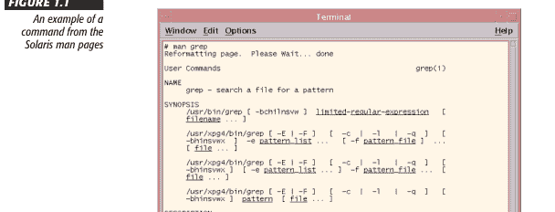

与 man 页面不同，xman 系统是一种点击式帮助系统。在 OpenWindows 中，请遵循以下步骤以访问命令的 xman 页面（或 man 页面等效项）并获得该命令功能的深入解释：

1. 打开一个终端窗口并输入以下内容：

   ```
   $ xman&
   ```

   命令后的 & 使 xman 系统在后台运行。xman 窗口（如图 1.2 所示）将出现。

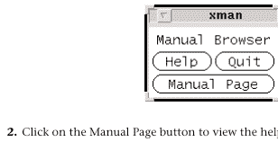

2. 点击 Manual Page 按钮以查看帮助屏幕。
3. 然后从 Option 菜单中选择 Directory 命令，以查看可以访问的命令列表，如图 1.3 所示。
4. 点击感兴趣的命令，以在 xman 系统中查看特定命令的手册页，其示例如图 1.4 所示。

### 图 1.3

*xman* 系统 Manual Page 窗口中的命令列表

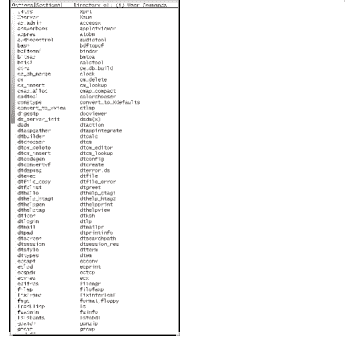

### 图 1.4

一个示例 xman 命令页面

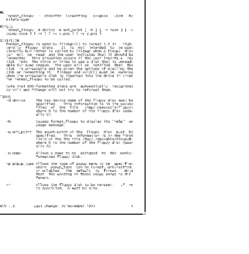

当 man 页面的显示超出屏幕容量时，文本将暂停，直到你按下空格键以查看额外的屏幕。该命令由 `more` 分页器解析，该分页器提供了一些命令，你可以通过按 h（帮助）键查看。q（退出）键返回到 shell 提示符，结束 man 页面的显示。图 1.5 显示了与 `more` 分页器相关的各种命令。

### 图 1.5


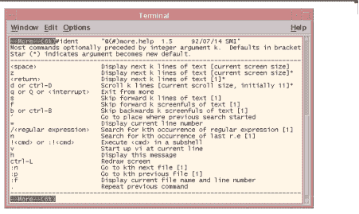

man 页面对命令提供了非常详细但高度风格化和简洁的描述。你将在大多数 man 页面中找到以下部分（某些命令仅列出这些部分中的一些）：

- 1: 用户命令，按字母顺序描述。
- 2: 系统调用是可以用来修改系统的命令。
- 3: 库函数是调用 Unix 系统原语的命令。
- 4: 文件格式描述数据如何存储或传递。
- 5: 头文件、表格和宏描述字符集和表格在数据中如何描述。
- 6: 演示描述该命令可用的任何游戏或演示。
- 7: 设备和网络接口描述用于控制硬件、外设和设备驱动器的文件。
- 8: （无）
- 9: DDI 和 DKI 提供在操作系统内核中编写设备驱动器所需的参考信息描述。


# 相关资源

起步的一个最佳去处是 Sun 的网站本身，具体位于 docs.sun.com 部分（网址为 http://docs.sun.com）。docs.sun.com 的首页如图 1.6 所示，列出了 Sun 发布的各种硬件和软件的多套文档。许多资料既是操作指南也是参考手册，更棒的是，它们支持跨版本搜索。涵盖的类别包括：

- Solaris 8
- 可信 Solaris 8
- 所有 Solaris 版本
- 手册页（Man pages）
- 编译器和编程工具
- 企业级服务器
- 工作站
- 存储

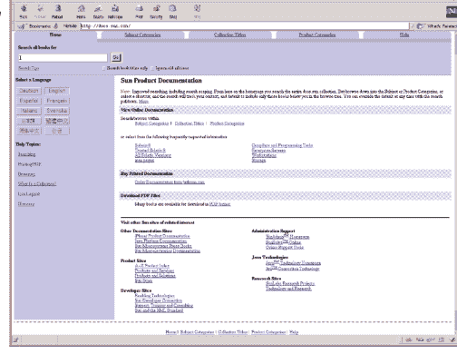

docs.sun.com 上的许多书籍可以下载为 Adobe 便携式文档格式（PDF），并使用 Adobe 在其网站 www.acrobat.com 提供的免费阅读软件进行阅读。你也可以从 Fatbrain.com（www.fatbrain.com）购买 Sun 文档集的打印副本。从 docs.sun.com 的首页，你还可以找到指向许多 Sun 站点的链接，这些站点提供了本书中详细描述的附加软件：

- iPlanet
- Java 平台
- Sun Microsystems 出版社
- Sun 微电子文档
- BigAdmin 主页
- SunSolve 在线
- 在线支持工具

你还可以找到指向 Java 技术站点以及产品、开发人员和研究站点的链接。如果你经常使用 Solaris，你很可能希望在浏览器中书签 docs.sun.com 的首页。

### AnswerBook2

如果你的工作环境足够大，能够支持相关工具，你可能会发现系统管理员已经在工作站或服务器上安装了 Sun Solaris AnswerBook2。如果没有，你可以使用浏览器通过网络在 AnswerBook 服务器上访问此在线帮助系统，利用公司的内部网络即可。你还会发现 AnswerBook2 也在 docs.sun.com 的 Sun 网站上。AnswerBook 是一个可选的安装包，作为每个 Solaris 发行版的一部分，它单独位于一张光盘上。它是一系列 PDF 文件，包括以下内容：

- 64 位开发人员指南
- 二进制兼容性指南
- CDE 过渡指南
- CDE 用户指南
- 设备驱动程序开发人员指南
- 国际化开发人员指南
- Jumpstart 指南
- 邮件服务器指南
- 命名服务指南
- NFS 管理指南
- NIS+ 指南
- OpenWindows 用户指南
- 电源管理用户指南
- 源兼容性开发人员指南
- SPARC 汇编语言开发人员指南
- STREAMS 开发人员指南
- SunShield 安全指南
- WebNFS 开发人员指南

要在本地系统中访问 AnswerBook2，请单击面板中的“帮助”子面板，并选择 AnswerBook2 命令，如图 1.7 所示。或者，你可以打开一个终端窗口并输入以下命令：

`/usr/dt/bin/answerbook2`

在这种情况下，AnswerBook 将在你的浏览器中打开，对于 Solaris 8，默认浏览器为 Netscape Navigator 4.7。如果你的浏览器不起作用，或者当你在 StarOffice 内工作时，请注意你也可以使用 StarOffice 的浏览功能访问 AnswerBook。

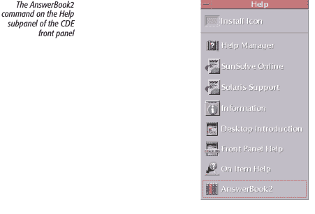

**docs.sun.com/ab2/** 上也可以在线查看 AnswerBook，并且在该位置你可以选择语言并指定所需的特定 AnswerBook 主题。你还可以查看旧版操作系统的 AnswerBook。当你点击 Solaris 8 链接时，你会被带到如图 1.8 所示的屏幕。Sun 的网站具有搜索功能，这特别有价值，而你在本地网络上访问的版本则不具备此功能。

对于有关 SPARC 或 Intel 上的 Solaris 但并非官方 Sun 文档的信息，你可能希望从这两个平台的主页开始：**www.sun.com/solaris**（用于 SPARC）和 **www.sun.com/intel**（用于 Intel）。

这些页面上的链接将带你进入概述、深入视图、资源、常见问题解答（FAQ）、解决方案以及各种旨在与这些平台配合使用的软件包的下载页面。位于 **http://solaris.java.sun.com** 的 Solaris 开发者连接是另一个资源，提供深入的专业技术资料以及对开发者计划的访问权限，程序员会对这些内容感兴趣。加入开发者计划的用户还可以获得许多软件包的特别访问权限，并根据其开发者状态获得折扣价格或免费下载。

### 图 1.8

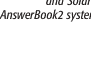

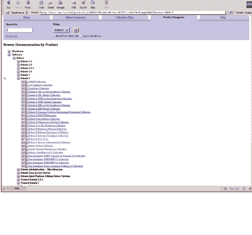

# 第三方网站

你可以在第三方网站上找到许多针对 Solaris 用户和管理员的资源。以下列表列出了其中一些较知名的网站：

- 位于 www.sunfreeware.com 的 Sun Freeware 网站。该网站提供针对各种版本的 SPARC Solaris（包括版本 8）的免费预编译软件，你可以直接下载并安装到系统中。
- 位于 ftp://x86.cs.duke.edu/pub/solaris-x86/bins/ 的 Solaris 8 for Intel 网站。该网站包含 Intel Solaris 程序的预编译版本，你可以直接下载并安装到系统中。
- 许多版本的 Solaris 的预编译软件包可以在 www.ibiblio.org/pub/solaris/sparc 找到，通过一个易于跟随的图表即可找到。该网站由北卡罗来纳大学维护。
- 位于 www.sunhelp.org 的 SunHELP 网站。该网站包含 Solaris 8 的常见问题解答（FAQ）以及指向 Sun 网站各个主题的链接。

对于硬件，请考虑以下内容：

- 位于 www.sunsunsun.net 的 SunSunSun 硬件网站，它是一个二手和翻新 Sun 电脑的集散中心。另一个良好且可靠的二手设备来源是位于 www.mce.com 的 MinitComputer Exchange。
- 对于新的 Sun 硬件，你可以从 www.sun.com 的 Sun 网站访问 Sun 商店。
- 通常你会发现在 eBay（www.ebay.com）等拍卖网站上，Sun 正在出售其最新和新款的工作站和服务器。此外，eBay 和其他拍卖网站还出售二手的 Sun 工作站和服务器。

### 新闻组、邮件列表和常见问题解答

有许多专门针对 Solaris 操作系统的新闻组论坛和邮件列表。一个被广泛引用的 Usenet 组是 comp.unix.solaris 新闻组，它维护了关于与 Solaris 8 相关问题的深入讨论。通常，该新闻组中的讨论围绕基于 SPARC 的硬件展开。对于专注于 Intel 问题的新闻组，你应该考虑常去 alt.solaris.x86 新闻组。两个 Solaris 平台的管理问题在 comp.sys.sun.admin 论坛中讨论。

许多关于 Solaris 的具体问题在常见问题解答（FAQ，即 Frequently Asked Questions 列表）中都有涵盖，这些列表发布在互联网上。阅读 FAQ 而不是在新闻组论坛中提问的好处是，你可以匿名地自学。一个同时涵盖 SPARC 和 Intel 平台的 FAQ 可以在 www.cs.uu.nl/wais/html/na-dir/comp-sys-sun-faq.html 找到；它由 comp.sys.sun.admin 组维护。另一个专注于 Intel 平台的 FAQ 可以在 www.sun-drydog.com/faq/ 找到。一个常被引用的 Solaris 8 FAQ 是由 Casper Dik 发布在 www.wins.uva.nl/pub/solaris/solaris2/7 的。表 1.1 列出了常见的 Solaris 网站、资源和 FAQ。

| 主题 | URL |
| :--- | :--- |
| Access1 Sun 软件支持 | http://access1.sun.com/ |
| CDE FAQ | www.laxmi.net/cde.htm |
| CD-ROM FAQ | http://Saturn.tlug.org/suncd/faq/ |
| Celeste 关于 Solaris/SunOS 调制解调器和终端的教程 | www.stokely.com/unix.serial.port.resources/tutorials.html |
| CERT 协调中心 | www.cert.org |
| 颜色映射 FAQ | http://bul.eecs.umich.edu/~crowej/sunfaq/ColormapFAQ.html |
| 计算机事件预警能力（CIAC）安全 | http://ciac.llnl.gov/ciac/ |
| 帧缓冲区 FAQ | http://bul.eecs.umich.edu/~crowej/sunfaq/FrameBuffer.html |
| Solaris 内部机制 | www.zdjournals.com/sun/ |
| Intel 硬件兼容性列表 | http://soldc.sun.com/support/drivers/hcl/ |
| Intel x86 FAQ | http://sun-drydog.com/faq/ |
| IP 过滤（防火墙/NAT 软件） | http://playground.sun.com/pub/ipng/html/ipng-main.html |
| IPfilter/NAT 配置 | www.riddleware.com/solx86/nat-config.html |
| ISP 连接 | www.kempston.net/solaris/connectedanyisp.html |
| NIS+ FAQ | www.eng.auburn.edu/users/rayh/solaris/NIS+_FAQ.html |
| NVRAM/hostid FAQ | www.squirl.com/squirl/sun-nvram-hostid.faq.html |
| Open Look FAQ | www.faqx.org/faqs/open-look/03-xview/ |
| Passwd+ 安全 | ftp://ftp.Dartmouth.edu/pub/security/ |


## 表 1.1：Solaris 站点和常见问题解答（续）

| 主题 | 网址 |
| --- | --- |
| PPP 拨入/拨出 | www.kempston.net/solaris/pppserver.html |
| PPP 常见问题解答 | www.sunhelp.org/faq/sunppp.html |
| 打印常见问题解答 | www.ebsinc.com/solaris/printfaq.html |
| RTFM 文档站点 | www.solarguide.com/ |
| Solaris 安全加固 | www.securityfocus.com/focus/sun/articles/securing.html |
| Solaris Central | www.solariscentral.org |
| Solaris 常见问题解答 (x86) | www.sun.drydog.com/faq/ |
| Solaris 常见问题解答 (Casper Dik) | www.wins.uva.nl/pub/solaris/solaris2/ |
| Solaris 辅助页面 | http://home1.swipnet.se/%7Ew-10694/helpers.html |
| Solaris WWW 资源 | oak.eee.u1.ie/~griffini/solaris.html |
| SparcBook 常见问题解答 | http://home.kabelfoon.nl/\~hvd001/j/SparcBook-FAQ/sparcbook-faq.html |
| Sun 管理常见问题解答 | http://sunhelp.org/faq/sunadm.html |
| Sun 文档站点 | http://docs.sun.com |
| Sun 管理员存档 | http://latech.edu/sunman.html |
| SunExpert | www.hillside.co.uk/articles/sunexpert.html |
| SunHELP | www.sunhelp.org |
| Suns at Home 页面 | www.net-kitchen.com/~-sah/ |
| SunSolve 在线 | http://access11.sun.com |
| 公共补丁访问 | |

邮件列表是一种以顺序或线程式对话形式进行的论坛讨论，而非新闻组讨论那种杂乱无章的环境。由于参与者有一点时间思考，且通常有一位编辑（许多邮件列表都如此，尤其是在事情失控时），邮件列表通常能对过去和当前的系统问题提供深思熟虑的分析。许多重要的商务和技术关系始于邮件列表中的线程。Sun 管理员列表或许是 Solaris 信息这种格式最著名的例子。你可以在 www.sunmanagers.org/ 访问 Sun 管理员列表。对于 Intel 邮件列表，请访问 www.egroups.com/group/solarisontel/。

新闻组、常见问题解答和邮件列表通常充斥着一般性的建议、技巧、诀窍和陷阱，以及非常具体的硬件和软件信息。

### Web 搜索

Sun Web 站点、其 AnswerBook 页面以及互联网上的许多其他 Solaris 站点是访问频率最高的 Web 页面之一。因此，它们在任何通过链接数量对其他站点进行排序的 Web 搜索引擎（如 Google 所做的）中排名很高；或者，如果你使用任何通过机器人或其他信息收集工具索引内容的搜索引擎（如 Lycos、Northern Light 和 AltaVista 等站点所做的），它们也可能会显示出来。如果你有关于 Solaris 的特定主题想要搜索，请毫不犹豫地使用其中一种搜索引擎来定位潜在的匹配项。通常，它们比之前章节中提到的任何站点上的搜索引擎工作得更好、更快。

### 摘要

在本章中，你被介绍了 Solaris 操作系统。Solaris 是 Unix 的一个变体，基于 BSD Unix 发行版和 AT&T System V。Solaris 相对于其他 Unix 版本的许多优势与 Sun 作为硬件厂商和软件厂商的角色有关。Solaris 是一个成熟的网络操作系统，以可靠和可扩展的服务而闻名，这使其成为许多行业的热门选择，尤其是在互联网应用中。你在本章中了解到，Solaris 8 在以前版本的操作系统基础上增加了 StarOffice、Apache Web 服务器以及众多系统和网络实用工具。

你被介绍了操作系统中的几个帮助功能。命令记录在 man 和 xman 页面中，可以从终端窗口在线访问。AnswerBook2 是一个完整的文档集，可以在你的浏览器中查看。AnswerBook2 可以本地找到或在网络服务器上找到，并发布在 Sun 的 docs.sun.com 站点上。最后，本章包含了关于如何查找众多 Solaris 资源（如 Web 站点、新闻组、邮件列表和常见问题解答）的信息。


## 第 2 章

# 关于 Solaris

- 特色：
  - Unix 的历史... 24
  - 内核架构... 27
  - 层次化文件系统... 35
  - I/O 架构... 41
  - 内存架构... 50
  - POSIX... 59


本章包括 Unix 历史的简要概述、Solaris 操作系统架构结构的描述，以及 Unix 和 Solaris 8 之间关系的讨论。你将了解 Solaris 的主要特性和功能如何与操作系统的内核或核心交互。你还将了解层次化文件系统、文件安全性和兼容性问题。还将讨论进程和访问操作系统服务的机制，以便你对 Solaris 在工作环境中的运作方式获得舒适的认知水平。虽然讨论操作系统的高度技术方面不在本书范围内，但对 Solaris 8 操作系统基本功能的一般描述应能为你提供对操作系统性能以及不同层面如何相互作用的清晰视图。

### Unix 的历史

在 20 世纪 60 年代后半期，AT&T 贝尔实验室生产了一个名为 Multics 的操作系统，它设计用于一台位于 GE 大型机计算机中的内部多用户交互式系统。尽管 AT&T 在 1969 年退出了该项目，但后来的 Unix 已经基本成型。贝尔实验室的 Ken Thompson 使用 PDP-11/20 对早期 Unix 版本进行了实验，他的操作系统在 1971 年获得专利。他的工作产生了一些汇编语言实用程序。同样来自贝尔实验室的 Dennis Ritchie 利用他自己创造的语言——C 编程语言——重写了 Unix 系统。专门为用于 Unix 系统而编写的 C 编程语言被证明是一种极好的通用语言，并且高度适应其他类型的系统。因此，Unix 在其他平台上的移植取得了很好的结果。Unix 很快成为加州大学伯克利分校、麻省理工学院和其他学术机构的宠儿。由于它们可以支付少量费用获得源代码，它在大学环境中被广泛使用并进一步开发，特别是在加州大学伯克利分校。

在 20 世纪 70 年代末，尽管 Unix 最初并非设计为商业操作系统，但企业开始注意到 Unix。几家公司购买了源代码，进行了增强，并根据其自己的硬件定制了代码，使其可移植性降低。竞争不断发展，但在 1978 年，贝尔实验室发布了 System III 的第 7 版，这是当今系统的前身。它附带了第一个 Bourne shell 命令解释器，并提供了强大的语言功能和交互式命令行编程的结合。它发展壮大，直到 20 世纪 80 年代末，AT&T 成立了一家名为 UNIX Systems Laboratories（USL）的公司。该公司生产了 Unix System V 及其所有衍生产品的源代码。不久之后，Unix 桌面版被引入，以及 PC 硬件支持，如 CD-ROM 驱动器、SCSI 设备、视频卡等。USL 于 1993 年被 Novell 收购，然后于 1996 年再次被 Santa Cruz Operation（SCO）收购。多年来，Unix 的多个分支——如 BSD v4、Free BSD、BSDI 和 Sun Microsystem 的 SunOS 和 Solaris 等——涌现出来，增加了混合物（然而，Linux 是根据 Unix 模式创建的新作品）。如今，经过许多曲折的开发过程，The Open Group 拥有实际的 UNIX 商标，以及确定 Unix 系统是什么的规范。SCO 现在拥有 Unix 的源代码。

Unix 操作系统，像其他许多操作系统一样，采用分层（或模块化）设计。最高层是工作站上的用户。第二层由应用程序、电子邮件、编辑器和编译器组成。第三层是 shell 和实用工具所在之处。第四层是内核（核心），复杂的过程在那里发生，从一个个过程到另一个过程的切换以高速进行。第五层包括实现所需任务的硬件和设备。这些操作将在本章中进一步扩展。图 2.1 粗略地说明了不同层所代表的内容。

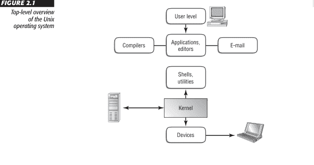

### Solaris 的发展

在 20 世纪 80 年代初，当 Unix 系统开始流行时，SunOS 1.0 是基于从加州大学伯克利分校实验室移植的 BSD 4.1 开发出来的。当时，它被用于


在摩托罗拉 68000 工作站上运行。到了 1984 年，SunOS 2.0 首发了虚拟文件系统框架，该框架支持网络文件系统（NFS），如今几乎每台现代技术中的操作系统都支持它。Sun 开发了新的应用程序和新的虚拟内存系统。输入/输出基础设施需要进一步的系统变更。Sun 和 AT&T 参与了一个联合项目，生产了一个新的核心 Unix，该 Unix 融合了 SunOS、BSD、SVR3 和 Xenix 的最佳特性。最终产品，即 System V Release 4 (SVR4)，被移植到了 SPARC 处理器上。预见到多处理器系统即将迎来增长，Sun 开发了一个新的操作系统内核，专注于多处理器可扩展性，同时允许多执行线程，并提供应用程序层面的线程支持。这个新内核和 SVR4 操作系统环境是当今版本 Solaris 的基础。图 2.2 详细说明了 Solaris 2.0 的演变过程。

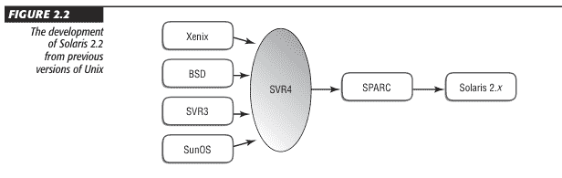

由于其采用模块化设计构建，Solaris 2 可以在具有不同指令集架构的多个平台上实现。Solaris 7 引入了 64 位数据类型实现。这使得内核和其他进程可以访问大型地址空间，同时仍支持 32 位应用程序。这些创新在 Solaris 8 中继续延续。

在 1990 年代，Solaris 持续开发，并产生了存在于操作系统内核中的创新特性。这些特性将在本章后面进行更详细的解释。Solaris 实现了增强原始 Unix 实现的新特性。这些新特性包括一个完全可抢占的内核，该内核不需要操作硬件中断级别来保护关键数据。数据锁同步对内核数据的访问。如果需要运行，线程可以相互中断。低优先级线程会让位于高优先级线程，而不是等待调度器运行。系统可以按需加载应用程序，而不是将它们加载到内存中。这被称为*按需分页*，它可以加快应用程序启动速度并减少内存使用量或占用空间。处理器可以配置为调度组，以划分系统资源，包括将进程绑定到处理器。

总线和设备的层次结构可以通过动态加载的设备驱动器和总线驱动进行安装和配置。设备驱动程序具有最大的可移植性，并由设备驱动程序接口屏蔽。多个调度器可以同时运行。每个调度器都有自己的算法和优先级级别。作为内核模块提供，它们被动态加载到操作系统中。Solaris 提供分时用户调度器、窗口系统分时调度器以及实时固定优先级调度器。Resource Manager 选项提供公平共享调度器。多平台支持通过基于 SPARC 和 Intel x86 微处理器的架构呈现。Solaris 提供线性可扩展性，最多支持 64 个处理器。

动态链接和动态模块用于将内核划分为模块化二进制文件。核心二进制文件包含调度器、文件系统、设备驱动程序和一些系统调用。当参数变更时，如果二进制文件可用，则无需重新编译内核。如前所述，进程可以在一个或多个处理器上并发运行多个线程。Solaris 使用线程进行调度和执行。内核将中断和服务调度为常规内核线程。与 Unix 实现不同，Solaris 通过将中断调度为使用常规内核锁的线程，为数据结构提供独占访问权限。Solaris 内核提供实时功能。上述特性为实时应用程序创建了一个完美的环境。Solaris 通过使用数据链路提供者接口（DLPIs）实现了集成的互联网协议 TCP/IP。这些接口可以将数据与多个当前网络接口连接，并可以配置各种不同协议，包括以太网、光纤分布式数据接口（FDDI）、令牌总线、双同步、同步数据链路控制（SDLC）、综合业务数字网（ISDN）、X.25 等。可配置的调度器环境是 Solaris 8 的一个重要特性。

虚拟文件系统（VFS）允许在系统中配置多个文件系统。MS-DOS、Unix 文件系统（UFS）、High Sierra 文件系统（HFS）和网络文件系统（NFS）都可以在 Solaris 上实现。诸如进程文件系统（PROCS）等伪文件系统可以与其他伪文件系统一起集成，与虚拟内存系统结合，提供使用可用空闲内存的文件系统缓存。

## 内核架构

*内核*是操作系统的核心，无论是 Solaris 8 还是其他操作系统。内核管理所有硬件，同时提供执行进程和程序的手段。它分配其资源，并为程序和进程提供服务，有时是同时提供的。一般来说，操作系统提供一个机器环境，集成并发执行多个进程和程序。虽然听起来很简单，但操作系统的内核通常同时执行来自多个源的复杂指令。这些指令集被称为*进程*。每个进程在系统中都与其他进程独立，并且可以有一个或多个执行线程，这些线程与进程共享虚拟内存。每个线程在拥有者的进程环境中并发执行。线程的执行由内核调度器管理。调度器在分配唯一的进程标识号（PID）后，使它们进入和退出处理器。内核创建一个全局进程表，通过 PID、进程名称和其他相关数据来跟踪每个进程。

虽然与 Unix 内核类似，但 Solaris 的不同之处在于它为每个进程内的多个执行线程提供支持。当在多处理器硬件上实现时，它能高效利用操作系统开销。原始 Unix 操作系统使用分时调度策略，将所有进程的平均 CPU 时间均匀分配，而 Solaris 内核实现了调度类，使用值和参数分派表，保证更高效的线程处理。

进程管理和监控已经演变成一种快速、复杂且节省时间的计算方法。结果可以通过访问进程文件系统（*PROCS*）查看。*PROCS* 详细说明了内核的进程模型，该模型提供了抽象进程数据的接口以及用于进程控制和调试的设施。每个进程都有一个地址，这是一个用于管理分配给进程的内存的内核抽象。指令、数据、临时处理空间和堆栈信息都存储在地址空间中。进程执行的硬件特定定义，如通用寄存器、堆栈指针、帧指针等，也存储在地址中。地址空间映射进程地址空间的内存页。图 2.3 说明了进程的各种段及其执行方式。

PID、父进程 ID 和进程组 ID 都维护在地址空间中。每个进程通常有三个打开的文件。它们是标准输入文件、标准输出文件和标准错误文件。它们定义了进程的输入和输出的源和目标。它们可以链接到所使用的终端的设备信息，也可以链接到文件。信号和信号处理、执行优先级以及调度类都在此级别处理。执行线程在处理器之间进出。当线程离开处理器时，其执行环境会被保存以便后续重新调度。环境被恢复，执行按计划恢复。


## 图 2.3
*进程执行序列*

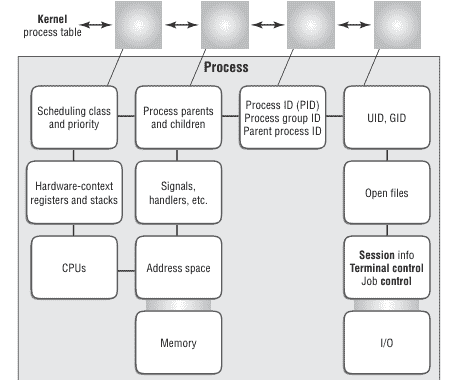

内核通过系统调用允许访问文件 I/O、进程和线程创建、网络、进程控制、进程信号、内存管理以及进程间通信。这些是针对 CD-ROM 存储、打印机、磁带驱动器和磁盘等设备类型的编程接口，通过这些接口进入操作系统，使内核能够执行由调用线程概述的任务。Solaris 8 内核在设计上是模块化的，由几个主要组件组成。图 2.4 展示了这些组件及其在内核中的基本功能。本章将讨论每个组件。

## 图 2.4
*Solaris 8 内核架构*

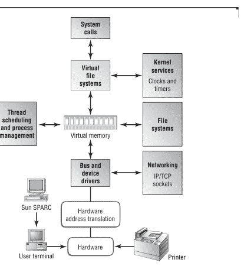

由于它是一个多任务操作系统，Solaris 8 允许进程在完全保护它们免受其他所有进程干扰的同时相互通信。当你在终端屏幕上处理某个作业时，可以在后台运行额外的作业。你可以同时在不同的屏幕上运行不同的作业，并追踪它们。许多其他用户也可以同时做同样的事情。内核确实是一个非常繁忙的实体。

用于访问操作系统的机制——如文件 I/O、进程和线程的创建与终止、进程控制、信号、网络、内存管理和进程间通信——都是系统服务。你可以通过使用系统调用来访问这些服务。如 图 2.4 所示，用户可以同时使用系统调用与许多服务进行交互。然后，内核将执行调用线程所需的任务。

## 线程

Solaris 内核由执行线程实现，这些线程是发送到处理器进行处理的操作化指令流。线程可以在多个处理器上并发执行。线程允许在单个虚拟内存环境中存在多个执行流。在线程之间切换执行成本很低，因为不需要虚拟内存上下文切换。线程用于内核相关任务。它们也用于进程执行和中断处理。图 2.5 说明了内核线程、进程和轻量级进程（LWP）如何交互。

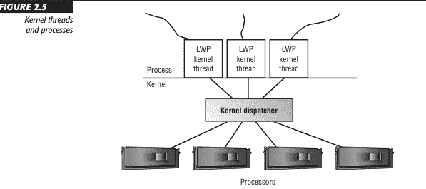

进程可以包含一个或多个线程，这些线程也共享虚拟内存环境。每个进程为其中的每个内核线程都有一个轻量级进程或虚拟执行环境。轻量级进程允许每个内核线程独立于同一进程内的其他线程进行系统调用。如果没有轻量级进程，一次只能进行一次系统调用。每次有系统调用时，其寄存器会被放置在轻量级进程内的一个栈中。系统调用返回码被放置在轻量级进程中。内核调度程序管理内核线程的运行队列，并根据优先级和类别将内核线程调度到可用的处理器上。在二级线程模型中，由内核管理一个称为用户线程的层。这是一种更高效、更低成本的线程管理方式。图 2.6 展示了其工作原理。

## 图 2.6
*二级线程模型*

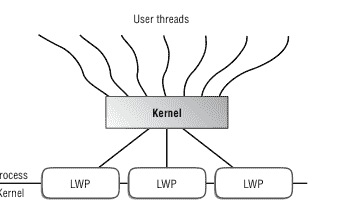

用户线程在线程库中实现。它们可以在不需要内核参与的情况下创建和销毁，并可以调度到轻量级进程上或从中移出。在任何给定时间，只有用户线程的一个子集是活动的。轻量级进程的数量由用户线程库调整。

内核使用全局线程优先级系统进行调度。调度程序选择许多内核线程中的哪一个将下一个执行。具有较高优先级的线程可以抢占正在运行的线程，该线程将在稍后时间执行。内核本身是可抢占的，为高优先级线程提供了时间关键性调度。Solaris 调度程序可以对线程应用不同的调度策略。调度程序分配调度类，允许不同的优先级在不同的时间运行。调度类在 Solaris 中是一项模块化技术。你可以从 Sun 和互联网上的其他地方下载适用于不同情况的其他模块。以下列表描述了主要的调度类：

- **TS**：时间共享调度类是进程和所有内核线程的默认类。它根据最近的处理器使用情况更改优先级。TS 试图均匀分配处理器资源。它使用 0 到 59 的优先级范围。
- **IA**：交互式类是 TS 类的增强版本，由桌面窗口使用以提升线程优先级。使用相同的 0 到 59 的优先级数值范围。
- **SYS**：系统类由内核的内核线程使用。这些是绑定的线程，没有时间量子。它们将运行直到阻塞。使用 60 到 99 的优先级数值范围。
- **RT**：实时类使用固定优先级、固定时间量子调度。使用 100 到 159 的优先级数值范围。

## 虚拟内存

虚拟内存（VM）管理系统内存。其主要任务是高效地管理操作系统中运行的进程和内核子系统对系统物理内存的分配。为了容纳大型程序，它会将无法放入系统物理内存中的数据存储在较慢的存储介质中。它会保持最常用的部分在物理内存中以便于访问。

VM 系统为进程提供一个地址空间。每个地址空间有几个段，这些段是可执行文件、堆空间、共享库和程序栈的映射。每个段或页大小相等，由内存管理单元（MMU）管理，并交付给物理内存。图 2.7 演示了虚拟内存地址空间、段和页。

## 图 2.7
*虚拟内存地址空间、段和页*

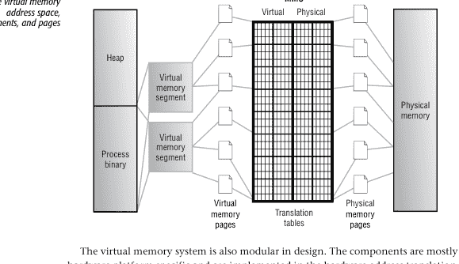

虚拟内存系统在设计上也是模块化的。其组件大多是特定于硬件平台的，并在硬件地址转换（HAT）层中实现。VM 系统实现按需分页，导致内存页在引用时被按需分配。这降低了进程的内存占用和启动时间。当访问虚拟内存时，MMU 告诉内核发生了访问。如果该内存区域没有映射到物理内存，则会发生页错误。进程的堆也会发生同样的情况，因为最初只分配了 VM 空间。发生页错误，然后内存是一页一页分配的。VM 系统使用全局分页模型来管理进程之间的内存分配。通过扫描算法计算物理内存中很少使用的部分。一个内核线程按物理页顺序扫描内存。最近未使用的页被窃取并放入空闲列表中，供其他进程使用。

内核指令、数据结构和缓存需要内存。由于内核的大部分内存不可分页，而是从物理内存中分配的，因此不能被页扫描器窃取。这避免了死锁，如果内核内存管理功能在持有另一个资源的锁时创建页错误，就可能发生这种情况。内核实现了自己的内存分配系统。它使用 slab 分配器来处理内核数据结构。该分配器将大的连续内存块细分为较小的块用于数据结构。它高效地管理这些块，从而避免碎片化。

## 进程间通信

进程间通信（IPC）允许进程通过信息传输或同步相互通信。Solaris 支持四个不同的 IPC 组：基本 IPC、高级 Solaris IPC、可移植操作系统接口（POSIX）IPC 和 System V IPC。进程间通信由传统 IPC 设施（如本地套接字和管道）实现。本地套接字是一个系统调用（socket 2），直接连接两个进程。

管道直接使数据从一个进程流向另一个进程。数据以先进先出的顺序通过管道从一端流向另一端。使用标准文件 I/O 系统调用（pipe2）对管道进行读写。它也可以通过 mknod(1) 和标准文件 open(2) 系统调用在文件系统中创建。默认的文件描述符 0、1 和 2 由 C 运行时库自动打开。在进程中，0 代表标准输入，1 代表标准输出，2 代表标准错误。

门（Doors）是高级 Solaris IPC 调用过程，调用时速度快且延迟低。门服务器创建一个线程，该线程在等待来自门客户端的调用时处于睡眠状态。一旦客户端通过门向服务器发起调用，调度控制权就传递给门服务器中的线程。当门服务器处理完请求后，它将控制权和响应传回给调用线程。


由于客户端无需等待线程调度完成即可处理请求，因此延迟较低。

POSIX IPC（进程间通信）设施建立在内存映射文件之上。程序通过调用 POSIX 库例程，利用文件 I/O 系统调用：`open(2)`、`read(2)`、`mmap(2)` 来创建共享内存段、新信号量或消息队列。IPC 对象在 POSIX 库中以文件形式存在，并通过 POSIX 接口导出给程序。

System V IPC 设施最初为 Unix 开发，现已成为所有 Unix 实现的标准。常见的 IPC 机制包括共享内存、消息传递和信号量。

进程创建一个共享内存段，向 CPU 告知发生了哪些变化。消息以头部和尾部进行排队。也就是说，消息被打包在队列的尾部，并在头部被接收。每个消息包含一个 32 位类型值，随后是数据负载。信号量是支持整数值递增或递减的整数值对象。进程可以在值大于零的信号量上休眠，然后在值达到零时唤醒。

## 信号

信号设施提供了一种机制，用于因特定事件而中断进程或进程内的线程。同步信号，即与当前指令流直接相关的信号，实际上起源于非法地址引用或非法数学运算等硬件陷阱条件引发的硬件异常。

由与当前指令流无关的外部事件引发的异步信号（如 kill 信号或作业控制信号）也在 Solaris 8 中实现。这些机制继承自早期的 Unix 系统，至今仍是重要特性。大多数信号将被忽略，或者可以捕获信号并调用处理程序，或者允许进程执行默认操作。每个信号都有预定义的默认操作。可以屏蔽信号，或将特定的信号处理程序分配给该信号。信号的原始概念基于进程拥有单一执行流的假设。由于 Solaris 允许多线程进程架构，信号可以定向到进程中的特定线程。在线程级别进行屏蔽（阻塞信号）是新增的功能。

## 分层文件系统

Solaris 8 文件系统具有分层格式。在文件系统中，数据首先包含在文件中，其次是在目录中，再次是在存储介质中。图 2.8 展示了典型 Solaris 文件系统的分层结构。

### **图 2.8**  
*文件系统层次结构*

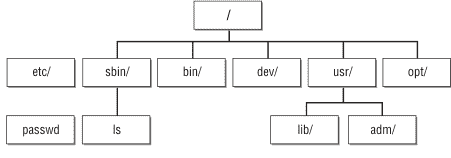

进程使用与文件相关的系统调用来访问文件中的数据。文件可以通过文件系统中的路径名和文件描述符（一个标识进程内打开文件的整数）来识别。每个进程都有一个打开文件表，从文件描述符 0 开始，随着更多文件的打开而向上递增。系统调用 `open( )` 用于打开由路径名将命名文件，并返回标识该打开文件的文件描述符。一旦文件打开，可以使用文件描述符对文件进行进一步操作。文件描述符最终通过 `close( )` 系统调用或进程的 `exit` 命令关闭。

虚拟文件系统（VFS）框架实现了多种文件系统类型。虚拟文件系统组中有三种类型的文件系统。基于存储的文件（如 Unix 文件系统（UFS）和 PC/DOS 文件系统中的文件）是管理数据的常规文件。网络文件系统（NFS）看似位于本地目录，但实际上存储在远程网络服务器上。伪文件系统将各种抽象呈现为系统中的文件。`/proc` 伪文件系统将进程的地址空间表示为一系列文件。开发此文件系统是为了让 NFS 能够与 UFS 共存。它现在是 Solaris 8 中的标准。添加新的文件系统类型需要对内核和系统实用程序进行大量修改。VFS 通过实现 vnode（虚拟节点）简化了这一过程，vnode 抽象了内核可对 inode（索引节点）执行的操作。每次打开、关闭、读取或写入文件时，访问的是该文件的 vnode 而不是其 inode。此方法允许将不同的文件系统编写为模块，内核可以访问这些模块，而无需了解文件系统的任何细节。Solaris 还实现了 High Sierra 文件系统（HSFS）、PC 文件系统（PCFS）、便携式 CD-ROM 文件系统（iso9660）、进程文件系统（PROCFs）以及临时文件系统（TMFS，即 tmp）。HSFS 是在 Solaris 下访问 CD-ROM 使用的标准文件系统。Rock-Ridge 是一组扩展 High Sierra 的扩展，允许 CD-ROM 支持完整的 Unix 文件信息范围。使用 Rock-Ridge 扩展格式化的 CD-ROM 具有包含 UFS 支持字符的文件和目录名称。

PCFS 允许对 DOS 格式文件系统进行读写访问。您可以在 Solaris 下访问 DOS 文件系统，并使用 `ls`、`touch`、`mkdir` 等标准 Unix 命令进行操作。

proc 文件系统借自 AT&T 开发的一个实验性操作系统。proc 文件系统通过挂载在目录 `/proc` 上的特殊文件系统，为所有程序提供进入内核的统一接口。`/proc` 中每个目录的名称对应一个活动进程 ID。目录的所有者或用户是该进程的 UID，组目录是该进程的 GID。这允许进程的所有者访问其信息。

TMPFS 是一个基于内存的文件系统，它将所有可用的物理内存和虚拟内存组合成一个文件系统。它挂载在 `/tmp` 上。位于 TMPFS 中的文件和目录在系统重启后会丢失，因为文件部分包含在系统内存中，而系统内存在重启时不保留数据。该文件系统为创建大量临时文件的大型编译进程提供高性能。因为用于存储 TMPFS 中文件的内存与执行命令时使用的内存相同，所以在临时文件系统中存储大文件会影响程序可用的内存量。同理，需要大量内存的程序会减少临时文件系统中可用的空间。临时文件系统中可存在的文件数量由系统的物理内存量决定，但不受配置的虚拟内存（交换空间）量的影响。PROCFs 使用 `swap` 命令添加和删除。表 2.1 描述了 PROCFs 中包含的文件。

### 表 2.1：PROCFs 中的进程文件和目录

| 文件/目录 | 描述 |
| :--- | :--- |
| as | 包含进程的地址空间映像 |
| cred | 包含与进程相关的权限 |
| cwd | 作为指向进程当前工作目录的符号链接 |
| fd | 包含进程打开文件的引用目录 |
| psinfo | 包含 `ps` 命令所需的进程信息 |
| root | 作为指向根目录的符号链接 |
| sigact | 包含描述进程信号处理程序的数组 |

## 文件系统布局

Solaris 8 目录树有四个主要区域：

- 配置目录
- 设备目录
- 程序目录
- 临时或变量文件目录

Solaris 8 在 /etc 目录中存储配置文件。用于启动和停止进程的主引导和关机脚本也存储在 /etc 中。表 2.2 展示了 /etc 中一些最重要的配置文件。如果有时间，熟悉这些文件是明智的。如果您将编写脚本，会在运行进程时觉得它们很有用。

### 表 2.2：/etc 中的配置文件

| 文件 | 内容 |
|---|---|
| /etc/auto_* | 自动挂载器使用的目录，允许您访问 NFS 卷 |
| /etc/format.dat | 所有硬盘和可移动介质类型的设备描述 |
| /etc/group | 系统上有效组的列表 |
| /etc/hostname.* | 定义系统主机名的文件（例如，/etc/hostname.le0）或点后面列出的接口的 IP 地址 |
| /etc/inetd.conf | inetd 服务监听的网络服务及关联应用程序的列表 |
| /etc/issue | 系统在登录前显示的登录横幅 |
| /etc/motd | 登录时显示的“今日信息”文件 |
| /etc/mnttab | 当前挂载文件系统的列表 |
| /etc/nodename | 使用 uname -n 显示的系统名称 |
| /etc/nsswitch.conf | Nameservice 和 NIS/NIS+ 配置信息 |
| /etc/pam.conf | 可插入认证模块（PAM）框架配置信息 |
| /etc/passwd | 系统的本地用户密码数据库 |
| /etc/profile | Bourne shell (/bin/sh) 和 Korn shell (/bin/ksh) 的默认配置文件 |
| /etc/resolv.conf | 如果 /etc/nsswitch.conf 文件中的 hosts: 类别下列出了 DNS，则系统用于将主机名转换为 IP 地址的信息 |
| /etc/services | 网络应用程序知名端口的列表 |


### 表 2.2：/etc 中的配置文件（续）

| 文件 | 内容 |
| --- | --- |
| /etc/shadow | 系统中所有本地用户的密码，仅 root 可读 |
| /etc/shells | 系统批准的 shell 列表 |
| /etc/syslog.conf | syslog 守护进程记录重要事件的配置文件 |
| /etc/system | 内核的配置参数 |
| /etc/termcap | 描述不同支持的终端类型的参数 |
| /etc/vfstab | 每个要挂载的文件系统的默认定义，包括它们的文件系统类型、何时进行检查，以及是否在启动时挂载 |

| 目录 | 内容 |
| --- | --- |
| /etc/cron.d | cron 命令的配置文件，存储已存储的 cron 脚本 |
| /etc/default | 控制系统默认行为的文件 |
| /etc/dfs | NFS 服务器使用的配置文件 |
| /etc/inet | 与网络相关的配置文件 |
| /etc/init.d | 系统的启动和关机脚本 |
| /etc/rc*.d | /etc/rc0.d 到 /etc/rc3.d 以及 /etc/rc5.d 目录，包含指向 /etc/init.d 目录的硬链接和软链接 |
| /etc/lp | 打印机配置文件 |

设备目录包含与系统中设备相关的文件。它们存储在 /dev 和 /devices 中。Solaris 8 中的 /dev 目录包含一组来自 /devices 中文件的链接，而 /devices 是该目录较旧版本中由 Unix 使用的目录。你的目录树还将包含用于 CD-ROM 驱动器或软盘驱动器的目录。当你将 CD 或磁盘插入相应驱动器时，这些目录会自动挂载。大多数可移动介质都附带允许此自动挂载功能的软件。表 2.3 列出了 /dev 中的一些重要目录。

### 表 2.3：/dev 中的目录

| 目录 | 用途 |
| --- | --- |
| /dev/cua | 访问连接到工作站串行端口的设备 |
| /dev/dsk | 访问硬盘上的文件系统，与 mount 一起使用 |
| /dev/fd | 访问特定的文件描述符，例如 STDIN（标准输入） |
| /dev/pts | 允许通过 telnet、远程 shell 等进行伪终端登录 |
| /dev/rdsk | 访问硬盘的原始介质，与 fsck 命令一起使用 |

程序目录存储在 `/usr` 或 `/opt` 中。存储在 `/usr` 中的程序是大多数用户所必需的，并且可能用于启动和运行系统。`/opt` 中的程序通常是某些（但并非所有）系统用户所需的可选软件包。预先打包的免费软件通常也存储在 `/opt` 中。表 2.4 列出了存储在 `/usr` 中的一些最重要目录。

### 表 2.4：/usr 中的目录

| 目录 | 内容 |
| --- | --- |
| /usr/ccs | 用于编译和构建程序的程序和库 |
| /usr/dt | CDE 配置文件、二进制文件和库 |
| /usr/include | 库的语言头文件 C 文件 |
| /usr/java | Java 开发套件和 Java 运行时 |
| /usr/lib | 系统中程序使用的库 |
| /usr/openwin | X 窗口系统和 OpenLook 的库和程序 |
| /usr/platform | 专为特定硬件准备的库和程序 |
| /usr/sbin/static | 关键命令的静态链接版本 |
| /usr/share/man | 系统的手册页 |
| /usr/ucb | SunOS 和 BSD 兼容性命令 |
| /usr/xpg4 | 遵循 X/Open XPG4 标准的标准程序集 |

用于临时文件和可变文件的主要目录是 `/tmp` 和 `/var`。`/tmp` 目录通常包含系统所需的文件。它部分存储在系统内存中，部分存储在磁盘上，使用一种称为 `tmpfs` 的特殊文件系统类型。从基于 `tmpfs` 的目录（如 `/tmp`）编译和执行程序速度极快，仅仅是因为这些文件已经位于内存中。由数据库引擎使用的管道和特殊设备文件也将包含在此目录中。`/var` 目录包含内容可变且经常更改但需要在重启后保持完整的文件。表 2.5 列出了存储在 `/var` 中的一些最重要目录。

### 表 2.5：/var 中的目录

| 目录 | 内容 |
| --- | --- |
| /var/adm | 系统日志和统计文件，消息文件 |
| /var/cron | `cron` 的日志文件 |
| /var/mail | 存储用户邮件的目录 |

### 表 2.5：/var 中的目录（续）

| 目录 | 内容 |
| --- | --- |
| /var/nis | NIS+ 数据库 |
| /var/preserve | vi 和 ex 的备份文件 |
| /var/sadm | 由软件实用程序维护的数据库 |
| /var/sadm/pkgs | 系统上软件包的移除/备份信息 |
| /var/spool | 打印机暂存文件、邮件投递、cron 和 at 的根目录 |

## I/O 架构

Unix 使用内核驻留设备驱动程序与硬件进行接口。设备驱动程序管理数据传输和寄存器输入/输出以及设备硬件中断。驱动程序了解设备的所有细节以及设备所连接的总线布局。Solaris 在此基础上更进一步，使用独立的设备驱动程序和用于不同总线的总线节点驱动程序。图 2.9 说明了典型的 Solaris 设备树。每个总线通过总线节点连接到另一个总线。

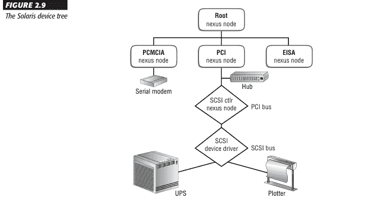

Solaris 设备驱动程序接口（DDI）向设备驱动程序隐藏了平台和总线层级的具体细节。它确实提供了注册中断、映射寄存器和访问 DMA 内存的接口。设备驱动程序在首次访问设备时会自动加载。它们是包含驱动程序代码的可加载模块。

## Solaris 内核

Solaris 内核，即操作系统的核心，管理资源并为用户的进程提供服务。Solaris 识别两种不同的处理器执行模式：一种称为内核模式的特权模式，以及一种称为用户模式的非特权模式。两者之间的区别很简单。在内核模式中，进程可以访问内核的所有数据结构和底层硬件。在用户模式中，进程只能访问其自身的内存。内核会以用户模式执行进程，以防止进程访问可能影响其他进程的数据结构或硬件寄存器。由于只有 Solaris 内核指令可以在内核模式下执行，因此内核可以中介对内核数据结构和硬件设备的访问。如果用户进程需要访问内核服务，一个线程将通过系统调用 read() 访问这些服务。系统调用将执行特殊的机器代码指令，将处理器切换到内核模式。一旦内核执行了 read()，代表调用线程完成 I/O，然后返回到用户模式状态。

系统可以响应设备中断或处理器陷阱而进入内核模式，或者处理任何无法在用户模式下处理的情况。为了澄清，中断是向内核的控制权的矢量转移，通常由硬件设备发起。中断也可以从软件发起。

中断是设备发送给内核的信号，以表明其需要立即关注。中断被赋予 1 到 15 的优先级级别，15 为最高优先级。进程中断级别（PIL）或串行中断占用五个最高的优先级级别。在每个处理器上，内核只需设置处理器的中断级别即可屏蔽低于给定优先级的中断，这会阻止指定级别及更低级别的所有中断。发生在该优先级级别之下的中断会被暂时忽略。较高级别的中断会比较低优先级的中断更快地得到处理。然而，它们的运行成本更高，因为它们会长时间阻止其他中断处理程序运行。在优先级 10 以下，中断由线程处理。为了提高效率，每个处理器维护一个部分初始化的中断线程池，每个较低的九个优先级级别一个，外加一个用于时钟中断的系统级线程。当发生中断时，如果线程阻塞在同步对象上，内核会使用中断线程堆栈并将其初始化。高于 10 级别的中断会阻塞所有较低优先级的中断，直到它们完成为止。


内核在需要时可以向其他处理器发送中断或陷阱（如下一段所述）。处理器间中断通过 `poke_cpu()` 函数进行传递。如果线程需要通知运行在另一处理器上的线程进入内核模式，该函数可用于抢占调度器。信号的传递可能需要中断另一处理器上的线程。内核可以发送中断或陷阱以启动或停止不同处理器上的进程线程。内核还采用交叉调用（cross-call）。交叉调用是处理器依赖实现的一部分，用于在处理器之间执行特定的底层函数。除了实现处理器间中断外，交叉调用还可以通过发出解除映射操作，利用线程所运行的 CPU 来维护虚拟内存转换的一致性。内核地址空间内的解除映射操作会为每个解除映射操作向所有处理器发起交叉调用。

陷阱是由处理器发起的控制权向内核的矢量转移。它们通常由当前执行的线程引起。在 SPARC 处理器中，陷阱也是用于启动中断处理程序的机制，因此两者的界限可能模糊不清。陷阱用于处理系统调用、处理器异常和中断。UltraSPARC I 和 II 使用常驻陷阱表，该表包含每种类型陷阱的前八条指令。陷阱表位于内存中的地址寄存器——表基地址（TBA）中，该地址在启动期间初始化。陷阱表为每种类型的陷阱包含一个条目，并为每种陷阱类型提供处理程序。存在几种不同类型的陷阱。以下列表概述了 Solaris 8 识别的陷阱类型：

- **浮点数**：浮点异常，在浮点单元禁用时尝试执行浮点模式指令
- **指令**：尝试从非特权模式执行特权指令或非法指令
- **内存管理**：MMU 页面错误，内存错误，页面保护违规等
- **处理器重置**：加电复位，机器复位，软件复位
- **软件陷阱**：SPARC 发起的陷阱指令，用于系统调用入口

每个陷阱都被赋予一个优先级。如果同一处理器上同时发生多个陷阱，处理器将决定哪个陷阱具有优先权。最高优先级的陷阱将始终首先被处理。零是最高优先级评级。中断陷阱会与处理器中断级别（PIL）进行比较，只有中断请求级别大于存储在处理器 PIL 寄存器中的值的中断陷阱才会被处理器处理。在 UltraSPARC 中，当一个陷阱正在被处理时，可以接收另一个陷阱。这些被称为嵌套陷阱。当陷阱发生时，中央处理单元（CPU）会增加陷阱级别。最新的处理器状态保存在陷阱栈上，并激活陷阱处理程序。当退出处理程序时，陷阱级别递减。

软件陷阱由陷阱指令 `tcc` 发起。软件陷阱主要用于 Solaris 内核中的系统调用。还有一些快速系统调用充当其自身的陷阱。这些系统调用通过寄存器来回传递参数。由于它们的参数不通过栈传递，因此在过渡到内核模式期间需要保存的进程状态较少，从而实现了更快的系统调用实现。

系统调用是内核代表调用线程执行特定函数的接口。系统调用是随操作系统附带的应用程序接口（API）的一部分。当调用系统调用时，处理器从用户模式切换到内核模式。这种变化是陷阱机制的结果。内核配备了一个 *sysent* 表，其中包含系统支持的所有系统调用的条目。*sysent* 表是一个由 *sysent* 结构组成的数组，每个结构代表一个系统调用。该数组由系统调用编号索引。如果使用可编辑的系统文件，可以在不修改内核源代码的情况下向 Solaris 添加系统调用。一些系统调用是动态可加载模块，当首次调用时可以加载到系统中。你可以将可加载的系统调用存储在 `/kernel/sys` 和 `/usr/kernel/sys` 目录中。

当发送系统调用时，软件发出陷阱指令，然后进入内核处理系统调用。输入陷阱代码并进行必要的预处理。然后代表调用线程执行系统调用。

一旦进入陷阱处理程序，陷阱代码保存了指向执行系统调用的 CPU 的指针。它保存返回地址并增加系统调用计数器。内核线程中的两个标志指示需要执行系统调用前或系统调用后的处理。完成这些后，执行系统调用。

## 系统时钟

内核定期执行日常维护任务。硬件定时器中断是此过程的重要组成部分。系统时钟告知调度器何时以定期间隔重新计算进程优先级，并启动调用队列处理。内核的软件设置中断生成器，进而生成时钟中断。每次时钟中断发生时，都会进入一个处理程序。由于该中断，内核执行若干功能：

- 设置可用内核空间以进行跟踪和报告
- 设置空闲内存值以进行跟踪和报告
- 调整当日时钟
- 计算用户、系统、等待 I/O 和系统调度的 CPU 使用情况
- 为在 CPU 上运行的线程以及正在退出的线程执行时钟滴答处理
- 处理内核调用表
- 更新 Ibolt 计数器，该计数器记录自启动以来的时钟滴答数
- 计算内核交换参数并调整运行队列大小和交换队列大小

当时钟中断处理完成后，线程从处理器上切换下来，当发生中断时正在执行的线程恢复执行。

## 同步

Solaris 8 是一个多平台操作系统。其架构非常适合 SPARC 和 Intel 处理器以及其他对称多处理器。Solaris 的共享内存架构——实现所有处理器共享单个内核和单一统一的内存地址空间——要求内核同步对关键数据的访问。为维护数据完整性，内核通过为内核数据结构或变量定义锁来同步访问。它要求读取或写入数据的代码必须先获取相应的锁。锁持有者必须在数据操作完成后释放锁。图 2.10，即 Solaris 8 操作系统的框图，以自上而下的视图展示了平台。

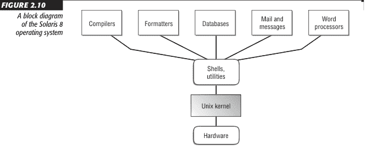

Solaris 内核的一个主要优势是其在多处理器系统上的可扩展性能。所有内核子系统——如设备驱动程序、调度器、文件系统以及进程和线程支持代码——都使用同步原语。后期的一个工程目标是减少锁的需求，同时不损害数据完整性。

Solaris 8 被设计为运行在多处理器系统上，无论是来自 Sun Microsystems 的 SPARC 还是基于 Intel 的 x86 平台。这两种架构都被视为对称多处理器（SMP）系统。这意味着所有处理器之间存在对等关系。它们都是平等的。还有其他类型的模型无法实现最佳计算所需的并行性，例如基于节点且包含少量处理器的共享内存模型和大规模并行处理器（MPP）模型。为了实现可扩展的性能，操作系统必须支持多个处理器并发执行操作系统代码。并发是扩展性的关键，Solaris 8 轻松地满足了这一要求。

数据完整性很难维护。系统不能允许运行在多个处理器上的线程同时操作指向同一数据结构的指针。如果一个处理器正在读取关键信息的一部分，而另一个处理器上执行的线程正在更改相同的数据，将会导致混乱。内核实施锁定机制以防止这种情况发生。它要求所有操作系统代码必须了解内核中存在的锁的数量和类型，并遵守锁的层次结构。在读取或写入内核数据之前，必须遵守获取锁的规则。此外，多线程应用程序还必须同步对共享数据的访问。它们使用与内核相同的锁定原语和技术。这些复杂问题使操作系统开发成为一项普遍的挑战。

系统的锁原语有一些与硬件相关的考虑因素。其中之一涉及处理器的指令集以及适合锁定代码的机器指令的可用性。另一个涉及当正在执行的内核线程遇到锁时，锁状态的可见性。锁只是系统内存中特定位置的一块数据。它是 RAM 中的一个字节。如果锁被设置或持有，锁字节中的所有位均为 1。可用的锁是相同的字节，所有位均为 0。尽管看似简单，但这是理解锁工作原理的重要信息。

大多数现代处理器提供某种形式的原子性的测试并设置（test-and-set）指令。最好记住，读-改-写序列是一个原子操作。在 SPARC 处理器中，读取是加载操作，写入是存储操作。如果指令具有原子属性，这意味着在执行指令的加载和存储之间不允许有其他存储操作。锁操作必须是原子的，即当获取锁的指令执行完成时，要么


## 同步原语和锁

当锁可用或锁正被持有时，该过程可能并非万无一失。如果该过程不是万无一失的，则在一个处理器上执行的线程可能会发出对该锁的加载操作，而在其执行测试操作的同时，另一个在另一个处理器上执行的线程会发出获取同一把锁的加锁调用。如果锁当前未被持有，这两个线程都会认为锁是可用的，并且都会发出持有该锁的存储操作。原子指令可以防止这种灾难的发生。

另一个重要的考量涉及当锁的值改变时，锁状态对所有处理器的可见性。所有处理器必须对内存中的数据拥有一致的视图。锁的最新状态在系统的所有时间都必须对所有处理器可见。

Solaris 内核采用多种类型的同步对象。锁有多种形式。Solaris 内核中最常用的锁是互斥锁（mutex lock），它提供对数据的独占读写访问权限。读写锁（RW locks）用于允许多个读者但同一时间只允许一个写者的场景。在内核的某些区域，需要管理有限数量的资源时，会使用内核信号量。另一种称为调度器锁（dispatcher lock）的互斥锁，在内核需要访问保护以及中断保护时使用。内核源代码中定义了数百个锁，但这个数字并不精确。因为运行系统中的锁的实际数量是动态的，并随着系统规模的扩大而增长，所以无法预测在某一时刻有多少锁可用。再次强调，这是 Solaris 8 的主要优势之一。它能够根据内核的大小动态地提供可扩展性和相应的同步原语。在大型系统中拥有数千个锁是完全可能的。关于锁可以写更多内容，但本书无意提供超出概述范围的信息。

信号量提供了一种植入机制，使多个进程或线程能够同步访问共享资源。它可以用作二进制锁以实现独占访问。对于多个线程的并发访问，它被用作计数器。信号量在操作系统中的极少区域被使用。当信号量用作计数器时，其值初始化为共享资源的数量。每当使用一个资源时，信号量值减一，表示可用资源减少一个。当进程完成时，信号量值加一。当达到零（0）时，调用进程得知没有资源可用。这些函数被称为 P 操作和 V 操作；P 操作尝试访问信号量，而 V 操作释放信号量。Solaris 内核仅在适当的情况下使用信号量。它们提供的计数功能使其能够兼容固定数量资源的分配。

## 目录层次结构

Solaris 内核在设计上是模块化的，因此在磁盘上并非作为单个二进制对象存在，而是在内存中构建，并在引导操作期间加载。对象模块定义明确，存在于根目录和 usr 文件目录中的命名空间中。核心模块分布在三个类别之一的多个目录中。这些类别决定了模块在目录层次结构中的位置。第一个类别是平台和硬件无关的。第二个是平台相关的，第三个是硬件类相关的。/ 目录树包含在启动时加载的操作系统模块。硬件类相关的模块由处理器类型决定。你可以使用带有 `-m` 选项的 `uname(1)` 命令来确定系统的硬件类。平台相关的类别包括系统类型。`-i` 选项将显示硬件实现。Solaris 通常驻留在基于 Sun 的平台上，例如 SUNW、Ultra-S 和 SUNW，以及 Enterprise。处理机器依赖性的内核模块驻留在以 `/platform/<platform-name>` 开头的目录树中。

其他内核模块位于 `/usr` 目录下。此树还包含内核（`/usr/kernel`）和平台（`usr/platform`）子目录。这些模块按需加载。

> **提示** 你可以使用 `/etc/system` 配置文件中的 `force=load` 指令请求系统在启动时加载可选模块。

系统启动时只加载一个 `genunix` 二进制文件；通常是在所有其他系统上加载 SPARC 版本或 `/kernel/genunix`。这些包括回调和调用设施、时钟和计时器、内核内存分配器、管理例程、运行时链接器、同步原语、设备驱动程序接口以及内核线程和轻量级进程代码。

这些驻留在内存中的二进制内核模块在启动时构建内核。以下顺序基于本地磁盘启动；网络引导使用不同的引导程序：

1. 引导块被加载到内存中。
2. 查找并加载二级引导程序到内存中。
3. `ufsboot` 定位并加载核心内核映像和运行时链接器。
4. 从根目录树加载必需模块并执行启动代码。
5. 内核启动代码创建并初始化结构、资源和软件。
6. 系统从系统目录执行 shell 脚本。

尽管已经讨论了 SPARC 系统，但在引导阶段完成且内核加载后，初始化过程的大部分是硬件无关的。然后控制权交给 Unix，它被加载到物理内存空间的顶部附近并接管执行。内存管理单元（MMU）被启用，前 16 兆字节内存被映射。然后设备被映射。被映射的第一个设备之一是电可擦除可编程只读存储器（在 SPARC 上是 EEPROM），它保存着开放引导只读存储器（OBP）代码。它占据物理地址空间的一部分。在启动期间需要调用 PROM。PROM 有助于获取硬件和版本信息。一旦 `m1setup()` 工作完成，内核开始向内核更高层区域发起函数调用。进入 `main()` 函数。它调用硬件例程进行初始化步骤，然后返回公共代码以完成启动过程。

尽管幕后有无数进程在运行，你只需要知道内核模块加载发生在启动过程中的各个点。在特定于平台的启动期间，加载 swap、specfs 和 procfs。调度类在 `dispatch()` 函数期间加载，该函数初始化内核调度器子系统。一旦虚拟内存支持初始化完成，specfs 和 swapfs 文件系统支持模块就被加载并初始化。设置为强制加载的内核模块通过 `/etc/system` 中的 `force load: /drv/foo` 命令加载，并设置内核陷阱表。进行事务处理，创建中断线程，启动子系统的初始化函数，并由系统为用户创建第一个 init 进程。所有后续进程都由 init 派生（fork）。

## 链接

内核架构是分层的。许多内核子系统访问一组常见的低层服务。接口不用于应用程序软件开发，而是内核专用的私有接口。设备驱动程序和 STREAMS 模块是这一概括的例外。动态加载过程遵循预定路径：

1. 将模块加载到内存中
2. 为段建立内核地址映射
3. 将模块段链接到内核中
4. 执行模块的安装函数

可加载模块类型定义在 `/usr/include/sys/modctl.h` 中。包括文件系统、设备驱动程序、执行模块、系统调用、杂项模块以及


## STREAMS 模块

在完成加载过程之前，每个模块都有自己需要遵循的安装步骤。这些步骤与动态链接程序的操作相似。二进制文件所链接的共享对象会被动态加载到内存中，并链接到进程的地址空间。加载内核模块涉及将目标模块读入内存并创建地址空间映射。任何内核模块的功能都可能依赖于其他内核模块的存在。这些依赖关系定义在模块代码中，并维护在 modctl 结构中。内核模块加载机制采用线程化方式以执行模块加载功能。在多处理器系统上，可以并发执行模块加载，从而提供更快的系统启动和初始化速度。线程创建后，内核会遵循一系列事件来完成模块的加载和链接。以下是链接完成的步骤示例：

- 1. 在搜索完链接列表后，创建并分配一个 modctl 结构。
- 2. 进入运行时链接器以创建地址空间段，然后将对象加载到内存中。
- 3. 在模块的 modctl 结构中设置 mod-loaded 位，并对 mod-loadcnt 进行递增。
- 4. 创建到模块的 mod-linkage 结构的链接。
- 5. 通过调用 -init() 例程来执行模块的 mod-install 功能。

参与模块加载的主要内核子系统是模块机制和运行时链接器（krtld），后者在启动过程的早期被加载。由于 Solaris 8 内核是动态的，且对象可以在运行系统生命周期内加载和卸载，因此内核维护一个符号表，该表保存了解析对象符号引用所需的信息。该符号表由一个专门为此目的创建的内核线程进行更新。当模块被加载时，运行时链接器会向该线程发出唤醒信号，符号表随后更新以反映当前已加载的内核对象。

这些内核组件还会使用其他内核服务。内存分配器、锁原语以及内核 sysms 驱动程序也可以被征用，这是模块化设计内核的主要优势之一。

### 内存架构

Solaris 8 虚拟内存系统提供了多项显著优势。它提供了一种比可用物理存储（如 RAM）更大内存大小的编程模型。它还提供了二级存储位置，用于存放不适合放入物理内存的内存片段。它为应用程序提供了简单的编程模型。无论发生了何种碎片化，它都为进程提供地址空间中线性排列的字节范围。VM 系统通过让最常引用的内存部分保留在速度更快的主存储中，来管理地址空间。如果发生 RAM 短缺，VM 系统必须通过将不常使用的内存转移到后备存储来释放 RAM。通过此操作，VM 系统保证了最佳性能，并消除了用户管理内存分配的需求。本章前文的图 2.7 描绘了地址空间、段和页。

一个亮点是，在 VM 系统中，多个用户的进程可以共享内存。多个进程可能正在运行相同的可执行二进制文件。共享程序二进制文件和应用程序数据可以优化内存使用。内存不会被浪费。VM 系统还通过防止进程访问其合法地址空间之外的内存来提供内存保护，除非该内存在进程之间被显式共享。页是固定大小的物理内存（RAM）片段。平均页大小为 8KB。每个页都与一个文件和偏移量相关联，用于标识该页的后备存储。这是当物理页内容因其他用途需要被迁移时（也称为页换出）的目标位置。如果物理页内容已迁移，可使用页换入（page-in）从后备存储读回。

用于进程堆和栈的页以交换文件作为其后备存储。这被称为匿名内存。页也可以是常规文件中页大小片段的缓存。其后备存储就是它所缓存的文件。如果页的内容已被修改，它就被视为“脏”页。当页被释放时，匿名内存会换出到交换设备。如果文件页需要被释放且未被修改，则直接释放。一旦被修改，首先将其写回后备存储，然后再释放。

内存是以页大小的片段进行管理，而非以字节管理。Solaris 将线性虚拟地址空间划分为段，这些段代表地址空间中每种类型的内存。每个段管理虚拟地址范围的映射，并将该映射转换为 MMU 页。MMU 通过使用一组特定于平台的转换表，将这些页映射到物理内存中。每个表项包含页在 RAM 中的物理地址，以便硬件可以快速转换内存访问。操作系统可以将内存溢出到较慢的介质，如磁盘或交换空间。当内存短缺时，最不活跃的进程的所有页都会被换出到交换设备，从而为其他进程释放内存。该系统的优势在于每次只换出一个页，允许进程继续运行。另一个优势是 VM 系统管理文件系统缓冲。

与 Solaris 8 的其他方面一样，虚拟内存文件系统在设计上是模块化的。它在多处理器平台上提供可扩展的性能，并已被移植到许多不同的平台。MMU 使用一种称为硬件地址转换（HAT）层的硬件特定地址转换层来管理物理内存。每种内存管理类型都有其特定的 HAT 层。通用的机器无关内存管理层可以与硬件特定组件分离，以最小化必须编写的平台特定代码量。


地址空间是由段设备驱动程序创建的段的映射。每个段驱动程序管理将线性虚拟地址空间映射到不同设备的内存页。段驱动程序访问 HAT 层，以创建地址空间与物理页之间的转换。内核还支持共享内存、文件库和可执行脚本。它们可以在程序启动时映射到地址空间。当文件映射到进程的地址空间时，它可以被映射和共享，使得所有进程都能访问相同的物理内存页。

内存段管理将线性虚拟内存范围映射到地址空间。映射是在地址空间和设备之间进行的。由于对象架构允许不同段具有不同的行为，因此不再需要将内存和设备信息硬编码到地址空间中。实现地址空间并为线性地址范围创建映射需要段驱动程序。还需要提供页错误处理例程以处理线性地址范围内的机器异常。段驱动程序实现方法子集和一个创建该对象第一个实例的构造函数。段的 create 例程作为参数传递给 as-map()，段对象被创建，并返回一个段对象指针。虚拟内存系统的其他部分可以调用段以访问不同的地址空间，而不会受到阻碍。

Solaris 8 内核支持用于各种功能的多个段驱动程序。vnode 段驱动程序管理进程地址空间映射，包括数据、堆、栈和内存映射文件。表 2.6 列出了与内核内存映射或硬件设备相关的段驱动程序。

表 2.6：段驱动程序

| 段功能 |
| :--- |
| seg_dev | 支持映射硬件设备 |
| seg_drv | 为硬件图形设备提供映射支持 |
| seg_kmem | 分配可映射的内核内存 |
| seg_kp | 分配可分页的内核内存 |
| seg_lock | 支持用户态和内核态之间硬件图形的映射 |
| seg_map | 将文件（vnodes）映射到内核的地址空间 |
| seg_mapdev | 为映射的硬件设备提供支持 |
| seg_mdi | 为 cgfourteen 图形帧缓冲器提供映射支持 |

未完待续


## 表 2.6：段驱动程序（续）

| 段 | 功能 |
| :--- | :--- |
| `seg_nf` | 非缺页内存驱动程序 |
| `seg_spt` | 共享页表段驱动程序 |
| `seg_sx` | 为 SPARCstation 20 SX 图形卡提供映射支持 |

最常用的是 `seg_vn`（vnode）段驱动程序。它使用物理内存作为缓存，将文件映射到地址空间中。`seg_vn` 段驱动程序还会为进程的堆和栈在进程地址空间中创建匿名内存。此外，它还提供了对 System V 共享内存的支持。

vnode 段处理内存地址转换以及 `mmap` 系统调用中请求的内存范围的缺页中断，新的段会被添加到进程的地址空间列表中。段创建后，`seg_vn` 驱动程序使用映射的地址和长度初始化结构体，然后创建一个 `seg_vn` 特有的数据结构。

文件可以通过 `mmap` 系统调用映射到进程的地址空间中。当我们调用地址空间例程创建新的 vnode 段时，vnode 段负责处理内存地址转换。它还处理 `mmap` 系统调用中请求的内存范围的缺页中断。然后，新段被添加到进程的地址空间列表中。

hat map 函数是创建地址空间映射的核心函数。它与硬件内存进行交互，并调用平台例程来编程 MMU。内存地址引用会触发段驱动程序中的缺页中断处理程序，直到有效的物理内存页被放置为止。当 MMU 映射完成后，`seg_vn` 驱动程序开始处理该段内的缺页中断。

系统调用通过更新段内内存的内容来写入映射的文件。由于没有软件或硬件事件，更新操作会在系统刷写守护进程检测到内存页修改后定期发生。

当两个或多个进程被映射时，`seg_vn` 段指向同一个 vnode。这些进程共享相同的文件物理内存页。第一个导致缺页中断的段会将一个页读入物理内存。第一个段之后的任何段都会创建对现有物理内存页的引用。

每个进程创建自己的段对象。两个段都指向同一个文件，并映射到相同的物理页。有几个选项决定了当文件映射给多个进程时如何共享该文件。图 2.11 展示了两个进程映射到同一文件的方式。

## 图 2.11

映射到同一文件的两个进程

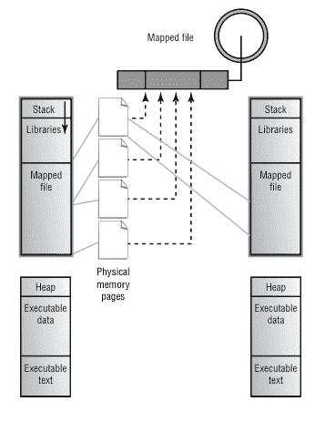

## 匿名内存

匿名内存涉及那些未与 vnode 关联的页。这些页用于堆空间、栈以及写时复制页。有两个子系统专门用于管理匿名内存。第一个是 anon 层，第二个是 swapfs 文件系统。当段接收到缺页中断时，它分配一个 anon map 结构体，并在匿名映射的 amp 字段指向 anon 头。然后分配一个槽数组。其大小足以容纳段中的页数。根据所需槽的数量，槽数组可以是单级间接列表或双级间接列表。

当段大于 16MB 时，指示使用双级间接；32 位系统属于此类，64 位系统对于大于 8MB 的段也是如此。对于单级间接，anon 头部的数组块直接引用 anon 槽数组。对于双级间接，数组被分割成大小适中的块。分配由 anon 层接口 anonmap_create 处理。

swapfs 层实现了空间高效的交换分配。它是 anon 层与物理交换设备之间的一个伪文件系统。图 2.12 展示了数据如何从内存交换到磁盘。

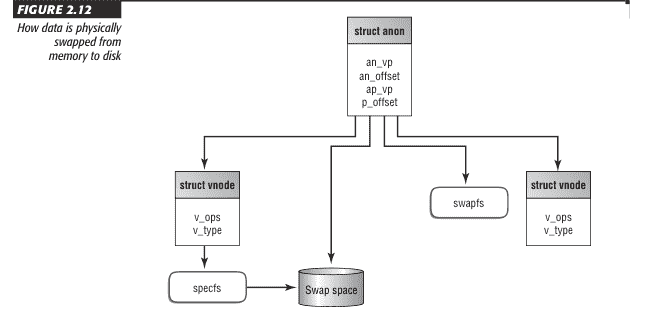

每个物理内存页都有一个 vnode 和偏移量，它们标识了一个后备存储，用于指示当该页不在物理内存中时在哪里找到它。对于常规文件，缓存该文件的物理页具有 vnode 和偏移量。使用交换空间，以便在内存已满时，可以将页复制到磁盘，从而释放出一个内存页。预先保留空间以确保有足够的交换空间用于所需用途。Solaris 8 允许在内存充足时分配匿名内存，而无需保留物理交换空间。

交换并非总是必要的，但它通常消耗一页交换空间来对应一页可写的虚拟内存。交换空间分配有三个阶段：保留、分配和交换。当以私有/读/写访问权限创建段时，分配保留的交换空间，这代表了正在创建的区域的虚拟大小。当分配第一个物理页时，分配虚拟交换空间。此时，会为 anon 槽分配 swapfs vnode 和偏移量。如果发生内存短缺，页可能被交换出去。如果扫描器为该页调用 swapfs_putpage()，该页将被迁移到物理磁盘或文件交换。每当创建堆段时，也会保留交换空间。保留的交换空间量与段的大小相等。图 2.13 展示了虚拟交换。

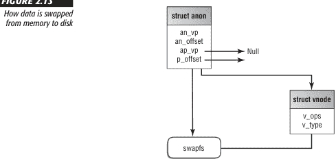

为了避免在执行过程中耗尽交换空间（且没有检测手段），虚拟交换空间是预先保留的，以便在请求时执行交换空间分配。Solaris 允许你在需要内存之前让请求失败，以防止进程在正常执行期间失败的可能性。大多数操作系统做法恰恰相反，当资源耗尽时，向进程发送 `SIGDANGER` 信号。如果你运行 `malloc()` 请求，它将有助于防止进程在执行过程中失败。`swapfs` 文件系统包含可分页内存。它被用作虚拟交换空间。实际上，当第一个页被访问时，你可以保留和分配虚拟交换空间。当保留的是交换空间而不是磁盘空间时，保留来自 `swapfs` 文件系统的虚拟交换空间。磁盘交换页在页实际被分页出来时才分配。

一个系统全局变量 `avainm` 记录系统中可用的可分页物理内存，并将其加到总交换空间中。如果保留了虚拟交换，虚拟内存的量会减少。只要有足够的可用内存和物理交换空间，交换分配就会成功。在 Solaris 8 中，当段驱动程序调用 `anon_alloc()` 获取新的匿名页时，匿名页会被分配 `swapfs` vnode 和偏移量。该函数通过 `swapfs_getvp()` 调用进入 `swapfs`，进而调用 `swapfs_getpage()` 使用 swapfs vnode/偏移量创建新页。这触发了 anon 结构体的成员 an_vp 和 an_offset 参考 swapfs 虚拟交换设备中的 vnode 和偏移量。

当物理交换空间耗尽时，会导致内存性能问题。当物理交换空间填满时，并不会发生失败。因为在保留阶段已经分配了由物理内存和物理交换空间组成的足够的可用虚拟交换空间，swapfs_putpage() 会将页保留在内存中，而不会将页推送到物理交换区。一旦物理交换区完全分配，剩余的页将被锁定在物理内存中。

系统中的匿名内存量由 anon 记账结构记录。此层跟踪分配给 kanon_info 结构的匿名页数。图 2.14 展示了交换分配的典型模式。


虚拟内存观察点是 Solaris 的一项特性，它模仿断点。当地址位置被读取或修改时，观察点会停止执行。它们还允许通过观察点接口实现断点功能。你可以通过 /proc 文件系统接口设置或清除观察点。打开进程的内部控制文件并发送 pwatch 命令；pwatch 命令伴随一个 pwatch 结构，其中包含地址、受影响区域的长度以及观察点的类型。表 2.7 列出了观察点标志及其用途。


| **标志位** | **描述** |
| :--- | :--- |
| WA_READ | 读取访问 |
| WA_WRITE | 写入访问 |
| WA_EXEC | 执行访问 |
| WA_TRAPAF TER | 指令执行完毕后触发陷阱 |

当看门点被触发时，被跟踪的进程会发起一个内存引用，该引用覆盖了受监视区域中至少一个字节，且覆盖位掩码的内存引用如 `pr_wflags` 中所述。当看门点被触发时，它会触发一个看门点陷阱。除非指定了 `WA_trapafter`，否则陷阱会在指令完成之前发生。如果指定了 `WA_trapafter`，则陷阱会在指令完成之后发生。当陷阱在指令完成前发生时，内存不会被修改。如果在指令完成后发生，且访问权限为写入访问，则内存会被修改。`/proc` 进程信息文件 `pr_info` 包含与看门点陷阱相关的信息，可以将其读取到 `struct pr_info` 结构中。`s1_addr` 字段包含触发看门点的内存引用的虚拟地址。

## 页

页是物理内存的单位。内核中的活动页是 vnode 和内存之间的映射。可以通过 vnode 指针和 vnode 内的页大小偏移量来识别一个页，即 vnode/偏移量对，这是页的后备存储，代表页所映射的文件及其偏移量。HAT 和地址空间层管理物理页与其虚拟地址空间之间的映射。由于 vnode/偏移量对在重新使用之前会将其在 RAM 中的内容与后备存储进行同步，因此其他任务可以重用该对。全局哈希列表是一个指向页链表指针的数组。虚拟内存系统将具有有效 vnode/偏移量对的页哈希到全局哈希列表中，以便可以通过 vnode 和偏移量来定位它们。有三个函数用于搜索全局哈希列表：`page_find()`、`page_lookup()` 和 `page_lookup_nowait()`。这些函数使用 vnode 和偏移量作为参数，如果找到则返回指向页结构的指针。

Solaris 内核还使用分段的全局物理页列表。它由物理内存中连续的段组成。这些段在系统启动时添加。当系统运行时物理内存被添加或移除时，它们也会被动态添加和删除。空闲列表和缓存列表保存未映射到任何地址空间且已被 `page_free()` 释放的页。尽管它们可能由 `vmstat` 报告为空闲页，但它们仍可能包含来自 vnode/偏移量的有效页，并且仍然是全局页缓存的一部分。缓存页可能出现在空闲列表中。缓存列表中的内存实际上也不是真正空闲的，而是来自文件的页的有效缓存。缓存列表展示了文件系统如何使用内存作为文件系统缓存。

如果一个页已被销毁并从某个 vnode 的哈希列表中移除，它将出现在空闲列表中。空闲列表通常很小，因为大多数被进程使用的页仍保持其 vnode/偏移量信息完整。当进程退出时，页会被放入空闲列表。这释放了匿名内存页，如堆、栈和写时复制页。

页大小可能因硬件而异。Solaris 内核使用的页大小通常为 8KB。MMU 页大小导致性能与内存大小效率之间的某种权衡。较大的页由于内存管理开销较少而提供更好的性能，但较小的页大小浪费的内存更少。

Solaris 8 通过使用算法来控制许多与页相关的活动。尽管算法种类繁多，无法一一深入探讨，但可以肯定的是，用于微调页着色、页扫描器页交换和扫描速率操作的算法，其效率是任何操作系统所能达到的最高水平。共享库经过优化，以防止页被窃取。按需分页允许文件系统缓存根据其他子系统最近未使用的“被窃取的页”的需求进行扩展和收缩。正因为如此，Solaris 8 能够维持高得多的 I/O 速率。通过各种手段来节约内存。CPU 调度器/分发器可以交换出整个进程以节约内存。

## POSIX

Solaris 8 使用便携式操作系统接口（POSIX）标准。它们是通过 System V 进程间通信（IPC）集实现的：共享内存、信号量和消息队列。Solaris 8 中的实现与 System V 中的不同。POSIX 命名约定提供了抽象以及文件描述符，以便在 POSIX 所有 IPC 机制所构建的文件内存映射接口 `mmap(2)` 上使用该接口。IPC 机制不需要是文件系统内的文件，但它们必须看起来像文件。System V 使用的旧键值在 Solaris 8 中已被弃用。使用 POSIX 时，进程通过使用文件名约定来获取所需资源。在 Solaris 上运行使用任何 POSIX IPC 机制的代码时，POSIX 接口要求与 `libposix4 .20` 共享对象库进行链接。

所有 POSIX IPC 函数直接或间接基于内存映射文件。消息队列和信号量函数直接调用 `mmap(2)`。这会基于 `xs_open(3R)` 调用返回的文件描述符创建一个内存映射文件。如果使用 POSIX 共享内存，必须从应用程序代码中调用 `mmap(2)`。`mmap(2)` 系统调用直接从代码映射文件。

## 总结

在本章中，你了解了 Solaris 8 是如何开发的。由 AT&T 开发并专为内部系统设计 Multics 是 Solaris 8 的祖辈。Solaris 8 经过改进，其操作环境包括所有使用 SunOS（Sun 操作系统）的工具、应用程序和服务。Solaris 8 使用专为 Unix 系统编写的 C 编程语言。

Solaris 8 采用了由 Unix 普及的模块化或分层设计。Sun 开发了一个新的操作系统内核，Solaris 至今仍在使用的就是该内核。Solaris 8 使用多线程执行。Solaris 8 的层次结构贯穿操作系统的每个模块，从而形成统一的结构。总线和设备可以通过动态加载设备和总线驱动程序进行安装和配置。

本章还介绍了调度器。你了解到每个调度器都有自己独特的算法和优先级级别以优化操作，并且虚拟文件系统框架实现了多种文件系统类型。proc 文件系统为所有程序提供了进入内核的统一接口。Solaris 识别两种不同的处理器执行模式：称为内核模式的特权模式和称为用户模式的非特权模式。

除了调度器，本章还涵盖了中断和陷阱。中断是设备发送给内核的信号，表明有事情需要立即处理。必要时，内核可以向另一个处理器发送中断。陷阱是由处理器发起的进入内核的向量控制转移。软件陷阱用于 Solaris 内核中的系统调用。

本章还展示了 Solaris 如何采用共享内存架构，该架构实现了由所有处理器共享的单个内核和单个内存地址空间。你阅读了如何对数据线程进行优先级排序，以及高优先级线程在执行时可以中断低优先级线程，还有虚拟内存系统如何提供具有更大规模的编程模型。

最后，你了解到内存是按页大小而非按字节管理的。

# 第 **3** 章

# **安装 Solaris 8**

+   **内容提要：**
+   *   *不同的 Solaris 发行版* 62
+   *   *SPARC 安装* 71
+   *   *Intel 平台上的 Solaris 安装* 83
+   *   *StarOffice 和额外组件的安装* 85
+   *   *补丁* 87


## Solaris 发行版

在 Solaris 上你需要进行的“安装”工作量，取决于你要操作的系统当前状态。大多数用户可能并不会自行在服务器上安装 Solaris。如果你从 Sun 购买了工作站，在初始引导过程中，系统会询问你几个问题（主要关于系统名称和寻址方案），随后系统会自动完成配置。看似预装工作站设置不太容易出错，但即使是简单的配置，也可能存在一些问题导致故障。

对于从零开始的完整安装，你需要做出更多的选择。本章将引导你了解在 SPARC 系统或 Intel x86 系统上安装 Solaris 时涉及的一些思考过程。在系统生命周期的某个阶段，由于操作员失误或需要升级和修改系统，你可能被迫重新安装操作系统。此外，鉴于目前 Solaris 可免费从 Sun 的网站下载，越来越多的人面临着安装系统操作系统的任务。

Sun 提供非商业许可或商业许可下的 Solaris。如果你在家使用 Solaris，或者是学生，你可以免费在工作站或个人电脑上下载并安装 Solaris 副本。你可以直接从 Sun 购买非商业版本的 Solaris，费用仅为光盘费用加邮费，目前该版本定价为 20.00 美元。SPARC 和 Intel 版本的 Solaris 均可在非商业许可下获取。

通过该项目购买 Solaris 时，你只能获得光盘：针对 SPARC 的 CD-ROM，或针对 Intel 环境的 CD-ROM 和软盘启动盘。你不会获得安装指南或其他随其他许可计划附带的印刷文档。

Sun 通过名为“免费 Solaris 二进制许可计划”（Free Solaris Binary License Program）的项目，向开发人员提供非商业版本的 Solaris。实际上，这个版本并非完全免费，但其价格具有竞争力，与其他桌面操作系统（如 Microsoft Windows 或 Apple Macintosh）的成本相当。加上运费共 75.00 美元，该版本允许你在拥有八颗处理器或更少的任何系统上安装 Solaris。该项目可在 www.sun.com/developers/solarispromo.html 上找到介绍，也可以通过 URL www.sun.com/solaris/how-to-buy.html 访问同一页面（见图 3.1）。

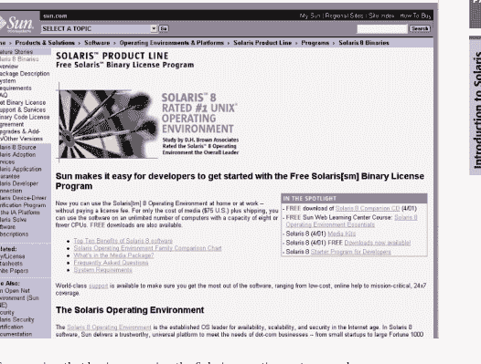

**图 3.1** Solaris 购买指南页面是获取各种 Sun Solaris 发行版的起点。

Sun 要求使用 Solaris 操作系统的企业购买商业许可。该许可适用于部门或企业服务器以及开发者的工作站。当你从 Sun 购买新系统时，商业许可的费用是包含在整套设备中的。然而，你可能会发现，在许多情况下，特别是在购买工作站时，系统并不附带文档集。在这种情况下，文档可以作为前一段所述发行版的一部分从 Sun 处购买。对于希望将系统从旧版本 Solaris 升级到 Solaris 8 的情况，请注意 Sun 也出售操作系统的升级版本。

所有不同版本的 Solaris 操作系统都可以通过 Sun 网站上的 Sun 商店直接从 Sun 购买（见图 3.2）。访问 Sun 商店可以通过 Sun 主页上标记为 Sun Store 的按钮，或者在许多 Sun 网站页面的标题栏中标记为 How to Buy 的按钮来实现。Sun 商店的直接 URL 是 http://store.sun.com。

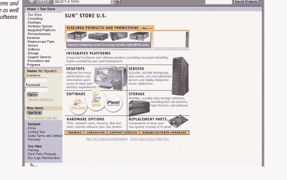

**图 3.2** Sun Store 销售 Sun 系统、Sun 硬件以及 Sun 软件。

**提示** 有时你无法在尚未分区的磁盘上进行安装。如果你有一个用于 SPARC 系统的全新硬盘，建议在尝试在硬盘上安装操作系统之前，先在一个正常的 Solaris 系统上对其进行标记和分区。

Sun 还提供两种 Sun 操作系统的免费下载版本，你可以使用浏览器访问。下载的操作系统版本是全功能的，实际上可能比你从 Sun 购买的版本或最近购买的服务器或工作站上加载的版本更新。购买指南页面包含指向 Solaris OS 两种版本的链接。当你下载任一版本时，网站会要求你注册，但没有其他要求。你可以随时回来下载 Solaris，登录后可以下载任意次数的 Solaris。提供 Solaris 工具免费下载的类似 Sun 网站（如 BigAdmin (www.sun.com/bigadmin)）也有类似的登录机制。在本章稍后描述的安装过程的 Web Start 部分，你会看到 BigAdmin。

Sun 对其 Solaris 操作系统的低价策略，源于公司希望鼓励开发人员为 Solaris 开发应用程序，并促使用户采用该操作系统。随着 Linux 在桌面和低端服务器市场相对成功，Sun 希望其定价策略能吸引用户学习 Solaris，并留住有经验的用户留在 Solaris 阵营。

## 安装 Solaris

如果在安装时，你手头有希望系统具备的网络特性文档以及硬盘分区方案，Solaris 的安装过程将更加顺利。

你可以放心，从 Sun 购买的 SPARC 系统设备通常兼容 Solaris，前提是该系统足够新。但是，你需要检查 Intel x86 系统的组件，以确保系统符合 Sun 的硬件兼容性要求。Intel 硬件兼容性列表（HCL）可以在 www.sun.com/software/intel/hcl/index.html 查看，该列表可以从 http://solder.sun.com/support/drivers/hcl/index.html 以多种格式下载以备后用。希望其系统获得 Solaris 认证的开发人员可以访问位于 http://solder.sun.com/support/certify/HTCS/ 的 Solaris 软件认证网站。

假设你的 Intel 硬件与 Solaris 8 兼容，并且你手头有完整的 Solaris 8 发行版，你还需要一个启动软盘才能在 Intel 上安装 Solaris。如果随发行版提供的启动软盘无法正常工作，或者你正在使用在 Intel 上下载的 Solaris 副本，你可以从 http://solder.sun.com/support/drivers/dca_diskettes/ 下载该磁盘，并下载必要的文件来准备一个 1.44MB 的软盘，用作你的 Intel 启动软盘。如果在 DOS/Windows 或 Linux 系统上下载了 boot_3 文件，你应该使用 rawrite.exe 命令在软盘上创建该文件的映像副本。如果在 Solaris 系统上下载文件，请使用以下命令准备启动软盘：

```
$ dd if=boot_3 of=/dev/fd0 bs=1440K
```

有关创建启动软盘的更多帮助，请访问 http://solder.sun.com/support/drivers/copytodisk.html。

### 安装类型

在系统上安装 Solaris 有四种通用方法：

-   **Web Start 安装** 此方法用于初始安装，不用于升级安装。Web Start 使用一个 Java 程序为安装 Solaris 的人提供图形界面，可以通过鼠标和键盘操作来进行安装。

-   **交互式安装** 交互式安装用于管理员在单个系统上安装 Solaris。在交互式安装过程中，你可以保留文件系统，使其不被覆盖。你还可以指定要保留哪些文件系统。与使用 Web Start 进行的完整安装相比，交互式安装通常速度快得多。

-   **网络安装** 在网络安装中，Solaris 操作系统通过网络安装到系统中。管理员使用网络在没有 CD-ROM 驱动器的设备上安装 Solaris。必要的文件被复制到机器的硬盘上。

-   **JumpStart 安装** 这是从 JumpStart 服务器自动安装 Solaris 操作系统的方法。JumpStart 方法可以应用于多个系统，并可用于“部署”Solaris。通常，公司会指定 Solaris 系统的标准构建，并为每种特定系统类型创建系统映像。然后，JumpStart 服务器使用一组脚本将此映像复制到每个系统。

在本章中，将完整描述 Web Start 安装。要了解网络安装或 JumpStart 安装，请查阅 Solaris《高级安装指南》（参见 http://docs.sun.com/ab2/coll.214.7/SPARCINSTALL/@Ab2TocView?Ab2Lang=&Ab2Enc=iso-8859-1）。

### 分区方案

如果你接受 Solaris 的默认安装，安装程序将为你创建分区方案。该分区方案可能不符合你长期所需或所期望的情况。例如，在作者编写本书时使用的 Ultra 5 附带的 8GB 硬盘上，Solaris 将硬盘的大部分空间分配给 `/export` 分区。结果，根分区中几乎没有剩余空间用于安装程序。虽然该方案对于服务于许多用户且程序需求有限的网络或系统管理员很有用，但对于使用该工作站进行严肃测试、开发或管理的人员来说，实用性很低。事后对系统进行分区虽然可能，但难度较大，可能需要使用 Veritas Volume Manager 等第三方应用程序。因此，建议在安装前仔细考虑分区方案的选择。


## Solaris 操作系统安装形式

Solaris 操作系统以五种不同的形式进行安装，拥有五种不同的基础大小：

- 核心 Solaris 系统为 205MB。
- 最终用户系统（64 位）为 562MB。
- 开发人员系统（64 位）为 922MB。
- 完整系统（64 位）为 980MB。
- 包含额外原始设备制造商（OEM）支持的完整系统为 988MB。

如今大多数系统的磁盘都大于 2GB，因此建议尽可能在您的系统上安装完整的 Solaris 发行版。如果您计划使用额外的硬件（例如插入卡），可能还需要安装 OEM 支持。

### 分区考虑因素

在决定对系统进行分区时，您需要考虑将有多少用户在该系统上工作。对于单用户系统，您可能希望在磁盘上为根分区创建一个较大的分区；对于多用户系统，您可能希望创建额外的分区，以保护系统免受可能出现的问题的影响。您将遇到的两个最棘手的问题之一，是用户可能会填满某个分区，如果它是单个分区，系统会显著变慢。与其他操作系统不同，当磁盘已满时，Solaris 不会崩溃。Solaris 会在根分区中预留约 5% 的空间供系统管理员使用，这使得系统维护能够将系统恢复到良好的工作状态。在多服务器环境中，您可以设置用户的磁盘配额，以控制任何用户可以消耗的磁盘空间量。

您将会遇到的与 Solaris 相关的第二个问题，这是一个在所有 Unix 系统中普遍存在的问题，即随着时间推移，一个失控的守护进程（rogue daemon）可能会通过创建一个大型日志文件来填满分区。失控的守护进程不一定是病毒，但完全有可能就是病毒。在 Unix 世界中，由于严格的系统安全性，外部进程很难获得 root 权限并使系统无法使用。更常见的是，系统工具被授予 root 权限以跟踪事件或进程，然后写入日志文件。当该失控的守护进程以 root 身份运行并消耗所有可用磁盘空间时，系统将要么无法访问，要么运行速度太慢以至于无法使用。在某些情况下，您可能需要需要使用 Solaris 安装 CD-ROM 才能将系统恢复为可用状态。

在一定程度上，您可以使用分区来帮助解决这两个问题。分区将您的硬盘分割成由不同目录使用的不同区域。您可以使用 Solaris 安全方案来限制用户和诸如守护进程等进程，使它们只能访问某些分区。因此，如果某个分区已满或损坏，您的主分区或根分区将继续正常运行而不受影响。

### 常见的 Solaris 分区

以下 Solaris 分区通常会被创建：

1. **/ (根) 分区**：Solaris 在内核位于根分区中。在操作期间，日志文件和本机映像（core files）存储在根分区中。您需要确保根分区足够大，以存储多个大型日志文件。根分区应大于 64MB，但应保持适中的大小。典型的较大根分区大小在 128MB 到 256MB 之间，具体取决于可用的磁盘空间。如果您决定不创建 /var、/usr 或 /opt 目录，则必须为这些内容在根分区中留出足够的空间。

2. **/home 分区**：许多管理员创建 /home 分区来存储用户主目录。对于仅有一个用户的系统，您可能不希望或不需要创建此分区。在多用户情况下，您希望容纳的用户数量将决定您希望将此分区设置得多大，并且应考虑您的组织中从事的工作类型，以确定为 /home 分区中每个用户的目录分配多少磁盘空间。如果可能，在设置此分区的大小之前，先确定每个人的平均 /home 使用情况，因为该范围可能会有巨大差异。

3. **/opt 分区**：/opt 分区存储用户可能会在其系统上安装的可选应用程序。如果要在系统上添加多个大型应用程序，应将 /opt 目录设置得较大。

4. **交换（swap）分区**：交换分区存储最近使用的应用程序、数据和系统代码，作为系统物理内存或 RAM 的扩展。您在安装初期设置交换分区。如果您的 RAM 少于 512MB，一个很好的经验法则是，所需的交换空间量是现有 RAM 量的两倍。

5. **/usr 分区**：许多人使用 /usr 分区来存储安装到 bin 和 sbin 子目录中的 Solaris 实用程序，而不是将它们安装在 /opt 分区中。如果您将在 /usr 分区上安装多个大型可选应用程序，则应将其设置得较大。

6. **/var 分区**：Solaris 管理员有时创建 /var 分区来存储易失性或临时文件，例如打印、日志或邮件文件。/var 分区在服务器上特别有价值，在工作站上则不那么重要。对于服务器应用程序，/var 通常是一个较大的分区。

实际上唯一必需的分区是根分区，但这些其他分区提供了使它们的添加有用的便利性。合理的分区方案在服务器部署中特别有用。

当您在包含其他操作系统（如 Microsoft Windows 或 Linux）的 Intel x86 系统上安装 Solaris 时，您将需要在其他操作系统中使用诸如 fdisk 或 Partition Magic 之类的工具来创建额外的分区。如果可能，当在已具有其他操作系统的系统上安装 Solaris 时，请使用单独的磁盘来安装 Solaris。

## 网络寻址

Solaris 是一个网络操作系统。为了获取基本的网络服务并成功安装 Solaris，您需要提供各种网络参数。在安装之前准备好这些信息是个好主意。您需要知道以下参数（如果您不熟悉其中任何参数，应咨询您的系统管理员了解详情）：

- **主机名**：您的系统的名称。您输入的区分大小写。
- **IP 地址**：在您的网络或 Internet 上识别您的唯一地址，可以是公共或私有的。其输入格式为 `###.###.###.###`。
- **子网掩码**：定义您的系统属于哪些系统的数字。
- **域名**：允许 Internet 上的人访问您系统的域的名称。完全限定域名（FQDN）的一个例子是 www.sosinsky-group.com；域名可以简单地表示为 sosinsky-group.com。
- **名称服务**：用于查找网络中其他系统所使用的名称服务的类型。选项包括 NIS、NIS+、DNS 和没有名称服务。
- **地址服务**：您的网络可能使用 DHCP 为系统分配 IP 地址，从而消除了分配静态 IP 地址的需要。
- **日期和时间**：您需要向系统提供当前的日期和时间。
- **Root 密码**：系统管理员或所有者在安装期间需要 root 密码。
- **代理服务器信息**：如果您通过代理服务器访问 Internet，您需要提供服务器的 IP 地址以及服务的端口号。
- **电源管理**：Solaris 支持电源管理功能，例如在不活动一段时间后关闭电源。如果您的企业有策略，您应该遵守它。否则，在安装时您可以决定希望使用的电源管理类型（如果有）。

## Intel 硬件兼容性

Solaris 8 支持各种各样的 PC 硬件，但不如 Microsoft Windows 支持的那么广泛。这使得检查您的 PC 硬件是否支持 Solaris 硬件兼容性列表（HCL）变得更加重要，请访问 www.sun.com/software/intel/hcl/index.html。HCL 中包含了按系统名称和型号列出的具体系统列表。

简而言之，Solaris 8 支持以下 Intel 系统硬件：

- **Intel、AMD 和 Cyrix 处理器**：支持包括 Intel Pentium、Pentium Pro、Pentium II 和 Celeron；AMD K5、K6 和 K6-2；以及 Cyrix 5x86 和 6x86 处理器。
- **内存**：Solaris 8 对于轻度工作站系统使用最低需要 64MB。对于生产环境使用，建议内存分配为 256MB 到 512MB。
- **总线架构**：Solaris 支持 ISA（行业标准架构）、EISA（扩展行业标准架构）、PCI（外围组件互连）总线和 VLB（视频电子标准协会本地总线）标准。Sun 还致力于在 2002 年至 2004 年 Infiniband 标准架构版本可用时提供支持。Solaris 不支持 IBM Micro-Channel 总线或 AGP（加速图形端口）标准。
- **硬盘**：几乎所有的 IDE（智能驱动电子）、EIDE（增强智能驱动电子）和 SCSI（小型计算机系统接口）驱动器（无论是固定式还是可移动式）都得到支持。Solaris 自动支持和识别大多数主要制造商的驱动器。
- **CD-ROM 驱动器**：Solaris 支持大多数速度为 2X 或更高的 CD-ROM 驱动器。最新的 40X 和 44X 高速驱动器可能会造成麻烦，并且某些 PC 上的 BIOS 不支持从 CD-ROM 驱动器引导。如果存在这种情况，您将需要一个软盘驱动器才能执行 Solaris 安装。
- **PC 卡**：一个常见的不兼容领域是插入卡。虽然流行的行业标准，如 Adaptec SCSI 板；Sound Blaster 16 和 Pro 音频板；以及 3COM、Intel 和 Netgear NIC 卡得到支持，但它是


## 视频卡
对于 Solaris 安装来说，第二大棘手的问题是视频卡，尤其是对于 Intel 系统而言。Solaris 对视频卡的支持基于安装在卡中的特定芯片组。受支持的流行系列包括 ATI Rage 和 Mach 系列板卡；Chips and Technologies F655xx 系列；Cirrus Logic 的 GD54xx 系列；Matrox MGA 系列；以及 S3 Trio、Vision 和 Virge 系列。

> **提示** 选择视频板的主要问题是，Solaris 无法支持 AGP 视频卡，这极大地限制了你对显卡和供应商的选择。AGP 是目前购买最多的视频板，并且得到所有当前 PC 厂商的支持。如果你在线购买而不是在视频专卖店购买，你可能更有可能为你的 Solaris 系统找到特定的 PCI 板卡。

## 安装过程
以下几部分说明了使用 Solaris Web Start 程序进行完整安装（初始安装）的过程。本文描述了 SPARC 分发的例程，同时也说明了准备 Intel x86 系统所需的步骤。要在 Intel 系统上安装 Solaris，你会发现，一旦完成初步步骤，你所遵循的步骤和使用的对话框将与 SPARC 安装所使用的相同。根据你安装的 Solaris 8 版本，你可能会发现看到的步骤顺序略有不同。工作站上预安装的 Solaris 版本所需的步骤较少，因为微内核已经安装（即安装文件已复制到磁盘上，但安装序列本身尚未启动）。升级安装也只需要较少的步骤，因为它保留了你的分区和文件系统完好无损。因此，请将以后的章节中描述的安装顺序作为你在安装过程中需要做什么的一般指南。本章中展示的安装是针对工作站的。虽然服务器安装类似，但涉及本章范围之外的额外事项。

## SPARC 安装
你可以选择执行完整或初始安装，或者升级安装。初始安装将覆盖所有文件，创建新分区，并清除所有设置。升级安装会将你之前的 Solaris 版本与新版本合并。许多系统参数和设置在升级过程中会被保存。升级可以节省你的时间，在健康系统上安装较新版本的操作系统时可能是合适的。

> 注意 请注意，Solaris 安装指南将完整安装和升级安装分为两个独立的过程。此外，指南末尾的表格列出了作为 Solaris 8 安装过程的一部分而安装的软件包。

> 提示 在升级系统之前，建议进行备份。

以下是 SPARC 系统上完整或初始安装的说明。如果系统损坏，如果 Solaris 安装程序没有提供升级安装的选项，你可以执行此完整安装来恢复系统。要启动安装程序，请遵循以下步骤：

- 1. 将 Solaris 安装 CD 放入 CD-ROM 驱动器。
- 2. 重启。
- 3. 在启动过程中，按下 Stop+A 组合键。
- 4. 在 OK 提示符处，输入 **boot cdrom**。
- 5. 按 Return 键。

当你购买新的 Solaris 工作站时，初始微内核安装已经在磁盘上为你准备好了。当你启动系统时，在预启动过程回答关于你的网络配置的问题之后，你会发现自己在安装的图形部分。

### 预启动过程
对于 Solaris 的新安装，操作系统将被完全安装，建立新的分区，并且你之前的所有系统信息、设置和数据将被销毁，你将经历以下序列：

```
Your system appears to be upgradable.
Do you want to do an Initial Install or Upgrade?

1) Initial install
2) Upgrade

Please Enter 1 or 2> 1
```

你会遇到需要 *yes* 或 *no* 回答的问题。你必须提供答案。按 **Return** 键会建立默认条件，例如 *swap 分区大小*。

*Initial Install* 和 *Upgrade* 之间的主要区别在于，*Initial Install* 重新格式化你的磁盘并让你建立新的分区方案。它还允许你设置新的 *swap* 分区大小。如果你选择升级你的系统，安装将重启到安装过程的图形部分。继续进行 *Initial Install*，你将看到 Solaris 以交互模式发布以下信息：

```
The default root disk is /dev/dsk/c0t0d0.
The Solaris installer needs to format
/dev/dsk/c0t0d0

WARNING: ALL INFORMATION ON THE DISK WILL BE ERASED!

Do you want to format /dev/dsk/c0t0d0 [y,n,?,q] y
```

安装程序还将为新鲜安装尝试建立 *swap* 分区。Solaris 通过考虑你系统中安装的内存量以及硬盘的大小来确定 *swap* 大小。除非你有需要更大 *swap* 文件的特定性能要求，否则你应该接受 Solaris 的建议。你不应该将 *swap* 文件设置为小于推荐值。Solaris *install* 过程将 *install* 映像复制到 *swap* 空间，然后从 *swap* 空间启动。*install* 过程不允许你选择比该映像所需空间更小的 *swap* 空间。以下是你将在屏幕上看到的输出：

```
NOTE: The swap size cannot be changed during the filesystem
layout.

Enter a swap size between 384MB and 8691MB, default = 512MB [?]

The installer prefers that the swap slice is at the beginning
of the disk. This will allow the most flexible filesystem
partitioning later in the installation.

Can the swap slice start at the beginning
[y,n,?,q] y

You have selected the following to be used by the Solaris
installer:

Disk Slice : /dev/dsk/c0t0d0
Size : 512MB

Start cyl. : 0

WARNING: ALL INFORMATION ON THE DISK WILL BE ERASED!

Is this OK [y,n,?q] y

The Solaris installer will use disk slice, /dev/dsk/c0t0d0s1.

After files are copied, the system will automatically reboot and Installation will continue.

Please Wait...

Copying mini-root to local disk...done.

Copying platform specific files....done.

Preparing to reboot and continue installation.
```

## 系统配置
系统重启后，你将看到图 3.3 所示的欢迎屏幕，这是安装过程图形部分的正式开始。欢迎屏幕列出了你需要提供的系统和网络配置信息。此屏幕将出现在初始安装和升级中，但随后的步骤对于每种情况都不同。

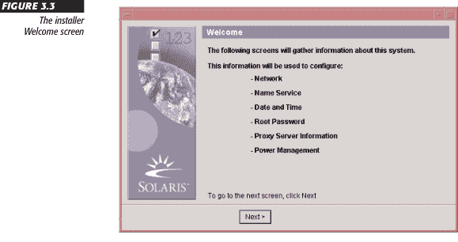

第二个屏幕称为网络连接，如图 3.4 所示。此对话框改变了你的安装路径。它提供了两个不同的单选按钮选项：联网和非联网。虽然非联网是默认安装，但在大多数情况下，你将选择联网单选按钮以允许 Solaris 参与网络服务。接下来的屏幕将提示你输入时区、日期和时间以及 root 密码。

# **图 3.4**
*网络连接对话框*

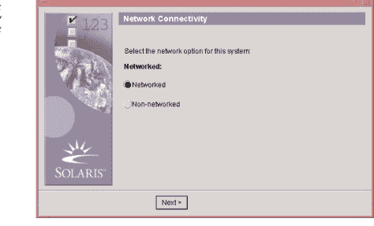

对于联网安装，第三个屏幕是 DHCP 屏幕。它允许你确定你的系统是否接受由动态主机配置协议（DHCP）服务器生成的 IP 地址，或者你是否需要手动输入静态 IP 地址。此屏幕还将你引导至两个不同的安装路径。如果你选择否，你必须在下个屏幕中手动输入主机名和 IP 地址。

如果你启用 DHCP，在接下来的一组屏幕中，你将被告知是否启用 IPv6，提供活动名称服务，并输入时区、日期、时间和 root 密码。

当未启用 DHCP 时，你将被告求提供主机名、IP 地址和子网掩码（子网）。你还将被告知是否启用 IPv6 以及输入正在使用的名称服务。图 3.5 显示了名称服务屏幕，它提示你提供将 IP 地址映射到友好名称的网络系统和资源数据库列表类型。当你输入像 NIS/NIS+ 或 DNS 这样的名称服务时，域名屏幕会出现，要求你输入域的名称，你


希望此系统参与该网络。您可能会输入类似 `sosinskyy-group.com` 的域名。

## 图 3.5
名称服务屏幕

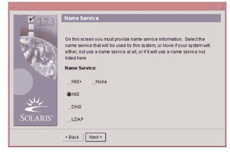

对于域名系统（DNS）服务，您需要在 DNS 服务器地址屏幕中输入 DNS 服务器的 IP 地址。您必须至少输入一个 DNS 名称服务器地址。DNS 服务可以由您的网络内部通过 DNS 服务器提供，也可以使用您的 ISP 或主要站点在互联网上提供的其中一个名称服务器。在可能的情况下，请使用内部服务，因为它的速度更快且提供缓存功能。在下一个屏幕“DNS 名称服务器地址”中，系统将要求您在“DNS 搜索列表”框中输入一组域名的列表，以便在执行 DNS 查询时进行搜索。您应首先列出您的本地域，然后列出企业中的其他域；您也可以列出任何您经常访问的域名。如果您未在列表中输入任何域名，Solaris 将仅搜索您的本地域。

> **注意** Solaris 8 安装程序配置名称服务和寻址所采取的步骤序列因安装版本的不同而略有差异。

对于其他名称服务，系统可能会提示您自动查找名称服务器或在“名称服务器”屏幕中指定一个名称服务器。如果您指定名称服务器，系统将在“名称服务器信息”屏幕中提示您输入服务器的主机名和 IP 地址。一旦输入域名并指定名称服务后，接下来的屏幕将要求您设置系统时区、日期和时间以及 root 密码。

安装序列中的下一个屏幕是在图 3.6 中显示的“电源管理”屏幕。此屏幕允许您打开或关闭电源管理功能，并且它还为您提供了一个选项，以便在每次重启时设置系统的电源管理特性。该电源管理功能会在系统空闲 30 分钟后使其关机，默认情况下是自动开启的。

> **警告** 请勿对需要通过网络访问的系统（例如服务器）启用电源管理功能，因为如果该系统在一段时间内处于非活动状态，它将进入省电模式，从而对网络用户不可用。

## 图 3.6
电源管理屏幕

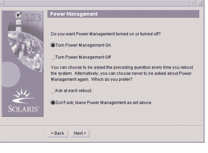

设置电源管理功能后，图 3.7 中显示的“代理服务器配置”屏幕将提示您指示是否使用代理服务器。如果您有一个工作站，且您与互联网之间有防火墙，请保留默认的“直接连接互联网”选项。对于包含代理服务的网络（无论是否使用防火墙），您应该在“主机”文本框中输入代理服务器的 IP 地址，在“端口”文本框中输入代理服务使用的端口号。每个代理服务使用特定的端口号，如有需要，您应从系统管理员处获取此信息。

## 图 3.7
代理服务器配置屏幕

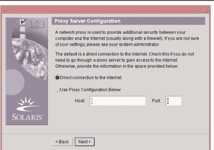

安装过程中系统配置部分的最后一个屏幕是“确认信息”屏幕。它列出了您所做出的选择，并为您提供最后的机会通过安装步骤回溯以更改设置。在确认您的选择之前，仔细阅读这些信息是个好主意。单击“确认”按钮以继续安装，重启后，安装程序的 Web Start 部分将开始。您将看到一条系统消息：“请等待，系统正使用您的设置进行配置...”，之后，如果未发现错误，将显示 Solaris Web Start 安装亭。

## Web Start

图 3.8 显示了带有欢迎屏幕的 Solaris Web Start 安装亭，它是在亭模式下运行的浏览器的有限版本。您无法最小化亭窗口，但所有浏览器按钮均处于活动状态，您可以使用它们获取信息并浏览网络。Sun BigAdmin 页面（www.sun.com/sysadmin）是此安装阶段显示器的背景。如果您使用浏览器并覆盖了安装屏幕，请单击左侧框架中的“将亭发送到背景”按钮以重新显示该屏幕。

> **提示**
> 安装亭允许您搜索互联网上的感兴趣信息。您可以使用此界面搜索 Sun 的站点，查找有助于您确定在安装中指定哪些配置的具体信息。

一旦您单击 Web Start 欢迎屏幕上的“下一步”按钮，系统将提示您插入 Solaris 8 软件 CD，然后 Solaris 将初始化您的系统。您将进入图 3.9 中显示的“选择安装类型”屏幕。此屏幕上有两个单选按钮：默认安装和自定义安装。默认安装会设置一组分区，并选择一组默认软件与 Solaris 8 一起安装。使用自定义安装可以设置您自己的分区，并决定您希望在系统上安装哪些软件包。

## 图 3.8
安装的 Web Start 部分允许您在后台运行一个活动的工作浏览器窗口（处于亭模式）的同时配置 Solaris。

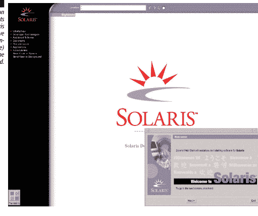

> **警告** 您在“选择安装类型”屏幕中做出的选择对安装过程至关重要。如果您接受默认安装，您将无法选择分区的大小以及安装或不安装哪些软件包。建议执行自定义安装，即使您接受 Solaris 提供的默认选项也是如此。

## 图 3.9
在“选择安装类型”屏幕中，您可以选择安装方法。

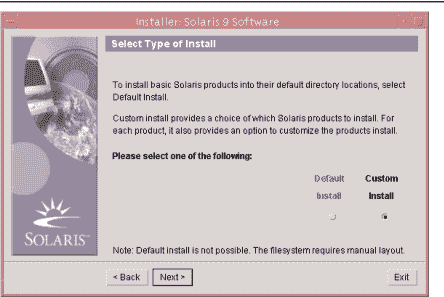

如果您选择自定义安装，系统将提示您选择所需的软件本地化、系统区域设置、希望安装哪些 CD 和产品，以及 Web Start 应在哪里扫描其他产品。您还将被询问是否要安装 64 位软件（连同 32 位版本一起）或仅安装操作系统的 32 位版本。在自定义安装的下一个屏幕中，您将被询问希望安装哪个版本的 Solaris：核心版、最终用户版、开发人员版、完整版，或完整 Solaris 软件组加上 OEM。这些选择在本章前面的“分区方案”部分中已有描述。

选择好软件安装后，您将进入 Web Start 的磁盘分区部分。在此安装部分，您将设置一个或多个磁盘以使用您所需的分区。您使用“磁盘选择”屏幕（如图 3.10 所示）将系统发现的磁盘添加到您将创建的文件系统中。在“可用磁盘”列表框中单击磁盘，然后单击“添加”按钮将其添加到可分区磁盘列表中。要从使用中移除磁盘，请在“已选磁盘”列表框中单击磁盘名称，然后单击“移除”按钮。单击“下一步”以继续分区序列。

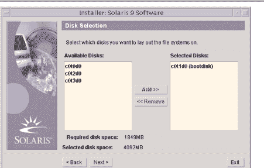

收集安装程序所需空间量信息后，将显示“布局文件系统”屏幕（如图 3.11 所示）。此屏幕向您展示系统软件的最小空间要求，并允许您创建和修改您的分区方案。

> **警告** 除非您单击“修改”按钮并设置所需的分区方案，否则您正在接受 Solaris 的默认分区。有关设置分区大小的建议，请参阅本章前面的“分区方案”。

按照以下步骤修改磁盘的分区方案：
- 1. 在“布局文件系统”屏幕中单击磁盘名称。
- 2. 单击“修改”按钮。
- 3. 在“磁盘分区”对话框中，输入希望创建的文件系统名称和分区大小，然后单击“确定”。


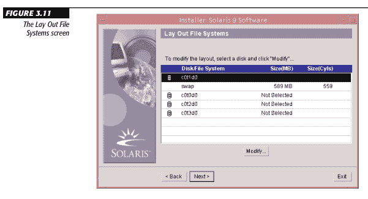

磁盘分区对话框显示了每个分区的最小尺寸，以及磁盘容量、已分配磁盘空间和可用磁盘空间。

1.  完成后，点击**“下一步”**按钮。

Solaris 显示确认屏幕，然后在软件从光盘复制到您的驱动器时显示**“正在安装”**屏幕。系统将提示您插入 Solaris 8 (SPARC) 软件第 2/2 张光盘，重启后，安装将继续。软件复制完成后，会显示安装摘要屏幕，指示已安装哪些软件。您可以点击**“详细信息”**按钮查看具体信息，或点击**“下一步”**按钮继续执行其余的安装例程。

> **注意** 您也可以从安装服务器或 JumpStart 服务器进行网络安装。系统软件映像通过网络传输到您的本地机器。此安装过程在“高级安装指南”中有介绍，该指南应随您的发行版提供。它还可在 Sun 的 `http://docs.sun.com/ab2col1.214.7/0AB2co11v/view?Ab2Lang=C&Ab2Enc=iso-8859-1` 上获取。

根据您指示要安装的组件不同，Solaris 安装程序将请求额外的 CD-ROM 光盘，例如文档 CD-ROM（用于 Solaris AnswerBook2）。随后，在安装的后期阶段，它将显示进度屏幕和完成屏幕，之后安装即告完成。

## Intel 安装

在大多数方面，Solaris 在 Intel 系统上的安装与在 SPARC 系统上的安装相同，这正是您刚才阅读的内容。本节强调其中的差异，并解释您需要如何处理这些平台特定的问题。Intel 安装的主要差异在于磁盘格式化和分区的方式、安装程序执行的硬件检测类型，以及驱动程序安装的处理方式。

在开始在 Intel 上安装 Solaris 之前，您应该准备好 Solaris 所需的分区。如果 Solaris 是 PC 上唯一的操作系统，您可以使用 Solaris 安装程序创建必要的分区。如果有另一个操作系统与 Solaris 8 共享此系统，请使用与该操作系统兼容的分区软件。对于 Windows，该软件是 Fdisk 或商业软件包 Partition Magic。Partition Magic 是一个值得拥有的软件包，因为它支持多操作系统启动，如 Linux、NetWare、OS/2 Warp 等。

Intel 安装通过向 PC 的 CD-ROM 驱动器插入 Solaris 8 CD-ROM 开始。某些系统要求在插入 CD-ROM 之前打开电脑电源，而另一些则不需要，因此您可能需要进行尝试。此外，许多基于 Intel 的 PC 无法从 CD-ROM 启动，需要您将 Solaris on Intel 安装启动软盘插入软盘驱动器并重启。您可能会发现系统的 BIOS 可以修改为从 CD-ROM 或软盘驱动器启动，因此您应该首先检查此设置是否存在。

系统重启后，Solaris 设备配置助手 (DCA) 启动，并向您提供以下服务：

- **硬件识别** 您可以使用 F2 键启动此检测序列。
- **诊断扫描故障** 您可以使用 F3 键启动诊断。
- **添加新驱动程序** 您可以使用 F4 键向系统添加新的硬件驱动程序。

DCA 的扫描部分返回例行程序在系统中找到的所有设备列表。您将看到类似以下内容：

```
以下设备已在此系统上识别出来。若要识别不在此列表上的设备或修改设备
特性，请选择“设备任务”。此列表中可能包含平台类型。
```

- ISA: 软盘控制器
- ISA: IDE 控制器
- ISA: 主板
- ISA: PS/2 鼠标
    - 这里列出的更多 --
- ISA: PnP bios: ECP 1.x 兼容并口
- ISA: 系统键盘 (美式英语)

按下 F4 键时，您将显示设备任务屏幕，该屏幕允许您查看和更改以下设备特性：

- 查看/编辑设备
- 设置键盘配置
- 保存配置
- 删除已保存的配置
- 设置控制台设备

默认设置通常最佳。当您在已识别设备屏幕中按下 F2 键时，Solaris 安装程序开始加载适合 DCA 发现的每个特定设备的设备驱动程序。安装驱动程序的过程可能需要几分钟，具体取决于系统的复杂度，但一旦驱动程序加载完成，您将看到 Solaris 安装程序已准备好的可启动 Solaris 8 操作系统的设备列表。通常，该列表包含以下格式的一个硬盘和一个 CD-ROM 驱动器：

```
[] 磁盘: 目标 0, (列出制造商和型号) 位于 ISA 总线上的 (列出位置)

[] CD : 目标 0, 列出制造商和型号) 位于 ISA 总线上的 (列出位置)
```

要设置启动设备，请执行以下操作：

1. 在启动 Solaris 屏幕上按 F4 键。
2. 在启动任务屏幕中，选择“查看/编辑自动启动设置”，并按 F2 键查看可以启动 Solaris 的任何设备。
3. 选择所需的启动设备，再次按 F2 键返回到“查看/编辑自动启动设置”屏幕。
4. 选择“设置自动启动 (开/关)”命令，按 F2 键，并选择“开”设置。
5. 按 F2 键返回到“查看/编辑自动启动设置”屏幕。
6. 选择“接受设置”并按 F2 键。
7. 返回到启动任务屏幕后，按 F3 键保存设置。您选择作为启动设备的设备应标记有星号，如下所示：

```
[] 磁盘: (*) 目标 0, (列出制造商和型号) 位于 ISA 总线上的 (列出位置)
```

在安装到此阶段时，您应该重启系统。您选择的启动设备将启动您的系统并引导安装过程。安装程序显示的屏幕以及在 Intel 上安装 Solaris 的步骤与本稍后章节中概述的 SPARC 安装步骤几乎相同。请参考这些说明以获取更多细节。

## StarOffice 安装

StarOffice 是 Sun 的免费办公套件。许多使用 Solaris 的人也在其系统上安装了此程序。StarOffice 5.2 随 Solaris 8 发行版发布。您还可以从 Sun 的网站 www.sun.com/software/star/staroffice/get/get.html 免费下载该软件。如果您从 Sun 购买新的工作站，您将发现 StarOffice 已预装。

请按以下步骤安装 StarOffice 5.2：

1. 将 StarOffice 5.2 CD-ROM 插入 CD-ROM 驱动器。
2. 打开 /cdrom/english/solaris/office52 并双击 setup 脚本文件。
3. StarOffice 安装程序启动并显示图 3.12 所示的欢迎屏幕。


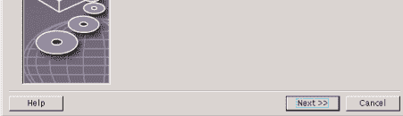

4. 点击**“下一步”**，接受许可协议，并填写注册屏幕。当下次点击**“下一步”**按钮时，您将看到图 3.13 所示的**“选择安装类型”**屏幕。

> **提示** 如果您需要安装所有过滤器，进行自定义安装可能比*默认*安装更合适。

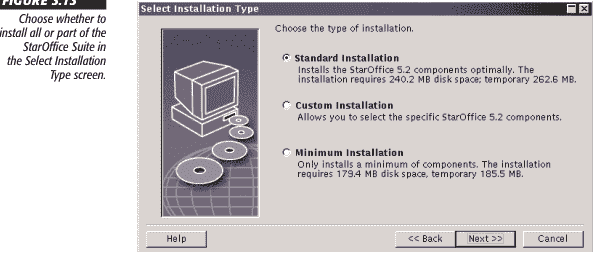

5. 点击**“下一步”**按钮，在**“选择安装目录”**屏幕中，接受默认目录（`/office52`）或输入其他目录。然后点击**“下一步”**按钮。如有必要，Solaris 会要求您创建该目录。
6. 在**“开始复制”**屏幕中，点击**“完成”**按钮以启动安装。
   安装程序将搜索 Java 运行时环境，如果找到，它将显示图 3.14 所示的**“Java 设置”**对话框。**“Java 设置”**对话框显示 StarOffice 安装程序找到的每个 Java 运行时环境。启用此选项允许您使用 StarOffice 组件浏览 Web。建议您启用此选项。
7. 点击**“确定”**按钮以启用 Java 支持并继续安装 StarOffice 套件。


安装程序会在主窗口中显示一些信息屏幕，并在左侧框架中显示一个带有进度条的时钟。当安装完成时，安装程序会弹出一个对话框，指示图标已添加到前面板中，如下图所示。最后，当您点击“确定”按钮时，将显示“安装完成”对话框。

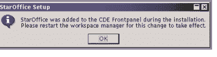

8. 点击“完成”按钮以结束安装。

完成 StarOffice 安装后，Adabas D 安装程序将启动。除非您在安装过程中更改其位置，否则该安装程序会在 `/adabas` 目录下安装 StarOffice Base（StarOffice 数据库程序）所需的组件。如果您不需要此功能，可以跳过安装的这一部分。

## 补丁程序

补丁程序是操作系统的软件升级。许多大型软件程序，如 StarOffice、Apache Web 服务器等，也可能发布相应的补丁程序。您可以将补丁程序视为软件的增量升级。事实上，Sun 公司有一套政策，每季度发布新版本的 Solaris 操作系统，因此该公司为旧版本提供补丁程序，从而消除对系统进行升级安装的必要。补丁程序也会针对硬件和软件发布，通常用于升级设备驱动程序。补丁程序可以修复错误，或者添加新功能，或者两者兼有。

您可以从 SunSolve 在线网站（www.sunSolve.sun.com）或通过 Sun 发行的分发 CD-ROM 获取补丁程序。在可能的情况下，特别是如果您拥有高速互联网连接，从 SunSolve 网站下载补丁程序是首选方法。如果您拥有 SunSolve 订阅或服务协议，您可能可以访问额外的补丁程序、补丁信息数据库、故障排除和问题解决数据库，以及其他资源，如白皮书和补丁发布通知邮件。

Sun 建议安装其为 Solaris 发布的所有补丁程序。这当然可以让您的系统保持最新状态，且不太可能给您带来严重麻烦，但仍有一些事项需要考虑。每个补丁程序略有不同，虽然每个补丁程序解决的问题远多于它带来的问题，但您可能会发现此前不存在的额外不兼容性。因此，许多公司要么仅安装必要的补丁程序，要么尽量避免在生产设备上安装补丁程序。

> 提示 在将补丁程序应用到生产系统之前，最好先在一个测试系统上安装它们。

您可以使用 `patchadd -p` 命令来确定系统中已应用了哪些补丁程序。一旦您下载了决定要安装的补丁程序，请使用 `patchadd` 命令将它们应用到您的系统。每个补丁程序都包含安装信息，描述该补丁程序应用的修复内容以及它添加的任何新功能。在安装补丁程序之前，您应该阅读补丁信息。如果可能，在广泛使用之前测试补丁程序也是一个不错的主意。

Sun 提供用于 Solaris 上运行的应用程序的补丁程序。然而，您从第三方来源获取的硬件或软件升级，可能使用也可能不使用补丁程序系统，且可能以也可能不以软件包形式提供。安装补丁程序或软件包应当是在考虑其来源和用途之后进行的。来自其他厂商的补丁程序可能会引入系统不稳定，甚至成为病毒来源。因此在使用它们时需要保持常识性的谨慎。

## 摘要

有多种不同的 Solaris 8 分发版本可供您用来在系统上安装 Solaris。Sun 网站提供免费软件下载、开发者分发版，以及非商业（家庭和教育）和商用版本。Sun 根据系统中的处理器数量对其商业分发版本进行定价，基础操作系统版本最多支持八颗 CPU。

在本章中，您了解了不同类型的 Solaris 安装：Web Start、交互式安装、网络安装和 JumpStart。本章中详细描述的安装类型是 Web Start 安装。对于其他类型的安装，您使用不同的初始设置例程，但在启动 Solaris 安装程序后，许多步骤是相同的。

在安装 Solaris 之前，您应该收集安装程序所需的重要网络信息。您还应该确定将采用的分区和文件系统方案。本章就人们使用不同分区和文件系统提供了具体建议。当您在另一个操作系统上对 Intel x86 系统创建分区时，必须使用不同的分区程序。

本章详细描述了在 SPARC 工作站上安装 Solaris 的过程。安装可能需要几个小时，并需要您输入必要的信息以在网络中识别系统，并提供对 DHCP 等网络服务以及 NIS、NIS+、DNS 等名称服务的访问。此外，本章还涵盖了 StarOffice 的安装。

随着时间推移，Sun 通过一系列您可以应用于 Solaris、硬件和应用程序的补丁程序来提供错误修复和升级。其他厂商也可能发布此类升级。您需要权衡保持系统最新和消除特定问题的好处，与引入不兼容性的风险，以决定是否应用这些补丁程序。

---


# 第 4 章

# 基本操作

**特色内容：**

- 启动选项 92
- 登录 102
- 通用桌面环境 105
- 终端和控制台窗口 107
- 退出 CDE 和 OpenWindows 117

本章介绍有关在 Solaris 8 上启动、操作和退出的一些基本信息。它涵盖了 Solaris 的 Intel 版本和可扩展处理器体系结构（SPARC）版本。我将涵盖与两个主要桌面环境——通用桌面环境（CDE）和 OpenWindows——以及命令行界面（CLI）相关的各种基本问题，包括计算机启动时屏幕上显示的内容以及您可以设置的选项。

在对 SPARC 硬件进行快速概览之后，您将学习登录操作系统的不同方式，例如图形用户界面登录（dtmanager）、X 终端和 X 终端仿真器程序，以及命令行登录。本章将介绍两个桌面的基本配置选项，例如打开终端和控制台窗口。您还将找到使用 Solaris 文件系统的介绍，以及如何正确退出系统并优雅地关机。有许多命令行实用程序可以帮助用户和系统管理员查找和操作文件和目录。本章简要介绍了这些实用程序，提供了基本参考。它们将在后续章节中更详细地介绍。

会话结束后，您必须从 CDE 和 OpenWindows 桌面执行退出命令以返回登录屏幕。然后用户可以启动另一个 CDE 或 OpenWindows 会话，进入命令行，或优雅地关闭服务器。如果桌面会话和操作系统没有优雅地关闭，文件系统和系统配置文件可能不一致，甚至可能损坏。本章也涵盖了使用 `shutdown` 命令等更强制方法关闭会话的情况。

## 启动

Intel 版本的 Solaris 运行在各种各样的系统上，从家用小型计算机到大型 Compaq 服务器。家用个人计算机（IBM PC 兼容）可以从不同的设备启动，例如软盘、CD-ROM（在新硬件上）以及主硬盘。您通常不需要更改 Intel 系统的 BIOS 以适应 Solaris 8 操作系统。当计算机启动时，通常有一个 BIOS 中断选项，如 F1 或 Ctrl+Alt+Esc，您可以使用它进入系统 BIOS。由于系统主板和 BIOS 芯片制造商众多，个人计算机上的 BIOS 差异很大。进入 BIOS 界面后，会有一个选项，您可以从菜单中选择启动设备。


## 第 4 章 • 基本操作

你可以选择在硬盘之前启动其他设备。唯一的限制是，你指定的任何设备在引导阶段都不能包含可引导数据。例如，假设你的 BIOS 有如下引导选项：

CDROM A: C:

系统会检查 CD-ROM 驱动器中是否有光盘。如果有，BIOS 会尝试读取该设备上的引导扇区。如果 BIOS 找不到引导扇区，它会显示错误消息“CDROM 驱动器中设备不可引导，请按任意键继续”。此消息可能因主板上安装的 BIOS 芯片及其固件版本而异。对于软盘，也会发生完全相同的过程。

高端基于 Intel 的服务器通常具有一些特殊 BIOS 功能，类似于你在桌面 PC 上看到的。这些服务器的配置超出了本书的范围。请查阅你的用户手册或系统管理员手册，了解系统启动所需的步骤。

> **警告** 某些高端服务器，如 Compaq 的 *Storage Array* 服务器，在第一个扇区上有特殊实用程序。请勿删除此分区。此分区包含用于诊断和更改硬件设置的引导 (F10) 实用程序。

在 SPARC 硬件平台上，有一些基本的 OK PROM（可编程只读存储器）选项，必须在系统上设置，以便在服务器通电时操作系统能够自动启动。这些选项指定默认引导设备，并确定服务器在通电时是否应自动引导。

### 控制台端口和 OK 提示符

几乎所有 Sun 服务器和桌面机都有一个硬件直接接口，称为控制台端口。*控制台端口* 通常是一个标准串行端口（DB-25 母连接器）或 RJ-45 连接器。该端口使系统管理员能够直接访问系统板上的芯片和一些硬件连接的设备。只要系统通电，控制台端口就处于活动状态。它不依赖操作系统。即使是在没有安装硬盘的服务器或工作站上，你也可以访问控制台端口。

若要使用控制台端口，你需要购买一条直通电缆（null modem cable）。直通电缆的设计目的是通过 2 号和 3 号线交叉连接 9 针和 25 针 COM 端口。最好从大多数主要电子产品商店或计算机商店购买直通电缆，而不是自行组装，因为接线不当的调制解调器电缆可能会损坏你的计算机。首次安装 Sun 服务器时，你可能希望将笔记本电脑连接到服务器，方法是将直通电缆连接到笔记本电脑后部的 9 针 COM1 端口和 Sun 服务器的控制台端口。如果控制台端口是 RJ-45 连接器，如某些 Netra 服务器上的那样，则需要从 Sun 购买特殊电缆。

**提示** 一旦在标准 PC COM 端口和 Sun 服务器或桌面机的控制台端口之间连接了直通电缆，你可以使用 Microsoft Windows 操作系统（Windows 9x、ME、NT 或 2000 都包含 HyperTerminal）附带的 HyperTerminal 软件来访问 OK 提示符。你需要配置 HyperTerminal 以匹配你的服务器或桌面机的要求。

**提示** 作为一般经验法则，将 HyperTerminal 设置为 VT100 终端，具有以下设置：9600 波特率，无校验，8 个数据位，1 个停止位，硬件流控制，500 行回卷。你可以使用文件菜单上的“属性”命令打开属性对话框来设置这些选项。

将直通电缆连接到笔记本电脑的 COM 端口和服务器或桌面机的控制台端口后，你应该启动 HyperTerminal 并给 Sun Solaris 计算机通电。OK 提示符会在 HyperTerminal 屏幕中出现。那么这个 OK 提示符是什么？如果你曾观察过基于 Intel 的计算机启动，你会注意到有一个短暂的时刻，你可以按 F1（或其他键组合），然后就可以对系统的 BIOS 进行更改。Sun 服务器和桌面机具有相当于 PC BIOS 的东西。它被称为 PROM（可编程只读存储器）。它通常被称为 OK 提示符。

控制台端口有两个用途。在操作系统运行之前，控制台端口显示 OK 提示符。OK 提示符界面直接烧录在主板的编程逻辑中，即使没有安装硬盘或操作系统也能运行。此界面使系统管理员能够直接访问主要系统板芯片。在操作系统启动后，控制台端口用于控制台会话。

这里有一个理解此概念的简单方法：

- 控制台端口是到主要系统板的硬件接口。
- OK 提示符是在操作系统启动前与系统板的通信。
- 控制台会话是在操作系统启动后与操作系统的通信。

OK 提示符基于 Forth 编程语言，并且如前所述，直接烧录在系统板芯片之一中。在操作系统启动后，控制台端口可用于控制台会话或终端会话。终端会话指的是你可以将终端服务器连接到控制台端口。

> 终端服务器基本上是一种使网络与控制台端口之间建立连接的设备。该设备的一端是标准以太网端口。另一端是直接连接到 Sun 服务器控制台端口后端的电缆。如果服务器因某种原因宕机，终端服务器提供通过直接网络连接访问控制台端口从而访问服务器系统板的能力。如果服务器在本地，你可能不需要终端服务器，但如果服务器位于远程位置或另一个州，拥有一个到机箱背面的直接连接将极其方便。

控制台会话就像 Telnet 会话一样工作。它是直接到操作系统的命令行界面。无法通过控制台端口运行 GUI 应用程序。

### 引导选项

若要在通电时自动引导 Sun 服务器或工作站，必须将 OK 提示符值 auto-boot? 设置为 TRUE。要查看当前的 OK 提示符值，请输入以下命令：

```
printenv
```

结果应类似于图 4.1。实际输出因服务器类型和系统板上芯片的固件版本而异。

指定引导所需的最后一项信息是实际的引导设备本身。必须指定 OK 提示符变量 <boot-device>。此变量默认设置为硬件设备别名 disk 和 net。大多数时候，别名 disk 指的是第一个引导设备 c0d0。设备别名 net 指示 Solaris 将从网络卡引导。如果指定的第一个引导设备是 disk 且该设备不可用，可以尝试第二个设备（取决于其他 OK 提示符值，如 watchdog-reset）。在安装 Solaris 8 期间，安装程序会提示你更改引导设备以匹配安装选项。此安装选项是在安装期间手动更改 <boot-device> 变量。第 3 章“入门”更详细地介绍了安装和故障排除安装问题。

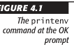

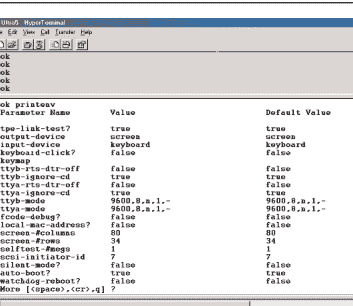

安装 Solaris 8 后，你可能需要更改引导设备。例如，Sunstation 5 工作站默认引导到设备 c0t3，但如果工作站中安装了第二个硬盘，也可以设置为引导到 c0t0。

boot 命令具有几个引导选项：

- **boot -s** 命令 boot -s 使服务器或桌面机以单用户模式启动。单用户模式允许系统管理员进入运行级别 1（默认运行级别是 3）。
- **boot cdrom -s** 最有用的命令之一是 boot cdrom -s，在 OK 提示符处输入，并在 CD-ROM 驱动器中放入可引导的 Solaris 磁盘。此命令从内存运行的操作系统启动，从中你可以挂载硬盘并执行系统管理。
- **boot -a** 命令 boot -a 使操作系统以交互模式启动。这会向系统管理员提出关于引导过程的几个问题。
- **boot -r** 命令 boot -r 检查新设备并重建 /dev 和 /devices 目录。
- **boot -d** 命令 boot -d 运行一系列非常广泛的诊断测试。此主题在第 21 章“故障排除”中介绍。


要启动操作系统，只需键入以下命令：

```
boot disk
```

如果 `<boot-device>` 别名设置正确，你只需键入以下内容：

```
boot
```

## 停止或冻结操作系统

对于 SPARC 系统，当操作系统运行时，用户可以在 Sun 键盘上同时按下 Stop 和 A 键，以中断操作系统并直接进入 OK 提示符。如果用户使用 Intel 键盘或从终端操作，Ctrl+Pause 或 Ctrl+Break 键组合通常可以向服务器发送相同的信号。无论以哪种方式从操作系统调用 OK 提示符，都会导致操作系统实质性地“冻结”。可以在 OK 提示符处进行修改（在某些非常有限的情况下），然后用户可以在提示符处键入 `go` 以返回操作系统。

> **警告** 在 production 级别和关键任务服务器上，Stop+A 键组合被认为非常危险，因为操作系统可能无法再次正常启动。当操作系统冻结时，带时间戳的关键数据库和其他正在运行的程序可能会变得混乱并崩溃。

Solaris 8 的 Intel 版本没有适用于桌面或家用 PC 的 Stop+A 或 Ctrl+Break 选项。这些机器上的 BIOS 也并未设置为从 eeprom 接收命令。

## 运行级别

Solaris 8 有八种不同的运行级别。每个运行级别赋予用户访问特定资源和访问级别的权限。根据当前运行级别，服务器资源基本上会被开启或关闭。例如，如果系统是多用户状态，某些网络服务可能会被关闭；如果系统是单用户状态，则不同的网络服务会被关闭。操作系统一次只能在一个运行级别上运行；不可能同时在级别 0 和级别 3 上运行。表 4.1 简要介绍了 Solaris 的运行级别。

### 表 4.1：SOLARIS 的运行级别

| 运行级别 | 描述 |
| :--- | :--- |
| 0 | 关机状态。这将操作系统从任何运行级别带到 OK 提示符。在基于 Intel 架构的机器上，在此运行级别下关闭机器是安全的。 |
| S 或 s | 单用户状态。这是只有 root 用户可以访问服务器的状态。此状态通常在需要维护时使用。 |
| 1 | 管理状态。这与运行级别 S 非常相似，不同之处在于挂载的文件系统只有根（/）和 /usr 文件系统。如果 /usr 不是单独的文件系统，它仍然可访问。 |
| 2 | 多用户状态。在此状态下，多个用户可以 telnet 或在服务器上拥有其他类型的会话。文件服务和打印服务等资源未被导出。 |
| 3 | 带有导出资源的多用户状态。在此状态下，可以导出文件和打印资源（前提 root 用户希望导出这些资源）。多个用户可以同时访问系统。 |
| 4 | 未定义。 |
| 5 | 关机状态。有些工作站支持这种操作模式。大多数系统管理员在生产级服务器上不使用或不喜欢此设置。 |
| 6 | 重启。这将使服务器从当前运行级别循环到运行级别 0，然后返回到默认运行级别（运行级别 3）。 |

## 控制脚本

对于每个运行级别，都有一系列执行运行级别控制脚本。这些脚本在 init 进程读取 /etc/inittab 文件后被调用。它们负责一些基本的“清理”任务，例如启动 FTP 服务、启动 DNS 服务以及其他任务。

以下子目录包含运行级别控制脚本：

- `/etc/rc0.d`
- `/etc/rc1.d`
- `/etc/rc2.d`
- `/etc/rc3.d`
- `/etc/rc5.d`

这些每个子目录都包含一系列 shell 脚本，它们遵循以下命名约定：[K, S] [0-9] [0-9] [ASCII 名称]。脚本名称可以以 K 或 S 开头。接下来的两个字符是数字 0 到 9，最后跟随一个 ASCII 名称。例如，在 /etc/rc2.d 目录中，你可能会在 Sun Ultra 5 工作站上找到图 4.2 中显示的文件。

### 图 4.2

/etc/rc2.d 目录，包含与运行级别 2 相关的脚本

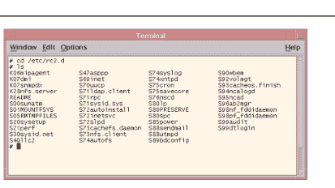

运行级别子目录中的这些脚本都是 Bourne shell 脚本。rc?.d 目录中几乎所有的脚本都是 /etc/init.d 的硬链接，但也有一些例外，以及从 rc?.d 目录中的脚本到 /etc/init.d 目录中的脚本的一些软链接。你可以编辑它们，创建额外的脚本，或禁用它们，以完全定制你的服务器或工作站。还有一些脚本是符号链接回 /etc/init.d 目录。为了更熟悉脚本，请仔细查看其中一个启动脚本 S89bdconfig，它是文件 /etc/init.d/buttons_n_dials-setup 的软链接。正如你可以在图 4.3 中看到的那样，此脚本只包含一行功能代码（除了注释之外）。请注意，如果你更改这些脚本，在大多数情况下，除非你首先将文件保存为备份副本（这是一个好主意），否则你无法恢复到原始脚本。

任何以 # 符号开头的行都只是一个注释，# 后面的任何文本都被完全忽略。此脚本中唯一的功能行是 /usr/sbin/bdconfig 带有参数 startup。Sun Microsystems 工程师决定将一行 /usr/sbin/bdconfig status 作为注释行添加进去。如果 bdconfig 的操作对你的服务器特别重要，你可以取消注释该行，以便在 bdconfig 运行时输出详细信息。

## 终止脚本

以字母 K 开头的脚本用于终止进程。所有的 K 脚本首先运行，并且它们根据脚本名称中 K 后面的数字按顺序执行。例如，以下脚本（仅为示例）将按照此顺序运行：

- K01cde
- K21netproc
- K35bpsdaff

K01cde 脚本将首先执行，因为数字 01 直接跟在字母 K 后面。K21netproc 脚本将接下来执行，因为 21 在数字顺序上跟随 01。K35bpsdaff 脚本将最后执行，因为 35 的数字顺序。在同一目录中可能存在两个脚本 K01cde 和 K01zzz。首先运行的脚本将是 K01cde，其次是 K01zzz。cde 脚本将首先运行，因为 cde 中的 c 在 zzz 中的 z 之前。

在所有 K 运行控制脚本运行完毕后，所有 S 运行控制脚本执行。这些脚本的执行也遵循相同的数字顺序规则。

> **提示** 禁用脚本的一种简单方法是将字母 *K* 或 *S* 更改为 *disabledk* 或 *disableds*。脚本 S72mscdf 将执行，但脚本 disabledS72mscdf 不会执行。任何不以 *K* 或 *S* 开头的脚本都只是被忽略，没有任何负面后果。

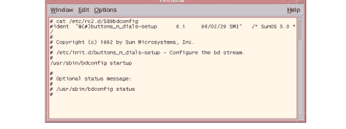

## Init 进程

除了执行运行控制脚本外，`init` 进程在启动过程中还会检查 `/etc/inittab` 文件。`initab` 文件中的每个条目具有以下格式：

```
id:runlevel:action:process
```

`/etc/inittab` 文件中有一行特殊行，它告诉系统应该以哪个默认运行级别启动。该行类似于以下内容：

```
is:3:initdefault:
```

它可用于告诉 Solaris 启动到不同于 3 的运行级别。例如，如果你想确保系统在导出任何文件系统之前启动，就可以使用 2。`init` 进程在达到指定运行级别时启动其他进程。要确定当前运行级别，请在命令提示符下键入以下命令：

```
who -r
```

以下是此命令的典型输出：

```
run-level 3 Feb 6 15:25:3 0 0 5
```

## 关机命令

要从控制台端口优雅地关闭服务器，可以键入几条命令。此命令将使服务器返回到 OK 提示符：

```
init 0
```

关闭服务器的另一种方法是使用以下命令：

```
shutdown -y -g60 -i0 'server is coming down'
```

此命令将向所有用户发送消息 `Server is coming down`，并指定在关机过程开始之前有 60 秒（`g60`）的延迟。当服务器处于 OK 提示符时，关闭电源是安全的。不会发生文件系统或配置文件损坏。

> **警告** 如果服务器不处于运行级别 0（OK 提示符），切勿关闭电源。如果服务器“崩溃”或突然断电，文件系统可能会严重损坏并需要修复。此外，配置文件也可能包含错误。如果文件系统损坏得无法修复或配置文件严重损坏，服务器磁带恢复或服务器部分重建可能是你唯一的选择。


## 图形用户界面登录屏幕

控制台端口是系统管理员获取服务器硬件和操作系统访问权限的有用工具。控制台端口的唯一问题是每次只允许一个用户使用。为了拥有一个真正的多用户系统，用户需要通过 Telnet 会话、终端或其他多用户连接方式访问服务器。

> **提示** Solaris 8 中的一项安全功能可以防止 root 用户通过 Telnet 登录到服务器。root 用户需要拥有直接的控制台访问权限，或者直接通过监视器/键盘/鼠标访问系统才能使用该系统。这使得黑客通过网络攻击系统变得更加困难，因为它拒绝了他们通过 Telnet 连接以 root 身份登录并使用超级用户权限操作系统的机会。虽然可以禁用此安全功能，但不建议这样做。您可以以普通用户身份登录，然后使用 su 命令获取 root 访问权限。

如果您想远程登录，需要使用像 Telnet 这样的工具。要创建 Telnet 会话，您需要创建一个通用用户账户。请在控制台端口处输入以下命令，并授予 root 权限：

```
useradd -m -d /usr/user12 user12
```

这会创建一个名为 user12 的用户，其主目录为 /usr/user12。要设置用户的密码，请输入以下命令：

```
passwd user12
New password :
Re-enter new password:
(Selected CodeList)
```

选择一个您容易记住的密码。如果因某种原因您忘记了用户的密码，只需重新输入命令 `passwd user12`。这将为 user12 重置一个新密码。出于安全原因，只有 root 用户可以重置密码。没有任何文件或其他位置可以让您查看用户的密码。如果忘记密码，唯一可用的选项是创建一个新的。这样做的原因是安全。您不希望给黑客读取密码文件的机会。

> **警告** 如果您单独输入命令 `passwd`，将会更改 root 用户的密码。

既然已经创建了一个通用用户账户，就可以进行 Telnet 会话了。要执行 Telnet 会话，您需要另一个具有 Telnet 窗口可用的操作系统。所有标准的 Unix 操作系统都具有 Telnet 窗口，而 Microsoft Windows 9x、ME、NT 和 2000 都附带了 Telnet 窗口。要启动 Telnet 会话，请键入以下其中一个命令，其中 136.14.32.18 是一个 IP 地址，goose 是托管 Telnet 会话的机器的可识别主机名：

```
telnet 136.14.32.18
telnet goose
```

在 Microsoft Windows 9x 系列中，会弹出一个 Telnet 窗口，然后您可以开始 Telnet 会话。Telnet 屏幕只是基于文本的操作系统界面。无法通过 Telnet 会话“看到”图形。

要通过 Microsoft Windows “看到”图形用户界面 (GUI)，您需要一个 X Windows 终端仿真器。Hummingbird Ltd. (www.hummingbird.com) 生产的 Exceed 软件提供了高质量的 X 终端仿真器。它允许您在 Microsoft Windows 环境中访问基于 Unix 的应用程序（X 客户端）。Linux 也内置了 X 终端仿真器，可将图形用户界面应用程序带到您的桌面上。

### dTlogin 图形用户界面

Solaris 操作系统有一个名为 dTlogin 的图形用户界面登录管理器。（dTlogin 的详细信息在第 7 章“Solaris 桌面”中介绍。）当您登录到 Solaris 服务器时，无论是通过 X 终端仿真器还是直接连接到工作站本身的屏幕和键盘，您都会看到图 4.4 中所示的屏幕。

该屏幕是 dTlogin 管理器的图形用户界面。它包含一个文本字段，您可以在其中输入用户名和密码。屏幕底部有四个按钮：

- **确定**：其作用与按下 Enter 键相同。
- **重新开始**：重置 dTlogin 管理器并重启会话。
- **选项**：打开一个带有四个选项的下拉菜单：
  - 更改会话使用的语言（例如英语、法语、德语等）。
  - 选择如何启动会话。选项包括 CDE 桌面环境、OpenWindows 桌面环境、用户上次使用的桌面或故障恢复会话。CDE 桌面和 OpenWindows 桌面都是图形用户界面。通常选择“用户上次使用的桌面”选项。如果您在登录时遇到问题，故障恢复会话选项允许您使用极简的桌面环境（有限的驱动程序支持）登录，以便修复登录过程中出现的任何问题。
  - 启动文本会话（命令行登录）。
  - 退出程序（返回到本地主机）。
- **帮助**：提供有关图形用户界面登录使用的进一步建议。


用户第一次登录桌面时，会被提供选择 CDE 桌面或 OpenWindows 桌面的选项。dTlogin 管理器只在第一次询问此选择。任何后续登录都会将用户带到他们上次登录会话中使用的桌面。如果您选择 CDE，您将看到类似于图 4.5 中的屏幕。


> **注意** Sun 计划从 Solaris 发行版中移除 OpenWindows，因此您最好将时间花在学习和熟悉 CDE 上。

### 自定义 CDE 桌面

Sun Solaris 8 默认带有两个桌面环境：通用桌面环境（CDE）和 OpenWindows 桌面。CDE 桌面有两个主要功能：前面板和工作区菜单。

前面板如图 4.5 所示，位于 CDE 桌面底部。前面板有几个抽屉，每个抽屉正面都有醒目的图标。您可以选择图标（如 dtmail、邮件、互联网浏览器、日历等），或通过点击抽屉上方的小箭头选择子面板图标。此外，还有四个标有 One、Two、Three 和 Four 的桌面按钮。这些按钮允许您在四个不同的桌面之间切换。正如您将在第 7 章中看到的那样，桌面按钮功能是自定义的，您可以按需添加或移除按钮或重命名它们。

除了前面板之外，还有一个工作区菜单。当您在未占用的桌面环境中任何位置右键单击（按钮 3）时，它会弹出。前面板还具有 Exit（退出）按钮。

OpenWindows，另一个随 Sun Solaris 提供的桌面，不具备前面板。它仅包含工作区菜单和一些杂项图标（如回收站）。工作区菜单在您右键单击未占用的桌面空间时弹出。（第 7 章将更详细地介绍 CDE 和 OpenWindows。）

当您第一次登录 CDE 时，一系列窗口会自动打开：Solaris 用户注册窗口、文件管理器窗口（*hostname: username*）和帮助查看器（显示“介绍桌面”主题）。

> **提示** 不断出现的一个默认应用程序是用户注册包。窗口底部有两个按钮：注册和更多信息。您可以选择注册软件或选择更多信息。如果您选择更多信息，会显示一个新页面，底部有三个新按钮。您可以选择永不注册。作为系统管理员，您可以在系统安装期间自定义软件安装。您可以选择不选择的软件包之一是用户注册包。如果工作站或服务器在企业环境中正确购买，这是一个合适的选择。

当您退出 CDE 后，只有在您离开时选择保留打开的窗口（除了 Solaris 用户注册窗口）会在您再次打开 CDE 桌面时重新出现。CDE 桌面“记住”您上次的桌面并保存配置。您可以在此方面更改 CDE 的行为。

第 7 章详细讨论了如何操作窗口。但您应该知道，在窗口边框的左上角有一个带有减号（-）的小按钮。这被称为窗口菜单按钮。如果左键单击它，将显示一个名为窗口菜单的弹出菜单。在这里，您可以选择各种选项来操作窗口，如最大化、最小化、关闭等。

您可以使用应用程序管理器来自定义 CDE。通过单击前面板上的应用程序抽屉并选择应用程序命令来打开应用程序管理器。在应用程序管理器窗口（如图 4.6 所示）中，有打开可用于自定义桌面的应用程序的图标。这些应用程序与会话管理器交互。（会话管理器在第 7 章中更详细地介绍。基本上，它负责启动桌面并在您退出时保存桌面状态。）

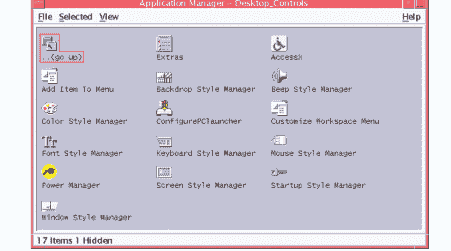

### 自定义 OpenWindows

要自定义 OpenWindows 环境，请在未占用的桌面空间任何位置右键单击（按钮 3）以访问工作区菜单。工作区菜单底部有一个名为“属性”的项。菜单选择提供以下选项：

- **颜色**：更改前景色、背景色等。
- **键盘**：打开/关闭键盘点击声、字符重复以及模拟鼠标的键盘击键。


## 字体
更改默认系统字体的大小和类型。

## 鼠标
选择鼠标设置，例如速度、右手或左手、点击速度等。

## 菜单
更改菜单对鼠标移动和点击的响应方式。

## 程序菜单
添加、删除和重新排列菜单项。

## 其他
更改其他设置，包括屏幕保护程序、蜂鸣警报、设置活动窗口（选择模式、点击或通过鼠标光标位置选择），以及图标和滚动条（选择放置图标和滚动条的位置）。

## 区域设置
选择您的本地语言。

## 终端和控制台窗口

在 CDE 和 OpenWindows 环境中，可以打开不同的 shell 解释器。shell 解释器有一个基本功能：为桌面或终端用户提供一个 shell（sh、ksh、csh）的文本接口。打开的窗口与 Microsoft Windows 中的 MS-DOS 提示符有些相似。

CDE 有两个 shell 解释器：控制台窗口和终端窗口。两者都是非常基本的文本窗格，向用户显示默认的 shell 和 shell 提示符。这两个窗口的主要区别在于，终端窗口不显示系统和错误消息，而控制台窗口则显示。在使用控制台打开应用程序的情况下，最后打开的控制台窗口将显示最新的系统和错误消息。控制台窗口会显示诸如 Sendmail、无法解析域名等消息，这些消息可以通过按键或通过菜单选择轻松清除。这些消息不会影响当前窗口中显示的文本，但它们有时是重复且烦人的！当你使用 vi 编辑器时尤其如此（这是第 16 章“使用 vi 和文本编辑器”的主题）。

OpenWindows 有三个不同的 shell 解释器：Command 工具、Shell 工具和控制台窗口。OpenWindows 环境中没有终端窗口；Command 工具和 Shell 工具取代了终端窗口的功能。所有这些应用程序都是解释输入命令的 shell 工具，但具有略微不同的菜单和特性。

三个 OpenWindows 工具具有以下用途：

### Command 工具
OpenWindows Command 工具内置编辑器。对于不熟悉或不习惯使用 vi 编辑器的用户来说，Command 工具窗口是最好的选择。Command 工具允许用户像使用标准文本编辑器一样编辑命令行。你可以将鼠标指针单击在文本上，然后使用退格键或 Delete 键。

### Shell 工具
OpenWindows Shell 工具与 Command 工具相似，除了它没有内置文本编辑器。此外，它默认没有滚动窗口，但如有需要可以启用此功能。

### 控制台窗口
OpenWindows 控制台窗口显示系统和错误消息。Command 工具和 Shell 工具没有此功能。就像 Shell 工具一样，控制台窗口中没有内置文本编辑器。用户需要使用 vi 或其他命令行编辑器来编辑控制台窗口中的文本。

## 在 CDE 中打开终端窗口或控制台窗口

要在 CDE 中打开终端窗口，请在未占用的桌面区域内的任意位置右键单击以显示“工作区”菜单。然后，从“工具”菜单中选择“终端”命令。终端窗口为您提供直接访问操作系统的文本接口。下图显示了“工作区”菜单和“工具”子菜单。

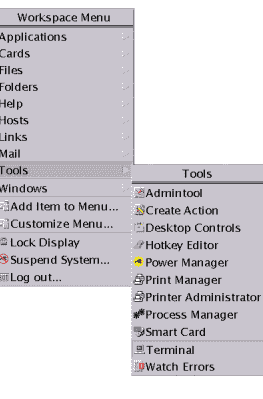

您还可以在应用程序管理器的各个子菜单周围找到终端窗口图标。只需双击（左键，即鼠标按钮 1）终端窗口图标即可打开终端窗口。

> **注意** Solaris 使用三键鼠标。当你左击时，使用的是鼠标按钮 1；当你右击时，使用的是鼠标按钮 3。中间按钮，即鼠标按钮 2，用于复制和编辑功能。

控制台窗口隐藏在 CDE 的深处。在前面板显示中，有一个标记为 CPU Disk 的图标，在其上方打开的 Hosts 子面板包含一个作为菜单选项的 Console 图标。要到达此图标，请单击 CPU Disk 标签上方的小箭头。这样做时，会出现一个标记为 Hosts 的弹出菜单。Console 图标是选项之一。单击（按钮 1）此图标以打开控制台窗口。下图显示了此弹出菜单，它也是一个可撕菜单。*可撕菜单* 是一种方便的接口设备，允许你从窗口或面板中点击并拖动菜单。该菜单随后成为桌面上自己的浮动窗口。

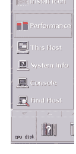

## 在 OpenWindows 中打开 Command 工具或 Shell 工具

要在 OpenWindows 中打开 Command 工具，请按照以下步骤操作：

- 在未占用的桌面空间的任意位置右键单击。将显示 OpenWindows“工作区”菜单。
- 选择“程序”，然后选择“Command 工具”命令。

以下是打开 Shell 工具的方法：

- 右键单击桌面以打开“工作区”菜单。
- 选择“程序”，然后选择“Shell 工具”命令。控制台窗口将出现在桌面上。

## 基本的命令行文件和目录操作

接下来的章节介绍了使用命令行进行文件和目录操作的基础知识，包括如何创建简单的文本文件和目录。你还将学习如何移动文件和目录以及查看文件权限。表 4.2 简要描述了你从命令行工作所需学习的最重要命令。（这些命令将在本书的其他地方更详细地描述。）

**表 4.2：基本命令行命令**

| 命令 | 用途 |
|---|---|
| awk | 高级模式扫描和处理语言。 |
| cat | 查看文件。 |
| chgrp | 更改文件的组所有者。 |
| chmod | 更改文件的读、写、执行权限。 |
| chown | 更改文件的所有者。 |
| comm | 比较两个已排序的文件。 |
| cp | 复制文件或目录。 |
| diff | 比较两个文件。 |
| file | 描述文件。 |
| find | 查找文件、目录、设备或行。充当文件系统搜索工具。 |
| grep | 在文件中查找文本字符串。 |
| head | 查看文件的顶部 10 行或更多行。 |
| ln | 创建指向文件和目录的链接。 |
| lp | 将文本文件打印到打印机。 |
| ls | 查看文件和目录。 |
| mkdir | 创建目录。 |
| more | 每次显示一屏文本文件。 |
| mv | 移动文件和目录，更改文件名称。 |
| od | 显示文本和二进制文件的内容，包括隐藏字符。 |
| pg | 每次显示一屏文件。 |
| pwd | 显示当前工作目录。 |
| rm | 删除文件和目录。 |
| rmdir | 删除目录。 |
| sed | 高级简化批量编辑器。 |
| sort | 按字母或数字顺序对文件中的文本进行排序。 |
| spell | 检查文本文件中的拼写。 |
| stty | 设置终端设置。 |
| tail | 查看文件的底部 10 行（或更多行）。 |
| tee | 将标准输入复制到标准输出以及你指定的一个或多个文件。 |
| touch | 创建或修改文件的访问日期和时间。 |
| uniq | 显示文本文件并删除重复的文本行。 |
| vi | 文本编辑器。 |
| wc | 汇总文件中单词、行和字符的总数。 |

## find 命令

使用 find 命令，你可以搜索目录树中以匹配各种搜索标准的文件，例如修改日期、文件名等。如果找到匹配项，find 命令可以报告文件的位置或触发命令的执行。此实用程序可以集成到 shell 脚本中，也可以在命令行中与其他实用程序结合使用。find 命令有三个基本部分：

- 路径描述搜索的起始位置。除非指定路径，否则搜索从根（ / ）开始，这是目录树的起点。路径的一个示例是 /usr，如果你指定该目录，你只在该目录及其子目录中搜索匹配项。你可以使用一个或多个路径（也称为路径名）进行搜索。
- 表达式描述搜索什么。
- 命令描述找到匹配项时执行的操作。

find 命令具有如下语法：

`find <pathname> <expression> <execute command>`

path 参数是始终必需的。这是搜索的起点。如果用户知道文件在 /etc 目录中，搜索整个

该文件的目录树。如果您位于想要开始搜索的目录中，可以使用点 (.) 作为路径。该点代表当前工作目录。

> **警告** 在拥有极大分区（2 到 4 兆）的大型企业服务器上，使用 find 命令可能会导致磁盘性能问题。此外，尽量避免在数据库或其他潜在敏感文件上使用 find 命令。尽量避免在通过 NFS 挂载的分区上使用 find；尝试本地登录到该系统来运行 find，因为这样使用的系统资源更少且速度更快。

对于 `<expression>` 参数，您可以使用以下任意搜索字符串表达式（所有这些表达式都需要以连字符或 `-` 字符开头）：

- `ctime n` 根据文件最后被访问的时间进行搜索。
- `depth` 与 prune 相反，搜索到特定的深度。如果命令行上同时存在深度表达式和 prune 表达式，深度表达式会抵消 prune 表达式。
- `follow` 跟随符号链接以打开原始文件。此选项会跟踪无限循环符号目录。
- `fstype` 在特定类型的文件系统（UFS、NFS 等）上搜索文件。
- `inum n` 搜索具有 inode 号 n 的文件。
- `links n` 搜索有 n 个链接指向它的文件。
- `mount <mount point>` 仅搜索指定的挂载点。
- `mtime n` 根据文件最后被修改的时间进行搜索。
- `n = days old` 搜索特定天数之前的文件。可以是 n（正好 n 天前）、+n（多于 n 天前）或 −n（少于 n 天前）。
- `name` 搜索匹配特定名称的文件。
- `newer` 搜索在特定日期之前被修改的文件。
- `nogroup` 搜索其组所有者不在 /etc/group 文件或 NIS 或 NIS+ 数据库中的文件。
- `nouser` 搜索其用户不在 /etc/passwd 文件或 NIS/NIS+ 数据库中的文件。
- `type c` 搜索指定类型 c 的文件。（见表 4.3。）
- `user` 搜索其用户在 /etc/passwd 文件或 NIS/NIS+ 数据库中的文件。

> **注意** 当一个符号链接指向其上级目录之一时，就会存在无限循环符号目录。在示例 `ln -s /usr/home/me /usr/home` 中，me 目录指向 /usr/home。当您对无限循环运行 find 时，它可能会查看 /usr/home/me（例如），并发现它是 /usr/home 的符号链接。然后它会查看 /usr/home，发现 me 目录并试图再次查看它。这个循环会使 find 看起来像是挂起了，并且必须被终止。

表 4.3 显示了可以替换搜索字符串表达式 type c 中 c 的值。

**表 4.3：TYPE 参数**

| c | 值 | 文件类型 |
|---|---|---|
| b | 块特殊文件 | |
| c | 字符特殊文件 | |
| d | 目录 | |
| D | 门 (Door) | |
| f | 普通文件 | |
| l | 符号链接 | |
| p | FIFO 命名管道 | |
| s | 套接字 | |

find 命令中的 `<execute *command*>` 部分用于在文件匹配先前列出的搜索字符串表达式中指定的条件时执行命令。您可以执行的各个命令包括以下命令（再次说明，需以连字符开头）：

- `exec <command> { } \;` 运行命令。
- `cpio <*device*name>` 可执行命令。意味着如果文件匹配搜索条件，则将以复制进/出 (cpio) 格式将当前文件写入指定的设备。
- `print` 打印当前路径。如果不指定其他内容，这是默认的execution。
- `ls` 打印当前路径以及使用 `ls -l` 命令找到的所有文件信息。
- `ok` 使用 OK 命令在执行命令之前提示用户输入 y 响应。

此外，您可以对上述标准进行复杂表达式操作，如下所示：

- `(**expression)**` 当整个表达式为真时，运行 find 命令。
- `! expression` 当表达式为假时，运行 find 命令。
- `expression -a expression` 当逻辑与操作为真时，运行 find 命令。
- `expression -o expression` 当逻辑或操作为真时，运行 find 命令。

## 查找基本系统信息

系统管理员的一项常见任务是记录服务器的当前配置。如果系统崩溃或服务器需要日常维护，一套良好的文档会有所帮助。假设一名初级系统管理员意外删除了 `/etc/hosts` 文件并损坏了网络接口。如果你的备份方案是网络备份怎么办？有时，拥有系统信息对于恢复服务器的良好状态至关重要。有许多命令行实用程序可以帮助这一过程。

一个重要的工具是 uname 命令。uname 命令旨在提供多种系统信息，并且可以与以下任一参数一起使用：

- `-a option` 打印有关系统的所有信息。
- `-i option` 显示平台硬件。
- `-p option` 打印节点名称。
- `-s option` 打印操作系统名称。
- `-v option` 打印操作系统版本。
- `-x option` 每行一个元素地打印所有系统信息。

其他六个命令在确定系统配置方面特别有用：hostid、env、release、ifconfig、arp 和 prtconf。它们具有以下用途：

- `hostid` 打印系统的字母数字标识符。这通常与软件许可证一起使用。
- `env` 打印环境变量，如 SHELL、TERM、TZ 等。
- `cat /etc/release` cat 命令应用于 release 文件时，会打印有关当前操作系统版本的非常详细的信息。
- `ifconfig -a` 使用此命令显示所有已配置且操作系统知道的网络接口的网络配置信息。使用 dmesg 命令时，未正确配置的已安装设备会出现。ifconfig 命令还显示网络卡的状态（IP、广播等）、最大传输单元 (MTU)、IP 地址、十六进制的子网掩码、广播地址和以太网地址。
- `arp -a` 显示当前的 arp 表（以太网到 IP）。
- `prtconf` 列出管理外设使用的所有外设和设备驱动程序。prtconf 命令的输出包括控制台帧缓冲的设备路径、从 PROM 派生的固件设备、伪设备的信息、平台相关的 PROM 信息、系统上的 PROM 固件版本、实际硬件内存和机器架构。

/etc 目录中有几个文件包含重要的网络配置信息，你应该仔细检查并保留记录。你可能希望保留这些文件的打印输出，以便在系统出现问题时重新建立其值。虽然这些文件在第 9 章和第 14 章中有更详细的描述，但这里简要介绍如下：

- `hosts` IP 地址到主机名的表，这是 /etc/inet/hosts 文件的符号链接。
- `netmasks` 应用于系统的子网掩码，这是 /etc/inet/netmasks 文件的符号链接。
- `defaultgateway` 默认路由器。
- `nsswitch.conf` 系统收集信息的位置。
- `resolv.conf` DNS 服务器的 IP 地址。
- `nodename` 系统的节点名称。
- `hostname (Ethernet name)` 附加到接口的主机名。接口名称的两个示例是 hostname.hme0 和 hostname.1a0。
- `dhcp (Ethernet name)` 如果客户端由动态主机配置协议 (DHCP) 控制，则存在。

## file 命令

在某些情况下，系统管理员会遇到神秘文件。Solaris 中最有用的命令之一是 file 命令。此命令对文件执行一系列测试，以确定它是什么类型的文件。该

## 文件命令与魔术文件

`file` 命令使用一系列基本测试和位于 `/usr` 目录或 `/etc` 目录下的“魔术”（magic）文件。这些魔术文件为 `file` 命令提供了一组指令，用于在尝试确定未知文件类型时供其使用。

理解 `file` 命令的一个必须知道的概念是，Unix 中最高层级的对象是文件。例如，目录是一个包含其他文件的文件。原始设备是字符文件。

`file` 命令所做的第一件事是尝试对未知文件进行通用分类。该命令能够识别文件是目录、先进先出（FIFO）文件、块特殊文件还是字符特殊文件，或者文件是否为空文件（零字节长度）。如果文件是文本文件，则会扫描前 512 个字节，查找已知编程语言中的典型字符。

如果这些测试均未产生结果，`file` 命令会尝试查找与本地语言对应的“魔术”文件。显然，在德国使用的字符和符号不会与在台湾使用的字符相同。`file` 命令将本地语言与 `/usr/lib/locale` 下的目录进行匹配。日本的魔术文件是 `/usr/lib/locale/ja/LC_MESSAGES/magic`。

如果不存在本地化文件或无法使用，则使用的默认魔术文件是 `/etc/magic` 文件。`file` 命令使用其能找到的最佳魔术文件。魔术文件包含一系列数字和字母，`file` 命令利用它们进行测试。第一列“字节偏移量”（Byte Offset）告诉 `file` 命令从哪里开始比较测试——`file` 命令应在未知文件的第几个字节开始测试：第 1 个字节、第 2 个字节还是第 10 个字节。接下来是“值类型”列。值类型指定测试多少个字节：1 字节、2 字节、4 字节或一串字节。现在 `file` 命令有了要测试的偏移量和字节数。最后需要的主要信息是测试结果，即“匹配值”。这些在原理上就像循环冗余检查（CRC）一样工作。`find` 命令将对未知文件执行测试。如果测试产生的结果与“匹配值”列中指定的结果相同，则找到匹配。`find` 命令使用“打印字符串”列向系统管理员打印结果。

魔术文件还具有相应的消息，将伴随已知消息文件。其外观如下文本所示：

| 字节偏移量 | 值类型 | 匹配值 | 打印字符串 |
| :--- | :--- | :--- | :--- |
| 0 | short | 070701 | cpio 归档 |
| 0 | string | 070701 | ASCII cpio 归档 |
| 0 | short | 070702 | cpio 归档 - CRC |
| 0 | string | 070702 | ASCII cpio 归档 - CRC |
| 0 | short | 070707 | cpio 归档 - CHR (-c) |

有若干参数和标志可以与 `file` 命令一起使用：

- **-c 选项** 检查魔术文件是否有错误（很少使用或需要）。
- **-h 选项** 不跟踪符号链接。
- **-f <ffile>** 使用包含待检查文件列表的文件 `<ffile>`。
- **-m <mfile>** 使用备用魔术文件。

例如，以下是对名为 mc68040 的文件进行 `file` 命令分析后的输出：

```text
# file mc68040
mc68040: ELF 32-bit MSB executable SPARC
Version 1, dynamically linked, d
```

## 退出 CDE 和 OpenWindows

退出 CDE 有两种方式：

- 单击前面板上的 CDE 退出图标。
- 从工作区菜单中选择注销选项。

退出 OpenWindows 桌面会话有两种方式：

- 从工作区菜单中选择退出选项，然后单击出现的确认对话框上的注销按钮。
- 也可以在命令提示符下键入 **exit** 或 **logout**，OpenWindows 将退出桌面。

### 退出 CDE

CDE 关闭的方式由样式管理器启动对话框中选择的关机选项决定。如果您选择了**恢复当前会话**，工作区的内容将保持当前会话期间您留下的状态。这包括任何客户机修改或资源修改。会话管理器将记住您退出时桌面的内容。

如果您选择了**返回主会话**，当前工作区的内容将不会被保存。下次启动 CDE 时，将使用默认工作区。

还有一个选项，可以在退出 CDE 之前弹出登录确认对话框。该对话框是一个安全网，以防您意外单击了退出图标。否则，打开的应用程序可能会损坏并丢失数据。

会话管理器保存桌面的状态，包括桌面上打开的应用程序的状态、桌面组件的设置以及一些环境设置，如背景色、字体、鼠标和键盘设置等。

在每个用户的家庭目录中，有一个与通用桌面环境相关的文件和目录：`.dtmpofile` 和 `.dt` 目录。会话管理器将用户信息保存在 `.dtmpofile` 文件中，该文件保存在 `.dt` 目录中。每次您登录到 CDE 时，都会读取您的 `$HOME/.dtmpofile`。此文件包含您会话中应用程序的环境变量。如果您使用更改环境变量的应用程序，该设置将保存在 `$HOME/.dtmpofile` 文件中。

会话管理器还在 `$HOME/.dt` 目录中保存信息。`$HOME/.dt` 下有两个子目录：`$HOME/.dt/session` 和 `$HOME/.dt/Desktop`。当用户退出 CDE 时，这些目录会根据用户的最后更改进行更新。会话管理器在 `$HOME/.dt/session` 目录下创建一个名为 *home* 或 *current* 的目录。创建哪个目录取决于用户是想回到默认的主桌面还是最后使用的桌面（current）。在会话管理器退出会话之前，它会将 home 或 current 信息保存在另一个名为 *current.old* 或 *home.old* 的目录中。同样，这取决于用户选择了默认主桌面还是最后使用的桌面。会话管理器在退出时还会使用一些显示信息更新 `$HOME/.dt/display/current` 或 `$HOME/.dt/display/home` 目录。

## 退出 OpenWindows

对于 OpenWindows，只需在未占用的桌面区域任意处右键单击。将弹出工作区菜单。其中一个选项是**退出**。如果选择此选项，将显示一个确认对话框，询问您是否确实想要离开会话。

也可以通过在控制台窗口、Command 工具或 Shell 工具中键入 *exit* 或 *logout* 来退出 OpenWindows 会话。当 OpenWindows 退出时，它将信息保存到一个名为 `$HOME/.xinirc` 的文件中。此文件保存用户的最后桌面。

## 摘要

本章描述了使用 Solaris 8 所需执行的一些基本操作。Solaris 8 软件有两个版本，Intel 版本和 SPARC 版本。虽然操作系统在软件上几乎相同，但两个平台之间的硬件差异在两个版本的启动和修改方式上引入了重要差异。本章重点介绍了其中一些差异。

要访问 OK 提示符，系统管理员需要通过控制台端口使用空调制解调器电缆。Solaris 8 的 SPARC 平台版本具有一个名为 `eeprom` 的命令，该命令可以有限度地与 OK 提示符交互。用户需要使用直接连接到系统的视频显示器和键盘才能使用 `eeprom` 命令。

当 Solaris 运行时，操作系统使用运行级别来指定可以共享的资源，以及系统处于单用户模式还是多用户模式。您可以控制这些运行级别，并可以更改它们以改变安全功能、获得对硬件功能的更强大访问权限、关闭系统并执行许多其他功能。

Solaris 具有一个名为 `dtlogin` 的图形用户界面登录管理器，它为用户登录提供图形界面，用户可以从该界面选择 CDE 或 OpenWindows 桌面。CDE 和 OpenWindows 桌面都具有各种 shell 窗口，为用户提供直接向其默认 shell 输入选项。CDE 拥有 Telnet 窗口和控制台窗口。OpenWindows 拥有 Command 工具、Shell 工具和控制台窗口。两个系统中的控制台窗口都显示其他 shell 解释器窗口中未找到的系统消息和警告消息。

本章介绍了一些重要命令。`find` 命令用于查找各种文件和目录。找到文件或目录后，可以启动可执行命令来操纵文件并执行其他功能。`file` 命令在对文件执行一系列基本测试方面非常有用，有助于弄清未知文件是什么。如果文件不是常见文件，`file` 命令将使用本地魔术文件执行字节检查。本章还简要介绍了 `ifconfig` 等系统命令和 `/etc` 目录中找到的若干系统文件。

本章还涵盖了关闭各种 Solaris 图形用户界面以及关闭系统。要退出 CDE 或 OpenWindows 桌面，请在未占用的桌面空间任意处右键单击，并选择 *退出* 命令。这将保存您当前的桌面设置或恢复到默认的主会话，具体取决于您的偏好。您可以使用 *shutdown* 命令将系统置于一致的状态，以便断电。


## 第5章

## 文件系统

### 本章内容：

- 文件系统结构 122
- 文件名、文件类型、路径名及属性 124
- 访问权限和许可 131
- 处理目录、文件和链接 137
- 磁盘存储结构、i节点和块 160
- 挂载和卸载文件 169
- 磁盘使用情况和磁盘配额 172

在本章中，我将描述 Solaris 使用的文件和目录结构。Solaris 同时使用真实文件系统和虚拟文件系统，以支持第6章中描述的众多设备。本章描述的主题包括如何命名文件、Solaris 创建哪些类型的文件，以及如何识别和处理文件和目录。本章还记录了重要的目录和系统文件，以及许多不同的文件系统及其用法。你还会找到关于数据如何写入磁盘以及文件系统与磁盘上数据之间关系的信息。本章还描述了如何确定磁盘使用情况，包括在分区和目录级别，以及针对单个文件的情况。最后，你将学习如何使用磁盘配额来限制个别用户可以访问的磁盘空间量。

### 文件系统结构

文件系统允许操作系统接口与存储在设备上的数据进行交互。Solaris 使用 Unix 文件系统（UFS）作为其主要文件系统。UFS 是在 20 世纪 80 年代作为伯克利软件发行版（BSD）的一部分开发出来的。Solaris 还使用其他一些文件系统来管理 CD-ROM 和其他设备上的存储，这在后面“文件系统”一节中有详细描述。所有这些设备都在磁盘上逻辑定义的分区上存储数据。Solaris 还使用虚拟文件系统来抽象文件系统对象，以便可以从远程系统访问文件系统数据，这也将在本章后面进行描述。

Solaris 和 Unix 文件系统组织成一个层次化的树状结构，顶部有一个称为根目录（/）的单一目录，其他文件和目录从该根目录分支出来。从拓扑学角度来看，目录树是倒置的，因为根目录位于顶部。在 Unix 中，根目录包含你挂载的所有设备，因此软盘、硬盘、CD-ROM 和其他设备都表现为根目录的子目录或文件夹。你可能熟悉 Windows 或 Macintosh 系统，但 Solaris 的安排略有不同。Windows 和 Macintosh 操作系统具有设备目录，这些目录挂载在与根（/）目录相同的级别上。

所有目录，包括根目录，都可以包含文件和其他目录。在文件系统层次结构中位于另一个目录上方的目录称为父目录；该文件的子目录通常被称为子目录。虽然你当然可以拥有两个或更多同名文件（例如 memo1），但这两个文件不能放在同一个目录中。同样，同一目录中的两个子目录不能有相同的名称，同一目录中也不能有文件与子目录同名。图 5.1 展示了一个目录树，其中一些元素已进行标注。

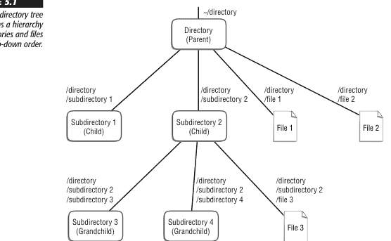

Solaris 文件系统（实际上也是任何文件系统）中的每个文件或目录都必须包含唯一的 /<pathname>/<Filename> 组合。路径名是文件系统中目录的地址。例如，/usr/bin/sparcv9/cputract 是 cpu tract 文件的路径，而 /usr/bin/sparcv9/ 代表你需要从根目录向下遍历到达该文件所经过的四个目录。每个正斜杠代表你需要从根目录（由路径名中的第一个 / 指示）下降的另一个目录或层级。正如你将在本章后续部分以及描述网络和 Internet 的其他章节中看到的，有几种寻址方案用于向网络上的其他计算机或 Internet 上的远程计算机提供路径名。

目录可以拥有的子目录数量没有理论限制，但存在实际限制。你在单个目录中放置的目录越多，某些系统命令和操作完成所需的时间就越长。同样的考虑也适用于目录中的文件数量。Unix 文件系统对目录路径名施加了 $2^{10}$（或 1,024）个字符的限制。除非你坚持使用非常长的目录名称，否则这个限制通常不会造成实际问题。大多数人使用尽可能短的目录名称，因为这可以减少在命令行输入这些名称时的错误。

**注意** 在本章中，当你向终端窗口输入命令时，我经常提到在命令行中或在命令行下工作。将 shell 解释你的命令时的这些操作称为在 shell 中或在 shell 提示符下，是更准确且更明确的术语。

使 Unix 文件系统与其他文件系统不同的一个功能是，包含重要文件（如系统文件）的目录是锁定的。只有具有 root 权限的用户才能修改锁定文件，这使得 Unix 通常比其他操作系统更稳定。

文件系统的组织结构使得目录可以保留用于本地系统，或者在网络环境中由多个具有共同设置和用户的系统共享，并且用户可以拥有包含用户特定信息的主目录。通过这种方案，存储在服务器或工作站本地的文件可以通过远程文件访问协议（如 NFS（网络文件系统）协议）与其他系统进行网络共享。以这种方式在文件系统中隔离内容还使得 Solaris 在出现新的软件包、升级或操作系统新版本时更容易升级操作系统。

Solaris 要求在启动期间挂载根（/）和 /usr 文件系统。某些目录被指定为 Solaris 发行版中安装的基础 Solaris 软件的批准位置。值得注意的是，/etc 目录是存储平台相关配置文件的目录，而 /etc/opt/package name 是存储附加应用程序文件的目录。

**注意** “目录”一节包含了重要 Solaris 目录及其用途的详细列表。

### 处理文件

在以下各节中，我将描述 Solaris 使用的文件类型以及它们的命名方式。文件是你在操作系统中操作数据的主要对象；因此，它们可以包含简单数据、复杂程序或介于两者之间的任何内容。你的操作系统需要某些文件才能正常运行，因此 Solaris 将它们隐藏起来，除非你另有指定。文件还有描述其属性、谁可以使用它们以及如何使用它们的属性。

### 文件名

*文件名*是文件系统中对象的规范。名称指的是存储在磁盘或其他存储介质上可以以某种方式操作的数据。文件名可以包含一个或两个部分：特定名称和可能的扩展名。文件名长度最多可达 255 个字符（$2^8$-1），并且可以以任何组合包含字母数字字符（a–Z, A–Z, 0-9）。文件名中允许使用某些其他字符，即连字符、逗号、句点和下划线。例如，你可以将文件命名为 **memo_1.12.20.00**（如果你愿意的话）。与 Windows 不同，Solaris 不强制实施关于标点符号使用的严格规则。

Solaris 和其他 Unix 版本一样，是区分大小写的。虽然你不能在同一目录中拥有两个名为 **memo1** 的文件，但你可以有一个名为 **memo1** 的文件和另一个名为 **Memo1** 的文件。这显然不适用于 Windows 或 DOS，在 Windows 或 DOS 中，尽管密码登录区分大小写，但完整路径规格不区分大小写。

> **注意** 如果你在文件名中使用特殊字符，如下划线，在执行该文件的任何操作时必须使用这些字符。例如，如果你创建了一个名为 \_myF11e 的文件，然后想要删除它，你必须使用命令 `rm \_myF11e`。如果你省略下划线，Solaris 将找不到该文件并会显示一条错误消息。

### 文件扩展名

与 Microsoft Windows 和 Macintosh 操作系统不同，Solaris 不强制实施注册给特定程序的文件扩展名系统。如果你愿意，可以使用文件扩展名作为可选标识，帮助你记住文件包含的内容。然而，某些程序需要文件扩展名才能打开和查看文件。例如，C 编程语言查找带有 .c 扩展名的文件，Adobe Acrobat 读取带有 .pdf 扩展名的文件，StarOffice 创建带有 .sdw 扩展名的文字处理文件（如果你在“保存”或“另存为”对话框中选择了“自动文件扩展名”选项）。这些扩展名指定了所谓的原生文件格式，这些特定应用程序创建并需要这些格式。

许多文件扩展名指示行业标准文件格式，例如 .tif（称为 TIFF，代表 Tagged Image File Format，即带标记的图像文件格式）、.jpg（称为 JPEG，代表 Joint Photographic Experts Group，即联合图像专家组）或 .html（称为 HTML，代表 Hypertext Markup Language，即超文本标记语言）。你可以使用许多不同的程序打开和保存行业标准文件格式，并处理它们包含的数据。通常，处理标准文件类型的程序会为你创建文件扩展名。在许多


在实例中，行业标准文件格式通常作为交换格式创建。交换格式是一种特殊格式，它不仅转换数据，还将格式信息转换为纯文本格式，以便更易于在程序之间和平台（操作系统）之间传输。富文本格式（RTF）就是交换格式的一个例子，它受支持于 Solaris 上的 StarOffice 文字处理软件和 Windows 上的 Word；另外两个例子是 SYLK（符号链接），受支持于 StarOffice 电子表格模块和 Microsoft Excel，以及 PS（或 PostScript），由许多矢量图形程序（如 Adobe Illustrator）创建和使用。如果您创建了一种标准文件类型，而创建程序没有自动在文件名上添加扩展名，您应该务必这样做。

### 隐藏文件名

以点字符开头的文件被称为*隐藏文件*。除非使用 `-a`（全部）选项，否则在使用列表（`ls`）命令时，这些文件不会显示。在通用桌面环境（CDE）中，此类型的文件对视图隐藏；您必须从文件管理器的“视图”菜单中选择“显示隐藏对象”命令（Ctrl+S）才能查看它们。当您选择该命令时，每个目录或文件夹都会显示两个额外的条目（至少）：单点（.）文件夹指向当前文件夹本身，而双点（..）文件夹指向父文件夹或文件系统层次结构中上一个文件夹（朝向根目录）。

### 路径名称

*路径名称*由父目录及其父目录的所有目录名称（包括根目录）加上文件名组成。Solaris 中的许多命令要求指定完整路径，但许多命令仅在路径与当前目录不同时才要求输入路径。完整的路径指定被称为*绝对路径名称*，尽管输入它可能很繁琐，但它总是指向文件中正确的文件系统位置。

对于许多命令，您也可以指定相对路径名称。相对路径名称指向您当前所在的目录到另一个目录或文件。要创建相对路径，您需要用双点符号（..）替换从根目录开始的路径的一部分。例如，如果您在 `/usr/dt/lib/security` 目录中，并且想要访问 `/usr/dt/lib/dtk5ch/DtFuncs.dt5ch`，您可以使用相对路径 `../dtk5ch/DtFuncs.dt5ch` 代替完整路径。这个相对路径指向 DtFuncs.dt5ch 文件父目录上一级的目录。显然，您需要知道当前的目录才能理解相对路径名称。如果您不得不移动此目录，然后在脚本中使用此相对地址，相对路径仍将指向上一级目录。在许多情况下，这种寻址方案仍然有效，并且可以省去您回头更改脚本中路径名称的麻烦。

对于使用过电子表格的用户来说，绝对路径与相对路径名称的概念完全类似于单元格的绝对地址与相对地址。

几乎所有接受路径名称参数的重要 Solaris 命令都可以接受相对路径名称，而不是完整的路径指定或绝对路径名称。

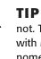

> **提示** 虽然 Solaris 支持最多 255 个字符的文件名，但其他形式的 Unix 不支持。为了与所有形式的 Unix 兼容，请使用 14 个字符的名称；为了与 MS-DOS 兼容，请使用 8 个字符的名称和 3 个字符的文件扩展名（即 8.3 命名法）。

所有重要的 Solaris shell——Korn、Bourne 和 C shell——都支持使用波浪号字符（~/）引用主目录。您可以使用波浪号字符代替主目录路径的路径名称。在默认的 Solaris 安装中，当您在 root 账户下登录时，您的主目录是根目录，波浪号字符并没有为您节省多少数据输入。不过，如果您更改主目录的位置，如果您使用波浪号字符指定主目录，那么路径名称仍然正确。如果在路径中的波浪号字符后添加用户名，这些 shell 会替换为该特定用户的主目录。因此，~/barries 会将我移动到主目录，/barries。

大多数人除非在执行系统管理工作并拥有 root 权限，否则不会登录到 root 账户。通常，将主目录设置为 root（~/）以外的某个位置是一个好主意。通常，您的主目录可能类似于 /users/barries。

## 文件属性和特性

在接下来的章节中讨论的文件属性和特性包括描述您正在查看或操作的文件类型。为了对文件执行特定操作，您通常需要理解并修改访问权限，因此在接下来的章节中，您还将学习如何识别和修改访问权限。

### 文件类型

Unix 使用几种不同类型的文件来存储数据、提供地址位置以及指向文件系统和其他地址的文件。文件存储各种信息，包括简单文本、扩展字符和符号，以及图形引擎（如 PostScript）如何创建图形的说明。

使用 `list` 命令来确定您感兴趣的目录中任何文件的具体文件类型。当您指定 `list` 命令的长输出格式时，第一个字符（此处用占位符 `<?>` 表示）告诉您文件类型：

```bash
ls -l <pathname>/<filename>
-rw-r--r-x 1 <foldername> <groupname> 3268 Dec 18 2000 <filename>
```

在接下来的章节中，我将描述您将要处理的不同文件类型。

### 常规文件

*常规文件*（`list` 命令的首字母标识为 -），有时也称为普通文件，是 Solaris 中最普遍使用的文件类型。常规文件可以是文本文件、应用程序使用的扩展文本文件，以及二进制格式的可执行文件或程序文件。常规文件可以是任何大小，从非常小到非常大。常规文件中的数据格式是 Solaris 可以读写但并非必须能够以某种方式实际使用数据的格式。例如，数据可以是特定于应用程序的，或者它可以描述一个 Solaris 实际上无法执行的程序。

即使您确定文件是常规文件类型，您对该文件了解的有用信息也很少。您可能想知道它是程序文件、数据文件还是其他什么。`file` 命令提供了关于常规文件类型用途的更多信息。

常规文件的一个例子是您可能在 Solaris 的任何目录中看到的 core 文件。这是一个转储文件。Solaris 将描述发生的错误条件的信息写入 core 文件。您可以毫无顾忌地删除这些文件，特别是当它们已经有一段时间未被访问时。

### 块特殊文件

*块特殊文件*（`list` 命令的首字母标识为 b）是 Solaris 维护的两种设备文件之一。此文件格式提供了一种方法，用于在 Solaris 文件系统中的设备驱动程序之间传输大量（块）数据。块文件传输用于并行端口和 SCSI 总线。大多数块特殊文件用于描述可移动介质和硬盘。考虑对 `/dev/sda` 文件运行的 `ls -l` 命令。它返回以下内容：

```text
brw-rw-- 1 root disk 8, 0 Dec 18 20:32 /dev/sda
```

注意 b 字符表示块特殊文件，且此类型的文件具有主要和次要设备号（分别为 8 和 0），Solaris 使用这些号来确定与此数据通信的设备驱动程序类别（以及该类别中的特定设备驱动程序）。第 6 章更详细地讨论了这个概念。


## 字符特殊文件

*字符特殊文件*（列表命令的首字母标识符为 c）是 Solaris（以及 Unix）维护的两种设备文件之一。字符特殊文件按顺序通信，每次传输一个字符。串行设备使用这类文件，例如显示器或终端、鼠标以及键盘。当你对 `/dev/tty0` 这样的文件应用 `ls -l` 命令时，你将看到返回以下输出：

```text
crw-rw—  1 barries  users  4, 0 Dec 18 22:32 /dev/tty0
```

再次注意，你会看到返回的主要设备号和次要设备号（4 和 0），它们指定了设备驱动程序类别和特定的设备驱动程序。

## 目录文件

*目录文件*（列表命令的首字母标识符为 d）是文件和目录的容器文件。目录文件通常非常小，大小往往仅为 300 到 400 字节。目录文件存储与其内部包含的文件和目录相关的信息及权限。一个称为 inode 编号的分配参考号用于跟踪目录文件中描述的每个文件和文件夹。Solaris 内核在每个文件创建时分配 inode 编号，文件系统利用 inode 编号在搜索时快速找到对应的对象。你可以将目录文件视为具有目录索引的作用。包含数百个文件的目录的目录文件可能会显著膨胀，但毕竟它仍然是一个小文件。

## 符号链接文件

*符号链接文件*（列表命令的首字母标识符为 l）是一个小文件，充当指向文件系统中另一个文件或文件夹的指针。符号链接存储其连接对象的路径全名规格。当你操作符号链接文件时，它会打开其链接到的目录或启动其链接到的文件。由于你可以拥有任意数量的符号链接，因此你可以在许多不同位置提供对引用对象的访问。符号链接文件在桌面上的操作完全类似于 Microsoft Windows 中的快捷方式和 Macintosh 操作系统中的别名。第 7 章中“在桌面上移动、复制和重命名文件和文件夹”一节描述了如何在 CDE 桌面上处理符号链接。通过图形界面创建符号链接可能更方便，无论是通过点击、拖动，还是使用文件管理器中“所选项目”菜单上的“链接到”命令。在命令行工作时，你可以使用带 -s 选项的 link 命令来创建符号链接；该命令的语法如下：

```text
ln -s <source_pathname>/<filename> <target_pathname>/<symbolic_linkname>
```

在源规格中，你可以用目录名代替文件名，以指向该目录的符号链接。如果你未指定正在创建的符号链接文件的目标路径名，该符号链接文件将在当前工作目录中创建。

如果你移动了符号链接所指向的原始对象，该符号链接将不再正常工作；Solaris 会在你尝试操作该符号链接时显示一条错误消息。Solaris 界面大量使用符号链接。前面板中的所有控件都是符号链接，任何移动到 Solaris 工作区的文件或目录也是如此。

## 命名管道文件

管道指定一个程序或命令的输出被用作或管道传输到另一个程序或命令的输入。管道的操作通常被称为重定向，特别是在 MS-DOS 等其他操作系统中。例如，在命令行输入的 `ps -l | pr | nt` 命令将（管道传输）进程命令的长输出格式并发送到打印命令，以便你看到当前在系统上运行的进程列表。该命令通常用于诊断系统问题。当从命令行输入时，这种管道被称为匿名管道。竖线是用于创建重定向并提供管道命令的符号。对命令行中使用的管道数量没有限制。

Solaris（以及一般的 Unix）提供了一种称为命名管道的功能，它使用中间文件作为一个命令或程序的目标以及第二个命令或程序的数据源。（下面第一行中的 p 指定创建命名管道。）命名管道提供了一种用于两个应用程序之间进程间通信（IPC）的方法，通常通过使用临时文件来实现。

要创建命名管道，请使用 make node 命令（mknod），如下所示：

```text
mknod /tmp/<tmpfile1ename> p
lp > /tmp/<tmpfile1ename>
rm /tmp/<tmpfile1ename>
```

这会将 `<tmpfile1ename>` 文件创建为管道文件，并将写入该文件的进程设置为后台进程，以便你可以指定下一个要运行的命令。第二个命令将 `<tmpfile1ename>` 发送到行式打印机，打印机会在数据可用时立即打印该文件的数据。最后一个命令删除该临时文件。许多安装例程使用命名管道，大多数情况下这些安装程序会自我清理——但并非总是如此。你最有可能在 Solaris 维护的各个 /tmp 目录中找到命名管道文件。

## 套接字文件

套接字文件（列表命令的首字母标识符为 s）存储本地计算机和远程计算机使用命名连接进行通信时使用的数据。当你使用电子邮件程序或打开 Netscape Navigator 等浏览器时，你就会使用套接字。某些被称为安全套接字的套接字提供客户端和服务器之间的加密传输。无论如何，套接字文件为你提供了一种存储数据的手段，用于处理像 Internet 等广域网（WAN）连接提供的瞬时连接。

## 访问权限

Solaris 使用一组文件和目录权限来确定谁可以对文件系统的内容执行什么操作。文件系统中的每个对象都带有三组访问权限或权利：

- 所有者权限
- 组权限
- 其他权限

通常，文件或目录的所有者是创建该文件的人。该人员拥有修改或删除该对象的完全权限。可以将所有者的权限授予其他人，并且所有者或管理员也可以删除某些权限。例如，当某人安装程序文件时，二进制文件通常被指定为可读和可执行，但不能被修改或写入。为了简化对象的权限级别，你可以将用户放入组中，并为每个组授予相同的访问权限。最后，其他权限（有时称为世界权限，也称为世界可读权限）授予非所有者且不属于任何组的任何人。这三个访问级别中的每一个都被分配了以下操作的权限：

**读取访问 (r)**  
读取访问允许你在屏幕上查看文件或文件夹，或查看文件系统中的文件或目录。如果没有设置此属性，用户将无法使用 list 命令查看对象的权限。

**写入访问 (w)**  
写入访问允许你修改文件或目录的内容。此权限还允许你从目录中添加和删除文件。

**执行访问 (x)**  
执行访问权限允许你运行程序。执行访问权限还必须指定才能查看或写入目录。

这些特权中的每一个都带有可开可关的访问位。因此，对于读取，r 位（或读位）对特定用户或组是允许的或不允许的。在文件的长列表中，当使用 list 命令时，这些位显示在文件列表的左侧。你还可以在 CDE 中文件和文件夹的属性对话框中看到读、写和执行位的设置。

在父目录上设置的访问权限会影响用户可以对其中包含的文件和子目录执行的操作。如果目录上只设置了执行权限，具有该权限的用户无法查看目录的内容，也不能修改或删除其中包含的任何文件。用户可以在仅具有执行权限的目录中运行可执行程序文件。

### 查看访问权限

你在本章中已多次见过的 list 命令的长列表（`ls -l`）列出了 10 个不同的文件或目录属性：文件类型和三组三位的读取、写入和执行权限。第一组三个属性描述了文件的所有者可以做什么；第二组三个属性描述了输出中列出的组可以做什么；第三组列出了既不是创建者也不是指定组成员的用户的操作权限。例如，字符串 `-rwxr-xr—` 提供以下信息：

- 该文件是一个常规（或普通）文件。
- 所有者拥有完整的读取、写入和执行权限。
- 当前组可以读取和执行，但不能写入文件或目录。
- 除所有者和该组成员外的任何人可以读取，但不能写入或执行文件或目录。

当你想要保护文件安全时，请确保拒绝该文件及其所在目录的写入权限；需要拒绝所有者、任何组以及所有可能访问该文件的其他人的权限。

图 5.2 展示了 `ls -l` 命令对某些示例文件的输出。

Solaris 提供了一种基于访问控制列表（ACL）的权限方案，该方案叠加在你可分配给文件的权限之上。当 ACL 应用于文件时，当你给出 `ls -l` 命令时，你将在九个文件权限状态标志列表的右侧看到一个加号，如 `rw-r-xr+t`。ACL 的目的是以一种比简单的用户/组/所有者属性允许的方式更受控制地允许组访问文件。


## SUID 和 SGID 权限

可执行文件可以应用称为 Set User ID (SUID) 和 Set Group ID (SGID) 的额外权限。当未设置 SUID 或 SGID 权限时，应用于程序文件的权限是调用该文件的人员的权限。当你执行一个设置了 SUID 位的程序时，该程序会表现得好像是由文件拥有者启动的一样，应用的是该拥有者的访问权限，而不是你的。换句话说，用户继承了文件拥有者的权限。更改密码是 SUID 标志最佳用法的示例，使用 `passwd` 命令更改密码时。该命令由 root 拥有，并且启用了 SUID 标志。当你执行 `passwd` 命令时，在 `passwd` 进程运行期间，你获得了对它的 root 权限。

SGID 具有类似的功能。程序通常以调用程序的人员的组权限执行。当你将 SGID 标志设置为开启时，在程序运行期间，可执行文件的组拥有者将应用于程序的执行，而不是调用程序的人员。

列表命令（`ls -1`）可以揭示是否设置了 SUID 或 SGID 标志。当设置 SUID 标志时，在权限列表中，对应于拥有者执行权限的位置会显示一个小写的 `s`。如果在该位置显示大写的 `S`，则表示未设置执行权限。你可以在以下命令中看到 passwd 文件的应用。此处为用户和组都设置了 SUID 标志，且该文件由 root 拥有：

```bash
ls -1 /usr/bin/passwd
-r-sr-sr-x   3 root    sys    101744  Jan  5  2000
/usr/bin/passwd
```

> **警告** 由于 `setuid` 和 `setgid` 程序允许任何人使用特定的程序或目录，因此应谨慎使用。当你将 `setuid` 程序添加到 shell 脚本中时，黑客可以读取该脚本，在某些情况下甚至可以利用它获取对你系统的完全访问权限。他们可以对该脚本执行的操作取决于脚本本身的功能。

当目录设置了 SGID 标志时，组权限中的执行标志（执行权限）位置会显示字母 `s`。添加到设置了 SGID 标志的目录中的文件会自动属于该目录所属的组，而不是写入文件的用户所属的组。例如，如果给上传目录设置了 SGID 标志，那么任何上传到该目录的文件都会自动属于拥有该上传目录的组（应用 `chgrp` 命令会有相同的效果）。

在 Unix 中，SGID 标志有时被称为*粘滞位*，因为它为在设置了该标志的目录内处理文件的用户提供额外的权限。如果用户对目录具有写权限，该用户可以从目录中添加或删除文件。即使用户的特权仅匹配文件的一个权限，他们也可以从目录中删除文件。启用粘滞位后，只有当用户是粘滞目录的所有者、文件的所有者或超级用户/root 时，才能删除文件。因此，当你拥有由非特权用户使用的目录（例如临时目录或任何用作公共文件上传存储库的目录）时，启用粘滞位非常有用。请注意，你不需要使用粘滞位来让 root 访问文件；除非你正在运行 Trusted Solaris，否则 root 始终可以访问所有文件。

## 修改访问权限

如果你具有读权限，你可以查看文件、目录及其权限。如果有写权限，你还可以修改这些权限或访问权。可能有你需要为所有者、组或其他人添加或删除权限的情况。change mode 命令在命令行提供此功能。其语法如下：

```bash
chmod <expression> <filename(s)>
```

命令中的 `<expression>` 部分以符号形式或八进制形式描述应如何修改权限。在符号方法中，你按如下方式指定表达式：

```bash
chmod <options> who operator <permissions> <filename(s)>
```

`who` 部分代表所有者的 `u`，组的 `g`，其他的 `o`，或所有的 `a`。将所有者指定为 `u`，其他指定为 `o` 有点反直觉。另一种理解方式是 `u` 是列出的文件用户。你可能会认为 `o` 代表所有者，但在 `chmod` 命令中并非如此。操作包括 `+`（添加权限）、`−`（移除权限）或 `=`（根据后续语句设置文件或目录权限）。最后，权限部分指定 `r`（读）、`w`（写）、`x`（执行）或 `s`（SUID 或 SGID）权限。因此，命令 `chmod a="−w" *` 会为当前工作目录中的所有文件赋予写权限，等价语句 `chmod g,u=o=*` 也有相同效果。要添加或删除属性，你可以使用语句 `chmod ug+x,o−x <filename>`，这将为用户和组添加执行权限，并移除其他人的执行权限。

另一方面，八进制方法使用编号方案来设置文件或目录的权限。在八进制方案中，执行权限被赋予值 1，写权限被赋予值 2，读权限被赋予值 4。要获取总权限，你需要将这些值相加，得到一个从 0（不允许任何权限）到 7（允许所有权限）的数字。完整规定要求按以下顺序列出四个不同的访问组：特殊组（SUID 或 SGID）、所有者、组和其他人。因此，命令 `chmod 0666 *` 将当前目录中的所有文件设置为对所有访问组（特殊组除外）具有读和写权限但不具有执行权限。你使用八进制方法来设置权限，而不是修改权限；虽然有些人认为不然，但符号方法在这方面更方便。

若要更改所有者或组，请使用 change owner (`chown`) 和 change group (`chgrp`) 命令。所有这些命令——`chmod`、`chown` 和 `chgrp`——都在 Solaris 手册页中有完整文档。

*chown* 命令的语法如下：

```bash
chown <options> <username>:<groupname> <filename(s)>
```

*<username>* 可以是用户的登录名或用户识别号码 (UID)，同样，*<groupname>* 可以是组名或其组识别号码 (GID)。如果你想更改所有者而不更改组，请从命令中省略 *<groupname>*。你必须是 root 才能将文件或目录的所有权更改给他人。一旦更改了所有权，只有该对象的新所有者或系统超级用户/root 可以更改所有权属性。Solaris 为 *chown* 提供三个选项：`-f`（不报告错误）、`-R`（递归遍历目录和子目录以更改所有权）以及 `-h`（更改符号链接的所有权，而不更改该链接最初指向的文件的所有权）。在这三个选项中，`-R` 特别重要且使用广泛。因此，命令 `chown -R barries *` 将当前目录中所有文件以及所有子目录中所有文件的所有权授予 *barries*。在实施磁盘配额时，*chown* 命令的操作可能受到限制；否则，此命令可以通过重新分配所有权来破坏磁盘配额。

*chgrp* 命令的语法如下：

```bash
chgrp <options> <groupname> <filename(s)>
```

*chgrp* 命令的操作与 *chown* 命令非常相似。前面描述的同样三个选项也适用于 *chgrp* 命令：`-f`、`-R` 和 `-h`。*chown* 命令在允许标准用户执行的操作方面受到一定限制。然而，*chgrp* 命令允许任何用户将文件的组更改为该用户所属的任何组，这非常有用。

命令行并不是查看文件或目录权限的唯一地方；你也可以在文件管理器中查看和更改权限。文件管理器中的每个对象都有一个“属性”对话框，以便易读地显示这些信息。除了各种权限外，你还可以查看当前的所有者和组名并修改权限（参见图 5.3）。

若要查看和修改文件或文件夹的权限，请按照以下步骤操作：

1. 单击文件或文件夹以选择它。（你也可以按 Tab 键或箭头键移动到对象，然后按空格键选择它。）
2. 从“已选择”菜单中选择 *Properties* 命令。（你也可以按 Ctrl+Backspace。）出现“属性”对话框。
3. 单击你要更改的权限。（你也可以按 Tab 键移动到权限，然后按空格键选择它。）


4.  点击“应用更改到”下拉列表，选择“父文件夹中的所有文件”或“所有文件及其子文件夹”（如果您希望更改被继承，而不仅仅是应用于当前选定的文件或文件夹，则选择后者）。
5.  按 Tab 键切换到“所有者”和“组”文本框，并按需编辑值。
6.  点击“应用”按钮以提交更改，或点击“确定”按钮以提交更改并关闭属性对话框。

### 图 5.3
文件管理器中文件的属性对话框

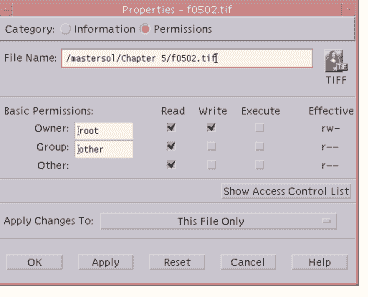

## 目录
Solaris 的文件系统包含许多目录，这些目录将重要的文件和程序存储在操作系统期望的位置，以便系统正常运行。还有许多目录是可选的，可以根据需要重命名和移动，但许多目录不能这样做。当您处理文件系统并添加程序和数据文件时，您将继续修改许多目录。了解目录结构、哪些组件是必需的，哪些是可选的，以及 Solaris 将重要的系统文件和数据结构存储在哪里，将有助于您理解 Solaris 的运行方式，并在您需要调试与文件相关的问题时提供帮助。在本节中，我将向您介绍目录，并突出一些更为重要的目录。图 5.4 展示了 Solaris 目录层次结构的前三个级别概览。

### 图 5.4
Solaris 重要目录的前几个级别

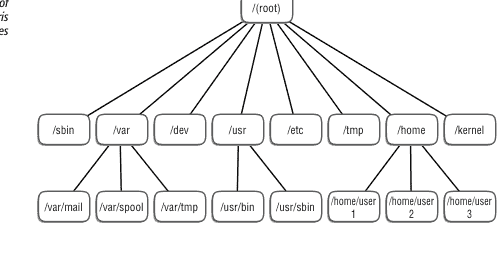

### **警告**
理解每个目录的用途非常重要，因为当您删除或重命名某些系统目录时，可能会导致系统停止运行。在某些情况下，您可能被迫重新安装操作系统才能使系统再次运行。

### **注意**
关于术语的一个非常重要的说明：在整本书中，*directory*（目录）和 *folder*（文件夹）这两个词似乎可以互换使用。目录描述了 Solaris 文件系统中的地址或位置。文件夹表示目录在图形用户界面（如通用桌面环境 CDE 或 OpenWindows GUI）中的图标表示。这是一个小点，但精通者往往会强调这一点。在描述命令行操作时，请仅使用*目录*一词。

以下是您在 Solaris 8 根文件系统中找到的重要目录列表：

- **/** 或根目录：根目录 (/) 是 Unix 文件系统中的顶级目录。图 5.5 展示了 Sun Ultra 5 工作站根目录在文件管理器中的常规显示视图。图 5.6 展示了当选中“显示隐藏文件”选项（Ctrl+S）时该相同目录的视图。

### 图 5.5
Sun Ultra 5 工作站根目录的文件管理器窗口

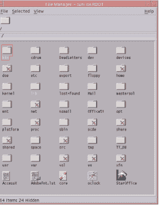

### 图 5.6
图 5.5 中显示的相同根目录窗口，已启用“显示隐藏文件”选项

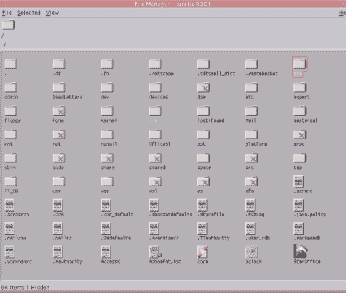

根目录中的许多重要文件都是隐藏文件，包括 `.profile` 文件（包含 Bourne 和 Korn shell 在建立*环境*时执行的命令）以及 `.cshrc` 文件（包含 C shell 用于建立环境的命令）。`.login` 文件由 C shell 在启动时使用，其目的与 `.cshrc` 相同，它出现在用户的 `/home` 目录中。

- **/bin 目录**：`/bin` 或二进制目录存储诸如编辑器（`vi` 和 `ed`）、文件系统（`dd`、`df`、`fs`、`sync` 以及许多其他命令）和操作（`cp`、`mv`、`rm`、`ln`、`tar`）实用程序、Solaris shell（`sh`、`bash` 和 `csh`）、系统实用程序（`arch`、`hostname` 和 `uname`）以及登录程序等程序。`/bin` 目录实际上是指向 `/usr/bin` 目录的符号链接（或软链接），实际程序存储在该目录中。
  > **注意** 虽然本节描述了作为默认 Solaris 安装的一部分安装的每个目录，但并非所有目录都有详细描述，尽管大多数重要目录都有描述。

- **/dev 目录**：此目录存储内核和硬件用于通信和运行的设备文件。此目录中的文件代表作为系统一部分或附加到系统的外围设备。Solaris 创建设备文件以对应计算机系统的硬件和内核。`/dev/null` 文件是输出不会显示给用户的去向；它也被称为*比特桶*。以下是 `/dev` 目录中一些更重要的子目录：
  - `/dev/cfg`：指向物理 *ap_ids* 的符号链接。*ap_id* 是连接点标识符。有两种不同类型的 *ap_ids*：逻辑和物理。物理 *ap_id* 指路径引用，而逻辑 *ap_id* 使用友好名称。在描述 SCSI 控制器时，逻辑 *ap_id* 将是磁盘控制器号，例如 c0。
  - `/dev/cua`：*ucp* 的设备文件。
  - `/dev/dsk`：块磁盘设备文件。
  - `/dev/fbs`：帧缓冲设备文件。
  - `/dev/fd`：文件描述符。
  - `/dev/md`：用于逻辑或 metadisk 设备卷管理的文件。
  - `/dev/pts`：伪终端设备。
  - `/dev/rdsk`：原始磁盘设备文件。
  - `/dev/rmt`：远程磁带管理文件。
  - `/dev/sad`：指向 STREAMS 管理驱动程序（SAD）的链接。
  - `/dev/sound`：音频设备文件。
  - `/dev/swap`：默认交换设备。
  - `/dev/term`：终端设备。

- **/devices 目录**：包含设备文件子树。/dev 中的链接指向此目录中的文件。

- **/etc 目录**：/etc 目录（发音为 "e-tee-c" 或 "et-ec-cee"，但绝不是 "etcetera"）存储依赖于平台的本地管理和配置文件，这些文件定义了系统的本地标识。在此目录中，您会找到诸如 passwd（系统用户数据库）、vstab（文件系统可挂载设备的列表）、hosts（系统名称及其相关 IP 地址以及 IP 地址提供者的位置关联文件）以及 profile（系统 shell 配置文件）等文件。以下是 /etc 目录中一些重要的文件，虽然并非全部：
  - `/etc/aliases`：此处邮件系统 sendmail 为用户创建别名。/etc/aliases 目录是指向 /etc/mail/aliases 目录的符号链接。
  - `/etc/dumpdates`：包含关于使用 ufsdump 备份的信息。
  - `/etc/group`：此文件包含组信息。
  - `/etc/inittab`：此文件包含一个初始化表，指定启动时运行的进程以及系统启动进入的运行级别。
  - `/etc/magic`：此文件列出文件类型和赋值。
  - `/etc/mntab`：挂载表列出所有已挂载的设备。
  - `/etc/passwd`：此文件存储系统的用户列表以及用户的主目录位置和他们使用的 shell。密码现在保存在 shadow 目录中。
  - `/etc/power.conf`：此文件用于电源管理。
  - `/etc/printers.conf`：此文件用于控制打印机子系统。
  - `/etc/profile`：系统登录 shell 初始化脚本（Bourne 和 Korn shell）使用的 profile 文件。
  - `/etc/.login`：.login 文件由系统登录 shell 初始化脚本（C shell）使用。
  - `/etc/shadow`：此文件包含加密的用户密码和密码老化信息。
  - `/etc/vfstab`：虚拟文件系统表列出 fsck 在启动时用于挂载文件系统和交换空间的设备。

Solaris 和其他 System V Unix 发行版与其他版本的 Unix 的不同之处在于，/etc 文件夹包含名为 rcx.d 的子文件夹，其中 x 是 1 到 6 之间的数字。这些文件夹，从 rc1.d 到 rc6.d，代表 init 程序在其初始化文件 /etc/inittab 中支持的不同运行级别。/etc 目录包含许多重要的子目录，其中最重要的列在此处：

- `/etc/acc`：配置状态的会计或系统日志记录。
- `/etc/cron.d`：调度实用程序 cron 的配置。
- `/etc/defaults`：各种程序的默认信息。
- `/etc/dfs`：分布式文件系统的配置信息。
- `/etc/dhcp`：动态主机配置协议 (DHCP) 服务的配置信息，该服务从地址池中通过网络分配 IP 地址。
- `/etc/dmi`：Solstice Enterprise Agents (SEAs) 配置文件。
- `/etc/fn`：联合命名服务器和 X.500 目录支持文件。
- `/etc/fs`：文件系统类型在挂载 /usr 文件系统之前启动时使用的二进制文件。
- `/etc/gss`：通用安全服务 (GSS) 应用程序编程接口配置文件。
- `/etc/inet`：Internet 服务配置文件。
- `/etc/init.d`：在更改运行级别时使用的 shell 脚本。
- `/etc/lib`：启动时使用的共享库文件。
- `/etc/lp`：行式打印机配置文件。
- `/etc/l1c2`：逻辑链路控制 (llc2) 驱动程序配置文件。
- `/etc/lp`：打印机子系统配置文件。
- `/etc/mail`：邮件系统配置文件。
- `/etc/net`：传输无关的网络服务配置信息。
- `/etc/nfs`：NFS 服务器日志配置文件。


## /etc 配置数据

-   /etc/opt：已安装的任何可选软件包的配置数据。
-   /etc/openwin：OpenWindows 配置文件。
-   /etc/rcn.d：这些目录包含用于进入或退出运行级别（n=0 到 3）的脚本。主脚本指定在特定目录下哪些脚本在哪个运行级别运行以及它们的运行顺序。
-   /etc/rc5.d：用于单用户模式操作的脚本。
-   /etc/rpsec：用于存储 NIS+ 身份验证配置文件。
-   /etc/saf：服务访问设施（SAF）文件。
-   /etc/security：基本安全模块（BSM）配置文件。
-   /etc/skel：用于由 adduser 命令创建新用户帐户的默认配置文件脚本。
-   /etc/tm：在启动时显示内容的商标文件。
-   /etc/uucp：UUCP 配置数据。
-   /etc/volatile：用于安装 Solaris 分发软件的临时系统文件。除非正在执行活动安装，否则您可能找不到此目录的列表。

> **提示**：命令 `man filesystem` 提供了 Solaris 文件系统的相当详细的在线说明。

## /export 目录

/export 目录是用于将存储在本地机器（例如服务器）上的文件系统导出到其他系统的位置。没有硬盘的网络终端使用远程系统上的此目录。请注意，/export 是 Solaris 不需要的目录之一，许多系统在没有它的情况下也能使用。

## /home 目录

/home 目录存储系统中所有用户的 home 目录。除了实际的 /home/<username> 文件夹外，/home 目录还包含 FTPD（FTP 守护进程）和 HTTPD（HTTP 守护进程）的目录。/home 目录是一个可读和可执行的目录。如果没有超级用户登录状态，您无法向此目录写入。一些系统将用户特定的 /home 目录存储在 /i nhouse 或 /clients 目录下。automount 程序（自动装载程序）用于装载和卸载 /home 目录。

## /kernel 目录

`/kernel` 目录存储平台特定的内核模块，这些模块在启动序列中加载。此目录以及 `/usr/kernel` 和 `/platform` 包含了 Solaris 内核的大部分设备驱动程序和可加载模块。

在 `/kernel` 中发现的其他重要子目录和文件包括：

-   `/kernel/drv`，存储 32 位设备驱动程序文件；
-   `/kernel/drv/sparcv9`，存储 64 位 SPARC 设备驱动程序文件；
-   `/kernel/genvix` 文件，包含 Unix 内核的通用部分；以及
-   `/kernel/subsystem/ia64`，在启动序列中加载的 64 位 Intel 平台模块。

## /lib 目录

此目录包含指向 `/usr/lib` 目录的符号链接。

## /mnt 目录

mount 目录是您在 Unix 中找到描述任何可移动设备（如 CD-ROM、软盘以及 Zip 或 Jaz 驱动器）文件的地方。Solaris 将 mount 目录（`/floppy`、`/cdrom` 等）作为 Solaris 根目录的子目录。`/mnt` 目录是一个空目录，用于临时装载文件系统。

## /opt 目录

Solaris 将可选或附加软件包存储在 `/opt` 目录中。使用此目录的程序包括 Netscape Communicator、GNU C 编译器（gcc）和 Sun Workshop C 编译器（cc）。请注意，当您作为 Solaris 安装的一部分获取 GNUgcc 时，这是它存储的位置。如果您从下载版本安装 GNUgcc，您会发现较新的版本安装到 `/usr/local` 目录中。

## /platform 目录

此目录及其子目录存储平台特定的对象，用于支持受支持平台的根目录。在 `/platform` 目录中找到的子目录包括此处列出的那些（这些目录中的文件最好除标准安装例程外不要手动修改，因为手动修改可能会导致严重的系统故障）：

| 路径 | 描述 |
| :--- | :--- |
| `/platform/`uname -i`/kernel` | 启动系统所需的平台相关模块 |
| `/platform/`uname -m`/kernel` | 硬件启动模块 |
| `/platform/`uname -i`/kernel/subsystem/ia64` | Intel 64 位启动模块 |
| `/platform/`uname -i`/kernel/subsystem/sparcv9` | SPARC 64 位启动模块 |
| `/platform/`uname -i`/kernel/sparcv9/unix` | 64 位平台相关内核 |
| `/platform/`uname -i`/kernel/unix` | 32 位平台特定内核 |
| `/platform/`uname -i`/lib` | 启动序列所需的平台特定共享对象 |

## /proc 目录

/proc 目录存储用于引用由进程 ID 标识的内存中对象的过程文件系统（PROCS）。/proc 目录包含许多重要文件：as，存储进程的地址空间映像；psinfo，包含 ps 命令使用的有关进程的信息；cred，存储与进程关联的权限信息；sigact，包含包含进程信号处理程序的数组；cwd，是当前工作目录的符号链接；fd，是进程使用的打开文件的引用；以及 root，是进程根目录的符号链接。除非您对某个进程或生成该进程的进程使用 chroot 命令，否则所指的根与系统根相同。

## /sbin 目录

此目录（和 /usr/sbin）存储与系统功能相关的二进制文件（程序）。常见的程序包括 fsck、fdisk、mkfs 和 shutdown 等实用工具。sbin 代表“静态链接二进制文件”。为了使用这些文件，不需要挂载任何其他文件系统（尽管 /bin 中的许多程序需要）。您还会在 /sbin 中找到像 mount、umount、sync 和 iconfig 这样的文件。

## /tmp 目录

临时目录包含短暂使用然后删除的文件。默认的 Solaris 安装将系统的交换文件空间挂载在 /tmp 中，以节省根文件系统上的空间。如果您发现交换空间不足，可以关闭此功能。许多安装和程序构建使用 /tmp 目录来存储在程序安装期间使用的文件。在多用户系统中，您会发现 /tmp 包含以已登录到系统的每个人用户名命名的子目录。/tmp 目录中的文件作为启动过程的一部分被删除。

如果您想监视交换空间使用情况，请使用 `df -k /tmp` 命令。您还可以通过单击 CDE 前面板中 Hosts 子面板中的 System Info 控件来查看交换文件的状态。该控件打开带有虚拟内存统计信息的 Workspace Information 对话框。

## /usr 目录

用户目录是存储大多数程序以及用户相关文件的地方。您在 /usr 目录中看到的许多文件夹是您在根目录中看到的文件夹名称的重复。例如，您在 /usr 目录中看到 /bin、/etc、/opt 和 /sbin 等文件夹。这些文件夹存储程序所需的用户特定信息。/usr 目录形成了第二个主要文件系统层次结构，包含许多您在 /root 本身发现的相同子目录。图 5.7 显示了 /usr 目录。

### 图 5.7

/usr 目录包含可选程序安装和相关文件。

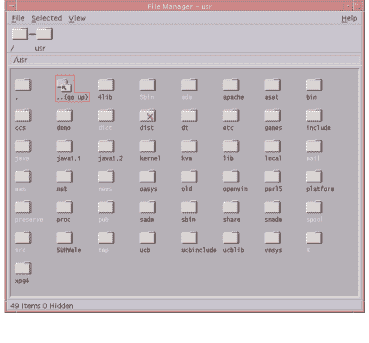

各种以字母 X 开头的 /usr 目录指的是 X Window 系统的不同设置和方面。X 和 xpg4 目录是两个例子。例如，在 X 目录内部，有存储文档（/docs）、程序（/bin）、库（/lib）、手册页（/man）等的文件夹。（请记住，X 目录是指本章稍后描述的 openwin 目录的符号链接。）一个重要目录是 /usr/local 目录及其子目录。与本地使用的特定类型工作站或服务器相关的任何文件都存储在此目录树中。

许多人使用 /usr/local 目录来安装他们为系统编译的应用程序。这是取自 BSD 方法，该方法使用 / 和 /usr 用于系统安装的文件，并使用 /usr/local 用于用户进行的软件添加。大多数从 SunSites（如 sunsite.uns.edu）下载的软件（即使是 Solaris 软件包）都会安装到 /usr/local 目录中。


以下列表包含了对重要 /usr 子目录的描述：

- /usr/adm 指向 /usr/bin 的符号链接。
- /usr/aset 自动安全增强工具 (ASET) 程序和文件目录。
- /usr/bin 作为环境一部分（例如 $PATH）执行的平台特定命令程序；一个包装器指向适当的版本。此目录中的子目录包含具体的二进制文件。/usr/bin 存储用于共享或网络模式的文件，而不用于单用户模式（这些文件存储在 /sbin 目录中）。
- /usr/ccs C 编译系统以及 make、sccs 和 yacc 使用的文件。
- /usr/demo 演示程序和数据。
- /usr/dict 指向 /usr/share/lib/dict 字典文件的符号链接，该文件被 Unix spell 程序使用。
- /usr/dt CDE 程序的根目录。此目录包含子目录 /usr/dt/bin，包含 CDE 系统实用程序的二进制文件；/usr/dt/include，包含 CDE 软件的头文件；/usr/dt/lib，包含 CDE 软件的库文件；以及 /usr/dt/man，包含 CDE 手册页。
- /usr/include C 程序的包含头文件。
- /usr/java Java 程序和库。
- /usr/kernel 平台特定的可加载内核模块，不是根文件系统的重要组成部分。
- /usr/kvm 二进制文件和库的挂载点，提供向后兼容，不再使用。
- /usr/lib 平台特定的库、数据库、命令和守护进程，供系统使用。此目录包含共享库、静态库、配置文件库和区域设置信息。
- /usr/local 添加到 Solaris 且在本地重要的文件和目录。
- /usr/mail 指向 /var/mail 目录的符号链接。
- /usr/man 指向 /usr/share/man 目录的符号链接。
- /usr/news 指向 /var/news 目录的符号链接。
- /usr/oasyis 在表单和菜单语言解释器 (FMLI) 执行环境中使用的命令和程序文件。
- /usr/old 正在淘汰的程序。此目录通常为空。
- /usr/openwin OpenWindows 软件的安装或挂载点。此目录中的文件由 X 系统、OpenLook 和 CDE 使用。此目录包含子目录 /usr/openwin/lib/X11，其中包含 X 窗口系统库。
- /usr/perl5 Perl 5 文档和程序文件。
- /usr/platform 根文件系统不需要的平台特定对象。这是 /platform 目录的影子目录。
- /usr/preserve 指向 /var/preserve 目录的符号链接。
- /usr/proc 进程工具。
- /usr/pub 包含用于运行联机手册页和字符处理系统的文件。此目录是 /usr/share/lib/pub 目录的符号链接。
- /usr/sadm 系统管理文件和目录、系统升级脚本、包维护可执行文件以及其他文件。
- /usr/sbin 系统管理员使用的平台相关程序，但对日常管理并非至关重要。与此目录对应的第三方系统软件位置是 /opt/package_name/sbin。
- /usr/share 平台无关的共享文件，如手册页、字典、终端数据和时区信息。
- /usr/snadm 系统和网络管理文件。
- /usr/spoold 指向 /var/spoold 目录的符号链接。
- /usr/src 指向 /usr/share/src 目录的符号链接。
- /usr/tmp 指向 /var/tmp 目录的符号链接。
- /usr/ucb Berkeley 兼容性包二进制文件。
- /usr/ucbinclude Berkeley 兼容性包头文件。
- /usr/vmssys 由帧访问命令环境 (FACE) 程序使用的命令和文件。
- /usr/X 此目录是安装在 /usr/openwin 的 X 窗口系统文件的符号链接。
- /usr/xpg4 符合可移植操作系统接口 (POSIX) 和 XPG4 的实用程序使用的目录。有关更多信息，请参考 man xpg4。

## /var 目录

/var 目录用于包含生命周期比 /tmp 目录中存储的文件更长的文件，并且这些文件特定于某个特定系统。许多 /var 文件是日志文件，一些是 spool 文件，一些是用户邮箱文件，还有一些是系统数据库，如包数据库。

图 5.8 显示了 /var 目录的内容，但你在 /var 目录中看到的内容取决于你在系统上安装的程序和服务。

### 图 5.8

*/var 目录包含许多子目录，用于存储不同程序和系统功能的设置、状态和消息。*


熟悉 /var 目录中包含的各个子目录非常重要；它们都服务于相当关键的系统功能。以下列表包含了一些重要的 /var 子目录：

- **/var/adm** 系统日志和记账文件。
- **/var/audit** 基本安全模块 (BSM) 审计文件。
- **/var/crash** 内核崩溃转储文件。
- **/var/cron** cron 进程的日志文件。
- **/var/dmi** Solstice 企业代理 (SEA) 桌面管理接口 (DMI) 运行时组件。DMI 用于在网络上远程管理系统。
- /var/dt dtlogin 配置文件。
- /var/ftp 默认 FTP（文件传输协议）服务器目录。
- /var/inet IPv6 路由表文件。
- /var/log 系统日志文件。
- /var/lp 行式打印机日志。
- /var/mail 用户邮件。
- /var/news 社区服务消息。（这不是互联网 Usenet 新闻服务。）
- /var/nfs NFS 服务器日志。
- /var/nis NIS+ 网络数据库。
- /var/ntp NTP（网络时间协议）服务器状态目录。
- /var/opt 用于安装软件包的位置。
- /var/preserve vi 和 ex 文本编辑器的备份文件。
- /var/run 与运行状态相关的临时文件。不用于启动过程。
- /var/sadm 用于管理已安装软件包的软件管理数据库。此目录还存储操作系统的补丁、安装信息以及当前操作系统版本的文档。
- /var/sadm/system/logs sadm 功能的状态日志。你可以在此目录中找到安装日志。
- /var/saf 服务访问设施日志和账户文件。
- /var/spool 用于打印（`/var/spool/lp`）和输出的 spooled 文件，以及 cron 文件（`/var/spool/cron`）和邮件递送文件（`/var/spool/mqueue`）存储在此处的子目录中。
- /var/statmon 网络状态监视器文件。
- /var/tmp 为应用程序安装和其他非瞬态操作创建的临时文件。
- /var/uucp uucp 日志和状态文件。
- /var/yp 提供 NIS 和 ypbind 之间向后兼容性的文件。NIS+ 使这种转换变得不必要。

## 工作目录和主目录

你的工作目录也是你的当前目录。这种指称是指你可以在工作目录中查看、修改和执行文件和目录，而无需指定路径名。在图形用户界面或 GUI（如 CDE 或 OpenWindows）中，当前目录不一定是屏幕上具有焦点的窗口。（要确定这一点，启动后打开一个终端窗口并输入 pwd 命令。）你必须明确使用 cd（更改目录）命令才能在其他目录中工作。

当你登录到 Solaris 时，系统启动到登录屏幕。然后你登录到图形或文本界面，并被登录过程放入你的主目录中。因此，要开始一个会话，你的当前或工作目录与你的主目录相同。在 CDE 或 OpenWindows 桌面等窗口管理器中，你会看到以前打开的文件管理器窗口，其中可能有一个窗口具有焦点。

要将目录更改为主目录，请执行以下任一操作：

- 输入 cd 命令，不附带其他选项或参数。
- 点击 CDE 前面板中的主文件夹图标（在以下图形中显示）。


你从当前目录为你的主目录的窗口中打开你的主文件夹和任何终端窗口会话。登录到系统后，可以使用 pwd（打印工作目录）命令来验证你的主目录。

## 启动资源文件

你的系统包含一组启动文件，为你正在使用的 shell 提供必要的信息，以便为你作为用户配置系统。这些启动文件包含的重要信息包括使用 set_terminal 或 stty 命令进行显示配置，以及使用 set_prompt 和 set_home 语句更改提示符和主目录。每个 shell 包含一个或多个启动


文件，并且这些文件会在 shell 初始化时随时被读取。在多用户环境中，系统会为每个登录到该系统的用户名存储特定的启动文件。Solaris shell 使用模板系统来创建启动资源文件。通常，对于每个 shell，都有一个系统范围的 shell 资源文件，并被复制到主目录中。管理员可以修改模板资源文件以及任何用户的资源文件。用户可以通过向文件中添加 shell 命令来修改自己主目录中的资源文件。因此，用户对其环境特性拥有控制权。标准的 Solaris 发行版包含三个 shell——Bourne、Korn 和 C shell——尽管您可以向系统添加其他 shell，如果您愿意的话。默认情况下，标准 shell 是 Bourne shell。Bourne 和 Korn shell 使用 `/etc/profile` 文件作为启动文件，而 C shell 使用 `.cshrc` 和 `.login` 文件。首次登录 C shell 时，它会读取 `.login` 文件；此后每次启动新的 C shell 时，它会读取 `.cshrc` 文件。

> **注意** Bourne shell 在第 18 章中描述，Korn shell 在第 19 章中描述，C shell 在第 20 章中描述。

图形用户界面，如通用桌面环境（CDE）和 OpenWindows，是功能齐全的窗口管理器，提供桌面功能。这些环境运行在 X Window 会话之上。有许多配置和启动文件，用于为这些不同的系统设置环境，这些文件在第 7 章“Solaris 桌面”的开头部分有描述。通常，您使用桌面控件（以图标的形式）调用配置程序或实用工具，以更改窗口管理器中的资源文件设置。也可以直接修改 X Window 资源文件设置，如第 7 章末尾的“自定义桌面”部分和关于 X Window 系统的部分所述。

## 创建目录和文件

您可以使用 `mkdir`（make directory）命令从命令行创建目录，或者在文件管理器中使用文件菜单上的新建文件夹命令来创建。命令行选项功能稍强，允许您在文件系统的任何位置创建目录，并提供选项来创建路径或设置该目录的访问权限。

`mkdir` 命令的语法如下：

```
mkdir options <pathname>/<directoryname list>
```

实际上，只有两个重要的选项您可能会想用于 `mkdir` 命令：

- `-m` 或 mode 选项使用符号或八进制命名法设置目录的访问权限（这两种系统在本章前面“修改访问权限”部分中描述）。
- `-p` 或 parent 选项将创建路径中指定的任何目录名称，如果它们尚不存在。

例如，如果您指定不带路径的目录名称列表，则 `mkdir` 会在您的当前目录中创建这些目录。如果您在 docs 目录内发出命令 `mkdir -p /usr/docs/letters/l2001letters`，并且 docs 目录尚未包含 `/usr/docs/letters` 子目录，则该命令创建 `/usr/docs/letters` 子目录，并将 `l2001letters` 目录放入该新子目录中。如果您记得这个选项，它使用起来相当方便。

第二个选项（-m）允许您设置新目录的访问权限，由命令 `mkdir -m ugo=rwx-w 12001letters` 说明，该命令创建新目录并赋予用户、组和其他人读取和执行权限，但不允许写入。在八进制格式中，类似的命令 `mkdir -m 600 12001letters` 创建目录并将用户的访问权限设置为读取（4）加写入（2）。

在 CDE 中，要使用文件管理器窗口创建新文件夹，请遵循以下步骤：

1. 从文件菜单中选择新建文件夹命令。显示在下图中的新建文件夹对话框出现。


2. 要让 Solaris 在您指定的位置创建新文件夹，请将路径名和文件夹名（格式为 `<pathname>/<foldername>`）输入到新建文件夹名称文本框中。
3. 单击应用按钮创建文件夹，或单击确定按钮创建文件夹并关闭对话框。

新建文件夹对话框不是命令行处理器；它不支持 `-p` 或 `-m` 选项，也不接受文件夹名称列表。

文件管理器窗口为您提供机会通过从文件菜单中选择新建文件命令来创建新数据文件。下图向您展示了新建文件对话框。如果在新建文件名称文本框中输入没有后缀的名称，您就创建了一个数据文件。如果添加到文件名一个后缀，如 .tif，Solaris 将创建该类型的文件。


复制命令（参见“复制和移动目录和文件”）是从旧目录创建新目录（作为副本）的另一种方式。Solaris 支持 `cp`（copy）命令行表达式和 CDE 文件管理器中的复制命令。`cp` 命令创建您具有写入权限的任何目录的副本，并复制该目录的所有内容。`cp` 命令适用于文件和目录（或文件夹）。

以下是适用于创建目录的 `cp`（copy）命令语法：

```
cp <options> <source_directoryname list> <pathname>/<target_directoryname>
```

它可以使用目录列表，并将它们及其内容复制到另一个位置。使用 `-r` 标志进行递归复制，否则 `cp` 命令会响应 "cp: xx is a directory" 并且不会执行复制。

从文件管理器窗口，您可以使用 Selected 菜单上的复制到命令（Ctrl+C）复制选定的文件夹。在出现的复制到对话框中，将复制的文件夹名称输入到副本名称文本框中，将路径输入到目标文本框中。复制到对话框在您指定的位置创建一个文件夹。第 7 章更详细地描述了使用文件管理器复制、移动和重命名文件和文件夹。

## 导航目录

您经常需要将操作焦点移动到一个目录，以对其及其包含的文件进行操作。改变焦点到新工作目录但不修改目录的命令是 `cd`（change directory）命令。`cd` 命令是一个 Solaris 实用程序，但也是 Solaris 三个主要 shell（Korn、Bourne 和 C shell）之一。这个非常简单的但重要的命令的语法如下：

```
cd <pathname>/<directoryname>
```

一旦使用该命令，您的操作将影响新工作目录中的文件和子目录。如果您忘记了或不知道自己在文件系统中的位置，则使用 `pwd`（print working directory）命令让 Solaris 返回当前目录的路径名和目录名 `<pathname>/<directoryname>`。

您可以使用父指针在文件系统中向上移动一层目录，如下所示：

```
# pwd
/usr/docs/letters/12/letters
# cd ..
# pwd
/usr/docs/letters
```

以下命令使您移动到根文件夹：

```
# cd /
# pwd
/
```

如果您熟悉 MS-DOS，那么您知道它将提示设置为默认值，显示当前工作目录的路径。如果您希望在任何 Solaris shell 中看到这种提示，您可以通过包含以下 `set` 命令（为 Korn shell 显示，第一个是给 root，第二个是给普通用户）来修改您的 shell 提示：

```
PS1='# 'pwd'
PS1='$ 'pwd'
```

对于 C shell，该 `set` 命令将如下：

```
set prompt=`pwd' %'
```

现在，如果您在启动时登录到 `/usr/home/barries` 目录，如果您的用户名是 barriers 可能会这样，那么您看到的提示如下：

```
/usr/home/barries #
```

对于 Korn shell，环境变量在 `/etc/profile` 或 `~/.profile` 文件中设置，C shell 使用 `~/.cshrc` 和 `~/.login` 文件。您还可以在这些文件中使用 `home` 环境变量命令来设置主目录的位置。


## 删除目录和文件

要删除目录或文件（或多个目录或文件），请执行以下任一操作：

- 在命令行中执行 *rmdir*（删除目录）命令或 *rm*（删除文件）命令以删除任何空目录。未清空的目录将不会被删除。
- 将目录或文件拖拽到前面板最右侧的回收站图标上。
- 在桌面的文件管理器窗口中选中目录的文件夹或文件的图标，然后按下 Del 键。

CDE 中删除目录和文件夹的第二种和第三种方法在第 7 章“The Front Panel”部分中有详细说明。

Solaris 提供了标准的 Unix 命令 *rm*（删除文件或链接）用于删除文件和符号链接，以及 *rmdir* 用于删除除工作目录或当前目录之外的任何空目录。当你给出 *rmdir* 命令时，它不能删除尚未清空的子目录。当你使用 *rmdir* 命令删除一个目录时，指向父目录（..）的链接的目录项以及目录本身的表示（..）会自动移除。*rmdir* 命令的近亲是用于删除文件的 *rm* 命令。

使用以下语法来执行删除文件命令：

```
rm <options> <filenamelist>
```

这是删除目录命令（仅限空目录）的语法：

```
rmdir <directoryname list>
```

*rmdir* 命令没有重要的选项，但 *rm* 命令有一个强大的 *-r*（递归）选项可以使用。当你指定 *rm -r* 时，Solaris 会删除文件，包括包含在指定目录中的任何目录内的子目录，并删除该目录本身。*rm* 命令的 *-f* 选项将强制删除你没有写入权限的文件，而无需请求你批准该操作。force 选项仅在以下情况下有效：你以 root 身份登录，或者你是当前所在目录的所有者。*rm* 命令还有 *-i*（交互式）选项，它会询问你确认后再删除任何文件。

> **警告** *rm -r* 命令是一个强大且危险的命令。如果你使用此命令时未仔细指定文件引用，它可能会删除你的主目录及其包含的所有内容，以及你的整个文件系统树。ouch！使用此命令时要特别注意。

请记住，要删除父目录中的文件或目录，你需要拥有该父目录的写入和执行权限，尽管你不需要对被删除的特定文件拥有这些权限。当你从键盘使用 rm 命令且你对文件没有写入权限时，Solaris 会在删除文件前询问你。你不能使用 `rm -r` 命令删除你不拥有的子目录，即使你拥有父目录。

## 复制和移动目录和文件

你可以使用 cp（复制）命令或 CDE 中的操作从命令行复制文件。移动操作在功能上等同于复制操作后删除原始对象。mv（移动命令）提供了额外的选项，允许你同时更改文件的路径和名称。如果你拥有一个文件夹，无论其中是否有文件或目录，你都可以使用移动命令来移动该文件夹。

要复制目录或文件（或多个目录或文件），请执行以下任一操作：

- 在命令行中执行 cp（复制）命令。
- 在文件管理器窗口中选中目录的文件夹或文件的图标，并将该对象拖拽到显示目标目录的另一个文件管理器窗口中。
- 在文件管理器窗口中选中目录的文件夹或文件的图标，然后使用“Selected”菜单上的 Copy To 命令（Ctrl+C）将文件或目录复制到另一个位置。

在第 7 章中，介绍了复制文件和文件夹的第二种和第三种方法。在这里，我将描述如何从命令行执行该操作。复制文件命令的语法如下：

```
cp <options> <pathname>/<source_filename pathname> /<target_filename>
cp <options> <pathname>/<source_filename list> \
<pathname>/<target_directoryname>
cp <options> <pathname>/<source_directoryname list> \
<pathname>/<target_directoryname>
```

你可以使用复制命令来复制一个或多个常规文件。文件可以是静态数据文件（文本、图形等），也可以是二进制文件。在上面的示例中，命令的第一个版本将一个文件复制到目录中，第二个版本将一个或多个文件复制到目录中。第三个版本在使用 `-r`（或递归）选项时，会将整个目录（或多个目录）复制到另一个目录。

复制命令有三个你可能想使用的选项：-i（交互式）在每次复制操作前征求你的许可；-p（保留）在目标文件中保留源文件的所有者、组、权限和修改日期；以及 -r（递归）将所有子目录及其包含的文件复制到目标目录，并且是复制目录所必需的。preserve 选项要求你是文件或 root 的所有者，如果你复制由其他人拥有的文件且你不是 root，则副本的所有者是你，而不是原始所有者。

以下示例有助于阐明复制命令的使用方法：

```
cp mem01 mem02 /archive/mystuff
```

此命令将当前目录中的两个文件复制到 /mystuff 目录。注意源列表各项之间只需要空格。要从当前工作目录以外的位置复制文件，请尝试以下操作：

```
cp /test/myfile1
```

此命令将 myfile1 文件从 /test 目录复制到当前或工作目录。

mv（移动）命令的语法如下：

```
mv <options> <pathname>/<source_filename> <pathname>/<new_filename>
mv <options> <pathname>/<source_filename> [list> <pathname>/<new_directory>
```

在第一种情况下，你将文件从一个目录移动到另一个目录，如果你为 <new_filename> 指定了不同的名称，则会重命名该文件。在第二种情况下，你可以将一个或多个文件移动到一个已存在的目录中。如果 mv 命令指定了另一个文件系统作为目标且无法重命名该文件，则该文件将保留原名被移动。move 命令接受 copy 命令中描述的 -f（强制）和 -i（交互式）选项。

例如，以下命令将当前目录的内容移动到 /archive 目录：

```
mv . /archive
```

## 链接

链接是指向文件或目录的指针。硬链接是指向文件的目录项，而符号链接（或软链接）可以应用于文件和目录，并且与其指向的文件或目录具有相同的内容。链接，特别是符号链接，在 Solaris 中被广泛使用在许多你可能意想不到的地方。例如，CDE 桌面前面的板是程序、文件和操作的符号链接的容器。

当你创建一个文件时，你会在目录中创建一个指向磁盘其他位置的数据文件的硬链接。这就是 Solaris 文件系统目录树中重复的目的。无论你怎么创建文件；无论你是使用复制命令、vi 编辑器还是文件管理器中的新文件命令，你仍然会创建一个链接。因为复制命令也创建链接，你可能会问链接命令和复制命令之间的区别是什么。link 命令不会像 copy 命令那样创建文件的副本。任何包含文件名的命令都会启动一个程序，该程序将文件名作为指向磁盘上该文件数据位置的指针。因此，符号链接提供了一种方便的方法来允许对数据进行多点访问；换句话说，它们允许用户共享文件。

> 注意 如果你创建链接以允许其他人共享文件，请不要忘记你需要提供适当的访问权限到该文件的父目录。

ln（链接）命令为现有文件创建硬链接。link 命令的语法如下：

```
ln <options> <pathname>/<filename pathname>/<linkname>
```

使用 link 命令而不带 -s 选项会为现有文件创建另一个指针（硬链接），而不是该文件的副本。

当你使用 -s 选项时，你创建一个符号链接。在以下示例中，创建了一个符号链接，并且使用 list 命令显示关于链接文件的信息。你可以用目录名称（<directoryname>）替代文件名（<filename>）并创建指向该目录的符号链接。注意，链接文件的权限列表前有一个 l，文件名后出现一个指针，并显示原始文件名，如下所示：

```
# ln -s /test/myfile
# ls -l myfile /test/myfile
-rw-r--	1	root	other	1054	Dec 22 01:12 /test/myfile
lrwxrwxrw	1	root	other	12	Dec 22 01:14 myfile -> /test/myfile
```

指向同一文件的所有链接都显示相同的文件信息——包括访问权限、所有者、组——并带有创建链接时的日期和时间戳。两个或多个指向同一文件的链接在所有方面看起来都一样，除了以下几点：每个链接的 inode 号不同，日期和时间戳不同，并且这些链接的所有者/组与创建它们的人不同。如果你从一组链接中删除一个链接，你仍然可以从任何剩余的链接访问原始文件


其他链接。然而，如果删除原始文件，所有链接都将失效，但链接文件本身不会被删除。

你还可以通过 CDE 中“选择”菜单下针对文件和文件夹的“复制为链接”命令来创建链接。使用此命令创建的链接是符号链接（关于“复制为链接”命令的描述，请参见第 7 章）。当你在文件管理器窗口中右键单击一个链接时，弹出菜单中会包含“属性”命令，但放在工作区上的链接的弹出菜单中并不包含“属性”命令。

符号链接克服了硬链接的一个局限性：硬链接不能是指向目录的指针。符号链接还允许你链接到位于文件系统任意位置的文件，甚至可以是其他文件系统上的文件。你甚至可以将符号链接指向一个不存在的文件，这在文件从文件系统中被删除后又恢复时非常有用。当你恢复该文件时，无需重新创建链接。硬链接只能应用于同一文件系统上的文件。由于 Solaris 使用多个文件系统，每个文件系统都有自己的 inode 表和自己的文件系统层次结构，硬链接会严重限制你的灵活性。

rm（删除文件）命令可用于删除硬链接。如果你删除指向原始文件的最后一个硬链接，Solaris 也会删除数据文件。数据文件不再在系统上作为一个文件可用，Solaris 会释放该文件占用的磁盘空间。如果你删除了最后一个硬链接，即使存在指向原始文件的符号链接，Solaris 仍会删除数据文件。在 CDE 中，Solaris 会为那个符号链接显示一个损坏的链接图标，如下面的图形所示。如果你正在 CDE 中工作并尝试删除指向文件的最后一个硬链接，Solaris 会警告你这将删除原始文件，并在执行前请求你确认。


## 磁盘存储

在以下各节中，我将描述 Solaris 如何在文件系统的磁盘上存储数据。在描述了可用的各种类型文件系统之后，我将展示这些文件系统是如何写入磁盘的，以及你在文件系统中管理文件的各种方式。

### 文件系统

Solaris 使用几种不同的文件系统格式进行存储和数据处理的。在你的硬盘和软盘上，Solaris 使用 Unix 文件系统（UFS），这是伯克利系统发行版（Berkeley System Distribution）的标准。当 Sun 将 Solaris 从 Unix 的 BSD 版本（SunOS 1-4x 或 Solaris 1.x）迁移到基于 AT&T System V Unix 的发行版时，他们决定保留 UFS 文件系统。所有版本的 Unix 都可以读取和写入 UFS，而且 Linux 最近也为其添加了完整的支持。UFS 有时被称为 4.2 文件系统，或伯克利快速文件系统（Berkeley Fast File System）。在 IA x86 系统上，Solaris 使用基于 SFS 文件系统，该系统基于伯克利快速文件系统，它是 Tahoe 4.3 版本的一部分。

> **注意** 第 6 章描述了磁盘格式化和设备寻址。

Solaris 使用 High Sierra 文件系统（HFS）进行 CD-ROM 存储。HFS 使用 ISO 9660 CD-ROM 行业标准，这是一个跨平台的行业标准。鉴于 ISO 9660 支持 MS-DOS 文件系统，为了实现跨平台支持，你必须对所有 CD-ROM 文件名使用 8.3 文件命名方案——文件名使用八个字符，文件扩展名使用三个字符。该格式本身允许文件名长达 28 个字符，扩展名为三个字符，并使用以下语法添加版本号：`<filename>.<ext><version>`。High Sierra 是一种在所有 Unix 平台、Windows、DOS 和 Macintosh 上使用的行业标准。High Sierra 有两个 Unix 扩展：一个是 High Sierra 本身的一部分，另一个被称为 Rock-Ridge（后者用于所有版本的 Unix）。

Solaris 8 新增了对通用磁盘格式（UDF）文件系统的支持，这是数字多功能光盘（DVD）的行业标准格式。对 UDF 文件系统的支持包含在以下软件包中：SUNWudf（32 位内核模块）；SUNWudfx（64 位内核模块）；以及 SUNWudf（/usr 模块）。Solaris UDF 文件系统是一个跨平台文件系统，支持带有增强播放和记录模式的标准 CD-ROM 和 DVD-ROM、CD-RW 以及 DVD-RAM。UDF 不支持一次性写入介质、CD-RW 或 DVD-RAM 的顺序单盘写入或增量写入。UDF 也不支持配额、ACL、事务日志、文件系统锁定或文件系统线程。

Solaris 还支持用于软盘或磁盘的 MS-DOS 文件系统。该文件系统更常被称为 PC 文件系统（PCFS）。Solaris 在 /etc/vfstab 文件列表中将该格式下的软盘称为 fd。PCFS 主要用于在 Solaris 和 Windows 系统之间传输文件。你可以使用标准的 Unix 命令，如 mkdir、del、ls、mv、touch 等，来修改 PC 文件系统的内容。

总之，这些实际文件系统与以下设备相关联：

- UFS（Unix 文件系统）和 SFS 与硬盘、磁带、CD-ROM 和软盘相关联。
- HFS（High Sierra 文件系统）与 CD-ROM 相关联。
- PCFS（PC 文件系统）与软盘相关联。
- UDF（通用磁盘格式）与 DVD 相关联。

### 虚拟文件系统

除了前一部分中讨论的文件系统外，Solaris 还使用虚拟文件系统，或伪文件系统，以提供基于内存的文件系统，旨在加快对内核信息的访问。除 SWAP 文件系统（SWAPFS）外，大多数虚拟文件系统不占用磁盘空间（仅其指针存储在磁盘上）。缓存文件系统（CacheFS）是另一个存储在磁盘上的文件系统示例，有时用于加快如 CD-ROM 驱动器等慢速设备的性能。

为了管理 SunOS 内核在内存中使用的文件，Solaris 使用 /proc，即进程文件系统（PROCFS）。这个挂载在根目录中的文件系统，在一系列只读和执行文件夹中存储了 Solaris 上正在运行的每个进程所使用文件的引用。图 5.9 显示了 CDE 中的 /proc 文件夹以及其中一个进程文件夹。你看到的图标并不代表真实的数据文件；它们代表内核创建和使用的数据的引用。用户或系统管理员不会以任何方式操作 /proc 目录；内核根据需要修改这些引用，并使用这些引用来纠正系统故障。

proc 文件系统解决了 Solaris 上的几个问题。当它被安装时，像 ps 或 top 这样必须访问内核以获取其状态及其上运行进程信息的程序，此前必须针对操作系统的每个版本重新编译。proc 文件系统为从文件系统到内核提供了统一的接口，使得访问系统内核的每个操作系统版本的命令都可以通过文件系统做到这一点。要查看关于 proc 文件系统的信息，请使用 man proc 命令。

由 Solaris 操作系统为系统功能管理的另一个虚拟文件系统是 SWAP 文件系统（SWAPFS），也称为基于内存的文件系统或临时文件系统（TMPFS）。TMPFS 描述了用于访问实际内存的磁盘位置以及用于虚拟内存的磁盘空间。交换文件是位于磁盘上并用作物理系统 RAM 或虚拟内存扩展的文件。Solaris 将所有 TMPFS 条目放入 /tmp 目录，这是其他版本的 Unix 不做的（它们不将 SWAP 文件系统挂载到目录中）。Solaris 的 /tmp 目录是可用 RAM 量加上 SWAP 文件系统大小的结果，因此大量 RAM 可以管理磁盘上较大的 /tmp 目录。由于 Solaris 中的某些 /tmp 目录由已在内存中编译的程序组成，因此与必须从磁盘检索并编译程序的系统相比，性能有所提升。

**图 5.9**
*/proc 文件夹存储了 Solaris 正在运行的每个进程在内存中使用的文件的引用。*


> **提示** 在 /tmp 目录中存储程序也可能是需要大量内存并处理大量临时数据的应用程序的一个缺陷。在这些情况下，程序会为临时空间和 RAM 而相互竞争，并最终在 /tmp 目录中以*文件系统已满*错误出错。对于此类应用程序，通过在 /etc/vfstab 中关闭 TMPFS 并使用它，你会获得更好的性能。

用于在内存中存储被交换到磁盘上 TMPFS 的文件的 TMPFS，必须与用于执行命令的相同物理内存竞争。当在 TMPFS 中存储大文件时，你会降低程序可用于执行的内存量。对内存需求量大的程序也会影响虚拟内存文件系统可用的内存量。此外，可以存储在 TMPFS 中的最大文件数由系统中的 RAM 量加上 SWAP 文件系统决定，并通过为交换空间分配更多磁盘空间来改变。当你格式化磁盘并分区时，你可以将一个分区分配给 TMPFS。与其他文件系统不同，你可以使用*swap*命令将这种临时文件系统添加到磁盘或从磁盘删除。


## 回环文件系统（LOFS）

回环文件系统（LOFS）是一种新的虚拟文件系统，它允许你通过根文件系统（/）的回环挂载以及映射到目录（如 `/tmp/<newrootname>`）的任何已挂载文件系统来访问文件。该系统在 `/tmp/<newrootname>` 目录下重建整个文件系统层次结构，同时包括由 NFS 服务器挂载到系统上的任何文件系统。该系统为系统上的文件提供了额外的访问点。

Solaris 8 的另一项新增功能是挂载表文件系统（MNTFS）。该系统在 `/etc/mnttab` 处存储一个文件系统引用表，每当文件系统被挂载或卸载时，该引用表都会相应修改。mnttab 挂载表文件以前是一个文本文件，由于同步问题容易过时。现在，`/etc/mnttab` 是一个文件系统，提供关于已挂载本地文件系统的只读内核信息。你不能再像过去那样写入 mnttab，也不能使用 `mount -m` 选项伪造 mnttab 条目，甚至无法编辑该文件。使用 `man mnttab` 命令可以查看有关此新文件系统的信息。

Solaris 还提供以下虚拟文件系统，它们的运行或操作均无需用户干预：

- **FIFOS**：先进先出文件系统支持命名管道文件，以提供进程对数据的访问。
- **FDFS**：文件描述符文件系统提供显式名称，用于使用文件描述符打开文件。
- **NAMEFS**：名称文件系统由 STREAMS 使用，用于在文件之上动态挂载文件描述符。
- **SPECFS**：特殊文件系统提供对特殊字符设备（如设备文件）和块设备的访问。

表 5.1 列出了 Solaris 8 分层文件系统的默认挂载点。

| 挂载点 | 文件系统 | 备注 |
| :--- | :--- | :--- |
| / | UFS | 根目录是树的顶部。它包含连接到的本地和远程文件系统的挂载点。 |
| /etc/mnttab | MNTFS | 挂载表文件系统提供对已挂载文件系统的只读访问。 |
| /export/home | UFS, NFS | 这是主目录的挂载点。 |
| /opt | UFS, NFS | 这是可选文件系统的挂载点，或者是一个切片（分区）上的 UFS 文件系统（但在并非所有系统上都如此；有时它是根文件系统的一部分）。 |
| /proc | PROFS | 此文件系统包含指向进程对象的符号链接。 |
| /tmp | TMPFS | SWAP 文件系统可以是 /tmp 的一部分，除非被禁用；如果被禁用，它是根文件系统或自身分区的一部分。 |
| /usr | UFS | 这包含由其他用户共享的系统文件。并非在所有系统上都使用，它可以是根文件系统的一部分。 |
| /var | UFS | 这包含可变文件。并非在所有系统上都使用，它可以是根文件系统的一部分。 |

## 磁盘结构

现代硬盘使用刚性磁盘或旋转盘片，上面带有磁性颗粒。磁头在这些盘片上旋转，并向磁盘施加微小的聚焦磁场，从而在磁盘上创建磁化区域。这些区域被读取为“开”或 1。写入头也可以对区域进行退磁，将其状态改变回读取头识别为“关”或 0 的形式。光盘的工作原理类似，只是光被以某种方式用于改变光盘的底层结构。对于 WORM 光盘（一次写入多次读取光盘），激光在表面创建一个小坑，该坑被读取为 1。无论其工作原理如何，记录介质上的位都被组织成更复杂的结构，可被文件系统引用。

在对硬盘进行格式化时，该过程在磁盘上写入一组圆柱体（称为磁道），然后将每个磁道细分为块。块是文件系统用于定位写入或从磁盘读取的数据的基本存储单元。当创建文件系统并格式化磁盘时，你指定磁盘上分区的大小作为文件系统大小，格式化实用程序会将该分区的起始和结束块输入到一个地址表中，该表由它创建。文件系统的地址表作为查找文件所在块的参考，磁盘上的所有块都被当作线性序列进行寻址。创建的文件系统表是一个丰富的对象关系数据库，它将磁盘上的地址与文件系统中的逻辑结构相匹配。

某些块用于特殊目的。位于磁盘开头的某个块是引导块。当你将文件系统标记为可引导时，允许 Unix 启动的信息会被写入引导块。如果文件系统不可引导，则引导块保持原样。UFS 使用分布在该文件系统所加载分区中的一组重复块。磁盘上的另一个重要块是磁道组概要块。该块维护关于文件系统大小、inode、磁盘块中包含的数据、指向最后分配的块和 inode 的指针、已使用 inode 映射以及空闲 inode 映射的概要信息。

## 超级块和 Inode 表

Unix 中使用的另一种次要结构称为超级块（superblock），它存储关于磁盘几何结构、空闲空间和 inode（文件指针）的信息。超级块维护不会改变的关键系统信息，并且它们作为次要超级块在磁盘的多个位置复制，以确保若主超级块发生磁盘损坏时的文件系统完整性。次要超级块存储在每个磁道组上，相对于前一个磁道组偏移一个磁道。

超级块存储关于文件系统状态的信息，包括文件系统的大小、空闲块的数量和位置，以及下一个待分配空闲块的位置。尽可能多地，UFS 尝试将文件写入同一块，以减少碎片并改善磁盘访问。UFS 使用 1 位位图（1 或 0 的数组）来定位空闲块。在将文件分配到一个块或一组块时，UFS 使用位图找到一个具有适当大小以写入文件的连续空闲块集合。

当你使用 UFS 格式化磁盘时，会创建一个 inode（信息节点）表，该表存储目录列表、文件名、文件属性以及对磁盘上文件位置（以块为单位）的引用（指针）。每次创建目录或文件时，内核都会为其分配一个 inode 号。此系统允许文件系统快速定位硬盘上一个或多个位置的数据片段，以便文件可以被读取和操作。

Inode 的长度为 128 字节，存储所有文件属性。除了文件名外，inode 还存储以下信息：

- 文件类型
- 权限（模式）
- 所有权，包括用户标识（UID）和组标识（GID）
- 文件的字节大小（size）
- 文件创建时间（ctime）、最后访问时间（atime）和最后修改时间（mtime）
- 12 个地址指针

除了指针外，这些信息是你作为输出看到的，来自 `list` 命令（对于修改时间为 `ls -l`，对于最后访问时间为 `ls -lu`），或在文件管理器中文件的权限对话框中看到。指针指向数据块，这些数据块通常大小为 8,192 字节，总访问量为 96kB。使用的块大小由磁盘格式和操作系统的决定。另外两个 inode 条目包含指向额外数据块的指针，这些块包含 2,048 个地址，因此可以容纳更大的文件大小，在 8KB 块大小下最大可达 2GB。请注意，inode 指针指向直接块（包含磁盘上的主要数据）或间接块（包含额外指针）。为了支持较大的文件大小，UFS 支持三重间接块。较小的尺寸使用双重间接块。图 5.10 显示了 inode 表的示意图。

**图 5.10**
Solaris 使用 inode 表来存储磁盘上的文件属性和位置。


# 添加新的文件系统

当您向 Solaris 系统添加磁盘，或者正在重新配置磁盘时，在 SPARC 系统上请使用 `format` 命令；在 Intel x86 系统上，则先使用 `fdisk` 命令创建分区，随后使用 `format` 命令格式化驱动器。（添加驱动器及格式化磁盘的步骤将在下一章中描述。）设备既拥有物理设备名称，也拥有逻辑设备名称。`/dev/dsk`（设备）目录中的设备文件对应于物理设备路径名，而 `/dev/dsk` 和 `/dev/rdsk` 中的文件是到磁盘上文件系统的符号链接。`rdev` 中的 `r` 代表原始设备，它标识的是使用的磁盘介质，而不是指向位于该介质上的文件系统。

`list` 命令会返回多个类似 `/dev/dsk/c\[c\]t\[T\]d\[D\]s\[S\]` 形式的列表。这些列表描述了系统识别到的设备上各个分区的详细信息。其表示方法如下：`C` 代表磁盘控制器，`T` 代表磁盘目标号，`D` 代表磁盘号（对于 SCSI 磁盘，则为 SCSI 编号），`S` 代表切片或分区号（从 `0` 到 `7`）。分区是安装文件系统的逻辑单元。（关于分区和磁盘格式化的详细描述将在下一章中给出。）

当您格式化并分区一个磁盘，或者向驱动器添加一个新分区后，下一步是在每个分区上创建一个新的 UFS（统一文件系统）。用于添加文件系统的命令是 `newfs`（新文件系统）命令，其语法如下：

```
# newfs <options> <logical_device_name>
```

逻辑设备名 `<logical_device_name>` 是指向介质上分区位置的符号链接。`newfs` 接受普通设备名作为参数；只有那些直接操作实际介质本身的命令，例如 `fsck`，才会将原始逻辑设备名作为参数。`newfs` 命令将输出所使用的扇区数、柱面数和磁道数，以及主超级块和次超级块的位置。`newfs` 命令有两个选项：`-m`，用于控制磁盘上文件系统的保留空间量；`-o`，用于指定系统是为空间还是为分配时间优化文件系统。例如，以下命令在切片 5 上保留文件系统的 10% 作为空间：

```
# newfs -m 10 /dev/dsk/c0t3d0s5
```

UFS 经过调优，旨在尽可能减少磁盘上的碎片。为此，系统会花费时间移动磁盘上的数据，以创建尽可能连续的空闲空间。然而，在许多情况下，更高的磁盘性能比最小化碎片更重要。多用户服务器应用程序会在整个磁盘上产生大量的 I/O 访问（常用文件存在热点区域），这限制了碎片整理带来的性能收益。此外，Web 服务器或 FTP 服务器更适合通过提高文件读取速度来提升性能，而不是专注于碎片整理过程。总之，您可以使用 `newfs` 的 `-o` 选项来调整磁盘，以优化时间或空间。若要优化时间，请输入以下命令：

```
# newfs -o time /dev/dsk/c0t3d0s5
```

> **警告** 在分区上运行 newfs 将擦除之前存在的所有数据。如果您希望从基于时间的优化切换到基于空间的优化，必须擦除该分区。

## 挂载文件系统

要使用文件系统，您必须先将其挂载。当您启动 Solaris 系统时，根据具体的系统配置，有几个文件系统会自动挂载。启动过程通常会挂载硬盘的文件系统以及 `/proc` 和 `/tmp` 文件系统。当您需要处理其他设备（如 CD-ROM 或磁带驱动器）时，您需要挂载该设备的文件系统才能访问其内容。在 Solaris 中，一个功能性系统需要挂载两个文件系统：根文件系统（/）和 /usr，前提是 /usr 不属于 / 文件系统的一部分。根文件系统由内核在启动时自动挂载，而 /usr 文件系统则是作为系统启动脚本的一部分进行挂载的，该脚本在操作系统加载完成后运行。

您使用 mount 命令来挂载文件系统：

```
mount <options> <devicename> <directoryname>
```

设备名（<devicename>）指的是磁盘等块级设备。您指定的目录名（<directoryname>）是作为文件系统根创建的目录，也称为挂载点。因此，当使用 mount 命令挂载 CD-ROM 光盘时，它会挂载到安装驱动器时为该设备预先创建的 /cdrom 目录中。在 CDE 中，您使用“打开 CD-ROM”操作来挂载 CD-ROM。对于您可能创建的新分区，您需要在使用 mount 命令挂载该分区的文件系统之前，使用 mkbfs 命令创建挂载点，否则 Solaris 会报告挂载点不存在的错误消息。

另一个需要注意的重要点是，当您把文件系统挂载到一个目录时，该目录的内容将消失，并被文件系统的内容所取代。换句话说，文件系统会覆盖该目录，任何对该目录的引用都将返回已挂载文件系统的內容。在 Solaris 中，您可以使用 -O 选项来覆盖包含现有文件系统的挂载点，用您正在挂载的文件系统替换原有的文件系统。

mount 命令具有列在 man 手册页中的几个选项。其中更常用的选项包括：-a，执行并行挂载操作；-p，打印已挂载文件系统的列表；-r，以只读方式打开文件系统（对于 CD-ROM 并非必需）；-o，指定文件系统类型；-O，表示使用覆盖挂载；以及 -v，以详细格式打印文件系统列表。

Solaris 在 /etc/vfstab 配置文件中存储所有自动定义的分区以及挂载在驱动器上的文件系统的列表，如图 5.11 所示。任何手动挂载的文件系统都不会列在 /etc/vfstab 中。/etc/vfstab 是一个由用户维护的文件，Solaris 本身不会对其进行更新。在其他 Unix 系统中，此信息通常存储在 /etc/fstab 文件中。vfstab 文件列出了可挂载的任何分区，并指定了系统启动时要挂载哪些分区，以及挂载时需要对文件系统设置的任何选项。管理员可以修改 vfstab 文件以控制挂载过程的各个方面。标题行使用 # 符号进行注释。

### 图 5.11

/etc/vfstab 文件存储了有关在 Solaris 系统上挂载的所有分区和文件系统信息。


如图 5.11 所示，Solaris 8 系统的 vfstab 文件显示了以下内容（从左到右）：

- 逻辑 `<devicename>`。
- 用于运行 fsck 程序的原始逻辑 `<devicename>`（例如用 `/rdsk` 代替 `/dsk`）。
- 文件系统的挂载点（目录）。
- 文件系统类型（通常是 UFS 或 PCFS）。
- 描述 fsck 命令如何针对文件系统运行。1 表示系统不会启动，直到 fsck 成功运行。当您看到 - 时，表示启动时不会对该文件系统运行 fsck。
- 如果出现 yes，则表示该文件系统在启动时会被挂载。
- 任何挂载选项。

虽然您当然可以移除与物理磁盘（如软盘）相关的任何设备文件，并且 Solaris 仍然可以启动，但如果您移除 SWAP 或进程文件系统，Solaris 将停止工作。如果您希望添加额外的 SWAP 文件系统，您可以使用 swap -a 命令，作为在启动时运行的脚本的一部分来实现。

在 vfstab 文件中，fd（文件描述符）被所有程序用于标准输入（STDIN）、标准输出（STDOUT）和标准错误（STDERR）。/SWAP 和 /proc 总是自动挂载，因为它们是您的系统正常运作所必需的。

## 卸载文件系统

unmount 命令防止用户查看或操作已挂载的文件系统。unmount 命令的语法与 mount 命令类似：

```
umount <options> <devicename> <dirname>
```

通常，该命令以 umount <devicename> 或 umount <dirname> 的形式给出，并指定相应的选项。unmount 命令中值得关注的主要新选项是 -f，它强制卸载文件系统。您需要谨慎使用 -f 选项。最好在尝试找到并终止违规进程之后使用它，否则可能会导致正在运行的进程无法再访问所需的系统资源。这些进程将被挂起，并可能导致系统故障和文件系统错误。您可以使用 -alt 选项来卸载所有未使用的文件系统。系统在关机过程的末尾附近使用 -alt 选项。


取消挂载文件系统后，原始目录结构会重新出现，替代你取消挂载的文件系统。

在某些情况下，当你尝试取消挂载文件系统时，挂载点目录或其包含的某个子目录可能正被某个进程占用。为了防止损坏文件系统上的数据，`umount` 命令不允许你取消挂载繁忙的目录。在这种情况下使用 `umount` 命令时，你将看到返回以下消息：

umount: /dev/dsk/c0t3d0s5: device busy

要从繁忙的设备取消挂载文件系统，请使用 `lsof` 命令识别正在该设备上运行的进程 ID，然后使用 `kill` 命令终止该进程。之后，你应该能够成功取消挂载文件系统。请注意，`lsof` 不是默认安装的一部分。你需要单独安装该软件包。

## 磁盘使用率

在 Solaris 中，当你格式化磁盘时（在 SPARC 上执行 format 命令，或在 Intel x86 上先使用 fdisk 创建分区再使用 format 进行格式化，如下章所述），你会在格式化过程中创建分区和文件系统。随着你添加应用程序和创建文档，你往往会填满分区。良好的管理实践是跟踪分区上可用空间的大小，以便在需要时购买额外的磁盘，或归档数据并清理不必要的文件。Solaris 提供了一些实用工具，让你可以监控整体磁盘使用情况。

> **警告** 当分区总空间接近填满时，Solaris 的磁盘性能会显著下降。建议每个分区至少保留 15% 的空闲空间，以允许系统使用的 *swap*（交换分区）、*proc*（进程文件系统）和其他临时文件的增长。运行在接近满载状态的文件系统也比具有足够空闲空间的分区更容易产生碎片化。

第一个要使用的命令是 *df*（磁盘空闲空间）命令，其语法如下：

```
df <options> <pathname>/<directoryname> <list>
```

当你不使用任何选项或指定目录名称（`<directoryname>`）时，输出将显示所有已挂载设备上的剩余空闲空间。图 5.12 显示了在一台配备 8GB 硬盘的新 Solaris Ultra 5 上运行 *df* 命令的输出结果（无选项，并使用 -k 选项）。

### 图 5.12

*df 命令报告文件系统级别的磁盘使用率。*


`df` 命令接受许多选项，其中最重要的列于此处：

- `-a` 选项：报告所有文件系统。
- `-k` 选项：给出文件系统名称、以 KB 为单位的容量、已用和可用空间量，以及已填充空间的百分比。`-k` 选项给出的输出与在其他类型的 Unix 系统（如 AIX、Linux 和 FreeBSD）上运行的 `df` 命令非常相似。由于此输出的第一行是标题，因此 `-k` 报告是最易读的。通过检查图 5.12 中的第二个输出列表，你可以看到其中的区别。
- `-l` 选项：仅报告本地文件系统。
- `-oi` 选项：报告已用和空闲的 inode 数量。

**注意** 如果你使用大量小文件并耗尽 inode，你将无法向文件系统添加更多文件。请更改分区大小并创建新的文件系统，或者移动或删除一些文件以释放 inode。

第二个有用的 Solaris 命令是 du（磁盘使用率）命令。df 命令报告整个文件系统的文件使用情况，而 du 命令允许你深入测量文件和目录等组件的磁盘使用率。该命令显示文件或目录使用的 512 字节块数，以及其中包含的任何子目录和文件。单独使用 du 命令会输出大量的文件条目，更适合输出到报告或数据库以便进一步分析。图 5.13 展示了 `du -s` 命令，该命令仅输出摘要。你可以使用 `du -sk`，我们也可以在 du 和 df 上都使用 `-k` 来获取以 KB 为单位的输出，你可能会发现这样输出的内容比以块为单位的输出更容易理解。

### 图 5.13

此处为 /opt 目录显示的 du -s 命令


du 命令的语法完全类似于 df 命令的语法，如下所示：

```
du <options> <pathname>/<directoryname> <list>
```

以下是 `du` 命令的重要选项：

- `-a` 选项：报告所有常规文件占用的空间。
- `-d` 选项：报告与指定目录或目录在同一文件系统上的文件和目录。
- `-k` 选项：以 1,024 字节块显示大小。
- `-r` 选项：针对无法读取的目录或文件发出错误消息。通常，`du` 命令会抑制这些错误消息。
- `-s` 选项：仅显示每个目录的摘要或总使用量，而不列出组件的使用情况。

> **提示** 如果你正在快速耗尽磁盘空间，可能存在失控的进程。使用 `ps -ef` 命令来确定哪个进程可能负责写入大型磁盘文件或多个磁盘文件，然后联系负责该进程的用户以终止它，或手动使用 `kill` 命令终止该进程。

## 系统记账

Solaris 拥有一种服务，用于审计系统正在运行的进程和任务，并将它们写入日志。这种服务称为系统记账，用于排查系统故障、监控资源使用情况、识别网络或系统瓶颈以及检查系统安全性。许多程序使用系统记账服务作为实际记账的基础，根据日志文件中的参数对系统使用情况进行计费。为了收集数据，你需要在系统进入多用户模式时创建一个启动脚本。可选地，你可以创建一个终止脚本，在系统关闭之前结束数据收集。

完成记账后，关于进程、存储访问和用户活动的信息会被放入日志文件中，这些文件每天由 `/usr/lib/acct/runacct` 程序处理。`runacct` 程序的输出由 `/usr/lib/acct/prdaily` 程序处理，该程序生成使用报告。月度计费程序 `/usr/lib/acct/monacct` 为每个用户创建月度使用报告和账户。通过使用 `man runacct` 命令，你可以找到记账系统的文档以及一些示例启动脚本。`monacct` 和 `prdaily` 程序也在 man 页面中有文档记载。在启用记账的情况下，报告通常是通过运行 `cron` 作业生成的。

## 磁盘配额

Solaris 提供磁盘配额系统，其他形式的 Unix 也提供此类系统，它允许管理员设置用户可以在分区上存储的磁盘空间量。此功能通常不在独立工作站或甚至网络上的工作站上设置；它应用于多用户环境，例如服务器内部的固定磁盘、服务器连接的 RAID 系统，或支持 Solaris 服务器的大型存储阵列。使用磁盘配额是管理网络资产存储的一个重要工具，因为它们既能为公司节省资金，又能防止病毒等流氓进程完全填满分区而导致系统停止运行，或使系统速度变慢至无法使用的程度。

在设置磁盘配额时，管理员需要知道有多少可用的磁盘空间、这些空间将支持多少用户，以及哪些卷应该应用配额。该规范使用软限制和硬限制。对于软限制，当用户接近超出限制时，系统会向用户发出警告；对于硬限制，在用户释放已消耗的磁盘空间之前，不允许创建额外的文件。在 Solaris 中，当用户超过其软限制时，系统会发送指定数量的错误消息（由系统管理员设置），然后表现得如同达到硬限制一样。

edquota 命令用于在 vi 编辑器中定义配额（除非你在 EDITOR 环境变量中指定了其他编辑器），其语法如下：

```
edquota <username>
```

作为设置磁盘配额的示例，请执行以下操作：

1. 以 root 用户登录。（只有超级用户才能编辑磁盘配额，但任何用户都可以通过针对其特定用户名的 quota 命令来确定其配额设置和使用情况。超级用户可以通过将用户名列表作为参数传递给 quota 命令来查看两个或多个用户的设置和使用情况。）
2. 在命令行输入 `vi /etc/vfstab`，然后为你希望设置配额的文件系统挂载选项添加 rq 标志。
3. 输入 `cd <directoryname>`（更改目录），其中 <directoryname> 是作为将拥有配额的文件的文件系统挂载点的目录。
4. 在命令行输入 `touch quotas` 命令在该目录中创建一个名为 quotas 的文件。
5. 输入 `chmod u+rw,go-rwx quotas`，以允许仅 root 用户读取和写入配额。


6. 输入 `edquota <username>`，然后输入可用的 inode 数量和 1KB 块数，如下所示：

```text
fs <filesystemname> blocks (soft=20000, hard=22000)
inodes (soft=0, hard=0)
```

此命令为用户 `username` 设置了 20MB 的磁盘软配额和 22MB 的硬配额。

7. 输入 `quota -v <username>` 以查看所需的设置是否已应用。

8. 通过输入 `quotaon </filesystemname>` 来开启配额。

使用 `edquota` 命令可以增加或减少磁盘配额。要查看所有生效的用户配额，请使用 `repquota </filesystemname>` 命令。磁盘配额通常仅设置于用户可以访问并存储个人文件的特定目录上，例如 `/home` 目录。您发出 `quotaon </filesystemname>`（例如 `quotaon /home`）命令来开启配额，通常作为启动脚本或挂载文件系统的脚本的一部分。`quotaon` 命令会开启记账功能，这是一个日志系统，用于按用户报告磁盘配额的磁盘使用情况。当文件系统被卸载时，磁盘配额将被关闭。您也可以使用 `quotaoff </filesystemname>` 命令关闭配额。`vfstab` 文件列出了任何设置了 `repquota` 选项的文件系统的 `userquota` 或 `groupquota`。

> **注意** 如果您建立了磁盘配额，应告知用户这些配额是多少。否则，当用户超过其配额并看到诸如“文件系统已满”或“写入失败”等信息（例如在保存编辑的文件或尝试检索电子邮件时），他们将无法通过显示磁盘可用空间的标准命令（如 `df` 和 `du`，如前所述）来诊断问题。

## 磁盘修复

出于多种原因，文件系统可能会损坏。这可能发生在系统崩溃且文件未从内存正确写回磁盘时，或者在断电或磁盘出现物理错误（损坏的扇区）时。Solaris 提供了 `fsck`（文件系统检查）命令来维护和修复磁盘分区，当您给出此命令时，将调用并运行特定于文件系统的 `fsck` 程序。

`fsck` 命令按以下步骤序列进行：

1. 检查块和大小。检查 inode 是否包含有效条目。检测到错误时，`fsck` 会发布错误信息 `PARTIALLY TRUNCATED INODE I=n (Salvage)?`。回答 `Y`（是）可修复此错误。
2. **检查路径名。** 在路径名检查期间，任何损坏的目录条目都会被移除。如果您看到消息 `ROOT INODE NOT A DIRECTORY (FIX)?`，则您的文件系统已遭受重大损坏。修复文件系统后，您应采取措施备份重要数据并建立新的文件系统。其他消息的后果较为轻微。
3. **检查连接性。** `fsck` 的这部分检查文件系统中是否存在未被其他目录引用的目录，从而成为孤立目录。任何此类目录都会被放入 `/lost+found` 文件夹中。
4. **检查引用计数。** 在此步骤中，`fsck` 检查是否有文件未在文件系统中被正确引用。这些错误通常会自动修正，尽管您可能会看到要求您清除某个文件的提示信息。
5. **检查柱面组。** 在 `fsck` 操作的最后阶段，程序会验证空闲块和未使用 inode 计数是否正确。
6. **拯救自由列表。** 此步骤修正在第 5 步中发现的问题。

每个步骤都作为 `fsck` 命令的输出发布，最后一行显示文件数量、已使用和空闲的块数以及碎片程度。在 `fsck` 命令的步骤序列完成并修正所有问题后，您应该看到 `/home: clean` 的消息出现。

与在 Microsoft Windows 上相比，碎片化在 Solaris 上并不是一个大问题。如果您拥有一个严重碎片化的文件系统，您可以将其备份，创建一个新的文件系统，并恢复它以进行碎片整理。

您只能对未挂载的文件系统运行 `fsck`。对于拥有单个文件系统的工作站或要检查所有文件系统时，您应该注销当前会话，并以超级用户身份登录到 Solaris 的命令行提示符，进入单用户模式。然后输入 `fsck` 命令并附加您想要的任何选项。`fsck` 命令的语法如下：

```text
fsck <options> <filesystem list>
```

当您省略 `<filesystem list>` 时，Solaris 使用 `/etc/vfstab` 文件作为要检查的文件系统的来源。虽然您可以卸载除根文件系统以外的文件系统并在其上运行 `fsck` 命令，但如果您想检查和修复无法卸载的根文件系统，您需要处于单用户模式并且根文件系统处于静止状态（换言之，在运行 `fsck` 时不能对根进行读写操作）。许多启动脚本都指定在系统切换到多用户模式之前对所有文件系统运行 `fsck`。

> **警告** 如果您在已挂载的文件系统上运行 `fsck`，可能会损坏该文件系统使其无法使用。请尽可能快地按下 `Ctrl+C` 终止 `fsck` 命令以防止任何损坏。

`fsck` 命令有许多选项和子选项。其中最重要的是这里列出的那些：

- `-F <file system type>` 选项：仅检查此类型的文件系统。
- `-m` 选项：检查文件系统是否可以挂载。
- `-n` 选项：对 `fsck` 提出的任何问题回答“否”。
- `-of` 选项：强制 `fsck` 跳过干净或已检查的文件系统。
- `-op`（**或 preen**）**选项**：运行 `fsck` 使其自动修复找到的任何错误。如果存在无法修复且需要用户干预的错误，此选项将强制 `fsck` 退出或中止。

## 摘要

本章描述了 Solaris 8 中使用的各种文件系统及其用法。Solaris 使用许多不同的文件系统类型，包括实际的和虚拟的。一些文件系统会自动挂载，而另一些则需要手动挂载和卸载。文件系统层次结构是一个树形结构，根目录位于树的顶部。文件名、文件类型、路径名和文件属性提供了描述文件的方式，使它们能够存储在文件系统中、被检索并根据其包含的数据被识别。

目录是存储文件和其他目录的容器。本章列出了 Solaris 包含的重要目录和文件。我讨论了如何处理目录、文件和链接，并展示了如何在命令行界面（CLI）操作以及通过 CDE 中创建、复制、移动和删除它们。

我还讨论了访问权限和权限，它们提供了一种通过设置安全以及确定可以对对象执行哪些操作来保护文件和目录的方案。

最后，本章包括对磁盘存储结构、inode 和块的讨论，这些提供了在磁盘上存储数据并将数据与文件系统关联起来的手段，以便在需要时使用数据。您学习了几个可用于确定磁盘和文件利用率以及设置磁盘配额以限制特定用户磁盘使用的命令。

# 第 6 章

# 设备

包含内容：

| 主题 | 页码 |
| :--- | :--- |
| 设备映射 | 183 |
| 设备类型 | 184 |
| CD-ROM | 197 |
| 磁盘ette | 204 |
| Zip 和 Jaz 驱动器 | 211 |
| 硬盘 | 212 |
| 磁带驱动器 | 221 |

设备是安装在计算机上的物理子系统（如硬盘、CD-ROM 驱动器、磁盘驱动器、磁带驱动器等），连接到您系统的其他系统（如外部 RAID），甚至是与非媒体相关的硬件，如网卡或 SCSI 卡。从操作系统的角度来看，Solaris 允许您定义逻辑设备，这些设备使用物理设备的部分或全部资源。逻辑设备定义提供了一种使物理设备执行多个设备的工作并支持多个应用程序和配置的手段。阅读完本章后，您将更好地理解什么是设备，如何命名和寻址设备，以及如何操作一些重要的设备类型。

不可能涵盖所有可能与 Sun 工作站和服务器配合工作的设备类型。鼠标、轨迹球、输入笔和平板以及许多许多其他设备可供 Solaris 用户使用。关于可与 Solaris 一起使用的所有设备类型的讨论更适合在硬件书籍中处理。关于设备需要了解的重要一点是，虽然它们使用特定的寻址方案并由不同的系统命令和设备实用程序支持，但它们都需要安装设备驱动程序才能提供 I/O 以与 Solaris 内核工作。您将在本章中学习的技能将有助于您处理购买的设备，并正确安装和管理它们。

本章涵盖一些基本设备，主要是需要操作系统支持的存储设备。您将学习如何格式化磁盘ette 和硬盘，如何打开或挂载 CD-ROM 光盘，如何管理磁带驱动器，以及在某些情况下，如何对存储设备的内容进行基本操作。本章还包含有关如何创建文件系统以及分区、切片和其他特定于设备的概念的信息。

您将在许多其他章节中找到关于处理内容的基本信息，第 5 章“文件系统”中有更深入的讨论。您还将找到关于特定设备执行的任务相关的章节中的其他设备信息（例如，第 10 章涵盖打印）。本章是又一个帮助您在概念层面理解如何操作 Solaris 并提供一些实用系统管理技能的构建模块。

## 关于设备

Solaris 操作系统支持用户和系统管理员需要了解的广泛系统设备。Solaris 通过以下三种不同方式之一引用设备：

- 作为物理设备名称，通常在启动时显示在屏幕上
- 作为物理设备文件，该文件存储在 `/dev/iccs` 目录中，并定义设备及其访问方式


- 作为逻辑设备名称，例如磁盘切片或分区，它们是磁盘上的区段，表现得如同拥有独立文件系统的独立磁盘本身一样。

## 设备映射

物理设备名称到 `/devices` 目录中物理设备文件的映射关系保存在 `/etc/path_to_inst` 文件中，供你查看。该映射并非固定不变，可以根据需要修改和重新分配。在 `path_to_inst` 文件中，设备的分配地址显示为字母和/或数字的字符串，如图 6.1 所示。


你可以在 /dev 目录中找到设备名称列表，主要以字母数字代码表示，如图 6.2 所示。Solaris 以及一般的 Unix 系统都试图使用具有描述性的设备名称，以便你能识别它们。例如，cons01 是你的显示器文件（实际上，在图形界面之外，它是字符模式下的终端输出），dsk 是磁盘或硬盘，kbd 是键盘，mem 是内存，/swap 是交换文件，/pccm1a 是 PC 卡，tty 是你的终端设备，等等。/dev 目录的作用类似于 DNS 的作用。它屏蔽了用户需要记住作为字母数字字符串的实际设备名称的需求，而是用诸如 /dev/diskette 这样的“友好名称”作为替代。


这些设备中的许多是默认安装的一部分，而其他设备则是随着时间推移，当你使用诸如 *drvconfig* 命令等命令添加组件时添加到系统中的。当你执行重新配置重启时，*drvconfig* 会自动运行，并从 /etc/minor_perm 文件中读取新设备的文件权限信息，该文件将 *drvconfig* 工具指向设备树中的新节点，然后在 /dev 目录中添加一个文件。

*drvconfig* 命令为物理设备创建设备驱动程序，并为逻辑设备创建逻辑或伪驱动程序。设备形成一个 /devices 目录树，由你的系统在启动时读取并执行。通常，解决顽固设备问题（特别是与软件相关的问题）的最佳方法是重启系统并重新初始化软件。

## 设备类型

要查看 /dev 目录的内容，请使用 `ls -lL` 命令。-L 选项按名称而不是作为指向 /devices 目录的符号链接来显示 /dev 目录的内容。在从该命令返回的典型条目中，你会看到以下内容：

`crw-rw-rw- 1 root sys 13 12 Mar 12 08:05 zero`

在这里，第一个字符告诉你是哪种链接类型：*b* 代表块设备，*c* 代表字符设备，*d* 代表目录，*D* 代表门（door），*l* 代表符号链接（或命名管道），*s* 代表 AF-UNIX 套接字。

门是进程间通信机制，套接字是命名通信连接。在第一个字母之后是权限，随后是硬链接数量以及所有者和组名称。

在上面的条目中，你看到列出了主要和次要数字（13 和 12）；它们并排列出，中间用逗号分隔。主要设备号定义了该列表所属的硬件设备类别：终端、磁盘、打印机等。主要设备号指定内核用于与该设备通信的设备驱动程序。次要设备号定义了设备类别内硬件的类型，例如终端类型的 ttyq0、ttyq1 等。次要设备号引用设备在系统中的位置，可用于激活或停用设备的功能。这种命名系统旨在允许软件服务一个设备类别，同时仍能区分该类型的两个不同设备。

Solaris 定义了多种不同的设备类型，最显著的是块设备、字符设备和原始设备。这些设备类型中的每一种都有不同的特性，需要特定类型的设备驱动程序。

*块设备* 具有以下特征：

- 可以执行随机访问读取
- 以块大小读取数据块，并作为单个事务处理
- 按顺序处理数据块
- 由操作系统作为从 0 到 *n*-1 的 *n* 个块的集合进行寻址
- 可以初始化为文件系统并挂载该文件系统
- 输入到设备和从设备输出的数据由内核在缓存中进行缓冲

面向块的设备的典型示例是磁盘上的分区或切片、CD-ROM 和软盘。

用于块设备的设备驱动程序通常可以用以下两种方式之一使用：要么作为块设备，要么作为字符设备。许多设备通过块方式和字符方式访问数据。

当原始设备使用字符设备访问方法时，被称为*原始设备*。*原始设备*提供以下功能：

- 无内核缓冲的直接 I/O
- 对 I/O 类型的设备限制
- 系统调用与硬件请求之间的直接关联

相比之下，许多设备是*字符设备*。字符设备将数据读取为字符流；它们逐个读取字符，或者在某些情况下逐行读取，具体取决于设备驱动程序是如何编写的。当程序读取单个字符时，通常是在原始模式下进行的，不对数据做任何解释。（原始模式与原始设备没有关联。）当程序逐行读取数据时，驱动程序将管理数据流，使得诸如删除或终止字符之类的输入不会成为程序看到的数据流的一部分。在逐行读取时，程序从行首读取直到回车字符。字符设备的示例包括打印机、调制解调器、终端和磁带驱动器。

存储在设备上的数据可以以块形式存储，也可以作为字符数据存储。字符数据也被称为原始数据。处理这两种不同类型的数据需要两种不同的接口。Solaris 将这两种类型的数据分离到不同的接口中，并使用不同的地址。块访问数据是缓冲的，并以块为单位读写；原始数据是小量读写的，没有缓冲。因此，块传输比原始数据传输快得多。在使用数据访问命令时，请检查它们是用于块设备还是原始数据设备。例如，mount 和 df 是块命令；fscs、newfs 和 prtvtoc 是原始数据命令。

## 地址

在 Solaris 中，设备指的是物理和逻辑实体，为了与设备一起工作，你需要知道如何命名和寻址它们。每种设备都有一个系统设备文件，它是系统设备层次结构的一部分。在启动时，你的系统使用设备层次结构加载驱动程序，将它们与适当的设备关联，并创建一组指向驱动程序的指针。物理设备可以在 /devices 目录中找到，而逻辑设备在 /dev 目录中找到，并符号链接到 /devices 目录中的物理设备文件。

硬盘、CD 或软盘代表物理设备。Solaris 与其他 Unix 系统在物理设备的寻址方式上有所不同。在具有两个 IDE 驱动器和两个 SCSI 驱动器的 BSD 或 Linux 系统上，你会在 /dev 目录中看到以下定义的设备：IDE 驱动器为 /dev/hda 和 /dev/hdb，SCSI 驱动器为 /dev/sda 和 /dev/sdb。当你在这些驱动器上创建分区用于 BSD 或 Linux 时，你会看到它们在 /dev 目录中显示如下：/dev/hda1 和 /dev/hda2。然而，在 Solaris 上，设备包含在 /dev/dsk/ 子目录中，并具有四部分标识符，如下段所述。

通常，这些设备被细分或分区为 Solaris 称为切片的部分。切片是逻辑设备的一个示例。该逻辑设备必须被命名和寻址，这样当你使用该资源或资源可用时，它可以被识别和访问。CD-ROM 的逻辑地址示例是 /dev/dsk/c0t2d0s2，其中 /dev/dsk 是磁盘子目录，c2t2d0 是切片。


## 控制器 (c)、目标 (t)、驱动器 (d) 和切片 (s) 标识符

控制器 (c)、目标 (t)、驱动器 (d) 和切片 (s) 标识符采用此方案进行寻址。

控制器编号是在启动时进行的逻辑分配，但确切的切片规格取决于你使用的系统或磁盘类型。具有直接控制器的磁盘、具有总线导向控制器的磁盘以及具有 SCSI 控制器的磁盘拥有不同的地址，且这些地址因平台而异。

例如，逻辑磁带设备存储在 `/dev/rmt/*` 目录中，并从 `/devices` 目录建立符号链接。第一盘磁带被分配逻辑单元号（LUN）为 0，磁带驱动器的逻辑地址为 `/dev/rmt/x`，其中 `x` 是 LUN，`y` 是磁带密度。Solaris 支持多种磁带驱动器，如 QIC-11、QIC-24、QIC-150、Exabyte、AIT 等等。磁带密度值由诸如 `l`、`m`、`h`、`c` 和 `u` 等字母指定。你可以在描述光盘（CD-ROM）设备的章节中找到光盘设备的寻址方案。

## 安装和移除设备

建议每当你添加新的外围设备时关闭系统，并拔掉电源线。对于 SCSI 设备尤其如此，因为 SCSI 总线上的设备可能对电源波动非常敏感。不过，这对几乎所有设备都是一个好主意。在计算机机箱内部安装设备时，你也应佩戴防静电腕带。新的 Sun 工作站和服务器通常都会附带防静电腕带。

要向系统中添加外围设备，请遵循以下步骤：

- 1. 登录超级用户，`su`，并输入密码。
- 2. 如有必要，使用以下命令安装驱动程序：

```
# pkgadd -d <devicepath> <package name>
```

`<package name>` 标识包含设备驱动程序的软件包。如果在连接设备后才安装设备驱动程序，请将媒体（磁带、软盘或光盘）放入驱动器中。你可以使用 `pkgchk <package name>` 命令验证 `pkgadd` 命令是否成功。当软件包安装完成后，系统会返回提示符且无响应。

- 3. 输入 `touch /reconfigure` 命令以创建 `/reconfigure` 文件。（如果你使用 `boot -r` 命令从 OK 提示符启动，也可以达到相同的效果。）
- 4. 使用 `shutdown -i0 -g30 -y` 命令关闭系统。

参数 `-i0` 指第 0 级初始化状态，`-g30` 表示在 30 秒内关闭系统，`-y` 强制自动关闭系统。

- 5. 当你在 SPARC 系统上看到 OK 或 `>` 提示符，或在 Intel x86 系统上看到“按任意键继续”的消息时，将电源开关关闭。
- 6. 在关闭所有已连接设备的电源时，连接外围设备。
- 7. 对于需要设置地址的设备（如 SCSI 设备），请确保设置硬件开关或跳线设置，使所选地址不与系统中已连接的其他设备冲突。请参阅你的外围设备手册了解如何执行此操作。
- 8. 重新打开外围设备的电源，然后开启计算机系统。
- 9. 系统启动后，登录并尝试使用设备以验证其是否正常工作。

并非所有计算机都需要这种手动关闭和重启。较新的设备支持*热插拔*，这意味着你可以在计算机运行期间添加和移除组件。Solaris 8 增加了对此功能的支持，使得你可以使用 `cfgadm` 命令在 SPARC 和 IA 系统上热插拔 SCSI 设备。在 x86 系统上，你不能移除附带关键系统资源的 PCI 适配器卡。此外，卡片的设备驱动程序必须支持热插拔。

> **警告** 当你添加或升级驱动程序时，如果设备发生故障，可能会导致系统崩溃。这被称为*系统恐慌*，因为驱动程序具有底层内核访问权限，可能会导致系统宕机。如果设备驱动程序存在 bug，也可能通过执行非法操作（例如写入为其他进程保留的内存部分）来使系统失效。解决此问题的最佳方法是移除有问题的设备和/或设备驱动程序。

Solaris 执行动态配置，根据需要移动或禁用系统资源（包括硬件和软件）。你可以使用 `cfgadm` 命令来确定组件的状态、测试和配置，并获取 SCSI 和 PCI 控制器以及 Sun S-bus 的配置帮助。`cfgadm` 命令显示可以进行动态重新配置的挂载点。要查看支持热插拔的 SCSI 和 PCI 控制器列表，请查阅 Intel 硬件兼容性列表（HCL）。SPARC 系统上的卡片支持此功能。未来的操作系统功能，如多路径和故障转移软件，将进一步增强此能力。

正如安装设备时必须执行重新配置重启一样，移除设备时也必须执行重新配置重启。在许多情况下，即使没有该设备，你的系统可能仍能正确运行，但如果多个人员管理你的系统，并且存在已不再连接到系统的设备的虚假条目，你可能会遇到麻烦。例如，移除硬盘后，应删除 `/etc/vstab` 中该硬盘的条目，然后执行重新配置重启以重新建立系统。

## 设备驱动程序

设备驱动程序是一种具有对 Unix 内核低层访问权限的程序，它为外围设备和存储提供输入/输出功能。你的 Solaris 工作站或服务器包含鼠标和键盘以及 SCSI 设备的驱动程序。对于你可能添加的任何其他设备，如打印机、绘图仪、扫描仪、数字化仪、相机等，都必须安装设备驱动程序。设备驱动程序从 Solaris 内核接收命令，并将其转换或解释为设备可以理解的数据格式和传输协议。例如，调制解调器需要调制解调器驱动程序，该驱动程序的重要功能之一是与另一个调制解调器自动协商传输速度。同样，驱动程序从设备获取数据，并将其转换回可以传回给 Solaris 内核的形式。

Solaris 2.x (SunOS 5.x) 基于伯克利软件分发版 (BSD) Unix，并在 `/kernel/genvunix` 中包含一个小型标准 Unix 内核。Solaris 操作系统通过额外的平台特定内核模块进行补充。启动特定系统所需的平台特定内核组件位于 `/platform/<systemname>/kernel` 目录下的文件中，其中 `<systemname>` 是特定类型的计算机。例如，Sun Ultra 5 可以在文件夹 `SUNW/ultra-5_10` 中找到。最后，所有使用特定指令集的系统共用的内核组件都位于 `/usr/kernel` 文件夹中。

> **注意** SunOS V1-4.x（又称 Solaris 1.x）基于 BSD Unix。随着 Solaris 2.x（又称 SunOS 5.x），Sun 转向了 AT&T System V Unix，而 BSD Unix 则成为“兼容性模式”（运行兼容性模式所必需的仿真软件加载在 `/usr/ucb` 中，ucb 代表加利福尼亚大学伯克利分校），并且仅在需要时运行。BSD 内核随操作系统提供，但你不必安装它。Solaris 内部结构的开发在第二章“关于 Solaris”中有所介绍。

系统启动时，它根据发现的设备加载所需的模块，这一过程称为*自动配置*。加载内核模块的设置包含在 `/etc/system` 文件中。只加载所需的模块，当你添加设备时，Solaris 会加载所需的支持模块。这意味着你无需重新启动系统或重建内核即可加载驱动程序，并且由于只有在需要时才加载驱动程序，内存的使用效率更高。当你向 Solaris 添加新设备和驱动程序时，你必须执行重新配置重启，以便系统通过自动配置识别新设备。

设备驱动程序存储在以下目录中：

- `/kernel/drv`
- `/platform/<systemname>/kernel/drv`

Solaris 开箱即支持许多设备。然而，当你购买未受支持或刚在最近版本的 Solaris 发布后推出的设备时，你应该从设备制造商处获取 Solaris 8 所需的软件和驱动程序。设备软件通常附带设备驱动程序和配置文件（.conf）。Sun 网站上的 `www.sun.com/support/drivers/boot.html` 是 Solaris x86 驱动程序的一个资源。

## 设备诊断实用工具

要识别连接到计算机的外围设备，请使用 `prtconf` 和 `sysdef` 命令。`prtconf` 命令以设备树的形式列出系统配置、内存量和设备配置。你将看到定义的物理和逻辑设备、它们的地址及其状态。图 6.3 显示了独立 Sun Ultra 5 计算机的 `prtconf` 输出。你会看到一些实例，其中设备通过此消息进行识别：

```
<devicename>, instance #number (driver not attached)
```

此消息并不意味着未安装驱动程序，只是当前未连接驱动程序，因为没有正在使用的设备。只有在设备被访问时才加载驱动程序。当设备未在使用时，驱动程序会被卸载，因此这条消息实际上表示指定节点处没有正在使用的设备。Solaris 在你访问设备时加载驱动程序，并在设备不活跃时卸载设备驱动程序。卸载驱动程序可以节省内存，并使 Solaris 系统比那些不执行此功能的其他操作系统更稳定。

`sysdef` 实用程序将当前系统定义输出到你的显示器。该命令列出了可启动操作系统的所有硬件设备、伪设备、可加载模块以及内核可调参数的值。你可以使用 `-n` 标志将可启动的操作系统指定为 `sysdef` 命令的参数。`sysdef` 命令的信息源自 `/dev/kmem` 文件，因此你也可以列出该文件中的可启动磁盘，并显示它们的定义。你在 `prtconf` 命令响应中找到的关于设备的许多信息也可以在 `sysdef` 命令的响应中找到。你还可以使用 `sysdef` 命令来查明你登录后远程访问的是哪种类型的系统；使用 `uname -a` 命令只会给你提供诸如版本、名称和平台等基本信息。


## 图 6.3

使用 `prtconf` 命令列出您的系统配置，包括已连接的设备。本图显示了 Sun Ultra 5 工作站的输出。


如果您希望生成自上次重启以来连接到系统的设备列表，请使用 `dmesg` 命令。图 6.4 显示了 `dmesg` 命令在 Sun Ultra 5 工作站上的输出。该命令也可用于 OpenBoot 监视器在内核加载之前检测硬件错误，并识别总线问题（例如 SCSI 问题）以及设备是否正在响应。要查看启动时的设备列表，请使用 `ok .reset` 命令强制重启。系统启动后立即运行 `dmesg` 命令。在 Sun 工作站上，`dmesg` 显示启动序列：内存测试、以太网地址和网络接口的建立、PCI 和 S-Bus 总线初始化、硬盘识别和映射，以及键盘和鼠标的激活。在 x86 机器上，您会看到不同的序列。

### 串行端口

Solaris 支持 RS-232-C 和 RS-423 串行端口，以及并行（或打印机）端口。串行端口用于将调制解调器和终端连接到系统。使用终端可以让您避免购买计算机显示器和图形卡的成本，同时仍然能够控制系统的启动。

您可以使用 `admin tool` 程序以图形方式管理串行端口和并行端口设备，例如调制解调器和打印机。Solaris 使用 `ttymon` 端口监视器在设备和操作系统之间进行通信。串行设备发出 `getgy` 请求（通常是并发的），这些请求通过端口监视器传递。您可以在 Sun 网站（www.sun.com）上通过搜索“managing terminals and modems”找到这些命令。

请按照以下步骤为终端配置端口：

- 1. 通过点击前面板上的应用程序抽屉，然后点击应用程序控件，打开位于 `system_admin` 文件夹中的 `admin tool`。
- 2. 进入其中一种用户模式。
- 3. 输入默认终端类型、波特率传输速率，以及流控制或载波检测。
- 4. 保存您的设置。
- 5. 输入以下命令以测试您的设置：

```bash
# pnmadm -l -s ttyb
```

同样，您可以使用 `admin tool` 通过相同的步骤设置调制解调器，用于传入、传出或双向通信。完成后，使用 `tip <devicename>` 命令连接到远程系统，以测试安装是否成功，其中 `<devicename>` 指向 `/etc/remotc` 文件。该命令的文档可以通过 `man tip` 查看，当检测到端口时，终端上将显示 *connected*。如果您想测试 Hayes 命令集，请输入命令字符串 `ATE1VL`。该命令应在终端上返回 `OK`。您也可以输入 `AT`，此时调制解调器将回复 `OK`。

过去，为终端提供服务的 Unix 服务器使用称为伪端口的串行端口地址系统，为每个终端提供引用串行端口的途径。该系统仍用于像 X 终端这样的程序，其中像 `xterm` 这样的每个程序都模拟旧式字符终端。当您使用 `Telnet` 或 `rlogin` 通过网络登录到服务器，而不是使用调制解调器或终端直接连接到串行端口时，您使用的是伪端口或伪 tty。Solaris 与其他 Unix 实现一样，会建立一定数量的伪端口。关于伪端口，特别是在服务器环境中，需要知道的主要事项是：如果您用完了默认数量的伪端口，您始终可以增加数量。

### 卷管理

在 Solaris 中，处理 CD 和软盘被称为卷管理。可移动介质的卷管理服务由 `/vol/dev` 目录提供。对于软盘，子目录命名为 `diskette0` 和 `diskette1`。当系统具有第二个和第三个磁盘驱动器时，卷管理将创建以下成对的子目录：分别是 `diskette1` 和 `rdiskette1` 以及 `diskette2` 和 `rdiskette2`。`diskette` 目录提供文件访问，而 `rdiskette` 目录提供对原始数据（如 tar 或 cpio）的访问。当您插入软盘时，该软盘的内容将出现在这些目录的子目录中，具体使用哪一个取决于软盘的格式。没有 UFS 文件系统的 UFS 软盘挂载在 `rdiskette` 目录下；DOS 软盘挂载在 `diskette` 目录下。使用 ISO 9660 高 Sierra 文件系统（HSFS）的 CD-ROM 是唯一平台无关的介质类型。

CD-ROM 的支持由 `/vol/dev` 目录提供，使用 `/dsk` 和 `/rdsk` 子目录分别作为块和原始目录。CD 的内容将以类似 `c0t2d0` 的目录名出现在 `dsk` 子目录下（您的可能不同）。对于具有单个软盘和 CD-ROM 的系统，如果您使用 `ls` 命令，您将看到以下内容：

```bash
ls -l /vol/dev
total 0
dr-xr-xr-x 4 root      root   512 Nov 30 14:21  aliases
dr-xr-xr-x 3 root      root   512 Nov 30 11:47  diskette0
dr-xr-xr-x 3 root      root   512 Nov 29 17:03  dsk
dr-xr-xr-x 3 root      root   512 Nov 30 11:47  rdiskette0
dr-xr-xr-x 3 root      root   512 Nov 29 17:03  rdsk
```

您可以再次使用 `ls` 命令在这四个设备子目录中的每一个上，以返回软盘名称或 CD-ROM 名称。

### 挂载点和符号链接

Unix 使用 `/floppy` 和 `/cdrom` 挂载点来提供对软盘和 CD-ROM 设备的访问，并且 `/vol/dev/diskette0` 和 `/vol/dev/dsk/c0t2d0` 子目录被映射到这些挂载点。当您在 `rmount` 下使用这些挂载点时，您可以使用 `/floppy/<diskettename>` 或 `/cdrom/<cdname>` 挂载点来访问软盘或 CD。因为如果磁盘已格式化，挂载点可以从任何位置使用，即使您可以通过网络将这些设备提供给其他用户，即使是远程系统也是如此，这简化了您的命名约定。未格式化的磁盘仅在本地可用，而不能从挂载点访问。

除了挂载点外，您还可以为可移动介质创建符号链接。用于文件系统访问的符号链接如下：

```text
/floppy/floppy0 → /floppy/<diskettename> → /vol/dev/diskette0/<diskettename>
/cdrom/cdrom0 → /cdrom/<diskname> → /vol/dev/dsk/c0t2d0/<diskname>
```

以下是用于原始设备访问的符号链接：

```text
/floppy/rfloppy0 → /floppy/<diskettename> → /vol/dev/rdiskette0/<diskettename>
/cdrom/rcdrom0 → /cdrom/<diskname> → /vol/dev/rdsk/c0t2d0/<diskname>
```

因此，您可以使用名称 `cdrom/cdrom0` 来访问 CD 的文件系统，而无需知道磁盘的名称或位置。

并非所有 CD-ROM 都仅使用 HSFS 格式进行格式化。一些磁盘包含两个或更多分区，或切片，并且这些切片可能包含 UFS、SPARC 或 UFS_x86 切片。拥有多个磁盘切片的这种场景通常发生在磁盘被设置为安装应用程序时，其中将包含三个切片：Slice0，UFS，用于原始 SPARC 数据的 SPARC；Slice1，UFS_x86 原始数据；以及 Slice2，ISO 9660。在 SPARC 系统上，您将看到 `s0` 和 `s2` 出现在 `/cdrom/cdrom0` 和 `/vol/dev/dsk/c0t2d0` 子目录下。在 Intel x86 机器上，您将在这两个子目录下看到 `s1` 和 `s2`。

### 挂载可移动介质

您可以自动挂载 CD 和软盘，或者手动挂载它们。自动挂载比手动挂载更容易，并且不需要您是超级用户并拥有 root 权限。当自动挂载时，您插入本地计算机的 CD 和软盘可以由网络中其他计算机上的用户访问。

> **注意**
> 如果您希望在不运行卷管理器的情况下手动处理软盘或 CD，请以超级用户身份输入以下命令以停止卷管理器：`/etc/init.d/volmgd stop`。使用 `/etc/init.d/volmgd start` 重新启动卷管理器。

要自动挂载 CD 或软盘，请遵循以下步骤：

- 1. 插入磁盘。
- 2. 对于软盘，在命令行输入 `volcheck` 命令。
  - Solaris 的卷管理随后将挂载该磁盘。CD 自动挂载，并且桌面上会打开一个窗口。软盘挂载时不会打开窗口。`volcheck` 实用工具在命令发出后的最后一小时内，每分钟检查一次软盘。
- 3. 在命令行输入 `vold` 命令以打开软盘。
  - `vold` 是 Solaris 卷管理守护程序；它在多用户模式下在后台运行。`vold` 可以访问 Unix 文件系统（UFS）和高 Sierra 文件系统（HSFS），并且可以与软盘和 CD 配合使用。
- 4. 使用磁盘上的文件。
- 5. 弹出介质。

当您自动挂载 CD 和软盘时，它们会被挂载在标准位置。使用 `/vol/dev/aliases/Floppy0` 处的 `volcheck` 实用工具检查软盘上的文件和原始数据。


CD 挂载时，你可以在 `/cdrom/cdrom0` 找到文件。如果你正在使用具有两个 CD-ROM 驱动器或两个软盘驱动器的系统，你可以在 `/floppy/floppy0` 找到第一个软盘驱动器的文件系统，在 `/floppy/floppy1` 找到第二个软盘驱动器的文件系统。若要访问第一个 CD-ROM 驱动器上的文件系统，其挂载点位于 `/cdrom/cdrom0`；第二个驱动器的挂载点则位于 `/cdrom/cdrom1`。如果你想访问两个 CD-ROM 驱动器的原始数据，驱动器 1 和 2 的挂载点位置分别为 `/vol/dev/aliases/cdrom0` 和 `/vol/dev/aliases/cdrom1`。对于具有三个 CD-ROM 驱动器的系统，每个驱动器的备用名称分别为 `cdrom0`、`cdrom1` 和 `cdrom2`。

将简单的自动挂载过程与手动挂载 CD 或软盘所需的操作进行比较。要手动挂载磁盘，请执行以下操作：

1. 插入磁盘。
2. 登录为超级用户，输入 **su**，然后输入密码。
3. 确定磁盘位置。
4. 创建挂载点。
5. 使用 **mount** 命令挂载设备，并加上正确的选项，从一个*不是*挂载点的目录执行该命令（例如 **mount -t** `<xxx>` `/dev/dsk/cdrom`）。
6. 输入 **exit** 退出超级用户登录。
7. 使用磁盘上的文件。
8. 重新登录为超级用户。
9. 卸载磁盘。
10. 弹出磁盘。
11. 退出超级用户登录。

在后续章节中，你将了解如何格式化、挂载、处理内容以及弹出 CD-ROM 和软盘。如果你使用的是 Solaris 笔记本电脑或使用了 PCMCIA 存储卡（现在也称为 *PC 卡*）的计算机，则需要为 PCMCIA 存储卡执行所有这些相同的步骤。这些步骤与软盘章节中描述的步骤非常相似。例如，你可以将 PCMCIA 存储卡格式化为 DOS 或 UFS 磁盘，并使用卷管理器（**volcheck -v** 命令）加载该卡并在窗口中查看其内容。要查看卡的内容，请使用 **ls -L -l** 命令。PCMCIA 卡的位置位于 `/pcmem/pmemo`，可以使用 **cp** 或 **mv** 命令将文件复制到该位置或从该位置移动文件。要弹出卡、访问远程卡或使其他用户可以使用该卡，请遵循软盘的说明，将 **floppy** 替换为 **pcmem**，将 **floppy0** 替换为 **pcmemo**。

## CD-ROM

几乎所有 Solaris 工作站和服务器都配有 CD-ROM 驱动器。目前，CD-ROM 是本地安装应用程序和查看参考材料的最常见方式。随着 DVD 格式在未来几年内逐渐取代 CD-ROM，这种情况可能会发生变化，但最终，宽带接入很可能成为主要的信息和应用分发方式。尽管如此，CD-ROM 今天仍然是你在系统中需要处理的最重要的设备之一。

Solaris 通常使用设置 SCSI 目标 ID 为 6 的 SCSI-2 CD-ROM 驱动器；虽然可以使用其他地址，但 6 是默认设置。许多应用程序期望使用 ID 6，因此不建议更改此分配。Sun 系统随附 Sun 品牌的 CD-ROM 驱动器，但从 Solaris 2.6 版本开始，只要驱动器支持 512 字节扇区，就增加了对第三方 CD-ROM 的支持。

> **提示** Solaris IA x86 用户的 CD-ROM 驱动器存在的一个问题是，许多驱动器未得到完全支持。某些 SCSI 卡不受 Solaris 支持，因此最好检查你的 CD-ROM 及随附的 SCSI 卡是否位于硬件兼容性列表中。

你可以在 Solaris 系统上连接 CD-R（可读）和 CD-RW（可重写）驱动器。如果你将 SCSI ID 设置为 6，SPARC 系统会将该设备识别为 CD-ROM。要记录到 CD-RW 驱动器，请考虑使用 Jorg Schilling 的 `cdrecord`（`ftp://ftp.fokus.gmd.de/pub/unix/cdrecord/`）或商业软件包，例如 GEAR for Unix（`www.gearcde.com/html/products/gear/unix/index.html`）或 Creative Digital Research 的 CDR Publisher（`www.cdr1.com`）。

### 挂载 CD-ROM

在 Solaris 8 操作系统中，处理 CD-ROM 驱动器特别容易，因为它们会自动挂载，并且内容会以窗口形式显示在桌面上。除非你使用命令行的 mount 命令指定不同的路径，否则挂载点是 `/cdrom`。

Solaris 兼容任何 ISO 9660 标准 CD-ROM。你可以在卷管理器窗口中以图标形式查看 CD-ROM 的内容，如图 6.5 所示，该图展示了易抓图（Easy Capture）截图和图像编辑实用程序安装盘的内容。


**图 6.5** CD-ROM 内容在 CDE 窗口中的显示方式


或者，你可以使用 list (`ls`) 命令从命令行获取 CD-ROM 内容的目录列表。CD-ROM1 的该命令语法如下：

```bash
ls -L [-l] /cdrom/cdrom0
```

`-L` 告诉 list 命令列出符号链接，`-l` 指定长格式列表，包括权限和所有者。图 6.6 展示了图 6.5 中所示 CD-ROM 内容的 `ls` 命令输出。

要通过网络访问 CD，你首先必须创建一个目录，然后将其挂载。请执行以下操作：

1. 在命令行输入 `mkdir <directory>` 命令，创建一个将作为 CD 挂载点的目录名称。
2. 通过输入以下命令的第一行来查找你要挂载的 CD 的名称：

  ```shell
  showmount -e system-name
  export list for system-name
  /cdrom/sol_8_sparc
  ```
3. 通过首先输入 `su`，然后输入 su 的密码，登录为超级用户（如果需要）。
4. 然后使用以下命令挂载 CD-ROM：

  ```shell
  # mount -F nfs -o ro <system-name>:/cdrom/<cd-name> \
    <local-mount-point>
  ```

`<system-name>` 是你希望挂载其 CD 的计算机的名称，`<cd-name>` 是将被挂载的 CD 的名称，`<local-mount-point>` 是用于挂载远程 CD 的本地目录。

5. 使用 `exit` 命令退出超级用户登录。
6. 然后使用 `ls /cdrom` 命令检查你的 CD 是否已挂载。

**图 6.6** `ls` 命令提供 CD-ROM 的内容。


如果你希望通过网络使本地 CD 对其他计算机可用，请执行以下操作：

1. 登录为超级用户。
2. 使用 `ps` 命令确定 NFS 守护程序（`nfsd`）是否正在运行：

  ```bash
  # ps -ef | grep nfsd
  ```

  如果该守护程序正在运行，你将看到返回的一行进程信息中包含 `/usr/lib/nfs/nfsd` 属性。
3. 如果未看到该守护程序，请执行步骤 4 到 6；否则直接转到步骤 7。
4. 使用 `mkdir <dirname>` 命令创建一个目录，该目录将由 `nfsd` 作为共享使用。
5. 将行 `share -F nfs -o ro [-d comment] <dirname>` 添加到 `/etc/dfs/dfstab` 文件。
6. 通过输入以下内容创建 NFS 守护程序：
  ```shell
  # /etc/init.d/nfs.server start
  ```
  要验证该守护程序是否正在运行，重新输入步骤 2 中的命令，查找返回的 `/usr/lib/nfs/nfsd` 属性。
7. 输入 `eject cdrom0` 命令弹出 CD-ROM。
8. 输入以下 `chmod` 命令，允许对 `/etc/rmmount.conf` 文件进行写入权限：
  ```shell
  # chmod 644 /etc/rmmount.conf
  ```
9. 使用 vi 编辑器（参见第 16 章“使用 vi 和文本编辑器”）或 CDE 文本编辑器打开 `/etc/rmmount.conf` 文件，并输入共享你 CD 的语句：
  ```shell
  # File System Sharing
  share cdrom*
  ```

此时，你已经提供了与他人共享 CD 所需的信息。将 CD 放入驱动器，并使用 `share` 命令验证 CD 是否可用。`share` 命令将返回一行 `/<directoryname> ro '<directoryname>' to wake up NFS daemon'`。

## 在 CD 上处理文件和目录

处理 CD-ROM 内容最简单的方法是在窗口出现时，在文件管理器窗口中双击图标。在某些情况下，例如当 CD-ROM 上有可安装的程序文件或多媒体内容时，制造商可能会包含一个自动启动脚本，该脚本将启动安装程序。这种 CD-ROM 会自动启动。

要从桌面上的 CD-ROM 复制文件和目录，请将其点击并拖动到你希望创建副本的位置。由于 CD-ROM 是只读的，这些文件会被复制到新位置，而不会从 CD-ROM 上移动（删除）。要从命令行复制文件或目录，请对文件使用 `copy` 命令：

```bash
# cp /cdrom/<destination_path>/<filename>
```

对目录使用带有 `-r` 选项的 `copy` 命令：

```bash
# cp -r /cdrom/<destination_path>/<directoryname>
```

当你复制文件或目录时，你将成为所有者，但它仍然具有磁盘上的相同权限，即 `-r--r--r--`。要更改权限以便你可以写入文件或目录，请执行以下操作之一：

- 右键单击文件或目录，选择 `Properties` 命令，并通过点击相应的复选框在“属性”对话框中设置文件属性。
- 从命令行使用 `chmod` 命令。


### 使用 WorkMan 播放音频 CD

Solaris 并不像 Windows 和 Macintosh 操作系统那样自带用于播放音频 CD 的工具。但是，你可以通过安装 WorkMan 这一第三方免费软件来添加该功能。你可以从 WorkMan 的主页 [www.midwinter.com/workman/](https://www.midiver.com/workman/) 下载 WorkMan 的软件包或用于编译文件的存档。有关安装 WorkMan 的说明，请参阅第 12 章“使用文件实用工具”中的“Packages”一节。

一旦正确安装了 WorkMan 软件包，它就可以与卷管理（Volume Management）配合使用来挂载音频 CD，并在屏幕上显示一个图形化的 CD 播放器。首先，你需要将外部扬声器或耳机连接到 CD-ROM 驱动器才能听到声音。

要将外部扬声器或耳机连接到 WorkMan，请遵循以下步骤：

- 1. 在命令行下以超级用户身份登录（输入 `su`）。
- 2. 按照第 12 章中的说明安装 WorkMan 软件包。
- 3. 编辑 `/etc/rmount.conf` 文件，添加一行 `action cdrom action_workman.so <path>/workman <options>`。
- 4. 将音频 CD 插入 CD-ROM 驱动器。
- 5. 打开一个终端窗口，在命令行下输入 **workman**。

以下图形中所示的 WorkMan 实用程序提供了音量和音频控制。你还可以使用此程序创建和管理播放列表。如果你关闭 WorkMan，音频 CD 将继续播放，但你也可以使用此实用程序弹出音频 CD。


### 弹出 CD-ROM

你可以使用以下三种方法之一来弹出 CD-ROM：

- 弹出 CD-ROM 系统实用程序
- CD-ROM 文件管理器窗口中的弹出（Eject）命令
- 命令行下的 eject 命令

但是，如果有其他用户正在从其他系统访问该 CD-ROM，你需要口头或通过电话邮件通知他们关闭其会话。如果你无法让另一用户自愿关闭他们对你 CD-ROM 的会话，你可以在弹出 CD-ROM 之前手动终止该进程。如果你使用的是 shell，在弹出光盘之前，你还需要确保你不是那些仅仅因为将工作目录置于该 CD-ROM 上而正在使用 CD 的用户之一。

要识别正在访问 CD-ROM 的会话，请在命令行下输入以下命令：

```
# fuser -u [-k] /cdrom/cdrom0
```

`fuser` 命令使用 `-u` 作为选项来识别 CD 的用户，并使用 `-k` 作为选项来终止其进程。如果正在运行两个进程——例如，由 root 运行的编号 6400 和由 jones 运行的 6399——它们将返回在使用响应中：

```
/cdrom/cdrom: 6400(root) 6399(jones)
```

当你使用 `-k` 选项终止所有进程时，系统将返回以下内容：

```
/cdrom/cdrom0: 6400(root)Killed 6399(jones)killed
```

如果你是唯一访问 CD-ROM 驱动器的用户，你可以使用文件管理器窗口文件菜单中的弹出（Eject）命令来弹出 CD-ROM，如图 6.7 所示。如果你的工作目录位于 CD 上，尝试弹出磁盘时你会收到设备忙（device busy）消息。

带有自动启动脚本的 CD-ROM 通常用于执行程序安装。你可能会发现安装程序启动并引导你通过一个询问输入的向导，当安装程序完成后，程序退出。你从未看到文件管理器窗口出现。现在你面临着弹出 CD 的任务。你可以在命令行下使用 eject 命令，但如果你想在 CDE 图形用户界面中通过点按来执行此操作，方法如下。

要使用系统实用程序弹出 CD-ROM，请遵循以下步骤：

- 1. 点击前面板上的“应用程序”抽屉，然后点击“应用程序”图标。
- 2. 在应用程序管理器窗口中点击 System_Admin 文件夹。System_Admin 窗口将显示（如图 6.8 所示）。
- 3. 点击弹出 CD-ROM 图标以执行该操作。

**图 6.7**

使用 CD-ROM 文件管理器窗口文件菜单中的弹出命令是弹出磁盘的一种方法。


**图 6.8**

System_Admin 窗口包含许多有用的设备管理工具。


你将注意到 System\_Admin 窗口中有几个磁盘管理工具，包括弹出 CD-ROM、弹出软盘、格式化软盘、打开 CD-ROM、打开软盘和重命名软盘。其中一些操作默认作为前面板“Files”子面板中的控件安装，是标准工作站安装的一部分（如图 6.9 所示）。要将其余任何操作添加到“Files”抽屉中，只需从应用程序管理器的 System\_Admin 窗口中点击并拖动该操作的图标到“Files”子面板的“Install Icon”控件上即可。


## 软盘

大多数 SPARC 和 IA 工作站及服务器都配有软盘驱动器。即使软盘无法容纳大多数现代应用程序所需的数据量，它们对于保存数据文件和提供用于启动安装或执行系统任务的小型程序仍然有用。因此，IA 平台通过软盘进行初始安装引导，你会发现软盘作为次要存储介质非常有用。Solaris 使用诸如 `volcheck` 等标准守护进程提供软盘支持。你可以使用 `vold` 命令打开软盘，并可以格式化软盘并在其上安装文件系统。在 Sun 网络中找到的许多终端和网络计算机不配有或支持软盘驱动器。

### 挂载软盘

如果你的软盘已格式化，你只需通知卷管理器，软盘将挂载并在 CDE 上打开一个文件管理器窗口。如果没有，你必须格式化软盘，并且对于 UFS 软盘，还需要添加文件系统（见下一节“格式化软盘”）。

执行以下操作加载软盘：

- 插入软盘。
- 在命令行下输入 `volcheck -v` 并按下 Return 键。
- 如果检测到软盘，卷管理器将发布 *media was found* 消息，并将其挂载到 `/floppy` 目录中。如果你得到 *no media was found* 消息，那么软盘很可能是未格式化的或已损坏。
- 使用 `ls /floppy` 检查软盘是否已挂载并查看其内容。
- Solaris 应返回 `floppynames <filenames>`（如果你分配了名称）或 `unnamed_floppy <filenames>`（如果你没有分配名称）。
- 使用 CDE 前面板“Files”抽屉中的打开软盘（Open Floppy）操作（见图 6.9）来打开显示软盘内容的窗口。
- 打开软盘操作在 System\_Admin 文件夹中启动一个小程序，该文件夹在应用程序管理器文件夹中找到，从前面板上的应用程序抽屉访问。

### 格式化软盘

如果你插入一个未格式化的软盘，或者插入一个 Solaris 8 无法识别其格式的磁盘，然后使用前面板 Files 抽屉中的打开软盘控件，Solaris 将打开如图 6.10 所示的格式化软盘对话框。

**图 6.10**

使用打开软盘操作时，未格式化的软盘将导致打开格式化软盘对话框。


你可以从格式化下拉菜单中选择三个选项中的任何一个：

**UNIX**
打开 UFS 磁盘，该磁盘只能在对其进行格式化的平台（SPARC 或 Intel）上读取。

**DOS High Density**
创建标准 PC 可读的软盘（1.44MB）。

**NEC-DOS Medium Density**
创建 NEC 计算机可读的软盘。

从格式化菜单中选择选项后，点击 Format 按钮以启动格式化序列。

从命令行格式化软盘的过程提供更多选项；步骤如下：

- 1. 将软盘插入磁盘驱动器。
- 2. 如果磁盘未格式化，使用 `fdformat` 命令将其格式化为 UFS 或 DOS。
  根据磁盘驱动器类型，Solaris 可以格式化以下任意一种：
  - 3.5 英寸扩展密度（2.88MB）、高密度（1.44MB）、中密度或双密度（1.2MB）、低密度（720KB）
  - 5.25 英寸高密度（1.2MB）、中密度（720KB）或低密度（360KB）。
- 3. 如果磁盘已格式化为 UFS，如果你打算存储文件，请添加 UFS 文件系统。DOS 软盘在 SPARC 和 IA 平台上都可以工作；然而，UFS 磁盘仅在其格式化的平台上工作。要在 UFS 软盘上存储字符，不需要添加 UFS 文件系统。
- 4. 弹出软盘。

> **注意**
> 使用 `man fdformat` 命令查看在具有不同密度的驱动器中创建不同格式所需的选项。如果你正在为标准 1.44MB 驱动器格式化 1.44MB 软盘、为 1.2MB 驱动器格式化 1.2MB 软盘，或为 720KB 驱动器格式化 720KB 软盘，则 `fdformat` 命令无需任何选项。

UFS 是平台特定的，因为 SPARC 是小端处理器，而 IA 是大端。UFS 代码对这种差异进行了编码。要格式化 UFS 软盘，请执行以下操作：

- 1. 关闭文件管理器并插入未格式化的软盘。

> **提示**
> 确保写保护标签已关闭，以便可以写入磁盘。插入未格式化的磁盘时，文件管理器将打开一个格式化窗口。


## 2. 在命令行中输入 `fdformat -v -U <density> <options>`，然后按 Return 键。

## 3. 除非使用 `-f` 选项，否则您将会看到以下消息：

`Formatting 1.44 M in /vol/dev/rdiskette0/unformatted`
`Press return to start formatting floppy.`

## 4. 按 Return 键进行格式化，或按 Ctrl+C 继续。

在步骤 2 中，`-v` 参数用于验证格式化，而 `-U` 选项会在磁盘已挂载的情况下将其卸载。对于 1.44MB 的软盘，UFS 格式无需密度参数，MS-DOS 格式使用 `-d`，720KB 格式使用 `-D`。如果您留空密度选项参数，命令将返回所有选项的列表但不会格式化磁盘。其他选项包括：`-e`，格式化完成后弹出软盘；`-f`，无确认直接格式化；`-b <labelname>`，为软盘命名（最多八个字符，不区分大小写）；以及 `-z`，在不对磁盘进行格式化的情况下列出 `fdformat` 命令的所有选项。如果使用 `-b` 选项未应用标签，则软盘将被命名为 `noname`。软盘驱动器本身标记为 `floppy0`，代表第一个软驱。

格式化后，您可以将 `tar` 或 `cpio` 等数据存储到软盘中。若要存储文件，您必须安装 UFS，方法如下：

- 1. 在命令行中输入 `5 /user/sbin/newfs -v /vol/dev/aliases /floppy0`，然后按 Return 键。
  将出现以下消息：
  `Newfs: construct a new file system`
  `/vol/dev/alias/floppy0 (y/n)? y`

- 2. 按 Return 键，软盘的文件系统将被创建。

- 3. 输入以下命令以通知卷管理器关于该软盘的信息：
  `volrmount -fi /floppy0`.

- 4. 使用 `ls /floppy` 命令检查软盘及其 UFS 是否已挂载。
  `ls /floppy` 命令将返回软盘名称：`floppy0`。

# 在软盘上处理文件和目录

如果在 CDE 的文件管理器窗口中可以看到已挂载的软盘，复制文件和目录最简单的方法是选中它们并将其拖拽到您希望复制到的位置。

您还可以在命令行使用 `cp` 命令执行复制功能。其语法如下：
`cp /floppy/floppy0/<filename> /<targetpath>/<targetfilename>`

此命令将软盘上的文件复制到新位置，并更改新副本的文件名。如果您未指定目标文件名，则将使用软盘上文件的原始名称。如果您用点号 (.) 符号替换目标路径，文件将被复制到当前目录。

使用 `cp -r` 参数可将目录及其内容复制到目标目录。其语法如下：

```
cp -r /floppy/floppy0/<directoryname> \\<targetpath>/<targetdirectoryname>
```

类似地，如果软盘启用了写入权限并且您拥有删除文件的权限，您可以使用 move 命令将文件或目录复制到新位置，并从软盘中删除它们。其语法如下：

```
mv /floppy/floppy0/<filename> \\<targetpath>/<targetdirectoryname>
```

当您复制文件时，您将成为该文件的所有者，但如果您不是软盘上该文件的所有者，您可能无法对其进行写入或修改。您需要重置权限，可以通过在 CDE 中右键单击文件图标并选择“属性”命令，或者从命令行更改属性来实现。

软盘的文件管理器窗口为您提供了几种可用于处理软盘的命令。您可以格式化软盘、重命名、弹出等，如 图 6.11 所示。

# 图 6.11

*软盘的 CDE 文件管理器窗口为您提供了几种磁盘管理功能。*


若要访问另一台系统上的软盘，您需要手动挂载文件系统，步骤如下：

- 1. 选择一个目录作为软盘的挂载点。
- 2. 输入 `ls /remotepath/Floppy` 命令以查找软盘名称。
- 3. 输入 `su` 以超级用户身份登录。
- 4. 使用以下命令挂载软盘：

```
# mount -F nfs <systemname>:/floppy/<diskettename> \
<local_mountpoint>
```

- 5. 最后，使用挂载点的 `ls /Floppy` 命令检查软盘是否确实已挂载。

若要使您的本地软盘在网络上对他人可用，您必须通过启动 NFS 守护程序来共享它们。步骤如下：

- 1. 以超级用户身份登录。
- 2. 输入 `ps` 命令以确定 NFS 守护程序 (nfsd) 是否正在运行：

```
# ps -ef | grep nfsd
```

如果您看到由 `grep` 返回的包含 `/usr/lib/nfs/nfsd` 的行，则该守护程序正在运行，您可以继续执行步骤 7。

- 3. 如果 NFS 守护程序未运行，请使用 `mkdir /<directoryname>` 命令创建一个空目录，以便 NFS 守护程序识别。
- 4. 打开 `/etc/dfs/dfstab` 并向该文件添加行 `share -F nfs ro -d <comment> /<directoryname>`。`-d <comment>` 是可选的。
- 5. 在命令行中输入以下命令以启动 NFS 守护程序：

```
# /etc/init.d/nfs.server start
```

- 6. 再次使用步骤 2 中的 `ps -ef | grep nfsd` 命令查看 NFS 守护程序是否已建立。
- 7. 使用 `eject Floppy0` 命令弹出驱动器中的任何软盘。
- 8. 输入以下内容以向 `/etc/rmmount.conf` 文件添加 root 写入权限：

```
# chmod 644 /etc/rmmount.conf
```

- 9. 打开 `rmmount.conf` 文件并添加以下行以共享加载到软驱中的任何软盘：

```
# File System Sharing
share Floppy
```

- 10. 输入以下内容以移除 `/etc/rmmount.conf` 文件的写入权限（并恢复默认权限）：

```
# chmod 444 /etc/rmmount.conf
```

- 11. 加载您想要共享的软盘。您的系统将返回这些消息：

```
~Insert the diskette~
# volcheck -v
media was found
```

- 12. 使用 share 命令确定您的软盘共享是否已创建。如果成功，您应该看到以下消息：

```
# share
/<directoryname> ro “<directoryname> dir to wake up NFS daemon’
/<diskettename> rw ‘ ’
```

# 弹出软盘

如果您是唯一使用该软盘内容的人，弹出软盘的过程很简单。如果该软盘的文件管理器窗口已打开，请从“文件”菜单中选择“弹出”命令。

要从命令行弹出磁盘，请输入以下内容：

```bash
eject floppy0
```

对于 SPARC 系统，软盘会自动弹出。对于 IA 系统，在看到提示您手动弹出软盘的消息后，您需要手动弹出软盘。

> **警告** 切勿在未弹出或卸载的情况下从 x86 系统中移除磁盘。这可能会导致操作系统冻结或崩溃。

如果偶然看到消息 `/vol/dev/rdiskette0/<diskettename>: Device busy`，说明其他人正在访问您的软盘内容。要确定软盘是否正在使用，请输入 `fuser -u [-k] floppy0` 命令；`-u` 选项确定谁正在使用软盘，而 `-k` 选项终止正在访问软盘的进程。

# Zip 和 Jaz 驱动器

Iomega 的 Zip 和 Jaz 驱动器在许多工作站上很受欢迎，虽然它们是 SCSI 磁盘，但处理方式更像大容量的软盘而非其他。Zip 和 Jaz 设备有并行端口和 SCSI 总线两种配置，但 Solaris 仅支持 SCSI 驱动器。

> **注意** 关于使用 Zip 和 Jaz 驱动器的支持信息，请访问 Iomega 网站 www.iomega.com/support/documents/4019.html 和 www.iomega.com/support/documents/2019.html。

若要像 SCSI 磁盘一样使用 Zip 或 Jaz 驱动器，您需要向磁盘添加格式数据，以便系统能够识别它。只要这些磁盘不是写保护的，Solaris 就内置了对这些磁盘的支持。

要将 Zip 或 Jaz 驱动器添加到您的系统，请遵循以下步骤：

- 1. 将驱动器连接到 SCSI 链路，并为其分配一个未分配的 SCSI ID。在连接设备时，请确保系统和所有外围设备已关闭电源。

- 2. 对于 Zip 驱动器，请在 */etc/format.dat* 文件中输入以下内容：

```
disk_type="Zip 100"\
:ct1r=SCSI\
:ncyl=2406:acyl=2:pcyl=2408:nhead=2\
:nsect=40:rpm=3600:bpt=20480\
partition="Zip 100"\
:disk="Zip 100":ct1r=SCSI\
:z=0,192480
```

对于 Jaz 驱动器，请输入以下内容：

```
disk_type="Jaz 1GB"\
:ct1r=SCSI\
:ncyl=1018:acyl=2:pcyl=1020:nhead=64\
:nsect=32:rpm=3600:bpt=16384\
partition="Jaz 1GB"\
:disk="Jaz 1GB":ct1r=SCSI\
:z=0,2084864
```


## 3. 执行重新配置重启

通过在 SPARC 系统上输入 **ok boot -r** 或在 IA 系统上输入 **b -r** 来执行重新配置重启。（当以 root 身份登录到 shell 时，在任一系统上执行 `reboot -r` 同样会触发重新配置重启。）

`-r` 选项会在重启时重新配置系统。您的系统将查询内部和外部总线上的所有设备，以检查它们是否可操作。然后，`reconfiguration` 会根据看到的设备层次结构动态重建 `/devices` 和 `/dev` 目录。

## 4. 在 OpenBoot 提示符下输入以下内容

```shell
# touch /reconfiguration
# sync; sync; init 6
```

## 5. 格式化磁盘

将磁盘插入驱动器，启动计算机，然后在命令行中输入 **format** 来格式化磁盘。

## 6. 在磁盘上创建文件系统

通过在命令行输入以下内容来在磁盘上创建文件系统（其中 `n` 是您设备对应的驱动器编号）：

```shell
# newfs /dev/sdnc
```

## 7. 创建挂载点目录

通过在命令行输入 **mkdir /zip** 或 **mkdir /jaz** 来创建挂载点目录。

## 8. 创建挂载点

通过在命令行输入 **mount /dev/sdnc /zip** 或 **mount /dev/sdnc /jaz** 来创建挂载点。

事实上，正如你在下一节中看到的，添加 *Zip* 或 *Jaz* 驱动器与向系统添加硬盘驱动器并没有太大不同。关键区别在于你需要知道要在 `format.dat` 文件中输入什么内容，而且通常不会将 *Zip* 或 *Jaz* 驱动器进行切片和分割。你可以通过使用一个名为 *ziptool* 的程序来克服无法处理这些设备只读磁盘的限制（参见 `fy.chalmers.se/~appro/ziptool.html`）。

## 硬盘

硬盘或磁盘管理是你管理 Solaris 系统时面临的最关键任务之一。理解硬盘如何配置对于你可能需要在日常工作中执行的多项操作系统功能至关重要，甚至对普通的 Solaris 用户也有帮助。在以下关于处理内部磁盘的讨论中，我假设你熟悉如 *tracks*（磁道）、*cylinders*（柱面）、*sectors*（扇区）和 *partitions*（分区）等标准计算机术语。

Solaris 还支持 RAID（独立磁盘冗余阵列），既包括软件 RAID，例如 Sun 作为 Sun 系统附加组件出售的 DiskSuite 软件包，也包括硬件 RAID，如 A1000 等外部磁盘阵列。RAID 提供冗余性、改进的性能、故障容错及其他好处，使其对许多系统（特别是服务器应用）来说是一项良好的投资。（改进的性能和故障容错特性取决于你实施的 RAID 级别。）对于操作系统而言，RAID 看起来像是单个硬盘映像，因此你在后续章节中看到的原理和技术同样适用于 RAID 设备和配置以及硬盘。

## 切片或分区

当你为 Solaris 操作系统格式化磁盘（或硬盘）时，它会被划分为一组包含单个文件系统的切片或分区。正如你在第 5 章中所学到的，文件系统是一组按层次结构组织的文件，由索引目录进行管理和跟踪。在文件系统中，根（/）目录是一个切片，位于层次的顶部，而其他大多数目录位于其他切片的顶部，比根目录低一级。虽然没有任何特定原因规定一个切片必须包含一个特定目录，但有一些几乎总是被遵守的惯例。安装 Solaris 时，它会给你一个默认的切片目录配置，你可以在某些例外情况下稍后更改。通常，大多数管理员或用户会坚持使用标准的目录位置，因为这使处理程序更容易，并让他人更容易理解系统的设置方式。

> **注意** 第 3 章“入门”包含了对格式化磁盘和创建分区或切片的初步讨论。以下各节描述了在 SPARC 和 IA 系统上对磁盘进行分区的一些标准特性。

在 SPARC 平台上，你使用 `format` 命令将整个磁盘格式化为 Solaris 磁盘；该磁盘被划分为编号为 0 到 7 的八个切片。在 Intel 平台上，你的磁盘通过使用 `fdisk` 实用程序进行分区，并且每个分区只能拥有一个操作系统。使用 Solaris `fdisk` 实用程序，你可以将磁盘划分为 4 个主分区（如果使用扩展分区则更多），每个 Solaris 分区被划分为 10 个切片，编号为 0 到 9。Solaris 为 SPARC 和 Intel 系统中的每个切片分配特定用途。表 6.1 列出了磁盘切片分配。

## 表 6.1：磁盘切片分配

| 切片 | 文件系统 | 位置 | 用途 |
|---|---|---|---|
| 0 | root | 客户端/服务器 | 包含操作系统文件和目录。 |
| 1 | swap | 客户端/服务器 | 包含虚拟内存。 |
| 2 | – | 客户端/服务器 | 寻址整个磁盘。由 format 命令定义的大小不应更改。 |
| 3 | /export | 服务器 | 包含操作系统的先前版本或替代版本。具有不同架构的客户端使用这些替代版本。 |
| 4 | /export/swap | 服务器 | 包含客户端的虚拟内存。 |
| 5 | /opt | 客户端/服务器 | 包含应用程序文件。如果未创建此切片，/opt 目录将放置在切片 0 中。这是通过 pkgadd 命令安装的本地包的默认位置。 |
| 6 | /usr | 客户端/服务器 | 包含二进制可执行系统文件。系统命令程序、文档和库例程被放入此目录。 |
| 7 | /home 或 /export/home | 客户端/服务器 | 包含用户数据。 |
| 8 | – | 客户端/服务器 | 仅限 Intel 系统。这是分区起始处的引导切片。用于从硬盘启动 Solaris。 |
| 9 | – | 客户端/服务器 | 仅限 Intel 系统。这是用于存储替代磁盘块的替代扇区切片。 |

> **警告** 在处理 SunOS 时，请记住切片 2 是针对整个磁盘的寻址方案，因此不应用于存储应用程序创建的原始数据。同样，块 0、柱面 0 用于磁盘标签。如果你使用此块，可能无法访问磁盘；如果你使用此柱面，你将支付性能代价。

在多磁盘系统中，你可以将交换切片分割到两个或更多磁盘上。交换切片是唯一可以跨越多个磁盘的切片类型。当有多个磁盘可用时，你可以将一个磁盘用作系统磁盘，并在该磁盘上存储根和 /user 文件系统。任何其他磁盘都称为次级或非系统磁盘。使用多个磁盘的优点是增加了你的存储容量和 I/O 性能，并使你能够离线更改次级磁盘的配置和内容，而无需关闭系统。配置为 RAID 驱动器的多个磁盘具有与单个磁盘相同的逻辑分配，但通常还提供更好的性能。

并非所有切片都是必需的。存储关键系统组件的切片——切片 0（root）、切片 1（swap）、切片 2（逻辑磁盘地址）、切片 5（/opt）、切片 6（/usr）和切片 7（/export/home）——在独立的 Solaris 系统和服务器上都是必需的。切片 3（/export）和切片 4（/export/swap）在服务器上是必需的，但可以在独立系统和工作站上省略。虽然切片 5、6 和 7 在独立系统和服务器上是必需的，但它们也可以在工作站上省略。

一些管理员建议将 /var 目录放入其自己的切片是一个好主意，特别是在服务器系统以及作为许可证服务器的服务器上。该目录包含系统日志、包和会计数据。当填满 /var 磁盘空间的任务运行时，你将无法再向日志文件写入，这将开始产生大量错误消息。如果你将 /var 目录放入其自己的切片，请将你的 /var 分区大小设置为 50MB 到 150MB 之间。（默认安装的 Solaris 8 安装了八个包和累积补丁后，其 /var 大小为 41MB。）

你可能发现将用户主目录（如 /usr/home 和 /export/home）放入其自己的分区是有用的，特别是在由个人使用的独立工作站上；事实上，有些人甚至使用整个磁盘来为此目的。其他候选项包括 /usr、/opt 和 root 分区。当你想要将 /usr 目录导出到另一台系统时，你会发现拥有独立的切片可以提供额外的安全好处。拥有独立的 /opt 分区使你在安装大量软件包时更容易使用第三方软件调整该分区的大小；如果你在服务器上使用 /opt 分区，你可以更容易地将 /opt 分区中的数据导出到其他系统。如果有可能，挂载另一个磁盘并将其作为 /opt 就更简单了。拥有独立的 root 分区使安装包含许多内核驱动程序的程序变得更容易。在 Intel 架构平台上，你使用 Solaris fdisk 实用程序创建多达四个分区，其中必须有一个是 Solaris 分区。该 Solaris 分区必须是具有可启动操作系统的活动分区。你可以创建单个 Solaris fdisk 分区，但更典型的做法是在磁盘上保留至少第二个 DOS 分区；也就是说，Solaris 分区在扇区 0 处包含主引导记录。Solaris fdisk 分区从柱面边界开始，从柱面 1 开始而不是从柱面 0 开始（像 SPARC 系统那样）。像主引导记录这样的引导信息被写入 fdisk 分区的扇区 0。

> **注意** Solaris 8 在 IA 平台上增加了对大于 8GB 磁盘的支持。

# 第一部分
### Solaris 简介


## 磁盘管理

在新型 SPARC 系统上安装 Solaris 时，您需要格式化磁盘、创建切片（slice）或分区（partition），并为这些切片指定文件系统。在 IA 系统上，请使用 Solaris 的 `fdisk` 实用工具来创建分区。每个切片是一组包含文件系统的圆柱体，可以安装操作系统，并且逻辑上看起来像是一个独立的磁盘驱动器。文件系统不会跨越切片，同一切片上也不能存在多个文件系统。

> **警告** `fdisk` 命令会清除所有允许您查找磁盘信息的数据，因此使用该命令很容易破坏数据。因此，在使用该命令时要*格外小心*，就像使用 `format` 命令时一样。

要在安装后更改驱动器配置，请重新运行 Solaris 安装程序，这将用一个干净的安装在您的整个系统上替换现有系统。当您添加新的磁盘驱动器或更换故障驱动器时，可能需要使用 `format` 命令来格式化驱动器；有些磁盘在出厂时已格式化。`format` 命令仅适用于磁盘驱动器；它不能用于 CD、软盘或磁带。`format` 实用工具所做的不仅仅只是格式化和分区磁盘；它还执行以下操作：

- 报告已挂载的分区、格式化状态、磁盘几何结构及目标位置信息
- 通过标记扇区为不可用状态来修复受损磁盘
- 对磁盘进行打标（label），并在分析期间获取磁盘标签名称

在格式化后的磁盘中，磁盘标签或卷目录（Volume Table of Contents, VTOC）存储有关磁盘控制器、几何结构和切片配置的信息。在创建或修改切片后，必须对磁盘进行打标，以便系统能够识别新的或已修改的切片。VTOC 内容的一部分是分区表，用于描述新的切片。当您使用 `format` 实用工具时，会看到磁盘的分区表。除了分区号（在 SPARC 上为 0–7）外，您还会看到标签（tag）和标志（flag）。标签是一个用于描述分区上文件系统类型的数字：0=未分配（UNASSIGNED），1=引导（BOOT），2=根（ROOT），3=用户（USR），4=交换（SWAP），5=备份（BACKUP），7=变量（VAR），以及 8=主目录（HOME）。标志或属性会告诉您分区是否为只读且可挂载（ro）、可写且可挂载（rw）或可写且不可挂载（wu rm）。`swap` 切片是 `wu rm` 的一个例子。

要查看磁盘的分区表，请执行以下操作：

1. 在命令行输入 `format` 命令并按下 Return 键。
2. 指定您要查看标签的磁盘编号；例如，第一个磁盘为 0。
3. 输入 verify 选项并按下 Return 键。图 6.12 展示了磁盘分区表的示例。请注意，Cylinders（圆柱体）列显示了切片的起始和终止圆柱体，Size（大小）以 MB 为单位，Blocks（块）指示每个切片的圆柱体和扇区数量。
4. 输入 quit 或 q 以退出 format 实用工具。


以下是您可能需要使用 format 实用工具执行的其他操作：

- 打印分区信息，通过输入 partition，然后输入 print，如图 6.12 所示。
- 使用 format 命令对磁盘进行打标。
- 恢复损坏的磁盘标签。在某些情况下，如果无法使用 verify 读取磁盘的主标签并恢复磁盘标签，则必须提供一个新标签及其几何参数，并使用 backup 选项来检查磁盘。
- 使用 format 实用工具 Format 菜单中的 analyze 选项，随后使用 setup 和 read 命令来修复受损扇区。

> **注意** 打印 VTOC（*prtvtoc*）命令也会为超级用户显示分区表。要使用此实用工具，请在*命令行*输入 `prtvtoc <diskaddress>`（例如，`prtvtoc /dev/dsk/c0t0d0s2`）。此命令将显示有关**分区、标签、标志、首尾扇区、扇区数量以及文件系统挂载点目录**的信息。

使用 *format* 实用工具时，您可以更改切片的大小，这将导致用于调整大小的那个分区上的数据丢失。唯一的例外是 *slice 2*，永远不应更改该切片。从 Format 菜单中，先选择 partition 菜单，然后使用 *modify* 命令输入切片的新大小（以 MB 为单位）。您还可以使用 *format* 实用工具创建一个临时切片，用于存储并跟踪空闲空间。在 Solaris Parance 中，此切片“占用”空闲空间，因此被称为 *free hog slice*。当您缩小切片时，该空间会被 free hog 吸收；当您为另一个切片增加空间时，该空间来自 free hog。当您退出 *format* 实用工具时，free hog 消失。

在以下情况下，您可能需要使用 *format* 命令：

- 磁盘损坏或无法使用。
- 您购买了新的磁盘。
- 您正在修改其他系统以适应 Solaris。

通过输入以下序列，使用 *format* 命令在磁盘上创建新分区：

1. 输入 *format* 命令。
2. 指定 *partition* 菜单。
3. 给出 *print* 命令以在控制台上查看数据。
4. 发出 *modify* 命令以选择并创建或更改分区。
5. 指定分区和大小，然后在引号中输入您想要的表名。
6. 格式化操作完成后，使用 `quit` 命令退出分区菜单；然后输入 **verify**，再次输入 **quit**。

创建磁盘切片并对磁盘打标后，您需要在该磁盘上创建文件系统。要创建 UFS 文件系统，请遵循这些步骤：

1. 登录为超级用户，并给出新的文件系统命令，其中 `c?t?d?s?` 是磁盘的原始设备地址：
   ```
   # newfs /dev/rdsk/c?t?d?s?
   ```
2. 在新的挂载点输入 mount 命令以验证文件系统是否已安装，然后输入 `ls` 命令以查看卷名，如下所示：
   ```
   # mount /dev/dsk/c?t?d?s? /mnt
   # ls
   <volume name>
   ```

### 添加磁盘

要向系统添加硬盘驱动器，您需要提供设备驱动程序，并且可能需要添加 /etc/format.dat 中的条目，以便 format 实用工具能够识别该磁盘。驱动器制造商应该能够为您提供此软件和所需的信息。Sun 的硬盘驱动器可以与随操作系统分发提供的驱动程序配合使用。在某些情况下，第三方驱动器可能无法与 Sun format 实用工具配合使用，制造商可能需要提供其自己的 format 实用工具。

format 实用工具自动配置 SCSI 驱动器，不需要 format.dat 条目。自 Solaris 2.3 版本发布以来，所有 SCSI-2 驱动器都受到 Solaris 支持。要向 SPARC 系统添加 SCSI 驱动器，请执行以下操作：

1. 作为超级用户，输入 `touch /reconfigure` 命令以创建 /reconfigure 文件。
2. 使用以下命令关闭您的系统：
   ```
   # shutdown -i0 -g0 -y
   ```
3. 关闭您的系统和外围设备。
4. 将 SCSI 驱动器连接到您的系统，并在驱动器上设置合适的 SCSI 地址。
5. 打开驱动器电源。
6. 在命令行输入 `boot cdrom -s` 或 `boot net -s`，将计算机重启进入单用户模式，用于 CD-ROM 或网络安装。
7. 发出 format 命令，实用工具将自动配置您的 SCSI 磁盘驱动器，然后在 format 完成后使用 verify 命令验证配置是否正确。根据 SCSI 磁盘的大小，format 会创建适当大小的根文件系统和交换切片。
8. 输入 quit 或 q 以关闭 format 实用工具。

Sun 没有提供从命令行轻松识别主机适配器和 SCSI 设备的方法。了解 SCSI 子系统的一种方法是重启系统至 OpenBoot 监视器，并使用 `probe -scsi -a` 命令获取所有设备和控制器的列表。您可以用于此目的的另一实用工具是 scsiinfo 实用工具，它可以在 `ftp://ftp.ccf.Toronto.edu/pub/scsiinfo/` 找到。

当您的系统磁盘损坏时，您将无法运行 Solaris。系统磁盘包含根（`/`）和/或用户文件系统。为了从这种状况中恢复，您可以重新安装 Solaris，并让 format 命令尝试修复损坏，或者您可以安装新的驱动器并从备份中恢复您的文件系统。在为系统磁盘格式化、分区并命名卷后，您需要安装根（`/`）和/或用户 Unix 文件系统。下一步是在系统磁盘上安装引导块，以便该磁盘可引导，前提是您正在手动修复磁盘（Solaris 安装程序会自动为您处理此细节）。使用 `install_boot` 命令执行此功能。

向 Intel x86 盒子添加磁盘与前面介绍的过程略有不同，因为使用 Solaris 启动软盘从主软盘驱动器（DOS A: 驱动器）启动，然后重启后，系统从 Solaris 安装 CD 运行。当您向 IA 系统添加新驱动器时，应在出现“选择安装类型”提示时输入 `b -5` 以启动进入单用户模式。如果您正在安装新的系统磁盘，需要在安装过程中创建磁盘切片并对磁盘打标。

要向 Intel x86 系统添加辅助磁盘，该过程与本部分前面描述的 SPARC 架构描述的过程相同。当您想在 IA 系统上创建 Solaris fdisk 分区时，您需要作为超级用户给出 format 命令并指定磁盘编号。在 format 提示符下，输入 fdisk 以显示 fdisk 菜单。此菜单上的选项允许您创建跨越整个磁盘的分区，创建 fdisk 分区并保留现有的非 Solaris fdisk 分区，或者创建 Solaris fdisk 分区并添加非 Solaris fdisk 分区。在选择或创建/修改分区后，使用 partition 菜单和 modify 命令创建磁盘切片。使用 label 命令重新对磁盘打标，然后使用 quit 退出 Format 菜单。要为新分区添加文件系统，请使用 newfs 命令；要为系统磁盘添加引导块，请如前所述针对 SPARC 系统那样使用 `install_boot` 命令。


# 磁带驱动器

Sun Solaris 支持多种不同的磁带驱动器，如本章前文所述。虽然向磁带备份并不能在磁盘故障时立即恢复系统（镜像磁盘是更好的解决方案），但磁带目前仍是最经济的方式，可用来提供磁盘状态的历史记录。许多 Solaris 工作站和服务器都将磁带驱动器作为标准设备提供。以下列表列出了您可能遇到的最常见的磁带介质：

- 容量为 140MB 的 1/2 英寸盘式磁带
- 容量为 2.5GB 的 QIC 1/4 英寸磁带盒
- 存储范围在 12GB 的 DDS3 4mm 盒式磁带，以及容量为 2GB 或 4GB 的 DDS2
- 容量在 50GB 到 75GB 范围内的椭圆磁带系统（如 EcRIX 和 OnStream 驱动器）
- DLT 4000 和 7000 盒式磁带，存储容量分别为 20GB 和 35GB 到 70GB，由 Quantum 和其他 OEM 提供。
- 容量在 50GB 及以上的线性磁带开放（LTO）驱动器

磁带技术在容量上继续进步，成本也在降低，尽管速度不如磁盘快，但在向磁带写入数据方面，成本至少低一个数量级。鉴于硬盘容量的快速增长，人们倾向于使用容量越来越大的磁带系统。请注意，存储容量范围指的是磁带的“原生”容量，而不是将压缩数据写入磁带时所能达到的容量。压缩比通常在 2:1 或 3:1 的范围内，但会根据存储到磁盘的数据类型而有相当大的变化。

## 远程磁带式磁带协议（Remote MagTape Protocol）

如果您回想起本章早些时候关于寻址的讨论，磁带驱动器具有设备名称 `/dev/rmt/Xabn`，其中 X 是驱动器编号，a 是可选的密度（l = 低，m = 中，h = 高，u = 超高速，o = 压缩），b 是 Berkeley（SunOS 4.x）兼容性，n 是可选的重卷参数（没有字母表示不重卷，n = 重卷）。首字母缩写 rmt 取自远程磁带式磁带协议（Remote MagTape protocol）的名称。您不必输入诸如密度之类的可选参数，但如果您没有输入，磁带驱动器将以默认密度写入数据，这通常是其最高密度。


**注意** 第 12 章描述了使用 Solaris 实用程序和第三方应用程序来处理磁带驱动器、硬盘以及 Zip 和 Jaz 驱动器。

当您在系统上进行其他工作时，磁带驱动器可能正在运行，或者您可能想检查备份服务器上的备份状态。无论哪种情况，请使用管理磁带（mt）命令来显示有关您的磁带驱动器的信息。该命令的语法为 `mt -f /dev/rmt/X status`。mt 命令有一个保留参数和一个重卷参数，允许您指定这些操作。许多磁带驱动器制造商都附带磁带实用程序和图形用户界面程序来管理其磁带，例如 Veritas Netbackup、Legato Networker、CA ARCServe 等。如果您的磁带驱动器没有附带这些程序之一，您可以购买它们，并且每个程序都支持非常广泛的设备范围。联系磁带驱动器制造商或访问制造商的 Web 网站，以获取支持其硬件的节目信息。

## 总结

Solaris 支持可用于存储数据、连接网络或执行其他重要类型 I/O 的设备。设备作为物理设备被寻址，其特性存储在物理设备文件中。每个设备都有一个逻辑设备名称。

设备可以块数据、字符数据或原始数据的形式访问数据。设备需要设备驱动程序向系统内核提供 I/O 能力以进行通信。当您安装或移除设备和驱动程序时，需要执行重新配置重启。

您可以对硬盘进行分区，以增强存储数据的灵活性和安全性。在本章中，您学习了 Solaris 安装的标准分区或切片（slices）的配置和内容。

Solaris 支持非常广泛的 peripheral 设备，包括软盘、硬盘、CD-ROM 驱动器、磁带驱动器、Zip 和 Jaz 驱动器，以及可以从操作系统内部控制的终端等串行端口设备。本章描述了这些系统及其支持。磁带驱动器是一种常见的 peripheral 设备，允许您保存系统数据的历史记录，也在本章中进行了讨论。

# 第 7 章

# Solaris 桌面

**特色内容：**

- Solaris 和 GUI ........................ 224
- CDE 桌面 ........................ 226
- 前面板 ........................ 253
- 动作 ........................ 267
- 自定义桌面 ........................ 272
- OpenLook 桌面 ........................ 280
- X Window 系统 ........................ 283


在本章中，这是本书的核心章节之一，您将了解在 Sun Solaris 上使用的标准图形界面。并非总是需要在 Sun 工作站上，特别是 Sun 服务器上运行图形桌面，但在用户与应用程序交互的情况下，通常使用桌面环境。Solaris 用户倾向于将公共桌面环境（CDE）作为标准使用，因此本章详细描述了该窗口管理器。然而，Solaris 能够运行其他图形界面，以及 X Windows 和 X-terminal 会话。本章也简要描述了所有这些其他界面。

## Solaris 和 GUI

直到 20 世纪 90 年代中期，每个版本的 Unix，包括 Solaris，都附带专有的带窗口的图形用户界面，或 GUI。有诸如 Motif 这样的窗口标准，但它们在每个 Unix 版本上的实现略有不同。这些差异给开发人员和用户带来了相当大的问题，并限制了许多程序仅适用于某种 Unix 风味。

公共开放软件环境（COSE）促成了公共桌面环境（CDE）的发展，它目前是许多流行 Unix 格式上 GUI 的首选标准。Linux 作为桌面环境的流行性正在推动 Solaris 在未来使用 GNOME 作为 CDE 的替代品。

当您登录并选择 Common Desktop Environment (CDE) 选项或从登录屏幕的选项菜单上的会话子菜单中选择 OpenWindows 桌面选项时，即可选择 Solaris GUI。本书中您看到的大多数窗口都是基于 CDE 的，因为 Solaris 对 OpenWindows 的支持将在未来某个时候逐步取消。在本章末尾包含了一个关于 OpenLook 和 OpenWindows 桌面的简短章节。选项菜单上的其他选项提供了命令行登录。

创建 Unix 命令行的替代 GUI 的努力开始于 GUI 在桌面系统中变得流行之际（基于 Xerox PARC 在 70 年代中后期所做的工作）。到 1984 年，随着 Macintosh 的出现以及随后的 Commodore Amiga 的引入，许多地方开始为各种 Unix 风味编写窗口管理器。X Windows 产品（在本书最后几节中进行了更详细的描述）催生了一个行业标准接口，如今已得到广泛使用。已经为 X Windows 编写了许多窗口管理器，其中一些将在下一节中描述。Solaris 的两个窗口管理器，CDE 和 OpenWindows，运行在 X Windows 会话上。

早期关于 Unix GUI 的工作包括诸如 Tab Window Manager (twm) 等系统，也称为 Tom's Window Manager，是一个运行在 X Windows 上的小型且快速的窗口系统。


虽然 twm 没有图标，且窗口相对简单，但它可以用于资源有限且并发用户较多的网络系统。您仍然可以在 Linux 上找到 twm。OpenLook 窗口管理器是另一个由 Sun Microsystems 和 AT&T 开发的早期尝试。OpenWindows 是 Sun 基于 OpenLook 工具包实现的 Open-Look，该工具包是 20 世纪 80 年代末和 90 年代初 Sun 的标准图形用户界面。

另一种行业努力出现在 20 世纪 80 年代，当时开放软件基金会（OSF）开发了 Motif 工具包，它是 OpenLook 的替代品。Motif 中的许多界面特性被微软 Windows 采用，反之亦然。尽管 Motif 很流行，但它从未在 Unix 上实现通用。更糟糕的是，每个供应商的 Motif 和 Motif 窗口管理器都略有不同。这给应用程序开发人员带来了问题。

到 1993 年，几家厂商联合起来组成了通用开放软件环境（COSE）计划，旨在创建一个行业标准图形用户界面和应用程序编程接口，即 API。该计划的原始成员包括 Hewlett-Packard、IBM、Novell 和 SunSoft；随后 Digital Equipment Corporation、富士通和日立也加入了进来。COSE 大量借鉴了过去的努力，主要是 Motif，以创建一个功能更丰富的图形环境，从而吸引 Windows 和 Macintosh 用户。COSE 的结果是通用桌面环境（CDE）版本 1 的开发，它运行在 Solaris 2.5 上。Solaris 8 运行 CDE 的版本 1.4。CDE 的各个版本在以下系统上运行，具有与 Solaris 上的 CDE 几乎完全相同的功能：

- IBM AIX
- Hewlett-Packard HP-UX
- Digital Unix

如今，大多数 Unix 用户使用的是 Solaris 和其他三家厂商的 Unix 环境。您也可以在 Linux 和 FreeBSD 上找到 CDE，使用由第三方厂商 TriTeal、X Inside 和 Work Group Solutions (WGS) 提供的软件。TriTeal 增强桌面（TED）是在 Linux 和 FreeBSD 上最广泛使用的 CDE，它为 CDE 标准提供了许多添加功能。

## 窗口管理器

您可以有许多不同的窗口管理器运行在 X Window 系统上。来自开放软件基金会（OSF）的 Motif 窗口管理器 (mwm) 可以运行在 X 上。Solaris 版本 2.5 及更高版本附带三种不同的 X 窗口管理器——OpenLook 窗口管理器 (olwm)、桌面窗口管理器 (dwm) 和虚拟标签窗口管理器 (vdtwm)——但您可以添加其他窗口管理器。桌面窗口管理器是 CDE 的一部分，基于 Motif，它负责工作区和许多命令。

作为 Sun 专有 OpenWindows 系统一部分的 OpenLook 窗口管理器，是最早运行在 X 上的窗口管理器之一。OpenWindows 在 Solaris 中受支持，您可以像登录 CDE 会话一样登录 OpenWindows 会话。虽然 CDE 基于更开放的标准，但 OpenWindows 因为它是专有的而正在失去人气。未来版本的 Solaris 将不再支持 OpenWindows。虚拟标签窗口管理器在 Solaris 上并不广泛使用。

还有许多其他在 Unix 上运行并可免费下载的窗口管理器。其中，Tom’s Window Manager (twm)、GNU Window Manager (gnwm)、OpenLook Virtual Window Manager (olvwm)、Virtual Window Manager (fvwm)、After-Step 和 xfce 比较受欢迎。AfterStep 是 NextStep 的克隆，而 xfce 是 CDE 的克隆。这些窗口管理器名称中的 *virtual* 指的是创建任意大小的工作区（超过监视器大小）以及多个工作区的能力。两个最新且迅速获得普及的窗口管理器是 GNOME 和 KDE。Sun 最近宣布将协助开发 GNOME，并将在未来某个时候将其作为默认界面包含在内。GNOME 也获得了 IBM 和 HP 的强力支持。

## CDE 桌面

CDE 是桌面管理器的一个例子。桌面管理器管理图标或图片在屏幕上表示对象的使用。它负责赋予您作为图标操纵文件和应用的能力。这是您执行删除、复制和移动等操作的子系统。您可以通过在文件图标上进行点击拖动操作创建符号链接，也可以通过双击打开可执行文件或二进制文件。桌面管理器与窗口管理器协同工作。

CDE 已成为标准桌面管理器，因为它为 Solaris 应用程序提供了通用的外观和感觉，让开发人员创建应用程序并让用户修改界面以支持多种语言，并且提供了一个应用程序间通信设施，允许远程或本地运行的应用程序协同工作。

在图形用户界面中，对象表示为图标，内容放置在称为窗口的容器中。图标有在右键单击时出现的弹出菜单，而窗口通常在菜单栏或标题栏上显示菜单。您可以将窗口的表示缩小为图标以节省空间，并在需要处理窗口内容时将图标还原为窗口。您看到的许多图标代表内容，而不是容器项。诸如程序（可执行或二进制文件）、数据文件和提供访问各种类型内容的符号链接等对象在图形用户界面中获得图标化处理。

> **注意** Solaris 使用三键鼠标。当您左键单击时，您使用的是鼠标按钮 1；当您右键单击时，您使用的是鼠标按钮 3。中间按钮，即鼠标按钮 2，用于复制和编辑功能。

## 登录

当您登录到 Solaris 提供的任何环境时，您使用的是登录管理器程序 `dtlogin`，这是一个基于名为 `xdm` 的 X Windows 程序。登录管理器是一个作为守护进程运行的服务器，直接登录到 X Windows，而不需要您运行 `xinit` 这样的程序或 `startx` 这样的 shell 脚本。登录管理器免除了您处理过去启动 X Windows 的方法的麻烦，那些方法包括在控制台上登录，设置或检查环境（通常还设置自定义配置），然后给出 X Windows 启动命令。现在，这些任务由 CDE 自动处理，并且可以建立默认用户配置，这对网络管理员帮助极大。

登录管理器读取位于 Xresources 文件 `(/usr/dtconfig/<lang>/Xresources)` 中的设置，该设置控制登录屏幕本身的外观。登录管理器可以本地或在远程 X 终端或工作站上启动多个图形界面和基于字符的环境实例。程序 `dtlogin`（位于 `/usr/dt/bin/dtlogin`）提示输入登录名和密码，验证用户身份，并运行一个会话（登录 shell 进程），该进程由 DT 会话管理器管理。登录管理器运行表 7.1 中显示的多个脚本。

**表 7.1：登录管理器配置文件**

| 文件名 | 描述 |
| :--- | :--- |
| /usr/dt/config/Xsetup | 启动显示设置的 Korn shell 脚本 |
| /usr/dt/config/Xstartup | 初始化某些系统功能的 Korn shell 脚本 |
| /usr/dt/bin/XSession | 启动桌面会话的 Korn shell 脚本 |
| /usr/dt/config/Xfail1safe | 允许您打开故障保护窗口的 Bourne shell 脚本 |
| /usr/dt/config/Xreset | 包含在会话结束时执行的命令列表的 Korn shell 脚本 |

由于 dtlogin 作为守护进程运行，因此不需要再次调用该程序。最好将登录管理器放入 dtconfig 脚本中，以便您可以指定其任何选项。选项包括 -d（禁用自动启动）、-e（启用自动启动）、-kill（终止 dtlogin）、-reset（重置 dtlogin）、-p（更新打印机操作）、-instd（启动 inet .conf /usr/ dt 守护进程）、-inetd.st（启动 inetd.conf /usr/ opwin 守护进程）。关于此重要系统功能的 man 页面提供了超过 26 页的文档，介绍其操作和选项。

> **提示** /usr/dt/config 目录包含存储登录管理器使用的设置的文件；其中许多文件定义了登录屏幕出现之前和您注销之后运行的脚本。当您升级系统时，这些文件会被覆盖。如果您希望保留登录行为，请将 /usr/dt/config 文件复制到 /etc/dt/config 文件夹。登录管理器优先使用 /etc/dt/config 文件夹中找到的文件和设置，而不是 /usr/dt/config 文件夹中的相同文件。如果您想要修改登录屏幕，请将 Xresources 文件复制到 /etc/dt/config/lang/Xresources 文件并编辑该文件。

当您处于登录屏幕时，您可以选择一种会话类型：

- 通用桌面环境（CDE）。
- Sun 的 OpenWindows，这是由 Sun 和 AT&T 开发的 OpenLook 窗口管理器的一部分。
- 故障保护会话。Solaris 运行单个版本的 X 终端 (xterm)，没有窗口管理器。此会话类型用于解决配置问题和安装新硬件。
- 命令行。

虽然 CDE 与 Unix Motif 界面有很多共同点，但它实际上并不是 Motif。Solaris 附带一些 Motif 库并支持一些 Motif 功能，但它不附带 Motif 窗口管理器 (mwm)。因此，如果您想使用 Motif，您需要安装它。然而，除非他们正在进行要求开发人员查看应用程序在 Motif 中外观的开发项目，否则很少有人实际上在 Solaris 上使用 Motif。

> **注意** 第 3 章“入门”介绍了作为登录例程一部分提供给您的选项。

实际运行 CDE 桌面的应用程序是会话管理器。会话管理器负责启动桌面并保存状态


登出时保存桌面的状态。桌面状态包括打开的应用程序状态、桌面组件设置，以及一些环境设置，如背景颜色、字体、鼠标和键盘设置等。会话管理器运行控制会话状态的脚本（参见表 7.2）。

## 表 7.2：会话管理器配置文件

| 文件名 | 用途 |
| :--- | :--- |
| `/usr/dt/bin/dtlogin` | 管理登录的程序。 |
| `/usr/dt/bin/dtgreet` | 显示欢迎信息和登录界面的程序。 |
| `/usr/dt/bin/dtchooser` | 控制主机选择器界面的程序。 |
| `/usr/dt/config/Xconfig` | 指向登录界面所使用的配置文件位置的数据文件。 |
| `/usr/dt/config/Xservers` | 列出待启动的 X 服务器位置的数据文件。 |
| `/usr/dt/config/Xaccess` | 包含可访问登录服务器的计算机列表的数据文件。登录管理器使用此文件来确定谁可以登录到您的本地计算机。 |
| `/usr/dt/config/<lang>/Xresources` | 包含登录界面属性的文件。 |
| `/var/dt/Xpid` | 包含登录服务器进程 ID 的数据文件。 |
| `/var/dt/Xerrors` | 登录服务器错误日志的数据文件。 |

在 CDE 中可以进行许多操作，但肯定不是所有操作都能通过图形界面完成。对于许多命令，无论是基本的还是高级的，你可能会发现自己有一半左右的时间（如果是 Solaris 高级用户或管理员则时间更多）都在命令行下工作。命令行允许你在命令中指定选项和设置，而这些选项和设置在 CDE 界面中通常无法实现。话虽如此，值得注意的是，随着 Sun 继续开发 Sun 桌面，CDE 界面变得更加强大和完整。

图 7.1 显示了登录后的 CDE 桌面，屏幕右上角打开了一个文件管理器窗口。在这个系统中，该窗口显示的是主目录，它是通过点击前面板上的主目录图标（从左数第五个）打开的。Solaris CDE 桌面最显著的特征是前面板，它是位于屏幕底部的启动平台。Solaris 会保存您的桌面状态，如果您使用“用户最后的桌面”选项登录，您会看到注销时打开的窗口和应用程序。这里是以 root 身份登录的，因此您看到的是根目录（/）作为主目录。在大多数情况下，除非您以 root 身份登录以更改或管理某个系统，否则您登录时所在的目录将是您的主目录，它位于其他位置，例如 /home/barries。

Solaris CDE 桌面，显示前面板和主目录的文件管理器窗口


本章大部分内容涉及 CDE 桌面，因为它是 Solaris 中使用最广泛的图形界面。在本章末尾，您将找到有关 OpenWindows 界面的信息，该界面虽然略有不同，但与 CDE 界面共享许多操作特性。Sun 将不会在未来的 Solaris 版本中支持 OpenWindows，但 OpenWindows 确实出现在许多其他版本的 Unix 中。事实上，一旦您学会了 Solaris，在 OpenWindows 中导航并不难。您还会发现，在 CDE 界面中安装的大多数程序在 OpenWindows 中的工作方式几乎完全相同。

## 菜单

Solaris 提供一个上下文敏感环境，其中包含多种不同的菜单，您可以使用这些菜单来控制所看到的内容并指定操作。当您点击窗口菜单时，下拉菜单中显示的命令如果可用（已启用），则会以黑色字体显示；如果不可用（已禁用），则会显示为灰色。在许多情况下，菜单命令可能会根据桌面的当前状态出现或消失。您可以操作的主要菜单类型有三种：

- **弹出菜单**：当您在屏幕上的任何界面元素上右键点击时，会打开一个弹出菜单，其中包含适用于您点击的界面元素的命令，如窗口、桌面、前面板控件等。
- **窗口菜单**：CDE 使用窗口系统来显示程序内容，许多（但不是全部）窗口都显示菜单。对话框是没有菜单的窗口的例子。
- **前面板菜单**：前面板的抽屉提供了一组在桌面上始终可用的操作菜单。当您点击一个抽屉控件（带有三角形的前面板控件）时，会打开一个包含一组控件的命名菜单。

弹出菜单几乎可以出现在您右键点击的屏幕任何区域。这一规则的唯一例外是，当您右键点击窗口框架、边框或窗口菜单栏时，不会看到弹出菜单。当您右键点击桌面背景时，会出现如下图形所示的工作区菜单弹出窗口（由于前面板可修改，工作区菜单弹出窗口上显示的内容可能会变化）。您可以通过点击鼠标或使用向下和向上箭头键移动至某个命令，然后按回车键来选择菜单命令。如您所见，工作区菜单包含几个带有向右箭头的命令，这些命令会揭示子菜单或级联菜单。当您点击带有子菜单的命令时，子菜单将打开。从键盘上，使用右箭头键打开子菜单，使用左箭头键或 Esc 键关闭它。Esc 键还会关闭打开的弹出菜单。


**注意** 工作区菜单在 Solaris 8 中发生了重大变化。命令 Utility、Shuffle Up、Shuffle Down、Minimize/Restore Front Panel 和 Restart Workspace Manager 已从主菜单中移除，并放置到 Windows 子菜单中。

以下图形显示了文件管理器目录（或文件夹）窗口的一部分。该窗口包含三个菜单：File（文件）、Selected（已选择）和 View（视图）（当前显示的是 File 菜单）。当窗口具有输入焦点时（具有焦点的窗口是活动窗口，具有实心深色标题栏和边框），您可以按 Alt 键并同时按下与菜单名称中下划线字母对应的按键来打开菜单。接着按下菜单命令的下划线字母即可启动该命令。例如，Close（关闭）命令可以使用 Alt+F, C 击键序列启动，这些键有时被称为快捷键。同一 Close 命令显示它有一个等效的命令击键 Alt+F4，具有相同的功能。


对于窗口菜单，您使用箭头键和 Esc 键的方式与使用弹出菜单时完全相同。使用左右箭头键在一个菜单之间移动，以及打开和关闭子菜单；使用上下箭头键在菜单中上下移动；使用 Esc 键关闭子菜单和菜单。随着您对应用程序越来越熟悉，您将学会这些击键操作，效率也会提高，因为您不再需要手动使用鼠标选择命令。

## 窗口

窗口是 GUI 中最显著的图形元素。图 7.2 显示了一个带有窗口元素标注的窗口。您在桌面上看到的包含内容的任何事物都是一个窗口，包括桌面本身。窗口为您提供文件内容或目录内容的视图，该视图可以通过调整窗口大小来改变。要调整窗口大小，请点击并拖动其边缘或角落，或使用滚动条移动您对窗口内容的视图。您可以点击垂直滚动条上的上箭头向上移动一行，或点击下箭头向下移动一行；点击滚动条本身向上或向下移动一屏，点击并拖动滚动条中的滑块（电梯）以将窗口向上或向下移动到您希望的距离。水平滚动条在执行左右方向上的这些操作时执行相同的功能。


每个窗口和大多数对话框都包含一个标题栏；但警报框除外。这些类型窗口系统元素的区别在于，窗口和对话框是非模态的，而警报框是模态的。像警报框这样的模态窗口会强制您在从屏幕移除警报框之前执行一个操作


能与其他屏幕元素协同工作。一个非模式窗口可以打开在桌面上，你仍然可以与其他桌面内容交互。这类窗口之间的另一个区别是，警告框不包含标题栏元素；而窗口和对话框的标题栏包含窗口菜单按钮、最小化按钮和最大化/还原按钮，如图 7.2 所示。

窗口的每个部分都包含允许你操作视图的特定元素（参考图 7.2）：

- **窗口菜单按钮** 单击此控件（或按 Alt+空格键）打开窗口菜单。双击此按钮可关闭应用程序。Solaris 会询问你是否保存未保存的更改。
- **标题栏** 标题栏显示应用程序名称和文件名。单击标题栏可将窗口拖拽到新位置。双击标题栏可最大化或还原窗口。
- **最小化按钮** 单击最小化按钮可将窗口转换为图标。
- **最大化/还原按钮** 单击可将窗口填充整个屏幕或将窗口还原到先前大小。
- **边框和边角** 单击并拖拽边框可沿边框方向扩展或缩小窗口。或者单击边角可同时沿两个方向调整窗口大小。

如图 7.2 所示的文件管理器窗口具有一些特殊元素，帮助你确定自己在文件系统中的位置。菜单栏下方是一个图标路径，显示当前浏览的目录或文件夹在文件系统层级中的位置；该路径会以文本路径形式显示在图标路径正下方的一栏中。如果在图标路径中双击某个文件夹，你的窗口将显示该文件夹的内容。有些文件夹位于包含受限文件夹的路径中，这些受限文件夹位于文件系统层级的上方。Solaris 会用 ./ 代替受限文件夹的名称，并且不允许你向上移动路径。

在窗口最底部，你会看到一行消息，通常用于描述窗口内容。例如，9 Items 1 Hidden 表示文件管理器窗口的显示区域中有一个当前未显示的项目。隐藏文件通常是系统文件或其他文件夹，如根目录（\）。你可以使用视图菜单中的显示隐藏对象命令（Ctrl+S）将这些隐藏对象显示出来。可以使用视图菜单中的设置视图选项命令来控制你在文件管理器窗口中看到的内容。此命令打开设置视图选项对话框，如图 7.3 所示。在设置视图选项对话框中，你可以选择显示或抑制标题、更改窗口中图标的对齐方式、显示不同类型的图标或名称，以及调整窗口中对象的出现顺序。

### 图 7.3

通过设置视图选项对话框，你可以控制如何在文件管理器窗口中查看元素。


窗口和对话框按照打开的顺序出现在屏幕上；最近打开的始终位于最顶层。顶层窗口覆盖其下方的任何窗口，你可以通过单击窗口的可见部分将其调至前台来改变屏幕上窗口的顺序。由于你只能处理具有当前焦点的窗口，因此顶层窗口（由其处于活动状态或变暗的标题栏指示）就是拥有焦点的窗口。在大多数情况下，你通过单击另一个窗口将焦点移动到该窗口并将其移至顶部。有些情况下，你只需将鼠标悬停在窗口上即可赋予其输入焦点，但这些情况并不常见。你可以使用桌面控件文件夹中的窗口样式管理器来更改输入焦点行为。使用工作区菜单窗口子菜单中的上移命令将被遮挡的窗口带入视图，或使用下移命令将其移出视图。表 7.3 列出了可用于导航工作区的键盘快捷键。

### 表 7.3：工作区导航键击

**在工作区内**

| 键击 | 操作 |
| :--- | :--- |
| Alt+Tab | 移动到下一个窗口。此键击及所有类似键击最终都会选中前面板。 |
| Alt+Esc | 移动到下一个窗口。 |
| Alt+Shift+Tab | 移动到上一个窗口。 |
| Alt+Shift+Esc | 移动到上一个窗口。 |
| Alt+上箭头 | 将工作区底部的窗口移至前台。 |
| Alt+下箭头 | 将工作区顶部的窗口移至后台。 |
| Alt+F6 | 移动到下一个应用程序窗口，或者如果前面板拥有焦点，则在前面板控件和子面板之间切换。 |
| Alt+Shift+F6 | 移动到上一个应用程序窗口，或者如果前面板拥有焦点，则在前面板控件和子面板之间切换。 |

**在窗口内**

| 键击 | 操作 |
| :--- | :--- |
| Tab | 移动到制表组中的下一个项目。 |
| Alt+Tab | 移动到制表组中的上一个项目。 |
| 下箭头 | 移动到制表组中的下一个控件。 |
| 上箭头 | 移动到制表组中的上一个控件。 |
| Alt+F9 | 最小化窗口。 |
| F10 | 激活窗口菜单栏。 |
| Shift+F10 | 激活窗口的弹出菜单。 |
| Alt+空格键 | 激活窗口的窗口菜单。 |

**在滚动条中\***

| 键击 | 操作 |
| :--- | :--- |
| 上箭头 | 向上移动一行。 |
| 下箭头 | 向下移动一行。 |
| Page Up | 向上移动一屏或一页。 |
| Page Down | 向下移动一屏或一页。 |
| Home | 移动到文件开头或页面顶部。 |
| End | 移动到文件末尾或页面底部。 |

\*注：某些滚动条支持使用 Tab 键选中滑块，当键盘上出现时支持使用 Prev 和 Next 键，以及使用 Ctrl 键与其他键组合以更快移动滑块。

### 提示

Solaris 具有与 Microsoft Windows 相同的“酷炫切换”功能。使用 Alt+Tab 键击在桌面上的窗口之间循环切换。如果你使用窗口样式管理器控件中的“在窗口内指点以激活”选项来更改移动窗口焦点的选择方法，则“酷炫切换”将不起作用。

许多应用程序窗口和对话框，例如 StarOffice 5.1 套件的打印对话框（参见图 7.4），包含你可以用来指定操作的不同类型的控件。

### 图 7.4

打印对话框中包含许多常见的窗口控件。


打印对话框包含以下类型的控件：

- **列表框**
  名称控件是下拉列表的一个示例。单击下箭头打开列表，通过单击你的选择或按上/下箭头键后按 Enter 键进行选择。要在多选列表框中选择列表中的项目，按住 Shift 键并单击项目，或按住 Shift 键并使用上箭头或下箭头键扩展选择范围。当你双击一个项目时，该项目被选中并启动默认命令。

- **复选框**
  打印到文件控件是复选框的一个示例。单击复选框可在框内放入勾号并选中该选项；再次单击可移除勾号并禁用该选项。某些应用程序（特别是数据库和逻辑程序）提供三态复选框：已选中、未选中和灰色；灰色选项通常表示对该应用程序特定的含义，如“不可用”或“未知...”。通常，复选框以一组形式出现，但每个复选框独立于其他复选框工作。你可以设置复选框开或关，而无需考虑其他复选框的状态。使用空格键切换复选框的状态。

- **单选按钮**
  全部、页面和选择控件组是单选按钮的示例。在一组中，有且仅有一个单选按钮可以被选中。使用上箭头或下箭头键移动到拥有焦点的单选按钮组中的另一个单选按钮。

- **文本框**
  页面单选按钮右侧的框是文本框的一个示例。在这种情况下，文本框接受数字，但文本框也接受文本输入。你可以对文本框中的文本执行你在文档中对文本执行的所有操作，如剪切、复制、粘贴和删除。

- **按钮**
  选项、属性、确定、取消和帮助控件都是操作按钮。单击它们可执行即时操作。任何带有省略号（...）的按钮都会打开一个对话框。一个按钮（这里是确定按钮）是默认按钮；按 Return 键可从键盘激活该按钮。

- **旋转框**
  份数控件是旋转框的一个示例。当你在旋转框中单击时，你可以输入一个数字，或者单击上/下箭头更改当前数字。

注意许多控件标签都有带下划线的字母。带下划线的字母表示存在 Windows 称为加速键的内容，这在 Solaris 中有时被称为助记符。按 Alt 键和对应下划线字母的键可激活该特定控件。此外，你会发现大多数包含控件的对话框和窗口都有一个制表组：使用 Tab 键在制表组中向前移动，使用 Shift+Tab 键击在制表组中向后移动。在一组选项（如一组单选按钮或复选框）中，箭头键使你在组的一个成员之间移动。

文本框也称为域。要在文本框中移动，请单击特定位置或使用箭头键。有许多快捷键可用于在域中输入和修改文本。你可以拖拽单击以选择，双击单词以选中它，三击以选择一行，四击以选择整个框。选中的文本可以被剪切、复制或删除，也可以被你输入的新文本替换。你还可以在文本框中粘贴。大多数文本框都有弹出菜单，可提供编辑快捷方式。使用 Backspace 键删除光标左侧的字符，使用 Del 键删除光标右侧的字符。Ctrl+Del 键击删除文本直至行尾。


## 窗口菜单

有一些值得了解的便捷快捷键，可用于窗口操作。你可以按下 Alt+空格键打开“窗口”菜单，然后通过输入菜单命令中带下划线的字母来执行命令。例如，按下 Alt+空格键，然后按 m 键，即可将窗口最小化为桌面上的图标。（使用 Esc 键可关闭菜单或子菜单。）本章稍后详细介绍的前置面板也是一个窗口，拥有“窗口”菜单，并且可以以类似的方式操作。菜单命令旁边显示的是键盘等效项，在 Solaris 中被称为加速键。例如，当文件管理器窗口处于选中状态时，按下 Ctrl+T 快捷键会打开一个终端窗口；或者按下 Alt+F4 快捷键会关闭该文件管理器窗口。你无需在屏幕上打开“窗口”菜单即可执行这些操作。

  > 在 Microsoft Windows 中，术语“加速键”用于描述在 Solaris 中作为助记符使用的带下划线的字母。

  下图是文件管理器窗口的“窗口”菜单的特写。这些命令执行表 7.4 中描述的操作。

| 命令              | 快捷键   |
|----------------------|------------|
| 还原            | Alt+F5     |
| 移动               | Alt+F7     |
| 大小调整               | Alt+F8     |
| 最小化           | Alt+F9     |
| 最大化           | Alt+F10    |
| 下移              | Alt+F3     |
| 占据工作区…  |            |
| 占据所有工作区 |            |

  你在“窗口”菜单上看到的命令因窗口类型而异。例如，终端窗口在“窗口”菜单底部包含一个名为“切换菜单栏”的命令，该命令会交替地从窗口中移除或添加菜单栏。你可以通过选择“工作区”菜单中“工具”子菜单里的“终端”命令，或从文件管理器窗口的“文件”菜单中选择该命令（Ctrl+T）来打开终端窗口。你在 CDE 中看到的终端窗口是由 dterm 程序运行的终端仿真器或控制台。

  当你启动一个终端窗口时，尽管它看起来像是一个图形应用程序，但它实际上是在直接与 shell 进行交互。dterm 程序旨在作为 xterm 的替代品。在终端窗口中操作看起来像 Telnet 会话，但更像是在 MS-DOS 或 Windows 的“命令提示符”窗口中操作。

  > 注意 关于终端窗口的更详细描述见第 4 章“基本操作”。

### 表 7.4：文件管理器的窗口菜单命令

| 命令名称 | 快捷键 | 描述 |
| :--- | :--- | :--- |
| 还原 | Alt+F5 | 将窗口恢复到其扩展状态。你还可以通过双击最大化窗口的标题栏来执行此操作。 |
| 移动 | Alt+F7 | 允许你通过鼠标拖拽来移动窗口，而无需点击并拖拽标题栏。你还可以使用方向键向任何方向移动，并结合 Ctrl 键与方向键以更快的速度移动。 |
| 大小调整 | Alt+F8 | 允许你通过鼠标拖拽窗口的一侧来调整窗口大小。 |
| 最小化 | Alt+F9 | 将窗口缩小为图标。双击图标可将其还原为窗口，或右键单击图标并从弹出菜单中选择“还原”命令。 |
| 最大化 | Alt+F10 | 让窗口充满屏幕。你还可以通过双击已还原窗口的标题栏来执行此操作。 |
| 下移 | Alt+F3 | 将窗口移动到其他窗口之后（位于屏幕底层）。 |
| 占据工作区 | 无快捷键 | 弹出“占据工作区”对话框，你可以使用它来选择你希望窗口出现的工作区。 |
| 占据所有工作区 | 无快捷键 | 将窗口放入你定义的所有工作区中。 |
| 取消占据工作区 | 无快捷键 | 将窗口从当前工作区中移除。 |
| 关闭 | Alt+F4 | 关闭窗口。你还可以通过双击“窗口”菜单按钮来执行此操作。某些应用程序使用“退出”或“结束”命令代替“关闭”命令。 |

## 工作区菜单

在屏幕上查找与窗口相关的命令的另一个位置是“工作区”菜单中的“Windows”子菜单，如图 7.5 所示。在桌面的任何位置右键单击，然后使用鼠标或方向键选择“Windows”命令即可查看此菜单。“工作区”菜单“Windows”子菜单上的命令描述见表 7.5。


  你可以使用“将项目添加到菜单”和“自定义菜单”命令来修改你在“工作区”菜单中看到的内容，正如你将在本章稍后的“子面板”部分所学到的。这些命令是“应用程序管理器”中 Desktop_Controls 程序组中同名两个控件的表达形式。你对“工作区”菜单所做的任何修改都会出现在你所有工作区的“工作区”菜单中。

  关于窗口界面系统，需要理解的一个重要要点是：在内部，Solaris 已经计算并存储了屏幕上出现的所有窗口的描述，以及由应用程序或系统软件指定但未当前显示的所有窗口的描述。CDE 窗口管理器使用这些内部描述和当前系统状态，作为屏幕光栅化过程的一部分，在你的桌面上仅显示那些适合显示且未被其他功能覆盖的元素。

| 命令名称 | 描述 |
| --- | --- |
| 向上洗牌 | 将窗口从后面向前方移动。 |
| 向下洗牌 | 将窗口从前方移向后方。 |
| 刷新 | 重绘屏幕，这在应用程序留下屏幕伪影时很有用。 |
| 整理图标 | 如果你设置了窗口行为选项以将图标留在你放置的窗口位置，此命令会将你的图标移动到行和列显示中。 |
| 最小化/还原前置面板 | 将前置面板更改为图标或将其还原到其扩展大小。 |
| 重启工作区管理器 | 关闭工作区管理器并使用其最后保存的设置重新启动它。如果你遇到应用程序错误，不想重启整个系统从而丢失未保存的工作，这个命令很有用。如果你不小心重新定位了标题栏，导致其从桌面上消失，你也应该使用此命令。 |
| 更新工作区菜单 | 刷新“工作区”菜单；如果你以任何方式修改了前置面板，这很有用。 |
| 禁用访问控制 | 关闭你在位于 Desktop_Control’s 文件夹中的 AccessX 控件中设置的任何键盘或蜂鸣器行为。 |
| 启用访问控制 | 重新建立你在 AccessX 控件中的设置。 |
| 杀死窗口 | 销毁屏幕上的窗口而不保存任何更改。 |

  窗口管理器不仅控制桌面上窗口的层叠，还维护关于窗口位置、窗口的外观和感觉、窗口状态以及窗口包含的所有界面元素（边框、标题栏、滚动条等）的信息。你对窗口执行的操作——打开窗口、关闭窗口、调整窗口大小、移动窗口等——都是向窗口管理器的 API（应用程序编程接口）发出的命令。在 Solaris 中，窗口管理器还存储会话信息，以保留应用程序窗口和桌面状态，从一个用户的登录持续到下一个用户。

第一部分

Solaris 简介

## 对话框

对话框是一个窗口，用于识别你需要了解并做出响应的错误或条件。一些窗口是模式（modal）的，例如显示错误消息的对话框，在允许你进一步操作之前需要做出响应。这些对话框被称为警报框。并非所有对话框都是模式对话框。有些报告状态并允许你在它们仍打开时继续在桌面上工作。应用程序的**打印**对话框就是一个例子。它要求你选择打印机以及应用于特定打印作业的条件。

对话框通常包含一个默认操作，通常由带有双边框的按钮表示。在图 7.6 中，显示了文件管理器的**查找**对话框，**转到**按钮是默认（或当前选中）的操作。你按下回车键（Return key）来启动当前选中的操作。


  对话框还具有通常被称为选项卡组（tab group）的功能。如前所述，当你按下 Tab 键时，你会在按钮、弹出菜单、文本框、滚动列表框以及应用程序开发人员放入选项卡组中的任何其他界面元素之间移动。选项卡组的目的是提供一种使用对话框的手段，以防你的鼠标“南下过冬”（即不可用）。你还会发现选项卡组是一种便利功能，因为它让你可以使用键盘快捷键在对话框中移动，这通常比移动鼠标更快。你应该注意，并非所有功能都包含在选项卡组中。通常，诸如“更多条件”按钮中包含的高级功能会被排除在选项卡组之外。

  在对话框中发现的控件在本章前面“窗口”部分有更详细的描述。


## 文件管理器

文件管理器（dtfile）提供了一种通过鼠标和键盘操作文件和目录的图形化方式。该程序是一个文件浏览器，其功能类似于 Macintosh 访达（Finder）或 Windows 资源管理器。本章早些时候（在“窗口”部分中），已介绍了窗口菜单以及文件管理器窗口的各个元素。在本节中，我将介绍文件（File）、选定（Selected）、查看（View）和帮助（Help）菜单，以及如何操作窗口内容。

> **注意** 第 5 章“文件系统”描述了使用文件管理器执行各种文件管理任务。本节所述主题与那一章的内容存在一些重叠；本节主要描述文件管理器的界面功能。

打开文件管理器有两种方式：

- 点击前面板上的主文件夹图标。
- 在终端窗口中，输入命令 **dtfile**。

在这两种情况下，你都会打开一个显示主文件夹内容的文件管理器窗口。**dtfile** 命令接受许多选项，你可以使用这些选项来指定要打开哪个文件夹或目录，以及生成窗口的大小和状态。你应该使用 **-folder** [**<foldername>**, ...] 或 **-dir** [**<foldername>**, **<foldername>**, ...] 选项来打开特定的文件夹窗口（或一组文件夹窗口，每个指定的文件夹名称对应一个窗口）。其他选项包括允许你重命名标题栏（**-title**）、抑制显示受限制文件夹上方的文件夹（**-restricted**）、开启或关闭网格显示（**-grid** on/off）、显示文件树（**-tree_files**）以及更改图标属性（**-order**、**-view**、**-direction**）和各个图标大小参数的选项。关于此命令的详细说明请参阅 man **dtfile** 手册页。

表 7.6 至 7.9 描述了工作区菜单子菜单（文件、选定、查看和帮助）中每个命令的作用。你在这些表格中描述的菜单上看到的内容取决于你正在查看的内容来自驱动器、软盘还是 CD-ROM，以及所选文件和文件夹的类型。

### 表 7.6：文件子菜单命令

| 命令名称 | 快捷键 | 描述 |
| :--- | :--- | :--- |
| 新建文件夹 | 无快捷键 | 打开“新建文件夹”对话框。在“新建文件夹名称”文本框中输入名称，然后单击“确定”按钮，在当前文件夹内创建该名称的文件夹。 |
| 新建文件 | 无快捷键 | 打开“新建文件”对话框。在“新建文件名”文本框中输入名称，然后单击“确定”按钮，在当前文件夹内创建该名称的数据文件。数据文件具有空白页图标。 |
| 返回主目录 | Ctrl+H | 在当前窗口中打开你的主目录。 |
| 上一级 | Ctrl+U | 将窗口视图在文件层级中向上移动一级。 |
| 转到 | 无快捷键 | 打开“转到”对话框。从“系统名称”列表框中选择一个名称，在“目标文件夹”文本框中输入 /pathname>/<foldername>，然后单击“确定”按钮，将当前窗口的视图移动到当前文件夹内具有该名称的文件夹。 |
| 查找 | Ctrl+F | 打开“查找”对话框，你可以使用它在本地、网络和其他位置搜索文件和文件夹。 |
| 打开终端 | Ctrl+T | 打开一个终端窗口，以便你可以从命令行执行命令。 |
| 打开软盘 | 无快捷键 | 在窗口中打开软盘的内容。 |
| 打开 CD-ROM | 无快捷键 | 在窗口中打开 CD-ROM 的内容。 |
| 弹出 | 无快捷键 | 弹出软盘或 CD-ROM。 |
| 格式化软盘 | 无快捷键 | 打开“格式化软盘”对话框，你可以使用它对软盘进行格式化。 |
| 重命名软盘 | 无快捷键 | 允许你重命名软盘的卷标。 |
| 关闭 | Alt+F4 | 关闭当前文件管理器窗口。 |

### 表 7.7：选定子菜单命令

| 命令名称 | 快捷键 | 描述 |
| :--- | :--- | :--- |
| 移动到 | 无快捷键 | 打开“移动对象”对话框。在“目标文件夹”文本框中输入 /pathname>/<foldername>，然后单击“确定”按钮，将选定项移动到该文件夹。 |
| 复制到 | Ctrl+C | 打开“复制对象”对话框。在“目标文件夹”文本框中输入 /pathname>/<foldername>，在“复制名称”文本框中输入文件名，然后单击“确定”按钮，将选定项移动到该文件夹。 |
| 复制为链接 | 无快捷键 | 打开“链接对象”对话框。在“目标文件夹”文本框中输入 /<path name>/<folder name>，在“复制名称”文本框中输入文件名，然后单击“确定”按钮，将选定项移动到该文件夹。 |
| 重命名 | 无快捷键 | 在选定文件或文件夹的名称中放置插入点。输入新名称并按下 Return 键以重命名对象。 |
| 放入工作区 | 无快捷键 | 将选定文件或文件夹的符号链接放置在桌面背景上，位于屏幕的右上角。你可以使用 objectPlacement 资源来控制图标的默认放置位置。 |
| 放入回收站 | 无快捷键 | 将选定的文件或文件夹移动到回收站文件夹。 |
| 属性 | Ctrl+Backspace | 打开“属性”对话框，显示选定文件或文件夹的权限和信息。 |
| 全选 | Ctrl+/ | 选中文件管理器窗口中的所有对象。 |
| 取消全选 | Ctrl+\ | 取消选择文件管理器窗口中的所有对象。 |
| 打开 | 无快捷键 | 打开选定对象。 |
| 打印 | 无快捷键 | 除非选定了文件，否则处于灰色不可用状态。打开“打印”对话框。 |
| 就地打开 | 无快捷键 | 在当前打开的文件管理器窗口中打开一个视图，该视图包含文件夹、软盘或 CD-ROM 的内容。 |
| 在新视图中打开 | 无快捷键 | 打开一个新的文件管理器窗口，其中包含选定文件夹的内容。（某些内容在查看菜单中也有类似的命令。） |

### 表 7.8：查看子菜单命令

| 命令名称 | 快捷键 | 描述 |
| :--- | :--- | :--- |
| 打开新视图 | 无快捷键 | 打开另一个窗口，显示当前文件夹的内容。 |
| 设置视图选项 | 无快捷键 | 打开“设置视图选项”对话框，允许你控制你在文件管理器窗口中看到的内容。 |
| 保存为默认选项 | 无快捷键 | 保存你选择的视图选项，以便下次打开此文件夹时，它以相同方式显示。 |
| 显示隐藏对象 | Ctrl+S | 显示隐藏对象（即在“设置过滤选项”对话框中数据类型设置为 Hidden 的对象）。 |
| 设置过滤选项 | 无快捷键 | 打开“设置过滤选项”对话框，你可以使用它来隐藏或显示不同数据类型的文件。 |
| 整理 | 无快捷键 | 如果你设置了窗口行为选项以保留图标在窗口中的放置位置，则此操作会将你的图标移动到行和列显示中。 |
| 更新 | 无快捷键 | 刷新你对窗口内容的视图。 |

### 表 7.9：帮助子菜单命令

| 命令名称 | 描述 |
| :--- | :--- |
| 概述 | 打开文件管理器帮助窗口，显示主题的概要或大纲。 |
| 目录 | 打开文件管理器帮助窗口，显示帮助系统中主题的列表。 |
| 任务 | 打开文件管理器帮助窗口，显示关于文件管理器任务的主题列表。 |
| 参考 | 打开文件管理器帮助窗口，显示关于 CDE 桌面组件的参考摘要。 |
| 针对项 | 将光标更改为问号。点击你想要获取信息的对象或菜单，文件管理器帮助窗口将打开并显示该对象的描述。 |
| 使用帮助 | 打开文件管理器帮助窗口，显示如何使用帮助系统的简短描述。 |
| 关于文件管理器 | 显示通用桌面环境（Common Desktop Environment）的版权信息。 |

有多种方式可以在目录层级中移动。要打开一个文件夹，你可以双击图标路径中的该文件夹，或者在文件管理器窗口中双击它。如果你点击图标路径右侧的文本框，你可以输入要打开的文件夹的路径，然后按 Return 键在窗口中查看该文件夹的内容。


## 选择

如果某个文件或文件夹被选中，其名称会在文件管理器窗口中高亮显示。使用以下方法之一来选择文件或文件夹：

- 单击它。
- 按 Tab 键或方向键将焦点移至图标，然后按空格键。
- 用鼠标在图标周围拖出一个轮廓框。

如果仅移动焦点而未按空格键，Solaris 会在拥有焦点的项目周围绘制一个框，但保持之前选中的项目处于选中状态。下图展示了一个例子：一个项目被选中，另一个项目拥有焦点。导出文件夹的名称被高亮显示，但没有轮廓线，因此它被选中但没有焦点。


> **警告** 选择和焦点的行为可能会令人困惑，因为虽然你在某个拥有焦点的项目周围有一个边框，但你指定的操作是针对被选中的项目执行的。

要在文件管理器窗口中选择多个项目，使用以下方法之一：

- 按住 Ctrl 键并单击其他项目。
- 使用方向键移动焦点，然后同时按下 Ctrl 键和空格键。
- 拖出一个轮廓，使其接触您感兴趣的项目。

若要取消选择任何已选中的项目，请单击文件管理器窗口中的背景区域。对于选中项目组中的某个项目，你可以通过按住 Ctrl 键并单击该项目，或者按住 Ctrl 键，使用方向键将焦点移至该项目，然后按空格键来取消其选中状态。

双击文件，会在负责该文件类型的应用程序中打开它。双击文件夹可打开该文件夹。激活文件或文件夹的其他方法是右键单击该对象，然后从弹出菜单中选择命令。下图显示了文件管理器窗口中文件夹的弹出菜单。文件夹的弹出菜单为你提供访问表 7.7 中所示命令的途径。


**表 7.7：文件夹弹出菜单上的命令**

| 命令名称 | 描述 |
| :--- | :--- |
| 属性 | 打开一个对话框，显示文件夹的权限和信息。 |
| 放入工作区 | 在桌面上放置一个符号链接。 |
| 放入回收站 | 提供另一种删除文件夹的方式。 |
| 帮助 | 打开帮助系统，显示所选对象的简短描述。 |
| 在此处打开 | 在你当前查看的同一个文件管理器窗口中打开该文件夹。 |
| 打开新视图 | 打开一个新的文件管理器窗口，并显示该文件夹。 |
| 打印 | 打开一个打印对话框，你可以用它来打印文件夹的内容。 |

在文件夹窗口中，文件的弹出菜单仅显示这些命令的子集。当你为文件或文件夹创建符号链接时，双击该链接会打开原始文件或文件夹。

## 在桌面上移动、复制和重命名文件和文件夹

大多数经验丰富的 Solaris 用户发现使用命令行是执行移动、重命名和复制文件及文件夹操作更强大的方式。不过，在使用文件管理器在桌面上执行这些操作时，你更不容易出错，并且所需的经验也较少。复制文件和文件夹最简单的方法是，在执行从当前（源）窗口到目标（目标）窗口的拖放操作时，按住 Ctrl 键。文件管理器还提供了一种键盘和文本方法来复制单个文件和文件夹。

在桌面上执行的最简单的操作是拖放。在此操作中，你单击一个文件或文件夹，按住鼠标按钮，然后拖动你的选择到另一个位置并释放鼠标按钮。若要拖放多个文件或文件夹，先选中它们，单击其中一个，然后按住鼠标按钮并将它们拖动到目标位置。若要取消拖放操作，请在源窗口或位置内释放鼠标按钮，或按 Esc 键。以下操作是你可以使用拖放执行的操作之一：

- 通过将文件移动或拖动到另一个文件夹窗口来移动它们。
- 将文件移动或拖动到工作区，这会将你移动的文件或文件夹创建为符号链接。
- 通过将文件拖放并删除到前面板上的回收站控件来删除它们。（Del 键也可用于此目的。）
- 通过将文件拖放并打印到前面板上的打印机控件来打印它们。

若要复制或移动文件或文件夹，请执行以下操作：

1. 打开源窗口和目标（或目标）窗口。
2. 在源窗口中，选择你希望复制的文件或文件夹。
3. 按住 Ctrl 键并将这些项目拖放到目标窗口中。

你也可以使用此方法：

1. 在源窗口中，选择你希望复制的文件或文件夹。
2. 从“选中”菜单中选择“复制到”命令（Ctrl+C）。出现文件管理器-复制对象对话框（如图 7.7 所示）。

### 图 7.7

*使用文件管理器-复制对象对话框输入复制操作的目标文件夹。*


3. 将路径名和文件夹名（`<pathname>/<foldername>`）输入到“目标文件夹”文本框中，将复制对象的名称输入到“复制名称”文本框中。然后单击“确定”按钮。（如果未输入路径名，你将把文件复制到当前文件夹，这需要不同的文件名。）

如果希望使文件或文件夹在另一个位置可用，但不希望复制它，可以为其创建符号链接。该过程类似于创建文件或文件夹的副本，但你本质上只是创建了该实体的图标的副本。请注意，符号链接不必与其指向的对象具有相同的名称。

请按照以下步骤创建符号链接：

1. 按住 Shift 和 Ctrl 键，然后单击你希望链接到的项目。
2. 将该项目拖放到新位置，然后释放鼠标按钮。如果在释放鼠标按钮之前释放 Shift 和 Ctrl 键，你将移动文件或文件夹，而不是创建符号链接。

你也可以使用键盘创建符号链接，方法如下：

1. 使用 Tab 键或方向键选择文件或文件夹，然后按空格键。
2. 从“选中”菜单中选择“作为链接复制”命令。出现文件管理器-链接对象对话框（如图 7.8 所示）。


3. 将路径名和目录名（`<pathname>/<directoryname>`）输入到“目标文件夹”文本框中，将符号链接的名称输入到“复制名称”文本框中。
4. 单击“确定”按钮。

移动文件或文件夹类似于复制它们。该操作类似于先复制操作到目标文件夹，然后删除原始项目。主要区别在于，在移动操作期间你使用 Shift 键，而在复制操作期间使用 Ctrl 键。此外，当你移动文件或文件夹到另一个文件夹时，如果你没有正在移动的文件或文件夹的修改权限，Solaris 会在目标文件夹中创建一个文件或文件夹，不会删除原始副本；系统会发布一条相关错误消息。

若要移动文件或文件夹，请按照以下步骤操作：

1. 打开源窗口和目标或目标窗口。
2. 在源窗口中选择你希望移动的文件或文件夹。
3. 按住 Shift 键并将这些项目拖放到目标窗口中。

或者你可以使用此方法：

1. 使用 Tab 键和方向键选择文件或文件夹，然后按空格键。
2. 从“选中”菜单中选择“移动”命令。出现如图 7.9 所示的文件管理器-移动对象对话框。


3. 将路径名和文件夹名（`<path name>/<folder name>`）输入到“目标文件夹”文本框中，然后单击“确定”按钮。

你可以通过执行以下操作在文件管理器窗口中重命名文件和文件夹：

1. 单击图标下方的文件或文件夹名称。
2. 通过键盘输入新名称。
3. 按 Return 键。

或者你可以使用此方法：

1. 使用 Tab 键或方向键，然后按空格键选择文件或文件夹。
2. 从“选中”菜单中选择“重命名”命令。
3. 通过键盘输入新名称。
4. 按 Return 键。

若要取消该操作，请在按 Return 键之前按 Esc 键。


## 前面板

前面板是 CDE 桌面最显着的特征，如图 7.10 所示。它是一个虚拟工作区管理器，允许您通过一个中央面板访问各种工作区。前面板包含一组按钮或控件，允许您执行多种类型的操作。它不仅仅是一个程序启动器；它是运行在桌面窗口管理器（dtwm）内部的一个子程序。

**图 7.10**
前面板是一个方便系统工具、应用程序和操作启动的发射台。


如果您将光标移到控件上，Solaris 会在一个黄色方框中显示该控件的名称。带有小三角形的按钮用于打开或关闭前面板抽屉，即子面板（subpanel），这些是可配置的菜单。前面板没有标题栏，但在左上角您仍会发现一个窗口（Window）菜单按钮，在右上角最远端您会看到一个关闭（Close）按钮。

在这两个按钮下方各有一个垂直的条纹矩形，称为拖拽条（drag bar），您可以使用它在屏幕上点击并拖动前面板。若要移动前面板，您可以使用窗口菜单上的“移动”命令。您还可以使用方向键朝任意方向移动它，并在按住 Ctrl 键的同时使用方向键朝任意方向更快地移动它。在此版本的 Solaris 中，前面板不可停靠，也不可能将方向从水平更改为垂直。此外，除了通过移除控件（使其变小）和添加控件（使其变大）外，您无法调整前面板的大小。

## 前面板控件

在前面板的默认配置中，控件如下所示（从左到右）：

- **Ultra 控件** Ultra 控件会打开一个浏览器，该浏览器描述您从 Sun 购买的 Ultra 工作站上安装了什么。
- **StarOffice 控件** StarOffice 控件会打开 StarOffice 5.1 桌面，这是一个文件管理器，您可以使用它创建文本、电子表格和 HTML 文档。您还可以使用它创建演示文稿和绘图，打开任务列表，发送邮件，管理事件并执行其他功能。下图显示了 StarOffice 控件。子面板控件用于打开或关闭 Star Office 子面板。朝上的箭头表示子面板已打开；朝下的箭头表示子面板已关闭。您必须安装 StarOffice 才能使用此选项。


- **时钟控件** 时钟控件显示一个带有模拟时钟的地球仪图标。当您点击此控件时，它会打开您的浏览器，对于 Solaris 8 在 2000 年第四季度/2001 年第一季度的发行版，该浏览器是 Netscape Communicator 4.7。在 Solaris 7 中，时钟控件没有关联的操作。
- **日历控件** 日历控件是一个显示日期的图标。当您点击此控件时，您会在月视图下打开日历管理器（dtcm）。
- **文件管理器控件** 此控件显示“主文件夹”标签，点击时打开主文件夹窗口。
- **文本编辑器控件** 当您点击此控件时，您打开图形文本编辑器实用程序（dtpad），并可以创建文本笔记。文本笔记是显示桌面符号链接的文本文件。
- **邮件控件** 邮件控件打开邮件实用程序（dtmail），并允许您创建新邮件或阅读您已收到的邮件。从邮件实用程序中，您还可以发送和接收邮件。当有新邮件时，邮件控件图标会改变，显示盒子中呈倾斜角度的信封。将文件从桌面拖到邮件图标上会创建一条新邮件消息，并将该文件作为附件附加。
- **锁定屏幕控件** 当您点击此控件时，它会锁定屏幕并显示密码登录对话框，但让您的会话保持活动状态。输入密码即可重新登录到您的会话。
- **工作区切换器** 您可以使用四个工作区控件在工作区之间切换，因此它们通常被称为工作区切换器（或桌面按钮）而非控件。如果您右键点击工作区控件区域，您将获得一个弹出菜单，允许您添加、删除或重命名工作区。（有关更多信息，请参阅本章后面“工作区”部分。）这四个按钮是 Solaris 中称为图形工作区管理器（GWM）的一组模块的接口部分，它允许您访问虚拟工作区。
- **进度指示器** 当您的计算机忙时，此地球仪图标会旋转。它取代了 Solaris 7 中的忙碌灯。如果您点击进度指示器，会打开一个“前往”（Go）对话框。在文本框中，您可以输入一个 URL（使用浏览器打开该 URL）、目录位置（打开一个显示该目录的文件管理器窗口）或电子邮件地址（打开您的邮件客户端，并显示一条发往该电子邮件地址的新消息窗口）。图 7.11 显示了“操作：前往”对话框。

**图 7.11**
“操作：前往”对话框


- **退出控件** 退出控件会使您注销当前会话。
- **打印机控件** 当您拖放文件到默认打印机图标时，此前面板功能将打印该文件。如果您点击打印机控件图标，会打开打印机任务窗口，该窗口显示打印机队列并允许您从不同已安装的打印机中进行选择。
- **桌面控件（Desktop Controls）** 此控件打开应用程序管理器窗口，显示 Desktop_Controls 程序文件夹。通过此目录，您可以修改桌面的外观和感觉。本章后面“桌面控件”部分描述了这些实用程序的各种功能。
- **性能监视器控件** 此控件显示您系统当前经历的 CPU 和磁盘使用率。当您执行使进度指示器旋转的操作时，这些指示器中的一个或两个通常显示活动条。当您点击性能监视器控件时，会打开性能监视器实用程序。此实用程序具有高度可配置性，您可以使用它同时监控广泛的系统功能，如第 15 章“内存和进程管理”中所述。
- **帮助管理器控件** 此控件在帮助查看器窗口中打开帮助管理器。第 3 章描述了在 Solaris 8 中可用的各种类型的帮助。
- **回收站控件** 点击回收站控件可查看回收站文件夹及其内容。当您拖放文件到回收站控件上时，它们会被移动到回收站文件夹。被删除到回收站文件夹的项目不会从您的系统中移除，直到您使用“清空回收站”控件，或者添加到回收站中的文件数量超出了回收站文件夹的分配大小。然后，回收站会粉碎这些文件。回收站文件夹中的文件按先进先出（FIFO）的原则删除。如果您想手动删除回收站文件夹中的项目，请右键点击其图标并选择“粉碎”命令。如果您想从回收站中恢复对象，请打开回收站文件夹，选择该项目（或这些项目），然后从文件菜单中选择“恢复”命令（如图 7.12 所示），以将该项目返回到其被删除前的位置。您也可以从项目的弹出菜单中选择“恢复”命令。

**图 7.12**
*回收站文件夹*


## 子面板

前面板控件中未在面板中央工作区控件部分找到的每个控件都配有一个子面板。您点击带有朝上三角形的抽屉图标可打开子面板，再次点击该图标（此时带有朝下三角形）可关闭它。如果您点击并拖动子面板的标题栏，您可以将子面板放置在桌面的任何位置——面板是可拆卸菜单。每个子面板都有一个子面板菜单，允许您恢复（Alt+F5）、移动（Alt+F7）、降低（Alt+F3）和关闭（Alt+F4）子面板。执行这些键盘快捷键时，子面板的菜单不一定要是打开状态（恢复、移动、降低和关闭是子面板菜单上的选项）。

唯一没有子面板的控件是 Ultra 控件，它是前面板最左边的控件（请回顾图 7.10）。子面板是包含操作的菜单，与前面板控件本身一样，它们是可配置的。使用每个子面板顶部的“安装图标”控件，您可以安装额外的操作。

## StarOffice 子面板

StarOffice 子面板（显示在下图中）包含 StarOffice 控件（启动 StarOffice 桌面，与前面板图标本身执行的操作相同）；SOSetup 控件（打开 StarOffice 设置）；以及打印机设置控件（打开 StarOffice 的打印机安装对话框）。


## 链接子面板

链接子面板显示在下图中。在链接子面板上有 Web 浏览器控件（在功能上与时钟控件的点击操作相同）；个人书签控件（打开书签文件管理器窗口，路径为 /.dt/bookmarks）；以及查找网页控件（前往站点 www.sun.com/search/solaris）。

# 第一部分
Solaris 简介


## Cards 子面板

下图显示了 Cards 子面板。除了 Install Icon 控件外，它还包含 Today 控件，该控件会打开日历并定位到当前月份，同时选中当前日期；以及 Find Card 控件，该控件会打开地址管理器（Address Manager）的搜索对话框。


## Files 子面板

Files 子面板是前面板中较常用的子面板之一。它包括 Home Folder 控件，该控件会在文件管理器中打开“主目录”窗口；StarOffice Work Folder 控件，该控件会打开文件管理器并定位到 `/Office51/work` 文件夹（StarOffice 默认在此存储文件）；Open Floppy 和 Open CD-ROM 控件，分别用于打开软盘和光盘窗口；Properties 控件，用于打开“属性”对话框，在该对话框中可以确定文件和目录的属性；以及 Encryption（加密）、Compress File（压缩文件）和 Archive（归档）控件，每个控件分别执行与其名称对应的操作；最后是 Find File 控件，用于打开 Solaris 的查找工具。


## Applications 子面板

Applications 子面板可能是前面板中最常用的子面板，因为它既包含应用程序，又包含允许您以多种方式自定义和处理 CDE 桌面的控件。除了 Install Icon 控件外，您还将看到 Text Note 控件，该控件会打开一个单文件文本编辑器应用程序，用于存储笔记并在您的工作区中放置指向这些笔记的链接。The Text Editor 控件会打开文本编辑器，其更详细的描述请参见第 16 章。The Voice Note 控件会打开 CDE 音频应用程序，您可以使用它将麦克风或线路录音保存为声音文件。


特别重要的是 **Applications** 控件，它打开如图 7.13 所示的应用程序管理器窗口。**Applications** 控件之所以重要，是因为应用程序管理器的程序文件夹中包含许多您可以用来修改系统行为的桌面、系统和系统管理程序及控件。该文件夹中代表的应用程序包括 CDE 和 OpenWindows 应用程序及动作。事实上，前面板及其子面板上的许多控件都位于 **Application Manager** 文件夹及其包含的子文件夹中。当您需要使用某个在菜单中找不到的程序或工具来执行任务时，**Application Manager** 文件夹是一个很好的搜索起点。在那里您会发现的重要文件夹包括 `Desktop_Apps`、`Desktop_Controls`、`Desktop_Tools`、`Information`、`OpenWindows` 和 `System_Admin` 文件夹。在熟悉 Solaris 时，建议打开这些文件夹并研究其内容。您可能还会在其中发现一些您想要添加到前面板或其各个子面板中的控件。除了使用此子面板控件打开应用程序管理器外，您还可以使用工作区菜单中的 **Applications** 子菜单。

**图 7.13**
**应用程序管理器程序文件夹**


## Mail 子面板

下图显示了 Mail 子面板。此子面板为您提供两个独特的控件：**Mail** 控件，用于打开邮件工具；以及 **Suggestion Box**（意见箱）控件，用于创建发送至 `Solaris8_Suggestion_Box@eng.sun.com` 的新邮件。


## Printers 子面板

下图显示了个人打印机（Personal Printers）子面板。除了 Install Icon 控件外，此子面板还只有另外两个控件：Default 控件，用于打开默认打印机的“打印作业”队列；以及 Print Manager 控件，用于打开打印机管理器对话框。


## Tools 子面板

Tools 子面板菜单从桌面控制（Desktop Controls）控件上方稍微偏上的位置打开。此子面板包含多种不同的工具。使用 Desktop Controls 控件，您可以打开一个包含可用于修改桌面外观工具的文件夹。有关更多信息，请参见本章后面关于“桌面控制”的部分。CDE Error Log 控件会打开监视错误（Watch Errors）窗口，其中显示系统错误消息。


Add Item to Menu 控件会打开“向工作区菜单添加项目”对话框（见图 7.14），通过该对话框您可以将文件或文件夹添加到 `$HOME/.dt/wsmenu` 目录。Customize Workspace Menu 控件会打开 `$HOME/.dt/wsmenu` 文件夹，该文件夹包含指向所有子面板菜单中程序和动作的符号链接，如图 7.15 所示。您可以将其他动作和链接拖放到这些文件夹中的每一个里，并将 `/wsmenu` 目录作为组织所有子面板的一种手段。

**图 7.14**
向工作区菜单添加项目对话框


**图 7.15**
工作区菜单窗口


**注意** 当使用“定制工作区菜单”对话框将文件或目录拖入 wsmenu 目录时，该文件或目录是被移动（而非复制）到 wsmenu 目录中。要在 wsmenu 目录中创建符号链接，请在执行拖放操作之前按住 Shift 和 Ctrl 键。

Find Process 控件会打开进程管理器，其中显示系统上运行的所有进程的详细信息。您可以使用此窗口来调试系统、终止误操作的进程，以及执行许多其他任务。最后，Tools 子面板上的最后一个控件是 Hotkey Editor 控件。它打开热键编辑器，您可以使用它来定义希望在系统中使用的按键宏。该工具在本章后面关于“热键编辑器”的部分中有更详细的描述。

## Hosts 子面板

下图显示了 Hosts 子面板菜单。它包含 Performance 控件，这是打开性能监视器窗口的另一种方式；This Host 控件，用于打开终端窗口；以及 System Info 控件，用于打开工作站信息对话框。


图 7.16 所示的工作站信息对话框会显示有关您登录的系统（本地工作站或服务器或远程系统）的详细信息。Hosts 子面板菜单还包括 Console 控件，用于打开控制台窗口，以及 Find Host 控件，用于打开地址管理器的搜索工具。您可以使用地址管理器通过网络或互联网上的名称或地址查找工作站和服务器。


## Help 子面板

Help Manager 控件会打开下图所示的 Help 子面板菜单。此子面板包含多个用于访问系统中不同种类帮助内容的控件。（第 3 章详细描述了各种类型的帮助。）Help Manager 控件通过在工作区帮助查看器中打开帮助管理器，复制了前面板控件的操作。SunSolve Online 和 Solaris Support 控件会打开您的 Web 浏览器并访问这些 Sun 网站。Information 控件会打开应用程序管理器信息文件夹，其中包含指向 AnswerBook2 和示例书签的链接。初级用户会发现 Desktop Introduction 和 Front Panel Help 控件非常有用；它们会在帮助查看器中打开关于这些基本任务的信息以及前面板的文档。On Item Help 控件用于上下文敏感帮助；当您单击此控件时，光标会变成一个问号。单击任何控件即可在帮助查看器中打开该主题。


# 回收站子面板

回收站控件可打开回收站子面板。该子面板包含可用于打开回收站文件夹的回收站控件，以及用于粉碎回收站文件夹中所有项目的清空回收站控件。


# 修改前面板

您可以通过右键单击某个控件，然后从弹出菜单中选择“添加子面板”或“删除子面板”命令来添加或删除子面板。下图显示了文件管理器控件的弹出菜单。您将注意到，还可以使用“向左移动”和“向右移动”命令来移动控件图标在子面板中的位置。请注意，无法移动位于前面板左侧或右侧边框的图标，也无法将图标移动到工作区面板中。当您在弹出菜单中发出“添加图标”命令时，会在弹出菜单左侧的前面板上添加一个新的空白控件；该控件不会修改任何现有控件的图标。要为空白控件提供操作，您可以从桌面拖放一个图标到该控件上。您在前面板打开的弹出菜单中看到的命令取决于是否已在现有控件上打开了菜单。


当向前面板添加新控件时，该控件是一个空白浮雕按钮，类似于您在每个子面板顶部看到的安装图标控件旁边的图标。要赋予该控件功能，必须从桌面将可执行文件（程序图标）、文档或其他系统内容拖放到该图标上。如果通过选择该控件弹出菜单中的“删除图标”命令来删除前面板图标，Solaris 将显示工作区管理器删除图标对话框。如果删除前面板图标，还会删除该控件关联的任何应用程序。该应用程序可能已不再存在或无法运行。若要恢复前面板至 Solaris 首次安装时的状态，请在桌面_工具_Extras 应用程序组中双击“恢复前面板”应用程序。

当想向前面板添加应用程序、文件或操作时，请使用控件或前面板本身的弹出菜单上的“添加图标”命令。该操作会将安装图标控件添加到前面板。如您所见，每个子面板都包含安装图标控件作为其顶部控件。若要启用新控件，请将以下内容拖放到安装图标控件上：

- 程序的可执行文件
- 文件管理器中的文件夹图标
- 任何类型的文件
- 脚本或操作

# 操作

操作是 CDE 中以操作图标表示的脚本化命令。通过操作，您可以打开文件、启动应用程序、修改文件结构、打印或执行任何可从命令行输入的命令。鉴于只能使用单条命令行语句，操作并不是真正的程序，尽管它们确实可以是程序调用。操作的好处在于，您可以使用应用程序管理器中 **Desktop_Apps** 文件夹中的创建操作控件以图形方式创建它们，并且您创建的操作可以作为控件添加到任何文件夹或前面板中。您还可以使用 **dtcreate** 命令从命令行调用创建操作窗口。

要创建操作，请执行以下步骤：

- 在前面板上打开应用程序子面板，并单击 **应用程序控件**。应用程序管理器文件夹将打开。
- 双击 **Desktop_Apps** 文件夹，然后双击创建操作控件（如图所示）。


- 当创建操作对话框打开时（如图 7.17 所示的高级模式），在 **操作名称** 文本框中输入一个名称。该名称将附加到为您创建的操作图标上。操作名称中不允许有空格。
- 单击 **查找集** 按钮打开查找集对话框，并为操作选择一个图标。图 7.18 显示了查找集对话框。您还可以使用 **编辑图标** 按钮打开图标编辑器（图 7.19）并修改操作的图标。

操作图标是注册包的一部分，该注册包在指定操作时创建，其与桌面的集成由 **dtappintegrate** 管理。图标图像文件位于 `app_root/dt/appconfig/icons/language` 文件夹中。指定存储在此文件夹中的操作时，应使用操作的基名，即操作名称去掉所有附加的后缀（例如，`myaction` 替代 `myaction.m.pm`）。

- 在 **当操作打开时执行的命令** 文本框（在查找集对话框中）中，输入任何可从命令行输入的命令，或输入任何可执行文件或 shell 脚本的完整路径名。

### 图 7.17

此处以高级模式显示的创建操作窗口是创建操作并指定其属性的地方。


- 在操作图标的帮助文本文本框中，输入希望在光标位于您创建的图标上时显示的文本。
- 从弹出菜单中选择窗口类型：默认值、图形（X-Window）在独立窗口中运行应用程序；终端（自动关闭）在终端窗口中运行应用程序，并且应用程序完成操作后窗口立即关闭；终端（手动关闭）在终端窗口中运行应用程序，需要用户输入 **exit** 命令才能关闭应用程序。
- 如果希望特定数据类型与此图标配合使用，请在可放置数据类型选项组中选择“仅上述列表”单选按钮，然后单击“添加”按钮添加将与您的操作配合使用的数据类型。
- 从文件菜单中选择保存命令，操作将保存到主文件夹。
- 双击操作以测试其运行（推荐）。

### 图 7.18

使用查找集对话框指定操作所使用的图标。


### 图 7.19

图标编辑器


如果在步骤 5 中为操作使用了需要文件名的命令，例如 `1p <filename>` 或 `diff <file1name1> <file1name2>`，请使用 `<var>` 变量替代文件名，如 `1p $1` 或 `diff $1 $2`。当您创建一个操作并将其放置在前面板上时，它将成为放置文件的区域，您可以将文件拖放到该区域。因此，您可以通过将文件 `memo1` 拖放到指定行式打印机命令的操作上来打印该文件，并可以通过先将 `memo1` 文件然后 `memo2` 文件拖放到指定该命令的操作上来运行文件差异命令。您还可以在步骤 5 中通过指定 shell 和命令向 shell 传递命令，如下例所示：

```bash
/bin/sh -c 'ps | 1p'
```

一旦创建好操作，安装操作就很容易了。要安装操作，只需单击并拖动它到您希望操作出现的菜单上的安装图标控件即可。

> 提示 如果您创建了很多操作，可能会发现将它们分组到一个为此目的创建的新子面板中是有意义的。通过右键单击前面板并选择弹出菜单中的“添加图标”命令，创建一个新“我的操作”或“个人应用程序”子面板。然后，在安装控件后（创建操作控件是一个不错的选择），右键单击新的前面板控件并选择“添加子面板”命令。

如果想执行操作图标代表的操作，请在桌面上双击该操作图标。如果想查看操作的代码，请打开 `/.dt/types` 文件夹并双击操作的定义文件。`/.dt` 文件夹是根目录中的隐藏文件夹，因此请使用“显示隐藏对象”命令来查看它。当在 `/.dt/types` 文件夹中双击操作文件时，您会在文本编辑器中看到定义，如图 7.20 所示。该操作在 X 窗口中打开了 oclock 应用程序。

> 提示 热键编辑器包含几个默认热键，可更改当前工作区。这些热键按键包括 Alt+Left，用于移动到上一个工作区，以及 Alt+Right，用于移动到下一个工作区（这两个在所有地方都有效，意味着它们在所有程序和桌面上都可用）。在桌面上生效的默认热键包括 Left（上一个工作区）、Right（下一个工作区）、SunAgain（打包图标）和 SunUndo（刷新所有窗口）。有关更多信息，请参阅本章稍后的“热键编辑器”部分。


## 工作区

Solaris 允许您管理多个桌面配置或虚拟桌面，即工作区。您可以创建多个工作环境：一个用于办公应用以提高工作效率，一个包含系统管理功能，一个用于浏览互联网，还有一个用于特定的编程环境。一旦习惯了工作区的使用，人们往往会发挥出极大的创造力。Solaris 的四个默认工作区都拥有截然不同的背景：SunLogo、水滴滴落、日出和海豚。虽然您可以使用样式管理器中的“背景”桌面控件更改这些背景，但建议为每个工作区设置一个独特的背景，以便您能快速识别当前正在使用的是哪个工作区。

从一个工作区切换到另一个工作区，有点像登录和注销终端会话，除了每个工作区集都关联着不同的密码。


### 图 7.20

这里展示的是打开 ocklock 应用的动作的定义文件。

由于每个工作区都已经是为特定用途设置好的，因此它们可以为您节省大量的配置时间。图形化工作区管理器是控制和管理 Solaris 上工作区的系统模块。

> **警告** 请记住，虽然工作区很便捷，但它们会消耗内存和资源，这可能会拖慢系统速度。不要为了非常具体的用途而创建过多的工作区。

在 CDE 前面板的中部有四个工作区按钮或开关（1、2、3 和 4）。点击工作区按钮会让您切换到该按钮代表的工作区，同时保留前一个工作区的当前状态在内存中。您可以按需添加或删除工作区按钮。

## 定制桌面

用户进行的大部分定制都是通过图形用户界面完成的。以下部分介绍了一些用于定制桌面的常见控件。然而，高级用户会发现，他们可以直接编辑 CDE 配置文件，从而对系统的会话特征进行更精细的控制。三个最重要的配置文件是 `.dtprofile`、`sessionone` 和 `sessionnext`。`sessionone` 文件是一个 Bourne shell 脚本，用于执行应用程序启动等任务。CDE 还在 `sessionexit` 文件中提供了一个注销脚本。该脚本存储用户特定的信息，用于清理临时文件夹中的文件以及备份包含关键数据的文件。

当您登录 CDE 时，CDE 窗口管理器会读取存储在 `.dtprofile` 文件中的设置，并使用这些设置为您建立会话的环境变量。`.dtprofile` 文件接受以 Bourne 或 Korn shell 语法编写的环境设置。读取环境变量时发生的任何错误都会显示在 `startlog` (`$HOME/.dt/startlog`) 中，读取 `.login` 或 `.profile` 文件时产生的错误也是如此。在会话启动时，`.dtprofile` 文件最先被读取，且在 `$dtsourceprofile` 变量中，指向了启动 shell 时要读取和执行的 `.profile` 和 `.login` 文件。您可以通过用 `#` 号注释掉包含 `$dtsourceprofile` 变量的那行来抑制读取 `.profile` 和 `.login` 文件。

请注意，当 CDE 启动时，它不会读取由 Korn 或 Bourne shell 使用的 `.profile` 文件，也不会读取用于 C shell 的 `.login` 文件。`.profile` 文件被忽略，以便 CDE 环境向用户提供统一的外观和感觉。如果您修改了您的 shell，若要使用这些文件，您应该在 `$HOME/.dtprofile` 文件中指向它们，否则当您从 CDE 退出到 shell 时，您的修改将不会生效。本书前面章节更详细地描述过登录使用配置文件的情况。

CDE 按以下顺序搜索：`$HOME/.dt`、`/etc/dt/config`，然后是 `/usr/dt/config`。因此，用户定制优先于系统定制，至少如果找不到配置文件，则会安装分发版配置。所有希望定制 CDE 的系统用户或系统管理员都应修改 /etc/dt/config 文件，因为 Solaris 的升级会覆盖 /usr/dt 中的文件，但不会覆盖 /etc/dt 目录中的文件。

CDE 维护一个由环境变量 `<dt_sessionlogfile>` 决定的会话日志。每个会话都会创建一个日志，通常位于 $HOME/.dt/session–$$.log。

### 桌面控件

您可以通过位于 Desktop_Controls 文件夹（图 7.21）中的控件，控制 CDE 中影响 Solaris 桌面外观和感觉的许多属性。要打开 Desktop_Controls 文件夹，请单击前面板上的“桌面控件”。并非该窗口中的每个控件都影响桌面。许多控件用于更改输入设备（如键盘和鼠标）或影响系统行为（如启动、电源管理和辅助功能）。本节更详细地介绍了与桌面相关的控件。表 7.8 对这些控件进行了描述，书中其他章节对其中几个控件提供了更详细的解释。


> **图 7.21**  
> Desktop_Controls 文件夹包含您可以用于修改桌面外观和感觉以及许多其他元素的控件。

**表 7.8：Desktop_Controls 控件**

| 控件名称 | 描述 |
| :--- | :--- |
| 其他 (Extras) | 此文件夹图标打开“其他”应用程序组，其中包含许多有用的编程和系统工具。该文件夹中的有用工具包括用于操作前面板和工作区的工具、窗口信息和属性、重新加载动作、应用程序和资源，以及样式管理器。 |
| 辅助功能 (AccessX) | 此控件包含几个键盘和声音设置，帮助残障用户操作 Solaris 系统。 |
| 将项目添加到菜单 (Add Item to Menu) | 此控件允许您将应用程序命令添加到您在桌面上右击时看到的工作区菜单中。 |
| 背景样式管理器 (Backdrop Style Manager) | 此控件打开样式管理器和背景组件。您可以使用它修改桌面的颜色和图案。 |
| 蜂鸣器样式管理器 (Beep Style Manager) | 使用此控件设置系统蜂鸣声的音量、样式和持续时间。 |
| 颜色样式管理器 (Color Style Manager) | 使用此控件，您可以使用调色板为窗口元素（如边框、标题栏和窗口中央部分）设置颜色方案。您还可以使用此控件设置在桌面上看到的颜色数量。 |
| 配置 PC 启动器 (ConfigurePCLauncher) | 您可以使用 PC 启动器通过 SoftWindows、Sun PC、Sun PCI、RealPC 或 desk size PC 中运行的 PC 应用程序，或通过 TCP/IP 网络远程连接到 PC，来查看和编辑 PC 文件。 |
| 定制工作区菜单 (Customize Workspace Menu) | 此控件打开 wsmenu 文件夹，您可用它修改前面板。 |
| 字体样式管理器 (Font Style Manager) | 使用此控件更改桌面上所有类型应用程序在窗口中使用的字体，添加和删除字体，以及查看字体信息。要添加字体，请单击“添加”按钮，从系统滚动列表中选择字体组，从用户列表中选择字体组，然后单击“确定”按钮并命名新的字体组。 |
| 键盘样式管理器 (Keyboard Style Manager) | 使用此控件，您可以设置“自动重复”功能，如果您按住键盘上的键，该功能会继续输入相同的字符。您还可以为按键设置点击声。 |
| 鼠标样式管理器 (Mouse Style Manager) | 使用鼠标控件更改鼠标按钮分配、调整双击速度、加速光标在屏幕上移动的速度，并设置光标开始加速移动前鼠标必须移动的像素阈值。您可以在控件窗口内的测试实用程序中测试您的设置。如果您是左撇子，可能想要交换鼠标按钮 1 和 3 的功能。 |
| （续） | |


# 表 7.8：Desktop_Controls 控件（续）

| 控件名称 | 描述 |
| :--- | :--- |
| 电源管理器 (Power Manager) | 使用此控件来确定系统必须空闲多久后，显示器或磁盘才会关闭，或者自动关机序列开始。你可以设置自动关机的时间表。 |
| 屏幕样式管理器 (Screen Style Manager) | 此控件设置屏幕保护程序，包括图案以及系统必须空闲多久后屏幕保护程序才会启动。你还可以在屏幕保护程序启动时锁定屏幕。 |
| 启动样式管理器 (Startup Style Manager) | 此控件设置登录行为，将你返回到当前会话或主会话，并修改注销行为。 |
| 窗口样式管理器 (Window Style Manager) | 窗口控件改变你激活窗口的方式以及窗口被选中或移动时的行为。你还可以使用它来调整图标化行为。 |

每次打开一个改变桌面外观的控件时，你也会打开如图 7.22 所示的样式管理器（Style Manager）。样式管理器的图标实际上被安装到了应用程序管理器（Application Manager）的 Desktop_Apps 文件夹中。你可以将样式管理器类比为桌面控件的前面板。事实上，样式管理器的控件非常有用，你可能想要通过将其图标从“其他”（Extras）文件夹拖放到“工具”（Tools）子菜单上的“安装图标”（Install Icon）控件，从而将其添加到你的工具子面板中。


> **提示** 你可以使用诸如 xsetroot、xv 和 Esetroot 等程序手动设置自己的背景，以设置颜色或图片。若要这样做，请将“背景”（Backdrop）设置设为“无背景”（No Backdrops），然后使用这些程序之一。

所有这些控件都包含在线帮助，描述其功能和选项。在影响桌面行为的一组控件中，新用户最可能感到困惑的是窗口样式管理器（如图此处所示），因为你使用它来改变窗口的几个关键方面。


在“窗口行为”（Window Behavior）选项组中，你可以设置选择窗口以获取输入焦点的方法。选择窗口的默认选项是单击它。当你这样做时，窗口被激活并成为桌面上最顶层的窗口。本书中的几乎所有说明都假设你没有修改此行为。但是，如果你选择“点击窗口内以激活”（Point in Window to Make Active），你只需将光标移到窗口上即可使窗口处于活动状态。你还可以设置窗口行为，使得选中的窗口不会提升，并且主窗口始终保持在最上方。“允许主窗口置顶”（Allow Primary Windows on Top）选项可保持组中的初始窗口位于其组中其他窗口之上。

前面描述的一些控件实际上并不像修改桌面外观那样，而是修改你的工作站或服务器的操作。启动控件（Startup control）（在以下图中显示）位于样式管理器和 Desktop_Ctrl\s 文件夹中，它会改变系统登录和注销例程的行为，从而影响你在桌面上的操作。你在“登录时”（At Login）部分所做的选择会影响下一个会话的显示方式。当你选择“恢复当前会话”（Resume Current Session）单选按钮（默认选项）时，Solaris 会存储当前进程的状态、显示窗口的性质以及工作区的状况，并在你重新登录到 CDE 时恢复它们。“返回主会话”（Return to Home Session）选项会启动你的桌面进入所谓的主会话。主会话是一种特殊的会话设置，由你创建并存储在位于 `/.dt/session/home/dt.session` 的设置文件中。“登录时”部分的第三个选项允许你在注销时选择恢复当前会话或主会话。


如果你选择“恢复当前会话”选项，你会自动保存当前会话。如果你想保存一个可以在不注销系统的情况下返回的会话，你应该将该会话的状态保存到你的主会话中。要保存主会话，请单击“启动”（Startup）对话框中的“设置主会话”（Set Home Session）按钮，然后单击出现的警告对话框中的“确定”（OK）按钮，该对话框会告知你此操作将替换当前会话。你应该将主会话保留用于你经常返回的桌面配置。对于更临时的配置，请使用不同的工作区来保存注销时的会话状态。

## 热键编辑器

热键编辑器（Hotkey Editor）是一个应用程序，允许你创建可以执行操作或运行可执行文件和脚本的热键或击键。热键是一个加速器键，可以为其定义为工作区、桌面或应用程序。热键编辑器如图 7.23 所示。

### 图 7.23
使用热键编辑器创建键盘宏。


要打开热键编辑器，请执行以下任一操作：

- 在应用程序管理器的 Desktop_Apps 文件夹中双击热键编辑器图标。
- 在前面板上的工具子面板上单击热键编辑器控件。
- 在命令行输入 sdthotkey。

按照以下步骤创建热键：

1. 单击“新建热键”（New Hotkey）按钮（热键编辑器工具栏上最左侧的按钮）或从“文件”（File）菜单中选择“新建热键”命令。出现“编辑热键”（Edit Hotkey）对话框。
2. “编辑热键”对话框（图 7.24）是一个用于创建热键的图形应用程序。在第 3 步中，显示了详细信息。你可以通过单击“隐藏详细信息”（Hide Details）按钮来隐藏详细信息（该按钮随后会变为“显示详细信息”按钮）。
3. 通过从目标列表框中选择选项来选择热键的作用域。图 7.24 显示了当你选择为应用程序、操作或文档创建热键时（你应该为此练习选择此项）对话框的外观。其他选择是工作区管理功能或多显示器管理功能。

### 图 7.24
编辑热键对话框


4. 单击“应用程序管理器”或“文件管理器”按钮以查看你希望为其创建热键的对象图标，然后将该图标拖动到“在此处放置目标”（Drop the Target Here）图标上。
5. 单击第 3 步文本框，然后按下你要创建的热键。你可以按住 Ctrl 键并释放以清除第 3 步文本框。
6. 在“此热键生效范围”（This Hotkey Takes Effect）部分，单击描述热键作用域的单选按钮：所有位置（Everywhere）、仅在应用程序窗口中（Only in Application Windows）或仅在桌面上（Only on the Desktop）。
7. 在“热键目标名称或路径”（Hotkey Target’s Name or Path）文本框中单击，然后输入将执行该热键所代表操作的命令行参数。
8. 如果命令行有任何选项，请在“额外命令行参数”（Extra Command-Line Arguments）文本框中输入它们。
9. 单击“另存为新”（Save As New）按钮，然后单击“取消”（Cancel）返回热键编辑器。
10. 在热键编辑器中，从“文件”菜单中选择“保存”（Save）命令。

根据你在作用域列表框中做出的选择，“编辑热键”对话框将显示不同的选项。例如，当你选择工作区管理功能时，你会看到两个列表框，分别显示不同的工作区功能和工作区名称。对于多显示器管理功能，你可以创建在不同显示器之间导航的热键。

## OpenLook 桌面

OpenLook 图形用户界面是 Solaris 从登录屏幕提供的两个主要 GUI 之一。该界面由 OpenLook 窗口管理器（o/lwm）控制，并使用 Sun 的 OpenWindows 和 X 窗口系统运行。OpenLook 是 X 窗口系统指南的专有实现，由于它不像 CDE 那样是标准实现，因此使用较少。Sun 还指出，它将不会在将来的系统版本中支持 OpenLook。

要打开 OpenLook 会话，你必须从登录屏幕上的“选项”（Options）菜单的“会话”（sessions）子菜单中选择 OpenWindows 桌面。当你使用用户名和密码进行身份验证后，桌面就会打开。你会发现，你的几乎所有应用程序在 OpenLook 桌面中的运行方式与在 CDE 桌面中非常相似。这两个界面之间实际上只有细微的差别。例如，OpenLook 中没有前面板的等效物。但是，它们有许多相似之处。你在 OpenLook 桌面上使用与工作区（Workspace）菜单的子菜单（图中的“程序”子菜单为可撕下菜单）相同的方法和击键来操作菜单并选择对象。

当你右键单击桌面时，你会看到“工作区”（Workspace）菜单。此菜单包含 CDE 工作区菜单中的许多命令，但它们以略有不同的方式组织。使用“程序”（Programs）和“实用工具”（Utilities）菜单访问应用程序和实用工具，并使用“属性”（Properties）命令访问工作区设置。“工作站信息”（Workstation Info）命令用于查看计算机的属性，“帮助”（Help）命令打开帮助查看器，“退出”（Exit）命令注销你。如果你希望保存当前状态的 OpenLook 工作区，请打开“工作区”菜单并从“实用工具”子菜单中选择“保存工作区”（Save Workspace）命令。


请注意，**Workspace**（工作区）菜单标题栏的左上角有一个图钉。图钉是标准的 OpenLook 界面元素。使用图钉时，**Workspace** 菜单将保持在其他所有窗口之上。普通的 OpenLook **File Manager**（文件管理器）窗口不带图钉。图钉类似于 Motif 可撕菜单中使用的图钉。

默认的 OpenLook **Workspace** 菜单存储在 `/usr/openwin/lib/openwin-menu` 文件中。若要修改 **Workspace** 菜单，请将此文件复制到主目录并重命名为 `.openwin-menu` 文件，然后根据需要对其进行修改。图 7.26 展示了 `/usr/lib/openwin-menu-utilities` 文件。表 7.9 列出了 OpenWindows 菜单文件中的常见命令。具有可修改的 **Preferences**（首选项）命令的应用程序也会将用于设置首选项的信息存储在用户主目录中的 `.desksetdefaults` 文件中。

## 图 7.26

*OpenWindows* **Workspace Utility**（工作区实用程序）菜单在此启动期间由该文本文件指定。


### 表 7.9：OPENLOOK 菜单命令

| 命令 | 用途 |
| :--- | :--- |
| `"<text>"` | 将此类文本作为标签放入菜单中。 |
| `DEFAULT` | 默认菜单选择。用户按 Enter 键即可选中。 |
| `END` | 结束子菜单。 |
| `exec <program>` | 当选中 `"<text>"` 时执行此程序 (*pgm*)。 |
| `EXIT` | 关闭 OpenLook 窗口管理器并返回登录屏幕。 |
| `MENU` | 启动子菜单。 |
| `PIN` | 在此菜单上放置一个图钉。 |
| `SEPARATOR` | 使用 SEPARATOR 对不同的菜单项进行分组，并在菜单中跳行。 |
| `TITLE` | 子菜单（级联菜单）的命令名称。 |

窗口是 OpenLook 和 CDE 存在差异的一个领域。窗口菜单中没有加速键，但在菜单打开后可以使用热键。当你在 OpenWindows 桌面上时，如图 7.27 中的**文件管理器**窗口所示，窗口具有略微不同的滚动条布局。在此窗口中，当你点击滚动条末端其中一个条时，会移动到该位置。滑块上的箭头沿其指向方向移动一行。要在窗口内任意移动，请单击滑块的拖拽区域并沿想要移动的方向拖动任意距离。


## X Window 系统

X Window 系统是麻省理工学院（MIT）于 1980 年代中期在波士顿开展的 Athena 项目的工作成果。由计算机科学实验室发起并得到数字设备公司（DEC）和 IBM 支持的该项目旨在创建一个能在各种形式的 Unix 上运行的窗口化界面，并创建一个可以轻松从一种版本的 Unix 移植到另一种版本的 GUI。第一个版本 X（第 9 版）于 1985 年发布，作为免许可费的软件供公众使用。到 1988 年，几家合并成立 X 联合会的公司已在 Open Group 的管辖下推进了这一标准的开发。Open Group 监管了第 11 版 6.4 发行版（X11R6.4），该版本与早期版本向后兼容。

X Windows 附带 X Toolkit（X 工具箱），这是一组用于图形操作的例程，开发人员可以通过简单的程序调用来使用它。工具箱内包含小部件集。程序员可以使用标准工具箱例程和小部件集来创建应用程序的窗口化界面。Solaris 附带了一个增强版的 Athena 小部件集，用于 3D 场景渲染（原本广泛使用的 Athena 小部件集非常简陋且难看），以及 Motif 和 Tk 小部件集。Motif 小部件集使应用程序在窗口中运行，其外观略像 Windows 3.1。还有外观类似 OpenStep 和 Windows 95 的其他小部件集，以及像 GTK 这样的具有模拟 Macintosh、BeOS、Motif 和 Windows 外观主题的工具箱。GIMP（一款流行的绘图程序）使用 GTK。Motif 是商业软件，用于 Navigator 和 WordPerfect 等应用程序；Linux 等免费 Unix 发行版倾向于使用其他小部件集，例如 Lesstif。

正是这些工具箱和小部件集的使用，使得 X Windows 兼容应用程序无论运行在哪个版本的 Unix 下，其外观和感觉都保持一致。这也使用户更容易将他们在一个操作系统上运行 X Windows 程序的知识应用到在任何其他操作系统上运行的 X Windows 程序中。事实上，这正是开发工作的初衷。你可以找到适用于非常广泛的其他操作系统的 X Windows 模拟器，包括 Microsoft Windows 和 Macintosh。

某些窗口管理器的功能丰富到被称为桌面环境。CDE 就是这样一个例子。其他桌面环境的例子包括 KDE 和 GNOME。KDE 是一个基于 qt 工具箱的半商业软件。第 2 版的许可证限制比第 1 版少，但 GNOME 作为桌面环境的开源和免费软件实现，已被许多 Linux 供应商采用。GNOME 基于 GTK 工具箱，它是 Red Hat Linux 等 Linux 发行版的标准。GNOME 附带多个功能齐全的应用程序，并与 BlackBox、Enlightenment、SawMill 和 WindowMaker 等多种窗口管理器配合使用。目前，GNOME 在 Linux 社区正处于相当密集的开发中。

长期 Unix 和 Solaris 用户常常认为，避免使用 GUI 所需的大量额外资源而直接从命令行运行才是正道。然而，如果你以这种方式学习和使用 Solaris，你将面临非常陡峭的学习曲线。

## X 客户端和服务器

*X Window* 是运行在工作站和其他客户端上的软件，通常采用网络中的客户端/服务器模型。*X Windows* 定义了一个网络协议。虽然客户端/服务器网络模型是首选和常见的 X Windows 拓扑结构，但没有正式限制，X Window 客户端可以与 X Window 服务器运行在同一台机器上。X Windows 网络协议背后的概念是，当 X Windows 作为客户端和服务器在两台不同的机器上运行时，所使用的模型与当今许多应用程序使用的瘦客户端/服务器模型略有不同。X 在工作站（X 中的服务器）上本地运行应用程序，并在需要时从中心计算机（X 中的客户端）获取必要的显示数据。X 终端窗口中的数据图形呈现是在中心计算机上渲染的。这使得你能够使用单个终端，在工作站屏幕上显示来自多个平台的图形应用程序。网络带宽要求很低，因为客户端和服务器之间通过线路传输的数据仅包括 X Window 端的鼠标和键盘输入，以及在中心计算机上渲染的光栅化图形，以及两端的这些数据中的应用数据。

> **注意**
> 带宽要求应很低，但实际上，由于人们设计 X Windows 应用的方式，事实并非如此。通过网络运行 X 应用程序需要大量的带宽。一个很好的例子是打开两个 xterm 会话：一个在本地，另一个通过拨号连接到另一个系统。如果你现在从本地 xterm telnet 到远程系统，你会注意到本地带有 telnet 到远程系统的 xterm 与从远程系统运行的 xterm 之间的速度差异。远程运行的 xterm 会明显更慢。当你试图通过网络运行像 Netscape Navigator 或 GIMP 这样的图形应用程序时，这种差异会被大大夸大。

X Windows 旨在适用于所有类型的 Unix 系统，并最常应用于工作站。随着时间的推移，供应商创建了专门用于运行 X Windows 的 X 终端，这些是“胖”终端。胖终端具有强大的处理能力和足够的内存来存储大型应用程序，因此 X 终端是能够进行严肃数据处理的能力机器。在许多情况下，X 终端不带软驱，硬盘最少或没有，因为数据存储在中心计算机上。在 X Windows 术语中，X 终端是服务器，而应用程序是客户端。这与描述传统客户端/服务器模型的术语完全相反，在该模型中，应用程序处理发生在强大的中心计算机上。这种客户端和服务器术语定义上的差异让大多数人感到困惑。

情况更糟。术语“服务器”应用于网络拓扑中的工作站或终端，但 X Windows 也将运行 X Window 会话的过程称为一个

X 服务器。当您启动 X 窗口系统会话时，任何在工作站或 X 终端上运行并向 X 服务器请求服务的应用程序或实用程序都是客户端。窗口管理器桌面窗口管理器（dtwm）和 OpenLook 窗口管理器（olwm）就是例子，像 X 窗口时钟（xclock）和 X 终端应用程序（xterm）这样的小程序也是如此。如果您在 CDE 中打开一个终端窗口，您无法启动另一个窗口管理器，因为当已经有一个窗口管理器在运行时，Solaris 会返回 X 协议错误。然而，您可以使用 xterm 在当前 X 会话中启动一个 X 终端窗口，并且无论是从 xterm 窗口还是 CDE 终端窗口，您都可以调起像 xclock 这样的小程序。

## X 会话

X 窗口系统通过为每个 X 窗口创建唯一 ID 来跟踪已显示的会话。全局 ID 的形式为 *hostname:X-server:display-ID*，而对于本地系统，*X-server:display-ID* 部分存储在 `$DISPLAY` 环境变量中。以下图形显示了一个 xterm 窗口，其中显示了主机名和显示。当您从另一个窗口打开一个窗口时，次要窗口拥有主窗口。因此，您在屏幕上打开的第一个 xterm 成为使用第一个 xterm 窗口打开的 X 应用程序窗口的根窗口。在下面的图形中，xclock 应用程序拥有 xterm 窗口，在关闭 xclock 应用程序之前，您无法在 xterm 窗口中输入其他任何命令。


当您登录时，您要么登录到 CDE（dtwm）窗口管理器，要么登录到 OpenLook（olwm）窗口管理器。如果您登录到命令行登录提示符，可能是为了系统维护、诊断或其他原因，您可以给出这两个命令（dtwm 或 olwm）中的任意一个来启动其中一个窗口管理器。如果您想单独启动一个 X 服务器，因为您渴望回到昨天，或者您必须与 Solaris 以外的 Unix 服务器一起工作，您可以在命令行登录处输入以下命令来实现：

```bash
export PATH=$PATH:/usr/openwin/bin
xinit
```

X 服务器显示为显示屏上一个没有窗口的屏幕，其大小和位置无法修改。当您创建另一个 X 终端窗口时，它会出现在您创建的第一个窗口之上。您必须退出第二个窗口才能再次在第一个 X 终端窗口中工作。如果您关闭系统的电源开关，您将获得一个对话框，询问您是要挂起系统状态还是从 X 关闭。关闭后，Solaris 将您返回到常规登录屏幕以指定会话类型。

大多数时候，当您使用 X 终端访问 X 服务器时，您希望从像 CDE 这样的窗口管理器内部打开终端窗口。为此，首先从文件管理器或前面板的主机子面板上的 This Host 控件打开一个终端窗口，然后在命令行处输入 xterm。您还可以使用主机子面板上的 Console 命令打开一个控制台窗口，并在那个窗口中也输入 xterm 命令。

X 窗口高度可定制，并为用户提供机会在网络环境中与强大的非 Sun 系统一起工作。然而，大多数 Solaris 用户并不花太多时间使用 X 窗口。有关 X 窗口的完整讨论，建议阅读有关此环境的许多书籍之一。

## X 应用程序

随 Solaris 附带许多作为 X 应用程序运行的应用程序，还有许多更多可从各种来源获取的 X 应用程序。Solaris 软件磁盘上有一些额外的 X 应用程序，一些由您的 Sun 硬件经销商安装，其他从公司购买，还有许多更多可从互联网下载用于购买、作为共享软件或免费使用。X 联盟是 X 应用程序的一个来源。甚至有可能您获得的是内部开发的 X 应用程序，或者最终您自己编写其中一个。无论来源如何，您会发现其中许多应用程序很有用。表 7.10 列出了一些你应该尝试的应用程序，并注明它们是否是 Solaris 发行版的一部分。

### 表 7.10：X 应用程序

| 名称 | Solaris? | 用途 |
| :--- | :--- | :--- |
| apres | Y | 显示工具的资源值。 |
| bitmap | Y | 为图标和其他目的创建位图。 |
| calculator | Y | 显示 Sun 计算器。 |
| cm | Y | 显示 Sun 日历管理器。 |
| cmdtool | Y | 打开 OpenLook 终端仿真器或控制台。 |
| ddd | N | 显示 gdb 调试器窗口。 |
| dtcalc | Y | 显示 CDE 计算器。 |
| dtcm | Y | 显示 CDE 日历管理器。 |
| gimp | N | 用于处理点阵图像的 GNU 图像操纵程序。 |
| gs | N | GNU Postscript 成像引擎。此程序由 ghostview 和 gv 使用。 |
| ImageMagick | N | 打开一个图像格式转换器。 |
| Imagetool | Y | 显示用于 PS、GIF、TIFF、JPEG 和其他图像文件格式的 OpenLook 图像查看器。 |
| oclock | Y | 显示圆形模拟时钟。 |
| shelltool | Y | 显示没有滚动条的 OpenLook 终端仿真器或控制台。 |
| showrgb | Y | 显示 X 中的颜色名称。 |
| ups | N | 打开 GUI 调试器。 |
| wish | N | 打开 Tcl/Tk 交互式窗口化 shell。 |
| workman | N | 播放音频 CD-ROM。 |
| xcalc | Y | 显示一个计算器。 |
| xclipboard | Y | 提供临时内存（剪贴板）用于应用程序之间的数据传输。 |
| xclock | Y | 显示一个模拟时钟。 |
| xedit | N | 显示一个文本编辑器。 |
| xlsfonts | Y | 列出所有系统字体。 |
| xlswns | Y | 列出特定窗口的窗口树。根窗口是默认的。 |
| xmag | Y | 放大您在它创建的窗口内屏幕上的选定区域。 |
| xman | Y | 在文本浏览器中打开 man 页面。 |
| xmodmap | N | 打开用于重新映射键盘的实用工具。 |
| xpdf | N | 查看 Acrobat PDF 文件。 |
| xprop | Y | 显示窗口属性。 |
| xrdb | Y | 将资源设置加载到正在系统上运行的数据库中。 |
| xm | N | 打开一个 Usenet 新闻阅读器。 |
| xset | N | 控制显示器、键盘和鼠标设置。 |
| xsetroot | Y | 修改根窗口的特性。 |
| xterm | Y | 打开一个终端窗口。 |
| xv | N | 捕获、显示和修改图像。 |
| xvg/xmgrp | Y | 提供用于 Motif（xmgrp）或 OpenLook（xvg）的绘图实用工具。 |
| xwd | Y | 捕获窗口屏幕图像。 |
| xwininfo | Y | 显示关于窗口的信息。 |

## 总结

Solaris 运行 X 窗口，并提供两种名为通用桌面环境（CDE）和 OpenWindows 的窗口管理器，以提供图形用户界面。CDE 环境是标准的 Solaris 桌面和窗口管理器，且高度可定制。在 CDE 中，大多数应用程序出现在包含菜单、操作和命令的窗口中。

在本章中，我描述了桌面、工作区、窗口、菜单和文件管理器，以及如何导航和使用这些界面元素。前面板是一个您可以用来启动程序、实用工具和操作以及以多种方式修改系统的应用程序。它是高度可配置的。您可以创建运行脚本或提供命令行命令的操作，并将这些操作安装到前面板中。CDE 提供了一个虚拟图形桌面，允许您创建和管理多个桌面（或称为工作区）。

我还讨论了热键，它提供了一种通过单个按键启动定义操作的方法。您可以使用图形实用工具创建操作，并将这些操作分配给前面板上的图标或控件。

最后，我包括了对 OpenWindows 桌面的讨论，它是 OpenLook 倡议的一部分，是 CDE 的替代品。它与 CDE 非常相似，但是一个专有窗口管理器。描述了 X 窗口系统以及在 X 窗口中运行以及作为 X 终端的各种应用程序。


本页有意留白


## 第8章

## 安全性

**涉及内容：**

- **密码和权限** 292
- **加密** 303
- **电子邮件安全** 305
- **防火墙** 311
- **远程访问安全** 315
- **登录安全** 320
- **病毒** 320

在当今世界，没有任何计算机系统是绝对安全的。如果存在拨入线路，或者如果终端和互联网有公共访问权限，那么安全漏洞是不可避免的。本章将涵盖当今主要的安全问题。由于新的安全问题每隔一段时间就会出现，因此不可能详细涵盖每一个问题。然而，您将学会在使用 Solaris 8 时始终将安全视为重中之重。

建立权限、加密密码以及限制超级用户特权的简单方法可以创造一个更安全的计算环境。本章将讨论如何保护您的主机，同时仍然向用户（特别是使用远程访问的用户）提供信息。电子邮件安全和互联网安全至关重要，因为大多数病毒和蠕虫通过这些渠道进入系统。黑客能迅速发现系统中的弱点并加以利用。本章的重点之一是保持警惕，以发现这些弱点。还将讨论物理层面的考量。

### 权限和密码

Solaris 8 的安全性需要在多个不同层面加以处理。连接到网络或拥有拨入线路的系统永远无法完全安全。典型用户需要考虑目录、登录名和密码。如果在设置网络和目录、分发密码和权限以及处理互联网访问时不够谨慎，系统管理员或超级用户可能会陷入困境。超级用户的密码应始终保密。如果您是超级用户，除了主管之外，切勿让任何人知道您的密码——并经常更改密码。

普通用户的密码也应经常更改，系统管理员应维护一份最新的所有更改日志。在选择密码时，鼓励用户混合使用大小写，并使用数字和字母。请记住，有一些程序可以相当轻松地破解密码。这些程序通过反复加密字典、姓名、短语和其他来源中的单词来工作。如果加密后的密码与程序的输出匹配，那么程序就找到了密码。crack 和 cops 都是可以检测密码的程序。

请确保除超级用户外，没有任何人可以写入 root 拥有的文件，这些文件将以 setuid（设置用户 ID）模式运行。挂载时设置 -nosuid 标志是一种良好的做法，这将使系统将那些文件系统上的 setuid 程序视为普通程序。将此选项添加到 vfs 表文件的标志部分。

组写权限会降低您文件的安全性，因此请谨慎删除。可以使用名为 fix-modes 的免费实用程序将所有目录设置为更合理的权限。如果运行此程序，它会询问是否要重置权限。

回答“否”可将权限保留在更安全的模式下。如果您计算机上的 /etc 目录允许组写入，则需要运行 `fix-modes`。

有必要经常审查您自己的安全需求。站点越大，审查频率应越高。有多种类型的审计机制可用，它们价值连城。外部审计员是另一个选择，但他们必须拥有出色的推荐和资质。如果可能，请使用防火墙。它是互联网上的又一层安全防护。您分层的防护措施越多，对恶意意图者造成的难度就越大。您为站点提供的风险评估应清楚描述已知的漏洞。随着时间推移，其他漏洞可能会出现。想象最坏的情况并准备好灾难恢复计划。安全策略会变动和改变，技术本身也是如此，但您所付出的努力物超所值。

### 文件权限

文件可由其所有者、所有者所属组的成员以及其他系统用户访问。根据所有者授予的权限，用户可以通过读取、写入或执行文件来访问文件。文件所有者控制哪些用户有权访问文件以及他们可以如何访问。Solaris 允许您授予用户访问您想要共享的文件的权限，同时保持您的私人文件保密。您可以决定只允许某些用户从您的文件读取，允许其他用户写入。您可能认为这两种选项都不理想，并选择保护文件或整个目录，使其无法以任何形式被访问。

允许访问权限的唯一例外是，知道 root 密码的任何人都可以通过登录为超级用户或 root 来获得对所有文件的完全访问权限。超级用户通常是指定系统管理员的人。超级用户必须拥有一些典型用户永远无法看到的特定系统级权限。超级用户负责总体安全和保持系统以最佳性能运行的管理任务。该人员将做出影响整个系统的决定。伴随着这一职责，拥有更改或控制适用于普通用户的一些限制的强大权力。系统管理员或超级用户可以搜索和创建目录和文件，也可以从任何目录中删除文件。他们自动拥有对所有文件的读取、写入和执行权限，无论所有者是谁。他们可以在不知道旧密码的情况下更改用户的密码。他们可以在任何时候停止系统。

> **提示** 关于超级用户拥有的权限的更完整讨论，请参阅第5章“文件系统”中的“访问权限”部分。

由于超级用户有权更改系统中的许多内容，如果他们犯错，也极有可能造成巨大危害。超级用户在执行常规文件访问任务时，应始终使用其个人账户名称登录。这将减少擦除他人工作或无意中导致系统宕机的可能性。

标准 Solaris 文件权限相当严格，不允许您向多于一组人员授予文件访问权限，也不允许您向组中多于一人授予访问权限。访问控制列表 (ACL) 的开发是为了让您能够单独控制谁可以访问文件或目录。使用 ACL，您可以向任意数量的用户或组授予读取、写入和执行权限。默认情况下，ACL 授予每个人对文件的读取访问权限。您可以使用 chmod 实用程序来覆盖 ACL 权限。这将在后文更详细地说明。

> **提示** 用于授予权限的选项是：r 代表读取，w 代表写入，x 代表执行。

要为个人指定权限，可以使用 setfacl 实用程序，如图 8.1 所示。例如，要授予名为 Paula 的用户读取和写入权限，可以使用以下语法。-m 选项表示修改现有 ACL，或者如果不存在则创建新的 ACL：

```
$ setfacl -m o:rw- myfile
```


ACL 是否有效取决于您的操作系统、网络文件系统和远程主机。ACL 在任何 2.5 以上的 Solaris 系统上的网络文件系统 (NFS) 上都能正常工作。可以通过维护一份全面的 ACL 权限列表来控制文件安全性。确保在使用 *chmod*（更改模式）实用程序时记录任何更改。如果 *chmod* 权限具有限制性，该实用程序将覆盖 ACL 权限。例如，如果您想移除用户 Paula 的写入能力，可以使用以下语法：

```
$ setfacl -m u:paula:r myfile
```

*chmod* 实用程序是一个强大的工具，用于更改文件的访问方式。它使用绝对表达式或符号表达式来指定访问模式。表 8.1 和 8.2 描述了当使用 *chmod* 更改访问权限时，绝对表达式和符号表达式及其含义。

### 表 8.1：用户符号类别

| 字母 | 类别 | 含义 |
| :--- | :--- | :--- |
| u | 用户 | 文件的所有者 |
| g | 组 | 所有者所属的组 |
| o | 其他 | 所有其他用户 |
| a | 所有 | 用户和组，替代 ugo |

### 表 8.2：符号运算符

| 符号 | 含义 |
| :--- | :--- |
| + | 为用户类别添加权限。 |
| - | 移除用户类别的权限。 |
| = | 设置用户的权限；重置用户类别的其他所有权限。 |
| r | 设置读取权限。 |
| w | 设置写入权限。 |
| x | 设置执行权限。 |
| \ | 启用强制锁定。 |
| s | 向执行文件的所有者或所有者所属的组授予 *setuid* 或 *setgid* *权限*。 |
| t | 仅为超级用户设置粘滞位。 |
| u | 将您要设置的权限与所有者的匹配。 |
| g | 将您要设置的权限与组的匹配。 |
| o | 将您要设置的权限与其他的匹配。 |


八进制绝对数也可用于表示文件的访问权限。例如，如果你想授予所有者全部权限，你需要将所有者各项权限的数字相加，以获得读、写和执行权限（700）。表 8.3 展示了用于更改访问权限的绝对数。

## 表 8.3：更改访问权限的绝对数

| 数字 | 含义 |
|:------:|:-------:|
| 4000 | 当程序执行时运行 setuid。 |
| 20n0 | 当程序执行且 n 为 7、5、3 或 1 时运行 setgid。如果 n 为 6、4、2 或 0，则启用强制锁定。 |
| 1000 | 表示粘滞位（sticky bit）。 |
| 0400 | 所有者可以读取文件。 |
| 0200 | 所有者可以写入文件。 |
| 0100 | 所有者可以执行文件。 |
| 0040 | 组可以读取文件。 |
| 0020 | 组可以写入文件。 |
| 0010 | 组可以执行文件。 |
| 0004 | 其他人可以读取文件。 |
| 0002 | 其他人可以写入文件。 |
| 0001 | 其他人可以执行文件。 |
| 7000 | 根据对象是目录还是文件，设置所有粘滞位或 SUID/SGID。 |
| 0700 | 允许所有者读取、写入和执行（搜索）。 |
| 0070 | 允许组读取、写入和执行（搜索）。 |
| 0007 | 允许其他人读取、写入和执行（搜索）。 |

> **提示** 你可以使用 `ls` 实用程序来查看任何文件被赋予了什么权限，尽管你需要使用 getfacl 来查看 ACL（访问控制列表）。

### setuid 和 setgid 权限

setuid 权限允许执行的文件获得文件所有者的权限。如果你运行一个 setuid 程序来删除某个目录中的文件，即使你没有明确权限，也可以删除所有者任何目录中的文件。在执行文件时，setgid 权限的作用类似。它将获得文件所属组的权限。鉴于其潜在的危害可能大于益处，显然这些权限最好由系统管理员来处理。

> **注意** setuid 和 setgid 权限在第 5 章中有更详细的介绍。

使用 setuid 和 setgid 程序时必须格外小心。`ls` 实用程序会在所有者的可执行位置显示 s 来表示 setuid 权限。setgid 也会在组的可执行位置显示为 s。

许多公司不允许在其站点使用这些权限，因为可能会发生意外事故。对于真正注重安全的人员，你可以从大多数随 Solaris 8 提供的 setuid 程序中移除 setuid 位，而不会影响系统的正确运行。

> **警告** 永远不要使用 setuid 编写 Shell 脚本。它们很容易被篡改，因此出于安全原因，最好避免使用它们。

### 目录访问权限

当用于目录时，访问权限有些不同。虽然所有三种类型的用户都可以读取和写入目录，但目录不能被执行。执行访问权限对目录有了新的定义。如果你同时拥有读取权限，它允许你在目录上使用 `cd` 命令来检查文件。显然，你不能执行目录；但是，如果你知道文件名，可以使用 `ls` 列出目录中的文件。`ls` 命令可以带参数来列出目录的内容。然而，如果你在某个目录中并希望查看其内容列表，简单的 `ls` 命令就能产生所需效果。你可以通过运行带有 `-d` 和 `-l` 选项的 `ls` 来查看目录的访问权限。当你运行 `ls` 实用程序时，如果访问的是目录，权限将以左侧的 d 开头。

### 链接权限

链接是可用于共享的文件特殊指针。它们对文件安全很重要，因为它们提供了另一层保护，以防用户意外删除文件。当指向文件的指针被删除时，原始文件仍然完好无损，但前提是你使用的是硬链接，而不是软链接。

如果你需要与他人共享信息，你可以首先赋予共享者读和写权限，然后为文件创建链接。如果安全是一个问题，请仔细考虑授予的权限。你可能还需要使用 `chmod` 更改父目录的权限，以便每个人都拥有所需的访问权限。完成之后，用户可以创建指向该文件的链接，以便每个人都能从他们各自的目录中访问。你对文件所做的任何更改都会影响链接到同一文件的其他人。请仔细考虑这一点。

链接对于大型目录层次结构也很有用。你可以链接具有共同主题的单个文件。图 8.2 展示了相关文件如何被链接。然而，它没有显示 inode。


**图 8.2**  
*一组层次结构文件链接的长列表*

有两种不同类型的链接：硬链接和软链接（符号链接）。硬链接是一种较旧的、有些过时的链接方法。软链接现在使用得更频繁。软链接是指向文件的间接指针，包含其所指向文件的路径名。由于硬链接有几个限制，软链接被开发出来以扩大链接的范围。Solaris 通常在其文件层次结构中有多个文件系统，并且它们有独立的 inode 表，因此你无法对不同文件系统中的文件进行硬链接。硬链接可用于你自己目录中的文件以及分区内的其他地方而不会造成问题。

它们具有平等的地位。符号链接可以指向不存在的文件。如果你链接到一个定期重新创建和删除的文件，这可能是有帮助的，例如由 C 编译器创建的文件。符号链接也有其自身的限制，例如没有平等的地位，这将在本章后续部分进一步讨论。你还应注意，符号链接不能防止文件被删除。

使用 `ln` 实用程序来创建指向现有文件的新链接。如果新文件出现在与其链接的文件相同的目录中，你必须为新文件指定一个新的文件名。`ln` 实用程序的语法如下：

```text
ln <options> oldfile newfile
```

图 8.3 展示了 `ln` 实用程序如何为现有文件创建额外的指针。请记住，它不会制作文件的另一个副本，因此所有链接的文件状态信息都是相同的，但是名称会不同。如果你想复制文件，可以使用 `cp` 实用程序代替 `ln`。如果你修改文件的副本，文件将不同。当你想要比较链接文件的状态信息是否相同时，可以使用 `ls` 配合 `-i` 选项和文件名。对于未链接的文件，显示也会不同。以下示例展示了 `-i` 选项的语法和输出：

```text
$ touch file-a file-b
$ ln file-a file-c
$ ln file-a file-d
$ ls -li file*
   14043 -rw-r--r--    3 guest staff     0 Jun  5 23:48 file-a
   14047 -rw-r--r--    1 guest staff     0 Jun  5 23:48 file-b
   14043 -rw-r--r--    3 guest staff     0 Jun  5 23:48 file-c
   14043 -rw-r--r--    3 guest staff     0 Jun  5 23:48 file-d
$ chmod 0777 file-d
$ ls -li file*
   14043 -rwxrwxrwx    3 guest staff     0 Jun  5 23:48 file-a
   14047 -rw-r--r--    1 guest staff     0 Jun  5 23:48 file-b
   14043 -rwxrwxrwx    3 guest staff     0 Jun  5 23:48 file-c
   14043 -rwxrwxrwx    3 guest staff     0 Jun  5 23:48 file-d
$
```

**注意** 有关此主题的更多信息，请参阅第 5 章中的“链接”部分。


虽然单独的 `ls` 并没有明确告诉你文件彼此链接，但使用 `-i` 选项会告诉你。该选项列出每个文件的 inode 号，并清楚地表明文件已链接，因为它们共享相同的数字。如果两个文件具有相同的 inode 号，它们共享控制结构并链接到同一文件。如果你发现两个文件具有不同的 inode 号，那么它们是完全不同的文件。

以下示例展示了 `-i` 选项的语法和输出：

```text
$ ls -i file_1 file_2 file_3 file_4
4747 file_1    4747 file_2  5655 file_3  8327 file_4
```

指向文件的所有链接价值相等。操作系统不区分链接创建的顺序。如果一个文件有多个硬链接，你可以删除除一个之外的所有链接，仍然能够通过剩余的那个链接进行访问。前一个示例中显示的链接是硬链接的示例。

### 更多关于符号链接

创建符号链接时，使用带有 `-s` 选项的 `ln`。这将创建指向你想要链接的文件的间接指针。创建典型符号链接的语法和输出如下例所示：

```text
$ ln -s myfile /tempfile/s2
$ ls -l /myfile /tempfile/s2
```


## Korn Shell 中的链接目录

Korn shell 处理符号链接目录的方式与 Bourne 和 C shell 不同。当使用 `cd` 命令进入链接目录以及返回该目录的父目录时，它会跟踪符号链接。你可以使用 `/usr/bin/pwd` 来查看你实际所在的位置。`ksh` 内置的 `pwd` 命令会根据符号链接显示你当前的位置：

```bash
$ mkdir foo; ln -s foo bar
$ ls -la foo bar
drwxr-xr-x     2 guest staff      512 Jun  6 00:03 foo
lrwxrwxrwx     1 guest staff        6 Jun  6 00:03 bar -> foo
$ cd bar
$ pwd
/usr/people/guest/bar
$ /usr/bin/pwd
/usr/people/guest/foo
$
```

由于 `pwd` 命令无法识别符号链接，C shell 提供了一个 `$cwd`（当前工作目录）变量，该变量包含你用于访问当前工作目录的符号链接名称。如果你没有使用符号链接，它将提供指向文件的硬链接名称。如果你想显示 `cwd` 变量的值，请按照以下示例所示，使用 `echo` 后跟一个空格和带有美元符号的变量名：

```bash
% pwd
/user1/tempfile/myfile
% echo $cwd
/user1/myfile
% ls -l /user1/myfile
lrwxrwxrwx 1 root root 13 Apr 12 12:14 /user1/myfile -> ./tempfile/myfile
```

要删除硬链接，你可以删除该文件或使用 `rm` 实用程序。一旦你删除了文件的最后一个硬链接，你将无法再访问该文件的信息。系统将为其他文件释放空间。即使可能还有其他剩余的符号链接，空间也已被释放。然而，如果你对文件有多个硬链接，你可以删除其中一个，并仍然通过剩余的链接访问该文件。一旦所有硬链接都被删除，你就无法通过符号链接访问该文件。表 8.4 显示了常用于文件链接的实用程序。


如果你删除了一个硬链接，请务必记住以与其他文件相同的方式删除所有符号链接。

## 表 8.4：用于链接的实用程序

| 实用程序 | 功能 |
| :--- | :--- |
| `cd` | 更改工作目录 |
| `chmod` | 更改文件或目录的访问权限 |
| `$cwd` | 在 C shell 中包含当前工作目录的路径名 |
| `ln` | 链接到目录中的文件 |
| `mkdir` | 创建一个目录 |
| `pwd` | 显示工作目录的路径名 |
| `rmdir` | 删除一个目录 |

## 加密

加密是安全层面之一。它提供了一种手段，让你可以使用由密码或特定短语组成的密钥来混淆文件中的数据。只有知道该特殊密钥的人才能解密数据。当今市场上有许多优秀的加密软件产品。它们采用不同的加密算法，有些容易破解，而有些则需要耗费一生才能破解。开发自己的加密软件是一项繁琐的工作。Solaris 有一个名为 `crypt` 的实用程序，但它源自二战时期的技术，很容易破解。为了绝对确保拥有顶尖的安全性，大多数公司使用那些经过长期测试的软件程序。虽然不可能知道任何算法是 100% 安全的，但在公共领域经过长时间测试的程序是比较安全的选择。

加密算法的关键在于更多的位数。如果你不断增加密钥的长度，使得恶意攻击者解密你的算法变得越来越困难。然而，安全性并不仅仅取决于算法的长度。根据初始设计，一些较短的算法可能比较长的算法更安全。但长度确实很重要。

有两种基本类型的加密。一种称为公钥加密，另一种称为私钥加密。公钥加密也称为非对称加密，使用两个不同的密钥。私钥（或对称）加密仅使用一个密钥，该密钥只有你和与你通信的人知道。你们双方都对此保密。公钥加密通常在 512 到 2048 位范围内。私钥算法的密钥通常在 64 到 512 位范围内。还有第三种不那么常用的加密类型，称为一次性密码（one-time pad），其中密钥的长度与要加密的文本相同。这种类型的加密非常难以生成和分发，因此其可用性有限。它使用一个随机数通过异或（exclusive OR）操作与文本混合。这一特性使得任何人几乎无法猜测密钥或绕过算法。

为了使用公钥加密，你必须生成两个密钥。你保留其中一个密钥，另一个密钥交给公众。如果你用某人的公钥加密某些内容，那么只有这个人可以使用他们的私钥进行解密。然而，当你用自己的私钥加密某些内容时，任何人都可以用你的公钥解密它。这一特性起到了签名的作用。公众中的任何人都知道，只有你可以用自己的私钥对其进行加密。虽然这看起来像是一个理想的情况，但存在一些弱点。为公钥加密设计的算法通常运行速度比私钥算法慢得多。密钥大小要大得多，并且需要生成大的质数作为密钥的组成部分，从而大大拖慢了速度。此外，验证密钥并非总是那么容易。你如何证明它的来源？512 位密钥被认为相当弱，提供最低限度的保护。1024 位密钥更可靠，能够抵御攻击者一段时间。

最快的加密方式是使用对称密钥加密。这发生在你与另一方商定要使用的算法并创建你们共同分享的密钥时。这允许你们中的任何一方使用相同的密钥来解密或加密文件。对称密钥加密算法通常实现为黑盒网络。这些可以是硬件或软件，有时是两者的组合。每个黑盒将输入数据改变为可逆的形式，然后将其传递给下一个黑盒。很难确定使用了哪个黑盒以及数据通过所有黑盒的次数。算法会让数据多次通过黑盒，从输入数据到输出数据没有明显的映射，使得破解变得困难。这种加密方法的最大问题是你必须有一个安全的通道来共享你的密钥。电子邮件和电话等媒体肯定是不安全的。大多数人使用如 DES、3DES、Blowfish、IDEA 等实现。最古老的是 DES，它仅在美国、加拿大和墨西哥可用。它随 Solaris 一起分发。北美以外的国家通过重新实现使用来自已发表论文的代码来使用 DES 算法。当你通过电子邮件或发送简单通信时，使用它相当安全。它可以被破解，但需要花费大量的时间和金钱。

制造商业软件包的公司竭力结合私钥和公钥加密算法的最佳特性，以生产公众愿意购买和使用的产品。大多数首先使用公钥算法来协商随机生成的对称密钥并提供真实性。然后，他们在两端使用对称密钥算法（如 3DES、IDEA 或 Blowfish）来加密和解密数据，主要为了速度。

像 DOS 或 Microsoft Windows 这样的某些操作系统几乎没有文件安全性。Solaris 8 提供了操作系统内置的一些文件安全性。访问控制列表（ACLs）和诸如 `chmod` 等命令使你拥有的文件具有有限的访问权限。为了为你的文件提供最大程度的安全性，你应该拥有一款优秀的加密程序。为了巨大的收益而支付这点代价是值得的。

最受欢迎的加密程序之一是 PGP，即 Pretty Good Privacy。它由 Network Associates, Inc. 作为免费软件包提供，仅供个人或非商业教育使用。它拥有几种经受住时间考验的加密算法。其默认算法 IDEA 使用 128 位密钥，看起来非常安全。PGP 的前提是信任是一条三方路径。如果你信任某人，而那个人又信任另一个人，那么你信任的那个人可以充当介绍人，将你介绍给第三方。你执行一项称为密钥签名的操作。当你签署别人的密钥时，你让 PGP 验证那个人的公钥，然后你就可以安全地使用该密钥向他们发送电子邮件。一旦你签署了一个密钥，PGP 会询问你是否信任此人来向你介绍另一个人的密钥。


是否赋予该人信任，完全取决于你的选择。应采取显而易见的预防措施，以确保你确实可以“信任”该第三方。

### 电子邮件安全

有一些工具可以帮助你保持电子邮件的安全。本节将介绍其中的一些，你可能会发现其中一个或多个正是你所寻找的。电子邮件安全是一个本身就需要专门书籍论述的主题。我们可以简要点出重点，但全面讨论超出了本书的范围。

PGP 也常用于帮助确保电子邮件安全。你还可以尝试 PEM（Privacy Enhanced Mail，隐私增强电子邮件），它是一种使用算法的标准，而非软件。RIPEM（Riordan's Internet Privacy Enhanced Mail，瑞奥丹互联网隐私增强电子邮件）与 PEM 类似，并使用 RSA 公钥加密工具包（www.rsa.com/rsa1abs/index.html）。它在美国境外也可用。

简单邮件传输协议（Simple Mail Transfer Protocol，SMTP）是最主要的互联网邮件传输协议，用于在互联网上传输电子邮件。该协议允许服务器以一对一的方式相互交换邮件。SMTP 是一种通信方法，它使 sendmail 以及其他邮件传输代理（如 qmail）能够接受连接并以共同的语言进行交流。管理员实际上可以通过 telnet 连接到 25 端口并直接发出 SMTP 命令来手动测试 sendmail。为了防止篡改，sendmail 将每个邮件消息的头部限制在最大 32 千字节。当主机希望将消息传输到另一台服务器时，第一台服务器将向第二台服务器识别邮件的收件人，第二台服务器随后确认接收并检查用户是否存在。如果没有匹配的本地用户，确认消息将说明这一点。如果用户是合法的，消息将被传输，确认信息运行一个接收编号。然后第一台服务器将请求断开连接，第二台服务器将断开连接。例如，有一些三位数代码指示确认的含义。例如，代码 250 表示命令成功，代码 551 表示用户不是本地用户。

有几个标准的 SMTP 命令：

- **DATA** 预置于消息正文之前
- **EXPN** 展开本地邮件列表
- **HELO** 向接收主机标识发送主机
- **MAIL** 向接收主机标识远程用户
- **RCPT** 指示邮件要投递到的本地用户
- **QUIT** 结束会话
- **VRFY** 检查本地用户是否为邮件系统所知

要启动从客户机到另一台主机计算机上用户的消息传输，请使用以下命令：

`Client% telnet mail.serverB.com 25`

连接后，如果你输入 **help**，你将收到一组 SMTP 命令列表，这些命令可用于交互传输邮件，前提是系统管理员未禁用此功能。结合使用上述列出的命令以成功传输消息。邮件消息包含其投递过程的历史记录，这些记录位于消息前的头部中。以下是一些常见的头部：

- **Content-Length** 消息正文的行数
- **Content-Type** 消息编码的 MIME 类型
- **Date** 接收消息的时间和日期
- **From** 发送者以及发送邮件的日期和时间
- **Message-ID** 由发送主机生成的唯一编号
- **Received** 邮件传输代理（MTA）在服务器上接收邮件的方式
- **Subject** 邮件消息的主题

头部中的大多数 Content-Type 列表将是 `text`。然而，使用许多二进制编码方法之一（包括多用途互联网邮件扩展（MIME））可以发送二进制数据。MIME 对于发送多媒体文件非常有用，无需担心编码问题。由于大多数多媒体文件是二进制的，而消息正文作为 `text` 传输，MIME 将它们编码为 `text` 并将其作为普通消息发送。MIME 还支持多部件消息的概念。单个电子邮件消息可以包含多个编码文件。你可以向另一个用户发送多个文档。此外，MIME 支持编码为 ASCII 但需要在另一种语言或字符集中显示的语言。MIME 将显示 Content-Type 头部，指定电子邮件消息的字符集或其他数据类型。

部署最广泛的 MTA 是 sendmail。它是 Solaris 支持的标准和默认邮件传输代理。它依赖于单个配置文件（`sendmail.cf`）。该文件包含一系列规则，决定电子邮件如何发送以及使用哪个邮件器进行本地或远程投递。它们确定消息投递的机制以及如何重写电子邮件地址以确保准确投递。sendmail MTA 还确保包含电子邮件消息的虚拟信封地址正确。它插入标识发送者和接收者的头部信息。由于规则中哪怕一个错误都可能使其失效，配置和测试 sendmail 并不容易。它还有许多安全问题。由于与 sendmail 相关的安全问题，开发人员已尝试创建替代系统，如 qmail。虽然没有无问题的 MTA，但当发现漏洞时，通常很快就能提供补丁来修复它。例如，缓冲区溢出一直在一段时间内困扰着 sendmail。缓冲区溢出允许远程用户在执行 sendmail 的服务器上执行任意命令。用 C 语言编写的 Unix 应用程序在未实施正确的数组大小边界检查的地方都存在这种溢出问题。人们认为长的 MIME 头部可被用于引诱攻击。迅速开发了一个补丁，检测并拒绝任何可能与外部攻击相关的消息。

为了帮助配置 sendmail（*sendmail.cf*），有单行命令，由规则和宏和/或选项和头部组成。规则可以出现多次，但某些命令只能出现一次，特别是当它们指定影响规则解释的指令时。不同的命令在表 8.5 中列出；它们将帮助你了解如何配置 sendmail。

### 表 8.5：SENDMAIL 命令

| 命令 | 描述 |
| :--- | :--- |
| C | 指定宏，宏可能包含也可能不包含多项 |
| D | 指定宏，如 D(Domain)mail.bag.com |
| E | 指定由 sendmail.cf 文件设置的环境变量 |
| H | 指定头部，可以是简单的也可以是复杂的 |
| M | 指定邮件投递代理 |
| O | 指定选项，如发送 MIME 错误消息 |
| P | 设置邮件优先级，`Pfirst-class=0` 为优先级 |
| R | 指定规则 |
| S | 指示规则集的开头 |
| S0 | 监控基本地址解析 |
| S1 | 处理电子邮件发送者的地址 |
| S2 | 处理电子邮件接收者的地址 |
| S3 | 执行名称规范化并启动重写规则 |
| S4 | 执行重写后的最终输出，包括转换 |
| S5 | 在所有别名展开后设置规则集 |

从 S6 开始的规则集中定义了多个用户自定义的指示符。例如，$ 匹配单个标记，$* 匹配任意数量的标记（包括零）。由于规则编写是一项复杂的任务，许多管理员发现使用 Webmin 很容易，它位于 www.webmin.com/webmin/。它是用于 Solaris 系统管理的免费基于 Web 的界面。你可以使用任何支持表格和表单的浏览器，并使用 Webmin 的 sendmail 配置模块。它将允许你管理 sendmail 别名、伪装、地址重写以及其他功能。

由于 sendmail 确实存在安全问题，你可能选择从网站（www.sendmail.org）下载并安装最新的 sendmail 发行版。以下是使用启动脚本启动 sendmail 的语法（用户应阅读脚本以了解应用程序如何实际启动）：

```
/etc/init.d/sendmail start
```

以下是停止 sendmail 的语法：

```
/etc/init.d/sendmail stop
```

典型的 Solaris 用户会有一个电子邮件地址。偶尔会出现用户可能没有用户账户的情况。还有别名可能需要应用程序和守护进程作为联系人，而不是特定的个人。通常，程序和守护进程将转发给在特定时间负责作为联系人的个人的用户账户。Sendmail 维护电子邮件别名的管理数据库。这允许用户在逻辑上不同于实际的 Solaris 用户。别名或诸如 maildemon 之类的软件包可用于创建邮件列表。用户可以有多个别名，以便在多个名称下接收邮件。请记住，如果你希望新别名保持最新，在对 /etc/aliases 数据库（或新版本 sendmail 的 /etc/mail/aliases）进行任何更改后，必须运行 newaliases 命令。

本地邮件客户端可以在线访问 Solaris 命令，包括 .forward 和 vacation。远程客户端基于 GUI，与用户的邮件 spool 通信时使用 POP 或 IMAP 协议处理邮件会更简单。

邮局协议（Post Office Protocol，POP）是一种客户端/服务器协议，当投递到用户账户的邮件被投递到集中式邮件服务器时，它支持向远程客户端进行离线邮件投递。POP 有许多有用功能，例如在传输副本到客户端的同时在服务器上保留电子邮件副本的能力。这种可靠性在系统崩溃时是有利的。所有用户的邮件都作为副本保留。客户端机器建立到端口 110 的 TCP 连接。在向服务器致意后，客户端接收确认，然后继续会话直到其终止。用户将被验证，然后开始以检索消息的形式进行交易。一旦服务器收到 QUIT 命令，会话即终止。错误由状态代码指示。-ERR 代码表示负响应，+OK 表示正响应。POP 在其命令和操作上类似于 SMTP，给系统管理员提供了利用他们配置这两个系统的技能的机会。然而，POP 并不以其安全性著称。即使


尽管用户已在服务器上通过用户名和密码进行身份验证，但这些信息并未加密。任何人都可以通过简单的网络嗅探获取用户名和密码。在此情况下，他们可以以邮件用户的身份登录邮件服务器，在大多数情况下长时间不被察觉。因此，需要对用户名和密码使用 SRP 等身份验证封装器。

Internet 邮件访问协议（IMAP）是为替代 POP 而开发的。IMAP 主要面向远程客户端，并支持离线处理。它保留了诸如 `mailx` 和 `elm` 等在线处理功能。使用 IMAP 的远程 MTA（邮件传输代理）具备执行复杂事务的能力。POP 会从服务器检索所有新消息并传递给客户端，而 IMAP 可以仅请求消息头、消息正文，或两者兼有。还可以根据特定条件搜索匹配的消息。POP 只能对本地邮件消息副本执行这些操作；而 IMAP 则可以在远程服务器上执行这些操作。如果消息尚未回复，IMAP 还可以将其标记。IMAP 还采用了一种同步功能，使其与服务器上的邮箱内容保持一致。这确保因客户端机器上的错误不会导致数据损坏。IMAP 提供了与 POP 不同的功能，并且从安全角度来看，它可能是最佳选择。

此外，还有许多免费的邮件用户代理软件支持加密程序钩子。`privtool` 工具类似于 Sun 的 `mailtool`，它配备了 PGP 接口。此外，还有 GPG 扩展版的 `elm`（e-local mail）免费邮件软件。由于 `elm` 是一款免费软件包，因此它变得非常流行。它支持 MIME 和 DSN（可靠系统网络）等高级功能。它可以运行在初学者模式，也可以运行在中级和高级模式。`elm` 的界面非常简单。通过在主菜单中输入单个字母，即可访问大多数命令。（表 8.6 列出了 `elm` 的一些典型命令。）访问 `elm` 的语法如下：

```
client% elm
```

表 8.6：典型的 ELM 命令

| 命令 | 描述 |
| :--- | :--- |
| ! | 通过用户定义命令传递消息。 |
| ? | 获取 *elm* 的帮助信息。 |
| ?<pattern> | 在消息中搜索模式。 |
| ! | 执行 shell 进程。 |
| <n> | 将当前消息编号设置为 *n*。 |
| a | 为当前消息发件人在地址簿中创建别名。 |
| b | 将当前消息退信给用户。 |
| c | 切换到除收件箱文件夹以外的其他文件夹。 |
| d | 从收件箱中删除当前消息。 |
| f | 将当前消息转发给其他用户。 |
| m | 创建新的邮件消息。 |
| p | 打印当前消息。 |
| q | 退出 `elm` 并保存收件箱的更改。 |
| s | 保存当前消息。 |
| u | 取消删除已标记为删除的消息。 |
| x | 退出且不保存更改。 |

`elm` 程序在编辑消息时使用 `vi` 编辑器。你可以通过编辑 `elmrc` 配置文件中的默认值，将编辑器设置为 `emacs` 或 `pico`。通常，每封包含联系信息的邮件底部都会附有签名。签名存储在 `~/.signature` 文件中。这使得收件人能够识别你和你所在的组织。`elm` 程序还可以将不同的签名附加到发送给本地或远程用户的消息中。存在 PGP 宏，允许你使用 `emacs` 发送和接收加密邮件。远程用户也可以使用 Netscape 邮件（www.netscape.com）或 Eudora 邮件客户端（www.eudora.com），两者均免费。安装 Netscape 邮件软件后，用户偏好设置（其中包含其自身的安全参数）将被配置。在“邮件与新组”部分，用户需要设置电子邮件地址、组织等联系信息。然后，在“偏好设置”对话框中配置 POP 设置（从编辑菜单中选择偏好设置）。了解 Netscape 的最佳方法是开始探索。主页上有一些安全功能。通过 Netscape 浏览器查看的主页显示在内容区域。屏幕顶部的菜单工具栏右侧有一个帮助菜单。需要注意的是，Netscape 软件的主页菜单上有一个安全图标（看起来像一把锁）。这是你设置密码并配置 Navigator Messenger 的地方。它允许你为自己和其他人设置证书。你可以记录 POP 服务器名称，并记下记住远程密码的说明，以及设置获取邮件的时间。根据你的偏好，邮件可以保留在服务器上，也可以存储在本地文件系统上。

当打开 Netscape 邮件客户端时，它将显示一个用户界面，左侧显示支持的邮箱：收件箱、未发送邮件、草稿、模板、已发送邮件和回收站文件夹。消息可以按优先级、主题、发件人或日期排序。虽然没有任何系统是完全安全的，但你可以通过遵守有关电子邮件和 Internet 的通用规则来降低遭受恶意干扰的可能性。

## 防火墙

在当今高科技环境中，使用防火墙几乎是强制性的。在你的网络和 Internet 之间安装防火墙是你将执行的最重要的任务之一。防火墙有助于将问题隔离在一个区域内，防止它们蔓延到其他网络或你的局域网。用于阻止或允许流量的实际机制可以是简单的数据包过滤器，它们根据听到的数据包内容做出决定，也可以是更复杂的应用程序代理，它们位于客户端和外部世界之间。

许多人将防火墙视为单个设备，但防火墙实际上是一个位于你的网络和外部世界之间的组件系统。防火墙提供了一个屏障，类似于建筑物中防止火灾蔓延的防火墙。在过去五年中，防火墙发生了相当大的变化，并提供了其他不一定与安全相关的功能。大多数防火墙能够进行缓存，并可以本地存储频繁访问的数据，从而节省 Internet 上的时间。你可以限制用户允许在 Internet 上访问的信息类型。可以检查传入的数据包以查找关键字，并阻止不受欢迎的 URL。大多数新防火墙允许地址寻向（也称为重定向），这使得防火墙能够修改请求并将其发送到使用与请求数据包中不同的地址的主机。它对 Internet 上的用户看起来像是一个单一的主机，并且还允许使用不可路由 Internet 地址的服务器响应来自 Internet 的请求。

即使你经营一家很小的公司，也需要制定安全策略并决定防火墙允许通过什么。当你确定认为有益于公司的服务列表时，你需要查看每项服务，并评估是否存在每种服务所需的客户端或服务器应用程序的安全形式。你使用服务的方式是否会在你的局域网中打开任何潜在的安全漏洞？在审查安全问题之后，你可以制定防火墙策略。防火墙可用于实施策略的两种基本方法：

-   除非规则明确拒绝，否则允许任何访问。
-   除非规则明确允许，否则拒绝任何访问。

在大多数情况下，最好的方法是使用第二种方法。指定一个较小的允许列表总比指定一个较大的禁止列表更容易。添加新服务也比移除员工已经习惯的服务更容易。这样，在你有时间审查新出现的安全问题之前，你将保持安全。

早期防火墙依赖于数据包过滤来保护网络免受 Internet 的攻击。路由器根据管理员创建的规则配置为允许或拒绝数据包通过。路由器仅查看 IP 数据包中的头部信息。简单的数据包过滤器可以配置为允许或禁止使用 FTP，但不能用于允许或禁止 FTP 的特定功能，例如使用 PUT 和 GET 命令。

新型防火墙采用应用程序网关或应用程序代理，这是一种软件程序，它拦截来自本地网络的用户请求，然后为用户连接到位于 LAN 之外的服务器。内部用户永远不会直接连接到外部服务。应用程序代理程序充当中间人，与客户机和服务器进行通信。它在它们之间传递应用程序信息。它可以基于数据包有效负载部分中包含的信息（而不仅仅是头部信息）进行编程，以允许或拒绝流量。应用程序代理实际上能够理解特定服务使用的基本通信方法。它可以进行编程，以允许或拒绝该服务的功能。它不仅仅像数据包过滤器那样基于端口阻止通信。

无论你决定构建还是购买防火墙，是硬件还是软件，你都需要以某种形式拥有其保护。如果你想创建一个可以与远程办公室通信的安全通道，你可能希望使用专用的租用线路或拨号线路。既然 Internet 已经以非常低的费用提供了大多数地点之间的快速通道，为什么不考虑使用它呢？虽然专用租用线路和拨号线路确实提供了更高的安全性，但 Internet 提供了速度。PGP（前文已提及）等产品可用于通过 Internet 发送电子邮件和附件，其保护很难被攻破。对于 Web 页面，可以使用 Secure Sockets Layer（SSL）交换机密信息。值得一提的是，Sun 免费提供其防火墙 SunScreen 的轻量级版本，供 Solaris 8（x86 或 SPARC）用户从其网站下载。

## 安全与超级用户

大多数组织指定一个人作为系统管理员。系统管理员理所当然地拥有普通用户不需要访问的程序和功能。如前所述，在 Solaris 上，系统管理员也被称为超级用户。如果拥有正确的密码，任何人都可以成为超级用户。


当系统在单用户模式下启动并运行后，如果你提供正确的密码，你就会成为超级用户。如果系统以多用户模式启动，你可以登录为 root 用户，同样地，如果你拥有正确的密码，你就可以成为超级用户。当你以自己的身份登录时，也可以使用 `su` 命令。如果你知道相应的密码，你将获得超级用户权限。

> **提示** 如果你使用官方的 `su` 系统版本，在使用它时，始终指定 `su` 的绝对路径名，例如 `/usr/bin/su`。

超级用户使用的许多命令都存放在 `/usr/bin` 目录中。你可以通过在命令行中提供这些命令的完整路径名，或者在登录为超级用户时将 `/usr/bin` 目录包含在你的 `PATH` 中来执行这些命令。你还可以通过修改 `/etc/default/login` 文件中的控制台行，来控制允许 root 直接登录的位置。无论该文件中设置如何，你都可以以普通用户身份登录到机器上，然后使用 `su` 变为 root。这对于公众可访问的计算机来说是一个很好的设置。如果在控制台上无法登录 root 账户，那么你的机器是否可被访问就无关紧要了。没有人能够从控制台直接登录到 root 账户。你必须先在计算机上拥有一个有效账户，然后才能尝试获取超级用户权限。将开头为 `CONSOLE` 的行更改为以下内容：

```
# root cannot login directly on any device
CONSOLE =
```

如果你打算允许 root 直接在控制台上登录，请编辑 `/etc/default/login` 文件，并确保开头为 `CONSOLE` 的行未被注释掉，如下例所示：

```
# root can log in on console
CONSOLE=/dev/console
```

如果机器位于服务器机房或只有可信人员可进入的锁定空间中，这种访问方式是可接受的。然而，即使是服务器机房也应有额外的物理安全措施，例如带有密码键盘的锁定门。

> **警告** 永远不要允许通过互联网进行 root 访问。如果你在 `/etc/default/login` 文件中注释掉 `CONSOLE` 行，你就允许 root 直接通过网络登录到机器上，可能通过 Telnet 实现。不要允许这种 root 访问连接到互联网的任何机器。

如果你想将 root 登录限制在单个端口，请使用以下示例：

```
# root can login only on /dev/term/a serial port only
CONSOLE=/dev/term/a
```

几乎所有在任何层面接触计算机的人都知道特洛伊木马。简而言之，它是一种看起来无害但对你的系统具有破坏性或干扰性的程序。作为一个简单的例子，你可以将以下程序存储在一个名为 `tfile` 的文件中：

```
while true
do
    echo 'You look terrible today! Out late again? Shame on you!' > /dev/console
done
```

如果你以超级用户身份登录并运行此命令，它将持续在控制台上打印那条相当有趣的信息。一个心怀不满的程序员只需将超级用户的 `PATH` 变量修改为在 `PATH` 字符串的开头包含一个公开可写目录，就能做更糟糕的事情。然后，他们只需要将那个伪造的文件放入该目录中。由于伪造版本位于 `PATH` 中更早提到的目录中，shell 将会运行它。下一次超级用户尝试运行 `tfile` 时，伪造版本将被执行。尽管这是一个简单的例子，但已知特洛伊木马会在计算机系统中造成混乱。当你以 root 身份登录时，shell 会使用 `/etc/default/login`，但当你使用 `su` 变为 root 时，shell 会读取 `/etc/default/su` 脚本。这两个脚本都包含定义变量 `SUPATH` 的行，该变量控制你成为超级用户时 `PATH` 的值。取消开头为 `# SUPATH` 的行的注释，并更改那里分配给 `SUPATH` 的值。不要向 `SUPATH` 中添加 `.`，因为你可能会设置如前所述的特洛伊木马。当你作为 root 时，你的 `PATH` 中包含的目录越少，你执行伪造程序的几率就越低。如果可能，只保留默认的 `/usr/sbin` 和 `/usr/bin` 目录。记住，永远不要将工作目录包含在 `PATH` 字符串的任何位置。

保持 `/etc/hosts.equiv` 和各个用户的 `.rhosts` 文件为空。你可以安装 SKIP 或 IPsec 等产品，但它们有些复杂。防止远程登录等更简单的措施在保护主机安全方面起到了重要作用。Solaris 确实提供了一些用于审计主机安全设置的实用工具和软件包。有一个三级软件包称为 ASET（自动安全增强工具），它执行安全审计和检测。进程记账可以提供系统中用户操作的连续记录，但它会在一定程度上降低性能。如果你有一个大型系统，你可能希望将重要的 syslog 信息发送到一个仅存储 syslog 数据的安全主机上。互联网上有很多优秀的免费程序可供下载。根据你的系统规模、配置和用户数量，会有几种适合你需求的程序。

## 远程访问安全

与本地登录一样，远程登录需要尽可能安全，考虑到非法访问的可能性增加，甚至需要更加安全。同样，你需要考虑加密认证客户端，如 STel、Kerberos 或安全外壳（SSH），这些都在本章后面讨论。智能卡（本章后面简要讨论）是远程访问登录的绝佳选择。即使它们意外落入他人手中，发现者也不太可能产生对挑战的正确响应。

登录到 Solaris 计算机的标准远程访问工具是 Telnet。编译好的客户端可以在支持 TCP/IP 协议的操作系统上运行。任何原生运行 Java 或作为插件运行的浏览器都支持 Telnet。Telnet 是一个类似终端的程序，它授予对用户选定登录 shell 的交互式访问权限。大多数 Telnet 客户端支持 VT100 或 VT220 终端仿真。这提供了对基于菜单的服务的轻松访问。登录 shell 可用于执行脚本。它也可用于读取电子邮件、开发应用程序或执行 Solaris 环境向用户提供的一切。唯一的例外是图形（X11、OpenWindows、CDE 和其他图形工具）。Solaris 服务器可能位于场地的安全区域，仅允许通过 Telnet 访问。用户从未有机会看到服务器或使用 CDE。

一旦用户向服务器发出连接请求，服务器要么响应，要么调用超时；如果调用超时，连接要么被接受，要么被拒绝。如果连接被接受，用户会被要求输入用户名，随后输入密码。如果用户名和密码有效，将生成一个 shell 并且用户登录成功。Telnet 不会对你的密码或其他内容进行加密。所有数据都以明文形式通过网络发送，这使得 Telnet 成为一种非常不安全的计算机登录方式。在登录到 Telnet 时应考虑到这一点。Telnet 连接的标准端口是 23。你可以在命令行中指定端口号。

调制解调器是远程安全中的持续担忧。网络线路很容易被监控。人们想出新的监控安全改进措施的速度，黑客总能找到新的绕过方法。在拨号进入调制解调器池后建立加密通道是个好主意。这有助于避免被运行拨入池的人嗅探，但它并不能确保池的安全。

你可以通过在 PPP 上运行 SSH 来实现这一点。密码身份验证协议（PAP）有严格的调制解调器身份验证策略，可以防止未经授权的用户接近你的调制解调器。质询握手身份验证协议（CHAP）也被经常使用。它们不一定加强拨入的安全性，但它们使数据交换更容易。然而，其中最好且最明亮的是 RADIUS（有时称为钢带 RADIUS）。它跟踪并记录所有远程访问活动，并提供出色的身份验证。另一种良好的身份验证方法是由 Cisco 提供的，称为 TACACS+。这些通常随远程访问服务（RAS）一起提供，该服务通过调制解调器为远程用户提供网络访问。

如果你购买远程访问服务器，请仔细查看它提供何种安全保护，并决定该安全级别是否足够用于你的站点。一些远程访问服务器采用的一种技术是回拨。在你拨号后，你会被提示输入密码。当你输入密码时，调制解调器挂机并回拨到你内部存储的电话号码。如果你有一个小型站点，调制解调器数量相对较少，这可能适合你。然而，它可能很慢。另一种技术是使用主叫方识别（CLID）或自动号码识别（ANI）来决定是否接听电话。根据你当地的电话公司和所使用的线路类型，你可能能够也可能无法使用 ANI。ANI 信息在呼叫前给出。CLID 信息随呼叫一起给出。

如果你拥有高速电缆调制解调器，请查看与最新电缆技术兼容且较新的安全和身份验证程序。技术正在迅速变化，你希望拥有具有一定耐用性的解决方案。

你可以考虑建立虚拟专用网，或 VPN。VPN 是一种共享网络基础设施（如互联网）的隧道。它之所以是隧道，是因为传输的数据被加密并封装在 IP 数据包中，从而保护发送方和接收方的身份。以当今的技术，创建 VPN 主要有三种方式：

- **网络对网络** 这通常在 VPN 的两端配备防火墙或高端路由器。
- **主机对网络** 配备 VPN 客户端软件的远程计算机可以连接到家庭办公室。
- **拨号 ISP 对网络** 一些 ISP 会为客户提供 VPN 服务。

如果客户端主机配置得当，VPN 可用于通过互联网将远程主机连接到网络。每个网络上的防火墙负责加密和封装 IP 流量，然后将其路由到另一个网络。当一个网络上的用户需要访问另一个网络上的服务器时，防火墙会获取工作站的 IP 数据包，并将其包裹在自己的 IP 数据包中。随后通过互联网传输的数据包包含源地址和目的地址，


识别防火墙，但不识别任一网络中的客户端或服务器。VPN 有助于隐藏网络主机的身份。使用这种方法，原始 IP 数据包以压缩和加密的格式传输，因此即使被拦截，其内容对他来说也无用。

这种方法的一个缺点是 VPN 的速度受限于其流量路由经过的最慢链接的速度，因此如果链路沿线的任何位置发生重大硬件故障，你可能会遇到延迟或停机。

对于地理位置相距较远的办公室互联，或对于有大量远程或移动用户连接需求的情况，VPN 可以具有成本效益。正在通过点对点隧道协议（PPTP）和 IP 安全（IPsec）协议制定标准。标准的制定意味着可以使用来自多个供应商的软硬件来创建 VPN。它们很快就会成为互联网的常见功能。

## 加密认证客户端

Secure Shell (SSH) 正是如此：它是一个加密的认证客户端。SSH 是一种安全的客户端和服务器解决方案，为远程访问提供对称和非对称加密的身份识别和认证序列。它旨在替代 Telnet 和 rlogin 应用程序，同时改进 inetd 的功能。SSH 通过 TCP/IP 利用传输层加密机制，使用政府认可的三重 DES 算法或流行的 Blowfish 算法。它传输加密的数据包，其内容可以在网络中“嗅探”。关键在于，数据包看起来是随机的，如果没有密钥来解密它们。这种技术使得除了客户端或服务器之外的任何人都不太可能能够破解交互式会话。入侵者通常无法嗅探到用户名和密码组合。SSH 的另一个优点是，图形应用程序也可以被转发，这与仅文本的旧版 Telnet 不同。

如果你想作为 SSH 客户端建立连接，你可以按照以下顺序连接到服务器：

- 1. 连接到服务器端口，请求在端口 22 上建立连接。
- 2. 服务器回复其标准公共 RSA 主机密钥，以及每小时变更一次的 RSA 服务器密钥。
- 3. 一旦连接被接受，生成一个会话密钥，并选择一个服务器支持的加密算法，即 3DES 或 Blowfish。
- 4. 使用 RSA 对主机密钥和服务器密钥加密会话密钥，然后将加密后的密钥返回给服务器。
- 5. 服务器解密会话密钥，并启用客户端和服务器之间的加密。
- 6. 如果选择默认的认证机制，则通过安全通道传递服务器端用户名和密码。

你可以配置服务器以拒绝来自未知主机的连接。不过，它默认不接受来自任何客户端的连接。

你可以通过允许拥有私钥 RSA 密钥的客户端/用户登录来禁用用户名/密码认证序列，前提是服务器拥有受接受公共密钥的列表。但是，如果私钥落入错误的手中，可能会在没有有效用户名和密码组合的情况下获得服务器访问权限。

SSH 的国际用户商业版本不受美国 ITAR 出口限制的影响，该限制限制了在美国开发的加密技术向其他国家的出口。现在，美国和海外用户都可以从 www.datalfellows.com 下载并安装 SSH 的商业版本，或从 www.ssh.fi 下载免费版本。如果你的站点允许，你可以制定一项政策，使用 SSH 远程访问用于所有交互式登录。你可以通过删除 /etc/services 和 /etc/inetd.conf 中 Telnet 和登录服务的条目来在服务器端启用 SSH 守护进程。然而，这可能过于严格，因为一些站点不支持 SSH。

### Kerberos

Kerberos 是一种网络认证协议，旨在为客户端/服务器应用程序提供强大的认证。它采用密钥密码学。Kerberos 之美在于用户可以进行一次认证，从而实现对所需的分布式系统和服务的后续安全访问。这种类型的系统显著提高了生产力。对于安装中央服务器进行密钥管理的内网使用，它也十分理想。Kerberos 起源于麻省理工学院的 Athena 项目。Kerberos 认证服务器可以为许多不同服务器提供的多项服务提供授权，并在任何给定时间到达大量客户端。它旨在为防火墙任一侧的主机提供认证，从而规避所谓“可信”内部网络用户的任何攻击。Kerberos 还引入了域的概念。域是外部但受信任的网络，其认证超出了防火墙的范围。

Kerberos 5 版随 Solaris 8 操作系统一同发布。它是一个证书授予验证系统（证书被称为票据）。当作为客户端机器上的用户，你想与目标服务器建立连接时，你用桌面密码加上一个附加密码向认证服务器请求一个票据。然后，认证服务器授权一个加密的票据，允许你向特定主机请求特定服务器，通常是在指定的时间段内。在 Kerberos 5 中，票据也可以续期。在向认证服务器请求认证后，会创建一个会话密钥。它是一个随机值，代表所请求的服务。会话密钥类似于客户端发送给票据授予服务器的凭证。票据授予服务器返回用于访问目标服务器的票据。尽管这可能似乎是一条繁琐的路径，但它防止了通过拦截造成的数据丢失，这是一种宝贵的财产。图 8.4 展示了票据如何在 Kerberos 5 版安全方案中使用。在该图中，你可以看到用户、企业应用程序和 Kerberos 密钥分配中心之间的关系。

**图 8.4**


如果你拥有适当的网络资源，配置 Kerberos 相当简单。典型的 /etc/krb5.conf 配置文件包含如下条目：

```
[libdefaults]
  default_realm = serv.com
[realms]
  SERV.COM = {
    kdc = kerb1.serv.com
    kdc = kerb2.serv.com
    admin_server = kerb1.serv.com
  }
```

此配置针对一个名为 serv.com 的域，该域有一个名为 kerb1.serv.com 的逻辑管理服务器和一个名为 kerb2.serv.com 的备份服务器。

Kerberos 的缺点在于，其导出加密技术的法律地位仍不明确。已授予一个客户在国际层面导出产品二进制版本的许可。目前，商务部门将每次实施视为个案处理。此外，与任何安全服务一样，在实施 Kerberos 之前，应该提到一些风险。基于 syslog 的认证被发现存在一个导致可能拒绝服务的漏洞。据报道，该漏洞已在最新版本的 Kerberos 中修复，但始终可能存在尚未发现的其它问题。不过，风险可能很小。

Kerberos 的协议已发布，并且包括源代码的免费实现可以从 MIT 的 web.mit.edu/network/kerberos-form.html 获取。Kerberos 5 版由协议和加密支持、管理 TGT 的工具、PAM 模块、密码和系统配置组成。这是提供安全企业网络的理想工具。

## 登录安全

主机必须绝对是安全的，否则良好的登录安全意义不大。有一些登录安全工具，如 telnetd、rlogind 和 rshd，在保持安全性方面表现不佳。一个名为 OpenSSH 的免费软件程序在许多站点都非常流行，并得到商业支持。Stel 也是 Solaris 的一个良好解决方案。迄今为止它尚未显示出任何安全漏洞。Belcore 生产了一种名为 K/Key 的系统，它采用一次性密码列表。由美国海军研究实验室开发的 OPIE 是一种类似的安全系统。提供一个一次性密码列表，每次用户登录时都会使用不同的密码。只能使用一次的密码在恶作剧者手中将变得无用。如果你没有 Telnet 之类的加密软件，这是一个很好的解决方案。更好的解决方案是结合一次性密码和加密登录。

越来越多的智能卡出现在场景中。这些设备看起来像信用卡，采用挑战/响应类型的认证。它们使用密码短语或 PIN 类型来获得工作站的访问权限。期待看到更多这些的应用。由 Security Dynamics Technologies, Inc.（现由 RSA 拥有）生产的一款名为 SecurID 卡的流行型号是先驱者之一。

如前所述，如果你是超级用户，请在安全的地方保存所有用户密码的日志，并经常更改它们。如果员工离职，请立即更改密码。字母、符号或数字的组合降低了某人轻松破解代码的可能性。不要使用首字母、昵称、反向拼写的名字或其他容易访问的密码。

## 病毒

就避免互联网上的病毒而言，Solaris 和 Unix 是相当安全的选择。由于其架构，Unix 实际上具有抗病毒能力，因为没有方法感染 DOS 主引导记录。与 MS Windows 和 Macintosh 不同，在 Unix 系统中分配权限的超级用户是病毒和蠕虫的完美解毒剂。如果你保持系统补丁最新并执行


定期执行定期备份，这将是您的安全策略中最容易控制的部分。互联网上第一款由一名积极进取的研究生放出的蠕虫病毒不断自我复制，导致缓冲区溢出，一旦 shell（外壳程序）接管了它，它就在远程机器上重新编译自身。这个讨厌的小蠕虫花了三天时间和许多人努力才将其禁用。虽然这仍然是一种遥远的可能性，但 Unix 安全团队一直在密切关注安全漏洞，并尽可能迅速地修补它们。多亏了他们的努力，大规模灾难发生的可能性极低。

市面上有许多用于检测病毒和蠕虫的软件。您还会在互联网上发现大量关于最新病毒的信息，无论它们是真实存在的还是又一个骗局。除非您确定附件来源可靠，否则在下载附件时应谨慎。随着对 Linux 的接受度不断提高以及 Sun 降低硬件成本，我们将开始看到越来越多的针对 Unix 系统的蠕虫和病毒类型攻击。

## 物理安全

根据您站点的规模，物理安全可能是一个实际问题。凭借当今先进的科技，未受保护的服务器或控制台很容易被快速篡改。如果您的服务器位于一个未上锁的房间里，迟早会遇到问题。任何人都可以走进去，移除硬盘或将其复制到 Zip 驱动器中，将其带离现场，进行分析，并获取访问特权信息所需的一切知识。有几种方法可以保护您的计算机免受潜在的入侵：

- 如果可能，请将服务器存放在上锁的房间中。通过使用刷卡、钥匙或密码锁组合来限制访问。锁好窗户，并尽可能安装警报器。
- 如果您拥有大型系统，请使用光纤安全系统。这需要您穿过每台机器铺设光纤电缆，以便在不切断电缆的情况下无法移除或打开机器。如果电缆被切断，警报器会响起。SunSpare 工作站通过在后部提供一个配有硬塑料盖的螺丝，您可以将电缆穿过盖子来实现这一点。电缆遮挡了螺丝，防止任何人打开机器顶部。虽然不是万无一失，但它可以在现场阻止潜在的恶作剧者。请与供应商检查其他选项。他们将提供其他保护机器的手段。
- 如果您使用 SPARC 机器，请使用 PROM 密码以防止任何人在单用户模式下或从 CD-ROM 启动机器。许多 PC 也有 BIOS 密码，提供相同的功能。您可以重置 PC 搜索启动设备的顺序，从而防止从软盘或 CD-ROM 启动。密码将保护 BIOS 免受未经授权的修改。
- 强烈建议在建筑物之间仅铺设光纤电缆。如今，建筑规范已要求这样做，并且在雷击时更安全。

## 总结

在本章中，您学习了与保持系统安全相关的问题。具有拨入线路的系统永远无法完全安全。访问权限是您整体安全方案的重要组成部分，应谨慎分配。root 或超级用户密码必须始终保密，因为超级用户拥有更改系统中许多事项的特权。因此，安全漏洞很容易发生。

加密是您可以用来保护系统安全的另一个工具。有公钥和私钥算法可提供真实性证明。为了保持电子邮件的安全，电子邮件标题应最多保留为 32 千字节。本章讨论了市场上有大量免费的邮件用户代理，它们包含用于加密程序的挂钩。它们可以在互联网上下载。

本章讨论了物理安全，您得知光纤安全系统可以保护您的计算机免受安全漏洞的侵害。应使用光纤电缆连接建筑物。键盘和刷卡是维护上锁区域安全的好措施。

最后，您学习了 Solaris 可以使用 Kerberos 版本 5 安全方案，通过票据方案为网络资源提供受信任的访问。

# 第二部分

# Solaris 与网络

## 学习目标：

- 使用 Solaris 的网络服务
- 设置打印机和打印队列
- 为用户和组提供网络资源访问
- 运行 Solaris 提供的实用工具
- 使用 Solaris 在互联网上工作

# 第 9 章

# 网络服务

**特色内容：**

- ISO/OSI 模型 . . . 327
- 网络拓扑 . . . 337
- TCP/IP . . . 343
- 命名服务 . . . 350
- DHCP . . . 360
- 网络文件系统 (NFS) . . . 362
- 管理工具、实用程序和命令 . . . 370


在过去 10 到 12 年中，计算机网络在工作环境中变得司空见惯，Sun Microsystems 在这一发展中扮演了重要角色。当您希望访问资源而不想承担重复成本时，网络化服务是非常合理的。设备、应用程序、数据文件、邮件服务等等，都可以是局域网 (LAN) 和广域网 (WAN) 上的共享项目。Solaris 8 通过配置最适合您环境的最合适的网络，为您提供在本地或全球进行网络化的手段。本章将对一般网络进行基本概述，并更深入地探讨与 Solaris 平台兼容的网络的配置、安装和维护。第 14 章“网络与互联网”将讨论互联网互连主题，通过互联网和万维网提供广域网服务。

Solaris 网络支持是多方面的。它附带许多实用程序，使用户能够访问远程系统，以及许多供管理员使用以设置和维护网络服务和资源的工具。您可以向其他机器上的用户发送邮件。网络将允许您访问挂载在其他计算机磁盘上的文件，同样，您也可以让您的文件对其他计算机可用。您将能够来回复制文件，并在其他机器上运行程序，结果显示在您的计算机上。

## 网络服务概述

为了计算机之间能够相互通信，硬件和软件都必须遵循一套规则，这些规则决定了数据如何从一个系统传输到另一个系统。由于多年来开发了用于网络通信的许多不同硬件和软件设备，设计师们创建了描述通信方案中不同元素的概念框架。数据通信的核心在于存在一种公认的协议，开发人员可以使用该协议，使数据包含在其他开发人员可以处理的形式中。本章描述了两种不同的网络模型：广为人知且已建立的开放系统互连 (OSI) 网络模型，以及由存储网络工业协会 (SNIA) 正在开发的用于共享网络存储的更新且更专门的模型。两者都是分层架构，旨在表征不同的设备和数据类型，以便更好地理解它们与其他设备、数据类型和应用程序的交互。

网络服务在不断改进。Solaris 8 增加了许多新功能，包括：

- 基于 Java 的 GUI，用于配置和管理动态主机配置协议 (DHCP)。
- IP 安全 (IPsec) 架构，为传输过程中的 IP 数据包增加保护。
- IP 协议的下一版本 IPv6，它在当前版本 IPv4 的基础上增加了扩展地址空间等新功能。
- II 类逻辑链路控制器驱动程序 (llc2)，用于 NetBIOS、SNA 和 OSI 等网络软件之间的接口。
- 网络文件系统 (NFS) 事务日志记录。
- 较新版本的 sendmail，版本 8.9.3。
- Solaris 网络缓存和加速器，通过在内核中缓存（在 nckmod 模块中）Web 服务器在处理 HTTP 请求期间访问的 Web 页面，增强 Web 性能。若要此功能生效，必须由超级用户开启，接口必须已注册，并且内核模块和 NCA 日志记录必须启用。
- Perl 5（实用提取和报告语言），用于脚本编写。它是 Solaris 8 发行版中包含的免费软件的一部分。Perl 在 Web 和系统管理员中都很受欢迎。
- 流行的 GNUZip 实用工具，现在作为 Solaris 安装的一部分包含在内。
- 有用的 traceroute 程序。

## ISO/OSI 模型

网络通信的设计非常模块化。为了描述它，开发者将该过程建模为几个独立的层。最著名的通信模型是国际标准化组织的开放系统互连 (OSI) 参考模型。该模型将通信分为七层集合，称为协议栈。每一层都描述了发送和接收主机之间发送和接收数据过程的一部分。因此，虽然发送主机的通信必须从应用程序遍历 OSI 模型的七个概念层到达物理基础设施，但相同的通信也必须从接收主机协议栈的物理层遍历到数据被处理和操作的应用层。TCP/IP 协议栈如图 9.1 所示。

OSI 模型的层，从顶层到底层如下：

**应用层（第 7 层）** 该层包含人们用于发送和接收数据的应用程序和通信服务（浏览器、邮件程序、FTP 实用程序等）。应用层负责提供简单的应用程序到应用程序的通信机制。


# 图 9.1
用于发送和接收主机的 TCP/IP 协议栈


- **表示层（第 6 层）** 该层管理数据的格式，以便接收主机的应用程序可以使用它。
- **会话层（第 5 层）** 会话层在计算机之间建立和维护连接，从而为通信提供一个开放信道。
- **传输层（第 4 层）** 该层在计算机之间传输数据并确保数据的有效性。传输层管理数据报文的组装，例如，以确定整个通信数据流是否成功发送和接收。
- **网络层（第 3 层）** 网络层确保数据在各网络之间被正确寻址和传输。网络层负责决定数据报（消息）到达其最终目的地应遵循的最佳路径。
- **数据链路层（第 2 层）** 该层在介质之间传输数据。数据链路层是介质访问发生的位置，也是存储传输机制的地方。
- **物理层（第 1 层）** 物理层描述数据在其上运行的基础设施。这包括线路、互连件等。

该体系结构中的每一层都为其他层提供一组特定的服务，同时抽象其下层的各项服务，以便为上层提供更简单的接口。各层通过交换服务原语进行相互通信，方法是使用一组预定义地址，称为*服务访问点*，更常见的称呼是*端口*。

当网络系统向远程系统发送消息时，信息逐层向下传递，直到到达远程系统，然后在远程系统中逐层向上传递。尽管各层假设它们正在与远程系统上的对等层进行通信，但信息单元实际上是从一层传递到下一层。信息单元包含特定层的源和目的地址，后跟一个数据块。源地址和目的地址位于信息单元的开头，即头部。它们共同组成了称为*报头*的部分。

每当信息单元从某层传递到直接位于其下的下一层时，下层会在信息单元前添加其自身的报头。新报头包含该层特有的源地址和目的地址。一旦远程系统接收到来自本地系统的信息，它将数据传回上层，然后剥离该层特有的报头。当远程系统的最高层接收到消息时，它会按照协议规定的方式解释数据。协议以两个进程实现：客户端进程和服务器进程。*客户端进程*运行在本地系统上，请求网络中远程系统的特定服务。运行在远程系统上并响应服务请求的进程称为*服务器进程*。在 Unix 中，服务器进程有时被称为守护进程，因为它们通常像其他 Unix 守护进程一样在后台运行。

协议的客户端程序通常与协议同名，只是使用小写字母。例如，*ftp* 是 *FTP*（文件传输协议）的客户端名称。守护进程程序使用 *protocold* 或 *in_protocold* 形式的名称；*protocol* 是守护进程所实现的协议名称。

表 9.1 展示了不同的协议如何一个或多个 OSI 参考模型层。许多这些协议示例将在后续章节中描述。

| 层号 | 描述 | TCP/IP 层 | 协议示例 |
| :--- | :--- | :--- | :--- |
| 5, 6, 7 | 会话、表示、应用 | 应用层 | NFS, NIS+, DNS, Telnet, ftp, rlogin, RJP, RDISC, SNMP |
| 4 | 传输 | 传输层 | TCP, UDP |
| 3 | 网络 | 互联网层 | IP, ARP, ICMP |
| 2 | 数据链路 | 数据链路层 | PPP, IEEE 802.2 |
| 1 | 物理 | 物理网络 | 以太网 (IEEE 802.3), Token Ring, 以及 RS-232 (串行) |

应用层是模型中的第一层或最高层。你可能已经熟悉许多常见的协议，它们都位于这一层。终端仿真（Telnet）、文件传输协议（FTP，更多 FTP 信息请参见第 14 章）、超文本传输协议（HTTP）、网络文件系统（NFS）和简单邮件传输协议（SMTP）都位于这一层。

Telnet 协议允许你与远程系统建立虚拟终端连接，其作用类似于远程系统上的直接终端连接。你只需执行 *telnet* 命令并输入远程主机名称，即可使用 Telnet 协议连接到远程系统，例如下面所示：

```
% telnet <hostname>
```

FTP 允许你连接到远程系统以将文件上传到系统，或从系统复制或下载文件。使用 *ftp* 命令并输入远程主机名称来启动 FTP 会话：

```
% ftp <hostname>
```

HTTP 构成了互联网图形化万维网协议的基础。在第 14 章中将有更详细的讨论。

网络文件系统（NFS）协议由 Sun 开发。该协议允许无缝共享文件。你可以让远程系统上的目录树看起来像是你本地目录树的一部分。如果程序访问存储在 NFS 目录中的文件，网络文件请求会自动处理。

SMTP 处理互联网上大部分电子邮件传输。这些传输的优先级类型不同于应用层中的其他协议。运行 SMTP 的服务器负责正确地存储、格式化和转发电子邮件消息。

Unix 的“*r*”命令——如 *rcp*、*rlogin* 和 *rsh*——也是应用层的一部分。它们允许用户发布在远程系统上运行的命令。

Solaris 名称服务——域名服务（DNS）和网络信息服务（NIS 和 NIS+）——也是应用层服务。DNS 提供主机名到 IP 地址的解析，允许使用“友好名称”替代 IP 地址。*sendmail* 也使用 DNS 数据库来进行寻址。NIS+ 提供网络管理服务的集中式管理。使用 NIS+，你可以映射 IP 和以太网地址、检查密码并执行其他网络任务。DNS 和 NIS+ 的使用并不互斥。通常两者都会使用。本章稍后将详细介绍每个名称服务。

此外，简单网络管理协议（SNMP）、路由器信息协议（RIP）和路由器发现协议（RDISC）是应用层服务。SNMP 设置陷阱事件，提供重要网络参数的测量和指标。使用 SNMP，你可以确定哪些计算机和交换机正在网络中运行，获取性能指标，分析存储设备，并从控制台管理接口获取网络吞吐量及其他更多信息。许多网络软件包基于 SNMP，包括 SunNet.Manage 软件。RIP 和 RDISC 允许你设置和发现服务器及专用路由设备（如 Cisco 路由器）路由表中的路由信息。

## 传输层

有时称为主机到主机层，传输层负责创建和维护网络连接。一旦建立连接，传输层就保证通过网络交换的数据的完整性。传输控制协议（TCP）和用户数据报协议（UDP）是该层的两个主要传输协议。网络通信的两种主要类型是面向连接的通信和无连接的通信，TCP 和 UDP 分别是它们的例子。

TCP 是一种面向连接的协议，保证数据报的交付；UDP 是一种无连接的协议，没有交付保证。在面向连接的通信中，在需要交换数据的两个系统之间创建逻辑连接。建立连接后传输数据。接收到数据时，会进行确认。发送方因此知道数据已被接收。如果发送方未收到确认，消息将重新传输，直到成功发送为止。数据最终会被交付给远程系统。面向连接的通信维护数据报的状态信息；因此，其协议常被称为有状态协议。

无连接通信协议不使用逻辑连接来交换数据。它们将数据发送到远程系统，并期望数据正确到达。数据是否正确到达颇有些随机性。在这种类型的通信中，数据报的状态实际上并未在任何地方维护；每次通信都是独立的。因此，无连接协议被称为无状态协议。

## 网络层

网络层，也称为互联网层，负责提供 UDP 数据报以及 TCP 段的传输、路由、分片和解复用。该层的两个主要协议是互联网协议（IP）和互联网控制消息协议（ICMP）。TCP/IP 协议套件的基础是互联网协议（IP）。TCP 段和 UDP 数据报都是


在网络上以 IP 数据报的形式传输。IP 是主机之间的一种无状态、无连接的数据报投递服务。与 UDP 类似，它不保证数据报能正确或按顺序到达。极有可能，数据报永远不会到达其预定目的地。IP 依赖较高层的协议，例如 TCP。

由于网络上的不同主机需要正确交换 IP 数据报，IP 协议规定每个系统必须拥有一个唯一的 IP 地址，作为其唯一标识符。这个地址类似于电话号码，由互联网数字分配机构（American Registry for Internet Numbers，ARIN）分配；有关 IP 地址分配的更多信息，请参见 www.arin.net。如果你通过互联网服务提供商（ISP）连接到互联网，那么你的 IP 地址将从分配给你 ISP 的地址池中提供。

互联网层级的第二个协议是互联网控制消息协议（ICMP），它用于在连接到网络的系统之间传递错误消息和其他网络状况。该协议定义了多种不同的消息类型，使系统能够高效地交换网络信息。它检查主机是否可用，并获取路由信息。

地址解析协议（ARP）在数据链路层和网络层之间发送和接收数据报。数据报从 IP 地址（32 位长）映射到以太网地址（所谓的 48 位 MAC 地址）。ARP 管理这一过程，即名称到设备的解析。

### 数据链路层

数据链路层是模型中最低的、非硬件特定的层。它也被称为网络接入层，负责将来自网络层的数据转换为可以通过连接系统到网络的媒体传输的格式，这种连接是通过系统的网络接口卡（NIC）实现的。尽管大多数系统只包含一个 NIC，但那些在多个不同网络上运行的系统可能包含两个或更多。拥有多个 NIC 并在多个不同网络上运行的系统被称为*多宿主系统*。

每个 NIC 都有一个关联的硬件或物理地址；物理地址通常被称为介质访问控制（MAC）地址。它由一个硬编码在 NIC 上的唯一 48 位数字组成。然而，一些供应商提供了将 MAC 地址分配给 NIC 的功能。一旦数据链路层从网络层接收到 IP 数据报，它就会添加一个包含两个正在交换数据的网络系统的源和目的 MAC 地址的头部。

此层的主要协议是地址解析协议（ARP），它处理将系统的 IP 地址映射到其 NIC 的物理或硬件地址。这是一个简单的协议，由两种类型的消息组成：“你是谁”消息和“我是”消息。当数据链路层向一个 MAC 地址未知的系统发送数据时，它会发出一个“你是谁”消息。当某个系统收到此消息时，它会以“我是（名称），我的 MAC 地址是 xxx.x.xx:xx:xx:xx:xx”的消息进行响应。

Solaris 8 支持几种不同类型的物理媒体。像电气和电子工程师协会（IEEE）这样的标准机构已经对最流行的物理媒体类型进行了标准化。它们是以太网、令牌环、光纤分布式数据接口（FDDI）和异步传输模式（ATM）。

### 物理层

物理层可以由几种基本类型的网络媒体配置组成。通常，物理层以拓扑结构来描述。你可以拥有物理和逻辑拓扑结构。例如，主干（或骨干）、星型和环型是逻辑拓扑结构的示例。物理拓扑结构是使用实际设备的特定架构。因此，令牌环是一个物理网络拓扑结构的示例。在某些情况下，你可以使用相同的设备，如集线器和路由器，来实现两种不同的逻辑拓扑结构，例如骨干和星型。

### 广播网络

广播网络，其中以太网是最典型的例子，使用一种可以随时发送消息的网络电缆。它包含在 IEEE 802.3 标准中，是最常用的物理介质之一。以太网允许多个主机共享相同的物理介质来传输数据，因为它是基于总线的：可以从总线上移除一个主机而不会对整体网络产生不利影响。大多数 TCP/IP 流量通过以太网网络发送和接收；因此，互联网上的大多数数据通信都是以太网流量。以太网组件的销量远远超过当前使用的其他所有网络拓扑结构。

以太网采用一种称为带冲突检测的载波侦听多路访问（CSMA/CD）的传输协议。当网络系统正在传输数据时，它会监听载波以确定是否有其他系统正在传输。如果两个或更多系统听到路径是清晰的并同时开始传输，线上就会发生冲突。冲突将由两个系统检测到。在发生冲突的情况下，系统将回退一段随机时间，然后尝试再次传输。随着以太网网络上系统数量的增加，冲突的频率成正比增加。冲突和重传的频率会显著降低网络速度。这种类型的系统经常会导致网络过载。有时冲突率变得太高，网络会崩溃。如果 Solaris 系统是局域网（LAN）的一部分，那么该局域网极有可能是一个以太网，支持从 10 Mbps 到 1 Gbps 的速率，且速度增强频繁发生。然而，由于网络开销和流量导致的负载，传输速率始终低于规定值。

**第二部分 Solaris 与网络**

一项改进是已知为以太网交换机的设备。连接到非共享交换式以太网段的计算机实际上可以使用完整的 10Mbps 网络带宽。由于每台计算机都隔离在自己的网络电缆上，交换机将数据分组分发到应该接收这些分组的主机所在的段。全双工以太网通过消除冲突进一步改善了情况。主机可以同时以 10Mbps 的速度传输和接收，从而实现主机之间 20Mbps 的有效带宽。

然而，以太网技术正在快速进步。目前，100Mbps 以太网是企业数据通信在类别 5（Cat5）电缆上的当前标准。较旧的标准 10Mbps 仍在使用，并且可以购买到自动感应集线器和交换机，允许你混合匹配这些较旧的组件，利用你现有的主机总线适配器（HBA）尽可能多地实现吞吐量。较新引入的标准，如“千兆以太网”（1Gbps），将在未来一两年内取代 100Mbps 成为企业标准，允许存储流量通过以太网网络发送。到 2004–2005 年，我们可能会看到 10Gbps 以太网标准的引入。

### 令牌环网络

IBM 普及了称为令牌环的网络技术。为了避免广播网络固有的冲突问题，令牌环中在任何给定时间只有一个系统可以发送消息。令牌，即一种特殊消息，在环中从一个主机传递到另一个主机。持有令牌的主机是被允许发送消息的唯一主机，直到令牌传递给环上的下一个主机。

虽然这种组网方法可以防止冲突，但如果你等待令牌传来，它可能会显著拖慢速度。环中的断裂也可能导致网络崩溃。因此，大多数基于环的网络都连接到一个称为集线器的中央盒子，它充当交换机。当它检测到环上的故障时，它会切除坏的部分并重新连接其余部分，以形成另一个完整的环。如果令牌意外丢失，剩余的主机将投票产生一个新令牌，以保持网络正常运行。一些令牌环网络运行两个环，一个顺时针运行，一个逆时针运行。这确保了如果一个环断裂，另一个环将继续运行。

最受欢迎的令牌环网络类型之一是基于 FDDI 的网络。它使用 100Mbps 的带宽和光纤电缆连接到环。虽然它作为网络骨干很受欢迎，但它也太昂贵，不具备成本效益。100BaseT 以太网在很大程度上取代了它，尽管你仍会在现场发现大量的 FDDI 段。一种称为 CDDI（铜分布式数据接口）的替代品曾被认为是一种可行的 FDDI 替代方案，但它从未真正站稳脚跟。令牌环网络将随时间推移逐步淘汰，并主要局限于 IBM 环境中。即使随着更近期的交换机和高速访问技术的加入，


令牌环技术中，以太网仍然是部署中的领导者。图 9.2 显示了单个环形令牌环网络拓扑。


## 光纤分布式数据接口

光纤分布式数据接口（FDDI）网络被认为是一种增强型的令牌环网络，它使用光纤布线安装，支持高达 100Mbps 的传输速率。除了更好的速度之外，FDDI 还为其环形结构提供了额外的冗余。它通常使用两个独立的环。一个用于发送，另一个用于接收。如果任何一个环断开，FDDI 将使用另一个环进行发送和接收。FDDI 的问题在于它非常昂贵。尽管它被用于高端服务器系统，但整体成本使其对大多数站点来说难以承受。FDDI 的配置如图 9.3 所示。

## 点对点网络

另一种流行的网络介质配置类型是点对点。点对点链接涉及两个端点。广域网（WAN）使用通过有线电缆、无线电或卫星链接的点对点链接。点对点网络通常流量较小。其缺点是，每个系统只能处理少量的链接，但将每台计算机连接到所有其他计算机既低效又昂贵。串行线路、调制解调器和并行端口的使用有助于使 Solaris 链接更具成本效益。具有点对点链接的调制解调器可以以合理的成本将隔离的系统连接到更大的网络中。图 9.4 展示了点对点网络配置的示意图。FDDI 通常用于连接大学和大型公司环境中独立建筑物的网络。

### 图 9.3
光纤分布式数据接口


### 图 9.4
点对点网络


## 异步传输模式

异步传输模式（ATM）基于传输称为单元的小型固定大小帧。每个单元长度为 53 字节，包含 5 字节的标头和 48 字节的数据。由 ATM 构建的网络是有连接网络。首先在想要通信的两个系统之间建立连接，然后主机之间交换的每个单元都使用完全相同的路径。这使得处理像音频和视频这样的恒速流量变得轻而易举。它处理像数据这样的变速流量也同样容易。轻松处理音频和视频的能力使 ATM 成为某些系统的可行选择。ATM 通过传输极少量的信息提供极高的速度。标准速度为 155Mbps 和 622Mbps。其特性使其成为最有前途的链路层介质技术之一。由于其速度比 FDDI 更高以及相对于 FDDI 的其他优势，ATM 已在许多大学和大型公司网络中取代 FDDI，用于连接建筑物。

## 帧中继

帧中继通常由 ISP 用于通过 T1 或分数 T1 将公司连接到互联网。它是一种分组交换技术，但具有较小的分组大小和较少的错误检查机制。它也是使用帧的数据链路层协议。它仅支持通过网络端点路由器之间的永久虚电路（PVC）进行分组传输。PVC 端点由数据链路连接标识符定义，并通过帧中继网络获得承诺的信息速率。数据链路连接标识符被赋予最小可用带宽数量，但在某些情况下具有临时突发超过该限制的选择权。帧中继包含用于寻址的本机机制。与其他网络层机制相比，这些机制相对原始，但通常足以互连存根网络。帧中继接入设备可用于将局域网连接到广域网。帧中继的主要优点之一是通过最小化传输设施的长度来降低地理位置相距较远的网络地点的成本。然而，与点对点租用线路相比，性能确实有所降低。

## 网络拓扑

网络有两种基本类型：局域网（LAN）和广域网（WAN）。局域网通常被视为内部网络，因为它驻留在单个站点，而广域网可以是互连网络，可以跨越大片地理区域包含两个或更多站点。

在具有相似系统的网络上共享文件和工具称为分布式计算。文件服务器可以是一台远程计算机，其中托管应用程序或其他类型的文档，并可分发给客户端计算机。可以以这样一种方式配置文件，即用户通常意识不到它们存储在远程系统上。这种配置节省了宝贵的磁盘空间，并允许您更新文档的中央副本，无论是应用程序还是数据文件。这节省了大量时间，因为不再需要搜索网络上的所有系统来更新信息。共享文件系统通常存储在 /export 或 /usr/export 目录下的子目录中。在 Solaris 上，共享文件系统可以保留在您选择的目录中。

Solaris 8 很容易支持分布式计算。客户端/服务器模型在 Unix 和 Solaris 系统网络中至关重要。服务器系统是一个中心资源，充当文档库并向其客户端提供服务。一些服务器具有特定功能，例如与某些工具交互，如 Web 服务器或浏览器。其他服务器可能支持域名系统或与通信其他服务器，回答客户端查询，并在向其他服务器发送查询时充当客户端。这种相同的客户端/服务器模型适用于可能在单个或多个系统上运行的许多进程。进程可以控制中央数据库。客户端进程可以向服务器发送查询并处理回复。


许多大型企业级网络应用程序围绕三层（或 n 层）架构构建。在三层架构中，客户端（表示）层通过业务逻辑层与后端或服务层分离。通常，n 层系统使用消息服务构建，该服务解耦从客户端到服务器的事务交付。消息服务器跟踪事务发送和接收的时间，并在连接间歇性的情况下（如互联网连接中的情况）辅助事务交付。

## 局域网

局域网称为 LAN。它是一个覆盖小地理区域的数据网络。通常，它在工作场所连接工作站、个人计算机、打印机、扫描仪和其他设备。局域网为计算机用户提供许多优势。他们不仅可以共享应用程序和设备，还可以共享数据文件、电子邮件和图形。局域网协议将使用 CSMA/CD 或令牌传递方法来访问物理网络介质。有时称为竞争访问，CSMA/CD 介质访问方案通常是以太网/IEEE 802.3 网络，可能包括 100BaseT。

在令牌传递介质访问方案中，网络设备在令牌传递时访问物理介质，例如在令牌环/IEEE 802.5 或 FDDI 网络中。

局域网数据传输分为三种类型（在每种类型的传输中，单个数据包被发送到网络上的一个或多个节点）：

- *单播*传输将单个数据包从源发送到网络上的目标。源节点使用目标节点的地址对数据包进行寻址。然后数据包被发送到网络上，最后网络将数据包传回其目标。
- *组播*传输复制数据分组并将副本发送到网络上的特定节点子集。源节点使用组播地址对数据包进行寻址。然后数据包被发送到网络，网络复制数据包并向每个属于组播地址的节点发送副本。
- *广播*传输由单个数据包组成，该数据包被复制并发送到网络上的所有节点。源节点使用广播地址对数据包进行寻址。然后数据包被发送到网络，网络复制数据包并向网络上的每个节点发送副本。

局域网可能使用四种拓扑中的一种：逻辑环、星型、树型和总线型。这些拓扑是逻辑架构，但实际设备不一定需要在物理上按这些配置组织。例如，逻辑总线和环形拓扑在物理上通常组织为星型。以下列表包括对每种类型拓扑的解释：


- 总线型拓扑是一种线性架构，其中来自网络站点的传输信号沿介质长度传播，并被所有其他站点接收。目前应用最广泛的是以太网/IEEE 802.3。
- 环型拓扑是一种由一系列通过单向传输链路连接形成的单一闭环组成的架构。令牌环和 FDDI 网络都实现了环型拓扑。
- 星型拓扑是一种端点通过专用链路连接到公共中心集线器或交换机的架构。逻辑上的总线和环型拓扑通常在物理上实现为星型拓扑。
- 树型拓扑是一种与总线型拓扑相同但具有带有多节点的分支的架构。

局域网（LAN）可能使用中继器、扩展器或集线器来互连扩展网络中的各个节点：

- 中继器是一种物理层设备，用于互连扩展网络的介质段。它使得一系列电缆段被视为一根电缆，从而避免由长电缆长度和大量连接设备引起的信号退化。
- 扩展器是一种远程访问多层交换机，它连接到主路由器并转发来自所有标准网络层协议的流量。这些扩展器可以通过广域网（WAN）连接到主路由器。
- 集线器是一种物理层设备，通过专用电缆将多个用户站连接起来，该电缆在集线器内部建立电气互连。集线器用于创建物理星型网络，同时保持局域网的逻辑总线或环型配置。集线器类似于多口中继器。

# 广域网

广域网（WAN）覆盖广阔的地理区域，并可能使用公共 carriers 来传输数据。可以采用电话公司、卫星和无线电广播。点对点网络提供了一条从发起站点通过诸如电话公司等 carrier 网络到远程网络的路径。点对点链路有时被称为租用线路，因为对于每个远程网络，其路径是永久且固定的。Carrier 公司为顾客的专用用途预留点对点链路。这些链路支持两种不同类型的传输：

- 数据报传输，由单独寻址的帧组成
- 数据流传输，由数据流组成，地址检查只发生一次

为了交换电路，广域网使用一种方法，其中建立并维持一条专用的物理电路。每个通信会话也通过 carrier 网络终止。电路交换支持两种类型的传输：

- 数据报传输
- 数据流传输

电路交换的操作方式与普通电话呼叫非常相似，并广泛用于电话公司网络。

广域网虚电路是确保两个网络设备之间可靠通信的逻辑电路。有两种类型的虚电路：

- 交换虚电路（SVCs）
- 永久虚电路（PVCs）

SVCs 是根据需求动态建立的，并在传输完成时终止。通过 SVC 的通信包括三个阶段：

- 电路建立
- 数据传输
- 电路终止

第一阶段涉及在源设备和目的设备之间创建虚电路。数据传输涉及通过虚电路在设备之间传输数据。电路终止阶段涉及拆除源设备和目的设备之间的虚电路。通常在使用 SVC 时，设备之间的数据传输是间歇性的。由于电路建立和终止阶段，SVC 增加了带宽使用，但降低了与永久虚可用性相关的成本。（第 14 章将进一步讨论局域网和广域网。）

PVC 是通过交换网络在两点之间预定义的逻辑连接。它们不像 SVC 那样灵活。其主要好处是消除了呼叫建立期。通常，它们用于支持以例行方式通信的网络设备之间的通信。PVC 的端点由数据链路连接标识符定义，并通过帧中继网络获得承诺信息速率。数据链路连接标识符被赋予最小可用带宽数量，并允许在某些情况下暂时突发超过该限制。

# SNIA 共享存储模型

存储网络建立在许多传统网络原则之上，但增加了额外功能并强调不同的服务。存储行业的几个团体已开始构建共享存储模型并发布和讨论结果——主要是光纤通道工业协会和存储网络工业协会（SNIA）。

创建共享存储模型的目的与创建 OSI/ISO 网络模型相同。它允许将共享存储产品描述为一组层和服务。使用该模型，可以揭示提供了哪些服务以及在哪里提供，需要探索哪些未来的互操作性领域，以及不同存储架构的优缺点。（在 www.snia.org 上，您会发现一个在整个行业中常用的存储术语词汇表。）它还有助于供应商向客户更好地解释其产品之间的差异，并帮助客户理解安装一种存储系统或网络组件代替另一种所做出的权衡。

共享存储模型旨在捕获网络存储系统的功能层和特性。该模型不是设计特定网络架构的“正确”或“错误”方式的规范，也不是对一家供应商的产品优于另一家或一种安装方法优于另一种的背书或推荐。

SNIA 模型将网络存储分解为以下技术：网络和接口、标准、应用程序、文件和数据库系统以及块存储系统。SNIA 推崇“开放”存储，即基于行业标准，允许一家供应商的产品与另一家供应商的产品互换使用。从客户角度来看，这种方法的好处是增加了产品选择，允许增量组件升级，提供防止过时的保护，并允许客户让他们的存储网络增量增长到任何容量。从供应商的角度来看，这种方法的优势是更容易将产品推向市场。然而，标准化可能会淡化一家供应商的产品相对于另一组类似供应商产品的显著优势。因此，理想的情况是开放但独特。

为了开放，存储网络依赖于以下内容：明确定义的接口、接口协议和访问协议。所有这些都需要发布由实际产品支持的标准。在创建模型时，开发人员将网络存储分解为硬件、应用程序编程接口（API）和协议。硬件包括以太网、光纤通道和 InfiniBand；API 用于块、文件或存储对象；协议是 FC CT（光纤通道公共传输）、TCP/IP 等。图 9.5 以框图形式展示了 SNIA 共享存储模型。

关于共享存储模型，有几点需要注意。首先，文件/记录子系统为文件系统与数据库（元数据）之间的重叠提供了支持，它位于顶部的应用程序和设备上以块形式存储的数据之间。从应用程序通过文件有八种可能的访问路径


存储设备的子系统与块聚合层。文件子系统提供访问方法、封装（命名和空间分配）以及针对分布式系统性能与一致性的缓存功能。模型的大部分篇幅都致力于块聚合，且该模型并非以设备为中心。也就是说，你不会看到网络附加存储（NAS）设备、存储区域网络（SAN）、交换机等通常出现在拓扑地图上的其他设备。

## 图 9.5 SNIA 共享存储网络模型


在块子系统中包含存储设备：磁盘、磁带驱动器和固态设备，用于存储数据。在该层级上，存在空间管理、块聚合、条带化、冗余（镜像）功能以及地址映射。对于 SAN 而言，*聚合* 指的是通过切分和连接实现的虚拟化。这包括由卷管理器和磁盘阵列逻辑单元号（LUN）管理的功能，如 RAID、镜像等。块级别还包括缓存功能。块子系统决定了操作发生的地点：是在主机上（逻辑卷、HBA 或设备驱动程序）、在存储设备上（阵列控制器或磁盘控制器），还是通过 SAN 使用 HBA 或专用应用设备。数据作为块的向量进出块系统。

服务子系统的各个组件仍需更完整地描述并纳入此模型中。事实上，该行业尚未完全确定许多发现和监控原则。另一个需要注意的重要事项是，任何你看到接口的地方，都是开发中最动态的领域，也是竞争标准往往使存储增值经销商（VAR）和集成商生活困难的地方。

在绘制实际的存储网络拓扑时，你需要将此模型与实际设备类型叠加。当你进行此项练习时，你会发现像 NAS（带有文件系统的操作系统）这样的设备跨越多个层，消除接口，这转化为可靠性提高但灵活性降低。要查看关于 SNIA 共享存储网络模型的演示文稿，请访问 www.snia.org/English/Collaterals/Press_Releases/1999/19991021_Future.html。

### TCP/IP

协议是一套正式规则和惯例，决定了信息如何从一台计算机传递到另一台计算机。当今使用最突出的网络协议是 TCP/IP，即传输控制协议/互联网协议。TCP/IP 是 1969 年根据美国国防部高级研究计划局（ARPA）开发出来的。该协议的初衷是开发一个网络，即使网络个别部分遭受严重损坏，也能保持军事站点之间的连接。它允许使用可以与混合平台互连的网络。

当今使用的主要通信协议套件是 TCP/IP。世界上每个主要计算机平台都支持 TCP/IP；事实上，如果没有在你的系统上运行该协议栈，连接到互联网和万维网是不可能的。本章大部分内容致力于在 Solaris 上处理 TCP/IP，许多不同类型的网络技术——从以太网、FDDI 和令牌环等物理网络传输到 T1（电话线）、X.25 和 ATM 等广域网——都支持 TCP/IP。同样的说法也适用于逻辑拓扑：你可以选择使用来设置网络基础设施的环形、集线器、星形等。TCP/IP 在建立局域网方面与连接到世界另一端的计算机同样重要。

TCP/IP 使用数据包在计算机之间传输数据。数据包是特定长度的数据流，被组织为头部和主体部分。头部描述了数据包主体中所含数据的性质，以便接收系统能够解释该数据。数据包中的某些数据经过压缩，有时数据还会被加密。头部还描述了信息发送者以及预期接收者。

TCP/IP 的另一个重要特征是它用于广播网络通信。数据包被广播到网络上，如果预期接收者位于计算机网络同一部分（描述子网的逻辑地址），该计算机可以接收数据包。一旦数据包被接收，就会被确认，以便发送者可以停止发送。用于其他子网或独立网络中计算机的数据包由称为路由器的专用网络设备路由到其目标系统。因为数据通信涉及为几乎每个必要的通信任务发送和传输多个数据包，发送计算机将继续发送每个数据包，直到收到确认，表明数据包已被其目标系统接收并成功读取。使用这种重复广播和确认机制，网络通信中的源系统和目标系统确实能够知道消息已成功传输，无论网络连接在特定时刻是持久还是瞬时的。

### 寻址

TCP/IP 为每个设备赋予唯一的 IP 地址，该地址决定了设备位于构成互联网的网络之网络中的哪个网络。这有点像邮政地址，它使用从一般到具体的方案来描述设备的位置。IP 地址由两部分组成：

- 网络地址
- 节点地址

*网络地址* 对位于同一物理网络上的所有主机和设备是通用的。然而，*节点地址* 对该网络上的单一主机是唯一的。这两个地址都与系统网卡的 MAC 地址完全独立。由于你可以根据需要更改这两部分，TCP/IP 地址是象征性的。IP 地址长度为 32 位（或 4 字节）。对应节点和网络部分的数字可能因地址所属的 IP 地址类别而异。

你可以使用称为*点分十进制表示法*的记号来指定 IP 地址，该方法将 32 位 IP 地址视为四个独立的字节组。每个字节由其十进制等效值表示。其格式为 172.151.3.4。（有关 IP 寻址的更多信息，请参阅第 14 章中的“主机地址”部分。）

为了创建不同大小的网络地址池，你向 IP 地址池应用子网掩码。不同的子网掩码允许不同的可能 IP 地址类别：A、B、C、D 和 E。A 类网络可容纳数百万个节点，通过使用子网掩码 255.0.0.0 创建。B 类网络可容纳数千个节点，通过应用子网掩码 255.255.0.0 创建。C 类网络是最常用的，它使用三个八位组进行网络寻址，仅使用一个八位组进行主机编号。典型的 C 类地址范围是从 192.0.1.0 到 223.255.254.0。

D 类和 E 类为特定用途保留。D 类保留用于多播，E 类由 IETF（互联网工程任务组）保留供其自身研究使用。由于物理介质限制、大量流量造成的拥塞以及广泛的地理分离等问题，几乎不可能将所有这些主机置于同一网络上。为了管理网络上的主机，你不得不将网络划分为较小的子网。TCP/IP 允许你通过使用子网掩码将网络 ID 部分扩展到其默认边界之外。这是一个 32 位数字，应用于 IP 地址以识别网络和节点地址。用于子网掩码的点分十进制表示法与用于 IP 地址的表示法相同。你可以保留三个字节用于子网网络地址，从而扩展 B 类地址的网络地址部分。如果你将子网掩码设置为 255.255.255.0，它看起来像是一个 C 类地址。表 9.2 说明了子网掩码以及可能的地址范围。

**表 9.2：IPv4 地址类别的子网掩码**

| 地址类别 | 子网掩码 | 地址数量 | 主机地址 | 网络地址 |
|---|---|---|---|---|
| A | 255.0.0.0 | 16,777,216 | xxx.xxx.xxx.xxx | xxx |
| B | 255.255.0.0 | 65,536 | xxx.xxx.xxx.xxx | xxx.xxx |
| C | 255.255.255.0 | 256 | xxx | xxx.xxx.xxx.xxx |

在 IPv4 的地址空间中，这是当前的 IP 标准，你会发现五种不同的地址类别（A、B、C、D 和 E）可以分配一系列地址。表 9.3 说明了每个字节范围内可分配的可用数字（因为 D 类和 E 类为特定用途保留，所以未包含在表中）。

**表 9.3：地址数字范围**

| 地址类别 | 字节 1 | 字节 2 | 字节 3 | 字节 4 |
|---|---|---|---|---|
| A | 0–127 | 1–254 | 1–254 | 1–254 |
| B | 128–191 | 保留用于网络地址 | 1–254 | 1–254 |
| C | 192–223 | 保留用于网络地址 | 保留用于网络地址 | 1–254 |

互联网的地址空间正在耗尽。为了解决这个问题，以及增加额外的安全性和其他功能，最终 IPv6 将取代当前的 IPv4 标准。IPv6 使用简化的头部方案、更好的认证和隐私支持、地址自动配置以及服务质量（QoS）功能。IPv6 将 IP 地址从 32 位增加到 128 位，并允许通过作用域划分


组播路由对组播地址的扩展支持。组播支持是单播和任播支持的补充。与IPv4不同，IPv6没有广播地址，而是使用组播地址。你可以在Solaris 8中找到IPv6，安装程序提供了使用此网络协议的选项。

## 添加网络

你可以使用Solaris AdminSuite 3中的“计算机/网络”部分将新网络添加到当前域中。添加新网络会在网络或子网掩码表中创建一个条目。要在AdminSuite中访问此功能，请按照以下步骤操作：

- 1. 打开AdminSuite。
- 2. 单击左侧（导航）窗格中的“计算机/网络”图标，如图9.6所示。


- 3. 从**操作**菜单中选择**添加网络**命令。
- 4. 在**添加网络/子网络**对话框（如图9.7所示）中，分别在**名称**、**IP地址**和**子网掩码**文本框中输入网络名称、IP地址和子网掩码。
- 5. 单击**确定**按钮。


你还可以为包含两个或更多网卡（NIC）的服务器添加多宿主主机别名。要定义多宿主系统，请在AdminSuite中执行以下操作：

- 1. 单击左侧（导航）窗格中的**计算机/网络**图标。
- 2. 双击右侧窗格中的**计算机**图标。
- 3. 在**设置初始视图**窗口中，过滤你希望显示的信息（例如，查看所有计算机），然后单击**确定**按钮。
- 4. 从**操作**菜单中选择**添加计算机**命令。
- 5. 在**添加计算机**对话框（如图9.8所示）中，输入计算机名称和多宿主系统的附加IP地址，然后单击**确定**按钮。

图9.8

“添加计算机”窗口允许你定义新计算机，并为多宿主系统添加额外的网络接口。


在“计算机”窗口中，你还可以右键单击一台计算机，对其进行重命名、修改其设置或删除它。

## 用户数据报协议 (UDP)

用户数据报协议（UDP）是一种无连接通信协议，是两种主要网络通信类型之一（另一种是面向连接的通信）。主要的面向连接协议是TCP，之前已作讨论。UDP也在前面简要讨论过，它是一种无连接的、不可靠的传输协议，负责数据的端到端传输。与TCP不同，它不建立连接。它以很小的开销直接传输应用程序所需的数据，并验证目标主机确实接收到了数据。UDP仅添加源端口号和目标端口号，以及消息报文的校验和 information。这些源端口号和目标端口号的功能与TCP中相同，校验和的功能也与TCP中的校验和非常相似。当接收到校验和错误的UDP报文时，该报文将被自动丢弃。

UDP通常用于对交换数据大小敏感的场景。它最适合发送不需要保证交付的少量数据。为了获得更快的性能，数据应适合放入由UDP传输的单个消息报文中。实际上，对于设计用于恢复错误的协议而言，与典型的TCP连接相比，在UDP连接下重传丢失或损坏的数据报所产生的开销更小。然而，UDP的一个缺点是，每个包的最大数据量为64 KB，因此使用它的任何协议都必须能够高效且正确地分割数据。与TCP一样，UDP也是传输层的一部分。

## 主机与路由器

主机或路由器处理网络中的寻址任务。所有网络都必须包含一个或多个主机，但并非每个网络都需要路由器。是否使用路由器取决于网络的物理拓扑结构。当你需要将两个或更多网络连接在一起以形成一个更大的网络时，就需要使用路由器。路由器不仅提供网络之间的连接点，还可以被用来提供网络之间的备用路径。图9.9展示了路由器如何连接网络以及提供备用路径。拥有备用路径有助于减少网络拥塞，并通过额外的连接提供冗余。


路由器的工作是根据一组规则或算法智能地路由IP流量。它们检查报文头，并根据报文中网络地址确定使用哪个路由器将报文发送到目标网络。许多路由器存储基于历史使用模式、流量以及历史性能的路由表。在互联网的早期发展中，Sun和其他Unix服务器被广泛用作路由器。如今，像思科（Cisco）这样的公司已经构建了路由器设备，这些设备已取代通用服务器用于互联网路由。

## 名称服务

必须使用IP地址来指代每个路由器、计算机和网卡，这将非常繁琐，而且极难记忆。当每台计算机包含多个网卡时，情况更是如此，因为特定的IP地址是应用于网卡而不是计算机本身的。因此，友好名称被应用于计算机和地址范围（称为域），并执行映射以将特定的IP地址与友好名称相关联。这就是DNS的目的，它是一种在下一节中描述的命名服务。网络上的每个域名必须是唯一的，互联网上的每个域名也必须是唯一的。如果你只设置了一个内部网（私有内部网络），那么你的域名可以是互联网上域名的重复项。然而，不重复命名是一个良好的实践。

在选择命名服务时，Solaris为你提供使用本地文件（手动维护的映射表）、网络信息服务（NIS）、NIS+和域名服务（DNS）的选项。命名服务维护相互关联的主机名、IP地址和MAC或以太网地址的映射。

安装Solaris时，你为系统（客户端或服务器）指定的主机名和IP地址会被输入到*hosts*和*ipnodes*网络数据库中。这些数据库被命名服务用来定位你的系统，因此决定使用哪种命名服务是你网络设计中的重要部分。三种常用命名服务——NIS、NIS+和DNS——都使用本地文件。这些文件本地存储在/var树目录中。

### 域名服务

在互联网的前身ARPANet的初始设计中，网络上的所有计算机都有一个名为*hosts.txt*的文件。网络上每台主机所需的所有信息都包含在这个文件中。IP地址映射也包含在内。当时，网络相对较小，该文件易于维护。一旦网络开始随着BSD系统增长，*hosts.txt*文件被改编以支持Unix，并最终被重命名为/etc/hosts。管理员必须拥有该文件的最新副本，以保持其站点信息的最新状态。他们每周向负责方SRI-NIC发送一两次电子邮件请求。自然，随着网络规模扩大，维护该文件的任务变得艰巨。SRI-NIC设计了一个替代系统，基于构建在层级域结构上的分布式数据库。这个名为域名服务（DNS）的新系统要求网络上的每台计算机都是某个域的一部分，并且每个域都有一个维护该域主机数据库的名称服务器。ARPANet在1984年9月采用了DNS系统，此后它一直是访问主机名到IP地址映射的标准方法。

DNS中的域创建了一种类似于Unix文件系统的层级树结构，顶部有一个根域，由树顶的单个句点（.）表示。根域类似于Unix文件系统的根目录（/）。根域拥有地理分布的服务器。它们回答查询，并由SRI-NIC维护。根域之下是几个顶级域及其子域。域内的每个系统被称为*主机*。

顶级域直接位于根域之下，是组织性的或地理性的。组织性域用于识别属于美国某种类型组织的机器。地理性域用于识别位于特定国家的机器。表9.4描述了组织性域类型。

| 域 | 描述 |
|:-------|:------------|
| .arpa  | 用于反向地址查找 |
| .com   | 商业组织和业务 |
| .edu   | 教育机构、大学 |
| .gov   | 美国政府机构 |
| .mil   | 美国军事组织 |
| .net   | 网络组织和ISP |
| .org   | 非营利组织 |

为了更好地区分域内站点提供的服务类型，已提出额外的顶级域。进一步划分域站点有助于评估哪些域与不同的商业站点相关联。这也允许父母添加控制措施，以限制孩子在互联网上查看的内容。表9.5列出了提议的域及其描述。


## 表 9.5：提议的顶级域名

| 域名 | 描述 |
| :--- | :--- |
| .aero | 航空运输业务 |
| .arts | 文化或艺术组织 |
| .biz | 企业 |
| .coop | 合作社 |
| .firm | 注册公司、贸易 |
| .info | 无限制 |
| .museums | 博物馆 |
| .name, .nom | 个人或个体 |
| .pro | 会计师、律师、医师 |
| .rec | 娱乐、休闲 |
| .store | 在线零售商 |

与子目录类似，子域名用于将具有物理位置或业务功能关联性的主机进行关联。这有助于为层次结构提供组织和秩序。可以在任何时间创建子域名，而无需通知顶级域名。正如 Solaris 中父级和子级的关系一样，当父级顶级域名创建其子级（即子域名）时，它会委托该子域名的权限给子域名的名称服务器。尽管父级知道子级名称服务器的地址，但它并不了解位于子域名中的任何系统。子域名通常被称为区域（Zone）。一个区域是命名树的一部分，由特定的名称服务器进行行政控制。

DNS 树中的每个域名都有一个完全限定域名（FQDN）。这类似于 Unix 目录树中目录的路径名。如果要识别 FQDN，您从获取当前域名开始，然后添加父级域名的名称，再添加祖父级域名的名称，以此类推，直到到达树的根节点。

> **提示** 命名灵活性已内置于 DNS 中，但为了保持系统的健康和可扩展性，需遵循一些约定。域名和主机名只能包含小写字母，大写字母会自动转换为小写。允许使用连字符字符和数字。域名或主机名的最大字符数为 63。FQDN 的最大字符数为 255。子域名的最大数量为 127。这些限制旨在将 DNS 树限制在 5 或 6 个层级，以使名称查找尽可能快速。

DNS 基于查询和响应过程。此过程被称为*名称解析*，因为它将系统名称解析到其 IP 地址。如果 DNS 客户端想要确定主机的 IP 地址，它会向 DNS 服务器发送解析请求。该名称服务器随后将与其他名称服务器通信以查找客户端请求的信息。没有单个名称服务器知道关于域名的所有信息；它只知道当时需要知道的内容。当名称服务器不知道主机的地址时，它只是将解析程序指向 `resolv.conf` 文件中列出的其他名称服务器，这些服务器可能能够确定该地址。所有查询和响应都使用 UDP 数据报传输。这些传输请求均由 DNS 服务器在端口 53 上发送和接收。

Solaris 系统默认未配置为使用 DNS。但是，您可以通过修改网络服务配置文件 `/etc/nsswitch.conf` 来启用存根解析器使用 DNS。要启用 DNS，请编辑该行：

```
hosts:      files
```

将其更改为：

```
hosts:     files dns
```

您还需要配置 `/etc/resolv.conf` 文件，其内容如下所示：

```
$ cat /etc/resolv.conf
domain <domain name>

nameserver <primary name server for system>
nameserver <secondary name server for system>

$
```

您可以有多个名称服务器列表，每个用作名称服务器的系统对应一个条目。通常，您只有两到三个。

如果您愿意，可以将系统配置为三种不同名称服务器类型中的一种。然而，大多数系统应仅作为客户端，否则它们会因为请求过多而过载，因为没有任何系统会为其他系统进行缓存。如果您选择配置名称服务器，第一种是主（或初级）名称服务器，是三者中最权威的。它拥有其区域内所有主机最新的记录。在 DNS 中，主服务器始终被视为绝对正确。这就是使用*权威*一词的原因。第二种是从服务器，它从主名称服务器接收更新。它是主名称服务器的副本，并依赖于主服务器来接收区域数据。从服务器列出它可以联系以更新其区域副本的主服务器。第三种是提示（或缓存）名称服务器，它仅包含根名称服务器列表，以解决接收到的查询。它对于任何域名都不是权威的。

当第一次向提示服务器发出查询时，提示服务器会将查询转发给权威服务器。然后，提示服务器将使用其缓存中的 IP 地址响应针对该主机的后续查询，直到该条目过期为止。如果您连接到现有网络，该网络可能已经配置了名称服务器。如果您正在现有部门内设置新部门或新组，则需要至少设置一个提示名称服务器，以减轻主名称服务器的负载。如果您正在设置新站点或现有站点内的新子域名，则必须配置主服务器，或许还需要配置从服务器。

> **提示** 可以配置单个名称服务器为一个域的主服务器，同时为另一个域充当从服务器，并且还可以作为提示名称服务器。DNS 允许单个名称服务器具有多种角色。

主名称服务器针对其所在区域的查询返回权威答案。它所依赖的数据库文件称为区域数据库文件，其中包含服务器区域内主机的主机名和相应的 IP 地址。区域数据库文件中的信息以资源记录的形式存储。这些记录在数据库中存储主机名和 IP 地址信息以及各种其他属性。主名称服务器可以查询其他名称服务器并维护其响应的缓存，这减少了解析频繁访问的主机名所需的时间。它还可以将子域名的责任委托给其他名称服务器。在更改由主名称服务器控制的域名信息之前，必须更改区域数据库文件。该文件包含一个增量序列号，每次数据库更改时都会改变，以确保从服务器获取更改。

> **提示** DNS 管理员最常犯的错误是忘记递增序列号。使用一致的序列号方案是有帮助的，例如，日期表示法，如 2001 年 8 月 2 日第 1 次修订版表示为 200108021。

从名称服务器作为主名称服务器的备份，以防主服务器崩溃或变得无法访问。大多数域将至少有一个可用的从名称服务器。从名称服务器也可以查询其他名称服务器并存储响应缓存，以加快对频繁访问的主机名的响应时间。从名称服务器将与主服务器上的数据库同步以更新区域信息。同步基于比较两个数据库上的序列号以确保它们匹配。如果主服务器的序列号大于从服务器的序列号，则从名称服务器将执行区域传输，这是从名称服务器用于从主名称服务器获取新区域数据库副本的过程。

提示服务器不包含权威信息。它们的唯一目的是将查询转发给其他名称服务器，并缓存答案以在指定时间内使用。当解析器查询提示名称服务器时，服务器将返回其缓存中存储的答案，而不是将查询转发给另一个名称服务器。提示名称服务器用于减少大型域内的 DNS 流量。

为了尽可能保持您的 DNS 服务器安全，您必须采用两种技术。第一种是限制响应，第二种是限制区域传输。将区域传输限制到您的从服务器是最重要的考虑因素，本身就能提供一些安全性。然而，精明的黑客总能找到绕过区域传输问题的方法。

限制包含关于您的区域的所有信息的区域传输是保护您的 DNS 服务器安全的头号优先事项。您的整个区域数据库可能会通过非法的区域传输而被获取。您需要允许对您的主域或备份域的查询；否则，您将无法查找这些域的任何记录。但是，您应该限制一般查询，以免其他人将您的系统用作其名称服务器。您需要指定允许与您的名称服务器发起区域传输的 IP 地址列表。对于 Solaris 8 (BIND)，您需要在名称服务器配置文件 /etc/named.conf 中的每个区域指令中指定 allow-transfer 参数。该参数的语法如下：

```
allow-transfer <address1>; <address2>; <addressN>;
```

在此示例中，<address1> 到 <addressN> 是您希望允许进行区域传输的 IP 地址或网络地址。allow-transfer 是区域指令的一个参数，这意味着您需要为每个区域指令指定它，以限制区域传输。

对 DNS 最常见的 Solaris 接口是 Berkeley Internet Name Domain (BIND) 软件，它遵循客户端/服务器模型。在任何本地网络上，可能有一个或多个运行名称服务器的系统，支持所有本地主机作为客户端。如果系统向另一个主机发送消息，它会查询最近的名称服务器以了解远程主机的 IP 地址。客户端，或解析器，可以是运行在与名称服务器相同计算机上的进程。它也可以通过网络传递请求以到达服务器。为了减少网络流量并加快查找过程，本地名称服务器拥有关于远程主机的一些知识。当本地服务器联系远程服务器请求地址时，在收到响应后，本地服务器会将该地址添加到其内部表中，并在一段时间内重用该地址。名称服务器会在非本地信息变得过时之前将其删除。


# NIS 和 NIS+

网络信息服务（NIS）由 Sun Microsystems 开发，旨在简化在中央数据库中控制和维护公共文件的管理任务。客户端必须联系数据库服务器以检索信息。NIS 的任务是保持系统无关配置文件（如 `/etc/passwd`）的最新状态。如今许多网络包含由不同制造商供应的系统，并且可能运行不同版本的 Unix 或 Solaris。然而，它们确实存在某些共性，例如目录。

曾经被称为“黄页”（Yellow Pages）的服务必须更名，因为另一家公司拥有该名称的版权。NIS 工具的名称仍与旧名称有相似之处，因为它们仍以 `yp` 为前缀。例如，`ypcat` 显示 NIS 数据库，而 `ypmatch` 搜索匹配的信息。

当工具将数字映射到相应的组名时，如果它看到 `+` 符号，就会查询 NIS 服务器，如下例所示：

```
$ cat /etc/group
+::*:*
$
```

你可以使用 `ypcat` 工具显示组数据库，如下例所示：

```
$ ypcat group
sos::153:barrie,kay,steve,wendel
```

你还可以使用 `ypmatch` 工具搜索特定的组：

```
$ ypmatch sos group
sos::153:barrie,kay,steve,wendel
```

将 `ypcat` 的输出通过 `grep` 过滤可以检索到相同的信息。然而，最有效的方法是使用 `ypmatch`，因为它使用单个进程并直接搜索数据库。NIS 数据库名称与简单文件名相同。它不是被其替代文件的完整路径名。`ypmatch` 工具仅针对表的键或组名生效。如果你必须匹配组的成员或映射的其他字段，你必须使用配合 `ypcat` 的 `grep`。

系统管理员设置和维护 NIS 数据库。在单用户 Solaris 系统中，大多数用户很少直接处理 NIS，并且 unaware 它管理着系统配置文件。

NIS+ 取代了 NIS 服务，并提供以下额外功能：

- 一种用于在大型企业中设置和管理组织的基础架构
- 更快的变更分发
- 更好的安全性

Solaris 提供了一个名称服务切换文件 `/etc/nsswitch.conf`，允许你同时使用和管理多个网络信息服务。因此，DNS 和 NIS+ 并非互斥。

NIS+ 表取代了 NIS 映射。Solaris 提供 16 种表类型：Hosts、Bootparams、Psswd、Cred、Group、Netgroup、Aliases、Timezone、Networks、Netmasks、Ethers、Services、Protocols、RPC、Auto_Home 和 Auto_Master。每个表包含关于用户、系统和网络参数不同方面的信息。每个域都保留其自身的一组这些表，你可以按行或按列访问其中包含的信息。若要使用命令行处理 NIS+，请使用以下四个命令：

- **nistbladm**：查看和修改 NIS+ 表中的信息。
- **nisgrep**：在 NIS+ 表中搜索数据。
- **nismatch**：在表中搜索数据。
- **niscat**：查看 NIS+ 表的内容。

> **提示**：值得一提的是，NIS/NIS+ 域与 DNS 域没有关系，Sun 建议 NIS/NIS+ 域应与你的 DNS 域不同，以帮助避免人们混淆两者。

在以前版本的 Solaris 中，Solstice 主机管理器支持管理 NIS+ 表、NIS 映射以及本地 `/etc/files` 名称服务。你可以在 Solaris 8 中使用 AdminSuite 3 来更改 Aliases、Auto_Home、Psswd 和 Groups 数据库的内容。NIS+ 有一种兼容模式，允许它伪装成 NIS，但这会降级安全功能。由于只有 Solaris 支持 NIS+，因此在 Solaris 不是唯一操作系统的环境中，这很有帮助。

## TCP/IP 管理

要设置网络，你需要管理各种设备的 TCP/IP 设置。这涉及修改重要的网络文件，并在遇到网络问题时排查这些文件。

## 本地系统设置

当你有一个以本地文件模式运行的系统时，你需要提供主机名条目，并为每个 NIC 创建接口文件。在安装过程中，Solaris 会要求你提供这些参数，但如果在使用本地文件时需要更改主机名、修改 IP 地址或手动设置路由器，你也需要提供这些新信息。对这些文件所做的更改必须以超级用户身份执行。

按照以下步骤在本地文件模式下管理 TCP/IP：

1. 作为超级用户，打开 `/etc/nodename` 文件。
2. 在文件中输入主机名并保存文件。
3. 使用文本编辑器，为每个网络接口或 NIC 创建一个名为 `/etc/hostname.interface` 的文件。
   - 网络接口通常是你的 NIC 名称，因此文件名应类似于 `hostname.hme0`、`hostname.hme1` 等。
4. 使用文本编辑器打开每个接口文件，将该接口的 IP 地址输入文件并保存文件。另外，只要该名称在 `/etc/hosts` 文件中，你也可以输入该接口的名称。
5. 打开 `/etc/inet/hosts` 文件，并为每个接口添加网络接口的 IP 地址和主机名。
   - 对于一个全新的 hosts 文件，你将看到主要网络地址以及反馈回路地址的条目。
6. 如果 `/usr` 文件系统由 NFS 挂载，请输入文件服务器的 IP 地址和名称，然后保存 `hosts` 文件。
7. 将主机的完全限定域名输入 `/etc/defaultdomain` 文件。
8. 对于包含子网的网络，将网络号和网掩码输入 `/etc/inet/netmasks` 文件，或者在使用 NIS 或 NIS+ 时，将网掩码信息添加到同一网络上服务器的 NIS 数据库中。

在使用路由器时，执行以下额外任务：

1. 将路由器的名称或 IP 地址输入 `/etc/defaultrouter` 文件。
2. 将默认路由器的 IP 地址和名称输入 `/etc/inet/hosts` 文件。

为了使这些更改生效，你应该重新启动计算机。

# 七个关键网络文件

网络可以是全球性质的，也可以简单到由连接在一起的两三台计算机组成的一个房间。将 Solaris 机器连接到网络有两个基本的软件设置方法：

- 运行 `sys-unconfig` 工具并重新引导机器。重新引导后，它会要求你提供系统配置信息，如主机名、域名、时区、IP 地址、IP 子网掩码和 root 密码。这通常不推荐给典型用户，因为它可能产生严重后果。只有经验丰富的系统管理员才应该尝试此操作，并且只有在对系统进行完整备份之后才应尝试。
- 你可以通过编辑几个文件来设置网络软件，例如 `hosts`、`netmasks`、`defaultrouter` 和 `hostname.interface`。如果你更改系统名称，还必须编辑 `/etc/net/ticlts/hosts`、`/etc/net/ticots/hosts` 和 `/etc/net/ticotsord/hosts` 文件。

有七个关键的网络文件提供 TCP/IP 配置信息，所有这些文件都由默认的 Solaris 安装创建。在大多数情况下，通过检查这些文件、确保条目正确和/或编辑不正确的条目，可以解决网络问题。

七个关键的网络文件如下：

- **`/etc/hostname.<interface>`**：此文件定义网络接口设备，通常是 NIC，并包含 IP 地址和主机名。例如，在具有两个 NIC（称为双归属系统）的系统中，每个 NIC 都会有一个文件。双归属系统通常用于路由器和代理服务器，因为它们提供了一种物理网络隔离，将一个网络（例如互联网连接）与内部网络隔离开。当你使用 IPv6 时，文件 `/etc/hostname6.<interface>` 用于启动网络接口。
- **`/etc/nodename`**：此文件应该只有一个条目，即本地系统的主机名。
- **`/etc/defaultdomain`**：此文件应该包含系统本地主机所在的域的完全限定 NIS 域名。
- **`/etc/defaultrouter`**（可选）：此文件应该包含连接到你的网络的任何路由器的名称，形式作为在网络之间作为路由器的网络接口名称。
- **`hosts` 数据库**：`hosts` 数据库包含系统中网络 IP 地址和主机名的表。对于任何常见的名称服务


（DNS、NIS 或 NIS+），hosts 数据库是名称服务为主机信息分配数据库的一部分。hosts 数据库条目的格式如下：

`<IP4 address>  <hostname> <nicknames>  <comment>`

当 Solaris 首次创建 *etc/inet/hosts* 文件时，它包含两个条目，一个用于环回，一个用于本地计算机。环回地址是一个私有地址，允许本地系统向自身发送消息以测试其 TCP/IP 栈或与你不希望在外部接口上可用的 IP 服务进行通信。如果你有一台双宿主机（dual-homed machine），你会看到类似下面第三行的条目：

`127.0.0.1  localhost  loghost`  
`192.168.1.1  sunrise #The local system’s host name`  
`192.168.2.1  sunrise2 #This is the interface to the second network for a router`

当使用本地文件作为名称服务时，每个系统都会查询其 *etc/inet/hosts* 文件以获取网络上系统的主机名和 IP 地址。在这种情况下，*hosts* 文件至少必须包含环回地址、本地系统的 IP 地址和主机名、所有网络接口的 IP 地址和主机名、系统上主机和路由器的 IP 地址和主机名，以及你的本地系统希望通过其主机名来标识的系统的 IP 地址。

**ipnodes 数据库** ipnodes 数据库包含网络上系统的 IPv6 地址和主机名。对于名称服务，ipnodes 数据库作为服务中主机表的一部分进行管理。

**netmask 数据库（可选）** netmask 数据库仅在你的网络包含子网时使用。该数据库是网络及其关联子网掩码的列表。子网划分允许你将较大的网络划分为较小的网络，以便出于管理和性能原因进行管理。

## 动态主机配置协议（DHCP）

动态主机配置协议（DHCP）用于在系统启动时自动为系统提供 TCP/IP 地址作为服务。DHCP 服务器管理寻址信息，从地址池中提供地址，为系统可以保持特定地址分配租约或生命周期，并从 DHCP 向客户端提供其他服务。正确配置的 DHCP 解决了两个棘手的问题：首先，它减轻了网络管理员在数据库或文本文件中手动分配、跟踪和编辑地址的繁重任务；其次，通过向出现的系统分配地址，它有助于缓解网络上可分配的 IP 地址有限的问题。

Solaris DHCP 还提供支持 BOOTP（BOOTSTRAP Protocol）客户端的额外好处，因为 BOOTP 服务器和 DHCP 服务器都可以监听并使用相同的消息结构响应客户端的请求。DHCP 可以提供 BOOTP 客户端请求的 IP 地址。BOOTP 可以发送从一个网络到另一个网络的消息。由于使用相同的消息结构，DHCP 请求也可以被中继到路由器，并且无法与 BOOTP 请求区分开来。

客户端从 Solaris DHCP 获得的另一项功能是网络服务器启动所需的信息。这可以取代使用反向地址解析协议（RARP）和 bootparams。DHCP 服务器提供客户端正确启动所需的 IP 地址、启动服务器和网络配置信息。由于请求可以在子网之间中继，DHCP 在服务启动请求方面比其他系统更高效。

DHCP 是一个强大的网络功能，如果设置正确，它可以为你节省大量的时间和精力。由于在本出版物中无法解释 DHCP 的各个方面，强烈建议购买专门介绍 DHCP 主题的多本书之一，或链接到 www.dhcp.org 等网站以获取更全面的信息。

要在服务器上启动和停止 DHCP 服务，请使用 DHCP Manager 或命令行实用工具。通常，DHCP 设置为在服务器启动时自动启动，并在服务器关闭时服务变得不可用。因此，DHCP 服务器通常保持运行或由冗余系统备份。

DHCP 服务器将其数据存储在 dhcpdtab 文件和一组 DHCP 网络表中，每个表的文件名都是网络的编号。因此，地址为 192.168.1.1 的网络将其 DHCP 信息存储在名为 192_168_1_1 的表中。

DHCP Manager 是一个 GUI 实用工具，你可以使用它在服务器上配置、启动、停止、禁用和启用 DHCP 服务。你还可以使用此工具自定义你的 DHCP 服务器设置。DHCP 让你选择要管理哪些 IP 地址，使用网络配置宏，并修改非标准网络配置选项。你将发现 DHCP Manager 提供了详尽的帮助系统。

要启动 DHCP Manager，请执行以下操作：

- 1. 在本地系统上，使用以下命令以超级用户身份登录：
  ```bash
  # xhost <servername>
  ```
  
  在远程 DHCP 服务器上，输入以下内容：
  
  `# Display=localhost; export display`
  
  `# /usr/sbin/dhcpmgr &`
- 2. 在 DHCP Manager 窗口中进行更改。
- 3. 从文件菜单中选择退出命令。

以下是四个 DHCP 命令行实用工具（这四个命令中的每一个都在 man 页面中有文档）：

- **in.dhcpd**：此命令允许你控制 DHCP 守护程序。
- **dhcpconfig**：这是一个 shell 脚本，允许你使用基于文本的菜单系统中呈现的命令来配置 DHCP 服务器。
- **dhtadm**：此命令允许你更改 DHCP 客户端的配置选项和宏。
- **pntadm**：此命令允许你修改 DHCP 网络表。

Solaris DHCP 客户端是接受来自服务器的 IP 地址的系统。在 Solaris 中，它是作为守护程序（dhcpagent）运行的软件程序。Solaris 在安装操作系统时自动安装 DHCP 客户端。你不需要启用此客户端，因为它已经启用。

## 网络文件系统

网络文件系统（NFS）允许你在远程计算机磁盘上存储的文件上本地工作，但看起来就像它们存在于你自己的计算机上。远程系统充当文件服务器，本地系统充当客户端并查询文件服务器。

**注意** 第 5 章广泛介绍了文件系统。你可能需要回顾该章节以获取有关 NFS 的更详细讨论。

系统管理员配置 NFS 的方式与配置 NIS 的方式相同。如果你正在处理文件，你可能不会意识到文件物理存储在哪里。这是分布式计算的又一个完美示例。由于大多数中央文件服务器都配备了大容量磁盘驱动器以及使数据备份副本的设备，一些 Solaris 系统可能是无磁盘的。可以使用软盘启动 Solaris 并从网络上的另一台机器加载系统软件。Solaris 还产生无数据系统，该系统仅存储系统软件和操作系统，而应用程序保存在磁盘上。

使用 df 实用工具显示系统上可用的文件系统列表（你可以使用带 -k 选项的 df 以千字节而不是块来显示）。它还将显示空闲的磁盘空间以及已使用的空间。带有主机名前缀的文件系统名称对你可用。

所有标准 Solaris 实用程序处理 NFS 远程文件的方式与处理本地存储的文件的方式相同。文件的物理位置并不重要，除非你通过停机或暂时不可用而失去对文件的访问权限。如果 NFS 服务器无法响应，你很可能会收到错误消息。当文件再次可用时，它会给你一个 OK 消息。

分布式计算的优势之一是你可以在网络上的任何机器上登录，你所有的文件都可用，包括你的启动脚本。你的主目录始终可以在网络上的任何机器上访问。

## 共享文件系统

与其他机器共享本地文件有许多优势。它节省磁盘空间，这是一个主要优势，但它还让你有一个单一的地方来更改数据，而不是必须在不同的位置更改几次。共享文件系统通常存储在 /export 或 /usr/export 目录下（尽管你可以共享系统中的任何文件系统或目录），每个子目录容纳一个共享文件系统。共享文件可以保留在任何目录中。

要共享文件系统，你必须通过编辑 /etc/dfs/dfstab 来启用 NFS。此文件在系统进入运行级别 3 时由 /etc/rc3.d/$15nfs.server 脚本运行。语法如下：

```bash
$ cat /etc/dfs/dfstab
# place share (1M) commands here for automatic execution on
#     entering init state 3.

#Issue the command '/etc/init.d/nfs.server start' to run the
#   NFS daemon processes and the share commands, after adding
#   the very first entry to this file.

#Share [-F fstype] [-o options] [-d "<text>"] <pathname>
#  [resource],e.g.,
share -F nfs -o rw-engineering -d "home dirs" /export/home2
share -nfs -o ro-huey, rw=dewey:louie, root=dewey -d 'home \
  directories' /export/home
```


有若干选项用于指定文件系统属性：

- -f 选项用于指定文件系统类型。在刚安装好的 Solaris 机器上，NFS 是最相关的选择，尽管也可使用 AFS（Andrew 文件系统）和 DFS（分布式文件系统）。
- -o 选项用于指定授予文件系统的访问类型类型。其后跟随一个由逗号分隔的参数字符串列表。ro 可接受零个或多个值，这些值之间用冒号分隔。如果没有指定值，则所有用户都将被授予只读访问权限。rw 参数与 ro 类似，但授予读写访问权限。root 参数后面必须始终跟一个由冒号分隔的一个或多个主机名列表。
- -d 参数用于提供对共享资源描述的说明。

挂载在已导出文件系统内目录上的文件系统不会随该已导出文件系统自动导出。即使它位于已导出的文件系统内部，也需要单独导出它。然而，大多数其他子目录和文件会自动导出。

不建议共享根文件。由 root 拥有的文件无法从其他机器上由 root 进行写入。如果你以读写权限导出文件系统，默认情况下，当 root 随文件系统导出时，写入权限会丢失。root=host 语法允许远程机器创建、更改和删除由 root 拥有的文件。除非绝对必要，否则不应使用 root 选项。如果使用了它，一旦不再需要，应立即移除。

如果你导出符号链接，请确保链接的目标在远程机器上可用。它必须存在于客户端机器上；如果不存在，你必须将该目标与导出的链接一起导出并挂载，否则它不会指向服务器上的文件。

> 提示 设备文件指的是内核接口。当设备文件被导出时，该接口也会随之导出。如果远程机器没有相同类型的设备，导出的设备将不起作用。处理设备最安全的方法是在通过网络挂载文件系统时禁用它们。

当你首次编辑 /etc/dfs/dfstab 文件时，NFS 守护进程不会运行。即使 /etc/rc3.d/S15nfs.server 脚本运行并看到包含注释的 /etc/dfs/dfstab，它也不会启动 NFS 服务守护进程。

创建该文件后，你可以使用以下任一方法启动守护进程：

- 重新启动机器以自动启动相应的服务。
- 运行 /etc/rc3.d/S15nfs.server 脚本。
- 运行 /etc/init.d/nfs.server 脚本。
- 如果你是经验丰富的用户，可以手动启动守护进程脚本。不推荐普通用户这样做。

如果你想修改 /etc/dfs/dfstab 文件，请使用 shareall 运行它并共享你在 dfstab 中指定的文件系统。也可以执行单独的 share 命令。从文件中复制并粘贴到运行 root shell 的窗口中即可。

> **提示** 无法通过从 dfstab 中删除条目并运行 shareall 来取消共享文件系统。

# 取消共享文件系统

你可以移除对文件系统的访问权限，使其他机器无法挂载它。使用 unshare 命令。unshare 命令的语法如下：

```
$ unshare -F nfs /export/home
```

不带参数使用 unshare 可作用于所有已导出的文件系统。如果你是管理员，应该在关闭系统前执行此操作。当你对其他用户正在远程使用的文件系统使用 unshare 命令时，他们的控制台上会出现类似以下内容的消息：

`Server not responding. Stale NFS file handle.`

或非常相似的内容。

# 挂载远程文件系统

在客户端/服务器分布式计算网络中工作的最大优势在于按需挂载文件系统。在大型网络中，机器会挂载数百台其他机器，以查找文件和/或主目录。如果网络中断或机器因维护而关机，你可能在访问所需信息时遇到很多麻烦。由 automountd 守护进程处理的按需挂载是缓解此问题的一种方式。如果你正在查找主目录，可以发出类似以下示例的命令：

```
$ ls /home/barrie
```

此类命令会使 automountd 在 auto-home 映射中查找，看到 barrie 是挂载 mfield:/export/home/barrie 的键，并最终挂载远程文件系统。挂载文件系统后，ls 将显示你想查看的文件列表。然后如果你发出 `ls /home` 命令，`ls` 将显示 `/home` 目录中存在 `barrie`。`df` 实用程序将显示 `barrie` 是从 medfield 挂载的。automountd 守护进程会在文件系统闲置五分钟后自动卸载它。

"/net" 和 "/home" 映射包含在多个其他默认 automount 映射中。使用 "/net" 挂载点来访问其他主机。如果你知道有特定名称的 NFS 服务器，可以查看每个服务器导出的所有文件系统。使用 `ls` 显示 `/net medfield`、`net medford` 等。一旦文件系统被挂载，就可以浏览它们。

> 注意 你可以使用 AdminSuite 来查看和修改你的共享和已挂载的文件系统，以及设置自动挂载。

Solaris 提供了一种非常强大的自动挂载设施。它比其他商业版本 Unix 中提供的更为强大。如果你想在本地机器上使用远程文件系统，需要将其挂载。以下示例命令将手动挂载文件系统：

```
% mkdir /perhome /docs
% mount barric:/export/home /perhome
% mount -o ro, nosuid barric:/export/docs
% mount -o ro barric:/export/docs/access /docs/access
```

如果你使用 `mkdir` 创建用于挂载文件系统的目录，那么使用 `mount` 来挂载文件系统。如果 NFS 服务器以读写权限导出，文件系统默认将是只读的。在第一行中，从名为 `barrie` 的机器上的 `/export/home` 目录挂载到本地目录 `/perhome`。第二行和第三行使用 `-o ro` 选项强制进行只读挂载。第二个挂载行还使用 `-ro` 选项强制进行只读挂载，此外，通过使用 `-o` 选项的多选项形式，它还添加了 `-o nosuid` 选项。

`nosuid` 选项强制已挂载的 `setuid` 可执行文件以常规 Solaris 权限运行。使用 `/etc/vfstab` 中的条目，在机器启动时从服务器挂载 `/var/mail` 目录。此条目将在机器启动时从名为 `mailhost` 的服务器挂载 `/var/mail` 目录：

```
mailhost:/var/mail    -    /var/mail    nfs    -    yes \
    intr,hard,bg,noac
```

这里没有原始设备可检查。文件系统类型是 NFS，并且在启动时不运行 `fsck` 命令。此示例旨在从邮件服务器挂载邮件池目录。表 9.6 描述了各种 NFS 选项及其作用。

表 9.6：自动挂载选项

| 选项 | 含义 |
|---|---|
| actimeo=n | 设置文件属性缓存在 n 秒后过期。 |
| bg | 挂载失败后，在后台重试。 |
| fg | 挂载失败后，在前台重试。 |
| hard | 持续尝试直到服务器响应（用于读写文件系统）；所有需要该文件系统的进程都将被挂起，直到服务器响应。 |
| intr(nointr) | 允许或不允许 Ctrl-C 中断等待挂载的应用程序。 |
| noac | 不为该文件系统缓存文件属性。 |
| ro | 以只读访问权限挂载文件系统。 |
| rw | 以读写访问权限挂载文件系统。 |
| soft | 如果服务器不响应则返回错误（不用于可写文件系统）。 |
| vers=n | Solaris 默认为 3；如果系统不支持 NFSv3，则强制为 2。 |

使用 automount 实用程序按需挂载文件系统。当需要处理大量服务器或文件系统时，此实用程序非常有用。它有助于消除服务器之间的依赖关系。如果使用传统的基于 `vfstab` 的挂载，当两台互相挂载文件系统的服务器中有一台停机时，当每台机器试图从另一台机器挂载文件系统时，两者可能在恢复过程中都会挂起。automount 实用程序通过仅在其他机器上的进程尝试访问文件系统时才挂载该文件系统来规避此问题。

# 自动文件系统挂载

autofs 文件系统保持未挂载状态，直到需要它，此时系统将按需自动挂载它。如果在默认的 5 分钟时间后不再需要，它将被卸载。当系统进入运行级别 2 时，由 `/etc/rc2d/S4autofs` 脚本启动的 automounted 守护进程创建 autofs 挂载点。对用户而言，autofs 文件系统看起来像是已挂载的。如果此功能被关闭，你必须给出像 `ls /home/barrie` 这样的命令。该命令将访问 autofs 挂载点之一的子目录，以创建使 automount 挂载 autofs 文件系统以便其可见的命令。在你发出 `ls` 命令之前，`/home/barrie` 不会出现在 `/home` 中。当某个进程尝试访问未挂载的 autofs 文件系统的一个目录时，文件系统会通知 automounted 守护进程，后者将挂载该 autofs 文件系统。

`/etc/auto-master` 是控制 automounted 的主文件。`+auto-master` 行表示 NIS 或 NIS+ 中的任何 auto-master 映射都应自动整合到该文件中。有两种类型的映射指示


automount 在挂载点处查找要挂载的文件系统。间接映射的名称不以连字符开头，它指定 /etc 目录中包含要挂载在挂载点下的文件系统名称的文件，以及该文件系统的远程主机和路径名称。

特殊映射或内置映射以特定方式处理远程文件系统。有三种特殊映射：-hosts、-xfs 和 -null。-hosts 特殊映射默认为 /net autofs 挂载点工作。如果你访问 /net/<主机名>，<主机名> 会自动扩展为服务器 <主机名> 导出的所有文件系统的列表。这些文件系统随后会被挂载在 /net/<主机名> 下。-xfs 特殊映射与 Sun 的联合命名服务 (FNS) 配合工作。这些目录会被挂载在 /sfn 下。-null 映射会禁用从 NIS 或 NIS+ 继承的条目。为了生效，任何 -null 条目都必须位于 +auto-master 条目之前。

> **提示** /home 目录由 automountd 控制。如果你将一个名为 Kay 的新用户的家目录放在 /home/kay，自动挂载将会失败。但是，如果你将 Kay 的家目录放在 /export/home/kay，并将 passwd 文件条目更改为 /export/home/kay 并在 /etc/auto-home 中添加一个条目，它将可以正常工作。

## 卸载远程文件系统

已挂载在远程文件系统上的文件需要在某个时刻被卸载。以下示例演示了如何使用 umount 命令从远程文件系统卸载文件：

```bash
% umount /var/mail
```

此命令告诉 umount 检查 /etc/mnttab 以获取卸载正确服务器上的相应文件系统所需的信息。

也可以使用单个命令 umountall 来卸载所有远程文件系统。配合 -F 选项使用时，此命令将从所有远程主机卸载所有 NFS 文件系统。该命令的语法如下：

```bash
% umountall -F nfs
```

如果 umount 尝试卸载文件系统时该文件系统正被使用，将会显示类似以下的消息：

```bash
nfs umount: /opt/reliant: is busy
```

你可以使用 umountall 的 -k 选项来查找正在使用其试图卸载的文件系统的进程，终止它们，然后再次尝试卸载该文件系统。如果失败，请要求所有用户退出系统，终止任何可能仍在使用你想要卸载的文件系统的进程，然后再次尝试。如果其他方法都失败了，你可能需要重新启动系统。

由于 `-F` 选项指定了要卸载的文件系统类型，你也可以使用 umountall 来卸载所有由 automount、UFS 或任何类型的文件系统挂载的文件系统。以下示例演示了这一点：

```bash
# umountall -F -K nfs
# umountall -F ufs
# umountall -F lofs
# umountall -F autoifs
```

第二条命令将卸载未使用的本地 UFS 文件系统，但在根文件系统上会失败，因为大多数系统守护进程都是从根层次结构中启动的。第三条命令将卸载所有循环回文件系统，通常称为 LOFS。当 automount 映射表明挂载点位于本地机器上时，automount 会创建一个循环回文件系统。如果你使用 automount 挂载一个 LOFS，那么在 LOFS 被卸载之前，你无法卸载容纳该已挂载 LOFS 的 UFS 文件系统。

### 其他文件系统命令

你可以使用 dfmounts 命令，并以主机名作为参数。它将显示从你指定的服务器挂载的资源。dfmounts 的语法显示如下：

```bash
dfmounts [<选项>] [<主机名>]
```

如果不使用主机名，dfmounts 将报告由远程主机导出并可挂载的本地文件系统。如果你将主机名用作参数，dfmounts 将报告对该主机名本地且已导出的文件系统。

automount 守护进程控制被分配为 autoifs 挂载点的目录。你不能将同一个目录既作为 autoifs 挂载点，又作为使用 /etc/vfstab 挂载的条目。你绝不应在 /etc/vfstab 中放入 /home 条目，因为 /etc/auto-master 文件也有一个 /home 条目。vfstab 版本的 /home 将在每次你重新启动系统时消失。

你可以禁用 /home 的自动挂载；只需通过以 # 开头该行来删除或注释 /etc/auto-master 文件中的 /home 条目。如果你想完全禁用自动挂载，使用 mv 将 /etc/rc2.d/S74autofs 重命名为 /etc/rc2.d/.S74autoofs 并重新启动。给此文件一个不可见的文件名可以使其不被看到和执行。然而，如果你想要恢复它，它仍然会在那里。

### 网络实用程序

Solaris 8 提供了你应该熟悉并在与网络通信时使用的实用程序。如果你将使用互联网（参见第 14 章），你将经常使用这些工具。通过使用网络地址的常见格式约定，Sun 修改了现有工具，以便在互联网上使用，就像你在本地网络上使用它们一样。每当使用 @ 符号时，像 finger 或 talk 这样的实用程序会将其解释为表示你正在寻找远程主机计算机。如果没有使用 @ 符号，实用程序会假设你正在与你本地主机计算机上的某人通信。

> **提示** 网络的普及产生了控制和监控其活动的新型实用程序的需求。本节中讨论的命令是专门为网络上的系统创建的。它们对独立计算机没有用处。

要显示远程系统上用户的信息，请使用 finger 实用程序。虽然它最初是为在本地网络上使用而设计的，但它已被增强以在远程网络中运行。

你可以在 @ 符号前使用用户的名字或登录名。这会导致 finger 仅从远程系统检索该用户的信息。如果在远程系统中有多处包含该用户名的记录，finger 将显示所有结果。图 9.10 展示了 finger 是如何工作的。

此实用程序通过查询标准网络服务 fingd 守护进程在远程系统上运行来工作。Solaris 提供此服务，但一些站点不运行它，仅仅是为了最小化系统负载，减少安全风险，或维护隐私。

> **提示** 是远程 fingd 守护程序与你的系统共享信息，并决定共享多少信息以及以何种格式。fingd 守护程序提供关于系统中任何人可查看的账户信息。许多站点禁用 finger 并随机化用户账户 ID 以维护隐私。

报告的显示方式可能与图 9.10 中所示的不同。远程 finger 信息的显示方式与本地 finger 信息的显示方式相似，只有一个区别：finger 在显示结果之前会报告远程系统的名称。回答的主机名称可能不是你命令行指定的系统名称，这取决于远程端如何配置守护程序服务。如果 finger 守护程序需要联系另一个守护程序来获取信息，可能会列出几个主机名。


### 远程登录实用程序

如果你想访问远程系统上可用的特殊应用程序或设备，并且你在该远程系统上有一个设置好的账户，你可以使用 rlogin 实用程序通过网络连接到远程系统上的账户并登录。利用远程系统然后在任务完成后注销可能更快。如果你在本地计算机上使用窗口系统，你可以通过不同的窗口登录到每个系统，从而能够同时使用多个系统。要从远程登录注销，你需要在命令提示符处使用 exit 命令。

当你远程登录时，网络可以执行身份验证来确定用户。网络身份验证通常优先于系统身份验证。当远程系统验证用户时，除非用户列在 /etc/hosts.equiv 或 .rhosts 文件中，否则用户会被要求输入密码。在这种情况下，网络可以验证用户，无需额外的密码。

Telnet 实用程序也让你与远程计算机交互。它类似于 rlogin，但在 rlogin 不可用的地方也能工作。Unix 对 Telnet 访问的支持比对 rlogin 的支持更强大。图 9.11 展示了远程实用程序如何使用 Telnet 登录到远程系统。


## 图 9.11

Telnet 远程实用工具


如果你通过 Telnet 连接到远程 Solaris 系统，你将看到一个常规登录提示符。另一方面，rlogin 自然假定远程系统上的登录名与本地系统上的登录名匹配。由于 Telnet 是专门设计用于与非 Unix 系统配合使用的，因此它不会做出这种假设。要在 rlogin 中指定不同的登录名，请使用 `-l` 选项。

> **提示 使用 rlogin 或 Telnet 时，安全性是一个问题。你的密码可以被调入该会话的其他人读取。有关更多信息，请参见第 8 章“安全性”。**

Telnet 允许你配置特殊参数，例如如何处理回车键或中断。但是，如果你正在两个 Unix/Solaris 系统之间使用 Telnet，很少需要更改任何参数。你应该在命令行中指定远程主机的名称。如果你未指定，Telnet 将以交互模式运行。

在 Telnet 将你连接到远程系统之前，它会告知你你的转义字符是什么。通常它是 `Ctrl+\`。如果在响应 `telnet>` 提示符时输入问号，Telnet 将显示其识别的命令帮助列表。`close` 命令结束当前的 Telnet 会话。要从 Telnet 的交互模式退出并返回到与远程系统通信，请在提示符处按回车键。

> **提示** 你可以使用特殊站点（如 LOCIS，即美国国会图书馆信息系统）上的远程服务。

如果你想确定系统已运行了多长时间以及负载平均值，请使用 `rup <systemname>` 命令。此命令显示主机名、正常运行时间以及负载平均值。你还可以使用 `ping` 命令确定系统是否已连接并响应，该命令将在下一节中介绍。第三个对确定网络上的系统状态有用的重要命令是 `rpcinfo` 命令。此命令通常以 `rpcinfo -p <systemname>` 的形式发出，返回有关 RPC（守护进程）服务的信息服务。

## ping 实用工具

要测试网络连接或验证远程系统是否可用，需使用 `ping` 实用工具。它向远程计算机发送一种特殊的 IP 数据包以引发回复。这通常是验证远程系统是否可用以及检查网络是否高效运行的最快方式。`ping` 实用工具使用一种称为 ICMP（Internet Control Message Protocol，Internet 控制消息协议）的协议。

`ping` 的名称模仿了潜艇用于彼此通信的声纳脉冲发出的声音。如果没有选项，`ping` 将测试一次到远程系统的连接并发送回一个回复。

> **提示** 如果你使用 `-o` 选项且 `ping` 无法连接到远程系统，它将持续尝试，直到你用 **Ctrl+C** 中断它。未能获得回复表明系统可能已停机或正在经历软件故障。

然而，如果系统响应 `ping`，并不一定意味着它是功能正常的。系统经常会出现挂起，以至于它不再响应 Telnet/Web/FTP 类型的请求，但仍响应 `ping`。

默认情况下，`ping` 实用工具发送包含 64 字节的数据包：56 字节的数据和 8 字节的协议头信息。还给出了一个称为 `icmp_seq` 的数据包序列号。如果序列号中出现间隙，你可以判断数据包是否丢失。往返时间以毫秒为单位列出，并显示在最后一行。它代表数据包从本地系统传输到远程系统以及回复从远程系统返回到本地系统所花费的时间。两个系统之间的距离以及其它网络流量和两个系统上的负载也会影响时间。

如果主机不可达，ping 实用工具将表现为挂起，因为正在发生超时。超时将在监听来自远程系统的响应后过期。ping 实用工具最终会告知你主机不可达。如果你尝试了多种不同的超时值但仍无法联系远程系统，请尝试 ping 其他系统以确定问题源头。默认超时时间为 20 秒，但你可以指定不同的超时时间。以下示例显示了语法：

```
   % ping <host> <timeout>
```

在此示例中，<host> 是你想要联系的主机名或 IP 地址，<timeout> 是以秒为单位的超时时间。有时，你可能会尝试联系一个极其缓慢的主机。你应该增加超时时间，以便你的系统能够接收响应。尝试以下示例并将超时时间重置为 30 秒：

```
   % ping delphi 30
```

有时，到达某个主机是一个问题。有时你将会有良好的连接期，然后会遇到几次间歇性的不可达情况。为了确定问题，你可以使用 `-s` 选项继续尝试 ping 主机，如下例所示：

```
   % ping -s <host>
```

这导致 ping 实用工具每秒向远程系统发送一次 ICMP 回显请求消息。一旦建立连接，ping 实用工具将总结结果并显示发送和接收了多少个数据包。它还将显示它测量的最小、平均和最大往返延迟。

有时你会发现你无法使用 Telnet 连接到远程系统。然而，当你使用 ping 实用工具时，你确实得到了响应。要调试此问题，你需要验证远程系统是否可达以发送更大的数据包。一旦验证你可以向远程系统发送大数据包，就可以使用 telnet 命令测试协议是否在远程系统上运行。通常，ping 命令向远程系统发送小数据包。如果网络流量很大且系统负载较高，它们仍然可以响应 ping。更大的数据包可能无法到达远程系统，或在传输途中被丢弃。你可以使用此处显示的 ping 实用工具来测试这一点：

```
   % ping -s <host> <size>
```

在此示例中，<host> 是远程系统的主机名或 IP 地址，<size> 是你希望发送的数据包的字节大小。每个数据包使用 4,096 字节是常见的，512 字节、1,024 字节、4,092 字节和 8,096 字节也是在测试远程系统是否接收时常见的数据包大小。以太网系统通常使用 1,024 字节的数据包。使用以下语法还可以指定应发送到远程系统的数据包数量：

```
% ping -s <host> <size> <count>
```

当指定了数据包数量时，ping 将在完成传输你请求的数量后退出并打印摘要。你不需要通过按 Ctrl+C 来退出程序。你会发现在难以到达的主机上此功能很有用。以下示例是 ping 命令，请求在主机 Delphi 上每秒尝试一次（-s），使用 1,024 字节的数据包，共 3 个数据包：

```
% ping -s delphi 1024 3
```

## arp 实用工具

所有系统都存储其本地网络上系统的 IP 地址到媒体访问控制（MAC）地址的映射表。该表称为地址解析协议缓存，或 ARP 缓存。地址解析协议（ARP）会频繁更新该表，更新基于广播流量中 MAC 地址的存在或缺失。因此，ARP 通常与以太网网络相关联。它也可以在令牌环网和 FDDI 网络上使用。当系统请求 ARP 缓存中不存在的地址时，ARP 将创建一条请求映射的消息并在网络上广播它。当收到响应时，新映射被添加到 ARP 表中，任何等待发往远程主机的消息都会被转发。ARP 在报告失败之前会广播四条消息。

Solaris 有一个 arp 实用工具，允许你查看系统中 ARP 缓存中的所有条目。图 9.12 显示了 arp 命令的输出。使用的语法是 % arp -a。

```
% arp -a
```

第一列指定用于学习 MAC 地址的接口。第二列和第三列包含与 MAC 地址对应的主机名和系统网络掩码。第四列显示一组标志，指示条目的状态。第五列包含主机系统的实际 MAC 地址。如果你需要查找所有共享相似类型以太网卡或位于特定域内的 ARP 条目，你可以将 arp 命令与 grep 命令结合使用，如下例所示：

```
% arp -a | grep <param>
```

在此示例中，你要查找的参数在输出中。以下示例显示了打印 delphi.us 域中所有主机的 ARP 缓存条目的语法：

```
% arp -a | grep delphi.us
```


## 图 9.12

你可以使用 `arp` 实用程序来查看接口的地址。


逆地址解析协议（RARP）所做的与 `arp` 相反。RARP 被机器在启动时使用，以发现它们的 IP 地址。RARP 在跳起启动安装（jumpstart installations）期间特别有用，尤其是对于无盘客户端。`in.rarpd` 守护进程在服务器上运行，等待 RARP 请求的到来。然后，它利用 `/etc/ethers` 和 `/etc/hosts` 数据库将以太网地址映射到对应的 IP 地址。无盘客户端将其 RARP 广播请求发送到网络以获取 IP 地址。此时，为了让 `in.rarpd` 作出响应，请求的机器必须定义在 `/etc/ethers` 和 `/etc/hosts` 两个数据库中。

`arp` 实用程序显示系统中整个 ARP 缓存的内容。如果你只需要查找一台主机，可以使用该命令的以下版本来显示：

```
% arp <host>
```

在极少数情况下，你可能需要从 ARP 缓存中添加或删除一个条目。你更有可能需要删除错误的条目，而不是添加新的条目，且 ARP 通常会自动处理 ARP 缓存。然而，要将条目添加到 ARP 缓存中，你可以如下例所示使用 `arp` 命令：

```
% arp -s <host> <mac> <type>
```

在此示例中，`<host>` 是你希望添加的系统的主机名或 IP 地址，`<mac>` 是该系统的 MAC 地址，而 `<type>` 是一个可选标志，指示 ARP 应如何处理此地址。两种主要类型是 `pub` 和 `temp`。`pub` 标志指示该条目应由 ARP 发布，而 `temp` 指示该条目是临时的，ARP 可以在其正常过程中将其删除。

若要使用 `arp` 命令从 ARP 缓存中添加或删除条目，你需要知道该系统的 MAC 地址。

添加条目后，你可以通过指定地址来验证其是否正确添加，如以下示例所示：

```
% arp 10.7.12.5
10.7.12.5 (10.7.12.5) at 00:42:04:44:23:5g
```

如果需要删除一个条目，你可以如下使用 `arp` 命令：

```
% arp -d <host>
```

在此示例中，`<host>` 是你想要删除的系统的主机名或 IP 地址。以下命令删除 IP 地址为 10.7.12.5 的主机条目：

```
% arp -d 10.7.12.5
10.7.12.5 (10.7.12.5) deleted
```

如果你想验证 ARP 缓存条目是否已正确删除，请如本例所示指定地址：

```
% arp 10.7.12.5
10.7.12.5 (10.7.12.5) deleted
```

## snoop 实用程序

`snoop` 实用程序是一个强大的调试工具，它可以“监视”（snoops out）网络问题。它会打印出现在本地网络上的每个数据包，并确切显示不同协议所传输和接收的内容。它还可以仅显示来自特定主机的数据包。`snoop` 实用程序提供了一种简便的方式来捕获通信，以便你在调试协议或连接问题时使用。当以最简单形式使用时，它显示你的系统收到的所有 UDP、ICMP 以及更高层 TCP 协议数据包的信息摘要。以下是简单 `snoop` 语法的示例：

```
% snoop
```

你必须以 root 身份登录才能使用 `snoop` 命令。`snoop` 实用程序要求网络接口设置为“混杂模式”（promiscuous mode）。这使得 `snoop` 能够查看所有发送到接口的流量，包括多播和广播流量。要结束 `snoop` 命令，请按 `Ctrl+C` 键。

图 9.13 展示了 `snoop` 命令的一些示例输出。如果你使用 `-c` 选项（如图所示），可以让 `snoop` 命令在捕获特定数量的数据包后退出。


通常，摘要信息会提供网络上不同主机交换的数据包的频率和类型。有时你可能希望获取更多关于较低层（如 IP 层或 TCP 层）数据包头的信息。有两种不同的模式可以在调用时列出此信息。详细模式（verbose mode）和详细摘要模式（verbose-summary mode）会产生两个不同的列表。如果你需要详细分析数据包内容的分解，请使用详细模式。输出可能每个数据包包含几十行内容，且并不总是易于阅读。最好将 `snoop` 的输出捕获到文件中。详细摘要模式为每一层打印出一行摘要，在实时阅读时非常直观。详细模式的语法如下：

```
% snoop -v
```

每个数据包的输出根据数据包类型不同，被分为三个或可能的四个部分。前两个部分是 `ETHER`（包含以太网特定信息，如到达时间、源和目的 MAC 地址以及数据包大小）和 `IP`（包含 IP 特定信息，如头部和正文大小、源和目的 IP 地址以及 IP 头部选项）。

第三和第四部分将取决于数据包类型。如果是 TCP 数据包，第三部分是 `TCP`，第四部分是协议特定的部分。TCP 部分将包含源和目的端口以及几行协议特定的数据包头信息。对于 UDP 数据包，详细输出中的第三部分是 `UDP`，通常包含源和目的端口信息。它还可能包含有关 UDP 数据包长度和校验和的信息。对于 ICMP 数据包，第三部分是 `ICMP`，包含有关 ICMP 请求类型和数据包校验和的信息。

每个输出行都标有层名称，格式为 **<LAYER>: <data>**。以下示例展示了 TCP 的一个输出行：

```
TCP: Source port = 22
```

很容易识别每层各部分的开始位置。图 9.14 展示了 IP 部分的标题行。


你可以使用 `grep` 命令过滤详细模式。如果你正在尝试调试问题，你需要依次查看每一层，以隔离出问题发生的层。最常见的一些问题包括以太网帧被指向错误的 MAC 地址以及错误的 IP 地址。要显示这类信息，你可以使用如下的命令：

```
% snoop -v | grep <LAYER>
```

将单词 **LAYER** 替换为你想要的层名称，例如 IP 层或 TCP 层。

详细摘要模式显示与详细模式大部分相同的信息，但格式短得多。以下是 `snoop` 的详细摘要模式的语法：

```
% snoop -v -s
```

在此模式下，每一层的输出显示在一行中。对于 TCP 数据包，每个数据的输出包含四行。第一行是以太网，第二行是 IP，第三行是 TCP，第四行是更高层的 TCP 协议。UDP 和 ICMP 数据包每个数据包均有三行输出。第一行是以太网，第二行是 IP，第三行是 UDP 或 ICMP，具体取决于数据包类型。此模式的输出具有以下格式：

```
<source> -> <destination> <LAYER> <data>
```

`<source>` 是生成数据包系统的主机名，`<destination>` 是远程主机系统，`<LAYER>` 是信息对应的层，`<data>` 是层特定的信息。`ETHER` 层数据通常是帧的类型及其大小。对于 IP 层，`<data>` 包含数据包的源和目的 IP 地址，以及数据包长度和 ID。对于 TCP 和 UDP 层，`<data>` 包含源和目的端口。最后，ICMP 层数据包含 ICMP 数据包的类型。此模式也很容易使用 `grep` 或 `egrep` 命令进行过滤。


如果你已登录到远程系统并使用 `snoop` 获取远程系统（你连接到的接口）或你来源系统（you are coming from）的信息，你将获得大量额外数据。你会看到所有 `snoop` 输出在发送到你的同时也在 `snoop` 日志中显示。最好在控制台上运行 `snoop` 而不是连接到系统，否则你也会产生流量。

### 捕获 snoop 输出

在调试网络问题时，将 `snoop` 输出捕获到文件中以便你能够仔细分析文件内容是个好主意。有两种方法可以将 `snoop` 的输出捕获到文件中。第一种方法是使用标准 shell 重定向：

```
% snoop <options> > <file> 2>&1
```

在此示例中，`snoop` 实用程序的选择可以是本节中讨论的任何选项，`<file>` 是你希望保存输出的文件路径名，例如 `/tmp/snoopy`：

```
% snoop -v > /tmp/snoopy 2>&1
```


## 将 snoop 输出捕获到文件的第二种方法是使用 -o 选项


```
% snoop -o <filename>
```

在此处，`<filename>` 是你希望保存输出内容的文件的路径名。考虑以下示例：

```
% snoop -o /tmp/snoopy2
```

在命令运行期间，它会显示正在写入屏幕的数据包数量，如下例所示：

```
Using device /dev/be (promiscuous mode)
12
```

若要终止数据包捕获，请按 Ctrl+C。你可以再次使用 snoop 命令查看生成的文件，但这次请使用 -i 选项。按照以下示例将命令输出重定向到测试文件：

```
% snoop -i /tmp/snoopy2>/tmp/snoopy2.txt
```

你还可以使用 -x 选项仅捕获数据包的一部分。-x 选项的语法如下：

```
% snoop <option> -x <offset>, <length>
```

在此示例中，`<option>` 是 -v 或 -V 模式选项，`<offset>` 和 `<length>` 分别是以字节为单位的位置，指示 snoop 应开始和结束打印特定数据包内容的位置。如果你未指定 `<length>`，则 snoop 将从起始位置开始打印整个数据包的内容。要显示整个数据包，你可以将 `<offset>` 指定为 0 并省略 `<length>`，如下所示：

```
% snoop -x 0
```

snoop 工具具有强大的过滤功能，允许你针对单个主机、源或目标主机名、网络地址或协议类型进行定向或选择性输出。创建过滤器的语法在以下示例中展示：

```
% snoop <options> <expression>
```

`<expression>` 等于任何 snoop 工具能够识别并执行的表达式，例如 `% snoop -v macys reliant`。此命令将针对这两个主机系统生成详细摘要输出。

另一种按协议类型过滤的过滤器是 `% snoop <type>`。`<type>` 指代协议参数，例如 tcp、udp 或 icmp。如果你想要过滤掉除 TCP 数据包以外的所有数据包，你会使用以下语法：`% snoop tcp`。此命令将仅针对基于 TCP 的数据包产生输出。主要的 snoop 参数是需要额外参数的内容，如表 9.7 中所述。

### 表 9.7：SNOOP 工具的参数

| 参数 | 输出 |
| --- | --- |
| from <host> | 来自指定主机的数据包。参数 `<host>` 可以是系统的主机名或 IP 地址。 |
| host <hostname> | 来自指定主机名或去往该主机名的数据包；也可以是系统的 IP 地址。 |
| net <network> | 来自网络号由 `<network>` 指定的网络或去往该网络的数据包。 |
| port <num> | 去往由 `<num>` 指定的 TCP 或 UDP 端口号或来自该端口号的数据包。 |
| to <host> | 去往指定主机的数据包；参数 `<host>` 可以是系统的主机名或 IP 地址。 |

## `netstat` 和 `ifconfig` 工具

`netstat` 命令可以显示重要的网络状态信息。在 Solaris 8 中，`netstat` 命令同时支持 IPv4 和 IPv6。`netstat` 命令可以列出如下信息：

- 应用于网络接口的 DHCP 状态（当使用 `-i` 选项时）
- 网络接口的状态
- 协议的活跃套接字
- 内核路由表（当使用 `-r` 和 `-n` 选项时）以及组播路由

`ifconfig` 命令用于显示关于网络接口的详细信息。你也可以使用它来设置或重置网络接口。当引导时 `/etc/rc2_d/S69inet` 脚本运行时，它会运行 `ifconfig` 以在每个网络接口启动时定义它们。你可以使用 `ifconfig` 来显示和修改网络接口。在其常见形式 `ifconfig -a` 中，会显示活跃接口的列表。要显示关于特定接口的信息，请使用命令 `ifconfig <interface_name>`。

## `nslookup` 工具

`nslookup` 工具用于查询互联网域名服务器。当你给该工具一个命令时，它将显示你所处系统使用的默认名称服务器的名称和 IP 地址。以下示例展示了语法：

```
$ nslookup

Default Server: reliant.mfield.com
Address: 168.168.99.01
```

你可以使用 nslookup 工具执行特定查询。给 set query 命令让 nslookup 显示邮件交换器（MX）记录。如果存在，MX 记录将指定该域的邮件地址。以下示例演示了如何设置查询：

```
> set query=MX
> reliant.mfield.com

reliant.mfield.com preference = 8, mail exchanger = barrie.mfield.com

reliant.mfield.com nameserver = barrie.mfield.com
```

在使用 nslookup 时，你可以建立不同类型的查询。如果你将查询类型设置为 NS（名称服务器），你将得到三个名称服务器记录。然而，你必须查询一个域。如果你查询一个主机，输出将返回起始权限（SOA）信息，或者你可以使用 set query=any 来获取该主机的所有信息。

## whois 工具

使用 whois 工具在互联网上查找用户（即你指定的互联网目录条目）。该工具将返回站点联系信息和注册信息。你将能够追踪负责某个站点的人员。你可以按名称或按句柄进行搜索。你可以使用句柄来缩小搜索范围。尽管不同服务器在使用 whois 时用于名称和句柄的语法会有所不同，但通常可以通过在前面加感叹号来区分句柄和名称，如“!xxx”。然后你可以搜索该句柄。

whois 工具也可以按 IP 地址进行搜索。如果你想追踪发送垃圾邮件的人，你可以使用 whois 查询北美互联网注册中心以获取邮件头部的 IP 地址。语法如下：

```
$ whois -h whois.arin.net 195.168.xx.121
```

如果 IP 地址未在北美互联网注册中心找到，该站点将指引你联系欧洲注册中心以获取更多信息。你可以访问网站并在当地使用 whois，或者通过命令行使用 whois 来获取信息。尝试访问 www.ripe.net/db/whois.html 网页。它会提供许多有用的信息，并指引你前往 IANA（互联网号码分配机构），该机构为美国以外的每个国家/地区提供了代码。

## 文件传输工具

Solaris 提供了在网络上传输文件的工具。你可以使用 rcp 工具在连接到网络的 Unix 或 Solaris 计算机之间传输文件。rcp 工具类似于 cp，同样，你必须指定远程系统上的文件名，否则系统将使用原始文件名。以下示例展示了使用 rcp 传输文件的语法：

```
% rcp doc.777 macsys:docs/docs.423
```

你还可以使用 ftp 工具在系统之间传输文件。rcp 和 ftp 的区别在于 ftp 是交互式的，它会让你浏览远程系统上的目录以识别你可能想要传输的文件。这是使用 ftp 的语法：

```
% ftp <hostname>
```

远程系统将提示你输入登录名和密码。如果你按下回车键，两个系统都会默认为你的登录名。如果你有不同 的登录名或密码，请在提示处输入它们。你还可以输入 bin（二进制）命令，以便传输 ASCII 和二进制文件。Solaris 的默认值是 ASCII，因此在该模式下只能成功传输 ASCII 文件。

> **提示** 由于 Solaris 的默认值是 ASCII，这是一个好习惯，每次使用 ftp 工具传输文件时都使用 bin 命令。以二进制格式传输 ASCII 文件不会造成伤害，但在 ASCII 格式下传输二进制文件会导致文件损坏。

你还可以使用 ftp 工具连接到拥有免费软件分发包以进行下载或传输的远程站点。在下载之前，确定你将要在哪里工作。大多数选择 `/var/tmp` 或 `/tmp` 目录作为工作目录。以你的身份登录，并使用 cd 切换到 `/var/tmp` 目录。然后使用 ftp 连接到你想要下载的主机。


## 守护进程与网络

在 Solaris 8 中，网络服务由守护进程启动，这些守护进程要么持续运行，要么在系统收到请求时自动启动。`/etc/rcp` 和 `/etc/inet/services` 中列出的网络服务均受您的系统支持。`/etc/services` 目录充当服务的链接。可执行文件守护进程通常存储在 `/usr/sbin` 中。大多数守护进程的名称以 d 结尾，以便与普通实用程序区分开来，并且许多名称将带有 `in.` 或 `rpc.` 前缀。

当您运行 `rsh` 时，您的本地系统将与 `inetd` 守护进程联系，该守护进程将接受连接，然后将其转交给远程系统上的 `in.rshd` 服务器以建立连接。然后，这两个系统将根据指定协议协商连接。这两个系统将相互查询并等待回复。每个网络都有自己独特的协议。表 9.8 中列出了支持系统级网络服务的一些守护进程。

### 表 9.8：网络服务守护进程

| 守护进程 | 功能 |
| :------- | :------- |
| autumountd | 在收到 autofs 服务请求后自动挂载 |
| cacheFsd | 在本地文件系统中缓存网络或 CD-ROM 文件请求 |
| dtspd | 与 CDE 一起用于远程执行；为进程提供变量 |
| in.comsat | 与 `biff` 实用程序配合使用；报告新邮件；由 `inetd` 启动 |
| in.dhupd | 分配 Internet 地址、子网掩码、默认网关、DNS 等 |
| inetd | 监听网络上的服务请求；启动守护进程 |
| in.fingerd | 处理来自 `finger` 实用程序的请求；由 `inetd` 启动 |
| in.ftpd | 处理 Internet 文件传输协议请求；由 `inetd` 启动 |
| in.lpd | 处理打印请求；由 `inetd` 启动 |
| in.rapd | 用于地址解析；设备使用它来获取 Internet 地址 |
| in.rexecd | 允许远程用户运行程序；由 `inetd` 启动 |
| in.rlogind | 允许远程登录到公共域而无需密码 |
| in.rshd | 允许命令在远程机器上运行而无需密码 |
| in.rwhod | 显示其他远程机器上谁已登录 |
| in.talk | 让您与同一或远程机器上的另一个用户对话 |
| `in.telnetd` | 为本地登录和远程登录允许相同的登录过程 |
| `in.tftpd` | 用于从网络启动或获取信息；由 `inetd` 启动 |
| `in.uucpd` | Unix 到 Unix 复制；由 `inetd` 启动 |
| `kerbd` | MIT 的 Kerberos，安全地认证本地和远程用户 |
| `named` | 支持域名服务 |
| `nfsd, statd, lockd, mountd, rquotad` | 协同工作以处理 NFS 操作；位于 `/usr/1ib/fs/nfs` 中 |
| `nscd` | 名称服务缓存；获取来自 passwd, hosts 的数据请求 |
| `pwerd` | 管理自动和低功耗关机 |
| `rdis c` | 运行在一个接口上的路由器发现服务 |
| `routed` | 管理远距离网络消息的路由表 |
| `rpcbind` | Solaris 的核心部分；映射传入的 RPC 服务号请求 |
| `rpc.bootparamd` | 用于带有 jumpstart 服务器以进行新安装的系统 |
| `rpc.cmsd` | 由日历工具用于日历的远程或中心分发 |
| `rpc.nisd` | 运行在 NIS+ 主服务器上，并处理对 NIS+ 数据库的请求 |
| `rpc.rexd` | 一种糟糕的服务，应该被注释掉；安全风险高 |
| `rpc.rstatd` | 收集本地系统信息 |
| `rpc.sprayd` | 处理来自 spray 实用程序的连接；由 `rpc.ttdb-serverd` 启动；用于 Tooltalk 服务进行 intertollent 通信 |
| `sendmail` | Internet 上的事实标准邮件传输程序 |
| `syslogd` | 系统日志；转录重要的系统事件 |
| `utmpd` | 保持 `/etc/utmp` 和 `/var/adm/utmp` 文件更新 |
| `wall d` | 向所有机器上所有已登录的用户发送消息 |
| `Xaserver` | X 窗口系统守护进程；通过网络播放声音 |
| `Xntpd` | 网络时间协议；与网络时间同步 |
| `ypserv, ypxfrd, ypbind, rpc.yp passwd` | Solaris 操作系统 CD-ROM 上的 YP/NIS 服务器包 |

## 远程用户邮件

如果您知道远程系统的名称或其域名，并且知道用户的登录名，您可以使用电子邮件程序通过 @ 形式的地址通过网络发送消息。例如，您可以使用 dmail（使用第一行中的语法）或 mailtool（使用第二行中的语法）发送消息：

```
elizabeth@lphi
elizabeth@lphinumcorp.com
```

您也可以通过使用 talk 实用程序以交互方式与远程用户通过网络通信：

```
kafra% talk elizabeth@lphi
```

虽然大多数 Solaris 实用程序都识别 @ 形式的网络地址，但您可能会发现，使用电子邮件比本章描述的其他网络实用程序效果更好。这种差异之所以发生，是因为邮件系统可以将消息传递到不运行 IP 的远程主机。消息可能会在网络上路由，直到到达具有到目标系统的点对点拨号连接的远程系统。其他实用程序，如 talk，必须依赖 Internet 协议，并且只能在网络化的主机之间运行。

您可以使用邮件列表服务器（listserv）来创建和管理电子邮件列表。这种类型的列表允许对特定主题感兴趣的人参与电子讨论。然后，您可以定期向相当大的邮件列表传播信息。您可以对列表上的电子邮件帖子进行存档，创建索引，并根据关键词和线程检索帖子。列表的所有者可以限制订阅者，以及谁实际上可以向列表发布消息。一些流行的列表服务器包括 Majordomo、Mailman、ListProc、SmartList 和 LISTSERV。您可以使用浏览器搜索这些名称中的每一个以获取更多信息以及它们各自支持的列表类型。

## 摘要

在本章中，您学习了 Solaris 网络服务。当共享资源时，计算机网络可以节省资金。减少了重复，同时提高了效率。Solaris 使网络配置变得轻而易举。局域网（LAN）和广域网（WAN）提供了在本地或全球范围内进行网络化的手段，通过为任何给定站点配置最合适的网络来实现这一点。本章介绍了网络模型和协议的概念框架，包括对各种类型网络的简要讨论。

协议是决定信息如何从一台计算机传递到另一台计算机的一套正式规则和约定。Unix 和 Solaris 采用 TCP/IP 协议，即传输控制协议/Internet 协议。TCP/IP 协议采用模块化设计。几个层次的互连通信形成了这些模块。在本章中，我们向您展示了如何识别和分配 TCP/IP 地址。

为了给晦涩的 TCP/IP 地址分配友好的名称，Solaris 使用 DNS、NIS 和 NIS+ 等名称服务。讨论了这些名称服务以及如何访问它们。

Solaris 严重依赖一组网络配置文件。其中七个尤为重要。了解这些文件及其内容可以帮助您解决许多网络难题。本章描述了这些网络配置文件，以及如何设置本地名称服务和基于服务器的名称服务。

网络文件系统（NFS）允许您在系统上挂载远程卷，使额外的网络资源在本地可用。在本章中，您学习了如何使用 NFS 通过网络提供对卷及其内容的访问。

Solaris 包含几个用于访问远程系统以及诊断 TCP/IP 配置、流量和其他重要网络活动的实用程序。本章描述了其中一些更重要的实用程序。


# 第 10 章

# 打印

- **章节特色：**
  - Solaris 打印子系统 390
  - 使用 LP 打印系统命令 398
  - 处理打印队列和打印日志 401
  - 添加本地和网络打印机 407
  - 打印文件 418

Solaris 8 为您提供了一种将本地打印机和网络打印机附加到打印任务的方法。设置本地打印机可以通过使用 AdminTool 或命令行来完成。您也可以使用 Solaris 打印管理器（Solaris Print Manager）以及命令行来设置网络打印机。打印机由打印服务器提供，并且可以授权打印客户端访问这些打印机。本章介绍如何添加打印机，如何设置其选项和特性，如何进行打印，以及如何管理打印队列中的打印任务。

## Solaris 打印子系统

Solaris 使用 SVR4 打印服务，这是两种标准的 Unix 打印和假脱机例程之一。（其他变体的 Unix 使用的另一种打印子系统是 BSD lpr 子系统，它可以作为 Solaris BSD 兼容性包的一部分使用。）

LP（行式打印机）打印服务提供了处理打印任务所需的例程；您需要安装打印机驱动程序（也称为打印过滤器）以及打印机和Local或网络连接。您可以使用 AdminTool 和 Solaris 打印管理器（Solaris 8 中的新功能）来设置打印机。打印任务可以从应用程序内部或命令行中指定。

LP 打印服务是一组您可以用来打印文件的命令行实用工具。该服务由打印服务软件和假脱机（spooler）组成。假脱机（名称为“system peripheral operation off-line”的缩写）是一种实用工具，它将任务“打印”为磁盘上的元文件，以便该任务可以排队并存取，直到打印机能够接收它。一旦打印机打印了打印任务，该文件就会被删除。通过这种方式，您的打印任务受到保护，免受系统故障（如断电）的影响，并且您可以访问队列以更改打印任务的时间安排。

LP 打印服务执行以下任务：

- 初始化打印机端口。`stty` 命令用于标准打印机接口例程。
- 初始化打印机。标准打印机接口程序使用 `terminfo` 数据库和 `<TERM>` 环境变量来获取所需的打印机控制序列。
- 打印标题页。（您可以使用 `lpadmin` 命令的 `-banner` 选项来抑制标题页。）
- 打印所需的份数。

LP 打印服务使用 `/usr/lib/lp/model` 目录中的标准打印接口例程。可以使用其他打印接口程序来替代，前提是使用的程序不会干扰打印机连接和初始化。表 10.1 描述了重要的 LP 打印服务目录和文件的位置和用途。

表 10.1：LP 打印服务目录和可执行文件

| 目录 | 描述 |
| :--- | :--- |
| `/etc/lp` | `lp` 目录包含 LP 配置文件的子树。 |
| `/etc/lp/alerts` | `alerts` 目录包含向用户发送打印警报的 `form`、`jobdone`、`printer` 和 `sendMsg` 脚本。 |
| `/etc/lp/classes` | `classes` 目录包含 `lpadmin -c` 命令使用的类文件。 |
| `/etc/lp/fd` | `fd` 目录是过滤器目录，包含已安装的打印过滤器的描述。 |
| `/etc/lp/forms` | `forms` 目录包含表单描述。 |
| `/etc/lp/interfaces` | `interfaces` 目录包含打印机接口二进制文件。 |
| `/etc/lp/logs` | `logs` 目录是指向 `/var/lp/logs` 目录的符号链接，打印机日志文件存储在该目录中。 |
| `/etc/lp/model` | `model` 目录是指向 `/usr/lib/lp/model` 目录的符号链接，该目录存储标准打印机接口。 |
| `/etc/lp/printers` | `printers` 目录存储打印机设置配置信息以及由特定打印机生成的警报。 |
| `/etc/lp/pheels` | `pheels` 目录存储打印轮、打印机磁盘或打印球打印机的配置文件。 |
| `/requests.n` | `/requests.n` 目录包含有关已完成打印请求的信息。 |
| `/usr/bin` | `/usr/bin` 目录包含 `lp`、`lpstat`、`enable` 和 `disable` 命令。 |
| `/usr/bin/accept` | `accept` 目录包含接受打印机请求进入队列的 `accept` LP 命令。 |
| `/usr/bin/reject` | `reject` 目录包含拒绝打印机请求进入队列的 `reject` LP 命令。 |
| `/usr/bin/lpadmin` | `lpadmin` 命令允许您管理打印机，定义打印机并修改其定义。您使用此命令来建立打印机名称、打印类、打印注释和选项，并提供故障恢复。（注意：此项及接下来的六项是 `/usr/bin/` 目录中的命令。） |
| `/usr/bin/lpfilter` | `lpfilter` 命令添加、删除和列出过滤器。 |
| `/usr/bin/lpforms` | `lpforms` 命令添加、删除和列出表单。 |
| `/usr/bin/lpmove` | `lpmove` 命令将打印请求从一个打印队列移动到另一个队列。 |
| `/usr/bin/lpshut` | `lpshut` 命令停止或关闭 LP 打印服务。 |
| `/usr/bin/lpsystem` | `lpsystem` 命令将打印客户端和服务注册到 LP 打印服务中。 |
| `/usr/bin/lpusers` | `lpusers` 命令建立打印用户的队列优先级。 |
| `/usr/lib/lp` | `lp` 目录存储 LP 守护进程。还包含用于标准打印机接口程序、PostScript 过滤器和相关二进制文件的 `model` 目录。 |
| `/usr/lib/lp/bin` | `bin` 目录包含用于管理打印队列、生成警报以及处理打印过滤器的文件。 |
| `/usr/lib/lp/local` | `local` 目录包含本地系统的打印服务二进制文件。 |
| `/usr/lib/lp/locale` | `locale` 目录存储区域设置信息（特定语言的文件）。 |
| `/usr/lib/lp/lpsched` | `lpsched` 目录包含管理 LP 打印服务调度的守护进程。 |
| `/usr/lib/lp/model` | 在 `model` 目录中，您可以找到标准打印机接口程序。 |
| `/usr/lib/lp/postscript` | `postscript` 目录包含与 `/etc/lp/fd` 目录中的描述文件匹配的 PostScript 打印机过滤器。 |
| `/usr/share/lib` | `lib` 目录包含 `terminfo` 数据库。 |
| `/var/lp/logs` | `logs` 目录包含 LP 打印服务日志文件。 |
| `/var/spool/lp` | `lp` 目录存储假脱机的打印队列。 |
| `/var/spool/lp/SCHEDLOCK` | `SCHEDLOCK` 文件锁定调度器中的文件。如果调度器停止且您无法重启它，请检查此文件的内容。 |
| `/var/spool/lp/admins` | `admins` 目录符号链接到 `/etc/lp` 目录。 |
| `/var/spool/lp/bin` | `bin` 目录符号链接到 `/usr/lib/lp/bin` 目录。 |
| `/var/spool/lp/fifos` | `fifos` 目录包含用于向 `lpNetd` 守护进程传达网络打印请求的管道。 |
| `/var/spool/lp/logs` | `logs` 目录是指向 `../lp/logs` 目录的符号链接，该目录包含已完成打印任务的日志。 |
| `/var/spool/lp/model` | `model` 目录是指向 `/usr/lib/lp/model` 目录的符号链接。 |
| `/var/spool/lp/request` | `request` 目录符号链接到 `/usr/lib/lp/request` 目录。 |
| `/var/spool/lp/system` | `system` 目录存储您系统的打印状态文件。 |
| `/var/spool/lp/tmp` | `tmp` 目录是指向 `/var/spool/lp/tmp/<printername>` 目录的符号链接，假脱机请求存储在该目录中。 |
| `/var/lp/tmp` | `tmp` 目录为每个打印机都有一个子目录，其中记录了打印请求。 |
| `/var/lp/logs/lpsched.n` | `lpsched.n` 目录存储 LP 打印日志的每日文件。 |

打印机定义存储在 `printers` 目录（`/etc/lp/printers`）中，该目录包含与各个打印机相关的多个文件。（如果您没有设置任何打印机，`/etc/lp/printers` 目录将为空。）打印机目录包含以下文件：

- **alert.sh**   存储生成警报时使用的 shell
- **alert.var**   包含与 shell 配合使用以生成警报消息的警报变量
- **comment**   包含打印机的描述
- **configuration**   包含打印机的配置信息
- **user.deny**   存储被禁止访问此特定打印机的用户列表

当您的系统启动时，LP 打印服务使用 `terminfo` 数据库（`/usr/share/lib/terminfo`）来初始化本地打印机。初始化程序向打印机发送一组控制代码，以根据您已指定的特性（字体、字符集、表单类型等）对其进行设置。

`lp` 命令将输入作为文件名或来自标准输出的文本在命令行处接收，然后创建副本并将该副本放置在适当的假脱机目录中。随后 `lpsched` 守护程序通过执行打印程序或过滤器来调度打印任务，该程序或过滤器格式化文件并向指定的打印机发送适当的控制代码。


暂存目录（spooling directory）用于在打印队列中保存打印任务，并包含在打印过滤器处理之前由 `lp` 命令创建的打印文件。通常，暂存器位于打印服务器上，但在打印服务器不可用的情况下，打印文件（或文件）会存储在打印客户端的临时位置中。当向本地打印机打印时，会使用本地暂存目录。

本地系统可以通过端口（串行端口或更常见的并口）向连接的打印机进行打印。在网络环境中，你可以拥有打印客户端和打印服务器。打印客户端是向其他系统发送打印请求以进行打印的系统。打印服务器是连接了本地打印机并使其对网络上的其他系统可用的系统。

打印客户端的打印请求处理顺序如下：

- 1. 打印请求在打印客户端上创建。
- 2. 创建打印命令，并且客户端搜索打印配置资源层次结构以定位合适的打印服务器。

配置资源层次结构包括原子或可移植操作系统接口 (POSIX) 格式为 `lp` -d 命令指定的位置，用户的 `<LPDEST>` 或 `<PRINTER>` 变量，/etc/nsswitch.conf 文件中打印机数据库的 `<_default>` 变量，用户的 $HOME/.printers 文件，用于 NIS 的本地 /etc/printers.conf 文件，用于 NIS+ 的打印机 .org.dir 表，以及 NIS+ (xfn) 命名服务，顺序如下。

> **注意** 打印任务也可以在客户端进行过滤，通过 ghostscript 或类似工具过滤文本打印输出以便在远程系统上打印是常见的做法。

- 3. 打印命令传输到打印服务器，可以是 BSD 打印服务器或 SVR4 (LP) 打印服务器。
- 4. 打印服务器将打印任务发送到打印机，如有必要，将其过滤为打印机能够理解的格式。
- 5. 打印任务在打印机上打印。

伯克利软件分发 (BSD) 打印系统使用术语*目标 (destination)*来指定打印过程的目标位置。System V Release 4 (SVR4) 打印系统使用术语*目标 (destination)*表示打印目标，并相应地将 `lp` 命令的 -d 选项指定为此用途。目标是一个最长 14 个字符的名称（可以是打印机名称或文件名称），当多个用户使用 LP 打印系统打印时，该名称会被附加到打印任务名称之后。打印任务也可以发送到类 (class)，`lpshd` 守护程序会将打印任务安排给该类中的任意一台打印机。

## 打印工具

Solaris 包含以下四个打印系统组件：

- **LP 打印服务** 打印服务（以前称为 LP 暂存器）是一组命令行实用工具，如 `lp`、`lpsystem`、`lpadm`、`lpstat` 等，用于在命名服务环境中设置和管理打印机。
- **管理工具** 管理工具包含管理本地打印机所需的功能。
- **Solaris 打印管理器** 打印管理器是 AdminSuite 包的一部分，为超级用户提供基于 Java 的图形实用工具，用于管理本地和网络打印机。Solaris 打印管理器安装为 `SUNWppm` 包。它也是 Solaris 轻松访问服务器的一部分。
- **SunSoft 打印客户端软件** 该软件提供一组管理工具，用于管理命名服务数据库中命名的打印机。该客户端是 AdminSuite 工具的一部分，并在 2.6 版本中添加到了 Solaris 操作系统中。

打印机是由 NIS+（包括和不包括联合命名服务，xfn）、NIS 以及 `files` 命名服务命名和管理的对象。`/etc/nsswitch.conf` 命名服务切换文件中的打印机数据库包含客户端在网络上打印时使用的打印机配置信息。

使用表 10.2 来确定应使用哪种工具来设置哪种类型的打印机和打印服务。

| **打印机/打印服务** | **打印管理器** | **管理工具** | **LP 命令** |
| :--- | :---: | :---: | :---: |
| 网络打印机 | 是 | 是 | 否 |
| 打印客户端和服务器 | 是 | 是 | 是 |
| NIS、NIS+ 或 NIS+ (xfn) | 是 | 否 | 否 |

## 本地工具

使用 Admintool 在本地系统上安装打印机，作为打印服务器或打印客户端。Admintool 提供了你可以用于操作 LP 打印服务的图形实用工具。Admintool 会更改 `/etc/printers.conf` 文件和 `/etc/lp` 目录。

当你将打印机添加到网络并在命名服务中发布时，该打印机将可供网络上的其他系统使用。由于所有打印机信息都包含在该命名服务数据库中，该过程得到了简化。Solaris 打印客户端和 Solaris 打印管理器是你可以用于设置和配置网络中打印机的图形工具。

LP 打印服务提供以下功能：

- 过滤文件，使其可被打印机处理
- 安排本地和网络打印请求
- 提供管理功能以管理打印任务
- 启动提供打印机接口的程序
- 跟踪任务状态及其在打印机上的进度
- 发送和管理有关打印问题或进度的警报

如果你希望每次在一个系统上配置打印机，也可以使用 `lpadmin` 命令。`lpadmin` 命令在暂存目录中创建文本文件，打印服务使用这些文件来添加、删除和修改打印机。

`lpadmin` 命令的语法具有以下形式之一：

```bash
lpadmin -p <printer> <options>
lpadmin -x <destination>
lpadmin -d <destination>
lpadmin -S <print-wheel> -A <alert-type> [-W minutes] \
    [-Q <requests>]
lpadmin -M -f <formname> [-a [-o <filebreak>] \
    [-t <tray-number>]
```

鉴于 Admintool 和打印管理器提供了用于在 Solaris 上添加和管理打印机的图形工具，并且在图形界面中录入这些打印机数据时出错的可能性较小，我建议你将 `lpadmin` 命令保留在仅提供命令行的情况下使用。在某些情况下，`lpadmin` 命令的强大功能允许你以更细粒度的控制来定义打印机属性。如果你要指定文件内容以及警报的生成方式（故障通知）、打印横幅页以及限制对打印机的访问，你会发现使用 `lpadmin` 命令很有帮助，并且超出了你当前在打印管理器中可以执行的操作。

以下是 `lpadmin` 命令接受的众多选项中的一些列表：

- **-A 选项** -A（alert）选项形式为 -A <alert-type> [-W minutes]，用于设置打印机故障的警报操作。你可以指定邮件或控制台消息（在管理员的控制台上），或使用 quiet 关键字来抑制错误消息。你还可以使用 `showFault` 来指定特定的故障处理程序，或使用 none 以不生成任何警报。Shell 命令是警报操作的一个选项。

LP 打印服务在打印请求未正确运行时，会以电子邮件的形式向用户发送警报，其中指定了打印请求。许多问题，特别是打印系统问题，会生成警报并发送给管理员或超级用户，通常显示在控制台窗口中。超级用户可以更改警报的性质，使得消息通过电子邮件或他们指定的程序发送。警报消息也可以被抑制。

- **-c 选项** -c <classname> 选项指定打印机属于特定的类。如果该类不存在，LP 打印系统将创建它。

- **-d 选项** -d <comment> 选项用作当用户请求有关该打印机的信息时打印机的文本描述。

- **-e 选项** -e <printername> 选项复制现有打印机使用的接口程序，以便与你正在添加的打印机一起使用。

- **-i 选项** -i <interface> 选项指定打印机使用的接口程序。当你复制或克隆一个已存在的接口时使用 -e 选项。

- **-m 选项** -m <model> 选择一个模型接口程序。当你选择模型程序时，-e 和 -i 选项不适用。

- **-s 选项** -s <systemname> <printername> 选项可以使用你通过 <systemname> 参数指定的打印机服务器创建远程打印机。<printername> 是你用来在你的计算机上标识打印机的远程打印机名称。该打印机名称不必与远程打印机名称匹配。

- **-x 选项** -x <printername> 选项从 LP 打印系统中删除打印机。例如，`lpadmin -x flash` 将删除名为 flash 的打印机。


## 网络工具

`lp` 命令用于设置网络打印服务器。你需要提供打印机名称、服务器名称、网络逻辑打印名称（可能包含端口号）、打印机的 IP 地址、协议、超时值、打印机类型、文件内容类型以及故障通知策略。打印子系统使用 BSD 打印协议和 TCP 数据进行通信，但你的打印机可能需要不同的通信协议。请查阅你的打印机手册以了解其协议支持信息。超时值是系统在尝试下一次打印之前等待的秒数；默认值为 10 秒。打印机类型和文件内容类型的默认设置均为 PostScript。请按照以下步骤使用 `lp` 命令设置打印服务器：

- 1. 将打印机连接到网络。
- 2. 如果需要，使用 `su` 命令切换到超级用户。
- 3. 在命令行输入以下命令以定义打印机名称和端口：

```
# lpadmin -p <printername> -v /dev/null
```

- 4. 使用以下命令指定接口脚本：

```
# lpadmin -p <printername> -i /usr/lib/lp/type/netstandard
```

- 5. 输入以下内容以设置打印机目标、协议和超时：

```
# lpadmin -p <printername> \
-o dest=<accessname>:port \
-o protocol=<protocolname> -o timeout=<number>
```

- 6. 按如下方式设置内容类型和打印机类型：

```
# lpadmin -p <printername> -I contenttype -T printertype
```

- 7. 使用以下命令设置并安装过滤器：

```
# cd /etc/lp/fd
# for filter in *.fd;do
> name=`basename $filter .fd`
> lpfilter -f $name -F $filter
> done
```

- 8. 输入以下命令以允许打印机接受请求：

```
# accept <printername>
```

- 9. 输入以下命令以启用打印机处理请求：

```
# enable <printername>
```

- 10. 验证打印机是否在线并已配置：

```
# lpstat -p <printername>
```

此时，你应该设置打印客户端以访问你的打印服务器。要设置打印客户端，你需要使用各种 lp 命令来提供打印机、服务器和打印机特性的名称，并指定打印过滤器。如果你的网络使用 NIS 或 NIS+ 命名服务，你需要启用系统之间的访问权限。如果没有激活命名服务，请在打印服务器的 `/etc/hosts` 文件中输入每个打印客户端的 IP 地址和系统名称。

以下序列展示了如何设置 PostScript 打印客户端。当你未指定打印机类型时，默认打印机为未知类型。对于未指定文件内容类型的情况，可以打印 ASCII 或 PostScript 文件。

要为 PostScript 打印机设置打印客户端，请遵循以下步骤：

- 1. 在命令行使用 `su` 命令切换到超级用户。
- 2. 要指定打印服务器为 BSD (SunOS 4.x) 服务器，请在命令行输入以下内容：

```
# lpsystem -t bsd <servername>
```

- 3. 输入此内容以在客户端 LP 打印服务中注册打印机和服务器：

```
# lpadmin -p printername -s <servername>
```

- 4. 使用以下命令序列设置 PostScript 过滤器：

```
# cd /etc/lp/fd
# lpfilter -f download -F download.fd
# lpfilter -f dpost -F dpost.fd
# lpfilter -f postio -F postio.fd
# lpfilter -f postior -F postior.fd
# lpfilter -f postprint -F postprint.fd
# lpfilter -f postreverse -F postreverse.fd
```

- 5. 输入以下命令以允许打印机接受请求：

```
# accept <printername>
```

> **注意** 如果你在步骤 5 中输入该命令并收到响应“Warning: printer is remote, accept has no meaning”（警告：打印机是远程的，accept 没有意义），请使用最新的系统补丁升级 Solaris。如果你在步骤 6 中输入该命令并收到响应“Warning: printer is remote, enable has no meaning”（警告：打印机是远程的，enable 没有意义），也请使用最新的系统补丁进行升级。

- 6. 输入以下命令以启用打印机处理请求：

```
# enable <printername>
```

- 7. 输入此命令以将打印机设置为默认打印机（如果需要）：

```
# lpadmin -d <printername>
```

- 8. 验证打印机是否在线并已配置：

```
# lpstat -t
```

- 9. 要确定 PostScript 打印客户端是否运行正常，请向其发送一个文件：

```
# lp -d <printername> <filename>
```

SunSoft 打印客户端已添加到标准 Solaris 发行版中，从版本 2.6 开始。该软件被添加到系统中，以允许访问网络上的远程打印机。你使用 SunSoft 打印客户端命令来定位网络打印机，这些命令被发送到打印服务器，然后由打印服务器执行。命令序列如下：

- 1. 使用 SunSoft 打印请求提交打印作业。
- 2. 打印客户端搜索配置资源，以确定将请求发送到哪个打印服务器。
- 3. 打印请求传输到打印服务器。打印服务器可以运行 BSD 打印协议或 SVR4 (LP) 打印协议。
- 4. 打印服务器将打印作业发送到打印机，并执行打印。

要设置网络打印服务，你必须设置本地打印机、打印服务器和打印客户端。在 Solaris 8 中，你可以拥有以下配置：

- 具有 SunOS 5.8 打印服务器的 SunOS 5.8 打印客户端
- 具有 SunOS 5.0 打印服务器的 SunOS 5.8 和 SunOS 4.1 (LPD) 打印客户端
- 具有 SunOS 4.1 打印服务器的 SunOS 5.8 和 SunOS 4.1 打印客户端
- SunOS 5.8 以及任何其他接受 BSD 打印协议的打印服务器

基于 Java 的 Solaris 打印管理器（Print Manager）是在命名服务环境（如 files、NIS、NIS+ 和带有 xfn 的 NIS+）中管理打印机最常用的工具。Print Manager 被添加到 Solaris 8 中，它负责处理设置打印机配置文件的所有细节——这在通常情况下既繁琐又困难。以前的打印机定义不需要转换即可与 Print Manager 配合工作。

要访问 Print Manager，你需要是打印管理员或超级用户，或者拥有允许你打印的角色。Solaris Print Manager 附带一个控制台，让你可以使用 `lp` 命令指定打印作业或列出打印队列中已有的作业。Print Manager 可以在本地或从远程终端运行。

要启动 Solaris Print Manager，发出以下命令：

```
# /usr/sadm/admin/bin/printmgr &
```

Print Manager 管理实用程序打开后，允许你添加和配置打印机。图 10.1 中显示的“选择命名服务”对话框会出现，让你选择将打印机添加到哪个命名服务，或访问哪个命名服务中的打印机定义。单击“确定”按钮后，Solaris Print Manager 主窗口将出现。


你应当注意，CDE 前面板“个人打印机”子面板上找到的 Print Manager 图标没有管理功能。你使用单击 Print Manager 图标时出现的 Print Manager 客户端窗口来定位和指定本地打印机。

## 打印调度器

LP 打印服务在启动时（使用 `/etc/init.d/lp` 文件）启动一个名为 `lpsched`（打印调度器）的调度守护进程。每个打印客户端和打印服务器只能运行一个 LP 调度器，即一个 `lpsched` 守护进程实例。默认情况下，当系统启动或进入运行级别 2 时，系统使用 `/etc/rc2.d/S801p` 控制脚本启动打印守护进程。如果你希望停止调度器，请使用 `lpshut` 命令（位于 `/usr/sbin/` 目录中）。若要再次启动守护进程，请使用 `lpsched` 命令（位于 `/usr/lib/lp/` 目录中）。每个系统本地的调度器负责维护其自身的打印请求。

`lpsched` 守护进程提供了位于 `/usr/bin` 目录中的 LP 命令（`enable`/`disable`）和位于 `/usr/sbin` 目录中的命令（`accept`/`reject`、`lpadmin`、`lpfilter`、`lpforms`、`lpmove`、`lpsystem` 和 `lpusers`）与位于 `/etc/lp` 目录中的 LP 系统文件之间的接口。`lpsched` 在 `/etc/lp` 目录中更新的 `/lp` 文件包括 `Systems`、`alerts`、`classes`、`fd`、`forms`、`interfaces`、`logs`、`models`、`printers` 和 `pwheels`。请注意，`enable` 和 `disable` 命令是 `/usr/bin` 目录中仅有的两个此类命令；它们也位于 `/usr/lib/lp/ocal` 目录中，并在那里通过符号链接指向 `accept` 和 `reject` 命令。无论你在 Solaris 中使用何种方式打印，无论是使用图形工具还是从命令行，都是由 `lpsched` 来调度你的打印请求。图 10.2 展示了从 `lpsched` 守护进程开始的本地打印请求流程。


虽然 `lpsched` 守护进程管理本地打印请求的调度，但发起网络打印请求的是 `lpNet` 守护进程。打印客户端和打印服务器必须至少运行一个 `lpNet` 守护进程，但也可以运行多个。系统启动时会启动 `lpNet` 守护进程。当您使用 `lpshut` 命令停止 `lpsched` 守护进程时，它也会关闭所有正在运行的 `lpNet` 守护进程。当重启 `lpsched` 守护进程时，`lpNet` 守护进程也会随之重启。`lpNet` 守护进程使用服务访问设施——`sacadm(1M)` 和 `pmadm(1M)`——与已配置的端口监视器协同工作，并提供注册服务，以便它可以监听传入的打印机服务网络请求。从 Solaris 2.6 开始，提供网络打印调度的是 `lnetd` 互联网服务超级守护进程。当守护进程通过端口听到请求时，它会启动 `npd`，后者检查打印请求并加载 `bsd_lpsched`，然后由 `lpd` 将请求传递给 `lpsched` 进行本地打印。

## 脱机打印

系统会为一台本地打印机分配一块脱机空间，而在打印服务器上则分配用于网络打印的脱机空间，以在执行前存储和处理打印文件。当打印机请求打印队列中的下一个打印作业时，脱机目录中的文件会被发送到打印过滤器，随后结果会以一组控制代码的形式传输到打印机。脱机文件的存储位置通常为 `/var/spool/lp` 目录，打印完成后这些文件会被删除。

您可以通过点击 CDE 前面板上“个人打印机”子面板中的“打印管理器”控件，来查看本地打印队列中已脱机的文件。图 10.3 显示了一台本地打印机的队列。

在指定某磁盘作为打印服务器时，请留意该磁盘的可用空间大小。打印作业往往非常大，图形内容会消耗大量磁盘空间。脱机目录占用 600MB 磁盘空间的情况并不少见。在打印任务繁重的情况下，您可能需要提供更多可用的磁盘空间。

SunSoft 客户端不会维护永久打印队列，只有打印服务器才会。当打印服务器不可用时，客户端会创建一个临时打印队列，但一旦服务器恢复在线，该队列中的作业就会发送到打印服务器的队列中。

如果因为某台打印机变得不可用而需要将文件从一个打印服务器移动到另一个打印服务器，您可以使用 `lpmove` 命令。该命令的形式如下（此命令将打印作业 120 和 125 移动到 Xerox3 打印机的打印服务器）：

```
lpmove flash-120 flash-125 xerox3
```

要将所有文档从一个队列移动到另一个队列，请指定以下内容：

```
lpmove flash xerox3
```

### 图 10.3
CDE 中的打印机管理器窗口


### 打印机日志

`lpsched` 守护进程的一项功能是在 `/var/lp/logs/lpsched` 维护一个日志文件，记录打印请求、这些请求的成功执行以及任何与打印作业相关的错误。`lp` 定时任务每天晚上会重命名日志文件，因此您会看到每一天都有一个对应的 `lpsched.n` 文件。要查看最近 10 个已运行的打印作业，请运行 `tail /var/lp/logs/lpsched` 命令。`lpsched` 日志包含打印执行错误，最适合在需要排查打印机问题时使用。

您可以在 `/var/lp/logs/requests/<system-name>` 和 `/var/spool/lp/tmp/<system-name>` 目录中找到打印请求的历史记录。对于任何打印请求，这两个目录中各有一个文件。只有创建该打印请求的用户、`lp` 用户或超级用户才有权查看打印请求日志文件。日志文件在打印作业成功执行并从打印机队列中移除后会被删除。请求日志中的信息会被追加到 `/var/lp/logs/requests` 文件中。因此，您可以使用 `/var/spool/lp` 日志文件来获取作业执行前的挂起作业信息。

`requests` 日志按执行顺序列出了打印请求。日志存储有关打印作业性质、指定者、执行时间以及打印机使用及所用参数的信息。您可以在编辑器中或使用 Unix shell 命令读取请求队列。表 10.3 列出了 LP 请求日志中使用的代码。

### 表 10.3：LP 请求日志文件代码

| 代码 | 描述 |
| :--- | :--- |
| `=` | 分隔线，其后跟随以下信息（以逗号分隔的列表形式）：请求 ID、用户标识符 (UID)、组标识符 (GID)、未过滤文件中的字节大小，以及请求生成的时间。 |
| `C` | 打印的份数。 |
| `D` | 打印机类或任意打印机。 |
| `f` | 使用的表单名称。 |
| `F` | 打印文件名列表，按打印顺序排列。 |
| `H` | 用于指定处理特性：*resume*（恢复）、*hold*（保留）或 *immediate*（立即）。 |
| `N` | 用于指定打印请求成功执行时发出的警报。**M** 用于电子邮件警报，**W** 用于向控制台发送消息。 |
| `O` | 用于指定 `lp` 命令使用的 `-o` 选项。 |
| `p` | 已打印页面的列表。 |
| `P` | 打印时使用的打印请求优先级。 |
| `r` | 用于指定文件是否使用 `lp` 命令的 `-r` 选项作为原始文件输出。原始输出直接发送到打印机。 |
| `s` | 十六进制形式的请求结果。在输出中您会看到 `0x0004`（慢速过滤完成）、`0x0010`（打印完成）、`0x0040`（打印请求已取消）以及 `0x0100`（打印请求失败，无论是通过打印过滤器转换还是从打印队列执行打印）。 |
| `S` | 使用的打印色轮、墨盒或字符集的名称。 |
| `t` | 打印文件的内容类型。 |
| `T` | 添加到横幅页的标题。 |
| `U` | 指定该打印作业的用户名称。 |
| `x` | 用于指示该打印请求使用了慢速过滤器。 |
| `Y` | 传递给打印过滤器的特殊模式列表。 |
| `z` | 请求中使用的打印机。 |

您会使用 `/var/lp/logs` 目录来读取关于已从打印队列执行的特定作业的信息。日志目录包含 `request.n` 文件，这些是前几天的日志副本。`lp` 定时任务存储前两天的日志文件，文件后缀分别为 `.1` 和 `.2`。

## 打印过滤器

打印过滤器是转换例程，它将打印文件的输出转换为打印机控制各种打印机元件所需的数据。在网络打印场景中，打印过滤器处理打印客户端文件，然后将结果发送到打印服务器。过滤器执行以下任务：

- 将打印文件转换为可以控制特定打印机或打印机系列的格式。（某些打印机的控制语言已成为通用语言，并且常被其他打印机或打印系列模拟。）
- 提供管理特定打印机特殊功能和操作所需的机制，例如草图打印、双面打印、打印超大页面等。
- 监控打印机性能，以确定打印作业是否成功执行；如果未成功，过滤器将通知 LP 打印服务，以便 LP 打印服务发出警报。

打印过滤器实际执行的功能集合取决于制造商创建的打印机型号和打印过滤器版本。较新版本的打印过滤器通常会消除错误和系统不兼容性问题，同时添加先前不可用的新功能。


**提示** 尽可能使用打印机制造商提供的最新打印过滤器。打印过滤器通常发布在供应商的网站上。

在其他系统（例如 Windows）上，这些例程被称为打印机驱动程序或打印设备驱动程序。由于每台打印机或每个打印机系列都是独特的，打印制造商负责创建和修改这些文件。许多打印机型号随标准 Solaris 分发版附带打印过滤器。购买新打印机时，您可能需要为其安装自己的打印过滤器。

Solaris 在 `/usr/lib/lp/postscript` 目录中提供了一组 PostScript 打印过滤器。任何可以使用 PostScript 数据的打印机都可以使用这些过滤器。当您想要创建或添加非 PostScript 打印机时，必须为您的系统添加该打印机的过滤器。

### 在网络查找打印机

`/etc/nsswitch.conf` 文件包含一个打印机数据库，其中包含网络打印机信息。使用名字服务开关文件，打印客户端可以使用其中包含的打印机配置信息，而无需存储该信息的本地副本。`nsswitch` 文件包含以下默认打印机条目：

- 对于 `files`（本地）名字服务，条目为 `printers: user files`。
- 对于 `nis` 名字服务，条目为 `printers: user files nis`。打印客户端按此顺序查找信息：首先查找 `user`，即 `$home/.printers` 文件；


然后是文件，即 `/etc/printers.conf` 文件；最后是 nis，在 `printers.conf.byname` 表中。

- 对于 nis+ 名称服务，“printers; user nisplus files xfn”。打印客户端按以下顺序查找信息：首先是 user，在 \$home/.printers 文件中；然后是 nisplus，在 printers.org_dir 表中；接着是 files，在 /etc/printers.conf 文件中；最后是 xfn，在 FNS 打印机上下文中。

你可以使用 Solaris 打印管理器的“查找”命令（而不是本地打印管理器）来定位网络上的打印机。在查找对话框中输入打印机名称，该工具将在上述列表中搜索资源以定位打印机。

SunSoft 打印客户端命令用于在网络上查找打印机。打印命令将定位打印机并确定打印机的配置，如下所示：

1.  确定打印机名称或打印机类是否有效。
2.  如果打印机名称不是有效的名称或类格式，则 print 命令将检查用户的 <PRINTER> 或 <LPDEST> 环境变量以查找默认打印机名称。
3.  如果未作为环境变量找到打印机名称，则 print 命令将检查用户主目录中的 .printers 文件以确定 _默认打印机别名。
4.  如果无法使用上述三种方法中的任何一种确定匹配项，SunSoft 打印客户端将检查 /etc/printers.conf 文件以查找打印机配置。
5.  最后，打印机将访问诸如 NIS+ 等名称服务，以检查打印机是否存在。

在名称服务中发布打印机的优势在于，任何 SunSoft 打印客户端都可以通过名称访问该打印机并获取其配置信息。在 Solaris 8 中，支持 NIS、NIS+ 以及带 FNS 的 NIS+ 名称服务。在检查名称服务时，SunSoft 系统会根据名称或类检查原子、POSIX 或上下文打印机。

## 添加打印机

当你在本地或网络上添加打印机时，你需要通过执行以下操作提供一些信息：

- 定义打印机名称、打印机描述和打印机端口。
- 选择打印机类型及其可接受的文件内容类型。
- 定义故障通知行为和默认打印机。
- 设置用户对打印机的访问权限。
- 设置打印机类。
- 指定是否打印横幅页。
- 确定故障恢复行为。

如上所述，其中许多任务可以在网络打印机的 Solaris 打印管理器或本地打印机的 AdminTool 中完成。目前，打印管理器不支持打印机类或故障恢复；你需要使用 `lpadmin` 命令来设置这些选项。你还会发现，虽然你可以使用打印管理器来指定文件内容、故障通知、横幅页以及对打印机的访问权限，但 `lpadmin` 命令在这些方面的功能更强大。

打印机名称必须在你域中是唯一的，并且可以包含多达 14 个字母数字字符。描述是一个注释字段，有助于人们定位打印机或理解打印机类型。

将打印机添加到计算机时，你需要指定打印机连接的设备或打印机端口。你可以在打印管理器中或通过 `lpadmin` 命令设置打印机端口。通常，系统配有三个端口（`/dev/term/a` 和 `/dev/term/b` 两个串行端口以及一个并行端口）。你可以使用任何识别的端口名称。在 IA 系统上，只有第一个端口被启用。其他端口默认禁用。要在 IA x86 系统上使用其他端口，必须编辑 `/platform/i86pc/kernel/drv/any_conf` 和 `/platform/i86pc/kernel/1p_conf` 下的两个端口配置文件。

`lpadmin -T` 命令最适合用于建立打印机类型。打印机类型是打印机类型的通用名称，通常与制造该打印机的制造商相关联。DECWriter 打印机指定为 `decwriter`。PostScript 打印机包括各种类型的 Apple LaserWriter 打印机。有关打印机类型的信息可在 `terminfo` 数据库（`/usr/share/lib/terminfo`，如图 10.4 所示）中找到。如果使用 `ls` 命令查看该数据库的目录，你将看到许多单数字和字母组合的条目。每个单字母条目是一个子目录，包含与特定制造商文件相关的多个文件。例如，`e` 子目录包含 Epson 打印机文件，而 `n` 目录包含 NEC 打印机文件。只要可能，如果你的打印机支持 PostScript 打印机类型，即使你找到了系统文件类型，也尝试使用 PostScript 打印机类型。你可以使用 `lpadmin -t` 选项将多个打印机类型分配给一个打印机。

你应该使用的第二个有用的分配是使用 `lpadmin` 命令来指定文件内容类型。打印过滤器将文件的内容类型转换为打印机可接受的内容类型。文件内容类型由 LP 打印服务用于确定打印机可以在不经过过滤的情况下直接打印的文件类型。所需的字体需要驻留在打印机中，或在处理未过滤的文件之前提供给打印机。无法直接处理的其他文件类型首先通过打印过滤器，然后由打印机处理。

### 图 10.4
*打印机类型的 terminfo 数据库*


大多数打印机可以打印与打印机类型相同的类型（PostScript 打印机为 PS）或用于 ASCII 文本文件的 *simple* 类型。将文件发送到打印机时，你可以使用 `lp -T <content_type>` 命令指示内容类型。如果不指定内容类型，LP 打印服务将检查打印请求中的第一行以确定文件类型。如果 `^D`! 或 `!` 符号是第一个符号，则该文件被视为 PostScript 文件（这些是 PostScript 控制代码），否则，文件类型被视为 ASCII 文本文件。PostScript (postscript)、ASCII (*simple*) 或 PostScript 和 ASCII 组合 (*simple,postscript*) 不需要过滤。当选择 None (`*`) 作为文件内容类型时，任何与打印机类型不匹配的文件必须经过过滤，当选择 Any (any) 时，不需要过滤。如果文件内容类型 Any 无法直接处理，则不会打印。

Solaris 不像 Windows 那样内置广泛的打印机支持，但有很多受支持的打印机，你可以从几家公司为更多打印机购买第三方支持。Sun 不提供过滤器的非 PostScript 打印机包括 Daisy (*daisy*)、Datagraphix (*datagraphix*)、DEC LA100 (la100)、DEC LN03 (ln03)、DECwriter (*decwriter*)、Diablo (*diablo* 和 *diablo*-m8)、Epson 2500 (*epson2500*)、DEC*emx (-80)、*epson*-2500-hi 和 *epson2500*-hi80)、Hewlett-Packard HPCL 打印机 (*hplaser*) 以及 IBM Proprinter (*ibmproprinter*)。

从 Solaris 2.6 开始，Sun 在打印服务器上为客户端和服务器安装所有打印包。打印客户端可能仅安装其自身的包。对于 PostScript 打印，过滤软件作为其自身的打印包安装。表 10.4 列出了当前的打印包集合。在处理网络打印机之前，你需要安装 Solaris 打印管理器包。通过在命令行中输入以下命令来检查是否安装了打印管理器：`pkginfo | grep SUNwppm`。

| **软件包** | **描述** |
|---|---|
| **SUNwpcr** | SunSoft 打印客户端 |
| **SUNwpcu** | SunSoft 打印客户端 |
| **SUNwpsr** | SunSoft 打印 LP 服务器 |
| **SUNwpsu** | SunSoft 打印 LP 服务器 |
| **SUNWPSF** | PostScript 过滤器 |
| **SUNsclp** | SunSoft 打印源代码兼容性 |
| **SUNwppm** | Solaris 打印管理器 |

## 打印机状态

`lpstat` 命令用于确定由 LP 打印服务管理的打印机的状态。该命令提供关于打印队列中的打印作业、打印机可用性以及特定打印请求 ID 的信息。当 `lpstat` 不带任何额外选项使用时，该命令返回你提交的打印队列中文件的列表，每个打印作业一行，如下所示：

```
$ `lpstat`
$ flash-3 barries 1382 Dec 15 23:45 on sunrise
$
```

显示内容告知你 flash 作业队列中的作业编号（3）、指定打印作业的用户、打印 ID、作业提交的日期和时间，以及充当打印服务器或本地连接的系统。

`lpstat` 接受以下选项：

- `-a option`：`-a` (accept) 选项指定打印机目的地是否接受请求。
- `-c option`：`-c` (class) 选项显示打印类及其成员。
- `-d option`：`-d` (destination) 选项显示默认目的地。
- `-f option`：`-f` (form) 选项显示正在使用的表单。
- `-o option`：`-o` (output) 选项显示你的输出的状态。


- **-l 选项** 当与 `-t` 和 `-S` 等其他选项组合使用时，`-l` (long) 选项会以长列表形式返回 LP 打印服务的状态。使用 `lptestat -t1` 命令可以查看已安装打印机的完整描述。

- **-p `<list>` [D] [-1] 选项** `-p` (printer description) 选项提供指定名称打印机的状态，告知您打印机是处于活动还是空闲状态，是启用还是禁用，以及是否在线。`-p -1` 选项提供打印机特征的最完整列表，例如打印机和内容类型，如 `lptestat -p f1ash -1` 所示。

- **-r 选项** `-r` (request) 选项显示请求调度器的状态。

- **-s 选项** `-s` (status) 选项告知您系统中配置了哪些打印机。您将看到调度器的状态、默认目的地以及可访问的系统与打印机列表。

- **-S 选项** `-S` (sets) 选项显示字符集。

- **-t 选项** `-t` 选项返回 LP 打印服务、调度器以及默认系统目的地的所有状态信息的短列表。每个打印机都会显示一行，告知您打印机是否正在接受打印请求以及打印机何时上线。

- **-u `<username>` 选项** `-u <username>` 选项显示由某用户提交的请求。

- **-v 选项** `-v` (verbose) 选项显示可用的设备。

## 本地打印机

使用管理工具向您的系统添加本地打印机。要访问管理工具的打印机窗口，您必须是超级用户或 sysadmin 组（GID 14）的成员。当从 Solaris 管理控制台访问管理工具时，您必须以超级用户身份登录，因为该实用程序也允许您访问用于更改本地密码文件的功能。

添加本地打印机时，需要提供打印机的逻辑名称、打印服务器、打印机描述、打印机端口、打印机类型、文件内容、故障通知类型，以及是否希望将此作为横幅页。还需要指定该打印机是否为默认打印机。此外，需要设置对本地打印机的用户和组访问权限。

要添加本地打印机，请遵循以下步骤：

1. 在终端窗口中输入 `adminito&` 以打开管理工具。
2. 从“浏览”菜单中选择“打印机”选项以查看打印机窗口。
3. 从“编辑 ➔ 添加”子菜单中选择“本地打印机”命令，如下面的图形所示。


4. 当出现如图 10.5 所示的“添加本地打印机”对话框时，输入打印机名称和描述，并选择正确的打印机端口、打印机类型、文件内容和故障通知设置。

### 图 10.5

添加本地打印机对话框


5. 如果希望默认打印到此打印机，请选中“默认打印机”复选框；如果希望建立这种行为，请选中“始终打印横幅”复选框。
6. 在“用户访问列表”列表框中，输入用户或组的名称，或输入 all 表示所有用户。
7. 点击“应用”按钮以继续添加另一个本地打印机。或者点击“确定”按钮返回到主 AdminTool 打印机窗口。您将看到新的本地打印机已添加到打印管理器中。

您可以使用 lpadmin 命令向系统添加打印机。例如，以下命令添加了一个名为 flash 的打印机，它连接到 tty04 设备，使用“dumb”打印机接口，并且是 admin 打印机类的成员：

```
# lpadmin -p flash -v /dev/tty04 -m dumb -c admin
```

最后，使用 `lp -d <printername> <filename>` 命令打印一个测试文件，以测试并确保打印机已正确安装。

## 网络打印机

使用 Solaris 打印管理器向您的系统添加对网络打印机的访问。网络打印机是连接到您网络并传输数据到网络的硬件设备。网络打印机通过其名称和 IP 地址识别，但它需要一个打印服务器来管理队列、安排任务，并作为用于通信打印任务的手段。您需要知道它是什么类型的打印机以及它支持什么打印服务器服务。由于网络可能拥有多个相同类型的打印机，知道打印机的逻辑名称并拥有其描述会有所帮助。您还需要知道是否希望指定此打印机为您的默认打印机。

网络打印机可能会使用供应商自己的打印程序来替代 Solaris 网络打印机支持。在可能的情况下，在默认使用 Solaris 的网络打印软件之前，请使用例程。例如，供应商可能会提供 SVR4 打印机接口脚本来替换标准的打印机接口脚本。该脚本调用供应商的打印程序以在网络打印机上打印任务。

使用以下程序通过 LP 命令添加打印机：

1. 将打印机连接到网络。
2. 定义打印机名称和端口设备，然后使用以下两个命令设置接口脚本：

   ```
   # lpadmin -p <printername> -v /dev/null
   # lpadmin -p <printername> -m netstandard
   ```

3. 按如下设置打印机目的地、协议和超时值：

   ```
   # lpadmin -p <printername> \
   -o dest=<accessname:port> \
   -o protoc=<protoco>
   ```

4. 然后设置打印机的文件内容类型和打印机类型：

   ```
   # lpadmin -p <printername> \
   -I <content-type> \
   -T <printer-type>
   ```

5. 添加打印过滤器：

   ```
   # cd /etc/lp/fd
   # for <filter> in *.fd;do
   > name="${basename $<filter>}.fd"
   > lpfilter -f $<name> -F $<filter>
   > done
   ```

6. 启用打印机以接受打印作业：

   ```
   # accept <printername>
   # enable <printername>
   ```

7. 使用 `lpstat -p <printername>` 命令验证打印机的设置。
8. 如下一节所述，为网络打印机添加客户端访问。

## 添加打印机访问

要为打印客户端添加网络打印机访问，请遵循以下步骤：

1. 在终端窗口使用以下命令启动 Solaris 打印管理器：

   ```
   # /usr/sadm/admin/bin/printmgr&
   ```

2. 在“选择名称服务”对话框中，选择名称服务并点击“确定”按钮。
3. 从“打印机”菜单中选择“添加打印机访问”命令。如图 10.6 所示，会出现“添加打印机访问”对话框。
4. 输入打印机名称、打印服务器名称以及打印机描述。


5. 如果希望所有打印作业默认发送到此打印机，请选中“默认打印机”复选框。
6. 点击“应用”按钮以继续添加打印机。或者点击“确定”按钮返回到主打印管理器窗口。

您将看到打印机已添加到打印管理器，并且该打印机的信息将被添加到相应的名称服务配置文件中。

若要使用命令行通过 LP 命令添加打印机访问，请输入以下内容：

```
# lpadmin -p flash -s sunserver
# lpadmin -p flash -D "First floor laser"
# lpadmin -p flash -d flash
# lpstat -p flash
```

printer flash is idle. enabled since Dec 20 10:50 2001 available.

前三行将打印机附加到打印服务器，添加描述，并设置打印机为默认。最后一行验证打印机是否在线。

您还可以使用本地打印客户端上的管理工具来添加对网络打印机的访问，方法如下：

1. 在终端窗口中给出 `admirin` 命令以在屏幕上打开管理工具。
2. 选择“浏览”菜单上的“打印机”命令以查看打印机窗口。
3. 从“编辑”菜单的“添加”子菜单中选择“打印机访问”命令。如图 10.7 所示，会出现“添加打印机访问”对话框。
4. 输入打印机名称、打印服务器名称和描述，然后打开或关闭“默认打印机”复选框。
5. 点击“应用”按钮以继续添加打印机。或者点击“确定”按钮返回到主管理工具窗口。

您将看到打印机已添加到管理工具。不会对名称服务列表进行任何更改。

## 连接打印服务器

将打印机连接到打印服务器的过程与刚才显示的添加网络打印机的步骤类似。除了已经为打印机访问请求的信息外，您还需要提供以下额外信息：打印机端口、文件内容、故障通知策略、横幅的打印策略以及用户访问列表。


## 图 10.7
*管理工具（Admintool）的“添加打印机访问权限”对话框*


按照以下步骤向打印服务器添加新的连接式打印机（attached printer）：

1. 启动 Solaris 打印管理器（参见“添加打印机访问权限”）。
2. 从“打印机”菜单中选择“新连接式打印机”命令。此时会出现“新连接式打印机”对话框。
3. 输入打印机名称，并选择打印机端口、打印机类型、文件内容以及故障通知选项。设置默认打印机和始终打印横幅页选项。
4. 在“用户访问列表”列表框中，输入用户或组的名称，或者输入 **all**（全部）以表示所有用户。
5. 单击“应用”按钮以继续添加其他连接式打印机。或者单击“确定”按钮返回到主打印管理器窗口。

您将看到连接式打印机已被添加到打印管理器中，并且该打印机的信息会被添加到相应的配置文件中。

最后，使用 `lp -d <printname> <filename>` 命令打印测试文件，以测试网络打印机是否已正确连接。

您可以在命令行输入以下命令序列来连接打印机并为打印服务器设置其属性：

```bash
# chown lp /dev/term/b
# chmod 600 /dev/term/b
# lpadmin -p flash -v /dev/term/b
# lpadmin -p flash -T PS
# lpadmin -p flash -I postscript
# cd /etc/lp/pd
# for <filter> in *fd;do
> name=basename $<filter> .fd'
> lpfilter -f $name -F $<filter>
# accept flash
destination 'flash' now accepting requests
# enable flash
printer 'flash' now enabled
# lpadmin -p flash -D 'First floor laser'
# lpstat -p flash
printer flash is idle. enabled since Dec 20 10:50 2001.
available.
```

在上面的命令序列中，第二行授予 LP 打印服务对该端口的所有权，以便其他进程无法访问该端口。第 4 行设置打印机类型，第 5 行设置文件内容类型（PS）。第 7 行至第 9 行为打印服务器设置打印过滤器。`-D` 选项用于设置描述，最后两行（以 `lpstat` 开头）显示打印机已准备就绪，可以打印。

最后，您可以使用非常相似的过程向网络中其他位置的打印服务器添加新的网络打印机（非连接式）。除了为打印服务器添加连接式打印机所需的所有参数外，您还需要指定目标和协议。对于由打印服务器服务的非连接式网络打印机，您不需要指定端口地址。

要将新的连接式打印机添加到打印服务器，请遵循以下步骤：

1. 启动 Solaris 打印管理器。
2. 从“打印机”菜单中选择“新网络打印机”命令。此时会出现如图 10.8 所示的“新网络打印机”对话框。
3. 输入打印机名称和描述，并为打印机类型、文件内容、故障通知、目标和协议选择正确的设置。与此前一样，使用相应的复选框来设置默认打印机和始终打印横幅页的行为。
4. 在“用户访问列表”列表框中，输入用户或组的名称，或者输入 all 以表示所有用户。
5. 单击“应用”按钮以继续添加其他网络打印机。或者单击“确定”按钮返回到主打印管理器窗口。

您将看到网络打印机已被添加到打印管理器中，并且该打印机的信息会被添加到相应的配置文件中。


## 图 10.8
新网络打印机对话框

### 打印文件

您可以使用 CDE 前面板上的“默认打印”控件在 Solaris 桌面上打印文件。只需将文件从文件管理器的任一窗口拖放到前面板上的打印机控件即可。

在命令行中，您使用 `lp` 命令进行打印。当使用 `lp` 命令指定打印作业时，该作业会被放入指定打印机的 LP 打印服务打印队列中，系统返回请求 ID 号，并且刷新 shell 提示符。当不指定打印机时，`lp` 命令使用默认打印机。在这种情况下，命令简单输入为 `lp <Filename>`。当打印作业完成时，Solaris 会向发起打印请求的用户发送电子邮件。

当您希望指定除默认打印机以外的打印机时，请使用以下命令：

```bash
$ lp -d flash /<mydirectory>/<myfile name>
```

Solaris 返回的输出类似于以下内容：

```text
Request id is flash-7 (1 file)
$
```

如果您打印到系统中不可用的打印机，Solaris 将显示以下错误消息：

```text
$ lp -d spot /<mydirectory>/<myfilename>
UX:lp: ERROR: Destination `spot' is unknown to the LP print
service
$
```

`lp` 命令接受以下选项：

- **-c 选项**：`-c`（copy/复制）选项将文件作为输出复制到您指定的位置，然后在您的打印请求被打印之前执行。
- **-d 选项**：`-d` 选项指定目标打印机名称。
- **-h 选项**：`-h`（header/页眉）选项在您打印输出的每页顶部添加您指定的页眉。
- **-n 选项**：使用 `-n`（number/数量）选项指定要打印的打印作业副本数量。
- **-o 选项**：`-o`（no banner/无横幅页）选项抑制随打印作业打印横幅页。
- **-t 选项**：`-t`（title/标题）选项用于在横幅页上打印打印作业的标题。横幅页是在打印作业之前打印的一页，用于将该打印作业与打印机输出中的其他作业分隔开。
- **-w 选项**：`-w`（write/写入）选项在打印作业完成打印时向超级用户的控制台写入一条消息。

作为一个复合选项的例子，请考虑以下命令，该命令打印三份副本，并在打印作业执行完成后向您发送电子邮件：

```bash
$ lp -n3 -m /<mydirectory>/<myfilename>
```

在使用 SunSoft 打印客户端时，您可以使用 `lp` 或 `lpr` 命令来指定打印请求。作为该打印请求的一部分，您需要使用以下任何风格或方式指定目标打印机和打印类：

- **原子风格（Atomic style）**：打印命令的形式为 `lp -d <printername> <filename>`。
- **POSIX 风格**：打印命令使用格式 `lpr -P <servername> <printername> <filename>`。
- **基于上下文的风格（Context-based style）**：使用格式 `lpr -d <departmentname>/<servername>/<printername> <filename>`。

LP 打印服务管理在打印机上打印的表单，并在无法成功打印表单时通知用户。您必须提供如何打印表单的描述，并且必须手动将表单库存装入目标打印机，但 LP 打印服务将提供关于表单打印进程的反馈。用户可以指定表单打印作业，但必须由超级用户将特定表单装入打印机并使其可供其他用户使用。

类似于处理表单，LP 打印服务可以管理冲击式打印机（如信函质量打印机）上的打印轮，这些打印机通常使用可拆卸的打印机球或雏菊轮，其中色带通过球或轮的冲击来创建特定的字体或字符集。LP 打印服务可以检测正在使用的字符集，并当用户指定的字符集不在打印机中时通知超级用户。打印作业将保留在打印队列中，直到冲击式打印机中有正确的字符集可用为止。

`cancel` 命令用于删除打印队列中的打印请求，或终止当前正在执行的打印作业。要取消作业，您必须在命令中指定作业 ID，如下所示：

```bash
$ cancel flash-2 flash-3
request "flash-2" cancelled
request "flash-3" cancelled
```

如果您想要取消当前正在打印的作业，只需输入命令 `cancel <printname>`。

## 摘要

Solaris 打印子系统基于 System V 打印子系统。在本章中，我向您展示了如何使用 LP 打印系统命令完全设置和管理打印机，并指定打印作业。Solaris 为每个打印机维护一个打印队列和一个用于管理打印作业的调度器。打印作业在打印服务器上进行后台处理并打印。打印日志存储在 Solaris 上，可用于排查 Solaris 打印过程中的问题。

本章还讨论了 Solaris 打印管理器，它提供了用于安装和管理打印机的图形化工具，以及如何将 AdminTool 用作安装和管理打印机的图形化工具。大多数时候，您可以使用图形化工具来添加本地和网络打印机，但某些功能需要命令行修改。

最后，您了解了用于打印文件的三种方法：在应用程序内使用“打印”命令，将文件拖放到前面板上的打印机控件，或者使用 `lp` 命令。


# 第 11 章
## 用户账户和组

主要内容包括：

- 用户和组管理 422
- 用户数据库 423
- 用户账户管理 428
- 组账户管理 449
- 使用 AdminSuite 3 进行账户管理 456
- 角色管理 468

在本章中，您将学习如何创建和管理用户及组账户。用户账户用于在登录时授予对 Solaris 的特定权限和特权访问权。此外，还可能在会话期间切换至其他账户以获取有效权限和特权。通过使用组账户，您可以为一名或多名用户分配一组权限和特权，从而简化安全访问管理。用户、其密码以及组本地存储在一组数据库文件中；在网络环境中，它们作为命名服务的一部分进行存储。Solaris 8 还支持创建角色，以便将系统任务分配给用户而无需 root 权限。

### 用户和组

用户和组作为命名账户存储在本地数据库中，每个账户具有多个重要属性。系统通过用户标识号（UID 号）识别每个用户账户，通过组标识号（GID 号）识别每个组账户。账户本地存储在您的系统中；如果您所处的网络使用命名服务，则它们作为域目录的一部分进行存储。

Solaris 使用三个主要文件在系统上本地存储用户和组账户（这三个文件在本章中均有详细说明）：

- `/etc/passwd` 文件：passwd 文件存储用户数据库，其中包含每个用户账户的一条记录。有一个密码字段，其中包含一个 x 作为占位符。
- `/etc/shadow` 文件：shadow 文件存储有关用户账户的附加信息以及每个账户的加密密码。只有 root 账户可以访问此文件。
- `/etc/group` 文件：group 文件存储组数据库，其中包含每个组账户的一条记录。显示了与每个组关联的用户，尽管用户可能在 passwd 文件中被分配了主要组。

在网络环境中，Solaris 将账户信息存储在由 NIS+ 和 NIS 等命名服务管理的中央数据库中。本章后面“用户账户命令”部分将简要介绍本地用户和组账户与网络账户之间的交互。

传统上，通过命令行使用命令来创建、修改和删除用户账户、组账户以及密码。如果不是大多数，也是许多管理员仍然使用本章中描述的命令来执行这些功能。然而，Solaris 8 提供了图形化工具，例如用于管理本地或远程用户账户的 AdminSuite 3，以及用于在 CDE 中进行本地账户管理的 Admintool（标准发行版的一部分）。您可以使用 AdminTool 在本地系统上定义用户和组账户及其属性。AdminSuite 用于处理存储在网络上的用户账户。

### 用户数据库

Solaris 将有关用户安全访问的数据存储在 `/etc/passwd` 文件中。它使用 username 字段将 `/etc/passwd` 文件中的数据与 `/etc/shadow` 文件进行匹配。尽管许多程序访问 `/etc/passwd` 文件，但为了保护密码，只有具有 root 权限的登录才能访问 `/etc/shadow` 文件，即便如此，存储在 `/etc/shadow` 文件中的密码也是加密的，并对外隐藏。在下面的章节中，将描述这两个非常重要的系统文件的内容。

#### passwd 文件

尽管其名称暗示 passwd 文件存储单个用户的实际密码，但情况已不再是如此。密码存储在 `/etc/shadow` 文件中。图 11.1 显示了一个 `/etc/passwd` 文件。每个用户的信息存储在一个记录中，该记录是指两个行结束符之间的信息。冒号字符分隔每个用户记录中的字段。adduser、usermod 和 userdel 命令分别用于在 passwd 文件中添加、修改和删除用户账户。

##### 图 11.1
/etc/passwd 文件


`passwd` 文件中的七个字段存储以下信息：

- **用户名** 用户名是用户账户的登录名。用户名应由两个到八个字母数字字符组成。第一个字符必须是字母，且至少一个字符必须是小写字母。用户名中不允许使用下划线或空格字符。
  - 如果您使用的是 NIS 或 NIS+ 等命名服务，请确保您创建的每个用户名与域中使用的任何邮件别名不同。如果您创建了重复的用户名，邮件可能会投递给该别名而不是该用户。您还需要确保您创建的任何账户名称未列在 `/etc/mail/aliases` 文件中，无论您是否使用命名服务。
- **密码占位符** 您在此字段中总是看到 x；x 是用户密码的占位符。在 Solaris 的早期版本中，加密的密码放置在此字段中，`passwd` 文件保留此字段以维持向后兼容性。由于许多程序使用 `passwd` 文件来确定权限，且需要快速访问可读文件，Solaris 和其他 Unix 版本将加密密码移至 `/etc/shadow` 文件，该文件仅可由具有 root 权限的用户读取。
- **用户标识号** UID 号用于分配文件、目录和进程的所有权。UID 号是 Solaris 在创建用户账户时分配的唯一数字。UID 的值可以从 0 到 2,147,483,647，有一些例外。0 到 100 以及 60,000 到 65,535 之间的 UID 保留供系统使用。在大型网络中，100 到 500 之间的 UID 保留供守护进程使用，例如 Web 服务器或数据库服务器。例如，匿名 FTP 服务器通常分配 UID 10,000 或 UID 30,000。使用 0 到 60,000 范围内的 UID 以保持与早期 Solaris 版本的向后兼容性。
  - Solaris 将某些 UID 用于特殊目的，即所谓的内置用户账户。内置用户账户的用户被称为*伪用户*。占用 UID 的过程包括守护进程、系统维护程序和其他功能。表 11.1 列出了一些系统 UID 分配。
  - **警告** 一旦您将 UID 分配给某个账户，在将其重新分配给其他账户之前请务必小心。如果您删除了该账户，但未更改该 UID 的设置（如打印机访问权限），任何分配给该 UID 的新用户都将继承前一用户的设置，并且可以访问前一用户的任何文件。不重用 UID 是一个很好的经验法则。在 60,000 多个数字可供选择的情况下，您会有大量剩余的数字。
- **组标识号** GID 号用于 Solaris 检查用户是否对文件、目录和进程具有组访问权限。
- **注释** 注释字段包含用户的完整姓名。注释字段也称为 GCOS 字段，曾用于存储逗号分隔的信息，如电话号码、部门名称等。
- **主目录** 用户账户的主目录列在第六个字段中。
- **用户登录 shell** 第七个字段列出了用户登录到 Solaris 时调用的登录 shell。Solaris 随附的三种最常见的 shell 是 Bourne shell（`/bin/sh`）、Korn shell（`/bin/ksh`）和 C shell（`/bin/csh`）。如果安装了其他 shell，您可能会在此字段中看到它们。

表 11.1：系统 UID

| UID | 描述 |
| :--- | :--- |
| 1–10 | 保留给守护进程和系统维护伪用户。 |
| 0 | 保留给 root 用户或超级用户。 |
| 1 | 由伪用户 daemon 用于系统服务器进程。 |
| 2 | 由用户名 bin 用于拥有用户启动的程序。 |
| 3 | 由用户名 sys 用于拥有系统配置文件。 |
| 4 | 由 adm 用于拥有系统计费日志和文件。 |
| 5 | 由用户名 uucp 用于 Unix-to-Unix Copy Program (UUCP)。 |
| 9 | 由用户名 nuucp 用于 Unix-to-Unix Copy Program (UUCP)。 |
| 11–99 | 保留给守护进程。 |
| 71 | 由用户名 lp 用于行式打印机 (lp) 进程。 |
| 100–60,000 | 可分配给用户账户。 |
| 60,001 | 保留给用户名 nobody，这是一个具有最小访问权限的账户。 |
| 60,002 | 保留给用户名 noaccess（类似于 nobody）。 |
| 60,003–2,147,483,647 | 可分配给用户账户。通常不建议使用这些数字。 |
| 65,534 | 保留给用户名 nobody4，这在 SunOS 4.x 系统中曾使用过。保留以维持向后兼容性。 |


**警告** Solaris 8 使用 64 位数据类型用于 UID 及其对应的组 GID。在 Solaris 2.5 之前，使用的是 32 位数据类型，这将这些 ID 号限制在最大值为 60,000。因此，当在旧版本的 Solaris 和其他版本的 Unix 中使用大于 60,000 的数字时，会出现互操作性问题。您可能会遇到的问题包括：SunOS 4.x NFS 服务器和客户端的 ID 号截断、su 命令的 UID 重新分配为 60,001（nobody）、无法访问运行 Solaris 2.5 的系统，以及在使用扩展文件列表选项时 OpenWindows 文件管理器中显示的错误 UID 和 GID。当您创建归档时，您还会遇到 cpio、tar 和 ar 命令工具的问题，以及当 UID 或 GID 超过 60,003 时 ps 命令列表的问题。

## 影子文件

Solaris 将用户密码存储在 `/etc/shadow` 文件中，这是一个加密文件，只有具有 root 权限的人才能读取。除了密码之外，影子文件还存储由操作系统保护的用户账户信息的九个字段。图 11.2 显示了在文本编辑器中打开的 /etc/shadow 文件。您可以使用 usermod 命令修改影子文件中除密码以外的所有账户信息。用户可以使用 passwd 命令修改其密码；超级用户或 root 账户可以使用 passwd 命令修改所有密码。


影子文件中的九个字段存储以下信息：

**用户名**  
第一个字段提供与 /etc/passwd 文件中用户名匹配的字段。

**密码**  
与此用户名账户对应的密码以 13 字符加密字符串的形式存储在第二个字段中。当您登录时，匹配此字段的数据与您输入的用户名以允许您访问系统。

在某些情况下，您可能会在密码字段中看到其他数据。字符串 "NP" 表示使用此账户登录“不允许”。“LK” 表示该用户账户已“锁定”。如果密码字段为空，用户可以使用该用户名且无密码（空白）登录。

**上次更改日期**  
第三个字段存储此用户账户密码的修改日期。日期存储为序列号，该序列号通过用修改日期的序列号减去 1970 年 1 月 1 日的序列日期号获得。您看到的数字是这两个日期之间的天数。

大多数电子表格和数据库将使用 DateToNum、SerialDate 等函数为您执行此日期计算。

**允许更改前的时长**  
第四个字段中的数字表示用户更改密码前允许经过的最小天数。

**必须更改前的时长**  
第五个字段中的数字表示用户*必须*更改密码前允许经过的最大天数。

**警告**  
第六个字段中的数字表示在密码到期或必须更改之前发出警告的天数，指示密码即将到期。

**非活动状态**  
第七个字段中的数字是用户账户在拒绝用户访问之前允许的最大非活动天数。如果您将此字段留空，则没有因非活动而产生的到期日期。

**登录到期日期**  
第八个字段存储用户不再被允许访问系统的日期。到期日期存储为绝对日期，通常用于向用户提供对系统的来宾或临时访问。

**标志**  
第九个字段在大多数实现中未使用。

## 处理用户账户

*用户账户*是存储在 `passwd` 文件中带有属性的命名对象。当您创建用户账户时，您分配一个将用作该账户登录名称的用户名给该账户。最初，账户处于锁定状态，直到您分配密码为止。用户账户采用多个属性，决定账户属于哪个组（或哪些组）、密码是否到期，以及如果到期，需要多长时间。每个用户账户在系统中由一个 UID 标识。

在您为用户创建用户账户并分配所需属性后，您仍需创建主目录、设置目录的访问权限，并创建或修改设置用户环境所需的适当初始化文件。您可以在以下章节中找到创建用户账户、设置属性和设置用户环境的步骤。

### 用户账户命令

*root 账户*可以使用 `useradd`（添加用户）命令创建用户账户。`useradd` 命令在您指定的用户名的 `passwd` 和 `shadow` 文件中存储一条记录，并附带一组默认设置。

`useradd` 命令的语法如下：

```
useradd <options> <username>
```

用户名成为用户账户的名称，是在该账户登录时输入的文本。Solaris 允许用户名为 1 到 8 个字母数字字符，并且不会为系统中已存在的名称创建重复的账户名称。要确定是否成功将用户账户添加到系统中，请执行以下命令：

```
grep <username> /etc/passwd /etc/shadow
/etc/passwd:username:x:101:1:/export/home/<username>:/bin/sh
/etc/shadow:<username>:*LK*::::::
```

用户账户被分配下一个 UID 号，在前面的命令中是 101。`useradd` 命令分配一个主目录，传统上设置为 `/export/home/<username>`。请注意，如果未指定，系统会将目录放在 `/home` 中。当您在命令行上使用 `useradd` 命令时，您应该使用 `mkdir` 命令创建新用户目录，因为如果 `/export/home/<username>` 目录不存在，`useradd` 命令不会报错。

**注意**

命名服务允许您将用户账户信息存储在中央网络数据库中。这允许用户从网络上的任何位置使用其用户账户登录到网络。NIS 和 NIS+ 命名服务有一组命令用于创建（nistbladm, niscclient, useradd, make, and awk）、修改（nistbladm, usermod, make, and usermod）、删除（nistbladm, niscclient, userdel, make, and userdel）和禁用（nistbladm, passwd -r nis -l, and make）用户账户。还有用于更改密码的命令（passwd -r nisplus, passwd -r nis, and passwd -r files），对用户账户排序的命令（niscat, sort, and awk），以及查找用户账户的命令（nistbladm, ymatch, and grep）。最后，还有添加组（nistbladm, groupadd, make, and groupadd）、修改组（nistbladm, groupmod, and make）和删除组（nistbladm, make, and groupdel）的命令。这些命令都在 man 页面中详细介绍。本章描述了 useradd, usermod, userdel, passwd, groupadd, groupmod 和 groupdel 命令，即使没有解释它们与命名服务的使用。这些命令与命名服务之间的联系在第 9 章“网络服务”中描述。

请注意，当您向系统添加用户时，该用户在影子文件中的密码为 $*LK*$，即锁定。您必须为每个新账户分配密码，才能允许用户访问它。您可以对用户数据库中的每个设置进行精细控制。useradd 命令有八个主要选项：

- **-c 选项**：使用 -c 选项指定 GCOS 字段的注释，通常为用户的全名。要在注释字段中包含空格，请用引号包围文本。
- **-d 选项**：使用 -d 选项指定主目录的路径名。
- **-e 选项**：-e（到期）选项指定一个日期，在此日期之后用户无法访问用户账户。在 -e `<date number>` 选项中，日期输入为一个整数，表示该日期减去 1970 年 1 月 1 日序列日期号的差值。
- **-f 选项**：-f `<number>` 选项指定天数，在此天数后用户因非活动而无法访问用户账户。
- **-g 选项**：-g `<group name>` 选项指定主要或默认组名。在 -g GID 形式中，它通过其组标识号指定组。
- **-m 选项**：-m 选项用于指定主目录名称，或者如果该目录名称不存在，则创建主目录。为了完整描述


主目录的路径和目录名，请使用 `-c <pathname>` 和 `-d <directoryname>` 组合。

**-s 选项** `-s <pathname>/<loginshell>` 选项用于为此用户账户设置登录 Shell。对于 Bourne Shell，请使用 `/bin/sh`；对于 Korn Shell，请使用 `/bin/ksh`；对于 C Shell，请使用 `/bin/csh`。如果没有明确输入 Shell，系统将使用默认的 `/bin/sh`。

**-u 选项** 可以使用 `-u` 选项为这个用户账户指定要分配的 UID 编号。Solaris 不允许为现有账户分配重复的编号。

上述所有选项必须作为 `useradd` 命令的一部分输入。复合选项集的一个示例是 `useradd -c “Barrie A. Sosinsky” -d /export/home/sosinsky -m sosinsky -u 201`。选项输入的顺序无关紧要，但请确保使用正确的语法。

添加用户账户后，必须使用 `usermod` 命令来修改你为 `useradd` 命令指定的任何选项。以下是 `usermod`（修改用户）命令的语法：

```
usermod <options> <username>
```

可以使用 `usermod` 命令更改用户账户的任何选项，但密码除外。`usermod` 命令只接受一个选项：`-l`。`-l <newusername>` 选项用于更改你在 `usermod` 命令中指定的用户账户的名称。

最后，有时你会希望或需要删除用户账户。在用户离开组织时删除账户是一个良好的实践。这不仅降低了系统开销，还保护系统免受通过该账户名称进行未来的系统访问。黑客通常会寻找那些长期处于非活动状态的用户账户。

`userdel`（删除用户）命令的语法如下：

```
userdel <options> <username>
```

当使用 `userdel` 命令删除用户账户时，该命令会保留用户的主目录完整不变。通常，如果将来有可能在该系统上重新建立该用户，保留主目录及其所有内容在系统上是一个好主意。然而，如果用户已经离开并被遗忘，最好将该用户的主目录备份到其他媒体上并将其删除。`userdel` 命令的 `-r` 选项会删除在 `passwd` 文件中指定的主目录。

### 使用 Admintool 管理用户账户

Solaris 附带一个名为 Admintool 的图形工具，其中包含一个列出用户账户的用户窗口。在用户窗口中，你可以添加、修改和删除本地系统上的用户账户。你可以使用类似名为 AdminSuite 3 的工具来管理网络用户账户。图 11.3 显示了 Admintool 程序的用户窗口。要修改本地用户数据库，你可以以 root 身份通过 Solaris 管理控制台访问 Admintool。


> **注意** AdminSuite 3 工具及其用于通过网络建立用户和组账户的方法在第 9 章中有描述。

若要使用 Admintool 添加用户账户，请执行以下操作：

1. 打开一个终端窗口，输入 admintool 命令，然后按 Return 键。命令 admintool& 将显示进程号，然后打开 Admintool 窗口。& 符号在后台运行该进程。

    你还可以通过双击应用程序管理器中 `System_Admin` 文件夹下的 Admintool 图标来打开（图标如下图所示）。Admintool 窗口将会出现。

    

2. 从 Browse 菜单中选择 Users 命令，以查看 Admintool: Users 窗口。

3. 从 Edit 菜单中选择 Add 命令，以查看图 11.4 所示的 Add User 对话框。

**图 11.4** Admintool: 添加用户对话框


4. 按如下所示在字段中输入信息：
    - 在 User Name 字段中，输入登录名。
    - 在 User ID 字段中，输入 UID，范围在 100 到 60000 之间（或更优选）在 60003 到 2147483647 之间。
    - 在 Primary Group 字段中，输入 GID 或组名。默认值 10 将 STAFF 设置为主组名。有趣的是，useradd 命令使用的默认组是 1（OTHER），而 Admintool 使用的是 10（STAFF）。
    - 在 Secondary Groups 字段中，输入该账户的一组逗号分隔的组成员资格（最多 16 个）。
    - 在 Comment 字段中，输入用户的完整姓名（可选）。
    - 从 Login Shell 弹出列表中选择该账户所需的默认 Shell（Bourne Shell 是现有的默认值）。
    - 从 Password 弹出列表中选择以下选项之一：Cleared Until First Login（最初未设置密码）、Account Is Locked（账户不可用）、No Password（无密码）、setUid Only（无法登录到账户，但可以运行账户程序）、Normal Password（为账户设置登录密码，并立即提示你输入该账户要使用的密码）。
    - 在 Min Change、Max Change、Max Inactive 和 Warning 字段中，输入所需的天数。（这些选项在本章前面的“shadow 文件”一节中已作解释。）
    - 从 Expiration Date 弹出列表中，选择你希望密码过期的日、月和年。
    - 在 Home Directory 字段中，将 `/export/home/<username>` 输入到文本框中，如果该目录不存在，请将该文本框上方的 Create Home Directory 按钮切换到 In 或 On 位置。

> 注意 你应该在位置 `/export/home/<username>` 创建目录，并将所有者设置为该主目录所属的人。根据你希望允许的权限，你可能希望拒绝该用户主组的其他成员以及 Others 的访问权限。

5. 单击 Apply 按钮以创建用户账户并继续创建其他账户。或者单击 OK 按钮以创建用户账户并关闭 Add User 对话框。Solaris 将此信息添加到 /etc/passwd、/etc/shadow 和 /etc/group 文件中。

> 注意 如果你指定了主组但没有指定副组，Admintool 不会修改 /etc/group 文件。它不会在主组的行中列出该用户，因为这在 passwd 文件中已有记录。

6. 按照下一节“创建用户环境”中的描述，设置用户初始化文件。

如果你要使用 Admintool 修改用户账户，你需要以 sysadmin（GID 14）身份登录。当你想要在 Solaris 管理控制台中访问 Admintool 时，你必须是一个 root 用户。Admintool: Users 窗口 Edit 菜单上的 Modify 命令将打开 Admintool: Modify User 对话框。或者，你可以双击用户账户名称来打开 Modify User 对话框。

请注意，所有用户账户信息都已经为你输入完毕。你可以更改前面步骤中描述的所有选项，但有一个例外：主目录。如果需要更改主目录，将替换现有目录的新目录必须已经存在（如有必要，请使用命令行上的 mkdir 或文件管理器窗口中的 New Folder 命令来创建该目录）。

Admintool 中的最后一个基本用户操作是 Delete 命令，这也需要 sysadmin 组（GID 14）登录。如果你要删除用户账户，你还应该删除该用户在 NIS+ 密码数据库、NIS 映射或 /etc/passwd 文件中的列表（取决于你使用哪种命名服务）。你还应该从 NIS+ 组数据库、NIS 映射或 /etc/group 文件中移除用户名。你可能还想删除用户的主目录、邮件文件和打印机访问列表。

要删除用户账户，请按照以下步骤操作：

1. 在 Admintool: Users 窗口中单击账户名称以将其高亮显示。

2. 从 Edit 菜单中选择 Delete 命令。将显示 Admintool: Warning 对话框（如下图所示）。


## 3. 如果您希望删除用户账户的主目录，请单击“删除主目录”按钮。

## 4. 单击“删除”按钮以删除该账户。或者，单击“取消”按钮以保留用户账户不变。

# 创建用户环境

当您添加一个用户账户时，您仍然需要为该用户创建主目录，自动挂载该目录，并与其共享适当的访问权限。此外，您还需要修改初始化文件，以便在用户登录系统时建立其所需或期望的设置。这些初始化文件会设置各种环境变量，特别是默认 shell 和路径。

# 创建主目录

用户的主目录默认存储在本地路径 `/export/home/<username>` 下，但主目录出现在本地文件系统的其他位置也并没有限制。从 Solaris 8 开始，用户主目录的存储不再在路径名前缀中加入服务器名称。无论用户主目录存储在何处，`/home/<username>` 目录都被用作该用户目录的挂载点。如果自动挂载工具已设置为挂载该目录并且处于激活状态，文件系统默认会被挂载到该目录。由于用户主目录可以出现在任何位置，脚本和程序必须始终使用 `$HOME` 作为指向主目录的指针，并且用户主目录中使用的任何路径都必须是相对路径，例如 `../,/..,/x/y/z`，这样即使主目录挂载点移动到另一个系统或文件系统中的其他位置，这些引用仍然有效。

无论主目录位于何处，您都需要使用 `share` 命令导出文件系统，以便用户可以从可访问的挂载点访问其主目录。您还需要自动挂载主目录，方法是在 NFS+ Auto_home 数据库中添加入口，或者在本地 `/etc/vfstab` 文件中添加入口，以允许 NFS 挂载主目录。

在网络中，AutoFS 服务用于使主目录对用户可访问。`/etc/auto_master` 文件中的条目将 `/home` 目录服务 `auto_home` 列为带有 `-nobrowse` 选项，以便自动挂载 auto_home 数据库中位于本地 `/home` 目录挂载点的目录。如果您查看 auto_home 数据库，您将看到以下映射：

```
<username>    <systemname>/export/login/home/<username>
```

AutoFS 服务的目的是允许用户登录到网络上的任何系统，并使他们的目录挂载在该系统的本地 `/home` 挂载点上。当 AutoFS 处于激活状态时，`/home` 目录保持为空，且不能在其中创建子目录。


一旦您挂载了新用户的主目录，您将需要创建它并为其分配权限和访问权。在导出目录之前创建目录并分配权限，否则其他系统的网络缓存将包含错误的数据。您还需要使用 `share` 命令来完成此操作。

要为新的用户账户创建主目录，请执行以下操作：

- 1. 在包含用户主目录的系统上以 root 身份登录，在命令行中输入 `su` 命令。
- 2. 输入 `cd /<home_directory>`，其中 `<home_directory>` 是将用于用户主目录的目录名称。
- 3. 输入 `mkdir <username>` 并按下 Return 键，为该用户创建一个新的主目录。
- 4. 输入 `chown <username> <username>` 并按下 Return 键，将目录所有权更改为新用户的账户。
- 5. 输入 `chgrp <primary_GID> <username>` 并按下 Return 键，将组所有权更改为新用户的主要 GID。
- 6. 输入 `chmod ### /export/<home_directory>/<username>`，然后按下 Return 键。

`chmod`（改变模式）命令中的三个数字（`###`）分别指定读、写和执行属性。它们在“第 5 章‘文件系统’”中有详细描述。对于仅用户访问，您需要指定数字 700。若要授予主要组对新用户主目录的读写访问权限，您需要指定数字 760，但这将不允许他们列出文件（为此需要执行权限），因此正确的数字应为 770。最后，若要为组成员提供读/列/执行访问权限，您需要指定数字 755（其他所有人都可以查看您目录中的文件列表以及这些文件的内容，但他们无法对这些文件进行任何更改）。

> **注意** 您可以使用 CDE 的文件管理器执行这些操作。在 `/export` 目录中创建一个新文件夹，然后右键单击该文件夹并选择 `Permissions` 命令。所有者、主要组和目录属性会在属性对话框中显示供您修改。

要在 Solaris 服务器上共享主目录，请执行以下操作：

- 1. 如有必要，在包含用户主目录的系统上以 root 身份登录，在命令行中输入 `su` 命令。
- 2. 输入 `share` 命令以确定主目录是否已被共享。如果未列出主目录，您需要为该用户的主目录设置共享点。
- 3. 打开 `/etc/dfs/dfstab` 文件并添加一行 `share -F nfs /export/<home_directory>`。
- 4. 在命令行中，输入 `shareall -F nfs`，然后按下 Return 键。发出 `shareall` 命令时，`/etc/dfs/dfstab` 文件将被运行，而您无需重启系统。如果没有发出该命令，您将不得不重新启动系统以自动运行 `shareall` 命令。
- 5. 输入 `ps -ef | grep mountd` 并按下 Return 键，以确定 `mountd` 守护进程是否在您的系统上运行。如果 `mountd` 守护进程正在运行，则共享已完成并建立。否则，执行步骤 6。
- 6. 输入 `/etc/init.d/nfs.server start`，然后按下 Return 键。

在网络上共享主目录后，还有额外的考虑因素需要纳入。如果您正在运行 NFSv4 或 NIS 服务器，请将服务器的 IP 地址和系统名称输入到用户系统的 `/etc/hosts` 文件中。这可以方便地在 AdminTool 程序的主机（Hosts）窗口中完成。此时您可能还希望为用户创建磁盘配额，以限制他们在服务器上的主目录大小。若要使主目录可用，必须将其添加到 Auto_home 数据库中，以便 AutoFS 自动挂载它（在网络环境中首选此方式），或者您可以将该条目添加到 `/etc/vfstab` 文件中，以便 NFS 服务可以挂载该目录。使用 NFS 服务挂载新建立主目录的过程与上面描述的过程非常相似。请遵循以下步骤让 NFS 挂载主目录：

- 1. 作为超级用户，将用户主目录的条目添加到 `/etc/vfstab` 文件中；该条目类似于以下内容：

```
<systemname>:/export/home/<username> \home/<username> nfs \- yes, rw, intr
```

- 2. 然后使用 `mkdir /home/<username>` 命令创建挂载点。
- 3. 使用 `chown` 命令将目录所有权分配给用户账户。
- 4. 使用 `chgrp` 命令分配目录的主要 GID。
- 5. 最后，在命令行中输入 `mountall` 命令，并通过给出 `mount` 命令来验证目录是否已挂载。

# Solaris 用户注册

Sun 的 Solaris 用户注册工具允许用户在收到来自特殊 SunSolve 在线网站的产品升级、新产品、新信息和解决方案时自动获取通知。为了注册并访问 SunSolve 站点，您必须填写 Solaris 用户注册配置文件，然后通过电子邮件将其发送给 Sun。您也可以通过传真或普通邮寄的方式发送纸质副本。一旦注册成功，您将创建一个登录 ID 和密码（6 到 8 个字母数字字符，不含空格或冒号），可以使用它来访问 Solaris SunSolve 站点。

Solaris 用户注册对系统管理员或超级用户不可用，当此类用户登录系统时也不会激活。用户在首次登录时会看到注册介绍屏幕。当您单击“注册”按钮时，您将跳转到注册表格。您可以打印并邮寄或传真已完成的表格进行注册。

要注册，请填写位于 `$HOME/.solreg/upropros` 的表格。如果您指定永不注册，仍然可以通过在命令行中输入 `/usr/dt/bin/solreg` 或在 CDE 的应用程序管理器中的 Desktop_Tools 文件夹中双击注册图标来启动用户注册。注册时，关于用户的 Solaris 版本、硬件、位置、系统架构和调查类型的信息将传输给 Sun，并存储在用户注册数据库中。Solaris 用户注册记录在 `man solregis(1)` 的手册页中。即使是为了将来使用，创建一个带有 Solaris 用户注册的用户账户也是个好主意。

如果系统管理员希望禁用 Solaris 用户注册功能，他们可以在安装之前这样做，方法是在交互式安装前取消选择 `SUNWtsregu` 软件包，修改 JumpStart 配置文件以忽略 `SUNWtsregu` 软件包，或者在 `/etc/default/solregis` 处创建一个包含 `DISABLE=1` 行的完成脚本。安装后，您可以使用 `pkgmk` 命令删除 `SUNWtsregu` 软件包，或者手动添加包含 `DISABLE=1` 行的 `/etc/default/solregis` 文件。

一旦通过 Solaris 用户注册完成注册，用户就可以访问 Solaris SunSolve 网站。Solaris SunSolve 包含有关最近的 Solaris 升级、补丁和发布信息，以及关于 Sun 合同服务（如帮助）的信息。


## 创建用户环境

接下来，您需要为新用户账户创建默认的用户环境。这包括定义初始化文件。许多管理员还会在此阶段设置邮件账户、默认打印机以及打印机访问权限。有关这些额外设置的说明，请参见打印（第 10 章）和邮件（第 13 章）章节。初始化文件及其对系统环境和用户环境的影响在第 5 章中已有描述。

作为登录流程的一部分，Solaris 首先运行 *login* 程序，该程序会设置几个重要的环境变量，例如 $HOME$、$LOGNAME$ 和 $TZ$。在 *login* 运行之后，系统配置文件或初始化文件随之运行，用于设置系统默认值，如 $PATH$、今日信息（message of the day）以及 $umask$。最后一步是运行用户配置文件初始化文件，设置每个用户指定的环境变量。用户配置文件可以用其自身的值覆盖 $PATH$ 或其他任何环境变量。

初始化文件取决于所使用的 shell。对于 C shell，使用 `~/HOME/.login` 文件来定义登录时的环境；当 C shell 是登录 shell 时，`~/HOME/.cshrc` 文件用于定义后续使用 C shell 时的环境。如果 C shell 不是登录 shell，则它只读取 `.cshrc` 文件。Bourne shell 使用 `~/HOME/.profile` 来定义登录时的环境，Korn shell 也是如此。对于 Korn shell，`~/HOME/.kshenv` 文件在 `KSH_ENV` 环境变量指定的文件中为用户账户设置环境。

为了加快创建用户初始化文件的过程，Solaris 提供了一组针对 C、Bourne 和 Korn shell 的骨架用户初始化文件，您可以使用这些文件替代上一段中提到的各个文件。对于 C shell，您可以在 `/etc/skel/dot.login` 和 `/etc/skel/dot.cshrc` 找到这些模板文件；对于 Bourne 或 Korn shell，文件位于 `/etc/skel/dot.profile`。图 11.5 至 11.7 展示了这三个文件。这些文件中提供的设置仅为最小配置，但已是一个良好的开端。您肯定希望在用户的任何初始化文件中设置 $PATH$。

在网络环境中，您可以创建站点初始化文件，作为特定语言或特定区域的模板。此功能是新引入 Solaris 8 的。当您在本地服务器上使用站点初始化文件时，会在用户的初始化文件中设置指向该站点初始化文件的指针。这种对众多环境变量设置的集中管理，使您能够一次性更改整个站点，这是一种巨大的管理节省，非常值得您考虑采用此类系统。每个站点初始化文件必须调用与使用它的用户所调用的相同的 shell。对于使用 Bourne 或 Korn shell 的用户账户，您会在用户的初始化文件中插入以下行来调用站点初始化文件：

```
net<servername>/export/<sitefiledirectory>/<sitefileinitname>
```

<servername> 是存储站点初始化文件（<sitefileinit-name>）的服务器名称，该文件位于为这些文件保留的目录 <sitefileinitdirectory> 中。对于使用 C Shell 的用户账户，该行应如下所示：

```
sourcenet/<servername>/export/<sitefileinitdirectory>/<sitefileinitname>
```


### 图 11.7
默认的 /etc/skel/local.profile 文件


由于目的是提供对用户环境的网络访问，您应避免在初始化文件中指定对本地系统的引用，以便用户可以从他们登录的任何系统使用其账户。用户的家目录应始终通过 $HOME 变量引用，该变量绝不应引用类似 /export/home/<username>/home 的绝对路径。当用户从其他位置登录到网络时，$HOME 变量会将用户的家目录自动挂载到本地系统。如果您想访问本地文件，应使用全局路径 /net/<systemname>/<directoryname>。因此，任何对 /net/<systemname> 的引用在使用 AutoFS 登录到系统时都可以被自动挂载。

请按照以下步骤设置用户初始化文件：

1. 以超级用户身份登录到系统。
2. 输入 `cd /<pathname>/<username>` 切换到用户的家目录。
3. 输入 `cp /etc/skel/local.*` 并按下回车键，将所有默认的用户初始化文件复制到用户的家目录中。
4. 输入 `chmod 744 local.*` 并按下回车键，设置初始化文件的访问权限，使所有者拥有完全访问权限。
5. 输入 `chown <username> *` 并按下回车键，使用户账户完全拥有这些初始化文件。
6. 输入 `chgrp <groupname> local.*` 并按下回车键，将初始化文件的所有权分配给主组。您可以使用 GID 代替组名。
7. 重命名 shell 初始化文件。
   - 对于使用 Bourne 或 Korn shell 的用户，输入以下行，然后按下回车键：
     ```
     mv local.profile .profile
     ```
   - 对于使用 C shell 的用户，输入以下各行（每行之后按下回车键）：
     ```
     mv local.login .login
     mv local.cshrc .cshrc
     ```
8. 输入 `rm local.*` 并按下回车键，删除未使用的 shell 初始化文件。
9. 使用 `mount` 命令挂载用户的家目录（如果需要），然后以该用户身份登录到系统。
10. 使用 `passwd <username>` 命令为用户账户分配密码。

完成上述步骤后，您可能需要打开用户的初始化文件，添加用户所需的任何额外环境变量或启动脚本。您还应注销该账户，然后重新以该用户身份登录，以检查环境。

您应该设置的最重要的环境变量是 `PATH` 变量，因为它提供了对重要程序和命令的自动访问。将 `PATH` 变量添加到 `skel` 文件中也不是坏主意。由于 `PATH` 通常很少更改，此步骤可以为管理员在设置多个用户账户时节省宝贵的时间。在 C shell 中，您需要将 `set path=(/dirname1/ dirname2/dirname3/…)` 行编辑到 `$HOME/.cshrc` 文件中。一旦您将此行添加到 C shell 初始化文件中，应在命令行输入 `source .cshrc`，以便将新的路径安装到 C shell 中。要检查是否已设置新的路径，请输入 `echo $PATH` 并按下回车键。Solaris 将显示您设置的 path 语句。您还应添加额外的 `setenv` 语句来更改其他感兴趣的环境变量。

对于 Bourne 和 Korn shell，设置环境变量的语法略有不同。其形式为 `env_variable=value; export variable`。例如：`MAIL=/var/mail/username; export MAIL`。

添加所有适当的环境变量设置后，检查初始化文件的文件权限是否设置得当。您可以使用 umask 命令来修改文件的权限。umask 命令使用与您在 chmod 命令中使用的值相反的八进制值。因此，要添加完全权限，应使用 000；要移除所有权限，应使用 777。要创建权限 rwxr-xr-x（所有者、组、其他人），请输入命令 umask 002。以下是 umask 的八进制值列表：0 是 rwx（全部）的值，1 是 rw- 的值，2 是 r-x 的值，3 是 r-- 的值，4 是 -rw 的值，5 是 -rx 的值，6 是 -w- 的值，7 是 ---（无）的值。

其他您应该检查的设置包括 LANG 变量和 LC 环境变量。这些设置指定了与语言和相关位置相关的数据转换。受这些变量影响的具体设置包括日期、时间、数字和货币格式；时区；排序或分组顺序；以及数据格式。LANG 变量设置所有的转换和约定，并可以通过使用 LC 变量指定 LANG 集合的方面来细分为部分。例如，您可以指定 LC_COLLATE、LC_CTYPE、LC_MESSAGES 和 LC_NUMERIC 来控制本地化方面。要为不同语言设置 LANG，请使用 iso_8859_1 表示英语，fr 表示法语，de 表示德语，it 表示意大利语，ja_JP 表示日语，ko_KR 表示韩语，sv 表示瑞典语，zh_CN 表示中文。其中一些语言，如韩语和日语，需要多字节或 Unicode 支持。在 /etc/profile 文件（用于 Bourne 和 Korn shell）或 /etc/.login 文件（用于 C Shell）中，添加 `stty cs8` 行。

## 密码命令

当您首次创建用户账户时，/etc/passwd 文件中的默认密码被设置为 "*LK*"，即已锁定，在该密码被更改之前，用户无法使用该账户登录。超级用户或 sysadmin 组（GID 14）的成员可以更改任何用户账户的密码，但一旦设置了初始密码，用户也可以更改自己的密码。定期更改所有账户的密码是个好主意，这可以降低某人窃取或破解用户密码的安全风险。要更改密码，请使用 passwd 命令。

passwd 命令的二进制文件位于 /usr/bin/passwd。当系统使用 NIS+ 命名服务时，您应使用 nispasswd 命令；当使用 NIS 命名服务时，使用 yppasswd 命令。这些命令的二进制文件也位于 usr/bin 子目录中。

以下是 passwd（密码）命令的语法：

```
passwd <options> <username>
```


当你执行 `passwd <username>` 命令时，Solaris 会提示你输入两次密码。请根据需要输入由六个到八个字符组成的字母数字字符串作为密码。如果两次输入的密码一致，你会看到一条消息，告知密码已成功更改。如果你在“新密码”和“重新输入新密码”提示下输入的两次密码不一致，系统会通知你并要求你重试。如果你正在更改自己的密码，Solaris 会先提示你输入现有密码，然后再提示你输入新密码。

> **注意** 密码区分大小写。登录过程中常见的问题之一是用户开启了 Caps Lock 键（大写锁定键）并输入了密码。在修改密码时，请确保字符串的大小写形式符合你的预期。最好的密码是由字母和数字组成的组合，且这些组合不出现在单词或姓名词典中。

`passwd` 命令有许多可用的选项。以下是其中一些最常用的选项：

- `-f` 选项：如果用户忘记了密码，管理员可以将该用户账户的密码更改为某个默认值，然后通过执行 `passwd -f` 命令，管理员可以强制用户在首次登录时更改该默认密码。
- `-l` 选项：`-l` (lock, 锁定) 命令可防止用户使用密码访问系统。如果你希望保留用户账户以便将来使用，可以使用此选项代替删除用户名。例如，管理员使用 `-l <username>` 选项来拒绝访问那些未付款的用户，或暂时调往新项目或新部门（并保留返回选项）的用户。
- `-n` 选项：`-n <number_of_days>` 选项设置密码在可以被更改之前必须使用的最小天数。
- `-w` 选项：`-w <number_of_days>` 选项设置在密码过期前几天，Solaris 开始警告用户与其用户名关联的密码即将过期的天数。如果用户在登录时更改了密码，然后又将其改回原样，这将改变修改日期并将 `-x` 时钟重置为完整的天数。因此，作为管理员，你可能希望使用 `-n` 选项，因为它设置了密码必须使用的最短有效时间。

## -x 选项

`-x <number_of_days>` 选项设置自密码上次更改之日起，密码在过期前的天数。你可以将参数从天数改为周数，方法是将 `MAXWEEKS=<number_of_weeks>` 这一行输入到 `/etc/default/passwd` 文件中。

Solaris 会对密码进行老化处理，使得当特定时限过期时，必须更改密码。你可以使用 `-x` 选项指定密码的有效时长，或者将 `-x` 选项设置为空字符串 " "，这样密码将永不过期。大多数组织要求每 30、45、60 或 90 天更改一次密码。

你可以使用 `passmgt` 命令来创建和修改用户账户及其在 `passwd` 和 `shadow` 文件中的属性。该命令接受一系列选项，可用于设置与用户账户相关联的 `passwd` 文件中全部九个字段。其中的选项包括 `-a`（添加用户账户）、`-m`（修改用户账户）、`-d`（删除用户账户）、`-c`（添加注释）、`-h`（指定主目录）、`-u`（更改 UID）、`-g`（更改 GID）、`-o`（当与 `-u` 选项一起使用时，使 UID 非唯一）、`-s`（指定 shell）以及 `-l`（设置登录名）。这些选项在手册页中有详细说明，并且与之前描述的 `useradd` 命令的选项非常相似。`passmgt` 命令仅适用于本地账户，并且不会更改名称服务存储的信息。

## 根账户

root 用户，即超级用户，拥有对系统资源的完全访问权限。你可以使用以下序列以 root 用户身份登录或切换到 root 用户账户，该序列既切换了你的账户，又将环境更改为 root 的默认环境：

```
$ su - root
Password:
#
```

数字符号（或井号符号）的显示表示你正在以 root 权限操作。拥有 root 权限时，你所采取的每个操作都会对全系统产生影响。一个简单的错误操作（例如删除一个子目录）在拥有 root 权限时可能会导致删除整个文件系统。因此，在使用 root 账户时需要格外谨慎。

你也可以输入 `su -` 获得相同的效果（因为当你使用 `su` 时，除非你定义了一个用户，否则 Solaris 假设你指的是 root）。此外，`-` 表示这是一个登录操作；如果你省略 `-`，你将获得你要切换到的用户（在本例中为 root）的权限，但保留你当前的环境，这在某些时候非常有用。

> **提示** 如果你有 root 账户访问权限，建议在你的会话中以其他用户身份登录，并在需要时切换到 root 账户。在权限较低的账户中工作更安全。

通常建议，即使你拥有 root 权限，也应使用权限较低的密码进行登录。你可以像在刚才那样在会话期间切换到 root 账户；完成更改后，立即使用 `exit` 命令返回到你先前的用户账户。本章后面的“更改用户状态”一节将更详细地描述 `su` (switch user, 切换用户) 命令。

你需要特别注意 root 账户的访问方式。只应向那些为了执行系统或网络功能而需要 root 访问权限的知识型用户提供 root 账户的密码。此外，经常更改 root 密码也是一个好主意，这样可以最大限度地降低系统被黑客入侵以及 root 密码被其他用户使用的风险。

### 显示用户

Root 可以使用 `logins` 命令显示系统中定义的所有用户列表。图 11.8 展示了 `logins` 命令的输出。输出显示用户名、UID、主组名、GID 和注释字段。


要仅显示已登录到系统的用户，请使用 `who` 或 `w` 命令，或者使用 `finder` 命令。`who` 命令列出已登录的用户、使用的登录设备类型、登录的日期和时间，以及用户登录时所在的系统名称。`who` 命令的输出如下所示：

```
# who
  root     pts/1  Dec 26 18:34 (:0)
  root     pts/4  Dec 28 20:04 (0:0.0)
  username3 pts/7  Jan 6 08:17 (sols.stice.sosinskyy.com)
  username4 pts/6  Jan 8 23:51 (sunset.sosinskyy.com)
```

`w <_username>` 命令列出关于登录到系统的单个用户的信息。例如，命令 `w barries` 可能返回以下结果：

```
$ w barries
     User  tty  login@     idle JCPU PCPU what
 barries  pts/7  Jan 6   1day 62:34 21 -sh
 barries  pts/6  Jan 8   3days 1    -ksh
```

当你不带参数执行 `w` 命令时，它会返回系统信息的摘要以及当前系统用户的列表。图 11.9 展示了 `who` 和 `w` 命令的输出。

**图 11.9**
*who* 和 *w* 命令的输出


`finger` 命令结合了 `w` 和 `who` 命令显示的信息，允许你确定特定登录用户账户的登录信息。

`finger` 命令的语法如下：

```
finger <option> <username>@<hostname>
```

通常添加到 `finger` 命令的选项包括：

- `-1` 选项：`-1` (long, 长格式) 选项提供详细的用户信息。
- `-m` 选项：`-m` (<i>username> list, 用户名列表) (match, 匹配) 选项将仅显示用户名列表中用户的信息。
- `-p` 选项：`-p` (plan, 计划) 选项抑制在用户名列表中显示的任何用户的 `.plan` 文件的显示。`.plan` 文件包含用于修改显示输出的转义序列，因此你在屏幕上看到的内容可能因显示而异。除非与 `-p` 选项结合使用，否则 `-1` 选项会显示 `.plan` 文件。
- `-s` 选项：`-s` (short, 短格式) 选项在与用户名结合使用时（例如 *finger -s barries*），会汇总用户登录的信息。如果没有 `-s` 选项，*finger* 将返回一个详细的列表，描述与用户登录的活动和当前状态相关的信息，例如主目录、shell、邮件状态以及其他详细信息。

图 11.10 展示了 *finger* 命令在其各种形式下的输出。


当 *finger* 与 @<i>hostname> 参数一起使用，例如 *finger -s @rel*.sosit.sos，你会看到从特定主机（此处为 *rel.sos*）登录到系统的用户摘要列表。该主机是这些用户连接到你的系统的来源。结合使用 <i>username> 和 <i>hostname> 这两个参数，你可以使用命令 *finger* <i>username>@<i>hostname> 请求远程用户的信息。


在 `/etc/inetd.conf` 文件中注释掉相关命令。在包含 finger 程序的那一行前面添加一个 # 号，或者直接删除该行，并向 inetd 进程发送 HUP（挂断）信号。

另一个非常实用的命令是 `last`，它主要是 `who` 命令结果的历史记录。由于 `who` 命令仅显示当前已登录的用户，因此有时查看之前登录过的用户会有所帮助。

## 更改用户状态

在某些时候，你可能需要在会话期间更改你的登录状态。最常见的情况是，为了安装软件包、运行安全程序或更改其他用户受限的设置，你需要以 root 权限获取超级用户角色。你有时也可能需要在会话期间更改你的用户账户，以查看 Solaris 对于特定用户以某种方式运行的情况。要切换到不同的用户，请输入 `su`（切换用户）命令。使用不带任何选项或参数的 `su` 命令会将你切换到超级用户账户（尽管它并不直接是，但如果你将 `su` 视为超级用户 [superuser] 的缩写，就可以记住这一点）。

切换用户命令的语法如下：

```
su <option> <username>
Password:
```

Solaris 会显示一个提示符（Password:），要求你输入该用户的密码。如果你是从 root 账户切换到另一个用户账户，则无需提供密码。要切换回原来的账户，请输入 `exit` 命令。

当你获得另一个用户的权限时，你也就获得了对应的 UID，从而获得所有的所有权和访问权限。除非使用减号（-）选项，否则你将保持切换前相同的 shell 和环境。命令 `su -<username>` 会将你的环境更改为你切换到的用户账户的默认环境。命令 `su -` 会将你切换到 root 账户，并将你的环境切换到该账户的环境；它在功能上等同于命令 `su - root`。

## 使用组账户

组账户是一个命名对象，其属性存储于组文件中。创建组账户时，你会为该账户指定一个组名称。组账户在系统中通过组标识号（即 GID 号）进行识别。创建组最重要的方面是添加相应的用户，并为该组分配对相应目录和文件的访问权限。你可以在以下章节中找到创建组账户的步骤。

通常，组账户（也称为 Unix 组）是作为整体网络架构设计的一部分创建的，因此一旦组建立之后，通常不会被删除，也不经常新增。作为管理员，你可能偶尔需要修改组访问权限，但通常即使这些变更也很少发生。

你可能希望创建的组账户包括以下任意或所有项（这是一个部分列表）：ADMINS（管理员）、MGT（管理层）、EX（执行层）、LEGAL（法律部门）、ACCT（会计部）、IT（信息技术）、EX（执行层）、DEVELOPER（开发人员组）、LOGn（特定位置，如建筑物、城市、州或县名）、PR（公共关系）、HR（人力资源）、PROJECT1（特定项目）、USER（通用用户池）、STAFF（通用员工池）以及 ANON（匿名用户组账户）。

某些应用程序会查看用户的主组以确定访问权限。例如，文件管理器（File Manager）会根据主组来确定文件和目录的所有权，并将会计数据存储在账户日志中。其他应用程序在确定访问权限和特权时，会考虑所有组分配，包括主组和辅助组。AdminTool 就是一个考虑所有组成员身份的应用程序示例。你可以作为 sysadmin 组的辅助组成员，AdminTool 仍然允许你修改用户和组账户。

旧版本 Unix（如 BSD）的程序和工具期望看到一个 GID 为 10 的 STAFF 组，因此即使你没有向其中添加用户，创建这个组账户也是有意义的。Solaris 8 会在其默认安装过程中创建 STAFF 组。你也应该确定创建一个 USER 组，并将所有用户分配给该组，以便他们可以共享预留用于此目的的中央目录中的文件。虽然在较小的网络中，将所有用户添加到 USER 组是简单且实用的，但在较大的网络中，将 USER 组划分为围绕角色组织的小型组可能更有意义。

组账户信息本地存储在 `/etc/group` 文件中。当你在网络环境中使用名称服务时，Group 数据库、NIS+ 表和 NIS maps 存储了本地系统 `/etc/group` 文件中找到的信息。一组称为 NIS+ 组的独立组允许对 NIS+ 对象进行访问权限，但这些组与由 NIS+ 表存储的组账户数据库无关。在 Group 数据库中，你将找到四个字段：

- **组名称** 组名称最多可以包含九个字母数字字符。
- **组密码** 这是过去的遗留问题，通常留空。
- **GID 号** 组标识号用于 Solaris 识别组账户（在本章后面的“组标识号”部分中进行了描述）。Solaris 支持 0 到 2,137,483,647 之间的数字；然而，为了保持与以前版本的 Solaris 及其他 Unix 变体的向后兼容性，建议使用 0 到 60,000 范围内的 GID 号。
- **用户（或成员）列表** 特定组成员的以逗号分隔的用户列表。这些名称是存储在 *passwd* 文件中的登录名称或用户账户登录名称。用户列表中逗号后面不得包含空格。用户可以属于多达 17 个组账户：一个主组和 16 个辅助组。并非所有拥有组分配的用户都会出现在组文件中的此列表中。用户的组主分配可以在 */etc/passwd* 文件的 GID 字段（也是该文件的第四个字段）中完成，而其用户名可能不会出现在组文件中的用户列表字段中。

## 组账户命令

之前看到的用于创建、修改和删除用户账户的许多命令都有对应的用于处理组账户的命令，例如 *groupadd*、*groupmod* 和 *groupdel* 命令。

要向系统添加组，请使用 *groupadd* 命令。该命令会将组名称和 GID（在下一节中描述）分配给你的系统。*groupadd*（添加组）命令的语法如下：

```
groupadd -g <gID> <groupName>
```

要添加前面描述的 STAFF 组，你需要输入 *groupadd -g 10 staff*。出于下一节描述的原因，用于 GID 的最安全数字在 101 到 60,000 之间。

创建组账户后，你可以使用 *groupmod* 命令来更改组名称、更改组标识（GID）或添加用户。以下是 *groupmod*（修改组）命令的语法：

```
groupmod [options] <gID> <newgroupName> <oldgroupName> <username>
```

*groupmod* 命令有几个值得注意的选项：

*-n 选项* *-n <newgroupName> <oldgroupName>* 选项为现有的组账户建立新的组名称。例如，*groupmod -n mygroup yourgroup* 将名为 *yourgroup* 的现有组更改为名为 *mygroup* 的组账户。

*-g 选项* *-g <gID> <groupName>* 选项将现有组的标识号更改为另一个 GID 号。Solaris 不允许将已分配过的 GID 号再次分配给组。你可以按如下方式结合 -n 和 -g 选项的操作：`groupmod -g 150 -n mygroup yourgroup`。这将名为 yourgroup 的现有组账户更改为名为 mygroup 的组账户，并将其 GID 号设置为 150。

**-G 选项** -G (<`groupname`> list> 或 -G (<`gid`> list>) <`username`> 选项将用户账户添加到由组名称或 GID 号指定的逗号分隔的组或组集中。

最后重要的组账户命令是 `groupdel` 命令。它很简单，通常不需要选项。
`groupdel`（删除组）命令的语法如下：
`groupdel <groupname>`

`groupmod` 和 `groupdel` 命令需要指定组名称或 GID 才能正确操作现有的组。

## 使用 Admintool 管理组

Admintool 的“组”窗口（见图 11.11）允许你在图形化环境中创建新组、修改组属性以及删除组。
你必须属于 sysadmin 组（GID 14）才能操作组，或者必须是 root 用户才能从 Solaris 管理控制台中操作 Admintool。


要在 Admintool 中添加群组账户，请执行以下操作：

- 1. 打开终端窗口，输入 `admintool` 命令并按下回车键。或者，在 CDE 的应用管理器中，双击 `System_Admin` 文件夹中的 AdminTool 图标。AdminTool 窗口将出现。
- 2. 从“Browse”（浏览）菜单中选择 Groups（群组）命令，以查看 Groups 窗口。
- 3. 从“Edit”（编辑）菜单中选择 Add（添加）命令，以查看 AdminTool: Add Group 对话框。


- 4. 在 AdminTool: Add Group 对话框的字段中输入以下信息：
    - 在 Group Name（群组名称）字段中，输入群组账户名称。
    - 在 Group ID（群组 ID）字段中，输入 GID 编号。
    - 在 Members List（成员列表）字段中，输入用户账户名称（用逗号分隔，不要加空格）。
- 5. 单击 Apply（应用）按钮以创建群组账户，并继续创建其他群组账户。或者单击 OK（确定）按钮以创建群组账户并关闭 AdminTool: Add Group 对话框。Solaris 会将新群组的这些信息添加到 `/etc/group` 文件中。

如果你想使用 AdminTool 修改群组账户，你需要以 sysadmin（GID 14）身份登录。当你想要通过 Solaris 管理控制台访问 AdminTool 时，你必须是 root 用户。AdminTool: Groups 窗口“Edit”（编辑）菜单上的 Modify（修改）命令会打开 AdminTool: Modify Group 对话框，该对话框与前面显示的 Add Group 对话框基本相同。你也可以双击群组账户名称来打开 Modify Group 对话框。

AdminTool 中的最后一个基本群组账户操作是 Delete（删除）命令，这也需要 sysadmin 组（GID 14）登录。

要删除用户账户，请遵循以下步骤：

- 1. 在 Admin tool: Groups 窗口中单击群组账户名称以将其高亮显示。
- 2. 从“Edit”（编辑）菜单中选择 Delete（删除）命令。Admin tool: Warning 对话框将出现。


- 3. 单击 Delete（删除）按钮以删除该账户。或者单击 Cancel（取消）按钮以保持群组账户不变。

## 群组标识号

群组标识号（GID 编号）被 Solaris 用于识别群组账户。用户账户可以分配一个 GID，该分配赋予用户对群组账户可访问的文件、目录和进程的访问权限。/etc/passwd 文件将用户账户的主 GID 编号列为其第四个字段（参见本章前文的“passwd 文件”部分）。GID 编号存储在 /etc/group 文件中，如 11.12 图所示。群组文件存储群组记录；每个记录由行结束符分隔。你使用 groupadd、groupmod 和 groupdel 命令来添加、更改和删除用户账户。

许多管理员创建模拟组织结构（如会计部门 ACCT、信息技术部门 IT、人力资源部门 HR 等）的群组。这样做可以让特定类型的员工访问该类型其他员工拥有权限的所有资源，从而简化安全设计的许多方面。也创建群组以表达组织中用户的地理分布。创建群组的另一个原因是允许管理员修改系统文件或进程。最后，可能存在诸如设计或开发项目等特别项目，需要保护其主要文件。你可以通过创建诸如 DEV（开发人员）的群组并赋予其访问主要文件的权限，同时排除除 root 以外的所有人，来保护源代码。

你可以使用 groups 命令查看群组列表。当你使用命令 `groups <username>` 时，Solaris 返回该用户名所属的群组列表。Solaris 创建了一些默认的群组账户，类似于它创建的系统用户账户。表 11.2 列出了这些群组及其 GID 编号。

### 图 11.12

/etc/group 文件存储有关群组账户的信息。


### 表 11.2：系统 GID

| GID | 描述 |
|---|---|
| 1–10 | 保留给守护进程和系统维护伪群组 |
| 0 | Root 用户或超级用户账户 |
| 1 | 用于 other 群组 |
| 2 | 用于 bin 群组 |
| 3 | 用于 sys 群组 |
| 4 | 用于 adm 群组 |
| 5 | 用于 uucp 群组（Unix 到 Unix 复制程序 [UUCP]） |
| 6 | 用于 mail 群组 |
| 7 | 用于 tty 群组 |
| 8 | 用于 lp 群组 |
| 9 | 用于 Unix 到 Unix 复制程序（UUCP）的用户名 nuucp |
| 11–99 | 保留给守护进程 |
| 12 | 用于 daemon 群组 |
| 14 | 用于 sysadmin 群组 |
| 71 | 用于行式打印机（lp）进程的用户名 lp |
| 60,001 | 保留给 nobody 群组，一个具有最小访问权限的账户 |
| 60,002 | 保留给 noaccess 群组（类似于 nobody） |
| 65,534 | 保留给 nogroup 群组 |

## 更改群组状态

有时你可能需要在会话期间更改你的群组状态，就像你可以更改你的用户账户状态一样。登录后，你的用户群组是在 /etc/passwd 文件中分配给该用户名 的默认群组。更改群组状态提供了一些与更改用户账户相同的优势：它允许你访问群组资源，或者让你测试 Solaris 对特定群组的运行方式。更改你的群组账户的命令是 newgrp（新群组）命令。

newgrp 命令的语法如下：

```
newgrp <groupname>
```

你必须是指定群组的成员才能更改到该群组。如果你不是该群组的成员，Solaris 将显示错误信息 newgrp: Sorry.

## 使用 AdminSuite 3 进行账户管理

你可以使用 AdminSuite 3 在网络中添、改、删用户和群组账户。该软件安装在服务器上，通常从该位置进行管理。此外，它还提供域管理并充当设置安全策略的控制台。在接下来的章节中，你将找到如何使用 AdminSuite 管理用户和群组账户的描述。

> **注意** 要获取 AdminSuite 3，请从 www.sun.com/bigadmin/content/adminPack 免费下载。它包含在 Solaris 8 管理包中。在该位置，你还可以下载 Solaris 管理控制台（SMC）。

要打开 AdminSuite 3，请遵循以下步骤：

- 1. 在 CDE 桌面上的应用管理器的 `System_Admin` 文件夹中，双击 Solaris 管理控制台（SMC）图标。SMC 登录对话框将出现（如图 11.13 所示）。

- 2. 输入你的用户名和密码，然后单击 Log In（登录）按钮以查看 Solaris 管理控制台窗口，如图 11.14 所示。Solaris 管理控制台窗口提供对账户信息、系统实用程序和网络实用程序及功能的访问。

### 图 11.13

Solaris 管理控制台登录对话框


### 图 11.14

Solaris 管理控制台窗口


- 3. 在任一窗格中单击 **Infrastructure**（基础架构）文件夹。图 11.15 显示了 Infrastructure 窗格的内容，其中包含 Admintool 和 AdminSuite 实用程序。


- 4. 双击 **AdminSuite** 文件夹，然后双击 AdminSuite 图标。AdminSuite 登录对话框将出现（见图 11.16）。


- 5. 在 AdminSuite 中，输入具有超级用户权限的用户账户的用户名和密码，然后单击 OK（确定）按钮。如图 11.17 所示的 AdminSuite 工具将出现。

### 图 11.17

**AdminSuite 工具** 打开到 *Users*（用户）窗口


- 6. 要关闭 AdminSuite 工具，双击标题栏控件（标题栏最左侧的图标），从“Window”（窗口）菜单中选择 Close（关闭）命令，或按 Alt+F4。

## 使用 AdminSuite 管理网络用户

使用 AdminSuite 3，你可以在网络中添加、修改和删除用户账户。使用 User Accounts（用户账户）窗口，你可以选择要修改的域，甚至可以添加或删除域。你还可以查看账户的属性，并在 AdminSuite 中分配属性。此外，你可以设置安全策略，并分配允许用户在 AdminSuite 内部对其他用户账户进行更改的超级用户权限。


## 添加用户账户

请按照以下步骤在 AdminSuite 中添加用户账户：

1.  点击 AdminSuite 窗口左侧窗格中的 Users（用户）图标。（参见上一节关于如何打开 AdminSuite 工具的说明。）
2.  双击 AdminSuite 窗口右侧窗格中的 User Accounts（用户账户）图标。此时会出现设置初始视图对话框（如图 11.18 所示）。设置初始视图对话框用于控制您在用户账户窗口中看到的用户。


3.  点击“显示所有用户账户”单选按钮、“不显示用户账户”单选按钮或“筛选用户账户”单选按钮。然后点击确定按钮。如果您点击了“筛选用户账户”单选按钮，请在点击确定按钮之前设置所需的筛选条件。您可以通过从用户账户窗口的查看菜单中选择命令来更改您的视图。
4.  从操作菜单中选择添加用户命令以显示添加用户向导，如图 11.19 所示。在向导的前六步中，您需要填写新用户账户的用户名、UID、密码、主组、主目录和邮件服务器。第七步要求您在将新用户账户提交到用户数据库之前审查相关信息。

**图 11.19**
添加用户向导


5.  输入请求的信息，审查最终屏幕，然后点击完成按钮。新用户将被添加到用户账户窗口并被选中。

### 添加多个用户账户

由于 AdminSuite 常用于网络环境中，管理员通常面临一次性向网络添加许多用户的任务。AdminSuite 提供了一种机制，允许您在单个操作中创建许多用户。您可以从文本文件中逐个手动输入名称，或者创建一个自动生成的名称序列。

请按照以下步骤一次性创建多个用户账户：

1.  在用户账户窗口中，从操作菜单中选择添加多个用户命令。此时将出现添加多个用户向导对话框，如图 11.20 所示。
2.  选择指定文本文件单选按钮、输入每个名称单选按钮或自动生成一系列用户名单选按钮。

对于文本文件选项，您需要提供包含名称作为行条目的文件路径，每个名称占一行。自动生成选项会在您指定的用户名后添加一个数字，从而创建您指定的数量的用户账户。


3.  完成向导中的步骤，然后审查信息并点击完成按钮。Solaris 将用户账户添加到您所选的主目录服务器中。

## 修改用户账户

您还可以在 AdminSuite 中修改特定的用户账户。要查看用户属性，请在用户账户窗口中双击您感兴趣的用户账户。此时将出现用户属性对话框，如图 11.21 所示。

用户属性对话框中有七个选项卡（一旦您完成了所需的更改，请点击确定按钮使其生效）：

**常规** 在此选项卡中，您可以为用户设置姓名和 ID 号。您还可以指定登录 shell 和账户的有效期限。只有当您的密码赋予您查看此信息的权限时，账户可用性信息才会显示。

**组** 使用此选项卡来更改用户的组成员资格。

**主目录** 您可以在此选项卡中设置用户的主目录，以及共享目录并设置所有用户的访问权限。

**密码** 在此选项卡中，您可以设置或重置用户的密码。管理员可以使用此选项卡恢复用户忘记密码或重置已过期的密码。

**密码选项** 在此选项卡中，有决定密码何时过期、何时提醒用户密码即将过期的设置，以及特定密码再次可用前的等待时间。

**邮件** 邮件选项卡显示邮件服务器的名称以及用户的邮件箱。

**权限** 在此选项卡中，您可以查看和修改用户账户的权限。您可以通过勾选相应的复选框授予权限，或通过取消勾选复选框拒绝权限。列出的权限类别包括审计管理、设备分配、Cron 和 At 作业、登录控制、执行配置文件管理、角色管理、机器管理、文件系统、计算机/网络、日志查看器、串行端口以及用户、组 & 邮件列表权限。


## 删除用户账户

您还可以使用 AdminSuite 来删除用户账户。为此，请按照以下步骤操作：

1.  点击您想要删除的用户账户。
2.  从操作菜单中选择**删除**命令。将出现如图中标示的警告对话框。


3.  点击删除按钮以确认删除操作。

Solaris 将从目录服务数据库的所有条目中删除该用户账户，并将其从所属的所有组成员资格中移除。此过程不会删除主目录或用户的邮件箱。您需要手动从存储这些关联信息的系统（通常是服务器）中删除这些关联。

## 使用 AdminSuite 管理网络组

使用 AdminSuite 处理组的操作与使用它创建和管理用户账户类似。首先我将向您展示在 AdminSuite 中创建组所需的步骤：

1.  点击 AdminSuite 窗口左侧窗格中的 Groups（组）图标。（参见本章前面“使用 AdminSuite 3 进行账户管理”中关于打开 AdminSuite 工具的说明。）
2.  双击 AdminSuite 窗口右侧窗格中的 Groups 图标。此时将出现设置初始视图（筛选组）对话框（如图 11.22 所示）。
3.  点击“显示所有组”单选按钮、“不显示组”单选按钮或“筛选组”单选按钮，然后点击确定按钮。

对于筛选组选项，请在点击确定按钮之前设置所需的筛选条件。您可以通过从组窗口的查看菜单中选择命令来更改您的视图。

4.  从操作菜单中选择添加组命令以显示添加组对话框（如图 11.23 所示）。在添加组对话框中，您可以创建新组（无论是本地组还是网络中某域名下的组）并为其分配成员。

**图 11.22**
设置初始视图（筛选组）对话框


**图 11.23**
添加组对话框


5.  在组名称文本框中输入组名，在组 ID 数字微调框中输入组 ID，然后点击确定按钮。新组将连同您分配的 GID 和成员一起被添加到组数据库中。

系统管理员经常需要一次性将许多用户添加到域名中的某个组。AdminSuite 提供了通过复制至组或邮件列表命令来实现此功能的方法。该过程简单且操作便捷。

要一次性将许多用户添加到组，请按照以下步骤操作：

1.  在 AdminSuite 窗口中，双击左侧窗格中的 User Accounts 图标以在右侧窗格中查看用户账户图标。
2.  点击一个感兴趣的用户，然后按住 Ctrl 键并点击您希望添加到组的其他用户账户。
3.  从操作菜单中选择复制至组或邮件列表命令。
4.  点击 Groups 图标，然后点击您希望添加用户的组。若要添加用户账户到多个组，请按住 Ctrl 键并点击其他组以扩展您的选择范围。
5.  从操作菜单中选择选择粘贴用户至组命令。Solaris 将把这些用户账户添加到您选择的组中。
6.  通过点击组并从操作菜单中选择属性命令来确认用户账户已添加到组中。如果成功，您将看到用户账户列在组成员列表框中。

## 修改组账户

您还可以在 AdminSuite 中修改特定的组账户。要查看组属性，请在组窗口中双击您感兴趣的组账户。此时将出现组属性对话框，如图 11.24 所示。

在组属性对话框中，您仅限于更改组名和 GID 号。一旦您完成了所需的更改，请点击确定按钮使其生效。若要删除组中的用户，请在组窗口中打开该组，点击用户以选中它，然后按 Delete 键。您可以按住 Ctrl 键并点击其他用户账户以将它们添加到您的选择范围中，从而选中多个用户账户进行删除。


# 图 11.24

*组属性* 对话框


## 删除组账户

您还可以使用 AdminSuite 删除组账户。请按照以下步骤操作：

- 1. 在“组”窗口中，单击您要删除的组账户。
- 2. 从“操作”菜单中选择“删除”命令。将出现如下图形所示的警告对话框。


- 3. 单击“删除”按钮以确认删除操作。
- 4. Solaris 将从组目录服务数据库中的所有条目中删除该组账户。任何将该组指定为主组的用户，其主组指定都将更改为 STAFF 组。

# 管理角色

Solaris 8 增加了基于角色的访问控制（RBAC）功能，允许您为用户账户分配一部分超级用户权限，用于特殊目的。这使得管理员能够将一些通常只有管理员才能执行的系统职责，通过必要的工具，下放给特定类型的用户或用户组。为用户账户创建授权的最简单方法是在 AdminSuite 3 中操作，它允许访问存储角色信息的两个特殊数据库：`auth_attr` 和 `user_attr` 数据库。授权与角色是分开的，但角色会被分配授权或访问权限。

您可以将角色视为用于执行管理任务的特殊用户账户。您不能直接使用角色登录；当您在命令行输入切换用户命令 `su RoleName` 时，您将获得访问该角色的权利和权限。角色账户允许用户针对某些命令获取 root UID，具体由该角色的定义决定。

在 AdminSuite 的认证配置中，您可以创建允许用户执行通常需要 root 访问权限的操作的角色。您通过创建起始设置为 `solaris.admin` 的角色来实现这一点。角色的真正价值在于，它们允许用户在 AdminTool 和 AdminSuite 3 中执行任务，如果没有被授予 root 权限，这些任务将很难甚至无法完成。例如，一旦分配了角色，某个组的 IT 管理员就可以为该组创建和修改用户及组，而这种情况以前需要赋予该组 IT 管理员 root 权限。

通过 RBAC，您可以授予用户和组以下权限：

- 对超级用户功能的访问权限
- 执行配置文件，其中可以将访问权限和命令进行分组，供指定的 UID 和 GID 使用
- 角色，这是一种可以假设以执行特定任务的特殊用户账户

## 角色数据库

以下各节描述了存储被授予超级用户权限的用户访问权限的四个 RBAC 数据库。

## /etc/user_attr

扩展用户属性数据库将用户及其角色与其访问和执行配置文件关联起来。图 11.25 显示了默认的 `user_attr` 文件。

# 图 11.25


请注意，`user_attr` 文件中有五个字段；它们的格式为 username:qualifier:reserved1:reserved2:attribute list。（若要在此文件中续行，请使用反斜杠符号）。术语 qualifier、reserved1 和 reserved2 目前尚未分配；它们是预留给 Sun 随着 `user_attr` 文件的进一步开发而未来使用的。重要的变量是属性列表，它是一个由分号分隔的键值对列表，当对象执行时应用安全级别。

使用的四个键值对为：auths（授权列表，逗号分隔的授权对象名称列表，如 solaris、printer，表示可以访问的对象）；profiles（配置文件列表，逗号分隔的 `prof_attr` 文件中的配置文件名称列表，用户可使用这些配置文件执行命令）；roles（角色，可选的逗号分隔的角色列表，取自将 type 字段设置为 role 的用户账户数据库）；以及最后的 type，对于普通用户为 normal，对于角色为 role，表明此账户用于角色。

配置文件 A11 是分配给用户账户的最低级别，表明用户可以发出所有命令，但不进行额外分配。例如，`user_attr` 文件中的条目可能如下所示：

```
root:::type=normal;auths=solaris.*,solaris.grant;profiles=A11
```

当分配了角色后，此条目将变更为如下形式：

```
sysadmin:::type=role;profile=Device Management,
Machine Administration,User Groups & Mailing Lists,All
sosinsky:::type=normal,auths=solaris,system.date;
roles=sysadmin;profiles=A11.
```

您可以将 `user_attr` 数据库视为 `passwd` 和 `shadow` 文件的附属数据库。在该数据库文件中存储了扩展用户属性，指向授权或访问权限以及执行配置文件。在分配角色时，只需要 `user_attr` 文件，您可以在此数据库中分配权限和角色，无需考虑其他安全因素。

## /etc/security/auth_attr

授权属性数据库存储用户和组对受限功能的访问权限，并将这些权限链接到相应的帮助文件。授权可以直接分配，或分配给执行配置文件，而执行配置文件再分配给用户。此数据库包含授权列表以及每个授权的创建者；每个集合由唯一的字符串标识。程序使用 `auth_attr` 数据库来确定用户是否具有执行操作所需的授权。例如，为了让用户能够修改另一个用户的 crontab 文件，`solaris.jobs.admin` 授权会在 `auth_attr` 数据库中检查此权限。图 11.26 显示了 `/etc/security/auth_attr` 文件的默认状态。


在系统中添加 AdminSuite 会通过向 auth_attr 数据库文件添加许多管理授权来修改该文件。您在图 11.26 中看到的六个字段条目格式为 authname: reserved1: reserved2: short_description: long_description:attribute list（若要在此文件中续行，请使用反斜杠符号）。

术语 reserved1 和 reserved2 目前尚未分配；它们是预留给 Sun 随着 auth_attr 文件的进一步开发而未来使用的。short_description 字段用于存储在图形用户界面中显示的名称，而 long_description 提供对授权的描述、该授权适用的应用程序以及可能使用该授权的用户类型。这里的重要变量（如前所述）是属性列表，它是一个由分号分隔的键值对列表，当对象执行时应用安全级别。

authname 字段以 `<prefix.authname>` 格式存储认证名称，作为由分号分隔的列表。所有 Solaris 授权都使用 Solaris 作为前缀，并分配诸如 `admin.usermgr.pswd` 的后缀来指定授权的功能和操作。任何非 Solaris 特有的授权都按 Internet 顺序反转给出，因此前缀形式为 `com.somisky-group`。当 `<authname>` 不使用后缀且名称以句点结尾时，如 `admin.usermgr.`，该授权允许以图形形式使用应用程序，让用户访问用户账户管理器。如果 `<authname>` 以 `grant` 结尾，则表明已获得该授权的用户可以使用该服务，并可以将该授权授予其他用户。因此，拥有 `solaris.usermgr.grant` 授权的用户可以将 `solaris.usermgr.admin` 分配给其他用户。您可以通过用 Web 浏览器打开 `/usr/lib/help/auths/local/C/index.html` 文件来获取任何关键字的帮助。

例如，auth_attr 文件中的条目可能如下所示：

```
solaris.admin.usermgr:::Users, Groups & Mailing Lists::help=UserMgrHeader.html
```

当分配了授权后，您将看到以下内容：

```
sosinsky:::::type=normal, auths=solaris.usermgr;
roles=sysadmin;profiles=All
```

## /etc/security/prof_attr

配置文件执行属性数据库存储标识用户或组拥有哪些访问权限的配置文件定义。它还提供了相应的帮助文件。配置文件通过真实或会话 UID 或 GID 分配给用户或角色，最常见的分配是将 UID 分配给 root。程序使用系统中的 prof_attr 文件来检查本地执行配置文件。图 11.27 显示了 prof_attr 文件的默认状态。


# 图 11.27
默认的 /etc/security/prof_attr 文件


存储在 prof_attr 文件中的配置文件（Profiles）可以包含 auth_attr 文件中授予的访问权限，以及 exec_attr 文件中包含的具有该配置文件属性的命令。prof_attr 数据库中的条目是命名的配置文件，包括它们的描述及其属性。prof_attr 文件中的五个字段形式为 `profname:reserved1:reserved2:description:attribute list`。（如果要在此文件中续行，请使用反斜杠符号）。区分大小写的 profname 字段是配置文件的名称，用于向程序标识该配置文件。术语 reserved1 和 reserved2 目前未分配；它们保留供将来使用。description 字段用于提供配置文件的描述以及可能使用该授权的用户类型。这里重要的变量（与之前一样）是 attribute list（属性列表），它是分号分隔的键值对列表，用于在执行对象时应用安全级别。

例如，prof_attr 文件中的条目可能看起来像这样：

```
Device Management:::Control Access to Removable Media:auths=solaris.device.*;help=DevMgmt.html
```

当 Device Management 配置文件被分配给 usr_attr 数据库中的 sysadmin 角色时，您会看到以下内容：

```
root:: :::type=normal,auths=solaris.\*,solaris.grant;profiles=All
advanced:: :::type=role;profiles=Device Management, Printer Management
```

配置文件由 auth_attr 文件中包含的授权读取，在那里您会找到命名的授权，如 solaris.device., solaris.device.allocate, solaris.device.config, solaris.device.grant 和 solaris.device.revoke。auth_attr 文件中的典型条目看起来像这样：

### /etc/security/exec_attr

配置文件执行属性数据库存储了必要信息，以便授予用户和组访问那些需要超级用户权限的程序和操作。存储在此文件中的安全属性是 UID、EUID、GID 和 EGID 数字，这些可以在用户角色允许时，由执行该过程的命令赋予该过程。（EUID 和 EGID 中的 E 代表 effective（有效），这是用户假定角色时获得的 ID。）图 11.28 显示了 exec_attr 文件的默认状态。

### 图 11.28
默认的 /etc/security/exec_attr 文件


exec_attr 数据库中有七个字段，形式为 `name::policy:type::reserved1::reserved2::id_string::attribute`。name 字段用于存储配置文件的名称，policy 字段存储与该配置文件链接的安全策略模型。suser 或 superser 策略模型是目前唯一支持的模型。两个保留字段在其他文件中具有相同的未定义含义。对于 type，您只会发现 cmd（命令）属性；目前没有定义其他类型。id_string 字段是对安全策略中指定的对象的描述。命令在 id_string 字段中指定，带有执行它的二进制文件的完整路径。当您需要向命令传递参数时，应该编写一个将参数传递给该命令的脚本，并将 id_string 指向该脚本文件。最后，exec_attr 文件是一个分号分隔的键值对列表，用于将 UID、EUID、GID 或 EGID 等安全属性传递给正在执行的 对象。

当 Device Management 配置文件被分配给 usr_attr 数据库中的 sysadmin 角色时，您会看到以下内容：

```
Printer Management::suser:cmd:::Control Access to Printer::help=PrinterMgmt.htm
```

Printer Management 配置文件指向 exec_attr 数据库中的 13 个命令，如图 11.28 所示。

您使用 pfexec 命令来执行在存储于 exec_attr 数据库中的用户配置文件中标记了属性的命令。任何链接到配置文件的命令都在称为配置文件 shell（profile shell）的特殊 shell 中运行。三个常见的配置文件 shell 是 pfsh（Bourne 配置文件 shell）、pfksh（Korn 配置文件 shell）和 pfcsh（C 配置文件 shell）。手册页详细描述了 pfexec 命令。

## 创建角色

要创建一个角色，您的计算机上必须安装 AdminSuite 3 和 Solaris 管理控制台。当安装 AdminSuite 时，solaris_admin 授权也会被安装。以下示例添加了一个名为 usracct 的角色，允许用户账户创建、修改和删除其他用户账户。请按照以下步骤创建角色：

- 1. 在命令行输入 **su**，然后提供超级用户的密码。
- 2. 输入 **roleadd -D**（显示默认值），然后按 Return（回车）键。Solaris 显示 roleadd 命令的默认设置。
- 3. 输入 **roleadd -d**（目录），并使用以下任一选项：
    - -b（基本目录）
    - -c（注释）
    - -e（过期）
    - -f（非活动）
    - -g（主要组的 GID）
    - -G（次要组）
    - -k（骨架目录）
    - -m（角色主目录）
    - -o（非唯一 UID）
    - -U（UID）
- 4. 使用 `/etc/security/auth_attr` 文件识别授权，使用 `/etc/security/prof_attr` 文件识别要分配给正在创建的角色的配置文件。
- 5. 输入 `roleadd -c <comment> -s <pathname>/shell -A <authorization> -P <profilename> role`，然后按 Return（回车）键。以下是您可能输入的一个示例：

    ```
    # roleadd -c 'User Account Management' -s /bin/pfsh -A \n    solaris.admin.usermgr.pswd,solaris.admin.usermgr.write -P \n    'User Account Management' usracct
    ```

- 6. 将行 `usracct:x:1007:1:User Account Management:/home/usracct:/bin/pfsh` 输入到 `/etc/passwd` 文件中。
- 7. 将行 `usracct:"Kk*::::::` 输入到 `/etc/shadow` 文件中。
- 8. 将以下内容输入到 `/etc/usr_attr` 文件中：

    `usracct::::type=role;auths=solaris.admin.usermgr.pswd,\ solaris.admin.usermgr.write;profiles=User Account Management`

- 9. 输入 **passwd**，然后按 Return（回车）键。Solaris 会提示您两次输入角色的新密码。设置密码后，只要知道密码，用户就可以假定用户账户管理者的角色。
- 10. 将以下行输入到 `/etc/usr_attr` 文件中：

    `<username>::::type=role;auths=<authorization(s)>;\ roles=<rolename>;profiles=<profilename>`

表 11.3 列出了在 Solaris 上用于创建和管理角色的命令。这些命令中的每一个都在 Solaris 手册页中有详细说明。

| **命令** | **描述** |
| :--- | :--- |
| auths | 显示用户的授权。 |
| makebdm | 创建一个 dbm 文件。 |
| ncsd | 运行名称服务缓存守护程序（Nameservice Cache Daemon），用于缓存 user_attr、prof_attr 和 exec_attr 数据库。 |
| pam_roles | 更改配置文件账户管理（PAM）的角色账户管理模块，并确定用户账户是否具有特定角色的授权。 |
| pfexec, pfsh, pfcsh, pfksh | 配置文件 shell；当使用 exec_attr 数据库中的属性执行命令时应用。 |

## AdminSuite 和访问权限

使用 AdminSuite 3，您可以使用用户窗口中的用户账户部分将特权权限分配给用户账户。在用户账户部分中，您可以授予或拒绝任何或所有权限。当向您授予用户账户权限时，您赋予该用户账户的使用者关联于该账户的命令和程序的 root 权限。

要在 AdminSuite 3 中授予用户权限，请按照以下步骤操作：

- 1. 打开 AdminSuite 到用户窗口，然后双击用户账户图标。将出现设置初始视图对话框，允许您过滤在用户窗口中看到 的用户账户。


2. 在“设置初始视图”对话框中，选择您希望看到的那些用户账户，然后双击您想要授予、修改或删除权限的任意用户账户图标。此时将显示“用户属性”对话框（如图 11.29 所示）。

### 图 11.29
*用户属性对话框中的权限选项卡*


3. 单击“权限”选项卡以显示该账户的权限列表。在“权限”选项卡上，您可以为特定的用户账户分配权限，这些权限可用于该用户账户可能担任的角色。
4. 选中您希望启用的权限旁边的复选框。或者，单击“启用全部”按钮以授予该用户账户所有权限。
5. 取消选中您希望禁用的权限旁边的复选框。或者，单击“清除全部”按钮以拒绝授予该用户账户所有权限。
6. 单击“确定”按钮以确认您的选择。

表 11.4 列出了您可以在“用户属性”对话框的“权限”选项卡上分配的权限。

### 表 11.4：可分配给角色的权限

| 权限类别 | 具体权限 |
|---|---|
| 审计管理 | 配置审计，读取审计跟踪 |
| 设备分配 | 分配设备，配置设备属性，委托设备管理，撤销或回收设备 |
| Cron 和 At 作业 | Cron 和 at 管理，委托 cron 和 at 管理，创建 at 或 cron 作业 |
| 登录控制 | 启用登录，远程登录 |
| 执行配置文件管理 | 将配置文件分配给用户或角色；创建、修改、删除配置文件 |
| 角色管理 | 将角色分配给用户；添加、修改、删除角色 |
| 机器管理 | 设置日期和时间，关闭系统，管理系统文件系统，挂载/共享文件系统 |
| 计算机/网络 | 写入计算机和网络信息 |
| 日志查看器 | 备份和删除日志文件，更改日志设置 |
| 串行端口 | 删除串行端口，修改串行端口信息 |
| 用户、组和邮件列表 | 更改用户密码，添加、修改和删除 |

## 本章小结

在本章中，您学习了关于用户和组账户的知识。Solaris 使用用户和组系统来允许访问系统和网络资源。用户和组数据库存储有关用户账户和组账户的信息。

用户账户拥有密码，可以过期，并链接到一个主组和最多 16 个次组。组允许组账户访问文件、目录和其他对象，并赋予相应权限。用户账户由用户标识符（UID）编号识别；组账户由组标识符（GID）编号识别。

您学习了如何使用图形化的 Admin 工具创建和管理本地组和用户账户。创建新的用户账户后，您仍需为该账户指定主目录并创建用户环境。本章还涵盖了 AdminSuite 3。作为 Solaris 管理控制台的一部分，您可以在网络环境中使用 AdminSuite 3 来修改用户账户和组账户。

# 第 12 章
## 使用文件实用工具

**主要内容：**

- 使用归档 480
- 文件压缩 486
- 文件加密 488
- 使用软件包进行程序安装 490
- Solaris 备份和恢复实用工具 495
- 备份策略 498


在本章中，您将学习在日常工作中非常重要的一些文件处理实用工具。归档为您提供了一种将文件合并到单个文件中的方法，从而更易于管理和处理。由于归档简化了过程，因此常被用作在系统之间传输数据的机制。您还将学习如何使用 tar 文件。与归档紧密相关的是压缩实用工具。一些归档实用工具（如 GNU tar）提供压缩功能，而另一些则不提供。但是，您肯定希望使用如 compress 命令和 GNU gzip 这样的实用工具来压缩文件和归档。压缩可以加快数据传输操作的速度。

本章大部分内容描述了如何备份和恢复您的目录和文件，以及这对用户和管理人员来说为什么如此重要。Solaris 提供了多个命令，例如 ufsrestore 和 ufsbackup，允许您备份到磁带驱动器和其他设备并进行恢复。Unix 拥有大量的命令行实用工具，用于磁盘、目录和文件复制命令。本章将结合备份和恢复的背景介绍其中的一些命令。您还将在本章中发现关于备份策略的讨论，以及您可能希望与系统一起使用的各种免费软件和第三方备份程序的列表。

## 归档

归档提供了一种方便的文件打包方法。它们也可以用于备份少量文件。Unix 中较老的实用工具之一是 tar 命令，它将 tar 输出写入单个磁盘文件。许多人使用 tar 文件作为与其他用户分发文件树的媒介。您可能会在互联网上遇到 tar 文件作为传输格式的使用。tar 命令最初用于创建磁带归档，因此得名。然而，tar 通常用于从一组文件和目录创建单个文件。与 zip 等实用工具不同，tar 不提供文件压缩。但是，tar 文件通常会在创建后、用于文件传输前通过应用 compress 等命令进一步压缩。

要使用 tar 命令创建文件，请执行以下操作：

1. 使用 cd（更改目录）命令切换到包含您想要归档的子目录和文件的目录：
   ```
   # cd /usr/<directoryname>
   ```
2. 执行 du（磁盘使用情况）命令以确定归档的大小。
   du -a 命令返回目录中每个文件的大小（以块为单位）以及目录的总大小。-k 标志将以 KB 为单位提供 du 命令的输出，这更易于理解。要在不列出各个组件的情况下抑制目录大小的列表，请使用 du -s 选项。
3. 通过执行以下命令创建您的 tar 归档：
   ```
   # tar cvf <pathname>/<archive name>.tar *
   ```

该命令创建一个包含所有子目录的包，文件名为 `<archive name>.tar`，位于 `<pathname>` 位置。归档的图标显示在以下图形中。


tar 命令是您将找到的最有用的命令之一，因为它允许您将文件“打包”在一起以便进一步操作。因此，您可能需要了解 tar 支持的一些常见选项；这些选项中的一些显示在以下列表中（请注意，每次运行 tar 时，r、t、u 和 x 只能使用一次，并且它们都可以由 f 和 v 增强，例如 rf 和 rv，tf 和 tv，uf 和 uv，以及 xf 和 xv）：

- **c 选项** 创建一个新的归档。
- **f `<设备名称>` 选项** f 选项使用 `<设备名称>` 作为创建文件的名称。当与连字符一起使用时，该命令写入标准输出或从标准输出读取。tar 命令可用于管道的任一侧。当未指定 f 时，该命令使用 TAPE 环境变量中找到的设备。当指定了 f 时，使用 /etc/default/tar 命令中的默认值。
- **r 选项** 将文件追加到现有归档的末尾。
- **t 选项** 显示目录。它显示包含在归档中的文件列表。v 选项将文件信息添加到文件名中。
- **u 选项** 通过向归档中添加指定的文件来更新归档（如果这些文件尚未包含在归档中，或者自归档创建以来已被修改）。当您更新时，也会追加内容。
- **v 选项** 使用详细选项时，tar 会回显其操作。
- **x `<文件名>` 选项** 将您指定的文件从归档中提取或恢复到当前目录。当文件名与目录名匹配时，


然后该目录会被递归解压。若要正确放置目录，您需要指定该目录相对于当前目录的路径。您可以使用 `x` 标志且不包含 `<Filename>` 来解压整个归档文件。

您也可以通过“文件”子面板中的“归档”控件来归档文件夹。当您使用此控件时，会看到“执行归档”对话框（如图 12.1 所示），您可以使用它来在桌面上图形化地创建归档。


在“执行归档”对话框中，您需要输入以下字段的信息：

- **归档文件夹** 输入归档将保存到的 `/<pathname>/<foldername>`。
- **归档名称** 以 `<ArchiveNNN>.tar` 格式输入您想用于归档的名称，其中 `Archive` 是归档名称，`NNN` 是识别号码，例如日期。
- **要归档的文件或文件夹** 输入您要归档的文件或文件夹的名称。

当您点击“确定”按钮后，操作将在您指定的位置创建归档。

“归档”控件是在应用程序管理器（Application Manager）的 `Desktop_Tools` 程序文件夹中用于桌面文件管理的多个操作（包括压缩、解压缩、加密和解密）之一。要打开此文件夹（如图 12.2 所示），首先点击“工具”子面板，然后点击“应用程序”控件，最后双击“桌面工具”图标。


### 图 12.2
应用程序管理器的 Desktop_Tools 文件夹

**提示**
将文件拖到工具子文件夹的“归档”控件上以创建归档。

tar 命令的第二部分是解压，这通过以下两个步骤完成：

- 使用 cd（改变目录）命令切换到包含您想解压的 tar 文件的目录：
  ```
  # cd <pathname>
  ```
- 使用以下命令解压您的 tar 归档：
  ```
  # tar xvf <archive>.tar
  ```

一旦您创建了归档或压缩了文件/文件夹，Solaris 会识别文件类型，并在归档的弹出菜单中包含适合该文件状态的命令。因此，您会发现在归档的弹出菜单中有一个“压缩文件”和一个“解包归档”命令，如下面的图形所示。


开源的 GNU tar 实用程序有更多选项，包括内置的压缩例程。要使用 GNU tar 创建压缩文件，除了 `cvf` 标志外，还需使用 z 标志的 `gtar` 命令，如下所示：

```
# tar zcvf file.tar *
```

当您使用此选项时，您正在使用 gzip 压缩。如果您需要访问使用 z 标志压缩的文件并需要使用非 GNU tar 实用程序对其进行解压，请首先使用 `gzip` 实用程序对 tar 文件进行解包，然后像往常一样使用 `untar`。`gnutar` 的另一个压缩标志 `-I` 使用 bzip2 压缩方案（并产生较小的归档）。

`cpio`（copy in/out）命令也用于复制归档，并且特别有用，因为它可以跨越两个或更多卷，将文件放入单个归档文件中。您可以使用 `cpio` 命令将目录层次结构复制到另一个位置，以及恢复归档中的文件。目录名和文件名都可以输入到命令中创建归档，这是 tar 也可以做的。在列出输入列表中的文件和目录时，使用一种顺序，使得文件可以在包含它们的目录创建之后创建。虽然 Solaris 会创建所需的目录，但如果列出这些目录，将使用正确的时间/日期戳。

`cpio` 命令有三个主要选项：

- 复制输入模式，即 -i，它将输入您的文件规范中列出的文件，或来自 `cat`（连接）命令的文件。
- 复制输出模式，即 -o，它接受您指定的文件列表，并在您指定的路径处创建它们的归档。
- 复制通过（pass-through）模式，即 -p，它类似于复制输出命令，除了您只是复制文件而不创建归档。

在复制输出模式中，您创建一个将要放入归档的文件列表，将该列表打印为输出，然后将输出管道传输到 `cpio -o copy-output` 命令。`find` 命令通常用作 `cpio` 命令文件名的来源，其典型命令语法如下：

```
$ find / -depth -print | cpio -o /<pathname>/<directoryname>
```

-depth 选项强制 `find` 在不更改目录修改时间的情况下搜索文件，从而避免某些后续的权限问题。`find` 中的 -depth 选项先显示最深层的文件，然后是较浅的文件，这导致目录列在这些目录中的文件之后。`find` 命令不会更改或向 `cpio` 显示目录权限。`cpio` 命令看到带有完整路径名的文件，它创建所需的目录树，创建文件，然后设置文件中在归档中设置的权限和其他信息。当 `cpio` 最终到达目录条目时，它会设置目录的正确权限和信息。

在 `cpio -i` 模式中，读取归档并提取文件如下：

```
$ cpio -i \*.tar </<pathname>/<archive name>
```

您从位于 /<pathname>/<archivename> 的归档中提取所有以 .tar 结尾的文件，将它们提取到一个相对于您在文件结构中的位置的目录（如果您执行了 `find`），或到一个完全限定的目录（如果您执行了 `find /`）。

在通过模式中，您将文件从一个位置复制到另一个位置。实际上，该命令的行为就好像您使用 `cpio -o` 命令创建了归档，然后对该命令使用 `cpio -i` 命令将文件提取到指定位置一样。以下是 `cpio` 命令在通过模式下的语法示例：

```
$ find . -depth -print | cpio -pdm \
    /<devicename>/<pathname>/<directoryname>
```

在此示例中，来自当前或工作目录的文件被输入到 `cpio` 命令中。-d 选项告诉 `cpio` 在需要时创建前置子目录，-m 选项在复制文件时保留修改时间。`cpio` 命令接受许多选项；除了前面描述的选项外，它还接受给予您对块（-B）和缓冲区大小（-C buffsize）控制的选项，输出是否详细（-v 和 -V），以及对文件使用什么输入（-I）和输出（-O）格式。虽然您可以使用 `cpio` 和 `tar` 将文件作为归档备份到其他位置，但 tar 使用更简单且更流行一些。tar 命令还会对归档进行错误检查，这使得使用磁带等磁介质时更安全。

### 压缩

compress 命令压缩文件和归档，为您节省磁盘空间以及发送和接收文件所需的传输时间。当您对文件（*`<filename>`*）或归档（*`<archive>`*，*tar*）应用 compress 命令时，您将获得名为 *`<filename>.z`* 或 *`<archive>.tar.z`* 的压缩文件或归档。compress 命令的反向操作是 uncompress 命令，它将文件或归档恢复到原始状态。相关的 zcat 命令将解压缩文件并将结果输出不更改地发送到另一个命令的标准输出格式中。


> **注意** 命令的标准输出形式指的是使用单行命令，并指定到源和目标的路径集合。

compress 命令的语法如下：

```
# compress -f `<filename>-list>`
```

-f 选项强制 compress 命令压缩文件，即使大小未减少。其他选项包括 -c 选项，它使 compress 将压缩数据发送到标准输出，以及 -v 或详细选项，它显示文件名、文件信息以及实现的压缩量。要压缩目录的内容，使用 cd 命令移动到该目录，然后使用星号（*）指定该目录中的所有文件作为 `<filename>-list>`。

您也可以使用“工具”子面板中的“压缩”操作或应用程序管理器桌面工具程序文件夹中的“压缩”操作来压缩文件，如图 12.2 之前所示。压缩文件的图标如下面图形所示。一旦文件被压缩，其弹出菜单中会显示“解压缩”命令。归档也会在弹出菜单中显示“压缩文件”命令。


> **提示** 要压缩文件或文件夹，请将其拖到工具子文件夹的“压缩”控件上。


当你使用 `compress` 命令压缩文本文件时，通常可以将文件大小缩小两到三倍。具体取决于文件格式，只要图像文件没有通过其他方法预先压缩过（许多图像格式已内置压缩功能），它们还可以被进一步压缩。像未压缩的 TIFF 这样的位图格式可以被压缩至原文件大小的 5% 到 10%。如果你对已经压缩过的 TIFF 文件使用 `compress` 命令，几乎无法获得明显的压缩效果，因为该文件格式已经经过了压缩（通常使用 LZW 压缩算法，这是一种无损算法），或者对 JPEG 文件（其原生文件格式包含有损压缩）也是如此。

当你对已压缩的文件（<file>）使用 `uncompress` 命令时，文件将恢复至其原始大小。此命令使用的压缩例程是无损的。无损例程是指保留原始文件中所有数据的过程，而有损压缩算法则会丢弃一定量的信息以进一步压缩文件。文本数据从不在压缩时使用有损压缩，但图像（如 TIFF 文件）和视频或电影文件则常用有损压缩。

`compress` 命令并不是可用的最高效的归档和压缩例程，尽管它曾是 Solaris 上的事实标准。众所周知，GNU `gzip` 实用程序在创建压缩文件方面表现更佳，并且如今已随 Solaris 8 提供。当你对 <archive> 应用 `gzip` 命令时，会创建文件 <archive.tar.gz>。使用现包含在 Solaris 8 `uncompress` 命令中的 `gunzip` 实用程序可以解压缩 .gz 文件。你会发现 .gz 文件在大多数 Unix 平台上都得到广泛支持。

你希望在 Solaris 上下载的许多免费软件包都采用 Solaris 软件包格式分发。你可以先使用 `gzip` 解压缩这些软件包；之后，你需要提取归档。你可能想下载 GNU `tar` 来替代 `tar` 执行提取操作。互联网上有很多可以下载软件包的位置，其中一些在 Sun 的网站上有提及。利用互联网搜索引擎查找站点通常会获得良好结果，因为 Solaris/Unix 下载站点通常被广泛引用，因此会出现在搜索结果的最顶部。例如，在 Google (www.google.com)、Alta Vista (www.altavista.com) 或 Northern Lights (www.northernlights.com) 中输入搜索字符串“gtar and Solaris”，你会被引导至几个可以找到这些程序 SPARC 或 Intel x86 版本的站点。请确保下载适合你的 Solaris 系统的正确版本。

> **提示**
> 一个众所周知的站点是北卡罗来纳大学 Metalab 站点，地址为 metalab.unc.edu/pub/packages/solaris/sparc/。此地址会将你引导至全球的一个镜像站点；例如，如果你位于波士顿地区，你将被重定向到 www.ibiblio.org/pub/packages/solaris/。在该站点，你将找到针对不同 Solaris 版本和不同平台可供下载的软件包列表。

## 加密

Solaris 内置了一项功能，可以加密你的文件和文件夹。当你加密一个对象时，你使用需要密码才能解密的算法重写该对象中的数据。解密应用反向算法以将文件恢复至其先前状态。虽然在不使用密码的情况下破解加密算法是可能的，但如果你下载了使用 PGP 或 GPG 加密的内容，破解难度极高。因此，加密为你的文件提供了相当好的安全性。

请按照以下步骤加密文件或文件夹：

- 1. 点击前面板工具子面板中的加密（Encrypt）控件。将出现“操作：加密”对话框（如图 12.3 所示）。
- 2. 在“加密密钥”文本框中输入密码。
- 3. 点击“确定”按钮。

通过将文件或文件夹拖放到工具子文件夹的“加密”控件上，加密过程更加简便。这样做时，你只需指定用于加密文件的密码即可。


# 图 12.3
**“操作：加密”对话框**

当文件被加密时，其图标上会显示一个钥匙符号。以下图形展示了一个加密文件及其弹出菜单中的“解密”命令。


如果你加密了一个文件夹，Solaris 会写入一个名为 Crypt*nnn* 的文件。如果你尝试打开一个加密文件，Solaris 将弹出如图 12.4 所示的“操作：解密”对话框。若要再次查看该文件或文件夹，你需要对其进行解密。

# **图 12.4**
*“操作：解密”对话框*


你可以使用两种方法解密文件或文件夹。第一种方法如下：

- 1. 双击该文件。
- 2. 在“操作：解密”对话框中输入密码。
- 3. 点击“确定”按钮。

或者，你可以使用此方法：

- 1. 打开 *Application Manager Desktop_Tools* 文件夹。
- 2. 将加密的文件或文件夹拖放到“解密”操作上。
- 3. 在“操作：解密”对话框中，输入你加密对象时指定的密码。点击“确定”按钮，对象即被解密。

> 提示：使文本文件更难被黑客破解的一种方法是先压缩该文件，然后对其进行加密。任何试图使用简单循环脚本破解加密文件的黑客都会发现这种类型的文件更难破解。

## 软件包

*软件包* 是下载可安装软件并将其安装到服务器或工作站上的标准方法。但这不是安装软件的唯一方法；商业软件通常使用不同的安装程序。然而，对于许多第三方免费软件和共享软件包（这在 Unix 和 Solaris 社区中非常常见），软件包被广泛使用。

从软件包安装软件程序的过程涉及四个步骤：

- 1. 获取软件包，通常是以压缩归档的形式从网络位置或互联网获取。
- 2. 解压缩归档。
- 3. 将文件提取到所需位置。
- 4. 调用 *pkgadd*（添加软件包）命令。

当你运行 *pkgadd* 命令时，它会找到安装脚本并完成安装例程。添加软件包命令的语法为 *pkgadd -d /<pathname>/<directoryname>*。*pkgadd* 实用程序期望在该位置找到一个可安装的软件包，除非你使用了 *-d* 选项，否则如果未在那里找到软件包，它将返回错误。使用 *-s* 选项可以将软件包写入暂存目录而无需安装它。例如，要从 Solaris 安装光盘安装软件包，你需要输入 *pkgadd -d /cdrom/cdrom0/s0/Solaris_8 <package name>*，以安装位于 SPARC 目录中的软件包。

本节描述了安装两个第三方实用程序的过程，以便让你了解这一重要操作是如何进行的。首先，我将向你展示如何在工作站上添加 GNU *gtar* 实用程序，然后你将添加 WorkMan 程序，该程序为 Unix 一般以及 Solaris 特别提供了一个图形化实用程序，用于在将音频 CD 插入 CD-ROM 驱动器时播放。WorkMan 在第 6 章“设备”的边栏中曾简要描述过。

要安装 GNU *gtar*：

- 1. 点击前面板上的“链接”抽屉，然后点击“Web 浏览器”控件。
- 2. 连接到互联网（如有必要），并访问包含 GNU gtar 实用程序的站点。其中一个站点是 metalab.unc.edu/pub/packages/solaris/sparc/。
- 3. 将适用于 Solaris 8 SPARC 或 Intel x86 平台的版本下载到你的硬盘或软盘上的 /var/spool/pkg 目录。
  
  对于 GNU gtar 的 SPARC 版本，文件将以 GNUtar.1.13.SPARC.32bit.Solaris.8.pkg.gz 的形式下载到你的主目录中。（你的主目录是你登录时看到的目录。在登录后更改目录之前，它也是你的当前和工作目录。）/var/spool/pkg 是 *pkgadd* 的默认目录，但你可能希望将归档下载到你的工作目录中。
- 4. 打开文件管理器窗口以查看 /var/spool/pkg/GNU gtar 归档。
- 5. 右键点击软件包文件图标，然后选择“解压缩文件”命令，以将压缩文件恢复为普通归档。
  
  `compress` 命令可用于 .z 和 .gz 文件，以移除压缩和文件名扩展名。当你右键点击未压缩的文件或归档时，可以使用“压缩文件”命令对其进行压缩。Solaris 8 创建 zip 格式，并在文件名上添加 .z 扩展名。如果你想创建 .gz 文件，请从命令行调用 `gzip` 命令。
  
  或者，如果你更喜欢从命令行解压缩文件，请使用 `gunzip /var/spool/pkg/GNUtar.1.13.SPARC.32bit.Solaris.8.pkg.gz` 命令。
- 6. 接下来，右键点击归档，并从弹出菜单中选择“解包归档”命令，如下图所示。


对于 GNU gtar 实用工具，gtar 命令会提取文件并在包含该归档文件的同一目录中创建一个名为 `/GNUtar` 的目录。图 12.5 展示了 GNUtar 包的解包操作结果。


7. 以超级用户身份登录。
8. 在命令行中输入以下内容：

```
# cd
# pkgadd -d .
```

第一条命令会将你移动到您的主目录；第二条命令开始安装。程序已安装，如图 12.6 所示。

9. 注销超级用户。

### 图 12.6


您使用 pkgadd 命令将作为包分发的程序安装到您的系统中。pkgadd 命令每次安装应用程序或实用工具时都会创建一条日志记录。如果您尝试安装一个已经安装的包，该实用工具会询问您是否要安装以前已安装的包。如果您回答“是”，pkgadd 命令将覆盖安装中包含的所有文件。

pkg rm（包删除）命令返回一个已安装且可以删除的包列表。删除包需要超级用户权限。对于 Sun 提供的新 Ultra 5 工作站，其上预装了标准 SPARC Solaris 8 发行版，pkg rm 命令返回一个包含 1,003 个作为包安装的文件列表。图 12.7 展示了用于删除刚刚安装的 GNUtar 程序的例程。如果您知道要删除的包，可以直接使用命令 `pkg rm <packagename>`。


如第 6 章所述，WorkMan 程序允许您播放音乐 CD。当您从命令行输入 workman 命令时，会出现一个带有图形控件的 WorkMan 窗口，您可以使用这些控件来管理 CD 的播放。您从一个可以从许多站点下载包来安装 WorkMan。WorkMan 的首页是 www.midwinter.com/workman/。您还可以在 UNC Metalab 站点 http://metalab.unc.edu/pub/packages/solaris/ 获取它，那里提供了最新版本。下载 Solaris 8（SPARC 或 Intel）的归档文件后，将其放置到您的主目录中，并执行以下操作：

1. 右键点击 workman 归档文件并选择“归档解包”命令。将在包含该归档文件的同一目录中创建一个名为 `/path/name/workman` 的目录。
2. 以超级用户身份登录。
3. 在命令行中输入以下内容：

```
# cd
# pkgadd -d .
```

WorkMan 的文件将安装在 `/usr/openwin` 目录及其包含的子目录中。

4. 注销超级用户。

## 备份与恢复

所有硬件设备都可能会在一定时间后磨损并故障。对于半导体组件，这个时间相当长，但对于包含移动部件的设备（如硬盘），故障可能会在系统本身寿命结束之前发生。如今，硬盘通常具有三到七年的使用寿命，某些高质量硬盘的 MTBF（平均故障间隔时间）高达 1,200,000 小时或 137 年。但这些数字是平均值，适用于正常使用情况。术语“正常使用”可能不适用于服务器或 RAID 环境（其中磁盘 24/7 运行）或笔记本电脑（其中磁盘始终高温运行）。硬盘确实会故障，当故障发生时，您唯一可以使用的恢复数据策略是从备份中恢复。

不仅仅是硬件故障使备份如此重要。很容易犯错误，从而修改数据、删除文件，或以某种方式改变系统状态，使您不得不使用备份回到系统的先前状态。甚至非常简单和小的更改也可能产生深远的影响。例如，如果您在存储密码的文件中输入了错误的字符串，可能会导致用户无法访问其数据。您甚至可以通过移除密码访问权限使整个系统不可用。

想想你在数据上花了多少时间，以及如果你因错误或系统故障而丢失部分数据，这会给你带来多少成本。对大多数人来说，丢失一两天数据的成本远高于独立式磁带驱动器或额外硬盘的成本。备份就像保险：你不需要它，直到你需要它。当你需要它时，你非常急切地需要它。在备份例程上投资几个小时的工时，可以为您节省日后多天的努力。

Solaris 带有对备份设备的系统支持，包括磁带驱动器、Zip 和 Jaz 驱动器、CR-RW、镜像硬盘和 RAID。其中一些支持形式是内置的软件实用工具，如 `ufsdump` 和 `ufrestore`，在本章中有描述。ufsdump 实用工具提供完全备份（或“转储”）和增量备份（即写入已更改文件到备份介质的备份）。其他支持需要使用第三方软件进行备份和恢复。本节详细介绍了一些可供您考虑的scenario（场景/情形）。

在大多数书中，大量篇幅描写的是备份技术，较少提及恢复。备份很困难，但恢复是一场噩梦。这就是为什么拥有镜像磁盘或磁盘备份如此有价值——这些系统可以快速恢复。从磁带恢复速度慢，在某些情况下（例如，当您运行关键任务系统时），磁带对您来说不切实际。大多数独立系统使用磁带，许多人使用磁带作为工作站的主要备份介质。关于恢复的一条实用建议——去做它。在生产环境中，您需要知道您的恢复窗口有多长，就像您需要知道您的备份窗口有多长一样（备份窗口是执行备份所需的时间）。任何实施的备份系统都需要通过至少将备份的一部分恢复到主要数据源进行测试，以了解系统是否正常工作。许多实施备份的人直到太晚才进行测试。

考虑备份的最佳方式是，您执行备份的频率最适合于系统所需的数据可用性级别。为了立即或近乎立即的可用性，最好的解决方案是使用镜像磁盘来解决硬盘崩溃问题，并使用磁盘备份来解决可能传播到镜像磁盘的错误。在任一情况下，恢复都涉及将次要磁盘在线替代主要磁盘，而且这可以相当快速地发生。

镜像和硬盘备份代表了您对数据或磁盘丢失最即时的解决方案，但它们不是完整的答案，因为磁盘仍然是太昂贵的资产，无法提供随时间的历史数据记录。有一些技术——即快照软件——将允许磁盘提供数据的历史记录，但该软件目前并未被广泛使用。快照本质上创建并维护文件更改的事务日志，允许用户或管理员回到数据正确时的状态。2001 年，您将看到几种使用快照技术的软件/硬件解决方案出现在 Solaris 平台上，来自 VERITAS 等公司。快照软件是当今许多网络附加存储（NAS）服务器自带的附加组件。

NAS 设备代表了一种快速向网络添加大量存储的极佳手段。NAS 主要是客户端存储设备；它是一个服务器设备，充当文件服务器或文件系统的角色。NAS 的优点在于，你只需将其插入集线器并打开电源即可。在向导中回答几个问题或通过浏览器应用程序配置系统后，NAS 盒子便上线并获取一个 DHCP 地址。系统在几分钟内即启动运行，从客户端的角度看，它就像网络上的一个服务器。NAS 将在下一个……


几年作为备份和恢复设备，NAS 设备的价格从 80GB 系统的 1,200 美元到多 TB Network Appliance 系统的 80,000 美元不等。Sun 公司作为其 StorageEdge 系列设备的一部分，提供各种尺寸的 NAS 系统。StorageEdge N8200 文件服务器就是一个例子，它提供 200GB 到 800GB 的 RAID 5 存储。NAS 的另一个不错特性是它通常支持多种文件系统——Unix 系统的 NFS 和 Windows 系统的 CIFS——从而支持广泛的客户端操作系统。

对于更大、企业级的存储解决方案，最佳途径可能是构建存储区域网络，即 SAN。尽管 SAN 的讨论超出了本书的范围，但 SAN 可以简单得像一个 RAID 阵列和一个交换机，并且通常使用光纤通道连接。SAN 提供的优势在于，它是独立于 LAN 的高性能网络，从而消除了服务器管理备份流量而未能执行其主要任务（如应用程序服务、网络服务等）的开销。SAN 承诺提供“无服务器备份”，这是实施该技术的潜在关键优势之一。SAN 以实施困难著称，但这只是部分正确。单一厂商解决方案中，来自多个厂商的存储设备无需互操作性，往往运行无忧。在未来几年内，SAN 的使用将变得更加容易，应用也将更加广泛。

虽然面向文件的传输设备 NAS 和面向块传输的架构 SAN 看起来似乎互斥，但它们并非如此。在未来几年，你将看到这两种技术的融合。你可能会选择让 NAS 为 SAN 提供前端和即时非瓶颈化的文件服务，而让 SAN 为 NAS 提供备份。

这里有一个你可能不知道的事实——前提是你不是从事系统管理工作的。在许多跟随存储行业的分析师估计中，在拥有关键任务数据的企业中，近 15% 的服务器主要专门用于备份存储的数据。这是一个惊人的数字，但它表明了备份在现代计算中的重要性。公司正花费超过 20% 的 IT 预算用于备份所提供的“保险”。

最好的历史备份介质是可靠且相对便宜的，即磁带系统。使用单系统椭圆磁带系统，仍然可以将 50GB 到 75GB 的数据备份到成本为 35 美元的磁带上，约合每 GB 0.75 美元。将此与目前 80GB 磁盘 350 美元的价格相比，你会发现备份到磁盘的成本大约为每 GB 4 美元。这种比较有利于磁带系统，因为你不包括价值 1,000 美元的磁带驱动器作为比较的一部分，因为备份被假设为分布在许多许多磁带上。当你查看新的线性磁带开放（LTO）磁带系统和格式时，与磁盘相比，每单位成本存储在磁带上的数据量甚至更好。业内有些人认为备份到磁盘的成本最终将低于备份到磁带的成本，但这种可能性似乎还需要几年；目前，绝大多数备份信息都是写入磁带驱动器和磁带库的。

> **注意** 有关磁带驱动器的操作和安装信息，请参阅第 6 章。

### 备份策略

大多数严谨的管理员使用旋转和保存备份的系统。问题其实不是你是否应该备份，而是频率如何。这个问题的答案由以下变量决定：

- 你的备份窗口长度
- 你的恢复窗口长度
- 你的数据变化速率
- 如果关键系统故障，你能承受丢失的数据量
- 你需要存储的历史数据量

在决定你需要采用哪种特定类型的备份策略之前，你需要了解这些变量是什么。值得注意的是，它们依赖于硬件和软件配置，以及可能变化的业务条件。对于独立系统，你的备份策略可以使用相当长的一段时间。在企业中，管理员应不时重新审视其备份策略。

虽然每天进行一次或两次完整备份可能很理想，但通常并不实际。大多数系统管理员会定期进行完整备份，并在其间进行多次增量备份。当你应用该系统时，你需要执行一次完整备份，然后应用自上次完整备份以来发生的所有增量备份，以完全恢复系统。你进行的增量备份越多，你节省备份系统的时间就越多，但你用于恢复它的时间也越长。这是时间与材料之间的权衡。

实际上存在两种不同类型的增量备份：针对上次完整备份的增量备份和针对之前增量备份的增量备份。它们各自有不同的优缺点。叠加在单个完整备份上的增量备份方案将按如下方式执行：

- 星期日，完整备份
- 星期一，增量备份1
- 星期二，增量备份1
- 星期三，增量备份1
- 星期四，增量备份1
- 星期五，增量备份1
- 星期六，增量备份1

你在一周内进行的增量备份会逐渐增多。这种方案需要更多的磁带和更长的备份时间，但当你需要恢复系统时，你只需要将上一次星期日运行的最后一个完整备份之后的一个增量备份应用上去。

相比之下，渐进式增量备份方案可能如下运作：

- 星期日，完整备份
- 星期一，增量备份1
- 星期二，增量备份2
- 星期三，增量备份3
- 星期四，增量备份4
- 星期五，增量备份5
- 星期六，增量备份6

在这种系统中，你每天进行的增量备份仅限于当天的文件更改，因此运行所需的时间和磁带更少。然而，使用这种类型的增量备份进行恢复需要更长的时间，因为你必须应用自上次完整备份以来发生的所有增量备份。多个增量备份出错的可能性也更大。

显然，你不想依赖单一磁带，因为这代表了一个单点故障。想法是要有多个备份可用。因此，大多数备份策略要求你在星期六运行后存储磁带并轮换另一盘磁带。在磁带备份中通常采用两种策略：祖传-父系-子系（Grandfather-Father-Son）备份轮换方案和汉诺威塔（Tower of Hanoi）备份轮换方案。

祖传-父系-子系（Grandfather-Father-Son）磁带轮换方案创建 21 盘磁带作为三代表中的备份，如表 12.1 所示。在此方案中，你每周回收每日磁带（子带），并在下一周使用它们。每周备份磁带（父带）被回收，使得下一个月的星期五 1 成为星期五 1，下一个月的星期五 2 成为星期五 2，等等。每月磁带（祖带）是完整备份，它们每年回收一次，因此 Month 1 在下一年成为 Month 1。每周备份是初级增量备份，每日备份是初级或次级增量备份。每日磁带通常在特定的生命周期后替换，因为它们在使用中容易发生故障。许多公司将其每月备份保存在备份库中。

**表 12.1：祖传-父系-子系备份轮换方案**

| | 第 1 周 | 第 2 周 | 第 3 周 | 第 4 周 |
| :--- | :--- | :--- | :--- | :--- |
| 每日 | 星期一 | 星期一 | 星期一 | 星期一 |
| 每日 | 星期二 | 星期二 | 星期二 | 星期二 |
| 每日 | 星期三 | 星期三 | 星期三 | 星期三 |
| 每日 | 星期四 | 星期四 | 星期四 | 星期四 |
| 每周 | 星期五 1 | 星期五 2 | 星期五 3 | 星期五 4 |
| 每月 | | | Month 1 | |
| | 第 5 周 | 第 6 周 | 第 7 周 | 第 8 周 |
| 每日 | 星期一 | 星期一 | 星期一 | 星期一 |
| 每日 | 星期二 | 星期二 | 星期二 | 星期二 |
| 每日 | 星期三 | 星期三 | 星期三 | 星期三 |
| 每日 | 星期四 | 星期四 | 星期四 | 星期四 |
| 每周 | 星期五 1 | 星期五 2 | 星期五 3 | 星期五 4 |
| 每月 | | | Month 2 | |

> **注意** 虽然本节涵盖了磁带轮换，但任何能够提供具有成本效益的历史记录的备份介质都是合适的。


## 备份小贴士

汉诺塔磁带轮换方案得名于一种数学游戏，并创建了一种磁带的轮换模式。在此方案中，你可以最少使用五盘磁带，如果愿意，也可以使用更多。每盘磁带用于不同的周期：磁带 A 用于每隔一天，磁带 B 用于每隔四天，磁带 C 用于每隔八天，磁带 D 和 E 用于每隔十六天。该模式如表 12.2 所示。

### 表 12.2：汉诺塔备份轮换

| 第 1 周 | 第 2 周 | 第 3 周 | 第 4 周 |
| :--- | :--- | :--- | :--- |
| 一, 二, 三, 四, 五 | 一, 二, 三, 四, 五 | 一, 二, 三, 四, 五 | 一, 二, 三, 四, 五 |
| A, B, a, C, a | b, a, D, a, b | a, c, a, b, a | E, a, b, a, c |
| 第 5 周 | 第 6 周 | 第 7 周 | 第 8 周 |
| 一, 二, 三, 四, 五 | 一, 二, 三, 四, 五 | 一, 二, 三, 四, 五 | 一, 二, 三, 四, 五 |
| a, b, a, d, a | b, a, c, a, b | a, e, a, b, a | c, a, b, a, d |
| 第 9 周 | 第 10 周 | 第 11 周 | 第 12 周 |
| 一, 二, 三, 四, 五 | 一, 二, 三, 四, 五 | 一, 二, 三, 四, 五 | 一, 二, 三, 四, 五 |
| a, b, a, c, a | b, a, d, a, b | a, c, a, b, a | e, a, b, a, c |

在表 12.2 所示的汉诺塔方案中，使用了五盘磁带，并且该模式每 31 天重复一次。大写字母表示磁带首次用于完整备份。后续的增量备份用小写字母表示。

在大多数方案中，月末的磁带会被保存，一年中存储 12 盘，如果你的系统处于活跃状态（例如，如果你正在备份像拥有大量事务的数据库这样的关键任务系统），则可能存储更多。在活跃系统中，你可能希望保存每周的磁带，并在每几个月后开始重新使用它们。对于非常活跃的系统，你可能希望在更长的周期后重新使用每周的磁带。提供二级历史备份也是常见的，因此你应该考虑每周将关键信息备份到 CD-RW 光盘上。这样，如果磁带驱动器发生故障，你就在另一种介质上有了数据，虽然它可能不是最新的，但至少能救急。

无论您选择哪种备份策略，关于备份有一些重要的事情需要牢记：

- 尽量使用软件自动化备份例程，这样你就不必参与其操作。
- 当你使用像 `ufsdump`（在下一节中介绍）这样的 Solaris 实用程序时，使用像 `cron` 这样的调度实用程序在预定时间运行备份。
- 养成备份每个驱动器上每个文件的习惯；你永远不知道它何时会派上用场。
- 由于备份介质会失效，请创建重要备份的副本——例如你的每月备份。
- 给所有磁带做标签，因为一盘磁带或磁盘看起来和另一盘很像。
- 如果你没有使用轮换备份方案，请确保你至少在重大系统更改之前或添加任何设备之前进行备份。
- 以防发生火灾，请将备份副本存放在异地。
- 关于备份最重要的事情是，你必须通过测试实际恢复其中包含的数据来验证备份——否则备份将毫无用处。

## 备份实用程序

Solaris 附带了 `tar`、`dd`、`cpio`、`ufsdump` 和 `ufsrestore` 等备份工具。这些工具可用于将单个系统备份到本地设备；`ufsdump` 可用于将单个系统备份到多个设备。本节重点介绍 Solaris 系统工具的使用，而下一节则集中介绍在本地和网络环境中使用第三方工具进行备份/恢复。

如果你只是想制作磁盘或磁带的副本，可以使用 `dd`（设备到设备）命令来完成此目的。`dd` 命令复制一组块，并将从你指定的一个位置到另一个位置的分区或磁盘的镜像制作出来。你会发现 `dd` 命令不仅适用于 Solaris 文件，还适用于其他操作系统文件，因为该命令是一种面向块的传输。`dd` 命令有几个有用的选项，其中一些可用于设置块大小、影响字符转换、控制输入文件、在特定块位置开始和停止等等。在默认状态下，`dd` 接受标准输入并创建标准输出。

以下是一个常见示例：使用硬盘上的临时目录将磁盘内容复制到另一个磁盘。要从命令行将磁盘复制到你的硬盘，请遵循以下步骤：

1. 插入软盘。
2. 输入以下内容：
   ```bash
   # sh /etc/init.d/volmgt stop
   ```
   `volmgt stop` 命令禁用卷管理，以便你可以直接操作软盘。
3. 输入以下内容以将软盘上的文件复制到磁盘：
   ```bash
   # dd if=/dev/<diskettename> of=diskette.bak
   ```
   `if=` 选项指定输入文件，`of=` 选项指定输出文件。此处，软盘目录的内容被写入硬盘，作为当前目录中的 `<diskette2>.bak` 文件。
4. 移除当前的软盘（即源盘）并替换为目标软盘。
5. 输入以下命令（你需要输入的内容以**粗体**显示）：
   ```bash
   # dd if=diskette.bak of=/dev/<diskettename>
   3680+0 records in
   3680+0 records out
   sh /etc/init.d/volmgt start
   ```

你也可以创建一个 shell 脚本，通过使用 `rsh` 实用程序将完整设备备份到远程系统，该实用程序在远程计算机上运行 `dd` 命令，如下所示：

```bash
#!/bin/sh
# Do a complete backup to tape on <systemname>

computer=<systemname>
devicename=/dev/rmt/0

echo 'Backing up $computer to the device $devicename'
cd /
tar -cf - . | rsh -l hls $computer dd obs=256k of=$devicename
echo 'Backing up $computer ($devicename) completed `date`' >> /etc/backup.log
```

别忘了，许多企业应用程序，特别是会计程序、数据库和消息应用程序，都带有自己的备份实用程序。你可能会发现，像 Oracle 数据库这样的系统通过 `exp`（用于导出）命令为你提供备份。

## 备份和恢复命令

以下命令是你可以使用的标准 Unix 备份和恢复命令：

- `volcopy` 和 `labelit`
- `ufsdump` 和 `ufsrestore`

你还可以使用 `tar`、`cpio` 和 `dd` 等实用程序通过创建存档和复制磁盘来支持备份，如前所述。

`volcopy` 命令获取一个位置中文件系统的镜像，并将其写入另一个位置。镜像是一个精确的逐字节副本，作为块进行传输。由于 `volcopy` 需要在目标位置找到与其要从源写入的数据量相匹配的空间，因此 `volcopy` 命令要求你指定目标介质的大小。`volcopy` 命令还会在继续之前检查源和目标标签是否正确。如果文件系统无法装入目标介质（例如，在一盘磁带上），`volcopy` 将在传输的数据量填满你指定的目标介质时请求插入新磁带。

由于 `volcopy` 是一个面向块的传输程序，因此它速度很快，特别是当执行磁盘到磁盘的复制时。`volcopy` 实用程序的一个优势是它在运行时提供完整的备份。使用 `volcopy`，你可以运行到两个或更多已安装磁带驱动器的复制。`volcopy` 的另一个优势是你可以使用它来恢复丢失的文件，方法是复制文件系统并使用该副本来恢复文件（或整个文件系统）。然而，`volcopy` 不支持增量备份。

当 `volcopy` 命令被中断时，你会被提示退出程序或逃逸到 shell。你可以使用像 `labelit` 这样的卷标签命令在返回以使用 `volcopy` 完成文件系统复制之前为磁带提供缺失的标签。使用 `labelit` 实用程序，你可以为未挂载的磁盘文件系统或正在复制到磁带的文件系统添加标签。`volcopy` 和其他程序使用标签作为执行例程的标识。

`ufsdump` 和 `ufsrestore` 命令是广泛使用的 Unix dump 和 restore 备份程序的 Solaris 版本，它们将备份写入磁带驱动器和其他设备。使用 `ufsdump`，你可以将整个文件系统备份到磁带，或者仅执行自上次备份（完整或


增量）备份。你也可以使用 `ufsdump` 备份单个文件或目录树。使用 `ufrestore`，你可以从备份设备读取数据并将其写入磁盘或其他位置。

> 注意：Solaris 有一个 `dump` 命令，用于转储对象文件的选定部分。它常用于 shell 脚本中。没有 `restore` 命令。

`ufsdump` 的命令语法如下（/dev/rmt/0 是磁带目标设备，/dev/rdisk/c?t?d?1? 是源磁盘的地址）：

```bash
# ufsdump 0 /dev/rmt/0 /dev/rdisk/c?t?d?s?
```

`ufsdump` 命令最好在静止（quiescent）系统上使用，它可以备份整个文件系统、单个文件或文件系统树的一部分。要备份整个文件系统，请使用以下命令：

```bash
# ufsdump 0uf /dev/rmt/0 /
```

当指定 0 级转储（转储级别从 0 到 9）时，整个文件系统将被备份。级别 1 备份自上次 0 级备份以来已更改的文件；级别 2 备份自上次级别 1 备份以来已更改的文件，以此类推。这种方案允许你构建具有非常灵活的备份例程的脚本。`u` 选项会更新 /etc/dumpdates 文件。`f` 选项指定备份写入名为 /dev/rmt/0 的文件，该文件指定了一个磁带驱动器（`rmt` 协议）。

因此，要执行一次增量备份，备份自上次完整备份以来已更改的数据，请输入 `# ufsdump 1uf /dev/rmt/0 /`；要执行一次增量备份，备份自上次级别 1 备份以来已更改的数据，请使用 `# ufsdump 2uf /dev/rmt/0 /`；以此类推。

用于从磁带恢复的命令是 `ufrestore`。它会在备份集中创建尚不存在于你磁盘上的文件和目录，但它也会用备份中同名的文件和目录覆盖你磁盘上已存在的文件和目录。因此，在使用 `ufrestore` 命令时，你需要非常小心，以免销毁你打算保留的文件和目录。

> 警告：使用 `ufrestore` 命令时要特别小心，因为它会覆盖磁盘上的文件，并可能破坏你想保留的数据。

要从备份中恢复整个文件系统，请遵循以下步骤：

1. 以超级用户身份登录。
2. 使用更改目录命令 `cd <pathname>` 切换到挂载了该文件系统的目录。
3. 发出以下命令：

```bash
# ufsrestore if /dev/rmt/0
```

这里 `i` 选项以交互模式启动 `ufsrestore` 命令，允许你指定哪些文件和目录应该被恢复。`f` 选项指定备份磁带所在的设备 (/dev/rmt/0)。

`ufsrestore` 命令会恢复转储，其编号高于上次使用 `ufsrestore` 时恢复的转储编号。如果在恢复层级中同一级别使用了多个 `ufsrestore`，该命令将恢复该级别最近的转储。

`ufsrestore r` 选项将自动恢复你的文件系统，无需人工干预，如下所示：

```bash
# ufsrestore rf /dev/rmt/0
```

在 `ufsdump` 或 `ufsrestore` 命令完成后，磁带驱动器通常会倒带至磁带开头。你可以通过在设备命令后附加 `n` 选项来指定磁带不倒带，例如 /dev/rmt/0n。`n` 选项特别有用当你使用 `ufsdump` 或 `ufsrestore` 命令以顺序方式写入或读取远程磁带驱动器时，这种情况可能发生在你想将多个文件系统备份或恢复到同一个卷中时。


> 提示：使用 `man mtio` 命令查看磁带 I/O 接口和选项手册页。此页面记录了帮助你使用磁带驱动器的选项。

如果你希望使用 `ufsrestore` 恢复磁带上的单个文件，请使用 `x` 选项并从命令行输入文件名。使用命令时，你必须处于你希望恢复的文件所在的工作目录中，如下所示（其中 `/<pathname>/<directoryname>/<filename>` 参数是要从磁带恢复的文件）：

```bash
# cd /<directoryname>
# ufsrestore xf /dev/rmt/0 <pathname>/<directoryname>/<filename>
```

## 本地备份与网络备份

对于独立工作站，你可能希望将磁带驱动器或其他备份设备连接到你的系统并进行本地备份。你可以使用 `ufsdump` 和 `ufsrestore` 来操作磁带驱动器和其他本地连接设备。虽然功能强大，但这些 Solaris 命令很难被称为“用户友好”。它们有一个学习曲线，使用这些命令行实用程序时可能会犯严重错误。你很可能发现购买的磁带驱动器附带了一个备份程序（确保你的程序支持 Unix）；如果没有，你可能需要自行投资一个备份程序，该程序提供图形化方式来自动化备份功能。即使使用图形化磁带备份程序，你仍可能会犯错，但出错的可能性较小，而且通常更容易学习和记住如何使用这类备份程序。

如果你是网络管理员，或者在一个备份是所提供网络功能之一的网络环境中工作，你可能正在使用网络备份方案来备份你的系统。虽然你可以使用 `ufsdump` 和 `ufsrestore` 通过网络远程操作连接到其他计算机的磁带驱动器，但还有许多其他程序在这方面提供了更完整的功能。一些网络备份是使用作为客户端和备份设备之间中介的备份服务器来完成的。在许多情况下，这种备份是通过脚本实现的，并在客户端上放置一个代理来监控文件更改。

### 第三方备份程序

有许多备份程序你可以在 Solaris 上购买和安装，其中少数是免费软件。主要区别在于仅执行本地备份的程序和同时支持网络备份的程序。用于网络备份的商业程序通常包含更多功能，使用和难度更大，价格也比本地备份程序更昂贵。除非另有说明，本节描述的程序不依赖标准的 Solaris 或 Unix 实用程序作为其数据传输引擎。

如果你希望使用 tar 归档作为输出，你可能需要考虑以下程序：

- CTAR，提供以 tar 归档为输出的计划备份。CTAR 是 UniTrends Software 的产品（www.unitrends.com/ctar.htm）。
- BRU 2000（备份和恢复实用程序）基于 tar 命令，但具有更多功能。BRU 作为守护进程运行，提供计划备份。它是 Enhanced Software Technologies 的产品（www.est-inc.com）。

AMANDA（Advanced Maryland Automatic Network Disk Archiver，高级马里兰自动网络磁盘归档器）是一个免费软件程序，提供将客户端集中备份到服务器，并可以恢复远程机器。你可以使用支持 SMB 的 AMANDA 备份客户端，其中包括 Solaris、Windows NT 和 Linux 系统。你可以从 AMANDA 网站 www.amanda.org 获取 AMANDA；AMANDA 的常见问题解答（FAQ）网站位于 www.ic.unicamp.br/~o1iva/snapshots/amanda/FAQ。

AMANDA 可以配合单个磁带驱动器使用，或者不太方便地配合多个磁带驱动器使用。目前，AMANDA 只能与工作在你使用的备份介质大小相同的文件系统一起工作。对于 DAT 和 DLT 等备份设备，这将限制它在 18GB 到 80GB（对于 SuperDLT）之间，具体取决于所使用的技术。你将无法在 QIC 或 CD-R 系统上使用 AMANDA。

AMANDA 的一个良好特性是它创建 tar 归档作为其备份输出。如果你用于恢复的系统上没有 AMANDA，你仍然可以将文件从备份复制到目标系统。文件复制完成后，你可以从归档中提取文件并对其进行操作，这稍微麻烦一点，但提供了一种变通解决方案。与使用 cron 调度实用程序创建 tar 文件的命令行备份例程不同，AMANDA 提供了一个功能更丰富的调度系统，以及更有效的磁带存储管理例程。AMANDA 使用转储周期来估计完整转储所需的时间，并相应地调整计划。AMANDA 还支持在数据写入备份设备之前，将完整或增量转储到备份服务器磁盘。这是一个优势，对于 CD-R 系统而言，因为它提供了解决缓冲区溢出问题的方案，即如果数据不能快速提供给系统，CD-R 写入头会跳过轨道。

你可以获得 PerfectBACKUP+ 程序，它具有 ASCII 菜单和 Motif GUI 界面，并且你可以在两者之间切换。该程序是多年前 Fifth Generation 创建的 DOS FastBack Plus Unix 版本的衍生产品。它提供网络支持、调度以及 tar 和 cpio 支持。该软件包易于使用且速度快。Unisource Systems（www.unisrc.com）是这款历史悠久备份程序的供应商。

Solaris 上最流行的商业网络备份程序可能是 VERITAS NetBackup（参见 http://veritas.com）。NetBackup 是一个企业级备份程序，可以使用多个服务器和备份系统备份来自许多客户端的数据。NetBackup 在诸如 Windows 等系统上安装客户端软件；客户端软件允许人们将他们基于 Windows 的系统备份到 Solaris 备份服务器，并且可以与 Windows 上的 VERITAS Backup Exec 客户端协同工作。你还可以使用服务器上的脚本从该服务器备份客户端。

NetBackup 支持许多不同的客户端类型和操作系统，这使得运行在 Solaris 上的 VERITAS NetBackup 成为最流行的备份


## 摘要

本章介绍了多种实用程序。这些实用程序可以压缩、加密和打包文件。

归档提供了一种将多个文件打包到单个文件中的方法，便于处理和传输。当一组文件需要一起用于某些目的（如安装）时，归档通常非常有用。你可以使用 **tar** 和 **cpio** 命令以及 **GNU gtar** 来创建和操作归档。包为分发程序提供了安装例程。

Solaris 允许你压缩文件，从而节省磁盘空间，减少在互联网上上传和下载文件所需的时间，或者做其他类似操作。使用 **compress** 和 **GNU gzip** 等实用程序压缩文件时，你可以减小文件体积，有时甚至能显著减小。CDE 对归档和压缩文件提供了一定的支持。

Solaris 内置了用于卷和文件系统备份的命令，特别是 **dd**、**volcopy**，以及在本章中描述的 **ufsdump** 和 **ufsrestore**。备份是系统维护的重要组成部分，当系统组件故障或数据损坏时，它可以成为你最后一道防线。文中介绍了备份的重要性、使用策略以及提供备份功能的程序。

# 第 13 章

### 邮件和日历

**功能特色：**

- 发送和接收电子邮件 512
- 处理附件 529
- 结合使用邮件和文件管理器 530
- 启动日历 535
- 更改日历视图 537
- 预约和待办事项功能的基础 539


在本章中，你将了解邮件和日历这两个包含在通用桌面环境（CDE）中的应用程序。它们是强大的工具，可以协同使用。两者都支持拖放功能。

你可以使用邮件应用程序发送和接收电子邮件消息。除了文本消息外，邮件还支持广泛的电子邮件功能，包括附件、模板、草稿副本，以及与其他桌面应用程序的拖放功能。它还具有基本和高级的电子邮件搜索工具。邮件是一个功能强大但操作直观的应用程序。

日历支持预约和待办事项模块。预约会产生提醒，用于参加会议、提交报告和执行其他办公任务，而待办事项列表则类似于带有时限的议程列表。

你还将学习如何发送和接收电子邮件消息，如何创建和管理待办事项列表，以及如何安排预约和设置闹钟。你会发现在日常工作中这些功能非常有用。

### 邮件

邮件是电子邮件系统的一个便捷的前端图形用户界面。现代电子邮件系统使用众多必须协同工作的程序、文件、目录和协议来发送和接收电子邮件消息。在两个不同的电子邮件系统之间传输电子邮件所需的步骤将超出像邮件这样相对简单的应用程序的能力范围。实际上在工作站上发送和接收电子邮件消息的程序称为消息传输代理（MTA）。Solaris 8 附带一个名为 sendmail 的 MTA。

实际交付电子邮件消息的程序是邮件交付代理（MDA）。sendmail 实用程序监听邮件端口，当它从另一个 MTA 收到邮件时，它会检查是否有本地用户与之匹配。如果有，MTA 然后将消息交给 MDA 进行本地交付，默认情况下是在单个用户的邮件暂存目录 /var/mail 中。Solaris 8 使用一个名为 mail.local 的 MDA。

sendmail 和 mail.local 均没有任何类型的用户界面。它们理解一些非常晦涩的邮件标头文件和信息文件。用户代理是用户与 MTA 和 MDA 之间通信的前端应用程序。这就是你在屏幕上看到的应用程序，用于发送和接收电子邮件。

邮件只是电子邮件链中的第一步和最后一步。它是一个图形用户界面，使发送和接收电子邮件所需的相对晦涩的邮件标头文件更容易被用户理解。Sun 总共提供了四种不同的用户代理：

- /usr/bin/mail
- /usr/bin/maillx
- /usr/openwin/bin/mailtool
- /usr/dt/bin/dtmail

mail 和 maillx 应用程序是命令行实用程序；mailtool 和 dtmail 是图形用户界面邮件工具。这些应用程序中的任何一个都可以发送 MTA 和 MDA 所需格式的电子邮件文件，但它们也将这些文件翻译成人类容易理解和操作的格式。

### 启动邮件

要启动邮件程序，请单击邮件图标，它位于前面板左侧的第五个图标（如下图所示）。你还可以通过打开控制台或终端窗口并输入 `dtmail &` 来启动邮件程序。命令中使用与号（&）是为了使邮件成为后台进程。


> **提示** 如果邮件程序无法启动，有一个名为 /etc/rc2.d/S88sendmail 的启动脚本，它是 /etc/init.d/sendmail 的硬链接。它启动邮件程序运行所需的一些守护进程。要启动邮件守护进程，请键入 /etc/rc2.d/S88sendmail start。要停止它们，请键入 /etc/rc2.d/S88sendmail stop。

首次打开邮件时，会弹出一个如图 13.1 所示的窗口，询问你的邮件账户是本地账户还是互联网消息访问协议（IMAP）账户。本地账户会检查本地邮件暂存区（通常是 /var/mail/<username>）中的邮件。IMAP 邮件设置使用远程 IMAP 服务器，该服务器为你在服务器上存储你的邮件，包括不同的文件夹和附件，通常会有一个如 john@sun.com 的用户名。如果你点错了按钮或你的邮件服务器发生了变化，在“选项”菜单项下有一个名为“移动菜单设置”的选项，你可以用它来更改你在这个弹出窗口中的选择（见本章后面的“自定义邮件”）。

### **图 13.1**
电子邮件设置弹出窗口


图 13.2 显示当你拥有 IMAP 电子邮件账户时出现的对话框。如你所见，需要服务器名称以及登录名和密码。服务器或主机名称可以是像 Galaxy 这样的简单名称，也可以是像 production.sun.com 这样的完全限定域名。请联系你的邮件管理员获取需要连接的邮件服务器名称。

### **图 13.2**
IMAP 登录对话框


输入你的服务器名称、登录名和密码后，如图 13.3 所示的主邮件窗口将出现。这是你可以阅读邮件、撰写邮件并执行本章涵盖的其他所有邮件相关任务的窗口。窗口顶部有一个菜单栏，包含邮箱、消息、撰写、查看、选项、移动和帮助菜单（这些菜单上的选项将在本章后面介绍）。菜单下方是消息头列表，显示每条消息的以下信息：发件人、主题、日期和时间


邮件已发送，并显示了邮件大小。消息的显示顺序由用户控制（邮件接口和消息操作的各种方法将在本章稍后的“查看邮件消息”部分中介绍）。

邮件头列表下方有一个小图标工具栏。这些图标（从左到右）分别用于删除邮件、查看下一封邮件、查看上一封邮件、回复邮件、转发邮件、撰写新邮件以及打印邮件。

## 图 13.3
Mailer 应用程序的主窗口


窗口的下一部分是消息查看区域，用于显示电子邮件的文本内容。对于长邮件，你可以使用窗口侧边的滚动条。附件列表显示在底部的窗格中。如果你在邮件头列表中双击一封电子邮件，除非该邮件包含附件，否则只会显示消息查看区域；如果包含附件，则附件列表也会随之显示。

### 创建邮件消息

要撰写电子邮件，请从撰写菜单中选择“新消息”命令。此时会出现新消息或撰写窗口（如图 13.4 所示）。文本字段“收件人 (To)”、“主题 (Subject)”和“抄送 (Cc)”用于创建标准的电子邮件头部信息，这些信息将被传递给邮件传递代理。在 Solaris 中，`sendmail` 是用于发送电子邮件的邮件传递代理。你需要在“收件人”字段中输入你想发送邮件给的人的电子邮件地址。电子邮件地址必须使用 `<username>@<host>` 格式才能连接到另一台邮件服务器。若要连接 Internet 上的另一个电子邮件账户，你需要使用完全限定域名，因此格式必须为 `<username>@<FullyQualifiedDomainName>`（例如，`john@sun.com`）。你可以使用空格或逗号作为分隔符添加多个用户。例如，`Karen@sun.com,Michael@msn.com` 是“收件人”字段中的有效输入。


如果你已设置别名，点击“收件人”按钮，会出现一个包含你别名的小下拉菜单。其中还包含一个“别名”选项，选择它即可访问别名对话框。点击你想要的别名，你将返回到 Mailer 撰写窗口。别名的相关说明将在本章稍后的“自定义 Mailer”部分中介绍。

在“主题”文本框中，你输入电子邮件的简短文本参考。主题行几乎出现在所有现代电子邮件程序中。你可以使用“抄送”按钮向电子邮件添加额外的收件人。此按钮与“收件人”按钮类似：点击它，会出现一个包含你别名的小下拉菜单。

实际的邮件文本输入到撰写窗口的文本区域中。你可以使用模板或草稿，或者直接输入文本。模板基本上是可以修改并再次发送的已保存电子邮件。草稿是你已撰写并保存、以便在发送前进行修订或复核的消息。完成消息后，点击“另存为”按钮。你可以选择将消息保存为模板、草稿或文本。

撰写完电子邮件后，你可以选择为其添加签名。签名只是附加在电子邮件正文末尾的一段简单文本，不应将其与数字签名或其他更高级的安全签名混淆。当你在电子邮件消息中附加签名时，dtmail 程序会将文件 `$HOME/.signature` 的内容添加到你的消息中。图 13.5 显示了一封准备发送给 john@sun.com 的电子邮件。“抄送”框中包含了一些其他也将收到此消息副本的收件人的别名。此消息还附带了一个图像文件。


## 查看邮件消息

任何能够发送消息的标准电子邮件服务器都可以接收邮件消息（如果配置了相关功能）。Solaris 8 中的邮件存根代理是 mail.local。该软件将邮件消息传递到存根区，而 Mailer 会检查存根区以查看是否有新邮件到达。当新邮件到达时，Mailer 的图标会从标准图标变为类似于下图所示的图标。


当你打开 Mailer 程序并登录到 IMAP 服务器时，Mailer 会自动检查服务器上的新邮件。你可以使用以下两种方法手动检查邮件：

- 从邮箱菜单中选择“检查新邮件”命令。
- 按 Ctrl+M 组合键。

默认情况下，Mailer 每 300 秒（即每 5 分钟）检查一次新邮件。任何新邮件都会显示在邮件头列表中。使用工具栏上的“下一个”或“上一个”图标，或直接双击你要打开的消息。图 13.6 展示了当打开一封新邮件时，Mailer 主窗口消息查看区域的样子。可以看到，电子邮件的简要描述在主题行中显示。


如前所述，邮件头列表下方有七个图标，你可以使用它们来浏览在 Mailer 主窗口中找到的电子邮件：

- **删除**：将邮件移动到删除文件夹（并非永久删除）。
- **下一个**：在消息查看区域中打开邮件头列表中列出的下一封消息。
- **上一个**：在消息查看区域中打开邮件头列表中之前出现的那封消息。
- **回复，包含原消息**：打开撰写窗口，在发件人行添加你的用户名，并在主题行添加“Re:”以及你正在回复的消息的主题。
- **转发**：打开带有邮件正文的撰写窗口，以便你将消息发送给其他收件人。你可以使用此功能让其他人查看你收到的邮件。
- **新消息**：打开撰写窗口。
- **打印一封**：打印该消息（需要已设置好打印机）。

对于每天收到大量邮件的用户（例如，企业管理者或 Unix 管理员每天往往收到 100 封或更多的邮件），查看菜单除了提供查看消息的命令外，还提供了一些不错的排序功能：

- **下一个**：在邮件消息列表中向下移动到下一封消息。此命令重复了窗口中“下一个”按钮的功能。
- **上一个**：在邮件消息列表中向上移动到上一封消息。此命令重复了窗口中“上一个”按钮的功能。
- **缩写头部**：缩短显示在邮件头列表中的头部文本。
- **更改字符集**：此功能很少使用，用于更改区域字符，即由某种语言或区域使用的字符集。例如，英国使用的字符集与美国略有不同。
- **按日期/时间**：根据邮件发送的日期和时间对邮件头列表中的消息进行排序。最新的电子邮件消息显示在消息查看区域的底部。如果有两封或多封邮件在同一日期到达，则先选择最早的时间。
- **按发件人**：根据发件人姓名对邮件头列表中的消息按字母顺序排序。
- **按主题**：根据主题对邮件头列表中的消息按字母顺序排序。例如，主题行为“how are you”的消息将显示在主题行为“Adam’s report”的消息下方。
- **按大小**：根据消息的大小（包括附件）进行排序。
- **按状态**：根据已读和未读状态对消息进行排序。

收到消息时，双击邮件头列表中的其头部以查看其内容。如果你想回复或转发该消息，你需要关闭消息查看区域。一旦返回到 Mailer 主窗口，你可以点击你想要执行的操作对应的图标。默认情况下，Mailer 在回复时不包含原消息。点击“回复，包含原消息”图标以包含原消息文本。

当你选择回复一条消息时，会显示一个类似于创建新消息时使用的撰写窗口。原消息文本显示在窗口底部，并带有 > 符号以指示原始文本。当你添加完新文本（甚至附件）后，你可以点击“发送”按钮将消息发回给原发件人。“回复所有人”消息窗口用于将消息发回给原用户以及所有其他收到副本（抄送）的用户。通过选择撰写菜单中的“回复所有人”命令来打开“回复所有人”窗口。你对该消息的回复将发送给收到原始副本的所有用户。如果原发件人包含了附件，该附件不会发回给发件人。

当消息被转发时，原收件人必须在“收件人”字段中输入接收该消息的下一人的电子邮件地址。你添加的原始文本、附件以及新文本和附件将转发给新收件人。

> 提示：有些人会回复收到原始消息的所有人，即使他们只需要回复一个人。有时，当电子邮件分发列表上只有一个人需要接收消息时，消息却被转发给了列表上的所有人。出于体贴，只向需要接收消息的人发送邮件是个好主意。请记住，在电子邮件中，人们无法知晓你的意图，因此表现得不礼貌并非难事。

你也可以双击邮件消息的列表项，打开如图 13.6 所示的消息查看区域。如果消息有附件，你将看到一个窗格


在包含附件列表的消息视图区域下方，消息视图区域上方还有两个菜单：**编辑**和**附件**。

在**编辑**菜单中，有**复制**选项和**全选**选项。在选择**复制**之前，你必须先高亮显示要复制的文本。高亮显示的文本会被复制到内存中，然后你可以将其粘贴到可以接收文本的其他应用程序中。**全选**选项会一次性高亮显示消息中的所有文本。

**附件**菜单有四个选项：**另存为**、**全选**、**打开**和**打印**。**另存为**可以将附件保存到硬盘，而无需打开它。在保存过程中，可以更改附件的名称。**全选**会高亮显示（选中）附件列表中的所有附件。**打开**选项使用合适的应用程序打开附件（前提是系统中安装了能够读取并打开该文件的软件）。当你选择**打印**时，会出现**打印**对话框。它具有以下功能：

-   **文件** 显示文件名。
-   **打印机** 显示要接收作业的打印机名称。输入要使用的打印机名称。
-   **份数** 输入要打印的副本数。
-   **横幅页标题** 选择此项以在每页顶部打印文本（这与横幅页不同）。
-   **横幅页码** 选择此项以在每页底部打印页码。

Mailer 的一个有用选项是将电子邮件保存为文本。为此，请在主 Mailer 窗口中打开消息，然后从**消息**菜单中选择**保存为文本**命令。当**撰写**窗口打开时，可以通过**文件**菜单上的**另存为**命令将发件邮件保存为文本。

Mailer 还可以将电子邮件附加到现有文本文档的末尾。假设一位公司经理在其主目录中有一个名为 `johnrecords` 的文件，并且 John 每周向经理发送一份状态报告。每周，经理可以打开包含状态报告的消息，从**文件**菜单中选择**另存为**，并点击**另存为**对话框中的**追加**按钮。这将把 John 的电子邮件消息附加到名为 `johnrecords` 的文件末尾。

## 自定义 Mailer

你可以通过使用**选项**菜单中的选择来自定义 Mailer。在下面的章节中，我们将更详细地解释其中的一些选择。

要创建一个别名（即你输入的指向有效电子邮件地址的名称），请执行以下操作：

1.  点击**新建消息**对话框中的**收件人**按钮，并从下拉菜单中选择**别名**。将显示 Mailer—邮件选项对话框。
2.  在**别名**文本框中输入别名。别名可以是任何有效的文本字符串。
3.  在**地址**文本框中输入有效的电子邮件地址。
4.  然后点击**添加**按钮。

### 基本命令

图 13.7 显示了当从**选项**菜单中选择**基本**命令时出现的邮件选项对话框。你可以使用此对话框进行影响 Mailer 性能简单配置更改。在对话框顶部是一个标记为**邮箱更新**的部分。你可以使用它来定义检查新邮件的邮件服务器频率。默认时间为 300 秒（5 分钟）。如果由于某些原因你需要更频繁地检查邮件，可以将此时间段设置为更低的值。将其设置为更低值的唯一问题是，如果你使用 IMAP 服务器，会增加网络流量。如果你使用的是本地邮件队列而不是 IMAP 服务器，则会增加硬盘活动。


**基本邮件选项**对话框还允许你选择将发送的电子邮件副本保存到一个文件中。**保存发出的邮件副本到**复选框旁边的文本框显示了邮箱备份文件的名称。此文件名为 `sent.mail1`。如果你的公司有销毁电子邮件消息的政策，你可能需要定期编辑此文件并销毁旧消息。你无法在此文件中保存附件，只能保存发出电子邮件的文本部分。

系统管理员可以使用此文件来恢复损坏的电子邮件系统。保存 `sent.mail1` 文件的默认时间间隔是每 30 分钟。对于大多数电子邮件用户来说，这应该是足够的。高级用户可能需要更频繁地保存此文件。

> **提示** 将你的 `sent_mail1` 文件保存在位于另一台服务器上的磁盘上。这样，如果你的硬盘崩溃并丢失电子邮件，你将拥有恢复它的手段。将 `sent_mail1` 保存到另一块磁盘最简单的方法是创建一个简单的脚本或 cron 任务，将此文件复制到通过 NFS 挂载的目录中。执行此操作时要小心，以免意外让其他用户访问你的邮件文件。

**基本邮件选项**对话框中适用于**消息标题列表**的部分允许你选择显示多少个电子邮件标题。下一部分，**销毁已删除的消息**，允许你销毁已被删除的消息。

在商业领域中，一个浮现的问题是有效销毁电子邮件的概念。大多数人认为，如果删除了电子邮件消息，该消息就消失了。大错特错！大多数电子邮件程序都有一个撤销删除或回收站目录，它会保存所谓已删除电子邮件消息的副本。Mailer 也有此功能。有时候，能够恢复意外删除的电子邮件消息是很好的。然而，如果你决定需要销毁电子邮件消息，你可以修改 Mailer 的默认行为，以便在退出程序时销毁你已删除的消息。这是在**基本邮件选项**对话框中完成的。

> **提示** 删除邮件没问题，但要注意，即使你已经删除了邮件，邮件可能仍存在于服务器上的其他地方。它可能仍在邮件服务器的备份磁带或它来源的服务器上。

在对话框底部，如果你之前未指定 IMAP 电子邮件服务器，你可以指定一个。

## 撰写窗口命令

要对 Mailer 程序执行更高级的自定义，请从**选项**菜单中选择**撰写窗口**命令。**撰写窗口邮件选项**对话框（如图 13.8 所示）包含可用于自定义在撰写新消息时显示的弹出窗口的选项。撰写窗口有 80 个字符的默认宽度。默认尺寸可以扩大以利用大屏幕显示器。当电子邮件消息添加附件时，附件列表会随撰写窗口一起显示，但你可以选择不予显示。当你回复消息时，用于区分你的文本和原始消息文本的标准字符（称为缩进字符）是 `>` 符号。缩进字符可以更改为你喜欢的任何字符。

Unix 电子邮件的功能之一是 `$HOME/DeadLetters` 目录。它保留你当前正在处理的电子邮件消息的副本。通常，在崩溃后你将无法从此目录恢复，或者你会发现它是空的。`$HOME/DeadLetters` 目录应只包含崩溃时处于打开编写状态的那些信件。在一封信件被保存并关闭或发送后，副本将从目录中移除。


在**撰写窗口邮件选项**对话框的底部部分，你可以自定义消息中的标题字段。除非有强烈的需要，否则你不应该使用这些选项。电子邮件消息中的错误标题字段可能会导致电子邮件系统崩溃或你的消息无法正常工作。（操纵电子邮件消息的标题是一个高级主题，超出了本书的范围。）

## 高级命令

Mailer 有一些更高级的配置选项。它们通过从**选项**菜单中选择**高级**命令来访问。**高级邮件选项**对话框如图 13.9 所示。

**高级邮件选项**对话框中的选项如下：

| 选项 | 描述 |
| :--- | :--- |
| **如果消息超过 1000 千字节则警告** | 启用此选项，如果你试图发送超过指定大小的电子邮件消息，将显示弹出警告消息。显示警告消息后，你会得到三个选择：发送、取消和帮助。 |


## 显示确认通知

此选项涉及警告消息，如果用户尝试在未发送已编辑邮件的情况下退出编辑窗口，就会发出这些警告。如果关闭邮件编辑窗口，电子邮件消息上所做的所有工作都将丢失。还会给出另一条警告消息。当用户将材料保存为草稿并随后点击“发送”按钮时，系统会提供一条警告消息，指出电子邮件的草稿副本将被删除。草稿副本仅作为电子邮件消息的临时存储位置。

## 保留空邮箱

邮件程序有一个相当不理想的特性，即删除空邮箱。“保留空邮箱”复选框可禁用此特性。

## 以 MIME 格式发送邮件

多用途互联网邮件扩展（MIME）格式支持更丰富的文本和字符集，并且是将文件附加到电子邮件消息的主要方法。默认情况下，邮件程序以 MIME 格式发送和保存电子邮件消息。邮件程序可以使用另一种格式，即 Sun Mail Tool 格式，但它与其他电子邮件系统的兼容性不佳。非常旧的邮件程序应用程序和 Sun 应用程序可能需要此格式。如果需要与现代电子邮件系统通信，建议不要使用 Sun Mail Tool 格式。

## 出站邮件 SMTP 服务器

此选项仅在少数几种非常罕见的情况下使用。默认情况下，邮件程序假定 IMAP 服务器是 SMTP（简单邮件传输协议）服务器。如果您的网络电子邮件系统需要为 SMTP 和 POP（邮局协议）进行某些自定义设置，请在此文本框中输入 SMTP 设置。

> **提示** POP 用于从 POP 服务器接收电子邮件。SMTP 用于发送电子邮件，可以是直接发送到目标地址或发送到另一个 SMTP 服务器。

## 当我回复所有人时

此选项有点复杂。“忽略地址中的主机名”和“包含我自己”这两个选项描述了“回复所有人”邮件消息中收件人（To）和抄送（Cc）字段的工作方式。如果您希望在“回复所有人”电子邮件消息的收件人和抄送部分中保留您的电子邮件地址 `<username>@<host>`，请不要同时勾选这两个复选框。“忽略地址中的主机名”选项仅适用于未选中“包含我自己”选项的情况。“将以下内容视为”是一个选项，用于消除“回复所有人”消息中您的电子邮件地址重复出现的情况。此选项仅在未设置“包含我自己”时才生效。

# 模板命令

模板对于需要反复使用特定格式的电子邮件消息非常有用。例如，如果员工的工作需要按特定格式每周提交状态报告，模板将非常有用。要创建模板，请从“选项”菜单中选择“模板”命令。将出现如图 13.10 所示的模板邮件选项对话框。


点击“新建模板”以打开标准的编辑窗口。在此，您可以创建包含收件人、文本和附件的模板消息。完成后，点击“另存为”并将消息保存为模板。模板存储在 `$HOME/MailTemplates` 目录中。

当关闭编辑窗口时，会出现一条警告消息，告知如果关闭窗口，您的更改将丢失。只要模板已保存，这就不是问题。这是编辑窗口的默认行为，该消息无害。要使用模板，只需在邮件程序主窗口的“编辑”菜单中选择“模板”即可。

> **提示** 如果您正在重建工作站或迁移电子邮件系统，请确保将 `$HOME/MailTemplates` 目录复制到另一个系统。一些公司还使用公司范围的模板。

# 附加命令

消息查看区域也可以进行自定义，这将影响消息标头列表。自定义仅改变消息标头列表的高度和宽度。屏幕底部的选项“简略标头不包括”仅在选中“简略标头”选项时使用。（“简略标头”是“查看”菜单中的一个菜单选项，默认已选中。）它定义在标头简略时不显示哪些内容。

虽然这种情况很少见，但有时可能需要更改电子邮件服务器的位置。为此，请在编辑窗口的“选项”菜单中选择“移动菜单设置”命令。通过点击 IMAP 单选按钮，对话框允许您将电子邮件服务器从本地电子邮件服务器更改为 IMAP 电子邮件账户。您还可以指定邮件程序应检查的附加电子邮件账户。图 13.11 显示了移动菜单设置对话框。点击标有“保留移动和复制对话框在桌面上打开”的按钮，以设置在“复制到邮箱”子菜单中显示的最近打开的邮箱数量。


**图 13.11**

邮件程序允许您选择自动向所有传入电子邮件消息发送度假消息响应。当从“选项”菜单选择“度假消息”命令时，将出现如图 13.12 所示的度假消息邮件选项对话框。有一个选项“向重复发送者的回复间隔”，它限制了发送给用户的电子邮件消息数量。例如，有些人可能要求您每天发送状态报告消息。您可以在无需每天回复每一条状态报告消息时使用此选项。


## 附件

邮件程序还可以将文件作为附件添加到消息中。几乎现代所有电子邮件程序都接受附件。编辑窗口的下半部分包含附件列表。Solaris 使用蒙娜丽莎的缩略图图标来表示所有图像文件附件。要添加附件，请在编辑窗口的“附件”菜单中选择“添加文件”命令。如果在文本窗口下半部分的任何位置右键单击，也会显示相同的菜单。“附件”菜单包含以下命令：

- **添加文件** 将文件附加到您的电子邮件消息。
- **另存为** 将附件保存到硬盘（用于传入附件）。
- **删除** 选择要附加到消息的一个或多个文件后，使用此菜单项删除意外包含的文件。这不会从硬盘上删除文件，只是从电子邮件消息中删除。
- **取消删除** 恢复从电子邮件消息中意外删除的附加文件。
- **重命名** 更改附加文件的名称。
- **全选** 选择附件列表中显示的所有文件。
- **显示列表** 切换附件列表的显示。

当从“附件”菜单选择“添加文件”时，将出现“添加附件”对话框（如图 13.13 所示）。“输入路径或文件夹名称”文本框用于选择要附加的文件所在的目录。您可以使用“筛选器”文本框利用正则表达式筛选器来定位文件。除非您非常熟悉 Unix 中的正则表达式，否则强烈建议不要更改“筛选器”文本框。“筛选器”文本框右侧是“文件”文本框，您可以从中选择要附加到消息的文件。如果您已经知道文件名称，并且不想花费时间在“文件”文本框中浏览，只需在“输入文件名”文本框中输入文件名即可。“添加”按钮将文件附加到您的电子邮件消息。“更新”按钮刷新“文件”文本框中可供选择的文件显示。每次只能附加一个文件。电子邮件消息中附加的附件数量显示在编辑窗口的右下角。

当收到附件时，Solaris 8 将尝试使用能够读取和打开该文件类型的应用程序打开文件。如果没有能够打开附件的桌面应用程序，邮件程序将询问您是否要将附件保存到硬盘。如果您此时不想查看附件，请右键点击其图标并选择“另存为”。您可以将与附件一起使用的图标拖放到其他应用程序（例如文件管理器）中。

## 邮件程序和文件管理器

CDE 环境支持某些应用程序的拖放功能。文件管理器和邮件程序协同工作，以加快简单任务的速度。最简单的任务之一是移动电子邮件附件。如果您收到电子邮件附件且文件管理器处于打开状态，只需将附件图标拖放到文件管理器中的打开窗口，文件就会自动移动。这比选择一系列菜单项来传输附件要容易得多。


要发送附件，只需打开文件管理器并进入文件所在的目录，然后将文件拖放到 Mailer 的附件列表中。这样做不会将文件从目录中移除；它只是创建一个副本并将其附加到发出的电子邮件消息中。

拖放功能也可以在 Mailer 和其他应用程序之间使用。接收应用程序必须理解文件到达后应该如何处理。如果用户将一个数据库文件拖放到图形应用程序上，该图形应用程序将无法理解如何处理该文件，并会弹出一个警告窗口。

> **警告** 一些互联网服务提供商和公司会限制电子邮件附件的大小。这是为了限制电子邮件服务器资源的使用量。大多数电子邮件系统还限制了用户的总邮件容量。如果用户对电子邮件消息有 10MB 的限制，而你发送了 12 封消息，每封都带有 1MB 的附件，你可能会无意中使该电子邮件账号失效。请始终告知接收者你将发送附件。

## 创建自定义视图

一些高级电子邮件用户希望拥有其电子邮件消息的自定义视图。通过自定义视图，高级用户可以应用各种过滤器（如已打开/未打开、发件人、收件人、日期和大小）到消息上。邮件标题列表区域中仅显示符合自定义查看标准的电子邮件消息。

> **警告** 使用自定义视图时要小心。有时新消息会到达，你可能会错过重要信息。偶尔切换回“全部”视图并检查未读消息。

要创建或使用自定义视图，请从邮箱菜单中选择“显示视图”命令。图 13.14 显示了“显示视图”对话框。对话框顶部有两个默认视图：全部（All）和新邮件（New）。“全部”视图将显示你收到的所有消息。“新邮件”视图仅显示未读的电子邮件。自定义视图区域列出了你创建的自定义视图。当你点击“新建”按钮时，会出现视图搜索对话框。该对话框有两种视图，你可以点击“搜索类型”旁边的按钮来访问。它会切换对话框在“基本”和“高级”之间。图 13.15 和 13.16 显示了这两种视图。


**图 13.15**
视图搜索基本对话框


**图 13.16**
视图搜索高级对话框


这两个对话框都有两种操作方式。你可以输入搜索标准并搜索当前的电子邮件，或者将搜索标准保存为视图以供将来重复使用。你可以使用“向下搜索”和“向上搜索”按钮来搜索当前的一组电子邮件消息。当找到匹配项时，消息标题会被高亮显示。

视图搜索基本对话框易于使用。它具有五个搜索文本框：收件人（To）、发件人（From）、主题（Subject）、抄送（Cc）和完整消息（Entire Message）。输入到这些框中的任何文本都将用作搜索标准。完整消息文本框对于查找具有相同内容的电子邮件消息非常有用。除非你使用“另存为视图”按钮保存搜索标准，否则基本搜索不会被保存。“显示视图”按钮会调回视图菜单。“清除”会清空所有文本框。如果你已保存搜索标准，可以点击“取消”按钮而不会破坏你创建的视图。

视图搜索高级对话框比视图搜索基本对话框更复杂但更强大。与视图搜索基本对话框中使用的五个相对僵化的文本搜索框不同，视图搜索高级对话框使用带有 AND（与）、OR（或）和 NOT（非）等布尔逻辑运算符的逻辑关键字句。视图搜索高级对话框中提供的搜索标准列在表 13.1 中。

**表 13.1：高级搜索标准**

| 菜单项 | 功能 |
|---|---|
| 头部 | TO, FROM, SUBJECT, CC, TEXT, BCC |
| 日期 | BEFORE, SINCE, ON, DURING, TODAY, YESTERDAY, LASTWEEK, THISMONTH, NEXTMONTH |
| 状态 | READ, UNREAD |
| 运算符 | AND, OR, NOT, ( ) |

与视图搜索基本对话框一样，你可以使用“向上搜索”和“向下搜索”按钮来查找符合你标准的消息。除非你使用“另存为视图”按钮，否则高级搜索不会被保存。“显示视图”按钮会调回图 13.14 中显示的“显示视图”对话框。如果你已保存搜索标准，可以点击“取消”按钮而不会破坏你创建的视图。

## 创建新邮箱

Mailer 程序允许你在工作站上创建新的邮箱。大多数企业网络都有大规模的电子邮件服务器。它们通常也有政策，要求系统管理员先在服务器上设置电子邮件账户，然后才能创建该账户的工作站部分。请记住，Mailer 只是一个前端 GUI；后端必须有一个有效的电子邮件账户设置。

## 日历

Solaris 附带一个名为 Calendar 的桌面应用程序。Calendar 是由 Hewlett-Packard、IBM、Novell 和 Sun Microsystems 创建的工具。它与 Microsoft 的 Schedule Plus 类似。使用 Calendar，用户可以保存约会和待办事项列表。

约会具有开始和结束时间。除了“年”视图外，所有 Calendar 视图都会显示约会。约会通知可以与电子邮件、声音或闪烁的屏幕配合使用。你可以设置你希望被提醒的方式偏好。待办事项列表基本上是需要同步完成任务的列表。待办事项列表不会显示在 Calendar 的“日”、“周”、“月”或“年”视图中。相反，它们是带有日期和时间的行动项检查表；当行动项完成时可以被勾选。这个 Calendar 应用程序还有一些高级附加功能，如网络日历共享、电子邮件通知和命令行工具。

### 启动 Calendar

使用以下方法之一启动 Calendar：

- 点击前面板上的 Calendar 图标。图标看起来像下面图形所示，类似于日间约会日历的顶层纸张。


- 在终端或控制台窗口中使用命令 `dtcn&` 启动日历管理器。

- 右键点击桌面打开工作区菜单，并从应用程序子菜单中选择 Calendar 命令。

> **注意** 任何输入到终端窗口或控制台窗口并以 &（& 符号）结尾的命令都会在后台运行。如果你输入 `dtcn&`，Calendar 将在桌面上打开，并且你仍然可以使用终端窗口或控制台窗口。不幸的是，如果你终止了终端窗口或控制台窗口，Calendar 应用程序也会被终止。你需要保持终端窗口或控制台窗口处于最小化或活动状态，以保持你的日历会话活跃，或者使用 & 符号启动应用程序。这会创建一个图形界面，它具有自己与系统的会话。

一次只能运行一个 Calendar 会话。如果你第二次点击前面板上的 Calendar 图标，要么最小化的 Calendar 会话会被最大化，要么什么也不会发生。除非你在本地系统上运行 X 终端仿真器（如 X 服务器），否则 Calendar（或其他任何图形应用程序）不会在互联网上显示。

图 13.17 显示了 Calendar 主窗口。Calendar 默认启动时，在顶部窗口标题栏上显示用户名和主机名。菜单栏下方是一个工具栏，具有约会、待办事项、上个月、今天、下个月、日视图、周视图、月视图和年视图的图标。你可以通过选择希望查看 Calendar 的方式来设置你的偏好。屏幕下部显示 Calendar 视图，在那里你可以看到实际的约会和待办事项。

**图 13.17**
月视图下的 Calendar 主窗口


## 更改视图

日历默认启动为月视图，如图 13.17 所示。当前日期会用粗红色边框高亮显示。月视图显示该月的所有日期。点击特定日期会打开其日视图。在那里，你可以将视图更改为日视图、周视图、月视图或年视图。你可以点击“今天”图标来高亮显示当前日期的方框。左右箭头用于移动到下一个天、周或月，具体取决于你当前使用的视图。你还可以通过从“查看”菜单中选择“转到日期”并指定 DD/MM/YY 格式的日期来移动到其他日期。

日视图在显示面板的左侧有三个迷你月历，在右侧显示当天的预约和待办事项。图 13.18 展示了日视图。

**图 13.18**
*日历日视图*


周视图包含一个周网格，顶部是一周中的几天，右侧是上午 7:00 到下午 7:00 的小时。如果安排了会议，该周网格中的相应日期会被着色显示。在每周日历中，日期方框还会显示当前的预约。从这里你可以一目了然地看到你的每周会议。图 13.19 展示了周视图。

**图 13.19**
日历周视图


年视图显示一年中的全部 12 个月。此显示界面不显示任何预约或待办事项。如果你点击月份标题，日历会切换到该月的月视图。图 13.20 展示了年视图。

**图 13.20**

日历年视图


### 预约

要创建预约，你需要打开日历预约编辑器。访问此对话框的最简单方法是点击日历工具栏最左侧的“预约”图标。图 13.21 展示了预约编辑器。你也可以在日历的任何视图中（年视图除外）双击特定日期或时间来打开预约编辑器。

> 提示：位于 /var/spool/calendar 中的文件 c:\log\username 是包含你所有预约的数据文件。你可能需要将此文件复制到其他位置，以确保拥有备份副本。

**图 13.21**
*日历的预约编辑器对话框*


在预约编辑器中，你可以设置当天预约的时间，或者指定不同的日期。预约的默认时间为 1 小时。这可以更改为最多 24 小时。要保存你的更改，请点击“插入”按钮。如果你点击“取消”按钮，预约编辑器将关闭，但你不会丢失在先前会话中插入的预约。从“编辑”菜单中选择“预约”命令可创建新预约，或按 Ctrl+A 组合键打开预约编辑器。

> **警告**
> 在日历中使用“取消”按钮关闭窗口相当不直观。为了使你的更改生效，通常你必须先点击“插入”或“应用”按钮，然后点击“取消”按钮来关闭窗口。如果你进行了更改而没有点击“插入”或“应用”按钮就直接点击“取消”按钮，所有更改都将丢失。

### 待办事项

要创建待办事项，你必须打开待办编辑器（如图 13.22 所示）。你可以使用以下方法之一完成此操作：

- 点击日历工具栏上的“待办”图标。
- 按 Ctrl+T 组合键。
- 从“编辑”菜单中选择“待办”命令。

在待办编辑器中，输入任务的时间、日期以及需要完成的任务描述。如果在截止日期和时间之前完成了操作，请勾选“已完成”框。有一个“更多/更少”切换按钮，可呈现更多选项。附加选项包括频率和提醒。频率选项指定你创建的待办事项是否连续执行。例如，用户可以指定“完成每周报告”，并将其设置为每周五下午 5:00 重复执行的操作事项。提醒部分提供了让日历发送电子邮件通知你的选项，告知某个待办事项的截止日期和时间即将临近。要查看当前的待办事项列表，请从“查看”菜单中选择“待办”命令。

**图 13.22**

待办编辑器


### 会议复制

用户有四种不同的方式接收预约通知。系统可以发出蜂鸣声（仅适用于工作站）、闪烁屏幕、显示弹出窗口，或者向一个或多个人员发送电子邮件消息。这些警告功能是在预约编辑器中通过点击“更多”按钮来显示附加功能时进行选择的。图 13.23 展示了“更多/更少”切换按钮，以及点击将其切换为“更多”后可用的选项。

**图 13.23**
选择“更多”后的预约编辑器


你还可以让会议预约进行自我复制。例如，如果你每周一下午都有晨会，持续一年，可以将该会议指定为定期会议。通过创建新预约或修改现有预约，打开会议的预约编辑器。

> 注意：当你在预约编辑器内选择“更多”按钮时，窗口中会显示更多选项，且该按钮会变为“更少”按钮。当你选择“更少”时，窗口的进阶部分会消失，并重新显示“更多”按钮。

要将会议安排为定期会议，请执行以下操作：

1. 切换“更多/更少”按钮，使按钮文字显示为“更少”。
2. 在频率部分标记为“发生”的下拉框中，选择“每周”。
3. 输入会议应发生的周数。
4. 点击“更改”按钮以应用你的选择。

记得点击“取消”按钮关闭预约编辑器窗口。这对熟悉微软 OK/Cancel 按钮组合的 Windows 用户来说可能有点反直觉。只需确保你已插入更改，然后点击“取消”关闭窗口即可。

### 搜索日历

你可以通过关键字搜索来查找预约。从日历的“查看”菜单中选择“查找”命令，或使用 Ctrl+F 组合键打开“查找”对话框（如图 13.24 所示）。从这里，你可以指定要搜索的短语或单词。查找功能的默认行为是搜索你日历中过去和未来六个月的记录。你可以将搜索范围缩小到特定的天数范围。搜索结果将显示在查找窗口中。此窗口将显示许多与单词搜索匹配的预约。选择你认为正在寻找的那个预约，然后点击“显示预约”按钮，以在当前日历视图（仅限日视图、周视图或月视图）中高亮显示该预约。若要查看详细信息或更改预约，请双击它。


要查看所有当前预约的列表，请在日历主窗口中从“查看”菜单选择“预约列表”命令。你的预约将按照日期和时间以时间顺序显示。列出的预约将显示在你当前打开的视图（日、周或月）中。

日历有一个选项，可以将各种页面和列表打印到你的默认打印机。（请参阅第 10 章了解打印机设置问题的相关内容。）打印对话框显示各种可打印内容，例如日、周、月、预约列表和待办事项列表。用户还可以指定要打印的份数、要打印的日期范围以及附加的打印机命令。打印作业可以保存为 PostScript 打印作业。PostScript 文件的文件扩展名为 .ps。

> **提示**：要打印 PostScript 文件，你需要一台支持 PostScript 的打印机。Solaris 8 有一个名为 Imagemtool 的应用程序。该工具可以查看和打印 PostScript 图像，*前提是你打印到的打印机已设置为处理 PostScript 格式*。

### 自定义日历

日历用户可以使用“选项”对话框更改多种默认设置。通过从“文件”菜单中选择“选项”命令或按 Ctrl+I 组合键打开此对话框。此处可以设置五个类别的选项（可从“选项”对话框顶部的“类别”菜单访问）：

- 编辑器默认设置
- 显示设置
- 访问列表和权限
- 打印机设置
- 日期格式

编辑器默认设置选项会修改在创建新预约或更改预约时弹出的应用程序编辑器窗口。图 13.25 展示了选择“编辑器默认设置”类别的“选项”对话框。预约的默认时长为一小时。这可以更改为 15 分钟到 90 分钟之间的值。预约的默认开始时间为上午 9:00。有一个下拉框，为用户提供 15 分钟增量选项以更改预约时间。预约有四种不同的*类型*通知：蜂鸣、闪烁、弹出、邮件。对于邮件通知，可以指定 <user_name>@<host>。如果


工作站支持联合命名系统（FNS）时，您可以使用昵称代替 `<username>@<host>`。

**图 13.25**

显示编辑器默认选项的日历选项对话框


可以更改的最后一个参数是隐私设置。此选项主要用于团队会议。对于需要授予行政助理文件查看权限的管理员来说，隐私设置也非常有用。此选项不会更改编辑和删除权限；它只是向其他人提供读取访问权限，以便他们可以看到您的日程安排。隐私设置的选项如下：

- 其他人查看时间和文本
- 其他人仅查看时间
- 其他人不查看任何内容

显示设置类别主要涉及日历默认可见区域的查看方式。图 13.26 显示了选择显示设置类别后的选项对话框。

# 第 13 章 • 邮件和日历


用户可以指定日历的存储位置。会议的开始和结束时间可以更改，时钟的小时显示（12小时制或24小时制）也可以更改。当您首次启动应用程序时，您可以将日历的默认视图从月视图更改为天、周或年视图。初始日历视图允许用户选择首先显示哪个日历。最后，还可以在此窗口中选择 FNS 名称。FNS 名称基本上是针对 `<user>@<host>` 等较长名称的昵称。

通过访问列表和权限选项，您可以授予其他用户查看、插入和更改您日历的权限。图 13.27 显示了选择访问列表和权限类别后的选项窗口。

“用户名”文本框用于标识谁可以访问您的日历。您可以使用以下隐私选项设置预约时间：其他人查看时间和文本、其他人仅查看时间以及其他人不查看任何内容。表 13.2 展示了您创建的预约类型与他人查看该预约的权限之间的关系。

表 13.2：访问权限和授权

| 预约类型 | 查看权限 |
|---------------------|------------------|
| 公开 | 其他人查看时间和文本 |
| 半私密 | 其他人仅查看时间 |
| 私密 | 其他人不查看任何内容 |


有些您创建的预约被分配了公开访问权限。公开意味着如果其他人浏览您的日历，他们可以看到与会议相关的时间和文本。您还可以创建半私密预约，允许其他用户看到会议时间，但看不到随附的文本。您还可以指定某些预约，使得任何人都无法在日历中看到其时间和文本。您可以微调其他用户对您的预约的权限。假设您希望授予某用户查看和插入会议的权限，但不希望该用户看到或更改您的私密会议。通过访问权限对话框，您可以进一步定义权限。

例如，假设 John 拥有以下访问权限：

| | 查看 | 插入 | 更改 |
|---|:---:|:---:|:---:|
| 公开 | x | x | |
| 半私密 | x | | |
| 私密 | | | |

John 可以查看您的公开预约（查看权限）并将他的会议插入您的日程安排（插入权限）。他不能更改您创建的预约（未勾选更改权限）。John 可以看到您半私密预约的时间（半私密预约仅显示时间），但他不能向您的半私密预约中添加内容（未选择插入），也不能更改您创建的预约（未选择更改）。

假设您有一位行政助理 Karen，她拥有以下权限：

|       | 查看 | 插入 | 更改 |
| ----- | ---- | ------ | ------ |
| 公开 | x    | x      | x      |
| 半私密 | x | x    | x      |
| 私密 | x |        |        |

Karen 可以查看、添加和更改您的所有公开和半私密会议（公开和半私密均选择了查看、插入和更改）。她可以查看并插入新的私密会议到您的日程安排中（选择了查看和插入），但她不能更改您自己创建的私密会议（未选择更改）。用户访问权限覆盖所有其他权限。如果您创建名为 world 的用户，该用户指定所有用户。单独命名的用户（例如 karen@sun.com）的权限将覆盖 world 的权限。

接下来可以更改的选项是打印机设置选项。这些权限允许用户自定义其日程安排的打印输出。图 13.28 显示了选择打印机设置类别后的日历选项窗口。

第一个文本框“打印机”必须包含您的默认打印命令或默认打印机名称。在大多数情况下，1p 命令就足够了。在“选项”文本框中，您可以指定与打印命令相对应的打印机选项。例如，1p 命令有一个选项 -o nofilebreak，用于抑制多个文件之间的换页信号。您可以在“选项”文本框中输入 -o nofilebreak，以便将此参数传递给您的打印命令。“单位”指您想打印的日历页数。如果您选择 3 个单位，您将打印当前周以及接下来的两周（您也可以选择打印天数或月份）。“份数”指打印的副本数量。对话框底部有三个复选框：

- 显示时间和文本预约
- 仅显示时间预约
- 不显示任何预约

这些列表分别指公开、半私密和私密预约。使用这三个复选框将限制打印出的会议列表类型。

您可以使用选项对话框中的“日历日期格式”类别来更改 MM/DD/YYYY 格式。


# 团队会议

日历的高级功能之一是能够查看来自其他工作站和用户的日历。要浏览其他人的日历，请在主日历窗口的“浏览”菜单中选择“显示其他日历”命令。随后将出现“显示其他日历”对话框，如图 13.29 所示。您可以从中选择想要浏览的 `<username>@<host>` 日历文件。当您选择其他人的日历时，日历程序会将其他用户的日历名称附加到“浏览”菜单的末尾。然后，您可以选择其他用户在空闲时间段内的日历。


默认情况下，日历仅允许 world 读取您的日历。此选项可以更改，以允许其他用户编辑和删除您日历中的项目。要从“浏览”菜单中删除其他用户的日历，请执行以下操作：

1. 从主菜单中选择 **浏览**。
2. 然后选择 **比较日历** 菜单项。
3. 点击窗口右上角的 **编辑列表** 按钮。
4. 点击用户的文件名，然后点击 **删除名称** 按钮。
5. 点击 **应用** 按钮以使更改永久生效。
6. 点击 **取消** 按钮以关闭窗口。

除了仅查看日历外，您还可以设置团队会议。所有参与者都必须授予会议主持人对其日历的 **查看** 和 **创建** 权限。

要设置团队会议，请执行以下操作：

1. 在主菜单的 **浏览** 列表中突出显示一个或多个条目。这将在日历窗口的查看区域中创建一个合成日历。所有用户的时间忙碌时段在合成日历中显示为深灰色。
2. 突出显示合成日历中未着色的区域。未着色区域代表所有参与者的空闲时间段。
3. 点击 **安排** 按钮以打开 **团队预约编辑器** 并创建您的团队预约。
4. 仅在需要时更改日期、时间和邮件选项。
5. 完成所需更改后，点击 **插入** 按钮，然后点击 **取消** 按钮。

### 结合日历和邮件

日历应用程序和邮件应用程序可以配合使用。您可以将团队预约从日历拖放到邮件，反之亦然。这是一种通知其他用户预约时间的便捷方式——有些人可能不会定期更新或检查他们的日历，因此这是一个很好的提醒。

要通知用户他们有预约，请遵循这些步骤：

1. 通过从 **浏览** 菜单中选择 **比较日历**，然后点击 **比较日历** 屏幕上的 **编辑列表** 按钮，打开 **团队预约编辑器**。


2.  点击邮件按钮，自动将约会附件发送给选定的用户。
3.  在主菜单的编辑窗口中点击“发送”。

当用户收到约会时，是否将约会图标拖放到他们的日历上以创建约会，由他们自己决定。这是为了保持原始日历所有者对内容的真实编辑控制权所必需的。

你还可以使用另一种选项，向其他用户发送电子邮件消息，并将日历会议时间附件添加到消息的末尾。如果你有一份冗长的提案，并希望在其末尾添加一个日历附件，这将非常有用。前面描述的自动邮件选项仅发送日历附件，无法在其中添加额外的文本信息。

要发送电子邮件消息并添加会议时间附件，请遵循以下步骤：

1.  同时打开日历和邮件程序。
2.  打开邮件程序的编辑窗口。
3.  将“拖拽约会”图标（请回顾图 13.23）从约会编辑器拖到邮件程序的附件列表窗口；这将创建一个描述小组会议文本附件。
4.  在“收件人”文本框中输入所有参与者的地址，以创建常规电子邮件消息。
5.  发送电子邮件消息。

你还可以使用拖放功能将相同的文本附件放入文件管理器。这会将文本文件放置到目录中，供日后使用。当你需要安排约会时，只需打开文件管理器，然后将日历约会拖放到电子邮件附件列表窗口。基本上，文件管理器被用作日历约会的存储位置。

从邮件程序向日历发送日历约会还有另一种方法。这种方法完全基于文本，且相对晦涩难懂。要从邮件程序向日历添加日历约会，请将以下行添加到电子邮件消息中：

```text
[tab]** Calendar Appointment **
[blank line]
[tab]Date:[tab]<mm/dd/yyyy>
[tab]Start:[tab]<hh:mm am>
[tab]End:[tab]<hh:mm pm>
[tab]What:[tab]<description line 1>
[tab][tab]<description line 2>
```

例如，以下是假设已安排的会议：

** 日历预约 **

- 日期：2001/12/24
- 开始：上午 10:00
- 结束：上午 11:00
- 事项：终止会议
- 经理与员工保密

现在发送包含此内容的消息。当电子邮件消息到达时，接收者可以将整个电子邮件消息拖放到其日历应用程序上。拖放消息时，日历必须处于打开状态。日历会搜索你的电子邮件以查找此文本代码，以便同时更新你的日历。当它在消息中找到此文本代码时，它将更新你的日历，使其与接收者的日历匹配。

此代码部分不易阅读或创建；格式必须完全准确。有一个地方非常实用。如果你创建一个自动发出电子邮件消息的 shell 脚本，请在电子邮件中包含日历约会文本。然后，你可以为你的服务器在桌面上创建一个维护日历。如果收到来自你的服务器维护 shell 脚本的电子邮件，并且你决定处理该事项，只需将邮件消息拖放并到你的日历上。这将自动在你的日历上显示一个维护窗口。其他浏览你日历的系统管理员和高级用户可以清楚地看到你打算对服务器执行某些系统维护。为了进一步增加功能，结合日历约会文本和日历的某些命令行选项，可以自动向所有人发送电子邮件消息。

日历和邮件程序比表面看起来拥有更多的功能。

## 命令行实用工具

日历应用程序与其他平台上的日历程序相比有些独特，因为它提供了几个可以通过 shell 脚本运行的命令行实用工具。这些工具可以添加、修改、显示和删除你日程中的约会。如果你将这些 shell 脚本与高级文本处理工具（如 sed 和 awk）结合使用，你可以创建非常强大的日历工具。你也可以从 Telnet 窗口或命令窗口运行这些命令。

这些命令行实用工具的一个强大用途是将其与服务器维护相结合。如果你有一个数据库持续增长、且硬盘空间日益紧张的驱动器，你可以自动在硬盘容量达到 95% 时，在日历上安排维护时间。你还可以创建一个 shell 脚本，监控除硬盘以外的其他服务器资产。（创建监控服务器的 shell 脚本是一个高级主题，超出了本书的范围。）

表 13.3 展示了各种命令行实用工具及其主要功能。

### 表 13.3：日历命令行实用工具

| 命令 | 主要功能 |
| :--- | :--- |
| sdrcm_admin | 用于创建和管理日历。 |
| sdrcm_convert | 用于清理数据或从旧版本的日历转换数据。Solaris 8 附带日历 4。早期版本的 Solaris 附带日历 3。 |
| dtcm_editor | 用于创建约会。 |
| dtcm_lookup | 用于查找日历约会。 |
| dtcm_insert | 用于创建日历约会。 |
| dtcm_delete | 用于删除日历约会。 |

命令 sdrcm_admin 用于创建和管理日历。sdrcm_admin 的各种命令行参数包括以下选项：

- **-a 选项** 此选项向系统添加新日历，并自动创建 <用户名>@<主机>。
- **-c 选项** 此选项向系统添加命名日历（指定 <用户名>@<主机>）。
- **-d 选项** 此选项从系统中删除日历（默认删除 <你的姓名>@<主机>）。
- **-h 选项** 此选项列出其他主机上的日历。
- **-l 选项** 此选项以单列形式列出日历。

命令 sdrcm_convert 用于清理数据或从旧版本的日历转换数据。Solaris 8 附带日历 4；OpenWindows 附带一个略有不同的日历版本，即日历 3。在极少需要转换两个不同版本日历的情况下，本文包含了 sdrcm_convert。要执行转换，建议查阅 sdrcm_convert 的手册页。

命令 dtcm_editor 并不是真正的命令行实用工具。它确实会调出一个约会编辑器，该编辑器类似于约会编辑器，但在功能上稍显受限（见图 13.30）。“日期”文本框默认显示当前日期，可更改以显示其他日期。“事项”文本框用于提供约会的文本描述。“频率”部分用于指示约会是否重复以及约会将持续多久。点击“保存”按钮以应用你的更改。


在设置约会时，dtcm_editor 最常用的参数如下：

- **-v 选项** 指定数据版本（3 表示 OpenWindows 日历，4 表示可扩展数据格式）。
- **-c 选项** 指定区域设置（ja、us 等）。
- **-s 选项** 删除特定日期之前的约会。
- **-d 选项** 指定保存目录。日历的数据保存在名为 ca11og.<username> 的文件中（位于默认目录 /var/spool/calendar）。

“拖拽约会”按钮用于将约会拖放至邮件程序和文件管理器应用程序。若要使用此按钮与邮件程序配合，首先确保邮件程序正在运行。打开电子邮件编辑窗口并输入收件人的电子邮件名称。在电子邮件正文中添加一些文本（如果需要）。现在将图标拖放到编辑窗口的“附件列表”部分。


`dtcm_lookup`、`dtcm_delete` 和 `dtcm_insert` 命令非常实用。它们提供了一种在终端窗口或控制台窗口中查找和更改约会的方法。如果需要检查约会但又无法打开图形用户界面（例如在通过慢速调制解调器连接的 Telnet 会话中），此功能就会派上用场。命令 `dtcm_lookup` 显示当前日期，默认情况下会显示该日期内的所有约会。图 13.31 展示了 `dtcm_lookup` 命令的输出。

**图 13.31**  
`dtcm_lookup` 命令的输出


`dtcm_lookup` 最常用的参数如下：

- `-c option` 返回日历的名称
- `-d option` 返回日历的日期
- `-v option` 设置视图（日、周、月）

命令 `dtcm_insert` 和 `dtcm_delete` 的使用场景与 `dtcm_lookup` 类似。这些命令允许用户通过命令行添加和删除约会。

对于 `dtcm_delete` 命令，最重要的选项是 `-d` 选项，它指定要从日历中删除的日期。`dtcm_insert` 最常用的参数如下：

- `-d option` 设定约会日期
- `-e option` 显示约会结束时间（HH:MMam 或 HH:MMpm）
- `-s option` 显示约会开始时间（HH:MMam 或 HH:MMpm）
- `-w option` 添加描述约会的文本。这与 What 文本框中的文本相同。

## 日历与联邦命名服务

联邦命名服务（FNS）是一种命名系统，允许你用 `<username>` 代替 `<username>@<host>`（这是一种别名类型的名称，在一定程度上通过不公开主机名来保护隐私）。主机位置无关紧要。FNS 的工作机制超出了本章的范围，但关键在于日历支持 FNS（更多信息请参阅 AnswerBook2）。在使用 FNS 之前，你需要设置 useFNS 资源。

要将联邦命名服务设置为开启状态，请执行以下操作：

1. 在日历程序中，从“文件”菜单中选择“选项”命令。此时你将在“类别”窗口中。
2. 在仍处于“类别”窗口时，从下拉列表中选择该选项，显示“显示设置”选项。
3. 点击窗口底部的“联邦命名服务”复选框。
4. 点击“确定”按钮以启用该服务。

其他日历用户可以 FNS 名称，或者仍然可以使用你的 `<username>@<host>` 名称。

> **提示** 一个关键点：其他用户可能未注册他们的 FNS 名称。日历没有搜索或查询功能。你需要与其他日历用户交流以获取他们的日历名称。例如，一个用户的日历名称可能是 jsmith，另一个可能是 jkaren@sun.com。你所在网站的管理员应建立日历命名的约定。

如果你更改了用户名或主机名，请确保更新你的 FNS 名称。这可以在日历选项对话框中完成，需选择“显示设置”类别。有一个标记为“日历位置”的文本框。点击“确定”按钮后，日历将自动尝试将你的用户名和主机位置注册到 FNS 服务器。日历要求系统重启后更改才能生效。如果你所在区域的其他日历用户使用 FNS，则他们不需要获知你新主机的名称或位置。

## 摘要

本章介绍了 Mailer 和日历，这两个强大的工具随 Solaris 8 一起提供，有助于你的工作。

Mailer 支持广泛的邮件功能，包括附件、模板、草稿副本以及拖放功能。你还可以使用 Mailer 中的附件，它包含基本和高级电子邮件搜索工具。

本章还介绍了日历，这是 CDE 中的另一个桌面应用程序。它支持两种主要通知功能：约会和待办事项列表。约会是提醒你参加会议、提交报告以及执行其他类似办公任务的自我提醒。约会也可以在组环境中进行管理。待办事项列表类似于有时限的议程列表。

Mailer 和日历最重要的功能之一是它们支持拖放功能，因此可以一起使用。例如，如果你在日历中有一个组会议，你可以将会议拖入 Mailer，Mailer 会自动通过电子邮件向所有参与者发送会议信息。

# 第 14 章

## 网络与互联网

**特色内容：**

- **网络互连概述** 560
- **DNS 与互联网** 565
- **互联网与万维网** 567
- **浏览器** 573
- **电子邮件** 579
- **Apache Web 服务器** 587


Solaris 从底层构建起就支持互联网连接。随着通信技术在全球范围内快速进步，互联网已成为信息技术、网络和日常生活中的主要力量。Solaris 包含域名支持、互联网命名规范、用于查看内容的工具（如 Netscape 浏览器）以及用于传输文件的各种 FTP 工具。

Solaris 在互联网部署中广泛使用，这是 Sun 的重点关注领域之一。世界上最大的许多 Web 网站都运行在 Sun Solaris 上，本章简要介绍了 Apache Web 服务器，它是 Solaris 8 标准发行版的一部分。本章还讨论了使用 CGI 脚本自动化 Web 服务器，以及 Usenet 新闻组、电子邮件和 pine 工具。

## 网络互连概述

**互联网（internetwork）** 是由中间网络设备连接起来的大量独立网络的集合。它作为一个大型网络运行。**内联网（intranet）** 是驻留在组织内部的网络，内部连接计算机，但限制对其信息的访问仅限于内部用户。虽然与局域网相似，但内联网基于互联网技术。它们为组内的有限用户提供服务，如数据库、电子邮件和 Web 页面。内联网的优点在于它们配置为通过 IP 地址连接不同类型的系统和计算机，就像互联网一样。然而，内联网将技术向前推进了一步。

虽然互联网使用一套通用协议，但内联网可以配置为使用多种不同的协议，如互联网协议（IP）、AppleTalk、DECnet、IPX、可扩展命名服务（XNS）或最近开发的其他协议。为了在使用不同协议的网络之间进行通信，你可以在远程站点设置特殊的网关。这些网关允许你将协议封装为 IP 数据包，使其可以在公共网络上使用。越来越多的拥有专有网络协议（如 Apple 的 AppleTalk 和 Novell 的 IPX）的供应商将这些协议视为遗留协议，并采用和推荐使用 TCP/IP 取而代之。

内联网可以与互联网协同工作，同时仍可在站点内保持特权信息的安全。包含内部内联网组件和外部互联网连接（客户端或供应商可访问）的 TCP/IP 网络称为**外联网（extranet）**。

实施功能性互联网互连具有挑战性。由于不同网络及其连接的速度各异，带宽问题通常需要精确编排服务、媒体、配置、性能和安全。主要关注点之一是灵活性，以便扩展新的应用程序和服务时不会给互联网互连带来过大的负担。由于个人用户和组织已依赖对网络资源的即时、一致访问，必须不惜一切代价保持可靠性。在快速发展的环境中，互联网互连管理必须提供故障排除能力和集中支持。这确实是一项艰巨的任务。然而，这一任务正以前所未有的速度完成。

## 网络通信

有三种基本的网络配置类型：

- 广播网络
- 令牌环网络
- 点对点网络

互联网基于点对点技术。它也是现存最大的广域网（WAN）。互联网的 WAN 主要建立在从电信公司租赁的专用数据线上。无线电波或卫星在这个大规模网络上传输数据。

局域网（LAN）使用网关连接到广域网（WAN）。**网关** 是一个常用术语，用于描述具有多个网络连接计算机或其他特殊设备。其目的是将局域网使用的数据流量格式转换为广域网的格式。换句话说，数据被翻译为通信设备可读的格式。一旦数据到达目的地，另一个网关将其转换为接收网络适当的格式。最终用户很少意识到数据是如何转换的以及转换是如何进行的。

网关最常见的形式是**路由器**。路由器充当映射设备，选择消息将穿越的路线，通过中间系统在网络中传递。路由器可以动态地相互通信。Unix 和 Solaris 服务器过去在互联网上作为路由器被广泛使用，该功能仍包含在 Solaris 中（如你在第 9 章“网络服务”中所见）。然而，如今用于互联网应用的专用路由器设备（如 Cisco 路由器）被更广泛地使用。

图 14.1 说明了路由器在互联网中的使用。不同站点设置局域网，但都通过互联网进行路由。以太网局域网显示为直线连接，环型网络则相应展示。路由器在局域网和互联网之间中继消息。


开放系统互连（OSI）参考模型为计算机之间的通信提供了概念框架。正如第9章所述，OSI由七层组成，每一层都规定了不同的特定网络功能。该模型将计算机网络之间传输信息所涉及的过程分解为更小、更易于管理任务。由于每一层都相对独立，每个任务都可以独立实现，从而允许更新某一层的解决方案，而不影响其他层。

每一层都使用各种形式的控制信息与其他计算机系统中的对等层进行通信。这可能包括对等OSI层之间交换的特定请求和指令。控制信息有两种形式：报头（header）和尾端（trailer）。报头添加在来自上层的数据前面。尾端附加在来自上层的数据后面。虽然数据本身既不需要报头也不需要尾端，但根据分析信息单元的层不同，它们可能会出现。在任何OSI层中，信息单元的数据部分都潜在地包含来自更高层的报头、尾端和数据。这被称为封装。

第9章中介绍的七个OSI层如下：

**应用层（第7层）** 应用层是OSI中最接近用户的层。这意味着应用层和用户都与实现通信组件的软件应用程序进行直接交互。该层的功能通常包括识别通信伙伴、确定资源可用性以及通信同步。像Netscape浏览器这样的应用程序主要工作在应用层。

**表示层（第6层）** 表示层提供适用于应用层数据的编码和转换功能。它们确保从一个系统的应用层发送的信息能被下一层读取。常见的数据表示格式、字符转换、数据压缩和数据加密是该层中存在的几种方案。转换方案用于与使用不同文本和数据表示（如ASCII）的系统交换信息。标准的数据压缩方案使数据能够在目的地正确解压。相反，数据加密方案使在源端加密的数据能在目的地解密。像XML这样正在发展的标准工作在表示层。

**会话层（第5层）** 会话层发起、管理并结束表示层功能之间的通信会话。这些会话由位于不同设备中的应用之间的服务请求和响应组成。会话层的实现包括区域信息协议（ZIP）、协调名称绑定过程的AppleTalk协议，以及会话控制协议（SCP），后者是DECnet第四阶段协议。

**传输层（第4层）** 传输层实现可靠的网络数据传输服务。这些服务对上层是透明的，其功能包括流量控制、复用和虚电路管理。还包括错误检查和恢复。该层管理设备间的数据传输以及流量控制，以确保发送的数据量不超过接收设备的处理能力。虚电路被建立并维持。复用允许来自多个应用的数据传输到物理链路上，而错误检查则创建了检测传输错误的各种机制。错误恢复解决发生的任何错误。在互联网中重要的几个传输层实现包括传输控制协议（TCP）、名称绑定协议（NBP）和OSI传输协议。TCP是提供可靠数据传输的协议，而NBP是将AppleTalk名称关联到地址的协议。OSI传输协议是OSI协议套件中的一系列协议。

**网络层（第3层）** 网络层负责路由及相关功能，这些功能将互联网中的多个数据链路结合。对设备进行逻辑寻址。该层支持面向连接和无连接的服务协议。其他类型的协议也在网络层实现。常见的路由协议包括边界网关协议（BGP）和互联网域间路由协议；开放最短路径优先（OSPF），一种为在TCP/IP网络中使用而开发的链路状态内部网关协议；以及路由信息协议（RIP），一种使用跳数作为其度量的互联网路由协议。

**数据链路层（第2层）** 该层提供在物理网络上可靠传输数据的形式。关于物理寻址、网络拓扑、流量控制、帧排序和错误通知的规范定义了不同的网络和协议特性。物理寻址规范定义了设备寻址的方式。网络拓扑由定义设备如何物理连接的规范组成。当发生传输错误时，上层协议会被通知，并且传输顺序错误的帧会被重新排序（帧排序）。

**物理层（第1层）** 物理层由任何类型网络通用的接线和连接组成。该层包括网络系统之间物理链路的所有电气、机械、功能和过程规范。它们通过此级别被激活、维持和停用。规范定义了某些特性，如电压电平、电压变化、物理数据速率、最大传输距离和物理连接器。该层可以作为局域网（LAN）或广域网（WAN）实现。

用于描述互联网传输数据和控制信息格式术语各不相同，但动作是相同的。它们通常被称为数据报（packets）、数据报（datagrams）、段（segments）、消息（messages）和数据单元。为了保持一致性，在本章中它们将被称为数据报。*数据报* 是网络层报头和可能的尾端以及上层数据组成的信息单元。报头和尾端包含旨在供目的地系统数据链路层使用的控制信息。来自上层实体的数据也封装在报头和尾端中。

计算机使用一种称为协议的共同语言进行通信。*协议* 是一套正式的规则和约定，它决定了消息数据报的格式。如第9章所述，Unix和Solaris 8使用的最突出的协议是TCP/IP，即传输控制协议/互联网协议。

一种更简单的协议是UDP，它用于某些系统服务。（UDP在第9章中有更深入的介绍。）像 *who* 这样的网络服务与UDP配合使用效果很好，UDP是一种不可靠连接。像rlogin和rcp这样的网络服务需要非常可靠的连接。TCP/IP符合这一要求，因为它具有一种机制来确定发送的数据报是否被接收以及何时被接收。

Solaris还使用串行线路互联网协议（SLIP）和点对点协议（PPP）等协议。它们都提供支持标准IP协议的串行线路连接，并常用于拨号互联网连接。两者都设计为在串行线路上高效工作。由于它们的兼容性，任何基于IP的服务都能在这些连接上成功运行。有两种在串行线路上运行的协议可以显著加快速度。它们是XRemote和LBX（低带宽X）。XRemote通过压缩X窗口系统协议，使其在慢速串行线路上更高效。LBX基于相同技术，是X窗口系统的一部分。

# DNS 和互联网

如第9章所述，域名服务（DNS）是一个分布式服务，托管在数据库中。DNS数据库存储在一组名称服务器中，这些服务器管理互联网的根域。成千上万的机器在全球层面上协作，保持数据库最新，并复制信息以实现容错和性能。这些名称服务器将网络节点的友好名称翻译为网络或IP地址。

互联网的DNS数据库包含将字面意义上的数十万个字母数字主机名映射到数字IP地址的信息。它如此庞大，以至于并不存储在一个地方，而是存在于多个位于调用站点本地的主机上。DNS以层次结构组织。每个国家使用其国际标准化组织（ISO）国家代码作为其域名。然而，美国是一个例外，使用六个标准（.）地址：.com（商业）；.edu（教育），.gov（政府），.mil（军事），.net（网络），和 .org（组织）。许多新扩展名已被提出并即将添加到可能的地址池中。每个主要DNS域由一组服务器服务。（DNS名称和约定在第9章中有更详细的讨论。）

域名由网络解决方案公司（曾是InterNIC的一部分）和类似的其他公司分配。系统的完整DNS名称是完全无歧义的。在美国，域名告诉你系统的位置，并为名称增加了足够的多样性，以避免如果不同站点碰巧为其系统选择相似名称时产生的任何混淆。美国的顶级域名出现在最后，并且在互联网上不区分大小写。以下示例说明了一个典型的美国域名：

```
locis.loc.gov
```


这是连接美国国会图书馆信息系统（LOCIS）的地址。一旦域名被分配给某台主机，本地站点就可以扩展层级结构以满足其需求。功能性子域名通常源于这些需求。

在大多数 Unix 系统中，访问 DNS 的通用接口是伯克利互联网域名（BIND）软件，该软件遵循客户端/服务器模型。在本地网络中，可能会有多个系统运行名称服务器，并将所有本地主机作为客户端支持。如果某系统希望向另一台主机发送消息，它会询问最近的名称服务器以获取远程主机的 IP 地址。客户端（解析器）可能是运行在名称服务器计算机上的一个进程，也可能通过网络将请求传递到另一台服务器。如果收到响应，本地服务器会将该地址添加到其内部表中并重新使用它。名称服务器会在非本地信息变得过时或废弃之前将其删除。

## 主机地址

正如每台计算机都有自己唯一的地址一样，每个接口都有一个唯一的地址或主机号。如果一个系统连接到多个网络，它就有多个接口，每个网络都有一个属于它自己的地址。同样，通过网络广播的每个信息包都有一个目标地址。网络上的所有主机都会处理每个数据包，以检查它是否是为该主机寻址的。如果是，主机将处理该消息。如果不是，主机将忽略它。一个例外是，以太网硬件会过滤掉未寻址到特定机器的单播数据包。该机器上的操作系统永远不会看到这些数据包。

在 Solaris 系统中，您看到的地址将是 IP 地址，它是一个分成四个段并以句点分隔每个段的数字：198.198.162.1 是一个很好的例子。

互联网号码分配机构（ARIN）是向组织分配 IP 地址块以供其在主机上使用的权威机构。InterNIC，现在被称为 Network Solutions，其业务包括维护前一节中描述的一些主数据库以及为互联网服务器提供 DNS 的一些名称服务器。在 InterNIC 成为以营利为目的的公司 Network Solutions 之前，它是一家负责美国所有域名的非营利公司。当互联网从一个政府网络转变为一个公共/企业网络时，InterNIC 不得不开始与其他新的名称服务共享名称服务器的控制权，因此它更改了其身份，成为 Network Solutions，成为一个真正的企业，以与其他新的名称服务竞争。

服务提供商更常使用 DHCP 动态地并按需为连接到服务器的个人分配 IP 地址，就像 DHCP 用于向网络上的系统分配 IP 地址一样。这允许回收非活动地址。任何特定站点的网络管理员通常会决定公司如何使用其分配的 IP 地址。每个操作系统都会将地址转换为二进制等效值。

对于许多系统，例如托管网站或运行邮件服务器的系统，动态分配的 IP 地址是不够的。为了使这些服务能够被可靠地发现并且消息能够被正确路由到它们，需要静态 IP 地址。许多网络通过使用一个静态 IP 地址为整个网络提供服务（例如在路由器或代理服务器上），并由该设备将流量路由到主机上的 Web 服务器和其他应用程序服务，从而绕过这些问题。即使在这些情况下，服务器也具有静态 IP 地址。

## 互联网和万维网

最初，互联网被称为 ARPANet。它是国防部的创意，旨在允许政府工程师和科学家共享政府的计算资源。ARPANet 在 20 世纪 80 年代初得到扩展，当时启动了两个主要的网络发展。第一个是传输控制协议和互联网协议（TCP/IP）的开发。这标准化了 ARPANet 上计算机使用的通信协议。ARPANet 将成为整个称为互联网的网络的主干。然而，在 1988 年，政府停止了资助 ARPANet 项目。国家科学基金会（NSF）在一段时间内支持互联网，直到 1995 年，Sprint、MCI 和 BBNetPlanet 等私营企业接管了主干网络。

随着通用资源定位符（URL）的出现，万维网也登上了历史舞台，每个人都知道 URL。它始于一个用于在高能粒子领域共享物理实验结果的系统。由蒂姆·伯纳斯-李开发，该系统可以将位于一台服务器上的文档链接到几台其他服务器上的文档。可以通过“浏览器”从任何机器访问这些文档。随着图形界面的加入以及引入了一种名为 Mosaic 的 Web 浏览器，它向用户展示了指向 Web 的点按界面，Web 爆炸性增长为一个巨大的全球网络，并且仍在以快速的速度增长。

主要服务器 Apache，它处理世界上超过一半的网站，使用超文本传输协议（HTTP），该协议允许嵌入 URL 的文本文件从*服务器*传输到请求它们的客户端机器。这些文本文件就是所谓的*网页*。网页使用一种称为超文本标记语言（HTML）的语言编写。它控制如何获取页面中引用的不同资源。它还允许您通过嵌入的 URL 链接到其他页面。

当您在 Web 上搜索时，您可以使用关键字搜索或 URL。URL 告诉您您的信息位于哪台机器上以及该机器上文档的路径名。URL 还可以包含一个协议，该协议标识您想要使用的方法来访问页面。承载网页的机器被称为*Web 服务器*。*Web 客户端*是从服务器请求页面的机器。

## HTTP

服务器和客户端之间的通信需要使用 HTTP。当客户端请求一个文档时，它会向 URL 中指定的机器发出 HTTP 请求。当服务器收到请求时，它会查找客户端请求的页面。如果服务器找到正确的页面，它会响应该页面的内容。这被称为*HTTP 事务*。

客户端机器需要一个能够发出 HTTP 请求的 Web 浏览器。一些更流行的浏览器包括 Microsoft Internet Explorer 和 Netscape Navigator。许多电子邮件程序，如 Microsoft Outlook、Qualcomm 的 Eudora 等，也可以发出 HTTP 请求并处理 HTML 页面。接收 HTTP 请求的机器必须有一个理解它们的 Web 服务器程序。

HTTP 请求是一行文本，提供关于客户端、其功能以及正在请求的页面的信息给服务器。HTTP 请求有五个特定部分：

- 请求类型
- 通用头
- 请求头
- 实体头
- 实体主体

HTTP 请求的第一行是请求类型，它告诉服务器如何检索客户端请求的页面。这是所有 HTTP 请求的必要参数。其他四个部分是可选的。通用头可以用于向服务器发送详细信息，说明连接类型或当前时间。请求头描述客户端及其功能。它们还可以包含有关客户端运行的机器名称、客户端名称以及客户端理解的信息类型的信息。实体头和主体用于向服务器发送文档，并使用工具将 Web 页面创建并发布到服务器或提交表单。

HTTP 请求类型告诉服务器您的请求是如何发出的，并指定客户端从服务器请求信息的几种不同方法。请求类型的常规语法如下：

```
<method> <pathname> HTTP/<version>
```

<method> 通常是 GET、POST 或 HEAD。<pathname> 是 URL 中包含服务器上文件路径的部分。<version> 指示您正在使用哪个版本的 HTTP；服务器将以该特定版本响应。

由于 HTTP 版本会定期更新，Web 浏览器和 Web 服务器支持所有版本。早期版本的 HTTP 本质上是简单的，并且只定义了一种请求页面的方法。它们不支持图像、小应用程序、压缩文件或二进制文件。它们只支持 GET 方法，该方法允许客户端要求服务器获取特定文档。自那以后，HEAD 和 POST 方法以及 PUT、DELETE 和 TRACE 方法已被添加。当然，升级的版本增加了越来越多的功能，允许服务器返回定制响应：

- HEAD 方法类似于 GET 方法，除了服务器返回关于请求文档的信息而不是文档本身。此方法通常由浏览器用于确定文档的大小、其包含的数据类型及其使用的服务器类型。
- POST 方法允许客户端向位于服务器上的特殊数据处理程序发送数据。指定的 URL 通常是服务器上知道如何处理数据的特殊程序的路径。
- POST 也用于表单处理。允许用户向文本字段或复选框输入信息。表单上的每个输入字段都与一个名称和一个值相关联（值通常是用户的输入）。浏览器将收集所有名称及其对应的值，将它们放入表单的实体主体中，然后将请求发送到服务器。
- PUT 方法将文件从客户端机器传输到服务器。
- DELETE 方法可以由客户端用于删除服务器上的文件。
- TRACE 方法可用于确定请求如何穿越互联网。

HTTP 服务器响应客户端的请求。与请求一样，HTTP 响应也有五个部分：

- 响应状态
- 通用头


## 响应组件

-   * 响应头
-   * 实体头
-   * 实体主体

响应状态由一行组成，其语法如下：
`HTTP/<version><status_code> <reason_phrase>`

`<version>` 对应服务器用于响应的 HTTP 版本。
`<status_code>` 是 100 到 599 之间的一个数字，指示请求是否成功。响应码的分类见 **表 14.1**。

**表 14.1：响应码**

| 范围 | 说明 |
| :--- | :--- |
| 100~199 | 来自服务器的信息 |
| 200~299 | 成功请求 |
| 300~399 | 重定向请求 |
| 400~499 | 未完成或失败的请求 |
| 500~599 | 服务器错误 |

最常见的两个状态码是 301 和 302。状态码 301 表示 URL 已永久迁移，而状态码 302 表示 URL 已临时迁移。接收到 300 到 399 之间状态码的客户端会自动向新 URL 发起新的请求。错误码 400 到 499 和 500 到 599 分别表示客户端错误或服务器错误。例如，客户端请求的页面没有访问权限、页面不存在或已被移除。

`<reason_phrase>` 是对状态码的可读描述，通常用 OK 表示请求成功。ERR 表示请求失败。

与请求头类似，通用头包含连接类型和服务器开始执行任务的时间等信息。响应头包含有关服务器的信息。它还可能指示通用头和响应头支持哪些 HTTP 方法。

如果客户端请求成功，服务器将返回实体头和实体主体。实体头包含有关所返回数据类型信息，包括请求文档的大小和文件最后修改的时间。

## 通用网关接口

通用网关接口（Common Gateway Interface，CGI）是一个定义 Web 服务器与外部程序之间接口的标准。它已存在相当长时间，并在万维网中仍被广泛使用。当 Web 服务器接收到对 CGI 程序的请求时，它执行该程序并将程序的输出作为对客户端的响应返回。

CGI 程序向网站用户提供动态信息，例如提供对搜索引擎或数据库的访问。由于它们由 Web 服务器执行，因此容易过载。为了避免这个问题，应确保 CGI 程序简短且执行迅速。大多数 CGI 程序使用 Perl 语言编写，因此除了功能强大外，执行速度也很快。有些程序可能使用 C/C++、TCL（易于使用）或 Bourne shell（为了与操作系统兼容）编写。CGI 程序的基本要求是必须由运行 Web 服务器的用户执行。

大多数可执行程序存储在诸如 `/cgi-bin` 这样的特殊目录中。Apache 和其他 Web 服务器能够执行存储在其他目录中以 `.cgi` 后缀结尾的程序，只要该后缀在 `httpd.conf` 文件中指定，Apache 就会执行带有任意后缀的程序。不鼓励使用 `.cgi` 后缀，因为这可能产生安全问题。恶意用户可以安装 Web 目录程序，仅通过在文件后添加 `.Cgi` 即可获取特权用户访问权限。随后，这些程序可以通过 Web 执行。定期检查 `.cgi` 文件是个好主意，但别人很容易更改文件名以逃避检测。如果使用限制自身仅从单一目录运行程序的服务器，则更容易控制放置在目录中的程序。这样可以将安全问题降至最低。

对 CGI 程序的 HTTP 请求与对其他类型页面的请求完全相同。考虑以下请求：

```
`http://kaFka/cgi-bin/formTwo`
```

客户端希望检索页面 `/cgi-bin/formTwo`。Web 服务器看到请求的文件位于 `/cgi-bin` 目录中，于是执行程序 `formTwo`。如果产生任何输出，Web 服务器将其放入响应的实体主体中。

有时需要将信息发送给 CGI 程序，以便在服务器上进行处理，通常用于搜索引擎和数据库访问的程序。在 GET 请求中，需要由 CGI 程序处理的信息被追加到 URL 的路径名后：

```
`GET /cgi-bin/find.p?dir=docs HTTP/1.0`
```

在此示例中，`name=value` 对应于 `dir=docs`。当 Web 服务器调用 CGI 程序时，客户端发送的键值对列表将通过一个名为 QUERY_STRING 的环境变量提供。CGI 程序通常会将存储在此环境变量中的键值对转换为单独的变量。这增加了响应 GET 请求的 CGI 的开销。另一个缺点是某些客户端限制请求的最大长度约为 1KB。如果需要向 CGI 程序发送大量数据，这会成为一个问题。

为了绕过这个问题，许多 CGI 程序使用 POST 方法而不是 GET。如果使用 POST 方法，变量定义将放入实体主体中，而不是追加到 URL 的路径名后。这对于复杂的 HTML 表单是一个很好的补救措施。POST 请求传输的信息量不受 GET 方法的限制。客户端表单可以向 CGI 程序传输所需的大量信息。在线购物网站和许多电子商务网站使用 POST 请求仅仅是出于这个原因。

CGI 程序确实会给 Web 服务器带来很大负载。每个提交表单或请求基于 CGI 的页面的客户端都会在运行 Web 服务器的机器上创建一个进程。如果服务器流量很大，CGI 可能会将其转化为数千个并发要求资源的进程。如果 CGI 程序需要创建数据库或网络连接，问题会更加复杂。当系统过载时，这可能需要大量的时间，这是客户端无法接受的。有一个名为 FastCGI 的应用程序可用，并在单独的进程中运行。它们非常持久，并重复用于多个请求。这是处理请求而不使服务器过载的更高效方式。FastCGI 应用程序库旨在允许现有 CGI 应用程序的迁移。好处是，使用该库构建的应用程序也可以作为 CGI 程序运行，以与旧 Web 服务器保持向后兼容。FastCGI 库可从 www.fastcgi.com 获取，适用于所有主要 Web 服务器。其使用的文档也可用。还有其他选择，包括用于 Apache 的 mod_perl，它允许 Perl 代码保持运行，而无需每次调用时都启动。

*servlet* 标准旨在取代 CGI。它由 Sun Microsystems 开发，基于在 Web 服务器内部加载和执行的 Java 程序。*Servlet* 是类似 CGI 执行方式在 Web 服务器上执行的 Java 程序。它们通过 HTML 页面调用，使用 GET 或 POST 请求。它们可以解释 CGI 参数，并能生成 HTML 代码，然后将其传回客户端应用程序。CGI（以及 FastCGI）与 servlet 的主要区别在于，servlet 在 servlet 运行器上执行，这是一个单进程、多线程的 Java 服务器，受大多数 Web 服务器支持，并提供服务器与 Java 虚拟机之间的接口。当客户端调用 servlet 时，它在单个进程上快速运行。Servlet 可以轻松支持大量并发用户。它们还具有 Java 的面向对象特性。由于服务器端变量的持久性，不需要 cookie。对分布式


可以在 Servlet 的生命周期中创建并维护对象。在对旧数据库系统执行查询时，这非常有用。

Servlets 仅在调用时加载一次，因此最大限度地减少了初始化资源的影响。还可以对数据库和网络连接进行池化，以降低开销。要开发 servlets，您可以从 Sun 下载并安装 Java 开发套件。对于 Apache Web 服务器，有多种 servlet 引擎可用。Apache 项目的 JServ 可以免费下载。

### 浏览器

Web 的第一个图形用户界面是一个名为 Mosaic 的浏览器。它于 1993 年在伊利诺伊大学设计和实现，对万维网用户数量的巨大增长起到了关键作用。Mosaic 的初始开发人员之一 Marc Andreessen 与 Silicon Graphics 的创始人 Jim Clark 合作，共同创立了 Netscape 并创建了 Netscape Navigator。Netscape Navigator 是一个功能更强大、支持更多特性的 Web 浏览器，比 Mosaic 所能支持的更多。事实证明，它是万维网用户中最流行的浏览器之一。

Netscape 是随 Solaris 8 一起提供的浏览器，并且在 Solaris 上拥有遥遥领先的浏览器市场份额。Sun 在 [www.sun.com/software/solaris/netscape/](http://www.sun.com/software/solaris/netscape/) 上维护着各种版本的 Netscape Communicator（4.75 和 4.76）以及 Netscape 6.01a（撰写本书时的版本）的软件包（参见图 14.2）。在 Netscape 自己的网站上，您可以找到其他版本的 Netscape 浏览器，但尽可能应使用 Sun 网站上的版本（这些是免费下载的）。Sun 的软件包安装更简单，并且 XPInstaller 允许没有 root 权限的人安装浏览器软件包。

> 注意 Solaris 8 默认安装中包含 Netscape 版本 4.75。如果您想使用 Netscape 6.01a（撰写本书时的当前版本），您可以安装它，从而两个版本都可供使用。建议安装两个版本，而不是用版本 6.01a 替换 4.75。

Netscape 提供了一个多用途的图形用户界面。您可以显示图片和文本，查看实时新闻报道，听音乐和声音，观看 Web 事件，或跟踪体育赛事，所有这些都可通过超媒体访问。Web 页面上所有带下划线和突出显示的字词或短语都是指向更详细信息的链接。同样，带有彩色边框的图像是超文本链接。

**图 14.2**
Sun 网站上 Netscape 的下载页面


Microsoft 的 Internet Explorer 是全世界最流行的浏览器。Solaris 有 Internet Explorer 的版本，可以从 Microsoft 网站下载。撰写本书时，您可以从 [www.microsoft.com/windows/ie/download/](http://www.microsoft.com/windows/ie/download/) 获取 Solaris (SPARC) Internet Explorer 5 Service Pack 1 公共测试版。

Netscape 和 Microsoft Internet Explorer 仅在图形用户界面上运行。如果您想使用流行的基于文本的浏览器，请使用 Lynx 访问互联网。Lynx 在字符终端上工作时特别有用；它看起来很像早期无线电话随附的许多微型浏览器。要获取 Lynx，请访问网站 [http://lynx.browser.org](http://lynx.browser.org)。

许多站点通过在主机或域名前添加前缀 www 来标识其 WWW 服务器。例如，您可以通过 [www.mit.edu](http://www.mit.edu) 访问麻省理工学院的 Web 服务器。使用浏览器时，您可能永远不需要直接使用 URL。随着万维网的不断扩展，您可能会在各种地方发现 URLs。甚至电视新闻主播和热门节目也经常会提到它们。您还可以进行关键字搜索，通常可以找到您正在寻找内容的适当 URL。

可能有时候您想创建自己的 Web 页面。为此学习 HTML 很有用。然而，包括 Netscape 在内的许多浏览器允许您按照简单的说明和指南来构建 Web 页面。HTML 编辑器相对容易使用，您可以使用 vi 或 dtpad 等标准文本编辑器开始创建 HTML 文件。StarOffice 还包含用于制作 HTML 页面的模板，并可以将标准文档导出为 HTML 文件。

### Netscape

当您启动 Netscape 时，浏览器会打开到您的主页。在默认安装中，Solaris 将 Sun 的主页 ([www.sun.com](http://www.sun.com)) 设置为主页，如图 14.3 所示。单击一个带下划线的感兴趣主题，链接将带您到指定的目的地。当新页面传输到您的浏览器时，内容区域会改变以显示新页面的结构和内容。在信息传输过程中，屏幕右上角的状态指示器会移动。Netscape 窗口左下角的进度条和状态消息字段提供了关于传输进度的详细信息。

您正在使用 Netscape 浏览器查看的信息显示在内容区域，即屏幕中央的大框架中。

菜单栏的右侧是一个帮助菜单。如果您单击 *Help*（帮助）一词，将出现一个包含通往 Netscape 资源项目的弹出菜单。这些资源可以帮助您熟悉 Netscape 的功能。您可以从该菜单中选择“帮助内容”来查看交互式 Netscape 文档。

Netscape 在菜单栏下方为您提供三个工具栏：

- **导航工具栏**：使用“后退”和“前进”按钮遍历您之前查看过的 Web 页面。“重新加载”按钮刷新您的 Web 页面，“停止”按钮结束您从 Web 服务器传输信息的请求。使用“主页”按钮返回主页，使用“打印”按钮打印当前 Web 页面。
- **位置工具栏**：位置工具栏包括 Goto 文本框（在图 14.3 中标记为 Netsite），您可以在其中输入 URL。按 Enter 键前往 URL 指定的位置。位置工具栏使您能够访问有关 Netscape 和其他几个有用目录的更多信息。如果您单击链接并在内容区域显示页面，该页面的 URL 将出现在 Goto 文本框中。位置工具栏还包括您的书签。
- **个人工具栏**：此位置包含链接到您喜欢站点的按钮。您可以在此工具栏上添加和删除按钮。

**图 14.3**


当指针位于超链接上方时，其形状会改变。屏幕底部的状态消息框显示该链接的 URL。

您还可以使用搜索引擎浏览 Web。搜索引擎是庞大资源数据库的接口。一些搜索站点，如 Yahoo!，是围绕返回目录列表的搜索引擎构建的；其他站点，如 Google，是围绕根据相关性返回列表的引擎构建的，相关性由链接到某个网站的其他网站数量决定。搜索引擎将依赖其自身的数据库，该数据库分布在文件中。您可以从它随时间建立的索引中提取信息。

大多数用户熟悉 Yahoo!（[www.yahoo.com](http://www.yahoo.com)）。如果您单击导航工具栏上的“搜索”按钮，您将看到一份搜索引擎列表。单击搜索引擎的名称，在小型查询窗口中输入您要搜索的字符串，然后按 Return 键。搜索引擎将广泛搜索其 URL 数据库以查找您指定的单词。它将显示包含这些单词的站点列表。列表中的每个名称都是一个超文本链接。只需单击名称即可访问该站点。

互联网上有许多不同类型的搜索引擎，有些很好，有些相当平庸。以下是其中一些较好的搜索引擎：

- Yahoo! ([www.yahoo.com](http://www.yahoo.com))
- Google ([www.google.com](http://www.google.com))
- AltaVista ([www.altavista.com](http://www.altavista.com))
- Lycos ([www.lycos.com](http://www.lycos.com))
- Northern Light ([www.northernlight.com](http://www.northernlight.com))
- WebCrawler ([www.webcrawler.com](http://www.webcrawler.com))

### 下载文件

为您提供下载文件的能力是像 Netscape 这样的浏览器的重要功能。您可以从 FTP 或 HTML 站点下载文件。要下载文件，请按照以下步骤操作：

1. 在位置工具栏的 Goto 字段中输入 FTP 地址，然后按 Return 键。
2. 当显示初始目录集时，单击您希望下载的一个。
3. Netscape 将打开一个窗口，询问您在系统中的哪个位置放置该文件。给它一个地址，如 /tmp 或 /var/tmp。
4. 更改选择窗口，以便文件存储在 /var/tmp 中。
5. 单击“确定”。

下载时，Netscape 将显示一个下载窗口，向您显示文件传输的进度。一旦下载窗口关闭，文件就可以供您查看了。退出 Netscape 或选择另一个窗口。

您下载的文件通过 tar 归档，并通过 gzip 压缩，如 .tgz 或 tar.gz 文件扩展名所示。要打开存档，请按照以下步骤操作：

1. 使用 cd 更改到 /var/tmp 目录。
2. 设置 umask，使文件权限正确。


3. 解压缩存档并使用以下命令进行提取（最后一行中，<file_name> 不再附带 “gz” 后缀）：
   - $ cd /var/tmp
   - $ umask 0
   - $ gunzip <file_name>
   - $ tar -xvf <file_name>

# Netscape 书签

书签功能允许您保存那些对您特别有趣的 Web 页面的名称和 URL。此功能免去了您记忆复杂冗长 URL 的麻烦。您可以使用书签功能的几种方式：

- 要创建书签，请单击位置工具栏上的“书签”按钮。将显示书签列表；列表中的前三个项目是书签菜单选项，如图 14.3 所示。
- 单击书签即可跳转到其指向的网站。
- 选择“添加书签”可将当前查看的 URL 添加为书签。
- 选择“文件 书签”将其归入文件夹。
- 选择“编辑书签”以更改书签的属性，或移动或删除它们。
- 您还可以从菜单栏的 Communicator 菜单中选择“书签”来浏览书签列表。

URL 中的第一个组件指向页面所包含的资源类型，例如 HTTP、FTP 或 Gopher。紧随其后的 http、冒号和双斜杠作为 Web 的标识符，但在印刷的 URL 中可能会省略。通常您无需输入这些字符即可到达 URL 指向的网站；它们是隐含的。充当信息服务器的主机全名跟随其后。URL 的其余部分是指向包含您所需信息的文件的相对路径名。

# 自定义 Netscape

Netscape 有一组首选项，您可以使用它们来自定义程序的行为。要打开这些首选项，请从“编辑”菜单中选择“首选项”命令。

图 14.4 显示了首选项对话框的 Navigator 部分。您可以选择主页，即您首次打开 Netscape 时出现的页面，方法是选择“浏览器启动方式”区域下的“主页”单选按钮，并在“主页”下方的位置文本框中输入 URL。

**图 14.4**
Netscape 首选项对话框的 Navigator 部分


还有两个额外的页面您想要访问。第一个是 Netscape 高级缓存首选项页面，在此您可以设置缓存的大小和行为。第二个重要页面是高级代理页面，如图 14.5 所示。在该页面上，您可以配置 Navigator 连接 Internet 的方式：直接连接、通过代理服务器或使用配置脚本。单击“查看”按钮以手动设置不同的协议及其服务器和端口，如图 14.6 所示，但仅在系统管理员建议时才执行此操作。不正确的设置会导致浏览器停止工作。它会加载，但您将无法查看任何 Web 页面。

# 电子邮件

电子邮件（或常称为 e-mail）可能是 Internet 中最受欢迎的功能。它快捷方便，您可以使用它发送邀请函、备忘录、信件、图片等，而且永远不需要邮戳！电子邮件的一个优点是可以将其他文档附加到其中，例如简历。附件将由您的邮件程序调用的程序或浏览器打开。

电子邮件可用于与本地系统的用户、广域网络系统的用户以及 Internet 上的其他用户通信。在 LAN 或 WAN 上，您可以向已登录并愿意接收消息的用户发送消息。然而，电子邮件实用程序允许您向未登录以及已登录的各方发送消息。您还可以一次性向多个方发送消息。您可以即时回复收到的消息。您也可以删除不想阅读的消息。

Solaris 有多个用于接收和发送电子邮件的实用程序。dmain1、mailtool、mail 和 mail1x 实用程序是 Solaris 8 用户可用的众多邮件程序中的一部分，此外还有 Netscape、pine、emacs 和 xmh（xmh 是 MH 消息处理系统的图形界面）。


在许多方面，dtnail 和 mailtool1 程序很相似。它们都是邮件程序的图形界面。虽然任一程序都可以通过通用桌面环境（CDE）或 OpenWindows 运行，但每个程序在其设计的窗口管理器上运行效果更佳。如果任一程序由图标表示，该图标将指示是否有等待阅读的邮件（程序无需打开）。mailtool1 程序图标会告诉您是否有新邮件或已读邮件。两个程序打开时都会显示消息列表；新消息会有标记，您可以自由选择阅读、回复或处理消息。区别在于 dtnail 使用 N 表示新邮件，而 mailtool1 使用 U 表示未读邮件。每个程序都允许您排序消息并将它们存储在文件夹中以便轻松检索。您可以创建并发送新消息给系统中的用户或与您连接的网络中任何系统上的用户。

### 使用 pine 进行电子邮件

有一种名为 pine（Program for Internet News & Email）的 Unix 邮件程序，在最初推出时，对于初学者来说特别容易学习。此邮件实用程序用户友好，并具有吸引许多用户的功能。它现在拥有访问 Internet 新闻组的高级功能，以及一种传输包含任何类型数据文件的机制。有多种方法可以根据个人偏好自定义 pine。Sun 不提供 *pine*，但可以通过联系 ftp://ftp.cac.washington.edu/pine 或 www.cac.washington.edu/pine 获取。正如您将注意到 URL 所示，它是由华盛顿大学为 Unix 设计的。

再次，您应该尝试各种功能，直到您感觉熟练为止。每个屏幕都有可用的帮助文本。要开始，请输入以下命令：

```
$ pine
```

您将看到一个 *pine* 主菜单屏幕，中间有七个命令。每个命令左侧都有一个字母表示。

屏幕顶部有一行状态行，显示您正在使用的 *pine* 版本和活动屏幕的名称。底部两行列出了主菜单的所有命令，每个命令左侧都有一个高亮的单个字符。由于命令很多，您必须输入 0（其他）以查看另一两行显示。这两个两行显示构成了主菜单的完整命令集；另一个 0 命令将带您回到原始的两行显示。

要执行 *pine* 命令，您可以执行以下任一操作：

- 按下与您要执行的命令左侧字符对应的键。
- 使用 Next 和 Previous 的箭头键将光标定位到您想要的命令上，然后按 Return 键。

主菜单有屏幕底部显示中放不下的额外命令。使用 0 命令，您可以查看其他命令。也有可用的帮助文本。您可以使用 *M* 命令返回主菜单，使用 *Q* 命令退出 *pine*。实验是学习 *pine* 或任何邮件系统的关键。

如果您想从 *pine* 发送邮件，请首先尝试通过以下步骤发送给自己：

1. 在终端窗口中键入 *pine* 以调出主菜单。
2. 选择 Compose Message 命令（图 14.7 显示了 *pine* 的 Compose Message 窗口）。


3. 在 To 字段中，键入您自己的登录名，然后键入您的消息。使用 Ctrl 键来输入命令（屏幕底部的显示命令）。您可以使用 Enter 或箭头键向下移动通过字段。
4. 使用标题中的 Cc 部分发送副本。（要查找其他用户的地址，请按下 Ctrl+G。）
5. 按下 Ctrl+X 传输消息。系统会询问您是否准备发送。回答 yes 或 no。
6. 按下 Q 键返回 shell。

第一次使用 pine 时，它将创建一个链接到用户邮件队列的文件，称为 INBOX。名为 sent-mail 和 saved-messages 的文件夹被创建，默认情况下放置在 $(HOME)/mail 文件夹中。INBOX 将链接到您未读的消息，sent-mail 文件夹将保存已发送邮件的副本。saved-messages 文件夹将保存您想要保存的消息。您可以在 pine 中创建更多文件夹；您也可以删除消息或将其从一个文件夹转移到另一个文件夹。您可以按您喜欢的主题将文件夹组织成集合。当您收到消息时，您会在左侧看到列出的代码。代码 + 表示该消息是直接发送的


供您使用，而非副本。代码 N 表示消息是新的。代码 D 表示消息已被标记为删除。

如果消息来自网络上的其他用户，你可以使用以下命令：

- R 用于回复
- F 用于将消息转发给其他人
- S 用于将消息保存在消息文件夹中
- D 用于标记消息为删除

删除消息分为两步。首先，你标记消息为删除，然后输入 Y，消息即被删除。你可以随时删除消息，当你退出 pine 时，系统会询问你是否希望在此时删除已标记为删除的消息。

如果你已经在邮件程序中，并希望读取默认文件夹（INBOX）中的消息，你可以从主菜单选择 Folder Index 选项，并绕过屏幕上的文件夹列表。当你只想读取 INBOX 中的消息，而不需要访问列表中的所有文件夹时，这是一种节省时间的做法。此外，还有一个方便的快捷键，可以从命令行进入 Folder Index 屏幕：

```
$ pine -i
```

同样，你可以一次性发送如备忘录等邮件给多个人。你可以在 shell 提示符下输入以下命令直接访问消息编辑器（这将向所有三个用户发送消息）：

```
$ pine al dave jim
```

如果你的系统是网络的一部分，你就可以向其他系统上的用户发送消息。你需要知道他们的登录名和机器名，并将两者用 @ 字符分开输入，如下例所示：

```
$ pine barrie@reliable
```

要通过互联网发送消息，你还必须知道域名，但不一定需要知道机器名，如下例所示：

```
$ pine barrie@sosinsky-group
```

# Pine 新闻阅读器

还有一个名为 pine 的新闻接口，它与 pine 邮件接口相关。命令、屏幕显示和文件夹组织之间具有一致性，这使得新闻阅读器易于使用。如果你使用 Netscape 浏览器，你也可以使用 Netscape News。然而，你也有选择使用 pine 作为新闻阅读器。为了使 pine 作为新闻阅读器运行，你必须能够访问 Usenet 新闻。如果你的站点没有新闻服务器，你将无法读取新闻，因此你应该向系统管理员请求一个服务器。

如果 pine 已安装在你的系统上，你可以通过以下步骤将其作为新闻阅读器启动：

1. 在命令行输入 pine 以启动 pine。
2. 从主菜单选择 Setup，并等待 pine 在底部行提示你进行设置任务。
3. 输入 C (Config) 以让 pine 显示 Setup Configuration 屏幕。
4. 查看并修改你希望更改的配置的任何方面。
5. 高亮显示 pine 变量 nntp-server，如果它尚未设置，请选择 A。
6. 输入新闻服务器的名称。

这通常是你开始使用 pine 作为新闻阅读器所需做的全部工作。每次运行 pine 时，当你输入命令阅读和发布新闻时，它都会自动联系新闻服务器。如果你已经习惯于看到包含 INBOX 和已发送邮件及保存消息文件夹的文件夹列表屏幕，那么当你选择 Folder List 时，你会熟悉 pine 在集合中显示单独文件夹的方式。启用新闻后，会自动定义一个名为 news-collection 的额外集合（顾名思义），文件夹列表屏幕会更改为显示两个文件夹集合（邮件和新闻）的列表。你会看到识别每个集合的名称。高亮显示写着 Select Here to See Expanded List 的行。这将使相应的集合成为当前集合。高亮显示 news-collection 的行，让 pine 知道你打算使用新闻功能。屏幕底部的命令行将显示，命令 D 的标签已从 Delete 更改为 Unsubscribe，而命令 A 的标签已从 Add 更改为 Subscribe。

# 信息分享

有关 Solaris 8 的信息可以通过多种方式找到。其中使用最广泛的服务之一是 Usenet。

Usenet 是一种非正式的信息服务，有点像电子公告板，允许具有共同兴趣的用户交换信息和新闻。Usenet 自 20 世纪 80 年代初就已存在，当时 IT 社区决定在共同兴趣的话题上分享信息。信息通过拨号电话线使用 Unix 的 uucp 工具传递。由于其流行程度，需要对该 uucp 进行重大修改以处理大量的消息和站点。如今，新闻通过网络链接使用专门为此目的设计的复杂协议传输。它被称为网络新闻传输协议 (NNTP)。消息以标准格式存储，并由许多可用的公共域程序之一读取。其中一个较旧的界面称为 readnews。你可以使用其他工具，例如 rn 及其 X Window System 版本 xrn，来浏览可用的文章并回复或创建自己的文章。除了 rn 和 xrn 之外，流行的界面还有 tin、nn 和 xnews。你还可以通过使用 Netscape Message Center 在 CDE 中阅读 Usenet 新闻。

Usenet 软件已移植到非 Unix 系统，因此 netnews 用户群体已经大幅增长。Netscape 在其 Web 浏览器中包含了一个名为 Netscape News 的图形界面，你可以使用它来阅读新闻。按照 Unix 传统，netnews 组的类别呈层次结构组织。顶层有诸如 comp、misc、rec、sci、soc 和 talk 等标识。这些缩写分别代表计算机、杂项、娱乐、科学、社会问题和谈论讨论。

顶层通常有一个区域类别，包含有关当地活动的信息。新类别不断增加。新闻组名称类似于域名，但像 Solaris 文件名一样从左到右读取。例如，talk.politics、soc.singles、rec.racing 等只是其中几个新闻组。

使用 Usenet 需要耐心，但你肯定会找到你需要的内容，并在途中结识一些有趣的人。有 netnews 存档，你可以在那里找到几乎任何问题的答案，因为其他人可能曾经问过同样的问题。你可以阅读 Usenet 新闻来了解新工具和服务。comp.os.Unix 层次结构始终对 Unix 用户很有吸引力。人们会在那里宣布免费软件的可用性，并提供如何获取副本以供自己使用的说明。

在互联网上有一些关于 Solaris 8 问答的优秀资源。comp.unix.solaris 论坛是一个关于 Solaris 8 信息和讨论的 Usenet 组。它还允许你贡献你的知识来帮助有其他疑问的人。你可能能够为他们提供一两个答案。

除了 Usenet，还有其他在互联网上查找和分享有关 Solaris 信息的方法。由 Casper Dik 维护的 Solaris 8 FAQ 是通用信息的绝佳来源。最新版本位于 www.win5.uva.nl/pub/solaris/solaris8/。

对于 Intel 用户，有一个名为 alt.solaris.x86 的论坛站点，该站点信息丰富且对初学者友好。没有任何问题被认为是不重要的而不被回答。SPARC 和 Intel 平台都有可用的 FAQ 站点，可以通过 www.sunhelp.org/faq/sunadm.html 访问。

有关最新的 Solaris 2 FAQs，包括 HTML 版本和其他有趣的资源，请联系 `ftp://ftp.win5.uva.nl/pub/solaris`。

提问和寻找答案的另一个选项是使用邮件列表。Sun Manager's List 是一个著名的列表，包含问题、答案以及之前查询的摘要。几乎涵盖了所有与 Solaris 相关的主题。还有一个 x86 邮件列表，为对 Solaris 8 相对陌生的用户提供了绝佳的提示、技巧和忠告。如果你在特定的硬件配置上遇到困难，这是一个很好的资源。

有关 Solaris 帮助资源的更多信息，请参阅第 1 章“Solaris 8 操作系统”。

# Apache

Apache 项目是一个由志愿者团队共同管理的软件开发项目。他们遍布世界各地，使用互联网和万维网进行沟通，这是一个核心小组，创建了一个商业的、自由源代码的 HTTP Web 服务器实现及相关文档。基于 NCSA httpd 服务器，Apache 现在是一个完全重写的服务器，具有相当高的安全性。

Solaris 8 的发行版包含一个 Apache Web 服务器版本供你使用。如果你没有操作系统的发行版，或者你决定需要最新版本，Apache Web 服务器可以从 Apache 组免费获得（`www.apache.org`）。这将让你获得所有最新的错误修复和当前安全功能。版本 2 的预发布版现在已在互联网上供开发者下载。Apache 免费的主要原因之一是，用户通常通过建议功能增强和错误修复，以及在公共新闻组中积极支持他人来做出贡献。个人的努力通常很少，但所有人投入的组合产生了一个非常强大的产品。虽然用户仍在使用 1.3.20 版，但版本 2 很快就会准备好供公众使用。版本 2 有许多新的增强功能，使其更加稳健。

如果你决定下载 Apache，请务必执行以下操作：

1. 获取一个有效的 IP 地址。
2. 获取一个用于你的 Web 服务器的主机名。
3. 让你的 Web 服务器添加到域名服务器中。
4. 如果你计划支持 CGI 或 servlets，请使用单独的机器作为 Web 服务器。
5. 检查你的系统，确保它具有编译 Apache 所需的组件。


6. 确定编译后 Apache 应安装的目录。
7. 确定哪些模块应被编译进 Apache。

在确认系统具备编译所需的所有组件后，配置您的 Apache Web 服务器至关重要。当您使用 configure 命令时，Apache 会自动处理此过程：

```
$ ./configure --prefix=\[install_dir\] --enable-module=<module-name>
```

如果您希望启用多个模块，请输入多个 enable-module 语句，如下例所示：

```
$ ./configure --enable-module=<module-name> --enable-module=<module-name> --enable-module=<module-name> ...
```

如果您不需要任何额外的模块且仅使用默认设置，您可以使用带有 --prefix 选项的 configure 命令。

在 configure 命令完成后，使用以下命令编译 Apache：

```
$ make
```

在输入 make 命令时，请务必确保您位于解压分发包所在的目录中。如果您使用的是 Sun make 工具，可能需要使用完整路径，如下例所示：

```
$ /usr/ccs/bin/make
```

该命令将导致 Apache 连同其所有默认模块一起进行编译。完成后，src 目录中会出现一个名为 httpd 的单个文件。

现在，您可以使用以下命令安装 Apache：

```
$ make install
```

这会将 httpd 可执行文件以及配置文件复制到安装目录中。如果出现错误消息，可能是您的权限不足。如果是这种情况，请以 root 身份执行该命令：

```
$ su root -c '/usr/ccs/bin/make install'
```

此命令完成后，您的系统中就安装了 Apache。此时，您应该对其进行彻底测试，以确保其正常工作。您应考虑让 Apache 随系统启动而运行。有一个名为 bin 的子目录，其中包含一个名为 apache ctl 的脚本。该脚本可用于启动和停止 Apache。将 apachectl 脚本的一个副本放置在 /etc/init.d 目录中。这会将 Apache 集成到启动过程中。请以 root 身份使用以下命令：

```
# cp /hm/httpd/bin/apachectl /etc/init.d
```

如果您安装到了其他目录，请更改该命令以使用正确的路径名称。

复制 `apachectl` 脚本后，将目录更改为 `/etc/rc3.d`，然后发出以下 root 命令：

```
# ln -s ../init.d/apachectl S85apachectl
```

当系统启动并达到运行级别 3 时，此链接将自动启动 Apache。如果您希望 Apache 自动关闭，可以发出以下 root 命令创建另一个链接：

```
# ln -s ../init.d/apachectl K15apachectl
```

由于您仍然位于 `/etc/rc3.d` 目录中，当系统达到级别 3 时，Apache 将被停止然后启动。您需要在 `rc0.d`、`rc1.d`、`rc2.d` 和 `rc5.d` 中放置 kill 命令。

此时，通过发出以下 root 命令测试 Apache Web 服务器的启动是明智之举：

```
# /etc/init.d/apachectl start
```

如果脚本失败，请检查是否已为 `apachectl` 文件设置了可执行位。您可能忘记将启动文件复制到 `/etc/init.d`。如果是这种情况，请切换到安装 Apache 的目录并发出以下 root 命令：

```
# ../bin/apachectl start
```

这将启动 Web 服务器。您可以使用 `telnet` 命令对其进行测试：

```
$ telnet localhost 80
```

您将看到以下输出：

```
Trying 127.0.0.1
Connected to localhost.
Escape character is '^'.
```

虽然您不会收到提示符，但您的终端光标将位于空行的开头。这表明您已连接到 Web 服务器。但是，如果您收到“连接被拒绝”的消息，请检查进程列表，以确保 Apache 已正常启动。

以下示例可用于测试 Web 服务器：

```
GET / HTTP/1.0
```

输入此行后，按两次 Return（回车）。在第二次按 Return 后，您将看到一个 HTML 页面在屏幕上滚动。HTTP 响应头和部分页面内容如下所示：

```
HTTP/1.1 200 OK
Date: Wed, 9 May 2001 09:35:46 EST
Server: Apache/1.2.1 (Unix) mod_fastcgi/2.2/1
Last-Modified: Tue, 17 May 2001 05:14:12 EST
Etag: '800f-312-363ee09f'
Accept-Ranges: bytes
Content-Length: 807
Connection: close
Content-Type: text/html
<HTML>
<HEAD>
<TITLE>Test Page for Apache Installation on Web Site
</TITLE>
```

现在，您已经准备好为 Web 网站配置 Apache 了。

## 配置 Apache

一旦您测试了安装并确认成功，您就可以开始配置 Apache，使其能够向您的客户端提供 Web 页面。对于 1.3.4 及以上版本，所有配置信息都存储在一个名为 httpd.conf 的文件中。您可能会发现在安装 Apache 的目录树中有两个额外的配置文件，名为 access.conf 和 srm.conf。这些是旧版本 Apache 使用的过时代替文件，应忽略它们。httpd.conf 文件有三组“指令”，让 Apache Web 服务器知道它应如何配置自身及其模块。除了空行或以 # 字符开头的行外，文件中的所有行都被视为指令的一部分。这三个部分如下：

-   全局配置
-   服务器配置
-   虚拟主机配置

## 全局配置

Apache 的整体运行受全局配置指令的影响。以下列表包括全局配置部分定义的一些关键点：

-   Apache 用于查找配置文件、存储进程信息和内部统计数据的目录和文件的位置
-   如何处理网络连接参数，例如超时和持久连接
-   当 Apache 需要处理多个请求时的行为

## 目录和文件的指令

要定义文件和目录，请使用以下指令：

```
ServerType  standalone
ServerRoot  "/hm/httpd"
LockFile    /var/log/httpd/httpd.lock
PidFile     /var/log/httpd/httpd.pid
ScoreBoardFile    /var/log/httpd/httpd.scoreboard
ExtendedStatus   On
```

`ServerType` 指令控制 Apache 的启动方式。有两种模式：`standalone` 和 `inetd`。在默认的 `standalone` 模式下，Apache 的响应时间快得多，并且更有效地利用机器的资源。提供 `inetd` 模式是为了向后兼容。它只应被访问量不大的小型网站使用。

`ServerRoot` 指令定义所有 Apache 日志文件、错误文件和配置文件的顶层目录。如果您选择了不同的目录，您需要确保 `ServerRoot` 已设置为该目录。

> **警告** 不要将 `httpd` 可执行文件或配置文件存储在 `DocumentRoot` 目录或其任何子目录中。这些目录中的文件对任何使用 Web 客户端的人都可访问。这是一个巨大的安全风险！

`PidFile` 和 `LockFile` 指令定义 Apache 用于防止启动冲突的文件位置。这些指令很有用，因为如果您启动 Apache 然后稍后尝试再次启动它，第二个 Apache 实例会查看这些文件并发现第一个实例。这是防止两个 Apache 版本之间发生冲突的好方法。您不应更改这两个文件的默认位置。

`ScoreBoardFile` 指令定义存储内部统计数据的文件位置。诸如处理的请求数量、某些最近请求的来源以及处理请求的平均时间等信息都存储在此文件中。如果您希望更改，允许将此文件重定位到其他地方。`ExtendedStatus` 指令与 `ScoreBoardFile` 指令相关。如果值为 `On`，您将通过请求其页面或服务器状态来浏览 Web 服务器的统计数据。

> **警告** Web 服务器统计数据可能为恶意用户或黑客提供信息。如果您的 Web 服务器位于互联网上，应将 `ExtendedStatus` 指令设置为 `Off`。如果您的内部网站是安全的，可以将该指令设置为 `On`。


## 控制网络连接

以下指令的设置决定了 Apache 如何处理网络连接：

```
Timeout     300
KeepAlive   On
MaxKeepAliveRequests  100
KeepAliveTimeout  15
```

`Timeout` 指令控制 Apache 在超时断开与客户端的连接之前等待请求的秒数。默认值为 300 秒。尽管这对于安装来说是合理的，但如果您发现您的网站正在接收来自非常缓慢的客户端的请求，您可能希望增加这个数字。如果您处理的是需要用户身份验证的基于 Web 的应用程序，那么当超时过期后，您的用户可能需要重新向 Web 服务器进行身份验证。如果您希望降低重新身份验证的频率，可能需要将 `Timeout` 指令设置为更高的数值，例如 600 或 1,200 秒。

HTTP 1.1 版本的持久连接功能允许客户端向 Web 服务器打开单个连接，并使用该连接进行多次查询。`KeepAlive`、`MaxKeepAliveRequests` 和 `KeepAliveTimeout` 指令控制持久连接的行为。`KeepAlive` 指令用于激活持久连接，应设置为 `On`，这是默认值。Apache 允许客户端使用此功能。使用持久连接可以提高 Web 服务器的效率以及连接到您网站的浏览器的性能，因此没有理由将其关闭。

`MaxKeepAliveRequests` 指令限制客户端使用同一连接可以发出的请求数量。默认值是 100 个请求。如果客户端多次重新连接，您可能希望增加这个数字。尽管不推荐这样做，但通过将此指令设置为 0，可以允许客户端按需无限次重用单个连接。

`KeepAliveTimeout` 指令与 `Timeout` 指令类似。其值将决定 Apache 在关闭与客户端的连接之前等待多久。默认值为 15 秒，但如果您的网站被缓慢的客户端访问，您可以将值增加到 20 或 30 秒。

## 控制服务器池

Apache 启动时，会创建自身的多个副本，以便在合理的时间内处理传入的请求。当接收到一个请求时，第一个空闲的 Apache 副本将开始响应该请求。如果在 Apache 完成对第一个请求的响应之前又收到另一个请求，另一个 Apache 副本将响应第二个请求。这将持续到需要多少个副本为止，然后循环重新开始。这减少了客户端的整体等待时间。根据网站接收请求的频率，您可能希望调整可用的服务器数量。这里列出的指令将允许您这样做：

- `StartServers 5`
- `MinSpareServers 5`
- `MaxSpareServers 10`
- `MaxClients 150`
- `MaxRequestPerChild 30`

`StartServers` 指令用于调整 Apache 启动时创建的自身副本数量。默认值为 5，这对小型或中型网站来说是一个合理的数字。如果您运行部门内部网网站或互联网上的网站，应该增加这个数字。大多数网站使用 10 到 20 个初始服务器运行良好。如果您收到关于服务器不可用的投诉，请尝试以 5 为增量增加数字，直到找到一个适合您的数字。但是，请确保数字不要太高，因为这会给您的系统带来不合理的负载。确定在任何给定时间需要运行多少 Web 服务器并不是一个容易的任务。为了简化任务，Apache 允许您设置最小和最大数量的空闲服务器。通过重置这些参数，您可以确信在流量高峰期，您的系统能够在合理的时间内处理请求。如果情况较慢，您可以终止任何多余的服务器以减少机器的整体负载。

空闲服务器的最小数量由 `MinSpareServers` 指令控制。此指令的默认值为 5。如果空闲服务器数量低于 5，Apache 会通过创建更多服务器来弥补，从而让您保持良好的响应时间。如果您有一个小型网站，这个默认值就可以了。但是，如果您运行一个较大的网站，可能需要将此指令提升至 10 或 15。类似地，空闲服务器的最大数量为 10。如果 Apache 检测到超过 10 个空闲服务器，它将终止多余的那些以减轻系统负载。

`MaxClients` 指令旨在限制您的 Web 服务器可以处理的并发客户端数量，因为试图处理数千个并发请求可能会使系统不堪重负。默认值 150 对大多数系统来说是合理的。如果您的 Web 服务器接收到的并发请求超过这个数字，额外的客户端将被锁定，直到有 Apache 副本可用。锁定太多客户端并不是一个好主意，所以不要将此值设置得太低，特别是低于 50。

`MaxRequestPerChild` 指令旨在避免长时间运行 Apache 时出现的问题。在某些操作系统中，网络库被大量使用。通过限制 Apache 处理的请求数量，可以将这些问题降到最低。此指令的默认值为 30。您不应更改此数字。


## 服务器配置

服务器配置部分包括用于控制 Apache 对客户端请求响应的各个方面的服务器特定配置指令：

```
Port 80
User nobody
Group nobody
ServerName www.reliable.us
UseCanonicalName On
ServerAdmin root@barrie.reliable.us
```

`Port` 指令定义 Apache 监听请求的端口；默认是 HTTP 端口 80。如果您想使用 80 以外的端口，请提醒您的客户端他们需要修改其 URL 以访问您的 Web 服务器。新的端口号必须在客户端 URL 中识别出来。

> **提示** 如果非 root 用户启动 Apache，端口号必须大于 1024，因为 1024 以下的任何端口都称为*保留端口*，您必须是 root 才能连接到它。

`User` 和 `Group` 指令应用于运行 Apache 的每个实例或副本。默认值是*nobody*。用户 nobody 在您的系统上拥有最低的权限集。在某些 Unix 版本中，Apache 不能以 nobody 身份运行，因为该用户没有足够的权限来创建网络连接。为了解决这些问题，Apache 必须以不同的用户身份运行，例如*www*、*web* 或 *httpd*。这在 Solaris 8 上不是问题，但无论如何该选项都是可用的。

`ServerName` 指令允许您设置一个主机名，如果它不同于程序通常接收到的主机名，则将其发送给客户端。您必须定义一个具有有效 DNS 名称的主机名。如果主机运行在多个网络上，您可能需要使用 IP 地址，以便客户端能够正确访问它。

`UseCanonicalName` 指令与 `ServerName` 指令相关。它控制 Apache 如何构建您服务器上的绝对 URL。如果此指令设置为 `On`，Apache 将使用 `ServerName` 的值来构建 URL。可选地，它将依赖客户端提供的信息。此选项始终应设置为 `On`。

`ServerAdmin` 指令定义系统管理员的电子邮件地址。此电子邮件地址出现在服务器生成的页面上，应设置为负责日常维护服务器的人员的电子邮件地址。这个人通常是系统管理员，但也可能是其他人。确保此电子邮件地址是完全合格的，而不是仅本地用户可以访问的地址。


### 目录指令

目录指令用于控制对存储 HTML 文件的各个目录的访问。Web 服务器的文档根目录（Document Root）是主目录。所有的 HTML 文档都存储在 DocumentRoot 中。在收到文档请求后，Apache 会相对于此目录搜索该文件。文档根目录通过以下指令定义：

```apache
DocumentRoot '/home/httpd/htdocs'
```

一旦定义了 Web 服务器的根目录，你应该使用 `Directory` 指令来定义该目录的访问权限：

```apache
<Directory />
    Options FollowSymLinks
    AllowOverride None
</Directory>

<Directory "/home/httpd/htdocs">
    Options Indexes FollowSymLinks MultiViews
    AllowOverride None
    Order allow,deny
    Allow from all
</Directory>
```

第一个针对根目录 / 的 `Directory` 设置是让 Apache 知道整个系统仅允许 `FollowSymLinks`，但不允许索引或其他信息。第二个针对 "/home/httpd/htdocs" 的 `Directory` 设置更改了这些权限，允许客户端查看信息。`Options` 指令控制当 Apache 处于 `DocumentRoot` 目录时采取何种类型的操作。可用的选项包括 `Indexes`、`Includes`、`FollowSymLinks`、`ExecCGI` 和 `MultiViews`。当使用 `Indexes` 选项时，如果客户端请求的是目录而不是文档，且该目录没有默认 HTML 文件，Apache 将生成目录列表。`Includes` 选项在将文档内容发送给客户端之前对其进行过滤。`FollowSymLinks` 选项将符号链接解析为文件和目录，但必须谨慎使用，因为它可能会允许用户链接到你不希望被显示的系统其他部分。`ExecCGI` 选项告知 Apache，某个目录中的文档应被视为程序并执行。

`AllowOverride` 指令控制特殊的 .htaccess 文件是否可以覆盖 Options 设置。由于可以从该文件中启用额外的选项，你可能希望阻止在你的 HTML 文档根目录中启用它们。你还可以使用 `Order` 指令来控制对 Web 服务器的访问，该指令允许你定义希望允许访问的主机以及希望拒绝访问的主机。

一旦定义了根目录，你可以定义 Apache 使用的特殊文件的名称：目录索引文件、访问控制文件和 MIME 类型文件。Apache 使用目录索引文件来处理客户端对目录的请求。当客户端请求一个目录时，Apache 将列出其内容。如果这不是客户端想要的，你可以使用 DirectoryIndex 指令来指定要使用的 HTML 文件的名称。使用以下语法，如果文件存在，它将被返回给客户端：

```apache
DirectoryIndex index.html
```

访问控制文件用于允许访问使用 AccessFileName 指令定义名称的特定目录。

```apache
AccessFileName .htaccess
<Files .htaccess>
    Order allow, deny
    Deny from all
</Files>
```

> **提示：** 访问文件可能包含特权或敏感信息。出于安全考虑，你可能希望定义一个 Files 指令来防止客户端访问这些文件。默认情况下，Apache 包含保护这些文件不被 Web 客户端查看或下载的代码。

MIME 类型文件用于确定特定文件的正确 MIME 类型。你可以使用 TypesConfig 指令来控制此文件的位置，如下例所示：

```apache
TypesConfig /home/httpd/conf/mime.types
```

无需更改此位置，因为它是标准配置文件的一部分，并随 httpd.conf 文件一起安装。

DefaultType 指令定义了 Web 服务器上文档的默认 MIME 类型。它与 MIME 类型文件相关：

```apache
DefaultType text/plain
```

如果你的服务器主要包含文本或 HTML 文档，那么 text/plain 是最佳值。然而，如果大部分内容是二进制文件，你可以使用值 application/octet-stream。这样浏览器将不会尝试将二进制文件作为文本显示。

### CGI 脚本

CGI 脚本使您能够在服务器上执行命令并将输出返回给客户端。由于 CGI 脚本包含关于您服务器的信息，因此对它们的访问权限应比根目录更严格。

如果你希望使用安全的 CGI 脚本，应将 `ScriptAlias` 指令与 `Directory` 指令结合使用。`ScriptAlias` 指令让 Apache 知道存储在目录中的文件是脚本并且应该执行。该指令作为 `ExecCGI` 的替代方案，允许你将一个目录及其所有子目录标记为仅包含 CGI 程序。要启用 CGI 程序，请使用以下代码：

```apache
ScriptAlias /cgi-bin/ '/home/httpd/cgi-bin'
<Directory "/home/httpd/cgi-bin">
    AllowOverride None
    Options None
    Order allow, deny
    Allow from all
</Directory>
```

> **提示：** 定义 `ScriptAlias` 后，为 CGI 目录定义一个 `Directory` 指令，禁止所有选项并防止覆盖。这可以防止带有恶意意图的网站访客发现你拥有哪些 CGI 程序。

### 目录列表

如果 Apache 收到对目录而不是文件的请求，它会尝试查找该目录的索引文件。如果文件不存在，Apache 将响应该目录内容的列表。`IndexOptions` 指令控制列表的样式。如果你想要一个简单的目录列表，只需将此选项设置为 `Standard`：

```apache
IndexOptions Standard
```

如果你更喜欢返回目录中每个文件的描述，请使用：

```apache
IndexOptions FancyIndexing
```

使用 `FancyIndexing` 时，你还可以为文件添加描述。该指令的语法如下：

```apache
AddDescription 'description' .file-extension
```

### 日志记录指令

Apache 使用日志记录指令来控制关于请求的日志信息：

```apache
HostnameLookups Off
ErrorLog /var/log/httpd/error-log
LogLevel warn
LogFormat '%h %l %u %t "%r" %>s %b "%{Referer}i"\n"%{User-Agent}i"\n' 
LogFormat '%h %l %u %t "%r" %>s %b' common
LogFormat '%{Referer}i -> %>s' referer
LogFormat '%{User-agent}i' agent
#CustomLog /var/log/httpd/access-log common
#CustomLog /var/log/httpd/referer-log referer
#CustomLog /var/log/httpd/agent-log agent
#CustomLog /var/log/httpd/access-log combined
```

HostnameLookups 指令控制是否记录主机名而不是客户端的 IP 地址。由于解析客户端的主机名至少需要一次 DNS 查询，你应该关闭此选项以减少每个请求产生的网络流量。Apache 附带一个脚本，用于在以后查找主机名。

*ErrorLog* 指令定义了错误日志的位置，该日志存储有关请求错误和响应错误的信息。它在调试 CGI 程序时很有用。虽然你可以将其存储在任何位置，但大多数站点最常使用默认值。

*LogLevel* 和 *LogFormat* 指令定义了用于记录信息的 Syslog 级别和格式。如果默认格式提供的信息不足以满足你的需求，你可以定义自己的格式。*CustomLog* 指令使用请求、客户端类型和来源页面。

### BrowserMatch 指令

*BrowserMatch* 指令用于修改正常的 HTTP 响应行为。以下是标准设置：

```apache
BrowserMatch "Mozilla/2" nokeepalive
BrowserMatch "RealPlayer 4\.0" force-response=1.0
BrowserMatch "Java/1\.0" force-response=1.0
BrowserMatch "JDL/1\.0:" force-response=1.0
```

第一个指令禁用了 I2.x 的 keepalive。该版本在处理持久连接时存在问题。其余指令强制 RealPlayer 和 Java 使用 HTTP 版本 1，因为它们不支持 HTTP 版本 1.1。

### 虚拟主机配置

有时你可能需要托管不同组织的 Web 网站，特别是如果你拥有包含不同[内容截断]


分组。如果用户可以使用简单的 URL（如 www-res 或 www-docs）来访问其网页，而不是必须知道服务器名称以及该服务器上的完整路径，这将使每个小组的工作更加轻松。Apache 通过使用一种称为虚拟主机（virtual hosts）的概念，提供了一种简单的方法，可以从同一台 Web 服务器提供多个 Web 站点。虚拟主机利用 DNS 创建别名的功能来模拟多台 Web 服务器。例如，如果你要在你的 Web 服务器上托管 www-eng，你就必须将 www-eng 作为你 Web 服务器的别名添加到 DNS 中。

配置虚拟主机时，你必须遵循以下几个步骤：

1. 第一步是为 Web 服务器在 DNS 中添加别名。（参见第 9 章，该章详细涵盖了 DNS。）
2. 第二步是使用 VirtualHost 指令让 Apache 知道这些不同的虚拟主机。以下示例展示了如何执行此操作：
   NameVirtualHost 192.168.1.13

   ```
   <VirtualHost www-eng.reliant.us>
       ServerAdmin root@www-eng.reliant.us
       DocumentRoot /home/httdp/eng-docs
       ServerName www-eng.reliant.us
       ErrorLog /var/log/httpd/eng-error_log
       TransferLog /var/log/httpd/eng-access_log
   </VirtualHost>
   ```
3. 第三步是使用 ErrorLog 和 TransferLog 指令来监控流量。

虚拟主机配置有点像完整 Web 服务器配置的微型版本。当 Apache 检测到传入请求使用的是 www-eng 而非常规服务器名称时，它会调用此指令。在上面的示例中，文档根目录被设置为一个未存储在常规 Web 站点 DocumentRoot 目录中的目录。这允许其他小组独立维护其 Web 站点。只要两个站点的文档根目录设置完全不同，当你必须对某个 Web 站点进行修改时，就不会影响其他站点。你可以拥有数百个 VirtualHost 条目，全部挂靠在同一个 IP 地址上。

其他指令，如 ServerAdmin、ErrorLog 和 TransferLog，对于记账目的非常有用。你可以使用 ServerAdmin 指令将支持电子邮件消息重定向给负责某个 Web 站点内容的人员。ErrorLog 和 TransferLog 指令允许你将某个 Web 站点接收的流量与其他 Web 站点分开记录，从而让你能够相对轻松地监控流量。

TIP AOL 浏览器的旧版本无法处理虚拟主机。如果你有大量使用此类浏览器的用户，你可能需要为每个虚拟站点设置单独的 Web 服务器。但是，如果你的主要流量来自使用 Netscape 3 或更高版本以及 Microsoft Internet Explorer 3 或更高版本的用户，你可以继续使用虚拟主机。

## 总结

本章讨论了如何使用 Solaris 支持连接互联网（已成为全球通信中的主要力量）和内部网络（驻留在组织内部的本地网络）。

你了解到，广域网（WANs）通过专用数据线路、无线电或卫星传输数据，在大的地理区域范围内运行，并在全球范围内将局域网（LANs）连接到互联网。局域网使用网关连接到广域网。网关是具有多个网络连接计算机或其他专用设备。另一个网关将数据转换为接收网络的适当格式。路由器作为映射设备，选择可以相互动态通信的路由。

本章还涵盖了域名服务（DNS），它将网络节点名称转换为网络地址。该数据库通过合作系统在全球层面上进行更新。它太大而无法驻留在一个站点，但包含在几个不同的数据库中，这些数据库映射到字母数字主机名。

你了解到，美国互联网号码注册机构（ARIN）管理 IP 地址分配。随着缺陷的发现，IP 编址方案的改进正在实施中。它将提供对安全、性能和控制功能的支持。

超文本传输协议（HTTP）允许将嵌入统一资源定位符（URL）的文本文件从服务器传输到请求该文件的客户端机器。Apache，一个处理世界上超过半数 Web 站点的服务器，使用此协议。Apache 项目开发了一种 HTTP 服务器软件，该软件免费，并可在互联网上下载。它有许多增强功能，并受到许多用户以及网络开发人员的支持。

本章还讨论了 URL，它可以包含一种协议，用于标识你希望使用哪种方法访问网页。网页是用一种名为超文本标记语言（HTML）的语言编写的文本文件。该语言控制页面上不同资源在因特网上检索的方式。通用网关接口（CGI）是一个定义 Web 服务器和外部程序之间接口的标准。CGI 程序可能会对 Web 服务器造成很大的负担，但在网络上被广泛使用。


# 第 15 章

## 内存和进程管理

**特色主题：**

| 主题 | 页码 |
| :--- | ---: |
| *查看进程* | 606 |
| *进程文件系统* | 618 |
| *控制进程* | 622 |
| *运行作业* | 627 |
| *真实和虚拟内存* | 630 |

Solaris 操作系统由一组软件模块组成，你可以使用这些模块来管理用户与程序和硬件的交互方式。核心模块，即 Unix 内核，控制内存、系统输入/输出（I/O）、文件以及进程管理。在本章中，我将描述 Solaris 如何启动进程，如何确定哪些进程正在运行，以及如何利用 Solaris 命令和实用工具与进程进行交互。

在你系统上运行的任何东西都作为进程运行，并且既有名称又有标识。进程是消耗处理器周期的系统服务、应用程序、例程和作业。理解进程以及如何识别和管理它们是系统优化、调试和故障隔离的核心所在。尽管术语可能看起来有些技术性或晦涩，但本章提供的信息将在你最需要的时候帮助到你，即当你的系统故障或挂起且性能成为问题时。Solaris 8 提供了许多不同的命令，帮助你发现系统上正在运行的进程，调整它们的优先级，甚至在它们失败时终止或杀死它们。

进程与内存相关，并且需要内存来运行。Solaris 提供了几个命令，你可以使用它们来查看系统的内存配置并修改内存内容。正如 Solaris 创建和管理虚拟进程文件系统一样，操作系统创建和管理一个临时文件系统，将内存内容映射到磁盘。使用物理 RAM 系统、用于将程序段和代码分页到磁盘的交换文件，以扩展系统资源。

## 系统进程概览

当可执行程序运行时，它们由五个部分组成：文本、数据、后备存储段（BSS）、栈和用户区域。文本部分包含机器语言中的可共享程序代码。数据部分存储已初始化的程序变量，而 BSS 部分存储未初始化的程序变量。栈是一个动态内存区域，存储用于系统和函数调用的局部变量和参数。最后，用户区域存储 Unix 内核进程信息。

用户直接交互的第一个在计算机上运行的程序是 shell 本身。shell 可以生成其他 shell 和程序，每个 shell 或程序的实例都是一组独立的进程，它们被识别并与生成或执行它们的应用程序和用户相关联。因此，可能有多个程序或进程实例正在运行，但就系统而言，每个实例都是独特的。

每个创建的进程都有一个唯一的标识号，称为其进程 ID 或 PID，分配给它。你的系统使用 PID 来识别它代表的进程。


通过用户 ID（UID）以及用户的组 ID（GID）来标识用户。UID 可以是用户的真实 UID，也可以是用户在会话期间切换到其他用户账户时所假设的有效 UID。GID 也可以是真实 GID 或有效 GID。当使用有效 UID 和 GID 时，用户将分别使用 setuid 和 setgid 命令来执行应用程序。

进程 0 是系统初始化时创建的进程。程序或 Shell 可以使用 C 程序中的 `system()` 调用生成另一个 Shell 或程序。更常见的情况是，新程序和所有其他进程都是从进程 1 生成或创建的。进程 1（init）由系统调度器（进程 0）生成。这就是为什么您启动的许多系统进程显示的 PPID（父进程 ID）为 1。对于应用程序进程，如果您通过 GUI 中的按钮点击启动它们，您将看到 PPID 为 `dtom`；如果您从命令行启动它们，您将看到启动它们的 Shell 的 PID。`fork()`、`vfork()` 或 `exec()` 系统调用集合不会生成新的 Shell。上述调用具有以下功能：

-   `fork()` 创建一个新的子进程副本，它与通过 `exec()` 系统调用创建的进程结合使用。
-   `vfork()` 创建新进程而不复制父进程，但 `vfork()` 允许共享父进程的数据，从而节省内存。
-   `exec()` 用新的进程映像或可执行文件覆盖进程当前状态。Unix `exec()` 系统调用有六种形式：`execl()`、`execv()`、`execle()`、`execv()`、`execlp()` 和 `execvp()`。

当进程运行时，它处于系统中的某种状态。Solaris 维护一个进程队列，以确定哪些进程正在运行、它们的当前状态以及哪个进程应优先运行或具有更高优先级（意味着该进程比低优先级进程更频繁地请求系统资源）。您可以对 Solaris 进程队列进行一定程度的控制。Unix 使用包含在 `/usr/include/sys.h` 和 `/usr/include/sys/user.h` 中的指令来创建进程结构信息。`.h` 文件扩展名表示该文件包含头文件信息，其中包含用于编译程序的指令。为了了解进程的结构，请查看 `proc.h` 文件，其中的一部分如 **图 15.1** 所示。`proc.h` 头文件中包含的指令指导内核在进程启动后遵循和维护各种结构和标志。

> **提示** `/usr/include` 目录中的各种头文件（.h）包含描述 Solaris 内部工作机制的系统文档。检查这些文件可能会很有用。此外，Unix 在 `errno.h` 文件中存储了一个带有部分文档的标准错误列表。对于未知的系统错误，请检查该文件的内容。

### 图 15.1

`/usr/include/sys/procs.h` 文件包含启动系统进程的指令。


进程处于五种可能状态之一：

**SIDL（空闲）** 进程已定义，并由调度器列为待运行。

**SRUN（运行）** 进程处于运行队列中。

**SSLEEP（睡眠）** 进程在运行队列中暂时挂起。通常，当进程依赖用于执行的系统资源不可用时，进程处于睡眠状态，例如需要磁盘 I/O 的数据。

**SSTOP（停止）** 正在执行的进程被停止。父进程可以停止子进程，或者进程可能被另一个进程发出的信号停止。要继续已停止的进程，系统必须收到 `SIGCONT` 信号。

**SZOMB（僵尸）** 僵尸进程是已终止（退出）且不再存在于系统中，但仍被系统引用为存在的进程，通常作为与父进程的关联。也就是说，父进程发出 `wait()` 系统调用以确定子进程何时终止，当子进程终止时未发出 `SIGCLD`（子进程死亡）信号，父进程将存储一个僵尸进程。

作业调度器模块确定在任意时刻哪个进程有权访问 CPU。进程要么实时运行，要么作为时间共享（默认）在轮转调度中运行。在轮转调度中运行的进程被分配优先级，并测量其访问微处理器的时间。当适当的时间片发生时，调度器在线程完成后中断或抢占进程的执行，并将程序执行的重点转移到另一个进程。系统存储特定于进程的信息并执行上下文切换到运行队列中的下一个进程。为了平衡系统资源，用于分配处理器访问权限的算法会考虑进程已经拥有的访问时间量。

术语“前台进程”和“后台进程”常用于描述分配给特定进程的优先级。前台进程具有高优先级，并优先于其他进程执行。后台进程具有较低的优先级，获得更少的处理器关注，执行速度更慢。通常，事务处理和屏幕重绘是前台进程，而打印和向调制解调器等串行设备进行 I/O 操作则作为后台进程执行。

您可以使用 `priocntl` 系统调用将进程从时间共享模式修改为实时模式。在正常运行中，尽管调整时间共享模式下的程序或子系统优先级并不常见，但将某个项目更改为实时模式几乎从不进行。当进程实时运行时，其优先级设置为无限，系统必须启动该进程，并在将系统焦点返回到另一个进程之前完成它。因此，实时进程通常保留给系统功能使用，除非设计为作为实时进程运行，否则如果切换到时间共享模式，它们挂起系统的 likelihood 要高得多。此外，拒绝访问实时进程（如内核系统进程）也很可能导致系统崩溃。

您可以使用 `priocntl`（优先级控制）命令查看或修改作业队列，从而改变进程的调度优先级。您还可以使用该命令将时间共享进程更改为实时进程。当您发出 `priocntl -l` 命令时，Solaris 返回如图 15.2 所示的输出。在 Solaris 上，有一个称为 IA（交互）的类，为交互式用户提供增强的性能。`SYS` 表示系统或内核进程，`TS` 表示时间共享进程。


## 查看进程

Solaris 为您提供了一些命令来查看系统中正在运行的进程。它们提供有关进程及其状态的详细信息，每个命令都有各自的用途。此外，您可以使用 CDE 中的进程管理器来监控活动进程。以下部分向您展示如何使用这些实用程序和工具。

### *ps* 命令

*ps*（process）命令用于确定当前在系统中运行的进程状态。该命令是一个诊断实用程序，每个 Solaris 和 Unix 用户都应该掌握。当您单独输入 *ps* 命令时，它仅返回由发出该命令的用户执行的那些进程。*ps* 命令返回类似于以下内容的显示：

```
$ ps
PID  TTY  TIME  CMD
11530  pts/6  0:00  sh
```

输出标识了进程的 PID、执行该进程的 TTY（终端）、进程消耗的时间以及执行的命令。通常，*ps* 命令与其众多选项中的一个或多个结合使用，以下是其中有用的选择：

- **a 选项** 报告所有进程，包括一些系统进程。
- **c 选项** 显示进程的类别。


- **-e（或 -A）选项**  `-e` 选项报告所有内容，包括所有系统进程。
- **-d 选项**  列出所有进程。
- **-f 选项**  生成完整列表。
- **-g（或 -G）选项**  `-g` 选项列出单个组的进程信息，而 `-G` 选项列出组列表的进程。
- **-j 选项**  显示会话标识符（SID）。
- **-l `<格式>` 选项**  生成包含详细信息的长格式列表。
- **-L `<格式>` 选项**  `-L` 选项输出在系统上运行的轻量级进程（LWP）列表。LWP 是虚拟 CPU 或执行资源，旨在根据优先级和调度类别优化 CPU 资源的使用。
- **-o `<格式>` 选项**  按照您指定的格式输出 `ps` 命令的结果。`ps` 手册页在“显示格式”部分中描述这些格式。
- **-p `<PID>` 列表选项**  显示属于逗号或空格分隔列表中指定的 PID 编号的进程。
- **-P 选项**  列出进程绑定的 CPU 标识符。
- **-u `<UID>` 列表选项**  显示属于具有逗号或空格分隔列表中指定的 UID 的用户名的进程。

图 15.3 显示了在运行多个程序的系统中执行 `ps -ef` 命令的输出。该命令返回系统上运行的活动进程或作业的列表。仅运行屏幕截图工具的工作站的显示大约包含两屏幕满的信息。当你使用 `-c` 选项显示进程类别时，内核进程属于 SYS 类别。图 15.4 显示了使用 `-efc` 选项的 `ps` 命令的输出；请注意，第三列显示类别。

### 图 15.3

*ps -ef* 命令返回系统上运行的进程列表。


表 15.1 包含 *ps* 命令各种输出显示中显示的列的描述。

> **警告** 当使用 *-c* 选项时，PRI 列表越高，优先级越高。如果未使用 *-c* 选项，PRI 越高，优先级越低。这有时会引起极大的混淆。

### 图 15.4

*使用 -efC 选项的 ps 命令返回属于单元格的进程。*


### 表 15.1：ps 命令的输出列

| **标题** | **描述** |
| :--- | :--- |
| ADDR | 十六进制格式的内存地址。 |
| C | 处理器利用率。 |
| CLS | 进程类别：SYS 是内核进程，TS 是终端状态，IA 是交互式。（此列在使用 -c 选项时显示。） |
| CMD | 启动进程的命令命令行，截断以适应单行。 |
| F | 属于进程的标志，用于与早期版本的 Solaris 保持兼容。（此列在使用 -1 选项时显示。） |
| **NI** | 友好度值，用于确定优先级。（此列在使用 `-1` 选项时显示。） |
| **PID** | 进程标识符编号。 |
| **PPID** | 父进程标识符编号。 |
| **PRI** | 优先级。 |
| **S** | 状态，如下所示：**O**，运行中；**R**，可运行（在运行队列中可用）；**S**，睡眠；**T**，停止或终止；**Z**，僵尸进程（终止但未通知父进程）。（此列在使用 `-1` 选项时显示。） |
| **STIME** | 进程开始的时间。（此列在使用 `-f` 选项时显示。） |
| **SZ** | 进程在虚拟内存中的大小。（此列在使用 `-1` 选项时显示。） |
| **TIME** | 进程已运行的分钟和秒钟数。 |
| **TTY** | 控制进程的终端设备名称。 |
| **UID** | 用户标识符编号。 |
| **WCHAN** | 等待。睡眠进程正在等待执行的事件地址。（此列在使用 `-1` 选项时显示。） |

> **提示** 花点时间检查系统上运行的进程，特别是那些核心系统进程，如 `init`、调度器、记录系统、NIS 缓存等。当你对它们通常消耗多少 CPU 周期有感觉时，当你看到异常结果时，可以更好理解是什么导致系统故障。

如你在图 15.3 和图 15.4 中看到的，*ps* 命令用关于运行进程的信息淹没你。作为系统管理员，你通常想了解系统中运行的“顶级”进程（消耗最多 CPU 时间的进程），以进行诊断。*top* 命令的设计就是为此目的。*top* 命令在特定间隔采样你的系统，并将最顶层的 10 或 20 个进程返回到终端窗口，允许你监控一个系统。你可以控制采样周期以及返回的进程数量。

top 命令不是原生的 Solaris 命令。要获取此实用程序，请从 ftp://ftp.groupsy.com/pub/top 下载。该站点有几个不同的可下载版本。安装 top 后，你可以从命令行调用 top 命令。

top 命令通过作为 setuid 进程读取 proc 文件系统来生成进程统计信息。你可以作为 root 运行该程序，但为了允许其他用户和组运行 top，你需要重置读和执行权限。你可能需要小心允许非特权用户运行 top，因为 setuid 进程允许用户进行更改并带来安全风险。在针对 Solaris 8 编译 top 时，请确保 GNU gcc 编译器是正确版本，否则 top 将报告不正确的结果。从 ftp://SunSite.unc.edu/pub/solaris/sparc/ 下载 top 程序作为名为 top^6（推荐）的包，以免麻烦编译它。

## truss 命令

另一个有用的诊断命令是 truss（跟踪进程）命令。该命令返回程序执行系统调用列表、程序从系统接收的信号以及遇到的任何故障。图 15.5 显示了 truss date 命令的输出。你可能记得 truss 命令返回系统日期。仅仅这个非常简单的系统命令就返回 43 行 truss 命令输出。并非所有 Unix 系统都支持 truss 命令，但 Solaris 8 支持。

以下是 truss 命令提供的一些最常用选项：

- **-a 选项**  报告 fork 之后传递给 exec() 调用的所有参数。
- **-c 选项**  统计系统调用、故障和信号，并输出摘要报告。
- **-e 选项**  显示调用 exec() 时存在的所有环境变量。
- **-f (fork) 选项**  跟踪所有子进程。
- **-o `<outfile>` 选项**  将结果输出到输出文件。
- **-r `<fd>` 选项**  显示文件描述符 `<fd>` 的读调用缓冲区内容。显示其他文件描述符调用和写入调用为 `<fd>`。
- **-s [!<signal>] 列表选项**  选项 -s 显示来自逗号分隔列表的信号。
- **-t [!<call>] 列表选项**  选项 -t 显示来自逗号分隔列表的系统调用。
- **-v 选项**  显示详细显示。
- **-x [`<ca>`] `1`st 选项`  选项 `-x` 以逗号分隔列表的形式将传递给系统调用的数据显示为十六进制值。
- **-w `<fd>` 选项**  显示文件描述符 `<fd>` 的写调用缓冲区内容。显示其他文件描述符调用和读调用为 `<fd>`。

### 图 15.5

*truss* `date` 命令的输出


当你知道要监控的进程的 PID 编号时，你可以使用 `truss -p <PidNumber>` 命令来跟踪进程的轨迹并观察其运行，如果你是 root 用户或拥有该程序的用户。如果你想监控其他人的进程，你需要 root 权限。你可以从 `ps -ef` 命令获取 PID 编号。`truss` 命令在追踪客户端/服务器问题方面特别有用。如果进程挂起，你可以对客户端或服务器使用 `truss` 命令，查看进程是否处于睡眠状态或已终止。


你还可以观察是否有信号返回到进程（以及这些信号可能是什么），以及该进程是否存在任何故障。例如，你可以使用 `truss ping` 命令或 Oracle 数据库等效命令 `truss tnsping`（针对 Oracle 数据库的 ping）来确定网络如何响应。

这里还有一个非常有用的功能。如果你想捕获整个会话（即，如果你正在对运行 `truss` 的程序进行交互式测试，并且希望同时捕获你的输入以及来自 `truss` 的输出），你可以使用 `script` 命令。你首先运行 `script <filename>`，将 `<filename>` 替换为你希望会话日志文件命名的名称，然后运行 `truss` 命令。在你与 `truss` 和正在测试的程序完成交互式会话后，按 `Ctrl+D` 键，`script` 将退出。此时你就拥有了一个包含完整交互日志的文件。

## 进程管理器

Solaris 提供了一个名为进程管理器的图形化工具，它不仅比 `ps` 命令在视觉上更具吸引力，还提供了在系统上执行进程的交互式实时显示。要打开进程管理器，请在应用程序管理器的 Desktop_Apps 窗口中双击进程管理器图标（如下图所示）。应用程序管理器可以从 CDE 前面板上的应用程序子面板上的应用程序控件访问。


在图 15.6 所示的进程管理器窗口中，你可以看到一个进程列表，其中包含以下信息（从左到右）：

- PID
- 进程名称
- 进程所有者；即执行该进程的人员
- CPU%，衡量该进程消耗的处理器周期百分比
- RAM，进程占用的内存量
- Swap，进程消耗的虚拟内存量
- Started，进程启动的时间
- Parent，生成或创建该进程的父进程的 PID
- Command，创建该进程的程序的 `<pathname>/<filename>`

**图 15.6**  
进程管理器


虽然 `top` 命令是一个更强大的工具，但进程管理器更容易操作和学习。进程管理器中有很多有用的功能，可用于调试和跟踪进程，以及识别所有者。允许你终止错误进程的 Kill 命令（`Ctrl+C`）位于进程菜单中，如以下图示所示。


当你使用进程管理器排查系统故障时，失控进程的典型标志是存在多个由同一用户拥有的相同任务。一个例子是一个错误的脚本，它在没有检查之前的进程是否已经完成的情况下就启动了进程。此外，如果一个进程使用了相当大比例的 CPU 时间，这可能表明该进程陷入了死循环。其他典型标志是执行高 *nice* 值的进程（见下一节）或随着执行而使用越来越多 CPU 时间的进程。

## 进程优先级

Solaris 和 Unix 提供了你可以用来改变进程运行调度优先级的命令。要查看进程调度器的默认调度策略，请使用 `disadmin` 命令。

> **警告** 如果你打算更改进程优先级，请注意，如果出错，你可能会导致系统崩溃。调整优先级时要格外小心，并尽可能在非生产系统上尝试你的更改。

`nice` 命令允许你更改调度优先级，而 `priocntl` 命令提供了对 Unix 调度器的通用接口。`nice` 命令作为 shell 命令运行，并非所有进程都支持它。你可以控制用于执行 `nice` 命令的 shell；否则，它在执行时使用你的默认 shell。`nice` 命令设置一个优先级（所谓的 *nice* 数），从 0 到 39（或 40 的范围），其中 0 是最佳，39 是最差。进程从其父进程继承其 *nice* 数，`ps -el` 在 NI 列中列出该数值。大多数情况下，支持 `nice` 是为了向后兼容，你应该花时间掌握 `priocntl`（优先级控制）命令。

进程被分配 1 到 19 的用户执行级别，假设 10 是默认增量。高于 19 的优先级按 19 运行。如果超级用户输入负增量，超级用户发出的带有负增量的命令将以高于正常的优先级运行。优先级 1 是最高级别，19 是最低级别。`nice` 命令的语法允许你指定命令以及该命令使用的参数。

你可以通过提高 *nice* 数来将其调整为较低的优先级（通过 `nice -n <positive_name>` 或 `nice <negative_name>` 从 1 到 19 点），其中 19 点（无论是 `nice -n 19` 还是 `nice -19`）将导致最大 *nice* 数为 39。你可以通过降低 *nice* 数来优先级（使用 `nice -n <negative_name>`），使用最小数字 -20（即 `nice -n -20`）将 *nice* 总数降低到 0。默认 *nice* 级别是 20（或命令行中的 `nice -n 0`）。对于程序员来说，这种方案是不同的，因为他们可以使用 `nice()` 函数直接设置 nice 级别为 0 到 39。

> **提示** 如果你有一个大型编译需要运行，但仍需要将系统用作桌面，你可以以更高的 nice 级别运行编译，以便其他应用程序在 CPU 上拥有更多的时间。

> **警告** 不恰当地使用 *nice* 命令，特别是 *priocntl* 命令，可能会导致你的系统响应缓慢和故障，如果你更改了关键系统功能的优先级，甚至可能导致你不得不重新启动系统。更改进程优先级不是终端用户通常做的事情，在系统管理中很少这样做。

*priocntl*（优先级控制）命令允许你显示（如前文所述使用 `-l` 选项）或设置特定进程的调度参数。时间共享和交互式进程的优先级范围可以从 -60 到 +60；实时进程的最大配置优先级为 59。系统功能，如调度器和换页机制（*pagedaemon*），被分配更高的优先级，通常是在 90 左右的高端，以便它们以强烈的偏好执行。你可以使用 `ps -ec1` 命令来显示进程的.global 优先级。该优先级显示在第七列（PRI）中。图 15.7 显示了 `ps -ec1` 命令的输出。

使用 *priocntl* 命令，你可以改变调度器的性能，让你能够访问实时、时间共享和交互式类进程。*priocntl* 的手册页详细介绍了此命令的选项。

要使用 `priocntl` 命令指定进程优先级，请执行以下操作：

1. 使用 `su` 命令切换到超级用户。
2. 使用以下命令以指定的优先级启动进程：

```
# priocntl -e -c <class> -m <userlimit> -p <pri> <commandname>
```

`-e` 执行命令；`-c <class>` 指定类，通常是 TS 表示时间共享或 RT 表示实时；`-m <userlimit>` 是当你使用 `-p` 时更改优先级的最大量；`-p <pri> <commandname>` 是 RT 线程的相对优先级。当你使用 `-p` 时，你可以将用户指定的优先级更改为 -20 到 +20。

**图 15.7**  
`ps -ec1` 命令的输出


3. 使用 `ps -ec1 | grep <commandname>` 确保进程优先级确实已更改。

你还可以使用 *priocntl* 命令来改变时间共享进程的调度参数。程序与前一步相同；命令语法如下：

```
# priocntl -s -m <userlimit> -p <userpriority> -i <idtype> <idlist>
```

在这里，选项具有以下含义：`-s` 设置用户优先级范围的上限并更改优先级；`-m <userlimit>` 设置当你使用 `-p` 时更改优先级的最大量；`-p <userpriority>` 分配优先级；最后，`-i <idtype> <idlist>` 使用这两个参数来识别特定进程。`<idtype>` 是 PID 或 UID。你也可以使用 *priocntl* 更改进程的类。


## 进程文件系统

在第 5 章“文件系统”中，你接触了挂载在 /proc 目录下的虚拟文件系统。proc 文件系统（PROCFS）存储了指向内存中正在处理的对象（或逻辑地址）的指针，每个系统上运行的活动进程对应一个文件；每个文件的名称（在 CDE 文件管理器中表示为文件夹或容器）即为其所代表进程的 PID 号。要查看其工作原理，可以按如下方式使用 `ps -eaf | grep <username>` 命令来查看用户的运行进程：在图 15.8 中，可以看到该命令返回了两行，分别是 barries 登录时生成的 (Bourne) shell 以及刚刚执行的 grep 命令。既然已确定该 shell 的 PID 为 11978，我便可以使用 cd 命令切换到 proc 文件系统中的 11978 目录，并使用 `ls -1` 列出目录内容，从而查看包含所有子进程在内的进程图像。图 15.8 展示了这一列表。


**注意** 有时 grep 命令不会显示在进程命令的列表中。这是为了防止人们好奇为什么从其他系统启动时 grep 会显示出来而采取的措施。

请注意，与其他所有进程一样，shell 进程拥有若干子目录（由属性列表中的首字母 d 指示），这些目录存储与 shell 进程状态相关的状态信息和控制功能。每个目录和子目录还有一个观察点访问，用于控制进程的内存访问。

尽管 proc 文件系统表现得好像是一个真实的文件系统，但它无法使用诸如 cat、file、rm、pg 等标准命令进行查看或修改，这些命令通常用于操作标准文件。Solaris 提供了一些用于显示 proc 文件系统信息的命令，即所谓的 proc 工具。其中一个访问 proc 文件系统的命令你已经很熟悉了，那就是 ps (process) 命令。ps 命令能快速返回系统信息，因为它只需读取 proc 文件系统中对象的信息和属性即可响应。其他程序也可以读取 proc 文件系统，但只有一个被称为控制进程的程序可以写入它。图 15.9 展示了之前图 15.8 中所示 shell 进程的若干 proc 命令的输出。

以下是从进程文件系统显示信息的一些命令列表：

- **pfiles**: 当你执行 `pfiles <PIDnumber>` 命令时，Solaris 将返回指定进程相关的所有打开文件的控制信息和状态信息。pfiles 命令是常用的 proc 工具之一，因为它揭示了应用程序与其数据文件之间所有的操作依赖关系。
- **pflags**: 使用 `pflags <PIDnumber>` 命令显示进程的信号和标志信息。
- **pcred**: `pcred <PIDnumber>` 命令打印与进程关联的有效、实际和保存的 UID 及 GID。这些数字是执行该进程的人员的拥有者和组标识号。
- **pldd**: `pldd <PIDnumber>` 命令显示进程调用的动态链接库。
- **pmap**: `pmap <PIDnumber>` 命令打印每个进程的地址映射。

图 15.10 展示了 `pmap 1` 命令揭示的初始化进程的内存分配情况。

### 图 15.9
各种 proc 命令的输出


- **psig**: 使用 `psig <PIDnumber>` 命令显示进程的信号动作。
- **pstack**: `pstack <PIDnumber>` 命令执行堆栈跟踪（类似于 LWP），并以十六进制形式输出结果。
- **ptree**: `ptree <PIDnumber>` 命令输出进程及其子进程的层次树表示。图 15.9 展示了一个示例。再次说明，`ptree` 命令对于揭示操作依赖关系非常有用。
- **pwait**: 使用 `pwait` 命令显示进程终止后的状态。
- **pwdx**: 使用 `pwdx <PIDnumber>` 命令显示进程的当前工作目录。

### 图 15.10
*init 进程的 pmap 命令*


要执行这些命令，你需要按以下方式指定：

```
# /usr/proc/bin/pccommand <PIDnumber>
```

如果 `/usr/proc/bin` 目录在你的 PATH 环境中，你只需指定命令本身即可。

`lsof` (list open file) 命令是另一个未包含在 Solaris 8 中但你可能会发现有用并可下载安装的工具。该程序列出了活动进程所使用的打开文件的信息。使用 `lsof`，你可以通过指定该文件作为命令参数，来识别 tmp 目录中是哪个进程生成了该文件。你还可以识别那些持续写入已解除链接文件并消耗空间的进程，这是其他命令无法跟踪的情况。当你想要卸载包含打开系统文件的文件系统时，`lsof` 命令非常有用，而这是 Unix 不允许的操作。你可以使用 `lsof` 确定哪个文件处于打开状态，并终止与该文件相关的进程。你可以从 `ftp://vic.cc.purdue.edu/pub/tools/unix/lsof` 下载 `lsof` 程序。

虽然 Solaris 不包含 `lsof`，但包含 `fuser` 命令，它执行类似的功能。`fuser` 命令识别使用文件或文件结构的进程，并将显示作为命令参数的指定文件的使用者的 PID。每个 PID 由一个字母代码标识，如下所示：c，进程使用当前目录中的文件；m，进程使用映射文件；o，进程将文件作为打开文件使用；r，进程将文件作为其根目录使用；t，进程将文件作为文本文件使用；以及 y，进程将文件作为其控制终端使用。

## 控制进程

若干 proc 工具可用于控制进程。以下是其中更有用的几个：

- **pgrep**: `pgrep <processname>` 命令显示进程的信息。PID 是显示在第一列的数字。
- **kill**: 使用 `kill <PIDnumber>` 命令终止进程。另一种选择是使用 `pkill <processname>`。
- **prun**: `prun <PIDnumber>` 命令重新启动进程。
- **pstop**: `pstop <PIDnumber>` 命令停止进程。
- **ptime**: 当你使用 `ptime <PIDnumber>` 命令时，它通过微状态核算来对进程进行计时。
- **psig**: 该命令列出每个进程的信号动作。
- **pwait**: `pwait -v <PIDnumber>` 命令在执行前等待进程终止。

与之前一样，要执行这些命令，你需要按以下方式指定：

```
# /usr/proc/bin/pcommand <PID>
```

如果 `/usr/proc/bin` 目录在你的 PATH 环境中，你只需指定命令本身即可。

你可以通过使用信号来控制进程，使用与刚刚描述的许多命令相对应的命令。进程使用信号相互通信。信号由 C 程序内部的 `signal()` 调用创建，也可以直接从 shell 发送到程序。有几种不同的信号类型，每种都为应用程序提供了一种相互通信并调用应用程序和系统服务的方式，这通常被称为*应用程序间通信*。

当你发出某些键盘命令时，特别是像 Ctrl+C 这样简单的命令，你是在向前台程序发出信号以终止或杀死当前进程。命令行中的 kill 命令也会终止进程。Ctrl+Z 按键是暂停前台进程但并非终止它的信号。

kill 命令是发出简单信号的一个很好的例子。

kill 命令的语法如下：

```
kill <option> <PID> list
```

唯一重要的选项是信号类型后跟进程或任务列表。root 用户可以终止任何进程，但其他用户只能终止他们拥有的进程。如果你没有指定信号类型，kill 命令将使用软件终止信号，即 SIGTERM 或信号 15。Solaris 的三个 shell——Bourne、Korn 和 C


## 性能仪表

Shell 内置了模拟 kill 命令的指令。除了使用 PID 列表外，你还可以使用选项 `%job> 'list`。

虽然进程可以选择忽略命令，但 kill 命令是唯一必须被遵守的命令。当默认的 15 号信号不起作用时，请尝试使用 9 号信号。当使用 0 号信号类型时，该命令表示应终止与当前登录用户名关联的所有进程。如果该用户是 root 用户，你的当前会话就会崩溃，你必须重新启动系统。使用 `kill –KILL 0` 强制终止你用户会话中的所有进程。

> **警告** 命令 `kill –s 9 0` 或 `kill –9 0` 会终止用户当前的所有进程。当 root 发出此命令时，系统将关机。

表 15.2 包含一个简短的信号编号列表。你可以在 /usr/include/sys/signal.h 中找到更完整的列表，或者通过发出 `kill –l` 命令来查看。这里列出了 45 种信号类型。

### 表 15.2：信号描述

| 编号 | 名称 | 描述 |
|:---|:---|:---|
| 0 | N/A | 退出命令。（这不是信号，但用于程序陷阱中。） |
| 1 | SIGHUP | 挂起或断开线路。 |
| 2 | SIGINT | 终端中断。你可以通过按下中断键（Ctrl+C）来执行相同的操作。 |
| 3 | SIGQUIT | 退出。你可以通过使用退出键（Ctrl+Shift+\）或 Ctrl+Shift+\）来执行相同的操作。 |
| 4 | SIGILL | 非法指令。 |
| 5 | SIGTRAP | 用于程序跟踪。 |
| 6 | SIGABRT | 中止。 |
| 7 | SIGEMT | 仿真陷阱。 |
| 8 | SIGFPE | 提供算术异常。 |
| 9 | SIGKILL | 终止。`kill –9` 命令终止一个进程。 |
| 10 | SIGBUS | 指示总线错误。 |
| 11 | SIGSEGV | 段错误。 |
| 12 | SIGSYS | 无效的系统调用。 |
| 13 | SIGPIPE | 管道破裂。 |
| 14 | SIGALRM | 闹钟。 |
| 15 | SIGTERM | 软件终止。这是默认的 kill 信号。 |
| 24 | SIGTSTP | 停止。作业控制停止键相当于 Ctrl+Z 键。 |

请注意，`kill` 命令使用的几个信号并不简单地终止进程。一些信号用于挂起进程，而其他信号则提供必要的陷阱，可用于在程序运行期间进行调试。

还有许多其他信号可用于更改运行中应用程序的行为。例如，当你用 `Ctrl+z` 挂起一个应用程序，然后输入 `bg` 并按下 `Return` 键时，你会将当前前台应用程序发送到后台，并为该应用程序分配一个后台作业号。输入 `fg #`（其中 # 为分配的后台编号）可以将该进程带回前台。这些操作是你发送给活动进程的信号示例。

当然，进程一直在彼此发送信号，无需你的手动干预。一个特别有趣的命令是 `psig` 命令。它通过列出这些进程相互发送的信号，揭示哪些进程正在与你指定的进程通信。图 15.11 显示了与你之前各图中看到的 shell 进程相关的信号列表。


**图 15.11**
*`psig` 命令* *的输出* *显示了* *已发送的信号。*

Solaris CDE 附带了一个图形实用程序，可用于观察若干系统功能。在其默认状态下，性能仪表会在 CDE 图标上以条形图显示 CPU 访问情况，并在图形窗口中以带状图显示。但是，你可以添加其他许多参数进行观察，其中一些参数从内存角度来看非常重要。

要显示带有额外选项的性能仪表，请按照以下步骤操作：

- 1. 点击前面板上的性能仪表控件（性能仪表控件显示在下方的图形中）。


这里显示的默认性能仪表将出现。


- 2. 右键点击性能仪表以查看弹出菜单（如下图所示），然后进行你所需的设置。或者，点击 View 菜单并进行相应的菜单选择。


图 15.12 显示了带有 cpu、load、page、context 和 swap 事件视图的性能仪表。


### 管理作业

系统管理员任务的一部分是设置作业，以便定期执行系统功能。Solaris 提供了用于调度作业、运行脚本或启动应用程序的工具。常见的自动执行任务包括备份例程、自动日志文件捕获、磁盘管理功能、发送邮件等。最常与作业调度关联的两个命令是 **at** 命令和 **cron** 命令。

### at 命令

**at**（在指定时间执行）命令用于在指定的日期和时间，作为工作目录中 shell 脚本的一部分，调度在特定时间运行的作业。作业存储在 `/var/spool/cron/atjobs` 中，而 atjobs 由位于 `/usr/sbin/cron` 的程序读取。作业可以是一个命令，也可以是包含一个或多个命令的脚本。当你指定作业时，at 命令会保存环境变量和当前工作目录，以便在作业执行时使用它们。除非你指定 shell 类型，否则 at 命令将使用 SHELL 环境变量中指定的类型。

时间和日期指定作业执行的时间。对于时间，你可以使用一、二或四位数字来指定小时，或者以 hh:mm 格式指定时间。除非你在时间中添加 am、pm、midnight 或 noon，否则 at 命令假设你使用的是 24 小时制时钟。使用 **now** 代替时间以立即运行作业。日期是星期几或几月几日。如果没有指定日期，at 命令将使用与输入时间匹配的下一个可用时间。日期可以是完整的星期名称、三个字母的缩写，或者单词 **today**（今天）或 **tomorrow**（明天）。使用增量选项输入要添加到指定时间中的分钟、小时、天或周数，以便在达到指定增量后执行作业。如果你输入了日期，则不能使用增量选项。

at 命令的语法如下：

```
at <options> <time> <date> <increment>
```

以下是 at 命令的重要选项：

- `-c` 选项：使用 C shell 运行命令。
- `-f` 选项：-f（file）选项提供包含要在 at 作业运行时执行的命令列表的文件名。
- `-k` 选项：使用 C shell 运行命令。
- `-l` 选项：-l <job> list 选项显示队列中指定作业的信息。如果未列出作业，-l 选项将输出队列中所有作业的信息，这等效于使用 atq 命令。此选项不用于执行作业。
- `-m` 选项：-m 选项在作业完成执行时发送一封电子邮件作为确认。注意，如果你的作业有输出，除非你将输出设置为去往 /dev/null，否则也会通过电子邮件发送给你。
- `-r` 选项：使用 -r <job> list 选项删除或移除 at 队列中的作业。当不带作业列表使用此命令时，它等效于 atrm 命令。你可以使用 -l 选项获取作业编号，并在删除的列表中指定它。此选项不用于执行作业。
- `-s` 选项：使用 Bourne shell 运行命令。
- `-t` 选项：使用 -t（time）选项以类似于 touch 命令提交作业的格式，在指定时间提交作业。

你可以使用 atq 命令显示 at 作业队列中的作业列表。使用 atrm 命令移除队列中的所有 at 作业；atrm 命令移除所有用户放入 at 队列中的作业。如果你是 root，你可以使用 atrm 移除特定用户的所有作业。事实上，如果你是 root，你可以刷新整个队列。如果你是普通用户，你可以使用该工具刷新你自己的整个队列。你甚至可以将 atrm 设置为交互模式（就像 rm 命令一样），这样它会询问你是否移除队列中的每个作业。

如果 at.allow（/usr/lib/cron/at.allow）和 at.deny（/usr/lib/cron/at.deny）文件不存在，则只有 root 和拥有 solaris_jobs 用户授权的人可以使用 at。如果存在 at.allow，则只有 allow 列表中的人可以使用 at；at.deny 文件将被忽略。如果只有 at.deny，则除了 at.deny 中列出的人以外的任何人都可以使用 at。如果 at.deny 为空，则任何人都可以使用 at。Solaris 的默认配置是一个包含几个系统账户的 at.deny 文件，这样所有普通用户都可以使用 at。

作为 at 命令的一个示例，以下序列在星期一上午 7 点打印名为 myfile 的文件：

```
$ at 7am mon
at> pr myfile | lp
at> Ctrl+D
at> <EOT>
commands will be executed using /bin/sh
job 987436228.a at Mon Dec 3 07:00:00 2001
```

### cron 命令

cron（在指定时间运行命令）实用程序允许你在指定时间多次运行命令，对于系统管理员进行定期系统维护来说，它比普通用户更通用。例如，你可以使用 cron 命令在 crontab 文件中存储用于备份系统（本地或远程）的命令。


例如 **ufsdump** 命令。除非 crontab 文件中有命令重定向输出，否则 **cron** 还会发送邮件通知你它已运行并指出任何错误。**cron** 命令的一个非常常见的用途是每晚或每周启动一个脚本，以滚动所有日志文件，防止任何单个文件变得过大。

任务可以是一个命令，也可以是包含一个或多个命令的脚本。该程序的配置文件位于 **/etc/cron.d** 目录下，当它运行时，它会检查是否存在指定用户是否有权运行命令的 **cron.deny** 文件。空的 **cron.deny** 文件允许所有用户运行 **cron** 任务。**cron** 命令还会检查 **cron.allow** 文件，如果该文件存在，**cron** 将只允许在文件中指定的用户运行 **cron** 任务。如果 **cron.allow** 文件存在但未指定用户，则只有超级用户才能运行 **cron** 任务。

**cron** 命令具有以下两种语法类型：

```
crontab <time> <date> <pathname>/<filename>
crontab <time> <date> <options> (<username> list)
```

使用命令的第一种版本来指定包含 **cron** 命令的文件，并使用命令的第二种版本来允许超级用户使用默认文件位置修改某个用户的文件。

你可以使用 **cron** 实用程序第 2 版的三个主要选项：

-   **-e 选项**：-e（编辑）选项会打开你的文本编辑器，以便你在运行之前创建或编辑指定用户或命令。
-   **-l 选项**：-l（列表）选项显示指定用户或你自己的 crontab 文件中列出的任务。
-   **-r 选项**：-r（删除）选项删除你指定的 crontab 文件。

> **警告** 使用 **-r** 选项时要小心。如果你是 root 并且输入 **crontab -r** 且未指定用户名，root 的 crontab 文件将被删除，且不会出现询问你是否确认的对话框。那时你只能去备份中恢复它。

时间和日期是必需的选项，它们告诉 **cron** 何时执行命令文件。文件中 crontab 条目前有五个字段：

-   分钟，从 0 到 59
-   小时，从 0 到 23
-   月份中的日期，从 1 到 31
-   年份中的月份，从 1 到 12
-   星期几，从 0 到 6，其中 0 代表星期日

要指定重复值，请使用星号代替五个字段中的一个。例如，包含 `ufsdump` 命令且每天凌晨 3 点执行的文件，应由 root 用户在控制台中以如下方式输入：

```
# crontab
0 3 * * * /usr/opt/dump routine
Ctrl+D
```

然而，如果你执行上述操作，你的 `crontab` 文件将被删除并替换为你新的条目。除非你希望这样做并且愿意失去 `crontab` 文件中的任何内容，否则请使用 `crontab -e` 命令来修改你的 `crontab` 文件。

当你输入 `crontab -l` 命令时，你会看到文件中有条目 `0 3 * * * /usr/opt/dump routine`。要查看标准系统 `crontab`，请使用 `crontab -l root` 命令。图 15.13 显示了默认条目。请注意，`crontab` 在每周日和周四的凌晨 3:10 运行一次检查，以确定 cron 日志文件是否达到其限制。cron 还在周日 3:10 创建一个新的系统日志，并在每天 2:01 调整它发现的任何与计算机系统时钟的时间差异（第 4 行）。


# 内存

为了更好地理解进程的工作方式，了解它们如何使用内存是很有价值的。通过检查内存消耗，你可以诊断故障系统并优化系统性能。

如第 5 章所述，Solaris 创建一个基于内存的文件系统，称为临时文件系统（TMPFS），以跟踪系统中的物理内存和虚拟内存。TMPFS 的一部分存储在磁盘上作为虚拟内存，TMPFS 的一些数据存储在物理内存中。TMPFS 描述了这两种类型内存的组合，旨在改善创建稍后将用于额外工作的临时文件的进程的性能。例如，程序编译就是创建和使用临时文件的程序。你会发现临时文件系统默认由自动挂载器（vfstab）挂载在 `/tmp` 挂载点上。TMPFS 的内容是易失性的，重启系统时会丢失。

当你在 tmp 文件夹中存储文件时，本质上是在消耗系统内存。在 tmp 文件夹中存储大文件会影响其他程序可用的系统内存量。此外，当占用大量 RAM 的大型程序或一组程序驻留在内存中时，tmp 文件夹中可用的空间以及 TMPFS 可使用的空间会相应减少。TMPFS 在可容纳的文件数量上也受到系统中安装的物理内存量的限制，该限制不随你在磁盘上创建的虚拟内存大小而改变。TMPFS 使用 swap 命令创建和删除，但除此之外，其处理方式与其他文件系统的 mount 命令完全类似。

## 物理内存

Solaris 8 将系统物理内存的镜像存储在一个名为 `/dev/mem` 的特殊文件中，并将内核虚拟内存的镜像存储在 `/dev/kmem` 中。这些文件可用于检查系统内存或为升级打补丁。mem 文件中的条目是解释为内存地址的内存字节地址。kmem 文件中的字节地址是对内核虚拟内存地址的引用。这些文件中任何不存在的位置都作为错误存储。

kmem 文件可以访问多达 4GB 的内核虚拟内存。由于 mem 文件引用真实的物理内存，其大小与安装的 RAM 相同。当 RAM 大于 4GB 时，Solaris 使用特殊技术来访问磁盘上的额外信息。

你可以使用 sar（system activities resources）命令监控各种系统活动。使用 sar 命令看到的内容取决于你使用的选项。特别是对于内存，你会使用带有 -g、-k、-p、-r 和 -w 选项的此命令。sar 的选项如下：

-   -a 选项 显示文件访问操作统计。
-   -A 选项 显示整体系统性能。
-   -b 选项 显示用于缓存元数据的缓冲区活动统计。
-   -c 选项 显示系统调用统计。
-   -d 选项 显示磁盘活动统计。
-   -g 选项 显示页面写回和内存释放活动的平均值。
-   -k 选项 显示内核内存分配器（KMA）的报告。KMA 是用于按需分配和释放内存的内核子系统。
-   -m 选项 显示进程间通信活动的报告。
-   -p 选项 报告保护故障和转换故障的页面读入活动。
-   -q 选项 确定队列被占用时的平均队列长度，以及队列被占用的时间百分比。
-   -r 选项 显示空闲内存页面和交换文件块数量的报告。
-   -u 选项 创建报告显示 CPU 利用率。
-   -v 选项 检查进程表、inode 表、文件表共享内存记录表的状态。
-   -w 选项 显示交换和切换活动。
-   -y 选项 监控终端设备。

你可以使用 sadc、sa1 和 sa2 命令定期收集系统活动数据并将其保存到二进制文件中。每天的结果存储为单独的文件。sadc 通常每小时运行一次，或者在系统启动进入多用户模式时运行。sadc 命令的语法如下（`<time>` 变量指数据收集之间的时间间隔）：

```
/usr/lib/sa/sadc <time> <number> <outputFile>
```

> **警告** 使用 sar 命令时要小心，因为它记录 30 多天的所有事件。它可能会创建相当大的数据文件。即使是中型服务器，如果你不注意并意识到，尽管 sar 仅报告你要求的特定内容，但它记录所有事件，那么在一个周末也可能耗尽空间。

## 虚拟内存

虚拟内存系统通过将程序和数据段按需交换或分页到磁盘来扩展物理内存。当一个段一段时间未被访问时，它会被较新的信息覆盖。分页算法经过优化，以维持在磁盘上最有可能被活动进程调用的段。


虚拟内存的优势在于，它用磁盘访问性能较低这一缺点，换取磁盘空间成本较低这一优点，从而扩展系统的表观内存分配。然而，在使用虚拟内存之前，系统能够承载的量有一个上限；一旦超过这个界限，系统就会因频繁的读取和写入而变得迟缓——这就是所谓的**磁盘颠簸**。通常，系统会设定一个限制，使得虚拟内存与物理内存的比例不超过 3:1；2:1 更为常见。因此，一台拥有 256MB RAM 的 Sun Ultra 5 工作站可能会在磁盘上使用 512MB 的交换文件。对于运行 Solaris 7 和 8 的 Sun 服务器，如果你需要 32 位操作系统提供显著的性能，最大交换分区大小为 2GB。服务器中一个大小合适的交换空间通常在 512MB 到 1GB 之间。若要扩展此限制，你可以使用多个交换分区，尽管 Sun 并不推荐这样做，因为只有在运行 64 位 Solaris 时，才能使用超过 2GB 的交换空间。

> **警告** 如果你运行需要非常大交换空间的服务器，你将在磁盘读写时遇到性能问题。通常建议在这种情况下升级物理内存。

Solaris 和 Unix 提供 *vmstat* 命令来查看系统虚拟内存分配的状态。该命令返回关于磁盘使用、内存和 CPU 利用率的统计数据。你可以指定选项，以在特定时间间隔内获取特定磁盘的信息。

*vmstat* 命令的语法如下：

```
vmstat <options> (<diskname> <list>) <interval> <count>
```

如果没有选项，*vmstat* 会返回自系统上次启动以来虚拟内存使用情况的一行摘要。你可以在摘要行中指定最多四个磁盘。*<count>* 变量决定命令重复执行的频率以及你最终将看到的数据行数。*<interval>* 选项指定在计数器递增之前的时间（以秒为单位），此时 *vmstat* 命令会输出另一行摘要。*<count>* 和 *<interval>* 选项不适用于下面列表中描述的 *-i* 和 *-s* 选项。

以下是 *vmstat* 命令可用的重要选项：

- **-c 选项** *-c* 选项将磁盘缓存刷新统计数据作为报告返回。
- **-i 选项** *-i* 选项将与设备中断相关的统计数据作为报告返回。
- **-p 选项** 使用 *-p* 选项配合以下参数来查看分页活动：*epi*（可执行页进入）、*epo*（可执行页退出）、*epf*（可执行页释放）、*api*（匿名页进入）、*apo*（匿名页退出）、*apf*（匿名页释放）、*fpi*（文件系统页进入）、*fpo*（文件系统页退出）和 *fpf*（文件系统页释放）。
- **-s 选项** 此选项显示自启动以来系统事件的总数。
- **-S 选项** *-S* 选项提供关于交换而非分页活动的报告。

图 15.14 展示了 *vmstat* 命令几个版本的输出。*proc* 列指示进程数：处于运行队列中的进程数在 *r* 下，因等待资源（如 I/O 或分页）而阻塞的进程数在 *b* 下，使用交换数据运行的进程数在 *w* 下。*memory* 列报告可用的交换空间大小（以千字节为单位）、空闲空间量以及空闲列表的大小（以千字节为单位）。*page* 列返回关于页错误和分页的信息：*re*（页回收）、*mf*（小故障）、*pi*（换入的千字节数）、*po*（换出的千字节数）、*fr*（释放的千字节数）、*de*（预期的短期内存短缺千字节数）以及 *sr*（时钟算法扫描的页数）。*disk* 列报告你指定的最多四个磁盘的每秒磁盘操作数。*Faults* 报告陷阱/中断率（每秒次数）：*in*（非时钟设备中断）、*sy*（系统调用）和 *cs*（CPU 上下文切换）。最后，*cpu* 列提供了 CPU 时间使用情况的分解：*us*（用户时间）、*sy*（系统时间）和 *id*（空闲时间）。

*crash* 命令（位于 /usr/sbin/crash）将系统内存映射输出为崩溃文件，对于检查正在运行的系统或已发生故障系统的内存映像非常有用。内存表显示了进程按 PID 到内存块的分配情况。*crash* 命令必须由 root 用户运行，它为你提供系统中内存内进程的诊断快照。*crash* 命令有三个参数：*-d* 指定转储文件，*-n* 指定文本文件名称列表，*-w* 指定输出文件。此外，你可以使用以下选项：*-e* 显示表中的每个条目，*-f* 显示完整结构，*-p* 将命令行中的所有地址参数解释为物理地址，*-s* <PID number>（进程）指定进程槽，*-w* <filename> 将输出重定向到该名称的文件。*crash* 命令有许多选项，并允许你对所看到的输出进行精细控制。*crash* 手册页中有一条注释说，在 Solaris 8 之后，Sun 可能不再支持 *crash* 命令。

### **图 15.14**

*vmstat 命令用于确定虚拟内存的状态。*


### 摘要

在本章中，你了解到 Solaris 将操作系统和所有程序作为一组进程创建并运行。通过理解进程是如何运行的以及如何显示进程信息，你可以诊断你的系统。你可以使用 *ps* 命令或进程管理器来查看和控制进程。进程以你可以查看和修改的优先级运行。

你还看到了进程如何使用内存。内存是通过组合真实的物理 RAM 和虚拟内存来分配的。你硬盘上的交换文件用于存储最近使用的进程和数据，以便它们可以快速返回到内存。你了解到进程文件系统存储正在内存中运行的进程的引用。该文件系统看起来像正常的文件系统，但其中包含的是对进程的引用。临时文件系统（TMFS）存储程序已使用且可能再次使用数据。

我还描述了你如何使用某些实用工具来自动化进程。你可以使用 *at* 命令和 *cron* 命令来将作业自动化为包含命令的脚本或命令。

# 第三部分

# 在 Solaris 中使用 Shell

学习目标：

- 理解 Solaris 如何使用 shell
- 使用文本编辑器创建和修改文本、程序和脚本
- 使用三种主要的 Solaris shell
- 理解脚本编写


# 第 16 章

### 使用 vi 和文本编辑器

特色内容：

- vi 的模式 645
- 在 vi 编辑器中导航 650
- 在 vi 编辑器中编辑 653
- 设置参数 660
- Unix 编辑器 664

可视化显示（vi）编辑器是 Solaris 中的一个交互式文本编辑器，用于创建和修改文本文件。你可以从终端窗口和许多终端的命令行中调用 *vi*。*vi* 编辑器尤为重要，因为你可以使用它来修改 Solaris 中的系统文件，而无需担心向文件中嵌入无效字符。此外，当图形用户界面不可用且你只有键盘作为输入设备时，也可以使用 *vi* 编辑器。

在本章中，你将了解这个功能强大但又晦涩难懂的程序，它包含许多用于导航、编辑、搜索、修改和输出文件的功能。如果不经过大量练习，很难真正学好 *vi*，因此大多数人是从学习编辑器的功能子集开始的，并随着时间推移增加相关知识。本章将帮助你开始使用 *vi*，并告诉你需要去哪里了解更多关于它的知识。

本章还涵盖 CDE 文本编辑器。当 CDE 处于活动状态时，你可能会发现功能较弱但易学易用的文本编辑器是 *vi* 编辑器的一个友好替代方案。文本编辑器可以轻松地从 CDE 前面板或终端窗口访问，并包含一个文档齐全的在线帮助系统。虽然使用文本编辑器会失去大量的编辑功能，但大多数人会发现，文本编辑器足以完成 90% 涉及文本编辑的任务。

最后，你将了解如果你的计算机上安装了 StarOffice，你可以使用其文字处理功能。使用 StarOffice 的文字处理器创建、修改和保存文本文件是一项简单的任务。StarOffice 为你提供许多辅助工作的额外工具：拼写检查器、同义词词典、高级编辑能力以及整合来自不同数据文件的能力。

## 关于 vi 编辑器

随标准 Unix 发行版提供的原始文本编辑器是行编辑器，例如 *ed*，后来被其扩展版本 *ex* 取代。在 *ex* 中，可以使用 *vi* 命令开启程序的全屏可视化编辑模式。大多数人更喜欢可视化编辑显示，因此 BSD Unix 需要一个更好的编辑器。*ex* 被重写，新程序默认设置为可视化编辑模式。这个新程序被命名为 *vi*。*vi* 是 *ex* 的超集，当你使用 *vi* 程序时，可以在可视化（*vi*）和基于行（*ex*）接口之间来回切换。

如果你从用户角度学习 *vi*，主要使用过文字处理器，你会发现适应其界面有些挑战性。


vi 仅允许通过键盘输入，并且很少提供关于其当前状态的视觉提示。使用 vi 时，您只能使用字母、数字和标点符号键以及 Esc 键。vi 设计者的意图是使按键操作与具体动作相对应，以便用户能够通过助记方式记住它们。

尽管方向键通常受到支持（取决于您使用的终端类型），但 F1 到 F12 等功能键以及键盘上的许多其他附加键并不受支持。正是这种对键盘输入能力的适度依赖，使得 vi 编辑器（以及其他常用的系统编辑器）在图形用户界面（GUI）挂起或系统出现其他故障时非常有用。管理员在使用 Telnet 或 rlogin 通过网络远程编辑文件时，通常都会依赖 vi。

此外，vi 的操作是模态的。在 vi 中，您在命令模式下输入命令，在插入、输入及其他模式下录入文本，并在称为缓冲区（buffers）的内存区域中处理数据。您需要熟悉 vi 的模式（将在下一节中介绍），才能开始使用此程序。

学习使用 vi 编辑器至足以让您能够顺利运行它的水平是值得的，即便没有其他原因，这也是因为：这些技能将在您在终端上工作、使用其他 Unix 变体，或者当所有其他方法都失败且您的桌面不可用时帮助到您。

## vi 编辑器概述

了解如何使用 vi 编辑器的最佳方法可能是打开它并创建一个简单的文本文档。在本节所示的示例中，您将了解 vi 编辑器如何在终端窗口中显示，以及如何在模式之间切换。

> **提示** 要在终端窗口或命令行中获取 vi 编辑器的帮助，请输入 `man vi`，然后按 Return 键查看 vi 的手册页（man pages）。

要从桌面打开 vi 编辑器，请遵循以下步骤：

- 1. 右键单击桌面以打开 Workspace 菜单，然后从“工具”子菜单中选择“终端”命令，如图 16.1 所示。（您也可以通过点击前面板上的主文件夹图标打开文件管理器，然后按 Ctrl+T 打开终端窗口。）
- 2. 在终端窗口中输入命令 `vi <pathname>` 以启动 vi 并进入命令模式。

### 图 16.1
*从 Workspace 菜单打开终端窗口*


不幸的是，当您处于命令模式时，vi 编辑器的窗口外观不会发生变化。但是，您将无法在该模式下输入文本。图 16.2 显示了打开新文件的 vi 编辑器。请注意使用波浪号（~）字符，它们出现在每行的左侧，表示该行位于文件末尾之后；也就是说，编辑器正在显示不属于文本的额外行（它们是行占位符）。

- 3. 按 **i** 键进入输入模式的插入子模式；虽然没有任何视觉变化，但现在您可以在编辑器中输入文本了。
- 4. 输入您的文本并按 Enter 键开始新的一行。
- 5. 要保存您的工作并退出 vi 编辑器，请按 **Esc**，然后按 **ZZ** 将文件保存到磁盘。作为替代方案，您可以使用 Esc 后跟 **w** 和 **q** 键（代表“写入-退出”）来保存文件内容并退出编辑器。

使用大写的 **ZZ** 很重要，因为小写的 zz 不起作用。图 16.3 显示了发出 ZZ 命令并将文件保存到磁盘后终端窗口的状态。


### 图 16.2
在 vi 编辑器中打开的新文件

### 图 16.3
从 vi 编辑器将文件保存到磁盘后的终端窗口


您也可以输入 ESC 后跟 `:q!`，然后按 Return 键在不保存工作的情况下退出。

`:q!` 命令中的冒号使 vi 进入末行模式（Last-Line mode），q 是退出命令，感叹号告诉 vi 您知道您没有保存存储在屏幕上的工作缓冲区的内容，或者这是一个强制退出。

> **注意** 如果您的屏幕没有如图 16.3 所示那样显示，或者您看到一个乱码屏幕（无论是否有不熟悉的字符），您都需要指定 vi 编辑器的终端类型。这是通过发出会话命令或如本章后面“设置终端类型”部分所述将信息输入资源文件来完成的。如果您的显示原本正确但后来变得乱码，可能是您的屏幕被覆盖了。要刷新显示，请按 Esc 进入命令模式，然后按 Ctrl-L 或 Ctrl-R。

在步骤 2 中输入的命令中，路径名和文件名是可选的。如果您省略文件名，vi 将以空白屏幕在命令模式下打开，并在状态行上显示 *now file* 消息。如果您输入一个不存在的路径名和文件名，vi 将在您的屏幕上命名该文件，并在您保存工作时创建该文件。当您指定文件名时，该文件（如果存在）将被读取到工作缓冲区中，并在您的屏幕上显示其内容。文件名、文件中的行数以及文件中找到的字符数将显示在屏幕底部的状态行上。（状态行用于显示错误消息、文件状态以及关于您添加或删除文本的信息。当您进入末行模式输入命令时，光标会移动到状态行。）当您省略路径时，vi 会在当前目录中查找指定的文件名。

vi 编辑器将您指定的文件内容读取到工作缓冲区中，并锁定该文件，以便在您编辑时其他人无法在磁盘上对其进行更改。（但是，其他人可以打开您正在编辑的文件的一个只读副本。）您在屏幕上写入的任何更改都会写入工作缓冲区，但在您保存工作之前不会写入磁盘。

> **警告** 与 Windows 工具不同（如果文件过大，Windows 工具会迅速发出警告），vi 将开始加载文件并继续加载，直到内存耗尽或将所有文件装入为止。例如，如果您正在查看大型防火墙或 Web 服务器日志文件，加载过程可能需要很长时间。

如果您没有指定文件，您输入的任何内容都会存储在工作缓冲区中，直到您将其保存到文件。由于 vi 完全在内存中工作，因此该程序非常快，并且不受传统文件大小限制的影响。工作缓冲区可以读取写入磁盘的任何文件格式。在 vi 可用内存大小的范围内，编辑器可以读取任何行大小。一个换行符或回车符分隔一行。您可以在 vi 中创建的文件大小仅受可用磁盘空间的限制。

> **警告** 如果您打开的文件包含除简单字母数字和标点符号字符之外的各种字符，那么您要么打开了应用程序文档，要么打开了二进制可执行文件。在这两种情况下，如果您删除其中任何字符，都很容易对该文件造成严重损坏。您应该通过发出 `:q!` 命令立即关闭该文件。

## vi 模式

vi 编辑器是模态的，这意味着您只能在编辑器的特定状态下执行某些操作。vi 中有几个主要的操作模式：

- **命令模式** 当您第一次使用 vi 编辑器打开文件时，您已经处于命令模式。在命令模式下，您可以创建和打开文件，指定光标定位和编辑命令，将工作保存到文件等。您在命令模式下输入的按键不会在屏幕上显示，但会立即被执行。您可以随时按 Esc 键返回命令模式。

- **进入模式** 在进入模式下，您可以将文本输入到屏幕显示中。要进入进入模式，您必须首先输入一个输入命令，例如 i（插入文本）、o（覆盖文本）或 a（追加文本），以进入进入模式的子模式。这些不同的子模式允许您添加和编辑文本，主要区别在于文本添加到显示中的方式以及从显示中删除的方式。

- **末行模式** 当处于命令模式时，您可以输入冒号（: ）以移动到显示中文件的末尾，这就是所谓的末行模式。在末行模式下，您进入一个单行命令处理器，在其中您可以在按 Return（或 Enter）键进入进入模式的输入状态之前发出命令。

图 16.4 展示了如何在主要的 vi 模式和某些主要的子模式之间移动。通常，您将主要在命令模式下指定操作，并在各种进入子模式（如插入或覆盖）中输入和编辑


文本。在“打开”子模式中，vi 启动时会创建一行新行，您可以在其中添加文本。您也可以使用 vi 命令的 -R 选项以**只读**模式打开文件。此外，您还可以使用 view 命令以**只读**模式打开文件，这等同于运行 vi -R。

## 图 16.4

这些按键操作可让您在 vi 的三种主要模式之间切换。


当您在 vi 中需要执行系统功能时，可以使用一种称为**Shell 转义模式**（Shell Escape mode）的模式，在该模式下可以生成一个 shell。在 Shell 转义模式中工作时，您可以执行创建目录、重命名文件等操作。在处于新的 shell 期间，vi 作为进程继续在后台运行，当您退出 shell 时，将返回到 vi 编辑器。

请记住，vi 编辑器与所有 Unix 程序一样，是区分大小写的。例如，当您在命令模式中使用小写 i 进入插入子模式时，您输入的字符会添加到光标的右侧。当您在命令模式中输入大写 I 时，您输入的字符将放置在光标的左侧（即当前行的开头）。类似地，在命令模式中使用小写 a 会进入追加子模式，此时字符会添加到文本结束后（即光标右侧）。使用命令 A 时，字符会追加到当前行的末尾。（有关 vi 编辑命令的列表，请参阅本章稍后的表 16.4。）

> **警告** 如果您发现 vi 编辑器运行异常，请确保您没有意外开启 Caps Lock（大写锁定）或 Shift Lock（移位锁定）键。当您输入不适当的按键时，vi 编辑器会使您的工作站或终端发出蜂鸣声（如果支持声音）或闪烁。

vi 编辑器提供另外两个可用于修改文本的命令：

- **更改命令（Change command）** 当您使用更改命令时，您会删除想要更改的文本（将删除的文本放入缓冲区），然后进入输入模式（Entry or Input mode）。
- **替换命令（Replace command）** 替换命令会删除您覆盖的任何字符，并插入您输入的新字符。

`vi` 编辑器是 `ex` 编辑器的超集，可以从 `vi` 返回到 `ex` 命令模式和 `ex` 输入模式，反之亦然。但由于 `vi` 提供了大多数人在 `ex` 编辑器中会觉得缺失的扩展功能，因此您不太可能想要这样做。

> **提示** 如果您对当前所处的模式感到困惑，请按两次 `Esc` 键返回到命令模式（按两次 `Esc` 键可确保您无论处于何种状态都会进入命令模式）。您还可以使用 `:set showmode` 命令让 `vi` 在状态行（最后一行）上显示当前模式。

因此，`vi` 为您提供以下六种模式：

- `vi` 命令模式
- `ex` 命令模式
- `vi` 输入模式或录入模式
- `ex` 输入模式
- `vi` 末行模式
- `vi` Shell 转义模式

### 调用 `vi`

您可以使用几个命令来调用 `vi` 编辑器：

```
/usr/bin/vi <options> <files>
/usr/bin/view <options> <files>
/usr/bin/vedit <options> <files>
/usr/xpg4/bin/vi <options> <files>
```

在大多数情况下，您的路径会自动设置，因此您可以省略二进制可执行文件的路径，并以此形式给出命令：

```
vi <options> <files>
```

当您使用该命令的 `view` 形式时，文本文件将以**只读**模式显示在您的屏幕上。`vi` 的 `vedit` 形式是一种初学者模式，提供有关使用程序的额外帮助。表 16.1 列出了 `vi` 命令允许的选项。

#### 表 16.1：vi 命令选项

| 选项 | 效果 |
| :--- | :--- |
| + `<command>` | 在 *vi* 启动时执行 +（加号）命令。 |
| -c | 在加密子模式中打开 *vi*。这与 -x 相同，但它假设读取的所有文本都是加密的。 |
| -l | 在 LISP 编辑子模式中打开 *vi*。LISP 是 List Processing（列表处理）的缩写，是一种编程语言。 |
| -L | 报告任何在 *vi* 非正常关闭后保存的文件。 |
| -R | 在**只读**子模式中打开 *vi*。 |
| -r `<filename>` | 在系统崩溃后恢复文件。这是一个特别值得记住的选项。 |
| -S | 在非交互模式下运行 *vi* 并抑制反馈。 |
| -t `<tag>` | 编辑带有标签的文件，并将光标移动到放置标签的位置。 |
| -v | 在输入模式下打开 *vi*，而不是在命令模式下。 |
| -V | 在详细子模式中打开 *vi*。输出被发送到标准错误语句。程序员可以将 -v 与 -S 模式配合使用。 |
| -w n | 将窗口大小设置为 *n* 列。 |
| -x | 在加密子模式中打开 *vi*。系统将提示您输入用于加密和解密文件的密钥。临时缓冲区也会被加密。 |

### 处理文件

不时保存工作是个好主意，因为 *vi* 编辑器的显示仅存在于工作缓冲区的内存中。以下是保存工作的各种方法：

- 输入 **ESC:w**（写入命令）将工作保存到原始文件而不退出 *vi*。
- 输入 **ESC ZZ** 或 **:wq** 保存工作并退出 *vi*。
- 输入 **ESC:q!** 退出而*不*保存工作。

> **提示** 在短且固定的时间间隔内保存工作是防止在系统崩溃期间丢失文本的最佳防御手段。似乎不可避免的是，最终会出现您的系统在您在 vi 中工作时崩溃的情况。这种情况通常是真实的，因为当系统变得不稳定时，vi 经常被要求执行维护任务。当您的系统恢复时，您可能会发现 vi 发送了电子邮件通知您它已保存了其工作缓冲区的内容。您还可以使用 vi -r <filename> 命令查看工作缓冲区是否可以恢复。浏览该显示，并在任何必要的编辑后，将结果保存回磁盘。

如果您想在不退出程序的情况下在 vi 中编辑另一个文件，请使用 :w 命令保存您的工作，然后使用 :e <filename> 命令。如果该文件存在，它将被读取到工作缓冲区；如果不存在，将创建一个新文件。您还可以使用 :r <filename> 命令将文件与您正在处理的文件连接起来（类似于使用 cat 命令）。您指定的文件将添加到当前行之后的显示中。

表 16.2 列出了不同的文件操作命令。

#### 表 16.2：vi 文件操作命令

| 命令 | 操作 |
| :--- | :--- |
| :! <command> | 执行 Run 命令并返回 vi（但这不会影响您的文档）。 |
| !! <command> | 执行 Run 命令并用该命令的输出替换当前行（可以是一行以上）。 |
| :e <filename> | 打开指定文件进行编辑。您可能需要该文件的路径作为文件名的一部分。 |
| :e! | 重新打开文件进行编辑（从磁盘刷新），而不先保存更改。 |
| :f 或 Ctrl+G | 执行 File 命令或 Status 命令。 |
| ^G | 报告当前文件名和行。 |
| :n | 指定新的参数列表。 |
| :q | 退出 vi 而不保存更改。 |
| :sh | 生成一个 shell。完成时使用 Exit 命令返回 vi。 |
| :ta <tag> | 将光标定位到指定的标签处。 |
| :w <filename> | 保存到指定的文件。 |
| :w | 写出（保存）更改而不退出。 |
| :w! <filename> | 保存文件，如果存在原始文件则覆盖它。感叹号表示强制保存，用于保存对只读文件的更改。 |
| :z | 保存所做的任何更改并退出 vi。 |

如果您发现无法将文件写回原始文件名，您可能打开了一个您没有写权限的文件。在这种情况下，使用写入命令（Write command）将文件保存到其他文件名。

File 命令显示与 Status 命令相同的信息：正在编辑的文件名、文件的状态以及文件中的光标位置显示在状态行上。例如，您可能会看到类似以下内容：

> v test' [Modified] line 3 of 5 --60%--

### 在 vi 编辑器中导航

vi 编辑器有许多按键可以帮助您移动光标位置。所有这些按键在标准的 Sun 键盘上都能工作，但至少有一组按键适用于大多数终端键盘。在支持箭头键的键盘上，您可以在任何模式下按箭头方向移动光标。

并非所有终端都有箭头键，即使有箭头键的终端也不一定能与 Sun 系统兼容，因此在命令模式中，vi 编辑器使用 h, j, k 和 l 键分别向左移动一个字符、向下移动一行、向上移动一行和向右移动一个字符。这些键位于标准 QWERTY 键盘中间一行的右手下方。若要一次向某个方向移动多行或字符，请在这四个键前加上一个数字，例如 4l 表示向右移动四个字符。

表 16.3 显示了最广泛使用的导航按键，其中大多数用于命令模式。

#### 表 16.3：vi 导航按键

| 按键 | 操作 |
| :--- | :--- |
| $ | 转到行尾。 |
| %g | 查找括号或圆括号对。 |
| ( | 转到当前句子的开头。 |
| ) | 转到当前句子的结尾。 |
| /<pattern> | 转到指定模式的下一个出现位置，即向前搜索。 |
| /<pattern> +n | 转到指定模式后第 n 行。 |
| /<pattern> -n | 转到指定模式前第 n 行。 |
| :$ | 转到文件末尾。 |


## 表 16.3：vi 导航快捷键（续）

| 快捷键 | 操作 |
| :--- | :--- |
| :1 | 转到文件开头。 |
| ; | 重复上一次发出的 f、F、t 或 T 命令。 |
| ?<pattern> | 前往指定模式的最后一次出现位置，即向后搜索。 |
| [[ | 转到上一节。 |
| ]] | 转到下一节。 |
| ( | 转到段落开头。 |
| ) | 转到段落结尾。 |
| Arrows（方向键） | 沿箭头方向移动一个字符或一行。 |
| B | 向前跳一个空格分隔的单词。此移动操作会忽略标点符号。 |
| b | 向前跳一个单词。 |
| Carat (^) | 转到当前行第一个非空白字符。 |
| Ctrl+B | 向前翻一页屏幕。 |
| Ctrl+D | 向下移动半屏。 |
| Ctrl+F | 向后翻一页屏幕。 |
| Ctrl+U | 向上移动半屏。 |
| e | 转到单词末尾。 |
| E | 转到空格分隔单词的最后一个字符。 |
| Enter 或 plus (+) | 转到下一行第一个非空白字符。 |
| Fx | 查找下一个 x 的出现位置。 |
| Fx | 查找上一个 x 的位置。 |
| h 或 Ctrl+H | 向左或后退一个字符。 |
| H | 转到屏幕顶部或顶端。 |
| j 或 v | 向下移动一行，但保持列不变。 |
| k | 向上移动一行，但保持列不变。 |
| l 或 spacebar（空格键） | 向右移动一个字符。 |
| L | 转到屏幕底部（最后一行）。 |
| Minus (-) | 转到上一行第一个非空白字符。 |
| n | 重复上一次 ? 或 ? 搜索。 |
| N | 反向执行上一次 / 或 ? 搜索。 |
| nJ | 移动到第 n 列。 |
| nG | 转到编号为 n 的行首。 |
| Tx | 移动到下一个 x 之后的字符。 |
| tx | 移动到下一个 *x* 之前的字符。 |
| W | 向后跳一个空格分隔的单词。 |
| w | 向后跳一个单词。 |
| Zero (0) | 转到当前行行首。 |

图 16.5 和 16.6 展示了最常用的两个导航快捷键。

## 图 16.5
*按字符、单词和行移动光标*


## 图 16.6
*在屏幕上移动光标*


值得注意的是，vi 将单词定义为不含空格、标点符号（., " ?-）或数字的字符序列。因此，9 是第一个单词，th 是第二个单词。类似地，99? 将是两个单词：99 和 ?。vi 通过提供导航命令 W、B 和 E 来处理标准的空格分隔单词。

行是由换行符或回车符分隔的字符串。段落被认为是两侧由一个或多个空白行分隔的行。

除非您指定要显示行号，否则您在 vi 中看不到行号，但该程序会跟踪您文本文件中的行数。您可以使用 ng 快捷键跳转到编号为 n 的行。要在您的显示器上查看行号，请使用 :set nu 命令（即“设置行数”）。您可以通过发出 :set nonu 命令来关闭行号显示。

vi 中很少使用的功能是使用标记来标记文件中的位置。标记仅在一个会话期间存在，但它们起着书签的作用，提供您可以在工作时跳转到的文件位置。要设置标记，请移动到要标记的行首并输入 ma 命令。这会为该行创建标记 a。除非您删除该行或在不同的行首重新指定该标记，否则标记 a 将保留在该行。

标记可作为其他命令范围中可用的位置。例如，使用 d'a 命令可以删除从光标当前位置到标记 a 所在行首之间的所有内容。

## 在 vi 编辑器中编辑

最常用的编辑命令是让您进入 Input 子模式的命令。这些命令包括 i（在当前字符前插入）和 a（在光标位置右侧附加文本）。您还可以使用 I 和 A 命令分别在当前行行首插入文本或在行末尾插入文本。I 和 A 可以省去您在文本输入前重新定位光标的步骤。

在输入文本时，您可以使用与在 shell 中相同的命令来更正错误，包括 Erase（Ctrl+H）、Line Kill（Ctrl+U）和 Word Kill（Ctrl+W）快捷键。当您在 Insert 模式下向后移动光标时，vi 不会删除文本。然而，当您输入新文本或按下 Return 时，旧文本会向下移动以腾出空间容纳新文本。

另外两个常用命令是 o 和 O 命令，用于创建空白行。o 命令在当前行正下方打开一个新行，O 命令在当前行正上方打开一个新行。在这两种情况下，光标都会移动到这一新行上，从而省去您为输入而重新定位光标的步骤。

在 vi 中，您不必输入额外的行来强制分页，即使该编辑器不支持格式化。作为命令集的一部分，Ctrl+L 命令指示打印机添加分页符。当您按下 Ctrl+L 时，您应该在显示器上看到 ^L。如果您看不到该符号，请在按下 Ctrl+L 之前先按下 Ctrl+V。通过 Ctrl+V 快捷键插入的 Quote 字符在 Input 模式下起作用，用于消除 vi 中用于操作的字符的任何特殊含义。

连接和拆分行非常简单。要连接两行，请转到将连接第二行的那一行，并在 Command 模式下输入 J 命令。要拆分行，请转到行结束右侧的字符，并在 Input 模式下按 Enter（这在 Command 模式下不起作用）。

您可能在工作中发现有用的一个高级功能是使用宏和快捷键。您可以使用 :map 命令创建这些按键序列。该命令的语法如下：

`:map <keystroke> <action>`

您可以将 Esc 和 Ctrl 键与快捷键一起使用，但应避免使用 vi 中任何常用的命令键。要查看当前宏，请单独使用 :map 命令。使用 :abbrv 命令，您可以在 Input 模式下用任意字符集替换快捷键。语法如下：

`:abbrv <keystroke(s)> <text>`

## 删除和撤销

您在 Command 模式下删除文本。vi 提供了用于删除字符、单词、行尾文本甚至整行的命令。使用 x 命令删除光标覆盖的单个字符；使用 4x 删除单个字符以及光标右侧的三个字符。其他常用的删除命令包括 dw 命令用于删除一个单词，dd 命令用于删除一行。您可以使用数字前缀在 :d 命令之前（例如 :10d 或范围 :1, 10d）在 Last-Line 模式下删除特定行，以删除文件的前 10 行。您甚至可以使用相对起始地址进行删除，因此，如果您在第 5 行并且想要删除文件的前 10 行，您可以输入 -5, , +5d 作为命令。表 16.4 包含编辑命令的摘要。

## 表 16.4：vi 编辑命令

| 命令 | 操作 |
| :--- | :--- |
| ^D | 在 Edit 模式下向左 Tab 一个字符并重置左边界。在 Command 模式下，此快捷键使您向下移动半屏。 |
| ^H 或 erase character（擦除字符） | 在 Edit 模式下删除前一个字符（退格）。在 Command 模式下，此操作使光标后退（退格）而不更改文档。 |
| ^V | 在 Edit 模式下使用下一个不可打印字符。在 Command 模式下无操作。 |
| ^W | 在 Edit 模式下删除前一个单词。在 Command 模式下无操作。 |
| 0 或 ^D | 在 Edit 模式下 Tab 到行首并重置左边界。在 Command 模式下，它使您移动到行首，然后向下移动半页。 |
| < | 在 Edit 模式下左移。在 Command 模式下无操作。 |
| > | 在 Edit 模式下右移。在 Command 模式下无操作。 |
| \ | 在 Edit 模式下显示当前的 kill 和 erase 字符。在 Command 模式下无操作。 |
| ! | 在 Edit 模式下使用命令筛选文本。在 Command 模式下无操作。 |
| ~ | 在 Command 模式下更改所选字符的大小写，并将光标移动到右侧下一个字符。在 Edit 模式下，它在文本中插入一个波浪号字符。 |
| Ctrl+D | Tab 到行首而不重置左边界。 |
| a | 在 Command 模式下在光标后附加文本。 |
| A | 在 Command 模式下在行末尾附加文本。 |
| c | 更改选择。 |
| C | 更改从当前位置到行尾的一行文本。 |
| d | 在 Command 模式下删除一个单词。 |
| D | 在 Command 模式下删除一行文本。 |
| dd 或 kill character | 在 Command 模式下删除当前行。 |
| i | 在 Entry 模式下在光标下方字符之前插入文本。 |
| I | 在 Command 模式下在第一个非空白字符之前或行首插入文本。 |
| J | 在 Command 模式下连接行。 |
| p | 在光标前放入被提取的行。 |
| P | 在光标后放入被提取的行。 |


# 表 16.4：v1 编辑命令（续）

| 命令 | 操作 |
| :---- | :---- |
| r<char> | 在命令模式下，使用 Command 中的 char 字符串替换一个字符。 |
| R<chars>+Esc | 替换由 <chars> 指定的多个字符，按下 Esc 键将结束替换操作。 |
| s | 通过替换光标下的字符并将 vi 切换到插入子模式来替换字符。 |
| S | 替换（删除）整个当前行，并将光标留在插入模式的第一个列。 |
| u | 撤销最后一次更改。 |
| x | 删除光标下的字符。 |
| X | 删除光标左侧的字符。 |
| y | 将选定的行复制到缓冲区（yank 或复制）。（Yank 文本是指将其复制到未命名缓冲区而不删除它） |
| Y | 复制或 yank 行。 |

  你可以使用 u 和 U 命令来撤销你对文本所做的更改。u 命令将撤销最近的更改。U 命令撤销对当前行的所有最近更改。如果你使用命令的倍数，例如 6d，u 命令将恢复整个操作。

  Change（更改）命令与 Delete（删除）命令非常相似。当你指定 Change 命令及其长度测量时，vi 会删除该数量的文本（或者对于 C，或某些数量的行文本），并将程序置于输入模式。例如，c5w 将删除五个单词，包括光标所在的单词；c$ 将删除从当前光标位置到当前行末尾的文本。要完成更改，请输入新文本并按 Esc 返回到命令模式。

  Substitute（替换）命令提供了另一种文本替换方法。使用 s 命令删除光标所在的字符并将 vi 置于输入模式。在你输入文本并按下 Esc 之后，最终效果将是用你的输入替换该字符。S 命令替换当前行。

  要更改字符或字符集的大小写，请使用 Case（大小写）命令，~。使用此命令，光标下字符的大小写将从小写更改为大写，反之亦然。当你将 ~ 与数字组合，例如 3~，你可以对光标下的字符及其后的两个字符执行此操作。

## 复制和粘贴

  当你删除或剪切文本时，你会将删除的文本放入一个称为未命名或通用缓冲区的缓冲区。你可以使用 p 命令或 P 命令将未命名缓冲区的内容插入到光标的右侧；P 命令将数据插入到光标的左侧。你可以多次使用 Put（放置）命令，将缓冲区中的文本放置在你的文本文件中的多个位置。

  你可以将文本复制到未命名缓冲区而不删除它，vi 编辑器将此过程称为 *yank*（提取）。你使用 y 或 Y 命令将文本放入缓冲区。例如，*yw* 将当前单词放入缓冲区，*6yw* 将当前单词及其后的五个单词放入缓冲区。*Y* 命令从当前光标位置向左提取文本，这是一种反向 yank。使用 *yy* 命令提取句子，使用 *y$* 命令提取从当前光标位置到行末尾的文本。


> **提示** 你可以通过按句号 (.) 键来重复上一个命令。

  你可以将 *delete character*（删除字符）和 *delete line*（删除行）键与 Put 命令组合使用，以交换顺序错误的字符或行。要交换字符，将光标移动到第一个字符，然后输入 *xp* 命令。要交换行，将光标移动到第一行，并输入 *ddp* 命令。

## 搜索和替换

  在任何长文本文件中，定位特定的字符字符串可能变得困难。vi 编辑器提供了一种搜索和替换功能，你可以用它来查找单词、短语或数字，也可以进行通配符搜索。搜索和替换涉及命令模式和输入模式的组合。

  有几种方法可以找到字符：

- 要查找 x 字符的下一个出现位置（向前移动），请在当前行按 fx 击键。
- 要查找 x 字符的上一个出现位置（向后移动），请在当前行按 Fx 击键。
- 要重复上一个查找命令（任一方向），请在当前行按 ; 击键。
- 要沿相反方向重复上一个查找命令，请在当前行按 , 击键。

**注意** f 或 find（查找）击键仅在当前行查找字符。

  要进行模式搜索，请遵循以下步骤：

1. 按 / 击键。这会将你移动到最后一行模式并在文件中向前搜索。你也可以按 ? 键向文件开头方向向后搜索。
2. 输入字符或字符串，然后按 Return（回车）键。
3. 按 n 击键移动到第一次匹配之后的下一个出现位置。或者按 N 击键移动到模式的上一个出现位置。

**注意** 请记住，`vi` 区分大小写，你的搜索模式或字符必须是你想要搜索的确切大小写。

  你会发现表 16.5 中的特殊字符在搜索字符串中很有用。

# 表 16.5：搜索字符串字符

| 字符 | 用途 |
|---|---|
| ^ | 指定行首。 |
| $ | 指定行尾。 |
| Period (.) | 充当任何字符的通配符符号，可以替代通配符。 |
| \> | 指定单词结束指示符。使用此字符来指定使用单词结尾的匹配。 |
| \< | 指定单词开始指示符。使用此字符来指定使用单词开头的匹配。 |
| \(...\) | 将搜索模式保存到缓冲区。你可以调回搜索模式并将其放入一个编号缓冲区（\1 到 \9）。在这种情况下，省略号是搜索模式。 |
| * | 匹配星号前字符的 0 个或多个出现。例如，/tale* 将找到字符串 "tal" 并将其匹配为 "tal"、"tale"、"tales" 等。 |
| [ ] | 提供方括号内包含的任何字符的匹配。例如，使用 "/al\[ek\]" 在你的文件中查找 "tale" 和 "talk" 的出现。 |

> **警告** 当你在搜索模式中使用 \*、[ ]、^、$、\\ 和句号 (.) 等字符时要小心。vi 将这些字符用于其他用途。例如，要搜索“文件结尾”，你必须使用反斜杠符号将句号转换为简单文本，如 "/end of file\."。否则，句号将用作通配符以定位任何以 file 开头的字符串，如 files、filename 等。

  搜索和替换（substitute）功能与搜索功能非常相似，只是增加了另一个选项。这是搜索和替换命令的语法：

```
: [range]s/</pattern>/<newpattern>/[g]
```

  range（范围）参数指定搜索和替换的开始和结束行，它是可选的。如果你不指定范围，只有当前行会被替换。要搜索整个文件，使用 1, $ 范围参数；要从当前位置搜索到第 20 行，使用 .,20；要搜索第 10 行到 20 行，使用 10,20 参数。

  你使用的模式可以是固定字符串或包含通配符的表达式。新模式必须是固定字符串，不能包含通配符。如果你将可选的 g 参数包含在搜索和替换表达式的末尾，vi 编辑器知道要对你指定的行或行范围执行全局搜索和替换。如果你省略 g 参数，vi 将移动到范围内的第一个匹配项，替换它，然后停止。

# 使用缓冲区

  vi 中更高级的主题之一是使用其缓冲区。除了显示文件更改的工作缓冲区以及作为 Put 命令临时内存的通用或未命名缓冲区外，vi 编辑器还为你提供 26 个命名缓冲区，每个缓冲区都由字母表中的一个字母指定，另外还有 9 个由数字 1 到 9 指定的命名缓冲区。你可以将这些提取的材料存储在这些命名缓冲区中的任何一个，vi 编辑器将在编辑会话期间维护缓冲区的内容。

  要将文本放入命名缓冲区，请使用像 '3yy 这样的命令，它将当前行和接下来的两行放入 m 缓冲区，覆盖当前内容。如果你使用 '2yy 命令，那么这三行将追加到 m 缓冲区的内容中。要在任何位置将 m 缓冲区的内容放回到你的文本中，请使用插入模式下的 "mp 命令。

  九个编号缓冲区本质上是只读缓冲区，包含最近九次删除的内容。vi 使用先进先出系统填充 1 缓冲区，移动


当指定下一个删除操作时，该内容会移动到 2 号缓冲区。使用编号缓冲区最有用的操作是恢复之前的删除内容。你可以使用 `"lp` 命令将 1 号缓冲区的内容放入你的文本中。如果你没有看到你想要恢复的内容，输入 u 命令取消放置操作，然后使用点号（.）命令重复你之前的操作。vi 从 2 号缓冲区开始，依次将编号缓冲区的内容放入你的文件中，直到 9 号缓冲区。

## 设置参数

有许多参数或选项可以设置，以修改 vi 编辑器的行为和外观。其中一些选项在系统资源文件中设置，这需要系统管理员的 root 权限。其他选项则是在用户偏好设置以及 vi 编辑器应用程序的启动或资源文件中设置。

以下是你可以用于设置参数的一些方法：

- 使用带有参数的 `:set` 命令来建立会话设置。
- 在 Bourne 或 Korn shell 中将你的参数输入到 `.profile` 文件中，或者在 C shell 中将你的参数输入到 `.login` 文件中。
- 将你的参数输入到 vi 使用的启动文件中，例如 `.exrc` 文件。

在后两种情况下，无论何时你在 vi 中工作，你设置的参数都将始终可用。

## vi 选项

要在 vi 内部设置选项，你需要使用 set 命令。set 命令的语法如下：

:set <option1> <option2> <option3> ...

按 Return 键以建立选项。这些选项中的一些是开启和关闭的，而其他选项则提供由变量设置的几种条件。通过变量设置的选项要求你输入变量，例如 option = n，其中 n 是一个数字。表 16.6 包含了一些你可能想在 vi 内部设置的常见选项；两个字母的选项是简化的命令名称。要查看 vi 中可用的所有选项，输入 `:set all` 命令。要查看你设置的与默认参数不同的参数，输入 `:set` 命令。

当你要将语句添加到主目录中的 `.profile` 或 `.login` 文件时，它们应具有以下语法（EXINT 是 vi 加载时读取的 shell 变量）：

```bash
EXINT="set <option1> <option2>..."
export EXINT
```

## 表 16.6：选项参数

| 选项 | 修改内容 |
| :--- | :--- |
| autoindent (ai) | 将每个新追加行的空白设置为与前一行相同。默认值是 noautoindent (noai)。 |
| beautify (bf) | 告诉 vi 忽略控制字符，但换行符、制表符和换页符除外。默认选项是 nobeautify (nobf)。 |
| errorbells (eb) | 发生错误时使终端发出铃声。默认值是 noerrorbells (noeb)。 |
| flash (fl) | 使终端闪烁而不是发出哔声。此命令对听力受损的读者很有用。默认值是 noflash (nofl)。 |
| ignorecase (ic) | 强制 vi 在搜索和替换操作中忽略大小写。默认值是 noignorecase (noic)。 |
| list (li) | 开启时，显示制表符和行尾标记。制表符显示为 \t，行尾标记显示为 \$。默认值是 nolist (noli)。 |
| magic | 在搜索中赋予字符特殊含义。nomagic 参数移除特殊含义。 |
| number (nu) | 开启行号。默认选项是 nonumber (nonu)。 |
| report=n | 告诉 vi 每当修改的行数超过 n 行时发出消息。默认值是 5。 |
| shell (sh) | 指定在 `:!` 和 `:sh` 命令被使用时的 shell 类型。要设置 shell，输入 shell=pathname，其中 <pathname> 是 shell 的位置。 |
| shiftwidth (sw) | 设置当 autoindent 选项开启时使用的软件制表符设置。默认值是 8。 |
| showmatch (sm) | 供程序员用于在程序中移动到花括号或圆括号。默认值是 noshowmatch (nosm)。 |
| showmode | 在状态行上显示模式。默认值是 noshowmode。（这是一个非常有用的设置。） |
| term=<name> | 指定终端类型。 |
| warn | 告诉 vi，如果你发出 `:!` shell 命令而未先保存工作缓冲区的内容就移动到 shell，则发出警告。默认值是 warn。 |
| wrapmargin (wm) | 指定 vi 将文本移动到下一行前的列数。在适合边距的最后一个单词后自动插入换行符。默认值是 0，此时 wm 处于关闭状态。 |
| wrapscan (ws) | 允许 vi 搜索越过缓冲区的开头或结尾。nowrapscan (nows) 会在缓冲区边界停止搜索。 |

## 设置终端类型

在大多数情况下，当你首次尝试使用 vi 编辑器时，它能正常工作。当你使用像 Sun Ultra 这样的 Solaris 工作站时，这一点尤为正确，因为其显示功能齐全并在系统配置中正确指定。在某些情况下，你可能会发现 vi 在终端上无法正确显示或更新。不同的终端使用不同的控制代码，vi 需要知道它正在使用的终端，以便了解哪些代码是适当的。通常，管理员会为你设置此参数，但自行设置该参数相对简单。

你可以从 vi 内部输入终端类型，该终端类型将用于终端会话，或者你可以使用 $TERM 变量作为 shell 登录脚本的一部分来指定终端类型参数。许多终端会在登录时提示你确认终端类型，例如 TERM = (vt100)，或者允许你在登录时更改终端类型。

要查看你的系统认为当前的终端是什么，请按照以下步骤操作：

1. 在系统提示符处输入 `echo $TERM`。
2. 按 Return 键。

如果你没有获得预期的答案，或者你正在使用 Bourne 或 Korn shell，你可以使用 `TERM=<name>` 命令，后跟 `export name` 命令来替换终端类型。当你始终如一地使用某种终端类型时，将这些命令放入你的 .profile 文件中。对于 C shell，你需要使用 `setenv TERM <name>` 命令。`<name>` 变量将替换为你终端的名称，使用 C shell 在 CDE 的控制台命令行应为 `% setenv TERM dtterm`。你也可以将此命令放入你的 .login 文件中。

Solaris 支持 System V 或 BSD 的一部分 terminfo 和 tercap 名称样式。以下终端常用：

- dtterm（来自控制台的 CDE）
- sun-cmd（来自控制台的 OpenLook）
- VT100，使用终端模拟器
- xterm 或 VS100（当你在 X 终端上时）

如果你不确定该使用哪个终端，请尝试使用 VT100，因为大多数显示都支持这种仿真。对于 PC 和 Mac，你可能会发现你可以使用 VT100 或 VT220 终端仿真来运行应用程序。

## 派生 Shell

如果你需要检查电子邮件、对文件进行整理、设置系统参数或在 shell 中执行特定命令，你可以在 vi 编辑会话中派生一个 shell。当你逃逸到 shell 时，vi 编辑器会挂起，但进程将在后台继续运行。

你可以使用以下两种方法来派生 Solaris shell：

- 使用 `:!` 命令后跟你要执行的 Solaris 命令。这种方法对于执行单个 Solaris 命令特别有用。
- 使用 `:!sh` 命令启动一个新的 shell，可用于任何数量的命令。要返回你的 vi 会话，在 shell 中发出 exit 命令或按 Ctrl+D 组合键。

**警告** 当用户在 vi 编辑器内发出 `:!sh` 命令派生 shell 并忘记 vi 编辑器仍在运行时，往往会忘记发出 exit 命令并再次使用 vi 命令启动第二个 vi 会话。当你创建第二个 vi 会话时，你会覆盖工作缓冲区并可能丢失之前的工作。如果你想知道 vi 是否正在运行，请在 shell 中使用 `ps`（进程）命令来获取正在运行的进程列表。

**提示** 在派生 shell 或使用 `!` 直通命令执行命令之前，始终将你的工作保存到磁盘是个好主意。如果你的命令挂起，你可能会丢失所有的更改。

## 其他编辑器

虽然 vi 编辑器是大多数在 Solaris 上工作多年的经验丰富人士使用的文本编辑器，但它并不是你编辑文本文件的唯一选择，在许多情况下也不是你的最佳选择。还有其他你可以下载和安装的文本编辑器，有些功能同样强大，许多（如果不是大多数）是免费的。

**注意** 重要的是你至少对如何操作 vi 编辑器有基本的了解，因为总会有系统崩溃的时候，那时你唯一能使用的编辑器就是 vi（例如当你处于单用户模式时）。重要的是不要过于依赖图形用户环境。

第三部分
在 Solaris 中操作 Shell


在某些情况下，使用如 vi 编辑器这样的可视化编辑器是有意义的；事实上，它可能是你处理那些出现挂起问题的处理器系统的唯一选择。但如果你正在一个健康系统的通用桌面环境（CDE）图形用户界面中工作，并且可以访问 CDE 文本编辑器，那么由于操作失误而导致文本文件遭受灾难性损坏的可能性可能会大大降低。使用文本编辑器可能会让你更快、更高效，学习曲线也可能更平缓。如果文本编辑器的功能不足以应对你的编辑需求，你可能会发现使用 StarOffice 文字处理器能提供你所需要的功能，并且在一个几乎同样易于使用的环境中完成操作。以下各节将向你介绍这些额外的选择以及你必须注意的事项。

## Unix 编辑器

由于 vi 编辑器提供了比单行文本处理器更多的可视化显示，而且 vi 拥有多得多的附加编辑功能，你会很怀念这些便利，因此不太可能想用单行文本处理器来替代 vi 编辑器。不过，如果你愿意，可以在 vi 编辑器中通过返回 vi 的子集 ex 编辑器来实现这一点。

有许多 Unix 文本编辑器，其中许多具有相似的语法，因为它们共享共同的 Unix 渊源。以下是一些其他 Unix 文本编辑器的列表：

- **emacs**：宏编辑器（编辑器宏）。
- **TECO**：文本编辑器和纠错器；最初称为磁带编辑器和纠错器。
- **vim**：一种 vi 的替代方案，扩展了 vi 的功能以支持彩色屏幕、多级撤销和图形界面等功能。与 vi 完全兼容。

emacs 程序被广泛分发并受到许多人的青睐，其中常用的是免费软件版本 GNU emacs。与 vi 不同，emacs 是无模式的。当你进入编辑器时，它会将所有输入保存在文件缓冲区中。emacs 还提供在线帮助。

另外两个常用的文本编辑器是 pi 和 joe。来自 pine 邮件编辑器的 pico 编辑器可以作为独立编辑器使用，也可以作为电子邮件系统的一部分使用。pico 是由华盛顿大学开发的。由 Joe Allen 开发的 joe 是一款免费的 ASCII 文本屏幕编辑器。这两个程序通常用于邮件应用程序，但也可用于文件编辑。

vi 编辑器可能是 Unix 中使用最广泛的编辑器。除 Linux 外，所有版本的 Unix 都有 vi 的版本。由于 Linux 作为开源代码分发，而 vi 编辑器包含 AT&T 的专有代码，因此 vi 的克隆版本——如 elvis、nvi、n1、vine 和 vile——有时会被使用。需要注意的是，Linux 确实有一个 vi 命令，但该命令指向 vi 的克隆版本 vim。事实证明，vi 编辑器已被移植到 Unix 之外的其他几个操作系统，包括 MS-DOS、Windows 和 DEC VMS。

## 使用文本编辑器

在 CDE 中，`Text Editor`（dtpad）提供了比 `vi` 编辑器更易用的替代方案，并且对于大多数文本编辑需求来说已经足够。使用 `Text Editor` 时，你会放弃 `vi` 的某些功能，但同时也消除了操作 `vi` 涉及的一些风险。使用 `Text Editor` 还允许你享受窗口环境的一些优势，并协同使用鼠标和键盘。

> **提示** 使用助记键快捷键来加速命令选择，按 Alt+下划线（Alt+_）来激活菜单栏。然后你可以按 Alt+F 打开文件菜单，按 Alt+S 保存你的工作。

要打开 `Text Editor`，请单击前面板中的文本便笺图标。`Text Editor` 是一个 WYSIWYG（所见即所得）文本编辑器，如果你以前使用过文字处理器，那么 `Text Editor` 的功能对你来说将很熟悉。你可以在 *Insert*（插入）模式下直接将文本输入到窗口中，一边前进一边编辑文本，并使用鼠标进行移动和选择。`Text Editor` 的选项不多，但其中一项是通过“选项”菜单上的“Overstrike”（覆盖）命令切换到 *Overstrike*（覆盖）模式。你对窗口外观的控制非常有限，主要是在“格式”菜单访问的“设置”对话框中影响文本对齐，以及通过“选项”菜单上的“Wrap to Fit”（自动换行）命令实现自动换行。你也可以使用“选项”菜单上的该命令开启状态栏。图 16.7 显示了带有状态栏和其中输入的某些文本的 `Text Editor` 窗口。


大多数文件操作命令都在“文件”菜单上：

- 使用 **New**（新建）命令创建新文档；文本编辑器会在打开新文档之前提示你保存对当前文档的任何更改。


- 使用 **Open**（打开）命令打开现有文档。下图显示了“打开”对话框。


- **Include**（包含）命令在你指定的当前光标位置插入文档。

- **Save**（保存）命令将你的更改写回磁盘。文本编辑器通过在命令中放置 (needed) 来表示你需要保存。

- 使用 **Save As**（另存为）创建具有不同名称的新文档。下图显示了“另存为”对话框。


“文件”菜单还包括“打印”命令（Ctrl+P）以及“关闭”命令（Alt+F4）。

你可以使用多种方法用鼠标选择文本：

- 单击以放置插入点。
- 双击以选择一个单词。
- 三击以选择一行。
- 四击以选择整个文档。
- 单击并拖动以选择任何连续的文本块。
- 使用 Shift 键扩展你的选择范围。

选定的文本可以通过输入新文本或使用键盘粘贴文本来替换。

文本编辑器提供标准的剪贴板功能，包括“剪切”（Ctrl+X）、“复制”（Ctrl+C）和“粘贴”（Ctrl+V），以及“撤销”命令（Ctrl+U）。“清除”删除选定的文本并将其替换为空格，“删除”删除选定的文本而不将其放入剪贴板。文本编辑器提供的一个 vi 中没有的功能是“拼写检查”命令。你会发现，“查找/更改”命令（Ctrl+F）提供了基本的查找和替换功能，但只有向前查找的能力。所有这些功能都在“编辑”菜单上。

文本编辑器还有一个优点，即它包含在线帮助，可通过“帮助”菜单或单击程序中任何对话框中的“帮助”按钮来访问。文本编辑器功能强大有限，但它非常容易使用和掌握，而且与使用 vi 或 StarOffice 文字处理器相比，使用它出错的可能性要小得多。

## 文本与 StarOffice 文字处理器

展望未来，大多数运行 Solaris 操作系统的用户都将使用 StarOffice 办公应用程序套件。它预装在新的 Sun 工作站上，Solaris 8 操作系统分发包附带一张 StarOffice 磁盘，并且该套件可以从 Sun 网站（www.sun.com/staroffice）下载，适用于 Intel 和 SPARC 架构。

> **注意** 如果你尝试在 StarOffice 文字处理器中打开文本文档，Solaris 将使用 Solaris 默认文本编辑器打开该文档。

StarOffice 文字处理器提供的优势在于它比文本编辑器拥有更广泛的工具。图 16.8 显示了一个在文字处理器中打开的文本文档。StarOffice 自带其文档桌面，文字处理器与其他功能（如用于数据交换的数据库）集成在一起。使用文字处理器进行简单的文本编辑有点像是用锤子敲核桃，但能完成任务。StarOffice 提供大量在线帮助，你还可以找到许多解释如何使用此程序的书籍；这只是一个简要介绍。

关于在文字处理器中处理文本文档的主要事项是，StarOffice（以及所有其他标准应用程序）在其原生文件格式中使用高位 ASCII 字符来保存你的格式信息。要处理文本文档，你必须确保将文本文件保存为纯文本，你可以通过在“另存为”对话框的文件类型下拉菜单中选择“Text”（文本）来实现（图 16.9 显示了“另存为”对话框）。


## 图 16.8

StarOffice 文字处理程序中的文档


## 图 16.9

文字处理程序的“另存为”对话框


通常，你还需要通过取消勾选“自动文件扩展名”复选框来禁止使用文件扩展名；否则，你的文件名称将是 `<FileName>.txt`。当处理资源文件和启动文件时，这一点尤为重要，因为这些文件必须不带扩展名。在保存文本文件之前，文字处理程序会警告你（见下图），你即将丢失所有格式，而这正是你在保存文本文件时希望达到的效果。在满足上述条件的前提下，在此文字处理程序中保存文本文件不会带来进一步的困难，并且会因无需记忆常用操作的命令语法而带来额外的便利。


## 总结

在本章中，你了解了 vi 编辑器，它是 Solaris 中通过命令行或终端窗口编辑文本和资源文件的理想工具。使用 vi 编辑器，你可以打开、修改、创建和保存文本文件。

vi 编辑器是一种模态编辑器，这意味着它将你输入的命令与你输入的文本分开。vi 编辑器拥有一套非常广泛的编辑命令集，本章描述了其中的许多功能。

在 vi 中，你可以启动一个 shell，以便你可以在编辑器内部与 Solaris 操作系统进行交互式操作。

本章还讨论了 CDE 文本编辑器，它是 vi 编辑器的更易用的替代方案。最后，我们介绍了 StarOffice 的文字处理程序；如果你安装了 StarOffice，可以使用其文字处理程序来创建、修改和保存文本文件。

# 第 17 章

## 理解 Shell（外壳）

**本节涵盖：**

- Shell 的背景 672
- 创建脚本 674
- 作业控制 675
- 分离和组合命令 676
- 参数和变量 679
- 内置命令 686
- Shell 兼容性 690


本章描述了随 Solaris 分发的 shell 的历史和背景。Solaris 使用多种 shell，这些 shell 是高级编程语言，允许你编写程序或脚本以简化复杂任务。当你登录并输入命令时，指定的 shell 会解释该命令并对其进行操作。本章旨在作为后续三章的引言，在这三章中，Solaris 的 shell 将分别被详细讨论。本章描述的主题包括如何创建 shell 脚本（可以执行特定命令）以及作业控制（这是一种管道命令，可以在前台运行，或者为了让用户继续在工作桌面上工作而在后台运行）。将解释“父”和“子”层次结构以及 Solaris 如何“fork”（派生）一个进程。参数和变量描述了用户定义的 shell 参数是如何使用的。关键字变量、全局和局部变量以及位置参数都在本章中涵盖。

## Shell 的背景

Shell 是既充当高级编程语言又充当命令解释器的工具。当你在命令行上响应提示时，shell 将解释你的响应并对其进行操作。Shell 作为用户和系统内核之间的接口。

Shell 起源于 Unix 系统，该系统在 1960 年代末在 Bell 实验室首次开发。Unix 的目标是创建一个简单的、可修改的系统，并使用第三代编程语言。Unix 是以一个核心内核开发而成的，该内核最终在 1973 年实现了名为 C 的高级语言。当时，Unix 的所有者 AT&T 将源代码授权给教育机构。由于没有技术支持且无法修复 bug，加州大学伯克利分校的一组学生（该小组被称为伯克利软件发行版，或 BSD）对操作系统进行了微调，并开发了应用软件，例如 vi，即第 16 章“使用 vi 和文本编辑器”中描述的可视化编辑器。

Sun Microsystems 也是由来自 Stanford 和 Berkeley 的前研究生创立的。他们开发了工作站市场，以成功地与大型机公司竞争。他们还使 BSD 变成了一个商业产品。Solaris 最初派生自 Berkeley 的 BSD 发行版。一个主要的优点是，BSD 小组启动了一个面向社区的自由软件运动，使 BSD 软件可用且完全免费。Sun 最终基于 BSD 的 Unix（SunOS 1–4.1.4，或 Solaris 1.x）转变为其目前使用的基于 AT&T System V 的系统（SunOS 5.0–5.8），即 Solaris 版本 2–8。

Sun 增强了其硬件，使工作站和服务器快速且高效。他们对创新硬件的强调使他们能够免费赠送 Solaris 8 操作系统。

Solaris 8 支持多种不同的跨平台互操作模式；其中一种模式是 Lxrun，它允许在 Solaris 下执行 SPARC Linux 二进制文件。Solaris 1.x 应用程序也可以在不修改的情况下运行。Sun 还推广针对 SPARC 和 Intel 硬件平台的 Solaris 8 免费版本。二进制兼容性一直是一个问题，但随着 Java 编程的出现，人们试图使这一现象成为过去。Java 开发变得更容易，并承诺在操作系统和架构之间实现完全的的二进制兼容性。Solaris 功能三大主要 shell：

**Bourne shell (sh)** Bourne shell 是单用户模式的根 shell，也是 Solaris 的默认 shell，由 AT&T Bell 实验室的 Steve Bourne 编写。它最初于 1969 年为 Unix 编写。它用于格式化 shell 脚本和处理命令组。可以说，它是用户和内核之间的接口，它具有许多功能，但不具备历史记录或别名功能。Bourne shell 是第 18 章的主题。

**Korn shell (ksh)** Korn shell 与 Bourne shell 非常相似，但增加了历史记录和别名功能，同时保留了大部分 Bourne shell 的特性。你可以将 Korn shell 视为 Bourne shell 的超集。Korn shell 在第 19 章中介绍。

**C shell (csh)** C shell 是从 C 编程语言发展而来的。C shell 也起源于 Berkeley 的 Unix。它可以根据需求进行定制以方便使用，并且对于大多数熟悉 C 编程语言的用户来说很熟悉。其约定在 Bourne shell 和 Korn shell 之间略有不同。C shell 在第 20 章中介绍。

Solaris 用户采用了许多其他 shell：一个是 Job shell (jsh)，另一个是 Bourne Again shell (bash)，还有一个是 tcsh（csh 的扩展），它目前是一个非常流行的 shell。最后这三个例子不如前三个突出，但它们各自都很重要。每个 shell 都能生成自己的子 shell。

你可以通过输入简短的命令在 Solaris 捆绑的三个 shell 之间来回切换。使用 sh 作为快捷方式运行 Bourne shell（默认符号是 $），使用 ksh 运行 Korn shell（默认符号是 $），使用 csh 运行 C shell（默认符号是 %）。要切换到你要使用的 shell，输入相应的命令并按 Return 键。

这些简单命令允许你在需要时随时在 shell 之间切换。如果你启动一个新的 shell，你可以退出它并按 Return 返回到之前的 shell 提示符。这些快捷命令实际上就像 shell 本身一样层层嵌套。通过使用和重复 exit 命令，你将返回到原始 shell。如果你想用新的 shell 替换当前的 shell，可以使用 exec 命令启动新的 shell（例如，exec ksh）。新 shell 然后将成为当前会话的主要 shell，并且输入 exit 不会返回到旧 shell。

> **注意** 管理员决定哪个 shell 将是登录 shell。这将变成默认 shell。如果你一直在切换 shell，你必须继续输入 exit 命令才能返回到默认 shell 以注销，或者你可以使用 exec 命令来切换 shell。

## 创建脚本

存储在文件中的命令组被称为脚本或 shell 脚本。Bourne shell 是静态链接的，因此所有系统 shell 都是用这个 shell 编写的。脚本可能是单行上的短命令，也可能是长的、包含复杂指令的脚本，这些指令在遇到某些参数时可能会重复执行。

脚本实际上是小型程序，帮助你定制你希望 Solaris 执行的任务。以下指令集演示了如何运行一个简单的脚本：

1. 要运行脚本，在命令行上给出其文件名（在本例中，文件名是 barriers）：

   ```
   $ barriers
   ```

   如果脚本在你的路径中，shell 然后将解释并执行脚本命令。要执行脚本，你必须具有访问包含该脚本的文件的权限。如果 shell 不识别文件名为可执行文件，你将看到类似本例中的错误消息：

   ```
   $ barriers
   barriers: execute permission denied
   ```

2. 使用 chmod 更改访问权限。chmod 命令使用参数授予所有者执行文件的权限（第 5 章“文件系统”详细解释了这一点）。如果所有其他尝试都失败了，请尝试在文件名前放置 ./ ：

   ```
   $ ./barriers
   ```


3.  在文件名前加上 `sh`，这样 shell 就会将其视为参数并执行该命令（你也可以在 `ksh` 或 `csh` 中尝试此操作）：
   ```
   $ sh barriers
   ```

4.  使用 `file` 命令来确定你正在访问的是哪种类型的 shell 脚本。如果脚本类型未知，`file` 命令会报告它是一个 ASCII 文件，这通常是 Bourne shell 脚本的特征。

## 作业控制

作业控制允许你将作业移至后台、调至前台或停止它们。该功能提高了用户操作时的灵活性和效率。即使桌面处于活动状态，作业仍可能在后台运行。命令管道或在单行命令中执行的多个命令都是作业的好例子。

单个作业的名称后跟 `&`。如果 `&` 位于命令末尾，则表示向 shell 发出信号，要求将作业在后台运行。shell 将显示关于后台作业的信息。它会提供括号内的作业编号以及作业中最终进程的过程标识符（PID）。有一个专门命名“作业 shell”（`jsh`）的 shell；Bourne shell 不支持作业控制。除了具备 Bourne shell 的所有功能和内置命令外，作业 shell 还完全支持作业控制。Korn shell 和 C shell 也都支持作业控制。

Solaris 在 Bourne shell 中还有一个名为 `jobs` 的工具。它列出所有后台作业。尽管 Bourne 不支持作业控制，但如果你输入 `jobs` 命令，它也不会生成错误消息。它允许你输入 `sleep` 命令，该命令会创建一个该工具可以报告的后台作业。然后，`jsh` 命令将调用作业 shell，而 `jobs` 工具将显示作业信息。

在发出提示符之前，作业 shell 会发出任何在后台运行的作业的作业编号和 PID 编号列表。其中一项或多项作业可以通过使用 `fg` 内置命令并在作业编号前加上 `%` 符号来移至前台。如果只有一个作业在后台运行，或者该作业带有 `+` 符号列出，你可以不带参数使用 `fg`。

相反，如果你希望将前台作业发送到后台，你必须按 `Ctrl+z` 或 `Ctrl+y`。这将立即挂起作业（`Ctrl+z`），或者在作业尝试从终端读取输入后挂起它（`Ctrl+y`）。你需要使用 `bg` 内置命令，因为 `Ctrl+y` 或 `Ctrl+z` 会将命令置于挂起状态，你必须告诉它们重新在后台激活。当后台作业从终端读取数据时，shell 会将其置为休眠状态，直到你提供进一步输入。将该作业移至前台以便它可以从终端读取。命令行将被显示。shell 会告知你作业的状态。它会逐步告知你作业开始、结束或等待进一步输入的情况。然而，shell 会延迟干扰你的工作，直到准备好显示下一个提示符。如果有任何作业已停止，它将不允许你退出。使用 jobs 来查看剩余的内容或退出 shell。然后，shell 将允许你退出，但会终止任何已停止的作业。后台作业将继续运行。

Solaris 8 允许你使用 `at` 命令安排需要一次性在特定时间运行的作业，如第 15 章“内存和进程管理”中所述。作业可以由单个命令或由一组命令组成的脚本组成。这些作业由 `/var/spool/cron/atjobs` 中的文件指定，配置由文件 `/etc/cron.d/at.deny` 管理。以下示例演示了如何使用 `at` 命令：

```
$ at 0900
at> /usr/lib/phnlist -bd
at> <Ctrl-D>
commands will be executed using /bin/sh
job 879764542 at Fri Feb 3 09:00:00 2001
```

由于 `at` 作业只执行一次，而一些系统事件需要定期重复，因此 `cron` 命令非常有用（有关 `cron` 命令的更详细讨论，请参见第 15 章）。系统中的用户可能有一个 crontab，允许他们安排事件在不同的时间和日期发生。作业由 `/var/spool/cron/cronjobs` 中的文件指定，配置文件是 `/etc/cron.d/cron.allow` 和 `/etc/cron.d/cron.deny`。这是 Solaris 生成的标准 crontab：

```
$ crontab -l root
10 2 * * 0,4 /etc/cron.d/logchecker
10 3 * * 0 /usr/lib/newsyslog
15 3 * * 0 /usr/lib/fssnfs/nfsfind
1 2 * * * [ -x /usr/sbin/rtc ] && /usr/sbin/rtc -c /dev/null 2>&1
30 3 * * * [ -x /usr/lib/gss/gsscred_clean ] && /usr/lib/gss/gsscred_clean
```

前六个字段分别代表分钟、小时、月中的日期、年中的月份、星期几以及要执行的命令。你可以使用 `-e` 命令添加或删除 crontab 中的条目。这将调用你的文本编辑器。你只需要编辑并保存你的更改即可。

## 分隔和组合命令

当你编写 shell 脚本或输入 shell 命令时，命令必须彼此分开。可以使用分号（`;`）来保持命令分离，而不会触发它们的执行。将命令输入在同一行（如下例所示），然后按回车键：

```
$ 1; m; n &
```

上述示例首先运行 1，然后运行 m，最后将 n 放入后台。要将命令行中的所有作业放入后台，你应该这样输入：

```
$ ( 1; m; n ) &
```

回车键触发命令的执行。分号后面不需要空格；你可以将整条命令串联在一行中。如果你想将长的命令行继续到下一行，可以使用反斜杠（`\`）紧跟回车键，以告诉计算机继续输入而不终止。

管道符号（`|`）和 & 符号（`&`）也是命令分隔符。管道符号改变标准输入和标准输出的去向。管道符号前面必须有一个命令，后面也必须有一个命令。它表示由管道符号分隔的每组命令是一个不同的作业。& 符号告诉计算机在后台运行该作业，以便你可以继续在桌面上工作。以下示例演示了一个典型的管道命令：

```
$ /usr/barriers | grep '50'
$ /usr/barriers/tester &
```

你可以在括号内组合命令。这会诱导 shell 为每组命令创建自身的一个副本（子 shell），从而创建一个新的进程来执行每个命令。子 shell 拥有自己的环境、变量集和可能与其他子 shell 不同的值。命令可以按顺序执行，如下例所示：

```
$ ( 1 ; m) & n &
10021
10022
```

此示例命令行将导致命令 1 和 m 在后台按顺序执行，同时 n 也在后台执行。提示符会立即出现。

以下示例演示了命令行如何导致 1 和 m 在后台按顺序执行，同时也导致 n 和 o 在后台按顺序执行。运行 1 和 m 以及 n 和 o 的子 shell 并发运行：

```
$ (1; m) & (n; o) &
10022
10023
```

命令行展开是 shell 对命令行的转换。shell 在将命令行解析为 token 或单词后处理命令；也就是说，它隔离字符字符串。然后 shell 扫描每个 token 以查找特殊字符引用，以便它可以采取某些操作。如果找到符号，它将用文件名进行替换。它会将后续参数分为三个 token，扫描它们，然后执行命令行展开。星号和问号的行为类似，除了星号将匹配文件名中的任意数量的字符（包括零个字符），如下例所示：

```
$ cp SMAIL/* .
```

命令替换允许你在 shell 脚本中使用命令的标准输出。这与命令展开类似，因为它发生在命令行上的 token 被识别之后。如果 shell 成功运行了命令，它将识别以下形式的 token：

```
touch newfile-`date +%d%m%y`.txt
```

该记号告诉 shell 用命令的标准输出替换该 token。

如果 shell 发现不可读的文件引用，它将执行路径名展开。如果 shell 未找到字符串匹配，则诸如 `*`、`?` 等特殊或模糊字符将保持原样。将显示错误消息，如下例所示：

```
$ ls
dept101 dept102 dept103
$ echo dept*
dept101 dept102 dept103

demonstrating no match!
$ rm dept^
$ echo dept^
dept^
$ csh
% echo tmp^
echo: no match
```

将参数用单引号括起来将抑制展开。双引号将导致 shell 抑制路径名展开，但不抑制参数和变量展开，如下例所示：

```
$ wordproc=currier; export wordproc
$ echo dept$wordproc
dept101 dept102 dept103 currier
```


## 参数与变量

Shell 参数是所有者可以访问的值。Shell 参数可能由字母、数字和下划线组成。变量不能以数字开头，也不能包含连字符。用户创建的变量是你命名并赋值的 shell 变量。要在 sh 或 ksh 中设置变量，等号前后不能加空格或制表符，如下例所示：

```bash
$ car=van
$ echo car
car
```

要将变量的值输出，必须在值前加一个美元符号：

```bash
$ echo $car
van
```

这个美元符号会让 shell 将变量的值传递给 echo，并在屏幕上显示出来。你也可以使用引号来处理变量。例如，你可以用双引号或单引号括住变量以控制输出。以下示例展示了使用双引号或单引号时的输出结果：

```bash
$ echo $car
van
$ echo '$car'
$car
$ echo "\$car"
$car
```

如果你需要在输出中保持空格，使用引号是个好办法。以下示例展示了当你需要字面意义的空格或制表符时输出会是什么样子：

```bash
$ car="Dodge Van Sport Model"
$ echo $car
Dodge Van Sport Model
```

当你需要字面意义的空格或制表符时，请务必使用引号，否则输出时屏幕上只会显示一个空格。

当你使用 * 等特殊字符时，使用引号也很重要。根据你当前所处的 shell，如果变量添加了特殊字符，shell 可能会展开该变量。这里展示的星号就是一个很好的例子：

```bash
$ car="van*"
$ echo "$car"
van*
```

如果你不使用引号括起变量，shell 可能会将变量的值展开为目录中找到的对象，如下例所示：

```bash
$ car=van*
$ echo $car
van.report van.summary
```

Solaris 使用特殊的单字符参数与 shell 进行交互。这些参数是绝对的，且前面带有美元符号。命令行上的每个参数都会变成一个位置参数的值，这使得你可以访问命令行参数。像 $1、$# 和 $? 这样的特殊参数表示与 shell 的某些交互。你不能给这些参数赋值。

位置参数允许你访问命令行参数。你在命令行上输入的每个参数都会变成一个位置参数的值。表 17.1 列出了特殊字符及其含义，表 17.2 列出了变量及其用途。

### 表 17.1：特殊字符

| 字符 | 含义 |
|:---|:---|
| 换行符 | 启动命令的执行 |
| ; | 分隔命令 |
| : | 空操作，返回真退出状态 |
| & | 在后台执行命令 |
| && | 如果左侧命令成功，则执行右侧命令 |
| ( ) | 对命令进行分组或标识函数 |
| \| | 在管道中分隔命令 |
| > | 重定向标准输出 |
| >> | 追加标准输出 |
| < | 重定向标准输入 |
| << | 标识 here document |
| * | 标识模糊文件引用中的字符串 |
| ? | 标识模糊文件引用中的单个字符 |
| \\ | 对后续字符进行引用 |
| ' | 引用字符串；不允许替换 |
| " | 引用字符串；允许变量和命令替换 |
| $( ) | 执行命令替换 |
| [ ] | 在模糊文件引用中标识字符类 |
| . | 内置命令；在当前 shell 中执行命令或脚本，而不是生成新的 shell |
| \|\| | 逻辑或；如果左侧命令失败，则执行右侧命令 |
| ! | 逻辑非；反转退出状态 |

### 表 17.2：变量/参数

| 变量 | 用途 |
|:---|:---|
| $0 | 给出被调用脚本的名称。但在 shell 中，它会报告你当前所在的 shell。 |
| $n | 给出第 n 个命令行参数的值。 |
| $* | 给出所有命令行参数。 |
| $# | 给出命令行参数的数量。 |
| $$ | 给出当前进程的 PID 号。 |
| $! | 给出最近一个后台任务的 PID 号。 |
| $? | 给出上一个任务的退出状态。 |

### 局部变量

在 Bourne shell 和 Korn shell 中，为变量赋值的基本约定是相同的。变量中不能有空格；它应该是一个单词，如下例所示：

```bash
$ bsos=1mn
```

你也可以使用带美元符号的变量名来产生变量的值：

```bash
$ echo $bsos
1mn
```

需要注意的是，通常没有必要更改在 `/etc/profile` 中初始化的变量的值。如果你必须更改变量的值，在 Bourne shell 或 Korn shell 中，请在主目录下的 `.profile` 中进行操作。在 C shell 中，你会使用 `.login`。关键字变量可以是局部的或全局的，可以由用户定义或是内置的。为了使局部变量在所有 shell 中可用，必须通过命令行或将其添加到初始化文件中进行导出。

要设置局部变量，请参照以下示例：

```bash
$ MN=/adm/manu
$ echo $MN
/adm/manu
$ cd $MN
$ pwd
/adm/manu
$ unset MN
$ echo $MN
$ cd
$ pwd
/home/admin
```

要显示局部变量，在命令行中输入 `set`。

### 全局变量

使用不同的约定来区分全局变量和局部变量。大写字母用于全局变量，混合或大写字母用于其他变量。除非你使全局变量可用，否则其他从原始 shell 派生的 shell 和程序无法访问全局变量。可以在 `sh` 和 `ksh` 中使用 `export` 内置命令使变量在子进程中可用。如果你在 C shell 中，在使用 `export` 之前需要使用 `setenv`。以下示例展示了如何在不以任何方式改变父进程的情况下将变量导出到子进程：

```bash
$ cat dealers1
van=dodge
echo 'dealer1 1: $van'
dealers2
echo 'dealers1 2: $van'

$ cat dealers2
echo 'dealers2 1: $van'
van=sport
echo 'dealers2 2: $van'

$ dealers1
dealers1 1: dodge
dealers2 1:
dealers2 2: sport
dealers1 2: dodge
```

在这个示例中，dealers2 1 不会显示任何内容，因为它是该子 shell 中未声明的变量。

当 shell 遇到由美元符号后跟变量名组成的令牌时，会发生变量扩展。shell 将令牌替换为变量的值。$VARIABLE 与更通用的 ${VARIABLE} 的不同之处在于，花括号将变量名与其周围的内容隔离开。以下示例展示了输出结果的差异：

```bash
$ PREF=window
$ KIND=$PREFpane
$ TYPE=$PREFglass
$ echo $KIND $TYPE

$ PREF=window
$ KIND=${PREF}pane
$ TYPE=${PREF}glass
$ echo $KIND $TYPE
windowpane windowglass
```

由于 PREFpane 和 PREFglass 是有效的变量名，而脚本中没有设置这些名称，因此此脚本将无效。根据你所在的 shell，你将在输出行上得到一个空行或错误消息。然而，如果你在 PREF 变量周围使用花括号，结果将如下所示。使用花括号可以提高代码的可读性，即使它们在技术上并非必要。使用花括号可以将错误降到最低。

### 导出变量

在命令行上导出变量会使其对当前 shell 及其所有子进程可用。如果在子 shell 中设置了变量，它不会被导出到父 shell。不过，它将对在子 shell 之后打开的任何 shell 可用。

要在命令行上导出变量，请参照以下示例： `VAR=val;export VAR` （或 `export VAR=val`）

> **提示** Bourne shell 不允许你同时定义和导出变量。必须分两个独立的步骤完成。

这个示例演示了导出过程：

```bash
$ cat dealers2
export dodge
dodge=dayton
echo 'dealers 2 1: $dodge'
anyone
echo 'dealers 2 2: $dodge'

$ cat anyone
echo 'anyone 1: $dodge'
dodge=silver
echo 'anyone 2: $dodge'

$ dealers2
dealers 2 1: dayton
anyone 1: dayton
anyone 2: silver
dealers 2 2: dayton
```

在这个示例中，父进程保留 dodge 的值，而 dayton 被传递给子进程，子进程将其更改为 silver，但由于它是子进程，对 dodge 的更改不会传回父进程。

read 命令经常与用户创建的变量一起使用。当必须在桌面上输入响应时，这很有帮助。此命令允许你接受用户输入并将其存储在变量中以便进一步使用：

```bash
$ cat read8
echo 'catalog pages: \c'
read answerline
echo 'Enter P1ease: \sanswerline'

$ read8
catalog pages: annual sale
Enter P1ease: annual sale
```


本示例展示了 echo 命令如何提示用户做出响应。在响应行中使用了引号，因为用户的响应可能多种多样。

你还可以将变量设置为只读，这意味着它们的值不能被更改。readonly 内置命令允许你将一个变量设为永久变量。如果你在更改了其值之后尝试修改一个只读变量，你会收到一条错误消息。如果不带参数使用 readonly，它将显示一个只读变量列表。

**提示** 一旦只读变量被设置，你就无法取消设置它。

## 环境变量

当你登录时，Shell（Bourne Shell 或 Korn Shell）会从环境中接收 Shell 关键字变量。主要的环境变量通常是描述要搜索的目录或定位命令时要遵循的路径的简短单词。当你登录时，Shell 将初始化默认变量。你可以更改这些变量中大多数的值。下面的示例展示了一个简单的关键字变量；此命令将列出所有环境变量：

```
$ set
```

还有其他一些环境变量，如 HOME、PATH、SHELL、MAIL、LOGNAME 等，它们执行特殊的环境功能。这些变量的值可以在命令行上临时更改。这种更改仅会影响当前的 Shell。当你切换 Shell 或退出时，它们会恢复默认值。除非你的主目录通过 cd 命令被临时更改，否则 HOME 指的是你的主目录。你的主目录存储在 /etc/passwd 文件中。PATH 变量用于在指定方向的目录中定位命令。以下是设置 PATH 变量的示例：

```
$ PATH=/usr/bin:/usr/mail/bsp:/etc:.
$ export PATH
$ echo $PATH
/usr/bin:/usr/mail/bsp:/etc:.
```

SHELL 变量调用 Shell 的名称，而 LOGNAME 是一个保存用户会话登录名的变量。

MAIL 变量包含你的邮件文件的路径名。通常通过 /var/mail/<username> 或 /var/spool/mail/<username>（其中 username 是你的登录名）来访问它。MAILCHECK 变量告诉 Shell 多久检查一次新邮件。你可以将此变量设置为零，Shell 将在每个提示符前进行检查。默认时间是 600 秒（10 分钟）。如果未设置 MAILCHECK，Shell 将完全不检查邮件。

提示用户（主要）变量，即 PS1（在 csh Shell 中为 $ 提示符），告诉你 Shell 正在等待你输入命令。$ 后跟一个空格是常见的提示符。它作为字符串存储在 PS1 变量中。如果你想更改提示符的外观，可以更改该变量的值。

提示用户（次要）变量存储在 PS2 字符串中。该变量用于处理第一行未闭合的引号。未闭合的引号告诉 Shell 命令尚未结束。然后，Shell 会响应默认的提示符（>），表明 Shell 正在等待用户完成响应。在执行命令之前，Shell 会等待闭合的引号。

IFS 变量用于指定在命令行上分隔参数所使用的字符。它的默认值为空格、制表符和换行符，这意味着如果这些字符没有被加引号，你可以在命令行上使用空格或制表符。IFS 可以通过单词分割对命令行的解释产生影响。以下示例演示了这一点：

```
$ barries=I:m:n:0
$ cat $barries
cat: cannot open I:m:n:0
$ IFS=':'
$ cat $barrriers
cat: cannot open I
cat: cannot open m
cat: cannot open n
cat: cannot open 0
```

> **警告** IFS 变量应谨慎使用。它通常保留用于 Shell 脚本，在那里它不会影响父进程。你应该完全理解它在父子进程关系中的工作原理。

## 内置命令

内置命令是集成在 Shell 中且始终可用的命令，这使得目录搜索变得多余。Shell 识别内置命令并执行它们，而无需生成新的进程。如果命令未被识别为内置命令，则 Shell 将在目录中搜索正确的程序。

所有控制结构关键字——如 for、in、do、done、while、until 等——都是内置命令。表 17.3 列出了不同 Shell 使用的许多内置命令。虽然大多数可以在所有三种 Shell 中使用，但某些可能是依赖于特定 Shell 的。

### 表 17.3：内置命令

| 内置命令 | Shell | 用途 |
| :--- | :--- | :--- |
| %job*number*> | csh, jsh, ksh | 将指定编号的作业带到前台。是 fg 内置命令的同义词。 |
| %job*number*> & | csh, jsh, ksh | 将指定编号的作业放到后台。是 bg 内置命令的同义词。 |
| @ | csh | 计算数值表达式。 |
| alias | csh, ksh | 创建别名。 |
| bg | csh, jsh, ksh | 将作业移至后台。 |
| cd | csh, sh | 更改工作目录。 |
| chdir | csh, sh | 更改工作目录。 |
| dirs | csh | 显示目录堆栈。 |
| echo | csh, ksh, sh | 在屏幕上显示文本。 |
| eval | csh, ksh, sh | 扫描命令行。 |
| exec | csh, ksh, sh | 执行命令。 |
| exit | csh, ksh, sh | 退出并返回状态给父进程。 |
| fg | csh, jsh, ksh | 将作业移至前台。 |
| glob | csh | 执行类似 echo 的功能，但没有空格。 |
| hashstat | csh | 报告 C Shell 哈希机制的状态。 |
| history | csh | 以列表形式显示命令历史。 |
| jobs | csh, ksh, sh | 列出当前作业或命令。 |
| kill | csh, ksh, sh | 结束作业或进程。 |
| limit | csh | 创建计算机资源限制。 |
| login | csh, ksh, sh | 允许用户登录系统。 |
| logout | csh, ksh, sh | 允许用户退出系统。 |
| nice | csh | 降低命令的优先级。 |
| nohup | csh | 允许用户在进程继续运行时注销。 |
| notify | csh | 如果作业状态发生变化，通知用户。 |
| onintr | csh | 控制中断动作。 |
| popd | csh | 移除一个目录。 |
| pushd | csh | 将工作目录置于顶部。 |
| rehash | csh | 重新创建所有命令的排序列表。 |
| repeat | csh | 重复指定的简单参数。 |
| set | csh, ksh, sh | 设置局部变量的值。 |
| setenv | csh | 设置环境变量的值。 |
| shift | csh, ksh, sh | 提升 argv 数组的索引。 |
| source | csh | 执行作为参数的 Shell 脚本。 |
| stop | csh, jsh, ksh | 接受多个参数。 |
| suspend | csh, jsh, ksh | 停止当前 Shell。 |
| time | csh | 显示与时间相关的信息。 |
| umask | csh, ksh, sh | 分配访问权限。 |
| unalias | csh, ksh | 移除一个别名。 |
| unhash | csh | 关闭哈希机制。 |
| ulimit | csh | 移除当前进程的限制。 |
| unset | csh, ksh, sh | 移除已声明的变量。 |
| unsetenv | csh | 移除环境变量。 |
| wait | csh, ksh, sh | 使 Shell 等待所有子进程终止。 |

另一种内置命令是 `.` 或 Dot 内置命令。如果你在编辑 `.profile` 后更改了关键字变量的值，可以通过在 `.profile` 前使用 `.` 立即生效这些更改。`.` 的字面意思是在当前 Shell 中运行该任务，而不是生成一个子 Shell 来运行它：

```
$ cat .profile
PS1="fineline $"
$ . .profile
fineline $
```

使用 CDPATH 变量，你可以使用一个简单的文件名将工作目录更改为不是从你的工作目录派生出来的目录。当你希望在多个目录中工作并且不想反复使用带有长路径名的 cd 时，这个变量可以节省时间。当设置 CDPATH 时，cd 将在 CDPATH 列表中的目录中搜索子目录。它找到的那个目录将成为工作目录。CDPATH 变量允许你使用 cd 和一个简单的文件名将工作目录更改为存储列表中任何目录的子目录。

以下示例说明 CDPATH：

```
CDPATH=$HOME:$HOME/saleslog
export CDPATH
```

这将导致 cd 先搜索主目录，然后搜索 saleslog 目录。然后，如果所有其他目录的搜索都失败，cd 将搜索工作目录。你可以包含一个空字符串来强制 cd 首先搜索工作目录，如下例所示。

```
CDPATH=::$HOME:$HOME/saleslog
export CDPATH
```

因为 $0 参数位于参数命令行的最前面，所以它是 Shell 存储用于调用程序的命令名称的参数。echo 命令用于验证脚本的名称：

```
$ cat pogen
echo 'command name'
echo 'shell script execution $0'
$ ./pogen
command name
shell script execution ./pogen
$
```

命令行上的每个参数都由由数字 1 到 9 前面带有美元符号的参数表示。shift 内置命令通过丢弃第一个参数并将第 10 个参数更改为第 9 个参数，来提升（或上移）编号 9 之后的参数。被丢弃的参数无法取回。参数将继续向上移位，直到全部完成：

```
$ cat gearbox
echo 'first1= $1 first2= $2 first3= $3'
shift
echo 'first1= $1 first2= $2 first3= $3'
shift
echo 'first1= $1 first2= $2 first3= $3'

$ gearbox first second third
first1= first   first2= second   first3= third
first1= second   first2= third   first3=
first1= third   first2=   first3=
$
```


## Shell 兼容性

Solaris 8 操作系统使用多个 Shell 作为命令解释器。如前所述，三个主要的 Shell 分别是 Bourne Shell（sh），它被系统管理员最广泛使用；Korn Shell（ksh），被开发人员和高级用户大量使用；以及 C Shell（csh），这是普通用户的首选。Solaris 8 附带了三个免费（freeware）的 Shell：Bourne Again Shell（bash）、Z Shell（zsh）和 TC Shell（tcsh）。

> **注意** 本节仅介绍这三个主要的 Shell。必要时可能会简要提及其他的 Shell。

这三个主要的 Shell 具有一些共同的功能。管理员可以定义用户的默认 Shell，但你可以通过命令行更改 Shell。更改 Shell 的主要原因是一个 Shell 可能比另一个拥有更多的功能，或者你更熟悉其中一个 Shell 的命令和语言。表 17.4 描述了这三个主要 Shell 中的一些共同功能。

**表 17.4：主要 Shell 的常见功能**

| 功能 | Bourne | Korn | C |
| :--- | :---: | :---: | :---: |
| 别名 (Aliases) | 否 | 是 | 是 |
| 命令行编辑 | 否 | 是 | 是 |
| 历史记录列表 | 否 | 是 | 是 |
| 忽略 Ctrl+D | 否 | 是 | 是 |
| 与 .profile 分离 | 否 | 否 | 是 |
| 作业控制 (Job control or jsh) | 是 | 是 | 是 |
| 注销文件 (Logout file) | 否 | 是 | 是 |
| 覆盖保护 | 否 | 是 | 是 |
| Bourne 语法兼容 | 是 | 是 | 否 |

## 总结

本章概述了 Shell，它是一种双重用途工具，既可以用作命令解释器，也可以用作编程语言。Solaris 8 中的三个主要 Shell——Bourne Shell、Korn Shell 和 C Shell——在某些方面相似，但它们的能力各不相同。例如，你只能在 C Shell 中使用 @ 声明单个数字变量。Bourne Shell 是 Solaris 8 的默认 Shell。Job Shell 与 Bourne Shell 完全相同，但增加了一个名为作业控制的功能。作业是由管道连接的一个或多个命令，可以在后台或前台运行。借助 `bg` 或 `fg` 内置命令，可以根据需要在前台和后台之间切换作业。

本章还涵盖了脚本。你了解到可以在所有 Shell 中编写脚本；但是，系统脚本是用 Bourne Shell 编写的。脚本实际上是mini程序，从命令行执行。你可以在命令行上输入脚本名称来运行 Shell 脚本。Shell 会检查你是否具有适当的权限，然后执行该脚本。通过输入 `sh`、`csh`、`ksh` 或 `jsh`（取决于你想使用的 Shell），你可以在不同的 Shell 中执行脚本。

你学习了如何定义变量并为它们设置值。你可以使用 Bourne 和 Korn Shell 中的 `export` 内置命令或 C Shell 中的 `setenv` 命令导出变量。你学习了关于变量赋值特殊规则，例如在将值赋值给变量时不要使用 $，并使用 `set` 声明非数字变量。还有位置参数和特殊参数，它们前面带有美元符号（$）。你不能为它们赋值。

最后，你学习了不同类型的命令行扩展，许多是由单词内的特殊字符调用的。扩展按特定顺序进行：参数扩展、变量扩展、命令替换和路径名扩展。使用 `set` 声明非数字表达式。使用双引号包围单词可以抑制除参数和变量扩展以外的所有扩展。使用单引号会抑制所有类型的扩展。

## Bourne Shell

本章更深入地探讨了 Bourne Shell 编程以及在 Solaris 8 中如何与其协作。Bourne Shell 是一种功能强大的编程语言和命令解释器。它是 Solaris 8 的默认 Shell。

本章将讨论控制结构，它允许你编写循环命令行参数，根据真或假结果做出决策，然后基于这些结果执行命令。这些控制流命令与 `break` 和 `continue` 语句一起工作，以改变 Shell 脚本内的执行顺序。你将学习如何在脚本中测试和验证参数。空字符串或未设置的变量可能被扩展，你将学习如何设置默认值。

还将讨论更复杂的内置命令，例如 `exec` 和 `trap` 内置命令。它们允许你通过替换进程来执行命令，以及分别检测和响应操作系统信号。还将演示函数，示例将展示命令如何交互以及你可以如何更复杂的解决问题。

我们还将讨论如何存储函数以便在稍后使用。还将更多涉及 `.\_profile\_` 文件的工作。

由于 Bourne Shell 是 Solaris 8 的核心（heartbeat），熟悉其能力是明智之举。它与 Korn Shell 和 C Shell 有许多相似之处，虽然缺少它们提供的一些功能，但它在与 Solaris 内核交互方面仍然是一个强大的 Shell。

### 关于 Bourne Shell

Bourne Shell 是 Solaris 8 的默认 Shell。用此 Shell 编写的程序称为 Shell 脚本。它们能够提供控制结构，从而方便地访问用户程序和实用工具。脚本提供了一种修改和简化复杂功能的方法。Bourne Shell 控制结构使用 `if` 语句（`if\_then\_`、`if\_then\_else\_` 和 `if\_then\_elif\_else\_`）通过决策来选择替代方案。`case` 控制结构允许通过在命令中匹配字符串模式进行分支。在编写脚本中起重要作用的其他控制结构是循环控制结构，例如 `for\_in\_`、`for\_until\_` 和 `while`。这些允许结构反复执行任务，直到满足特定条件为止。特殊内置命令可以评估脚本中的表达式，或在文件比较或查询后执行。`trap` 内置命令捕获系统发送给运行脚本的进程的信号，并允许你指定在接收到该信号时要采取的操作。`exec` 内置命令执行替换当前进程的命令，同时假定该进程具有相同的环境和 PID 号。当无需将控制权返回给调用进程时，`exec` 内置命令不仅执行用户程序，还执行命令。

*Here document*（此处文档）允许你在另一个脚本中脚本化程序的交互。它被称为此处文档，因为它在 Shell 脚本中可立即访问。*函数* 是一组在存储到主内存之前被解析的命令。函数比 Shell 脚本更快，可以反复使用。定义函数有几种方法。你可以使用命令行或将其放在脚本中，或者如果你想保留一个函数用于多个登录会话，可以在你的 `.profile` 文件中定义它。然后，可以通过提供其名称和其他参数来调用它。

Solaris 实用工具在 Bourne Shell 中很重要。`find` 实用工具执行简单和复杂的任务。它最常用于在系统中查找文件，但它还有许多其他用途。快捷方式（例如在参数周围使用括号来调用 `test` 内置命令，自动测试参数）使例行任务更容易记住和执行。方括号与 `test` 内置命令同义，并使脚本更容易跟随。但是，由于 `test` 很少再被使用，建议使用围绕参数的括号。

标准技术是 Shell 脚本的一部分。为了编写良好的脚本，需要遵循这些技术来验证、报告命令错误并将信息消息重定向到标准错误。

Bourne Shell 虽然在这三个 Shell 中不是体积最大的，但有一些复杂的功能来完成工作。通过编写 Shell 脚本和使用控制结构进行一点练习，可以微调程序以及用户的技能。每个 Unix 发行版都有一个与 sh 兼容的 Shell，因此熟悉 Bourne Shell 是掌握所有 Unix 系统以及 Solaris 8 的第一步。

### 控制结构

通过称为*控制流命令*或*控制流结构*的使用，可以使用 Shell 脚本改变命令的执行。基于布尔逻辑，这些结构由测试条件的语句组成。以下部分讨论了在 Bourne Shell 中最常用的控制流结构。

#### if...then 结构

`if...then` 语句是控制流结构的常见示例：

```
If test-case; then

commands

fi
```


## 图 18.1：`if` 命令的流程

图 18.1 展示了 `if` 命令的流程。`fi` 命令只是 *if* 这个词反向拼写而成；它标志着 `if` 结构的结束。


Shell 会接收这条语句，如果第一个参数为真，则将其传递给 `then` 语句并执行该命令。如果语句为假，则控制结构结束。

> **警告** `test` 内建命令会在 `if..then` 语句中返回结果。你不应该使用 `test` 作为脚本名称。Solaris 会将其视为一个实用工具，你的结果将不可靠。

在下面的脚本中，请跟随 `if` 语句的流程并检查你的结果。系统会提示输入两个单词，这些单词将被读取。Shell 将使用 `if` 结构来评估由 `testcase` 返回的结果。如果 `testcase` 为真，则命令将被执行。在每个参数周围加上双引号，可以确保在输入空格或特殊字符的情况下，`test` 实用工具能正确工作：

```bash
$ cat ify
echo "testcase 1: \c"
read testcase1
echo "testcase 2: \c"
read testcase2
if [ "$testcase1" = "$testcase2" ]
then
    echo "Same"
fi
echo 'The End!'
```

```bash
$ ify
testcase 1:  testcase 1
testcase 2:  testcase 1
Same
The end!
```

在这个例子中，如果第一个和第三个参数是匹配的字符串，test 内建命令将返回真状态。然后 Shell 将执行 `then` 和 `fi` 之间的命令。如果返回假状态，Shell 将控制权传递给 `fi` 之后的语句，并且不执行 `then` 和 `fi` 之间的语句。在这种情况下，这意味着如果两个单词相同，脚本将显示 `Same`。

以下示例展示了具有不同输入的相同程序。它直接跳到 `The end!`，跳过了 `Same`，因为两者不匹配：

```bash
$ ify
testcase 1:  testcase 1
testcase 2:  testcase 2
The end!
$
```

`test` 内建命令也是 Bourne shell 中的一个实用工具。它可以独立存在，并保存在 `/usr/bin/test`。你可以使用方括号 `[ ]` 代替单词 `test`，这在编写脚本时可以减少混淆。如果可用，你可以使用内建版本；如果不可用，则使用实用工具。你可以使用 `type` 内建命令来确定你使用的是内建命令还是独立实用工具：

```bash
$ type test cat echo read
test is a shell builtin
cat is hashed (/bin/cat)
echo is a shell builtin
read is a shell builtin
```

你可以通过在实用工具名称前使用 `man` 命令来获取更多信息。输入 `man` 后跟 Shell 名称，Shell 将查找内建命令。表 18.1 列出了 Bourne shell 中可用的内建命令。第 19 章包含 Korn shell 的内建命令列表，第 20 章包含 C shell 的内建命令列表。

## 表 18.1：BOURNE SHELL 内建命令

| 内建命令 | 描述 |
| :--- | :--- |
| `alias (unalias)` | 为命令或一系列命令创建或移除别名或简写。 |
| `bg` | 后台；控制进程执行。 |
| `break` | 用于退出正在执行的 `for` 或包含的 `while` 循环。如果你指定 `n`（一个数字），则终止相应层级的循环。 |
| `case` | 通过评估一系列真和假语句，允许用户从操作列表中进行选择。第一个真实的响应被执行，结束 case 语句。 |
| `cd` | 更改工作目录。 |
| `chdir` | 与 `cd` 相同。 |
| `continue` | 允许从包含的 `while`、`for`、`foreach` 或 `until` 循环中逃逸或前进。 |
| `echo` | 使参数通过空格分隔，并以换行符结束，输出到标准输出。 |
| `eval` | 允许将 `eval` 命令的参数读取为 Shell 的输入，并执行由此产生的命令。 |
| `exec` | 由参数指定；在不创建新进程的情况下代替 Shell 执行。输入/输出参数可以出现，如果没有其他参数，则导致 Shell 输入/输出被修改。 |
| `exit` | 导致调用 Shell 或 Shell 脚本退出。 |
| `export` | 将变量及其值发送到 Shell 环境，导致其值被设置并被所有其他命令使用，直到使用 `unset` 命令为止。 |
| `[..]` | 当在循环中或作为控制使用时，它是 `test` 内建命令的快捷方式。 |
| `[...]` | 当用于文件访问时，可用于匹配一组字符 (abc) 或一个字符范围 (a-c)。 (例如，`'ls [cbj]at'`，这将找到 `cat` 和 `bat`，但不会找到 `nat`)。 |
| `fg` | 前台；控制进程执行。还将作业带到前台。 |
| `for` | 重复执行操作指定次数。 |
| `getopts` | 从参数列表中检索选项和选项参数。 |
| `hash` | 重新计算路径环境变量中列出的目录内容的内部哈希表，以考虑新添加的命令。 |
| `if` | 控制结构；一个测试语句，评估为真或假，然后根据测试条件为假时执行操作或退出。也用于与 `then`、`else` 或 `elif` 一起评估语句的真或假。 |
| `jobs` | 报告所有停止或在后台执行的作业。 |
| `kill` | 使用 PID 号或作业 ID 作为参数终止你指定的进程。 |
| `login` | 基于给定的名称和密码建立用户及其相关组和环境；与命令 `su - <username>` 相同。 |
| `logout` | 用于退出登录会话。 |
| `newgrp` | 用于登录到新的组。更改你的真实和有效组 ID；用户保持登录状态但生成新的 Shell。 |
| `pwd` | 返回当前工作目录。 |
| `read` | 从标准输入读取一行。 |
| `readonly` | Shell 内建命令，保护给定变量的值不被重新分配。 |
| `return` | 使 Shell 执行前进超过其当前步骤序列。专为函数设计；如果从脚本主体调用，则导致脚本退出。 |
| `set` | 用于确定当前 Shell 及其后代的环境变量的值。 |
| `shift` | 用于遍历 Shell 的参数列表或字段分隔的单词列表。 |
| `stop` | 停止指定的作业。 |
| `suspend` | 暂停当前 Shell。 |
| `test` | 与方括号 `[...]` 同义；评估条件，如果条件为真，则执行操作。 |
| `times` | 打印从 Shell 运行的进程的总用户时间和系统时间。 |
| `trap` | 响应硬件信号。 |
| `type` | 编写命令类型的描述。 |
| `typeset` | 设置或获取 Shell 变量和函数的属性及值。 |
| `ulimit` | 设置或获取当前 Shell 及其后代可用的系统资源的限制。 |
| `umask` | 设置或获取文件模式创建掩码。 |
| `unset` | 将当前 Shell 及其后代的环境变量改回默认值。 |
| `until` | 重复执行一系列操作。 |
| `wait` | 用于等待进程完成，直到条件被评估为真。 |
| `while` | 在条件被评估为真时，重复执行一系列命令。 |


使用控制结构时，你必须提供至少一个参数，否则你的输出将会混乱。test 实用工具将检查脚本中是否至少有一个参数。它还可能询问关于文件参数状态的问题，并测试该参数是否是常规文件的名称而不是目录。test 实用工具有几个选项可用于测试文件的特性。它们列在表 18.2 中。

### 表 18.2：TEST 实用工具选项

| **选项** | **测试** |
|---|---|
| -d | 存在的目录文件 |
| -f | 存在的常规文件 |
| -r | 存在的可读文件 |
| -s | 长度大于 0 的存在的文件 |
| -w | 存在的可写文件 |
| -x | 存在的可执行文件 |

使用选项来测试参数，如下例所示：

```bash
$ cat checker
#!/bin/sh
# checker - 检查是否有参数传递给 checker
if [ $# -gt 0 ]
then
    echo "You put $# arguments on my command line."
    exit 1
fi
echo "You did not put any arguments on my command line."
```


$ ./checker
你未在我的命令行中提供任何参数。
$ ./checker foo bar bat
你在我的命令行中提供了 3 个参数。

熟悉所有选项是个好主意。这样你调试脚本会更容易，并且你的参数也将被常规验证。

测试工具可以检查两个文件，查看它们之间的关系，以及其中一个是否比另一个更新。如前所述，你也可以选择在方括号中放入参数，这与使用 `test` 同义。方括号前后必须有空格或制表符，如下例所示（在此脚本中，−eq 等于 0）：

$ cat checker
if [ $# −eq 0 ]
then
	echo "usage: checker args" 1>&2
	exit 1
fi
echo "aokay"
$ checker
usage: checker args
$ checker abc
aokay

usage 消息显示并使用 `1>&2` 符号将其输出重定向到标准错误。许多 Solaris 实用程序提供的 usage 消息与 `checker` 中的类似。如果你调用程序或实用程序时参数或数量错误，你将看到 usage 消息。

`if...then` 语句的另一个组成部分是 `...else`。通过向控制结构添加 `...else`，你使该结构分支为两个片段。如果 `if` 条件为真，则执行命令；如果为假，则执行另一组命令。图 18.2 展示了 `if...then...else` 流程图。

`if...then...else` 控制结构的正确语法如下：

If <test−command>
then
	commands
else
	commands
fi

## 图 18.2
*if...then...else 流程图*


为了节省空间，你可以用分号将 *then* 放在与 *if* 相同的行上。由于它们是独立的内置命令，如果未使用换行符，它们需要分号：

if <test-command>; then
    commands
else
    commands
fi

你可以通过运行带有文件名参数的 *out* 命令在终端上显示文件。当第一个参数是 *-v*（或选项）时，*out* 使用 *pg*（类似于 *more*）来显示文件。*out* 命令测试第一个参数以查看它是否是 *-v*。如果为真，*out* 命令移位参数以删除 *-v*，并使用 *pg* 显示文件。每页之后按下 Return 键可以查看新页面。脚本如下：

$ cat out
if [ $# -eq 0 ]
then
    echo ‘usage: out [-v] file ...’ >&2
    exit 1
fi
if [ ‘$1‘ = “-v” ]
then
    shift
    pg -- $@
else
    cat -- $@
fi

`cat` 和 `pg` 的 `--` 参数告知实用程序不再跟随选项。实用程序不会将前导连字符视为选项，因此你可能会看到带有前导连字符的文件名。你也可以使用命令 `cat > -filename` 创建这样的文件。`--` 参数不适用于 `more`，但适用于其他 Solaris 实用程序。使用双连字符和 `rm` 命令可以删除以连字符开头的不需要的文件。

## if...then...elif 结构

向 `if...then` 语句添加另一个参数可以构建“嵌套”控制结构集。通过用 `elif`（意为 else if）替换 `else`，你可以构建包含多个嵌套语句的命令行，只需一个 `fi` 即可关闭。该语句测试两个条件，如果两个条件均未满足，则向下执行到 `else`。以下示例展示了 `elif <test-command>` 语法：

if <test-command>
then
    commands
elif <test-command>
then
    commands
.
.
.
else
    commands
fi

以下示例演示了 `elif` 命令结构及其输出：

$ cat ify3
    echo 'case 1: \c'
    read case1
    echo 'case 2: \c'
    read case2
    echo 'case 3: \c'
    read case3
    if [ "$case1" = "$case2" -a "$case2" = "$case3" ]
    then
        echo "Same: case 1 & 2 & 3"

elif [ "$case1" = "$case2" ]
then
    echo 'Same: case 1 & 2'
elif [ "$case1" = "$case3" ]
then
    echo 'Same: case 1 & 3'
elif [ "$case2" = "$case3" ]
then
    echo 'Same: case 2 & 3'
else
    echo 'nada'
fi
$ ify3
case 1: letter
case 2: number
case 3: symbol
nada
$ ify3
case 1:    letter
case 2:    number
case 3: letter
Same: case 1 & 3
$ ify3
case 1: letter
case 2: letter
case 3: letter
Same: case 1 & 2 & 3

如果三个案例不相同，第一个 `elif` 测试任何一对词是否相同。如果任何 `if` 语句为真，则结构将控制权传递给 `next...then` 语句，最终传递给 `fi`。`ify3` 参数中的双引号告诉 shell 不要将特殊字符按字面意思解释。图 18.3 展示了 `if...then...elif` 流程图。

## for...in 结构

`for...in` 结构还有两个其他组成部分：`do` 和 `done`。其语法如下：

for <loop-var> in <args-list>
do
    <commands>
done

## 图 18.3
*if...then...elif 流程图*


第一个参数的值被赋予 `loop-var`，并执行 `do` 和 `done` 语句之间的命令。`do` 和 `done` 标记 `for` 循环的开始和结束。将控制权传递给 `done` 语句后，结构将 `args-list` 中第二个参数的值赋予 `loop-index` 并重复命令。它将为 `<args-list>` 中的每个参数重复执行 `do` 和 `done` 语句之间的命令。

以下示例展示了由 `for..in` 控制结构启动的序列：

$ cat dogs
for dogs in schnauser poodle dachshund spaniel
do
    echo "$dogs"
done
echo 'Finished.'
$ dogs
schnauser
poodle
 dachshund
 spaniel
 Finished.

前面的示例将 schnauzer 赋给变量 dogs，然后显示 dogs 的值，即 schnauzer。然后将 poodle 赋给 dogs 并重复该过程。当完成 <args-list> 时，结构将控制权转移到 `done` 之后的语句，该语句显示一条消息。

## for 结构

`for` 控制结构可用于自动依次获取每个参数的值。它将依次执行涉及每个参数的命令。以下示例展示了 shell 如何扩展隐含的 `$@` 为命令行参数列表：

$ cat args_list
 for args
 do
     echo "$args"
 done
 $ args_list china plastic stoneware china
 china
 plastic
 stoneware
 china

## while 结构

`while` 控制结构具有以下语法：

while <test-com>
 do
     commands
 done

只要 `<test-com>` 返回真状态，结构就会执行命令。如果状态为假，则通过 `done` 命令退出并将控制权传递给脚本中的下一条命令。图 18.4 展示了 while 流程图。


## *until* 结构

`until` 结构与 `while` 结构类似，因为 `until` 继续循环直到 `<test-com>` 返回真条件。`while` 结构在 `<test-com>` 继续返回真条件时循环。如果结果为假，则控制权传递给 `do` 命令。图 18.5 展示了 until 流程图，以下示例演示了 `until` 结构的语法：

until <test-com>
do
	commands
done


以下脚本使用了 `until` 结构：

$ cat toolcrib
toolname=pliers
tool=' '
echo 'Guess the missing tool:'
echo

until [ "$tool" = "$toolname" ]
do
    echo 'which tool: \\c'
    read tool
    echo "Looking for: $tool"
done
echo "That's it! The $tool is the missing tool!"
$ ./toolcrib
Guess the missing tool:

which tool: wrench
Looking for: wrench
which tool: hammer
Looking for: hammer
which tool: pliers
Looking for: pliers
That's it! The pliers is the missing tool!

`for..while` 或 `until` 结构可以通过 `break` 或 `continue` 语句中断。`break` 语句通过将控制权转移到 `done` 语句之后的语句来终止循环执行。`continue` 命令通过将控制权转移到 `done` 语句来继续循环执行。

以下脚本说明了如何使用 `break` 和 `continue`：

$ cat filedrawers
for file in 1 2 3 4 5 6 7 8
do
    if [ $file -lt 4 ] ; then
        echo 'continue'
        continue
    fi

    #
        echo $file
    #

    if [ $file -ge 6 ] ; then
        echo 'break'
        break
    fi
done
$ filedrawers


## 案例结构

`case` 结构用于查找用户提示后输入的字符串（字符串搜索）。这是一个高级命令，它会在执行其他命令之前做出多个决策。该结构常用于创建菜单，因为它依赖于用户输入。以下示例展示了 `case` 的工作方式：

```bash
$ cat testpattern
echo 'Enter YES, NO or MAYBE: \c'
read answer
case "$answer" in
        'YES')
                echo 'You answered YES'
                ;;
        'NO')
                echo 'You answered NO'
                ;;
        'MAYBE')
                echo 'You answered MAYBE'
                ;;
        *)
                echo 'You did not answer YES, NO or MAYBE'
                ;;
esac
$ testpattern
Enter YES, NO, or MAYBE:  NO
You entered NO
$ testpattern
Enter YES, NO, or MAYBE:  no
You did not enter YES, NO, or MAYBE
```

图 18.6 中的流程图说明了 `case` 命令的使用。

### 图 18.6
*图 18.6：case 命令流程图*


`*` 在字符串模式中表示通配符。它可以表示任意字符串，并在没有匹配项时作为兜底选项。如果没有找到匹配测试模式的字符串，则控制权将传递给 `esac` 语句之后的命令，而 `case` 结构不执行任何操作。

若要脚本接受大写或小写的响应，你需要列出参数，例如 `a|A, b|B`，等等。

字符串搜索模式包括以下内容：

- `*` 匹配任意字符串，默认情况。
- `?` 匹配单个字符。
- `|` 分隔可选选择。
- `[ ]` 依次尝试括号内的字符，以寻找匹配项。

`case` 结构用于创建菜单。以下是一个简单菜单的示例：

```bash
$ cat <magic-menu>
#!/bin/sh
# menu commands
echo '\n MAGIC MENU \n'
echo ' a. Current date and time'
echo ' b. Department number'
echo ' c. Department name'
echo ' d. Department Budget'
echo 'Enter a, b, c, or d: \c'
read answer
echo
case $answer in
a) date ;;
b) dnum ;;
c) dname ;;
d) dbud ;;
*) echo 'Nothing selected: $answer' ;;
esac
$ magic-menu

MAGIC MENU

a. Current date and time
b. Department number
c. Department name
d. Department budget
Enter a, b, b, c, or d: a
Fri Feb 05 12:17:07 EST 2001
```

第一个 `echo` 语句中的 `\n` 字符串被解释为换行符。这是可供你使用的格式字符之一。为了使菜单更易读，包含格式字符会有所帮助。在创建菜单时可能还有其他有用的字符：`\b`（退格）、`\c`（抑制尾部换行）、`\f`（换页）、`\n`（换行）、`\r`（回车）、`\t`（水平制表符）和 `\v`（垂直制表符）。

`case` 控制结构会根据命令行中参数的数量分支到不同的操作。以下示例展示了 `case` 如何处理带有多个参数的 `vi` 编辑器文件：

```bash
$ cat filedit2
#!/bin/sh
# Patterned after filedit by S. King edited by J. Newbury
# Hobgoblins, VIII:2 p 233, summary

PATH=/bin:/usr/bin
Script="basename $0"

case $# in
0)
    vi
    exit 0
;;
1)
    if [ ! -f "$1" ]
    then
        vi "$1"
    elif [ ! -r "$1" -o ! -w "$1" ]
    then
        echo "$Script: check permissions " \
'on "$1"' 1>&2
        exit 1
    elif [ ! -w "." ]
    then
        echo "$Script: backup cannot be " \
'created in the working ' \
'directory' 1>&2
        exit 1
    else
        editfile=$1
tfile=/tmp/$$.$Script
cp ${editfile} ${tfile}
if vi ${editfile}
then
    mv ${tfile} bak.`basename ${editfile}`
    echo "`$Script`: backup file created"
else
    mv ${tfile} eerror
    echo "`$Script`: edit error-copy of " \
'`"$tfile"` is in error' 1> &2
    fi
fi
;;
*)
    echo "`$Script`: please do not specify more " \
        'than one file.'
    exit 1
;;
esac
```

当不带参数调用时，`fileedit2` 依赖于 `case` 结构执行第一个分支并在没有参数的情况下调用 `vi`。由于没有编辑现有文件，`fileedit2` 脚本不会创建备份文件。如果 `vi` 不允许你退出，你可以使用写命令（`:w`）来命名文件并将其写入磁盘（`:w <fname>`），方法是在 `<fname>` 处输入文件名并按下 Return 键。然后你可以使用 `:q` 退出 `vi`。如果你没有做任何更改，就不需要使用感叹号。

在前面的示例中，`case` 根据参数进行分支，检查用户是否具有写权限，然后显示使用说明并退出。`PATH` 变量被设置为先搜索 `/bin`，再搜索 `/usr/bin`，后者存储标准实用工具。在脚本内部设置 `PATH` 可以避免问题。这样可以防止用户目录与实用工具之间因名称混淆而产生的冲突。

> **提示** `PATH` 决定 shell 搜索哪些目录以及搜索顺序。通过在脚本内部将 `PATH` 变量设置为搜索 `/bin` 和 `/usr/bin`，你确保了实用工具先搜索用户目录，不会与脚本使用的同名脚本或程序混淆。


`basename` 实用工具依赖于命令替换，并将文件名组件发送到标准输出。它从参数列表中获取完整或部分路径，并输出最右侧的名称（它将 `/bin/sh` 更改为 `sh`，将 `/var/log/` 更改为 `log`）。`$SCRIPT` 变量在使用说明中代替文件名（你启动脚本时使用的名称）使用。使用此变量名，你可以创建指向该脚本的链接或重命名它，而使用说明和错误消息仍然保持准确。

只读变量 `$$` 存储当前进程的 PID。存储在 `/tmp` 目录中的此变量以 PID 号开头，因此保持唯一，不会被覆盖，也不会被错误截断。如果你启动同一个程序多次，每次启动都将拥有自己的 PID。

## here 脚本

有时，Bourne shell 允许你将输入从一个脚本重定向到另一个脚本。此功能称为 here 文档，因为内容已经“在此处”（即脚本内部）。要表示 here 语句，请使用两个小于符号（`<<`）。必须使用两个定界字符来指示脚本 here 文档嵌入其中。它们必须是相同的字符（第一个字符告诉系统使用什么作为结束标记）：

```bash
$ cat grad
grep -i $1* << EOF
John Fine    June
Mary Gregory December
Kevin Hinds  June
Alice Johnson December
Peter Klein  December
Alfred Marks June
EOF
$ grad Peter Klein
Peter Klein December
$ grad
John Fine    June
Kevin Hinds  June
Alfred Marks June
```

位于起始定界符和结束定界符之间的文本（结束定界符必须单独占一行）作为标准输入发送到进程。当你运行 `grad` 时，它显示 `Peter Klein` 和 `December`，因为你请求的是 Peter Klein 的毕业月份。第二次调用显示六月份的所有毕业生。你可以使用 here 文档创建包含多个嵌入文件的脚本。

## 变量

当 shell 处理由美元符号（`$`）后跟用户定义的名称或关键字（如 `$newname`）组成的标记时，Bourne shell 提供变量扩展。shell 将标记替换为变量的值。在变量名称周围使用花括号 `{}`——如 `${newname}`——将变量与其周围的内容隔离开，但它们不会替换美元符号。当需要将变量值与字符串拼接时，必须使用花括号。务必设置变量名称。默认情况下，Bourne shell 将未设置的变量评估为空字符串并显示为空白。替代方案是使用变量的默认值，使用默认值并将其赋值给变量，或显示错误。在选择时使用变量名的修饰符。

`:-` 修饰符用一个默认值替换空值。它允许非空变量代表自身，如 `${name:-default}` 所示。shell 的字面解释如下：“对于未设置或空的变量 `<newname>`，展开 `default` 并在 `<newname>` 处使用展开后的值，否则使用 `<newname>`。” `:-` 修饰符不会更改变量 `<newname>` 的值。你可以使用 `:?` 修饰符在脚本中更改空或未设置变量的值，如 `${name:?default}` 所示。shell 展开表达式 `${newname:=default}`，并将 `<newname>` 的值设置为 `default` 的展开值。

`unset` 命令用于清除变量的值。如果你从 `:=` 中省略冒号，`sh` 将为未设置的变量赋值，但不会为空的变量赋值。许多 Bourne shell 脚本以冒号（`:`）内置命令开头，后跟空格和扩展修饰符，以设置空或未设置的变量。`:` 内置命令查看命令行的剩余部分中的每个标记，但不执行任何命令。如果没有前导冒号，shell 将查看并尝试执行评估结果产生的命令。如果变量是一个命令且你给它命名了，它将执行。当 `:` 位于命令行开头时，请在其后留一个空格，如下所示：

```bash
: ${newfile :=/tmp}
```

在编写脚本时，如果你没有设置默认值，可以显示错误消息。如果变量为空或未设置，你可以使用修饰符 `:?`，脚本可以以退出状态 1 终止并显示错误消息：

```bash
cd ${GAMFILE:?message}
```

shell 将在标准错误上显示 `message` 的展开值并结束脚本。如果 `message` 包含空格，请使用引号。如果你省略 `:`（冒号），将显示 `Parameter not set`。


## Bourne Shell 内置命令

在执行内置命令时，Shell 不会分叉（fork）出一个新进程。`trap` 内置命令用于捕获信号，信号进而向进程报告特定的中断条件。Solaris 使用信号向用户或系统报告中断。中断可能由按下中断键或 Esc 键引起，也可能由管道破裂、非法指令、错误的系统调用以及其他定期发生的问题引起。通过使用 `trap`，你可以指定信号触发时脚本执行的动作。在编写脚本时，Bourne shell 中可以使用六种信号。（有关信号的详细讨论见第 15 章“内存和进程管理”。）表 18.3 描述了 `exit` 命令信号以及 Bourne shell 中使用的六种系统信号。

**表 18.3：BourNE SHELL 中使用的信号**

| 信号 | 编号 | 描述 |
| :--- | :---: | :--- |
| 无信号 | 0 | 给出退出命令或程序结束 |
| SIGHUP | 1 | 指示挂起或线路断开 |
| SIGINT | 2 | 终端中断，Ctrl+C |
| SIGQUIT | 3 | 退出，按下了退出键 |
| SIGKILL | 9 | 给出了带有 -9 选项的 kill 命令 |
| SIGTERM | 15 | kill 命令的默认值 |
| SIGSTP | 24 | 按下作业控制停止键 |

这些编号是 `trap` 捕获的信号。命令部分是可选的。`trap` 命令将陷阱重置为其先前的状态，通常是一个 `exit` 命令。当存在命令部分时，Shell 在捕获到其中一个信号时会执行这些命令。完成后，Shell 将从中断处继续执行。如果你使用空或空的内置命令与 `trap` 配合使用，可以让 `trap` 阻止脚本退出并运行任何命令。`trap` 的一个示例是 `trap 9`。如果调用 `trap` 时没有参数，将显示命令列表并返回退出状态 1。以下示例展示了 `trap` 内置命令：

```bash
$ cat <trapper>
#!/bin/sh
trap 'echo PROGRAM INTERRUPt; exit 1' 2
while true
do
	echo 'Program up.'
done
```

```
$ trapper
Program up.
Program up.
Program up.
^C PROGRAM INTERRUPT
$ 
```

在 trapper 脚本的第二行，为信号编号 2 设置了陷阱。捕获信号后，Shell 执行单引号之间的两个命令。`echo` 内置命令显示消息 PROGRAM INTERRUPT。然后 `exit` 终止此 Shell。父 Shell 显示提示符。`while` 循环不断重复，直到脚本接收到信号为止。当脚本提前终止时，临时文件将由你之前创建的一个函数进行清理，然后该函数退出。

### 函数

Shell 函数存储一系列命令，以便稍后执行。由于函数存储在内存中，你可以比访问脚本更快地访问它。Bourne shell 解析函数以便其能快速启动。Shell 将在调用它的同一 Shell 中执行函数。Shell 函数的语法如下：

```bash
<functionname> ()
{
    commands
}
```

你通过使用该函数的名称来调用它。当你调用函数时，它执行一组命令。这些命令可以是 Shell 脚本中可能包含的任何内容。以下示例显示了一个简单的函数：

```bash
$ whodo ()
{
    date
    echo 'Users logged on'
    who
}
$ whodo
Mon Feb 5 08:23:10 EST 2001    Reliant
Users logged on
Hls console Feb 5 08:14 (:0)
JC del/2 Feb 5 08:16 (0.0)
CT del/3 Feb 5 08:24 (ind.liv.com)
CW del/1 Feb 5 08:31 (ind.liv2.com)
```

你可以使用 *who* 命令来查找系统中用户正在做什么。*who* 命令会使用 /var/adm/utmpx 和 /tmp/ps-datum 以及 .proc/pid 文件中的信息，生成格式化且带日期的输出。显示内容以日期、时间和机器名称开头。

### .profile 文件

当你登录到系统时，Bourne shell 会查找一个名为 /etc/profile 的文件，该文件包含系统范围的启动命令。一旦执行完 /etc/profile 中的命令，Shell 会在主目录中查找名为 .profile 的文件。如果找到 .profile，Shell 会在执行完 /etc/profile 中的命令后执行 .profile 中的命令。如果找不到 .profile，Shell 只是继续运行。你可以使用 .profile 来覆盖 /etc/profile 中给出的任何系统范围命令。以下示例在 .profile 中设置了 *TERM*、*PATH*、*PS1* 和 *CDPATH* 关键字变量：

```bash
$ cat .profile
TERM=vt100
PATH=/usr/ucb:/usr/bin:/usr/sbin:/home/alex/bin:
PS1="barrie: '
CDPATH=:$HOME
export TERM PATH PS1 CDPATH

TERM=vt100
PATH=/usr/ucb:/usr/bin:/usr/sbin:/home/alex/bin:
PS1="barrie: '
CDPATH=:$HOME
export TERM PATH PS1 CDPATH
```

关键字变量可以由 Shell 在启动时继承或由 Shell 声明并初始化。你可以使用 .profile 从命令行为这些变量赋值。如果你希望这些变量适用于其他 Shell 或子 Shell 以及 Bourne shell，你必须使用 *export* 使它们对其他 Shell 可用，无论是在设置之前还是之后，如前例所示。

编辑 .profile 文件以更改关键字变量的值后，不需要等到下次登录才能使更改生效。你可以在 Bourne shell 中使用 .（点号）内置命令运行 .profile。其语法如下：

```bash
. ./.profile
```

在 Bourne shell 中，你可以使用函数在 .profile 文件中定义别名。创建别名函数的语法如下：

```bash
<alias-name> ( )
   <command-sequence>
)
```

如果你经常使用 ftp 命令发送文件批次，并且不希望为每个文件进行提示，你可以为 ftp -I 命令创建一个别名，以关闭交互提示。当你在 .profile 文件中添加以下行时，ftp 将以关闭交互提示的方式启动：

```bash
ftp() { ftp -i }
```

输入 . ./.profile 或注销并重新登录后，更改将被识别。

> 提示 请记住，当你移除 Shell 变量名时，Shell 接受 unset 命令。但是，如果你第二次使用 unset 并使用相同的名称，它将移除具有该名称的函数。

### spell 实用程序

spell 实用程序检查文件中的拼写错误。输入源自命令行上指定的文件名称或标准输入。拼写错误的单词显示在标准输出上。使用以下语法来使用 spell 实用程序：

```bash
$ spell < letter.txt
```

> 注意 spell 实用程序适用于所有 Shell，并包含在本关于 Bourne shell 的章节中，因为它经常与 while 结构一起使用。

当你使用 spell 检查文件中的拼写错误时，可以使用 while 结构。while 结构允许你指定一个正确的单词列表，并从 spell 的输出中移除这些单词。你可以移除你经常使用但不出现在标准词典中的单词。

你可以使用 spell 的 + 选项来复制脚本的功能。这指定了一个个人词典文件。通过添加尽可能多的单词来创建你的个人文件。例如，你可以添加公司名称、互联网术语以及朋友或商业伙伴的名字。

### Shell 脚本调试

当你开始编写更复杂的脚本时，调试是必要的。很容易忽略一个简单的问题，并想知道为什么脚本不工作。你可以使用 `-x` 选项，它使 Shell 在运行每个命令之前显示该命令。它跟踪每个命令的执行，并可以告诉你 bug 可能潜伏在哪里。你可以选择在单个脚本或所有脚本中运行 `-x` 选项。脚本执行的每个命令前面都有一个加号 (+)，因此很容易区分跟踪输出和脚本产生的输出。你也可以在脚本顶部使用 `set -x`。调试选项通过 `set +x` 关闭。使用 `script` 命令记录你与调试会话的交互也很有帮助，因为信息滚动速度可能太快，以至于你无法捕捉到所有内容，特别是如果你 cat 一个捕获了 vi 会话的文件。默认情况下，`script` 将会话捕获在名为 `<typescript>` 的文件中。`script` 命令的语法如下：

```bash
$ script
   Script started, file is typescript
```

你可以通过在 `script` 命令后加上空格并输入你想使用的文件名来更改文件名，如下例所示：

```bash
$ script paypalldb
```

### Bourne Again

虽然本章涉及 Bourne shell，但由于其与 Bourne shell 的明显相似性，必须提及 Bourne Again shell (`bash-2.035`)。Bourne Again 是由 Richard Stallman 编写的 GNU 开发的 Shell，他打算让 GNU 成为 Unix 的免费替代品。Bourne Again 比原始的 Bourne shell 拥有更多功能，是许多 Unix 程序员的青睐 Shell。要获取 Bourne Again shell，请访问 `www.gnu.org/software/bash/bash.html`。

## 摘要

在本章中，你了解到 Bourne shell 是 Solaris 8 的默认 Shell。用此 Shell 编写的程序称为 Shell 脚本。Shell 脚本提供了一种简单的方法来修改以及简化复杂功能。函数是在存储到内存之前被解析的一组命令。你学到了在命名函数时必须小心。


你还了解到，如果你具有同名 shell 变量，`unset` 将首先移除该变量，然后如果再次调用，则移除该函数。函数的最大优势在于它们可以反复使用，并且运行速度比脚本快。

Bourne shell 使用通过 if 语句选择替代方案的决策控制结构，例如 `if...then...else` 和 `if...then...elif`。`case` 控制结构提供了一种使用简单模式匹配语法表示替代方案的方法。当你使用特殊内置命令时，可以使用循环控制结构，以重复执行一项或多项任务。

你了解到，命令是 Bourne shell 不可分割的一部分。例如，你可以输入命令 `kill -1` 来获取信号名称列表，或获取包含名称和数字的完整列表。像 `exec` 这样不会导致 shell 创建新进程的命令运行速度非常快。

here document（此处文档）允许 shell 脚本中输入命令的数据实际上来自脚本本身。here document 通过使用开始和结束定界符来识别，shell 将两个定界符之间的所有内容作为标准输入发送到进程。

最后，本章介绍了 Bourne shell 中的一些实用工具。Bourne shell 实用工具执行广泛的任务，有些简单，有些复杂。例如，`find` 实用工具在系统层次结构中搜索文件，然后执行各种任务。为了编写良好的脚本，将使用 Bourne shell 中概述的标准技术。用户不仅将把 Bourne shell 视为熟悉其自身功能的手段，还将其作为使用其他 shell 的前奏。一旦你熟悉并习惯使用 Bourne shell，掌握 Korn shell、C shell 以及 job shell（作业 shell）将变得更加容易。

# 第 19 章

# Korn Shell

特性包括：

- Korn shell 变量 727
- 控制结构 735
- 处理选项 737
- Korn shell 特殊字符 738
- 重定向输入和输出 743
- 函数 748
- 历史文件 755


Korn shell (`ksh`) 拥有的特性数量比 Bourne shell 或 C shell 都多。虽然它包含了许多它们的特性和配置，但它也有很多新特性。Korn shell 是 Bourne shell 的扩展，由 AT&T 实验室开发。

由于这些 shell 拥有许多相同的能力，你会发现本章中的一些信息在其他章节中已经介绍过。第 17 章（“理解 Shell”）、第 18 章（“Bourne Shell”）和第 20 章（“C Shell”）也讨论了 shell 并提供了背景信息。在本章中，你将学习如何自定义 `ksh` 以满足你的偏好。

本章介绍了一些基本的 Korn shell 特性，如命令行编辑、编程以及运行脚本。对内置命令和变量的讨论，以及 Korn shell 选项的介绍，将紧随其后，并附带一些关于命令处理的宝贵提示。由于 Korn shell 特性众多，不可能介绍所有特性。你应该仅在熟悉本章所介绍的材料后，再对 Korn shell 进行实验。

## Korn Shell 基础

Korn shell 是 Solaris 8 支持的三种主要 shell 中最大的一个。如果你愿意，管理员（超级用户）可以在 `/etc/passwd` 文件中将其设置为登录 shell。基本上，它与其他 shell 相似，但具有更多功能，并且对高级编程非常有帮助。Korn shell 作为编程 shell 具有许多优势。它是交互式的，具有历史和别名功能，并拥有出色的编辑机制。它还包含其他 shell 中不可用的功能。

该 shell 提供了过程化语言（如 C 或 Pascal）中使用的编程结构。它提供字符串变量、字符串运算符以及具有全面算术运算符集合的整数变量。**select** 控制结构提供了一种在脚本中创建菜单并提示用户响应响应的方法。**repeat** 语句提供了一种重复执行命令序列的方法。

通过创建子程序将大问题分解为小问题的能力是一个生产工具。创建函数并递归地从其他脚本调用脚本使你可以轻松解决问题。递归结构是一种具有非自引用的特殊情况的结构。它以自身来定义。**read** 和 **print** 内置命令赋予你操作文件描述符的能力，从而赋予 shell 脚本对用低级语言编写的输入和输出程序的控制权。

当执行语句时，Korn shell 允许诸如 **if** 之类的条件语句。它还允许 **while** 和 **for** 语句的迭代执行。它具有根据需要向程序传输数据的能力。由于其编程灵活性，它使问题解决变得更加容易。Korn shell 的另一个重要功能是其独特功能，可以启动一个伴随初始进程的协同进程。与父 shell 并行执行的初始进程通过双向管道与父 shell 连接标准输入和输出。函数的使用也是一个强大的功能。例如，`auto_load` 内置命令可以在需要时高效地加载函数。

与其他 shell 一样，Korn shell 允许在后台和前台运行作业。它还具有编辑功能（`vi` 和 `emacs`），提供一个旨在生成优秀程序的环境，无论是简单的还是复杂的。

除了前面段落中讨论的那些之外，Korn shell 还具有以下功能：

- 你可以使用历史编辑来修改命令行。
- 你可以评估变量，搜索别名或函数，并展开模糊的文件引用。
- 你可以在执行命令之前重定向。
- 你可以使用 `ksh` 将 Korn shell 脚本作为参数执行。

## 启动文件

要从另一个 shell 启动 Korn shell，请输入 **ksh** 并按下回车键。默认的 Korn shell 提示符是一个美元符号（$）。如果你以超级用户身份登录到 Korn shell，你将看到井号提示符（#）。此外，如果你在一个以 `#!/` 开头并跟随 `ksh` 路径的脚本的第一行启动脚本，无论你从哪个 shell 调用脚本，Korn shell 都会运行该脚本。为了在 Korn shell 中设置你的环境，shell 会查看用户主目录中的两个初始化文件：`.profile` 和 `ksh-env`。后者是一个你创建并选择名称的文件，它将控制你的用户环境。该文件类似于 C shell 的 `.cshrc` 文件。为了统一，你可以将其命名为 `.kshrc`，但你选择的任何名称都是正确的。当你登录时，`.profile` 文件先被读取，然后读取 `.ksh-env` 文件。你可以使用 `.ksh-env` 文件根据你的需求配置会话。因为你在 `.ksh-env` 文件中放置的许多命令只能由 Korn shell 执行，它们不能放在 `.profile` 文件中。

在 Korn shell 中设置环境变量的语法如下：

```
export <VARIABLE>=value
```

你必须*导出*变量才能使它对 shell 可用。你也可以像在 Bourne shell 中那样在 Korn shell 中设置环境。以下示例展示了这一点：

```
ENV=$home/.kshrc; export ENV
```

Korn shell 使用选项来控制命令的执行，同时指定用户环境。要查看当前选项设置列表，请输入 `set -o` 并按下回车键。表 19.1 显示了 Korn shell 使用的默认选项。

要启用表 19.1 中列出的任何选项，请输入 `set -o <option>` 并按下回车键。要禁用任何选项，请输入 `set +o <option>`。

表 19.1：KORN SHELL 默认选项

| 选项 | 默认 | Shell 功能 |
| :--- | :--- | :--- |
| `allexport` | 关 | 自动导出定义的变量。 |
| `bgnice` | 开 | 降低后台作业的优先级并执行该作业。 |
| `emac` | 关 | 设置 `emacs` 作为内联编辑器。 |
| `errexit` | 关 | 当命令值为 False 时，执行 ERR 陷阱并退出。 |
| `gnmacs` | 关 | 设置 `gnmacs` 作为内联编辑器。 |
| `ignoreeof` | 关 | 防止在你给出 EOF（Ctrl+D）时 shell 退出。输入 `exit` 以退出。 |
| `interactive` | 开 | 在交互模式下提示用户回复。 |
| `keyword` | 关 | 将作为变量的单词放在变量赋值列表中。 |
| `markdirs` | 关 | 在展开的路径目录名称后显示 /。 |
| `monitor` | 开 | 启用作业控制。 |
| `noclobber` | 关 | 指定如果使用了 `<>`，则不覆盖现有文件。 |
| `noexec` | 关 | 指定命令被读取但不执行。调试工具。 |
| `noglob` | 关 | 禁用文件名展开。 |
| `nolog` | 关 | 指定函数定义不存储在历史文件中。 |
| `nounset` | 关 | 当变量展开未设置时显示错误消息。 |
| `privileged` | 关 | 使用 UID 和 GID。如果 `privileged` 开启，它们将设置为之前的值。 |
| `restricted` | 关 | 设置受限 shell。 |
| `trackall` | 关 | 创建跟踪命令的别名。 |
| `verbose` | 关 | 显示读取的输入。 |
| `vi` | 关 | 设置 `vi` 作为内联编辑器。 |
| `viraw` | 关 | 指定来自 `vi` 的输入一次一个字符。 |
| `xtrace` | 关 | 显示执行时的命令和/或参数。 |


正如其他 Shell 一样，Korn shell 会对命令行上的变量进行评估。仔细查看 Korn shell 在使用函数、别名、输入/输出重定向、变量展开、波浪号展开和替换时所执行的步骤，应该能更清楚地了解 ksh 的功能。你可以通过将脚本名称作为参数来执行脚本。下面的示例演示了这一点：

```
$ ksh <scriptname>
```

即使你处于 Bourne 或 C Shell 模式，这将调用 ksh。如果你想执行包含脚本的文件，在拥有正确权限的情况下，你可以将文件名作为命令使用，如下所示：

```
$ <filename>
```

如果你使用 #! 符号，并在其后跟随 ksh 的路径，无论你调用的是哪个 shell，该 shell 都会运行此脚本，如下例所示（除非你指定了不同的脚本）：

```
#!/bin/ksh
```

## Korn Shell 变量

Korn shell 允许你像 Bourne shell 那样将值分配给变量。语法如下：

```
<VARIABLE>=value
```

> 在为变量分配值时，等号两侧不要留空格。如果你想在命令中包含空格，请为值或空格加上引号。

在 Korn shell 中引用变量值的约定与 sh 和 csh 中相同。在变量名前加美元符号，并将其用大括号括起来。Korn shell 根据其位置引用命令行上的参数。它使用诸如 $1、$2 等直到 $9 的特殊变量。第九个之后的参数必须使用大括号，如 ${10}。

在 Korn shell 中，`typeset` 内置命令用于设置属性。通过 `typeset`，你可以为变量设置控制其值的属性，例如 `readonly`。若要取消设置变量的值，可以使用 `unset` 内置命令，它会移除变量的值和属性。下面的示例演示了如何分配小写属性：

```
$ typeset -l <TEXT>
$ <TEXT>="DEPARTMENT STORE"
$ ECHO $<TEXT>
department_store
```

`typeset -l` 为变量 `<TEXT>` 分配了小写属性。你可以分配 `typeset -u` 属性给小写变量来做相反的操作，以产生大写字母的输出。

Korn shell 的另一个有用功能是，当你要对变量进行数学计算时，它允许你分配整数属性。Shell 会获取字符串变量，内部将其转换为数字，对其执行计算，然后将其转换回字符串。变量作为整数存储，这使得计算速度更快。参见以下示例：

```
$ typeset -i COUNT
```

由于 ksh 中的整数内置命令在身份上与 `typeset -i` 非常接近，你可以使用以下命令：

```
$ integer COUNT
```

Korn shell 允许你为整数字变量分配 10 以外的基数。然后它会显示该变量。语法如下：

```
typeset -I <base variable>
```

`<base variable>` 是你想要在计算中使用的基数。如果它大于 10，值将以 `base#value` 的形式显示。

如果变量被赋予 `export` 属性，它的一个副本将被发送到所有子进程。Korn shell 支持 `export` 内置命令，并提供 `typeset -x` 来设置 `export` 属性。`export` 属性也可以为函数设置，并且将在子 shell 中可用。一旦导出，你在 shell 脚本中创建和使用的所有 Korn shell 变量都是全局的；因此，它们在当前 shell 和子 shell 中都可以访问。你可以创建局部于函数的变量，但只有在该函数内才会被识别。

> 提示 当函数有一个与全局变量同名的局部变量时，函数内的所有引用都指向局部变量。函数外的引用指向全局变量。

在为变量命名时应谨慎。因为局部变量可能以通用方式使用，并且脚本可能由几个不同的人编写，所以最好在函数内为变量使用唯一的名称。为了避免命名混乱，可以使用 `typeset` 内置命令声明某个变量为其定义所在的函数局部变量。

### 关键字变量

与 Bourne shell 和 C shell 一样，Korn shell 继承了一组关键字变量。有些变量的值是预先设置的，可以由你更改。有些是绝对的，不能更改。有些对 shell 具有特殊含义。表 19.2 列出了可用于 Korn shell 的关键字变量及其功能或用途的简要说明。其中一些对你来说可能是新的，因为它们仅在 ksh 中可用。在 `script writing` 中使用时，所有符号均通过 `$` 符号预定义。

**表 19.2：KORN SHELL 中的关键字变量**

| 关键字 | 描述 |
| :--- | :--- |
| `#` | 表示命令行参数的数量 |
| `*` | 将所有命令行参数视为单个参数 |
| `@` | 将所有命令行参数视为独立的参数 |
| `-` | 表示上一条命令的最后一个参数 |
| `CDPATH` | 如果已设置，产生由 `cd` 搜索的目录的绝对路径名列表 |
| `FCEEDIT` | 命名 `fc` 内置命令使用的编辑器 |
| `FPATH` | 列出包含函数的文件 |
| `HISTFILE` | 存储文件名历史 |
| `HISTFILESIZE` | 指示存储在 HISTFILE 中的历史记录行数 |
| `HISTSIZE` | 指示会话期间存储在历史列表中的事件数量 |
| `HOME` | 给出你的主目录的路径名 |
| `IFS` | 表示内部字段分隔符 |
| `LINENO` | 将值设置为其执行命令的行号 |
| `MAIL` | 表示存储你邮件的文件 |
| `OPTARG` | 表示由 `getopts` 内置命令设置的变量 |
| `OPTIND` | 表示由 `getopts` 内置命令设置的变量 |
| `PATH` | 表示搜索命令的目录列表 |
| `PPID` | 表示 PID（父进程）的值 |
| `PS1` | 表示 shell 提示字符串 |
| `PS2` | 表示 shell 次要提示字符串 |
| `LINES, COLUMNS, and PS3` | 控制输出格式 |
| `PS4` | 表示用于调试的提示字符串；与 `set -x` 一起使用 |
| `OLDPWD` | 表示旧的，之前工作目录 |
| `PWD` | 表示之前工作目录；可以通过 `OLDPWD` 切换回去 |
| `RANDOM` | 分配随机整数值用于测试、虚拟数据等 |
| `SECONDS` | 表示自 shell 会话开始以来的秒数整数字变量 |
| `TMOUT` | 设置经过指定秒数后退出 shell 的时间 |

Korn shell 使用下划线 (_) 来引用特定的参数，而不是命令线上的符号。此示例演示了下划线的使用方式：

```
$ cat box1 box2 box3 > al13boxes
$ echo $_
box3
```

Korn shell 引用上一条简单命令的最后一个参数，在输出中即为 box3。

## 内置变量

Korn shell 允许你使用比 Bourne 和 C shell 更大的内置集合。这些内置变量包括用于选项处理、输入/输出、控制流以及控制用户环境的集合。Korn shell 的内置命令如表 19.3 所示。本章稍后将进一步讨论大多数关键字变量。将提供示例，以便你可以尝试脚本，同时更熟悉关键字变量。

表 19.3：KORN SHELL 内置命令

| 命令 | 描述 |
| :--- | :--- |
| ( ) | 子 shell，创建自身的副本 |
| $( ) | 命令替换，从子 shell 内部执行的命令 |
| (( )) | 赋值运算符（与包含在内的等号一起使用） |
| $(( )) | 表达式求值，不与等号一起使用 |
| [ ] | 测试命令 |
| [[ ]] | 字符串比较，添加匹配的字符串 |

如第 18 章所述，括号用于对命令进行分组。Korn shell 将为每个命令组创建一个自身的副本（子 shell）以及一个新进程来执行每个命令。每个子 shell 将拥有自己的一组变量，其值可能与其它子 shell 中变量的值不同，也可能相同。以下示例演示了如何创建和执行子 shell：

```
#! (s1x ; ten) & d &
```

任务六和十将在后台顺序执行，而任务 d 将同时在后台运行。


## Korn shell 通过使用括号内的字符串来执行命令替换。该字符串被视为一个命令，并在子 shell 中执行。文本和括号将替换为该命令的标准输出。以下是命令替换的一个示例：

```bash
#!/bin/ksh
ls -l $(find . -name README -print)
```

当使用双对括号时，ksh 将它们视为算术表达式的封闭符号。你可以使用 `(( ))` 包围的算术表达式，并在其前面加上 `$`，来代替任何数值。参见以下示例：

```bash
#!/bin/ksh
echo "There are $((52*7)) days in the year."
```

Korn shell 不会展开 `$(( ))` 内部的文件名，因此使用星号等运算符进行数学表达式运算变得很容易。由于这些符号表示算术表达式，如果你想在 `$()` 内使用带括号的子 shell，必须在 `$(` 和下一个 `(` 之间加一个空格。

方括号 `[ ]` 与内置命令或实用程序 `test` 的含义相同。

> **提示** 要确定 ksh 中的命令是内置命令还是系统实用程序，请使用内置命令 `type <command>`。

Korn shell 比 Bourne shell 或 C shell 拥有更多的内置命令，其中大部分已在之前的两章中介绍。本章将讨论之前未涉及的内置命令。Korn shell 包含用于选项处理、控制流、输入/输出以及控制用户环境的内置命令。

Korn shell 中非简单的命令被称为控制结构或控制流命令。控制流命令用于 shell 编程，在交互操作中也可能很有用。控制过程流的 Korn shell 控制结构包括 `if...then`、`for...in`、`while`、`case`、`until` 和 `select`。对于这些测试命令，你可以使用与 Bourne shell 相同的语法。你还可以使用 `test` 内置命令、`[[` 内置命令或任何其他命令作为测试命令。`[[` 内置命令的语法如下：

```bash
[[ <conditions> ]]
```

该内置命令的结果是返回状态，这与 `test` 内置命令的结果一样。Bourne shell 使用 `-a` 作为两个表达式的逻辑 AND，而 Korn shell 使用 `&&` 达到相同效果。`sh` 对两个表达式使用 `-o` 作为逻辑 OR，而 Korn shell 使用 `||`。表 19.4 列出了更多的 Korn shell 测试选项。

### 表 19.4：KORN SHELL 测试选项

| 测试 | 结果 |
| :--- | :--- |
| `-o <option>` | 如果名为 `<option>` 的选项已设置或开启，则为真 |
| `(<expression>)` | 如果 `<expression>` 为真，则为真 |
| `! <expression>` | 如果 `<expression>` 为假，则为真 |
| `<expression1> && <expression2>` | 如果 `<expression1>` 和 `<expression2>` 都为真，则为真 |
| `<expression1> || <expression2>` | 如果 `<expression1>` 或 `<expression2>` 为真，则为真 |

`[[` 很可能作为控制结构中最常用的测试命令。它在双括号内还允许进行算术测试，而不是使用方括号。双括号前不跟 `$` 符号。此测试仅得出真或假的结果。可以使用所有的 Korn 算术逻辑运算符。考虑以下示例：

```bash
if [[ $(( $(#FORM) + 21 )) -lt $[PWD] ]]
then
...
fi
```

或者

```bash
if (( $(#FORM) + 21 )) < $[PWD] )
then
...
fi
```

或者

```bash
if (( $(#FORM) + 21 < $[PWD] ))
then
...
fi
```

类似于算术运算符的比较运算符你可能已经熟悉。Korn shell 将标记 `[[` 和 `((` 视为特殊符号，而非命令。你不需要在它们后面跟一个空格。

## Shell 变量展开

Korn shell 会展开 Bourne shell 使用的所有 shell 变量，并添加了它自己的变量。你可能需要回顾前两章中关于变量展开的讨论。许多约定将是相同的。Korn shell 将未设置的名称展开为空字符串，正如 Bourne shell (`sh`) 所做的那样。

使用相同的修饰符 (`=`, `:`, `?`) 来分配默认值。Korn shell 使用一组模式匹配字符串运算符来操作路径名称和其他字符串。你可以从字符串中删除匹配模式的缀或后缀。表 19.5 显示了这些模式匹配运算符。

### 表 19.5：字符串运算符

| 字符串运算符 | 描述 |
| :--- | :--- |
| `#` | 移除最小匹配的缀 |
| `##` | 移除最大匹配的缀 |
| `%` | 移除最小匹配的后缀 |
| `%%` | 移除最大匹配的后缀 |

以下是字符串运算符的语法：
`$(<variable> op string)`

缩写 `<op>` 可用于表 19.5 中列出的任何一个运算符，`<string>` 是用于文件名的匹配字符模式。使用这些运算符来提取组件、移除模式或更改后缀。以下示例展示了如何做到这一点：

```bash
$ STOREFILE=/usr/local/src/dept.c
$ echo ${STOREFILE#/}
local/src/dept.c
$ echo ${STOREFILE##/}
dept.c
$ echo ${STOREFILE%/}
/usr/local/src
$ echo ${STOREFILE%%/}
/usr/local/src/dept.c
$ echo ${STOREFILE%/C}
/usr/local/src/dept.c
$ CUTFIRST=${SOURCEFILE#/}
$ echo $CUTFIRST
local/src/dept.c
$ NEXT=$[CUTFIRST%/*]
$ echo $NEXT
local
```

## 数组变量

Korn shell 允许你使用 `set` 内置命令将值数组分配给变量。数组变量的语法如下：

```bash
set -A <name> factor1 factor2
```

以下示例演示了如何使用数组变量。数组的第一个元素是下标 0：

```bash
$ set -A NAMES barrie kay rose peter joe
$ echo $NAMES
barrie
$ echo ${NAMES[2]}
rose
```

> **提示** 由于下标是基于零的，下标 2 显示数组的第三个元素。

你可以使用星号来显示所有元素，如下例所示：

```bash
$ echo ${NAMES[*]}
barrie kay rose peter joe
```

使用双引号会改变数组的结果。如果与下标 `[*]` 和 `[@]` 一起使用引号，shell 将以不同的方式提取数组。`@` 会导致数组自我复制。`*` 将产生一个单独的元件，该元件包含数组中所有其他元素，元素之间由内部字段分隔符（通常是空格）分隔。

以下示例说明了使用 `*` 将 NAMES 变量的元素填入数组 A，使用 `@` 将元素填入数组 B。`set` 内置命令在没有参数的情况下显示 A 和 B 数组的值：

```bash
$ set -A A "${NAMES[*]}"
$ set -A B "${NAMES[@]}"
$ set | head -5
A='barry kay rose peter joe'
B[0]=barry
B[1]=kay
B[2]=rose
B[3]=peter
```

## Korn Shell 控制结构

控制结构是控制程序中整个过程的流的高级命令。许多采用布尔逻辑的一种形式来测试条件，并在确定条件为真或假之后，产生输出结果。使用 `if...then` 语句、`while...do` 语句等提供了一种非常具体的控制手段。这些语句创建内部循环机制，直到满足适当的条件为止，从而打破循环并将函数的控制权返回给调用它的程序。控制结构是构建需要符合某些条件的程序或脚本的强大工具。

## Select 控制结构

Korn shell 使用 `select` 控制结构来显示菜单、将值分配给变量并执行一系列命令。`select` 结构的语法如下：

```bash
select <variable> [in args...]
do
    commands
done
```

将显示 args 项的菜单。菜单格式为前缀数字。

args 列表可以很长，也可以很短。`select` 结构使用 `LINES`（默认 24）和 `COLUMNS`（默认 80）变量的值来确定显示的大小。通常，绿色条纹计算机输出纸的一页可以支持 24 行和 80 列，因此默认数字如此。`select` 结构然后显示 `PS3` 的值（默认 `?#`），这是特殊的 select 提示符。你可以将值设置为你认为更有意义的内容。

如果用户从菜单中选择有效的数字，则 `select` 结构将 `<variable>` 的值设置为用户输入数字对应的参数，并执行 `do` 和 `done` 之间的命令。然后 `select` 结构将重新使用 `PS3` 提示符并等待用户的响应。它将重复此序列，直到被强制


在 do 和 done 之间退出。这通常是由用户手动执行 break 命令（这会导致 select 结构从循环中退出）、从函数内部 return 返回，或者由用户执行 exit 命令引起的，后者会导致 select 结构从当前 shell 中退出。

以下示例展示了 select 结构：

```
$ cat cakes
#!/bin/ksh
PS3='Which flavor of cake do you purchase most often?'
select CAKE in chocolate white yellow confetti STOP
do
    if [[ $CAKE = STOP ]]; then
        echo "Thank you for your answer!"
        break
    fi
    echo "You prefer $CAKE ."
    echo "That is choice number $REPLY."
    echo
done
$ cake
1) chocolate
2) white
3) yellow
4) confetti
5) STOP
Which flavor of cake do you purchase most often?: 4
You prefer confetti.
That is choice number 4.
```

最常购买哪种口味的蛋糕？
如果菜单选项存在歧义，变量将被赋予空字符串。如果用户无意中按下 Return 键而未输入选项，菜单将重新显示并附带提示符。用户的响应存储在关键字变量 REPLY 中。

如果无效的菜单选项导致 ksh 将空字符串赋值给变量并执行 do 和 done 之间的命令，或者如果用户未按选项就按下 Return 键，Korn shell 将重新显示菜单和 PS3 提示符。即使回答无效，Korn shell 也会将用户的响应存储在关键字变量 <REPLY> 中。

## 处理选项

特定实用程序会根据其自身的约定解释其命令行。Solaris 有自己的约定；它识别由连字符 preceding 的字母作为命令行选项。熟悉选项处理并在使用脚本编程时遵循被接受的约定是一个好主意。选项总是先于其他参数。大多数实用程序允许你将选项组合在一个连字符后面。选项命令可以用其他方式编写，例如以下示例：

```
$ ls -l -r -t
$ ls -lrt
```

其他实用程序，例如 *cc* 和 *gcc*，拥有本身需要参数的选项。这些 *cc* 和 *gcc* 实用程序具有针对输出文件的 **-o** 选项，该选项后面必须跟随用户希望给予正在生成的可执行文件的名称。使用空格将选项与参数分开，如以下示例所示：

```bash
$ cc -o obrt obrt.c
```

并非所有实用程序都能处理以连字符开头的文件名。如果你有以连字符开头的文件名，你的命令可能会存在歧义。系统可能会将其解释为选项。如果你不希望在工作目录中有大量以连字符开头的文件名的列表，最好使用另一种命名系统。如果你绝对需要使用以连字符开头的文件名，许多实用程序使用双连字符表示选项的结束。例如，考虑以下示例（第二个示例演示了路径的使用）：

```
$ ls -- -l
$ ls ./-l
```

使用 Solaris 8 的约定将使查找文件和阅读程序变得更容易。最好使用 Solaris 选项约定编写 shell 程序。

## 解析选项 getopts

*getopts* 命令是 Korn shell 的内置命令。它也可以是一个实用程序（*/usr/bin/getopts*），这有助于你编写遵循 Unix/Solaris 参数约定的程序。语法如下：

```
getopts opstring variable [args]
```

*opstring* 命令是一个有效选项字母列表，可用于参数中。在相应字母后使用冒号告诉 shell 它应该搜索选项。getopts 内置命令检查参数列表中的 optstring 中的选项。然后它将找到的选项字母存储在 *variable* 中。除非你在 *variable* 之后提供参数列表，否则 getopts 命令将默认为命令行参数。

getopts 内置命令使用 *OPTIND* 和 *OPTARG* 变量来存储与选项相关的值。在 shell 脚本开始时，*OPTIND* 的值为 1，直到 getopts 定位到一个参数。然后它将 *OPTIND* 递增为下一个要处理的参数的索引。如果选项需要参数，则 Korn shell 将参数的值赋给 *OPTARG*。

使用 getopts 不会使你的程序变短，但它将帮助你保持一种易于遵循的统一编程风格，并强制执行标准的选项处理。熟悉 getopts 内置命令的功能后，实验它是有益的。以下是 getopts 的语法：

getopts optstring name [arg]

## Korn Shell 特殊字符

某些字符——如问号 (?)、星号 (*)、括号 ([])——对 shell 具有特殊含义。Korn shell 处理这些特殊字符的方式与其他 shell 非常相似。（第 17 章中对特殊字符及其使用进行了全面描述。）

使用 Korn shell 时，当你想在脚本中使用特殊字符时，可以在其周围加上引号，shell 会将它们视为普通字符。但是，建议避免在文件名中使用它们，以减少混淆。它们用于 print 和 echo 的参数。此外，如果在特殊字符前加上反斜杠，Korn shell 会将其解释为普通字符。例如，在像 \n 这样的 print 转义命令之前使用反斜杠字符，它表示 NEWLINE（换行），并允许单次 print 调用输出多行。如果没有双引号，脚本将解释并显示为 n。如果你将双引号放在参数周围，显示将是 NEWLINE。这在脚本中含义大不相同。为了避免编程错误，请谨慎使用特殊字符。

特殊字符的一个用途是生成具有匹配字符模式的文件名，如下节所述。

## 生成文件名

文件名生成是 shell 的重要功能。它们能够通过在文件名中匹配模式来引用文件。当你给 shell 提供包含特殊字符（元字符）的简写文件名时，shell 会生成与现有文件名匹配的文件名。这些特殊通配符字符出现在命令行上的参数中。被称为通配符，shell 随后扩展参数并将列表传递给命令行调用的程序。这些特殊的通配符字符被称为模糊文件引用，因为它们不引用特定文件。此操作称为 globbing。Globbing 用于通过单个模式或短字符串识别具有单个模式或长文件名的文件。Korn shell 支持 noglob 选项（set -0 noglob），它关闭所有模式匹配，因此你必须提供精确的文件名。

## 特殊字符 ?

问号 (?) 用于匹配现有文件名中的任何字符。当 shell 在命令行上遇到此字符时，它会扩展其前面的参数，并生成工作目录中与前面具有相同开头字符并后跟任何单个字符的文件列表。以下示例显示这一点：

```
$ ls 'letter?'
```

然后 shell 将把列表传递给 lp 实用程序。如果没有文件名匹配该文件引用，shell 将把字符串 ('letter?') 传递给 lp 或者显示错误消息。使用 ls 显示工作目录中所有文件的列表。它还会找到与字符串 'letter?' 匹配的任何项。这是一个例子：

```
$ ls
letter+ letter11 letterDev letterpress letters
letter1 letter21 letterG lettera letters99
$ ls letter?
letter+ letter1 letterG lettera letters
```

你还可以将问号放在文件引用中间：

```
$ ls 'letter?May'
letter6May letter8May letter_May letter5May letter1May
```

你可以使用 echo 命令生成文件名。它显示 shell 传递给它的参数。以下示例展示了如何实现：

```
$ echo 'my?report'
my.report my!report my@report my%report
```

shell 将模糊的文件引用扩展为工作目录中具有匹配该字符串的名称的文件列表。然后它将该列表提供给 echo，echo 通过显示文件名列表作出响应。


文件名前的点表示隐藏文件。如果你想匹配以点开头的文件名，必须在模糊文件引用中包含该点。

## \* 特殊字符

星号特殊字符与 ? 字符非常相似，它可以匹配文件名中的任意数量的字符，包括零个字符。以下示例展示了星号特殊字符在查找字符串时的操作方式：

```
$ ls
letter letters letter.my l68 letterbarrie user.letter
let letter.0212 letter.save kayletter lettera
letalx letta letterfile lettersave
$ echo letter*
letter letter.0212 lettera letteralx letterfile letterbarrie
$ echo *my
letter.my
$ echo *ers*
letters lettersave
```

-a 选项允许 ls 显示不可见的文件名。命令 echo \* 不会显示当前工作目录（由 . 表示）、父工作目录（由 .. 表示）或 .profile。它会显示名称中包含点的文件名。命令 echo .,\* 将显示所有名称前有点的文件。

制定命名约定是一个好主意，这样你就可以利用特殊字符进行字符串搜索。许多公司使用 .txt 或 .mem 来区分文档。有些使用日期或特殊符号。如果早期就建立了统一的约定，查找适当的文档就会变得很容易。

## [ ] 特殊字符

位于字符或字符串列表两侧的方括号会使 Shell 匹配包含这些字符或字符串的文件名。方括号定义了一个字符类，包含其中的所有字符；例如，[1234],txt。

Shell 通过扩展包含字符类定义的参数来处理方括号。它会用字符类替换每组方括号及其内容。然后 Shell 会将匹配的文件名列表传递给被调用的程序。方括号充当问号，仅替换字符类的成员，如下面的示例所示。第一个示例列出了工作目录中以 a、b、c、d 或 e 开头的文件名：

```
$ echo [abcde]*
american babies children dogs eagles
```

第二个示例显示名为 doc1.txt、doc2.txt、doc3.txt 和 doc4.txt 的文件内容：

```
$ cat doc[1234].txt
doc1.txt doc2.txt doc3.txt doc4.txt
```

你可以使用连字符在方括号内的字符类中定义字符范围，例如 [a-e] 或 [1-4]。

## Korn Shell 算术

Korn Shell 执行不同类型数学表达式的赋值和评估。算术运算使用整数进行。数字可以使用 2 到 36 之间的基数表示，使用 <base>#<value> 语法。ksh 中的内置命令 let 允许 Shell 执行一些算术赋值，如下例所示：

```
$ let "<VALUE>=VALUE *20 + INT"
```

VALUE 和 INT 都应包含整数值。双引号包围参数并防止 Shell 将星号扩展为匹配文件模式的操作符。包含空格的参数也必须加上引号。Korn Shell 接受 ((expression)) 作为 let 'expression' 的同义词。在命令行上允许使用任一形式。

Korn Shell 表达式与 C 语言表达式几乎相同，但有一些例外。Korn Shell 不支持 ++、--、?: 和 , 运算符。表 19.6 列出了 Korn Shell 接受的运算符。

TABLE 19.6: KORN SHELL OPERATORS
| 运算符 | 描述 |
| --- | --- |
| + | 单目加 |
| - | 单目减 |
| ! | 逻辑非 |
| ~ | 补 |
| & | 按位与 |
| ^ | 按位异或 |
| \| | 按位或 |
| * | 乘 |
| / | 除 |
| % | 余数 |
| + | 加 |
| - | 减 |
| << | 左移 |
| >> | 右移 |
| < | 小于 |
| > | 大于 |
| <= | 小于或等于 |
| >= | 大于或等于 |
| == | 相等 |
| != | 不等 |
| && | 逻辑与 |
| \|\| | 逻辑或 |
| =, +=, -=, *=, /=, %=, &=, ^=, \|= | 赋值 |

你可以将算术表达式用作参数。你也可以使用算术表达式并用 $(( )) 包围它来替代数值。由于 Korn Shell 不在 $(( )) 内执行文件名扩展，因此不需要将其包围在引号内。你可以使用 (\*) 表示乘法。

运算符 **&&** 和 **||** 用于“短路”，这意味着如果这些运算符之一的结果可以通过查看左操作数来决定，那么右操作数将不会被评估。以下示例说明了其工作原理：

$((N=10))
$((Z=0))

```
$ echo $(($((++z)))
1
$ echo $Z
0
```

由于 *N* 的值不是零，| | (或) 操作的结果为 1 (true)。右侧的值未被评估。Z 保持其原始值。以下是使用 Korn Shell 中算术表达式的三条规则：

- 赋值运算符作为简写符号：((T+=3)) 与 ((T=T+3)) 相同。
- 余数运算符 (%) 给出其第一个操作数除以第二个操作数的余数。逻辑操作始终具有 0 (false) 或 1 (true) 的值。
- 感叹号，如果包围在双括号 ((!)) 中，将不会被 Korn Shell 解释为历史命令。

## 输入和输出

Korn Shell 的输入命令（或内置命令）是 **read**，输出命令是 **print**。Korn Shell 的 **read** 比 Bourne Shell 的 **read** 提供更多功能。它将从标准输入读取整个输入行并将其放入变量 REPLY。如果在命令行上提供参数，*read* 将它们视为变量名，并使用 IFS 中的字符作为分隔符拆分输入行。每个单词依次分配给一个变量参数。如果变量不够，等于输入行剩余部分的字符串将分配给最后一个变量。如果单词不够，剩余的变量将设置为空。你可以使用 *variable? prompt* 为第一个输入变量名指定输入提示。

read 内置命令支持以下选项：

- **p 选项**：指定协作进程；使用 |& 从 Shell 的输入管道获取输入
- **r 选项**：指定原始输入
- **s 选项**：指定在历史文件中保存
- **un 选项**：指定读取到整数 *n*，一个一位的文件描述符

如果 **read** 内置命令读取到任何数据，其退出状态为 0。当它到达文件末尾时，其退出状态为非零值：

```
$ cat clients
Mary James
Ken Smith
Gary Knox
Paul Johnson

$ while read First Rest
> do
>     print $Rest, $First
> done <clients

James, Mary
Smith, Ken
Knox, Gary
Johnson, Paul
```

## I/O 重定向和协作进程

从键盘输入的大多数命令（内置命令除外）都在一个新进程中执行。在运行命令之前，在新进程上执行输入/输出 (I/O) 重定向。即使内置命令在 Shell 的同一进程中执行，Korn Shell 也会安排重定向仅应用于该内置命令。虽然它们有自己的参数、选项或陷阱设置，但 Shell 函数也在当前进程中执行。

Korn Shell 有一个被称为协作进程 (coprocess) 的功能。协作进程允许你启动一个在后台运行的进程，同时它与父 Shell 进行通信。你可以通过在命令行末尾添加 |& 来调用进程作为协作进程。如果你在客户端/服务器环境中工作，协作进程非常有用。协作进程是一个过滤器，它从标准输入读取并写入标准输出。当它积累了一行时，它会刷新其输出，而不是等待后续的连续行。图 19.1 中的图表显示协作进程连接到当前 Shell。使用双向管道读取和写入标准输出（使用 <&p 读取，使用 >&p 写入）。你可以使用协作进程命令编写作为交互式程序接口的脚本来编写新的脚本。以下脚本将 to_roof 作为协作进程调用：

```
$ cat to_roof
#!/bin/ksh
while read to_roof; do
   echo "$to_roof" | tr '1-26' '[1-26]'
done
```


## 图 19.1

协处理机与当前 Shell 的连接


### 原始输入

如果输入行以反斜杠（\）结尾，则反斜杠及其后应跟随的换行符将被丢弃。下一行将被视为同一行输入的延续。尾部的反斜杠被视为普通字符。这对于读取本身包含反斜杠的 Shell 脚本输入文件非常有益。

`-s` 选项将输入保存为历史文件中的命令，而 `-u<n>` 选项使用整数 *n* 作为 `read` 命令读取输入的文件描述符。考虑以下示例，它们都是正确的，并会产生相同的结果：

```
read -u4 argsone argstwo
read argsone argstwo <&4
```

每次重定向输入时，Shell 都会打开文件并将读取指针置于文件开头。如果您在使用 `while` 结构时使用了重定向符号（<），非常重要的一点是将其放在 `done` 语句处，而不是放在对 `read` 的调用处。请考虑以下示例，并注意重定向符号的位置。在第一个示例中，指针被重新定位到文件的开头：

```
$ read line1 < pnames; print $line1; read line2 < pnames;
print $line2
Andrea Jenkins
Andrea Jenkins
$ (read line1; print $line1; read line2; print $line2) < pnames
Andrea Jenkins
Diane Smith
```

### 输出显示

`print` 内置命令是 `echo` 命令的替代。使用 `print` 内置命令时，语法如下：

```
print [-nNrlps] [-u] [<string...>]
```

`print` 内置命令识别 `\c` 和 `-n` 选项，用于抑制尾随换行符，并将字符串写入标准输出。您必须始终使用双引号包围 `print` 和 `echo` 的参数。如果忘记这样做，`\n` 将显示为 `n`。

`read` 命令具有以下打印选项：

- **-p 选项** 将输出行重定向到协处理机的标准输入。
- **-s 选项** 将输出重定向到历史文件。
- **-u<n> 选项** 将输出发送到文件描述符 `n`。
- **-n 选项** 抑制尾随换行字符。
- **-r 选项** 告知 Shell 忽略转义字符的特殊含义，并将其作为普通字符显示。即使以连字符开头（除非以 `-<n>` 开头），也将转义字符后面的字段视为字符串参数。

以下示例展示了 `print` 转义机制的工作原理：

```
$ print 'We are interested in three vehicles:\
\nThe Caravan\nThe Explorer\nthe Sable'
We are interested in three vehicles:
The Caravan
The Explorer
The Sable
```

表 19.7 列出了与 `print` 内置命令一起使用的一些转义序列。

### 表 19.7：print 内置命令的转义选项

| **转义序列** | **描述** |
| :--- | :--- |
| `\a` | 警报字符；发出闪烁或显示蜂鸣声 |
| `\b` | 退格字符 |
| `\c` | 不打印输出并抑制尾随换行字符 |
| `\e` | 转义字符 |
| `\f` | 换页字符；在输出中放入 Ctrl+L 字符 |
| `\n` | 换行字符；允许从单次 `print` 调用中产生多行 |
| `\r` | 回车字符；在输出中放入 Ctrl+M 字符 |
| `\t` | 制表符字符 |
| `\v` | 垂直制表符字符 |
| `\\` | 反斜杠字符 |
| `\0` | ASCII 字符，八进制值为 *nnn*（可以省略前导零） |
| `\xnnn` | ASCII 字符，十六进制值为 *nnn* |

> **提示** 反斜杠（\）字符对 Shell 具有特殊含义。要在任何 `print` 转义序列中使用它，必须对其进行加引号处理或 `转义`。

当进程打开文件时，会关联一个文件描述符编号。每个进程都打开自己的一组文件和文件描述符。进程打开文件后，通过引用文件描述符来读写该文件。进程完成后，它会关闭文件并释放文件描述符。Solaris 通常以三个打开的文件开始：标准输入，使用文件描述符 0；标准输出，使用文件描述符 1；以及标准错误，使用文件描述符 2。通常这些就是文件所需的全部内容。Korn Shell 允许您重定向调用的任何命令，正如 Bourne Shell 所做的那样。您可以使用符号 `>` 或符号 `1>` 重定向标准输出，并使用符号 `2>` 重定向标准错误。Bourne Shell 和 Korn Shell 都允许您使用 `exec` 内置命令打开文件，并重定向您可能自行编写的其他文件描述符。这种情况很少必要。

标记 `<&` 复制输入和输出文件描述符。可以通过让 `<&` 指向另一个打开文件描述符所引用的同一文件（例如标准输入或输出）来复制文件描述符。以下示例将文件描述符 `n` 重定向为文件描述符 `n` 的副本：

```
n<&n
```

一旦文件打开，即可将其用于输入或输出。允许在任何命令行上进行 I/O 重定向。您可以使用 `>&n` 将标准输出重定向到文件描述符，或使用 `<&n` 从文件描述符重定向标准输入。您还可以使用 `read` 和 `print` 内置命令。其他命令，包括函数，也使用打开的文件和描述符。您可以使用以下命令关闭文件：

```
exec n<&-
```

### 函数

Korn Shell 接受两种函数格式：第一种格式的语法如下：

```
<func_name>()
{
commands
}
```

以下是第二种格式的语法：

```
func <func_name>
{
commands
}
```

如果函数中包含别名，它们将在函数被读取时、执行之前展开。函数内部的 `break` 内置命令可以终止其执行。`functions` 内置命令列出所有已定义的函数。

Korn Shell 中没有 `setenv` 内置命令，因此以下示例展示了如何模拟它：

```
$ setenv()
{
if [ $# -eq 2 ]; then
eval $1=$2
export $1
else
echo "Usage: setenv NAME VALUE" >&2
fi
}
```

如果 `setenv` 函数未找到两个参数，它会显示用法消息。如果找到两个参数，它将第二个参数的值赋值给第一个参数的名称，然后导出第一个参数。

`unfunction` 内置命令删除函数定义，如下例所示：

```
unfunction <func_name>
```

所有函数都存储在内存中，以便 Korn Shell 能最有效地使用它们。每次启动 Shell 或子 Shell 时，函数的源代码都会加载到内存中。缺点在于，如果您定义了太多的函数，运行脚本时内存会变得迟缓。明智的做法是谨慎使用函数，或使用仅在 Korn Shell 中可用的 `auto_load` 内置命令。

您可以将函数存储在文件中，并在首次调用时使其可供内存使用。`auto_load` 内置命令通知 Shell 某个函数存储在文件中。`auto_load` 函数通常在新 Shell 开始时执行。Shell 不会将函数加载到内存中，但会记住其名称。当脚本调用 `auto_load` 函数时，Korn Shell 会在 `FPATH` 中列出的目录中搜索同名文件。然后它将函数加载到内存中并将其保留在那里。以下是 `auto_load` 的语法：

```
auto_load <func_name>
```

确保函数定义和存储它的文件具有相同的名称。如果将其存储在不同的文件中，会造成混乱。

### 函数命令

Korn Shell 下的作业控制命令类似于 C Shell 和 Job Shell。您可以在前台和后台之间移动命令，临时暂停作业，并生成当前作业列表。百分号（`%`）符号在跟随作业编号或字符串前缀时引用作业。

Korn Shell 中的 `alias` 内置命令不接受参数。如果需要参数，请使用前面讨论的 Shell 函数配合 `alias` 命令。这将隐藏参数。以下是 `alias` 内置命令的语法：

```
alias [-tx] [<name>[=<command]]
```

`<name>` 参数是别名名称，`<command>` 是在调用别名时替换它的命令行。如果想跟踪别名，请使用 `-t` 选项。`-x` 选项将导出别名。如果在 `.profile` 文件中建立别名，每次登录时都可用。

Korn Shell 有一些内置别名，可以取消设置或重新定义：

```
auto_load='type set -fu'
functions='type set -f'
history='fc -1'
integer='type set -i'
local='type set'
r='fc -e -'
stop='kill -STOP'
suspend='kill -STOP $$'
```


`kill` 内置命令向进程或作业发送终止信号。它发送数字 15 的信号（终止），如第 18 章所述。这三种 Shell 的信号是相同的。以下两个示例给出了 `kill` 内置命令的语法：

```
$ kill <signal> PID
$ kill -TERM %1
```

这两行命令都会终止一个进程。请记住，当你杀死一个进程时，未完成的工作可能会遗留在临时文件中，或者权限可能会改变。编写良好的程序会检测并捕获信号的到来，并在退出之前清理任务。编写良好的应用程序会捕获 INT、QUIT 和 TERM 信号。尝试使用 Ctrl+C 发送 INT 信号。如果 INT 信号被忽略，请使用 KILL，因为它无法被捕获或忽略。

Korn shell 有一个 `whence` 内置命令，可以告诉你工具的路径名。以下显示了其用法：

```
$ whence grep
/bin/grep
```

`whence` 命令仅报告具有路径名的工具的路径名，但不会提供关于别名、函数或内置命令的正确信息。如果使用 `-v` 选项，它将报告你可以在 Korn shell 中使用的命令或保留字的类型。它比单独使用 `whence` 提供了更具描述性和更准确的信息。`whence` 内置命令在 Bourne 和 Korn shell 中起的作用与 `type` 内置命令相同。

`trap` 内置命令在接收到错误或信号时，或在从脚本或函数退出时执行命令。`trap` 的语法如下：

```
trap '<command>' event
```

命令必须加引号，因为它必须作为一个单一参数传递给 `trap`。事件参数是信号的名称（INT、TERM）或信号编号。下面的列表包含示例中未提到的其他事件参数：

-   DEBUG 在每个简单命令之后发生。导致你的脚本将行号和工作目录的路径名追加到 /tmp/dir_trace。
-   ERR 在命令以非零状态退出时发生。导致你的脚本执行清理，然后以状态 1 退出。
-   HUP, INT 在接收到信号（或 SIG）时发生。
-   EXIT 或 0 在脚本退出时发生。

如第 18 章所述，熟悉 Korn shell 的内置命令集合可以加快你的脚本编写速度。独特的内置命令将帮助你解决其他 Shell 中不易修复的问题。

## 命令行编辑

如果在当前命令行上犯了错误，Korn shell 允许你编辑该行，或者按下行删除键（Ctrl+K）重新开始。你可以使用其中一个命令行编辑器来修改命令行。也可以访问并编辑存储在历史文件中的以前命令行。Korn shell 有两个命令行编辑器。一个类似于 vi，另一个类似于 emacs。如果你不确定你的 Korn shell 是否使用其中一个或两者，可以使用以下四个命令之一进行检查：

```
$ <visua>>vi
$ set -o vi
$ <visua>emcas
$ set -o emcas
```

### 在 Korn Shell 中使用 vi

当你使用 vi 作为命令行编辑器输入命令时，你处于插入模式。如果 visual 变量未设置，Shell 会查看 <editor> 变量并选择要使用的编辑器。如果你想使用 vi 在 Korn shell 中，请确保设置 <visua> 变量。如果在按下回车键之前发现命令中有错误，你可以通过按 Esc 键切换到 vi 的命令模式。

然后你可以使用许多 vi 命令来编辑命令行。你也可以编辑以前的命令行。如果你所在的终端支持方向键，请使用方向键定位光标。vi 编辑器的定位命令，如 h 和 I（用于字母）以及 w 和 b（用于单词），前面可以加上重复因子，以指定速率移动光标。（例如，5w 会将光标向前移动 5 个单词，50w 会向前移动 50 个单词。你可以通过在 w 前加上数字来指定具体数量。）你可以使用向前搜索或向后搜索命令。使用 x 删除字符，或使用 r 替换它们。~ 会改变大小写，. 会重复上次修改。当你按下回车键时，你将执行命令。即使你在命令行中间，这也会有效。

当你想使用 vi 的全部功能来编辑命令行时，按 Esc 然后输入 v。Korn shell 将调用 vi 编辑器，但这将不是 Korn shell 的命令行 vi；它将如前几段所述，是完整的编辑器。当你在用 vi 编辑后使用 ZZ 退出时，Korn shell 将执行你编辑过的命令。这样，你可以创建多行命令。

在命令模式下，你还可以使用一些在独立 vi 编辑器中找不到的命令。你首先必须设置环境（$ <visua>>vi），然后你可以使用路径名列出、路径名补全和路径名展开功能来操作文件名。

要找到路径名列出，进入命令模式并输入等号（=）。vi 编辑器将响应列出与当前单词匹配的所有路径名，就好像在单词后面添加了 * 一样。以下示例展示了如果你有名为 music 的目录，你想使用 cat 显示其中一个文件，但你记不清完整文件名时，vi 的反应：

```
$ cat music/Br1
```

在你按下回车键之前，按 Esc 键，然后按 =。vi 命令行编辑器将列出文件，然后重新回显部分命令。示例如下：

-   1) British Marching Band
-   2) Britney Spears
-   3) Brittany Travis and Company

光标仍然停留在 t 上，你处于命令模式。输入 a 以添加你要查找的名称。

路径名补全功能允许你输入路径名的一部分，vi 将提供其余部分。如果你按下 Esc 键，然后按反斜杠（\），你目前输入的路径名部分可能足够独特，使 vi 为你完成它。如果不够独特，vi 将尽可能完成，直到没有选择为止。vi 编辑器会把你留在插入模式，以便你可以输入更多。当没有进一步的歧义时，Shell 将追加一个空格并把你留在插入模式。

路径名展开功能类似于交互式文件生成。要调用路径名展开，你输入一个模式，然后按 Esc 键和一个星号（*）。这将导致该模式被替换为所有匹配的路径名。以下示例演示了其工作原理：

```
$ cat music/Brit
Press Esc*.
$ cat music/BritneySpears
```

如果没有文件名匹配，你的终端会闪烁或蜂鸣。

如果 Britney Spears 和 Brittany Travis 的名字拼写相同，那么路径名展开将会列出两者。在填入文件名后，vi 会把你留在插入模式。你可以继续编辑或按回车键执行命令。

编辑时，你可以使用方向键移动。无论处于哪种模式，方向键都起作用。表 19.8 显示了 Korn shell 支持的按键命令。

### 表 19.8：KORN SHELL 支持的 vi 命令

| 光标移动命令 | 操作 |
|:----------------|:-------|
| h | 将光标向左移动一个字符 |
| l 或空格键 | 将光标向右移动一个字符 |
| w | 将光标向右移动一个单词 |
| b | 将光标向左移动一个单词 |
| W | 将光标向右移动一个由空格分隔的单词 |
| B | 将光标向左移动一个由空格分隔的单词 |
| 0 | 将光标移动到行首 |
| $ | 将光标移动到行尾 |
| e | 将光标移动到单词末尾 |
| E | 将光标移动到由空格分隔的单词末尾 |
| `^` | 将光标移动到该行第一个非空白位置 |
| fx | 将光标移动到 x 的下一次出现位置（向右） |
| Fx | 将光标移动到 x 的上一次出现位置（向左） |
| `;` | 重复最后一个 f 或 F 命令 |
| `,` | 向相反方向重复最后一个 f 或 F 命令 |
| n`!` | 将光标移动到第 n 列 |

| 文本编辑命令 | 操作 |
|:----------------|:-------|
| i | 使文本编辑器在当前字符之前进入插入模式 |
| a | 使文本编辑器在当前字符之后进入插入模式 |
| I | 使文本编辑器在第一个非空白字符之前进入插入模式 |
| A | 使文本编辑器在行尾进入插入模式 |
| rx | 用 x 替换当前字符 |
| R | 从当前字符开始覆盖文本，直到按下 Esc |
| nx | 从当前字符开始删除 n 个字符 |
| nX | 从当前字符之后的位置开始删除 n 个字符 |
| D | 从当前字符删除到行尾 |
| dd | 删除整个命令 |
| C | 将光标从当前字符移动到行尾 |


## 表 19.8：Korn shell 支持的 vi 命令（续）

### 历史编辑命令

| 命令 | 操作 |
| :--- | :--- |
| j | 将光标向前移动历史命令列表中的一个命令 |
| k | 将光标向后移动历史命令列表中的一个命令 |
| /\<字符串\>+回车 | 向后搜索包含该字符串的命令 |
| ?\<字符串\>+回车 | 向前搜索包含该字符串的命令 |
| n | 重复上一次的搜索 |
| N | 沿相反方向重复上一次的搜索 |
| nV | 进入全屏 vi 模式以编辑第 n 个命令 |
| # | 在当前历史文件中将当前命令作为注释插入 |

### 杂项命令

| 命令 | 操作 |
| :--- | :--- |
| Escape+= | 列出与当前单词匹配的路径名 |
| Escape+\ | 将当前单词补全为部分或唯一的路径名 |
| Escape+* | 将当前单词展开为所有匹配的路径名 |
| u | 撤销上一次更改 |
| ~ | 更改字符的大小写 |
| n, | 重复最近一次导致更改的命令 n 次 |

> **提示** 无论您在命令行上的哪个位置或处于哪种模式，按下回车键都会执行该命令。命令执行后出现的提示符将使您返回到输入模式。

## 在 Korn Shell 中使用 *emacs*

Korn shell 还提供 *emacs* 编辑器，它不依赖于模式。当您使用 *emacs* 编辑器时，不需要在命令模式和输入模式之间切换；您只需在命令行上来回移动以修改文本。与 *vi* 一样，*emacs* 编辑器提供命令历史记录，以及路径名列表、路径名补全和路径名展开功能。*emacs* 广泛使用控制字符，从而消除了模式切换的需求。

Korn shell 中的 emacs 与其他 shell 中的 emacs 略有不同。光标移动是通过结合使用 Ctrl 和 Esc 命令来实现的。例如，要将光标向前移动一个字符，请按 Ctrl+F；要向后移动一个字符，请按 Ctrl+B。您可以像在使用 vi 时那样，在这些移动指令前加上计数。但是，您必须首先按 Esc 键，然后输入数字。如果您先输入数字而没有按 Esc，这些数字将直接显示在命令行上。

您还可以在 emacs 中执行单词移动和行移动。按 Esc+B 向后移动一个单词，按 Esc+f 向前移动一个单词。若要移动多个单词，请计算单词数量，按 Esc 后输入对应于您要移动的单词数的数字。如果要转到行首，请按 Ctrl+A。要转到行尾，请按 Ctrl+E。要到达字符 c 的下一次出现位置，请按 Ctrl+XC，然后按 Ctrl+F，再按 c。

向命令行添加文本很简单。只需将光标移动到正确的位置并输入即可。删除操作同样简单。将光标移动到要删除字符的右侧，每删除一个字符就按一次 Delete 键。行终止字符用于删除整个命令行。使用 Ctrl+K 可以从光标处删除到行尾的内容。

> **提示** emacs 的路径名命令与 vi 中的相同，只是在路径名补全时需要输入 *escape escape*（即按两次 Esc）。

## 历史文件

Korn shell 将已执行命令的历史记录存储在一个文件中。您可以使用该文件从一个会话延续到下一个会话，以编辑并重新执行其中的任何命令行。如果您编写的脚本或程序在内容和功能上相似，这将非常有用。许多时候，程序的某些部分或模块将完全相同，只是这里那里有不同的段落。不同的模块也可能用于完全不同的程序中。通过参考历史文件，您可以节省大量时间。Korn shell 的历史记录完全记录多行命令，并允许您对其进行编辑。Korn shell 还存储两个变量，可用于跟踪历史文件的大小以及其存储位置。

`$HISTSIZE` 变量决定历史列表中的命令数量。`$HISTFILE` 变量保存命令，并且当调用 `$HISTFILE` 时，允许 Korn shell 在系统稍后重启时重新读取这些命令。它们将成为当前会话历史的一部分。当您想要访问历史文件中的任何命令时，您可以使用 vi、emacs 或内置命令 fc 来做到这一点。

如果您在命令模式下使用 vi 命令行编辑器（别忘了先按 Esc 键），您可以访问之前的命令。vi 命令使光标上下移动，就像您正在编辑历史文件的副本一样。当您按下 k 命令向上移动一行时，您将访问前一个命令。您可以使用 j 命令返回原始行。在命令模式下，您可以通过按下 ? 键后跟一个字符串来进行字符串搜索。shell 将在您的历史列表中查找包含该字符串的最新命令。您可以使用斜杠 (/) 向前搜索字符串。使用脱字符 (^) 将强制 Korn shell 仅定位以搜索字符串开头的命令。要搜索下一个字符串出现的位置，请使用 n。历史列表中也可以访问事件编号。如果您在命令模式下，输入事件编号后跟 G，即可转到该编号的事件。由于您处于命令模式，您可以编辑命令或按回车键执行它。

*`$HISTFILE`* 和 *`$HISTSIZE`* 变量在 emacs 中工作原理与在 vi 中相同。要访问和编辑历史文件中的任何命令，您可以在 Korn shell 中使用 emacs 命令行编辑器、vi 命令行编辑器或内置命令 fc。

Korn shell 的 fc 修复命令（fc）允许您显示历史文件进行编辑，并重新执行之前的命令。虽然它对于 ksh 是独特的，但它提供了 vi 和 emacs 提供的许多命令行编辑功能。当与 -1 选项一起使用时，fc 将历史文件中的命令显示在标准输出上。如果没有使用参数，将以编号列表显示最近的 16 个命令。Korn shell 为 fc -1 命令创建了一个名为 history 的别名。这可以用于显示历史列表。最旧的事件将在顶部，但您可以使用 -r 选项反转顺序。

fc 内置命令有几个在编辑命令时会发现很有用的功能。使用 -1 选项时，它可以接受零个、一个或两个参数。以下示例显示了语法：

```bash
fc -1 [ <firstarg> [ <lastarg> ] ]
```

使用此命令将调用一个列表，该列表从匹配第一个参数的最新事件开始。您可以使用事件编号、命令的前几个字符或负数。如果没有第二个参数，fc 将显示从第一个参数匹配的最新事件到最近事件的命令行。如果使用两个参数，fc 将显示从匹配第一个参数的最近事件到匹配第二个参数的最近事件之间的所有命令。

> **提示** 如果您调用 `fc` 并带有 `-e` 选项后跟其中一个编辑器的名称，`fc` 将在工作缓冲区中调用该编辑器并载入一个事件。如果没有参数，`fc` 默认为最近的事件。如果有参数，`fc` 将以事件编号启动编辑器。如果您在编辑器工作缓冲区中保留任何内容，除非先删除它们，否则当您退出编辑器时它们将被执行！

您可以不进入编辑器就重新执行之前的命令。调用 `fc` 并带有 `-e` 选项和参数 `~`。`fc` 将跳过编辑阶段并重新执行命令。以下示例显示了该命令的语法：

```bash
$ fc -e ~
```

## 命令处理

Korn shell 将识别跨越多行的命令。在交互式会话中，shell 在查看多行命令的第一行后，将使用 PS2 提示符提示您。PS2 的默认值与您在 Bourne shell 中看到的一样。

Korn shell 在处理命令时会执行几个步骤。步骤执行的顺序会影响您的命令执行方式。shell 将评估您的命令并按照其逻辑顺序执行。命令执行的基本顺序如下：

1.  词法分析。输入字符流被划分为单词，并识别 I/O 重定向。
2.  别名替换。识别并展开别名。
3.  文件名展开。以连字符开头的单词将被替换为展开后的值。
4.  参数展开。未加引号的变量表达式将被展开。
5.  命令替换。评估反引号或方括号内的命令。
6.  算术展开。算术表达式将被替换为值。
7.  文件名生成。包含文件名匹配模式的路径名将被替换为展开后的路径名列表。
8.  引号移除。移除命令行处理中的大多数引号。


- I/O 重定向。标准输入、输出、错误和文件描述符将被重定向。
- 命令执行。生成的命令行将被执行。

Korn shell 还支持以下重定向运算符：

- `>filename` 强制将标准输出重定向到 filename，即使文件已存在
- `<&n` 从文件描述符 n 复制标准输入
- `>&n` 将标准输出复制到文件描述符 n
- `[n]<&` 指定时关闭标准输入或文件描述符 n
- `[n]>&` 指定时关闭标准输出或文件描述符 n
- `[n]<@` 指定时将协同进程（coprocess）的输入传输到标准输入或文件描述符 n
- `[n]>&@` 指定时将输出传输到协同进程的标准输出或文件描述符 n

在 Korn shell 中编写多行代码时，必须遵守以下规则：

- 如果你希望 Korn shell 以不同于它们出现顺序的方式解释复合命令，请在编写时使用括号。
- 你必须将变量赋值放在命令行的开头。
- 第一次展开是别名替换，shell 会确定第一个标记是否为别名，如果是则进行替换。在别名正在被处理时，别名不会被替换。这防止了无限递归。
- Korn shell 的波浪号 (~) 展开功能将单独的 ~ 替换为你的主目录名称，并将后跟用户登录名的 ~ 替换为该用户的主目录名称。
- Korn shell 使用 find 命令在工作目录中查找名为 README 的文件。
- Korn shell 将 $ ( 和 $ { 符号视为独立的标记。它们用于引入算术表达式，而不是命令替换。如果你想要一个带括号的子 shell，必须在 $( 和下一个 ( 之间保留一个空格。
- Korn shell 将双引号内的任何字符串视为单个命令行参数。在双引号内展开的变量仍然被视为单个参数的一部分。
- 如果参数被单引号包围，Korn shell 不允许算术展开。
- 如果你未设置 noglob 选项，Korn shell 将使用模式生成文件名，用作命令的参数。如果没有文件名匹配该模式，shell 将显示错误消息。
- Korn shell 会移除所有的单引号和双引号，转义的引号以及变量展开结果中的引号除外。

## 摘要

在本章中，你了解了 Korn shell，它是 Sun Solaris 中最大且最常用的一种 shell。它具有许多其他 shell 中没有的额外功能和扩展能力。你学习了如何使用变量和 Korn shell 内置命令编写脚本。

你还学习了如何配置启动文件以修改 Korn shell 的行为方式，以及 Korn shell 如何允许在表达式中使用变量，提供变量展开功能，并可以将变量赋值给数组。讨论中还涉及了控制结构的使用，并指出你可以在 Korn shell 脚本中嵌入编程逻辑。处理过程始终根据基于编程语句语法的规则集进行。使用如括号等符号，你可以影响语句中元素的处理顺序。你了解到 Korn shell 使用特殊字符（如 ?, *, 和 []）作为表达式中的占位符，并且 shell 执行不同类型的数学表达式的赋值和评估。

Korn shell 的输入命令是 **read**，输出命令是 **print**；使用这些命令，你可以重定向输入和输出。Korn shell 的命令行编辑可以使用 *vi* 和 *emacs* 编辑器完成。

Korn shell 将执行命令的历史记录存储在一个文件中。你可以从一次会话到下一次会话使用此文件，从 *vi* 命令行、*emacs* 命令行或 *fc* 内置命令中编辑并重新执行历史文件中的任何命令行。

Korn shell 将识别跨越多行的命令。多行命令的处理规则已在文中涵盖。

# 第 20 章

# C shell

**特色内容：**

- 进入 C shell 762
- history 内置命令 764
- alias 内置命令 766
- 命令行展开 767
- 目录栈 768
- 变量：类型、替换和结构 771
- 创建脚本 777

C shell 对 Solaris 8 具有特殊意义，因为操作系统（内核）主要是用 C 编程语言编写的，并由 shell 模拟。它也是一个命令解释器。由加利福尼亚大学伯克利分校的 Bill Joy 为 Unix 编写，C shell 拥有自己独特的语法，与 Bourne shell 或 Korn shell 的语法大不相同。它随 Solaris 8 提供，并为内核或核心程序提供了有用的接口。通过 csh 访问。它具有一些有用的功能，例如命令历史，存储你最近输入的命令以便重用。它还具备命令编辑功能，用于根据需要更改命令。你可以与其他 shell 同时运行它，显示在不同的窗口中。alias 功能允许你为经常使用的命令或命令序列分配简短的名称。虽然 C shell 共享了 Bourne shell 和 Korn shell 的一些功能，但它还有其独有的其他功能。

C shell 可以定制以使其更易于使用。你可以设置 shell 变量，以便 shell 警告你即将发生的错误或文件覆盖。在命令中等号两侧使用空格是可选的。你将在一个舒适且可能熟悉的环境中编写脚本。按照约定，C shell 使用小写字母来命名变量。本章将涵盖 C shell 的大部分主要功能。

## 进入 C Shell

要从命令行进入 C shell，请输入命令 csh。如果你不确定自己当前处于哪个 shell，可以使用 ps 实用程序来查找。它将显示你正在使用的是 csh、ksh 还是 sh。第 17 章“理解 Shell”中包括了解释如何根据需要更改 shell 的内容。如果你更喜欢将登录 shell 更改为 C shell，你可以在 /etc/passwd 中进行更改。简而言之，如果你从另一个 shell 开始，可以通过输入 csh 并按回车键来切换到 C shell。默认的 C shell 提示符是系统名称后跟一个百分号 (%) 符号。


**提示** 当你调用另一个 shell 时，原始 shell 不会终止。它在后台运行。当你退出当前 shell 时，你将返回到登录时所在的 shell。在不察觉的情况下运行多个 shell 也是可能的。你可以通过运行 exec csh 来改变这种情况，这将终止当前 shell 并用新的 shell 替换它。

直接登录到 C shell 会导致自动执行几个文件。第一个文件是系统文件 /etc/.login，其中包含系统范围配置信息，例如默认路径。/etc/.login 文件测试 term 变量是否已设置，如果没有，它会设置该变量。此外，它还会测试 .hushlogin 文件，如果该文件不存在，它会运行 mail 应用程序以查看你是否有邮件。执行完这些文件后，csh 会从你的主目录中的文件读取并执行命令。这些文件如下：

**.cshrc**   当 csh 进程开始运行时，它会执行来自你主目录的这个文件。使用 .cshrc 文件来建立特定于特定 shell 的本地变量和参数。每次你创建一个新的 shell 时，csh 都会为新的 shell 重新初始化这些相同的变量。以下示例展示了如何使用 .cshrc 设置变量：

```
% cat .cshrc
set noclobber
set ignoreeof
set history=250
set path = (/bin/ $path /usr/vids)
```

**.history**   如果你正在运行 csh 作为登录 shell，在处理完 .cshrc 后，如果主目录中存在 .history 文件，csh 将从 .history 文件的内容重建历史列表。

**.login**   如果你正在运行 csh 作为登录 shell，它将读取并执行主目录中 .login 文件里的命令。此文件应包含你希望在每个会话开始时仅执行一次的命令。你可以使用 setenv 声明环境变量。语法是 setenv <variable> value，然后按回车键。

**.logout**   当你退出登录 shell 时，C shell 会运行主目录中的这个文件，但这不是必需的。以下示例展示了典型的 .logout 消息：

```
% cat .logout
date "+logout on %a %b %d at %I:%M %p"
Sleep 4
```

Sleep 命令为 echo 提供足够的时间在系统注销你之前显示消息。

**提示**   如果你尝试使用退格键或删除键，当你想要擦除字符时看到字符出现在屏幕上，你可以通过输入 stty erase 后跟 Ctrl+V 以及你想用于擦除的按键，然后按回车键来修复此问题。


## C Shell 中内置的*历史*功能

C shell 的一个最佳特性是能够在您的程序中维护完整的命令行历史记录。C shell 的*历史*内置命令可以显示您的命令或事件历史记录列表。该内置命令还提供您最近命令的缩写形式，使您可以执行或重用这些参数。您还可以对以前的命令进行细微修改并再次使用它们。*历史*内置命令为您提供一系列复杂命令的参考，这些命令可以被复制或稍作修改。该内置命令通过在`~/.history`文件中保存最近使用的命令（如果设置了*savehist*）并在您重启 shell 时初始化该文件来工作。然后，C shell 会按顺序为每条命令行分配一个事件编号。这些编号可以作为*csh*提示符的一部分显示，您可以使用它们轻松跟踪命令。例如，如果您想查看源代码的前 50 行，您可以使用*set*命令配合*历史*，如下例所示：

```
% set history = 50
```

即使多次登录，该命令也会保存前 50 行命令，前提是设置了*savehist*，如下所示：

```
% set savehist = 50
```

然后您可以使用 % *set savehist* = 50，并且可以登录和注销多次。这些会话中最近的 50 个事件将存储在您的历史记录文件中。要在您的事件列表中永久保留它们，请在您的`.cshrc`文件中设置。最旧的事件将位于列表顶部，最新的事件位于底部，紧接在*历史*命令之前。当您的历史记录列表变得过长且难以管理时，您可以使用管道将输出通过*pg*发送，或者通过将数字 50 更改为更可管理的数字（例如 10 或 20）来减少它。


**提示** 将命令历史记录列表保持在 100 以下是一个好主意，这样可以使列表易于管理，并防止 shell 在启动时变慢。

您可以使用以下语法编辑历史记录列表中的命令：

```
s/`<oldcommand>`/`<newcommand>`/
```

使用事件前面的感叹号 (!) 可以轻松地重新执行列表中的任何事件，让 shell 知道您想要重新执行它。反复使用此列表可以为您节省大量时间。您可以通过事件编号或相对于当前事件的编号，或通过其包含的文本（前面加上 !）来引用事件。如果您只想重新执行上一个事件，请使用两个感叹号 (!!)。C shell 将显示正在重新执行的命令。在 C shell 中，您可以通过输入 !$ 然后按 Return 键来重复上一条命令中的最后一个单词。如果编号不在事件列表中，您会收到一条错误消息。如果您记得它是当前事件之前的四个事件，您可以使用负数 (-4)，该事件将被重新执行。此外，您可以在感叹号后跟一个字符串。C shell 将在事件列表中查找该字符串，并执行以匹配字符串开头的事件。

您可以从事件中选择一个单词。您也可以从上一个事件中选择一个。因为单词从行上的第一个单词开始编号为 0，命令后的第一个单词编号为 1，您可以计数到第 n 个单词，即最后一个单词。要指定确切的单词，请使用 !n，后面跟着冒号和上一个事件中单词的编号。语法如下：

```
% !12:7
```

您还可以使用连字符来指定单词范围：

```
% !12:0-4
```

如果您想在重新执行之前修改上一个事件，可以在要修改的事件或单词后添加冒号和修饰符，如下例所示：

```
%   cat /busyness/dept/number/locker
file not found
%  !1:s/busyness/business
cat  /business/dept/number/locker
```

您也可以使用脱字符符号进行快速替换。它允许您在重新执行事件之前更改一些事件文本：

```
%  ^busyness^business
```

C shell 将显示替换后的命令行，就像任何其他命令行替换一样。

如果您想更改正在重新执行的事件的某些方面，可以在事件或单词说明符后面加上冒号和修饰符来修改它。以下语法展示了如何进行：

```
%  !1:s/bird/dog
```

表 20.1 显示了事件修饰符并解释了它们的可能用途。

### 表 20.1：C SHELL 中的事件修饰符

| 事件修饰符 | 说明 |
| :--- | :--- |
| e | 扩展名移除器，移除除文件名外的所有内容 |
| gs/<old>/<new> | 全局替换，将 <old> 的所有出现替换为 <new> |
| h | 头部，移除路径名中的最后一个单词 |
| p | 打印修改后的事件，但不执行它 |
| r | 根部，移除文件名扩展名 |
| t | 尾部，移除路径名中除最后一个以外的所有元素 |

> **提示** s 修饰符用新字符串替换旧字符串的第一个出现。如果在 s 前面放置 g，则进行全局替换，旧字符串的所有出现都将被新字符串替换。

## C Shell 内置的*别名*功能

您可以通过使用别名内置命令，用任何字符串替换任何命令，从而在 C shell 中定义新命令。这与 Korn shell 相同。别名内置命令的语法如下：

```
alias [<name>[<value>]]
```

如果 <value> 必须包含空格或制表符，则必须使用引号。请务必小心，不要将别名名称放在值内部或另一个别名的值中。

别名内置命令是一个强大的工具，但必须谨慎处理其约定。单引号和双引号的使用应谨慎处理。如果 value 用双引号括起来，则 <value> 中的任何其他变量在创建别名时会被展开。如果您在 <value> 周围使用单引号，则变量在您使用别名之前不会展开。您应该对两组引号进行实验，并观察使用它们时变量的情况。别名和历史记录内置命令是协同工作的。您可以使用历史记录内置命令在命令行上替换参数，并使用单个感叹号表示包含别名的输入行。历史记录和别名内置命令使用相同的修饰符。为了避免错误结果，您应该给感叹号加上引号，以防止 shell 错误地解释它们。

您可以为常用命令创建短名称。当编写反复使用相同类型命令的脚本时，这会节省大量时间。数字可以作为别名。如果未定义别名，它将不报告任何内容。如果您不提供参数给别名内置命令，您将获得所有已定义别名的列表。

您可以使用别名机制来保护自己在删除文件时不犯错。在以下示例中，交互式版本的 rm 被命令 rid 替换。-i 选项使 rm 在删除每个文件时询问您，以免您意外删除错误的文件：

```
% alias rid 'rm -i'
% rid t*
rm: remove 'timetable.trn'? n
rm: remove 'tina.txt'? n
rm: remove 'tipa.mem'? n
```

可以使用 unalias 内置命令删除别名。unalias 内置命令的语法如下：

```
% unalias rid
```

## C Shell 和命令行扩展

与仅可用于交互式 shell（如 C shell）的历史记录和别名内置扩展不同，命令行扩展可用于 shell 脚本。当 shell 查看命令时，它首先将命令解析为令牌或单词。然后扫描每个令牌以查找特殊字符和模式，这些可能会指示 shell 采取特定操作。在执行命令之前，shell 将按需对令牌执行扩展。像 [ ]、* 和 ? 这样的模糊字符最终可能变为实际的文件名。

花括号扩展用于指定文件名，也可以用于生成任意字符串。用花括号 { } 括起来的逗号分隔字符串通常前面带有可选的标识符，后面带有可选的后缀。保持从左到右的顺序。花括号扩展可以嵌套。您可以使用花括号扩展创建相关名称的目录，花括号和单词之间没有空格。花括号扩展的简单示例如下：

```
% echo chap_{ten,eleven,twelve}.txt
chap_ten.txt chap_eleven.txt chap_twelve.txt
```


当 shell 发现以 \~ 开头的 token 时，会发生 Tilde（\~）扩展，此时 \~ 被视为特殊字符。然后，shell 会查看从 \~ 开始到第一个 / 之前的字符串，或者如果没有 /，则查看到该单词末尾的字符串。它会判断这是一个登录名还是不是。如果不是登录名，shell 会将该变量对应的值（tilde 的值）进行替换（扩展）。以下示例展示了这一过程是如何发生的：

```
% echo $POSTBOX
/postbox/barrie
% echo ~
/postbox/barrie
% echo ~/mail
/postbox/barrie/mail
% cp ~/mail .
```

如果一串字符构成了一个登录名，那么与该登录名关联的主目录路径将替换掉 tilde 和名称。如果该字符串既不是空也不是有效的登录名，则不会进行替换：

```
% echo $HOME
/home/username
% echo ~
/home/username
% echo ~/memo
/home/username/memo
% cp ~/memo .
```

> **提示** 参数扩展、变量扩展和 cmd 命令替换在 C shell 中与它们在 Bourne shell 和 Korn shell 中是一样的。

C shell 中的作业控制与其他 shell 非常相似。当在后台运行多进程命令行时，*jsh* 和 *csh* 之间存在细微差异。C shell 会显示所有进程的编号，而 *jsh* 仅显示后台最后一个作业的 PID 编号。

## 目录堆栈

C shell 允许你存储一个工作目录列表以便轻松访问。这通常被称为*堆栈*。使用内置命令 *dirs* 可以显示目录堆栈。图 20.1 展示了一个典型的目录结构。借助一些额外的内置命令，你可以更改目录、添加新目录以及移除目录。你可以将你的目录想象成一盘 CD 的堆栈。当你将目录移动到顶部或底部，或者推入中间时，堆栈的结构可以多次改变。图 20.2 展示了堆栈的结构。`dirs` 内置命令的语法如下（使用波浪线代表你的主目录）：

```
% dirs
~/music
```

### 图 20.1

`dirs` 内置命令的典型目录结构


### 图 20.2

目录堆栈


`pushd` 内置命令允许你在更改目录的同时将新目录添加到堆栈顶部。与 `dirs` 内置命令一样，`pushd` 会显示内容列表。以下示例演示了 `pushd` 内置命令：

```
% pushd ~/tape
~/tape ~/music
% pwd
/home/barrie/tape
% pushd ~/artist
~/artist/ ~/tape ~/music
% pwd
/home/barrie/artist
```

如果你不使用参数使用 `pushd`，它会交换顶部两个目录，使第二个变成第一个（图 20.3 说明了 `pushd` 命令）。然后你可以在目录之间来回移动，根据需要将其之一用作工作目录。如果你需要访问堆栈中的另一个目录，你可以使用数字参数配合 `pushd`。数字前必须加上 + 号。因为顶部目录的名称以零开头，所以在按数字调用目录时必须考虑这一点。以下示例展示了编号目录的语法：

```
% pushd +2
~/music ~/artist ~/tape
% pwd
/home/barrie/music
```


如果你想要从堆栈中移除一个目录，可以使用 C shell 提供的 `popd` 内置命令。如果不带参数使用 `popd`，它将移除堆栈顶部的目录。此时，工作目录将变为新的顶部目录。图 20.4 说明了 `popd` 如何从堆栈中移除目录。如果你想要从堆栈的其他位置移除目录，可以像使用 `pushd` 那样使用数字参数。请记住，顶部目录始终是 0，因此从 0 开始计数，并在数字前加上 + 号，如下例所示：

```
% popd +1
~/music ~/tape
% pwd
/home/barrie/music
```

### 图 20.4


使用这些内置命令将帮助你轻松地操作目录堆栈。熟悉它们的使用可以为你节省时间。

## C Shell 变量

C shell 设置了一些变量，保留了环境中固有的某些变量，并使用了一些由用户设置的变量。本节列出的大多数变量是 C shell 独有的，尽管其中一些可能被其他 shell 使用。一些 shell 变量具有特定的值，例如 PID 编号。一些 shell 变量在声明时作为开开关，在未声明时作为关开关。大多数可以在 shell 的 .login 或 .cshrc 启动文件中设置。

有几种 shell 变量可用于操作数组。argv 数组变量包含启动 shell 的命令的位置参数。由于该数组的索引从 1 开始，因此 argv[1] 变量包含第一个命令行参数。可以更改该数组的任何元素。你可以使用 argv[*] 来引用所有参数。如果你想缩写引用，请使用 $* 和 $n。使用 $0 引用调用程序的名称。

shell 使用 $#argv 来设置 argv 数组中元素的数目。在 .login 文件中设置后，cdpad 变量将获取一个绝对路径名数组。如果你调用 cd 并传入一个文件名，它将搜索工作目录中的子目录。如果找不到该名称的子目录，cd 将继续在 cdpad 中搜索该文件。

C shell 将变量 cwd 设置为工作目录的名称。如果你使用符号链接访问目录，shell 会将 cwd 设置为该符号链接的名称。设置文件变量 filec 将启用文件名补全。history 变量控制历史列表的大小。savehist 指定你想从历史列表中保存的命令数量。这些是保存在主目录中名为 .history 的文件中的事件。本地变量 home 由环境 HOME 变量初始化。HOME 的值为f用户主目录的路径名。本地路径变量 path 是由 C shell 设置的数组。PATH 环境变量是 shell 的一部分，用于初始化 path 本地变量。shell 将在 path 数组中的目录中搜索可执行命令。如果未设置 <PATH>，则必须使用完整路径名来执行命令。当未设置时，prompt 变量的值为 % 或 #（针对 root）。shell 会将 prompt 字符串中的感叹号扩展为当前事件编号。以下是设置 prompt 值值的语法：

```
set prompt = ' ! % '
```

shell 变量 $shell 包含你当前正在使用的 shell 的路径名，而 status 变量包含上一个命令返回的退出状态。

time 变量有两个不同的功能：首先，它自动对使用 time 内置命令的指令计时。其次，它设置 time 使用的格式。第一点是使用 time 内置命令的指令的自动计时。第二点是 time 使用的格式。该变量可以设置为单个数值，或者包含一个数值和一个字符串的数组。数值控制自动计时。字符串用于控制统计信息的格式。特殊格式序列列于表 20.2 中。

### 表 20.2：C SHELL TIME 变量格式序列

| 序列 | 结果 |
| :--- | :--- |
| %U | 命令运行用户代码所占用的 CPU 秒数（用户模式） |
| %S | 命令运行系统代码所占用的 CPU 秒数（内核模式） |
| %E | 经过的实际时钟时间（wall clock time） |
| %P | 占用的 CPU 时间百分比 |
| %D | 平均数据内存使用量（以 KB 为单位） |
| %F | 每页内存的主要故障次数 |
| %I | 输入操作次数 |
| %O | 输出操作次数 |
| %K | 总内存使用量（以 KB 为单位） |
| %W | 进程交换到磁盘的次数 |
| %X | 共享代码的平均使用量（以 KB 为单位） |

当你想要监控系统性能时，可以使用 time 命令。页面故障和交换可以表明内存不足，而 time 报告可用于性能比较。这是一个便捷的诊断工具！以下示例展示了 time 内置命令如何生成输出。默认字符串是 "%Uu %Ss %P%% %X+%DK"，它产生以下输出：

```
% time
        0.0u  1.0s 3:32:52  0%  0+0k  0+0io  0pf+0w
```

user 变量被设置为你的登录名。$pid 包含 PID 编号，正如在 Bourne 和 Korn shell 中一样。

## 环境变量、变量和替换

C shell 允许你将字符串变量作为数值表达式处理。一个特殊字符 @ 内置命令告诉 shell 评估算术表达式，但它仅适用于整数。一个数值是一个包含数字的字符串变量，shell 将其视为逻辑或算术运算，但它并不是真正的数值。@ 内置命令允许值或其名称中包含字母、数字甚至下划线。然而，第一个字符不能是数字。为了替换变量，C shell 使用 set、@ 和 setenv 内置命令。set 和 setenv 内置命令都


# 字符串变量

允许使用数字字符串，但将其视为文本字符串，而 @ 内置命令与数字变量配合使用。C shell 在 $ 位于单词前面时会将其识别为变量，但如果 $ 前面有一个反斜杠 \ ，则不会进行替换。但是，如果你将变量放在双引号内，即使美元符号被引用，也会发生替换。

> **提示** 使用 setenv 内置命令类似于在 Bourne shell 中使用 export 内置命令。它将值分配给变量，并将其放置在子进程的调用环境中。

一旦 C shell 识别了变量的值，当它在命令行或脚本中找到该变量时，就会替换其值。

C shell 声明和分配字符串变量的方式与 Bourne shell 或 Korn shell 略有不同。C shell 中的字符串变量通过 `set` 或 `setenv` 内置命令设置。与其他 shell 不同，C shell 允许在等号（=）周围使用空格。以下示例展示了 `set` 内置命令的用法：

```
% set file = Tanya
% echo $file
Tanya

% set

argv	(	)
	home/barrie
file	Tanya
path	(	/usr/bin)
prompt		%
shell	/bin/csh
status	0
term	vtx400
user	barrie
```

变量 `file` 在第一行被声明。然后它在第二行被显示出来。不带参数的 `set` 命令会显示 shell 局部变量及其值的列表。如果你执行 `set` 命令并指定一个没有值的变量名称，该变量将变为空字符串。你可以使用 `unset` 内置命令以相同方式移除已声明的变量。`setenv` 内置命令通过一个或多个空格将变量名与字符串分开，并且不使用等号（=）。

# 数字变量

在 C shell 中，`@` 内置命令将值分配给数字变量。`@` 内置命令和 `@` set 内置命令的用法相似，尽管 `@` 内置命令必须有数字参数。不带参数使用 `@` 命令会产生所有 shell 变量的列表，正如 `set` 命令那样。

**提示**
如果你给 `@` 内置命令指定一个非数字值，你将收到一条错误消息！

`@` 内置命令可以评估 C 编程语言中找到的大多数运算符。表 20.3 列出了由 `@` 内置命令评估的表达式。

**表 20.3：数字表达式**

| 表达式 | 功能 |
|:-----------|:---------|
| + | 加法 |
| - | 减法 |
| * | 乘法 |
| / | 除法 |
| % | 取余 |
| ( ) | 改变求值顺序 |
| ~ | 按位取反 |
| ! | 逻辑非 |
| ++ | 后缀递增 |
| -- | 后缀递减 |
| >> | 右移 |
| << | 左移 |
| && | 逻辑与 |
| \|\| | 逻辑或 |
| & | 按位与 |
| ^ | 异或 |
| \| | 或 |
| > | 大于 |
| < | 小于 |
| >= | 大于或等于 |
| <= | 小于或等于 |
| != | 不等于，比较 |
| == | 等于，比较 |

在使用表达式时有一些简单的规则。C shell 会将缺失的参数评估为 0。所有结果都将是十进制数。表达式中的每个元素必须用空格与其他元素分开，&、( 或 < >) 以及 | 除外。除了 != 和 == 之外，运算符作用于数字参数。后缀递增 (++) 和递减 (--) 只能用于包含单个变量名的表达式中。

## 数字数组

在使用 `@` 命令分配值之前，需使用 `set` 内置命令声明数字变量数组。当你处理数组时，你可以使用 `set` 内置命令向其元素分配值，就像向单个数字值分配值一样简单。然而，你必须指定数组的元素或索引。语法如下：

```
@ <变量名>[索引]运算符 表达式
```

索引必须是数字常量或变量，不能是表达式。第一个元素的索引为 1。

如果你指定的索引对于数组来说太大，你会收到错误消息 `@: Subscript out of range`。尽管数字数组表现得像简单的数字变量一样，但你必须使用 `set` 来声明它。下面的简短示例展示了如何设置数组：

```
% set speeds = (0 0 0 0 0)
% @ speeds[2] = 15
% @ speeds[3] = ($speeds[2] + 4)
% echo $speeds[3]
19
```

## 开关变量

C shell 拥有充当开关的变量，它们没有显著的值。声明的变量会导致 shell 采取行动，而未声明的变量则不会。这些变量可以在 `.cshrc` 文件中设置，在命令行上设置，或在脚本中设置。`echo` 变量可以被设置，或者如果你使用 `-x` 选项调用 `csh`，`csh` 会设置该变量。

一旦声明了 `echo`，shell 将在执行每条命令前显示该命令。`ignoreeof` 变量是一个特殊工具，可以防止你意外使用 `Ctrl+D` 退出 shell。一旦设置此变量，你必须使用 `exit` 或 `logout` 才能退出 shell。

`noclobber` 变量是另一个安全措施，可防止你在重定向输出时意外覆盖文件，尽管你仍然可以追加到文件。当你将输出追加到一个不存在的文件时，它也不允许你创建该文件。如果你想覆盖 `noclobber`，你可以将感叹号附加到用于重定向输出的符号后面（`>!` 和 `>>!`）。

`x>ofile` 命令将 `x` 的标准输出重定向到 `opfile`，如果 `opfile` 存在则会覆盖它，但前提是你没有声明 `noclobber` 变量。如果你确实声明了 `noclobber` 变量，`x>opfile` 命令将进程 `x` 的标准输出重定向到 `opfile`。如果 `opfile` 存在，它将显示错误消息，并且不会覆盖该文件。

同理，如果给出 `x>>opfile` 命令且未声明，它将进程 `x` 的标准输出重定向到 `opfile`。如果 `opfile` 存在，它会向 `opfile` 的末尾追加新输出；如果不存在，它会创建 `opfile`。如果声明了 `x>>noclobber`，它将进程 `x` 的标准输出重定向到 `opfile`，并在文件存在时向其末尾追加新输出。如果 `opfile` 不存在，shell 将给出错误消息，并且不会创建该文件。

`noglob` 变量在声明时，不展开模糊的文件名。它允许你在脚本或命令行中使用 `*`、`?`、`~` 和 `[ ]` 而无需加引号。`nomatch` 变量在设置时，导致 shell 将不匹配文件名的模糊引用传递给正在调用的命令。C shell 不会展开该文件引用。如果未设置，`nomatch` 导致 shell 生成 `No match` 错误消息，且命令不被执行。

`notify` 变量在设置时，导致 shell 向你的终端发送消息，通知你某个后台作业已完成。最后，当你使用 `-v` 选项调用 shell 时，C shell 会声明 `verbose` 变量。你也可以使用 `set` 命令来声明它。`verbose` 参数会在历史替换后显示每条命令。

## 创建脚本

在 C shell 中编写和执行脚本与在 Bourne shell 和 Korn shell 中执行类似活动相似。差异在于声明值和将其分配给变量的方法。其语法如下（与 sh 不同，在 csh 中等号两边的空格是可选的）：

```
set <变量>=值
```

许多控制结构具有不同的语法。你可以使用任何一种 shell 运行脚本，但第一行必须是 `#!/bin/csh`。如果第一个字符不是 `#`，`csh` 将调用 `sh` 来执行脚本。

你应该使用 `chmod u+x <文件名>` 命令赋予自己执行权限。脚本文件可以包含任何可以键入的命令。你可以像输入常规命令一样键入文件名。当编写 shell 脚本时，它会创建一个特殊的数组变量 `argv`，其中包含其参数的元素。

## 命令行快捷键

C shell 通过键盘提供一些快捷键。如果你输入的部分命令或文件名前按了 `Esc` 键，C shell 将尝试完成文件名。但是，如果你有多个匹配的文件名，公共字母会被补全，C shell 会发出哔声信号。在 C shell 中，你需要运行命令 `set filec` 来启用文件名补全。`Ctrl+K` 键将擦除前面的单词。

## 变量控制结构

C shell 使用 Bourne shell 中找到的大多数控制结构，但语法略有不同。然而，效果是相同的。有关控制结构的更全面描述，请参见第 18 章“Bourne Shell”和第 19 章“Korn Shell”。

`if` 控制结构的语法如下：

```
if (表达式) 简单命令
```

由于 `if` 结构仅适用于简单命令，因此不要使用命令列表或管道。这些需要 `if...then` 控制结构来执行。

`goto` 内置命令将控制权转移给以 `label` 开头的语句。以下是 `goto` 语句的示例：

```
$ cat goto_1
#!/bin/csh

#  测试 2 个参数

if ($#argv == 2) goto myargs
echo 'Usage: goto_1 arg1 arg2'
exit 1
myargs
```

`if...then...else` 控制结构有三种不同的形式：

形式 1

```
if (表达式) then
    命令
endif
```

形式 2


if (表达式) then
    命令
else
    新命令
endif

形式 3

if (表达式) then
    命令
else if (表达式) then
    新命令
    .
    .
    .
else
    更多命令
endif

if...then...else 控制结构的这三种形式都会检查某些条件是否返回 true。如果为 false，程序将移动到下一组指令，并再次寻找 true。如果遇到 true 条件，则执行相应的命令。如果不存在 true 条件，则程序退出。

foreach 内置命令类似于 Bourne shell 中的 for...in 结构。其语法如下：

foreach 循环索引 (<参数>)
    <命令>
end

此 foreach 结构通过先为循环索引赋予第一个参数的值，然后循环执行命令来工作。一旦控制权传递给 end 语句，它便返回下一个参数并执行命令，直到所有参数耗尽。

while 内置命令是一种控制结构，只要表达式保持为 true，它就一直循环执行命令。当遇到 false 表达式时，该结构不执行命令。while 结构的语法如下：

while (<表达式>)
    <命令>
end

foreach 和 while 控制结构都可以使用 break 和 continue 语句。这些语句会先执行命令行上剩余的命令，然后再转移控制权。break 语句将控制权传递给 end 语句之后的语句，从而终止循环的执行。continue 语句将控制权传递给 end 语句，继续执行循环。

switch 控制结构类似于 Bourne shell 中的 case 结构。

switch 结构的语法如下：

switch (<字符串测试>)
case 模式:

    命令

break
case 模式:

    命令

break
...
default:

    命令

break
end

## C Shell 内置命令

与其他 shell 一样，C shell 拥有详尽的内置命令列表。如果将文件名作为命令给出，C shell 会检查它是否为内置命令。如果是，它将作为调用过程的一部分被执行。不会 fork 新进程来执行内置命令。它不需要查找目录结构，因为程序对 shell 可用。当文件名不是内置命令时，shell 必须搜索目录结构以查找你的程序。shell 将使用 PATH 作为指导，并 fork 一个新进程来执行程序。前文描述的所有控制结构关键字都是内置命令。表 20.4 列出了 C shell 中包含的内置命令。

**表 20.4: C SHELL 内置命令**

| 内置命令 | 用途 |
| :--- | :--- |
| %Job | 指定要调入前台的作业编号。 |
| %Job& | 指定要放入后台的作业编号。 |
| @ | 评估数值表达式，类似于 set 内置命令。 |
| alias | 创建别名，与 Korn shell 中相同。 |
| bg | 指示后台，将作业移至后台。 |
| cd/chdir | 更改工作目录。 |
| dirs | 显示目录堆栈。 |
| echo | 显示其（echo 的）参数。 |
| eval | 在传递给 shell 评估之前先对命令行进行一次评估。 |
| exec | 永久用新程序替换当前程序。 |
| exit | 导致从 C shell 退出。 |
| fg | 将作业移至前台。 |
| glob | 类似于 echo，但不在参数间显示空格，不使用换行符。 |
| hashstat | 报告 csh 的哈希机制。 |
| history | 显示命令历史列表。 |
| jobs | 标识当前作业或命令。 |
| kill | 终止进程或作业。 |
| limit | 限制当前进程可使用的资源，如 CPU 时间。 |
| login | 登录用户。 |
| logout | 从登录 shell 结束登录会话。 |
| nice | 降低或提高命令或 shell 的处理优先级。 |
| nohup | 允许在后台进程仍在运行时注销而不终止进程。在 csh 中使用 & 在后台运行的作业隐式使用 nohup 运行。 |
| notify | 当作业状态变化时发送 shell 通知。 |
| onintr | 控制脚本的中断行为。 |
| popd | 从堆栈中移除一个目录。 |
| pushd | 更改工作目录并将新目录置于堆栈顶部。 |
| rehash | 重新创建哈希机制使用的内部表。 |
| repeat | 接受计数和简单命令，并根据计数重复该命令。 |
| set | 声明、初始化并显示局部变量的值。 |
| setenv | 声明并初始化环境变量的值。 |
| shift | 提升 argv 数组的索引，或在带有参数的另一个数组上提升索引。 |
| source | 执行给定为参数的 shell 脚本，类似于 Bourne 中的 . 内置命令。 |
| stop | 停止在后台运行中的作业或进程，接受多个参数。 |
| suspend | 停止当前 shell，类似于 Ctrl+Z。 |
| time | 接受参数，然后为当前 shell 执行它们。 |
| umask | 标识或更改分配给文件的访问权限。 |
| unalias | 删除一个别名。 |
| unhash | 关闭哈希机制。 |
| ulimit | 移除对当前进程的限制。 |
| unset | 删除变量声明。 |
| unsetenv | 删除环境变量声明。 |
| wait | 强制 shell 等待子进程终止。 |

大多数内置命令在本章或关于 Bourne 和 Korn shell 的章节（分别是第 18 章和第 19 章）中已详细讨论过。建议你逐一实验每个内置命令，直到熟悉其操作并查看其在不同脚本中产生的结果。

## Rehash 命令

C shell 生成一个名为哈希表（hash table）的命令内部表，该表以 $PATH 变量命名。如果你向目录文件中添加新命令，shell 不会执行它，因为找不到它。若要告诉 shell 你已将其添加到路径中，请使用 rehash 命令（在表 20.4 中描述）并按下 Return 键。新命令将被纳入命令搜索路径。以下示例展示了这一点：

% <新命令>
"<新命令>：找不到命令"
% rehash
% <新命令>

## 进程控制

C shell 有几个帮助控制进程的命令。其中一些实际上启动进程，而另一些则报告正在运行的作业状态。它们可以与 at 实用程序一起使用，该实用程序存在于所有 shell 中。

一旦作业成功运行，你将收到类似以下的状态消息：

命令将使用 /usr/sbin/csh 执行
作业 47180555.a 在 2001 年 2 月 23 日 星期五 10:13:43

以下选项可与 at 命令一起使用：

- -c 选项 指示命令应使用 csh 运行
- -f <文件名> 选项 告诉 at 使用文件而非标准输入作为作业
- -k 选项 指示命令应使用 ksh 运行
- -l 选项 列出所有计划中的作业
- -m 选项 当作业完成时通知用户邮件
- -q 选项 允许你指定将作业放入的队列
- -r id 选项 删除 ID 为 id 指定的作业
- -s 选项 指示作业应使用 sh 运行
- time 选项 在指定时间运行作业

以下参数也可与 at 命令选项一起使用，并且被 C shell 允许：

- atq 参数 当与 -c 选项一起使用时，将按照队列顺序、创建日期和时间列出作业。如果与 -n 选项一起使用，将显示队列中的作业数量。
- atrm 参数 删除已在队列中的作业。如果与 -a 选项一起使用，将删除队列中的所有作业。如果与 -f（强制）选项一起使用，将抑制所有信息消息；如果与 -l 一起使用，将在删除前交互式询问每个作业。
- job id 参数 当作业最初由 at 命令调度时，报告作业 ID。
- jobs 参数 当与 -l 选项一起使用时，列出每个作业的进程 ID。
- kill 参数 终止进程或向进程发送特殊信号。如果与 -1 选项一起使用，列出所有信号。如果 stat 指定了退出状态，将显示终止信号。如果与 -s signal 选项一起使用，指定要发送到进程的信号。
- nice 参数 通过修改调度策略以更好地利用 CPU 来运行命令。如果与 -n 选项一起使用，将优先级设置为 n，其中 n 为 1 到 19；1 是最高优先级，19 是最低优先级，默认值为 10。


### pgrep 参数
报告匹配正则表达式的 PID。如果与 `-d` 分隔符一起使用，则指定应在 PID 之间放置的分隔符；默认为换行符。如果与 `-f` 选项一起使用，则匹配模式针对的是参数而非名称。如果与 `-g` 选项一起使用，则仅在指定的进程组内进行处理。如果与 `-G` gids 选项一起使用，则以匹配 gids 中指定值的实际组 ID 进行处理。如果与 `-l` 选项一起使用，则提供详细输出。如果与 `-n` 选项一起使用，则返回最最近匹配该模式的进程。如果与 `-p` pids 选项一起使用，则仅针对 pids 中指定的父进程 ID 进行处理。如果与 `-s` sids 一起使用，则显示具有指定会话 ID 的进程。如果与 `-t` terminals 一起使用，则仅显示与指定终端关联的进程。如果与 `-u` euids 一起使用，则仅处理匹配指定值的 ID。如果与 `-v` 选项一起使用，则反转匹配模式，仅显示不匹配的项。如果与 `-x` 选项一起使用，则报告可执行文件名与命令行中匹配的那些进程。如果与 `-s` signal 选项一起使用，则指定要发送给每个报告进程的 signal。

### pkill 参数
终止或结束匹配指定模式的进程。如果与 `-f` 选项一起使用，则匹配模式针对的是完整进程参数而非名称。如果与 `-g` groups 选项一起使用，则在 groups 指定的进程组中进行处理。如果与 `-G` gids 选项一起使用，则仅以匹配 gids 中指定值的实际组 ID 进行处理。如果与 `-n` 选项一起使用，则仅返回匹配该模式的最最近进程。如果与 `-p` pids 选项一起使用，则仅针对 pids 中指定的父进程 ID 进行处理。如果与 `-s` sids 选项一起使用，则仅针对指定的会话 ID 进行处理。如果与 `-t` terminals 选项一起使用，则仅处理显示指定终端的进程。如果与 `-u` uids 一起使用，则仅显示有效 ID 匹配指定值的进程。如果与 `-U` uids 选项一起使用，则仅处理用户 ID 匹配指定值的进程。如果与 `-v` 选项一起使用，则反转模式匹配，仅显示不匹配的项。如果与 `-x` 选项一起使用，则仅处理可执行文件名与命令行上指定的匹配那些进程。如果与 `-s` signal 选项一起使用，则指定要发送给每个显示进程的 signal。默认 signal 为 SIGKILL。

### pr stat 参数
报告当前活动进程的统计数据。默认操作是显示所有进程的统计数据。可以通过在命令行中添加选项来限制输出。如果使用 `-c` 选项，则统计信息将放置在原地更新，而不是通过滚动更新。更新周期可以在命令行上以秒为单位指定。如果与 `-a` 选项一起使用，则在默认输出模式下添加用户统计信息，包括进程数、用户名、虚拟内存大小、内存常驻集大小、使用率百分比、累计执行时间和 CPU 使用率百分比。如果与 `-c` 选项一起使用，则在新的一行下方打印新的统计数据。如果与 `-l` list 选项一起使用，则仅报告绑定到 11st 中指定的处理器（表示为整数）的那些进程。如果与 `-l` 选项一起使用，则报告轻量级进程统计信息。如果与 `-m` 选项一起使用，则报告微状态进程统计信息。如果与 `-n` 选项一起使用，则将输出行数限制为指定的进程数。如果与 `-p` pids 选项一起使用，则仅报告 pids 中指定的进程 ID 号。如果与 `-p` cpus 选项一起使用，则仅报告由 cpus 指定的处理器执行的进程。如果与 `-s` criterion 选项一起使用，则按指定的 criterion 以降序对输出进行排序，criterion 可以是以下之一：cpu、time、size、rss、pri。如果与 `-S` 选项一起使用，则按升序排序。如果与 `-t` 选项一起使用，则仅显示用户统计信息，包括进程数、用户名、总虚拟内存大小、内存常驻集大小、使用率百分比、累计执行时间和 CPU 使用率百分比。如果与 `-u` uids 选项一起使用，则报告用户 ID 号匹配 uids 中指定值的进程。如果与 `-U` uids 一起使用，则报告实际用户 ID 号匹配 uids 中指定值的进程。如果与 `-v` 选项一起使用，则详细输出显示进程的所有统计数据。

### ps (UCB) 参数
显示进程信息。如果与 `-a` 选项一起使用，则列出所有进程，但排除进程组领导。如果与 `-c` 选项一起使用，则列出具有更可靠命令名称信息的进程。如果与 `-g` 选项一起使用，则列出所有进程，包括进程组领导。如果与 `-l` 选项一起使用，则格式化为长列表。如果与 `-n` 选项一起使用，则用 UID 替换 USER 字段。如果与 `-r` 选项一起使用，则列出正在运行的进程。如果与 `-s` 选项一起使用，则显示进程的总 CPU 时间，包括子进程。如果与 `-t` term 选项一起使用，则列出由终端控制的进程。如果与 `-u` 选项一起使用，则将正在运行的进程格式化为用户列表。如果与 `-U` 选项一起使用，则更新 ps 数据库。如果与 `-v` 选项一起使用，则显示虚拟内存。如果与 `-w` 选项一起使用，则使用 132 字符的宽输出格式。如果与 `-x` 选项一起使用，则列出没有控制终端的进程。如果与 `-ww` 选项一起使用，则对输出宽度没有限制。

### ps 参数
显示当前运行进程的信息。如果与 `-a` 选项一起使用，则列出所有非组领导的进程。如果与 `-A` 选项一起使用，则列出所有进程。如果与 `-c` 选项一起使用，则按照 procnt1 中的描述格式化输出。如果与 `-d` 选项一起使用，则列出所有非会话领导的进程。如果与 `-e` 选项一起使用，则列出当前活动的所有进程。如果与 `-f` 选项一起使用，则将输出格式化为完整列表。如果与 `-g` groupList 一起使用，则列出 groupList 中列出的组领导的进程。如果与 `-G` gidList 一起使用，则列出实际组 ID 在 gidList 中列出的进程。如果与 `-j` 一起使用，则列出包括会话 ID 和组 ID 的进程。如果与 `-l` 选项一起使用，则将输出格式化为长列表。如果与 `-o` format 一起使用，则按指定格式格式化输出。如果由 `-p` procList 使用，则列出 sidList 中列出的所有会话领导的进程。如果与 `-t` term 一起使用，则列出连接到 term 指定终端的所有进程。如果与 `-u` uIDList 一起使用，则列出与 uIDList 中那些具有相同 UID 的所有进程。如果与 `-U` uIDList 一起使用，则列出与 uIDList 中列出的那些具有相同实际 UID 的所有进程。


## 输入/输出重定向

当一个程序向您的终端输出某些内容时，它正在执行*标准输出*操作。当您在终端中输入某些内容时，通常是对提示符的响应，这被称为*标准输入*。这些操作使您的终端具有“交互性”。由于 C shell 可以从标准输入读取命令并将响应写入标准输出，这使得编程任务变得更加容易。如果运行的程序遇到不准确的响应（如拼写错误或错字），就会发生*标准错误*。程序可以将错误消息发送到标准错误，使其不会与标准输出混合在一起。如果您不重定向其中之一，您可能无法理解命令发送到标准输出的输出与发送到标准错误的输出之间的区别。

标准输入、输出和错误消息通常附加到终端。可以很容易地将它们的连接重新分配给其他对象。可以使用 shell 脚本中的 `< >` 符号重定向命令的输入和输出。文件 datasafe 的输出可以重定向如下例所示：

```
cat datasafe  > databank
```

如果您想对输出进行排序，可以按照以下示例提供 sort 命令：

```
sort datasafe >> databank
```

> **警告** 如果您希望将输出追加到输出文件末尾，请使用 `>>` 而不是 `>`。否则，常规输出重定向可能会完全覆盖输出文件且没有任何警告。

sort 命令将返回其输出并将其追加到文件 databank。如果在输出重定向命令末尾添加一个 &（ampersand），它将组合


同时将标准错误和标准输出重定向，并将输出写入指定文件。你可以使用管道分隔命令，将一个命令的输出发送到另一个命令的输入中，例如以下示例所示：

```
ls -1 | sort -m -n
```

你可以在管道后添加一个&符号，这将合并标准错误和标准输出，并将其发送到接收管道输出的程序的标准输入。

你可以重定向标准输入，就像你可以重定向其标准输出一样。重定向输入符号（<）指示 C 壳将命令的标准输入连接到指定文件。重定向标准输入的命令格式如下：

```
<command> [<arguments>] < <filename>
```

<command> 可以是任何命令或可执行脚本，无论是否带有参数。<filename> 是 shell 从中重定向输入的文件名。重定向符号（<）周围的空格是可选的。每个 I/O 连接都由一个称为文件描述符的正整数标识。当程序想要读取或写入文件时，它必须先打开该文件。它使用分配给该文件的文件描述符打开文件。当程序不再需要该文件时，它关闭该文件，并在必要时释放文件描述符以供新使用。


> 一个正在运行的程序打开三个文件描述符：0 用于标准输入，1 用于标准输出，2 用于标准错误。重定向输入符号 < 是 <0 的简写，重定向输出符号 > 是 >1 的简写。因此，使用 2> 来重定向标准错误。默认情况下，这三个标准文件连接到你的终端。

虽然与 I/O 重定向不同，C 壳使用管道将一个命令的标准输出直接连接到另一个命令的标准输入。这免去了使用中间文件和单独命令的需要。以下是管道的语法：

```
<command> [<arguments>] | <command> [<arguments>]
```

你也可以在同一命令行上使用管道和 I/O 重定向。以下示例演示了如何实现：

```
ls -1 | sort > list.sort.wd
```

由于一行中可以使用的管道数量没有限制，使用管道配合重定向可以节省时间和空间。

## 摘要

本章介绍了 C 壳，它是基于高级 C 编程语言构建的。虽然与 Bourne 和 Korn 壳不同，但它具备许多功能，并且可以定制以便更轻松地使用。编写脚本很简单，特别是对于有 C 语言经验的人而言。登录 C 壳会自动执行几个文件或目录，例如系统文件（/.csh/.login）和你的邮件应用程序。它允许你将环境变量设置为命令。

C 壳提供了一个历史内置命令，它在一个程序中维护命令行的完整历史记录。历史内置命令对于调试非常有益，它还提供了最近命令的缩写形式，以便重新执行命令。别名内置命令允许为常用命令创建简短名称。当你在脚本中重复使用同一类型的命令时，这可以节省时间。

本章还介绍了在 C 壳中可用的命令行扩展。Shell 将命令解析为标记或单词，并在必要时对其进行扩展。如果 Shell 发现一个以特殊字符开始的标记，则会发生波浪线（~）扩展。

你学习了如何通过 dirs 内置命令将工作目录列表存储为栈。它允许你根据需要更改目录、添加新目录并删除其他目录。还介绍了一些允许操作栈的相关内置命令。

C 壳设置一些变量，保留 Shell 固有的环境变量，并让用户设置其他变量。一些变量作为开关使用，当声明时，它们会导致 Shell 采取行动，而未声明的变量则不会。

诸如 PATH 和 HOME 等环境变量是 C 壳固有的。PATH 环境变量用于初始化路径局部变量。HOME 用于初始化局部变量 home。

在 C 壳中编写脚本与在 Bourne 和 Korn 壳中编写脚本类似，尽管许多控制结构具有不同的语法。使用 break 和 continue 语句可以创建从开始命令到结束命令的简单控制流。与 C 编程语言一样，使用全面的内置命令列表可以增强在 C 壳中编写脚本的功能。

最后，本章介绍了一些有助于控制进程的命令，包括启动和状态报告。可以使用参数使用多种选项。通过在使用 Shell 脚本中使用标记，可以重定向命令的输入和输出。sort 命令将返回输出并将其追加到文件 databank。管道可用于分隔同一命令行上的命令。

# 第四部分

## 故障排除

学习内容：

- 诊断和修复操作系统和应用程序问题
- 识别特定的硬件错误
- 为故障做好准备
- 使用故障排除资源

# 第21章

## 故障排除

涵盖内容：

- 为故障做好准备 793
- 故障排除心理学 796
- 资源 797
- SPARC 和 Intel 硬件故障排除 805
- 文件系统故障排除 816
- 操作系统故障排除 818
- 应用程序故障排除 824


没有人希望看到计算机系统中出现故障。通常这是我们计划之外的事情。然而，无论操作系统或硬件多么高效，在某个时刻总会出现问题。你可以对此抱有信心。

本章描述了一些可能存在的问题以及如何解决它们。成功的故障排除实际上是特定系统经验的后果。你的经验越多，就越容易找出哪里出了错以及为什么出错。更重要的是，经验告诉你应该做什么来预判问题，并在问题发生时进行纠正。

Solaris 有几个有用的实用程序和工具帮助你进行故障排除。你将在本章描述的三层故障排除过程中学习如何使用它们。

## 三层故障

经验丰富的管理员在 Sun Solaris 服务器或工作站出现问题时，会使用一套故障排除步骤的层级。这些步骤与三层故障密切相关：

- 硬件
- 操作系统
- 应用程序

第一层故障排除涉及硬件，因此程序具体针对基于 Intel 和基于 SPARC 的架构。本章描述了一些这些特定程序。

Sun 服务器上的硬件因购买的服务器类型而异，但 Sun Microsystems 对其硬件保持了相当统一的命名约定和接口。对于较低端服务器、桌面机器和中端服务器，硬件是统一的。对于高端服务器，如 E-5500 或 E-10K，有更多种类的问题和接口需要处理。Sun 硬件的主要诊断工具是 Sun 验证测试套件（SunVTS）。它对硬件执行一系列诊断测试。在非易失性随机存取存储器（NVRAM）内，有一个名为 OBDiag 的硬件应用程序。它提供芯片级系统诊断测试和验证。操作系统还有一系列命令可用于识别内核“看到”的设备。基于 Intel 架构的 Sun 服务器拥有种类更为广泛的硬件组件和接口。这是因为有更广泛的制造商，而 Sun Microsystems 是 SPARC 架构系统唯一的制造商。不幸的是，Sun 没有驻留在基于 Intel 的服务器固件中的诊断工具。制造商


## 提前规划

主板的**大多数**情况下，BIOS 内部会包含诊断工具。这些工具通常非常有限。它们大多数只能识别 IDE 硬盘并更改 BIOS 芯片的默认选项。

如果服务器硬件运行正常，则操作系统的下一层故障就出现了。要使操作系统正常工作，必须具备以下硬件：

- 一个系统磁盘或光盘驱动器（此处不涵盖无盘工作站）
- 一个 CPU
- 最低要求的内存
- 一个功能正常的系统板
- 一个键盘或终端（大多数情况下需要）

其他可选组件，如打印机或调制解调器，不会导致操作系统无法启动。这些设备为服务器增加了额外功能，但对于服务器或工作站的最低运行需求而言并非必需。Sun Microsystems 提供了广泛的内置工具，用于诊断操作系统问题。操作系统还包括一些详细的跟踪日志，可以指示问题发生的时间和位置。大多数这些日志位于 /var/adm 目录中。可以使用 `dmesg` 命令查看引导信息。在某些情况下，操作系统会在系统崩溃前将系统内存的副本保存到一个文件中。然后，如果保修或服务级别协议涵盖该计算机，可以将核心转储文件（core dump file）发送给 Sun 支持工程师进行故障排除。

故障排除的最后一级是应用程序本身。这些应用程序可以是随操作系统捆绑的应用程序（如 FTP 或 NFS），也可以是单独购买的应用程序（如 Netscape 的 Web 服务器）。软件错误的排除极其困难，因为它们容易与操作系统错误混淆或交织在一起。大多数软件开发人员都提供故障排除工具和故障排除日志，以跟踪与其软件直接相关的错误消息。Sun 的捆绑应用程序在 docs.sun.com 网页中有详细介绍。第三方供应商的应用程序通常由各自网站上的某种支持网页涵盖。

在许多情况下，系统管理员的文档以及在崩溃或紧急情况发生前执行的备份都有助于故障排除。在备份进行之前必须存在的两个关键项目是系统文档和之前的系统备份。

### 文档

系统文档回答了一个基本问题：计算机上有什么？文档可以是笔记本、网页或文本文档的形式。无论文档在哪里或是什么形式，它都必须能在故障排除过程中方便地访问。系统文档不应只存储在系统本身上。问一问自己：如果系统宕机，你是否能够访问这些文档？大多数大型公司将它们的服务器文档放在安全的网页上。这使得团队中的任何成员都可以从任何位置（甚至在深夜的家中）访问这些信息。该网页应包含所有服务器的关键信息，如主机名、IP 地址、磁盘标签等。与服务器不直接相关的关键信息也应保存：

- IT 经理的家庭和办公室电话号码
- 内部软件开发人员的家庭和办公室电话号码
- 保安的联系方式，以便在需要时获得远程设施的访问权限
- 其他与服务器直接相关人员的联系方式，如系统管理员、计算机主任或任何具有超级用户状态的人
- Sun 电话支持号码和/或曾与该服务器合作过的 Sun 工程师的姓名
- 备份磁带或备份服务器的位置和计划
- 过去紧急情况和维修工作的备注
- 终端服务器的 IP 地址和访问信息
- 服务器的实际位置

这些信息的快速恢复对服务器至关重要。大多数网络团队会雇用一名初级系统管理员来维护此类文档，因为这通常是一项相当枯燥的工作。

该网页还应具备某种形式的用户名/密码安全保护。黑客会窃取任何信息以破坏网络安全性。理想情况下，该网站应复制到另一个异地服务器。这可以消除站点位置故障。

### 备份

完整的备份对于维护高效且持续运行的系统至关重要。应定期执行备份并进行测试，以确保在需要时能够恢复。有些站点每周都会完全备份一次，然后对备份进行复制，以防第一个副本失败。制定有关备份的政策并严格遵守它。当系统出现问题时，这可能意味着成功与失败之间的区别。

### 故障排除

完整的系统备份有时是让服务器或工作站恢复运行的唯一方法。所有硬件——特别是计算机芯片、磁盘和电缆——都有有用的服务寿命；一些组件的 MTBF（平均无故障时间）间隔比其他组件长。因此，在未来某个时间点需要备份是不可避免的，特别是如果你有许多服务器的情况下。问题不在于*是否*需要备份，而在于*何时*需要备份。

镜像磁盘和集群服务器可能会让一些系统管理员产生一种虚假的安全感。虽然这些概念确实有助于提高系统正常运行时间，但有时系统会引入损坏的数据。此外还有人为因素——例如，不小心删除了错误的文件或目录。Solaris 没有操作系统原生的文件撤销选项。

现有的备份解决方案种类繁多。大多数备份解决方案最终都会在某个环节使用磁带。到目前为止，磁带介质是最便宜的备份解决方案。磁带也通常是读写速度最慢的介质。无论如何，你需要对系统中的数据进行完整备份。这可以是完整备份，或者是旧的完整备份加上自上次完整备份以来文件系统的所有最新增量更改。更改的局部备份经常进行（有时每天一次）。完整备份通常每月进行一次。它包括所有程序和软件。增量备份只包括自上次完整备份以来进行的更改或添加。

如果系统崩溃时无法使用完整备份，请尽可能快地执行完整备份。在某些情况下，系统功能将受到限制。也许服务器无法通过网络通信，但硬盘和磁带驱动器仍可通过终端服务器访问。在这种情况下，可能在继续故障排除之前执行完整备份是可行的。主要观点是，在故障排除之前拥有完整备份或对系统进行完整备份非常重要。一旦在 Solaris 中删除文件或目录，就无法恢复。

> 在处理关键系统文本文件时，即使文件在磁带上存在，也应在编辑前制作备份副本。某些分区的大小可能达到数 terabytes。尝试恢复单个文件可能极其耗时。此外，Solaris 对某些文件中的隐藏字符和不正确的空格非常敏感。在故障排除之前创建 /etc 目录的 tar 存档并不太难。

## 故障排除的心理

本章中，这一部分无疑是最重要的一部分。在紧急故障排除期间保持正确的心态是战斗的 90%。一种疯狂的“随便摸索–改变一些东西–尝试其他东西”的方法是在故障排除情况中最糟糕的方法。当个人陷入恐慌时，复合错误会使问题情况变得更糟。回溯自己的步骤可能变得不可能。


> **提示** 故障排除中最重要的步骤之一是尝试放松，整理思路，并制定恢复计划。

疯狂地编辑文件并进行更改可能会使情况变得更糟。尽管有时这种技术可以非常快地让服务器恢复运行，但在大多数情况下，不幸的是，它只会产生虚假的安全感和成就感。紧急情况可以成为一个学习过程，突出文档和备份中的弱点。快速且粗糙的处理可能被视为胜利，而关键的文档和备份问题被允许持续存在，并可能导致未来的问题，如不可恢复的系统崩溃。如果备份系统因任何原因未能生成可用的备份，服务器的数据可能永远无法检索。


> **提示** 经常测试你的备份，看看是否真的可以使用它们来恢复数据。确保你的备份介质中包含你认为的数据。

在故障排除时，尽量避免采取任何不可逆的步骤。如果对系统所做的更改都有文档记录，大多数更改都可以逆转。在更改文件之前先复制它。不要删除文件，而是更改其名称或位置以使该文件的功能无效（前提是存在磁盘空间）。在更改切片大小之前，先制作磁盘的副本。在新组件被证明工作正常之前，不要丢弃旧组件。有无数例子表明情况是无法逆转的。
*不要猜测。* 猜测很少起作用，修复因猜测造成的损坏所花费的时间可能比修复原始问题还要长。你的 Sun 工作站或服务器和 Solaris 操作系统遇到一个以前从未遇到过且未解决的独特问题的机会是罕见的。如果你熟练掌握使用 SunSolve Online


（sunsolve.sun.com），您将能够迅速解决任何棘手的情况。

> **提示** 在 Sun Microsystems 常见的问题之一是：我如何获取 SunSolve 账户？Sun 公司不单独出售 SunSolve 订阅。SunSolve 伴随着服务级别协议提供。获取 SunSolve 账户最经济的方式是签订软件维护合同。这每月大约需要 21.00 美元。对于独立顾问而言，这是确保您的客户获得 SunSolve 访问权限的唯一实用方法。

请逐步记录您所执行的操作。如果需要请求帮助，第一步是简明地说明问题，并概述您已经采取过哪些步骤来解决该问题。一个建议是保留您的 Telnet 会话记录文件。您可以使用 `tee` 命令来完成这一点。不要关闭 Telnet 会话并试图回忆您输入了什么命令。大多数终端窗口程序都会有滚动回历史功能。请尽可能将历史记录设置得最大，这样在最坏的情况下，其他人也能滚动回查看您所做的更改。请在电脑旁的笔记本上做笔记。

## 资源

作为一名 Solaris 系统管理员，除了操作系统内部的应用程序外，您还能从 Sun Microsystems 获取各种各样的工具。大部分信息都可以从网页 docs.sun.com 和 SunSolve Online 的私有部分获取。（Sun Microsystems 的主网页 www.sun.com 主要充斥着营销和销售信息。这些网页上的文档对系统管理员来说通常价值不大。）此外还有可搜索的数据库、支持账户和教育资源。

### 网站

docs.sun.com 站点拥有所有在线的 AnswerBook。从这里，您可以阅读几乎无限多的关于 Solaris 操作系统、Sun 硬件、系统管理和 Sun 专有应用程序的技术白皮书。docs.sun.com 的一个重要功能（不属于 AnswerBook 服务器或工作站安装的一部分）是它附带一个搜索引擎，您可以使用它搜索所有手册。单是这一搜索功能就使得在线版本远优于在本地或局域网内使用 AnswerBook 版本。

有一些网页非常有用。Sun 最近推出的一个新站点专门面向 Unix 系统管理员：www.sun.com/bigadmin/。BigAdmin 站点是一个由 Sun 支持的大型站点，提供了大量通用 Unix 和 Solaris 特定技术信息及讨论论坛的链接。

AnswerBooks 的文档可以在线阅读，也可以下载为 Adobe Acrobat PDF（便携式文档格式）。一旦下载，您必须安装 Adobe Acrobat Reader 才能查看和打印它们。网页 docs.sun.com 的关键优势在于其关于硬件的文档。图 21.1 展示了 docs.sun.com 的主页。

**图 21.1**
docs.sun.com 的主页，AnswerBooks 的在线版本


另一个有用的工具是 SunSolve Online (http://sunsolve.sun.com)。该网站有两个版本：公共版本和付费账户版本。公共部分提供补丁、安全信息以及一个相当有限的可搜索补丁和安全公告集合。您还可以下载 Explorer 数据收集器，它可以收集关于您服务器的各种系统信息。在维修期间，您可以使用此实用程序将系统信息发送给 Sun 服务工程师。Sun 还会不时发布一些有用的文章。图 21.2 显示了 SunSolve 公共网页。

SunSolve Online 的付费版本包含一个账户部分，其中拥有更广泛的知识库文章、补丁和技术白皮书。要访问该部分，您需要付费账户的用户名和密码。输入用户名和密码后，可以访问更多的 SunSolve 内容。仅补丁部分的大小就与整个公共部分差不多。几乎所有其他部分的内容都增加了。


## 可搜索的集合

在私有的 SunSolve 网页中，最有用的资源是被称为“可搜索的集合”的知识库文件。搜索引擎使用户能够查看所有已记录的问题及其可能的解决方案。可搜索集合中的网页是由 Sun 支持工程师和 Sun 开发人员在遇到并解决问题时生成的。系统管理员遇到以前从未见过的 Sun 硬件或操作系统问题是比较罕见的。当您访问 SunSolve Online 时，点击“Sun 安全公告”，然后点击屏幕左侧菜单上的“SupportForum”。只需指定您希望搜索的数据库并尝试关键词搜索即可。

您可以从以下集合中选择：

- StarOffice 支持
- SunCobalt 支持
- iPlanet 支持
- 免费 Solaris 支持
- SunCluster 3.0 支持
- Sun 警报和安全公告
- Sun Grid Engine 支持
- HighGround SRM
- 其他资源

对系统管理员最有用的集合是“Big Admin for SAs”，它位于“其他资源”集合中。它包括站点地图和反馈/常见问题解答，以及 shell 命令、脚本和链接。

每个类别都提供相关的常见问题解答、用户反馈和信息。大多数类别中都可以找到 Bug 信息和补丁。StarOffice 支持提供 StarOffice bug 修复，是一个解决“bug”问题的实用部分。Sun 警报和安全是一个极好的类别。它提供了前 10 个警报、安全公告和安全补丁的信息。讨论论坛让您与其他用户互动并共享信息。

选择仅适用于您需要的部分是明智的；否则，您会被包含您的关键词但不含正确信息的网页淹没。知识库已经发展到一个需要花费大量时间才能找到您问题解决方案的地步。关键词搜索往往会带来大量可能包含您关键词但不含您所需信息的网页。当您找到一篇适用于您寻找内容的文章时，会有打印友好页面的选项。请选择此选项。打印友好页面具有更大、更易读的字体，且换行正确。

与 SPARC 系统相比，Sun 的网站关于 Intel 架构相关问题的信息较少。基于 Intel 架构的制造商更多，这可能导致更多的未解决问题。

SunSolve 账户也可以订购 CD-ROM 订阅。CD-ROM 拥有与网页大多相同的工具和数据库。主要区别在于网页是实时的，而 CD-ROM 大约每月发布一次。这可能会导致一种情况：新补丁在网页上发布，但在 CD-ROM 上不可用。大多数系统管理员会使用 SunSolve 网页，并刻录一张包含最新可用补丁的 CD-ROM。

## 支持账户

如果 Sun 的文档没有帮助，您可以向 Sun 购买服务级别协议。这些协议提供由 Sun 工程师提供的电话协助和现场支持。服务网站 www.sun.com/service/support/sunspectrum 有关于 Sun Microsystems 可提供支持的详细信息。SunSpectrum 计划提供全面的 Sun 硬件和软件支持——从主动的关键任务服务到完整的自维护支持。以每月的固定价格，您可以获得所有 Sun 系统组件的支持（包括硬件和 Solaris 操作系统环境），并且还可以免费获得 Solaris 软件升级。SunSpectrum 有四个级别，从青铜到白金。图 21.3 显示了 SunSpectrum 的主页。

**图 21.3**
SunSpectrum 主页


Sun 提供的电话支持主要针对操作系统和官方 Sun 应用程序的问题。支持人员从一级工程师到开发人员不等。一级工程师受过高度训练，各自在一个非常狭窄的领域内拥有专业知识。如果一级工程师无法解决某个问题，他们会将通话转接给更高级别的工程师。如果问题无法由工程师解决，开发人员将提供协助。在某些情况下，开发人员会搭建一个具有与您系统完全相同的硬件、固件升级、操作系统和补丁的测试服务器，以排查问题。Sun Microsystems 的支持在速度和效率方面享有极佳的声誉。

现场支持人员主要处理 Sun 硬件，被称为 Sun 现场工程师。在大多数情况下，客户管理团队会呼叫现场工程师，并指示他们更换部件或进行其他配置更改。大多数现场员工对 Solaris 操作系统只有初步的了解。

SunSpectrum 账户是与 Sun Microsystems 协商签订的，旨在为服务器和网络工作站提供支持。这些服务级别协议（SLA）并不包含在单独购买服务器或工作站的交易中。Sun 系统确实附带硬件保修，期限从一年到三年不等（取决于购买的服务器型号）。

为了让你了解所提供服务支持的广泛范围，以下是当前 SunSpectrum 账户列表：

- **白金级支持（Platinum Support）** 提供电话支持和现场支持。电话支持由特定硬件服务的客户管理团队提供。此支持服务全天 24 小时，每周 7 天可用。现场支持同样是全天 24 小时，每周 7 天可用。此支持协议的定价因呼叫次数而异。例如，大多数大型企业都在其所有生产级服务器上签订白金级支持合同。

- **黄金级支持（Gold Support）** 同样提供全天 24 小时，每周 7 天的电话支持。然而，现场支持仅在周一至周五的上午 8:00 至晚上 8:00 可用。黄金级支持主要用于测试级服务器，这些服务器用于复现生产级服务器（客户）遇到的问题。它们通常不是关键任务系统，也不用于生产环境。测试服务器为 Sun 开发人员提供了一个平台，以便尝试不同的程序并复现不同的问题。一旦确定程序、操作系统和硬件配合良好，就会将测试服务器的配置复制到生产级服务器上，以尝试确定问题所在并找出解决方案。

- **白银级支持（Silver Support）** 提供上午 8:00 至晚上 8:00 的电话支持。现场支持限制在上午 8:00 至下午 5:00。这是比黄金级支持稍经济的支持选项。此选项的主要缺点是电话支持时间有限，如果服务器宕机且需要晚间支持，这可能是一个问题。

- **青铜级支持（Bronze Support）** 是 Sun 提供的最低级别的支持。青铜级支持唯一的特性是周一至周五上午 8:00 至下午 5:00 的电话覆盖。此服务合同不提供现场支持。对于保修相关的硬件问题，您仍然可以获得现场支持。如果问题不是现场硬件问题，支持可以按时间和材料计费获得。在本书出版时，Sun 对于没有合同的情况，现场支持每小时收费 175.00 美元，最低 2 小时。您的电话支持仍然免费提供。

白银、黄金和白金合同都附带 SunSolve 在线账户。对于软件开发人员，有一种称为开发者访问（Developer Access）的支持类型。它涵盖了最常用的编程语言，如 C、C++、Java 等。此类合同的支持人员既了解 Sun Solaris 操作系统，也了解其软件编码。他们并非熟练的系统管理员，很可能无法解决更高级别的硬件或操作系统问题。如果他们遇到操作系统方面的困难问题，他们会联系 Sun 支持工程师寻求帮助。

要向 Sun 发起服务呼叫，请致电专业服务部门，电话为 888-980-7263。

## 教育资源

Sun 认证培训资料是极佳的故障排查工具。其中包含的资料由 Sun Microsystems 编写。它涵盖了 Solaris 操作系统和关于 Sun SPARC 硬件的一般概念。然而，要获取这些资料，您需要参加认证培训。

除了培训资料外，Sun 还有网页和支持协议，并且提供多种多样的教育课程，主要面向希望获得认证或已经获得认证并希望进一步提升的人群。这些课程主要面向系统管理员和软件开发人员。Sun 教育服务网站（http://suned.sun.com，如图 21.4 所示）列出了 Sun 提供的所有课程。课程由 Sun 认证讲师在 Sun 授权教育中心授课，并在美国各地及全球多个地点均可找到。讲师已通过 Sun 最新的认证考试并接受了额外培训。课程费用相当昂贵，具体取决于讲师、日期和场地。

**提示**

有时可以在 www.ebay.com 等互联网拍卖站点找到 Sun 认证书籍。这些书籍是由参加过课程的学员出售的。（如前所述，Sun 并不直接向公众出售这些书籍。）当书籍由学员出售时，价格可能很贵。Sun Microsystems 拥有版权，因此这些书籍无法合法复制。

还有其他培训资料和书籍可用于获取额外信息。公众可以从 Sun 购买基于计算机的培训（CBT）光盘。光盘包含图片、动态文本以及练习题答案。它们非常准确地覆盖了认证材料，且易于使用。价格各异。不幸的是，在需要快速检索答案的故障排查情况下，这些信息难以使用。

Sun 材料的另一个可能来源是基于 Web 的培训。此培训工具允许用户在线访问认证材料，无论身在何处，无论白天黑夜。唯一的缺点是基于 Web 的培训有时间限制。基于 Web 的培训材料是故障排查的优秀参考资源。您可以通过链接到 www.getsolariscertified.com 来访问这些材料。

Sun Press 出版了一些面向公众的书籍。这些书籍类似于认证材料和 docs.sun.com 上的内容。它们涵盖的主题范围较窄，但对于独立服务器的问题而言是良好的通用参考资料。

Solaris 8 操作系统中包含各种 README 文件。它们提供了一些关于软件安装和使用的初步指南。此外，某些配置文件中包含信息段落。这些段落通常用 `#` 符号注释，因此不会被 shell 解释。可以在发行版 CD-ROM 上的某个位置找到 README 文件（具体位置因 CD-ROM 和软件而异）。

AnswerBook 服务器和文档随 Solaris 8 发行版 CD-ROM 提供。在查看 AnswerBook 文档之前，您需要安装 AnswerBook。软件包 SUNWbbs 包含 AnswerBook 服务器。AnswerBook 服务器是一个简陋的 Web 服务器，因此如果您愿意，或者如果 Netscape Navigator 因某种原因无法工作，可以用 StarOffice 中的浏览器打开。此外，还有随 Solaris 提供的 Hotjava Web 浏览器。如果您正在处理一台装有 AnswerBook 的服务器且遇到问题，可以在另一台装有浏览器的工作站上阅读 AnswerBook 页面。这对于没有互联网访问权限的系统很有用。如果您的地点有可靠的互联网访问，建议不要设置 AnswerBook 服务器。相同的文档可以在 docs.sun.com 上找到。

## 硬件故障排查

在操作系统和应用程序能够正常工作之前，Intel 或 SPARC 硬件必须处于良好的工作状态。某些设备由软件控制，需要操作系统先运行起来它们才能工作。本节涵盖的硬件诊断涉及芯片级别最基础的测试。

在操作系统启动之前，会自动运行一系列称为 POST（加电自检）的诊断测试。POST 在服务器启动系统磁盘之前，会对服务器运行一些芯片诊断例程。在 POST 期间，系统 LED 会以预定的模式闪烁，以指示每次成功的 POST 测试。例如，如果在操作系统启动前出现硬件错误，服务 LED 会闪烁，而电源 LED 和循环 LED 会保持常亮。用于每设备的具体 LED 因硬件而异。您需要获取特定系统的系统板和电源 LED 状态表。


表格告诉你每一组闪烁的灯光意味着什么。该信息可在 AnswerBook 文档中找到。

如果一切顺利且系统上没有加载可启动的操作系统，则应该能在连接到串行端口 A 的终端会话或图形控制台上看到 OK 提示符。如果终端会话中未出现 OK 提示符，请重新检查终端仿真器设置和 LED 闪烁灯光。

> **警告** 有时，当终端服务器的设置未正确配置时，系统管理员会错误地认为 Sun 服务器已停机，并对其执行电源循环。基本上，系统管理员正在强制关闭一台运行良好的服务器。请尝试其他通信通道，例如通过以太网卡进行 Telnet 会话或通过调制解调器连接。此外，检查服务器上的“活动指示灯”是否正在闪烁。

如果您完全确定操作系统尚未启动，请对服务器执行电源循环并检查 LED。对于仍在保修期内或受服务级别协议覆盖的硬件，必须提交服务请求。大多数 Sun 服务器都附带保修和服务协议，如果非 Sun 技术人员对硬件进行维修，这些协议可能会失效。对于高端服务器（如 E-10K）尤其如此。键盘命令无法纠正硬件故障，因此损坏的硬件必须修复。在关键任务服务器上，某些非关键硬件（打印机、调制解调器等）可能会被旁路以使服务器启动，但最终，损坏的硬件应予以修复或更换。

## OpenBoot 提示符

一旦系统 POST 完成并在终端会话中可见 OK 提示符，就可以运行一系列称为 OpenBoot 提示符 (OBP) 诊断命令的命令。如果您的系统上安装了可启动的 Solaris，您将不会看到 OK 提示符；系统将自动开始加载操作系统。您可以在内存测试或内核加载阶段按 Stop+A 键来阻止此过程。但是，不要这样做，一旦系统开始启动后这样做可能会导致损坏（就像如果您拔掉电源插头来关闭系统一样会造成损坏）。这些命令为系统管理员提供了对服务器硬件的直接命令行操作和测试。

在启动过程中，系统内存经过测试，并显示系统信息。系统信息包括主机 ID、以太网地址、内存、CPU 类型、系统体系结构等。在 OBP 中的任何时刻，您都可以输入 `banner` 命令再次显示相同的信息，除非横幅信息已被系统通知所取代，这在许多政府机构中很常见。

有各种 OBP 命令可以输入以直接与硬件交互。前一段提到的 `banner` 命令就是一个 OBP 命令。

最常用之一的命令是 `printenv`，它会向系统管理员显示各种系统参数。

OBP 3.x 附带 44 个标准 OBP 变量；表 21.1 列出了其中三个，作为值和默认值显示的示例。OBP 变量涵盖了广泛的系统配置。根据系统板卡的年代和指定服务器类型的不同，OBP 变量可能存在一些差异。例如，较旧的 Sunstation 5 采用 SBUS 体系结构，而 Sun 大多数最新的硬件倾向于使用 PCI 总线体系结构。Sunstation 5 具有 OBP 命令 `sbus-probe-list`，而较新的机器具有 OBP 命令 `pci-probe-list`（某些机器两者都有，因为高端企业服务器可能同时具备两者）。Sun 提供可更新系统芯片的 Internet 固件下载。

### 表 21.1：示例 OBP 变量

| 变量名称 | 值 | 默认值 |
| :--- | :--- | :--- |
| `initiator-id` | 7 | 7 |
| `tpe-link-test` | true | true |
| `dkkeyboard-click?` | true | false |

以下列表包含了一些 OBP 变量：

- `initiator-id`：定义 SCSI 控制器本身的 ID。如果有一个 SCSI 设备因某种原因需要 SCSI ID #7，您可以更改此变量的值以重新分配控制器的 ID。如果两台服务器共享磁盘阵列，通常必须将此变量重置为新值。
- `diag-level`：定义 POST 应有多详细。始终将此变量设置为 max。
- `output-device`：定义系统输出发送到的位置。默认值是屏幕。您不需要更改此值。终端端口始终有效。如果不存在视频卡，终端会话默认仍会正常工作。
- `input-device`：定义系统的输入。默认值是键盘。如果不存在键盘，输出将默认为终端端口 A。这是另一个不应更改的变量。
- `boot-device`：定义服务器的主要和次要启动设备。在大多数系统中，这是设备别名 `disk`。此设备别名代表控制器、磁盘和切片 c0t0d0s0 的物理设备路径。这是第一个控制器、第一个磁盘和第一个切片。此切片上包含启动扇区。默认启动设备可以更改为另一个正确定义的设备别名。设备别名必须指向启动设备上的启动扇区。例如，您不能启动到 c0t0d0s4，因为该位置没有启动扇区。
- `auto-boot?`：确定服务器是否应在通电时启动默认启动设备。如果 `auto-boot?` 为 false，系统不会自动启动操作系统。启动过程将停留在 OK 提示符处。如果将 `auto-boot?` 变量设置为 true，则使用变量 `boot-device` 指定的设备将被启动。在硬件故障排除和服务器初始设置期间，将 `auto-boot?` 设置为 false 很有帮助。否则，每次对服务器执行电源循环时返回 OK 提示符时，您都必须终止操作系统。
- `security-password`：大多数公司将此变量留空。一旦设置了安全密码，系统就永远无法回到空白密码。如果忘记密码，必须将主板上的 NVRAM 芯片发送给 Sun 以清除密码。

命令 `oem-logo`、`oem-logo?`、`oem-banner` 和 `oem-banner?` 是相当无用的命令，它们确定系统启动时显示的初始标志和横幅。这些横幅和标志不影响系统运行。这些命令中唯一真正的用途是在 OK 提示符处发出“禁止未经授权的使用本系统”之类的消息。以下是其他一些有用的 OBP 命令：

- `devalias`：别名用于使系统管理员的生活更轻松。别名 `disk` 实际上由以下行表示：
    ```text
    /sbus@1,f8000000/esp@0,800000/sd@0,0:a
    ```
  显然，反复输入此行的过程可能会相当繁琐且容易出错。如果您单独输入命令 `devalias`，您将看到特定系统上的别名。您可以使用此命令创建自己的设备别名：
    ```text
    devalias alias physical-device-path
    ```
  要使别名永久化，必须将变量 `use-nvramrc?` 设置为 true，并且必须运行命令 `nvstore` 以将变量进入非易失性 RAM。

- `net-addr`：显示以太网地址。不要将以太网地址与 IP 地址混淆。以太网地址烧录在硬件中，形式为 03:2a:13:04:2b:3c，而 IP 地址是诸如 136.23.18.203 之类的数字网络标识符。

- `led-off` 和 `led-on`：打开和关闭系统 LED。最佳建议是不使用这些命令，因为当其他系统管理员进行故障排除时，它们可能会产生误导。

- 对于硬件配置和诊断，Sun 提供了 `probe-xxxx` 系列命令，其中 xxxx 是设备类别（如 ide、SCSI、pci 等）。这些 probe 命令向您显示为某一类别配置的哪些设备。例如，如果您输入命令 `probe-scsi`，您将看到系统上所有 SCSI 设备。如果您输入命令 `probe-pci`，您将看到系统上所有 PCI 设备。

- `probe-scsi` 或 `probe-ide`：这些命令将向您显示硬件级别的硬盘。如果硬件不识别磁盘，则要么存在硬件故障，要么磁盘与 Sun 硬件不兼容。大多数 Sun 供应商拥有足够的经验来销售与 Sun 服务器兼容的硬件。您仍然可以在 docs.sun.com 检查硬件。如果硬件兼容，那么要么存在配置问题（跳线设置错误），要么硬件已损坏。`probe-scsi` 和 `probe-ide` 将扫描整个系统以查找所有 SCSI 设备或 IDE 设备。

- `probe-pci` 和 `probe-sbus`：探测所有 PCI 和 SBUS 端口的设备和错误。

> **警告** 小心使用 `probe-pci`。某些设备在被系统探测时可能会混淆，并且除非对系统进行电源循环，否则无法正确重置。

还有一组称为 show 命令的诊断命令。`show-devs` 命令显示服务器上的各种设备，而其他命令提供的视图比 `show-devs` 有限：

- `show-devs`：显示服务器上的所有设备。此命令的输出冗长且令人困惑。大约只有 Sun 现场工程师和 Sun 支持团队成员才能理解并使用此命令。如果您运气好，可以从输出中挑选出一些设备。

- `show-disks`：显示在服务器内识别出的磁盘的物理设备路径。当用于定义新的设备别名时，此命令非常有用。例如，如果您的

在服务器上，如果您需要定义新的设备别名，该命令会向您显示磁盘的物理设备路径。然后，您可以复制并粘贴输出结果以创建新的设备别名。

**show-displays** 显示帧缓冲器的物理设备路径。帧缓冲器负责在 Sun 服务器上输出图形显示。通常情况下，此命令仅由 Sun 现场工程师和 Sun 支持团队使用。

**show-nets** 显示网络设备（一个或多个网络卡）的物理路径。

**show-post-results** 显示 POST 测试的部分详细输出。仅当关键硬件仍然可用时才能看到该输出。如果像调制解调器这样的简单设备失效，输出中会予以指示。如果像 CPU 这样的关键硬件失效，检测它的唯一方法是查看系统 LED。

**show-sbus** 此命令仅适用于具有 SBUS 架构的旧系统。较新的系统中甚至没有这个命令的 NVRAM 芯片。

**show-tapes** 这与其他 show 命令类似。此命令可能无法检测出未使用该接口的第三方解决方案。

还有一个名为 test 的命令。它将运行拥有内置硬件级诊断测试例程的设备诊断。如果设备由软件设备驱动程序驱动以执行硬件操作（例如移动磁盘磁头），则该命令可能无法正常工作或仅产生有限的结果。大多数 Sun 外围设备都会响应 test 命令。格式为 test device-alias。您也可以使用 test-all 来测试所有设备。第一次使用时会很有趣，如果系统表现不稳定时也很有用。

如果您需要联系 Sun 获取硬件支持，支持团队成员很可能会要求您运行 OK 命令 `.version`。此命令显示服务器的 OBP 和 POST 固件版本。最常见的 OBP 版本是 2.x 和 3.x。OBP 版本 1.0 在 20 世纪 80 年代初使用，如果还能找到的话，它非常罕见。大多数当前服务器都支持软件固件升级。支持代表可能会要求您在继续硬件故障排查会话之前，下载服务器最新的硬件固件并升级固件。

有一些 probe 和 show 命令需要重置系统后才能使用：

- 1. 首先使系统处于 OK 提示符下。
- 2. 然后使用命令 `setenv` 将变量 `auto-boot?` 设置为 `false`。
- 3. 现在输入命令 `reset-all`。
- 4. 测试完成后，务必将 OBP 变量 `auto-boot?` 重置回 `true`。如果您不重置此变量，未来的开机过程将只会停留在 OK 提示符，而不会继续，这可能会被误解为硬件错误。
- 5. 系统再次经过 POST 并返回到 OK 提示符后，您可以运行 `command` 和 `show` 命令。

第一个命令 `auto-boot?` 将禁用操作系统的自动启动。第二个命令 `reset-all` 清除内存并从头开始启动过程。不要将命令 `reset-all` 与命令 `set-default` 混淆。命令 `reset-all` 不会更改 OBP 变量的值。命令 `set-defaults` 会将所有变量更改回出厂默认值。

在任何时候，如果您在 OBP 变量上犯了严重错误，有两种方法可以将它们重置为默认设置。如果 OK 提示符仍然可见，您可以输入命令 `set-default <variable>`。这将把某个变量重置回其出厂默认值。还有另一个命令 `set-defaults`，它将把所有 OBP 变量重置回其默认值。`set-defaults` 命令是一种强大且有点危险的命令，特别是如果您拥有高端电源服务器，例如 E-4500 或 E-10K。使用 `set-defaults` 会导致所有 OBP 配置丢失，这对于某些服务器来说可能是灾难性的。

还有使用硬件清除 OBP 变量的方法。如果服务器无法启动或看不到 OK 提示符，您可以将 Sun 键盘连接到服务器，然后关闭服务器。打开服务器电源，并在开机过程中同时按住 Stop 键和 N 键。这将把所有 OBP 变量重置回出厂默认值。从这里开始，您必须通过终端端口进入服务器，并将所有 OBP 变量重置回您的自定义配置。

您可以通过使用 OK 命令 `setenv diag-sw?` true 和 `setenv diag-level1` [max 或 min] 后重启来运行诊断测试。另一种方法是在电源启动后立即同时按下 Stop 键和 D 键。在其他一些计算机系统中，您可以在系统开机时按住 Stop 键来绕过诊断测试。不建议这样做，因为可能会忽略问题。

有一个功能强大的 OK 提示符应用程序名为 `obdiag`。此程序实际上允许系统管理员向硬件发送信号，并对系统进行几乎芯片级的诊断。如果您决定使用此程序，请极度小心。如果您不小心，可能会造成系统损坏。为了使 `obdiag` 能够工作，您必须在 `reset-all` 之前使用 `set cfg-mode` on。

OpenBoot 诊断工具（OBdiag）是一个菜单项工具，可用于收集以下硬件的信息：

- I/O 系统
- 以太网卡
- 键盘
- 鼠标
- 磁盘驱动器
- 并口和串口
- NVRAM 本身
- 音频设备
- 视频卡

以下菜单结构说明了您在使用 `obdiag` 命令时所看到的内容：

```
OBdiag Menu
0...... PCI/Cheerio
1..... EBUS DMA/TCR Registers
2..... Ethernet
3..... Keyboard
4..... Mouse
5..... Floppy
6..... Parallel Port
7..... Serial Port A
8..... Serial Port B
9..... NVRAM
10.... Audio
11.... EIDE
12.... Video
13.... All Above
14.... Quit
15.... Display this Menu
16.... Toggl script-debug
17.... Enable External Loopback Tests
18.... Disable External Loopback Tests
Enter (0-13 tests, 14 -Quit, 15 -Menu) ===> 
```

从这里，您可以执行诊断，一直深入到芯片或引脚级别。例如，如果您选择选项 0，PCI/Cheerio，那么您可以选择例如 `-pin_test` 选项，该选项将验证复位后中断引脚是否为 1。如果您选择选项 4，您可以例如通过 `-100_mb_twister_loopback_test` 选项将以太网卡强制进入双绞线环回模式，以进行网络诊断。每个菜单选项可用的测试类型取决于服务器或工作站上的硬件。上述示例仅说明了可能的测试类型。

有两种使用硬件从服务器接收诊断信息的方法。在某些 Sun 服务器上，有常规启动和诊断模式启动。启动模式由中端和高端服务器上的钥匙开关确定。此功能在桌面机器和低端服务器上并未发现。当服务器以诊断模式启动时，会显示大量关于服务器的信息。

诊断启动也可以通过在 OK 提示符下输入以下命令来运行：

```
boot -d or boot <device> -d
```

> **提示** 来自诊断模式启动的诊断信息会非常快地在终端会话中滚动过去。很可能您需要保存终端会话的副本，并在服务器启动后进行审阅。

使用的诊断级别由 OBP 变量 `diag-level` 确定。如果变量设置为 `max`，启动某些更高级别的 Sun 服务器可能需要长达 30 分钟的时间。

当您完成所有硬件诊断测试后，您需要输入以下命令来重置服务器，以便其正常启动：

```
setenv diag-switch? false
setenv auto-boot? true
reset-all
```

第一个命令关闭诊断模式。第二个命令告诉服务器在通电时自动启动。第三个命令重置服务器并清除内存。此命令将关闭制造模式：

```
setenv mfg-mode off
```

获取硬件故障排查信息的最佳位置是 docs.sun.com；请查找您的特定服务器。有一个章节“Hardware Troubleshooting”（硬件故障排查），其中将涵盖适用于您特定硬件的 `obdiag` 测试。


## 操作系统诊断

尽管 obdiag 和 OK 提示符拥有一些非常强大的硬件诊断工具，但有些服务器和工作站无法停机进行硬件诊断。幸运的是，Solaris 操作系统确实有一些实用工具，允许系统管理员了解操作系统“看到”的内容。这一层级的诊断通常不如 obdiag 诊断强大，但仍然很有用。

### SunVTS（Sun 卷测试套件）

在构建新服务器或工作站时，有一款名为 SunVTS 的硬件压力测试工具。该程序用于验证和测试 Sun 硬件平台及外设。它允许用户访问系统设备连接状态并隔离系统故障。SunVTS 支持多种接口，例如 CDE、OpenLook 和 TTY。这些测试可以实时运行或在预定测试时间运行。SunVTS 有不同版本（链接至 www.sun.com/microelectronics/vts/）：

- SunVTS 4.1（需要补丁 1103553；Solaris 8 10/00 版本）
- SunVTS 4.0（Solaris 8）

Sun 支持的每个硬件设备都有内置的硬件测试。SunVTS 使用系统调用和驱动接口进行测试。用于故障隔离的实际测试略显有限。错误消息指向可能存在问题的现场更换单元（FRU）。SunVTS 向 SunVTS 内核发送状态消息。然后，SunVTS 内核探测操作系统内核中已安装的硬件设备。找到这些设备后，SunVTS 为找到的设备呈现测试和测试选项。

SunVTS 测试可以以三种不同模式运行：

- **连接模式**：一种低压力的快速测试模式，仅测试设备的可用性和连接性。
- **在线模式**：一种更彻底但不具有侵入性的测试模式。不影响同时运行的应用程序。
- **离线模式**：要求同一时间没有其他应用程序运行。在此模式下运行的测试可以使用其需要的任何资源或系统调用。

Sun 对 SunVTS 的支持仅面向在板卡保修期内购买 Sun SPARC 板级产品的 Sun 客户。

SunVTS 工具包为开发人员提供将 SunVTS 工具集成到其应用程序中的工具。该工具包包含 32 位和 64 位测试库、实用工具、示例开发文件、SunVTS 内核监控工具以及 SunVTS 开发者指南。不幸的是，该工具包是一个免费实用程序，不提供任何技术支持。

### 常见问题及原因

以下是一些你可能会遇到的问题及其可能的原因：

- **总线错误**：当 CPU 因硬件错误而无法引用物理位置或虚拟位置时，会发生总线错误。物理位置可以是内存位置、CPU 位置、设备内存位置等。基本上，当 CPU 想要从物理位置放入或提取信息并收到错误消息或错误数据时，该错误即为总线错误。
- **非法地址**：如果有一个程序请求从一个不存在的内存位置（该位置在物理上不存在）获取信息，将发生非法地址错误消息。
- **中断**：大多数连接到 Sun 服务器的设备都有所谓的 CPU“中断”。当中断发生时，CPU 会被告知某个设备需要其关注。如果调制解调器需要 CPU 的关注，它会发出中断。如果你看到中断错误，它指的是正在尝试与 CPU 通信的设备。
- **系统恐慌**：大多数情况下，这些发生是由于软件相关问题。需要寻找的关键短语是“异步内存错误”和“异步内存故障”。这些是较为罕见的与内存问题相关的系统恐慌。
- **看门狗复位**：当存在非常严重的错误条件，导致系统重置自身时，会发生看门狗复位。这类似于飞行员在主要系统故障导致飞机失控坠毁前，对其飞机进行紧急迫降。看门狗复位由 SPARC 硬件本身引发和控制。这可以由 SPARC 架构控制，并可以通过 NVRAM 变量启用或禁用。在看门狗复位期间，不会生成核心转储（核心转储是系统崩溃时内存的快照）。有两种主要类型的看门狗复位：
  - **CPU 看门狗复位**：发生在单台机器上，当发生不应发生的陷阱（CPU 错误）时。CPU 回退到受保护内存并立即引发系统复位。
  - **系统看门狗复位**：发生在多处理器机器上。存在某种重大系统故障导致系统复位。通常，当前内存不受影响，但最新的系统读/写操作可能会丢失。这可能导致数据库应用程序（如 Oracle）出现数据不一致。

## 硬件停机故障排除

一旦操作系统启动，你可以按下 Stop 键加 A 将系统降至 OK 提示符。强烈建议不要尝试通过退出操作系统并使用之前提到的诊断技术来进行任何硬件诊断或故障排除。问题在于操作系统已停止。在此过程中，内存基本上是“冻结”的。如果你测试一些设备并执行其他测试，然后重启操作系统，当操作系统“解冻”时，它可能会感到困惑。最佳技术是使用常规关机程序将系统降至 OK 提示符，然后执行诊断测试。使用 `eeprom` 命令可以安全地重置 NVRAM 变量，而不会损坏操作系统。只需理解，NVRAM 变量在服务器重启前不会影响操作系统。如果你确实停止了系统，返回操作系统的命令是 `go`。

## 文件系统问题

在诊断操作系统问题之前，你必须能够挂载文件系统并执行文件。Sun 服务器内使用的文件系统是 Unix 文件系统（UFS）。通过网络挂载的文件系统称为网络文件系统（NFS）。操作系统可以是 Unix 文件系统或网络文件系统。本节故障排除不涵盖无盘工作站和其他基于 NFS 的操作系统。

若要检查 UFS，请从 `format` 命令开始。如果 `format` 命令无法“看到”UFS 应所在的硬盘，则无法执行进一步的文件系统功能。输入 `format` 命令时，你会看到一个找到的硬盘列表，你需要选择一个硬盘进行操作。硬盘应列在初始硬盘选择列表中。如果在那里找不到，请使用 `prtconf -v` 命令检查设备是否可见。如果内核无法“看到”硬盘，可能有一个磁盘命令可以使硬盘可见。检查硬盘是否已正确连接数据电缆（IDE 或 SCSI）和电源连接器。最后可能的解决方案是将操作系统降至 OK 提示符并执行一些 `obdiag` 测试。

> **提示** 如果是新附加的驱动器，你需要确保系统在启动时扫描其设备。你可以在 OK 提示符下使用 `boot -r` 或在操作系统中使用 `reboot -r` 来执行此操作。如前几章所述，你需要使用双破折号来告诉 reboot 没有更多参数，以便它将 `-r` 传递给 PROM 进行重启。

如果硬盘通过 `format` 命令“看到”，但磁盘标签（分区表）损坏，你应该能够“重新标记”硬盘而不会有问题，尽管磁盘上可能存在的先前数据将完全丢失。如果文件系统似乎损坏，请使用 `fsck` 命令进行检查。当 `fsck` 实用程序检查文件系统时，文件系统不能处于挂载状态。如果遇到无法卸载的文件系统（例如 / 文件系统），你必须从 CD-ROM 或另一个操作系统分区重启服务器，以便使用 `fsck` 检查该分区。在最坏的情况下，需要重新格式化和标记磁盘，并创建和挂载新的文件系统。重建文件系统后，需要从磁带或其他备份方案恢复文件和目录。你应该仔细检查文件和目录权限。对于时间敏感的数据库，与数据库管理员沟通以进行一致性检查是个好主意。

如果 `format` 命令和操作系统完全无法“看到”硬盘，请将系统降至 OK 提示符，然后根据系统中存在的硬件，使用 `probe scsi` 或 `probe`-1`de` 命令。

如果从任一 `probe` 命令都无法“看到”硬盘，请再次检查硬盘设置。对于 SCSI 驱动器，请再次检查每个磁盘的 SCSI ID 以及磁盘控制器本身的 SCSI ID。然后再次检查硬件连接、电缆和磁盘电源，并检查 SCSI 链是否已正确终止。一个简单的测试是仅连接系统磁盘（c0t0d0s0），然后向系统中添加更多磁盘。每次启动系统并输入适当的 `probe` 命令。SCSI ID 不正确，电缆或电源故障，或磁盘故障。只要有足够的时间和耐心，就会逐渐清楚哪个组件不起作用。大多数 Sun 系统（以及所有旧系统）实际上使用 SCSI ID 3（在 Solaris 中重新寻址为 c0t0d0s0）进行启动。这可能相当令人困惑。

IDE 硬盘最常见的问题是其中一个或两个都试图将自己识别为同一电缆上的主盘和从盘。仔细检查硬盘跳线设置。如果这不能解决问题，请仅连接主硬盘并将跳线设置改为仅单个硬盘。如果系统无法“看到”硬盘，请再次检查电缆和电源。一旦系统识别系统磁盘，请重置跳线设置以建立适当的主/从关系。最终，将找到失败的组件（硬盘、磁盘电源、电缆或磁盘控制器）。

如果 `format` 命令现在识别硬盘，请启动服务器到另一个分区并使用 `fsck` 命令。`fsck` 命令将测试文件系统是否存在错误。这是关键的，因为如果你尝试挂载损坏的文件系统，可能会发生进一步的文件系统损坏。`fsck` 正在检查的切片在测试期间不能处于挂载状态。


一旦确认硬盘可见且文件系统正常，您需要尝试挂载该硬盘。如果不带任何参数输入 mount 命令，它将显示所有已挂载的切片。下一步是创建一个测试挂载点，然后尝试挂载该切片。最后一步是尝试将包含文件的目录树复制到挂载点。一个常见问题是服务器重启时文件系统未自动挂载。最常见的问题是 /etc/vfstab 文件中的错误。要么挂载点不在 /etc/vfstab 文件中，要么是 vfstab 文件系统中存在拼写错误。

如果文件系统上没有文件，只需重新格式化切片并再次尝试挂载即可。不要浪费时间去修复一个未被占用的文件系统。如果硬件存在问题，在重建步骤的某个时间点应该会弹出错误消息。另一个简单的问题可能是用户没有该目录的正确权限。使用 `ls -l` 命令查看目录的权限。作为 root 用户，您可以访问任何目录或文件。请注意，Sun Solaris 还有一个名为 setfacl 的命令。该命令用于设置文件的访问控制列表。使用 getfacl 命令检查文件或目录是否有访问控制列表。还有一些其他有用的文件操作命令。命令 fstyp 显示给定文件系统的详细文件系统参数。fsdb 命令也是一个高级文件系统调试器。实用工具 asect 用于检查文件系统内的安全权限。命令 df -k 将显示文件系统中的可用空间和已用空间。下一个有用的命令 dfmounts 显示远程挂载文件系统的信息。对于用户共享文件，使用命令 dfshares。命令 disks 用于在 /dev/dsk 和 /dev/rdsk 中创建符号链接，从而在 /dev 目录中创建块特殊文件或字符特殊文件。

查找文件系统问题所在的最佳位置是 SunSolve Online 的私有部分。该网站详细记录了文件系统问题。Sun 发布了一份名为“Solaris 常见错误消息和故障排除指南”的相当通用的文档。它仅提供非常通用的错误消息和可能的解决方案。在互联网不可用的情况下，它很有价值。大多数文件系统错误消息都可以在 www.ebinc.com/solaris/common_err.html 的此文档中找到。

## 操作系统问题

在硬件被证明可靠且工作正常后，下一层级的故障排除是操作系统。应用程序和操作系统之间的理论界限往往是模糊的。例如，Solaris 8 附带了 Apache Web 服务器。Apache Web 服务器包含在安装光盘中，因此可以被视为操作系统的一部分。Apache Web 服务器也是一个第三方应用程序。在本章中，操作系统问题将被定义为最低层级的进程或功能（Solaris 用户、内核进程、文件系统等）。

当操作系统首次启动时，在执行运行控制脚本时会显示一系列消息。命令 dmesg 将显示系统启动期间显示的消息。在正常运行时间较长后，dmesg 报告的标准启动信息将被系统标准操作产生的消息所取代。

如果操作系统遇到一些严重的启动问题，它将回退到运行级别 S。操作系统启动问题有两个常见原因：损坏的文件系统或错误的运行控制脚本。在 S 运行级别，仅挂载 / 文件系统，且唯一可以登录的用户是 root 用户。从这里开始，root 用户可以尝试解决遇到的这些问题并继续启动过程。

表 21.2 中展示了一些有用的日志文件。

### 表 21.2：用于故障排除的系统日志文件

| 日志文件 | 用途 |
| --- | --- |
| /etc/default/cron | 根据 cron 日志变量指定 cron 日志文件。 |
| /etc/default/su | 根据 su 日志变量指定 su 日志文件。 |
| /etc/mtab | 显示当前挂载的文件系统列表。 |
| /etc/netconfig | 显示在使用和初始化网络期间读取的网络配置数据库。 |
| /etc/protocols | 列出用于网络连接已知协议列表。 |
| /etc/rmtab | 列出当前远程挂载的文件系统。mount 命令使用此文件。 |
| /etc/rpc | 此文件列出了可供使用的已知 rpc 服务。 |
| /var/adm/messages | 列出最新的控制台和启动消息。命令 dmesg 使用此文件。使用命令 tail /var/adm/messages 查看在控制台窗口中显示的最后几条消息。该文件会变得相当大，并每周滚动覆盖一次。 |
| /var/adm/sulog | 显示 su 命令的先前使用情况。 |
| /var/lp/log | 存储打印机日志文件。 |
| /var/sadm/install/contents | 列出系统上安装的所有软件包。这也是一个非常大的文件。 |

补丁是您运行以添加功能或修复操作系统或应用程序中 bug 的软件升级。应用补丁可能会更改 Solaris 操作系统的版本号（点发布 #）。Sun 定期发布操作系统补丁，通常每季度一次。随着新版本的操作系统发布，补丁升级重新开始。

要查看硬件和软件的当前修订级别，请执行以下命令：

```bash
/usr/bin/showrev [-p] [-w] [-a] [-c command] [-s system]
```

当您输入命令 `showrev -p` 时，您将看到系统上当前所有补丁的长列表。

软件开发人员有时要求必须在 Solaris 操作系统上安装特定的补丁。要检查您的系统是否具有所需的补丁，请输入以下命令：

```bash
showrev -p | grep <patchname>
```

这将显示补丁是否已应用到系统。如果系统上没有该补丁，请前往 SunSolve Online 并点击 PatchFinder 超链接。

在 SunSolve Online 上有一个名为 PatchDiag（版本 1.0.4）的实用程序。此工具搜索以下类型的补丁：

- 操作系统最新更新
- 推荐补丁
- 安全补丁
- 千年虫（Y2K）补丁
- 与系统软件环境相关的补丁

您需要一个私有的 SunSolve 账户来获取 PatchDiag 软件。一旦登录到 SunSolve Online，请点击补丁部分下的 PatchDiag Tool 超链接。然后您需要下载以下文件：

- PatchDiag 工具（以 tar.z 文件格式）
- PatchDiag 工具用户指南
- PatchDiag 自述文件（包含在 PatchDiag 工具 tar.z 文件中）
- patchdiag.xref/

patchdiag.xref 文件包含 Sun 生产的补丁的最新列表。自述文件说明和用户指南相当易于理解和使用。在 SunSolve Online 上还有一个 PatchDiag 工具输出报告的示例。


安装 PatchDiag 工具后，运行该脚本。该脚本生成一个文本文件，显示服务器上没有最新版的补丁。

要下载特定补丁，请前往 SunSolver Online 主页 (http://sunsolve.sun.com) 并点击补丁部分下的 Solaris Patches 链接。要找到您需要下载的补丁，请选择适用于您的服务器或工作站的操作系统和硬件。

例如，如果您选择了 "Solaris 8.0 (SunOS 5.8) SPARC"，下一个网页将显示 Solaris 8 操作系统和 SPARC 架构的当前补丁。您可以选择 HTTP 或 FTP 下载。该网页还包括一个自述文件，详细说明了该补丁修复的内容。在某些情况下，您可能无需更新服务器上的补丁。例如，补丁 110932-01 修复了当租约超过 48 天时 DHCP 代理对 CPU 的使用问题。如果您的网络或服务器不使用 DHCP，则无需使用此补丁。

推荐的补丁集群（Patch Cluster）是针对特定操作系统和硬件架构的所有已发布补丁的累积。这些补丁修复操作系统问题和最新的安全问题。维护更新（Maintenance Updates）是经过测试可以协同工作的补丁，而补丁集群只是包含所有最新补丁的集合。有时，patchdiag 工具会报告您需要一个比补丁集群中某个补丁更新的补丁。由于补丁集群不是定期构建的，因此必须单独下载和修补。

## 有用的诊断命令

要查看详细的系统配置信息，请执行以下命令： `prtdiag -v`

此命令的主要用途是显示内核“看到”的内容。例如，如果以太网卡设备驱动程序未通过此命令显示，那么更高级别的功能（如 TCP/IP）将无法实现。

要查看当前系统信息，请使用以下命令（该命令类似于 prtdiag 命令，但没有那么详细）： `/usr/sbin/prtconf`

另一个有用的命令是 psinfo 命令，它显示 CPU 和时钟速度。您可以从 shell 中按以下方式调用此命令： `/usr/sbin/psinfo -v`

对于 TCP/IP 故障排除，请使用 arp 命令。此命令显示地址解析协议（ARP）表，进而显示系统如何将 IP 地址解析为主机名。

### 故障排除


当您输入命令 `ping` `server1` 时，Sun 服务器将查询 ARP 表中主机名 `server1` 及其所代表的 IP 地址。`ping` 命令使用的是与 `server1` 相关的实际 IP 地址。

以下列表包含了一些您可能觉得有用的其他诊断命令工具：

- `crash`：用于诊断核心崩溃转储的工具。
- `iscda` `script`：一个随私有 SunSolve 账户提供的脚本。Sun 解决方案中心的支持工程师通常会要求运行此脚本进行分析。该脚本以方便快速诊断的格式提供 `adb` 和 `crash` 工具的输出。
- `devlinks`：一个用于在 /dev 目录中从 /devices 目录重新创建符号链接的工具。
- `eeprom`：一个允许您从操作系统内部查看 NVRAM 变量的命令。您还可以更改变量的值。更改的效果只有在系统重启后才会显现。
- `grpck` 和 `pwdck`：两个非常有用的工具，用于检查 `passwd` 和 `group` 文件中的问题。
- `ifconfig`：显示网络接口状态（如是否启用和运行）的命令，并提供网络接口的 IP 地址、子网掩码和其他状态信息。
- `iostat`：显示各种 I/O 参数性能指标的命令。它适用于 CPU、硬盘和网络卡。
- `perf meter`：一个图形用户界面工具，提供与 `iostat` 给出的参数类似的多个参数。此工具要求在服务器上安装 X 服务器软件以监控该工具，并在客户端上拥有 X 显示器以查看结果。

许多这些工具都在 Solaris 的手册页中有文档说明，或者可以在 AnswerBook2 中找到。

## 系统通信

与 Sun 服务器或工作站通信的四种主要方式是：

- 直接连接到服务器的键盘、鼠标和显示器
- 连接到串行端口 A 的终端服务器
- 通过网络卡进行的网络连接
- 通过调制解调器进行的 PPP 或 SLIP 连接

网络连接通常是通过以太网卡进行的。排查网络问题的第一步是使用命令 `ping 127.0.0.1` 并寻找 `<servername> is alive` 的响应。IP 地址 127.0.0.1 是用于测试和内部 TCP/IP 操作的本地回环地址。如果您无法 ping 通 127.0.0.1，请仔细检查 `/etc/hosts` 文件中是否有拼写错误。

Ping 本地以太网卡的地址以查看其是否已启动。然后尝试 ping 默认路由器的 IP 地址。当 Sun 服务器不知道 IP 数据包应发送到哪里时，它会将数据包发送给默认路由器。默认路由器是服务器能够联系到的第一个路由器。进一步的 IP 解析由默认路由器完成，服务器无需再关心此事。如果您无法联系到默认路由器，那么您将无法通过该特定网络接口与网络进行进一步的通信。要测试默认路由器，请 ping 其 IP 地址，如下面的命令所示（其中 ###.###.###.### 是默认路由器的 IP 地址）：

```
ping ###.###.###.###
```

默认路由器由文件 `/etc/defaultrouter` 定义。

> **提示**
> Solaris 仅将未发往其本地网络中计算机的数据包发送到路由器。如果 Sun 工作站认为它试图访问的 IP 地址是其本地网络的一部分，那么它将尝试直接向该系统发送数据包并忽略路由器。

如果您仍然无法 ping 通路由器，请确保路由器本身处于正常运行状态。尝试从另一台服务器 ping 该路由器，看看那台服务器是否能收到来自默认路由器 IP 地址的 ping 响应。下一步将仔细检查网络接口和默认路由器的以太网端口之间的以太网电缆。在尝试前往另一台系统 ping 路由器之前，您应该先尝试 ping 同一子网中的另一台系统。然后您应该检查工作站到网络的电缆。

如果您无法到达该以太网 IP 地址，请仔细检查三个文件：`/etc/hosts`、`/etc/netmask` 和 `/etc/defaultrouter`。这三个文件分别定义了 IP 地址、子网掩码和默认路由器。

还有一个命令对于诊断以太网卡本身很有用，即 `ifconfig` 命令。实际上有两个不同版本的 `ifconfig`：`/usr/sbin/ifconfig` 和 `/sbin/ifconfig`。`/sbin/ifconfig` 由 Solaris 操作系统本身用于在系统启动期间配置网络接口。`/usr/sbin/ifconfig` 受名为 `/etc/nsswitch.conf` 的文件的影响。文件 `/etc/nsswitch.conf` 决定了 Sun 服务器是接收本地配置信息还是来自远程源（如 NIS 服务器或 DNS 服务器）的配置信息。因此，`/sbin/ifconfig` 命令仅与本地文件配合工作，而 `/usr/sbin/ifconfig` 命令如果在 `/etc/nsswitch.conf` 中指定了该选项，则将与 NIS 或 DNS 等网络信息源配合工作。命令 `ifconfig -a` 显示来自所有网络卡的输出。

> **注意**
> 第 9 章“网络服务”中介绍了 `ifconfig` 的输出及其使用。

## 应用程序和脚本

Solaris 操作系统从目录 `/etc/rc2.d` 和 `/etc/rc3.d` 中运行一系列启动脚本。这些是 Bourne shell 脚本，用于设置环境变量、初始化硬件并配置操作系统。它们可以被修改以针对特定环境定制服务器。不幸的是，有时这些运行控制脚本可能包含拼写错误或其他问题，从而阻止其成功执行。在启动过程中，可以按 Ctrl+C 来跳过有故障的脚本的执行。但这可能会导致一些问题，因为一些变量不会被正确设置，或者一些可执行文件不会被运行。您可以手动运行这些脚本以检查它们的运行状态。例如，您可以运行脚本 `/etc/rc3.d/S15NFS.server`。要禁用某个特定的脚本（以防止其运行），请将脚本的第一个字母从大写 S 或 K 更改为不同的字母或数字。

对运行控制脚本的另一种检查方法是将脚本中的行复制出来，并在命令行上运行它们。例如，您可以在命令行上运行行 `/opt/SUNWvm/vm` 以查看进程是否在运行。基本上，您是在手动执行特定语句并查看这些操作的结果。

大多数 Sun Solaris 脚本都经过 Sun 的彻底测试。使用 `ls` 或 `list` 命令检查文件的最后修改时间，以查看自原始安装日期以来是否有人修改过该文件。如果文件仍保持最初的创建日期，请使用 `vi` 命令打开该文件并确保其包含有效的文本行。脚本应该只能由 root 执行，因此请仔细检查此权限。

所有脚本应具有大致相同的日期和时间，并且应与初始安装日期相对应。如果某个运行控制脚本因某种原因严重损坏或受损，您可能能够将该脚本从安装 CD-ROM 或另一台运行正常的相同系统类型的 Sun 计算机上复制过来。

在启动过程中，会显示一系列文本消息。**dmseg** 命令显示初始启动消息。您也可以通过查看文本文件 `/var/adm/messages` 来检查这些消息。

如果您输入应用程序的名称但它没有运行，可能是因为该应用程序不在用户的路径中。如果命令或 shell 脚本不在用户的路径中，该命令将不被识别（这是一个常见问题）。要运行路径之外的应用程序，请使用此命令：

`./<application>`

这将运行当前工作目录中的命令。要查看路径变量，请输入以下命令：

`echo $PATH`

有时同一个命令有多个副本。例如，如前所述，有两个版本的 **ifconfig**。一个是 `/sbin/ifconfig`，另一个是 `/usr/sbin/ifconfig`。要了解您正在运行的是哪个版本的命令，请输入此命令（这会显示所选命令的路径）：

`which command`

您还可能存在文件和目录权限方面的问题。用户需要对命令具有可执行权限。可执行权限可以是用户、组或其他可执行权限。命令 `ls -l` 将显示命令的所有权限。

命令 `id <username>` 将显示用户的用户 ID 和组 ID。一旦您知道文件属于谁，最后一步是确保文件没有损坏。命令 `file` 将对文件运行一系列测试。检查文件的大小，如果它异常小（例如，0MB）或异常大（例如 3MB），文件可能会损坏。

如果这些命令都不起作用，请尝试重新加载软件包或仅重新加载可执行文件本身。唯一的另一个选项是检查操作系统版本和补丁级别。通常，开发人员会在特定的 Sun 版本和补丁级别上编译可执行文件。后来的补丁和操作系统可能与编译好的可执行文件不兼容。您可以自己重新编译代码（如果您有源代码），或者将补丁级别更改为与可执行文件的补丁级别匹配。命令 `showrev -p` 显示系统上的所有补丁。

## 跟踪程序执行

如果可执行文件能够运行，但在其执行过程中出现问题，您可以尝试使用 **truss** 命令来跟踪程序的执行。**truss** 命令将


显示可执行文件调用的所有标志和例程。truss 的输出将是一串相当晦涩难懂的文本信息：

```
exec( '/usr/bin/ls', 0xEFFF510, 0xEFFF513 )
open( '/opt/SUNwvm/vm, O_RDONLY )

    admin
    core
```

大多数开发人员经过练习后都可以阅读这一系列系统调用。对于没有开发和调试代码经验的系统管理员来说，truss 命令仍然可以提供关于应用程序为何无法运行的线索。如果你理解五个主要系统调用：`exec()`、`open()`、`mmap()`、`munmap()` 和 `brk()`，这一点尤为重要。以下是对一些重要系统调用的简要说明：

-   **exec()** 打开一个可执行程序。例如，`exec( '/usr/bin/ls' , 0xEFFF510, 0xEFFF513 )` 打开了 `ls` 命令。你通常不需要担心可执行命令中显示的内存位置。基本上，`exec()` 系统调用向你显示哪些可执行程序正被加载到内存中。
-   **open()** 打开一个标准库归档文件。你会看到类似 `open( '/usr/lib/libnsl.so.1' , O_RDONLY )` 的行。这基本上是在打开一个标准库子例程。如果尝试打开库后出现类似 `Err#2 ENOENT` 的错误消息，这表明文件不存在。`open()` 系统调用会告诉你可执行命令正在哪里寻找标准库归档。你在寻找错误消息。下一步将是前往错误消息中指示的目录并查看库文件。文件在那里吗？文件是损坏的还是零字节的？与其他文件相比，该文件最新的修改日期和时间是什么？
-   **mmap()** 将映像映射到内存。在程序被打开或执行（`open()` 或 `exec()`）之后，你应该能看到一些 `mmap()` 系统调用。查找错误消息或不寻常的属性。
-   **munmap()** 从内存中取消映像映射。查找错误消息。
-   **brk()** 请求一个内存位置。

所有这些系统调用都相当晦涩且难以理解。你可以使用它们来查找红色警报，例如错误消息或程序的非正常终止。

truss 命令的一个强大技巧是挑选其输出并浏览应用程序的源代码。即使你不是开发人员，理解程序在做什么（源代码）以及结果或输出将是什么（truss 输出）也不太难。

## 调试 Shell 脚本

Shell 脚本比编译的可执行程序更容易调试。大多数 shell 脚本包含典型的系统管理员应该能够理解的命令和文本行。在故障排除 shell 脚本时，第一步是检查 shell 脚本本身的权限。用户需要对 shell 脚本拥有一定类型的可执行权限才能运行该脚本。最需要查明的是用户是否能访问该脚本（目录权限）以及用户是否能执行该脚本（脚本可执行权限）。

当你想要调试脚本时，可以使用 Bourne shell 或 Korn shell 中的 `-x` 选项。此选项使 shell 在运行命令之前显示每个命令。此脚本执行的跟踪可以为你提供关于错误在哪里的一些信息。你可以为当前 shell 设置 `-x` 选项，使所有脚本在运行时都显示命令，或者你可以使用 `-x` 选项仅影响你当前正在调试的脚本。在脚本顶部使用 `set` 命令：

```text
set -x
```

设置此选项后，脚本执行的每个命令前面都会带有一个加号，这样你就可以将跟踪输出与脚本产生的任何其他输出区分开来。要关闭调试选项，请设置 `+x` 选项：

```text
set +x
```

如果用户可以执行 shell 脚本但出现问题，最简单的故障排除技巧是查找明显的拼写错误。查找没有针对特定 shell 使用适当换行符的长行。在大多数情况下，行末的换行符应为反斜杠字符。

还要查找不在正确目录中的命令和文本文件。例如，假设你正在故障排除一个包含 `/etc/ls` 行的 shell 脚本。该行执行 `/etc` 目录中的 `ls` 命令。由于 `ls` 不在 `/etc` 目录中，该行可能是问题的一个来源。使用 `find / -name ls` 命令查找 `ls` 的正确位置并修复错误的行。

对于小型脚本，可以用每行代码前的 `#` 符号注释掉所有内容。请记住，shell 脚本中任何以 `#` 符号和空格作为前两个字符的行只是注释。现在缓慢地取消注释每个逻辑代码段，直到找到问题所在。在代码中添加 `echo $VARIABLE` 行以查看任何变量的动态变化。当不再需要时，取消注释 `echo $VARIABLE` 行很容易。

在脚本内部对逻辑控制语句（if、which、while 等）进行故障排除的最简单方法是取消注释它们（如下例所示），使控制内的脚本行自动执行：

```
if (dog = 2)
{
    echo 'the value of dog is two'
}
fi
now to debug this change the code to the following,
# if (dog = 2)
# {
    echo 'the value of dog is two'
#}
# fi
```

对于较大的 shell 脚本，将有选择地注释和取消注释是必需的。注释掉五千行代码，然后在完成后取消注释相同的代码行将相当繁琐。因此，显然，这种通过有选择地注释代码块以查看发生什么的强大技巧实际上只适用于较小的脚本。

Shell 脚本的另一个常见问题是，shell 脚本试图调用不存在的命令，或者试图调用用户没有权限的目录中的命令。检查所调用的文件是否存在并且可以从脚本访问。

专业制作的软件开发商会向系统管理员提供与其程序关联的进程名称。你可以使用 `ps -ef | grep` 命令来显示进程是否正在运行。

开发人员通常还将其程序与日志文件一起提供。这些文本文件包含与应用程序运行相关的各种错误消息。另一种常见技术是在程序中包括一个 README 文件。README 文件将包含未进入用户指南和系统管理员指南的信息。

# 摘要

本章解释了一些你可以用于故障排除 Solaris 工作站或服务器的方法。通过在遇到困难之前记录你的设备和软件，你可以使这个过程更容易处理。解决无法解决的问题的一个必要实践是确保你有一个合格的备份（有时还有该备份的副本），并通过执行恢复来测试该备份。

你还可以通过带着耐心接近任务并给自己时间逻辑地解决问题，使你的故障排除工作更成功。本章还介绍了一个你应该遵循的故障排除步骤层次结构：首先故障排除硬件，然后是操作系统，最后是应用程序。

你学习了 Sun 在其网站上维护的几种资源。特别值得注意的是 docs.sun.com，你可以在那里找到 AnswerBook2 文档集，以及 SunSolve Online，它包含公共部分和付费或订阅部分。你会在该站点上找到大量可搜索的数据库、文章、工具和补丁，这些可以帮助你进行故障排除工作。Sun 还销售支持账户，这在本章中进行了描述。

本章介绍了诊断 SPARC 和 Intel 硬件问题的技术和实用工具。对于 SPARC 硬件，你会发现 OpenBoot 提示符很有用。还描述了 SunVTS 工具包。本章还总结了在许多其他章节中更详细描述的许多实用工具，并将它们放在故障排除的上下文中。操作系统问题通常会在 Solaris 维护的众多日志文件中显现出来。这些日志文件也被强调。

消除 Solaris 问题的一种方法是应用系统补丁和应用补丁。你可以找到关于确定系统当前补丁状态、在哪里找到补丁以及下载后如何应用补丁的信息。还描述了与你的工作站或服务器通信的例程。

要诊断应用程序和脚本错误，你可以使用 truss 命令来跟踪程序执行。这将给你一个系统调用输出的结果。你可以通过使用注释掉脚本中的行然后取消注释并确定效果的技术来调试脚本。


# 索引

**致读者：** 在本索引中，**加粗的**页码引用表示主题的主要讨论和定义。*斜体的*页码引用表示图示。

**符号**

- @ 符号@, 370
- (*) 星号特殊字符, 740
- !: 命令, 663
- :- 修饰符, 715
- :! 命令, 644, 645, 663
- $HOME/DeadLetters 目录, 523
- Ethernet（以太网）, 809, 823
- host（主机）, 566–567
- illegal（非法的）, 815
- numbers（数字）, 345
- 与 Remote MagTap 协议, 221
- service（服务）, 69
- space（空格）, 33, 52, 53
- 与 TCP/IP, 344–346
- vectoring（矢量传输）, 311

**地址管理器**
- 264

**地址解析协议 (ARP)**
- 与诊断命令, 821–822
- 与 TCP/IP, 332
- 实用性, 375–377, 376

**管理**
- 与名称服务, 357–358

**AdminSuite 3**
- 456–478
- 与访问权限, 476–478
- Add Group Wizard（添加组向导）框, 465
- Add Multiple Users Wizard（添加多用户向导）, 462
- Add User Wizard（添加用户向导）, 461
- delete（删除）命令, 467
- 概述, 456–459
- Group Properties（组属性）对话框, 466
- Log on（登录）对话框, 458
- 网络组，使用其进行管理, 464–468
- 网络用户，使用其进行管理, 459
- 网络，使用其进行添加, 346, 346–348, 347, 348
- 与角色数据库, 468–474
- 角色，创建, 474–476
- Set Initial View（设置初始视图）对话框, 460, 465
- tools（工具）打开至用户窗口, 459
- 用户账户，添加, 460–464
- User Properties（用户属性）对话框, 463

**Adminoid**
- Add Access to Printer（添加打印机访问权限）对话框, 416
- Add User（添加用户）对话框, 432
- 定义, 395
- 与组账户, 450, 452, 452–454
- 与打印机, 395, 396, 411–413
- 与串行端口, 192–193
- 用户账户，使用其进行管理, 431–435
- 用户窗口, 431

**高级命令**
- Mailer, 525, 525–526

**AGP 显卡**
- 71

## A

- 绝对数, 296
- 绝对路径名，定义, 126
- 加速键, 238
- 访问控制列表 (ACLs)
  - 定义, 132
  - 与加密, 304
  - 与文件权限, 294, 295
- 访问权限。另见 CalendAr 的权限和密码, 546, 546–548
  - 定义, 131–132
  - 目录, 297
  - 文件系统问题, 818
  - 用户、操作员及数字, 295–296
- 访问权利。另见 安全性
  - 与 AdminSuite, 476–478
  - 与 Apache Server 配置, 595–596
  - CalendAr 的, 546, 546–548
  - 修改, 135–137
  - 查看, 132–133
- 账户管理。见 AdminSuite 3
- ACLs。见 访问控制列表 (ACLs)
- Action Archive（操作归档）对话框, 481, 481
- 操作
  - CDE 桌面的, 267–271
  - Create Action（创建操作）窗口, 268
  - Icon Editor（图标编辑器）和 Find Set（查找集）对话框, 269
  - 时钟操作, 271
- Adobe D Installation, 87
- Add Item to Menu（向菜单添加项目）控件, 261–262, 262
- Add Local Printer（添加本地打印机）对话框, 412
- 地址。另见 互联网协议 (IP) 地址
  - arp 实用程序及, 375–377
  - 设备的, 186–187
  - LP 打印服务的警报, 397
- 算法, 59, 303–304, 487
- alias 内置命令，C shell（C shell）, 766–767
- alias 内置命令，Korn shell（Korn shell）, 749
- 别名, 517, 522, 808
- Allen, Joe, 664
- AllowOverride 指令, 595
- AMANDA（Advanced Maryland Automatic Network Disk Archiver，高级马里兰州自动网络磁盘归档器）程序, 508
- American Registry for Internet Numbers (ARIN，美国互联网号码注册机构), 332, 566
- Andreesen, Marc, 573
- anon 层, 54–55
- 匿名内存, 51, 54–58
- AnswerBook 服务器, 805
- AnswerBook2, 15–17, 16
- AnswerBooks，故障排除及, 797, 798
- AOL 浏览器, 600
- Apache Web Server（Apache Web 服务器）, 587–600
  - 配置, 590–600
    - 全局, 590–593
    - 服务器, 594–598
    - 虚拟主机, 598–600
  - 概述, 587–590
  - 故障排除及, 818–819
  - 万维网及, 567
- Apple Computer, OS X, 7–8
- AppleTalk, 560
- OSI 的应用层, 327, 330–331, 563
- 应用程序管理器
  - 归档及, 482, 482–486
  - CDE 桌面及, 106
  - 程序文件夹, 260
- 应用程序代理程序, 312
- 应用程序
  - 概述, 793
  - 故障排除及, 824–828
  - 程序执行，跟踪, 825–827
  - Shell 脚本，调试, 827–828
- Applications（应用程序）控件, 260
- Applications（应用程序）子面板, 259, 259–260
- 应用程序，X, 287, 288–289
- Appointment Edit（约会编辑）, Calendar（日历）, 539–540, 541–543
- 日历中的约会
  - 创建, 539–540
  - 自定义及, 544–549
  - 入门, 535–536
  - Mailer（邮件），结合使用, 550–552
  - 会议及, 541–543
  - 搜索日历及, 543–544
  - 视图, 537–539
- Archive Unpack（归档解包）命令, 491, 492
- 归档, 480–486
  - Action Archive（操作归档）对话框, 481
  - 应用程序管理器, 482
  - 弹出菜单, 484
- ARCserve 2000, 509
- arg 数组变量, 772
- ARIN（American Registry for Internet Numbers，美国互联网号码注册机构）, 332, 566
- 算术表达式, 731–732, 741–743, 742
- ARP。见 地址解析协议 (ARP)
- arp-a 命令, 115
- arp 实用程序, 375–377, 376
- ARPpanel, 350, 567
- 数组变量, 734–735, 772
- 数组，数字型, 776
- ASCII 文件, 384, 409, 668
- ASET（Automated Security Enhancement Tool，自动安全增强工具）, 314–315
- 星号 (*) 特殊字符, 740
- 非对称加密, 303–304
- 异步信号，定义, 35
- Asynchronous Transfer Mode (ATM，异步传输模式), 336
- at 命令, 627–628, 676, 783–786
- AT&T Bell Laboratories（AT&T 贝尔实验室）, 24, 26, 672
- Athens 项目, 283, 318
- Athens 小部件集, 284
- ATM（Asynchronous Transfer Mode，异步传输模式）, 336
- atq 参数, 783
- atq 命令, 628
- atrm 参数, 783
- atrm 命令, 628
- 附件
  - 电子邮件及, 580–581
  - Mailer（邮件）及, 521, 529–530, 531
- 加密的认证客户端, 317–318
- 授权, 468–474
- auto-boot? 命令, 811
- auto-boot? 变量, 808
- 自动配置，定义, 189–190
- AutoFS 服务, 435–438
- Automated Security Enhancement Tool (ASET，自动安全增强工具), 314–315
- 自动文件系统挂载, 367–368
- autoterm 实用程序，Solaris, 366–367, 367
- 卷（系统全局变量）, 56

## B

- Backdrop（背景），桌面控件, 271
- 备份，设置, 275
- backupd 进程，定义, 605
- 反斜杠字符, 745, 747
- 备份与还原, 495–509
  - 用于备份与还原的命令, 504–506
  - 概述, 495–498
  - 本地与网络备份, 507
  - 策略, 498–502
  - 与磁带驱动器, 221–222
  - 第三方备份程序, 507–509
  - 用于备份与还原的实用程序, 502–504
- 备份，故障排除及, 794–795, 796
- 带宽要求, 285
- banner 命令, 807
- basename 实用程序, 714
- Basic 命令，Mailer, 522, 522–523
- Berkeley Fast File System（伯克利快速文件系统）, 161
- Berkeley Internet Name Domain (BIND) 软件, 355, 566
- Berkeley Software Distribution (BSD，伯克利软件发行版), 672
- Berkeley System Distribution（伯克利系统发行版）, 161
- Berners-Lee, Tim, 567
- BigAdmin 站点, 798, 800
- /bin 目录, 140
- 二进制内核模块, 48–49
- BIND（Berkeley Internet Name Domain，伯克利互联网域名）软件, 355, 566
- BIOS 接口，启动及, 92–93
- 块设备，定义, 185
- 块特殊文件，定义, 128
- 块, 165–168
- Blowfish, 304
- 书签，Netscape, 578
- boots, Sun Press, 805
- 引导块，定义, 166
- 引导设备, 85, 808
- 引导过程
  - 挂载文件系统及, 169
  - OpenBoot 提示符及, 806–816
  - 启动及, 95–97
- BOOTSTRAP Protocol (BOOTP，引导协议), 361
- 边框和拐角, 234
- Bourne Again shell（Bash）, 673, 720
- Bourne shell（Bourne shell）, 694–721
  - 兼容性, 690
  - 控制结构, 695–714
  - 内置命令, 698–700
  - case 结构, 709–714, 710
  - for...in 结构, 704–706
  - here 脚本, 714
  - if...then 结构, 695–697, 696, 700–703
  - if...then...else 结构, 703–704, 705
  - for 结构, 706
  - test 实用程序选项, 700
  - until 结构, 707, 707–709
  - while 结构, 706–707
  - 定义, 673
  - 桌面自定义及, 272–273
  - 概述, 694–695
  - 脚本, 99
  - shell 脚本，在其中调试, 827–828
  - 与符号链接, 301
  - use environment（使用环境变量）及, 439, 442
  - 变量及, 715–720
    - 内置命令, 716, 716–717
    - 环境变量, 685
    - 导出, 684
    - 与函数, 717–720
    - 概述, 715
    - 局部变量, 681–682
- Bourne, Steve, 673
- 花括号扩展, 767
- 花括号，变量及, 715
- 方括号 [ ] 特殊字符, 740–741
- brk( ) 系统调用, 826
- 广播网络, 333–334, 343–344
- 广播传输，定义, 338
- Bronze Support, SunSupport, 807–809
- BrowserMatch 指令, 598
- 浏览器, 573–579
  - Internet Explorer, 574–575
  - Java 及, 6–7
  - Mosaic, 573
  - Netscape, 574, 575–579, 576, 579
- BRU 2000 (Backup and Restore Utility，备份和还原实用程序), 507
- BSD（Berkeley Software Distribution，伯克利软件发行版）, 672
- 缓冲区溢出, 307
- bug（错误），在 vi 编辑器中, 657, 659–660
- bug（错误）, 319, 800。另见 调试；故障排除
- 内置命令
  - Bourne shell 的, 694, 698–700, 716, 716–717
  - 内置命令的, 773–774, 775, 776
  - C shell 的, 780–787
  - 用于输入/输出重定向的, 786–787
  - 列表, 780–782
  - 用于进程控制的, 782–786
  - relash 命令, 782
  - 变量控制结构, 778–780
  - Korn shell 的, 730–732, 732
  - 与 shell, 686–689, 687–688, 690
- 总线架构，Intel 硬件兼容性, 70
- 总线错误, 815
- 总线拓扑，定义, 339
- 总线，层级结构, 27
- 按钮, 238

## C

- C 编程语言, 24
- C shell (csh), 762–788
  - 兼容性, 690
  - 在其中创建脚本, 777–787
  - 命令行快捷键, 778
  - 变量控制结构, 780–787


定义于，673
开始于，762–777
别名 builtin，766–767
命令行展开与，767–768
目录堆栈与，768–773, 769, 770, 771
环境变量，773–777
概述，762–763
history 内置命令，764–766
变量，771–773, 773
符号链接与，301, 302
终端类型，若涉及编辑器，662
用户环境与，439–440, 442
变量与，682–683

缓存文件系统（CacheFS），162
缓存，页面与，59

日历，535–557
预约与，539–540, 540
更改视图，537–539
日视图，537
周视图，538
年视图，539
命令行实用工具与，552–556, 554, 555
自定义，544–549
访问权限与权限，546
日历选项对话框，545, 546, 547, 549
待办事项，540–541, 541
联合命名服务与，556–557
功能，512
小组会议，549–550
邮件客户端，结合使用，550–552
会议，复制，541–543, 542
搜索，543, 543–544
启动，535–536, 536

主叫号码识别（CLID），316
callog，<username> 文件，539
cancel 命令，420
卡片子面板，258, 258
带冲突检测的载波侦听多路访问（CSMA/CD），333
case 命令，656, 709–710
case 控制结构，694
大小写敏感性，444, 646
case 结构，709–714, 710
cat 命令，115
cd 命令，154–155

CD-ROM，197–204
内容，198
教育类，804
弹出，202–204, 203
文件系统层次结构与，36–37
文件系统，161
文件和目录，操作，200
Intel 硬件兼容性与，70
Intel 安装与，83
挂载点和符号链接与，194–195
挂载，197–200
挂载 CD 与，195–196
启动与，93
卷管理与，193–194
WorkMan 与，201

CDE 桌面。参见 公共桌面环境（CDE）
CDPATH 变量，688–689
CD，195–196, 201, 494–495
cfget 命令，188
CGI（通用网关接口），571–573, 597
挑战握手身份验证协议（CHAP），316
Change 命令，若使用编辑器，646, 856
字符设备，定义，145–186
字符特殊文件，129
字符，特殊，738–743
算术表达式，741–743, 742
文件名生成与，738–741
复选框，237–238
chgrp 命令，136–137
子进程，484, 636
chmod 命令，484
chmod 实用工具，295, 295
chown 命令，135–136
电路交换，340
Clark, Jim，573
CLID（主叫号码识别），316
客户端/服务器模型，337–338

客户端
Apache Web 服务器与，592–594
CGI 与，572–573
超文本传输协议与，568–570
Spooling（假脱机）与，403
X Windows，284–286

冲突，333–334
命令解释器，690
命令行。另见 LP 打印服务
C shell history 内置命令与，764–766
命令，110–111
编辑，在 Korn shell 中，751–755
使用 emacs 编辑器，754–755
使用 vi 编辑器，751–752, 753–754
展开，在 C shell 中，767–768
会话管理器与，228
Shell 脚本与，677–678
快捷方式，在 C shell 中，778
实用工具。日历，552–556, 554, 555

Common mode，若使用编辑器，641–642, 645, 646–647, 751–752
命令替换，731
Command 工具，107, 109

命令。另见 Bourne shell；内置命令；C shell；创建 Shell 脚本
用于修改访问权限，135–137
用于 Apache，588–589
备份和还原，504–506
Bourne shell 函数与，717–720
用于日历，552–556
compress 命令，486–487
复制，154, 157–158, 207–208
诊断，190–192, 821–822
用于磁盘配额，176–177
用于磁盘修复，177–179
用于磁盘利用率，172–175
用于 vi 编辑器中的编辑，653–654, 655–656
elm（e-local mail）免费软件与，309–310
文件，115–117
文件管理器的命令，244–247
文件操作，在 vi 编辑器中，649
find，111–114
用于查找系统信息，114–115
GNU tar 命令，484–486
用于组账户，451–452
用于 GUI 登录屏幕，102
Korn shell 的命令，737–738, 749–750, 757–759
Korn shell 内置命令，730, 730–732
用于链接，159–160
用于 Mailer，522–529
在 man 和 man 手册页中，11–13
用于管理作业，627–630
mount，169–170
用于导航目录，154–155
网络文件系统的命令，369
OpenBoot 提示符的命令，808–811, 813
OpenLook 桌面的命令，282
用于软件包，490–495
用户账户的密码，443–445
pine，582–584
print，407
进程文件系统的命令，618–621
用于进程优先级，615–617
基于角色的访问权限的命令，476
sar 命令，631–632
sendmail，307
用于 Shell 脚本，676–679
shutdown，101
SMTP，305–306
tar 命令，480–483
umount，171–172
用于用户账户，428–430
vi 编辑器的命令，645–647, 648, 655–656, 753–754
用于查看进程，606–613
在窗口菜单中，239–240
在工作区菜单中，241–242

注释，425
商业许可，针对 Solaris，63

公共桌面环境（CDE），226–272。另见 日历；Mailer；文本编辑器
操作，267–271
自定义，105–106
退出，117–118
文件管理器，244–252
前面板，253–266
图形用户界面与，105–106, 226–225
隐藏文件名，126
登录，227–230
登录屏幕，104
菜单，230–232
创建新目录，153–154
启动资源文件与，152
终端和控制台窗口与，108–109
窗口，232–233
工作区，271–272

通用网关接口（CGI），571–573, 597
公共开放软件环境（COSE），224–225
Compaq Storage Array 服务器，93
CompaqDigital，Solaris，5–6, 65, 70–71
Compose Window 命令，Mailer，524–525
Compose 窗口，Mailer，516, 519–520, 524
compress 命令，486–487
压缩，480, 484, 486–488, 491
Computer Associate，509
集中器，定义，334
配置文件，38–39
确认信息屏幕，78
确认通知，电子邮件，526
无连接通信协议，331
连接性模式，SunVTS，814
控制台端口，启动与，93–95
控制台会话，94–95
控制台窗口，108, 109
continue 命令，708–709

控制脚本
说明，100
启动与，98–100
子目录，99
故障排除，824–825

控制结构
Bourne shell，695–714
内置命令，698–700
case 结构，709–714, 710
for...in 结构，704–706
函数，694
here script，714
if...then 结构，695–697, 696, 700–703
if...then...elif 结构，703–704, 705
if...then 结构，706
test 实用工具选项，700
until 结构，707, 707–709
while 结构，706–707
C shell，778–780
Korn shell，735–736

控制器编号，187
控制，桌面，273–277
协同处理器，744–748, 745

copy 命令
定义，154
用于软盘，207–208
用于文件和目录，157–158
链接与，159
在 vi 编辑器中，657

Copy Object 对话框，250
CSE（公共开放软件环境），224–225
cpio 命令，484–486
CPU
错误，故障排除，815
性能监视器与，625–626
pr stat 参数与，785
进程管理器与，615
看门狗复位，823
crash 命令，634
崩溃，系统，649, 793, 795
crash 实用工具，822
Create Action 窗口，267–268, 268
cron 命令，628–630, 676
csh。参见 C shell (csh)
cshr 变量，763
CSMA/CD（带冲突检测的载波侦听多路访问），333
CUR 程序，507
光标，vi 编辑器与，652

自定义
日历，544–549
访问权限与权限，546
日历选项对话框，545, 546, 547, 549
桌面控件，273–277
使用 Hotkey Editor，277–280
Mailer，521–529
附加命令，528–529
Advanced 命令与，525, 525–526
Basic 命令与，522, 522–523
Compose 窗口与，524, 524–525
创建自定义视图，531–534
Move Menu Setup Mail Options 对话框，528
Templates 命令与，527, 527
Vacation Message Mail Options 对话框，529
Netscape 浏览器，578–579
Solaris 桌面，272–280

cwl 变量，772

D
守护进程，364–365, 385–386
数据，45–46, 185–186
数据链路层，OSI，328, 332–333, 564
数据链路提供者接口（DLPI），339, 340
数据锁，26
数据分组，343
数据流传输，339, 340
数据报传输，339, 340

date
at 命令与，627
cron 命令与，629–630
网络寻址与，69

DCA（设备配置助手），83–85
dd 命令，502–503
DDI（设备驱动程序接口），42
死锁，虚拟内存与，34
调试，377–382, 720, 827–828
描述，488, 489
默认挂载点，164–165
默认路由器，823
DELETE 方法，569
删除和撤消，26–27
在 vi 编辑器中，654, 656
按需分页，26–27, 34
DES 算法，304

桌面，Solaris，224–289
CDE 桌面，226–272
操作，267–271
文件管理器，244–252
前面板，253–266
登录与，227–230
菜单，230–232
窗口，232–243
工作区，271–272
自定义，272–280
桌面控件，273–277
使用 Hotkey Editor，277–280
图形用户界面与，224–226
OpenLook 桌面，280–283
X 窗口系统，283–289
X 应用程序与，289
X 客户端和服务器，284–286
X 会话，286–287

目的地，定义，394–395
/dev 目录，39, 140–141, 183–184
devalias 命令，808
设备配置助手（DCA），83–85
设备目录，39
设备驱动程序接口（DDI），42
设备驱动程序，189–193
诊断实用工具，190–191
功能，41–42


## D

### 设备，182–222
- 添加位置，186–187
- CD-ROM，197–204
  - 弹出，202–204, 203
  - 文件和目录，操作，200
  - 挂载，197–200
- WorkMan 及其相关，201
- 设备驱动程序，189–193
  - 诊断工具，190–191
  - 串行端口，192–193
- 软盘，204–210
  - 弹出，210
  - 文件和目录，操作，207–210
  - 格式化，205–207
  - 挂载，205
- 文件系统结构及其相关，122
- 一般性说明，182–183
- 硬盘，212–220
  - 添加磁盘，219–220
  - 磁盘管理及其相关，216–219
  - 分区，213–215
- 安装与移除，187–189
- 中断及其相关，815
- 映射，183–184
- 挂载点与符号链接及其相关，194–195
- 挂载文件系统及其相关，169–171
- Open Boot Prompt 及其相关，807–810
- 可移动介质，挂载，195–196
- 磁带驱动器，221–222
- 故障排除及其相关，793
- 类型，184–186
- 卸载文件系统及其相关，171–172
- 卷管理及其相关，193–194
- zip 和 jaz 驱动器，211–212

### /dev 设备目录
- 141

### devlinks 实用工具
- 822

### df 命令
- 172–173

### df 实用工具
- 363

### DHCP
- 参见动态主机配置协议（DHCP）

### diag-level 变量
- 807

### 诊断
- 命令，808–811, 813, 821–822
- Open Boot Prompt 及其相关，807–813
- 测试，POST，805–806
- 实用工具，设备，190–192

### 对话框
- 235–238, 243

### 目录，Apache 的
- 591–599

### 目录
- 137–160
- 另见 主目录
- 访问权限，297
- 在 CD 上操作，200–204
- 配置，39
- 复制和移动，157–158
- 创建，152–154
- 定义，138
- 在 Apache 中定义，591
- 删除，156–157
- 设备，39
- 软盘，207–210
- 链接及其相关，158–160
- 列表，138–150
- 导航，154–155
- 程序，40
- 启动资源文件，151–152
- 临时，40–41
- 用户账户及其相关，433
- 操作目录与主目录，151

### Directory 指令
- 595–596

### 目录文件，定义
- 129

### 目录层级
- 48–49

### 目录列表，Apache
- 597

### 目录栈，C Shell
- 768–771, 769, 770, 771

### 目录树
- 122–124, 123

### Dirs 内置命令，C Shell
- 768–771, 769, 770, 771

### 磁盘选择
- 80–81, 81

### 磁盘存储
- 160–179

### 磁盘结构
- 165–166

### 磁盘使用率
- 172–179
- 用于此功能的命令，172–175
- 磁盘配额，176–177
- 磁盘修复，177–179

### 文件系统
- 添加新的，168–169
- 一般性说明，161–162
- 挂载，169–171
- 卸载，171–172
- 虚拟，162–165
- 超级块与 Inode 表，166–168

### 磁盘碎片化，定义
- 633

### 软盘
- 204–210
- 从软盘复制，503
- 弹出，210
- 文件和目录，操作，207–210
- 格式化，205, 205–207
- 挂载，195–196, 205
- 卷管理及其相关，193

### 分布式计算，定义
- 337

### DLP（数据链路提供者接口）
- 27

### dmesg 命令
- 191–192, 819, 825

### docs.sun.com 网站
- 797, 798, 813

### 文档，故障排除及其相关
- 794, 797

### 美元符号 ($)
- Korn Shell 变量及其相关，727
- Shell 及其相关，679, 682, 683, 689
- 变量及其相关，715

### 域名屏幕
- 75–76

### 域名服务 (DNS)
- 350–355
- 域名，建议的，352
- 域名，顶级，351
- 安装及其相关，76–77
- 互连网及其相关，565–566
- OSI 应用层及其相关，330

### doors
- 34–35, 185

### 点分十进制记法
- 344

### 双重间接引用
- 54–55

### 下载
- AdminSuite 3 的下载，456
- Apasche 的下载，387–388
- 备份程序的下载，507–509
- Bourne Again shell 的下载，720
- 压缩程序的下载，487–488
- FastCGI 的下载，572
- 文件，FTP 站点的下载，577–578
- Internet Explorer 的下载，574
- Netscape 的下载，573
- 软件包及其相关下载，490–495
- 补丁的下载，88, 821
- Secure Shell 的下载，318
- Servlets 的下载，573
- 软件下载，兼容性及其相关，10
- Solaris 的下载，64
- StarOffice 套件的下载，85
- StarOffice 文字处理器的下载，668
- top 命令的下载，611
- WorkMan 程序的下载，495

### 拖放操作
- 250–251, 530–531

### 驱动程序
- 52
- 另见 设备驱动程序

### 硬盘
- 212–220
- 添加磁盘，219–220
- 磁盘管理及其相关，216–219
- 文件系统问题及其相关，816–817
- Intel 硬件兼容性及其相关，70
- 使用寿命，495
- Openboot Prompt 及其相关，809
- 切片或分区，213–215

### 磁带
- 187, 221–222

### zip 和 *jaz*
- 211–212

### drvcon2 命令
- 184

### *dtcm_\_delete* 命令
- 555, 556

### *dtcm_editor* 命令
- 553–554, 554

### *dtcm_insert* 命令
- 555

### *dtcm_lookup* 命令
- 555

### dtfile
- 参见 文件管理器

### dloglin GUI
- 103–107
- C\DE 桌面，105–106
- 一般性说明，103–104
- Open Windows，自定义，106–107

### dliogin 管理器
- 227–228

### dmial 代理
- 513, 517

### dmirnal 程序
- 580–581

### d\profile 文件
- 272–273

### du 命令
- 174–175

### dump 命令
- 505
- 另见 udsdump 实用工具

### DVD，格式
- 161, 162

### 动态主机配置协议 (DHCP)
- 360–369
- 一般性说明，360–362
- 主机地址及其相关，566–567
- 安装及其相关，75
- 网络文件系统及其相关，362–369
- 屏幕，75

### 动态链接
- 27

### \E

### e-local mail (elm) 免费软件
- 309–310

### E-MAIL
- 579–585
- 另见 Mailer
- 地址，516
- Apache 服务器配置及其相关，594
- 日历及其相关，550–552
- 一般性说明，579–581
- 打开消息，517
- 读取消息，517
- ping 新闻稿，584–585
- pine，用于此目的，581–584
- 发布，387
- 安全性，305–311
- 设置弹出窗口，514

### ebay
- 18

### echo 命令
- 684–685

### echo 语句
- 711–713

### ico 变量
- 776

### Edit Defaults 选项，日历
- 541–545, 545

### Edit Hotkey 对话框
- 279, 280

### 编辑器
- 参见 文本编辑器

### edquota 命令
- 176–177

### 教育资源
- 803–805, 804
- 另见 资源

### eeprom 命令
- 822

### EPROM（电可擦除可编程只读存储器）
- 409

### eptc 命令
- 202, 203

### 电子邮件
- 参见 电子邮件；Mailer

### elm (e-local mail) 免费软件
- 309–310

### emacs 编辑器
- 664, 754–755

### 封装
- 562

### 加密认证客户端
- 317–318

### 加密程序
- 292

### 加密
- The Action: 64eCrypt 对话框，489
- The Action: 加密对话框，488
- 文件实用工具，488–490
- 密钥，304, 318
- 对称和非对称，303–305

### enet-addr 命令
- 809

### 增强软件技术
- 507

### 企业服务器
- 112

### 输入模式，vi 编辑器
- 645

### env 命令
- 114

### 环境变量
- 685–686, 725–726, 773–777

### ErrorLog 指令
- 598

### 错误
- 715, 786, 815
- 另见 错误；故障排除

### Esc 键，vi 编辑器
- 647, 648

### 转义选项，打印内置
- 746–747

### /etc/addftdomain 文件
- 359

### /etc/defaultrooter 文件
- 359

### /etc/directory
- 38–39, 115, 141–143

### /etc/group 文件
- 455

### /etc/hostname -cnterface 文件
- 359

### /etc/initab 文件
- 100

### /etc/nodename 文件
- 359

### /etc/nsswitch.conf 文件
- 406–407

### /etc/security/auth_attr
- 470, 470–471

### /etc/security/exec_attr
- 473, 473–474

### /etc/security/prof_attr
- 471–472

### /etc/skel/local.cshrc 文件
- 440

### /etc/skel/local.login 文件
- 440

### /etc/skel/local.profile 文件
- 441

### /etc/user_attr
- 468–470

### /etc/vstab 文件
- 170

### 以太网地址
- 809, 823

### 以太网网络
- 333–334, 375

### 以太网交换机
- 334

### Eudora 邮件客户端
- 310

### 事件修饰符，C Shell
- 766

### 事件，历史记录内置及其相关
- 764–766

### ex 行编辑器
- 640

### exec 内置命令，Bourne Shell
- 694

### exec( ) 系统调用
- 603, 826

### 可执行文件
- 133–134, 391–393

### 可执行程序
- CGI，571
- 系统进程及其相关，602–605
- 故障排除，825–827

### 执行访问权限
- 131

### <execute 命令>
- 113–114

### exit 命令信号
- 716

### 展开
- 命令行，C Shell 及其相关，767–768
- Shell 脚本及其相关，678–679
- Shell 变量，733–734

### Explorer 数据收集器
- 799

### /export 目录
- 143

### expression> 参数
- 112–113

### 表达式，数值
- 775, 776

### ExtendedStatus 指令
- 591

### 扩展器
- 339

### 扩展名，文件
- 125–126, 670

### 外联网，定义
- 560

## F

### 常见问题解答，Solaris 8 的资源
- 18–21

### FastCGI
- 572

### Fathairn.com
- 15

### fc 命令
- 756–757

### FDFs（文件描述符文件系统）
- 164

### fdisk
- 69

### fdisk 命令
- 216

### 联合命名服务（FNS）
- 556–557

### 光纤分布式数据接口（FDDI）
- 335, 336

### 光纤布线
- 335

### 光纤安全系统
- 321

### FFOS（先进先出文件系统）
- 164

### file 命令
- 115–117

### 文件描述符文件系统（FDFS）
- 164

### 文件管理器
- 244–252
- 命令及其相关，240, 244–247
- 软盘及其相关，207–208
- dirs，在文件管理器中移动、复制和重命名，249–252
- 登录账户及其相关，450
- 登录及其相关，228–229
- Mailer 及其相关，530–531
- 菜单及其相关，232
- 使用文件管理器创建新目录，153–154
- 选择及其相关，248–249
- 用户主目录及其相关，436
- 窗口及其相关，234–235

### 文件操作命令
- 649, 818

### 文件权限
- 293–297
- 目录访问权限，297
- 一般性说明，293–296
- 设置，setgid 权限，296–297

### 文件系统
- 122–180
- 另见 网络文件系统（NFS）；Unix 文件系统（UFS）
- 目录，137–160
  - 复制和移动，157–158
  - 创建，152–154
  - 删除，156–157
  - 链接及其相关，158–160
  - 列表，138–150
  - 导航，154–155
  - 启动资源文件，151–152
  - 存储与主目录，151
- 磁盘存储，160–179
- 磁盘结构，165–166
- 磁盘使用率及其相关，172–179


## F

file systems, adding new, 168–169
file systems and, 161–162
file systems, mounting, 169–171
file systems, unmounting, 171–172
superblocks and inode tables, 166–168
virtual file systems and, 162–165
files, working with, 124–137
attributes and properties of, 127–137
filenames, 125–127
structure of, 122–124
troubleshooting, 816–818
file system, hierarchical, 35–41, 164–165

### 文件传输协议 (FTP)
- 定义, 330
- ftp 命令, 719
- 站点, 从站点下载, 577–578
- 相关实用工具, 384

- 文件传输实用工具, 384
- 文件实用工具, 480–509
  - 归档, 480–486
  - 备份与恢复, 495–509
  - 备份策略, 498–502
  - 备份实用工具, 502–504
  - 相关命令, 504–506
  - 概述, 495–498
  - 本地与网络备份, 507
  - 第三方备份程序, 507–509
  - 压缩, 486–488
  - 加密, 488–490
  - 软件包, 490–495

- 文件变量, 772
- filed2 脚本, 713
- 文件名, 125–127, 738–741
- 文件子面板, 258, 259
- 文件操作, 124–137
  - 属性与特性, 127–137
  - 访问权限, 131–132
  - 修改访问权限, 135–137
  - 查看访问权限, 132–133
  - 文件类型, 127–131
  - SUID 和 SGID 权限, 133–134
  - 光盘上的文件, 200–204
  - 复制与移动, 157–158
  - 删除, 156–157
  - 磁盘上的文件, 207–210
  - 文件名, 125–127
    - 扩展名, 125–126
    - 隐藏文件, 126
    - 路径名, 126–127
  - 链接, 302
  - 移动、复制、重命名, 249–252
- 过滤器，打印, 405–406

- find 命令, 111–114
- 查找对话框, 243, 543, 543–544
- 查找进程控制, 263
- 查找集合对话框, 269

- find 实用工具，Bourne shell, 695
- finger 命令, 447–449, 448
- finger 实用工具, 370, 371
- 防火墙, 77–78, 311–312
- 先进先出文件系统 (FIFOs), 164
- fix-modes 实用工具, 292–293
- 浮点异常, 43
- 软盘, 161, 193. 参见磁盘
- FNS (联合命名服务), 556–557

### 文件夹
- 定义, 138
- 移动、复制、重命名, 249–252
- 选择, 248–249

- for..in 结构, 704–706
- foreach 内置命令，C shell, 778–779
- 前台进程，定义, 605
- fork () 系统调用, 603
- format 命令, 216–220, 217
- format 实用工具, 216–220
- FQDN (完全限定域名), 352
- 碎片整理, 169, 178

- 帧中继, 336–337
- 空闲雾切片, 218
- “免费 Solaris 二进制许可计划”, 62
- 前面板, 253–266
  - 控制, 254–256
  - 菜单, 231
  - 修改, 265–266
  - 子面板, 257–265
- fsck 命令, 177–179, 817
- FTP. 参见 文件传输协议 (FTP)
- 完全限定域名 (FQDN), 352
- 函数，定义, 695

### 函数
- Bourne shell 与, 717–720
- Bourne Again shell, 720
- .profile 文件, 718–719
- shell 脚本调试, 720
- spells shell, 719–720
- Korn shell 与, 748–750

- fuser 命令, 202, 621

## G

- 网关, 561, 562
- GET 请求, 571–572
- getopts 命令, 737–738
- GID 编号. 参见 组标识号 (GID 编号)
- GNOME, 7, 226, 284
- gnu gtar 实用工具, 490–492
- GNU tar 命令, 484
- GOLD 支持，SunSpectrum, 802
- goto 内置命令，C shell, 778
- 祖父-父亲-儿子备份轮换方案, 499-500, 500
- 图形用户界面 (GUI), 102-103, 224-226, 280-283
- 图形工作区管理器, 272
- 组账户，定义, 449
- 组账户，参见 用户账户和组
- 组数据库, 450-451
- 组文件, 422

### 组标识号 (GID 编号)
- 数据类型与, 426
- 定义, 422
- 解释, 454-455
- 与 passwd 文件, 425
- 与角色数据库, 471-474
- 与系统进程, 603

- groupadd 命令, 451
- groupdel 命令, 452
- groupmode 命令, 451-452
- grouplock 文件, 822
- gtar 命令, 490-492
- GTK 工具包, 284
- GUI, 参见 图形用户界面 (GUI)
- gzip 压缩, 484, 487

- HEAD 方法, 569

### 头部
- 定义, 329
- 与 OSI 模型, 562, 564
- 请求，HTTP 568-570

- 帮助管理器, 264
- 帮助菜单，Netscape, 575
- 帮助子面板, 264, 264
- here 脚本, 695, 714
- 隐藏文件, 126
- 分层文件系统, 35-41, 164-165
- High Sierra 文件系统 (HSFS), 36-37, 161
- 提示 (缓存) 服务器, 353-355
- $HISTFILE 变量, 755-756
- history 内置命令，C shell, 764-766
- 历史文件，Korn shell, 755-757
- 历史变量，C shell, 763
- $HISTSIZE 变量, 755-756

### 主目录
- 与自动文件系统挂载, 368
- 创建, 435-438
- 定义, 143
- 分区, 215
- 在 passwd 文件中, 425
- 与工作目录, 151

- /home 分区, 68
- HOME 变量, 772

### 主机
- 地址, 566-567
- 编址与, 344-345
- Apache 服务器配置与, 594
- arp 实用工具与, 375-377
- 数据库文件, 359-360
- finger 实用工具与, 370-371
- ping 实用工具与, 373-375
- snoop 实用工具与, 377-382
- TCP/IP 与, 332, 349-350
- 虚拟主机，Apache, 598-600

- 主机名，定义, 69
- hostid 命令, 114
- HostNameLooks 指令, 598
- 热插拔, 188

### 热键编辑器
- 动作与, 270
- 自定义, 277-280
- 定义, 263
- 用于键盘宏, 278

- HSFS (High Sierra 文件系统), 36-37, 161
- HTML 编辑器, 575
- HTML 文件, 595-596
- HTML 站点，从站点下载, 577-578
- http.conf 文件, 590
- 集线器, 339
- HyperTerminal 软件, 94

## H

- 黑客, 102, 794

### 硬盘
- 212-220
- 添加磁盘, 219-220
- 磁盘管理与, 216-219
- 文件系统问题与, 816-817
- Intel 硬件兼容性与, 70
- 使用寿命, 495
- OpenBoot 提示符与, 809
- 分区, 213-215

### 硬链接
- 定义, 158-159
- 链接权限与, 298, 300
- 移除, 302

### 硬件
- 备份与恢复与, 495
- Intel 兼容性, 70-71
- 资源, 18
- 故障排除, 805-816
  - 备份, 795
  - 概述, 792-793, 805-806
  - OpenBoot 提示符, 806-813
  - 操作系统内部, 814-816

- 硬件地址转换 (HAT) 层, 33-34, 51-52, 53

## I

### 超文本传输协议 (HTTP)
- BrowserMatch 指令与, 598
- 与 OSI 应用层, 330
- 万维网，互联网与, 568–570

### I/O 架构
- 41–50
- 目录层次结构, 48–49
- 链接, 49–50
- Solaris 内核与, 42–44
- 同步与, 45–47
- 系统时钟与, 44–45

- IBM, 令牌环网络, 334
- ICMP. 参见 互联网控制消息协议 (ICMP)
- 图标编辑器, 269
- 图标, 226–227, 266, 519–520
- IDE 硬盘, 817
- IDEa 算法, 304
- if 控制结构，C shell, 778
- if…then 结构, 695–697, 696, 700–703
- if…then…elif 结构, 703–704, 705
- ifconfig –a 命令, 115
- ifconfig 命令, 822
- ifconfig 实用工具, 382
- IFS 变量, 686
- IMAP (互联网消息访问协议), 309, 513–514, 528
- INBOX, pine, 583–584
- 增量备份, 498–501, 504–505
- 无限循环符号目录, 113
- 信息共享, 585–587
- init 进程, 101
- initiator-id 变量, 807
- inode 编号, 300
- inode 表, 166–168, 167

### 输入和输出
- Korn shell, 743–750
- 协处理，I/O 重定向, 744–748, 745
- 函数与, 748–750

- input-device 变量, 808
- 输入/输出重定向, 743–748, 786–787
- 安装服务器, 82

### Solaris 8 的安装
- 62–89
- Solaris 发行版与, 62–65
- 安装, 65–71
- 安装类型与, 65–66
- Intel 硬件兼容性与, 70–71
- 网络编址与, 69–70
- 分区方案与, 66–69
- 补丁与, 87–88
- 过程, 71–87
- Intel 安装, 83–85
- 预引导过程, 72–74
- 在 SPARC 上, 71–83
- StarOffice 安装, 85–87
- 系统配置, 74–78
- Web Start, 78–83

- 指令陷阱, 43
- 整型属性，Korn shell, 728

### Intel
- 添加磁盘, 220
- 硬件兼容性, 65, 70–71
- Solaris 安装与, 83–85
- 新闻组, 586
- 启动与, 92–93

- 交互式 (IA) 类, 32
- 交互式安装, 66
- 交互式格式, 126
- 国际标准化组织 (ISO), 565

### 互联网与网络
- Apache, 587–600
  - 配置, 590–600
  - 概述, 587–590
- 浏览器, 573–579, 574
  - Netscape, 575–579, 576, 579
- 电子邮件与, 579–585
  - pine 新闻阅读器, 548–585
  - 使用 pine, 581–584
- 信息共享, 585–587
- 互连网络, 560–567
  - 域名服务与互联网, 565–566
  - 主机地址与, 566–567
  - 网络通信与, 561–565, 562
  - 安全性与, 313
  - whois 实用工具与, 383–384
- 万维网与, 567–573
  - 通用网关接口与, 571–573
  - HTTP 与, 568–570

- 互联网控制消息协议 (ICMP), 331, 332, 373, 374
- Internet Explorer，Microsoft, 574–575
- 互联网消息访问协议 (IMAP), 309, 513–514, 528

### 互联网协议 (IP) 地址
- 定义, 69
- DHCP 屏幕与, 75
- 域名服务与, 565–566
- 主机地址与, 566–567
- 网络文件与, 359–360
- 系统通信与, 823
- TCP/IP 与, 344
- whois 实用工具与, 383–384

- 互联网协议 (IP), 定义, 331–332

### 互连网络
- 560–567
- 域名服务与, 565–566
- 主机地址与, 566–567
- 网络通信与, 561–565, 562


## I
- InterNIC。参见 Network Solutions
- 进程间通信 (IPC)，34–35
- 中断，43
- 中断，42–43，815
- 度内（intrametric），560
- 直观的文件名，126
- lomowa、zip 和 jazz 驱动器，211
- 丢失的命令，822
- IP。参见 互联网协议 (IP)
- IP 数据包，316–317
- iprods 数据库，360
- IPv4 地址类别，345
- IPX (Novell)，560
- iscda 脚本，822
- ISO (国际标准化组织)，565
- ISO/OSI 模型，327–337

## J
- Java 小应用程序，7
- Java 编程语言，6–7
- Java 运行环境，86–87，87
- Jazz 驱动器，211–212
- 作业控制
    - 在 C shell 中，768，782–786
    - 在 Korn shell 中，749–759
    - 与 shell 脚本，675–676
- 作业 ID 参数，783
- 作业调度器，605
- 作业 shell，673，675–676
- jobs 参数，783
- 作业管理，627–630
    - at 命令与，627–628
    - cron 命令与，628–630
- joey 文本编辑器，664
- Joy, Bill，762
- JPEG 文件，487
- JUMP$Start 服务器，66，82

## K
- KDE 工具包，284
- KeepAlive 指令，592
- KeepAliveTimeout 指令，592
- Kerberos，安全性与，318–320
- 内核
    - 定义，27
    - 与目录层次结构，48–49
    - 在 Solaris 中的功能，27
    - 平台特定性，189
    - Solaris，解释，42–44
    - 与同步，46
    - 与系统时钟，44–45
- 内核架构，27–35
    - 一般情况，27–30
    - 与进程间通信，34–35
    - 与链接，49–50
    - 与信号，35
    - 与线程，31–32
    - 与虚拟内存，33–34
- /kernel 目录，144
- 内核调度器，31–32
- 内核模式，42
- 内核进程执行，29
- 密钥签名，304–305
- 键盘命令，622
- 键盘快捷键。参见 命令
    - 在 C shell 中，778
    - 与 HotkeyEditor，277–280
    - 对于 shell，673–674
    - 在 Window 菜单中，239，240
- 键盘，vi 编辑器与，650
- 按键
    - 在 CDE 文本编辑器中，665
    - 在 vi 编辑器中，441，645，650–652，653–654
    - 工作区导航，236
- 关键字变量，718–719，729，729–730
- kill 参数，783
- kill 内置命令，Korn shell，750
- kill 命令，622–623，624
- Kill 命令，进程管理器，614，614
- kill 脚本，100
- kmem 文件，631
- Korn shell (ksh)，724–759
    - 基础，724–727
        - 默认选项，726
        - 启动文件，725–726，727
    - 命令行编辑，751–755
        - 使用 emacs 编辑器，754–755
        - 使用 vi 编辑器，751–752，753–754
    - 兼容性，690
    - 控制结构，735–736
    - 定义，673
    - 桌面自定义，272–273
    - 目录导航，155
    - 历史文件，755–757
    - 输入输出，743–750
        - 管道，重定向 I/O，744–748，745
        - 函数，748–750
    - 链接目录，301
    - 命令处理，757–759
    - 选项处理，737–738
    - shell 脚本，调试，827
    - 特殊字符，738–743
        - 算术表达式，741–743，742
        - 文件名生成，738–741
    - 用户环境，439，442
    - 变量，681–682，685
- 变量，727-735
    - 数组，734-735
    - 内置，730-732，732
    - 一般情况，727-728
    - 关键字，729，729-730
    - shell 变量扩展，733-734
- ksh。参见 Korn shell (ksh)

## L
- LAN。参见 局域网 (LAN)
- 笔记本电脑，94
- Last-Line 模式，vi 编辑器，645
- Lay Out File Systems 屏幕，81–82，82
- LBX (低带宽 X)，565
- tcletti 实用工具，504
- LED，805-806，809
- Legate Networker 程序，509
- /lib 目录，144
- 行，定义，653
- 行编辑器，640
- 线性磁带开放 (LTO) 磁带系统，497-498
- 行，vi 编辑器，653-654
- link 命令，定义，159
- 链接权限，297-300
- 链接，27，49-50
- 链接，158-160，298，302
- Links 子面板，257，258
- Linux，7
- 列表框，237
- list 命令，198–199
    - 在实用工具中，299，300
- 局域网 (LAN)
    - 定义，337
    - 解释，338-339
    - 网络通信与，561，562
- 本地备份，507
- 本地打印机，411-413，412
- 本地套接字，定义，34
- Location 工具栏，Netscape，575
- LockFile 指令，591
- 锁，46-47
- LOFS (回环文件系统)，164
- 日志记录指令，Apache，597-598
- 逻辑设备名，168
- 登录
    - CDE 桌面，227-230
    - dtlogin 管理器，103-107
    - 组账户，451
    - IMAP 登录对话框，514
    - 远程访问，315
    - 远程登录实用工具，371-373
    - root，313–314
    - 安全性，320
    - 用户环境，439
    - 用户主目录，435–436
    - 到 X Windows，287
- Login Manager，227-228
- 登录屏幕，GUI，102-103
- 登录 shell，用户，425
- .login 变量，C shell，763
- login 命令，446，446
- LogLevel 指令，598
- .logout 变量，C shell，763
- 日志，打印机，404-405，405
- 回环文件系统 (LOFS)，164
- 循环控制结构
    - 定义，694
    - for... in 结构，704-706
    - for 结构，706
    - until 结构，707-709
    - while 结构，706-707
- 无损压缩，487
- 有损压缩，487
- 低带宽 X (LBX)，565
- lp 命令
    - 日历与，548
    - 网络工具与，398-401
    - 网络打印机与，413–414
    - 打印文件，418–420
    - 暂存与，393–394
- LP 打印服务
    - 目录和可执行文件，391-393
    - 一般情况，390-391，393–395
    - 打印调度器，401-406
    - 使用打印文件，418–420
- lp 实用工具，739
- lpdadmin 命令，396-397，408–409，413，415
- lpsched 守护进程，402，402-403，404
- lptest 命令，410-411
- ls 命令，297，299–300
- Lsof 命令，621
- lynx，574

## M
- MAC (媒体访问控制) 地址，332-333，375
- 宏，Hotkey/Editor 与，277-280。参见 键盘快捷键
- 魔法文件，116
- 邮件代理，513
- 邮件传输代理 (MDA)，512
- Mail 子面板，260，260
- MAIL 变量，685
- MAILCHECK 变量，685-686
- Mailer，512-534
    - 附件与，529-530，531
    - 日历，结合使用，550-552
    - 创建自定义视图，531-534，532，533
    - 自定义，521-529
        - Advanced 命令与，525，525-526
        - Basic 命令与，522，522-523
        - 命令，528-529
        - Compose Window 命令与，524，524-525
        - Move Menu Setup Mail Options 对话框，528
        - Templates 命令与，527，527
        - Vacation Message Mail Options 对话框，529
    - 文件管理器与，530-531
    - 一般情况，512-513
    - 创建邮件消息，516，516-517，517，518
    - 查看邮件消息，518-521
    - 创建新邮箱，534
    - 启动，513-516，514，515
- 邮件列表服务器，387
- 邮件列表
    - 定义，20
    - 作为资源，18-21
    - 用于 Solaris，587
- mail.local MDA，512，518
- mailtool 代理，513
- mailtool 程序，580-581
- mailx 代理，513
- man 命令，697
- man 手册页，10-13，11
- 管理控制台，Solaris，456，457-458
- 映射，53，54
- 映射，设备，183，183-184
- 掩码，定义，35
- 麻省理工学院 (MIT)，283，318
- 主服务器，353-354
- MaxClients 指令，593
- 最大化按钮，234
- MaxKeepAliveRequests 指令，592
- MaxRequestPerChild 指令，593
- MaxSpareServers 指令，593
- MDA (邮件传输代理)，512
- 媒体访问控制 (MAC) 地址，332-333，375
- 会议，日历与，541-543，542，549-550
- mem 文件，631
- 内存
    - 冻结，816
    - Intel 硬件兼容性，70
    - 进程间通信与，35
    - Korn shell 函数与，749
    - 内存架构，50-59
        - 匿名内存，51，54-58
        - 一般情况，50-53
        - 页，58-59
    - 进程管理与，630-635
    - 物理内存，631-632
    - 关系，602
    - 虚拟内存，632-635
    - 系统调用与，826
    - 虚拟文件系统与，162-163
    - 虚拟内存，33-34
    - 内存管理陷阱，43
    - 内存管理单元 (MMU)，33-34，51，59
- 菜单
    - 情况结构，711-713
    - CDE 桌面，230-232
    - OBDI 工具，811-813
    - 选择控制结构，735-736
- 消息传输代理 (MTA)，512-513
- 元字符。参见 特殊字符
- Microsoft Internet Explorer，574-575
- Microsoft，Solaris 与，6
- MIME。参见 多用途互联网邮件扩展 (MIME)
- 最小化按钮，234
- MinSpareServers 指令，593
- 镜像磁盘，496，795
- mkdir 命令，152-153
- mmap() 系统调用，826
- MMU。参见 内存管理单元 (MMU)
- /mnt 目录，144
- 调制解调器，189，315-316
- 模块，48-50
- more 分页器，13
- Mosaic 浏览器，573
- Motif 窗口管理器，228
- MotifToolkit，225
- mount 命令，169-170，817
- 挂载点，164-165，194-195
- 鼠标，227
- Move Menu Setup Mail Options 对话框，528
- 移动操作，252
- MS-DOS 文件系统，161
- mt 命令，221
- MTA (消息传输代理)，512-513
- 组播传输，338
- 多宿主系统，332
- 多用途互联网邮件扩展 (MIME)
    - Apache Web 服务器与，596
    - 电子邮件安全性与，306，307
    - 发送邮件，526
- mmap() 系统调用，826
- 互斥锁，47

## N
- 名字文件系统 (NAMEFS)，164
- 名称解析，定义，353


## 索引

### N
- 名称服务，定义，69
- 名称服务屏幕，75-76
- 名称服务
  - 域名服务（Domain Name Service），76-77，330，350-355，565-566
  - 网络文件，关键，359-360
  - NIS 和 NIS+，356-357
  - TCP/IP 管理及，357-358
  - 用户帐户及，429
- 命名管道文件，130
- NAMEFS（名称文件系统），164
- NAS（网络附加存储）设备，496-497
- 在 vi 编辑器中的导航，650-653
- Netscape 导航工具栏，575
- 嵌套陷阱，43-44
- 子网掩码数据库，360
- Netscape 浏览器，575-580
  - 高级代理页面，580
  - 书签及，578
  - 自定义，578-579
  - 下载文件，577-578
  - 简介，573
  - Navigator 部分，579
  - 屏幕元素，576
  - 工具栏，575-577
  - [查看手动代理配置](https://example.org) 对话框，581
- Netscape Communicator，573
- Netscape 邮件，310-311
- Netscape Navigator，573
- netstat 实用工具，382
- 网络
  - 地址，69-70，344
  - 身份验证，318-320，371-373
  - 备份，507
  - 通信，561-565，562
  - 连接，Apache 及，592
  - 安装，66
  - 打印机，添加至，396
  - 打印机，在网络上查找，406-407
  - 问题，故障排除，823-824
  - 协议，284-285
- 网络接入层，参见 数据链路层，OSI
- 网络附加存储（NAS）设备，496-497
- Solaris 网络缓存，327
- 网络连接对话框，75，75
- 网络文件系统（NFS）
  - 访问控制列表及，295
  - 自动文件系统挂载，367-368
  - 命令，369
  - 文件系统层次结构及，36
  - 文件系统结构及，124
  - 概述，362-363
  - 挂载远程文件系统，365-367
  - OSI 应用层及，330
  - 共享文件系统，363-365
  - 卸载远程文件系统，368-369
  - 取消共享文件系统，365
- 网络信息服务（NIS），330，356-357，429，450
- 网卡（NIC），332，347-348
- 网络层，OSI，328，331-332，564
- 网络新闻传输协议（NNTP），586
- 网络服务，326-388
  - 守护进程及，385-386
  - 动态主机配置协议（DHCP），360-369
  - 概述，360-362
  - 网络文件系统及，362-369
  - 名称服务，350-360
    - 域名服务，350-355
    - 网络文件，关键，359-360
    - NIS 和 NIS+，356-357
    - TCP/IP 管理及，357-358
  - 网络实用工具，370-384
    - arp，375-377
    - 用于文件传输，384
    - 概述，370-371
    - netstat 和 ifconfig，382
    - nslookup，382-383
    - ping，373-375
    - 远程登录，371-373
    - snoop，377-382
    - whois，383-384
  - 概览，326-327
  - ISO/OSI 模型，327-337
  - 网络拓扑，337-340
  - SNIA 共享存储模型，340-343
  - 远程用户邮件，386-387
  - TCP/IP，343-350
    - 添加网络，346-348
    - 编址，344-346
    - 主机和路由器及，349-350
    - 用户数据报协议，348-349
- Network Solutions，565，566
- 网络拓扑，337-340
- 网络打印机，413-417
- 网络与互联网，560-600
  - Apache，587-600
    - 配置，590-600
    - 概述，587-590
  - 浏览器，573-579，574
    - Netscape，575-579，576，579
  - 电子邮件及，579-585，580
  - pine
    - 新闻服务器，584-585
    - 用于，581-584
  - 信息共享，585-587
  - 互联网和万维网，567-573
    - 通用网关接口及，571-573
    - HTTP 及，568-570
  - 互连网络，560-567
    - 域名服务和互联网，565-566
    - 主机地址，566-567
    - 网络通信，561-565，562
- news 命令，168-169
- newsgroup 命令，456
- news，18-21，584-587
- newsreader，584-585
- NFS。参见 网络文件系统（NFS）
- nodedemo，299-300
- NIC（网卡），332，347-348
- nicle 参数，783
- nicle 命令，615-616
- NIS（网络信息服务），330，356-357，429，450
- NNTP（网络新闻传输协议），586
- noclobber 变量，776-777
- nologic 变量，777
- notify 变量，777
- Novell，25
- nslookup 实用工具，382-383
- 空调制解调器电缆，93-94
- 空字符串，736
- 数值数组，776
- 数值变量，775，775-776

### O
- 广播网络，333-334
- 光纤分布式数据接口及，335
- 帧中继，及，336-337
- 点对点网络及，335-336
- 令牌环网络及，334-335
- 传输层及，331
- OpenBoot 提示符（OBP），806-816
- OpenBook 桌面，280-283，281
- OpenBook 窗口管理器，225，226
- OpenOffice，8
- OpenSSH 程序，320
- OpenWindows
  - 自定义，106-107
  - 现有，118
  - 文件管理器窗口，283
  - 前面板及，105
  - 简介，225
  - 在内部打开命令和 Shell 工具，109-110
  - 移除，105
  - 启动资源文件及，152
- 操作环境，定义，4
- 操作系统
  - 定义，4
  - 冻结，97
  - 故障排除，818-822
    - 概述，793
    - 内部硬件，805-806，814-816
    - 补丁及，820-821
    - 系统日志文件，819
- 基本操作，92-119
  - 对话框 GUI，103-107
    - CDE 桌面，105-106
    - 概述，103-104
    - OpenWindows，自定义，106-107
    - 现有 CDE，117-118
    - 现有 OpenWindows，118
  - GUI 登录屏幕，102-103
  - 启动，92-101
    - 引导选项，95-97
    - 控制台脚本或 OK 提示符，93-95
    - 控制脚本，98-100
    - 冻结操作系统，97
    - init 进程，101
    - kill 脚本，100
    - 运行级别，97-98
    - 关机命令，101
  - 终端和控制台窗口，107-117
    - 命令行命令，110-111
    - file 命令，115-117
    - find 命令，111-114
    - 打开命令或 shell 工具，109-110
    - 在 CDE 中打开，108-109
    - 查找系统信息，114-115
- 操作符，Korn shell，742
- 操作符，符号，295
- OPE 程序，320
- /opt 目录，144
- /opt 分区，68
- 光盘，165
- OSI。参见 开放系统互连（OSI）网络模型
- out 命令，Bourne shell，702
- output-device 变量，807
- 输出显示，Korn shell，746-748
- 输出/输入重定向，786-787
- snoop 的输出，380-382

### P
- 软件包，490-495
- 包过滤，311-312
- 数据包
  - 定义，343，564
  - 主机地址及，566-567
  - IP，316-317
  - ping 实用工具及，373-375
  - snoop 实用工具及，377-382
- vi 编辑器中的换页符，654
- 页，内存架构，58-59
- PAP（密码身份验证协议），316
- vi 编辑器中的参数，660-662
- 父进程，shell，679，680-681
- 父进程，28，684
- 父工作目录（pwd），301，302
- parse 选项，getopt，737-738
- Partition Magic，69，83
- 分区
  - 磁盘管理及，216-219
  - 磁盘利用率及，172-175
  - 硬盘及，213-215
  - Solaris 8 安装及，66-69
  - Intel 安装及，83
  - Web Start 及，80-82
- passwd 命令，445
- 密码
  - passwd 命令，443-445
  - passwd 文件，用户数据库及，422，423，423-426
  - 用户帐户命令，429，443-445
  - 加密及，303
  - 登录安全及，320
  - 权限及，292-302
    - 文件权限，293-297
    - 链接权限，297-300
    - 符号链接及，300-302
  - PROM 和 BIOS，321-322
  - root 帐户及，446
  - root 密码，69，293
  - security-passwd 变量，808
  - shadow 文件及，426-427
  - UUID 标志及，133
  - 管理员及，312-313
  - 用户，102
- 密码身份验证协议（PAP），316
- 密码占位符，424
- Patch Cluster，821
- patchadd 命令，88
- PatchDiag 程序，820-821
- 补丁，87-88，798-799，820-821
- 路径名
  - 定义，123
  - 文件名及，126-127
  - Korn shell 及，752
- PATH 变量，442，685，713
- PC 卡，70-71
- PC 文件系统（PCFS），36-37，161-162
- PCMcia 卡，196
- pcred 命令，619
- PDF（便携式文档格式），15
- PEM（隐私增强邮件），305
- PuTTY 程序，508
- perfnetmer 实用工具，822
- 性能监视器，625-626
- 外围设备，140-141，187-189。另参见 设备
- 永久虚电路（PVC），337，340
- 访问权限
  - Calendar 的，546，546-548
  - 定义，131-132
  - 目录，297
  - 文件系统问题及，818
  - 用户、操作员和数字及，295-296
- 权限和密码，292-302
  - 文件权限，293-297，825
  - 链接权限，297-300
  - 符号链接，300-302
- SUID 和 SGID 权限，133-134
- 个人工具栏，Netscape，575-576
- files 命令，619
- pflags 命令，619
- PGP（Pretty Good Privacy）加密程序，304-305，310
- pregrep 命令，784
- pgrep 命令，622
- 物理设备，定义，186
- 物理层，OSI，333-337
  - 异步传输模式，336
  - 广播网络，333-334
  - 定义，328，564
  - 光纤分布式数据接口（FDDI），335
  - 帧中继，336-337
  - 点对点网络，335-336
  - 令牌环网络，334-335
- 物理内存，631-632
- 物理安全，321-322


## P
- pico 文本编辑器，664
- PID，参见 进程 ID (PID)
- PidFile 指令，591
- PILs（进程中断级别），42
- pine 新闻阅读程序，548–585
- ping（互联网新闻与邮件程序），581–584
- ping 命令，822, 823
- ping 实用工具，373–375
- 管道
  - 命令，677
  - 定义，130
  - 与输入/输出重定向，787
  - 与进程间通信，34
- pkgadd 命令，490, 493
- pkgmk 命令，493, 494
- pkkill 参数，784
- pkill 命令，622
- /platform 目录，144–145
- 白金支持，SunSpectrum，802
- pldd 命令，619
- pmap 命令，619, 621
- 点对点网络，335–336
- 点对点协议（PPP），565
- pointerc，166–168, 300
- POP（邮局协议），308–309, 310
- 弹出菜单，231–232, 248–249
- popd 内置命令，C shell，771
- Port 指令，594
- 便携光盘文件系统（iso9660），36
- 便携文档格式（PDF），15
- 计算机环境的可移植操作系统接口（POSIX），4–5, 35, 59–60
- 端口，192–193, 328–329, 594
- 邮局协议（POP），308–309, 310
- POST（开机自检），569, 572, 805–806
- PostScript（PS），126, 399, 409
- 电源管理，安装时，70
- 电源管理屏幕，77
- 开机自检（POST），569, 572, 805–806
- PPP（点对点协议），565
- pr stat 参数，784–785
- 预引导过程，72–74
- 表示层，OSI，828, 563
- 良好隐私（GPG）加密程序，304–305, 310
- print 内置命令，Korn shell，746–747, 746–748
- 打印客户端
  - 为其添加网络访问，414–415
  - 定义，394
  - 设置，399–400
- 打印客户端软件，SunSoft，395, 400, 407
- 打印对话框，237–238
- 打印过滤器，405–406
- 打印管理器，Solaris
  - 使用它添加打印机，408–410
  - 定义，395
  - 其 find 命令，407
  - 概述，401
  - 网络打印机与它，413–417
  - 打印服务器，使用它连接，415–417
  - 其窗口，404
- 打印调度器，参见 打印，Solaris 打印子系统
- 打印服务器，连接，415–417
- Print VTOC 命令，218
- printenv 命令，95, 96
- 打印机设置选项，日历，548–549
- 打印机子条目，261
- 打印，Solaris 打印子系统，390–420
  - 添加打印机，407–417
  - 概述，407–410
  - 本地打印机，411–413
  - 网络打印机，413–417
  - 打印机状态，410–411
  - 在网络上查找打印机，406–407
  - 概述，390
  - LP 打印服务，390–391, 391–393, 393–395
  - 打印文件，418–420
  - 打印过滤器，405–406
  - 打印调度器，401–405
    - 概述，401–403
    - 打印机日志，404–405
    - 假脱机，403
  - 打印工具，395–401
    - 本地工具，396–397
    - 网络工具，398–401
- printctl 命令，608, 606, 616–617
- 隐私增强邮件（PEM），305
- 隐私设置，日历，545–548
- 私有密钥加密，303–304, 317–318
- pvirtual 实用工具，309
- probe-ide 命令，809
- probe-pci 命令，809
- probe-sbus 命令，809
- probe-SCSI 命令，809
- /proc 目录，145
- proc 文件系统，参见 进程文件系统（PROCFS）
- /proc 文件夹，163
- proc 工具，619–621, 622–624
- 进程控制，C shell 与，782–786
- 进程执行，29
- 进程文件系统（PROCFS），618–621
  - 子进程与，618
  - 文件系统层次结构与，36–37
  - 内核架构与，28
  - 起源，37
  - pmap 命令与，621
  - proc 命令，其输出，620
  - 其中的进程文件和目录，37
  - 作为虚拟文件系统，162
- 进程 ID（PID）
  - C shell 与，784
  - case 结构与，714
  - 定义，602–603
  - 内核与，28
  - truss 命令与，612
- 进程中断级别（PILs），42
- 进程管理，602–635
  - 概述，602–606
  - 内核架构与，28
  - 作业管理，627–630
    - at 命令与，627–628
    - cron 命令与，628–630
  - 内存与，630–635
    - 物理内存，630–632
    - 虚拟内存，632–635
- 性能监视器，625–626
- 进程文件系统，618–621
- 进程，控制，622–624
- 进程，查看，606–617
  - 进程管理器与，613–615
  - 进程优先级与，615–617
  - ps 命令与，606–611, 618
  - truss 命令与，611–613
- 进程管理器，263, 613–615
- 进程
  - 用于它的命令，757–759
  - 定义，28
  - 层次文件系统与，36–37
  - 进程间通信与，34–35
  - 线程与，31–32
- 处理选项，Korn shell，737–738
- 处理器，31–32, 70
- 处理器复位陷阱，43
- PROCFS。参见 进程文件系统（PROCFS）
- proc 文件，603, 604
- .profile 文件，719
- 配置文件，角色数据库与，468–474
- 程序目录，40
- 程序文件夹，应用程序管理器，260
- 可编程只读存储器（PROM）。参见 OK 提示符
- prompt 变量，772
- 属性对话框，137
- 协议。另参见 传输控制协议/网际协议（TCP/IP）
  - BOOTSTRAP，361
  - 挑战握手身份验证协议（CHAP），316
  - 定义，343, 564
  - 动态主机配置协议（DHCP），360–369
  - 与 intranet，560
  - 网络协议，284–285
  - 与 OSI 网络模型，563–565
  - 远程 MagTap 协议，221–222
  - 路由信息协议，330–331
  - Telnet 协议，330
- 代理服务器配置屏幕，77–78
- 代理服务器，安装时，69
- pprint 命令，115, 190, 191
- prun 命令，622
- PS。参见 PostScript（PS）
- ps 参数，785–786
- ps 命令，606–611, 618
- ps -ef 命令，607, 608
- ps（UCB）参数，785
- PSI 变量，686
- psig 命令，620, 622, 624
- packet 命令，620
- pstop 命令，622
- ptime 命令，622
- tree 命令，620
- 公共访问权限，日历，547–548
- 公钥加密器，303–304
- pushd 内置命令，C shell，770
- Put 命令，vi 编辑器，557
- PVT 方法，569
- PVCS（永久虚电路），337, 340
- pwd 命令，620, 622
- pwX 实用工具，822
- pwd（父工作目录），301, 302
- pwds 命令，620

## Q
- 查询，nlookup 实用工具与，382–383
- 问号 (?) 特殊字符，739
- 队列，作业，628
- 引号，shell 与，679–680, 766

## R
- 单选按钮，238
- Radius，316
- RAID（独立磁盘冗余阵列），213
- RAM，162–163, 631
- RARP（反向地址解析协议），376
- rax 设备，185
- 原始输入，745
- RBAC。参见 角色数据库
- RDISC（路由发现协议），330–331
- 读取访问，131
- read 内置命令，Korn shell，743, 745
- 读写锁，47
- README 文件，805, 827
- 实时（RT）类，32–33
- 域，定义，318
- rheap，188–189
- 递归构造，定义，724
- 重定向，定义，311
- 注册，用户注册包，105
- 常规文件，定义，128
- 相对路径名，定义，126–127
- 远程访问，安全性，315–320
  - 加密身份验证客户端，317–318
  - 概述，315–317
  - Kerberos 与，318–320
- 远程文件系统
  - 文件传输实用工具与，384
  - finger 实用工具与，370–371
  - 挂载，365–367
  - snoop 实用工具与，380
  - 卸载，368–369
- 远程登录实用工具，371–373
- 远程 MagTap 协议，221–222
- 远程用户邮件，386–387
- 可移动媒体，挂载，195–196
- 中继器，定义，339
- Replace 命令，647
- 替换，在 vi 编辑器中，657–659
- 回复所有窗口，Malser，520
- 请求，404, 405, 568–570, 592–599
- 保留交换空间，55
- 资源，用于 Solaris 8，10–21
  - AnswerBook2，15–17
  - man 和 xman 页面，10–13
  - 新闻组、邮件列表和常见问题解答，18–21
  - Sun Microsystems，14–15
  - 第三方网站，18
  - 网络搜索，21
- 资源，用于故障排除，797–805
  - 教育资源，803–805
  - 可搜索的集合，799–800
  - 支持账户，801–803
  - 网站，797–799
- 响应代码，570
- 响应，HTTP，569–570
- 恢复，参见 备份和恢复
- 反向地址解析协议（RARP），376
- 富文本格式（RTF），126
- 权限，用于角色，478
- 权限选项卡，477
- 环形拓扑，定义，339
- RIP（路由信息协议），330–331
- RIPEN（Riordan 的互联网隐私增强邮件），305
- Ritchie，Dennis，24
- rm 命令，160
- rmdir 命令，156
- Rock-Ridge 扩展，36–37
- rogue 守护进程，67
- 角色数据库，468–474
  - /etc/security/auth_attr，470–471
  - /etc/security/exec_attr，473–474
  - /etc/security/prof_attr，471–472
  - /etc/user_attr，468–470
- 角色
  - 管理，468
  - 创建，474–476
  - 其权限，478
- root 账户，428, 445–449
- root 目录
  - Apache Web 服务器的，595–596
  - 文件系统结构与，122–124
  - 在 Solaris 8 中，138–140
- root 域，351
- root 文件，共享，364
- root 登录，313–314
- /（root）分区，68, 69
- root 密码，69, 293
- 轮询调度，605
- 路由发现协议（RDISC），330–331
- 路由信息协议（RIP），330–331
- 路由器
  - 用于连接网络，349
  - 定义，343–344
  - 网络通信与，561–562
  - 系统通信与，823
  - TCPIP 与，349–350
- rsh 实用工具，503
- RTF（富文本格式），126
- rn 控制脚本，824–825
- 运行级别，97–98
- 运行时链接器，50
- rup -systemname* 命令，373

## S
- SAN（存储区域网络），342, 497
- Santa Cruz Operation（SCO），25
- sar 命令，631–632
- savehist 变量，772
- /sbin 目录，145
- 调度器
  - 其类，32
  - 作业，627–630, 676
  - 内核架构与，28
  - 打印
    - 概述，401–403
    - 打印机日志，404–405
    - 假脱机，403
  - 进程优先级与，615–616
  - 在 Solaris 中，27


## SCI (Santa Cruz Operation)，25

## ScoreBoard 指令，591

### 脚本，另请参阅 shell 脚本
- 控制，定义，98–100
- 创建，在 C shell 中，777–787
- 终止，100
- 故障排除，824–828

### SCSI 设备
- 添加驱动器，219–220
- CD-ROM，197
- 安装和移除，187
- 与 LED 的相关性，809
- 与 OBP 变量的相关性，807
- Zip 和 Jazz 驱动器，211

### SCSI 驱动器，817

### sdcm，管理命令，553

### 搜索
- 日历，543, 543–544
- 与 find 命令，111–114
- 在 vi 编辑器中，657–659
- “查看搜索高级”对话框，Mailer，534
- 搜索引擎，576–577
- 搜索字符串字符，283–297
- 可搜索集合，658, 659
- 搜索密钥加密，304，故障排除，799–800

### Secure Shell (SSH)，317–318

### 安全套接字，定义，131

### SecurID，320

### 安全性，292–322
- 文档安全性，794
- 电子邮件安全性，305–311
- 加密，303–305
- 防火墙，311–312
- 登录，320
- 权限和密码，292–302
  - 文件权限，293–297
  - 链接权限，297–300
  - 符号链接，300–302
- 物理安全，321–322
- 远程访问，315–320
  - 加密认证客户端，317–318
  - 概述，315–317
  - 与 Kerberos，318–320
- 角色数据库与相关性，468–474
- 超级用户与相关性，312–315
- 用户访问与相关性，102
- 病毒防护，320–321

### security-password 变量，808

### 段驱动程序，52–53, 52–53

### seg，vi 驱动程序，53

### select 控制结构，724, 735–736

### 选择安装类型屏幕，86

### 选择安装类型屏幕，79–80

### 在文件管理器中的选择，248–249

### 信号量，定义，47

### sendmail
- 命令，307
- 电子邮件安全性与相关性，305–306
- 解释，512–513
- 邮件消息创建与相关性，516
- MTA，306–308

### 哨兵函数，748

### sent.mail 文件，523

### Serial Line Internet Protocol (SLIP)，565

### 串行端口，192–193

### 服务器池，Apache，592–593

### 服务器进程，定义，329

### ServerAdmin 指令，594

### ServerName 指令，594

### ServerRoot 指令，591

### 服务器，另请参阅 Apache Web 服务器；网络服务；故障排除
- Solaris 的优势与相关性，6–7
- 域名服务与相关性，350–355
- 加密认证客户端与相关性，317–318
- 企业服务器，112
- 主目录，共享于，437
- HyperText Transfer Protocol 与相关性，568–570
- 物理安全性与相关性，321–322
- 电源循环与相关性，806
- Solaris，新特性，10
- X Windows，284–286

### ServerType 指令，591

### 服务访问点，定义，328–329

### 服务呼叫，803

### 服务，7, 572–573

### 会话层，OSI，328, 563

### 会话管理器，118, 228–229

### sessionact 文件，272

### sessionlct 文件，272

### 会话，X Windows，286–287

### set 内置命令，C shell，774, 776

### set 命令，vi 编辑器，660

### 设置组 ID (SGID) 权限，133–134, 296–297

### 设置用户 ID (SUID) 权限，133–134, 296–297

### 设置查看选项对话框，234–235, 235

### setenv 内置命令，C shell，774

### setcal 实用程序，294, 294–295

### SGID (设置组 ID) 权限，133–134, 296–297

### shadow 文件，422, 426–427

### share 命令，435, 436

### 共享存储模式 (SNIA)，340–343, 342

### Shell
- 定义，602
- 解释器，107–108
- 重定向，380
- 在 vi 编辑器中生成，662–663

### Shell 转义模式，vi 编辑器，646

### Shell 脚本
- 与 Bourne shell，694
- 调试，827-828
- 安全性与相关性，297

### 创建 Shell 脚本
- 在 C shell 中，777-787
  - 其内置命令，780-782
  - 其命令行快捷方式，778
  - 其输入/输出重定向，786-787
  - 进程控制与相关性，782-786
  - rehash 命令与相关性，782
  - 变量控制结构与相关性，778-780
- 用于其的命令，单独和分组，676-679
- 概述，674-675
- 作业控制与相关性，675-676
- 用于其的参数和变量，679-686, 680-681

### Shell 工具，108, 110

### shell 变量，685, 772

### Shell，672-691。*另请参阅* Bourne shell；C shell；Korn shell；vi 编辑器
- 背景，672-674
- 内置命令与相关性，686-689, 687-688, 690
- 创建 shell 脚本，674-686
  - 用于其的命令，单独和分组，676-679
  - 概述，674-675
  - 作业控制与相关性，675-676
  - 用于其的参数和变量，679-686, 680-681
- shift 内置命令，689

### show-devs 命令，809
### show-disks 命令，809
### show-displays 命令，814
### show-nets 命令，814
### show-post-results 命令，814
### show-pos 命令，814
### show-tapes 命令，814

### 查看视图对话框，532, 532

### showrev -p 命令，820

### shutdown 命令，101

### 信号
- 在 Bourne shell 中，716
- 描述，623
- 与内核架构，28, 35
- 进程，使用信号控制，622-624, 623
- 与 truss 命令，613

### 签名，电子邮件消息，517

### Silver Support，SunScreen，803

### Simple Mail Transfer Protocol (SMTP)
- 电子邮件安全性与相关性，305-306
- 与 OSI 应用层，330-331
- 出站邮件，526

### 页框分配器，34

### 从服务器，353-354

### sleep 命令，763

### 切片
- 分配，214
- 定义，186-187
- 磁盘管理与相关性，216-219
- 硬盘与相关性，213-215

### SLIP (Serial Line Internet Protocol)，565

### 智能卡，315, 320

### SMTP。*参见* Simple Mail Transfer Protocol (SMTP)

### 快照，496

### SNIA 共享存储模型，340-343, 342

### SNIA (Storage Networking Industry Association)，326

### snoop 实用程序，377-382
- 概述，377-380
- 其 IP 头部，379
- 使用选项 -c，378
- 用于其的参数，382
- snoop 输出，捕获，380-382

### socket 文件，定义，130-131

### 套接字，185

### 软链接。*参见* 符号链接 (SYLK)

### 软件陷阱，43, 44

### 软件，故障排除，793

### Solaris
- 开发，25-27, 26
- 信息共享与相关性，585-587
- 互联网与相关性，562
- 其用户注册工具，438

### Solaris 1.x，189

### Solaris 8.x，189

### Solaris 8。*另请参阅* Solaris 8 的安装
- 域名服务与相关性，353
- 其文件系统格式，161-162
- 简介，4-9
  - 优势，6-9
  - Solaris 与 Unix，4-6
- 新特性，9-10, 26-27, 326-327
- 操作系统，示意图，45
- 资源，10-21
  - AnswerBook2，15-17
  - man 和 xman 页面，10-13
  - newgroups，邮件列表和常见问题解答，18-21, 586
  - Sun Microsystems，14-15
  - 第三方网站，18
  - 网络搜索，21
- Shell，兼容性，673, 690

### Solaris，关于，24-60
- 分层文件系统，35-41
  - 文件系统布局，38-41
  - 概述，35-38
  - I/O 架构，41-50
    - 目录层次结构，48-49
    - 链接，49-50

### Solaris 内核，42-44
- 同步与相关性，45–47
- 系统时钟，44–45

### 内核架构，27–35
- 概述，27–30
- 进程间通信，34–35
- 信号，35
- 线程，31–32
- 虚拟内存，33–34

### 内存架构，50–59
- 匿名内存，54–58
- 概述，50–53
- 页面，58–59

### POSIX，59–60

### Unix 历史，24–27
- Solaris，开发，25–27

### Solaris 桌面。参见 Solaris 桌面

### Solaris Developer Connection，17

### Solaris 安装指南，72

### Solaris 内核，42–44

### Solaris Support 控件，264

### Solstice 主机管理器，357

### sort 命令，786–787

### SPARC：
- 添加驱动器，219–220
- 磁盘管理，216
- 弹出软盘，210
- 冻结操作系统，97
- 与 GNU gtar 实用程序，491
- Solaris 8 的安装
  - 预启动过程，72–74
  - 步骤，71–83
  - 系统配置，74–78
  - Web Start，78–83
- 分区，213
- 处理器，46
- 安全性，321–322
- 启动与相关性，93

### 特殊文件系统 (SPECFS)，164

### spell 实用程序，719–720

### 旋转框，238

### SSH (Secure Shell)，317–318

### 堆栈，定义，602, 768

### STAFF 组，450, 451

### Stallman, Richard，720

### 标准错误，786

### 标准输入操作，定义，786–787

### 标准输出操作，定义，786–787

### Unix 标准，4–5

### 星型拓扑，定义，339

### StarOffice 安装，85–87

### StarOffice 子面板，257, 257

### StarOffice 套件，8–9

### StarOffice Support，800

### StarOffice 字处理器，668–670, 669, 670

### StartServers 指令，593

### 启动，92–101
- 启动选项与相关性，95–97
- 控制台端口和操作系统提示与相关性，93–95
- 控制脚本与相关性，98–100
- 冻结操作系统与相关性，97
- init 进程与相关性，101
- 终止脚本与相关性，100
- 问题，故障排除与相关性，819, 824–825
- 资源文件，151–152
- 运行级别与相关性，97–98
- shutdown 命令与相关性，101

### 启动控制，276–277, 277

### 有状态协议，331

### 状态码，响应，570

### Stel 程序，320

### 粘滞位 (BID 文件)，134

### 存储区域网络 (SAN)，342, 497

### 存储网络行业协会 (SNIA)，326

### 存储运算符，733, 733–734

### 字符串变量，774

### 结构，706

### 样式管理器，275–277

### su 命令，449

### 子目录，123

### 子域，DNS，352

### 主题文本框，517

### 子网掩码，69, 345

### 前面板子网，257–266

### Substitute 命令，vi 编辑器，656

### SUID (设置用户 ID) 权限，133–134, 296–297

### Sun 认证培训材料，803

### Sun Educational Services 网站，803–804, 804

### Sun 现场工程师，802

### Sun 免费软件列表，18

### Sun 管理员列表，20, 587

### Sun Microsystems：
- Solaris 的优势与相关性，6–9
- Solaris 的发行版，62–65
- 解释，4
- 与 Netscape，573, 574
- 网络附加存储设备，497
- 网络信息服务，356
- 打印机与相关性，409–410
- 资源，14–15, 797–805
- Shell 与相关性，672–673
- Solaris 开发与相关性，25–27
- 故障排除与相关性，792, 793
- 网站，14, 14–15, 63–64

### Sun Press，805

### Sun Press, AnswerBook2，15–17, 16, 17

### Sun Ultra Enterprise (UE) 10000，4

### Sun VTS (Sun 验证测试套件)，814–815

### SunHELP 站点，18


# SunOS 4.1.2 操作系统，4
SunOS 5.x，189
SunSoft Print Client 软件，395，400，407，419
SunSolve 账户，797，800，803
SunSolve 在线
- 文件系统问题，818
- 帮助子面板，264
- 补丁，88，820-821
- 作为研究用途，797-799
- 可搜索的收藏，799-800
- 用户注册，438
SunSpectrum 计划，801，801-803
SunStation 5，807
SunSunSun 硬件站点，18
superlocks（超级锁定），磁盘存储，166-168
超级用户。参见 系统管理员
- 角色管理，468
- 文件权限，293-294
- LP 打印服务，397
- 密码，292
- root 账户，445-446
- 安全性，312-315
- 支持账户，801-803
- 交换空间分配，57
SWAP 文件系统（SWAPS），54，56，57，162-163
swap 分区，68
swap 切片，214
swap 空间
- 匿名内存，55，55-57，56
- Solaris 8 安装，73-74
- 虚拟内存，633
switch 控制，779
switch 变量，776-777
交换虚电路（SVC），340
符号链接（SYLK）
- 创建，251
- 定义，158
- 设备，194-195
- 导出，364
- 特性，160
- 文件，129-130
- 文件扩展名，126
- 链接权限，298-299
- 操作指南，300-302
符号运算符，295
对称加密，303-304
同步，45-47
同步信号，35
sysefd 命令，190
系统记账，175
系统管理员。参见 超级用户
- 备份，498，795
- BigAdmin 站点，800
- 文件权限，293-294
- 安全性，312-315
- shell，674
- 系统服务器设置，806
- truss 命令，826
系统调用，44，611-613，826-827
系统时钟，44-45
系统通信，故障排除，822-828
系统配置，74-78
系统崩溃，649，793，795
系统磁盘，损坏，420
系统文档，794
系统文件，锁定，124
系统信息，查找，114-115
系统日志文件，819
系统恐慌，188，815
System (SYS) 类，32
System V IPC 设施，35
System V Release 4 (SVR4)，26
系统看门狗重置，815
System_Admin 窗口，202-204

## T
tab 组，定义，243
Tab 窗口管理器（twm），224-225
表基地址（TBA），43
标签，定义，216
talk 实用工具，387
磁带驱动器，187，221-222
磁带系统，备份
- 备份策略，498-502
- 命令，504-506
- 概述，795
- 本地与网络备份，507
- 使用原因，497-498
tar 归档，507-509
tar 命令，480-483
TCP。参见 传输控制协议 (TCP)
泪滴式菜单，定义，109
技术支持。参见 资源（用于故障排除）；支持账户
TECO（文本编辑器与校正器）程序，664
电话支持，802-803
Telnet
- GUI 登录屏幕，102
- 协议，330
- 远程访问安全性，315
- 远程实用工具，371-373，372
- 故障排除，797
Templates 命令，Mailer，527，527
临时文件系统 (TMPFS)
- 特性，631
- 定义，37
- 目录，40-41
- Solaris，36
- 作为虚拟文件系统，162-163
term 会话，95
终端和控制台窗口，107-117
- 命令行命令，110-111
- file 命令，115-117
- find 命令，111-114
- 打开命令或 shell 工具，109-110
- 在 CDE 中打开，108-109
- 查找系统信息，114-115
终端，串行端口，192-193
终端服务器，定义，95
终端类型，在 vi 编辑器中设置，662
终端窗口
- Calendar，535
- 在 CDE 中打开，108-109
- 在 vi 编辑器中，642，643
- Window 菜单，239-240
- 在 X Windows 中，287
terminfo 数据库，409
test 内建命令，Bourne shell，695，696-697，700，700-701
test 命令，814
test 选项，Korn shell，731-732，732
test 实用工具选项，700
文本框，238
文本编辑器，663-670。参见 vi 编辑器
- emacs 编辑器，664，754-755
- StarOffice 文字处理器，668-670，669，670
- CDE 文本编辑器，640，665，665-668，666，667
- Unix 编辑器，664
文本文件，487，521
第三方网站，18
Thompson, Ken，24
线程
- 内核架构，28，31-32
- 进程，31
- Solaris 开发，26
- Solaris 内核，42
票务，Kerberos，318-319，319
TIFF 文件，487
Tilde (~) 扩展，768
时间，网络寻址，69
Time-share (TS) 调度类，32
time 变量，772-773
超时，374
Timeout 指令，592
标题栏，233-234
标题字符，127
/tmp 目录，定义，145
TMPFS。参见 临时文件系统 (TMPFS)
To Do 编辑器，Calendar，540-541
To Do 项，Calendar，535，540-541，541
令牌环网络，334-335
Tom's 窗口管理器，224-225
Tools 子面板，261
top 命令，611
汉诺塔备份轮换方案，501
TRACE 方法，569
尾部，562，564
传输控制协议/互联网协议 (TCP/IP)，343-350
- 添加网络，346-348
- 寻址，344-346
- 管理，357-358
- 主机和路由器，349-350
- 协议栈，328，329
- 用户数据报协议，348-349
传输控制协议 (TCP)，331，379-380
OSI 传输层，328，331，563-564
trap 内建命令，694，716-717，750
trap 处理程序，44
陷阱，43-44，58
Trash 子面板，265
树形拓扑，定义，339
特洛伊木马程序，314
故障排除，792-829
- 诊断命令，821-822
- 文件系统问题，816-818
- 硬件，805-816
- 概述，805-806
- OpenBoot 提示符，806-813
- 操作系统内部，814-816
- 操作系统问题，818-822
- 补丁，820-821
- 系统日志文件，819
- 提前规划，793-795
  - 备份，794-795
  - 文档，794
- 心理学，796-797
- 资源，797-805
  - 教育类，803-805，804
  - 可搜索收藏，799-800
  - 支持账户，801-803
  - 网站，797-799，798，799
- 系统通信，822-828
  - 应用程序和脚本，824-828
- 三层故障，792-793
true 命令，611-613，612，825-826
类型参数，113

## U
UDF（通用磁盘格式）文件系统，161
UDP。参见 用户数据报协议 (UDP)
urestore 实用工具，505-506
UFS。参见 Unix 文件系统 (UFS)
ufsdump 实用工具，495–496，504–506
UID 号。参见 用户标识号 (UID 号)
UltraSPACE，43–44
ultra 命令，114
下划线字符，125
单播传输，定义，338
统一资源定位符 (URL)
- 书签，578
- 浏览器，574–575
- FTP，569，570
- 万维网，567–568
Unisource Systems，508
UniTrends Software，507
通用磁盘格式 (UDF) 文件系统，161
加利福尼亚大学伯克利分校，24
北卡罗来纳大学 Metabol 站点，488，495
Unix
- 编辑器，664
- 历史，24–27
- shell，672
  - Solaris，4–6
- 文本编辑器，640
- 顶层概述，25
Unix 文件系统 (UFS)
- 保留决策，161
- 软盘格式，206–207
- 新文件系统，168–169
- 问题和故障排除，816–818
- 结构，122–124
  - 超级块，166–168
- Vuses，320–321
- X Windows，285
UNIX 系统实验室 (USL)，24–25
unmount 命令，171–172，368–369
unget 命令，715
unshare 命令，365
until 结构，707，707–709
URL。参见 统一资源定位符 (URL)
UseCanonicalName 指令，594
Usetent，585–586
用户访问，GUI 登录屏幕，102–103
用户账户，定义，428
用户账户和组，422–478
- 使用 AdminSuite 3，456–478
- 访问权限，476–478
- 概述，456–459
- 管理网络组，464–468
- 管理网络用户，459
- 角色数据库，468–474
- 创建角色，474–476
- 添加用户账户，460–464
- 处理组账户，449–456
  - 使用 AdminTool 管理，452–454
  - 命令，451–452
  - 概述，449–451
  - 组标识号，454–455
  - 更改组状态，456
- 处理用户账户，428–449
  - 使用 AdminTool 管理，431–435
  - 命令，428–430
  - 密码命令，443–445
  - root 账户，445–449
  - 创建用户环境，435–443
  - 更改用户状态，449
用户数据库，423–427
- passwd 文件，423–426
- shadow 文件，426–427
用户和组，422–423
用户数据库。参见 用户账户和组
用户数据报协议 (UDP)
- 解释，348–349
- 网络层，331–332
- OSI 模型，564–565
- 传输层，331
USER 组，450
用户标识号 (UID 号)
- 数据类型，426
- 定义，424
- 角色数据库，471–474
- 系统，425
- 系统进程，603
- 用途，422
用户初始化文件，441–443
用户模式，Solaris 内核，42
用户密码，102。参见 密码
用户注册包，105
用户注册工具，Solaris，438
更改用户状态，449
用户线程，31–32
useradd 命令，428–430
userdel 命令，430
userrm 命令，430
用户名
- Calendar，556–557
- 定义，424
- 在 shadow 文件中，427
- 用户账户命令，428–430
用户
- 分区，67
- 符号类，295
- whois 实用工具，383–384
USL (UNIX 系统实验室)，24–25
/usr 目录，40，145–148，146
/usr/{dir（配置目录），228
/usr 文件系统，169
/usr 分区，68
实用工具。参见 文件实用工具
- Bourne shell 中，695，719–720
- 备份，502–504


# **U–V**

DHCP 中，362
诊断，822
电子邮件，581–585
Korn  shell 中，737–738
用于链接，302
工具，网络，370–384
- arp，375–377
- 用于文件传输，384
- 一般情况，370–371
- netstat 和 ifconfig，382
- nlookup，382–383
- ping，373–375
- 远程登录，371–373
- snoop，377–382
- whos，383–384

搜索和替换，657–659, 658
生成 shell，662–663
终端窗口，642, 643
Korn  shell 和，751–752, 753–754
在其中导航，650–652, 650–653
其他编辑器及，663–670
StarOffice 文字处理器，文本及，668–670, 669, 670
文本编辑器，使用，665, 665–668, 666, 667
Unix 编辑器，664
概述，641–650
一般情况，641–645
调用 vi，647–648, 648
vi 模式及，645–647
在其中处理文件，648–650, 649
视频卡，AGP，71
查看搜索对话框，533, 534
视图，日历中，537–539
vim 程序，664
虚拟文件系统 (VFS)
磁盘存储及，162–165
功能，27
文件系统层次及，36
虚拟节点，168
虚拟主机，598–600
虚拟内存 (VM)
地址空间、段和页面，33
内核架构及，33–34
内核文件及，631
内存架构及，50–51
进程管理及，632–635
虚拟节点，定义，168
虚拟专用网络 (VPN)，316–317
虚拟交换空间，55, 56–57
干扰，安全性及，320–321
可视显示编辑器，参见 vi 编辑器
vstat 命令，633–634, 635
vnode，定义，36, 168
vnode 驱动程序，52–53
vnode/偏移量对，58–59
volcopy 命令，504
卷管理，193–194
卷管理器，205
卷目录 (VTOC)，216
VPN（虚拟专用网络），316–317
VTOC（卷目录），216

# **V**

度假消息邮件选项对话框，529, 529
/var 目录，40–41, 149, 149–150, 215
/var 分区，68
变量控制结构，778–780
变量
Bourne  shell，715–720
内置命令，716, 716–717
函数及，717–720
一般情况，715
C  shell，771–773, 773
Korn  shell，727–735
数组，734–735
内置变量，730–732, 732
一般情况，727–728
关键字，729, 729–730
shell 变量展开，733–734
OpenBoot 提示符中，807–808
shell，679–686
环境变量，685–686
导出，683–685
全局变量，682–683
局部变量，681–682
特殊字符，680–681
VERITAS NetBackup 程序，508–509
vfork ( ) 系统调用，603
VFS。参见虚拟文件系统 (VFS)
vstat 文件，170–171
vi 编辑器，640–670
关于，640–641
case 结构及，712–713
在其中编辑，653–663
缓冲区，操作，659–660
命令，655–656
复制和粘贴，657
删除和撤销，654, 656
参数设置，660–662

# **W**

w <用户名> 命令，447, 447
WAN，参见广域网 (WAN)
看门狗复位，815
观察点，57–58
基于 Web 的培训，Sun，804

网页
- 定义，567–568
- HTTP 及，568–570
- 系统文档在，794

网络搜索，21

Web 服务器，571–573, 587–600

网站，另见资源；SunSolve Online for Solaris 8，19–20
- Sun 教育服务网站，803–804, 804
- 第三方，18
- 故障排除资源，797–799, 798, 799

Web 启动安装亭，65–66, 78–83, 79
Webin，165
欢迎屏幕，74
欢迎屏幕，StarOffice 安装，85
whence 内置命令，Korn shell，750
while 内置命令，C shell，778–779
while 结构，706–707
who 命令，446–447
whodoc 命令，718
whos 实用程序，383–384

广域网 (WAN)
- 定义，337
- 解释，339–340
- 网络通信及，561, 562
- 点对点网络及，335

小工具集，X Toolkit，284
窗口行为选项组，276
窗口管理器，X Toolkit，284
另见公共桌面环境 (CDE)
窗口菜单，239–240
窗口菜单按钮，234
窗口菜单，定义，231–232

窗口，CDE 桌面的，232–243
- 文件管理器及，233
- 一般情况，232–238
- 窗口菜单，239–240
- 工作区菜单，241–242

窗口，终端，另见终端和控制台窗口
工作缓冲区，644–645
工作目录，151
WorkMan 程序，201, 494–495
工作区菜单，231, 231–232, 241–242
工作区菜单，OpenLook 桌面，280–282, 281, 282
工作区菜单窗口，262, 263
工作区导航快捷键，236
工作区，CDE 桌面的，271–272
工作站信息对话框，263–264, 264

万维网，567–573
- 通用网关接口及，571–573
- HTTP 及，568–570

蠕虫，321
WORM 磁盘（一次写入多次读取光盘），165
写访问，131
写权限，292

# **X**

x 命令，654
X Toolkit，284
X 窗口系统，283–289
- X 应用程序，287–289
- X 客户端和服务器，284–286
- X 会话，286–287

xman 手册页及，10–13
X Windows 项目，224–225
xman 手册页，10–13, 11, 12
xsospile 命令，777
xterm 窗口，286

# **Y**

Y 命令，vi 编辑器，657
Yahoo!，576–577

# **Z**

Zip 驱动器，211–212
僵尸进程，605
区域，352, 353
区域数据库文件，354
区域传输，355

