# Red Hat® Enterprise Linux® 3 高级指南


Michael JANG, MICHAEL.

副出版商：Joel Fugazzotto

选题编辑：Elizabeth Peterson

开发编辑：Brianne Hope Agate, Maureen Adams

制作编辑：Erica Yee

技术编辑：Elizabeth Zinkann

文字校对：Kim Wimpsett

排版员：Maureen Forys, Hapnestance Type-O-Rama

校对员：Laurie O'Connell, Nancy Riddidough

索引员：Ted Laux

书籍设计：Maureen Forys, Hapnestance Type-O-Rama

封面设计：Design Site

封面插图：Jack T. Myers, Design Site

# 摘要

引言 19

适用于大型企业的红帽企业级 Linux 39

硬件检查表 52

# 第二部分 • Linux 基础

## 第23 章 · Linux 身份验证服务：NIS 和 LDAP

- 设置网络信息服务 (NIS) 服务器 643
- 使用 NIS 客户端 651

### 其他章节内容

- `pwd` 214
- `grep` 226
- 命令组合 226
- 总结 232
- 在后台运行 263
- 建立联系 265
- 创建基础脚本 268
- 总结 271
- 管理用户账户 281
- 创建私有组 295
- `/etc/inittab` 338
- 启动运行级别 340
- 单用户模式 345
- 总结 347
- 设置配置菜单 362
- 内核 RPM 包 362
- 执行 `Make Menus` 363
- 逐节解析内核 367
- 基础配置菜单 368
- 文本模式网络配置 473


- `yp.conf` 中的 NIS 客户端配置
- 网络
- 安全、伦理与隐私
- 总结

## 第 28 章 红帽认证
- 浏览红帽考试
- `RHHT` 考试概览
- `RHCE` 考试概览
- 探索前提条件
- 基础硬件知识
- 基础 Linux/Unix 知识
- 文件系统层次结构
- 基础文件操作
- 打印
- 理解 Shell
- 安全
- 系统管理
- 网络服务
- 网络客户端
- 基础网络安全
- 理解 `RHCT` 考试
- `RHHT` 故障排除与系统维护考试
- `RHHT` 安装与配置考试
- `RHHT` 考试不涵盖的内容
- 准备 `RHCE` 考试
- `RHCE` 故障排除与系统维护考试
- `RHCE` 安装与配置考试
- 总结

# 第 8 部分 • 窗口管理

## 第 29 章 管理 X 服务器与 X 客户端
- 使用基础配置工具
- 红帽显示设置 (`redhat-config-xfree8`)
- 自动 X 配置


- `switchdes` .......................................................................................................................................835
- 修改显示管理器 ...................................................................................................................836
- 理解配置文件 ................................................................................................840
- `starts` .....................................................................................................................................................840
- `/etc/X11` ............................................................................................................................................841
- 本地配置文件 ................................................................................................................842
- `XF86Config` ......................................................................................................................................845
- 配置远程 X 访问 ............................................................................................................851
- 允许访问 .....................................................................................................................................851
- 远程显示演示 .......................................................................................................................852
- X 窗口故障排除 ......................................................................................................852
- 日志文件 .......................................................................................................................................854
- 总结 ........................................................................................................................................854

## 第 30 章 红帽 GUI 工作站 .....................................................................857

- 使用基础 GNOME 和 KDE 界面 .......................................................................858
- 红帽统一化的桌面 ..........................................................................................................858
- 控制中心 ...................................................................................................................861
- 定制工作站 ...................................................................................................864
- GNOME 定制 .........................................................................................................866
- KDE 定制 .......................................................................................................................866
- 学习常用的 GNOME 和 KDE 扩展 ..............................................................................866
- 附件 ..........................................................................................................................866
- 文档 ......................................................................................................................867
- 游戏 ..........................................................................................................................................867
- 网络实用工具 ................................................................................................................868
- 互联网应用程序 ................................................................................................868
- 偏好设置 .....................................................................................................................871
- 多媒体 ................................................................................................................871
- 系统设置 ...................................................................................................872
- 系统工具 .......................................................................................................873
- 游览 OpenOffice.org 套件 ........................................................................874


- OpenOffice.org Calc`.......................................................................................`875
- OpenOffice.org Draw`............................................................................................`877
- OpenOffice.org Impress`......................................................................`879
- OpenOffice.org Writer`..................................................................................................................................... .`881
- 其他 OpenOffice.org 工具`.................................................................................................................................................... .`883
- 打开图形化应用程序`.......................................................................................................................... .`883
- 图形文档阅读器`.......................................................................................................................................... .`884
- 图像查看器`....................................................................................................................................................................... .`885
- 屏幕截屏程序`................................................................................................................................................ .`886
- 另一个图形化程序：颜色选择器`................................................................................. .`888
- 设置默认语言`.................................................................................... .`888
- 基础配置文件`...................................................................................................................................... .`888
- Red Hat 语言选择工具`........................................................................................................................ .`889
- 总结`................................................................................................................................................................................. .`891

# 附录`.......................................................................................................................................................... 893`

# 附录 A • 在线更多信息`................................................................................................................ 895`

- 在线 Linux 文档`................................................................................................................................... .`96
- Linux 新组和邮件列表`................................................................................................................ .`897
- 下载网站`....................................................................................................................................................... .`900
- Linux 新闻`......................................................................................................................................................... .`901
- 专业认证`................................................................................................................................................... .`902
- Linux 应用`.......................................................................................................................................... .`902
- Linux 硬件`................................................................................................................................... .`905
- 通用信息`................................................................................................................................................ .`906

# 附录 B • GNU 通用许可证`................................................................................................ 907`

- 前言`.......................................................................................................................................................................... .`907
- 复制、分发和修改的条款`................................................................ .`908
- `...................................................................................................................... .`908


不保修声明 ..............................911
如何将这些条款应用于你的新程序 ..............................912
索引 ..............................915

# 引言

根据《福布斯》（2004年5月20日）报道，“Linux 代表了微软面临过的最大威胁。难怪 IBM 正在花费数十亿美元来推广它。”自然地，IBM 正在向企业领域推广 Linux，而这正如本文标题所示——“杀掉比尔（Kill Bill）”。

红帽企业级 Linux（`Red Hat Enterprise Linux`）是企业领域领先的 Linux 发行版。在本书中，我们将为你提供所需的帮助，帮助你在业务和生活中高效使用红帽企业级 Linux 3——只需将其作为桌面上的一个工作站即可。

Linux 是廉价的。Linux 是可靠的。Linux 是安全的。通过 Linux，你可以以其他操作系统的一小部分成本获得你所需的计算应用程序。你无需担心许可费用。你可以利用手头的工具构建定制化解决方案。

在当前信息技术预算停滞的时期，企业界正通过转向 Linux 来获得更高的性价比。高盛银行、美尔林林奇和摩根·士丹等知名机构正转向 Linux。像亚马逊和谷歌等大型在线公司使用 Linux 来驱动它们的系统。IBM 和惠尔罗从 Linux 中赚取了数十亿美元的收入。此类案例比不穷。

虽然 Linux 的核心是命令行界面，但红帽开发了一系列优秀的图形化工具，帮助其他操作系统的管理员进行过渡。Linux 是为网络构建的。它是为互联网的语言 `TCP/IP` 定身定制的。

红帽企业级 Linux 是受欢迎的大型 Linux 发行版。它包含了办公套件和专业服务等应用程序，可以轻松为每台电脑节省数百美元。

Linux 关乎选择的自由。你可以下载红帽企业级 Linux 的“重构版”。红帽企业级 Linux 是你作为桌面上的一个工作站。本书将帮助你。红帽企业级 Linux 3 它是免费的。无论你使用哪种版本，本书都将为你提供帮助。

# 红帽企业级 Linux 3 的内容

本书分为八部分，涵盖了你所需的技能，帮助你从头到尾掌握红帽企业级 Linux 3。在这些章节中，我们将介绍红帽企业级 Linux 的功能。

## 安装红帽企业级 Linux

在第 1 章，我们将介绍如何安装红帽企业级 Linux。

## Linux 基础

在第 2 章，我们将介绍 Linux 基础。

## 红帽企业级 Linux 安装

在第 3 章，我们将介绍如何安装红帽企业级 Linux。

## Linux 系统

在第 4 章，我们将介绍如何配置 Linux 系统。

## Linux 服务

在第 5 章，我们将介绍如何配置 Linux。

## Linux 文件共享服务

在第 6 章，我们将介绍如何使用文件系统。

## 基础 Linux 管理

在第 7 章，我们将介绍如何管理 Linux。

## 认证入门

在第 8 章，我们将介绍红帽认证的技能。

`X Window` 桌面用户需要图形化用户界面（`GUI`）。虽然普通用户永远不应该去折腾 `X Window` 配置（第 29 章），但管理员必须知道如何让它运行良好。这是两个大类 Linux 桌面环境——`GNOME` 和 `KDE` 的基础；你可以为每个环境安装许多实用的应用程序，包括在任一桌面环境上运行的多个办公套件（第 30 章）。

附录：此书可能只是你进入 Linux 世界之旅的一部分。附录 A 包含了一个非常简短的可用资源列表。附录 B 包含 `GNU` 通用公共许可协议的副本，该协议规定了 Linux 的使用。

## 本书规范

如果你是 `Syex` 书籍世界的新手，你需要了解我们使用的一些规范。

- 在段落正文中，如 `ls` 等 Linux 命令和如 `/etc/passwd` 等文件将以内联代码的形式显示。

- 较长的命令和代码列表组织在单独的行中。命令提示符显示为井号 (`#`)。

```
# mkbootdisk 2.4.21-158
```

- 井号通常用于程序文件中表示注释；我已尽力让上下文变得清晰。

```
# System initialization
```

* 有时你输入的代码取决于版本号等变量，在这种情况下，代码将以斜体显示。

```
mkbootdisk kernel_version
```

- 斜体通常表示新术语。

- 如果代码中的某项为粗体，它代表你可能在命令行界面中输入的内容，以获得给定的输出：

```
/usr/lib/yp/ypinit -m
```

- `+` 号表示组合键。例如，`Ctrl+Alt+F2` 意味着你应该同时按下这些键。

对于 URL，为了简洁起见，我省略了 `http://` 和末尾的斜杠（并为了防止糟糕的换行）。例如，Linux 文档项目的主页显示为 `www.tld.org`，而从技术上讲它应该是 `http://www.tld.org/`。幸运的是，网页浏览器和 `Apache` 等服务器软件的默认设置使得这通常没有影响。

当我们讨论 Linux `GUI` 时，菜单箭头指向菜单或子菜单中的选项。例如，“`Main Menu` `Graphics` > `The Gimp`” 告诉你点击“`Main Menu`”按钮，导航到“`Graphics`”菜单，然后选择 `Gimp`。

`NOTE`（注意），通常情况下在主题流之外提供额外信息。

`TIP`（提示），另一方面，旨在帮助你日常使用，例如配置应用程序。

`WARNING`（警告），警告可能会突出应用程序、操作系统、你的硬件等方面的危险。

## 获取红帽企业级 Linux 3

红帽企业级 Linux 3 的官方副本可能有点贵；然而，这个价格并不是针对软件本身，而是针对支持。对于服务器来说，最便宜的版本是适用于 `Intel x86` CPU 的 `Red Hat Enterprise Linux 3 ES Basic` 版，列表价格为 349 美元。幸运的是，还有更便宜的免费选项。

红帽企业级 Linux 3 中包含的几乎所有内容都是根据 `GNU` 通用公共许可发布的，如附录 B 所示。红帽发布了这些软件包的源代码，并以 `RPM` 格式提供。

有几个小组获取了红的源代码，并开发了他们自己的红帽企业级 Linux 3 “重构版”。它们基于红帽的源代码构建，这些代码经过了修改，像红帽那样删除了红帽的商标。

如果你无法负担红帽企业级 Linux 3，我们建议你使用该发行版的重构版。虽然红帽通过四张光盘发布发行版，但某些“重构版”在三张光盘上包含了相同的软件。它们来自以下机构：

- `Community Linux` (`www.caacity.org`) 包含了红帽企业级 Linux 2.1 和 3 的“重构版”。

- `White Box Enterprise` (`www.whiteboxlinux.org`) 也创建了“重构版”。

- `Tao Linux` (`www.taolin.org`) 包含了由 `Alferd University` 的一名 Linux 管理员开发的“重构版”。

它们可以从他们的网站（以及镜像站）下载；有些可以在像 `Linux Central` (`www.linuxcentral.com`) 等商业第三方来源的光盘上获得。

其他小组也创建了红帽企业级 Linux 3 的“重构版”。他们可能还以廉价的费用提供带有最新更新的光盘甚至 `DVD`。还有最后一种替代方案；你可以购买红帽企业级 Linux 的工作站版本之一：`Red Hat Enterprise Linux 3 WS` 或 `Red Hat Professional Workstation`。

# 引言

它们包含了与几台服务器红帽企业级 Linux 3 ES 相关的所有软件包，例如与 `DNS` 和 `Apache` 相关的软件包。它们还包含了红帽提供的有限支持（ES 或 AS 相关的服务器软件包除外）。

## 下载红帽企业级 Linux 3

如果你有电缆调制解调器或 `DSL` 适配器作为高速互联网连接，你可以下载红帽企业安装光盘。如果你购买了副本，可以通过 `Red Hat Network` 下载光盘。购买后，你应该有一个账户以及如何下载 `ISO` 格式光盘的说明。有了光盘刻录和合适的介质，你可以使用第 13 章描述的 `ecdrecord` 命令将 `ISO` 写入光盘。

或者，如果你想下载其中一个重构版的光盘，我们建议你使用 `gFTP` 等 `FTP` 客户端。`Microsoft Windows` 用户可以使用 `WS FTP`。任何 `GUI FTP` 客户端中的步骤都应该是相似的。


> 我尝试过通过电话调制解调器下载红帽 Linux——下载第一张安装光盘花了将近两天时间。下载完成后，数据是损坏的。如果你通过电话调制解调器连接到互联网，我强烈建议从镜像获取红帽企业 Linux。为了下载红帽企业 Linux 3 重构版，你需要一个 `FTP` 客户端，硬盘上有足够的空间（至少 `2GB` 的可用空间用于安装光盘），并且如下：

- `FTP`：通常，`FTP` 站点允许匿名访问。在这些站点上，用户名是匿名的，密码应该是你的电子邮件地址（尽管不需要）。
- `FTP` 服务器上的目录：`FTP` 服务器上的实际目录取决于你使用的站点。关于重构的更多信息可以在网站上找到。
- 除了安装光盘，你可能还会看到感兴趣的其他光盘，包括红帽文档。
- 光盘刻录机：你需要刻录软件和能够将数据写入可写介质的光驱驱动器。Linux 包含了第 14 章描述的一些良好的刻录应用程序。

## 获取第三方“重构版”光盘

并不是每个人都有高速互联网连接。在这种情况下，从第三方经销商购买下载的光盘可能更实用。重构版光盘的费用通常在 `10` 美元左右。

这些经销商的目录可以在 `directory.google.com` 在线获取；点击 **计算机软件操作系统 Linux 公司 经销商** 查看列表。

## 购买红帽企业级 Linux 3 盒

你可以从 `www.redhat.com` 和许多大型电脑零售商购买红帽企业级 Linux 的完整版本，从红帽购买的盒装比下载版本贵得多。

还有其他带有支持的版本，我们在第 1 章中进行了描述。完整列表请参阅 `www.redhat.com`。

## 告诉我们你的想法

我们编写此书是为了满足你的需求，只有你才能告诉我们是否成功了。如果你在书中发现了我们没有涵盖的主题，或者你发现了任何错误，请通过访问 `www.sybex.com` 上的此书页面并选择“提交评论”链接来告诉我们。当然，如果这本书帮助你更好地、更快速地使用红帽企业级 Linux，或者我们包含的某些功能是你特别喜欢的，我们也想听听这些信息。无论反馈好坏，我们都会利用你的反馈在下一次写出更好的书。

## 第一部分

## 安装 Red Hat Enterprise Linux (企业版 Linux)

在本部分中，你将学习：

- 第 1 章：介绍 Red Hat Enterprise Linux
- 第 2 章：准备你的硬件
- 第 3 章：在独立式系统上安装 Linux
- 第 4 章：通过网络安装 Linux
- 第 5 章：启动 Linux（Kickstarting）Linux

## 第 1 章

## 介绍 Red Hat Enterprise Linux

LINUX 是一种运行计算机的更好方式。它可靠、安全且灵活。它的安装简单得令人惊讶。它远比人们想象的要得多。它具有极高的定制性。它是为网络构建的，即使考虑到 Red Hat Enterprise Linux 的价格，它仍然具有成本效益。对于企业来说最重要的一点是，它提供了控制力；与其他方案不同，企业可以根据具体需求定制 Linux。

对于许多人来说，Red Hat 就代表 Linux。这并不完全准确。Linux 是基于全球志愿者社区开发的软件。最初的大部分工作由自由软件基金会（`www.fsf.org`）发起。它最初是作为 Unix 操作系统的克隆版本开发的。今天，它已经不断演进，以满足各种人的需求，例如航天工程师、电影制作人、理论物理学家和消费者。甚至沃尔玛也在销售运行 Linux 的计算机。

严格来说，Linux 是内核，是操作系统中允许你的软件和硬件进行通信的部分。但是，多么强大的内核啊！你可以以成千上万的方式对其进行定制，并进行更新以获取新功能。配置得当，它可以优化你计算机的有效速度。

Red Hat Enterprise Linux 是专为业务优化的基础操作系统。它在内核中加入了由美国国家安全局为内核开发的安全功能。它还包含了许多应用程序，作为一个功能完的办公套件、图形程序以及可以满足许多用户的多媒体应用。

Linux 正在成为微软 Windows 的主要替代方案。作为服务器，它包含了你可能需要的配置和管理各种网络的所有工具。截至本文编写时，它得到了一些大公司的支持：Oracle、Dell 和惠普。IBM 仅在 2001 年就对 Linux 投入了超过十亿美元。惠普在 2003 年获得了 `25` 亿美元的 Linux 相关收入。越来越多的公司正在采用 Linux —— 既作为服务器，也作为桌面操作系统。

> 注意：对于那些致力于 Apple Macintosh 的用户，最新的 Mac OS X 是从与 Linux 密切相关的操作系统开发的，即伯克利标准发行（BSD）。

## 第 1 章 介绍 Red Hat Enterprise Linux

虽然没有特定的公司支持 Linux，但你仍然可以获得世界级的支持。Red Hat 为其企业操作系统提供支持和更新；其他公司也是如此。如果你参与 Linux 社区的互惠，成千上万的开发者将为你竭尽全力。本章涵盖了以下主题：

- 介绍 Red Hat Enterprise Linux 3
- 基础硬件要求
- Unix 和 Linux 的简史
- 探索内核
- 为什么选择 Linux？
- Linux 计算机的角色

### Red Hat Enterprise Linux 3

Red Hat Enterprise Linux 3 不仅仅是一个操作系统：它是一个完整的发行版。它包含了各种命令、实用程序应用程序。从 CD 中的软件包中安装额外软件是非常简单的。通过从互联网下载正确的程序，你可以始终保持你的 Red Hat Enterprise Linux 版本处于最新状态。

### 基础硬件要求

表 `1.1` 显示了与 Red Hat Enterprise Linux 3 相关的最低硬件要求。这些要求并不是绝对的；例如，我曾在只有 `96MB` `RAM` 的情况下通过命令行界面运行 Red Hat Enterprise Linux 3。第 2 章描述了其他硬件要求。

这些最低要求假设一台仅运行少量服务的独立 Linux 计算机。如果你想安装额外软件、配置图形用户界面（`GUI`）或搭建服务器，要求将相应增加。

| 表 `1.1`：基础硬件要求 | |
| --- | --- |
| 类型 | 最低要求 |
| CPU | Pentium 级 Intel 兼容 32 位 |
| | Itanium 或 AMD64（工作站或高级服务器） |
| | IBM 2-Series, iSeries, pSeries, S/390（仅限高级服务器） |
| RAM（内存） | Intel 32 位兼容架构支持的最小内存：`256MB` |
| 硬盘 | `554MB`（不包括交换空间或其他文件）；其他类型的安装需要更多，详见第 3 章描述 |

### 探索 Red Hat 产品

截至本文编写时，有多个版本的 Red Hat Enterprise Linux 可用。每个版本都包含额外的功能，例如付费的 CD 和支持。我在侧边栏中引用的功能是在本文编写时提供的。最新的价格和软件功能请访问 `www.redhat.com/software/rhel/purchase/index.html`。或者，你也可以从第三方获取免费的、不支持的 Red Hat Enterprise Linux 版本。

#### Red Hat Enterprise Linux ES（入门级服务器）

Red Hat Enterprise Linux 3 ES 支持基础服务器，并针对入门级和部门级服务器应用程序进行了优化。它是更基础的文件、打印、网络和邮件服务的理想解决方案。它设计用于在具有一个或两个 Intel 兼容 32 位 CPU 的计算机上运行；遗憾的是，它不支持其他 CPU 的计算机，因为它被配置为支持内存高达 `8GB` 的计算机。基础版（Basic Edition）包含一年的 Red Hat Network 访问、可下载的 ISO 和季度 ISO 更新。标准版（Standard Edition）增加了安装 CD、打印版文档以及一年的网络和电话支持。

#### Red Hat Enterprise Linux AS（高级服务器）

Red Hat Enterprise Linux 3 ES 支持基础服务器，并针对入门级和部门级服务器应用程序进行了优化。它是更基础的文件、打印、网络和邮件服务的理想解决方案。它被设计用于在具有一个或两个 Intel 兼容 32 位 CPU 的计算机上运行；遗憾的是，它不支持其他 CPU 的计算机，因为它被配置为支持内存高达 `8GB` 的计算机。基础版（Basic Edition）包含一年的 Red Hat Network 访问、可下载的 ISO 和季度 ISO 更新。标准版（Standard Edition）增加了安装 CD、打印版文档以及一年的网络和电话支持。

#### Red Hat Enterprise Linux AS（高级服务器）


## Red Hat Enterprise Linux 3 ES 概述

`Red Hat Enterprise Linux 3 ES` 支持基础服务器，并针对入门级和部门级服务器应用程序进行了优化。它是更基础的文件、打印、网络和邮件服务的理想解决方案。它被设计用于在具有一个或两个 `Intel` 兼容 32 位 `CPU` 的计算机上运行；遗憾的是，它不支持其他 `CPU` 的计算机，因为它被配置为支持内存高达 8GB 的计算机。

### 版本说明

- **基础版（`Basic Edition`）**：包含一年的 `Red Hat Network` 访问、可下载的 `ISO` 和季度 `ISO` 更新。
- **标准版（`Standard Edition`）**：增加了安装 `CD`、打印版文档以及一年的网络和电话支持。

## Red Hat Enterprise Linux WS（工作站）

`Red Hat Enterprise Linux 3 ES` 支持基础服务器，并针对入门级和部门级服务器应用程序进行了优化。它是更基础的文件、打印、网络和邮件服务的理想解决方案。它被设计用于在具有一个或两个 `Intel` 兼容 32 位 `CPU` 的计算机上运行；遗憾的是，它不支持其他 `CPU` 的计算机，因为它被配置为支持内存高达 8GB 的计算机。

### 版本说明

- **基础版（`Basic Edition`）**：包含一年的 `Red Hat Network` 访问、可下载的 `ISO` 和季度 `ISO` 更新。
- **标准版（`Standard Edition`）**：增加了安装 `CD`、打印版文档以及一年的网络和电话支持。

## Red Hat Enterprise Linux AS（高级服务器）

`Red Hat Enterprise Linux 3 ES` 支持基础服务器，并针对入门级和部门级服务器应用程序进行了优化。它是更基础的文件、打印、网络和邮件服务的理想解决方案。它被设计用于在具有一个或两个 `Intel` 兼容 32 位 `CPU` 的计算机上运行；遗憾的是，它不支持其他 `CPU` 的计算机，因为它被配置为支持内存高达 8GB 的计算机。

### 版本说明

- **基础版（`Basic Edition`）**：包含一年的 `Red Hat Network` 访问、可下载的 `ISO` 和季度 `ISO` 更新。
- **标准版（`Standard Edition`）**：增加了安装 `CD`、打印版文档以及一年的网络和电话支持。

> **注意**：原文中关于 `Red Hat Enterprise Linux 3 ES`、`Red Hat Enterprise Linux WS` 和 `Red Hat Enterprise Linux AS` 的多个段落内容高度重复，此处保留核心差异说明及版本信息结构。

## 第一部分：安装 `Red Hat Enterprise Linux`

在本部分中，你将学习：

1. **第 1 章**：介绍 `Red Hat Enterprise Linux`
2. **第 2 章**：准备你的硬件
3. **第 3 章**：在独立式系统上安装 `Linux`
4. **第 4 章**：通过网络安装 `Linux`
5. **第 5 章**：启动 `Linux`（`Kickstarting` `Linux`）

## 第 1 章：介绍 `Red Hat Enterprise Linux`

`LINUX` 是一种运行计算机的更好方式。它可靠、安全且灵活。它的安装简单得令人惊讶。它远比人们想象的要得多。它具有极高的定制性。它是为网络构建的，即使考虑到 `Red Hat Enterprise Linux` 的价格，它仍然具有成本效益。对于企业来说最重要的一点是，它提供了控制力；与其他方案不同，企业可以根据具体需求定制 `Linux`。

对于许多人来说，`Red Hat` 就代表 `Linux`。这并不完全准确。`Linux` 是基于全球志愿者社区开发的软件。最初的大部分工作由自由软件基金会（`www.fsf.org`）发起。它最初是作为 `Unix` 操作系统的克隆版本开发的。今天，它已经不断演进，以满足各种人的需求，例如航天工程师、电影制作人、理论物理学家和消费者。甚至`沃尔玛`也在销售运行 `Linux` 的计算机。

严格来说，`Linux` 是内核，是操作系统中允许你的软件和硬件进行通信的部分。但是，多么强大的内核啊！你可以以成千上万的方式对其进行定制，并进行更新以获取新功能。配置得当，它可以优化你计算机的有效速度。

`Red Hat Enterprise Linux` 是专为业务优化的基础操作系统。它在内核中加入了由美国国家安全局为内核开发的安全功能。它还包含了许多应用程序，作为一个功能完的办公套件、图形程序以及可以满足许多用户的多媒体应用。


Linux 正在成为微软 Windows 的主要替代方案。作为服务器，它包含了你可能需要的配置和管理各种网络的所有工具。截至本文编写时，它得到了一些大公司的支持：Oracle、Dell 和惠普。IBM 仅在 2001 年就对 Linux 投入了超过十亿美元。惠普在 2003 年获得了 25 亿美元的 Linux 相关收入。越来越多的公司正在采用 Linux —— 作为服务器，也作为桌面操作系统。

> 注意：对于那些致力于 Apple Macintosh 的用户，最新的 Mac OS X 是从与 Linux 密切相关的操作系统开发的，即伯克利标准发行（BSD）。

## 第 1 章 介绍 红帽企业版 Linux

虽然没有特定的公司支持 Linux，但你仍然可以获得世界级的支持。Red Hat 为其企业操作系统提供支持和更新；其他公司也是如此。如果你参与 Linux 社区的互惠，成千上万的开发者将为你竭尽全力。本章涵盖了以下主题：

- 介绍 `Red Hat Enterprise Linux 3`
- 基础硬件要求
- Unix 和 Linux 的简史
- 探索内核
- 为什么选择 Linux？
- Linux 计算机的角色

### `Red Hat Enterprise Linux 3`

`Red Hat Enterprise Linux 3` 不仅仅是一个操作系统：它是一个完整的发行版。它包含了各种命令、实用程序应用程序。从 CD 中的软件包中安装额外软件是非常简单的。通过从互联网下载正确的程序，你可以始终保持你的 `Red Hat Enterprise Linux` 版本处于最新状态。

### 基础硬件要求

表 1.1 显示了与 `Red Hat Enterprise Linux 3` 相关的最低硬件要求。这些要求并不是绝对的；例如，我曾在只有 96MB RAM 的情况下通过命令行界面运行 `Red Hat Enterprise Linux 3`。第 2 章描述了其他硬件要求。

这些最低要求假设一台仅运行少量服务的独立 Linux 计算机。如果你想安装额外软件、配置图形用户界面（GUI）或搭建服务器，要求将相应增加。

| 表 1.1：基础硬件要求 |
| :--- |
|
| 类型 | 最低要求 |
| :--- | :--- |
| CPU | Pentium 级 Intel 兼容 32 位 |
| | Itanium 或 `AMD64`（工作站或高级服务器） |
| | IBM 2-Series, iSeries, pSeries, `S/390`（仅限高级服务器） |
| RAM（内存） | Intel 32 位兼容架构支持的最小内存： 256MB |
| 硬盘 | 554MB（不包括交换空间或其他文件）；其他类型的安装需要更多，详见第 3 章描述 |

### 探索 RED HAT 产品

截至本文编写时，有多个版本的 `Red Hat Enterprise Linux` 可用。每个版本都包含额外的功能，例如付费的 CD 和支持。我在侧边栏中引用的功能是在本文编写时提供的。最新的价格和软件功能请访问 `www.redhat.com/software/rhel/purchase/index.html`。或者，你也可以从第三方获取免费的、不支持的 `Red Hat Enterprise Linux` 版本。

#### RED HAT ENTERPRISE LINUX ES（入门级服务器）

`Red Hat Enterprise Linux 3 ES` 支持基础服务器，并针对入门级和部门级服务器应用程序进行了优化。它是更基础的文件、打印、网络和邮件服务的理想解决方案。它被设计用于在具有一个或两个 Intel 兼容 32 位 CPU 的计算机上运行；遗憾的是，它不支持其他 CPU 的计算机，因为它被配置为支持内存高达 8GB 的计算机。基础版（Basic Edition）包含一年的 `Red Hat Network` 访问、可下载的 ISO 和季度 ISO 更新。标准版（Standard Edition）增加了安装 CD、打印版文档以及一年的网络和电话支持。

#### RED HAT ENTERPRISE LINUX AS（高级服务器）

`Red Hat Enterprise Linux 3 AS` 支持高级服务器，并针对多处理器和密集 I/O 应用程序进行了优化。它包含基础版（Basic Edition）和标准版（Standard Edition）的所有功能，并增加了更多高级功能，如集群支持。基础版包含一年的 `Red Hat Network` 访问、可下载的 ISO 和季度 ISO 更新。标准版增加了安装 CD、打印版文档以及一年的网络和电话支持。

- `Common Unix Print System` (CUPS)，现在是默认的打印服务器，取代了 `LPD`。更多信息请参阅第 20 章。
- `Apache 2.0.46`，现在是红帽企业级 Linux (`Red Hat Enterprise Linux`) 的标准 Web 服务器。更多信息请参阅第 25 章。
- `Samba 3.0`，支持将 Linux 透明地作为 Windows NT 网络上的主域控制器 (`PDC`)，或作为 Windows 2000/2003 活动目录网络上的成员服务器。
- `iptables`，现在是默认的防火墙工具（在第 17 章中描述）。
- `XFree 4.3` 包含了对图形适配器的支持。它还支持 `RandR`，即 X 调整大小、旋转和反射扩展（`http://www.usenix.org/events/usenix01/getsys.html`）。

红帽配置了若干其他 Linux 发行版中没有的工具。你可以通过带有 `GNOME` (GNU 网络对象模型环境) 或 `KDE` (K桌面环境) 的命令行界面 GUI 使用 `redhat-config-samba` 命令来启动这些工具。例如，`redhat-config-samba` 允许你配置 `Samba`，这是一种允许 Linux 在微软 Windows 网络上运行的服务。`Samba` 在第 24 章中进行了讨论。

### 基本组件

Linux 可以被进一步分为更多的模块。Linux 的模块化特性允许开发者独立且更高效地工作。他们可以重用并重新配置模块以实现不同的结果。六类模块都与 Linux 相关：内核、网络、初始化、守护进程、shell 和实用程序，以及 `X Window`。

#### 内核 (`KERNEL`)

内核是任何操作系统中最重要的部分。它允许 Linux 以及你安装的任何软件与计算机硬件进行通信。内核通过专用的设备驱动程序与你的硬件通信。例如，当你挂载软磁盘时，特定的内核驱动程序会接收来自和发送到软磁盘的消息。

如果你安装了硬件但在启动 Linux 时没有检测到它，你可以按照第 11 章的描述向内核添加驱动程序模块。如果你需要为新硬件下载驱动程序，也应该将该驱动程序添加到内核中。

内核的其他部分还管理 Linux 文件系统以及存储在磁盘缓存等区域的任何数据。启动 Linux 时，内核会被加载到保护内存中。你可以在第 12 章中学习如何配置和编译内核。

应客户需求，红帽选择继续使用稳定且经过验证的 Linux 内核 `2.4` 版本。由于 `2.6` 版本于 2003 年底发布，我们预计红帽在内核经过验证并准备用于 `Red Hat Enterprise Linux 4` 之前不会引入此最新内核。然而，我们描述了红帽回传企业级 Linux 内核的 `2.6` 版本特性。

## 第 1 章 介绍红帽企业级 Linux

#### 网络 (`NETWORK`)

Linux 计算机通常以客户端/服务器网络的形式组织。某些计算机作为用户的工作站或客户端；另一些则作为服务器，控制由不同工作站上的多个用户共享的资源。在此类网络中，客户端请求它们需要的项目，例如文件或应用程序。在 Linux 网络中，客户端可以请求 `X Window` 信息。换句话说，你可以在 Linux 客户端上设置终端，从 Linux 服务器访问它们的 GUI 数据。

Linux 操作系统的网络模块有助于保持客户端网络服务器通信尽可能顺畅地运行。理想情况下，客户端和服务器之间的连接是无缝的。如果你的网络足够快，你的用户将无法区分本地和服务。

由于网络模块加载在与内核相同的区域，它们的失败可能意味着你必须重启 Linux。我们在第 15-17 章中涵盖了 Linux 网络系统的基础。

#### 初始化 (`INIT`)

通常情况下，启动 Linux 程序的唯一方法是使用另一个 Linux 程序。例如，你登录 Linux 终端程序（称为 `getty`）。但必须有某些东西来启动终端程序。当你启动 Linux 时，你的内核加载并启动 `init` 程序。当登录时，终端程序启动你的命令行界面 shell。

Linux 在你的计算机上启动后，`init` 会等待任何可能关闭你计算机的事件，例如来自不间断电源 (`UPS`) 的断电信号或重启命令。第 11 章详细讨论了 `init` 及其控制的 `/etc/inittab` 文件。

#### 守护进程 (`DAEMONS`)


Linux 包含了一系列服务。这些是在后台运行并在需要时启动的程序。许多 Linux 服务被称为守护进程 (daemons)。在 Linux 中，多个守护进程可以同时运行，随时准备为网络提供服务、提供网页、打印你的文件或将你连接到其他 Linux 或 Windows 计算机。典型的守护进程包括：

- `Apache` (也称为 `smbd`)，互联网上的网络服务，也称为 `httpd`。`Apache` 在第 25 章中介绍。
- `Samba`，允许 Linux 与微软 Windows 计算机通信的网络服务。`Samba` 在第 24 章中介绍。
- 管理与打印机通信的打印守护进程。`CUPS` 守护进程是 `cups`；它在第 20 章中有更详细的介绍。

我们在整书中详细讨论了各种 Linux 守护进程。

**提示**：在 Linux 中，大小写很重要。例如，Common Unix 打印系统的缩写是 `CUPS`；相关的守护进程是 `cupsd`。

### SHELL 和实用程序 (SHELLS AND UTILITIES)

任何与内核通信的 Linux 程序或实用程序都是用户态程序，它们由 shell 和实用程序组成。用户态程序不直接与你的硬件通信（那是内核的工作）。换句话说，这些程序可以崩溃而不影响 Linux 操作系统的基本运行。三种基本类型的用户态程序如下：

- Linux 程序将用户 ID 与用户的 shell 以及其他个性化设置（例如 `X Window` 和网络浏览器）关联起来。
- Shell 程序充当 Linux 解释器。最常见的 Linux shell 称为 `bash`，是 Bourne Shell 的缩写。
- 实用程序是在 shell 内部使用的小命令。

`bash` shell 的基础和相关命令在第 6-8 章中涵盖。

### X WINDOW

Linux 从不同的程序模块构建 GUI。GUI 管理器（如 `GNOME` 和 `KDE`）都是 GUI 应用程序，它们构建在 `X Window` 之上。`X Window` 的基础和相关应用程序在第 29-30 章中涵盖。

## Unix 和 Linux 简史

Linux 是作为 Unix 的克隆被开发的。换句话说，Linux 的开发者在构建他们的系统时没有使用构建 Unix 的编程指令（也称为源代码）。因为 Linux 是一个克隆，你可以在两个操作系统上使用大多数相同的命令行命令。

虽然将 Unix 适配到个人电脑会更简单，但 Linux 的开发背后有重要的历史原因。Linux 的开发方式也影响了现在。

## Unix 与互联网的到来

计算机曾经非常昂贵。Unix 是大学和大型企业的领域。尽管计算机已变得强大且廉价，我们仍然回到了共享内存的概念。如今，许多用户共享同一台计算机，这种系统现在被称为服务器。事实上，可以说我们都在最大的网络——互联网上共享。

接下来的章节记录了通向 Linux 的发展。

## 第 1 章介绍红帽企业级 Linux

### MULTICS

早期的共享项目之一是 `Multics` (Multiplexed Information and Computing Service)，MIT、AT&T 和通用电气的一项联合项目。虽然贝尔实验室在 1969 年退出了该项目，但他们的两个开发者 `Ken Thompson` 和 `Dennis Ritchie` 仍然对我们今天所知的操作系统产生了兴趣。

### UNIX

`Thompson` 和 `Ritchie` 在 70 年代继续开发。他们的成就是用于编写内核的 `C` 编程语言，以及许多基本命令，包括 Bourne Shell（也称为 `bash`）。

- 当 Unix 在 1969 年开发时，AT&T 是美国受监管的垄断。各种法院和监管协议阻止了 AT&T 进入计算机业务。
- 1974 年，AT&T 向大学分发了带磁带的 Unix。作为交换，AT&T 的律师坚持认为该许可不带任何保证。

### 协作环境 (COOPERATIVE ENVIRONMENT)

贝尔实验室拥有突破性研究的历史。公司汇聚了世界上最顶尖的人才研究基础性问题。贝尔实验室希望获得学术界的声誉。由于 AT&T 不允许从软件中获利，它保留了 Unix 的许可并以低廉的价格向大学分发操作系统。这种发行被称为开源。

### AT&T 同意法令 (THE AT&T CONSENT DECREE)

AT&T 在 80 年代保留了 Unix 的许可。当美国政府解决了 AT&T 反垄断诉讼后，允许了 AT&T 进入计算机业务。从那时起，AT&T 能够销售 Unix 操作系统和源代码以及与其相关的一切。

讽刺的是，AT&T 在销售 Unix 方面并不成功，最终出售了该操作系统的权利。AT&T 版本 Unix 的直接继者现在由 `SCO` 所有。

### UNIX 与 LINUX 简史

`SCO` 集团，曾在 `GPL` 协议下发布过 `Caldera Linux`。虽然现在访问权限已关闭，但 `SCO` 讽刺地将 `Caldera Linux` 发行版重命名为“OpenLinux”。美国法律系统尚未决定究竟是 `SCO` 集团还是 `Novell` 公司拥有 Unix 源代码的权利。`Novell` 拥有 `SuSE`，该实体开发了除 `Red Hat Linux 3` 之外主要的替代高端发行版。

`SCO` 集团最近就 Unix 问题起诉了 `IBM`。这在很大程度上具有争议，部分原因是该行为攻击了通用公共许可证（`GPL`），而许多 Linux 软件都是在该许可证下开发的。尽管我认为 `SCO` 的诉求是毫无价值的，但在本文写作时，该案仍悬而未决。它没有安排在 2005 年初审判。细节非常复杂；涉及多个、甚至可能是一个数量大量的团体。获取最新信息的良好来源是 `groklaw.net`。

#### Unix 替代方案

当时，由于预算有限，大学没有资金购买专有的 Unix，而且他们不希望学术自由受到版权的限制。通常，学术人员在分享所有数据时感到最舒适。直到今天，`Douglas Comer` 在 1983 年开发了 Unix（Unix 的反向拼写），用于在课堂环境中演示操作系统。1986 年，`Andrew Tannenbaum` 开发了 Linux 作为一种克隆且免费的选择。与 Linux 类似，`Minsk` 不使用 Unix 的源代码，因此没有侵犯 A&T 的任何版权。

甚至在同意法令之前，加利州大学的 `Bill Joy` 就参与了 Unix 的工作。他还参与开发了伯克利标准发行版（`BSD`），它像 Unix 一样，是在开源许可证下发布的。许多 `BSD` 工具被整合到后来的 Unix 版本中。1982 年，`Joy` 成为 `Sys Micros` 的联合创始人。

有几个操作系统与 Unix 关系密切，如表 1.2 所示。

一个引人注目的现象是，许多公司在其许多服务器上转向 Unix。虽然本书基于 `Intel 32` 位的红帽企业 Linux 内核，但其他适用于 `AMD64`、`Intel Itanium`、`PowerPC`、`IBM S/390` 以及其他 `IBM` 平台的版本。

## 表 1.2：UNIX 操作系统

| 操作系统 | 描述 |
| :--- | :--- |
| `AIX` | 由 `IBM` 开发的高级交互式执行操作系统；用于 `Power4` 和 `RS64`（64 位 `PowerPC` 芯片）等高端 CPU |
| `BSD` | 伯克利标准发行版，Linux 的开源替代方案 |
| `HP-UX` | 由惠尔士-帕卡开发；第 11 版本为 64 位 `RISC` 和 `Itanium` CPU 开发 |
| `IRIX` | 由 `Silicon Graphics` 开发，用于 64 位 CPU |
| `Linux` | Unix 的免费操作系统 |
| `Solaris` | 由 `Sun Microsystems` 为其 `UltraSPARC` CPU 开发 |
| `Tru64` | 原名为 `Digital Unix`，针对 64 位 CPU 进行了优化 |
| `UnixWare` | A&T 版本 Unix 的继者，现由 `SCO` 集团所有 |

#### 通用公共许可证 (GPL)

斯托尔曼（`Stallman`）创建 `GPL` 是为了将以前仅在 Unix 中可以享有的优势带给通用软件社区。他希望开发一种许可证，以保护软件免受任何隐藏其源代码的人的侵害。`GNU` 软件根据 `GPL` 授权。虽然你可以在附录 B 中学习 `GPL`，你也可以了解 `GPL` 背后的三个基本原则。

- 所有 `GPL` 软件必须随附完整的源代码副本分发。源代码必须包含清晰的文档。
- 添加到 `GPL` 软件中的任何软件也必须有清晰的文档。如果新软件与 `GPL` 软件交互，整个包必须作为 `GPL` 软件分发。
- 任何 `GPL` 软件均不担保。

#### 自由软件基金会

学术社区在克隆 Unix 软件方面的工作最终演变成了一场严肃的反抗。在早期，它由理查德·斯托尔曼及其自由软件基金会（`FSF`）领导。更多信息请访问其网站 `www.fsf.org`。


斯托尔曼于 1984 年开始致力于“GNU 不是 Unix”（GNU）项目。他在他的介绍性 `Usenet` 消息中总结了 `FSF` 的重点：“我认为黄金法则要求，如果我喜欢一个程序，我必须与同样喜欢它的人分享。”斯托尔曼的目的是建立一个强烈鼓励软件自由共享的团体。为了实现他的梦想，斯托尔曼需要一个不包含当时受 `AT&T` 版权保护代码的操作系统。

`FSF` 开发了通用公共许可证（`GPL`），以防止那些利用自由软件创建专有闭源系统的人。该许可证今天仍然保护着 `Linux`；你可以在附录 B 中阅读它。

到 1991 年，`FSF` 已经克隆了 `Unix` 风格操作系统的除内核外的所有主要组件。

### Linux 开发内核

1991 年，`Linux Torvalds` 是芬兰的一位研究生。他对他那台带有 `386` CPU 的新电脑上可用的操作系统感到不满意。因此，他整合了一个内核，允许操作系统组件与硬件通信。到 1995 年，几家公司将 `Linux` 内核与 `FSF` 的 `GNU` 软件组合在一起，产生了第一个 `Linux` 发行版。

> 注意 理查德·斯托尔曼和 `FSF` 的人们认为，`Linux` 操作系统广为人知的 `GNU/Linux`，因为它将大量经过 `GNU` 许可的程序、命令和工具与 `Linux` 内核结合在了一起。

### 探索内核

任何操作系统都始于并终于内核。在配置恰当的情况下，任何操作系统都可以像一场精彩的芭蕾一样，硬件在你需要时已准备就绪。

## 内核配置

在任何操作系统中，内核都是始和终。在正确配置的情况下，任何操作系统都可以像一场精彩的芭蕾一样，硬件在你需要时已准备就绪。

### 探索内核

在任何操作系统中，内核都是始和终。在配置恰当的情况下，任何操作系统都可以像一场精彩的芭蕾一样，硬件在你需要时已准备就绪。

### 配置内核

在任何操作系统中，内核都是始和终。在配置恰当的情况下，任何操作系统都可以像一场精彩的芭蕾一样，硬件在你需要时已准备就绪。

### 配置内核

在任何操作系统中，内核都是始和终。在配置恰当的情况下，任何操作系统都可以像一场精彩的芭蕾一样，硬件在你需要时已准备就绪。

### 配置内核

在任何操作系统中，内核都是始和终。在配置恰当的情况下，任何操作系统都可以像一场精彩的芭蕾一样，硬件在你需要时已准备就绪。

### 配置内核

在任何操作系统中，内核都是始和终。在配置恰当的情况下，任何操作系统都可以像一场精彩的芭蕾一样，硬件在你需要时已准备就绪。

### 配置内核

在任何操作系统中，内核都是始和终。在配置恰当的情况下，任何操作系统都可以像一场精彩的芭蕾一样，硬件在你需要时已准备就绪。

### 配置内核

在任何操作系统中，内核都是始和终。在配置恰当的情况下，任何操作系统都可以像一场精彩的芭蕾一样，硬件在你需要时已准备就绪。

### 配置内核

在任何操作系统中，内核都是始和终。在配置恰当的情况下，任何操作系统都可以像一场精彩的芭蕾一样，硬件在你需要时已准备就绪。

### 配置内核

在任何操作系统中，内核都是始和终。在配置恰当的情况下，任何操作系统都可以像一场精彩的芭蕾一样，硬件在你需要时已准备就绪。

### 配置内核

在任何操作系统中，内核都是始和终。在配置恰当的情况下，任何操作系统都可以像一场精彩的芭蕾一样，硬件在你需要时已准备就绪。

### `/proc` 文件系统

`/proc` 目录是一个存储在内存中的虚拟文件系统。它提供了指向内核数据的接口。`/proc` 中的每个文件都代表一个进程或一个内核参数。

### 模块化还是单体内核

在任何操作系统中，内核都是始和终。在配置恰当的情况下，任何操作系统都可以像一场精彩的芭蕾一样，硬件在你需要时已准备就绪。

### 配置内核

在任何操作系统中，内核都是始和终。在配置恰当的情况下，任何操作系统都可以像一场精彩的芭蕾一样，硬件在你需要时已准备就绪。

## 图 1.2：Linux 模块

| 模块 | 大小 | 使用者 |
| :--- | :--- | :--- |
| `ext4` | 61536 | 0 |
| `nfs` | 44512 | 0 |
| `cdrom` | 35680 | 0 |
| `smbfs` | 31998 | 0 |
| `lockd` | 58856 | 0 |
| `mount` | 52336 | 8 |
| `pie` | 14968 | 2 |
| `mii` | 3732 | 0 |
| `rbd` | 22722 | 0 |
| `mousedev` | 5524 | 0 |
| `keydev` | 5888 | 0 |
| `usbcore` | 79392 | 1 |
| `usbhci` | 29641 | 0 |
| `loopdev` | 64704 | 0 |
| `microcode` | 4724 | 0 |
| `pcie` | 13934 | 0 |
| `ipt_REJECT` | 4632 | 1 |
| `ipt_state` | 10780 | 1 |
| `ip_constr` | 24172 | 1 |
| `iptable_filter` | 15576 | 1 |
| `ip_tables` | 33816 | 0 |

### 为什么选择 Linux？

`Linux` 经常与微软 `Windows` 进行比较。`Linux` 也在取代第 1.2 节提到的其他 `Unix` 风格操作系统。四个因素使得 `Linux` 许多用户和组织的更好的选择：控制、成本、可靠性和支持。

## 控制

`Linux` 对你的计算机提供了巨大的控制权。红帽管理（`RPM`）系统可以轻松调整你所需的软件。关于 `RPM` 包和 `rpm` 命令的更多信息，请参见第 10 章。

你可以使用第 12 章讨论的技术来优化内核。优化的内核会让 `Linux` 中的一切运行得更快，从启动过程到网络。通过正确的技术，你应该始终有一个易于访问的运行内核；相比之下，更改微软 `Windows` 注册表时的微小错误可能是灾难性的。

`Linux` 是易于升级的。你可以让旧版本的 `Linux` 更新到最新的内核、应用程序和其他软件。第 10 章描述的 `rpm` 和 `up2date` 工具可以帮助你完成这一过程。

## 成本

尽管需要付费，但与 `Red Hat Enterprise Linux 3` 相关的软件并不需要你支付任何费用。`Red Hat` 收取的费用是为了补偿其支持和更新的成本。你可以从“探索 `Red Hat` 产品”侧边栏中之前描述的第三方提供商处下载该操作系统的免费“重新构建版”。

`Red Hat` 收取的费用包含了支持。由于这几乎全都是 `GPL` 软件，因此没有许可费用。与许多其他 `Unix` 风格操作系统（以及微软操作系统）所需的数千美元许可费相比，这种成本上的差异可能是巨大的且显著的。

操作系统的价格并不是唯一的成本。其他成本还包括安装、配置和内部支持所需的时间。

`Red Hat Enterprise` 还包含一个额外的成本优势：光盘中加载了许多功能完整的应用程序。例如，`OpenOffice` 是一个功能完整的办公套件，包含了大多数用户可能想要的所有功能。`Red Hat` 还包含了其他几个应用程序，可以为您节省数百美元的计算机费用。

## 安装

在接下来的几个章节中，当你安装 `Linux` 时，你会发现这个过程并不困难。如果你在一组计算机上安装 `Red Hat Enterprise Linux`，可以使用第 5 章中描述的 `Kickstart` 技术来自动化安装过程。

由于 `Red Hat Enterprise Linux 3` 可以在大多数计算机上顺利安装，第 2 章对硬件的讨论可能有些极端。然而，如果你是负责在几台高服务器上安装 `Linux` 的管理员，错误可能会迅速变得昂贵。

### 配置

要让任何操作系统变得有用，你需要对其进行安装和配置。无论你是为部门、公司网络还是全球网站配置服务器，基本配置都是相同的。`Linux` 一直拥有具有灵活性的命令行工具，可以满足大多数 `Linux` 高手的需求。

通过书中描述的 `redhat-config*` 工具，`Red Hat Enterprise Linux` 还提供了图形化工具，可以帮助更多图形化操作系统的管理员进行过渡。

## 可靠性

`Linux` 是可靠的。经常可以看到 `Linux` 服务器连续运行几个月而不重启的报告。想象一下在安装新软件后必须重启计算机。想象一下可以在不重启计算机的情况下停止失控程序。这就是 `Linux` 的力量。

`Linux` 并不完美。错误总会发生。我在书中书中描述了故障排除技术。如果你遇到 `Linux` 启动问题，可以使用你的 `Red Hat Enterprise` 安装光盘恢复大多数系统（而无需重新安装 `Linux`）。

## 第 1 章介绍 Red Hat Enterprise Linux

### 支持

有很多方法可以为你的 `Linux` 系统获得卓越的支持。`Red Hat Enterprise Linux` 相关的支持回答了许多管理员和 `IT` 经理的顾虑，他们希望有一个单一的企业支持来源。如果你购买 `Red Hat Enterprise Linux`，你可以直接从 `Red Hat` 获取你需要的一些支持。你可以从第三方供应商（如 `Linuxuxare` (`www.linuxuxare.com`)）购买额外支持。`Linux` 背后的一些大公司（如 `IBM` 和 `HP`）也为安装在它们系统上的 `Red Hat Enterprise Linux` 提供支持。


# 第 1 章 介绍 Red Hat Enterprise Linux

## 支持

有很多方法可以为你的 `Linux` 系统获得卓越的支持。`Red Hat Enterprise Linux` 相关的支持回答了许多管理员和 IT 经理的顾虑，他们希望有一个单一的企业支持来源。如果你购买 `Red Hat Enterprise Linux`，你可以直接从 `Red Hat` 获取你需要的一些支持。你可以从第三方供应商（如 `Linuxuxare` (`www.linuxuxare.com`)）购买额外支持。`Linux` 背后的一些大公司（如 `IBM` 和 `HP`）也为安装在它们系统上的 `Red Hat Enterprise Linux` 提供支持。

`Linux` 有两个支持来源。由于 `Linux` 是开源的，管理员通常可以解决许多问题。如果你在使用闭源系统，你就无法“看清”其内部结构。

由于 `Linux` 是由社区开发的，该社区中有许多人渴望通过解决新问题来声名声。他们的见解可以在线获取。你的问题的答案可能已经存在于互联网新闻组数据库中，可以通过 `groups.google.com` 访问。

## Linux 计算机的角色

你可以将 `Red Hat Enterprise Linux 3` 配置为服务器或工作站。`Linux` 是灵活的；你可以将它安装在许多你原本必须报废的旧计算机上。

`Red Hat` 包含了许多额外的程序和应用程序，增强了 `Linux` 作为通用服务器、企业级服务器和桌面系统的功能。

### Linux 服务器

`Linux` 是为网络构建的。你可以将其配置为服务器，为你的网络管理许多不同类型的资源。表 1.3 列出了你可以配置的少数 `Linux` 服务。其中许多服务都有自己独立的守护进程。其他服务则与第 18 章描述的扩展互联网服务守护进程 (`inetd`) 相关。

| 表 1.3：LINUX 服务器服务 |
|---|---|---|
| 服务 | 描述 | 章节 |
|---|---|---|
| `crond` | 按计划运行脚本 | 13 |
| `cups` | 管理通用 `Unix` 打印系统 (`CUPS`) | 20 |
| `httpd` | `Apache` Web 服务器 | 25 |
| `mysqld` | `MySQL` 服务器 | 26 |
| `named` | 域名系统服务 | 19 |
| `nfs` | 网络文件系统服务器 | 22 |
| `sendmail` | 常见的邮件传输代理 | 21 |
| `slapd` | 轻量级目录访问协议服务 | 23 |

| 表 1.3：LINUX 服务器服务（续） |
|---|---|---|
| 服务 | 描述 | 章节 |
|---|---|---|
| `smb` | `Samba`，使 `Linux` 计算机成为微软 `Windows` 网络的成员 | 24 |
| `squid` | Web 缓存代理服务 | 25 |
| `sshd` | Secure Shell | 18 |
| `vsftpd` | 非常安全的 FTP 守护进程 | 22 |
| `xinetd` | 扩展互联网服务守护进程 | 18 |
| `ypserv` | 网络信息服务服务器 | 23 |

在旧计算机上安装 `Linux` 是很常见的。你可以将 `Linux` 计算机配置为功能有限的服务器。在许多情况下，这对于基本需求已经足够。

### Linux 桌面

虽然 `Linux` 功能强大，但桌面也有许多有趣的功能。`Red Hat Enterprise Linux` 提供了一个易用的图形化环境。

在旧计算机上安装 `Linux` 是很常见的。你可以将 `Linux` 计算机配置为功能有限的服务器。在许多情况下，这对于基本需求已经足够。

### 适用于小型企业的 Red Hat Enterprise Linux

`Red Hat Enterprise Linux` 可以是小型企业或组织的极佳选择。你可以将其安装在服务器和工作站上。它提供了增长中的小型企业所需的扩展性和控制力。小型企业可以购买并安装带有支持的 `Red Hat Enterprise Linux 3`。或者，你可以下载并使用免费提供的“重新构建版”，或 `Fedora` 项目的作品。这些替代方案使用由 `Red Hat` 开发的相同软件，可以将操作系统的成本降至最低。

`Red Hat Enterprise Linux` 计算机在网络中很容易配置，即使你需要将它们连接到微软 `Windows` 计算机。你可以将 `Red Hat Enterprise` 配置为 `Windows` 风格网络中的 `PDC`。一旦 `Samba` 配置妥当，微软计算机将无法察出区别。

通过正确的配置，你可以轻松地将网络连接到互联网。你还可以通过在防火墙和其他网络工具上进行适当设置，保护你的网络免受许多网络侵害。

# 助力更大业务的 Red Hat Enterprise Linux

许多企业、政府和教育机构已经安装了 `Red Hat Enterprise Linux` (`RHEL`) 来驱动其高需求服务器。凭借该发行版提供的多种认证选项，你将获得一个强大的企业级工具，适用于从 `Oracle` 数据库到高容量 Web 服务器的所有场景。

`Amazon.com` 通过迁移到 `Red Hat` 节省了数百万美元。`Google` 在由 8000 多台运行 `Red Hat` 的服务器集群上运行其搜索引擎数据库。该操作系统在 `BP`、剑木和麻省理工学院（`MIT`）等大型组织中也变得越来越流行。在一个 `Red Hat` 的案例中，丰田在计算机切换到 `Red Hat` 后，发现支持成本实际上略有。

## 总结

`Linux` 是作为 `Unix` 的克隆版本开发的。自由软件基金会对 `Linux` 的大部分关键组件进行逆向工程处理。至关重要的是 `Linus Torvalds` 创建了 `Linux` 内核。它的大部分代码都受通用公共许可证（`GPL`）的保护。

随着 `Red Hat Enterprise Linux 3` 的发布，企业和政府希望对自己的操作系统拥有控制权。由于 `Linux` 是模块化且高度可配置的，它为组织提供了所需的支持，以将其成本降至最低。

# 问题报告

`Linux` 是一个不断发展中的项目。开发者不断为新软件和硬件添加并完善功能。在你的 `Linux` 之旅中，你可能会遇到一两个问题。有四种寻找解决方案的方法：


# 第 1 章 介绍 Red Hat Enterprise Linux

Red Hat 支持：如果你购买了 `Red Hat Enterprise Linux` 的官方版本，可以按照 `www.redhat.com` 的所述获取支持。在本书期间，这种支持包含了从长达 30 天的静态安装和配置支持到长达一年的完整支持。

新闻组（Newsgroups）：如所述，许多用户在不同的新闻组中提出他们遇到的问题。`Google` 将最近的消息收集在 `groups.google.com` 的一个可搜索数据库中。如果你想在新闻组上发布内容，最好使用如第 30 章描述的新闻组阅读器。或者，你也可以使用 `Google` 在 `groups.google.com` 的界面发布消息（需要注册）。

邮件列表（Mailing lists）：`Red Hat` 针对不同的主题和版本有一系列邮件列表；你可以在 `www.redhat.com/mailing-lists/` 注册。许多不同应用程序的开发者维护着自己的邮件列表，你可以在他们的网站上找到。

Bugzilla：如果你确定 `Red Hat Enterprise Linux` 存在问题，可以向 `Red Hat` 提交错误报告。导航到 `www.redhat.com/bugzilla`，并点击 `Login`（登录）或 `New Account`（新账户）。如果你还没有账户，请创建一个。如果你有 `Red Hat Enterprise Linux` 的官方版本，应该可以通过搜索 `Bugzilla` 数据库来查看是否有人向 `Red Hat` 反馈过该问题。如果没有，且你已经耗尽了其他资源，请通过 `Red Hat Bugzilla` 系统提交错误报告。

`Red Hat Enterprise Linux` 3 包含了与其他所有 Linux 发行版相同的 Basic 组件：内核、`init`、守护进程（daemons）、用户模式 shell 和工具、网络以及 `X Window`。它整合了 Linux 内核的最新更改，以及在打印、`Web` 服务等改进。`redhat-config-*` 图形工具使得其他操作系统的管理员更容易进行过渡。

在考虑 Linux 时，你应该考虑四个因素：控制权、可靠性、成本和支持。我相信与其他操作系统相比，Linux 在这四个领域都具有优势。

`Red Hat Enterprise Linux` 在计算中可以扮演许多角色。传统上，它被用作服务器，并在许多旧计算机上运行良好。`Red Hat` 正在添加工具，使其适用于高功率工作站操作系统。这种灵活性使得 `Red Hat` 成为小企业可行的替代方案。`Red Hat` 也被用于企业级，在计算机集群上以满足最严苛的需求。

在下一章中，我们将开始考虑如何为你的计算机安装 `Red Hat Enterprise Linux` 做准备。在大多数现代计算机上，安装过程通常很顺利。然而，如果你在网络上的两台或更多计算机上安装 `Red Hat Enterprise Linux`，错误可能会非常痛苦。如果你负责在网络上安装 Linux，你需要了解你计算机中的硬件情况。

# 第 2 章 准备你的硬件

在大多数情况下，安装 `Red Hat Enterprise Linux` 是一个无故障的过程。如果你在新的工作站或服务器上安装 `Red Hat Enterprise Linux`，你可能只需要将安装光盘插入正确的驱动器，将计算机的 `BIOS` 设置为从光盘启动，重启计算机，然后你就可以就绪了。`Red Hat Enterprise Linux` 安装程序应该启动并自动检测大多数硬件。

如果你有一台较新的、至少配备 `Intel` 风格奔腾级 `CPU` 的 `PC`，并且如果你拥有最新的计算机硬件，你可能永远不需要担心 Linux 驱动程序。虽然你至少应该阅读关于磁盘分区的第一个章节，但你可能略过本章的大部分。

然而，假设你的工作站包含了没有 Linux 驱动程序的私有硬件。也许你的服务器硬件太新，还没有 Linux 支持。如果你有一台容易发生硬件冲突的稍旧 `PC`。也许你负责在一个计算机网络上安装 Linux，而在该网络中硬件问题可能会非常昂贵。

在这种情况下，为你的计算机准备一份详细的硬件列表是值得的。然后你可以查看可兼容硬件的列表。通过一点努力，甚至不需要完美匹配。在有正确资源的情况下，配置降级后的 `Winmodem` 比你想象的要简单得多。

许多学习 Linux 的用户会将他们的计算机配置为“双启动”模式，这样他们可以在启动过程中选择启动 `Red Hat Enterprise Linux` 或 `Microsoft Windows`（甚至是另一个操作系统）。准备硬件涵盖了以下主题：

- 创建磁盘分区
- 配置 32 位架构
- 为什么要担心硬件？
- 寻找兼容硬件
- `BIOS` 技巧
- 安装后硬件

## 创建磁盘分区

如果你正在配置现代服务器，你可能正在处理非常大的磁盘。在任何情况下，分区都能帮助你管理。例如，如果有人过载了你的系统，分区确保了系统仍有空间。

相反，如果你有一个较小的硬盘（小于 4GB），你需要提高效率。你可以将每个硬盘组织为主分区、扩展分区和逻辑分区。具体取决于你是在配置普通的 `IDE`（集成驱动器电子）硬盘还是 `SCSI`（小型计算机接口）硬盘。

Linux 被组织成目录。你可以根据文件系统层次结构（`FHS`）将不同的目录挂接到分区。我们涵盖了 `FHS` 以及典型的分区配置。

### 分区类型

你可以在不同的分区在同一块硬盘上配置不同的操作系统。每个分区都可以格式化为不同的文件系统，如默认的 `ext3` 或流行的服务器文件系统。在此方面，分区硬盘有四种方法：

- 主分区：你可以在硬盘上最多有四个主分区。其中一个主分区必须标记为“活动”，并通常包含引导加载程序 `GRUB`。如果你在主分区上挂载 Linux 目录，它也被称为卷。
- 扩展分区：如果分区不够，你可以将其中一个主分区转换为扩展分区。然后你可以将该分区划分为许多个逻辑分区。但你不能在扩展分区上挂载目录。
- 逻辑分区：你可以将扩展分区划分为逻辑分区。`Red Hat` 在物理硬盘上支持 11 个逻辑分区。虽然你不能在扩展分区上设置 Linux 目录，但你可以在扩展分区内的逻辑分区上设置 Linux 目录。因此，逻辑分区也是卷。
- 交换分区：在 Linux 中，你希望设置一个交换分区作为硬盘虚拟内存的专用。交换分区本身是一种不同类型的分区；它们可以挂载在主分区或逻辑分区上。虽然交换分区的合适大小很有争议，但 `Red Hat` 建议你设置一个内存两倍大小的交换分区。

由于这取决于你网络的需求，请注意第 7 节中描述的磁盘实用。学习如何根据需要创建额外的交换分区。

## 分区名称

硬盘分区的命名约定非常直观。该命名系统也适用于任何不需要直接连接到声卡的 `CD`。名称的前两个字母反映了你拥有的磁盘类型。如果你使用的是普通的 `IDE` 硬盘，字母是 `hd`。如果你使用的是 `SCSI` 硬盘，字母是 `sd`。

第三个字母取决于硬盘的位置。第一块硬盘被指定为 `a`，第二块硬盘指定为 `b`，以此此类推。换句话说，如果你有两个连接到主控制器上的物理 `IDE` 硬盘，那么第二个（从盘）硬盘被称为 `hdb`。相比之下，`SCSI` 硬盘的字母与其其 ID 编号对应。例如，如果你有 ID 为 0 和 1 的 `SCSI` 驱动器，ID 为 0 的 `SCSI` 驱动器被称为 `sda`；ID 为 1 的 `SCSI` 驱动器被称为 `sdb`。为了命名，`CD` 和 `DVD` 驱动器也被归类为硬盘。

第四位置的字符反映了你如何划分磁盘。因为你最多可以有四个主分区，它们被指定为 `1`、`2`、`3` 和 `4`。你创建的第一个逻辑驱动位于位置 5，即使你只有一个主分区。

每个分区都与 `/dev` 目录下的一个 Linux 设备文件相关。当你将目录挂载到分区上时，你实际上是将其与设备文件关联起来。表 2.1 显示了不同分区文件的示例。

表 2.1：典型的分区设备名称

| 名称 | 描述 |
| :--- | :--- |
| `/dev/sda3` | 主 `IDE` 控制器上主硬盘上的三个分区，根据你的配置，它也可能是一个扩展分区。 |
| `/dev/sdc` | 第三块 `SCSI` 硬盘上的第四个逻辑分区。 |
| `/dev/hdb7` | 主 `IDE` 控制器上从硬盘上的逻辑分区。 |
| `/dev/sda1` | 第一块 `SCSI` 硬盘上的第一个分区。 |
| `/dev/hdb` | 因为没有数字，指的是连接到主 `IDE` 控制器从盘的 `CD` 或 `DVD` 驱动器。 |
| `/dev/sdc` | 因为没有数字，指的是连接到 `SCSI` 接口第三位置的 `CD` 或 `DVD` 驱动器。 |

### 在 32 位架构下配置 Microsoft 和 Linux

通常，如果你在服务器上安装 `Red Hat Enterprise Linux` 3，你可能不想将其与另一个操作系统（如 `Microsoft Windows`）安装在同一台计算机上。如果你网络中需要 `Microsoft Windows` 软件，最好让它运行在不同的物理计算机上。也有例外；某些正在将 `Windows NT 4` 转换为 Linux 主域控制器 (`PDC`) 的人员可能希望对这两个系统进行双启动。


如果你将 `Red Hat Enterprise Linux 3` 设置为工作站，你可能想在同一台计算机上安装 `Microsoft Windows` 和 `Linux`。在本文编写时，有一些良好的软件仅在 `Microsoft Windows` 上运行。运行许多业务的软件是专门为 `Microsoft Windows` 编写的。迁移到 `Linux` 的用户在熟悉的旧 `Microsoft` 操作系统感到更自在，以防万一。

也有替代方案。一种方案是使用两台独立的计算机。你可以使用 `WINE`（Wine Is Not an Emulator）项目创建的软件，它允许你在 `Linux` 上使用某些 `Microsoft` 应用程序。你可以尝试相关的软件，例如 `Xandros`、`Lindows` 或 `CodeWeavers` 提供的。你甚至可以在 `Linux` 内部的第三方虚拟机（如 `VMware` 或 `Win4Lin`）安装 `Microsoft Windows`。

然而，最常用的选项仍然是双启动配置。换句话说，你可以在同一台计算机上设置两个不同的操作系统。例如，图 2.1 显示了标准的 `GRUB` 菜单，用于启动 `Red Hat Linux` 或 `Microsoft Windows` 操作系统。

图 2.1

双启动配置

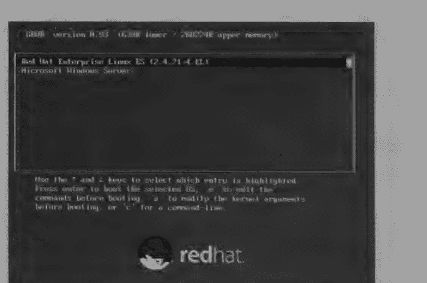

你可以设置在独立物理硬盘上带有操作系统的双启动。或者，你可以重新配置现有硬盘上的空空间。在第二种情况下，请务必遵循本章描述的程序。

无论你做什么，请从备份数据开始。错误在所难免，你希望从灾难中恢复。

## 简单方法：新硬盘

在本节中，我们描述了在现有计算机上安装 `Linux` 的最简单方法。你的 `BIOS` 应该自动检测第二块硬盘。当它检测到时，你就知道 `Red Hat` 安装程序 `Anaconda` 也应该自动检测到该硬盘。

### 在 32 位架构下配置 Microsoft 和 Linux

只要你将更改限制在空硬盘上，风险就是最小的。你可以配置并格式化分区，对现有硬盘上的 `Microsoft Windows` 数据产生的风险会更小。

**警告**：`Red Enterprise Linux` 服务器安装的默认设置将删除所有硬盘上的所有数据，如果其中包括 `Microsoft Windows`。

在本文编写时，`Red Enterprise Linux` 可以直接安装在普通的 `IDE` 或 `SCSI` 硬盘上。虽然你可以使用通过 `USB`、`IEEE 1394` 或并行端口连接的硬盘来存储 `Linux` 目录，但 `Anaconda` 可能不支持在这些硬盘上安装 `Red Hat Enterprise Linux`。

**注**：在本文编写时，`Red Enterprise Linux` 可以直接安装在普通的 `IDE` 或 `SCSI` 硬盘上。虽然你可以使用通过 `USB`、`IEEE 1394` 或并行端口连接的硬盘来存储 `Linux` 目录，但 `Anaconda` 可能不支持在这些硬盘上安装 `Red Hat Enterprise Linux`。

## 廉价方法：现有硬盘

并不是每个人都负担得起新硬盘。如果你必须使用现有硬盘，你需要对其进行分区以为两个操作系统留出空间。这个过程更复杂，但可以仔细完成。

如果你想使用现有硬盘，必须先使用实用程序对磁盘进行分区并为 `Linux` 创建空间。一旦创建了空间，你就可以像常一样进行安装。然而，仔细遵循步骤以避免数据丢失是非常重要的。

### VFAT 分区的分步操作

在了解“大局”之后，你已经准备好开始为 `Linux` 准备硬盘的分步操作了。本节假设你正在拆分格式化为旧版系统格式之一的分区——`FAT`、`FAT16`、`FAT32` 或 `VFAT`（在 `Linux` 计算机上均统称为 `VFAT`）。本节还假设你希望在已经安装了 `Windows` 的同一物理硬盘上安装 `Linux`。

> **警告** 本节使用了 `FIPS`。请在使用时自负并承担风险。`FIPS` 明确表示“不提供任何保证”。我使用它时没有出现问题；但是，使用 `FIPS` 很容易不小心破坏你的数据。

本节假设你的硬盘仅组织成了一个分区，所有空间都分配给了 `Windows` `C:` 盘。或者，如果其他方案提供的空间不足，你也可以使用这些步骤。

如果你已经有一个具有两个或多个分区的硬盘，你可能在 `Microsoft Windows` 中至少会看到一个 `C` 盘和一个 `D` 盘。如果你可以将所有文件移动到 `C` 盘，并且仍然留有足够的空间给 `Windows` 虚拟内存，你就可以跳过此过程。只需记住这些驱动器的大小，以帮助你在 `Linux` 安装过程中识别它们。

要为 `Linux` 准备硬盘，请按照以下步骤操作：

1. 找到你的硬盘容量和现有文件占用的空间。确定你想分配给 `Microsoft Windows` 和红帽企业 `Linux` 的空间。

2. 对硬盘进行碎片整理。使用“磁盘碎片整理”，它通常可以在 `Windows` 开始菜单的“程序/杂项/系统工具”文件夹中找到。具体的步骤和位置取决于你所使用的 `Microsoft Windows` 版本。

3. 准备一个分区切分器。如果你想使用 `FIPS.EXE`，请将其同 `RESTORRB.EXE` 和 `ERRORS.TXT` 一起复制到 `Windows` 或 `MS-DOS` 启动盘中。或者，你可以使用带有第三方分区切分器（如 `Partition Magic` 或 `System Commander`）的启动盘。在后续的步骤中，我假设你正在使用 `FIPS`。

你可以在带有软盘驱动器的 `Windows` 计算机上，通过 [www.bootdisk.com](http://www.bootdisk.com) 提供的下载内容来创建 `MS-DOS` 启动盘。我个人更倾向于使用 `Microsoft Windows 98` 启动盘。

4. 使用软盘启动你的计算机。当你看到 `D:` 或 `A:` 符时，运行 `FIPS` 命令。

5. 在看到关于不要在多任务环境中使用 `FIPS` 的警告后，你将看到“按任意键”继续的指示。

如果你有多个硬盘，系统会要求你选择；它们按照启动顺序列出，类似于此处所示。驱动器 1 应该是你计算机上的第一块 `IDE` 或 `SCSI` 硬盘。选择一个驱动器。

选择哪个驱动器 (1=0x80/2=0x81)

### 第 2 章 准备你的硬件

6. 接下来，如果你看到分区表（见图 2.3）列出所有四个主分区均在使用中，`FIPS` 将失败，因为它只能拆分主分区。如果你有多个可以拆分的分区，系统会要求你通过编号来选择它。

#### 图 2.3

`FIPS` 分区表

```
如果你使用 GCS2 或磁盘压缩工具，请阅读 FIPS.DOC 中的相关章节。
FIPS 不提供任何保证；详情请参见文件 COPYING
这是来自软件，欢迎在满足条件的情况下重新分发它；再次请参见文件 COPYING 详情。
按任意键
选择哪个驱动器 (1:0x80-2:0x81)? 2
分区表:
| | 起 | | 止 | | 起 | | MB |
|分区表:|头/磁道/扇区:|系统|头/磁道/扇区:| 扇区 | MB |
| 1 | 无 | 1 B | 1 | BCh: 254 1384 | 63 | 63: 2896472618236 |
| 2 | 无 | | | BCh: | | | | |
| 3 | 无 | | | BCh: | | | | |
| 4 | 无 | | | BCh: | | | | |
正在检查根扇区 ... OK
按任意键
```

7. 如果你看到以下消息，你必须从可用的主分区进行选择。做出选择并继续。（如果你选择了扩展分区，`FIPS` 将无法处理并终止。）

你想拆分哪个分区 (1/2/3)？

1. 你所选的分区将被扫描。你将看到有关分区的基本信息，并被询问是否要将启动扇区和根扇区的备份副本写入启动软盘。这是一个极佳的主意。对这两个问题都回答 `YES`。你会看到一条类似于正在写入文件 `a:\rootboot.000` 的消息。记下此文件。如果你遇到问题，可以使用 `RESTORRB` 命令恢复原始分区表。

2. 现在你可以定义将如何拆分分区了。使用方向键，你可以更改现有分区和新分区的大小。记住新分区的大小。

| 旧分区 | 磁道 | 新分区 |
|---|---|---|
| 4016.2 MB | 512 | 6220.5 MB |

3. 当你准备好后，按 `Enter` 键确认两个新分区。旧分区应包含现有数据。接下来，`FIPS` 将测试将被占据的空间。`FIPS` 将显示一个类似于图 2.3 的分区表，询问你是否要修改分区表。如果你选择 `R`，将恢复原始分区表。

4. 最后，系统询问你是否要写入新的分区方案。

5. 写入新分区方案后，`Linux` 应该就会显示。如果一切顺利，请按 `y` 继续。

### 并非所有硬件都是为 Linux 设计的


某些制造商会发布其硬件的源代码。其中一些代码甚至是在通用公共许可证（`GPL`）下发布的。这使得 `Linux` 开发者能够轻松为该硬件组件设计驱动程序。

然而，并非所有硬件都是为 `Linux` 设计的。例如，一组调制解调器和打印机（`Winmodems` 和 `Win-printers`）是专门为 `Microsoft Windows` 设计的。它们利用 `Microsoft Windows` 驱动库来运行。由于微软不发布其驱动程序的源代码，这使得 `Linux` 开发者很难创建驱动程序。奇怪的是，由于 `Microsoft Windows XP/2003` 的变化，许多 `Winmodems` 和 `Winprinters` 无法在这些最新的微软操作系统上正常运行。

* 许多 `Linux` 书籍建议你完全避免使用 `Winmods`。这可能已经不再必要了。我的笔记本电脑和台式电脑上的 `Linux` 都能识别我的 `Winmods`。

有时 `Linux` 开发者还没有时间为最新的组件创建驱动程序。本文的某些内容显示，`Linux` 驱动程序在三类设备上是不完整的：`USB`、`IEEE 1394` 和 `IEEE 802.11` 无线系统。`Linux` 对 `USB 1.x` 组件的支持良好，`USB 2.0` 需要支持增强型主机控制器接口（`EHCI`）的内核，而对于与 `Red Hat 9` 配套内核来说，这仍然是实验性的。

`Linux` 对某些 `IEEE 1394` 设备的支持以实验性驱动程序的形式提供。对普通无线网络（`IEEE 802.11b`）的支持良好；`IEEE 802.11a–11g` 的驱动程序在编写本文时刚刚证明是有效的（我已经在我的笔记本电脑上安装了一个）。在本章稍后的“问题待定的硬件”部分中，你可以找到那些开发这些前沿驱动程序的人的页面。

* 从 `8.0` 版本开始，`Red Hat Linux` 发行版不能再安装在带有 `386` 和 `486` 级 `CPU` 的计算机上。

### 红帽企业级 Linux 支持多种架构

你可以在各种计算机上安装 `Red Hat Enterprise Linux 3`，而不仅仅是带有 `Intel` 兼容 `CPU` 的 `32` 位 `PC`。然而，当你在一个不常见的平台上安装此操作系统时，经过认证的硬件变得更加重要。无法详细列出在所有支持的架构上可以做的事情。我在这里总结了这些：

* `x86` 基础 `32` 位架构构成了今天个人电脑和入门级服务器的基础。这一类包括带有兼容 `CPU` 的计算机，包括 `AMD` 和其他制造商制造的产品。奇怪的是，虽然通用的 `x86` 程序包是“`386`”格式，但 `Red Hat Enterprise Linux 3` 不能安装在带有 `Intel 386` 或 `486` 级 `CPU` 的计算机上。

取决于你获得的是 `WS`、`ES` 或 `AS` 版本，你可以在至少具有 `2` 个且最多 `16` 个 `CPU` 的计算机上进行设置。有不同的内核，针对不同的 `x86 CPU` 和内存级别进行了优化。红帽支持内存在 `256MB` 到 `64GB` 之间的计算机。

# 第 2 章 准备你的硬件

### Itanium

`Itanium CPU` 是英特尔的 `64` 位 `CPU`。`Red Hat Enterprise Linux` 支持带有 `1` 到 `8` 个 `CPU` 的 `Itanium2` 架构。它需要内存在 `512MB` 到 `32GB` 之间的系统。

它包含了可扩展固件接口，也称为 `EFI Shell`。它是与 `Itanium` 系统相关的命令行界面，你可以用它启动 `Red Hat Enterprise Linux 3` 的安装。

### AMD64

你可以在 `AMD 64` 位架构上安装 `Red Hat Enterprise Linux 3`。红帽支持带有 `1` 到 `4` 个 `CPU` 的这种架构。它需要内存在 `512MB` 到 `16GB` 之间的系统。基础安装与 `x86` 相同。

### IBM 架构

你可以在基于 `IBM` 的服务器平台上安装 `Red Hat Enterprise Linux Advanced Server`。有关可用选择以及在这些 `IBM` 服务器上设置分区的更多详细信息，请参阅 `www-1.ibm.com/servers/eserver/linux`。

### 寻找兼容硬件

红帽在其网站上包含了有关兼容硬件的最新信息。其网站上的硬件兼容性规范目前可以在 `hardware.redhat.com/hcl` 获取，如图 2.4 所示。`Linux` 兼容硬件通常被组织在所谓的硬件兼容性列表（`HCL`）。

图 2.4 Linux 兼容硬件

`img/2feb3b41073cd27e138a1bee4a0f2_65.png`

## 图 2.6

兼容的视频硬件

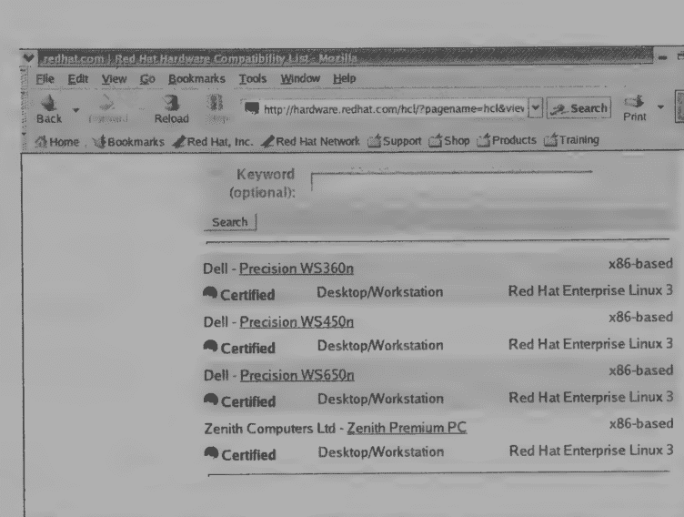

提示：当你寻找驱动程序时，可能并不需要完全匹配。例如，你可能可以使用来自同一制造商的旧版驱动程序来配置显卡。

**相机** 数码相机制造商通常使用专有的程序和接口。尽管有这些限制，`gPhoto2` 的开发者仍然开发了适用于数百台数码相机的软件（参见 `www.gphoto.com`）。

**FireWire / iLink / IEEE 1394** `FireWire` 和 `iLink` 是 `IEEE 1394` 标准的商业名称。它支持硬盘和视频摄像机等外部设备的高速数据传输。虽然内核对这些设备的支持官方仍标记为“实验性”，但可以通过 `www.linux1394.org` 获得帮助。

**显卡** `Red Hat Enterprise Linux` 与所有显卡都能良好工作，至少在第 3 节描述的 `VESA`（视频电子标准协会）模式下如此。但开发者一直在改进驱动程序。假设你使用的是默认的 `XFree86 Server`，你可能可以通过 `www.xfree86.org` 找到适用于你显卡的驱动程序。

**笔记本电脑** `Red Hat Enterprise Linux` 在大多数笔记本电脑上运行良好。我在我的笔记本电脑上安装它时仅进行了细微调整。然而，这存在风险，因为笔记本制造商使用了大量的专有软件。`www.linux-laptop.net` 的 `Linux on Laptops` 网页提供了许多用户在不同笔记本电脑上的经验。它帮助我以最少的问题安装了该操作系统。`Linux-Mobile-Guide` 在 `http://tkmobil.org/howtos.html` 提供了配置笔记本电脑和其他移动设备的详细信息。

随着网络速度增加，新的网卡正在开发中；你可能在热点 `CD` 上找不到千兆以太网或万兆以太网网卡的最新驱动程序。最新 `Linux` 网卡的开发工作由 `Scyld Computing` 赞助，可以在 `www.scyld.com/network` 找到。

**打印机** 所谓的 `Winprinter` 配置起来和 `Winmodem` 一样困难，而且带有新功能的打印机以惊人的速度发布。`www.linux-printing.org` 的开发者在开发新打印机和配置文件方面做了惊人的工作。

**扫描仪** `Scanner Now Easy (SANE)` 主页为在 `Linux` 上配置普通和 `USB` 扫描仪提供了提示和技巧。目前，`SANE` 开发的主页位于 `www.sane-project.org`。

**声卡** 声卡在 `Linux` 中可能很难配置。例如，某些声卡需要多个 `DMA` 通道；另一些可以配置为模拟一种 `Sound Blaster` 声卡。`Linux` 声卡支持的最新信息可以从高级 `Linux` 架构 (`ALSA`) 项目 `www.alsa-project.org` 获取。

**USB** 虽然 `Red Hat Enterprise Linux` 在安装过程中检测到 `USB` 键盘和鼠标，但目前 `Linux` 对 `USB` 设备的支持尚不理想。随着该行业转向将外部设备转换为 `USB` 和 `IEEE 1394` 标准，`Linux` 开发者将为每种类型的外部硬件创建新的驱动程序。截至本文，对于 `IEEE 1394` 和 `2.0` 标准的高速设备仍处于实验阶段。关于 `Linux` 支持 `USB` 的信息可以从 `Linux` 项目 `www.linux-us.org` 获取。

**Winmods** 如前所述，`Winmods` 依赖于 `Microsoft Windows` 驱动程序来支持其功能。然而，`Linmod` 项目背后的人员开发了可以与许多 `Winmods` 无缝协作的 `Linux` 驱动程序。其中许多已集成到 `Red Hat Enterprise Linux 3` 中。许多 `Winmods` 现在通过 `Linux` 即插即用总自动检测。但并不是所有的 `Winmods` 都能在 `Linux` 中运行。最新状态请查看 `www.linmodems.org`。

### 社区知识硬件

`Linux` 操作系统基于全球开发者的共同努力。`Linux` 社区的人们已经组织成不同的小组。如前所述，许多小组专门负责创建和更新特定类型硬件的驱动程序。他们的进展记录在自己的网站和邮件列表中。


当你想要获取关于 Linux 硬件的社区知识时，有四种研究方向的方法。`Linux Hardware HOWTO` 提供了 Linux 硬件兼容性的概览。然而，它可能不包含最新的硬件信息。在许多特定硬件的 Linux 支持小组的网站上可以获得更多数据，正如上一节所示。许多小组拥有开放的邮件列表，开发者在其中交换他们最新工作的信息。最后，用户经常在互联网新闻组中提问硬件问题。`http://groups.google.com` 提供了一个可搜索的新闻组数据库。

**注意**：在邮件列表或新闻组上提问之前，请先进行研究。许多 Linux 开发者都有工作，没有时间回答你可以在文档（如 `www.ldp.org` 上的 `LDP HOWs`）中找到答案。事实上，如果你浪费他们的时间，他们会表现出不耐。在新闻组或邮件列表上提问之前，请检查该主题的可用文档。搜索新闻组或邮件列表数据库以查看你的问题是否已经得到解答。

### 创建硬件清单

理想情况下，你应该收集计算机中每个硬件组件的信息。本节提供了一个你所需信息的清单。一旦确定了硬件，你就可以检查 `Red Hat` 和其他网站查找你可能需要的驱动程序和配置提示。

在安装 `Red Hat Enterprise Linux 3` 之前，你至少应该获取显卡和显示器的规格。一旦安装了 Linux，测试每个硬件组件。列出那些难以配置或无法配置的组件。

换句话说，你应该知道你电脑上至少优先组件的品牌、型号和规格。

## 收集信息

在启动 `Red Hat Enterprise Linux 3` 之前，你应该获取显卡和显示器的规格。安装 Linux 后，测试每个硬件组件。大多数组件会自动检测。更多信息请参见 `www.redhat.com/software/`。

## 收集驱动程序

大多数硬件组件的驱动程序已包含在 `Red Hat Enterprise Linux` 安装 CD 中。大多数驱动程序在安装过程中会自动配置。

`Red Hat Enterprise Linux 3` 不包含所有硬件的驱动程序。没有任何微软操作系统包含所有硬件的驱动程序。收集额外驱动程序的方法有两种。一种是基于之前讨论的社区知识。另一种基于制造商创建的驱动程序。

许多硬件制造商对 Linux 非常友好。记住，`IBM` 仅在 2001 年就向 Linux 开发投入了超过十亿美元。许多制造商效法他们，为其硬件提供了 Linux 驱动程序。许多 Linux 驱动程序可以从制造商网站下载。

#### 硬件清单

为了方便起见，本节包含了你应该为 `PC` 收集的硬件信息。如果你有一组配置相似的 `PC`，这更为重要，以避免可能产生昂贵的错误。表 2.4 列出了你需要详细说明的硬件。

你应该对不符合即插即用标准的设备做特别说明。你可能需要在 `BIOS` 中解决此类硬件的 `IRQ` 端口或 `I/O` 地址。

### 表 2.3：优先硬件

| 组件 | 需要的信息 |
|---|---|
| `CPU` | `Red Hat Enterprise Linux 3` 至少需要 300MHz `CPU` |
| `RAM` | `Red Hat Enterprise Linux 3` 至少需要 256MB `RAM` |
| 显卡 | 你需要了解显卡的情况 |
| 显示器 | 你应该知道显示器的能力：其分辨率以及刷新率。如果显卡输出的刷新率超过显示器的能力，请小心 |

### 表 2.4：硬件清单

| 组件 | 详细信息 |
|---|---|
| `CPU` 类型、速度 | |
| `RAM` 内存，以 MB 为单位 | |
| 键盘、品牌、型号 | |
| 鼠标、协议、品牌、按键 | |
| 硬盘 1 大小 | |

## 表 2.4: 硬件检查清单（续）

| 组件 | 详情 |
|--- | :--- |
| 分区和挂载点，例如 `/home` 和 `/dev/sda` | |
| 硬盘 2 大小 | |
| 分区和挂载点，例如 `/var` 和 `/dev/sdb1` | |
| 硬盘 3 大小 | |
| 分区和挂载点，例如 `/usr` 和 `/dev/sdc` | |
| 硬盘 4 大小 | |
| 分区和挂载点，例如 `/boot` 和 `/dev/hda1` | |
| `CD` 驱动器，类型 | |
| `DVD` 驱动器，类型 | |
| `SCSI` 适配器，品牌、型号 | |
| 网卡，品牌、类型、型号、速度 | |
| 网卡 2，品牌、类型、型号、速度 | |
| 电话调制解调器，品牌、型号、速度 | |
| 显卡，内存、品牌、型号、垂直和水平刷新率 | |
| 显示器，品牌、垂直和水平刷新率 | |
| 声卡，品牌、型号、芯片组 | |
| `USB` 设备 1，品牌、型号 | |
| `USB` 设备 2，品牌、型号 | |
| `USB` 设备 3，品牌、型号 | |
| `IEEE 1394` 设备 1，品牌、型号 | |
| `IEEE 1394` 设备 2，品牌、型号 | |

#### BIOS 提示

你可能可以在计算机的 `BIOS` 中配置三项内容。首先是硬盘启动项。其次是启动顺序；例如，你可以配置 `BIOS` 从适当的 `CD` 启动红帽企业级 Linux 安装程序。最后，你可能还可以预留关键的通信通道，例如 `IRQ` 端口和 `I/O` 地址。

**注意**：本节假设你正在使用具有 `x86 AMD64` 架构的计算机。其他架构需要不同的操作，你可以在红帽官方文档（`www.redhat.com/docs`）中找到这些内容。

# 第 2 章 准备你的硬件

有多种 `BIOS` 菜单可用。因此，无法提供如何配置 `BIOS` 的具体说明。具体取决于 `BIOS` 菜单以及你可能安装的任何升级。

通常情况下，你可以通过按下 `F1`、`F2` 或 `Del` 键来查看你的 `BIOS`。如果这些命令之一没有启动你的 `BIOS`，请咨询你的 `PC` 或主板的文档。在 `BIOS` 菜单中，你应该能看到检测到的驱动器。

**注意**：对于康柏（`Compaq`）和宏（`Acer`）计算机，你需要按下 `Ctrl+Alt+Esc` 来访问 `BIOS` 菜单。自然，这些指令不适用于 `Itanium` 64 位 `CPU` 系统或 `IBM` 服务器。

### IDE 驱动器

在标准 `PC` 上，你可能最多有四个 `IDE` 驱动器。它们可能是硬盘或 `CD/DVD` 驱动器，并且在 `BIOS` 中应被识别为相应的设备。标准 `PC` 有两个 `IDE` 适配器：主和一个从。每个适配器可以连接两个不同的设备：Linux 将设备文件与这些驱动器关联，如表 2.5 所示。

## 表 2.5: LINUX IDE 驱动文件

| 驱动器 | 设备 |
|--- | :--- |
| 主主 (`Primary master`) | `/dev/hda` |
| 主从 (`Primary slave`) | `/dev/hdb` |
| 从主 (`Secondary master`) | `/dev/hdc` |
| 从从 (`Secondary slave`) | `/dev/hdd` |

### SCSI 驱动器

有几种不同类型的 `SCSI` 标准。`SCSI-1`、`SCSI-2` 和 `SCSI-3` 与最高 80MB 的数据传输相关。每个 `SCSI` 设备都有一个 `ID`，指定了它的优先级。`SCSI` 硬盘可以安装在内部或外部。大多数新的 `BIOS` 至少会在启动顺序中检测 `SCSI` 驱动器。

**注意**：截至本文写作，你无法在没有 `LUN` 号的情况下从 `IEEE 1394 SCSI` 驱动器启动。

#### 启动顺序

在 `BIOS` 中，你应该看到“启动顺序”（`Boot Sequence`）菜单，它允许你指定启动顺序。你的 `PC` 可以此配置启动顺序；例如，你可以配置 `BIOS` 从适当的 `CD` 启动红帽企业级 Linux 安装程序。`BIOS` 会检查 `/boot` 位于 `/dev/hda` 或 `/dev/hdb` 的驱动器。

### 非即插即用硬件 (Non-Plug-and-Play)

虽然 Linux 现在可以检测大多数即插即用硬件，但某些旧设备不符合即插即用标准。

### 安装后硬件配置

红帽键盘、鼠标和配置工具是直观的。

#### 使用 redhat-check 进行快速检查

`redhat-check` 工具是直观的。在命令行界面运行时，它会检查你的系统以确保其支持。Linux 能够让你查看 `/proc` 目录中连接的硬件。

如表 2.6 所示，`/proc` 中的各种文件提供了额外的硬件信息。

## 表 2.6: /proc 中的关键硬件文件

| 文件 | 描述 |
|--- | :--- |
| `apm` | 高级电源管理 |
| `cpuinfo` | 检测到的 `CPU` |
| `dma` | 分配的 `DMA` |
| `ide` | 指定 `IDE` 设备的目录 |
| `interrupts` | 分配的 `IRQ` |
| `ioports` | 分配的 `I/O` 地址 |
| `modules` | 安装的模块；同 `ls` 输出 |
| `partitions` | 基本分区信息 |
| `pci` | 检测到的 `PCI` 设备 |
| `scsi` | 指定 `SCSI` 设备的目录 |

信息非常详细。例如，查看图 2.8 中的 `/proc/cpuinfo` 文件。它不仅显示了 `CPU` 的额定速率和有效速度，还显示了缓存大小，这是 `CPU` 的另一个指标。你将在第 12 章看到它的作用。

## 图 2.8 CPU 上的内核信息


```
processor : 0
vendor_id : GenuineIntel
cpu family : 15
model : MobileIntel(R) Celeron(N) CPU 2.40GHz
stepping : 9
cpi rev : 2992.428
cache size : 256 KB
fdio_bug : no
hlt_bug : no
fdc_bug : no
cma_bug : no
fpe : yes
fp_exception : 2
cpuid level : 2
flags : i fme vde pse tsc mca par mex cx8 sep mtr pge cmov pat serb self clflush dts ssr mem ser see2 as bt tm
bogips : 4771.02
-
/proc/cpuinfo
```

## 红帽硬件浏览器

红帽硬件浏览器从 `/proc` 目录中获取一些信息，并以更易读的格式将其收集起来。例如，图 2.9 展示了检测到的 CD-RW/DVD 驱动器，这在 `/proc/scsi/scsi` 配置文件中有所记录。

硬盘选项可能特别有趣，因为它以类似于你在安装过程中看到的 Disk Druid 工具的格式展示了检测到的分区和文件系统。

### 图 2.9 硬件浏览器


## 第 2 章 硬件准备

## 红帽键盘工具

你可以配置对应于多种语言、方言或系统的键盘。你可以使用红帽键盘实用程序来设置与你的系统最匹配的键盘，操作方法是选择“主菜单 > 系统设置 > 键盘”，或者从 GUI 命令行界面运行 `redhat-keyboard` 命令。这将打开图 2.10 所示的“键盘”窗口。

### 图 2.10

选择键盘

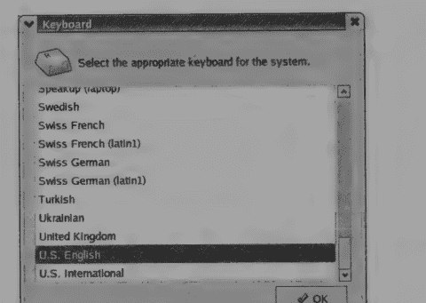

你从图中可以看到，对于不同的语言和国家/地区，可以有多个键盘。如有必要，请选择最适合你硬件的键盘并点击“确定”。更改将反映在 `/etc/sysconfig/keyboard` 中。

提示：如果你在文本模式控制台下运行 `redhat-config-keyboard`，该实用程序将在蓝色的文本模式、低图形界面屏幕上为你提供相同的选项（但顺序不同）。

## 红帽鼠标配置工具

你可以配置许多类型的指针设备。今天最常见的指针设备是鼠标；事实上，在配置过程中，“指针设备”和“鼠标”这两个术语是通用的。要配置默认指针设备的设置，请启动红帽鼠标配置实用程序。

通过选择“主菜单 > 系统设置 > 鼠标”，或从 GUI 命令行界面运行 `redhat-mouse` 命令来启动此实用程序。这将打开图 2.11 所示的“鼠标配置”窗口。

默认设置位于你当前的 `/etc/sysconfig/mouse` 文件中。你所做的更改都会被写入其中。如果你有一个双键鼠标，可能想要激活“模拟 3 键点击”选项。这允许在你同时按下左键和右键时，让鼠标模拟中键的功能。KDE 使用鼠标中键打开命令弹出菜单。

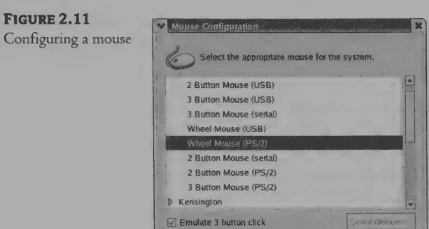

如果你有一个连接到串口的鼠标，你将能够选择“串口设备”。这将打开一个菜单，你可以在其中选择正在使用的实际串口。如果你以前在这台电脑上使用过微软操作系统，你应该根据表 2.7 将鼠标设置为相应的微软 COM 口。

### 表 2.7：鼠标串口设备

| 设备文件 | 描述 |
|---|---|
| `/dev/ttyS0` | 对应微软 `COM1` 端口 |
| `/dev/ttyS1` | 对应微软 `COM2` 端口 |
| `/dev/ttyS2` | 对应微软 `COM3` 端口 |
| `/dev/ttyS3` | 对应微软 `COM4` 端口 |

> 这些串口设备还有助于配置许多电话调制调器。如果你在微软 Windows 中配置了调制调器，请注意与调制调器相关的 `COM` 口。如果你运行 `ls -l /dev/modem` 命令，你可能会看到指向表 2.7 中对应设备文件的链接。还有其他 `COM` 口可用，特别是当你有一个软件调制调器（`Winmod`）时。在这种情况下，你需要访问 `www.linmodems.org` 获取更多信息。

如果你执行了更改并选择了 `redhat-config-mouse`，Linux 会停止并重启鼠标控制台。

> 你不需要 GUI 即可运行 `redhat-config-mouse`：如果你在文本控制台中，红帽会自动启动该实用程序的文本模式版本。

## 声卡管理 (`redhat-config-soundcard`)

红帽企业 Linux 允许你配置许多类型的声卡。要设置默认指针设备的设置，请启动红帽声音配置实用程序。

通过选择“主菜单 > 系统设置 > 声卡检测”，或从 GUI 命令行界面运行 `redhat-config-soundcard` 命令来启动此实用程序。这将打开图 2.12 所示的“音频设备”窗口。

### 图 2.12

配置声卡

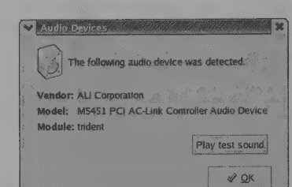

如果 `redhat-config-soundcard` 在你的系统中检测到声卡，你将在“音频设备”窗口中看到声卡的制造和型号。你可以通过点击“测试”按钮来测试结果。假设你有一个声卡、驱动程序已检测且扬声器已连接，你应该听到声音和一个确认结果。如果 Linux 需要为你的声卡安装模块，它们将在 `/etc/modules.conf` 中更改。

注意：红帽不再包含 `sndconfig`。

### 强制硬件检测

如果红帽企业 Linux 没有检测到硬件的添加或删除，启动红帽硬件发现实用程序（也称为 `udev`）可以帮助你检测更改。如果你安装或删除了“热插拔”组件，你可能需要运行它。如果它发现了新设备，它将通过显示图 2.13 的屏幕提议配置硬件。

## 总结

在安装红帽企业 Linux 之前，你需要先准备好硬件。如果你需要在同一台电脑上配置 Linux 和另一个操作系统（如微软 Windows），则需要进行特殊的准备。如果你已经安装了微软 Windows，最好的办法是在第二块硬盘上安装 Linux。红帽企业 Linux 安装程序 `Anaconda` 应该能检测到硬盘并在其上配置分区。使用 `Defragment`（磁盘碎片整理），你可以分割现有分区，然后在新创建分区的空闲区域安装 Linux。

### 图 2.13

使用 `udev` 检测硬件更改

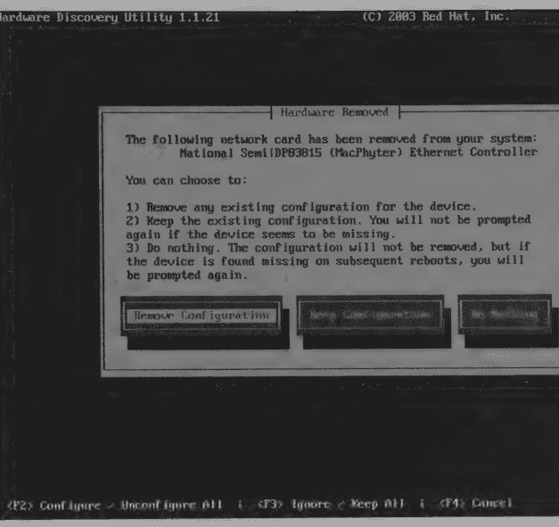

在安装红帽企业 Linux 之前，你需要先准备好硬件。如果你需要在同一台电脑上配置 Linux 和另一个操作系统（如微软 Windows），则需要进行特殊的准备。如果你已经安装了微软 Windows，最好的办法是在第二块硬盘上安装 Linux。红帽企业 Linux 安装程序 `Anaconda` 应该能检测到硬盘并在其上配置分区。使用 `Defragment`，你可以分割现有分区，然后在新创建分区的空闲区域安装 Linux。

# 从启动盘开始

在大多数情况下，你可以直接从 CD 驱动器安装 Red Hat Enterprise Linux。你只需要重新配置 BIOS 菜单中的设置，以便直接从该驱动器启动，正如第 2 章末尾描述的（我们在随后的注释中简要描述了替代方案）。然而，在某些情况下，你需要一个启动盘：

- 你无法将 BIOS 设置为从 CD 启动。
- 你的 CD 无法读取第一次 Red Hat 安装的启动文件。
- 你从其他源安装 Red Hat Enterprise Linux，例如通过网络从另一台计算机（在第 4 章中介绍）。如果你可以从 CD 启动，你可能更倾向于创建一个较小的 `boot.iso` CD 以达到此目的。

如果你需要从启动软盘安装 Red Hat Enterprise Linux，你可能需要一张到四张 1.44MB 的软盘，这取决于你的安装方法和硬件。

你可以从第一次 Red Hat 安装 CD 中 `/image` 目录下的 `.img` 文件创建这些软盘。该目录中的关键文件总结在表 3.1 所示。

### 表 3.1：RED HAT ENTERPRISE LINUX 安装镜像

| 镜像文件 | 描述 |
|---|---|
| `bootdisk.img` | 用于所有本地和网络安装的标准启动盘。 |
| `drvblock.img` | 块设备（存储设备）的驱动盘。 |
| `drnnet.img` | 网络适配器的驱动盘。 |
| `pcmciadd.img` | PCMCIA 硬件的驱动盘。 |
| `boot.iso` | 包含驱动程序的合一启动盘。虽然它无法放入单个 1.44MB 软盘中，但可以安装在微型 CD 上。 |


> **注意：** 本节内容与第 4 章中的启动盘部分内容密切相关（并在某种程度上有所重复）。如果你正在使用带有 `PPC` CPU 的计算机，可以使用系统管理服务（System Management Services）菜单将系统设置为从 `CD` 启动。如果你正在使用 `Itanium` 系统，可以通过 `EFI shell` 进行设置。如果你正在使用 `IBM S/390`，可以配置系统从虚拟机 (`VM`) 或逻辑分区 (`LPAR`) 启动，这与标准的 `PC` 硬盘逻辑分区不同。虽然本书书侧重于在 `x86` 或 `AMD64` 上进行安装，但你可以通过 `Red Hat` 安装文档找到更多关于其他架构的信息，可在 `www.redhat.com/doc/manuals/enterprise` 在线。

#### 创建启动盘或驱动盘

`Red Hat Enterprise Linux` 提供了四种工具来帮助你创建启动和驱动软盘。其中两个（`dd` 和 `cat`）在 `Linux` 中运行；另外两个（`WRITE` 和 `RAWWRITE`）在 `Microsoft Windows` 中运行。这些工具是你可以从其他 `Linux` 或 `Unix` 系统运行的标准命令；镜像文件和 `Microsoft` 工具可以在第一张 `Red Hat Enterprise` 安装 `CD` 上找到。

如果你当前正在运行 `Linux` 计算机，请按照以下步骤创建启动盘。记住，正如后续章节所述，你可能需要一张或多张驱动盘。

1. 在命令行界面，找到镜像文件。例如，如果你使用命令：

```
#### mount /mnt/cdrom
```

来挂载第一个 `Red Hat Enterprise Linux` 安装 `CD`，则镜像文件将位于 `/mnt/cdrom/images` 目录。

2. 将一张 `1.44MB` 磁盘插入软盘驱动器。你不需要对该驱动器使用 `mount` 命令。

3. 使用以下命令之一将启动盘镜像 `bootdisk.img` 转换为软盘上的系列文件（`/dev/fd0` 是你计算机上第一个软盘驱动器的关联设备）：

```
#### dd if=/mnt/cdrom/bootdisk.img of=/dev/fd0
#### cat /mnt/cdrom/images/bootdisk.img > /dev/fd0
```

4. 对 `images` 目录中可能需要的任何驱动盘重复这些步骤。

如果你在 `Microsoft Windows` 中并想从命令行界面创建启动盘，请按照以下步骤创建该磁盘。记住，正如后续章节所述，你可能还需要为一个或两个驱动盘重复此过程。

1. 将第一张 `Red Hat` 安装 `CD` 插入驱动器。这些步骤假设它是 `F:` 驱动器，但如果你的驱动器号不同，请相应替换。

2. 进入 `MS-DOS` 提示符。选择“开始” > “运行”。在出现的运行对话框中，在文本框输入 `CMD` 并按回车。这将打开一个命令提示符窗口。

3. 在命令窗口中输入 `F:` 工具并运行以下命令；在提示时将一张 `1.44MB` 磁盘插入软盘驱动器：

```
F:\>DOSUTIL/WRITE.EXE
Enter disk source file name: /IMAGES/BOOTDISK.IMG
Enter target diskette drive: A:
Please insert a formatted diskette into drive A and press -ENTER:-
```

5. 对 `IMAGES` 目录中其他所需的磁盘镜像重复此过程。

你也可以使用 `Microsoft Windows` 通过使用 `RAWWRITEWIN.EXE` 工具创建启动盘，正如后续章节所述，你可能还需要一个或两个驱动盘。

1. 将第一张 `Red Hat` 安装 `CD` 插入驱动器。这些步骤假设 `CD` 使用的是 `H:` 驱动器，但如果你的驱动器号不同，请相应替换。

# 第 3 章：在独立系统上安装 LINUX

2. 进入该工具。打开 `Microsoft Windows` 资源管理器。选择“开始” > “运行”。在出现的对话框中，在文本框输入 `EXPLORER` 并按回车。这将打开 `Microsoft Windows` 资源管理器。

3. 导航到 `H:` 驱动器，然后进入 `DOSUTILS` 文件夹内的 `RAWWRITEIN` 文件夹。然后你可以双击 `RAWWRITEIN.EXE` 工具。（是的，`RAWWRITEIN` 文件夹的拼写与 `RAWWRITEIN.EXE` 工具不同：）

4. 这将打开 `Raw Write` 对话框，如图 3.1 所示。如有必要，创建“Write”选项卡。点击“Image File”框右侧的按钮；你应该能够在“打开”对话框从 `H:IMAGES` 目录访问你选择的镜像文件。

# 图 3.1

使用 `RawWrite` 创建启动软盘

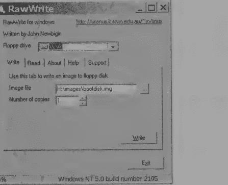

5. 将一张 `1.44MB` 磁盘插入软盘驱动器，并点击 `Write`。对其他所需的磁盘镜像重复此过程。

# 分析 Red 启动软盘

无论你用什么创建它，`Red Hat Enterprise Linux` 软盘的目的和内容保持不变。

> **注意：** 本节内容密切相关（并在某种程度上有所重复）第 4 章中的启动盘部分。如果你正在使用带有 `PPC` CPU 的计算机，可以使用系统管理服务菜单将系统设置为从 `CD` 启动。如果你正在使用 `Itanium` 系统，可以通过 `EFI shell` 进行设置。如果你正在使用 `IBM S/390`，可以配置系统从虚拟机 (`VM`) 或逻辑分区 (`LPAR`) 启动，这与标准的 `PC` 硬盘逻辑分区不同。虽然本书侧重于在 `x86` 或 `AMD64` 上进行安装，但你可以通过 `Red Hat` 安装文档找到更多关于其他架构的信息，可在 `www.redhat.com/doc/manuals/enterprise` 在线。

无论你用什么创建它，`Red Hat Enterprise Linux` 软盘的目的和内容保持不变：`images` 目录下的 `bootdisk.img`。

如图 3.2 所示，`syslinux.cfg` 文件提供了后续操作的路线。表 3.2 描述了关键命令并有助于解释 `syslinux.cfg`。

**提示：** 你可以使用 `Red Hat` 启动软盘或 `CD` 作为救援磁盘。使用第 11 章描述的技术，它可以帮助你从故障中恢复。

# 图 3.2

`Linux` 启动

```
default linux
prompt
timeout 600
display boot.msg
f1 boot.msg
f2 options.msg
f3 general.msg
f4 parse.msg
f5 rescue.msg
f7 snake.msg
label linux
    kernel vmlinux
    append initrd+initrd.img
label text
    kernel vmlinux
    append initrd+initrd.img
label export
    kernel vmlinux
    append initrd+initrd.img
label lowres
    kernel vmlinux
    append initrd+initrd.img
```

# 表 3.2：SYSLINUX.CFG 中的命令

| 命令 | 描述 |
|---|---|
| `default` | 指定默认启动选项，在此情况下为 `linux`。 |
| `prompt` | 设置启动：提示。 |
| `timeout` | 配置启动盘自动启动默认选项之前的延迟时间（单位为秒），通常设置为 `600`，即一分钟。 |
| `display` | 指向显示在屏幕上的初始消息文件。 |
| `option.msg` | 设置与特定消息文件关联的功能键。 |
| `label` | 指定与之关联的操作。 |
| `kernel` | 设置启动磁盘上压缩内核的名称。 |
| `append` | 添加启动磁盘加载内核的参数。 |
| `initrd` | 指定初始 RAM 磁盘。 |
| `text` | 以文本模式启动；见第 4 章。 |
| `expert` | 以专家模式启动，在其中指定硬件驱动程序。 |
| `ks` | 使用 `Kickstart` 文件启动；见第 5 章。 |
| `lowres` | 以低分辨率 ×`640×400` 图形模式和基本 `VESA` (`SVGA`) 驱动程序启动安装。 |

# 分析存储设备驱动器磁盘

如果 `Anaconda` 检测到电脑连接了硬盘，你无法安装红帽企业 Linux（`Red Hat Enterprise Linux`）。标准的启动磁盘（`bootdisk.img`）通常可以识别标准的 `IDE`、`SCSI` 甚至连接到 `PC` 的某些 `USB` 硬盘；所需的驱动程序已集成在压缩后的内核中。

这就是为什么你可能想要从第一张红帽企业 Linux 安装光光盘的 `images` 目录下的 `drvblock.img` 文件创建一个 `1.44MB` 的软盘。使用本章早些描述的任何技术来创建此磁盘。它在软盘上加载 5 个文件，我在表 3.3 中简要描述了它们。


# 表 3.3：存储设备驱动器磁盘 (DRBLOCK.IMG) 中的文件

| 文件 | 描述 |
|---|---|
| `modinfo` | 包含设备驱动程序列表及描述 |
| `modules.cgz` | 包含 `modinfo` 中列出的所有驱动程序的压缩版本 |
| `modules.dep` | 包含依赖关系列表，换句话说，每个设备所需的驱动程序 |
| `modules.pcimap` | 支持 PCI 驱动程序和控制器 |
| `pcitable` | 为每个设备配置 PCI 设置 |
| `rhdd` | 将此驱动器磁盘标记为：“辅助块设备驱动程序” |

# 分析网络设备驱动器磁盘

除非 `Anaconda` 检测到电脑连接了网卡，否则你无法通过网络安装红帽企业 Linux。标准的启动磁盘（`bootdisk.img`）不包含任何网络驱动程序，因此你需要一个用于网络辅助驱动磁盘。

你可以从第一张红帽企业 Linux 安装光盘的 `images` 目录下的 `drvnet.img` 文件创建一个 1.44MB 的软盘。使用本章早些描述的任何技术来创建此磁盘。它在软盘上加载 6 个文件，在功能上与表 3.3 描述的存储设备驱动器磁盘上的文件相似。虽然内容发生了变化，但文件名与之前相同。

# 分析 PCMCIA 驱动磁盘

在笔记本电脑上安装红帽企业 Linux 通常会产生特殊问题。笔记本电脑通常依赖 PCMCIA 卡（个人计算机国际协会指定）来连接网络、`SCSI` 设备，这些信用卡大小的适配器有时被称为 PC 卡。红帽在 `pciadd.img` 文件中包含了许多主要的 PCMCIA 插槽、网络和 `SCSI` 驱动程序。

你可以从第一张红帽企业 Linux 安装光盘的 `images` 目录下的 `pciadd.img` 文件创建一个 1.44MB 的软盘。使用本章早些描述的任何技术来创建此磁盘。它在软盘上加载 6 个文件，在功能上与表 3.3 描述的存储设备驱动器磁盘上的文件相似。虽然内容发生了变化，但文件名与之前相同。

#### 启动 ISO

第一张红帽企业 Linux 安装光盘的 `/images` 目录中还有一个文件：`boot.iso`。你可以使用第 14 章中 `dd` 命令描述的技术从这个 3MB 的文件创建启动光盘。它适用于同时进行网络安装，此时你不需要到处去加载和卸载启动磁盘和驱动磁盘。

当你将 `boot.iso` 刻录光盘时，其内容与标准的红帽启动软盘非常相似。它有两个主要区别：所有文件都在 `isolinux` 子目录下，并且与上述驱动磁盘相关的驱动程序合并在了初始内存磁盘文件 `initrd.img` 中。

### 检查安装光盘

在从安装光盘启动红帽企业 Linux 之前，你应该检查这些光盘的完整性，以确保光盘上的所有包都是完整的。红帽光盘上约有 1100 个可用包，其中只要有一个坏包就会导致你的安装光盘停止。

检查光盘有两种基本方法。一种是使用 `linux mediacheck` 命令启动引导过程；另一种是基于光盘上二进制代码的统计检查。

> 我在没有进行检查的情况下完成了红帽的安装过程——在完成了配置红帽企业 Linux 所需的所有工作后，我看到安装因为单个坏包在第三张光盘处戛然而止。我别无选择只能从头开始。

# 使用 mediacheck 检查光盘

要检查你的红帽企业 Linux 安装光盘，请从启动软盘或第一张安装光盘启动电脑。在启动提示符处运行 `linux mediacheck` 命令，如图 3.3 所示。

图 3.3

从 `mediacheck` 开始


| 要安装或升级 (INTER) 内核。 | 生成介质的企业级 Linux 命令 |
|---|---|
| 要安装或升级 `linux` 内核 (INTER)。 | 构建介质的企业级 Linux 命令 |
| 下面列出了功能键以获取更多信息。 | |
| `linux mediacheck` | |

# 第 3 章：在独立系统上安装 LINUX

`Anaconda` 继续安装一个仅用于安装过程的通用内核。你看到的第一个提示符（如图 3.4 所示）允许你测试光盘的完整性。如果你选择“跳过”（`Skip`），`Anaconda` 将继续安装过程。请选择“确定”（`OK`）；检查光盘很重要。

**注意** 如果你使用的是从下载的 `.iso` 文件创建的光盘，则不需要运行 `linux mediacheck` 命令。你将收到图 3.4 所示的提示。有关下载和创建红帽企业 Linux 光盘的更多信息，请参见引言。

这种模式不仅限于红帽企业 Linux 3 的光盘。我使用红帽企业 Linux 3 的 `mediacheck` 功能检查了一张红帽 Linux 9 安装光盘。在下一个屏幕（图 3.5）中，你可以选择测试当前驱动器中的光盘，或将其弹出以测试另一个不同的安装光盘。

图 3.4

`Anaconda` 建议检查你的光盘。

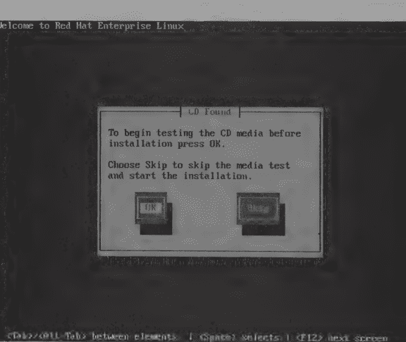

图 3.5

准备好测试


## 逐步安装红帽 Linux

现在你已经检查了光盘，就可以开始在电脑上安装红帽 Linux 了。安装过程并不像我描述的复杂——在第 5 章中，我将教你如何自动化这个过程，以便在多台计算机上安装红帽 Linux。但在自动化之前，你需要了解细节。我将安装过程分为以下几个部分：

- 选择安装提示：描述了你在提示符处可以做什么。
- 配置基本参数：允许你检查键盘和鼠标，以及 `Anaconda` 过程中使用的语言。
- 设置硬盘：详细说明了如何配置不同类型的分区。
- 配置安装细节：允许你检查红帽安装的细节配置。
- 选择软件包组：查看你可以随红帽 Linux 安装的各种软件包组以及单个软件包选项。
- 管理安装后步骤：帮助你配置 `X Window` 并为新系统创建启动磁盘。

这些步骤假设你从安装光盘安装红帽 Linux。如果你更想通过网络安装红帽企业 Linux，请阅读第 4 章。这些步骤还假设你已按照第 2 章更改了初始引导序列，从第一张红帽安装光盘启动。在 `x86` 或 `AMD64` 系统上，这是通过 `BIOS` 完成的。如果没有，请确保系统首先从你的软盘启动，或创建一个启动磁盘。

# 红帽企业 Linux 3 自带

红帽企业 Linux 3 `WS`（工作站）包含的软件与红帽企业 Linux 3 服务器版几乎完全相同。事实上，唯一的区别在于第一张光盘。服务器版本包含了 22 个工作站版没有的服务器包，包括：

- 字体 `AMANDA`，高级自动网络磁盘备份工具
- `DNS`（域名系统服务）服务器
- `DHCP` 服务器
- `FreeRADIUS`，通常由互联网服务供应商使用
- 新闻消息服务
- `Kerberos 5` 服务器
- 轻量级目录访问协议 (`LDAP`) 服务
- 无盘工作站服务器
- `Tux` Web 服务器
- 非常安全的 `FTP` 服务
- 网络信息服务 (`NIS`) 服务器

如你所示，此列表并不包含所有与 Linux 相关的服务。例如，你仍然可以在红帽企业 Linux 3 工作站版上配置 Web 服务、`Samba`、`NFS` 等。

注意：可以通过 `NFS`（网络文件系统）连接启动图形化安装过程。有关设置基于 `NFS` 的网络安装的更多信息，请参阅第 4 章，并返回此处查看图形化安装步骤。

## 选择安装提示选项

你可以通过从两个源之一启动计算机来启动安装过程：第一个是 Red Hat 安装光盘或启动盘。任何一种介质都会带你进入图 3.7 所示的启动屏幕。当你看到此屏幕时，请在 60 秒内按下 `F2`。否则，Red Hat Enterprise Linux 将自动进入图形模式进行安装。

### 图 3.7

安装提示

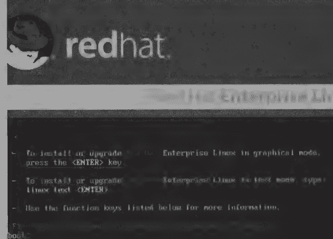

如你所见，有多个菜单可用。我们将检查不同的安装界面，第一个屏幕上的选择是基础的：你可以选择以图形模式或文本模式安装 Red Hat Enterprise Linux。本章重点关注图形模式，第 4 章重点关注文本模式。当你按下 `F5` 时，`Anaconda` 将带你进入救援模式帮助屏幕，该屏幕与安装无关，将在第 11 章中介绍。

准备就绪后，按下回车键启动图形模式安装，或输入 `text` 并按回车键启动文本模式安装。我认为通过网络安装更高效，特别是在企业环境中。我将在第 4 章向你展示如何进行这种设置。

然而，如果你在安装过程中遇到问题，可能想要重新开始并尝试其他方法。因此，请进入“安装程序启动选项”部分查看你可以在启动提示符处运行的各种命令。

## 安装程序启动选项

安装 Red Hat Enterprise Linux 有多种不同的方法。你可以禁用对问题硬件的探测，并可以从第一张光盘设置网络安装。要查看这些某些选项，按下 `F2`。这将带你进入图 3.8 所示的安装程序启动菜单。表 3.4 简要描述了此菜单中的不同选项。

### 图 3.8

安装程序启动菜单

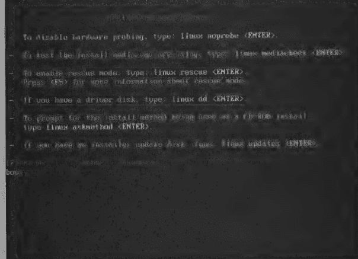


## 表 3.4：安装程序启动选项

| 选项 | 描述 |
|---|---|
| `linux noprobe` | 在不自动检测硬件的情况下启动安装过程；你需要从列表中为任何 SCSI 硬盘和网卡选择驱动程序。 |
| `linux mediacheck` | 以文本模式提示启动安装过程，允许你检查 Red Hat 光盘的完整性；默认在图形模式下继续。 |
| `linux rescue` | 以救援模式启动基础 Linux 系统，该系统会尝试检测当前的 Linux 安装。更多信息请参阅第 11 章。 |
| `linux dd` | 带有驱动盘提示启动安装过程；适用于第三方驱动程序。 |
| `linux askmethod` | 启动安装过程；允许你选择语言和键盘，然后允许你从本地或网络安装选项中进行选择。 |
| `linux updates` | 支持使用自定义安装程序更新磁盘更新当前软件包。 |
| `linux lowres` | 在低分辨率图形模式（640×400）下启动安装，也称为 VGA（视频图形适配器）。 |

## 逐步安装 RED HAT ENTERPRISE LINUX

你可以在文本模式下运行这些安装选项中的任何一个；只需将`linux`替换为`text`。

注意：之前的 Red Hat Linux 版本允许你在使用`linux reiserfs`命令启动过程时在安装期间配置 RedFS 文件系统。RedFS 命令属于内核不支持的 RPM，且只有在安装了 Red Hat Enterprise Linux 3 后才能进行配置。

## 通用启动/内核参数帮助

某些硬件在安装过程中需要一些帮助。通用启动帮助菜单可以帮助你为硬件图形定义某些参数。在 Red Hat Enterprise Linux 屏幕上按下 F3 访问此菜单，见 3.9 节。

## 图 3.9

通用启动帮助

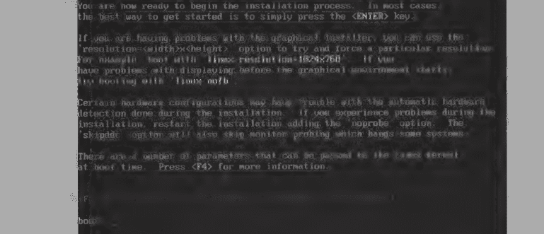

在启动提示符处你可以为`linux`或`text`添加额外的参数。例如，`linux upgrade`会搜索命令并建议对任何检测到 Linux 的计算机进行升级，而不取决于`/etc/redhat-release`文件中可能的内容。如表 3.5 描述的，在启动提示符处你可以做更多操作。

## 表 3.5：启动：提示符安装参数

| 参数 | 描述 |
| --- | --- |
| `ap=off` | 在安装过程中禁用高级电源管理 (APM)。 |
| `display=ip_addr:0` | 将安装显示转发到具有 IP 地址的计算机。要使此生效，请确保接收的计算机允许远程窗口访问；更多信息请参阅第 15 章关于`xhost`命令的内容。 |

## 表 3.5：启动：提示符安装参数（续）

| 参数 | 描述 |
|---|--|
| `expert` | 提示驱动盘；支持可移动驱动器的分区。如果你正在安装de- | |
| `ide=nodma` | 禁用 IDE 设备的直接内存访问。 |
| `isa` | 提示你确认de- | |
| `mem=256M` | 分配特定数量 RAM。 |
| `nmi_watchdog=1` | 添加内核调试消息。 |
| `noprobe` | 停止自动硬件检测。 |
| `reboot=b` | 指定安装后重启。 |
| `resolution=640×480` | 指定视频分辨率。 |
| `serial` | 为安装启动串口控制台。 |
| `skipdd` | 跳过驱动盘检查。 |
| `upgrade` | 搜索系统更新。 |

#### 配置基本参数

现在你准备好开始图形安装了。某些内核参数未在命令行指定，将作为参数传递。通用启动菜单包含内核参数帮助信息，如图 3.10 所示。

## 图 3.10

内核参数帮助菜单

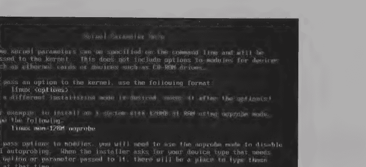

你看到的消息是 Anaconda 检测到的硬件。如果你遇到问题，请注意日志文件的位置：`/tmp/X.log`。此消息有点奇怪；一旦安装了 Red Hat Enterprise Linux，该文件就会消失。稍后我们将查看此文件。

如果你的系统通过了测试，你将看到第一个 Anaconda 安装屏幕，如图 3.11 所示。

# 第 3 章在单机系统上安装 LINUX

图 3.11

图形化安装开始。

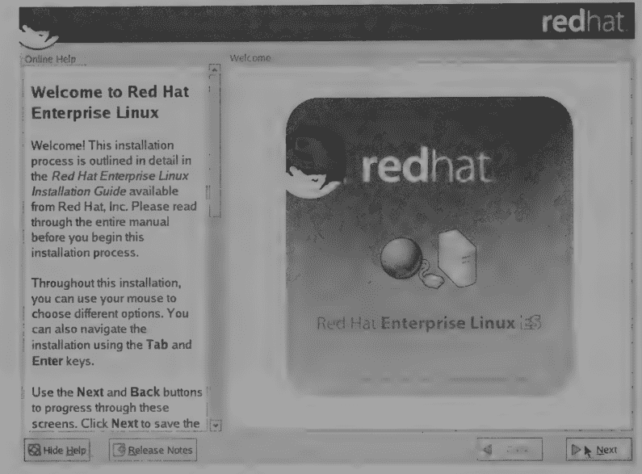

基础图形化安装左侧窗格包含了一些帮助说明。如果你点击“发行说明”（Release Notes），将打开发行说明窗口，如图 3.12 所示。这包含了第一张 Red Hat Enterprise Linux 安装光盘上`RELEASE-NOTES`文件中的内容。

图 3.12

发行说明窗口

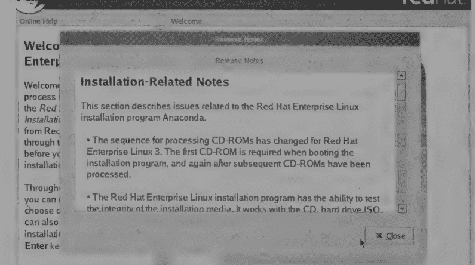

阅读发行说明。这些内容可以帮助你了解更多关于 Red Hat Enterprise Linux 的信息。

完成后，点击“关闭”（Close）退出发行说明，然后点击“下一步”（Next）继续。Anaconda 将带你进入语言选择界面，如图 3.13 所示，该界面允许你在剩余的安装过程中从 19 种语言或方言中进行选择。这并不决定 Red Hat Enterprise Linux 安装后加载或使用的语言；我们稍后会查看该步骤。本章的其余部分假设你正在使用英语进行。点击“下一步”继续。

# 图 3.13

选择安装语言

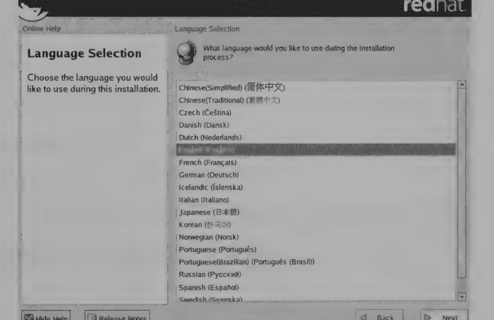

现在我们将查看图 3.14 所示的键盘配置界面，该界面允许你为系统选择 55 种类型的键盘。你的选择将决定 Red Hat Enterprise Linux 安装后的默认键盘。你可以在安装后使用第 2 章中描述的`redhat-config-keyboard`工具更改默认键盘。选择与你的系统最匹配的键盘，并点击“下一步”继续。

接下来，检查图 3.15 所示的鼠标配置界面。该界面的标题具有误导性；你可以使用 Anaconda 配置多种不同类型的指针设备。

注意：如果你设置了图形化网络安装，将首先按照第 4 章的描述，在文本模式下选择安装语言和键盘。一旦你的计算机连接到网络源，它将允许你选择指针设备。

# 第 3 章在单机系统上安装 LINUX

图 3.14

选择键盘

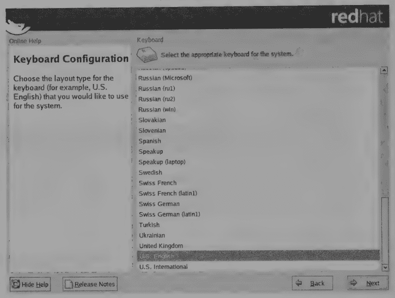

图 3.15

选择指针设备

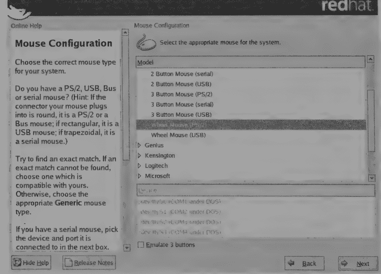

# 逐步安装 RED HAT ENTERPRISE LINUX 第 67 页

指针设备可以是鼠标、触控板、轨迹球，甚至是平板板。Red Hat Linux 可以配合通过 USB（通用串行总线）端口连接的指针设备工作。如果你正在配置连接到服务器端口的指针设备，“设备”（Device）文本框将处于激活状态，你可以选择相应的串口设备。

如果你有一个双键鼠标，你应该激活“模拟 3 键”（Emulate 3 Buttons）选项。这允许你通过同时按下两个按钮来模拟鼠标中间键的功能。然而，如果你有一个鼠标滚轮，按下它会触发点击，Red Hat 可能已经将其识别为中间键。

如果 Anaconda 检测到你的指针设备，它应该会在你的屏幕上高亮显示。在 Red Hat Enterprise Linux 安装后，你可以使用第 2 章中描述的`redhat-config-mouse`工具更改默认指针设备。选择与你的系统最匹配的指针设备，并点击“下一步”继续。

如果你在包含旧版本 Red Hat Enterprise Linux 的计算机上安装，可能会看到一个“升级”（Upgrade）界面。升级内容在本章末尾介绍。如果你看到图 3.16 所示的界面，选择“执行新的 Red Hat Enterprise Linux 安装”（Perform Red Hat Enterprise Linux Installation）。

> 注意：尽管 Red Hat 正式支持在 x86 系统上升级，但它建议进行全新安装。

# 图 3.16

安装、升级


# 第 3 章在单机系统上安装 LINUX

如果你熟悉 Red Hat Linux，你可能期望在此时选择安装类型。例如，Red Hat Linux 9 允许你选择“个人桌面PersonalDesktop）、“工作站”（Workstation）或“服务器”（Server）。对于 Red Hat Enterprise Linux 3，这取决于你是从 WS（工作站）、ES（入门级服务器）还是 AS（高级服务器）安装光盘启动的。

注意：如果你正在使用其中一种重装，你仍会看到一个选择工作站或服务器等默认安装的界面。

#### 设置硬盘


在接下来的步骤中，将在 Linux 识别的连接到计算机的硬盘上设置分区。一旦你选择了安装类型，就可以选择让 Anaconda 为你设置分区或直接进入 `Disk Druid`。此界面如图 3.17 所示。

### 图 3.17 选择自动或手动分区


分区是新用户在 Linux 安装期间最大的障碍之一。Red Hat Linux 通过提供自动分区使这一过程变得简单。

通过选择自动，你将无需使用分区工具来分配挂载点、创建分区或为你的安装分配空间。

要进行手动分区，请选择 `Disk Druid` 分区工具。

使用“返回”（`Back`）按钮选择不同的安装，或者，我们将选择自动分区并进入 `Disk Druid` 以展示 Anaconda 能为你做什么。如果你选择“使用 Disk Druid 手动分区”（`Manually Partition With Disk Druid`），Anaconda 将跳过下一步。做出你的选择并点击“下一步”继续。

Anaconda 询问在何应用自动分区。如图 3.18 所示，你有几个选项，见表 3.6。

> 警告：如果你正在安装 Red Hat Linux ES 或 AS 并希望与 Microsoft Windows 等操作系统双启动，请注意！Anaconda 默认选择“删除系统上的所有分区”（`Remove All Partitions On This System`）选项，这将删除所有分区。

### 图 3.18 配置自动分区


**表 3.6：自动分区**

| 选项 | 说明 |
| :--- | :--- |
| 删除系统上的所有分区 (`Remove All Partitions On This System`) | 删除此系统上的所有分区。如果你有 Microsoft Windows 等操作系统，此操作将删除该系统。 |
| 保留所有分区并使用现有空间 (`Keep All Partitions And Use Existing Space`) | 不删除任何分区。在任何可用空间内配置 Red Hat Linux。 |
| 选择用于安装的硬盘 (`Select the drive(s) To Use For Installation`) | 列出硬盘。自动分区仅适用于选择的硬盘。设备名称如 `hda` 见第 2 章。 |
| 检查（并修改）创建的分区 (`Review (And Modify) The Partitions Created`) | 如果勾选，下一步将展示 `Druid` 中的 Anaconda 分区配置。 |

本次安装，通过选择“删除系统上的所有分区”继续。同样选择“检查（并修改）创建的分区”选项。如果不选择此选项，Anaconda 将跳过下一步。做出选择并点击“下一步”继续。

### 第 3 章 在单机系统上安装 LINUX

在 Anaconda 移除任何分区之前，它向你发送警告消息。如果你指示 Anaconda 删除 Linux 分区，消息如图 3.19 所示。

#### 图 3.19

你将在 Anaconda 移除分区之前看到此警告。


如果你指示 Anaconda 删除所有分区，或者硬盘是新的，你应该会收到类似的警告。确保你确实已准备好删除指定的分区。如果你已准备好，点击“是”（`Yes`）继续。如果你在多个硬盘上都有分区，将被要求再次确认其他硬盘。

你可能还会收到关于 `/boot` 分区的警告。如果你的计算机上已经有了 Microsoft Windows 等操作系统，Anaconda 可能无法将 `/boot` 分区安装在硬盘上最理想的区域，即第 1024 磁道。某些旧计算机的 `BIOS` 将无法在硬盘该磁道找到你的 Linux 启动文件。即使你的计算机受到影响，至少至少两种方法可以解决这个问题。你可以从启动软盘引导 Linux，或者安装如 `Partition Magic` 或 `System Commander` 等第三方引导加载程序。

你在 `Itanium` 系统上需要配置的启动分区有点奇怪；它设置在格式化为微软风格 `VFAT` 文件系统的分区的 `/boot/efi/` 目录下。

## 使用 Disk Druid 设置分区

`Disk Druid` 是 Anaconda 的半自动化磁盘分区工具。`Disk Druid` 在此台式计算机上进行自动分区的的结果如图 3.20 所示。

### 图 3.20 正在工作中的 Disk Druid

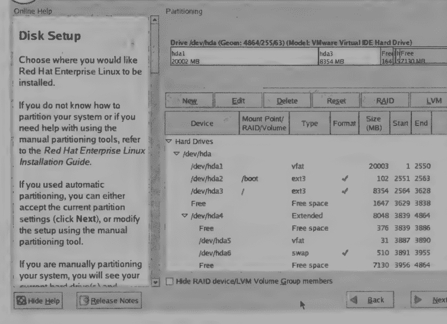

正如你可能猜到的，这是一个双引导安装；`/dev/sda1` 恰好是一个格式化为 Microsoft `FAT32` 文件系统的分区。配置在 `/dev/sda6` 上的交换分区的大小是这台台式电脑内存的倍倍。

> 注意：如果你在正在安装 Red Hat Enterprise Linux 的计算机上拥有 Microsoft Windows，Anaconda 会将 `FAT16` 和 `FAT32` 分区显示为类型 `fat`。

`Disk Druid` 屏幕分为几个区域。顶部包含你计算机上识别出的硬盘上配置的当前分区映射图。接下来是一系列命令按钮，你将对它们进行更多探索。屏幕底部包含每个驱动器和分区的数据，如表 3.7 所示。

**表 3.7：DISK DRUID 驱动器定义**

| 列 | 描述 |
|---|---|
| 设备 (`Device`) | 列出每个硬盘和分区的设备 |
| 挂载点/RAID/卷 (`Mount Point/RAID/Volume`) | 指定分区上的挂载点 |
| 类型 (`Type`) | 备注分区的类型大小 |
| 格式 (`Format`) | 指定要格式化的驱动器（如果已勾选） |
| 大小 (`MB`) | 列出分区的大小，单位为兆字节 |
| 始于 (`Start`) | 备注分区的起始磁道 |
| 结束 (`End`) | 备注分区的结束磁道 |

### 第 3 章：在独立系统上安装 Linux

在屏幕底部，你可以选择“隐藏 RAID 设备/LVM 组成员”。如果你激活了此选项，`RAID`（独立冗余阵列——或昂贵的磁盘列）或逻辑卷组中的分区将不会被显示。关于 `RAID` 的更多信息，请参阅第 14 章；关于 `LVM` 的更多信息，请参阅第 7 章。

现在让我们检查图 3.20 所示的每个命令选项。我们将使用后续章节所示配置来说明我们的讨论。由于目前硬盘上没有空间，我们将从删除分区开始。如果你有一台带有 `BIOS` 的计算机，可能不应该在 `RAID` 数组上配置分区。这通常是不支持的。

#### 删除分区

要删除分区，请突出显示它并点击“删除”。在图 3.20 所示的示例中，我们突出显示 `/dev/hda3` 并点击“删除”。在 `Disk Druid` 删除分区之前，它会请求确认，如图 3.21 所示。

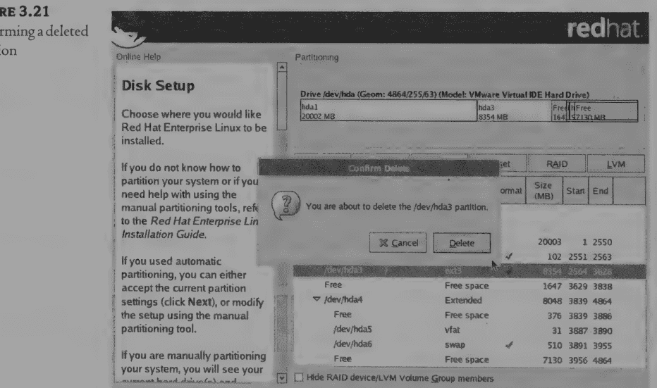

现在我们从被删除的分区获得了可用空间。

#### 添加分区

在添加分区之前，你需要在可用硬盘上有空闲空间。如果你的硬盘上有空闲空间，点击“新建”。这将打开“添加分区”对话框，如图 3.22 所示。图中的每个项目都将在表 3.9 中进行解释。

### 图 3.22 添加分区

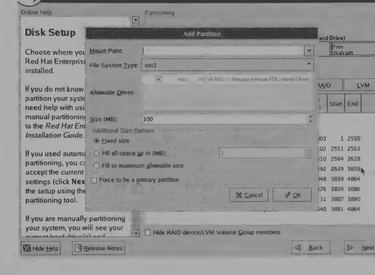

**表 3.8：添加分区对话框中的选项**

| 选项 | 描述 |
| --- | --- |
| 挂载点 (`Mount Point`) | 指定要挂载到分区上的目录；对于可挂载目录，请参阅第 7 章关于文件系统层次结构的讨论。如果文件系统是 `LVM`、`RAID` 或交换，则不适用。 |
| 文件系统类型 (`File System Type`) | 设置分区的格式；允许从 Linux `ext2` 或 `ext3` 标准、Linux 交换格式、`LVM` 物理卷、软件 `RAID` 卷或 Microsoft Windows 风格的 `VFAT` 格式中选择。 |
| 允许的驱动器 (`Allowable Drives`) | 备注与分区关联硬盘设备。 |
| 大小 (`MB`) | 指定分区的大小，单位为兆字节。 |
| 固定大小 (`Fixed Size`) | 按指定设置分区。 |
| 最大空间直到 (`All Space Up To (MB)`) | 如果你的硬盘上有空闲空间，此分区的大小将增长到指定的限制。 |
| 到最大允许大小 (`To Maximum Allowable Size`) | 填充硬盘上任何剩余的空闲空间。 |
| 强制为主分区 (`Force To Be A Primary Partition`) | 通常，你可能希望带有 `/boot` 目录的分区位于磁道 1024 以下的主分区上。 |

> 提示：当你在硬盘上设置分区时，请记住 16 个分区的限制。如果你超过了此限制，你将在安装完成后的以后发现问题。


为了本章的目的，我在剩余空间中添加了 4 个 LVM 分区、两个软件 RAID 分区和一个根（`/`）目录分区。当我们演示点击 RAID 和 LVM 分区时可以做什么时，你将看到它是如何运作的。

#### 编辑分区

编辑分区与添加分区类似。例如，图 3.23 说明了当我突出显示并编辑带有根（`/`）目录的分区时会发生什么。屏幕包含的信息与图 3.22 相同。有关“编辑分区”窗口的详细信息，请参阅表 3.8。

警告：`Anaconda` 不会在有坏块的硬盘上安装 `Red Enterprise Linux 3`。

## 重置分区表

在格式化分区之前，你做的任何更改都不会写入。如果你想回到硬盘上的原始分区表，请点击“重置”。你会得到确认意图的机会。一旦执行，重启 `Disk Druid` 时分区表将恢复。

## 图 3.23

编辑分区

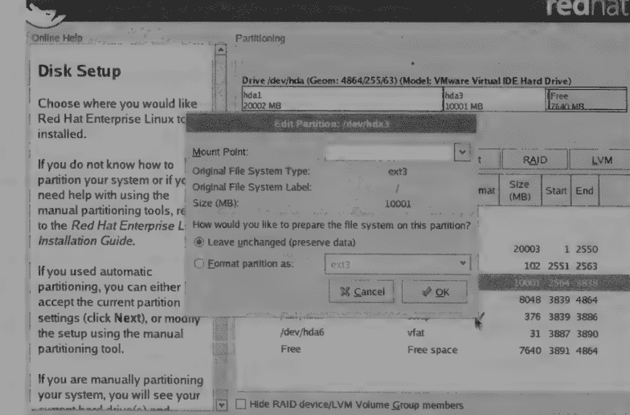

#### 创建 RAID

一旦你配置了软件 RAID，就可以创建一个 RAID 阵列。理想情况下，RAID 阵列中的软件分区应位于不同的硬盘。RAID 1 或 RAID 5 阵列的一个硬盘故障不会破坏你的数据。更多信息，请参阅第 14 章。

点击“RAID 磁盘”将进入 RAID 对话框，如图 3.24 所示。如你所示，此窗口包含三个选项，在表 3.9 中描述。

## 图 3.24

磁盘软件选项

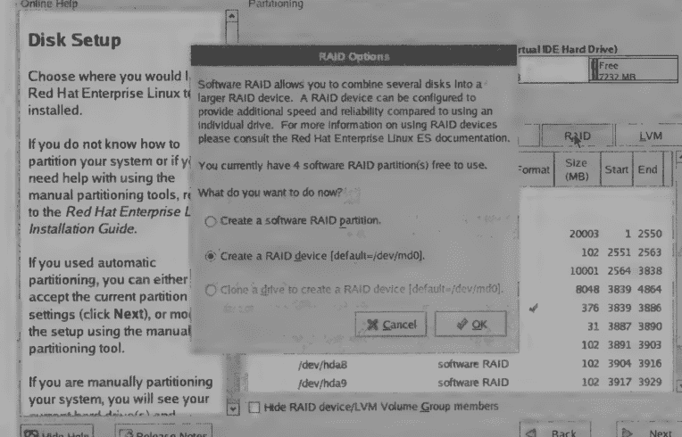

## 表 3.9：软件 RAID 配置

| 选项 | 描述 |
|---|---|
| 创建 RAID 分区 (Create A RAID Partition) | 打开软件 RAID 类型的添加分区窗口。 |
| 创建 RAID 设备 (Create A RAID Device) | 打开创建 RAID 窗口，可以在其中将 RAID 分区分配给 RAID 设备。 |
| 克隆硬盘创建 RAID 设备 (Clone A Drive To Create RAID Device) | 如果你有硬盘，可以从另一个克隆 RAID 设备。 |

已经在“添加分区”部分学习了如何创建软件 RAID 分区。如果你的计算机上有多个硬盘，并想认真对待 RAID，我建议你阅读 `tdp.org` 上的 HOWTO。

## 图 3.25

创建 RAID 设备

| 选项 | 描述 |
|---|---|
| 卷组名称 (Volume Group Name) | 设置 LVM 卷组名称 |
| 物理范围 (Physical Extent) | 指定与此卷组关联的空间大小 |
| 使用的物理卷 (Physical Volumes To Use) | 列出 LVM 格式的物理卷 (PV) |

## 图 3.26

创建 LVM 卷组

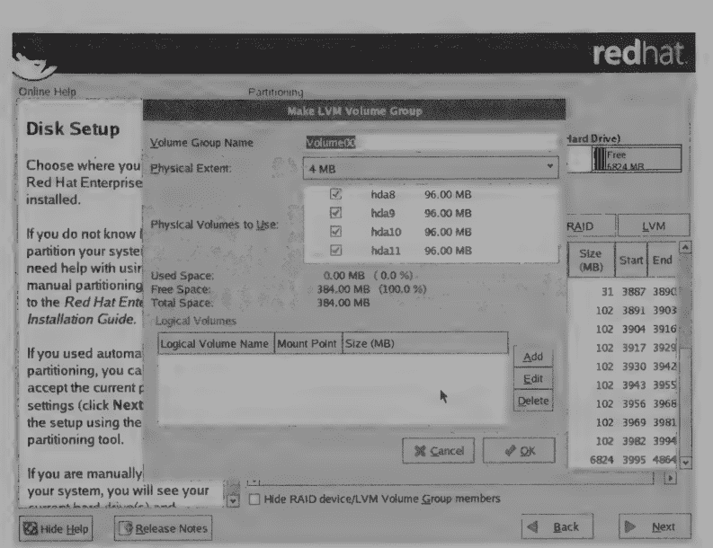

## 表 3.11：创建逻辑卷

| 选项 | 描述 |
|---|---|
| 挂载点 (Mount Point) | 要挂载到逻辑卷 (LV) 上的目录 |
| 文件系统类型 (File System Type) 与逻辑卷关联的格式 | |
| 逻辑名称 (Logical Name) | 卷的任意名称 |
| 大小 (MB) | 分配给逻辑卷的大小，包括你添加到逻辑卷的 PV |

## 第 3 章在独立系统上安装 LINUX

图 3.27

创建逻辑卷

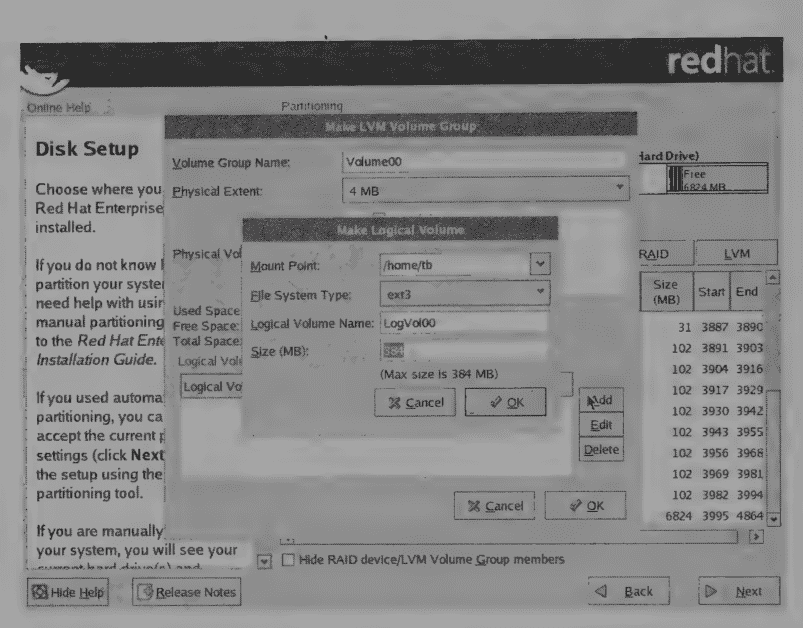

图 3.28

`Disk Druid` 显示修订后的分区表。

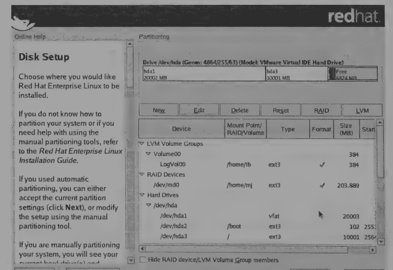

## 逐步安装红帽企业 Linux (Red Hat Enterprise Linux) 79

如果你为新安装选择了已存在的分区，你将收到警告，提示某些分区将被进行格式化。

#### 配置安装详情

现在，我们将探索在 `Disk Druid` 和软件包组选择之间红帽企业 Linux 安装过程的细节。这些主题内容广泛且多样，从引导加载程序配置开始，到身份验证配置结束。

## 引导加载程序配置

在完成 `Disk Druid` 操作后，是时候配置引导加载程序了，这是你启动计算机时看到的界面。`Anaconda` 将带你进入“引导加载程序配置”屏幕，如图 3.29 所示。

图 3.29

引导加载程序配置

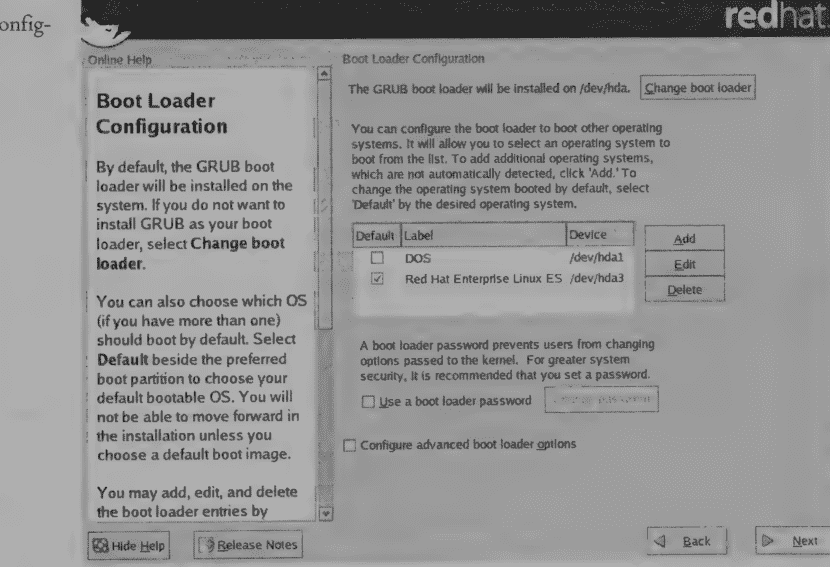

默认是 `GRUB`，即统一引导加载程序。屏幕上的消息告诉你，`GRUB` 将安装在第一个 IDE 硬盘 (`/dev/hda`) 的主引导记录 (MBR) 上。如果你有理由使用不同的引导加载程序，点击“更改引导加载程序”打开“更改引导加载程序”对话框，如图 3.30 所示。

注意 在红帽企业 Linux 中，`bootloader` 和 `boot loader` 术语是通用的。

## 图 3.30

选择引导加载程序

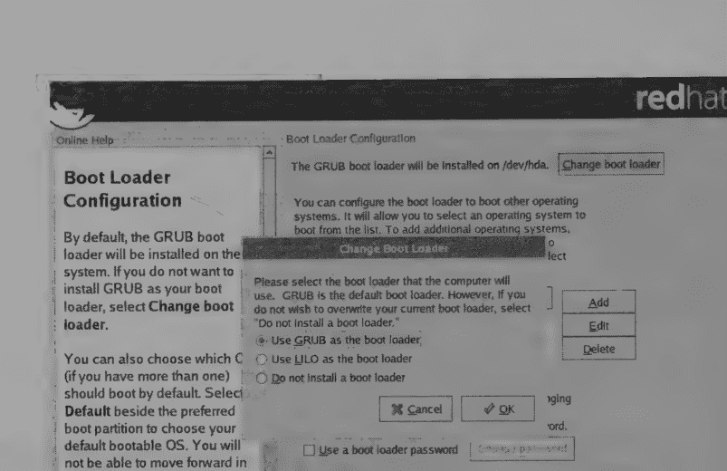

### 引导加载程序配置

`GRUB` 引导加载程序将安装在 `/dev/hda`。

更改引导加载程序

你可以配置 `GRUB` 引导加载程序以启动其他操作系统。它将允许你选择从 `/dev/hda` 启动的操作系统并添加额外的操作系统。

更改引导加载程序

请选择计算机将使用的引导加载程序。`GRUB` 是默认加载器。然而，如果你不想覆盖当前的引导加载程序，请选择：

- 将 `GRUB` 作为引导加载程序
- 将 `LILO` 作为引导加载程序
- 不安装引导加载程序

取消 确定

使用引导加载程序密码

高级引导加载程序选项

默认情况下，`GRUB` 引导加载程序将安装在系统上。如果你不想将 `GRUB` 安装为你的默认加载器，请选择“更改引导加载程序”。

你也可以选择 `C:\`（如果你有多个分区），它应该由加载器启动。选择根分区来选择你的默认操作系统。除非你选择了一个默认加载器，否则你就可以继续安装。你可以通过“配置”(Configuration) 添加、编辑和删除引导加载程序条目。

在红帽企业 Linux 中，你可以安装 `GRUB` 或 `LILO`（Linux 加载器）作为你的引导加载程序。如果你已经有一个不想覆盖的引导加载程序，请选择“不安装引导加载程序”(Not Install A Boot Loader) 。做出你的选择或点击“确定”，或者点击“配置”以保留默认引导加载程序。这让你返回“主加载器配置”屏幕。

注意 你可以使 `GRUB` 或 `LILO` 与另一个引导加载程序（如 `Partition Magic`、`System Commander` 或 `Microsoft Windows NTFS`）配合使用。选择安装引导加载程序，选择“配置高级引导加载程序选项”，并在带有 `/boot` 目录的分区上安装 `GRUB` 或 `LILO`；如后续文本所述。

在屏幕中间，你可以看到 `Anaconda` 正在以双启动配置安装红帽企业 Linux。`Microsoft Windows` 操作系统安装在标记为 DOS 的 `/dev/hda1` 分区上，主要的红帽 Linux 文件安装在分区的 `/dev/hda3` 上。红帽企业 Linux 是默认的，在默认 `GRUB` 配置下，意味着如果你在 10 秒内没有在 `GRUB` 菜单中做出选择，`GRUB Linux` 将自动启动。

你可以通过突出显示文本并设置“编辑”(Edit) 来更改 DOS 或红帽企业 Linux 的设置。这将打开镜像（Image）对话框，如图 3.31 所示，在其中你可以编辑标签、更改分区设备，并将关联操作系统设置为默认值。进行任何所需的更改，并点击“确定”返回“引导加载程序配置”屏幕。

你可以用密码保护你的引导加载程序。如果你想设置密码，点击“引导加载程序密码”(Boot Loader Password) 选项。这将打开“引导加载程序密码”对话框，如图 3.32 所示，提示你输入两次所需的密码。此密码可以防止他人在你计算机重启时更改你的引导加载程序配置文件。

## 图 3.31

引导加载程序镜像属性

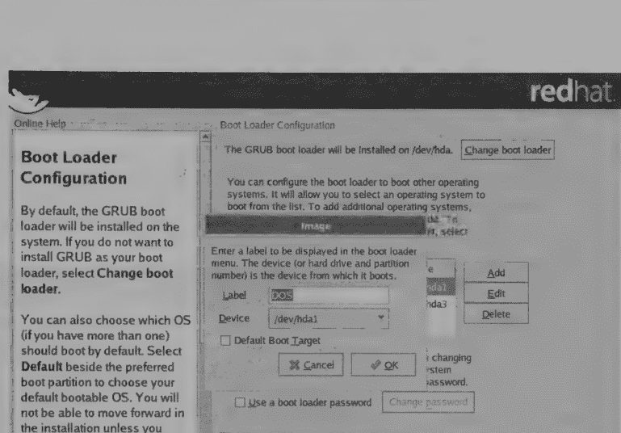

## 图 3.32

输入引导加载程序密码对话框

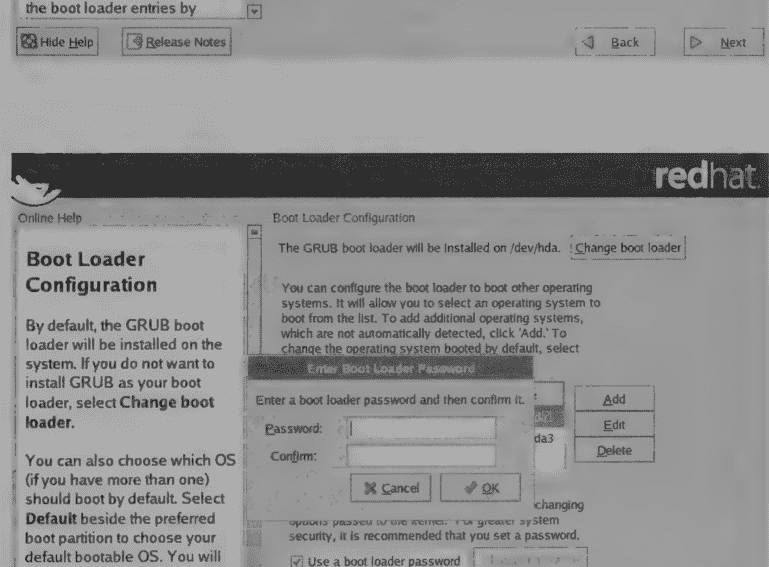

## 网络配置

最后，激活屏幕底部的“配置引导加载程序选项”(Configure Boot Loader Options) 并继续。

### 高级引导配置

如果你激活了引导加载程序选项，你现在将看到“高级加载器配置”屏幕，如图 3.33 所示。如果你激活了引导加载程序选项，你现在将看到“高级加载器配置”屏幕，如图 3.33 所示。如果你激活了引导加载程序选项，你现在将看到“高级加载器配置”屏幕，如图 3.33 所示。

图 3.33

高级引导配置

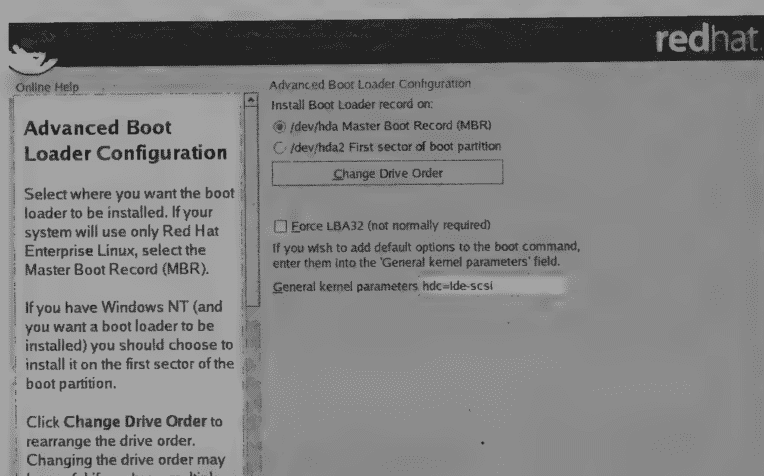


# 第 3 章 在独立系统上安装 Linux

GRUB 引导加载程序将安装在 `/dev/hda`。更改引导加载程序

你可以配置 `GRUB` 引导加载程序以启动其他操作系统。它将允许你选择从 `/dev/hda` 启动的操作系统并添加额外的操作系统。

## 更改引导加载程序

请选择计算机将使用的引导加载程序。`GRUB` 是默认加载器。然而，如果你不想覆盖当前的引导加载程序，请选择：

- 将 `GRUB` 作为引导加载程序
- 将 `LILO` 作为引导加载程序
- 不安装引导加载程序

### 表 3.12：引导加载程序配置

| 选项 | 描述 |
|---|---|
| `GRUB` | `GRUB` 引导加载程序将安装在 `/dev/hda`。 |
| `LILO` | `LILO` 引导加载程序将安装在 `/dev/hda`。 |
| 不安装引导加载程序 | 如果你已经有一个不想覆盖的引导加载程序，请选择此项。 |
| 更改引导加载程序 | 你可以配置 `GRUB` 引导加载程序以启动其他操作系统。 |
| 高级引导加载程序选项 | 选择此项以配置高级选项。 |

在红帽企业 Linux 中，你可以安装 `GRUB` 或 `LILO`（Linux 加载器）作为你的引导加载程序。如果你已经有一个不想覆盖的引导加载程序，请选择“不安装引导加载程序”。做出你的选择或点击“确定”，或者点击“配置”以保留默认引导加载程序。这让你返回“主加载器配置”屏幕。

**注意** 你可以使 `GRUB` 或 `LILO` 与另一个引导加载程序（如 `Partition Magic`、`System Commander` 或 `Microsoft Windows NTFS`）配合使用。选择安装引导加载程序，选择“配置高级引导加载程序选项”，并在带有 `/boot` 目录的分区上安装 `GRUB` 或 `LILO`；如后续文本所述。

在屏幕中间，你可以看到 `Anaconda` 正在以双启动配置安装红帽企业 Linux。`Microsoft Windows` 操作系统安装在标记为 `DOS` 的 `/dev/hda1` 分区上，主要的红帽 Linux 文件安装在分区的 `/dev/hda3` 上。红帽企业 Linux 是默认的，在默认 `GRUB` 配置下，意味着如果你在 10 秒内没有在 `GRUB` 菜单中做出选择，`GRUB Linux` 将自动启动。

你可以通过突出显示文本并设置“编辑”(`Edit`) 来更改 `DOS` 或红帽企业 Linux 的设置。这将打开镜像（`Image`）对话框，如图 3.31 所示，在其中你可以编辑标签、更改分区设备，并将关联操作系统设置为默认值。进行任何所需的更改，并点击“确定”返回“引导加载程序配置”屏幕。

你可以用密码保护你的引导加载程序。如果你想设置密码，点击“引导加载程序密码”(`Boot Loader Password`) 选项。这将打开“引导加载程序密码”对话框，如图 3.32 所示，提示你输入两次所需的密码。此密码可以防止他人在你计算机重启时更改你的引导加载程序配置文件。

图 3.34

网络配置窗口

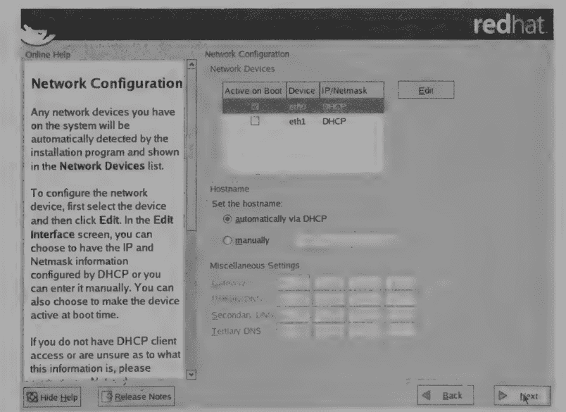

### 表 3.13：网络配置选项

| 选项 | 描述 |
|---|---|
| 启动激活 | 如果有勾选，在启动过程中激活关联的网络设备。 |
| 编辑 | 启动所选设备的编辑窗口，在其中你可以手动静态 IP 地址配置网络卡。 |
| 主机名 | 允许为此计算机分配主机名；或者，`DHCP` 服务器可以完成此任务。 |
| 网关 | 网络外消息的网关 IP 地址。如果你配置了网络卡，可以设置它。 |
| 首选 DNS | 网络中 `DNS` 服务器的 IP 地址。如果你配置了网络卡，可以设置它。 |
| 次选 DNS | 网络中另一个 `DNS` 服务器的 IP 地址。 |
| 三选 DNS | 网络中另一个 `DNS` 服务器的 IP 地址。 |

图 3.35

更改网络设备的 IP 地址信息

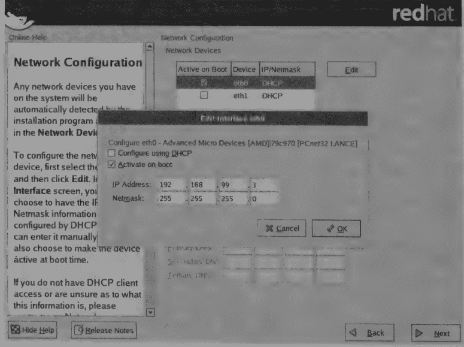

## 逐步安装红帽企业 Linux

如果你在安装 `Red Hat Enterprise Linux` 后改变了主意，可以使用第 16 章中描述的 `redhat-config-network` 实用程序来编辑配置。完成后，点击“下一步”（`Next`）继续。

### 防火墙配置

现在你可以准备为 `Red Hat Enterprise Linux` 配置防火墙了。这在网关计算机上尤为重要，因为它可能提供你的局域网（`LAN`）与互联网之间的连接。在这种情况下，网关计算机是防火墙保护局域网免受互联网潜在侵害的最佳位置。对于 `Hat Enterprise Linux 3`，会在 `/etc/sysconfig/iptables` 中创建一个基于 `iptables` 的防火墙。图 3.36 显示了网关计算机的一种配置。

#### 图 3.36

配置防火墙

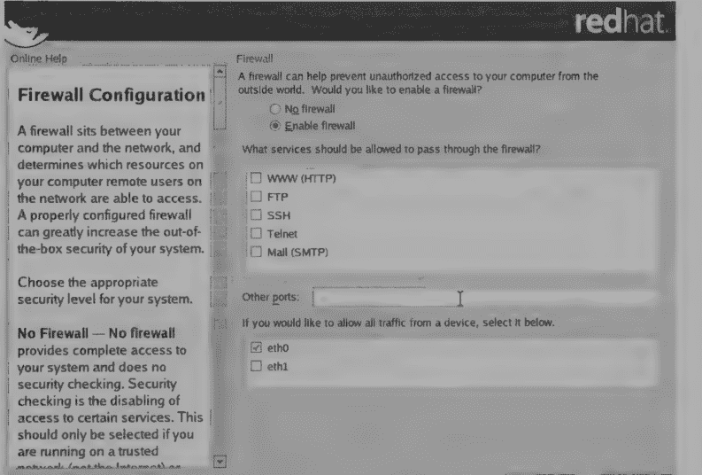

防火墙位于计算机和网络之间，决定计算机上的远程资源是否允许访问网络。配置当的防火墙可以极大提高系统的安全性。

为你的系统选择合适的安全级别。

- 无防火墙（`No firewall`）：提供对系统的完全访问且不进行任何安全检查。安全检查是指禁用对某些服务的访问。只有在你受信任的网络上运行时，才选择此项。

配置选项如下：

- 无防火墙（`No Firewall`）：禁用此计算机上所有的 `iptables` 防火墙命令。
- 启用防火墙（`Enable Firewall`）：配置高安全性防火墙，阻止几乎所有的入站流量。例外是来自外部 `DNS` 服务器的消息，它支持连接互联网。

### 哪些服务应该允许通过

如果你的计算机上有服务器，你可能希望允许来自其他网络的入站流量。例如，如果你的计算机上有一个 Web 服务器，你可能希望通过与 `WWW (HTTP)` 流量相关的 `TCP/IP` 端口允许传入数据（见第 25 章）。其他选项与文件传输协议（`FTP`）（见第 22 章）、安全外（`SSH`）（见第 18 章）、`Telnet`（见第 18 章）或如 `sendmail` 等邮件服务器（见第 21 章）有关。

#### 其他端口

如果你想通过防火墙访问不同的服务器，请在相应的文本框中输入相关的端口和协议。例如，如果你想允许使用 `HTTPS` 协议连接到安全的 Web 服务器，你可以在“其他端口”（`Other Ports`）框中输入以下：

```
https://tcp,https://udp
```

在 `Red Hat Enterprise Linux` 安装后，你可以使用 `redhat-config-security` 工具或第 17 章中描述的 `iptables` 命令更改防火墙设置。进行任何所需的更改，并点击“下一步”继续。

### 如果你想允许来自某个设备的所有流量

列出此计算机上的网络设备，这些 `eth0` 和 `eth1`。连接到局域网的以太网卡关闭防火墙而连接到互联网的网卡开启是常见做法；`eth0` 是一个受信任的设备。

注意：这不会影响第 18 章中解释的使用 `xinetd` 服务的任何防火墙，或书中讨论的各个网络。

## 额外的语言支持

在图 3.37 所示的安装界面中，你可以设置安装后 `Red Hat Linux` 的默认语言。如你所见，某些语言包含了多种国家方言。

#### 图 3.37

选择语言

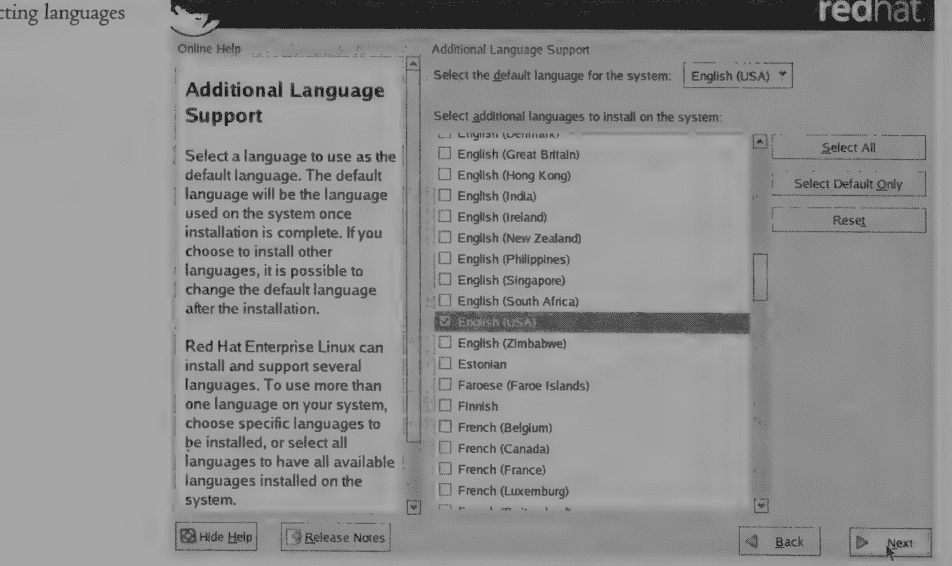

如果你为安装需要不同或额外的语言，请相应进行选择。如果你配置了 `Anaconda` 安装多种语言，可以通过点击“为系统选择默认语言”（`Select Default Language For The System`）框旁边的下拉箭头从这些语言中选择默认语言。在 `Red Hot Enterprise` 安装后，可以使用第 30 章描述的 `redhot-config-language` 更改默认语言。进行任何所需的更改，并点击“下一步”继续。

### 选择时区

在此安装界面中，你可以配置计算机的基本时间设置。安装后，你可以进行进一步设置。通过本章稍后描述的首次启动工具或第 13 章的 `redhot-config-time`，你可以设置此计算机与中心时间服务器同步时。

时区选择屏幕包含两个标签页。“位置”（`Location`）标签页如图 3.38 所示。你可以点击地图或从下拉列表中选择位置来选择与你所在地相关的区域。除非你的计算机与 `Microsoft Windows` 等操作系统处于双启动配置，否则你应该激活“系统时钟使用 `UTC`”（`System Clock Uses UTC`）选项。做出选择，并点击图 3.39 所示的“`UTC` 偏移”（`UTC Offset`）标签页。法语缩写对应格林尼治标准时间（`GMT`）。

在 `UTC` 偏移标签页上，选择与你的时区匹配的偏移；例如，美国西岸比格林尼治时间晚几个小时，对应 `UTC-8`。对于美国，你可以激活“夏令时（仅限美国）”（`US Only`）选项。做出选择，并点击“下一步”继续。

#### 图 3.38

设置时区位置

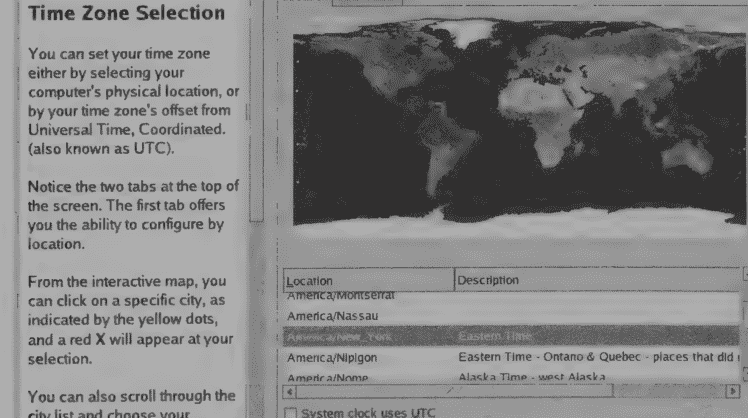


# 第 3 章 在独立系统上安装 Linux

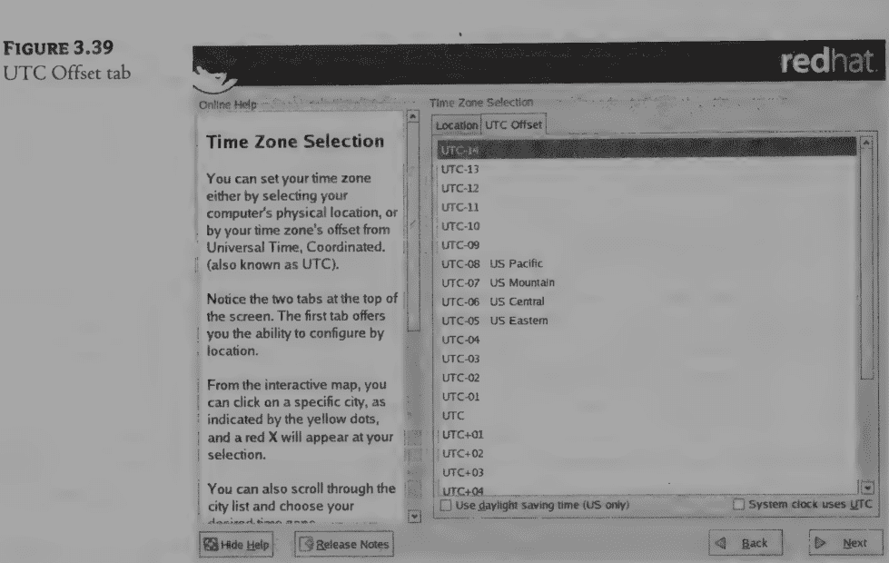

## 设置 `root` 密码

`root` 用户也称为管理员（`supervisor`）。在图 3.40 所示的“设置 `root`”（`Set Root`）安装界面中，输入你所需的密码，长度至少为六位字符。

`root` 用户可以执行任何操作。`Red Hat` 要求密码必须是数字、大小写字母以及标点符号的组合；例如，`Icr` 可以代表“`I ice cream`”（我要冰淇淋）。输入两次，并点击继续。

## 选择软件包组

默认支持基本的 `Web` 和 `Samba`（`Windows` 文件）服务器，以及支持工具和 `GNOME` 桌面环境。如果你安装的是 `Red Hat Linux Workstation`，默认值会有不同。你现在应该看到图 3.41 所示的软件包安装默认设置。

### 图 3.40

设置 `root` 密码

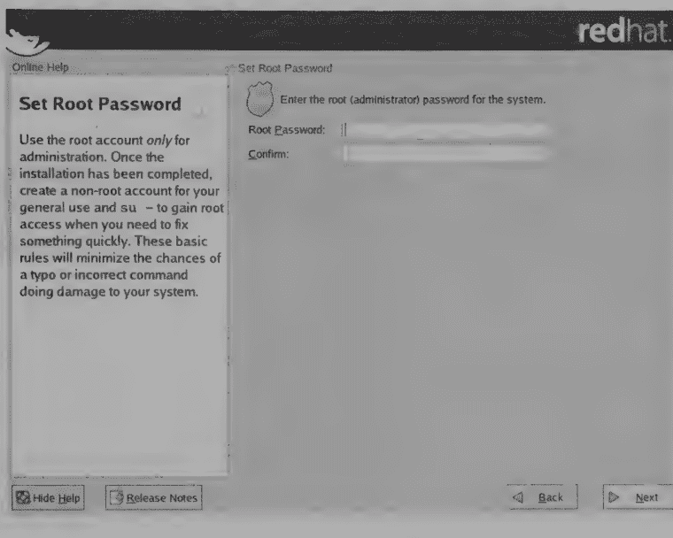

### 图 3.41

默认软件包组

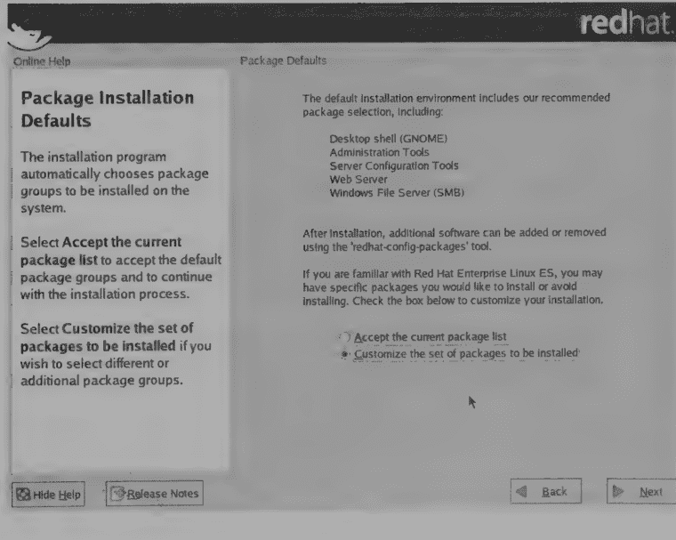

# 第 3 章 在独立系统上安装 Linux

如果这些还不够用，激活“自定义要安装软件包集”（`Customize Set Of Packages To Be Installed`）选项并点击“下一步”继续。这将进入图 3.42 所示的软件包组选择屏幕。

### 图 3.42

选择组

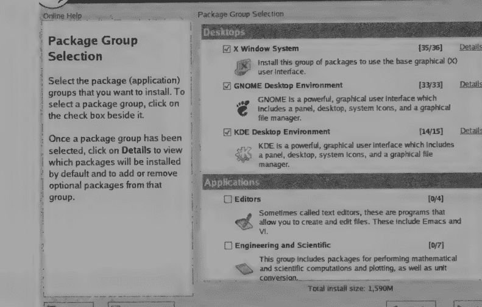

## 软件包与组

如果你对 `Linux` 不熟悉，让我们先退一步。红 `Hat` 将软件组织成一种名为 `RPM`（红帽软件包管理器）的软件包。红帽安装光盘上有大约 1100 个 `RPM` 软件包。其中许多包之间相互依赖；例如，除非安装了 `Linux X Window Server`，否则你无法使用与 `GNOME` 桌面相关的某些软件包。

在安装 `Red Enterprise Linux` 时，即使是经验丰富的的用户，通常也不希望在安装过程中从 1100 个软件包中逐一挑选。这就是为什么 `Red Hat` 将 `RPM` 组织成软件包组选择窗口中显示的软件包组的原因之一。

### 分步安装红帽企业 `LINUX`

选择您所需的软件包组。如果您不想安装如“游戏与娱乐”之类的软件包组，可以取消选择以为其他用途留出空间……

`Anaconda` 图形化安装程序将软件包组分为五个不同的类别。共有三个桌面组，如图 3.42 所示；表 3.16 总结了这些组。

## 表 3.14：桌面软件包组

| 软件包组 | 描述 |
|---|---|
| `X Window` 系统 | 安装基础的 `XFree86` 服务器和若干 `GUI` 配置文件 |
| `GNOME` 桌面环境 | 添加使用 `GNOME` 桌面所需的软件包 |
| `KDE` 桌面环境 | 包含使用 `KDE` 桌面所需的软件包 |

查看每个软件包组右侧的数字。例如，查看与 `KDE` 桌面环境软件包组相关的数字。这会告诉您 15 个软件包组中的 14 个将会被安装。在该数字的右侧，点击“详情（`Details`）”。这将打开“‘`KDE` 桌面环境’详细信息”窗口，如图 3.43 所示。

在“‘`KDE` 桌面环境’详细信息”窗口中，软件包分为三类：基础（`Base`）、默认（`Default`）和可选（`Optional`）。基础软件包是 `KDE` 桌面运行所需的。默认软件包与标准配置相关。可选软件包添加更多功能。

### 图 3.43

`KDE` 桌面环境组详情

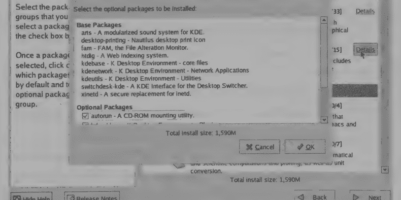

# 第 3 章 在独立系统上安装 `LINUX`

下一类软件包组是“应用程序（`Applications`）”；列表部分如图 3.44 所示。应用程序范围从基础文本编辑器到 `Internet` 连接工具再到游戏不等。有趣的是，这包含了“办公/生产力（`Office/Productivity`）”软件包组；虽然它对于工作站是合适的，但在红帽 `Linux` 3 服务器操作系统中也是可用的。表 3.15 总结了该类别中的软件包组。

### 图 3.44 应用程序软件包组

| 软件包组选择 | 应用程序 |
|---|---|
| [ ] 编辑器 `Editors` [04] | 有时称为文本编辑器，这些是你可以创建和编辑文件的程序。它们包括 `Emacs` 和 `vi` |
| [ ] 工程与科学 `Engineering and Scientific` [7] | 此组包含用于执行数学计算和绘图的软件包，以及行编辑器 |
| [ ] 图形化 `Graphical` [11] | 此组包含图形化工具、`Web` 和聊天客户端。 |
| [ ] 文本型 `Internet Text-Based Internet` [7] | 此组包含基于的电子邮件、`Web` 和聊天客户端。这些应用程序不需要 `X Window` |
| [ ] 办公/生产力 `Office/Productivity` [7] | 应用程序包括办公套件、`PDF` 视器等。 |
| [ ] 音频与视频 `Sound and Video` [9] | 从 `CD` 录制到播放音频 `CD` 和多媒体。总安装大小：1:458M |

## 表 3.15：应用程序软件包组

| 软件包组 | 描述 |
|---|---|
| 编辑器 | 包含增强版 `vi` 和 `Emacs` 的软件包 |
| 工程与科学 | 添加用于数学计算和图图的程序 |
| 图形化 `Internet` | 安装各种图形化网络通信工具 |
| 文本型 `Internet` | 包含可以在命令行下使用的网络通信工具 |
| 办公/生产力 | 允许您添加各种办公应用程序和套件 |
| 音频与视频 | 添加一系列多媒体软件包、视器和配置工具 |
| 制作与出版 | 支持允许创建 `DocBook` 软件包的软件包 |
| 图形 | 安装若干图形程序和支持库 |
| 游戏与娱乐 | 添加各种视频游戏和棋游 |

对于 `Linux` 管理员来说，一个重要的类别是“服务器（`Servers`）”。不同的服务器可以帮助您为网站、电子邮件、文件服务、数据库、新闻等提供服务。列表部分如图 3.45 所示。表 3.18 总结了该类别中的每个软件包组。如果您安装红帽企业工作站，并不是所有的软件包组都可用。

### 图 3.45

服务器软件包组

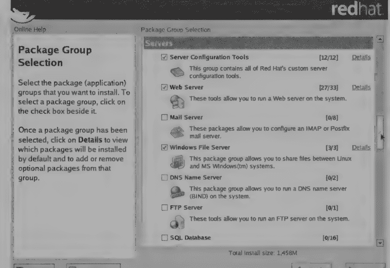

## 表 3.16：服务器软件包组

| 软件包组 | 描述 |
| --- | --- |
| 服务器配置工具 | 安装若干红帽图形化配置工具 |
| `Web` 服务器 | 添加 `Apache` 和相关软件包，用于向其他计算机上的浏览器提供网页 |
| 邮件服务器 | 整合了各种电子邮件服务器和工具 |
| `Windows` 文件服务器 | 允许您的计算机作为客户端和服务器连接到微软 `Windows` 网络 |
| `DNS` 域名服务器 | 包含设置域名服务 (`DNS`) 服务器或相关缓存名称服务器所需的软件 |
| `FTP` 服务器 | 添加 `vsftp` 文件服务器，该服务器还支持匿名访问 |
| `SQL` 数据库服务器 | 安装允许您配置 `PostgreSQL` 服务器数据库的软件包 |
| `MySQL` 数据库 | 安装与 服务器 服务器相关的软件包 |
| 新闻服务器 | 添加 `InterNews` 软件包，它支持类似 `Usenet` 的新闻系统 |
| 网络服务器 | 安装各种网络服务器，包括 `DHCP`、`quagga` 和 `NIS` |
| 旧版网络服务器 | 允许您安装旧的使用的服务器，包括 `RSH` 和 `Telnet` |

# 第 3 章 在独立系统上安装 `LINUX`

有几个 `Linux` 开发软件包组。即使您不是开发者，最终也可能使用这些组中的许多软件包。例如，为了编译 `Linux` 内核，您需要来自“内核开发（`Kernel Development`）”和“开发工具（`Development Tools`）”软件包的包。开发软件包组列表如图 3.46 所示；表 3.19 描述了该类别中的每个软件包组。

### 图 3.46 开发软件包组

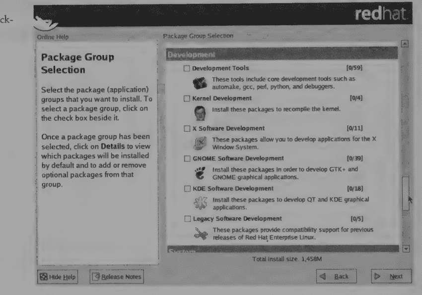

## 表 3.17：开发软件包组

| 软件包组 | 描述 |
| --- | --- |
| 开发工具 | 包含软件包工具、语言库等 |
| 内核开发 | 安装头文件和源代码 |
| `X` 软件开发 | 添加与 `Linux XFree86` 图形系统相关的开发库、头文件和文档 |
| `GNOME` 软件开发 | 整合与 `GNOME` 桌面环境相关的开发库、头文件、包含文件等 |
| `KDE` 软件开发 | 整合与 `KDE` 桌面环境相关的开发库、头文件、包含文件等 |
| 旧版软件开发 | 支持旧 `C` 和 `C++` 库的使用 |


“系统（System）”是最后一个类别。该类别包含了管理、系统和打印工具。列表如图 3.47 所示；表 3.20 总结了每个软件包组。

## 图 3.47

系统软件包组

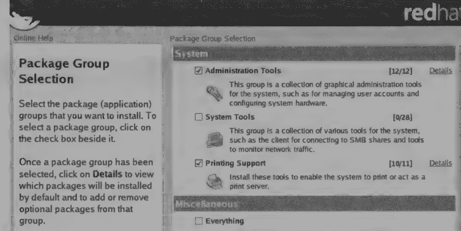

## 表 3.18：系统软件包组

| 软件包组 | 描述 |
|---|---|
| 管理工具 | 安装若干管理工具 |
| 系统工具 | 允许管理各种应用程序 |
| 打印支持 | 包含安装通用打印系统 (`CUPS`) 需软件包 |

最后，在软件包组选择的底部（如图 3.47 所示），有以下杂选项：

- `Everything`（全部）：选择所有软件包组，需要超过 `4GB` 的空间。
- `Minimal`（最小）：取消选择所有强制软件包组。在安装红帽 `Linux` 后，您可以再安装需要的软件包。这是一个可以保护安全的选项；事实上，如果它没有安装在您的计算机上，就会成为一个安全漏洞。在这种情况下您需要 `600MB` 空间。

*此步骤之后不再支持选择单个 `RPM` 软件包。*

## 准备安装

我们准备好在计算机上安装 `Anaconda` 了！`Anaconda` 包含了我们定义的分区、选择的软件包组以及我们选择的其他设置。如图 3.48 所示，当点击“下一步”时，`Anaconda` 开始按照您的规格安装红帽 `Linux` 3。

## 图 3.48

准备安装

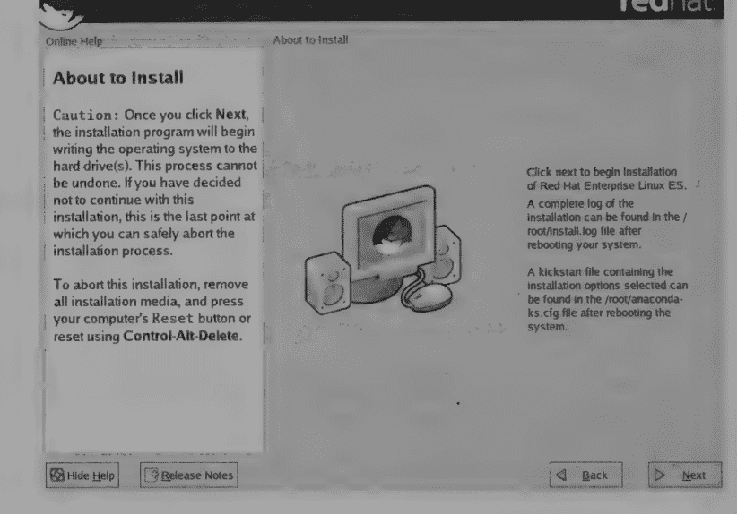

记住列出的文件。安装完成后，您可以在 `/root/install.log` 中查看已安装的 `RPM` 涉及 `/root/anaconda-ks.cfg` 文件将帮助您使用第 5 章描述的 `Kickstart` 系统将此安装复制到其他计算机上。准备好后，点击“下一步”继续。

# `Anaconda` 安装红帽企业 `Linux`

最后，`Anaconda` 开始安装过程。首先，您将看到一系列消息：

- 格式化 `/` 文件系统...
- 格式化 `/boot` 文件系统...
- 正在传输镜像到硬盘...
- 正在传输更新的软件包...
- 正在准备 `RPM` 事务
- 正在启动安装过程，这可能需要几分钟
- 正在安装...

# 逐步安装红帽企业版 `Linux` 97

在此处，`Anaconda` 使用选定的文件系统目录对分区进行格式化。接下来，它将基本安装模板以镜像的形式传输到你的硬盘。它设置了要安装的 `RPM`，然后开始从安装源（在本例中为红帽光盘）将数据传输到你的硬盘。然后，你将看到一个类似于图 3.49 所示屏幕，它会不断更新安装进度。

## 图 3.49

正在安装中

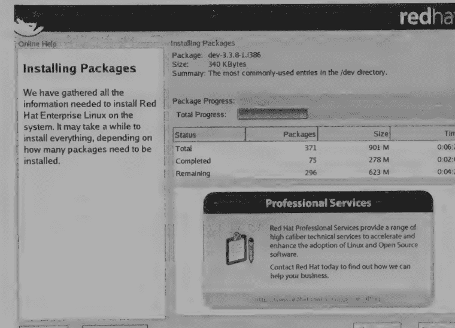

共有四张红帽 `Linux` 安装光盘。随着安装的进行，`Anaconda` 可能需要访问其他一张或多张光盘。安装会显示如图 3.50 所示的消息停止。按照指示操作并点击 `OK` 继续。

这是一个检查安装过程对你的系统做了什么的好机会。进入第二个虚拟控制台。按下 `Ctrl+Alt+F2`。在命令提示符上，检查磁盘使用情况：

```
/bin/sh-2.05b# df
Filesystem 1k-blocks Used Available Use% Mounted on
rootfs 6120 2471 3299 43%
/dev/root.old 6120 2471 3299 43%
/tmp/cdrom 462644 462644 0 100 %/mnt/source
/tmp/sda2 3771316 32844 3546900 1 %/mnt/sysimage
/tmp/sda1 101089 4127 91743 5 %/mnt/sysimage/boot
```

此输出告诉我们 `Anaconda` 已经将根 (`/`) 分区挂载到 `/mnt/sysimage` 目录。它还将包含 `boot` 目录的分区挂载到 `/mnt/sysimage/boot`。

## 第 3 章 安装单机版 `Linux` 系统

## 图 3.50

需要另一张光盘了

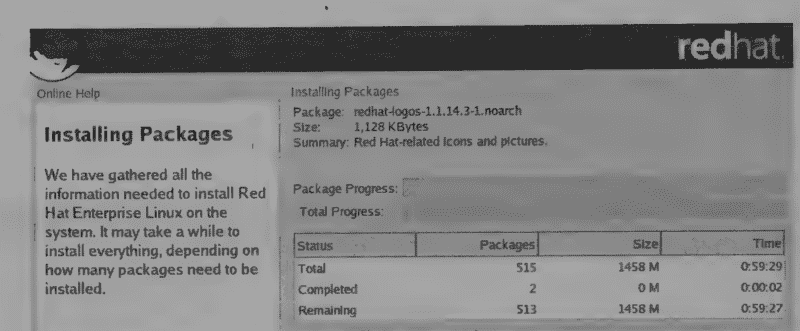

你可以使用 `bash` 命令（在第 6、7 和 8 章中描述）浏览这些目录，查看 `Anaconda` 目前为止安装了什么。事实上，如果出现问题，检查 `/mnt/sysimage/root/install.log` 的内容。此日志标识了 `Anaconda` 尝试在你的系统上安装的当前 `RPM`。如果安装冻结，可能是光盘（或网络安装服务器）上的特定 `RPM` 出了问题；

一旦所有 `RPM` 包安装完成，你将看到以下消息，这些消息将让 `Anaconda` 为过程的下一步做好准备，并在你的 `MBR` 上安装引导加载程序。此时，你可以在 `/mnt/sysimage/etc` 目录下的第二个控制台中找到引导加载程序配置文件。一旦完成安装，你可以在 `/etc` 目录下预期的位置找到该文件。如果你使用 `GRUB`，它在 `grub.conf` 文件中。

执行安装后配置

安装引导加载程序

## 管理安装后步骤

`Anaconda` 已经在你的电脑上安装了红帽 `Linux`。但你的工作还没有结束。你仍然需要配置你的图形系统。你应该看到图 3.51 所示的下一个屏幕。

注意 红帽企业版 `Linux` 3 不支持在安装过程中使用启动软盘；但是，可以使用第 11 章中描述的 `mkbootdisk` 命令轻松创建。

### 配置显卡

如果你安装了 `X Window` 软件，`Anaconda` 现在会提示你配置图形系统，如图 3.51 所示。你可以跳过此过程，稍后使用第 29 章描述的 `redhat-config-xfree86` 实用进行配置。

## 图 3.51

配置 `Linux` 图形界面

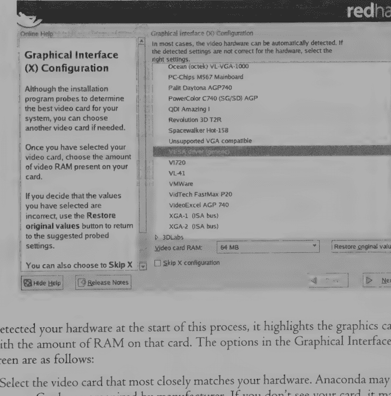

| 图形界面 (`X`) 配置) |
| --- |
| 在大多数情况下，视频硬件可以自动检测。如果检测到的设置与硬件不匹配，请选择下一个... |
| `Ocean (otek) VL-GA-1000` |
| `PC Chips MSI MR50 Motherboard` |
| `Pali Radeon AGP90` |
| `PowerColor C749 (SG/S2D AGP)` |
| `QDA AMD-R Resolution 30TER` |
| `Spacewalker Hot-158` |
| `Unsupported VGA compatible` |
| `VI720` |
| `VL41` |
| `VMedia` |
| `VidTechFastMaxP20` |
| `VideoExcel AGP 740` |
| `XGA-1 (ISA bus)` |
| `XGA-2 (ISA bus)` |
| Video Card RAM: `64 MB` |
| 跳过 `X` 配置 |

尽管安装程序倾向于为你的系统选择最佳显卡，但如果需要，你可以选择其他显卡。

一旦你选择了显卡，请选择显卡上视频显存的大小。

如果你认为所选的不正确，如果需要，你可以选择其他显卡。

（注：提供的 OCR 文本在后期有大量重复，已进行清理以保持可读性并保留了所有唯一信息）。

# 第 3 章在独立系统上安装 `Linux`

请选择您的登录类型：这将配置 `Linux` 启动序列；这会影响 `/etc/inittab` 中的 `id` 变量，你可以按照第 11 章中的描述对其更改。如果您选择“图形化”（`Graphical`），`Linux` 将进入图形化登录界面；如果您选择“文本”（`Text`），`Linux` 将允许您在文本虚拟控制台上进行登录。

做出选择并点击“下一步”继续。最后，安装完成，如图 3.54 所示。点击“退出”重启您的计算机。

图 3.54

安装完成！

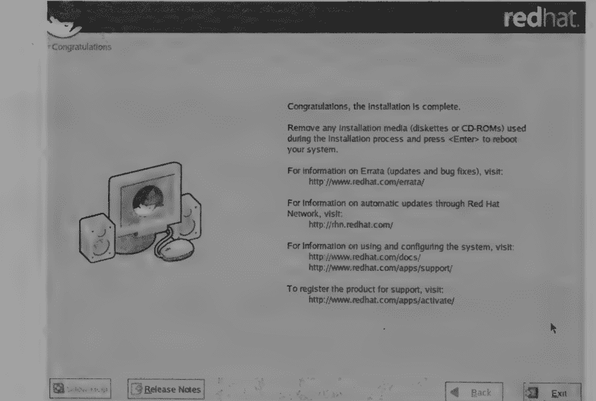

## 运行 `Red Hat Setup Agent`

安装过程看起来已经很长了。`Red Hat` 将若干项配置活动从安装移动到了名为 `Red Hat Setup Agent` 的新程序中，也称为 `firstboot`。

当您第一次重启计算机时，应该会看到您的选择启动加载程序。默认情况下，启动加载程序是 `GRUB`，如图 3.55 所示。

如安装过程末尾所述，有两种可能的登录模式：文本和图形化。典型的文本登录如下所示：

```
Red Hat Enterprise Linux release 3 (Taroon)
Kernel 2.4.21-EL on an 1686
Enterprise3 login:
```

然而，如果您在安装结束时选择了图形化登录类型，您将进入 `Red Hat Setup Agent`，如图 3.56 所示。`Red Hat Enterprise Linux` 启动过程不会允许您在图形化界面登录之前进行任何绕过。

## 图 3.55

`GRUB` 启动加载程序

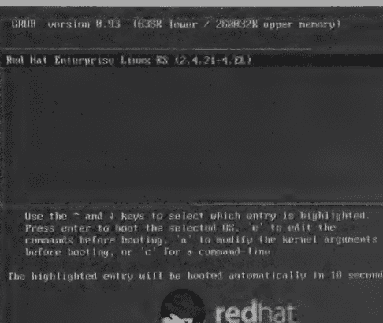

## 图 3.56


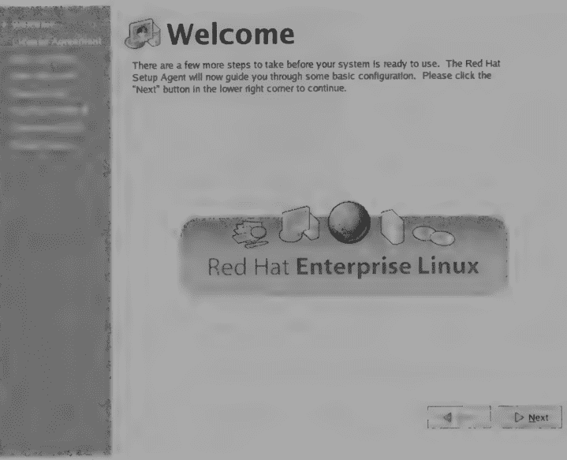

# 第 3 章在独立系统上安装 Linux

Red Hat Setup Agent 允许您配置用户账户、设置到服务器的连接、探测声卡、在 Red Hat Network 上注册以及添加额外软件。如果您选择文本登录，可以使用 `firstboot` 命令启动 Red Hat Setup Agent。

注意：如果您选择了文本模式登录，您将处于运行级别 3。运行 `telinit 5` 命令将其加载到 Linux GUI 中。然后您可以在 GUI 命令行界面中运行 `firstboot`。

接下来，您将审查 Red Hat Enterprise Linux 许可证，如图 3.57 所示。您可以在 `www.redhat.com/licenses` 找到协议的完整副本。它在不同国家有所不同。虽然我不是律师，但您可以自行阅读 Red Hat（美国）协议如何尊重软件的 Linux 通用公共许可证（GPL）状态，如附录 B 所示。然而，Red Hat 是唯一可以带有商标（包括其标志）共享或销售其发行版的公司。

## 图 3.57

Red Hat 许可协议


许可协议与有限产品保修

RED HAT® ENTERPRISE LINUX® VERSION 3

本协议适用于软件的使用以及对软件的任何更新，无论交付机制如何。软件根据版权共同归集体所有。根据以下条款，Red Hat, Inc.（“Red Hat”）授予用户（“客户”）一项在通用许可许可下使用和分发软件的许可。

1. Red Hat Enterprise Linux（“软件”）是一个模块化操作系统，由位于客户硬件上的数百个组件组成。每个组件的用户许可定义了该组件的使用代码。在下文第 2 节中识别的某些图像文件的帮助，用户可以修改并分发组件本身的源代码和二进制代码项。本协议还限制了客户在任何特定组件的许可条款下的权利，或授予了优于该许可条款的权利。

2. 知识产权。软件及其每个组件（包括源代码、文档、外观、礼仪和组织）均归 Red Hat 及其他所有，并受版权和其他法律保护。软件所有权：

☑ 是，我同意许可协议

☐ 我不同意

选择“是，我同意许可协议”，并点击“下一步”继续。系统将提示您关闭计算机并从系统中移除 Red Hat Enterprise Linux 3。

### 指定日期和时间

是的，您在 Red Hat Linux 安装过程中已经指定了日期和时间。此处的不同在于此 `firstboot` 屏幕允许您将计算机与中央时间服务器同步。勾选“启用网络时间协议”（Enable Network Time Protocol）选项，如图 3.58 所示。

## 图 3.58

指定时间服务器

#### 日期和时间

请设置系统的日期和时间。

| 2006年2月 | 日 一 二 三 四 五 六 |
| :--- | | | | | | | |
| | | 1 2 3 4 5 6 7 |
| | | 8 9 10 11 12 13 14 |
| | | 15 16 17 18 19 20 21 |
| | | 22 23 24 25 26 27 28 |
| | | 29 30 |
| 当前时间： |
| 小时： |
| 分钟： |
| 启用网络时间协议 |
| 服务器：`clock.redhat.com` |
| 网络协议 |


### 创建普通用户

我们鼓励您创建一个个人账户，如图 3.59 所示。在“用户名”（Username）框中输入登录名。然后在“全名”（Full Name）框中添加识别信息。在两个框中输入相同的密码。该账户可以是网络服务的一部分，例如 NIS、LDAP 或通过 Samba 的微软账户。“使用网络”（Use Network）选项将打开验证窗口，可以在其中进行配置。我们在第 23 章中更详细地描述此工具。添加您选择的用户。

## 图 3.59

创建普通用户


### 探测声卡

Red Hat Setup Agent 自动尝试检测计算机上可能存在的任何声卡。如果成功，您将看到声卡厂商、型号和模块，如图 3.60 所示。如果您的声卡连接了扬声器，可以点击“播放测试”（Play Test）按钮。当 `firstboot` 完成声音播放后，您将看到提示：“您听到示例声音了吗？”如果没有，点击“否”，您将收到一条消息，告知声卡未激活。

### 在 Red Hat Network 上注册

当您在 Red Hat Network 上注册计算机时，可以设置计算机以接收最新的软件升级和补丁。您不需要立即注册，如图 3.61 所示。

连接到 Red Hat 网络需要订阅，它是官方版 Red Hat Enterprise Linux 成本的一部分。如所示，您不需要立即连接计算机。您首先需要通过 `rhn.redhat.com` 设置您的账户。我们在第 10 章中引导您完成此过程。如果您现在想设置计算机，请参考该章节的指导。

### 运行红帽设置代理程序

## 图 3.60

`firstboot` 检测到一张声卡。


### 声卡

您的电脑上检测到一张声卡。

点击“Play test”（测试播放）按钮以听示例声音。您应该听到这一系列声音。第一个声音在右声道，第二个声音在左声道，第三个声音在中间声道。

厂商：Emerson

型号：ES1373 [AudioPCI-97]

模块：es1373-

```
Play test sound
```


## 图 3.61

红帽基础网络服务

### 红帽网络


此步骤将通过红帽网络帐户注册您的系统，以便您可以直接从红帽接收最新的软件包。使用此工具可以使您拥有最先进的系统，包含所有安全补丁、错误修复和软件增强。

如需激活红帽网络服务，请参考随产品附带的产品激活信息以获取详细说明。

如果您没有购买 RHEL 产品，请访问 `http://red.hat.com` 获取更多信息或订阅红帽网络服务。

- 是的，我想在红帽网络上注册我的系统。
- 否，我不想注册/我的系统不想被注册。


### 额外安装

如果您想在红帽企业级 Linux（Red Hat Enterprise Linux）中安装额外的软件包，现在是您的机会。如图 3.62 所示，您可以从红帽企业级 Linux 文档 CD、红帽企业级 Linux 安装 CD 或其他 CD 安装额外的软件包。

## 图 3.62

准备好安装更多


**提示** 遗憾的是，First Boot 过程中的此步骤仅在计算机首次启动后运行 `firstboot` 时有效。在编写本文时，根据 `bugzilla.redhat.com/bugzilla/show_cgi?id=106087`，这是一个记录的问题。

插入相应的 CD，点击 Install（安装），然后按照提示操作。本节使用第 10 章描述的 `redhat-config-packages` 工具来组织新软件的安装。按照提示操作，`firstboot` 会自动从 CD 安装所需的文档。

如果您想从安装 CD 中添加更多 RPM，请插入红帽安装 CD 并点击 Install（安装）。这将启动第一个红帽安装 CD 和 `redhat-config-packages` 工具。

此时，您应该看到 Finish Setup（完成设置）屏幕，如图 3.63 所示。如所述，您的系统现在已准备好进行设置和使用。

安装故障排除 109

图 3.63

设置已完成。


## 安装故障排除

当您在排除问题时，科学方法建议您首先收集所有可用数据。在安装过程中，可以通过虚拟控制台获取大量的故障排除数据。一旦完成这些工作，您就可以识别问题的症状，并使用与红帽的支持选项、在相关的邮件列表之一上提出您的问题，或者通过您的本地用户组或在线向 Linux 社区提交问题。

我们在下一节中描述一些典型问题。

### 安装虚拟控制台

故障排除安装问题的关键工具之一是虚拟控制台。一旦图形安装过程开始，就可以访问五个不同的安装虚拟控制台。

在安装红帽企业级 Linux 遇到问题时，问题可能并不明显。几个文本安装屏幕可以提供价值信息。您可以使用 `Ctrl+Alt+Fn` 命令进入这些屏幕，其中 `n` 是虚拟控制台编号：1, 2, 3, 4, 5 或 7。

查看完消息后，您可以使用 `Ctrl+Alt+F7` 命令返回安装屏幕。3.19 描述了安装屏幕。

| 屏幕 | 描述 |
| --- | --- |
| `Ctrl+Alt+F1` | 查看本地显卡、显示器和鼠标的检测消息；如果在文本模式下安装，则查看安装屏幕。 |
| `Ctrl+Alt+F2` | 打开一个具有有限命令能力的 shell，例如 `df` 命令可以显示已挂载的目录和分区。其他 bash 命令在本书的第 6、7、8 章中描述。 |
| `Ctrl+Alt+F3` | 查看安装日志，包含与硬件检测相关的消息；读取 CD 或加载驱动程序遇到的问题可以在此处找到。在安装过程中，这些被记录在。 |
| `Ctrl+Alt+F4` | 进入系统，显示如格式化等消息。 |
| `Ctrl+Alt+F5` | 安装备注。 |
| `Ctrl+Alt+F7` | 返回图形界面。 |

### 图形检测消息

在安装红帽企业级 Linux 遇到问题时，问题可能并不明显。几个文本安装屏幕可以提供价值信息。您可以使用 `Ctrl+Alt+Fn` 命令进入这些屏幕，其中 `n` 是虚拟控制台编号：1, 2, 3, 4, 5 或 7。

查看完消息后，您可以使用 `Ctrl+Alt+F7` 命令返回安装屏幕。3.19 描述了安装屏幕。

### 日志文件

在安装期间，我们可以方便地访问日志。按下 `Ctrl+Alt+F2` 打开 bash 提示符：在这里您可以输入任何选择的命令。到目前为止的任何文件都可以通过此界面访问。使用 `vi /tmp/X.log` 打开它。

请注意文件底部的注释，它们会引导你指向 `/tmp/ramfs/X.log`，该文件提供了关于此计算机图形问题的额外信息。如表 3.20 所示，在 `/tmp` 目录下也可以轻松获取其他日志文件。

| 表格 3.20：安装过程中的日志文件 |
| 文件 | 说明 |
| :--- | :--- |
| `anaconda.log` | 与第三个虚拟控制台相关的硬件检测日志 |
| `isoinfo` | 当前 CD 的 MD5 校验和 |
| `modules.conf` | 已安装模块列表 |
| `syslog` | 启动日志；对应 `dmesg`（见第 11 章） |
| `X.log` | 图形配置日志文件 |
| `ramfs/X.log` | 详细的图形配置日志 |
| `XF86Config.text` | 初步 X Window 配置文件 |

### 硬件检测消息

第三个虚拟控制台中提供了若干条硬件检测消息。在安装过程中，你可以通过 `Ctrl+Alt+F3` 命令进入此控制台，或者可以在第二个虚拟控制台的 `/tmp/anaconda.log` 中查看消息列表。请记住，作为安装过程，Anaconda 会不断向此文件添加信息。

如果你遇到硬件问题，通常会非常明显；例如，以下消息表示 Anaconda 在读取我的一个 CD-ROM 驱动器时出现问题：

```
<hdb: cdrom_decode_status: error=0x51(DriveReady SeekError)
```

虽然此消息可能指示 CD 介质或硬件问题，但它确实能识别问题所在。

- 有时硬件消息是微妙的。
- `/tmp/yenta_socket.o`: init 模块
- 提示：`insmod` 错误可能是由错误的模块参数引起的，包括无效的 ID 或 IRQ 参数。

你可以在 `syslog` 或 `dmesg` 的输出中找到更多信息。

我知道 `yenta_socket.o` 与 PCMCIA 硬件有关；经过额外的研究，才发现你的启动磁盘缺少 882365 PCMCIA 模块。这就像那只没叫的狗；直到我意识到 Anaconda 根本没有加载 PCMIA 模块，我才发现问题。我本不会意识到我对自己笔记本电脑上的硬件并不熟悉。

另一个常见错误是信号 1，也称为段错误（segmentation fault）。这通常表示硬件问题。例如，如果我丢失了 VMware 安装到 CD 驱动器的连接，我会收到信号 11，并被提示重启以重新开始安装过程。此错误的其他可能原因是 BIOS 中的 CPU 缓存和未识别的 RAM。例如，你可以尝试在首次安装启动时降低可用 RAM 的配额：使用以下命令进行提示：

```
boot: linux mem=256M
```

#### 系统消息日志

Linux 安装消息日志充满了非常简单的启动消息。你在这里看到问题的概率较低。例如，任何未检测到的硬件都根本不会出现在系统消息日志中。

因此，为了通过此日志找到问题，你需要像个侦探一样。例如，如果你看到消息只检测到 256MB 内存，而你实际上安装了 512MB，你就知道存在问题。

此日志与第四个安装虚拟控制台相关，你可以通过 `Ctrl+Alt+F4` 命令访问。你也可以在 `/tmp/syslog` 文件中查看来自第二个虚拟控制台的消息。记住，随着安装的进行，Anaconda 会不断向此文件添加信息。

#### 其他消息

Anaconda 在开始安装 Red Hat Enterprise Linux 之前会格式化你的分区。如果你没有配置足够空间的分区，你将收到错误消息并必须重新开始过程。

你可以查看此控制台，通过 `Ctrl+Alt+F5` 查看 Red Hat Enterprise Linux 开始前的消息。如图 3.65 所示，Anaconda 格式化了分区。

# 图 3.65 格式

此系统将自动检查 24 小时或 180 天，以先到为准。使用 `tune2fs -c` 覆盖。

# 图 3.68

寻找更早版本的红帽 (Red Hat)


# 图 3.69

更新引导加载程序


# 第 3 章在独立机系统上安装 LINUX

现在，Anaconda 需要一些时间来检查你系统中安装的软件包。它会遍历列表，寻找需要升级的软件包。你将看到“准备升级”界面，如图 3.70 所示。准备就绪后，点击“下一步”继续并开始升级。

图 3.70

准备好升级


注意 你可能会看到一条消息，提示升级仅支持从 Red Hat Linux 6.2 及更高版本开始。实际上，红帽仅支持从 Red Hat Enterprise Linux 2.1 开始升级。

升级过程就像安装一样。该过程相对很短；如果你是从一个较新的系统升级而来的，Anaconda 可能只会升级少数几个软件包。

如果升级影响了任何带有配置文件的服务，你应该能够找到以 `.rpms` 扩展命名的原始配置文件。例如，如果你的升级影响了 Apache 服务器，你应该能看到 `/etc/httpd/conf` 目录下的原始 `http.conf` 被保存为 `http.conf.rpm`。

## 总结


在计算机上安装 Red Hat Enterprise Linux 时，你有很多选择。通常情况下，Red Hat Enterprise Linux 的安装并不复杂。在大多数情况下，你只需要将计算机设为从 CD 驱动器启动，插入第一张 Red Hat Enterprise Linux 安装 CD，按照一些非常直观的提示操作，你也可以在小时内安装好 Red Hat Enterprise Linux。

在本章中，我们研究了 Red Hat Enterprise Linux 安装的多种变体。如果你有成为 Linux 管理员的志向，我们希望本章能帮助学习如何在安装过程中处理各种情况。

本章向你展示了如何创建引导盘和驱动器盘。我们说明了测试已下载 CD 的各种方法，并检查了安装过程中的可用选项。我们还向你展示了如何操作 Red Hat Setup Agent，以帮助选择图形登录界面的用户完成 Linux 桌面配置。

有很多资源可用于安装的故障排除，你可以在 Anaconda 工作时使用这些资源。你可以通过查看 `/tmp` 目录下的日志文件和访问安装控制台来利用这些资源。

一旦你登录 Red Hat Enterprise Linux，你将希望准备好一个命令行界面，以便通过本书和 Linux 社区学习更多知识。

此外，Anaconda 可以帮助你从 Red Hat Enterprise Linux 2.1 升级。它还可以帮助你安装红帽提供的官方季度更新，并保存你之前修改过的任何配置文件。

下一章将从更高级的视角审视 Red Hat Enterprise Linux 安装，使用文本模式，并将重点放在如何通过网络安装 Red Hat Enterprise Linux。

# 第 4 章 通过网络安装 Linux

如果你是一名 Linux 系统管理员，你可能正在考虑在多台计算机上安装 Red Hat Linux。你将希望让该过程实现自动化。虽然第 3 章所示的安装过程很有吸引力，但从 CD 安装需要花费大量时间，特别是在多台计算机上。你可以通过网络安装 Red Hat Enterprise Linux 来节省时间。你不需要坐在那里等待在计算机上插入其他的红帽安装 CD。

在本章中，我们假设你已经按照第 2 章的要求准备好了计算机。例如，如果你计划在 Red Hat Enterprise Linux 和 Microsoft Windows 之间进行双引导，你已经使用了本章中的技术留出了足够空间的空闲磁盘空间。

我们将查看从三种类型的网络服务器安装 Linux：NFS（网络文件系统）、FTP（文件传输协议）和 web（通过 Apache）。我们将学习如何在这些每种服务器上设置 Red Hat Enterprise 安装文件。在 Linux 安装 之后，你可以将网络服务器用新新软件包和程序的中心源。你甚至可以设置这些服务器，为带有 PXE 网络网卡的计算机设置一个安装引导服务器。

尽管你可以在不同的操作系统上设置这些服务器，但我们将逐章介绍每种服务器设置的基础知识。后续章节将涵盖每个服务器的详细配置。

在本章中，我们将查看网络安装过程的细节，从引导盘到文本模式安装的逐步分析。为什么用文本模式？因为如果你的时间宝贵，它的速度更快。最后，我们将查看帮助你排除网络安装故障的方法。

另一方面，也可以通过 NFS 网络连接以图形模式安装 Red Hat Enterprise Linux。如果你想在安装过程中配置逻辑卷管理（LVM），你只能在图形安装模式下进行。

一旦你读完第 4 章和第 5 章，你就可以准备好在几台计算机上同时安装 Red Hat Enterprise Linux。本章涵盖以下主题：

- 准备 NFS 服务器
- 准备 Apache Web 服务器
- 准备 FTP 服务器
- 配置 PXE 引导服务器
- 启动 Linux 网络安装
- 排除网络安装故障

## 准备 NFS 服务器

在接下来的章节中，我们将查看使用 CD 上的红帽安装文件配置 NFS 服务器。当你使用来自 CD 上的红帽安装文件配置 NFS 服务器时，我们将查看如何使用红帽安装文件配置 NFS 服务器。由于我们将逐章介绍每种服务器设置的基础知识。后续章节将涵盖每个服务器的详细配置。


在接下来的章节中，我们将查看使用 CD 上的红帽安装文件配置 NFS 服务器。

# 图 3.68

寻找更早版本的红帽 (Red Hat)


# 图 3.69

更新引导加载程序


# 第 3 章 在独立机系统上安装 LINUX

现在 Anaconda 需要一些时间来检查你系统中安装的软件包。它会遍历列表，寻找需要升级的软件包。你将看到“准备升级”界面，如图 3.70 所示。准备就绪后，点击“下一步”继续并开始升级。

图 3.70

准备好升级


注意 你可能会看到一条消息，提示升级仅支持从 Red Hat Linux 6.2 及更高版本开始。实际上，红帽仅支持从 Red Hat Enterprise Linux 2.1 开始升级。

升级过程就像安装一样。该过程相对很短；如果你是从一个较新的系统升级而来的，Anaconda 可能只会升级少数几个软件包。

如果升级影响了任何带有配置文件的服务，你应该能够找到以 `.rpms` 扩展命名的原始配置文件。例如，如果你的升级影响了 Apache 服务器，你应该能看到 `/etc/httpd/conf` 目录下的原始 `http.conf` 被保存为 `http.conf.rpm`。

## 总结

在计算机上安装 Red Hat Enterprise Linux 时，你有很多选择。通常情况下，Red Hat Enterprise Linux 的安装并不复杂。在大多数情况下，你只需要将计算机设为从 CD 驱动器启动，插入第一张 Red Hat Enterprise Linux 安装 CD，按照一些非常直观的提示操作，你也可以在小时内安装好 Red Hat Enterprise Linux。

在本章中，我们研究了 Red Hat Enterprise Linux 安装的多种变体。如果你有成为 Linux 管理员的志向，我们希望本章能帮助你学习如何在安装过程中处理各种情况。

本章向你展示了如何创建引导盘和驱动器盘。我们说明了测试已下载 CD 的各种方法，并检查了安装过程中的可用选项。我们还向你展示了如何操作 Red Hat Setup Agent，以帮助选择图形登录界面的用户完成 Linux 桌面配置。

有很多资源可用于安装的故障排除，你可以在 Anaconda 工作时使用这些资源。你可以通过查看 `/tmp` 目录下的日志文件和访问安装控制台来利用这些资源。

一旦你登录 Red Hat Enterprise Linux，你将希望准备好一个命令行界面，以便通过本书和 Linux 社区学习更多知识。

此外，Anaconda 可以帮助你从 Red Hat Enterprise Linux 2.1 升级。它还可以帮助你安装红帽提供的官方季度更新，并保存你之前修改过的任何配置文件。

下一章将从更高级的视角审视 Red Hat Enterprise Linux 安装，使用文本模式，并将放在放在通过网络安装 Red Hat Enterprise Linux。

# 第 4 章

# 通过网络安装 Linux

如果你是一名 Linux 系统管理员，你可能正在考虑在多台计算机上安装 Red Hat Linux。你将希望让该过程实现自动化。虽然第 3 章所示的安装过程很有吸引力，但从 CD 安装需要花费大量时间，特别是在多台计算机上。你可以通过网络安装 Red Hat Enterprise Linux 来节省时间。你不需要坐在那里等待在计算机上插入其他的红帽安装 CD。

在本章中，我们假设你已经按照第 2 章的要求准备好了计算机。例如，如果你计划在 Red Hat Enterprise Linux 和 Microsoft Windows 之间进行双引导，你已经使用了本章中的技术留出了足够空间的空闲磁盘空间。

我们将查看从三种类型的网络服务器安装 Linux：NFS（网络文件系统）、FTP（文件传输协议）和 web（通过 Apache）。我们将学习如何在这些每种服务器上设置 Red Hat Enterprise 安装文件。在 Linux 安装之后，你可以将网络服务器用作新软件包和程序的中心源。你甚至可以设置这些服务器，为带有 PXE 网络网卡的计算机设置一个安装引导服务器。

尽管你可以在不同的操作系统上设置这些服务器，但我们将逐章介绍每种服务器设置的基础知识。后续章节将涵盖每个服务器的详细配置。


在本章中，我们将查看网络安装过程的细节，从引导盘到文本模式安装的逐步分析。为什么用文本模式？因为如果你的时间宝贵，它的速度更快。最后，我们将查看帮助你排除网络安装故障的方法。

另一方面，也可以通过 NFS 网络连接以图形模式安装 Red Hat Enterprise Linux。如果你想在安装过程中配置逻辑卷管理（LVM），你只能在图形安装模式下进行。

一旦你读完第 4 章和第 5 章，你就可以准备好在几台计算机上同时安装 Red Hat Enterprise Linux。本章涵盖以下主题：

- 准备 NFS 服务器
- 准备 Apache Web 服务器
- 准备 FTP 服务器

# 第 4 章 通过网络安装 LINUX

- 配置 PXE 引导服务器
- 启动 Linux 网络安装
- 排除网络安装故障

## 准备 NFS 服务器

在接下来的章节中，我们将查看使用 CD 上的红帽安装文件配置 NFS 服务器。当你使用来自 CD 上的红帽安装文件配置 NFS 服务器时，我们将查看如何使用红帽安装文件配置 NFS 服务器。

### 复制文件

第一步是设置一个目录。这实际上是一个相当简单的过程，只需遵循以下步骤：

- 1. 创建一个独立的目录。确保它位于足够空间的分区上。关于分区的更多信息，请见第 7 章。

```bash
mkdir /mnt/inst
```

- 2. 挂载第一张红帽 Enterprise 安装 CD。

```bash
mount -r /dev/cdrom /mnt/inst
```

- 3. 卸载第一张安装 CD。挂载第二张红帽安装 CD。从该 CD 复制相应的文件。

```bash
umount /mnt/cdrom
mount -r /dev/cdrom /mnt/inst
cp -ar /mnt/cdrom/RedHat /mnt/inst
```

- 4. 对第三、第四张红帽安装 CD 重复步骤 6。

```bash
umount /mnt/cdrom
mount -r /dev/cdrom /mnt/inst
cp -ar /mnt/cdrom/RedHat /mnt/inst
```

现在你已经准备好了红帽 Linux 源。

> 提示 如果你使用的是第三方的 Red帽 Enterprise Linux 3 重编译版本，几乎所有的软件都在三个安装 CD 上。

### 共享目录

如果你在计算机上安装了 NFS，现在就可以导出带有红帽安装文件的共享目录。导出记录在 `/etc/exports` 配置文件中。用你喜欢的文本编辑器打开它。

注意 Linux 中有多种文本编辑器。关于 `vi` 文本编辑器的更多信息，请见第 6 章。

根据上一节，我们将共享 `/mnt/inst` 目录以及红帽 Enterprise 安装文件。这并不困难，只需遵循以下步骤：

- 1. 在 `/etc/exports` 中添加以下行：

```
/mnt/inst      *(ro,sync)
```

确保星号后面没有空格，否则 NFS 可能会误解它们。

# 接下来，使用以下命令共享目录：

```
exportfs -a
```

现在，你可以确保 NFS 已经准备好共享你的目录了。停止服务。如果 NFS 尚未运行，以下信息看起来可能像是在创建错误信息。不用担心。

```
service nfs stop
```

从 CD 中拷贝相关文件（此过程可能需要几分钟时间）。

```
service nfs start
```

检查你的导出项。使用以下命令显示可以挂载的目录：

```
showmount -e
```

如果你在这台计算机上安装了防火墙，最简单的方法是禁用它。然而，这对于你的网络可能存在风险。你可以按照第 17 章讨论的内容自定义防火墙。为了简单起见，使用以下命令从你的 Linux 计算机中“清除”所有防火墙规则：

```
iptables -F
```

> （在当前的 Red Hat 操作系统上可以使用 `iptables restart` 命令恢复现有的防火墙。）

现在，你已经设置了一个包含 Red Hat Enterprise Linux 安装文件的目录，并已通过 NFS 进行了共享。

注意：如果你希望在下次启动 Linux 时继续共享 NFS 安装目录，可以使用 `chkconfig --level 2345 nfsfs on` 命令。有关 `chkconfig` 的更多信息，请参阅第 13 章。

### 设置安装参数

要使用你共享的 NFS 目录，你需要：NFS 服务器的地址和 `RedHat` 目录的位置。NFS 服务器的地址可以是计算机名（例如 `NFSserver`），也可以完全限定域名（例如 `NFSserver.example.com`）。但这需要一个运行的 DNS（域名服务）服务器，这可能并不适用于所有网络。

或者，你可以使用 NFS 服务器的 IP 地址。如果你不知道该地址，`ifconfig` 命令应该会给你如图 4.1 类似的输出。


重要的信息是 IP 地址：192.168.1.23。关于 IP 划分以及本节中其他概念的基本信息，请参阅第 15 章。总结来说，一旦你在运行的 NFS 服务器上设置了共享目录，在安装过程中你都需要以下信息：

- NFS 服务器的 IP 地址：如果你的网络有一个运行的 DNS 服务器，你可以用服务器的计算机名或完全限定域名来替换。
- `/RedHat` 目录的位置：根据本章较早的操作，`/RedHat` 目录的位置是 `/mnt/inst`。如果你在不同的目录中设置了 Red Hat 安装文件，位置将随之改变。

你将在本章稍后的“文本模式：逐步步骤”部分看到它是如何运作的。

## 准备 Apache Web 服务器

在接下来的章节中，我们将如何使用 CD 中的 Red Hat 安装文件配置 Apache Web 服务器。一旦完成这些步骤，在安装 Red Hat Enterprise Linux 之后，你就可以在你的网站上使用该目录，用于未来可能需要的 RPM 软件包。

这些章节假设你已经拥有一台 Linux 或 Unix 计算机，并且已经安装了 Apache `http` 服务。我们将查看设置 Apache `http` 安装服务器所需的常用命令；然而，我们不涉及 Apache 如何配置的细节。如需了解更多关于 Apache 的信息，请阅读第 25 章。

再次，这些章节假设你正在以 `root` 用户身份进行更改。

### 拷贝文件

第一步是设置一个包含 Red Hat Enterprise Linux 安装文件的目录。你需要一个 `/RedHat` 目录，其中包含 `base` 和 `RPMS` 子目录。从第一个 Red Hat 安装 CD 拷贝 `/RedHat/base` 目录下的文件。将三个安装 CD 中的 RPM 软件包拷贝到 `/RedHat/rpm` 目录。

这实际上是一个相当简单的过程。

1. 为 Red Hat 安装文件寻找空间，最好与 `/var` 目录相关联。如果你使用 Red Hat 更新 CD 进行 Red Hat Enterprise Linux 季度更新，你大约需要 2GB 的空间。

2. 创建一个单独目录。确保它位于具有足够空间的分区中。有关管理分区的更多信息，请参阅第 7 章。为了本次练习，我将目录命名为 `/var/www/html/inst`。

```
# mkdir /var/www/html/inst
```

3. 挂载第一个 Red Hat Enterprise Linux 3 安装 CD（这可能需要几分钟时间）。

```
# mount -r /dev/cdrom /mnt/cdrom
```

你可以使用原始的 Red Hat Enterprise Linux 安装 CD，或者从你的 Red Hat Network 账户接收或下载的 Updates CD。

4. 从 CD 拷贝相关文件：

```
# cp -ar /mnt/cdrom/RedHat /var/www/html/inst
```

5. 从第一个安装 CD 拷贝 `.discoinfo` 文件。这允许你通过网络使用 Red Hat 软件包管理工具（`redhat-config-packages`），我在第 10 章描述了它。

```
# cp /mnt/cdrom/.discoinfo /mnt/inst
```

6. 卸载第一个安装 CD。挂载第二个 Red Hat 安装 CD。从该 CD 拷贝相关文件。

```
# umount /mnt/cdrom
# mount /dev/cdrom /mnt/cdrom
# cp -ar /mnt/cdrom/RedHat /var/www/html/inst
```

7. 使用第三个安装 CD 重复第 6 步。

```
# umount /var/www/html/inst
# mount /dev/cdrom /mnt/cdrom
# cp -ar /mnt/cdrom/RedHat /var/www/html/inst
```

## 复制文件


# 第一步：建立安装文件目录

第一步是建立一个包含 Red Hat Enterprise Linux 安装文件的目录。你需要一个 `/RedHot` 目录，其中包含 `base` 和 `RPMS` 子目录。从第一张 Red Hat 安装光盘拷贝 `/RedHat/base` 目录下的文件。然后，将所有三张安装光盘中的 RPM 软件包复制到 `/RedHot/RPMS` 目录。

这是一个非常简单的过程。

- 1. 为 Red Hat 安装文件找好空间，最好与 `/var` 目录关联。你需要一个大于 2GB 空间的分区（如果你使用的是 Red Hat Enterprise Linux 季度更新的 Red Hat 更新光盘）。

- 2. 创建一个独立的目录。确保它是一个具有足够空间的分区。有关管理分区的更多，请参阅第 7 章。为了本次练习，我将目录命名为 `/var/ftp/pub/inst`。

```
# mkdir /var/ftp/pub/inst
```

- 3. 挂载第一张 Red Hat Enterprise Linux 3 安装光盘。

```
# mount /dev/cdrom /mnt/cdrom
```

- 4. 从光盘中拷贝相关文件。

```
# cp -ar /mnt/cdrom/RedHat /var/ftp/pub/inst
```

> 注意：你可以使用原始的第一张 Red Hat Enterprise Linux 安装光盘，或者你从 Red Hat Network 账户接收或下载的更新光盘。

- 5. 从第一张安装光盘拷贝 `.discinfo` 文件。这允许你通过网络使用 Red Hat 软件包管理工具（`redhat-config-packages`），我们将在第 10 章中描述它。

```
# cp /mnt/cdrom/.discinfo /mnt/inst
```

- 6. 卸载第一张安装光盘。挂载第二张 Red Hat 安装光盘。从该光盘中拷贝相关文件。

```
# unmount /mnt/cdrom
# mount /dev/cdrom /mnt/cdrom
# cp -ar /mnt/cdrom/RedHat /var/ftp/pub/inst
```

- 7. 对第三张和第四张安装光盘重复步骤 6。

```
# unmount /mnt/cdrom
# mount /dev/cdrom /mnt/cdrom
# cp -ar /mnt/cdrom/RedHat /var/ftp/pub/inst
```

## 通过网络安装 LINUX

现在你已经准备好了 Red Hat Enterprise Linux 安装源。

提示：如果你使用的是 Red Hat Enterprise Linux 3 的第三方重新构建版本，你将在三张安装光盘上拥有几乎完全相同的软件。与 NFS 或基于硬硬盘的安装不同，你将使用 FTP 服务器从 `.iso` 文件安装 Red Hat Linux。

### 共享目录

如果你已经在计算机上安装了 FTP 服务器，现在你就可以共享关联目录了。默认情况下，文件存储在 `/var/ftp/pub` 中。假设你使用了上一节中的目录，那么在 Red Hat Linux 安装过程中，你需要的比 NFS 简单得多。只需确保使用命令启动 FTP 服务器：

```
# service vsftpd start
```

然后在登录到该 FTP 服务器后，检查并确认你是否获得了相应的目录。

注意：在 Red Hat Linux 9 之前，`vsftpd` 是一个 `xinetd` 服务，你可以按照第 18 章中描述的方式激活它。一旦你创建了共享，你就可以从 FTP 服务器下载单个 Red Hat `RPM` 软件包。有关更多信息，请参阅第 10 章。对于其他服务器，请确保本地计算机上的防火墙没有阻止对你的 Web 服务器的访问。此最简单的方法是使用以下命令“刷新”防火墙规则：

```
# iptables -F
```

然而，这对于你的网络可能存在风险。你可以像第 17 章讨论的那样自定义防火墙。你可以使用 `iptables restart` 命令在 Red Hat 操作系统上恢复现有的防火墙。现在你已经设置了一个包含 Red Hat Linux 安装文件的目录，并使用 FTP 服务器共享了它。

注意：如果你想在下次启动时继续运行 Red Hat FTP 服务器，请使用 `chkconfig --level 3` 命令。有关 `chkconfig` 的更多信息，请参阅第 13 章。

### 设置安装参数

要使用你配置的 FTP 目录，你需要两个东西：FTP 服务器地址和 `/RedHat` 目录的位置。FTP 服务器地址可以是计算机名称（例如 `ftpserver`）或完全限定域名（例如 `www.example.com`）。但这需要运行良好的 DNS 服务器，这并不适用于所有的网络。

相反，你可以使用 FTP 服务器的 IP 地址。如果你不知道该地址，请运行 `ifconfig` 命令。按照之前图 4.1 所示找到你计算机的 IP 地址。有关本节中 IP 划分和其他概念的更多信息，请参阅第 20 章。总结来说，一旦你在运行的 FTP 服务器上设置了共享目录，在安装过程中你需要以下信息：

- FTP 服务器的 IP 地址：如果你的网络上有运行良好的 DNS 服务器，你可以替换服务器的计算机名称或完全限定域名。

- `/RedHat` 目录的位置：根据上一节的操作，该位置是 `/var/ftp/pub/inst`。你将在“文本模式：逐步步骤”中看到它是如何运作的。

### 配置 PXE 启动服务器

如果你有一个符合 PXE 标准的网卡，你也可以为这些计算机设置启动服务器。你需要一个配置为 NFS、HTTP 或 FTP 服务器的网络安装源。你已经在前面看到如何操作了。这种方法在本章的后续章节中介绍过。关键是图 4.3 所示的 Network 安装 Diskless Environment 工具。这是基于 `redhat-config-network` 的。

图 4.3

Network 安装 Diskless Environment


### 准备 PXE 启动

为了准备 PXE 启动服务器，你需要将第一张 Red Hat Enterprise Linux 安装光盘上的 PXE 启动文件添加到网络目录。这些文件位于光盘的 `images/pxeboot` 目录。例如，如果你已将光盘挂载到 `/mnt/cdrom` 并配置了 NFS 安装服务器，可以使用以下命令拷贝：

```
# (此处命令省略)
```

### 使用 First Time Setup

要在 Red Hat Linux 3 服务器上配置 PXE 启动环境，你可以使用 Network and Diskless Environment 工具。在 GUI 中，点击 Main Menu > System Settings > Server Settings > Network Booting，或者运行 `redhat-config-netboot` 命令。首次启动时，它会打开图 4.4 所示的设置窗口。

图 4.4

First Time Setup 窗口


点击 Install 按钮。这将打开图 4.5 所示的 Network Installation Dialog。

图 4.5

Network Installation Dialog


如果你以前用过它，将直接进入 Network And Diskless Environment 工具。

# 第 4 章 通过网络安装 LINUX

| 表格 4.2：网络安装对话框的新设置 |
| :--- | :--- |
| 选项 | 描述 |
| 主机或 IP 地址/子网掩码 | 输入计算机的完全限定域名或子网的网络 IP 地址。 |
| 操作系统 | 使用与在网络安装对话框窗口中使用的操作系统标识相同的名称。 |
| 串口控制台 | 如果您正在安装并希望将显示内容通过串口连接发送，则启用此项；这对于机架式服务器来说很有用。 |
| Kickstart 文件 | 添加您想要用于 PXE 计算机的 Kickstart 文件路径。 |

# 图 4.6 配置 PXE 主机


# 启动引导服务器

现在，您将需要确保相应的服务器已启动。在本章较早部分，我展示了如何启动 NFS、FTP 和 HTTP 安装服务器。您可能还需要启动 TFTP 引导服务器。在 Red Hat Enterprise Linux 3 上，它是一个 `xinetd` 服务器，在第 18 章中描述；首先使用以下命令确保其处于激活状态：

```
# chkconfig ftp on
```

您可能还想通过以下命令确保在下次启动时，它与其他 `xinetd` 服务一起被激活：

```
# chkconfig --level xinetd 345 on
```

# 配置 DHCP


最后，您需要配置 `DHCP` 服务器以接受来自 `PXE` 客户端的请求。配置 `DHCP` 服务器是一个简单的过程，我们将在第 19 章中介绍。这意味着您需要在一台 Linux 计算机上配置 `DHCP` 服务器；家庭路由器上的 `DHCP` 服务器可能无法胜任。您可能需要向 `/etc/dhcpd.conf` 文件中添加以下几行：

```
allow booting;
allow bootp;
class "pxclients" {
```

## 启动 LINUX 网络安装

```
match if substring(option vendor-class-identifier, 0, 9)="PXClient";
next-server 192.168.1.4;
filename "linux-install/pxelinux.0";
```

在这种情况下，`192.168.1.4` 是您的安装服务器的 IP 地址。

最后，您将需要确保 `DHCP` 服务器正在运行。如果您是第一次设置 Linux `DHCP` 服务器，您可能想从远程客户端使用 `dhclient` 命令对其进行测试。

## 启动 PXE 网络安装

一旦启动计算机，启动 `PXE` 网络安装的过程将有所不同。通常，这涉及诸如 `F12` 等引导命令，您可能需要在计算机的 `BIOS` 中激活它。

当引导过程开始时，您的 `PXE` 网卡会寻找您配置的 `DHCP` 服务器。如果找到了 `DHCP` 服务器，它将获取 `/etc/dhcp.conf` 中定义的信息。您应该会看到类似于图 4.7 的启动引导菜单。

### 图 4.7

从 `PXE` 主机安装


```
6 R7-ES Enterprise 6 ES
[S1-Main] [F2-General] [F3-Expert] [F4-Kernel] [F5-Rescue]
boot
```

您可以在引导提示符处指定选择的 `Kickstart` 配置文件。例如，以下命令从远程计算机上的 Web 服务器调用指定的 `Kickstart` 文件：

```
boot: linux ks=http://192.168.1.4/ks.cfg
```

## 启动 Linux 网络安装

当您通过网络连接安装 Red Hat Enterprise Linux 时，您可能想同时在几台计算机上安装此系统。因此，您将通过存储在引导磁盘上的 `Kickstart` 文件进行安装。我们在第 5 章中描述这一过程。一旦有了引导磁盘，您就可以启动 Red Hat Enterprise Linux 安装过程。在本章中，我们进行文本模式安装，因为我们在第 3 章中涵盖了图形模式。在任何情况下，如果您从 `FTP` 或 `Apache` 服务器安装，是不允许图形模式的。Red Hat Enterprise Linux 安装程序是 `Anaconda`。您可以自定义 `Anaconda` 安装过程。更多细节，请参阅第 5 章。

## 制作引导磁盘

Red Hat 在光盘的 `/images` 目录下提供了引导磁盘镜像。您甚至可以使用光盘本身作为引导磁盘。有两个基本文件可以创建引导磁盘；还有几个驱动镜像可以用于创建 `1.44MB` 软盘。

务必配置；如果您使用 Red Hat Enterprise 更新光盘设置了安装服务器，请从该光盘上创建引导磁盘。`/images` 目录中的适当文件在表 4.3 中简要描述。

### 表 4.3：引导镜像

| 文件名 | 描述 |
| :--- | :--- |
| `bootdisk.img` | 用于本地和网络安装的标准软盘。 |
| `drvblock.img` | 包含块设备驱动；许多 `SCSI` 硬盘可能。 |
| `drvnet.img` | 包含额外的网络设备驱动。 |
| `pcmciaadd.img` | 为许多笔记本电脑添加额外的 `PCI` 驱动。 |
| `boot.iso` | 包含所有引导和驱动磁盘的数据。由于它太大无法放入 `1.44MB` 软盘，它设置为录制到 `CD` |

您可以通过三种方式将 `.img` 文件写入 `1.44MB` 软盘。如果您有一台 Linux 计算机，可以使用 `dd` 命令。例如，您可以使用以下命令之一将 `bootdisk.img` 写入 `1.44MB` 软盘。这些命令假设您已将 Red Hat Enterprise Linux 安装光盘移动到了 `/mnt/cdrom` 目录。

```
# dd if=/mnt/cdrom/images/bootdisk.img of=/dev/fd0
#### cat /mnt/cdrom/images/bootdisk.img > /dev/fd0
```

第二种方法是在 Microsoft Windows 中将这些镜像文件的写入 `1.44MB` 软盘。关键工具是 `/dosutils` 目录下的 `WRITE.EXE`。在 Microsoft Windows 中，打开一个 `MS-DOS` 命令行窗口。插入您的 Red Hat Enterprise Linux 安装光盘。如果您的光盘在 `E:` 盘上，运行以下命令：

您还可以从 `boot.iso` 文件创建引导 `CD`。更多信息，请参阅第 14 章描述的 `cdrecord` 命令。然后您可以使用 Red Hat Enterprise Linux 3 安装光盘启动网络安装；只需记住使用 `linux` 或文本命令启动安装。

## 文本模式：引导

现在我们将检查文本模式网络安装。如上一节所述，引导磁盘有基本选项：

- 从 `bootdisk.img` 文件写入的软盘
- 从 `boot.iso` 文件写入的 `CD`
- 第一张 Red Hat Enterprise Linux 安装光盘

在所有这些情况下，您都会看到图 4.8 所示的菜单。我们在第 3 章以图形模式安装了 Red Hat Enterprise Linux。该章更多侧重于普通用户。现在我们将更详细地查看管理方面的内容。从初始菜单可以看出，还有其他菜单可用。您可以通过 `F2` 进入引导选项。

### 图 4.8

Red Hat Enterprise Linux 安装菜单


| 按 `(ENTER)` 键安装或升级 | 按... 重启动（从任何磁盘） |
|---|---|
| 按 `(ENTER)` 卸载 | 按... 重启动（进入文本模式设置） |
| 按任意键获取更多信息的屏幕 | |

## 第 4 章 通过网络安装 LINUX

### 图 4.9

安装程序引导选项菜单


此菜单列出了您在引导提示符处可以输入的某些选项。表 4.4 描述了这些选项。

### 表 4.4：安装程序引导选项

| 选项 | 描述 |
| :--- | :--- |
| `linux noprobe` | 禁用关键硬件组件的检测；如果您在硬件检测遇到问题且拥有所需的驱动磁盘，这是一个可行选项。 |
| `linux mediacheck` | 在过程中增加一个额外步骤，测试安装 `CD` 等介质的完整性相对于嵌入的 `MD5` 校验和。如果您从下载的 `ISO` 文件安装，将自动完成。 |
| `linux rescue` | 启动一个检测系统上当前 Linux 分区的进程；可从多种不同的引导失败中恢复（详情请见第 11 章）。 |
| `linux dd` | 在过程中增加一个额外步骤，提示输入驱动磁盘。当您拥有未包含在 Red Hat 磁盘中的硬件驱动时，此适用。 |
| `linux askmethod` | 如果您从第一个 Red Hat 安装光盘启动安装过程，允许您选择网络安装源。 |
| `linux updates` | 允许使用更新软盘，主要用于升级。如果您使用的是季度更新，您将希望从 `linux upgradeany` 命令开始。 |
| `linux lowres` | 在 `640×480` 分辨率屏幕上启动图形模式安装过程。 |

## 开始 LINUX 网络安装

**注意：** 如果您想在文本模式下启动安装，只需将表 4.4 中其中一个选项的 `linux` 替换为 `text` 即可。或者，您可以使用 `linux rescue` 文字或命令在文本模式下启动安装。您甚至可以组合命令；例如，使用 `linux rescue as` 命令可以将您通过第一张安装 `CD` 连接到网络源目录以恢复您的系统。

换句话说，如果您从 `bootdisk.img` 软盘或 `boot.iso` 启动文本模式安装过程，您将需要输入以下内容：

```
boot: text
```

或者，如果您从第一张安装 `CD` 启动安装过程，请输入此：

```
boot: text asmethod
```

在启动提示符处，您可以的操作之一是指定某些硬件的参数。图 4.10“内核参数帮助”屏幕提供了您可以执行的基础知识。欲需更多信息，请在任何 Linux 计算机上运行 `man bootstrap` 命令。

### 图 4.10

内核参数帮助屏幕


如果在此步骤后您的键盘似乎无法工作，请尝试在计算机 BIOS 中禁用旧版 USB 支持（`legacy USB support`），或在安装过程加载期间定期按键。这有助于某些 HP/Compaq 系统。

# 文本模式：分步说明

现在您已经启动了安装过程，让我们逐步检查其工作原理。我们将根据启动 `bootdisk.img` 安装软盘的情况，详细描述文本模式的过程。其他启动方法的复杂性相对较小。

# 第 4 章 通过网络安装 LINUX

提示：这是一个非常长的章节。如果您计划一次性读完它，在开始之前休息一下可能会帮助。

- 1. 使用在“启动磁盘”节中之前描述的技术，使用从 `bootdisk.img` 或 `.iso` 文件创建的 Red Hat Enterprise Linux 安装软盘或 CD 启动您的计算机。或者，您可以使用第一张 Red Hat Enterprise Linux 安装 CD。
- 提示：如果您拥有 Red Hat Enterprise Linux 的付费版本并想从 CD 安装，请使用更新 CD。您将需要几百 MB 的空闲空间来支持升级。
- 2. 当您使用提示符时，输入以下内容：

```
boot: text
```

注意：如果您使用的是第一张 Red Hat 安装 CD，请在 `boot:` 提示符处输入 `textmethod`。

注意：如果您正在从 NFS 服务器安装，您还可以使用 `linux asterisk` 命令设置图形化安装。

您将看到一系列消息，正在安装基础内核和文本版本的 Anaconda 安装程序。当您看到“Welcome To Red Hat Enterprise Linux”屏幕时，点击 OK 开始过程。
- 3. 从图 4.11 所示的“语言选择”屏幕选择一种语言。虽然英语是默认语言，但您可以使用 19 种不同的语言和方言提示来安装 Red Hat Enterprise Linux。您可以使用向上和向下的箭头键进行选择。选好语言后，使用 Tab 键高亮显示 OK，然后按 Enter 键或 F12 继续。

注意：在各种文本模式菜单中，您可以使用方向键和 Tab 键在选项之间导航。如果您已完成选择，可以按 F12，或者高亮 OK 并按 Enter 键或空格键继续。如果有可以切换的设置，高亮所需的设置并按空格键。
- 4. 从图 4.12 所示的“键盘类型”屏幕选择一个键盘。虽然 `us` 是默认设置，但您可以在几乎 50 种不同的键盘上设置 Red Hat Enterprise Linux 安装，其中许多是为其他语言定制的。选好键盘后，按 F12 继续。
- 5. 从图 4.13 所示的网络安装方法中选择。如前文所述，您可以从 NFS、FTP 或 HTTP (Apache) 服务器安装。做出您的选择，并按 F12 继续。

## 图 4.11

选择语言

Red Hat Enterprise Linux ES (C) 2003 Red Hat, Inc.


(Tab)-Alt-Tab 在元素间切换 (Space) 选择 (F12) 下到下一页屏幕

## 图 4.12

选择键盘

欢迎来到 Red Hat Enterprise Linux


(Tab)-Alt-Tab 在元素间切换 (Space) 选择 (F12) 下到下一页屏幕

注意：如果您有多个网卡，您将看到一个菜单，允许您在网卡之间选择，例如 `eth0` 和 `eth1`。没有简单的方法可以判断哪块网卡连接到哪个网络。如果您选了错误的网卡，在接下来的几个步骤中将会看到错误消息。

## 图 4.13

指定安装方法


- 6. 对于 `bootdisk.img`-based 软盘，如前文所述，可能需要驱动程序。根据图 4.14 所示，从驱动程序安装。如果您没有看到“No Driver”，请跳转到第 10 步。
- 7. 现在您可以从图 4.15 所示的 NFS、FTP 或 HTTP (Apache) 服务器安装。做出您的选择，并按 F12 继续。
- 8. 在图 4.16 所示的提示符处，插入驱动磁盘。如果没有看到“No Driver”，请返回第 7 步。
- 9. 如果您需要不同的驱动磁盘，根据图 4.17 所示，选择“Another Disk”并按 Enter。
- 10. 现在您已经为网卡和/或硬盘安装了驱动程序，准备好连接网络。在图 4.18 所示的“Configure/IP”屏幕中，您需要为计算机设置 TCP/IP。如果网络中有 DHCP 服务器，您可以保持“动态 IP (DHCP)”设置激活；否则，您将需要设置 IP 地址信息。在这种情况下，高亮该设置并按空格键取消选择。如果您有第二个网卡，将对该网卡重复此步骤。

## 图 4.14

未找到驱动


## 图 4.15

选择驱动磁盘


## 图 4.16

插入驱动磁盘


## 图 4.17

提示另一个磁盘


## 图 4.18

配置 TCP/IP


提示：如果您有一个家庭网络，您可能已经有一个 DHCP 服务器。许多硬件路由器（如电缆调制解调器或 DSL 适配器）都自带 DHCP 服务器。如果您拥有这些组件之一，请参考该路由器的文档。确保分配的 IP 地址与您配置的子网匹配。
- 11. 您要执行的操作取决于取决于您是从 NFS、Apache HTTP 还是 FTP 服务器安装。在许多情况下，您将需要服务器的名称或 IP 地址，以及安装文件的位置。图 4.19、4.20 和 4.21 展示了对于这些类型的服务器您可能输入的内容，这些基于本章之前关于服务器设置的说明。例如，如果您已将 RedHat 目录安装在 NFS 服务器的 `/mnt/nfs` 目录下，则可以使用图 4.19。图 4.20 和 4.21 基于之前描述将安装文件拷贝到 HTTP 或 FTP 服务器的设置。

## 图 4.19

NFS 设置屏幕


## 图 4.20

HTTP 设置屏幕


# 第 4 章 通过网络安装 LINUX

### 图 4.21

FTP 设置界面


如果你从 FTP 服务器安装，你将在图 4.21 中看到，你可以从非匿名 FTP 服务器进行安装——即你拥有密码的用户账户的服务器。如果你选择此选项，系统将提示你输入用户名和密码。
- 12. 如果你成功连接到任何网络服务器，最终将看到以下消息：

正在运行 Red Hat Enterprise Linux 安装程序 `anaconda` — 请等待

Running anaconda, the Red Hat Enterprise Linux installer

随后是图 4.22 所示的欢迎界面。接后的步骤与你使用的安装服务器无关。选择 OK 继续。

> 注意：如果你启动了 `linux askmethod` 命令并从 NFS 安装服务器安装，Anaconda 现在将启动图形化安装过程，大部分内容在第 3 章所示。
- 13. 在图 4.23 所示的鼠标选择屏幕中选择鼠标。你可以从 30 种指针设备中选择，包括几种连接到 USB 接口的设备。在大多数情况下，如果你选择双键鼠标，系统会自动选择“模拟三键键”（Emulate 3 Buttons）选项。

> 注意：“模拟三键键”选项允许你通过同时按下左右按键来模拟鼠标中间键的功能。你可以通过突出该选项并按下空格键来选择或取消此选项。
- 14. 如果你在已有旧版本 Red Hat 的计算机上安装 Red Hat Enterprise Linux，你将看到图 4.24 所示的“要升级系统”（System To Upgrade）界面。如果你计划升级现有的 Red Hat Enterprise Linux 安装，请选择它。或者，你可以通过选择“重新安装系统”（Reinstall System）在同一空间内设置全新的 Red Hat Enterprise Linux 安装。

## 图 4.22

欢迎界面


## 图 4.23


# 选择鼠标


如果你选择升级现有的 Red Hat Enterprise Linux 安装，请阅读下一节。否则，选择“重新安装系统”并按 `F12` 继续。

注意：虽然 Red Hat 支持从 Red Hat Enterprise Linux 2.1 升级，但 Red Hat 建议所有配置从全新安装开始。

## 图 4.24 选择升级


15. 接下来，你将选择图 4.25 所示的磁盘分区设置（Disk Partitioning Setup）。如果你选择“自动”（`Automatic`），Red Hat Enterprise Linux 将根据所需的软件包、你的 RAM 以及硬盘上可用分区的大小为你配置分区。如果你选择“磁盘魔术师”（`Disk Druid`），请跳到第 17 步。做出你的选择并按 `Enter` 继续。

> 注意：如果这是一个新硬盘，你可能会看到分区表无法访问的警告。你将获得初始化驱动器的机会。你必须回答 `yes` 才能在此硬盘上安装 Red Hat Enterprise Linux。

## 图 4.25 磁盘分区设置界面


16. 如果你选择让 Red Hat 自动分区你的系统，你将看到图 4.26 所示的自动分区窗口。如果你在带有 Linux 和 Microsoft Windows 分区的计算机上安装 Red Hat Enterprise Linux，请小心。服务器安装的默认选项将删除你的 Microsoft Windows 操作系统。表 4.5 描述了这些选项。做出选择并 `F12` 继续。

## 图 4.26 自动分区界面


## 表 4.5：自动分区选项

| 选项 | 描述 |
| --- | --- |
| 删除系统上的所有 Linux 分区 | 删除所有格式为 Linux 文件系统的分区；不影响格式为 Microsoft Windows 的分区。 |
| 删除系统上的所有分区 | 删除此计算机上的所有分区。 |
| 保留所有分区并使用空空间 | 假设硬盘上有未分区的空空间；如果没有，此选项会导致错误消息。 |
| 你想使用哪些驱动进行安装？ | 如果你有多个物理硬盘，可以选择安装 Red Hat Enterprise Linux 的驱动。 |

17. 系统将要求你确认选择，如图 4.27 所示。如果你对选择感到满意，选择 `Yes` 并按 `Enter`。

## 图 4.27 删除分区前的确认


18. 你被带到磁盘魔术师界面，可以在那里查看 `Anaconda` 自动分区的选择。示例如图 4.28 所示。如果空间允许，Red Hat 会分配双倍内存作为交换分区。

19. 你可以编辑已配置的分区。例如，如果你有图 4.28 所示的配置，可以突出根目录 (`/`) 相关的 `hda2`。你可以使用 `Tab` 键突出编辑选项并按 `Enter`；这将带你进入分区窗口，你可以在那里更改与 `hda2` 相关的设置。图 4.29 显示此菜单，表 4.6 描述了这些选项。

## 图 4.28 磁盘魔术师


## 图 4.29 编辑已配置的分区


## 表 4.6：分区窗口中的选项

| 选项 | 描述 |
| --- | --- |
| 挂载点 | 指定挂载到分区上的目录；对于可挂载目录，请考虑第 7 章关于文件系统的讨论。 |
| 文件系统类型 | 设置分区格式；你可以从 Linux `ext2` 或 `ext3` 标准、Linux swap 格式、逻辑卷管理器 (`LVM`) 格式、软件 `RAID` 或 Microsoft Windows 格式中选择。 |
| 允许的驱动器 | 记录与分区相关的设备。 |
| 大小 (MB) | 指定分区的大小，单位为 MB；可以是固定的、可增长到特定大小或设置为填充硬盘上的任何剩余空间。 |
| 强制为主分区 | 通常，你希望 `/boot` 目录的分区是主分区。 |

20. 你还可以添加新分区。例如，我为 `/var` 目录添加了分区以帮助控制剩余空间，如图 4.30 所示。

21. 如果你配置了两个或多个软件分区，可以配置 `RAID` 设备。回到图 4.28 所示的主磁盘魔术师界面，选择 `RAID` 并按 `Enter`。如果你有足够的软件分区，你将看到图 4.31 所示的创建 `RAID` 设备菜单。

## 图 4.30 添加分区


## 图 4.31 创建 RAID 设备菜单


在这种情况下，我创建了一个带有三个分区的 `RAID1` 级设备：`hda2`、`hdb2` 和 `hdd2`。由于 `RAID1` 只需要两个分区，其中一个作为备用。

注意：虽然你可以格式化逻辑卷管理器 (`LVM`) 分区，但 Red Hat Enterprise Linux 文本模式菜单不允许手动配置卷管理器文件系统。但在第 3 章所示的图形模式安装以及 Kickstart 安装中是可以行的。

## 分区大小

Red Hat Enterprise Linux 安装期间的一个重要决定是分区的大小和数量。如第 3 章和第 7 章所述，你可以将不同的目录挂载到物理独立的硬盘分区上。这可以防止由于特定分区过载导致计算机崩溃。

如果你的硬盘上可用空间少于（例如）3GB，选择是简单的。你的硬盘上没有多少额外空间，因此更倾向于为根目录 (`/`) 和 `boot` 分区设置独立分区。第 7 章描述了这种配置。

如果你有更多空间，就有更大的灵活性。你可能为不同的目录设置独立分区。如第 7 章所述，某些目录不应挂载在独立分区上。

如果你想安装所有内容，你需要超过 4000MB 的空间（包括交换分区）。你至少需要交换分区。当我尝试安装“所有内容”时，我需要 5100MB 的空间（包括交换分区）。

## 目录说明

- `/boot` 包含启动文件，包括 Linux 内核；默认 100MB 的大小应该足够。
- `/` 根目录 (`/`) 包含所有未挂载在独立分区上的目录。当其他目录位于独立分区上时，根目录下的剩余目录在安装所有内容后包含约 500MB 文件。
- `/home` 包含除 `root` 之外的所有用户的目录；在选择大一时，需要考虑当前和未来用户的需求。
- `/home/user` 限制特定用户的可用空间；你也可以通过第 9 章的配额来实现。
- `/opt` 设计用于存放许多第三方应用程序的文件；Red Hat Enterprise Linux 留此目录为此目的。
- `/tmp` 包含定期删除的文件；适用于下载。几乎安装后即可。
- `/usr` 大部分 Red Hat Enterprise Linux 都安装在这里；安装所有内容大约需要 3.4GB 空间。某些第三方程序可能也需要此目录的空间。
- `/var` 包含日志文件和打印池的目录；应在该目录下留出数百 MB 的空空间。安装所有内容包含约 200MB 文件。如果你熟悉 Linux，应该知道这个目录很快就会填满，包括日志文件以及你在 Web 和 FTP 系统中可能安装的任何文件。

22. 根据需要创建和删除额外的分区。我已经在图 4.32 所示创建了一系列分区。完成后，按 `F12` 继续。

## 图 4.32 分区配置


23. 现在你可以选择你的引导加载程序（`bootloader`）。你有三个选择，如图 4.33 所示。默认值是 `GRUB`，即大统一引导加载程序，它是第 11 节中描述的默认值。主要的备选方案是 `LILO`，即 Linux 加载器，它是旧版本 Red Hat Enterprise Linux 的默认值。你可以选择使用另一个引导加载程序，例如与专有的 Partition Magic 或 System Commander 相关的加载程序。由于 Red Hat 已经弃用了 `LILO`，我们将坚持默认的 `GRUB` 引导加载程序。做出你的选择并按 `F12` 继续。

> 术语 `boot loader` 和 `bootloader` 可以通用。

24. 如果与你的内核有特殊的参数，你可以在图 4.34 所示的引导加载程序配置屏幕中输入它们。你可以输入之前在“文本模式：引导”一节中描述的内核参数。Red Hat Enterprise Linux 可能会自动为你完成此操作。例如，你可以通过添加 `--powoff` 命令来禁用旧的高级电源管理方案。


> 通常情况下，你不需要激活强制使用 LBA32 选项。逻辑块寻址（LBA）允许 Linux 看到硬盘上超过 1024 磁道以外的内容。大多数计算机都激活了该功能，并能被 GRUB 自动检测。即使它没有激活，只要包含 `/boot` 目录的分区位于该磁道限制之下，就没有关系。

### 图 4.33

选择引导加载程序


### 图 4.34

这里是你添加特殊内核参数的机会。


- 25. 如果你使用的是 GRUB，可以设置一个密码。这可以防止具有计算机物理访问权限的用户进入单用户模式启动以更改你的 root 密码。这是一个极好的主意。激活 Use A GRUB Password（使用 GRUB 密码）选项，并输入你选择的密码，如图 4.35 所示。然后按 F12 继续。

如果你的密码不匹配，你会看到相应的警告。按下 Enter 键后，将回到原始屏幕，可以在那里再次尝试设置密码。

### 图 4.35

创建 GRUB 密码


26. 接下来，你可以为你的计算机选择默认操作系统。如果你在计算机上只使用 Red Hat Enterprise Linux，那么这并不重要；你只有一个选择。然而，如果 Anaconda 检测到你的计算机上有多个操作系统，你将可以在图 4.36 所示的屏幕中选择一个默认值。但考虑到 Red Hat Enterprise Linux 的特性，我假设你将它作为计算机上唯一的操作系统。

### 图 4.36

选择默认操作系统


有关此功能在 GRUB 中如何工作的更多信息，请选择第 11 节。如果这台计算机上有多个操作系统，请选择你中的默认操作系统，使用 Tab 键选择 OK，然后按 Enter 继续。

**27.** 现在你可以选择你的引导加载程序的位置。通常，它应该被放置在硬盘的主引导记录（MBR）上。然而，如果你的计算机上已经有另一个不同的引导加载程序，你可能想选择 First Sector Of Boot Partition（引导分区第一个扇区），这对应于包含 `/boot` 目录的分区。图 4.37 显示了典型的选择。做出你的选择并按 F12 继续。

### 图 4.37

为你的引导加载程序设置位置


**注意** 如果你有两个以上的驱动器，请小心。典型 PC 上的 BIOS 只有在 `/boot` 目录位于前两个 IDE (`hda` 或 `hdb`) 或 SCSI (`sda` 或 `sdb`) 硬盘之一时才能找到它。SCSI 驱动器的 ID 必须为 0 或 1。如果你同时有 IDE 和 SCSI 硬盘，它必须在这些这些驱动器中的第一个，且 SCSI 驱动器的 ID 必须为 0。

**28.** 现在你可以完成你的网络配置。由于你是从网络服务器安装的，你已经为这台计算机输入了基本的 IP 地址信息。如果你对图 4.38 所示的设置满意，按 F12 继续。（注意在这种情况下，配置是针对标记为 `eth0` 的网卡的。）否则，取消勾选 Use BOOTP/DHCP，这允许你更改表 4.7 所示的设置。

**注意** 如果你有多个网卡，请对每个网卡重复第 28 步。

# 第 4 章 通过网络安装 LINUX

### 图 4.38

配置网络


29. 如果你设置了静态 IP 地址，你现在将输入网关和 DNS 服务器的 IP 地址。你将看到 Hostname（主机名）配置窗口，可以在其中分配主机名。设置后按 F12 继续。

30. 接下来，你可以为你的计算机配置防火墙。对于局域网内的计算机，这通常是不必要的。但如果你为连接到网络的计算机安装 Red Hat Enterprise Linux，防火墙至关重要。如图 4.39 所示，你可以激活或禁用防火墙。我们将配置防火墙。

### 图 4.39

配置防火墙


| 表 4.7：网络设置（仅在勾选 DHCP 选项时显示） | |
| --- | --- |
| Use BOOTP/DHCP | 在网络上寻找 DHCP 服务器。 |
| Activate On Boot | 在启动 Linux 时激活此网络。 |
| IP Address | 配置与此卡相关的 IP 地址；更多信息请参阅第 15 节。 |
| Netmask | 网络掩码的缩写；更多信息请参阅第 15 节。 |
| Default Gateway (IP) | 连接到外部网络的计算机或路由器的 IP 地址。 |
| Primary Nameserver | 为此网络配置 DNS 服务器；其地址可以在局域网外。 |
| Secondary Nameserver | 为此网络配置 DNS 服务器；其地址可以在局域网外。 |
| Tertiary Nameserver | 为此网络配置 DNS 服务器；其地址可以在局域网外。 |

即使是标准的 Red Hat 安全防火墙允许计算机从 DNS 服务器获取信息，只要你在之前的过程中列出了至少一个名称服务器的 IP 地址即可如此。

31. 现在我们将自定义防火墙。或者，你也可以在安装后使用第 17 节描述的技术来自定义防火墙。选择后，使用 Tab 键高亮 Custom，并按 Enter。这将打开图 4.35 所示的防火墙配置-自定义屏幕。图 4.40 中的选项在表 4.8 中描述。做出所需的更改，按 F12 回到图 4.39 所示的 Basic 防火墙配置屏幕。按 F12 继续。

| 表 4.8：防火墙配置自定义选项 | |
| --- | --- |
| Trusted Devices（可信设备） | 允许你将网卡激活为可信设备；如果你有多个网卡，这很重要。你创建的任何防火墙都不会阻止通过该可信设备的流量。对于连接到内部网络的网络，激活此选项是常见的。 |
| SSH | 允许 SSH 访问；使用加密远程连接，如第 18 节所述。 |
| Telnet | 允许 Telnet 访问；使用明文远程连接，如第 18 节所述。 |

# 第 4 章 通过网络安装 LINUX

表 4.8：防火墙配置自定义选项（续）

| 选项 | 描述 |
| --- | --- |
| WWW (HTTP) | 允许进入网络上 Web 服务器的传入请求。 |
| 邮件 (SMTP) | 允许进入网络上出站邮件服务器的传入请求。 |
| FTP | 允许进入网络上 FTP 服务器的传入请求。 |
| 其他端口 | 你可以通过 `/etc/services` 中描述的其他 TCP/IP 端口之一允许数据通过；格式为“服务:协议”，例如 `tcp,time:udp`。 |

### 图 4.40 自定义防火墙


32. 在这一步中，你可以自定义随 Red Hat Linux 安装的语言包。如图 4.41 所示，默认安装的是英语（美国）。该系统支持超过 120 种不同的语言和方言。如果你选择“全选”，将安装对所有语言的支持。如果你选择“重置”，将仅安装对英语（美国）的支持。做出选择并按 F12 继续。

注意 如果你选择了多一种语言，将看到“默认语言”屏幕，在其中为你的系统选择默认语言。

33. 接下来，你可以为电脑选择硬件时钟设置和时区。选项如图 4.42 所示。如果你选择“系统时钟使用 UTC”，你应该将 PC 的 BIOS 中的时钟设置为格林尼治标准时间。此外，你还需要选择与你所在位置密切相关的时区。

### 图 4.41

选择支持的语言

Red Hat Enterprise ES (C) 2003 Red Hat, Inc.


<Tab>-在元素间按 Tab 键切换 <Space> 选择 1 <F2> 下一页

### 图 4.42

选择时区

Red Hat Enterprise Linux ES (C) 2003 Red Hat, Inc.


<Tab>-在元素间按 Tab 键切换 <Space> 选择 1 <F2> 下一页

**注意** 激活“系统时钟 UTC”选项的优势是 Linux 随后可以为夏令时调整你的。然而，如果你的电脑上运行着另一个操作系统（如 Microsoft Windows），这将更改该时钟。UTC 是一个法语缩写，本质上指的是格林尼治标准时间。


# 第 4 章 通过网络安装 LINUX

## 34.
现在你需要为系统选择一个 root 密码。这是你登录 root 或超级用户账户时使用的密码。如图 4.43 所示做出选择，然后按 `F12` 继续。

图 4.43

创建 root 密码


## 35.
即使你正从 Red Hat Enterprise Linux 服务器 CD 进行安装，也会看到图 4.44 所示的“工作站默认值”屏幕。图中未显示的默认值包括以下包组：GNOME 桌面环境、图形界面、基于文本的网络、管理工具、服务器配置工具、Web 服务器和 Windows 文件服务器。你可以接受这些默认值并在稍后使用第 10 章描述的 Red Hat 软件包管理工具（`redhat-config-packages`）对其进行更改。

图 4.44

你是否接受默认安装环境？


## 36.
现在是选择要安装的包组了，如图 4.45 所示。你可以通过选择或取消勾选你喜好的包组来进一步自定义你的安装。第 5 章将更详细地描述每个包组。

4.45

选择包组


你安装的包组并不是最终的；你始终可以使用第 11 章描述的 `rpm` 命令以及第 10 章描述的 Red Hat 软件包管理工具（`redhat-config-packages`）来安装单个软件包。

## 37.
在 Anaconda 在你的系统上安装 Red Hat Enterprise Linux 之前，你还有最后一次停止的机会，如图 4.46 所示。引用的文件 `/root/install.11.log` 将包含安装包的完整列表。如果你已准备好，高亮 OK 并按 `F12` 继续。

现在 Anaconda 正在格式化你选择的分区。启动安装过程可能需要几分钟。图 4.47 显示了正在运行安装过程。你可以跟踪当前的安装状态。

一旦安装过程完成，Anaconda 将自动执行安装后配置。取决于你的网络速度以及安装的包的数量和大小，整个安装过程可能需要几分钟或几小时。最后，我们准备好进行下一步。

## 38.
现在我们进入了最后冲刺阶段——配置。如图 4.48 所示的“显卡”菜单显示了你需要配置的系统。如果你现在不想配置图形系统，可以选择“跳过”并按回车进入下一阶段。

图 4.46

你已准备好安装 Red Hat Enterprise Linux


安装正在运行

Red Hat Enterprise (C) 2003 Red Hat, Inc.


`<Tab>`-在元素间按 Tab 键切换 `<Space>` 选择 1 `<F2>` 下一页

安装正在运行

Red Hat Enterprise Linux (C) 2003 Red Hat, Inc.


`<Tab>`-在元素间按 Tab 键切换 `<Space>` 选择 1 `<F2>` 下一页

## 39.
如果你对当前配置不满意，可以更改它。例如，你可以高亮显卡选项并按回车。图 4.49 所示的显卡菜单显示了你可以更改的内容。如果你没有找到合适的显卡型号，可以尝试同一厂商的其他显卡。此外，还有许多通用的显卡可用，包括针对笔记本电脑的。VGA 代表视频显示器。选择合适的显卡并按 `F12` 返回到显卡配置。

图 4.48

配置显卡


## 40.
Red Hat Enterprise Linux 可能会检测到所有的显存内存。在这种情况下，你需要选择显示器。如果你看到 Anaconda 将你的系统标记为“未探测”，你可以高亮“更改”选项并按回车。图 4.50 所示的显示器屏幕显示了你可以更改的内容。如果你对整体配置满意，再次按 `F12` 返回到显示器配置界面。

图 4.49

选择显卡


## 41.
当你配置显卡时，你还需要配置显示器。在图 4.51 所示的显示器屏幕上，你可以指定品牌和型号，以及水平同步率（HSync Rate）和垂直同步率（VSync Rate）。

图 4.50

指定显存


## 42.
如果你对当前的配置不满意，可以更改它。图 4.52 所示的显示器菜单显示。如你所见，有一系列显示器；大多数是专用的。如果你没有找到显示器的品牌和型号，可以尝试同一厂商的其他型号。此外，还有大量的通用显示器可用，包括几种适用于笔记本电脑的。选择合适的显示器并按 `F12` 返回到显示器配置窗口。

图 4.51

配置显示器


## 43.
接下来，你将允许设置显示器同步率，如图 4.53 所示。水平同步率是系统在你的屏幕上重绘一条水平线的时间；通常以 KHz 为单位。垂直同步率是系统重绘整个屏幕所需的时间；通常以 Hz 为单位。如果你想进行更改，高亮与 HSync Rate 和 VSync Rate 选项相关的“更改”选项并按回车。

图 4.52

选择显示器


### 图 4.53

设置显示器同步


## 44.
接下来，你将需要指定若干默认值。如图 4.54 中的 X 自定义（X Customization）菜单所示，你可以指定颜色深度、分辨率和默认登录模式。

### 图 4.54

选择图形启动默认值


## 45.
如果你对当前配置不满意，可以更改它。例如，你可以高亮颜色深度（Color Depth）选项并按回车键。这将打开图 4.55 所示的颜色深度菜单。选择你需要的颜色深度，然后按 `F12` 返回到 X 自定义菜单。

### 图 4.55

选择颜色深度


## 46.
现在你可以更改分辨率了，如图 4.56 所示。高亮你偏好的默认分辨率选项并按回车键。

### 图 4.56

指定显示器分辨率


可用的分辨率基于你的显卡内存、指定的颜色深度以及显示器的规格。选择你需要的分辨率，然后按 `F12` 返回到 X 自定义菜单。

## 47.
同样在 X 自定义菜单中，你还可以更改 Linux 系统的默认登录模式（Default Login mode）。这会更改你的 `/etc/init` 文件中的默认运行级别，该文件在第 11 章中介绍。你可以设置在文本或图形控制台进行登录。要查看可用的图形控制台，请参第 29 章。进行任何所需的更改并按 `F12` 继续。

## 48.
最后，安装和初步配置已完成。你应该能看到图 4.57 所示的屏幕。当你按回车键时，Anaconda 会重启你的电脑。重启后你看到的将是你在过程中选择的引导加载程序（bootloader）。

图 4.57

安装完成。


注意：如果在第 47 步中为图形控制台配置了登录，红帽企业 Linux（Red Hat Enterprise Linux）将重启并启动第一个实用程序。步骤和视图与第 3 章中红帽设置代理（Red Hat Setup Agent）章节中的描述完全相同。

## 文本模式升级

也可以升级之前的红帽企业 Linux 版本。如果 Anaconda 检测到之前的版本，你将看到“要升级的系统”（System To Upgrade）模式。我们之前在全量安装过程的第 14 步中简要介绍过这一点。为了方便起见，我们在这里回顾图 4.58 中的菜单。我们不会详述整个逐步操作过程，因为许多步骤与之前描述的文本模式安装相似。

你可以使用此技术来安装通过付费红帽 Linux 订阅获得的季度光盘。只需在首次安装启动时从 `upgradeany` 命令开始。


在这种情况下，Anaconda 已经找到了与安装在 `/dev/hda2` 分区上的红帽企业 Linux 2.1 关联的 `/boot` 目录。如果你只想将软件包升级到红帽企业 Linux 3，请选择此选项并按 `F12` 继续。

## 图 4.58

要升级的系统屏幕


注意：尽管红帽支持从红帽企业 Linux 2.1 升级，但它建议你安装一个全新的红帽企业 Linux 3。虽然可以从红帽 Linux 进行升级，但并不受支持。此外，你不允许自定义要升级的软件包。

接下来的屏幕允许你升级或安装新的引导加载程序。如图 4.59 所示，你有三个选择，这些选择见表 4.9。如果你有特殊的引导加载程序配置文件（例如带有特殊内核条目的文件），你可能不想通过“创建新的引导加载程序配置”（Create New Boot Loader Configuration）选项将其擦除。

## 图 4.59

升级引导加载程序


# 第 4 章 通过网络安装 LINUX

表 4.9：升级引导加载程序的选择

| 选项 | 描述 |
| :--- | :--- |
| 更新引导加载程序配置 (Update Boot Loader Configuration) | 在不更改配置文件的情况下升级引导加载程序包。 |
| 跳过引导加载程序更新 (Skip Boot Loader Updating) | 不升级引导加载程序包且不更改配置文件。 |
| 创建新的引导加载程序配置 (Create New Boot Loader Configuration) | 安装新的引导加载程序包；你必须更改配置文件。 |

选择你需要的选项。为了本章的目的，我们将选择第一个选项，并按 `F12` 继续。假设你正在自定义要升级的软件包，Anaconda 继续读取你系统上的当前软件包。

注意：如果你使用红帽 Linux 更新光盘进行升级，所有软件包都将更新，包括 Linux 内核。与第 12 章推荐的技术不同，这种升级技术会替换现有的内核。

## 网络安装排排除

如果你无法通过网络安装红帽 Linux，有许多可以检查的内容。首先，大多数网络问题是物理性的。红帽 Linux 默认安装防火墙，这也可能导致问题。如果你没有设置正确的地址，你的电脑可能无法找到安装服务器。最后，还有与笔记本电脑红帽 Linux 网络工作的特殊问题。

## 检查消息

当你在红帽企业 Linux 网络安装遇到问题时，问题可能根本与网络无关。几个文本屏幕可以提供价值信息。你可以通过 `Ctrl+Alt+[n]` 进入这些屏幕，其中 `n` 是 1 到 5 之间的数字。

表 4.10：安装屏幕

| 屏幕 | 描述 |
| :--- | :--- |
| `Ctrl+Alt+F1` | 返回主安装屏幕。 |
| `Ctrl+Alt+F2` | 打开功能有限的 bash shell。 |
| `Ctrl+Alt+F3` | 查看系统日志，包含与硬件检测的消息。 |
| `Ctrl+Alt+F4` | 进入消息日志，包含与挂载分区相关的消息。 |
| `Ctrl+Alt+F5` | 记录各种消息，如文件系统警报和日志。 |

虽然正确的默认网关和 DNS 服务器 IP 地址很有用，但它们对于 Red Hat Enterprise Linux 的成功网络安装并非绝对必需。有关 IP 寻址工作原理的更多信息，请参阅第 15 章。

### 总结

在本章中，我们通过网络安装了 Red Hat Enterprise Linux。你需要第二台计算机来存放安装文件。我们查看了配置三个网络服务的流程：NFS、HTTP 和 FTP。这一分步骤的过程非常直观。每个服务的细节将在后面的章节中描述。

我们研究了用于设置 PXE 启动服务器的可用工具，它允许你为带有 PXE 网卡的计算机设置自动化安装。当你启动这些计算机时，它们会检测 DHCP 服务器，并使用你配置的 Kickstart 文件自动安装 Red Hat Enterprise Linux。

然后，我们查看了启动磁盘和驱动器磁盘的各种选项。接着，我们以文本模式分步骤查看了网络安装过程。我们还简要查看了升级过程。

如果你在网络安装过程中遇到问题，可以通过安装信息屏幕获取有关问题的线索。如果你遇到网络问题，大多数问题都是物理性的；你也可以使用许多命令来检查网络。一个常见的错误是由于安装服务器上开启了防火墙，这可能会阻止通信。另一个常见错误是基于 IP 地址信息的错误。最后，在笔记本电脑上安装 Red Hat Enterprise Linux 时可能会出现一些特殊问题。

在下一章中，我们将学习使用 Kickstart 自动化安装过程。一旦你设置了 Kickstart 文件，你就可以使用同一个网络安装服务器同时在多台计算机上安装 Red Hat Enterprise Linux。

# 第 5 章

## Kickstart Linux 启动

在之前的章节中，你学习了如何从本地和远程源安装 Linux。有许多方法可以定制 Red Hat Enterprise Linux；但所有方法都需要大量的的用户输入。因此，如果你是负责在一组计算机上安装 Red Hat Enterprise Linux 的管理员，你可能会花费大量时间在每台计算机上安装和自定义 Linux。出于这个原因，Red Hat 开发了 Kickstart 系统来自动化安装过程。通过它，你可以管理每台计算机上软件包组或单个 RPM 包的安装。

正如你在第 3 和第 4 章中看到的，软件包被组合在如 Gnome 桌面环境和图形（Graphics）之类的组中。这些软件包组在第一张 Red Hat 安装光盘 `/Redhat/base` 目录下的 `comps.xml` 文件中组织。我们将详细检查此文件；你可以编辑该文件以定制用户安装 Red Hat Linux 的方式。

某些软件包和软件包组中的软件如果不安装其他软件将无法工作。这些被称为依赖项（dependencies），依赖项也记录在 `comps.xml` 中。

当你在计算机上安装 Red Hat Enterprise Linux 3 时，Anaconda 会在 `/root` 目录下留下一个默认的 Kickstart 文件 `anaconda-cfg`。你可以使用此文件为你的其他计算机创建一个默认的 Kickstart 文件。此外，Red Hat 还包含了详细的 GUI Kickstart 配置器（Kickstart Configurator），它可以帮助你定制所需的 Kickstart 文件。

一旦你创建了 Kickstart 文件，你就可以将其设置在启动磁盘或网络源上。你需要使用启动磁盘重启计算机。一旦加载了基础内核（*basic kernel*），它就可以从本地或通过网络获取 Red Hat Linux 安装文件。本章涵盖了以下内容：

- 软件包分组：`comps.xml`
- 分析默认的 Kickstart 配置
- 使用 GUI Kickstart 配置器
- 从启动磁盘 Kickstart

### 软件包分组：comps.xml

Anaconda（Red Hat Enterprise Linux 安装程序）使用 `comps.xml` 文件来设置你的安装。该文件位于第一张安装光盘或网络源的 `/RedHat/base` 目录下。它用 XML 编写，XML 主要用于网页。它包含了功能上与网页标准语言 HTML 相似的标签。

注意，当 Red Hat Enterprise Linux 安装（在 x86 PC 上）后，你也可以在 `/usr/share/comps/i386` 目录下找到 `comps.xml`。如果可能，请用文本编辑器打开此文件，以遵循本章第一部分的描述。

`comps.xml` 文件包含四个基本部分。首先是强制性软件包组，它们通常在每个 Red Hat Enterprise Linux 安装时都会安装。然后是单个软件包组，你可以在安装过程中选择它们。第三，这些是按类别组织的，你可以在图形化安装过程中或通过第 10 章描述的 `redhat-config-packages` 工具看到它们。最后是依赖项列表，它们是被其他项所需的。

一旦你理解了 `comps.xml`，就可以编辑此文件。例如，你可以添加带有你特殊软件包组的段落（stanzas）。你也可以删除或隐藏你不希望用户在计算机上安装的段落，例如图形（Graphics）或游戏（Games）。

注意 Red Hat Enterprise Linux 是通过 Red Hat 软件包管理器（RPM）组织的。Red Hat 软件被收集在以 `.rpm` 结尾的 RPM 文件中。当 RPM 软件包在 `comps.xml` 中收集在一起时，它们被组织成软件包组。

### 基本 comps.xml 段落

`comps.xml` 文件中的每个段落（stanza）都有标准的组织方式：类似于 HTML，每个段落都包含在一个起始标签（如 `<group>`）和一个结束标签（如 `</group>`）之间。每个组都有一个标识，如下所示：

接下来，这些行决定了允许允许选择该组，以及它是否默认安装：


```
<enabled>false</enabled>
<default>true</default>
```

这种组合意味着该特定组是默认安装的。由于此软件包在安装过程中不可见，`<enabled>` 为 true，`<default>` 为 false。

## 软件包分组：comps.xml

有些组依赖于其他组。例如，如下文所示：

```
<group>
  <id>graphics</id>
  <name>Graphics</name>
  <grouplist>
    <groupreq>base</groupreq>
    <groupreq>base-x</groupreq>
  </grouplist>
</group>
```

最后是依赖项列表，它是所需的，由 `<packelist>` 标签列出。某些软件包是强制性的，意味着没有它们就无法工作。Windows File Server 软件包组没有 `samba-client` 和 `samba` 软件包将无法工作。

```
<packelist>
  <packagerq type="mandatory">samba-client</packagerq>
  <packagerq type="mandatory">samba</packagerq>
  <packagerq type="default">redhat-config-samba</packagerq>
</packelist>
```

其他软件包分类为默认或可选。在安装过程中选择单个软件包的用户可以选择取消这些软件包。

某些软件包被列为多个组的一部分。例如，`redhat-config-samba` 是 Windows File Server 和 Server Configuration Tools 软件包的一部分。

> Red 在企业版 `comps.xml` 文件中没有包含依赖项列表。如果你感兴趣，这些信息可以在单个软件包的源代码中找到。

## 强制组

`comps.xml` 中有三个强制组：Core、Base 和拨号网络支持（Dialup Networking Support）。Core 组包含了 Linux 运行所需的 RPM 软件包；某些软件包列在表 5.1 中。你可以在 `comps.xml` 顶部查看完整列表。

## 表 5.1：某些 Linux 软件包

| 软件包 | 描述 |
| --- | --- |
| basesystem | Red Hat Enterprise Linux 安装的第一个软件包，不应被删除。 |
| bash | Bourne Shell；它是 Red Hat Enterprise Linux 的默认命令解释器。 |
| cpio | 一种归档工具；参见第 14 章。 |
| e2fsspro | 基础 Linux 文件系统管理命令。 |
| filesystem | 标准目录布局。 |

继续见下一页

## 第 5 章 快速上手 Linux

表 5.1: 一些核心 LINUX 软件包（续）

| 软件包 | 描述 |
| --- | --- |
| glibc | 标准 C 语言库。 |
| grub | 默认 Linux 启动加载程序；参见第 11 章。 |
| hotplug | 用于 USB 和 IEEE 1394 设备。 |
| iputils | 包含 ping 等基础网络命令的包。 |
| kbd | 用于管理终端、字体和键盘。 |
| kernel | Linux 内核。 |
| libgcc | 支持 GNU C 语言编译器的包。 |
| passwd | 包含 passwd 命令的包。 |
| procps | 系统信息实用程序，如 ps。 |
| raidtools | 用于配置软件 RAID 设备。 |
| rpm | 包含 Red Hat 软件包的包；参见第 10 章。 |
| setup | 某些 /etc 配置文件，如 passwd、group 和 profile。 |
| vim-minimal | vi 编辑器。 |

Base 组包含了使 Red Hat Enterprise Linux 对管理员非常有实用的 RPM 软件包。其中极少数软件包列在表 5.2 中。

表 5.2: 一些基础 LINUX 软件包

| 软件包 | 描述 |
| --- | --- |
| at | 支持第 13 章中描述的 at 和 batch 命令。 |
| bind-utils | 包含检查 DNS（域名服务）服务器的命令；参见第 19 章。 |
| crontabs | 用于定期调度作业；参见第 13 章。 |
| dhclient | 包含 DHCP（动态主机配置）协议。 |
| ftp | 包含 FTP（文件传输协议）命令行客户端。 |
| kudu | 包含 Red 硬件探测工具。 |
| nfs-utils | 包含网络文件系统 (NFS) 命令；参见第 22 章。 |
| openssh-clients | 用于 SSH（安全外壳）客户端连接。 |
| quota | 允许设置配额；参见第 9 章。 |

## 表 5.2: 一些基础 LINUX 软件包（续）

| 软件包 | 描述 |
| --- | --- |
| sudo | 允许配置具有 root 权限的用户。 |
| telnet | 包含 Telnet 命令行客户端。 |
| up2date | 包含 Red Hat 更新代理；参见第 10 章。 |
| ypbind | 包含 NIS（网络信息服务）客户端；参见第 23 章。 |

这些软件包组合包含了近 600MB 的文件。拨号网络支持（Dialup Networking Support）软件包包含了与电话调制解调器和 ISDN 适配器连接相关的基础软件包。现在让我们来看看在 Red Hat Enterprise 安装过程中看到的其他软件包组。

## 软件包组 (Package Groups)

在本节中，我们将根据 `comps.xml` 文件详细查看每个软件包组。这应该帮助你决定在计算机上安装一套标准的软件包集合。

在 Red Hat Enterprise 安装过程中，你可能不需要所有这些组；如前所述，你可以配置 `comps.xml` 以从显示中排除一个或多个组。

本节中软件包的顺序与编写时提供的 `comps.xml` 文件对应。该顺序与你在 Red Hat Enterprise Linux 安装过程中看到的顺序不同。在 `comps.xml` 中看到的某些软件包组在可见的安装过程中甚至不会出现。

某些软件包组依赖其他组。例如，Office/Productivity（办公/生产力）软件包组在不安装 X Window System 软件包组的情况下无法工作。该组的一个组件 OpenOffice.org 需要安装许多其他软件包。

## 核心 (CORE)

Core 软件包组默认安装。在标准安装过程中你不会看到这个软件包组。它是“强制性”的，包含了对 Linux 操作系统运行至关重要的软件包，正如我们在本章较早部分描述的那样。

## 基础 (BASE)

Base 软件包组默认安装。在标准安装过程中你不会看到这个软件包组。它是“强制性”的，包含了与 Linux 操作系统基本操作相关的软件包，正如我们在本章较早部分描述的那样。

## 打印支持 (PRINTING SUPPORT)

在 `comps.xml` 文件的早期阶段出现打印支持软件包组可能很奇怪。与该包相关的字体是 GUI 必须。自然地，打印支持还包含了与第 20 章描述的 CUPS 服务相关的基础驱动程序和实用程序。该组默认安装。

## X 窗口系统 (X WINDOW SYSTEM)

Window System 软件包组包含了 XFree8 服务器以及在你的 Linux 上配置 GUI 所需的相关软件包。它包含了一些基础的 `redhat-config-*` 实用程序，用于管理数据、网络、服务级别配置、音频硬件、用户、打印，当然还有 X 窗口。

如果你想安装 GNOME 或 KDE 等桌面，就需要这个组。它是默认安装的，并且需要打印支持软件包组，主要是为了它的字体。

`cmds.xml` 中的其他命令可能会通过其 ID 引用此组；例如，以下内容指代 X Window 系统的 `<id>`：

```
<idbase-x/<id>
```

## 拨号网络支持 (DIALUP NETWORKING SUPPORT)

Dialup Networking Support 软件包组包含了通过电话调制解调器或 ISDN 适配器连接所需的基础实用程序。在标准安装过程中你不会看到此软件包组。其他的 GUI Internet 连接取决于此包（参见第 29 和第 30 章）。该软件包组始终作为 Red Hat Linux 3 的一部分被安装。

## GNOME 桌面环境 (GNOME DESKTOP ENVIRONMENT)

Environment 软件包组包含了运行 GNOME 桌面所需的软件。它包含了基础应用程序，如文本编辑器、图形化实用程序等。


对于想要使用 GUI 桌面环境的用户，你应该安装 GNOME 或 KDE。如果不安装 X Window System 软件包组，它将无法工作。GNOME 是默认的 Red Hat Linux 环境桌面，我们在第 30 章中介绍它。

## KDE 桌面环境 (KDE DESKTOP ENVIRONMENT)

Desktop Environment 软件包组包含了运行 KDE 桌面所需的软件。它还包含了基础应用程序，如文本编辑器和管理实用程序。和 Desktop Environment 软件包组一样，如果不安装 X Window System 软件包组，它将无法工作。KDE 是 Linux 发行版中最流行的桌面，在第 30 章中介绍。

## 图形化互联网 (GRAPHICAL INTERNET)

Graphical Internet 软件包组包含了与 Internet 连接相关的基础 GUI 实用程序。这些包括 Mozilla 浏览器和 Evolution 邮件管理器，以及几个聊天和相关的实用程序。虽然这本书更多侧重于服务器，但其中一些实用程序在第 30 章中会有描述。

## 文本界面互联网 (TEXT-BASED INTERNET)

你有许多实用的实用程序可以通过文本终端连接到互联网。例如，`elinks` 是一个具有惊人功能的网页浏览器，而 `mut` 是一个胜任的电子邮件客户端。

## 音频和视频 (SOUND AND VIDEO)

这是一个用于控制、配置和命令声卡的全功能软件包组。它包含了几种在 CD 和 DVD 上录制多媒体或数据的工具。

## 图形 (GRAPHICS)

Graphics 软件包组包含了用于管理图片、截图和其他图形的实用程序。这包括 `GIMP` 以及相关数据，在第 30 章中有简要介绍。我大量使用了 `GIMP` 来制作本书的截图。

如果你想要图形，自然需要 X Window System 软件包组。

## 办公/生产力 (OFFICE/PRODUCTIVITY)

该软件包组包含了功能全 `OpenOffice.org` 套件。它还包含了与 GNOME Office 和 KOffice 相关的办公类应用程序，以及其他几个应用程序，如项目管理器。`OpenOffice.org` 套件在第 30 章中简要描述。

## 邮件服务器 (MAIL SERVER)

该软件包组包含了 `sendmail` 和 `Postfix` 邮件服务器。可选软件包可以帮助你设置 Web 电子邮件、过滤垃圾邮件，关于 `sendmail` 和 `Postfix` 邮件的更多信息，请参见第 21 章。

## 网络服务器 (NETWORK SERVER)

Network Server 软件包组包含了多种对局域网非常有用的服务器。可用服务器从 `DHCP`（管理 IP 地址信息）到 `krbs-workstation`（这是一个支持 Kerberos 的 Telnet 服务器）。这些服务器的更多信息可以在第 18、19 和 22 章找到。

## 遗留网络服务器 (LEGACY NETWORK SERVER)

Legacy Server 软件包组包含了几个旧的服务器。出于安全考虑，Red Hat 不建议使用 `RSH` 和普通的 Telnet 服务器。然而，它们仍然在使用，在内部私有网络中相对安全。

## 新闻服务器 (NEWS SERVER)

News Server 软件包组仅包含一个软件包，InternetNews (`inn`)。该服务器允许你建立一个类似于 Usenet 讨论列表服务器，你可以通过某些管理器访问。

## Windows 文件服务器 (WINDOWS FILE SERVER)

Windows File Server 软件包组也相当简单；你只需要 `samba` 和 `samba1` 客户端即可与基于 Windows 的网络上的计算机连接和共享。`redhat-config-samba` 工具用于从 GUI 配置基础共享。Samba 在第 24 章中介绍。

## 第 5 章 启动 Linux

### 服务器配置工具

Red Hat 最近创建了几个配置工具，以 `redhat-config-*` 开头，其中 `*` 代表功能。该软件包组允许你使用这些工具来配置许多服务器。虽然 `comps.xml` 中没有指定，但除非你正在运行 X Window 界面，否则大多数此类工具将无法工作。

注意：有一个工具无法与 X Window 配合，那就是 `redhat-config-xfree86`，它会从普通的命令行界面创建自己的 GUI。

### FTP 服务器

FTP Server 软件包组非常直观。它包含一个软件包，即非常安全的 FTP 守护进程（Very Secure FTP Daemon）。它允许你建立一个具有良好安全水平的 FTP 服务器。我们在第 22 章中介绍 FTP 配置。

### SQL 数据库

SQL Database 软件包组允许你运行 PostgreSQL 数据库服务器，该服务器使用结构化查询语言 (SQL)，并且是一个关系型数据库服务器。当我们不介绍 PostgreSQL 时，会在第 26 章介绍 MySQL。

### MYSQL 数据库

MySQL Database 组允许你运行 MySQL 关系型数据库服务器，我们将在第 26 章中介绍它。

### Web 服务器

Web Server 软件包组包含两个不同的服务器：Apache (`httpd`) 和 Tux，它们将在第 25 章中讨论。该软件包组还包含许多 Apache 模块。

### DNS 名称服务器

DNS Name Server 组包含两个软件包：`bind` 是 Linux 标准 DNS 服务器，而 `caching-nameserver` 软件包支持计算机上的 DNS 服务器缓存。第 19 章将详细介绍 DNS。

### 编写与出版

Authoring and Publishing 软件包组涵盖了 Linux 的原生发布格式 DocBook。这是一种标记文件的格式，允许你将文档转换为多种格式之一，包括 HTML、RTF 和 TeX。本书未涵盖 DocBook 系统。欲了解更多信息，请尝试 Norman Walsh 和 Leonard Muellerner 写的《DocBook: The Definitive Guide》（O'Reilly, 1999）。

### 工程与科学

Engineering and Scientific 组包含系列用于计算的软件包。某些与线性代数有关，帮助你解决复杂的方程。由于这不是工程书籍，我们不会介绍这些软件包。

### 编辑器

两个流行的 Linux 文本编辑器属于 Editors 软件包组：`vi` 和 `Emacs`。`vi` 编辑器实际上是默认安装的；该软件包组包含了该编辑器的增强版本 `vim`。如果你安装了 `emacs` 或其 GUI 兄弟版本 `emacs`，Red Hat Enterprise Linux 会安装后续相关的软件包组。关于这两个编辑器都已写过整本书了；我在第 6 章中简要介绍了 `vi`。

有关 Emacs 的更多信息，请参阅 Richard M. Stallman 写的《GNU Emacs Manual》（GNU Press, 2002）。

### EMACS

Emacs 组包含 Emacs 文本编辑器以及用于编辑 LISP 和 SGML 计算机语言的软件包。在标准安装过程中不会看到此软件包组。

### XEMACS

Emacs 组包含三个软件包，用于让 Emacs 在 GUI 中运行。在标准安装过程中不会看到此软件包组。

### RUBY

虽然 Ruby 软件包组在标准安装过程中不会显示，但它包含了与 Ruby 编程语言相关的软件包。它是一种功能上类似于 Perl 的脚本语言。我们书中书中不介绍编程语言。

### 系统工具

System Tools 软件包组包含了各种客户端和诊断软件。例如，如第 17 章所示，Eternal 允许你读取网络上的明文消息。正如我们在第 24 章中所解释的，你可以使用许多与 `samba-client` 相关的工具来读取基于 Microsoft Windows 的网络中的共享目录。

### 管理工具

Administration Tools 软件包组包含了不属于其他组的 `redhat-config-*` 工具。自然地，这包含了广泛的工具，从键盘配置到用户管理。我们在书中不同的章节中通过基于文本工具的前端来描述这些工具。

### 游戏

Linux 有你可以作为 GUI 部分安装的游戏。我没有安装它们，因为我不想学习如何玩另一个版本的纸牌（Freecell）。然而，一些管理员认为游戏可以帮助新手更轻松地适应 Linux。该软件包组包含了与 GNOME 桌面相关的游戏。

### ISO-8859 支持

你可以安装不同的 08859 字体。在标准安装过程中不会看到任何这些软件包组，`08859-2` 与东欧语言相关，`08859-9` 与土耳其语言相关，`08859-14` 与威尔士语相关。最后，`08859-15` 提供欧元支持。这些软件包包含了 75 和 100 dpi（每英寸点数）的字体；

注意：ISO 是国际组织（www.iso.ch）。尽管听起来很奇怪，但这个缩写与官方名称并不匹配（也不匹配该名称的法语翻译）。

### 个人语言支持


还有许多其他软件包组可能允许你使用母语使用 Linux。在主启动软件包组之前，你可以选择你喜欢的语言。每个单独的语言组都包含许多拼写检查器和翻译页面。截至编写时，已支持西里尔字母，以及非洲语、葡萄牙语、英国英语、加拿大英语、加泰尼亚语、中文、捷克语、丹麦语、荷兰语、爱沙尼亚语、芬兰语、德语、希腊语、希伯来语、匈牙语、冰岛语、意大利语、日语、韩语、挪威语、罗马尼亚语。

## 开发工具

`Development Tools` 软件包组包含了各种客户端和诊断软件。例如，...Eternal 允许你读取网络上的明文消息。正如我们在第 24 章中所解释的，你可以使用许多与 `samba-client` 相关的工具来读取基于 Microsoft Windows 的网络中的共享目录。

## 开发库

`Development Libraries` 软件包组包含了各种客户端和诊断软件。例如，如第 17 章所示，Eternal 允许你读取网络上的明文消息。正如我们在第 24 章中所解释的，你可以使用许多与 `samba-client` 相关的工具来读取基于 Microsoft Windows 的网络中的共享目录。

## 内核开发

`Kernel Development` 软件包组包含了各种客户端和诊断软件。例如，如第 17 章所示，Eternal 允许你读取网络上的明文消息。正如我们在第 24 章中所解释的，你可以使用许多与 `samba-client` 相关的工具来读取基于 Microsoft Windows 的网络中的共享目录。

## 遗留软件开发

Red Hat 最近升级了 GNU C 编译器软件包。你可能在使用需要这些工具旧版本的软件。这些遗留软件包组织在 `Legacy Software` 软件包组中。

## X 开发

如果你正在处理 X Window 系统，可能需要安装 X Software 开发组。该组包含了为 X Window 开发所需的软件包。

## GNOME 开发

如果你正在为 GNOME 桌面开发应用程序，你需要安装 GNOME Software 开发组。两个关键软件包包括 `gtk+-devel`、`GIMP` 工具包 (`GTK+`) 以及 `fontconfig-devel`（用于管理桌面字体）。虽然 `GTK+` 是为 `GIMP` 创建的，但也用于开发 gnome 应用。

## KDE 开发

如果你正在为 KDE 桌面开发应用程序，你需要安装 KDE 组。两个关键软件包包括 `cups-devel`、`CUPS` 打印服务器以及 `at-devel`（用于 Qt 语言工具包）。`Qt` 是 KDE 版本的 `GTK+` 工具包，用于开发 KDE 应用。

> `Qt` 是用于创建 GUI 应用的 C++ 语言工具包。由 Trolltech（www.trolltech.com）开发，与 Apple 的 QuickTime 无关。在这种情况下，`Qt` 不是一个缩写。

该 `xml` 文件将每个软件包组组织在几个分类中。我们在第 3 章中介绍过它的工作方式。标准分类见表 5.3。

| 表 5.3：软件包组分类 |
| 分类 | 描述 |
| --- | --- |
| 应用 | 允许安装各种软件包组，包括图形界面、编辑器和办公/效率 |
| 桌面 | 配置 X Window 和 GNOME 和/或 KDE 桌面环境的安装 |
| 开发 | 允许你添加任何开发工具软件包组 |
| 服务器 | 允许你从多个服务器组中选择，包括 Web、邮件和 FTP 服务 |
| 系统 | 允许你设置管理或系统工具以及/或打印支持 |

例如，下方的“桌面”（Desktops）类别包含了你可能想要或想在你的计算机上安装 GUI 的软件包组：

```
<category>
<name>Desktops</name>
<subcategories>
<subcategory>base-x</subcategory>
<subcategory>gnome-desktop</subcategory>
<subcategory>kde-desktop</subcategory>
</subcategories>
</category>
```

桌面类别包含 `base-x`、`gnome-desktop` 和 `kde-desktop`。根据它们的 `<id>` 变量（`comps.xml` 文件的顶部），这些对应于以下软件包组：X Window 系统（X Window System）、GNOME 桌面环境和 KDE 桌面环境。

## 编辑示例

你可以在安装过程中帮助用户进行自定义。例如，你可以让某些软件包组（如“核心”（Core）或“拨号网络”（Dialup Networking））在在安装过程中变得可见。你只需要更改与指定软件包组关联的 `<universable>` 变量即可。例如，如果你想让上述软件包组可见，首先需要更改 `<universable>` 行，使其内容如下：

```
<universable>true</universable>
```

随后，你可以在 `comps.xml` 文件的后面将你的软件包组添加到相应的名称下。关键在于 `<id>` 变量。例如，“支持拨号网络支持”软件包组的 `<id>` 变量为 `dialup`。我们已将该变量**加粗**并作为 `<subcategory>` 添加到“应用程序”（Applications）列表中（我省略了指定其他语言的 XML 命令）。

```
<category>
<name>Applications</name>
<subcategories>
<subcategory>editors</subcategory>
<subcategory>engineering-and-scientific</subcategory>
<subcategory>graph-internet</subcategory>
<subcategory>text-internet</subcategory>
<subcategory>dialup</subcategory>
<subcategory>office</subcategory>
<subcategory>sound-and-video</subcategory>
<subcategory>authoring-and-publishing</subcategory>
<subcategory>graphics</subcategory>
<subcategory>games</subcategory>
</subcategories>
</category>
```

安装过程中的结果如图 5.1 所示。

## 分析你的默认 KICKSTART 配置

图 5.1

修改后的 Anaconda


## 分析你的默认 Kickstart 配置

当你安装 Red Hat Enterprise Linux 时，你选择的配置将保存在 `/root` 目录下的 `anaconda-ks.cfg` 中。在本节中，我们将分解来自我的台式电脑的此类文件。图 5.2 显示了该文件的开头。

图 5.2

典型的 `anaconda-ks.cfg` 文件

```
# 由 anaconda 自动生成的 Kickstart 文件
init
lang_en.UTF-8
network --device=en0 --bootproto=dhcp
mouse_device --device=mouse --generic
root=/dev/sda1 (generic) --fstypesize=65536 --bymac=31:48:51:28 --vs=40-70 --resolution=1024x768 --desktophome
network --device=eth0 --bootproto=static --ip=192.168.1.10 --netmask=255.255.255.0 --gateway=192.168.1.1 --nameserver=8.8.8.8
hostname=anaconda--
rootpassword=disabled
firewall=disabled
autoconfig=abroad --enabled=em55
timezone --UTC=ET
bootselection=ext4-verbr --append hdc-ide-scsi
# 以下是你请求的分区信息
# 你声明的某些分区未在此处表示
# 除非你先清除所有分区，否则这
# 不保证一定有效
#clearpart --linux --drives=hda
#part --type=ext4 --size=100 --disk=hda
anaconda-ks.cfg 521, 1434C
```

# 第 5 章 LINUX KICKSTARTING

每个 Kickstart 文件可以分为几类命令。我们将在接下来的章节中查看 `anaconda-ks.cfg` 文件。你的 Kickstart 文件中的命令顺序可能与你在此看到的并不匹配。一旦完成对此文件的编辑，请将其保存为 `ks.cfg`。你将在本章末尾学习如何在启动盘上设置它。

## 安装前命令


你可以为你的安装设置参数。例如，你可能会记录安装开始的日期和时间。`/etc/motd`在每次你登录 Linux 时显示：

```
%pre
echo "My Kickstart Installation started on /bin/date" >/etc/motd
```

安装前命令应该放置在 Kickstart 文件的末尾，紧挨在你可能有的 `%post` 安装命令之前。当然，还有更复杂的脚本，但它们受限于带有 Kickstart 文件的磁盘上可用命令。正如你将在本章末尾看到的，Kickstart 文件通常会被复制到 Red Hat 安装启动盘中，该磁盘包含一个带有有限 bash shell 命令的基础型内核。

## 基础配置

只需要少数命令即可启动 Red Hat Enterprise Linux 安装过程。以下命令取自你的 `anaconda-ks.cfg` 文件：

```
install
lang en_US.UTF-8
langsupport --default en_US.UTF_8 en_US.UTF-8
keyboard us
mouse genericwheelps/2
```

你可以在安装过程中帮助你的用户进行自定义。例如，你可以让某些软件包组（如“核心”（Core）或“拨号网络”（Dialup Networking））在在安装过程中变得可见。你只需要更改与指定软件包组关联的 `<universable>` 变量即可。例如，如果你想让上述软件包组可见，首先需要更改 `<universable>` 行，使其内容如下：

```
<universable>true</universable>
```

随后，你可以在 `comps.xml` 文件的后面将你的软件包组添加到相应的名称下。关键在于 `<id>` 变量。例如，“支持拨号网络支持”软件包组的 `<id>` 变量为 `dialup`。我们已将该变量加粗并作为 `<subcategory>` 添加到“应用程序”（Applications）列表中（我省略了指定其他语言的 XML 命令）。

安装过程中的结果如图 5.1 所示。

```
network --device eth0 --bootproto dhcp
```

## 第 5 章 启动 LINUX

此命令假设你的本地网络有一个以太网卡和一个 DHCP 服务器。如果 DHCP 服务器位于远程网络，你将需要使用 BOOTP 协议；只需将上命令中的 `dhcp` 替换为 `bootp` 即可。关于以太网的更多信息，请参见第 15 章；关于 DHCP 服务器和 BOOTP 的更多信息，请参见第 19 章。

或者，你可以指定静态 IP 地址信息。你可能记得第 3 章提到，这包括 IP 地址（`--ip`）、子网掩码（`--netmask`）、网关地址（`--gateway`）以及 DNS 服务器的 IP 地址（`--nameserver`）。你还可以通过以下命令为计算机指定主机名（`--hostname`）：

```
network --device eth0 --bootproto static --ip 192.168.12.20 --netmask 255.255.255.0 --gateway 192.168.12.11 --nameserver 207.217.26.81 --hostname Enterprise3
```

Kickstart 文件中的 `network` 命令必须单行显示。

> 注意

## Root 密码

每个 Red Hat Linux 安装都需要你设置一个 root 密码。这是一个简单的命令，可以通过两种方式进行配置：

```
rootpw Big747Ap
rootpw --encrypted $1Zvd10qJpptS2UjKtRNg0TacYN22vr2r
```

第一种方法以明文包含密码，如果你使用的是本地 Kickstart 文件，这是可以接受的。但是，可以使用远程 Kickstart 文件；在这种情况下，最好像我们在第二个示例那样对密码进行加密。

## 防火墙

你可以在 Kickstart 文件中配置防火墙。正如你在安装过程中看到的，你可以选择激活或禁用防火墙：

```
firewall --enabled
firewall --disabled
```

假设你想使用标准防火墙，可以对其进行自定义。例如，如果你有两个网卡 `eth0` 和 `eth1`，你可能想通过以下命令禁用其中一个网卡上的防火墙：

```
firewall --enabled --trust=eth1
```

有几个标准服务可以通过你的防火墙，包括 Shell 连接（`--port=ssh:tcp`）、Telnet 连接（`--port=telnet:tcp`）、入站邮件（`--port=smtp:tcp`）、入站网页请求（`--port=http:tcp`）以及进入 FTP 服务器的连接（`--port=ftp:tcp`）。

只要你知道端口号和相关的协议，就可以允许其他服务通过防火墙。例如，以下命令设置了一个高安全性防火墙，允许对普通和安全网页的请求：

```
firewall --enabled --http --port=443:tcp --port=443:udp
```

## 分析你的默认 KICKSTART 配置

这些数字是在 `/etc/services` 中定义的 TCP/IP 端口，详见第 15 章。

## 验证选项

验证涉及检查用户的凭据。通常，这仅指用户名和密码。然而，你可以通过多种方式进行配置。标准的 Kickstart 配置文件使用 MD5 加密设置影子密码：

```
authconfig --enableshadow --enabled5
```

有多种验证选项可用。例如，你可以设置 NIS 支持（`--enablesnis`）、NIS 域名名（`--nissdomain name`）或 NIS 服务器（`--nisserver name`）、允许 Kerberos 密码（`--enablekrb5`）以及在 Samba 或 Microsoft Windows 服务器上检查密码（`--enablesmbauth`）。还有大量的其他选项可用；详情请参阅《红帽企业 Linux 系统管理指南》。

## 硬盘分区设置

当 Anaconda 运行你的配置并生成 `anaconda-ks` 时，硬盘设置默认是禁用的。如果你对以下命令满意，请删除井号标记（`#`）来激活它们：

```
#clearpart --all --drives dev=sda,sdb
#part --fstype ext3 --size=100 --ondisk=sda
#part --fstype ext3 --size=10000 --grow --ondisk=sda
#part --size=256 --grow --maxsize=512 --ondisk=sda
```

第一条命令（`clearpart`）会删除第一块 SCSI 硬盘 (`sda`) 上任何现有的 Linux 格式分区（`--linux`）中的所有数据。标准的企业服务器安装会删除所有已格式化的分区（`--a1`）内容。

下一条命令为 `/boot` 目录设置一个分区（`part`）。它将在第一块 SCSI 硬盘（`--ondisk=sda`）上格式化为 ext3 文件系统（`--fstype`），大小为 100MB。

下一条命令在第一块 SCSI 硬盘上配置根目录（`/`），大小至少为 10GB。设置了可增长标志（`--grow`），允许分区填充第一块 SCSI 硬盘上的可用空间。

该组中的下一条命令配置交换分区，在第一块 SCSI 硬盘上设置标准大小 256MB，最大大小（`--maxsize`）为 512MB。可以进行更复杂的硬盘配置。例如，以下命令为 `/boot`、`/usr`、`/root` 和 `/var` 目录配置了单独的分，以及一个交换分区：

```
#clearpart --linux
#part --fstype ext3 --noformat --onpart hda
#part --fstype ext3 --size=5000
#part --fstype ext3 --size=5000
#part --fstype ext3 --size=5000
#part --fstype ext3 --size=5000
#part --fstype ext3 --size=512
```

## 软件包和组

Linux 安装完成后，Kickstart 将处理文件末尾的安装后脚本。你可能选择或取消了某些软件包。以下内容确保内核和启动加载程序被安装：

```
%packages
@ office
@ mysql
@ system-x
@ graphics
```


# 第 5 章 启动 LINUX

## 安装后命令

Linux 安装完成后，Kickstart 将处理文件末尾的安装后脚本。你可以运行所有可用的脚本；默认语言是 bash 壳。要指定不同的语言，请使用如下命令：

```
%post --interpreter /usr/bin/python
```

你可以从远程计算机拷贝更多配置文件；例如，以下脚本从具有指定 IP 地址的计算机拷贝 `X86Config` 文件：

```bash
mkdir /mnt/source
mount 192.168.0.1:/etc /mnt/source
cp /mnt/source/etc/X11/X86Config /root
```

假设你已经通过 NFS 在指定 IP 地址的计算机上共享了 `/etc` 目录。

## 其他命令

Kickstart 过滤器可以使用大量的命令。表 5.5 列出了许多基础的 Kickstart 命令。

| 表 5.5：其他 KICKSTART 命令 |
| :--- |
| 命令 | 描述 |
| `autopart` | 配置一组默认分区，包括大于 1GB 的根目录 `(/)`、`/boot` 和交换分区。 |
| `auth` | 允许共享验证选项；同 `authconfig`。有许多验证选项可用。 |
| `bootloader` | 指定启动加载程序；`--useLILO` 在 GRUB 中安装 LILO；`--password=` 设置 GRUB 加载密码。 |
| `clearpart` | 当前分区；你可以指定 `--linux` 或 `--all`。 |
| `device` | 允许为特定设备设置硬件参数。 |
| `driverdisk` | 如果你需要单独磁盘，可以将其加载到现有的分区甚至网络源；例如，你可以使用 `driverdisk --type=fat --source=ftp://drvdisk.img` |
| `firewall` | 允许你设置基础防火墙配置。 |

表 5.5：其他 Kickstart 命令（继续）

| 命令 | 说明 |
| --- | --- |
| `install` | 允许你指定基础安装参数，包括 Red Hat 安装文件的来源。 |
| `interactive` | 以交互方式运行 Kickstart 文件；等同于 `autostep`。 |
| `keyboard` | 指定键盘类型。 |
| `lang` | 标记安装的语言；对于自动化安装而言并不重要。 |
| `langs support` | 指定你想要安装的语言。 |
| `logvol` | 添加逻辑卷分区。 |
| `mouse` | 添加指针设备。 |
| `network` | 配置本地网络卡。 |
| `part` | 创建指定的分区；等同于 `partition`。 |
| `raid` | 配置软件 RAID 设备。 |
| `reboot` | 安装完成后重启系统。 |
| `rootpw` | 跳过此系统的 root 密码设置。 |
| `skipx` | 跳过 X Window 配置过程。 |
| `text` | 在文本模式下运行安装；对于自动化安装而言并不重要。 |
| `timezone` | 指定此电脑的时区。 |
| `upgrade` | 升级现有的 Linux 系统。 |
| `volgroup` | 设置 LVM 组。 |
| `xconfig` | 记录 X Window 和显卡的配置细节。 |
| `zerombr` | 覆盖任何现有的分区表，包括所有引导程序。 |

> 注意：这些许多命令都有广泛的开关。我们在本章中涵盖了我们认为重要的部分。如果你需要更多信息，请参考《Red Hat Enterprise Linux 3 系统管理指南》。

## 使用 GUI Kickstart 配置器

还有另一种创建自定义 Kickstart 配置文件的方法：使用 GUI Kickstart 配置器。你可以在 GNOME 或 KDE 等 GUI 环境中启动它。打开命令行界面并运行 `redhat-config-kickstart` 命令来打开 Kickstart 配置器，如图 5.3 所示。

> 注意：如果你需要更多关于在 GNOME 或 KDE 中启动命令行界面的信息，请参阅第 30 章。

### 图 5.3

Kickstart 配置器


如你所示，左列包含 11 个菜单，我们将在接下来的节中查看它们。如果你已经安装了 Red Hat Enterprise Linux 或读过本章的第一部分，你应该已经熟悉许多选项了。

如果你想从现有的配置开始，请选择 File（文件） > Open File（打开文件）。你可以从出现的菜单中选择一个文件，例如 `/root/anaconda-ks.cfg`。然后你可以从本地电脑上安装 Linux 时使用的一些默认值开始。根据我的经验，这个工具并不完美；在使用 Kickstart 配置文件之前，你可能需要修改一些设置。

### 基础配置菜单

基础配置菜单如图 5.3 所示。它包含许多基础设置，在表 5.6 中简要描述。

| 表 5.6：KICKSTART 配置器，基础配置选项 |
| 选项 | 说明 |
| --- | --- |
| 默认语言 | 指定你在安装过程中使用的语言；共有 19 种语言可选。 |
| 键盘 | 指定键盘类型；你可以从 50 多种键盘中选择。 |
| 鼠标 | 为你的电脑选择鼠标或其他指针设备。 |
| 模拟 3 键 | 如果你使用的是双键鼠标，此选项允许你通过同时按下两个鼠标键来模拟鼠标中间键。 |

表 5.6：KICKSTART 配置器，基础配置选项（继续）

| 选项 | 说明 |
|---|---|
| 时区 | 指定你当前的时区。 |
| 使用 UTC 钟 | 如果你将硬件钟设置为格林尼治标准时间且没有与 Microsoft Windows 等操作系统进行双启动，请选择此选项。 |
| root 密码 | 输入你所需的 root 密码。 |
| 加密 root 密码 | 加密你在 Kickstart 文件中输入的 root 密码。 |
| 语言支持 | 为运行的 Linux 电脑安装字体和语言文件。 |
| 安装后重启系统 | 在 Kickstart 文件添加 `reboot` 命令。 |
| 在文本模式下执行安装 | 在文本模式下运行安装过程。 |
| 在交互模式下执行安装 | 允许你调试 Kickstart 安装过程。 |

### 安装方法菜单

在 Kickstart 配置器中，选择 Installation Method（安装方法）。你应该看到图 5.4 所示的选项。


这些选项是非常是不言自俗的；你可以配置 Kickstart 来安装全新的副本或升级 Red Hat Enterprise Linux。你还可以为安装文件指定本地（CD-ROM 或硬盘）网络（FTP, HTTP, NFS）源。当你这样做时，会出现额外的选项，让你指定安装文件的位置。

### 引导程序选项菜单

Boot Loader Options（引导程序选项）允许你配置系统引导程序的类型和位置。正如我们在第 11 章中讨论过的，有两种基础的 Linux 引导程序：GRUB 和 LILO。

### 图 5.5

引导程序选项


### 分区信息菜单

分区信息菜单如图 5.6 所示。它包含许多基础设置，在表 5.6 中简要描述。

你可以在下一节中配置你所需的大多数分区。

此菜单的第一部分允许你为硬盘设置基本参数。Clear Boot Record（清除引导记录）选项将擦除硬盘上任何现有的引导程序。它等同于 Kickstart 的 `zerombr=yes` 命令。

如果磁盘已有分区，你可以选择只删除 Linux 分区，或删除检测到的驱动器上的所有分区。如果你在新的硬盘上安装 Linux，还想要选择 Initialize Disk Label（初始化磁盘标签）。

> 注意：如果你正在升级 Red Hat Linux，通常使用的是现有的分区；此时此菜单中的所有选项都将失效。

点击 Add（添加）打开 Partition Options（分区选项）对话框，如图 5.7 所示。如果你熟悉第 3 章中的 Disk Druid，这里的选项看起来应该很眼眼。如果你需要关于这些选项大部分选项的更多信息，请阅读第 3 章。

### 图 5.7

分区选项


除了 Disk Druid 中显示的内容，该对话框还包含以下两个选项：

- **使用建议的交换分区大小**：Red Hat 可以配置一个建议的交换分区。它通常是你的 RAM `own`的两倍。
- **使用现有分区**：如果你知道目标电脑的分区布局，可以指定一个分区，如 `hda1`。分区命名规范请参阅第 2 章。


如果你有足够的 RAID 分区，此对话框支持创建第 0、1 和 5 级的 RAID 设备。有关这些层级 RAID 限制的更多信息，请参阅第 14 章。

## 网络配置菜单

要为你的计算机配置以太网网卡，请使用网络配置菜单。如果你使用的是不同类型的网卡，则必须直接编辑 Kickstart 配置文件。如图 5.9 所示，这些按钮允许你添加、编辑或删除各种网络设备。

当你添加或编辑网络设备时，会打开网络设备对话框，同样如图 5.9 所示。

你可以为每个网络设备配置若干设置：

- 网络设备（Network Device）：点击下拉箭头，将其设置为在 `eth0` 和 `eth16` 之间的 17 个以太网网络设备之一。
- 网络类型（Network Type）：你可以为静态 IP 配置选择一种网络类型；或者你也可以使用 BOOTP 从本地 DHCP 服务器或远程 DHCP 服务器获取此网络设备的数据。如果你选择设置静态 IP 类型，可以为该设备配置网络地址信息。
- IP 地址（IP Address）：网卡的第4 版本地址。
- 子网掩码（Netmask）：你局域网（LAN）的网络掩码。
- 网关（Gateway）：将你的网络连接到外部网络（如互联网）的计算机或路由 IP 地址。
- 名称服务器（Name Server）：连接到你网络的 DNS 服务器 IP 地址。


如果你熟悉 IP 地址的基础知识，有关这些设置的更多信息请参阅第 15 章。

## 身份验证配置菜单

如我们之前描述，身份验证通常描述计算机如何检查用户名和密码。基本菜单如图 5.10 所示。

默认情况下，Kickstart 配置两种类型的密码安全：影子密码（Shadow passwords）是第 9 章描述的影子密码套件的一部分。MDS 是一种应用于用户密码的加密形式。

如图 5.10 所示，此窗口包含一系列代表各种身份验证形式的标签页。表 5.7 对其进行了简要描述。


表 5.7：KICKSTART 配置器身份验证选项

| 选项 | 描述 |
| :--- | :--- |
| NIS | 网络信息服务（Network Information Service）为局域网提供用户名和密码公共数据库；更多信息请参阅第 23 章。 |
| LDAP | 轻级目录访问协议也用于身份验证和相关的局域网数据库；更多信息请参阅第 23 章。 |
| Kerberos 5 | 由 MIT 开发，Kerberos 5 为检查用户凭据提供强加密。 |

### 第 5 章启动 LINUX

| 表 5.7：KICKSTART 配置器身份验证选项（续） | |
| 选项 | 描述 |
| --- | --- |
| Hesiod | 功能与 NIS 类似，它使用 DNS 分发存储在基本配置文件中的信息。 |
| SMB | SMB（Samba）选项允许你在基于 Microsoft Windows 的网络上使用其他服务器进行身份验证。 |
| 名称切换缓存（Name Switch Cache） | 相关的进程 `ncsd` 支持通过 NIS 进行身份验证。 |

## 防火墙配置菜单

如果你在第 3 章或第 4 章安装过 Red Hat Enterprise Linux，防火墙配置菜单应该看起来很熟悉。如图 5.11 所示，你可以启用防火墙或禁用防火墙。


如果你选择启用防火墙，可以对其进行自定义。通过在受信任设备（Trusted Devices）文本框中检查设备名称，可以将 `eth0` 等网卡排除在防火墙之外。此外，你可以允许进入几种不同类型的网络流量：Web (WWW)、FTP、安全外壳 (SSH)、Telnet 和入站邮件 (SMTP)。

其他端口（Other Ports）文本框允许你根据 `/etc/services` 添加其他端口。

## X 配置菜单

如果你了解 `redhat-config-xfree86` 工具，那么 X 配置菜单应该看起来很熟悉。如果你选择通过 Kickstart 配置 X 窗口，请选择“配置 X 窗口系统”（Configure The X Window System）项目。这将激活图 5.12 所示的三个标签页。

图 5.12

X 配置菜单


在常规（General）标签页上，你可以为系统选择整体色彩深度和分辨率。注意；某些系统可以处理每像素 24 色彩深度，而其他系统是为每像素 32 位设计的。假设你的计算机反映了目标硬件，最好在 `anaconda-ks.cfg` 文件中使用 `xconfig` 命令创建一个工作配置。

如果你安装了 GNOME 和/或 KDE，可以指定其中之一作为你的默认桌面。如果你启用了“启动时启动 X 窗口系统”（Start X Window System On Boot）选项，Linux 将打开第 29 章描述的显示管理器之一。Linux 首次启动后，你可以禁用或启用 Red Hat 设置代理（Red Hat Setup Agent，也称为 `firstboot`，我们在第 3 章中涵盖了这一点）。缺点是无法无法使用 Kickstart。

（注：由于文本中存在由于 OCR 错误导致的重复，译文已根据逻辑流进行了去重合并。）

# 第 5 章 Kickstart LINUX

# 图 5.14

```
[root@Enterprise3 #]# ls -l /mnt/floppy/
instal 1412 1 root 364 Oct 7 19:26 boot.img
-RWX-XR-X 1 root 1025 Oct 7 19:26 general.img
-RWX-XR-X 1 root 534021 Oct 7 19:26 initrd.img
-RWX-XR-X 1 root 11288 Oct 7 19:15 init.cfg
-RWX-XR-X 1 root 7856 Oct 7 19:26 linux.sys
-RWX-XR-X 1 root 960 Oct 7 19:26 option.img
-RWX-XR-X 1 root 869 Oct 7 19:26 prasm.img
-RWX-XR-X 1 root 549 Oct 7 19:26 snake.img
-RWX-XR-X 1 root 6058 Oct 7 19:26 splisb.ls
-RWX-XR-X 1 root 833 Oct 7 19:26 syslinux.cfg
[root@Enterprise3 #]#
```

安装启动软盘上的文件


> 注意：如果你的计算机带有可启动的网卡，你也可以使用第 4 章中描述的 PXE 启动服务器。

# 启动 CD 上的文件

解决驱动问题的一种解决方案是在启动 CD 上配置 Kickstart 文件。你可以根据 `boot.iso` 文件中嵌入的文件进行设置。在第 3 章中，我们描述了如何将该文件配置为启动 CD。现在，我们将向你展示如何将 Kickstart 配置文件添加到此光盘（CD）中。你可以按照以下步骤进行操作。虽然这些步骤与你在《红帽系统管理指南》中看到的略有不同，但它们对我有效。

- 1. 将第一个红帽安装 CD 挂载到 `/mnt/cdrom` 目录。

```bash
#### mount /mnt/cdrom
```

- 2. 在 `images/` 子目录中找到 `boot.iso` 文件，并将其作为循环设备挂载到空目录上。我们已经为此目的创建了 `/mnt/source`，并在第 14 章中解释了该命令：

```bash
# mount -t iso9660 -o loop /mnt/cdrom/images/boot.iso /mnt/boot
```

- 3. 现在你可以查看 `/mnt/source` 目录中的单独文件，并将它们复制到如 `/tmp/boot` 等可写目录。

```bash
# cp -ar /mnt/source/* /tmp/boot
```

- 4. 将你的新的 Kickstart 配置文件拷贝到 `/isolinux/` 子目录。

```bash
# cp ks.cfg /tmp/boot/isolinux
```

- 5. 确保权限支持启动。

```bash
# chmod u+w /tmp/boot/isolinux/*
```

- 6. 现在接下面的命令有点复杂。它允许你使用 `isolinux.bin` 启动镜像、`boot.cat` 启动命令创建一个新的启动镜像（`boot1.iso`），并计算位于非软盘（`-no-emu-boot`）、使用标准扇区（`-boot-load-size`）和标准启动表（`-boot-info-table`）的镜像。请忽略命令最后的那个点，它代表当前目录。


```bash
# cd /tmp/boot/isolinux
# mkiso -o /tmp/boot1.iso -b isolinux.bin -c boot.cat -no-emu-boot -boot-load-size -boot-info-table .
```

- 7. 完成，将你的新镜像写入 CD。

```bash
# cdrecord -v speed=2 dev=0,0 /tmp/boot1.iso
```

我们使用了一些特定的命令，并在第 14 章中进行了详细说明。现在你可以使用此启动 CD 启动红帽 Linux 的安装。当你看到启动提示符时，输入以下命令来从 CD 启动：

```bash
boot: linux ks=cdrom:/ks.cfg
```

# 安装步骤

你已经准备好了安装磁盘。将带有 Kickstart 文件的红帽 Linux 安装磁盘插入驱动器。重启计算机，从安装软盘或 CD 启动。当你看到第一个安装界面时，你会看到启动提示符，可以在那里输入以下命令从软盘启动 Kickstart：

```
[F1-Main] [F2-Options] [F3-General] [F4-Kernel] [F5-Rescue]
```

```bash
boot: linux ks=floppy
```

如果你正确配置了 `ks.cfg` 文件并在读取启动内核和适当驱动程序后移除软盘和 CD，安装将自动进行。或者，如果你没有从 CD 启动，你需要插入相应的驱动磁盘。提示与第 4 章所示的驱动屏幕类似。你甚至可以从网络上的远程计算机使用 Kickstart 文件。如果你将该文件拷贝到 NFS 服务器，将在第一个安装提示符处使用以下命令：

```bash
boot: linux ks=nfs:server.example.com:/mnt/inst/ks.cfg
```

# 测试 Kickstart

Kickstart 适用于在具有相似硬件配置的计算机组上安装红帽 Linux。如果你计划在大量计算机上安装 Kickstart，先测试你的安装是非常关重要的。

如果你计划在大量计算机上安装红帽 Linux，你可以留在办公室忙一整晚以确保万无一失，或者你可以在一台或两台计算机上测试你的 Kickstart 安装过程。

# pwd

`pwd` 命令（虽然它是“打印工作目录”的缩写，但与打印机无关）非常简单。在命令行界面输入它，你将看到当前目录的绝对路径。例如：

```bash
# pwd
/etc/httpd/conf
```

输出告诉你当前正处于 `/etc/httpd/conf` 目录，这恰好是 Apache 配置文件的默认位置。

# cd

切换目录命令被称为 `cd`。熟悉 MS-DOS 的人可能会发现 MS-DOS 和 Linux 命令之间有许多相似之处。典型的 `cd` 命令如表 6.1 所示。

注意 Linux 是区分大小写的。请注意，本章表格中的大写小字母代表小写字母。

| 表格 6.1：CD 命令 |

| 命令 | 结果 |

| --- | --- |

| cd .. | 向上移动一个目录级。例如，如果你当前处于 `/home/mj` 目录，这会将你移动到 `/home` 目录。 |

| cd ../ | 向上移动两个目录级。例如，如果你当前处于 `/etc/rc/rc0` 目录，这会将你移动到 `/etc` 目录。你可以移动更多的目录级，直到根目录 (`/`) 目录。 |

| cd /home/mj | 导航到用户 mj 的主目录。 |

| cd ~ | 导航到你的主目录。适用于任何用户。 |

注意 如果你是 Linux 的初学者，记住在引用目录、计算机甚至域名名时，使用正斜线 `/` 而不是反斜线 `\`。

# ls

`ls` 命令功能多变。它不仅允许你列出当前目录下的文件和目录，而且通过适当的选项还可以查找文件的权限和大小。该命令允许你检查所有权、区分文件类型，并以多种方式对结果进行排序。你可以在表 6.2 中查看此命令的一些示例。

也许系列命令中最重要的命令是 `ls -1`，它列出当前目录下的所有文件，包括大小、所有者权限。图 6.1 显示了该命令结果的一个示例。

# 表格 6.2：LS 命令

| 命令 | 结果 |

|---|---|---|| ls | 按字母顺序列出当前目录下的所有隐藏文件。 |

| ls -a | 列出当前目录下的所有文件，包括隐藏文件。 |

| ls -r | 按字母反序列出当前目录下的所有隐藏文件。 |

| ls -F | 按类型列出文件。每个文件末的字符指示类型。例如，正斜线 (`/`) 代表目录，星号 (`*`) 与可执行文件相关，@ 符号 (`@`) 代表链接文件。 |

| ls -i | 列出带有 inode 的文件。inode 代表文件在卷上的位置。两个或多个具有相同 inode 的文件是同一个文件的两个硬链接。 |

| ls -l | 列出当前目录下的所有文件，包括当前目录 (`.`) 和父目录 (`..`)，这被称为长列表格式。 |

| ls -t | 按最后修改时间列出文件；最近的文件列在前面。 |

| ls -u | 按最后访问时间列出文件；最近的文件列在前面。 |

如你所见，长列表包含了当前目录中每个文件的权限、用户、组所有者、大小、修改时间和以及名称。

> 提示 像 `ls` 这样的命令的输出是经过颜色编码的；绿色输出通常表示目录。如果你在命令前加一个反斜线，就会移除输出中的颜色。例如，我使用了 `ls -1` 命令来准备图 6.1。

# 图 6.1 长列表 (ls -l)

```
--rw-r--r-- root root 128 Sep 15 14:38 vsftp.passwd
--rw-r--r-- root root 361 Sep 26 14:38 vsftp_user.conf
--rw-r--r-- root root 135 Aug 18 2005 waonga.conf
--rw-r--r-- root root 270 Aug 25 2003 mailer.conf
--rw-r--r-- root root 23930 Aug 25 2002 webmailer.conf.sample
--rw-r--r-- root root 4062 Jun 02 2004 config.php
-wxr-xr-x root root 0 Feb 26 2010 noattach.uid
-dr-xr-x root root 4096 Jun 08 2024 pkgs.rpm
-rwxr-xr-x root root 288 Sep 22 22:50 xinetd.conf
-dr-xr-x root root 4096 Oct 10 17:39 xinetd.d
-dr-xr-x root root 4614 Jul 29 2005 xpdfr
-dr-xr-x root root 5534 Jul 29 2005 xpdfr.ca
-dr-xr-x root root 5628 Jul 28 2005 xpdfr.sh,cn
-dr-xr-x root root 501 Oct 16 2025 xpdfr.sh,TW
--rw-r--r-- root root 1628 Jun 03 2009 yoype.conf
--rw-r--r-- root root 253 Oct 14 2004 z.pl
--rw-r--r-- root root 86 Oct 14 2002 zlogout
--rw-r--r-- root root 146 Oct 14 2002 zprofile
--rw-r--r-- root root 304 Nov 28 2002 zshenv
--rw-r--r-- root root 627 May 01 2003 zbrck[root@enterprise]$
```

# 路径管理

在描述文件时，你可以指定绝对路径或相对路径。绝对路径描述文件相对于根目录 (`/`) 的位置。例如，你可以使用以下命令获取以守护进程的脚本：

```bash
# cd /etc/rc.d/init.d
```

目录前的正斜线使其成为绝对路径。你可以在 Linux 的任何地方输入此命令进入该目录。有时你可能会意外输入不带正斜线的命令：

```bash
# cd rc.d/init.d
```

如果你已经登录，Linux 在你的主目录下查找这些目录。例如，如果你的主目录是 `/home/mj`；此命令会让 Linux 查找 `/home/mj/etc/rc.d/init.d`。除非你在主目录下保留这些文件，否则 Linux 将找不到任何内容。

绝对和相对路径也适用于其他命令。例如，如果 `pwd` 命令的输出是 `/home/mj`，除非你使用相对路径，否则以下命令将无法工作：

```bash
# ls rc.d/init.d
```

# 设置文件和目录

在 Linux 中创建文件很容易的。你可以从编辑器或另一个应用程序复制你选择的文件名。甚至有一个特殊命令允许你设置空文件——删除文件的命令也是危险的。

尽管 Linux 目录只是文件，但它包含了创建和删除目录的特定命令。我们将查看文件管理命令，然后检查创建和删除目录的命令。

# touch


# 第 6 章：从命令行开始

有时你只需要在 Linux 中设置空文件。例如，在用户或组之前，需要在目标目录创建一个空文件。使用 `touch` 命令创建空文件很容易。以下命令在 `/home` 创建这些文件：

## 设置文件和目录

`touch` 命令也可以用于更改现有文件的时间戳。当你没有选项使用命令时，文件的最后访问时间将改为当前时间。例如，假设是 4 月 15 日 12:21，你运行以下命令：

```bash
# touch /root/f0601.tif
```

当你对 `f0601.tif` 文件运行 `ls -l` 命令时，你会看到以下输出：

```
-rw-r--r-- 1 root 883823 Apr 15 11:21 f0601.tif
```

其他选项（如 `-t`）可以按需要更改文件关联的时间。

## cp

`cp` 命令的最简单版本是 `cp file1 file2`。执行此命令会将 `file1` 的内容复制并放在 `destination2`。目标文件将具有新的创建日期 inode 号。其他拷贝命令可以覆盖目标文件。你可以使用 `cp` 的选项复制一个或多个子目录的内容。参见表 6.3 关于 `cp` 命令如何工作的示例。

### 表 6.3：CP 命令

| 命令 | 结果 |
| --- | --- |
| `cp file1 file2` | 将源 `file1` 的内容复制到目标 `file2`。目标文件具有新的创建日期 inode 号。 |
| `cp -r Dir` | 将多个文件复制到目录。 |
| `cp -f file1 file2` | 如果你有一个名为 `file2` 的文件，此命令将在不提示的情况下覆盖其内容。 |
| `cp -i file1 file2` | 如果你有一个名为 `file2` 的文件，此命令在覆盖此文件之前会提示你确认。 |
| `cp -p file1 file2` | 将源 `file1` 的内容复制到目标 `file2`。目标文件与源文件具有相同的 inode 号创建日期。 |
| `cp -r Dir1 Dir2` | 将名为 `Dir1` 的目录内容（包括子目录）复制到 `Dir2`。效果是递归的；换句话说，如果 `Dir1` 的子目录下还有子目录，它们的文件也会被复制。 |
| `cp -u file1 file2` | 如果有一个名为 `file2` 的文件且 `file1` 更新，此命令将在不提示的情况下覆盖其内容。 |

注意 `inode` 是每个 Linux 分区上用于文件的标识符。每个文件都有自己的 `inode`。`inode` 包含了有关文件的元数据，包括权限、大小、最后访问时间以及文件所在的磁盘块。如果 `inode` 错位或损坏，Linux 将无法找到关联的文件。此外，相同的文件具有相同的 `inode` 号。但由于你可以在不同的分区上拥有相同的 `inode` 号，因此当你从一个分区复制文件到另一个分区时，`cp -p file1` 命令不起作用。

* Wei

## mv

如果你想在 Linux 中重命名文件，你只需要将其移动。`mv` 命令用于更改文件的名称。除非你将文件移动到不同的卷上，否则文件的所有属性（包括 inode 节点）都保持不变。共有四个关键的移动命令，如表 6.4 所示。

| 表 6.4：MV 命令 |
| 命令 | 结果 |
| :--- | :--- |
| `mv file1 file2` | 将文件名从 `file1` 更改为 `file2`。如果源文件和目标文件位于同一个卷上，文件将保留相同的 inode 节点。 |
| `mv file* Dir1` | 将多个文件移动到目录 `Dir1`。 |
| `mv -f file1 file2` | 如果你已经有一个名为 `file2` 的文件，此命令将在不提示的情况下覆盖其内容。 |
| `mv -i file1 file2` | 如果你已经有一个名为 `file2` 的文件，此命令在写入该文件之前会提示你确认。 |

> 提示 某些 Linux 用户会创建小写的文件（例如 `file1`）以及以大写字母开头的目录（例如 `Dir1`）。这远非绝对规则；标准的 Linux 目录以小写字母开头，如 `/bin`。

## rm

你可以使用 `rm` 来删除文件和目录。这就是为什么建议 Linux 管理员仅在必要时才在 root 或超级用户模式下使用 `rm` 的原因之一；此命令中的微小错误就可能删除你所有的 Linux 文件。例如，假设你想删除根目录下的组临时目录：`a.tmp`、`b.tmp` 和 `c.tmp`。你想使用 `rm -r *.tmp` 命令，但你输入了以下内容：

```bash
# rm -r *.tmp
```

由于星号和 `.tmp` 之间存在空格，shell 假设你想递归地删除所有目录，然后删除名为 `.tmp` 的文件。结果并不如人意。出于此原因，Red Hat 为 root 用户配置了以下别名（alias）：

```bash
alias rm='rm -i'
```

该别名确保了无论你何时使用 `rm` 命令（即使是 `rm -r`），它在删除任何文件之前都会提示你确认。某些 Linux 发行版将此别名设置为 root 键的 shell 变量。`rm` 命令如表 6.5 所示。

> 提示 你可以通过 `alias` 命令找到默认别名。

## ln

与其仅仅复制或移动文件，你可以链接它。链接很常见，特别是对于那些在各种运行级别（runlevels）启动的程序。当你链接一个文件时，你是在为当前存在的文件创建另一个路径


| 表 6.5：RM 命令 |
| 命令 | 结果 |
| :--- | :--- |
| `rm file1` | 删除 `file1` 而不提示确认。然而，此命令不会取代 `rm='-i'` 别名，该别名需要确认。 |
| `rm -d Dir` | 删除 `Dir` 而不提示确认。然而，此命令不会取代 `rm='-i'` 别名，该别名需要确认。 |
| `rm -i file1` | 在提示用户确认后删除文件。 |
| `rm -f file2` | 如果你已经有一个名为 `file2` 的文件，此命令将在不提示的情况下覆盖其内容。它会取代 `rm='-i'` 别名。 |
| `rm -r *` | 删除文件；如果当前目录中有任何子目录，此命令也会删除它们（以及所有子目录）。然而，此命令不会取代 `rm='-i'` 别名，该别名需要确认。 |

例如，如果你和你的同事都在处理一个名为 `project` 的文件，你可以在你的家目录中创建一个链接文件。假设 `project` 文件位于 `/home/jm` 目录中。要要在文件 `mj` 的家目录中创建一个链接，你使用以下命令：

```bash
# ln /home/jm/project /home/mj/project
```

当你处理其中任何一个文件时，更改和结果对于访问这两个目录的人来说都是可见且可用的。这有时被称为硬链接（hard link）。使用硬链接，两个文件保持相同的 inode 节点号。如果原始文件被删除，硬链接文件仍留在原地。它保留了来自原始文件的所有信息。

> 注意 `mv file1 file2` 命令产生的结果与 `cp -p file1 file2` 命令相同。除非文件位于不同的分区上，否则 `file1` 和 `file2` 保留相同的 inode 节点。

## 以 root 身份管理

Linux 社区中激烈争论之一是 Linux 管理员以 root 用户身份登录是否明智。错误可能会损坏或破坏你系统上的文件。此外，以 root 身份登录可能会向在你系统上运行程序的人暴露 root 密码。

另一方面，Red Hat 让使用 root 账户变得更安全。良好的别名使得意外删除文件变得困难得多。诸如 `root='rm squash in NFS` 的默认设置可以防止其他计算机上的 root 用户破坏你的系统。你还可以为 GRUB 引导程序和 BIOS 设置密码来进一步保护你的系统。由于我认识的 Red Hat 人士正确地使用 root 账户，因此我在书中这样做。

如果你以 root 用户身份登录，请记住小心。不要在不注销的情况下离开会；否则，可能会更改你的密码并随心所欲地访问你的系统。永远不要让你的系统暴露在读取或控制你作为 root 身份的操作的服务，例如最初由 AT&T 开发的虚拟网络计算（VNC）环境（www.realnc）。

链接的一个有用选项是符号链接（symbolic link）。符号链接指向一个现有文件的路径。例如，如果你运行以下命令：

```bash
# ln -s /home/jm/project /home/mj/project
```

这创建一个符号链接。如果原始文件被删除，符号链接仍然存在但会“损坏”，因为它不再指向原始文件。你可以通过 `ls -l` 命令查看符号链接，它会显示指向原始文件的箭头。正如我们在图 6.2 中所示，如果你有权限，就可以查看文件类型。

## file

尽管某些发行版通过颜色来区分文件，但 Linux 中没有标准的扩展名。可执行文件不以 `.exe` 结尾，文档文件不以 `.doc` 结尾。`file` 命令允许你查看文件的类型。你可以在图 6.2 中看到它是如何工作的，我们以普通用户运行。

# 图 6.2 查看不同文件类型


```
bash:scrollkeeper.log: directory
secure:           ASCII text
can't read secure (Permission denied)
secure.1:        ASCII text
can't read secure.1 (Permission denied)
secure.2:        ASCII text
can't read secure.2 (Permission denied)
secure.3:        ASCII text
can't read secure.3 (Permission denied)
spooler:          empty
spooler.1:       empty
spooler.2:        empty
squid:           directory
update:          ASCII text
update.1:       ASCII text
update.2:        ASCII text
update.3:        data
wtap:            ASCII text
db-errors:       ASCII text
can't read 'xferlog' (Permission denied)
Xfree86.log:     ASCII text
Xfree86.0.old:    ASCII text
Xfree86.1.old:    ASCII text
Xferlog:          ASCII text
```

# cat

连接（concatenate）命令将文件内容发送到标准输出。你可以对任何文件使用 `cat` 命令。以下命令将文件发送到你的屏幕：

```bash
# cat file
```

此命令是灵活的；你可以使用 `cat file1 file2` 命令顺序读取多个文件。

# head and tail

`head` 和 `tail` 命令就像硬币的两面。`head` 命令为你提供该文件最后几行的视图。你可以通过开关调节看到的文件数量。例如，使用以下命令查看 `bully.txt` 的前 15 行：

```bash
# head -n15 bully.txt
```

如果你用 `tail` 替换 `head`，就可以查看此文件的最后 15 行。表 6.7 列出了在使用这些命令可以使用更多开关。

# 第 6 章从命令行开始

表 6.7：HEAD 和 TAIL 命令

| 命令 | 结果 |
|--- | :--- |
| head 400b bully.txt | 你看到名为 `bully.txt` 的文件的前 400 字节。 |
| tail 4k bully.txt | 你看到名为 `bully.txt` 的文件的最后 4KB。 |
| head 3m bully.txt | 你看到名为 `bully.txt` 的文件的前 3MB。 |
| tail -n22 | 你看到名为 `bully.txt` 的文件的最后 22 行。 |

## more and less

`more` 和 `less` 命令并不是像 `head` 和 `tail` 那样的相反操作。它们都从文本文件的开头开始读取。当你在文本文件上运行这些命令时，你会一次一页地查看文件内容。`less` 命令的功能更强大；与 `more` 不同，它允许你使用键盘上的 Page Up（上页）和 Page Down（下一页）键向下滚动查看任何大文件。

由于你可以一次读取一小部分，这些命令打开文件的速度比 `vi` 等文本编辑器要快。`less` 命令还具有 `vi` 编辑器的某些优点，因为你可以使用一些命令来搜索文件。

每个命令都包含两组选项。像下面的命令设置了带有行号的 `bigfile` 文件：

```
# -N bigfile
```

一旦打开了文本文件，你就可以按照表 6.8 所示的方法运行其他命令。

表 6.8：对文本文件应用 less 命令后使用的命令

| 命令 | 结果 |
|--- | :--- |
| 空格键 | 按下键盘上的空格键，屏幕向前滚动一页。 |
| page up | 屏幕向后滚动一页。 |
| page down | 屏幕向前滚动一页。 |
| #z | # 代表一个数字。例如，`8z` 会在文件中向前滚动八行。如果你不使用数字，这等同于 space 命令。 |
| /abc | 在文件中搜索字符串 `abc`。这是 Linux `vi` 文本编辑器的命令。 |

`more` 和 `less` 命令也被称为“分页器”（pagers），因为它们允许你使用键盘上的 Page Up 和 Page Down 键一次一页地查看文本文件。完成后，只需按 `q` 退出此“浏览”模式。

## 权限 (Permissions)

如 `ls -l` 的输出所示，每个文件都与所有者、组和一系列权限相关。（有关此设置的示例，请参见图 6.1。）与文件相关的权限分配给你 Linux 计算机上的所有者、组和每个人。查看以下条目，它是对一个名为 `abc` 的假设文件执行 `ls -l` 命令的输出：

```
-rwxr-rw-r-- 1 root 1213 Feb 2 09:39 abc
```

权限基于输出结果最左侧的字符。这 10 个字符决定了用户对该文件可以进行什么操作。

如果第一个字符不是连字符 (`-`)，它就不是普通文件。它可能是一个目录 (`d`) 或创建后链接的文件 (`l`)。

剩余的字符可以三个一组进行分组。随后显示的三个字符是 `rwx`。换句话说，文件所有者可以读取 (`r`)、写入 (`w`) 和执行 (`x`) 该文件。接下来显示的三个字符是 `rw-`。与文件所有者同一组的用户可以读取 (`r`) 该文件并写入 (`w`) 该文件。这些用户无法执行该文件。

最后三个字符是 `r--`。不属于文件所有者组的用户可以读取该文件。他们无法写入，如果它是脚本，他们也无法执行。

你可以使用以下命令对任何文件设置这些权限：

```
# chmod 764 abc
```

权限通过三位代码进行设置。在先前的命令中，第一个数字 (`7`) 设置所有者的权限，第二个数字 (`6`) 设置所有者组中其他用户的权限，第三个数字 (`4`) 设置其他人的权限。每个数字代表授予所有者、组或所有人的权限，如表 6.9 所示。

表 6.9：数字权限

| 权限 | 数字 | 基础 |
| --- | --- | --- |
| r | 4 | =r(4) |
| w | 2 | =w(2) |
| x | 1 | =x(1) |
| rx | 5 | =r(4) + x(1) |
| rw | 6 | =r(4) + w(2) |
| wx | 3 | =w(2) + x(1) |
| rwx | 7 | =r(4) + w(2) + x(1) |

再次查看文件名关联权限。因为第一个数字是 `7`，该文件的所有者对该文件具有读取 (`r`)、写入 (`w`) 和执行 (`x`) 权限。由于第二个数字是 `6`，所有者组的其他用户对该文件拥有 (`r`) 和写入 (`w`) 权限。由于第三个数字是 `4`，其他人对该文件只有读取 (`r`) 权限。

提示：密切相关的命令是 `chown` 和 `chgrp`，根用户（`root`）可以更改文件的所有者。

## umask

当你创建一个文件或目录时，权限取决于 `umask`。要理解 `umask`，你需要了解默认权限。默认情况下，如果你在计算机上一直运行 Linux，与 `umask` 关联的数据库每天刷新。例如，可以使用以下命令：

```
# umask
022
```

`umask` 是一组从新文件或目录的默认权限中移除的权限。例如，如果 `umask` 为 `022`，新文件的权限为 `644`，新目录的权限为 `755`。你可以使用以下命令更改 `umask`：

```
# umask 077
```

`umask` 是一组从新文件或目录的默认权限中移除的权限。例如，如果 `umask` 为 `077`，新文件的权限为 `000`，新目录的权限为 `700`。你可以使用以下命令更改 `umask`：

```
# umask 077
```

## 操作文件 (Manipulating Files)

有多个命令可以更改文件的所有者和组。例如，如果你想更改文件的所有者，使用以下命令：

```
# chown root abc
```

如果你想更改文件的组，使用以下命令：

```
# chgrp group abc
```

如果你想同时更改所有者组，使用以下命令：

```
# chown root:group abc
```

## wc

`wc` 命令用于统计行数、单词数和字符数。例如，如果你想统计文件的行数，使用以下命令：

```
# wc -l showoff
```

如果你想统计文件的单词数，使用以下命令：

```
# wc -w showoff
```

如果你想统计文件的字符数，使用以下命令：

```
# wc -c showoff
```

## find

`find` 命令用于在目录中搜索文件。例如，如果你想找到名为 `fig06.tif` 的文件，使用以下命令：


```
# find / -name fig06.tif
```

该命令在根目录及其所有子目录下进行搜索。搜索可能需要一些时间。如果你有更多信息，可能希望将根目录 (`/`) 替换。

使用 `find` 命令，你还可以在搜索词中使用通配符，例如星号 (`*`) 和问号 (`?`)。

## locate 和 slocate

`find` 的替代方案是 `locate` 命令。该命令通过现有的文件数据库进行搜索。默认情况下，如果你在计算机上一直运行 Linux，与 `locate` 命令关联的数据库每天凌晨 4:02 刷新。如果你搜索的是上次数据库更新后创建的文件，`locate` 命令查找速度非常快。

在红帽企业 Linux 中，`locate` 命令实际上是更安全的 `slocate` 命令的软链接。数据库每天由 `/etc/cron.daily/slocate.cron` 脚本更新。查看该脚本中的第二次数据库更新：

```
/usr/bin/updated -f 'nfs,smbfs,nfs,proc,devpts'
-e /tmp,/var/tmp,/usr/tmp,/afs,/net'
```

从 `updated` 手册可以看出，`-f` 排除了一些文件系统类型，而 `-e` 排除了一些仅允许根用户访问的目录。你可以自定义此脚本以排除其他目录（如 `/root`）或文件系统类型（如 `vfat`）。

表 6.10：`wc` 命令示例

| 命令 | 结果 |
| --- | --- |
| `wc -l showoff` | `showoff` 的行数 |
| `wc -w showoff` | `showoff` 的单词数 |
| `wc -c showoff` | `showoff` 的字符数 |

# grep

`grep` 命令是搜索文件的一种方便方法。作为系统管理员，你可能拥有长长的用户列表。如果你想在 `/etc/passwd` 文件中搜索名为 `michael jang` 的用户，请尝试以下命令：

```bash
# grep "michael jang" /etc/passwd
mj:x:500:michael jang:home:/bin/bash
```

此响应告诉你有一个名为 `michael jang` 的用户。它还包含了该用户的家目录和默认 shell。如果搜索字符串出现在多行中，你也将看到这些行。你甚至可以使用 `grep` 配合如下命令对一系列文件进行搜索：

```bash
# grep *
# grep -c bash /etc/passwd
```

第一个命令在当前目录下的所有文件中查找字符串 `mj`。第二个命令带有 `-c` 选项，会统计包含单词 `bash` 的的行数。

## 命令组合

在行中使用多个 Linux 命令是一项常见的做法。例如，如果你正在使用 `find` 命令并且知道结果将会有大量文件，你可以使用一个命令作为 `grep` 来搜索结果。具体来说，假设你想找到系统上的某些 `.html` 文件。你可以从以下命令开始：

```bash
# find -name "*.html"
```

然而，当你看到数百个文件在终端屏幕上一闪而过时，你可能会感到沮丧。另一种方法是组合如下的命令：

```bash
# find -name "*.html" | grep bookmark
```

此命令在 `find` 命令的结果中搜索文本字符串 `bookmark`。只有包含该字符串的文件会被输出到屏幕上。其他可能的命令组合包括：

```bash
# who | grep mj
# ps aux | grep movilla
```

第一个命令列出当前所有登录到你 Linux 系统的用户。当你将结果通过管道 (`|`) 传传给 `grep mj` 命令时，你会发现 `mj` 当前登录到你系统的次数。

第二个命令 `ps` 列出当前在你的 Linux 系统上运行的进程。三个选项 `aux`（`ps` 命令的选项不需要连字符）会产生一个非常长的进程列表，因为它包含了所有用户 (`a`) 的所有进程，独立于虚拟终端 (`x`)，并且每个与用户名 (`u`) 关联。你需要像 `grep` 这样的工具来搜索这些进程。此组合命令返回所有包含单词 `mozilla` 的进程，这是默认的 Red Hat 图形网络浏览器。

# 使用 vi 编辑器

Linux 依赖大量的文本文件进行配置。因此，你需要一个文本编辑器来配置 Linux。`vi` 编辑器可能看起来很旧。即使在 Linux 社区中，它也不是最流行的。那些单字母或双字母的命令非常晦涩，但如果你以后需要用启动盘救援你的系统，`vi` 可能是你手头唯一的编辑器。

用 `vi` 打开文件很容易。例如，如果你想打开 `/etc/inittab` 文件，请使用此命令：

```bash
# vi /etc/inittab
```

在 `vi` 中工作有三种基本方式。命令模式是默认模式；当你想要插入文本时使用插入模式；通过几个特殊字符，可以使用执行模式来运行常规 shell 命令。

# 命令模式

当你在 `vi` 中打开文件时，第一种模式是命令模式。你用它来滚动文本、搜索不同的文本字符串，或删除特定的字符、单词或行。

`vi` 的一个辅助功能是行号，你可以通过在编辑器中输入以下内容来激活它，这将得到一个类似于图 6.3 的结果：

```vi
:set nu
```

# 图 6.3

| 行 | 内容 | 描述 |
| :--- | --- | --- |
| 1 | inittab | 此文件描述了 INIT 进程应该如何在运行级别下设置系统。 |
| 2 | Michael van Spooreenberg, cxmqikelsdrikel, n.suget.org |  |
| 3 | Help the Linux kernel by Marc Swining and Bernard Barnes |  |
| 4 | Author: |  |
| 5 | 0 - halt (不要将此设置为默认值) |  |
| 6 | 1 - Single user mode |  |
| 7 | 2 - Multiser, without NFS (如果没有网络内核，则与 3 相同) |  |
| 8 | 3 - Full multiser mode |  |
| 9 | 4 - unused |  |
| 10 | 5 - null |  |
| 11 | 6 - reboot (不要将此设置为默认值) |  |
| 12 | 18:init:default |  |
| 13 | 20 - System initialization. |  |
| 14 | 21 el:sysinit:/etc/rc.sysinit |  |
| 15 | :set nu |  |

# 移动

虽然当前版本的 `vi` 允许你使用键盘上的方向键（箭头、Page Up、Page Down），但此编辑器是为没有这些按键的旧式美国键盘设计的。对于小写字母，让我们来代替标准美国键盘上导航箭头的位置：

- 向左箭头
- 向下箭头
- 向上箭头
- 向右箭头

Page Up 和 Page Down 键的替代方案分别是 `Ctrl+B`（后退）和 `Ctrl+F`（前进）。

如果你已经知道想要的行号，`G` 命令可以提供帮助。单独使用 `G` 会带你到文件的末尾。配合行号使用时，它会到达指定的行。

# 删除文本

在 `vi` 中删除文本很容易。删除命令与当前光标相关：

- 删除字符
- 删除单词
- 删除行

如果你不删除了内容，`u` 命令可以撤销上一次操作。

# 搜索文本

在 `vi` 中搜索文本很容易。只需以正斜杠开始。例如，如果你想在文件中搜索 `dollar`，请输入：

```vi
/dollar
```

光标会高亮单词出现的地方。要跳转到下一个实例，输入 `n`。

# 插入模式

当你要在文件中插入文本时，使用插入模式。有几种方法可以实现，参见表 6.11。

在任何情况下，退出插入模式都很简单；按下键盘上的 `Esc` 键。

# 表 6.11：插入模式

| 命令 | 动作 | 注释 |
| --- | --- | --- |
| `i` |  | 在光标位置后插入 |
| `a` |  | 在行末尾追加插入 |
| `cw` | 更改 | 删除单词并进入插入模式以便替换该单词 |
| `dw` | 删除 | 在不进入插入模式的情况下删除单词 |
| `dd` | 删除 | 删除当前行 |
| `G` | 移动 | 到末尾 |
| `15G` | 移动 | 到第 15 行 |
| `h` | 向左 |  |
| `o` | 打开 | 在光标下方打开新行插入 |
| `O` | 打开 | 在光标上方打开新行插入 |

# 执行模式

你可以在 `vi` 编辑器内部运行常规 shell 命令。只需输入 `:` 后跟命令。例如，如果你正在创建一个脚本，可能需要知道文件的位置。你可以通过以下命令列出 `/etc/cron.daily` 目录下的文件：

```bash
:ls /etc/cron.daily
```


常规执行模式以冒号 (`:`) 开始。一些文件管理通过命令完成：`:q`（退出文件）和 `:w`（将当前文本写入文件）。所有模式下的常用基础命令见表 6.12。

# 表 6.12：基础 vi 命令

| 命令 | 描述 |
| --- | --- |
| a | 在光标位置后插入 |
| A | 在行末尾追加插入 |
| cw | 删除单词并进入插入模式以便替换该单词 |
| dw | 在不进入插入模式的情况下删除单词 |
| dd | 删除当前行 |
| G | 移动到末尾 |
| 15G | 移动到第 15 行 |
| h | 向左移动一格 |
| o | 在光标下方打开新行插入 |
| O | 在光标上方打开新行插入 |

# 表 6.12：基础 vi 命令（续）

| 命令 | 描述 |
|---|---|
| o | 在光标正下方打开新行并进入插入模式。 |
| O | 大写 O 命令通过在光标正上方打开新行进入插入模式。 |
| :q | 退出 vi。如果你已做了更改并想在不保存的情况下退出，请使用 `:q!` |
| r | 替换；你输入的下一个字符将替换当前字符。 |
| :set nu | 为当前文件启用行号。 |
| u | 撤销上一次更改。 |
| :w | 保存当前文件。 |
| Esc | 退出插入模式。 |
| /system | 在当前文件中查找单词 system。 |

# 了解其他文本编辑器

显然，`vi`并不是 Linux 中唯一可用的文本编辑器。其他三个主要的文本编辑器是 `emacs`、`pico` 和 `joe`。Red Hat Enterprise Linux 3 服务器默认没有安装这三者中的任何一个。`pico` 和 `joe` 编辑器未包含在 Red Hat Enterprise Linux 3 中。然而，你仍然可以从与 Fedora Linux 相关的 RPM 包下载并安装它们。由于这不是一本关于文本编辑器的书，我们仅对这三者进行简单介绍。

## emacs

`emacs` 可能是今天 Linux/Unix 世界中最流行的文本编辑器。如果你安装了 `emacs` RPM，你就可以像使用 `vi` 一样用它打开文件。例如，要在 `emacs` 中打开 `/etc/inittab`，只需运行以下命令：

```
# emacs /etc/inittab
```

> 注意 `RPM` 是 Red Hat 软件包管理器，是 Red Hat 组织软件的标准方式；该系统将在第 10 章中介绍。

如图 6.4 所示，在 GUI 中打开 `emacs` 会带出一个由菜单驱动的界面。如果你想了解关于 `emacs` 的信息，可以从 `Ctrl+h` 命令开始教程。

## pico

另一个流行的 Linux/Unix 编辑器是 `pico`，你可以将其作为邮件 RPM 包的一部分单独安装。如果你安装了 `pico` RPM，你就可以用 `pico` 打开文本文件。例如，要在 `pico` 中打开 `/etc/inittab`，只需运行以下命令：

```
# pico /etc/inittab
```

# 了解其他文本编辑器

# 图 6.4

`emacs` 编辑器


注意 `pine` 邮件阅读器和 `pico` 编辑器未包含在 Red Hat Linux 3 或 Fedora Linux 中。根据 Red Hat 的说法，这是因为与 `pico` 相关的许可证不是开源。如果你想使用 `pine` 或 `pico`，必须使用来自其他来源的 Red Hat Linux 9 RPM 包。

如图 6.5 所示，在 GUI 中使用 `pico` 会带给你一个 Ctrl 驱动的界面。如图 6.5 所示，Ctrl 字符为 `^`。所示的退出命令是 `^X`，你可以通过 `Ctrl+x` 命令运行它。

一些可用命令显示在屏幕底部。如你所见，可以通过 Get Help（获取帮助）屏幕获取帮助和其他命令，你可以通过 `Ctrl+g` 命令访问该屏幕。

# 图 6.5

不再包含在 Red Hat Enterprise Linux 3 中的 `pico` 编辑器

| UI(pico) 4.2 | 文件: `/etc/inittab` |
|---|---|
| #inittab | 此文件描述了 INIT 进程应如何在运行级别中设置系统。 |
| #Author: Miguel van Snoeke, miguel@rdinkel.nl 由 Marc Ewing 和 Donnie Bon 针对 Linux 修改 | 默认运行级别 | RHS 使用的运行级别为： |
| - halt (不要删除此项) | 单用户模式 |
| - 不带 NFS 的多服务器模式（如果你没有网络，则与 3 相同） | 完整多服务器模式 |
| - 未使用 | |
| - reboot (不要删除此项) | |

img/2feb3b41073cd1ed27e138a1bee4a0f2_264_1.png)

# 第 6 章：从命令行开始

## joe

另一个 Linux/Unix 编辑器是 `joe`，也称为“Joe's 编辑器”。一旦你安装了 `joe` RPM，你就可以用它打开文本文件。例如，要在 `joe` 中打开 `/etc/inittab` 文件，只需运行命令：

```
# joe /etc/inittab
```

在 GUI 中打开 `joe` 会弹出一个字符驱动的界面。遗憾的是，`Ctrl+h` 命令没有帮助；如图 6.6 所示，一些命令显示在屏幕顶部。

图 6.6 包含在 Red Hat Linux 3 中的 `joe` 编辑器

| 光标跳转 | 删除 移动 保存 | |
|---|---|---|---|---|
| 左 | 右、上一个、下一个 | 结束 | 终止 | |
| 上 | 下 | 屏幕 | 4 选项 | 5 shell |
| 上一个标记 | 行首 | 6 刷新 | 7 shell | |
| 搜索 | 复制 | EW 模式模式 | 7 插入 | 8 退出 |
| 查找 | 文件头 | 9 行 | 10 编辑 | |
| 最后 | 行号 | 过滤 | 11 文件 | 保存 |

- 此处描述了 INIT 进程应如何在运行级别中设置系统。

作者：Nicolas Swenberg, nicolas@drink.org。由 Marc Ewing 和 Dunbar 针对 Linux 修改

## 总结

在本章中，我们查看了你可以在命令行界面上使用的一些基本命令。导航命令帮助你在 Linux 目录结构中穿行。其他命令帮助你创建、移动、删除和链接文件及目录。你可以通过类型对文件进行分类管理；计算行和字符；在你的系统中搜索特定文件；以及在文件内部搜索。

也许最重要的 Linux 编辑器是 `vi`。虽然它不是最流行的文本编辑器，但它包含了命令、插入和执行模式。其他主要的 Linux 编辑器包括 `emacs`、`pico` 和 `joe`。现在你已经了解了一些基本的 shell 和编辑命令，准备好学习第 7 章了，在这一章中你将学习 Linux 目录结构和一些关键文件的设置。下一章还将帮助你学习如何管理、格式化和排除分区的故障。通过逻辑卷管理，你甚至可以扩展和缩小分区以满足你的需求。

# 第 7 章

# 文件系统入门

一切。在第 6 章中，你处理了普通文件和其他其它文件的链接。正如你所学的，目录只是特殊类型的文件。此外，硬件设备驱动程序和分区也由文件表示。Linux 的组织系统被称为文件系统。文件系统通常通过分区挂载。当你将硬盘划分为不同的分区时，通过 `/fstab` 进行指定。逻辑卷管理 (`LVM`) 可以扩展大小。本章涵盖了以下主题：

* 理解文件系统
* 管理分区
* 使用日志
* Mastering fstab
* 使用 Automounter
* 逻辑卷管理

## 理解文件系统标准

当你安装 Linux 时，通过分区挂载文件系统。为了灵活性，某些系统会将根目录挂载到独立分区。或者，通过将独立分区挂载到根目录。如果你将根目录挂载到独立分区，将会失去空间。例如，Apache 日志可能会填满你的磁盘空间。

# 基础目录结构

在选择 Linux 分区之前，你首先需要熟悉 Linux 目录选项。Red Hat Enterprise Linux 按照以下文件系统标准 (`FHS`) 组织目录：

- 根目录。所有目录都在根目录之下。换句话说，它们是子目录。
- `/bin` 包含基本的命令行工具。你不应该将此目录挂载到独立分区。如果你这样做，在救援模式下将无法使用这些工具。
- `/boot` 包含 Linux 启动所需的命令和文件，例如统一引导加载程序 (`GRUB`)、内存磁盘和 Linux 内核。如果你有较大的硬盘（超过 8GB），建议将 `/boot` 挂载分区。这确保了 Linux 在启动时可以访问。
- `/dev` 列出了可用的驱动。例如，如果你挂载软盘，可以将 `/dev/fd0` 挂载到 `/mnt/floppy` 等目录。你不应该将此目录挂载到独立分区。
- `/etc` 包含基本的 Linux 配置文件，包括密码、守护进程（如 Apache 和 Samba）以及 X Window 系统。
- `/home` 包含所有用户的目录。如果你将此目录挂载到独立分区，请为每个用户留出足够的添加文件空间。


- `/initrd` 配置启动过程中内存磁盘使用的条目。不要将此目录挂载到独立分区。如果你删除了此目录，Red Hat Linux 将无法；你会收到内核恐慌（`kernel panic`）消息。这不是 FHS 的正式部分。

- `/lib` 列出了许多应用程序以及 Linux 内核所需的库。你不应该将此目录挂载到独立分区。

- `/lost+` 包含孤立文件。`fsck` 等工具会将识别的文件（或文件部分）放在此目录。此目录不是 FHS 的正式部分。

- `/misc` 标记了 NFS 目录的常用挂载点。这也是 Automounter 使用，我们将在本章稍后介绍。此目录不是 FHS 的正式部分。

- `/opt` 包括第三方应用程序（如 StarOffice 或 Corel WordPerfect）的标准位置。

- `/mnt` 包含可移动介质的挂载点，例如软盘 (`/mnt/floppy`)、光驱 (`/mnt/cdrom`) 和 Zip 驱动器 (`/mnt/zip`)。

# 理解文件系统层次结构

`/proc` 包含当前运行的所有内核相关进程。此目录中的某些文件列出了当前的资源分配情况；例如，`/proc/interrupts` 列出了当前分配的中断 (`IRQ`) 端口。

`/root` 是 `root` 用户的家目录。`/root` 目录是根目录 (`/`) 目录的子目录。请勿单独挂载此目录。

`/sbin` 包含许多系统管理命令。请勿单独挂载此目录。

`/tftboot` 支持无磁盘工作站，称为远程终端。无磁盘工作站从 Linux 终端服务器监控此目录。该目录不是 FHS（文件系统层次结构标准）的正式部分。

`/tmp` 为临时文件提供专门的存储位置；此目录也是下载文件的良好位置。默认情况下，`/etc/cron.daily/tmpwatch` 脚本会清空此目录中超过 10 天的文件。

`/usr` 包含所有用户可用的程序和数据；此目录包含子目录。例如，与 OpenOffice.org 软件套相关的程序安装在 `/usr/bin` 中。

`/var` 包含变量数据，包括日志文件和打印池。在 Linux 服务器上，此目录经常挂载在单独的分区上。

> 注意 顶层根目录 `/` 与 `root` 用户的家目录 `/root` 不同。事实上，`/root` 是 `/` 的一个子目录。

你可能希望将这些目录中的某一个挂载到单独的硬盘分区上。例如，通过将 `/home` 挂载到单独的分区，你可以确保该目录始终能够访问该分区上的空间。此外，通过将 `/var` 挂载到单独的分区，你可以防止失控的日志文件占用其他目录文件所需的空间。在接下来的章节中，我们将深入讨论这种方法。

# 分区方案

> 注意 对于某些计算机，你可以将 `/boot` 目录配置在启用 LBA 的 1024 磁道上方；更多信息请参见第 3 章。（LBA 代表逻辑块寻址，是 BIOS 查看硬盘磁道、磁头和扇区的方式。）

你现在已经知道 Linux 提供了多种设置分区的方法。为了指导你的工作，有几种标准的分区方案。默认情况下，当你安装 Red Hat Enterprise Linux 时，你将在单独的分区上至少设置两个目录：根 (`/`) 和 `/boot`。`/boot` 目录通常挂载在自己的分区上，因为如果 `/boot` 目录中的文件存储在硬盘 1024 磁道上方，许多 Linux 安装将无法启动。

在服务器配置中安装 Red Hat Enterprise Linux 时，默认包含几个挂载目录：`/home`、`/usr` 和 `/var`。如果你在不同的物理硬盘上安装不同的 Linux 目录，则可能有更合适的配置。表 7.1 包含了可能的 Linux 分区配置的简短列表。

| 表 7.1：可能的 Linux 分区配置 |
| :--- | :--- |
| 挂载目录 | 注释 |
| `/swap` | 带有一个小硬盘的计算机的典型配置。 |
| `/boot`,`swap` | 带有大硬盘的计算机的典型配置。这是 Red Hat Enterprise Linux 3 的默认配置。 |
| `/boot`, `/var`, `swap` | 当日志文件大小（例如来自 Web 服务器）成为问题时的可能配置。这可以防止失控的日志文件耗尽你 Linux 计算机上的所有可用空间。 |
| `/boot`,`/home`, `swap` | 具有多个其他用户家目录的 Linux 服务器的可能配置。配合配额等措施，这可以帮助调节单个用户占用的空间量。

# 管理分区

当你对硬盘进行分区时，你将其划分为若干部分，然后对这些部分进行格式化。每个硬盘至少一个分区。事实上，你可以将一个标准硬盘分为 16 个不同的分区。

你可以在 IDE 或 SCSI 硬盘上配置以下三种类型的分区：

**主分区 (Primary partition)** 你可以在 IDE 或 SCSI 硬盘上创建多四个不同的分区。必须有一个主分区是激活的；它应该包含引导加载程序，如 `GRUB`、`Linux`加载器 (`LILO`) 或 Windows NT/2000/XP/2003 引导程序。

**扩展分区 (Extended partition)** 如果你需要更多分区，可以将一个分区转换为扩展分区。扩展分区随后可以进一步细分为逻辑分区。

**逻辑分区 (Logical partition)** 扩展分区可以细分为你需要的逻辑分区。一个硬盘上最多可以有 12 个逻辑分区。

在第 3 章中，你将使用 `Disk Druid` 在 Red Hat Enterprise 安装过程中创建分区。然而，一旦 Linux 安装完成，`Disk Druid` 就不可用了；你唯一的选择是使用 `fdisk` 工具。

# 使用 fdisk 添加分区

`fdisk` 工具是管理分区的传统工具。虽然功能上与同名的 MS-DOS 工具相似，但 Linux `fdisk` 工具外观不同，且功能得多。它可以帮助你管理现有硬盘上的空空间。它允许你在硬盘上配置多达四个分区。你可以使用 `fdisk` 将分区类型更改为百多种类型，包括 `FAT32`、`Novell NetWare`、`Linux Volume Manager`、`Linux Swap`，当然还有标准的 Linux 分区。

# 添加新硬盘

作为 Linux 管理员，你需要了解如何向服务器添加硬盘。一旦你物理上连接了硬件，请确保你的 PC 通过 BIOS 或其他识别了它。如果你的 PC 没有识别到它，可能是磁盘或连接存在问题。

一旦添加了新硬盘，你就需要对其进行设置和配置。基本的硬盘工具是 `fdisk`。图 7.1 显示了带有三个硬盘的配置。

图 7.1

```
root@example# fdisk -l
disk /dev/sda: 107 GB, 107371824 bytes
63 sectors/track, 208 cylinders
units of 1024 = 512

Device     Start         End Sectors Id Type
/dev/sda1    2048  2049599   2047552 Linux primary
/dev/sda2  2049600  4096799   2047200 Linux primary
/dev/sda3  4096800   6143999   2047200 Linux primary
/dev/sda4  6144000   8191999   2047200 Linux primary
```

作为 Linux 管理员，你需要了解如何向服务器添加硬盘。一旦你物理上连接了硬件，请确保你的 PC 通过 BIOS 或其他手段识别了它。如果你的 PC 没有识别到它，可能是磁盘或连接存在问题。

一旦添加了新硬盘，你就需要对其进行设置和配置。基本的硬盘工具是 `fdisk`。图 7.1 显示了带有三个硬盘的配置。

图 7.1

你继续此过程，直到你配置了所需的空间或已分配了新硬盘上的所有空间。一旦你完成了分区配置，使用 `w` 命令保存你的更改。如果你想重新开始，在不保存更改的情况下请使用 `q` 命令。

在可以使用新分区之前，你需要将其格式化为如 `ext2`、`ext3` 或 `VFAT` 系统。有关此过程的详细信息在本章稍后部分提供。

# 图 7.2

创建一个新分区


```
[root@enterprise3 ~] /dev/sdb
device contains no valid 0DS partition table, not Sun, or OS F disklabel
Building a new 0DS disklabel. Changes will remain in memory only until you decide to write them. After that, of course, the previous
content won't be recoverable.
Warning: Invalid 0x0000 of partition 4 will be corrected by w(write)
Command (m for help):
p extended
p primary partition (1-4)
Partition number (1-4): 1
first cylinder (1-520, default 1): 1
last cylinder or size=<size>+size (1-520, default 520):+100M
Command (m for help):
pDisk /dev/sdb: 1073 MB, 107341824 bytes
64 heads, 63 sectors/track, 520 cylinders
Units = cylinders of 6032 * 512 = 2064384
```

# 分区管理

## 管理现有的硬盘

如果你在大型硬盘上安装了红帽 Linux，你可能还有一些额外的空间。记住，你可以在硬盘上配置多达 16 个分区。在本节中，我们将切换一个启动分区，添加一个扩展分区，并添加一个逻辑分区。

创建一个启动分区非常简单。一旦进入 `fdisk` 工具，运行该命令即可。选择主分区，`fdisk` 就会添加启动标记。图 7.3 阐述了这一过程。

你可以在计算机前两个驱动器之一的启动分区上安装如 GRUB 或 LILO 的引导加载程序。

根据之前图 7.2 所示的配置，新硬盘上仍留有 471 个空闲磁道。块（Block）列下的空间是空的。该空间被专门标记为 Linux 分区。

### 图 7.3 创建一个启动分区

```
[root@enterprise3 ~] /dev/sdb
Command (m for help): p
Disk /dev/sdb: 1073 MB, 107341824 bytes
64 heads, 63 sectors/track, 520 cylinders
Units = cylinders of 6032 * 512 = 2064384
Device Boot Start End Blocks Id System
/dev/sdb 1 40 98752* 83 Linux
Command (m for help): p
Partition number (1-4): 1
Command (m for help): p
Disk /dev/sdb: 1073 MB, 107341824 bytes
64 heads, 63 sectors/track, 520 cylinders
Units = cylinders of 6032 * 512 = 2064384
Device Boot Start End Blocks Id System
/dev/hddb * 1 40 98752* 83 Linux
```

现在你已经更熟悉 `fdisk`，创建扩展分区和逻辑分区就相当简单了。然而，你也可以选择不同的磁道。图 7.4 显示了一组你可以用于创建扩展分区和逻辑分区的命令。

### 图 7.4 添加扩展分区和逻辑分区

```
[root@Enterprise3 ~] fdisk /dev/hdb
Command (for help): n
Command action
  e extended
  p primary partition (1-4)
Partition number (1-4): 4
First cylinder (20-520, default 50): 520
Last cylinder or /size or +size (200-520, default 520): 520
Command (for help): n
Command action
  l logical (1 or less)
  p primary partition (1-4)
First cylinder (200-520, default 200): 200
Last cylinder or /size or +size (200-520, default 520): 300M
Command (for help): p
Dev/hdb 1073 MB 107374184 bytes
hdb5 68 sectors/track 330 = 2064384 bytes
Units = cylinders of 4032 * 512 = 2064384
Device Root Start End Units
```

注意第一个分区 `/hdb5` 的磁道包含在扩展分区的磁道内。所有逻辑分区都位于扩展分区的可用空间内。

## 修改分区标签

你可以使用 `fdisk` 为交换空间或 LVM 配置分区，甚至可以为其他操作系统配置分区。

当你使用 Linux `fdisk` 工具创建新分区时，它默认会为新分区设置 Linux 标签。你可以将这些分区配置为基础 Linux 格式：ext2、ext3、xfs、reiserfs 等。然而，还有许多其他标记分区的方法。

使用 `fdisk` 打开想要更改的分区的硬盘。以下内容基于图 7.4。

现在使用 `fdisk` 中的 `t` 命令更改分区号，然后输入与目标系统相关的十六进制代码。例如，以下命令将 `/dev/hdb5` 逻辑分区更改为 Linux 交换系统：

```
Command (for help): t
Partition number (1-5): 5
Hex (type to list codes): 82
```

如图 7.5 所示，你可以将分区设置为可供各种操作系统使用的。

### 图 7.5 可用的 fdisk 分区

Command (n for help): 1

| | | | | | |

|---|---|---|---|---|---|

| 0 | EMPTY | 1e | Hidden Win95/7 Disk Walt Most Wizard |

| 1 | FAT12 | 1f | Hidden Win95/75 PC/IX Solis boot |

| 2 | XNIX | 2e | DOS Old Mint etDOS/FAT- |

| 3 | LINUX | 3f | PartitionMagic Linux/old lin c etDOS/FAT- |

| 4 | <528M | 4e | CF/M Synix |

| 5 | Extended | 40 | Win95/88 | |

| 6 | FAT16 | 4b | 45/ | |

| 7 | HFS+/NTFS | 42 | | |

| 8 | bootable | 4a | | |

| 9 | FAT32 | b9 | | |

| 10 | | a5 | | |

| 11 | | a8 | | |

| 12 | | d3 | | |

| 13 | | f1 | | |

| 14 | | a7 | | |

| 15 | | b5 | | |

| 16 | | b6 | | |

| 17 | | c7 | | |

| 18 | | bb | | |

由于你现在更熟悉 `fdisk`，创建扩展分区和逻辑分区就相当简单了。然而，你也可以选择不同的磁道。图 7.4 显示了一组你可以用于创建扩展分区和逻辑分区的命令。

*(注：由于原文表格 7.5 存在大量乱码，翻译部分已根据原文格式保留了对应结构)*

## 磁盘管理

Linux 中提供了两个相似的磁盘管理命令：`du` 和 `df`。目录使用情况 (`du`) 命令列出每个文件以及当前目录下方占用的空间大小。空闲 (`df`) 空间命令列出每个硬盘上可用空间的大小。图 7.6 显示了如果你在 Linux 家目录下运行 `df` 会得到的输出。

### 图 7.6 du 的输出


```
264 /evolution/mail/pop/michael1@yow.email.yow.org
548 /evolution/mail/pop
8 /evolution/mail/pop
560 /evolution
16 /evolution/meta/file
16 /evolution/meta/trash
28 /evolution/mets
8 /evolution/config
88240 /evolution
12 /../ifka
4 /emacs.d/auto-save-list
2 /emacs.d
4 /Mail-cd
7068 /gv/cache
28 /gftp
72 /root
294 /comps/po
568 /comp
10288 [root@Enterprise3 root#]
```

前面的数字是文件的大小，单位为千字节 `KB`，这是 `df` 和 `du` 命令的默认单位。相应的文件显示在右侧。例如，你可能会看到：：

`86240 /evolution`

第一个点 `.` 表示你从当前目录开始。斜杠 `/` 导航到子目录，例如 `evolution`。换句话说，这一行意味着有 86,240 千字节的磁盘空间被分配给了 `/evolution` 子目录。

`df` 命令显示了计算机上每个挂载文件系统的状况。如图 7.7 所示，`df -m` 命令访问每个文件系统并以兆字节 `MB` 为单位显示结果。它包含了任何其他文件系统，例如你当前挂载的软盘或 CD-ROM 驱动器。`-m` 选项给出兆字节为单位的结果，而 `-k` 选项将其切换为千字节。

# 图 7.7

`df -m` 的输出

| 文件系统 | -blocks | 使用率% | 挂载点 |
| --- | --- | --- | --- |
| /dev/hda2 | 3560 | 194 95% | | |
| /dev/sda | 99 | 78% | /boot |
| home | 129 | 0% | /dev/shm |
| /dev/hdd1 | 1008 | 0 | /home |
| [root@Enterprise3 root#] | | | |

第 7 章 文件系统入门

# 扩展分区数据

Linux 在每个分区中都包含大量数据，你可以通过 `e2label` 和 `dumpe2fs` 等命令访问这些数据。当你安装 Red Hat Enterprise Linux 时，你在安装过程中创建的 Linux 分区会自动赋予适当的标签数据 `label data`。例如，我可以从此命令中获得以下内容：

```
# e2label /dev/sda1
/boot
```

正如你将在本章稍后部分看到的，标签是重要的。默认的 `/etc/fstab` 使用磁盘标签。你也可以在 GRUB 文件中找到磁盘标签。但当你使用 `fdisk` 配置新分区并使用 `mkfs` 对其进行格式化时，这两个命令都不会添加标签。如果你想将 `/home/mj` 目录挂载到 `/dev/sdb1` 分区上，还应该使用以下命令为它标记标签：

```
# e2label /dev/sdb1 /home/mj
```

或者，你可以使用 `dumpe2fs` 命令获取更多关于分区的信息。查看图 7.8，它展示了一个带有 `/boot` 标签的分区。


你甚至可以通过 `dumpe2fs` 输出中的 `Last Mount Time` 变量检查该分区挂载的时间；如果你在该行看到 `n/a`，则在该平台上没有挂载任何目录。

# 挂载目录

在读或写 Linux 分区之前，你需要挂载它。在没有任何帮助的情况下，你需要指定分区、正在挂载的目录以及与分区关联的格式。`mount` 命令的典型语法为：

```
# mount -t format partition directory
```

- 注意。格式 `format` 是分区的配置方式，例如 `ext3`、`reiserfs` 或 `xfs`。分区是被挂载的硬盘设备，例如 `/dev/sda` 或 `/dev/hda1`。目录也被称为挂载点，是分配给该分区的 Linux 目录结构，如 `/boot/`、`/home/` 或 `/var/`。

换句话说，可以使用以下命令将 `/home/mj` 目录挂载到格式化为 `ext3` 文件系统的 `/dev/sdb1` 分区上：

```
# mount ext3 /dev/sdb1 /home/mj
```

这比通常要求的要复杂。有了 `/etc/fystems` 配置文件中的格式列表，命令可以查找此文件并找到与 `/dev/sdb1` 分区匹配的格式。你只需要以下命令：

```
# mount /dev/sdb1 /home/mj
```

你可以让它变得更容易。如果你在 `/etc/fstab` 配置文件中添加以下行，你只需要指定分区或目录：

```
/dev/sdb1 /home/mj ext3 defaults 1 2
```

一旦在 `/etc/fstab` 中配置好，以下任一命令均有效：

```
# mount /dev/sdb1
# mount /home/mj
```

有时你还需要卸载文件系统。例如，你可以使用以下命令来执行卸载：

```
# umount /dev/sda1
# umount /home
```

注意，卸载命令的拼写是 `umount`，而不是 `umount`。

# 故障排除

文件系统的故障比启动问题更难诊断。正如你在第 11 章中看到的，有成熟的方法来处理启动问题。然而，文件系统问题通常需要故障排除。Linux 在启动过程中可能会遇到文件系统问题。如果文件系统损坏，可能需要检查根目录。图 7.9 显示了这种情况。

`fsck` 命令是一个重要的工具。Linux 使用它定期检查分区。如果文件系统损坏，你可能需要调整根目录。

第 7 章 文件系统入门

# 图 7.9

`df -m` 的输出

```
Initializing USB...
Checking root filesystem
Checking device /sda1
无法读取 superblock 或不包含正确的 ext2 superblock。正在尝试打开 /sdb
fsck: clean, 41/21684 files, 12727/19431 blocks

[ OK ]
[ OK ]
[ OK ]
[ OK ]
[ OK ]

*** 在检查文件系统时发生错误。
*** 将你带到 shell：系统在你退出时将重启
*** 输入 root 密码进行维护
（或按 Control-3 继续）：

[FAILED]
```

- 警告：`fsck` 命令用于检查并修复 Linux 文件系统。正如 `mkfs.ext3` 一样，它是相关文件系统命令的前端，如 `fsck.ext2`、`fsck.ext3` 和 `fsck.reiserfs`。如果文件系统格式已知，`fsck` 命令就是你需要的。如果分区被格式化为 `ext3`，则会自动调用 `fsck.ext3`。表 7.4 描述了该命令的关键选项。

| 选项 | 解释 |
| --- | --- |
| -a | 自动修复目标文件系统而不进行提示。应仅在 `/etc/sysinit` 中。 |
| -b | 使用不同的 superblock。你可以通过 `dumpe2fs` 命令找到可选的 superblock。 |
| -A | 检查 `/etc/stab` 列出的所有文件系统。 |
| -R | 当使用 A 时，跳过根 `/` 目录。 |
| -Y | 当 `fsck` 建议解决方案时，它将默认回答为“是”。 |

警告 不要在已挂载的分区上运行 `fsck`。这可能会导致严重的文件系统损坏。

注 顺便说，`fsck` 的发音各异；有人可能读作 es check，而另人可能会讨论分区上的 fish 命令。

# 自动分区检查

`fsck` 命令不再默认定期运行。不过，你可以使用 `tune2fs -c /dev/partition` 来更改此设置。要查找分区的挂载计数，请使用 `dumpe2fs` 命令。相关输出如图7.10所示。

| 最后挂载时间 | 3月25日 16:50:01 2024 |
|---|---|
| 最后写入时间 | 3月25日 16:50:01 2024 |
| 挂载计数 | 74 |
| 最大挂载计数 | 12月13日 06:39 2023 |
| 检查间隔 | 155200 (6) |
| 下次检查后 | 0 (user root) |
| 预留块 | 0 (group root) |
| 第一个 inode | 11 |
| inode 大小 | <none> |
| 日志 inode | 8 |
| 日志设备 | 00000 |

图 7.10 定期分区检查信息

# 挂载与重新挂载

挂载的选项之一是以只读模式挂载 `root /` 等文件系统。一旦你做了必要的更改，就可以通过所需的选项重新挂载目录来测试更改。或者，你可能希望以读写模式挂载文件系统。

最终，你可能需要相应更改 `/etc/fstab` 配置并重启 Linux。例如，如果你想以读写模式重新挂载 `root /` 目录，请使用以下命令：


```bash
# mount -o rw /
```

如果你想以只读模式重新挂载 `/usr`，可以使用以下命令：

```bash
# mount -o ro /usr
```

记住，使用此命令进行的更改在重启 Linux 后，除非你也修改了 `/etc/fstab` 文件。

# 第 7 章 文件系统入门

## 精通 /etc/fstab

Linux 在启动过程中使用 `/etc/fstab` 以不同的方式挂载分区和目录。如图7.11所示，每个文件系统都关联有参数。这些参数决定了文件系统如何挂载、数据如何读取、与文件系统关联的用户权限等。

图 7.11

`/etc/fstab` 定义了目录如何挂载。

| LABEL=/ | /boot | ext3 | defaults | 1 |
|---|---|---|---|---|

| LABEL=/boot | /dev/pts | ext3 | defaults | 2 |
| devpts | /dev/pts | gid=5,nodev=20 | 0 |
| none | /proc | proc | defaults | 0 |
| none | /dev/shm | tmpfs | defaults | 0 |
| /dev/sda | | swap | | 0 |
| /dev/hdb | /home | ext3 | defaults,rw | 0 |
| /dev/cdrom | /mnt/cdrom | udf,iso9660 noime,owner,ro | ro |
| /dev/fd0 | /mnt/floppy | auto | noime,owner | |
| "/etc/fstab" | 91 | 674 | |

如你所见，每行 `/etc/fstab` 包含六个字段。表7.5 描述了这些字段，从左到右排列。

| 列 | 字段 | 描述 |
|---|---|---|
| 1 | 标签 (Label) | 待挂载的文件系统（如 /usr）或分区（如 /dev/sdb1）。 |
| 2 | 挂载点 (Mount Point) | 挂载分区或文件系统的目录。 |
| 3 | 格式 (Format) | 文件系统类型，如 ext2 或 ext3。 |
| 4 | 挂载选项 (Mount Options) | defaults 选项包含 rw（读写）、suid（SUID权限）、dev（终端和块设备作为驱动）、exec（二进制文件）、auto（自动挂载）、nouser（仅 root 可挂载）和 async（数据异步读写）。 |
| 5 | Dump 值 (Dump Value) | 如果为 1，则文件系统自动写入磁盘。 |
| 6 | 文件系统检查顺序 (Filesystem Check Order) | 文件系统需要 fsck。root (/) 文件系统应为 1；本地计算机上的其他系统应为 2；swap、虚拟、cd 和远程目录应为 0。 |

在大多数情况下，会对 LABEL=/ 等条目与计算机上的分区数据进行检查，以找到实际的分区设备，如 /dev/sda3。

其他可用的挂载选项包括 usquota 和 grquota（用于设置配额）、noauto（让 Linux 启动时不查找 CD 或软盘）以及 user（允许用户挂载文件系统，如 CD-ROM）。

## 使用 Autounter 替代方案

## 探索逻辑卷管理

在安装 Red Hat Enterprise Linux 期间，你可以按照第 3 节介绍的那样创建一个 LVM 卷组（volume group）。你也可以使用后续章节中描述的技术来创建和管理 LVM 卷组。即使你在安装 Red Hat Enterprise Linux 时已经创建了 LVM 卷组，也也请继续读下去。除非你使用后续章节中描述的命令来增加或缩小逻辑卷的大小，否则 LVM 将无法提供任何帮助。

### 基础知识

LVM 本质上是硬盘上不同物理区域的映射。一旦汇到一个逻辑卷中，像 /home 和 /usr 这样的文件系统就可以挂载到该卷上。你可以重新组织逻辑卷以包含额外的硬盘空间。

以上就是你使用 LVM 所能做的事情的简短版本。要真正理解 LVM 中发生了什么，请从这些基本定义开始：

- **物理卷 (PV)** 物理卷 (`PV`) 通常对应于硬盘上的标准主分区或逻辑分区。
- **物理区 (PE)** 物理区 (`PE`) 是一块磁盘空间单元。物理卷被划分成若干个等大小的 `PE`。
- **逻辑区 (LE)** 逻辑区 (`LE`) 是一块磁盘空间单元。LVM 系统中 `LE` 的大小与该系统中 `PE` 的大小相同。每个 `LE` 都对应于一个特定的 `PE`。
- **逻辑卷 (LV)** 逻辑卷 (`LV`) 是 `LV` 的集合。你可以在 `LV` 上挂载如 `/usr` 和 `/boot` 等文件系统。
- **卷组 (VG)** 你系统上的 `LV` 集合在一起形成一个卷组 (`VG`)。当你配置 LVM 系统时，大多数命令都应用于 `VG`。

### 创建物理卷

如果你是第一次实现 LVM，在新的新的硬盘上配置它可能会更方便。在安装驱动器后，不要在上面创建任何分区。你可以在整个硬盘上创建 `PV`。例如，如果该硬盘是次级 IDE 连接器上的从设备，则 Linux 设备就是 `/dev/hdd`。要在该磁盘上创建 `PV`，请运行以下命令：

```bash
# pvcreate /dev/hdd
```

或者，如果你已经使用 `fdisk` 等工具设置了分区，你可以在特定分区上设置 `PV`。首先，运行 `fdisk` 更改所需分区的系统 ID。一旦进入 `fdisk` 菜单，以下命令将更改硬盘上假设的第 10 个分区：

```
Command (m for help): t
Partition number (1-15): 1
Hex code (type L to list codes): 8e
```

不要在任何你想保留数据的分区上运行此命令。一旦类型更改为 Linux LVM，你就可以使用如下所示的命令来创建物理卷：

```bash
# pvcreate /dev/hdd1
```

一旦你配置了两个或多个 `PV`，下一步就是创建卷组。

### 创建卷组

`VG` 是配置在一个或或多个硬盘上的 `PV` 集合。你可以从现有的 `PV` 创建 `VG`。当你添加更多 `PV` 时，可以将它们添加到现有的 `VG` 中。

创建 `VG` 很容易。你甚至可以使用如下所示的命令为该 `VG` 起一个你喜欢的名称，例如 `programs`：

```bash
# vgcreate programs /dev/sdc1 /dev/sdd1
```

一旦你拥有了 `VG`，可以使用以下略有不同的命令添加 `PV`：

```bash
# vgxtend programs /dev/sdb
```

现在，你可以将 `VG` 组织成可以在 `PV` 中设置的块。

### 创建逻辑卷

最后，你可以创建一个逻辑卷，并在其中挂载如 `/home` 或 `/var` 等文件系统。但首先，你需要知道卷中 `PE` 的大小。你可以通过 `vgdisplay` 命令完成此以及更多操作。使用上一节中创建的 `VG`，这需要如下所示的命令：

```bash
# vgdisplay programs
```

示例输出如图 7.12 所示。你可以看到，这包含了有关该组逻辑卷和物理卷的最大数量、该组的大小以及该组中 `PE` 的大小（在图中，为 4MB）。

| 图 7.12 | 卷组详情 | [root@Enterprise3 root#]# vgdisplay programs |
| :--- | :--- | :--- |
| Volume group | programs | |
| VG Name | read/write | |
| VG Access | available/resizable | |
| VG Status | | |
| MAX LU | 256 | |
| Cur LU | 8 | |
| Upe LU | | |
| MAX PE Size | 255.99 GB | |
| Cur PE | 254 | |
| Cur PV | 2 | |
| VG Size | 1.90 GB | |
| PE Size | 4 MB | |
| Total PE | | |
| Alloc PE / Size | 8 / 0 | |
| Free PE / Size | 580 / 1.90 GB | |
| VG UUID | ax5BDJ-R0yd-ygm-c7GS-bBuZ-70ZX-bBuZ-7U7za | |

```bash
[root@Enterprise3 root#]#
```


# 第 8 章让 Shell 为你服务

`bash` 等 Shell 也称为命令行解释器，它是一种响应特定命令（如 `ls`、`cd` 或 `cp`）的用户界面。Shell 还会对你创建的程序或脚本做出响应。


当你在命令行中移动时，请记住 Linux 是区分大小写的。换句话说，`ls` 命令列出你当前目录下的文件，而 `LS`、`Ls` 或 `15` 命令在任何当前的 Linux Shell 中都是无效的。

`bash` 帮助你的两种方式是基于它的历史命令记录，以及你完成长命令的易用性。这些特性被称为交互性与命令补全。

## 交互性

交互性允许你运行运行过的命令。它还允许你与当前命令进行交互。你可以使用基础键（如 Home 键和四个方向键）来纠正输入；或者，你可以使用你在文本编辑器中使用过的命令。

## 交互性与历史记录

你可以与 Linux 命令历史进行交互。打开命令行界面并输入 `history` 命令。如果你之前使用过命令行界面，你将看到与图 8.1 类似的结果。

| 编号 | 命令 |
| :--- | :--- |
| 511 | /etc/inittab |
| 512 | poweroff |
| 513 | history |
| 514 | /etc/grub/grub.conf |
| 515 | grub-2/ |
| 516 | rpm -q kernel-source |
| 517 | /etc/fstab |
| 518 | chconfig --list nfs |
| 519 | chconfig --list cmd |
| 520 | redhat-config --enabled |
| 521 | lpr /etc/passwd |
| 522 | - |
| 523 | grub |
| 524 | gzip |
| 525 | service network status |
| 526 | ls /etc/rc.d/init/ |
| 527 | cat /etc/inittab |
| 528 | history |
| 529 | service ybind status |
| 530 | chconfig --list netmap |
| 531 | chconfig --list tex |
| 532 | service lux status |
| 533 | history |
| 534 | root |

图 8.1 之前的命令历史

默认情况下，你可以通过几种方法重复之前的命令。最简单的方法是使用键盘上的向上和向下方向键。回到你的命令行界面。当你按下向上方向键时，你将看到反序输入的之前的命令。你可以使用向下方向键反转该过程。

或者，如果你输入一个感叹号（`!`）后跟一个字母，它会召回你上一次使用该字母开头的命令——在这种情况下，`!r` 会运行该命令。此功能非常灵活；你可以添加更多信息，例如。根据图 8.1 所示的历史记录，shell 应该通过运行 `rpm -q kernel-source` 来响应。

你甚至可以引用历史中的数字；例如，如果你输入 `!512`，shell 会召回 `poweroff` 命令。这个功能让你回溯很远。如果你输入 `HISTSIZE=1000`，意味着你可以返回并重新运行过去的 1,000 条命令中的任何一条。

## 交互性与编辑器

你还可以与当前或之前命令的细节进行交互。例如，遇到以下错误：你意识到输入了 `rpm -Vvh` 但你不想删除整条命令。你可以使用基础键（如左方向键和 Home 键）将光标移向命令的开头。

或者，你可以使用你在文本编辑器中熟悉的命令。例如，如果你想将 `vi` 设置为默认命令行编辑器，请运行以下命令：

```bash
set -o vi
```

> 注意 该命令是反直觉的；`set -o` 启用该编辑器，而 `set +o` 禁用它。对于此命令，编辑器可以是 emacs 或 vi。

现在你可以使用编辑器了。默认情况下，你在命令行界面下处于插入模式。正如我们在第 6 章中讨论的，你可以通过按 Esc 键切换到命令模式。然后你就可以对该行应用你选择的 vi 命令。第 6 章未描述的某些有用命令见表 8.1。

### 表 8.1：VI 命令

| 命令 | 描述 |
| :--- | :--- |
| Home | 移动到行首 |
| b | 向左移动一个单词 |
| w | 向右移动一个单词 |
| cw | 删除当前单词并进入插入模式 |

记住，其他 vi 命令也可用。

## 命令补全

`bash` shell 允许你使用 Tab 键来补全命令。你只需要输入命令的一部分。例如，要使用 `yp` 查找系统的 NIS 域名名，请输入以下字母：

```bash
yp
```

当你按下 Tab 键时，bash 会为你补全命令。如果存在多个以 `yp` 开头的可用命令，再次按下 Tab 键，你将看到这些命令的列表。

## 配置 Shell

任何 shell 都有两组配置文件。有些是系统级的；换句话说，它们影响你计算机上的所有用户。另一些是用户特定的，存储在用户的家目录中。

取决于你的发行版，bash 有两个基础系统级配置文件：`/etc/bashrc` 和 `/etc/profile`。这些文件包含两种变量：shell 变量（在特定的 shell 中保持不变）和环境变量（在你切换 shell 时会随你）。换句话说，shell 变量是局部的，环境变量是全局的。

## Shell 变量

红帽 Linux 的 `/etc/bashrc` 配置文件（图 8.2）设置了两个基础 shell 变量：`umask` 的默认值以及你在命令行界面看到的提示符。

```bash
# 图 8.2 /etc/bashrc
/etc/bashrc
# 系统级函数和别名
# 环境内容放在 /etc/profile
# 为非交互式、非登录 shell 设置。
if [ "$id" -ne 0 ] -a [ "$id" -gt 99 ]; then
  umask 002
fi
umask 022
# 我们是否在交互式 shell 中？
if [ "$PS1" ]; then
  if [ -x /usr/bin/tput ]; then
    if [ -x "$ptkb" ]; then # 在“哑”终端下不可用
      stty -x /usr/bin/wc
    else
      if [ "$ptkb" -gt 0 ]; then # 在“哑”终端下不可用
      stty case 'ptkb'
    fi
  fi
  case STEM in
    xterm*)
      if [ -f /etc/sysconfig/bash-prompt ]; then
        PROMPT_COMMAND=/etc/sysconfig/bash-prompt-x
```

这些配置文件与每个用户家目录中的自定义变量配合工作。默认情况下，它们包括 `.bash_history`、`.bash_logout`、`.bash_profile` 和 `.bashrc`。文件名前面的点使得它们对普通搜索隐藏。你可以使用 `ls -a` 查看隐藏文件。

你可以在 `.bash_history` 中找到很多以前的命令。一些管理员不喜欢这个文件，因为黑客可能会从命令中获取有关你系统的线索。

通过在你的 `.bash_profile` 文件（图 8.3）中添加 `HISTSIZE=0` 可以停止这一过程。如果你添加了 `HISTSIZE=0` 变量，请将其添加到此文件的 export 列表中。

# 第 8 章让 shell 为你工作

`bashrc` 调用 `/etc/bashrc` 文件以获取基础配置数据。对于 root 用户，该文件为 `rm`、`mv` 和 `cp` 命令设置了别名，以防止意外删除文件，如图 8.6 所示。如你所见，我在这个版本的文件中添加了一个连接到共享 NFS 目录的命令，目前该命令是被注释掉的。

# 图 8.6

家目录下的 bashrc

```bash
# bashrc
# 用户特定的别名和函数
alias rm='-i'
alias cp='-i'
alias mv='-v'

# 引入全局定义
if [ -f /etc/bashrc ]; then
fi

# 另一个命令
mount -t nfs 192.168.1.4:/mnt/inst /mnt/inst
```

当你对 shell 变量使用 `export` 命令时，你本质上是将其变成全局变量（或环境变量）。全局变量对你的程序也可用。

> 注意：请记住，如果你没有在家目录下的 .bash* 文件中添加这些变量，那么下次登录 Linux 时，你的设置将恢复为原始配置。

# 环境变量

有很多默认环境变量，你可以通过 `env` 命令进行查看。你通过 `/etc/profile` 设置其中一些。这些变量包括文件名的颜色、安全 shell（ssh）的设置以及默认的终端和显示变量。我们在表 8.2 中列出了一些标准环境变量。

# 表 8.2：其他主要默认环境变量

| 变量 | 描述 |
|---|---|
| SHELL | 默认 shell。 |
| LANG | 默认语言。 |
| BASH_ENV | bash shell 的环境变量，通常位于 ~/.bashrc 中。 |


| `DISPLAY` | X Window 系统的控制台。`DISPLAY=:0` 对应 F7；`DISPLAY=:1` 对应 FB；`DISPLAY-server=:0` 将 GUI 应用发送到远程计算机。 |
| `COLTERM` | GUI 中的默认终端，通常为 `gnome-terminal`。 |
| `PATH` | Linux 会自动按照 `echo $PATH` 命令显示的顺序，在路径中的所有目录中搜索所需的命令。`/etc/profile` 会自动向 root 用户的 `PATH` 中添加几个目录。 |
| `USER` | 自动设置为当前登录用户的用户名。 |

# 表 8.2：其他主要默认环境变量（续）

| 变量 | 描述 |
| --- | --- |
| `LOGNAME` | 通常设置为 `$USER`。 |
| `MAIL` | 设置为特定 `$USER` 的标准邮件目录。 |
| `HOSTNAME` | 设置为 `/bin/hostname` 命令的输出。不一定匹配 `/etc/hosts` 或 `/etc/sysconfig/network`。 |
| `HITSIZE` | 设置 `history` 命令记录的命令数量。 |
| `INPUTTRC` | 设置键盘映射的默认值。详情请见 `/etc/inprc`。 |

重置环境变量非常简单。其中最重要的变量之一是 `PATH`。假设你向 `/opt/data/db/programs` 目录添加了许多脚本，且不想在每次运行这些程序时都引用完整的目录路径。以下命令将此添加到你的 `PATH` 中：

```bash
# PATH=$PATH:/opt/data/db/programs
```

现在，如果你想作为 `/opt/data/db/programs/script1` 运行程序，你只需要输入 `script1` 并按回车即可。但记住，为了使更改永久生效，你需要修改家目录下的 `.bash_profile` 配置文件，以反映对 `PATH` 的更改。要查找 `PATH` 中的当前目录，请运行 `echo $PATH` 命令。

# 探索 shell 的秘密

你可以对 `bash` shell 使用许多技术。例如，你可以将一个命令的输出重定向到文件或另一个命令。shell 允许你设置别名来定义你喜欢的命令。你还可以将运行中的程序移动到后台，这省去了打开任何虚拟终端或控制台的麻烦。

`bash` shell 是灵活的，有多种方法管理输入命令。例如，两种不同的通配符可以帮助你管理多个文件。Linux 还允许你使用三种引号字符来管理命令的输入。

其他秘密允许你轻松地管理任何家目录、设置易于管理的别名并在 Linux 目录树中移动。

# 数据流

Linux 包含三种数据流：输入、输出以及从不同方向输出的错误。这些概念也被称为标准输入 `stdin`、标准输出 `stdout` 和标准错误 `stderr`。标准输入通常来自命令的键盘输入。例如，如果你运行 `ls c*` 命令，`c*` 就是 `ls` 命令的标准输入。

标准输出是命令的结果。例如，你在输入 `ls` 后看到的文件就是标准输出 `stdout`，它通常定向到你的显示器。

# 第 8 章让 shell 为你工作

如果没有标准输出，可能会有错误信息。这就是标准错误数据流，它通常也定向到你的显示器。

重定向 `stdin`、`stdout` 和 `stderr` 有两种基本方法。你可以将这些数据流之一管道传输到另一个命令，或者将其中之一重定向到文件。

# 重定向输入和输出

通常，标准输入来自键盘。但如果你已经有一个包含大量数据的文件，你不需要重新输入一遍——你只需使用向左箭头 (`<`) 将该数据文件重定向到你的程序。例如，以下命令将 `database_data` 文件重定向到 `database_program`：

```bash
# database_program < database_data
```

在许多情况下，你可能想将标准输出保存到文件中。例如，以下命令使用右箭头 (`>`) 将 `ls` 命令的标准输出保存到名为 `filelist` 的文件中：

```bash
# ls > filelist
```

这会覆盖名为 `filelist` 文件中的任何数据。或者，使用双右箭头 (`>>`) 将数据追加到 `filelist` 文件的末尾，如下：

```bash
# ls >> filelist
```

你可以在同一个命令中组合这些重定向箭头。例如，如果 `database_program` 生成了输出日志，你可以将其保存以便日后分析，如下：

```bash
# database_program < database_data > database_output
```

标准错误输出可以帮助你诊断程序问题。例如，如果你有一个在深夜运行的程序，你可能想将该程序的标准错误流重定向到文件，以便在出现问题时你有线索。

```bash
# database_program < database_data > errorlog
```

# 输入和输出


通常，标准输入来自键盘。但如果你已经有一个包含大量数据的文件，你不需要重新输入一遍——你只需使用向左箭头 (`<`) 将该数据文件重定向到你的程序。例如，以下命令将 `database_data` 文件重定向到 `database_program`：

```bash
# database_program < database_data
```

在很多情况下，你可能想将标准输出保存到文件中。例如，以下命令使用右箭头 (`>`) 将 `ls` 命令的标准输出保存到名为 `filelist` 的文件中：

```bash
# ls > filelist
```

这会覆盖名为 `filelist` 文件中的任何数据。或者，使用双右箭头 (`>>`) 将数据追加到 `filelist` 文件的末尾，如下：

```bash
# ls >> filelist
```

你可以在同一个命令中组合这些重定向箭头。例如，如果 `database_program` 生成了输出日志，你可以将其保存以便日后分析，如下：

```bash
# database_program < database_data > database_output
```

标准错误输出可以帮助你诊断程序问题。例如，如果你有一个在深夜运行的程序，你可能想将该程序的标准错误流重定向到文件，以便在出现问题时你有线索。

```bash
# database_program < database_data > errorlog
```

# 后台运行

在后台运行的程序。`Ctrl+Z` suspends a running program; the `bg` command then sends the program to the background. You can return the program to the foreground with the `fg` command.

# 文件描述符和数据流

这个侧边栏是为程序员的。当进程打开一个文件时，它会设置一个文件描述符。有三个标准描述符：`0`、`1`和`2`。文件描述符 `0` 对应标准输入，或右箭头 (`>`)。文件描述符 `1` 对应标准输出，或向左箭头 (`<`)。文件描述符 `2` 对应标准错误，其表示方式为。

第一个命令将你的文件列表存储在文件中。第二个命令允许你逐屏读取文件。因为，你还可以用管道 (`|`) 组合这些命令，管道是 U.S. 键盘上反斜杠后面的字符。例如，以下命令的作用是：

```bash
# ls | more
```

管道 (`|`) 获取 `ls` 命令的标准输出并作为 `more` 命令的输入。你不需要创建或删除任何临时文件。

# 在后台运行

在多任务系统中，当你没有额外的终端或虚拟控制台可用时，你仍然从单个命令行运行多个程序。例如，编译内核的某些步骤可能需要近一小时。当你后台运行该程序时，你不需要等待它完成。

在后台运行程序有两种方法。例如，假设你当前目录下有一个名为 `test` 的脚本。该脚本会在一小时内启动一个闹钟。你想运行 `test`，但你想在运行它时继续工作。为了这样做，你可以使用以下命令运行程序：

```bash
# ./test &
```

安符号 (`&`) 将程序执行发送到“后台”。程序继续运行，你返回到命令行界面。

> 注意 `./filename` 命令运行当前目录下的程序。如果当前目录不在你的 `PATH` 中，这是运行本地程序最简单的方法。

## 第 8 章 让 Shell 为你工作

### 特殊 Shell 字符

特殊的 Shell 字符控制标准输出。你可能已经在 shell 中分配了一些字符。检查 `stty -a` 命令，它的输出与图 8.7 类似。

图 8.7
特殊 Shell 字符

```
[rootenterprise#] stty -aime = 0;

speed 38400 rows: 12; columns: 80; erase = ^E; echo = ^D; col1 = M-?; col2 = M-?

start = ^Q; stop = ^G; async = ^Z; prnt = ^8; wased = ^W; invert = ^;

flush = 0; time = 1;

parror -b par -k -ispk -intr -inlocr -clocal -crctcsignbr brklint -ignor -incr -ignrl icrm ixl -ixoff

ible -echop -ucuc -ignrl -onlcr -merit -ofirl -ofdel afno alro tab bss tso v tfolison -termios echo echoh echub echol -noflag -scase -topop -echopechol        [rootenterprise#]
```


输出了许多特殊字符和设置。在输出中，脱号 (`^`) 对应于键盘上的 `Ctrl` 键。例如，`intr = ^` 设置使得 `Ctrl+c` 命令中断正在运行的程序。表 8.3 描述了一些默认特殊字符。这些只是示例；你可以为不同的命令自定义你使用的特殊字符。

> 你输入 Shell 字符的方式与你在 `stty -a` 输出中看到的内容不同。例如，`ofchar` 显示为 `^D`（大写 D）；你实际上运行的是 `Ctrl+d` 命令（小写 d）来退出终端。

表 8.3：特殊字符
| 字符 |  |
|--- |--- |
| ^C | 中断并停止正在运行的程序 |
| ^ | 发送退出命令 |
| ^D | 停止标准输入并退出控制台 |
| ^Z | 挂起当前运行的程序 |

还有许多前面带或不带连字符的设置。例如，`igncr` 设置将忽略回车，而 `-ignor` 设置则对应“不要忽略回车”。换句话说，当你按下键盘上的 `Enter` 键时，shell 会给你一个提示。`echo` 设置意味着你在键盘上输入的内容会在终端中显示。

你可以使用 `stty` 命令分配不同的特殊字符集。例如，要用 `Ctrl+x`（而不是 `Ctrl+2`）挂起程序，请运行以下命令：

```bash
# stty susp X
```

警告 `stty` 命令可能是危险的。例如，如果你输入 `stty -echo` 命令，稍后输入的任何内容将不会显示在屏幕上。你必须输入 `stty echo` 命令来恢复原始配置。想象一下，如果黑客在登录配置文件输入了 `stty -echo`，该有多么沮丧！

## 波浪号与主目录

`bash` shell 中的一个关键字符是波浪号 (`~`)。它代表当前登录用户的主目录。在大多数美国式键盘上，你可以在与反引号 (`~`) 相同的键上找到这个字符，它就在 `Tab` 键的上方。

你可以在大多数 `bash` 命令中使用波浪号。例如，用户可以使用 `cd ~` 命令导航到自己的主目录。或者，用户可以使用 `ls ~` 命令列出主目录下的文件。其他示例见表 8.4。

| 表 8.4：使用波浪号 (~) 的命令示例 |
| 命令 | 结果 |
|---|---|
| cd ~ | 导航到你的主目录。 |
| cd "~/.kde" | 移动到 `.kde` 子目录。 |
| ls ~ | 列出主目录下的文件。例如，如果你的用户名是 `mj`。 |
| tar cvf home.tar.gz ~ | 备份主目录下的文件。 |
| ~/program | 运行主目录下的程序。 |

在 Linux 中，波浪号 (`~`) 在所有脚本中非常有用。

## 点连接

`bash` shell 中的一个关键字符是点。与斜杠同样重要。单点 (`.`) 代表当前目录，双点 (`..`) 可以帮助你导航到父级目录。

你可以在许多 `bash` 命令中使用点。例如，`ls .` 列出当前目录下的文件，`ls ..` 列出父级目录下的文件。

你可以使用点运行当前目录下的程序。例如，如果你在 `/etc/rc.d/init` 目录下，可以使用这些脚本检查防火墙状态。

## 通配符

Linux 命令中还有两种特殊字符，它们是对配符概念的变体。这些字符是星号 (`*`) 和问号 (`?`)。星号代表任意数量的数字或字母。问号代表一个字母数字。例如，如果你运行以下命令，你将获得所有以 `a` 开头的的文件列表：

## Shell 中的斜杠

如果你有一个名为 `a` 的文件，它会在列表中。相反，如果你运行以下命令，你将获得所有以 `a` 开头且包含两个字母数字的文件列表：

你还可以使用如下命令执行更复杂的搜索搜索：

`ls ??`

此命令返回返回如 `cate`、`kata` 和 `mate` 等命的文件。它不会返回如 `Catherine`、`matador` 或 `cat` 等命的文件。

你甚至可以使用括号 (`[]`) 更详细地定义特殊字符。例如，如果你想查看目录中 `f0801.tif` 到 `f0806.tif` 之间的所有文件，你可以运行以下任意一个命令：

```bash
# ls f080[1-6].tif
```

```bash
# ls f080[123456].tif
```

> 在 Linux 世界中，与通配符相关的技术也称为路径匹配 (`globbing`)。

## 引号

你的键盘上有三种引号字符：单引号 (`'`)、双引号 (`"`) 和反引号 (`` ` ``)。当它们应用于标准输入时，它们具有不同的功能。

# 第 8 章 让 Shell 为你服务

## 图 8.8
别名列表

```bash
[rootenterprise] alias cp -i

alias ls -d . --color=tty

alias ls -lm --color=tty

alias rm -v --color=tty

alias vm='mv'

alias vi='vim'

alias which='aliases|/usr/bin/which --tty- --read-alias --show-dot --show-all[rootenterprise3] []
```

如前所述，此列表显示了 `cp`、`mv` 和 `rm` 命令的别名，这有助于防止误删文件。创建其他别也很简单。例如，以下命令为 `redhat-config-xfree86` 命令创建一个别名：

```bash
# alias rx=redhat-config-xfree86
```

现在，你可以输入 `rx` 命令，`bash` shell 就会调用 `redhat-config-xfree86` 工具。你可以使用 `unalias` 命令反向执行过程。例如，以下命令删除了 `redhat-config-xfree86` 的别名：

```bash
# unalias rx
```

> **提示** 你可以为经常运行的复杂命令创建别名。例如，别名 `ls=ls -ltr /etc | more` 命令在需要查看 `/etc` 配置文件时可以节省大量时间。如果你想让别名更改永久生效，请将该更改添加到主目录下的 `.bashrc` 文件中。

### 创建基础脚本

在接下来的章节中，我们将介绍 Linux 中可用的基础脚本。你可以根据需求对其中一些脚本进行自定义。你们中有些人可能有 shell 脚本经验；对于你们来说，这些章节是而易举的。它们是为没有脚本经验的新 Linux 用户设计的。

你已经见过许多示例脚本，例如主目录中 `bash` shell 的某些脚本。其他脚本已经配置为定期运行；我们将在第 13 章的 `cron` 守护进程部分中介绍它们。

### 基础脚本语言

Linux 脚本主要是为 `bash` shell 编写的。你可以通过脚本的第一行来验证这一点。下面这一行不是注释，它告诉 Linux 该脚本符合与 `bash` 相关的命令：

```bash
#!/bin/sh
```

一旦确定了脚本使用 `bash`，你就可以添加所需的 `PATH`；或者，你也可以使用要用命令的完整目录路径。例如，`/etc/crontab` 中的以下命令设置了脚本剩余部分的 `PATH`：

```bash
PATH=/sbin:/bin:/usr/sbin:/usr/bin:/usr
```

### 创建基础脚本

你仍然可以使用文件和目录的完整路径运行你选择的命令。例如，取 `/etc/cron.daily` 目录下的 `logrotate` 脚本中的命令：`/usr/sbin/logrotate /etc/logrotate.conf`

如果你添加了上述 `PATH`，则就不需要指向 `/usr/sbin` 的 `logrotate` 命令；然而，`PATH` 并没有包含 `logrotate` 配置文件的 `/etc` 目录。

你可以在脚本中构建编程结构。其中最基础的是条件判断，也称为 `if` 条件。例如，你可以设置一个脚本在满足某些条件时运行一个命令，在不满足时运行另一个命令。你将在格式类似的脚本中看到它：

```bash
if [ condition is met ]
  then run command 1
  else run command 2
fi
```

自然地，有很多方法可以检查条件是否满足。我在表 8.5 中描述了其中一些方法。一个关键运算符是感叹号 `!`，它会反转含义。例如，以下命令检查 `/etc/file` 是否存在：

```bash
if ! -f /etc/file ]
```


### 表 8.5：SHELL 条件

| 条件 | 描述 |
| :--- | :--- |
| if [ x -eq y ] | x=y 吗？ |
| if [ x -ne y ] | x≠y 吗？ |
| if [ x -gt y ] | x>y 吗？ |
| if [ x -ge y ] | x≥y 吗？ |
| if [ x -lt y ] | x<y 吗？ |
| if [ x -le y ] | x≤y 吗？ |
| if [ -s /etc/file ] | /etc/file 有数据吗？ |
| if [ -f /etc/file ] | /etc/file 是普通文件吗？ |
| if [ -d /etc/dir ] | /etc/dir 是目录吗？ |
| if [ x -ne y -a x -lt z ] | x≠y 且 x<z 吗？ |

你很快会发现，描述条件有多种方法；例如，以下命令也检查 x 是否等于 y：

```bash
if [ x != y ]
```

### 示例脚本

让我们继续查看 `logrotate` 脚本。它非常简单。如前所述，它根据 `/etc/logrotate.conf` 配置文件运行 `logrotate` 命令。如果命令成功，它将返回值 0，并赋值给 `EXITVALUE` 变量。

```bash
EXITVALUE=$
```

现在，此脚本评估 `EXITVALUE` 的值。以下命令检查它是否等于 0：

```bash
if [ EXITVALUE != 0 ]; then
```

`EXITVALUE` 不为 0 表示 `logrotate` 命令未成功。

### 创建你自己的脚本

你已经见过许多示例脚本，例如主目录中 `bash` shell 的某些脚本。其他脚本已经配置为定期运行；我们将在第 13 章的 cron 守护进程部分中介绍它们。

## 总结

# 第 3 部分

# Linux 基本管理

在本部分中，你将学习：

- 第 9 章：通过网络安装 Linux
- 第 10 章：Linux 启动引导 (Kickstarting)
- 第 11 章：配置和排查启动过程故障
- 第 12 章：升级和重新编译内核
- 第 13 章：管理的细碎细节
- 第 14 章：备份你的系统

# 第 9 章

## 安全地管理用户和组

Linux 员员的关键任务之一是维护用户和组。即使这台计算机是一台只有一个专用用户的工作站，你很可能仍然想在那台计算机上至少维护一个 root 账户和一个普通账户。

你在 `/etc` 目录下的几个基本文件中配置用户和组。红帽企业 Linux（Red Hat Enterprise Linux）允许通过直接编辑这些文件来创建用户，也可以使用一些基本命令或运行红帽用户管理器（Red Hat User Manager）。无论如何，你都可以使用其他命令和配置文件来管理账户的生命周期以及关联密码。通过 `/etc/sudoers`，你可以为选定的用户分配管理权限。你甚至可以将 sudo 权限限制在 wheel 组的用户中。

影子密码套件（Shadow Password Suite）允许 Linux 按用户和组提供额外的保护层。配额（Quotas）可以帮助你限制用户在系统中允许的空间和/或文件数量。

红帽企业 Linux 包含一种不同的组织方式，称为用户私有组（User Private Group）方案。它增强了用户安全性，因为用户拥有他们自己的专属组。如果需要，它仍然允许你设置具有共享目录的单独组。本章涵盖了：

- 基础用户和组管理
- 创建用户
- 使用影子密码套件
- 设置配额
- 创建用户私有组

## 基础用户和组管理

Linux 系统中的每个人都需要用户账户。每个账户都有根据命令和目录而不同的权利和权限。Linux 用户账户被组织成组。虽然默认用户是其默认组的唯一成员，但你可以将用户组织到新组中，并根据组配置不同的权利权限。

在红帽企业 Linux 中，用户账户组织在 `/etc/passwd` 中。它们的密码在 `/etc/shadow` 中更为安全。对于红帽企业 Linux，对应的文件是 `/etc/group` 和 `/etc/shadow`。

创建新账户时，默认参数在 `/etc/login.defs` 中配置；配置文件通常从 `/etc/skeleton` 目录复制到新用户的家目录。

> 普通用户会想要有自己的账户，并且通常希望通过远离 root 用户权限来降低风险。然而，如果你是你 Linux 计算机的管理员，你可能想以 root 用户的身份登录，原因在第 6 章中讨论过。

### /etc/passwd

Linux 用户可以分为三类：管理用户、服务用户和普通用户。每个用户都有权利和权限。普通用户和管理用户拥有用户名、密码和家目录。所有用户都通过 `/etc/passwd` 文件中的行进行配置，如图 9.1 所示。

该文件的最后一行包含普通用户的条目。如你所示，用户名与 ftp、apache 和 squid 等服务关联。每个条目由七列组成，用冒号（:）分隔。表 9.1 描述了这些中的每一列。

表 9.1：/etc/passwd 条目

| 列 | 功能 | 注释 |
| --- | --- | --- |
| 1 | 用户名 | 登录名。 |
| 2 | 密码 | 如果此文件包含 x，则加密密码存储在 /etc/shadow 中。 |
| 3 | 用户 ID | 红帽用户 ID 从 500 开始。 |
| 4 | 组 ID | 红帽组 ID 通常与用户 ID 匹配。 |
| 5 | 额外信息 | 通常用于用户的真实姓名。 |
| 6 | 家目录 | 通常为 /home/username。 |
| 7 | 默认 shell | 用户登录后看到的 shell。 |

### /etc/shadow

红帽企业 Linux 包含了 `/etc/shadow` 文件以提供额外的密码安全。默认情况下，该文件对 root 用户可读。如果你使用标准命令创建新用户，基本信息也会根据 `/etc/login.defs` 被添加到此文件中。请看图 9.2 中的 /etc/shadow。

# 图 9.1
/etc/passwd

```
mail:47::/var/spool/nologin
smtp:51::/var/spool/nologin
db:53::/var/lib/nologin
nfs:64::/var/lib/nologin
tp:99::/usr/sbin/nologin
group:42::/var/run/nologin
mysql:101::/var/lib/nologin
apache:48::/var/run/nologin
debian:99::/var/lib/nologin
mail:116::/var/spool/nologin
squid:128::/var/spool/nologin
post:138::/var/spool/nologin
dns:215::/var/lib/nologin
netdb:394::/var/crash/nologin
np:294::/var/share/nologin
vip:501::/home/vip
user:502::/var/lib/bash
mx:500::/var/lib/bash
local:501::/home/bash
donna:505::/home/bash
elizabeth:506::/home/bash
nancy:507::/home/bash
randy:508::/home/bash
mt:509::/home/bash
```

# 图 9.2
/etc/shadow

```
mail:12348:0:99999997::
smtp:12348:0:99999997::
gp:12348:0:99999997::
nfs:12348:0:99999997::
tp:12348:0:99999997::
group:12348:0:99999997::
debugp:12348:0:99999997::
apache:12348:0:99999997::
salcm:12348:0:99999997::
squid:12348:0:99999997::
post:12348:0:99999997::
dns:12348:0:99999997::
netdb:12348:0:99999997::
vip:12348:0:99999997::
user:12348:0:99999997::
mx:12348:0:99999997::
local:12348:0:99999997::
donna:12348:0:99999997::
elizabeth:12348:0:99999997::
nancy:12348:0:99999997::
randy:12348:0:99999997::
mt:12348:0:99999997::
```

# 图 9.3

/etc/group

```
ntp:x:38:
gde:x:42
desktop:x:80
```


sapache:x:88

-weblizer:x:67

nuid:x:23

postdrop:x:90

postfix:x:89

named:x:75

setdump:x:34

pvm:x:101

vp:x:101

ez:x:501

managers:x:1000:ez

project:x:1001:vp

kj:x:502

michael:x:504

donna:x:505

elizabeth:x:506

nancy:x:507

randy:x:508

ntp:x:509

angels:x:2000:nancy,randy


# 图 9.4

`/etc/shadow`

```
xfs:x:
tp:x:
gde:x:
desktop:x:
sapache:x:
weblizer:x:
nuid:x:
postdrop:x:
postfix:x:
named:x:
ndump:x:
pvm:x:
vp:x:
ez:x:
managers:::ez
project::!!:vp
kj::x
michael::x
donna::x
elizabeth::x
nancy::x
randy::x
tp::x
```


与 `/etc/group` 相比，共享组方面的差异。表 9.4 描述了 `/etc/shadow` 中的列。

# 表 9.4: /ETC/SHADOW 条目

| 列 | 功能 | 注释 |
| --- | --- | --- |
| 1 | 组名 | 你可以创建额外的组。 |
| 2 | 密码 | 加密后的组密码，通过 `passwd shadow` 命令添加。 |
| 3 | 组管理员 | 允许管理该组内的用户。 |
| 4 | 组员 | 包含属于同一组的用户名。 |

# `/etc/skel`

用户拥有一组默认的配置文件和目录。在第 8 章中，你已经检查了这些与 `bash` shell 相关的某些文件。这些文件的默认列表位于 `/etc/skel` 目录中，你可以使用 `ls -la /etc/skel` 命令轻松地检查，如图 9.5 所示。该列表取决于安装了哪种 shell。

# 9.5

`/etc/skel` 中的默认文件

```
[root@enterprise3 ~]# ls -la /etc/skel/
total 64
root 4096 Oct 29 15:57 .
dwxr-xr-x 2 root root 192 Mar 04 21:57 .
-rw-r---- 1 root root 24 Sep 18:26 .bash_login
-rw-r---- 1 root root Sep 18 08:26 .bash_profile
-rw-r---- 1 root root 124 Sep 18 08:26 .bashrc
-rw-r---- 1 root root 237 Mar 22 2009 .bash_history
-rw-r---- 1 root root 120 Aug 20 2003 .gitconfig
dwxr-xr-x 2 root root 4096 Oct 29 15:57 ..
dwxr-xr-x 2 root root 220 Nov 28 2002 .zshrc
[root@enterprise3 ~]#]#
```

> 提示 如果你有一份标准文件列表（例如新用户的公司策略），你可能希望将它们复制到 `/etc/skeleton`。所有新用户都将在其主目录中获得这些文件的副本。

# `/etc/login.defs`

当你创建一个新用户时，参数来自 `/etc/login.defs` 文件。红帽 Linux 包含的版本包含了邮件目录、密码有效期、用户 ID 和用于创建主目录的组 ID 编号设置。此文件中的以下变量自言易懂：

```
MAIL_DIR      /var/spool/mail # 默认邮件目录
PASS_MAX_DAYS 99999           # 密码最大寿命
PASS_MIN_DAYS 0               # 密码最小寿命
PASS_MIN_LEN  5                # 最小密码长度
PASS_WARN_AGE 7               # 过期前的警告
UID_MIN       500              # 最低用户 ID
UID_MAX       6000            # 最高用户 ID
GID_MIN       500              # 最低组 ID
GID_MAX       6000            # 最高组 ID
CREATE_HOME   yes
```

不用俗说，这些设置可以通过其他配置文件进行精炼。例如，你可以通过编辑 `/etc/shadow` 来管理允许的密码有效期。你可以在图 9.6 中查看此文件的副本。

# 图 9.6 `/etc/login.defs`

```
# REQUIRED
# 邮件邮箱所在的目录，相对于
# 主目录。如果你没有同时定义两者，则 MAIL_DIR 优先级更高。
# MAIL_DIR 用于旧用户
MAIL_DIR           /var/spool/mail
# STAFF             mail
# 密码年龄控制：
PASS_MAX_DAYS      密码允许使用的最大天数
PASS_MIN_DAYS      0
PASS_MAX_AGE       99999
PASS_WARN_AGE      7  密码过期前给出的天数
PASS_MIN_AGE       密码更改前允许的天数
# useradd 自动选择 uid 的最小/最大值
UID_MIN            500
UID_MAX            6000
# groupadd 自动选择 gid 的最小/最大值
GID_MIN            500
GID_MAX            6000
# 如果定义，此命令将在删除用户时运行
# 它应该删除由要删除的
# 用户（作为第一个参数传递）拥有的目录
# spool 目录将被删除。
# 如果 useradd 应该默认创建主目录，
# 在旧系统上，此选项在命令中配合 -m 使用。
CREATE_HOME         yes
```


# 管理用户账户

管理员执行以下任务来管理用户账户：添加新用户、删除用户以及通过图形界面管理这些账户。

## 添加用户

以下是添加用户的的三种方法：

- 直接编辑 `/etc/passwd` 文件。
- 使用 `useradd` 命令。
- 使用图形界面。

或者，通过 `/etc/passwd` 文件来添加用户。`/etc/passwd` 的限制是用户名不能以数字或大写字母开头。

## 命令行与 GUI：争论

管理员通常倾向于使用命令行界面来操作 Linux。使用命令行工具有以下充分的理由：

- 命令行工具更通用。相比于 GUI，使用命令行工具可以使用更多选项。
- 命令行工具速度更快。你不需要等待 GUI 处理，直接在屏幕上操作。
- 命令行工具更易于远程管理。这是一个巨大的优势。
- 命令行工具更强大。因为不需要 GUI 的开销，你可以在终端中运行它们。
- 命令行工具只是前端。换句话说，Linux 工具在 shell 中执行。
- GUI 是软件的另一层——这是另一个可能出现问题的地方。
- 命令行工具会显示所有错误。虽然命令行界面工具可以看到错误信息，GUI 工具可能在桌面上不会显示这些错误。

## 直接方法

通过创建新用户所需的步骤是有启发性的。这可以帮助你理解与现有用户相关的所有参数。对于这个例子，想象你正在为詹姆斯·波尔克（美国总统，1845-1849年）创建一个账户，并计划为其分配用户 ID 和组 ID 600。按照以下步骤设置你的账户：

1. 使用文本编辑器打开 `/etc/passwd`。
2. 开始一个新用户。最简单的方法是复制现有用户的信息。
3. 修改用户名、用户 ID、组 ID 和主目录。在第一列插入 `jkp` 作为用户名，在第三列插入 `600` 作为用户 ID，在第四列插入 `600` 作为组 ID，在第五列插入 `James K Polk`，在第六列插入 `/home/jk` 作为主目录。
4. 使用文本编辑器打开 `/etc/shadow`。通过复制现有用户的信息创建一个新行。在第一列插入 `jkp` 作为新用户。保存你的更改。该文件是只读的；在 `vi` 中，如果你拥有该文件，`w` 命令可以覆盖只读设置。
5. 使用文本编辑器打开 `/etc/group`。通过复制现有组的信息创建一个新行。对于此用户，在第一列插入 `jkp` 作为组名，在第三列插入 `600` 作为组 ID。保存你的更改。
6. 设置新用户的家主目录。对于用户 `jkp`，相应的命令如下：
```
mkdir -p /home/jkp
```
7. 赋予新用户对其家主目录的权限。在这种情况下，使用以下命令分配所有权：
```
chown jkp /home/jkp
chgrp jkp /home/jkp
```
8. 使用 `passwd` 命令分配新密码。给你的用户提供新密码。告诉他使用 `passwd` 命令为自己分配新密码。
9. 复制基础初始化文件，这些文件通常存储在 `/etc/skel` 目录中。（我们在第 8 章介绍过这些文件，如 `.bashrc` 和 `.bash_profile`）。使用以下命令将身份切换到新用户：

```bash
su jkp
```

使用此命令复制这些文件：
```
cp /etc/skel/* /home/jkp
```
10. 拷贝 `/etc/skel/home/jkp` 中的任何子目录。例如，你可以使用以下命令拷贝 `/etc/skel/.kde` 目录：
```
cp -r /etc/skel/.kde /home/jkp
```
11. 更改从 `/etc/skel` 拷贝的文件的用户和组所有权。
12. 退出 `jkp` 用户账户，并告诉你的新用户用户名和密码。
13. 假设你正在使用默认的 Shadow 密码套，运行 `pwconv` 和 `grpasswd` 命令。这些命令将在本章稍后部分讨论。

### USERADD

使用 `useradd` 命令创建新用户要简单得多。例如，要为 `jkp` 设置一个新账户，你只需要输入以下命令：

```bash
useradd jkp
```

此命令根据之前在 `/etc/login.def` 配置文件中描述的默认值设置 `jkp`。它还会从 `/etc/skel` 复制文件并修改这些文件的所有权。你仍然需要如上一节第 8 步所示为 `jkp` 分配新密码。

检查你的 `/etc/passwd`、`/etc/shadow` 和 `/etc/group` 配置文件，以验证 `useradd` 已将 `jkp` 的条目添加到这些文件中。

### 第 9 章 安全管理用户和组

#### 使用 newusers

`newusers` 命令可以从包含用户名和密码的批量文件中处理大量用户，该格式与 `/etc/passwd` 文件相同。唯一的区别是密码列需要加密密码，你可以从已知用户的 `/etc/passwd` 或 `/etc/shadow` 条目中复制该密码。如果你在名为 `new-batch` 的文件中创建了用户列表，可以使用以下命令设置这些用户：

```bash
newusers new-batch
```

`new-batch` 文件必须与 `/etc/passwd` 格式相同；密码必须以明文形式输入。因此，如果你保存了此批量文件，请确保它是安全的。你可能想隐藏它、加密它或删除它。对于任何想要访问系统的人来说，用户列表和明文密码是非常具诱惑力的。

> 提示 复制加密密码等文本很容易。自己试一下。在你喜欢的文本编辑器中打开 `/etc/shadow`。高亮密码。退出编辑器。右键点击鼠标。你应该看到刚刚高亮内容的精确副本。打开你选择的文件。在插入模式下，再次右键点击鼠标，你应该看到加密密码的另一个副本。

#### 删除用户

你可以直接删除用户，也可以使用 `userdel` 命令。你甚至可以临时禁用用户，同时保留该用户家主目录中的文件。

> 提示 删除一个用户很容易。只需在 `/etc/passwd` 中将目标用户的密码替换为星号 (`*`)。该用户将无法使用任何密码登录其账户。即使在你使用默认的 Red Hat 密码套件时也有效。

#### 删除方法

删除用户比添加用户更简单。你只需要从相应的配置文件中删除用户的条目，然后删除该用户的家主目录。基本步骤如下：

- 从 `/etc/passwd` 删除用户条目。
- 从 `/etc/group` 删除用户条目。
- 从 `/etc/shadow` 删除用户条目。
- 从 `/etc/group` 删除用户条目。
- 删除该用户的家主目录。

#### 使用命令删除

在使用命令操作时，删除用户需要两个步骤。`userdel` 命令非常直接。如果你有一个名为 James Polk 的用户离开了公司，你需要禁用他的账户，检索其家主目录中的任何文件，然后运行以下命令：

```bash
userdel -r jkp
```

此命令删除 `/etc/passwd` 中 `jkp` 的信息。`-r` 选项会删除 `/home/jkp` 包含的任何文件和目录。但你还需要使用 `groupdel` 命令删除组，如下。否则，你添加的下一个用户 ID 和组 ID 将不同，这在以后管理用户时可能会引起问题。

```bash
groupdel jkp
```


### 使用 `chage` 管理用户访问

你可以使用 `chage` 命令管理用户密码。它可以帮助你指定在 `/etc/shadow` 中描述的信息。事实上，`chage` 修改该文件中的设置。你可以查看表 9.5 中与 `chage` 关联。

#### 表 9.5：CHAGE 命令
| 命令 | 结果 |
| :--- | :--- |
| `chage -m days` | 设置密码的有效期 |
| `chage -M days` | 设置密码的最大有效期 |
| `chage -I days` | 设置账户锁定前的空闲天数 |
| `chage -E date` | 设置账户不可访问的日期 |
| `chage -W days` | 设置密码更改前的提前警告天数 |
| `chage -l user` | 列出当前用户的密码和账户信息。普通用户可以在自己的账户上运行。 |

日期可以是 `YYYY-MM-DD` 格式，或者是自 1970 年 1 月 1 日起的天数。

### Red Hat 用户管理器

你可以使用 Red Hat 用户管理器工具管理 Linux 系统上的用户和组。通过 GNOME 桌面选择主菜单 ➤ 系统设置 ➤ 用户和组来启动它。或者，你可以通过 GUI 命令行界面使用 `redhatconfig` 命令启动。这将打开如图 9.7 所示的 Red Hat 用户管理器窗口。

如你所示，此窗口包含两个标签。标签列出了 `/etc/passwd` 中的系统用户。如果你熟悉该文件，这些类别应该是熟悉的。点击“添加”。这将打开图 9.8 所示的新用户对话框。该对话框允许你输入新用户的信息以及密码。通常情况下，新用户获得下一个可用 ID `501`。如果你手动指定 ID，可以设置你喜欢的数字。你可以为每个用户添加更多账户信息。突出用户并点击“属性”。这将打开图 9.9 所示的用户属性对话框。

#### 图 9.7
Red Hat 用户管理器


#### 图 9.8
创建新用户


#### 图 9.9
更改用户属性


用户属性中有四个标签页的信息，如表 9.6 所示。

#### 表 9.6：可配置的用户属性
| 标签 | 描述 |
| :--- | :--- |
| 用户 | 列出用户的基本数据，存储在 `/etc/passwd` 和 `/etc/shadow` 中。 |
| 账户 | 允许锁定和/设置账户过期日期；信息存储在 `/etc/shadow` 中。 |
| 密码 | 让你设置密码过期参数；信息存储在 `/etc/shadow` 中。 |
| 组 | 允许为该用户设置组关系；信息存储在 `/etc/group` 中。 |

点击 `OK` 返回 Red Hat 用户管理器主窗口。接下来，选择“组”标签，它列出了 `/etc/group` 中的当前组。点击“添加组”。这将创建“新组”对话框。默认情况下，每个用户都是其所属组的成员，具有相同的 ID 号。例如，用户 `donna` 的用户 ID 为 `505`，组 `donna` 的组 ID 为 `505`。这就是本章稍后描述的私有组方案。

#### 图 9.10
创建新组


每当你创建一个特殊组时，分配一个与用户 ID 不同范围的组 ID 是个好主意。在“组”标签选中 `angels` 后，我创建了名为 `angels` 的组。我点击了属性按钮，打开了属性对话框。在图 9.11 所示的“组用户”标签中，你可以将选择的用户添加到这个新组中，在本例中是 `nancy` 和 `randy`。

#### 图 9.11
向组添加用户


## root 账户与 sudoers

作为企业级管理员，你可能想要分享你的职责。假设你还没有准备好给用户完全 root 权限，但你确实想让他们配置和管理 `/etc/sudoers` 文件。为了这个目的，你可以在 `/etc/sudoers` 文件中设置用户。注意：你不能使用 `vi` 命令直接编辑 `/sudoers`。要对其进行编辑，你需要使用 `visudo` 命令。

在该文件中，你可以为不同的用户赋予你指定的权限。该文件的默认命令允许 root 用户执行任何操作：

```
root=(ALL) ALL
```

你可以在 `wheel` 组中设置用户，我们将在下一节中描述。如果你激活了 `/etc/sudoers` 文件中的以下命令，属于 `wheel` 组的用户也将获得 root 权限：

```
# wheel=(ALL) ALL
```

现在让我们为默认 FTP 服务器赋予权限。要实现此操作，在 `/etc/sudoers` 中添加以下命令，允许用户启动和停止 `vsftpd` 进程：

```
root=(root) NOPASSWD:/etc/init.d/vsftpd
```

`NOPASSWD` 意味着不需要验证。如果你漏掉了这一项，用户在下次登录 Linux 时必须输入自己的 root 密码。现在可以通过以下命令启动 `vsFTP` 服务器：

```
$ sudo /etc/init.d/vsftpd start
```

注意：在 `/etc/sudoers` 中配置的命令除非用户使用 `sudo` 命令启动，否则无效。

`/etc/sudoers` 中的命令格式按照如下顺序配置，如表 9.7 所示：

```
user run_as command
```

| 表 9.7: /etc/sudoers 命令格式 | 描述 |
| :--- | :--- |
| user | 一个或多个用户；用 `%` 替换 `/etc/group`；例如，`%wheel` 适用于 `wheel` 组中的所有用户。 |
| host | 一个或多个主机名。 |
| run_as | 运行的用户；常用选项有 `root` 和 `ALL`。 |
| command | 你希望用户或组运行的一个或多个 root 级命令。 |

## 使用影子密码套件

你可以将用户、主机或命令组设置为别名的一部分。有四种基本类型：用户、主机、命令和“运行身份”。前三个是自言易明的。“运行身份”别名是你使用的用户权限。这通常是 `root`、一个像 `apache` 这样的用户，或者是该计算机上所有用户的 `ALL`。

关于其如何工作的更多信息，请参考 `sudo.de` 网站。威斯康星大学有一种有趣的方法来保护他们的 Linux 计算机：在 `/etc/sudoers` 中配置不同的用户组，并允许每个组执行命令。它专门限制了对不同命令 shell、以及密码和 `visudo` 命令的访问。你可以在 `post.wisc.edu/linux/secure.html` 查看你的默认配置。

## 通过 wheel 限制 root 访问

默认情况下，任何知道密码的普通用户都可以运行 `sudo` 来访问账户权限。如果你想限制一个或多个普通用户的访问，你需要做两件事：

- 首先，在 `/etc/group` 中将允许访问 `su` 的用户添加到 `wheel` 组。
- 第二，在 `/etc/pam.d/su` 中激活以下命令：

```
auth required /lib/security/pam/pam_wheel.so user_uid
```

此命令利用了可插件认证模块（PAM），我们在第 17 章中进行了描述。

## 使用影子密码套件

影子密码套件包含了管理 Linux 用户和组的所有命令，包括本章已讨论的。默认情况下，Red Hat Enterprise 使用此套件通过 `/etc/shadow` 和 `/etc/passwd` 文件中的加密密码来提供额外的安全保护。这些文件需要在密码与对应的 `/etc/passwd` 和 `/etc/group` 配置文件之间进行转换。

这些加密文件的权限比 `/etc/passwd` 或 `/etc/group` 更严格；只允许 `root` 查看这些文件，并且它们默认是不可写的。然而，除非你的密码足够强（正如我们在下一节中解释的），否则这些额外的安全措施可能起不起作用。

> 注意：密码测试程序之一被称为 `crack`。它的版本作为 `cracklib RPM` 软件包的一部分可用。你应该用它来测试用户密码的安全性。

## 强密码

默认情况下，Red Hat Enterprise 不建议使用简单的密码，例如字典单词或简单的模式（如 `alike`）。现有的密码破解程序可以在几分钟内破解密码。相比之下，最好的密码是基于大小写字母、数字和标点符号的组合；同样的程序破解此类密码可能需要几周时间。设置此类密码的一种简单方法是基于喜爱的句子；例如，`Ira3mmoW` 可以代表“我周三跑出了 3 分钟英里，”


注意：在 `/etc/sudoers` 中配置的命令除非用户使用 `sudo` 命令启动，否则无效。

`/etc/sudoers` 中的命令格式按照如下顺序配置，如表 9.7 所示：


### 在目标文件系统上创建配额文件

3. 在目标文件系统的顶端创建 `aquota.user` 文件。例如，如果你在 `/home` 上创建配额，则创建 `/home/aquota.user`。

4. 使用 `quotacheck` 命令扫描适当的文件系统并创建基础配额文件。

5. 使用 `edquota` 为特定用户应用配额限制。

6. 最后，使用 `quotaon` 命令激活配额。

我们将在接后的章节中详细解释这些步骤。

## 修改 `/etc/fstab` 并重新挂载

修改 `/etc/fstab` 以启用配额非常简单。参考此配置文件的一个典型行，在此情况下，它将文件系统设置为了独立分区：

```
=/home /home ext3 defaults 1 2
```

幸运的是，`/etc/fstab` 中有空间可以添加用户配额设置 `usquota`。由于 `/etc/fstab` 空间有限，如果你将此代码换行到下一行，程序可能无法工作；添加用户配额设置后，该 `/etc/fstab` 行将读取如下：

```
=/home /home ext3 defaults,usquota 1 2
```

现在你现在通过重新挂载 `/home` 目录来激活更改。幸运的是，你不需要更改运行级别（runlevels）或使用救援磁盘重启即可使其生效；激活 `/home` 上的 `/etc/fstab` 更改只需执行以下命令：

```
# mount -o remount /home
```

## 创建配额文件

使用 `touch` 命令可以轻松创建所需的配额文件。由于本节我们在 `/home` 文件系统上创建配额，请在 `/home` 目录下创建一个空的 `aquota.user` 文件。最简单的方法是使用 `touch` 命令：

```
# touch /home/aquota.user
```

设置此文件的安全性非常重要，使其仅对 root 用户可访问。由于此文件不需要执行权限，你可以通过以下命令完成：

```
# chmod 600 /aquota.user
```

## 执行 quotacheck

现在你已准备好使用 `quotacheck -avum` 命令创建适当的配额文件。该命令会扫描 `-a` `/etc/mtab` 中已启用配额的文件系统，创建详细 `-v` 输出，并针对用户配额 `-u` 重新挂载扫描的文件系统 `-m`。

## 使用 edquota 设置用户

接下来，你可以为特定用户设置配额。为你选择的用户运行 `edquota` 命令。例如，如果你想为用户 `ez` 设置配额，运行以下命令：

```
# edquota ez
```

默认情况下，这会在 vi 编辑器中打开用户 ez 的配额信息文件，如下所示：

Disk quotas for user ez (uid 504)

Filesystem blocks soft hard inodes soft

```
/dev/hdd1 16852 18000 20000 26 0 0
```

你可以看到，ez 的家目录下有 16852 个数据块 (KB) 和 26 个 inode。你可以在每个类别中设置硬限制（hard）和软限制（soft）。什么是硬限制和软限制？

软限制：软限制是分配给用户的空间或 inode 的最大数量。如果没有宽限（grace period），它将作为硬限制运行。你可以使用 `edquota -t` 命令设置宽限。

硬限制：如果存在宽限，硬限制是分配给用户的空间或 inode 的绝对限制。

现在，如果你想为 ez 设置 100MB 的软限制和 110MB 的硬限制，请将 ez 的配额编辑如下：

Disk quotas for user ez (uid 504)

Filesystem blocks soft hard inodes soft

```
/dev/hdd1 16852 100000 110000 26 0 0
```

## 启用配额

最后一步启用配额，这是最简单的。你已经完成了必要的配置工作。只需运行以下命令为 `/home` 文件系统上的所有已配置用户启用配额：

```
# quotaon /home
```

或者，你可以使用 `quotaoff /home` 命令在同一文件系统上禁用配额。

## 组配额 (GROUP QUOTAS)

创建组配额与创建用户配额一样简单。区别可以总结为同样的六步：

- 1. 修改 `/etc/fstab` 为选择的文件系统激活配额选项。对于组配额，在目标文件系统的选项中添加 `grquota` 设置。
- 2. 使用 `mount -o remount filesystem` 命令重新挂载文件系统来激活更改。
- 3. 在目标文件系统的顶端创建 `aquota.group` 文件。例如，如果你在 `/home` 上创建配额，则创建 `/home/aquota.group`。

## 第9 章 安全地管理用户和组

- 4. 扫描文件系统并使用 `quotacheck` 命令创建基础配额。使用 `-avgm` 切换开关；`-g` 配置组配额。
- 5. 使用 `edquota` 为特定组应用配额限制。
- 6. 最后，使用 `quotaon` 命令激活配额。

## 在 RC.SYSINIT 中激活

一旦你在 Red Hat Enterprise Linux 中配置了配额，操作系统将在下次重启时接管工作。配额检查和激活命令包含在 `/etc/rc.d/rc.sysinit` 启动脚本中。相关部分所示...

## 总结

在本章中，我们检查了 Red Hat Enterprise Linux 中管理用户和组的基础知识。我们从配置文件开始。`/etc/passwd` 和 `/etc/group` 包含了用户和组的基本信息，而 `/etc/shadow` 和 `/etc/gshadow` 在安全文件中包含了加密的密码和密码年龄参数。根据 `/etc/login.defs` 中所示参数，用户会被分配一个家目录，该目录包含 `/etc/skel` 中文件的副本。

你可以直接通过编辑相应的配置文件来创建用户和组。使用 `useradd` 和 `groupadd` 等命令可以更有效地创建它们。可以使用近乎并行的 `userdel` 和 `groupdel` 命令删除用户和组。你还可以使用 `change` 命令管理用户的限制。或者，你也可以使用 Red Hat 用户管理器（Red Hat User Manager）配置用户和组，你可以通过 `redhat-config-users` 命令启动它。

作为企业中的管理员，你并不对计算机或网络承担全部责任。你可以通过向 `/etc/sudoers` 中将特权用户添加到 `wheel` 组来限制对 root 账户的访问。你还可以激活 `/etc/pam.d/su` 中的相应命令。

这种用户、组及关联命令的系统被称为影子密码套件（Shadow Password Suite）。通过合适的强密码，该套件可以确保你的用户和组账户的安全。`pwckcon` 和 `grpck` 命令可以将 `/etc/passwd` 和 `/etc/group` 转换为符合套件的标准。

你可以通过配额（quotas）管理用户的需求。Linux 配额通过索引节点（inodes）或文件在特定分区上占的空间来限制用户。一旦你修改了 `/etc/fstab` 以在目标文件系统上包含配额，配额就可以很容易配置。一旦配置完成，Red Hat Enterprise Linux 在启动时会自动激活你的配额。

最后，Red Hat 用户私有组方案（User Private Group）通过将每个用户隔离在他们自己唯一的个人组中提供了额外的安全性。然而，你仍然可以将用户组织在一个共享目录的公共组中。

在下一章中，你将学习关于使用 Red Hat 包管理器管理软件包的所有知识。该系统非常成功，已被许多其他竞争性的 Linux 发行版采用。

# 第 10 章

## 使用 RPM 管理和更新软件包

RED HAT 包管理器（RPM）提供了一种标准化的方法来将我们各种工具和应用程序所需的软件分组。RPM 让 Red Hat 能够将其 Linux 发行版组织成 1000 多个软件包，而不是数以万计的文件。

你会发现，使用 RPM 添加新程序和应用程序是一个简单的过程。RPM 是如此成功，已被包括 SUSE 和 Mandrake 在内的其他竞争性 Linux 发行版采用作为主要的包管理器。

作为管理员，你需要安装、升级、删除和维护许多不同的 RPM 软件包。RPM 还包含依赖信息，这可以帮助你安装可能需要的任何先决包。当 Red Hat 添加新功能或提供更安全的软件时，你可能也想升级你已有的内容。

根据 Red Hat 组织包组的方式，Red Hat GUI 软件包管理工具有时可能是管理系统的更有效方法。我们将展示如何配置用于安装 Red Hat Enterprise Linux 的网络源。

虽然你安装的 RPM 是二进制格式，但 Red Hat 为每个软件包都提供了源代码。你可以使用 `rpmbuild` 命令将这些软件包组织并构建为任何人都可以安装的二进制文件。或者，你可以从另一种组织为 tar 包（tarball）的标准包系统中构建 RPM。


RPM 的优势之一是它可以验证软件包和文件的完整性。如果一个文件在你不知情的情况下被修改，正确的 `rpm` 命令会识别出被更改的文件。RPM 系统功能丰富。本章仅浅尝此，为 Linux 管理员提供我认为最重要的 RPM 技能。

Red Hat 还将最新的企业级 RPM 存储在 Red Hat Network 上。或者，你可以通过 Fedora 项目下载可开发包。你可以通过 Red Hat Network 进行更新，根据当前的待升级 RPM 数据库来更新你选择的 RPM。本章涵盖了以下主题：

- 安装和升级（简易版）
- 使用 Red Hat GUI 软件包管理工具
- 让源 RPM 运行起来
- RPM 安全
- 更新 RPM

# 第 10 章：使用 RPM 管理和更新软件包

## 简易安装和升级

安装和升级是管理 RPM 软件包的核心。当你安装一个 RPM 时，你正在向系统添加新软件。当你升级一个 RPM 时，你正在用最新功能更新相关软件。

在安装或升级 RPM 之前，你应该知道目标软件包是否已于你的系统中。RPM 查询（RPM query）还可以提供有关该软件包的描述性信息，并且它可以验证并列出与软件包关联的文件。

你可以从本地或远程源安装或升级 RPM。当从远程位置访问二进制 RPM 时，有规定可以包含用户名/密码组合。

RPM 软件包包含依赖信息。例如，内核源码 RPM 需要 GNU C 编译器。由于内核源码是依赖的，你应该在安装源代码之前安装编译器。

如果你正在寻找某个特定文件，请安装标准的 Red Hat Enterprise Linux RPM 数据库。这可以帮助你识别可能需要安装的软件包。

## 查询

`rpm` 命令的查询模式有许多维度。在最简单的形式下，你可以运行此命令来查找已安装软件包的版本。通过额外的开关（switches），你可以用它查看摘要信息、列出文件、验证内容等。

### 简单查询

最简单的查询形式为 `rpm -q packageName`。例如，你可以找到已安装的 `setup` RPM 版本，它包含了许多基本配置文件。只需运行：

```bash
# rpm -q setup
```

### 信息查询

查询可以提供有关软件包的更多信息。例如，`rpm -qi packageName` 命令可以帮助你获取 `setup` 的摘要信息。输出如图 10.1 所示，可以显示有关特定软件包的有用信息。

### 识别所有者

假设你听说某个文件有更新，但不知道属于哪个 RPM 软件包。在这种情况下，使用 `rpm -qf filename` 命令识别软件包名称。例如，你需要识别拥有 `/etc/passwd` 的软件包，运行：

```bash
# rpm -qf /etc/passwd
```

注意你需要文件的路径。

### 列出 RPM 中的文件

如果你确定了一个软件包，可以使用 `rpm -ql packageName` 列出文件。该列表确认某些配置文件或命令是该软件包的一部分。如果你正在升级，信息可以帮助你理解升级时的风险。列出 `setup` RPM 中的文件提供了一个很好的示例，如图 10.2 所示。

### 图 10.1 RPM 摘要信息

```
[root@enterprise3]# rpm -qi rpm
Name: rpm
Version: 4.2.1
Vendor: Red Hat, Inc.
Build Date: Thu 23 Sep 2003 03:21:58 PM EDT
Host Build: bgs.devel.redhat
Summary: System Environmentbase
Source: rpm-4.2.1.src.rpm
Size: Thu 21 Sep 2003 01:14:35 GMT ID 219d180c0db2a8e60c
License: GPL
Package: Red Hat, Inc. <#bugzilla.redhat.com>
Description: The RPM package management system.
The RPM package management system provides a command line interface
package system capable of installing, uninstalling,
verifying, querying, and updating packages. Each software
package consists of files along with information about
the package like its version, a description, etc.
```

### 图 10.2 软件包中的文件列表

```
[root@enterprise3]# rpm -ql setup
/etc/bash_rc
/etc/bash_login
/etc/exports
/etc/filesystems
/etc/group
/etc/hosts.conf
/etc/hosts.allow
/etc/hosts.deny
/etc/initrc
/etc/mail
/etc/passwd
/etc/primecap
/etc/profile
/etc/profile.d
/etc/protocols
/etc/services
/etc/shalls
/usr/share/dac/setup-2.5.27
/usr/share/dec/setup-2.5.27.uidgid
/var/log/install
```

> 提示 软件包升级始终存在风险。如果你配置了一个守护进程并在升级时覆盖了它，你可能会丢失自定义的配置。虽然 RPM 理论上会以 `.rpms` 扩展名保存自定义的配置文件，但备份你的关键配置文件仍然是一个良好的做法。在某些情况下，安装两个版本的同一个软件包比升级更安全。当你在第 12 章升级 Linux 内核时，你将看到一个证明这一点的例子。

## RPM 与 CPU

许多 RPM 是针对特定 CPU 编译的。例如，许多 RPM 具有如 `.i386.rpm` 或 `.noarch` 的扩展名。虽然 Red Hat Enterprise Linux 3 可以安装在带有 Intel i386 级 CPU 的计算机上，但带有 `.i386-rpm` 扩展名的 RPM 可以安装在所有带有 Intel 兼容的奔腾类级 CPU 的 Red Hat Linux 计算机上。

带有其他扩展名的 RPM 针对你的 CPU 进行了优化。在可能的情况下，你应该安装与你的 CPU 相关的 RPM。要查找你的 CPU 标识符，请输入 `uname -p` 命令。表 10.1 描述了一些常用的版本：`noarch.rpm`（用于与无关无关安装）、`i586.rpm`、`i686.rpm`、`i64.rpm` 和 `sperc.rpm`。

### 表 10.1：RPM 扩展名

| 扩展名 | CPU |
|---|---|
| `noarch.rpm` | 不依赖于 CPU；通常可以安装在所有计算机上 |
| `i586.rpm` | 适用于 Intel 32 位奔腾级系统的计算机 |
| `i686.rpm` | 适用于 Intel 32 位奔腾级系统；通常适用于 AMD 32 位 CPU 的用户 |
| `i64.rpm` | 适用于 Intel 64 位 Itanium 系统的计算机 |
| `sperc.rpm` | 适用于 Sun Microsystems SPARC CPU 的计算机 |

## 基本安装

安装一个新的 RPM 软件包非常简单。使用 `rpm -i packagefile` 命令，如果该软件包尚未安装在系统中，它会自动安装。在企业环境中，你可能基于 Red Hat Enterprise 安装光盘从网络源安装 RPM。例如，如果你像第 4 章中那样使用 NFS 连接通过网络安装，可以使用以下命令连接到该源：

```bash
# mount -t nfs server.example.com:/mnt/inst /mnt/inst
```

确保你的 NFS 服务器已激活且没有防火墙阻止通信。用名称或 IP 地址替换 `server.example.com`。一旦挂载完成后，你可以运行以下命令安装 `setup` 软件包：

```bash
# rpm -i /mnt/inst/RedHat/RPMS/setup-*
```

你甚至可以直接从挂载在 `/mnt/cdrom` 的光盘安装它们；在这种情况下，用 `/mnt/cdrom` 替换 `/mnt/inst`。星号是一个通配符，因为 RPM 软件包更新得非常频繁，如果多个软件包以 `setup-` 开头，该命令将安装所有它们。

## RED HAT 网络下载


如果你拥有 Red Hat Enterprise Linux 的订阅，也应该访问 Red Hat 网络下载你所需的软件包。例如，当你登录 `rhn.redhat.com` 时，可以搜索你所需的 RPM。Red Hat 网络列出了你允许下载的软件包。例如，图 10.3 列出了你可以在计算机上下载的 `redhat-config-packages` 的两个版本。

图 10.3 从 Red Hat 网络下载 RPM


此软件包的最新版本也可以通过第 3 和 第 4 章描述的 Updates 光盘，或使用本章描述的 `update` 工具获取。然而，下载此更新甚至不需要 Red Hat 网络订阅。

# 来自其他源的下载

Red Hat Enterprise Linux 重编译组已经在他们的服务器上发布了从 Red Hat 源代码构建的 RPM。例如，`centos` 项目免费提供了重编译 RPM。你可以从 `www.centos.org` 的服务器下载更新的 `redhat-config-packages` RPM 重编译版本。

或者，如果你想下载该软件包的开发版本，可以通过 Fedora 项目提供的目录进行。该 RPM 的 Fedora 版本被称为 `system-config-packages`。

在这种情况下，你可以直接从源安装你所需的 RPM。例如，如果你想从名为 `ftp.example.com` 服务器上的 `RedHat/RPM` 目录安装 RPM 软件包，请运行以下命令：

```bash
# rpm -ivh ftp://ftp.example.com/RedHat/RPM/setup-*
```

在安装过程中，`-v` 和 `-h` 扩展设置了带有哈希的详细输出，以便你可以监控安装进度。某些 FTP 服务器需要用户名和密码。如果你使用用户名 `anonymous` 和密码 `efgh` 安装 setup RPM 软件包，可以使用以下命令：

```bash
# rpm -ivh ftp://anonymous@ftp.example.com/pub/fedora/linux/core~/development/i386/RedHat/RPM/setup-*
```

`anonymous@ftp.example.com` 的密码：

你在提示符处输入的密码不会显示在屏幕上。虽然你可以将密码添加到 `rpm` 命令中，但不建议这样做，因为密码会显示在屏幕上并在互联网上明文传输。

你可以使用此命令安装多个软件包的最新版本。但这在互联网上通常不起作用；如果你想可靠地安装软件包，请先下载它。本章末尾讨论的开发软件包是 Red 提供的最新软件包。

# 升级

升级总是带有风险。你可能会意外覆盖为你的计算机和/或网络自定义的配置文件。或者，升级后的软件与系统中安装的其他应用程序产生交互问题。

然而，升级 RPM 软件包通常有充分理由。有时，你或你的用户需要更新的功能。你可能正在升级软件以解决安全警报。或者你可能需要升级软件（如编译器）来处理新软件包（如内核）的升级版本。

升级有两个开关：`-u` 和 `-f`。两个开关都可以升级 RPM 软件包。区别在于如果没有安装该软件包会发生什么。通常情况下，升级时包含 `-v`（详细）和 `-h`（哈希）开关是一个良好的做法。例如，以下命令：

```bash
# rpm -Uvh /mnt/cdrom/RedHat/Updates/redhat-config-*
```

# 依赖

当你尝试安装或升级 RPM 时，可能会遇到错误消息。最常见的错误消息是基于依赖关系的。

RPM 依赖发生在除非另一个软件包已安装否则无法工作。软件包的源代码列出了它依赖的所有 RPM 软件包。你可以看到尝试安装 `kernel-source` 时的依赖示例：

```bash
# rpm -Uvh kernel-source-2.4.21-9.EL.i86.rpm: V3 Error: Failed dependencies:
gcc > 96 is needed by kernel-source-2.4.21-9
Suggested resolutions:
gcc-3.2.20.i386.rpm
```

输出建议我先安装 `gcc`（GNU 编译器）软件包。你可以同时安装这两个软件包，或者先安装 `gcc`。如果这看起来很麻烦，你也可以使用 `rpm --nodeps` 忽略依赖。只要你在使用 `kernel-source` 软件包之前安装了 `gcc`，这就不应该是问题。这样做的方法是使用以下命令：

```bash
# rpm --nodeps /mnt/inst/RedHat/Updates/kernel-source-*
# rpm -Uvh /mnt/inst/RedHat/Updates/gcc-3-*
```

然而，这种解决方案并不完美；`gcc-3` RPM 也依赖于其他软件包。你可以一个一个解决这些依赖，也可以通过本章稍后描述的 Red Hat GUI 软件包管理工具一次性完成。虽然我倾向于使用命令行界面进行大多数操作，你会发现 GUI 工具比以下一组命令更高效：

```bash
# cd /mnt/inst/RedHat/Updates/
# rpm -Uvh gcc-* cpp-* libgcc* libf2c-* libgnat* libobjc*
```

# 删除

使用 `-e` 开关删除 RPM 软件包非常简单。你不需要软件包的版本号。例如，以下命令删除 `kernel-source` RPM：

```bash
# rpm -e kernel-source
```

由于删除 RPM 不需要指定路径，因此使用同一个命令删除多个软件包非常简单：

```bash
# rpm -e kernel-source gcc
```

## 第 10 章 使用 RPM 管理和更新软件包

### RPM 数据库

假设你正在寻找一个文件或命令，并发现它尚未安装在你的计算机上。你知道 Red Hat Linux 文件是通过 RPM 包组织的。在某些情况下，确定要安装的正确 RPM 并不困难；例如，如 `smclient` 等命令属于 `samba-*` RPM 软件包。然而，如果你正在寻找与某个复杂的程序库相关的 RPM，找到正确的 Red Linux 软件包可能会更加困难。

这就是 Red Hat Enterprise Linux 数据库大显用场。一旦安装，`rpmdb-redhat-*` RPM 就可以帮助你找到与当前版本的 Red Hat Enterprise Linux 中安装的每个文件相关的 RPM 软件包。

作为一个示例，如果你正在寻找与 `/etc/exports` 相关的软件包，可以使用以下命令：

```
# rpm --redhatprovides /etc/exports
```

`setup-versionnumber`

### 提取单个文件

有时你只想从一个 RPM 软件包中提取单个文件。使用 `rpm2cpio` 和 `cpio` 命令，如果你不小心删除了主 Samba 配置文件 `/etc/samba/smb.conf`。从下面的命令所示，它是 `samba-common` RPM 的一部分：

```
# rpm --redhatprovides /etc/samba/smb.conf
samba-common-3.0.0-14.3
```

你可以从 `samba-common` RPM 中提取此文件。首先，假设网络安装源已挂载到 `/mnt/inst` 目录。你可以使用以下命令检查 `samba-common` RPM 中的文件列表：

```
# rpm2cpio /mnt/inst/RedHat/RPMS/samba-common-* | cpio -it
```

对于涉及的 Samba 配置文件，我额外添加了一个限定符来将列表限制在所需的文件：

```
# rpm2cpio samba-common-* | cpio -it | grep conf
```

对于这个特定的 RPM，我在 `./etc/samba` 中看到了 `smb.conf` 文件。我使用以下命令提取 `/etc/samba/smb.conf` 子目录下的 `smb.conf` 文件：

```
# rpm2cpio samba-common-* | cpio -imd ./etc/samba/smb.conf
```


注意，这里没有起始斜杠；`/etc/samba/smb.conf` 是相对于当前目录的。如果你在 `/root` 目录下以 root 用户运行此命令，你应该会在 `/root/etc/samba` 目录下找到 `smb.conf`。现在你可以将此文件复制到 `/etc/samba` 目录中的原始位置，并继续你的计算机上配置 Samba。

### 使用 Red Hat GUI 软件包管理工具

你可以使用 Red Hat GUI 软件包管理工具（也称为 `redhat-config-packages`）检查、安装和删除当前 Linux 系统上的 RPM 软件包。通过 GNOME 桌面启动它，选择 **菜单 > 系统设置 > 添加/删除应用程序**。这将打开“软件包管理”窗口，如图 10.4 所示。

**图 10.4**
Red Hat GUI 软件包管理工具


如果你按照第 3 章通过图形安装了 Red Hat Enterprise，这个工具看起来应该很熟悉。它具有你在图形安装过程中使用的相同的软件包组结构。默认情况下，它配置为查找 Red Hat Enterprise Linux CD 上的 RPM。但这在企业环境中并不实用，这就是为什么我们将向你展示如何配置对网络安装源的访问。

### 配置网络安装源的访问

假设你已经按照第 3 章和第 4 章所述将 `.dscinfo` 文件添加到网络安装源，你可以将软件包管理工具指向该处。这是一个简单的过程。首先，将网络安装源挂载到本地设备；其次，使用 `redhat-config-packages --tree` 命令指向该目录。假设你已经通过之前描述的共享 NFS 目录共享了安装源，可以使用以下命令挂载源：

```
# mount -t nfs server.example:/mnt/inst /mnt/inst
```

如果你已经在本次会话中运行过此命令，则不需要重复。它对 Samba 共享同样有效。

在 GUI 内部打开命令行界面。然后你可以使用以下命令将软件包管理工具指向此源：

```
# redhat-config-packages --tree=/mnt/inst
```

### 按组管理软件包

你可以为每个组选择一些软件包进行安装和删除。例如，查看与 KDE 桌面环境相关的软件包。在相关条目的最右侧，点击**详情**。这将打开 KDE 桌面环境软件包详情窗口，如图 10.5 所示。

图 10.5 - KDE 桌面环境软件包详情


KDE 桌面环境详情窗口
一个组可以同时包含标准软件包和额外软件包。安装软件包组时，Minimal（最小）部分总是可用。
选择要安装的额外软件包：
额外软件包
- nautilus - CD-ROM 挂载工具。
- kdim - KDE 的 PIM（个人信息管理）
- kimedia - KDE 的多媒体应用
- artwork - 桌面环境主题
- addons - 插件

（注：此处省略了原文中大量重复的界面描述文本）

# 第 10 章 使用 RPM 管理和更新软件包

这是关于 RPM 的信息。当安装此 RPM 时，用户在执行 `rpm -qi 软件包名` 命令后将看到的内容。

`%package` 列出依赖于此特定 RPM 的软件包。

`%description` 为 `rpm -qi 软件包名` 命令提供更多信息。

`%prep` 包含对归包和补丁的准备命令。

`%setup` 包含解压归包的提取命令。

`%build` 编译需要编译的代码。

`%install` 添加实际构建文件并将软件包安装到定义好的目录中的命令。

`%clean` 包含从你的系统系统中删除任何中间文件的基本命令。

`%post` 包含安装后脚本，例如修改用户账户的脚本。

`%postun` 包含在删除软件包后执行的脚本。

`%pre` 包含安装前脚本，例如准备目录的脚本。

`%preun` 包含在删除软件包之前执行的脚本。

`%triggerin` 包含你复制的其他软件包的部分。

`%config` 列出 `/etc` 目录下的配置文件。

Spec 文件并不像 tar 包（tarball）那么复杂。在大多数情况下，它们包含了普通的 Linux 命令和描述，你可以在文本编辑器中对其修改。

## 从 tar 包中构建二进制文件

你可以从 tar 包创建一个 RPM。但首先，你需要一个 spec 文件。正如你在上一节中看到的，这可能有点困难。

> 注意：tar 包是软件包的单个文件，或者说是一组文件的归包。当你“解压”一个 tar 包时，软件包中的文件会被复制到计算机中。通过这种方式，tar 包类似于微软 Windows 的压缩“zip”文件归包。tar 包通常以压缩格式存在，扩展名如 `.tar.gz`、`.tgz`、`.tar.bz2`。

学习更多关于此过程的一种方法是阅读不同的 spec 文件。例如，取以下来自 `dosemu.spec` 文件的片段：

```
%define vimfer 5.8

%define vim58

Summary: 一个 DOS 模拟器。

Name: dosemu

Version: 1.1.1

Release: 3

Exclusivearch:%{ix86}
```

License: 可分发
Group: Applications/Emulators
Source0: http://ftp.dosemu.org/dosemu-dosemu-%{version}.tar.bz2
Patch0: dosemu-0.66.7-config.patch

```
%package -n xsdemu

Requires: dosemu = %{PACKAGE_VERSION}

Summary: 用于 X Window 系统的 DOS 模拟器。

Group: Applications/Emulators
```

此文件取自 `dosemu-*.src.rpm` 软件包。系统非常简单；从代码中，你可以找到发布版本、源码及相关补丁的 URL，以及摘要描述。你还可以看到 `xsdemu` 软件包需要 `dosemu`，这建立了一个 RPM 依赖关系。

## 构建二进制 RPM

创建二进制 RPM 所需的源码（你可以从源码 RPM 或 tar 包中获取）和一个 spec 文件。你可以从零开始创建一个 spec 文件，也可以修改来自源码 RPM 的现有 spec 文件。

构建二进制 RPM 有两种基本方法：

```
# rpmbuild -ba 软件包名.spec

# rpmbuild -bb 软件包名.spec
```

第一个命令 (`rpmbuild -ba`) 创建二进制 RPM 和源码 RPM 软件包。第二个命令 (`rpmbuild -bb`) 仅创建二进制 RPM 软件包。

注意：从 Red Hat Enterprise Linux 3 开始，`rpm -ba` 和 `rpm -bb` 命令不再可用。它们的功能已从 `rpm-build-*` 移动到 `rpmbuild` 命令中。

## RPM 安全

一旦你学会了使用 RPM，就可以安装它们并忘记它们，而不必担心安全问题。黑客可能会在网上发布的 RPM 中发布病毒或木马。`rpm` 命令包含了检查 RPM 完整性的方法，即使用了“良好的隐私加密”（PGP）系统（见下一节）。你还可以验证软件包的内容，甚至是某个特定文件。

## RPM 与良好的隐私加密 (Pretty Good Privacy)

RPM 系统使用了与电子邮件安全相关的安全标准之一，即“良好的隐私加密”（PGP）。PGP 由 Phil Zimmermann 开发，提供了一套私钥和公钥系统。在 Red Hat Enterprise Linux 中，使用 PGP 的 GNU 版本被称为 GNU 隐私卫（GPG）。

这一切的关键是 Red Hat GPG 密钥。它应该默认安装在 `/usr/share/doc/rpm-version/RPM-GPG-KEY`。如果那里没有，你可以从以下至少一个来源获取：

- 从 Red Hat Enterprise 安装 CD 的主目录获取。如果你将 CD 安装在默认位置，密钥将在 `/mnt/cdrom/RPM-GPG-KEY`。
- 从 www.redhat.com 获取。截至本文写作之初，不同的密钥可以在 www.redhat.com/solutions/security/news/publish.html 获得。

接下来，导入 GPG 公钥。例如，如果你是从安装 CD 导入，你应该使用以下命令将其导入到 `/var/lib/rpm/keys` 文件中：

```
# rpm --import /mnt/cdrom/RPM-GPG-KEY
```


注意：`rpm --import` 命令相当新。如果你使用的是较旧版本的 Red Hat Linux（7.3 之前），你可能需要使用 `gpg --import publicKey` 命令。

## 验证软件包

现在，你可以验证任何 RPM 软件包是否具有正版的 Red Hat Enterprise Linux 签名。例如——在重新编译之前验证内核源码的完整性可能是一个好主意。

```
# rpm --import /mnt/cdrom/RPM-GPG-KEY
```

*注：此处原文似乎有笔误，重复了之前的命令或遗漏了上下文，此处已按要求保持逻辑翻译。*

## 验证一个软件包

现在，你可以验证任何 RPM 软件包是否具有正版的 Red Hat Enterprise Linux 签名。例如——在重新编译之前验证内核源码的完整性可能是一个好主意。

# 第 10 章 使用 RPM 管理和更新软件包

这是关于 RPM 的信息。当安装此 RPM 时，用户在执行 `rpm -qi 软件包名` 命令后将看到的内容。

`%package` 列出依赖于此特定 RPM 的软件包。

`%description` 为 `rpm -qi 软件包名` 命令提供更多信息。

`%prep` 包含对归包和补丁的准备命令。

`%setup` 包含解压归包的提取命令。

`%build` 编译需要编译的代码。

`%install` 添加实际构建文件并将软件包安装到定义好的目录中的命令。

`%clean` 包含从你的系统系统中删除任何中间文件的基本命令。

`%post` 包含安装后脚本，例如修改用户账户的脚本。

`%postun` 包含在删除软件包后执行的脚本。

`%pre` 包含安装前脚本，例如准备目录的脚本。

`%preun` 包含在删除软件包之前执行的脚本。

`%triggerin` 包含你复制的其他软件包的部分。

`%config` 列出 `/etc` 目录下的配置文件。

Spec 文件并不像 tar 包（tarball）那么复杂。在大多数情况下，它们包含了普通的 Linux 命令和描述，你可以在文本编辑器中对其修改。

## 从 tar 包中构建二进制文件

你可以从 tar 包创建一个 RPM。但首先，你需要一个 spec 文件。正如你在上一节中看到的，这可能有点困难。

> 注意：tar 包是软件包的单个文件，或者说是一组文件的归包。当你“解压”一个 tar 包时，软件包中的文件会被复制到计算机中。通过这种方式，tar 包类似于微软 Windows 的压缩“zip”文件归包。tar 包通常以压缩格式存在，扩展名如 `.tar.gz`、`.tgz`、`.tar.bz2`。

学习更多关于此过程的一种方法是阅读不同的 spec 文件。例如，取以下来自 `dosemu.spec` 文件的片段：

```
%define vimfer 5.8

%define vim58

Summary: 一个 DOS 模拟器。

Name: dosemu

Version: 1.1.1

Release: 3

Exclusivearch:%{ix86}
```

License: 可分发
Group: Applications/Emulators
Source0: http://ftp.dosemu.org/dosemu-dosemu-%{version}.tar.bz2
Patch0: dosemu-0.66.7-config.patch

```
%package -n xsdemu

Requires: dosemu = %{PACKAGE_VERSION}

Summary: 用于 X Window 系统的 DOS 模拟器。

Group: Applications/Emulators
```

此文件取自 `dosemu-*.src.rpm` 软件包。系统非常简单；从代码中，你可以找到发布版本、源码及相关补丁的 URL，以及摘要描述。你还可以看到 `xsdemu` 软件包需要 `dosemu`，这建立了一个 RPM 依赖关系。

## 构建二进制 RPM

创建二进制 RPM 所需的源码（你可以从源码 RPM 或 tar 包中获取）和一个 spec 文件。你可以从零开始创建一个 spec 文件，也可以修改来自源码 RPM 的现有 spec 文件。

构建二进制 RPM 有两种基本方法：

```
# rpmbuild -ba packagename.spec

# rpmbuild -bb packagename.spec
```


第一个命令（`rpmbuild -ba`）创建二进制 RPM 和源码 RPM 软件包。第二个命令（`rpmbuild -bb`）仅创建二进制 RPM 软件包。

注意：从 Red Hat Enterprise Linux 3 开始，`rpm -ba` 和 `rpm -bb` 命令不再可用。它们的功能已从 `rpm-build-*` 移动到 `rpmbuild` 命令中。

## RPM 安全

一旦你学会了使用 RPM，就可以安装它们并忘记它们，而不必担心安全问题。黑客可能会在网上发布的 RPM 中发布病毒或木马。`rpm` 命令包含了检查 RPM 完整性的方法，即使用了“良好的隐私加密”（PGP）系统（见下一节）。你还可以验证软件包的内容，甚至是某个特定文件。

## RPM 与良好的隐私加密 (Pretty Good Privacy)

RPM 系统使用了与电子邮件安全相关的安全标准之一，即“良好的隐私加密”（PGP）。PGP 由 Phil Zimmermann 开发，提供了一套私钥和公钥系统。在 Red Hat Enterprise Linux 中，使用 PGP 的 GNU 版本被称为 GNU 隐私卫（GPG）。

这一切的关键是 Red Hat GPG 密钥。它应该默认安装在 `/usr/share/doc/rpm-version/RPM-GPG-KEY`。如果那里没有，你可以从以下至少一个来源获取：

- 从 Red Hat Enterprise 安装 CD 的主目录获取。如果你将 CD 安装在默认位置，密钥将在 `/mnt/cdrom/RPM-GPG-KEY`。
- 从 www.redhat.com 获取。截至本文写作之初，不同的密钥可以在 www.redhat.com/solutions/security/news/publish.html 获得。

接下来，导入 GPG 公钥。例如，如果你是从安装 CD 导入，你应该使用以下命令将其导入到 `/var/lib/rpm/keys` 文件中：

```
# rpm --import /mnt/cdrom/RPM-GPG-KEY
```

注意：`rpm --import` 命令相当新。如果你使用的是较旧版本的 Red Hat Linux（7.3 之前），你可能需要使用 `gpg --import publicKey` 命令。

## 验证软件包

现在，你可以验证任何 RPM 软件包是否具有正版的 Red Hat Enterprise Linux 签名。例如——在重新编译之前验证内核源码的完整性可能是一个好主意。

```
# rpm --import /mnt/cdrom/RPM-GPG-KEY
```

软件包，我意识到此命令会检查此包中所有文件的完整性。由于默认安装了 `initscripts` RPM，你可以使用以下命令列出与该 RPM 关联的文件列表：

```
# rpm --ql initscripts
```


## 更新 RPMs

有多种方法可以在你的 Red Hat Enterprise Linux 计算机上更新 RPM。我们在本章前面的部分描述了其中一些方法。以下是为 Red Hat 操作系统设计的 RPM 数据库通用列表：

- 用于官方订阅的 Red Hat 网络（Red Hat Network）
- 用于获取“前沿型” Red Hat RPM 的 Fedora
- “重新构建”（Rebuild）服务器，如 White Box Linux 和 Tao Linux
- 带有旧版本 Red Hat Linux 的服务器

如果你拥有 Red Hat Enterprise Linux 的官方订阅，则可以使用你的 Red Hat Network 账户。你能够下载针对企业进行优化并受 Red Hat 支持的最新 RPM。

如果你想获得为 Red Hat 操作系统设计的最新 RPM，请使用为 Fedora Linux 开发的软件包。Red Hat 已表示，它正将 Fedora 作为未来 Red Hat Enterprise 发行版的测试场。

如果你没有 Red Hat Linux 的官方订阅，可以使用该操作系统的重新构建版本。截至本文编写时，Red Hat 一直从免费获取的源代码重新构建最新的 Red Hat Linux 3 RPM 并更新其服务器。

Red Hat Enterprise Linux（以及某些“重新构建”版本）允许你使用 `updateif` 自动更新已订阅的计算机系统。如果你有另一个系统，可以从其他 RPM 数据库之一一个包一个地升级软件。或者，你可以使用 Yellow Dog Updater，也称为 `yum`。

如果你想升级特定的 RPM，请将其下载到如 `/tmp` 等目录。备份与该包相关的当前配置。如果可能，请使用 `rpm` 命令安装（`–i`）而不是升级（`–U`）新包。如果你遇到问题，恢复原始配置会更简单。当你在第 12 章学习如何升级内核时，你将看到此过程的示例。

**警告** 如果你拥有 Red Hat Enterprise Linux 的订阅，你仅被允许在授权的计算机上安装更新。虽然我不是律师，但我对 Red Hat 支持的的理解，如果你在未经授权的计算机上安装从 Red Hat Network 下载的 RPM，Red Hat 可能会取消你的订阅。

## Red Hat Network

当你获得 Red Hat Enterprise Linux 的官方副本时，它将附带支持以及对 Red Hat Network 的订阅。Red Hat 可能给你发送了一封包含用户名和密码的电子邮件，用于登录 Red Hat Network。它可能设置在你用于旧发行版（如 Red Hat Linux 9）的账户上。

导航到 `rhn.redhat.com`。确保你可以登录该网络。登录后，点击 `Systems`（系统）选项卡，然后点击左侧面板中的 `Entitlements`（权限），如图 10.7 所示。


如果你的用户名和密码不起，或者你没有看到购买的订阅，请检查你的订阅邮件或联系 Red Hat 支持。截至本文编写时，联系方式为 `customerservice@redhat.com` 或 `1-866-273-3428`。你可以从 `www.redhat.com/about/contact/` 获取额外的联系信息。

## 配置更新

在继续更新系统之前，你应该了解与更新相关的默认设置。在 GUI 或文本控制台中，你可以使用 `update-config` 命令配置更新。在 GUI 中演示结果更为直观；此命令会打开图 10.8 所示的 Red Hat Network 窗口。如你在 `General`（常规）选项卡下所示，你可以配置你选择的网络服务器以及本地网络上的任何代理服务器。

当你点击图 10.9 中的 `Retrieval/Installation`（检索/安装）选项卡时，你将能够配置如何检索、安装和存储软件包。我们在表 10.4 中详细说明了这些选项。

 （图 10.8: 配置网络服务器）

 （图 10.9: 指定软件包更新）

| 图 10.4：RED HAT NETWORK 检索/安装 |
| 选项 | 描述 |
| :--- | :--- |
| 检索后不安装软件包 | 从数据库下载较新的软件包到指定目录；但不安装这些软件包。 |
| 本地配置已修改时不升级软件包 | 不升级你已配置的服务包。这允许你以受控的方式测试升级后的包。 |
| 带有二进制包检索源 RPM | 下载每个包连同的源代码。 |

| 表 10.4：RED HAT NETWORK 检索/安装（续） |
| 选项 | 描述 |
| :--- | :--- |
| 使用 GPG 验证完整性 | 使用 GNU 隐私守护（见第 1 章）检查每个下载的包。 |
| 安装后将二进制包保留在磁盘上 | 安装后保留 RPM 包。 |
| 启用 RPM 回滚 | 允许你回到升级前的原始配置。 |
| 覆盖系统配置文件中的版本 | 忽略系统配置文件中的版本。 |
| 软件包存储目录 | 指定 RPM 的存储目录。 |

注意：RPM 默认保存在 `/var/spool/update` 目录。你可以选择 `安装后将二进制包保留在磁盘` 选项。你可以通过 `update` 命令或通过 `Main > Tools > Red Hat Network` 启动更新。当你完成 Red Hat Network 的更改后，点击 `下一步`。注意，更新的 RPM 在此列表中。

# 图 10.12

登录官方 Red Hat Enterprise 账户


# 图 10.13

`rhn_register` 收集基础信息。


7. `rhn_register` 工具开始收集你当前软件包的列表。当你不需要将此列表发送到 Red Hat 网络（Red Hat Network）时，它是 Red Hat 获知你计算机上的 RPM 是否过时的唯一方法。图 10.14 显示了我计算机上的一个示例。进行任何所需的更改，然后点击“下一步”（Forward）继续。

# 第 10 章 使用 RPM 管理和更新软件包

# 图 10.14

`rpm_register` 收集 RPM。


8. 准备好后，再次点击“下一步”将你的计算机配置发送到 Red Hat 网络。你将看到下一节图 10.16 所示的通道（Channels）窗口。

现在你准备好使用 `up2date` 更新你的系统了。

# 特殊代理：up2date

正如我们之前描述的，保持 Red Hat Enterprise Linux 系统更新的最简单方法是 Red Hat 更新代理（Red Hat Update Agent），它也以文本命令 `up2date` 称为。当你注册系统时，向 Red Hat 网络发送了已安装 RPM 软件包列表。通过 Red Hat 更新代理，你可以检查 Red Hat 数据库是否有更新的 RPM 软件包并根据需要进行安装。

你可以按照以下步骤启动 Red Hat 更新代理：

- 1. 以 root 用户（或你在第 9 章中配置的具有管理员权限的用户）登录 GUI。
- 2. 打开命令行界面。右键点击桌面，从弹出菜单中选择“新建终端”（New Terminal）。
- 3. 在命令行界面上运行 `up2date` 命令。（你也可以选择“主菜单 > 系统工具 > Red Hat 网络”。）图 10.15 假设你已经在 Red Hat 网络上注册了计算机并在 GUI 中启动了 `up2date`。
- 4. 点击“下一步”继续。如果你看到错误信息，请返回上一节。在继续之前，你必须向 Red Hat 网络注册你的系统。

# 图 10.15
启动 Red Hat 更新代理


注意：如果你想从文本模式界面运行 Red Hat 更新代理，可以使用 `up2date-u` 命令。它会自动执行你在本节中看到的整个过程，包括 RPM 软件包更新。

- 5. 假设你已经注册，你现在应该能看到图 10.16 所示的“通道”（Channels）对话框。如你所见，此对话框列出了 Red Hat Enterprise Linux 3 的通道。点击“下一步”继续。

# 图 10.16
Red Hat 更新通道


6. 接下来，`up2date` 会检查 Red Hat 网络上可用的 RPM 软件包并将其与已安装的软件包进行比较。

A. 如果你使用的是原始版本的 Red Hat Enterprise Linux 3，将有机会升级到新版本的 `up2date`，如图 10.17 所示。点击“是”（Yes）后，你必须启用更新，如图 10.18 所示。

B. 一旦你选择了 `up2date` RPM，就可以点击“下一步”继续。按照提示下载、安装新的 `up2date` RPM，然后重启。

# 图 10.17
升级 up2date


# 图 10.18
授权新的 up2date


7. 假设你在注册过程中指定了跳过某些 RPM 软件包，且这些软件包有可用更新，你应该看到类似于图 10.19 的界面。这给了你一个安装这些软件包的机会。进行任何所需的选择，然后点击“下一步”继续。

8. 下一步允许你查看可用软件包——换句话说，就是你可能安装的新 RPM 软件包。图 10.20 配置了 Samba RPM 等内容的更新（你的选择可能不会完全相同）。做出你的选择，然后点击“下一步”继续。

# 图 10.19
被标记为跳过的软件包


# 图 10.20
可用的软件包更新


9. 如前所述，可能会 RPM 依赖关系。如果需要安装其他软件包，`up2date` 会列出它们。根据更新软件包的数量，此过程可能需要几分钟。如果有依赖关系，你将有机会确认额外的 RPM。如果可以，点击“下一步”。或者，你可以返回并取消勾选导致这些依赖关系的软件包。

# 第 10 章 使用 RPM 管理和更新软件包

10. Red Hat 更新代理将下载所需的和依赖的 RPM，如图 10.21 所示。下载所需的时间取决于互联网连接速度，因为可能下载数百 MB 的数据。下载完成后，你将在“检索软件包”（Retrieving Packages）屏幕底部看到“全部完成”（All finished）。点击“下一步”继续。


# 图 10.21
RPM 检索

11. 现在软件包已在你的计算机上，`up2date` 开始安装它们。根据软件包的数量，可能需要几分钟。`up2date` 启动后，你的系统看起来类似于图 10.22。安装完成后，你将在屏幕底部看到“全部完成”（All finished）。点击“下一步”继续。

12. 最后，你将看到一个列出已安装 `up2date` RPM 软件包的对话框。完成后，点击“完成”（Finish）。

# 图 10.22
RPM 安装


注意：如果你想从文本模式界面运行 Red Hat 更新代理，可以使用 `up2date-u` 命令。它会自动执行你在本节中看到的整个过程，包括 RPM 软件包更新。

- 5. 假设你已经注册，你现在应该看到图 10.16 所示的“通道”（Channels）对话框。如你所见，此对话框列出了 Red Hat Enterprise Linux 3 的通道。点击“下一步”继续。

# 网络通知

你可以设置 Red Hat 网络通知工具（Red Hat Network Alert Tool）自动监控 Red Hat 网络并在系统需要软件更新时通知你。按照以下步骤设置：

- 1. 在你的 Linux 上打开 GUI。
- 2. 右键点击任务栏上的 Red Hat 网络图标。在弹出的菜单中点击“配置”（Configuration）。
- 3. 这打开了图 10.17 所示的 Red Hat 网络通知工具。点击“下一步”继续。
- 4. 查看“服务条款”（Terms Of service）窗口。如果可以，点击“下一步”继续。
- 5. 如果你有管理网络内计算机互联网连接的代理服务器，在图 10.24 所示的“代理配置”窗口中输入相应信息。完成后，点击“下一步”继续。
- 6. 假设你对配置满意，在下一个窗口中点击“应用”（Apply）。现在它会为你监控 Red Hat 网络。

现在工具作为一个悬停按钮。当你将鼠标指针悬停在工具上时，它会显示需要更新的软件包数量，如图 10.25 所示。取决于是否有等待的更新，可能是感叹号或蓝色对勾。

# 图 10.17
升级 up2date


# 图 10.18
授权新的 up2date


# 图 10.19
被标记为跳过的软件包


# 图 10.20
可用的软件包更新


# 图 10.16
Red Hat 更新通道


# 图 10.15
启动 Red Hat 更新代理


# 图 10.14
`rpm_register` 收集 RPM。


# 图 10.13
`rhn_register` 收集基础信息。


# 图 10.12
登录官方 Red Hat Enterprise 账户


# 图 10.21
RPM 检索


# 图 10.22
RPM 安装


# 图 10.23
Red Hat 网络通知工具


# 图 10.24
代理配置


# 图 10.25
Red Hat 网络通知工具。


Fedora 更新
当 Red Hat 开发一个 RPM 软件包的新版本时，它可能会在 Fedora 发行版中进行测试。以前称为 Rawhide 的开发软件包现在存储在 Fedora 开发目录中。你可以在 `fedora.redhat.com/download/mi/mirrors.html` 找到这些软件包。

在 Red Hat Linux 上安装 Fedora RPM 时，你可能正在安装由 Red Hat 开发的软件。除非 Red Hat 将此软件整合到其企业发行版中，否则该软件不受你的 Red Hat Linux 订阅支持的。

# 更新 RPM

有一个非常活跃的用户和开发者社区支持着 Fedora。在撰写本文时，有超过 20 多个邮件列表和几个 IRC 聊天频道与这个不断变化的发行版相关联。要查看最新列表，请访问 `fedora.redhat.com/participate/communicate`。请注意：我每天从我的 Fedora 邮件订阅中收到几百条消息。此外，Fedora 还有不断变化的文档资源：三个分别是 `fedora.redhat.com`、`www.fedorans.org` 和 `www.fedorazine.com`。

然而，正如你在图 10.26 所示的 Fedora 网站底部看到的，红帽企业级 Linux（Red Hat Enterprise Linux）的设计目标是保持稳定。Fedora 发行版每年更改两次或三次，稳定性较低。

## 图 10.26

Fedora 网站上的企业级说明


## 重编译发行版服务

如果你正在使用这些重编译版本之一，请务必小心。它们还无法与红帽企业级 Linux 使用 100% 的软件。例如，它们无法访问红帽发布的少数专业专有（pro-proprietary）包。有时，它们不得不使用其他编程库来重编译某些 RPM。此外，它们必须移除红帽符号和图标，以防侵犯红帽商标。

尽管如此，它们对于红帽发布的更新一直是非常负责任的（到目前为止）。任何人都可以下载并安装由重编译组发布的二进制 RPM。你可以使用 `yum` RPM 软件下载并安装这些更新。

在撰写时，CAOs 重编译版已经集成了 `up2date`。换句话说，如果你在计算机上安装了 CAOs 的 CentOS-3 重编译版，你可以使用其版本的 `up2date` 来更新系统上的 RPM。你已经设置了他们的更新后的红帽企业级 Linux 3 RPM 仓库。CentOS-3 版本的 `up2date` 会下载并安装这些包；该过程与本章之前描述的 `up2date` 过程基本相同。

注意：OS-3 是 CAOs 项目对红帽企业级 Linux 3 的重编译。如需更多信息，请访问 `www.caosity.org`。

## 红帽旧版本

红帽企业级 Linux 3 是基于红帽 Linux 9 开发的。基于原始版本，两个系统中的超过 250 个 RPM 是完全相同的。许多 RPM 的差异非常小，以至于大多数 Linux 系统管理员认为没有区别。

换句话说，红帽 Linux 9 中包含的大量软件很容易与红帽企业级 Linux 3 兼容。这使得我能够在红帽企业级 Linux 3 上加载某些软件，例如红帽 Linux 9 的 anacron（第13章）。

## yum 替代方案

另外两个软件包也可以帮助你将 RPM 更新到最新要求。它们是 `yum` 和 `apt`。`yum` 是修改版的 Yellow Dog Updater。Yellow Dog Linux 是一个为 PowerPC CPU 设计的发行版；换句话说，你可以将其安装在 Apple PPC 计算机上。`apt` 是高级软件包工具（Advanced Package Tool）。这两个软件包都没有包含在红帽 Linux 3 中或支持。然而，如果你正在使用重编译版本之一，你应该配置其中一个软件包来保持系统更新。

使用这些每个包都有充分的。从原则上说，我们更倾向于 `yum`，因为它最初是为 RPM 创建的。虽然 `apt` 的根源在于 Debian（后者辩称了其稳定性），但它最初是为处理 deb 包设计的并包含了此类软件——并且保留了额外的功能。你可以在 `freshrpm.net` 下载所需的 `apt` 和 `yum` 软件包；在撰写时，已提供红帽 Linux 9 和 Fedora Linux 1（以及更多）的版本。只需不要同时安装 `apt` 和 `yum` 即可，这样相关的配置和日志文件就可以保持你的系统更新状态。

## 配置后的 YUM

如所述，caos 已经将 `yum` 集成到它的更新版本中，因此你的 CentOS-3 重编译版不需要额外工作。White Box Enterprise Linux 背后的团队也做了同样的事情。其他重编译版可能会自定义它们自己的 `yum` 版本。请参考他们的发布说明以获取详细信息。

配置好后，你可以通过多种方式使用 `yum` 连接到你的更新服务器。我们在表 10.5 中列出了一些可用命令。当你第一次运行这些命令之一时，该命令将引用你在 `/etc/yum.conf` 中配置的服务器，并将相应的头文件下载到 `/var/cache/yum` 目录。

| 表 10.5：某些 YUM 命令 | 说明 |
| :--- | :--- |
| `yum list` | 下载并列出可用的头文件，并带有包号。 |
| `yum check-updates` | 检查你的 RPM 与当前列表以查找需要升级的项目。 |
| `yum install packageName` | 安装你选择的 RPM；如果已安装，这允许你更新该包。 |

例如，我们在图 10.27 中运行了 `yum list` 命令。它查找 `/etc/yum.conf` 中列出的服务器，并返回包名、关联架构、版本号和服务器。

## 图 10.27

软件包的 yum list 

| Name | Arch | Repo |
| :--- | :--- | :--- |
| Canna | 3.6-20 | base |
| Canna-dev | 3.6-20 | addons |
| Canna-libs | 3.6-20 | addons |
| Freedoom | 1.1 | |

# 摘要

如果你想在 Red Hat Enterprise Linux 中安装新软件，你需要了解如何管理 RPM 软件包。你可以使用 `rpm` 命令从本地源（如 CD）升级或安装新软件包，也可以通过 FTP 或 HTTP 远程源进行升级或安装。

`rpm` 命令非常灵活。通过使用正确的开关，你可以查询软件包的状态、文件列表或所有权。一个配置适当的 RPM 软件包会列出依赖项。例如，如果你正在使用 GNU C 编译器处理 Linux 内核等任务，默认情况下，`rpm` 命令不会允许你先安装 `kernel-source` 软件包。如果你需要找到正确的 RPM，`rpmdb-redhat-*` 软件包提供了与你当前的 Red Hat Enterprise Linux 发行版相关的所有 RPM 数据库。

但 `rpm` 命令可能无法为你提供帮助。这时就要用到 Red Hat GUI 软件包管理工具。它可以与你在图形安装过程中可能配置的许多软件包组协同工作。

Linux 的特点是易于访问源代码。Red Hat Enterprise Linux 通过源码 RPM（SRPMs）支持了这一点。如果你安装了 `rpm-build` 软件包，就可以用它从源码创建二进制 RPM。你只需要一个配置适当的 `.spec` 文件。

`.spec` 文件包含在 Red Hat Enterprise Linux SRPMs 中。或者，你可以创建自己的 `.spec` 文件来从 tarball 包（压缩包）创建 RPM。

过度依赖 RPM 而忽略安全问题可能过于简单。因此，Red Hat Enterprise Linux 支持良好隐私（Pretty Good Privacy, PGP）系统。你只需要一个真实的 `RPM-GPGKEY` 文件，该文件可以从多个源获取。然后你可以使用 `rpm -k packagen` 命令验证任何 RPM 软件包的完整性。如果你怀疑特定文件或命令存在问题，可以使用 `rpm -V filename` 命令验证该特定文件的完整性。

如果你正在寻找最新的 RPM，请使用 Red Hat Update Agent。在官方版 RedHat Enterprise Linux 上，它允许你根据需要下载 RPM 软件包的更新。在某些“重构建”版本中，Update Agent 与 `yum` 关联，以便从第三方仓库下载并安装更新。它们可能还包含其用于更新的自定义版本 `yum`。

在接下来的章节中，你将学习详细分析启动过程。通过学习 Linux 启动过程，你将获得帮助你排除各种启动问题的技能。最后，你可以使用 Red Hat CD 的 Linux 救援模式来解决大多数启动问题，从而修复任何损坏的文件。

# 第 11 章

## 配置与故障排除

## 启动过程

有一天，RED HAT ENTERPRISE Linux 在你的计算机上启动可能会出现问题。如果你看到类似 `kernel panic`（内核恐）的消息，不要恐慌！你可能不需要从备份中恢复系统。如果你了解基本的启动配置文件，就可以快速轻松地诊断并解决大多数问题。

要理解 Linux 启动配置文件的工作原理，你需要理解基本的启动过程，从硬件检测到运行级别（runlevel）配置。

随后，你将进入管理硬件、寻找内核、启动终端以及在运行级别初始化服务等关键启动配置的细节中。

如果你遇到问题，可以创建一个启动盘，它通常可以帮助你解决大多数问题。否则，Red Hat Enterprise Linux 的安装启动盘（即使是第一张安装 CD）也可以提供丰富的救援模式。本章涵盖了以下主题：

- 探索基本的启动过程
- 理解默认配置文件
- 故障排除和使用救援盘

## 探索基本的启动过程

在深入研究 Red Hat Enterprise Linux 配置文件之前，对该过程有一个“全局”概述是重要的。虽然微小的变化就导致 Red Hat Enterprise Linux 无法启动，但对全局的理解可以帮你快速识别问题。

当你启动 Linux 计算机时，过程中涉及几个基本步骤。硬件通过你的 BIOS 输入/输出系统（BIOS）进行初始化。BIOS 指向 Linux 引导加载程序（bootloader）。一旦引导加载程序启动，就会打开内核。接下来启动所谓的“第一个程序”，然后加载内核并初始化启动程序。最后，Linux 找到默认运行级别并启动所有进程。

我们将稍后提供这些进程的详细信息。

第 11 章 配置与故障排除启动过程

### 初始硬件

虽然这不是本书，但了解一些硬件的基本知识是有帮助的。标准 PC 起于 BIOS。第一步是一系列报警，被称为 POST（上电自检），它检查基本硬件。它查找 IDE 和 SCSI 硬盘。它还会检测系统上的其他硬件。提示：如果你准备 CompTIA 考试，需要了解大量硬件知识。关于 Linux 的更多信息，请参见第 2 章。Linux 通过引导加载程序启动加载过程，使用内核开始检测硬件。然后使用 `/etc/modules` 中的设置添加模块。如果遇到硬件问题，`dmesg` 输出可以帮助你。

### 引导加载程序

有两个基本的加载器：全局统一引导加载程序（GRUB）和 Linux加载器（LILO）。GRUB 是 Red Hat Enterprise Linux 的默认选择。LILO 现在已过时并可能被移除。在任何一种情况下，引导加载程序用于：

- 选择操作系统（如果计算机上安装了多个）
- 识别相应的引导文件
- 定位内核内存磁盘

### 运行级别

运行级别是一种组织软件的方式。不同的服务在不同的运行级别启动和停止。当你启动 Red Hat Enterprise Linux 时，它查找 `/etc/initt` 来确定默认运行级别，然后指向 `/etc/rc.d` 子目录来识别并启动服务。我们将描述 Red Hat 的运行级别。

### 理解默认配置文件

总结一下，有硬件、引导加载程序和运行级别的配置文件。硬件配置文件帮助你确定检测结果。引导加载程序允许你跟踪内核内存磁盘以及任何操作系统。每个运行级别的目录帮助你自定义计算机启动和停止的进程。

#### 硬件检测

一旦 GRUB 或 LILO 找到引导文件，下一步是在 Linux 内核与你的计算机之间建立连接。Linux 硬件检测过程由几个部分组成。首先，Linux 从 BIOS 获取基本硬件数据。它使用实用程序查找系统上的新硬件。假设你有一个默认内核，它从 `/etc/modules.conf` 文件插入任何模块。你可以通过 `dmesg` 命令检查此过程的消息。

### 内核连接

`dmesg` 命令应该显示 Linux 在计算机启动时如何与硬件交互。它从 BIOS 开始；使用相关信息查找 CPU、硬盘、PCI（外围部件接口）设备和通信端口；启动相应的系统；最后配置其他基本设备。图 1.1 显示了 `dmesg` 输出示例。

# 图 1.1

```


Linux version 2.6.32-18 (generic, SMP) pref.rcv v3.2.0-2

030502 (Red Hat Linux 6.0.0-22) #1 Fri Oct 03 18:13:58 UTC 2009

BIOS: physical RAM map:

BIOS0-e00: 000000000000000 000000000000f80 (usable)

BIOS0-e20: 000000000000000 00000000000000 (reserved)

BIOS0-e40: 000000000000000 00000000000000 (reserved)

BIOS0-e60: 000000000000000 00000000000000 (reserved)

BIOS0-e80: 000000000000000 00000000000000 (reserved)

BIOS0-a00: 000000000000000 00000000000000 (reserved)

BIOS0-a20: 000000000000000 00000000000000 (usable)

BIOS0-a40: 000000000000000 00000000000106 (ACPI table)

BIOS0-a60: 000000000000000 00000000000000 (reserved)

BIOS0-a80: 000000000000000 00000000000000 (reserved)

BIOS0-b00: 000000000000000 00000000010700 (usable)

BIOS0-b20: 000000000000000 00000000000000 (reserved)

BIOS0-b40: 000000000000000 00000000fe0ed0 (reserved)

OME HIDDEN available

248MB memory available

node 0 topologies: 67584

mem(0): 63468 pages.

pages.

Kernel command line: root=LABEL/

```
来自 dmesg
```

# KUDZU

当前版本的 Kudzu 是 Linux 支持即插即用硬件努力的成果。过去，在 Linux 上使用即插即用硬件是一项不确定的冒险。它能检测并识别你在启动时引入它的新硬件。

如果你添加了新硬件并想确保 Linux 正确检测到它，只需运行 `kudzu` 命令。如果需要额外的配置，你可能会引导至

# 334 第 11 章 启动过程的配置与排错

`redhat-config-mouse` 的文本版本（参见第 2 章）；其步骤与已废弃的 `mouseconfig` 工具类似。在某些情况下，你可能会被提示添加 IRQ 端口、I/O 地址或 DMA 通道等信息。

## 内核与硬件

Linux 让你能够轻松地查看 Linux 内核如何看待你的硬件。只需查看 `/proc` 目录即可。如表 11.1 所示，`/proc` 中的各种文件可以提供有关连接到 Red Hat Enterprise Linux 硬件的额外信息。

## 表 11.1：/PROC 中的选硬件文件

| 文件 | 描述 |
|---|---|
| apm | 高级电源管理电池状态 |
| cpuinfo | 检测到的 CPU |
| dma | 分配的 DMA |
| ide | 指定已连接的 IDE 设备的目录 |
| interrupts | 分配的 IRQ |
| ioports | 分配的 I/O 地址 |
| modules | 已安装的驱动模块；与 `lsmod` 输出相同 |
| partitions | 基本分区信息 |
| pci | 检测到的 PCI 设备 |
| scsi | 指定已连接的 SCSI 设备的目录 |

这些信息非常详尽。例如，查看图 11.2 中的 `/proc/cpuinfo` 文件。它不仅显示了 CPU 的额定和有效速度，还显示了 CPU 家族（cpu family），这有助于你找到适用于你系统的优化 Linux 内核。在这种情况下，我将使用 `kernelversionnumber.i386.rpm` 软件包。你将在下一章看到这有什么帮助。

## /etc/modules.conf 设置

有时，Red Hat Enterprise Linux 在内核配置设置方面需要一些帮助。有时，不同组件的热插即用设置会相互干扰。这时 `/etc/modules.conf` 配置文件派上用场了。Linux 在这里存储各种硬件组件的设备和地址设置。从我的 `/etc/modules.conf` 文件提取以下片段：

```
post-install sound-slot-0 /bin/aumix-minimal -f /etc/.aumixrc
>/dev/null 2>&1 || |
-remove sound-slot-0 /bin/aumix-minimal -f /etc/.aumixrc -S
>/dev/null 2>&1 || |
alias eth0 natsemi
alias usb-controller usb-ohci
```

## 图 11.2
CPU 上的内核信息

```
processor : 0
vendor_id : GenuineIntel
cpu family : 6
model name : Mobile Intel(Celereleron) CPU 2.40GHz
stepping : 2395.079
cpu wim : ?
cache size : 256 KB
ldl_bug : no
hit_bug : no
dfd_bug : no
cuma_bug : no
fp : yes
cpu_level : yes
seg : yes
flags : fpu vms pse te mce mac clflush itlb spi apic mtrr sse2 ht mca cmov
```
/proc/cpuinfo [readonly] 19L, 429C

注意它是如何定义声卡、第一块以太网和 USB 控制器的差异的。随着 Linux 检测到的硬件越来越多，这个文件的重要性将随着时间的推移而降低。

当你更改 `/etc/modules.conf` 文件时，可以立即测试结果。例如，如果你的电脑包含 Sound Blaster 声卡，你可以使用以下命令测试任何设置：

```
# modprobe sb
```

如果没有看到错误消息，请再次检查 `lsmod` 命令。你的声卡可能已经安装了。否则，请仔细检查错误消息，以寻找下一步操作的线索，下一步可能是尝试不同的硬件设置。

## 列出模块

你可以验证 Red Hat 是否能够检测到你的硬件。除了回顾之前对 `/proc` 目录的讨论外，你还可以使用 `lsmod` 命令查看模块。例如，我电脑上的此操作在图 11.3 中列了一系列模块。

如你所见，每个模块都有以字节为单位的大小。模块之间相互依赖；例如，注意 `pcnet32` 网络驱动模块需要 `mii` 模块。换句话说，如果你尝试使用以下命令移除 `mii` 模块，你将得到一个错误消息：

```
# rmmod pcnet32
mii: Device or resource busy
```

如果你从电脑上移除 `pcnet32` 网卡，Linux 在你下次启动电脑时将不会安装这两个模块。或者，你可以先禁用你的网卡（`ifconfig eth0 down`），然后顺序移除模块：

```
# rmmod pcnet32
# rmmod mii
```

## 第 11 章 启动过程的配置与排错

| 模块 | 大小 | 使用者 | 未污染 | |
|---|---|---|---|---|
| lsmod lists installed | ext4 | 44528 | 1 (autoclean) | |
| huff | | | | |
| ide | | | | |
| isfs | | | | |
| sun | | | | |
| isd_pc | | | | |
| lp | | | | |
| autfs | | | | |
| iptable | | | | |
| ext32 | | | | |
| mtr | | | | |
| floppy | | | | |
| net | | | | |
| netdev | | | | |
| hid | | | | |
| usb-uhci | | | | |
| root3 | | | | |
| kernel | | | | |

# 第 11 章启动过程的配置与故障排除

例如硬盘或用于硬盘的 SCSI 控制器。在这种情况下，您应该在内核命令行中指定一个模块。例如，如果您想为 Adaptec 控制器指定 IRQ 为 9、IO 地址为 0x330 以及 SCSI ID 为 7，请您的 `grub.conf` 配置文件的内核行中添加以下命令：

```


`kernel /vmlinuz-2.4.21-EL root=LABEL=aha132x=0x330,9`

启动盘以注释形式显示为 `/dev/hd`。因此，`root (hd0,1)` 指向第一个 IDE 驱动器第二个分区上的 Linux 启动文件，也称为 `/dev/sda`。同样，`rootverify(hd0,0)` 设置指向第一个 IDE 硬盘上的 DOS 启动文件，或者第一个分区 `/dev/sda1`。

注意 为了方便起见，`/etc/grub.conf` 链接到实际的启动配置文件 `/boot/grub/grub.conf`。

提示 “root” 一词在 Linux 中有几种含义。有一个主目录为 `/root` 的 root。还有一个与正斜杠 `/` 关联的顶层根目录。在 GRUB 中，`root` 变量实际上指向包含 `/boot` 目录的分区。因此，当你在 GRUB 文件中看到 `/` 时，它实际上是 `/boot` 目录。

# 为 GRUB 添加密码

如果在安装 Red Hat Enterprise Linux 过程中忘记添加 GRUB 密码，可以很容易为 GRUB 设置一个 MD5 密码。使用 `grub-md5-crypt` 命令。在提示时，输入您选择的密码。您将得到一串看起来很奇怪的字符，可以将其复制到 GRUB 文件中，格式如图 11.4 所示。

从命令行很容易复制此密码。只需用鼠标高亮密码即可。用文本编辑器打开 `/etc/grub.conf`。在所需位置右键点击鼠标，Linux 会自动插入选中的 MD5 密码。或者，如果您在 GNOME 环境中，右键点击会打开一个弹出式菜单，允许您复制和粘贴选中的文本。

# /etc/initab

Linux 现在初始化您系统上的关键文件、进程和应用程序。主配置文件是 `/etc/initab`。用您喜欢的文本编辑器打开它。该文件中的关键变量是 `initdefault`；其他变量设置了 Linux 环境的重要部分。我的 `/etc/initab` 文件如图 11.5 所示。

`initdefault` 变量设置默认运行级别 `runlevel`，它在您启动 Linux 时启动。例如，以下行配置您的计算机在运行级别 3 下启动。

```
init:3:initdefault
```

共有六种标准的 Red Hat Enterprise Linux 运行级别，如 11.3 所示。Red Hat 不使用运行级别 4。在下一节中，我们将探索 Linux 在运行级别 3 下启动时发生了什么。

# 理解默认配置文件

| 表 11.3：标准 RED HAT ENTERPRISE LINUX 运行级别 | |
| :--- | :--- |
| 运行级别 | 功能 |
| 0 | 停止；关闭 Linux；`init` 启动计算机上当前运行的所有服务。 |
| 1 | 单用户模式；无网络；`init` 启动允许一个用户登录您的 Linux 系统所需的程序；正如您在本章稍后部分看到的，您可以进入单用户模式来修复关键问题等。 |
| 2 | 多用户模式；无 NFS 访问；`init` 启动允许多个用户同时登录您的 Linux 系统的程序。 |
| 3 | 单用户模式；无网络；`init` 启动允许一个用户登录您的 Linux 系统所需的程序；正如您在本章稍后看到的，您可以进入单用户模式来修复关键问题等。带网络的多用户模式；`init` 在多用户运行级别后启动计算机上的网络守护进程。图形化登录；`init` 启动您的网络程序，然后是可以在客户端和服务器之间划分的 X Window 程序。重启；关闭 Linux 并在 `id` 命令 `/etc/initab` 定义的级别下重启计算机。 |

其他 Linux 发行版可能使用不同的运行级别。

**警告** 不要将您的默认运行级别设置为 0 或 6。如果您这样做，您的计算机在启动时将关闭或进入持续的重启循环。

# 图 11.5
`/etc/initab`

```
# initab  这描述了 INIT 进程应该如何在某个运行级别下
      设置系统

# 作者:  http://www.linux-org/adam/adam.riel.net/
           由 Marc Ewing 和 Bonnie Barnes 为 RH Linux 修改

# 默认运行级别。RHS 使用的运行级别为：
# 0      Halt (不要将默认设置为此项)
      - 单用户模式
      - 多用户模式，无 NFS (如果没有网络，则为 3)
      - 多用户模式
# 4      未使用
# 5      未使用
# 6      Reboot (不要将默认设置为此项)
      - init3:default

# 系统初始化。
smi:sysinit=/etc/rc.d/sysinit
10:0:/etc/rc.d/S00
11:1:/etc/rc.d/S10
12:2:/etc/rc.d/S20
13:3:/etc/rc.d/S30
14:4:/etc/rc.d/S40
15:5:/etc/rc.d/S50
16:6:/etc/rc.d/S60

# 捕获 CTRL-ALT-DEL
ca:ctrlel:/sbin/shutdown -t2

# 当我们的 UPS 告诉我们断电时，我们还有几分钟。
# 计划在 2 分钟后关机。
# 这显然，我们假设您的电源正常。
pf::powerfail:/sbin/shutdown -h +2 "断电：正在关闭"
```

# 配置与排除启动过程

标准的 Linux 文件包含几个其他命令。以下命令

```
s1::sysinit:/etc/rc.d/sysinit
```

运行 `rc.sysinit` 脚本，它激活已配置的网络；挂载文件系统；激活逻辑卷管理 `LVM` 和 RAID 分区；加载硬件模块；以及。简而言之，`rc.sysinit` 为 Linux 激活做准备。为了帮助用户，`/etc/initab` 将 Ctrl+Alt+Del 组合与 `shutdown` 命令关联。

> 提示 如果您正在设置 Linux 服务器，可能需要注释掉 `/etc/initab` 中停止每个控制台的操作。

默认情况下，Red Hat Enterprise Linux 使用 `/etc/initab` 设置六个控制台 `tty1` 到 `tty6`。您可以通过 Ctrl+Alt+Fn 访问多达 12 个控制台，`/etc/initab` 允许您配置这些。

> 提示 如果您编辑了 `/etc/initab`，您可能不需要重启。例如，如果您添加了一个控制台，`init` 命令将强制 Linux 从 `/etc/initab` 读取。

# 第一个进程：INIT

与 `/etc/initab` 密切相关的是第一个进程 `init`。它在多个运行级别下工作，主要是 `/etc/rc.d/` 中的脚本。

# 运行级别

现在我们将查看 Red Hat Enterprise Linux 如何通过 `initdefault` 变量启动级别。如之前所述，Red Hat Enterprise Linux 通常在运行级别 3 下启动：

```
13:wait:/etc/rc.d/
```

该命令指向关联运行级别的一组脚本，并按照该顺序执行 `kill` 和 `start` 脚本。比较运行级别很容易。只需检查相应目录中的脚本列表。图 11.6 比较了运行级别 3 和运行级别 1 的脚本。

注意 您在计算机上看到的 `kill` 和 `start` 脚本取决于您在该级别下安装和激活的服务。

# 图 11.6
资源控制脚本

```
[root@enterprise3 ~] ls -la /etc/rc.d/
S01init 35nserver 74ncd
S05syslogd 17keytable 85gm
S10network 63lines 88http
S15client 74pypsfd 90cron
S15-server 45named 90awd
S20config 50vcode_ctl 90wfs
S20fe 50und 55scapt
S20local 50myptrad 91atd
S20parammain 58scripts_js 97cron
S24idle 50network 99rc.
S34daystart T70cron S56indet
```

# 故障排除与使用救援盘

作为系统管理员，您将需要检查和编辑许多配置文件。在进行更改时，可能会出错。例如，如果您在编辑 GRUB 配置文件时犯错，您将在启动 Linux 时看到以下消息：

Boot 'Red Hat Enterprise Linux ES (2.4.21-9.EL)'

```
root (hd0,0)
Filesystem exists two partitions, size 083
kernel /vmlinuz-2.4.21-9.EL root=LABEL=
```


Error: 15: File not found

按任意键继续...

这只是许多可能问题之一。有时，您在安装过程中创建的启动盘会有帮助。如果您丢失了此盘，`mkbootdisk` 命令可以提供帮助。

# 第 11 章 启动过程的配置与故障排除

然而，启动磁盘并非所有情况下都能为你提供帮助。如果你没有启动磁盘，红帽企业 Linux（Red Hat Enterprise Linux）还有其他自动恢复选项。你可以使用任何标准的安装启动盘，甚至是第一张安装光盘，来救援你的 Linux 系统。根据问题所在，你可以选择自动恢复过程，或以单用户模式启动 Linux。

救援光盘的另一个选项是 Knoppix 发行版；它允许你从光盘加载一个完整的 Linux 操作系统，并包含许多书中描述的用于修复 Linux 的相同工具。它拥有的工具比红帽救援磁盘中加载的工具更丰富。更多信息，请参阅 www.knoppix.net。

## 特制启动盘

解决指定问题最简单的方法是使用启动盘。你在安装红帽企业 Linux 期间创建的启动盘是专门为此定制的。只要你没有更改分区的组织结构，自定义的启动盘就应该启动你的 Linux 系统。

使用 `mkbootdisk versionnumber` 创建新启动盘非常简单，你只需要使用与你的内核关联的版本号。例如，如果 `/boot` 目录下显示的内核是 `linux-2.4.21-13.EL`，以下命令将在 1.44MB 的软盘上创建一个自定义的启动盘：

```
# mkbootdisk 2.4-21-13.EL
```

- 在 `/dev/fd0` 中插入磁盘。
- 已丢失。按 <Enter> 继续或按 <C> 退出：

记住尽快测试你的自定义启动盘。你不希望在尝试救援 Linux 系统时在这些问题上出现问题。

## 救援模式

自定义启动盘并不能涵盖所有的 Linux 启动问题。幸运的是，你并没有没运气。如果你用过自定义的启动盘，红帽的救援模式通常能让你进入 Linux 系统。一旦启动了 Linux，你就可以恢复或修复任何损坏的文件。

要使用 `linux rescue` 模式，你需要访问红帽企业 Linux 的安装文件。如果你从网络启动盘启动，你需要 `/RedHat` 目录的地址和位置。示例请参见第 4 章。

你可以从红帽企业 Linux 安装盘或光盘启动救援模式。如果没有，你可以从 `ftp.redhat.com` 或相关的镜像站点下载。你甚至可以在 Windows 计算机上使用第 3 章讨论的 `REWRITE.EXE` 工具安装启动盘。只需在 `boot:` 提示符处输入 `linux rescue` 进行安装：

```
boot: linux rescue
```

此时，你可能会怀疑自己是否做对了决定，因为红帽企业 Linux 会引导你完成标准安装的前两个步骤：语言和键盘类型。如果你使用的是红帽企业 Linux 安装软盘或启动光盘，如果你在网络上安装，你还需要输入红帽企业 Linux 安装文件的位置（本地或网络）。如果需要更多信息，请参阅第 4 章。

如果你从第一张红帽企业 Linux 安装光盘启动，系统会询问你此时是否需要设置网络。这是必须的，因为第一张安装光盘上已经提供了安装文件。现在 `linux rescue` 模式向你提供了三个不同的选项，如图 11.7 所示：

图 11.7
救援模式中的选项


(图 11-7) 元素之间使用 Tab 键 | 空格选择对象 | Enter 继续

**Continue（继续）**：如果你选择此项，红帽企业 Linux 将在硬盘上搜索安装内容。所有找到的文件系统将挂载为 `/mnt/sysimage` 的子目录。我将其视为自动救援模式。

**Read-Only（只读）**：该选项与之前几乎相同，区别在于文件系统是以读模式挂载的。你可以将其视为只读救援模式。

**Skip（跳过）**：Skip 选项将直接进入单用户模式下的 root shell 提示符。系统不会尝试查找可用的文件系统。我将其视为根据需要进行的手动救援模式。

一旦你完成了必要的更改，输入 `exit` 命令。重复此操作直到看到有关终止信号的消息。Linux 应该卸载所有文件系统然后重启你的计算机。

## 自动救援模式

如果自动模式成功，红帽企业 Linux 将从 `/etc/fstab` 将所有适当的文件系统挂载到 `/mnt/sysimage`。在这种情况下，`df` 命令反映了挂载的目录，如图 11.8 所示。

图 11.8 救援模式挂载

| 文件系统 | IK-blocks | 已用 | 可用 | 挂载点 |
| --- | --- | --- | --- | --- |
| sh-2.ash rootfs | 6128 | 3151 | 496 | / |
| /dev/root.old | 6128 | 2519 | - | /mnt/root |
| /dev/hda1 | 40960 | 40960 | 0 | /mnt/source |
| /dev/hda2 | 364880 | 381676 | 42976 | /mnt/sysimage/boot |
| /dev/hdd1 | 1024000 | 89856 | 11864 | /mnt/sysimage/home |
| sh-2.bash | 1831888 | 568924 | 418064 | |

在图 11.8 中，CD 挂载在 `/mnt/source`，`/dev/hda2` 挂载在 `/mnt/sysimage`，`/sda1` 挂载在 `/mnt/sysimage/boot`，而 `/dev/hdd1` 挂载在 `/mnt/sysimage/home`。虽然很容易看到 `/dev/hda1` 关联 `/boot` 且 `/dev/hda2` 关联 `/root`，你可以通过以下命令确认 `device` 命令：

但如果自动救援模式无法挂载所有文件系统？在这种情况下，你可能会看到如下错误：

> Error mounting filesystem on hdd1: Invalid argument

直接继续自动救援模式。Linux 意味着它可以挂载许多文件系统。

你也可以从 GRUB 菜单启动单用户模式。如前文所述，带密码进入 GRUB 是很容易的。如果你没有看到如图 11.10 所示的 GRUB 编辑选项，请输入 `p` 命令然后输入 GRUB 密码。

### 图 11.10
GRUB 编辑命令


高亮你选择的 Linux 操作系统，然后按一个命令键来修改内核参数。GRUB 将会带你进入类似下面的一行：

```
grub append> ro root=/ hdc=ide-scsi
```


此时，你可以向该行末尾添加一个命令，例如 `single`、`1` 或 `init=/bin/sh`，如图 11.11 所示。

### 图 11.11
为单用户模式修改 GRUB


## 总结

当你按下回车键，红帽企业 Linux 将以单用户模式（运行级别 1）启动。
此时，你可以 `fsck` 未挂载的驱动器、编辑配置文件、检查 LVM 分区的状态等。

# 其他运行级别 (Runlevels)

单用户模式并不是唯一的实用故障排除选项。你可以通过 GRUB 启动菜单引导到你选择的运行级别。

许多 Linux 工作站被配置为通过运行级别 5 启动 GUI。成功后，它会调出第 29 章所示的管理器之一。但在启动 GUI 时存在几个潜在问题，包括以下：

- 无法正常工作的 X Server
- `/tmp` 目录分区已满
- `/home` 目录分区已满

这些问题会导致难以打开另一个文本登录控制台。你可能需要通过电源按钮重置这台计算机。然而，这并不会阻止将 Linux 进入不同的运行级别（例如 3），这会带你进入文本登录控制台。然后你可以使用书中其他地方描述的命令检查上述问题。

## 总结

在本章中，你学习了 Linux 启动过程。基本过程会检测系统上的基本硬件，它指向 Linux 启动加载器 `GRUB`，在其中你可以选择操作系统。当你选择红帽企业 Linux 时，启动加载器会启动内核。随后，`/etc/fstab` 文件将启动与默认运行级别相关的进程。

拥有你在安装 Linux 期间创建的自定义启动盘是有帮助的，即使在启动过程中遇到许多不同问题，它也能帮助你启动 Linux。然而，使用红帽企业 Linux 安装启动盘之一进行 Linux 救援也是一种可行的方案。在各种 Linux 救援模式下，你可以 `fsck` 分区、编辑配置文件等。或者，你可以在单用户模式或其他运行级别启动 Linux，这可以帮助你解决其他问题，例如 root 密码丢失或接口无法工作。

> 注意：在红帽系统中，通常通过其命令名称来指代分区检查；换句话说，你可以 `fsck`（读音为 fisk）一个分区。

在下一章中，你将详细学习 Linux 内核。一旦你理解了基础，修改、重新编译和实现新的 Linux 内核并不困难。

# 第 12 章

# 升级与编译内核

**重新编译**内核的念头让许多 Linux 用户感到恐惧。事实确实如此；过程中的错误可能导致系统无法启动。如果你没有适当的备份，恢复将变得困难。通过几个简单的预防措施，你可以在重新编译内核时规避风险。一旦你理解了基本步骤，这不是一个困难的过程。

升级内核有一种简单的方法：只需安装为你的 CPU 定制的下一个版本的红帽内核 RPM 即可。红帽内核 RPM 会自动更新你的启动加载器，因此可以使用旧内核或新内核启动 Linux。

红帽内核 RPM 可能不包含最新的更新。最新的 Linux 内核以 tar 包（tarball）格式提供；升级只需要一个补丁。本章描述了这两种方案。但红帽企业内核包含了许多来自内核 2.6 的“后向移植 (backports)”，因此它可能满足你的需求。

你可以自定义并重新编译计算机上已有的内核，也可以下载、自定义并重新编译一个新内核。各种选项让这个过程看起来比实际上要困难。你将学习三种不同的内核工具。

本章包括了基于 GUI 配置工具、存储设备、网络和其他支持的详细分析（你可以更改哪些内容）。我们在章末尾包含了一个分步骤的总结。

至少现在，你还想将其配置到你的启动加载器中，因为旧内核内核是不同的系统。本章涵盖了以下主题：

- 为什么要费劲？
- “升级”的简单方法
- 探索来源、tar包和补丁
- 自定义内核
- 设置配置
- 按章节介绍内核
- 更新启动加载器

## 为什么要费劲？

红帽企业 Linux 自带的内核适用于大多数硬件和软件应用。但你可能出于以下任何原因想要更改内核：

**驱动程序 (Drivers)** 你想利用新的驱动程序。它可能是为了你刚刚安装的硬件或为了你想要尝试的文件系统。

**缺陷 (Bugs)** 你发现当前的内核在某些方面无法正常工作，影响了你的运行。

**功能 (Features)** 你听说了关于新内核。它可能提供了改进的支持，例如 IEEE 1394。

**安全性 (Security)** 你可能针对新发现的安全漏洞内核。

**大小 (Size)** 通过移除不需要的驱动来减小内核体积。

当你想要更改内核时，应该考虑以下选项（红帽企业 Linux 版本）：

1. 重新编译内核。在红帽系统中，这可能比带来更多问题。
2. 升级内核。使用我们在第10章描述的工具可以帮助你完成这一点。
3. 补丁内核。在某些情况下，这可以修复系统。
4. 安装新内核。如果新内核出现问题，你只需要重启并在启动加载器中选择旧内核。红帽企业 Linux 包含了一些“后向移植”。

## “升级”的简单方法

### 内核版本

Linux 内核以 tar 包格式提供；升级只需要一个补丁。本章描述了这两种方案。但红帽企业内核包含了许多来自内核 2.6 的后向移植，因此它可能满足你的需求。

升级内核有一种简单的方法：只需安装为你的 CPU 定制的下一个版本的红帽内核 RPM。红帽内核 RPM 会自动更新你的启动加载器，因此可以使用旧内核或新内核启动 Linux。

红帽内核 RPM 可能不包含最新的更新。最新的 Linux 内核以 tar 包格式提供；升级只需要一个补丁。

### 安装最新的红帽内核

虽然你可能在使用升级的 RPM，但最好安装（内核内核。。，，你会安装两个两个，并并。。一个例如  12.1 所示所示RPMRPM RPM 挂在 `/mnt/inst` 目录下。

升级更危险，因为回滚更困难。如果你删除了内核，系统可能会完全停止工作。你可能需要进入第11章描述的 Linux 救援模式来移除升级的内核并重新安装原始内核；但再次，你可能需要重新安装 Linux。

有多个 Red Hat 内核-* RPM 包可用用，它们可以根据 CPU 进行定制。Red Hat Enterprise Linux 内核 RPM 文件按以下格式组织：

```
kernel-versionnumber.rpm
```

Red Hat 为表 12.1 所示的 CPU 类型定制了内核。Red Hat 可能不会提供为您的 CPU 定制过的、RPM 格式的最新 Linux 内核。要查找您的 CPU 类型，请使用以下命令：

```bash
# uname -p
```

注意：在本章的剩余部分，我将用 x 替换文件和目录中的 versionnumber（版本号）。

表 12.1：定制的 Red Hat 内核
| CPU 类型 | 描述 |
| --- | --- |
| alpha | 来自 HP alpha CPU，由之前的 Digital Equipment Corporation 开发 |
| athlon | 用于 AMD Athlon CPU |
| i586 | Intel 586 CPU |
| i686 | Intel 686 CPU |
| ia64 | Intel Itanium 64 位 CPU |
| ppc | Power PC, 64 位 CPU |
| pp64 | 用于 IBM 服务器器的 Power PC, 64 位 CPU |
| s390 | s390 的 64 位版本 |

注意：良好记录您已安装的 RPM 包。从读取 `/root/install.log` 开始，该文件是您在计算机上安装 Red Hat Enterprise Linux 时安装的 RPM 包列表。

从 RPM 设置新内核很容易。一旦您获取了 RPM，您只需要安装它，类似于图 12.1 所示的命令。或者，如果 RPM 文件 `kernel1-2.4.22-3.EL.i686.rpm` 位于 `/mnt/inst/kernel` 目录，只需运行以下命令：

```bash
# rpm -ivh /mnt/kernel-2.4.22-3.EL.i686.rpm
```


如果您看到 `Failed dependencies`（依赖关系失败）错误，请先安装错误信息中列出的包。您可能需要安装或升级的包取决于新内核的要求以及您已经安装的内容。

当您安装另一个内核时，您会在 `/boot` 目录中安装几个文件。这些文件与与旧内核相关的文件并排存储。我们在表 12.2 中描述了这些文件。就此！您的新内核已自动安装。这不简单吗？在下一节中，您将看到新安装的内核对您的引导加载程序（bootloader）做了什么。

# “简单方法”升级内核

表 12.2：内核相关/启动文件

| 文件 | 描述 |
| --- | --- |
| config-* | 内核配置文件；您可以读取这些设置。 |
| initrd-* | 初始 RAM 磁盘；允许内核在启动过程中访问驱动程序。 |
| module-info-* | 此内核可用的硬件模块列表。 |
| System-map-* | 带有不同函数的内存映射。 |
| vmlinux-* | 内核。 |
| vmlinux-* | 内核的压缩版本。 |

提示：如果不小心升级（而非安装）了最新内核，它将覆盖原始内核设置。您可以进行恢复的。只需使用 `rpm -ivh --force kernel-x.cputype.rpm` 命令强制重新安装原始内核即可。

# 引导加载程序更新

Red Hat Enterprise 内核 RPM 包会自动更新您激活的引导加载程序，无论是 GRUB 还是 LILO。关于每个引导加载程序的详细信息见第 11 章。图 12.2 显示了带有不同内核的修订后的 `grub.conf` 文件。

这个特定的 `grub.conf` 文件使得看起来可以在三种不同的操作系统之间进行选择：

- Red Enterprise Linux（新内核号）
- Red Hat Enterprise Linux（旧内核号）
- DOS（通常是 Microsoft Windows 的版本）

# 图 12.2

```bash
# grub.conf 由 anaconda 生成

# 注意，在修改此文件后，您不需要编辑 grub

# 注意：您有一个 /boot 分区。这意味着

# 所有内核和 initrd 路径都是相对于 /boot/ 的相对路径，例如：

# (boot)

kernel /vmlinux-version root=/dev/sda3

# initrd /initrd-version

# /boot/grub

# password --md5 18$G7C8806HJzEM7AQdyAyQci0

default=1

timeout=5

splash=(hd0,0)/grub/splash.pxm

title Red Hat Enterprise Linux ES (2.4.21-EL)

root="/root"

kernel /vmlinux-2.4.21-EL root-LABEL=/hd0-ide-scsi

initrd /initrd-2.4.21-EL.img

title Red Hat Enterprise Linux ES (2.4.21-EL)

root="/root"

kernel /vmlinux-2.4.21-EL root-LABEL=/hd0-ide-scsi

initrd /initrd-2.4.21-EL.img

rootwoverify (hd0,0)

childinder=

"grub.conf*" 24, B25C"
```

# 第 12 章 升级与重新编译内核

记住，内核是操作的核心。因此，当您安装新内核时，您已经安装了另一个版本的 Linux。

例如，如果你已经升级到 2.4.21-9.EL 内核，你可以从挂载在 `/mnt/cdrom` 目录的第一个 Red Hat 企业更新中安装源码，并且你有一台 Intel 32 位架构的计算机，可以使用以下命令进行操作：

```
# rpm -Uvh /mnt/cdrom/RedHat/kernel-source-2.4.21-9.EL.i386.rpm
```

如果这对你来说足够了，可以直接跳到“自定义内核”章节。

## 下载源码

Linux 内核处于不断开发中。随着新功能的出现，一个最初由 Linus Torvalds 领导的松志愿者团队决定内核何时准备好测试和发布发布。你可以从 `kernel.org` 网站下载他们的工作成果。如果你无法访问 `www.kernel.org` 或 `ftp.kernel.org`，可以从 `www.kernel.org/mirrors` 列出的全球镜像站点中进行选择。

我在图 12.4 中演示了如何从 `ftp.kernel.org` 下载 Linux 内核 2.6.4。这个特定的包很大；大约 43MB，在普通的拨号调制调器上下载可能需要几个小时。

## 安装

现在你已经下载了内核 tar 包，安装过程非常简单。你下载的包名称类似于 `linux-x.tar.gz`。基于此，请按照以下步骤操作：

1. 将内核 tar 包拷贝到 `/usr/src` 目录。例如，如果包在当前目录，运行以下命令：

```
# cp linux-x.tar.gz /usr/src
```

2. 进入 `/usr/src/` 并解压 tar 包。执行以下命令后，`/usr/src/linux-x` 目录下将打开大量文件：

```
# cd /usr/src
# tar xvzf linux-x.tar.gz
```

3. 进入 `/usr/src/linux-x` 目录。在本章中，你将学习如何打开和使用 Linux 内核配置菜单。你将编译并安装新内核。

## 补丁方案

安装和编译新内核似乎非常麻烦，仅仅为了某些更改而升级。假设你的计算机安装了 Linux 内核 2.6.3。如果你只是想包含 Linux 内核 2.6.4 中提供的新安全功能，你有一个替代方案：你可以安装内核补丁。

**警告** 不要使用标准补丁升级 Red Hat Linux 内核。虽然版本号处于 2.4 系列，但你可能会丢失 Red Hat 从 2.6 内核中整合的功能。此外，本节描述的标准补丁过程可能会遇到其他错误。

## 图 12.4
下载内核 tar 包


你可以早些从 `kernel.org` 互联网或镜像站点下载内核补丁。截至本文写作时，它们与普通内核位于相同的目录，且命名简单：`patch-x.gz`，其中 `x` 代表升级后的版本号。

*注意* 我们假设你已经通过 `kernel-source-*` RPM 安装了当前内核的源码。其他所需的 RPM 包将在在本章稍后部分的表 12.3 中描述。

一旦下载了补丁，请将其拷贝到 `/usr/src` 目录。然后你就可以以下命令升级内核了：

```
# zcat patch-x.gz | patch -p0
```


该命令读取补丁文件，识别其与当前 Linux 内核源码的差异，并根据需要进行更新。如果出现问题，将记录在内核源码目录 `/usr/src/linux-2.4` 中的 `*.rej` 文件中。
然后你就可以按照本章所述自定义、编译并安装你的补丁内核了。

## 自定义内核

自定义内核是一个漫长的过程。在本节中，你将查看基本步骤。在本章后面，你将详细介绍图形化配置菜单。以下是本章其余部分详细介绍的基本步骤：

- 1. 你应该已经下载了内核源码、内核源码 RPM 或某些通用内核文件。
- 2. 你将下载帮助你自定义内核的开发工具，正如我们在“设置配置菜单”节中所述。然后你将进入源码目录，通常链接到 `/usr/src/linux-2.4`。
- 3. 编辑 `Makefile` 为你的新内核标记标记。使用 `makeproper` 命令清理源文件。
- 4. 为你的内核设置 `.config` 配置文件。
- 5. 修订你的内核设置；我们将向你展示可以帮助你的菜单。
- 6. 通过 `make dep` 命令处理依赖关系。
- 7. 使用 `make clean` 命令确保源码文件是干净的。
- 8. 使用 `make bzImage` 命令创建新内核。
- 9. 假设你已经配置了模块，按顺序使用 `make modules` 和 `modules_install` 命令创建关联目录。
- 10. 使用 `make install` 命令在 `/boot` 目录中安装内核、设置初始内存磁盘、配置文件等。

如果你想将内核配置保存在 `/boot` 目录，你需要这样做。

# 第 12 章 升级与重新编译内核

## 标准起点

当你从非 Red Hat 来源（如 `ftp-kernel.org`）下载内核时，你可能需要调整几百项设置以匹配当前的 Red Hat 配置。这个过程可能会非常痛苦。

或者，你可以为你的内核设置一个 Red Hat 起点；某些人将其称为“基准配置”（baseline configuration）。以下是用于你的基准 Linux 内核的四种基本选项；每个选项都是互斥的：

- 保存的 `.config` 文件：如果你之前保存了 `.config` 文件，可以将其恢复到 `/usr/src/linux-2.4` 目录下。
- `/boot/config-x` 文件：此文件包含了你从安装 Red Hat Enterprise Linux 时，通过 RPM 安装内核时所使用的内核配置。你可以将其复制到 `/usr/src/linux-2.4/.config` 文件。
- 你的当前配置：使用 `make oldconfig` 命令将你当前的配置设置到 `/usr/src/linux-2.4/.config` 文件中。
- `/usr/src/linux-2.4/configs/` 下适当的文件：`configs` 子目录包含系列针对不同 CPU 定制的配置文件。你可以将与你的内核最匹配的文件复制到 `/usr/src/linux-2.4/.config` 文件中。

### 自定义配置

你已经见过三个可以让你自定义内核配置的菜单：`make config`、`make menuconfig` 和 `make xconfig`。选择一个，并根据之前描述的技术和标准对你的内核进行更改。通常，你会执行以下操作：

- 模块（Modules）：确保它们在“加载模块支持”（Loadable Module support）菜单中已启用。另一种方案是使用单体内核（monolithic kernel），这对于你的系统来说可能太大了。
- 确保在“处理器类型和特性”（Processor Type and Features）菜单中清除 CPU。
- 移除未使用的设备和模块。这可以减小内核及相关驱动文件的大小。例如，如果你没有给 Linux 电脑连接业余电台（Ham Radio），你就不需要与业余无线支持（Amateur Radio Support）相关的模块。
- 如果不确定，就不要移除。假设你是从基准或标准内核配置开始的，许多设置是相互依赖的。如果你删除了某个设备，可能会导致内核无法运行。

> 注意：旧版本的内核即使对于单 CPU 计算机也需要对称多处理（SMP）支持。而与 Red Hat Enterprise Linux 3 一带的内核已不再需要它。

当你做出更改时，请保存你的配置。默认情况下，工具会将你的设置保存到 `/usr/src/linux-2.4` 目录下的 `.config` 文件中。

你可以直接编辑 `.config` 文件，但 Linux 包含了许多特殊的菜单，可以帮助你处理所有设置。这是一个漫长的过程，我们将在本章稍后的部分描述。

### 创建依赖关系

现在你可以强制你的源代码读取你的 Linux 内核配置。以下命令会解析所有依赖关系。它从你新的 `.config` 文件获取设置并使用它们来定制你的源码。

```
# make dep
```

注意：`dep` 过程在我那 2.4GHz 电脑上花费了大约 10 分钟。你的体验在某种取决于 CPU 的速度和内核的大小。

接下来，你需要清理源码以准备接下来的步骤。该命令会从你的新配置中删除未使用的文件：

```
# make clean
```

### 生成内核镜像

现在依赖关系已经满足，你准备好“制作”内核镜像了。这个过程可能需要几分钟甚至一整晚，取决于你 CPU 的速度。你希望镜像是压缩过的，这样就可以将其放入启动软盘或救援软盘中。要创建一个压缩的内核镜像，请运行以下命令：

```
# make bImage
```


你会看到一长串的消息。当 `make bImage` 命令完成且没有错误时，请关注以下消息：

> warning: kernel is too big for standalone boot from floppy

如果你看到此信息，你可能无法使用第 11 章中的 `mkbootdisk` 来创建启动软盘。如果你有动力让你的内核更小，你可能需要重新开始 `make xconfig` 过程并移除更多设置。

注意：`bImage` 过程在我那 2.4GHz 电脑上花费了 20 分钟。你的体验在某种程度上取决于 CPU 的速度和内核的大小。

你可能不需要自定义的启动盘。在很多情况下，你可以使用 Red Hat Enterprise Linux 安装启动盘的救援模式来启动你的系统。有关 linux 救援过程的更多多信息，请参阅第 11 章。

提示：Red Hat Enterprise Linux 安装启动盘的救援模式可能无法救援所有系统。你可能需要为你的新内核准备自定义的启动盘。

在以前版本的 Red Hat 和 Red Hat Enterprise Linux 中，你必须手动从上一个消息引用的目录复制内核。现在不再需要了。在接下来的两个部分创建适当的模块目录后，你将运行 `make install` 命令来自动移动内核并更新引导程序。

### 编译模块

此时，我们假设你已经在内核中配置了模块支持。下一步是“制作”你的模块。第一个命令将你配置的模块组织在 `/usr/src/linux-2.4` 的子目录中。

- `make modules`

注意：`modules` 过程在我那 2.4GHz 电脑上花费了 70 分钟。一如既往，你的体验在某种程度上取决于 CPU 的速度和内核的大小。

接下来的命令将你的模块组织在 `/lib/modules/2.4.21-9.EL` 目录中。

- `make_install`

注意：`modules_install` 过程在我那 2.4GHz 电脑上只花费了几分钟。

提示：如果你收到与 `kernel-headers` 相关的“依赖关系失败”消息，请安装 `glibc-headers-*` RPM 包。许多依赖关系明确指出了你需要的 RPM 包。与 `kernel-rpm` 相关的依赖关系则没有。

如果你愿意在文本模式下自定义内核，你就不需要 `ncurses-*` 或 `tcl-*` 或 `tk-*` RPM 包。但内核包含了大量可以自定义的设置，这使得图形化内核配置变得极其方便。你将在下一节中亲身体验这一点。

等等，我还应该提到：如果你在重新配置一个现有的内核，你不需要安装 `kernel-x.cputype` 包。当你在本章稍后的部分编译时，你实际上将从其他一些包创建一个新内核。

### 设置菜单

如果你打算以任何方式自定义你的内核，你需要确保以下包已可用，如表 12.3 所示。

### 内核 RPM 包

| 包名 | 描述 |
|---|---|
| binutils-* | 必需的二进制工具 |
| cpp-* | GNU 语言预处理器 |
| gcc-* | C 编译器 |
| glibc-devel-* | 用于开发需要 C 库的程序（如内核） |
| glibc-headers-* | 内核 C 头文件 |
| kernel-source-* | 内核源码文件 |
| ncurses-* | 用于在终端显示图形的语言库；用于 make menuconfig |
| ncurses-devel-* | ncurses 头文件 |
| tcl-* | TCL 脚本语言；设计用于配合 TK；用于 make xconfig |
| tk-* | 设计用于配合 TCL 的 GUI 组件；用于 make xconfig |

### 制作菜单

现在你已经安装了正确的 RPM 包，是时候检查用于自定义内核的三个菜单了。首先进入 Linux 内源码目录 `/usr/src/linux-versionnumber`。为了方便起见，在本章的剩余部分我们将引用 `/usr/src/linux-2.4` 目录。

**提示**默认情况下，Red Hat Enterprise Linux kernel-source RPM 将 `/usr/src/linux-2.4` 目录链接到原始内核的默认源码目录。

你会在 `/usr/src/linux-2.4` 中找到一个 Makefile，让你配置内核。该文件包含了以下三个内核配置工具：

- `make config`
- `make menuconfig`
- `make xconfig`

## 第 12 章 升级与重新编译内核

- `make menuconfig`
- `make xconfig`

我们将在接下来的章节中简要介绍这些工具。随后，你能够使用 `xconfig` 来详细分析在内核中可以配置的内容。而之前的内核会忽略某些行。

在开始之前，请导航到计算机上的 `/usr/src/linux-2.4` 目录。除非在该目录下，否则 `make` 命令不会显示。

## 为什么使用菜单？

你可以简要地编辑你的配置文件。如前所述，你的第一个内核配置记录在 `/boot` 目录下的 `config-x` 文件中（其中 x 是内核版本号）。该文件包含了各种设置，如下：

```
CONFIG_MODULES=y

CONFIG_3359=m

# CONFIG_IRDA_DEBUG is not set
```

换句话说，`CONFIG_3359=m` 命令将此特定的网络驱动集成到内核中的一个模块；当 Red Hat 检测到这一点时，它将能够 `insmod` 命令（见第 11 章）来使用它。如 `CONFIG_IRDA_DEBUG` 等未使用的元素会被排除在内核和模块之外；井号 (#) 将其变为注释，内核会忽略它。

完成后，你应该将 `.config` 保存到 `/usr/src/linux-2.4` 目录。现在你就可以准备按照本章稍后描述的方法来编译并安装你的内核了。

> 提示 如果你以前编译过内核，设置通常保存在 `/usr/src/linux-2.4/.config` 中。上一个版本保存在 `/usr/src/linux-2.4/.config.old` 中。尽管如此，现在是将你的 `.config` 文件备份到另一个目录的好时机。

但由于该文件包含超过 2000 行，分析每一行可能是一个耗时的过程。因此，提供了三个内核工具可以提供帮助。

## MAKE CONFIG

当你在 `/usr/src/linux-2.4` 目录时，执行 `make config` 命令会启动一个配置工具。它会向你提出一系列问题，如图 12.5 所示。

它首先查找 `/usr/src/linux-2.4` 目录下的 `.config` 文件。如果该文件不存在，它将使用 `uname -p` 识别你的 CPU 并在 `/usr/src/linux-2.4/configs` 目录下寻找对应的文件。选取文件的设置将成为你的默认值。

或者，如果你是第一次修改内核，可以使用 `/boot/config-x` 中安装的配置（其中 x 代表内核版本）。使用以下命令将其拷贝到 `/usr/src/linux-2.4/.config`：

```bash
# cp /boot/config-x /usr/src/linux-2.4/.config
```

## 图 12.5

make config 进程

```
[root@enterprise1 linux-2.4]## make config

rm -f include/asm

(d) oldasm -sf asm-i386 asm

/bin/sh scripts/config arch/i386/config.in

# Using defaults found in .config

*

 Code module type level

Prompt for development and/or incomplete code/drivers (CONFIG_EXPERIMENTAL) [Y/n]

?]

able loadable module

Enable loadable module support (CONFIG_MODULES) [Y/n]

Set version information for all module versions (CONFIG_MODVERSIONS) [Y/n]

kernel module loader (CONFIG_KLOAD) [Y/n]

* Processor type and features

Processor family (386, 486, 586/x386/x86_64, Pentium-Class, Pentium-MW

X, Pentium-Pro/Pentium-II, Pentium-III/Celeron (Copteleron), Pentium-K, A

6/0,x86-II, Al386/07, Atom/AMD/Omer/64, Flare, Core, With

IP-C6, Winship-1, Winship-2, Ya-Winship-3, VIA-C3-2) [Pentium-Pro
```


celeron-II]


接下来会获得一系列选择。对于每个问题，你必须输入选项。`Y` 和 `N` 是直观的。在很多情况下，如果你选择 `M`，它会让相关驱动程序在文件中可用。如果你输入 `?`，则会打开与问题相关的帮助文件。

但你需要回答成百个问题。如果你只想更改第 366 个问题的设置，你可能会错过它。如果你跳过了一个问题，就无法返回。你只能按 `Ctrl+C` 并重新启动进程。出于这个原因，另外两个 "`make`" 菜单选项更受欢迎。

## MAKE MENUCONFIG

当你在 `/usr/src/linux-2.4` 目录时，`make menuconfig` 命令应该为你提供一个低分辨率的图形。只要你按照之前所述安装了 RPM 软件包，你就应该能看到类似于图 12.6 的菜单。

### 图 12.6

`make config` 主菜单

| Linux kernel v2.4.21-Elbeetbaum 菜单 ---> <> 选择子菜单 ---> | 高亮字母为粗体。按下 <> 包含，<n> 排除，按下 <c> 退出，<q> 帮助。图例：[y] 内建 [n] <n> 模块 <n> 可用 || 类型类型级别选项 ---> |
| :--- | :--- |
| 架构 (architecture) | 处理器类型和特性 (processor type and features) |
| 遗留支持 (legacy support) | 设备 (MTD) |
| 设备支持 (device support) | 串口支持 (serial port) |
| 文件系统支持 (filesystem support) | 内存选项 (memory options) |
| 网络支持 (network support) | 无线支持 (wireless support) |
| 存储支持 (storage support) | RAID |
| 外部硬件 (external hardware) | USB 支持 (usb support) |
| 音频支持 (sound support) | 视频支持 (video support) |
| 输入支持 (input support) | Linux 支持 (linux support) |
| 安全支持 (security support) | 密法支持 (crypto support) |
| 文件支持 (file support) | 内核加载器 (kernel loader) |
| 驱动支持 (driver support) | 配置支持 (configuration support) |
| 帮助支持 (help support) | 退出支持 (exit support) |
| 保存支持 (save support) | 退出支持 (quit support) |

*(注：菜单结构的文本表示在 OCR 中已破碎；上表根据提供的片段重构了层级结构)。*

### 图 12.7

无线 LAN


### 图 12.8

Linux 内核菜单


# 第 12 章 升级与重新编译内核

如果你想跟随你的 Linux 计算机操作，请进入 `/usr/src/linux-2.4` 并运行 `makeconfig` 命令。在浏览每个章节时，点击 Linux 内核配置菜单中相应的按钮。

以批判性的眼光检查内核设置。如果你确定自己永远不会使用相关硬件，可以考虑禁用该设置。如果你将来可能会添加所注硬件，可以考虑创建一个模块。这些操作可以减小内核体积，并极大地提高你系统的启动速度和性能。

如果你对某个活动或模块化的内核设置表示怀疑，请不要禁用它。有许多看起来不方便的内核参数，它们对于 Linux 的基本运行至关重要。

## 基础配置菜单

在本节中，我任意组织了几个菜单。它们包含了与启动 Linux、识别硬件、设置 CPU 以及在内核中使用性组件相关的基本参数。

> 注意：之前的内核内核包含“其他系统的二进制仿真”（Binary Emulation Of Other Systems）菜单，允许用户配置支持以模拟其他 Unix 风格系统，如 UnixWare 7.x、SCO Open Server 和 Solaris 2.x。此选项在 Red Hat Enterprise Linux 3 包含的内核中不再可用。

## 代码成熟度级别选项

如果你在一个禁止“实验性”Linux 驱动程序的组织中使用 Red Hat Enterprise Linux，请确保图 12.9 所示的设置设置为 `n`。否则，你可能会意外包含实验性内核驱动程序和设置。然而，许多官方标记为“实验性”的 Linux 驱动程序今天已经工作，例如使用 IEEE 1394 (FireWire) 支持；`CONFIG_EXPERIMENTAL` 默认已启用。

### 图 12.9
代码成熟度级别选项菜单


如果你是开发者，请务小心。一次处理一个实验性驱动是一个好主意；如果你遇到问题，你就能知道来源。你可以点击相关的“帮助”按钮获取每个变量的更多信息。此菜单的帮助对话框如图 12.10 所示。

## 可加载模块支持

通常，当 Red Hat Enterprise Linux 检测到你的计算机上有新硬件时，如果可用，它会自动安装驱动模块。这在一定程度上是通过图 12.11 所示的可加载模块支持选项来实现的。

### 图 12.10
配置帮助菜单


### 图 12.11
可加载模块支持菜单


你应该始终对所有这些选项回答 yes；它们允许你将硬件驱动程序与内核分离，使用来自不同来源的驱动程序并在需要加载模块。

否则，你必须将可能的驱动程序包含在主内核中。这将导致内核巨大且难以管理。某些没有模块的内核（也称为内核内核大到旧 PC 在尝试启动 Linux 时无法加载它们。

## 处理器类型和特性

你可以为你的 CPU 定制 Linux 内核。这大致对应于你可以直接安装在计算机上的不同类型的 `kernel-x-cpuptime` 软件包。如图 12.12 所示，你可以为各种 CPU 配置内核。

如果你在列表中没有看到 CPU，请找到最匹配的项。如果你有一颗 Intel 32 位 CPU，你也可以尝试使用 `386`，这是一个适用于所有当前 Intel 32 位 CPU 的基础内核。自然，如果你有不同的 CPU（如安腾腾），你将处理一个不同的内核菜单，且选项也会不同。

### 图 12.12
处理器类型和特性选项


一旦你选择了处理器，就应该配置许多其他变量，包括支持多 CPU 的特殊模块以及东芝或戴尔笔记本电脑的特殊功能。

## 通用设置

图 12.13 所示的“通用设置”内核菜单为内核提供了几个基本硬件、二进制和网络选项。浏览变量列表。它们分为几类，并且对你计算机上的硬件类型至关重要。这些类别包括：

- 网络支持：某些程序即使你从未连接到另一个网络或互联网，也需要内核网络支持。
- 基础硬件支持：通常，Linux 内核配置为支持 PCI、ISA 和 PCMCIA 卡。
- 热插拔支持：Linux 可以配置为支持在计算机运行时安装或移除的硬件。
- 电源管理支持：Linux 支持旧的高级电源管理 (APM) 系统；虽然对高级配置电源接口 (ACPI) 标准的支持仍是实验性的，但在我的笔记本电脑上运行良好。我刚刚在 `grub.conf` 引导加载程序文件的内核行加入了 `apm=off acpi=on` 命令。

### 图 12.13
通用设置菜单


### 图 12.14
PCMCIA/CardBus 支持菜单


在“通用设置”菜单中，点击 PCMCIA/CardBus 按钮。你会看到图 12.14 所示的子菜单。

## 存储设备

若干 Linux 菜单组织了与存储信息位置相关的内容。请参见“存储设备”。

## 存储技术设备

在 Linux 内核中，存储技术设备 (MTD) 包含了所有可以存储设备。示例包括 BIOS、闪卡和 ROM 芯片。PCMCIA 适配器相关；这些在 Red Hat Enterprise Linux 3 中默认是禁用的。

### 图 12.15
存储技术设备 (MTD)


## 块设备

块设备允许你将存储单元（如软磁盘或硬盘）挂载到目录上。打开“块设备”菜单，你会看到类似于图 12.16 的内容。向下滚动菜单。你会看到对软驱、IDE 硬盘、共享驱动器和 RAM 磁盘的支持。某些特殊设备，例如并行端口。USB 和 FireWire 设备驱动程序将在本文后面介绍。

### 图 12.16
块设备


## 多设备支持

如第 3 章所述，Red Hat Enterprise Linux 支持 RAID 和 LVM。这两个系统都需要多个分区。由于 Linux 为每个分区分配设备，RAID 和 LVM 被视为设备系统。如果你打算使用 RAID 或 LVM，你应该像图 12.17 所示那样激活这些设置。它们默认是模块化的，这意味着会在配置 RAID 和 LVM 时安装驱动程序。

### 图 12.17
多设备支持 (RAID 和 LVM) 选项


## ATA/IDE/MFM/RLL 支持

ATA、IDE、MFM 和 RLL 都是与标准 PC 硬盘和 CD-ROM 接口相关的缩写。如图 12.18 所示，有一个 IDE、ATA 和 ATAPI 块设备按钮，点击它可以打开一个包含不同驱动器和芯片变量的子菜单。

### 图 12.18
ATA/IDE/MFM/RLL 支持菜单


## SCSI 支持

存储设备的另一种接口是 SCSI，即小型计算机系统接口。SCSI 支持内核菜单允许你激活基础 SCSI 硬盘、磁带驱动和 CD 系统的驱动程序或模块。在图 12.19 所示的 SCSI 支持菜单底部，有两个按钮：

- SCSI 低级驱动程序菜单包含对许多特定 SCSI 硬盘和 RAID 设备的支持。
- PCMCIA SCSI 适配器支持菜单适用于将你的计算机连接到 SCSI 设备的 PCMCIA 卡。

### 图 12.19 SCSI 支持选项


## 旧版 CD-ROM 驱动程序

旧的 CD-ROM 驱动器连接到声卡上。“旧版 CD-ROM 驱动（非 SCSI，非 IDE)”菜单包含了曾经用于这些驱动器的 Linux 驱动程序访问。有许多驱动程序可用，如图 12.20 所示。

### 图 12.20 旧版 CD-ROM 驱动（非 SCSI，非 IDE）菜单


如你所见，旧版 CD-ROM 驱动程序按品牌和型号组织的。如果你有一个不在此列表中的旧版 CD-ROM 驱动器，请检查你的文档。尝试与相似品牌或型号相关的驱动程序。请记住，这些驱动程序不再受支持，并且可能无法最新的 Linux 生产内核上良好工作。对于 Red Hat Enterprise Linux 3，它们默认是不激活的。

## 网络

Linux 是为网络构建的。自然，它提供了几个与网络相关的内核配置菜单。你可以在各种网络菜单中配置基础网络软件以及特定设备。并非所有菜单都与网络严格相关。

关于基础网络协议的更多信息请参见第 15 章。Linux 内核网络设置的其他重要参考章节是第 16 和第 17 章。

## 内核，逐节解析

### 网络选项

“网络选项”菜单主要用于配置网络软件。尽管你可以激活如 IPX/SPX 等其他协议栈，但许多选项与 Linux 和互联网的主要网络协议 TCP/IP 相关。这是一个巨大的菜单；部分内容如图 12.21 所示。

### 图 12.21
网络选项菜单


这些设置中的许多项并不显而易见；例如，图 12.21 所示的 IP: DHCP 支持选项仅用于远程 Linux 终端。记住，帮助菜单提供了每项设置的信息。有几个子菜单可用，如下：

- *IP: Netfilter 配置* 子菜单允许内核使用 `iptables`、`ipchains` 甚至 `ipfwadm` 支持防火墙。`ipchains` 命令与 Linux 内核 2.2 关联；`ipfwadm` 命令已过时并与 Linux 内核 2.0 关联。你可以在第 17 章学习更多关于当前 `iptables` 防火墙的信息。
- *IP 虚拟服务器* 配置菜单包含了内核 2.6 的功能，支持网络负载均衡。
- *IPv6: Netfilter* 子菜单允许你配置防火墙，这种更先进的 IP 地址系统在第 15 章中简要描述。请记住，IPv4 今日仍在使用。
- *AppleTalk 设备* 菜单允许你通过 TCP/IP 网络与 Apple 通信。
- *QoS 和/或公平队列* 菜单支持允许使用“服务质量”参数对消息进行优先级排序的网络。
- *网络测试* 菜单允许发送预配置的数据包以检查系统容量。

## 网络设备

“网络设备支持”内核菜单允许你为不同类型的网络适配器激活任意数量的驱动程序。这也是巨大的菜单，如图 12.2 所示。


它包含基础网络驱动程序列表以及带有硬件特定特定驱动程序的几个子菜单。如你所见，网卡是为多种不同的网络系统（如以太网）开发的。这些子菜单包括：

- ARCNet 设备允许你将网卡用于特定类型的局域网（LAN）。ARCNet 是令牌环的变体，因为它是一种慢速网络（2.5Mbps），今天通常不再使用。
- 以太网 (10 或 10 Mbit) 允许你配置普通和快速以太网适配器。如果你在这个列表中看到你的适配器，请检查文档中的“克隆程序”。例如，许多旧网卡可以使用 Novell NE2000 驱动程序。
- 以太网 (1000 Mbit) 允许你在 Linux 计算机上配置千兆网适配器。
- 无线局域网 (非 Hamradio) 允许你在 PC 上配置基础无线网络，大多数用于符合 IEEE 802.11b 标准的设备。蓝牙支持在单独的菜单下。截至本文编写，通过 Linuxant (`www.linuxant.com`) 可获得 IEEE 802.11a 和 802.11g 的第三方驱动程序。
- 令牌环设备子菜单允许你配置为这种旧式网络系统设计的特定网络适配器。虽然令牌环网络不再常用，但某些人认为它们比以太网更可靠；因此，你可能会在工厂等地方发现此类网络。

- *Wan 接口* 允许你配置连接广域网（WAN）中两个远端局域网的网络设备。
- *PCMCIA 网络设备支持* 允许适配此标准的网卡，主要用于笔记本电脑。
- *ATM 驱动程序* 子菜单允许你适配为传输模式（ATM）构建的网卡。ATM 是快速以太网的一种替代方案。

**提示**：如果你正在为符合 PCMCIA 标准的网卡配置内核，请检查网络支持。

## 电话支持

现代电话连接通过诸如互联网的网络传输数据。这种过程被称为 telephony（电话）。Linux 支持一些用于电话的网卡。“电话支持”菜单如图 12.23 所示。

### 图 12.23
电话支持菜单


## 无线电

你可以配置 Linux 内核以支持 12.24 所示的无线电连接。这是通过 AX25 协议的无线电网络。

图 12.24
无线电支持菜单


## ISDN

使用综合数字业务（ISDN）网络的早期数字计算机连接在欧洲仍然流行，并且通常是农村地区的“高速”（128Kbps）。图 12.25 所示的内核 ISDN 子菜单允许你配置多种类型的 ISDN。

### 图 12.25
ISDN 子菜单


Linux 内核 ISDN 子菜单包含以下内容：

- *ISDN 功能* 允许你配置虚拟 ISDN 以及可能需要的命令。
- *被动式 ISDN 卡* 子菜单允许你配置通常供消费者使用的适配器；它们与 128Kbps 速度相关。
- *主动式 ISDN 卡* 子菜单允许你配置更高速 ISDN 适配器。

## Fusion MPT

Fusion MPT 设备支持是针对 LSI Logic 高速 SCSI 设备的特殊菜单。还有一个关联的 LAN 驱动程序，如图 12.26 所示。

### 图 12.26
Fusion MPT 设备支持菜单


## 红外

你可以配置 Linux 内核与符合红外协会（IrDA）标准的红外设备工作。如图 12.27 所示，有多种红外协议用于传输数据。“红外端口驱动程序子菜单允许你将硬件包含在 Linux 内核或模块中。

### 图 12.27
IrDA（红外）
支持菜单


## 蓝牙

蓝牙规范基于用于网络的无线技术。范围很短——通常只有 33 英（10 米）。它常用于便携设备，如手持电脑和手机手机。蓝牙技术也可用于连接网络中的普通计算机。Linux 内核蓝牙支持菜单如图 12.28 所示。

### 图 12.28
蓝牙支持
菜单


蓝牙设备驱动子菜单允许你使用基础的主机控制器接口 (HCI)。针对 USB、串口以及与各种厂商相关的 PCMCIA 卡，提供了不同的驱动程序。

## 外部硬件

你会看到三个用于外部硬件的 Linux 内菜单。其中两个与较新的标准有关：USB 和 IEEE 1394。另一个菜单处理外部硬件：并行端口支持。

## 并行端口支持

并行端口通常被称为打印端口。如图 12.29 所示，你可以通过多种方式配置并行端口支持。例如，IEEE 1284 传输模式支持与打印机的标准双向通信。

图 12.29
并行端口支持菜单


记住，并行端口不仅仅用于打印机。例如，你可以将许多磁盘和其他存储设备连接到并行端口。它也是同步计算机和传输数据的方法。更多信息可以在块设备菜单下找到。

## USB 支持

所有未来的外部设备似乎都将符合某些 USB 或 IEEE 1394 标准。这两个领域的新硬件正以极快的速度发布。Linux 开发者正在努力跟上。

Linux 对 USB 的支持远未完成；截至本文，内核对 USB 2.0 标准设备仍处于正式实验阶段。关于 Linux 和 USB 的信息可以在第 2 章以及 `www.linux-usb.org` 获取。如图12.30 所示的主 USB 支持菜单，主要的 USB 硬件类型都有内核代码。

USB 转换器支持子菜单允许你配置串口适配。这允许你将串口设备（如旧鼠标）连接到 USB 端口。

### 图 12.30
USB 支持菜单


## IEEE 1394: FireWIRE/iLINK

正如第 2 章讨论，IEEE 1394 硬件广为人知的名称是 FireWire 和 iLink。Linux 对这些设备的支持仍处于实验阶段。相关设备利用其高高速（400MBps+）能力，如图 12.31 所示。

注意 如果你在代码成熟度级别选项中禁用了开发驱动程序设置，则此菜单将不会激活。

警告 实验性代码尚未准备就绪。换句话说，测试尚未完成，相关的内核组件可能无法工作，甚至可能影响你系统的其他部分。然而，许多实验性设备运行良好；例如，我甚至将一个 FireWire 外部硬盘连接到了我的 Linux 计算机。使用与实验代码相关的硬件风险自负。

## 其他硬件支持

某些硬件菜单很难归类到其他类别中。有几个与终端和控制台本地及远程工作方式有关；还有即插即用以及多媒体。

## 字符设备

字符设备与用户进程之间传输数据，通常与串口相关。最常见的字符设备是终端。你可以为本地虚拟终端以及远程终端配置驱动程序。某些远程终端可以使用串口和物理端口。你可以在图 12.32 中查看这些选项。

### 图 12.31
IEEE 1394 (Firewire) 支持（实验性）


### 图 12.32
字符设备菜单


字符设备还包括一些令人惊讶的内核设置，如磁带驱动、显卡、鼠标和摇杆。包含了以下几个菜单：

- I2C 支持是一种串行总线协议，用于支持各种硬件，包括视频 Linux（Video For Linux）内核设置。
- 硬件传感器支持包含了许多旨在监控硬件的设备；它基于 `www2.lm-sensors.nu/~1m78` 的 Linux 系统硬件监控项目。
- 鼠标子菜单允许你配置对鼠标或触控板等基础指针设备的支持。

## 内核，分章节

- 摇杆与 PC 上的游戏端口相关设备。
- 看门狗卡（Watchdog Cards）在嵌入式设备中很常见；它们的设计用于在指定时间内没有输入时强制重启。
- Ftape 与连接到 34 针软磁盘控制器的旧磁带驱动器有关。它包含了多个品牌和型号的驱动程序。
- PCMCIA 字符设备子菜单允许你模拟串口。

## 控制台驱动

控制台驱动非常简单；它们允许在图形屏幕中使用控制台或文本终端。控制台驱动菜单如图 12.33 所示。

图 12.33 控制台驱动菜单


有一个子菜单，帧支持（Frame-Buffer Support）。它允许应用程序通过缓冲区访问图形硬件。对于基于 Intel 的系统，它是实验性的，且通常通常的。

## 输入核心支持

人机接口 (HID) 与 Linux 的交互需要输入核心支持。HID 是向你的计算机发送信号的物理接口，包括键盘、鼠标和摇杆。输入核心支持菜单如图 12.34 所示。

图 12.34 输入核心支持菜单


## 即插即用配置

Linux 内核中的即插即用支持非常简单。如图 12.35 所示，你可以激活基础即插即用支持，以及 ISA 即插即用设备所需的特殊命令。

图 12.35
即插即用配置菜单


## I2O 设备

I2O 是智能输入输出架构（Intelligent Input/Output architecture）的缩写，它允许设备拆分为硬件和操作系统的模块。I2O 常用于嵌入式设备；大多数用户不需要启用 I2O 设备。I2O 支持菜单如图 12.36 所示。

图 12.36
I2O 支持菜单


## Audio

Linux 支持令人印象深刻的声卡。虽然 Linux 不支持所有的声卡，但你可能通过配置适当的替代方案（如 SoundBlaster 卡）让某些声卡工作。如果你在图 12.37 所示的菜单中没有看到你的声卡驱动，请查看文档或咨询制造商。

图 12.37
声音菜单


## 多媒体

与声音密切相关的是多媒体。多媒体设备可能与你的预期不同。它包含一个视频 Linux 的子菜单，这需要字符设备菜单中的 I2C 支持。它还包含一个收音机适配器子菜单，列出了你可以在计算机上安装的收音机。多媒体如图12.38 所示。

图 12.38
多媒体菜单


## 其他软件支持

剩余的内核菜单是无法归入任何其他类别的软件菜单。它们包含了加密、文件系统、负载分析、内核调试和库的基础接口。

## 加密

截至本文，你可以通过 xconfig 菜单配置这些选项；对于内核 2.4.21-WL 源码，这些选项是空的。然而，你可以使用之前介绍的 menoconfig 进行配置。导航到图 12.39 所示的加密选项子菜单。这允许你在 Linux 上使用多种形式强加密。

图 12.39
加密选项菜单


## 文件系统

Linux 内核的文件系统菜单允许你配置 Linux 可以读取的格式类型以及每个分区的配额。Linux 支持多种文件系统格式，包括你在第 7 章中熟悉的许多格式。文件系统菜单如图 12.40 所示。

图 12.40
文件系统菜单


请小心。Linux 对某些文件系统的支持仍处于实验阶段。这包括允许你向 Microsoft NTFS 样式文件系统写入文件的模块，该模块被标记为“危险”（DANGEROUS）。

注意：file systems 和 filesystems 这两个词互换使用。

警告：我不建议激活 NTFS 写入支持模块。相关的帮助文件建议你“……备份你的 NTFS 分区，因为可能会可能会损坏”。不过，你可以根据 Linux NTFS 项目的工作获取支持，访问 `linux-ntfs.sourceforge.net`。

性能分析（PROFILING）：最新的 Linux 内核正在整合对系统性能分析的支持。它基于 `http://profile.sourceforge.net/about.php?id=it` 的 OProfile 系统，目前是“Alpha级”实验性软件。然而，它对于跟踪系统性能非常有用。如果你在代码成熟度（Code Maturity Level）选项中激活了开发者设置，则此功能将不会激活。图 12.41 显示了性能分析支持菜单。

## 图 12.41
性能分析菜单


## 内核黑客（KERNEL HACKING）

图 12.42 显示的内核黑客菜单支持可以帮助你调试驱动或其他内核问题的驱动。此菜单通常供开发者使用。

## 图 12.42
内核黑客菜单


## 库例程（LIBRARY ROUTINES）

图 12.43 显示的库例程包括 CRC32 校验和支持、数据流的 zlib 压缩与解压支持以及快速排序数据算法。

## 图 12.43
库例程


记住，一旦你完成了内核配置的修改，仍然需要按照本章介绍介绍满足依赖并进行管理。这在章节末尾也有了总结；你应该做的下一步是步骤 6，即运行 `make` 命令。

### 更新引导程序

如果你运行 `install` 命令，Linux 将自动更新你的引导程序以及 `/boot` 目录下的文件。你可以亲自检查结果；你应该会在 `/boot` 目录中看到命名相似的文件，它们使用了 `/usr/src/linux-2.4.1/Makefile` 中定义的 `EXTRAVERSION` 变量。

虽然 GRUB 是 Red Hat Enterprise Linux 的默认引导程序，但 LILO 仍在相当在使用。当你重新编译内核时，你应该设置引导程序以从两个内核之一启动，因为它们是两个不同的操作系统。你可以在引导程序中检查结果。

### 检查 GRUB

假设 GRUB 是你的引导程序，用你选择的文本编辑器打开 `/etc/grub.conf`。如果 Red Hat Enterprise Linux 是计算机上唯一的操作系统，关键命令如下：


default=0

title Red Hat Enterprise Linux (2.4.21-EL)

root (hd0,0)

kernel vmlinuz-2.4.21-EL root=LABEL=/\initrd /initrd-2.4.21-EL.img

```
现在取你刚刚重新编译的内核。主压缩文件是 `vmlinuz-2.4.21-4.ElBluesman`，相应的 RAM 文件是 `initrd-2.4.21-4.ElBluesman.img`。由于你将这些文件安装在相同的 `/boot` 目录下，其他参数都不会发生变化。之前描述的 `make install` 命令应该已经添加了一个包含新编译内核的段（stanza）。
```

default=1

title Red Hat Enterprise Linux (2.4.21-4.ElBluesman)

```
```
root (hd0,0)

kernel /vmlinuz-2.4.21-44.ELbluesman ro root=LABEL=/

initrd=/initrd-2.4.21-44.ELbluesman.img

title Red Hat Enterprise Linux (2.4.21-44.EL)

root (hd0,0)

kernel /vmlinuz-2.4.21-44.EL ro root=LABEL=

initrd-2.4.21-44.EL.img
```

记住，不需要其他操作了。当你重启计算机时，你将在 GRUB 菜单中看到两个标题，如图 12.44 所示。由于 `default=1`，第一个段中的旧内核仍然是默认内核。我们在图 12.2 中描述了类似版本的 `grub.conf`。关于 GRUB 的详细分析，

## 图 12.44
修订后的 GRUB


### 检查 LILO

如果你使用 LILO 作为引导程序，用你选择的文本编辑器打开 `/etc/lilo.conf`。如果 Red Hat Enterprise Linux 是计算机上唯一的操作系统，关键命令如下：

```
default=2.4.21

title Red Hat Enterprise Linux (2.4.21-EL)

root (hd0,0)

kernel vmlinuz-2.4.21-EL root=LABEL=/

initrd=/initrd-2.4.21-EL.img
```

现在取你刚刚重新编译的内核。主压缩文件是 `vmlinuz-2.4.21-4.ElBluesman`，相应的 RAM 文件是 `initrd-2.4.21-4.ElBluesman.img`。由于你将这些文件安装在相同的 `/boot` 目录下，其他参数都不会发生变化。之前描述的 `make install` 命令应该已经添加了一个包含新编译内核的段。

```
default=1

title Red Hat Enterprise Linux (2.4.21-4.ElBluesman)
```

```
root (hd0,0)

kernel /vmlinuz-2.4.21-44.ELbluesman ro root=LABEL=/

initrd=/initrd-2.4.21-44.ELbluesman.img

title Red Hat Enterprise Linux (2.4.21-44.EL)

root (hd0,0)

kernel /vmlinuz-2.4.21-44.EL ro root=LABEL=

initrd-2.4.21-44.EL.img
```

记住，不需要其他操作了。当你重启计算机时，你将在 GRUB 菜单中看到两个标题，如图 12.44 所示（注：此处原文可能有误，应指 LILO，但按原文翻译）。

# 第 13 章

## 管理细节

计算机管理是一项复杂的工作。即使在小规模组织中，也有需要配置的用户和组、需要创建的备份、需要维护的数据库以及类似的琐事。许多管理工作都是耗费时间的任务。如果你在白天运行这些任务，它们可能会让一直试图跟上用户进度的系统不堪不堪。

你可以更改自己的工作时间并在晚上运行这些任务。但如果你负责多个设施呢？Linux 管理员也应该拥有个人生活。

为了支持这些任务，Linux 包含了 `at` 和 `cron` 守护进程，它们可以帮助你在任何时间、按照任何计划自动运行你需要的任务。`at` 是一个一次性管理工具，而 `cron` 允许你按照定期计划设置任务。我们将为你展示下载 `anacron` 的优势，以便你的计划任务能够定期运行。

如果你没有立即的解决方案，开始故障排除第一个地方就是日志文件。Linux 日志——大部分位于 `/var/log` 目录——是关于系统活动信息的丰富来源。不同的日志文件可以帮助你监控安全、登录活动、守护进程状态等。

作为 Linux 管理员，你应该熟悉许多基础命令。`ps`、`top` 和 `kill` 命令帮助你管理进程。你可以用 `who` 当前的登录情况。通过 `nice` 和 `renice` 命令，你应该调整运行程序的优先级。`nohup` 命令还可以帮助你在注销账户后继续运行命令。

有几个相关的配置工具用于调整内核以及在你的计算机上自动同步。本章涵盖了以下主题：

- 使用 `cron` 守护进程
- 使用 `at` 守护进程
- 服务管理工具
- 使用日志进行故障排除
- 进程管理
- 使用相关的配置工具

## 使用 `cron` 守护进程

如果你是一个计算机系统且不需要睡眠，你可以在晚上备份用户文件。你还可以在其他人睡觉时轮日志并删除临时文件。

`cron` 守护进程（也通过其命令脚本 `crond` 号）在自动的基础上执行这些任务。当 Linux 启动时，它会作为后台进程运行。每分钟，它都会检查相应的配置文件，查看是否有需要运行的内容。

`cron` 配置文件分为两组。一组由全局配置文件 `/etc/crontab` 管理。另一组是基于个人用户使用 `crontab` 命令创建的文件。

### 格式化 cron

为了理解 `cron` 是如何工作的，最好从基础的 `cron` 配置文件 `/etc/crontab` 开始。该文件指定了几个环境变量，包括 `SHELL`、`PATH` 和 `HOME`。以下是对该文件的逐行分析：

```
SHELL=/bin/bash
```

此文件中的命令基于 `bash` 壳。

```
PATH=/sbin:/bin:/usr:/usr/bin
```

当此文件中的命令位于上述目录时，就不需要完整的目录路径。`/etc/crontab` 中的 `PATH` 还决定了搜索目录的顺序。例如，如果 `flight` 命令同时存在于 `/sbin` 和 `/usr/bin` 目录，`cron` 将运行 `/sbin/flight` 命令。

```
MAILTO=root
```

每当 `cron` 实际执行某些操作时，都会向 root 用户发送通知邮件。

```
HOME=/
```

与此 `/etc/crontab` 配置文件关联的主目录是根目录（`/`）。

```
# run-parts
```

虽然由于这是一个注释，但在接下来的四行中包含了 `run-parts` 命令。它运行指定目录中的每个脚本。这允许你组织定期运行所需的脚本。

```
01 * * * root run-parts /etc/cron.hourly
```

以下命令在每天每小时的第 1 分运行 `/etc/cron.hourly` 目录中的每个脚本：

```
02 4 * * * root run-parts /etc/cron.daily
```

以下命令在每天凌晨 4:02 运行 `/etc/cron.daily` 目录中的每个脚本：

```
22 4 * * 0 root run-parts /etc/cron.weekly
```

以下命令在每周每周日凌晨 4:22 运行 `/etc/cron.weekly` 目录中的每个脚本：

```
42 4 1 * * run-parts /etc/cron.month
```


以下命令在每月第一日的凌晨 4:42 运行 `/etc/cron.monthly` 目录中的每个脚本。

命令中的数字和星号看起来可能很神秘。让我们仔细观察一下。

### cron 的语法

要有效使用 `cron`，你需要理解每个 `cron` 文件左侧的时间和日期字段。表 13.1 显示了从左到右的五个字段。

表 13.1：CRON 字段
| 字段 | 允许范围 |
| --- | --- |
| 分钟 (Minute) | 0-59 |
| 小时 (Hour) | 0-23，其中 0 是午夜，20 是晚上 8 点 |
| 日期 (Day) | 1-31 |
| 月份 (Month) | 1-12 |
| 星期 (Day of week) | 0-7，其中 0 和 7 代表星期日 |

任何字段中的星号都是通配符。例如，如果第一个字段包含星号，则该任务将在每个允许的分钟运行。
如果你想指定一个范围，例如上午 8:00 到下午 4:00 之间的每小时，将第二个字段设置为 `8-16`。或者，你可以每隔一小时运行一次任务。你可以指定一个范围、步长或列表。例如，`*/15` 表示每 15 分钟运行一次，`1,3,5` 表示在第 1、3、5 分钟运行，`8-17` 表示在 8 点到 17 点之间每小时运行一次，`1-5` 表示在周一到周五运行。如果你想在工作期间运行，可以将该字段设置为 `*`。`cron` 文件的格式如下：

```
分钟 小时 日 月 星期 命令
```

## cron 安全性

默认情况下，`cron` 工具对所有用户可用。你可以通过创建 `/etc/cron.allow` 和 `/etc/cron.deny` 文件来限制对 `cron` 的访问。以下是这些文件的三种可能场景：

- 这两个文件都不存在，这意味着所有用户都被允许访问 `cron`。
- 列在 `/etc/cron.allow` 中的用户是唯一被允许访问 `cron` 工具的。。如果你有一个 `/etc/cron.deny` 文件，它将被忽略。
- 列在 `/etc/cron.deny` 中的用户将`不允许`使用 `cron` 工具。这建立在一个假设之上：`/etc/cron.allow` 不存在。

## 添加 anacron

Red Hat Enterprise Linux 3 是一款非常优秀的操作系统，可靠且具有可扩展性。然而，当 Red Hat 必须将 RPM 软件包的数量从 Red Hat Linux 9 的约 1,500 个缩减到 Red Hat Enterprise Linux 3 的 1,100 个时，它留下了一些我认为对于服务器应用程序至关重要的包。其中一个包就是 `anacron`。

如果你的服务器一直处于开机状态，Red Hat 是正确的——你不需要 `anacron`。该软件旨在运行那些在服务器关机时没有机会运行的 `cron` 任务。

如果你按照定期计划关闭服务器，你可能不需要 `anacron`；你只需要调整早些在 `/etc/crontab` 配置文件中描述的启动时间即可。

但在许多情况下，你可能在了一个以不规则间隔关机的服务器上运行 Red Hat Enterprise Linux。你可能在工作站上运行，甚至可能（像我一样）运行在笔记本电脑上。你可能处于一个电源供应不太可靠的环境中。在这些情况下，`anacron` 正适合你。

> 注意：显然，许多 Red Hat Enterprise Linux 3 用户也想要 `anacron`；更多信息请参阅 bugzilla.redhat.com 上的 bug 103691。

我在我的 Red Hat Enterprise 3 计算机上下载并运行了 Red Hat Linux 9 版本的 `anacron`。记住，它们共享许多相同的软件包。Red Hat Linux 9 软件可以从 Red Hat FTP 站点 (`ftp.redhat.com`) 或 `www.redhat.com/download/rpm.html` 列出的镜像站点之一获取。下载完成后，你可以使用 `rpm` 命令安装它；例如，如果你将其下载到 `/tmp`，可以执行以下命令：

```bash
# rpm -Uvh /anacron-*
```

`anacron` 软件包包包含了 `/etc/anacontab` 文件，它与之前描述的 `/etc/crontab` 文件类似。基本上，当你的系统启动时，它会检查每日、每周和每月的 `cron` 任务。例如，以下来自基于 Red Hat Linux 9 的 `/etc/anacontab` 文件的行：

| 7 00 | cron.weekly | run-parts /etc/cron.weekly |
| :--- | :--- | :--- |

它会检查 `/etc/cron.weekly` 目录中的任务。如果这些任务在 7 天内没有运行，它将在 Linux 启动 `anacron` 守护进程 70 分钟后运行这些任务。

## 使用 at 守护进程

`cron` 任务的缺点之一是它是计划定期运行的。有时，你只想运行一次特定任务并将其遗忘。这时 `at` 守护进程派上用场了。
设置一个 `at` 任务非常简单。你可以指定想要运行程序的时间，或者使用关联批处理命令在计算机相对空闲时启动任务。
该守护进程的工作方式更像打印进程；任务被缓存在 `/var/spool/at` 目录中，并在所需时间执行。

## 设置 at 任务

`at` 守护进程的工作方式几乎就像一个独立的 shell 一样。当运行运行 `at time` 命令时，它会将你带到一个命令提示符，你可以在那里输入你选择的命令和程序。
`at now + time` 命令效果良好；任务将在指定的时间段后运行。
例如，假设你正在处理一个大型数据库，并想在没有其他人在使用系统时处理数据，例如在凌晨 2:05。你设置了 `/home/mj/ai` 脚本来管理你的数据库，并使用它来处理 `/home/mj/air-safe` 文件中的结果。执行此操作的标准方法是使用以下命令：

```bash
# at 2:05 tomorrow
at> /home/mj/ai > /home/mj/air-safe
at> Ctrl-D
```

你有多种不同的方式在 `at + time` 命令中设置时间，如表 13.2 所示。

表 13.2: at 守护进程参数
| PERIOD | EXAMPLE | COMMENT |
| :--- | :--- | :--- |
| Minute | at now + 5 minutes | 任务将在五后开始。 |
| Hour | at now + 1 hour | 任务将在小时后开始。 |
| Days | at now + 3 days | 任务将在三天后开始。 |
| Weeks | at now + 3 weeks | 任务将在三周后开始。 |

例如，如果你想重启 Samba，可以以 root 用户身份运行以下命令之一：

```
# /etc/rc.d/init.d/smb restart
# service smb restart
```


## 在不同的运行级别下激活

你可以让服务在不同的运行级别下启动和停止。例如，请看图 13.3。

**图 13.3**
运行级别 3 下的服务

| [rootinitialize3] | 1 | 2 | 3 | 4 | 5 | 6 | 7 | 8 | 9 |
|---|---|---|---|---|---|---|---|---|---| |
| R1yum | K35ypupd | K70cse5820 | S13portmap | S59hpoj | | | | | | |
| R5 | K35cpd | K73bind | S14flock | S59sendail | | | | | | |
| R10 | R50allauthd | | S17viable | S59ftp | | | | | | |
| R15 | K5hinbind | K44pervery | S21orandom | S59cron | | | | | | | |
| R20 | K10acute | K31slis | K26iptables | S59upd | | | | | | | |
| R25 | K15_c | K40bmerited | S52netfs | S59ifs | | | | | | | |
| R30 | R20dump-server | S50okdu | S52daemon | S59him | | | | | | | |
| R35 | K20fs | S50ntramp | S55postfix | S59anacron | | | | | | | |
| R40 | R20hold | S50iptables | S55sshd | S57rhsd | | | | | | | |
| R45 | K24irds | S50ftpd | S51syslog | S56inetd | S59monitor | | | | | | |
| R50 | K34bcreley | S7eopt1000 | S51balance | S59kmpd | | | | | | |
| [rootinitialize3] | | | | | | | | | | |

从 `/etc/rc.d/rc.3` 目录可以看到，当 Linux 运行级别 3 (`Khttpd`) 时，Apache 被关闭。如果你想在运行级别 3 下启动该服务，你需要将其改为启动脚本。标准方法是使用 `chkconfig` 命令。要列出与 Apache (`httpd`) 的当前运行级别，请运行以下命令：

```
# chkconfig --list httpd
```

`httpd 0:off 1:off 2:off 3:on 4:off 5:off 6:off`

输出显示 Apache 在任何运行级别都没有启动。为了让它在下次启动 Linux 时启动，你需要在所需的运行级别下激活它。例如，以下命令在运行级别 3 和 5（标准多用户 GUI 模式）下启动 Apache：

```
# chkconfig --level 3 5 httpd
```

你可以通过列出 `/etc/rc.d/rc.3` 和 `/etc/rc.d/rc.5` 目录中的文件来确认效果；你会在每个目录中看到 `S85httpd` 脚本。或者，运行以下命令：

```
# chkconfig --list httpd
```

`httpd 0:off 1:off 2:off 3:on 4:off 5:on 6:off`

## 第 13 章 管理细节

### 服务配置工具

如果你不熟悉 `chkconfig` 命令或新的 GUI 工具，Linux 提供了两种。Red Hat 包含了服务配置工具（Service Configuration），你只可以在 GUI 中启动它。还有 `ntsysv` 实用程序，你也可以文本控制台中启动它。

服务配置工具非常直观，但也有局限性；它允许你仅在运行级别 3、4 和 5 中配置。（虽然 Red Hat 不使用运行级别 4，但它可以用于你创建的特殊配置。）

要启动该工具，请在 GUI 中运行 `redhat-config-services` 命令，或者点击“主菜单 > 系统设置 > 服务器设置”。这将打开如图 13.4 所示的基础菜单。

#### 图 13.4 服务配置


服务配置窗口在 `/etc/initab` 中定义的默认运行级别下打开。高亮你选择的服务，你将在窗口的右侧看到相关守护进程的描述及其当前状态。

在“操作（Actions）”菜单中，你可以启动、停止或重启服务；这对应于以下命令之一：

```
# service servicename stop
# service servicename start
# service servicename restart
```

在“编辑运行级别（Edit Runlevel）”菜单中，你可以将工作运行级别更改为 3、4 或 5。你所做的任何更改都会写入 `/etc/rc.d/rcn` 目录，其中 `n` 是涉及的运行级别。活跃的守护进程与启动脚本关联，而休眠的守护进程与杀死脚本关联。当你下次启动 Linux 时，活跃的守护进程将生效。

#### 图 13.5 使用 ntsv 管理


### 使用日志进行故障排除

#### 日志类别

你可以根据严重程度对日志进行分类：

- `emerg` (紧急)
- `alert` (告警)
- `err` (错误)
- `notice` (通知)
- `debug` (调试)

日志文件在 `/etc/syslog` 中组织。

#### 图 13.6 /etc/syslog

```
/dev/console

/var/log/messages

/var/log/secure

/var/log/cron

/var/log/spool
```

# 第 13 章 管理的细节

## 图 13.7

```
Dec  1 22:01:38 Enterprise3 klogd shutdown succeeded
Dec  2 22:02:05 Enterprise3 syslog: asyslog startup succeeded
Dec  2 22:02:18 Enterprise3 klogd startup succeeded
Dec  2 22:02:19 Enterprise3 imbalance: imbalance startup succeeded
Dec  2 22:02:22 Enterprise3 nlock: portstat startup succeeded
```


```
Dec  2 22:02:22 Enterprise3 kernel: leaving keytable

Dec  2 22:02:23 Enterprise3 keytable

Dec  2 22:02:23 Enterprise3 rc: Starting keytable: succeeded

Dec  2 22:02:23 Enterprise3 initializing number generator: succeeded

Dec  2 22:02:24 Enterprise3 rc: Starting pci: succeeded

Dec  2 22:02:26 Enterprise3 nfs: Mounting filesystems: succeeded

Dec  2 22:02:27 Enterprise3 startup succeeded

Dec  2 22:02:28 Enterprise3 autofs: automaton startup

Dec  2 22:02:41 Enterprise3 smd: succeeded

Dec  2 22:02:42 Enterprise3 chipset: chipset succeeded

Dec  2 22:02:43 Enterprise3 nptd: succeeded

Dec  2 22:02:57 Enterprise3 nptd: stop startup succeeded

Dec  2 22:02:59 Enterprise3 nfs: Starting NFS services: succeeded

Dec  2 22:03:00 Enterprise3 nfs: req.quotas startup succeeded
```

## boot.log

## 检测远程登录

登录记录保存储在数据库 `/var/log/wtmp` 中。你可以使用 `utdump` 命令使该文件变得可读。查看图 13.8：这是运行 `utdump /var/log/wtmp` 时的输出部分。注意来自 IP 地址 128.99.1.64 的登录。如你所见，名为 michael 的用户已从远程终端 `tty5` 登录。如果你不认识该用户或 IP 地址，可能存在安全问题。

**警告** 你应该检查你的局域网 `LAN` 网络 IP 地址范围。如果你的网络不包含此处显示的某些地址，且没有设置任何阻止登录，请保持警惕。有人可能尝试入侵你的系统。图 17 包含了用于阻止可疑网络登录的技术。

### 图 13.8
检查登录活动

```
[7] [09441] [ts/1] [root ] [pts/1] [192.168.1.2 ]

[ Mon 21 18:38:38 2004 EST ]

[8] [09449] [ts/1] [root ] [pts/2] [0.0.0.0 ]

[ Mon 21 18:38:45 2004 EST ]

[9] [09460] [ts/1] [root ] [pts/3] [0.0.0.0 ]

[ Mon 21 18:38:53 2004 EST ]

[10] [09468] [ts/1] [root ] [pts/4] [0.0.0.0 ]

[ Mon 21 19:31:23 2004 EST ]

[11] [09471] [ts/1] [root ] [pts/5] [0.0.0.0 ]

[ Mon 21 19:22:05 2004 EST ]

[12] [09477] [ts/1] [root ] [pts/6] [0.0.0.0 ]

[ Mon 21 19:16:40 2004 EST ]

[13] [09485] [ts/1] [root ] [pts/7] [0.0.0.0 ]

[ Mon 21 19:31:23 2004 EST ]

[14] [09500] [ts/1] [root ] [pts/8] [0.0.0.0 ]

[ Mon 21 19:31:31 2004 EST ]

[15] [09507] [ts/1] [root ] [pts/9] [2.4.21 ]

[ Mon 21 19:31:57 2004 EST ]

[16] [09635] [2] [login] [tty1] [0.0.0.0 ]

[ Mon 21 19:31:57 2004 EST ]

[17] [09635] [2] [login] [tty2] [0.0.0.0 ]

[ Mon 21 19:31:57 2004 EST ]

[18] [09635] [2] [michael] [tty5] [128.99.1.64 ]

[ Mon 21 19:32:09 2004 EST ]
```

## 守护进程日志

大多数守护进程（如 `cron`、`httpd` 和 `smbd`）都在 `/var/log` 目录下配置了日志文件。每个日志文件提供了特定服务的成功或失败线索。图 13.9 显示了一个整洁的 `/var/log/cron` 文件示例。

### 图 13.9
`/var/log/cron`

```
Mar 20 01:30:00 Enterprise3 [4605]: (root) (/usr/lib/ups/1)

Mar 20 01:30:00 Enterprise3 [4610]: (root) (/usr/lib/sa/1)

Mar 20 01:50:00 Enterprise3 [4633]: (root) (/usr/lib/sa/1)

Mar 20 01:55:00 Enterprise3 [4658]: (root) (/usr/lib/sa/1)

Mar 20 02:01:00 Enterprise3 [4689]: (root) (run-parts /etc/cron.hourly)

Mar 20 02:10:00 Enterprise3 [4693]: (root) (/usr/lib/sa/1)

Mar 20 02:20:00 Enterprise3 [4729]: (root) (/usr/lib/sa/1)

Mar 20 02:30:00 Enterprise3 [4759]: (root) (/usr/lib/sa/1)

Mar 20 02:40:00 Enterprise3 [4764]: (root) (/usr/lib/sa/1)

Mar 20 02:50:00 Enterprise3 [4801]: (root) (/usr/lib/sa/1)

Mar 20 03:01:00 Enterprise3 [4815]: (root) (run-parts /etc/cron.hourly)

Mar 20 03:20:00 Enterprise3 [4866]: (root) (/usr/lib/sa/1)

Mar 20 03:30:00 Enterprise3 [4872]: (root) (/usr/lib/sa/1)

Mar 20 03:40:00 Enterprise3 [4902]: (root) (/usr/lib/sa/1)

Mar 20 03:50:00 Enterprise3 [4953]: (root) (/usr/lib/sa/1)

Mar 20 04:00:00 Enterprise3 [4964]: (root) (/usr/lib/sa/1)

Mar 20 04:10:00 Enterprise3 [5000]: (root) (run-parts /etc/cron.daily)

Mar 20 04:02:00 Enterprise3 [5029]: (root) (run-parts /etc/cron.daily)
```


图 13.9 展示了 `cron` 任务执行的时间。你可能认出这些是本文前面列出的标准 `cron` 任务，在 `/etc/crontab` 指定的标准时间运行。如果你看到不同的时间——例如运行 `/etc/cron.daily` 脚本——你可能安装了前面描述的 `anacron` 服务。

以下来自 `/var/log/httpd/access_log` 的片段告诉了你 Web 服务器的一个客户端信息；例如，某个客户端在标准时间（美国东部时间 -0500）使用了 Lynx 浏览器。

> 127.0.0.1 - - [23/Mar/2004:13:53:26 -0500] "GET /index.html HTTP/1.0" 200 2326

虽然记录此服务器时可能已经在你的受保护网络内部，但你可以选择进一步保护它。如果你的计算机上还安装了防火墙，你需要允许

# 第 13 章 管理细节

## 配置远程日志

远程日志在 Red Hat Enterprise 中默认是禁用的。但是，如果你想启用它，只需使用 `-r` 关。启动 `syslog` 守护进程时，只需使用 `-r` 关。使用以下命令启动它：

```
# syslog -m 0 -r
```

## 使用日志进行故障

但你不想每次启动计算机都启动初始化守护进程，你只需要用脚本进行设置。正如本文前面所述，这些脚本位于 `/etc/rc.d/init.d`。打开你选择的 `syslog` 脚本；文本中的开关（不带 d）链接到 `SYSLOG_OPTIONS` 变量，你可以将其更改为如下：

```
SYSLOG_OPTIONS="-m 0 -r"
```

## GUI 日志

图 13.10
查看系统日志


左侧是日志列表，右侧是特定日志文件的视图。你可以立即从感叹号（警报图标）和“failed”（失败）消息中看出，Web 服务器守护进程 `httpd`（即 Apache Web 服务器守护进程）可能存在某些问题。

你可以使用此工具搜索特定消息；输入你选择的搜索词，系统日志（System logs）工具就会隔离任何包含该搜索词的消息。你甚至会发现这种搜索功能是 `grep` 命令的功能。

`redhat-logviewer` 配置为查看来自标准位置的日志文件。如果你选择“编辑偏好”（Edit Preferences），这将打开偏好设置对话框，你可以更改与日志关联的文件，并指定触发警报图标的属性。

表 13.5 列出了 `redhat-logviewer` 文件的标准位置。

表 13.5：REDHAT-LOGVIEWER 标准日志文件位置
| 日志名称 | 文件位置 |
| --- | --- |
| Boot（启动） | /var/log/boot.log |
| Cron（定时任务） | /var/log/cron |
| Kernel Startup（内核启动） | /var/log/dmesg |
| Apache Access（Apache 访问） | /var/log/httpd/access_log |
| Apache Error（Apache 错误） | /var/log/httpd/error_log |
| Mail（邮件） | /var/log/maillog |
| News（新闻） | /var/log/spooler |
| RPM Packages（RPM 包） | /var/log/rpmpkgs |
| Security（安全） | /var/log/secure |
| System（系统） | /var/log/messages |
| Update Agent（更新代理） | /var/log/up2date |
| XFree86 | /var/log/XFree86.0.log |

如果列表中缺少某个日志文件，可能是你之前没有启动过该服务。例如，如果你在图 13.10 中没有看到 Apache Access 日志，你可能没有在计算机上启动或访问 Apache Web 服务器。

## 进程管理

任何管理 Linux 计算机的人都需要知道如何管理进程。

有几个关键工具可以帮助你管理 Linux 进程：`who`、`w` 和 `ps`。这些命令分别帮助你跟踪谁连接了系统以及哪些进程正在运行。此外，`top` 和 `free` 命令可以帮助你监控服务对计算机产生的需求。最后，`nohup` 命令可以帮助你运行另一个命令，并在你注销计算机后让它继续运行。

如果你的任何用户在使用某个应用程序时遇到问题，你可以使用 `kill` 命令停止该应用程序。如果一个重要的程序或过程即将运行，`nice` 和 `renice` 命令可以帮助你提高或降低与所选程序的优先级。

### 进程与 ps

`ps` 命令显示当前正在运行的进程或程序。当你单独输入 `ps` 命令时，你看到的是与你的设置相关的进程。如果你输入 `ps aux`，你可以看到 Linux 系统上的所有内容，包括守护进程。另一个实用的变体是 `ps 1`，它会返回一个与每个当前运行的进程相关的“长列表”。该命令的重要类别如表 13.6 所示。

> 注意：`ps` 是少数几个在关联开关前不需要加连字符的命令之一。

如果你有一个失控的程序，你将需要 PID 号来杀死该程序。或者，如果你需要运行一个正在等待 CPU 资源的程序，可以使用其 PID 来提高它的优先级。

### 表 13.6：PS -AL 进程类别

| 项目 | 解释 |
| --- | --- |
| PID | 进程标识符。每个进程都关联一个名为进程标识符的数字。 |
| PPID | 父进程标识符。除了 `init` 之外，每个进程都有一个父进程。如果你无法杀死某个进程，可能可以杀死它的父进程。 |
| PRI | 优先级值。高优先级程序会更快获得 CPU 的关注。优先级最高的程序 PRI 为 -20。最低优先程序的 PRI 为 19。 |
| S | 进程的当前状态。有三个选项：运行 (R)、睡眠 (S) 或交换到交换分区 (SW)。 |

## 使用 top 和 free 查看进程与内存

`top` 命令有助于识别正在“占用”资源的程序，特别是你的 CPU 和 RAM 内存。例如，图 13.11 显示了 `top` 命令在 RAM 数量不理想的系统上能看到的内容。

在这个例子中，性能很缓慢，你可以听到硬盘在不断工作。图 13.11 显示的输出并没有识别出任何加载到系统的特定应用程序。在企业中，由于有大量的用户，这并不意外。无论如何，256MB 是一个最低值，对于许多服务器应用程序来说，这个值还相当低了。向此系统添加更多 RAM 是有意义的。

然而，偶尔检查一下此屏幕是一个好主意。如果你运行的是多用户系统，请注意与问题进程相关的用户。如果他们是合法的，并且有理由增加更多 RAM。

```
图 13.11

10:35:17 up 14 min, 2 users, load average: 0.47, 0.56, 0.50

8 tasks: 8 sleeping, 7 running, 1 zombie, 0 stopped

  CPU states:

       total  27.4%  0.3%  21.2%  1.7%      idle  20.0%  28.0%

  mem: 26032.2k free,14704k, used,100684k, cache,37968k,buff/cache

  swap: 38555.2k free,13972k, used,371568k

2174 15 -35544 10M 629 R 23.2 0.4 0

2394 18 05640 3156 S 7.6 1.1 0

2339 15 7952 3870 S 5.2 2.9 0

2225 19 05160 5328 S 3.3 0.7 0

2240 16 03564 2210 S 3.2 0.5 0

2250 25 81000 8728 R 23.2 0.4 0

... (此处省略重复内容，保持格式一致)
```

```
FIGURE 13.11
```


```
10:35:17 up 14 min, 2 users, load average: 0.47, 0.56, 0.50

8 tasks: 8 sleeping, 7 running, 1 zombie, 0 stopped

  CPU states:

       total  27.4%  0.3%  21.2%  1.7%      idle  20.0%  28.0%

  mem: 26032.2k free,14704k, used,100684k, cache,37968k,buff/cache

  swap: 38555.2k free,13972k, used,371568k

2174 15 -35544 10M 629 R 23.2 0.4 0

2394 18 05640 3156 S 7.6 1.1 0

2339 15 7952 3870 S 5.2 2.9 0

2225 19 05160 5328 S 3.3 0.7 0

2240 16 03564 2210 S 3.2 0.5 0

2250 25 81000 8728 R 23.2 0.4 0

...
```

# 杀死进程

如果你的任何用户在使用某个应用程序时遇到问题，你可以使用 `kill` 命令停止该应用程序。如果一个重要的程序或过程即将运行，`nice` 和 `renice` 命令可以帮助你提高或降低与所选程序的优先级。

# 进程与 ps

`ps` 命令显示当前正在运行的进程或程序。当你单独输入 `ps` 命令时，你看到的是与你的设置相关的进程。如果你输入 `ps aux`，你可以看到 Linux 系统上的所有内容，包括守护进程。另一个实用的变体是 `ps 1`，它会返回一个与每个当前运行的进程相关的“长列表”。该命令的重要类别如表 13.6 所示。

> 注意：`ps` 是少数几个在关联开关前不需要加连字符的命令之一。

如果你有一个失控的程序，你将需要 PID 号来杀死该程序。或者，如果你需要运行一个正在等待 CPU 资源的程序，可以使用其 PID 来提高它的优先级。

## 表 13.6：PS -AL 进程类别

| 项目 | 解释 |
| --- | --- |
| PID | 进程标识符。每个进程都关联一个名为进程标识符的数字。 |
| PPID | 父进程标识符。除了 `init` 之外，每个进程都有一个父进程。如果你无法杀死某个进程，可能可以杀死它的父进程。 |
| PRI | 优先级值。高优先级程序会更快获得 CPU 的关注。优先级最高的程序 PRI 为 -20。最低优先程序的 PRI 为 19。 |
| S | 进程的当前状态。有三个选项：运行 `R`、睡眠 `S` 或交换到交换分区 `SW`。 |

# 使用 top 和 free 查看进程与内存

`top` 命令有助于识别正在“占用”资源的程序，特别是你的 CPU 和 RAM 内存。例如，图 13.11 显示了 `top` 命令在 RAM 数量不理想的系统上能看到的内容。

在这个例子中，性能很缓慢，你可以听到硬盘在不断工作。图 13.11 显示的输出并没有识别出任何加载到系统的特定应用程序。在企业中，由于有大量的用户，这并不意外。无论如何，256MB 是一个最低值，对于许多服务器应用程序来说，这个值还相当低了。向此系统添加更多 RAM 是有意义的。

然而，偶尔检查一下此屏幕是一个好主意。如果你运行的是多用户系统，请注意与问题进程相关的用户。如果他们是合法的，并且有理由增加更多 RAM。

# 第 13 章 管理细节

图 13.11

```
10:35:17 up 14 min, 2 users, load average: 0.47, 0.56, 0.50

8 tasks: 8 sleeping, 7 running, 1 zombie, 0 stopped

  CPU states:

       total  27.4%  0.3%  21.2%  1.7%      idle  20.0%  28.0%

  mem: 26032.2k free,14704k, used,100684k, cache,37968k,buff/cache

  swap: 38555.2k free,13972k, used,371568k

2174 15 -35544 10M 629 R 23.2 0.4 0

2394 18 05640 3156 S 7.6 1.1 0

2339 15 7952 3870 S 5.2 2.9 0

2225 19 05160 5328 S 3.3 0.7 0

2240 16 03564 2210 S 3.2 0.5 0

2250 25 81000 8728 R 23.2 0.4 0

...
```

# 杀死进程

如果你的任何用户在使用某个应用程序时遇到问题，你可以使用 `kill` 命令停止该应用程序。如果一个重要的程序或过程即将运行，`nice` 和 `renice` 命令可以帮助你提高或降低与所选程序的优先级。

# nice 和 renice

`nice` 和 `renice` 命令让你以不同的优先级运行程序。任何程序的优先级范围都从 -20（最高）到 19（最低）。`nice` 程序启动一个具有调整优先级的另一个进程。例如，你可以通过 `nice -n 19` 命令让 Mozilla 在其他完成后启动。如果你需要让 Linux 专注于特定的程序，可以使用 `renice` 提高它的优先级。一旦你找到了程序的 PID（假设是 1789），你可以将其 `renice` 为 10。

> 为了理解优先级，请记住 Linux 中的 `nice` 和 `renice` 数字是反向的。如果你想让一个程序更重要，请使用负数。

# 留下一个 nohup

如果你无法以期望的优先级运行程序，`nohup` 命令可以帮助你。通过 `nohup`，你在离开计算机之前运行一个长时间命令。例如，假设你想将文件刻入 CD。当 CD 刻录需要一些时间时，你可能要去学校接孩子。

如果你的计算机有光盘刻录机，`nohup` 命令可以帮助你。如果你想运行 `redhatcd.iso` 文件并将其刻到空白的可写 CD 上，运行以下命令并注销用户账户，CD 刻录过程将自动进行。消息将写入本地目录下的 `nuhup.out` 文件。

```bash
# noh cdrecord -v speed=4 dev=0,0 redhatcd1.iso
```


这假设你没有关闭计算机 Linux。关于 `cdrecord` 命令的更多信息可以在下一章找到。

# 使用相关配置工具

还有几个值得关注的额外 GUI 工具。虽然“真正的”Linux 管理员永远不会诉诸此类工具，但更熟悉 Microsoft Windows 的管理员可以使用这些工具来帮助缓解过渡压力。我们将在接下来的章节中介绍内核、日期和时间配置工具，因为它们是此书中其他部分未涵盖的管理工具。

## 调优内核

您可以通过向 `/etc/sysctl.conf` 文件添加命令来调优内核。或者，您可以使用运行 `redhat-config-proc` 来使用红帽内核调优工具。这两个选项都允许您修改 `/proc` 目录中的设置。第 11 节更详细地描述了该目录中的某些文件。截至本文为止，您只能从 GUI 命令行界面启动此程序；GNOME 主菜单中没有条目。图 13.12 显示了内核调优。

**警告** 在使用 `redhat-config-proc` 之前务必小心。至少要备份您当前的 `/sysctl.conf` 文件。您所做的任何更改都会改变内核的功能，这可能导致 Linux 无法运行。

图 13.12 内核调优窗口


在图 13.12 显示的窗口中，您可以启用 IP 转发，让您的 Linux 充两个或多个网络之间的网关。您所做的更改将写入 `/etc/sysctl.conf`。

## 设置日期和时间

为计算机设置正确的日期时间非常重要。如果您运行带有位于不同时区的服务器的网络商店，您需要同步服务器之间的时间。Red Enterprise Linux 配置为使用网络时间协议 `NTP`，它是 TCP/IP 协议栈的一部分。

您可以在 `/etc/sysconfig/clock` 中设置日期时间。或者，您可以通过选择主菜单 > 系统设置 > 日期与时间来启动红帽时间属性，或者从 GUI 命令行界面运行 `redhat-config-date` 和 `redhat-config-time` 命令。这会打开图 13.13 所示的日期/时间属性窗口。

### 图 13.13 日期/时间属性


您可以手动设置日期时间。一旦您接受了任何更改，Linux 就会更改计算机上的硬件钟。或者，您可以将时钟与远程服务器同步。通过 `NTP` 和网络连接，Linux 可以向中央服务器发送消息获取当前日期时间。

**注意** 如果您将系统时钟的控制权交给 `NTP` 服务器，日期/时间属性窗口将不允许您独立设置时间。

在任何情况下，Red Hat Enterprise Linux 均允许您设置与计算机相关的时区。如图 13.14 所示，您可以将计算机设置为广泛的时区。默认是美国东部时区，位置为 `America/New_York`。您可以将系统设置为几百个位置中的之一。

除非您的计算机配置为与 Microsoft Windows 等其他系统的双引导，否则您应该激活“系统时钟 UTC”选项。UTC 是协调世界时间的缩写，对应于格林尼治标准时间。如果是这样，Linux 将将您的硬件钟设置为 UTC，并为系统时钟计算您所在位置的时区差。

时区更改保存在 `/etc/sysconfig/clock` 中；您指定的任何 `NTP` 服务器都记录在 `/etc/ntp/ntps` 中。当然，您可以直接编辑这些文件。关于 `NTP` 服务器最权威的网站可能位于特拉华大学的 `www.eecis.edu/~ntp`。它包含一个指向全球活动 `NTP` 服务器列表的链接。

### 图 13.14
设置您的时区


红帽日期/时间属性工具会自动将 `NTP` 守护进程 `ntppd` 设置为在下次在运行级别 3 和 5 启动 Linux 时启动。您可以使用以下命令验证这一点：

```bash
# chkconfig --list ntpd
```


## 总结

`cron`守护进程可以帮助您定期、自动地运行程序。Red Hat Linux 通过`/etc/crontab`配置标准的`cron`任务，并通过`/etc/cron.hourly`和`/etc/cron.weekly`等目录按时间段进行配置。用户可以使用`cron`命令配置`cron`任务；每个用户的配置存储在`/var/spool/cron`目录。`cron`的安全性由`/etc/cron.allow`和`/etc/cron.deny`文件管理。

`at`命令类似于`cron`，不同之处在于它可以帮助您按特定时间运行任务。`batch`命令是`at`的变体，当系统需求低于系统容量的80%时运行脚本。与`cron`类似，`at`命令的安全性由`/etc/at.allow`和`/etc/at.deny`文件管理。

管理Linux的另一个关键是日志文件。标准日志文件在`/etc/syslog.conf`中配置，并位于`/var/log`目录。系统日志帮助您追踪检测到的硬件并分析登录活动。守护进程日志帮助您监控`cron`、`http`等守护进程何时处于活动状态。

# 第14章 备份你的系统

数据和计算机。灾难范围从文件损坏到你公司主要设施的毁坏不等。其次，你需要选择一种备份策略来应对每一种灾难。策略以及成本取决于数据的重要性、用户对不同灾难的反应，以及你需要多快从备份中恢复。最后，你必须确保在真正需要之前，能够从你所创建的任何备份中进行恢复。

为了理解风险方程中的这些部分，你应该检查各种灾难场景以及可用的数据和计算机备份级别。

## 数据灾难场景

即使是丢失单个文件，对用户来说也可能是一场灾难。丢失一张商用飞机工程图、一份硕士论文，甚至是生产中的书籍章节，都可能成为改变人生的事件。信息技术经理必须为每个层级的灾难做计划，从丢失一个文件到核战争的影响。是的，某些公司的IT经理甚至为核战争制定备份计划。请参见表14.1以了解若干基本场景。

表14.1：数据灾难场景

| 场景 | 恢复策略 |
|---|---|
| 丢失用户文件 | 从`/home`文件系统的备份中恢复。 |
| 配置文件 | 从`/etc`的备份中恢复。 |
| 丢失应用程序文件 | 从备份加载，或重启应用程序。 |
| 分区损坏 | 从分区恢复，或使用适当级别的`RAID`。 |
| 硬盘损坏 | 从备份或适当级别的硬件`RAID`恢复硬盘。 |
| 计算机损坏 | 从其他计算机或现场的磁带/CD/DVD恢复数据。 |
| 数据中心损坏 | 从存储在远程位置的备份中恢复。 |
| 电磁性数据丢失 | 从非磁性备份中恢复。 |

这来自一个可能的灾难场景的综合列表。例如，网络问题可能同样困难，特别是当它们阻止用户访问服务器上的文件或应用程序时。当然，网络灾难规划超出了本书的范畴，但其原理本质上是相同的。

## 备份级别

你需要决定哪些数据对你至关重要。如果你是一个个人桌面用户，你可能只有几个关键文件，如文档。你可能可以在每次更改这些文件时对其进行备份。

如果你是一个计算机网络的Linux管理员，你可能愿意花费更多的钱来保护和备份你的数据。然而，由于计算机网络中存储的数据量巨大，每晚备份所有内容可能并不有效。

在企业中，你可能同时面对这两种情况。虽然你的大多数计算机都连接到网络，但远程地区的许多人也可能需要可靠的大规模备份。如果你正在管理备份服务器，你可能将数据存储在支持多路径`multipath`的外部驱动器上。

注意 多路径支持在计算机和存储设备之间提供多路径，例如连接`SCSI`驱动器的光纤通道。因此，如果某根电缆故障，另一根电缆将接管，集成在Red Hat Enterprise Linux中的多路径软件可以自动切换线路。它最与`RAID`相关，我们将在本章的最后部分描述。

在某种程度上，通过使用`rsync`等命令以及我们在后续章节中将讲的网络驱动器，本地备份的基本命令本质上是相同的。

以下章节将检查如果你将Linux计算机作为个人桌面、普通网络，或作为拥有极时间敏感数据的网络管理员时，你可以做什么。你在实际操作中的做法可能会根据数据的重要性和你的可用资源而异。

你的需求也将决定你对时间敏感数据以及大组计算机的硬盘进行备份的频率。

## 个人桌面用户

并非所有用户都使用他们的计算机。仅用计算机浏览网页的个人桌面用户，其系统中可能没有任何不可替代的数据。对于某些用户来说，灾难只是不便；他们需要做的只是重新安装操作系统并重新连接互联网。如果你是一个在计算机上保留财务记录等关键数据的家庭用户，请将自己视为Linux管理员，并阅读随后的章节。

在很多情况下，所有这些用户都需要对其家目录`home directories`中的文件进行备份。`/etc`中配置文件的备份也可以帮助用户恢复许多自定义设置。

某些用户喜欢备份其Linux计算机上的所有文件和数据。这样，他们就可以从任何灾难中恢复，而无需花费额外时间重新配置系统。

## Linux管理员

如果你是负责一组计算机的Linux管理员，及时的备份至关重要。例如，与新飞机设计相关的数据在不断演变。

从最后一天的工作中恢复数据可能并不困难，但对于飞机公司来说，一周或一个月的设计工作后果可能是代价昂贵的。在这种情况下，你可以在较大容量的介质如`DVD`或磁带驱动器上配置系列夜备份。此类驱动器可以组织成大组，口俗称为自动交换库`jokeboxes`。通过此类硬件，你可以以相对较高的速度将大量数据备份到数百个`DVD`或磁带驱动器。

通过这种方式，Linux管理员可以帮助疲的工程师恢复他们意外删除的数据。如果发生更大的灾难，管理员可以重新安装Linux以及相应的工程软件，并将设计文件恢复到相应的目录。

## 时间敏感情况

计算机被用于时间敏感的场合。例如，如果你是负责金融服务的Linux管理员，及时的备份至关重要。例如，如果你无法恢复与股市相关的数据，后果可能是昂贵的。通过这种方式，硬盘的故障表明需要实时备份，例如与`RAID`关联。

## 备份类型与频率

最简单的备份是计算机上的所有内容。然而，随着单个硬盘上的数据量达到数百GB，备份所需的时间可能会延伸到几十小时。这为你留下了两种基本选择：偶尔备份整个计算机，或仅备份你的数据。这是`rsync`命令可以帮助的一个领域。正如我们稍后描述的，它只备份每个文件中变化的部分。

差异备份包含自上次备份以来创建或更改的文件。随着距离上次备份的时间增加，差异备份的大小会逐渐增大。恢复系统只需要全备和差异备份中保存的数据。

增量备份 量备份包含自上次任何类型备份以来更改的文件。增量备份始终比差异备份小。然而，恢复增量备份可能更困难。它需要全备、差异备份如果适用所有的增量备份。

由于恢复数据的时间，许多Linux管理员使用某种形式的`RAID`。正如你在本章后面看到的，`RAID`可以为你的数据提供近似实时的冗余。

## 选择介质

你可以在任何记录信息的地方备份。在某些情况下，你可能想打印关键文件的纸质副本。某些个人桌面用户可能发现1.44MB软盘驱动足够。工作站用户可能发现容量更大的介质如100MB Zip或230MB Bernoulli能满足他们的需求。在每种情况下，用户都可以从家目录备份他们需要的关键文件。如`tar`和`cpio`等命令允许你备份特定的文件组和目录，正如在本章后文中所述。

对于需要备份千字节`GB`甚至太字节`TB`数据的人`1 TB=1000GB`，有三种基本选项：可写`CD/DVD`以及移动式/硬盘。这些选项既可以直接连接到计算机，也可以通过网络连接到备份服务器。如果一个磁带或`CD`不足以备份你硬盘上的用户数据特别是`/home`目录，可以使用硬件可以将这些系统组织成磁带库和`CD/DVD`库。

自动带库`jukeboxes`。使用磁盘进行备份的方法将在本章后面的章节中讨论。

你可以将所有类型的介质复制并传输到安全的远程地点。如果你的设施被火灾或其他灾难破坏，只要存储得当，正确的介质可以帮助你重启业务或组织。在2001年9月11日期间，备份经过了大规模测试。金融机构实时在远程位置保存了数据；其他企业则能够在几小时或几天内获取其数据。

注意：有许多第三方软件解决方案可供选择；如果你的数据量达到了可以使用自动带库或高容量磁带驱动器的程度，你可能需要它们的支持。你可以在`www.storagesearch.com`找到第三方备份软件和硬件制造商的列表。

### 磁带驱动器

如果你预算充足，可以购买磁带驱动器，其速度可以与传统的`IEEE 1394`和`USB 2.0`硬盘一样快。在编写本文时，已经有系统可以在单次备份中通过100多个磁带盒存储存储近30TB的数据。由于数据传输速度接近每小时1,000 GB，在一周内即可完成该单元的完整备份。事实上，数据到这些驱动器的传输通常比许多传统硬盘更快。

此外还有容量较低、价格更便宜的传统接口磁带驱动器，如并行端口、`IDE`和`SCSI`。带有这些接口的磁带驱动器设备名称与具有这些连接的驱动器相似。通常，带有并行端口连接的驱动器对于目前的标准硬盘来说太慢了。外部`IDE`或`SCSI`硬盘提供的速度与相同类型连接的内部驱动器相似。

此外，两种磁带驱动器具有`USB`和`IEEE 1394`接口。如第2节所述，对`IEEE 1394`和许多`USB`接口的支持仍处于官方实验性阶段，它们可能无法在Red Hat Enterprise Linux上工作。不过，许多设备运行良好。我有几个通过`IEEE 1394`连接的移动硬盘，其有效数据传输速度实际上比内部驱动器更快。

如果你正在备份磁带驱动器，可以考虑使用`AMANDA`高级马兰网络磁盘存档。它允许你将来自多台计算机的文件和目录备份到连接到网络的单个磁带驱动器上。欲需更多信息，请参阅`www.backupcentral.com/amanda.html`上的在线章节。遗憾的是，编写本文时，`AMANDA`不支持备份到磁带驱动器以外的任何设备。

### CD/DVD备份

与磁带驱动器相比，可写`CD`甚至`DVD`显得有些逊色。`CD`只能存储约650MB的数据；可写`DVD`可以存储4–17GB的数据。但有许多自动带库可以将数据写入数千张磁盘。

此外，`CD`和`DVD`相比磁带驱动器具有许多优势。在适当的环境条件下换句话说，不要将`CD`存储在炎热潮湿的环境中！，`CD`和`DVD`可以保存十年更久。与磁带驱动器或硬盘不同，你无法用磁铁意外擦除它们。记住，电动工具会产生磁场，这在工业环境中可能会导致磁带驱动器和外部硬盘出现问题。它们不受与核爆炸相关的电磁脉冲的影响。

## 使用备份和恢复命令

你使用的命令部分取决于你如何备份数据。通用备份通常使用`tar`或`cpio`命令。或者，你可以从磁带驱动器转储并恢复数据。如果你连接到共享网络目录，无论备份到本地硬盘还是通过网络连接到远程目录都没有区别。

备份到本地`CD`的操作与`mkiofs`、`cdrecord`和`dvdrecord`命令相关。通过网络向远程位置备份和恢复数据则需要对命令进行一些变体。

## 通用备份命令

让我们看看用于备份一组文件的通用Linux命令。`tar`命令最初用于将文件归档并写入磁带驱动器；`cpio`命令也用于在归档与之间复制文件和目录。使用正确的选项，这些命令可以用于备份到大多数介质。

> 注意：你可以使用`dd`命令将目录内容直接转储到设备——例如，软磁盘器设备`/dev/fd0`或磁带驱动器设备`/dev/st0`。有关`dd`如何使用的示例，请参阅第3章。

## 使用TAR归档

你在第10章第一次接触了`tar`命令。该格式容易压缩且可以下载。该命令是`RPM`系统打包程序和应用程序的主要替代方案。使用正确的选项，它的功能上与Microsoft Windows相关的`.zip`文件系统相似。

如果你想备份主目录下的文件，可以运行以下命令：

```bash
```


`tar cvzf mjbackup.tar.gz /home/mj`

此命令创建了一个 `(c)` 备份，并将归档中的每个文件名（`v` = 详细）以压缩格式（`z` = zip）列在名为 `mjbackup.tar.gz` 的文件（`f`）中。`/home/mj` 子目录下的文件也会保存到你的归档中。然后你可以将此归档作为网络或磁带驱动器恢复到备份区域。

> 注意：压缩归档通常包含 `.tar`、`.tgz` 和 `.bz2` 扩展名。前两个都是使用 `gzip` 命令压缩的 tar 归档。最后一个扩展基于 `bzip2-Burrows-Wheeler` 算法，在数据压缩方面略微高效。

你可以使用以下命令轻松解压缩文件：

```bash
# tar tkvf mjbackup.tar.gz
```

此命令列出 `(t)` 你归档中的文件。在恢复时，它不会覆盖现有文件（`k`）。如果你以压缩（`z`）格式存储了文件，则你需要从名为 `mjbackup.tar.gz` 的文件进行恢复。在详细（`v`）模式下，你可以看到发生的一切。

你可以使用多种 `tar` 命令创建和提取归档。一些典型的命令如下。请参考表 14.2。

```bash
# tar xzv download.tar.gz
# tar czvf backup.tar.gz /some/directory
```

| 表 14.2：TAR 命令选项 |
| 选项 | 功能 |
| --- | --- |
| c | 创建归档 |
| d | 比较归档与当前目录之间的文件 |
| f | 使用以下文件名归档 |
| j | 以 bzip2 格式压缩或提取 |
| k | 不覆盖现有文件 |
| r | 将文件添加到归档末尾 |
| t | 列出当前归档中的文件 |
| v | 详细；列出进入或离开归档的文件 |
| z | Zip；以常规 gzip 格式压缩或提取 |

注意：`tar` 命令与 `ps` 类似，单字母命令选项不需要连字符。

## 使用 CPIO 归档

`cpio` 命令可以帮助你归档一类文件，它通过标准输入输出工作。这从其名称中可以看出（`cpio` = copy +input/output）。
使用 `tar` 可以相对容易地归档已知目录（及其子目录下的文件）。
例如，如果你想备份 mj 的主目录下的文件，运行以下命令：

```bash
# find /home/mj | cpio -o mjmarch.cpio
```

但这样做有一个缺点；`cpio` 从标准输入读取并将归档到标准输出。注意标准输入（即 `/home/mj` 目录下的所有文件）是如何传递给 `cpio` 命令的。由于这
支持类文件操作，你可以使用通配符将一组文件设置为标准输入。例如，以下命令会从当前目录下的 .tif 文件创建一个归档：

```
# find *.tif | cpio -o > mtifs.cpio
```

请记住，`find` 命令是灵活的；以下命令会从系统中所有的 .tif 文件创建一个归档：

```
# find -name '*.tif' | cpio -o > mtifs.cpio
```

从 .cpio 归档中恢复文件非常简单。以下命令恢复 `march.cpio` 中的文件：

```bash
# cpio -i < march.cpio
```

同样，`cpio` 恢复从目录保存的文件的方式取决于你使用的是绝对路径还是相对路径。例如，以下命令将来自 mj 的家目录中的文件恢复到 SCSI 磁带驱动器：

```
# find /home/mj | cpio -o > /dev/sto
```

```
# cpio -i < /dev/sto
```

`cpio` 命令有许多选项可用。表 14.3 描述了一些重要的选项：

| TABLE 14.3: CPIO COMMAND OPTIONS |
| :ION | FUNCTION |
| :--- | :--- |
| -A | 追加到现有归档；与 -F 密切相关 |
| -F | 指定归档文件名；可以代替重定向箭头 (>) |
| -i | 从归档文件或设备中提取 |
| -o | 复制到归档文件或设备 |
| -u | 如果文件较新，则替换所有文件 |
| -v | 详细模式 |

## 磁带备份与恢复

`dump` 和 `restore` 命令可以轻松实现增量和差异备份。`dump` 允许你获取目录的内容，而 `restore` 允许你交互地将备份的文件返回到原始位置。

尽管这些命令通常与磁带驱动器相关，但它们也适用于其他介质。后续章节所示示例基于使用这些命令将家目录备份到软磁盘上。

## 使用 DUMP 进行归档

`dump` 命令有三个基本级别的选项。你可以设置一系列命令，从家目录的全量备份开始，然后跟上差异备份。例如，如果你想用 `dump` 将 mao 的家目录备份到 `/dev/nst0` 磁带驱动器，运行以下命令：

```
# dump 0f /dev/nst0 /home/mao
# dump 1f /dev/nst0 /home/mao
# dump 2f /dev/nst0 /home/mao
# dump 3f /dev/nst0 /home/mao
# dump 4f /dev/nst0 /home/mao
# dump 5f /dev/nst0 /home/mao
```

第一条带有 `F` 选项的命令设置了 `/home/mao` 目录的全量备份。随后的命令按顺序执行时，将设置增量备份，只保存自上次备份以来更改的文件。

提示：为了加快备份速度，你可能可以使用你的备份系统允许的最大块大小（例如，磁带驱动器）。例如，命令 `dump 0F /dev/nst0 /home/mao -b 2048` 使用了 2048 字节的块大小。你可能想尝试更大的块大小以缩短备份时间。但请记住，你应该使用适当的 `restore` 命令验证实验结果。

或者，你可以从全量备份开始，通过一系列命令进行差异备份，如下：

```
# dump 0f /dev/nst0 /home/mao
# dump 8f /dev/nst0 /home/mao
# dump 7f /dev/nst0 /home/mao
# dump 6f /dev/nst0 /home/mao
# dump 5f /dev/nst0 /home/mao
# dump 4f /dev/nst0 /home/mao
```

注意：你不需要运行所有六条命令。对于差异备份，你只需要确保下一个数字（例如 `4f`）比之前的差异备份命令小。否则备份可能无法正确记录。

如果你正在备份整个文件系统，将需要使用 `u` 选项，它会将历史记录存储在 `/etc/dumpdates` 中。例如，以下命令备份整个根目录 `/`：

```
# dump 0uf /dev/nst0 /
```

查看图 14.1 中 `/home/mao` 目录下的 `dump` 命令的工作原理。

## 第14 章 备份你的系统

## 图 14.1
dump 输出

```
[root]# dump of /dev/sda1:/home/*
DUMP: Date of this level 0 dump: Fri Mar 26 12:04:07 2004
DUMP: Dumping /dev/db1 (/home (dir)) /dev/sda1
DUMP: Added node 8 to exclude list (inode)
DUMP: Added node 7 to exclude list (inode)
DUMP: mapping (Pass I) [regular files]
DUMP: mapping (Pass II) [directories]
DUMP: Volume 1 started with 1 block: Fri Mar 26 12:04:07 2004
DUMP: Volume 1 finished (0.098G)
DUMP: mapping (Pass V) [regular files]
DUMP: Cleaning /dev/null
DUMP: Volume 1 completed: Fri Mar 26 12:08:04 2004
DUMP: Volume 1 took 00:03:01
DUMP: Volume 1 transfer rate: 90 kB/s
DUMP: 90 blocks (0.098G) on volume(s)
DUMP: Finished with errors
DUMP: Date of this level 0 dump: Fri Mar 26 12:04:07 2004
DUMP: Dump completed: 12:08:04 2004
DUMP: Average transfer rate: 90 kB/s
[root]#
```


`dump` 命令有许多选项。表 14.4 显示了一些。

### TABLE 14.4: DUMP COMMAND OPTIONS
| Option | Function |
| :--- | :--- |
| 0-9 | 备份级别。0 = 全量备份。增量备份使用递增数字（例如 1, 2, 3...）。差异备份使用递减数字（例如 8, 7, 6...）。 |
| A | 归档列表。 |
| f | 将备份写入文件或设备。 |
| j | 压缩写入；你需要指定压缩级别，如 2 或 4。 |
| T | 使用指定的日期而不是 `/etc/dumpdates` 中显示的。 |
| u | 备份成功后更新 `/etc/dumpdates`。 |

## 使用 RESTORE 进行恢复

你有两种方法从用 `dump` 命令创建的备份中恢复：交互式或直接。在任何一种情况下，你都可以恢复整个备份或仅你需要的文件。

你可以查看用 `dump` 命令备份的文件列表。如图 14.2 所示，以下命令列出了 mao 家目录的备份文件：

```
# restore -tf /dev/fd0
```

或者，你可以使用 `restore` 模式搜索备份。如图 14.3 所示，`-i` 选项将你带入交互模式，在该模式下你可以使用 Linux 导航命令。

### 图 14.2
备份中的文件

```
[root@Enterprise3 root] # restore -tf /dev/fd0

Dump date: Fri Mar 26 12:04:07 2004

Dumped from the epoch

Level 0 dump /home (dir mao) on Enterprise3:/dev/hdd1

Label:

/ /mao/kdo

/ /mao/kdo/ktostart

/ /mao/kdo/ktostart/.directory

/ /mao/bash_log

/ /mao/bash_profile

/ /mao/bashrc

/ /mao/history

/ /mao/gtckrc

/ /mao/.shrc

[root@Enterprise3 root] #
```

### 图 14.3
交互式恢复

```
[root@Enterprise3 root] # restore -if /dev/fd0

restore > ls

./

mao/

restore > ls

.mao/ cd mao bashrc .gtckrc

bash_log .zshrc

bash_profile .emacs .kde/

restore > help

Available commands:

ls [arg] 目录

f [arg] 切换目录

pwd 显示当前目录

add [arg] 添加 [arg] 待提取的文件列表

delete [arg] 删除 [arg] 待提取的文件列表

extract [arg] 提取请求的文件

at 设置请求目录的模式

quit 立即退出程序

what 查看 dump 头信息

verbose 切换备份标志（使用 '-v'）

prompt 切换提示显示

help 或 '?' - 此列表

如果未提供 arg，则使用当前目录

restore >
```

`restore` 命令有许多选项可用。表 14.5 描述了一些重要的。

### TABLE 14.5: RESTORE COMMAND OPTIONS

| OPTION | FUNCTION |
| :--- | :--- |
| -C | 比较备份与当前文件 |
| -f | 指定文件 |
| -i | 允许从备份交互恢复；恢复模式下许多命令 |
| -r | 在新格式化的分区上重建数据 |

# 使用备份和还原命令

设置 SCSI 模拟并不困难。在你的启动加载器中，可能需要添加一个内核命令。例如，在 GRUB 启动加载器中，可能会发现如下内核命令：

```
kernel /vmlinuz-2.4.21-9.EL ro root=/ hdd-ide-scsi
```

`hdd-` 对应通过 `dmesg` 输出检测并记录的驱动器。`ide-scsi` 命令用于设置此 IDE CD 或 DVD 驱动器的 SCSI 模拟。在大多数情况下，红帽企业 Linux 会自动检测这些驱动器并向你的启动加载器添加相应的 `ide-scsi` 命令。但如果你执行了诸如添加自己的 DVD 驱动等操作，你可能需要手动添加该命令。

# 制作镜像

设置写入 CD 或 DVD 文件的下一步是制作镜像文件。无论你是刻录到 CD 还是 DVD，都可以使用 `mkisofs` 命令创建镜像文件。例如，假设你想备份 `/home` 下的所有文件和目录。你可以使用以下命令，其中 `-r` 表示 Rock Ridge 扩展（支持基于 Unix 的文件系统），`-j` 包含 Joliet 文件系统（使其在微软操作系统下可读），`-t` 保留文件名，而 `-o` 代表：

```bash
# mkisofs -J -r -T -o newcd.iso /
```

如果你正在为 DVD 制作镜像，文件大小可能轻松达到几个 GB。检查此文件的完整性是一个好主意。一种方法是将镜像文件像像 CD 或 DVD 一样挂载。例如，以下命令将你新创建的 `newcd.iso` 镜像挂载到 `/mnt/cdrom`。

```bash
# mount -t iso9660 -o loop newcd.iso /mnt/cdrom
```

或者，使用以下命令列出相应镜像文件中的文件：

```bash
# isoinfo -1 newcd.iso -1
```

这两个命令都适用于任何类型的 ISO 文件。

# 刻录镜像

现在我们准备好将镜像拷贝到空白的可刻录 CD 了。`cdrecord` 命令可以提供帮助。对于上一节提到的项目，你可以使用此命令：

```bash
# cdrecord -v speed=4 dev=0,0,0 newcd.iso
```

`-v` 选项让你看到 Linux 将镜像拷贝到 CD 时的状况。如果出现问题，这些信息也可以帮助你诊断原因。图 14.4 显示了如何从第 4 节描述的 `boot.iso` 文件创建一个红帽安装启动 CD。如图所示，当你运行此命令时，会有大量的有用信息。遗憾的是，在目前的形式下，它无法处理比普通 CD 更多的数据，因此对 DVD 无用。

# 第 14 章 备份你的系统


如果你在使用 GNOME 环境并插入一张空白的可刻录 DVD，Nautilus 会自动打开窗口，你可以在其中拷贝想要写入 CD 的文件和文件夹。它包含一个“写入 CD”按钮和易于理解的问题提示。

# 刻录 DVD

DVD 刻录有三个基本标准：DVD-RAM、DVD-R/-RW 以及 DVD+R/+RW。通常，如果你使用一种标准刻录 DVD，则无法在不同标准的驱动器上播放该 DVD。然而，大多数现代 DVD 刻录机和数据读取器支持多种标准。

然而，互换性远未完全实现。有两个可以配合 DVD 使用的基本 RPM 包：`dvdrecord` 和 `dvdtools`。这些 RPM（以及 `cdrecord`）作为 Sound and Video 包组的一部分安装。让我们来看一个使用这两个 RPM 的例子。

首先，我想在单个 DVD 上使用所有的安装文件。为了从存储在 `/mnt/inst` 目录下的 2GB 镜像文件配置 ISO，我运行了以下命令：

```bash
# mkisofs -j -T -o newcd.iso /mnt
```

其次，如果我有 DVD-RAM 刻录机，可以使用以下 `dvdrecord` 命令将 ISO 镜像中的文件写入空白的 DVD-RAM：

```bash
# dvdrecord -v speed=1 -dao dev=0,1,0 newdvd.iso
```

这以可见的方式（`-v`）、以快速（`speed = 1`）、以磁盘到磁盘（`-dao`）模式记录了 `newdvd.iso` 镜像，数据在单次操作中写入。

或者，对于其他类型的刻录机（如 DVD+R 或 DVD-RW），你将使用 `dvd+tools` RPM 中的命令。其优势之一是不需要单独的 ISO 文件。

现在你需要格式化 DVD 磁盘。你可以使用 `dvd+rw-format` 命令来实现。你需要知道与 DVD 关联的设备文件；通常它链接到 `/dev/cdrom`，你可以通过以下命令检查：

```bash
# ls -l /dev/cdrom
lrwxr-xr-x 1 root root 99 Mar 26 18:55 /dev/cdrom -> /dev/scd0
```

现在你可以使用以下命令格式化你的新 DVD：

```bash
# dvd-rw-format /dev/scd0
```


进入`/path/to/xxx`目录，找到`xxx.json`。

# 配置 RAID 0

此级别的 RAID 包含两个或多个分组的分区。当这些是独立的物理驱动器时，你的计算机可以使用每个驱动器上的缓冲区。这是 RAID 0 加速硬盘读写的一种方式之一。

然而，RAID 0 不提供任何数据冗余。换句话说，如果 RAID 0 阵列中的任何磁盘或分区故障，你将丢失阵列中的所有数据。

> 注意：RAID 0 有时被称为“无校验的条带化”。

# 配置 RAID 1

在此级别，RAID 就像镜像一样。它包含两个具有相同数据的独立磁盘或分区。当 RAID 1 用于两个独立的硬盘时，任何一个硬盘都可以使用。如果其中一块硬盘故障，另一块硬盘会准备好接管。数据不会丢失。

RAID 1 的缺点是写入磁盘的时间更长。在 RAID 1 中，在数据写入所有磁盘之前，写入操作都不算完成。RAID 1 的硬件版本是安全但昂贵的；如果你在所有计算机上实现 RAID 1，你将购买并安装相同数量的硬盘。

> 注意：RAID 1 有时被称为“磁盘镜像”。

# 配置 RAID 5

在此级别，RAID 需要三个或更多磁盘。RAID 5 将校验信息均匀地分布在所有磁盘上。如果其中一个磁盘故障，Linux 可以从剩余磁盘的校验数据中重建“丢失”的信息。虽然当 RAID 5 磁盘故障时数据检索速度会较慢，但你的系统仍然运行。

如果 RAID 5 阵列中有备用磁盘，Linux 会立即开始将这些信息写入备用磁盘。

大多数情况下通常首选这种级别的 RAID。它确保了数据完整性。仅牺牲一个磁盘的空间来存储校验信息。而且性能良好。

> 注意：RAID 5 有时被称为“带校验的磁盘条带化”。

# 软件硬件 RAID

你在 Red Hat Enterprise Linux 中配置的软件 RAID 使用分区，而不是独立的物理磁盘驱动器。如果你在 Red Hat Enterprise Linux 上使用 RAID，我强烈建议你避免对任何单个 RAID 阵列使用同一硬盘的分区。否则，该硬盘的任何故障都可能破坏该 RAID 阵列中的所有数据。

有多种 RAID 系统可用，它们都有自己的 Linux 软件支持。然而，本章讨论的原理适用于 Red Hat Enterprise Linux 支持的任何版本的 RAID。

专用的 RAID 硬件可以帮助确保你的数据在任何单个硬盘发生灾难性物理故障后幸存。

# 创建 RAID 分区

你可以在安装 Red Hat Enterprise Linux 后创建 RAID 分区。在示例中，你有几个可用的 SCSI 磁盘。你已经在第一块硬盘 `/dev/sda` 上安装了 Red Hat Enterprise Linux。你还有三个硬盘可用于 RAID 阵列，即 `/dev/sdb`、`/dev/sdc` 和 `/dev/ssd`。

注意：你也可以在 Red Hat Enterprise Linux 的安装过程中创建 RAID 分区。详细信息请参阅第 3 章和第 4 章。

安装后，创建新分区的标准工具是 `fdisk`。有关该工具基础知识的更多信息，请参阅第 7 章。

要在 Red Hat Enterprise Linux 中创建 RAID 阵列，你需要两个或多个大小相等的分区。如果你希望阵列能够承受物理硬件驱动器的故障，RAID 阵列中的每个分区必须位于独立的物理设备上。

一旦你有了用于 RAID 阵列的分区，就可以使用 `fdisk` 工具将分区类型更改为适用于 RAID 阵列的类型。图 14.5 中所示命令将分区 `/dev/sdb1` 更改为可以作为 RAID 阵列一部分。

注意：除非你已经在安全位置备份了数据，否则不要更改带有数据分区的文件类型。当你使用 `fdisk` 更改文件类型时，该操作可能会破坏当前存储在分区上的任何数据。

一旦你为 RAID 阵列创建了磁盘或分区，你需要对它们进行格式化。如第 7 章所述，你需要使用 `mkfs -j` 分区命令将新分区格式化为 ext3 文件系统。以下命令正确格式化你创建的分区：

```
# mkfs -j /dev/sdb1
```

重复此过程以创建所需的分区。记得格式化你在 RAID 阵列中使用的所有分区。

图 14.5 创建 RAID 分区
命令（m 帮助）：
`/dev/sdb`: 1073 GB 107341824 块
28 磁盘，32 扇区

| 设备 | 起始 | 块 |
| :--- | :--- | :--- |
| `/dev/sdb` | 1 | 107341824 |
| `/dev/sdb1` | 2 | 107341824 |

## 创建 RAID 设备

好了，我们快要完成了！你已经在 RAID 阵列中创建了所需的分区。你已经将它们设置为了 Linux RAID 文件类型。你已经格式化了每个分区。你已经在 `/etc/raidtab` 中设置了 RAID 阵列的配置。现在，你准备好创建并格式化 RAID 设备了。

例如，采用上一节创建的 RAID 5 配置。RAID 设备文件为 `/dev/md2`。你需要创建该文件并对其进行格式化。然后你可以将选择的文件系统挂载到该分区上。如果你希望在下次启动 Linux 时自动挂载它，你还需要将其纳入 `/etc/fstab` 中。

以下命令用于创建并格式化 RAID 设备：

```bash
# mkraid -R /dev/md2
# mkfs -j /dev/md2
```

警告：`mkraid -R raiddevice` 命令会删除 `/etc/raidtab` 中与该 raiddevice 关联的所有分区的数据。

## 挂载 RAID

此时，你已经准备好将新的 RAID 阵列挂载到选择的文件系统上了。例如，如果你想为家目录设置 RAID，请从 `/home` 目录复制所有文件（包括隐藏文件）到另一个位置，将你的新 RAID 设备挂载到 `/home`，然后恢复文件。假设 `tmphome` 存在，以下命令适用于你创建的 `/dev/md2` 设备：

```bash
# cp -r /home /tmphome
# mount /dev/md2 /home
# cp -r /tmphome /home /
```

最后，为了使更改永久，请为你的新设备标记并在 `/etc/fstab` 中创建相应的条目。对于所示的目录和设备，你需要运行 `e2label /dev/md2 /home` 命令，然后在 `/etc/fstab` 中创建一个如下的新条目：

```text
LABEL=/home  ext3 defaults  2
```

当你重启时，Linux 应该会自动将 `/home` 文件系统挂载到你新的 RAID 设备 `/dev/md2` 上。

## 使用 MDADM 进行 RAID 操作

你不需要手动实现一个新的 RAID 阵列；可以使用正确的 `mdadm` 命令来启动它。例如，如果你已经使用 `/dev/sda1`、`/dev/sdb1` 和 `/dev/sdc1` 分区创建了 RAID 1 阵列，可以使用以下命令创建一个 `/dev/md0` 阵列：

```bash
# mdadm --create /dev/md0 --level=1 --raid-devices=2 /dev/sda1 /dev/sdb1
--sparse-devices=1 /dev/sdc1
```


此命令创建了 RAID 设备 `/dev/md0`，采用 RAID 1（`--level=1`），使用两个格式化分区（`--raid-devices=2`）以及一个备用分区。然后你可以将 RAID `/dev/md0` 设备挂载到选择的目录上。

## 总结

计算机数据是脆弱的。备份至关重要。在选择保护数据策略之前，你需要考虑各种灾难场景。标准场景从用户关键文件的丢失到完全的数据擦除，以及电磁脉冲造成的计算机损坏。

你的应对措施取决于你需要保护的计算机。如果你是个人桌面用户，大多数灾难只是带来不便。可能你只需要备份家目录中的文件。对 `/etc` 中的配置文件进行备份可以在你重新安装和重新配置 Linux 时节省时间。负责计算机的管理员需要更完整的备份。在某些情况下，你需要可以快速访问的介质，因为财务数据等信息可能是敏感的。

有三种备份类型：全备、增量和差异备份。全备包括整个系统中所有文件的完整备份。差异备份包含自上次备份以来的所有数据。增量备份包含自任何类型的上次备份以来的所有数据。

多种介质适用于备份。主要的候选是磁带机和可写 CD/DVD。如果单个磁带或 CD 空间不足，可以使用磁带库（jukeboxes）等设备，可以在一台计算机中收集大量的磁带或 CD/DVD。

对于磁带和其他介质，你可以使用通用的备份和恢复命令，如 `tape`、`cpio`、`dump` 和 `restore`。如果你备份到 CD 或 DVD，你需要使用 `mkisofs` 命令或 `ddrecord` 命令创建要保存文件的镜像。

备份的另一种替代方案是 RAID，它提供了数据冗余。换句话说，如果任何单个驱动器故障，正确的 RAID 类型可以确保数据不丢失。红帽企业 Linux 支持三种类型的 RAID：RAID 0（不提供冗余）、RAID 1（将一个硬盘镜像到另一个硬盘）以及 RAID 5（也称为带奇偶校验的分带）。硬件 RAID 可用于此目的。

在红帽企业 Linux 中，你可以从一系列分区创建软件 RAID，将其映射到 Linux `raidodetect` 文件类型。一旦你在 `/etc/raidtab` 中配置了设备，就可以格式化并挂载你的新 RAID 设备。只需使用 `e2label` 命令对分区进行标记。如果你希望 Linux 在下次启动时自动挂载它，还需要在 `/etc/fstab` 中记录该设备。

在下一章中，我们将开始详细检查 Linux 和网络。第 15 章将从 TCP/IP 协议栈和 IP 地址进行某种理论性的回顾。它还为你提供了在局域网上配置私有 IP 地址所需的工具。这为后续章节做了准备，在那些章节中你将学习如何在局域网上管理 Linux、保护你的 Linux 网络等。

## 第 4 部分

### 基本服务

- 第 15 章：TCP/IP 基础
- 第 16 章：管理 Linux
- 第 17 章：保护你的网络

# 域名 (Domains)

在安装 Red Hat Enterprise Linux 时，你可能输入主机名（例如 `computer1`）或完全限定域名 (FQDN)，例如 `linux1.momabear.com`。除非你的计算机提供信息或其他方式连接到互联网，否则该名称并不重要。如果你使用 FQDN，请确保在网络中的每台计算机上安装 Linux 时使用相同的域名。

另一种，某些互联网服务提供商 (ISP) 会为你的互联网连接分配一个特定的 FQDN。这在电缆调制解调器或 DSL（数字用户用户线）适配器等高速连接中是常见做法。

你可以将一个域名划分为多个子域。每个子域可以代表一个不同的局域网 (LAN)。例如，`linux1.momabear.com`、`windows.momabear.com` 和 `other.momabear.com` 可以代表三个层。

# 主机名 (Hostname)

网络上 FQDN 的替代方案是如 `computer1` 这样的主机名。计算机的 FQDN 包括了机名和域名。例如，如果你的计算机主机名是 `berkeley`，而域名是 `california.now`，那么你的完全限定域名就是 `berkeley.california.now`。每个主机名或 FQDN 都与数值地址（如 IP 地址）关联。

# 硬件地址 (Hardware Address)

计算机通过网卡上的硬件地址相互连接。硬件地址看起来可能像 `00-60-08-8D-41-93`。这些是十六进制数，也称为 16 进制。今天制造的每个网卡都配置了唯一的十六进制硬件地址。当你配置 TCP/IP 网络时，你会将 IP 地址与硬件地址关联。

> 在十六进制表示法中，有 16 个数字：0, 1, 2, 3, 4, 5, 6, 7, 8, 9, a, b, c, d, e, 和 f。

# 理解协议栈 (Understanding Protocol Stacks)

现在你可以看到，网络上的计算机需要不同的元素来相互通信。它们需要域名、网络地址和硬件地址。它们还需要连接管理器和应用程序协议，如与邮件、网页、文件服务器等相关的协议。这些元素可以通过协议栈进行分类。

协议栈本质上是一种分工。某些协议与邮件或 DNS 等应用程序相关。其他协议则引用域名、IP 地址和硬件地址。某些协议可以加密你的数据，管理二进制代码的 1 和 0，或管理远程登录会话。

这种分工有两种方式。一种是网络用的 OSI 模型。接下来的章节将检查 OSI 的基础，以及另外两个协议栈：NetBEUI 和 IPX/SPX。另一个主要的网络模型是基于 TCP/IP 的，我们将在本章后面讨论它。

> 提示：OSI 和 TCP/IP 网络模型支持者之间的争论可能像 Linux 支持者与微软 Windows 支持者之间的争论一样激烈。虽然纯洁者可能反对使用 OSI 来描述 TCP/IP 协议，但我们认为这是一个非常有用的学习练习。

# OSI 层 (OSI Levels)

OSI 网络模型由七层组成。在你的计算机通过网络发送消息之前，你的消息会通过这些层翻译成实际在网络上传输的 1 和 0。与每层相关的程序执行不同的功能，如加密、错误检查和路由。

以下是这些层级的简要描述，从上到下，如图 15.1 所示。请注意与每层相关的数字。

图 15.1
OSI 模型

| 应用层 (Application) |
| 表示层 (Presentation) |
| 会话层 (Session) |
| 传输层 (Transport) |
| 网络层 (Network) |
| 逻辑链路控制 - 数据链路 (Logical Link Control - Data Link) |
| 介质访问控制 (Media Access Control) |
| 物理层 (Physical) |

**应用层** 应用层 (7) 协议从你使用的程序开始翻译过程。例如，HTTP 是一种应用层协议，从 Mozilla 等网络浏览器翻译数据。网关是可以在网络之间翻译应用程序的计算机。

**表示层** 表示层 (6) 协议将数字和字母转换为更低级的计算机代码。一个例子是 ASCII，它代表了英语键盘上的数字和字符。安全套接层 (SSL) 等加密协议也是表示层的一部分。

**会话层** 会话层 (5) 协议管理你在网络上花费的时间。这些协议决定在任何特定时间哪台计算机正在发送和接收消息。例如，你网卡中的会话层软件决定数据是单向移动一次（半双工）还是同时双向移动（全双工）。

**传输层** 传输层 (4) 协议可以重新发送你的消息，直到收到回复（也称为确认），或者它也可以发送消息并尽力将其发送到目标计算机。两个主要的 TCP/IP 传输协议是 TCP 和 UDP。传输协议还开始将消息拆分为包。TCP 在数据包开头添加了确认请求；UDP 则

**网络层** 网络层 (3) 协议实际上将数据从计算机到计算机、从网络到网络地移动。IP 是用于在网络间移动的。

**数据链路** 数据链路层 (2) 协议确保你的消息在无错误的情况下到达目的地。这通常被分为两个子层：逻辑链路控制 (LLC) 和介质访问控制 (MAC)。

**物理层** 物理层 (1) 协议定义了在介质上的比特传输。这种介质可以是电缆、无线电或光纤。

# 数据包的生命 (THE LIFE OF PACKET)

数据包在网络中的旅行是一个复杂的过程。当你发送数据时，它被拆分成称为数据包的较单元。每个数据包包含一个包含控制信息（如源和目的地址）的头部、一个包含实际数据的负载和一个错误检查的尾部。当数据包通过各种路由器时，每个路由器检查目的地址并确定下一跳。这个过程被称为路由。一旦数据包到达目标主机，就会重新组合成原始数据流。如果在传输过程中检测到错误，可能会可能会丢弃，协议可能会请求重传。

# NetBEUI

NetBEUI 是一种广泛用于局域网的协议族。它是面向连接的，意味着在发送数据之前需要建立连接。NetBEUI 不路由，这意味着它无法跨网络使用。这就是为什么 NetBEUI 被 IPX/SP 取代，后者可以通过路由器。要跨子网路由 NetBEUI 流量，你需要 NetWare 路由器 (NWBR)。

# IPX/SP

就像 TCP/IP 一样，IPX/SP 实际上是一个协议族。它是由 Novell 在其网络操作系统 NetWare 系统中开发的。许多旧网络在使用 NetWare。NetWare 也支持 TCP/IP，因此即使你连接到基于 NetWare 的网络，可能也不需要适应 IPX/SP。

如果你需要连接到 IPX/SP 网络，你需要 `mars-nwe*`、`ipxtils-*` 和 `ncpfs-*` RPM 包。第一个包允许你的 Linux 计算机在 NetWare 网络上作为文件和打印服务器。第二个包包含了对 IPX/SP 的支持。最后一个包包含了你作为 NetWare 网络客户端所需的命令。

# 学习 TCP/IP 基础 (Learning the Basics of TCP/IP)

TCP/IP 是今天主导的网络协议族。现在 Novell 已在其 NetWare 服务器上使用了多年，微软也使用 TCP/IP，尽管它开发了竞争性的 NetBIOS 协议族。TCP/IP 是互联网的语言，因此通常是你唯一需要的协议族。

# TCP/IP 模型 (The TCP/IP Model)

TCP/IP 网络模型包含四层。这些层与 OSI 模型大致相当。如图 15.2 所示，TCP/IP 应用层在功能上等同于 OSI 模型的三个层。TCP/IP 链路层与 OSI 模型的底两层相当。

# 学习 TCP/IP 基础 | 449

图 15.2
TCP/IP 网络模型

| 应用层 | 应用 |
|---|---|
| 表示层 | |
| 会话层 | |
| 传输层 | 传输层 |
| 网络层 | 网络层 |
| 逻辑链路介质访问 | 链路 |
| 物理层 | TCP/IP 模型 |

自然，TCP/IP 层级更适用于不同的 TCP/IP 协议。例如，第 22 章描述了 FTP 的指令序列，它们用于管理客户端和服务器之间的通信，这属于 OSI 会话层的功能。它们将数据转换为 ASCII 或二进制代码，这属于 OSI 表示层的功能。它们还翻译你的 FTP 命令，这属于 OSI 应用层的功能。

# 主要协议

有数百种 TCP/IP 协议。你可能听过其中许多种，例如 FTP、HTTP、SMTP、SNMP、TCP 等（仅列举）。其中某些协议将在后续章节中详细介绍。

# TCP/IP 应用层协议

有关 TCP/IP 应用层协议的完整列表，请查看 `/etc/services`。如图 15.3所示，该文件包含服务名称（如 ftp、ssh 和 smtp）、关联端口号以及相关注释。

TCP/IP 拥有 65,536 个端口。每个端口在概念上像电视信道一样工作。当你将你的 Linux 计算机定向到正确的端口时，你可以接收与该端口相关的数据。“众数据”端口由互联网数字分配机构（www.iana.org）分配。典型端口包括用于 HTTP（网页）的 80，用于 FTP 通信的 21，以及用于 POP3 电子邮件的 110。


# 图 15.3
/etc

| # 21 注册给 ftp，但也用于 fsp |
| ftp | 21/tcp | fsp |
| ftp | 21/udp | # SSH 远程登录协议 |
| sftp | 22/tcp | # SSH 远程登录协议 |
| ssh | 22/udp | |
| telnet | 23/tcp | |
| telnet | 23/udp | |
| # 24 - 私有邮件系统 | | |
| metp | 25/tcp | mail |
| metp | 25/udp | timiserver |
| time | 37/tcp | timiserver |
| time | 37/udp | |
| rlpl | 39/tcp | resource | # 资源位置 |
| rlpl | 39/udp | resource | # 资源位置 |
| nameserver | 42/tcp | name | # DNS 126 |
| nameserver | 42/udp | name | # DNS 126 |
| nickname | 43/tcp | who |
| nickname | 43/udp | who | # 登录主机协议 (TACACS) |
| tacacs | 69/tcp | # 登录主机协议 (TACACS) |
| tacacs | 69/udp | # 远程邮件检查协议 |
| re-mail-ck | 50/tcp | # 远程邮件检查协议 |
| re-mail-ck | 50/udp | |
| domain | 53/tcp | |

表 15.1 列出了几种重要的 TCP/IP 应用层协议及其关联端口。

### 表 15.1：TCP/IP 应用层协议
| 协议 | 端口 | 描述 |
| --- | --- | --- |
| FTP | 21 | 文件传输协议；针对发送和接收文件进行了优化 |
| SSH | 22 | 安全外壳；加密计算机之间的通信 |
| Telnet | 23 | 以明文连接到远程计算机 |
| SMTP | 25 | 用于传出电子邮件的简单邮件传输协议 |
| HTTP | 80 | 用于网页的超文本传输协议 |
| POP3 | 110 | 用于接收电子邮件的邮局协议 |
| SNMP | 161 | 用于网络诊断的简单网络管理协议 |
| HTTPS | 443 | 安全 HTTP |
| IPP | 631 | 互联网打印协议，与通用打印系统 (CUPS) 关联 |
| SWAT | 901 | Samba 网页管理 |
|  NFS | 2049 | Linux/Unix 之间通信的网络文件服务 |

# TCP/IP 传输层协议

到目前为止，最重要的传输层协议是 TCP 和 UDP。两者都采用完全限定域名（也称为 *.com*），并尝试将你的消息发送到目标计算机。TCP（也称为传输控制协议）将一直发送直到收到确认为止。TCP 也被称为面向连接的协议。

另一方面，UDP（也称为数据报协议）不需要确认。其假设是你正在使用的网络是非常可靠的，以至于任何丢失的数据都并不重要。UDP 也被称为无连接的协议。

# TCP/IP 网络层协议

关键的网络层协议是 IP，即互联网协议。这通常与如 192.168.. 这样的 IP 地址相关。在本章末尾将详细讨论版本 4 和版本 6。

有一个值得关注的 TCP/IP 网络层协议：互联网控制消息协议 (ICMP)。它与 `ping` 工具关联最紧密，该工具允许你检查计算机与网络上每个连接组件之间的连接。

注意 TCP/IP 网络层也称为互联网层。

TCP/IP 链路层协议与以太网、令牌环和 ATM 等网络技术密切相关。在这里，网络数据包被组织成位帧。接着，位通过网络电缆或传输介质发送。

虽然今天网络的重点是以太网，但你可能会遇到其他几种重要技术。以下是可用技术的短列表：

- 以太网遵循 IEEE 802.3 标准。它允许以理论最大速度 10Mbps 进行数据传输。由于以太网数据包在繁忙的网络中等待以避免冲突，实际速度小于最大速度的一半。
- 快速以太网遵循 IEEE 802.3u 标准，允许以理论最大速度 100Mbps 进行数据传输。它需要 5 类（"Cat 5"）或更好的线缆。
- 千兆以太网遵循 IEEE 802.3ae 标准，允许以理论最大速度 1000Mbps 进行数据传输。它需要光纤等传输介质。
- 令牌环遵循 IEEE 802.5 标准，允许以理论最大速度 6Mbps 进行数据传输。由于只有“令牌”的计算机被允许传输数据，因此它比以太网更高效，至少在最大速度之前如此。
- 异步传输模式 (ATM) 网络是高速网络的流行选择，因为它们以 155Mbps 或 622Mbps 的速度传输数据。虽然对 ATM 的支持被认为是“实验性的”，但 Linux 硬件中明确列出了 ATM 网卡。开发者正在创建传输速度快于 Gbps 的 ATM 网络。
- 点对点协议 (PPP)。如果不提到这种通过普通电话很好地服务的协议，任何网络协议的讨论都是不完整的。虽然速度仍然限制在 56Kbps（在美国），但 PPP 为我们提供了很好的服务。对于那些拥有“高速”互联网访问权限的人，请记住在本文编写时，20% 的美国互联网用户使用电缆调制解调器或 DSL 适配器等高速服务。注意 TCP/IP 链路层也称为网络访问层。

# 第 15 章：TCP/IP 入门

# 重要服务定义

这包含一个主要的 TCP/IP 网络服务的基础列表。如果你对 TCP/IP 不太熟悉，这个列表可以帮助你理解可用服务。虽然你将在后面的章节中学习如何配置其中一些服务，但对以下服务进行简要总结是有用的：

- 域名系统 (DNS) 域名系统是完全限定域名（如 www.example.com）和 IP 地址（如 192.168.1.1）的数据库。当你连接到互联网并搜索如 www.redhat.com 的站点时，你的 Linux 计算机会寻找 DNS 服务器。如果有 IP 地址，此信息将添加到你的请求中。你的消息可能会从网络发送直到到达 Red 主机。
- 动态主机配置协议 (DHCP) 你可以为网络上的计算机分配 IP 地址。但你需要小心；如果你不小心地给两个不同的计算机分配相同的 IP 地址，你的网络可能会失效。动态主机配置协议自动执行了这个过程。
- 地址解析协议 (ARP) 解析协议将 IP 地址分配给计算机网卡的硬件地址。这些硬件地址也称为 MAC 地址。网络上的计算机通过硬件地址通信。如果 IP 地址 分配给了错误的 MAC 地址，你的网络可能会出现问题。

# 使用 IP 地址

TCP/IP 网络上的每台计算机都需要 IP 地址才能与他人通信。你或你的 ISP 可以分配固定地址，或者从 DHCP 服务器“租赁” IP 地址。当你当你连接互联网时，你的 ISP 都会分配一个唯一的 IP 地址。

# IP 版本 4

自 70 年代以来使用的 IP 地址标准是 IP 版本 4 (IPv4)，它是一个 32 位地址。地址数量超过 40 亿（2³²=4,294,967,296）。对于互联网的早期阶段，这些地址足够了。但现在并不足够。虽然互联网目前正在向 IP 版本 6 (IPv6) 过渡，当前的 IPv4 地址在过渡完成之前可以使用。

事实上，对于许多私域域网，IPv4 地址更容易理解和配置。我认为 IPv4 地址在未来许多几年内将保持常用。在下一章中，你将学习如何快速方便地配置私有 IP 网络。

# 使用 IP 地址

指定 IPv4 地址有两种方法：二进制表示法或点分十进制格式。
以下是一个典型的二进制表示法的 IPv4 私有网络地址：

11000000 10101000 00000001 00100000

这看起来很让人困惑吗？记住，这是计算机读取数据的方式。作为人类，我们大多数人更熟悉十进制数字：0, 1, 2, 3, 4, 5, 6, 7, 8 和 9。将位转换为十进制非常简单：上述点分十进制格式的 IPv4 地址是 192.168.1.32。但并不是每个人都能这么容易地完成转换。值得花一点时间理解如何将 IPv4 地址的位转换为点分十进制表示。

# IPv4 地址的位

一个位（bit）包含两个可能的数字：0 和 1。在计算机中表示一个位很容易的。你只需要一个开关、一个电脉冲或光脉冲。当开关关闭时，它是 0；当开关打开时，它是 1。

按照惯例，一个字节（byte）包含 8 位。在 ASCII 中，英语键盘上的每个字母和数字都对应一个唯一的字节。这就是为什么 32 位的 IPv4 地址被组织成四组 8 位；该地址有 4 个字节：

11000000 10101000 00000001 00100000

现在让我们拆解每个字节中的位。字节中的第一个数字 00000001 在十进制表示中等于 1。紧随其的是 00000010 = 2，00000011 = 3，依此类推。表 15.2 显示了其中的几个例子。

现在我们取给定地址中的第一个字节 11000000。它代表 10000000 = 128 和 01000000 = 64。由于 128 + 64 = 192，这就是该 IP 地址的第一个数字。下一个数字是 10101000，它是 128 + 32 + 8 = 168。同样，00000001 = 1， 00100000 = 32，得出了以点分十进制表示的 192.168.1.32 IPv4 地址。

从逻辑上推来说，注意二进制表示法中的 11111111 等于我们数字中的 255。

| 字节 | 常规数字 |
|---|---|
| 00000000 | 0 |
| 00000001 | 1 |
| 00000010 | 2 |
| 00000100 | 4 |
| 00001000 | 8 |
| 00010000 | 16 |
| 00100000 | 32 |
| 01000000 | 64 |
| 10000000 | 128 |

# 地址分类

IPv4 地址范围从 0.0.0.0 到 255.255.255.255。这些地址分为五类地址，从 A 到 E。你可以从 A 类、B 类或 C 类分配 IP 地址（如果可用的话）。五个不同类别的地址范围如表 15.3 所示。

| 类别 | 范围 | 注释 |
|---|---|---|
| A | 1.0.0.0 到 127.255.255.255 | 允许高达 1600 万台计算机的网络 |
| B | 128.0.0.0 到 191.255.255.255 | 允许多达 65,000 台计算机的网络 |
| C | 192.0.0.0 到 223.255.255.255 | 允许多达 254 台计算机的网络 |
| D | 224.0.0.0 到 239.255.255.255 | 预留用于组播 |
| E | 240.0.0.0 到 255.255.255.255 | 预留用于实验 |

并不是所有的 IP 地址（即使在 A、B、C 类中）都是可用的。有四种地址不能分配给直接连接到互联网的计算机：

- 任何 IPv4 地址网络中的第一个地址都预留为网络地址。
- 任何 IPv4 地址网络中的最后一个地址都预留为广播地址。
- 127.0.0.1 被预留为回环地址（loopback address）。
- 有一组 IPv4 地址被保留为私有地址，适用于通过防火墙连接到互联网的专用局域网（LAN）。

你将在下一章中详细学习这些地址的每一个，并将涵盖网络地址、广播地址以及子网掩码。

# IP 版本 6

听起来很奇怪，但 IPv4 地址是不够用的。所有可用 IPv4 地址已经分配完毕。虽然你可能从 ISP（可能需要额外费用）获取自己的 IPv6 地址，但工作是将互联网转换为 IPv6。IPv6 地址有 128 位。这比多出 $2^{96}$ 个地址。为了方便过渡，每个 IPv4 地址都分配了一个特定的 IPv6 地址。例如，IPv4 地址 192.168.1.32 与以下 IPv6 地址相同：

::ffff:c0a8:0120

然而，IPv6 地址也以十六进制表示。这也被称为 base16，其中数字为 0, 1, 2, 3, 4, 5, 6, 7, 8, 9, a, b, c, d, e 和 f。一个 IPv6 地址示例如下：

2001:0a21:3c53:dab:0000:0000:45

例如，将之前的 IPv4 地址转换为二进制格式如下：

11000000 00000001 00100000

接下来，我们知道 F = 16。换句话，你应该将 IPv4 地址重新分组为 4 位一组（顺便提，这被称为 nibble）。

11000000 10100000 10000001 00100000

现在，将这些数字逐个转换为十进制：

192.168.1.32

等于以下十六进制格式：

c0a8:0120

对应的 IPv6 地址如下：

0000:0000:0000:0000:c0a8:0120

# IP 版本 6 支持

本节介绍了 Red Linux 对 IPv6 的基本支持。如果你熟悉 Linux 网络，本节中的某些命令可能看起来陌生；我们将在后面的章节介绍这些细节。关于如何使用 IPv6 工具的详细信息，请参考 Pete Lynch 写的 *Clearly Explained*。

Red Linux 3 默认支持 IP 版本4 (IPv4) 和 IP 版本6 (IPv6)。注意 IPv6 已经在世界其他地方变得常见，特别是欧洲。Linux 内核已经支持 IPv6（如果是编译的话），你应该可以使用以下命令安装基础 IPv6 模块：
```


# modprobe ipv6

注意：并不是所有的网络应用都支持 IPv6。当前状态由 IPv6 HOWTO (`www.devspace.net/ipv6_status_apps.html`) 的人员维护。你需要使用各种命令的 IPv6 版本，例如 `ping6`、`tracerpath6` 和 `traceroute6`。但通常情况下，当可用时，IPv6 支持已经内置在书中描述的标准命令中了。你可以在 `/etc/services` 中找到基础 IPv6 协议；你可能需要在 `/etc/hosts` 的以下行中添加几个 IPv6 地址：

```
::1 ip6-localhost ip6-loopback

fe00::0 ip6-localnet

ff00::0 ip6-mcastprefix

ff02::1 ip6-allnodes

ff02::2 ip6-allrouters

ff02::3 ip6-allhosts
```

你还需要确保下次启动 Linux 时加载 `ipv6` 模块；可以通过向 `/etc/modules.conf` 添加以下行来实现：

```
alias net-pf-10 ipv6
```

运行 `modprobe ipv6` 命令后，你的计算机现在就可以 IPv6 地址了。如图 15.4 所示，这包含一个不同的 IPv6 地址。

## 图 15.4
带有 IPv4 和 IPv6 地址的网卡

```
[root@eth0]$ ifconfig

eth0:Ethernet  mac 00:00:5e:00:bb:78

  inet 192.168.1.2  mask:255.255.255.255  scope global eth

  inet6 fe80::2a0e:2ff:fe1c:7694/64  scope link

  UP BROADCAST RUNNING MULTICAST  mtu 1500

  RX packets:1775 errors:0  dropped:0  overruns:0  carrier:0  collisions:0

  TX packets:0 errors:0  dropped:0  overruns:0  carrier:0  collisions:0

  RX bytes:145348 (142 KB) TX bytes:838865 (81.9 KB)

lo:Loopback interface  encap:local

  inet addr 127.0.0.1  mask:255.255.255  scope host

  inet6 fe80::1/64  scope link

  UP BROADCAST RUNNING MULTICAST  mtu 16384

  RX packets:0 errors:0  dropped:0  overruns:0  carrier:0  collisions:0

  TX packets:0 errors:0  dropped:0  overruns:0  carrier:0  collisions:0
```

## 总结

TCP/IP 等网络语言也被称为协议栈。如 NetBEUI 和 IPX/SPX 等主要协议栈包含了数十种协议。协议通常被归类为与网络 OSI 模型相关的七层中的某一层。

由于 TCP/IP 是互联网的语言，它是主导的网络协议套件。TCP/IP 网络模型包含四层，更适用于描述不同 TCP/IP 协议和服务的功能，例如 FTP、HTTP、SNMP、TCP、UDP、IP、以太网和 ATM。其他关键的 TCP/IP 网络服务包括 DNS、DHCP 和 ARP。

在 TCP/IP 网络上通信的每台计算机都需要一个 IP 地址。标准的 IP 系统是 IPv4。IPv4 有五类。由于 IPv4 地址不足，我们目前正处于向 IPv6 的过渡时期。尽管如此，IPv4 地址仍然在使用中，特别是因为每个 IPv4 地址都有一个可用的 IPv6 地址。

在下一章中，你将通过配置计算机和网络，将 TCP/IP 协议和 IP 地址派用场。你还将学习将你的 Linux 局域网（LAN）连接到互联网。

# 第 16 章

## 在你的局域网上管理 Linux

现在既然你已经在第 15 章中学了网络理论，你准备好在你的 Linux 计算机和网络上付诸实践了。对于你们许多人来说，本章大部分涵盖了帮助未来 Linux 管理员的基础概念。如果你使用 Kickstart 安装了红帽企业级 Linux（见第 5 章），你可能已经对网络配置感到满意。

首先，你将学习网络硬件的一些基础。集线器（Hub）连接局域网中的不同计算机。交换机（Switch）划分局域网，帮助你调节网络内的流量。路由器（Router）作为网络之间的接点，根据需要引导流量。

接下来，你将使用 `ifconfig` 和 `arp` 命令配置你的网络，并确保它连接到正确的网络地址。可以使用各种命令来配置计算机的主机以及基于网络信息系统（NIS）的网络。如果你正确设置了红帽企业级系统，相应的网络设置应该显示在 `/etc/hosts`、`/etc/host.conf`、`/etc/sysconfig/network` 和 `/etc/resolv.conf` 等文件中。

随着学习继续，你将学习使用 IPv4 地址配置局域网。IPv4 地址仍然在使用的一个原因是它们允许你轻松地配置局域网。通过正确的路由配置和一个公网 IPv4 地址，你就可以将此局域网连接到互联网。

红帽企业级系统包含了一些用于配置计算机连接互联网的工具。虽然有些是图形化的，但另一些只需要命令行界面。这些工具包括红帽的网络配置向导和 mini..

最后，如果你的网络出现问题，可以使用命令帮助你排除可能出现的任何故障。`netstat` 命令让你测量通过不同 TCP/IP 端口的流量。`ping` 命令允许你检查连通性。最后，`traceroute` 命令帮助你可视化消息通过各种网络（特别是互联网）可能经过的路由。本章涵盖了以下主题：

- 理解网络硬件
- 在局域网配置配置计算机
- 配置私有网络和公共网络
- 创建网络连接
- 排除网络故障

# 理解网络硬件

在进入如何为网络配置 Linux 之前，让我们后退一步。考虑你网络的物理布局。虽然这是一本关于 Linux 的书，但大多数网络问题实际上是物理性的。松动的的电线、未连接的电缆、集线器或路由器中的灰尘以及类似问题是网络问题最常见的原因。根据第 15 章讨论的 OSI 模型，你需要考虑局域网上的以下五类硬件：

- 物理层传输媒体
- 物理层集线器
- 数据链路层交换机
- 网络层路由器
- 应用层网关

## 传输媒体

你的计算机通过传输介质以 1 和 0 的形式发送数据。数据可能是通过铜导的电脉冲、通过光纤的光脉冲，甚至是通过空气的无线电波。传输媒体工作在 OSI 模型的物理层。

无论你使用什么传输信号，都有范围限制。对于以太网，如果计算机和集线器之间的双对铜电缆超过了规定的最大长度 328 英尺（100 米），其工作可能不如你的预期。简而言之，物理介质（如铜线或光纤）有一些需要注意的地方：

**连接** 检查你的连接。许多网络故障是因为电缆没有正确插好。

**长度** 网络有范围。如果标准“五类”网缆的长度超过 100 米（约 328 英尺），你的快速以太网可能无法达到满容量运行。

**安装** 不要过度弯折你的电缆。严重的弯曲会拉伸电缆的部分部分，降低其传输数据的能力。

## 集线器

集线器是大多数局域网的核心。有线集线器本质上是带有插座的盒子。使用正确的电缆，你可以将计算机连接到每个插座。当多台计算机连接到集线器时，配置看起来就像从轮中心射出的辐条，这被称为星型拓扑。（我不知道为什么它被称为轮辐结构。）

数字信号随距离的增加而衰减。集线器可以重建数字信号并按原始强度重新传输。由于它们处理计算机通信中的 1 和 0，集线器也工作在 OSI 模型的物理层。

## 交换机

交换机通常用于将一个较大的局域网分成两个或多个逻辑网段。交换机维护局域网硬件地址的数据库；换句话说，它们工作在 OSI 模型的第 2 层。

一旦计算机之间建立了联系，它们通过硬件地址继续对话。由于交换机知道局域网上的硬件地址，它们可以重传每条消息（像集线器一样）并将其指向目标计算机。注意旧式交换机有时被称为桥。两者都设计在数据链路层（2）。

## 路由器

路由器在两个或多个局域网之间传输。路由器在这些局域网中的每一个都有一个网卡。在 TCP/IP 网络中，每个网卡都有一个 IP 地址。因此，路由器工作在 OSI 模型的网络层。

在许多情况下，你在 `network` 等文件中配置的网关地址需要两个连接到不同网络的网卡。然后你必须在内核中启用 IP 转发。通过更改 `/proc` 目录中的设置可以很容易地做到：

```
# echo 1 > /proc/sys/ipv4/ip_forward
```

可以在局域网内配置路由器，它可以执行与交换机甚至集线器相同的功能。为了在下次启动 Linux 时使更改生效，打开 `/etc/sysctl.conf` 文件并验证以下变量已设置为 1：

```
net.ipv4.ip_forward = 1
```

## 网关


# 第 16 章在你的局域网上管理 Linux

大多数情况下，Linux 假设路由器和网关在功能上是等同的。例如，如果你的网络通过以太网网卡 `eth0` 通过路由器连接到外部网络，你可以在 `/etc/sysconfig/networking/devices` 目录下的 `ifcfg-eth0` 文件中指定你的局域网连接网关 IP 地址。

然而，网关有不同的用途，因为它可以使用不同的协议（如 TCP/IP 和 IPX/SPX）连接局域网。它工作在 OSI 应用层。

## 在局域网配置计算机

虽然红帽企业级系统通常配置你的计算机连接到局域网，但你可能出于各种原因想要更改配置。假设你有一台想要连接到另一个网络的笔记本电脑。或者假设你从另一个部门获得了一些计算机。或者你正在你的计算机上安装第二个网卡并需要确保每张网卡的配置都是正确的。或者，可能是红帽企业 Linux（Red Hat Enterprise Linux）没有检测到你的网卡。

红帽企业 Linux 通常会在安装过程中配置你的网卡。你只需要一个带有 Linux 驱动程序的可检测网卡以及一个动态主机配置协议（DHCP）服务器。或者，你也可以手动输入其 IP 地址和主机名信息。如果你连接到 NIS 网络，可能在安装过程中需要输入相应的名称。第 23 章将详细介绍 NIS。

但当问题出现时，知道从何处查找 Linux 计算机的网络配置问题至关重要。一些基础命令包括 `ifconfig` 和 `arp`（用于配置网卡）以及与主机名相关的各种命令。

理解基础的网络配置文件很有用的。`/etc/sysconfig/network` 文件只是重要的 Linux 网络配置文件的开始。

在本章稍后的部分，我们将展示如何使用 `minicom` 以及红帽的网络配置工具来配置不同数量的网络连接。

### 使用 ifconfig 配置

关键的网络配置命令可能是位于 `/sbin` 目录下的 `ifconfig`。通过正确的选项，你可以使用此命令来分配 IP 地址、硬件端口和网络掩码，并激活或禁用网络配置。检查你的网络配置非常简单。

在图 16.1 中，你的计算机上有两个活跃的网络组件：一个以太网卡 `eth0` 和一个环回设备 `lo`。如你所见，`eth0` 包含了推用于局域网（LAN）的连接信息。环回设备帮助你确保 Linux 已正确连接到 TCP/IP 协议栈。

给网卡分配新的 IP 地址非常简单。以下命令将 IP 地址 分配给 `eth0`：

```
# ifconfig eth0 10.222.238.1
```


```
[root@Enterprise3]# ifconfig
eth0 link:ethernet hmac:00:1c:29:f6:b7:76
inet addr:10.222.238.1 mask:255.255.255.0 broadcast:global_BROADCAST
RX packets: 2021 errors:dropped:0 overflows:0 frame:0
TX packets: 4310 errors:dropped:0 overflows:0 carrier:0
collisions:0 mtu:10000
RX bytes: 978316 (955.2 KB) TX bytes: 439928 (429.6 KB)
lo link:loopback inet addr:127.0.0.1 mask:255.255.255.0
inet addr:127.0.0.1 scope:host
IP LOOPBACK RUNNING mtu:16384 Metric:1
RX packets: 2021 errors:dropped:0 overflows:0 frame:0
TX packets: 4310 errors:dropped:0 overflows:0 carrier:0
collisions:0 mtu:10000
RX bytes: 2004328 (1.9 MB) TX bytes: 2004328 (1.9 MB)
[root@Enterprise3]#
```

如本章稍后讨论的，此 IP 地址的标准网络掩码是 `255.0.0.0`。然而，你可以为新的 IP 地址指定任何需要的网络掩码：

```
# ifconfig eth1 netmask 255.255.255.0 10.122.238.3
```

红帽发行版过去在为第二块（或之后的）网卡分配 IRQ 端口或 I/O 地址时遇到过问题。虽然我现在的自己的计算机上不再看到这个问题，但对于所有硬件配置来说可能并非如此。你可以为网卡分配不同的硬件地址。例如，以下命令为你计算机上的以太网卡分配 IRQ 9 和 I/O 地址 `0x300`：

```
# ifconfig eth1 irq 9
# ifconfig eth1 io_addr 0x300
```

如图 16.1 所示，这些设置配置了 `ifconfig` 输出中的中断（Interrupt）和基地址（Base）。如果你看到错误，则中断或地址可能已经分配或保留用于即插即用。

你可以使用此命令来激活或禁用你的网络适配器。例如，以下命令禁用并激活 `eth0` 适配器：

```
# ifconfig eth0 down
# ifconfig eth0 up
```

### 使用 arp 配置

地址解析协议（ARP）将 IP 地址与网卡上的硬件地址关联。一旦你的计算机与网络上的另一台计算机建立联系，它们就会交换硬件地址，然后这些地址会被存储在 ARP 数据库中。并不意外，你可以通过 ARP 数据库在你的计算机上查找这些信息。

## 配置私有网络和公共网络

在第 15 章中，你学习了 IPv4 地址的一些基础知识。现在，你将看到如何在配置连接到互联网的局域网（LAN）时让 IPv4 寻发生工作。

当你配置连接到互联网的网络时，不能随意选择任何 IP 地址。有许多私有 IP 地址可以在你的内部网络中自由使用。然而，为了连接互联网，你至少需要一个公共 IP 地址。你网络上的每台计算机都可以使用你的公 IP 地址同时访问互联网。

遗憾的是，大多数公共 IP 地址已被占用。仍然可用的地址通常由互联网服务提供商（ISP）分配给其客户。

> 注意：公有 IP 地址用于互联网上计算机和网络之间的通信。另一方面，相同的私有 IP 地址可以在独立的私有网络中使用。为了避免混淆，私有 IP 地址不适用于通过互联网进行通信。

你可以使用私有 IP 地址配置局域网，并在网关计算机上使用一个公共 IP 地址以将局域网连接到互联网。你将获得一个带有子网掩码或网络掩码的静态 IP 地址，或者是从 DHCP 服务器获取地址的指令。

### 网络定义

基本术语定义了局域网上的 IP 地址。

- **网络地址**：每个 IP 地址包含两个部分：网络地址与特定主机相关的数字。像 `192.168.2.0` 这样的网络地址唯一地标识一个特定的网络。假设它是一个 C 类地址，它标识了一个范围在 `192.168.2.1` 到 `192.168.2.254` 之间的可分配 IP 地址的网络。
- **网络掩码**：这是一个特殊的 IP 地址（也称为子网掩码），允许你定义局域网范围内可分配的 IP 地址范围。三个“标准”网络掩码是 `255.0.0.0`、`255.255.0.0` 和 `255.255.255.0`。
- **广播地址**：这是一个用于与网络上所有计算机通信的特殊 IP 地址。它是网络上的最后一个 IP 地址。例如，如果你有一个网络地址 `192.168.2.0` 且网络掩码为 `255.255.255.0`，则广播地址为 `192.168.2.255`。
- **私有 IP 地址**：这是一个专用于私有局域网的 IP 地址。你可以在通过具有公 IP 地址的计算机连接到互联网的局域中使用中使用 IP 地址。相同的私有 IP 地址经常用于不同的局域网。然而，你不允许使用私有 IP 地址直接连接互联网。
- **公共 IP 地址**：用于直接与互联网通信的 IP 地址。
- **无分类域间路由 (CIDR)**：CIDR 是一种指定非标准网络掩码的方法。它允许你划分或合并 IP 地址范围。

### 私有 IP 网络

为了给你网络内部的计算机设置私有 IP 地址，你需要一个网络地址和一个网络掩码。这两个参数定义了一个 IP 地址范围。正如第 15 章描述的，有三个标准的私有 IP 地址范围可用，如表 16.3 所示。

表 16.3：私有 IP 地址范围

| 范围 | 类别 | 描述 |
| :--- | :--- | :--- |
| 10.0.0.1-10.255.255.254 | A | 一个域内可容纳约 1600 万台计算机 |
| 172.16.0.1-172.16.255.254 | B | 一个域内可容纳约 65,000 台计算机 |
| 192.168.0.1-192.168.255.254 | C | 一个域内最多可容纳 254 台计算机 |


当你选择网络地址和网络掩码时，你必须选择表 16.3 所示 IP 地址组的子集。例如，如果你有一个网络地址 `10.0.0.0` 和网络掩码 `255.255.255.0`，则可能的地址范围是从 `10.0.0.0` 到 `10.0.0.255`，由 256 个不同的地址组成。这些地址形成了一个子网，也称为 `subnet`。

但正如你可能从第 15 章记得的，该子网中的第一个地址 `10.0.0.0` 被保留为网络地址。该子网中的最后一个地址 `10.0.0.255` 被保留为广播地址。你不能将其中任何一个地址分配给特定的计算机。

> 存在另一个私有 IP 地址范围，`169.254.0.0/255.255.0.0`（可分配地址在 `169.254.0.1` 和 `169.254.255.254` 之间）。它由互联网数字分配机构 (`www.iana.org`) 分配给没有静态 IP 地址且无法从 DHCP 服务器获取此类信息的计算机。

# 第 16 章 在你的局域网内管理 IP

## 网络掩码

网络掩码允许你确定特定的 IP 地址是否在同一个局域网内。它还允许你区分网络地址和主机地址。当你将网络地址和网络掩码结合时，你可以定义可分配地址的范围。

表 16.4：示例网络地址

| 网络地址 | 网络掩码 | 可用主机 | 地址数量 |
| :--- | :--- | :--- | :--- |
| 10.0.0.0 | 255.0.0.0 | 10.0.0.1-10.255.255.254 | 16,774 |
| 172.16.0.0 | 255.255.0.0 | 172.16.0.1-172.16.255.254 | 65,534 |
| 192.168.0.0 | 255.255.255.0 | 192.168.0.1-192.168.255.254 | 254 |

## 网关计算机

在网络中，网关计算机连接到你的局域网（LAN）和另一个网络（例如互联网）。在典型的局域网上，只有一台计算机直接连接到另一个网络。这台计算机有两个或多个网卡：一个连接到局域网，另一个连接到另一个网络。每个网卡都被分配一个 IP 地址。网关地址是局域网网卡的 IP 地址。

为了说明这种配置，请看图 16.2，它显示了一个包含五台计算机的局域网。位于集线器和互联网之间的计算机就是网关计算机。该局域网上所有其他计算机的网关地址均为 `10.190.18.3`，这是网关计算机在局域网上使用的地址。

### 图 16.2

IP 地址


网关计算机上的另一个网卡获取互联网上的公共 IP 地址，在本例中为 `62.33.23.122`。

## 无类域间路由 (CIDR)

无类域间路由（CIDR）对于快速阅读者来说并不是容易理解的话题。然而，如果你逐步理解这些解释，你很快就能成为 CIDR 专家。

在大多数情况下，IPv4 地址唯一需要的网络掩码只有 `255.255.0.0`、`255.255.255.0` 和 `255.255.255.0`。这些网络掩码与 A 类、B 类和 C 类地址最为相关。

这些网络掩码可以轻松区分网络地址和主机地址。例如，如果远程网络上的某台计算机的 IP 地址为 `192.168.38.48`，网络掩码为 `255.255.255.0`，你就知道网络地址是 `192.168.38.0`。该局域网上的计算机 IP 地址可以在 `192.168.38.1` 到 `192.168.38.254` 之间。

### 位与字节

对于 CIDR，你需要理解 IPv4 地址中的位（bits）和字节（bytes）。IPv4 地址中共有 32 位。它们被组织成 0 到 255 之间的 4 个不同的数字，对应于 4 个字节。每一位代表一个不同的数字。顶行代表字节中的位；底行代表它们的十进制等值。

| 1 | 1 | 1 | 1 | 1 | 1 | 1 | 1 |
|---|---|---|---|---|---|---|---|
| 128 | 64 | 32 | 16 | 8 | 4 | 2 | 1 |

例如，如果你有一个字节为 `10000000`，那么对应的数字是 `128`。如果你有一个字节为 `00010000`，对应的数字是 `16`。如果你的字节是 `11111111`，对应的数字就是 `128 + 64 + 32 + 16 + 8 + 4 + 2 + 1 = 255`。

举例来说，假设你正在设置一个 C 类网络，使用 `192.168.38.0` 地址。你可能不需要为局域网准备 254 个不同的 IP 地址；如果你负责两个独立建筑中的两个局域网。在这种情况下，你可以使用 CIDR 以不同的方式划分 IP 地址。

为了理解这是如何工作的，让我们退一步回到位。二进制表示法下的两个 IP 地址 `192.168.38.48` 和 `255.255.255.0`：

```
11000000 10101000 00100010 00100000
11111111 11111111 11111111 00000000
```

正如所过的，网络掩码中的 `255.255.255.0` 对应于网络 IP 地址，在本例中为 `192.168.38.0`。用位表示时，网络掩码中的 1 对应于网络地址如下：

> 注意：`255.255.255.0` 对应 IPv4 地址的 24 位。在 CIDR 表示法中，此网络地址和掩码可以显示为 `192.168.38.0/24`。

最后 8 位没有被“覆盖”，这为我们提供了 `2^8=256` 个主机地址范围，从 0 开始。0 被分配在主机地址最后；255 被分配为主机广播地址。这两个地址都不能分配给特定的计算机；因此，该局域网上有 254 个可用地址。看看当向网络掩码多加一个位会发生什么：

```
11000000 10101000 00100010 00000000
11111111 11111111 11111111 00000000
```

网络掩码中的 1 “覆盖”的部分代表网络地址 `192.168.38.0`。然而，最后 7 位没有被“覆盖”，这为我们提供了 `2^7=128` 个主机地址范围，从 0 开始到 127。因此，该特定网络有一个地址 `192.168.38.0`，广播地址为 `192.168.38.127`。网络掩码为 `255.255.255.128`。

观察 `255.255.255.128` 如何对应于 IPv4 地址的 25 位。在 CIDR 表示法中，此网络及其掩码可以表示为 `192.168.38.0/25`。

# 第 16 章 在你的局域网上管理 Linux

## Red Hat 网络配置工具

两个基本的 Red Hat 图形网络配置工具是 `redhat-config-network` 和 `redhat-config-network-druid`。这些工具控制你计算机上网络设备的配置。

启动 `redhat-config-network-druid`。从图形命令行界面运行该命令，或者选择主菜单 > 系统工具 > 互联网配置。这将打开“添加新设备类型”窗口，如图 16.3 所示。

### 图 16.3

添加新网络设备


Red Hat 互联网配置向导与微软类似的命名工具不同。你可以在 GNOME 或 KDE 的控制台中通过执行 `redhat-config-druid` 命令来启动它。

## 创建网络连接

CIPE (VPN) 连接：加密 IP 封装（CIPE）更广为人知的虚拟专用网络（VPN），它涉及通过互联网等公共网络建立安全的网络连接。此选项允许你为连接的每个端设置 IP 地址以及适当的密钥。或者，你也可以使用 IPSec 连接配置 VPN，我们稍后会进行描述。

以太网连接：这允许你提供驱动程序、如 `eth1` 类的设备名称，以及适用于此网络适配器的 IRQ 端口、I/O 地址和 DMA 通道等资源。这些设置使用 `ifconfig` 命令来帮助 Linux 检测并与此适配器进行通信。你还可以将网络适配器设置为来自 DHCP 服务器的 IP 赋值信息，如果 DHCP 服务器位于远程网络，你将需要指定 BOOTP 协议。

ISDN 连接：与以太网连接一样，此选项允许你为 ISDN 适配器提供驱动程序和资源。由于 ISDN 在欧洲最流行，这些设置针对该大陆的几个不同国家进行了定制。

令牌环连接：这是一个类似于以太网配置选项的前端界面。

无线连接：这是一个类似于以太网配置选项的前端界面。额外的设置允许你为网络设置适当的无线通道和/或加密密钥。

xDSL 连接：提供多种类型的 DSL 连接，其上传和下载速度各异。在任何情况下，此实用程序都允许你配置以太网适配器的连接，并提供宽带 ISP 的用户名和密码。这也适用于大多数电缆调制调器连接。

## 文本模式网络配置

虽然在 Red Hat Enterprise Linux 上未获得官方支持，但你可以从文本模式控制台配置 Linux 计算机的网络。从 `redhat-config-network-tui` 命令开始。如图 16.4 所示，这允许你设置以太网、电话调制调器或 ISDN 适配器设备。

### 图 16.4

文本模式网络配置


# 第 16 章在局域网上管理 Linux

注意 Red Hat 不官方支持诸如 `redhat-config-network-tui` 等“基于文本”的工具。如果你需要管理远程计算机，可以配置对 X 服务器的远程访问。然后你可以使用 Red Hat GUI 工具来远程管理服务器。有关配置远程 X 访问的更多信息，请参见第 29 章。

如果你想使用此实用程序设置以太网连接，请选择该选项。这将带你进入图 16.5 所示的以太网配置窗口。有关 DHCP 的更多信息，请参见第 19 章；如果你想设置静态 IP 地址，请参见第 15 章获取更多信息。

## 图 16.5

配置以太网卡模式


与图形工具一样，更改保存在 `/etc/sysconfig/networking/devices` 目录下。配置文件是 `ifcfg-ethn`，其中 `n` 是卡相关的数字。

如果你想使用 `redhat-config-network-tui` 设置电话调制调器，请返回图 16.4 所示的调制调器。选择 Modem（调制调器）选项。这将带你进入图 16.6 所示的 Modem 配置窗口。

## 图 16.6

配置调制调器连接


你可以设置你喜欢的名称。如果你的调制调器被正确检测，它应该链接到 `/dev/modem`。你应该从 ISP 获取剩余信息；你通常不需要完成 Modem Initstring（调制调器初始化字符串）字段。

如果你的调制调器工作正常，更改将保存在 `/etc/sysconfig/networking/devices` 目录下。配置文件是 `ifcfg-ppn`，其中 `n` 是调制调器相关的数字。

如果你想使用 `redhat-config-network-tui` 设置 ISDN 适配器，请返回图 16.4 所示的屏幕。选择 ISDN 选项。这将带你进入图 16.7 所示的 ISDN 配置窗口。

## 图 16.7

配置 ISDN 适配器


根据 ISP 的指令配置适配器；这应该包含多用户编号 (MSN)，如果你的 ISDN 适配器工作正常，更改保存在 `/etc/sysconfig/networking/devices` 目录下。配置文件是 `ifcfg-isdn`，其中 `n` 是适配器相关的数字。

> ISDN 代表整合服务数字网络，是一种旧的电话标准。消费者 ISDN 适配器在欧洲更流行，它们通常支持 128 或 144Kbps 的数据传输速率，取决于系统。（美国、欧洲和亚洲 ISDN 标准之间存在差异。）

## 设置网络适配器

在本节，我们将使用 Red Hat GUI 工具配置第二个（未检测）以太网连接。返回 Red Hat GUI 网络配置工具。

> 你也可以通过适当的配置文件配置网络适配器。Red Hat 应该自动检测新安装的硬件适配器。例如，`/etc/sysconfig/networking/devices`、`/etc/sysconfig/network-scripts/ifcfg-eth1`、`/etc/sysconfig/network-scripts/ifcfg-eth0`。

# 第 16 章在局域网上管理 Linux

Red Hat 不官方支持诸如 `redhat-config-network-tui` 等“基于文本”的工具。如果你需要管理远程计算机，可以配置对 X 服务器的远程访问。然后你可以使用 Red Hat GUI 工具来远程管理服务器。有关配置远程 X 访问的更多信息，请参见第 29 章。

如果你想使用此实用程序设置以太网连接，请选择该选项。这将带你进入图 16.5 所示的以太网配置窗口。有关 DHCP 的更多信息，请参见第 19 章；如果你想设置静态 IP 地址，请参见第 15 章获取更多信息。

## 图 16.5

配置以太网卡


与图形工具一样，更改保存在 `/etc/sysconfig/networking/devices` 目录下。配置文件是 `ifcfg-ethn`，其中 `n` 是卡相关的数字。

如果你想使用 `redhat-config-network-tui` 设置电话调制调器，请返回图 16.4 所示的调制调器。选择 Modem 选项。这将带你进入图 16.6 所示的 Modem 配置窗口。

## 图 16.6

配置调制调器连接


你可以设置你喜欢的名称。如果你的调制调器被正确检测，它应该链接到 `/dev/modem`。你应该从 ISP 获取剩余信息；你通常不需要完成 Modem Initstring 字段。

如果你的调制调器工作正常，更改将保存在 `/etc/sysconfig/networking/devices` 目录下。配置文件是 `ifcfg-ppn`，其中 `n` 是调制调器相关的数字。

如果你想使用 `redhat-config-network-tui` 设置 ISDN 适配器，请返回图 16.4 所示的屏幕。选择 ISDN 选项。这将带你进入图 16.7 所示的 ISDN 配置窗口。

## 图 16.7

配置 ISDN 适配器


根据 ISP 的指令配置适配器；这应该包含多用户编号 (MSN)，如果你的 ISDN 适配器工作正常，更改保存在 `/etc/sysconfig/networking/devices` 目录下。配置文件是 `ifcfg-isdn`，其中 `n` 是适配器相关的数字。

> ISDN 代表整合服务数字网络，是一种旧的电话标准。消费者 ISDN 适配器在欧洲更流行，它们通常支持 128 或 144Kbps 的数据传输速率，取决于系统。（美国、欧洲和亚洲 ISDN 标准之间存在差异。）

## 设置网络适配器

在本节，我们将使用 Red Hat GUI 工具配置第二个（未检测）以太网连接。返回 Red Hat GUI 网络配置工具。

> 你也可以通过适当的配置文件配置网络适配器。Red Hat 应该自动检测新安装的硬件适配器。例如，`/etc/sysconfig/networking/devices`、`/etc/sysconfig/network-scripts/ifcfg-eth1`、`/etc/sysconfig/network-scripts/ifcfg-eth0`。

## 配置调制解调器

现在让我们继续配置 Red Hat 的网络配置工具。它的优点之一是，它可以让你更方便地在 `/etc/sysconfig` 目录下设置 Red Hat 的标准配置文件。如果你更倾向于从命令行界面进行配置，我们稍后会描述如何设置 minicom。

顺便提一下，此配置工具称为 Internet 配置向导。使用 `redhat-network-config-druid` 命令启动它。在“设备”（Device）窗口中，选择“调制调器连接”（Modem Connection）。检查你的 RPM 以确保已安装了必要的软件。向导会尝试检测它。如果没有检测到，且你的电脑上确实有一个调制解调器，请参考 Windows 第2 章中的讨论。无论结果如何，它都会带你进入“选择调制调器”（Select Modem）窗口（如图 16.12 所示），你可以在此处配置调制调器的设备、波特率、声音和其他选项。（通常配置声音是个好主，这样你可以听到拨号音和特征音。）

## 图 16.12

配置调制解调器


某些 Linux 调制调器设备文件可以转换为 Microsoft COM 端口：例如 `/dev/ttyCOM1`、`/dev/tty1=COM2` 等。在图 16.12 中检测到的调制调器是在与 COM3 关联的设备文件上。如果你的调制调器作为 Microsoft 操作系统的一部分工作，你可能可以找到它的 COM 端口并使用相应的 Linux 设备。如果你的调制调器在 Windows 中工作但使用的是 COM5，可以通过设置为你调制调器连接速度的两倍或四倍来变通解决方法；对于 56Kbps 的调制调器（在美国实际上限制为最高 53Kbps），你通常应该选择 115200 或 230400bps 的波特率。你的调制调器将压缩此数据流。在“流控制”（Flow Control）文本框中，通常应保持默认值“硬件 (CRTSCTS)”。当你对设置满意时，点击“下一步”（Forward）。

波特率通常应该是调制调器连接速度的两倍或四倍；对于

要检查检测到的调制调器关联的设备，运行 `ls -1 /dev/modem` 命令。它应该链接到实际的调制调器设备文件 `/dev/tty`。


# 第 16 章：在局域网上管理 Linux

在下一个窗口中，你可以添加 ISP 的接入号码、登录名和密码，如图 16.13 所示。只要你拥有这些信息，就不必担心你的国家不在互联网提供商列表中。（如果你在欧洲有 T-Online 账户，点击“T-Online 账户设置”按钮，然后根据位于德国的 ISP T-Online 的提示进行填写）。

## 图 16.13 添加 ISP 连接参数


下一个窗口是 IP Settings 对话框，如图 16.14 所示。通常，ISP 会自动为拨号电话调制解调器连接提供 IP 地址设置。如果你的 ISP 为你分配了静态 IP 地址，请确保你已分配了子网掩码和网关地址，并在此输入它们。

在下一个窗口中，点击“应用”`Apply`。你应该看到网络配置窗口，其中有你的网络适配器的设置。虽然图 16.15 所示的 `ppp0` 设备显示为“未活动”`Inactive`，但这意味着你的调制调器尚未连接。选中你的调制调器并点击“激活”`Activate`。如果你为调制调器启用了声音，你应该能听到拨号到 ISP 的声音。

## 图 16.14 指定 IP 设置


## 图 16.15 激活调制调器


多个逻辑设备可以与单个硬件设备关联。

当你准备好断开调制调器连接时，返回网络配置窗口，选中调制调器并点击“停用”`Deactivate`。注意：如果你激活了调制调器，网络配置工具中它仍显示为未活动，请运行 `ifconfig` 命令。

### 使用 minicom

用于调制调器连接的传统命令行工具是 minicom。你可以以 root 用户通过 `minicom -s` 命令启动此实用程序。在使用 minicom 之前，你需要配置你的调制调器。选择“串口设置”`Serial setup` 菜单。你应该看到如图 16.16 所示的菜单。

## 图 16.16 配置 minicom

```
[configuration]
Filenames and paths
File transfer protocols
Serial setup
-
Screen and keyboard
```

## 图 16.17 配置串口

| 选项 | 设置 |
| :--- | :--- |
| A - 串口设备 | `/dev/ttyS0` |
| B - 位置 |  |
| C - 拨号程序 |  |
| D - 保存设置 |  |
| E - 波特率 | `115200` |
| F - 硬件控制 | Yes |
| G - 软件控制 | No |


### 第 16 章在你的局域网上管理 Linux

表 16.5：MOD 连接变量（续）

| 变量 | 描述 |
| :--- | :--- |
| `NETMASK` | 记录与此特定网络相关的子掩码。 |
| `IPADDR` | 为本地网络设置静态 IP 地址。 |
| `GATEWAY` | 指定用于外部通信的网关地址。 |

一旦建立连接，`ppp0` 设备将处于激活状态（你可以通过 `ifconfig` 命令进行验证），你可以在连接上进行正常导航，仅限于你拨号模式的速度。

## 虚拟专用网络连接

一些大型企业在它们不同的地点之间建立了安全的网络连接。通过这种方式，它们创建了自身的广域网（WAN）。然而，远距离专用线路可能非常昂贵。

对于资源较少的企业，另一种方案是通过互联网连接不同的局域网（LAN）。使用安全外壳（SSH）配置这种连接有基本方法，我们将在第 18 章中介绍。Red Hat Linux 支持的另外两种方法是虚拟专用网络（VPN）的形式、加密 IP 封装（CIPE）和 IP 安全协议（IPsec）。本书仅涵盖了 CIPE，因为它可以保留在网络防火墙之后。

> 注意：IPsec 的一个缺点是它需要在防火墙之外有一个专用服务器，这意味着你的网络上至少有一个连接可能是不安全的。有关 IPsec 的更多信息，请访问 www.netbs.org/Documentation/network/ipsec/

### 加密 IP 封装 (CIPE)

CIPE 是为 Linux 开发的。你可以像配置另一个网络设备一样配置它，以支持通过互联网连接两个私局域网。它将数据封装在 UDP 数据包中。为了使其工作，你需要安装 cipe RPM，并配置每个网络的防火墙以接收 UDP 数据包以及来自 CIPE 设备的信息。

> 注意：如果你正在连接地理位置遥远的局域网，很有可能它们都按照第 15 章所述配置在私有 IP 网络上。确保你网络中的每个局域网都有不同的私有 IP 网络地址。否则，可能无法在网络之间创建 VPN 连接。

在 `/usr/share/doc/cipe-1.4.5-16/samples` 目录下有一个示例配置文件。配置完成后，你需要将这些文件的内容复制到 `/etc/cipe` 目录。你的目录中有六个文件，如表 16.6 所示。记住，在使用 CIPE 客户端和服务器配置这些文件时，任何情况下都需要两个。

> 注意：当我引用 `cipe-1.4.5-16` 等特定版本号时，我引用的是写作时掌握的信息。你看到的版本取决于你安装的更新。

## 表 16.6：CIPE 配置文件

| 文件名 | 描述 |
| :--- | :--- |
| `ip-up` | 激活 CIPE 设备；`/etc/cipe` 中的默认值通常足够了。 |
| `ip-down` | 停用 CIPE 设备；`/etc/cipe` 中的默认值通常足够了。 |
| `options` | 基础 CIPE 配置选项；包括私有 IP 地址和公共域名。随设备复制到 `/etc/cipe`；第一个 CIPE 设备将是 `options.cipc0`。 |
| `redhat-ifcfg-cipcb0` | 基础网络配置选项；包括端口号以及本地和远程连接地址。复制到 `/etc/sysconfig/network-scripts`；第一个 CIPE 设备将是 `cipc0`，关联配置文件是 `ifcfg-cipc0`。 |
| `redhat-options.cipcb0` | 示例加密密钥；不需要复制此文件，因为加密密钥已经在 `/etc/cipe/options.cipc0` 的其他参数中记录。 |

### CIPE 加密密钥

对于所有操作，你需要确保每个带有 CIPE 连接的客户端和服务器包含相同的加密密钥。你可以使用 Linux 随机数生成设备（`/dev/random`）通过以下命令创建一个适当的 128 位十六进制密钥：

```
# od -N 16 /dev/random -t x4 | awk '{print $2 $3 $4 $5}'
```

### 客户端和服务器上的 CIPE

你可以拥有多个 CIPE 连接文件，从 `cipcb0` 开始。对于第一个 CIPE 连接，从示例 options 文件开始。完成后，将该文件复制到 `/etc/cipe/options.cipc0`。此文件非常直观——它定义了客户端和服务器，使用了它们的 IP 地址以及与其局域网关联的公共域名。最后，它包含了加密密钥。这对应五个变量，如表 16.7 所示。

## 表 16.7：CIPE 选项文件变量

| 变量 | 描述 |
| :--- | :--- |
| `iptaddr` | CIPE 服务器设备的 IP 地址 |
| `ipaddr` | CIPE 客户端设备的 IP 地址 |
| `me` | 本地网关的域名和端口 |
| `peer` | 远程局域网网关的域名和端口 |
| `key` | CIPE 加密密钥 |

例如，请看图 16.20，你正尝试从 192.168.1.0 局域网连接到 10.11.12.0 局域网。

## 图 16.20 示例的局域网到局域网 CIPE 连接


## 图 16.21 使用 Red Hat 工具的 CIPE 配置


一旦配置完成，你将在“网络配置”`Network Configuration` 窗口中看到 CIPE 设备。你可以添加路由；突出显示设备并点击“编辑”`Edit`。你将看到三个选项卡，如图 16.22 所示。“通用”`General` 选项卡允许你在下次启动 Linux 时启动该设备。“路由”`Route` 选项卡配置你的客户端 CIPE 计算机与远程网络上 CIPE 服务器之间的路由。而“隧道设置”`Tunnel Settings` 选项卡允许你根据需要更改配置。

## 图 16.22 使用 Red Hat 工具的 CIPE 详情


## 你的网络故障排除


注意 你可能会发现之前创建以及通过 Red Hat 工具创建的配置文件略有不同。Red Hat 工具包含了许多在配置文件中并非绝对需要的默认值。

# 故障排除你的网络

我们在本书书中都讨论了故障排除技术。故障排除网络也无何不同。如果你遇到问题，请收集数据、识别并隔离原因、与他人共同研究症状，如果这些方法都不奏效，请应用科学方法。

如前面提到的，网络问题的起之一是物理层面的：连接不当、电缆、电源等。一旦你检查了物理问题，Linux 许多许多可以帮助的故障排除命令。`netstat` 命令允许你收集数据，而 `tracer` 命令可以帮助你识别问题。

# 检查网络状态

你应该做两件事来检查你的网络状态。首先，运行 `ifconfig` 命令以确保你的网卡仍激活状态。如前讨论的，你可以运行 `ifconfig eth` 命令来激活 `eth` 网卡。如果你的网络工作正常，下一步是使用 `netstat` 命令检查其状态。

此命令显示路由表、到外部网络的代理连接、接口统计数据等。例如，`netstat -a` 显示所有可用的连接。如图 16.23 所示，“本地地址”（Local Address）列显示名称，这些名称对应于前面章节描述的 TCP/IP 端口。“远程地址”（Foreign Address）列中，你可以看到本地计算机与另外两台计算机建立的 Samba (`netbios-ssn`)、http 和 ssh 连接。


路由表当前列出了从你的计算机到网络或网络外部的配置路径。Linux 使用这些路径连接到想要连接的计算机。我们在 16.24 中展示了一个相当简单的路由表。它包含了表 16.8 中描述的不同类型的 IP 地址。

- Wifi

# 图 16.24

一个路由表

| 目标 | Genmask | 标志 | MSU Window | irtt | Iface |
|---|---|---|---|---|---|
| 192.168.1.0 | 0.0.0.0 | 255.255.255.0 | U | 00 | 0 | eth0 |
| 169.254.0.0 | 0.0.0.0 | 255.0.0.0 | U | 00 | 0 | eth0 |
| 127.0.0.0 | 0.0.0.0 | 255.0.0.0 | U | 00 | 0 | lo |
| 0.0.0.0 | 192.168.1.113 | 0.0.0.0 | UG | 00 | 0 | eth0 |

# 表 16.8: 路由表

| 目标 | 注释 |
|---|---|
| 192.168.1.0 | 此网络上的地址不需要网关，因为它位于当前局域网（LAN）上。 |
| 169.254.0.0 | 默认私有网络；用于没有静态 IP 地址且无法从 DHCP 服务器获取 IP 地址的计算机。 |
| 127.0.0.0 | 回环地址不需要网关，因为它在本地计算机上。 |
| 0.0.0.0 | 对于此路由表中未指定的所有 IP 地址，使用 192.168.1.113 作为默认网关。（你可能会在目标列中看到用 default 代替 0.0.0.0。） |

如果需要，你可以使用 `route` 命令向你的路由表添加内容。例如，假设另一个局域网的网络地址为 10.0.0.0，网络子掩码为 255.255.0.0，并将其连接到不同的网络适配器。使用以下命令将其添加到你的路由表：

`route -net 10.0.0.0 netmask 255.255.0.0 dev eth1`

# 使用 traceroute 检查连接

如果你的网络出现问题，例如用户没有 Web 或电子邮件访问权限，请从与用户交谈开始。根据你对浏览器的了解，确保用户知道如何访问所需的服务。你可能还可以使用 `ssh` 或 `telnet` 登录到那台计算机并检查连接。

## 第17 章

## 保护你的 Linux 网络

在任何计算机网络中，`安全`都是至关重要的。各种类型的黑客都在寻找有漏洞的网络。有些只是“纯出于好玩”，而另一些则是为了犯罪目的而侵入网络。

本章首先对了与 IP 加密、防火墙和密码相关的最佳实践进行了全面概述，并探讨了物理安全概念。这些实践中的一些需要良好的 Linux 技能，你可以在书中学习这些技能。本章涵盖了网络安全相关的加密、防火墙和密码。其他重要技能需要良好的判断力，这可能只有通过经验才能获得。红帽企业 Linux（Red Hat Enterprise Linux）需要身份验证，不仅在用户登录账户时，在他们尝试使用某些命令或服务时也是。可插认证模块（PAM）系统可以针对任何情况进行动态配置。

你可以使用 `iptables` 配置的防火墙可以帮助你为每个 TCP/IP 通道上的每个服务定制系统。一旦你知道如何将其拆解为各个部分，这些命令并不难理解。一旦你理解了 `iptables`，你就可以创建所需的防火墙来保护自己，而不会拒绝用户需要的服务。

与防火墙密切相关的是伪装（masquerading），它可以向互联网隐藏你局域网上计算机的真实身份。伪装也是 `iptables` 的一个功能。

由于没有哪个安全系统是完美的，你需要定期检查入侵情况。诸如 `Ether` 等工具可以让你检查在网络上明文看到的内容。你可以查看日志（如 `wtmp`）以发现未经授权的用户。其他工具（如 `Tripwire`）可以帮助你检测关键文件的变化。

然而，安全也可能过头。如果你的用户不遵守你的密码策略，那么这些策略可能太难了。如果你的用户无法使用所需的服务，也许你的防火墙太强了。书中的其他章节也讨论了安全的详细要求，从加密到网络服务的适当配置。本章涵盖了以下主题：

- 理解最佳实践
- 使用可插认证模块
- 创建防火墙


- 设置 IP 伪装
- 检测入侵
- 故障排除访问问题

## 理解最佳实践

你可以采取许多步骤来保护你的网络。一些基本实践需要的常识多于计算机技巧。你配置计算机的方式可以提高安全性。加密保护在网络上传输的数据。在正确的位置使用良好的密码保护用户账户和计算机。防火墙还可以帮助你提供不同程度的网络保护。

## 物理设置

保护计算机和网络硬件的方式取决于它们的价值以及你环境中的风险。

在家庭网络中，最好将集线器和路由器放在幼儿和宠物够不到的地方，并放在不会洒咖啡的地方。通常，你不需要担心那些试图物理上侵入家庭网络的人。

在公司网络中，你希望保护计算机免受破坏，无论是无意还是故意。根据需要，你可能希望将服务器以及路由器、交换机和集线器放在锁好的房间里。安全的房间也是备份媒体的好位置。只需确保这些位置具有适当的环境控制（如空调），以最大限度地延长系统的寿命。

> 提示：保留配置笔记很重要，以防你需要从头重新安装 Linux。不要将此文件保存在同一台计算机上，以防发生硬件故障。

在军事或其他非常安全的环境中，你可能被要求采取更强的措施，例如移除或锁定软驱驱动器以及可以连接录制硬件的端口。根据需要，你可以为服务器、网络硬件和工作站配置不同级别的物理安全。此外，你可以通过将内部网络与互联网隔离来提高安全性。

在任何安全环境中，考虑使用其他基础安全系统，如报警器、保安、摄像头、身份系统及设备。

## 禁用不需要的服务

有三种基本方法防止黑客通过特定服务侵入。你可以设置防火墙或其他类型的认证来将未经授权的用户排除。除了本章讨论的防火墙外，大多数相关技术都是针对特定服务的并在其他章节中讨论的

但如果你能完全禁用或卸载该服务会更安全。如果你禁用了服务，就像切断了电源。然而，任何侵入的人都可以重新开启电源。

因此，卸载服务是安全的；这就像是你移除了电线和电机。但凭借 RPM 的魔力，侵入者可能无法直接访问安装文件，因此他们无法在你的计算机上安装不安全的服务。我们在这里列出的命令在第 10 章和第 13 章中有描述。

## 禁用

禁用服务器需要做两基础件事：你需要关闭它，并且要确保它在计算机下次启动 Linux 时不会自动启动。例如，FTP 服务器是 vsFTP。如果你想禁用该服务，你需要使用 `service` 和 `chkconfig` 命令。vsFTP 守护进程是 `vsftpd`；要禁用此服务器，请运行以下命令。

```
# service vsftpd stop
# chkconfig --level 123456 vsftpd off
```

（注：由于原文 OCR 存在大量冗余重复，此处已根据逻辑流进行清理）

关于 GRUB（红帽企业版默认引导加载程序）的更多基础信息，请参阅第 11 章。利用第 11 章中讨论的技术，你可以对其他操作系统的访问进行保护。例如，如果你的计算机包含 Microsoft Windows 的双启动配置，你可以在 GRUB 配置文件 `/boot/grub/grub.conf` 的相应段（stanza）中添加密码，如下：

# title DOS

```
lock
password --md5 sf934*~$Asj1
root_verify (hd0,0)
chainloader +1
```


`lock`命令可以防止任何人启动关联操作系统；尝试启动将导致身份验证错误消息。有了这段额外代码，你首先需要输入密码来编辑 GRUB，选择 DOS 选项，然后输入你创建的 MD5 密码来启动该操作系统。

## 防火墙与 DMZ

目前有三种防火墙可用。一种可以检查进入你网络的每一个数据包，并根据数据类型做出决策。另一种是基于 Samba、NFS 和 Apache 等服务的；正如我们在各自的章节中讨论的那样，各种服务都有自己的形式的访问控制，也可以充当防火墙。第三种防火墙基于与 `xinetd` 守护进程相关的服务，如第 8 章所讨论。

红帽 Linux 的主要防火墙是 `iptables`。你将在本章稍后部分看到，它会检查所有通过的数据，并允许你拦截你识别的流量。或者，你可以配置它拦截所有流量，仅对你需要的服务设置例外。当你在网关计算机上配置防火墙时，它充当堡垒主机（bastion host）。

你可以为不同的计算机设置不同级别的防火墙保护。例如，如果你有一台 Web 服务器，可以配置两个防火墙，如图 17.1 所示。对于防火墙 I，你可能配置最小级别的保护，包括帮助你避免 Web 服务器典型问题的命令，例如所谓的“死亡 Ping”（ping of death）。对于防火墙 II，你可以包含完全保护，以确保你的网络免受互联网的攻击。关于如何保护网络免受死亡 Ping 等问题的更多信息，请见本章后后部分。

> 死亡 Ping 是一种拒绝服务攻击；`ping` 命令发送了大量数据，以至于其他网络消息无法到达目标服务器。例如，针对 Web 服务器的死亡 Ping 可能会防止任何人访问在该服务器安装的网站。

### 图 17.1


两个防火墙 互联网 防火墙 I Web 服务器 防火墙 LAN

## 使用可插认证模块 (PAM)

另一层安全基于可插认证模块（PAM）。这些模块通常用于用于限制 root 用户对特定应用程序（如 `halt` 或 `redhat-config-network`）的访问。不同的模块允许你通过用户、密码或访问位置来管理访问。控制标志（Control flags）决定 PAM 命令行是否足以让用户获得访问子进程的操作。

注意：PAM 相关的定义通常有重叠。在本章中，调用 PAM 模块的命令是应用程序，而 PAM 文件模块中的命令是命令行。

### 基础配置

PAM 包含系列可以动态加载的模块，可以针对特定应用程序进行自定义。PAM 配置文件存储在 `/etc/pam.d` 目录下。单个模块存储在 `/lib/security` 目录，并记录在 `/usr/share/doc/pam-version/texts` 目录下。

PAM 命令行均按以下格式组织：

```
module_type control_flag module_location arguments
```

红帽企业 Linux 使用 PAM 来保护大量的额外命令。如图 17.2 所示，它包含了几个基础命令以及所有的 `redhat-config-*` 配置工具。

在接下来的章节中，我们将检查模块和控制标志。模块位置简单指向 `/lib/security` 中的文件位置。参数与每个模块相关。


# 其他防火墙命令

`iptables` 的两个旧版替代方案是 `ipfwadm` 和 `ipchains`。`ipfwadm` 命令与 Linux 内核 2.0.x 相关，现在已经过时。`ipchains` 命令与 Linux 内核 2.2.x 相关，并且当前的 Linux 2.4.x 内核仍然支持它。

虽然有很多安全的 `iptables` 防火墙，但 Red Hat Enterprise Linux 3 不支持此命令，且该发行版未包含相关的 `ipchains` RPM。

## 数据方向与 iptables

`iptables` 命令基于对三个方向的数据流量调节：入（in）、出（out）和通过（through）。换句话说，你可以配置 `iptables` 来阻止数据从外部网络进入。你可以配置 `iptables` 阻止数据离开你的计算机，还可以配置 `iptables` 调节通过你的计算机转发的数据——即在局域网（LAN）和互联网等网络之间传输。

## IPv6 防火墙

对于使用 IPv6 地址配置网络的用户，Red Hat Enterprise Linux 也包含了一个防火墙工具。该工具就是 `iptables`。该命令的格式和语法与 `iptables` 相同。如果你想运行 `ipt6` 命令，需要先禁用 `iptables` 服务。

要禁用 `iptables`，你需要运行以下命令。第一个命令关闭服务；第二个命令确保它在下次启动系统时不会自动启动：

- `service iptables stop`
- `chkconfig --level 2345 iptables off`

现在你可以激活 `iptables` 服务了。相应的命令非常直观：

- `service iptables start`
- `chkconfig --level 2345 iptables on`

## 作为链的防火墙

没有一种适用于所有人的魔法 `iptables` 命令。大多数防火墙都基于一系列连接成链的 `iptables` 命令。让我们来看一个相当简单的防火墙，它是基于安装 Red Hat Enterprise Linux 期间创建的高安全性防火墙。图 7.3 所示的条目来自 `/etc/sysconfig/iptables`，Red Hat Enterprise Linux 在此处保存防火墙命令。

目前，请注意此文件中显示了四条链：`FORWARD`、`OUTPUT` 和 `RH-Firewall-1-INPUT`。前三个链是默认链，允许所有流量通过防火墙。所有在 `-A` 之后的命令都会附加到 `RH-Firewall` 链的末尾。在接下来的章节中，我们将更详细地解释 `iptables` 命令和选项。


# 第 17 章 保护您的 Linux 网络

## 图 17.3

一个 `iptables` 防火墙

```
# Firewall configuration written by redhat-config-service
# 不建议对此文件进行自定义。
# FORWARD ACCEPT [0:0]
# INPUT ACCEPT [0:0]
# OUTPUT ACCEPT [0:0]
# -A RH-Firewall-1-INPUT -j ACCEPT
# -A FORWARD -j RH-Firewall-1-INPUT -j ACCEPT
# -A OUTPUT -j RH-Firewall-1-INPUT -j ACCEPT
# -A RH-Firewall-1-INPUT -m state --state NEW -m tcp --type any -j RELATED
# -A RH-Firewall-1-INPUT -j ACCEPT
# -A RH-Firewall-1-INPUT -m state --state ESTABLISHED,RELATED -j ACCEPT
# -A RH-Firewall-1-INPUT -m state --state NEW -t tcp --dport 20 -j ACCEPT
# -A RH-Firewall-1-INPUT -m state --state NEW -t tcp --dport 21 -j ACCEPT
# -A RH-Firewall-1-INPUT -m state --state NEW -t tcp --dport 23 -j ACCEPT
# -A RH-Firewall-1-INPUT -m state --state NEW -t tcp --dport 25 -j ACCEPT
# -A RH-Firewall-1-INPUT -j REJECT --reject-with icmp-host-prohibited
```

`"/etc/sysconfig/iptables"` 22, 1041C

## iptables 选项

让我们详细分析 `iptables` 命令。这是一个功能丰富的命令；有很多书籍可以探索各种相关的选项。虽然我们将在本章稍后部分描述伪装选项，但现在我们先来看几个重要的选项。`iptables` 命令具有非常特定的格式：

```
iptables -t table option -j target
```

这里的第一个选项基于 `-t` 选项。提供两个基本表：`filter` 和 `nat`。`nat` 表支持与伪装相关的网络地址转换。`filter` 表允许你阻止或允许特定类型的网络流量。由于 `-t` 是默认值，因此在防火墙配置文件中通常不需要指定。

记住，有三个默认链：`INPUT`、`OUTPUT` 和 `FORWARD`。许多选项与 `iptables` 联：你可以列出 (`-L`)、附加 (`-A`) 或删除 (`-D`) 特定规则，或者清空 (`-F`) 链中的所有规则。


`iptables -L` 命令列出所有链上的当前规则。如果你的防火墙很复杂，你可能想列出特定链上的规则。例如，`iptables -INPUT` 命令[可能已修正为 `-INPUT`]列出了所有与进入计算机的数据相关的防火墙规则。当前防火墙规则的示例如图 17.4 所示。要添加新规则，你通常会将其附加到其中一条链的末尾。例如，以下命令限制了通过你的计算机转发的数据包，防止所谓的 ping 攻击（ping of death）：

```
# iptables -A FORWARD -p icmp --icmp-type echo-request -m limit 1/s -j ACCEPT
```

要删除现有规则，首先识别该规则所在的链及其位置。例如，如果你想删除图 17.4 中允许 web (http) 请求的规则，请注意它是 `RH-Firewall-1` 链中的第七条。相应的命令是：

```
iptables -D RH-Firewall-1-INPUT 7
```

### 图 17.4

当前的 `iptables` 规则

```
[root@enterprise]# iptables -L
Chain INPUT (policy ACCEPT)
  RH-Firewall-1-INPUT all  anywhere     prot source     anywhere
Chain FORWARD (policy ACCEPT)
  RH-Firewall-1-INPUT all  anywhere     prot source     anywhere
Chain OUTPUT (policy ACCEPT)
  target                     destination
Chain FORWARD-1-INPUT (policy ACCEPT)
  ACCEPT   all         anywhere
  ICMP     all         anywhere
  ACCEPT   tcp        anywhere     state RELATED, ESTABLISHED
  ACCEPT   tcp        anywhere     state NEW:http
  ACCEPT   tcp        anywhere     state NEW:https
  ACCEPT   tcp        anywhere     state NEW:smtp
  ACCEPT   tcp        anywhere     state NEW:ntp
  REJECT   all         anywhere     icmp-host-prohibited
[root@enterprise]#
```

如果你足够小心，可以重新开始。例如，如果你想删除 `FORWARD` 链中的一系列规则，运行以下命令：

```
# iptables -F FORWARD
```

此命令有点危险；如果你运行 `iptables -F` 而不指定链，将删除所有链中的所有规则。基础 `iptables` 选项见表 17.2。如果不小心清空了 `iptables` 规则，原始规则仍然存在 `/etc/sysconfig/iptables` 中。你可以通过 `service iptables reload` 命令恢复这些规则。

### 表 17.2：IPTABLES 选项

| 选项 | 功能 |
| :--- | :--- |
| `-A chain rule` | 在链末尾附加规则 |
| `-D chain number` | 删除链中的规则 |
| `-F chain` | 清空指定链的所有规则 |
| `-I chain rule` | 在指定链中插入指定的规则 |
| `-L chain` | 列出指定链中的规则 |
| `-N chain` | 创建新链 |
| `-X chain` | 删除自定义链 |

## iptables 模式

现在是检查 `iptables` 命令的下一步了。之前，你已经确定了在链上执行的操作。接下来，你需要指定要在链中匹配的模式。模式可以匹配消息发送者的 IP 地址或源、TCP/IP 端口或协议。

### IP 地址模式

参考之前防止 ping 攻击的命令。出于某些原因，你想限制来自 IP 地址 `199.88.77.66` 的 ping 命令。可以使用以下命令实现：

```
# iptables -A FORWARD -s 199.88.77.66 -p icmp --icmp-type echo-request -m limit 1/s -j ACCEPT
```

注意 `-s` 选项的使用，它为源 IP 地址做了准备。你可以使用解释符号 `!` 反转效果，限制来自其他地址的 ping 命令：

```
# iptables -A FORWARD -s 0.0.0.0/0 ! -p icmp --icmp-type echo-request -m limit 1/s -j ACCEPT
```

解释符号 `!` 告诉 `iptables` 视为例外。换句话说，此命令适用于互联网上的每台计算机，除非它有 IP 地址。它有助于使用子网掩码和 CIDR 表示法来指定 IP 地址范围（例如局域网）。关于 CIDR（无类域间路由）的描述，请参见第 16 章。

```
# iptables -A FORWARD -s 199.88.77.0/255.255.255.0 -p icmp --icmp-type echo-request -m limit 1/s -j ACCEPT
# iptables -A FORWARD -s 199.88.77.0/24 -p icmp --icmp-type echo-request -m limit 1/s -j ACCEPT
```

与 `iptables` 关联的其他一些开关见表 17.3。

### 表 17.3：IPTABLES 开关

| 开关 | 功能 |
| :--- | :--- |
| `--port port` | 指定目标 TCP/IP 端口号。 |
| `--icmp-type message` | 允许指定 ICMP 消息类型；echo-request  ping 命令发送的消息。 |
| `-j action` | 满足命令要求时要执行的操作——通常为 ACCEPT、DROP、REJECT 或 LOG。 |
| `--limit time` | 为特定消息设置允许的速率；可以是秒、分钟、小时或天；例如每秒 2 次。 |
| `-m condition` | 查看数据以进行匹配；可能是协议（如 tcp 或 udp），或条件（如 limit）。 |
| `-p protocol` | 检查数据中的特定协议，如 tcp 或 udp。 |
| `-s ip_address` | 指定源 IP 地址。 |
| `--sport port` | 设置源 TCP/IP 端口。 |
| `--tcp-flags flags1,` | 查找 TCP 数据包中的标志： |

### 表 17.3：IPTABLES 开关（续）

| 开关 | 功能 |
|---|---|
| `--tcp-flags` 标志位（续） | 从客户端发送 SYN（同步）数据包并等待回复。<br>ACK（确认）数据包确认 SYN 请求。<br> FIN（结束）数据包是通信中的最后一个数据包。<br>RST（重置）数据包告诉客户端请求已被拒绝。<br>示例：`--tcp-flags SYN, RST, ACK SYN` 会查找 SYN、RST 和 ACK 数据包，但仅通过具有 SYN 标志标记的包包。 |

## TCP/IP 协议模式

`iptables` 命令会检查每个进入、传出或通过你计算机的数据包。你可以告诉命令查找特定的协议。最常见的协议模式基于 TCP、UDP 和 ICMP。关键点在于 `-p` 选项，它用于指定协议。例如，之前提到的防止“死亡之信”ping 攻击（ping of death）的命令使用了 `-p cmp` 选项，因为 ping 与 ICMP 关联。（有关 ICMP 的更多信息，请参阅第 15 章。）

## TCP/IP 端口模式

如第 15 章所述，有超过 65000 个 TCP/IP 端口可用。这些端口中的许多用于标准服务。例如，以下命令将阻止任何来自 `199.88.77.0/24` 网络通过 TCP 数据包连接到 21 端口（该端口与 FTP 关联）：

```
# iptables -A FORWARD -s 199.88.77.0/24 -p tcp --dport 21 -j REJECT
```

## iptables 动作

你已经创建了一个 `iptables` 命令来查找进入、传出或通过你计算机的数据中的某些模式。但如果它找到了匹配项，你需要告诉 `iptables` 如何处理该数据包。

当 `iptables` 找到匹配项时，`-j` 命令告诉链规则跳转到四个结论之一：ACCEPT、DROP、REJECT 或 LOG。这些动作在表 17.4 中进行了解释。

### 表 17.4：IPTABLES 动作

| 动作 | 说明 |
|---|---|
| `-j ACCEPT` | 允许匹配指定特征的数据包进入、传出或通过你的计算机 |


| `-j DROP` | 停止匹配指定特征的数据包进入、传出或通过你的计算机 |
| `-j REJECT` | 停止匹配指定特征的数据包进入、传出或通过你的计算机；向发送该消息的计算机发送一条消息 |
| `-j LOG` | 在 `/var/log/messages` 中记录匹配数据包的记录。 |

# 综合运用

现在我们已经拆解了 `iptables` 命令，你可以创建所需的防火墙规则了。虽然如 `redhat-config-securitylevel` 等工具有所帮助，但 GUI 工具无法提供你可能需要的控制程度。你至少需要知道如何从防火墙链中添加和删除规则。

# 在没有防火墙的情况下

作为一个实验，让我们从一台没有防火墙的计算机开始。这假设你有一个由两或更多计算机组成的局域网（LAN）。如果你在 `/etc/sysconfig/iptables` 中有想要保存的规则，请对其进行备份。添加之前讨论的关于死亡之信 ping 的规则。如果它丢弃了来自局域网的任何请求，请对其进行修改。

以下步骤假设局域网地址为 `192.168.0.0/24`；如果你的局域网有不同的地址和子网掩码，请相应替换。

1. 备份任何当前规则。
2. 使用 `iptables -F` 命令清除当前防火墙中的任何规则。
3. 所示添加死亡之信 ping 规则。这会停止从上述网络到你计算机（INPUT）的任何 ping：

```
# iptables -A INPUT -s 192.168.0.0/24 -p icmp --icmp-type echo-request -j DROP
```

4. 在本地计算机上尝试 `ping 127.0.0.1`。它应该仍能工作。
5. 去往局域网上的另一台计算机。尝试 ping 第一台计算机的 IP 地址。在一切停止之前，你应该看到单行响应。
6. 如必要，恢复原始的 `/etc/sysconfig/iptables` 文件。

如果你有做实验的兴致，可以再次尝试这些步骤，这次在 `iptables` 命令末尾带有 `-j REJECT` 选项。注意当你从局域网上的另一台计算机运行 ping 命令时的区别。

# 插入防火墙规则

回到图 17.4 所示的防火墙描述。如果你将来安装了 Web 服务器，你可能想稍微恢复你的防火墙。如 `iptables -L` 命令所示的当前防火墙规则：

```
Chain RH-Firewall-1-INPUT (2 references)
target prot source destination
ACCEPT all -- anywhere anywhere
ACCEPT all -- anywhere anywhere
ACCEPT icmp -- anywhere anywhere icmp any
ACCEPT ipv6-crypt-- anywhere anywhere
ACCEPT ipv6-auth-- anywhere anywhere
```

# 创建防火墙

```
ACCEPT all -- anywhere anywhere STATE RELATED,ESTABLISHED
ACCEPT tcp -- anywhere anywhere STATE NEW tcp dpt:http
ACCEPT tcp -- anywhere anywhere STATE NEW tcp dpt:ftp
ACCEPT tcp -- anywhere anywhere STATE NEW tcp dpt:ssh
ACCEPT tcp -- anywhere anywhere STATE NEW tcp dpt:telnet
ACCEPT tcp -- anywhere anywhere STATE NEW tcp dpt:smtp
REJECT all -- anywhere anywhere reject-with-icmp-host-prohibited
```

这一次，在 `iptables` 命令末尾带有 `-j REJECT` 选项时再次尝试这些步骤。注意当你从局域网上的另一台计算机运行 ping 命令时的区别。

例如，其中一个网卡仅连接到本地网络，你可能希望它成为一个受信任设备；防火墙规则不适用于通过受信任设备的流量。在图 17.5 中，`eth0` 是一个受信任设备，通过该网卡进入的流量不受防火墙影响。此外，你可以自定义防火墙，允许与你在“安全级别配置”窗口中显示的协议相关的入站数据。

如果你使用的是默认的 `iptables` 防火墙命令，你所做的任何更改都将写入 `/etc/sysconfig/iptables`。

## 控制台安全级别工具


在这种情况下，基于控制台的红帽防火墙工具比 `redhat-config-securitylevel-tui` 更灵活。你可以使用 `redhat-config-securitylevel-tui` 命令启动此控制台工具。这将打开图 17.6 中的菜单。

图 17.6

灵活的 `redhat-config-securitylevel-tui` 工具。


`redhat-config-securitylevel-tui` 工具是 `lokkit` 的继者。目前，`lokkit` 处于静态状态，但红帽正在将启动其所有工具的命令更改为 `redhat-config-*` 格式。

如你所见，你可以启用（Enable）或禁用（Disable）防火墙。对于本次练习，请启用防火墙并选择自定义（Customize）。你将被带到图 17.7 中的“防火墙配置 - 自定义”菜单，在其中你可以允许与 GUI 工具相同的标准服务相同的入站数据。你还可以启用其他端口的访问，例如安全 HTTP 服务。

在图中，我启用了通过 Samba 连接所需的端口的通信。你可以在图 17.8 中看到结果，这是 `iptables -L` 命令的输出。有关大多数 TCP/IP 端口号的更多信息，请参阅 `/etc/services` 文件。该列表并非 100% 完整；官方列表保留在 www.iana.org/assignments/port-numbers 中。

## 图 17.7

自定义防火墙


## 图 17.8

防火墙规则列表


## 重建防火墙

如果你对防火墙进行了更改并犯了错，可以重新开始。如果你直接通过命令行界面重启 `iptables` 来做出更改，可以恢复原始的防火墙服务：

```
# service iptables restart
```

如果你使用红帽工具之一更改了防火墙，可以将你的原始防火墙设置还原到 `/etc/sysconfig/iptables`。然后你可以重启 `iptables` 服务。

## 设置 IP 伪装（IP Masquerading）

IP 伪装允许你隐藏局域网（LAN）上计算机的 IP 地址。它将这些 IP 地址替换为网关计算机上的公共 IP 地址。这有助于保护局域网内的计算机免受直接攻击。

注意：IP 伪装是网络地址转换（NAT）的一种。实现 NAT 的另一种方法是使用代理服务器。

IP 伪装和防火墙通常在与局域网相同的同一台计算机上配置，最常见的是该局域网与外部网络（如互联网）之间的网关。因此，`iptables` 的开发者包含了使用该命令来配置伪装的选项。

自然地，局域网的网关计算机充当在网络之间路由消息的设备。为了使之工作，你需要按照第 16 章所述启用 IP 转发（IP Forwarding）。

你无法使用红帽防火墙工具配置伪装。一旦设置好，你就想要存储该命令。

## 功能

正如第 16 章所述，局域网的网关计算机充当在网络之间路由消息的设备。为了使之工作，你需要启用 IP 转发（IP Forwarding）。

你无法使用红帽防火墙工具配置伪装。一旦设置好，你就想要存储该命令。

`Tripwire` 是检查文件完整性的一个重要工具。在编写时，该软件既有开源版本也有商业版本。遗憾的是，开源版本未包含在 Red Hat Enterprise Linux（红帽企业 Linux）的安装 RPM 中。你可以在 www.tripwire.org 下载阅读文档；商业版本作为 Psionic Technologies (www.psionic.com) 提供的 TripSentry 套件的一部分可用。

`Tripwire` 设计用于检查系统上配置文件的完整性。为了让该工具生效，你应该尽快安装它；在破解者破入并修改了系统上的关键文件后，它无法检测到这些意外更改。

注意 `Tripwire` 未包含在 Red Hat Enterprise Linux 中，且不受 Red Hat 的支持。

由于 Red Hat Enterprise Linux 中未包含 `Tripwire`，你需要从其他来源安装它。我是从 Red Hat Linux 9 RPM 包安装的。Fedora 核心版也有相同的基础包，因此我怀疑它未来可能会被包含在 Red Hat Enterprise 中。

一旦安装了 `Tripwire`，你就需要对其进行设置并创建数据库。然后，`Tripwire` RPM 附带的 cron 任务就可以每天检查你的文件（奇怪的是，该 cron 任务的名为 `tripwire-check`）。

# 设置 TRIPWIRE

使用 `Tripwire` 非常简单。只需运行安装脚本 `/etc/tripwire/twinstall.sh` 即可。该脚本是文本格式；你甚至可以使用文本编辑器修改安装文件的位置。它包含了 `Tripwire` 许可副本，即 GPL。

当你运行默认脚本时，系统会提示你添加本地和站点密码口令（passphrases）。在设置过程中，`twinstall.sh` 脚本会在 `/etc/tripwire` 目录下创建一个配置和策略文件。

接下来，使用 `tripwire --init` 命令初始化 `Tripwire` 数据库。如果你使用其策略文件 `twpol.db` 构建初始数据库，该命令可能需要几分钟时间。在搜索可能未安装的文件时，可能会列出一些错误。

你可以通过编辑 `/etc/tripwire/twpol.txt` 来更新 `Tripwire` 策略。例如，如果你没有安装 "Z" 壳，你可以删除对 `/bin/z` 的引用。一旦完成更改，你可以使用以下命令更新 `Tripwire` 策略：

```
# tripwire --update-policy /etc/tripwire/twpol.txt
```

一旦安装，`Tripwire` 是防御你系统的重要工具。破解者可能会尝试通过更改各种 `tripwire` 文件来隐藏踪迹。你可以使用一些安全或只读介质来防止这一点；例如，某些管理员会将 `Tripwire` 文件写入只读 CD 中。

# TRIPWIRE 的实际运行

假设你已经安装了 `Tripwire`，数据库每天都会被检查。事实上，`/etc/cron.daily` 目录下有一个 `tripwire-check` 脚本。正如第 13 节所述，该脚本通过 `/etc/crontab` 默认在每天早上 4:02 运行。

你可能想编辑此文件以保存输出；例如，你可以将 `tripwire` 命令的输出重定向到日志文件：

```
/usr/sbin/tripwire --check >> /var/log/tripwire
```

产生的输出很有意思。为了本书的内容，我在运行 `tripwire-check` 脚本之前临时更改了 `/sbin/halt` 文件的名称。在 `/var/log/tripwire` 中，这导致了大量的输出，包括以下行：

```
Rule Name: User binaries (/sbin)
Security Level: 66
```

Added:

"/sbin/halt.bak"

Modified:

"/sbin"

```
Rule Name: System Administration Programs(/sbin/halt)
Security Level: 100
```

Removed:

"/sbin/halt"


虽然这个警告看起来很微妙，但它告诉你有人删除了你 Linux 中的 `halt` 命令。从前几行可以推断出，我实际上将 `/sbin/halt` 重命名为 `/sbin/halt.bak`。

注意 对于 Red Hat Linux 9 的 Tripwire 包并不简单。有许多文件与 Red Hat Enterprise Linux 3 不同。但是，你至少可以设置基准日志，并根据此日志检测问题。

# 排除访问问题

安全可能过度。任何阻止用户使用所需服务的安全措施可能弊大于利。

如果你的用户需要某个服务，而你的安全措施阻止了该服务，你需要做出选择。你可以提供一个可以接受的替代方案，或者以某种方式放宽安全措施。有时，当问题实际上在于安全设置时，用户可能会告诉你某些功能无法工作。例如，`iptables` 的 `DROP` 可能会导致让用户感到困惑的输出。

# 过度安全

如果安全阻止了用户工作，那么它并没有帮助。但是，某些服务足够危险，你需要为用户提供替代方案。

例如，如果用户想通过 Telnet 连接到远程计算机，可能让他们学习第 18 节描述的安全 Shell（`SSH`）对你有利。你通常不希望用户在网络上以明文发送密码。

另一个例子是网络文件系统（`NFS`），细节详见第 22 节。`NFS` 需要访问多个 TCP/IP 服务：`nfs`、`portmap`、`rpc.mountd`，且 `nfs` 使用端口 `2049`；标准的 Red Enterprise Linux 防火墙还会拦截端口 `111`，这与 RPC 守护进程有关。

# 拒绝访问

当用户尝试访问被禁止的服务时，他们看到的取决于 `iptables`，特别是 `DROP` 或 `REJECT` 选项。例如，你可以实现以下规则之一，阻止 `192.168.0.0/24` 网络的用户通过安全 Shell（`SSH`）连接：

```
# iptables A INPUT -s 192.168.1.0/24 -p tcp --dport 22 -j DROP
# iptables A INPUT -s 192.168.1.0/24 -p tcp --dport 22 -j REJECT
```

端口 `22` 是 `SSH` 服务的 TCP/IP 端口。你可以在 `/etc/services` 中查找标准的 TCP/IP 端口。

现在对比 `192.168.1.0/24` 网络上的用户在尝试通过一个 `DROP` 请求的服务器连接时看到的：

```
# Enterprise3
Trying 192.168.1.13...
```

Trying 192.168.1.13...

telnet: Unable to connect to host: Connection refused


## 总结

如果安全阻止了用户工作，那么它并没有帮助。但是，某些服务足够危险，你需要为用户提供替代方案。

例如，如果用户想通过 Telnet 连接到远程计算机，可能让他们学习第 18 节描述的安全 Shell（SSH）对你有利。你通常不希望用户在网络上以明文发送密码。

另一个例子是网络文件系统（NFS），细节详见第 22 节。NFS 需要访问多个 TCP/IP 服务：`nfs`、`portmap`、`rpc.mountd`，且 `nfs` 使用端口 `2049`；标准的 Red Enterprise Linux 防火墙还会拦截端口 `111`，这与 RPC 守护进程有关。

有许多方法可以检测尝试入侵你的 Linux 。一种是检查 `/var/log/wtmp` 中的登录情况。另一种是 Tripwire RPM 包。使用 Ether 检查你的流量也很有，它可以告诉你用户是否在网络上以明文发送密码。

# 第 5 部分 基础 Linux 服务

在本部分，你将学习：

- 第 18 章：远程环境
- 第 19 章：DNS 和 DHCP
- 第 20 章：使用 CUPS 打印
- 第 21 章：邮件服务

## 第 18 章 远程环境

当用户能够从远程位置读取其文件并运行程序时，网络就是有效的。如果你有需要远程访问的用户，应该考虑配置某些 Linux 远程访问服务，甚至是无盘工作站。

从远程位置访问 Linux 计算机有多种不同的方法。某些远程访问服务由扩展互联网服务守护进程 `xinetd` 控制。该守护进程监听与 FTP 和 Telnet 服务相关的端口。如果你安装了相应的服务器，`xinetd` 会在收到请求时启动这些服务。

`xinetd` 守护进程控制多个远程访问服务的运行，包括 Telnet、`rsync` 和 POP3。一旦安装，这些服务中的每一个服务在 `/etc/xinetd/` 目录下都包含配置文件。你通过这些文件激活每个服务；在许多情况下，你还可以为特定服务创建防火墙。

使用 TCP Wrappers 系统，你可以为 `xinetd` 服务配置详细的防火墙。为了控制对所有或单个 `xinetd` 服务的访问，你可以自定义 `/etc/hosts.allow` 和 `/etc/hosts.deny`。你仍然可以使用第 17 章介绍的 `iptables` 防火墙来控制访问。

许多 `xinetd` 服务以明文发送消息。在第 17 章中，你将看到这如何导致密码面临风险。远程访问 Linux 计算机的另一种方法是安全外壳（SSH）。SSH 守护进程可以配置私钥和公钥以对网络消息进行加密。

由于各个级别的安全防护，诊断服务问题并不容易。如果用户在访问服务器时遇到困难，你可能需要逐个检查可用的防火墙。其他可能是服务未激活，或者各种 `iptables` 命令或 TCP Wrappers 阻止了访问。

一种远程环境是无盘工作站。一旦配置，你就可以根据需要从一个配置相同的操作系统访问许多终端。你可以添加读写目录。本章涵盖了以下主题：

- 使用典型的扩展服务
- 使用 TCP Wrappers 控制访问
- 理解安全外壳 `SSH`
- 排除访问问题的故障
- 配置无盘工作站

### 使用典型的扩展服务

基础服务由 `xinetd` 控制。这些服务包括 Telnet、`pop3` 和 `rsync` 等。要查看当前已安装的 `xinetd` 服务列表，请检查你的 `/etc/xinetd.d` 目录。

`xinetd` 守护进程包含两个级别的配置文件。第一个是 `/etc/xinetd.conf`，它设置了基本参数。默认情况下，它引用 `/etc/xinetd.d` 中的配置文件来设置特定于服务的参数。

许多 `xinetd` 服务没有加密。然而，它们确实有自己的安全级别。如果你使用与每个服务相关的安全措施将它们的使用限制在受信任的用户和计算机上，你就能限制风险。作为 Linux 管理员，你需要判断这对于你和你的组织来说是否足够好。

在之前的 Red Hat 发行版中引入了几个 `xinetd` 服务，它们对于 Red Hat Enterprise Linux 3 来说被认为是过时的。其中一些包含 Network Server 软件包组中。它们包括远程壳 `RSH` 服务以及 Telnet。Red Hat Enterprise Linux 包含了它们的 Kerberos 版本。

这些服务与 `/etc/rc/init.d` 目录中显示的不同。这些服务是独立的，并包含它们自己的连接和安全机制。相比之下，在 `/etc/xinetd.d` 目录中配置的服务使用所有的 `xinetd` 服务。它限制了连接以防止你的服务器过载。

### xinetd 配置文件

第一个扩展互联网服务守护进程配置文件是 `/etc/xinetd.conf`。该文件中的设置为 `xinetd` 管理的所有服务设置了基本参数。默认的 Red Hat Linux 配置文件非常直观，如图 18.1 所示。

图 18.1 `/etc/xinetd.conf`

```
# simple configuration file for xinetd

# Some defaults, and include /etc/xinetd.d

defaults {

    instances = 10

    logtype = syslog

    user = nobody

    wait = 15

    cps = 100

}

include "/etc/xinetd.d/conf"
```


# 第 5 部分

# 基础 Linux 服务

在本部分，你将学习：

- 第 18 章：远程环境
- 第 19 章：DNS 和 DHCP
- 第 20 章：使用 CUPS 打印
- 第 21 章：邮件服务

# 第 18 章

## 远程环境

当用户能够从远程位置读取其文件并运行程序时，网络就是有效的。如果你有需要远程访问的用户，应该考虑配置某些 Linux 远程访问服务，甚至是无盘工作站。

从远程位置访问 Linux 计算机有多种不同的方法。某些远程访问服务由扩展互联网服务守护进程 `xinetd` 控制。该守护进程监听与 FTP 和 Telnet 服务相关的端口。如果你安装了相应的服务器，`xinetd` 会在收到请求时启动这些服务。

`xinetd` 守护进程控制多个远程访问服务的运行，包括 Telnet、rsync 和 POP3。一旦安装，这些服务中的每一个服务在 `/etc/xinetd/` 目录下都包含配置文件。你通过这些文件激活每个服务；在许多情况下，你还可以为特定服务创建防火墙。

使用 TCP Wrappers 系统，你可以为 `xinetd` 服务配置详细的防火墙。为了控制对所有或单个 `xinetd` 服务的访问，你可以自定义 `/etc/hosts.allow` 和 `/etc/hosts.deny`。你仍然可以使用第 17 章介绍的 `iptables` 防火墙来控制访问。

许多 `xinetd` 服务以明文发送消息。在第 17 章中，你将看到这如何导致密码面临风险。远程访问 Linux 计算机的另一种方法是安全外壳（SSH）。SSH 守护进程可以配置私钥和公钥以对网络消息进行加密。

由于各个级别的安全防护，诊断服务问题并不容易。如果用户在访问服务器时遇到困难，你可能需要逐个检查可用的防火墙。其他可能是服务未激活，或者各种 `iptables` 命令或 TCP Wrappers 阻止了访问。

一种远程环境是无盘工作站。一旦配置，你就可以根据需要从一个配置相同的操作系统访问许多终端。你可以添加读写目录。本章涵盖了以下主题：

- 使用典型的扩展服务
- 使用 TCP Wrappers 控制访问
- 理解安全外壳 (SSH)
- 排除访问问题的故障
- 配置无盘工作站

# 第 18 章 远程环境

## 使用典型的扩展服务

基础服务由 `xinetd` 控制。这些服务包括 Telnet、pop3 和 rsync 等。要查看当前已安装的 `xinetd` 服务列表，请检查你的 `/etc/xinetd.d` 目录。

`xinetd` 守护进程包含两个级别的配置文件。第一个是 `/etc/xinetd.conf`，它设置了基本参数。默认情况下，它引用 `/etc/xinetd.d` 中的配置文件来设置特定于服务的参数。

许多 `xinetd` 服务没有加密。然而，它们确实有自己的安全级别。如果你使用与每个服务相关的安全措施将它们的使用限制在受信任的用户和计算机上，你就能限制风险。作为 Linux 管理员，你需要判断这对于你和你的组织来说是否足够好。

在之前的 Red Hat 发行版中引入了几个 `xinetd` 服务，它们对于 Red Hat Enterprise Linux 3 来说被认为是过时的。其中一些包含 Network Server 软件包组中。它们包括远程壳 (RSH) 服务以及 Telnet。Red Hat Enterprise Linux 包含了它们的 Kerberos 版本。

这些服务与 `/etc/rc/init.d` 目录中显示的不同。这些服务是独立的，并包含它们自己的连接和安全机制。相比之下，在 `/etc/xinetd.d` 目录中配置的服务使用所有的 `xinetd` 服务。它限制了连接以防止你的服务器过载。

## xinetd 配置文件

第一个扩展互联网服务守护进程配置文件是 `/etc/xinetd.conf`。该文件中的设置为 `xinetd` 管理的所有服务设置了基本参数。默认的 Red Hat Linux 配置文件非常直观，如图 18.1 所示。

图 18.1
`/etc/xinetd.conf`

```
```


# simple configuration file for xinetd

# Some defaults, and include /etc/xinetd.d

```
defaults {
    instances = 10
    logtype = syslog
    user = nobody
    wait = 15
    cps = 100
}
include "/etc/xinetd.d/conf"
```

`/etc/xinetd.conf` 文件为 xinetd 管理的所有服务设置了基本参数。默认的 Red Hat Linux 配置文件非常直观，如图 18.1 所示。

| XINETD PARAMETERS | DESCRIPTION |
| :--- | :--- |
| instances | 最大并发连接数 |
| logtype | 指定使用的日志设施 |
| log_success | 连接成功时的日志 |
| log_failure | 连接失败时的日志 |
| cps | 每秒连接数 |
| includedir | 包含服务配置文件的目录 |
| only_from | 指定允许连接的 IP 地址 |
| no_access | 指定拒绝访问的 IP 地址 |
| access_times | 指定允许访问的时间段（例如 08:00-23:00） |

### 激活 xinetd

你可以通过两种方式激活服务：要么直接编辑文件，要么使用配置命令。例如，如果你安装了 `krb5-workstation-*` RPM，即 Kerberos 版本的 Telnet。打开 `/etc/xinetd.d/telnet` 文件：

- `disable = yes`

换句话说，该默认是禁用的。你可以将其改为：

- `disable = no`

你可以通过直接编辑文件或使用以下命令来实现，其中 `service_name` 是想要激活的服务名称：

```bash
# chkconfig service_name on
```

当然，你可以使用以下命令反操作：

```bash
# chkconfig service_name off
```

在更改后，你可能需要使用以下命令让 xinetd 重新读取配置文件：

```bash
# service xinetd reload
```

## Kerberos Telnet

Hat 版本的 Telnet 与传统的 Telnet 服务工作方式相同。它是连接远程计算机的一种简单方法。许多用户熟悉这种服务，而且它很容易使用。Telnet 让你快速配置不同的 Linux 终端。此外，你可以通过 Telnet 配置其他 xinetd 服务。虽然传统版本以明文发送消息，但 Kerberos 版本使用该协议进行加密。

在 Red Hat Enterprise Linux 中，Telnet 客户端 RPM 包是 `telnet-*`；Telnet 服务软件包位于 `krbs-workstation-*` RPM 中。

一旦建立了网络连接，Telnet 就像任何其他 Telnet 命令行界面。如果你的 Telnet 客户端与你所管理的 Linux 服务器发送的终端消息存在问题，一个将环境变量设置为较旧但标准的程序的命令是：

`TERM=vt100`

与其他的 xinetd 服务一样，你需要在通过 `/etc/xinetd.d/krb5-telnet` 文件激活它，并在 Telnet 服务器激活之前重新加载 xinetd。然后，你就可以使用 `telnet hostname` 命令从其他计算机访问它。

## FTP 服务器

文件传输协议（FTP）是 TCP/IP 协议族中最老的协议之一。由于它是为传输文件而设计的，因此它仍然比也可以传输文件的 HTTP 等较新协议高效。当我下载文件创建 Red Hat Enterprise Linux（红帽企业级 Linux）光盘时，我一直使用 FTP 服务器。

我们将在第 22 节中详细介绍 FTP 服务，因此我们将查看所有的激活要求。Red Hat Enterprise Linux vs FTP 服务器并不是一个 xinetd 服务。此外，最常见的 FTP 服务之一是 WU-FTP，它由圣路易斯的的华盛顿大学维护。它不再被包含在 Red Hat Enterprise Linux 中；但你可以在 www.wu-ftpd.org 下载 FTP 站点，或者在 www.rpmfind.net 下载 SpeakEasy RPM 库。正如你所期的那样，当你安装 `wu-ftpd*RPM` 时，它会在 `/etc/xinetd.d` 目录中安装一个 wu-ftpd 配置文件。

与其他的 xinetd 服务一样，你需要通过在 `wu-ftpd` 配置文件中设置 `disable = yes` 来激活它。

## 其他超级服务器服务

还有许多其他 xinetd 服务可用。它们的范围从 finger（可以提供有关特定用户的更多信息）、pop3 和 imaps（允许远程用户通过你的服务器安全地访问其电子邮件）等。一些基础 xinetd 服务列表 18.2 所示。该列表并不是完整的。

表 18.2：各种 XINETD 服务
| 服务 | 功能 |
|---|---|
| amanda | 配置高级的马里兰自动网络磁盘归档器用于备份 |
| finger | 用户的更多信息，通过 chfn 指定，存储在 /etc/passwd 中 |
| imap | 支持远程访问 IMAP4 邮件服务器 |
| pop3 | 支持远程访问 POP3 邮件服务器 |
| rsync | 允许自动使用 rsync 服务；参见第 14 节 |
| tftp | 支持简单文件传输协议 (TFTP) 服务器；通常与磁盘工作站配合使用 |
| krb5-telnet | 设置 Telnet 服务器 |
| wu-ftpd | 配置 WU-FTP 服务器；参见第 22 节（Red Hat Enterprise Linux 3 不可用） |

## 使用 TCP Wrappers 控制访问

保护你的系统免于崩溃的最佳方法是禁用或卸载尽可能的服务。例如，如果你没有安装 Telnet 服务器 RPM，破解者就无法使用 telnet 命令侵入你的计算机。

如果你不需要立即使用 xinetd，一种方案是在 `/etc/xinetd.d` 目录中将其禁用。在大多数情况下，将相关配置文件中的除必需服务以外的所有服务都设为禁用状态就足够了。

但某些用户在远程位置需要访问他们的电子邮件，某些人需要 Telnet。对于那些需要从远程位置访问较大文件的人来说，FTP 服务器仍然是通过互联网传输文件最有效的方法。

你可以使用 TCP Wrappers 对所有这些服务配置访问控制。

## 调节访问

你可以通过两种不同的方式尽量小你的 Linux 计算机的风险。首先，你可以通过配置文件调节允许访问服务的用户和/或计算机，其中某些文件位于 `/etc/xinetd.d` 目录。或者，你可以使用 TCP Wrappers 通过 `/etc/hosts.allow` 和 `/etc/hosts.deny` 文件来调节计算机访问。

你可以向这些文件添加各种规则。这些规则按以下顺序读取：

1. TCP Wrappers 读取 `/etc/hosts.allow` 文件。如果访问被显式允许，则授予访问。
2. TCP Wrappers 读取 `/etc/hosts.deny` 文件。如果访问被显式拒绝，则不允许指定计算机的用户启动服务。
3. 如果在两个文件中未找到计算机或 IP 地址，则自动授予访问，并且 xinetd 会启动服务。
4. 如果在两个文件中都找到了计算机或 IP 地址，则 `/etc/hosts.allow` 中的规则优先。

例如，如果你在 `/etc/hosts.allow` 中配置规则显式允许计算机 A，然后在 `/etc/hosts.deny` 中拒绝它，则计算机 A 获得访问权限。
此外，保存到任何一个文件的任何更改都会立即生效。你不需要重启或重新加载 xinetd 守护进程。

## xinetd 防火墙

特定的语法与 `/etc/hosts.allow` 和 `/etc/hosts.deny` 相关。首先，与其他脚本一样，空行和以 # 开头的注释不会被读取。这些文件中的每行命令都应该遵循此配置：

```
daemon:client: spawn command
```


换句话说，当你指定一个服务器守护进程时，你可以将其与一组主机名或 IP 地址关联。当发生匹配时，你还可以触发命令，例如向用户发送消息或记录日志项。

## 使用 TCP WRAPPERS 控制访问

此命令的最简单版本是

`ALL:` 

它适用于所有的 `xinetd` 守护进程和所有计算机。选项非常复杂，因此最好的办法是一个一个检查选项。

## TCP WRAPPER 守护进程

你可以指定单个守护进程，但请记住守护进程名称是 `/etc/xinetd.d` 中配置文件的名称（不带扩展名）。例如，如果文件是 `/etc/xinetd.d/telnet`，则守护进程是 `telnet`。

# 理解安全外壳 (SSH)

提示：你甚至可以在 Microsoft Windows 计算机上使用 SSH。截至本文编写时，可以从 Network Simplicity (`www.networksimplicity.com`) 下载免费版本的 OpenSSH 软件包。一旦安装并配置完成，该客户端的工作方式与 Linux 版本的 SSH 一致。

## SSH 配置

主要的 SSH 配置文件是 `/etc/ssh/sshd_config`。虽然默认文件在大多数情况下都可以工作，但你可以调整该文件中的设置以适用于特殊的 TCP/IP 端口——例如访问不同的 IP 地址、调整加密密钥的大小、覆盖 RSH 认证以及启用 Kerberos 的使用。

一旦安装了相应的软件包，下一步是创建私钥和公钥加密密钥。你将私钥保存在 Linux 服务器上。公钥加密允许他人对发送给你的消息进行加密。或者，你用私钥加密的消息包含公钥，公钥用于在你的目标计算机上解密消息。密钥基于巨大的随机数（512 位及更多），以至于使用个人电脑的破解者需要几周时间才能完成破解。

两个基本的 SSH 命令允许你创建私钥和公钥：`ssh-keygen -t rsa` 和 `ssh-keygen -t dsa`。这些命令让你能够根据 RSA Security 或数字安全算法（Digital Secure Algorithm）创建的算法创建密钥。

这两个命令默认会在用户主目录的 `ssh` 子目录下创建私钥和公钥；创建 `~/.ssh` 文件，如表 18.5 所示。在提示时，请创建一个短语。如果你不设置短语，破解者可能会窃你的 SSH 私钥。在某些情况下，这将允许破解者利用你的数字身份使用你的信用卡或以你的名义签署合同。

| 表格 18.5：默认 SSH 密钥文件 |
| 算法 | 私钥 | 公钥 |
| :--- | :--- | :--- |
| DSA | `~/.ssh/id_dsa` | `~/.ssh/id_dsa.pub` |
| RSA | `~/.ssh/id_rsa` | `~/.ssh/id_rsa.pub` |

## 示例会

一旦你在客户端上安装了 RPM 并创建了相应的 SSH 密钥，你就可以开始使用安全外壳了。如果需要，你可以通过 `service ssh status` 命令来检查 SSH 服务器是否正在运行。

现在你可以直接连接到另一台计算机上的你的账户。例如，假设你是一个名为 `chavez` 的用户，并且在两台计算机上都有账户。运行 `ssh sugaree.momabbears.com` 命令连接到该计算机。请确保将 `sugaree.momabbears.com` 替换为你选择的计算机名称或 IP 地址。

当你第一次尝试使用 ssh（或相关命令）连接时，你会看到类似下面的消息：

> 主机 'sugaree.momabbears.com (192.168.1.2)' 的真实性无法确认。

# 第 18 章 远程环境

RSA 密钥指纹为 `34:21:d2:3c:34:83:40:23:d2:c2:9f:34:90:e3:a3`。

你确定要继续连接吗 (yes/no)？

选择 Yes，并在远程计算机上输入你的密码以完成连接。你可以在远程计算机上工作，并且你的计算机之间的消息将经过加密。或者，你也可以登录不同的账户——例如如下登录 `vputin`：

```
# ssh vputin@sugaree.momabbear.com
```

或者，你也可以使用与 SSH 关联的安全 FTP 服务。如果用户 `vputin` 在他的账户中有一组 RPM 软件包，并且你拥有密码，你就可以使用安全 FTP 服务从他的主目录下载文件到远程计算机。例如，以下命令登录该账户并将新的 GNU C 编译器的源代码下载到本地的 `/tmp` 目录：

```
# sftp vputin@sugaree.momambear.com

sftp get gcc-3.9-8.src.rpm /tmp
```

## 访问问题排排除

有了所有这些层保护，理解访问问题可能需要一些侦查工作。如果你的用户在访问你计算机上的服务时遇到困难，请遵循以下步骤：

- 确保服务已安装。
- 检查服务是否处于激活状态。
- 检查与服务相关的安全配置文件。
- 如果是 `xinetd` 服务，检查 `/etc/hosts.allow` 和 `/etc/hosts.deny` 文件。
- 通过 `iptables -L` 检查 iptables 链。

### 检查服务是否已安装

检查已安装的服务很简单；如第 10 章所述，使用 `rpm -q package` 检查 RPM 软件包的安装情况。请记住，将服务组织在独立的客户端和服务器软件包中是常见的。例如，Telnet、FTP 和 SSH 都有独立的客户端和服务器软件包。

### 验证服务是否已激活

使用 `/etc/rc.d/init.d` 目录下的脚本非常容易。正如第 13 章讨论，每个守护进程都包含该目录下的一个脚本，你可以通过 `/etc/rc.d/init.d status` 命令检查它。或者，你可以使用 `service status` 命令。

如果你对 `xinetd` 服务感兴趣，请检查 `/etc/xinetd.conf` 中的配置文件。默认情况下，这些服务被设置为 `no`，这将保持服务关闭状态。不要忘记使用如 `xinetd` 等工具来确保下次重启时服务处于激活状态。例如，以下命令验证了服务 处于激活状态：

```
# httpd on
```

## 启动访问所需的 TFTP

在这种情况下，TFTP（简易文件传输协议）服务器的作用是支持从 PXE 启动环境访问共享的操作系统。一旦 Linux 加载到终端上，将使用 NFS 连接到共享目录。

TFTP 是一个 `xinetd` 服务。它默认是关闭的。因此，您将需要运行以下命令，以确保现在和下次启动 Linux 时它都能通过 `xinetd` 运行：

```
# chkhconfig --level tftp on
```

我们假设您没有更改 `xinetd` 的默认设置（`xinetd` 默认在运行级别 3、4 和 5 下启动）。

## 为无盘化访问配置 DHCP 服务器

PXE 启动系统依赖 DHCP 服务器来获取 IP 地址信息。这意味着您需要知道如何配置 DHCP 服务器，这在第 19 章中会有描述。关键在于，您需要为网络上您想要配置的每个终端配置 DHCP 地址。

在第 4 章中，我们简要描述了为网络安装配置 PXE 启动的过程。对于无盘工作站服务器，其基本步骤是相同的。您需要将基本命令添加到主 DHCP 配置文件 `/etc/dhcpcd.conf` 中。

```
allow booting;

allow boot;

class "pexclients" {

match substring(option vendor-class-identifier, 0, 9)="PXEClient";

next-server 192.168.1.4;

filename "linux-install/pxelinux.0";

}
```

Red Hat 系统还要求您为每个无盘工作站配置静态 IP 地址。在标准的 `dhcpcd.conf` 文件中，已经有一组用于为 DNS 服务器配置 IP 地址的标准标准命令。您可以根据需要为每个工作站调整这些命令。

```
host diskless1 {

  next-server server.example.com;

  hardware ethernet AB:CD:EF:12:34:56;

  fixed-address 192.168.1.122;

}
```

此特定命令假设无盘工作站有一个特定的硬件地址（`AB:CD:EF:12:34:56`）。它分配了特定的主机名（`diskless1`）和 IP 地址（`192.168.1.122`）。

您可能可以从 BIOS 中获取 PXE 网卡的硬件地址。或者，它可能在您启动 PXE 引导时列出。

如果您尚未为您的网络激活 DHCP 服务器，您将需要按照第 19 章描述的那样进行。正如我们在第 13 章描述的，基本命令非常直观。我们启动服务并确保它在您启动 Linux 时启动：

```
# service dhcpd start

# chkhconfig --level 3 dhcpd
```


# 在服务器上配置 NFS

Linux 和 Unix 计算机最高效的文件系统是网络文件系统（NFS）。我们将在第 22 章中详细描述此服务。基本上，您需要共享 `/etc/exports` 中之前配置的目录并重启 NFS 服务。您需要在 `/etc/exports` 中添加以下行：

```
/terminal/RHEL3-WS/root      192.168.1.0(rw,sync,no_root_squash)
/terminal/RHEL3-WS/snapshot 192.168.1.0(rw,sync,no_root_squash)
```


请小心，该文件中错误位置的额外空格可能会导致错误。有关这些命令的详细讨论，请参阅我们在第 22 章对 NFS 的描述。

# 设置网络引导服务

现在您已经配置了目录、复制了 Linux 操作系统的模型版本、并配置了 TFTP、DHCP 和 NFS，您可以准备好将它们整合在一起了。Red Hat 网络安装和无盘环境工具可以帮助您。该工具也通过其基本命令 `redhat-config-netboot` 知，如图 18.3 所示。您也可以从 GNOME GUI 的主菜单 > 系统设置 > 网络引导服务 启动它。首先，您将设置服务器，然后添加数量所需的无盘工作站。

> 如果这是您第一次打开 `redhat-config-netboot`，您将看到“First Time”（第一次）。点击打开图 18.3 中的窗口。

图 18.3 配置无盘环境
img/2feb3b4107cd1ed27e138abee0f_0

# 配置无盘环境

在本节中，我们将使用 Red Hat 的 `redhat-config-netboot` 工具配置无盘环境。从图 18.3 所示的网络安装和无盘环境窗口启动，并遵循以下步骤：

1. 点击 Configure Diskless（配置无盘）。这将打开无盘环境。
2. 点击 Add（添加）。这将打开图 18.4 所示的窗口，列出了您执行的一些步骤。
3. 点击 Forward（下一步）。这将打开标识符。您输入的名称将作为 `/tftpboot/linux-install` 的子目录添加。当无盘启动时，它将查找此目录的文件。输入您的选择。
4. 点击 Forward（下一步）。这将打开图 18.5 所示的 NFS 信息窗口。输入您的 NFS 服务器主机名或 IP 地址，以及配置的根目录，在本例中为 `/terminal/RHEL3-WS/root`。
5. 点击 Forward（下一步）。通过 NFS 正确共享了目录，就可以选择图 18.6 所示的内核。如果您选择了简单的工作站，可能只有一个内核可选。

图 18.4 设置无盘
img/2feb3b4107cd1ed27e138abee0f_0.png

图 18.5 设置无盘环境
img/2feb3b4107cd1ed27e138abee0f_1.png

图 18.6 选择内核
img/2feb3b4107cd1ed27e138abee0f_0.png

一旦您点击 Apply（应用），`redhat-config-netboot` 工具会将无盘工作站可能需要的任何文件复制到 `/tftpboot/linux-install` 目录。当然，您可以从命令行界面执行此操作，但必须记住每个文件和每个目录。

# 添加无盘工作站

最后，您可以将无盘工作站添加到服务器。返回 18.3 所示的网络安装和无盘环境窗口。点击 New（新建）；这将打开图 18.7 所示的 New 窗口。在此窗口中，您可以为无盘工作站输入参数。图中显示的是基于我们之前设置的参数。

图 18.7 配置无盘主机
img/2feb3b4107cd1ed27e138abee0f_1.png

对于每个无盘工作站，您将需要：

- 指定与 `/etc/dhcpcd.conf` 中配置相同的 IP 地址。
- 注意与 `/tftpboot/linux-install` 所示相同的子目录名。
- 设置与 `/terminal/RHEL3-WS` 指定相同的快照名称。

# 启动无盘工作站

最后，我们准备好启动无盘工作站了。现代终端允许您通过适当的 BIOS 从 PXE 网卡启动。虽然 BIOS 菜单因计算机而异，但您通常可以使用与从安装 CD 启动相同的菜单将系统设置为从网卡启动。

当您通过 PXE 卡启动时，您应该看到一组包含该卡硬件地址的消息。当它检测并接收到来自 DHCP 服务器的消息时，您可能会看到您配置的 IP 地址闪烁一下。然后无盘工作站从 `/tftpboot/linux-install` 目录启动。然后可以使用适当的 NFS 命令加载操作系统。

# 远程访问服务

用户经常需要从远程位置获取文件。工程师在笔记本电脑上的文件可能不是解决客户端问题所需的配置文件。Linux 提供了多种远程访问服务。其中许多是互联网服务守护进程 `xinetd` 的一部分。

`xinetd` 守护进程控制并启动网络上的各种服务。通过 `/etc/xinetd.conf` 和 `/etc/xinetd.d` 目录下的单独服务文件进行控制。`xinetd` 服务默认被禁用。三个主要的 `xinetd` 远程访问服务是 WU-FTP、Telnet 和 POP3。

`xinetd` 服务的访问通过 TCP Wrappers 控制，这取决于 `/etc/hosts.allow` 和 `/etc/hosts.deny` 中的配置命令。您可以为特定服务、计算机或网络配置命令。当发生匹配时，您可以设置这些命令运行 shell 命令，这些命令可能会向您发送警告或将信息发送到日志文件。

另一种加密远程通信的替代服务是安全外壳（SSH）。各种 `openssh-*` RPM 包允许您在网络通信中使用 RSA 或 DSA 加密。对于这种公钥/私钥系统，使用密码保护您的私钥至关重要。

# 第 19 章 DNS 和 DHCP

两项关键服务可以帮助每台 Linux 计算机管理主机名和 IP 地址。域名解析服务（DNS）允许你配置一个主机名或域名与 IP 地址的数据库，而 DHCP 则允许你通过向局域网（LAN）上的不同计算机租赁 IP 地址来分配它们。与大多数其他 Linux 服务一样，DNS 和 DHCP 都包含一个客户端和一个服务器。

Linux DNS 服务器基于伯克利互联网命名域（BIND）软件，可以通过 `/etc` 和 `/var/named` 中的一系列文件进行配置。它也被称为命名服务器，使用 `named` 守护进程运行。任何 TCP/IP 默认都被配置为 DNS 客户端。当你查找网站时，你的计算机就会充当 DNS 客户端。它会向 DNS 服务器查询关联的 IP 地址，以便知道该将消息发送到哪里。虽然红帽（Red Hat）有一个配置 DNS 服务器的 GUI 工具，但对于目前的 Red Enterprise Linux 3 版本并不可靠。我建议你不要使用这个工具，我不会在书中描述如何使用它。

DHCP 服务器可以租赁 IP 地址，并提供你的计算机在局域网上定义自己的其他关键信息。DHCP 服务器可以配置允许你的计算机连接到外部网络、找到其他服务器的配置。红帽企业 Linux 近年来多次更改了其 DHCP 客户端的名称，但功能是相同的。它从 DHCP 服务器获取 IP 地址，并从该服务器收集任何其他信息。本章将涵盖以下内容：

- 配置 DNS 服务器
- 设置 DHCP 服务器
- 使用 DNS 客户端
- 与 DHCP 和 BOOTP 客户端配合

## 配置 DNS 服务器

域名解析服务（DNS）服务器是一个灵活的数据库，包含完全限定域名（FQDN，例如 `www.sysex.com`）和 IP 地址（例如 `63.99.198.12`）。Linux 版本的 DNS 是 `named` 守护进程，它基于 BIND，而 BIND 驱动了互联网上大部分 DNS 服务器。

没有哪个 DNS 服务器能持有互联网上所有的 FQDN 和 IPv4 地址。如果 DNS 服务器的数据库中没有某个 FQDN，它可以引用其他 DNS 服务器。一旦 DNS 服务器找到了正确的 IP 地址，它就会将 FQDN 和 IP 地址添加到其数据库中。

DNS 配置通过基础配置文件 `/etc/named.conf` 和 `/etc/named.custom` 以及 `/var/named` 目录下的详细配置文件来完成。直接编辑这些文件来配置 DNS 仍然是最好的。

### 软件包

你 DNS 所需的所有 RPM 包并不是默认安装的。所需的软件包列在表 19.1 中；正如你可能在第 10 章记得的，你可以使用 `rpm -q packagename` 查看它们是否已安装。一旦安装了软件包，你可以使用 `rpm -ql packagename` 命令查看关联的文件。

表 19.1: DNS RPM 软件包

| 软件包 (PACKAGE) | 功能 (FUNCTION) |
| :--- | :--- |
| `bind-*` | DNS 命名服务器软件 |
| `bind-utils-*` | 使用 `dig` 和 `host` 的 DNS 工具；默认安装 |
| `caching-nameserver-*` | 缓存 DNS 服务器的基础配置文件；包括示例 `/etc/named.conf` 和 `/var/named/local.zone` 文件 |
| `redhat-config-bind-*` | 红帽（Red Hat）GUI 配置工具 |

红帽的 GUI DNS 配置工具非常新。它存在问题。它无法配置与标准局域网相关的所有设置。如果你不想配置你的 DNS 服务器，应该使用 `rpm -e redhat-config-bind*` 命令将其卸载。否则，你组织中的其他管理员可能会意外覆盖你对 DNS 配置文件所做的任何更改。

> 提示：与 Red Hat Enterprise Linux 3 原始版本相关的 `redhat-config-bind` 版本 (2.0.0-14) 存在许多问题。在你写作时，尚未通过红帽网络提供更新。在更新可用之前，我建议你直接配置你的 DNS 服务器并卸载 `redhat-config-bind`。

### DNS 概念

如前提到的，没有一个 DNS 服务器可以包含整个互联网的 FQDN 和 IP 地址数据库。由于数据量巨大，集中 DNS 信息是不切行的。因此，DNS 服务器按区域（zones）组织。每个 DNS 服务器都有其负责的区域。DNS 区域基于 FQDN 的组织方式。

从一个基础 FQDN 开始，例如 `www.momabbears.com`。这包括一个根区域，它不是 `.com`，而是 `.com` 右侧的点。

> 注意：根 DNS 服务器列在 `/var/named/named.ca` 中，它是 `caching-nameserver-*` RPM 软件包的一部分。

下一个短语可能是 `.com`、`.net`、`.org` 等；这些被称为顶级域名（TLD）。在这种情况下，`mombebates` 是 `.com` 的一个子域，而 `www` 是带有 Momma Bears 网站服务器的计算机名称（或更像是一个别名）。

`mombears.com` 网络上的 DNS 服务器将是该区域的权威服务器。相反，`mombears.com` 是 DNS 服务器的转发（或主）主区域（Master Zone）。

除非反转该过程，否则这些数据库区域是不完整的。换句话说，你应该能够从 FQDN 找到 IP 地址——而且你应该能够通过从 IP 地址找到 FQDN 来反转该过程。反转过程被称为反向主区域（Reverse Master Zone）。

你可以配置不同类型的 DNS 服务器。正如你从第 16 章记得的，你使用的任何 DNS 服务器的 IP 地址都应该列在 `/etc/resolv.conf` 中。

主服务器（Master）是特定区域的权威服务器。缓存仅（Caching-only）DNS 服务器在 `/etc/named.conf` 中存储其局域网内的请求。

转发（Forwarding）或主（Primary）主区域是 DNS 服务器的。缓存仅（Caching-only）DNS 服务器在 `/etc/named.conf` 中存储其局域网内的请求。

如果你使用 `redhat-config-bind` 允许你的 DNS 服务器的。它从 DHCP 服务器获取 IP 地址，并从该服务器收集任何其他信息。

本章将涵盖以下内容：

- 配置 DNS 服务器
- 设置 DHCP 服务器
- 使用 DNS 客户端
- 与 DHCP 和 BOOTP 客户端配合

逐条地拆解此文件很有用。命令的顺序可能会根据安装的 `caching-nameserver` RPM 版本而异。我们正在分析的版本是 7.2–7。如果你的版本不同，你可能会在文件的不同位置找到这些命令。

文件中的第一个命令很容易被忽略，它与初始命令混杂在一起。这个特定的选项将 `/var/named` 设置为此 DNS 服务器的数据库目录：


`options` {

  `directory` * `/var/named`;

}

如果你都熟悉脚本或编程，你会发现这并不是整个命令。正如注释中所指的，如果你在这台计算机和其他 DNS 服务器之间有一道防火墙，你可能需要通过删除前面的两个正斜线来激活以下命令：

```
// query-source address * port 53;
```

接下来，以下命令将对 `rndc` 命令的访问限制在本地计算机上的用户。然而，它并没有限制用户使用 SSH 等服务远程访问本地计算机：

```
controls {

  inet 127.0.0.1 allow { localhost }; keys { rndckey };
```

};

> 注意：许多管理员使用 SSH（见第 8 章）连接到远程 DNS 服务器。你也可以将 `/etc/named.conf` 中的 `controls` 行设置为局域网上另一台计算机的 IP 地址和名称。然后你可以使用 `rndc`（远程名称守护控制）来远程管理你的 DNS 服务器。

现在，以下命令允许你的 DNS 服务器访问互联网的 DNS 数据库服务器。这些服务器列在 `caching-nameserver-*` RPM 的 `/var/named/named.ca` 文件中。

```
zone "." {

  type hint;

  file "named.ca";
```

};

> 注意：如果你使用了 `redhat-config-bind`，你应该会在你的 `/etc/named.custom` 文件找到此 zone 命令。

此 DNS 服务器拥有基础的权限区域（authority zones）。前两个段与 `localhost` 计算机有关。IP 地址 `127.0.0.1` 默认是一个权限区域。你的局域网域名——在本例中为 `example.com`——是第二个权限区域。反向区域（如 `addr.arpa` 语句所示）也是 DNS 数据库的重要部分。由于存在反向 IP 地址，`192.168.1-in-addr.arpa` 区域基于 `192.168.1.0` 网络地址。然而，你可以分配自定义名称；在本例中，它是 `example.com.rr.zone`。

```
zone "localhost" IN {

  allow-update { none };

  type master;

file "localhost.zone"

;

zone "0.0.127.in-addr.arpa" IN {

type master;

file "0.0.127.in-addr.arpa.zone"

}

;

zone "example.com" IN {

type master;

file "example.com.zone"

}

;

zone "1.168.192.in-addr.arpa" IN {

type master;

file "example.com.rr.zone"

}

;
```

最后，你可能需要添加以下包含（include）指令。第一个指令添加了 `/etc/named.custom` 配置文件的内容。正如在文件末尾配置的那样，Red Hat GUI 配置工具不会覆盖这些更改。

- `include "etc/named.custom"`
- `include "etc/rndc.key"`

# RNDCC 控制密钥

远程名称守护控制工具被称为 `rndc`。Red Hat Enterprise Linux DNS 软件包包含了引用标准 `rndc` 加密密钥的文件，该密钥存储在 `/etc/rndc.key` 中。它加密了与 DNS 服务器之间的进出通信。只要在 `/etc/named.conf` 和 `/etc/rndc.conf` 文件中都存在 `"include /etc/rndc.key"` 命令，你就能启动并管理你的 DNS 服务器。

由于这是一个标准的加密密钥，任何拥有 Red Hat Enterprise Linux 3 副本的人都可以访问此密钥。如果你需要保护你的 DNS 服务器，你需要更改此密钥。以下命令 (`-a`) 在 `/etc/rndc.key` 中设置新密钥，密钥大小为 512 位 (`-b`)：

```
# rndc-confgen -a -b 512
```

# 第 19 章 DNS 与 DHCP


> 注意：此命令会导致 `/etc/rndc.key` 文件出现一个小错误。你需要确保该行以 `key "rndckey"` 开头，而不是 `key "rndc-key"`。

# DNS 数据库文件

支持 DNS 服务器的数据库文件默认位于 `/var/named`。这些文件的名称取决于你的域名、网络 IP 地址以及你支持的是普通 DNS 服务器还是仅缓存的 DNS 服务器。这是你可以在表 19.3 中看到的一些文件。

## 表 19.3：/VAR/NAMED 中的 DNS 数据库文件

| 文件 | 功能 |
| :--- | :--- |
| netaddr.in-addr.apro.zone | 指定局域网的反向区域文件，其中 netaddr 是网络地址的前三个八字节的反序；例如，`192.168.1-in-addr.arpa` 区域基于 `192.168.1.0` 网络地址。然而，你可以分配自定义名称；在本例中，它是 `example.com.rr.zone`。 |
| domain.zone | 指定局域网的反向区域文件，其中 netaddr 是网络地址的前三个八字节的反序；例如，`192.168.1-in-addr.arpa` 区域基于 `192.168.1.0` 网络地址。然而，你可以分配自定义名称；在本例中，它是 `example.com.rr.zone`。 |
| localhost.zone | 指定局域网的反向区域文件，其中 netaddr 是网络地址的前三个八字节的反序；例如，`192.168.1-in-addr.arpa` 区域基于 `192.168.1.0` 网络地址。然而，你可以分配自定义名称；在本例中，它是 `example.com.rr.zone`。 |
| named.ca | 指定局域网的反向区域文件，其中 netaddr 是网络地址的前三个八字节的反序；例如，`192.168.1-in-addr.arpa` 区域基于 `192.168.1.0` 网络地址。然而，你可以分配自定义名称；在本例中，它是 `example.com.rr.zone`。 |
| netaddr.in-addr.apro.zone | 指定局域网的反向区域文件，其中 netaddr 是网络地址的前三个八字节的反序；例如，`192.168.1-in-addr.arpa` 区域基于 `192.168.1.0` 网络地址。然而，你可以分配自定义名称；在本例中，它是 `example.com.rr.zone`。 |

## 图 19.3
`/var/named/`
`example.com.zone`

一个测试区域文件，使用 `example.com` 域名

这是 Mike 网络上计算机的数据库文件
（请替换为你的域名名）

| TTL 3D | IN | SOA |
| :--- | :--- | :--- |
| 24H | IN | 300004011 | 序列号 - 日期 + 重试次数 |
| | | | 刷新频率（6 小时） |
| | | | 数据过期（3 周） |
| 3W | | | 至少 5 天的 TTL |
| | enterprise3d.example.com. ; 服务器的 FQDN |
| | IN | MX | 10.example.com. ; 高优先级邮件服务器 |
| | IN | MC | 20.example.com. ; 备份邮件服务器 |
| allaccess | IN | A | 192.168.1.53 |
| enterprise3d | IN | A | 192.168.1.19 |
| bluesman | IN | A | 192.168.1.21 |
| mail | IN | CNAME | enterprise3d |
| mail2 | IN | CNAME | enterprise3d |
| ftp | | | |
| none | | | |

该网络的名称服务器是 `enterprise3d.example.com`。接下来的行设置了两个不同的邮件服务器；后一个优先级更高：

- * MX 10.example.com ; 高优先级邮件服务器
- * MX 20.example.com ; 备份邮件服务器

接下来，我们设置网络中的计算机。格式非常直观；例如，以下语句为 `allaccess` 计算机分配了特定的 IP 地址（A 记录）。由于此文件配置的是 `example.com` 网络，因此假设该地址是用于 `allaccess example.com` 计算机的。

`allaccess IN A 192.168.1.53`

如果你在同一台计算机上配置了不同的服务器，应该使用别名。例如，以下命令在此网络中的不同计算机上设置了之前提到的邮件服务器：

- * mail IN CNAME enterprise3d
- * mail2 IN CNAME enterprise3d

现在看图 19.4 中的数据库文件。如前文所述，我们在 `example.com.rr.zone` 文件中配置了它。如你所见，它包含了普通 DNS 数据库文件中相同的基本命令。PTR 记录看起来有点奇怪。

要找到 IP 地址，请使用 PTR 记录数字以及文件名。例如，图 19.4 中的 PTR 记录行以 4 开头，FQDN 为 `enterprise3d.example.com`。当它与文件名 `example.com.rr.zone` 关联时，你的 DNS 服务器就可以识别出 `enterprise3d.example.com` 的 IP 地址：`192.168.1.4`。

## 图 19.4
一个反向区域文件

一个测试反向区域文件，使用 `example.com` 域名

这是 Mike 网络上的计算机以及 `example.com` 区域的数据库文件
（请替换为你的域名名）

| TTL | | | |
| :--- | :--- | :--- |
| | IN SOA | enterprise3d.example.com. root.example.com. ( |
| | | 20060613. | 序列号 = 今日日期 + 重试次数 |
| | | | 刷新（24 小时） |
| 48 | | | 频率（4 小时） |
| 3W | | | 过期（3 周） |
| 30 | | | 至少 3 天的 TTL |
| | IN NS | enterprise3d.example.com. ; 服务器的 FQDN |
| | IN PTR | enterprise3d.example.com. |
| | IN PTR | bluesman.com |
| | IN PTR | alessa.com |

`example.com.rr.zone` 211, 756

## 启动并测试你的 DNS 服务器
一旦配置了 DNS，你就会尝试你的新服务器。在 Red Enterprise Linux 中实现此最简单的方法是使用 DNS 服务脚本。记住，`named` 是运行 DNS 服务器的进程。

```
# service named start
```

注意 一个常见问题是 `rndc: connection refused` 消息。有几种情况：你的主机名可能不在 `/etc/hosts` 中。你可能在 `/etc/named.conf` 中没有 `include "/etc/rndc.key";` 语句，请确保每个文件中都有控制密钥。如果你已经启动了 DNS 服务器，仍然可以编辑 `/etc/named` 配置文件。你不需要通过以下命令重启 `named` 进程：

```
# rndc reload
```

你应该检查一下你的 DNS 服务器执行了什么。你可以通过 `host -a` 命令来实现。由于我们配置了 `example.com` 域名，主机是 `example.com`。我们在图 19.5 中展示了结果。它看起来应该很熟悉：你应该能够将输出与 `/var/named/example.com.zone` 数据库文件相关起来。接下来，你想看看它是否有效。如第 16 章所述，DNS 服务器的 IP 地址通常列在 `/etc/resolv.conf` 中。一旦启动了名称服务器，你就可以看到它是如何尝试 `dig` 命令（DNS 查找工具）来查找网络上的特定 FQDN 的。图 19.6 显示了其工作原理。注意底部的 SER 记录，这说明它来自本地网络的 DNS 服务器，IP 地址为 `192.168.1.4`。

## 图 19.5
检查你的 DNS 数据库


[root@localhost]# host -a example.com

example.com. IN A enterprise3d.root.example.com. 200404111 86400 1440

192.168.1.1 (dynamic-ns.)

example.com name server enterprise3d.example.com.

example.com is handled by mail2.example.com.

example.com mail is handled by mail2.example.com.

allaccess.com has address 192.168.1.21

allaccess.com has address 192.168.1.22

enterprise3d.com has address 192.168.1.23

ftp.com is an alias for enterprise3d.example.com.

mail.com is an alias for enterprise3d.example.com.

mail2.example.com is an alias for enterprise3d.example.com.

www.com is an alias for enterprise3d.example.com.

example.com IN A enterprise3d.root.example.com. 200404111 86400 1440 8400 2520

[root@localhost]#

## 图 19.6
`dig` 命令

```
[root@localhost]# dig allaccess.example.com

::> 9.2.2.2 << allaccess.example.com

:: global options: print

--HEADER>> opcode: QUERY, status: NOERROR, id: 1938

:: flags: qr aa; ra; QUERY: 1, ANSWER: 1, AUTHORITY: 0, ADDITIONAL: 0

;; QUESTION SECTION:

:: allaccess.example.com. IN A

;; ANSWER SECTION:

:: allaccess.example.com. 252000 IN A 192.168.1.53

;; AUTHORITY SECTION:

:: enterprise3d.example.com. 252000 IN NS

;; ADDITIONAL SECTION:

:: enterprise3d.example.com. 252000 IN A 192.168.1.4

;; QUERY TIME

:: time: 79 msec

:: SERVER: 192.168.1.4(192.168.1.4)

:: WHEN: Wed Apr 14 19:04:13 2004

:: MSG SIZE received: 98

[root@localhost]#
```

如果你没有为你的 LAN 配置 `example.com` 域名，请执行 `dig example.com` 命令。你会发现你的官方 DNS 服务器与 IANA（互联网数字机构）相关。

如果你对结果满意，记得确保下次运行 Linux 时启动 `named`。使用 `chkconfig --level 235 named` 命令确保 dns 进程在级别 2、3、5 启动。

## 转发服务器

如果你在大型企业中配置网络，可能已经为你的组织配置了 DNS 服务器。如果它在 LAN 之外，你可以在 `/etc/named.conf` 中配置仅转发 DNS 服务器。

提示 如果已经配置了普通 DNS 服务器并想尝试其他类型，请备份你的 `/etc/named.conf` 配置和 `/var/named` 数据库文件。

或者，如果是转发 DNS 服务器，你可能会看到不同的 `options` 语句，其中 `forwarders` 是你 ISP 的 IP 地址：

```
options {

  directory "/var/named";

  forward only;

  forwarders {

    10.11.12.13;

    10.11.12.14;

    10.11.12.15;

  };

}
```

你可以如上一节所述使用 `host` 和 `dig` 命令测试结果。如果 `host example.com` 不起，说明你添加的转发服务器不包含你的 `example.com` 域名信息。

## 缓存名称服务器

大多数用户通过 ISP 连接互联网。这些提供者拥有用于浏览互联网的 DNS 服务器。然而，你并不绝对需要 ISP 关联的 DNS 服务器。你可以将系统配置为缓存名称服务器。

如果你正在配置缓存 DNS，默认的 `/etc/named.conf` 配置文件应该可以使用。如果需要，可以使用以下步骤设置该文件的新副本：

- 1. 备份你的 `/etc/named.conf` 配置文件。
- 2. 连接到安装文件服务器。为了练习，假设它挂载在 `/mnt/inst` 目录。
- 3. 使用以下命令卸载带有 `/etc/named.conf` 配置文件的基础 RPM 包：
  ```
  # rpm caching-nameserver
  ```
- 4. 使用以下命令安装原始缓存-nameserver RPM：
  ```
  # rpm -Uvh /mnt/inst/RedHat/RPMS/caching-nameserver-*
  ```

现在你拥有了默认 `/etc/named.conf` 配置文件的原始副本。你现在应该可以在计算机上激活缓存 DNS 服务器了。唯一的问题是否存在防火墙阻止了向其他 DNS 服务器的请求。如果是，删除此命令前的两个斜杠（它们作为注释字符）。

```
// query-source address * port 53
```

正如你在第 17 章中看到的，默认的高安全 Linux iptables 防火墙允许通过 TCP/IP 端口 53 通过 DNS 请求。如果没有此命令，对其他 DNS 服务器的请求可能会阻塞，因为最新版本的 BIND 经常使用其他端口。当你准备好后，可以通过后续步骤完成该过程。

- 5. 在 `/etc/resolv.conf` 中将你计算机的 IP 地址作为 DNS 服务器。
- 6. 启动 `named` 守护进程。

这一切的关键在于语句中的区域 `'.'`。通过在 `/var/named/named.ca` 文件中包含根名称服务器，你的 DNS 缓存服务器现在可以使用互联网上的根服务器来查找你需要的 IP 地址。

你可以像上一节描述的那样，使用 `host` 和 `dig` 命令来测试结果。如果 `host -l example.com` 命令不起，说明你添加的 DNS 转发服务器不包含关于你的 `example.com` 域的信息。

## DNS 从用服务器

要配置辅助（从用）DNS 服务器，你需要采取与普通 DNS 服务器相同的基本步骤。区别在于，你需要将你的区域类型指定为 `slave`。如果你想配置 `example.com` 网络，你还需要使用 `masters` 命令来调用主 DNS 服务器。

```
zone "example.com" IN {

  type slave;

  file "example.com.zone";

  masters ( 192.168.1.4 );

}
```


这假设你在 IP 地址 `192.168.1.4` 上有一个主 DNS 服务器。一旦你在本地计算机上激活了 `named` 守护进程，就可以测试结果了。像上一节描述的那样运行 `host` 和 `dig` 命令。例如，如果 `host -l example.com` 命令不起作用，说明你添加的 DNS 转发服务器不包含关于你的 `example.com` 域的信息。

## 使用 DNS 客户端

如果你已经配置了计算机与互联网通信，你已经将其设置为了 DNS 客户端。当你想要访问另一台计算机时，你会查找一个主机名和 IP 地址的数据库。

正如第 16 章所讨论的，有两个主机名和 IP 地址的数据库：`/etc/hosts` 和 `/etc/resolv.conf` 中列出的 DNS 服务器。如果你在自己的网络上配置了 DNS 服务器，请确保其 IP 地址包含在 `/etc/resolv.conf` 中。否则，将你的 ISP 分配的 DNS 服务器添加到此处。

你的计算机所使用的数据库由 `/etc/host.conf` 文件决定。该文件通常包含一行：`order hosts,bind`。这意味着你的计算机在搜索 `/etc/resolv.conf` 中列出的任何 DNS 服务器之前，会先在 `/etc/hosts` 中查找 IP 地址，你可以根据第 16 章中的说明对其进行配置。不需要额外的配置。

## 设置 DHCP 服务器

动态主机配置协议 (DHCP) 可以自动为你网络上的所有 TCP/IP 计算机提供其通信所需的信息。这包括路由器、DNS 服务器、其他类型的服务器以及基本的 IP 划分信息。

要将计算机配置为 DHCP 服务器，你需要确保网卡能够处理多播请求。如果你有较旧的 Microsoft Windows 计算机，还应该将广播地址设置为专用路由。然后你可以配置 DHCP 配置文件 `/etc/dhcp.conf`。如果你想为远程网络使用 DHCP 服务器，你还需要在局域网之间的路由器/网关上配置 `dhcprelay`。`dhcprelay` 守护进程支持 BOOTP 协议。

DHCP 服务器作为 Network Server 组的默认部分安装。或者，你可以使用适当的 `rpm` 命令安装它。在编写本文时，没有用于配置 DHCP 服务器的 Red Hat GUI 工具。

## 基本配置

在开始配置 `/etc/dhcp.conf` 之前，你需要检查关于你网络的几点。你的网卡需要支持多播。你可能还需要启用广播地址。

多播支持可能已经内置在你的网卡和内核中。要检查这一点，运行 `ifconfig` 命令。你应该能看到网卡的输出如下：

```
UP BROADCAST RUNNING MULTICAST MTU:1500 METRIC:1
```

如果在该行中没有看到 `MULTICAST`，你需要为内核配置多播支持。详情请参阅第 12 章。

如果你的网络上有较旧的客户端（例如 Windows 95），你需要配置指向 `255.255.255.255` 的路由。要在你的以太网上设置此项，运行以下命令：

```
# route 255.255.255.255 eth0
```

## 配置文件：/etc/dhcp.conf

现在你可以配置主 DHCP 配置文件 `/etc/dhcp.conf`。从 `/usr/share/doc/dhcp-*` 目录下的示例文件开始。它列出了 IP 地址，你需要将其更改以匹配你的网络设置。

要了解更多关于 DHCP 服务器的信息，分析该文件可能会很有帮助。以下是示例文件的部分摘录。第一行允许动态 DNS 更新，显示如下。如果你的网络适用 IP 地址不同，请相应替换。

```
ddns-update;
```

你可能不想让个人用户更新 DNS 服务器中的主机名或 IP 地址，因此可以使用此命令：

```
ignore-client-updates;
```

或者，你可以使用 `allow-updates` 命令，允许用户更新主机名或 IP 地址。

以下行设置了允许的 IP 地址范围。这些地址可能为特定计算机预留：

```
subnet 192.168.0.0 mask 255.255.255.0
```

如果你的局域网连接到另一个局域网，应该有一个连接你的局域网和对方的网关 IP 地址。以下命令指定了该网关 IP 地址：

```
option routers 192.168.0.1;
```

接下来的命令非常简单；它指定了子网掩码（也称为网络掩码）：

```
option subnet-mask 255.255.255.0
```

如果你为网络配置了 NIS 授权数据库，可以指定它的域（替换此命令中的 domain）。有关 NIS 的更多信息，请参见第 23 章。

```
option nis-domain 'domain.org';
```

当然，你的网络可能有一个域名。根据本章前面的示例，此命令中的内容可能是 `example.com`，请将你的局域网域名替换为 `domain.org`。

```
option domain-name 'domain.org';
```

如果你在局域网上设置了 DNS 服务器，请在这里列出其地址。它可以帮助此 DHCP 服务器找到你所需的 DNS 服务器。你可以使用类似的标识符来识别入站邮件服务器（`option pop-server` 或 `smtp-server`）、Web 服务器（`option www-server`），甚至用于日志文件的服务器（`option log-server`）。

```
option domain-name-servers 192.168.1.1;
```

下一步帮助你同步时钟。时间相对于格林尼治时间 (GMT) 的秒。

```
option time-offset -1800;
```

某些时钟比其他的快。如果你有多个计算机运行相同的进程（例如 Web 服务器），同步它们的时钟可能是重要的。这可以通过网络时间协议 (NTP) 服务器实现：

```
option ntp-servers 192.168.1.1;
```

Linux 时钟是基于 Microsoft Windows 网络配置的一部分。微软名称服务之一基于 NetBIOS。

```
option netbios-servers 192.168.1.1;
```

可以将 DHCP 服务器配置为“p-节点”计算机；换句话说，它会查找 WINS 服务器和可能的 LMHOSTS 文件进行名解析。

```
option netbios-node-type 2;
```

你可以配置一个 IP 地址范围分配给远程网络上的计算机（如果你只为局域网服务，请从此行删除 `dynamic-boot` 变量）。这些地址必须位于定义的网络地址范围内。

```
range dynamic-boot 192.168.0.128 192.168.0.254
```

DHCP 服务器临时分配 IP 地址。IP 地址第一次续约的由 `default-lease-time`（秒）决定。

```
default-lease-time 21600
```

IP 地址应通过 `max-lease-time`（秒）进行续约。

```
max-lease-time 43200
```

你可以根据特定计算机网卡的硬件地址分配固定的 IP 地址：

```
host ns {
  hardware ethernet 12:23:34:45:AB:CD
  fixed-address 207.175.42.254
}
```

一旦你为局域网自定义了此文件，将其保存为 `/etc/dhcpd.conf`。我在图 19.7 中说明了我对我的网络的操作。

## 启动 DHCP 服务器

要运行 Linux DHCP 服务器，你需要一个已经拥有 IP 地址的网卡。如有必要，如第 16 章所述，使用 `ifconfig` 命令分配 IP 地址。

## 图 19.7 私有网络 /etc/dhcpd.conf

```
ddmsns-update-style interim;
ignore client-updates;
allow bootstrap;
allow bootstrap;
subnet 192.168.1.0 mask 255.255.255.0 {
  # default gateway
  option routers 192.168.1.113;
  option subnet-mask 255.255.255.0;
  option domain-name "example.com";
  option domain-name-servers 192.168.1.4;
  option time-offset -3800; # Eastern Standard
  range 192.168.1.128 192.168.1.254;
  default-lease-time 2160;
  max-lease-time 43200;
  # we want the name to appear at a fixed address
  host {
```


```
    hardware 00:00:5F:40:05:58;

    fixed-address 192.168.1.4;

    option host-name enterprise9.example.com;

  }

  host {

    hardware 00:0C:29:10:EC:76;

    fixed-address 192.168.1.13;

    option host-name enterprise3.example.com;

  }

}
```

启动 DHCP 服务非常简单。只需运行 `dhcpd` 脚本并作为服务脚本执行。请记得使用 `chconfig` 命令以确保你的 DHCP 服务器在下次启动 Linux 时会自动启动。

## DHCP 服务器与远程网络

当你配置 DHCP 服务器为远程网络预留一系列 IP 地址时（参见上一节中的动态 `c-bootstrap` 变量），DHCP 服务器需要帮助。通常情况下，位于网络之间的网关或路由器会阻止 DHCP 消息。这时你就实现 BOOTP 协议，它能通过路由器或网关为局域网之间的 DHCP 通信开辟一条路径。

要设置 BOOTP，请在网关或路由器计算机上安装 `dhcrelay` 守护进程（来自 `dhcp-RPM` 包）。然后，你可以在 `/etc/sysconfig/dhcrelay` 文件中配置命令选项。例如，文件中的以下命令会让 `dhcrelay` 同时在 `eth0` 和 `eth1` 网卡上监听。DHCP 服务器必须连接到这些网卡中的至少。你可以指定任何连接到需要远程 DHCP 服务的网卡。

```
INTERFACES=eth0 eth1

DHCPSERVERS=192.168.1.4
```

记得使用 `dhcrelay` 脚本并使用 `chconfig` 确保 `dhcrelay` 在下次启动 Linux 时处于激活状态。

## 租约数据库

一旦网络上的计算机开始从你的 DHCP 服务器接收地址信息，结果将记录在 `/var/lib/dhcp/dhcpd.leases` 中。该文件的示例见图 19.8，它显示了 UTC 时间下的 IP 地址分配情况以及你局域网中不同网卡的硬件地址。

### 图 19.8
dhcpd.leases

```
# 此文件中的所有时间均为 UTC (GMT)，而非你的本地时区。这

# 不是 bug，请不要询问。没有通用的方法可以

# 存储本地时间，因此请不要将此问题作为特性报告。

# 如果这对你来说感到不便或困惑，我们诚恳不接受。

# 此文件的格式在 dhcp.leases(s) 手册中有记录。

# 此租约文件由 dhcpd-V3.0.opt12 写入。

lease 192.168.1.227 {

  starts 2004/04/18 16:35:09;

  ends 2004/04/18 22:35:49;

  binding state active;

  next binding state free;

  hardware ethernet 00:0c:29:1c:bb:78;

}

lease 192.168.1.254 {

  starts 2004/04/18 16:37:32;

  ends 2004/04/18 22:37:32;

  binding state active;

  next binding state free;

  hardware ethernet 00:40:f4:e3:c5:58;

}
```

## 与 DHCP 和 BOOTP 客户端协作

配置 DHCP 客户端相当简单。一旦网络配置完成，你需要将网卡的启动脚本指向寻找 DHCP 服务器的位置。一旦配置完成，你的计算机在下次启动时将广播请求以寻找 DHCP 服务器。

## 适用的 /etc/sysconfig 文件

自然地，你必须确保网络已启用。检查你的 `/etc/sysconfig/network` 文件。它应该包含以下条目：

```
NETWORKING=yes
```

现在修订你的网卡配置文件。它通常位于 `/etc/sysconfig/network-scripts` 目录下。如果网卡是 `eth0`，文件名为 `ifcfg-eth0`，文件应包含以下内容：

```
DEVICE=eth0

BOOTPROTO=dhcp

ONBOOT=yes
```

配置有两种备选方案：`bootp` 和 `dialup`。DHCP 服务器在拨号（`dialup`）上，这是配置它最简单的方法。结果应见图 19.9。

### 图 19.9
dhclient

```
DHCP Client Version: 3.1

Copyright (C) 2001 ISC. All rights reserved.
```


## 总结

DHCP 有两个关键服务：中继（relay）和客户端（client）。DHCP 服务器在拨号（`dialup`）上，这是配置它最简单的方法。结果应见图 19.9。

CUPS 是处理 IPP 的 Linux 和 Unix 系统。它由 Novell 和 Xerox 开发，目标有四个——让使用户能够：

- 在网络上查找可用的打印机
- 将打印作业发送到配置了 IPP 的打印机
- 读取打印作业的状态
- 取消已创建的任何打印作业

CUPS 允许你将打印作业发送到特定的 URL，例如 `parallel:/dev/lp1`。

> **注意**：URI 是统一资源标识符（Uniform Resource Identifier）。你可能对 URL（统一资源定位符）更熟悉，它是 URI 的子集。如你所知，URL 用于网络浏览器中指向如 `ftp://ftp.redhat.com` 或 `http://www.sybex.com` 这样的站点。URI 可以指向更多内容，例如 `mailto:abc@def.ghi`、`smb://comp1/printername` 或 `parallel:/dev/lp1`。

CUPS 以多种不同的方式实现 IPP。表 20.1 中描述的其中几个标准对于那些熟悉 LPD 的人来说可能很熟悉。显示的标准操作并非完整列表。更详细的信息可以从 CUPS 开发者 Easy Software Products 的 `www.easysw.com` 获取。

### 表 20.1：CUPS 功能

| 操作 | 描述 |
| --- | --- |
| Print | 将文件发送到特定 URI 的打印机 |
| Validate | 确保作业具有正确的优先级、打印机等 |
| Create | 设置一个空作业 |
| Send | 发送文件作为打印作业进行处理 |
| Cancel | 取消打印作业 |
| Pause | 停止打印机操作 |
| Resume | 恢复打印机操作 |
| Purge | 清除打印机队列中的作业 |

此外，CUPS 还包含了许多标准 LPD 系统的管理功能。其中一些功能显示在表 20.2 中。再次，这并不是一个完整列表。

掌握了这些基本概念，你就可以准备好学习如何在你的计算机和网络上配置 CUPS。

### 表 20.2：特殊 CUPS 函数

| 操作 | 描述 |
|---|---|
| CUPS-Get-Default | 查找默认打印机的 URI |
| CUPS-Get-Printers | 查找网络上通过 CUPS 配置的所有打印机的 URI |
| CUPS-Add-Modify-Printers | 通过 CUPS 添加或修改打印机 |
| CUPS-Delete-Printer | 从 CUPS 类中删除打印机 |
| CUPS-Get-Classes | 查找每个 CUPS 类中可用的打印机类型 |
| CUPS-Add-Modify-Class | 添加新的打印机类或修改现有的 CUPS 打印机类 |
| CUPS-Delete-Class | 删除现有的 CUPS 打印机类 |
| CUPS-Accept-Jobs | 设置特定的打印机或打印类开始接受打印作业 |
| CUPS-Reject-Jobs | 设置特定的打印机或打印类开始拒绝打印作业 |

## 红帽打印机配置工具

由于与 `/etc/cups/cupsd.conf` 配置相关的命令非常晦涩，配置 CUPS 打印机的更流行选项是图形化工具。红帽的打印机配置工具基于 `redhat-config-printer` 和 `redhat-config-printer-gui` RPM 包。你可以在文本或 GUI 命令行控制台中运行此命令。虽然外观和感受不同（见图 20.1 和图 20.2），但信息是相同的。

### 图 20.1
打印机配置工具，命令行版本


### 图 20.2
打印机配置工具，GUI 版本


使用 `redhat-config-printer` 设置新打印机非常简单。以下步骤基于该工具的 GUI 版本，它从打印配置窗口启动：

1. 当看到“Add Print Queue”（添加新队列）对话框时，点击“New”（新建）。
2. 在“Queue Name”（队列名称）对话框中输入打印机的短名称和描述，如图 20.3 所示。准备好后，点击“Forward”（前进）。

### 图 20.3
添加打印队列


3. 在“Queue Type”（队列类型）对话框中，你会看到可用的打印机端口，如图 20.4 所示。例如，`dev/lpp0` 对应并行端口。如果你正在配置本地打印机，选择选择的端口并点击“Forward”。如果这符合你的需求，尝试以下替代方案：

- 如果没有看到端口，首先尝试“Rescan Devices”（重新扫描设备）。
- 如果无效，你可以点击“Custom Device”（自定义设备）并输入你的打印机设备。
- 如果你想选择网络打印机，点击队列类型下拉框。可用选项列在表 20.3。你将被提示为远程打印机指定适当的网络设置。

### 图 20.4
选择队列类型


### 表 20.3：网络队列类型

| 类型 | 描述 |
| --- | --- |
| Networked CUPS (IPP) | 用于远程 CUPS 服务器上的打印机；需要服务器主机或域名以及 IPP 路径 |
| Networked Unix (LPD) | 用于远程 LPD 服务器上的打印机；需要服务器主机或域名以及远程队列名称 |
| Networked Windows (SMB) | 用于 Microsoft Windows 打印服务器上的打印机；应自动检测打印机 |
| Networked Novell (NCP) | 用于远程 Novell 打印服务器上的打印机；需要服务器主机或域名、队列名称以及授权用户名和密码 |
| Networked JetDirect | 用于直接连接到远程 JetDirect 打印服务器的打印机；需要 JetDirect 打印机名称 |

在“Printer Model”（打印机型号）对话框中，选择打印机的品牌和制造商。根据这些指南选择适合你打印机的驱动程序，然后点击“Forward”：

- 带有 PostScript 驱动程序的打印机以及处理原始数据的打印机使用 Raw Queue 驱动；矩阵打印机也提供通用驱动。
- 要选择特定型号，点击“Generic (Select Manufacturer)”（通用（选择制造商））框；将显示系列制造商，如图 20.5 所示。一旦你做出选择，就可以选择与你的打印机密切匹配的打印型号。
- 你将看到“Finish”（完成）和“Create New Queue”（创建新队列）对话框。它将包含你的选择总结，如图 20.6 所示。如果你对选择感到满意，点击“Apply”（应用）。

### 图 20.5
选择打印机制造商


### 图 20.6
打印配置摘要


6. 你有机会打印测试页。这是一个好主意；如果你已连接打印机，请点击“Yes”（是）。

你将回到打印配置对话框。你现在应该能看到新打印机的条目。你可以编辑设置；只需突出打印机并点击“Edit”（编辑）。这将打开你刚刚配置的打印机的编辑队列对话框。该对话框中的五个标签总结在表 20.4 中。

在离开红帽打印机配置工具之前，务必点击“Apply”（应用）。此操作会将你的更改写入 `/etc/cups/cupsd.conf` 并重启 `cupsd` 守护进程。

### 表 20.4：编辑打印机设置

| 标签 | 描述 |
| --- | --- |
| Queue Name | 允许指定打印队列名称 |
| Queue Type | 允许修订设备，即使是网络打印机 |
| Queue Options | 允许配置横幅页、边距和过滤的基本设置 |
| Printer Driver | 允许更改驱动程序 |
| Driver Options | 允许指定更多驱动设置 |

## 配置通用 Unix 打印系统 (CUPS)

在许多情况下，配置通用 Unix 打印系统 (CUPS) 是很容易的。CUPS 是默认的，如果安装了正确的包，CUPS 可能已经在你的计算机上激活。许多 LPD 命令可以用于 CUPS 打印机；你只需要激活 `xinetd` 守护进程 `cups-lpd`。

你可以通过 TCP/IP 端口 631 上的 Web 界面配置许多 CUPS 打印机，这是 IPP 的通信通道。然而，如果你正在配置一组 CUPS 打印机，你需要了解如何直接编辑 `/etc/cups` 目录下的 CUPS 配置文件。

检查当前的 CUPS RPM 包。如果它们尚未在你的计算机上，请安装。这些包总结在表 20.5 中。

### 表 20.5：CUPS RPM 包

| 包 | 描述 |
| --- | --- |
| cups-* | 主要 CUPS 包，包含基本命令和默认配置文件 |
| cups-libs-* | 允许你使用 CUPS 命令而无需将 LPD 命令作为 lpr |
| cups-devel-* | CUPS 开发库 |
| foomatic-* | 打印机程序无关数据库；红帽版本的 RPM 与其他 Linux 发行版不同；它是为红帽打印机配置工具设计的 |
| gimp-print-cups-* | 另一系列打印驱动程序，不仅用于 GIMP；更多信息请见 gimp-print.sourceforge.net |
| hpijs-* | 为 HP 打印机优化的驱动程序 |

在接下来的章节中，我们将从 Web 界面开始，然后详细查看 `/etc/cups` 中的每个 CUPS 配置文件。最后，我们将查看一些基本的 CUPS 命令以及允许使用 LPD 命令的 `cups-lpd` 服务。

# 第 20 章 使用 CUPS 打印

> **注意**：CUPS 文件、守护进程和脚本的名称可能会有些混淆。CUPS 守护进程是 `cupsd`，位于 `/usr/sbin` 二进制目录下。然而，Red Hat Enterprise Linux 允许你通过 `/etc/rc/init.d` 目录下的脚本来启动和停止 CUPS。最后，CUPS 主配置文件 `cupsd.conf` 位于 `/etc/cups` 目录。

## 基于 Web 的配置

你可以在任意指定的浏览器中设置 CUPS 打印机。由于默认安装了打印支持（Printing Support）软件包组，CUPS RPM 包可能已经安装，且 cups 守护进程应该处于激活状态。在这种情况下，你只需要在 TCP/IP 端口 631 上打开你喜欢的本地浏览器即可。

然而，Red Hat Enterprise Linux 自带的此工具在功能上是有限的。其他发行版中的 foomatic RPM 提供了丰富的打印机驱动程序库。红帽版本的该包设计仅用于与红帽配置工具工作。如果你在 Red Hat Enterprise Linux 上使用基于 Web 的工具配置打印机，可能找不到合适的驱动程序。因此，我们书中不再涵盖这一过程。

但基于 Web 的工具仍然很重要。它提供了创建打印类（print class）的方法。CUPS 打印类是两个或多个打印机的组。一旦你创建了打印类，就可以像使用任何其他打印机一样打印到该类。CUPS 会打印作业定向到该类中第一台可打印机。

> **注意**：你可以从远程计算机的浏览器上运行 CUPS 配置程序。然而，这要求两台计算机之间没有防火墙——或者至少没有阻止端口 631 的防火墙。虽然我们不鼓励这种做法，但如果你处于受防火墙保护且不受外部网络的局域网（LAN）中，可能会认为这种风险是可以接受的。

现在打开指定的浏览器，并指向 `http://localhost:631`。图 20.7 显示了 Mozilla 浏览器中的结果。

### 图 20.7
CUPS 打印机配置器


> **提示**：你可能会在浏览器中看到以下消息：“尝试连接 servername:631 时被拒绝。”如果你看到了，说明你还没有激活 `cupsd` 守护进程，或者你的防火墙阻止了对端口 631 的访问。

如你所见，有六个不同的命令选项；页面顶部的 ESP 链接指向 CUPS 背后人员网站。Easy Software Products 位于 `www.easysw.com`。其他选项非常直观，并总结在表 20.6 中。

### 表 20.6：CUPS 配置菜单选项

| 选项 | 描述 |
| --- | --- |
| ESP | 导航到 www.easysw.com |
| Administration: Do Administration Tasks | 允许你添加或管理打印机、类和打印作业 |
| Classes: Manage Printer Classes | 允许你将一组打印机作为一个类进行添加或管理 |
| Help: On-Line Help | 包含与 CUPS 相关的 HTML 和 PDF 手册 |
| Jobs: Manage Jobs | 允许你管理 CUPS 系统中的当前打印作业 |
| Printers: Manage Printers | 允许你添加或管理单个打印机 |
| Software: Download The Current CUPS Software | 导航到 www.cups.org 获取最新可用的 CUPS 包 |

由于 Administration（管理）链接提供了一个“合一式”配置界面，我们将反序检查这些选项（ESP 除外）。

> **提示**：在继续之前，请备份你的 `/etc/cups` 目录中的文件。这些文件的原始格式将在本章后续中使用。

你可以使用本章前面描述的 Red Hat 打印机配置工具来配置或编辑你选择的打印机。由于红帽 Enterprise Linux 上的打印机驱动对于基于 Web 的工具是有限的，我们书中检查该过程。然而，我们将检查通过基于 Web 的工具提供的所有其他工具。

## 下载 CUPS

如果你想下载最新版本的 CUPS，可以从 CUPS 网站 `www.cups.org` 获取；见图 20.8。截至目前，从 `www.cups.org` 下载的可下载版本以 tarball 格式提供，并可以针对 Red Hat 进行定制。

> **注意**：`www.cups.org` 网站由 Easy Software Products 维护；自然地，CUPS 在 GPL 下授权。

### 图 20.8
CUPS 首页


## 管理作业

检查当前作业很容易。导航到 `http://localhost:631`。点击 Jobs（作业）或 Manage Jobs（管理作业），你将看到 `/etc/cups` 中的当前打印作业。如果有作业正在挂起（pending），你可以保留或取消它。你还可以检查作业历史。但记住，CUPS 是开源的。

### 图 20.9
挂起的作业


### 图 20.10
已完成的作业


## 获取在线帮助

CUPS 提供大量的帮助。你只需要点击 Help（帮助）或 On-Line Help（在线帮助）。这将打开与 CUPS 相关的手册。

### 表 20.7：CUPS 文档

| 文档 | 描述 |
| --- | --- |
| Common Printing System | 通用打印系统的基本结构 |
| Users Manual | 详细说明其工作原理 |
| Administrators Manual | 详细说明 /etc/cups |

## 管理打印机类

CUPS 的优势之一是允许你组织打印机。一旦你配置了打印机，就可以将它们分组。当你将作业发送到类时，该类中的第一台可用打印机将处理它。用户不再需要等待特定的打印机空闲。

在 CUPS 菜单中点击 Classes（类）。CUPS 将带进入已配置类的界面。即使你以 root 用户登录，CUPS 也应该提示输入管理账户，如图 20.11 所示。（我们假设这是第一次通过基于 Web 的工具请求管理功能。）

一旦输入了正确的用户名（root）和密码，将进入 Add New Class（新建类）界面，如图 20.12 所示。

在这种情况下，新类是 EnterClass，它与任何现有打印机名称不同。Location（位置）和 Description（描述）字段与添加新 CUPS 打印机时基本相同；Location 对应于打印机服务器的主机名或域名，Description 则有机会为新打印机类添加描述性注释。

点击 Continue（继续）：CUPS 现在带你进入 Members For PrintClassName（打印类成员）界面。所有配置的打印机都包含在此，即使它们已分配给不同的类。要将图 20.13 所示的打印机添加到 EnterClass 类，选中它们并点击 Continue。CUPS 将显示 EnterClass 类已成功添加。现在你可以打印到 EnterClass，CUPS 将把作业发送到该类中的第一台可用打印机。

### 图 20.11
授权访问


### 图 20.12
添加新打印机类


### 图 20.13
向新类添加打印机


# 第 20 章 使用 CUPS 打印

再次点击 Classes（类），你将看到显示已配置打印机类的屏幕。图 20.14 展示了我们创建的类，其成员包括 EntDesPrint、EnterLPD 和 EntPrinter。
现在导航到 `http://localhost:631` 返回 CUPS 主菜单。

### 图 20.14
一个定义的打印机类


## 管理任务

当你点击 Administration（管理）或 Do Administration Tasks（执行管理任务）时，你将进入一个菜单，你可以在其中管理打印机类、打印作业和打印机。如图 20.15 所示，这接近一个“多合一”的 CUPS 管理菜单。

### 图 20.15
CUPS 管理菜单


## lpadmin 命令

虽然高级 Linux 管理员通常使用命令行界面进行管理，但许多人已开始信任 CUPS 基于 Web 的配置器。通常，Linux 管理员不信任 GUI 界面相关的额外层；因为可能会出现更多问题。令人惊讶的是，仍然可以通过 `lpadmin` 命令从命令行管理 CUPS 打印机。然而，由于可用的打印机类型和模型太多，该命令变得不切实际。

但你可以从命令行进行管理。一个关键功能是为打印机设置基于用户的配额。这可以帮助跟踪使用情况。例如，你可以使用 `lpadmin` 命令为特定打印机设置配额。以下命令指定所有用户在名为 MyLaserJet 的打印机上每天限制打印 10 页：

```bash
lpadmin -p MyLaserJet -o job-quota-period=86400 -o job-page-limit=10
```


# lpadmin 命令示例

```bash
lpadmin -p MyLaserJet -o job-quota-period=86400 -o job-page-limit=10
```

或者，你可以使用 `-o job-k-limit` 来切换发送到打印机的数据量（千字节）。

你还可以限制对指定打印机的访问。例如，以下命令允许用户 `ez` 和 `chavez` 访问 `MyLaserJet` 打印机：

```bash
lpadmin -p MyLaserJet -u allow:ez,chavez
```

或者，此命令禁止用户 `mj` 访问 `MyLaserJet` 打印机：

```bash
lpadmin -p MyLaserJet -u deny:mj
```

`lpadmin` 命令会影响 `/etc/cups/printers.conf` 中的数据。

## lpstat 命令

你可以使用 `lpstat` 命令检查打印机和类的状态。这非常简单；`-c class` 选项列出指定类的成员；`-v printer` 选项列出指定打印机的设备或地址。

## 配置文件

CUPS 存储在 `/etc/cups` 目录下。如果你熟悉第 25 章描述的 Apache Web 服务器，那么你对 CUPS 会感到很轻松。

它们的语言相似。请记住，CUPS 通过 URI 列出打印机，例如 `ipp://Enterprise3/MyLaserJet`。如你所知，URL 列出带有如 `http://www.sysex.com` 等地址的位置。标准配置文件如表 20.8 所示；我们将在后续节详细检查 `/etc/cups/cupsd.conf`。

### 表 20.8：CUPS 配置文件（位于 /etc/cups）

| 文件 | 描述 |
| :--- | :--- |
| classes.conf | 指定不同的打印机组；当你使用 CUPS Web 工具创建新的打印机类时，细节将写入此处。 |
| client.conf | 指向默认 CUPS 服务器；你可能指定加密要求。 |
| cupsd.conf | CUPS 主配置文件。 |
| options | 允许你设置、保存和查看打印机选项。 |
| mime.convs | 列出用于各种文件格式（如文档和图像）的过滤器。 |
| mime.types | 列出可以通过 CUPS 配置程序处理的文件类型。 |
| printers.conf | 由 CUPS Web 工具更改的配置文件；细节将写入此处。 |
| pstoraster.convs | 包含用于 Ghostscript 文件的转换过滤器，GNU 与 PostScript 打印机配合工作。 |

## /etc/cups/cupsd.conf

虽然你可以使用 Web 工具设置 CUPS 打印机和类，但要管理一组打印机，你需要理解主 CUPS 配置文件 `/etc/cups/cupsd.conf`。本节详细解释了该文件的默认版本；正如你所看到的，许多变量被注释掉了，你可以为你的打印机网络激活它们。

本节列出的变量与 `/etc/cups/cupsd.conf` 配置文件中显示的顺序并不完全匹配；例如，与日志文件相关的变量在相应章节中被分在一起。

`cupsd.conf` 还有其他可用变量；更多信息请参阅 CUPS 配置指南在线帮助中的《CUPS 软件管理员手册》。

> **注意**：记住，`#` 是注释字符；你需要删除它来激活命令。在某些情况下，作为注释的命令是默认设置。

## 服务器身份

（此处省略原文中重复的段落）

## 标准目录

（此处省略原文中重复的段落）

## 日志文件变量

（此处省略原文中重复的段落）

## 安全打印件

你可以为每页打印设置页眉。如果你的网络对打印件有安全要求，你可以取消以下命令之一的注释：

```bash
#Classification classified
#Classification confidential
#Classification secret
```

### 分级：机密

### 分级：普通

默认情况下，没有分级。但如果有分级，则可能会应用 `ClassOverride` 变量。如果你将此变量设置为 `on`，它允许用户更改与特定打印作业相关的分级。`ClassOverride` 的默认值为 `off`，如下所示：

```bash
#ClassifyOverride off
```

CUPS 网页配置工具使用的标准字体由 `DefaultCharset` 变量设置。常用选项包括 `iso-8859-1` 和 `windows-1251`。如果存在 `DefaultLanguage` 变量或 CUPS 客户端设置了不同的 `DefaultCharset`，则不应用此设置：

```bash
#DefaultCharset utf-8
```

`DefaultLanguage` 指定了连接到 CUPS 浏览器工具时使用的语言。默认是英语 (`en`)；选项包括德语 (`de`)、西班牙语 (`es`)、法语 (`fr`) 和意大利语 (`it`)。

```bash
#DefaultLanguage en
```

与 Apache 类似，`DocumentRoot` 变量指定了不同 HTML 页面的基础目录。在这种情况下，这些 HTML 页面与 CUPS 浏览器工具相关。默认设置为 `/usr/share/doc/cups-versionnumber`。

```bash
#DocumentRoot /usr/share/doc/cups-versionnumber
```

Linux 通常使用 GhostScript 实现 PostScript 文件。当文件发送到打印机时，它们需要 `FontPath` 变量当前指定的字体。默认情况下，该变量设置如下：

```bash
#FontPath /usr/share/cups/fonts
```

## 打印作业管理

有四个基本变量与打印作业的管理有关。例如，你可以配置你的 CUPS 打印服务器保留过去作业的记录或保留池化文件。`PreserveJobHistory` 变量默认设置为 `Yes`，它会保留过去作业的记录。

```bash
#PreserveJobHistory Yes
```

你可以保留过去池化文件的历史。如果此变量设置为 `Yes`，你就可以重新打印之前的作业，直到将其清除为止。然而，`PreserveJobFiles` 变量默认设置为 `No`。

```bash
#PreserveJobFiles No
```

你的硬盘空间可能不是无限。`MaxJobs` 变量设置了你可以保留的之前的打印作业数量限制。默认值是 `500`。

```bash
#MaxJobs 500
```

## 使用 CUPS 打印

自然，这与副本限制相关，限制由 `MaxCopies` 变量定义。

```bash
#MaxCopies 100
```

通常情况下，设置配额来跟踪 CUPS 打印机的使用是一个好主意，正如前面用 `lpadmin` 命令描述的那样。相反，如果你没有设置配额，就不需要跟踪任何用户运行的打印作业数量。你可以激活 `AutoPurge` 变量，它会自动从系统中删除作业。

```bash
#AutoPurge No
```

你可以使用此命令在标准文件（如 `/etc/printcap`）中配置可用打印机列表：

```bash
#Printcap /etc/printcap
```

通常情况下，`/etc/printcap` 是基于为 BSD 开发的 LPD 系统。然而，Solaris 操作系统也提供了类似的格式。虽然 BSD 风格系统是默认的，但你可以通过以下命令之一激活其中一个：

```bash
#Printcap BSD
#PrintcapFormat Solaris
```

不用担心 `Printcap` 变量；它仅用于 SGI 操作系统的打印机控制。某些打印作业需要程序的帮助；这些程序通常按照 `ServerBin` 变量指定的，以可执行格式存储在 `/usr/lib/cups` 中。

```bash
#ServerBin /usr/lib/cups
```

大多数打印机默认配置为以栅格模式打印。然而，光栅图像处理变量 `RIPCache` 被专用打印过滤器使用。默认情况下，缓存为 `8MB`；你可以使用千字节或兆字节设置缓存，例如 `100k` 或 `8m` 等值。

```bash
#RIPCache 8m
```

在这种情况下，`RIP` 与 TCP/IP 路由协议无关。如果你发现打印作业正在消耗服务器的容量，你可能想要设置 `FilterLimit`。通常此变量被设置为 `0`，对应于无限制：

```bash
#FilterLimit 0
```

## 配置通用 Unix 打印系统

你使用的数字将基于试错；这里有一些指南可以参考。如果你想打印到普通打印机，你应该将此值设置为 `200`；如果你有几台普通打印机，你应该将此值设得更高。如果你将此值低于 `200`，你实际上限制了 CUPS 一次处理一个作业。

## 加密支持

有时网络通信是加密的。你可以配置 CUPS 读取加密请求。SSL 证书和密钥由以下变量定义：


# ServerCertificate /etc/cups/ssl/server.crt

# ServerKey /etc/cups/ssl/server.key

```
这些证书会通过网络定期刷新，由 `RootCertDuration`（单位为秒）驱动。
```

# RootCertDuration 300

## CUPS 账户

虽然 CUPS 是 root 用户启动的，但作业通常由访问权限较低的用户运行。当你从不同的计算机访问 CUPS 时，它会为你分配一个不同的用户名，如 `RemoteUser` 变量所指定的。标准的 CUPS 用户是 `lp`，标准组是 `sys`，由 `User` 和 `Group` 变量定义。你可以用 `RunAsUser` 命令覆盖这些内容。

```
#User lp
#Group sys
#RemoteUser root
```

## 基础网络设置

CUPS 是为 TCP/IP 网络开发的。当你配置 CUPS 时，可以设置它在特定端口监听特定的计算机和 IP 地址。例如，以下命令将 CUPS 调优至端口 631，监听来自名为 `linuxcups.com` 的计算机的请求，并监听来自 `192.168.2.0` 网络的请求：

```
Port 631
Listen linuxcups.com
Listen 192.168.2.0
```

如果你想监听特定的主机，需要将 `HostNameLookup` 设置为 on。你甚至可以组合某些设置；例如，以下命令让 CUPS 在端口 80 监听来自 `10.11.2.0` 网络的请求：

```
Listen 10.11.2.0:80
```

在 Apache 2.0 中，`Listen` 指令取代了 `Port` 指令。更多信息请参阅第 25 章。通常，你应该在 `cupsd` 配置文件中坚持 IP 地址。在 DNS 服务器中查找域名可能需要时间并减慢你的 CUPS 打印服务器。然而，如果你将 `HostNameLookup` 设置为 on，CUPS 将使用你的 DNS 服务器查找域对应的 IP 地址。由于 `KeepAlive` 选项，CUPS 通常会打开浏览器连接。然而，如果你通过 Netscape 2.x 等旧版浏览器管理，`KeepAlive` 不起作用。在这种情况下，你需要设置 CUPS 等待网页工具数据的时间。这是由 `KeepAliveTimeout` 设置定义的，单位为秒。

```
#KeepAliveOn
#KeepAliveTimeout 60
```

## 用户限制

在网络设置打印服务器时，任何用户都可以请求访问。`MaxClients` 变量限制了连接到你的 CUPS 打印服务器的用户数；默认限制为 100 个用户。

```
#MaxClients 100
```

你可以多次登录同一台主机。这受 `MaxClientsPerHost` 变量的限制。

```
#MaxClientsPerHost 0
```

你可能还想限制通过 CUPS 打印服务器发送的任务大小。你可能有大型作业要给其他用户。你可以使用 `MaxRequestSize` 变量以字节或兆字节设置限制。然而，默认使用以下命令避免限制：

```
#MaxRequestSize 0
```

相关变量包括 `MaxJobsPerPrinter` 和 `MaxJobsPerUser`。如果你想对你的 CUPS 打印机或用户设置作业限制，这些变量很容易理解。

有时，用户发送打印作业但程序没有响应。标准的 `Timeout` 变量用于关闭 CUPS 连接；默认值为 300 秒。

```
#Timeout 300
```

## 网络浏览

CUPS 中的 `browse` 参数与网络上的其他计算机（甚至其他网络）是否能看到你在 CUPS 服务器上配置的打印机有关。默认情况下 `Browsing` 开启；其他参数决定了其他计算机如何看到你的 CUPS 打印机。

```
#Browsing on
```

### 配置通用 Unix 打印系统 (CUPS)

你可以配置两种协议让 CUPS 广播打印机信息：CUPS 和 SLPv2。CUPS SLPv2 是服务定位协议（SLP）的第二个版本，允许其他计算机发现可用的服务。

每个协议都可以配置为收集和分发网络上共享打印机的信息。默认是 CUPS；如果你想使用 SLPv2，你的网络需要访问至少一个 SLPv2 目录代理（directory agent）。虽然 CUPS 是默认协议，但你可以使用以下命令之一配置其中一个或两者：

```
#BrowseProtocols cups
#BrowseProtocols slp
#BrowseProtocols all
```

当你的 CUPS 服务器在共享打印机上广播数据时，它需要一个广播地址。这通常是默认的 IP 地址，或者由你指定的 `BrowseAddress`。如果你的网络有拨号连接，可以将 `BrowseAddress` 设置为 `@LOCAL`；或者，如果你只想在连接到以太网网的网络上进行浏览，请使用 `@IF(eth2)`。你可以根据需要使用任意数量 `BrowseAddress` 命令。以下是一些示例：

```
#BrowseAddress 192.168.99.255
#BrowseAddress 10.255.255.255
#BrowseAddress @IF(eth1)
```

如果你的打印机名称是自解释懂的（例如，`hplaser@joescomp`），你不需要指定打印机的位置。CUPS 假设你在这一方面具有一定技巧，因此 `BrowseShortNames` 变量被设置为 `Yes`。如果你在一个拥有大量打印机的大机构中，并且想要获取每台打印机的扩展数据，请将其设置为 `No`。

- #BrowseShortNames Yes

每当你添加或共享 CUPS 打印机时，CUPS 都需要更新可用打印机列表。这通过 `BrowseInterval` 变量控制，该变量默认设置为 30 秒。

```
#BrowseInterval 30
```

或者，你可以将 `BrowseInterval` 设置为 `0`，这意味着新 CUPS 打印机的信息将不会自动更新到其他计算机。但是，你可以配置任何 CUPS 服务器来查找你的打印机列表。例如，以下命令从位于 `192.168.0.222` 端口 `631` 的 CUPS 服务器获取打印机列表：

```
#BrowsePoll 192.168.0.222:631
```

无论你做什么，不要将 `Timeout` 设置为比 `BrowseInterval` 小的值。如果你这样做，打印机在与网络其余部分共享之前就会从你的列表中移除。默认值为 300 秒。

```
#BrowseTimeout 300
```

如果你想提供访问其他网络的权限，请使用 `BrowseRelay` 变量。以下是你用于将共享 CUPS 打印机列表发送到其他网络计算机的命令示例：


第一个地址或接口必须在本地网络上。如果你使用 IP 地址，第二个地址可以是另一个网络的广播地址。

```
#BrowseRelay 192.168.0.222 10.12.15.255
#BrowseRelay 192.168.0.0/24 10.12.15.255
```

CUPS 广播的默认端口是用于互联网打印协议（IPP）的标准 TCP/IP 端口。你可以通过指定不同的端口让你的系统更安全一点，但你必须通过 `BrowsePort` 变量确保网络上的所有计算机都在该不同的端口上查找打印机：

```
#BrowsePort 631
```

## 浏览安全

你可以限制允许浏览你的 CUPS 打印机列表的计算机。默认情况下，`BrowseAllow` 接受所有地址的数据，而 `BrowseDeny` 不拒绝任何计算机的访问。你可以通过多种方式通过 IP 地址、网络地址或域名来指定网络。以下是有效命令的示例：

- # BrowseAllow 10.12.0.0/24
- BrowseAllow 10.12.0.0/255.255.0
- BrowseAllow all
- # BrowseDeny *.example.com
- # BrowseDeny none
- # BrowseDeny @IF(eth1)

但是，允许（Allow）还是拒绝（Deny）哪个先执行？这由 `BrowseOrder` 变量决定。如果设置为

```
#BrowseOrder allow, deny
```

允许计算机查看你的共享打印机列表，除非在 `BrowseDeny` 或 `BrowseAllow` 命令中被特别列出：
以下命令仅在计算机列在列表中时允许访问：

```
#BrowseOrder deny, allow
```


> 注意：自然，如果你想指定域名或主机名，你需要将 `HostNameLookups` 设置为 `On`。

# 系统安全

`cupsd.conf` 的安全区域看起来最像 Apache 配置文件。虽然默认的 CUPS 组是由 `SystemGroup` 变量定义的 `sys`：

```
#SystemGroup sys
```

但你可以配置 `<Location />` 容器来规范访问 IP 地址、类、作业、加密等。标准的红帽（Red Hat）配置允许仅从本地计算机访问 CUPS 服务器。

```
<Location />
Order Deny,Allow
Deny from All
Allow from 127.0.0.1
</Location>
```

你可以使用普通记法或 CIDR 符号指定其他 IP 地址。如果你将 `HostNamelookups` 设置为 `On`（不推荐），你甚至可以使用主机名或域名。如下所示，你可以按类限制（第一个示例限制为名为 `AnyPrinter` 的类）或按打印机限制（第二个示例限制为名为 `HPLaserJet` 的特定打印机）到 `192.168.1.0` 网络地址：

```
<Location /AnyPrinter>
Order Deny,Allow
Deny from All
Allow from 127.0.0.1
</Location>
```

```
<Location /AnyPrinter/HPLaserJet>
Order Deny,Allow
Deny from All
Allow from 192.168.1.0/24
</Location>
```

其他容器可以限制访问，见表 20.11。

| 表 20.11: 容器选项 |
| :--- | :--- |
| `<Location />` | 与打印操作相关 |
| `<Location /admin>` | 与管理操作相关；可能需要限制 CUPS |
| `<Location /classes>` | 与配置的打印机相关 |
| `<Location /classes/classname>` | 与打印机类 className 相关 |
| `<Location /jobs>` | 与作业管理相关 |
| `<Location /printers>` | 与所有打印机相关 |
| `<Location /printers/printname>` | 与打印机 printname 相关 |

不要忘记用 `</Location>` 结束你的容器。除了 `Order`、`Deny` 和 `Allow` 之外，你可以在容器中添加其他命令。见表 20.12。

| 表 20.12: 容器指令/描述 |
| :--- | :--- |
| Allow | 用于允许访问打印机或类的计算机 |
| Anonymous | 表示不需要用户名或密码；通常是默认值 |
| AuthClass | 指定身份验证；包括 Anonymous、User、System 和 Group |
| AuthGroupName | 设置与 Group 关联的组名称 |
| AuthType | 定义用户名和密码的类型；包括 Basic（使用 `/etc/passwd`）、Digest（使用 `/etc/passwd.md5`） |
| Deny | 用于拒绝访问打印机或类的计算机 |
| Encryption | 指定用户名和密码是否需要加密；包括 Never、IfRequested、Required 和 Always |
| Limit | 限制 CUPS 请求命令 |
| LimitExcept | 指定禁止的 CUPS 请求命令 |
| Order | 指定 CUPS 读取 Deny 和 Allow 命令的顺序 |
| Require | 将访问限制到组、用户或所有有效用户 |

# 打印机类

一旦你配置了 CUPS，就可以使用 CUPS GUI 管理当前的打印作业。你还可以设置 `cups-lpd` 服务，以允许你使用大多数标准的 LPD 命令，包括 lpr、lpq 和 lpr。这些命令将在本章稍后部分介绍。最后，你可以监控 `/var/log/cups` 目录下的 CUPS 日志文件，以查看状态、错误和可疑的访问尝试。

# 任务管理

管理 CUPS 打印任务非常简单。图 20.16 中的 CUPS 界面显示了两个任务。如果你需要先打印任务 Networkway-25，点击 EntPrinter-14 的 Hold（暂停）按钮。CUPS 会显示消息“任务 14 已暂停打印”，另一个任务将自动开始。

图 20.16
管理 CUPS
打印任务


任务 EntPrinter-14 将保留在打印队列中，直到你返回 Jobs（任务）菜单并点击 Release Job（释放任务）按钮。

# 激活 LPD 命令

要为 CUPS 服务器激活 LPD 风格的命令，你需要在 `/etc/xinetd.d` 中激活 cups-lpd 服务。你可以通过 `hckconfig cups-lpd` 命令来激活此服务。关于管理 xinetd 服务的更多信息可用第 18 章。

对于某些最初为 LPD 风格接口设计的应用程序，你可能需要激活 cups-lpd。

# CUPS 日志文件

本章稍早简要描述的 CUPS 日志文件通常存储在 `/var/log/cups` 目录中。access_log 文件列出了访问 CUPS 服务器的次数以及访问日期时间。图 20.17 中的示例列出了来自默认本地计算机（localhost）以及网络上其他两台计算机的访问。

# 第 20 章 使用 CUPS 打印

# 图 20.17

CUPS access_log 文件

```
192.168.1.21 -- [18/Apr/2004:14:55:33 -0400] "GET /HTTP/1.1" 200 0
192.168.1.21 -- [18/Apr/2004:14:55:33 -0400] "POST /HTTP/1.1" 200 220
192.168.1.21 -- [18/Apr/2004:14:55:33 -0400] "GET /HTTP/1.1" 200 1613
192.168.1.21 -- [18/Apr/2004:14:55:33 -0400] "GET /images/apple-complete.gif HTTP
localhost -- [18/Apr/2004:14:55:43 -0400] "POST /HTTP/1.1" 200 220
localhost -- [18/Apr/2004:14:55:43 -0400] "POST /HTTP/1.1" 200 220
localhost -- [18/Apr/2004:14:55:43 -0400] "POST /HTTP/1.1" 200 220
192.168.1.13 -- [18/Apr/2004:14:56:00 -0400] "GET /HTTP/1.1" 200 220
192.168.1.13 -- [18/Apr/2004:14:56:00 -0400] "GET /images/navbar.gif HTTP
192.168.1.13 -- [18/Apr/2004:14:56:00 -0400] "GET /HTTP/1.1" 200 87
localhost -- [18/Apr/2004:14:56:00 -0400] "GET /HTTP/1.1" 200 220
localhost -- [18/Apr/2004:14:56:04 -0400] "POST /HTTP/1.1" 200 1613
192.168.1.13 -- [18/Apr/2004:14:56:04 -0400] "GET /HTTP/1.1" 200 220
localhost -- [18/Apr/2004:14:56:08 -0400] "GET /images/apple-complete.gif HTTP
localhost -- [18/Apr/2004:14:56:08 -0400] "GET /HTTP/1.1" 200 220
```

error_log 文件列出的条目比标准日志多得多；如图 20.18 所示，它还识别了 CUPS 服务器的活动，并识别了失败用例。

# 图 20.18

CUPS error_log 行

不仅仅是条目。

```
[18/Apr/2004:04:03:25 -0400] Sending info to /dev/lp
[18/Apr/2004:04:03:55 -0400] Listening to /dev/lp
[18/Apr/2004:04:03:55 -0400] Configured up to 100 clients.
[18/Apr/2004:04:03:55 -0400] Allowing up to 10 connections per host.
```


```
[18/Apr/2004:04:03:55 -0400] Job 36 started from /etc/cups/cupsd.conf; 277 PFDs...

[18/Apr/2004:04:03:56 -0400] No new PFDs.

[18/Apr/2004:04:03:56 -0400] Job 36 started on 'localhost' by 'root'.

[18/Apr/2004:04:13:57 -0400] Started /usr/lib/cups/backend/parallel (PID 3037) for job 36.

[18/Apr/2004:04:14:41 -0400] Job 36 queued on 'localhost' by 'root'.

[18/Apr/2004:12:56:02 -0400] Sendlist: 1 - Network is unreachable.

[18/Apr/2004:04:55:28 -0400] Started /usr/lib/cups/cgi-bin/classes.cgi (pid 1839)

[18/Apr/2004:04:55:33 -0400] Started /usr/lib/cups/cgi-bin/jobs.cgi (pid 1884)

[18/Apr/2004:04:56:03 -0400] Started /usr/lib/cups/cgi-bin/jobs.cgi (pid 1889)
```


/var/log/cups/error_log line 141: 1105

最后，`page_log` 文件列出了任何已发送到队列并取消的任务。图 20.19 显示该文件的示例。注意来自此网络计算机的远程任务。

# 打印管理命令

如果你正在使用 CUPS 并在 `/etc/xinetd.d` 中激活了 `cups-lpd` 服务，你仍然可以使用几个打印管理员工具。虽然输出并不相同，但结果对于 Linux 打印管理员来说足够了。

有四个基本命令与 `lp` 命令相关：打印查询 (`lpq`)、打印请求 (`lpr`)、打印删除 (`lrm`) 和打印控制 (`lp`)。这些被称为 `lp` 命令。

# 图 20.19

CUPS `page_log` 列出打印任务。

| 用户 | 日期 | 状态 | 页数 |
| :--- | :--- | :--- | :--- |
| Cosmic root | [11/Apr/2004:10:35:52 -0400] | 0 | 1 |
| Cosmic root | [11/Apr/2004:12:25:26 -0400] | 0 | 1 |
| Cosmic root | [11/Apr/2004:20:41:46 -0400] | 0 | 1 |
| Cosmic root | [11/Apr/2004:23:19:39 -0400] | 0 | 1 |
| Cosmic root | [12/Apr/2004:07:24:28 -0400] | 0 | 1 |
| Cosmic root | [12/Apr/2004:09:18:32 -0400] | 0 | 1 |
| Cosmic root | [12/Apr/2004:00:56:41 -0400] | 0 | 1 |
| Cosmic root | [12/Apr/2004:01:57:23 -0400] | 0 | 1 |
| Cosmic root | [12/Apr/2004:03:02:56 -0400] | 0 | 1 |
| Cosmic root | [12/Apr/2004:13:01:28 -0400] | 0 | 1 |
| Cosmic root | [12/Apr/2004:13:31:35 -0400] | 0 | 1 |
| Cosmic root | [12/Apr/2004:13:27:18 -0400] | 0 | 1 |
| Cosmic root | [13/Apr/2004:16:38:11 -0400] | 0 | 1 |
| Cosmic root | [13/Apr/2004:16:48:41 -0400] | 0 | 1 |
| Cosmic root | [13/Apr/2004:16:48:14 -0400] | 0 | 1 |
| Cosmic root | [13/Apr/2004:20:41:46 -0400] | 0 | 1 |
| Cosmic root | [13/Apr/2004:14:55:28 -0400] | 0 | 1 |
| Cosmic root | [13/Apr/2004:14:55:33 -0400] | 0 | 1 |
| Cosmic root | [13/Apr/2004:14:55:33 -0400] | 0 | 1 |
| Cosmic root | [13/Apr/2004:14:55:28 -0400] | 0 | 1 |

## 总结

在本章中，我们检查了打印服务器两个主要选项：CUPS 和 LPD。CUPS 是 Red Hat Enterprise Linux 新的默认打印服务器。LPD 多年来一直是默认选项，但将在未来的 Red Hat Enterprise Linux 发布版本中被移除，因此学习 CUPS 对你来说非常重要。

CUPS 是通用打印系统的缩写。它为 Linux 和其他 Unix 类型操作系统提供了一种通用方法来与互联网打印协议（IPP）协作。IPP 正在成为各种操作系统的标准打印服务器，因此迁移到 CUPS 是有意义的。

Red Hat 有一个 GUI 工具来配置 CUPS 配置文件，你可以通过 `redhat-config-printer` 命令启动它。这可以简化打印机的配置过程，因为 `/etc/cups` 下的配置文件对于较新的管理员来说可能令人困惑。

CUPS 包含一个可以在端口 631 上访问的图形化浏览器工具。通过 CUPS 工具，你可以配置打印机、不同类型的打印类以及打印作业。然而，基于浏览器的工具的打印程序是有限的。另一方面，该浏览器工具可以帮助你将一组打印机配置为一个类；打印作业会自动发送到该类中的第一个打印机。

CUPS 配置文件存储在 `/etc/cups` 目录中。虽然主 CUPS 配置文件 `cupsd.conf` 很长，但它的格式与 Apache 配置文件相同。对于每种作业大小，从日志到安全，都有大量的可用设置。

一旦你配置了打印机和打印类，就可以轻松使用 CUPS Web 端配置工具来管理打印机和打印作业。例如，在作业部分，你可以挂起一个作业以允许高优先级作业通过。你还可以使用 `lpstat` 和 `lpadmin` 命令检查当前打印机的状态。如果你激活了 `cups-lpd` 守护进程，还可以使用几个基本的 LPD 风格的命令。例如，你可以使用几个基本命令管理打印机和队列，包括 `lpr`、`lprm` 和 `lpc`。

在第 21 章中，我们将查看邮件服务器和客户端，重点为你的网络配置 `sendmail`。

# 第 21 章

## 邮件服务

在本章中，我们将查看任何连接到网络的计算机的必备应用程序之一：电子邮件。各种服务器服务用于发送和接收电子邮件，每个服务器都使用一个或多个协议。虽然电子邮件客户端的配置相对简单，但邮件服务器拥有丰富且复杂的选项。

有几种与电子邮件相关的 TCP/IP 协议。最常用的两种接收协议是邮局代理协议（POP）和互联网邮件访问协议（IMAP）。简单邮件传输协议（SMTP）是从你的网络发送邮件的重要协议。

互联网上最常见的 SMTP 邮件服务器是 `sendmail`。虽然基础的 `sendmail` 配置文件非常复杂，但 Red Hat Enterprise Linux 包含一个宏文件，可以根据你的需求轻松自定义。你可以编辑此文件并使用宏处理器为 `sendmail` 生成自定义配置文件。该配置文件还通过对你无法验证的 FDN（完全限定域名）以及你不想从中发送邮件的域名设置响应，来帮助你解决安全问题。

`Postfix` 是 `sendmail` 的替代方案，可能已经安装在你的 Red Hat Enterprise Linux 系统上。它是 VMailer 和 IBM Secure Mailers 的继任者。你不能同时运行这两个服务，但可以使用 `red-switch-mail` 在这些服务器之间切换。

基于 IMAP 和 POP 协议，有两种用于入站邮件的基础服务。你可以创建自己的入站邮件服务器，也可以设置你的电子邮件客户端使用来自外部邮件提供者的入站邮件服务器。Red Hat Enterprise Linux 在一个 RPM 包中包含了这两种服务，并分为标准版本和安全版本。

大多数计算机用户至少熟悉一个电子邮件客户端。它们背后的原理是相同的。它们获取电子邮件数据并将其格式化为你易于阅读和回复的形式。Linux 包含了文本和图形电子邮件客户端。本章涵盖了以下主题：

- 检查通用邮件服务
- 配置 `sendmail`
- 设置 `Postfix`
- 使用入站邮件服务器
- 配置邮件客户端

## 检查通用邮件服务

提供三类型的邮件服务：消息传输代理（MTA）、邮件投递代理（MDA）和邮件用户代理（MUA）。

MTA 是通过网络发送电子邮件的服务器。Linux 使用 MTA 代理，例如 `sendmail`，它使用 SMTP 协议通过互联网等 TCP/IP 网络发送电子邮件。

MDA 是负责接收并投递邮件的服务器。它接收邮件并将其存储在邮件邮箱中。

MUA 是用户与邮件交互的应用程序。它从 MDA 获取邮件并允许用户发送邮件。常见的 MUA 都是邮件客户端，如 Thunderbird、Outlook 和 Eud。Linux 包含了文本和图形电子邮件客户端。

## 关键协议

有几种与电子邮件相关的 TCP/IP 协议。最常用的两种接收协议是邮局代理协议（POP）和互联网邮件访问协议（IMAP）。简单邮件传输协议（SMTP）是从你的网络发送邮件的重要协议。

互联网上最常见的 SMTP 邮件服务器是 `sendmail`。虽然基础的 `sendmail` 配置文件非常复杂，但 Red Hat Enterprise Linux 包含一个宏文件，可以根据你的需求轻松自定义。你可以编辑此文件并使用宏处理器为 `sendmail` 生成自定义配置文件。该配置文件还通过对你无法验证的 FDN（完全限定域名）以及你不想从中发送邮件的域名设置响应，来帮助你解决安全问题。

## 替代邮件服务器

虽然本章的重点是 `sendmail`，但也有其他替代方案。这些系统的软件包可以从 `rpmfind.net` 等来源获取。`Postfix` 替代方案可能已经安装在你的 Red Hat Enterprise Linux 系统上。它是 VMailer 和 IBM Secure Mailers 的继任者。你不能同时运行这两个服务，但可以使用 `red-switch-mail` 在这些服务器之间切换。

`Exim` 是 `sendmail` 的另一种替代方案。它在剑桥（英国）开发，并根据 GPL 许可。基于旧的 MTA `Smail`，它还可以帮助你验证用户地址并拒绝邮件。

`Qmail` 是另一种 `sendmail` 的替代方案。根据 `qmail.org` 的说法，`Qmail` 被大量的网站使用。其开发者 D. J. Bernstein 在 1997 年为第一个发现该系统安全漏洞的人获得了奖金。他的提议仍然有效。

`Snail` MTA 据说比 `sendmail` 更容易配置。它还支持屏蔽邮件。此外，它还可以帮助你免受伪装成来自可信来源的垃圾邮件。虽然该 MTA 没有官方网站，可以在 `planix.com` 找到其开发者。

## 切换邮件服务

如果你安装了邮件服务器软件包，默认会获得 `sendmail` 和 `Postfix`。你不能同时运行它们。你可以使用 `service` 和 `chkconfig` 命令禁用一个并启用另一个，也可以使用 Red Hat 邮件系统切换器，也称为 `redhat-switchmail`。

截至本文为止，你只能从 GUI 命令行界面启动此工具；GNOME 主菜单中没有相应的条目。图 21.1 显示了 `redhat-switchmail` 窗口。更改将在相应的运行级别进行。

在最新版本的 `sendmail` 中，配置文件现在分为两个部分。当 `sendmail` 接收邮件时，它使用 `sendmail.cf`。当 `sendmail` 发送邮件时，它使用 `submit.cf`。

一旦你运行了 `sendmail`，你就可以修改各种配置文件来提高安全性。

> 注意：这远不是对 `sendmail` 的全面讨论；关于这项服务就有长达 1000 页的书。一个很好的参考书籍是 Craig Hunt 编写的《Linux Sendmail Administration》（Sytex, 2001）。

## 包

为了运行 `sendmail` 配置，你需要的 RPM 包是两个 `sendmail-*` RPM，这些包作为“邮件服务器”组的一部分进行安装。你可以使用第 10 章介绍的 Red Hat 软件包管理工具来安装该组。或者，你也可以直接安装 RPM。红帽企业 Linux 的 `sendmail` 软件包如表 21.1 所示；正如你从第 10 章所记得的，可以使用 `rpm -q packageName` 命令查看它们是否已安装。一旦安装，你可以使用 `rpm -ql packageName` 命令查看关联文件。

## 表 21.1: SENDMAIL RPM 软件包

| 软件包 | 功能 |
| :--- | :--- |
| `sendmail-*` | `sendmail` MTA 软件 |
| `sendmail-cf-*` | 用于创建各种 `sendmail` 配置文件的工具和模板 |

## 基础配置文件

`sendmail` 的内容不仅仅是基础配置文件 `sendmail.cf` 和宏文件 `sendmail.mc`。在 `/etc/mail/` 目录下还有其他配置文件。与其他许多守护进程一样，`sendmail` 在 `/etc/sysconfig` 中有一个控制文件。你可以通过 `/etc/aliases` 设置将邮件转发到不同的用户。

## BASIC/ETC/SYSCONFIG/SENDMAIL

`/etc/sysconfig/sendmail` 文件非常简单。

```
```


DAEMON=yes

QUEUE=1h

`DAEMON=yes` 条目设置 sendmail 监听 TCP/IP 端口 25 消息，该端口与 SMTP 关联。`QUEUE=1h` 条目告诉 sendmail 每小时递送一次队列中的邮件。

## SENDMAIL 别名 (ALIASES)

`/etc/aliases` 文件也很简单。它指定了应该真正接收邮件的用户。例如，如果你尝试向 `ftp@localhost` 等服务发送 sendmail，以下条目会将该邮件重定向到 `root@localhost`：

```
ftp:    root
```

或者，你可以将邮件从前员工重定向到现员工。

```
byelts: vputin
```

## 配置 SENDMAIL (CONFIGURING SENDMAIL)

## SENDMAIL/ETC/MAIL 配置文件

`/etc/mail` 中有许多文件，你可以用它们来配置 sendmail 或设置数据库以规范 sendmail 的工作。如果你想启用这些配置文件，通常需要在 `sendmail.mc` 宏文件中有一个条目。如果存在 db 文件，在大多数情况下，你可以使用 `makemap` 命令转换如 `access.db` 之类的文本文件（该命令在用 `-c /etc/mail` 命令处理此目录下的配置文件时也会运行）。

- **access.db**: 配置域名或电子邮件地址；来自这些源的邮件可以被丢弃 (DISCARD)、带错误消息的拒绝 (REJECT) 或发送到特定地址 (RELAY)。你可以通过丢弃或拒绝来自特定域名或电子邮件的邮件来减少不必要的邮件。请查看 `/etc/mail/access` 文件获取示例。
- **domainable 和 domainable.db**: 映射两个不同的域名。如果你更改了域名，而其他人仍在向用户的旧邮件地址发送邮件，这些文件就会有用。如果你将域名从 `dictatorsrus.com` 更改为 `demracysisus.com`，你可以在 domainable 文件中添加以下行：

```
dictatorsrus.com democracysisus.com
```

- **helpfile**: 为 sendmail 提示符可用命令提供帮助。你可以通过 `telnet localhost 25` 命令进入 sendmail 提示符。
- **local-host-names**: 包含你的 sendmail 服务器的别名或其他主机名。只需在该文件中逐行为 sendmail 服务器计算机输入其他名称即可。
- **mailtable and mailtert.db**: 允许为特定地址指定不常用的邮件服务器类型；很少使用。
- **Makefile**: 允许编译不同的选项；它允许 `make -C /etc/mail` 命令处理 `/etc/mail` 目录中的所有文件。
- **sendmail.cf and sendmail.mc**: 允许你配置 sendmail。`sendmail.cf` 是配置文件；`sendmail.mc` 是一个可以处理成配置文件的宏文件。在本章稍后部分将提供有关这些文件的更多信息。
- **spamassassin**: 支持配置 SpamAssassin 垃圾邮件还原器 (www.spamassassin.org)。你可以通过向 `/etc/procmailrc` 配置文件（你可能需要创建）添加以下行为所有用户启用 SpamAssassin：

```
INCLUDESRC=/etc/mail/spamassassin/spamassassin-default.rc
```

- **statistics**: 包含 sendmail 使用统计数据。运行 `mailstats` 命令读取此文件。

## 第 21 章 邮件服务 (MAIL SERVICES)

- **submit.cf and submit.mc**: 允许将 sendmail 使用限制在特定组。默认 `submit.mc` 文件中的语法与 `sendmail.mc` 。关于 `submit.mc` 的更多信息在本章稍后部分提供。
- **trusted-users**: 允许列出代表其他用户发送邮件的用户。很少使用。
- **virtualuserable and virtualusertable.db**: 支持虚拟用户。

（注：原文后续部分存在大量重复和 OCR 错误，译文已按要求清理并保留核心内容。）

# 邮件与演进

尽管 Outlook Express 和其他 MUAs（邮件用户代理）使用了 LOGIN，但如果连接无法保证安全，则应使用其他机制。

```
TRUST_AUTH_MECH(`EXTERNAL DIGEST-MODS CRAM-MOD LOGIN PLAIN`)

define(`CONFAUTH_MECHANISMS`, `EXTERNAL GSSAPI DIGEST-MODS CRAM-MOD LOGIN PLAIN`)
```

以下命令允许你在使用 sendmail 时使用系统上的任何 SSL 证书。有关 SSL 证书的更多信息，请参阅第 25 章。你在该章中为 Apache 创建的证书也适用于此处。

### 关于为 sendmail TLS 创建证书的基础性信息：

```bash
make -C /usr/share/ssl1/certs usage
```

```
define(`CONFCACERT_PATH`, `/usr/share/ssl1/certs/`)

define(`CONFCACERT`, `/usr/share/ssl1/certs/ca-bundle.crt`)

define(`SERVER_CERT`, `/usr/share/ssl1/certs/sendmail.pem`)

define(`CONSERVER_KEY`, `/usr/share/ssl1/certs/sendmail.pem`)
```

以下 `define` 命令支持与轻量级目录访问协议（LDAP）集成，该协议提供详细的用户信息，并可以替换 `/etc/aliases` 和 `/etc/mail/virtertable.db` 文件的内容。sendmail 和 LDAP 的集成是一个复杂的课题，超出了本书的范围。

```
# 这允许 sendmail 使用一个与 OpenLDAP 的 slapd 共享的密钥文件，
# 这要求该文件对 ldap 组可读
define(`CONDFONT_BLAME_SENDMAIL`, `grouppreadablekeyfile`)
```

以下命令指定了与无法找到目的地的邮件相关的操作。例如，如果你的邮件难以送达至收件者的邮件服务器，你将在四（4）小时后收到警告消息，并在五天后收到一条无法投递的消息（`CONTO_QUEUEERTURN`）。

```
define(`CONTO_QUEUEWARN`, `4h`)

define(`CONTO_QUEERTURN`, `5d`)

define(`CONQUEUE_LA`, `12d`)

define(`CONREFUSE_LA`, `18d`)

define(`CONTO_IDENT`, `0d`)

FEATURE(`delay_checks`)

FEATURE(`no_default_msa`, `dnl`)
```

此 `feature` 命令设置了默认 sendmail 辅助程序 `smrsh`。`mailtert.db` 关联了不同的名称。

```
FEATURE(`smrush`, `/usr/sbin/smrsh`)
```

```
FEATURE('mailertable', 'hash -o/etc/mail/mailertable.db')

FEATURE('virtusertable', 'hash -o/etc/mail/virtusertable.db')

FEATURE(redirect)

FEATURE(always_add_domain)

FEATURE(use_cw_file)

FEATURE(use_ct_file)

# 如果例如用户超过了配额，-t 选项将重试投递。
FEATURE(local_db, 'procmail -t -Y -a $h -d $u)

FEATURE('access_db', 'hash -tTMP -o/etc/mail/access.db')

FEATURE(blacklist_recipients)
```

如果 `root` 用户尝试登录，`EXPOSED_USER` 命令需要电子邮件地址。

```
EXPOSED_USER('root')
```


## 第 21 章 邮件服务

### 邮件与演进

尽管 Outlook Express 和其他 MU邮件使用 LOGIN。但如果连接无法保证安全，则应使用其他机制。

```
TRUST_AUTH_MECH(`EXTERNAL DIGEST-MODS CRAM-MOD LOGIN PLAIN`)

define(`CONFAUTH_MECHANISMS`, `EXTERNAL GSSAPI DIGEST-MODS CRAM-MOD LOGIN PLAIN`)
```

以下命令允许你在使用 sendmail 时使用系统上的任何 SSL 证书。有关 SSL 证书的更多信息，请参阅第 25 章。你在该章中为 Apache 创建的证书也适用于此处。

### 关于为 sendmail TLS 创建证书的基础性信息

```
make -C /usr/share/ssl1/certs usage
```

```
define(`CONFCACERT_PATH`, `/usr/share/ssl1/certs/`)

define(`CONFCACERT`, `/usr/share/ssl1/certs/ca-bundle.crt`)

define(`SERVER_CERT`, `/usr/share/ssl1/certs/sendmail.pem`)

define(`CONSERVER_KEY`, `/usr/share/ssl1/certs/sendmail.pem`)
```

以下 `define` 命令支持与轻量级目录访问协议（LDAP）集成，该协议提供详细的用户信息，并可以替换 `/etc/aliases` 和 `/etc/mail/virtertable.db` 文件的内容。sendmail 和 LDAP 的集成是一个复杂的课题，超出了本书的范围。

```
# 这允许 sendmail 使用一个与 OpenLDAP 的 slapd 共享的密钥文件，
# 这要求该文件对 ldap 组可读
define(`CONDFONT_BLAME_SENDMAIL`, `grouppreadablekeyfile`)
```

以下命令指定了与无法找到目的地的邮件相关的操作。例如，如果你的邮件难以送达至收件者的邮件服务器，你将在四（4）小时后收到警告消息，并在五天后收到一条无法投递的消息（`CONTO_QUEUEERTURN`）。

```
define(`CONTO_QUEUEWARN`, `4h`)

define(`CONTO_QUEERTURN`, `5d`)

define(`CONQUEUE_LA`, `12d`)

define(`CONREFUSE_LA`, `18d`)

define(`CONTO_IDENT`, `0d`)

FEATURE(`delay_checks`)

FEATURE(`no_default_msa`, `dnl`)
```

此 `feature` 命令设置了默认 sendmail 辅助程序 `smrsh`。`mailtert.db` 关联了不同的名称。

```
FEATURE(`smrush`, `/usr/sbin/smrsh`)
```

```
FEATURE('mailertable', 'hash -o/etc/mail/mailertable.db')

FEATURE('virtusertable', 'hash -o/etc/mail/virtusertable.db')

FEATURE(redirect)

FEATURE(always_add_domain)

FEATURE(use_cw_file)

FEATURE(use_ct_file)

# 如果例如用户超过了配额，-t 选项将重试投递。
FEATURE(local_db, 'procmail -t -Y -a $h -d $u)

FEATURE('access_db', 'hash -tTMP -o/etc/mail/access.db')

FEATURE(blacklist_recipients)
```

如果 `root` 用户尝试登录，`EXPOSED_USER` 命令需要电子邮件地址。

```
EXPOSED_USER('root')
```

以下命令导致 sendmail 仅在 IPv4 回环地址 `127.0.0.1` 上监听。默认情况下，sendmail 监听 `127.0.0.1`，且如果你希望 sendmail 能够处理其他网络，请删除回环地址限制。

如果你有可靠的 DNS 访问和高速互联网连接，请注释掉下一行。这可以防止 sendmail 检查与入站邮件地址相关的域名。你可以通过在行首加一个 `#` 来注释掉该行；当重启 sendmail 服务时，sendmail 将自动开始检查域名。

```
FEATURE(`accept_unresolvable_domains`) #
```

### 理解并修改 submit.mc

`submit.mc` 文件是用于创建 `submit.cf` 的宏，`submit.cf` 是用于发送电子邮件的 sendmail 配置文件。它的处理方式与 `sendmail.mc` 相同；幸运的是，它要更简单。通常情况下，你不需要对此文件进行任何更改——但理解这一点有助于知道还需要配置哪些其他文件。

前几个命令本质上与 `sendmail.mc` 中的前几个命令相同，并在本章的本节中进行了解释。

```
divert(-1) #

include(`usr/share/sendmail-cf/m4/cf.m4')

VERSIONID(`linux setup for Red Hat Linux`) #
```


confCF Version 命令向版本名称中添加内容。

```
define(`confCF_VERSION', `Submit') #
```

这添加了操作系统类型，类似于 `sendmail.mc` 中的 `OSTYPE('linux')` 命令。

```
define(`__OSTYPE__') # 一个为了防止 proto.m4 报错而使用的临时变通
```

DECNET 是旧式大型机和微型计算机上常见的网络类型。

```
define(`_USE_DECNET_SYNTAX_', `1') # 支持 DECentet
```

`confTIME_ZONE` 变量添加时间戳。

```
define(`confTIME_ZONE', `USE_TZ') #
```

此设置避免了在 NIS 列表中查找用户和密码；用户名和密码的替代源是 `/etc/passwd`。如果你为网络设置了 NIS（见第 23 章），可以通过在行首添加 `#` 来注释掉此行。

```
define(`confDONT_INIT_GROUPS', `True') #
```

这设置了进程标识符（PID）文件的位置。

```
define(`confPID_FILE', `/var/run/sm-client.pid') #
```

`confDIRECT_SUBMISSION_MODIFIERS` 变量假设使用标准的“规范”主机名。

```
define(`confDIRECT_SUBMISSION_MODIFIERS', `C') #
```

## 设置 POSTFIX

`use_ct_file` FEATURE 读取 `/etc/mail/trusted-users` 用于标准用户。

```
FEATURE(`use_ct_file') #
```

# 如果你仅使用 IPv6，将 [127.0.0.1] 更改为 [IPv6::1]

此项指定了本地计算机（127.0.0.1）上的消息提交程序（msp）。

```
FEATURE(`csp', `[127.0.0.1]') #
```

在大多数情况下，你不需要更改此文件中的任何内容；如果需要更改，请记住先备份！

## 处理并重新激活 sendmail

如果你还没有这样做，现在是备份当前 `sendmail.cf` 配置文件的绝好时机。一旦你完成了所需的更改，将希望使用 `make -C /etc/mail` 命令创建新的 `sendmail.cf` 和 `submit.mc` 配置。然后，使用以下命令重启 sendmail 守护进程。

```
# -C /etc/mail
# service sendmail restart
```

除非安装了 `sendmail-cf-*` RPM，否则这些命令将不起作用。当然，你可能希望确保在下次启动 Linux 时，在适当运行级别通过如下命令启动 sendmail：

```
# chkconfig --level 35 sendmail
```

# 设置 Postfix

当你安装 Red Hat Linux Mail Server 软件包组时，你会得到两个不同的邮件服务器。sendmail 服务器更流行且文档更详尽。然而，你会发现 Postfix 更容易配置。配置文件存储在 `/etc/postfix` 中，与 `sizeof` 类似。

要配置 Postfix，你可以编辑 `main.cf` 配置文件中的几项设置。如果这样导航更方便，则没有对应的映射文件。该服务包含在 `postfix` RPM 中。

> 注意：这源自关于 Postfix 的全面讨论；它包含了在 Red Hat Linux 3 上运行此服务所需的元素。更多信息，请访问 www.postfix.org。

## 基础文件和包

为了正常配置，你唯一需要的 RPM 是 `postfix-*` RPM，它是作为 Mail Server 软件包组的一部分默认安装的。你可以使用第 10 章描述的 Red 软件包管理工具安装该组。或者，你也可以直接安装 RPM。

Postfix 不仅仅包含基础配置文件 `main.cf`。在 `/etc/postfix` 目录下还有许多配置文件，如下处所示。你可能会注意到许多的

# 第 21 章：邮件服务

文件可以帮助你处理用户、电子邮件地址和域名的更改。通常，在第一次使用 Postfix 之前，你只需要编辑 `main.cf`，可能还需要 `access` 和 `aliases`。

- **aliases**：用户替换符；大多数服务用户被重定向到 root。你可能希望发送给 root 的邮件是你的管理员邮箱。它与 sendmail 相同。如果你选择使用 `/etc/aliases`，请相应调整 `main.cf` 中的 `alias_map` 和 `alias_database` 变量。
- **access**：允许此文件中的网络，包括 localhost 和你的局域网；可以使用 CIDR 符号或适当的域名，例如 `.example.com`。

## 示例配置

为了设置 Postfix，我们将修改以下变量：

1. 如果你的域名是 `example.com` 且网络地址为 `192.168.1.0`，你可以使用：

```
mydomain = example.com
mynetworks = 192.168.1.0
```

2. 如果你的域名是 `example.com`，你可以使用：

```
mydomain = example.com
mynetworks = example.com
```

3. 默认情况下，`main.cf` 允许 Postfix 仅监听本地计算机。激活并禁用以下项：

```
#inet_interfaces = all
inet_interfaces = localhost
```

4. 最后，使用 `mynetworks` 变量通过 CIDR 符号指定局域网和 IP 地址。这里是我的局域网示例：

```
mynetworks = 192.168.1.0/24, 127.0.0.0/8
```


相比之下，IMAP4 协议更加灵活。如果你正在使用 IMAP4 服务器，你可以在文件夹中组织你的电子邮件。你可以通过关键词搜索不同的邮件，并且可以下载你需要的邮件。这对于拥有多台电脑并需要中央电子邮件数据库的用户非常有用。

注意：红帽企业级 Linux（Red Hat Enterprise Linux）还包含了对 SquirrelMail 的支持，这是一个基于 Web 的电子邮件客户端包。通常，它是作为邮件服务器软件包组的一部分默认安装的。

## POP3 电子邮件服务器

一旦你激活了 POP3 服务器，你就需要创建账户。任何想要使用 POP3 服务器的用户都需要在你的系统中拥有账户。然而，这些用户不需要家目录。

正如你在第 9 章所回忆的那样，`useradd` 命令会自动为新用户创建家目录。但是，如果你通过直接编辑 `/etc/passwd` 添加新用户，则不需要添加家目录。`passwd` 命令允许你分配密码。

创建账户后，你需要告诉用户其电子邮件客户端用户名以及你配置为电子邮件服务器的计算机的完全限定域名（FQDN）。本章的后半部分详细介绍了如何使用各种电子邮件客户端进行此操作。

## IMAP4 电子邮件服务器

在激活 IMAP4 服务器后，你需要创建账户（这与处理 POP3 服务器相同）。如果有人想使用你的 IMAP4 服务器，那个人需要在你的系统中拥有账户。与 POP3 服务器不同，IMAP4 服务器的用户在你的系统中需要家目录。

正如第 9 章详细提到的，`useradd` 命令会自动为新用户创建家目录。然后，`passwd username` 命令允许你分配密码。

当你创建了账户（就像处理 POP3 服务器一样），你需要告诉用户其电子邮件客户端用户名以及你配置为电子邮件服务器的计算机的 FQDN。

## 配置电子邮件客户端

大多数人使用图形化电子邮件客户端，例如 Evolution 和 Netscape。然而，基于文本的电子邮件客户端在 Linux 和 Unix 世界仍然很流行。正如经验 Linux 管理员倾向于从命令行界面工作一样，他们通常也倾向于在文本模式下操作电子邮件客户端。虽然图形化邮件很漂亮，但向大量用户发送图形化邮件会轻松消耗许多邮件服务器的容量。

你可能还需要帮助用户配置自己的电子邮件客户端；这应该是一个简单的过程。

## 文本客户端

默认情况下，你可以使用 `mail` 程序发送和接收电子邮件。刚接触电脑的人通常使用图形化电子邮件客户端。然而，许多用户（尤其是大学和科学机构的用户）仍然使用基于文本的电子邮件客户端。也许两个常用的文本客户端是 pine 和 `elm`。然而，红帽企业级 Linux 不包含其中任何一个；它也不包含 mutt 文本电子邮件程序。虽然 pine 的所有者华盛顿大学声称它是开源形式发布的，但其许可证与 GPL 不完全一致。

遗憾的是，配置 mutt 发送邮件需要不同的范式。你可以在你的家目录中配置 `.mutrc` 配置文件，或者修改通用的 `/etc/mutrc` 配置文件。该文件包含数千行，这是我们在书中未涵盖的内容。某些用户通过 Fetchmail 和 Procm 配置配置他们的电子邮件账户。

由于 pine 是一个流行的选择且易于配置，我们在本章中介绍了它。你可以从华盛顿大学的 www.washington/pine 下载并编译它。你也可以从第三方源（如 www.rpmfind.net 或 dag.wier.com/packages/pine）下载并安装 pine RPM。当你第一次运行 pine 时，你会看到图 21.2 显示的介绍和主菜单。检查屏幕主部分的命令（C、I、L、A、S 和 Q）以及屏幕底部的选项（P、O、N 和 K）。

## 图 21：主菜单

| F1-F5 | MAIN MENU | Insert | Messages |
|---|---|---|---|
| ? | HELP | 使用 Pine | |
| C | COMPOSE | 编写并发送邮件 | |
| I | INDEX | 查看当前文件夹中的邮件 | |
| I | LIST | 选择查看文件夹 | |
| A | ADDRESS BOOK | 更新联系人 | |
| S | SETUP | 配置 Pine | |
| Q | QUIT | 退出 pine 程序 | |

所有 1989-2003。华盛顿大学。pine 命令在 Linux 中是不区分大小写的；例如，P 的作用与 p 相同。如你所示，你可以输入 C 开始邮件，输入 I 查看列表和文件夹，但第一步是设置 pine 以接收电子邮件。S 命令。你会看到设置界面，你会看到一个与图 21.3 类似的屏幕。

虽然 pine 设置包含许多选项，但你需要设置三项内容来接收电子邮件。这些提示将确保你的电子邮件地址是正确的。

# 配置 Evolution

如果你正在使用 Evolution，请用你喜爱的 GUI 打开它。从菜单栏选择 Tools（工具） > Settings（设置）。这将打开一个 Evolution 设置窗口，如图 21.6 所示。

在左侧窗格中，向下滚动直到你可以点击 Mail Accounts（邮件账户）图标；然后点击 Add（添加）以进入 Evolution 账户向导，或者高亮现有账户并点击 Edit（编辑）。这将带你进入 Evolution 编辑器。在 Identity（标识）选项卡上输入你的基本账户信息，然后点击图 21.7 中的 Receiving Mail（接收邮件）选项卡。根据需要选择一个 Server Type（服务器类型），在 Host（主机）框中输入你的入站邮件投递服务器的完全限定域名（FQDN），并在 Username（用户名）文本框中输入你的服务器用户名。

# 图 21.6
Evolution 设置


# 图 21.7
配置电子邮件账户


## 总结

有发送电子邮件的服务器，也有接收电子邮件的服务器。现代版本使用一些基本的 TCP/IP 协议：SMTP、POP3 和 IMAP4。为了通过这些协议发送和接收电子邮件，你可以选择三种类型的邮件服务：MTA（邮件传输代理）、MDA（邮件投递代理）和 MUA（邮件用户代理）。如 sendmail 等 MTA 通过网络发送电子邮件。如 procmail 之类的 MDA 从互联网获取邮件并将其存储在队列中，有时存储在入站邮件服务器上。MUA 是如 pine 或 Evolution 这样的电子邮件客户端。

sendmail 目前是互联网上最流行的出站邮件服务器。由于 sendmail.cf 配置非常复杂，Red Hat 有一个宏文件 sendmail.mc，它可以更容易被理解和编辑。通过 m4 宏处理器可以很容易地将其转换为 sendmail.cf。还有其他重要的 sendmail 配置文件，包括 `/etc/sys/sendmail` 和 `/etc/aliases`，以及 `/etc/mail` 目录下的其他文件。一旦你有了新的 sendmail.cf，你可以通过 `service sendmail restart` 命令让 sendmail 守护进程重新读取。

Postfix 是另一种备用邮件服务器，可能更容易配置。在 `/etc/postfix` 目录下有大量的配置文件。然而，为你的系统配置 Postfix 只需要修改 `/etc/postfix/main.cf` 中的四个变量，并确保在适当的运行时启用 Postfix 并禁用 sendmail 即可。通过 chconfig 和 service 命令或 redhat-switch-mail 工具可以轻松实现。

对于符合 POP3 和 IMAP4 协议的电子邮件服务器有两种基本选项。每种服务器都提供安全版本。它们都是可以从 RPM 软件包安装的 xinetd 服务。一旦安装并激活了这些服务，你的用户将需要用户名和邮件服务器的 FQDN。如果是 IMAP4 服务器，他们还需要一个用于存储邮件文件的家目录。

文本和图形化电子邮件客户端均可可用。一个非常有用的高度可配置的文本客户端是 pine。图形化电子邮件客户端有多种形式，包括 Evolution、Mozilla Mail（注：此处原文为 Mozilla Mail，通常指 Thunderbird）和 KMail。

在下一章中，我们将查看各种 FTP 客户端和服务器。FTP 客户端非常灵活；你甚至可以使用 FTP 命令来连接和升级你的 RPM。你可以在你的 Red Enterprise Linux 计算机上安装匿名、标准甚至安全的 FTP 服务器。

# 第 6 部分

# Linux 文件共享服务

在这一部分中，你将学习：

- 第 22 章：Linux 共享服务：FTP 和 NFS
- 第 23 章：Linux 认证服务：NIS 和 LDAP
- 第 24 章：让 Samba 为你工作
- 第 25 章：Web 服务
- 第 26 章：为数据库设置 MySQL

# 第 22 章

# Linux 共享服务：FTP 和 NFS

在带有 Linux 和 Unix 计算机的网络中，两种常见的共享服务是文件传输协议（FTP）和网络文件系统（NFS）。FTP 是 TCP/IP 协议栈中最老的成员之一，但今天仍在使用中。正如其名所示，它是为传输文件而优化的。NFS 允许你在 Linux 计算机上无缝地挂载远程目录。NIS 允许你在网络上维护一个关键配置文件的公共数据库。

有许多 FTP 客户端和 FTP 服务器。FTP 客户端关联有多种命令；你可以使用正确的 FTP 命令升级 RPM。当然，也存在工作良好的 GUI FTP 客户端。

Linux 有许多 FTP 服务器，在本章中我们涵盖了其中两个：Very Secure (vFTP) 和华盛顿大学（圣路易斯）的 WU-FTP。这两个服务器都可以配置为允许匿名用户。vFTP 现在是默认选择；虽然现在不再 Red Hat 支持，但 WU-FTP 仍然流行的替代方案。

当你挂载 NFS 目录时，你可能无法区分它与本地计算机上目录的区别。例如，你可以在服务器上为所有用户配置家目录并通过 NFS 共享它们。然后你可以配置局域网上的客户端计算机在启动过程中挂载 `/home`。NFS 看起来可能有点复杂，因为它使用了六个守护进程，但基本配置和命令是简单的。如果你对 NFS 不那么熟悉，图形化的 `redhat-config-nfs` 工具可以提供帮助。在本章中，你将学习理解并管理通常与 NFS 相关的风险。本章涵盖了以下主题：

- 作为客户端的 FTP
- 配置 Very Secure FTP 服务器
- 配置 WU-FTP
- 创建匿名 FTP 服务器
- 配置网络文件系统
- 使用 `redhat-config-nfs`
- 使用 NFS

## 作为客户端使用 FTP

FTP 服务有很长的历史，与 shell 关联。你应该学习如何作为客户端使用 FTP，因为 RPM 是在 FTP 服务器上更新的。与其他的 Linux 客户端一样，GUI FTP 客户端（如 GNOME gFTP）是命令的“前端”。

> 注意 当你匿名连接到 FTP 服务器时，在提示输入密码时输入你的电子邮件地址。接下来的部分描述了从本地计算机连接到 Red Hat FTP 站点。

## 基础命令

如图 22.1 所示，大量命令与 FTP 关联。本节仅涵盖基本的 FTP 命令。

### 22.1：命令
| 命令 | 说明 |
|---|---|
| !command | 在本地计算机上运行 shell。 |
| ascii | 设置传输为 ASCII 模式；适用于文本文件。 |
| binary | 设置传输为二进制模式；适用于可执行文件和压缩文件。 |
| bye | 退出 FTP 会话；exit 的同义词。 |
| cd | 更改目录类似于 Linux 版本的 cd。 |
| dir | 等于 ls -1 命令。 |
| get ftpfile localfile | 从 FTP 服务器将 ftpfile 复制到本地的 localfile；允许使用通配符。 |
| put localfile ftpfile | 将 localfile 从本地计算机复制到服务器上的 ftpfile；允许使用通配符。 |
| pwd | 列出 服务器上的工作目录；如果你配置了安全 FTP，你看到的将是 FTP 主目录，通常为 `/var/ftp`。 |
| user | 允许输入用户名；提示密码 |

## 连接到 redhat.com

现在让我们使用 FTP 客户端进行练习。假设你的 Linux 计算机已连接到互联网，运行 `ftp redhat.com` 命令。Red Hat FTP 站点仅允许匿名连接。虽然图 22.2 中显示的命令似乎需要密码，但不需要特殊密码。按照习惯，当你匿名连接到 FTP 服务器时，在提示密码时你应该输入你的电子邮件地址。

```


```text
root@desktop:~$ ftp.redhat.com

Connected to ftp.redhat.com

Red Hat FTP server ready. All transfers are logged. (FTP)

230 Anonymous login with USER AND PASS

230 Login with USER AND PASS

KERBEROS_JA rejected as an authentication type

Name (ftp.redhat.com) anonymous

331 Please specify the password.

Password:

230 Login successful! Have fun.

Remote system type UNIX

Using binary mode to transfer files.

tp->
```


# 第 22 章 LINUX 共享服务：FTP 和 NFS

在 ftp 提示符下，输入你需要的命令。尝试上一节中显示的某些命令。你可能会发现某些命令无法运行：匿名用户不许可向 Red Hat FTP 服务器写入内容。

> **注意**：默认情况下，root 用户不许可访问任何 FTP 服务器。如果你尝试以 root 身份通过 FTP 登录，即使密码正确也会被拒绝。

例如，导航到包含 i386 Red Hat 源码 RPM 的目录。在编写本文时，它们位于 `/pub/redhat/linux/enterprise/3e/os/i386/SRMS` 目录。你应该在这里找到一个很长的源码 RPM 列表。

如果你没有 Red Hat Enterprise Linux 的订阅，可以下载、编译并安装 RPM。你需要的命令和目录在第 10 章中有描述。可以使用类似于图 22.4 所示的命令从当前的企业数据库下载包。然后你可以根据自己的意愿编译或升级这些包。

## 图 22.4：下载源码 RPM

```
227 进入被动模式 (66,187,224,51,233,118)
150 正在发送目录列表
222 目录正常
cd srm
ftp>
150 是 y
226 成功成功。
150 正在发送目录列表 (66,187,224,51,233,120)
124865 Oct 21 2003 yelp-2.2.9-1.e.src.rpm
-rw-r-- 6 ftp
168465 Oct 21 2003 jp-tools-2.8-1.src.rpm
-rw-r--r-- 6 ftp
115112 Oct 21 2003 gradle-4.1-1.src.rpm
-rw-r--r-- 6 ftp
162159 Oct 21 2003 ypserver-2.8-1.src.rpm
222 目录正常
ftp> mget ybind-ylbind-1.1.2-1.src.rpm?
227 进入被动模式 (66,187,224,51,233,128)
150 正在为 ybind-1.1.2-1.src.rpm 打开二进制数据连接 (15425 字节)
220 文件大小正常。
2.7 秒内接收到 15425 字节 (56 KB/s)
ftp>
222 再见。
[root@enterprise3]#
```

## GUI FTP 客户端

当然，FTP 客户端也有图形化版本。一种常见的图形 FTP 客户端是 `gFTP`，你可以通过在命令行界面输入 `gftp` 或通过你的 GUI 启动它。图 22.4 显示了 `gFTP`。

> **注意**：你可以从普通控制台运行 `gftp`；它是 `gFTP` 软件包的一部分，并打开一个类似于 `ftp` 的文本模式客户端。

`gFTP` 客户端具有：在书签（Bookmarks）菜单中预配置了几个站点。然而，正如你可能选择“书签 > RedHat Sites Freshmeat RPMs”时看到的那样，这些站点并不是最新的。尽管如此，它是建立 FTP 连接的一种方便方法。例如，尝试“书签 > RedHat Sites RH Main”。如果 Red Hat FTP 服务器过载，它将带你去到图 22.5 所示的 Red Hat FTP 基础目录。

## 图 22.5：gftp 客户端


## 图 22.6：运行中的 gFTP


# 第 22 章 LINUX 共享服务：FTP 和 NFS

比较图 22.5 和图 22.6 之间的差异。当你选择一个 `gFTP` 书签时，它会在各种文本框中填充若干条目（表 22.2 描述）。

## 表 22.2：连接 GFTP 客户端的条目

| 条目 | 功能 |
| --- | --- |
| Host | FTP 服务器的完全限定域名 (FDN)。 |
| Port | 连接的 TCP/IP 端口；默认值是 21。 |
| User | 连接的用户名；匿名 FTP 服务器通常使用 anonymous。 |
| Pass | 与用户名关联的密码。按照惯例，这应该是你的电子邮箱地址。 |

你可能想进入 FTP 服务器上的某个子目录。如需导航到那里，请双击它。记住，双点 (`..`) 与上一级目录相关联。一旦你找到了想要复制的文件夹或文件，高亮它并点击箭头按钮。你可以观察 `gFTP` 窗口底部传输的命令和消息。

## 配置非常安全服务器 (vsFTP)

普通 FTP 服务器的一个缺点是安全性。一种折中方案是非常安全 FTP (`vsFTP`)。Red Hat Enterprise Linux 3 默认将其作为许多站点的标准 FTP 服务器。虽然它不加密通信，但 `vsFTP` 避免了与 FTP 常见的某些安全问题。它可以配置给匿名或真实用户，包括 `ftp.redhat.com`。该服务器的主页 (http://vsftp.org) 暗示比 FTP 快。`vsFTP` 具有许多特性。我们在后面的章节中描述这些特性。

## 基本安全功能

与 `vsFTP` 相关的命令通常以最小权限配置；这减少了用户利用这些命令获取 root 访问权限的风险。`vsFTP` 软件包包含了 `/etc` 目录下的配置文件。这两个文件 `vsftpd.users` 和 `vsftpd.user_list` 本质上包含了如 root、bin 和 daemon 等用户列表。主配置文件是 `/etc/vsftpd.conf`。逐行分析默认配置文件，包含了几个选项。通过 `man vsftpd` 命令可以获得更多细节。我们包含了整个文件并帮助你理解每个命令。

## 示例配置文件 /etc/vsftpd.conf

```
# 默认设置非常严格。此示例文件放宽了一些使得 ftp 更易用。

# 允许匿名 FTP
anonymous_enable=YES

以 # 开头的行是注释。你可能注意到第一行是错误的；它反映了 vsftpd.conf 的旧位置。vsFTP 允许具有普通账户的用户以匿名或 登录。

# 注释以允许本地用户登录
local_enable=YES

默认 local-enable 变量允许用户登录。

# 注释以启用任何形式的 FTP 写入
write_enable=YES

这些用户可以访问 FTP 服务器上的所有目录，包括 root (/) 目录。你可能想注释掉 write_enable 命令；否则为了最小化问题，你可以添加 `chroot_local_user=YES` 命令，这阻止访问 FTP 服务器上的 root (/) 目录。默认配置允许真实用户删除其家目录中的文件。它不允许匿名用户删除文件。

# 本地用户的默认 umask 是 077。如果你的用户期望，你可能将其更改为 022（022 被许多其他 ftp 使用）。
umask=

通过此命令允许匿名用户上传文件。这仅限制为文件的所有者。如果激活了上面的全局写入，所有用户对上传的文件至少有读取权限。此外，你还需要创建一个 FTP 用户可写的目录。

#anon_upload_enable=YES

有时你希望允许匿名用户上传到你的 FTP 服务器。通过挂载独立的 `/var` 分区（正如第 7 章中所讨论的），可以限制这种风险。在 vsftpd.conf 配置文件中禁用了该设置。在我们稍后讨论匿名服务器时，我们需要为接受上传的目录设置适当权限，例如 `/var/ftp/pub/`。

# 如果你想让匿名 FTP 服务器能够创建新目录。
#anon_mkdir_write_enable=YES

你也可以允许用户在具有写入权限的地方创建新目录。注意命令前面的注释 (#)，它禁用了该设置；你还需要添加 `anon_other_write_enable=YES` 行让用户向新目录写入文件。

# 激活目录消息 - 进入特定目录时来自远程用户的消息
dirmassage_enable=YES

默认情况下，允许查看不同目录下的 .message 文件中的消息。当用户切换目录时，将显示相关 .message 文件的内容（或 message_file=:filename 命令指定的文件）。

# 激活上传/下载日志
xferlog_enable=YES

通常，上传和下载的记录存储在 `/var/log/vsftpd.log`。你可以使用 `xferlog_file=:filename` 命令指定不同的文件。

# 确保 PORT 连接来自端口 20 (ftp-data)。
connect_from_port_20=YES

某些 FTP 客户端可能需要上述命令。端口 20 是 `/etc/services` 显示的 TCP/IP 端口之一。

#你，可以安排上传的匿名文件由不同的用户所有。注意不要对上传的文件使用 "root"！
#chown_uploads=YES
#chown_username=whoever

上传文件的用户不必拥有该文件。例如，以下命令（与你在 vsftpd.conf 文件中看到的略有不同）会将上传文件的所有权更改为用户 mj：
```


`chown_uploads=YES`

`chown_username=mj`

```
接下来，我们查看标准日志位置：

# 如果你，可以覆盖日志文件的去向。默认所示。
#xferlog_file=/var/log/vsftpd.log
```

通常，vsFTP 日志文件存储在 `/var/log/vsftpd.log`。你可以将其更改为你选择的位置。

```
# 如果你，可以让你的日志文件采用标准的 ftppd xferlog 格式
xferlog_std_format=YES
```

### 配置非常安全的 FTP 服务器

此命令启用了用于记录 FTP 服务器上传和下载操作的标准日志格式，正如 WU-FTP 所使用的那样。尝试通过在行首添加 `#` 来禁用此命令。写入此文件，然后从 FTP 连接设置一次传输。在 `/var/log/vsftpd.log` 文件中查看结果。非标准的 vsFTP 日志格式更具描述性。

```
# 您可以更改空闲会话超时的默认值。

#idle_session_timeout=600
```

vsFTP 服务器规定了用户在登录状态下可以空闲的时间。默认情况下为 300 秒。上一个命令如果处于激活状态，会将此期间更改为 10 分钟。

```
# 您可以更改数据连接超时的默认值。

#data_connection_timeout=120
```

有时在文件传输过程中会出现错误。如果发生错误，FTP 客户端将尝试重新连接。但在某些情况下，重启连接会更好。默认周期为 300 秒；上一个命令如果处于激活状态，将其更改为两分钟。

```
# 建议您在系统上定义一个唯一的用户，

# ftp 服务器可以将该用户作为一个完全隔离且无特权的用户。

#nopriv_user=ftpssecure
```

通过启用上一个命令，您可以设置一个特殊的无权限用户 `ftpssecure`。如果这样做了，请确保用户存在于 `/etc/passwd` 中。

```
ftpssecure:x:601:601::/home/ftpssecure:/sbin/nologin
```

### 设置特殊的 FTP 用户

您应该将 `ftsecure` 设置为“访客”用户。配置完成后，所有连接到您的 FTP 服务器的用户都获得第一个用户名。如果您不想让用户直接登录到您的计算机，可以更改 `/etc/passwd` 中的相关条目，将 `/sbin/nologin` 设置为默认 shell：

以下命令允许功能较弱的 FTP 客户端在取消下载：

```
# 启用此项后，服务器将识别异步 ABOR 请求。

# 出于安全考虑（该代码较为复杂）。如果不启用，

# 可能会让旧的 FTP 客户端感到困惑。

#async_enable=YES
```

然而，对于在本章前面描述的常规命令行 FTP 客户端，不需要此设置。

```
# 默认情况下，服务器将阻止允许 ASCII 模式但实际上会忽略

# 请求。开启下面的选项以让服务器在 ascii_download_enable 开启

# 时实际对文件进行 ASCII 转换，防止恶意远程对方

# 通过 ASCII 模式下发送 'SIZE / /big/file/' 命令

# 来消耗您的 I/O 资源。
```

# 64 第 22 章 LINUX 共享服务：FTP 和 NFS

```
# ASCII 选项分为上传和下载，因为您可能希望

# 启用 ASCII 上传（以防止上传的脚本等损坏），

# 同时避免 SIZE 和 ASCII 下载导致的 DoS 攻击。ASCII 转换

# 应该在客户端端进行。

#ascii_upload_enable=YES

#ascii_download_enable=YES
```

如果您需要以 ASCII 模式传输文件，请使用上述一个或两个两个“ascii”命令。这通常没有必要，即使对于文本文件也是，除非您需要保留某些类型的格式。

- 您可以自定义登录横幅字符串：
  `#ftptpd_welcome= to blah FTP service.`

您可以在用户登录前配置之前的 `ftppd_banner` 消息。例如，您可以按照如下所示更改消息以鼓励匿名登录：

- `# ftp_banner=Welcome. 在提示符处输入 FTP 进行匿名登录。`

有时攻击者会尝试对您的 FTP 服务器进行类似于第 17 章描述的“死亡之 ping”攻击。

- 您可以指定一个不允许的匿名邮箱地址文件。显然这对于应对某些 DoS 攻击有用。
  `#deny_email_enable=YES`
  `#(default)`
  `#banned_email_file=/etc/vsftpd.banned_emails`

如果您同时启用了上述两个命令，您可以在 `/etc/vsftpd.banned_emails` 中创建一个不允许访问的匿名密码列表。这可以阻止那些使用工具尝试破坏您的 FTP 服务器的破解者。

- 您可以指定一个显式用户列表，将其 `chroot()` 到其主目录。如果 `chroot_local_user` 为 YES，则此列表将变为不 chroot 的用户列表。
  `#chroot_list_enable=YES`
  `#(default)`
  `#chroot_list_file=/etc/vsftpd.chroot_list`

如果您激活了 `chroot_list_enable=YES`，您可以在 `/etc/vsftpd.chroot_list` 中配置一组用户，使他们的主目录显示为根 (`/`) 目录。如果您还配置了 `chroot_local_user=YES`，则 `/etc/vsftpd.chroot_list` 中列表的效果将反转。

- 您可以激活内置 ftp 的 `'-R'` 选项。该选项在默认下是禁用的，以防止远程用户在大型站点上产生 I/O。然而，某些损坏的 FTP 客户端（如 `'ncftp'` 和 `'mirror'`）允许使用 `'-R'` 选项，因此有充分的理由启用它。
  `#ls_recursive_enable=YES`

如果您激活了该命令，FTP 客户端可以在任何可用目录上使用 `-R` 命令，这允许用户查看目录。

### PAM（可插认证模块）

`service_name=PAM`

可插认证模块 (PAM) 为用户验证提供了一个灵活的框架。它允许应用程序在不更改自身代码的情况下使用不同的验证方法。

```
service_name=PAM
```

vsFTP 服务器规定了用户在登录状态下可以空闲的时间。默认情况下为 300 秒。上一个命令如果处于激活状态，会将此期间更改为 10 分钟。

vsFTP 服务器规定了用户在登录状态下可以空闲的时间。默认情况下为 300 秒。上一个命令如果处于激活状态，会将此期间更改为 10 分钟。

vsFTP 服务器规定了用户在登录状态下可以空闲的时间。默认情况下为 300 秒。上一个命令如果处于激活状态，会将此期间更改为 10 分钟。

在 Linux 和 Unix 世界中，`README` 文件通常用于说明指令或提供有关特定目录中包含包的更多信息。当用户登录并切换到带有 README 文件的目录时，以下行将返回一条“请阅读 README 文件”的提示：

```
readme README*  login

readme README*  Cwd=*
```

作为 FTP 服务器的管理员，你可能想向用户发送其他消息。以下行允许你向起始目录下的 `welcome.msg` 文件添加一条欢迎消息。你还可以添加 `.message` 文件，以便向使用 `cd` 命令导航到目录的用户发送额外消息。

```
message /welcome.msg  login

message .message  Cwd=*
```

你可以从图 22.6 中看到当我在 `/var/ftp` 目录中添加 README 以及向各种消息文件中添加信息时发生了什么。

#### 图 22.6
FTP 登录消息


在 FTP 服务器上以压缩格式存储包是非常用的。以下命令允许用户通过 `/etc/ftpconversions` 中的命令（在后后的章节 "/etc/ftpconversions”中描述）自动解压缩或提取包：

```
compress yes  all

tar     yes  all
```

可以限制对危险命令的访问。默认情况下，`/etc/ftpaccess` 限制了对四个命令的访问，如果你使用 `guest*` 行并稍微修改 `/etc/ftpaccess`（如**粗体**所示），所有登录到你服务器的用户都将访客或匿名用户。你可以防止他们都使用这些命令。

```
chmod no guest, anonymous

delete no guest, anonymous
```


# 第 22 节 LINUX 共享服务：FTP 和 NFS

```
overwrite no guest,anonymous
rename no guest,anonymous
```

当 FTP 服务器通常存储在 `/var/log/messages` 时，来自服务器的文件传输将记录在 `/var/log/xferlog` 中。

`log transfers anonymous, guest, real inbound` 会创建一个临时 `/etc/shutmsg` 文件。如果 FTP 服务器即将关闭，此命令将拒绝额外的登录：

```
shutdown /etc/shutmsg
```

匿名用户应该输入他们的电子邮件地址作为密码。如果你这样做，你会在 `/var/log/messages` 中看到他们的密码。以下命令向那些未以正确格式输入电子邮件地址就连接到 FTP 服务器的用户发送警告。按照配置，即使使用无效的电子邮件，用户仍会登录到服务器。

```
passwd-check rfc822 warn
```

# /ETC/FTPACCESS 中的限制

如果你在互联网上运行 FTP 服务器，你可能想限制连接到你服务器的并发用户数。这可以帮助用户下载文件的速度。

一种简单的方法是在 `/etc/ftpaccess` 中添加另一个带有 `limit` 命令的命令。例如，以下命令防止任何时候都有超过 20 个用户登录你的 FTP 服务器。当达到限制时，会向尝试登录的用户发送 `warning.msg`。

- `limit all 20 any warning.msg`

也许你只是想在特定时间段（上午 8 点到下午 5 点）限制用户访问，此时你的服务器可能正忙于其他任务。

- `limit all 20 Wk0800-1700 warning.msg`

此命令的语法基于 UUCP 远程主机描述文件。要找到这个文件，简单的方法是在你的搜索引擎中搜索 `1.sys`。

> 提示：我喜欢在新闻组中搜索常见 Linux 问题的答案。记住，Linux 正由全球用户和开发者社区不断开发中；他们经常通过新闻组和许多其他论坛讨论 Linux 问题。通过 `groups.google.com` 搜索新闻组非常方便。

你也可以限制用户可以下载的数据量。例如，以下命令限制下载量为 100MB：

- `byte-limit out 1000000 all`

# /ETC/FTPCONVERSIONS

`/etc/ftpconversions` 文件如图 22.7 所示，允许你在上传或下载期间选择转换命令。例如，如果你的服务器上有一个名为 `pictures.gz` 的压缩文件，可以通过以下 ftp 提示符解压：

```
ftp> get pictures
```

注意 `.gz` 被留出了。FTP 服务器会自动引用 `/ftpconversions`。

# 图 22.7
/ftpconversions

| 扩展名 | 命令 |
| :--- | :--- |
| .Z: | `/usr/bin/compress -d -n T_REG_ASCII:O_UNCOMPRESS:UNCOMPRESS` |
| .xz: | `/usr/bin/compress -n T_REG_O:COMPRESS:COMPRESS` |
| .gz: | `/usr/bin/gzip -cd -n T_REG_ASCII:O_COMPRESS:GUNZIP` |
| .bz2: | `/usr/bin/bzip2 -d -n T_REG_O:COMPRESS:BZIP2` |
| .tar: | `/bin/tar -f -n T_REG_O:COMPRESS:BZIP2` |
| .tar.gz: | `/usr/bin/compress -d -c -n T_REG_ASCII:O_UNCOMPRESS:UNCOMPRESS` |

# /ETC/HOSTS

`/etc/hosts` 文件在概念上类似于 `/etc/passwd`。它用于将主机映射到 IP 地址。例如，`/etc/hosts` 文件如下：

```
127.0.0.1   localhost
192.168.1.1   ftpserver
192.168.1.2   webserver
```

`/etc/hosts` 文件用于将主机解析为 IP 地址。这对于本地网络或没有 DNS 服务器的情况非常有用。如果你想将主机映射到 IP 地址，可以在 `/etc/hosts` 中添加一个条目。

# FTP 命令

当 FTP 服务器通常存储在 `/var/log/messages` 时，来自服务器的文件传输将记录在 `/var/log/xferlog`。

表格 22.3：FTP 命令
| 命令 | 描述 |
| :--- | :--- |
| `ftpwho` | 列出连接的用户和源 IP 地址 |
| `ftpcount` | 列出连接数 |
| `ftshutdown` | 允许在现在或指定时间关闭 FTP 服务器 |
| `ftrestart` | 停止并重启 FTP 服务器 |

如前所述，vsFTP 配置文件 `vsfptd.conf` 默认允许匿名访问。为了保持这种状态，你需要关注该文件中的以下两个命令：

```
anonymous_enable=yes
#local_enable=yes
```

自然，如果你想限制匿名用户的访问，你将希望启用匿名命令并禁用 `local_enable` 命令。

## 配置 WU-FTP

如果你安装了 WU-FTP 服务器，你将需要处理 `/etc/ftp/` 下的几个配置文件，如在后续章节介绍的。下一个主要大节“使用真实用户配置 WU-FTP”将更详细地描述每个配置文件。

> 注意：红帽企业 Linux（Red Hat Enterprise Linux）不再包含 WU-FTP，但你可以从 `wu-fptpd.org` 网站或 `www.rpmfind.net` 的 SpeakEasy RPM 库下载它。在本章中，我下载并安装了 Red Hat Linux 8 版本的 WU-FTP，它包含了本文编写时最新的 RPM 包。

## 设置匿名目录

你可以在 WU-FTP 上建立基础的匿名 FTP 连接。你需要 `anftpd` RPM 包来在 `/var/ftp` 中安装几个子目录，用于存放 FTP 用户在目录目录及其子目录中导航所需的文件和命令。这些子目录列在表 22.4。

| 表 22.4：匿名 FTP 目录 |
|--- |--- |
| 目录 | 描述 |
| `/var/ftp/bin` | 执行 shell 命令；可用命令有限。 |
| `/var/ftp/etc` | 配置文件；默认启用密码组的缩写版本。 |
| `/var/ftp/lib` | 程序库文件。 |
| `/var/ftp/pub` | 用户文件；可以为上传配置权限。 |

你需要了解的是 WU-FTP 是一个 `inetd` 服务；因此，第 18 节描述的技术同样适用。确保该服务在 `/etc/inetd.conf/wu-ftpd` 文件中未被禁用，并且没有被 `/etc/hosts.deny`（以及任何可能运行的 iptables 防火墙）拦截。

## 限制访问

限制匿名用户访问 FTP 服务器非常简单。首先，打开 `/etc/ftp` 配置文件。默认情况下，它应该包含以下条目：

```
# User classes . .
class all real,guest,anonymous *
```

此 FTP 类允许从所有地址访问真实用户、访客和匿名用户。通过如下方式修改此行，限制来自 192.168.0.0/24 网络的匿名用户访问：

```
class      all anonymous      192.168.0.0/24
```

## 设置匿名 FTP 安全

有若干默认措施可以保护用 WU-FTP 服务器创建的匿名 FTP 网站。在以下章节中，我们将检查这些措施。

## 限制访问

默认情况下，所有登录都会重定向到 `/var/ftp` 目录。你可以通过激活 `/etc/ftpaccess` 中对应用户的行来更改此设置：

```
# realuser user1,user2
```


如果你删除注释符号（`#`）将 `user1` 和 `user2` 更改为系统上的真实用户，FTP 服务器会在这些用户登录时将他们发送到相应的家目录——并且他们拥有 root（`/`）权限访问更层级的目录。

如果你希望所有用户都从 `/var/ftp` 目录开始访问你的 FTP 服务器，请在 `/etc/ftpaccess` 中注释掉这一行。

## 理解 chroot 监狱 (chroot Jail)

保护 FTP 服务器上其他目录的概念是 `chroot` 监狱。根据定义，没有比根目录（`/`）更高的目录。`chroot /abc/def` 命令将有效根目录更改为 `/abc/def`。

在匿名 FTP 服务器上，`/var/ftp` 目录看起来就像根目录（`/`）。匿名 FTP 服务器的配置将 `chroot /var/ftp` 命令作用于所有登录到该服务器的用户。如果匿名用户尝试运行如 `cd /var` 或 `cd /etc` 等命令，它将不起，因为更层级的目录受到了 `chroot` 监狱的保护。

## 设置命令限制

对危险命令的访问也可以被限制。默认情况下，`/etc/ftpaccess` 限制对四个命令的访问，所示。你可能想向列表中添加其他命令。例如，如果你允许授权用户执行某条命令，可以将其添加到此列表中以防止匿名用户访问。

```
chmod      no      guest, anonymous
delete     no      anonymous
overwrite  no      anonymous
rename    no      anonymous
```

## 配置网络文件系统

网络文件系统 (NFS) 是 Linux 的基础。事实上，一个基础 NFS 配置文件包含与 `/etc/passwd` 和 `/etc/profile` 相同的 setup-RPM 包中。然而，许多 NFS 意味着你需要注意许多不同的守护进程。

设置 NFS 服务器的导出 (exports) 相对简单。基本上，你只需要为每个共享目录在 `/etc/exports` 中添加一行并将其与网络共享，任务就完成了。但请注意语法；正确的命令可以帮助加固你通过 NFS 共享的目录。

NFS 的一个关键是过程调用 (RPC)，它允许你在远程挂载目录上无缝运行命令。所有的 NFS 守护进程都使用 RPC。

NFS 的 GUI 工具 `redhat-config-nfs` 可以帮助你配置简单的共享目录。记住，这个 GUI 工具只是你在本章中将学习内容的前端。

## NFS 包

所需的 NFS 包可能已经安装。

| 表 22.5：NFS 相关包 |
|---|---|
| 包 | 功能 |
| setup-* | 共享目录 |
| initscripts-* | 支持 de |
| nfs-utils-* | 包括 rpc-bind |
| portmap-* | 包括 de |
| quota-* | 包括 de |

## 基础守护进程

网络文件系统 (NFS) 是 Linux 的基础。事实上，一个基础 NFS 配置文件包含与 `/etc/passwd` 和 `/etc/profile` 相同的 setup-RPM 包中。然而，许多 NFS 意味着你需要注意许多不同的守护进程。

设置 NFS 服务器的导出相对简单。基本上，你只需要为每个共享目录在 `/etc/exports` 中添加一行并将其与网络共享，任务就完成了。但请注意语法；正确的命令可以帮助加固你通过 NFS 共享的目录。

NFS 的一个关键是过程调用 (RPC)，它允许你在远程挂载目录上无缝运行命令。所有的 NFS 守护进程都使用 RPC。

NFS 的 GUI 工具 `redhat-config-nfs` 可以帮助你配置简单的共享目录。记住，这个 GUI 工具只是你在本章中将学习内容的前端。

## 共享服务：FTP 和 NFS

网络文件系统 (NFS) 是 Linux 的基础。事实上，一个基础 NFS 配置文件包含与 `/etc/passwd` 和 `/etc/profile` 相同的 setup-RPM 包中。然而，许多 NFS 意味着你需要注意许多不同的守护进程。

设置 NFS 服务器的导出相对简单。基本上，你只需要为每个共享目录在 `/etc/exports` 中添加一行并将其与网络共享，任务就完成了。但请注意语法；正确的命令可以帮助加固你通过 NFS 共享的目录。

NFS 的一个关键是过程调用 (RPC)，它允许你在远程挂载目录上无缝运行命令。所有的 NFS 守护进程都使用 RPC。

NFS 的 GUI 工具 `redhat-config-nfs` 可以帮助你配置简单的共享目录。记住，这个 GUI 工具只是你在本章中将学习内容的前端。

## 设置导出

共享的 NFS 目录列在 `/etc/exports` 中。例如，你的服务器上有一个光驱你想与局域网内的其他计算机共享。通常，光驱挂载在 `/mnt/cdrom`。你还想共享 `/tmp` 目录。格式为：

```
sharedirectory hosts(specs)
```

换句话说，在 `/etc/exports` 中，你指定要共享的目录、与之共享的计算机以及需要的限制。让我们来看几个你可以执行的示例：

```
/mnt/inst *example.com(ro,sync)
big.example.com(rw,sync)
tmp *(rw,insecure,sync,no_wdelay,anonuid=600)
```


# 表 22.7: `/etc/exports` 共享目录规范

| 规范 | 效果 |
|---|---|
| `ro` | 如果目录以 `ro` 模式挂载，用户可以对其进行只读访问（默认值）。 |
| `rw` | 如果目录以 `rw` 模式挂载，用户可以对其进行读取或写入。 |
| `sync` | 所有数据按要求写入共享目录。 |
| `async` | NFS 可以在写入数据之前对请求响应。 |
| `secure` | NFS 请求通过 1024 以下的 TCP/IP 端口发送；默认的中等和高安全性防火墙会拦截这些端口。 |
| `insecure` | NFS 请求通过 1024 以上的 TCP/IP 端口发送。 |
| `wdelay` | 如果有多台计算机准备向共享 NFS 目录写入数据，则写入操作将被分组（默认）。 |
| `no_wdelay` | 如果有多台计算机准备向共享 NFS 目录写入数据，数据将立即写入；如果你设置了 `async`，则不需要此设置。 |
| `hide` | NFS 默认共享如 `/home/mj/` 等目录，但不共享其子目录，例如 `/home/mj/.kde`。 |
| `no_hide` | 当你共享一个 NFS 目录时，会自动同时也共享子目录。 |
| `subtree_check` | 如果你导出子目录（如 `/usr/sbin`），这将强制 NFS 服务器检查更低级目录（例如 `/`）的权限（默认值）。 |
| `no_subtree_check` | 如果你导出子目录（如 `/home/mj`），它将不会检查上级目录（如 `/home`）的权限。 |
| `insecure_locks` | 对于旧版客户端，此项不会检查用户是否对请求的文件具有读取权限；与 `auth_nml` 相同。 |
| `secure_locks` | 对于旧版 NFS 客户端，此项会检查请求文件上的用户（默认值）；与 `auth_nml` 相同。 |
| `all_squash` | 导出文件的 UID 和 GID 将映射为匿名用户；适用于公共目录。 |
| `no_all_squash` | 保留导出文件的 UID 和 GID（默认值）。 |
| `root_squash` | 来自 root 用户的所有请求都将被翻译或映射为来自匿名用户的请求（默认值）。 |
| `no_root_squash` | 这允许 root 用户通过共享目录拥有完全的管理员权限。 |
| `anonid=xyz` | 这指定 NFS 服务器 `/etc/passwd` 文件中匿名用户的 UID。 |
| `anongid=xyz` | 这指定 NFS 服务器 `/etc/group` 文件中匿名组的 GID。 |

从 Red Hat Linux 8.0 开始，你需要为任何共享的 NFS 目录指定 `sync` 或 `async`。换句话说，你必须指定共享目录是否在文件永久写入（例如写入硬盘）之前就对命令做出响应。

# 第 22 章 LINUX 共享服务：FTP 和 NFS

现在你已经了解了 `/etc/exports` 文件中可以包含的内容，让我们回到之前的示例。现在你应该能理解它的背后的含义了。

- `/mnt/inst *.example.com(ro,sync)`
- `/tmp *(rw,insecure,sync,no_delay,all_squash,anonuid=600)`

第一行向 `example.domain` 中的所有计算机共享了 `/mnt/` 目录。该目录是只读的，除非连接来自名为 `big.example.com` 的计算机。（当然，这只有在介质挂载在 `/mnt/inst` 上（例如 CD，且它是可写的）时才有效）。
下一行向所有计算机共享了 `/tmp` 目录。连接到此共享的计算机可以对 `/tmp` 进行读取或写入 (`rw`)。请求通过 TCP/IP 端口 1024 (`insecure`) 发送。请求在执行任何操作之前写入 `/tmp` (`sync`)。数据立即到达磁盘，即使其他共享该目录的计算机也准备写入文件 (`no_delay`)。在挂载此目录时，所有用户都被赋予了 NFS 服务器 `/etc/passwd` 文件中 UID 为 600 的权限。

## 安全保护 NFS

NFS 本质上是不安全的。我们建议将共享 NFS 目录的访问限制在网络内部的计算机。强烈建议不要允许来自互联网的 NFS 连接。我们已经展示，与 `/etc/exports` 文件相关的命令已经增加了一层安全。不久后我们将向你展示如何通过 `/etc/hosts.allow` 和 `/etc/hosts.deny` 中的适当命令，将对 `portmap` 的访问限制在特定网络。

## NFS 和 IPTABLES 防火墙

我们在第 17 章中讨论了 `iptables` 的基础。正如我们在章中所讨论的，Red Hat Enterprise Linux 工具 `redhat-config-securitylevel` 允许你配置防火墙。你还可以设置防火墙通过某些端口允许服务。遗憾的是，NFS 有一个问题，因为其中四个守护进程（`stat`、`mount`、`lock` 和 `quotad`）可能会占用 TCP/IP 端口（1024 以上）。

有两个标准的 NFS TCP/IP 端口 111 和 2049。正如你从 `/etc/services` 所示的，端口 111 与 `portmap` 相关，而 2049 是 NFS 的通道。
要为所有守护进程配置 `iptables`，你需要将它们固定。此过程在 `http://www.tip.org/HOWTO/NFS-HOWTO/index.html` 的 NFS HOWTO 中有记录。

## NFS 和 TCP Wrappers 防火墙

在第 18 章中，我们讨论了另一种与 `xinetd` 相关的 Linux 防火墙。通过 `/etc/hosts.deny` 中的命令，你可以阻止 `portmap`、`rpc.mount`、`rquota`、`stat` 和 `locked` 服务。例如，`/etc/hosts.deny` 中简单的防火墙阻止所有内容 `ALL`。

你可能记得 `xinetd` 首先使用 `/etc/hosts.allow`。因此，你可以通过一个命令让 `portmap` 通过此防火墙。例如，你可以向 `/etc/hosts.allow` 添加以下命令，让 `portmap` 通过给定的 IP 地址 (`192.168.0.0/255.255.255.0`)：

对其他与 NFS 相关的服务使用相同的技术。记住，CIDR 记法如 `as192.168.0.0/24` 在 `/etc/hosts.allow` 或 `/etc/hosts.deny` 文件中都是允许。

## 启动 NFS

你已经配置了 exports。你自定义了每个防火墙。最后，你准备好启动 NFS 并导出你计划共享的目录。从 `rpcinfo -p` 命令开始。如果 NFS 正在运行，你应该看到至少 `portmap` 的条目，类似于图 22.8 所示。

图 22.8

```
rpcinfo -p

Checking NFS daemons:

program        port    version proto service

  100        111      udp    portmap

  100        111      tcp    portmap

  100        2049     udp    nfs

  100        2049     tcp    nfs

  100        2001     udp    mountd

  100        2001     tcp    mountd

  100        300a     udp    lockd

  100        300a     tcp    lockd

  100        3054     udp    stat

  100        3054     tcp    stat

  100        1851     udp    quotad

  100        1851     tcp    quotad
```

# 表 22.8: EXPORTS 命令

| 命令 | 功能 |
|---|---|
| `exportfs -a` | 从 `/etc/exports` 导出所有目录 |
| `exportfs -r` | 在更改 `/etc/exports` 后修订共享目录列表 |
| `exportfs -u` | 取消导出所有目录 |
| `exportfs -v` | 显示当前共享的目录 |

现在你准备好从 NFS 客户端连接共享目录了。但还有最后一件事要做：让服务在下次启动 Linux 时启动。正如第 13 章所述，你可以使用正确的 `chkconfig` 命令来实现。以下命令更改了 `nfs` 和 `portmap` 守护进程的运行级别。当 `nfs` 守护进程启动时，它还会启动 `rpc.mountd` 以及如果可用的话 `rpc.quotad` 守护进程。

```
# chkconfig --level 25 portmap on

# chkconfig --level 25 nfs on
```


# 第 22 章 LINUX 共享服务：FTP 和 NFS

## 图 22.10 添加共享 NFS 目录


如图 22.10 所示，我们设置了 `/mnt/inst` 目录的共享，并为 `*.example.com` 域内的计算机设置为只读权限。你可以为 `/mnt/inst` 或 `/tmp` 设置独立的共享，并特定的计算机（如 `big.example.com`）赋予读写权限。

## 图 22.11 常规选项选项卡


选择“常规选项”选项卡，如图 22.11 所示。你可以设置表 22.9 中描述的若干选项。默认情况下，只有“按请求同步写入操作”处于激活。表 22.9 列出了每个选项及其对应的命令。

### 表 22.9：添加 NFS 共享常规选项及对应的 NFS/ETC/EXPORTS 命令

| 选项 | NFS 命令 |
| --- | --- |
| 允许从 1024 及更高端口连接 | `insecure` |
| 允许不安全文件锁定 | `insecure_locks` |
| 禁用子树检查 | `no_subtree_check` |
| 按请求同步写入操作 | `sync` |
| 强制立即同步写入操作 | `no_wdelay` |

## 图 22.12 用户访问选项卡


选择“用户访问”选项卡，如图 22.12 所示。表 22.10 列出了每个选项及其对应的命令。

### 表 22.10：NFS 共享用户访问选项及对应的 NFS/ETC/EXPORTS 命令

| 选项 | NFS 命令 |
|---|---|
| 将远程 root 用户视为本地 root | `no_root_squash` |
| 将所有客户端视为匿名用户 | `all_squash` |
| 为匿名用户指定本地用户 ID；User ID | `anonuid=userid` |
| 为匿名用户指定本地组 ID；Group ID | `anongid=groupid` |

你会注意到，此选项卡上的前两个命令是互斥的；换句话说，如果你已经将所有 NFS 客户端配置为匿名用户，就不能将远程用户视为 root。

“指定本地用户 ID”和“指定本地组 ID”选项没有配置对应的 NFS 命令；它们没有意义，因此除非你设置了特定的用户或组 ID，否则它们不会被激活。有关用户 ID 和组 ID 概念的更多信息，请参阅第 9 章。

生成的 `/etc/exports` 文件与之前有所不同。对于之前指定的计算机和网络，只读设置和读/写设置需要单独的行目。

```
# /mnt/inst *.example.com(ro,sync)
# /mnt/inst *.example.com(rw,sync)
# /tmp *(rw,insecure,sync,no_delay,all_squash,anonid=600)
```


记住，如果你仅使用 `redhat-config-nfs` 使用 NFS；例如，你仍然需要按照本章前面的介绍，确保没有防火墙拦截 NFS 消息。还要确保 `nfs` 和 `portmap` 守护进程在适当的运行级别启动。

# 与 NFS 客户端协作

从客户端计算机，你需要知道可用的共享目录、挂载这些目录的正确方法，以及如何配置这些目录以便在计算机下次启动 Linux 时自动挂载。

# 列出共享目录

从 NFS 服务器列出共享目录非常简单。你只需要服务器的主机名或 IP 地址。以下命令将提供来自 `Enterprise3d` 计算机当前的共享目录列表：

```
# mount -e Enterprise3d
Enterprise3d 的导出列表：
/tmp
/mnt/inst *.example.com,big.example.com
```

> **提示** 你可以在 NFS 服务器上使用 `mount -e` 命令，确保它确实通过 `/etc/exports` 导出了你想要共享的目录。

此命令列出了两个共享目录，以及允许连接到每个目录的计算机。如果不准确或命令不起作用，请按照以下步骤操作：

1. 检查服务器上的守护进程。
2. 检查服务器和客户端上的防火墙。你是否运行了 `iptables` 防火墙？如果是，你是否为 `lockd`、`statd`、`mountd` 和 `quotad` 守护进程指定并允许了端口流量？某些 NFS 服务是否在 `/etc/hosts.deny` 中被拦截？
3. 验证你是否在 `/etc/exports` 中导出了目录。在 NFS 服务器上，运行 `mount -e` 命令。记住，如果你修改了此文件，你需要在服务器上运行 `exports -r` 命令来刷新导出列表。
4. 如果所有方法都失败了，请参考第 16 章中关于网络故障排除的讨论。虽然可以使用命令测试网络连接性，但最常见的原因是物理连接。

# 挂载共享 NFS 目录

假设服务器端一切正常，再次尝试 `mount -e NFSserver` 命令。一旦看到导出列表，你就可以在 Linux 计算机上挂载其中一个目录。

# 第 23 章

## Linux 认证服务：NIS 和 LDAP

在运行 Linux 和 Unix 计算机的网络上，两种常用的认证服务是网络信息服务（NIS）和轻量级目录访问协议（LDAP）。NIS 和 LDAP 允许你在网络上维护一个包含关键配置文件的公共数据库。每台 Linux 计算机通常都有属于自己的用户基础配置文件，例如 `/etc/passwd` 和 `/etc/group`。在许多局域网（LAN）中，为所有用户配置相同的用户名和密码会更简单。如果没有 NIS 或 LDAP，你必须确保每个用户在每台计算机上都有账户，并且每个账户都有 UID 和 GID 数字。这可能是一个复杂的过程。有了 NIS 或 LDAP，你可以配置一个包含用户名、密码以及其他配置文件的数据库。本章涵盖了以下内容：

- 设置网络信息服务服务器
- 使用 NIS 客户端
- 设置轻量级目录访问协议
- 配置 LDAP 客户端
- 运行红帽授权配置工具

## 设置网络信息服务服务器

网络信息服务 (NIS) 是一种分布式数据库服务，它使用一组配置文件供局域网内的多台计算机使用。

所有 Red Enterprise Linux 计算机都可以安装相同的基础配置文件。维护一个 NIS 配置文件数据库，比在不同的计算机上维护同一个文件的不同版本要容易得多……（省略）

例如，你可能希望用户能够在你的每台计算机上输入相同的用户名和密码。一种方法是将 `/etc/passwd` 和 `/etc/group` 文件复制到局域网内的每台计算机上。或者，你可以在 NIS 服务器上配置一个中央数据库。在 NIS 中，这些数据库也被称为映射（maps）。

你可能拥有一个较大的局域网，并且不想费力创建一个 DNS 服务器。虽然你可以将 `/etc/hosts` 文件复制到局域网内的每台计算机上，但随着局域网中计算机数量的增加，这会变得越来越困难。在中央 NIS 服务器映射中存储 `/etc/hosts` 是一个极佳的选择。

> **注意** 虽然创建 DNS 服务器并不困难，但这意味着要运行另一个服务。许多管理员试图尽量减少服务数量。实现此目标的一种方法是避免在本地网络上使用 DNS，而是通过 NIS 共享 `/etc/hosts` 文件。

Red Enterprise Linux 3 附带支持标准 NIS 版本 2.x 服务器的软件包。在其中，你会注意到几次对 `nisplus` 的引用，它是基于 NIS 版本 3.x 服务器的（据报道存在 Bug 问题）。

在接下来的章节中，我们将检查 RPM 软件包、定义域、定义我们要共享的文件、启动 NIS 服务，并生成我们所需的数据库映射。

> **注意** NIS 的缺点是安全性。如果你有一个 NIS 服务器，它应该位于防火墙后的局域网内。你不应该在 NIS 服务器和客户端之间设置防火墙。你可以通过防火墙做很多事情来帮助保护局域网内 NIS 的安全，但这可能比本身还要麻烦。在网络上简单搜索“NIS and security”会发现数以千计的网站和信息详细介绍了各种安全问题。尽管 NIS 仍然流行，但我们在本章中加入了 LDAP 正是因为这个原因。

## NIS 软件包

与 NIS 相关的四个基本 RPM 软件包如表 23.1 所示。注意，我们还包含了 `portmap` RPM；它也被 NFS 使用（见第 22 章）。如第 10 章所述，你可以运行 `rpm -q packagename` 命令来了解有关每个软件包的更多信息。NIS 服务器是 Network Servers 软件包组的一部分；其他软件包默认已安装。

**表 23.1：NIS RPM 软件包**

| 软件包 | 功能 |
|---|---|
| `portmap-*` | 支持安全的远程过程调用 (RPC) 连接。 |
| `ybind-*` | NIS 客户端软件包；它将客户端绑定到服务器。 |
| `yps-*` | NIS 服务器软件包。 |
| `yp-tools-*` | 包含基础 NIS 命令。 |

> **注意** 我们假设你已经按照第 22 章在计算机上配置了 NFS。如果你还没有配置，你只需要确保 `portmap` 守护进程现在正在运行，并在下一次启动 Linux 时通过相应的服务和 `chkconfig` 命令确保其运行。

虽然 NIS 服务器由 `/etc/ypserv.conf` 配置文件管理，但我们不再对该文件进行详细描述，因为 Red Enterprise Linux 3 的默认配置对于大多数 NIS 配置已经足够了。参考以下与该文件相关的配置内容：

```
dns: no
files: 30
xfr_check_port: yes
* = : shadow.byname : port
* = : password.adjunct.byname : port
```

简而言之，通过这些配置，DNS 被忽略，`files` 命令支持缓存，仅支持 TCP/IP 端口 1024 以下的请求，最后几行支持 shadow 密码映射。

> **注意** NIS 软件包和许多 NIS 命令以 `yp` 开头，因为它最初被称为“黄页”（Yellow Pages）。然而，英国电信拥有“黄页”的商标，这迫使太阳公司（NIS 的开发者）更改了名称。

## 定义 NIS 域

NIS 客户端和服务器组织在域（domains）中。遗憾的是，NIS 域与计算机名称相关的域（例如 `linux.momabbears.com`）甚至与微软网络相关的域无关。

首先，你的计算机可能已经有一个 NIS 域名。要查询结果，请运行 `domainname` 命令。如果它返回 "none"，说明你的计算机没有分配 NIS 域。

分配 NIS 域名非常简单。例如，以下命令为本地计算机定义了名为 `nisted` 的域名：

```
# domainname nisted
```

你可能还想在 `/etc/sysconfig/network` 中添加相应的条目。（此处省略）在这种情况下，你需要添加此行：

```
NISDOMAIN=nisted
```

## 定义共享文件

一旦你安装了所需的软件包并设置了 NIS 域，下一步是配置 NIS 服务器。这位于 `/var/yp` 目录。在本节中描述的变量基于 NIS 域的 `Makefile`。如果你启用此命令（通过取消注释 `#`），它将查找 NIS 服务器：

```
# B=--
```


# 设置网络信息服务器

在较大的局域网中，你可能有一个或多个备份（也称为从）NIS 服务器。如果是这样，你需要将 `true` 改为 `false`。NIS 然后查找：

```
NOPUSH=true
```

默认情况下，红帽将 500 及以上的用户 ID 和组 ID 分配给普通用户。数字 ID（特别是 100 以下的）通常与管理员和服务用户相关。以下命令排除了这些 ID：

```
MINUID=500
MINGID=500
```

提示：如果你想保留某些“仅本地”用户，可以设置更高的 ID。例如，如果你将 `MINUID` 和 `MINGID` 设置为 505，则 NIS 域中每台计算机的前五个用户将是本地用户。

如果你尝试以 root 用户连接到 NIS 域上的 NFS 服务器，以下命令会将 root 用户映射到名为 `nobody` 的特殊用户，该用户没有权限：

```
NFSNOUID=65534
NFSNOGID=65534
```

正如你在第 9 章所记得，密码通常保存在 `/etc/shadow` 和 `/etc/gshadow` 中。如果你的 Linux 系统是这样配置的，这些命令会将密码整合到 NIS 映射数据库：

```
MERGE_PASSWD=true
MERGE_GROUP=true
```

以下源目录应该是标准的。除非更改了基础文件 `/etc/passwd` 的位置，否则不需要更改这些设置：

```
YPSCRDIR = /etc
YPPWDIR = /etc
YPPBINDDIR = /usr/lib/yp
YPSBBINDDIR = /usr/sbin
YPDIR = /var/yp
YYPMAPDIR = $(YPDIR)/$(DOMAIN)
```

## 配置 Makefile

```
# ALIASES = $(YPSRCDIR)/aliases # 可能位于 /etc/mail 或 /etc/postfix
ALIASES = /etc/aliases
ETHERS = $(YPSRCDIR)/ethers
BOOTPARAMS = $(YPSRCDIR)/bootparms
HOSTS = $(YPSRCDIR)/hosts
NETWORKS = $(YPSRCDIR)/networks
PRINTCAP = $(YPSRCDIR)/printcap
PROTOCOLS = $(YPSRCDIR)/protocols
PUBLICKEYS = $(YPSRCDIR)/publickey
RPC = $(YPSRCDIR)/rpc
SERVICES = $(YPSRCDIR)/services
NETGROUP = $(YPSRCDIR)/netgroup
NETID = $(YPSRCDIR)/netid
AMD_HOME = $(YPSRCDIR)/amd.home
AUTO_MASTER = $(YPSRCDIR)/auto.master
AUTO_HOME = $(YPSRCDIR)/auto.home
AUTO_LOCAL = $(YPSRCDIR)/auto.local
TIMEZONE = $(YPSRCDIR)/timezone
LOCALE = $(YPSRCDIR)/locale
NETMASKS = $(YPSRCDIR)/netmasks
YPSERVERS = $(YPDIR)/yspserv
```

Makefile 命令会根据你的 NIS 域名处理你的 NIS 服务器。通常情况下，不需要更改此命令。

接下来，你可以选择通过你的 NIS 服务器共享的文件。以下列表来自默认配置文件；你可以通过将项目放入注释区域（使用 `#`）或从注释区域中移除它们来添加或减少列表项：

```
all: passwd hosts rpc services netid protocols mail \
# netgrp shadow publickey networks ethers bootparms \
# printcap amd.home auto.master auto.home.local \
# passwd.adjunct timezone locale netmasks
```

Makefile 的其余部分处理这些设置。由于这不是一本编程书籍，我不会介绍额外的配置选项；此文件中其余默认脚本对于大多数用户来说足够了。

## 创建数据库映射

一旦你配置了 `/var/yp/Makefile`，下一步是启动 NIS 服务器。由于它是一个标准的 Linux 服务，只需执行以下命令即可：

```
# ypserv start
```

> 注意：如果你没有定义 NIS 域名，`ypserv` 守护进程将无法工作。如前所述，你可以使用 `domainname NISdomain` 命令完成此操作。

现在你可以将 Makefile 处理为数据库映射。`/usr/lib/yp/ypinit -m` 命令会将 Makefile 处理到 `/var/yp/domainname` 子目录，其中 `domainname` 是 NIS 域的。你可能会发现 `/usr/lib/yp` 目录并不在 `PATH` 中（见第 8 章），因此你需要使用完整的目录路径运行 `ypinit` 命令。

注意：不要忘记确保在下次启动 Linux 时 NIS 服务会启动。执行 `chkconfig --level345 ypserv on` 命令可确保 NIS 服务器在运行级别 3、4 和 5 上自动启动。

当你运行此命令时，系统会提示你输入想要添加到 NIS 域的计算机名称。在示例中，Enterprise3 是 NIS 服务器计算机的名称；你可能有一台名为 `linux.example.com` 的计算机。你添加的计算机包含在 `/var/yp/ypservers` 中，这意味着你可以它们配置为 NIS 从用服务器。

```
# /usr/lib/yp/ypinit -m
```

此时，你必须构建一个运行 NIS 服务器的主机列表。Enterprise3 已经在 NIS 服务器主机列表中。请继续添加其他主机的名称，每行一个。完成后，输入 `<control D>`。

```
+ next host to add: Enterprise3
next host to add: Enterprise3m
next host to add:
```

当你完成向 NIS 域添加计算机后，系统会提示你确认你的列表。如果你输入 `n`，系统会提示重新开始列列表。否则，`ypinit` 命令将开始处理你的 Makefile，并显示如图 23.1 所示的消息。

> 提示：如果你看到带有“failed to send 'clear' to local ypserv”的错误信息，你可能忘记启动 NIS 服务器或 `ypserv` 守护进程了。

图 23.1
处理 NIS 数据库

当前的 NIS 服务器列表如下：

```
Enterprise
Enterprise3
Enterprise3m
Is this correct? (y/n y)
We need a few minutes to build the databases...
Building /var/yp/NISdomain/ypservers...
Running /var/yp/Makefile...
geake11: Entering directory /var/yp/NISdomain
ypassing byname...
ypassing passed build...
ypating group, byname...
ypating group, byname...
ypating hosts, byname...
ypating hosts, byname...
ypating pc, byname...
ypating pc, byname...
ypating services, byname...
ypating services, byname...
ypating netl, byname...
ypating netl, byname...
ypating protocols, byname...
ypating protocols, byname...
ypating all; Leaving directory '/var/yp/NISdomain'
Enterprise3 has met up as a NIS master server.
You can now run ypinit -s Enterprise3 on all slave server.
[root@Enterprise3]#
```


# 更新数据库映射

如果你需要更新 NIS 数据库，请导航到 `/var/yp/` 目录然后运行 Makefile。在主服务器上，确保你已经在 `/var/yp/ypservers` 中添加了所有计算机。你在使用 `ypinit -m` 处理 Makefile 时应该已经完成了这一点。

此外，你需要在主服务器上设置 `NOPUSH=false` 以适应从用服务器。

# 启动服务器

为了确保在下次启动 Linux 时启动，请运行以下命令：

```bash
# chkconfig --level345 ypserv
```

# 从用配置

一旦 NIS 服务器准备就绪，你需要在从用服务器上检查几点。首先，NIS 从用服务器也应该是服务器的客户端。更多信息请参阅下一节中的 NIS 客户端。

转到打算设置为 NIS 从用服务器的计算机。确保该计算机已绑定到 NIS 域，`ypbind` 命令会自动完成此操作。`ypserv` 守护进程应该正在运行，你可以通过 `service yp status` 检查状态。准备好后，尝试运行命令（用你的 NIS 主服务器主机名替换 Enterprise3）：

```bash
# /usr/lib/yp/ypinit -s Enterprise3
```

如果命令执行成功，你会看到一系列消息，每条消息都会将配置从 NIS 主服务器传输到 NIS 从用服务器。例如：

```
Transferring password.byname...
trying ypfrd ... success
```

如果你需要排故障，你应该在这里看到一些消息（以及通过 `ypbind -debug` 命令）。除了检查网络，还要检查 NIS 主服务器的配置过程。此外，确保在主服务器上设置了 `NOPUSH=false` 以适应从用服务器。确保在本地 NIS 从用服务器上启动了相应的服务。

# 使用 NIS 客户端

将您的计算机配置为 NIS 客户端非常简单；您只需要编辑 `/etc/yp.conf` 并运行 `ypbind` 命令。如果您想将计算机设置为永久 NIS 客户端，请记住运行 `chkconfig --level 345 ypbind` 命令，以确保它在相应的运行级别下启动。

有很多基于 "yp" 的命令可以帮助您测试连接。为了确保您的 NIS 客户端计算机实际使用了某些数据库映射文件，您必须配置 `/etc/nsswitch.conf` 文件。

# yp.conf 中的 NIS 客户端配置

配置 NIS 客户端非常简单。用文本编辑器打开 `/etc/yp.conf`。你会看到三个基础命令：

```
domain NISDOMAIN server HOSTNAME
domain NISDOMAIN broadcast
ypserverserver HOSTNAME
```

这些条目非常直观。用您的 NIS 域名名称替换 `NISDOMAIN`。用连接 NIS 服务器的计算机名称替换 `HOSTNAME`。如果您还有一个从服务器，请添加以下命令：

```
domain NISDOMAIN server NISLAVEHOSTNAME
```

其中 `NISLAVEHOSTNAME` 是 NIS 从用服务器的主机名。现在，您准备好使用服务启动命令启动 NIS 客户端了。

> 提示：如果 `ypbind` 与 NIS 服务器通信时出现问题，请检查 NIS 服务器上的防火墙——它可能阻止了 NIS 通信。通常，NIS 应该在仅通过防火墙防止外部网络的局域网内运行。

# NIS 客户端命令

作为 NIS 客户端可以使用许多命令。方便的是，它们都以字母 `yp` 开头。它们允许您在远程 NIS 数据库上设置密码、测试连接、从 NIS 服务器数据库读取文件等。我们将在接下来的章节中查看这些命令。

# YPCAT

`ypcat` 命令从 NIS 服务器数据库读取文件。类似于普通的 `cat` 命令，它只是滚动显示文件中可用的信息。然而，您在 NIS 客户端上看到的可能与服务器上的实际文件略有不同。例如，以下命令列出了 UID >= 500 的用户的 `/etc/passwd` 信息（除非您更改了 `/var/yp/Makefile` 中的 `MINUID` 和 `MINGID` 变量）：

```bash
# ypcat passwd
```

```
passwd: files
shadow: files
group: files
hosts: files dns
```

每个命令都指定了搜索顺序。例如，`hosts` 行指定在移动到 DNS 服务器之前先搜索本地文件 (`/etc/hosts`)，这与 `/etc/host.conf` 中的配置匹配。如果您有 NIS 服务器，应该将其包含在列表中。例如，以下行指向一个正确绑定的 NIS 服务器数据库：

```
passwd: nis files
shadow: nis files
group: nisfiles
```

NIS 条目对应于标准的 NIS 服务器。如果您使用的是 NIS 3.x 版本，您将希望把该条目替换为 `nisplus`。

如果您想使用中心 NIS 服务器 `/etc/hosts` 数据库，请在 `/etc/host.conf` 中添加相应的条目。例如，以下内容将引导您的计算机搜索 `/NIS/hosts` 数据库，然后搜索本地的 `/etc/hosts`，最后搜索 `/etc/resolv.conf` 中的任何 DNS 服务器：

```
order nis, hosts, bind
```

# 设置轻量级目录访问协议 (LDAP)

轻量级目录访问协议（LDAP）本质上为网络上的用户和计算机建立了一种“白页”类型的服务。它字面上是旧版 X.500 协议的更量版本，与 `who` 和 `finger` 命令相关。它由密歇根大学开发，允许您在一个中央数据库中组织组信息。由于它保护了安全套层 (SSL) 和传输层安全协议 (TLS)，因此它比 NIS 等协议更安全。

LDAP 是一种丰富且复杂的数据库和验证软件。这只是一个非常基础的介绍。自然，LDAP 的开源实现被称为 OpenLDAP。关于该项目的更多信息可以访问 www.openldap.org 获取。红帽企业 LDAP RPM 包以 `openldap-.*` 开头。

# 安装 OpenLDAP 软件包

与 LDAP 服务相关的四个基本软件包。其中三个根据名称就通俗易懂：`openldap`、`openldap-server`、`openldap-client`。第四个 `nss_ldap` 提供了密码验证和可插验证模块 (PAM) 配置。（有关 PAM 的更多信息，请参阅第 17 章。）虽然名称通俗易懂，但它们分发在“网络服务器”和“系统工具”软件包组中。因此，您可以使用相应的 `rpm` 命令直接安装它们。

许多与 LDAP 服务器相关的命令以 `ldap*` 开头；与 LDAP 客户端相关的命令也以 `ldap*` 开头。当您配置并添加 LDAP 服务器时，请确保使用相关的 `ldap*` 命令。

> 注意：在配置 LDAP 客户端和服务器时，请使用相应的 `ldap*` 命令。旧版本的 LDAP（以及相关文档）支持使用 `ldap` 命令配置服务器。

# 基础 LDAP 定义

LDAP 定义和配置文件包含它们独特的格式和语言。我们在此处的表 23.2 中包含了一组基础定义。

### 表 23.2: LDAP 定义

| 术语 | 说明 |
| --- | --- |
| Attributes (属性) | 与条目相关的其他信息；例如，用户的电话是该用户的属性。 |
| cn | 通用名 (Common name)。 |
| dc | 域名组件 (Domain component)。 |
| dn | 区别名 (Distinguished name)。 |
| entry (条目) | LDAP 中的一个单元。 |
| LDIF | LDAP 数据交换格式——LDAP 的 ASCII 表示法。 |
| mail | 电子邮件地址。 |
| o | 组织名称。 |
| objectClass | 对象类。 |
| ou | 组织单位。 |
| rootdn | LDAP 的管理员用户。 |
| schema | 基础结构。 |
| sn | 姓。 |
| uid | 用户 ID。 |
| url | 网页地址。 |

# 配置 LDAP 服务器

默认 `slapd.conf` 以许多 `include` 指令开始，带有 `/etc/ldap/schema` 目录中定义的结构。

```
- /etc/ldap/schema/core.schema
- /etc/ldap/schema/cosine.schema
- /etc/ldap/schema/inetorgperson.schema
- /etc/ldap/schema/nis.schema
- /etc/ldap/schema/redhat/autofs.schema
- /etc/ldap/schema/redhat/kerberosobject.schema
```


这些是标准结构，不应更改。如果您更熟悉 LDAP，可以在 `/etc/ldap/local.schema` 中配置自己的数据结构。如果这样做，您需要在列表中添加一个指令。

- `/etc/ldap/schema/local.schema`

标准的 LDAP 数据库被称为 LDBM，如默认 `slapd.conf` 配置中的下一行所示：

- `database ldbm`

现在您可以使用不同的 `suffix` 指令定义您的局域网和相关属性。默认行为是：

- `suffix "dc=my-domain,dc=com"`

您将希望更改以反映您的局域网域名。如果您使用的是 example.com，您将希望更改为：

- `suffix "dc=example,dc=com"`

如注释所示，您可以添加更多后缀指令来反映组织的其他属性。

- `suffix "o=Writers,c=US"`

您还需要通过 `rootdn` 定义 LDAP 目录的管理员用户。您可以将其更改为本地 dn，例如：

- `rootdn "cn=root,dc=example,dc=com"`

您需要为 LDAP 数据库创建一个根密码并将其分配给 `rootpw` 指令。由于密码可能会网络传输，您应该加密此密码。您可以使用 `slappwd` 命令为 LDAP 创建加密密码并将其传输到 `slapd.conf` 文件中。命令可能如下：

```
rootpw {(SSHA)TRhJAGYWGJMFjn8+nW3n6Pjhs5StjjWr=}
```

设置 LDAP 数据库后，您可以注释掉这一行。这将减少他人复制并解密您的 LDAP 根密码的风险。

## 第23章 LINUX 身份验证服务：NIS 和 LDAP

## 传输加密密码

有时，你可能需要从命令行创建并传输加密密码到配置文件。你可能需要对与许多不同软件包相关的配置文件执行此操作，例如与 OpenLDAP 服务器或 GRUB 引导加载程序相关的文件。这个过程非常简单。事实上，如果你处于 GNOME 等图形用户界面中，这很容易；你只需要选中、右键点击并使用弹出菜单中的“复制”和“粘贴”命令即可。

然而，如果你在文本控制台上操作，过程会稍微复杂一些。你需要鼠标或其他指向设备。要为 `slapd.conf` 配置文件创建加密密码，请遵循以下步骤：

1. 运行 `slappasswd` 命令。
2. 系统会提示你两次所需的 LDAP 根密码。
3. `slappasswd` 命令返回你所需密码的加密版本。它将以 `(HASH)` 开头，这告诉我们这些是哈希（Secure Hash）密码。
4. 选中密码。使用鼠标时，从密码的左侧开始会比较方便。
5. 尝试右键点击。你应该能在命令行中看到重复的加密密码。
6. 使用文本编辑器打开 `/etc/ldap/slapd.conf` 文件。输入 `rootpw` 指令。在指令后右键点击；你应该能看到密码已传输到此处。
7. 保存对 `slapd.conf` 文件的更改。

如果你安装了 `ldap-servers` 软件包，你应该能找到 LDAP 数据库目录 `/var/lib/ldap/`，并将该目录权限设置为 `700`，使其仅对拥有该目录的 LDAP 用户开放。最后，以下 `index` 指令指定了为每个用户收集的信息：

```
index objectClass, uid, uidNumber, gidNumber, memberUid eq
index cn, mail, surname, givenname eq, subinitial
```

根据你的局域网（LAN）进行任何更改并保存。

## 启动 LDAP

一旦配置好 LDAP 服务器，启动 LDAP 的过程就很简单。如果你读过这本书，你应该已经见过以下命令的变体。第一条命令启动 LDAP 服务进程 (`slapd`)：

```
# service ldap start
```

第二个命令确保 LDAP 在你下次启动 Linux 进入标准运行级别时启动。

```
# chkconfig --level 3 ldap on
```

此命令实际上启动了独立的 LDAP 守护进程 `slapd`。

## 向 LDAP 服务器数据库添加数据

现在，你可以为你的组织设置 LDAP 数据库了。你可能希望在 LDAP 数据交换格式 (LDIF) 中配置数据库文件。对于我自己的个人网络，我将以下命令添加到一个名为 `example.ldif` 的文本文件中。

```
dn: dc=example,com,dc=com
dc: example
o: Writers
objectClass: organization
objectClass: dcObject

dn: cn=root,dc=example,dc=com
cn: root
sn: Jang
objectClass: person
```

我们已经在表 23.2 中定义了这些变量。当你设置自己的 LDIF 文件时，需要注意以下几点：

- LDIF 文件中的定义必须与 LDAP 服务器配置文件 `/etc/openldap/slapd.conf` 保持一致。
- 注意避免在 LDIF 文件中出现空格。行尾额外的空格可能会导致在你尝试设置 LDAP 服务器时出现错误。

我们使用以下命令将此信息添加到 LDAP 服务器数据库中：

```
# slapadd -l example.ldif -v -b "cn=root,c=us"
added: "dc=example,dc=com" (00000004)
added: "cn=root,dc=example,dc=com" (00000005)
```

此命令从 LDIF 文件读取 (`-l`)，以详细模式返回消息 (`-v`)，并指定一个后缀 (`-b`)。该后缀定义了你的组织，以防你有多个多个 LDAP 数据库。如果数据库添加成功，你将看到类似下面的消息：

你可以对其他用户重复此过程。例如，如果你想向此数据库添加用户 `elizabeth`，你可以创建一个包含以下信息的另一个 LDIF 文件：

```
dn: cn=elizabeth,dc=example,dc=com
cn: elizabeth
sn: Zinkann
objectClass: person
```

## 将身份验证数据迁移到 LDAP

你可以从计算机的基础配置文件将大量数据复制到 LDAP 服务器。要做到这一点，你可以使用位于 `/usr/share/openldap/migration` 目录下的迁移脚本之一。

这些脚本是用 Perl 编程语言编写的，Perl 应该随 `Development Tools` 软件包组一起安装。如图 23.2 所示，脚本列表非常丰富。

## 图 23.2

```
[root@enterprise9]# ls
migrate_alaskan.pl
migrate_autinfo.pl
migrate_all_online.pl
migrate_atlas.pl
migrate_linux.pl
migrate_online.pl
migrate_base.pl
migrate_common.pl
migration.pl
miggroup.pl
[root@enterprise9]#
```

```
migrate_host.pl
migrate_netgroup_byhost.pl
migrate_netgroup.pl
migrate_networks.pl
migrate_old.pl
migrate_profile.pl
migrate_protocol.pl
migration-tools.txt
README
```

## 图 23.3
身份验证配置


此工具非常简单。如果你想将此计算机配置为 NIS 客户端，则如图所示需要“启用 NIS 支持”（Enable NIS Support）。你还需要点击“配置 NIS”（Configure NIS），可以在此处输入 NIS 域名称，以及你为网络配置的 NIS 服务器（主服务器或从服务器）的名称或 IP 地址。

如果你想将此计算机配置为 LDAP 客户端，可以在“用户信息”（User Information）和“身份验证”（Authentication）选项卡下“启用 LDAP 支持”（Enable LDAP Support）。你需要 LDAP 搜索基 DN，我们之前配置为：

```
dc=example,dc=com
```


你还需要 LDAP 服务器的名称或 IP 地址。除非你的网络中有可靠的 DNS 服务，否则你应该指定该服务器的 IP 地址。

此工具会自动对相应的配置文件进行所需的更改，正如本章介绍所示。

## 总结

网络信息服务 (NIS) 与 Linux 和 Unix 计算机共享配置文件。轻量级目录访问协议 (LDAP) 也可以做到这一点。

例如，你可以使用 NIS 将 `/etc/passwd` 和 `/etc/groups` 从服务器转换为单个共享数据库，从而创建一个用户名和密码的数据库。你需要在 `/var/yp/Makefile` 中定义 NIS 域名和共享文件。一旦你的 Makefile 准备就绪，可以使用 `ypint` 将其转换为数据库；可以在 `/var/yp` 目录下使用 `make` 命令处理更改。从服务器也可以通过 `ypbind` 配置并使用 `yresfresh` 进行刷新。

配置 NIS 客户端相对容易；只需使用 `ypbind` 将其绑定到相应的服务器即可。或者，一旦连接成功，NIS 客户端命令可以让你遍历可用数据库。最后，配置恰当的 `/etc/nsswitch.conf` 将你的 NIS 客户端计算机指向 NIS 服务器上适当的数据库。

配置 LDAP 服务器需要三个 openldap 和 nss_ldap RPM 包。你可以使用 `/etc/openldap/slapd.conf` 文件配置 LDAP 服务器。配置完成后，你可以启动 LDAP 服务器，然后以 LDIF 格式添加组织和用户数据。你还可以使用 `/usr/share/openldap/migration` 目录中的脚本将数据从 `/etc/passwd` 等标准配置文件传输到你的 LDAP 服务器数据库。除非数据库保持一致且你使用了适当的 `slap*` 命令，否则你可能会在此过程中遇到困难。

当你配置 LDAP 客户端时，你需要修改 `/etc/ldap.conf` 文件指向相应的 LDAP 服务器，并修改 `/etc/nsswitch.conf` 文件从 LDAP 查找基本信息。

最后，你可以使用 Red Hat 身份验证配置工具将你的 Linux 计算机设置为 NIS 或 LDAP 服务器的客户端。

在下一章中，我们将研究 Samba，它允许你与 Linux、Unix 和 Microsoft Windows 计算机共享文件和目录。

# 第 24 章 让 Samba 为你工作

## 通过 SAMBA，你可以

让你的 Linux 计算机成为微软网络的一部分。在本章中，你将学习如何在 Microsoft Windows 计算机网络上将 Samba 配置为客户端和服务器。

运行各种 Microsoft 操作系统的计算机可以使用服务器消息块 (SMB) 协议相互通信。当 Microsoft 操作系统在 TCP/IP 网络上共享文件或打印机时，Samba 就是一个与 SMB 和 CIFS 通信的 Linux 计算机。

Samba 是一种异构服务。一旦你配置了 Samba，其他 Windows 计算机将无法区分。就像第 20 章的 CUPS 一样，Samba 包含了自己的基于 Web 的配置工具 SWAT，即 Samba Web 管理工具。

你可以使用 Samba 包将你的 Linux 计算机配置为服务器，然后连接到共享目录和打印机，就像在一个类似于基于文本的 FTP 连接的终端中。

主要的 Samba 配置文件是 `/etc/samba/samba.conf`。许多 Linux 管理员直接在文本编辑器中配置它，你也可以学习如何在你的 Linux 计算机对目录和打印机进行相同的操作。测试和排错你对 `samba.conf` 所做的更改非常容易。

你可以配置 Samba 账户。如果 Windows 和 Linux 用户名相同，你可以在 `/etc/samba/smbpasswd` 中配置账户。如果用户的账户和 Windows 账户上的用户名不同，你可以在 `/etc/samba/smbsusers` 中建立关系。如果你正在设置 Microsoft 风格的域，还可以在 Samba 服务器上配置所需的计算机帐户。

Red Hat 有它自己的 Samba GUI 配置工具，被称为 Red Hat 服务器配置工具。虽然 Red Hat 没有在安装光盘中包含发行版的 SWAT，但可以通过 Red Hat Network 获取此包。Red Hat 的 Samba 服务器配置工具可以帮助你配置 Samba 和共享目录的基础设置。本章涵盖以下主题：

- 弥接 Linux 与 Microsoft Windows 之间的差距
- 将 Samba 配置为客户端

## 弥接 Linux 与 Microsoft Windows 之间的差距

- 理解 Samba 配置文件
- 管理 Samba 用户和计算机
- 使用 SWAT
- 使用 Red Hat Samba 服务器配置工具

作为一种异构服务，Samba 弥接了 Linux 和 Microsoft Windows 之间的差距——这本质意味着它可以与任何操作系统同等通信。事实上，你可以让 Samba 以像 Windows 网络中任何其他成员一样共享目录和打印机。

## 在 Microsoft 网络上运行

Samba 的优势之一是它允许你将 Linux 配置为微软网络的一部分。当你的配置完成后，它可以看起来像以下类型之一：

- Microsoft Windows 成员
- 域成员
- Microsoft Windows 2000/2003
- 主域控制器 (PDC)
- 备用域控制器 (BDC)

Samba 最初基于基于 TCP/IP 的 NetBIOS；有关 NetBIOS 和 WEBUI 的更多信息，请参阅第 15 章。

## 许可

不要让本节的标题让你恐慌。Samba 根据 GPL 许可并作为 Red Hat Enterprise Linux 的一部分免费提供。你不需要为使用任何 Microsoft 许可付费。

## 弥接 LINUX 与 MICROSOFT WINDOWS 之间的差距

注意 Samba 与下一个 Microsoft 操作系统发布版本（代号为 London）之间的兼容性可能会出现延迟。Microsoft 拥有了许多与 WinFS 相关的专利。然而，开源社区的人们根据定义，他们擅长进行“反向工程”。我不怀疑带有 Samba 的 Linux 很快就能与 WinFS 工作。

## 定义

本章包含了一些 Samba 专有的或与网络更密切相关的术语：

- **主域控制器 (PDC)**：拥有用户名和密码中心数据库的计算机。它还包含 Windows 登录配置的中心数据库。
- **备用域控制器 (BDC)**：此计算机从 PDC 获取信息。PDC 和 BDC 是 Windows 概念。
- **浏览列表 (Browse list)**：网络上共享资源的列表。
- **活动目录 (Active Directory)**：与 Windows 2000/2003 关联的目录服务。
- **浏览主 (Browse master)**：负责维护网络浏览列表的计算机。
- **域 (Domain)**：具有用户名和密码中心数据库的网络。这个概念与互联网域网络不同。
- **成员服务器 (Member server)**：Windows 网络上共享目录和打印机但不是 PDC 或 BDC 的任何计算机。
- **对等网络 (Peer-to-peer)**：局域网上一组计算机，每台计算机都可以作为服务器；通常与工作组相关。
- **服务器 (Server)**：共享目录或打印机的计算机。
- **共享 (Share)**：网络上共享的任何目录或打印机。
- **工作组 (Workgroup)**：没有专用服务器的局域网。每台计算机负责自己的用户名和密码；每台计算机通常与局域网的其他部分共享目录和打印机。

> 本章中，网络微软服务器是指任何共享目录或打印机的 Microsoft 操作系统。也可以是指 Linux 计算机上的 Samba 服务器。

## 软件包

Red Hat Enterprise Linux 上与 Samba 有五个基本包。将你的计算机配置为 Microsoft 客户端只需要 `samba-client-*` 和 `samba-common-*`。其他包帮助你将计算机配置为微软型网络上的服务器。这些软件包如表 24.1 所示。

# 第 24 章 让 Samba 为你服务

## 表格 24.1：Samba RPM 软件包

| 软件包 | 描述 |
| --- | --- |
| samba-* | 基础 Samba 服务器软件包，包含了用于匹配 Linux 和微软用户名及密码的命令。 |
| samba-client-* | 此软件包允许你设置 Linux 计算机以读取共享的微软目录并打印到共享的微软打印机上。 |
| samba-common-* | 此软件包包含支持 Linux 作为 Samba 客户端和 Samba 服务器的文件。 |
| samba-swat-* | 此 GUI 工具允许你修改 Samba 配置文件，特别是 sm.conf；如果你不需要精粒度的控制，可以考虑使用 redhat-samba 作为替代方案。这在 Red Hat 企业级 Linux 的 CD 中是不可用的，但可以通过 Red Hat Network 和 “rebuild” 站点下载。 |
| redhat-config-samba-* | 这是 samba-swat 的替代方案；它更简单但不够成熟，允许的配置控制较少。 |

> Red Hat 在其企业 CD 中不包含 samba-swat，在本书时，它可以作为个人身份通过 Red Hat Network 企业通道获取。这需要 Red Hat Network 的官方订阅。如果你正在使用其中一个 “rebuilds”，你可能需要在相应的下载服务器上搜索不同的目录，以通过 Extras 或 Addons 的形式找到 samba-swat RPM。

## 将 Samba 配置为客户端

通过 `samba-client-*` 和 `samba-common-*` RPM 软件包，你可以看到从微软计算机共享的目录和打印机。你有两种基本方式连接到共享目录：将共享的 Windows 目录挂载到本地 Linux 目录，以及在终端模式下连接共享目录，就像连接 FTP 服务器一样。此外，你还需要知道如何连接微软计算机的共享打印机。

## 共享 Samba 目录

从微软服务器连接到共享目录很容易。如图 24.1 所示，你只需要 `smclient` 命令以及服务器的名称或 IP 地址。该命令略显特殊；请注意与 `smclient` 命令相关的反斜杠。

这里有很多有趣的共享。如果微软服务器上设置了适当的权限，你几乎像挂载 NFS 目录一样挂载这些共享目录。区别是细微的。例如，如果你是 root 用户，可以使用以下将将 allaccess 的计算机共享的 Downloads 目录挂载到本地目录 `/root/downloads`。Linux 会请求密码。


# mount //allaccess/downloads/ /root/downloads

```
Password: *
```

# 图 24.1

查看来自微软服务器的共享

```
[root@Enterprise root]# smbclient -L allaccess
Password:
Domain=[ALLACCESS] OS=[Windows 5.1] Server=[Windows 2000 LAN Manager]

Sharename    Type    Comment
PRN1        Disk    Mastering Red Hat Enterprise Linux Box
IPC$        Disk    Remote IPC
DS           Disk    Default Share
print       Disk    Printer Drivers
SharedDocs  Disk    Linux for Windows
Hostren     Disk    
FPprint     Disk    Comment Test
MPlayer1    Disk    
Download    Disk    Remote Admin
Redhat      Disk    Default share
ADMIN$      Disk    
actions      Disk    
Isabel      Disk    
Printer      Disk    
$           Disk

Domain=[ALLACCESS] OS=[Windows 5.1] Server=[Windows 2000 LAN Manager]
```

| 服务器 | 注释 |
| --- | --- |
| Workgroup | Master |

[root@Enterprise root]#

`mount` 命令实际上充当了 `mount.smbfs-client` RPM 软件包的“前端”。

> **注意**：严格来说，你应该使用 `-t smbfs` 切换开关来为 `mount` 指定 Samba 文件类型；因为 `mount` 是 `mount.smbfs` 的“前端”，所以这并不是强制要求的。这在 Linux 内核 2.6 之后发生了变化，该内核包含了对特定 CIFS 模块的支持，该模块更贴近最新的微软文件系统。

由于没有用户，此命令将仅适用于微软工作组的共享目录。换句话说，这需要一个来自 Windows 95/98/ME 计算机的共享目录——或者一个允许 Everyone 用户访问的共享目录——你只需要与共享目录相关的密码（如果需要的话）（微软 Windows NT/2000/XP 计算机也可以以这种方式配置）。

然而，大多数网络的限制都更严格。在微软 Windows 服务器上，你可以限制特定用户和组的访问。在这种情况下，你必须拥有对该目录具有适当权限的用户名和密码。`-o` 选项允许你在指定共享时输入用户名、密码等信息。我个人倾向于在命令行中仅指定用户名，这样我就不必在终端中明文输入密码。`smbclient` 会自动提示密码。

```
# mount -o username=michael //allaccess/downloads/ /root/downloads
Password:
```

> **注意**：你可以提供不同级别的访问权限；例如，你可以为游客用户配置只读访问，同时为特权用户提供完全访问权限。

你可以更进一步；例如，如果你想从 PDC 指定一个允许访问成员服务器上目录的用户名，你可以将该设置为用户名的一部分。例如，如果网域是 GRATEFUL 且 PDC 用户名是 mj，此命令可能如下：

```
# mount -username=GRATEFUL/mj //allaccess/downloads/root/downloads
Password:
```

如果你以用户身份操作，也可以使用 `smbnt` 命令。要设置此项，你必须为 `smbnt` 命令设置超级用户 ID (SUID) 权限（是的，当你更改 `smbnt` 的权限时，允许用户使用 `smbnt`）。你还想允许用户挂载 Samba 目录。为此，运行以下命令：

```
# chmod u+s /usr/bin/smbnt
# chmod u+s /usr/bin/smbnt
```

然后你可以作为普通用户使用 `smbnt` 和 `smbmount` 命令。例如，如果你想浏览名为 allcac 的微软计算机上的 donna 的 Windows 文档，可以使用以下命令连接：

```
$ smbmount //allaccess/My Documents -o username=donna
Password:
```

作为普通用户，你会看到 `$` 作为 bash 终端提示符。要卸载此项，你需要运行：

```
$ smbumount /home/michael/shares
```

Windows 服务器的规范可能更复杂。其他 Samba 挂载选项见表 24.2。

## 表 24.2：SAMBA 挂载选项

| 选项 | 描述 |
| --- | --- |
| `username=user` | 允许你指定授权用户的微软用户名。 |
| `password=pass` | 允许你指定微软密码；如果你只输入用户名，会自动提示密码。 |
| `credentials=file` | 从指定文件读取用户名和密码，适用于从 `/etc/shadow` 自动挂载。语法为：`username=user password=pass` |
| `uid=user` | 允许你设置拥有挂载文件系统的 Linux 用户 ID。 |
| `workgroup=work` | 允许你指定共享目录的工作组。 |

> **注意**：这些命令假设 Windows 计算机名称列在你的 DNS 服务器或 `/etc/hosts` 文件中。

## 终端模式

使用微软计算机名称和共享，你可以直接连接。例如，图 24.2 所示的命令用 IP 地址代替名称。

```
[root@Enterprise root]# smbclient -L allaccess
Password:
Domain=[ALLACCESS] OS=[Windows 5.1] Server=[Windows 2000 LAN Manager]

Sharename    Type    Comment
PRN1        Disk    Mastering Red Hat Enterprise Linux Box
IPC$        Disk    Remote IPC
DS           Disk    Default Share
print       Disk    Printer Drivers
SharedDocs  Disk    Linux for Windows
Hostren     Disk    
FPprint     Disk    Comment Test
MPlayer1    Disk    
Download    Disk    Remote Admin
Redhat      Disk    Default share
ADMIN$      Disk    
actions      Disk    
Isabel      Disk    
Printer      Disk    
$           Disk

Domain=[ALLACCESS] OS=[Windows 5.1] Server=[Windows 2000 LAN Manager]
```

`mount` 命令实际上充当了 `mount.smbfs-client` RPM 软件包的“前端”。

> **注意**：严格来说，你应该使用 `-t smbfs` 切换开关来为 `mount` 指定 Samba 文件类型；因为 `mount` 是 `mount.smbfs` 的“前端”，所以这并不是强制要求的。这在 Linux 内核 2.6 之后发生了变化，该内核包含了对特定 CIFS 模块的支持，该模块更贴近最新的微软文件系统。

由于没有用户，此命令将仅适用于微软工作组的共享目录。换句话说，这需要一个来自 Windows 95/98/ME 计算机的共享目录——或者一个允许 Everyone 用户访问的共享目录——你只需要与共享目录相关的密码（如果需要）（微软 Windows NT/2000/XP 计算机也可以以这种方式配置）。

然而，大多数网络的限制都更严格。在微软 Windows 服务器上，你可以限制特定用户和组的访问。在这种情况下，你必须拥有对该目录具有适当权限的用户名和密码。`-o` 选项允许你在指定共享时输入用户名、密码等信息。我个人倾向于在命令行中仅指定用户名，这样我就不必在终端中明文输入密码。`smbclient` 会自动提示密码。

```
# mount -o username=michael //allaccess/downloads/ /root/downloads
Password:
```


# 让 Samba 为你服务

## 访问权限配置

注意：你可以提供不同级别的访问权限；例如，你可以为游客用户配置只读访问，同时为特权用户提供完全访问权限。

你可以更进一步；例如，如果你想从 PDC 指定一个允许访问成员服务器上目录的用户名，你可以将该设置为用户名的一部分。例如，如果网域是 `GRATEFUL` 且 PDC 用户名是 `mj`，此命令可能如下：

```
# mount -username=GRATEFUL/mj //allaccess/downloads/root/downloads
Password:
```

如果你以用户身份操作，也可以使用 `smbnt` 命令。要设置此项，你必须为 `smbnt` 命令设置超级用户 ID (SUID) 权限（是的，当你更改 `smbnt` 的权限时，允许用户使用 `smbnt`）。你还想允许用户挂载 Samba 目录。为此，运行以下命令：

```
# chmod u+s /usr/bin/smbnt
# chmod u+s /usr/bin/smbnt
```

然后你可以作为普通用户使用 `smbnt` 和 `smbmount` 命令。例如，如果你想浏览名为 `allcac` 的微软计算机上的 `donna` 的 Windows 文档，可以使用以下命令连接：

```
$ smbmount //allaccess/My Documents " /home/michael/shares -o username=donna
Password:
```

作为普通用户，你会看到 `$` 作为 bash 终端提示符。要卸载此项，你需要运行：

```
$ smbmount /home/michael/shares
```

## 连接打印机

来自微软 Windows 计算机的共享打印机在 Linux 中应该很容易配置。如果你的微软网络浏览功能正常，你可以在 Red Hat 打印机配置工具的队列树脚本中选择打印机，如第 20 节所述。

但这并不总是容易。微软浏览可能难以及时找到你的打印机。或者你可能忘记让打印机变为可浏览。你可以配置一个标准打印机稍后更改设置。图 24.3 展示了一个我们在本地配置的标准打印机。

### 图 24.3：打印机配置工具中的本地打印机


将此点更改为远程打印机很容易；你只需点击“队列类型”下拉菜单。从生成的列表中，选择“网络 Windows (SMB) 打印机”。连接到 Samba 打印机所需的格式如图 24.4 所示。每个条目在表 24.3 中均有描述。

### 图 24.4：配置 Samba 打印队列


### 表 24.3：连接共享 Samba 打印机的信息

| 字段 | 描述 |
|---|---|
| 共享 (Share) | `//servername/printername` 格式的名称。 |
| 服务器主机名或 IP 地址 | 共享打印机的计算机名称或 IP 地址。 |
| 工作组 (Workgroup) | Windows 工作组名称；仅在 Windows 服务器位于工作组中时才输入。 |
| 用户 (User) | 授权用户的 Microsoft 用户名。 |
| 密码 (Password) | 与用户关联的 Microsoft 密码。 |

## 理解 Samba 配置文件

在最新的 Samba 服务器中，`/etc/samba` 目录下现在有一个标准的 Samba 配置文件：`smb.conf`。在我们配置 Samba 时，你会在该目录下发现几个与用户、密码和安全设置相关的配置文件。`/etc/samba/smb.conf` 是一个复杂的文件，我们将在本节中对其进行详细检查。

如果你打算跟着本书操作，我们建议你将 `/etc/samba` 中的所有文件备份到另一个目录中。这样，如果你丢失了修改的记录，可以在不重新安装相关软件包的情况下恢复它们。

`smb.conf` 文件包含了大量的有用注释，可以帮助你学习如何配置 Samba。如果你只是在学习 Samba，你应该出于以下三个原因备份 `smb.conf`：

- 原始 `smb.conf` 中的注释可以帮助你了解更多关于 Samba 的知识。
- SWAT 和 `redhat-config-samba` 等工具在向 `smb.conf` 写入更改时可能会消除某些注释。
- SWAT 和 `redhat-config-samba` 等工具可能会从你的 `smb.conf` 中忽略掉 `workgroup=WORKGROUP` 等默认设置。

## Samba 守护进程

有两个基本的 Samba 守护进程：`smbd` 和 `nmbd`。在更改任何配置文件后，你都应该加载 Samba。当你编辑主 Samba 配置文件 `/etc/samba/smb.conf` 时，你需要使用 `service smbd reload` 命令让 Samba 读取你的更改。然而，如果你进行了任何重大更改，重启两个守护进程是有用的。重启 `smbd` 守护进程会自动同时启动 `smbd` 和 `nmbd`：

```
# service smbd restart
```

## 其他 Samba 配置文件

`/etc/samba` 目录下的其他文件包括 `lmhosts`、`secrets.tdb`、`smbpasswd` 和 `smbus.users`。正如我们之前提到的，它们是相当简单的文件。在 Samba 配置过程中可以添加其他文件。

### LMHOSTS

类似于 `/etc/hosts`，`lmhosts` 文件是 IP 地址和 NetBIOS 名称的数据库。NetBIOS 名称是 Microsoft Windows 计算机的名称，通常限制为 15 个字母数字。默认的 `lmhosts` 文件包含一行；微软操作系统也将主机名指向本地计算机。

```
127.0.0.1 localhost
```

### SECRETS.TDB

该目录下的 `secrets.tdb` 文件通常包含 Microsoft Windows 网络使用的安全标识符 (SID)。

### SMBPASSWD

`smbpasswd` 文件包含本地 Samba 服务器所需的 Microsoft Windows 网络密码。其格式类似于标准的 Linux 认证文件 `/etc/passwd`。该文件包含七列数据，用冒号分隔。我们在表 24.4 中描述了每一列。

### 表 24.4：/ETC/SAMBA/SMBPASSWD 数据

| 字段 | 描述 |
|---|---|
| 用户名 (Username) | 对应 Linux 计算机上的用户名。 |
| UID | 匹配指定用户的用户 ID。 |
| LANMAN 密码哈希 | LANMAN 是一种旧的 Windows 网络密码服务，与 Windows 9x 计算机关联。如果此列出现一系列 X，则密码已禁用。 |
| NT 密码哈希 | 与 Windows NT/2000/XP/2003 系统关联。如果此列出现一系列 X，则密码已禁用。 |
| 账户标志 (Account flags) | 指定账户类型；U 表示用户。 |
| 最后更改时间 (Last change time) | 指定自 1970 年 1 月 1 日以来最后更改密码的时间（秒）。 |

有关此文件的详细信息，请输入 `man 5 smbpasswd` 命令。（如果不加 5，你将获得 `smbpasswd` 命令的帮助页面）。

你可以使用 `smbpasswd -a username` 命令为 Linux 用户设置 Microsoft 密码。例如，如果你想为用户 `mao` 添加 Microsoft 密码，可以运行：

```
# smbpasswd -a mao
新密码:
再次输入密码:
```


# 基础网络类型

第一个全局变量描述了你尝试加入的网络类型。虽然变量名为 `workgroup`（工作组），但你可以将其设置为微软网络工作组或域的名称。例如，如果你的网络域名为 `grateful`，请替换 `smb.conf` 中的以下行：

```
workgroup=grateful
```

Samba 还可以包含一个对你计算机的描述；图 24.5 显示了针对计算机 `Enterprise3d` 的以下命令：

```
server string = RHEL3 Samba Server
```

# 图 24.5

Microsoft Windows 视图中的 Samba 共享


> 提示：`smb.conf` 中的一个命令可以帮助微软网络系统找到你的 Linux 计算机。如果你正在设置 Windows NT 4 风格的域，这特别有用。例如，如果你的计算机名为 `enterprise3`，对应的命令是 `netbios name = enterprise3`。

# IP 地址限制

你可以通过第 17 章描述的适当防火墙命令来限制对 Samba 的访问。你可以通过 `hosts allow` 命令进一步限制访问。例如，以下任一命令都会限制对本地计算机和 10.122.33.0 网络的访问：

```
hosts allow = 10.122.33.1 127.
```

```
hosts allow = 10.122.33.0/255.255.255.0 127.
```

# Samba 与打印机

默认情况下，打印机包含在共享的可浏览项目列表中。以下命令从 `/etc/printcap` 激活标准 CUPS 系统的打印机列表：

- `printcap name = /etc/printcap`
- `load printers = yes`
- `printing = cups`

> 注意：Samba 中有很多参数看起来像是拼写错误。它们可能仍然有效。例如，`plausible` 和 `browseable` 效果相同，`writable` 和 `writeable` 效果相同。

# 访客账户

Samba 允许创建一个访客账户。例如，如果你在大厅设置了一个工作站，你可能希望他们访问你的广告但不访问其他任何内容。如果你激活了标准命令，请确保 `pguest` 是你 Linux 系统上的真实用户：

- `guest account = pguest`

> 提示：命令前面的分号会将其“注释掉”；你需要删除该分号来激活该命令。

`pguest` 选项非常重要，特别是当你配置微软域时，因为在域中目录仅与真实用户共享。

## 日志文件

以下选项为连接到你 Samba 服务器的每台计算机配置不同的日志文件。例如，如果你有一台名为 `Havel` 的 Windows 计算机，以下行意味着你可以在指定目录下的 `haelog` 中找到调试信息。`max log size` 为 0 意味着对这些日志文件的大小没有限制；其他限制以 KB 计算。

```
log file = /var/log/samba/sm.log
max log size = 0
```

> 注意：`smb.conf` 中任何以 `%s` 开头的表达式都可能不同。例如，`%m` 代表客户端计算机的名称，因此根据客户端而变化。

# 安全模式

微软 Windows 网络上有几种基本的安全模式。通常，你的选择基于共享目录的条件和共享网络的类型。这些选项见表 24.4。

- `security = share`
- `security = user`
- `security = server`
- `security = domain`
- `security = ads`

# 理解 Samba 配置文件

| 表 24.5：Samba 安全模式 |
| 模式 | 描述 |
|---|---|
| share | 适用于共享目录访问仅需密码的系统；对于没有专用服务器的对等计算机工作组，最为常见。 |
| user | 适用于共享目录受用户名和密码限制的系统；常见于服务器级计算机，如 Windows 2000、Windows XP 和对等网络上的 Linux。信不信，如果你正在设置 Windows NT 4 PDC（主域控制器），你需要设置 `security = user`。 |
| server | 适用于用户名和密码倾向于不与域关联的集中数据库的系统；如果找不到此类数据库，它将返回 `security = user`。 |
| domain | 适用于连接到 Windows 风格域的系统；需要在 `/etc/samba` 中包含 smbshare 和 smbpasswd 数据库文件。 |
| ads | 适用于以作为成员服务器连接到 Windows 2000/2003 活动目录风格域的系统。 |

# 密码设置

Samba 提供了几种密码设置。如果你正在为微软 Windows 用户名和密码配置中央服务器，你可以在这里指定。PDC 可以位于启用了 Samba 的 Linux 计算机上。

如果你使用了 `security = server` 或 `security = domain`，你还应该为网络指定密码服务器。例如，如果你知道 PDC 和 BDC（备用域控制器）的名为 `ntserv1` 和 `ntserv2`，你可以插入以下命令：

```
password server = ntserv1 ntserv2
```

或者，如果你不知道 PDC 或 BDC 的名称，以下命令将你的 Samba 服务器设置为搜索域控制器：

- `password server = *`

一些较旧的 Windows 操作系统对混合大小写字母的密码支持良好。如果你不知道 PDC 或 BDC 的名称，以下命令将你的 Samba 服务器设置为搜索域控制器：

- `password server = *`

# 第 24 章 让 Samba 为你所用

Microsoft 网络允许你按用户或计算机配置登录。每种配置都通过登录脚本完成，你可以将这些脚本存储在你的 Samba 服务器上。`%m` 对应每台计算机（机器），`%U` 对应每个用户。

- `logon script = %m.bat`
- `logon script = %U.bat`

通过集中化配置文件，按用户登录可以为该用户在网络上的任何 Microsoft 计算机上提供一致的外观体验。你可以将配置文件存储在 Samba 服务器的登录路径中。`%L` 代表服务器名称；而 `%U` 是用户名。

- `logon path = \\%L\profiles\%U`

如果你激活此命令，结果取决于 Microsoft Windows 客户端的类型。如果客户端是 Windows 9x/ME 计算机，配置文件存储在每个用户的家目录中。如果客户端是 Windows NT/2000/XP 计算机，配置文件存储在 `/home/profiles/$USER` 目录中。

# WINS 和 DNS

Windows 互联网命名服务 (WINS) 与 DNS 类似，不同之处它是 NetBIOS 名称和 IP 地址的数据库。如果 Samba 无法在 `/etc/hosts` 中找到计算机名称，WINS 和 DNS 提供了两个备用数据库。

> 如果你正在设置 Windows NT 4 PDC（主域控制器），在 PDC 计算机上设置 WINS 将是有帮助的。

以下命令在本地 Samba 服务器上设置 WINS：

- `wins support = yes`

或者，你可以指向特定 IP 地址上的 WINS 服务器（显示的地址是任意的；请根据实际情况进行替换）。在这种情况下，你的 Samba 服务器将变成一个 WINS 客户端：

- `wins server = 192.168.0.22`

如果你的基于 Microsoft 网络包含其他计算机，你可能希望激活此命令以允许所有计算机访问 WINS 数据库：

- `wins proxy = yes`

或者，如果计算机不在 WINS 数据库中，你可以通过激活此命令将 DNS 服务器设置为备用数据库：

- `dns proxy = yes`

# 域用户和组

如果你正在将 Samba 服务器配置为 Windows NT 4 风格的 PDC，你希望分配一组用户和组 ID 范围，该范围不会与本地网络上的任何 Linux 或 Unix UID 和 GID 冲突。记住，标准的 Linux UID 和组 ID 从 500 开始。以下命令为域用户和组 ID 分配了相当高的范围：

```
idmap uid = 5000-10000
idmap gid = 5000-10000
```


较旧版本的 Samba 使用 `winbind uid` 和 `winbind gid` 命令来实现此功能。

提示 如果你正在将本地计算机配置为 Windows NT 4 风格，你需要激活 `winbind` 守护进程，可以通过 `service winbind start` 命令激活它。

# 大写管理

Samba 是一个大小写敏感的操作系统；而 Microsoft 操作系统不是。通常，Samba 会保留传输文件的大小写。你可以强制将所有内容转换为小写；以下命令影响长文件名以及遵循旧 Microsoft 8.3 文件名格式的文件（例如 `abcdef.123`）：

- `preserve case = no`
- `short preserve case = no`

相比之下，你可以通过以下命令将所有文件默认设为小写：

- `default case = lower`

如果你的所有用户在网络上的所有计算机上都严格遵守大小写敏感的文件名，你可能通过此命令让你的 Samba 服务器对大小写敏感：

- `case sensitive = yes`

记住，Microsoft Windows 不是大小写敏感的操作系统；如果你激活了大小写敏感，文件名大小写中的任何错误都可能导致问题。

> 注意 将 Samba 配置为 PDC 是一个丰富且复杂的话题，其本身就可以写满一本书。欲了解更多信息，请审阅最新的 Samba-3 HOWTO 和参考指南，可在 `us1.samba.org/samba/docs/howto` 在线获取。

# 默认全局设置

全局变量的默认设置列于表 24:5。记住，如果你使用默认参数，你甚至不需要将其包含在 `smb.conf` 中；像 SWAT 和 Samba 服务器配置 (`redhat-config-samba`) 等工具会在你使用它们更新 `smb.conf` 时删除它。

## 表格 24:6：默认 SMB.CONF 全局设置

| 变量 | 默认 |
| --- | --- |
| `case sensitive` | `no` |
| `default case` | `lower` |

## 表格 24.6：默认 SMB.CONF 全局设置（续）

| 变量 | 默认 |
|---|---|
| `dns proxy` | `yes` |
| `domain logons` | `no` |
| `encrypt passwords` | `yes` |
| `guest account` | `nobody` |
| `hosts allow` | `none` (允许所有主机) |
| `inherit permissions` | `no` |
| `interfaces` | 除 `127.0.0.1` 以外的所有活动接口（如果你可以向该地址发送广播消息） |
| `load printers` | `yes` |
| `local master` | `yes` |
| `logon path` | `%N\%Uprofile`，其中 `%N` 是 NIS 服务器，`%U` 是用户名 |
| `max log size` | `5000` (KB) |
| `min password length` | `5` |
| `name resolve order` | `lmhosts win bcast` |
| `obey pam restrictions` | `no` |
| `pam password change` | `no` |
| `password chat` | `*new*password* %new*` |
| `password level` | `0` |
| `master` | `auto` |
| `preserve case` | `yes` |
| `printcap` | `/etc/` |
| `security` | `user` |
| `string` | `%v` |
| `socket options` | `yes` |
| `sync` | `0` |
| `winbind` | `no` |
| `wins proxy` | `no` |
| `workgroup` | `Samba` |

# 配置共享

现在是时候分析如何在 `smb.conf` 中配置共享了。以下命令允许你将其设置为供用户访问。

## [homes] 共享

Microsoft 用户可以对其家目录获得读写访问。以下命令是标准的：

```
[homes]
comment = Home Directories
browseable = no
writeable = yes
```

这些命令见表 24.6。

| 命令 | 描述 |
| --- | --- |
| `[homes]` | 这是 `smb.conf` 中的一个“特殊”部分。 |
| `comment = Home Directories` | 这添加到网络邻。 |
| `browseable = no` | 通常，`browseable` 防止共享目录显示在网络邻中。 |
| `writeable = yes` | 允许用户写入目录。 |
| `create mode = 0744` | 该命令为新文件设置 `rw--` 权限。这也是 `create mask`。 |
| `directory mode = 0755` | 该命令为新目录设置 `rwxr-xr-x` 权限。这也是 `directory mask`。 |

## tmp 共享

你可以将 `/tmp` 目录设置为网络用户共享文件的公共区域。以下命令允许你将其设置为任何用户可用：

```
[tmp]
comment = Temporary file space
path = /tmp
read only = no
public = yes
```

这些命令非常直观；注释被添加到 Windows 网络邻或 `/tmp` 的视图中；任何有效用户都可以写入此目录。`public` 命令是新的，等同于 `guest ok = yes`。换句话说，不需要密码。

## [public] 共享

你不需要与所有人共享目录。与第9章描述的用户私有组方案类似，你可以设置一个对所有人可读但仅对 `staff` 组用户可写的目录。

```
[public]
comment = Public Stuff
path = /home/samba
public = yes
writable = yes
printable = no
write list = @staff
```

在设置此特定共享之前，你需要确保 `/etc/groups` 和 `/etc/gshadow` 中存在 `/home/samba` 目录以及 `staff` 组。

# 图 24.6
用户 michael 连接到共享目录


## 另一个公共共享

一种变体适用于更多的公共场合；接下来的命令配置了一个目录，该目录下的所有文件对所有用户均可读可写。然而，`only guest = yes` 命令意味着任何连接到此目录的用户都拥有访客用户的所有权限。当然，你需要确保该路径目录——在本例中为 `/usr/somewhere/else/public`——确实存在。

```
path = /usr/somewhere/else/public
public = yes
only guest = yes
writable = yes
printable = no
```

## 供两个人的共享

另一种变体配置了一个仅包含两个有效用户的共享——在本例中为 Mary 和 Fred。虽然它不是公共共享，但你稍后会发现 `browseable = yes` 默认是开启的。换句话说，其他用户可以看到 Mary 和 Fred 的共享，但除非他们拥有其中一个用户名和密码，否则无法访问他们的共享目录。

```
comment = Mary's and Fred's stuff
path = /usr/somewhere/shared
valid users = mary fred
public = no
writable = yes
printable = no
create mask = 0765
```

请记住，备注的项目必须在 Samba 服务器上存在。在本例中，这包括 `/usr/somewhere/shared` 目录以及用户 `mary` 和 `fred`。

## 私有目录

你可以为单个用户配置除家目录以外的私有目录。例如，以下命令为名为 `fred` 的 Linux 用户设置了私有目录 `/usr/somewhere/private`。由于 `public = no`，访客用户不允许访问此目录。

```
comment = Fred's Service
path = /usr/somewhere/private
valid users = fred
public = no
writable = yes
printable = no
```

## 计算机专用共享目录

你可以专门为特定的计算机配置一个目录。这对于同一台电脑上的不同用户非常有用。例如，这对于工厂里的人给另一个班次的同事留存信息是一个很好的地方。

```
[phome]
comment = PC Directories
path = /usr/local/pc/%m
public = no
writable = yes
```


你只需要创建 `path` 中列出的目录即可。记住，`%m` 代表计算机的名字。例如，如果一台名为 `factory1` 的计算机尝试连接，你需要的之前的路径命令是创建一个 `/usr/local/pc/factory1` 目录。

# 共享打印机

如果你已经配置了 CUPS 打印机，仍然需要配置基础共享。尽管标准的 `smb.conf` 文件建议使用 BSD 风格打印系统，但以下命令适用于 CUPS 打印机，如下：

```
[printers]
comment = All Printers
path = /var/spool/samba
browable = no
writable = no
printable = yes
```

如果你有一个想要共享的 LPD 打印机，标准 `smb.conf` 文件中提供了不同的预配置共享供独占使用——在本例中，提供给名为如下的用户：

```
[fredsprn]
comment = Fred's Printer
valid users = fred
path = /home/fred
printer = freds_printer
public = no
writable = no
printable = yes
```

`writable = no` 隐含的限制不会影响打印池目录；你的计算机仍然可以将打印池文件发送到打印机服务器。

# 配置登录目录

当你使用 Samba 将 Linux 计算机配置为 Microsoft 网络上的域控制器时，你需要为每个用户配置登录路径和配置文件路径。与之前一样，所示目录必须已经存在。

以下命令可以根据 `path` 指定的目录配置到 Microsoft Windows 风格域的登录：

```
[netlogon]
comment = Network Logon Service
path = /usr/local/samba/lib/netlogon
guest ok = yes
writable = no
share modes = no
```

这是你希望设置 `writable = no` 和 `share modes = no` 的目录之一；否则，用户可能会重写自己的登录脚本，破解者可能会发现如何获取每个用户的登录信息。说起向破解者拒绝信息，你可能希望让他们远离 `netlogon` 文件的名称，可以通过向此段落再添加一个命令来实现：

- `browsable = no`

> 提示：将 Samba 配置为 Microsoft Windows PDC（主域控制器）的管理员可能希望使用更简单的路径，例如 `/home/netlogon`。

以下命令可以为登录到你的 Samba 服务器（如同 Microsoft Windows 服务器 服务器）的用户本地配置配置文件：

# [Profiles]

```
path = /usr/local/samba/profiles
browseable = no
guest ok = yes
```

Microsoft Windows 网络通常允许用户配置自己的漫游配置文件。假设你已经在 `[global]` 部分激活了登录路径命令，你就可以为 Windows NT/2000/XP 配置文件设置逻辑路径，例如：

```
path = /home/profiles
```

自然，这个目录应该存在。为了允许用户更改自己的配置文件，你需要用 `777` 权限来配置它。虽然这听起来很奇怪，但根据以下命令，访问仍然限制为配置所有者：

```
create mode = 0600
directory mode = 0700
```

为了提高安全性，以下命令可以防止破解者和其他可能好奇的人查看用户配置文件：

- `browsable = no`
- `guest ok = no`

# 默认设置

共享目录的默认设置列在表 24.7 中。请记住，如果你使用默认值，则不需要在 `smb.conf` 中包含它。

## 表 24.7：默认设置

| 变量 | 默认设置 |
| :--- | :--- |
| browseable | yes |
| comment | No |
| create mode | 0744 |
| directory mode | 0755 |
| guest ok | no |
| idmap | No |
| path | No |
| printable | yes |
| public | no |
| read only | no |
| writable | no |
| valid users | No |

# 故障排除清单

在故障排除时，你应该做的是检查 `smb.conf`。如果你配置了 Samba 服务器，它可以指向问题所在。`smb.conf` 中的细微错误可能会导致问题。特别注意 `smb.conf`；经常会误删注释。

# 测试

一旦你启动了 Samba，可以使用 `smclient` 命令检查你共享的内容。如果你在 Samba 服务器上看到了列表，那么在没有网络或防火墙问题的情况下，你应该在 Windows 计算机上看到。

# 图 24.7

```
[global]
group = GRATEFUL
server string = Samba
username map = /etc/samba/users
log file = /var/log/samba/smb.log
max log size = 50
socket options = TCP_NODAY SO_RCBUF=8192 SO_SNDBUF=8192
domain guest = Yes
level = 4
preferred sector = Yes
dns proxy = Yes
uid support = 5000-10000
idmap gid = 5000-10000

[home]
comment = Home Directories
read only = No
browseable = Yes
```


# 查看本地 Samba 浏览列表

```
# smbclient -L \Enterprise3d -U michael
```

系统提示输入密码，然后你应该看到 Enterprise3d 的浏览列表。在图 24-8 所示的示例中，你还可以看到名为 GRATEFUL 的域的成员以及与名为 WORKGROUP 的工作组的连接。

# 图 24.8

检查本地 Samba 服务器

```
[root@Enterprise3d ~] sambclient -c ~Enterprise3d -u michael
Password:
Domain=(GRATEFUL) [Unix] Server=[Samba 3.0.2-6.3]
Sharename    Type            Comment
dos          IPC            DOS drive
cons        IPC            IPC Service (RHEL Samba Server)
ADmin       IPC            IPC Service (RHEL Samba Server)
print       Printer         Home Directories
workgroup   SAMBA
Domain=(GRATEFUL) [Unix] Server=[Samba 3.0.2-6.3]
Server                      Comment
ALLACCESS                   Windows XP Workstation
BLUESMAN    Anonymous Computer
ENTERPRISE                 VMware Samba Server
ENTERPRISE3                RHEL3 Samba Server
Workgroup                   Master
GRATEFUL
WORKGROUP
[root@Enterprise3d ~]#
```


# 其他 Samba 问题

我遇到过其他关于 Samba 的问题，大多与我在 `smb.conf` 配置文件中犯的错误有关。某些错误是有效选项，因为它们可以通过 `testparm` 语法检查，但它们无法在局域网上正确表示你的 Samba 服务器。有时，你可以从相应的日志文件中获得线索。如前所述，每个 Samba 客户端都有特定的默认日志文件。例如，图 24.9 列出了来自名为 `enterprise3m` 计算机的连接。

在 `smb.conf` 中可能犯的常见错误属于以下领域：

- **错误的工作组 (workgroup)**：Microsoft Windows 2000/XP 上的默认工作组是 `MYGROUP`。这与 `workgroup` 的默认值 `WORKGROUP` 不同。如果你正在将此计算机设置域且没有为该变量输入正确的域名，问题会变得糟糕。
- **browsable = no**：如果将 `browsable` 设置为 `no`，通常将无法在 Windows 网络邻域或我的网络中看到你的共享目录或打印机。
- **共享配置不当**：正如你在之前的章节所示，有多种共享方式——与用户、访客、组或所有人共享。如果共享配置不当，用户可能无法访问所需的目录或打印机。
- **writable = no**：Samba 共享目录默认是只读的。如果不另指定，用户将无法向适当的共享目录写入内容。
- **防火墙配置不当**：标准的红帽 Linux 防火墙会阻止 Samba 通信。如果你有 `hosts allow`，不在列表中的计算机也可以访问你的 Samba 服务器。

## 图 24.9：带有客户端连接的 Samba 日志文件

```
mount.smbfds: entering daemon mode for service \bluesman\My Documents, pid=256

[2004/05/06 15:36:01,00] client/smbclient.c:send_fs_socket(405)

mount.smbfds: entering daemon mode for service \allacces\download, pid=2574

[2004/05/06 15:37:13,00] client/smbclient.c:send_fs_socket(405)

mount.smbfds: entering daemon mode for service \enterprise3\dfus, pid=2587

[2004/05/06 15:39:07,00] client/smbclient.c:send_fs_socket(405)

mount.smbfds: entering daemon mode for service \enterprise3\temp, pid=2632
```

# 管理 Samba 用户和计算机

我们可以通过 Samba 为 Microsoft Windows 网络设置一个不同的用户数据库。Samba 的用户名和密码不需要与你登录 Linux 计算机时使用的用户名和密码相同。这种关系建立在 `/etc/samba` 目录下的 `smbusers` 和 `smbpasswd` 配置文件中。

在 Microsoft 网络中，任何作为域成员的计算机都需要自己的账户。我们将向你展示如何在 `/etc/passwd` 和 `/etc/smbpasswd` 中进行设置。完成后，你可以配置 Microsoft 和 Linux 计算机加入基于 Samba 的域。

本节总结了与 Samba 相关的命令。我们在本章早期介绍了其中几个命令。接下来的章节将重点关注在 Microsoft Windows NT 4 风格的网络上设置单个用户名和密码数据库，这使得你能够将红帽企业 Linux 3 服务器作为该旧服务器的替代方案（升级）方案。

# 配置计算机账户

那些对 Microsoft 域网络更熟悉的人可能已经知道，Microsoft 计算机账户以 `$` 结尾。在充当 Microsoft 网络中 PDC（主域控制器）的 Linux 计算机上配置计算机账户时，同样适用。例如，你 Linux `/etc/passwd` 文件中的以下内容是 `allaccess` 域的计算机账户：

```
allaccess$:x:503:100::/dev/null:/bin/false
```

这配置 `allaccess` 的用户 ID 为 503。

你也可以使用以下命令设置此条目：

```bash
# useradd -d /dev/null -g 100 -s /bin/false -M allaccess
```

一旦有了基本账户，你就可以将计算机加入 Microsoft 域。这不是一本关于 Microsoft 操作系统的书，我将不再详细介绍。但是，客户端会提示你输入 PDC 管理员账户。当我从 Windows XP 专业版计算机加入域时，系统会提示我输入。

## 从 Windows XP 专业版计算机加入域

## 图 24.10：带有客户端连接的 Samba 日志文件

## 图 24.11：带有客户端连接的 Samba 日志文件

## 从 Windows 加入域

## 图 24.12：带有客户端连接的 Samba 日志文件

## 图 24.13：带有客户端连接的 Samba 日志文件

## 图 24.14：带有客户端连接的 Samba 日志文件

## 图 24.15：带有客户端连接的 Samba 日志文件

## 图 24.16：带有客户端连接的 Samba 日志文件

---

- **smbmnt**：`smbmnt` 命令帮助 `smbmount` 命令在类 Microsoft 风格的网络上实际挂载目录。虽然你可能永远不会直接使用此命令，但你将需要 SUID 位，以允许普通用户使用 `smbmnt` 命令挂载共享的 Microsoft 风格目录。
- **smbmount**：如果你想挂载 Microsoft 或 Samba 共享目录，可以使用 `smbmount` 命令实现。它作为一个前端，并等同于 `mount -t smbfs` 命令。
- **smbpasswd**：Samba 3.0.x 扩展了 `smbpasswd` 命令的用法。正如我们之前解释的那样，`smbpasswd -username` 命令允许你设置在 Microsoft Windows 网络上使用的密码。
- **smbspool**：你可以使用 `smbspool` 命令直接将打印作业发送到通过 Microsoft Windows 网络共享的打印机。
- **smbstatus**：作为管理员，你可能想要监控连接到你的 Samba 服务器的用户；这通过 `smbstatus` 命令就可以实现。
- **smbtar**：如果你想将 Samba 目录备份到 Linux 系统上，可以使用 `smbtar` 命令。遗憾的是，该命令相关的开关与 Linux 管理员熟悉的 `tar` 命令有显著不同。
- **smbtree**：如果你想从命令行查看计算机、共享目录和打印机，请使用 `smbtree` 命令。
- **winbind**：为了在 Microsoft 网络上设置计算机名称数据库，你可能需要一个 WINS 服务器。如果你想在 Samba 计算机上设置它，可以下载 `samba-winbind` 并启动 `winbind` 守护进程。该进程通常通过 `/etc/rc.d/init.d` 目录下的 `winbind` 脚本启动。

# 使用 Samba 网页管理工具 (SWAT)

与 Samba 相关的通用全能 GUI 配置工具被称为 Samba 管理工具 (SWAT)。正如我们之前提到的，它包含在 `samba-swat-*` RPM 软件包中。虽然它没有包含在 Red Hat Enterprise Linux 3 的光盘中，但你可以通过有效的 Red Hat Network 订阅或从其中一个“重构（rebuild）”站点下载该包的二进制 RPM。在运行 SWAT 之前，你必须通过以下命令激活 `xinetd` 守护进程：

```bash
# chkconfig swat on
```


# 使用 SAMBA 网页管理工具 (SWAT)

SWAT 包含几个菜单，我们将在后续章节中介绍。简而言之，一旦你在每个菜单中完成了所需的配置更改，只需点击“提交更改”按钮即可将更改写入文件。

一旦完成更改，你必须重启 `smbd` 和 `nmbd` 守护进程，可以通过 SWAT 服务菜单或使用 `service smb restart` 命令。

> **提示** 在第一次使用 SWAT 之前，请备份 `/etc/samba` 目录下的文件，特别是 `smb.conf`。SWAT 会覆盖此配置文件默认版本中的注释；这些注释可以帮助不太熟悉 Samba 的 Linux 管理员。

包含在 Red Hat Enterprise Linux 中的 SWAT 的弱点之一是缺少关于单个打印机的数据。Red Hat 已将打印机数据库包移动到其 Samba 服务器配置工具中。如果你想要带有如 www.redhatprinting.org 所描述的包含完整 foomatic 打印机数据库的最新版本 SWAT。

## 主菜单 (Home Menu)

要启动 SWAT，请打开你选择的浏览器并导航到 `localhost:9091`。如果你以 root 用户身份登录，SWAT 会提示你输入授权的用户名和密码。一旦输入这些信息，SWAT 就会启动并显示图 24.11 中的主菜单。

**图 24.11 SWAT 主菜单**


如你所见，SWAT 主菜单的第一行包含指向其他 SWAT 菜单的链接。我们将在后续章节中检查每个菜单。主菜单还包括对与特定命令或文件相关的 Samba 文档的访问。文档列表底部是 Samba HOWTOs 以及电子书格式的《使用 Samba》（第二版）副本。

## Samba 配置向导 (Samba Configuration Wizard)

SWAT 的 Samba 配置向导提供了一种解决你的 Samba 服务器三个基本设置的方法。点击“向导”链接，向下滚动查看图 24.12 所示的选项。让我们来看看这些选项中的每一个。

**图 24.12 Samba 配置向导**


- **服务器类型** 允许你从基于 Microsoft 的网络上的三种类型的服务器中选择：独立服务器、域成员或域控制器（PDC）。如果你正在连接到 Microsoft 点对点工作负载，独立服务器是你的唯一有效选项。
- **配置 WINS 为** 允许你指定 WINS 在你网络上的角色。有三个选择：你可以将你的 Samba 服务器配置为 WINS 服务器；如果你知道其 IP 地址，可以将其配置为不同 WINS 服务器的客户端；或者你可以避免在网络上使用 WINS。这与 `wins server` 和 `wins support` 变量相关。
- **暴露主目录** 允许用户看到与其 Linux 用户名相关的目录。这与本章之前描述的 `[homes]` 共享相关。

一旦你做出了选择，点击“提交”按钮。这可能不是你预期的配置向导；在启动 Samba 服务器之前，你还有很多工作要做。点击菜单顶部的“全局”链接，继续下一节。

## 全局菜单 (The Globals Menu)

你可以通过“全局”菜单配置 `smb.conf` 文件中的 `[global]` 设置。点击链接，你应该看到如图 24.13 所示的菜单。

**图 24.13 SWAT 全局变量**


如你所见，每个变量都带有“帮助”选项。点击帮助会在新窗口中打开 `smb.conf` 手册页。

在本节以及其他菜单中，你都可以访问三个按钮：“提交更改”、“重置值”和“高级”。对于设置，你还会看到“设置默认”按钮。其功能见表 24.8。

**表 24.8：基础 SWAT 按钮**

| 按钮 | 描述 |
| --- | --- |
| Commit Changes | 将你的更改写入 smb.conf |
| Reset Values | 恢复 smb.conf 中的当前值 |
| Advanced | 提供额外设置 |
| Set Default | 激活与变量相关的默认设置 |

**表 24.9：全局变量类别**

| 类别 | 描述 |
| --- | --- |
| Base | 指定 Samba 服务器的基本选项 |
| Security | 允许配置密码、帐户和允许连接的计算机 |
| Logging | 允许自定义如何以及何时记录信息 |
| Protocol | 自定义与不同协议的交互 |
| Tuning | 允许优化 Samba 服务器的性能 |
| Printing | 设置基本的打印协议；Linux 标准选项是 cups 和 lprng |
| Filename Handling | 允许在计算机之间传输短文件名和文件名 |
| Domain | 如果你将此计算机配置为域控制器（PDC 或 BDC），这允许你设置管理员和访客组 |
| Logon | 如果你将此 Samba 服务器设置为登录控制器，这允许你配置登录和脚本位置 |
| Browse | 配置 Microsoft 浏览的优先级 |
| WINS | 设置使用 WINS 和 DNS 服务器的基本选项 |
| Locking | 锁定以防止多个用户同时写入文件 |
| LDAP | 如果你已设置 LDAP 认证（见第 23 章），你可以在 Microsoft 风格的网络上使用它 |
| VFS | 允许使用 Microsoft 分布式文件系统 |
| Winbind | 与 `/etc/nsswitch.conf` 文件配合解析计算机主机名 |

某些类别只有在你点击“高级”按钮后才会出现。

## 共享菜单 (Shares Menu)

在 SWAT 共享菜单中，你可以配置现有的共享或创建新的共享。初始的共享菜单如图 24.14 所示；你需要先选择一个共享才能对其进行自定义。

**图 24.14 SWAT 共享菜单**


现有的共享取自 `smb.conf` 文件中列出的名称；来自旧 `smb.conf` 文件的典型共享包括 `[homes]` 和 `[tmp]`。选择一个现有的共享，然后点击“Choose Share”（选择共享）。或者，你也可以配置一个新的共享目录。在“Create Share”（创建共享）框中输入你选择的名称，然后点击“Create Share”（创建共享）以获取完整菜单。

此菜单说明了与 `[homes]` 共享目录相关的共享参数。我们在本章前面的部分已经描述了所有这些变量。如果你愿意，可以点击“Advanced”（高级）按钮以获取更多配置选项。

完成更改后，不要忘记点击“Commit Changes”（提交更改）按钮将它们记录在 `smb.conf` 中。现在点击菜单顶部的“Printers”（打印机），继续进入下一节。

## 打印机菜单 (Printers Menu)

SWAT 打印机菜单与共享菜单类似。你可以选择配置现有的打印机或创建一个新的打印机。一旦做出选择，点击“Choose Printer”（选择打印机）或“Create Printer”（创建打印机）链接。“Choose Printer”下拉文本框下的单独选项是从 `/etc/printcap` 读取的。一旦做出选择，你就可以自定义不同的打印机变量，如图 24.15 所示。

**图 24.15 打印机配置**


完成更改后，点击“Changes”（更改）按钮将它们记录在 `smb.conf` 中。现在点击菜单顶部的“View”（查看）链接，继续进入下一节。

## 查看菜单 (View Menu)

SWAT 查看菜单让你能够查看你的 `smb.conf` 配置文件。你会注意到原始 `smb.conf` 中的所有注释和大部分设置都被删除了。如果一个变量被设置为默认值，它将不会包含在普通视图中，类似于图 24.16 所示。

**图 24.16 保存的 smb.conf 文件**


然而，如果你点击“Full View”（全视图）按钮，你将看到一个完全展现其貌的 `smb.conf` 文件，包含所有可用的变量。然后你可以点击“Normal View”（普通视图）按钮返回当前文件，点击菜单顶部的“Password”（密码）链接，继续进入下一节。

## 密码菜单 (Password Menu)

SWAT 密码菜单允许你管理存储在本地 Samba 服务器上的 Samba 密码，也可以管理远程计算机上的密码。如图 24.17 所示，此菜单由两个部分组成。自然地，这可以帮助你管理 Linux 和 Samba 用户名及密码数据库。

**图 24.17 管理密码**


### 服务器密码管理 (SERVER PASSWORD MANAGEMENT)

服务器密码管理部分允许你管理 Samba 密码，当你尝试连接到远程 Samba 或 Microsoft Windows 服务器时，会发送这些密码。图 24.17 所示的按钮非常浅显易懂；它们列在表 24.11 中。

**表 24.11：服务器密码管理功能**

| 功能 | 描述 |
| --- | --- |
| 修改密码 (Change Password) | 允许你更改 Samba 用户的 Samba 密码；每个用户必须已存在于 `/etc/passwd` 中。 |
| 添加新用户 (Add New User) | 向 `/etc/samba/smbpasswd` 添加新用户；该用户必须已存在于 `/etc/passwd` 中；然而，这不如之前描述的 `smbadduser` 命令灵活。 |
| 删除用户 (Delete User) | 从 `/etc/samba/smbpasswd` 中删除用户。 |
| 禁用用户 (Disable User) | 防止该用户连接到远程 Samba 或 Microsoft Windows 服务器。 |
| 启用用户 (Enable User) | 允许用户连接到远程 Samba 或 Microsoft Windows 服务器。 |

### 客户端/服务器密码管理 (CLIENT/SERVER PASSWORD MANAGEMENT)

此部分实际上允许你更改远程 Microsoft Windows 或 Samba 服务器上的密码。在图 24.17 所示的示例中，名为 experimental 运行 Microsoft Windows 2000 的计算机上用户 mjanga 的密码。如果 Samba 无法在 `/etc/hosts`、DNS 或可能的 WINS 中找到你的计算机，则无法工作。如果远程计算机上不存在该用户名，它也将无法工作。现在点击菜单顶部的“Status”（状态），继续进入下一节。

## 服务器状态菜单 (The Server Status Menu)

一旦用户开始从其他计算机连接到你的 Samba，你将想要检查服务器状态。例如，图 24.18 显示了一个来自多个其他私有 IP 地址连接的 Samba 服务器。

**图 24.18 服务器状态**


这是 SWAT 作为一个活跃管理工具的地方。在屏幕顶部，你可以看到每个连接的状态每 30 秒刷新一次。你可以查看连接状态或重启 `smbd` 和 `nmbd` 守护进程。在“Active Connections”（活动连接）下，你还可以点击“Kill”（杀死）列中相应的 X 来断开远程用户的连接。每当对 `smb.conf` 进行更改时，你都应该重载或重启 `smbd`。

## 使用红帽服务器配置工具 (Using the Red Hat Server Configuration Tool)

有一种更简单、更灵活的方法来配置你的计算机：Samba 配置工具，也称为 `redhat-config-samba`。你会看到类似于图 24.19 所示的工具。该工具从你的 `smb.conf` 文件中读取初始设置。`redhat-config-samba` 比较新，可能会发生重大变化。

> **提示** 在打开配置工具之前，请备份你的 `smb.conf` 文件。

**图 24.19 redhat-config-samba**


红帽的 SWAT 软件包不包含许多打印机数据库。关于具有完整数据库的 SWAT 版本的信息，请参阅 www.cups.org 和 www.linuxprinting.org。

### 服务器设置 (Server Settings)

在 `redhat-config-samba` 中，点击“Preferences” -> “Server Settings”进入图 24.20 所示的设置对话框。如你所见，基础服务器设置非常简单，来自之前的章节。

如果 Workgroup 框为空，说明 `workgroup` 变量被设置为默认值 WORKGROUP。

**图 24.20 设置对话框的 Basic 选项卡**


点击“Security”（安全）选项卡查看多个安全变量。记住，你可以在活动目录（ADS）、共享（Share）、用户（User）或域（Domain）验证模式之间切换。如果你选择了 ADS、Server 或 Domain，你将指定服务器的名称。大多数当前的服务器使用加密密码。客宾账户（Guest Account）是你可以在 `/etc/passwd` 中指定的帐户，例如 guest 或 ftp。这些选项在图 24.21 所示。

**图 24.21 设置对话框的 Security 选项卡**


### 用户管理 (User Management)

你可以在 `redhat-config-samba` 中管理用户。在此工具中，点击“Preferences” -> “Samba Users”进入图 24.22 所示的 Samba 用户对话框。

**图 24.22 管理 Samba 用户**


这些选项非常浅显易懂；你可以从 Samba 用户数据库中添加、编辑或删除用户。

如果你有具有不同 Linux 和 Microsoft 用户名的人，点击“Add User”查看“Create New Samba User”对话框。在图 24.23 所示的文本框中，你可以输入此人的 Microsoft 用户名和密码。

**图 24.23 创建新用户对话框**


### 创建新共享

你可以使用 `redhat-config-samba` 添加新的目录共享。在此工具中，点击“Add”（添加）按钮将显示“创建 Samba 共享”对话框。图 24.24 所示了几个选项。

**图 24.24 创建 Samba 对话框**


这些选项非常直观，但由于它们与之前的变量并不对应，我们在表 24.12 的“Basic”（基本）选项卡下对每个选项进行了总结。

**表 24.12：创建 SAMBA 共享**

| 选项 | 描述 |
| --- | --- |
| Directory (目录) | 指定你想共享的目录。 |
| Browse (浏览) | 调用“选择目录”对话框帮助你找到想要共享的目录。 |
| Description (描述) | 对应 `smb.conf`。 |
| Read-Only (只读) | 不允许远程用户向此目录写入。 |
| Read/Write (读/写) | 允许远程用户向此目录写入。 |

在“Access”（访问）选项卡下，你可以根据配置允许指定用户访问，或允许所有用户访问。

## 总结

Samba 是一种跨越 Linux 和微软 Windows 差异的异构服务。一旦你配置了 Samba，你就拥有一台 Linux 服务器，它在工作组或域中看起来就像微软 Windows 服务器。你甚至可以配置 Samba 表现得像一个微软 PDC（主域控制器）。

你可以将 Linux 配置为 Samba 客户端。有了正确的软件包，你甚至可以使用 `mount` 命令连接到另一个 Samba 服务器或任何 Windows 服务器的共享目录。你甚至可以在终端模式下连接共享目录，类似于 FTP 连接。

Samba 配置文件位于 `/etc/samba`；关键文件是 `smb.conf`。来自 `samba-*` RPM 包的原始 `smb.conf` 包含了许多帮助你了解更多信息的注释。你可以配置安全、打印机列表、日志文件、自定义登录目录、浏览优先级等。它包含了共享设置，允许你配置不同的目录和打印机。你可以限制文件的访问和写入方式。一旦你配置了 `smb.conf`，通过 `testparm` 命令可以帮助你检查其语法。

SWAT 是一个基于浏览器的 `smb.conf` 配置工具。记得在 `xinetd` 守护进程中激活 swat 服务器。它具有高度可定制性，拥有 Home（首页）、Globals（全局）、Shares（共享）、Printers（打印机）、Views（视图）、Password（密码）和 Status（状态）菜单。

Samba 用户和计算机管理提供了相应的命令，允许你管理微软风格网络上的用户和计算机。你可能在同一个账户上拥有不同的 Linux 和微软用户名。你可以设置配置账户，将你的带有 Samba 的 Linux 配置为微软风格的 PDC。

红帽（Red Hat）开发了一个比 SWAT 更简单的替代方案：`redhat-config-samba`。由于它是免费的，请谨慎使用。它可以帮助你配置基本共享，但没有 SWAT 那样的灵活性。在我看来，SWAT 仍然是 Samba 的首选 GUI 工具。

在下一章中，我们将研究互联网上最重要的 Web 服务器——Apache。你将学习如何配置它在本地网络上提供 Web 服务以及更多功能。

# 第 25 章 Linux 的 Web 开发

Linux 的发展与万维网的增长密切并行。正如第 1 章所述，Linux 是基于由志愿者社区开发的软件。如今最流行的 Web 服务器 Apache 也是由许多来自同一万维网的社区开发的。因此，Linux 的成功与 Apache 以及万维网紧密相连，这并不令人意外。

1995 年，当时最流行的 Web 服务器是来自伊利诺伊大学国立超级计算机中心（NCSA）的 HTTP 守护进程。当该 Web 服务器的开发者离开 NCSA 后，世界上的几位 Web 管理员开始通过更新和维护更改，这导致它被描述为“补丁式”服务器。因此，他们的 Web 服务器被称为 Apache。

由于 Apache 和 Linux 的开发方式相似，它们的命运紧密相连。Apache 也用于其他 Unix 风格的操作系统以及微软 Windows。根据 Netcraft 调查（`www.netcraft.com/survey`），Apache 是互联网上最流行的 Web 服务器，且从 1996 年初以来一直如此。

本章涵盖了红帽企业 Linux 3 包含的 Apache 版本：版本 2.0.46。更高版本可以从 Apache 项目网站 `httpd.apache.org` 获取。然而，你可能希望倾向于使用 Apache 的企业版，因为它包含了 Stronghold 企业 Web 服务器的安全、性能和互操作性功能。

此外，Stronghold 还包含了红帽的缓存加速器，以前称为 TUX，这是一种基于内核的 Web 服务器，旨在加速静态信息（如图片）的传输，并可以配置与 Apache 紧密配合。

最后，通常与 Apache 关联的服务是 Squid，它是一种缓存服务。本章涵盖了以下内容：

- 探索 Web 服务器选项
- 学习 Apache
- 配置 Apache
- 整合 Apache
- 缓存服务
- 探索 Web 服务

## 表 25.1：服务器

| 名称 | 描述 |
| --- | --- |
| AOLServer | 美国 Online 使用；这是一个开源 Web 服务器。更多信息请见 www.aolserver.com。 |
| Apache | 互联网上最流行的服务器；更多信息请见 `httpd.apache.org`。 |
| Boa | 高性能开源 Web 服务器，与其他服务器不同，它以单进程运行连接。更多信息请见 www.boa.org。 |
| Caudium | 模块化开源 Web 服务器。像 Boa 一样，它以单进程运行标准连接。更多信息请见 www.caudium.net。 |
| Jigsaw | 世界万维网联盟（W3C）开发的 Web 服务器。更多信息请见 w3.org/Jigsaw。所有软件均符合您的开放许可。 |
| Red Hat Content Accelerator | 基于内核的高性能 Web 服务器，以前称为 TUX。更多信息请见 redhat.com/docs/manuals/。 |
| Sun One | 来自 Sun Microsystems 的服务器；以前称为 iPlanet，现在是 Java 系列 Web 服务器的一部分。更多信息请见 www.sun.com/software。 |
| WN | 一种小型、安全的 Web 服务器，采用 GPL 许可。美国网站地址为 hopf.math.nu.edu。 |
| Zeus | 商业高容量 Web 服务器。更多信息请见 www.zeus.co.uk。 |

## 学习 Apache 基础

Apache 是一个 Web 服务器。换句话说，它是运行在 Linux 等操作系统上的服务，并对请求做出响应。当用户在浏览器中输入所需网页的地址时，他们的计算机会查找 DNS 服务器以找到目标 Web 服务器的 IP 地址。一旦建立连接，浏览器通常通过 TCP/IP 端口 80 请求网页。Apache 通过向请求计算机发送网页来响应请求。

如果您目前正在运行基于 Apache 1.3.x 的 Web 服务器，您需要做一些决定。Red Hat Enterprise Linux 3 包含了 Apache 2.0.46 版本。如果您安装了这些 Apache 包，你可能需要进行若干配置更改。在理解并并在新系统上测试您的网站之前，不应升级您的 Apache 服务器。

### Apache 2.0

Red Hat 首次在 Red Hat Linux 8.0 中引入了 Apache 2.0.x 版本。Apache 1.3.x 版本仍在使用。你们中许多具有 Apache 经验的人可能不熟悉 2.0.x 版本中的变化，这些变化包括：

- **虚拟主机** 功能允许您使用相同的 IP 地址配置完全不同的网站。
- **指令** 已更改。与 Perl、PHP (PHP 超文本处理器)、Python、结构化查询语言 (SQL) 和安全套接层 (SSL) 的指令现在在 `/etc/httpd/conf.d` 目录下有它们自己的配置文件。
- **变量** 已更改。例如，在本章稍后，您将学习如何使用 `Listen` 变量更改与 Apache 关联的 TCP/IP 端口。
- **包** 更具模块化。我们下一节查看与 Apache 相关的不同包。
- **线程** 被高效利用。线程共享公共数据；在 Apache 2.0 中，线程通常是处理的，这可以防止服务器崩溃。多处理模块 (MPM) 支持在该领域进行自定义，您可以在此处为主机操作系统优化 Apache。
- 可以使用 IPv6 地址。有一个补丁允许 Apache 1.3.x 中使用 IPv6，但不再被推荐。

虽然这些功能中的某些已经“向后移植”到了 Apache 1.3.x（这也是我认为这些“旧版”Apache 服务器将存在很长一段时间的原因之一），但它们是为 Apache 2.0 开发的。

### Stronghold 特性

在 Apache 2.0 之上，Red Hat 将其 Stronghold 4 Web 服务器的功能集成到了 Enterprise Linux 3 中。它适用于其他 Unix 类型操作系统。Stronghold 包含了许多促进安全性、性能和互操作性的功能：

- **SSL 0.9.7** 支持使用安全套接层 (SSL) 和传输层安全 (TLS) 进行 128 位加密。
- **mod_authz_ldap** 允许您使用 LDAP 目录对通过您的 Apache 服务器连接的用户进行身份验证。
- **Red Hat Content Accelerator** 使用内核级进程加速静态 Web 信息的访问。
- 还支持加密加速器，包括 Rainbow、nCipher、AEP、Baltimore 和 Broadcom。
- 支持多种不同的脚本语言，包括 PHP 4.1、Perl、AxKit、mod_dav 和 FrontPage2000 服务器扩展。

如果您在 Red Hat Enterprise Linux 的“重构”上安装了 Stronghold Apache 服务器，您应该监控相关的错误（errata）。它可以在网上 `https://rh.redhat.com/errata/rhsas-errata.html` 找到。如果您拥有 Red Hat 网络的官方企业服务器订阅，Red Hat 应该至少通过电子邮件通知您这些问题。

### 包

Apache 是一个模块化服务器。它是 Web Server 包组的一部分；该组中唯一的强制包是 `httpd`。还有许多其他 Apache 包可以安装，如表 25.2 所示。

**表 25.2：APACHE 包**

| 名称 | 描述 |
| :--- | :--- |
| httpd | 安装主 Apache 服务器 |
| tux | 添加一个基于内核的 Web 服务器 |
| bcel | 包含用于管理 Java 类文件的字节码库 |
| commons-beanutils | 支持 Apache 上的 Jakarta 和 Java 解决方案的封装 |
| commons-collections | 包含额外的 Jakarta commons 组件 |
| commons-digester | 安装一个将 XML 映射到 Java 的解析器组件 |
| commons-logging | 支持 Jakarta 的日志记录 |
| commons-modeler | 与 Model MBeans 相关 |
| crypto-utils | 添加管理和创建 SSL 密钥的软件 |
| distcache | 允许对安全连接使用缓存 |
| distcache-devel | 添加与安全缓存连接关联的开发库 |
| httpd-devel | 添加 Apache 开发工具 |
| hwcrypto | 允许与 Linux 硬件加密加速器接口 |
| jakarta-regexp | 包含 Jakarta 正则表达式包 |
| mod_auth_pgsql | 允许对 PostgreSQL 数据库限制访问 |
| mod_auth_mysql | 支持对 MySQL 数据库限制访问 |
| mod_authz_ldap | 支持通过 LDAP 目录进行身份验证 |
| mod_python | 为 Apache 添加 Python 语言解释器 |
| mod_perl | 为 Apache 添加 Perl 语言解释器 |
| mod_ssl | 在 Apache 中包含 SSL 安全 |
| mx4j | 添加 Java 管理扩展 |
| php | 安装用于动态脚本的 PHP (PHP 代表 PHP: 超文本处理器) |
| php-imap | 为 Apache 提供 IMAP 邮件服务器支持 |
| php-ldap | 为 Apache 提供 LDAP 支持 |
| php-mysql | 允许 PHP 支持 MySQL |
| php-odbc | 允许与 ODBC 交互 |
| php-pgsql | 安装 PHP 支持 PostgreSQL |
| redhat-config-httpd | 添加 Red Hat 配置器 |
| redhat-java-scripts | 添加 RPM 脚本 |
| squid | 安装代理服务器 |
| webalizer | 添加日志分析程序 |
| xerces-j | 添加 XSL 解析器和生成器 |
| xalan-j | 安装将 XML 转换为 HTML |

## 配置 Apache

一旦您安装了所需的 Apache 包，服务器就可以向本地地址提供服务了。您只需要启动 Apache 服务。在本章中，我们将详细分析主配置文件 `httpd.conf`。

### 启动 Apache

一旦您安装了 Apache 包，启动 Apache 就非常简单。您只需要从 `/etc/rc.d/init.d` 启动 Apache。在这种情况下，以下命令有效：

```bash
service httpd start
```


# apachectl

> Apache 包含一个管理其服务的特殊命令 `apachectl`。您可以使用它来启动、停止或重启。与 `http restart` 不同，`apachectl` 平滑重启不会断开用户。

如果您使用的是默认配置，您可能会看到以下消息：

```
Starting httpd: Could not determine the server's fully qualified name, using 127.0.0.1 for ServerName
```

现在您可以使用任何浏览器打开 `localhost` 地址。这也称为回环 IP 地址。

您可能还会使用第 13 节描述的类似 `apacheconfig` 的命令，确保在启动 Linux 时启动 Apache。例如，以下命令在运行级别 2、3 或 5 下启动 `httpd`：

```bash
# apachectl -k start
```

现在您已准备好自定义 Apache 配置。

# 图 25.1
Apache 已正确安装。


| Red Hat Enterprise Linux 测试页面 |
| :--- |
| 此页面用于测试安装后 Apache HTTP 服务器的运行情况。如果您可以看到此页面，说明此处的 Apache HTTP 服务器工作正常。 |

| 如果您是公众： | 如果您是 Web 管理员： |
| :--- | :--- |
| 您看到此页面表示您访问的网站正在进行例行维护。 | 现在可以向 `/var/www/html/` 目录添加内容。注意，如果不这样做，访问您网站的人将看到网站正在维护中。为了防止此页面被使用，请遵循文件：`/var/www/html/index.html` 中的说明。 |
| 如果您想让网站的管理员知道您已看到此安装的页面，请向他们发送电子邮件。通常，邮件给“webmaster”并与他们联系。 | 您可以在 Apache 上自由使用下方图片。感谢使用 Apache 和 Red Hat Enterprise Linux！ |

## 定制 Apache

Apache 的主配置文件 `httpd.conf` 位于 `/etc/httpd/conf` 目录。它被分为三个部分。在全局环境（global environment）部分中，你可以配置此 Web 服务器的基本设置。在主服务器配置（main server configuration）部分中，你将为服务器上的任何网站设置基本的默认值。虚拟主机（Virtual Hosts）部分允许你在 Apache 服务器上设置多个不同的网站，即使你只有一个 IP 地址。

注意：Apache 最初有三个主配置文件：`access.conf`、`srm.conf` 和 `httpd.conf`，它们位于同一个目录下。Apache 1.3.x 的后续版本将 `access.conf` 和 `srm.conf` 的信息合并到了 `httpd.conf`，但服务器仍然需要 `access.conf` 和 `srm.conf` 的空版本。Apache 2.0 不再需要这些额外文件。

Apache 配置文件中的命令被称为指令（directives）。在接下来的章节中，我们将详细分析随 Red Hat Enterprise Linux 3 安装的 Apache `httpd.conf` 中的指令。你可以亲自阅读该文件；它包含了许多其他命令。

命令前面带有井号（#）的命令在 Apache 配置文件中被注释掉。如果你是第一次学习 Apache，请尝试一些实验。在你的电脑上设置一些网站文件。使用 `DocumentRoot` 指令指定的目录，默认是 `/var/www/`。尝试这些命令，重启 `httpd` 守护进程，并亲自检查变化。你可能会对你能做到的事情感到惊讶。

## 全局环境 (GLOBAL ENVIRONMENT)

我们将查看默认版本的 Apache `httpd.conf` 配置文件全局环境部分中的每个指令。该部分中的变量适用于你可能在此服务器上配置的所有虚拟主机。这里包含基本参数、与不同客户端相关的详细参数、端口设置、指向其他配置文件的指针以及模块位置。

注意：如果将某个指令设置为 0，通常意味着你没有对该指令设置限制。例如，如果你将 `Timeout` 设置为 0，则来自客户端浏览器的连接将无限保持开启。

## 基本全局环境参数

以下指令为你的网站的用户提供了一些关于你软件的基本信息。虽然以下命令告诉你你在 Unix 风格系统上的 Web 服务器是 Apache，但可能存在其他命令，如表 25.3 所示：

```
ServerTokens 0
```

表 25.3：ServerTokens 指令选项
| 指令 | 描述 |
|---|---|
| `ServerTokens Prod` | 将 Web 服务器标识为 Apache |
| `ServerTokens Min` | 标识 Apache 及其版本号 |

## 表 25.3：ServerTokens 指令选项（续表）

| 指令 | 描述 |
| --- | --- |
| `ServerTokens OS` | 标识 Apache、其版本号和操作系统类型 |
| `ServerTokens Full` | 标识 Apache、其版本号、操作系统类型和编译模块 |

`ServerRoot` 指令标识包含配置、错误和日志文件的目录：
`ServerRoot /etc/httpd`

如果你运行 `ls -l /etc/httpd`，你将看到指向某些目录实际位置的链接；例如 `/etc/httpd/logs` 链接到 `/var/log/httpd` 目录。

Apache 包含不同连接的包含和子进程。`ScoreBoardFile` 参数有助于这些进程之间相互通信。否则，通信将通过活动内存进行。

```
#ScoreBoardFile run/httpd.scoreboard
```

> 我通常避免激活 `ScoreBoardFile` 参数；它仅某些某些架构需要，并且不适用于包含内存映射函数的操作系统，包括 Red Hat Enterprise Linux 3。

你可能会注意到 `run` 是一个相对子目录。完整目录名基于 `ServerRoot` 指令——在其他情况下，为 `/etc/httpd/run`。

`PidFile` 指定 Apache 记录进程标识符 (PID) 的文件：

```
PidFile run/httpd.pid
```

```
Timeout 300
```

通常情况下，每个连接允许多个请求。以下命令禁用了这种行为：

```
KeepAlive Off
```

如果 `KeepAlive` 指令开启，你可以通过 `MaxKeepAliveRequests` 指令调节每个连接的请求数：

```
MaxKeepAliveRequests 100
```

一旦 Apache 与某人的浏览器之间建立了连接，`KeepAliveTimeout` 指令指定了等待下一个客户端请求的秒数。

```
KeepAliveTimeout 15
```

## 详细客户端参数

Apache 包含了许多多处理模块（MPM）。这些 MPM 分为三类。

- Prefork MPM 适用于基于进程的 Web 服务器；如果你有不需要独立线程的 Apache 模块，使用它们是合适的。这模仿了 Apache 1.3.x 的行为。
- Worker MPM 支持两种类型的模块；但如果你在使用 Apache 1.3 模块，则不应使用它们，因为线程会导致问题。
- Per-child MPM 支持需要不同用户 ID 的客户端。

注意：MPM 是灵活的；Windows NT (`mpm_winnt`) 和 Novell Network (`mpm_network`) 网络提供了特定模块。

在每个提到的 MPM 类别中，你可以指定常用指令。当 Apache 启动时，`StartServers` 指令设置了想要网页的用户所需的子服务器进程数：

```
StartServers 8
```

一旦 Apache 启动，其他用户的请求可能会到来。如果未使用的服务器进程数低于 `MinSpareServers` 指令，则会自动启动额外的 `httpd` 进程（也称为子服务器）。

```
MinSpareServers 5
```

`MaxSpareServers` 指令决定了允许空闲的 `httpd` 进程（也称为子服务器）的最大数量：

```
MaxSpareServers 20
```

你可以通过 `MaxClients` 指令调节 Web 服务器的客户端数量，例如 150：

```
MaxClients 150
```

你可以通过 `MaxRequestsPerChild` 指令调节来自每个客户端的请求。这是子服务器在其生命周期内处理的请求数。

```
MaxRequestsPerChild 1000
```


# Apache 2.0 线程与进程配置

Apache 2.0 可以为每个请求启动新线程。`MinSpareThreads` 指令类似于 `MinSpareServers`；它允许处理突增请求。

```
MinSpareThreads 25
```

当请求减少时，Apache 监控空闲线程；如果超过 `MaxSpareThreads` 指令，某些线程将被杀死。

```
MaxSpareThreads 75
```

`ThreadsChild` 指令在每个进程启动时创建：

```
ThreadsChild 25
```

你可以通过 `MaxRequestsPerChild` 指令限制每个进程允许的线程数（默认 httpd.conf 文件没有限制）：

```
MaxRequestsPerChild 0
```

你还可以通过 `MaxThreadsChild` 指令限制每个进程允许的线程数：

```
MaxThreadsChild 20
```

# 端口设置

你可以设置 Apache 仅监听某些 IP 地址或 TCP/端口的请求。默认 `httpd.conf` 文件包含以下指令：

```
Listen 0.0.0.0:0
```

如果你有多个网络适配器，你还可以限制 Apache 某些网络；例如，以下指令仅监听 IP 地址为 192.168.13.64 的网络适配器的 TCP 端口 80：

```
Listen 192.168.13.64:80
```

> **注意**：`Listen` 指令取代了 Apache 1.3.x 版本的 `BindAddress` 和 `Port` 指令。

# 模块位置

当 Apache 中需要某个模块时，应在 `httpd.conf` 配置文件加载它。通常，模块按以下格式列出：

```
LoadModule module_type location
```

例如，以下指令从 `ServerRoot` 子目录 `/etc/httpd/modules` 加载名为 `access_module` 的模块。你会发现这指向 Apache 模块的实际目录：`/usr/lib64/httpd/modules`。

```
LoadModule access_module modules/mod_access.so
```

# 表 25.4：标准 APACHE 模块

| 模块 | 描述 |
| --- | --- |
| access_module | 支持基于标识符（如计算机名或 IP 地址）的访问控制 |
| auth_module | 允许使用文本文件进行身份验证（用户名和密码） |
| auth_anon_module | 用户匿名访问需要身份验证的区域 |
| auth_dbm_module | 支持使用 DBM（数据库管理）文件进行身份验证 |
| auth_digest_module | 使用 MD5 摘要设置身份验证 |
| include_module | 为动态网页包含 SSI（服务器端包含） |
| log_config_module | 设置对服务器请求的记录 |
| env_module | 允许控制传递给 CGI（通用网关接口）脚本和 SSI 页面的环境变量 |
| mime_magic_module | 设置 Apache 通过查看内容的前几个字节来定义文件类型 |
| cern_meta_module | 根据 W3C 标准为网页提供额外的元信息，该标准托管于 CERN（欧洲粒子物理实验室的法语缩写） |
| expires_module | 允许 Apache 为页面设置过期日期，以支持浏览器刷新 |
| deflate_module | 压缩内容 |
| headers_module | 允许控制 HTTP 请求和响应标头 |
| usertrack_module | 支持使用 cookie 进行用户跟踪 |
| unique_id_module | 为每个请求设置唯一标识符 |
| setenvif_module | 允许 Apache 根据请求特征（如浏览器类型）设置环境变量 |
| mime_module | 将文件扩展名（如 .txt）与特定应用程序关联 |
| dav_module | 支持基于网络的分布式授权和版本控制功能 |
| status_module | 提供服务器性能和活动信息 |
| autoindex_module | 允许列出网络目录中的文件 |
| asis_module | 在不添加额外标头的情况下发送文件 |
| info_module | 支持用户访问服务器配置信息 |
| dav_fs_module | 支持 dav_module |
| vhost_alias_module | 允许动态配置虚拟主机 |

# 表 25.4：标准 APACHE 模块（续）

| 模块 | 描述 |
| :--- | :--- |
| negotiation_module | 设置 Apache 根据浏览器设置匹配内容（如语言） |
| dir_module | 支持查看 Apache 目录中的文件 |
| imap_module | 配置图像文件指令（与电子邮件无关） |
| actions_module | 允许你运行 CGI 脚本 |
| speling_module | 允许请求文档名称中出现微小错误（讽刺的是，该模块的名称拼写错误） |
| userdir_module | 支持访问用户特定目录 |
| alias_module | 设置重定向 URL |
| rewrite_module | 支持 URL 重写 |
| proxy_module | 为 Apache 设置代理服务器 |
| proxy_ftp_module | 允许 FTP 数据的代理服务器支持 |
| proxy_http_module | 允许 HTTP 数据的代理服务器支持 |
| proxy_connect_module | 代理服务器连接请求所需 |
| cache_module | 存储（缓存）与 URL 关联的内容 |
| suexec_module | 允许 CGI 脚本作为特定用户/组运行 |
| disk_cache_module | 与 URL 关联的存储（缓存）管理器 |
| file_cache_module | 在缓存中存储静态文件列表 |
| mem_cache_module | 存储与 URL 关联的内容 |
| cgi_module | 配置 CGI 脚本的运行 |

# 指向其他配置文件的指针

正如我们之前提到的，还有其他与 Apache 2.0.x 服务器相关的配置文件。默认情况下，它们位于 `/etc/httpd/conf.d` 目录。通常，文件位置由 `ServerRoot` 指令决定，该指令设置为 `/etc/httpd`，以及此处显示的 `Include` 指令：

```
Include conf.d/*.conf
```

# 状态和扩展状态

默认情况下，Red Hat Enterprise Linux 3 上的 Apache 包含了 `mod_status` 模块。你可以通过激活以下命令启用额外的状态日志信息：

```
ExtendedStatus On
```

# 配置 APACHE

## 主服务器配置

在开始配置虚拟主机之前，让我们看看 `httpd.conf` 配置文件的下一个部分，该部分包含了 Apache 的默认指令。虽然你可以对这些指令中的许多一个配置不同的设置，但你需要知道该部分的默认值。我们将顺序分析 `httpd.conf` 文件此部分的基本设置。

> **注意**：这是一个很长的章节；如果你习惯一次读完整个章节，你可能需要休息一下。

## 系统用户

根据 `User` 和 `Group` 指令，Apache 守护进程 `httpd` 在此处以及 `/etc/passwd` 和 `/etc/group` 中被分配了特定的用户名和组名。

- 用户 `apache`
- 组 `apache`

## 管理联系人

对于 Apache 生成的网页，有一个管理员联系列表，由 `ServerAdmin` 决定。自然地，你可以将其更改为所需的电子邮件地址。

```
ServerAdmin admin@localhost
```

## Web 服务器名称

如果你为你的 Web 服务器有一个管理网站，你可能希望使用 `ServerName` 指令来设置它。如果你在 DNS 服务器中没有完全限定域名，或者你的 DNS 服务器不完全可靠，请使用 IP 地址。

```
#ServerName new.host:80
```


如果你为你的 Web 服务器有一个管理网站，你可能希望使用 `ServerName` 指令来设置它。如果你在 DNS 服务器中没有完全限定域名，或者你的 DNS 服务器不完全可靠，请使用 IP 地址。

```
#ServerName new.host:80
```

## 规范名称

技术上，每个 URL（如 `http://example.com/`）都应该有一个斜杠。`httpd.conf` 文件包含了 `CanonicalName`。

```
UseCanonicalName Off
```

## 文档根目录

Web 服务器的根目录由 `DocumentRoot` 指令指定。这是你编写网页的地方。

```
DocumentRoot "/var/www/html"
```

## 目录权限

接下来，我们查看通过服务器访问的目录权限。它们由 `<Directory />` 容器定义，与 `DocumentRoot` 相关。

```
<Directory />
    Options FollowSymLinks
    AllowOverride None
</Directory>
```

`Options` 指令决定了你可以从该目录执行的操作。它可以设置为多个不同的值，如表 25.5 所示。`AllowOverride` 指令可以指向 `.htaccess` 文件；`AllowOverride None` 设置甚至不会查看 `.htaccess` 文件。

## 特定目录权限

接下来，我们查看 `httpd.conf` 中 `/var/www/html` 目录的默认权限，由以下容器指定：

```
<Directory /var/www/html>
```

`Options` 指令支持通过符号链接进行递归，并在没有 `index.html` 类型文件时列出目录中的文件（参见图 25.2 示例）：

```
Options Indexes FollowSymLinks
```

### 表 25.5：OPTIONS 指令值

| 值 | 描述 |
|---|---|
| All | 支持除 MultiViews 外的所有项 |
| ExecCGI | 允许运行 CGI 脚本。 |
| FollowSymLinks | 允许符号链接的文件或目录。 |
| Includes | 允许使用服务器端包含 (SSI)。 |
| IncludesNOEXEC | 允许 SSI 但不允许 CGI。 |
| Indexes | 如果没有 index.html 类型文件，设置 Apache 返回该目录的文件列表。该文件的选项由 `DirectoryIndex` 指令指定。 |
| MultiViews | 支持内容协商，例如不同语言的网页之间的协商。 |
| SymLinksIfOwner | 如果目标文件或目录由同一用户所有，则跟随符号链接。 |

正如上一节所示，`AllowOverride` 指明了 `.htaccess` 文件中的指令类型。对于其他 `AllowOverride` 选项，请参见表 25.6。以下选项不会查看 `.htaccess` 文件：

```
AllowOverride None
```

## .htaccess 文件

`.htaccess` 文件是一种分布式配置文件，你可以用它来对网站上的单个目录进行配置。它是实现特定目录访问限制的常用方法。

在大多数情况下，`.htaccess` 文件并不是必须的；你可以在主 Apache 配置文件 `httpd.conf` 中按目录配置访问权限。在主 Apache 文件的默认版本中，查找 `<Directory>` 容器。观察不同目录的限制设置。

然而，如果你的服务器上有大量的网站（例如与许多 ISP 关联的个人主页），你可能希望使用 `.htaccess` 文件让用户自行管理其主目录下 Web 页的访问权限。你可以使用标准方案来读取 `.htaccess` 文件，这在后文的“用户目录权限”部分会有描述。

如果你想实现分布式配置文件，可以采取一些措施来增强其安全性。在 `httpd.conf` 中查找 `AccessFileName` 指令。分配一个除 `.htaccess` 以外的文件名。另见本章的“访问控制”部分。

最后，还有访问控制指令；以下内容按顺序查找 `Allow` 后的 `Deny` 指令：

- Order allow,deny
- Allow from all

## 用户目录权限

你可以在用户的家目录下设置 Web 页。默认情况下，它们通过以下命令被禁用的：

```
UserDir disable
```

你可以将该命令替换为：

```
UserDir public_html
```

假设你有一个名为 `ez` 的用户，她在 `/home/ez/public_html` 目录下有一组 Web 页。同时假设你的网站是 `www.example.abc`。你需要设置相应的权限。

```
# chmod 711 /home/ez
# chmod 755 /home/ez/public_html
# chmod 744 /home/ez/public_html/*
```

当你将浏览器指向 `www.example.abc/~ez` 时，你将看到存储在 `/home/ez/public_html` 目录中的任何 `index.html` 页面。
你可以进一步限制用户家目录下 Web 页和文件的访问。查看以下来自 `httpd.conf` 的示例：


<Directory //*/public_html>

  # AllowOverride FileInfo AuthConfig Limit
  # Options MultiViews Indexes SymLinksIfOwnerMatch IncludesNoExec
  # <Limit GET POST OPTIONS>
  # Order allow,deny
  # Allow from all
  # </Limit>
  # <LimitExcept GET POST OPTIONS>
  # Order deny,allow
  # Deny from all
  # </LimitExcept>
</Directory>

如果你激活了这些命令，Apache 允许你浏览用户 `public_html` 子目录中的文件，详见“目录列表”部分。
如前所述，`AllowOverride` 指令与 Apache 从单个 `.htaccess` 文件读取的访问信息有关。与此指令相关的不同参数如表 25.6 所示。所有描述均指你可以在按目录的 `.htaccess` 文件中使用的命令。

| 表 25.6：AllowOverride 指令参数 |
| 参数 | 描述 |
| :--- | :--- |
| AuthConfig | 支持使用授权指令 |
| FileInfo | 允许你配置各种文档类型 |
| Indexes | 允许你配置目录索引 |
| Limit | 支持访问控制限制，例如拒绝和允许 |

表 25.5 中描述的 `Options` 指令支持内容协商、文件索引、跟踪符号链接以及对 SSI 的支持，但不支持 CGI。
`Limit` 指令为想要从用户家目录发送（POST）和接收（GET）文件的用户设置选项；`LimitExcept` 指令拒绝所有其他访问命令的使用。

## 目录索引

当用户导航到你的网站时，他们实际上是在查看一个目录。`DirectoryIndex` 告诉 Apache 向网站用户返回什么种类型的 Web 页。

```
DirectoryIndex index.html index.html.var
```

`index.html` 文档是许多网站使用的标准首页；`index.html.var` 是设置动态首页的一种方式。你可以查看 `/var/www/error` 目录下 `.var` 文件的示例。使用你选择的文本编辑器打开这些文件。你将看到标准的错误信息。

## 访问控制

如侧边栏“.htaccess 文件”所述，你可以在单个目录上配置访问控制文件。默认情况下，是隐藏文件 `.htaccess`；你可以通过 `AccessFileName` 指令设置不同的文件名：

```
AccessFileName .htaccess
```

以下 `Files` 指令确保任何以 `.ht` 开头的文件都不会被浏览你网站的用户看到：

```
<Files "^\.ht">
  Order allow,deny
  Deny from all
</Files>
```

## MIME 类型

虽然 MIME（多用途互联网邮件扩展）标准最初是为了通过电子邮件发送二进制文件创建的，但它适用于 Web 页。例如，当你导航到互联网上的 PDF 文件时，可以配置浏览器打开你选择的 PDF 阅读器。MIME 类型与文件扩展名之间的标准转换通过 `TypesConfig` 指令列出。

```
TypesConfig /etc/mime.types
```

许多文件没有像 .pdf 或 .doc 这样的扩展名名。你可以使用 `DefaultType` 指令在浏览器上指定显示选项。如果你使用文本文件，以下标准应该很好用：

```
DefaultType text/plain
```

或者，如果你的大多数文件都是二进制格式，除非将此指令更改为如下的内容，否则你可能会向用户发送几十个乱码：

```
DefaultType application/octet-stream
```

如果由于扩展名没有提供子句，你可以使用 `MIMEMagic` 指令，它使用了表 25.4 中定义的 `mod_mime_magic` 模块。

```
<IfModule mod_mime_magic.c>
  # MIMEMagicFile /usr/share/magic.mime
  MIMEMagicFile conf/magic
</IfModule>
```

记住，“相对”路径（如 `conf/magic`）的位置是基于 `ServerRoot` 指令的。换句话说，此部分指向 `/etc/httpd/conf/magic` 处的 `MIMEMagicFile`。

在 `httpd.conf` 文件此部分的末尾还有一个相关的指令。`AddType` 指令允许你覆盖 `/etc/mime.types` 中由 `TypesConfig` 定义的配置：

```
AddType application/x-tar .tgz
```

## 日志数据

Apache 日志可能非常大。如果你运行一个大型商业网站，每天很容易收集数百兆字节的日志数据。你对日志数据做的选择很容易导致系统过载。

通常，`HostnameLookups` 被设置为 `Off`；否则，Apache 将查找每个请求用户的完全限定域名。除非你有可靠的 DNS 服务器访问权限并具有处理该流量的网络能力，否则不要这样做。

```
HostnameLookups Off
```

你可以设置不同日志文件的位置。`ErrorLog` 指令如你所料设置错误日志的位置。根据给定的 `ServerRoot` 值，该文件位于 `/etc/httpd/logs`：

```
ErrorLog logs/error_log
```

你可以控制发送到 `ErrorLog` 的消息类型；`LogLevel` 的可用值（debug, info, notice, warn, error, crit, alert, emerg）与第 13 章中标准错误文件 `/etc/syslog.conf` 显示的类似。

```
LogLevel warn
```

日志信息以特定格式发送到错误日志，由 `LogFormat` 指令定义：

```
LogFormat "%h %u %t \%r\%>s %b \%{Referer}i \%{User-Agent}i" combined
LogFormat "%h %u %t \%r\%>s %b" common
LogFormat "%{Referer}i -> %u" referer
LogFormat "%{User-Agent}i" agent
```

这些行均指定了四种不同格式的数据集：combined、common、referrer 和 agent。

与 `LogFormat` 相关的变量见表 25.7。还有大量的可用变量，你可以在 `/var/www/manual/mod` 目录下的 `mod_log_config.html` 文件中查看。其他请求字段遵循万维联盟的标准，地址为 www.w3.org/Protocols/HTTP_Headers.html。

### 表 25.7：LOGFORMAT 指令变量（续）

| 变量 | 描述 |
|---|---|
| %s | 请求状态。 |
| %t | 时间。 |
| %u | 远程用户。 |
| referer | 记录用户点击链接的页面。（是的，在 Apache 中，referer 的拼写是不正确的。） |
| user-agent | 记录客户端程序，例如 Mozilla。 |

你可以通过 `CustomLog` 变量定义的设置其他类型日志的选取。你可以在你的其中一个虚拟主机（Virtual Hosts）中进行此设置，这样服务器上每个网站的所有者就可以获得他们自己的日志文件。

```
# CustomLog logs/access_log common
CustomLog logs/access_log combined
#CustomLog logs/referer_log referer
#CustomLog logs/agent_log agent
#CustomLog logs/access_log combined
```

这些行指定了日志文件的位置。根据默认的 `ServerRoot`，该路径为 `/etc/httpd/logs`。发送到每个日志文件的实际信息基于所引用的 `LogFormat`。例如，激活的 `CustomLog` 指令引用 `combined` 格式，你可能还记得：

> LogFormat "%h %u %t \"%r\" %s %b \"%Referer\" \"%User-Agent\"" combined

## 文件内存映射

Web 相关文件的内存映射默认是开启的。这通常会带来更好的性能。但是，如果你正在使用 NFS 共享 `DocumentRoot` 目录，你应该激活以下指令。由于内存映射对于多 CPU 系统可能会出现问题，进行一些尝试和错误可能是合适的。

```
#EnableMap off
```


直到最近（在 Apache 2.0.44 版本之前），Apache 实际上在将 Web 文件传递给客户端之前会先读取其内容。但对于具有静态内容的 Web 文件，这是没有必要的。现在，Apache 默认将静态 Web 文件传递给客户端浏览器。但如果你的 `DocumentRoot` 使用 Samba 或 NFS 进行共享，可能会带来麻烦。当某些网卡配置了 IPv6 地址时，它可能会触发与 TCP 校验和相关的错误。如果你在 Web 服务器上遇到了这些问题之一，你可能想要激活以下命令：

```
EnableSendfile off
```

## 服务器为 Web 页面签名

`httpd.conf` 文件可以根据情况为动态生成的 Web 页面添加一个元素，即 `ServerSignature` 指令。通常，它的设置如下：

```
ServerSignature On
```

当 `ServerSignature` 设置为 `On` 时，你可能会在动态生成的 Web 底部看到类似下面的消息：

```
Apache/2.0.0.46 (Red Hat) Server at localhost Port 80
```

或者，如果你将 `On` 替换为 `Email`，你将获得从计算机名称（在此例中为 localhost）到 `ServerAdmin` 指令定义的服务器管理员的超链接。

## Alias（别名）

你可以使用 `Alias` 指令在 URL 中的目录与计算机上的目录之间建立链接。例如，`httpd.conf` 文件中的第一个 `Alias` 指令将 URL 中的 `/icons/` 子目录链接到服务器上的 `/var/www/icons/` 目录：

```
Alias /icons/ /var/www/icons/
```

这也是指定与 `/var/www/icons/` 关联权限的好地方。

```
<Directory /var/www/icons/>
Options Indexes MultiViews
AllowOverride None
Order allow, deny
Allow from all
</Directory>
```

```
Alias /manual /var/www/manual/
```

链接到

```
Alias /etc/httpd/manual /var/www/manual/
```

这假设你的 `ServerRoot` 设置为 `/etc/httpd`。以下行设置了指定目录的权限，并包含了 Web 分布式授权与版本（Web-DAV）数据库：

```
<Directory /var/www/manual/>
Options Indexes FollowLinks MultiViews
AllowOverride None
Order allow, deny
Allow from all
</Directory>

<IfModule mod_dav_fs>
# WebDAV 数据库的位置。
DAVlock /var/lib/dav/
</IfModule>
```

注意 Red Hat Linux 9 包含了 2.0.40 版本的 httpd-manual RPM 包。你可以在线获取最新信息。

## Scripts（脚本）

在 `httpd.conf` 中的脚本是指通过 Web 服务器运行的程序。这些脚本由 `ScriptAlias` 指令定义，描述你的情况：

```
ScriptAlias /cgi-bin/ /var/www/cgi-bin/
```

某些脚本需要访问 CGI 守护进程，这由 `Scriptsock` 指令定义。如果出现这种情况，你可能想要添加以下指令：

```
<IfModule mod_cgi>
Scriptsock run/httpd.cgi
</IfModule>
```

再次，这是一个定义与网站相关的脚本权限的好机会。

```
<Directory "/var/www/cgi-bin">
AllowOverride None
Options None
Order allow,deny
Allow from all
</Directory>
```

注意这些权限不允许使用 .htaccess 但支持所有用户执行脚本。

如果你更改了网站名称，你可能希望重定向用户。例如，默认的 `Redirect` 指令会将用户重定向到目录。

## Redirect（重定向）

有时 `Redirect` 指令会将用户重定向到一个目录。例如：

```
Redirect /old_path/ http://www.example.com
```

## Icons（图标）

`AddIcon` 指令将特定图标与不同的扩展名关联。

| 名称 | 大小 | 描述 |
|---|---|---|
| binary | 758 | Apache/2.0.0.46 (Red Hat) Server at localhost Port 80 |
| compressed | 759 | ServerSignature On |
| tar | 759 | Aliases |
| world | 759 | Icons |
| z | 759 | |
| a | 759 | |
| shtml | 759 | |
| pdf | 759 | |
| txt | 759 | |
| c | 759 | |
| gif | 759 | |
| mime | 759 | |
| ai | 760 | |
| html | 760 | |
| txt | 760 | |
| c | 760 | |
| py | 760 | |
| for | 760 | |
| dvi | 760 | |
| uencoded | 760 | |
| sh | 760 | |
| tex | 760 | |
| core | 760 | |
| .. | 760 | |
| README | 760 | |
| DIRECTORY | 760 | |
| BLANKICON | 760 | |

## 解压缩

某些浏览器可以读取并自动解压缩你网站目录中的某些文件。你只需要使用 `AddEncoding` 指令为某些文件扩展名指定相关的编码即可：

```
AddEncoding x-compress Z
AddEncoding x-gzip gz tgz
```

## 语言

多语言网站包含多种语言的网页。`DefaultLanguage` 指令定义了与所有未标记的网页关联的语言。以下非活动状态的指令指定了荷兰语：

```
# DefaultLanguage nl
```


你可以通过 `AddLanguage` 指令设置不同语言的网页。例如，`index.html.ru` 是与俄语相关的网页。

其他语言代码列在表 25.8 中。

### 表 25.8：AddLanguage 代码

| 代码 | 语言 |
|---|---|
| ca | 加泰罗尼亚语 |
| cs | 捷克语 |
| da | 丹麦语 |
| de | 德国语 |
| en | 英语 |
| el | 现代希腊语 |
| es | 西班牙语 |
| et | 爱沙尼亚语 |
| fr | 法语 |
| he | 希伯语 |
| hr | 匈牙语 |
| it | 意大利语 |
| ja | 日语 |
| ko | 韩语 |

### 表 25.8：AddLanguage 代码（续）

| 代码 | 语言 |
|---|---|
| ltz | 卢森堡语 |
| nl | 荷兰语（荷兰） |
| nn | 挪威尼标克语 |
| no | 挪威语 |
| pl | 波兰语 |
| pt | 葡萄牙语 |
| pt-br | 巴西葡萄牙语 |
| ru | 俄语 |
| sv | 瑞典语 |
| zh-cn | 中文 * |
| zh-tw | 中文 |

最近几种语言发生了变化：法语曾是 `kr`，捷克语是 `cz`，中文是 `tw`。你仍然会在字符集名称中看到旧的标记。

浏览器应该向 Web 服务器告知首选语言。然而，当这不起作用时，`LanguagePriority` 指令会设置首选语言。

`LanguagePriority en de nl et fr de it ja no pl pt pt-br 1tz ca es sv zh-cn`

> 注意：默认文件中的 `LanguagePriority` 指令存在错误。列表中的最后一项是 `tw`，它现在已过时。

这与 `ForceLanguagePriority` 指令配合使用。在默认的 `http.conf` 文件中，它使用 `LanguagePriority` 指令列表从客户端浏览器接受的语言中选择。如果没有可用的语言页面，则使用 `LanguagePriority` 列表第一项（在这种情况下是英语）。

`ForceLanguagePriority Prefer Fallback`

除非你安装了字符集，否则许多语言无法正常工作。大多数语言字符已组织成不同的 ISO 字符集。将英文字母转换为二进制代码的默认设置是 `UTF-8`。通过以下指令将其强制用于 Apache 的默认网站中：

```
AddDefaultCharset UTF-8
```

> 注意：顺带一下，Ken Thompson 被誉为 UTF-8 的开发者。与 Dennis Ritchie 一起，Thompson 被誉为 Unix 的原始开发者。

## 第 25 章 Web 服务

通过以下 `AddCharset` 指令定义，还有其他几种字符集可用。有关这些字符集的更多信息，请访问 www.iana.org/assignments/character-sets。

```
AddCharset ISO-8859-1 .iso8859-1 .latin1

AddCharset ISO-8859-2 .iso8859-2 .cen

AddCharset ISO-8859-3 .iso8859-3 .latin3

AddCharset ISO-8859-4 .iso8859-4 .latin4

AddCharset ISO-8859-5 .iso8859-5 .latin5 .cyr

AddCharset ISO-8859-6 .iso8859-6 .latin6 .arb

AddCharset ISO-8859-7 .iso8859-7 .latin7 .grk

AddCharset ISO-8859-8 .iso8859-8 .latin8 .heb

AddCharset ISO-8859-9 .iso8859-9 .latin9 .trk

AddCharset ISO-2022-JP .iso2022-jp .jis

AddCharset ISO-2022-KR .iso2022-kr .kis

AddCharset ISO-2022-CN .iso2022-cn .cis

AddCharset Big5 .big5

# 对于俄语，使用了多个一个字符集（取决于客户端，大部分）：

AddCharset WINDOWS-1251 .cp-1251 .win-1251

AddCharset CP8866 .cp8866

AddCharset KOI8-r .koi8-r .koi8-win

AddCharset KOI8-u .koi8-uk .ua

AddCharset ISO-10646-UCS-2 .ucs2

AddCharset ISO-10646-UCS-4 .ucs4

AddCharset UTF-8 .utf8

AddCharset GB2312 .gb2312 .gb

AddCharset UTF-7 .utf7

AddCharset UTF-8 .utf8

AddCharset big5 .big5

AddCharset EUC-TW .euc-tw

AddCharset EUC-JP .euc-jp

AddCharset EUC-KR .euc-kr

AddCharset shift_jis .sjis
```

## 映射处理器

你可以将文件名扩展名映射到特定的处理器。例如，以下被注释的 `AddHandler` 为具有 `.cgi` 扩展的文件激活 CGI 处理器，假设你也为该主题设置了 `Options CGI`：

```
#AddHandler cgi-script .cgi
```

以下被注释的指令确保处理已具有 HTTP 头部文件：

```
#AddHandler send-as-is *
```

要激活被注释的指令，请在你选择的文本编辑器中删除 `httpd.conf` 中的注释符号 (#)。

此指令支持与查找 Web 浏览器指定的语言关联的文件。例如，以下 `AddOutputFilter` 在具有 `.shtml` 扩展的网页中查找服务器端包含（Includes）。

```
AddOutputFilter INCLUDES .shtml
```

## 错误消息

在 Web 服务器上，如果发生错误，你将收到与网页相关的消息。图 25.3 展示了与 HTML 404 错误相关的错误消息，也称为“找不到文件”错误。


默认错误目录是 `/www/error/`，以下 `Alias` 指令将错误目录与这些文件关联：

```
Alias /error/ /www/error/
```

这些命令直接源自默认的 `http.conf` 文件；请记得设置 `Allow from your_network_address`，就像我在上一个段落中做的那样。完成后，你就可以远程查看结果了，如图 25.5 所示。

### 图 25.4
远程检查服务器状态


### 图 25.5
远程检查服务器配置


## 代理服务器 (Proxy Server)

Apache 包含了自己的代理服务器。你可以设置 Apache 缓存并为本地网络上的所有用户提供网页。这里显示了基础命令；我对其进行了一些修改，以适用于 192.168.13.0/24 局域网：

```
<IfModule mod_proxy.c>
#ProxyRequests On
<Proxy *>
# Order deny,allow
# Deny from all
# Allow 192.168.13.0/24
</Proxy>
```

如果你有多个代理服务器，应该激活以下 `ProxyVia` 指令，它支持通过 HTTP 1.1 代理链进行搜索：

如果不配置缓存，代理服务器就没有意义。如果你设置了代理服务器，你可能想要配置 `CacheSize` 以防止系统过载。

```
<IfModule mod_disk_cache.c>
# CacheEnable disk
  CacheRoot "/var/cache/"
</IfModule>
```


| 指令 (DIRECTIVE) | 说明 |
| --- | --- |
| `CacheDefaultExpire` | 设置文档缓存过期时间（单位：秒）。 |
| `CacheEnable` | 支持缓存指定的目录。 |
| `CacheGCInterval` | 配置清理缓存旧数据的间隔（单位：小时）。 |
| `CacheLastModified` | 设置缓存文件的过期时间。如果网页没有关联的日期和时间，Apache 将相对于最后已知更改的时间进行设置。 |
| `CacheMaxExpire` | 设置缓存的最大时间（单位：秒）。 |
| `CacheRoot` | 配置代理服务器的默认目录。 |
| `CacheSize` | 设置缓存的大小（单位：KB）。 |

## 虚拟主机 (Virtual Hosts)

Apache 2.0.x 的优点之一是在单个 IP 地址上设置多个网站。这通过“虚拟主机”的概念实现。许多网站托管公司使用虚拟主机从单一服务器提供虚拟网站。

旧版本的 Apache 仅支持基于 IP 的虚拟主机，这需要为通过 Apache 服务器的每个网站配置独立的 IP 地址。Apache 2.0.x 支持基于名的虚拟主机。

在这种方案下，DNS 服务器将域名（如 `www.mommears.com` 和 `www.sysex.com`）映射到同一个 IP 地址，例如 `10.11.23.45`。你可以设置 `http.conf` 来识别不同的域名并提供相应的网站。

> 注意：你不能总是使用基于名的方案；它可能在旧版客户端（如 Netscape 2.0 和 Internet Explorer 4.0 浏览器）上出现问题。这些浏览器无法处理与当前 HTTP 1.1 相关的大信息。

以下代码是配置两个虚拟机的示例，此处针对 `www.sysex.com` 和 `www.mommears.com`：

```
VirtualHost *:80

VirtualHost 10.11.23.45

<VirtualHost 10.11.23.45>

ServerAdmin webmaster@sysex.com

DocumentRoot /www/site1/sysex.com

ServerName sysex.com

ErrorLog logs/sysex.com-error_log

CustomLog logs/sysex.com-access_log common

</VirtualHost>
```

此 `VirtualHost` 指令监听本地计算机上所有 IP 地址的请求。它识别网页的 TCP/IP 端口（80）。如果你想将多个网站映射到同一个 IP 地址，你需要将该部分的 `*` 替换掉。确保使用你本地 Web 服务器的 IP 地址。

```
<VirtualHost 10.11.23.45>

ServerAdmin webmaster@mommears.com

DocumentRoot /www/site2/mommears.com

ServerName mommears.com

ErrorLog logs/mommears.com-error_log

CustomLog logs/mommears.com-access_log common

</VirtualHost>
```

`www.sysex.com` 虚拟主机 `10.11.23.45:80` 中的指令优于 `http.conf` 文件中早期定义的任何指令。你可以通过添加你选择的指令来自定义每个虚拟主机。

如你所示，`mommears.com` 网站的设置类似的；请记住，相对目录取决于 `ServerRoot` 指令。

## 自定义 Apache 模块 (Customizing Apache Modules)

在 `/etc/http/conf.d` 目录下有许多 Apache 模块特定的配置文件，它们是通过之前“软件包”部分描述的某些模块 RPM 安装的。得益于主 `httpd.conf` 文件中的 `Include conf.d/*.` 指令，它们被包含在基础 Apache 配置中。

列表中最重要的是 `ssl.conf` 文件，因为你可以在该文件中为网站设置安全区域。这些模块文件汇总在表 25.10 中。

### 表 25.10：/ETC/HTTP/CONF.D 中的 APACHE 模块配置文件

| 文件 (FILE) | 说明 |
| --- | --- |
| `authz_ldap.conf` | 支持通过 LDAP 访问身份验证；该文件的默认版本包含了模块和相关的 LDAP 身份验证命令。 |
| `perl.conf` | 包含 Perl 解释器；支持使用 Perl 命令和脚本。 |
| `php.conf` | 包含 PHP 脚本语言解释器。 |
| `python.conf` | 包含 Python 解释器；支持使用 Python 命令和脚本。 |
| `squirrelmail.conf` | 支持 Squirrel 邮件器。 |
| `ssl.conf` | 添加安全套层 (SSL) 支持。 |
| `webalizer.conf` | 允许访问流量。 |
| `welcome.conf` | 默认指向 Red Hat。 |

## 安全虚拟主机 (Secure Virtual Hosts)

由于人们需要访问公共网站，他们还需要可以保持安全的页面。这包含了 `/etc/conf.d` 中的指令。从本质上说，你在 `ssl.conf` 中配置虚拟主机，使用的基础命令与 `httpd.conf` 相同。一旦配置了安全虚拟主机，你就可以通过浏览器访问该网站。

第一个关键指令设置了安全服务的 TCP/IP 端口。这是我们在 `httpd.conf` 中描述过的 `Listen` 指令。

```
Listen 0.0.0.0:443
```

## 第 25 章 WEB 服务 (CHAPTER 25 WEB SERVICES)

### 图 25.6
分析网站数据


为了给之前描述的 Sytex 网站设置安全加密区域，我们可以在 `ssl.conf` 中添加以下 `VirtualHost` 容器：

```
<VirtualHost 10.11.23.45:443>

ServerAdmin webmaster@sysex.com

DocumentRoot /www/securesite1/sysex.com

ServerName sytex.com:443

ErrorLog logs/sytex.com-ssl_error_log

TransferLog logs/sytex.com-ssl_access_log

...

</VirtualHost>
```


在 `<VirtualHost 10.11.23.45:443>` 指令和默认 `ssl.conf` 文件结尾的 `</VirtualHost>` 指令之间许多许多命令。如果你配置多个安全虚拟主机，可以包含文件中的默认命令，我们在表 25.11 中进行了汇总。更多详情请参阅 `httpd.apache.org/docs-2.0/ssl`。

# 表 25.11：/ETC/HTTP/CONF.D 中的 APACHE 命令

| 命令 (COMMAND) | 说明 |
| --- | --- |
| `LoadModule ssl_module modules/mod_ssl.so` | 为 Apache 载载安全套层模块。 |
| `Listen 0.0.0.0:443` | 监听来自所有 IP 地址的 HTTPS 端口 443 的请求。 |

# 配置 APACHE

| TABLE 25.11: /ETC/HTTP/CONF.D/SSL.CONF 中的 APACHE 命令（续） |
| COMMAND | 说明 |
| --- | --- |
| `# ErrorLog` | 支持动态共享对象（SO）模块的错误日志，这些模块支持共享程序库。 |
| `# CustomLog` | 支持动态共享对象（SO）模块的自定义访问日志，这些模块支持共享程序库。 |
| `AddType application/x-509-ca-cert .crt` | 允许你下载安全证书。 |
| `AddType application/x-pkcs7-crl .crl` | 允许 Netscape 证书管理系统；适用于 Mozilla 及相关浏览器。 |
| `SSLPassPhraseDialog builtin` | 支持加密的内置密码。 |
| `SSLSessionCache` | 为加密添加一个高性能哈希表。 |
| `SSLSessionCacheTimeout` | 记录 SSL 会话过期后的时间。 |
| `SSLMutex` | 添加一个锁定机制，防止两个客户端使用同一个 Web 服务器。 |
| `SSLRandomSeed` | 指向随机数生成器。 |
| `SSLCryptoDevice` | 支持硬件加速器；通过 `openssl` 引擎查看可用加速器列表。 |
| `TransferLog` | 记录访问传输日志文件的标准位置。 |
| `SSLEngine on` | 此文件中的虚拟主机支持 SSL 必须开启此。 |
| `SSLCipherSuite` | 列出可以与此安全 Web 服务器协商的加密协议。 |
| `SSLCertificate` | 添加标准证书；稍后我们将向你展示如何创建自己的证书。 |
| `SSLCertificateKeyFile` | 添加标准证书密钥；稍后我们将向你展示如何生成自己的密钥。 |
| `#SSLCertificateChainFile` | 记录 SSL 证书的备用位置。 |
| `#SSLPath` | 列出 SSL 证书的默认目录路径。 |
| `#SSLRevocationPath` | 如果你需要撤销 SSL 证书，可以使用 `/etc/httpd/conf/ssl.crl` 目录。 |
| `#SSLRevocationFile` | 你可以在 `SSLRevocationPath` 中指定一个用于存储已撤销证书的文件。 |
| `#SSLVerifyClient` | 为 Web 服务器客户端设置验证级别。 |
| `#SSLVerifyDepth` | 定义允许的证书机构层级。 |

此文件中的其他命令包括以下段落，用于配置与 SSL 网页相关的标准环境变量：

```
<Files>
  "\.(cgi|shtml|phtml|php3)?$"
  SSLOptions+StdEnvVars
</Files>

<Directory "/var/www/cgi-bin">
  SSLOptions+StdEnvVars
</Directory>
```

以下命令降低 Internet 客户端的 HTTP 协议级别：

```
SetEnvIf User-Agent ".MSIE.*" \
nokeepalive ssl-unclean-shutdown \
downgrade-1.0 force-response-1.0
```

# 生成安全密钥

此侧栏提供了为 Apache 生成一组真实安全密钥的基本说明。假设你已经安装了相应的 RPM 包，请按照以下步骤操作：

1. 使用以下命令删除基础服务器密钥：
   ```
   # rm /etc/httpd/conf/ssl.key/server.key
   # rm /etc/httpd/conf/ssl1.crt/server.crt
   ```
2. 到 `/usr/share/ssl1/certs` 目录。
   ```
   # cd /usr/share/ssl1/certs
   ```
3. 接下来，生成一个新的服务器密钥。
   ```
   # make genkey
   ```

系统会提示你输入两次名为口密码（passphrase）的特殊密码。请小心——这个区分大小写的口密码是你的 Web 服务器上安全信息的密钥。

4. 你可以使用以下命令向 CA（证书机构）建立请求：
   ```
   # make certreq
   ```

系统会提示你输入口密码和服务器的管理信息。完成后，该命令将创建一个文件，你可以将其作为请求的一部分发送给 CA：
`/etc/httpd/conf/ssl1.crt/server.csr`

5. CA 应该向你返回一个文件，你可以将其保存为 `server.crt` 并放在 `/etc/httpd/conf/` 目录中。

你可以通过运行第 4 步中的测试命令为测试目的创建自己的证书。当你下次启动 Apache 时，它会提示你输入口密码。如果你输入错误，Apache 将无法启动。

最后，还有一个日志文件，使用了本章前面定义的字段：

```
CustomLog logs/request_log \
  "%t %h %(SSL_PROTOCOL)x %(SSL_CIPHER)x %r %b"
```


如果你确实计划运行 Web 服务器，你需要从证书机构（CA）获取一组真实的证书信息，例如 Verisign (www.verisign.com) 或 Trust (sect.com)。虽然我们在“生成安全密钥”部分提供了设置安全服务器的通用说明，但细节非常详尽，超出了本书的范围。请参考 `http.apache.org` 和《Linux Web Server Administration, Second Edition》获取更多信息。你所做的更改将写入 `/etc/httpd/conf.d` 中的 `.conf` 文件中。

# 基于用户的安全性

安全的网站是一个好主意。它们并不难实现。它们加密了浏览器与服务器之间的通信，因此黑客查看你想要保留的信息变得困难得多。

然而，安全网站要求你保留证书和加密密钥。从理论上说，这对你来说不是问题，因为安全密钥会随着 Red Hat Enterprise Linux 的 Apache 版本自动更新。尽管如此，服务器管理员仍需注意这些。

# 第 25 章 Web 服务

## 图 25.8 Apache 图形化配置工具


如你所见，此工具包含四个标签页，我们将在接下来的章节中介绍它们。当你完成更改并点击 OK 时，更改将写入你的 `httpd.conf` 文件，并覆盖你可能在文本编辑器中进行过的任何更改。

> 注意：在编写本文时，`redhat-config-httpd` 仍在开发中。在使用此工具之前，我会先备份当前的 `httpd.conf` 文件。在进行更改后，我会确保使用 `-t` 命令测试 `httpd.conf` 的语法。我会用文本编辑器打开 `httpd.conf` 以分析更改。尽管如此，`redhat-config-httpd` 是学习更多 Apache 配置的一种棒方法。

## 设置 Apache 主参数

Apache 的基础设置非常简单。你正在 Apache 配置窗口的“Main（主）”标签页中配置三个指令。

- `ServerName` 框包含 `ServerName` 指令，它设置 Apache 服务器主网站的名称。除非你在此文本框中输入了服务器的名称或 IP 地址，否则此工具将无法工作。如果你正在配置虚拟主机（Virtual Hosts），请不要在此文本框中输入任何这些域名。通常最好的做法是输入服务器的 IP 地址，以避免向连接到网络的任何 DNS 服务器产生不必要的流量。
- `Webmaster Email（管理员邮箱）` 框对应于 `ServerAdmin` 指令，它设置自动生成的网页上列出的默认电子邮件地址。你可以使用图 25.8 中的默认设置 `root@localhost`。
- `Available Addresses（可用地址）` 框使用 `Listen` 指令设置 Apache 列出请求的 TCP/IP 端口。端口 80 是标准的 HTTP TCP/IP 端口，Apache 通常监听来自互联网上所有地址的请求以及来自所有命令的 `Allow` 指令。

你可以限制查看你网站的计算机数量。突出“All Available Addresses On Port 80（端口 80 上的所有可用地址）”，并点击“Edit（编辑）”。这将打开图 25.9 所示的“Edit Address（编辑地址）”窗口。它说明了限制对 IP 地址为 192.168.1.14 的计算机网络适配器的访问。这会将 `httpd.conf` 中的 `Listen` 指令更改为：

```
Listen 192.168.1.14:80
```


# 图 25.9

限制对你的 Web 服务器的访问


尽管你可以使用此工具配置其他服务，但它可能不会产生完全理想的结果。例如，你可以使用 HTTPS 协议设置安全的 Web 服务器。然而，结果将保存到 `httpd.conf`，而不是之前创建的 `ssl.conf` 文件。

对于安全页面（HTTPS），点击“Add（添加）”按钮。这将打开“New Add Address（新建添加地址）”窗口，它看起来与图 25.9 几乎相同。然后你可以输入所需的网络适配器的 IP 地址以及与 HTTPS 相关的 TCP/IP 端口 443。当你完成所需的更改后，点击“Virtual Hosts（虚拟主机）”标签页。

## 配置虚拟主机

接下来，你可以开始在 Apache 中配置虚拟主机。如果你还没有这样做，请启动 `redhat-config-httpd` 工具并点击“Virtual Hosts”标签页。默认视图如图 25.10 所示。

# 图 25.10

Virtual Hosts 标签页


显示了与默认 `httpd.conf` 文件相关的“Default Host（默认主机）”设置以及基于 `www.example.net` 的配置。如果你想了解更多关于默认设置，点击“Edit（编辑）”或“Edit Default Settings（编辑默认设置）”并分析属性窗口。然而，我们的重点是为真实网站创建一个虚拟主机，因此点击“Add”。这将打开如图 25.11 所示的“Virtual Host Properties（虚拟主机属性）”窗口。

# 图 25.11

配置虚拟主机


如你所见，此窗口有六部分：General Options（常规选项）、Site Configuration（站点配置）、SSL、Logging（日志）、Environment Variables（环境变量）和 Directories（目录）。

## General Options（常规选项）

每个虚拟主机都包含常规选项，类似于图 25.11 所示的内容。在图中，我们为名为 `example.net` 的网站填充了一些基本参数。如前文所述，你可以使用基于 IP 的虚拟主机设置在单个 IP 地址上设置多个虚拟主机。另一种基于名称的虚拟主机需要为你通过 Apache 服务器配置的每个网站提供一个 IP 地址。

## Site Configuration（站点配置）

接下来，选择窗口左侧的“Site Configuration”选项。这将打开图 25.12 所示的目录页面和设置列表。当用户查找你的网站时，他们会被引导到与 `DocumentRoot` 指令关联的目录。如图 25.11 所示，它是 `/var/www/html` 目录。它会寻找“Directory Page（目录页面）”框中显示的文件之一：`index.php`、`index.html` 或 `index.shtml`。

窗口底部显示的“Error Pages（错误页面）”显示 Apache 对各种 HTTP 错误的响应。例如，高亮的“file not found（未找到文件）”与 HTTP 错误相关。


```
Listen 192.168.1.14:80
```


# 限制对你的 Web 服务器的访问


尽管你可以使用此工具配置其他服务，但它可能不会产生完全理想的结果。例如，你可以使用 HTTPS 协议设置安全的 Web 服务器。然而，结果将保存到 `httpd.conf`，而不是之前创建的 `ssl.conf` 文件。

对于安全页面（HTTPS），点击“Add（添加）”按钮。这将打开“New Add Address（新建添加地址）”窗口，它看起来与图 25.9 几乎相同。然后你可以输入所需的网络适配器的 IP 地址以及与 HTTPS 相关的 TCP/IP 端口 443。当你完成所需的更改后，点击“Virtual Hosts（虚拟主机）”标签页。

## 配置虚拟主机

接下来，你可以开始在 Apache 中配置虚拟主机。如果你还没有这样做，请启动 `redhat-config-httpd` 工具并点击“Virtual Hosts”标签页。默认视图如图 25.10 所示。

### 图 25.10：Virtual Hosts 标签页


显示了与默认 `httpd.conf` 文件相关的“Default Host（默认主机）”设置以及基于 `www.example.net` 的配置。如果你想了解更多关于默认设置，点击“Edit（编辑）”或“Edit Default Settings（编辑默认设置）”并分析属性窗口。然而，我们的重点是为真实网站创建一个虚拟主机，因此点击“Add”。这将打开如图 25.11 所示的“Virtual Host Properties（虚拟主机属性）”窗口。

### 图 25.11：配置虚拟主机


如你所见，此窗口有六部分：General Options（常规选项）、Site Configuration（站点配置）、SSL、Logging（日志）、Environment Variables（环境变量）和 Directories（目录）。

### GENERAL OPTIONS（常规选项）

每个虚拟主机都包含常规选项，类似于图 25.11 所示的内容。在图中，我们为名为 `example.net` 的网站填充了一些基本参数。如前文所述，你可以使用基于 IP 的虚拟主机设置在单个 IP 地址上设置多个虚拟主机。另一种基于名称的虚拟主机需要为你通过 Apache 服务器配置的每个网站提供一个 IP 地址。

### SITE CONFIGURATION（站点配置）

接下来，选择窗口左侧的“Site Configuration”选项。这将打开图 25.12 所示的目录页面和设置列表。当用户查找你的网站时，他们会被引导到与 `DocumentRoot` 指令关联的目录。如你在图 25.11 中看到的，它是 `/var/www/html` 目录。它会寻找“Directory Page（目录页面）”框中显示的文件之一：`index.php`、`index.html` 或 `index.shtml`。

窗口底部显示的“Error Pages（错误页面）”显示 Apache 对各种 HTTP 错误的响应。例如，高亮的“file not found（未找到文件）”与 HTTP 错误相关。如你在图 25.11 中看到的，它是 `/var/www/html` 目录。它会寻找“Directory Page”框中显示的文件名：`index.php`、`index.html` 或 `index.shtml`。

*(注：由于原文文本后续存在大量重复，此处已翻译至逻辑结束处)*

默认目录的选项如图 25.17 所示：`ExecCGI`、`FollowSymLinks`、`Includes`、`IncludesNOEXEC`、`Indexes` 和 `SymLinuxIfOwnerMatch`（它们在表 25.5 中进行过解释）。你可以通过点击窗口右上角的“编辑”（Edit）按钮来修改默认设置。

你可以为其他目录指定 Options。点击“添加”（Add）打开图 25.18 所示的目录选项窗口。窗口中的选项在表 25.12 中进行了解释。


### 表 25.12：目录选项窗口中的选择

| 章节 | 描述 |
| --- | --- |
| Order | 设置指令的顺序；选项有 Allow from all（允许所有）；Order deny, allow（拒绝，允许）；以及 Order allow, deny（允许，拒绝）。 |
| Deny List | 如果没有允许所有主机访问，可以通过域名或 IP 地址拒绝或所有主机访问此目录。 |
| Allow List | 如果没有允许所有主机访问，可以通过域名或 IP 地址允许或所有主机访问此目录。 |
| Directory | 指定应用 Options 指令的目录。 |
| Options | 与 Options 指令相关的设置。 |
| .htaccess | 如果激活此项设置，将向此目录添加 AllowOverride 指令。 |

## 配置服务器

每个 Apache 服务器都关联了一些基本设置。返回 Apache 配置窗口并点击“服务器”（Server）选项卡。显示的内容与图 25.19 类似。这些设置在表 25.13 中进行了总结。

### 图 25.19：Apache 配置服务器设置


### 表 25.13：APACHE 配置服务器设置

| 设置 | 描述 |
| --- | --- |
| Lock File | Apache 启动时会打开的文件。 |
| PID File | Apache 启动时打开的另一个文件。包含与打开的 httpd 守护进程相关的 PID。 |
| Core Dump Directory | 指定核心转储文件（core dumps）的目录，用于调试。该目录必须对 Apache 服务器关联的用户（通常是 apache）可写。 |
| User | 与 Apache 服务器关联的用户名。 |
| Group | 与 Apache 服务器关联的组名。 |

## 性能优化

每个 Apache 服务器都关联了基本的性能设置。在 Apache 配置窗口中，点击“性能优化”（Performance Tuning）选项卡。显示的内容与图 25.20 类似。这些设置在表 25.14 中进行了总结。

### 图 25.20：性能优化选项卡


### 表 25.14：APACHE 配置性能设置

| 设置 | 描述 |
| --- | --- |
| Max Number Of Connections | 对应于同时连接到你的 Web 服务器的最大客户端数量；设置 MaxClients 指令。 |
| Connection Timeout | 设置 Web 服务器等待客户端浏览器进一步通信的时间（以秒为单位）；设置 Timeout 指令。 |
| Requests Per Connection | 限制每个连接的请求项数量；设置 RequestsPerChild 指令。 |
| Allow Persistent Connections | 保持与浏览器的连接，不受 Timeout 影响；如果选中，则 KeepAlive 指令被设置为 true。 |
| Timeout For Next Connection | 如果 KeepAlive 为 true，设置 apache 等待客户端下一个请求的时间；设置 KeepAlive 指令。 |

## 引入红帽内容加速器 (Red Hat Content Accelerator)

红帽内容加速器是另一种 Web 服务器。它也被称为 TUX，这种 Web 服务器旨在设计用于快速管理静态 Web 内容，因为它的设置直接位于 Linux 内核中。虽然此工具也可以管理动态页面，但红帽建议对静态页面使用 Content Accelerator，对动态页面使用 Apache。此工具仍在开发中，只有当它们都加载在同一台计算机时，TUX 才能与 Apache 工作。对于通常需要多个服务器的大型网站，红帽内容加速器的名称仍为 TUX，我们在本文中交替使用这些术语。TUX 代表 Threaded Linux 服务器。此外，它也是 Linux 吉祥形象的名称。

## 安装并启动 TUX

通常情况下，红帽内容加速器 (TUX) 和 Apache 无法同时运行。在安装 Web 服务器组时，它会自动安装。默认的 TUX 配置位于 `/etc/sysconfig/tux`。要查看 TUX 是否在你的计算机上运行，请在停止 Apache 后使用以下步骤配置：

1. 在默认目录 `/var/www/html/` 中设置 index.html 文件。为了练习目的，我修改并复制了 `/var/www/error/index.html`，你应该从图 25.1 。
2. 使用 stop 命令停止 apache 服务器。
3. 使用 start 命令启动 TUX 服务器。
4. 在你的浏览器中导航到 localhost。

## 引入红帽加速器

你可以查看图 25.1 中的结果。当我们停止 Apache 守护进程后，此页面用于测试该站点 Apache 服务器的正常运行。如果你看到此页面，说明你访问的网站目前遇到了问题或正在进行维护。你现在可以向 `/var/www/html/` 目录添加内容。注意，为了防止此页面出现，请遵循 `/etc/httpd/conf/welcome.conf` 中的说明。如果你是该网站的管理员，应该向“webmaster”发送电子邮件并让他们查看下面的图像。

## 解码内容加速器配置

由于内容加速器是内核的一部分，默认设置位于 `/etc/sysconfig/tux`。此文件包含了表 25.15 中描述的几个参数。

### 表 25.15：TUX 参数

| 参数 | 描述 |
| --- | --- |
| TUXTHREADS | 定义允许的线程数；不要超过计算机上 CPU 的数量（多处理器）。 |
| DOCROOT | 设置 Web 服务器的顶级目录，浏览器期望在此目录下找到 index.html 等首页。标准位置是 `/var/www/html`。 |
| LOGFILE | 分配 TUX 日志文件的位置，通常为 /var/log/tux |

### 表 25.15：TUX 参数（续）

| 参数 | 描述 |
| --- | --- |
| DAEMON_UID | 将用户 ID 与 TUX 关联。默认是 nobody。 |
| DAEMON_GID | 将组 ID 与 TUX 关联。默认是 nobody。 |
| CGIROOT | 定义 CGI 脚本项，如果 TUX 被宣传处理静态数据更快（所有之后）。 |
| MAX_KEEPALIVE_TIMEOUT | 设置连接的超时值，以防网络问题。 |
| TUXMODULES | 定义动态 TUX 数据模块。 |
| PATH | 设置内容加速器程序的目录。 |


TUX 还包含一系列日志文件，位于文件 `/var/log/tux`。然而，这些日志文件是以二进制格式压缩的。要读取它们，你需要 `tux` 命令。图 25.20 显示了其中，说明了我们网络内的多个连接：来自本地计算机 (127.0.0.1) 和来自我的有局域网 (192.168.0.1)。

### 图 25.22：解释后的 TUX 日志文件

```
```


[root@enterprise3]# tux /var/log/tux

```
127.0.0.1. -- [11/May/2006:16:31:42 -0400] "GET / HTTP/1.1" 200 404 --"
127.0.0.1. -- [11/May/2006:16:31:43 -0400] "GET /icons/apache_php.gif HTTP/1.1" 404 0 --"
127.0.0.1. -- [11/May/2006:16:31:43 -0400] "GET /favicon.ico HTTP/1.1" 404 0 -"
192.168.1.1. -- [11/May/2006:16:38:00 -0400] "GET / HTTP/1.1" 200 404 --"
192.168.1.1. -- [11/May/2006:16:38:01 -0400] "GET /icons/apache_php.gif HTTP/1.1" 404 0 --"
```

# 结合 TUX 和 Apache

只要它们在不同的 TCP/IP 端口上监听，你就可以同时启动 TUX 和 Apache。对 Apache `httpd.conf` 需要的修改非常简单；涉及两个指令。

`Listen` 告诉 Apache 关于计算机的信息并检查输入。通常设置为标准的 HTTP 端口，使用 `Listen 80` 命令。如果你在同一台机器上使用 TUX，让它监听 `127.0.0.1:8080`。

## 介绍缓存服务

这对应于 TUX 在客户端设置目录查找端口号的方式：`/proc/sys/net/..`。该文件应该有一行，指向 `8080`。

现在，假设你正在使用 Apache 虚拟主机，你可能希望通过 `VirtualHost` 指令指定与你的 Web 服务器关联的 IP 地址。可能在本章之前你已经这样做过。请将 IP 地址替换为你的 Web 服务器计算机的地址。

```
NameVirtualHost 192.168.13.64:80
```

这对应于标准的 TUX 服务器端口，位于 `/proc/net/tux/0/listen/0` 文件中。该文件中的此值应设置为：

```
http://0.0.0.0:80
```

它监听来自所有 IP 地址 TCP/IP 端口 80 的请求。

一旦你完成了这些细小的更改，就可以准备让 TUX 和 Apache 开始协同工作了；如果你在之前的指令后停止了 Apache，现在你应该可以使用以下命令启动它：

```
# apachectl start
```

## 介绍缓存服务

企业通常需要处理大量连接到互联网的用户。连接数越多，你的业务为互联网访问支付的费用就越高。有一种服务可以节省费用，缓存服务。如果你频繁使用某些内容，从你的网络访问 Linux HOWTO 的不同用户可以在本地获取这些文档。这使得用户更容易获取这些文档；而且这可以让你看起来像个英雄。

虽然你可以使用 Apache 代理来缓存已使用的内容，但 Linux 上缓存服务的领导者是 Squid 代理服务。你收集的内容存储在一个名为“缓存”的区域中。虽然你可以从 squid-cache.org 获取有关该服务的更多信息，但配置 Squid 相当简单。

## Squid 硬件

通常，当你为收获缓存配置计算机时，重点是存储介质。你将希望拥有最大、最快的硬盘，具有更快的寻道时间。由于 Squid 计算机只查找和提供文件，因此 CPU 的速度没有那么重要。

如果你有一个依赖缓存的大网络，你需要某种形式的冗余（作为备份）。Squid 允许你配置具有父/子/兄弟关系的多个服务器，其中一个服务器可以接管另一台服务器。否则，如果你的系统发生故障，你的用户将面临有效访问互联网的下降。

所有用户对互联网内容的请求都会通过作为网关的计算机或路由器。自然地，将 Squid 计算机位于这台计算机附近是最效率的。

## Squid 配置

Squid RPM 默认随 Web 服务器包组安装。主要的 Squid 配置文件 `/etc/squid/squid.conf` 可能会令人望而畏惧。它超过 3000 行！幸运的是，它很容易配置。你只需要做三行。

1. 首先，添加一条命令将你的计算机命名为代理服务器主机。

```
visible_hostname Enterprise3
```

2. 添加一个 `http_access` 指令来命名局域网；一个示例如下：

```
http_access allow lan_network
```

3. 将你的 LAN 加入 Squid 访问控制列表。现在你已经设置了 `http_access` 指令允许通过 `lan_network` 访问，你可以在这里使用变量：

```
acl lan_network squid 192.168.1.0/255.255.255.0
```

`squid.conf` 文件的默认版本包含了每个指令的几个示例，这可以帮助你详细了解它们是如何工作的。

> 如果你的硬盘空间有限，并且你想要确保 Squid 缓存不会溢出这台计算机的其他部分，你应该在独立分区上配置 `/var/spool/squid` 目录。

### 激活

一旦配置了 `squid.conf`，就可以激活 Squid 服务。首先，你需要使用以下命令创建缓存目录：

```
# squid
```

该命令在 `/var/spool/squid` 中配置子目录以启动收获缓存。启动 Squid 的其他命令你应该应该很熟悉，特别是如果你处理过书中的其他服务。这些命令启动 Squid 服务，并确保它在下次进入 Linux 级别 3 和 5 运行时自动启动。

```
# service squid start
# chkconfig --level 3 squid
```


> 某些代理服务器与你网络的互联网网关位于同一台计算机上。因此，它有两个或多个网卡。通常，在直接连接到你 LAN 的网卡上禁用了防火墙。如果你必须在该网卡上配置防火墙，请确保允许通过 TCP/IP 端口 3128 的流量。

## 在 Squid 上配置客户端

现在配置客户端使用 Squid 服务是非常基本的。客户端 Web 浏览器允许你连接到指定的 Squid 代理计算机。由于本书侧重于服务器，并且 Red Hat Enterprise Linux 3 带有几个浏览器，我们不会详细探讨此选项。Mozilla Web 浏览器的一个示例如图 25.23 所示。

### 图 25.23：配置 Mozilla 代理服务

| 类别 | 代理 |
| --- | --- |
| 外观 | 配置互联网代理 |
| 导航 | |
| 计算机 | 直接连接互联网 |
| 邮件与群组 | 手动代理配置 |
| 隐私与安全 | |
| ChaZilla | HTTP 代理: 192.168.1.4 端口: 1128 |
| 高级 | SSL 代理 Pgt: 0 |
| 脚本与插件 | ETP 代理 Pgt: 0 |
| 键盘导航 | Ghost 代理 Pgt: 0 |
| 缓存 | |
| HTTP 网络 | SOCKS v4 SOCKS v5 |
| 软件安装 | 为 127.0.0.1 设置无代理 |
| 示例:mozilla.org,.net | |
| 偏移与磁盘空间 | 自动代理配置 URL: |

## 总结

Linux 是为网络构建的。在互联网时代，这意味着 Linux 被设计成一种与 Web 服务器协作的操作系统。你可以在 Linux 上设置许多不同的 Web 服务器，包括 Apache、TUX、OALServer、BOA、Zeus 等。

Apache 是互联网上最流行的 Web 服务器。通过 Apache 2.0.x 版本，你现在可以在 Web 服务器上设置多个虚拟主机，而使用单个 IP 地址。

主要的 Apache 配置文件 `http.conf` 虽然很长但并不复杂。我们从三个部分对其进行了分析：控制运行的全局环境；作为默认设置的主服务器的参数；以及你可以根据需要配置尽可能多的虚拟主机。Red Hat 提供了静态页面的替代方案，因为与 Web 服务器包组一起的 Squid RPM 可以帮助企业节省连接费用。

# 第 26 章：为数据库设置 MySQL

计算机被用于处理大量数据。这些数据——无论是工程研究、经济预测还是工卡信息——通常存储在数据库中。

Linux 上有许多数据库包。大多数使用结构化查询语言 (SQL) 来创建和管理数据库。许多数据库系统在名称中包含 SQL，例如 Red Hat Enterprise Linux 3 中的 MySQL 和 PostgreSQL。其他第三方（如 Sybase 和 Oracle）也支持 Linux 并拥有自己的数据系统。即使微软也有自己的 SQL 服务器。Red Hat 提供的 MySQL 版本是发布的，因此是 Linux 社区的首选。

本章只是 MySQL 的简要概述，我们无法在本章中像 1200 页的 MySQL 参考手册那样详细（你可以从 www.mysql.com 下载这份优秀的手册）。但是，我们向你展示了如何安装 MySQL 数据库软件、配置基础 MySQL 以及设置和管理 MySQL 数据库。本章涵盖了以下主题：

- 安装 MySQL 包
- 分析 MySQL 配置文件
- 管理 MySQL 数据库

> **注意** 使用 MySQL 3.23.58 版本而非 5.x 版本存在争议。虽然 MySQL 5.x 版本根据 GPL 发布，但 MySQL 客户端库的一些部分是以其他许可授权的。

## SQL 和 MySQL 软件包组

如果你在安装过程中尚未执行，可以使用软件包管理工具安装任一 SQL 相关的软件包组。虽然这是过程中的必要部分，但仅有此是不够的。截至本文，标准的 Red Hat Enterprise Linux 3 光盘中并不包含 `mysql-server` RPM 软件包。

回顾一下，如果你已经将 Red Hat Enterprise Linux 3 的安装文件组织在 `/mnt/inst` 目录（这可以通过网络连接挂载），你可以使用以下命令使用该源：

```bash
# redhat-config-packages --tree=/mnt/inst
```


然后，你可以安装这组软件包组中的一个或全部，如图 26.1 所示。点击每个组旁边的“Details”（详情）以查看并选择单个软件包。我们在表 26.1 中回顾了这些软件包。

图 26.1 安装 SQL 软件包组


表 26.1：SQL 数据库软件包组

| 软件包 | 描述 |
| --- | --- |
| `perl-DBD-Pg*` | 为 PostgreSQL 添加版本的 Perl 数据库接口模块 |
| `perl-DB-File*` | 为 Perl 支持数据库文件模块 |
| `postgresql-odbc` | 包含使用 ODBC 访问 PostgreSQL 服务器的驱动程序 |
| `rh-postgresql` | 安装基础 PostgreSQL 客户端程序和库 |
| `postgresql-contrib` | 添加管理 PostgreSQL 数据库的贡献软件包 |
| `rh-postgresql-docs` | 包含 PostgreSQL 的详细文档 |
| `postgresql-jdbc` | 添加支持 Java 接口 PostgreSQL 的 .jar 文件 |
| `rh-postgresql-pl` | 支持到 Perl、Tcl 和 Python 接口的连接 |
| `rh-postgresql-python*` | 为 Python 代码添加模块 |
| `rh-postgresql-server` | 安装基础 PostgreSQL 服务器软件包 |

表 26.1：SQL 数据库软件包组（继续）

| 软件包 | 描述 |
| --- | --- |
| `rh-postgresql-tcl` | 支持到 Tcl 客户端库和多个服务器的连接 |
| `rh-postgresql-test` | 添加测试程序 |
| `rhdb-utils*` | 包含杂项工具 |
| `t*` | 支持 Oracle 数据库的工具包 |
| `unixODBC` | 为 Linux 和 Unix 计算机添加开放数据库连接 (ODBC) 标准，支持与 SQL 数据库的通信 |
| `unixODBC-kde` | 支持 KDE 连接到 ODBC 接口 |

*这些是默认软件包。

还有基于 MySQL 软件包组构建的 Linux 数据库开源软件。我们在表 26.2 中总结了与该组相关的软件包。你会注意到这些组之间存在某些重叠，这反映了 SQL 数据库的通用接口。

## 表 26.2：MySQL 数据库软件包组

| 软件包 | 描述 |
| --- | --- |
| `lib1-db-mysql*` | 通过数据库接口库支持连接性 |
| `mod_auth_mysql*` | 限制 Web 服务器读取文档的访问 |
| `MyODBC` | 为 MySQL 数据库添加 ODBC 驱动程序，并与 `unixODBC` 软件包配合 |
| `MySQL-python` | 安装用于 MySQL 的 Python 接口 |
| `mysql` | 安装基础 MySQL 数据库服务器 |
| `mysql-bench*` | 为 MySQL 服务器添加基准测试脚本 |
| `mysql-devel` | 包含 MySQL 应用程序的库和头文件 |
| `per1-DBD-MySQL` | 为 Perl 语言安装 MySQL 接口 |
| `php-mysql*` | 为 PHP 添加 MySQL 支持 |
| `qt-mysql*` | 为与 KDE 相关的 Qt 工具包安装 MySQL 驱动 |
| `unixODBC` | 为 Linux 和 Unix 计算机添加开放数据库连接 (ODBC) 标准，支持与 SQL 数据库的通信 |

*这些是可选软件包。

在本章中，假设你想让 MySQL 服务器运行。`mysql-server` 软件包未包含在标准光盘中。一旦使用软件包管理工具安装了 SQL 软件，你就需要使用以下源之一安装 MySQL 服务器：

- 使用 Red Hat Enterprise Linux 3 server Extras 光盘。
- 从 Red Hat Network 下载。这需要 Red Hat Enterprise Linux 的官方订阅。
- 使用来自第三方 Red Hat Enterprise Linux 3 “重新构建”**的下载包。

## 其他 SQL 服务器

Linux 还有许多其他数据库服务器可用。许多系统使用 SQL 语言与数据库进行通信。Oracle 和 Sybase 数据库系统已被 Red Hat Enterprise Linux 认证为“顶级合作伙伴”。我们随机选择了此处提到的其他项。我在这里总结了这些选项：

**Oracle** 由于其已为 Red Hat Enterprise Linux 优化了数据库软件，Oracle 的 9i 和 10 可能是最突出的选项。如果你有 Red Hat Enterprise Linux 的标准或高级支持合同，Oracle（截至此时）声明将支持你对软件的安装，正如 `ort.oracle.com/tech/linux/htdocs/oracle11faq.html` 中所示。你可以从 `www.oracle.com` 下载并测试选择的 Oracle 软件包。基于 Oracle 数据库系统的其他 RedHat 认证解决方案可通过 Danlaw (`www.danlaw.com`) 和 CoSORT (`www.cosort.com`) 获取。

**Sybase** 也在 Red Hat Enterprise Linux 3 上认证了其数据管理系统，包括 Adaptive Server 12.5 和 SQL Anywhere Studio。你可以下载并尝试 Sybase 产品。然而，相关的许可证并非开放的。

## 分析 MySQL 配置文件

命令。在本节中，我们将逐行分析此文件的默认版本。如果你进行了任何更改，你希望确保 MySQL 启动脚本 (`/etc/rc.d/init.d/mysqld`) 中的命令与此保持一致。

```
[mysqld]
```

你将在该组下看到与 MySQL 守护进程（daemon）相关的命令。

```
datadir=/var/lib/mysql
```

MySQL 服务器将数据存储在 `datadir` 变量定义的目录中。

```
socket=/var/lib/mysql/mysql.sock
```

MySQL 套接字在本地或通过网络将数据库程序连接到 MySQL 客户端。

注意，MySQL 配置为使用 InnoDB 存储引擎。如果你的系统中没有 InnoDB 数据库，你需要在 `[mysqld]` 句段中添加 `skip-innodb` 语句。

```
[mysql_server]
```

你将在该组下看到与 MySQL 服务器守护进程相关的命令。该组的旧版本命名为 `[mysql_server]`。如果你使用的是 MySQL 4.x 或更高版本，你必须将此组标题转换为 `[mysql_server]`。当你启动 MySQL 服务时，它会使用此分段中的选项。

```
user=mysql
```

与 MySQL 服务关联的标准用户名是 `mysql`。它应该是 `/etc/passwd` 的一部分；如果你没有找到它，你可能没有安装 Red Hat Linux `mysql-server`。

```
basedir=/var/lib
```

这代表 MySQL 数据库的顶层目录。它充当你 MySQL 系统上的根目录；在数据库中其他目录都相对于此目录。

```
[safe_mysqld]
```

这包含了 MySQL 启动脚本所引用的指令。如果你使用的是 MySQL 4.x 或更高版本，你必须将此组转换为 `[mysql_safe]`。

```
err-log=/var/log/mysqld.log
```

这是发送 MySQL 相关错误信息的文件。如果你使用的是 MySQL 4.x 或更高版本，你必须将此替换为 `log-error` 指令。

```
pid-file=/var/run/mysqld/mysql.pid
```

最后，`pid-file` 定义了 MySQL 服务器运行时的进程标识符 (PID)。如果 MySQL 服务器没有运行，此文件不应存在。

## 分析 MySQL 配置文件

注意：你可以为特定用户配置 MySQL 配置文件；你只需要在特定用户家目录下的隐藏文件 `.my.cnf` 中添加你选择的配置命令和指令即可。

## my-small.cnf

在本节中，我们将分析 `my-small.cnf` 示例配置文件中的所有命令。当我们查看其他 MySQL 示例配置文件时，我们将参考本节来了解各种命令和指令的含义。分析此文件中激活的命令和指令，我们从以下组开始：

```
[client]
```

此组将指令传递给与你的 MySQL 服务器关联的客户端。

```
port=3306
```

与 MySQL 关联的标准 TCP/IP 端口是 3306。如果你想更改此端口号（这可以提高安全性），你必须确保在所有 MySQL 客户端和服务器的适用配置文件中更改此数字。

```
socket=/var/lib/mysql/mysql.sock
```


# MySQL 配置文件详解

## 标准套接字文件

这是控制 MySQL 客户端和服务器之间通信的标准套接字文件，正如默认的 `/etc/my.cnf` 文件中所定义的那样。

## [mysqld] 句段

当你启动 MySQL 服务器时，它由 `[mysqld]` 句段中定义的命令控制。

```ini
port=3306
socket=/var/lib/mysql/mysql.sock
```

当然，与 MySQL 数据库关联的客户端和服务器需要使用相同的 TCP/IP 端口和套接字。

```ini
skip-locking
```

多个客户端可能会访问数据库，因此防止客户端锁定你的 MySQL 服务器。`skip-locking` 命令在 MySQL 4.x 及以上版本中为 `skip-external-locking`。

通常，如果你使用 MySQL 4.x 及以上版本，在使用列表中的命令时需要配合 `set-variable` 指令。

```ini
set-variable=key_buffer=16K
```

这个缓冲区非常小；如果你的数据库在文本文件中包含几百行数据，它将过载此缓冲区的容量。这可能不会超过一个文本格式地址录的容量。但如果它超过了个人使用的数据库规模，你可能会很快达到这个限制。在这种情况下，你可能想要考虑与其他一个示例配置文件相关的限制。

```ini
set-variable=max_allowed_packet=1M
```

自然地，与数据库相关的信息会在实际数据之上增加额外信息。默认情况下，如果在服务器上超过 1MB，MySQL 会生成一条错误消息。

```ini
set-variable=thread_stack=64K
```

这限制了每个数据库线程的栈大小。默认值对于大多数应用程序都是足够的。

```ini
set-variable=table_cache=4
```

你可以限制数据库中打开表的数量；较小的限制（默认为 64）适用于规模较小的数据库。

```ini
set-variable=sort_buffer=64K
```

在处理数据库时，你可能需要内存中额外的缓冲区空间。

```ini
set-variable=net_buffer_length=2K
```

MySQL 服务器还根据 `net_buffer_length` 定义为传入的请求留空间。

```ini
server-id=1
```

通常，如果你有一个 MySQL 主服务器，应该将其设置为 `server-id=1`；从服务器应设置为 `server-id=2`。

## [mysqldump] 句段

与 MySQL 数据库关联的客户端和服务需要使用相同的 TCP/IP 端口和套接字。

你可以使用 `mysqldump` 导出数据。`quick` 选项支持导出较大的数据库。

```ini
set-variable=max_allowed_packet=16M
```

自然地，与数据库相关的信息会在实际数据之上增加额外信息。默认情况下，如果在服务器上超过 1MB，MySQL 会生成一条错误消息。

## [mysql] 句段

```ini
no-auto-rehash
```

此句段用于启动 MySQL 服务；在这种情况下，`no-auto-rehash` 确保服务启动更快。

## [isamchk] 和 [myisam] 句段

关系型数据库如 ISAM 由索引顺序访问方法 (ISAM) 处理的。这两个句段中的命令用于检查和修复表。

```ini
set-variable=key_buffer=8M
set-variable=sort_buffer=8M
```

# 分析 MySQL 配置文件

你之前在服务器方面见过这些变量。在这里更大是为了支持更快的检查。

在 `mysqlhotcopy` 指定的数据库拷贝期间，连接可能会挂起。`interactive-timeout` 变量默认设置最大时间为 28800 秒（8 小时）。

# my-medium.cnf

与中等数据库关联的 MySQL 示例 `my-medium.cnf` 包含了与 `my-small.cnf` 相同的活动组。在 `[mysqld]` 句段中，以下命令支持较大的数据库：

- `set-variable=key_buffer=16M`
- `set-variable=table_cache=64`
- `set-variable=sort_buffer=512K`
- `set-variable=net_buffer_length=8K`
- `log-bin`

通常，此句段中的命令支持服务器上更大的缓存和缓冲区大小。两个新命令：

- `set-variable=myisam_sort_buffer_size=8M`
- `log-bin`

`myisam_sort_buffer_size` 命令允许 MySQL 索引数据库，第二个命令支持二进制日志。

## [isamchk] 句段

自然，这些句段下的缓冲区对于数据库传输更大。在两种情况下，此文件包含了以下命令，向服务器发送和接收消息。

- `set-variable=read_buffer=2M`
- `set-variable=write_buffer=2M`

# my-large.cnf

与大型数据库关联的 MySQL 示例 `my-large.cnf` 包含了与 `my-small.cnf` 相同的活动组。在本节中，我们将 `my-large.cnf` 中的命令与 `my-medium.cnf` 示例文件进行对比。在 `[mysqld]` 句段中，以下命令支持更大的服务器数据库：

- `set-variable=key_buffer=256M`
- `set-variable=table_cache=256`
- `set-variable=sort_buffer=1M`
- `set-variable=myisam_sort_buffer_size=64M`
- `set-variable=net_buffer_length=8K`

此节中还有三个额外的命令。`record_buffer` 命令用于保存数据库中不同表的扫描结果。`thread_cache` 命令在处理多个请求时非常有用；空闲线程会被缓存，从而允许新的搜索找到现有的线程。只要这不导致启动新的服务器进程，就可以减轻系统的负载。

```ini
set-variable=record_buffer=1
set-variable=thread_cache=8
set-variable=thread_concurrency=8
```

`thread_concurrency` 变量限制了同时运行的线程数量。`sample-large.cnf` 文件建议您将此限制为该计算机 CPU 数量的倍数；此特定设置对应四个 CPU。

## my-huge.cnf

`my-huge.cnf` 文件包含了与 `my-large.cnf` 相同的指令。自然地，分配给大多数指令的值更大，适用于更大的数据库。

正如 www.mysql.com 上描述的，尽管我们保证了 Google、Sabre 和 NASA 这样拥有大型数据库的组织在使用 MySQL，但由于这些公司使用的命令与你在 `my-huge.cnf` 中看到的不同，这至少让你了解了 MySQL 企业级数据库的实力。

## 创建配置

检查你的 Shadow 密码配置文件，例如 `/etc/passwd`。如果你安装了相应的 `mysql-server` RPM，你将在这些每个文件中找到 `mysql` 用户和组。这些是关键的 MySQL 数据、日志文件和目录的所有权。你会发现 `mysql` 用户和组拥有所有这些文件和目录。

如果你刚开始使用 MySQL，可以从默认的 `/etc/my.cnf` 配置文件开始。对于几百条记录的小型数据库，这应该足够了。随着数据库的增长，你可以复制之前描述的配置文件并覆盖你的 `/etc/my.cnf` 文件。随着你对 MySQL 的熟练，你可以修改现有指令以适应你的数据库和硬件。

## 启动 MySQL 服务器

在执行任何操作之前，你需要启动 MySQL 服务器。启动相关的 mysql 守护进程的过程非常简单。假设你已经使用 Red Hat Enterprise Linux 安装了 RPM，你将拥有与书中描述的其他服务器类似的脚本。以下命令将启动 MySQL 服务器，并确保它在下次进入 Linux 级别 3 和 5 时能够自动启动。

```bash
# service mysql start
# chkconfig --level 35 mysql on
```

## MySQL 用户

当你配置 MySQL 服务器时，你需要在该服务器上配置用户。这些用户独立于你 Linux 计算机上的用户和组。首先，你需要为你的 MySQL 系统添加一个 root 用户。遗憾的是，你需要在命令行界面以明文形式添加密码。

例如，以下命令为你的 MySQL 系统创建了一个 root 用户：

```bash
# mysqladmin -u root password Ila451MS
```


## 登录 MySQL

当然，你想要创建普通用户来访问你的 MySQL 系统。接下来，你想要使用 `root` 账户登录 MySQL，如图 26.2 所示。然后，你将开始进入 MySQL 命令的不同世界。

### 图 26.2：登录 MySQL

```bash
[root@enterprise3 #] mysql -u root -p
password:
Welcome to the MySQL monitor. Commands end with ; or \g.
MySQL connection id is 7 to server version: 3.23.58
Type 'help', or '\h' for help. Type '\c' to clear the buffer.
mysql>
```

> **提示**：你应该只在直接登录 MySQL 服务器时才创建 MySQL 用户。除非你正在使用 SSH 等安全协议，否则数据是以明文传输的。并且由于 MySQL 密码是直接在命令行中输入的，在创建 MySQL 用户时请防止他人窥视你的背后。

## 检查服务器状态

MySQL 命令非常多。它们看起来可能很晦涩，比我们在本章中涵盖的多得多。然而，有些是必不可少的。例如，检查 MySQL 服务器的状态是一个好主意。使用 `status` 命令很容易做到。结果如图 26.3 所示。

### 图 26.3：MySQL 服务器状态

```sql
mysql> status
MySQL Ver 11.18 Distrib 3.23.58, for redhat-linux-gnu (i686)
Connection id: 4
Current database:
Current user: root@localhost
Current pager: stdout
Using outfile: ''
Server version: 3.23.58
Protocol version: 10
Connection: localhost via UNIX socket
Client characterset: latin1
Server characterset: latin1
UNIX socket: /var/lib/mysql/mysql.sock
Uptime: 6 min 38 sec
Threads: 1  Questions: 21  Slow queries: 0  Opens: 12  Flush tables: 1  Open tables: 6  Queries per sec avg: 0.050
mysql>
```

## 第 26 章：为数据库设置 MySQL

> **注意**：MySQL 文档中包含大写的命令。在 `mysql>` 提示符下，大小写不敏感，用户名和密码除外。

在企业中，你可能会有多个用户。你可能希望在 MySQL 系统中创建用户。例如，如果你想创建一个名为 `DBguy` 的用户，并拥有对默认 MySQL 数据库的所有权限，你可以在 MySQL 提示符处运行以下命令：

```sql
mysql> GRANT ALL PRIVILEGES ON mysql.* TO 'DBguy'@'enterprise3'
    -> IDENTIFIED BY 'Ila451MS';
```

这在本地计算机上设置了 `DBguy`。

### 创建表结构

请注意语法。列标题中不允许包含破折号。在最后一列之后不要添加逗号。如果你遇到问题，可能会收到类似 `ERROR 1064` 的错误响应，以及某些指向语法错误的晦涩信息。但如果没有错误，你可以通过以下命令检查你的工作结果：

```sql
mysql> DESCRIBE timecode;
```

假设该表包含了你需要的分类，你就可以开始向此数据库输入信息了。

## 添加数据

现在，你可以向数据库中添加信息了。`mysql>` 命令行的标准操作是基于 `INSERT INTO` 命令。例如，如果你想为 2005 年 3 月 20 日的员工编号 `1984` 添加信息，可以运行以下命令：

```sql
mysql> INSERT INTO timecode
    -> VALUES ('03', '20', '2005', '1984', '4321');
```

你可以通过以下命令检查结果，它允许你查看 `timecode` 数据库中的所有数据：

```sql
mysql> SELECT * FROM timecode;
```

然后，你可以根据需要添加更多数据。你可以回顾我们在 26.5 节中输入 `timecode` 数据库的一组数据的结果。

### 图 26.5：一个 MySQL 数据库示例

| month | day | year | empnum | code |
| :--- | :--- | :--- | :--- | :--- |
| 03 | 20 | 2005 | 1984 | 4321 |
| 03 | 20 | 2005 | 1985 | 4321 |
| 03 | 20 | 2005 | 1986 | 4321 |
| 03 | 20 | 2005 | 1987 | 4322 |
| 03 | 20 | 2005 | 1988 | 4322 |
| 03 | 20 | 2005 | 1989 | 4324 |

6 rows in set (0.00 sec)

## 载入数据库文件

为所有用户设置数据库访问是不方便的。设置一个包含数据的文本文件，然后将其载入数据库要简单得多。例如，你可以设置一个包含数据库数据的文本文件 `/tmp/timecards`。你只需要确保每行中的每个条目都通过 Tab 键输入的分隔符隔开即可。根据之前描述的 `timecode` 数据库，我会这样输入第一行：

```text
03<TAB>20<TAB>2005<TAB>1984<TAB>4321
```

### 导入数据

一旦你准备好了想要添加到数据库的条目，请重新登录你的 MySQL 服务器。当你回到 `mysql>` 提示符时，输入以下命令：

```sql
mysql> LOAD DATA INFILE '/tmp/timecards' INTO TABLE timecode;
```

你可以通过以下命令确认你的更改是否生效：

```sql
mysql> SELECT * FROM timecode;
```

## 修改数据条目

在任何数据输入操作中都会出现错误。需要进行更改。你可以更新和删除选择的条目。这假设你已经登录 MySQL 并运行了相应的 `USE` 命令来调用所需的数据库和表。

### 更新数据

例如，假设你有一个名为 `named` 的员工，其 `emplum` 为 `1`，代码为 `755`。数据库条目可能如下：

| month | day | year | emplum | code |
| :--- | :--- | :--- | :--- | :--- |
| 04 | 10 | 2006 | 1 | 755 |

假设 `bonds` 的代码号从 `755` 变为 `756`。你可以在 MySQL 提示符下通过以下命令修改数据库条目：

```sql
mysql> UPDATE homerun SET code = '756' WHERE emplum = '1';
```

### 删除数据

在同一个数据库中，假设你有一个名为 `jones` 的员工，`emplum` 为 `1001`。由于 `jones` 搬到了另一个机构，你想从 `homerun` 数据库中删除他的条目。你可以执行以下命令：

```sql
mysql> DELETE FROM homerun WHERE emplum = '1001';
```


## 总结

有很多设计用于使用结构化查询语言 (SQL) 的数据库。Red Hat Enterprise Linux 3 提供了两种：MySQL 和 PostgreSQL。由于 MySQL 是以开源许可发布的，它是许多 Linux 管理员的首选，因此它是我们在本章中介绍的数据库。

MySQL 服务器软件包是 Red Hat Enterprise Linux 3 Extras CD 的一部分。它没有包含四个标准二进制安装光盘的软件包中。你可以使用 Red Hat Network 上的账户下载，或者从与第三方“重建 (rebuilds)”相关的网站下载，这些网站上的 `mysql-server` 软件包是使用 Red Hat 公开发源代码构建的。

MySQL 服务器软件包包含几个示例配置文件，适用于从小型到企业级规模的各种数据库。如果你正在管理一个较大的数据库，将需要额外的 RAM 和可能的额外的 CPU。在这种情况下，最好为数据库专门分配一个系统。

一旦你配置并启动了 MySQL 服务器，你将想要创建一个独立的数据库。

由于每个领域涵盖的主题非常广泛，某些章节本质上是以列表形式呈现的。

> 提示：在编写本文时，新的 Linux+ 考试仍在开发中。CompTIA 可能会在考试发布前仍进行更改，可能在 2004 年底。请参阅 www.comptia.org/certification/linux/ 获取最新信息。

## 安装

该领域涵盖了你在计划和安装 Linux 时应该做的事项。相关问题将测试你对硬件问题的了解。你还需要知道如何选择 Linux 发行版、可用工具、许可证等。

这包括了在安装 Linux 之前、期间和紧随之后在 PC 上所做的所有工作。如果你不是从 CD 安装，你可能是从网络服务器安装的。所有 Linux 发行版都有一些共同的决。。本质上，这包括关于以下问题的问题：

- 1. 列出计算机上的硬件；通过研究可用的硬件兼容性列表确保其受支持。
- 2. 识别安装方法。如果你不是从 CD 安装，你可能在使用启动盘。你可以通过 FTP、NFS、HTTP 或通过 Samba 连接到网络服务器安装 Linux。（Red Hat Enterprise 3 不支持 Samba 安装。）
- 3. 列出你计算机的多媒体需求；包括视频、声音等。
- 4. 识别计算机的用途。你是在这台 PC 上将 Linux 安装为工作站、桌面式计算机还是服务器？如果是服务器，你是否会为特定功能（如应用程序、文件、打印管理、路由或其他）对其进行配置？
- 5. 根据计算机的用途添加包组。如果是工作站，你可能想安装 OpenOffice 软件套件；如果是专用的邮件服务器，你不需要安装与 Apache 或 DNS 相关的包组。
- 6. 计划如何将硬盘划分为 Linux 分区，例如 ext3、reiserfs 或 swap。
- 7. 为每个分区分配文件系统格式，例如 ext4。
- 8. 配置引导加载程序，无论是 LILO、GRUB 甚至是 ELILO（用于 64 位系统），并将其分配给主引导记录 (MBR) 或分区的扇区。
- 9. 了解如何从 RPM 包、DEB 包和 tar 包中安装或卸载程序。（DEB 包基于 Debian Linux，其包系统与 RPM 相似但并不相同）。
- 10. 配置安装的基本参数：语言、键盘、鼠标和时区。
- 11. 根据需要设置各种外设，如打印机和扫描仪。
- 12. 设置具有适当密码和权限的用户和用户组。保持其与你组织相关的安全策略保持一致。了解 Shadow 密码套件以及 SUID 和 SGID 模式。
- 13. 配置 X Window。在编写本文时，主服务器是 XFree86。然而，正如我们在第 29 章中描述的，可能会发生变化。某些发行版（如 Fedora Linux）正在从 X.org 适配 X Server。

与安装领域相关的目标主要在第 3 和第 4 章中。

## 管理/维护

Linux+ 考试涵盖的管理功能可以分为五类。用户管理允许你配置用户、组和文件所有权。文件系统层次结构标准 (FHS) 规定了如何在可用分区上组织目录。启动和关机过程以及启动 Linux 时启动的守护进程和服务。即使是 Linux 管理员也应该了解的各种管理命令。最后，可以将命令收集成脚本，以便在你需要时管理系统。

### 用户管理

管理性用户管理涉及如何管理、添加和删除用户和组。你需要理解与此过程相关的基本命令，包括 `useradd` 和 `userdel`，以及 `groupadd` 和 `groupdel`。直接编辑配置文件 `/etc/passwd` 和 `/etc/group` 有帮助，以及如何让它们与 Shadow 密码套件的文件和命令配合。

管理用户意味着管理它们对不同文件和目录的所有权权限。你需要理解如何使用 `chmod`、`chown` 和 `chgrp` 来恢复由 `umask` 设置的默认权限。了解不同用户和组的 SUID 和 SGID 模式很有帮助。管理用户账户还包括对每个用户和组设置空间配额。用户需要电子邮件，你可以通过 `sendmail`、Postfix 或文本邮件客户端进行配置。在网络 NIS 上验证用户是常见操作。

所有权和权限在第 6 章介绍：用户管理命令和配额在第 9 章介绍；邮件服务器和客户端在第 21 章介绍；NIS 在第 23 章介绍。

### 文件系统层次结构标准

Linux 根据文件系统层次结构标准 (FHS) 组织成目录。了解在所有主要的 Linux 目录中可以找到的文件类型，包括 `/etc`、`/usr`、`/bin`、`/dev`、`/mnt` 和 `/var`。

创建额外的文件和目录需要对某些基本命令深入了解，包括 `cp`、`mv`、`mkdir`、`rmdir` 和 `ls`。这些命令存在危险变体，很容易删除硬盘上的所有内容。

## 准备 COMPTIA LINUX+ 考试

挂载 CD、软磁盘和共享网络目录通过 `mount` 和 `umount` 命令手动管理，或通过 `/etc/fstab` 自动管理。使用 `fdisk`、`mkfs` 和 `fsck` 等命令创建和管理文件系统。

我们在第 6 和第 7 章涵盖了 FHS 的基本结构和许多相关命令。

### 启动和关机

回答关于启动过程的问题需要相关配置文件的基础知识，特别是 `/etc/inittab`。许多服务组织在 `/etc/rc.d` 中不同的运行级别中。这些服务中的每一个都可以通过脚本控制；通过脚本你可以启动、停止和重启服务。默认运行级别在 `/etc/inittab` 中设置，可以通过 `init` 更改运行级别。可以通过 PID 管理特定命令，范围从 `ps` 和 `kill` 等。启动和关机过程在第 11 章中详细介绍；进程管理在第 13 章中描述。

### 其他管理和管理命令

即使是初级 (Linux+) 管理员也需要了解许多管理技能。例如，你应该知道如何使用远程访问服务（尤其是 SSH）来管理局域网内的计算机。Linux+ 考试所需的其他技能包括：

- 熟悉文本命令，包括 `wc`、`cat`、`less`、`more`、`head` 和 `tail`。使用更复杂的命令，如管道；了解如何使用管道和重定向组合命令。许多此类命令在第 6、7 和 8 章中介绍。
- 使用 `netstat`、`ping` 和 `traceroute` 等命令监控网络。
- 准备恢复和备份文件、包和目录。备份对于 CD 和 DVD 等可移动介质很常见。可以使用适当的 `rpm` 和 `deb` 命令修复文件。

### 管理脚本

你无法无处不在，使用单个脚本简化管理任务很有帮助。Linux 包含了许多预配置的脚本，可以帮助你通过 `cron` 守护进程管理计算机；你可以使用 `at` 守护进程一次性执行相同的任务。

一旦你学习了基本的预配置脚本，你就可以创建一些自己的 Shell 脚本按计划或按需要运行；`vi` 编辑器始终可用于此。常用脚本包括文件处理命令，如 `sed` 和 `awk`；这些基本命令在第 6 章中描述；脚本在第 13 章中描述。

#### 配置

仅有安装是不够的。你可能需要配置服务，并确保 Linux 满足你的需求。“配置”领域涉及与服务、shell、硬件和环境变量相关的配置文件。该领域要求你详细了解以下问题：

- 使用 `/etc/sysconfig/network`、`/etc/named.conf` 和 `/etc/dhcp.conf` 启动基础 TCP/IP 网络服务。配置基础转发和路由参数。使用 `ifconfig` 设置网卡。
- 配置基础服务器服务，包括 Samba、DHCP、DNS 和 Apache。
- 设置本地和网络驱动器及分区的自动挂载；在 `/etc/fstab` 中配置驱动器。
- 通过编辑相应的配置文件（包括 `/etc/hosts`、`/etc/host.conf` 和 `/etc/resolv.conf`）来获取 DNS 服务器和进行域名解析。
- 了解如何从 tarball 包中编译应用程序；根据你的 `Makefile`，某些命令开关支持不同的配置。
- 配置打印机；你需要具备 CUPS 的基础知识以及 Samba 配置文件 `smb.conf` 中名为 `[printers]` 的段落。
- 自定义 syslog 守护进程，并针对不同的错误级别和文件位置重新读取日志配置指令。
- 在 X Window 中设置终端仿真。

自定义环境变量，例如用于遍历不同目录的 `PATH`、定位 GUI 的 `DISPLAY`，以及指定命令行终端类型 `TERM`。

与该领域相关的目标在多个章节中都有介绍。请记住，Linux+ 是一门近乎入门级的 Linux 考试，因此你不需要过于详细地了解如何配置这些服务。

## 安全

安全是 Linux+ 考试正在开发的新领域之一。它测试你在实际领域的知识，例如你是否可能对你的服务或网络设备进行物理保护。它还测试你对某些详细安全工具的了解。该领域涉及以下主题：

- 配置基础安全文件。包括用于网络安全的 `/etc/hosts.allow` 和 `/etc/hosts.deny`、用于 root 用户安全的 `/etc/sudoers`、用于 WU-FTP 安全的 `/etc/ftpsusers` 以及用于 SSH 服务的 `ssh_config`。
- 在用户级别自定义安全设置，包括账户、登录、配额等。为适当的用户授予 root 权限。根据情况设置密码策略。
- 设置防火墙以保护计算机和网络；了解基本的 `iptables` 命令以限制常用 TCP/IP 端口的访问。如 Snort 和 PortSentry 等工具可以帮助检测网络入侵。
- 管理服务以确保安全。通过正确的 `rpm` 和 `Tripwire` 命令，你可以检查变动。通过 SUID 和 GUID 设置适当的进程权限允许普通用户进入适当的服务。
- 使用加密。有多种算法可用，包括 blowfish、3DES、MD5 等。
- 检查通用和特定服务的日志文件，以帮助检测问题。

我们将在第 22 章中详细介绍安全措施。不同服务的日志文件与相应的章节相关。

## 文档

文档是 Linux+ 考试中开发的另一个新领域之一。在大多数情况下，该领域与记录系统状态有关。只有一小部分涉及在线文档。你需要了解以下主题：

- 建立性能基准。了解并记录你的 Linux 系统在正常情况下会发生的情况。
- 记录已安装的配置，包括软件包记录、网络设置、配置文件等。
- 为基础管理活动编写程序，包括安装、配置、安全和管理维护。
- 使用系统和应用服务日志文件进行故障排除。
- 根据需要参考本地和在线文档，从页面到 README 文件和 HOWTO 文档。

## Linux 硬件

这是 Linux+ 考试的一个领域，其中某些主题远远超出了 Linux 操作系统。虽然有与硬件配置相关的重要 Linux 命令和文件，但也有大量来自 CompTIA A+ 硬件考试的材料。

新的 Linux+ 考试将硬件的权重从总分数的 19% 显著减少到 8%。

### Linux 硬件工具

从历史上看，PC 硬件一直是 Linux 操作系统的一个问题。一些制造商仍然构建的硬件仅支持 Microsoft Windows。对于 Linux+ 考试，你确实需要了解它是如何支持硬件的：在驱动程序中、在 `/proc` 中以及启动过程中。

## 第 27 章通用 Linux 认证

硬件驱动程序是 `/dev` 目录的一部分，它们的模块存储在内核目录中。如果你遇到硬件问题，你的问题可能属于以下类别之一：

- 设备可能不受支持，你可以通过第 2 章中引用的资源进行检查。
- 设备驱动程序可能未连接，可以使用 `lsmod` 命令进行检查。或者，如果自动检测无效，你可以尝试使用 `modprobe` 和 `kudzu`。否则，你可能需要重新编译内核以添加适当的支持。
- 可能存在冲突。正确链接到内核的设备显示在 `/proc` 目录下的一个或多个文件中。随后通过归纳推理将显示哪些硬件在冲突中丢失了。

有关硬件检测的信息，请参阅第 2 章。`/proc` 目录是一个虚拟目录，包含在描述性文件中组织好的硬件设置。我们在第 11 章目录中讨论过这一点。

Linux+ 考试确实要求你了解如何排除硬件故障。上述的 `lsmod` 和 `kudzu` 工具允许你诊断驱动程序问题。`/proc` 目录中的文件帮助你确定哪些未被检测到。如第 11 章所述，你可以通过 `dmesg` 启动消息。

## 非 Linux 问题

Linux+ 考试要求你了解如何排除硬件故障。上述的 `lsmod` 和 `kudzu` 工具允许你诊断驱动程序问题。`/proc` 目录中的文件帮助你确定哪些未被检测到。*注：此处原文内容重复，已按要求翻译*。

## 准备 LPI 考试

Linux 专业协会 (LPI) 是一个基于社区的非营利组织，旨在创建 Linux 认证。虽然有三个级别的 LPIC，但 RHCE 是第 28 章的主题。截至本文，LPIC-3 考试尚未开发。根据 LPI 的说法，通过其 I 考试的管理员适用于初级系统管理员。他们具备命令行技能，并可以执行用户维护、备份和恢复系统。

LPI General Linux 考试包含五个主题，每个主题包含多个目标。LPI I级考试在各个测试中心被称为 General I 和 General II。LPI 最近实施了这些考试的第 2 版本。要获得 LPIC-1 资格，你需要通过两个 General Linux 考试。LPI 考试明确是“发行版中立”，预计完全专注于命令行界面。LPI 工具在很大程度上取决于特定的发行版。

# 第 27 章 通用 LINUX 认证

LPI Level I 考试的相关要求在不断演变。当我几年前参与修订过程时，由于该过程具有参与性，考试范围在不断扩大。以下是相关概述，我怀疑当 LPI 考试背后的人员再次进行评审时，这些内容将是不完整的。

### 硬件与架构

对于考试的这部分，你需要了解 Linux 如何与基础 PC 硬件组件协同工作。硬件检测从 BIOS 开始，继续到内存、硬盘和扩展卡。需要特别关注其他外围设备，包括调制解调器、声卡、网卡以及 USB 设备。大部分主题在第 2 章中已经过。你可能需要进一步学习，因为了解有关 BIOS 配置端口的 IRQ、I/O 和 DMA 设置会有帮助。

你可以在 `/proc` 目录中找到有关检测到的硬件的信息。在第 11 章中，这包含了许多直接记录或通过不同通道（如 `/proc/interrupts` 中的 IRQ 路径）记录硬件的文件。

调制解调器和声卡通常面临特殊挑战。正如第 2 章讨论的，Windows调制解调器设计用于使用 Windows 驱动库。声卡可能为 Windows 和声卡需要多个地址。可以使用如 `minim`（见第 16 章）和 `redhat-config-sound`（见第 2 章，以前名为 `sndconfig`）等工具来帮助你配置这些组件。

随着高速互联网连接的加速，你需要知道如何配置 ISDN 适配器以及 DSL/调制连接。虽然 Red Hat 使用配置向导（Configuration Wizard），你需要知道如何通过命令行和相应的文本文件进行这些更改。所有内容都在第 16 章中描述。

使用 SCSI 设备需要对 SCSI BIOS、适配器 硬件和 ID 号有基本了解；这些组件在 `/proc/scsi` 目录中有记录。

Linux 管理员可能会处理旧的 ISA 和 PCI 卡，并应该知道如何防止这些卡之间的 IRQ、DMA 和 I/O 冲突。LPI 考试对于 Red Hat Enterprise Linux 3 已经过时，包含了 `npconfig` 和 `isapp`。

Linux 对 USB 的支持良好；但对于新设备仍在开发中，特别是符合 USB 2.0 标准的设备。在这个领域，你应该学习 `isci` 和 `usbmodules` 命令以及 `/etc/hotplug` 目录下的配置文件。

### Linux 安装与包管理

在 Linux 中，你可以在安装过程中安装程序，也可以事后使用 `rpm` 等命令安装。在安装过程中，你应该将不同的文件系统分配给不同的分区。你还需要配置引导加载程序。你可以安装不同的程序组；某些程序可能需要特殊的程序库。

硬盘分区的基础在第 2 章中列出。不同的文件系统，如根目录 (/) 和 `/boot/`，在第 7 章中解释。讨论涵盖了其他文件系统，如交换空间（swap space），以及作为挂载点的 `/var` 和 `/home`。较旧的电脑要求 `/boot` 位于硬盘上超过 1024 的磁道上；你的 BIOS 可能无法找到它来启动。

虽然 Red Hat Enterprise Linux 已经转向将 GRUB 为默认引导加载程序，但其他几个发行版仍在使用 LILO。你需要了解与这两个引导加载程序相关的文件和命令。

Linux 的某些核心是共享库。大多数主要的 Linux 库存储在 `/etc/ld.so.conf` 定义的目录中。它们通过 `ld` 和 `ldconfig` 等命令管理。

你需要知道如何从 tar 包（tarball）中的源码安装程序：最好的示例在第 12 章中描述（该章节检查了 Linux 内核）。正如第 10 章讨论的，标准的 Red Hat 安装过程使用 RPM 包，但你还需要了解 Debian dpkg 系统以及相关的命令，包括 `dselect`、`apt-get` 和 `alien`。

### GNU 与 UNIX 命令

该目标非常直观。它涵盖了可以在命令行界面运行多数命令、工具、脚本等。

一组命令允许你导航目录并创建文件。另一组允许你使用 shell 设置参数。此外，还有文本流命令，你可以用不同的方式处理文件。重定向命令可以处理标准输入、标准输出和错误输出。

搜索命令可以挖掘并返回源中的数据。

#### 设备、Linux 文件系统、层次结构

LPI General Linux I 分为五个不同的主题。每个主题包含多个目标。这些主题属于广泛的类别，包括内核；启动、关机和运行级别；打印；文档；shell、脚本、编程和编译；管理任务；网络基础；网络服务以及安全性。

## X 系统

尽管许多 Linux 管理员喜欢在 X Window 中工作，但 LPI 认为知道配置 X Window 是重要的。LPI General Linux I 将此过程分为三个部分：基础配置、显示器的设置以及窗口环境的配置。这些主题在第 29 章中涵盖。

虽然 Red Hat 整合了自己的 `redhat-config-xfree86` 工具，但通用的 `x86config` 在其他 Linux 发行版上仍然有用。在任何情况下，你的目标都是配置 `/etc/X11/X86config` 文件设置显卡、显示器、字体、键盘和鼠标的基本参数。

> 注意：类似于 Red Hat Enterprise 3，LPI 考试尚未针对 Free86 服务器的变化进行更新。然而，我们认为 LPI 在下次修订中可能会在该领域进行重大更改。

显示管理器是系统的图形化登录界面。这假设你使用 `/etc/initab` 在 GUI 运行级别启动 Linux——Red Hat 为 5（其他发行版可能有所不同；记住，LPI 考试是取决于发行版的！）。显示管理器有三种基本选项：XDM、GDM 和 KDM。

# 内核

Linux 内核是操作系统的核心。它帮助 Linux 直接与你的硬件通信。内核模块将许多组件（包括外围设备）连接到你的操作系统。第 11 章描述了许多可以帮助你管理内核及其相关模块的命令。某些模块在启动过程中从 /etc/modules.conf 加载。

如果所需的模块不可用，你可能需要修改并重新编译 Linux 内核。对于 General Linux II 考试，你需要了解该过程的基础知识。这包括配置实用程序，以及与清理、编译和模块化这一复杂过程相关的命令，将在第 12 章中详细介绍。

# 启动、初始化、关机和运行级别

这个主题比标题要直观得多。本质上，，你需要了解如何在基本的启动和关机过程中管理 Linux。

当计算机启动时，它通常指向硬盘的主引导记录（MBR），由它找到如 GRUB 或 LILO 等启动加载程序。如果你选择 Linux，内核将加载并启动 init 进程，该进程初始化硬件并加载 /etc/modules.conf 中列出的内核模块。如果你需要查看发生了什么，可以通过发布 dmesg 命令或查看 /var/log/messages 文件的相应部分来检查启动情况。

Linux 在特定的运行级别启动，并在 /etc/rc 目录下定义了一组服务。你并不总要在特定的运行级别下操作；init 命令可以更改运行级别，甚至可以重启或关机你的计算机。你可能需要修改 /etc/inittab 中的命令来更改默认运行级别。这些过程在第 11 章中描述。

# 打印

有两个主要的打印服务：LPD 和 CUPS。虽然 CUPS 是红帽企业级 Linux（Red Hat Enterprise Linux）目前的默认选择，但它并不是所有 Linux 发行版的默认选择。无论哪种，基本的管理任务都是：

- 你必须配置本地和远程打印机。无论你使用 CUPS 还是 LPD，打印机都列在 /etc/printcap 中。打印机使用不同的过滤器；其中两个是 aps 和 magicfilter。
- 配置完成后，你必须管理你安装的任何打印机及其队列。通过 cups-lpd RPM，你可以使用 lp、lpr 和 lpq 等命令对这两个服务都进行此类操作。在每个队列中，你可能需要处理单个打印作业。CUPS 服务将在第 20 章中介绍。

# 文档

Linux 文档似乎无处不在。你必须知道文档在你计算机上的位置、互联网上的主要来源，以及如何向你的用户提供文档相关的消息。

最基本的 Linux 文档是基于 man 页（man pages），它们适用于大多数命令和许多配置文件。你可以使用 apropos 搜索 man 页标题。与许多服务相关的文档可以在 /usr/share/doc 目录中找到。

# 第 27 章 通用 Linux 认证

你还可以在网上找到许多 Linux 文档来源。也许最著名是由 www.tld.org 上的 Linux 文档项目（Linux Documentation Project）赞助的。大多数服务的关联首页通常包含指向详细文档的链接。更多来源请参见附录 A。

你可以为你的用户配置登录消息。默认情况下，这些消息配置在 /etc/motd、/etc/issue 和 /etc/issue.net 中。

# Shell、脚本、编程和编译

管理员创建脚本来简化工作；例如，你可以配置脚本在半夜自动运行任务。常见的脚本在第 13 章中描述。还有与登录过程相关的基本脚本。在权限允许的情况下，你也可以创建并激活自己的脚本。

当你自定义 shell 时，可以向你目录下的启动脚本添加命令。如果你使用 bash，脚本就是 .bashrc。你还可以使用许多不同的命令设置变量，如 unset、env 和 export。这一过程在第 12 章中描述。

# 管理任务

Linux 管理员有几项重要任务。他们管理用户和组账户。他们管理用户和系统环境。你为特殊需求自定义日志文件。他们自动化重复和非及时的任务。他们备份和恢复数据。并且你在服务器上同步这些数据。

对于 General Linux II 考试，你需要了解第 9 章描述的 Shadow 密码套件中维护用户和组相关的命令和文件。

由于用户会自定义自己的环境，你可能想在 /etc/profile 和 /etc/skel 中创建一个默认环境，这将在第 9 章和第 12 章中介绍。

日志文件在 /etc/syslog.conf 中配置并存储在 /var/log 目录中。rotate 作确保了这些文件是可管理的。系统日志将在第 13 章中讨论。

作为 Linux 管理员，你需要运行可以加载系统的任务。如果你想影响网络性能并扰扰你的用户，你应该在半夜运行数据备份任务。这些任务可以通过 cron 和 at 守护进程自动化，在第 13 章中描述。

一个重要的管理任务是创建备份。备份策略在第 14 章中创建。如果你有多台服务器，保持它们的时钟同步是非常重要的。这可以通过网络时间协议（NTP）实现；你可以通过第 13 章描述的 redhat-config time 工具配置 NTP 守护进程。

# 网络基础

每一位计算机管理员都需要了解网络基础知识。TCP/IP 的基础在第 15 章中涵盖，你可以在那里学习地址寻址、CIDR 表示法以及与基本服务相关的 TCP/IP 端口（你可能需要记住几个端口号）。其他许多网络基础在其他章节中涵盖。

当 Linux 配置时，你可能需要查看 /etc/sysconfig 了解网络基础。这包括 hosts、resolv.conf 等基础配置文件。其他网络基础在其他章节中讨论。

# 第 27 章 通用 Linux 认证

在涵盖范围内；例如，你可以设置密码在一定时间后过期。这些选项在第 9 章中进行了描述。

## SAIR Linux 认证管理员考试规划

我们在本章中讨论的上一个主要的 Linux 认证计划是由密西西比州大学的 Tobin Magninnis 博士开发的。SAIR（软件架构实现与实现）考试也是为了衡量更具经验的 Linux 用户的知识水平而开发的。这些考试建议应候选人应至少具有两年的经验。

虽然 SAIR 认证有三个级别，但本节介绍的是与四项 SAIR Linux 认证管理员（LCA-1 级）考试相关的要求。虽然提供 SAIR 认证工程师（2 级）考试，但我认为许多想要获得高级 Linux 认证的人会选择努力攻克红帽认证工程师（RHCE）或红帽认证技术员（RHCT），这些将在第 28 章中讨论。截至目前，SAIR 大师级认证工程师（3 级）考试尚未发布。

SAIR 共有有四项 LCA 考试：安装与配置；系统管理；网络；安全、伦理与隐私。如果你通过了前两项考试中的一项，你就获得了 Linux 专业认证（LCP）。你需要通过这四项考试中的四个才能成为 Linux 认证管理员（LCA）。你可以在 www.linuxcertification.org 学习关于 SAIR 考试的信息。

SAIR 考试更侧重于学术市场。某些考试内容超出了本书的范围。这些考试得到了 Thomson/Prometric 和 Linux 专业人员小组的支持，该小组正在利用其影响力推广这一认证。这些考试侧重于命令行界面。这些考试也在演变，因此请检查 SAIR 网站以获取最新要求。

每项考试的目标分为六个领域：运行原理、基础系统、命令与系统服务、应用程序以及故障排除。

> 注意：SAIR 和 LPI 在同一个市场中测试用户，他们的支持者对彼此的方法持批评态度。如果你参加了这些考试中的任何一种，请注意，你可能会陷入一场比和平的可能还要激烈的辩论。虽然我写过一本关于 SAIR 安装与配置考试的书，但我也协助评审了 LPI 考试的目标。

## 安装与配置

SAIR/GNU 安装与配置考试是对其他 SAIR 考试的总体概述。要通过这项考试，你需要其他三项 LCA 考试所需的技能。你不仅仅是在安装 Linux——你还在配置各种 Linux 服务，至少是在基础层。

### 运行原理

SAIR 考试中一个有争议的部分是它对 Linux 历史和许可的关注，特别是 GPL 和开源许可。这种观点认为，对于任何想要说服管理层在 PC 上采用 Linux 的人来说，都需要对这些许可有深入的理解。这些许可的基础知识和 Linux 历史在第 1 章中涵盖；你可以在附录 B 中阅读 GPL。

### SAIR Linux 认证管理员考试规划

更传统的是，这项考试还测试你对 PC 硬件的技能。你必须足够熟悉 PC，以便知道你可以用 Linux 配置什么，并意识到涉及显示器等关键组件可能面临的风险。你还需要了解 Linux 分区的基础知识，并使用 `fdisk` 等工具。这些技能在第 2 章和第 3 章中涵盖。

与本节相关的问题还测试了你对 Linux 基础组件的了解：内核、init、守护进程、网络配置、如 shell 等进程以及 X Window。在安装过程中配置 Linux 需要大量信息；我们在本书的早期第 1、3、4 章中讨论了这一主题。

### 基础系统

本节介绍了你在基础 Linux 安装过程期间和紧随之后的操作。由于 SAIR 是一个与发行版无关的考试，它提取了多个发行版的共同点，如 SCO、SUSE、Mandrake、Debian 和 Slack。这些发行版都有其优缺点，我们在足够广泛的范围内对它们进行了比较，这些层级在今天仍然适用。

你可以从各种介质安装 Linux，从本地 CD 或通过网络安装。较旧版本的 Linux 发行版可以仅从软磁盘安装。考试涉及了基本的硬件安装困难，例如打印机、视频适配器和 Winmodems。

考试要求你识别所有 Linux 发行版的基本步骤。这包括硬盘分区、双启动安装准备和交换空间。当你启动安装内核时，你会创建并格式化所需的分区。接下来，你从软件包列表中选择要安装的包，配置引导加载程序，然后配置 X Window 系统。SAIR 仅提到 LILO 引导加载器。到此，你可以在第 2-5 章学习考试中涉及的主题。

此考试测试了 Linux 启动后基本设置和关闭过程的知识。许多发行版也使用 `/etc/inittab`、`/etc/fstab`，服务脚本也有不同。红帽的方法与其他发行版略有不同，在第 11 章中描述。你还需要了解文件系统层次结构标准 (FHS)，以及在特定目录上挂载和卸载分区的命令。有如 `/dev` 和 `/proc` 等特殊文件，它们是抽象。我们在第 7 章中详细描述了 FHS。

此考试测试了你用于检查系统当前状态的工具知识，包括 `ps` 和 `who`。理解文件和目录权限，以及如何以不同方式创建用户账户。这些主题在第 9 章和第 13 章中讨论。

你需要了解 X Window 的基础知识：它如何启动以及相关的配置文件、字体和其他基本操作。这些概念在第 30 章的 KDE 和 Gnome 中涵盖。

你需要知道 X Window 的基础知识：它如何启动以及相关的配置文件、字体和其他基本操作。你需要知道如何使用命令行界面来创建用户。你还需要关于删除用户的某些知识。YaST 仍然是 Linux 发行版中使用的 GUI 之一之一。

## 第 27 章 通用 Linux 认证

## Shell 与命令

这一部分非常直观。对于安装与配置考试，你需要了解 shell 配置文件和环境变量。基础的 shell 配置文件在第 8 章中描述，包括 `/etc` 中的文件和用户目录中的文件。你可以通过 `env` 命令查看环境变量，并使用 `export` 命令设置环境变量。

## 系统服务

对于安装与配置考试的服务部分，你需要理解打印机配置、窗口管理器和 X Window 架构。红帽 Linux 使用 CUPS 作为默认打印服务器；你可能需要详细了解 LPD。最新的 Linux 发行版正在用 X server 替换 XFree6。

至于 X Window 配置，此考试引用了如 Xconfiguration 和 XF6Setup 等过时工具。该考试是在 XFree6 4.x 服务器发布之前编写的。然而，在 `/etc/X11/X86Config` 中配置的基本原理仍然相同，并在第 29 章中描述。

尽管 GNOME 和 KDE 是 Linux 最流行的桌面环境，但至少有十几种替代方案。对于考试，你需要知道像 AfterStep、Window Maker、fwm95、Enlightenment 和 Blackbox 等替代方案。

当你添加和删除硬件时，Linux 通常会自动添加相关的驱动程序。然而，Linux 也会出现硬件问题；你可以使用 `insmod`、`rmmod` 和 `modprobe` 等命令管理驱动模块。

## 应用程序

这一部分可以分为两个领域：文档和应用程序。Linux 在你的计算机上包含大量的文档，如 man 页、info 命令和 README 文件。Linux 还包含来自 LDP、Linux Today 等来源的在线文档；这些在附录 A 中描述。

对于这项考试，你不需要详细了解 Linux 应用程序。了解有哪些应用程序即可。例如，只要你了解 gFTPP、Mozilla、Netscape、Telnet、WordPerfect、StarOffice、Applicware、Ispell、GIMP、X-Fig 和 ImageMagick，就足够了。

## 红帽 LINUX 认证管理员考试规划

一个关键的细节是诸如 vi 等文本处理工具与如 OpenOffice.org Writer 等二进制文字处理器之间的区别。如果你用 OpenOffice.org Writer 保存配置文件，它们很可能是二进制格式，Linux 将无法读取它们。

## 故障排除

你为了在这项考试中进行故障排除所需的技能非常多样，其中许多内容在本书的不同章节中有所介绍。这些主题包括：

- 与介质损坏（如 CD 或启动软盘）相关的安装问题会导致“读取”或“未找到文件”的错误。
- 与 tarball 下载不完全相关的归档错误会导致格式错误。
- 在安装过程中，如果某个分区满了，除非你检查了其他安装控制台之一，否则你可能发现它。
- 如果启动过程在 LILO 处停止，则 `/boot` 目录中可能缺少内核或启动加载程序。
- 坏块错误（Bad block errors）可能识别出你的驱动器问题；有时可以通过 `badblocks` 命令解决。
- 救援光盘模式可以帮助你从错误中恢复，例如损坏的 MBR、`/etc/passwd` 文件或丢失的动态库（你可能需要重新安装）。
- 当程序被锁定时，你需要知道如何从另一个虚拟控制台杀死（kill）相关的进程。
- 打印机问题与网络问题类似；大多数问题出在物理连接上。否则，检查日志文件、打印队列（spools）和配置文件。使用文本命令测试打印机。记住，此项考试基于 LPD，而红帽使用 CUPS 作为默认。
- 如果你正在收集故障排除数据，请查看日志文件。大多数日志存储在 `/var/log/` 目录下。

## 系统管理

从功能上讲，这项考试与“安装与配置”之间大部分重叠。本质上，该考试涵盖的主题包含了更高级的系统管理技术。

### 运行原理

该领域的技术处于较高的水平，与其标题相符。你需要了解节点（inodes）是如何工作的。你需要了解文件系统的基础知识和 FHS（文件系统层次标准）。cron 任务很重要，备份和 RAID 也是如此。良好的管理员会监控并调整他们的系统以优化性能。良好的管理员总是准备好了救援光盘，以从灾难中恢复。

尽管 Linux 发行版已转向 ext3 等日志型文件系统，但大多数课程仍然适用于本考试涵盖的 ext2 文件系统。你可以使用相同的命令来调整 ext2 和 ext3 文件系统的大小并检查：唯一的区别是增加了日志。FHS 没有发生显著变化；第 7 章可以提供帮助。

cron 任务可以通过 `/etc/cron` 目录下的脚本轻松调度。你可以将数据备份到磁带、CD、硬盘等。RAID 是保护你数据的任何方式。你需要意识到共享库，例如最新的 GNU C 编译器。系统调优在某些方面是一门艺术；分区的最佳 own取决于文件大小以及它们的使用方式。这些技术在多个章节中都有介绍。

如果你在启动 Linux 时遇到问题，说明你面临着紧急情况。了解 Linux 如何启动非常重要，从 MBR、启动加载程序，通过内核，再从初始 RAM 磁盘（ramdisk）等。基于红帽的救援过程在第 11 章介绍；虽然其他发行版可能有不同的救援方式，但原理是相同的。一旦你进入受损的系统，你需要知道如何修复文件系统并从备份恢复。

### 基础系统

对于这一部分，你需要知道如何管理用户、组、配额以及权限和所有权。红帽的用户组方案并不是 Linux 的标准；你需要知道其他发行版如何对用户分组。为了这一目的，在另一台计算机上安装不同版本的 Linux 是很有用的。你需要知道如何通过 `chown` 和 `group` 命令在用户和组级别提供帮助。用户组管理技术在第 9 章介绍；配额、权限和所有权在第 6 章中讨论。

大多数客户使用电子邮件。你需要配置 POP 或 IMAP 服务器；你可以配置如 pine 或 Outlook 等邮件客户端。有时这涉及别名（aliases）或邮件转发作业。这些问题在第 21 章中解释。

当 Linux 启动时，它根据 `/etc/stab` 挂载文件系统，在 `/etc/init` 中找到默认运行级别，并在 `/etc/rc.runlevel` 目录下启动服务。某些发行版可能使用逻辑卷管理（LVM）挂载在多个分区上。运行级别（runlevel）决定了启动过程中启动哪些服务。相反，shutdown（关机）、halt（停止）和 reboot（重启）通过移动到级别 0 或 6 来停止 Linux。这些过程在第 11 章中描述。你还需要知道如何按照第 12 章所述的方法重新编译内核。

### 壳与命令

其他发行版不包含红帽对 root 账户的保护措施；对于所有非本质用户，都不建议使用 root，这可以通过 `su` 或 `sudo` 进行管理。你可以访问选择的账户并修改密码。

有许多与用户有效通信的方法；某些方法涉及登录过程中通过 `/etc/issue` 和 `/etc/motd` 发送的消息。

某些元素帮助 Windows 用户过渡到 Linux。GNOME 和 KDE 的外观和感受提供了相对用户友好的 GUI。类似于 Midnight 的文件管理器类似于 Windows 资源管理器。mtool 允许你在 vfat 格式的目录中使用许多 DOS 命令。

你应该能够识别 shell 脚本中的基本命令。许多 shell 脚本基于 shell 命令，这些命令在几个章节中都有介绍。其他的可以使用 `make` 从源代码编译。

## 红帽 LINUX 认证管理员考试规划

`/var/log` 中的日志文件是丰富的信息来源。考试重点是 Apache 服务器的各种组件，包括 SSL、Perl 脚本和前端。虽然这些组件在第 25 章中有介绍，但此考试开发时 Apache 还是 1.3 版本。红帽企业 Linux 包含了 2.0 版本，因此你看到的可能有所不同。

## 系统服务

你需要知道如何配置许多 Linux 服务。在这一部分，它们涉及备份、显示工具、电子邮件、网络服务、窗口管理器、FTP 服务器、SSH、新闻组以及与 Linux 发行版相关的 GUI 工具。

虽然此考试不需要你成为任何备份应用的专家，但你应该了解第三方工具的存在，如 Amanda、KBackup、UBackup、Taper 和 Arkeia。这些工具是在第 14 章介绍的基础工具之外的。

某些应用程序包括显示管理器。如 xenon 等应用程序为 Linux GUI 提供登录界面。显示管理器在第 29 章介绍。VNC（虚拟网络计算）系统允许你连接到远程 Linux 或 Windows 计算机。

考试重点是发送，最流行的发送电子邮件服务器。然而，你应该意识到替代方案，包括 Sendmail、Postfix 和 Exim。第 21 章中还有 POP3 和 IMAP 服务器的传入替代方案，如 Q3 和 Mahogany。

如第 22 章所述，红帽支持 vFTP。此考试还需要对 WU-FTP、Pro-FTP 和 glftFTP 服务器的基础知识。

# 第 27 章 通用 LINUX 认证

# 故障排除

大多数故障排除技术适用于“安装与配置”或“网络”考试。作为系统管理员，你可以使用 `service` 等命令检查许多守护进程的状态。你可以使用 `fsck` 检查并修复文件系统。`/var/log` 中的日志文件可以提供帮助。

在红帽企业版 Linux 中，当你处于 GNOME 或 KDE 环境中时，CD 默认会自动挂载。如果你无法对 CD 使用相应的 `mount` 命令，首先要检查 `/etc/fstab`，参见第 7 章。

系统资源可以根据 bash `limit` 命令对用户进行限制。相应的 Korn shell 命令是 `limit`，它在红帽企业版 Linux 中已过时。你可以通过 Bill Rosenblatt 编写的《学习 Korn Shell》（第二版）来了解更多关于 Korn shell 的知识。

# 网络

网络考试非常全面；它是唯一专门针对该主题的主要 Linux 认证考试。该考试的内容涵盖了从物理网络到特定网络服务细节的所有内容。

# 运行原理

虽然本节探讨的是网络背后的理论，但涉及的概念非常广泛。你需要了解网络的基础知识，从网络的物理构建方式到 TCP/IP 协议栈背后的概念。这包括 IPv4、IPv6 地址以及硬件地址的基础知识。

在你学习 TCP/IP 协议栈的过程中，本节详细介绍了其中的一些服务，包括 DNS、NFS、UUCP 和 Samba。你应该了解一些替代性的 Novell IP/SPX 协议栈的基础知识。这些概念中的许多在第 15、16、22 和 24 章中都有。

有几个概念超出了 Linux 范畴，涉及网络的基本原理。关于互联网协议和带宽管理等基础网络概念的更多信息，请参考网络通用书籍。

# 基础系统

本节可以分为两个领域。首先是物理网络概念，即网络是如何物理组织的（拓扑结构）以及网络硬件。其次是用于配置网络地址；防火墙和代理服务器；多播；隧道和 IP 别名的 Linux 接口和命令。这些概念许多在第 15-17 章和其他网络相关章节中有。

大多数网络采用“星型”拓扑结构组织，几台计算机连接到一个集线器。替代方案包括总线型和环形拓扑结构。其他主要的网络组件包括模块、集线器、交换机、路由器和网关。重点是所有类型的网卡，从 ISDN 到常见的高速互联网（电缆、DSL）到 T1 连接。

计算机根据其硬件或 MAC 地址进行通信。这些地址收集在 ARP 表中，你可以使用相应的 `arp` 命令对其进行修改。`ifconfig` 命令允许你为网卡分配新的硬件地址并确定通往各种 IP 地址的路由。

# SAIR 认证管理员考试规划

通过多宿主（multihoming），你可以使用 `config` 为每个网卡分配多个 IP 地址。

这些路由有时组织成路由表。这允许将你的 Linux 配置为不同网络之间的路由器。路由器通常通过路由信息协议（RIP）交换信息。

配置为路由器的 Linux 计算机还可以作为局域网（LAN）的防火墙。基础防火墙脚本基于 `iptables` 和 `nftfilter`。正确的 `iptables` 命令可以停止“死亡 ping”，即 SYN 洪水。其他防火墙可以通过 TCP wrappers 和 Squid 代理服务器进行组织。

TCP/IP 在不同的端口上组织服务，例如 NFS 和 NIS 需要端口映射器（port mapper）的帮助。当你指定正确的端口时，可以使用某些 `iptables` 命令帮助你安全地通过防火墙建立“隧道”。这也是虚拟专用网络（VPN）背后的原理。

请记住，SAIR 网络考试是在 `iptables` 出现之前开发的。

# Shell 和命令

Unix 与 ARPANet 同时开发，而 ARPANet 最终变成了互联网。TCP/IP 是为 Unix 开发的。由于 Linux 是 Unix 的克隆，因此非常适合互联网。Linux 包含了大量的网络命令和服务，如表 27.2 所示。如果需要更多信息，则包含了章节引用。

| 命令/服务 | 功能 | 章节 |
|---|---|---|
| arp | 关联硬件地址和 IP 地址的命令。 | 16 |
| finger | 来自 `/etc/passwd` 的用户信息。 | 18 |
| iptchains | 防火墙（类似于 iptables）。 | 17 |
| ftpd | FTP 服务器守护进程；参见 vsFTP 或 WU-FTP。 | 22 |
| httpd | Apache 服务器。 | 25 |
| config | 网卡配置。 | 16 |
| inetd | xinetd 的过时版本。 | 18 |
| IPX | IP/SPX 协议栈的一部分。 | 15 |
| logd | 较旧的日志守护进程；红帽使用 syslog。 | 13 |
| lpd | 较旧的打印守护进程；红帽默认使用 CUPS。 | 不适用 |
| mail | 电子邮件客户端；mutt 是命令行行的替代方案。 | 21 |
| NIS | 网络信息服务数据库。 | 23 |
| named | DNS 服务器守护进程。 | 19 |

# 表 27.2：SAIR 网络 Shell 和命令（续）

| 命令/服务 | 功能 | |
| --- | --- | --- |
| netstat | 告诉你网络状态的命令。 | 16 |
| NFS | 网络文件系统。 | |
| nslookup | 执行 DNS 查询的命令。 | 19 |
| ping | 检查连通性的命令。 | 16 |
| pptpd | 点对点协议守护进程。 | |
| dhclient | DHCP 客户端。 | 16 |
| rsh | 远程 shell。 | |
| sendmail | 发送邮件服务器。 | 21 |
| Samba | Windows 共享。 | 24 |
| SSH | 安全 Shell。 | 18 |
| tcpdump | 用于检查数据包的命令。 | 17 |
| Telnet | 远程连接。 | |
| traceroute | 用于网络路由的命令。 | 16 |
| ucp | Unix 到 Unix 拷贝。 | 不适用 |
| aliases | 用于电子邮件。 | |

# 安全、伦理与隐私

SAIR 的最后一个 LCA（核心能力领域）被称为安全、伦理与隐私。如果你担心与互联网相关的风险，一个简单的解决方案就是永远不要将计算机连接到 ISP。你甚至不需要将计算机连接到局域网内的其他设备。

然而，计算机网络是当今生活的现实。你为了保护网络所做的许多事情都会引发伦理问题。例如，使用 Ethereal 发现他人密码的 Linux 管理员会感到不安，但会建议这个人使用更安全的服务。

大多数安全与你在局域网上加密和保护数据的方式有关。某些测试可以检验你对帮助测试安全的工具的了解。

# 运行原理

计算机和网络安全的基础涵盖在第 17 章中。Linux 之外的一些最佳实践；例如，将某些系统和硬件存放在物理安全的位置是有意义的。大多数连接到互联网的网络都会受到攻击。目前已有程序会自动搜索互联网以寻找漏洞系统。

你可以采取一些措施来降低局域网的风险。加密技术（例如 GNU Privacy Guard (GPG)）允许你对计算机之间的消息进行加密。强密码可能需要几周才能破解；频繁更改可以使其更加安全。

你可以通过不同的方式保护你的文件。某些发行版支持文件和目录的访问控制列表（ACL）。正确的 `umask` 值可以最大限度地减少未经授权用户的权限。配置恰当的防火墙可以过滤不需要的数据类型，并帮助你的系统免受极端数据流的影响，例如“死亡之 p”（ping of death）。

作为管理员，你应该定期监控系统是否有可疑活动。可以通过日志文件进行监控；许多管理员使用第三方工具来检查系统安全。密切关注计算机应急响应小组协调中心 (CERT/CC) 网站（www.cert.org）上的最新信息。并在你所在国家法律允许的范围内，遵循关于密码和物理安全的最佳实践。

# 基础系统

本节定义了你可以使用并帮助保护系统的基础系统。这些系统和服务服务包括：

- 影子密码套件（Shadow Password Suite）在仅 root 可读的文件中加密用户和组密码。它在 Red Hat Enterprise Linux 3 中默认安装。你可以在第 9 章了解更多关于影子密码套件的信息。
- 系统日志文件帮助你检测可疑活动。不同的 Linux 发行版在 `/etc/syslog.conf` 中的组织方式不同，并且可能通过 `/etc/cron.d` 以不同的方式维护它们。标准的 Red Hat 日志文件配置在第 13 章。
- TCP Wrappers 和 `iptables` 防火墙阻止指向 TCP/IP 服务和端口的流量。这些在第 17 章和第 18 章讨论过。
- 漏洞通常通过内核补丁来解决。补丁技术在第 12 章中讨论。

# Shell 与命令

Linux 包含了几个与安全相关的命令。这些主题可以分为以下几类：管理用户；监控日志、通信和服务；维护文件；以及加密数据。

即使你信任你的用户，人也会出错。接管用户账户的黑客可能会引起麻烦。他们可能会将 UID 0 分给普通用户账户，从而赋予其特权。`who` 和 `how` 命令可以帮助你的当前用户；`lastcomm` 是 Red Hat `passwd- RPM` 的一部分，允许你通过终端监控他们。通过 `/etc/sudo` 中的正确设置，某些用户可以获得部分权限或 root 权限。不用说，这涉及一些风险。

正如第 13 章讨论的，监控 `/var/log` 中的某些日志文件是有用的；如果你怀疑有问题，可以关注你通过 `/etc/syslog.conf` 收集的日志数据。你还可以像第 17 章描述的那样，使用 Eternal 等工具监控通信。许多服务有自己的日志文件；其他可以使用适当的 `netstat` 命令进行监控。

黑客用病毒、蠕虫和木马替换关键文件。第 10 章描述了 RPM 命令，可用于将当前文件与包中的原始文件进行比较。该领域的关键可能是与身份相关的文件，例如 `/etc/passwd`。

加密防止用户在数据通过网络传输时读取它。`SSH` 命令允许你通过加密连接安全地登录远程计算机。你可以在第 18 章了解更多关于 SSH 的信息。

# 系统服务

其他几个系统有助于保护你的计算机和局域网，还有几种第三方服务可以帮助你识别安全漏洞。原则上讲，这从禁用或卸载你不使用的服务开始。这些系统和服务包括：

- 与 `ipchains` 相关的防火墙（开发 SAIR 考试时 `iptables` 尚未发布）支持直接安全。这些防火墙也可以过滤不需要的数据。
- TCP Wrappers 支持基于每个守护进程（daemon）的安全。
- UUCP 与不同的邮件协议相关。
- 其他服务可以通过适当配置文件进行加密，包括 Apache、PPP、Telnet、FTP 和 SMTP。
- 其他系统也可以被加密，包括 POP3 和 IMAP4 服务以及 NIS。
- Kerberos 是一种使用“票据”允许计算机通过公共网络安全交换数据的系统。它需要一个票据授予服务器和一个适当客户端。

# 应用

你可以配置你的应用程序和服务以使其变得安全。有一些第三方工具可以帮助你衡量服务的安全水平。考试的这部分还涵盖了据报道比平均水平更安全的发行版。

你可以在 Apache 上保护网站的部分；某些区域或虚拟站点可以使用用户名和密码进行保护。通过适当的配置，如果黑客确实攻入了你的 Apache 文件，他们将被一个 `chroot` 监狱禁锢在该目录中。这些规定在第 25 章中讨论（我们在第 11 章中描述了 `chroot`）。

# 807 总结

你应该利用一切手头的工具来识别破解者和/或他的计算机。如果你能识别出来源，可以在防火墙中添加显式命令，以阻止该破解者今后的访问。远程拒绝服务攻击可以通过在防火墙中添加简单的规则来阻止。

当你恢复系统后，请使用适当的文件验证工具对其进行检查。如果备份文件中包含木马程序或伪装成关键文件的恶意软件，那么它将毫无用处。

确保用户遵循适当的安全程序。这是一项平衡工作；如果安全措施过于严苛，用户可能会试图寻找绕过你安全规则的方法。

并且要确保你自己遵循了适当的安全程序。这可以确保你的 Linux 内核和其他应用程序拥有适当的更新。

## 总结

目前有三个主要的通用 Linux 认证计划：CompTIA 的 Linux+、LPI 的 Level I 认证以及 SAIR 的 Linux 认证管理员。Linux+ 考试通常被认为更适合初级 Linux 用户。

Linux+ 考试目前正在进行重大修订。截至本文写作时，计划涵盖六个领域的课题：安装、管理与维护、配置、安全、文档和 Linux 硬件。由于该考试与发行版无关，因此它侧重于命令行界面。由于修订针对的是具有 6-12 个月经验的用户，可能会包含比你见过的更高级的命令。Linux+ 考试仍包含一组大量的（但已减少）关于 PC 硬件的题目，这超出了 Linux 范围；其中许多题目与 CompTIA 的 A+ 硬件考试中的题目相似。

LPI 要求你通过两场考试以获得 LPIC-I 认证。这些考试被称为 General Linux I 和 General Linux II。LPI 认为通过这些考试的候选人有资格担任初级 Linux 系统管理员。LPI 考试侧重于命令行；目标要求你了解如何配置每个主要服务，尽管并不一定需要掌握高级细节。LPI 考试最近经过了修订，因此题目本质上与最新的 Linux 发行版保持同步。新兴的 Novell 认证部分也基于 LPI 考试。

SAIR 要求你通过四场考试以获得 LCA 认证。SAIR 同样认为通过其考试的候选人有资格担任初级 Linux 系统管理员。这些考试包括安装与配置；系统管理；网络；安全、伦理与隐私。每场考试的目标分为六个领域：运行原理、基础系统、Shell 与命令、系统服务、应用程序和故障排除。

在第 28 章中，我们将介绍红帽企业级 Linux 认证，红帽认证工程师 (RHCE) 和红帽认证技术员 (RHCT)。它们是独特的考试，要求候选人在实际的 Linux 计算机上演示实世界的调试和配置技能。

# 第 28 章

# 红帽认证

现在共有三项红帽认证考试。红帽认证工程师 (RHCE) 考试广为人知，是一项精英级的“实操”考试。在 2003 年初，红帽还发布了一项针对新 Linux 管理员的考试，即红帽认证技术员 (RHCT) 考试。截至写作时，红帽宣布即将发布红帽认证架构师 (RHCA) 考试，计划于 2005 年初发布。

红帽考试不仅测试知识。它们还测试你作为 Linux 管理员的能力。在考试期间，你会被放在一台电脑前，面对必须调试的真实问题。你被要求安装红帽企业级 Linux 和若干服务，并满足具有挑战性的规范。

所有红帽考试都面向经验丰富的 Linux 用户。对于 Linux 新手来说，这些考试极其困难。红帽包含了一系列广泛的先决条件，似乎旨在过滤掉初级 Linux 用户。但你不需要了解所有内容。许多资深 Linux 管理员在所有领域并不都有经验。通过一些额外学习，你仍然可以在红帽考试中取得成功。

本章提供了红帽考试的概览，并不作为备考书籍或红帽 RH133 (RHCT)、RH300 (RHCE) 备考课程，或与 RHCA 相关的多个课程的替代品。对于 RHCA 的课程编号，截至写作时尚待定；实际上可能有几门课程针对此认证。本章侧重于红帽考试，而非 Linux 本身。更多信息请参见相关章节引用。

RHCT 考试是 RHCE 考试的完整子集。它也是一项“实操”考试，面向在桌面电脑和工作站上安装 Linux 的管理员。它不需要具备配置 Linux 作为网络服务器的详细知识。

然而，红帽已表示，虽然 RHCE 是 RHCA 的先决条件，但 RHCE 考试的要求并不是 RHCA 的直接子集。如果你对此认证感兴趣，请在 2004 年底或 2005 年初访问红帽网站查看详情。我们在表 28.1 中总结了这些考试。

# 表 28.1：红帽认证考试

| 认证名称 | 描述 |
|---|---|
| RHCT | 红帽认证技术员，包括安装与配置，以及故障排除和系统维护考试。 |
| RHCE | 红帽认证工程师，包括安装与配置，以及故障排除和系统维护考试。包含了所有 RHCT 的要求。 |
| RHCA | 红帽认证架构师；考试细节将于 2004 / 2005 年公布。 |

我曾写过关于几项 Linux 认证计划的书，相信你可以利用这本书来帮助学习。本章涵盖了以下内容：

- 概述红帽
- 探索先决条件
- 理解 RHCT
- 准备 RHCE

# 概述红帽考试

红帽考试对心理要求很大。两场考试都包含：

- 故障排除与系统维护
- 安装与配置

# RHCT 考试概述

RHCT 考试测试你安装和配置 Linux 的能力。这包括两个部分：

- 故障排除与系统维护（1 小时）
- 安装与配置（2 小时）

# RHCE 考试概述

RHCE 考试测试你安装和配置 Linux 的能力。由两个部分组成：

- 故障排除与系统维护（2.5 小时）
- 安装与配置（3 小时）

> 如果你没有通过 RHCE 考试，你的分数可能足够获得 RHCT 证书。

# 探索先决条件

红帽为想要红帽认证的人提供了一个先决条件列表。虽然这些主题非常简短，但不应该让你感到畏惧。许多丰富的 Linux 管理员并不深入了解每一个先决条件主题。通过一段时间的自学，你可以填补知识中的所有空白。

## 第 28 章 红帽认证

虽然本节的大部分内容取自 RHCE 课程（RH300）的官方先决条件，但你可以从《红帽考试备考指南》中看到，这些先决条件适用于这两个考试。
正如你将在后续章节中看到的，在接触任何红帽考试课程之前，先决条件涵盖了从基础 PC 硬件到系统管理、网络服务和安全的方方面面。

# 红帽技能课程

红帽为想要准备 RHCT 或 RHCE 考试的人员提供了多门课程。这些课程包括：

- RH-033，Red Hat Linux Essentials（红帽 Linux 基础），适用于没有 Linux 或 Unix 命令行界面工作经验并想要自定义红帽工作站的人员。
- RH131/RH133，Red Hat Linux System Administration（红帽 Linux 系统管理），适用于希望提升技能，使其能够在现有网络上连接并配置工作站的用户。RHCT 考试包含在 RH133 中。
- RH202，RHCT 考试，是你只想参加 RHCT 考试而不需要课程指导时注册的课程。
- RH253，Red Hat Linux Networking and Security Administration（红帽 Linux 网络与安全管理），适用于希望构建常用网络和安全配置技能的用户。
- RH300/RH301，Red Hat Rapid Track Course（红帽快速通道课程），适用于在参加 RHCE 考试前需要复习的用户。考试包含在 RH300 中。
- RH333，Red Hat Enterprise Security: Network Services（红帽企业安全：网络服务），超越了 RHCE 涵盖的安全功能，且截至目前，它是 RHCA 预备课程的一部分。
- RH401，Red Hat Enterprise Deployment and Systems Management（红帽企业部署与系统管理），适用于在企业中部署和管理红帽系统的架构师，截至目前它是 RHCA 预备课程的一部分。
- RH423，Red Hat Enterprise Directory Services and Authentication（红帽企业目录服务与认证），提供了与认证和授权相关的 LDAP 和 PAM 技能，截至目前它是 RHCA 预备课程的一部分。
- RH436，Red Hat Enterprise Storage Management（红帽企业存储管理），旨在提供使用共享存储技术在集群中配置红帽系统的经验。截至目前它是 RHCA 预备课程的一部分。
- RH442，Red Hat Enterprise System Monitoring and Performance Tuning（红帽企业系统监控与性能调优），旨在教授红帽企业 Linux 的性能调优和容量规划方法。截至目前它是 RHCA 预备课程的一部分。

这并不是红帽提供的完整列表。这些课程在全球范围内越来越多的地点提供；欲了解更多信息，请访问 www.redhat.com 的 Training（培训）部分。

尽管红帽不再生产“Red Hat Linux”发行版，但这些课程仍沿此名称。所有这些课程现在都使用 Red Hat Enterprise Linux（红帽企业 Linux）进行教学。

# 基础硬件知识

每个计算机管理员都需要一些 PC 硬件的基础知识。例如，你应该了解 PC 上通信的标准通道。在开始组织分区之前，你必须熟悉 IDE 和 SCSI 硬盘如何与你的 PC 交互。这些主题将在第 2 章中介绍。

PC 硬件从 CPU 类型开始。虽然大多数 PC 与标准的 i386 Linux 内核运行良好，但对于许多类型的 CPU，都有定制的内核可用。

# 硬件通信

PC 组件通过三种基本方式相互通信：IRQ 端口、I/O 地址和 DMA 通道。某些 IRQ 端口始终分配给关键组件（如系统时钟）。其他端口则用于 PC 的不那么重要的部分。I/O 地址也是如此。为你的 PC 配置 Linux是一项管理这些分区、地址和通道的练习。

# 硬盘

常用有两种基本类型的硬盘：IDE 和 SCSI。IDE 硬盘（也称为 ATA）是目前大多数普通 PC 配备的标准。遗憾的是，PC 限于四块 IDE 硬盘。SCSI 硬盘通常更快、更灵活；你可以在 PC 上安装多 32 块 SCSI 硬盘。IEEE 1394 硬盘是 SCSI 标准的变体。

在安装 Linux 之前，你必须分配一个主硬盘。你将在那里安装引导加载程序（GRUB）。接下来，你可以计划如何组织分区。如果你打算安装 RAID 或逻辑卷管理（LVM），你甚至可以将多个物理硬盘上的分区分配为 `/home` 的文件系统。

# 基础 Linux/Unix 知识

红帽专注于 vi 文本编辑器。如果你必须使用启动软盘救援系统，它可能是唯一可用的编辑器。在第 27 章可能会提到，其他 Linux 认证计划也关注 vi，而排除了大多数流行的文本编辑器。

如果你不认识 vi，请学习它并达到第 6 章描述的水平。当你在故障排除和系统维护的任一考试中编辑配置文件时，vi 可能是你修复出现问题的唯一选择。

# 文件系统层次结构

Linux 目录按照文件系统层次结构标准（FHS）组织。当你将 SCSI 和 IDE 硬盘划分分区时，每个分区都会获得一个特定的 `/dev` 文件。CD 和 DVD 获得相应的 `/dev` 设备。你可以为这些设备每一个分配不同的 FHS 目录。

其他存储媒体也获得它们的 `/dev` 文件。当你在分区上配置目录时，关联设备会获得一个标签。你可以使用 `abel` 命令分配并检查此标签。可以根据 `/etc/fstab` 中的相关规范挂载或卸载分区。

分区在安装过程中通过 Disk Druid 组织，或在任何时间通过 `fdisk` 组织。它们使用 `mkfs` 进行格式化，并使用 `fsck` 进行检查。使用 LVM，你甚至可以在多个物理硬盘上将文件系统配置为 `/`。

# 基础文件操作

第 27 章介绍了两种类型的基础 Linux 命令。一种类型允许你导航文件并管理基础软件包。命令包括 `cp`, `mv`, `ls`, `less`, `cd`, `find` 和 `tar`。

另一种类型允许你过滤信息。`grep`, `wc`, `head` 和 `tail` 命令允许你搜索文件和数据。

为了让 Linux 命令生效，你需要理解通配符命令。关键命令包括 `*` 和 `?`，你还可以使用括号指定组或范围，例如 `[a-z]` 或 `[a-d]`。这些概念也被称为通配。

这些是你 Linux 管理员每天可能使用的命令。请参见第 6 章。

# 打印

红帽最近将默认打印服务从线路打印守护进程（LPD）更改为 Unix 打印系统（CUPS）。CUPS 配有一个基于 Web 的界面，控制台中可以使用类似于 LPD 的命令。例如，虽然 LPD 关联 `pa`、`pr` 和 `pm` 命令，但 CUPS 关联 `lp`、`lpr` 和 `lp` 命令。事实上，cups 允许旧应用程序使用 LPD 命令来操作 cups。这两组命令均在第 20 章中讨论。

你还应该如何在本地和远程添加打印机。`redhat-config-printers` 工具可以帮助你设置 L。一旦 cups 服务激活，你可以通过浏览器访问 `localhost:631` 进入配置工具。

# 理解 Shell

如果你是 Linux 管理员，你会与 shell 一工作。你可以创建自己的脚本来自动化诸等任务。作为一名熟练的管理员，你会组合命令。你了解如何自定义环境以满足你的最佳需求。

当你登录 Linux 时，shell 环境会有默认值以及你可以设置的其他变量和参数。红帽假设你如何找到 bash shell 的这些默认值。最重要的参数可能是 `PATH`，它决定了 Linux 在系统中搜索命令的位置。

# 安全

RHCE 考试的安全先决条件包括四个基本概念。这些概念在第 6 章和第 9 章中有更详细的讨论。

- 影子密码套将用户和组密码隐藏在只有 root 用户可读取的文件中。
- 每个文件都包含一组针对所有者和文件所属组的权限。对于系统上的其他用户也有相应的权限。
- 要理解权限，你需要了解用户和组是如何组织的。用户创建的文件受 `umask` 实际应用值的影响。
- 权限是可以修改的；当你想共享某个程序或目录的访问权限时，通常会设置 SUID 和 GID 位。

# 系统管理

如果你正在阅读这本书，你可能想学习更多关于 Linux 管理的知识。这本书以及红帽（Red Hat）的考试涵盖了各种系统管理技能。本节仅包含了那些在其他领域难以分类的主题。

红帽 Linux 允许你通过 `/etc/skel` 为所有新用户配置一组公共文件。你还可以添加你或你的组织可能需要的文件和目录。有关其工作原理的更多信息，请参阅第 9 章。

守护进程（Daemons）通常在后台运行。例如，Apache 会启动许多守护进程；当用户尝试连接你的网站时，许多守护进程会启动。守护进程通常组织在 `/etc/rc.d` 目录下，并使用 `systemd` 等工具进行管理。

关键的管理守护进程是 `cron`，它可以帮助你调度任务在任何时间（无论昼夜）运行。这由 `/etc/crontab` 控制；或者，用户可以使用 `crontab` 命令配置并控制自己的任务。这些任务存储在 `/var/spool/cron` 中的用户文件中。

Linux 日志存储在 `/var/log` 中，大部分基于 `/etc/syslog.conf`。日志文件通常由 `logrotate` cron 守护进程维护。守护进程和 `cron` 将第 13 章中讨论。

对于大多数 Linux 发行版，管理员必须以普通用户的身份运行大多数命令。超级用户账户允许通过 `sudo` 命令（以及 root 密码）获得 root 权限，或者用户可以通过 `/etc/sudoers` 中的配置获得有限的 root 权限。

Linux 管理员通常负责保护局域网（LAN）计算机上的数据。一种方法是备份。第 14 章描述了备份方法。可以帮助此过程的命令行工具包括 `tar`、`gzip` 和 `bzip2`。

# 基础网络

Linux 的协议栈是 TCP/IP。当你为 Linux 计算机配置网络时，你必须了解三件事：TCP/IP 网络上的每台计算机都会获得自己的 IP 地址。你可以使用多个不同的命令配置并测试连接。配置记录在 `/etc` 目录的一系列文件中。要了解更多关于 IP 地址、相关命令以及大多数配置文件，请参阅第 16 章。

IP 地址并非一切。TCP/IP 网络上的每台计算机还需要一个 IP 地址、广播地址和子网掩码。它通常还需要网关地址，甚至可能是 DNS 服务器的 IP 地址。

虽然 IP 版本 6 (IPv6) 地址开始广泛使用，但 IP 版本 4 (IPv4) 地址仍然在使用。分配 IPv4 地址的概念是广为人知的，并在非常大的私有网络中运行良好。

红帽企业版 Linux 计算机上有几个关键的 TCP/IP 配置文件，包括 `/etc/hosts`、`/etc/resol.conf`、`/etc/host.conf` 和 `/etc/nsswitch.conf`。关键配置命令包括 `ping`、`ifconfig` 和 `netstat`。

# 网络

配置网络服务是红帽考试的关键部分。当然，你将在 RHCT 考试配置客户端，并在 RHCE 考试添加服务器。在准备好参加考试之前，你需要了解配置 Linux 网络服务的某些基础知识。书中的几章节涉及了配置这些服务的主题。它们大部分由 `/etc/rc/init.d` 目录下的脚本控制。这些服务包括：

- NFS 允许你在网络上与 Linux 和 Unix 计算机共享目录；关键配置文件是 `/etc/exports`。
- sendmail 允许你设置一个用于发出的电子邮件的服务器；关键配置文件是 `/etc/mail/sendmail.cf`。
- POP 和 IMAP 是入站电子邮件服务器服务，通过 `/etc/xinetd` 目录下的脚本控制。
- FTP 允许你与其他计算机共享文件。它可以配置为匿名访问或密码访问。有多个 FTP 服务器可供选择；我们在第 22 章中介绍红帽的 vsFTP 服务器。
- DNS 在（通常）在大型网络中包含主机名和 IP 地址数据库。互联网上的 DNS 服务器可以相互交换和引用对方以获取更多信息；关键配置文件是 `/etc/named.conf`。
- DHCP 允许你调节网络上 IP 地址的使用；关键配置文件是 `/etc/dhcp.conf`。
- SMB 可以配置为在 Linux 和 Windows 计算机的混合网络中共享目录；关键配置文件是 `/etc/samba/smb.conf`。
- Apache 也称为 httpd，是互联网上最流行的 Web 服务器；关键配置文件是 `/etc/httpd/conf/httpd.conf`。
- NIS 允许你与其他 Linux 和 Unix 计算机共享公共配置文件数据库；关键配置文件是 `/etc/yserv.conf`。
- xinetd 守护进程根据 `/etc/xinetd.d` 目录下的配置文件控制多项服务；它是所谓的“互联网超级服务器”（inetd）的继任者。

# 网络客户端

红帽考试指南中引用的先决条件包含了几个网络客户端。通常，如果你有一点点 Linux 管理经验，这些客户端应该是基础易懂的。

- 正如 Mozilla 或 Konqueror 这样的电子邮件客户端与微软的对应产品一样容易配置。
- Mozilla 包含了大量与 Netscape 浏览器相同的代码，且易于使用。
- 考试指南中的 lftp 客户端是标准 FTP 客户端的扩展版本。

# 基础网络安全

当你保护网络时，你实际上是在阻止不需要的数据。通常，这意味着你创建一个阻止所有数据的防火墙，只为你需要的数据开放通道。这些通道通常对应于 TCP/IP 协议栈相关的端口。分配端口列表可以在 `/etc/services` 中找到。

创建 Linux 防火墙有三种基本方法。第一种是在内核级别使用 `iptables` 命令。你可以使用 `iptables` 通过端口、协议或计算机来指定数据。其他服务可以通过 `/etc/hosts.allow` 和 `/etc/hosts.deny` 中的命令进行阻止。服务器服务包含自己的配置文件，可以按用户和计算机阻止访问。

保护局域网的一种方法是为其分配私有 IP 地址。第 16 章进行了讨论，有多个私有 IP 地址范围；使用正确的 `iptables` 伪装命令，你可以从互联网隐藏你局域网计算机的地址。

# 红帽考试中的故障排除

这部分内容很可能是红帽考试中最令人产生恐惧的部分。如果你没有太多的实战经验，你可能没有见过 Linux 上可能发生的各种问题。Linux 是如此地可靠，以至于许多管理员对“故障排除与系统维护”考试感到不从心。

该部分需要判断力和时间管理能力。如果你在一个问题上花费了太多的时间，你可能需要放弃并进入下一个问题。然而，你无法返回。这可能会让你失去对已做工作获得分数的机会。而且你可能距离解决该问题仅一步之遥。

# 进入不同的运行级别（RUNLEVELS）

你需要了解如何为了故障排除和系统维护进入不同的运行级别。通常情况下，你需要进入运行级别 1，这可以通过使用 `init` 命令或如第 11 节所述，通过启动到单用户模式来实现。

但当你配置 Linux 工作站时，它可能被设置为启动到 GUI，即运行级别 5。如果你在启动到 GUI 时遇到问题，一种方法是重启电脑并通过引导程序菜单进入运行级别 3。在这种情况下，你可以诊断 GUI 问题；你可以尝试第 29 节中描述的配置工具。

# 修正错误的网络配置

当你连接网络时，只有当网络配置正确的情况下连接才能正常。你可以使用基础网络工具如 `arp`、`netstat` 和 `ifconfig`；或者使用 GUI 工具如 `redhat-config-network`。这些工具帮助你诊断并修复计算机上错误的网络配置。无论哪种情况，你都应该在基础网络配置文件确认结果，你可能需要直接编辑这些文件。第 16 节介绍了其中许多文件和命令。

# 修正主机名解析问题

网络配置的一部分是主机名解析。首先，你可以在 `/etc/sysconfig/network` 中配置计算机的主机；除非 `/etc/hosts` 和网络配置文件保持一致，否则无法生效。其中许多文件和命令在第 16 节中有描述。

# 配置 X Window 和桌面环境

当你使用 Linux 工作站时，可能需要适应没有命令行界面技能的用户。因此，你可能需要配置并可能诊断 X Window 和桌面环境的问题。基础是使用 Display 工具（也称为 `redhat-config-free86`）配置 X Window。或者，你可以直接配置 X Server 配置文件 `/etc/X11/XF86Config`。我们在第 29 节中展示了如何操作。

注意：你可能会注意到某些最新的 Linux 发行版（包括 Fedora Linux）不再使用 XFree86 服务器，因为 Fedora Linux 被用作红帽变化的测试平台，可以假设红帽企业 Linux 4 将不再使用 XFree86 服务器。

# 理解 RHCT 考试

对于用户来说，你可能还想配置桌面环境，包括菜单、GUI 应用程序和桌面图标。你可以参考第 30 节获取有关在 Linux 工作站上配置 GUI 桌面的更多信息。

# 添加分区、文件系统和交换空间

用户会收集数据。作为 Linux 工作站管理员，你可能需要重新配置工作站上的分区。你可以在新分区上挂载选择的文件系统。如果你增加了更多内存，你可能还想添加交换空间。你可能在带有 Disk Druid 的安装过程中已经进行了这些操作。

然而，你不需要重新安装 Linux，因为有一小时的时间来解决五个问题。最快的方法是使用 `fdisk`、`mkfs`、`mswap`、`mount` 等命令在你的计算机上设置、格式化和配置分区。

记住，你需要在 `/etc/fstab` 中记录更改以使更改永久生效；否则，你的工作可能无法得分。你可以在第 7 节学习更多关于这些工具的知识。

# 使用命令行工具

解决 Linux 计算机上任何问题的快方法是在命令行界面。当你在故障排除与系统维护考试遇到问题时，你有一个小时来解决五个问题。与《备考指南》中的 RHCT 部分一样，你需要使用标准命令行工具来分析问题并配置你的系统。这可能意味着任何事情；如果你熟悉命令、日志文件和核心配置文件，你应该应该能够处理红帽在 RHCT 考试中抛给你的任何挑战。

# RHCT 安装与配置考试

在 RHCT 安装与配置考试期间，通常在安装过程中尽可能多配置是最快的。正如《红帽考试备考指南》定义的，你需要准备好通过网络进行安装，定义见第 4 节。

仔细阅读说明。你可能需要根据你特定考试的定义创建自定义分区。特别注意 RAID 分区。如第 14 节所述，在安装期间配置 RAID 更快。

> 注意：Anaconda 开始在你的计算机上安装红帽 RPM 包，你可以继续在虚拟控制台中工作。按下 Ctrl+Alt+F2，过段时间后，你可以运行 `/mnt/sysimage` 命令。这将带你进入根 (/) 目录。一旦它们安装完成，你就可以编辑你选择的配置文件。

一旦安装完成，你有很多工作要做。你需要准备好完成许多事情，包括：

- 配置本地或远程打印机，如第 20 节定义。
- 根据考试定义为 cron 和 at 任务设置自定义计划。我们在第 14 节中描述了这些任务的工作原理。

- 连接 NIS 或 LDAP 服务。这些服务定义在第 23 节。

- 使用自动挂载守护进程（有时称为 autofofs）配置系统挂载远程或移动文件系统。我们在第 7 节中解释了这个过程。

- 添加考试定义的用户和组。你可能还需要设置配额。你还可能被要求设置用户私有组（UPG）方案，即为协作配置权限。这两者都在第 9 节中有定义。

- 自然地，你可能需要将 RPM 更新到更高版本。大多数情况下，你会进行升级；对于内核 RPM，你通常希望保留原始内核，以防万一。

- 虽然安装红帽内核会自动更新你的引导程序，但可能还有其他更新引导程序的理由，例如可能指示你添加的额外命令。引导程序在第 11 节中有详细描述。

- 有许多与内核相关的运行时参数可以在 /proc 目录中配置。其中一些在第 13 节中介绍。

# RHCE 故障排除与系统维护考试

你有两个小时的时间参加 RHCE 故障排除与系统维护考试。在第一个小时内，你需要解决五个 RHCT 级别的问题，这些问题在较低级别的考试中已有定义。你必须正确解决所有 RHCT 级别的问题才能通过 RHCE 考试。在剩余的时间内，你将面临若干个 RHCE 级别的问题。你的考试总分必须至少达到 80%。

如果你的总分低于 80%，只要你在考试的第一个小时内解决了所有 RHCT 级别的问题，你仍然可以获得 RHCT 认证。此外，你还需要掌握后续章节介绍的技能。

# 救援环境

对于 RHCE 故障排除与系统维护考试，请学习如何使用第一张安装光作为救援磁盘。如第 11 节所述，这涉及 Linux 救援模式的知识。根据问题的不同，你可能允许以 root 用户身份在运行级别 1 中对系统进行未挂载、只读或完全的访问。

# 引导加载程序、模块和文件系统错误

许多问题可能会导致 Linux 启动过程中出现故障。红帽企业版的默认引导加载程序是 GRUB，我们在第 11 节中进行了描述。

在现实世界中，引导加载程序可能会出现问题。内核内核损坏，也可能是缺少初始 RAM 磁盘镜像。你的引导加载程序配置文件也可能存在错误。请记住，如果你有 GRUB 密码，可以在 Linux 启动之前编辑 `/boot/grub/grub.conf` 中的各种命令。通过这种方式，你可以在启动 Linux 进程之前诊断 GRUB 引导加载程序问题。

在启动过程中，红帽企业 Linux 3 通常依赖模块来加载硬件和文件系统驱动程序。问题会导致 Linux 无法识别你的硬件或无法在相应的分区上挂载目录。

我们发现文件系统错误极其罕见，特别是与 Windows VFAT 或 NTFS 系统相比。然而，一旦发生，它可能会导致系统无法启动，或者启动过程因错误而停止。针对这种情况，你需要知道可以修复 Linux 文件系统的命令。我们在第 11 节中描述了这些技术。

如果以上一切正常，那么问题可能出在 `/etc/fstab` 上。如果 `init` 变量被设置为错误的运行级别，Linux 可能会在你有机会登录之前停止。虚拟控制台或 `/etc/security` 文件也可能阻止你的用户登录。

注意：如果你有一台没有存放重要数据的测试计算机，可以使用它来对启动过程进行实验。你可以在测试计算机上创建自己的启动问题。重启，然后看它是如何影响 Linux 进程的。再次强调，不要在存有重要数据的计算机上进行实验；这种捣搞很容易出错，从而删除你的所有数据。

提示：要学习如何排除启动过程的故障，请备份 `/etc/fstab`、`/etc/inittab` 和 `/boot/grub/grub.conf` 等关键文件。修改这些文件中的某行。重启你的电脑并观察发生了什么。你可能需要使用救援模式。恢复原始配置，然后进行另一项更改。

# 网络诊断

有时，你的某个网络服务无法工作。原因可能在于该服务的配置，也可能是第 17 节和第 18 节中描述的一个或多个防火墙的问题。或者你可能遇到了第 16 节中描述的网络问题。

### 检查你的网络

大多数问题是物理性的。幸运的是，RHCE 假设网络物理组件工作正常。因此，检查网络变成了一项追踪数据的练习。如第 16 节所述，如果网络配置得当，你应该能够 ping 通本地计算机，并且在 `ifconfig` 的输出中看到你的网卡。然而，并不是所有的网络测试都有效；例如，尝试 pingget器可能会被防火墙拦截。

### 检查防火墙

默认情况下，当你安装红帽企业 Linux 时，你的电脑上会有一个 `iptables` 防火墙。如果你在一个已经受防火墙保护的局域网（LAN）计算机上安装 Linux，你可能不需要那层额外的保护。而且即使是默认的中等安全防火墙也会阻止共享的 NFS 目录。

你的电脑可能配置了 TCP Wrappers 防火墙，它可以阻止许多网络服务。

### 检查单个服务

有时，你的某个网络服务无法工作。原因可能在于该服务的配置，也可能是第 17 节和第 18 节中描述的一个或多个防火墙的问题。或者你可能遇到了第 16 节中描述的网络问题。

你的电脑可能配置了 TCP Wrappers 防火墙，它可以阻止许多网络服务。

### 重新配置逻辑卷

除非你需要配置 LVM 卷，否则使用文本模式安装红帽 Linux 会更快。你正在使用的计算机可能不是快的；在图形模式下安装 Linux 会花费额外时间。如果可以通过更快的网络（如快速以太网）获取安装文件，请通过该连接安装红帽企业 Linux。

仔细阅读考试题。对所需的各个（如果有的话）做好详细记录。虽然在 Linux 安装后你仍然可以配置额外的分区，但该过程充其量是耗费时间的，最坏的情况下还会充满风险 (1)。

记录下你需要的服务。在选择软件包时，务必包含支持你的服务所需的包。如有必要，请包含适当文档包。

如果你被要求保护系统免受访问，你可以在安装过程中配置防火墙。如果你在安装红帽企业 Linux 的过程中通过防火墙学习如何使用其他服务，那么你就可以少配置一个需要配置的服务。

> 注意：Anaconda 开始在你的计算机上安装数百个红帽 RPM 包，你可以继续在虚拟控制台中工作。按下 Ctrl+Alt+F2，稍过一段时间，你就可以运行 `chroot /mnt/sysimage` 命令。这会将你引导到根目录 (/)。一旦安装完成，你就可以编辑你选择的配置文件。

## 快速配置网络服务

通常，在配置网络服务时你有两个选择。你可以直接编辑配置文件，也可以使用 GUI 工具进行编辑。你的选择取决于你对相关配置文件的熟悉程度。

换句话说，如果你熟悉某个配置文件，可以通过直接编辑它来节省时间。如果你对该服务不太熟悉，或者紧张让你在考试期间忘记了如何配置服务，可以通过使用适当的 `redhat-config*` 工具来节省时间。

> 提示：在红帽考试期间不要依赖 GUI 工具。虽然一两个工具可能不会太拖你的后腿，但我们认为完全依赖 GUI 工具将让你极难在规定时间内完成考试。

无论你选择哪种方式，记住激活该服务，不仅现在，还有下次启动 Linux 计算机时。要在现在激活服务，通常运行 `service start` 命令就足够了。但为了确保服务在下次 Linux 重启时启动，你需要运行类似下面的命令：


chkconfig --level 235 daemonconfig on.

否则，你可能无法为你配置该服务所做的工作获得全分。不要过度配置你所配置的内容。例如，如果你被要求创建两个虚拟网站，且每个网站只有一个网页，那么请保持简单。除非另有指示，你可以将一条简单的文本消息保存为适当的文档根目录（DocumentRoot）下的 `index.html` 文件，例如：

本网站运行正常！

## 配置网络服务的安全性

在 RHCE 考试期间，你可能需要对不同的服务配置不同级别的安全性。红帽企业 Linux 包含了基于用户和基于主机的安全性。如果你读过这本书，就会知道你可以在四个基本级别配置安全性：

- 使用防火墙命令如 `iptables` 或相关工具如 `redhat-config-securitylevel`。
- 使用 TCP Wrappers 通过 `/etc/hosts.allow` 和 `/etc/hosts.deny` 文件限制对守护进程（daemon）的访问。
- 使用 PAM 模块调节访问；通过正确的配置文件可以帮助限制特定用户的访问。
- 在特定的服务配置文件中使用适当的命令。许多命令同时支持基于主机和基于用户的安全命令。

我们已经在多个不同的章节中描述了为了保护单个服务可以做的工作。

## 配置 Kickstart

还有一项技能不属于任何其他类别。Linux 管理员可能需要同时在多个工作站上安装红帽企业 Linux。红帽的自动化安装工具是 Kickstart。正如我们在第 5 章描述的，你可以设置 Kickstart 文件来安装红帽企业 Linux 3，理想情况下是从网络源安装。你可以在本地软盘或网络服务器上设置 Kickstart 配置文件，可能在 DHCP 服务器的帮助下。

## 总结

红帽认证工程师 (RHCE) 和红帽认证技术员 (RHCT) 在 Linux 社区备受尊重。他们通过了一项衡量他们在现实世界中技能的实操考试。红帽考试的内容具有挑战性；红帽提出了一系列你在准备任何一门考试之前应该了解的先决条件。

虽然你确实需要了解所有先决条件才有通过 RHCE 考试，但它是衡量你基本技能的良好标准。先决条件包括基础硬件知识、对 vi 编辑器的基本了解以及对文件系统层次结构（FHS）的牢掌握。你还应该熟悉一些基本的 shell 命令，如 LDAP 和 CUPS 打印命令，并且应该理解配置 shell的要求。除了系统管理技能外，所有先决条件涉及基础密码和文件。最后，你需要 TCP/IP 网络、IP 地址以及网络服务和安全方面的良好基础。

RHCT 考试是 RHCE 考试的直接子集。换句话说，如果你参加 RHCE 考试，你必须解决许多 RHCT 问题。RHCE 和 RHCT 都包含两个部分：故障排除与系统维护考试，以及安装与配置考试。对于故障排除与系统维护，你必须解决任一考试中所有 RHCE 级别的问题。

在两门考试的安装与配置部分，你需要安装并配置 Linux。在这场考试中，时间至关重要，特别是考虑到你可能需要配置的服务列表和文件。在 RHCT 考试中，你需要将 Linux 配置为工作站，并连接到外部网络。在 RHCE 考试中，你还必须配置若干 Linux 服务以及更多内容。

现在我们进入了这本书的最后阶段。接下来，我们将查看第八部分，在其中我们学习如何在红帽企业 Linux 中管理窗口（Window）。这从第 29 章开始，详细回顾如何配置基本的 X 服务器和客户端。我们将详细检查配置工具及其影响的文件。然后，我们将查看这如何适用于远程图形应用程序。

## 第 8 部分：窗口管理

在这一部分，你将学习如何：

- 第 29 章：管理 X 服务器和客户端
- 第 30 章：红帽工作站

## 第 29 章：管理 X 服务器和客户端

新的 Linux 用户通常更倾向于图形化用户界面 (GUI)。如果他们不是管理员，就不需要命令行的灵活性。他们需要优化的图形来设计飞机、制作电影、绘制统计数据图表并执行其他任务。有些人人是希望从另一个操作系统轻松过渡的普通消费者。两个最常见的 GUI 是 GNOME 和 KDE（见第 30 章）。

虽然大多数老牌 Linux 管理员偏倾向于命令行界面，但他们应该意识到许多用户对 GUI 有正当需求。为此，红帽企业 Linux 包含了由 XFree86（www.xfree86.org）开发的 X 客户端和 X 服务器系统。Linux GUI 使用这种客户端-服务器结构。

在安装红帽企业 Linux 时，你可能已经配置了 X 窗口并安装了 GNOME 和 KDE。只要你安装了基础 X 软件包，就可以使用红帽显示设置（`redhat-config-xfree86`）工具来配置计算机上的 X 窗口。

关键的 X 窗口配置文件位于 `/etc/X11` 目录下的 XF86Config。它包含了我们将详细分析的多个部分。本章还涵盖了其他重要的 X 窗口配置文件，主题包括：

- 使用基础配置工具
- 理解配置文件
- 配置远程 X 访问
- 排除 X 窗口故障

VESA 是由视频电子协会开发的的基础图形界面。相关的通用设置也称为超视（Super VGA）。

`redhat-config-xfree86` 命令用于检测您的硬件。相关的显示设置（Display Settings）工具包含整体显示器、显示器和显卡的设置部分。

## 检测硬件

在 `redhat-config-xfree86` 打开显示设置工具之前，它会运行 `ddcprobe` 命令。你可以自己运行这个命令。图 29.1 展示了该命令在我的台式电脑上的效果。

### 图 29.1

```
root@enterprise3 root# ddcprobe

Videocard DDC probe results

Description: Intel Corporation 810 Graphics Controller

Memory (MB): 1

Monitor DDC probe results

ID: SAM95df

Name: Samsung SyncMaster 95dff

Horizontal Sync (kHz): 50-85

Vertical Sync (HZ): 50-100

Width (px): 800

Height(mm): 270

root@enterprise3 root]#
```


# 第 29 章 管理 X 服务器和 X 客户端

`ddcprobe` 用于检测显示器和显卡。

## 整体显示

当显示设置工具打开时，你会看到一个类似于图 29.2 的窗口。显示选项卡允许你选择分辨率和色彩深度。可用设置基于显卡的性能，并反映了显示器的限制。

屏幕顶部显示了你计算机上运行的 GUI 应用程序。这可以帮助你感受应用程序在显示器上的视觉效果。如果你更改了分辨率设置，应用程序周围的虚线也会随之改变。

分辨率代表显卡发送到显示器的点数。该数字以“水平 x 垂直”的形式表示；800 x 600 分辨率意味着水平方向有 800 个点，垂直方向有 600 个点。要查看其他分辨率列表，请点击分辨率下拉箭头。

色彩深度设置代表每个点可用的颜色数量。例如，对于 16 位色，每个点可以有 2^16 = 65,536 色中的任何一种。要查看其他可用色彩深度列表，请点击色彩深度下拉箭头。

## 显卡

回到显示设置窗口，点击高级选项卡。如图 29.3 所示，屏幕的下半部分包含了显卡设置。

你可以进一步配置显卡。在高级选项卡的显卡部分点击“配置”。你将进入显卡设置窗口，如图 29.4 所示。

你可以从超过 600 种品牌和型号的显卡中进行选择。当你进行选择时，显卡类型和驱动程序会自动出现在右上角。在某些情况下，你会在右下角看到选项命令。

或者，你可以尝试点击“探测显卡”按钮。在许多情况下，显示设置工具可以检测你的显卡并自动选择合适的驱动程序。

如果你没有与品牌和型号匹配的显卡，你有几个选择：

- 选择 VESA 驱动（通用）显卡类型。这会分配带有 `vesa` 驱动的标准设置 (SVGA)，它应该适用于过去几年制造的大多数显卡。
- 选择不支持的 VGA 兼容显卡类型。这将为你的系统分配一个 VGA 驱动程序。
- 选择自定义（位于列表顶部）。你可以从显卡制造商或第三方将 Linux 驱动程序添加到 `/usr/X11/lib/modules/drivers` 目录。

无论使用特定型号驱动还是通用驱动，请务必检查内存大小设置。如果与显卡的实际内存不符，请进行修改。许多显卡允许你配置各种选项，如加速、深度和方向。你可以使用“添加”按钮来实现此操作。做出选择后点击 OK 继续。

> 注意：如果你想获得更多关于选项的信息，请获取显卡的品牌和型号。访问 www.xfree86.org/doc/drivers，查找显卡驱动部分。这里还记录了特定显卡的选项。当你返回显示设置的高级选项卡时，查看“启用硬件加速”。如果显卡具有此功能，你可以勾选该框。现在让我们来看显示器。

## 显示器

显示设置工具还允许你配置显示器的设置。再次打开显示设置的高级选项卡，点击按钮打开图 29.5 所示的窗口。你可以使用显示设置工具配置来自 100 多个制造商的显示器。如果你看到了某个制造商，点击名称旁边的箭头。这将打开该制造商的型号选择。

或者，当你点击“探测显示器”按钮时，可能会找到精确匹配。

如果找不到匹配项，可以使用大量的通用显示器；列表如图 29.6 所示。如你所见，通用设置被分为 LCD 和 CRT 组。LCD 显示器最初与水晶显示相关；现在与平板和笔记本屏幕相关。CRT 显示器基于传统的阴极管，依靠屏幕后的电子束。

你可以自定义显示器的水平同步范围和垂直刷新率，但请务必检查显示器的文档。如果你选择的数字太大，可能会损坏你的显示器。虽然许多显示器包含过载保护，但你仍可能损坏平板或笔记本屏幕。

完成设置后，点击 OK 返回高级选项卡。点击 DPI 按钮打开图 29.7 所示的显示器设置窗口。

如你所见，你可以自定义显示器屏幕上的图像尺寸。使用下拉框，你可以以毫米或英寸设置显示器的宽度和高度。如果你点击“查找”按钮，获取当前设置。进行任何所需的更改并点击 OK。

当你在此窗口中点击 OK 时，显示设置工具会将更改保存到 `/etc/X11/X86Config`。你的设置将在下次登录此计算机的 GUI 时生效。

### 配置

如果显示设置工具不符合你的要求，还有另一种选择。XFree86 服务器可以检测你的显卡显示器，有一个简单的替代方案。尝试以下命令：

```bash
# X -configure
```

如果成功，它将在本地目录创建 `XF86Config.new` 文件。备份你的 `/etc/X11/X86Config` 文件。你可以按照本章后文所述对 `XF86Config` 文件进行额外更改。准备好后，用 `XF86Config.new` 覆盖 `/etc/X11/X86Config` 文件。运行 `startx` 来测试结果。

> 注意：根据我的经验，在 VMware 虚拟机内的 Linux 中运行 `X -configure` 命令会导致系统“黑屏”。

## switch（切换）

在 Red Hat Enterprise Linux 中，GNOME 是默认桌面。如果你使用多种桌面，`switch` 工具提供了一种启动不同 GUI 的简单方法。从 GUI 内部，你会看到类似于图 29.8 所示的桌面切换器窗口。

桌面切换窗口显示了已安装的 GUI；你可以用它在 GNOME 和 KDE 等已安装的桌面环境之间切换。

你也可以从命令行界面切换。这很简单；例如，如果你想将 KDE 设置为默认桌面，运行命令：

```bash
# switch KDE
```


它将在你下次登录 Linux GUI 时生效。

## Linux GUI 桌面

有多种 Linux GUI 桌面可供选择。可以通过 `switch` 使用一些主要选项：

- **GNOME** 是 Red Hat Linux 的默认 GUI 桌面；其缩写代表 GNU 网络对象模型环境（GNU Network Object Model Environment）。
- **KDE** 是另一个主要的 GUI 桌面；其缩写代表 K 桌面环境（K Desktop Environment）。
- **fwm** 和 **fwm95** 窗口管理器是 GNOME 和 KDE 之前 Red Hat 的标准 GUI。它只需要少量的内存；适用于内存昂贵的时代。
- **Enlightenment** 可能是主要 GUI 窗口管理器中最可配置的。
- **twm** 窗口管理器非常基础；在 Red Hat Linux 上，它包含一个控制台屏幕。它还作为一个安全的桌面环境，工具和程序极少。
- **WindowMaker** 窗口管理器设计得更直观；它看起来很像 NeXTStep 操作系统的 GUI。

# GNOME 显示管理器

GNOME 显示管理器如图 29.9 所示。

**图 29.9：GNOME 显示管理器**


除了直观的登录界面（会提示你输入密码）外，还有四个菜单：

- **语言**：如果你安装了适当的语言包，可以点击“语言”并为你的会话选择该语言。
- **会话**：这会打开一个菜单，允许你从可用的桌面环境中进行选择。
- **重启**：在重启计算机前会提示确认。
- **关机**：在关闭计算机前会提示确认。

你可以配置 GNOME 桌面管理器。打开 GUI，并运行 `gdmsetup-command` 即可打开一个带有五个选项页的菜单，如图 29.10 所示。这些选项页可以帮助你通过多种方式自定义 GNOME 显示管理器：

- **通用** 选项页允许你配置基本的本地和远程登录参数。
- **标准欢迎界面** 选项页允许你控制此界面的外观和感觉，该界面通常用于远程图形连接。

# 第 29 章 管理 X 服务器和 X 客户端

**图 29.10：GDM 设置窗口**


- **图形欢迎界面** 选项页让你为图形化 gdm 界面提供多个主题供选择。你可能可以安装新主题，因为这些主题是由 Red Hat、GNOME 项目或第三方（如 Xian）开发的。
- **安全** 选项页允许你调节 root 和远程登录，以及可用的登录菜单。
- **XDMCP** 选项页允许你配置此显示管理器如何与远程用户通信。XDMCP 是 X 显示管理器控制协议。

如果你想自定义 KDE 登录界面，可以通过 KDE 控制中心（KDE Control Center）中的“登录管理器”设置来配置 KDE 显示管理器。X 显示管理器 (`xdm`) 没有提供同等的配置工具；但是，它在 `/etc/X11/xdm` 目录中包含配置文件。

# KDE 显示管理器

你也可以配置 KDE 显示管理器，如图 29.11 所示。该管理器包含一个直观的登录界面和若干选项。

- **会话类型**：允许你从可用的桌面环境中进行选择。
- **进入**：发送你输入的用户名和密码进行验证。
- **清除**：擦除用户名和密码框中的条目。
- **菜单**：允许你重启 X 服务器。
- **关机**：打开一个窗口，允许你发送关闭计算机（`poweroff`）或重启计算机（`reboot`）命令。

**图 29.11：KDE 显示管理器**


# X 显示管理器

最后，你可以配置 X 显示管理器，如图 29.12 所示。这是一个直观的登录界面；你在这个屏幕上能做的就是登录这台计算机。

**图 29.12：X 显示管理器**


# 定义

在谈论 X 窗口和 GUI 时，你应该记住一些定义。其中几个术语密切相关且可以互换，这可能会引起混淆。

- **显示管理器**：用于登录的图形界面。常见的显示管理器包括 X 显示管理器 (`xdm`)、GNOME 显示管理器 (`gdm`) 和 KDE 显示管理器 (`kdm`)。
- **桌面**：与一系列工具和程序集成的窗口管理器。最常见的桌面是 GNOME 和 KDE。GNOME 桌面并不包含 GNOME 窗口管理器。例如，旧版本的 Red Hat Linux 在 GNOME 桌面上配置了 Enlightenment 窗口管理器。
- **图形界面 (GUI)**：用户与计算机交互的图形界面。X 服务器和 X 客户端的组合。
- **窗口管理器**：控制 GUI 中窗口外观和感觉的特殊 X 客户端。
- **X 客户端**：在 GUI 内运行的应用程序；它可以从本地或远程计算机运行。
- **X 服务器**：在本地计算机创建 GUI 的驱动和程序。

# 理解配置文件

若干重要的配置文件和可执行程序与 Linux X 窗口有关。大多数人知道从命令行界面启动 X Windows 的命令：

## startx

该程序指向其他配置文件和程序，分别位于 `/etc/X11/init` 和 `/usr/X11/bin` 目录。`/etc` 文件可以作为隐藏文件存在用户的家目录中进行自定义。

到目前为止，最重要的 X 窗口配置文件是 `/etc/X11` 目录下的 `X86Config`；我们将在本节稍后详细讨论该文件。

有三种基本方法可以让 `/etc/init` 中的 `init` 在启动 Linux 时进入运行级别 5，或者你也可以从控制台通过 `init 5` 进入运行级别。

第三种方法是使用 `/usr/X11/bin` 中的 `startx` 脚本。`/etc` 文件可以作为隐藏文件存在用户的家目录中进行自定义。

**图 29.3：startx 文件**

```bash
#!/bin/sh

# startx script

# 此脚本启动 X 服务器。
```

如你所见，此脚本包含了几个变量。Red Hat Linux 上不存在 `/etc/X11/init` 文件；相反，通过 `startx` 命令启动 X 服务器。

# 本地配置文件

你可以在用户的家目录下设置 Window 配置文件。正如你之前看到的，`startx` 会寻找两个文件作为启动 Linux X 窗口的设置：`~/.xinitrc` 和 `~/.xserverrc`。这些文件名在你的家目录下是隐藏的。

> **注意**：如第 6 节所述，你可以使用 `ls -a` 命令查看任何目录下的隐藏文件。

如前所述，Red Hat 不使用 `xserverrc` 文件。因此，关键配置文件（如果使用的话）是 `~/.xinitrc`，它还调用了家目录下的其他几个文件。

> **注意**：记住，波浪号 (`~`) 代表当前用户的家目录。

其他关键文件是 `~/.Clients` 和 `~/.Clients-default`，`switchdesk` 会在 `startx` 运行时为你修改桌面。如果你对这些文件的工作原理感兴趣，可以自己阅读它们。使用前文提到的 `switchdesk` 命令设置不同的默认桌面，并查看这对 `~/.Clients-default` 产生了什么。最后，`~/.Xresources` 文件为 emacs、xterm 和 Xylon 客户端设置了颜色和维度参数。

# XINITRC

当 `startx` 启动你的 X Server 时，它需要调用字体、键盘设置和默认 X Clients。`xinitrc` 文件是一个可执行的 shell 脚本。你可以使用 `/etc/X11/xinitrc` 中的默认文件，也可以对其自定义，将其重命名为 `.xinitrc` 并存储在你自己的家目录下。以下是对默认 `xinitrc` 文件的详细分析：

```bash
#!/bin/sh

# (c) 1999-2002 Red Hat, Inc.

userresources=$HOME/.Xresources
usermap=$HOME/.Xmodmap
userkbmap=$HOME/.Xkbmap
sysresources=/etc/X11/Xresources
sysmodmap=/etc/X11/Xmodmap
syskbmap=/etc/X11/Xkbmap
```

这几行代表脚本其余部分所需的其他配置文件。你很快就会看到，如果用户变量文件可用，`xinitrc` 将仅使用 `$sys` 文件。

```bash
# 合并默认值
```


if [ -f "$sysresources" ]; then
  xrdb -merge "$sysresources"
fi

if [ -f "$userresources" ]; then
  xrdb -merge "$userresources"
fi

```
*
这些行首先开始应用 `$sysresources` 文件 `/etc/X11/XResources`。如果存在有效的 `$userresources` 文件（`~/.Xresources`），则每个文件的设置将合并。
```

# 合并键盘映射

if [ -f "$syskbmap" ]; then
    setxkbmap cat "$syskbmap"
    XKB_IN_USE=yes
fi
```

```bash
if [ -f "$userkbmap" ]; then
    setxkbmap cat "$userkbmap"
    XKB_IN_USE=yes
fi
```

这些行的目的与之前的段落相同，但它们被应用于所注的基于 `Xkbmap` 的键盘映射文件；然而，该文件在 Red Hat Enterprise Linux 中通常不存在且会被忽略。在 `xinitrc` 中，其之后是一个与 Sun Microsystems X Server 相关的段落，Red Hat 并不使用并忽略了它。

```
if [ -z "$XKB_IN_USE" ] -a [ -L /etc/X11/X ]; then
    if grep ".exec.*/Xsun/ /etc/X11/X" > /dev/null 2>&1 && [ -f /etc/X11/X86Config ]; then
        xkbsymbols=$(sed -n -e '/^\*XkbSymbols\[/n\s*"\(.\).*"./\1/p' /etc/X11/X86Config)
        if [ -n "$xkbsymbols" ]; then
            setxkbmap -symbols $xkbsymbols
            XKB_IN_USE=yes
        fi
    fi
fi
```

由于你没有使用 Solaris 操作系统，你不需要担心前面的段落。其之后是：

```
# xkb 和 xmodmap 无法良好协作
if [ -z "$XKB_IN_USE" ]; then
    if [ -f "$sysmodmap" ]; then
        xmodmap "$sysmodmap"
    fi
```

```bash
if [ -f "$usmodmap" ]; then
    xmodmap "$usmodmap"
fi
```

unset XKB_IN_USE

# 第 29 节 管理服务器和客户端

此段落检查 `/etc/X11/xinit` 中是否存在 Xmodmap 文件，或家目录下的隐藏版本 `Xkbmap` 文件。`Xkbmap` 文件在 Red Hat Enterprise Linux 中通常不存在。

```bash
# 运行所有系统 xinitrc shell 脚本。
for i in /etc/X11/xinit/xinitrc/*; do
  if [ -x "$i" ]; then
    "$i"
  fi
done
```

此段落在注的目录 `/etc/X11/xinit/xinitrc.d` 中运行基础的 shell 脚本。这些脚本可以包含文件作为输入以及稍后描述的 `xmbind`。

```bash
if [ -f $HOME/.Xclients ]; then
  [ -x /usr/bin/ssh-agent -a -z "$SSH_AGENT_PID" ] && exec ssh-agent || exec $HOME/.Xclients
elif [ -f /etc/X11/xclients ]; then
  [ -x /usr/bin/ssh-agent -a -z "$SSH_AGENT_PID" ] && exec ssh-agent || exec /etc/X11/xclients
else
```

此段落检查 `/etc/X11/xclients` 中的默认设置。正如前文所述，`switchdesk` 会在运行时为你修改 `~/.Clients`。

最后，`~/.Xresources` 文件为 `emacs`、`xterm` 和 `Xylon` 客户端了了颜色和参数。

# XINITRC

当 `startx` 启动你的 X Server 时，它需要调用字体、键盘设置和默认 X Clients。
`xinitrc` 文件是一个可执行的 shell 脚本。你可以使用 `/etc/X11/xinitrc` 中的默认文件，也可以对其进行自定义，将其重命名为 `.xinitrc` 并存储在你自己的家目录下。
以下是对默认 `xinitrc` 文件的详细分析：

```
#!/bin/sh
# (c) 1999-2002 Red Hat, Inc.
userresources=$HOME/.Xresources
usermap=$HOME/.Xmodmap
userkbmap=$HOME/.Xkbmap
sysresources=/etc/X11/Xresources
sysmodmap=/etc/X11/Xmodmap
syskbmap=/etc/X11/Xkbmap
```

这几行代表脚本其余部分所需的其他配置文件。你很快就会看到，如果用户变量文件可用，`xinitrc` 将仅使用 `$sys` 文件。

```
# 合并默认值
if [ -f "$sysresources" ]; then
  xrdb -merge "$sysresources"
fi
if [ -f "$userresources" ]; then
  xrdb -merge "$userresources"
fi
```

*
这些行首先开始应用 `$sysresources` 文件 `/etc/X11/XResources`。如果存在有效的 `$userresources` 文件（`~/.Xresources`），则每个文件的设置将合并。

```
# 合并键盘映射
if [ -f "$syskbmap" ]; then
    setxkbmap cat "$syskbmap"
    XKB_IN_USE=yes
fi
```

```bash
if [ -f "$userkbmap" ]; then
    setxkbmap cat "$userkbmap"
    XKB_IN_USE=yes
fi
```

这些行的目的与之前的段落相同，但它们被应用于所注的基于 `Xkbmap` 的键盘映射文件；然而，该文件在 Red Hat Enterprise Linux 中通常不存在且会被忽略。在 `xinitrc` 中，其之后是一个与 Sun Microsystems X Server 相关的段落，Red Hat 并不使用并忽略了它。

```
if [ -z "$XKB_IN_USE" ] -a [ -L /etc/X11/X ]; then
    if grep ".exec.*/Xsun/ /etc/X11/X" > /dev/null 2>&1 && [ -f /etc/X11/X86Config ]; then
        xkbsymbols=$(sed -n -e '/^\*XkbSymbols\[/n\s*"\(.\).*"./\1/p' /etc/X11/X86Config)
        if [ -n "$xkbsymbols" ]; then
            setxkbmap -symbols $xkbsymbols
            XKB_IN_USE=yes
        fi
    fi
fi
```

由于你没有使用 Solaris 操作系统，你不需要担心前面的段落。其之后是：

```
# xkb 和 xmodmap 无法良好协作
if [ -z "$XKB_IN_USE" ]; then
    if [ -f "$sysmodmap" ]; then
        xmodmap "$sysmodmap"
    fi
```

```bash
if [ -f "$usmodmap" ]; then
    xmodmap "$usmodmap"
fi
```

unset XKB_IN_USE

# 第 29 节 管理服务器和客户端

此段落检查 `/etc/X11/xinit` 中是否存在 Xmodmap 文件，或家目录下的隐藏版本 `Xkbmap` 文件。`Xkbmap` 文件在 Red Hat Enterprise Linux 中通常不存在。

```bash
# 运行所有系统 xinitrc shell 脚本。
for i in /etc/X11/xinit/xinitrc/*; do
  if [ -x "$i" ]; then
    "$i"
  fi
done
```


# XINITRC

当 `startx` 启动你的 X Server 时，它需要调用字体、键盘设置和默认 X Clients。
`xinitrc` 文件是一个可执行的 shell 脚本。你可以使用 `/etc/X11/xinitrc` 中的默认文件，也可以对其进行自定义，将其重命名为 `.xinitrc` 并存储在你自己的家目录下。
以下是对默认 `xinitrc` 文件的详细分析：

```
#!/bin/sh

# (c) 1999-2002 Red Hat, Inc.

userresources=$HOME/.Xresources
usermap=$HOME/.Xmodmap
userkbmap=$HOME/.Xkbmap
sysresources=/etc/X11/Xresources
sysmodmap=/etc/X11/Xmodmap
syskbmap=/etc/X11/Xkbmap
```

这几行代表脚本其余部分所需的其他配置文件。你很快就会看到，如果用户变量文件可用，`xinitrc` 将仅使用 `$sys` 文件。

```
# 合并默认值

if [ -f "$sysresources" ]; then
  xrdb -merge "$sysresources"
fi

if [ -f "$userresources" ]; then
  xrdb -merge "$userresources"
fi
```

这些行首先开始应用 `$sysresources` 文件 `/etc/X11/XResources`。如果存在有效的 `$userresources` 文件（`~/.Xresources`），则每个文件的设置将合并。

```
# 合并键盘映射

if [ -f "$syskbmap" ]; then
    setxkbmap cat "$syskbmap"
    XKB_IN_USE=yes
fi
```

```bash
if [ -f "$userkbmap" ]; then
    setxkbmap cat "$userkbmap"
    XKB_IN_USE=yes
fi
```

这些行的目的与之前的段落相同，但它们被应用于所注的基于 `Xkbmap` 的键盘映射文件；然而，该文件在 Red Hat Enterprise Linux 中通常不存在且会被忽略。在 `xinitrc` 中，其之后是一个与 Sun Microsystems X Server 相关的段落，Red Hat 并不使用并忽略了它。

```
if [ -z "$XKB_IN_USE" ] -a [ -L /etc/X11/X ]; then
    if grep ".exec.*/Xsun/ /etc/X11/X" > /dev/null 2>&1 && [ -f /etc/X11/X86Config ]; then
        xkbsymbols=$(sed -n -e '/^\*XkbSymbols\[/n\s*"\(.\).*"./\1/p' /etc/X11/X86Config)
        if [ -n "$xkbsymbols" ]; then
            setxkbmap -symbols $xkbsymbols
            XKB_IN_USE=yes
        fi
    fi
fi
```

由于你没有使用 Solaris 操作系统，你不需要担心前面的段落。其之后是：

```
# xkb 和 xmodmap 无法良好协作

if [ -z "$XKB_IN_USE" ]; then
    if [ -f "$sysmodmap" ]; then
        xmodmap "$sysmodmap"
    fi
```

```bash
if [ -f "$usmodmap" ]; then
    xmodmap "$usmodmap"
fi
```

unset XKB_IN_USE

# 第 29 节 管理服务器和客户端

此段落检查 `/etc/X11/xinit` 中是否存在 Xmodmap 文件，或家目录下的隐藏版本 `Xkbmap` 文件。`Xkbmap` 文件在 Red Hat Enterprise Linux 中通常不存在。

```bash
# 运行所有系统 xinitrc shell 脚本。

for i in /etc/X11/xinit/xinitrc/*; do
  if [ -x "$i" ]; then
    "$i"
  fi
done
```

此段落在注的目录 `/etc/X11/xinit/xinitrc.d` 中运行基础的 shell 脚本。这些脚本可以包含文件作为输入以及稍后描述的 `xmbind`。

```bash
if [ -f $HOME/.Xclients ]; then
  [ -x /usr/bin/ssh-agent -a -z "$SSH_AGENT_PID" ] && exec ssh-agent || exec $HOME/.Xclients
elif [ -f /etc/X11/xclients ]; then
  [ -x /usr/bin/ssh-agent -a -z "$SSH_AGENT_PID" ] && exec ssh-agent || exec /etc/X11/xclients
else
```

此段落检查 `/etc/X11/xclients` 中的默认设置。正如前文所述，`switchdesk` 会在运行时为你修改 `~/.Clients`。

最后，`~/.Xresources` 文件为 `emacs`、`xterm` 和 `Xylon` 客户端设置了颜色和参数。

# XF86Config

`/etc/X11/XF86Config` 文件包含了 X Server 的主要配置设置。每当你启动 Linux GUI 时，分辨率、图形驱动、显示器、键盘、鼠标和其他指向设备的设置都通过此文件进行配置。此文件包含了这里描述的几个章节。

## 表 29.2: /ETC/X11/XF86CONFIG 中的常用指令（续）

| 指令 | 说明 |
|---|---|
| Modes | 指定允许的显示器分辨率。 |
| Module | 列出与你的 X Server 一起加载的服务器和字体模块。 |
| Monitor | 记录与屏幕关联的显示器标识符。 |
| Option | 表示适用于不同硬件组件的许多选项之一。 |
| RgbPath | 指定一个文本格式的数据库文件，用于指定不同色的红、绿、蓝水平。 |
| Screen | 收集与显卡相关的信息并显示可用的分辨率模式。 |
| Section | 表示一组命令的开始；应带有标签，并与 EndSection 配合使用。 |
| ServerLayout | 收集 XFree86 服务器的不同组件。 |
| SubSection | 表示 Section 内部某组命令的开始。 |
| VendorName | 指定制造商的名称。 |
| Refresh | 显示显示器允许的垂直刷新率范围。 |
| VideoRam | 表示可用显存的大小。 |

## ServerLayout

ServerLayout 部分将各种输入设备与屏幕绑定，其中包含了显示器和显卡的组合配置。这里显示的示例实际上是我电脑上配置的摘要：

```text
Section "ServerLayout"
| Identifier | "Default Layout" |
| Screen 0 | "Screen0" 0 0 |
```


| InputDevice | "Mouse0" "CorePointer" |
| InputDevice | "Keyboard0" "CoreKeyboard" |
| InputDevice | "DevInputMice" "AlwaysCore" |

EndSection

换之，这个特定的 `ServerLayout` 部分结合了 `Screen0`、`DevInputMice` 和 `Keyboard` 的设置。

## FILES

X Server 需要的 Files 与颜色和字体有关。这里的示例取自我的电脑：

```
Section "Files"
RgbPath: "/usr/X11R6/lib/X11/rgb"
FontPath "unix:/7100"
EndSection
```

## 第 29 章 管理 X 服务器和 X 客户端

翻译：此 Files 部分记录了显示 RGB 风格颜色的位置。它还列出了 X 字体服务器（X Font Server）的标准 TCP/IP 端口 `xfs`。RGB（红、绿、蓝）是色彩图形的传统标准。

注意 RGB 对于许多艺术家和图形设计师来说并不足够。有一种替代方案。某些 Linux 应用支持 CMYK（青、洋红、黄、黑）标准。这对于包括梦工厂（DreamWorks）和迪士尼（Disney）在内的大型电影制厂已经足够。几个 Linux CMYK 程序是 Houdini (www.com) 和 Maya (www.aliasfront.com)。

字体服务器对 X Window 至关重要。如果它没有运行，你将无法启动 X Window。事实上，如果 X 字体服务器未运行且你的 `/etc/initab` 设置默认运行级别为 S，你将需要单用户或 救援模式启动电脑才能登录。

## MODULE

`module` 指令加载字体和服务器扩展模块。字体模块非常简单；它们加载 FreeType（True type 的克隆）和 Type1 字体。可用模块的完整列表位于 `/usr/X11R/lib/modules` 目录中。

```
Section "Module"
+ Load "dbe"
Load "extmod"
Load "fbdevhw"
Load "glx"
Load "record"
Load "freetype"
Load "type1"
Load "dri"
EndSection
```

## InputDevice

`InputDevice` 是用户直接接触以向计算机发送信息的任何设备。这些设备称为人机接口设备（HID），主要包括键盘和鼠标，也可以包括滚鼠、触控板等。如副本所示，每个组件都有单独的 `InputDevice` 部分。

```
Section "InputDevice"
+ Identifier "Keyboard0"
Driver "keyboard"
Option "XkbRules" "xfree86"
Option "XkbModel" "pc105"
Option "XkbLayout" "us"
EndSection
```

这个第一个 `InputDevice` 指定了你的键盘，使用了同名的驱动程序。基本的键盘规则指定了布局，该布局与 XFree86 服务器关联的布局一致。该型号与标准的 105 键键盘相关，采用标准的美国式布局。

## Section "InputDevice"

```
Section "InputDevice"
+ - Identifier "Mouse0" "mouse"
- Option "Protocol" "IMPS/2"
- Option "Device" "dev/psaux"
- Option "ZAxMapping" "4 5"
- Option "Emulate3Buttons" "no"
EndSection
```

下一个 `InputDevice` 指定的是一个鼠标，使用 PS/2 设备。设备驱动文件是 `/dev/psaux`，它通常链接到 `/dev/mouse`。`ZAxMapping` 代表鼠标滚轮的上下运动，对应于鼠标按钮 4 和 5。这些按钮并非所有鼠标都可用。按钮 4 对应三键鼠标上的滚轮。按钮 5 通常对应于鼠标侧侧的按钮。如果你有多个鼠标或指针设备，可能还有另一个 `InputDevice` 部分。

## MONITOR

`monitor` 部分总结了与你的显示器关联的基本设置。来自你显示器的以下设置非常直观；它们识别了显示器型号、以毫米为单位的显示尺寸（`DisplaySize`）以及水平同步和垂直刷新率。

```
Section "Monitor"
| Identifier "Monitor0" |
| VendorName "Generic Monitor" |
| DisplaySize "200" |
| HorizontalSync "31kHz" |
| VerticalRefresh "60Hz" |
Section
```

## DEVICE

`device` 部分总结了与你的显示器关联的基本设置。来自你显示器的以下设置非常直观；它们识别了显示器型号、以毫米为单位的显示尺寸以及水平同步和垂直刷新率。

```
Section "Device"
+ Identifier "Card0"
Driver "card0"
Option "VideoRam" "16MB"
```

# 演示远程显示器

现在我们将逐步向您展示如何设置远程显示器。为了本次练习的目的，假设本地计算机命名为 `work`，运行 MrProject 应用程序的服务器命名为 `apps`。同时，假设在两台计算机上都有一个名为 `michael` 的用户。

1. 我们假设 MrProject 仅安装在名为 `apps` 的 X 客户端上，并且你拥有一个 DNS 服务器或 `/etc/hosts` 文件，能够将每台计算机的名称和 IP 地址相关起来。
2. 在 `apps` 上，按照第 18 节所述安装 Secure Shell 软件包（如果需要）。如果你有防火墙，请确保对其进行自定义，以允许 SSH 访问。
3. 回到名为 `work` 的计算机。登录 GUI 并打开命令行终端。使用如下所示命令通过 SSH 远程登录到 `apps`：

```
$ ssh michael@apps
```


- 4. 在提示时，在 `apps` 电脑上输入 `michael` 的密码。你应该已经登录到了 `apps` 计算机，可以使用 `mrproject` 命令运行 MrProject。现在，MrProject 应用程序应该出现在本地计算机 `work` 上。

# X 窗口的故障排除

如果你在启动 Linux GUI 时遇到问题，有很多内容可以检查。本章的大部分内容集中在基本的 X 配置工具上；你始终可以重新运行这些工具开始。

对于大多数其他服务器，许多问题可能会出现在存储 `/var/log` 目录下的日志文件中。有时，显示器实际上在其他地方——在另一个控制台甚至是另一台计算机上。启动 X 服务器的一个常见问题是字体。如果 X 字体服务器无法启动，X 窗口也无法启动。

## 日志文件

有两个基本文件与 Linux X 窗口中的事件相关，它们都位于 `/var/log` 目录。此目录下的 `XFree86.0.log` 文件显示了当 `startx` 及关联命令与你的配置文件（尤其是 `XF86config`）交互时发生了什么。`/var/log/messages` 文件可以帮助你识别 X 字体服务器问题。

即使你没有遇到问题，也请研究这些文件。你可能会对发现的错误感到惊讶。你所学到的知识可以帮助你的 X 窗口启动得更快。

## XFree86.0.log

查看图 29.15 中此日志文件的节录。如果你读过之前关于 `XF86Config` 文件的章节，你将认识其中的许多变量。

### X 窗口的故障排除


记住配置文件中的那些行，前面带有 `***`。如果有问题，你可以在你的 `XF86Config` 文件中修复它们。在我的文件版本中，我看到的行如下：

```text
(II) IB0(0): Not using default mode 320x175 (bad mode)
--clock/interlace/doublescan
```

这是一个信息 `(II)` 消息，因为它不影响运行方式。但请寻找警告 `(WW)` 和错误 `(EE)` 消息。

## 学习故障排除

故障排除可能困难的过程。你可以等到故障发生；危机确实往往会留在脑中。或者，你可以进行实验。X 窗口依赖于 `XF86Config` 文件，通过实验此文件来了解可能的问题。如果你了解第 11 节描述的 Linux 救援模式并且很有条理，你可以通过这种方式学习。

在尝试任何配置文件之前，请对其进行备份。在这种情况下，确保你在 `/etc/inittab` 中的变量设置为运行级别 3。如果你在 `XF86Config` 上遇到问题，这将帮助你在命令行界面上重启 Linux。

尝试在此文件中“注释掉”某些内容，通过在行前添加一个 `#`，然后运行 `startx`。有时你的 X 窗口将正常启动，并使用其他设置作为默认值。在其他时候，你的窗口可能完全无法启动。注意 `(EE)` 消息及其与你在 `XF86Config` 文件中所做更改之间的关系。

完成后，记住恢复原始配置文件。

## /var/log/messages

除非你的字体服务器正在运行，否则 X 窗口无法启动。它是一个从 `/etc/rc.d/init.d` 目录控制的服务，就像许多其他服务一样。

> **注意**：主字体配置文件是 `/etc/fonts/fonts.conf`。

`/var/log/messages` 文件相当大。默认情况下，它可以保存你的 Linux 计算机长达整周的启动和关机消息。如果问题位于文件末尾，你在启动过程中看到的第一条消息应该像这样：

- Dec 22 10:25:09 Enterprise3: Linux version 2.4.21-12.EL

随后将是一个类似于下面的 `xfs` 服务器消息：

- Dec 22 10:25:09 Enterprise3 xfs: xfs succeeded

如果你没有看到这条消息，你可能存在字体问题。查看以下可能性：

- 检查 `xfs` 服务的状态。如果它已停止，尝试使用 `service xfs start` 命令启动它。确保通过第 13 节讨论的适当 `chkconfig` 命令设置 `xfs` 自动启动。
- 检查 `/etc/X11/XF86Config` 中的 `FontPath`。它应该指向实际字体文件或 TCP/IP 端口 7100。
- 确保列出的文件存在。如果你的防火墙阻止了对端口 7100 的访问，字体服务器无法获取信息。

> **注意**：不要混淆字体服务器与 Silicon Graphics (SGI) 开发的 `xfs` 系统。

## 总结

在本章中，你学习了配置 X 窗口的基础知识。虽然许多 Linux 专家可能不想或不需要图形界面，但对于许多从 Windows 转换过来的用户，它具有吸引力。

你可能在 Linux 安装过程中已经配置了 X 窗口。如果你不需要更改设置，可以使用 Red Hat 显示工具。

# 第 30 章：Red Hat GUI 工作站

虽然 Linux 管理员可能不需要图形界面 (GUI)，但从 Windows 转换过来的用户需要。GNOME 社区的目标之一是让 Linux 在桌面上具有竞争力。正如《华尔街日报》2004 年 5 月 24 日报道所示：“Linux 能接管桌面吗？”为了实现这一目标，Linux 需要一个让用户感到舒适的 GUI。

正如第 29 章所述，有两个主要的桌面环境：GNOME 和 KDE。Red Hat 在其实现中集成了 Bluecurve 主题。它还在两个桌面的主菜单中集成了许多常用工具。因此，对桌面的选择取决于个人喜好。这不仅提供了高性能 GUI，还包含了办公套件软件，微软用户花费数百美元。正如第 1 章所述，这导致了许多公司和政府考虑用 Linux 替换 Windows。

KDE 和 GNOME 提供了 GUI 桌面、控制组件和若干重要的应用程序。在本章中，我们将简要介绍 Red Hat 桌面、基本应用程序、办公套件、图形应用程序等。

然而，本章无法对 Linux 桌面提供全面介绍。它还简要介绍了办公套件以及你可以为不同语言进行自定义的操作。有关 GNOME 桌面的更多信息，请参阅《官方 GNOME 2 开发者指南》。本章涵盖以下主题：

- 使用基本的 GNOME 和 KDE 界面
- 自定义工作站
- 了解常见的 GNOME 和 KDE 扩展
- 浏览 OpenOffice.org 套件
- 打开图形应用程序
- 设置默认语言

## 使用基础 GNOME 和 KDE 界面

标准的 Red Hat GNOME 和 KDE 桌面都具备当今 GUI 操作系统的所有特征。每个桌面都包含一个面板、一个主菜单按钮和图标。你可以根据自己的需求对这些组件进行自定义，甚至配置标准界面。你可以通过 GNOME 或 KDE 控制中心控制并自定义外观和感受。当你首次在 Red Hat Enterprise Linux 上启动 GUI 时，可能会看到类似于图 30.1 或 30.2 所示桌面。Red Hat 对两种桌面界面的默认设置包含了 Bluecurve 主题，这使得这些桌面看起来尽可能普通。

> **注意**：在 Red Hat Enterprise Linux 中，面板在功能上等同于 Microsoft Windows 任务栏；主菜单按钮（带有红帽图标）在功能上对应于 Microsoft Windows 的开始按钮。

### 图 30.1：Red Hat GNOME 桌面


### 被 Red Hat 同质化的桌面

基础 GNOME 桌面简单得具有欺骗性。正如前两幅图所示，它包含一种导航到家目录（`username's home`）的方法；一个打开可用组件、实用程序和应用程序的“在此”按钮；以及垃圾箱文件夹。这三者都使用资源管理器式的图形壳，你通过它来管理文件、GNOME 配置以及与 Linux 系统相关的任何 GUI 工具。我们将在本章后面的部分使用 Nautilus。在接下来的章节中，我们将检查面板上的按钮和 GNOME 控制中心。

### 图 30.2：Red Hat KDE 桌面


### 面板

GNOME 和 KDE 面板允许你调用多个应用程序、在打开的程序之间切换，甚至在打开的工作区之间切换。我在图 30.3 和 30.4 中包含了 GNOME 和 KDE 面板的视图。这可能不包含你在桌面上看到的所有图标。在这种情况下，GNOME 面板左侧包含七个图标，表 30.1 对其进行了简要描述。

> **注意**：工作区是一个标准的桌面，拥有自己的图标和打开的程序。默认情况下，GNOME 包含四个工作区；其中三个的数据存储在空闲显存中。

### 图 30.3：GNOME 面板

| [系统设置] | [mjj] | 1月25日 星期六 |
|---|---|---|
| ✓ GIMP | 下午 12:28 | |

### 图 30.4：KDE 面板


### 表 30.1：面板图标

| 图标 | 描述 |
|---|---|
| ![image] | 点击此按钮打开主菜单，提供访问可用程序和实用程序的接口；它类似于 Microsoft Windows 中的开始按钮。由于这是 Red Hat 的商标，如果你使用的是重新编译的发行版，该按钮会有所不同。 |
| ![image] | 打开 Mozilla 浏览器。 |
| ![image] | 启动 Evolution 个人信息管理器；功能上类似于 Microsoft Outlook。 |
| ![image] | 启动 OpenOffice.org Writer；功能上类似于 Microsoft Word。 |
| ![image] | 打开 OpenOffice.org Impress 演示管理器；类似于 Microsoft PowerPoint。 |
| ![image] | 启动 OpenOffice.org Calc 电子表格程序；类似于 Microsoft Excel。 |
| ![image] | 启动 GNOME 打印管理器。 |

### 主菜单

现在我们简要查看一下主菜单。点击桌面左下角的红帽。你应该看到一种菜单样式，如果你用过其他 Linux 或 Microsoft Windows 桌面，这种样式看起来应该很熟悉。

主菜单打开一系列其他命令和菜单。根据你使用的是 GNOME 还是 KDE 桌面，它们会略有不同。表 30.2 对其进行了简要描述。

### 表 30.2：主菜单命令和子菜单

| 菜单或命令 | 描述 |
|---|---|
| Accessories (附件) | 打开一组小型程序，如文本编辑器和计算器。 |
| Documentation (文档) | 进入你从 Red Hat Linux 文档光盘加载的任何文档。 |
| Games (游戏) | 导航到你可能安装的任何游戏。 |
| Graphics (图形) | 访问用于编辑、截图、传真、PDF 阅读器等的更多图形应用程序。 |
| Internet (互联网) | 包含一组你可以用于在 TCP/IP 网络（如互联网）通信的应用程序。 |
| Office (办公) | 打开一组与 OpenOffice.org 软件套件相关的应用程序；可以通过此菜单访问其他办公套件。 |
| Preferences (偏好) | 允许你自定义设置；大部分与桌面相关。 |
| Programming (编程) | 打开一组编程工具的访问；奇怪的是，Emacs 也是该组的一部分。 |
| Sound & Video (音频与视频) | 添加多媒体应用程序，包括 CD 刻录机。 |
| System Settings (系统设置) | 包含许多 Red Hat 特有的设置。 |
| System Tools (系统工具) | 包含管理工具的访问。 |
| Control Center (控制中心) | KDE 控制中心。 |
| Help (帮助) | 提供帮助文档。 |
| Home Folder (主文件夹) | 访问家目录。 |
| Network Servers (网络服务器) | 访问共享文件夹和网络。 |
| Run Program (运行程序 KDE) | 打开一个可以输入程序名的对话框。 |
| Search For Files (查找文件 KDE) | 启动文件搜索。 |
| Open Recent (最近打开) | 显示最近访问的文档。 |
| Lock Screen (锁定屏幕) | 配置锁定屏幕。 |
| Log Out (注销) | 退出 GUI。 |

如果你没有选择特定的软件包，你可能没有安装某些菜单。例如。

### 控制中心

现在我们将简要查看每个桌面更详细的配置选项。在 GNOME 桌面中，你可以从主菜单打开控制中心：点击菜单 ► 偏好 ► 控制中心。这将打开一个包含一系列图标的 Nautilus 窗口，如图 30.5 所示。每个图标都与一个帮助工作的图形应用程序相关。偏好图标会打开另一个窗口。我们在表 30.3 中描述了每个组件。

#### 图 30.5：GNOME 控制中心


> **注意**：GNOME 控制中心中的组件在主菜单的偏好子菜单中可用。

### 表 30.3：GNOME 控制中心选项

| 选项 | 描述 |
|---|---|
| More Preferences (更多偏好) | 作为更多控制中心组件的入口，包括 CD 数据库、桌面切换器、文件管理、Palm 连接、面板会话。 |
| About Myself (关于我) | 启动用户信息的界面。 |
| Accessibility (辅助功能) | 打开修改键盘行为的界面。 |
| Background (背景) | 支持对 GUI 桌面的更改。 |
| CD Properties (CD 属性) | 配置 CD 和 DVD 的自动加载和数据偏好。 |
| Control Center (控制中心) | 打开具有相同控制中心组件的第二个偏好窗口。 |
| File Types And Programs (类型和程序) | 允许你关联文件类型和应用程序。 |
| Font (字体) | 启动字体自定义窗口。 |
| Keyboard (键盘) | 定义键盘重复和光标闪烁速度。 |
| Keyboard Shortcuts (快捷键) | 将组合键与不同的功能关联。 |
| Login Photo (登录照片) | 配置 GDM 登录窗口的背景。 |
| Menus & Toolbars (菜单与工具栏) | 允许你修改程序菜单中图标和文本的外观和感受。 |
| Mouse (鼠标) | 管理鼠标动作和光标的行为。 |
| Network Proxy (网络代理) | 为外部网络连接配置路径。 |
| Password (密码) | 更改登录密码。 |
| Preferred Applications (首选应用程序) | 允许分配首选的网络浏览器、文本编辑器和命令行终端。 |
| Screensaver (屏幕保护) | 从列表中配置特定或随机的屏幕保护。 |
| Sound (声音) | 将音频文件与特定事件关联。 |
| Theme (主题) | 允许你为桌面环境配置主题；默认是 Bluecurve。 |
| Windows (窗口) | 配置窗口对某些操作的行为。 |

如果你正在使用 KDE 桌面，可以使用一个相当全能的配置工具，即 KDE 控制中心。它允许你配置桌面——而且功能非常强大。你可以从主菜单打开它：点击“主菜单 > 控制中心”，如图 30.6 所示。如你所见，控制中心允许你从多个方面配置你的计算机，从“外观与主题”到“网页浏览”。这些区域中的每个部分都将在接下来的章节中进行介绍。

#### 图 30.6：KDE 控制中心


每当你做出配置更改时，都应该点击“应用”按钮将更改写入到你的 `~/.kde` 目录中。（如第 8 章所述，`~` 代表你的家目录。）我们在表 30.4 中描述了每个主菜单。

> **注意**：KDE 控制中心中的某些项目需要管理员权限。如果你以普通用户（而非 root）身份运行，将在需要时看到“管理员模式”按钮。如果你想对此类设置进行更改，请点击“管理员模式”按钮并在出现的“以 root 身份运行”窗口中输入 root 密码。

### 表 30.4：KDE 控制中心菜单

| 菜单 | 描述 |
|---|---|
| 外观与主题 | 允许你自定义 KDE 桌面的外观和感受。 |
| 桌面 | 包含更多自定义 KDE 桌面外观和感受的选项。 |
| 信息 | 提供检测到的硬件系统信息的图形化视图，主要来自 `/proc`。 |
| 互联网与网络 | 支持网络和共享目录的参数配置。 |
| KDE 组件 | 允许配置某些 KDE 实用程序的基本参数，例如地址录和日志默认值。 |
| 外围设备 | 为外部设备提供接口（如果已安装）：数码相机、键盘、鼠标或其他指针设备以及打印机。 |
| 电源控制 | 允许你配置电源管理设置，包括与笔记本电池相关的设置（如果已安装）。 |
| 辅助功能 | 支持与国家和语言相关的格式；设置带有提示音的键盘。 |
| 安全与隐私 | 配置加密和密码设置。 |
| 多媒体 | 允许你配置与声卡、音乐文件等相关的设置。 |
| 系统管理 | 允许你配置各种管理设置。 |
| 网页浏览 | 允许你通过默认的 KDE 浏览器 Konqueror 配置你的 KDE 网页浏览体验。 |

## 自定义工作站

当你为用户配置工作站时，通常要求你自定义这些工作站。在某些情况下，部门期望有一种通用的“外观和感受”；在其他情况下，你可能在为高管定制设置。修改桌面的基本外观是基础操作。

你可以使用第 29 章中讨论的 `.xinitrc` 文件，通过命令行界面自定义随 GUI 启动的程序。只需确保将最后一个命令指向适当的桌面环境，使用以下命令之一：

```
```


```
exec gnome-session

exec startkde

exec twm
```


或者，你可以使用后续章节中描述的会话管理工具。GNOME 和 KDE 都包含了它们自己的工具，用户可以运行这些工具来定制他们自己的桌面环境。

我们建议使用 `.xinitrc` 或这些 GUI 工具之一，而不要两者兼用。否则，这些工具的效果将是累积的，配置控制可能会变得困难。

# GNOME 自定义

在 GNOME 中，你可以使用我们之前描述的各种控制中心小组件来定制桌面的外观。该领域重要的小组件包括背景、菜单与工具栏、屏幕保护和主题。

GNOME 会话（GNOME Sessions）允许用户自定义自己的桌面环境。它非常易用。你可以从主菜单开始：点击“主菜单 > 偏好 > 更多偏好 > 会话”。

会话允许你配置进入 GNOME 桌面时启动的程序。它还允许你配置 GNOME 启动时监控当前加载程序的行为。如表 30.7 所示，该窗口包含三个选项卡，描述在表 30.5 中。

# 图 30.7：GNOME 会话


# 表 30.5：GNOME 会话

| 选项卡 | 描述 |
|---|---|
| 会话选项 | 管理 GNOME 登录和注销期间的行为 |
| 当前会话 | 列出 GNOME 中当前运行的程序 |
| 启动程序 | 记录 GNOME 启动时启动的程序 |

“启动程序”选项卡是关键。你可以添加选择的程序，如图 30.7 所示。点击“添加”，输入你选择的文本命令。与你的账户相关的 PATH；例如，如果你想在启动 GNOME 桌面时启动 GNOME 终端会话，你不需要输入 `gnome-terminal` 命令的完整路径。

# KDE 自定义

在 KDE 中，你可以通过 KDE 控制中心的“外观与主题”和“桌面”菜单来定制桌面。你可以在这些菜单下配置桌面壁纸、屏幕保护等。

KDE 默认保留你打开的程序和应用程序。如果你在关闭 KDE 桌面环境之前没有关闭这些程序，下次启动 KDE 会打开这些程序。你可以使用控制中心、KDE 组件菜单或会话管理器修改各种设置。

# 学习常用的 GNOME 和 KDE 扩展

GNOME 和 KDE 都带有扩展，可以通过菜单按钮访问。它们分为几类：辅助、互联网、偏好、多媒体和系统工具。虽然大多数是基于 GNOME 和 KDE 项目的工作，但本章也包含了一些第三方实用。

如果你在 GNOME 或 KDE 桌面环境中没有看到特定的应用程序或扩展，可能是你没有安装该包。由于这不是 Linux 桌面的全面指南，我们没有包含所有安装在 Red Enterprise Linux 3 工作站上的工具。

在某些情况下，特定的应用程序需要更新。某些即时通讯工具已经升级，某些浏览器在没有最新 Java 的情况下可能无法工作。如果从 Red Hat 获取更新，你可能从应用程序开发者那里下载更新。

# 辅助

GNOME 了一些帮助你完成简单计算任务的辅助工具。可以通过主菜单 ► 辅助子菜单访问。GNOME 和 KDE 桌面在这个子菜单之间略有差异。要对这些扩展进行简要概述，请参见表 30.6。GNOME 和 KDE 将其中的某些扩展位于主辅助子菜单或更多辅助子菜单。在许多情况下，GNOME 和 KDE 版本的每个工具略有不同（或更多）。

| 表 30.6：辅助菜单 |
| 选项 | 描述 |
| 计算器 | 启动一个连接到标准键盘数字区的科学计算器。 |
| 字符映射 | 打开一个与罗马字母相关的字符的界面 |

### 表 30.6：附件菜单（继续）

| 选项 | 描述 |
| --- | --- |
| Dictionary | 连接到 dict.org 的在线字典服务器。 |
| File Roller | 为 tar.gz 压缩包提供一个类似于 Windows Zip 实用程序的前端。 |
| Handheld PDA | 打开 Pilot Link 工具。 |
| Print Manager | 启动 GNOME 打印管理器。 |
| Text Editor | 打开一个图形界面文本编辑器。 |
| Address Manager | 启动联系人信息管理器。 |
| KAlarm | 转到基于 KDE 的事件报警工具。 |
| Kandy | 支持通讯录与手机之间的同步。 |
| KArm | 帮助你跟踪在不同任务上花费的时间。 |
| Kdeprint | 允许你查看打印到传真机的文件。 |
| KXEdit | KHexEdit 工具是一个自定义的十六进制编辑器，可以以十六进制、八进制和二进制模式显示并帮助你编辑数据。（这对应于数学专业的 16 、8 和 2 进制）。它还可以以文本模式显示文件。 |
| KJots | Kjots 允许你以组织的方式记录短记。你创建的任何“书”都可以添加到热点中。 |
| KNotes | KNotes 工具允许你向列表中添加一些短记，你可以对其进行打印或发送电子邮件。 |
| K | The Organizer 使用最新版本的 Desktop HotSync 软件；旨在作为 Palm 桌面软件的替代品。 |
| KTimer | KTimer 允许你在指定的延迟后启动命令；默认为 100 秒。 |

## 文档

如果你从 Red Hat Enterprise Linux 文档光盘中安装了软件包，将看到一个“文档”菜单，它支持在默认 Web 浏览器中轻松访问这些文档。这只是为了你的方便；Red Hat Enterprise Linux 手册的 PDF 版本可以在文档光盘上找到。

## 游戏

如果你在系统上安装了任何标准的 GNOME 或 KDE 软件包，你可以通过主菜单 ➤ 游戏来访问它们。我们不涵盖任何 Linux 游戏的启动或操作。另一方面，有些人认为游戏可以为 Microsoft Windows 用户在过渡到 Linux 的期间感到更加舒适。

## 互联网实用工具

GNOME 包含了许多实用工具和一个用于在互联网上通信的应用程序。在这种情况下，实用工具和应用程序之间的区别有些随意；我们将查看互联网应用程序中的 Mozilla 浏览器、Ximian Evolution 个人信息管理器以及 Gaim 即时消息（IM）实用工具。

在这一节中，我们将查看更多基础的程序，包括即时消息软件、程序和其他杂杂连接工具。这些程序可以通过主菜单 > 互联网 > 互联网应用程序访问。有关这些程序的简要描述，请参见表 30.7。其中一些与 GNOME 关联，另一些与 KDE 关联。

## 表 30.7：附件菜单

| 选项 | 描述 |
| --- | --- |
| Ethereal | 打开协议分析器；参见第 17 章。 |
| gFTP | 启动图形界面 FTP 客户端；参见第 22 章。 |
| IRC Client | 访问互联网相对聊天客户端。 |
| KGet | 转到 KDE 下载管理器。 |
| Kit | 打开用于 AOL 的 KDE 即时消息客户端。 |
| KMail | 启动 KDE 电子邮件客户端。 |
| KNewsTicker | 访问新闻滚动；默认配置包含了指向 Slashdot 故事的链接。 |
| KNode | 转到 KDE 新闻组阅读器 |
| Konqeror | 打开 KDE 浏览器；与 Mozilla 相比相对“轻量”。 |
| Korn | 启动入站邮件监控。 |
| KPPP | 访问 KDE PPP 连接工具，该工具支持通过移动电话连接到 ISP。 |
| KIRC | 转到 KDE IRC 聊天客户端。 |
| Mozilla Mail | 打开 Mozilla 电子邮件客户端 |
| Mozilla Mail Message | 启动 Mozilla 电子邮件客户端，配置为发出的消息。 |
| Remote Desktop Connection | 支持访问远程计算机上的 VNC 服务器。 |

## 互联网应用程序

在这一节中，我们将涵盖 Linux 用户在互联网上常用的运行的三个基础应用程序。这些是 Red Hat 的默认程序：网络浏览器 Mozilla；个人信息管理器 Evolution；以及即时消息（IM）客户端 Gaim，它们可以通过主菜单 > 互联网 访问。

## MOZILLA

Red Hat 浏览器是 Mozilla。它是一个功能全 Web的浏览器，基于 Netscape 代码构建，于 1998 年重新发布。你可以在功能之间进行切换，如图 30.8 所示。从左到右，这些图标与邮件、新闻组和 IRC 客户端相关。

官方缩写是 Gaim，是流行 IM 程序的 GNU 版本缩写。实际上，这个缩写并没有完全体现其价值。Gaim 使用插件（本质上是程序适配器）连接到多种类型的 IM 网络。Gaim 的登录界面如图 30.9 所示。

要访问特定网络，点击“账户”（Accounts）。然后你可以在选择的网络上选择并配置账户。显示名称（Screen Name）对应你的账户；别名（Alias）是通常在聊天区域看到的。

## EVOLUTION

Evolution 是一个个人信息管理器，类似于 Outlook。当你第一次启动 Evolution 时，系统会提示你配置配置文件。如图 30.10 所示，它可以处理各种电子邮件和即将进行的任务。

## 即时消息

GNOME 包含一个即时消息（IM）客户端，适用于由美国在线 (AOL)、Yahoo! 和微软网络 (MSN) 提供的服务。Gaim 的登录界面如图 30.11。

## 偏好

大多数与主菜单偏好子菜单关联的实用工具在本章早前的讨论 GNOME 控制中心时已经介绍过。本节涉及与主菜单 > 偏好 > 更多引用子菜单关联的实用工具。

## 多媒体

当你点击主菜单 > 声音与视频时，可以使用几个 GNOME 多媒体应用程序。这些包括各种音频和 CD 播放器以及声音控制工具。有关这些实用工具的简要概述，请参见表 30.8。

### 表 30.8：多媒体菜单

| 程序 | 描述 |
| --- | --- |
| Audio Player | 启动 X 多媒体系统 (XMMS)。 |
| CD Player | 打开音频 CD 播放器；KDE 版本是 KsCD。 |
| Sound Recorder | 进入一个可以录制声音、播放 .wav 文件并混合不同声音的工具。 |
| Volume Control | 访问多个系统的音量控制。 |
| Grip | 启动 GNOME CD 播放器和刻录机。 |
| aRts Builder | 打开声音服务器。 |

## 第 30 章 红帽 GUI 工作站

| 表格 30.8：多媒体菜单（续） |
| 程序 | 描述 |
| --- | --- |
| Kaboodle | 进入单个文件的媒体播放器。 |
| KMid | 支持 midi (.mid) 和卡拉拉 OK (.kar) 文件格式。 |
| KMidi | 打开 Midi 合成器的前端。 |

## 系统设置

有很多系统设置程序可用。其中许多是 `redhat-config-*` 工具，这些工具在其他章节中有所介绍。有关这些工具的简要概述，请参见表 30.9。

> 注意：如果你熟悉 Fedora Linux，你会发现这些 `redhat-config-*` 工具的名称略有不同：`system-config-*`

| 表格 30.9：系统设置 |
| 程序 | 描述 |
| 桌面切换工具 | 打开 `switchdesk` 工具，允许你设置默认的 GUI 桌面环境。 |
| 域名系统 | 启动域名服务器服务管理工具 (`redhat-config-bind`) |
| HTTP | 进入 HTTP 服务器配置工具 (`redhat-config-httpd`)。 |
| 网络启动服务 | 访问网络安装和磁盘环境工具，支持工作站和网络安装 (`redhat-config-netboot`)。 |
| NFS | 打开 NFS 服务器配置工具 (`redhat-config-nfs`) |
| Samba | 启动 Samba 服务器配置工具 (`redhat-config-samba`) |
| 服务 | 进入服务配置工具 (`redhat-config-services`) |
| 添加/删除应用程序 | 访问红帽包管理工具 (`redhat-config-packages`) |
| 认证 | 打开红帽认证工具 (`redhat-config-authentication`) |
| 日期与时间 | 启动日期/时间属性工具 (`redhat-config-date`)。 |
| 显示 | 进入显示设置工具 (`redhat-config-xfree86`)。 |
| 键盘 | 访问键盘工具 (`redhat-config-keyboard`)。 |
| 语言 | 打开语言选择工具 (`redhat-config-languages`)。 |
| 登录界面 | 启动 GDM 设置工具 (`gdmsetup`)。 |
| 鼠标 | 进入鼠标配置工具 (`redhat-config-mouse`)。 |
| 网络 | 访问网络配置工具 (`redhat-config-network`)。 |

| 表格 30.9：系统设置（续） |
| 程序 | 描述 |
| --- | --- |
| 打印 | 打开打印机配置工具 (`redhat-config-printer`)。 |
| Root 密码 | 允许 root 用户更改根密码 (`redhat-config-password`)。 |
| 安全级别 | 启动安全级别配置工具 (`redhat-config-securitylevel`)。 |
| 声卡设备 | 打开音频设备工具，告知红帽是否在你的电脑上检测到声卡 (`redhat-config-soundcard`)。 |
| 用户和组 | 访问红帽用户管理器 (`redhat-config-users`)。 |

## 系统工具

有多种系统工具可用。有关这些工具的简要概述，请参见表 30.10。

| 表格 30.10：系统工具 |
| 程序 | 描述 |
| 磁盘管理 | 启动 Mount 工具，它根据 `/etc/fstab` 显示当前挂载的 Linux 文件系统的状态。可用于挂载或格式化文件系统。 |
| 软盘格式化器 | 仅限 GNOME；打开一个将软盘驱动器格式化为 Linux 或 DOS 格式的工具。 |
| 浏览器 | 显示电脑上检测到的设备，仅供参考。 |
| 信息中心 | 仅限 KDE；连接到 KDE 控制中心信息菜单。 |
| 互联网配置向导 | 导航到红帽配置向导 `redhat-network-wizard`；更多信息请参阅第 16 章。 |
| Kickstart | 打开红帽配置器；更多信息请参阅第 5 章。 |
| 网络设备控制 | 允许为已配置的设备激活或打开网络配置工具。 |
| 打印图标 | 激活拖放打印。 |
| 红帽网络 | 设置连接到红帽网络管理服务器的默认值。 |
| 红帽网络警报图标 | 在任务栏上添加圆形图标；默认情况下应已安装。 |
| 屏幕缩放和旋转 | 仅限 KDE；启动屏幕缩放和旋转。 |
| 系统日志 | 打开系统日志工具。 |
| 系统监视器 | 启动系统监视器。 |

| 表格 30.10：系统工具（续） |
| 程序 | 描述 |
| --- | --- |
| 终端 | 启动终端模拟器。 |
| 配置编辑器 | 打开配置编辑器。 |
| 文件管理器 | 访问文件管理器。 |
| 音频录音器 | 打开音频录音器。 |
| DiskFree | 检查可用磁盘空间。 |
| 内核调优 | 启动内核调优工具。 |
| 邮件客户端 | 打开邮件客户端。 |
| 邮件传输 | 启动邮件传输代理。 |

## 浏览 OpenOffice 套件

最大的优势可能是办公套件，这些套件价值数百美元。办公套件通常包括文字处理器、电子表格、图形和演示文稿。OpenOffice.org 是基于 Microsystems 相同的代码开发的。它包含了几个应用程序，表 30.11 简要描述。

你可以从选择的 GUI 启动 OpenOffice.org 应用。点击应用程序图标即可。

| 表格 30.11：OpenOffice.ORG 应用程序 |
| 应用程序 | 描述 |
| --- | --- |
| Calc | 电子表格 |
| Draw | 图表创建器 |
| Impress | 演示文稿管理器 |
| Math | 公式创建器 |
| Printer Setup | 管理打印机 |
| Writer | 文字处理器 |

## OpenOffice.org Calc

第一个关键的 PC 应用可能是电子表格。你可以使用电子表格来定义许多范围。通过你选择的公式，你可以设置电子表格在不同场景下执行各种计算。它对于从统计分析到业务建模和预测的一切非常有用。

你可以通过选择“主菜单 > Office > OpenOffice.org”打开 OpenOffice.Calc，或者在 GUI 终端窗口中运行 `oofficec` 命令。图 30.12 显示了 OpenOffice.org Calc 以及当年的一些基本数据。

正如图中所示，OpenOffice.org Calc 具有电子表格的基本外观和感受。Calc 在功能上与 Microsoft Excel 相似，它包含了几个工具栏，如表 30.12 所示。

### 表 30.12：OPENOFFICE.ORG CALC 工具栏

| 工具栏 | 描述 |
|---|---|
| 公式 (Formula) | 反映单元格位置以及与该单元格相关的公式 |
| 功能 (Function) | 配置打开、打印和撤销等基本功能 |
| 超链接 (Hyperlink) | 设置对网页的访问 |
| 主要 (Main) | 允许创建图表；支持格式和拼写检查；允许排序和分组 |
| 对象 (Object) | 支持格式选项，包括字体、对齐、编号系统、边框和对齐 |

OpenOffice.org Calc 支持许多不同类型的电子表格，包括表 30.13 中描述的格式。如你所示，OpenOffice.org Calc 可以处理来自许多应用程序的电子表格，包括 Microsoft Excel、StarOffice Calc、dBASE/FoxPro 数据库等。你还可以设置 OpenOffice.org Calc 使用逗号分隔格式的文本文件（参见侧边栏）。

### 表 30.13：OPENOFFICE.ORG CALC 文件格式

| 格式 | 描述 |
|---|---|
| .sxc | OpenOffice.org 电子表格 |
| .stc | OpenOffice.org 电子表格模板 |
| .dif | 数据交换格式 (Data Interchange Format) |
| .dbf | dBASE/FoxPro 数据库文件 |
| .xls | Microsoft Excel 97/2000/XP 或 Excel 95/5.0 |
| .xlt | Microsoft Excel 97/2000/XP 或 Excel 95/5.0 模板 |
| .sdc | StarOffice Calc 5.0/4.0/3.0 (Sun StarOffice 电子表格) |
| .vor | StarOffice Calc 5.0/4.0/3.0 模板 |
| .slk | 符号格式；包含公式、单元格和文件链接 |
| .wks | Lotus 1-2-3 |
| .csv | 逗号分隔格式；文本文件中的电子表格 |
| .html | 网页 |

## 逗号分隔格式

电子表格和其他数据表通常以逗号分隔格式表示在文本文件中。换句话说，下面这一行中的每个值都可以导入电子表格行中的连续单元格中：

```
height, 00, 61, 44, 78, 56, 66
```

## OpenOffice.org Draw

你可以使用 OpenOffice.org Draw 来管理各种图形格式的文件，从 AutoCAD 文件到位图。换句话说，OpenOffice.org Draw 是一种设计工具，适用于任何从事图形相关工作的人员，从设计工程师到图形设计师。

你可以通过选择主菜单 > OpenOffice.org Draw 来启动 OpenOffice.org Draw，或者在 GUI 终端窗口中运行 `odraw` 命令。图 30.13 显示了带有 GNOME 桌面

### 图 30.13
OpenOffice.org Draw 画作


正如图中所示，OpenOffice.org Draw 包含各种工具栏，其中一些允许你管理颜色，另一些允许你绘制和添加对象。这些工具栏描述在表 30.14 中。

### 表 30.14：OPENOFFICE.ORG DRAW 工具栏

| 工具栏 | 描述 |
|---|---|
| 颜色 (Color) | 允许从多种颜色中选择 |
| 功能 (Function) | 配置打开、打印和撤销等基本功能 |
| 超链接 (Hyperlink) | 设置对网页的访问 |
| 主要 (Main) | 允许缩放；插入对象（如文本和几何形状）；对象对齐等 |
| 对象 (Object) | 配置网格创建、文本编辑、旋转、颜色等 |
| 选项 (Option) | 支持线条的编辑和绘制选项，包括粗度和颜色 |

OpenOffice.org Draw 支持许多类型的绘图，包括表 30.15 中描述的格式。如你所示，OpenOffice.org 图形可以来自许多不同的应用程序，包括 Microsoft Excel、StarOffice Calc、dBASE/FoxPro 数据库等。你还可以设置 OpenOffice.org Calc 使用逗号分隔格式的文本文件。

### 表 30.15：OPENOFFICE.ORG DRAW 文件格式

| 格式 | 描述 |
|---|---|
| .sxd | OpenOffice.org 绘图 |
| .std | OpenOffice.org 绘图模板 |
| .bmp | Microsoft Windows 位图 |
| .dxf | AutoCAD 交换格式 |
| .emf | 增强元文件 (Enhanced metafile) |
| .eps | 封装 PostScript (Encapsulated PostScript) |
| .gif | 图形交换格式 (Graphics Interchange Format) |
| .jpg | 联合图像专家小组 (Joint Photographic Experts Group) |
| .met | OS/2 元文件 |
| .pbm | 便携式位图 (Portable bitmap) |
| .pcd | 照片 CD (Kodak) |
| .pct | Macintosh Pict 绘图 |
| .pcx | Zsoft paintbrush |
| .pgm | 便携灰度图 (Portable gray map) |
| .png | 便携式网络图形 (Portable Network Graphic) |

### 表 30.15：OPENOFFICE.ORG DRAW 文件格式

| 格式 | 描述 |
| --- | --- |
| .ppm | 便携式像素图 (Portable pixel map) |
| .psd | Adobe Photoshop |
| .ras | Sun 栅化图像 (Sun raster image) |
| .sda | StarOffice 5.0 Draw |
| .sdd | StarOffice Draw |
| .sgf | StarDraw |
| .sgv | StarView |
| .svm | StarView 元文件 |
| .tga | Truega |
| .tiff | 标记图像格式 |
| .vor | StarOffice 5.0 模板 |
| .wmf | Windows 元文件 |
| .xbm | Windows 位图 |
| .xpm | Windows |

## OpenOffice.org Impress

正如图中所示，OpenOffice.org Impress 具有演示文稿的基本外观。功能上与 Microsoft PowerPoint 相似，Impress 包含了几个工具栏，如下表 30.16 所示。

你可以通过选择主菜单 > OpenOffice.org Impress，或者在 GUI 终端窗口中运行 `impress` 命令来启动 OpenOffice.org Impress。图 30.14 显示了带有最新的演示文稿界面。

正如图中所示，OpenOffice.org Impress 包含了各种工具栏，其中一些允许你管理颜色，另一些允许你绘制和添加对象。这些工具栏描述在表 30.16 中。

### 表 30.16：OPENOFFICE.ORG IMPRESS 工具栏

| 工具栏 | 描述 |
| --- | --- |
| 颜色 (Color) | 允许从多种颜色中选择 |
| 功能 (Function) | 配置打开、打印和撤销等基本功能 |
| 超链接 (Hyperlink) | 设置对网页的访问 |
| 主要 (Main) | 允许缩放；插入对象（如文本和几何形状）；对象对齐等 |
| 对象 (Object) | 配置网格创建、文本编辑、旋转、颜色等 |
| 选项 (Option) | 支持线条的编辑和绘制选项，包括粗度和颜色 |
| 演示文稿 (Presentation) | 允许管理幻灯片 |

### 图 30.14
OpenOffice.org Impress 艺术作品


正如图中所示，OpenOffice.org Impress 支持许多类型的演示文稿，包括表 30.17 中描述的格式。如你所示，OpenOffice.org 演示文稿可以来自许多不同的应用程序，包括 Microsoft Excel、StarOffice Calc、dBASE/FoxPro 数据库等。你还可以设置 OpenOffice.org Calc 使用逗号分隔格式的文本文件。

### 表 30.17：OPENOFFICE.ORG IMPRESS 文件格式

| 格式 | 描述 |
|---|---|
| .sxi | OpenOffice.org 演示文稿 |
| .sti | OpenOffice.org 演示文稿模板 |
| .ppt | Microsoft PowerPoint |
| .sda | StarOffice 5.0 绘图 |
| .sdd | StarDraw 3.0/StarImpress 4.0/5.0 |
| .vor | StarImpress 4.0/5.0 模板 |

## OpenOffice.org Writer

文字处理软件和其他数据表通常以逗号分隔格式表示在文本文件中。换句话说，下面这一行中的每个值都可以导入电子表格行中的连续单元格中：

```
height, 00, 61, 44, 78, 56, 66
```

## OpenOffice.org Draw

你可以使用 OpenOffice.org Draw 来管理各种图形格式的文件，从 AutoCAD 文件到位图。换句话说，OpenOffice.org Draw 是一种设计工具，适用于任何从事图形相关工作的人员，从设计工程师到图形设计师。

你可以通过选择主菜单 > OpenOffice.org Draw 来启动 OpenOffice.org Draw，或者在 GUI 终端窗口中运行 `odraw` 命令。图 30.13 显示了带有 GNOME 桌面

# 第 30 章：红帽工作站

图 30.15

OpenOffice.org Writer 中的一个 Word 文档


# 表 30.19：OpenOffice.ORG Writer 文件格式

| 格式 | 说明 |
| --- | --- |
| .sxw | OpenOffice.org “文本”文档；它并不是真正的文本格式。 |
| .stw | OpenOffice.org “文本”文档模板。 |
| .doc | Microsoft Word 97/2000/XP；也提供适用于 Microsoft Word 95 和 6.0 的替代 .doc 格式。 |
| .html | 超文本标记语言，适用于网页。 |
| .rtf | 丰富文本格式；一种相对通用的格式，可被多个文字处理器读取。 |
| .sdw | StarWriter 3.0/4.0/5.0。 |
| .vor | StarWriter 3.0/4.0/5.0 模板。 |
| .txt | 普通文本；也提供带有换行符编码的替代 .txt 格式。 |

注意 当经验丰富的 Linux 用户需要进行桌面出版时，他们会使用基于文本的工具。例如，TeX 和 LaTeX 等工具包含了文本命令，用于在文本文件中格式化标题、斜体等。这并非空所未有；即使 WordPerfect 在 5.2 版本中也设置了类似的命令。

# 其他 OpenOffice.org 工具

其他值得关注的 OpenOffice.org 工具包括：

- OpenOffice.org Math 允许用户创建并记录各种复杂程度的方程；它支持三角函数、积分、极限、指数等。你可以通过 `oath` 命令从命令行启动它。

- OpenOffice.org Printer Setup 允许你为 OpenOffice.org 软件套件的其他部分配置驱动程序和打印格式。你可以通过 `oopadmin` 命令从命令行启动它。

# 打开图形化应用程序

红帽企业 Linux 3 带有许多图形化应用程序，包括 PDF（便携式文档格式）阅读器、图像查看器和截图程序。你可以从“主菜单 > 图形”或“主菜单 > 图形 > 更多应用程序”子菜单中选择大多数工具。

# CrossOver

如果你想迁移到 Linux 但绝对需要 Microsoft 应用程序，一个选项是 CodeWeavers 的 CrossOver Office。只需 39.95 美元（零售价），它就利用 WINE 项目（WINE 不是模拟器）让你能够在 Linux 计算机上运行一些最流行的 Windows 应用程序。这些应用程序包括（但不限于）：

- Microsoft Word 97/2000/XP
- Microsoft Excel 97/2000/XP
- Microsoft Outlook 97/2000/XP
- Microsoft PowerPoint 97/2000/XP
- Microsoft Visio
- Microsoft Internet Explorer
- Intuit Quicken
- Lotus Notes 5.0 和 6.51
- Adobe Photoshop

根据 CodeWeavers 的说法，并非所有应用程序都能完美兼容。请访问其网站以了解你所需应用程序的现状。如果你希望某个应用程序在 Microsoft Windows 中运行，请确保其兼容性达到“金牌”级别。当你使用 CrossOver Office 在 Linux 下运行其他应用程序时，可能会出现严重的错误。CodeWeavers 软件提供专业版和标准版。欲更多信息，请访问 codewavers.com。

# 图形化文档阅读器

你可以用 Linux 应用程序读取的三种图形化文档格式是 PDF（便携式文档格式）、PS（PostScript）和 DVI（设备无关）。

虽然你可以下载 Adobe Acrobat 来读取文档，但红帽企业 Linux 包含了两个原生 PDF 阅读器：PDF Viewer 和 PS/PDF viewer。你可以使用 DVI 查看器 KViewShell 来读取 DVI 文档。

# PDF 查看器

要启动 PDF Viewer，选择“主菜单 > 图形 > PDF Viewer”，或运行 `xpdf` 命令。这会打开一个没有工具栏的简单界面；你可以点击右键访问一些基础键盘命令。如果你想打开 PDF 文档，输入 `o`；或者在图 30.16 所示的打开框中，你将访问 PDF 文件。

图 30.16
访问 PDF 文件


一旦 PDF 文件打开，可以使用屏幕底部的方向键浏览文档。或者，你可以使用表 30.20 中列出的基础命令。还有其他命令可用；请点击问号按钮。

| 表 30.20：基础 PDF 命令 |
| 命令 | 说明 |
| --- | --- |
| o | 打开新文件 |
| f | 查找文本 |
| n | 跳到下一页 |
| p | 回到上一页 |

# PS/PDF 查看器

PS/PDF Viewer 也称为 KGhostView。要启动此应用程序，选择“主菜单 > 图形 > 更多应用程序 > PS/PDF Viewer”，或运行 `pdfviewer` 命令。该应用程序为查看 PDF 和 PS 文件提供了更直观的界面，如图 30.17 所示。

图 30.17
PS/PDF 查看器


# DVI 查看器

你可以用 Linux 应用程序读取的三种图形化文档格式是 PDF（便携式文档格式）、PS（PostScript）和 DVI（设备无关）。

虽然你可以下载 Adobe Acrobat 来读取文档，但红帽企业 Linux 包含了两个 PDF 阅读器：PDF Viewer 和 PS/PDF viewer。你可以使用 DVI 查看器 KViewShell 来读取 DVI 文档。

# PDF 查看器

要启动 PDF Viewer，选择“主菜单 > 图形 > PDF Viewer”，或运行 `xpdf` 命令。这会打开一个没有工具栏的简单界面；你可以点击右键访问一些基础键盘命令。如果你想打开 PDF 文档，输入 `o`；或者在图 30.16 所示的打开框中，你将访问 PDF 文件。

图 30.16
访问 PDF 文件


一旦 PDF 文件打开，可以使用屏幕底部的方向键浏览文档。或者，你可以使用表 30.20 中列出的基础命令。还有其他命令可用；请点击问号按钮。

| 表 30.20：基础 PDF 命令 |
| 命令 | 说明 |
| --- | --- |
| o | 打开新文件 |
| f | 查找文本 |
| n | 跳到下一页 |
| p | 回到上一页 |

# PS/PDF 查看器

PS/PDF Viewer 也称为 KGhostView。要启动此应用程序，选择“主菜单 > 图形 > 更多应用程序 > PS/PDF Viewer”，或运行 `pdfviewer` 命令。该应用程序为查看 PDF 和 PS 文件提供了更直观的界面，如图 30.17 所示。

图 30.17
PS/PDF 查看器

![](img/2feb3b41073cd1ed27e138a1bee4a0f2_918.

# 图像查看器

你可以用 Linux 应用程序读取的三种图形化文档格式是 PDF（便携式文档格式）、PS（PostScript）和 DVI（设备无关）。

虽然你可以下载 Adobe Acrobat 来读取文档，但红帽企业 Linux 包含了两个 PDF 阅读器：PDF Viewer 和 PS/PDF viewer。你可以使用 DVI 查看器 KViewShell 来读取 DVI 文档。

Eye of GNOME 是一个图形文件查看器。它允许你查看各种格式的图像。该程序的写入功能相当有限；默认情况下你只能写入 JPEG 和 PNG 格式。

# 图标编辑器

图标编辑器 IconEdit 允许你打开并修改图标的外观。要启动此应用程序，选择“主菜单 > 图形 > 更多应用程序 > 图标编辑器”，或运行 `iconedit` 命令。

# 查看器

图像查看器 KView 是另一个与 Eye of GNOME 类似的图形文件查看器。要启动此应用程序，选择“主菜单 > 图形 > 输出到”。

# Quickshow

Quickshow 是一个图像浏览器，列出你选择目录中的可用图像。要启动此应用程序，选择“主菜单 > 图形 > 更多应用程序 > Quickshow”，或运行 `quickshow` 命令。

当双击图像文件时，Quickshow 会自己的窗口中打开图像。然后你可以右键点击图像，打开一个让你操作图像外观的菜单。

# 绘画程序

绘画程序（也称为 KPaint）允许你打开、添加和修改选择的图像。要启动此应用程序，选择“主菜单 > 图形 > 更多应用程序 > 绘画程序”，或运行 `kpaint` 命令。

# 截图程序

有时你想记录屏幕上的设置。如果你在向某人描述问题，可以设置一张包含桌面外观的图片。

某些程序从其他硬件获取图像，例如数字相机和扫描仪。另一些程序直接从桌面屏幕或活跃的桌面窗口获取图像。

# 数字相机

有几个 gphoto2-* RPM 的图形化相机前端。你可以启动关联的 Linux 相机应用程序；选择“主菜单 > 图形 > 数字相机工具”，或运行 `gtcam` 命令。它能检测到的相机列表并不完整；更多信息请访问 www.gphoto.org。

## 打开图形化应用程序

## 扫描

标准的红帽（Red Hat）GUI 扫描程序被称为 `xsane`，你可以通过选择主菜单 > 图形 > 扫描，或者运行 `xsane` 命令来启动。并不是所有的扫描仪都能被 `xsane` 检测到；在这种情况下，你会收到此信息提示，且 `xsane` 不会打开。

还有一个 KDE 扫描程序名为 Kooka。它支持 `xsane` 并提供字符识别功能。你可以通过选择主菜单 > 图形 > 更多图形化应用程序 > 扫描与 OCR 程序，或使用 `kooka` 命令来启动 Kooka。

## GIMP

我最喜欢的 Linux 程序是 GIMP，它是 GNU 图像处理程序。许多用户偏喜欢 GIMP 而非其他高端图像程序，例如 Adobe 的 Photoshop 和 Jace 的 Paint Shop Pro。它是 GNOME 办公套件的一部分。我曾为这本书配置了大部分艺术作品。要启动此应用程序，请选择主菜单 > 图形 > GIMP，或运行 `gimp` 命令。

例如，当我为 Mozilla 浏览器截屏时，我启动了 GIMP，然后选择文件 > 获取 > 屏幕截图。我打开了屏幕窗口。当 Mozilla 准备就绪后，我点击截图窗口中的确定；这把光标变成了加号 (+)。我用它来选择 KPPP 窗口。当我右键点击截图时，它会打开一个菜单，我用它按我的选择保存图像。不同的屏幕和结果如图 30.18 所示。

图 30.18

工作中的 GIMP


## 另一个图形程序：颜色选择器

KColorChooser 也称为 KColorEdit，允许你编辑色板。要启动此应用程序，请选择主菜单 > 图形 > 更多应用程序 > 颜色选择器，或运行 `kcolorchooser` 命令。在此工具中，你可以测量 RGB（红、绿、蓝）的相对水平；每种颜色的红绿蓝水平都在 0 到 255 之间。

## 设置默认语言

你可以使用多种语言之一配置 GUI。如果你在安装过程中安装了所需的语言，这个过程会非常简单。你只需要使用语言选择工具选择所需的语言即可。但如果你作为一家国际企业运营，你可能需要额外的语言。

## 基础配置文件

如果你需要额外的语言，可以安装所需的配置文件。列表列表请回阅第 5 章描述的 `comps.xml` 配置文件。例如，假设我们要为计算机添加韩语语言配置。查看 `comps.xml` 文件的韩语支持配置：


## Korean 支持包组

```xml
<group>
  <id>korean-support</id>
  <uservisible>false</uservisible>
  <name>Korean</name>
</group>

<langonly>ko_KR</langonly>

<packagelist>
  <packagereq type="optional" requires="*delibs>kde-i18n-Korean"></packagereq>
  <packagereq type="optional" requires="*man-pages>man-pages-ko"></packagereq>
  <packagereq type="optional" requires="*XFree86>ami"></packagereq>
  <packagereq type="mandatory" requires="*h2hps"></packagereq>
  <packagereq type="mandatory" requires="*nhbfc"></packagereq>
  <packagereq type="mandatory" requires="*ttf-ko"></packagereq>
</packagelist>
```

你可以看到与此包组相关的 RPM 包。如果你想添加韩语支持，将它们安装到你的系统中。

接下来，打开 `/etc/sysconfig/i18n`。为相应的区域修改 `SUPPORTED` 变量。不同的语言和字符集列在 `/usr/X11R6/lib/X11/locale` 目录下。例如，韩语相关的区域设置和字符类型为：

```
ko_KR.UTF-8
```

如果你在目录中没有找到该区域，请查看该目录下的 `locale.*` 文件。现在打开 `/etc/sysconfig/i18n`。按照以下格式将所需的区域添加到 `SUPPORTED` 变量中：

```
language_locale.chartype:language_locale:language
```


对于列出的韩语语言、区域和字符类型，即：

`ko_KR.UTF-8:ko_KR:ko`

你可以在图 30.19 中看到结果，该图显示了我的 `/etc/sysconfig/i18n` 文件。此文件包含了法语（加拿大和法国的变体）设置。美国英语、韩语和西班牙语。

## 图 30.19
`/etc/sysconfig/i18n` 语言设置

| LANG=en_US.UTF-8 | SUPPORTED="en_US.UTF-8:en:ko_KR.UTF-8:ko:ko_KR:ko:fr:FR:ISO-8859-1:fr:FR:f:fy_CA-ISO-8859-1:fr:fr:es:ES:ISO-8859-1:es:es" LAYOUT=citrykb-mobile |
| --- | --- |
| | 1,18 | All |

## 红帽语言工具

你可以通过选择主菜单 > 系统 > 语言来使用红帽语言工具设置默认值，或运行 `redhat-config` 命令。这包含了法语（加拿大和法国的变体）设置。图 30.20 显示了美国英语、韩语和西班牙语。

图 30.20
设置语言


语言选项现在应该下次登录时出现。某些应用程序需要 `redhat-config` 在下次登录时才能生效。你可以在这些新闻组中找到许多准备好帮助解决困难问题的人。

当你找到解决方案时，可能需要下载新包。你可以从几个网站和 FTP 站点下载最新的工具、软件和内核。随着 Linux 的发展，关于这个操作系统的消息不断。如果你想向世界其他证明你的资历，可以获得各种 Linux 认证。无数的应用程序正在不断为 Linux 改进。当你遇到硬件问题时，可以找到专门让 Linux 与 PC 各组件协同的网站。

## 总结

这是对 GUI 的基础介绍。红帽企业版 3 允许你设置默认值。这包含了许多你可能会找到工具。最后，你可以根据 `comps.xml` 中的定义添加一些包来适配你的 GUI。配置完成后，你可以使用语言选择工具来满足你的选择。

# 在线 Linux 文档

- 下载站点
- Linux 新闻
- 专业认证
- Linux 应用程序
- Linux 硬件
- 通用信息

Linux 文档的第一个词是 Linux 文档项目（Linux Documentation Project），可以在 `www.tdp.org` 在线访问。它包含了许多 Linux 自有的主题、书籍长度的指南、常见问题解答（FAQs）以及 HOWTO。许多其他网站也包含了 HOWTO 的副本或镜像。虽然这远非全部的页面，但还有其他几个极佳的信息源，已在表 A.1 中简要描述。表 A.1 只是致力于 Linux 及相关软件的可用网站的一个示例。我的选择完全基于我了解和使用的网站，任何重大的遗漏并非刻意。

# 表 A.1：在线 Linux 文档

| 站点 | URL | 描述 |
|---|---|---|
| ApacheWeek | www.apacheweek.com | 针对 Apache Web 服务器软件的在线期刊。 |
| Free Software Foundation | www.fsf.org | 许多原始 Linux 软件和 GNU 公共许可证背后的开发者。 |
| Just Linux | www.justlinux.com | 用于 Linux 新闻和讨论的在线论坛。 |
| Linux Documentation Project | www.tdp.org | 各种 Linux 文档的仓库，包括 HOWTO。 |
| Linux Focus | www.linuxfocus.org | 一本多语言的季度国际 Linux 杂志。 |
| Linux Forum | www.linuxforum.com | 由 WebFreaks 提供的在线新闻和消息论坛站点。 |
| Linux Gazette | www.linuxgazette.com | 一本致力于“分享想法与发现”的在线出版物。 |
| Linux Hardware | www.linuxhardware.org | 提供适用于 Linux 的硬件的深度报道。 |
| Linux Journal | www.linuxjournal.com | 第一批 Linux 杂志之一，由 Specialized System Consultants 所有。 |

# LINUX 新闻组和邮件列表

| 站点 | URL | 描述 |
|---|---|---|
| Linux Kernel 2.4 Internals | tldp.org/LDP/lki | Linux 2.4 内核的介绍，仅限在线提供。 |
| Linux Magazine | www.linux-mag.com | 另一本 Linux 杂志，书店亦售。 |
| Linux Magazine | www.linux-magazine.com | 一本欧洲 Linux 杂志，在英国出版，美国书店亦售。 |
| Linux Network Administrator's Guide | tldp.org/LDP/nag2 | 同名 O'Reilly 书籍的在线版本。 |
| Linux Planet | www.linuxplanet.com | 一本专门从事新闻、教程等内容的在线新闻杂志。 |
| Linux Questions | linuxquestions.org | 主要是一个用于 Linux 问答的论坛。 |
| Linux System Administrator's Guide | tldp.org/LDP/sag | 同名 O'Reilly 书籍的在线版本。 |
| Maximum RPM | www.redhat.com/docs/books/max-rpm/ | 一个旧但仍有价值的红帽包管理器（Red Hat Package Manager）旧指南。 |
| Red Hat Documentation | www.redhat.com/docs | 包含各种红帽操作系统的在线手册，以及各种书籍的链接。 |
| SearchEnterpriseLinux | searchenterpriselineux.com | 来自 TechTarget.com 的在线期刊。 |
| Sys Admin | www.ag.com | 自称为“Unix 系统管理员杂志”，也为 Linux 用户提供良好的建议。 |
| Wide Open Magazine | redhatmagazine.com | 红帽 Linux 杂志的订阅界面。针对合格用户。 |
| Computer Power User Magazine | www.computeruser.com | 包含若干 Linux 相关的硬件文章；点击“搜索所有文章”找到你需要的。 |

# Linux 新闻组和邮件列表

Linux 由一个社区进行持续开发。该社区的许多成员渴望通过解决新问题来成名，而且他们的见解可以在网上获得。你的问题的答案可能已经存在互联网新闻数据库中，可以通过 `groups.google.com` 访问。

# 附录 A 更多在线信息

或者，你可以监控单个新闻组或订阅各种邮件列表。针对特定发行版和应用程序有许多邮件列表，还可以通过 Linux 用户组获取。

提示（TIP）：在 `www.redhat.com/mail-listinfo/taroon-list` 订阅红帽企业 Linux 3 邮件列表是一个极佳的主意。你可以在这里从致力于该小组相关操作系统的人那里获得帮助。截至本文编写，加入会员不需要红帽企业版订阅。然而，它并非旨在作为官方红帽支持的替代品。

如果你选择在 Linux 新闻组发帖，许多是针对特定主题的，这可能导致答案与你的帖子无关。其他人使用在新闻组上找到的邮箱进行广告，这种做法被称为发垃圾邮件（spamming）。

通过你的新闻阅读器可以使用各种新新闻组，如表 A.2 所示。挑剔一点；某些 Linux 新闻组没有获得很多价值流量，但许多组值得定期浏览。

# 表 A.2：某些 Linux 新闻组

| 新闻组 | 描述 |
|---|---|
| alt.linux | 一个活跃小组。 |
| alt.os.linux | 一个活跃小组，侧重操作系统。 |
| alt.os.linux.* | 有多个小组适用于不同的发行版，例如 alt.os.linux.redhat。 |
| at.linux | 德语（奥地利）的 Linux 新闻组。 |
| comp.os.linux | 另一个活跃的新闻组。 |
| comp.os.linux.* | 另一个活跃的新闻组。 |
| de.os.linux | 德语 Linux 操作系统组。 |
| de.os.linux.* | 活跃的 de.os.linux 组。 |
| es.os.linux | 活跃的 es.os.linux 组。 |
| es.os.linux.* | 活跃的 es.os.linux 组。 |
| fr.os.linux | 活跃的 fr.os.linux 组。 |
| fr.os.linux.* | 活跃的 fr.os.linux 组。 |
| hu.os.linux | 活跃的 hu.os.linux 组。 |
| hu.os.linux.* | 活跃的 hu.os.linux 组。 |
| it.os.linux | 活跃的 it.os.linux 组。 |
| it.os.linux.* | 活跃的 it.os.linux 组。 |
| jp.os.linux | 活跃的 jp.os.linux 组。 |
| jp.os.linux.* | 活跃的 jp.os.linux 组。 |
| ko.os.linux | 活跃的 ko.os.linux 组。 |
| ko.os.linux.* | 活跃的 ko.os.linux 组。 |
| no.os.linux | 活跃的 no.os.linux 组。 |
| no.os.linux.* | 活跃的 no.os.linux 组。 |
| pl.os.linux | 活跃的 pl.os.linux 组。 |
| pl.os.linux.* | 活跃的 pl.os.linux 组。 |
| ru.os.linux | 活跃的 ru.os.linux 组。 |
| ru.os.linux.* | 活跃的 ru.os.linux 组。 |
| sw.os.linux | 活跃的 sw.os.linux 组。 |
| sw.os.linux.* | 活跃的 sw.os.linux 组。 |
| us.os.linux | 活跃的 us.os.linux 组。 |
| us.os.linux.* | 活跃的 us.os.linux 组。 |

# 表 A.2：某些 Linux 新闻组（续）

| 新闻组 | 描述 |
|---|---|
| it.os.linux.* | 活跃的 it.os.linux 组。 |
| linux.apps.* | 针对各种类型的 Linux 组。 |
| linux.debian.* | 与 Debian 发行版相关的组。 |
| linux.dev.* | 关于各种设备和驱动程序的 Linux 组。 |
| linux.redhat.* | 与红帽相关的新闻组。 |
| n1.comp.os.linux.* | 活跃的 n1.comp.os.linux 组。 |
| no.os.linux.* | 荷兰语新闻组。 |
| p1.comp.os.linux.* | 活跃的 p1.comp.os.linux 组。 |
| vmware.* | 与 VMware 软件相关的组；通过 news.vmware.com 访问。 |

许多邮件列表也可以在线。红帽有你可以在 `redhat.com/lists` 订阅的各种邮件列表。如前所述，有一个红帽企业 Linux 3 标准邮件列表。针对 Apache、Samba 和 CUPS 等各种应用程序和服务的还有其他活跃的红帽邮件列表。

根据社区的不同，可能会找到协助“重构版”的论坛帮助。社区 Linux（cAOs）的人们还有一个邮件列表，以及用于实时讨论的 IRC 频道。白盒企业 Linux 在 `whitebox.net/forum.php` 包含一些留言板论坛。Tao Linux 是一个自称为“社区支持”的重构版，邮件列表可以通过 `taillinux.org/?qnode/10` 获取。

Linux 用户组（LUG）主要维护针对其用户的邮件列表。加入当地的一个小组非常有帮助。如果人们认识你的脸，他们更有可能帮助你。LUG 遍布全球。你可以通过表 A.3 中列出的任一网站找到你所在地区的 LUG。

# 表 A.3：Linux 用户组列表

| 站点 | 描述 |
|---|---|
| www.linux.org/groups | Linux 在线用户组站点 |
| www.scc.com:8080/glue | 全球 Linux 用户组 |
| www.redhat.com/opensourcesow | 红帽的用户组和开源倡导计划 |

## 下载站点

红帽企业 Linux（Red Hat Enterprise Linux）的官方安装包仅通过付费订阅提供。然而，每个包的源代码可以在红帽 FTP 站点（及镜像站）获取。

如第 1 章所述，有几个第三方将这些源代码编译成可用的 RPM 包。为了遵守红帽商标的限制，他们替换了如主菜单图标（红色 Fedora）等项目。在大多数情况下，它们以 ISO 文件的形式组织，你可以下载并将其安装到其中。

你还可以下载许多 Linux 发行版，并可以使用第 10 章中描述的 `rpm` 或 `tar` 命令进行安装。表 A.4 列出了一些最流行的下载站点。

虽然从 HTTP 站点下载更方便，但 FTP 下载通常更快。正如第 22 章解释过的，由于 FTP 是为文件传输而设计的，表中的许多网站都包含 FTP 下载 链接。

## 表 A.4：下载 LINUX

| 站点 | URL | 描述 |
| --- | --- | --- |
| 红帽 (Red Hat) | ftp.redhat.com | 需要匿名访问；通常很繁忙。 |
| 社区 Linux (Community Linux) | www.caosity.org | 基于社区的红帽企业 Linux “重新构建”；我的个人最爱。 |
| Freshmeat | www.freshmeat.net | 提供最新的 Linux 软件；包括许多 Linux 组件的开发主页和 FTP 下载链接。 |
| ibiblio Linux 存档 (ibiblio Linux Archive) | www.iblio.org/pub/Linux | 具有一个超过 170GB 的 Linux 软件的存档；来自北卡罗来纳州大学。 |
| LinuxApps | products.enterpriseplanet.com/linux/ | Linux 应用程序的综合下载源。 |
| Linux ISO | www.linuxiso.org | 一个可以在此下载发行版 .iso 文件的站点；通过 `cdrecord`，你可以将其转换为 Linux 安装光盘。下载链接使用 FTP 服务器。遗憾的是，目前无法用重新构建版的链接。 |
| Linux 内核存档 (The Linux Kernel Archives) | ftp.kernel.org/pub | 包括 Linux 内核的最新稳定版、补丁版和测试版。注意：这些可能不包含红帽自定义内核中的功能。 |

## 表 A.4：下载 LINUX（继续）

| 站点 | URL | 描述 |
| --- | --- | --- |
| RPM Find | www.rpmfind.net | 针对各种发行版的可用 RPM 包的综合数据库。 |
| Source Forge | sourceforge.net | 自称为“世界上最大的开源软件开发网站”；包括许多 Linux 组件的主页和 FTP 下载链接。 |
| Tao Linux | taolinux.org | 通过纽约州阿尔弗雷德大学（Alfred University）Linux 用户小组开发的“重新构建”版本。 |
| Tucwows Linux | linux.tucows.com | Linux 下载的一站式站点；你可以在开始下载前选择一个镜像并将其关闭。 |
| 白盒 Linux (White Box Linux) | whiteboxlinux.org | 最初通过路易斯安纳州波奥雷加德教区（Beauregard Parish）图书馆开发的“重新构建”版本。 |

红帽 FTP 站点可能格外繁忙；你可能想尝试全球各地的红帽镜像站点之一进行下载。官方列表可以在 `www.redhat.com/download/mirror.html` 获取。
你可以在 `www.linuxbasis.com/downloads.html` 找到大量带有可下载 Linux 软件的站点列表。

## Linux 新闻

Linux 每天都在发展。如果你需要最新的 Linux 软件，无论是为了新功能、安全增强，还是仅仅为了在 Linux 社区中显得“酷”，请定期阅读表 A.5 中列出的站点。

## 表 A.5：LINUX 新闻站点

| 站点 | URL | 描述 |
| --- | --- | --- |
| Linux Insider | www.linuxinsider.com | 在线 Linux 最新新闻的列表；类似于 Linux Today。 |
| Linux 在线新闻 (Linux Online News) | www.linux.org/news | 在线 Linux 最新新闻的列表。 |

## 附录 A 更多信息

| 表 A.5：LINUX 新闻站点（继续） | | |
| 站点 | URL | 描述 |
|---|---|---|
| Linux Planet | www.linuxplanet.com | 关于 Linux 的深度文章。 |
| Linux Today | www.linxtoday.com | 在线 Linux 最新新闻列表。 |
| Linux Weekly | www.linuxweekly.com | Linux 进展周报。 |
| Slashdot | www.slashdot.com | 技术新闻。 |

## 专业认证

有四种主要的 Linux 认证。如果你考虑其中一种，请查看表 A.6。

## 表 A.6：LINUX 认证

| 项目 | URL | 描述 |
|---|---|---|
| Linux+ | www.comia.com | 入级认证。 |
| 红帽认证工程师 (RHCE) | www.redhat.com | 高级认证。 |
| 红帽认证技术员 (RHCT) | www.redhat.com | 入级认证。 |
| Linux 协会专业认证 (LPIC) | www.linuxinstitute.org | 专业级认证。 |

## Linux 应用程序

| 程序 | URL | 描述 |
| --- | --- | --- |
| Amanda | www.amanda.org | 用于备份的高存档。 |
| Apache | httpd.apache.org | 最流行的 Web 服务器。 |
| CodeOver | www.codeavers.com | 在 Linux 中运行 Windows 软件。 |
| CUPS | www.cups.org | 通用 Unix 打印系统。 |
| BIND | www.isc.org | 域名系统；开源版本。 |
| GIMP | www.gimp.org | GNU 图像处理程序。 |
| GNOME | www.gnome.org | GNU 网络对象环境。 |
| Houdini | www.sidefx.com | 专有图形。 |
| KDE | www.kde.org | 桌面环境。 |
| LDAP | www.openldap.org | 轻量级目录协议服务器。 |
| Win4Lin | www.trelos.com | 在 Linux 上运行 Windows。 |
| MySQL | www.mysql.com | 开源数据库程序。 |
| OpenOffice.org | www.openoffice.org | 一个开源办公软件。 |

## 表 A.7：LINUX 应用程序（继续）

| 程序 | URL | 描述 |
| --- | --- | --- |
| OpenSSH | www.openssh.com | 安全 Shell 软件。 |
| Samba | www.samba.org | 允许 Linux 和 Unix 风格计算机在 Windows 网络上工作。 |
| Sendmail | www.sendmail.com | 邮件服务器。 |
| Star Office | wws.sun.com/software/staroffice/6.0/ | 太阳系统开发的办公套件。 |
| Transgaming | www.transgaming.com | 跨平台游戏技术。 |
| Tripwire | www.triwire.com | 用于检查网络安全的软件。 |
| VMware | www.vmware.com | 虚拟机应用程序。 |
| XFree86 | www.xfree86.org | XFree86 项目。 |
| X.Org Foundation | www.x.org | X 项目。 |

# Linux 硬件

许多小组致力于让在 Linux 上使用各种类型的硬件变得简单。表 A.8 简要描述了其中的一些硬件小组。

| 表 A.8：LINUX 硬件小组 | |
| 硬件 | URL | 描述 |
| --- | --- | --- |
| 数码相机 | www.gphoto.org | 为各种数字相机接口提供软件。 |
| 火线 (IEEE1394) | www.linux1394.org | 支持 IEEE 1394 硬件；在 Red Hat Linux 内核中接口仍处于“实验性”。 |
| 笔记本电脑 | www.linux-laptop.net | Linux on Laptops 为各种品牌和型号的笔记本电脑、长期电脑提供技巧。 |
| Linux 移动指南 | tuxmobil.org/howtos.html | 提供配置计算机（包括笔记本电脑和掌电脑）的技巧。 |
| Linux 网络驱动程序 | www.scyld.com/community.html | 包含最新的以太网驱动程序。 |
| Linux 打印数据库 | www.linuxprinting.org | 打印驱动程序的资源。 |
| 调制调器 | www.linmodems.org | Linux Winmodem 支持小组的工作帮助 Linux 适用于许多此类有型号。 |
| 扫描仪访问变得简单 | www.sane-project.org | Linux 上扫描器的资源。 |
| 声卡 | www.alsa-project.org | 高级 Linux 音频架构 (ALSA) 项目提供音频和 MIDI 支持。 |
| USB | www.linux-usb.org | Linux USB 项目不断发布新驱动程序以支持新的 USB 设备。 |

# 通用信息

你可以在许多基础网站找到关于 Linux 的通用信息。在表 A.9 中，我们包含了其他几个主要 Linux 发行版的网站，因为它们是良好信息的存储库。

| 站点 | URL | 描述 |
|---|---|---|
| Bastille Linux | www.bastille-linux.org | 旨在保护多种不同 Linux 和 Unix 发行版的系统。已更新以支持 Red Hat Enterprise Linux 3。 |
| Conectica Linux | www.conectiva.com.br | 基于巴西的 Linux 发行版；最初由 Red Hat Linux 开发。 |
| Debian Linux | www.debian.org | 完全由志愿者开发的 Linux 发行版。 |
| Just Linux | www.justlinux.com | 新 Linux 用户的极佳资源，带有有关基础 Linux 操作的指南和文章，以前名为 Linux Newbie。 |
| Linux.com | www.linux.com | 一个包含指向 NewsForce、文档和 Freshmeat 软件链接的 Linux 门户。 |
| Linux Online | www.linux.org | 包含文档、新闻、下载、评论等内容的 Linux 门户。 |
| 安全增强型 Linux | www.nsa.gov/selinux | 由美国国家安全局开发的修订内核；其许多功能是 Red Hat Linux 的一部分。 |
| SUSE Linux | www.suse.com | 在欧洲有大量追随者的 Linux 发行版；现在是 Novell 的一部分。 |
| Turbolinux | www.turbbolux.com | 在亚洲有大量追随者的 Linux 发行版；现在是 United Linux 联盟的一部分。 |
| Xandros | www.xandros.com |具有 Microsoft Windows“外观和感觉”的 Linux 桌面版本开发者；由之前的 Corel Linux 发行版开发。 |

# 附录 B

# GNU 通用公共许可证

第 2 版，1991 年 6 月

版权所有 (C) 1989, 1991 Free Software Foundation, Inc.

59 Temple Place, Suite 330, Boston, MA 02111-1307 USA

允许复制和分发本许可证文件的逐字副本，但不允许对其更改。

# 序言

大多数软件的许可证旨在剥夺你共享和更改它的自由。相比之下，GNU 通用公共许可证旨在保证你共享和更改自由软件的自由——确保软件对所有用户都是自由的。本通用公共许可证适用于自由软件基金会的大多数软件，以及任何作者承诺使用它的其他程序。（某些其他自由软件软件则由 GNU 通用公共许可证涵盖。）你也可以将其应用于你的程序。

当我们谈论自由软件时，我们指的是自由，而不是价格。我们的通用公共许可证旨在确保你拥有分发自由软件副本的自由（如果你愿意，可以对此服务收费），你能够收到源代码（或在想要时获取它），你可以在新的自由程序中更改软件或其部分；并且你知道你可以做这些事情。

为了保护你的权利，我们需要制定一些限制，禁止任何人否认你的权利或要求你放弃这些权利。这些限制意味着如果你分发软件副本或修改它，你必须承担相应的责任。

例如，如果你分发程序副本（无论是免费还是付费），你必须将你所拥有的所有权利交给接收者。你必须确保他们也收到或获取源代码。你必须向他们展示这些条款，让他们知道自己的权利。

我们通过两个步骤保护你的权利：(1) 对软件进行版权保护，2) 向你提供此许可证，赋予你复制、分发和/或修改软件的法律许可。

此外，为了每个作者以及我们的保护，我们希望确保每个人都理解这种自由软件没有保证。如果软件被他人修改并传递，我们希望避免任何程序受到专利威胁的危险。最后，我们希望明确任何程序对所有用户都是自由的。

# 复制和修改的条款

1. 本许可证适用于所有程序或基于程序的衍生作品，无论是否经过修改。“程序”意味着源代码。

# 附录 B GNU 通用公共许可证 (GNU PUBLIC LICENSE)

作品的源代码是指对作品进行修改的首选形式。对于可执行作品，完整的源代码意味着其包含的所有模块的完整源代码，加上任何相关的接口定义文件、用于控制编译和安装该可执行作品的脚本。但是，作为一个特殊例外，分发的源代码不必包含通常与运行该可执行作品的操作系统主要组件（编译器、内核等）连同（以二进制或其他形式）分发的任何内容，除非该等内容本身与可执行作品一同附带。

如果通过提供对指定地点的访问来分发可执行代码或目标代码，则从相同地点提供对源代码的等效访问被视为分发源代码，尽管第三方并不被强制要求与目标代码一起复制源代码。

- 5. 您可以根据本许可证的明确规定复制、修改、分许可或分发本程序。任何尝试复制、修改、分许可或分发本程序的尝试都是无效的，并将自动终止您根据本许可证享有的权利。然而，根据本许可证从您处获得副本或权利的方，只要他们保持完全符合规定，其许可将不会终止。

- 6. 您除非签署了本许可证，否则无需接受本许可证。然而，除非另有许可您修改或分发程序或其衍生作品，否则如果不接受本许可证，这些行为在法律上是被禁止的。因此，通过修改或分发程序（或基于本程序的任何作品），您表示接受本许可证进行此类操作，以及其关于复制、分发或修改程序或任何基于该程序的作品的所有条款和条件。

- 7. 每当您重新分发程序（或任何基于本程序的作品）时，接收者自动从原始许可者处获得许可，允许根据这些条款和条件复制、分发或修改程序。您不能对接收者使用本许可证授予的权利施加任何进一步限制。您不负责确保第三方对本许可证的遵守情况。

- 8. 如果由于法院判决、专利侵权指控或其他任何原因（不限于专利问题），对您施加了与本许可证条件相矛盾的条件（通过法院命令、协议或其他方式），这并不能免除履行本许可证条件的义务。如果您无法在同时满足本许可证下的义务以及任何其他相关义务的情况下进行分发，那么作为结果，您可能完全无法分发本程序。例如，如果专利许可不允许所有直接或间接从您处获得副本的人免版税地重新分发程序，那么您同时满足该许可和许可证的唯一方法就是完全放弃分发本程序。

如果本节的任何部分在任何情况下被认为无效或不可执行，则该节的其余部分适用，且该节在其他情况下也适用。

# 复制、分发和修改的条款与条件

本节的目的不是诱导您侵犯任何专利或其他产权，或质疑此类索赔的有效性；本节的唯一目的是保护自由软件分发系统的完整性，该系统是通过公共许可实践实现的。许多人依靠对该系统的一致应用，对通过该系统分发的各种软件做出了慷慨贡献；作者/捐赠者决定其是否愿意通过任何其他系统分发软件，许可者不能强加这一选择。

本节旨在彻底阐明被认为是本许可证其他部分产生的结果。

- 9. 如果程序的分发和/或使用在某些国家受到专利或版权保护的接口的限制，将程序置于本许可证下的原始版权所有者可以增加一个明确的分发限制以排除这些国家，从而仅允许在未排除的国家之间进行分发。在这种情况下，本许可证包含了该限制，如同写在本许可证的正文中一样。

- 10. 自由软件基金可能会随时发布和/或通用公共许可证的新版本。新版本在精神上与当前版本相似，但在细节上可能为了解决新问题或担忧而有所不同。新版本将是自由软件基金发布的通用公共许可证第 2 版或（您的选择）任何后续版本。如果程序指定了本许可证的版本号，则该版本将适用于程序；如果未指定，则适用于由自由软件基金发布的通用公共许可证第 2 版或（您的选择）任何后续版本。

更多信息请参见通用公共许可证。

# 无保证

 1. 除非法律要求或另有书面同意，版权所有者和/或其他其他方“按现状”提供程序，不提供任何形式的保证，包括但不限于对可销性和适用于特定用途的暗示保证。对程序质量和性能的全部风险由您承担。如果程序证明有缺陷，您将承担所有维修和修理费用。

- 2. 在除非法律要求或书面同意的情况下，在任何情况下，持有者或任何可能根据上述许可修改和/或重新分发程序对于因使用或无法使用程序而引起的任何损害（包括但不限于数据丢失、数据损坏或您或第三方遭受的损失），均不对您承担责任。

条款与条件的结束

# 如何将这些条款应用于您的新程序

如果您开发了一个新程序，并希望它对公众产生最大的用处，最好的方法是使其成为都可以根据这些条款重新分发和修改的自由软件。

要这样做，请将以下通知附加到程序中。最安全的方法将其附加到每个文件的开头，以最有效地传达排除保证；每个文件应至少包含“版权”行以及指向完整通知的指针。

用一行给出您的程序名称以及对其功能的概述。

版权所有 (C) yyyy 作者姓名

本程序是自由软件，您可以根据自由软件基金发布的通用公共许可证第 2 版或（您的选择）任何后续版本重新分发和/或修改它。

更多信息请参见通用公共许可证。

您应该已经收到了一份本程序的通用公共许可证副本；如果没有，请写信自由软件基金会：59 Temple Place - Suite 330, Boston, MA 02111-1307, USA。

另加上有关如何通过电子和纸质邮件联系您的信息。

如果程序是交互式的，请让它在交互模式下启动时输出简短通知。

Gnomovision 版本 69，版权所有 (C) 年份 作者姓名

Gnomovision **不提供任何保证**；详情请输入 `show w`。这是一款免费软件，我们欢迎在某些条件下重新分发它；详情请输入 `show c`。

假设的命令 `show w` 和 `show c` 应该显示《通用公共许可证》的相应部分。当然，您使用的命令名称可能不是 `show w` 和 `show c`；它们可能是鼠标点击或菜单项——任何适合您程序的设置即可。

如有，您还应该让您的雇主（如果您是程序员的话）或您的学校为该程序签署“版权免责声明”。以下是一个示例；请修改名称：

Yoyodyne, Inc. 特此放弃对由 James Hacker 编写的 'Gnomovision' 程序（该程序涉及编译器）的所有版权权益。

Ty Coon 签名，1989年4月

Ty Coon，Vice 部门总裁

本通用公共许可证不允许将您的程序整合到专有程序中。如果您的程序是一个子程序库，您可能认为允许专有应用程序链接到该库更有用。如果您想这样做，请使用 GNU 库通用公共许可证代替本许可证。

## 索引

读者注：本索引中**粗体**页码表示该主题的主要讨论，*斜体*页码表示插图。

# A

+ 命令, 546
ABAS 服务器, 764
关于我 (About Myself) 对象, 256
关于升级 (About To Upgrade), 118, 118
绝对短语, 216
ACCEPT 动作, 505
访问文件
在邮件中, 595
在 postfix 中, 604
access_db.file, 595
+ accounts
在 Apache Web 服务器中, 223
在远程访问中, 530–531
在安全中, 515–516
access_log.file, 575, 586
AccessFileName.directory, 722 
辅助功能对象 (Accessibility object), 286
GNOME 中的配件, 866–867
账户信息表 (Account Info table), 287
+ CUPS, 579
用于 PAM 的模块, 499–500
用户服务器和用户账户
可能的操作动作, 508
活动启动选项 (Active Boot option), 159
活动 IDSN 网卡菜单, 378
启动时自动激活 (Active On Boot), 84
采用者，设置, 45–778, 476–478
新建打印对话框, 602
562, 562–564
新建类服务器, 570–571
添加设备类型文章, 472, 472, 476, 477
添加用户函数, 702
添加 NFS 热点共享服务器, 638, 639–640
添加对话框工具, 72–73, 150–151, 157
AddChart 指令, 732
AddDefaultChart 指令, 731
AddDescription 指令, 729
AddEncoding 指令, 730
AddHandler 指令, 732–733
+ Addclon 指令, 728–729
附加语言支持屏幕, 86–87, 88
AddLanguage 指令, 730–731
AddOutputFilter 指令, 713
GNOME 中的地址管理器, 867
地址解析协议 (ARP), 452, 463
地址
硬件, 445
IP 地址
网络, 447–468
AddType 指令, 723
管理命令行 vs. GUI, 282
管理工具包组, 95, 183
Apache Web 服务器中的管理联系人, 719
管理备份，用于, 421
scdu 模式, 676
已添加启动加载器配置屏幕, 82
高级电源管理 (APM) 系统, 370
安装后“在磁盘上保留二进制包”选项, 315
AIX 操作系统, 114
al 日服务器, 576
alias 命令, 219
Alias 指令, 726–727
别名
在 Apache Web 服务器中, 726–727
运行, 289
在 sendmail 中, 594–595
在 shell 中, 267–268, 266
+ 允许驱动器选项, 73, 151
AllowOverride 指令, 722
amanda 媒体服务, 525
业余无线支持菜单, 377, 377
AMD64 架构支持, 32
后台程序的 amands (&), 263
anaconda-ks.cfg 文件, 189
anaconda.log.file, 712
anaconda 程序, 49. 另见安装
anaconjac 项目, 397
匿名命令, 584
匿名 FTP 选项, 133
FTP 中的匿名项目, 630–632
上传, 630
user-li, 621–652
带 Web 的 ASOL 服务器, 758
Apache 配置服务器, 753
Apache Web 服务器, 709
配置, 711, 752
默认设置, 719–737
如果用于编码, 126–127
全局环境, 713–718
安装参数, 128
主参数, 746–747, 747
其中的模块, 739
性能调优, 753–754, 753
安全, 739, 740, 744
共享目录, 128–127
启动, 712
故障排除, 744–745
用于虚拟主机, 738, 740, 带有 TUX, 756–757
742–742, 757
APM (高级电源管理) 系统, 370
文件应用, 433
外观和主题菜单, 864
邮件, 594–595
在 postfix 中, 604
ALL 通配符, 528
Allow 命令, 584
Allow 指令, 721
Allow List 选项, 752

# APPEND 命令 · 启动过程

append 命令, 53
Applet 设备, 375
应用层协议
OSI 模型, 446
TCP/IP 模型, 449–450
在线启动, 902–904
用于 SA, 796–797, 799, 803
Applet 组, 92
app 目录, 326
归档
用于 cpio, 225–426
用于 dump, 226–428
用于 tar, 224–425
- ARC 设备, 376
ARP (地址解析协议), 452
apt 命令, 463
art builder, 871
ASCII 模式在 FTP 中, 623–624
shell 中的星号 (*), 265
异步传输模式 (ATM) 网络, 451
at.file, 399
at dump, 398–399
at 包, 178
AT&T 许可, 10–11
ADA/IDE/MFM 菜单, 372, 373
ATM (异步传输模式) 网络, 451
ATM 驱动程序, 377
atq 命令, 398
atm 命令, 399
音频设备窗口, 46
aut, 195
AuthConfig 类, 584
authconfig 命令, 193
认证
- 在 Kickstart 中, 193, 203–204, 203
在 LDAP 中, 657–658, 638
用于 PAM 的模块, 499–550
配置菜单, 203–204, 203
认证工具, 659–660
AuthGroupName 命令, 584
AuthDirectName 指令, 743
作者和发布包, 92, 182
AuthType 指令, 584, 743
AuthUser 指令, 743
auth_idap.conf 文件, 739
auto.master 文件, 249
auto.msync 文件, 249
自动程序, 184
自动分区: 69–70, 70, 149–150, 149
自动分区方案, 149–150
自动救援模式, 345–346,
automym, 328
Automunter, 248–250
autopart 命令, 195
可用 RAID, 434
可用包更新服务, 320, 320–321
AX25 网络菜单, 377

bashrc 文件, 258, 258
bashrc 文件, 260, 260
基础配置菜单
用于内核升级, 368–371, 368–371
在 Kickstart 命令中, 197–198, 197–198
基础硬件支持选项, 370
堡垒主机, 497
批作业, 399
批速率设置, 479
BDCs (备份域控制器), 665
Berkeley 系统文档 (BSD), 11
bin 目录, 234
bin RPMs, 309
bind-units 选项, 178
binmap 包, 184, 363
BIOS 类型: 39–41, 40
在 IP 地址中: 453–470
块设备菜单, 372, 372
蓝牙支持菜单, 379
Boa Web, 308
启动 CD, 在: 208–209
启动 目录, 234
- shell 中的反引号 (*), 267
shell 中的背景, 263
背景选项, 286
shell 中的反斜杠 (\), 266
备份域控制器 (BDCs), 665
备份, 419
- 命令: 424–428, 428–432
数据灾难场景, 420
级别: 420–422
用于 RAID, 439–436
请求, 439
风险评估: 419–420
类型和频率: 429
基础全局类别, 698
基础包组, 178–179
基础系统, 795, 798, 801
基线配置, 360
基础系统包, 177
bash (Bourne Again), 255–256
bash_ENV 变量, 260
bash_history 文件, 258, 259
bash_logout 文件, 259, 259
bash 包, 177
bash_profile 文件, 259, 259
- 内核级文件在 352–353
空间需求: 103
创建, 本地, 50–55, 52
网络安装, 136–179
137–139
专门的
启动加载器, 78, 80, 151, 155
启动加载器选项, 199–200
启动文件, 406
启动过程, 331–332
默认配置文件在 bootloader, 336
用于 bootloader, 336–340
硬件, 333–335
用于列表, 335–336
用于运行级别, 340–341
故障排除, 347–446

# B

# BOOT SERVERS · COLOR VARIABLE 917

启动服务器, PXE
配置, 131–135
缓存
在 Apache Web 服务器中, 737
用于服务, 757–759
缓存-only DNS 服务器, 541–550
操作, 875–877
chroot 监狱, 632
chmod 命令, 223
chown 命令, 223
启动分区, 239
 启动文件, 136
启动
缓存-nermap, 453
缓存-only DNS 服务器, 541–550
CIDR (无类域间路由), 470–472
无盘工作站, 536–537
LPI I 级考试, 791
RHCNT 考试, 818
启动服务器, 534, 536
启动加载器命令, 190, 195
启动加载器, 103, 103, 322
启动加载器 (boots), 302
在过程中, 336–340, 337
在本地安装中, 79–83, 79
自身的位置, 157
在网络安装中, 154–155
用于[密码]的, 496–497
RHCE 考试, 822
rhce 事实标准, 353–354, 388–390
CIPE (加密 IP 封装), 484–486, 488
CIPE 配置框, 488, 488
CIPE (VPN) 连接选项, 473
类
IP 地址, 454
打印机
兼容性, 325
根结束用于, 886
取消动作, 560
规范名称
在 postfix 中, 604
在服务器配置中, 719
案例管理, 681
cat 命令, 221
caudum 服务器, 708
cd 命令, 214
CD 播放器规格, 871
CD 属性选项, 862
CD 写入器, 871
cdreset 命令, 430, 432
在 cupid.conf 中, 584
classes.conf 文件, 572–571–573
无类域间路由 (CIDR), 470–472


# 逗号分隔格式 • CUPS (通用 UNIX 打印系统)

- 逗号分隔，877
- 命令, 257–258
- 命令行, 213
- 用于引导加载程序, 336–340, 337, 339
- 虚拟控制台, 109–114, 111
- 内容累加器 (Content Accumator), 754–757, 755–756
- 文件内容, 222
- 用于用于管理, 282
- 命令组合在, 226–227
- 针对硬件, 333–335, 333, 335
- 用于列出模块, 335–336, 336
- 继续选项, 343
- GNOME 中的内容中心 (Content Center), 861–864, 862–865
- emacs, 230, 231
- joe, 232,
- pico, 230, 231
- nvi, 227–230
- 用于运行级别 (runvels), 340–341, 341
- 用于 DHCP 服务器, 552–554
- 用于 DNS 服务器, 541
- 用于 FTP 服务器, 620–625
- 用于内核，自身的升级和重组
- 用于 PAM 的控制标志, 499
- Linux 中的控制, 14
- 转换密码, 290
- 统一协调时间 (Unified Coordinate Time), 415
- 复制文件, 217
- 用于文件和目录管理, 220, 224
- 操作, 224–226
- 设置, 216–220
- 用于 Apache Web, 126–127
- 用于 FTP 服务器, 129–130
- 用于 NFS 服务器, 122
- 核心组包 (Core group package), 177–179
- 导航, 216, 215
- vi 中的命令, 227–228
- 脚本中的命令, 268–269
- 硬件的, 300
- Linux 的, 115
- cmp 命令, 210, 425–426
- cpio 包, 177
- 社区知识, 36–37
- 硬件能力, 32–37, 32
- 编译，面向专家的 LPI 1级，
- 组件 (tcomponents), 7–9
- ++ 包, 363
- cpuinfo 文件, 43, 334
- CPUs
- xml.file, 176, 877–888, 889
- CompTIA Linux+, 考试, 780–881
- 用于配置, 784
- 相关的要求, 5
- 创建, 560
- 创建新的引导加载程序配置选项, 171–172
- 用于文档, 785
- 文件系统层次结构 (filesystem hierarchy standard), 782–783
- 创建新组对话框, 287,
- 创建新 Samba 用户对话框, 704, 720
- 用于硬件, 785–786
- 用于安装, 781–782
- 创建新用户索引对话框, 285–286, 286
- 用于脚本, 783
- 用于安全, 784–785
- 用于启动和关闭, 783
- 用于用户管理, 782
- 外部, 380–381, 380–382
- 其他, 381–385, 382–383
-  键, 363, 363–367
- 网络, 374–379, 370–375
- 目的, 366
- 创建 Samba 共享对话框, 705–706, 700
- 关键日志级别 (crit log level), 576
- cron 守护进程 (cron daemon), 394–395
- crontab 命令, 394
- crontab 文件, 394
- Samba 中的命令, 691–692, 692
- 分析师服务器, 764
- 计算机名称对话框, 692, 696
- 用于软件, 383–386, 386–388
- 用于存储设备, 371–374, 372–376
- 配置网络设置, 477, 477
- 配置 TCP/IP 服务器, 144, 144
- 配置隧道封装 (Tunnel peck), 478, 488
- 将 WIANS 配置为选项, 696
- 面连接的协议, 450
- 连接
- 交叉应用 (Cross Over application), 17, 883
- 加密加密集成 (CIPE), 473, 484–489, 486–488
- 加密选项 (Cryptographic Options), 385, 386
- CUPS (通用 UNIX 打印系统), 559
- 计算机路径, 496
- 合并文件, 221
- shell 中的条件判断, 269
- 创建方面, 400
- 配置文件, 359–360
- 配置操作, 400
- CUPS 的配置和配置文件, 573–584
- 默认, 332, LAN
- 默认网络打印机, 669–670
- 控制台驱动程序, 383
- 用于管理工具, 572, 572

# CUPS 帐户 › DHCP (动态配置协议)

- 配置, 565–566, 573–584
- 下载, 567–568
- 用于 IPP 的帮助, 559–561
- 用于 DHCP 租约, 555–556
- 用于 DNS 服务器, 544–548, 553, 547
- 在自定义内核中, 361
- 在 RPM 包中, 303
- 描述选项, 133, 706
- 桌面菜单, 864
- 桌面目录, 841
- 桌面切换器, 835–836
- 用于任务管理, 568, 569, 585
- 打印机类, 570–572
- 用于 LDAP 服务器, 657, 657
- 用于 MySQL, 773–775, 774
- 用于 NIS 服务器, 643–644, 647–650
- 用于 RPM 包, 304
- 桌面上的 Linux, 117
- 切换, 835–836
- 打印机配置, 565–561
- 用于打印机管理, 585, 586
- 设置, 414–416
- 指定, 104–105
- 登录中, 512–515
- 在启动中, 335–335
- 消息, 112–113
- redhat-config-after, 831
- cups 目录, 565, 568
- CUPS 任务, 585, 586
- cups-line, 565, 584
- 配置文件, 564, 574
- 日/时间属性, 415–416
- 调试命令, 831
- 调试日志, 576, 572
- 文件解压缩, 730
- dev 目录, 234
- 开发包组, 94, 94
- 开发工具组, 94, 184
- 设备命令, 199–240
- 设备第二个, 582
- 加密支持, 779
- 网络浏览, 580–582
- 网络设置, 579–580
- 打印任务管理, 577–779
- 打印机类, 586
- 默认 Apache 服务器, 729–737
- 默认配置文件, 332–336, 333, 335
- 默认引导加载程序, 330–340, 337, 339
- 默认语言选项, 197, 160
- 默认语言, 888–889, 889–890
- 默认日志模式, 168
- 默认操作系统, 156, 156
- 默认图标目录, 729
- 定义命令, 597–598
- 删除用户选项, 702
- 设备部分, 849–850
- DEVICE 变量, 483, 233
- 设备目录, 474–475
- dcommand, 243
- dclient 命令, 557
- dclient 包, 178
- 删除文件和目录, 218–219, 72
- 用户, 284–285
- 在 vi 中, 228
- 拒绝服务攻击, 497
- deny 命令, 584
- deny 指令, 721
- deny 最后目录选项, 752
- 依赖 DHCP (动态配置协议), 82–853, 555–557
- 配置, 552–554
- 用于无盘工作站, 533–534
- 租约数据库, 555–556, 536

# DAEMON_OPTIONS 命令, 599–600

- 日志, 407
- 带防火墙的数据网络, 501
- OSI 模型中的数据链路层协议, 447
- 数据流, 261–263
- 在网络安装中, 144–145
- 启动, 554
- 远程服务器, 555

# MKADAM 网络设备信息对话框

mkadam 命令, 439
mkbooot 命令, 342
mkdir 命令, 220
mkfs 命令, 242
mkmosfs 命令, 431
mkraid 命令, 439
mntry 命令, 234
现代配置, 474–475, 474
MODEM 变量, 483
调制调器
配置, 479, 471–481
com 的最小化, 484, 481–483
调制调器文件, 54
modprobe 命令, 335
模块化内核, 13–14
X8Config 中的模块部分, 848
模块
在 Apache Web 服务器中
自定义, 739
位置, 716–718
在内核定制中, 362
列出, 335–336
PAMS, 280
RHCE 考试, 821
modems.cfg 文件, 54
modems.conf 文件, 112, 334–335
modems.def 文件, 54
modems 文件, 43, 334
modems.pcm 文件, 54
显示器配置菜单
在本地安装中, 100–101, 102
在网络安装中, 166, 166
显示器 DPI 设置, 833–835,
显示器, 849
显示器设置, 833–833, 834
显示器
在本地安装中, 100–101, 100
在网络安装中, 166–167, 166–167
redhat-config-xfree88 用于, 833–835, 833–834
需要, 38
在 X8Config 中, 849
单体内核, 13–14
more 命令, 222
更多偏好选项, 862
mount 命令, 208, 244–245, 247, 641–642, 666–668
挂载点选项, 73, 151
挂载,
目录, 244–245
文件系统, 247–250
RAID, 439
共享 NFS 目录, 641–642
挂载, 配置, 44–45, 45
mount 命令, 190, 196
显示器配置窗口, 44–45, 43, 65, 66
显示器选项
在 Gnome 中, 862
在 Kickstart 中, 197
显示器选择屏幕, 146, 147
移动文件, 218
Mozilla 浏览器, 17, 869–870–869
Mozilla 可选文件, 868
邮件消息选项, 868
MPMs (多处理模块), 715–716
MTA (消息传输代理) 邮件服务, 592
MTD (多媒体技术设备) 菜单, 371
MUA (用户代理服务), 992
多设备支持, 371, 373
多处理模块 (MPMs), 715
多组播支持, 552
多媒体图形, 872
817–872
多媒体设备, 385, 383
多媒体互联网扩展 (IMEP), 类型, 723
多服务器, 9
ull client, 607
my 命令, 218
my-cnf.file, 765–767
my-huge.file, 770
my-large-file, 769–770
my-medium.file, 769
my-small.file, 767–769
mysqld_buffer-size 命令, 769
MySQL, 761
配置文件, 765–770
数据库文件, 773–777, 774
软件包, 761–764, 772
启动, 370
用户, 770–772–777
MySQL 数据库包, 761
MySQL 数据库组, 182
mysql-server 软件包, 762–763

N
名称服务器设置, 202
名称切换线选项, 205
named.conf 文件, 541–544, 549–550
named.custom-file, 542
named 目录, 541, 548–545
named.local 文件, 546
在 Apache 服务器中, 719
分区, 223
VirtualHost-file, 738, 757
NAT (网络地址转换) 511
导航行, 213–216, 215
* 包, 363
网络命令, 692
NetBIOS 协议, 448
子掩码设置, 159, 202
NETMASK 变量, 484
netstat -a, 488, 489
NAT (网络地址转换), 511
网络地址, 444–468
网络警告选项, 322–324, 332
网络启动服务, 534–536
网络卡, 能力, 35
网络命令, 191–192
网络配置, 478, 478
在 Kickstart 配置中, 202–203, 202
在本地安装中, 83–84, 84
调制调器, 480
网络连接, 471
适配器设置, 475–478, 476
GUI 工具, 472–473
调制调器设置, 479–484, 479
文本模式, 473–475, 473
VPN, 484–489, 488
网络设备信息框, 202
网络设置, 202
网络支持菜单, 375, 376
网络无盘环境, 535, 333
对于 DHCP, 556
对于 NIS, 649
NFS (网络文件系统)
网络信息服务器, NIS (网络信息服务)
PXE 启动服务器, 配置, 131–138, 131–132–134
对于 Apache 服务器, 125–128, 127
NFS (网络文件系统), 633
客户端, 640–642
对于工作站, 536
结构, 638–640, 638–640
633, 641–642目录列表, 123–124
导出, 136
文件复制, 122–125
安装参数, 软件包, 633
安全性, 637–637
启动, 637–638
NFS 信息, 530, 535
NFS 设置区域, 145, 145
nfs-utils 软件包, 178
nibles, 455
nice 命令, 413
NIS (网络信息服务), 644–644
服务器
配置文件, 649–650
数据库映射, 643–644, 647–650
域, 645
软件包, 644
共享文件, 645–644
从机, 660
nis 选项, 204
域, 664
不-自动刷新命令, 678
未找到驱动屏幕, 142, 142
无防火墙选项, 85
noarch.rpm 扩展, 300
非 Linux, 用于 Linux, 785–786
非分页构建, 41
级别, 576
now 命令, 398
NS 命令, 546
NTFS 分区, 29–30
NTFS, 29–30
NTP (网络时间协议) 服务器, 414, 554
tpd 命令, 416
ntyserver 文件, 402, 402
ntwitch.conf 文件, 658–658
办公/生产力组, 92, 181
旧 CD-ROM 媒体, 374, 374
ONBOOT 变量, 483
在线资源, 895
应用程序, 902–904
开源技术, 10
OpenOffice.org , 874–875
Calc, 875–877
Draw, 878–879
Impress, 887–888
Writer, 881–882

# 网络设备设置 • 在线资源

# 开源技术

应用程序
下载站点, 900–901
通用信息, 906
新闻, 901–902
专业认证, 819
openLDAP 软件包, 963
内核, 362–363
在 Kickstart 中, 194–195
用于网络安装, 160–162–164
选项, 69–70, 70
配额, 290–294, 294
RAID, 75–76, 73–436, 436
方案, 235–236
大小, 153–154, 154
调优, 242
分区文件, 43, 34
被 ID 卡, 378
passwd 命令, 606
passwd 文件, 276, 277
passwd 软件包, 178
密码信息页, 700–702, 701
GNOME 中的密码选项, 863
操作系统客户端, 178
操作系统, 159
操作系统标识, 132
操作系统选择, 156
opt 目录, 153
选项标志, 499
针对 named.conf 的选项, 543
目录, 720, 722, 752
针对 CLIP 的文件, 485
顺序, 584
类型, 752
$ORIGIN 命令, 545
OSI 级别, 446–447
其他端口, 80, 160
OUTPUT 子句, 502
输出软件包, 262–263
输出减少, 226
带更改 % 命令, 194
被标记为跳过的包, 320, 321
数据包, 447
page_file, 576, 586, 587
分页器, 222
画 浏览器, 886
pam 目录, 499
PAMs (插件认证模块), 998–500
PAPNAME 变量, 483
并行端口支持, 380, 380
PARANOIDER, 528
part 命令, 193–194
parted 命令, 26
分区信息菜单, 200–202, 200–201
分区选项对话框, 200, 201
分区表
FIPS, 28
设置, 74
分区, 72–74, 236–240, 237, 239–240
删除, 72
磁盘驱动器, 70–79, 71–78
编辑, 74, 74
扩展数据, 244, 244
格式化, 242
在 Kickstart 中, 193–194
标签, 240–241, 241

# SAMBA 中的对等计算机 | 公共 IP 地址

CPE 变量, 485
PEERDNS 变量, 483

便携式文档格式 (PDF)
阅读器, 884–885, 884–885
dartmap 守护进程, 634
post-mark 包, 664
安装后文件, 604

带有 CUPS (通用 Unix 打印系统)
适用于 LPI 一级认证, 791
红帽认证适用于, 814
适用于 Samba, 666–670, 670, 676, 686
printer.conf, 574
打印菜单, 699–700

在交互模式下执行安装, 198
在文本模式下执行安装, 198

安装后脚本菜单, 207
安装步骤, 98–102, 99, 101–102

全局变量分类, 698
打印支持包组, 95, 179
私有层，适用于 SAIRS, 804–807
私有目录, 685
私有组, 295

性能管理
在 Apache 服务器中, 753–754, 753
在 Samba 中, 678

硬件配置, 42–46, 43–47
Kickstart 命令, 195
*postfix* RPM, 603
后目录文件, 604
后邮件文件, 603

IP 地址, 466
局域网 (LANs), 466–468
MySQL 中的权限, 772
问题, 19
进程 ACL (process acl), 42, 235, 334
或 proc 文件系统, 13

外围设备菜单, 864
perfl.conf, 739
在 Apache 服务器中, 720–722
命令行用于, 222–223

个人桌面安装, 618
个人桌面用户备份, 421
PHYS (外部), 251

post-script 文件, 609
电源命令菜单, 864
电源管理支持, 370
上上电自检 (POST), 332
nPTP (点对点) 网络, 451

410–411
释放 (free), 411
杀死 (kill), 412–413
nice and rice, 413
nohup, 413
ps, 412

PGP (漂亮的组策略), 309–310
pgp.conf 文件, 739
物理影响 (扩展), 251
OSI 模型中的物理层协议, 447

安装前脚本菜单, 206
pdem 文件, 841
pndef 文件, 836
GENCE 中的偏好, 871
密苏里州的引用, 870

物理安全审计, 494
物理卷 (PVY), 251–252
pio 编辑器, 231
pidfile-driver, 776

首应用程序选项, 863
当前工作目录, 214
表示属性, 878–881, 880
OSI 模型中的表示层协议, 446

top, 412
类型 (type all), 412
进程类型和功能, 369–370
进程章节, 178
进程认证, 902
专业工作站, 5–6

PidfileDirectory, 714
pime 邮件俱乐部, 606–607–609
ping 敏捷性, 451, 490–491
ping 命令, 455
shell 中的管道, 262–263

PreserveJobHistory 变量, 577
Pretty Good Group (PGP), 309–310
主域, 4
主控制器 (PDCs), 664–665
主网络服务器选项, 159

请选择您的登录类型, 101
即插即用配置菜单, 384

主优先级, 22, 236, 238
打印操作, 560
打印管理器, 862
pintcap 文件, 578
打印机配置工具

分析软件菜单, 387
编程，适用于 LPI 一级认证, 792
sysconfig 中的 prom 命令, 53
安装中的提示选项, 59–92, 59–61

可插认证模块 (PAM), 498–500
点对点 (PPP) 网络, 451

全局变量分类, 698
协议模式, 505
协议栈, 445–447, 446
PROVIDER 变量, 483

Apache 网页指针, 716
分配设备
配置, 44–45
在本地安装中, 65

代理配置窗口, 324, 392
代理服务器, 737
proxymetry 目录, 841
代理 指令, 737
ps 命令, 411

用于共享打印机, 669–670
使用, 561–665, 361–364
打印机模型框, 563
打印机设置工具, 883
打印机和打印
类: 570–572, 571–573, 584
兼容性, 35
POP3 控制, 592
POP3 服务器, 606
端口指令, 767
iptables 的端口模式, 505
Apache 服务器的端口设置, 717
PS/PDF 阅读器, 885
pstver.conf 文件, 574
可添加变量, 885
TR 记录, 547
公共 IP 地址, 466

# 公共局域网 - REDHAT-CONFIG

公共局域网, 466–468
清除部分, 560
pv (物理卷), 251–252
pvcreate 命令, 290
pw 命令, 214

RAID 5, 435
raid 命令, 194, 196
raid 文件, 437–438
红帽内容加速, 708, 755–757, 753–756
红帽硬件工具, 476
注册红帽网络, 106, 107, 更新 RPMs, 314–318
PXE 启动, 131
DHCP 配置, 134–135
首次时间, 12, 132
主机, 133–134, 133
启动, 134–135
TFTP 服务器配置, 132–136
python.conf 文件, 739

红帽配置服务, 107, 107, 313–315, 314–318
红帽包管理器 (Red Hat Package Managers)
红帽设置代理, 102–104
用于额外安装, 108–109
日期和时间, 104–105,
注册红帽网络, 106, 107
Qmail 邮件服务, 593
Qt/After 队列, 375
Qt 日志工具包, 118
RPM 的查询, 298–300
问号 (?), 265–266
硬件问题, 34–36
队列名称对话框, 562, 362
队列类型对话框, 562, 563, 669, 670
用于, 398–399
用于打印, 670
选择, 562–664, 363
快速命令, 768
quota 包, 178
quotacheck 命令, 292
quotas 命令, 293
配额, 290–294, 294
shell 中的引号 ("), 267

只读救援命令, 344
ReadMe_datetime, 729
reboot 命令, 196
reboot 菜单, 837
重启后重启 选项, 198

构建发行版服务器, 325
编译内核。执行与替换
基础知识, 813
文件操作, 814
文件系统架构, 813
硬件, 813
打印, 814
安全, 814–815, 815
shell, 814
系统管理, 815–817
用于普通用户, 105, 106
用于命令, 106
redhat-config-authentication 命令, 659
redhat-config-identity, 540–543
redhat-config-httpdutil, 745–746, 746
用于主参数, 746–747, 747
用于性能调优, 753–754, 753
用于服务器配置, 752–753, 753
用于可视化主机, 752–757, 742–752
redhat-config-keyboard, 44, 65
redhat-config-kickstart, 191
redhat-config-language, 889, 44–45
redhat-config-network, 131, 534–536
redhat-config-network 工具, 472
redhat-config-network-druid, 408
redhat-config-network-tui 工具, 473–475
RAID (独立磁盘冗余阵列), 434
配置, 151–152, 152
创建, 75–76, 75
用于分区, 438
挂载, 436
RAID 1, 435
RHCE, 820
用于安装和配置, 819–820
用于故障排除和维护, 817–819
redhat-config-nfs-utils, 638–634
redhat-config-network, 564, 364
redhat-config-packages, 108, 312
redhat-config-printer, 561–562
redhat-config-printer-gui, 561–562
用于服务器设置, 704, 704
用于管理, 704, 705
redhat-config-security-utils, 508–509
redhat-config-security-tui, 508–509
注册红帽网络, 106, 107
用于,,  34,  3, 34, 35, 36
用于, 34, 35, 36
用于, 34, 35, 36
用于, 34, 35, 36
用于, 34, 35, 36
用于, 34, 35, 36
用于, 34, 35, 36
用于, 34, 35, 36
用于, 34, 35, 36
用于, 34, 35, 36
用于, 34, 35, 36

# RPM2CMPIO 命令 · 安全与隐私菜单

- rpm2cmpio 命令, 304
- rpmbuild 命令, 297
- rpmkgs 日志, 408
- RPM (Red Hat 软件包管理器), 297–298
- 数据库用于, 304
- 删除, 303
- 依赖关系, 303
- 下载, 301–302, 301
- 从中提取文件, 304
- GUI 包管理用于, 305–306, 303–301
- 安装, 290–301, 299
- 针对内核, 363–363
- 安全性, 309–312
- 更新, 312–328, 313–325, 327
- 升级, 302
- 版本, 326–328
- 针对 X Windows, 830
- RSA 加密, 496
- sync 命令, 433–434, 525
- Ruby 软件包组, 183
- 规则, 506–507
- 运行别名, 289
- Imhosts 用于, 672
- 管理命令, 692–694
- 针对微软网络, 664
- 软件包用于, 665–666
- 打印机连接, 669–670
- 共享目录用于, 666–669, 667
- smb.conf 文件用于, 673–674
- 全局设置位于, 674–683, 675
- 针对日志目录, 686–687
- 用于共享, 683–684, 686
- smbpswd 文件用于, 672–673
- 用户文件用于, 673
- 终端模式用于, 669–669
- 故障排除, 688–690, 682–690
- Samba 配置向导, 696,
- Samba 目录用于, 670–673
- Samba 服务器配置, 702–706, 703
- Samba 用户对话框, 704,
- snsample crafts, 270
- 保存防火墙配置, 508
- bin 目录, 235
- 兼容性, 35
- 扫描程序, 887
- 配合 an, 397
- 配合 at, 398–399
- 配合 cron, 394
- Script 指令, 727
- roller 日志, 408
- scsi 文件, 43, 334
- SCSI 硬盘, 41
- SCSI 支持, 370, 373
- 搜索文件, 225
- 在文件中, 226
- 在 vi 中, 228
- 二级 DNS 选项, 84
- 二级名称服务器选项, 159
- dbs.db 文件, 672
- 安全日志, 408
- 安全 Shell (SSH), 528–530, 851–852
- 访问控制, 493–494
- 访问, 515–516
- 针对 Apache Web 服务器, 743–744, 74
- 配合 at, 397
- 最佳实践, 494–497, 498
- 配合, 512–515, 312–313
- 配合 cron, 396
- 在 config.conf 中, 582–584
- 考试, 508
- Linux+, 784–785
- LPI 等级1, 793–794
- Red Hat 配置, 814–815, 817
- SAIR, 804–807
- 防火墙, 625
- 针对 FTP 服务器, 620
- IP 掩码, 511–512
- 内核升级, 350
- 在 NFS 中, 636, 637
- 在 NIS 中, 644–647
- PAM 软件包, 498–500
- 远程访问, 515–516
- 扩展服务, 522–525, 522
- 针对 SCSI, 528–530, 851
- TCP 封装, 526–528
- 针对 RPMs, 309–312
- 在 Samba 中, 676–677
- 安全, 508–509, 308–310
- 不需要的服务在, 494–495
- 针对虚拟主机, 739–743, 740
- 安全与隐私菜单, 864

# S

### SAIR 认证管理员
- 考试, 794
- 安装和配置, 794–800
- 网络, 704–808
- 安全、伦理与隐私, 804–807

### Samba, 663
- 使用 redhatconfig-samba 管理, 702–706, 703–705
- SWAT (Samba Web 管理工具)
- 客户端, 666–669, 667
- 守护进程, 671
- 屏幕截屏, 886–887
- 屏幕分辨率, 101
- 屏幕保护程序选项, 863
- ScriptAlias 指令, 727
- 在 Apache Web 服务器中, 727
- CIPE 命令, 487
- 创建, 270
- 执行, 270–271
- 在中, 399–401, 399–400
- Linux+ 考试, 783
- LPI 等级1 考试, 792
- 管理, 396
- 示例, 270

# 安全全局变量

### DHCP (动态主机配置协议)
- 安全全局变量, 698
- 安全级别配置框, 508–509, 508
- 共享与份额, 699, 699
- 安全模式, 676, 676–777
- setup.conf 中的安全优先级, 576–577
- 在 apache 服务器中, 127–128, 127
- 选择元素适配器, 477, 477
- 选择元素驱动程序, 477, 477
- 选择现代对话框, 479, 479
- 安装协议, 133
- 在 NFS 中, 123–124, 641–642
- 在 NIS 中, 645–647
- DNS (域名系统服务)
- LDAP, 654–657
- NFS (网络信息服务)
- NIS, NIS
- 在 Samba 中, 666–669, 667, 688
- 选择提供者对话框, 480, 480
- 选择安装使用的驱动器, 69
- PXE 启动服务器, 131–135, 132–134, 135
- red-config-samba, 704, 704
- 在 Samba 中, 665
- 发送操作, 560
- sendmail.ef, 595
- sendmail.cf, 596–602
- sendmail 程序, 591–592
- 配置文件, 594–596
- 软件包用于, 594
- 激活, 603
### SHELL, 变量, 260
- 大小, 255–256
- 在中, 265–268
- 选项, 257–258
- 数据流, 265
- 句点, 16–17
- 控制器, 754–755, 757
- Signature 指令, 726
- Web 服务器, 708
- OS 指令, 713–714
- 命令, 495, 524
- 工具, 402, 402
- LPI 等级1, 792
- Red 认证, 814
- SAIR, 797–799, 801–802
- 主目录在, 265
- 交互式, 255–256
- 引号, 267
- 斜杠, 268
- 特殊字符, 264
- 变量, 258–261
- 通配符, 265
- 缓存, 757–759, 759
- 扩展, 522–525, 522
- 命令行, 302–409, 399–403
- 服务器, 16
- TCP/IP 中, 452
- Web, 707–708
- 服务文件, 449, 450
- 会话级协议在 OSI 模型中, 444
- 会话菜单, 837
- showmount 命令, 641
- 关
- CompTIA Linux+ 考试, 783
- LPI 等级1 考试, 791
- 关闭命令, 340
- 顺序, 837
- 选项, 338
- 串口控制台, 143
- 序列号, 546
- 串口端口设置, 481, 481
- 配置工具包, 182
- 服务器安装类型, 68
- 消息消息块 (SMB), 448
- 针对 TPTP 服务器, 133
- 管理部分, 700–702, 701
- 安全模式, 677
- 设置对话框, 704, 704
- 参数, 726
- 服务器目录, 841
- 状态菜单, 702
- 类型选项, 696
- ServerName 指令, 714
- ServerRoot 指令, 219
- 在 GNOME 中, 865–866, 863
- set 命令, 257
- set-variable 指令, 767–770
- 安装包, 178
- 影子帧, 276–278, 270
- SGID (组) 位, 295
- 影子密码, 293
- 共享账户模式, 677
- 在 Apache 服务器中, 726
- 单用户模式, 345–347

# 跳过选项
- SMB (消息消息块), 484
- MB 选项, 205
- smbcacs 命令, 692
- smbelient 命令, 666, 692
- smbcontrol 命令, 692
- smbquotas 命令, 692
- smbd.conf, 693
- smbd.service, 693
- sbmount 命令, 693
- smbpasswd 命令, 693
- smbpasswd.file, 672
- smbpool 命令, 693
- smbstatus 命令, 693
- smbter 命令, 693
- smbmtree 命令, 693
- smbusers 文件, 673
- SMTP 协议, 592
- SMTP 服务器, 313-312
- SOA 命令, 546
- 软配额限制, 293
- 软件
- 管理, 45-46, 46
- 设置, 106, 107
- 声音菜单, 384, 385
- 声音选项, 863
- 声音录音器复制, 871
- 自定义内核的源码, 下载, 353-356
- 准备, 350
- 源 RPM (SRPMs), 307-309
- sprfmassmin 文件, 595
- sprpc.centrum, 300
- SRPMs 的 spec 文件, 307-308
- Shell 中的特殊字符, 264
- 分区划分, 25-29
- 电子表格, 875-877
- SQL 数据库, 761-763
- SQL 数据库组, 98, 182
- squid 目录, 758
- squid 日志, 408
- Squid 代理, 757–759, 759
- squidreconf.file, 759

## Sybase 服务器, 764

监控器的同步率, 166–167, 168, 834
同步 DHCP 服务器, 553–554
sysconfig 目录, 821–823
sysclient 文件, 414
syslog.cfg, 52–53
syslog 文件, 112
syslog.conf, 403, 404
syslog 脚本, 409
syslog 命令, 408
系统管理服务, 864, 815–817
系统管理菜单, 864
系统时运行时间输出, 161, 415
系统命令, 406–407
系统维护
- RHCE 考试, 821–823
- RHCT 考试, 817–819
系统消息日志, 113
系统软件包组, 95
cupid db 中的系统安全, 582–584
系统服务，SAIR 考试, 796, 799, 802–803
系统设置中的, 872–873
系统更新到升级创建, 147, 170, 171
系统工具中的, 873–874
系统工具软件包组, 95
aspe web 服务器中的系统用户, 719
systemGroup 变量, 582–583

T, 221–222

带驱动器, 422–423, 426–428
tar 命令, 424–425
tar 命令, 309–308, 359–355, 357
tcl-pk 软件包, 363

TCP/IP 协议, 443
- 接入层协议中的, 449–450, 450
- IP 地址分配, 452–555
- 在 LAN 和 WAN, 444
- 链路层协议中的, 451
- 模型, 448–449
- 网络层协议中的, 451
iptables 的端口模式, 105
iptables 的协议模式, 105
协议命令, 445–447, 446
服务定义中的, 452
- 传输层协议中的, 450
TCP wrappers
- 用于访问控制, 526–528
- 用于 NFS 服务器, 636–637

电话运行时间, 377, 377
Telnet 选项, 159
telnet 软件包, 217
telnet 时间, 524–525, 524
Samba 的终端模式, 669, 669
teriary DNS 选项, 84
teriary 网络选项, 159
测试 DNS 服务器, 548–549, 349
基于文本的软件包组, 92, 180
基于文本的客户端, 606–608, 607–609
text 命令
- 在 Kickstart 中, 196
- 在 sysconfig.cfg 中, 523
文本编辑器
- emacs, 230
- 在 GNOME 中, 867
- njo, 232, 231
- pico, 230–232
- vi, 227–230
文本模式网络安装
- 增强, 137–139, 137–139
- 配置中的, 473–475
- 步骤, 139–170, 141–152, 154–158–170
- uipers 中的, 170–172
- trift 服务, 525

TFTP (简易文件传输协议 (TFTP))
- 用于无盘工作站, 534
- 用于 PXE 启动配置, 123–133
/ffboot 目录, 235
/ffboot/nfs-install_directory, 537

选项主题, 863
ThreadsPerChild, 716
时间
用于主目录的, 265
设置, 414–416, 415–416
特定的, 104–105
时间敏感情况的备份, 421–422
分时共享, 9
时区, 198
时区部分, 87–88, 87–88
时区
- 在本地安装中, 87–88
- 在网络安装中, 160, 161
- 设置, 45
timeout 命令, 53
timezone 命令, 190, 196
tmp 软件包, 363
tmp 命令, 153, 253
tmpwatch 任务, 399
Token Ring 连接选项, 473
Token Ring 设备菜单, 376
Token Ring 网络, 451
top 命令, 412
顶层根目录, 234
top 命令, 216–279
transfer 命令, 456
transfer 命令, 490–491
transfer 文件, 604
用于 LAN 的传输媒体, 460
传输层协议
- 在 OSI 模型中, 447
- 在 TCP/IP 协议中, 450
trip-wire 脚本, 514–541
trip-wire 池, 313–535
简易传输协议 (TFTP)
- 用于无盘工作站, 534
- 用于 PXE 启动配置, 123–133
排排除
访问问题, 515–516
启动过程, 341–343, 346
文件系统, 245–247–246
LAN, 489–489–490
本地安装, 109–114, 111
带日志的, 403–410, 406, 409
网络安装, 172–174
RHCE 考试, 821–823
RHCT 考试, 817–819
SAIR 考试, 797, 800, 803–804, 807

## 操作系统 • VI 编辑器

启动加载器配置
screen, 116, 117–171, 172
upgrade 命令, 196
redhat-config-samba, 704–705, 705
X Window, 852–854, 853
信任设备选项, 159
信任用户文件, 596
tune 命令, 545
tune 命令, 247, 247
upgrade screen, 116, 117
upgrades, 116–118
内核和内核升级
网络网络, 170–172, 171
用户管理器的, 285–287, 286
用户目录, 253, 253
/src/redhat 目录, 307
/src/X11/lib/local 目录, 888
工具, 9
apache
Apache Web 服务器, 753–754, 753
内核, 414, 分区, 242
调整全局变量, 698
CIEL 中的隧道, 487–488, 488
UX (Red Hat 内容加速器), 754–755, 755–756
Summer, 382
twilight 脚本, 354
twin 窗口管理器, 836
utmpd 命令, 406, 513
UUCP (Unix 拷贝协议), 592
uloads, 630
日志命令, 418
URIs (资源标识符), 560

## V

USB 兼容性, 35
USB 服务器控制, 380
USB 支持菜单, 382
验证操作, 560
用户目录, 253, 253
/var/ftp 目录, 630
/var/lib/dhcp/dhcp 文件, 555–556, 556
/var/lib 目录, 656
/var/log 目录, 408
/var/log/boot, 405, 406
/var/log/cron, 407
使用 BOOTP/DHCP 选项, 159
使用现有分区, 400
使用 GPG 验证完整性选项, 315
推荐交换选项, 200
使用 UTC 选项, 198
使用 CanonicalName 目录, 719
基于用户的标准, 743–744, 744
cron, 396
配置, 723

## U

UDP (用户数据协议), 450
umask 命令, 224
count 命令, 245
可卸载服务, 495
数据标签, 287
统一资源标识符 (URIs), 560
用户命令, 268
用户命令, 296
用户权限, 721–722
用户属性块, 286–287
用户管理器的, 285–287, 286
/var/spool/ 目录, 668
/var/spool/ 目录, 758
/var/www/error 目录, 733–734
/var/get, 648–649
替代方案, 11
历史, 9–11
Unix 到 Unix 拷贝协议 (UUCP), 592
Ware 操作系统, 11
UNKNOWN 指令, 528
更新代理, 318–322
update 命令, 313–315, 314–315
update-config, 313–315, 314–315
更新软件包, 179
更新命令, 388–390, 389–390
RPMs, 312–328, 313–325, 327
创建, 106
删除, 284–285
用户命令, 283, 606, 692
用户变量, 483
USERCL 命令, 284–285
USERCL 命令, 721
Samba 中的用户, 673
管理, 277–280, 279–281
映射, 678–770, 771–772
用于词, 289–290
配额用于, 290–294, 294
yp 文件, 648
用于 Apache Web, 751, 751
用于 shell, 258–261, 258–260
验证软件包, 310–312
RPM 版本, 326–332
垂直线 (1) 用于管道, 263
sync 步, 166–167, 168, 834
VFS 全局变量, 698
显示命令, 252
VG (卷), 251–252
vi 编辑器, 227
命令模式, 227–228
执行模式, 229–230
插入模式, 228–228

## VIDEO CARD MENU • DIRECTORY

Video Card 菜单, 166–165, 165
Video Card 配置, 164, 165
Video Card RAM 设置, 100
Video Card 设置条目, 832–833, 833

## W

w 命令, 412
Wan 接口, 377
WAN (广域网), 444
警告级别, 576
warning.msg 文件, 628
视频卡
- 网络安装, 164–165, 165–166
redhat-config-v 用于 832–833, 833
wrappers, TCP
- 用于访问控制, 526–528
- 用于 NFS 服务器, 636–637
写入启用命令, 621
Writer 应用, 881–882
wtmp-文件, 406–512, 513
工作站
- 无盘磁盘所有权
- 用于 GNOME, 864–866, 885
- 用于 KDE, 866
- 在本地安装, 99–100, 99
Video RAM 菜单, 166
Video 菜单, 700, 701
vim-minimal 应用程序, 178
虚拟控制, 109–114, 111, 113
虚拟文件, 604
Watchdog 卡菜单, 383
wc 命令, 224–225
web-CUPS 配置, 566–567, 336
Web 浏览菜单, 864
Web 服务器软件包, 93, 182
web
- 无盘工作站, 534
- 用于 PXE 启动配置, 123–133
/ffboot 目录, 235
/ffboot/nfs-install_directory, 537

选项主题, 863
ThreadsPerChild, 716
时间
用于主目录的, 265
设置, 414–416, 415–416
特定的, 104–105
时间敏感情况的备份, 421–422
分时共享, 9
时区, 198
时区部分, 87–88, 87–88
时区
- 在本地安装中, 87–88
- 在网络安装中, 160, 161
- 设置, 45
timeout 命令, 53
timezone 命令, 190, 196
tmp 软件包, 363
tmp 命令, 153, 253
tmpwatch 任务, 399
Token Ring 选项, 473
Token Ring 设备菜单, 376
Token Ring 网络, 451
top 命令, 412
顶层根目录, 234
top 命令, 216–279
transfer 命令, 456
transfer 命令, 490–491
transfer 文件, 604
用于 LAN 的传输媒体, 460
传输层协议
- 在 OSI 模型中, 447
- 在 TCP/IP 协议中, 450
trip-wire 脚本, 514–541
trip-wire 池, 313–535
简易传输协议 (TFTP)
- 用于无盘工作站, 534
- 用于 PXE 启动配置, 123–133
排排除
访问问题, 515–516
启动过程, 341–343, 346
文件系统, 245–247–246
LAN, 489–489–490
本地安装, 109–114, 111
带日志的, 403–410, 406, 409
网络安装, 172–174
RHCE 考试, 821–823
RHCT 考试, 817–819
SAIR 考试, 797, 800, 803–804, 807

## XDM 日志文件 • DNS 区域

- xdm 日志文件, 408
- xDSL 连接选项, 473
- Xtacs 命令组, 183
- XF86Config 文件, 841, 845–850
- XF86Config.text 文件, 112
- xferlog 文件, 408
- Free86 日志文件, 408
- Free86.log 文件, 852–853, 833
- fs 文件系统格式, 242
- Xtian Evolution 邮件程序, 870, 870
- Xtian Evolution 信息管理器, 868
- xinetd.conf 文件, 522–523, 522
- xinetd 服务, 521
    - 激活, 523–524
    - 防火墙, 526–527
    - 故障排除, 531
- xinitd 目录, 841
- xinitric 文件, 842–845, 845
- Xinu 操作系统, 11/kb 目录, 841
- XMMS (多媒体系统), 871
- Xmodmap 文件, 841
- XPDF 文档阅读器, 884
- XResources 文件, 841, 845
- xxserver 目录, 841
- xxsm 目录, 841

## Y

- yp.conf 文件, 649, 651
- py 目录, 648–649
- ypbind 命令, 649–651
- ypbind 包, 179
- ypcat 命令, 651
- ypchfn 命令, 652
- ypssh 命令, 652
- ypdomainname 命令, 464
- ypinit 命令, 647
- ypmatch 命令, 652
- yppasswd 命令, 649, 652
- ypperver 进程, 648–650
- ypperver 文件, 648
- yppaffrd 命令, 649–650
- yum 包, 326–328, 327

## Z

- zerombr 命令, 196
- Zeus Web 服务器, 708
- Zimmerman, Phil, 309
- DNS 区域, 540, 546–547, 547–548

# 释放 Linux 的全部威力！


**用于配置、管理和保护 Linux 系统的强大技巧与技术**

Roderick Smith

最大化性能、排除硬件问题、优化您的 Web 服务器、创建自定义内核等。

适用于 Red Hat、Debian、Mandrake、Slackware 以及 UnitedLinux (Caldera, SCO, Connective, SUSE 和 TurboLinux) 用户

《Linux Power Tools》的内容远超其他书籍，它为您提供了成为所有 Linux 发行版终极高手的所需的高级技能。资深 Linux 作者 Roderick W. Smith 为自定义、优化、故障排除、快捷键以及如何使用最佳的第三方工具提供了分步指南。这本稀有资源包含了大量未公开的技巧和窍门，将教您如何释放 Linux 的全部威力。

Roderick W. Smith 著 • ISBN 0-7821-4226-5 • $49.99

- 涵盖所有主流 Linux 发行版：Debian, SUSE, Mandrake, Red Hat, Slackware 和 UnitedLinux。
- 技巧和窍门包括：创建恰当的 GUI、优化 Linux Web 浏览器、使用多个操作系统、使用 Tripwire 检测入侵者、优化硬盘、使用 CUPS 打印、创建自定义内核以及揭秘 SysV 启动脚本。


# 精通 Red Hat Linux 9

精通™ Red Hat Linux 9
Michael Jang 著
ISBN: 0-7821-4179-X
美国 $49.99

## 涵盖内容：

- 从多个源安装 Linux
- 通过网络自动安装 Linux
- 命令行界面操作
- 管理用户和组
- 管理 RPM 包
- 排除启动过程故障
- 重新编译内核
- 配置 X Window
- 使用 GNOME 和 KDE
- 使用 Red Hat GUI 管理工具
- 理解基础 TCP/IP 网络
- Linux 防火墙安全
- 设置安全的远程访问
- 安装并测试 DNS、DHCP、CUPS 和 sendmail
- 配置和排除 FTP、NFS、Samba 和 Apache 故障
- 理解基础 Linux 认证要求

## 您的全球领先 Linux 发行版完整指南

无论您将 Linux 用作服务器还是桌面操作系统，《精通 Red Hat Linux 9》都能为您提供所需的实用信息，以安装、配置和管理最新版本的 Red Hat 操作系统，满足您特定的计算需求。清晰、分步的指令将教您基础、中级和高级技术，而 Red Hat Linux 9 出版版将让您快速上手。

## Red Hat Linux 9 出版版

Red Hat Linux 9 出版版——让您快速上手。（img/2feb3b41073cd1ed27e138a1bee4a0f2_976_0)

## 掌握这些主题

- 准备计算机：第 1 章
- 通过网络安装 Linux：第 2 章
- 使用 rpm 管理：第 3 章
- 自定义 shell：第 4 章
- 设置配额：第 5 章
- 管理用户：第 6 章
- 组：第 7 章
- 配置 Window：第 8 章
- 使用 GUI：第 9 章
- 重新编译内核：第 10 章
- 排除启动过程故障：第 11 章
- 备份系统：第 12 章
- 升级 Linux：第 13 章
- 理解 RAID：第 14 章
- 配置防火墙：第 15 章
- 设置网络：第 16 章
- 添加 iptables：第 17 章
- 配置 DNS：第 18 章
- 设置 DHCP：第 19 章
- 设置 CUPS：第 20 章
- 使用 sendmail：第 21 章
- 分享文件：第 22 章
- 使用 NFS：第 23 章
- 使用 Samba：第 24 章
- 使用 Apache：第 25 章
- 使用 TUX：第 26 章
- 使用 NIS：第 27 章
- 使用 Squid：第 28 章
- 使用 LDAP：第 29 章
- 使用 redhat 工具：第 30 章

```
