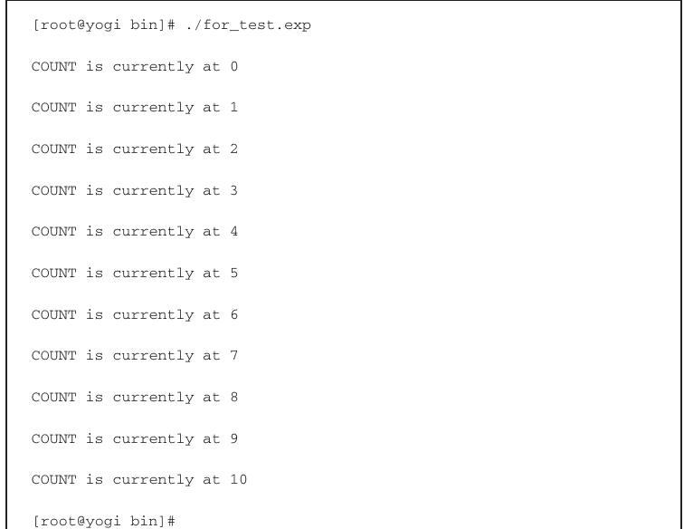
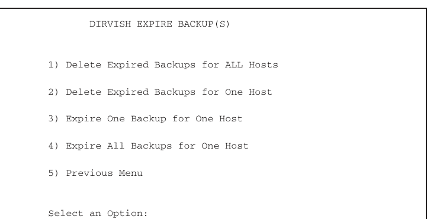
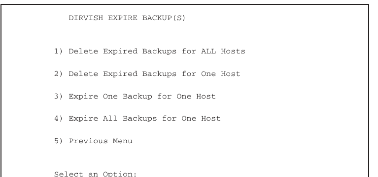
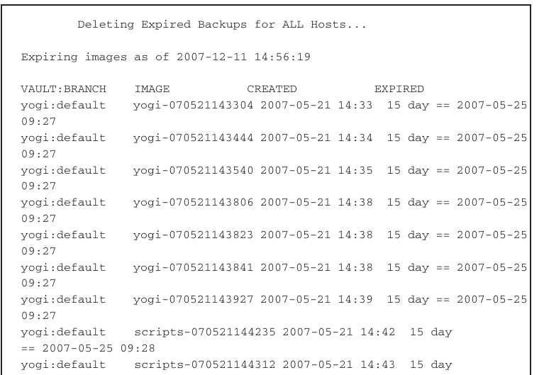

# UNIX Shell 脚本高级指南（第二版）


## 第一部分
### Shell 脚本基础
- 第 1 章：脚本快速入门与复习
- 第 2 章：逐行处理文件的 24 种方法
- 第 3 章：自动化事件通知
- 第 4 章：使用系列点号、旋转线或经过时间作为进度指示器


## 第一章
## 脚本快速入门与回顾

我们将从一个有针对性的复习课程开始。接下来的主题是对那些我们经常需要查书才能找到的技巧的简短解释；现在我们将它们集中在一起。这些解释涵盖了从最快地逐行处理文件的方法，到 UNIX 和 shell 脚本中简单的区分大小写问题。这不应被视为脚本主题的完整列表，但它是一个非常好的起点，并且展示了本书涵盖的主题样本。本章列出的每个主题在书的后面都有非常详细的解释。

我们强烈建议每个人都学习整本书。每一章都使用不同的方法探讨不同的主题。本书这样编写是为了强调，在 UNIX 中解决挑战绝不仅仅只有一种技巧。书中的所有 shell 脚本都是解决问题的真实世界示例。翻阅各章节，你会发现我们尝试涵盖了 UNIX 中大多数常见（以及一些不常见！）的任务。所有 shell 脚本都对思考过程有很好的解释，并且我们总是从针对特定目标的 shell 脚本的正确命令语法开始。我希望你们能像我享受写作一样享受这本书。让我们开始吧！

#### 大小写敏感

UNIX 是区分大小写的。因为 UNIX 区分大小写，所以我们的 shell 脚本也区分大小写。

#### UNIX 特殊字符

以下所有字符都具有特殊的含义或功能。如果在不需要其特殊含义的情况下使用，则必须对其进行转义。要转义或消除其特殊功能，字符之前必须紧跟一个反斜杠 `\`，或者将其包含在 ' ' 单引号中。

`\ / ; , . ~ # $ ? & * ( ) [ ] ' ' " + - ! ^ = | < >`

#### Shell

Shell 是一个我们可以运行命令、程序和 shell 脚本的环境。Shell 有不同的种类，就像操作系统有不同的种类一样。每种 Shell 都有自己的一套认可的命令和功能。本书适用于 Bourne、Bash 和 Korn shell。Shell 位于 `/usr/bin/` 目录或 `/bin/` 目录中，具体取决于 UNIX 的种类和具体版本。

**表 1-1**

| SHELL | 目录 |
|-------|-----------|
| Bourne | /bin/sh 或 /usr/bin/sh |
| Bash | /bin/Bash 或 /usr/bin/Bash |
| Korn | /bin/ksh 或 /usr/bin/ksh |

#### Shell 脚本

Shell 脚本的基本概念是一组按执行顺序排列的命令列表。一个好的 shell 脚本会有以井号或散列标记 `#` 开头的注释，用于描述步骤。其中包含条件测试（例如值 A 是否大于值 B）、允许我们处理海量数据的循环、用于读取和存储数据的文件、用于读取和存储数据的变量，并且脚本可能包含函数。

在接下来的几百页中，我们将编写许多脚本，并且我们应该始终心中有一个明确的目标。有了明确的目标，我们的脚本就有具体目的，并且有一组预期结果。我们还将触及一些技巧、窍门，当然还有在采取不同方式解决挑战以获得相同结果时的陷阱（gotchas）。并非所有技术都是等同的。

Shell 脚本和函数都是解释执行的。这意味着它们不需要编译。Shell 脚本和函数都是由 shell 命令解释器读取的 ASCII 文本。当我们执行 shell 脚本或函数时，命令解释器会逐行、逐循环、逐测试地处理 ASCII 文本，并在从上到下到达每一行时执行每个语句。

#### 函数

函数的编写方式与 shell 脚本非常相似，但不同之处在于，它大多数时候是在 shell 脚本内部定义（或编写）并在脚本内部调用的。这样我们就可以将一段会被反复使用代码只写一次，而无需每次都重写。我们只需调用该函数即可。

我们也可以在系统级别定义函数，使其在我们的环境中始终可用，但这将是稍后讨论的话题。

函数的形式如下：

```
function function_name
{
    commands to execute
}
```

或者

```
function_name ()
{
    commands to execute
}
```

在将函数写入脚本时，必须记得在调用函数之前声明（或编写）该函数。函数必须出现在调用函数的命令语句之前。我们不能使用一个尚不存在的东西。

#### 运行 Shell 脚本

Shell 脚本可以通过以下方式执行：

`ksh shell_script_name`

将创建一个 Korn shell 并在新创建的 Korn shell 环境中执行 `shell_script_name`。对于 `sh` 和 `Bash` shell 也是如此。

`shell_script_name`

如果文件上设置了执行位（请参阅 `chmod` 命令的手册页 `man chmod`），则将执行 `shell_script_name`。脚本将在 shell `script` 第一行声明的 `shell` 中执行。如果在 shell `script` 的第一行没有声明 `shell`，它将在默认 `shell` 中执行，即用户系统定义的 `shell`。在非预期的 `shell` 中执行可能会导致失败并产生不可预测的结果。

**表 1-2：要声明的不同类型的 Shell**

| 命令 | 描述 |
|---|---|
| `#!/bin/sh` 或 `#!/usr/bin/sh` | 声明 Bourne shell |
| `#!/bin/ksh` 或 `#!/usr/bin/ksh` | 声明 Korn shell |
| `#!/bin/csh` 或 `#!/usr/bin/csh` | 声明 C shell |
| `#!/bin/Bash` 或 `#!/usr/bin/Bash` | 声明 Bourne-Again (Bash) shell |

#### 在 Shell 脚本中声明 Shell

声明 Shell！如果我们想完全控制 shell 脚本如何运行以及在哪个 shell 中执行，我们必须在*脚本*的第一行*声明* shell。如果没有声明 shell，脚本将在系统为执行该脚本的用户定义的默认 shell 中执行。例如，如果脚本是为在 Bash shell (`Bash`) 中执行而编写的，而执行该脚本的用户默认 shell 是 C shell (`csh`)，那么该脚本在执行过程中极有可能失败。要声明 shell，表 1-2 中的一个声明语句必须出现在 shell 脚本的第一*行*。

#### Shell 脚本中的注释与风格

本书贯穿始终强调在脚本中编写良好的注释。对我们来说直观明显的东西，对于跟随我们脚步的人来说可能是完全难以理解的。我们要编写可读性强且流程顺畅的代码。这包括编写一个易于阅读和易于维护的脚本，这意味着它必须有大量的注释来描述步骤。在大多数情况下，编写 shell 脚本的人并不是维护它的人。没有什么比必须在没有注释的他人的代码中辛苦挖掘以弄清每一步应该做什么更糟糕的了。修改脚本本身可能已经足够困难，但如果还要揣摩脚本作者的思维方式，有时会让我们产生从头开始重写整个 shell 脚本的想法。我们可以通过编写清晰可读的脚本，并插入大量注释来描述我们的设计哲学以及我们如何使用输入、输出、变量和文件来避免这种情况。

为了使我们的命令语句具有良好的风格，我们需要它具有可读性。因此，有时更好的做法是，例如，将一个命令语句分成三行分开写，而不是将所有内容在同一行代码中*串联*或*通过管道连接*；对于一个新的脚本编写者来说，追踪管道并理解预期结果可能会过于困难。然而，在某些情况下，创建长管道是更理想的。但同样地，它应该有注释来逐步描述我们的思考过程。这样以后有人在看我们的代码时会说：“嘿，这真是个很酷（groovy）的实现方式。”


## 第 1 章 脚本快速入门与复习

命令的可读性和逐步注释仅仅是一个编写良好的脚本的最基本要求。使用大量的注释会让我们在半年没看代码需要重新回顾时，生活变得轻松得多；相信我，我们一定会再次查看代码的。请对所有内容进行注释！这包括但不限于：描述变量和文件的用途、描述循环在做什么、描述每项测试，可能还包括预期结果以及我们如何操作数据和众多数据字段。每行注释前需加上井号 `#`。

接下来的脚本模板可在本书的配套网站 www.wiley.com/go/michael2e 上找到。文件名是 **script.stub**。它包含了开始编写 shell 脚本所需的所有准备就绪的注释。可以将 script.stub 文件复制为一个新文件名。编辑该新文件并开始编写代码。script.stub 文件的内容如代码清单 1-1 所示。

```bash
#!/bin/bash
#
# SCRIPT: NAME_of_SCRIPT
# AUTHOR: AUTHORS_NAME
# DATE: DATE_of_CREATION
# REV: 1.1.A (Valid are A, B, D, T and P)
#           (For Alpha, Beta, Dev, Test and Production)
#
# PLATFORM: (SPECIFY: AIX, HP-UX, Linux, OpenBSD, Solaris
#          or Not platform dependent)
#
# PURPOSE: Give a clear, and if necessary, long, description of the
#          purpose of the shell script. This will also help you stay
#          focused on the task at hand.
#
# REV LIST:
#          DATE: DATE_of_REVISION
#          BY:   AUTHOR_of_MODIFICATION
#          MODIFICATION: Describe what was modified, new features, etc--
#
#
# set -n  # Uncomment to check script syntax, without execution.
#         # NOTE: Do not forget to put the comment back in or
#         #      the shell script will not execute!
# set -x  # Uncomment to debug this shell script
#
######################################################################
# DEFINE FILES AND VARIABLES HERE
######################################################################
######################################################################
#                   DEFINE FUNCTIONS HERE
######################################################################

######################################################################
#                   BEGINNING OF MAIN
######################################################################

# End of script
```
**代码清单 1-1** script.stub shell 脚本启动模板清单

代码清单 1-1 所示的 shell 脚本启动模板为你提供了编写 shell 脚本的框架，其中包含声明变量和文件的部分、创建函数的部分，以及最后编写 shell 脚本主体的 `BEGINNING OF MAIN` 部分。

#### 控制结构

以下控制结构将被广泛使用。

##### if . . . then 语句

```bash
if [ test_command ]
then
    commands
fi
```

##### if . . . then . . . else 语句

```bash
if [ test_command ]
then
    commands
else
    commands
fi
```

##### if ... then ... elif ... (else) 语句

```bash
if [ test_command ]
then
    commands
elif [ test_command ]
then
    commands
elif [ test_command ]
then
    commands
# ...
else    (Optional)
    commands
fi
```

##### for ... in 语句

```bash
for loop_variable in argument_list
do
    commands
done
```

##### while 语句

```bash
while test_condition_is_true
do
    commands
done
```

##### until 语句

```bash
until test_condition_is_true
do
    commands
done
```

##### case 语句

```bash
case $variable in
    match_1)
        commands_to_execute_for_1
        ;;
    match_2)
        commands_to_execute_for_2
        ;;
    match_3)
        commands_to_execute_for_3
        ;;
    # ...
    *)
        (Optional - any other value)
        commands_to_execute_for_no_match
        ;;
esac
```

**注意** case 语句的最后一部分（如上所示）：
`*) commands_to_execute_for_no_match ;;`
是可选的。

##### 使用 break, continue, exit 和 return

有时需要从 `for` 或 `while` 循环中 `break`（跳出），在下一个代码块中 `continue`（继续），完全 `exit`（退出）脚本，或者将函数的执行结果 `return`（返回）给调用该函数的脚本。

- `break` 命令用于在执行完直到 `break` 语句为止的所有代码行后，终止整个循环的执行。随后程序将跳转到循环结束后的代码处执行。
- `continue` 命令用于将控制权转移到下一组代码，但它会继续执行循环。
- `exit` 命令的作用正如其名：它会退出整个脚本。可以在 `exit` 命令后添加一个整数（例如 `exit 0`），该整数将作为返回码发送。
- `return` 命令用于函数中，以便向调用脚本发送数据，或 *返回一个结果或返回码*。

##### Here Document (此处文档)

*here document* 用于将输入重定向 *进入* 一个交互式 shell 脚本或程序。通过为交互式程序或交互式 shell 脚本提供所需的输入，我们可以在 shell 脚本中运行交互式程序而无需用户操作。这就是为什么它被称为 "here document"：所需的输入就在这里（here），而不是在其他地方。以下是 here document 的语法：

```
program_name <<LABEL

Program_Input_1
Program_Input_2
Program_Input_3
Program_Input_#

LABEL
```

示例：

```
/usr/local/bin/My_program << EOF
Randy
Robin
Rusty
Jim
EOF
```

请注意，在 here document 中，两个 `EOF` 标签之间的程序输入行中 *不能有空格*。如果在输入中添加了空格，here document 可能会失败。提供的输入必须是程序所期望的 *精确* 数据，许多程序如果在输入中添加空格将会运行失败。

#### Shell 脚本命令

Shell 脚本的基础是一系列命令的自动化。我们可以在 shell 脚本中执行几乎任何可以在命令行执行的命令。（唯一的例外是在 shell 脚本中尝试设置执行 *suid* 或 *sgid*、*sticky bit*；出于安全原因，这不被支持。）对于经常执行的命令，通过将它们放入 shell 脚本中可以减少错误。我们将消除拼写错误和遗漏的设备定义，并且可以进行条件测试，以确保不会因为意外的输入或输出而导致失败。本书将在后续章节中广泛讲解命令和命令结构。

表 1-3 中所示的大多数命令在本书的某些部分会被用到，具体取决于每章处理的任务。

**表 1-3** UNIX 命令复习

| 命令 | 描述 |
| :--- | :--- |
| `passwd` | 修改用户密码 |
| `pwd` | 打印当前目录 |
| `cd` | 切换目录 |
| `ls` | 列出目录中的文件 |
| `wildcards` | `*` 匹配任意数量的字符；`?` 匹配单个字符 |
| `file` | 打印文件类型 |
| `cat` | 显示文件内容 |
| `pr` | 显示文件内容 |
| `pg` 或 `page` | 分页显示文件内容 |
| `more` | 分页显示文件内容 |
| `clear` | 清屏 |
| `cp` 或 `copy` | 复制文件 |
| `chown` | 修改文件的所有者 |
| `chgrp` | 修改文件的所属组 |
| `chmod` | 修改文件模式、权限 |
| `rm` | 从系统中删除文件 |
| `mv` | 重命名文件 |
| `mkdir` | 创建目录 |
| `rmdir` | 删除目录 |
| `grep` | 模式匹配 |
| `egrep` | 用于扩展正则表达式的 `grep` 命令 |
| `find` | 定位文件和目录 |
| `>>` | 追加到文件末尾 |
| `>` | 重定向、创建或覆盖文件 |
| `\|` | 将命令连接在一起，称为管道 |
| `\|\|` | 逻辑或 – command1 `\|\|` command2 – 若 command1 失败则执行 command2 |
| `&` | 在后台执行 |
| `&&` | 逻辑与 – command1 `&&` command2 – 若 command1 成功则执行 command2 |
| `date` | 显示系统日期和时间 |
| `echo` | 将字符串写入标准输出 |
| `sleep` | 暂停执行指定秒数 |
| `wc` | 统计文件中的单词数、行数和字符数 |
| `head` | 查看文件顶部内容 |
| `tail` | 查看文件末尾内容 |
| `diff` | 比较两个文件 |
| `sdiff` | 并排比较两个文件（需要 132 字符宽度的显示器） |
| `spell` | 拼写检查 |
| `lp`, `lpr`, `eng`, `qprt` | 打印文件 |
| `lpstat` | 系统打印队列状态 |
| `enable` | 启用或启动打印队列 |
| `disable` | 禁用或停止打印队列 |
| `cal` | 显示日历 |
| `who` | 显示系统用户信息 |
| `w` | 扩展的 `who` 命令 |


**表 1-3** *(续)*

| 命令 | 描述 |
|---------|-------------|
| whoami | 显示 $LOGNAME 或 $USER 环境变量 |
| who am I | 显示登录名、终端、登录日期/时间以及登录地点 |
| f, finger | 显示关于已登录用户的信息，包括用户的 .plan 和 .project 文件 |
| talk | 允许两个用户进行分屏对话 |
| write | 在用户的屏幕上显示一条消息 |
| wall | 在所有已登录用户的屏幕上显示一条消息 |
| rwall | 向远程主机上的所有用户发送消息 |
| rsh 或 remsh | 在远程主机上执行命令或登录 |
| df | 显示文件系统统计信息 |
| ps | 显示当前运行进程的信息 |
| netstat | 显示网络状态 |
| vmstat | 显示虚拟内存状态 |
| iostat | 显示输入/输出状态 |
| uname | 显示当前操作系统的名称以及机器信息 |
| sar | 报告系统活动 |
| basename | 显示字符串参数的基础文件名 |
| man | 显示在线参考手册 |
| su | 切换到另一个用户，也称为超级用户 |
| cut | 写出选定的字符 |
| awk | 用于解析字符的编程语言 |
| sed | 用于字符替换的编程语言 |
| vi | 启动 vi 编辑器 |
| emacs | 启动 emacs 编辑器 |

#### 符号命令

表 1-4 中显示的符号实际上是命令，并且在本书中被广泛使用。

表 1-4 符号命令

| 命令 | 描述 |
| --- | --- |
| ( ) | 在子 shell 中运行括号内的命令 |
| (( )) | 在 shell 中对变量进行求值、赋值并进行数学运算 |
| $(( )) | 对括号内的表达式进行求值 |
| [ ] | 与 `test` 命令相同 |
| < > | 用于字符串比较 |
| $( ) | 命令替换 |
| 'command' | 命令替换 |

#### 变量

变量是一个我们为其分配值的字符字符串。分配的值可以是数字、文本、文件名、设备或任何其他类型的数据。变量只不过是一个指向实际数据的指针。我们在脚本中会频繁地使用变量，以至于不使用它们反而会显得不寻常。

在本书中，我们将始终使用大写字母来指定变量 —— 例如，`UPPERCASE`。但在实际的 shell 编程世界中，不建议使用大写变量名，因为这些大写变量可能会与同样使用大写的系统环境变量冲突。本书使用大写变量是为了强调变量，并使它们在代码中更加醒目。当你编写自己的 shell 脚本或修改本书中的脚本时，请将变量设为小写文本。

要将变量指向数据，我们使用 `UPPERCASE="value_to_assign"` 作为赋值语法。要访问变量 `UPPERCASE` 所指向的数据，必须添加美元符号 `$` 作为前缀 —— 例如，`$UPPERCASE`。要查看分配给变量的数据，我们可以使用 `echo $UPPERCASE`、`print $UPPERCASE`（用于变量），或者如果变量指向一个文件，则使用 `cat $UPPERCASE` 作为命令结构。

#### 命令行参数

命令行参数 `$1`，`$2`，`$3`...`$9` 是位置参数，其中 `$0` 指向实际的命令、程序、shell 脚本或函数，而 `$1`，`$2`，`$3`，...`$9` 是该命令的参数。

函数中的位置参数 `$0`，`$2` 等是供函数使用的，可能不在调用该函数的 shell 脚本环境中。变量在函数或 shell 脚本中可见的范围被称为变量的*作用域*（scope）。

#### shift 命令

`shift` 命令用于将位置参数向左移动；例如，`shift` 会使 $2 变成 $1。我们还可以在 `shift` 命令后面添加一个数字，以移动超过一个位置；例如，`shift 3` 会使 $4 移动到 $1 的位置。

有时我们会遇到向 shell 脚本或函数传递未知数量或可变数量参数的情况，即 `$1, $2, $3...`（也称为位置参数）。使用 `shift` 命令是按顺序处理每个位置参数的一种好方法。

为了进一步解释 `shift` 命令，我们将演示如何处理传递给清单 1-2 所示 shell 脚本的未知数量的参数。请尝试跟随这个示例 shell 脚本结构。该脚本使用 `shift` 命令来处理未知数量的命令行参数或位置参数。在本脚本中，我们将这些参数称为*令牌*（tokens）。

```shell
#!/usr/bin/sh
#
# SCRIPT: shifting.sh
#
# AUTHOR: Randy Michael
#
# DATE:   12/30/2007
#
# REV:    1.1.A
#
# PLATFORM: Not platform dependent
#
# PURPOSE: This script is used to process all of the tokens which
# are pointed to by the command-line arguments, $1, $2, $3,etc...
#
# REV. LIST:
#
# Initialize all variables

TOTAL=0    # Initialize the TOTAL counter to zero

#  Start a while loop

while true
do
    TOTAL=`expr $TOTAL + 1`  # A little math in the
                             # shell script, a running
                             # total of tokens processed.
    TOKEN=$1                # We always point to the $1 argument with a shift

    process each $TOKEN

    shift                   # Grab the next token, i.e. $2 becomes $1
done

echo "Total number of tokens processed: $TOTAL"
```

**清单 1-2** 使用 shift 命令的示例

我们将在本书后面的部分详细讨论 `shift` 命令的类似示例。

#### 特殊参数 `$*` 和 `$@`

有一些特殊参数允许一次性访问*所有*命令行参数。`$*` 和 `$@` 的行为相同，除非它们被包含在双引号 `" "` 中。

##### 特殊参数定义

- `$*` 特殊参数指定*所有*命令行参数。
- `$@` 特殊参数同样指定*所有*命令行参数。
- "`$*`" 特殊参数将整个列表作为一个参数，参数之间用空格分隔。
- "`$@`" 特殊参数将整个列表拆分为独立的参数。

我们可以重写清单 1-2 所示的 shell 脚本，使用 `$*` 或 `$@` 特殊参数来处理未知数量的命令行参数，如清单 1-3 所示。

```shell
#!/usr/bin/sh
#
# SCRIPT: shifting.sh
# AUTHOR: Randy Michael
# DATE:    12-31-2007
# REV:    1.1.A
# PLATFORM: Not platform dependent
#
# PURPOSE: This script is used to process all of the tokens which
# Are pointed to by the command-line arguments, $1, $2, $3, etc... -
#
# REV LIST:
#
#  Start a for loop
for TOKEN in $*
do
        process each $TOKEN
done
```

**清单 1-3** 使用特殊参数 `$*` 的示例

我们也可以同样方便地使用 `$@` 特殊参数。正如我们在前面的代码段中所看到的，使用 `$*` 或 `$@` 是解决同一问题的另一种方案，且编写的代码更少。两种技术都能完成相同的任务。

#### 双引号、前引号和反引号

在脚本、函数和命令语句中，我们该如何决定使用哪一种？这个决定是编写脚本时最容易产生混淆的地方。现在我们来把这个问题讲清楚。

根据任务内容和期望的输出，使用正确的封闭符号非常重要。如果使用不正确，将产生不可预测的结果。

在我们需要允许字符或命令替换的语句中，我们使用 `" `（双引号）。当定义包含空格的数据变量时，需要使用双引号，如下所示：

```shell
NAME="Randal K. Michael"
```

如果缺少双引号，我们会得到以下错误：

```shell
NAME=Randal K. Michael
-Bash: K.: command not found
```

在我们*不*希望进行字符或命令替换的语句中，我们使用 `' `（前引号/单引号）。使用 `' ` 封闭是为了在变量或命令语句中使用*字面文本*，而不进行任何替换。所有特殊的含义和功能都会被移除。它还用于当你希望变量在每次使用时都被重新读取的情况；例如，`'$PWD'` 在处理 `PS1` 命令行提示符时被大量使用。此外，在同一个字符串前加上反斜杠 `\` 也可以移除字符或字符串的特殊含义。


我们在想要执行命令或脚本并用其输出结果进行替换的语句中使用 `, 反引号（back tics）；这被称为*命令替换（command substitution）*。在大多数键盘上，` 键位于 **1** 键的左侧，Escape 键（Esc）的下方。通过使用 **$(command)** 命令语法也可以实现命令替换。在本书中，我们将看到许多这类不同的示例。

#### 在 Solaris 上使用 awk

我们在本书中大量使用 **awk** 来解析文本行。有一种特殊情况是在 Solaris 上，我们必须使用 **nawk** 来代替。如果我们需要指定一个除空格（默认字段分隔符）以外的字段分隔符，例如使用 **awk -F :**，那么该 awk 语句在 Solaris 机器上会失败。为了解决这个问题，如果我们发现 UNIX 版本是 Solaris，请使用 nawk。将以下代码段添加到所有 shell 脚本的变量声明部分以消除该问题：

```bash
# Setup the correct awk usage. Solaris needs to
# use nawk instead of awk.

case $(uname) in
SunOS) alias awk=nawk
      ;;
esac
```

#### 正确使用 echo 命令

我们使用 **echo** 命令来显示文本。echo 命令允许使用反斜杠运算符进行大量的光标控制：`\n` 表示换行，`\c` 表示在同一行继续，`\b` 表示光标后退，`\t` 表示制表符，`\r` 表示回车，`\v` 表示垂直移动一行。在 Korn shell 中，echo 命令默认识别这些命令选项。在 Bash shell 中，我们必须向 echo 命令添加 -e 开关，例如 `echo -e "\n"` 来实现一个换行。

我们可以通过在脚本中查询 `$SHELL` shell 变量来询问系统当前执行的 shell。许多 Linux 发行版即使我们在脚本的第一行指定了 Korn shell 为 Korn shell，仍会在 Bash shell 中执行。因为 Bash shell 要求使用 echo -e 开关来启用反斜杠运算符，因此我们可以使用 case 语句，如果执行的 shell 是 `*/bin/Bash`，则将 echo 命令别名为 echo -e。现在当我们需要使用 echo 命令时，可以确保它能正确显示文本。

将以下代码段添加到所有 Korn shell 脚本的变量声明部分，这个问题就解决了：

```bash
# Set up the correct echo command usage. Many Linux
# distributions will execute in Bash even if the
# script specifies Korn shell. Bash shell requires
# we use echo -e when we use \n, \c, etc.

case $SHELL in
    */bin/Bash) alias echo="echo -e"
                ;;
esac
```

#### Shell 脚本中的数学运算

我们可以在 shell 脚本中轻松进行算术运算。shell 的 `let` 命令和 `((expr))` 命令表达式是计算整数表达式最常用的方法。稍后我们还将介绍使用 `bc` 函数进行浮点数运算。

##### 运算符

shell 使用来自 C 编程语言的算术运算符（见表 1-5），按优先级递减顺序排列。

**表 1-5 数学运算符**

| 运算符 | 描述 |
| --- | --- |
| ++ -- | 自增和自减，包括前缀和后缀 |
| + | 一元加 |
| - | 一元减 |
| ! ~ | 逻辑非；二进制反转（反码） |
| * / % | 乘法；除法；取模（余数） |
| + - | 加法；减法 |
| << >> | 位左移；位右移 |
| <= >= | 小于或等于；大于或等于 |
| < > | 小于；大于 |
| == != | 等于；不等于（均从左向右计算） |
| & | 位与 |
| ^ | 位异或 |
| \| | 位或 |
| && | 逻辑与 |
| \|\| | 逻辑或 |

书中使用了很多这些数学运算符，但并非全部。在本书中，我们尽量保持简单直接，以免用晦涩的表达式迷惑读者。

##### 内置数学函数

shell 提供了对标准数学函数集的访问。它们使用 C 函数调用语法进行调用。表 1-6 列出了 shell 函数清单。

**表 1-6 内置 Shell 函数**

| 名称 | 功能 |
| :--- | :--- |
| `abs` | 绝对值 |
| `log` | 自然对数 |
| `acos` | 反余弦 |
| `sin` | 正弦 |
| `asin` | 反正弦 |
| `sinh` | 双曲正弦 |
| `cos` | 余弦 |
| `sqrt` | 平方根 |
| `cosh` | 双曲余弦 |
| `tan` | 正切 |
| `exp` | 指数函数 |
| `tanh` | 双曲正切 |
| `int` | 浮点数的整数部分 |

除了使用 `int` 函数来提取浮点数的整数部分外，本书中的 shell 脚本没有使用任何这些内置 shell 函数。

#### 文件权限、suid 和 sgid 程序

在编写 shell 脚本后，我们必须记得设置文件权限使其*可执行*。我们使用 `chmod` 命令来更改文件的操作模式。除了使脚本可执行外，还可以将文件的模式更改为始终以特定用户身份执行（`suid`）或始终以特定系统组成员身份执行（`sgid`）。这被称为设置*粘滞位（sticky bit）*。出于安全原因，如果你尝试对 shell 脚本设置 `suid` 或 `sgid`，该操作将被忽略。

将程序设置为始终以特定用户或特定组成员身份执行，通常用于允许所有用户（或一组用户）在正确的环境中运行程序。例如，大多数系统检查程序需要以管理用户（有时是 _root_）身份运行。我们不想分发密码，因此可以简单地将程序设置为始终以 `root` 身份执行，这样会让每个人的生活更简单。我们可以使用表 1-7 中所示的选项来设置文件权限。此外，请查阅 `chmod` 的帮助手册，**man chmod**。

通过组合 `chmod` 命令选项，你可以将文件或目录的权限设置为任何你想要的设置。请记住，系统会忽略对 shell 脚本设置的 `suid` 或 `sgid`。

**表 1-7 chmod 权限选项**

| 数字 | 描述 |
|:-------|:-------------|
| 4000 | 执行时设置用户 ID |
| 2000 | 执行时设置组 ID |
| 1000 | 设置目录的链接权限或设置文件的保存文本属性 |
| 0400 | 允许所有者读取 |
| 0200 | 允许所有者写入 |
| 0100 | 允许所有者执行或搜索 |
| 0040 | 允许组读取 |
| 0020 | 允许组写入 |
| 0010 | 允许组执行或搜索 |
| 0004 | 允许其他人读取 |
| 0002 | 允许其他人写入 |
| 0001 | 允许其他人执行或搜索 |

#### 不同用途的 chmod 命令语法

`chmod` 命令可以使用八进制文件权限表示法或 r, w, x 符号表示法。以下两个示例产生相同的结果。

##### 使脚本可执行

```bash
chmod 754 my_script.sh
```

或者

```bash
chmod u+rwx,g+rx,o+r my_script.ksh
```

所有者可读、可写、可执行。组可读、可执行。其他人可读。

##### 设置程序始终以所有者身份执行

```bash
chmod 4755 my_program
```

如果该文件不是 shell 脚本，程序将始终以文件所有者身份执行。所有者可读、可写、可执行。组可读、可执行。其他人可读、可执行。因此，无论谁执行此文件，它都将像所有者实际执行程序一样执行。

##### 设置程序始终以文件所有者组的成员身份执行

```bash
chmod 2755 my_program
```

只要该文件不是 shell 脚本，程序将始终以文件组的成员身份执行。文件所有者可读、可写、可执行。组可读、可执行。其他人可读、可执行。因此，无论谁执行此程序，它都将始终以文件组的成员身份执行。

##### 设置程序始终以文件所有者及其组成员身份执行

```bash
chmod 6755 my_program
```

只要该程序不是 shell 脚本，它将始终以文件的所有者且作为文件所有者组的成员身份执行。文件所有者可读、可写、可执行。组可读、可执行。其他人可读、可执行。因此，无论谁执行此程序，它都将始终以文件所有者和文件所有者组成员的身份执行。

#### 在远程主机上运行命令

有时我们想在远程主机上执行命令并将结果显示在本地。例如，获取一组机器的文件系统统计信息。我们可以使用 *rsh* 命令来实现。语法是 *rsh hostname command_to_execute*。这是一个很方便的小工具，但在 *rsh* 命令起作用之前，所有主机都需要设置两个系统文件。这些文件是 *.rhosts*（创建在用户的家目录中，文件权限为 600，即仅允许所有者读写）和 */etc/hosts.equiv* 文件。

出于安全原因，*.rhosts* 和 *hosts.equiv* 文件默认未设置为允许执行远程 shell。*请小心！* 系统的安全性可能会受到威胁。有关设置这些文件的详细信息，请参阅每个操作系统的文档。


谈到安全性，一个更好的解决方案是使用 Open Secure Shell (OpenSSH) 来替代 `rsh`。在很大程度上，OpenSSH 是 `rsh`、`telnet` 和 `ftp` 的免费加密替代方案。要使用 OpenSSH 在另一台机器上执行命令，请使用以下语法：

```
ssh user@hostname command_to_execute
```

```

或者

```
ssh -l user hostname command_to_execute
```

如果尚未设置加密密钥对，此命令会提示您输入密码。手动设置密钥对关系通常需要几分钟，或者您可以使用代码清单 1-4 和 1-5 中显示的 `keyit` 脚本之一为您设置密钥。该过程的详细信息请参阅 `ssh` 手册页 (`man ssh`)。

您可以从 http://www.openssh.org 下载 OpenSSH 代码。
代码清单 1-4 中的 keyit.dsa 脚本在 DSA 密钥存在时将设置 DSA 密钥。

```bash
#!/bin/Bash
#
# SCRIPT: keyit.dsa
# PURPOSE: This script is used to set up DSA SSH keys. This script must
#   be executed by the user who needs the keys setup.

REM_HOST=$1

cat $HOME/.ssh/id_dsa.pub | ssh $REM_HOST "cat >> ~/.ssh/authorized_keys"
```
**代码清单 1-4 用于设置 DSA SSH 密钥的 keyit.dsa 脚本**

代码清单 1-5 中的 keyit.rsa 脚本在 RSA 密钥存在时将设置 RSA 密钥。

```bash
#!/bin/Bash
#
# SCRIPT: keyit.rsa
# PURPOSE: This script is used to set up RSA SSH keys.
# This script must be executed by the user who needs the keys setup.

REM_HOST=$1

cat $HOME/.ssh/id_rsa.pub | ssh $REM_HOST "cat >> ~/.ssh/authorized_keys"
```
**代码清单 1-5 用于设置 RSA SSH 密钥的 keyit.rsa 脚本**

如果您需要为新用户设置加密密钥，请先 `su` 到该用户 ID，然后执行以下命令之一。
要设置 DSA 密钥，请执行此命令：

```
ssh-keygen -t dsa
```

要设置 RSA 密钥，请执行此命令：

```
ssh-keygen -t rsa
```

阅读 `ssh-keygen` 手册页以获取更多详细信息：**man ssh-keygen**。

#### 设置陷阱 (Setting Traps)

当程序在正常结束前被终止时，我们可以捕捉到一个退出信号。这被称为 *陷阱 (trap)*。表 1-8 列出了一些退出信号。

**表 1-8 退出信号**

| 编号 | 信号 | 描述 |
|--------|--------|-------------|
| 0 | - | 正常终止，脚本结束 |
| 1 | SIGHUP | 挂断，线路断开 |
| 2 | SIGINT | 终端中断，通常为 Ctrl + C |
| 3 | SIGQUIT | 退出键，子进程在终止前死亡 |
| 9 | SIGKILL | kill -9 命令，无法捕捉此类退出状态 |
| 15 | SIGTERM | kill 命令的默认操作 |
| 19 | SIGSTOP | 停止，通常为 Ctrl + z |

要查看您的操作系统支持的所有信号列表，请输入以下命令：

```
# kill -l
```

这是一个在 shell 脚本中非常实用的工具。在捕捉到陷阱信号时，我们可以在实际退出 shell 脚本之前执行一些清理命令。当信号被捕捉时，可以执行命令。如果在 shell 脚本中添加以下命令语句，它将在屏幕上打印 "EXITING on a TRAPPED SIGNAL"，然后在信号 1、2、3 和 15 时干净地退出。我们无法 `trap` 一个 `kill -9`。

```
trap 'echo "\nEXITING on a TRAPPED SIGNAL";exit' 1 2 3 15
```

我们可以添加各种在退出前可能需要的清理命令。例如，我们可能需要在退出前删除 shell 脚本创建的一组文件。

#### 用户信息命令

有时我们需要查询系统以获取有关系统中用户的一些信息。

##### who 命令

**who** 命令为每个登录用户提供以下输出：*用户名*、*tty*、*登录时间* 以及 *用户登录来源*：

```
rmichael    pts/0         Mar 13 10:24         192.168.1.104
root        pts/1         Mar 15 10:43         (yogi)
```

##### w 命令

**w** 命令实际上是扩展的 **who**。输出如下所示：

```
12:29PM    up 27 days,  21:53,2 users, load average 1.03,  1.17, 1.09
User      tty       login@      idle     JCPU   PCPU    what
rmichael  pts/0     Mon10AM 0    3:00    1      w
root      pts/1     10:42AM 37    5:12    5:12    tar
```

请注意，上述输出的第一行与 **uptime** 命令的输出相同。**w** 命令通过列出作业进程时间和总用户进程时间，提供了比 **who** 命令更详细的输出，但它不会显示用户是从 *哪里* 登录的。出于安全目的，我们通常对这一点感兴趣。**w** 命令输出的一个优点是，它还会列出在输入 **w** 命令瞬间用户正在 *做什么*。这可能非常有用。

##### last 命令

**last** 命令显示自 `wtmp` 文件创建以来谁登录过系统的历史记录。当您需要调查谁在何时登录系统时，这是一个很好的工具。以下是示例输出：

```
root       ftp    booboo          Aug 06 19:22 - 19:23  (00:01)
root       pts/3  mrranger        Aug 06 18:45   still logged in.
root       pts/2  mrranger        Aug 06 18:45   still logged in.
root       pts/1  mrranger        Aug 06 18:44   still logged in.
root       pts/0  mrranger        Aug 06 18:44   still logged in.
root       pts/0  mrranger        Aug 06 18:43 - 18:44  (00:01)
root       ftp    booboo          Aug 06 18:19 - 18:20  (00:00)
root       ftp    booboo          Aug 06 18:18 - 18:18  (00:00)
root       tty0                   Aug 06 18:06   still logged in.
root       tty0                   Aug 02 12:24 - 17:59 (4+05:34)
reboot     ~                     Aug 02 12:00
shutdown   tty0                 Jul 31 23:23
root       ftp    booboo          Jul 31 21:19 - 21:19  (00:00)
root       ftp    bambam          Jul 31 21:19 - 21:19  (00:00)
root       ftp    booboo          Jul 31 20:42 - 20:42  (00:00)
root       ftp    bambam          Jul 31 20:41 - 20:42  (00:00)
```

**last** 命令的输出显示了用户名、登录端口、用户登录来源、登录/注销时间以及登录会话的持续时间。

##### ps 命令

`ps` 命令将显示有关当前系统进程的信息。`ps` 命令有许多开关可以改变我们的查看内容。表 1-9 列出了一些常用的命令选项。

**表 1-9 常用 ps 命令选项**

| ps 命令 | 描述 |
|---|---|
| `ps` | 用户当前运行的进程 |
| `ps -f` | 用户当前运行进程的完整列表 |
| `ps -ef` | 所有进程的完整列表，但除内核进程外 |
| `ps -A` | 所有进程，包括内核进程 |
| `ps -Kf` | 内核进程的完整列表 |
| `ps auxw` | 按 CPU 使用率百分比 (%CPU) 排序的宽列表 |

#### 与用户沟通

与系统用户沟通并让他们知道发生了什么！所有系统管理员都有一个 *维护窗口*，我们可以在其中获得控制权并处理一些离线任务。如果仍有用户登录，这就是需要与系统用户沟通的一个例子。

向系统用户传递信息最常用的方法是使用 `/etc/motd` 文件。该文件在用户每次登录时都会显示。如果用户一次登录数日，他们将看不到新的当日消息。这就是为什么需要实时沟通的一个原因。表 1-10 中显示的命令允许与当前登录到系统的用户进行沟通或让用户之间进行沟通。

**表 1-10 实时用户沟通命令**

| 命令 | 描述 |
|---|---|
| `wall` | 在 *本地* 主机上所有登录用户的屏幕上写入一条消息。 |
| `rwall` | 在 *远程* 主机上所有登录用户的屏幕上写入一条消息。 |
| `write` | 向单个用户写入消息。该用户必须当前处于登录状态。 |
| `talk` | 启动一个交互式程序，允许两个用户进行对话。屏幕被分为两半，双方都可以看到对方正在输入的内容。 |


> **注意** 使用这些命令时请意识到，如果用户正在运行某个程序（例如会计软件套装）并且该程序的界面正显示在终端上，用户可能无法收到消息，或者用户的屏幕可能会出现乱码。

#### 使用大写或小写文本以便于测试

我们经常需要对文件名、变量、文件文本等文本字符串进行测试以进行比较。有时这些字符串的差异很大，因此将文本统一转换为大写或小写会使比较更加容易。`tr` 和 `typeset` 命令可用于将文本转换为大写或小写。这使得测试变量输入等操作变得轻而易举。以下是使用 `tr` 命令的一些示例：

- **变量值：**
    - 预期输入：TRUE
    - 实际输入：TRUE
    - 可能的输入：true TRUE True True 等等

### 转换为大写：

```
UPCASEVAR=$(echo $VARIABLE | tr '[a-z]' '[A-Z]')
```

### 转换为小写：

```
DOWNCASEVAR=$(echo $VARIABLE | tr '[A-Z]' '[a-z]')
```

在上述 `tr` 命令的示例中，我们使用 `echo` 输出字符串，并使用管道 ( | ) 将 `echo` 语句的输出发送给 `tr` 命令。如前例所示，转换为大写使用的是 `'[a-z]' '[A-Z]'`。

> **注意** 方括号周围必须使用单引号。

```
'[a-z]' '[A-Z]'    用于从小写转换为大写
'[A-Z]' '[a-z]'    用于从大写转换为小写
```

无论用户输入什么，只要转换为大写，我们始终会得到稳定的输入 TRUE；如果转换为小写，则得到 `true`。这减少了我们的代码测试工作，同时也提高了脚本的可读性。

我们还可以使用 `typeset` 来控制 shell 中变量的属性。在之前的示例中，我们使用了变量 `VARIABLE`。我们可以将属性设置为始终将所有字符转换为大写或小写。要将变量 `VARIABLE` 的大小写属性设置为始终将其分配的字符转换为大写，我们使用：

```
typeset -u VARIABLE
```

`typeset` 命令的 `-u` 开关用于大写。在通过 `typeset` 命令设置了变量 `VARIABLE` 的属性后，每当我们向 `VARIABLE` 分配文本字符时，它们都会自动转换为大写字符。

示例：

```
typeset -u VARIABLE
VARIABLE="True"
echo $VARIABLE

TRUE
```

要将变量 `VARIABLE` 的大小写属性设置为始终将字符转换为小写，我们使用：

示例：

```
typeset -l VARIABLE
VARIABLE="True"
echo $VARIABLE
true
```

##### 检查返回码

每当我们运行一个命令时，系统都会关于最后执行的命令返回一个响应，这被称为 *返回码（return code）*。如果命令执行成功，返回码将是 `0`（零）。如果*不*成功，返回码将是除 `0` 之外的其他值。要检查返回码，我们可以查看 shell 变量 `$?` 的值。

例如，我们想检查 `/usr/local/bin` 目录是否存在。以下每段代码实现的功能完全相同：

```
test  -d  /usr/local/bin
if [ "$?" -eq 0 ]  # 检查返回码
then        # 返回码为零

    echo '/usr/local/bin does exist'

else           # 返回码不是零

    echo '/usr/local/bin does NOT exist'

fi
```

或者

```shell
if test -d /usr/local/bin
then            # 返回码为零

    echo '/usr/local/bin does exist'

else                # 返回码不是零

    echo '/usr/local/bin does NOT exist'
fi
```

或者

```shell
if [ -d /usr/local/bin ]
then            # 返回码为零

    echo '/usr/local/bin does exist'

else                # 返回码不是零

    echo '/usr/local/bin does NOT exist'
fi
```

请注意，在第一个例子中我们使用 `$?` 检查了一次返回码。而其他示例使用了控制结构内置的测试。内置测试在处理返回码方面的作用相同，但它们在过程中隐藏了这一步骤。以上三个示例的结果完全一致。这仅仅是个人选择和可读性的问题。

#### 基于时间的脚本执行

我们会编写许多希望按定时时间间隔执行或在特定时间运行一次的 shell 脚本。本节将通过几个示例来解决这些需求。

#### Cron 表

*Cron 表（cron table）* 是一个系统文件，由系统每分钟读取一次，并执行任何计划在该分钟内执行的条目。默认情况下，任何用户都可以使用 `crontab -e` 命令创建 cron 表，但系统管理员可以通过 `cron.allow` 和 `cron.deny` 文件控制哪些用户被允许创建和编辑 cron 表。当用户创建自己的 cron 表时，命令、程序或脚本将在该用户的环境中执行。这相当于在执行命令之前运行该用户的 `$HOME/.profile`。

`crontab -e` 命令会启动默认文本编辑器（`vi` 或 `emacs`）来编辑用户的 cron 表。

> **注意** 使用 `crontab` 命令时，操作对象是当前用户 ID 的 cron 表。要列出当前用户 cron 表的内容，请执行 `crontab -l` 命令。

##### Cron 表条目语法

了解 cron 表条目中每个字段的用途非常重要。以下 cron 表条目将在 1 月 8 日凌晨 3:15 执行脚本 `/usr/local/bin/somescript.ksh`（无论 1 月 8 日是星期几）。请注意，我们在星期字段使用了 *通配符*。

```
              小时中的分钟 (0-59)
           |       一天中的小时 (0-23)
           |     |    一个月中的日期 (1-31)
           |     |     |     一年中的月份 (1-12)
           |     |     |     |     一周中的天 (0-6，周日到周六)
           |     |     |     |     |     要执行的命令 (需要完整路径)
           |     |     |     |     |     |
         15 3   8   1    *    /usr/local/bin/somescript.Bash 2>&1 >/dev/null
```

以下 cron 表条目是另一个示例：

```
0 0 1 1 *  /usr/bin/banner "Happy New Year" > /dev/console
```

在元旦前夜的午夜（1 月 1 日 00:00），无论星期几，此 cron 表条目都会在系统控制台 (`/dev/console`) 用巨大的横幅字母写入 **Happy New Year**。下表定义了通配符。

**通配符：**

| 字符 | 描述 |
| :--- | :--- |
| * | 匹配任意数量的字符 |
| ? | 匹配单个字符 |

##### at 命令

与 cron 表类似，`at` 命令根据时间执行命令。使用 `at` 命令，我们可以调度一个任务在特定时间运行 *一次*。当任务执行时，除非输出被重定向，否则 `at` 命令会将标准输出和标准错误通过电子邮件发送给调度该任务的用户。作为系统管理员，我们可以通过 `at.allow` 和 `at.deny` 文件控制哪些用户被允许调度任务。在修改这些文件之前，请参阅每个操作系统的 man 手册页，并参考它们来学习使用 `at` 命令进行定时控制执行的多种方法。若要 10 分钟后执行命令，请使用以下语法：

```
echo '/usr/local/bin/somescript.Bash' | at now + 10 minutes
```

您也可以通过输入以下内容以交互方式使用 `at` 命令：

```
at now + 10 minutes        回车
```

然后输入要执行命令的完整路径名，按回车键，然后按 Ctrl+D。示例如下：

```
at now + 10 minutes
/usr/local/bin/somescript.Bash
Ctrl+D
```

有关更多 `at` 命令选项，请参阅 `at` 命令手册页，**man at**。

##### 输出控制

脚本将如何运行？输出将去向何处？这些问题属于输出控制。

##### 静默运行

要以 *静默模式* 执行脚本，可以使用以下语法：

```
/PATH/script_name 2>&1 > /dev/null
```

在此命令语句中，`script_name` shell 脚本将执行且屏幕上不会有任何输出。原因在于该命令以以下内容结尾：

```
2>&1 > /dev/null
```

通过这样结束命令，它将由文件描述符 2 指定的标准错误 (`stderr`) 重定向到由文件描述符 1 指定的标准输出 (`stdout`)。然后我们将其再次重定向到 `/dev/null`，从而将所有输出发送到“比特桶”（bit bucket，即丢弃）。

我们可以称之为 *静默运行*。这意味着脚本绝对没有任何输出发送到我们的屏幕。在脚本内部，可能会有一些输出被定向到文件、设备、特定终端，甚至是系统控制台 `/dev/console`，但不会有任何输出发送到用户的屏幕。这在从系统 cron 表执行脚本时尤为有用。

在下面的 cron 表条目示例中，我们希望每 15 分钟执行一次名为 `/usr/local/bin/systemcheck.ksh` 的脚本（该脚本需要以 `root` 用户运行），并且全天 24 小时、每周 7 天运行，且屏幕上不显示任何输出。因为我们将使用以下内容结束 cron 表条目，所以不会有任何屏幕输出：

```
2>&1 > /dev/null
```


在脚本内部，它可能会执行某种通知，例如呼叫工作人员或将输出发送到系统控制台、写入文件或磁带设备，但像 `echo "Hello World"` 这样的输出会被发送到 *bit bucket*（空设备）。但如果该命令语句在 shell 脚本中，`echo "Hello World" > /dev/console` *确实*会发送到系统定义的控制台。

该 cron 表条目需要放置在 `root` 的 crontable 中（必须以 `root` 用户登录），语法如下：

```bash
5,20,35,50 * * * *  /usr/local/bin/systemcheck.ksh  2>&1 >/dev/null
```

**注意** 大多数系统检查类脚本需要放在 root 的 cron 表中。当然，用户必须以 root 身份登录才能编辑 root 的 cron 表。

前述的 cron 表条目将在每天 24 小时、每周 7 天的每小时 5、20、35 和 50 分钟（即每 15 分钟一次）执行 `/usr/local/bin/systemcheck.ksh`。由于最后的 `2>&1 > /dev/null`，它不会在屏幕上产生任何输出。当然，选择的执行分钟数可以是任意的。我们有时希望在 cron 表中分散执行时间，这样就不会有大量 CPU 密集型脚本和程序在同一时间启动执行。

#### 使用 getopts 解析命令行参数

`getopts` 命令是 shell 的内置命令。它用于检索由单个字符指定且前面带有 -（减号）或 +（加号）的有效命令行选项。要指定某个命令开关需要参数，则在开关后紧跟一个 :（冒号）。如果开关不需要任何参数，则应省略 :。所有选项组合在一起被称为 OptionString，其后紧跟一个变量名。每个开关的参数存储在名为 `OPTARG` 的变量中。如果整个 `OptionString` 前面有一个 `: (冒号)`，则任何不匹配的开关选项都会导致一个 `?` 被加载到 `VARIABLE` 中。命令形式如下：

```bash
getopts OptionString VARIABLE [ Argument ... ]
```

解释这个最简单的方法是通过一个示例。对于一个脚本，我们需要秒、分、时、日以及一个要监控的进程。对于其中的每一项，我们都希望提供一个参数 —— 也就是说，`-s 5 -m10 -p my_backup`。在这里，我们指定了 5 秒、10 分钟，进程名为 `my_backup`。请注意，开关和参数之间不需要有空格，并且它们可以按任何顺序输入。这就是 `getopts` 如此强大的原因！设置我们示例的命令行如下所示：

```bash
SECS=0          # 将所有变量初始化为零
MINUTES=0
HOURS=0
DAYS=0
PROCESS=        # 初始化为空
```

```bash
while getopts s:m:h:d:p: TIMED 2>/dev/null
do
    case $TIMED in
        s) SECS=$OPTARG
                ;;
        m) (( MINUTES = $OPTARG * 60 ))
                ;;
        h) (( HOURS = $OPTARG * 3600 ))
                ;;
        d) (( DAYS = $OPTARG * 86400 ))
                ;;
        p) PROCESS=$OPTARG
                ;;
        \?) usage
            exit 1
                ;;
    esac
done

(( TOTAL_SECONDS = SECONDS + MINUTES + HOURS + DAYS ))
```

在 `getopts` 命令中有几点需要注意。对于这个示例，`getopts` 命令需要作为 `while` 循环的一部分，且循环内部包含一个 `case` 语句。在我们指定的每个选项 `s`、`m`、`h`、`d` 和 `p` 之后，我们都添加了一个 `:`（冒号）。这告诉 `getopts` 需要一个参数。OptionString 列表之前的 `:`（冒号）告诉 `getopts`，如果给出了未指定的选项，则将 `TIMED` 变量设置为 `?` 字符。这允许我们调用 `usage` 函数并以返回代码 `1` 退出。首先要小心的是，`getopts` 不在乎它接收到什么参数，因此如果我们想退出，必须采取行动。最后要注意的是，`while` 循环的第一行将标准错误（文件描述符 `2`）重定向到 bit bucket。每当遇到意外参数时，`getopts` 都会向标准错误（文件描述符 `2`）发送一条消息。因为我们预料到会发生这种情况，所以可以直接忽略这些消息并将它们丢弃到 `/dev/null`。在本书中我们将深入研究 `getopts`。

#### 使用后台函数创建协同进程 (Co-Process)

我们还需要涵盖如何设置协同进程。协同进程是前台进程和后台进程之间的通信链路。最常见的问题是 *为什么* 需要这个？在我们将要编写的其中一个脚本中，我们将调用一个函数来为我们处理所有的进程监控，而我们在主脚本中进行计时控制。问题在于 *我们需要在后台运行此函数，并且它包含一个无限循环*。在这个后台进程监控函数内部有一个无限循环。如果不能告知循环中断，那么在主脚本（以及函数）被中断后，它将继续自行执行。我们知道这会导致什么 —— *一个或多个僵尸进程 (defunct processes)*！在主脚本中，我们需要一种方式与这个循环（即后台函数）通信，以便在倒计时完成或脚本被中断（如 `Ctrl+C`）时，告知它跳出循环并干净地退出函数。

为了解决这个小问题，我们将 `proc_watch` 函数作为后台协同进程启动。你可能会问怎么做？最简单地描述就是“将其管道传输到后台”，而且看起来确实如此。请看列表 1-6 中的下一个代码块。

```bash
###############################
function trap_exit
{
    # 告知协同进程跳出循环
    BREAK_OUT='Y'
    print -p $BREAK_OUT   # 使用 "print -p" 与协同进程对话
}
###############################
function proc_watch
{
# 此函数作为协同进程启动！！！

    while :          # 永远循环
    do
        Some Code Here

        awk '{ if (($print -p BREAK-OUT)) { next

        read $BREAK_OUT  # 读取时不需要 "-p"！
        if [[ $BREAK_OUT = 'Y' ]]
        then
            return 0
        fi
    done
}

###############################
##### 主程序开始 ############
###############################

### 设置陷阱 (Trap) ###

trap 'trap_exit; exit 2' 1 2 3 15

TOTAL_SECONDS=300
BREAK_OUT='N'

proc_watch |&      # 将 proc_watch 作为协同进程启动！！！！

PW_PID=$1         # 最后一个后台作业的进程 ID

until (( TOTAL_SECONDS == 0 ))
do
    (( TOTAL_SECONDS = TOTAL_SECONDS - 1 ))
    sleep 1
done

BREAK_OUT='Y'

# 使用 "print -p" 与协同进程变量通信

print -p $BREAK_OUT

kill $PW_PID    # 杀死后台协同进程

exit 0
```

**列表 1-6** 使用协同进程的示例代码

在列表 1-6 的代码段中，我们定义了两个函数。`trap_exit` 函数将在退出信号 1、2、3 和 15 时执行。另一个函数是 `proc_watch`，它是我们想要作为后台进程启动的函数。如你在 `proc_watch` 中所见，它有一个无限循环。如果主脚本被中断且没有手段退出循环，那么函数内部的循环将单独继续执行！为了解决这个问题，我们使用 *管道与符号* `|&` 作为后缀，通过“将其管道传输到后台”的方式将 `proc_watch` 作为协同进程启动。然后，当我们想要与这个协同进程后台函数通信时，我们使用 `print -p $VARIABLE_NAME`。在协同进程函数内部，我们只需使用标准的 `read $VARIABLE_NAME`。这就是我们在主脚本因捕获到信号而被中断时，用来跳出循环的机制；当然，我们 *无法* 用 trap 捕获 `kill -9`。

尝试设置前面描述的情景：创建一个带有无限循环的后台函数。然后按下 Ctrl+C 键序列杀死主脚本，并执行 `ps -ef | more`。你会发现后台循环仍在执行！获取其 PID，并对其执行 `kill -9` 以将其杀死。当然，如果循环的退出条件被满足，循环将自行退出。

#### 捕获延迟的命令输出

你是否曾经在尝试捕获一个具有延迟输出的命令输出时感到困难？当你 *刚好错过它* 时，这会令人非常沮丧！有一个小技巧可以让你捕获这些延迟响应。诀窍是使用 `until` 循环。请看这里的代码：

```bash
OUTFILE="/tmp/outfile.out"    # 定义输出文件
cat /dev/null > $OUTFILE         # 创建一个零大小的输出文件

# 启动一个 until 循环来捕获延迟响应
```


```bash
until [ -s $OUTFILE ]
do
    delayed_output_command >> $OUTFILE
done

# Show the resulting output

more $OUTFILE
```

这段代码首先定义了一个输出文件用于存储延迟输出的数据。我们从一个零大小的文件开始，然后进入一个 `until` 循环，该循环将持续运行，直到 `$OUTFILE` 不再是零大小文件为止，随后 `until` 循环退出。最后一步是向用户展示从延迟输出中捕获的数据。

#### 逐行处理文件的最快方法

大多数 shell 脚本都涉及文件操作，有些则使用文件作为数据输入。接下来的章节将展示在第 2 章“逐行处理文件的 24 种方法”中所研究的最快方法。处理文件逐行读取的两种最快技术分别在清单 1-7 和 1-8 中显示。

```bash
function while_read_LINE_bottom_FD_OUT
{

# Zero out the $OUTFILE

>$OUTFILE

# Associate standard output with file descriptor 4
# and redirect standard output to $OUTFILE

exec 4<&1
exec 1> $OUTFILE

while read LINE
do
    echo "$LINE"
    :
done < $INFILE

# Restore standard output and close file
# descriptor 4

exec 1<&4
exec 4>&-
}
```
**清单 1-7** 并列第一的方法 12

清单 1-7 中的方法并列第一。该方法使用了我最喜欢的文件输入重定向方式，即在循环底部的 `done` 循环终止符之后进行输入重定向。此方法使用了文件描述符将标准输出（stdout）重定向到文件描述符 1。

使用 `done < $INFILE` 的输入重定向大大加快了任何需要文件输入的循环速度。这种输入重定向方法的优点是对于 shell 脚本初学者来说非常直观。实际上，令我惊讶的是，这种方法竟然与清单 1-8 中对输入和输出文件都使用文件描述符的方法并列（实际上快了 10 毫秒）。

```bash
function while_read_LINE_FD_IN_AND_OUT
{
# Method 22

# Zero out the $OUTFILE

>$OUTFILE

# Associate standard input with file descriptor 3
# and redirect standard input to $INFILE

exec 3<&0
exec 0< $INFILE

# Associate standard output with file descriptor 4
# and redirect standard output to $OUTFILE

exec 4>&1
exec 1> $OUTFILE

while read LINE
do
    echo "$LINE"
    :

done

# Restore standard output and close file
# descriptor 4

exec 1<&4
exec 4>&-

# Restore standard input and close file
# descriptor 3

exec 0<&3
exec 3>&-
}
```
**清单 1-8** 并列第一的方法 22

在编写 shell 脚本时，我倾向于不使用清单 1-8 中的方法，因为在代码的生命周期中它可能难以维护。如果用户不熟悉文件描述符的使用，使用这种方法的脚本将极其难以理解。清单 1-7 中的方法产生了相同的计时结果，且更容易理解。清单 1-9 显示了排名第二的循环方法。

```bash
for_LINE_cat_FILE_cmdsub2_FD_OUT ()
{
# Method 16

# Zero out the $OUTFILE

>$OUTFILE

# Associate standard output with file descriptor 4
# and redirect standard output to $OUTFILE

exec 4<&1
exec 1> $OUTFILE

for LINE in $(cat $INFILE)
do
    echo "$LINE"
    :
done

# Restore standard output and close file
# descriptor 4

exec 1<&4
exec 4>&-
}
```
**清单 1-9** 在计时测试中排名第二的方法 16

清单 1-10 中显示的方法是另一个惊喜：一个结合了命令替换和文件描述符文件输出重定向的 **for** 循环。

```bash
for_LINE_cat_FILE_FD_OUT ()
{
# Method 15

# Zero out the $OUTFILE

>$OUTFILE

# Associate standard output with file descriptor 4
# and redirect standard output to $OUTFILE

exec 4<&1
exec 1> $OUTFILE

for LINE in `cat $INFILE`
do
    echo "$LINE"
    :
done

# Restore standard output and close file
# descriptor 4

exec 1<&4
exec 4>&-
}
```
**清单 1-10** 在计时测试中排名第三的方法 15

清单 1-11 中的方法是不使用文件描述符的情况下，逐行处理文件的最快方法。

```bash
function while_read_LINE_bottom
{
# Method 2

# Zero out the $OUTFILE

>$OUTFILE

while read LINE
do
    echo "$LINE" >> $OUTFILE
    :
done < $INFILE
}
```
**清单 1-11** 不使用文件描述符的最快方法

我几乎在每个进行文件解析的 shell 脚本中都使用这个技巧，仅仅是因为它在整个生命周期中维护起来非常方便。

#### 在循环中使用命令输出

这里展示的技巧是一个很棒的小招数，可以在不使用管道的情况下执行命令并在循环中使用该命令的输出：

```bash
while read LINE
do
    echo "$LINE"
done < <(command)
```

我知道这看起来有点奇怪。这个技巧是我从一位同事 Brian Beers 那里学到的。我们在这里做的是从循环底部（在 **done** 循环终止符之后）进行输入重定向，由 **done <** 符号指定。**< (command)** 符号执行该命令并将命令的输出指向循环底部。

> **注意** `< <(command)` 中两个 `<` 之间的空格是必须的！

#### 邮件通知技术

本书中的许多 shell 脚本在发生错误、任务完成以及许多其他原因时，向用户发送通知是一个好主意。本节将展示一些电子邮件技术。

#### 使用 mail 和 mailx 命令

最常用的通知方法是使用 `mail` 和 `mailx` 命令。这两个命令的基本语法如清单 1-12 所示。

```bash
mail -s "This is the subject" $MAILOUT_LIST < $MAIL_FILE
or
cat $MAIL_FILE | mail -s "This is the subject" $MAILOUT_LIST
or
mailx -s "This is the subject" $MAILOUT_LIST < $MAIL_FILE
or
cat $MAIL_FILE | mailx -s "This is the subject" $MAILOUT_LIST
```
**清单 1-12** 使用 mail 和 mailx 命令的示例

并非所有系统都支持 `mailx` 命令，但支持该命令的系统使用与 `mail` 命令相同的语法。为了在处理多个 UNIX 平台时确保安全，请始终使用 `mail` 命令。

#### 使用 sendmail 命令发送外发邮件

在我工作过的一家公司里，我无法使用名为 root 的用户发送外发邮件。发件人（from）字段必须是一个被邮件服务器认可的有效电子邮件地址，而 root 是无效的。为了绕过这个小问题，我将使用的命令从 `mail` 更改为 `sendmail`。`sendmail` 命令允许我们添加 `-f` 开关，以在发件人字段中指定一个有效的内部电子邮件地址。在 AIX、HP-UX、Linux 和 OpenBSD 上，`sendmail` 命令位于 `/usr/sbin/sendmail`，但在 SunOS 上，位置变更为 `/usr/lib/sendmail`。请看清单 1-13 中的 `send_notification` 函数。

```bash
function send_notification
{
if [ -s $MAIL_FILE -a "$MAILOUT" = "TRUE" ];
then
    case $(uname) in
    AIX|HP-UX|Linux|OpenBSD) SENDMAIL="/usr/sbin/sendmail"
    ;;
    SunOS)     SENDMAIL="/usr/lib/sendmail"
    ;;
    esac

    echo "\nSending email notification"
    $SENDMAIL -f randy@$THISHOST $MAIL_LIST < $MAIL_FILE
fi
}
```
**清单 1-13** send_notification 函数

`mail` 和 `mailx` 命令也支持通过使用 `-r` 开关来指定发件人字段，如清单 1-14 所示。

```bash
mail -r randy@$THISHOST -s "This is the subject" \
$MAILOUT_LIST < $MAIL_FILE
or
cat $MAIL_FILE | mail -r randy@$THISHOST -s --
"This is the subject" $MAILOUT_LIST
or
mailx -r randy@$THISHOST -s "This is the subject"
$MAILOUT_LIST < $MAIL_FILE
or
cat $MAIL_FILE | mailx -r randy@$THISHOST -s --
"This is the subject" $MAILOUT_LIST
```
**清单 1-14** 使用 mail 和 mailx 指定发件人字段

这两种技术都应该能让你快速地将消息发送出去。

#### 创建进度指示器

每当用户不得不等待长时间进程运行时，给用户一些反馈是一个极佳的想法。本节讨论进度指示器。

##### 一系列的点

`echo` 命令在屏幕上打印一个点，而反斜杠 c，`\c`，指定在同一行继续而没有换行或回车。为了制作一系列的点，我们将这个单一命令放入一个循环中，并在每个点之间设置一定的休眠时间。我们将使用一个无限循环的 `while` 循环，在屏幕上打印每个点之间休眠 10 秒：

```bash
while true
do
    echo ".\c"
    sleep 10
done
```

##### 旋转线

清单 1-15 中显示的 `rotate_line` 函数在进程运行时会显示一个看起来像是在旋转的线。

```bash
function rotate_line
{
INTERVAL=1      # Sleep time between "twirls"
TCOUNT="0"      # For each TCOUNT the line twirls one increment

while :         # Loop forever...until this function is killed
do
    TCOUNT=`expr $TCOUNT + 1`   # Increment the TCOUNT

case $TCOUNT in
    "1") echo '-'\`'\\'\b\c"
            sleep $INTERVAL
            ;;
    "2") echo '\''\\''`'\b\c"
            sleep $INTERVAL
            ;;
    "3") echo "|\b\c"
            sleep $INTERVAL
            ;;
```
**清单 1-15** rotate_line 函数


```shell
"4") echo "/\b\c"
        sleep $INTERVAL
        ;;
*)     TCOUNT="0" ;;  # 将 TCOUNT 重置为 "0"（零）。
esac
done
}
```

**Listing 1-15 (续)**

要在 shell 脚本中使用 `rotate_line`，请使用 Listing 1-16 中所示的技术来启动和停止旋转。

```shell
#####################################
###### Beginning of Main ############
#####################################

rotate_line &   # 在后台运行该函数

ROTATE_PID=$!   # 捕获最后一个后台进程的 PID

/usr/local/bin/my_time_consuming_task.ksh

# 停止旋转行函数

kill -9 $ROTATE_PID

# 清理...这会移除残留的行。

echo "\b\b  "
```

**Listing 1-16** 在 shell 脚本中使用 `rotate_line`

#### 经过的时间 (Elapsed Time)

`elapsed_time` 函数需要以秒数作为输入，并输出以小时、分钟和秒表示的时间。Listing 1-17 展示了 `elapsed_time` 函数。

```shell
elapsed_time ()
{
SEC=$1
(( SEC < 60 )) && echo "[Elapsed time: $SEC seconds]\c"
```

**Listing 1-17** elapsed_time 函数

```bash
( SEC >= 60  &&  SEC < 3600 ) && echo "[Elapsed time: $(( SEC / 60 )) \
min $(( SEC % 60 )) sec]\c"

( SEC > 3600 ) && echo "[Elapsed time: $(( SEC / 3600 )) hr \
$(( (SEC % 3600) / 60 )) min $(( (SEC % 3600) % 60 )) sec]\c"
}
```

**Listing 1-17** *(续)*

以下是使用 `elapsed_time` 函数的一个示例：

```
elapsed_time 6465
[Elapsed time: 1 hr 47 min 45 sec]
```

请注意，`elapsed_time` 函数在同一行文本中继续，而不会换行。若要添加新行，请将三个 `echo` 命令末尾的 `\c` 更改为 `\n`。

#### 处理记录文件

我们经常希望在记录文件中的每条记录中添加文件名。Listing 1-18 所示的代码展示了一个合并过程，其中我们遍历记录文件名列表，并在将每个记录文件追加到构建的大批量处理文件时，将记录文件名追加到每条记录中。请查看 Listing 1-18，我们将在最后讨论详细细节。

```bash
MERGERRECORDFILE=/data/mergerecord.$(date +%m%d%y)
RECORDFILELIST=/data/branch_records.lst

while read RECORDFILENAME
do

   sed s/$/**$(basename $RECORDFILENAME)**/g \
   $RECORDFILENAME >> $MERGERRECORDFILE

done  < $RECORDFILELIST
```

**Listing 1-18** 定长记录文件合并过程的代码

Listing 1-18 是一个用于定长记录文件的合并脚本。我们首先定义了几个文件。`MERGERRECORDFILE` 变量定义指定了生成的合并记录数据文件的名称。`RECORDFILELIST` 变量定义了包含必须合并的记录文件列表的文件。注意在每次循环迭代中使用 `basename` 命令来去除 `$RECORDFILENAME` 的目录部分。当我们从底部（在 `done` 之后）向 `while` 循环输入以逐行处理 `$RECORDFILELIST` 文件时，我们将一个新的记录文件分配给 RECORDFILENAME 变量。我们在 sed 语句中使用这个新值，将记录文件名追加到文件中每条记录的末尾。最后一步，该记录文件被追加到 `$MERGERECORDFILE` 文件的末尾。Listing 1-19 展示了在变长记录文件中使用相同技术的方案。

```bash
MERGERECORDFILE=/data/mergerecord.$(date +%m%d%y)
RECORDFILELIST=/data/branch_records.lst
FD=:

while read RECORDFILENAME
do

sed s/${FD}${FD}(basename $RECORDFILENAME)/g \
$RECORDFILENAME >> $MERGERECORDFILE

done  < $RECORDFILELIST
```

**Listing 1-19** 变长记录文件合并过程的代码

Listing 1-19 是一个用于变长记录文件的合并脚本。该脚本与 Listing 1-18 的唯一区别是我们添加了字段分隔符变量 FD。我们定义字段分隔符，然后在记录末尾和记录文件名之间添加该字段分隔符。

#### 处理字符串

在处理定长记录文件时，了解字符串长度是一件很有用的事情。可以通过以下语法找到分配给变量的字符串长度：

```bash
echo ${#VAR}
```

例如，如果我将字符串 1234567890 分配给 VAR 变量，则字符串长度应为 10：

```bash
VAR=1234567890
echo ${#VAR}
10
```

对于定长记录，我们有时需要字符串长度，以便在数据未填满的数据字段中填充额外空间。例如，TOTAL 字段被定义为第 46-70 个字符，长度为 25 个字符。虽然不太可能有人欠这么多钱，但这就是我们需要处理的数据字段。该字段是右对齐的，并用前导零填充，如下所示：

```bash
000000000000000000009825
```

如果我们更改了一个记录字段且数据长度没有达到数据字段的长度，我们需要用某些内容填充数据字段的剩余部分——在这种情况下是零。用前导零填充数据的困难方法是检查原始数据的字符串长度，然后获取新数据的字符串长度，并开始循环以添加正确数量的前导零，随后接新数据。使用 `typeset` 命令完成此任务要容易得多。`-Z` 开关指定右对齐并填充前导零。这正是我们在这里需要的。我们的 `TOTAL` 变量长度为 25 个字符。以下 `typeset` 命令为我们做出了这个定义：

```bash
typeset -Z25 TOTAL
```

现在我们可以将 `TOTAL` 数据字段更改为不同的值，而无需担心要添加多少个前导零。例如，让我们将总额改为 `0` —— 我们还清了这笔账单！

```bash
TOTAL=0
echo $TOTAL
0000000000000000000000000
```

`typeset` 命令可以为我们承担大量工作。表 1-11 显示了你可能会觉得方便的更多 `typeset` 选项。

### 表 1-11 typeset 命令的选项

| 开关 | 产生的 TYPESET 结果 |
| :--- | :--- |
| -L | 左对齐并删除空格。 |
| -R | 右对齐并用前导空格填充。 |
| -Zn | 右对齐至 *n* 长度，且如果第一个非空字符是数字，则用前导零填充。 |
| -i | 变量为整数。 |
| -l | 将大写字符转换为小写字符。 |
| -u | 将小写字符转换为大写字符。 |
| -x | 自动导出该变量。 |

**注意** 使用 + 代替 - 可以关闭 `typeset` 定义。

#### 创建伪随机数

shell 中有一个内置变量可以创建伪随机数，称为 `RANDOM`。以下代码段创建了一个在 1 到用户定义上限之间的伪随机数：

```shell
RANDOM=$$          # 将种子初始化为脚本的 PID
UPPER_LIMIT=$1

RANDOM_NUMBER=$(( $RANDOM % $UPPER_LIMIT + 1 ))

echo "$RANDOM_NUMBER"
```

如果用户指定 UPPER_LIMIT 为 100，结果将是一个 1 到 100 之间的伪随机数。

#### 使用 /dev/random 和 /dev/urandom

我们还可以使用 /dev/random 和 /dev/urandom 字符设备特殊文件来产生伪随机数。尝试用 dd 直接读取 /dev/random 和 /dev/urandom 字符特殊文件会返回不可打印的二进制数据。为了获得可用的随机数，我们需要将 dd 命令的输出通过管道传输给 od（八进制转储）命令。具体来说，我们使用 od 将数据转储为无符号整数。Listing 1-20 所示的代码将一个无符号随机整数分配给 RN 变量。

```shell
RN=$(dd if=/dev/random count=1 2>/dev/null \
    | od -t u4 | awk '{print $2}' | head -n 1)
```

**Listing 1-20** 使用 /dev/random 返回随机数

请注意，在 Listing 1-20 中，dd 命令使用 /dev/random 作为输入文件。我们将 count 设置为 1 以返回一个字节的数据。然后（这一点很重要），我们将所有标准错误输出（由文件描述符 2 指定）发送到 bit bucket（/dev/null）。如果我们省略 `2 > /dev/null` 重定向，会得到不想要的数据。剩余的标准输出通过管道传输到 od 命令，通过 `-t u4` 命令开关将二进制数据转换为无符号整数。通过更改分配给 u 的值，我们可以更改返回的随机数的长度。要创建 64 位（而非 64 个字符）的随机数，只需将 `-t u4` 改为 `-t u8`。更多示例请参阅第 11 章“伪随机数和数据生成”。

#### 在 AIX 中检查过时的磁盘分区 (Stale Disk Partitions)

理想情况下，我们希望过时的磁盘分区值为零 (0)。如果该值大于零，我们就遇到了问题。具体来说，此逻辑卷中的镜像磁盘未同步，这意味着镜像失效了。请看以下命令语句：

```shell
LV=apps_lv
```

```shell
NUM_STALE_PP=$(ls1v -L $LV | grep "STALE PP" | awk '{print $3}')
```


此语句将过期 PP 的数量保存到 `NUM_STALE_PP` 变量中。我们通过命令替换来实现这一功能，其表示法为 `VARIABLE=$( commands )`。

#### 自动化主机 Ping 测试

根据您运行的操作系统，如果您想向每个主机发送三次 ping 以检查机器是否在线，`ping` 命令会有所不同。在代码清单 1-21 中所示的 `ping_host` 函数可以对 AIX、HP-UX、Linux、OpenBSD 和 SunOS 机器进行 `ping` 操作。

```bash
function ping_host
{
HOST=$1 # Grab the host to ping from ARG1.
PING_COUNT=3
PACKET_SIZE=54

# This next case statement executes the correct ping
# command based on the Unix flavor

case $(uname) in

AIX|OpenBSD|Linux)
    ping -c${PING_COUNT} $HOST 2>/dev/null
    ;;

HP-UX)
    ping $HOST $PACKET_SIZE $PING_COUNT 2>/dev/null
    ;;

SunOS)
    ping -s $HOST $PACKET_SIZE $PING_COUNT 2>/dev/null
    ;;

*)
    echo "\nERROR: Unsupported Operating System - $(uname)"
    echo "\n\t...EXITING...\n"
    exit 1

esac
}
```
**代码清单 1-21** ping_host 函数

Shell 脚本的主体必须提供要 ping 的主机名。这通常通过 `while` 循环来实现。

#### 在文件中高亮显示特定文本

这里介绍的技术是在显示整个文件的同时，使用反显（reverse video）高亮显示文件中的特定文本。为了加入反显部分，我们需要在 `sed` 语句中使用 `tput` 命令进行一些命令替换。在指定 `new_string` 的位置，我们将使用命令替换添加反显控制：一个用于开启高亮，另一个用于关闭高亮。添加命令替换后，我们的 `sed` 语句将如下所示：

```sed
sed s/string/$(tput smso)string$(tput rmso)/g
```

我们还希望将字符串赋值给一个变量，如下面的命令所示：

```sed
sed s/\"$STRING\"/$(tput smso)\"$STRING\"$(tput rmso)/g
```

请注意字符串变量周围的双引号 `\"$STRING\"`。不要忘记在变量周围添加双引号！

作为命令替换的一个实验，请尝试使用以下命令语句，在任何 UNIX 机器的 `/etc/hosts` 文件中高亮显示机器的主机名：

```bash
cat /etc/hosts | sed s/'hostname'/$(tput smso)'hostname'$(tput rmso)/g
```

#### 保持打印机持续工作

在大规模环境中保持打印机启用有时会让人不堪重负。有两种保持打印机持续打印的技术。一种用于 AIX “经典”打印子系统，另一种用于 System V 和 CUPS 打印。

##### AIX “经典”打印子系统

要保持 AIX “经典”打印子系统的打印队列运行，请使用以下任一命令：

```bash
enable $(enq -AW | tail +3 | grep DOWN | awk '{print $1}') 2>/dev/null
```

或者

```bash
enable $(lpstat -W | tail +3 | grep DOWN | awk '{print $1}') 2>/dev/null
```

##### System V 和 CUPS 打印

要保持 System V 和 CUPS 打印机持续打印，可以使用以下任一命令：

```bash
lpc enable $(lpstat -a | grep 'not accepting' | awk '{print $1}')
```

```bash
lpc start $( lpstat -p | grep disabled | awk '{print $2}')
```

```bash
lpc up all        # Enable all printing and queuing
```

建议使用 `root` 的 cron 表每 15 分钟左右执行一次相应的命令。

#### 自动化 FTP 文件传输

您可以使用 here document 来编写 FTP 文件传输脚本。基本思路如下所示：

```bash
ftp -i -v -n wilma <<END_FTP

user randy mypassword
binary
lcd /scripts/download
cd /scripts
get auto_ftp_xfer.ksh
bye

END_FTP
```

##### 使用 rsync 复制数据

我们使用 rsync 的方式与使用 rcp 和 scp 非常相似。这三种方法都需要源文件/目录和目标文件/目录，并且有命令行开关允许我们保存文件权限、链接、所有权等，以及递归地复制目录结构。通过几个示例是学习如何使用 rsync 的最佳方式。让我们从这个简单的 rsync 语句开始：

```bash
rsync myscript.Bash yogi:/scripts/
```

这将把文件 `myscript.Bash` 从本地机器的当前目录传输到 `yogi` 服务器的 `/scripts` 目录。现在，如果 `myscript.Bash` 文件已经存在于服务器 `yogi` 的 `/scripts` 目录中，则使用 rsync 远程更新协议，仅发送源文件和目标文件之间的差异来更新文件：

```bash
rsync -avz yogi:/scripts/data /scripts/tmp
```

此 rsync 语句将递归地将 `yogi` 机器上 `/scripts/data` 目录中的所有文件和目录传输到本地机器的 `/scripts/tmp` 目录。rsync 的 `-a` 开关指定归档模式，它会保留权限、所有权、符号链接、属性等，并在传输中指定递归复制。rsync 的 `-z` 开关指定在传输中使用压缩，以减少传输的数据量。请注意，此示例将在本地机器上创建一个新目录 `/scripts/tmp/data`。rsync 的 `-v` 开关指定详细模式。

```bash
rsync -avz yogi:/scripts/data/ /scripts/tmp
```

注意源路径末尾的斜杠：`yogi:/scripts/data/`

这个末尾斜杠改变了 rsync 的行为，消除了在目标位置创建额外目录的情况（前一个示例产生了 `/scripts/tmp/data`）。*源* 端的末尾斜杠告诉 rsync *复制目录内容*，而不是 *复制目录名称及其所有内容*。

```bash
rsync -avz /scripts/data /scripts/tmp
rsync -avz /scripts/data/ /scripts/tmp/
```

通过这两个示例可以看出，我们可以进行本地复制，也可以进行远程复制。请注意，本地文件复制不需要通过 `hostname:` 记法指定主机名。

##### 简单的通用 rsync Shell 脚本

一个简单的通用 rsync shell 脚本仅由定义一些指向要复制的文件/目录的变量和一行 rsync 语句组成。请查看代码清单 1-22，我们将在最后讨论细节。

```bash
#!/bin/Bash
#
# SCRIPT: generic_rsync.Bash
# AUTHOR: Randy Michael
# DATE: 11/18/2007
# REV: 1.0
# PURPOSE: This is a generic shell script to copy files
#          using rsync.
#
# set -n # Uncomment to check script syntax without execution
# set -x # Uncomment to debug this script
#
# REV LIST:
#
#
#######################################################
# DEFINE FILES AND VARIABLES HERE
#######################################################

# Define the source and destination files/directories

SOURCE_FL="/scripts/"
DESTIN_FL="booboo:/scripts"

#######################################################
# BEGINNING OF MAIN
#######################################################

# Start the rsync copy
rsync -avz "$SOURCE_FL" "$DESTIN_FL"

# End of generic_rsync.Bash
```
**代码清单 1-22** generic_rsync.Bash 脚本

如您所见，这个 shell 脚本非常简单。我们将源和目标文件/目录分别定义为 `SOURCE_FL` 和 `DESTIN_FL` 变量。接下来，我们在 `rsync` 语句中使用这些变量：

```bash
rsync -avz "$SOURCE_FL" "$DESTIN_FL"
```

此 `rsync` 命令将递归地将本地 `/scripts/` 目录中的所有文件和子目录（注意源路径末尾的斜杠）传输到 `booboo` 服务器的 `/scripts` 目录，并使用压缩以减少传输的数据量。请注意，末尾斜杠避免了在目标位置创建第二个 `scripts` 目录：`/scripts/scripts/`。

##### 捕获大于 $MEG 的文件列表

是谁填满了那个文件系统？如果您想快速查找大文件，请使用以下语法：

```bash
# Search for files > $MEG_BYTES starting at the $SEARCH_PATH
#
HOLD_FILE=/tmp/largefiles.list
MEG_BYTES=$1
SEARCH_PATH=$(pwd)  # Use the current directory

find $SEARCH_PATH -type f -size +${MEG_BYTES}000000c -print > $HOLD_FILE
```

请注意，在 `find` 命令的 `-size` 参数之后，文件大小前有一个加号 (+)，并且添加了 `c` 作为后缀。这个组合指定了以字节（而非块）为单位、大于 `$MEG_BYTES` 的文件。

##### 捕获用户的击键记录

在大多数大型环境中，至少偶尔需要监控用户的操作。您甚至可能想要审计任何具有 `root` 权限的系统用户或其他管理类账户（如 `oracle`）的击键记录。现场的承包商可能会带来特定的安全风险。通常，当一个新的应用程序引入环境时，一两名承包商会在现场一段时间内进行安装、故障排除并对人员进行产品培训。

代码清单 1-23 中所示的代码使用 `script` 命令来捕获所有击键。


```bash
TS=$(date +%m%d%Y%H%M%S)				# 文件时间戳
THISHOST=$(hostname|cut -f1 -2 -d.)	# 本机主机名
LOGDIR=/usr/local/logs/script		# 存放日志的目录
LOGFILE=${THISHOST}.${LOGNAME}.$TS	# 创建日志文件名
touch $LOGDIR/$LOGFILE				# 创建实际文件

# 设置命令提示符
export PS1="[$LOGNAME:$THISHOST]@""$PWD> '

##################### 在此处运行 #####################

chown $LOGNAME ${LOGDIR}/${LOGFILE}  # 在脚本执行期间
										# 让用户拥有该日志文件的所有权
chmod 600 ${LOGDIR}/${LOGFILE}		# 将权限更改为所有者可读写

script ${LOGDIR}/${LOGFILE}		# 启动脚本监控会话

chown root ${LOGDIR}/${LOGFILE}		# 将所有权更改为 root
chmod 400 ${LOGDIR}/${LOGFILE}		# 设置为仅 root 可读
```

**Listing 1-23** 捕获用户的击键

#### 使用 bc 工具进行浮点数运算

在 UNIX 机器上有一个名为 `bc` 的工具，它是任意精度算术语言的解释器。`bc` 命令是一个交互式程序，提供任意精度的算术运算。您可以通过在命令行输入 `bc` 来启动交互式 `bc` 会话。一旦进入会话，您可以像使用计算器一样输入大多数复杂的算术表达式。

Listing 1-24 中显示的代码段为 `bc` 工具创建了数学表达式，然后使用 here document 将表达式加载到 `bc` 中。

```bash
# 循环遍历每个数字并构建一个
# 将所有数字相加的数学语句。

for X in $NUM_LIST
do
	ADD="$ADD $PLUS $X"
	PLUS="+"
done

########################################

# 此处通过使用 here document 向 bc 命令
# 提供输入来执行计算。数字之和被
# 赋值给 SUM 变量。

SUM=$(bc <<EOF
scale=$SCALE
($ADD)
EOF)
```

**Listing 1-24** 在 shell 脚本中使用 `bc` 的示例

这就是 `bc` 最简单` 的用法。这只是一个初步尝试，本书后面会有更多内容。

#### 数字进制转换

在很多场合下，我们需要在不同进制之间转换数字。接下来的代码展示了一些更改进制的示例。

##### 使用 typeset 命令

使用 `typeset` 命令最高支持 36 进制。

```bash
# 将 10 进制数转换为 16 进制
# typeset -i16 BASE_16_NUM
# BASE_16_NUM=47295
# echo $BASE_16_NUM

16#b8bf
```

```bash
# 将 8 进制数转换为 16 进制
[root@yogi:/scripts]> typeset -i16 BASE_16_NUM
[root@yogi:/scripts]> BASE_16_NUM=8#472521
[root@yogi:/scripts]> echo $BASE_16_NUM

16#735c9
```

##### 使用 printf 命令

我们可以使用 `printf` 命令将 10 进制数转换为 8 进制和 16 进制表示法，如下所示：

```bash
# 将 10 进制数转换为 8 进制
# printf %o 20398

47656
```

```bash
# 将 10 进制数转换为 16 进制
# printf %x 20398

4fae
```

我们可以使用 `printf` 命令以以下语法显示科学计数法形式的数字：

```bash
# printf %e 20398

2.039800e+04
```

#### 使用 select 命令创建菜单

很多时候，您只需要为最终用户提供一个可供选择的菜单，这时就用到了 `select` 语句。菜单提示符被赋值给系统变量 `PS3`，而 `select` 语句的用法非常像 `for` 循环。`case` 语句则用于指定针对每个选项要执行的操作。

```bash
#!/bin/Bash
#
# SCRIPT: select_system_info_menu.Bash
# AUTHOR: Randy Michael
# DATE: 1/17/2008
# REV: 1.0
#
# PURPOSE: 此 shell 脚本使用 shell 的 select
# 命令创建一个菜单来显示系统信息

# 清屏
clear

# 显示菜单标题头
echo -e "\n\tSYSTEM INFORMATION MENU\n"

# 定义菜单提示符
PS3="Select an option and press Enter: "

# select 命令定义菜单的外观
select i in OS Host Filesystems Date Users Quit
do
  case $i in
    OS)    echo
           uname
           ;;
    Host)  echo
           hostname
           ;;
    Filesystems) echo
           df -k | more
           ;;
    Date)  echo
           date
           ;;
    Users) echo
           who
           ;;
    Quit)  break
           ;;
  esac

  # 将 select 命令的 REPLY 变量
  # 设置为 NULL 会导致菜单重新显示
  REPLY=

  # 重新显示菜单前暂停
  echo -e "\nPress Enter to Continue...\c"
  read

  # 准备再次重新显示菜单
  # 清屏
  clear

  # 显示菜单标题头
  echo -e "\n\tSYSTEM INFORMATION MENU\n"
done

# 退出前清屏
clear
```

请注意此代码段中 `select` 语句的使用。它看起来就像一个带有可能值列表的 `for` 循环。接下来是一个嵌入的 `case` 语句，允许我们指定在做出每个选择时要采取的操作。

这个简单菜单的输出如下所示：

```
    SYSTEM INFORMATION MENU

    1) OS		3) Filesystems	5) Users
    2) Host		4) Date		6) Quit
    Select an option and press Enter: 1

    Linux

    Press Enter to Continue...
```

#### 删除文件中的重复行

`uniq` 命令用于报告和删除文件中的重复行。对于许多脚本编写和测试工作来说，这是一个非常有用的工具。

如果您有一个名为 `my_list` 的包含重复行的文件，并且想要将不含重复行的列表保存到名为 `my_list_no_repeats` 的文件中，请使用以下命令：

```bash
# uniq my_list my_list_no_repeats
```

如果您想查看不含重复行的文件输出，请使用以下命令：

```bash
# cat repeat_file | uniq
```

#### 从文件中删除空行

删除文件中空行最简单的方法是使用 `sed` 语句。以下语法可删除空行：

```bash
# cat my_file | sed /^$/d
```

或者

```bash
# sed /^$/d my_file
```

#### 测试变量是否为空 (Null)

没有赋值的变量有时很难处理。以下测试将确保变量要么为空，要么已赋值。双引号非常重要，必须使用！

```bash
VAL=    # 创建一个 NULL 变量

if [[ -z "$VAL" && "$VAL" = '' ]]
then
    echo "The VAL variable is NULL"
fi
```

或者

```bash
VAL=25

if [[ ! -z "$VAL" && "$VAL" != '' ]]
then
    echo "The VAL variable is NOT NULL"
fi
```

#### 直接访问最后一个位置参数 $# 的值

要直接访问位置参数 `$#` 的值，请使用以下正则表达式：

```bash
eval '$'$#
```

或者

```bash
eval \$$#
```

正如您在本书后面将看到的，这种技巧有很多用途。

#### 删除命令输出中的列标题

在很多情况下，我们想要去掉命令输出中的列标题。很多人尝试使用 `grep -v` 对标题中唯一的某些内容进行模式匹配。一个更简单、更可靠的方法是使用 `tail` 命令。这里以 `df` 命令的输出为例：

```
[root:yogi]@/scripts# df -k
Filesystem     1024-blocks      Free %Used      Iused %Iused Mounted on
/dev/hd4         32768        15796    52%       1927    12% /
/dev/hd2        1466368       62568    96%      44801    13% /usr
/dev/hd9var       53248        8112    85%       1027     8% /var
/dev/hd3         106496       68996    36%        245     1% /tmp
/dev/hd1          4096         3892     5%         55     6% /home
/proc            -            -      -          -       -    /proc
/dev/hd10opt   655360        16420    98%      16261    10% /opt
/dev/scripts_lv 102400        24012    77%       1137     5% /scripts
/dev/lv_temp   409600       147452    65%         29     1% /tmpfs
```

现在看去掉列标题后的相同输出：

| Filesystem | 1024-blocks | Free | %Used | Iused | %Iused | Mounted on |
|---|---|---|---|---|---|---|
| /dev/hd4 | 32768 | 15796 | 52% | 1927 | 12% | / |
| /dev/hd2 | 1466368 | 62568 | 96% | 44801 | 13% | /usr |
| /dev/hd9var | 53248 | 8112 | 85% | 1027 | 8% | /var |
| /dev/hd3 | 106496 | 68996 | 36% | 245 | 1% | /tmp |
| /dev/hd1 | 4096 | 3892 | 5% | 55 | 6% | /home |
| /proc | - | - | - | - | - | /proc |
| /dev/hd10opt | 655360 | 16420 | 98% | 16261 | 10% | /opt |
| /dev/scripts_lv | 102400 | 24012 | 77% | 1137 | 5% | /scripts |
| /dev/lv_temp | 409600 | 147452 | 65% | 29 | 1% | /tmpfs |

只需记得在您想要删除的总行数基础上加 1 即可。

#### 数组

Shell 支持一维数组。数组元素的最大数量为 1,024。当定义数组时，它会自动被设定为 1,024 个元素。一维数组包含一系列数组元素，就像火车轨道上连接在一起的货车厢一样。数组元素几乎可以是任何东西，但不能是另一个数组。我知道，您可能在想可以使用数组来访问另一个数组，从而创建二维和三维数组。这确实可以实现，但超出了本书的讨论范围。

##### 加载数组

加载数组有两种方法。您可以使用 `set -A` 命令在一步中定义并加载数组，或者一次加载一个元素。这两种技术都显示在这里：

```bash
set -A MY_ARRAY alpha beta gamma
```

或者

```bash
X=0  # 将计数器初始化为零。
# 用字符串 alpha, beta 和 gamma 加载数组
for ELEMENT in alpha gamma beta
do
        MY_ARRAY[$X]=$ELEMENT
        ((X = X + 1))
done
```


第一个数组元素由 0 而非 1 引用。要访问数组元素，请使用以下语法：

```bash
echo ${MY_ARRAY[2]}  # Show the third array element
gamma

echo ${MY_ARRAY[*]}  # Show all array elements
alpha beta gamma

echo ${MY_ARRAY[@]}  # Show all array elements
alpha beta gamma

echo ${#MY_ARRAY[*]}  # Show the total number of array elements
3

echo ${#MY_ARRAY[@]}  # Show the total number of array elements
3

echo ${MY_ARRAY}      # Show array element 0 (the first element)
alpha
```

在本书的后续几个章节中，我们将在 shell 脚本中使用数组。

#### 测试字符串

在 shell 脚本中，最困难的事情之一就是测试来自命令行用户的输入。示例 1-25 中显示的 shell 脚本将使用正则表达式来定义字符串组成，从而实现这一功能。

```bash
#!/bin/ksh
#
#  SCRIPT: test_string.ksh
#  AUTHOR: Randy Michael
#  REV: 1.0.D  – Used for developement
#  DATE: 10/15/2007
#  PLATFORM: Not Platform Dependent
#
#  PURPOSE: This script is used to test a character
#               string, or variable, for its composition.
#               Examples include numeric, lowercase or uppercase
#               characters, alpha-numeric characters, and IP address.
#
#  REV LIST:
#
#
# set -x # Uncomment to debug this script

# set -n # Uncomment to verify syntax without any execution.
#         # REMEMBER: Put the comment back or the script will
#         # NOT EXECUTE!
#
########################################################
############ DEFINE FUNCTIONS HERE #####################
########################################################

test_string ()
{
# This function tests a character string

# Must have one argument ($1)

if (( $# != 1 ))
then
    # This error would be a programming error

    print "ERROR: $(basename $0) requires one argument"
    return 1
fi
# Assign arg1 to the variable --> STRING

STRING=$1

# This is where the string test begins

case $STRING in

+(([0-9])+([0-9])+([0-9])+([0-9]))
    # Testing for an IP address - valid and invalid
    INVALID=FALSE

    # Separate the integer portions of the "IP" address
    # and test to ensure that nothing is greater than 255
    # or it is an invalid IP address.

    for i in $(echo $STRING | awk -F . '{print $1, $2, $3, $4}')
    do
        if (( i > 255 ))
        then
            INVALID=TRUE
        fi
    done

    case $INVALID in
    TRUE) print 'INVALID_IP_ADDRESS'
        ;;
    FALSE) print 'VALID_IP_ADDRESS'
        ;;
    esac
    ;;
 +([0-1])) # Testing for 0-1 only
           print 'BINARY_OR_POSITIVE_INTEGER'
           ;;
 +([0-7])) # Testing for 0-7  only
           print 'OCTAL_OR_POSITIVE_INTEGER'
           ;;
 +([0-9])) # Check for an integer
           print 'INTEGER'
           ;;
 +([-0-9])) # Check for a negative whole number
            print 'NEGATIVE_WHOLE_NUMBER'
            ;;
 +([0-9]|[.][0-9]))
            # Check for a positive floating point number
            print 'POSITIVE_FLOATING_POINT'
            ;;
 +(+[0-9]|[.][0-9]))
            # Check for a positive floating point number
            # with a + prefix
            print 'POSITIVE_FLOATING_POINT'
            ;;
 +(-[0-9]|[.][0-9]))
            # Check for a negative floating point number
            print 'NEGATIVE_FLOATING_POINT'
            ;;
 +([-.0-9]))
            # Check for a negative floating point number
            print 'NEGATIVE_FLOATING_POINT'
            ;;
 +(([+.0-9]))
            # Check for a positive floating point number
            print 'POSITIVE_FLOATING_POINT'
            ;;
 +([a-f])) # Test for hexidecimal or all lowercase characters
           print 'HEXIDECIMAL_OR_ALL_LOWERCASE'
           ;;
 +([a-f]|[0-9])) # Test for hexidecimal or all lowercase characters
                print 'HEXIDECIMAL_OR_ALL_LOWERCASE_ALPHANUMERIC'
                ;;
 +([A-F])) # Test for hexidecimal or all uppercase characters
           print 'HEXIDECIMAL_OR_ALL_UPPERCASE'
           ;;
 +([A-F]|[0-9])) # Test for hexidecimal or all uppercase characters
                print 'HEXIDECIMAL_OR_ALL_UPPERCASE_ALPHANUMERIC'
                ;;
+([a-f]|[A-F]))
                    # Testing for hexadecimal or mixed-case characters
                    print 'HEXIDECIMAL_OR_MIXED_CASE'
                    ;;
+([a-f]|[A-F]|[0-9]))
                    # Testing for hexadecimal/alpha-numeric strings only
                    print 'HEXIDECIMAL_OR_MIXED_CASE_ALPHANUMERIC'
                    ;;
+([a-z]|[A-Z]|[0-9]))
                    # Testing for any alpha-numeric string only
                    print 'ALPHA-NUMERIC'
                    ;;
+([a-z])) # Testing for all lowercase characters only
                    print 'ALL_LOWERCASE'
                    ;;
+([A-Z])) # Testing for all uppercase numbers only
                    print 'ALL_UPPERCASE'
                    ;;
+([a-z]|[A-Z]))
                    # Testing for mixed case alpha strings only
                    print 'MIXED_CASE'
                    ;;
*) # None of the tests matched the string composition
                    print 'INVALID_STRING_COMPOSITION'
                    ;;
esac
}

#####################################

usage ()
{
    echo "\nERROR: Please supply one character string or variable\n"
    echo "USAGE: $THIS_SCRIPT {character string or variable}\n"
}

##################################### BEGINNING OF MAIN #####################################

# Query the system for the name of this shell script.
# This is used for the "usage" function.

THIS_SCRIPT=$(basename $0)

# Check for exactly one command-line argument

if (($# != 1))
then
    usage
    exit 1
fi

# Everything looks okay if we got here. Assign the
# single command-line argument to the variable "STRING"

STRING=$1

# Call the "test_string" function to test the composition
# of the character string stored in the $STRING variable.

test_string $STRING

# End of script
```

**示例 1-25 test_string.ksh shell 脚本**

这是一个不错的开始，但这个 shell 脚本并没有涵盖所有情况。你可以尝试对其进行修改，看看是否能做出一些改进。

> **注意**：Bash shell 不支持 `+([0-9])` 类型的正则表达式。

#### 本章小结

本章只是一个入门指南，旨在通过快速回顾以及一些小技巧来帮你起步。在接下来的 27 个章节中，我们将编写大量的 shell 脚本来解决一些实际问题。请放轻松，准备好迎接 UNIX 世界吧！

我们将首先学习 24 种逐行处理文件的方法。在过去的 15 年里，我见过很多处理文件逐行读取的优秀或糟糕的技巧，其中一些非常有创意。下一章将介绍我见过最多的 24 种技术；在该章末尾，有一个 shell 脚本可以对每种技术进行计时，以找出最快的一种。继续阅读，看看谁能赢得这场比赛。我们下章见！

# 第二章：24 种逐行处理文件的方法

你是否曾经创建了一个非常精巧的 shell 脚本来处理文件数据，结果发现必须等到午饭后才能得到结果？脚本运行如此缓慢，可能是因为你处理文件的方式导致。在我多年的 UNIX 管理经验中，我见过一些相当——好吧，我们称之为*有创意*的逐行处理文件的方法。我在本章中列出了其中的 24 种。有些技术非常快，而有些则让你等待半天。此外，还有几种方法乍一看应该可行，但实际上却不行。本章中使用的技术是可量化的，我创建了一个 shell 脚本来为每种方法计时，这样你就可以看到哪种方法最适合你的需求。

在处理 ASCII 文本/数据文件时，我们通常处于某种循环中。然后，当我们从文件顶部遍历到底部时，我们会处理每一行文本。UNIX shell 脚本实际上并不适合对文本文件进行逐字符操作（Perl 更适合），但你可以通过各种技术来完成这项任务。本章的任务是通过一次解析整行而不是逐字符解析，来展示逐行解析技术。我们还将研究使用文件描述符作为文件输入和输出重定向的方法来进行文件处理。

#### 命令语法

首先，和往常一样，我们需要回顾一下我们将要使用的命令语法。我们在本章中重点关注的命令与 `while` 和 `for` 循环有关。在循环中解析文件时，我们需要一种方法将整行数据读取到变量中。最常用的命令是 `read`。`read` 命令非常灵活，你既可以提取单个字符串，也可以提取整行。说到行，`line` 命令是抓取完整文本行的另一种替代方案。一些操作

某些系统不支持 `line` 命令。例如，`line` 命令在 OpenBSD 以及某些版本的 Linux 和 Solaris 上不可用。

除了 `read` 和 `line` 命令之外，我们还需要研究 `while` 和 `for` 循环的不同使用方式，这是导致执行速度快慢的主要原因。循环可以作为预定义配置中的独立循环使用；也可以用于命令管道或结合文件描述符使用。每种方法都有其自身的一套规则。合理使用循环对于获得最快的执行时间至关重要。

#### 使用文件描述符

在 UNIX 操作系统的底层，文件是通过被称为 *文件描述符*（file descriptors）的唯一数字来引用、复制和移动的。你已经知道了其中三个文件描述符：

- `0` - stdin（标准输入）
- `1` - stdout（标准输出）
- `2` - stderr（标准错误）

在本书中，我们多次使用几种不同的技术通过 `stdout`（标准输出）和 `stderr`（标准错误）来重定向输出。而这一次，我们将首次使用 `stdin`（标准输入）文件描述符。为了简单定义，我们可以将其类比为计算机上的设备。标准输入通常通过键盘或鼠标进入计算机。标准输出通常输出到屏幕或文件。标准错误则是命令、程序和脚本路由错误消息的地方。我们之前使用过 `stderr` 将错误消息发送到“比特桶”（bit bucket）或 `/dev/null`，（更常见的是）将 `stdout` 和 `stderr` 的输出合并在一起。你应该记得类似下面这样的命令：

```
some_command 2>&1
```

上述命令将所有错误消息发送到与标准输出相同的输出设备，通常是终端。我们也可以使用其他文件描述符。在大多数操作系统上，有效描述符的范围是从 0 到 19。当你使用较高数值时，需要进行大量测试，以确保它们没有因为某些原因被系统保留。在接下来的代码示例中，你会看到更多关于使用文件描述符的内容。

#### 创建用于计时测试的大文件

在深入探讨每种文件解析方法之前，我想向你展示一个小脚本，你可以用它来创建一个由随机字母数字字符组成的文件，其大小恰好是用户指定的 MB 数。每行包含 80 个字符（含换行符）。创建随机字母数字字符文件的方法是将大写字母、小写字母以及数字 0–9 加载到一个数组中。然后我们在循环中使用随机数指向数组元素，并在构建每行时附加每个字符。使用 `while` 循环根据用户指定的每 MB 创建 12,800 行。要创建一个 1 MB 的随机字符文件，你只需要在 shell 脚本名称后添加 MB 数作为参数即可。使用示例 2-1 中的 shell 脚本，你可以通过以下语法创建一个 1 MB、12,800 行的文件：

```
# random_file.Bash 1
```

完整的 shell 脚本如示例 2-1 所示。

##### 示例 2-1 random_file.Bash shell 脚本

```bash
#!/bin/Bash
#
# SCRIPT: random_file.Bash
# AUTHOR: Randy Michael
# DATE: 8/3/2007
# REV: 1.0
# PLATFORM: Not Platform Dependent
#
# PURPOSE: This script is used to create a
# specific size file of random characters.
# The methods used in this script include
# loading an array with alphanumeric
# characters, then using the /dev/random
# character special file to seed the RANDOM
# shell variable, which in turn is used to
# extract a random set of characters from the
# KEYS array to build the OUTFILE of a
# specified MB size.
#
# set -x # Uncomment to debug this script
#
# set -n # Uncomment to check script syntax
# without any execution. Do not forget
# to put the comment back in or the
# script will never execute.
#
########################################
# DEFINE FILES AND VARIABLES HERE
########################################

typeset -i MB_SIZE=$1
typeset -i RN
typeset -i i=1
typeset -i X=0
OUTFILE=largefile.random.txt
>$OUTFILE
THIS_SCRIPT=$(basename $0)
CHAR_FILE=${WORKDIR}/char_file.txt

#####################################
# DEFINE FUNCTIONS HERE
#####################################

build_random_line ()
{
# This function extracts random characters
# from the KEYS array by using the RANDOM
# shell variable

C=1
LINE=
until (( C > 79 ))
do
	LINE="${LINE}${KEYS[$((RANDOM % X + 1))]}"
	(( C = C + 1 ))
done

# Return the line of random characters

echo "$LINE"
}

#####################################

elapsed_time ()
{
SEC=$1

(( SEC < 60 )) &&  echo -e "[Elapsed time: \
$SEC seconds]\c"

(( SEC >= 60  &&  SEC < 3600 )) && echo -e \
"[Elapsed time: $(( SEC / 60 )) min $(( SEC % 60 )) sec]\c"

(( SEC > 3600 )) && echo -e "[Elapsed time: \
$(( SEC / 3600 )) hr $(( (SEC % 3600) / 60 )) min \
$(( (SEC % 3600) % 60 )) sec]\c"
}

#####################################

load_default_keyboard ()
{
# Loop through each character in the following list and
# append each character to the $CHAR_FILE file. This
# produces a file with one character on each line.

for CHAR in 1 2 3 4 5 6 7 8 9 0 q w e r t y u i o \
p a s d f g h j k l z x c v b n m \
Q W E R T Y U I O P A S D F G H J K L \
z x C V B N M 0 1 2 3 4 5 6 7 8 9
do
        echo "$CHAR" >> $CHAR_FILE
done
}
#########################################

usage ()
{
echo -e "\nUSAGE: $THIS_SCRIPT Mb_size"
echo -e "Where Mb_size is the size of the file to build\n"
}

#########################################
# BEGINNING OF MAIN
#########################################

if (( $# != 1 ))
then
        usage
        exit 1
fi

# Test for an integer value

case $MB_SIZE in
[0-9]) : # Do nothing
                ;;
        *) usage
                ;;
esac

# Test for the $CHAR_FILE

if [ ! -s "$CHAR_FILE" ]
then
        echo -e "\nNOTE: $CHAR_FILE does not exist"
        echo "Loading default keyboard data."
        echo -e "Creating $CHAR_FILE...\c"
        load_default_keyboard
        echo "Done"
fi

# Load Character Array

echo -e "\nLoading array with alphanumeric character elements"

while read ARRAY_ELEMENT
do
    (( X = X + 1 ))
    KEYS[$X]=$ARRAY_ELEMENT
done < $CHAR_FILE
echo "Total Array Character Elements: $X"

# Use /dev/random to seed the shell variable RANDOM

echo "Querying the kernel random number generator for a random seed"

RN=$(dd if=/dev/random count=1 2>/dev/null \
    | od -t u4 | awk '{print $2}' | head -n 1)

# The shell variable RANDOM is limited to 32767

echo "Reducing the random seed value to between 1 and 32767"

RN=$(( RN % 32767 + 1 ))

# Initialize RANDOM with a new seed

echo "Assigning a new seed to the RANDOM shell variable"

RANDOM=$RN

echo "Building a $MB_SIZE MB random character file ==> $OUTFILE"
echo "Please be patient; this may take some time to complete..."
echo -e "Executing: .\c"

# Reset the shell SECONDS variable to zero seconds.

SECONDS=0

TOT_LINES=$(( MB_SIZE * 12800 ))

until (( i > TOT_LINES ))
do
    build_random_line >> $OUTFILE
    (( $(( i % 100 )) == 0 )) && echo -e ".\c"
    (( i = i + 1 ))
done

# Capture the total seconds

TOT_SEC=$SECONDS

echo -e "\n\nSUCCESS: $OUTFILE created at $MB_SIZE MB\n"

elapsed_time $TOT_SEC

# Calculate the bytes/second file creation rate

(( MB_SEC = ( MB_SIZE * 1024000 ) / TOT_SEC ))

echo -e "\n\nFile Creation Rate: $MB_SEC bytes/second\n"

echo -e "File size:\n"
ls -l $OUTFILE
echo

################################################################
# END OF random_file.Bash SCRIPT
################################################################
```

`random_file.Bash` 脚本生成的每一行长度相同，且由随机字母数字字符组成。用户通过 shell 脚本的参数指定 MB 大小，从而确定要创建的总行数。示例 2-1 中 `random_file.Bash` 脚本生成的文件的前几行如示例 2-2 所示。当然，你的文件数据将与此示例有所不同。

##### 示例 2-2 random_file.Bash 脚本的输出示例

```text
1fv765J85HBPbPym059qseLx2n5MH4NPKFhgtuFCeU2ep6B19chh4RY7ZmpXIvXrS7348y0NdwiYT61
1RkW75VBjGiNZH4Y9HxXfQ2VShSK70znTLxlRpFn3I7zvNZW3m3zQ1NzG62GjxrdPD7M2rdE2AcOr3
Pud2i34br4K3729gbG4n19Yxg5NGI0212eHN154RuC4Mt54cmRphb209FJgzK8ICfW0sTn71n1wiLy
JQoBQmA5KtbjV34vp1V3BKCZp0PVJ4Zcy7Fd5RlfZiseux4ncio32loInela7MPVqyIuJ8Y5jJ6s5P
485YQX0117hUggqepiz9ejIupjZb1003B7NboGJMga2Rllu19JC0pn4OmrnxfN025RMU6Qkv54v2fgq
UmtbXV2mB4IuoBo113IGuQgb8n2bhZ768iw2WMaemgGR6XCQ0i0T6Fvg0MkiYELW2ialoCO83K06
2X05uU4Lv9XeV7BaOtC8Y5W7vggxu69UwsFALripdZ7C8zXiwf6XvFGn4iFFle5K56QnooInX514jb
0SI6B1m77lvgoDA73u1ZjbY7SsnS07eLxp96GrHDD7573lbJXJa4Uz3tOLW2dCWNy6H3YmojVXQVYA1
v3TPxyeJD071S20SBh4xoCCRH4PhqAWBijM9oXyhdZ6MM0t2JWegRoliNJN5p0IhZDmLttr1SCHBvP1
M3mHbqOj1QlLU8B0JjkY8q1c9NLSbGynTbf9Meh95QU8rIAB4mDH80zUIEG2qadxQ0191686FHn9Pi
```

#### 24 种逐行解析文件的方法

接下来的章节将描述我多年来见过的 24 种解析技术，其中大多数是常用的，但也包括几种非常罕见的方法。我已经将

我将它们全部放在一个 shell 脚本中，并分别定义为函数。在定义完函数后，我会执行每种方法（或函数），同时使用 shell 的 `time` 命令来计时执行时间。为了获得准确的计时结果，我使用了一个 1 MB 的文件，该文件包含 12,800 行，且每行长度均为 80 个字符。（我们使用 `random_file.Bash` shell 脚本创建了此文件。）对于在 shell 脚本中逐行解析的文件来说，1 MB 的 12,800 行文件已经是非常大的文件了，但由于我的 Linux 和 AIX 机器速度极快，我需要一个较大的文件才能获得大于零的计时数据！

现在让我们来看看 24 种逐行解析文件的方法。每种方法都使用 `while` 或 `for` 语句来创建循环。循环内部唯一的命令就是读取输入文件并将输出发送到输出文件，分别由 `$INFILE` 和 `$OUTFILE` 指定。每种方法的不同之处在于 `while` 和 `for` 循环的使用方式。你还会注意到，每个函数中都包含一个由 `:`（冒号）字符指定的空操作（no-op）。空操作不做任何事情，且始终返回 0（零）退出码。我在这里使用空操作作为占位符，以防你想提取其中一个函数单独使用；你可以删除循环体内部的内容，而函数不会报错，因为循环内部不再有任何内容。

##### 方法 1：cat_while_read_LINE

让我们从我见过的最常见的方法开始，即使用 `cat` 命令列出整个文件，并将输出通过管道传递给 `while read` 循环。在每次循环迭代中，一行文本被读取到名为 `LINE` 的变量中。这个连续的循环将运行，直到文件中的所有行都被逐一处理完毕。

管道是该方法受欢迎的关键。直观上很明显，管道中前一个命令的输出被用作管道中下一个命令的输入。例如，如果我执行 `df` 命令来列出文件系统统计信息，且结果在屏幕上滚动导致无法全部看到，我可以使用管道将输出发送给 `more` 命令，如下所示：

```
df | more
```

当 `df` 命令执行时，管道将输出存储在临时系统文件中。然后，该临时系统文件被用作 `more` 命令的输入，使我们能够逐页/逐行查看 `df` 命令的输出。我们将输出通过管道传递给 `while` 循环的方式与之相同；`cat` 命令的输出被用作 `while` 循环的输入，并在每次循环迭代中被读取到 `LINE` 变量中。请查看 Listing 2-3 中的完整函数。

```shell
function cat_while_read_LINE
{
# Method 1

# Zero out the $OUTFILE
>$OUTFILE

cat $INFILE | while read LINE
do
    echo "$LINE" >> $OUTFILE
    :
done
}
```
**Listing 2-3** cat_while_read_LINE 函数

每个测试循环都创建为一个函数，以便我们能使用 shell 脚本为每种方法计时。如果你愿意，也可以使用 GNU 的 `()` 函数定义方式，如 Listing 2-4 所示。

```shell
cat_while_read_LINE ()
{
# Method 1

# Zero out the $OUTFILE
>$OUTFILE

cat $INFILE | while read LINE
do
    echo "$LINE" >> $OUTFILE
    :
done
}
```
**Listing 2-4** 使用 `()` 声明方式的函数

无论你使用 `function` 还是 `()` 技术，结果都是一样的。我倾向于更多地使用 `function` 方法，这样当有人编辑脚本时，他们会知道该代码块是一个函数。对于初学者来说，“function”这个词有助于理解整个 shell 脚本。`$INFILE` 和 `$OUTFILE` 变量在 shell 脚本的主体中设置。

##### 方法 2：while_read_LINE_bottom

你现在进入了我最喜欢的文件解析方法之一。我们仍然使用 `while read LINE` 语法，但这次我们*从底部向循环喂数据*，而不是使用管道。你会发现这是处理文件每行数据最快的方法之一，而且它依然直观易懂。第一次看到这个方法时，它看起来有点不寻常，但它确实运行得非常好。

请看 Listing 2-5 中的代码，我们将在最后详细解析该函数。

```bash
function while_read_LINE_bottom
{
# Method 2

# Zero out the $OUTFILE
>$OUTFILE

while read LINE
do
        echo "$LINE" >> $OUTFILE
        :
done < $INFILE
}
```
**Listing 2-5** while_read_LINE_bottom 函数

我们对 Listing 2-3 的函数做了一些修改。删除了传递给管道的 `cat $FILENAME`。然后我们使用*输入重定向*，使我们能够从循环底部读取文件。通过在 `done` 循环终止符之后使用 `<$FILENAME` 标记，我们从底部向 `while` 循环喂数据，这大大提高了循环的输入吞吐量。当我们为每种技术计时时，这种方法将名列前茅。

##### 方法 3：cat_while_LINE_line

现在我们要进入一些我在某些 shell 脚本中见过的“创意”方法。如前所述，并非所有 UNIX 操作系统都支持 `line` 命令。在 OpenBSD 中找不到它，在某些版本的 Linux 和 Solaris 中也没有。`line` 命令在 AIX 和 HP-UX 以及部分发行版的 Linux 和 Solaris 中可用。

使用这种循环策略，将 Listing 2-3、2-4 和 2-5 中的 `read` 命令替换为一种稍有不同的命令结构中的 `line` 命令。请看 Listing 2-6 中的函数，你将在最后看到它是如何工作的。

```bash
function cat_while_LINE_line
{
# Method 3

# Zero out the $OUTFILE
>$OUTFILE

cat $INFILE | while LINE=`line`
do
    echo "$LINE" >> $OUTFILE
    :
done
}
```
**Listing 2-6** cat_while_LINE_line 函数

Listing 2-6 中的函数很有意思。因为我们没有使用 `read` 命令将文本行赋值给变量，所以我们需要其他技术。如果你的机器支持 `line` 命令，那么这是一个选项。要检查你的 UNIX 机器是否有 `line` 命令，请输入以下命令：

```
which line
```

响应应该是类似 `/usr/bin/line` 的内容。否则，你会看到搜索过的 `$PATH` 列表，随后显示 "line" not found。

`line` 命令用于一次抓取一整行文本。如果你在 `read` 语句中仅使用一个变量，`read` 命令也能做到同样的事情；否则，文本行将被拆分到 `read` 语句中使用的不同变量之间。

在每次循环迭代中，`LINE` 变量使用命令替换被赋值为一整行文本。这是通过 `LINE=`line`` 命令语法实现的。`line` 命令被执行，结果被赋值给 `LINE` 变量。当然，我可以使用任何变量名，例如：

```shell
MY_LINE=`line`
TEXT=`line`
```

请注意，单个刻度线实际上是*反引号* (`` `command` ``)，它们位于大多数键盘的左上角，ESC 键下方。执行命令并将输出赋值给变量被称为*命令替换*。运行计时脚本时，请留意该技术的计时数据。这种额外的变量赋值可能会对计时结果产生相当大的影响。

##### 方法 4：while_LINE_line_bottom

同样，这也是我在 shell 脚本中见过的较为冷门的技术之一。这次我们将从底部向 `while` 循环喂数据，但我们将使用 `line` 命令而不是 `read` 语句将文本赋值给 `LINE` 变量。此方法与上一种技术类似，但我们删除了传递给管道的 `cat $FILENAME`，而是在 `done` 循环终止符之后，从底部将输入重定向到循环中。

请看 Listing 2-7 中的函数，你将在最后看到它是如何工作的。

```shell
function while_LINE_line_bottom
{
# Method 4

# Zero out the $OUTFILE
>$OUTFILE

while LINE=`line`
do
	echo "$LINE" >> $OUTFILE
	:
done < $INFILE
}
```
**Listing 2-7** while_LINE_line_bottom 函数

我们像前一种方法一样，使用命令替换将文件文本行赋值给 `LINE` 变量。唯一的区别是我们通过对 `$FILENAME` 文件进行输入重定向，从底部向 `while` 循环喂数据。到目前为止，你应该已经掌握了我们的做法。如你所见，解析文件有多种方法，但你会发现并非所有这些技术都是很好的选择。此方法就是较差的选择之一。

接下来我们将查看另一种命令替换方法。前两种方法使用了 `LINE=\`line\`` 语法的 `line` 命令。我们也可以使用 `LINE=$(${line})` 技术。速度是否有差异？

##### 方法 5：cat_while_LINE_line_cmdsub2

看起来很熟悉？这与方法 3 相同，唯一的区别是我们使用命令替换的方式。正如我在开始时提到的，我们需要一个相当大的文件来解析，以获得准确的计时结果。当我们进行计时测试时，可能会看到两种命令替换技术之间的差异。请记住，并非所有 UNIX 操作系统都提供 `line` 命令。

研究 Listing 2-8 中的函数，我们将在最后详细讲解该函数。

```shell
function cat_while_LINE_line_cmdsub2
{
# Method 5

# Zero out the $OUTFILE
>$OUTFILE
}
```
**Listing 2-8** cat_while_LINE_line_cmdsub2 函数

```bash
cat $INFILE | while LINE=$(line)
do
	echo "$LINE" >> $OUTFILE
	:
done
}
```

### 代码清单 2-8（续）

我们在代码清单 2-8 的函数中唯一关注的是两种命令替换技术之间的计时差异。当文件文本的每一行进入循环时，`line` 命令将文本赋值给 `LINE` 变量。让我们看看方法 3 和方法 5 在循环计时测试中是如何表现的，因为它们唯一的区别就是命令替换的赋值方式。

##### 方法 6：while_LINE_line_bottom_cmdsub2

这种方法采用了与代码清单 2-7 相同的技术，唯一的区别是命令替换方式。在这个函数中，我们将使用 `LINE=$(line)` 技术。我们再次在 `done` 循环终止符之后，从底部向 `while` 循环喂入输入。请查看代码清单 2-9 中的函数。

```bash
function while_LINE_line_bottom_cmdsub2
{
# Method 6

# Zero out the $OUTFILE

>$OUTFILE

while LINE=$(line)
do
	echo "$LINE" >> $OUTFILE
	:

done < $INFILE
}
```

### 代码清单 2-9 while_LINE_line_bottom_cmdsub 函数

从循环结构来看，你可能会认为这个 `while` 循环执行速度很快，但你会惊讶于它运行得如此之慢。主要原因是变量赋值，不过 `line` 命令也产生了很大影响。

##### 方法 7：for_LINE_cat_FILE

这是第一个使用 `for` 循环的方法。我想你会对这种技术的速度感到惊讶。请查看代码清单 2-10 中的代码，我们将在最后详细讨论。

```shell
for_LINE_cat_FILE ()
{
# Method 7

# Zero out the $OUTFILE

>$OUTFILE

for LINE in `cat $INFILE`
do
	echo "$LINE" >> $OUTFILE
	:
done
}
```

### 代码清单 2-10 for_LINE_cat_FILE 函数

在代码清单 2-10 中，我们结合使用 `for` 循环和命令替换来 `cat` 文件。在每次循环迭代中，`LINE` 变量被赋值为一整行文本。请查看本章末尾的计时结果。

##### 方法 8：for_LINE_cat_FILE_cmdsub2

这种方法再次将我们的命令替换从反引号 `` `command` `` 更改为 `$(command)`。方法 7 和方法 8 的计时结果应该会很有趣。如前所述，`line` 命令在 AIX、HP-UX 以及某些版本的 Linux 和 Solaris 上可用，但在 OpenBSD 上不可用。我们再次使用 `for` 循环。请查看代码清单 2-11，我们将在最后详细讨论。

```shell
for_LINE_cat_FILE_cmdsub2 ()
{
# Method 8

# Zero out the $OUTFILE

>$OUTFILE

for LINE in $(cat $INFILE)
do
	echo "$LINE" >> $OUTFILE
	:
done
}
```

### 代码清单 2-11 for_LINE_cat_FILE_cmdsub2 函数

同样地，在每次循环迭代中，`LINE` 变量被赋值为一整行文本数据，我们将这些数据通过追加每一行（由 `echo "$LINE">>$OUTFILE` 指定）发送到 `$OUTFILE`，从而由上至下处理文件。

##### 方法 9：while_line_outfile

我加入了这个方法，但请注意，对于输入文件中的每一行数据都没有进行变量赋值。这里我们所做的仅仅是在 `done` 循环终止符之后使用输入重定向，然后使用 `line` 命令将每行数据追加到 `$OUTFILE`。请看代码清单 2-12 中的代码。

```bash
while_line_outfile ()
{
	# Method 9

	# Zero out the $OUTFILE

	>$OUTFILE

	# This function processes every other
	# line of the $INFILE, so do not use
	# this method

	while read
	do
		line >>$OUTFILE
		:
	done < $INFILE
}
```

### 代码清单 2-12 while_line_outfile 函数

代码清单 2-12 中的函数有一个大问题：它只处理输入文件的每隔一行。*不要*使用这个方法！而且由于没有任何变量赋值，它本身就没什么用处。

##### 方法 10：while_read_LINE_FD_IN

到目前为止，我们一直使用一些非常简单直接的循环。你是否曾经使用过*文件描述符*（file descriptors）来解析文件？文件描述符的使用有时有点难以理解。我会尽力让它变得简单易懂！在 UNIX 操作系统的底层，文件是通过文件描述符来引用的。你应该已经立刻想到了三个文件描述符。我所说的是 `stdin`、`stdout` 和 `stderr`。标准输入（Standard input）或 `stdin` 被指定为文件描述符 0。这通常是键盘或鼠标。标准输出（Standard output）或 `stdout` 被指定为文件描述符 1。标准输出可以是你的终端屏幕或某种文件。

标准错误（Standard error）或 `stderr` 被指定为文件描述符 2。标准错误是系统、程序和脚本发送或抑制错误消息的方式。

你可以将这些文件描述符组合使用。我相信你见过 shell 脚本将所有输出发送到“比特桶”或 `/dev/null`。请看以下命令：

```bash
my_shell_script.Bash >/dev/null 2>&1
```

上述命令的结果是完全静默运行。换句话说，不会产生任何外部输出。在内部，脚本可能会读取和写入文件，并可能将输出发送到特定的终端（例如 `/dev/console`）。当你将 shell 脚本作为 cron 表项运行，或者当你根本不想看到任何输出时，可以使用这种技术。

在之前的示例中，我们使用了两个文件描述符。我们也可以使用其他文件描述符来处理文件输入和存储。在本章接下来的章节中，我们将把文件描述符 3 与 `stdin`（文件描述符 0）关联起来，然后通过文件描述符 0 重定向输入。对于输出重定向，我们将把文件描述符 4 与 `stdout`（文件描述符 1）关联起来，然后将输出重定向到我们的 `$OUTFILE`。在大多数 UNIX 系统上，有效的文件描述符范围是从 0 到 19。在我们的案例中，我们将使用文件描述符 3，但我们同样可以使用文件描述符 5。稍后我们将使用同样的文件描述符技术，通过文件描述符 4 进行输出重定向。

使用文件描述符进行输入重定向分为两个步骤。第一步是将文件描述符 3 与 `stdin`（文件描述符 0）关联。这一步我们使用以下语法：

```bash
exec 3<&0
```

现在，所有的键盘和鼠标输入都将进入我们的新文件描述符 3。第二步是将由变量 `$INFILE` 指定的输入文件发送到文件描述符 0（零），即标准输入。这第二步使用以下语法完成：

```bash
exec 0< $INFILE
```

此时，任何需要输入的命令都将从 `$INFILE` 文件接收输入。现在是一个举例的好时机。请看代码清单 2-13 中的函数。

```bash
function while_read_LINE_FD_IN
{
# Method 10

# Zero out the $OUTFILE
>$OUTFILE
```

### 代码清单 2-13 while_read_LINE_FD_IN 函数

```bash
# Associate standard input with file descriptor 3
# and redirect standard input to $INFILE

exec 3<&0
exec 0< $INFILE

while read LINE
do
	echo "$LINE" >> $OUTFILE
	:
done

# Restore standard input and close file
# descriptor 3

exec 0<&3
exec 3>&-
}
```

### 代码清单 2-13（续）

在代码清单 2-13 的函数中，我们使用了熟悉的 `while` 循环来一次读取一行文本。但这个函数的开头进行了一点文件描述符重定向。第一个 `exec` 命令将 `stdin` 重定向到文件描述符 3。第二个 `exec` 命令将 `$INFILE` 文件重定向到 `stdin`（即文件描述符 0）。现在 `while` 循环可以直接执行，而无需担心如何将文本行赋值给 `LINE` 变量。当 `while` 循环退出时，我们将之前发送到文件描述符 3 的 `stdin` 重新赋值回其原始的文件描述符 0，然后关闭文件描述符 3。

```bash
exec 0<&3
exec 3>&-
```

换句话说，我们将它恢复为系统的默认值，并关闭了用于输入重定向的文件描述符。

在接下来的计时测试中，请密切关注这种方法。我们还有很多使用文件描述符并利用之前某些 `while` 循环的示例。请务必对比本章末尾的所有计时结果，看看这些方法的表现如何。

##### 方法 11：cat_while_read_LINE_FD_OUT

同样地，我们将使用文件描述符，但这次是用于标准输出。对于这种方法，我们将把文件描述符 4 与 `stdout`（文件描述符 1）关联。然后我们将标准输出重定向到我们的 `$OUTFILE`。请研究代码清单 2-14，我们将在最后讨论细节。


```bash
function cat_while_read_LINE_FD_OUT
{
# Method 11

# Zero out the $OUTFILE

>$OUTFILE

# Associate standard output with file descriptor 4
# and redirect standard output to $OUTFILE

exec 4<&1
exec 1> $OUTFILE

cat $INFILE | while read LINE
do
	echo "$LINE"
	:
done

# Restore standard output and close file
# descriptor 4

exec 1<&4
exec 4>&-
}
```

### 示例 2-14 cat_while_read_LINE_FD_OUT 函数

在示例 2-14 中，我们使用以下语法将标准输出与文件描述符 4 相关联：

```bash
exec 4<&1
```

接下来的步骤是将标准输出重定向到我们的 `$OUTFILE`，如下所示：

```bash
exec 1> $OUTFILE
```

现在文件描述符已为输出重定向设置完毕，我们执行循环来处理文件。我们使用 `cat` 读取输入文件，并将输出通过管道传输给 `while read` 循环。在循环完成后，我们需要将所有设置恢复到默认配置。为此，我们恢复标准输出并关闭文件描述符 4。接下来的两行代码将我们带回默认状态：

```bash
exec 1<&4
exec 4>&-
```

`exec 4>&-` 表示关闭文件描述符 4。请务必查看本章末尾的时间统计数据。

##### 方法 12：while_read_LINE_bottom_FD_OUT

与所有使用文件描述符的函数一样，我们首先设置重定向，以便 `$OUTFILE` 文件保持打开状态以进行写入。此函数对标准输出使用文件描述符，但使用我们在许多其他方法中看到的常规输入重定向。请研究示例 2-15，我们将在最后详细讲解该函数。

```bash
function while_read_LINE_bottom_FD_OUT
{
# Method 12

# Zero out the $OUTFILE

>$OUTFILE

# Associate standard output with file descriptor 4
# and redirect standard output to $OUTFILE

exec 4<&1
exec 1> $OUTFILE

while read LINE
do
		echo "$LINE"
		:
done < $INFILE

# Restore standard output and close file
# descriptor 4

exec 1<&4
exec 4>&-
}
```

### 示例 2-15 while_read_LINE_bottom_FD_OUT 函数

请注意，在示例 2-15 中，我们不需要在每次循环迭代时追加输出，因为我们已经通过文件描述符处理了输出重定向。

我们首先将文件描述符 4 与标准输出（文件描述符 1）相关联。然后我们将标准输出重定向到我们的 `$OUTFILE`。一旦设置完成，我们就执行 `while` 循环，并在循环底部提供输入。当循环完成时，我们使用以下语法恢复标准输出并关闭文件描述符 4：

```bash
exec 1<&4
exec 4>&-
```

这是一种快速处理文件的方法，但它是胜出者吗？请继续阅读以寻找绝对最快的方法。

##### 方法 13：while_LINE_line_bottom_FD_OUT

本节与方法 12 类似，但我们将 `while read LINE` 替换为 `while LINE='line'`。请研究示例 2-16 中的函数，我们将在最后讨论细节。

```shell
function while_LINE_line_bottom_FD_OUT
{
# Method 13

# Zero out the $OUTFILE

>$OUTFILE

# Associate standard output with file descriptor 4
# and redirect standard output to $OUTFILE

exec 4<&1
exec 1> $OUTFILE

while LINE=`line`
do
	echo "$LINE"
	:
done < $INFILE

# Restore standard output and close file
# descriptor 4

exec 1<&4
exec 4>&-
}
```

### 示例 2-16 while_LINE_line_bottom_FD_OUT 函数

我希望你已经掌握了文件描述符的用法！我们使用 `exec 4<&1` 将文件描述符 4 与标准输出（文件描述符 1）相关联。接着，我们使用 `exec 1>$OUTFILE` 将所有输出重定向到我们的 `$OUTFILE`。现在我们可以执行 `while` 循环，每次处理一行文件数据。请注意，我们在 `done` 循环终止符之后使用输入重定向从底部为 `while` 循环提供数据，并且在每次循环迭代中，将整行文件数据赋值给 `LINE` 变量。`echo` 命令将每行数据发送到标准输出，而我们已经使用文件描述符 4 将其重定向到了 `$OUTFILE`。当循环终止执行时，我们恢复标准输出并关闭文件描述符 4。

##### 方法 14：while_LINE_line_bottom_cmdsub2_FD_OUT

本节与方法 13 相同，唯一的区别是我们使用了不同的命令替换方法。在这里，我们将 `command` 替换为 `$(command)` 记法。请研究示例 2-17，并查看本章末尾的时间统计数据。

```bash
function while_LINE_line_bottom_cmdsub2_FD_OUT
{
# Method 14

# Zero out the $OUTFILE
>$OUTFILE

# Associate standard output with file descriptor 4
# and redirect standard output to $OUTFILE

exec 4<&1
exec 1> $OUTFILE

while LINE=$(line)
do
        echo "$LINE"
        :
done < $INFILE

# Restore standard output and close file
# descriptor 4

exec 1<&4
exec 4>&-
}
```

### 示例 2-17 while_LINE_line_bottom_cmdsub2_FD_OUT 函数

在本节中，我们只关心方法 13 和方法 14 之间执行时间的差异。请务必查看本章末尾的执行时间差异，特别注意用户时间（user time）和系统时间（sys time）。

##### 方法 15：for_LINE_cat_FILE_FD_OUT

现在我们回到了使用 `for` 循环逐行解析文件的方法。这一次，我们使用文件描述符将输出重定向到 `$OUTFILE`。这是一种出乎意料的快速处理文件的方法。虽然它不是最快的方法，但排名非常靠前。请研究示例 2-18，我们将在最后讨论细节。

```bash
for_LINE_cat_FILE_FD_OUT ()
{
# Method 15

# Zero out the $OUTFILE

>$OUTFILE

# Associate standard output with file descriptor 4
# and redirect standard output to $OUTFILE

exec 4<&1
exec 1> $OUTFILE

for LINE in `cat $INFILE`
do
    echo "$LINE"
    :
done

# Restore standard output and close file
# descriptor 4

exec 1<&4
exec 4>&-
}
```

### 示例 2-18 for_LINE_cat_FILE_FD_OUT 函数

你现在理解文件描述符这个概念了吗？在示例 2-18 中，我们像前几个章节那样，将标准输出与文件描述符 4 相关联，然后将标准输出重定向到我们的 `$OUTFILE`。

当我们使用反引号（``command``）命令替换方法 `cat $INFILE` 时，`for` 循环将一行文件文本数据赋值给 `LINE` 变量。我们的 `echo` 命令不需要任何重定向到 `$OUTFILE`，因为我们已经通过文件描述符 4 处理了输出。当 `for` 循环完成执行时，我们恢复标准输出并关闭文件描述符 4。请务必查看本章末尾的时间统计数据。

##### 方法 16：for_LINE_cat_FILE_cmdsub2_FD_OUT

我们再次关注 ``command`` 和 `$(command)` 两种命令替换技术在执行时间上的差异。除了命令替换之外，示例 2-19 与示例 2-18 相同。

```bash
for_LINE_cat_FILE_cmdsub2_FD_OUT ()
{
# Method 16

# Zero out the $OUTFILE

>$OUTFILE

# Associate standard output with file descriptor 4
# and redirect standard output to $OUTFILE

exec 4<&1
exec 1> $OUTFILE

for LINE in $(cat $INFILE)
do
	echo "$LINE"
	:
done

# Restore standard output and close file
# descriptor 4

exec 1<&4
exec 4>&-
}
```

### 示例 2-19 for_LINE_cat_FILE_cmdsub2_FD_OUT 函数

请务必对比本章末尾方法 15 和方法 16 的时间统计数据。

##### 方法 17：while_line_outfile_FD_IN

现在我们回到了使用文件描述符进行输入重定向。这是那些乍一看应该能运行的方法之一。然而，这个函数只能获取输入文件数据中的每隔一行。**不要**使用此方法！但**要**研究它。

在方法 17 中，我们尝试使用文件描述符进行文件输入，并使用 `line` 命令将输出重定向到 `$OUTFILE`。请查看示例 2-20。

```bash
while_line_outfile_FD_IN ()
{
# Method 17

# Zero out the $OUTFILE

>$OUTFILE

# Associate standard input with file descriptor 3
# and redirect standard input to $INFILE

exec 3<&0
exec 0< $INFILE

# This function processes every other
# line of the $INFILE, so do not use
# this method

while read
do
    line >> $OUTFILE
    :
done

# Restore standard input and close file
# descriptor 3

exec 0<&3
exec 3>&-
}
```

### 示例 2-20 while_line_outfile_FD_IN 函数

本章末尾的时间统计数据显示了输入文件和输出文件之间的大小差异。如你所见，输入文件为 1MB，而输出文件为 512KB，仅为输入文件大小的一半。这非常糟糕！

##### 方法 18：while_line_outfile_FD_OUT

此方法与方法 17 相同，但这里我们使用文件描述符 4 重定向标准输出。同样，不要使用此方法，因为它只能获取输入文件数据中的每隔一行。

在方法 18 中，我们尝试使用文件描述符 4 通过 `line` 命令进行文件输出，并在 `done` 循环终止符之后从底部为 `while` 循环提供数据。你可以在示例 2-21 中看到这一点。

```bash
while_line_outfile_FD_OUT ()
{
    # Method 18

    # Zero out the $OUTFILE

    >$OUTFILE
}
```

### 示例 2-21 while_line_outfile_FD_OUT 函数


```shell
# 将标准输出与文件描述符 4 关联
# 并将标准输出重定向到 $OUTFILE
exec 4<&1
exec 1> $OUTFILE
# 该函数处理 $INFILE 的每隔一行
# 因此不要使用此方法
while read
do
	line
	:
done < $INFILE
# 还原标准输出并关闭文件
# 描述符 4
exec 1<&4
exec 4>&-
}
```

- **代码清单 2-21（续）**

对于这一点，我希望你对比一下使用文件描述符进行输入与使用文件描述符进行输出的计时数据。同时请注意，输出文件的大小是输入文件的一半。

##### 方法 19：while_line_outfile_FD_IN_AND_OUT

好了，我们再次尝试。这个方法与之前跳过每隔一行的输入数据的方法相同，但这次我们对输入和输出重定向都使用了文件描述符。在我们的计时 shell 脚本中，有一个 `verify_files` 函数用于验证文件大小是否匹配。由于该技术跳过了每隔一行，因此会产生以下错误：

```
ERROR: largefile.random.txt and writefile.out do not match
-rw-r--r--	1 root	system	1024000 Aug 14 17:41 largefile.random.txt
-rw-r--r--	1 root	system	512000 Aug 20 15:05 writefile.out
```

同样，我们只关心计时数据，因为它的运行结果并非我们所期望的。这是方法 17 和方法 18 的结合，但这次我们在输入和输出重定向中都使用了文件描述符。代码清单 2-22 展示了文件描述符是如何设置、使用以及在完成使用后最终关闭的。

```shell
while_line_outfile_FD_IN_AND_OUT ()
{
# 方法 19

# 清空 $OUTFILE

>$OUTFILE

# 将标准输入与文件描述符 3 关联
# 并将标准输入重定向到 $INFILE

exec 3<&0
exec 0< $INFILE

# 将标准输出与文件描述符 4 关联
# 并将标准输出重定向到 $OUTFILE

exec 4<&1
exec 1> $OUTFILE


while read
do
    line
    :
done

# 还原标准输出并关闭文件
# 描述符 4

exec 1<&4
exec 4>&-

# 还原标准输入并关闭文件
# 描述符 3

exec 0<&3
exec 3>&-
}
```

**代码清单 2-22** while_line_outfile_FD_IN_AND_OUT 函数

看看对输入和输出使用文件描述符是否加快了速度？还是并没有？

##### 方法 20：while_LINE_line_FD_IN

我们再次使用 `line` 命令。在这个函数中，`line` 命令替代了 `read` 命令；然而，我们仍然将使用文件描述符来访问 `$INFILE` 文件作为 `while` 循环的输入。请研究代码清单 2-23 中的函数。

```shell
function while_LINE_line_FD_IN
{
# 方法 20

# 清空 $OUTFILE

>$OUTFILE

# 将标准输入与文件描述符 3 关联
# 并将标准输入重定向到 $INFILE

exec 3<&0
exec 0< $INFILE

while LINE=`line`
do
    echo "$LINE" >> $OUTFILE
    :
done

# 还原标准输入并关闭文件
# 描述符 3

exec 0<&3
exec 3>&-
}
```

**代码清单 2-23** while_LINE_line_FD_IN 函数

使用文件描述符的一个好处是标准输入是隐含的。标准输入就在那里；我们不需要使用 `cat` 文件或使用管道来进行数据输入。我们只需将文件数据直接发送到文件描述符 0（stdin）即可。只要记得在完成使用后重置文件描述符。

第一个 `exec` 命令将文件描述符 0 的输入重定向到文件描述符 3。第二个 `exec` 命令将我们的 `$INFILE` 文件重定向到 stdin（文件描述符 0）。我们使用 `while` 循环处理该文件，然后将文件描述符 0 重置为其默认值并关闭文件描述符 3。在练习几次脚本编写后，文件描述符其实并不难使用。尽管我们尝试使用文件描述符来加快处理速度，但 `line` 命令的变量赋值所产生的结果将比预期的要慢。

##### 方法 21：while_LINE_line_cmdsub2_FD_IN

此方法与方法 20 完全相同，唯一的区别是使用了命令替换技术。我们将使用一个大文件进行计时测试，希望能够检测出 \`command\` 和 $(command) 两种命令替换技术在总运行时间上的差异。请研究代码清单 2-24 中的函数。

```shell
function while_LINE_line_cmdsub2_FD_IN
{
# 方法 21

# 清空 $OUTFILE
>$OUTFILE

# 将标准输入与文件描述符 3 关联
# 并将标准输入重定向到 $INFILE

exec 3<&0
exec 0< $INFILE

while LINE=$(line)
do
	echo "$LINE" >> $OUTFILE
	:
done

# 还原标准输入并关闭文件
# 描述符 3

exec 0<&3
exec 3>&-
}
```

**代码清单 2-24** while_LINE_line_cmdsub2_FD_IN 函数

代码清单 2-24 中的函数首先将 `stdin`（文件描述符 0）重定向到文件描述符 3；不过，我可以使用任何有效的文件描述符，例如文件描述符 5。第二步是将 `$FILENAME` 文件重定向到 `stdin`（即文件描述符 0）。在完成文件描述符重定向后，我们执行 `while` 循环，完成后将文件描述符 3 重定向回 `stdin`。最终结果是文件描述符 0 再次指向 `stdin`。由命令替换产生的变量赋值对计时结果产生了负面影响。

##### 方法 22：while_read_LINE_FD_IN_AND_OUT

现在请仔细看代码清单 2-25。这可能是最终的赢家！此方法在不到一秒的时间内就能处理整个文件。而本章中详细介绍的一些技术需要花费*八分钟*以上！真的！研究这个方法并学习如何使用它。我们将在最后讨论细节。

```shell
function while_read_LINE_FD_IN_AND_OUT
{
# 方法 22

# 清空 $OUTFILE

>$OUTFILE

# 将标准输入与文件描述符 3 关联
# 并将标准输入重定向到 $INFILE

exec 3<&0
exec 0< $INFILE

# 将标准输出与文件描述符 4 关联
# 并将标准输出重定向到 $OUTFILE

exec 4<&1
exec 1> $OUTFILE


while read LINE
do
        echo "$LINE"
        :
done

# 还原标准输出并关闭文件
# 描述符 4

exec 1<&4
exec 4>&-

# 还原标准输入并关闭文件
# 描述符 3

exec 0<&3
exec 3>&-
}
```

**代码清单 2-25** while_read_LINE_FD_IN_AND_OUT 函数

请注意，我将整个函数用粗体标注了。代码清单 2-25 将最优秀的技术结合到了一个函数中。让我们从顶部开始。

第一步是使用 `>$OUTFILE` 语法清空 `$OUTFILE`。这等同于使用 `cat /dev/null > $OUTFILE`。我只是在这里省去了几个按键。

接下来，我们设置文件描述符来处理所有的文件输入和输出。我们首先将文件描述符 3 与 `stdin`（标准输入）关联，然后将 `$INFILE` 的输入重定向到文件描述符 0（`stdin`）。在设置好标准输入后，我们转向标准输出 `stdout`。这一步涉及将文件描述符 4 与 `stdout`（文件描述符 1）关联。完成此关联后，我们将标准输出重定向到我们的 `$OUTFILE`。

现在我们可以使用一个简单的 `while loop` 来处理 `$INFILE`，如下所示：

```bash
while read LINE
do
        echo "$LINE"
        :
done
```

需要注意的是，如果在 `echo "$LINE"` 语句中省略双引号，换行将无法对齐，输出内容会看起来很乱。我们再次在 `echo` 语句之后看到了由 `:`（冒号）字符指定的空操作（no-op）。这只是一个占位符；如果你删除 `echo` 语句，循环仍将执行且不会失败，但它不会执行任何操作。

在循环完成文件处理后，我们需要还原标准输入和标准输出，并关闭文件描述符 3 和 4。这是通过代码清单 2-25 函数末尾的 `exec` 语句完成的。

请务必在在本章末尾观察到这种文件处理方法的极速表现。

##### 方法 23：while_LINE_line_FD_IN_AND_OUT

如果 `line` 命令在输入和输出上都使用文件描述符会怎样？我想你可能会惊讶于这种文件处理方法竟然如此之慢。

请查看代码清单 2-26 中的函数，我们将在最后讨论细节。

```bash
function while_LINE_line_FD_IN_AND_OUT
{
# 方法 23

# 清空 $OUTFILE

>$OUTFILE

# 将标准输入与文件描述符 3 关联
# 并将标准输入重定向到 $INFILE

exec 3<&0
exec 0< $INFILE

# 将标准输出与文件描述符 4 关联
```

**代码清单 2-26** while_LINE_line_FD_IN_AND_OUT 函数


```bash
# and redirect standard output to $OUTFILE

exec 4<&1
exec 1> $OUTFILE

while LINE=`line`
do
        echo "$LINE"
                :
done

# Restore standard output and close file
# descriptor 4

exec 1<&4
exec 4>&-


# Restore standard input and close file
# descriptor 3

exec 0<&3
exec 3>&-
}
```

**Listing 2-26 (续)**

首先，请注意我们在 Listing 2-26 中使用了反引号 `` `command` `` 命令替换技术。接下来的章节是同一个函数，唯一的区别是使用了 `$(command)` 命令替换技术。这是另一个时间测试结果，你应该在本章末尾学习它。

在这个函数中，我们将文件描述符 3 与 stdin（文件描述符 0）相关联。建立这种关联后，我们将 `$INFILE` 重定向到 stdin（文件描述符 0）。接着，我们将文件描述符 4 与 stdout（文件描述符 1）相关联。建立这个新关联后，我们将 stdout（文件描述符 1）重定向到我们的 `$OUTFILE`。

在通过文件描述符处理好文件输入和输出后，我们现在可以在 `while LINE=`line`` 循环中处理 `$INFILE` 并将输出发送到 `$OUTFILE`。当文件处理完成时，我们需要将 stdin 和 stdout 恢复为默认值，然后关闭文件描述符 3 和 4。

这种方法非常慢，所以请不要使用。

##### 方法 24: while_LINE_line_cmdsub2_FD_IN_AND_OUT

Listing 2-27 中的文件处理方法与 Listing 2-26 中显示的方法 23 完全相同，唯一的区别是这里使用了 `$(command)` 命令替换技术。请研究 Listing 2-27，并在本章末尾寻找方法 23 和方法 24 之间命令替换技术的执行差异（如果有的话）。

```shell
function while_LINE_line_cmdsub2_FD_IN_AND_OUT
{
# Method 24

# Zero out the $OUTFILE

>$OUTFILE

# Associate standard input with file descriptor 3
# and redirect standard input to $INFILE

exec 3<&0
exec 0< $INFILE

# Associate standard output with file descriptor 4
# and redirect standard output to $OUTFILE

exec 4<&1
exec 1> $OUTFILE

while LINE=$(line)
do
	echo "$LINE"
	:
done

# Restore standard output and close file
# descriptor 4

exec 1<&4
exec 4>&-

# Restore standard input and close file
# descriptor 3

exec 0<&3
exec 3>&-
}
```

**Listing 2-27** while_LINE_line_cmdsub2_FD_IN_AND_OUT 函数

至此，我们已经完成了 24 个逐行处理文件的函数。现在让我们为每种方法计时并分析数据。

#### 为每种方法计时

我们已经为 24 种不同的逐行解析文件方法分别创建了函数。现在我们可以编写一个 shell 脚本来为每个函数的执行计时，看看哪一个处理文件的速度最快。之前我们写了 `random_file.Bash` 脚本，它可以创建一个用户指定大小（MB）的随机字母数字文件，每行 80 个字符。这个文件被命名为 `largefile.random.txt`，由变量 `$OUTFILE` 引用。

用于计时测试的文件是一个包含 12,800 行、大小为 1 MB 的文件。我们需要这么大的文件才能为 24 种方法获得准确的计时结果。在开始计时之前，让我们先看看计时 shell 脚本。

#### 计时脚本

用于为每个文件计时的 shell 脚本并不难理解。计时机制是 shell 的 `time` 命令。`time` 命令后面跟着你想要计时的函数名、shell 脚本或程序名。计时数据分为以下字段：

```
real      1m30.34s
user      0m35.50s
sys       0m52.13s
```

在上述输出中，我们有三个测量值：`real`、`user` 和 `sys`。`real` 时间是总执行时间。`user` 时间是在用户/应用程序进程级别处理所花费的时间。`sys` 时间是系统在系统/内核级别所花费的时间。不同的 UNIX 版本产生的输出字段略有不同，但概念是一致的。

用户在使用 `time` 命令时最困惑的一点是计时数据的输出去向。所有的计时数据都发送到 `stderr`（标准错误），即文件描述符 2。因此，shell 脚本或程序将使用正常的 `stdin` 和 `stdout` 执行，而计时数据将发送到 `stderr`。请研究 `Listing 2-28` 中的 shell 脚本，我们将在最后详细讲解该脚本。然后我们将展示每种方法的一些计时数据。

```ksh
#!/usr/bin/ksh
#
# SCRIPT: 24_ways_to_parse.ksh.ksh
# AUTHOR: Randy Michael
# DATE: 08/15/2007
# REV: 2.5.Q
#
# PURPOSE: This script shows the different ways of reading
#          a file line-by-line. Again there is not just one way
#          to read a file line-by-line and some are faster than
#          others and some are more intuitive than others.
#
# REV LIST:
#
#        03/15/2007 - Randy Michael
#        Set each of the while loops up as functions and the timing
#        of each function to see which one is the fastest.
#
################
#
#        08/10/2007 - Randy Michael
#        Modified this script to include a total of 24 functions
#        to parse a file line-by-line.
#
########################################################################
#
#        NOTE: To output the timing to a file use the following syntax:
#
#                24_ways_to_parse.ksh file_to_process  > output_file_name 2>&1
#
#        The actual timing data is sent to standard error, file
#        descriptor (2), and the function name header is sent
#        to standard output, file descriptor (1).
#
########################################################################
#
# set -n  # Uncomment to check command syntax without any execution
# set -x  # Uncomment to debug this script
#

INFILE="$1"
OUTFILE=writefile.out
TIMEFILE="/tmp/loopfile.out"
>$TIMEFILE
THIS_SCRIPT=$(basename $0)

########################################################################

function usage
{
echo "\nUSAGE: $THIS_SCRIPT  file_to_process\n"
echo "OR - To send the output to a file use: "
echo "\n$THIS_SCRIPT  file_to_process > output_file_name 2>&1 \n"
exit 1
}
########################################################################

function verify_files
{
diff $INFILE $OUTFILE >/dev/null 2>&1
if (( $? != 0 ))
then
    echo "ERROR: $INFILE and $OUTFILE do not match"
    ls -l $INFILE $OUTFILE
fi
}
#######################################

function cat_while_read_LINE
{
# Method 1

# Zero out the $OUTFILE

>$OUTFILE

cat $INFILE | while read LINE
do
	echo "$LINE" >> $OUTFILE
	:
done
}
#######################################

function while_read_LINE_bottom
{
# Method 2

# Zero out the $OUTFILE

>$OUTFILE

while read LINE
do
	echo "$LINE" >> $OUTFILE
	:
done < $INFILE
}
#######################################

function cat_while_LINE_line
{
# Method 3

# Zero out the $OUTFILE

>$OUTFILE

cat $INFILE | while LINE=`line`
do
	echo "$LINE" >> $OUTFILE
	:
done
}
#######################################

function while_LINE_line_bottom
{
# Method 4

# Zero out the $OUTFILE

>$OUTFILE

while LINE=`line`
do
	echo "$LINE" >> $OUTFILE
	:

done < $INFILE
}
#######################################

function cat_while_LINE_line_cmdsub2
{
# Method 5

# Zero out the $OUTFILE

>$OUTFILE

cat $INFILE | while LINE=$(line)
do
	echo "$LINE" >> $OUTFILE
	:
done
}
#######################################

function while_LINE_line_bottom_cmdsub2
{
# Method 6

# Zero out the $OUTFILE

>$OUTFILE

while LINE=$(line)
do
	echo "$LINE" >> $OUTFILE
	:
done < $INFILE
}
################################

for_LINE_cat_FILE ()
{
# Method 7
#
# Zero out the $OUTFILE
>$OUTFILE

for LINE in `cat $INFILE`
do
echo "$LINE" >> $OUTFILE
:
done
}
################################

for_LINE_cat_FILE_cmdsub2 ()
{
# Method 8
#
# Zero out the $OUTFILE
>$OUTFILE

for LINE in $(cat $INFILE)
do
echo "$LINE" >> $OUTFILE
:
done
}
################################

while_line_outfile ()
{
# Method 9
#
# Zero out the $OUTFILE
>$OUTFILE

#
# This function processes every other
# line of the $INFILE, so do not use
```

**Listing 2-28** 24_ways_to_parse.ksh shell 脚本（续）


## 示例 2-28

```shell
# 此方法

while read
do
    line >>$OUTFILE
    :
done < $INFILE
}
##############################

function while_read_LINE_FD_IN
{
# 方法 10

# 清空 $OUTFILE
>$OUTFILE

# 将标准输入与文件描述符 3 关联
# 并将标准输入重定向到 $INFILE

exec 3<&0
exec 0< $INFILE

while read LINE
do
    echo "$LINE" >> $OUTFILE
    :
done

# 恢复标准输入并关闭文件
# 描述符 3

exec 0<&3
exec 3>&-
}
##############################

function cat_while_read_LINE_FD_OUT
{
# 方法 11

# 清空 $OUTFILE

>$OUTFILE

# 将标准输出与文件描述符 4 关联
# 并将标准输出重定向到 $OUTFILE

exec 4<&1
exec 1> $OUTFILE

cat $INFILE | while read LINE
do
        echo "$LINE"
        :
done

# 恢复标准输出并关闭文件
# 描述符 4

exec 1<&4
exec 4>&-
}
####################################

function while_read_LINE_bottom_FD_OUT
{
# 方法 12

# 清空 $OUTFILE

>$OUTFILE

# 将标准输出与文件描述符 4 关联
# 并将标准输出重定向到 $OUTFILE

exec 4<&1
exec 1> $OUTFILE

while read LINE
do
        echo "$LINE"
        :
done < $INFILE

# 恢复标准输出并关闭文件
# 描述符 4

exec 1<&4
exec 4>&-
}
####################################

function while_LINE_line_bottom_FD_OUT
{
# 方法 13

# 清空 $OUTFILE

>$OUTFILE

# 将标准输出与文件描述符 4 关联
# 并将标准输出重定向到 $OUTFILE

exec 4<&1
exec 1> $OUTFILE

while LINE=`line`
do
	echo "$LINE"
	:
done < $INFILE

# 恢复标准输出并关闭文件
# 描述符 4

exec 1<&4
exec 4>&-
}
###########################################

function while_LINE_line_bottom_cmdsub2_FD_OUT
{
# 方法 14

# 清空 $OUTFILE
>$OUTFILE

# 将标准输出与文件描述符 4 关联
# 并将标准输出重定向到 $OUTFILE

exec 4<&1
exec 1> $OUTFILE

while LINE=$(line)
do
	echo "$LINE"
	:
done < $INFILE

# 恢复标准输出并关闭文件
# 描述符 4

exec 1<&4
exec 4>&-
}
#####################################

for_LINE_cat_FILE_FD_OUT ()
{
# 方法 15

# 清空 $OUTFILE

>$OUTFILE

# 将标准输出与文件描述符 4 关联
# 并将标准输出重定向到 $OUTFILE

exec 4<&1
exec 1> $OUTFILE

for LINE in `cat $INFILE`
do
	echo "$LINE"
	:
done

# 恢复标准输出并关闭文件
# 描述符 4

exec 1<&4
exec 4>&-
}
#####################################

for_LINE_cat_FILE_cmdsub2_FD_OUT ()
{
# 方法 16

# 清空 $OUTFILE

>$OUTFILE

# 将标准输出与文件描述符 4 关联
# 并将标准输出重定向到 $OUTFILE

exec 4<&1
exec 1> $OUTFILE

for LINE in $(cat $INFILE)
do
        echo "$LINE"
        :
done

# 恢复标准输出并关闭文件
# 描述符 4

exec 1<&4
exec 4>&-
}
#####################################

while_line_outfile_FD_IN ()
{
# 方法 17

# 清空 $OUTFILE

>$OUTFILE

# 将标准输入与文件描述符 3 关联
# 并将标准输入重定向到 $INFILE

exec 3<&0
exec 0< $INFILE

# 此函数处理 $INFILE 的每隔一行
# 因此请勿使用此方法

while read
do
    line >> $OUTFILE
    :
done

# 恢复标准输入并关闭文件
# 描述符 3

exec 0<&3
exec 3>&-
}
#####################################

while_line_outfile_FD_OUT ()
{
# 方法 18

# 清空 $OUTFILE

>$OUTFILE

# 将标准输出与文件描述符 4 关联
# 并将标准输出重定向到 $OUTFILE

exec 4<&1
exec 1> $OUTFILE

# 此函数处理 $INFILE 的每隔一行
# 因此请勿使用此方法

while read
do
    line
    :
done < $INFILE

# 恢复标准输出并关闭文件
# 描述符 4

exec 1<&4
exec 4>&-
}
#######################################

while_line_outfile_FD_IN_AND_OUT ()
{
# 方法 19

# 清空 $OUTFILE

>$OUTFILE

# 将标准输入与文件描述符 3 关联
# 并将标准输入重定向到 $INFILE

exec 3<&0
exec 0< $INFILE

# 将标准输出与文件描述符 4 关联
# 并将标准输出重定向到 $OUTFILE

exec 4<&1
exec 1> $OUTFILE

while read
do
        line
        :
done

# 恢复标准输出并关闭文件
# 描述符 4

exec 1<&4
exec 4>&-

# 恢复标准输入并关闭文件
# 描述符 3

exec 0<&3
exec 3>&-
}
########################################

function while_LINE_line_FD_IN
{
# 方法 20

# 清空 $OUTFILE

>$OUTFILE

# 将标准输入与文件描述符 3 关联
# 并将标准输入重定向到 $INFILE

exec 3<&0
exec 0< $INFILE

while LINE=`line`
do
        echo "$LINE" >> $OUTFILE
        :
done

# 恢复标准输入并关闭文件
# 描述符 3

exec 0<&3
exec 3>&-
}
########################################

function while_LINE_line_cmdsub2_FD_IN
{
# 方法 21

# 清空 $OUTFILE
>$OUTFILE

# 将标准输入与文件描述符 3 关联
# 并将标准输入重定向到 $INFILE

exec 3<&0
exec 0< $INFILE

while LINE=$(line)
do
        echo "$LINE" >> $OUTFILE
        :
done

# 恢复标准输入并关闭文件
# 描述符 3

exec 0<&3
exec 3>&-
}
######################################

function while_read_LINE_FD_IN_AND_OUT
{
# 方法 22

# 清空 $OUTFILE

>$OUTFILE

# 将标准输入与文件描述符 3 关联
# 并将标准输入重定向到 $INFILE

exec 3<&0
exec 0< $INFILE

# 将标准输出与文件描述符 4 关联
# 并将标准输出重定向到 $OUTFILE

exec 4<&1
exec 1> $OUTFILE

while read LINE
do
        echo "$LINE"
        :
done

# 恢复标准输出并关闭文件
# 描述符 4

exec 1<&4
exec 4>&-

# 恢复标准输入并关闭文件
# 描述符 3

exec 0<&3
exec 3>&-
}
####################################

function while_LINE_line_FD_IN_AND_OUT
{
# 方法 23

# 清空 $OUTFILE

>$OUTFILE

# 将标准输入与文件描述符 3 关联
# 并将标准输入重定向到 $INFILE

exec 3<&0
exec 0< $INFILE

# 将标准输出与文件描述符 4 关联
# 并将标准输出重定向到 $OUTFILE

exec 4<&1
exec 1> $OUTFILE

while LINE=`line`
do
        echo "$LINE"
        :
done

# 恢复标准输出并关闭文件
# 描述符 4

exec 1<&4
exec 4>&-

# 恢复标准输入并关闭文件
# 描述符 3

exec 0<&3
exec 3>&-
}
#####################################

function while_LINE_line_cmdsub2_FD_IN_AND_OUT
{
# 方法 24

# 清空 $OUTFILE

>$OUTFILE

# 将标准输入与文件描述符 3 关联
# 并将标准输入重定向到 $INFILE

exec 3<&0
exec 0< $INFILE

# 将标准输出与文件描述符 4 关联
# 并将标准输出重定向到 $OUTFILE

exec 4<&1
exec 1> $OUTFILE

while LINE=$(line)
do
	echo "$LINE"
	:

done

# 恢复标准输出并关闭文件
# 描述符 4

exec 1<&4
exec 4>&-

# 恢复标准输入并关闭文件
# 描述符 3

exec 0<&3
exec 3>&-
}
#######################################
########## 主程序开始 ##########
#######################################

# 测试输入

# 检查是否恰好有一个参数
(( $# == 1 )) || usage

# 文件是否以常规文件形式存在？
[[ -f $1 ]] || usage

echo "\n开始测试每种方法的的文件处理\n"

echo "方法 1:"
echo "function cat_while_read_LINE"
time cat_while_read_LINE
verify_files
sleep 1
echo "\n方法 2:"
echo "function while_read_LINE_bottom"
time while_read_LINE_bottom
verify_files
sleep 1
echo "\n方法 3:"
echo "function cat_while_LINE_line"
time cat_while_LINE_line
verify_files
sleep 1
echo "\n方法 4:"
echo "function while_LINE_line_bottom"
time while_LINE_line_bottom
verify_files
sleep 1
echo "\n方法 5:"
echo "function cat_while_LINE_line_cmdsub2"
time cat_while_LINE_line_cmdsub2
verify_files
sleep 1
echo "\n方法 6:"
echo "function while_LINE_line_bottom_cmdsub2"
time while_LINE_line_bottom_cmdsub2
verify_files
sleep 1
echo "\n方法 7:"
echo "function for_LINE_cat_FILE"
time for_LINE_cat_FILE
verify_files
```


```bash
sleep 1
echo "\nMethod 8:"
echo "function for_LINE_cat_FILE_cmdsub2"
time for_LINE_cat_FILE_cmdsub2
verify_files
sleep 1
echo "\nMethod 9:"
echo "function while_line_outfile"
time while_line_outfile
verify_files
sleep 1
echo "\nMethod 10:"
echo "function while_read_LINE_FD_IN"
time while_read_LINE_FD_IN
verify_files
sleep 1
echo "\nMethod 11:"
echo "function cat_while_read_LINE_FD_OUT"
time cat_while_read_LINE_FD_OUT
verify_files
sleep 1
echo "\nMethod 12:"
echo "function while_read_LINE_bottom_FD_OUT"
time while_read_LINE_bottom_FD_OUT
verify_files
sleep 1
echo "\nMethod 13:"
echo "function while_LINE_line_bottom_FD_OUT"
time while_LINE_line_bottom_FD_OUT
verify_files
sleep 1
echo "\nMethod 14:"
echo "function while_LINE_line_bottom_cmdsub2_FD_OUT"
time while_LINE_line_bottom_cmdsub2_FD_OUT
verify_files
sleep 1
echo "\nMethod 15:"
echo "function for_LINE_cat_FILE_FD_OUT"
time for_LINE_cat_FILE_FD_OUT
verify_files
sleep 1
echo "\nMethod 16:"
echo "function for_LINE_cat_FILE_cmdsub2_FD_OUT"
time for_LINE_cat_FILE_cmdsub2_FD_OUT
verify_files
sleep 1
echo "\nMethod 17:"
echo "function while_line_outfile_FD_IN"
time while_line_outfile_FD_IN
verify_files
sleep 1
echo "\nMethod 18:"
echo "function while_line_outfile_FD_OUT"
time while_line_outfile_FD_OUT
verify_files
sleep 1
echo "\nMethod 19:"
echo "function while_line_outfile_FD_IN_AND_OUT"
time while_line_outfile_FD_IN_AND_OUT
verify_files
sleep 1
echo "\nMethod 20:"
echo "function while_LINE_line_FD_IN"
time while_LINE_line_FD_IN
verify_files
sleep 1
echo "\nMethod 21:"
echo "function while_LINE_line_cmdsub2_FD_IN"
time while_LINE_line_cmdsub2_FD_IN
verify_files
sleep 1
echo "\nMethod 22:"
echo "function while_read_LINE_FD_IN_AND_OUT"
time while_read_LINE_FD_IN_AND_OUT
verify_files
sleep 1
echo "\nMethod 23:"
echo "function while_LINE_line_FD_IN_AND_OUT"
time while_LINE_line_FD_IN_AND_OUT
verify_files
sleep 1
echo "\nMethod 24:"
echo "function while_LINE_line_cmdsub2_FD_IN_AND_OUT"
time while_LINE_line_cmdsub2_FD_IN_AND_OUT
verify_files
```
**Listing 2-28（续）**

Listing 2-28 中的 shell 脚本首先定义了我们在“方法”章节中涵盖的所有函数。函数定义完成后，我们对输入进行简单的测试。我们要求恰好有一个命令行参数，并且该参数必须是一个常规文件。请参阅 Listing 2-29 中的代码块以查看文件测试部分。

```bash
# Test the Input

# Looking for exactly one parameter
(( $# == 1 )) || usage

# Does the file exist as a regular file?
[[ -f $1 ]] || usage
```
**Listing 2-29 测试命令行输入的代码（续）**

第一个测试通过 `$#` 运算符检查命令行参数的数量，确保其恰好为一个。请注意，我们使用了双括号数学测试，表示为 `(( math test ))`。此外，我们使用了逻辑或 `||`，如果在参数数量不等于 1 时执行 `usage` 函数。

我们对文件使用相同类型的测试，以确保文件存在且是一个常规文件，而不是字符或块设备特殊文件。在进行此测试时，请注意我们使用了针对字符数据的双方括号测试，表示为 `[[ character test ]]`。这是一个需要注意的重要区别。我们再次使用逻辑或，如果在测试返回码为非零时执行 `usage` 函数。

现在我们开始实际的计时测试。在执行这些测试时，我们依次执行各个“方法”函数。函数的内部循环负责处理文件，但我们将每个函数的输出重定向到我们的 `$OUTFILE` 文件中，这样我们始终执行完全相同的任务：逐行读取 `$INFILE` 并写入 `$OUTFILE`。这使我们能够获得可衡量的系统活动数据。正如我之前提到的，`time` 命令产生的计时测量结果会发送到标准错误（stderr），即文件描述符 2，默认情况下直接输出到屏幕。当此 shell 脚本执行时，会有三类内容输出到屏幕，您将在 Listing 2-30 中看到。您还可以使用以下命令语法将所有输出发送到文件中：

```bash
24_ways_to_parse.ksh largefile.random.txt > 24_ways_timing.out 2>&1
```

上述命令以脚本名开始，随后是要解析的文件。输出被重定向到文件 `24_ways_timing.out`，且标准错误（文件描述符 2）被重定向到标准输出（文件描述符 1），表示为 `2>&1`。不要忘记 `1` 之前的和号 `&`。如果省略 `&`，则会创建一个名为 `1` 的文件。这是在处理文件描述符时常见的错误。在这种情况下，标准错误到标准输出的放置位置非常重要。如果 `2>&1` 位于命令的末尾，您将无法获得预期的结果（即所有计时数据都进入数据文件）。在某些情况下，`2>&1` 重定向的位置无关紧要，但在这里却至关重要。

#### 每种方法的计时数据

现在所有艰苦的工作都完成了。我们有一个包含 12,800 行、1MB 大小、每行 80 个随机字母数字字符的文件 `largefile.random.txt`，并且已经写好了 shell 脚本，那么让我们看看 Listing 2-30 中哪个函数最快。请特别注意 Listing 2-30 计时结果中的**粗体文本**。

```text
Starting File Processing of each Method

Method 1:
function cat_while_read_LINE

real       0m8.31s
user	0m3.18s
sys	0m8.86s

Method 2:
function while_read_LINE_bottom

real	0m0.61s
user	0m0.41s
sys	0m0.20s

Method 3:
function cat_while_LINE_line

real	0m30.87s
user	0m13.74s
sys	0m20.18s

Method 4:
function while_LINE_line_bottom

real	0m31.24s
user	0m13.57s
sys	0m19.70s

Method 5:
function cat_while_LINE_line_cmdsub2

real	0m30.86s
user	0m13.84s
sys	0m20.20s

Method 6:
function while_LINE_line_bottom_cmdsub2

real	0m31.20s
user	0m13.69s
sys	0m19.70s

Method 7:
function for_LINE_cat_FILE

real	0m0.74s
user	0m0.54s
sys	0m0.21s

Method 8:
function for_LINE_cat_FILE_cmdsub2

real	0m0.75s
user    0m0.50s
sys     0m0.24s

Method 9:
function while_line_outfile

real    4m21.14s
user    0m9.44s
sys     4m8.86s
ERROR: largefile.random.txt and writefile.out do not match
-rw-r--r-- 1 root   system     1024000 Aug 14 17:41 largefile.random.txt
-rw-r--r-- 1 root   system      512000 Aug 20 14:43 writefile.out

Method 10:
function while_read_LINE_FD_IN

real    0m0.62s
user    0m0.42s
sys     0m0.19s

Method 11:
function cat_while_read_LINE_FD_OUT

real    0m7.95s
user    0m3.10s
sys     0m8.89s

Method 12:
function while_read_LINE_bottom_FD_OUT

real    0m0.30s
user    0m0.29s
sys     0m0.00s

Method 13:
function while_LINE_line_bottom_FD_OUT

real    8m33.44s
user    0m14.17s
sys     8m15.83s

Method 14:
function while_LINE_line_bottom_cmdsub2_FD_OUT

real    8m28.52s
user    0m13.97s
sys     8m11.70s

Method 15:
function for_LINE_cat_FILE_FD_OUT

real    0m0.47s
user    0m0.38s
sys     0m0.06s

Method 16:
function for_LINE_cat_FILE_cmdsub2_FD_OUT

real    0m0.45s
user    0m0.38s
sys     0m0.05s

Method 17:
function while_line_outfile_FD_IN

real    4m21.52s
user    0m9.54s
sys     4m9.39s
ERROR: largefile.random.txt and writefile.out do not match
-rw-r--r-- 1 root system 1024000 Aug 14 17:41 largefile.random.txt
-rw-r--r-- 1 root system 512000 Aug 20 15:05 writefile.out

Method 18:
function while_line_outfile_FD_OUT

real    4m16.12s
user    0m9.33s
sys     4m4.43s
ERROR: largefile.random.txt and writefile.out do not match
-rw-r--r-- 1 root system 1024000 Aug 14 17:41 largefile.random.txt
-rw-r--r-- 1 root system 512000 Aug 20 15:09 writefile.out

Method 19:
function while_line_outfile_FD_IN_AND_OUT

real    4m16.67s
user    0m9.34s
sys     4m4.93s
ERROR: largefile.random.txt and writefile.out do not match
-rw-r--r-- 1 root system 1024000 Aug 14 17:41 largefile.random.txt
-rw-r--r-- 1 root system 512000 Aug 20 15:13 writefile.out

Method 20:
function while_LINE_line_FD_IN
```
**Listing 2-30（续）**

```text
real    8m33.41s
user    0m14.41s
sys     8m16.23s

Method 21:
function while_LINE_line_cmdsub2_FD_IN

real    8m35.62s
user    0m14.46s
sys     8m17.71s

Method 22:
function while_read_LINE_FD_IN_AND_OUT

real     0m0.31s
user     0m0.29s
sys      0m0.00s

Method 23:
function while_LINE_line_FD_IN_AND_OUT

real    8m27.93s
user    0m14.03s
sys     8m11.04s

Method 24:
function while_LINE_line_cmdsub2_FD_IN_AND_OUT

real    8m27.55s
user    0m14.04s
sys     8m10.56s
```

**代码清单 2-30（接前页）**

如你所见，并非所有的文件处理循环都是等效的。有两种方法并列第一。方法 12 和方法 22 在处理一个包含 12,800 行、大小为 1 MB 的文件时，其实际执行时间相同，分别为 0.30 秒和 0.31 秒。方法 16 以 0.45 秒位居第二。其余方法的耗时则从不足 1 秒到超过 8 分钟不等。实际时间的排序输出结果如代码清单 2-31 所示。

```text
real    0m0.30s  Method 12:
real    0m0.31s  Method 22:
real    0m0.45s  Method 16:
real    0m0.47s  Method 15:
real     0m0.61s  Method 2:
real     0m0.62s  Method 10:
real     0m0.74s  Method 7:
real     0m0.75s  Method 8:
real     0m30.86s Method 5:
real     0m30.87s Method 3:
real     0m31.20s Method 6:
real     0m31.24s Method 4:
real     0m7.95s  Method 11:
real     0m8.31s  Method 1:
real     4m16.12s Method 18: *FAILS*
real     4m16.67s Method 19: *FAILS*
real     4m21.14s Method 9:  *FAILS*
real     4m21.52s Method 17: *FAILS*
real     8m27.55s Method 24:
real     8m27.93s Method 23:
real     8m28.52s Method 14:
real     8m33.41s Method 20:
real     8m33.44s Method 13:
real     8m35.62s Method 21:
```

**代码清单 2-31 按方法排序的时间数据**

请注意，前八种方法处理这个 1 MB 文本文件的时间都*少于一秒*。然后请注意，最后六种方法全部花费了*八分钟*以上！现在我希望你明白，我们*如何*处理文件是非常重要的。最快方法与最慢方法之间的百分比差异高达 177,773.333%！

让我们来看看前四种技术的代码。出现顺序依次为方法 12、22、16、15 和 2。为了方便讨论，我们就说方法 12 和方法 22 并列第一。代码清单 2-32 展示了方法 12。

```bash
function while_READ_LINE_BOTTOM_FD_OUT
{
    # Method 12

    # Zero out the $OUTFILE
    >$OUTFILE

    # Associate standard output with file descriptor 4
    # and redirect standard output to $OUTFILE
    exec 4<&1
    exec 1> $OUTFILE

    while read LINE
do
        echo "$LINE"
        :
done < $INFILE

    # Restore standard output and close file
    # descriptor 4
    exec 1<&4
    exec 4>&-
}
```

**代码清单 2-32 方法 12 —— 并列第一**

代码清单 2-32 中的方法并列第一。该方法使用了我最喜欢的文件输入重定向方式，即在循环的底部、`done` 循环终止符之后进行输入重定向。此方法使用文件描述符将标准输出 `stdout` 重定向到文件描述符 1。

使用 `done < $INFILE` 的输入重定向极大地加快了任何需要文件输入的循环速度。这种输入重定向方法的优点是对于 shell 脚本初学者来说非常直观。事实上，我很惊讶这个方法能与代码清单 2-33 中那种对输入和输出文件都使用文件描述符的方法并列（实际上快了 10 毫秒）。

```bash
function while_read_LINE_FD_IN_AND_OUT
{
    # Method 22

    # Zero out the $OUTFILE
    >$OUTFILE

    # Associate standard input with file descriptor 3
    # and redirect standard input to $INFILE
    exec 3<&0
    exec 0< $INFILE

    # Associate standard output with file descriptor 4
    # and redirect standard output to $OUTFILE
    exec 4<&1
    exec 1> $OUTFILE

    while read LINE
do
        echo "$LINE"
        :
done

    # Restore standard output and close file
    # descriptor 4
    exec 1<&4
    exec 4>&-

    # Restore standard input and close file
    # descriptor 3
    exec 0<&3
    exec 3>&-
}
```

**代码清单 2-33 方法 22 —— 并列第一**

在编写 shell 脚本时，我倾向于不使用这种方法，因为它在代码生命周期中难以维护。如果用户不熟悉文件描述符的使用，那么使用该方法的脚本将极其难以理解。代码清单 2-32 中的方法产生了相同的计时结果，且更容易理解。代码清单 2-34 展示了排名第二的循环方法。

```bash
for _LINE_cat_FILE_cmdsub2_FD_OUT ()
{
    # Method 16

    # Zero out the $OUTFILE
    >$OUTFILE

    # Associate standard output with file descriptor 4
    # and redirect standard output to $OUTFILE
    exec 4<&1
    exec 1> $OUTFILE

    for LINE in $(cat $INFILE)
    do
        echo "$LINE"
        :
    done

    # Restore standard output and close file
    # descriptor 4
    exec 1<&4
    exec 4>&-
}
```

**代码清单 2-34 方法 16 —— 计时测试第二名**

代码清单 2-34 所示的方法是另一个惊喜：一个使用命令替换并配合文件描述符输出重定向的 `for` 循环。我们在代码清单 2-35 中尝试了相同类型的 `for` 循环，仅更改了命令替换的方法。

```bash
for_LINE_cat_FILE_FD_OUT ()
{
    # Method 15

    # Zero out the $OUTFILE
    >$OUTFILE

    # Associate standard output with file descriptor 4
    # and redirect standard output to $OUTFILE
    exec 4<&1
    exec 1> $OUTFILE

    for LINE in `cat $INFILE`
    do
        echo "$LINE"
        :
    done

    # Restore standard output and close file
    # descriptor 4
    exec 1<&4
    exec 4>&-
}
```

**代码清单 2-35 方法 15 —— 计时测试第三名**

如代码清单 2-36 所示，方法 15 和方法 16 之间唯一的区别是用于命令替换的技术。

```text
Method 15:
function for_LINE_cat_FILE_FD_OUT

real    0m0.47s
user    0m0.38s
sys     0m0.06s

Method 16:
function for_LINE_cat_FILE_cmdsub2_FD_OUT

real    0m0.45s
user    0m0.38s
sys     0m0.05s
```

**代码清单 2-36 方法 15 与方法 16 的计时差异**

计时结果表明，两种命令替换方法之间在系统时间（或系统/内核时间）上有 10 毫秒的差异，总实际执行时间相差 20 毫秒。代码清单 2-37 中的方法是不使用文件描述符的情况下，逐行处理文件最快的方法。

```bash
function while_read_LINE_bottom
{
    # Method 2

    # Zero out the $OUTFILE
    >$OUTFILE

    while read LINE
    do
        echo "$LINE" >> $OUTFILE
        : 
    done < $INFILE
}
```

**代码清单 2-37 不使用文件描述符的最快方法**

我在几乎所有进行文件解析的 shell 脚本中都使用这种技术，仅仅是因为它在整个生命周期中非常易于维护。记住，问题不在于将来*是否*会有人接手并需要编辑该脚本，而在于*何时*有人接手编辑你那出色的脚本。他们必须能够理解你的操作，而不需要在你的代码中艰难地摸索，或者直接放弃并选择重写整个脚本。

#### 命令替换方法的计时测试

我们还想看看使用两种不同命令替换方法（使用 \`command\` 与使用 `$(command)`）时的计时差异。请参阅代码清单 2-38，其中方法 4 使用反引号命令替换法，方法 5 使用美元括号命令替换法。

```bash
function while_LINE_line_bottom
{
    # Method 4

    # Zero out the $OUTFILE
    >$OUTFILE

    while LINE=`line`
    do
        echo "$LINE" >> $OUTFILE
        :
    done < $INFILE
}
###################################

function cat_while_LINE_line_cmdsub2
{
    # Method 5

    # Zero out the $OUTFILE
    >$OUTFILE

    cat $INFILE | while LINE=$(line)
    do
        echo "$LINE" >> $OUTFILE
        :
    done
}
```

**代码清单 2-38 命令替换方法**

这两种方法的计时数据如代码清单 2-39 所示。

```bash
Method 4:
function while_LINE_line_bottom

real    0m31.24s
```

**代码清单 2-39 命令替换计时差异**

```
user    0m13.57s
sys    0m19.70s

Method 5:
function cat_while_LINE_line_cmdsub2

real    0m30.86s
user    0m13.84s
sys    0m20.20s
```

**Listing 2-39（续）**

在方法 4 中，命令替换技术使用了反引号 `` `command` ``，它们位于标准键盘的左上角。方法 5 中使用的命令替换技术是美元括号技术 `$(command)`。两种命令替换方法产生的结果相同，但在*实际*运行时间（real time）上，一种方法比另一种稍微快一点。从 Listing 2-39 中每种方法的计时来看，`$(command)` 方法在*实际*运行时间的竞争中仅领先 0.38 秒。但是，请看*用户*（user）和*系统*（sys）时间！反引号方法使用的系统资源更少。不过，这种计时差异非常小，实际上并不是一个问题。

#### 使用命令输入而非文件输入如何？

我经常收到关于这个问题的询问。我们并不总是希望将命令输出重定向到文件，然后再处理该文件。这个额外的步骤既消耗系统 CPU 周期，又消耗磁盘 I/O 时间。当然，我们可以运行命令并将输出通过管道传输到 `while read` 循环中。管道的问题在于其使用的“系统临时文件”有 2,048 个字符的限制。

Listing 2-40 中展示的技术是一个巧妙的小技巧，既能节省 CPU 周期和磁盘 I/O，又能绕过管道 2,048 个字符的限制。

```bash
while read LINE
do
    echo "$LINE"
done < <(command)
```

**Listing 2-40 在循环中使用命令输出**

现在，我知道这看起来有点奇怪。这个技巧是我从我的同事 Brian Beers 那里学到的。我们在这里做的是从循环底部（在 `done` 循环终止符之后）进行输入重定向，由 `done <` 符号指定。`<(command)` 符号执行该命令，并将命令的输出指向循环的底部。

> **注意** `< < (command)` 中两个 `< <` 之间的空格是必须的！

#### 本章小结

本章涵盖了我多年来见过的各种逐行解析文件的技术。你可能见过更多更古怪的文件处理方式。在本章中我想强调的两点是：第一，在 UNIX 平台上处理任何任务都有很多种方法；第二，某些用于处理文件的技术会浪费大量 CPU 时间。大部分浪费的时间花在不必要的变量赋值以及反复打开和关闭同一个文件上。使用管道也会对循环计时产生负面影响，并增加了管道 2,048 个字符长度的限制。

对于小文件来说，这没什么大碍，但对于大型解析任务，计时上的巨大差异会对机器资源和所花费的时间产生巨大影响。

#### 实验作业

- 1. 评估以下函数：

```bash
while_true_read_echo_line ()
{
while true
do

    read LINE
    echo "$LINE" > $OUTFILE
    :
done < $INFILE
}
```

它能正常工作吗？

如果能工作，处理一个 1 MB 的文件需要多长时间？

如果能工作，通过为以下各项使用文件描述符，你可以将运行时间提高多少百分比？
  - 输入文件？
  - 输出文件？
  - 输入和输出文件均使用？

- 2. 编写一个 shell 脚本，使用`命令`（而非文件）输入重定向，显示 `/etc/hosts` 文件中所有没有被 #（井号）注释的行。

# 第 3 章：自动化事件通知

为了主动解决问题，早期预警至关重要。在本章中，我们将研究一些通过在系统事件发生时自动发送通知来传递信息的技巧。当我们编写监控 shell 脚本时，如果出现故障、成功或请求，我们需要一种将消息传递给正确人员的方法。在 shell 脚本中，通知策略主要有三种。第一种是直接向用户发送电子邮件。我们也可以通过电子邮件向用户发送字母数字分页消息，以便立即通知手机或寻呼机。第三种是通过拨号调制解调器向服务提供商发送文本分页消息。我们将重点讨论前两种方法，但我们也会列出一些能够通过拨号调制解调器并将消息传输给蜂窝/寻呼机提供商的优秀软件产品。

在某些公司，电子邮件限制非常严格，以至于你必须使用一两个小技巧来绕过这些限制。我们也将涵盖其中一些情况。

#### 自动化事件通知基础

在 shell 脚本中，有时你需要发送自动化通知。例如，如果你在监控文件系统，且你的脚本发现其中一个文件系统超过了最大阈值，那么你很可能希望被告知这种情况。我总是喜欢在每晚备份完成时收到电子邮件通知——不仅是出现备份错误时，在备份成功时也一样。这样我每天早上只需检查电子邮件，就能知道昨晚备份的状态。如果根本没有收到电子邮件，我也知道发生了严重的备份问题。实现通知有几种方法，最常见的是通过电子邮件发送到手机、文本寻呼机或电子邮件账户。在接下来的几个章节中，我们将研究发送消息的技术，即使只有一台服务器拥有邮件访问权限。

#### 使用 mail 和 mailx 命令

最常见的通知方法使用 **mail** 和 **mailx** 命令。要为电子邮件添加主题，我们可以添加 `-s` 选项，后跟用引号括起来的主题。两种邮件命令的基本语法如下代码所示：

```shell
mail -s "This is the subject" $MAILOUT_LIST < $MAIL_FILE
```

或者

```shell
cat $MAIL_FILE | mail -s "This is the subject" $MAILOUT_LIST
```

或者

```shell
mailx -s "This is the subject" $MAILOUT_LIST < $MAIL_FILE
```

或者

```shell
cat $MAIL_FILE | mailx -s "This is the subject" $MAILOUT_LIST
```

注意 `MAILOUT_LIST` 和 `MAIL_FILE` 变量的使用。`MAILOUT_LIST` 变量包含一个电子邮件地址列表或邮件别名列表，用于发送消息。

以下示例使用了由 `mail_alias` 指定的 *sendmail 别名*。`MAIL_FILE` 变量指向一个包含要发送的消息文本的文件名。

```shell
mail -s "This is the subject" mail_alias > $MAIL_FILE
```

或者

```shell
cat $MAIL_FILE | mail -s "This is the subject" mail_alias
```

或者

> 注意：并非所有系统都支持 **mailx** 命令，但支持该命令的系统使用与 **mail** 命令相同的语法。为了在处理多个 UNIX 平台时确保安全，请始终使用 **mail** 命令。

```shell
mailx -s "This is the subject" mail_alias > $MAIL_FILE
```

或者

```shell
cat $MAIL_FILE | mailx -s "This is the subject" mail_alias
```

`MAIL_FILE` 变量指向一个包含要发送的消息文本的文件名。让我们分别看一下这些例子。

假设我们正在监控一台机器上的文件系统，且 `/var` 文件系统的利用率达到了 98%，超过了文件系统被认为已满的 85% 阈值。系统管理员需要迅速收到关于此情况的通知，否则当 `/var` 填满时，机器可能会崩溃；根文件系统 `/` 也是如此。在监控 shell 脚本中，定义了一个 `MAIL_FILE` 变量指向文件名 `/tmp/mailfile.out`，即 `MAILFILE=/tmp/mailfile.out`。然后我们使用 `cat /dev/null > $MAIL_FILE` 创建一个零大小的邮件输出文件。当发现错误时（在我们的案例中是 `/var` 达到 98% 时），一条消息将被追加到 `$MAIL_FILE` 中以便稍后邮寄。如果发现更多错误，随着 shell 脚本处理每个任务，它们也会被追加到文件中。在 shell 脚本结束时，我们可以测试 `$MAIL_FILE` 的大小。如果 `$MAILFILE` 中有任何数据，文件大小将大于 0 字节。如果文件有数据，我们就发送该文件；如果文件为空（文件大小为 0 字节），则不执行任何操作。

为了阐明这个想法，让我们研究 Listing 3-1 中的代码段。

```shell
MAIL_FILE=/tmp/mailfile.out
cat /dev/null > $MAIL_FILE
MAIL_LIST="randy@my.domain.com 1234567890@mypage_somebody.net"

check_filesystems   # 此函数检查文件系统的百分比

if [ -s $MAIL_FILE ]
then
    mail -s "Filesystem Full" $MAIL_LIST > $MAIL_FILE
fi
```

**Listing 3-1** 典型的邮件代码段

在 Listing 3-1 中，我们看到一个定义了在 `mail` 命令中使用的 `MAIL_FILE` 和 `MAIL_LIST` 变量的代码段。定义之后，该代码段执行寻找超过阈值的文件系统的函数。如果超过阈值，一条消息将被追加到 `$MAIL_FILE` 文件中，如下代码段所示：

```shell
FS=/var
PERCENT=98
THISHOST=$(uname -n)

echo "$THISHOST: $FS is $PERCENT" | tee -a $MAIL_FILE
```

这段代码来自 `checkfilesystems` 函数。对于我的机器，这个 `echo` 命令语句将同时在屏幕上显示以下消息并将其追加到 `$MAILFILE` 文件中：

```
yogi: /var is 98%
```

主机名是 `yogi`，文件系统是 `/var`，已用空间百分比是 98。请注意 `echo` 语句管道 (`|`) 之后的 `tee` 命令。在这种情况下，我们希望在屏幕上显示结果，并发送包含相同数据的电子邮件。


当你将输出通过管道传递给 `| tee -a $FILENAME` 时，`tee` -a 命令可以同时完成这两项任务。

在 `checkfilesystems` 函数执行完毕后，我们会测试 `$MAILFILE` 的大小。如果其大小大于 0 字节，则使用 `mail` 命令发送邮件消息。以下消息将被发送至 `randy@my.domain.com` 和 `1234567890@mypage_somebody.net` 电子邮件地址：

```
yogi: /var is 98%
```

#### 设置 sendmail 别名

设置和维护 sendmail 别名比通过编辑 shell 脚本来添加和删除电子邮件地址要容易得多。第一步是找到 `aliases` 文件。根据 UNIX 版本的不同，你可以在 `/etc`、`/etc/mail` 或 `/etc/sendmail` 中找到该别名文件。接着，使用你最喜欢的文本编辑器编辑该文件。例如，我们添加一个名为 `sasupport` 的新别名。这个新别名将由 `randy@my.domain.com` 和 `1234567890@mypagesomebody.net` 电子邮件地址组成：

```
sa_support: randy@my.domain.com, 1234567890@mypagesomebody.net
```

为了让新别名被识别，我们必须运行 `newaliases` 命令。`newaliases` 命令强制 `sendmail` 重新读取 `aliases` 文件。该命令还会为你进行错误检查。

针对 `sasupport` 的这个 sendmail 别名条目允许我们通过使用 `sasupport` sendmail 别名将电子邮件发送给列表中的每一个人，如下所示：

```
mailx -s "This is the subject" sasupport < $MAIL_FILE
```

记得在 `aliases` 文件的每个电子邮件地址之间加上逗号（`,`）。

#### 外发邮件的问题

在将 `mail` 命令硬编码到 shell 脚本之前，我们需要进行一个小测试，看看是否能够无误地将邮件发送到目的地。要测试该功能，请为 `mail` 或 `mailx` 命令添加 `-v` 选项，如清单 3-2 所示。

```
# echo "Testing: /var is 98%" > /tmp/mailfile.out

# mail -v -s "Filesystem Full" randy@my.domain.com > /tmp/mailfile.out

AND

# mail -v -s "Filesystem Full" 1234567890@mypage_somebody.net \
> /tmp/mailfile.out
```
**清单 3-2** 使用 mail -v 测试邮件服务

在 `mail` 命令中添加 `-v` 选项后，投递的所有详细信息都将显示在用户的终端上。通过投递详情，我们可以查看在本地主机认为文件已“发送”之前发生的任何错误。如果消息未送达目标电子邮件地址，则需要进一步调查。清单 3-3 展示了使用 `-v`（详细模式）邮件选项的示例。

```
randy@yogi... Connecting to [127.0.0.1] via relay...
220 booboo ESMTP Sendmail 8.14.1/8.14.1; Wed, 5 Dec 2007 08:27:05 -0500
>>> EHLO booboo
250-booboo Hello localhost.localdomain [127.0.0.1], pleased to meet you
250-ENHANCEDSTATUSCODES
250-PIPELINING
250-8BITMIME
250-SIZE
250-DSN
250-ETRN
250-AUTH DIGEST-MD5 CRAM-MD5
250-DELIVERBY
250 HELP
>>> MAIL From:<root@booboo> SIZE=1692 AUTH=root@booboo
250 2.1.0 >root@booboo>... Sender ok
>>> RCPT To:<randy@yogi>
>>> DATA
250 2.1.5 >randy@yogi>... Recipient ok
354 Enter mail, end with "." on a line by itself
>>> .
250 2.0.0 1B5DR5av009324 Message accepted for delivery
randy@yogi... Sent (1B5DR5av009324 Message accepted for delivery)
Closing connection to [127.0.0.1]
>>> QUIT
221 2.0.0 booboo closing connection
```
**清单 3-3** 使用 `-v` 选项的详细邮件模式示例

如你所见，使用 `mail -v` 可以为排查与邮件服务器连接失败提供大量细节。这里提供一些排错技巧。第一步是通过执行以下命令确保 `sendmail` 正在运行：

```
[yogi]@/etc/mail# ps ax | grep sendmail
   5168    - A    2:37 sendmail: accepting connections
  14810 pts/0 A    0:00 grep sendmail
[root:yogi]@/etc/mail#
```

如果你没有看到 `sendmail` 在运行，则需要启动它。如果你不是系统管理员，请联系相关人员。

如果 `sendmail` 正在运行，但你拥有集中式邮件服务器，则可能需要添加你所在位置的邮件网关。要配置此项，请根据你的 UNIX 版本，在 `/etc`、`/etc/mail` 或 `/etc/sendmail` 目录中找到 `sendmail.cf` 文件。`sendmail.cf` 是一个包含大量规则的非常复杂的文件。我们只需要搜索 `DS` 字段，该字段指定了智能中继主机。如果 `DS` 字段未设置，请添加你的邮件网关服务器名称。例如，我们在 `/etc/hosts` 文件中定义了一个名为 `mailgw` 的服务器，因此我在 `sendmail.cf` 文件中添加以下条目：

```
DSmailgw
```
或者
```
DSmailgw.my_company_domain.com
```

注意，我们可能需要邮件服务器的全限定名称（FQDN）。在 `DS` 和 `mailgw` 之间不要添加空格。你也可以使用 IP 地址。

现在我们需要让 `sendmail` 重新读取配置文件 `sendmail.cf`。为此，我们需要找到 sendmail 的进程 ID 并运行 `kill -HUP process_id`。别担心，这个命令仅仅是触发重新读取 `sendmail.cf` 文件。在 AIX 中，如果 `sendmail` 由系统资源控制器 (SRC) 管理，你可以使用 `refresh -s sendmail` 来让 `sendmail` 重新读取配置文件。你可以通过运行 `lssrc -s sendmail` 来检查。

```
[root:yogi]@/etc/mail# ps ax | grep sendmail
5168    - A   2:37 sendmail: accepting connections
14810  pts/0 A   0:00 grep sendmail
[root:yogi]@/etc/mail# kill -HUP 5168
[root:yogi]@/etc/mail#
```

完成此步骤后，尝试再次发送电子邮件。记得在 `mail` 命令中添加 `-v` 选项。

如果电子邮件仍然无法到达目的地，我们可以尝试最后一件事。除非你在使用 DNS，否则请确保 `/etc/hosts` 文件中的主机具有全限定主机名。全限定主机名包含网络名称的域名部分。示例如下：

```
yogi.mycompany_domain.com
```

如果你使用 `/etc/hosts` 文件，请使用全限定主机名添加别名。请务必检查邮件网关（或智能中继服务器）以及执行脚本的机器。

如果仍然无法发送电子邮件，请咨询系统管理员和网络管理员。接下来的两个章节将介绍一些替代方案。

#### 使用 .forward 文件创建“回弹”账户

我曾在一家公司工作，在该网络的所有 UNIX 机器中，除了邮件服务器之外，只有一台机器被允许向局域网外发送电子邮件。这就导致其他所有机器在脚本检测到错误需要发出通知时遇到了问题。

我们采用的解决方案是在那台可以外发邮件的 UNIX 机器上创建一个用户账户。然后我们锁定该用户账户，使其无法远程登录。假设我们创建了一个名为 `bounce` 的用户账户。在 `/home/bounce` 目录中，我们创建一个名为 `/home/bounce/.forward` 的文件。然后在 `.forward` 文件中，我们添加想要转发所有邮件的电子邮件地址。你可以根据需要向此文件添加任意数量的电子邮件地址，但请注意，每一封邮件都会被转发到 `.forward` 文件中列出的每个地址。

在这台具备局域网外发邮件能力的单机上，我们将用户 `bounce` 添加到系统中。然后在 `/home/bounce` 目录中创建了一个名为 `.forward` 的文件，其中包含以下条目：

```
randy@my.domain.com
1234567890@mypage_somebody.net
```

这个 `.forward` 文件会将 `bounce` 用户收到的所有邮件转发到 `randy@my.domain.com` 和 `1234567890@mypagesomebody.net` 电子邮件地址。这样，我的桌面端能收到邮件，同时我的手机也会通过短信通知。在所有其他机器上，我们有两种选择。第一种选择是编辑所有发送邮件通知的 shell 脚本，并将 `$MAIL_LIST` 变量更改为：

```
$MAIL_LIST="bounce@dino."
```

此条目假设 `dino` 主机在同一域名下，由主机名 `dino` 后面的点（`.`）表示（`dino.`）。

正如我们之前看到的，一种更简单的方法是在 sendmail 的 `aliases` 文件中创建一些条目。`aliases` 文件通常位于 `/etc/aliases`，但在某些操作系统上，你可能会在 `/etc/mail/aliases` 或 `/etc/sendmail.aliases` 中找到它。定义别名的格式是一个名称、用户名或标签，后跟一个或多个电子邮件地址。以下是一个 `aliases` 文件的示例：

```
admin: bounce@dino.,randy,brad,cindy,jon,pepe
```

这个 `aliases` 文件条目创建了一个名为 `admin` 的新别名，它会自动将电子邮件发送到 `dino` 上的 `bounce` 账户，以及发送给 `randy`、`brad`、`cindy`、`jon` 和 `pepe`。

#### 使用 sendmail 命令发送外发邮件

在我工作的另一家公司，任何名为 `root` 的用户都无法发送外发邮件。`from` 字段必须是一个被邮件服务器识别的有效电子邮件地址，而 `root` 是无效的。为了绕过这个小问题，我将使用的命令从 `mail` 更改为 `sendmail` 或 `mailx`。`sendmail` 命令允许我们添加 `-f` 选项，以在 `from` 字段中指定一个有效的内部电子邮件地址。`mailx` 命令通过 `-r` 选项支持相同的功能。在 AIX、HP-UX、Linux 和 OpenBSD 上，`sendmail` 命令位于 `/usr/sbin/sendmail`，但在 SunOS 上，位置更改为 `/usr/lib/sendmail`。请查看清单 3-4 中的函数，我们将在最后讨论细节。


```
function send_notification
{
if [ -s $MAIL_FILE -a "$MAILOUT" = "TRUE" ];
then
    case $(uname) in
    AIX|HP-UX|Linux|OpenBSD) SENDMAIL="/usr/sbin/sendmail"
                            ;;
    SunOS)            SENDMAIL="/usr/lib/sendmail"
                    ;;
    esac

    echo "\nSending email notification"
    $SENDMAIL -f randy@THISHOST $MAIL_LIST > $MAIL_FILE
fi
}
```

### 示例 3-4 send_notification 函数

请注意，在示例 3-4 中，我们增加了另一个变量 `MAILOUT`。该变量用于开启/关闭电子邮件通知。如果 `$MAILOUT` 变量指向 `TRUE` 且 `$MAIL_FILE` 文件不为空，则发送电子邮件。如果 `$MAILOUT` 变量不等于字符串 `TRUE`，则禁用电子邮件。这只是控制电子邮件通知的另一种方式。

在 `case` 语句中，我们使用 `uname` 命令的输出，为 UNIX 平台上的 `sendmail` 命令设置正确的命令路径。对于 AIX、HP-UX、Linux 和 OpenBSD，`sendmail` 的命令路径是 `/usr/sbin`。在 SunOS 上，`sendmail` 的路径是 `/usr/lib`。我们将正确路径赋值给 `SENDMAIL` 变量，并使用该变量作为发送邮件的命令。一旦命令定义完成，我们便执行该命令，如下所示：

```
$SENDMAIL -f randy@THISHOST $MAIL_LIST > $MAIL_FILE
```

我们使用 `-f` 开关调用 `sendmail` 命令，并在开关后跟一个有效的电子邮件账户名称，即 `randy@THISHOST`。请记住，我们将 `THISHOST` 变量定义为本地机器的主机名。在发件人地址之后是电子邮件地址列表，并通过将输入重定向到 `sendmail` 命令来使用消息文件。我们也可以使用以下语法：

```
cat $MAIL_FILE | $SENDMAIL -f randy@THISHOST $MAIL_LIST
```

只要邮件服务器和防火墙允许外发邮件，上述两种 `sendmail` 语句都能发送邮件。

我们也可以使用 `mailx -r randy@THISHOST` 命令语法来实现完全相同的功能：

```
cat $MAIL_FILE | mailx -r randy@THISHOST $MAIL_LIST
```

`mailx` 命令位于 `/usr/bin` 中。如果你需要主题行，请添加 `-s` 开关，后面跟着用双引号括起来的主题文本。

#### 拨号调制解调器软件

市场上有很多优秀的产品（包括免费软件和商业软件），它们处理大量传呼消息的能力比任何 shell 脚本都要强。它们还具有拨号调制解调器并将消息发送给供应商的能力。这类产品列表如表 3-1 所示。

表 3-1 仅展示了 UNIX 环境中可用于传呼的部分产品样本。针对 Windows 系统还有其他产品。这些产品的优点在于能够通过调制解调器拨号外呼。在每个企业的某些层级中，都需要使用电话线而不是网络进行通信。这使你能够在网络出现问题时仍然能够将消息发送出去。

### 表 3-1 处理高容量传呼和调制解调器拨号的产品

| 产品 | 描述 |
| --- | --- |
| **免费软件和共享软件** | |
| QuickPage | 用于向字母数字传呼机发送消息的客户端/服务器软件。 |
| SMS Client | 适用于 UNIX 的命令行实用程序，允许向手机和传呼机发送 SMS 短信。 |
| HylaFAX+ | 适用于 UNIX 的传真产品，支持拨入、拨出、传真接收、传真发送和传呼通知。 |
| **商业产品** | |
| EtherPage | 由 iTechTool 开发的企业级字母数字传呼软件。 |
| TelAlert | 由 CalAmp 开发的传呼通知和交互式语音响应软件。 |
| FirstPAGE | 支持所有使用 IXO/TAP 的国家级传呼网络；由 Segent 开发。 |

#### SNMP Trap (简单网络管理协议陷阱)

大多数大型企业使用企业级监控工具，通过中央管理控制台监控所有系统。服务器软件安装在一台称为管理站的单机上。所有受管/受监视的机器都安装了客户端软件。该客户端软件是一个 SNMP 代理，并使用本地 MIB 来定义*受管对象*或*管理变量*。这些受管对象定义了诸如要监控的文件系统以及检测文件系统满载的触发阈值等内容。当受管对象（在本例中为满载的文件系统）超过设定的阈值时，会产生一个本地 SNMP *trap*（陷阱），管理站捕获该陷阱并执行预定义的操作，例如向系统管理员发送一条文本传呼。为了理解什么是 SNMP trap，让我们简要回顾一下每个组成部分：

- **SNMP (Simple Network Management Protocol，简单网络管理协议)** —— SNMP 是一种用于代理通信的协议。SNMP 协议最常见的用途是客户端/服务器系统管理软件。
- **MIB (Management Information Base，管理信息库)** —— 在 SNMP 管理的网络中，每台受管机器（或代理）都维护一个定义在网络受管机器上的本地信息数据库 (MIB)。符合 SNMP 标准的 MIB 包含关于每个受管资源属性定义的信息。
- **SNMP trap** —— 当超过阈值时，代理会产生一个事件通知给管理服务器，这被称为 trap。服务器管理站接收并在 MIB 中设置对象，而本地机器（或代理）将客户端产生的事件（即 traps）通知管理站。网络管理服务器与其代理（或管理客户端）之间所有的通信都使用 SNMP 进行。

使用企业管理工具的优点在于它利用了 SNMP。对于大多数产品，你可以使用 SNMP traps 编写自己的 shell 脚本。具体语法因产品而异，但在安装软件后，你的 shell 脚本可以实现与企业管理软件相同的通知功能。使用 Tivoli NetView、EcoTools 或 BMC Patrol（仅举几例），你可以将 SNMP traps 集成到自己的 shell 脚本中用于事件通知。有关创建和使用 SNMP traps 的详细信息，请参阅产品文档。

#### 本章小结

本章旨在简要概述将关键信息传递给系统管理社区的一些技术。本章主要关注电子邮件以及使用邮件命令的一些不同技术。

这里讨论的主题构成了系统问题通知的基础。你应该能够毫不费力地扩展通知技术列表。如果你的公司安装了企业管理解决方案，请研究供应商关于使用和创建 SNMP traps 的文档。有些书完全是基于 SNMP 编写的，相关信息过于冗长，无法在本书中全部涵盖，但它是一种你需要熟悉的重要的通知方法。如果你在实现电子邮件方案时遇到困难，请与网络管理员沟通以寻找解决方案。

在下一章中，我们将讨论如何创建进度指示器，以便在长时间运行的进程中给用户提供反馈。主题包括随着处理进度持续显示的系列点号、随着处理进度旋转的线条以及已用时间。

#### 实验作业

- 1. 从你的 UNIX 服务器向自己发送以下电子邮件消息：
```
This is a test from hostname
```
其中 `hostname` 是发送邮件的 UNIX 主机名。在 shell 脚本中使用每种方法，包括 `mail`、`mailx` 和 `sendmail` 命令。

- 2. 使用 `mailx` 和 `sendmail` 命令发送相同的消息，但这次指定一个不是你自己的回信邮件地址。当你收到邮件时，发件人是谁？

# 第 4 章：使用系列点号、旋转线或已用时间创建进度指示器

对于耗时较长的处理任务，给终端用户提供反馈（告知脚本或程序没有挂起）至关重要。我们有时会编写执行时间很长的 shell 脚本——例如，系统备份脚本和使用 `rsync` 复制数据的脚本。让所有人满意的一个好方法是设置某种进度指示器。只要能让终端用户感觉到作业处理正在继续，几乎任何东西都可以作为进度指示器。在本章中，我们将研究以下三种较为常见的进度指示器：

- 系列点号
- 旋转线
- 已用时间

我们在许多安装程序、备份例程和其他长时间运行的进程中都能看到系列点号、旋转线和已用时间这些用户反馈方法。每种方法都可以作为独立脚本、函数、直接将代码放入循环中或作为后台进程启动。我们将在本节涵盖最常见的实践。

#### 使用系列点号指示进度

最简单的进度指示器形式是根据预期的处理时间，每隔五秒到五分钟在屏幕上打印一个句点。它简单、干净且非常易于实现。与每个脚本一样，我们从命令语法开始。我们想做的是在同一行继续显示的同时，向屏幕 `echo` 一个点。

对于 Korn shell，请使用：

```
echo ".\c"
```


对于 Bourne 和 Bash shell，请使用：

```
echo -e "\.\c"
```

为了简单起见，我们将把这两种选项都统称为 **echo**。这个 `echo` 命令在屏幕上打印一个点，而反斜杠 `c` (\c) 指定在同一行继续，不换行也不回车。为了创建一系列的点，我们将把这个单一命令放入一个循环中，并在每个点之间设置一定的睡眠时间。例如，我们将使用一个 `while` 循环，该循环无限循环，在屏幕上打印每个点之间睡眠 10 秒：

```
while true
do
    echo "\.\c"
    sleep 10
done
```

`sleep` 语句的位置可能很重要，这取决于您的应用程序。例如，如果我们希望在监控进程之前给备份脚本留出开始执行的时间，那么我们将 `sleep` 语句放在 `while` 循环的顶部。反之，如果我们试图监控一个当前正在运行的进程，我们希望先验证该进程是否正在运行。在这种情况下，我们将 `sleep` 语句放在 `while` 循环的末尾。我们还可以将此 `while` 循环放入后台，并保存最后一个后台进程 ID (PID)。这样，当备份脚本执行完毕时，我们可以终止进度指示器。首先，我们只需将此 `while` 循环放入后台，或者我们可以创建一个包含此循环的函数并在后台运行该函数。这两种方法分别在代码清单 4-1 和 4-2 中显示。

```
while true
do
    sleep 60
    echo "\.\c"
done &

BG_PID=$!

/usr/local/bin/my_backup.ksh

kill $BG_PID
echo
```

### 代码清单 4-1 在后台循环

为了实现后台循环，请注意我们在 `while` 循环结束后的 done 之后添加了一个和符号 `&`。下一行使用了 `$!` 运算符，它保存了最后一个后台进程的 PID，即 `BG_PID=$!`。后台循环在循环开始时睡眠，从而在点开始闪烁之前，为备份脚本 `/usr/local/bin/my_backup.ksh` 在前台开始执行留出时间。当备份脚本完成时，我们使用 kill 命令通过终止由 `kill $BG_PID` 指定的后台作业来停止打印点。请注意，我们在最后又添加了一个 echo。这个 echo 负责处理新行/回车，因为我们之前一直使用点在同一行继续。

我们可以使用函数来完成相同的任务，如代码清单 4-2 所示。

```
function dots
{
SEC=$1  # 点与点之间间隔多少秒？

while true
do
    sleep $SEC
    echo ".\c"
done
}

##########################
#    Beginning of Main
##########################

dots 60 &

BG_PID=$!

/usr/local/bin/my_backup.ksh

kill $BG_PID
echo
```

### 代码清单 4-2 使用后台函数

代码清单 4-2 中的脚本和函数完成了相同的任务，但使用后台函数而不是直接将 while 循环本身放入后台。我们仍然通过 `$!` 捕获 dots 函数最后一个后台进程的 PID，这样我们就可以在备份脚本完成时终止该函数，就像在之前的示例中那样。我们也可以将循环放在一个单独的 shell 脚本中并在后台运行该外部脚本，但对于三行代码来说，这样做就太冗余了。

在本章中，我们将再次回到“系列点”方法。

#### 使用旋转线指示进度

如果系列点太枯燥，我们可以使用旋转线作为进度指示器。为了旋转线条，我们将再次使用 echo 命令，但这次我们需要更多的光标控制。这种方法要求我们依次显示正斜杠 (/)，然后是连字符 (-)，接着是反斜杠 (\\)，然后是管道符 (|)，然后重复此过程。为了让这个字符序列看起来无缝，我们需要通过退格删除最后一个字符，或者用新字符覆盖它，使线条看起来在旋转。我们将在 while 循环中使用 case 语句，如代码清单 4-3 所示。

```
function rotate
{
# PURPOSE: 此函数用于给最终用户
# 一些反馈，表明“某些内容”正在运行。它提供
# 一个圆圈内旋转的线条。该函数作为
# 一个后台进程启动。使用以下方式
# 将其 PID 赋值给变量：
#         rotate &      # 启动
#         ROTATE_PID=$! # 获取最后一个
#                               # 后台作业的 PID
#
# 在执行结束时，只需通过
# 终止 $ROTATE_PID 进程来退出。我们还
# 需要对剩余的旋转输出行
# 进行快速“清理”。
#
# 在脚本中：
#         kill -9 $ROTATE_PID
#         echo "\\b\\b"   

INTERVAL=1 # 旋转间隔之间的睡眠时间
RCOUNT="0" # 每次 RCOUNT 线条旋转 1/8
# 周期

while :             # 永远循环...直到此函数被终止
do
    (( RCOUNT = RCOUNT + 1 ))   # 增加 RCOUNT

    case $RCOUNT in
        1) echo '-'"\\b\\c"
            sleep $INTERVAL
            ;;
        2) echo '\\\\'"\\b\\c"
            sleep $INTERVAL
            ;;
        3) echo "|\\b\\c"
            sleep $INTERVAL
            ;;
        4) echo "/\\b\\c"
            sleep $INTERVAL
            ;;
        *)    RCOUNT="0"   # 将 RCOUNT 重置为 "0"（零）。
            ;;
    esac
done
} # 函数结束 - rotate
```

### 代码清单 4-3 Rotate 函数

**注意：** 如果您在 Bash shell 中执行此代码，您需要通过添加 `-e` 开关来启用反斜杠 echo 运算符，如这里所示：

```
echo -e "-""\\b\c"
echo -e '\\'"\\b\c"
```

在代码清单 4-3 的函数中，我们首先定义了更新之间的睡眠间隔。如果我们没有一定的睡眠时间，仅仅因为 `echo` 语句更新在 tty 终端设备上进行 I/O 就会产生明显的系统负载。我们只想给最终用户一些反馈，而不是增加系统负担。我们将使用一秒的屏幕更新间隔。接下来我们启动一个无限 `while` 循环，并使用 `RCOUNT` 变量来控制在间隔期间显示旋转线的哪个部分。请注意，每次我们 `echo` 一段旋转线时，我们还会使用 `\b` 回退光标并使用 `\c` 在同一行继续；两者都是必需的。这样，下一次循环迭代将用新字符覆盖之前的字符，然后我们再次回退光标并在同一行继续。这一系列字符就营造出了旋转线的视觉效果。

我们使用此函数的方式与之前在代码清单 4-4 中使用 `dots` 函数的示例相同。我们在后台启动函数，使用 `$!` 运算符保存后台函数的 PID，然后启动耗时任务。完成后，我们 `kill` 后台 `rotate` 函数。我们也可以直接将 `while` 循环放入后台而不使用函数。无论在任何情况下，当旋转线被终止时，我们需要清理屏幕上的最后几个字符。为了进行清理，我们只需回退光标并用空格覆盖最后一个字符（见代码清单 4-4）。

```bash
########################################
#    Beginning of Main
########################################

rotate &

ROTATE_PID=$!

/usr/local/bin/my_time_consuming_task.ksh

kill -9 $ROTATE_PID

# Cleanup...

echo "\b\b  "

# End of Example
```

### 代码清单 4-4 Shell 脚本中 rotate 函数的示例

这些脚本运行良好且执行干净，但不要忘记在每次循环迭代中给予一定的睡眠时间。现在我们已经展示了“系列点”和“旋转线”方法。另一种非常实用的方法是“已用时间”。

#### 使用已用时间指示进度

对于这种方法，我们需要进行简单的数学计算。这不是困难的数学，所以如果数学不是你的强项，不用担心。我们将使用 shell 变量 SECONDS 让系统记录时间。我们只需要计算小时、分钟和秒，然后以可读的方式显示数据。

在本章中，在需要使用 echo 命令的地方，我们将使用 ECHO 变量。我们根据执行的 shell 定义 echo 命令的正确用法，以启用反斜杠运算符。如果执行的 shell 是 Bash，我们在 echo 命令中添加 -e 开关。

我们需要的数学运算是简单的除法和取余计算。为了进行数学运算，我们使用数学运算符 $(( math statement ))。在 echo 语句中进行简单除法，请使用以下语法：

```bash
$ECHO "Elapsed time: $(( $SECONDS / 60 )) minutes"
```

该语句将 SECONDS shell 变量的值除以 60（计算分钟），并显示结果，后面跟着单词 "minutes"。这里的问题是我们可能会在计时中损失最多 59 秒。为了计算剩余的秒数，我们使用取余运算符 %，就像我们使用正斜杠 (/) 进行除法一样。接下来的语句将同时计算分钟和秒：

```bash
$ECHO "Elapsed time: $(( $SECONDS / 60 )) minutes\\
$(( $SECONDS % 60 )) seconds"
```

反斜杠 (\) 将之前的命令语句延续到下一行。为了计算小时，我们将此步骤再提升一个级别。elapsed_time 函数将显示完整的已用时间计算过程（见代码清单 4-5）。


```shell
elapsed_time ()
{
SEC=$1

(( SEC < 60 )) && $ECHO "[Elapsed time: \
$SEC seconds]\c"

(( SEC >= 60  &&  SEC < 3600 )) && $ECHO \
"[Elapsed time: $(( SEC / 60 )) min $(( SEC % 60 )) \
 sec]\c"

(( SEC > 3600 )) && $ECHO "[Elapsed time: \
$(( SEC / 3600 )) hr $(( (SEC % 3600) / 60 )) min \
$(( (SEC % 3600) % 60 )) sec]\c"
}
```

**Listing 4-5** elapsed_time 函数

请注意在 Listing 4-5 中，我们需要测试 `$SEC` 的值，该值作为参数 `$1` 传递给函数。所需的三个测试包括：小于 60 秒、在 60 到 3600 秒之间（1 分钟到 1 小时）以及大于 3600 秒（超过 1 小时）。这些测试是为了确保我们能显示正确的小时数、分钟数和秒数。具体的测试代码如下：

```shell
(( SEC < 60 )) && $ECHO "[Elapsed
```

```shell
(( SEC >= 60 && SEC < 3600 )) && $ECHO "[Elapsed
```

```shell
(( SEC > 3600 )) && $ECHO "[Elapsed
```

针对 `$SECONDS` 大于 3600 的计算逻辑如下：要计算小时数，我们将 `$SECONDS` 的值除以 3600（一小时的秒数）。然后使用余数计算来获取分钟数。接着再利用分钟数的余数来计算秒数。`elapsed_time` 函数的使用示例在 Listing 4-6 所示的 `timing_test_function.Bash` 脚本中。

```shell
#!/bin/Bash
# SCRIPT: timing_test_function.Bash
# AUTHOR: Randy Michael
#
#
```

**Listing 4-6** timing_test_function.Bash 的 Shell 脚本列表

```shell
######## DEFINE VARIABLES HERE ##########

# Ready script for ksh or Bash
ECHO=echo
[[ $($basename $SHELL) = Bash ]] && ECHO="echo -e"
######## DEFINE FUNCTIONS HERE ##########

elapsed_time ()
{
SEC=$1
(( SEC < 60 )) && $ECHO "[Elapsed time: $SEC seconds]\c"

(( SEC >= 60  &&  SEC < 3600 )) && $ECHO "[Elapsed time:
$(( SEC / 60 )) min $(( SEC % 60 )) sec]\c"

(( SEC > 3600 )) && $ECHO "[Elapsed time: \
$(( SEC / 3600 )) hr $(( (SEC % 3600) / 60 )) min\ $((
(SEC % 3600) % 60 )) sec]\c"
}

###### BEGINNING OF MAIN

SECONDS=15
elapsed_time $SECONDS
$ECHO
SECONDS=60
elapsed_time $SECONDS
$ECHO
SECONDS=3844
elapsed_time $SECONDS
$ECHO
```

**Listing 4-6（续）**

Listing 4-6 中这个简短的小脚本展示了你可以如何随意地将 SECONDS shell 变量设置为任何你想要的值，并且它将从这个新值开始继续计时。该脚本的运行效果如 Listing 4-7 所示。

```
[Elapsed time: 15 seconds]
[Elapsed time: 1 min 0 sec]
[Elapsed time: 1 hr 4 min 4 sec]
```

**Listing 4-7** 运行中的 elapsed time shell 脚本

现在让我们将一些部分组合起来。

#### 结合反馈方法

对于长时间运行的进程和日志文件，我最喜欢的用户反馈方法之一是将“连续点号”和“已用时间”方法结合起来。既然我们已经有了 `elapsed_time` 函数，这个任务就变得非常简单了。Listing 4-8 中的方法源自第 7 章“使用 rsync 高效复制数据”中的 `rsync_daily_copy.ksh` 脚本。让我们看看 Listing 4-8 中的示例代码。

```shell
#
# While the rsync processes are executing this
# loop will place a . (dot) every 60 seconds
# as feedback to the end user that the background
# rsync copy processes are still executing. When
# the remaining rsync sessions are less than the
# total number of sessions (normally 36) this loop
# will give feedback as to the number of remaining
# rsync session, as well as the elapsed time of
# the processing, every 5 minutes.

########## DEFINE VARIABLES HERE ##########

# Set the default echo command usage
ECHO="echo"

# Test the $SHELL for Bash and set Bash echo usage
[[ $(basename $SHELL) = Bash ]] && ECHO="echo -e"

SECONDS=10
MIN_COUNTER=0
PATTERN="oradata${DAY}_[0-1][0-9]"
RSYNC_CMD="rsync -avz"
TOTAL_SESSIONS=$(ps -ef | grep "$RSYNC_CMD" \
                 | grep "$PATTERN" \
                 | grep -v grep \
                 | awk '{print $2}' | wc -l)

########### BEGINNING OF MAIN #############

# Loop until all rsync processing completes.

until (( REM_SESSIONS == 0 ))
do
    sleep 60
    $ECHO ".\c"    # Type a dot every minute
```

**Listing 4-8** 结合反馈方法

```shell
# Query the system for remaining rsync sessions

 REM_SESSIONS=$(ps -ef | grep "$RSYNC_CMD" \
     | grep "$PATTERN" \
     | grep -v grep \
     | awk '{print $2}' | wc -l)

 # If the remaining sessions is less than the
 # $TOTAL sessions then give the elapsed time
 # every 5 minutes with an update of the
 # remaining sessions.

 if (( REM_SESSIONS < TOTAL_SESSIONS ))
 then
     # Increment the minute counter
     (( MIN_COUNTER = MIN_COUNTER + 1 ))
     if (( MIN_COUNTER >= 5 ))
     then
         # Hit the 5 minute mark!
         MIN_COUNTER=0
         $ECHO "
$REM_SESSIONS of $TOTAL_SESSIONS rsync
 sessions remaining $(elapsed_time $SECONDS)\c"

         if (( REM_SESSIONS <= $(( TOTAL / 4 ))  ))
         then
             $ECHO "
Remaining rsync sessions include:
"
             ps -ef | grep "rsync -avz" \
                 | grep "$PATTERN" \
                 | grep -v grep
             $ECHO
         fi
     fi
 fi
done
```

**Listing 4-8（续）**

这是一个反馈过程的代码片段。在这段来自第 7 章的代码中，我们没有看到所有在后台启动的 `rsync` 会话。此外，为了清晰起见，添加了变量赋值。Listing 4-9 展示了 `rsync` 复制脚本的实际运行情况。

```
12 of 36 rsync sessions remaining [Elapsed time: 1 hr 4 min 4 sec]......
10 of 36 rsync sessions remaining [Elapsed time: 1 hr 9 min 14 sec]......
10 of 36 rsync sessions remaining [Elapsed time: 1 hr 14 min 4 sec]......
4 of 36 rsync sessions remaining [Elapsed time: 1 hr 19 min 4 sec]......
```

**Listing 4-9** 显示最终用户反馈的 rsync shell 脚本输出

剩余的 `rsync` 会话包括以下内容：

```bash
root 22899 2786 0 Jul24 tty4 00:2:18 rsync -avz /oradata2_21
root 28872 2786 0 Jul24 tty4 00:2:18 rsync -avz /oradata2_03
root 22765 2786 0 Jul24 tty4 00:2:18 rsync -avz /oradata2_02
root 22733 2786 0 Jul24 tty4 00:2:18 rsync -avz /oradata2_10
```

正如你在 Listing 4-9 的输出中所见，当剩余会话数低于总会话数时，我们会向用户更新剩余会话数和已用时间。然后我们每分钟打印一个点，直到计数达到五分钟，此时我们更新已用时间和仍在执行的 `rsync` 剩余会话数。当剩余会话数达到 `$TOTAL_SESSIONS` 的四分之一时，我们会向最终用户显示剩余的进程。这对于长时间运行的进程非常有用。最终用户总是会好奇“为什么这么慢？！”那么，就让他们知道进度。

#### 其他可考虑的选项

与任何脚本一样，我们可能能够改进这些技术。连续点号方法非常简单，我想不出有什么实质性的改进。旋转线是一个有趣的实用小脚本，我曾尝试用几种不同的方式实现相同的结果。如果移除 `sleep 1` 语句（使线条尽可能快地旋转），我使用的每种方法都会给系统带来明显的负载。试着看看你是否能找到一种不会产生明显负载且不需要一秒休眠的技术，并且是用 shell 脚本实现的！

对于 `elapsed_time` 函数，我们可能想要增加扩展到“天”的能力。如果我们将秒、分、小时这三个计算扩展，增加一个针对秒数大于 86,400（24 小时的秒数）的新 `$SEC` 测试，并添加天数计算，这项任务就不太困难。

尝试一下这些技术，并始终努力让你的最终用户了解进度。空白或“冻结”的屏幕会让人们感到不安。

#### 总结

在本章中，我们介绍了三种帮助让脚本用户感到满意的技术。每种技术都有其适用场景，并且都很容易在任何 shell 脚本或函数中实现。我们介绍了如何保存最后一个后台作业的 PID，以及如何将整个循环放入后台。如果你还不精通创建和使用函数，后台循环可以让脚本稍微容易理解一些。将已用时间与连续点号和进程列表结合起来，真正地做到了极致。

> 记住，知情的用户才是快乐的用户！

在下一章中，我们将处理记录文件。我的应用支持人员多次请求增加这一章。希望你能继续关注一些有趣的技术。


#### 实验作业

我非常希望你关注本章，因为在本书接下来的内容中，你会经常遇到这些技术。我准备了几个你可能会感兴趣的脚本任务：

- 1. 编写一个 shell 脚本来启动六个 `sleep` 会话，每个会话比前一个会话长 5 秒。第一个 sleep 间隔为 10 秒。当 `sleep` 会话数量小于或等于总数的一半时，显示剩余的 `sleep` 进程，更新已过去的时间，并每秒继续打印点号。重复此过程，直到所有 sleep 会话执行完毕。
- 2. 编写一个 shell 脚本，利用 shell 的 `SECOND` 变量，使用 时:分:秒 的显示格式从两小时倒计时到零秒。

加分项：重复任务 2，但通过在同一行文本上覆盖更新值，而不是每秒写入新的一行。

- 3. 扩展 `elapsed_time` 函数，使其能够计算天、小时、分钟和秒。

## 面向程序员、测试员和分析师的脚本

- 第 5 章：处理记录文件
- 第 6 章：自动化 FTP 操作
- 第 7 章：使用 rsync 高效同步数据
- 第 8 章：使用 Expect 和 Autoexpect 自动化交互式程序
- 第 9 章：查找大文件和特定类型的文件
- 第 10 章：进程监控以及启用预处理、启动和后处理事件
- 第 11 章：伪随机数和数据生成
- 第 12 章：创建伪随机密码
- 第 13 章：浮点数运算和 `bc` 工具
- 第 14 章：数字进制转换
- 第 15 章：`hgrep`：高亮 grep 脚本
- 第 16 章：监控进程和应用程序

#### 处理记录文件

每个处理自身数据的大型企业都会使用记录文件。记录文件包含数据行，这些行要么是通过字段分隔的，称为*可变长度记录文件*；要么是每行数据的长度相同，且每个数据字段由字符串长度和位置定义，称为*定长记录文件*。我们将查看每种记录文件格式的示例，以及快速处理文件和操纵数据的方法。在可口可乐企业公司（Coca-Cola Enterprises）的一位同事 Mark Sellers 的要求下，我在第二版中加入了这一章。Mark 有一天问我，有没有一种快速的方法可以将记录文件的名称添加到文件中的每条记录（或每一行）的末尾。Mark 遇到的问题是，当他将大量记录文件合并到一个文件中进行批处理时，如果批文件在某条特定记录处出错，他无法知道该记录来自哪个记录文件。我们将探讨解决这个问题以及许多其他问题的方法。

#### 什么是记录文件？

*记录文件*是一个包含一行或多行数据的字母数字字符扁平文件（文本文件）。每行独立的数据称为一条*记录*。一条记录由包含实际数据的不同*字段*组成。记录文件有两种类型：

- **定长记录文件**是列宽固定的文件，每个数据字段位于记录内特定的字符长度和位置上。
- **可变长度记录文件**是单个记录长度可能不同的文件，字段由某个字符分隔（delimited），例如 :（冒号）、,（逗号）或 |（管道符）。

让我们来看一下这两种记录文件的示例。

#### 定长记录文件

理解定长记录文件的最佳方法是看一个例子。一条示例记录可能由公司分支、账号、姓名、总额和到期日期组成。对于这个定长记录文件示例，我们假设每条记录（或每行数据）包含表 5-1 中所示的字段。

表 5-1 定长记录文件定义

| 字符位置 | 数据字段 |
|------------|-------------|
| 1–6 | 分支 |
| 7–25 | 账号 |
| 26–45 | 姓名 |
| 46–70 | 总额 |
| 71–78 | 到期日期 |

以表 5-1 中的数据为指导，一个定长记录样本可能如下所示：

```
US72271234567890123456789Randal.K.Michael.\
##0000000000000000000000982512312007.
```

现在，这看起来像一堆随机数据，但它指定了非常具体的数据，如表 5-2 所示。

这些数据分解为：Randal.K.Michael，账号为 1234567890123456789，欠 US7227 公司分支 $98.25，到期日为 2007 年 12 月 31 日。请注意，由于数据字符串长度短于字段字符串长度，其中几个数据字段使用了填充数据。姓名（Name）字段左对齐，用井号 (#) 填充额外的字段数据，并用句点 (.) 分隔姓名的不同部分。因此，定长记录文件的某些数据字段可能需要额外的解析。这个例子是我随手编的，但我希望你能理解定长记录文件的概念。现在让我们继续看可变长度记录文件。

表 5-2 定长记录文件数据字段

| 字段 | 数据 |
|--------|------|
| 分支 | US7227 |
| 账号 | 1234567890123456789 |
| 姓名 | Randal.K.Michael.### |
| 到期日期 | 12312007 |

#### 可变长度记录文件

在可变长度记录文件中，单个记录（或数据行）的长度各异，并由字段分隔符分开。在我们的示例中，我们假设 :（冒号）字符是字段分隔符。同样，学习可变长度记录文件的最佳方法是看一个例子。

我们不需要担心每个记录中的字符位置，只需要知道数据位于哪个字段中，以及我们使用哪个字符作为数据字段分隔符。这就是我们在脚本中使用 awk 时所做的，例如指定 `awk '{print $2}'` 来选择输入/输出的第二个字段。一个可变长度记录文件的定义示例如表 5-3 所示。

**表 5-3** 可变长度记录文件定义

| 字段编号 | 数据字段 |
| --- | --- |
| 1 | 分支 |
| 2 | 账号 |
| 3 | 姓名 |
| 4 | 总额 |
| 5 | 到期日期 |

以表 5-3 中的数据为指导，一个可变长度记录样本可能如下所示：

```
US7227:1234567890123456789:Randal.K.Michael:9825:12312007
```

如你所见，这条记录不像定长记录那么长。仔细观察这条记录，你可以看到分隔每个数据字段的 :（冒号）字段分隔符。现在让我们看看表 5-4 中所示的具体数据。

**表 5-4** 可变长度记录文件数据字段

| 字段 | 数据 |
| --- | --- |
| 分支 | US7227 |
| 账号 | 1234567890123456789 |
| 姓名 | Randal.K.Michael |
| 到期日期 | 12312007 |

同样，这些数据分解为：Randal.K.Michael，账号为 1234567890123456789，欠 US7227 公司分支 $98.25，到期日为 2007 年 12 月 31 日。请注意，数据字段没有用额外的字符填充。根据你的数据情况，可变长度记录文件可能更容易操作，且在大多数情况下处理速度更快。这些数据与定长记录文件示例中的数据表示相同。

#### 处理记录文件

处理任何规模记录文件最关键的一点是选择一种逐行解析文件的方法。回顾第 2 章 **“24 种逐行处理文件的方法”**，并非所有文件处理方法都一样。根据所采用的处理方法，处理同一个文件可能需要 0.5 秒，也可能需要 10 分钟。最快的逐行处理方法见代码清单 5-1、5-2、5-3 和 5-4，这些方法在第 2 章中已有详细讨论。

```bash
function while_read_LINE_bottom_FD_OUT
{
# Method 12

# Zero out the $OUTFILE

>$OUTFILE

# Associate standard output with file descriptor 4
# and redirect standard output to $OUTFILE

exec 4<&1
exec 1> $OUTFILE

while read LINE
do
        echo "$LINE"
        :
done < $INFILE

# Restore standard output and close file
# descriptor 4

exec 1<&4
exec 4>&-
}
```

**代码清单 5-1** 并列第一的方法 12

代码清单 5-1 中的方法在我们第 2 章的计时测试中并列第一。该方法使用了我最喜欢的文件输入重定向方式，即在循环末尾（在 **done** 循环终止符之后）进行输入重定向。此方法使用文件描述符将标准输出 **stdout** 重定向到文件描述符 4。如果你还不熟悉文件描述符的使用，请返回阅读第 2 章以了解更多详情。使用 **done < $INFILE** 的输入重定向大大加快了任何需要文件的循环速度。

输入。这种输入重定向方法的优点在于，对于 Shell 脚本初学者来说非常直观。令我惊讶的是，这种方法的执行时间与 Listing 5-2 中所示的对输入和输出文件都使用文件描述符的方法持平手，甚至快了 10 毫秒。

```bash
function while_read_LINE_FD_IN_AND_OUT
{
# Method 22

# Zero out the $OUTFILE

>$OUTFILE

# Associate standard input with file descriptor 3
# and redirect standard input to $INFILE

exec 3<&0
exec 0< $INFILE

# Associate standard output with file descriptor 4
# and redirect standard output to $OUTFILE

exec 4<&1
exec 1> $OUTFILE

while read LINE
do
        echo "$LINE"
                :
done

# Restore standard output and close file
# descriptor 4

exec 1<&4
exec 4>&-

# Restore standard input and close file
# descriptor 3

exec 0<&3
exec 3>&-
}
```
**Listing 5-2** 方法 22 并列第一名

在编写 Shell 脚本时，我倾向于不使用这种方法，因为在代码的生命周期中它可能难以维护。如果用户不熟悉文件描述符的使用，那么使用该方法的脚本将极其难以理解。Listing 5-1 中的方法产生了相同的计时结果，且更容易理解。Listing 5-3 展示了排名第二的循环方法。

```bash
for_LINE_cat_FILE_cmdsub2_FD_OUT ()
{
# Method 16

# Zero out the $OUTFILE

>$OUTFILE

# Associate standard output with file descriptor 4
# and redirect standard output to $OUTFILE

exec 4<&1
exec 1> $OUTFILE

for LINE in $(cat $INFILE)
do
	echo "$LINE"
	:
done

# Restore standard output and close file
# descriptor 4

exec 1<&4
exec 4>&-
}
```
**Listing 5-3** 方法 16 在计时测试中排名第二

Listing 5-3 中所示的方法是另一个惊喜——一个使用命令替换并配合文件描述符进行输出重定向的 for 循环。Listing 5-4 展示了我们在计时测试中排名第三的方法。

```bash
for_LINE_cat_FILE_FD_OUT ()
{
# Method 15

# Zero out the $OUTFILE

>$OUTFILE
```
**Listing 5-4** 方法 15 在计时测试中排名第三

```bash
# Associate standard output with file descriptor 4
# and redirect standard output to $OUTFILE

exec 4<&1
exec 1> $OUTFILE

for LINE in `cat $INFILE`
do
    echo "$LINE"
    :
done

# Restore standard output and close file
# descriptor 4

exec 1<&4
exec 4>&-
}
```
**Listing 5-4（续）**

方法 15 和方法 16 之间唯一的区别是用于命令替换的技术：反引号法 `` `command` `` 与美元括号法 `$(command)`。Listing 5-5 显示了这些计时数据。

```
Method 15:
function for_LINE_cat_FILE_FD_OUT
real    0m0.47s
user    0m0.38s
sys     0m0.06s

Method 16:
function for_LINE_cat_FILE_cmdsub2_FD_OUT
real    0m0.45s
user    0m0.38s
sys     0m0.05s
```
**Listing 5-5** 方法 15 和方法 16 之间的计时差异

计时结果表明，两种命令替换方法在系统时间（或系统/内核时间）上仅差 1 毫秒，总实际执行时间相差 2 毫秒。现在让我们看看 *不* 使用文件描述符处理文件的最快方法，如 Listing 5-6 所示。

```bash
function while_read_LINE_bottom
{
# Method 2

# Zero out the $OUTFILE

>$OUTFILE

while read LINE
do
	echo "$LINE" >> $OUTFILE
:
done < $INFILE
}
```
**Listing 5-6** 不使用文件描述符的最快方法

Listing 5-6 中的方法是不使用文件描述符逐行处理文件的最快方法。在几乎每一个需要进行文件解析的 Shell 脚本中，我都会使用这种技术，纯粹是因为它在整个生命周期中非常易于维护。请记住，未来的某一天，一定会有人在你的之后需要编辑这个脚本，而不是*是否*会有。当有人来编辑你那个*最出色的脚本*时，他们必须能够理解你的意图，而不需要在你的代码中艰难地摸索，或者干脆放弃并重新编写整个脚本。这就是在 Shell 脚本中加入大量注释的一个重要原因！

如果你的目标是追求极致速度，请使用 Listing 5-1 中的技术。现在让我们看看针对记录文件和单个记录想要执行的一些操作。

#### 记录与记录文件的任务

既然我们已经了解了逐行处理记录文件的方法，我们需要研究可以对单个记录执行的任务。最明显的一项任务是从每个记录中提取每个数据字段并对该数据执行某种操作。我们提取数据的方法取决于我们处理的记录文件类型。

对于固定长度的记录文件，我们需要知道每个数据字段在记录中的位置。因为我们需要选择字符串中的特定字符，**cut** 命令是最佳选择。对于可变长度的记录字段，我们需要知道字段分隔符以及哪个数据字段代表哪个值。对于这类记录文件，我们可以使用 **awk** 或 **cut** 来选择正确的数据字段。

#### 固定长度记录文件的任务

在解析记录文件的示例中，我们将使用 Listing 5-1 中所示的方法。固定长度记录和可变长度记录之间唯一的区别在于，当我们逐行处理文件时如何从每个记录中提取数据字段。对于固定长度记录文件，我们将使用 `cut` 命令来选择位于特定位置的特定字符组，并在每次循环迭代时将这些数据分配给变量。

在我们的示例中，我们需要参考表 5-1 来确定每个数据字段在记录中的位置。我们的示例规定：字符 1-6 为 `Branch`（分行），字符 7-25 为账号，字符 26-45 为 `Name`（姓名），字符 46-70 为 `Total`（总额），字符 71-78 为到期日期字段。数据字段在表 5-5 中再次列出。

**表 5-5 固定长度记录文件定义**

| 字符 | 数据字段 |
|---|---|
| 1–6 | 分行 (Branch) |
| 7–25 | 账号 (Account Number) |
| 26–45 | 姓名 (Name) |
| 46–70 | 总额 (Total) |
| 71–78 | 到期日期 (Due Date) |

有了表 5-5 的定义，我们就知道如何提取每个数据字段。请查看 Listing 5-7 中的代码，我们将在最后讨论细节。

```bash
function parse_fixed_length_records
{
    # Zero out the $OUTFILE

    >$OUTFILE

    # Associate standard output with file descriptor 4
    # and redirect standard output to $OUTFILE

    exec 4<&1
    exec 1> $OUTFILE

    while read RECORD
    do
        # On each loop iteration extract the data fields
        # from the record as we process the record file
        # line by line
        BRANCH=$(echo "$RECORD" | cut -c1-6)
        ACCOUNT=$(echo "$RECORD" | cut -c7-25)
        NAME=$(echo "$RECORD" | cut -c26-45)
        TOTAL=$(echo "$RECORD" | cut -c46-70)
        DUEDATE=$(echo "$RECORD" | cut -c71-78)
```
**Listing 5-7** 解析固定长度记录文件

```bash
# Perform some action on the data

process_data $BRANCH $ACCOUNT $NAME $TOTAL $DATEDUE
if (( $? != 0 ))
then
    # Note that $LOGFILE is a global variable
    echo "Record Error: $RECORD" | tee -a $LOGFILE
fi
done < $INFILE

# Restore standard output and close file
# descriptor 4
exec 1<&4
exec 4>&-
}
```
**Listing 5-7（续）**

这是逐行处理文件的最快方法。请注意，我们在 `done` 循环终止符之后将文件数据喂入循环，即 `done < $INFILE`，且输出被重定向到文件描述符 4。

在每次循环迭代中，我们将位于位置 1-6 的字符分配给 `BRANCH` 变量，位置 7-25 分配给 `ACCOUNT` 变量，位置 26-45 分配给 `NAME` 变量，位置 46-70 的字符分配给 `TOTAL` 变量，位置 71-78 的字符分配给 `DUEDATE` 变量。在变量赋值后，我们执行某个 `process_data` 函数（稍后讨论），在每次循环迭代中传递每组变量赋值。这只是一个关于如何从固定长度记录文件中提取数据字段并对其进行某种处理的示例。现在让我们看看可变长度记录文件。

> **注意** 只要在变量使用时加上双引号，这种方法在处理包含空格和注释的字段记录文件时效果很好。
> 
> `示例: echo "$NAME"`

#### 可变长度记录文件的任务

处理可变长度和固定长度记录文件的主要区别在于我们如何从记录文件中的每个记录中提取数据字段。对于固定长度记录文件，我们必须知道记录中哪些字符位置代表每个数据字段。在可变长度记录文件中，我们需要知道有多少个数据字段、每个字段代表什么数据，以及分隔记录中每个数据字段的分隔符字符是什么。


在我们的示例中，有五个数据字段，它们由冒号 `:` 分隔，如下所示：

```
US7227:1234567890123456789:Randal.K.Michael:9825:12312007
```

为了处理这条记录，我们可以使用 `awk` 或 `cut` 来选择每个字段并将其赋值给变量。在这个过程中，我倾向于使用 `awk`。请查看代码清单 5-8，我们将在最后讨论详细内容。

```bash
function parse_variable_length_records
{
# Zero out the $OUTFILE

>$OUTFILE

# Associate standard output with file descriptor 4
# and redirect standard output to $OUTFILE

exec 4<&1
exec 1> $OUTFILE

while read RECORD
do
# On each loop iteration extract the data fields
# from the record as we process the record file
# line by line

echo $RECORD | awk -F : '{print $1, $2, $3, $4, $5}' \
                | while read BRANCH ACCOUNT NAME TOTAL DATEDUE
do
# Perform some action on the data

process_data $BRANCH $ACCOUNT $NAME $TOTAL $DATEDUE
if (( $? != 0 ))
then
# Note that $LOGFILE is a global variable
echo "Record Error: $RECORD" | tee -a $LOGFILE
fi
done

done < $INFILE

# Restore standard output and close file
# descriptor 4

exec 1<&4
exec 4>&-
}
```
**代码清单 5-8 解析变长记录文件（接上页）**

这是逐行处理文件最快的方法。请注意，我们在 `done, done < $INFILE` 之后将文件数据喂入循环，并且输出被重定向到了文件描述符 4。

在每次循环迭代中，我们通过 `echo` 输出每个 `$RECORD`，并将这行数据通过管道传递给 `awk` 语句，在其中我们使用 `awk -F :` 将字段分隔符定义为冒号 `:`。定义好字段分隔符后，我们只需选择前五个字段，并将这些值通过管道传递给 `while read` 循环，在该循环中进行变量赋值。

> **注意** Solaris 版本的 `awk` 不支持使用 `-F :` 切换选项来定义字段分隔符。对于 Solaris，我们必须使用 `nawk` (`new-awk`)。在 shell 脚本的变量定义部分添加以下别名语句即可解决此问题：
> 
> ```bash
> case $(uname) in
> SunOS) alias awk=nawk
>       ;;
> esac
> ```

完整语句如下所示：

```bash
echo $RECORD | awk -F : '{print $1, $2, $3, $4, $5}' \
          | while read BRANCH ACCOUNT NAME TOTAL DATEDUE
```

请注意，我们通过在第一行末尾使用反斜杠 `\` 将命令语句延续到了第二行。第一行是 `awk` 语句，第二行包含变量赋值。

我们也可以使用 `cut` 命令完成同样的任务，但它需要多个 `echo` 语句，如下所示：

```bash
BRANCH=$(echo $RECORD | cut -d : -f1)
ACCOUNT=$(echo $RECORD | cut -d : -f2)
NAME=$(echo $RECORD | cut -d : -f3)
TOTAL=$(echo $RECORD | cut -d : -f4)
DATEDUE=$(echo $RECORD | cut -d : -f5)
```

`cut` 命令不能直接替代 `awk`，且与 `awk` 相比需要多次系统调用。虽然我们可以使用 `cut` 命令从变长记录文件中提取多个字段，但如果提取多个字段，`cut` 也会显示字段分隔符。如果分隔符是空格，则没有问题，但如果是冒号 `:`，则需要进一步解析。详情请参阅本章末尾的实验作业 3。

在变量赋值之后，我们在 `while` 循环内部执行某个 `process_data` 函数（稍后讨论），并在每次循环迭代中传递每个变量赋值。这只是一个示例，展示了如何从变长记录文件中提取数据字段并对这些数据进行某种类型的处理。

> **注意** 这种在每次循环迭代中将所有字段数据同时赋值给变量的循环方法，在被提取的任何字段包含空格时*无法工作*。对于包含带有空格或注释的数据字段的记录文件，必须将包含空格的单个字段一次一个地提取为单个变量赋值。在使用包含空格的变量时，必须给变量加上双引号。
> 
> **示例：** `echo "$NAME"`

#### 合并过程

如果你长期处理数据文件，就会意识到排除`批处理`错误可能是一项艰巨的任务。例如，假设我们每天收到来自公司每个分公司的记录文件。当我们收到这些记录文件时，我们会通过一个流程将所有不同分公司的记录文件全部追加到一个单个文件中。然后，我们每天处理这个大文件，在一个巨大的批处理作业中完成所有处理。这种将记录文件追加到单个文件的过程被称为*合并过程 (merge process)*。

合并过程完成后，所有的分公司记录都集中在一个文件中。乍一看，辨别单条记录来源的唯一方法是参考“分公司”字段。然而，当你尝试排除批处理问题时，这可能非常耗时。一种方案是在文件中的每条记录末尾追加该记录文件的名称。这样在合并过程之后，你可以查看合并后的记录文件，并看到批处理文件中每条记录关联的文件名。这有助于减轻寻找错误来源时的排查压力。

那么，我们如何将记录文件名添加到记录的末尾呢？当我的同事 Mark Sellers带着这个问题来找我时，他使用的方法非常缓慢：文件被逐行处理，然后通过 `echo` 语句列出每行记录数据，紧随其后地加上文件名，并将这些数据追加到一条“新”记录中，最后再追加到新记录文件的末尾。这个过程需要耗费很多小时才能完成。我看了一下这段代码，认为 `sed` 应该能够通过字符替换在文件级别（而不是记录级别）来完成这件事。我研究了大约半小时 `sed`，想出了以下 `sed` 语句，用于在文件的每条记录末尾添加文件名：

```bash
sed s/$/$(basename $RecordFileName)/g $RecordFileName > ${RecordFileName}.preprocess
```

这是一个简单的字符替换 `sed` 语句，但有一个巧妙之处。这里的“替换”是将行尾 (EOL) 替换为记录文件名。`$`（美元符号）是定义行尾的正则表达式。（`^`，脱字符，是定义行首的正则表达式。）这个 `sed` 语句的一个要点是我们在替换中使用了 `$(basename $RecordFileName)`。如果我们省略了 `basename` 部分且文件名中包含正斜杠 (`/`)，`sed` 语句将会报错。请注意，我们将输出重定向到了由 `.preprocess` 文件名后缀指定的新文件名中，但你也可以在构建批处理文件时的合并过程中直接执行此步骤。只需记住，用文件名替换行尾的结果就是文件名被追加到记录文件的每条记录末尾，如下所示。

**定长记录：**
```
US72271234567890123456789Randal.K.Michael.###0000000000000000000009852 12312007record.dat
```

**变长记录：**
```
US7227:1234567890123456789:Randal.K.Michael:9825:12312007:record.dat
```

在这个例子中，我们的记录文件名是 `record.dat`，这个名称被追加到了定长记录和变长记录的末尾。代码清单 5-9 展示了一个合并过程，我们在其中循环遍历记录文件名列表，并在将每个记录文件追加以构建大型批处理文件的同时，将记录文件名追加到每条记录中。请查看代码清单 5-9，我们将在最后讨论详细内容。

```bash
MERGECORDFILE=/data/mergerecord.$(date +%m%d%y)
RECORDFILELIST=/data/branch_records.lst

while read RECORDFILENAME junk
do
    sed s/$/$(basename $RECORDFILENAME)/g $RECORDFILENAME >> \
$MERGECORDFILE
done < $RECORDFILELIST
```
**代码清单 5-9 定长记录文件的合并过程代码**

代码清单 5-9 是一个用于定长记录文件的合并脚本。我们首先定义了几个文件。`MERGECORDFILE` 变量定义指定了最终生成的合并记录数据文件的名称。`RECORDFILELIST` 变量定义了包含...

一个必须合并的记录文件列表。请注意，在每次循环迭代中，使用了 `basename`basename` 命令来去除 `$RECORDFILENAME` 中的目录部分。由于我们从底部（即 `done` 之后）向 `while` 循环提供输入，以逐行处理 `$RECORDFILELIST` 文件，我们将一个新的记录文件赋值给 `RECORDFILENAME` 变量。我们在 `sed` 语句中使用这个新值，将记录文件名附加到文件中每条记录的末尾。作为最后一步，该记录文件被附加到 `$MERGERECORDFILE` 文件的末尾。

Listing 5-10 是一个用于变长记录文件的合并脚本。该脚本与 Listing 5-9 的唯一区别是我们添加了字段分隔符变量 **FD**。我们定义了字段分隔符，然后在记录末尾和记录文件名之间添加该分隔符。这些修改在 Listing 5-10 中以粗体突出显示。与 Listing 5-9 一样，我们首先定义几个文件。`MERGERECORDFILE` 变量定义指定了最终合并后的记录数据文件名。`RECORDFILELIST` 变量定义了包含必须合并的记录文件列表的文件。当我们从底部（`done` 之后）向 `while` 循环提供输入时，我们会执行一个 `sed` 语句，将行尾（EOL）替换为记录文件名 `$RECORDFILENAME`。同样，请注意使用 `basename` 命令来剔除文件名中可能存在的目录部分。这个新的合并记录文件（每条记录末尾都附加了源记录文件名）将被附加到 `$MERGERECORDFILE` 中。

```bash
MERGERECORDFILE=/data/mergerecord.$(date +%m%d%y)
RECORDFILELIST=/data/branch_records.lst
FD=:

while read RECORDFILENAME
do

	sed s/$/${FD}$(basename ${RECORDFILENAME})/g ${RECORDFILENAME} >>\
${MERGERECORDFILE}

done < ${RECORDFILELIST}
```
**Listing 5-10** 变长记录文件合并过程的代码

#### 处理字符串

在处理定长记录文件时，了解字符串长度是一件很有用的事情。可以使用以下语法找到赋值给变量的字符串长度：

```bash
echo ${#VAR}
```

例如，如果我们将字符串 `1234567890` 赋值给 `VAR` 变量，则字符串长度应为 `10`：

```bash
VAR=1234567890
echo ${#VAR}
10
```

有时我们需要定长记录的字符串长度，以便在数据未能填满的数据字段中填充额外空间。例如，TOTAL 字段被定义为第 46-70 个字符，长度为 25 个字符。虽然不太可能有人欠这么多钱，但这就是我们要处理的数据字段。该字段为右对齐，并用前导零填充，如下所示：

`00000000000000000000009825`

当我们更改记录字段且数据长度不足以填满数据字段时，我们需要用某些内容填充剩余部分——在这种情况下是零。一种比较困难的填充前导零的方法是检查原始数据的字符串长度，然后获取新数据的字符串长度，并开始循环添加正确数量的前导零，最后接上新数据。使用 `typeset` 命令完成此任务要容易得多。`-Z` 开关指定右对齐并填充前导零，这正是我们这里需要的。我们的 TOTAL 变量长度为 25 个字符。以下 `typeset` 命令为我们完成了这个定义：

```bash
typeset -Z25 TOTAL
```

现在我们可以将 TOTAL 数据字段更改为不同的值，而无需担心需要添加多少个前导零。例如，我们将总额改为 0（我们还清了这张账单！）。

```bash
TOTAL=0
echo $TOTAL
00000000000000000000000000
```

`typeset` 命令可以为我们承担很多工作。表 5-6 列出了你可能会觉得方便的其他 `typeset` 选项。

> **注意** 使用 `+` 代替 `–` 可以关闭 `typeset` 定义。

**表 5-6** typeset 命令的选项

| 开关 | 结果类型设置 |
|---|---|
| -L | 左对齐并删除空格 |
| -R | 右对齐并填充前导空格 |
| -Zn | 右对齐至 *n* 长度，且如果第一个非空字符是数字，则填充前导零 |
| -i | 变量为整数 |
| -l | 将大写字符转换为小写字符 |
| -u | 将小写字符转换为大写字符 |
| -x | 自动导出此变量 |

#### 综合实践

现在我们已经详细介绍了所有组成部分，是时候将它们组合成一个 shell 脚本了。我们的任务是根据记录格式类型合并并处理记录。对于这次选择，我们期望一个单一的命令行参数：`-f` 表示定长记录文件，或 `-v` 表示变长记录文件。

对于这里显示的每种记录格式，我们有两个数据记录文件：

- branch01_fixed.dat
- branch02_fixed.dat
- branch01_variable.dat
- branch02_variable.dat

记录文件分别显示在 Listing 5-11, 5-12, 5-13 和 5-14 中。

```
US722723234567890123456789Randal.K.Michael.###00000000000000000000009825 12312007
US72272312399922890123456789James.M.Jones.############################001426 12312007
US72271528857890123456789William.C.Rogers.###00000000000000000000427732 12312007
US722712222945530123456789Robin.M.Kim.########0000000000000000002263320 12312007
US72271234066820123456789Ana.Marie.Larson.###000000000000000000004741 12312007
US72271247783490123456789Stacy.M.Spry.########00000000000000000008847 12312007
US72271998233490123456789Marcus.S.Moore.#####000000000000000000095248 12312007
US72271235583290123456789Paul.W.Bryant.######000000000000000000886799 12312007
```
**Listing 5-11** branch01_fixed.dat 的文件列表

```
US82281299277300088258239Andy.C.James.########000000000000000000882991 12312007
US822812002999388882456789Shakar.C.Divini.###0000000000000000002211426 12312007
US822828990388872334456789Joe.M.Baker.########000000000000000000088234 12312007
US822812222945530092276611George.Williams.###0000000000000000000881091 2312007
US82281234066820199822389Larry.C.Guy.#######0000000000000000000000882 12312007
US82281247783490123436021Lacy.C.Cocaran.####000000000000000009921556 12312007
US82281998233490123426401Herman.G.Munster.###000000000000000000055324 12312007
US82281235583290123402173LaQuita.H.Dabney.##000000000000000000882371 12312007
```
**Listing 5-12** branch02_fixed.dat 的文件列表

```
US7227:1234567890123456789:Randal.K.Michael:9825:12312007
US7227:1239922890123456789:James.M.Jones:1426:12312007
US7227:1528857890123456789:William.C.Rogers:427732:12312007
US7227:1222945530123456789:Robin.M.Kim:2263320:12312007
US7227:1234066820123456789:Ana.Marie.Larson:4741:12312007
US7227:1247783490123456789:Stacy.M.Spray:8847:12312007
US7227:1998233490123456789:Marcus.S.Moore:95248:12312007
US7227:12335583290123456789:Paul.W.Bryant:886799:12312007
```
**Listing 5-13** branch01_variable.dat 的文件列表

```
US8228:12992773000882582139:Andy.C.James:882991:12312007
US8228:1200299388882456789:Shakar.C.Divini:2211426:12312007
US8228:2990388872334456789:Joe.M.Baker:88234:12312007
US8228:1222945530092276611:George.Williams:88109:12312007
US8228:1234066820199822389:Larry.C.Guy:882:12312007
US8228:1247783490123436021:Lacy.C.Cocaran:9921556:12312007
US8228:1998233490123426401:Herman.G.Munster:55324:12312007
US8228:1235583290123402173:LaQuita.H.Dabney:882371:12312007
```
**Listing 5-14** branch02_variable.dat 的文件列表

这里需要注意的一点是，Listing 5-11 和 5-13 代表相同的数据，Listing 5-12 和 5-14 也代表相同的数据。唯一的区别是我们表示数据时所采用的记录格式。

在我们的 shell 脚本中，我们将首先根据记录文件格式将记录文件合并在一起，然后处理合并后的数据文件以生成后处理输出文件。我们的任务是将到期日期（Due Date）从 12/31/2007 更改为 1/31/2008。请查看 Listing 5-15 中的脚本，我们将在最后对其进行更详细的讲解。

> **注意** 为了使 Listing 5-15 中的 `parse_records_files.Bash` 脚本能按原样运行，你必须创建一个目录和一些文件。具体来说，你需要创建目录 `/data`。接下来，根据你的记录文件数据类型，你需要创建 `/data/branch_records_variable.lst` 或 `/data/branch_records_fixed.lst` 文件，其中包含待处理的记录文件列表。待处理的记录文件示例显示在 Listing 5-11 中，

5-12、5-13 和 5-14。否则，请编辑 shell 脚本以适应您的具体环境。这些文件均可在本书的配套网站上找到。

### 示例 5-15 parse_record_files.Bash 的 Shell 脚本清单

```bash
#!/bin/Bash
#
# SCRIPT: parse_record_files.Bash
# AUTHOR: Randy Michael
# DATE: 12/7/2007
# REV: 1.0
# PURPOSE: This script is used to parse both
# fixed-length and variable-length record files.
# Before we parse the records we first merge the
# files into a single file for batch processing.
#
# set -n # Uncomment to check script syntax
#       # without any execution
# set -x # Uncomment to debug
#
# REV LIST:
#
# Revised by:
# Revision date:
# Revision:
#
#
#
#############################################
# VERIFY INPUT
#############################################

if (( $# != 1 ))
then
    echo -e "\nUSAGE: $(basename $0) -f|-v"
    echo -e "\nWhere -f = fixed-length records"
    echo -e "and   -v = variable-length records\n"
    exit 1
else
    case $1 in
    -f) RECORD_TYPE=fixed
        ;;
    -v) RECORD_TYPE=variable
        ;;
    *) echo -e "\nUSAGE: $(basename $0) -f|-v"
       echo -e "\nWhere -f = fixed-length records"
       echo -e "and   -v = variable-length records\n"
       exit 1
    ;;
esac

fi

###############################################
# DEFINE FILES AND VARIABLES HERE
###############################################

DATADIR=/data # This variable defines the directory to use for data

if [ $RECORD_TYPE = fixed ]
then
    MERGERECORDFILE=${DATADIR}/mergedrecords_fixed.$(date +%m%d%y)
    >$MERGERECORDFILE # Zero out the file to start
    RECORDFILELIST=${DATADIR}/branch_records_fixed.lst
    OUTFILE=${DATADIR}/post_processing_fixed_records.dat
    >$OUTFILE  # Zero out the file to start
else
    MERGERECORDFILE=${DATADIR}/mergedrecords_variable.$(date +%m%d%y)
    >$MERGERECORDFILE # Zero out the file to start
    RECORDFILELIST=${DATADIR}/branch_records_variable.lst
    OUTFILE=${DATADIR}/post_processing_variable_records.dat
    >$OUTFILE # Zero out the file to start
fi

# Test for Solaris to alias awk to nawk

case $(uname) in
SunOS) alias awk=nawk
    ;;
esac

FD=:  # This variable defines the field delimiter for fixed-length records

NEW_DATEDUE=01312008

###############################################

function process_fixedlength_data_new_duedate
{
# set -x
# Local positional variables
branch=$1
account=$2
name=$3
total=$4
datedue=$5
recfile=$6
new_datedue=$7

echo "${branch}${account}${name}${total}${new_datedue}${recfile}" \
    >> $OUTFILE
}

###################################################

function process_variablelength_data_new_duedate
{
# set -x
# Local positional variables
branch=$1
account=$2
name=$3
total=$4
datedue=$5
recfile=$6
new_datedue=$7

echo "${branch}${FD}${account}${FD}${name}${FD}${total}\
${FD}${new_datedue}${FD}${recfile}" >> $OUTFILE
}

###################################################

function merge_fixed_length_records
{
# set -x
while read RECORDFILENAME
do

    sed s/$/${basename RECORDFILENAME 2>/dev/null}/g $RECORDFILENAME\
>> $MERGERECORDFILE

done  < $RECORDFILELIST
}

###################################################

function merge_variable_length_records
{
# set -x
while read RECORDFILENAME
do
    sed s/$/${FD}$(basename $RECORDFILENAME 2>/dev/null)/g $RECORDFILENAME\
>> $MERGERECORDFILE

done  < $RECORDFILELIST
}

########################################

function parse_fixed_length_records
{
# set -x
# Zero out the $OUTFILE

>$OUTFILE

# Associate standard output with file descriptor 4
# and redirect standard output to $OUTFILE

exec 4<&1
exec 1> $OUTFILE

while read RECORD
do
# On each loop iteration extract the data fields
# from the record as we process the record file
# line by line
BRANCH=$(echo "$RECORD" | cut -c1-6)
ACCOUNT=$(echo "$RECORD" | cut -c7-25)
NAME=$(echo "$RECORD" | cut -c26-45)
TOTAL=$(echo "$RECORD" | cut -c46-70)
DUEDATE=$(echo "$RECORD" | cut -c71-78)
RECFILE=$(echo "$RECORD" | cut -c79-)

# Perform some action on the data

process_fixedlength_data_new_duedate $BRANCH $ACCOUNT $NAME \
$TOTAL $DUEDATE $RECFILE $NEW_DATEDUE
if (( $? != 0 ))
then
# Note that $LOGFILE is a global variable
echo "Record Error: $RECORD" | tee -a $LOGFILE
fi
done < $MERGERECORDFILE

# Restore standard output and close file
# descriptor 4
exec 1<&4
exec 4>&-
}

############################################

function parse_variable_length_records
{
# set -x
# Zero out the $OUTFILE

>$OUTFILE

# Associate standard output with file descriptor 4
# and redirect standard output to $OUTFILE

exec 4<&1
exec 1> $OUTFILE

while read RECORD
do
# On each loop iteration extract the data fields
# from the record as we process the record file
# line by line

echo $RECORD | awk -F : '{$print $1, $2, $3, $4, $5, $6}' \
| while read BRANCH ACCOUNT NAME TOTAL DATEDUE RECFILE
do

# Perform some action on the data

process_variablelength_data_new_duedate $BRANCH ACCOUNT $NAME \
$TOTAL $DATEDUE $RECFILE $NEW_DATEDUE
if (( $? != 0 ))
then

# Note that $LOGFILE is a global variable
echo "Record Error: $RECORD" | tee -a $LOGFILE
fi
done

done < $MERGERECORDFILE

# Restore standard output and close file
# descriptor 4

exec 1<&4
exec 4>&-
}

####################
# BEGINNING OF MAIN
####################

case $RECORD_TYPE in
fixed)      merge_fixed_length_records
            parse_fixed_length_records
            ;;
variable) merge_variable_length_records
           parse_variable_length_records
           ;;
esac
```

第一个测试是为了确保传递给 shell 脚本的命令行参数恰好为一个。在第二个测试中，我们使用 `case` 语句来确保提供的参数是 `-f` 或 `-v`；任何其他值都被视为用法错误。如果该 shell 脚本有更多的命令行选项，我们可以使用 `getopts` 来解析参数。

一旦输入验证通过，我们就定义一些文件和变量。请注意，我们使用了在上次测试中收集的数据来设置文件定义，如下所示：

```bash
if [ $RECORD_TYPE = fixed ]
then

   MERGERECORDFILE=${DATADIR}/mergedrecords_fixed.$(date +%m%d%y)
   >$MERGERECORDFILE  # Zero out the file to start
   RECORDFILELIST=${DATADIR}/branch_records_fixed.lst
   OUTFILE=${DATADIR}/post_processing_fixed_records.dat
   >$OUTFILE # Zero out the file to start
else

   MERGERECORDFILE=${DATADIR}/mergedrecords_variable.$(date +%m%d%y)
   >$MERGERECORDFILE  # Zero out the file to start
   RECORDFILELIST=${DATADIR}/branch_records_variable.lst
   OUTFILE=${DATADIR}/post_processing_variable_records.dat
   >$OUTFILE # Zero out the file to start
fi
```

请注意我们是如何通过将 NULL 数据重定向到文件 `> $FILENAME` 来“清零”或初始化文件大小为零的。这与 `cat /dev/null > $FILENAME` 效果相同。我们还定义了字段分隔符并将其值赋给 `FD` 变量，在本例中为 `FD=:`。如果我们处理的是变长记录，则需要此信息。

接下来我们定义了六个函数，每种记录格式三个。对于两种记录格式，我们都分别有一个合并函数、一个记录文件解析函数和一个记录处理函数。

我们需要处理的记录文件（见示例 5-11、5-12、5-13 和 5-14）在定长记录的 `${DATADIR}/branch_records_fixed.lst` 文件中定义，在变长记录的 `$DATADIR/branch_records_variable.lst` 文件中定义。这些列表文件的示例显示如下。

#### BRANCH_RECORDS_FIXED.LST
```
/data/branch01_fixed.dat
/data/branch02_fixed.dat
```

#### BRANCH_RECORDS_VARIABLE.LST
```
/data/branch01_variable.dat
/data/branch02_variable.dat
```

有了所有这些定义，我们现在可以开始处理记录文件了。在 `BEGINNING OF MAIN` 处，我们使用在命令行上定义的 `RECORD_TYPE` 来决定执行哪一组函数。我们通过以下简短的 `case` 语句来处理这一决策：

```bash
case $RECORD_TYPE in
fixed)     merge_fixed_length_records
            parse_fixed_length_records
            ;;
variable) merge_variable_length_records
          parse_variable_length_records
          ;;
esac
```

让我们看看一些结果。对于第一个示例，我们使用以下语法合并并处理定长记录文件：

```bash
# parse_record_files.Bash -f
```

生成的文件 `post_processing_fixed_records.dat` 见示例 5-16。

### 示例 5-16 post_processing_fixed_records.dat 的数据文件清单
```
US72271234567890123456789Randal.K.Michael.###00000000000000000009825 01312008branch01_fixed.dat
US72271239922890123456789James.M.Jones.######0000000000000000001426 01312008branch01_fixed.dat
US72271528857890123456789William.C.Rogers.###0000000000000000000427732 01312008branch01_fixed.dat
US72271222945530123456789Robin.M.Kim.#######0000000000000000002263320 01312008branch01_fixed.dat
US72271234066820123456789Ana.Marie.Larson.###000000000000000000004741 01312008branch01_fixed.dat
```


```
US72271247783490123456789Stacy.M.Spry.######00000000000000000000008847 01312008branch01_fixed.dat
US72271998233490123456789Marcus.S.Moore.#####000000000000000000095248 01312008branch01_fixed.dat
US72271235583290123456789Paul.W.Bryant.######00000000000000000000886799 01312008branch01_fixed.dat
US82281299277300088258239Andy.C.James.######0000000000000000000882991 01312008branch02_fixed.dat
US82281200299938882456789Shakar.C.Divini.####0000000000000000002211426 01312008branch02_fixed.dat
US82282990388872334456789Joe.M.Baker.#######000000000000000000088234 01312008branch02_fixed.dat
US82281222945530092276611George.Williams.###000000000000000000881090 1312008branch02_fixed.dat
US82281234066820199822389Larry.C.Guy.########000000000000000000882 01312008branch02_fixed.dat
US82281247783490123436021Lucy.C.Cocoran.####0000000000000000009921556 01312008branch02_fixed.dat
US82281998233490123426401Herman.G.Munster.###000000000000000000055324 01312008branch02_fixed.dat
US82281235583290123402173LaQuita.H.Dabney.###000000000000000000882371 01312008branch02_fixed.dat
```

## 代码清单 5-16（续）

为了合并并处理变长记录文件，我们使用以下语法：

```bash
# parse_record_files.Bash -v
```

生成的文件 `post_processing_variable_records.dat` 如图 5-17 所示。

```
US7227:1234567890123456789:Randal.K.Michael:9825:01312008:branch01_variable.dat
US7227:1239922890123456789:James.M.Jones:1426:01312008:branch01_variable.dat
US7227:1528857890123456789:William.C.Rogers:427732:01312008:branch01_variable.dat
US7227:1222945530123456789:Robin.M.Kim:2263320:01312008:branch01_variable.dat
US7227:1234066820123456789:Ana.Marie.Larson:4741:01312008:branch01_variable.dat
US7227:1247783490123456789:Stacy.M.Spry:8847:01312008:branch01_variable.dat
US7227:1998233490123456789:Marcus.S.Moore:95248:01312008:branch01_variable.dat
```

## 代码清单 5-17 post_processing_variable_records.dat 数据文件列表

```
US7227:1235583290123456789:Paul.W.Bryant:886799:01312008:branch01_variable.dat
US8228:1299277300088258239:Andy.C.James:882991:01312008:branch02_variable.dat
US8228:1200299938882456789:Shakar.C.Divini:2211426:01312008:branch02_variable.dat
US8228:2990388872334456789:Joe.M.Baker:88234:01312008:branch02_variable.dat
US8228:1222945530092276611:George.Williams:88109:01312008:branch02_variable.dat
US8228:1234066820199822389:Larry.C.Guy:882:01312008:branch02_variable.dat
US8228:1247783490123436021:Lacy.C.Cocoran:9921556:01312008:branch02_variable.dat
US8228:1998233490123426401:Herman.G.Munster:55324:01312008:branch02_variable.dat
US8228:1235583290123402173:LaQuita.H.Dabney:882371:01312008:branch02_variable.dat
```

**代码清单 5-17（续）**

通过研究清单 5-16 和 5-17 中生成的后处理文件，你可以看到我们完成了所有预设任务。我们根据记录格式合并了文件，并在文件中的每条记录末尾添加了记录文件名，然后将该文件附加到合并文件中以待处理。接着，我们根据记录格式处理了合并文件，将到期日期（Date Due）从 12/31/2007 修改为 1/31/2008。详细研究清单 5-15 中的 `parse_record_files.Bash` 脚本，你可以从中学习到一些技巧和窍门。

#### 其他注意事项

与任何章节一样，篇幅有限，无法详细展开每一个要点。如果你正在处理记录数据文件，在正式使用数据之前，可能需要进行大量的数据完整性测试。因此，你可能需要添加对字符串长度、整数、字母数字、日期格式、货币格式等许多方面的测试。

你需要真正了解你的数据，这样在定义变量时，可以使用 `typeset` 命令指定数据类型。例如，要将变量 VAR 定义为整数，请使用以下语法：

```bash
typeset -i VAR
```

我们甚至还没有触及设置陷阱（traps）、记录错误、故障后的清理方法以及所有其他与日常数据处理相关的事务。如果你了解你的数据，那么在编写脚本时成功的机会将大大增加。

在处理数据时，你需要确保在每一步都检查返回码。漏掉一个返回码就可能让排除错误的工作变成一项需要两周才能完成的任务，尤其是当错误是间歇性出现时。此外还有日志文件。如果你在处理数据，你应该至少保留一周的日志文件，以便回顾之前的处理运行情况。你正在排查的错误可能已经存在一段时间了，如果不保留之前的日志文件，你将无法得知。一周的日志文件是一个很好的起点。根据业务需求，你可能被要求保留 30 天或更长时间的日志。

#### 总结

处理记录文件可能具有挑战性。要编写一个高效且快速的处理记录文件的 Shell 脚本，我们需要深入理解所处理的数据及其格式。对于定长记录，我们需要知道每个数据字段在记录中的位置。对于变长记录文件，我们需要知道有多少个数据字段、它们代表什么，以及使用哪个字符作为字段分隔符。有了这些理解，我们就可以构建一个全面且高效的 Shell 脚本来处理数据。我们可以设置预处理和后处理事件，记录错误，并发送任何出现问题的通知。

希望你对处理记录文件的挑战有了深入的理解，并掌握了一些帮助你成功的技巧。在下一章中，我们将探讨如何自动化 FTP 文件传输及相关任务。

#### 实验作业

- 1. 以 `parse_record_files.Bash` 脚本为参考，编写一个能够自动检测记录文件类型并正确处理记录文件的 Shell 脚本。关键在于检查文件中第一条记录的字符串长度。如果记录正好是 83 个字符，则该文件为定长记录文件，并具有以下记录定义：
    - a. 字符 1–18 = 账号
    - b. 字符 19–29 = 电话号码
    - c. 字符 30–55 = 姓名
    - d. 字符 56–76 = 地址
    - e. 字符 77–83 = 余额

- 2. 如果记录文件包含变长记录，则字段分隔符为 `:`（冒号），并且包含五个数据字段。
    - a. 字段 1 = 账号
    - b. 字段 2 = 电话号码
    - c. 字段 3 = 姓名
    - d. 字段 4 = 地址
    - e. 字段 5 = 余额

- 3. 为了完成此练习，你需要创建一些较长的记录文件。

- 4. 重写实验作业 1 中的 Shell 脚本，增加一项功能：首先合并一组相同类型的记录文件（全部为定长记录或全部为变长记录）。
  在合并过程中，你的新脚本将在将记录文件附加到正确的合并文件之前，在每条记录的末尾添加记录文件名。
  共有两个合并文件，一个用于定长记录，一个用于变长记录。最后一步是处理合并后的批处理文件。
  同样，脚本必须能够识别定长记录文件和变长记录文件的区别，并在处理每个文件之前将其合并到正确的合并文件中。

- 5. 通过编写一个包含以下 `while` 循环的 Shell 脚本来评估该代码：
```bash
echo $RECORD | cut -d : -f1, -f2, -f3, -f4, -f5 \
| while read BRANCH ACCOUNT NAME TOTAL DATEDUE
```
用以评估此变长记录：
```
US7227:1234567890123456789:Randal.K.Michael:9825:12312007
```
当你 `echo` 每个变量时，数据是否被正确赋值？请解释你的发现。

- 6. 通过编写一个包含以下 `while` 循环的 Shell 脚本来评估该代码：
```bash
while read BRANCH ACCOUNT NAME TOTAL DATEDUE
do
    echo $BRANCH
    echo $ACCOUNT
    echo $NAME
    echo $TOTAL
    echo $DATEDUE
done < <(echo "$RECORD" | sed s/':'/' '/g)
```
用以评估此变长记录：
```
US7227:1234567890123456789:Randal.K.Michael:9825:12312007
```
当你 `echo` 每个变量时，数据是否被正确赋值？请解释你的发现。


## 自动化 FTP 操作

在许多公司中，业务依赖于每晚甚至每小时进行的文件数据传输以供处理。由于这些数据的重要性，数据传输必须实现自动化。在 "FTP"（以及 "SFTP"）领域，自动化的程度分为三个方面：我们希望能够将传出文件移动到另一个站点，将传入文件从远程位置移动到本地机器，并定期检查远程站点是否有准备好下载的文件。在本章中，我们将创建一些 shell 脚本来处理每一种场景。

大多数依赖此类数据传输的大多数企业还需要一些 FTP 前处理和后处理，以便在传输发生前为系统准备好文件，并在传输后验证数据完整性或文件权限。对于这种前处理和后处理，我们需要在 shell 脚本中构建某种能力，要么硬编码前处理和后处理事件，要么指向一个执行这些任务的文件。现在，我们需要创建的代码增加到了五个部分。

在确定数据传输技术之前，请务必查看远程复制 (`rcp`)、安全复制 (`scp`) 和 `rsync`，这些内容在第 7 章“使用 rsync 高效地复制数据”中有所涵盖。如果您需要移动大量数据，`rsync` 是最佳选择，因为其内置了压缩功能，并且对于某些文件类型能够仅更新更改的部分。当然，数据库文件无法仅更新更改部分，但压缩使得 `rsync` 比 FTP、远程复制和安全复制更快。

好了，本章的主题是 FTP 和 SFTP。在进一步深入之前，让我们看看 FTP 连接的语法。

#### 语法

通常当我们使用 `ftp` 传输文件时，远程机器的主机名会被作为 `ftp` 命令的一个参数。系统会提示我们输入密码，如果输入正确，我们将被登录到远程机器。然后，我们可以通过使用 `lcd` (local change directory) 命令切换到包含文件的本地系统目录，再使用 `cd` (change directory) 命令切换到远程目录，从而在系统之间传输文件。在任何一种情况下，我们都在操作一个交互式程序。一个典型的 FTP 会话如清单 6-1 所示。

```
[root:yogi]@/scripts# ftp wilma
Connected to wilma.
220 wilma FTP server (SunOS 5.8) ready.
Name (wilma:root): randy
331 Password required for randy.
Password:
230 User randy logged in.
ftp> lcd /scripts/download
250 CWD command successful.
ftp> cd /scripts
250 CWD command successful.
ftp> get auto_ftp_xfer.ksh
200 PORT command successful.
150 ASCII data connection for auto_ftp_xfer.ksh (10.10.10.1,32787)
    (227 bytes).
226 ASCII Transfer complete.
246 bytes received in 0.0229 seconds (10.49 Kbytes/s)
local: auto_ftp_xfer.ksh remote: auto_ftp_xfer.ksh
ftp> bye
221 Goodbye.
[root:yogi]@/scripts/download#
```
**清单 6-1** 典型的 FTP 文件下载

如清单 6-1 所示，`ftp` 命令需要与用户交互才能将文件从远程机器传输到本地机器。我们如何自动化这个交互过程？一种选择是使用 *here document*（此处文档）。Here document 是一种编码技巧，允许我们将所有必需的交互式命令输入放在两个 *标签* 之间。然而，here document 不适用于 Secure Shell (`ssh`、`scp` 和 `sftp`) 登录。我们将在本章稍后讨论这个主题。让我们在清单 6-2 中看一个使用这种自动化技巧编写简单 FTP 传输的示例。

```shell
#!/bin/ksh
#
# SCRIPT: tst_ftp.ksh
# AUTHOR: Randy Michael
# DATE: 6/12/2007
# REV: 1.1.A
# PLATFORM: Not platform dependent
#
# PURPOSE: This shell script is a simple demonstration of
#        using a here document in a shell script to automate
#        an FTP file transfer.
#
# Connect to the remote machine and begin a here document.

ftp -i -v -n wilma <<END_FTP
user randy mypassword
binary
lcd /scripts/download
cd /scripts
get auto_ftp_xfer.ksh
bye
END_FTP
```
**清单 6-2** 脚本中用于 FTP 传输的简单 here document

请注意清单 6-2 中开始和结束标签的位置。第一个标签 `<<END_FTP` 开始了 here document，它位于需要输入的交互式命令之后，在本例中即为 `ftp` 命令。接下来是用户必须提供给交互式命令的所有输入。在这个例子中，我们使用 `user randy mypassword` 语法登录到远程机器 wilma。这个 `ftp` 命令指定用户是 `randy` 且密码是 `mypassword`。用户登录后，我们通过将传输模式设置为 binary（二进制），将本地目录更改为 `/scripts/download`，然后将远程机器的目录更改为 `/scripts` 来设置传输环境。最后一步是 `get`（获取）`auto_ftp_xfer.ksh` 文件。要退出 FTP 会话，我们使用 `bye`；`quit` 同样有效。最后一个标签 `END_FTP` 结束了 here document，随后脚本退出。

同时请注意清单 6-2 中使用的 `ftp` 命令开关。`-i` 命令开关在多次文件传输期间关闭交互式提示，因此不会提示用户名和密码。请参阅 FTP man 手册页中的 `prompt`、`mget`、`mput` 和 `mdelete` 子命令，以了解多次文件传输期间提示的详细描述。`-n` 开关可防止在初始连接时自动登录。否则，`ftp` 命令会搜索 `$HOME/.netrc` 条目，其中描述了远程主机的登录和初始化过程。请参阅 ftp man 手册页中的 `user` 子命令。`-v` 开关被添加到 `ftp` 命令中以开启详细模式 (verbose mode)，这允许我们在 FTP 会话执行时看到命令。清单 6-2 中的 `tst_ftp.ksh` shell 脚本的实际运行效果如清单 6-3 所示。

```shell
[root:yogi]/scripts# ./tst_ftp.ksh
Connected to wilma.
220 wilma FTP server (SunOS 5.8) ready.
331 Password required for randy.
230 User randy logged in.
200 Type set to I.
Local directory now /scripts/download
250 CWD command successful.
200 PORT command successful.
150 Binary data connection for auto_ftp_xfer.ksh
    (10.10.10.1,32793) (227 bytes).
226 Binary Transfer complete.
227 bytes received in 0.001092 seconds (203 Kbytes/s)
local: auto_ftp_xfer.ksh remote:
    auto_ftp_xfer.ksh
221 Goodbye.
[root:yogi]/scripts#
```
**清单 6-3** 使用脚本实现的简单自动化 FTP 文件传输

利用这些技术，我们将创建 shell 脚本来处理企业中常见的需求，例如从远程主机接收数据或向其传输数据。

#### 自动化文件传输和远程目录列表

我们已经掌握了自动化 FTP 文件传输的基本思路，但我们具体想要实现什么？我们实际上希望能够完成三件事：

- 使用 `get` 或 `mget` FTP 子命令下载一个或多个文件，
- 使用 FTP `put` 或 `mput` 子命令上传一个或多个文件，
- 显示远程主机的目录列表。

前两项是任何 FTP 脚本的标准用途，但获取远程目录列表在我见过的任何关于脚本技术的文档中都未被讲解过。

此外，我们需要增加前置事件和后置事件处理的能力。例如，前 FTP 事件可能是从远程主机获取目录列表。后 FTP 事件可能是更改新下载文件的所有权和文件权限。最后这个例子引出了另一个重点：当你 FTP 一个设置了执行位的文件时，该文件在接收时执行位将是 *未设置* 状态。任何时候你使用 `ftp` 传输文件，执行位都会从文件权限中被剔除。然而，如果你使用 `sftp`（安全 FTP），情况并非如此。

让我们依次讨论这些主题。

##### 使用 FTP 获取远程机器的目录列表

要将远程系统的远程目录列表保存到本地文件中，我们使用 FTP 子命令 `nlist`。`nlist` 子命令的形式如下：

`nlist [RemoteDirectory][LocalFile]`


`nlist` 子命令将指定远程目录 (`RemoteDirectory`) 的内容列表写入指定的本地文件 (`LocalFile`)。如果未指定 `RemoteDirectory` 参数，`nlist` 子命令将列出当前远程目录的内容。如果未指定 `LocalFile` 参数或者该参数为 `-`（连字符），`nlist` 子命令将在本地终端上显示列表。

让我们创建一个简单的 shell 脚本来测试这个想法。我们可以使用清单 6-2 中显示的大部分 shell 脚本内容，但我们将删除 `get` 命令并将其替换为 `nlist` 子命令。请看清单 6--4。

```sh
#!/bin/ksh
#
# SCRIPT: get_remote_dir_listing.ksh
# AUTHOR: Randy Michael
# DATE: July 15, 2007
# REV: 1.1.P
#
# PLATFORM: Not Platform Dependent
#
# PURPOSE: This shell script uses FTP to get a remote directory listing
# and save this list in a local file.
#
# set -n # Uncomment to check the script syntax without any execution
# set -x # Uncomment to debug this shell script
#
##########################################################################
###################### DEFINE VARIABLES HERE #############################
##########################################################################

RNODE="wilma"
USER="randy"
UPASSWD="mypassword"
LOCALDIR="/scripts/download"
REMOTEDIR="/scripts"
DIRLISTFILE="${LOCALDIR}/${RNODE}.$(basename ${REMOTEDIR}).dirlist.out"
cat /dev/null > $DIRLISTFILE

##########################################################################
########################### BEGINNING OF MAIN ############################
##########################################################################

ftp -i -v -n $RNODE <<END_FTP
user $USER $UPASSWD
nlist $REMOTEDIR $DIRLISTFILE
bye
END_FTP
```
**清单 6-4** `get_remote_dir_listing.ksh` shell 脚本

清单 6-4 中有几点需要说明。我们从变量定义部分开始。在该部分中，我们定义了远程节点、远程节点的用户名和密码、本地目录、远程目录，以及最后用于保存远程目录列表的本地文件。请注意，我们必须创建这个文件。如果本地文件尚不存在，将远程列表写入本地文件的操作将会失败。要创建文件，您可以使用以下任一技术：

```
cat /dev/null > $DIRLISTFILE
>$DIRLISTFILE
touch $DIRLISTFILE
```

前两个示例会创建一个空文件，或者将现有文件清空。`touch` 命令将更新现有文件的修改时间戳，如果文件不存在则会创建该文件。

在 BEGINNING OF MAIN（主程序开始）部分，我们有五行代码用于从远程节点获取目录列表。我们使用了与清单 6-2 相同的技术，不同之处在于我们为远程节点名称、用户名和密码使用了变量。此外，远程机器上的目录名以及通过 FTP 子命令 `nlist` 保存远程机器目录列表的本地文件名也使用了变量。

请注意，密码被硬编码在这个 shell 脚本中。这是一个安全噩梦！该 shell 脚本的文件权限应设置为仅所有者可读和可执行。在本章随后的章节中，我们将介绍一种用隐藏密码变量替换硬编码密码的技术。

##### 从远程系统获取一个或多个文件

现在我们进入文件传输部分。基本上，我们将把清单 6-3 和 6-4 中的 shell 脚本结合起来。我们还将添加在 FTP 之前和之后执行事件的功能。让我们先看看清单 6-5 中的 shell 脚本 `get_ftp_files.ksh`。

```bash
#!/bin/ksh
#
# SCRIPT: get_ftp_files.ksh
# AUTHOR: Randy Michael
# DATE: July 15, 2007
# REV: 1.1.P
#
# PLATFORM: Not Platform Dependent
#
# PURPOSE: This shell script uses FTP to get a list of one or more
#          remote files from a remote machine.
#
# set -n # Uncomment to check the script syntax without any execution
# set -x # Uncomment to debug this shell script
#
##################################### DEFINE VARIABLES HERE ####################################

REMOTEFILES=$1

THISSCRIPT=$(basename $0)
RNODE="wilma"
USER="randy"
UPASSWD="mypassword"
LOCALDIR="/scripts/download"
REMOTEDIR="/scripts"

# Set up the correct echo command usage. Many Linux
# distributions will execute in Bash even if the
# script specifies Korn shell. Bash shell requires
# we use echo -e when we use \n, \c, etc.

case $SHELL in
*/bin/Bash) alias echo="echo -e"
    ;;
esac

##################################### DEFINE FUNCTIONS HERE ####################################

pre_event ()
{
# Add anything that you want to execute in this function. You can
# hard-code the tasks in this function or create an external shell
# script and execute the external function here.

:  # no-op: The colon (:) is a no-op character. It does nothing and
    # always produces a 0, zero, return code.
}

##############################################FUNC################################################

post_event ()
{
# Add anything that you want to execute in this function. You can
# hard-code the tasks in this function or create an external shell
# script and execute the external function here.

:  # no-op: The colon (:) is a no-op character. It does nothing and
    # always produces a 0, zero, return code.
}

#########################################
usage ()
{
echo "\nUSAGE: $THISSCRIPT \"One or More Filenames to Download\" \n"
exit 1
}
*************************************
usage_error ()
{
echo "\nERROR: This shell script requires a list of one or more files to download from the remote site.\n"
usage
}
##################################### BEGINNING OF MAIN ################################
#####################################
# Test to ensure that the file(s) is/are specified in the $1
# command-line argument.
(($# != 1)) && usage_error
pre_event
# Connect to the remote site and begin the here document.
ftp -i -v -n $RNODE <<END_FTP
user $USER $UPASSWD
binary
lcd $LOCALDIR
cd $REMOTEDIR
mget $REMOTEFILES
bye
END_FTP
post_event
```
**清单 6-5** `get_ftp_files.ksh` shell 脚本

我们在清单 6-5 中做了一些更改。两个主要的更改是：我们从 `$1` 命令行参数中获取要下载的文件列表，并且我们设置了正确的 `echo` 命令用法。尽管我们在脚本的第一行将 shell 声明为 Korn，但许多 Linux 发行版仍然会在 Bash shell 中执行。我在我的 Linux Fedora 7 版本中发现了这种情况。如果执行的 shell 是 `/bin/Bash`，`echo` 命令需要 `-e` 参数才能启用反斜杠运算符 `\n`、`\c` 等。我们使用以下代码段来设置正确的 echo 命令用法：

```bash
# Set up the correct echo command usage. Many Linux
# distributions will execute in Bash even if the
# script specifies Korn shell. Bash shell requires
# we use echo -e when we use \n, \c, etc.

case $SHELL in
*/bin/Bash) alias echo="echo -e"
        ;;
esac
```

继续来说，如果在命令行上列出了多个文件，则必须将它们包含在引号中，例如 `"file1 file2 file3 filen"`，这样它们在 shell 脚本中会被解释为单个参数。在列表的分离文件名之间默认使用空格。

请注意，本地和远程目录被硬编码在 shell 脚本中。如果愿意，您可以修改此 shell 脚本并使用 `getopts` 来解析一些命令行开关。这听起来像是一个很棒的实验作业！

因为我们现在要求命令行提供单个参数，所以我们需要在这个 shell 脚本中添加一个用法（usage）函数。我们需要恰好一个命令行参数。如果不是这种情况，我们将执行 `usage_error` 函数，而该函数反过来会执行 `usage` 函数。我们也可以很方便地将这两个函数合并为一个函数。

由于命令行上可能指定了多个文件名，我们需要使用 FTP 子命令 `mget` 而不是 `get`。我们已经通过在 `ftp` 命令中添加 `-i` 开关关闭了交互式提示，因此在使用 `mget` 时不会出现任何提示。

#### 前置和后置事件

请注意，在清单 6-5 中，我们添加了两个新函数：`pre_event` 和 `post_event`。默认情况下，这两个函数仅包含空操作字符 `:`（冒号）。`:` 不执行任何操作，但其返回值始终为 0。我们将其作为占位符，以便函数中有所内容。

如果您希望在 FTP 活动之前或之后执行某项任务，请在 `pre_event` 和/或 `post_event` 函数中输入这些任务。建议仅输入外部 shell 脚本的文件名，而不是编辑此 shell 脚本并尝试在已经正常工作的 shell 脚本中调试函数。只要有一个可执行的外部 shell 脚本文件名，就足以执行前置和后置事件。

在外部 shell 脚本中，输入所有为 FTP 文件传输设置环境所需的操作。您可能想做的一些事情包括：在下载新文件之前从目录中删除旧文件，或者获取远程主机的目录列表以查看是否有可下载的内容。您可以根据完成当前任务的需要，将代码写得尽可能长或尽可能短。


#### 脚本实操

要查看清单 6-5 中 shell 脚本的实际运行效果，请参阅清单 6-6，其中我们将 shell 脚本传输到网络中的另一台主机。

```
[root:yogi]@/scripts# ./get_ftp_files.ksh get_ftp_files.ksh
Connected to wilma.
220 wilma FTP server (SunOS 5.8) ready.
331 Password required for randy.
230 User randy logged in.
200 Type set to I.
Local directory now /scripts/download
250 CWD command successful.
200 PORT command successful.
150 Binary data connection for get_ftp_files.ksh (10.10.10.1,32808)
(1567 bytes)
.
226 Binary Transfer complete.
1567 bytes received in 0.001116 seconds (1371 Kbytes/s)
local: get_ftp_files.ksh remote: get_ftp_files.ksh
221 Goodbye.
[root:yogi]@/scripts#
```

**清单 6-6** get_ftp_files.ksh shell 脚本实操

在本示例中，传输发生在名为 yogi 的本地 AIX 机器和名为 wilma 的远程 SunOS 机器之间。

#### 将一个或多个文件上传到远程系统

将文件上传到另一台机器与下载文件相同，只不过我们现在使用 `put` 和 `mput` 命令。让我们稍微修改清单 6-5 中的 shell 脚本，将其变为上传脚本。此脚本修改如清单 6-7 所示。

```ksh
#!/bin/ksh
#
# SCRIPT: put_ftp_files.ksh
# AUTHOR: Randy Michael
# DATE: July 15, 2007
# REV: 1.1.P
#
# PLATFORM: Not Platform Dependent
#
# PURPOSE: This shell script uses FTP to put a list of one or more
#        local files to a remote machine.

# set -n # Uncomment to check the script syntax without any execution
# set -x # Uncomment to debug this shell script
#
##################################################################### DEFINE VARIABLES HERE ##################################################################

LOCALFILES=$1

THISSCRIPT=$(basename $0)
RNODE="wilma"
USER="randy"
UPASSWD="mypassword"
LOCALDIR="/scripts"
REMOTEDIR="/scripts/download"

# Set up the correct echo command usage. Many Linux
# distributions will execute in Bash even if the
# script specifies Korn shell. Bash shell requires
# we use echo -e when we use \n, \c, etc.

case $SHELL in
*/bin/Bash) alias echo="echo -e"
        ;;
esac

##################################################################### DEFINE FUNCTIONS HERE ##################################################################

pre_event ()
{
# Add anything that you want to execute in this function. You can
# hard-code the tasks in this function or create an external shell
# script and execute the external function here.

: # no-op: The colon (:) is a no-op character. It does nothing and
# always produces a 0, zero, return code.
}

###############################################################################

post_event ()
{
# Add anything that you want to execute in this function. You can
# hard-code the tasks in this function or create an external shell
# script and execute the external function here.

:  # no-op: The colon (:) is a no-op character. It does nothing and
    # always produces a 0, zero, return code.
}

########################################################################

usage ()
{
echo "\nUSAGE: $THISSCRIPT \"One or More Filenames to Download\" \n"
exit 1
}

########################################################################

usage_error ()
{
echo "\nERROR: This shell script requires a list of one or more
      files to download from the remote site.\n"

usage
}

########################################################################
####################################################################### BEGINNING OF MAIN ##################################
#######################################################################

# Test to ensure that the file(s) is/are specified in the $1
# command-line argument.

(($# != 1)) && usage_error

pre_event

# Connect to the remote site and begin the here document.

ftp -i -v -n $RNODE <<END_FTP

user $USER $UPASSWD
binary
lcd $LOCALDIR
cd $REMOTEDIR
mput $LOCALFILES
bye

END_FTP

post_event
```

**清单 6-7** put_ftp_files.ksh shell 脚本

清单 6-7 中的脚本使用了与清单 6-5 中 `get_ftp_files.ksh` shell 脚本相同的技术。我们将 `$1` 变量的赋值从 `REMOTEFILES` 改为了 `LOCALFILES`，并将 FTP 传输模式改为 `mput` 以将文件上传到远程机器。除了这两处更改外，两个脚本完全相同。

在本章所有的 shell 脚本中，硬编码密码都带来了一个安全噩梦。在下一节中，我们将介绍一种技术，允许我们移除这些硬编码密码，并用隐藏的密码变量来替代。在接下来的章节中，我们将使用该技术修改每个 shell 脚本，以利用隐藏的密码变量。

#### 用变量替换硬编码密码

传统上，当 shell 脚本需要密码时，密码被硬编码在脚本中。使用这种硬编码技术给我们带来了许多挑战，从安全噩梦到无法定期更改关键密码。本节介绍的变量技术非常容易实现，只需对*每个* shell 脚本进行微小修改即可。

**注意** 重要的是，必须修改每个 shell 脚本才能在整个基础设施中正确实施该技术。

变量替换技术与加载环境（sourcing the environment）相同，它由一个单一文件组成，其中包含系统上 shell 脚本所需的每个密码的唯一变量赋值。一个样本密码文件如下所示：

```
DBORAPW=abc123
DBADMPW=def456
BACKUPW=ghi789
RANDY=mypassword
```

实施此变量替换技术的一些注意事项包括：

- 包含密码的变量可见的范围（scope）
- 包含硬编码密码的密码变量文件的文件权限

为了限制变量的范围，极其重要的一点是：*不要*在密码变量文件中导出（export）该变量。如果变量被导出，你将在使用该密码变量的 shell 脚本的进程环境中看到*明文*密码。此外，由于所有这些密码都集中在一个文件中，该文件理想情况下必须由 root 锁定为*只读*。

这种技术最好的说明是通过一个实际运行的例子。在接下来的代码部分（清单 6-8、6-9 和 6-10 中所示）中，有一个包含密码变量赋值的密码文件，名为 `setpwenv.ksh`（注意，这个文件本身也是一个 shell 脚本！）。在第一个文件中，密码变量*被*导出了。在第二个文件中，密码变量*没有*被导出。在这两个文件之后是一个 shell 脚本 `mypwdtest.ksh`，它执行密码环境文件 `setpwenv.ksh` 并测试密码在环境中是否可见。

**注意** 使用每种技术的测试结果将在本章的下一节中详细介绍。

##### 在脚本环境中检测变量的示例

我们从清单 6-8 中一个导出密码变量的 `setpwenv.ksh` 文件开始。

```ksh
#!/bin/ksh
#
# SCRIPT: setpwenv.ksh
#
# PURPOSE: This shell script is executed by other shell
#          scripts that need a password contained in
#          a variable
#
#
# This password is NOT exported
#
# MYPWDTST=bonehead

# This password IS exported

MYPWDTST=bonehead
export MYPWDTST
```

**清单 6-8** 密码变量被导出的密码文件

请注意清单 6-8 中密码*被*导出了。正如你将看到的，这种密码变量的导出会导致密码在调用 shell 脚本的环境中以明文形式可见。

清单 6-9 中的密码文件展示了*不*导出密码变量的示例。

```ksh
#!/bin/ksh
#
# SCRIPT: setpwenv.ksh
#
# PURPOSE: This shell script is executed by other shell
#          scripts that need a password contained in
#          a variable
#
```

**清单 6-9** 展示变量未被导出的密码文件


```
# 此密码未被导出

MYPWDTST=bonehead

# 此密码已被导出

# MYPWDTST=bonehead
# export MYPWDTST
```

**Listing 6-9（续）**

请注意 Listing 6-9 中的密码*没有*被导出。正如你将看到的，这种在不导出密码变量的情况下进行的变量赋值，会导致该密码在调用 shell 脚本的环境中*不可*见，而这正是我们想要的结果。

Listing 6-10 中所示的 shell 脚本用于测试每个密码环境文件中所分配密码的可见性。

```ksh
#!/usr/bin/ksh
#
# SCRIPT: mypwdtst.ksh
#
# PURPOSE: 此 shell 脚本用于演示
#          变量中隐藏密码的使用方法。
#
# set -x # 取消注释以调试此脚本
# set -n # 取消注释以在不执行的情况下检查语法

# 设置正确的 echo 命令用法。许多 Linux
# 发行版即使脚本指定了 Korn shell 也会在 Bash 中执行。
# Bash shell 要求我们在使用 \n, \c 等时使用 echo -e。

case $SHELL in
*/bin/Bash) alias echo="echo -e"
            ;;
esac

# 设置 BIN 目录
BINDIR=/usr/local/bin

# 执行包含密码变量
# 赋值的 shell 脚本。

. ${BINDIR}/setpwenv.ksh
```

**Listing 6-10** 演示变量作用域的 Shell 脚本

```ksh
echo "\n\nPASS is $MYPWDTST"  # 显示变量中包含的密码
echo "\nSearching for the password in the environment..."
env | grep $MYPWDTST
if (($? == 0))
then
    echo "\nERROR: Password was found in the environment\n\n"
else
    echo "\nSUCCESS: Password was NOT found in the environment\n\n"
fi
```

**Listing 6-10（续）**

Listing 6-10 中所示的 shell 脚本 `mypwdtest.ksh` 使用每个 `setpwenv.ksh` shell 脚本来测试环境，其中一个导出了密码环境，而第二个文件没有进行导出。你可以在这里看到测试结果。

##### 密码变量被导出的示例

```
PASS is bonehead

Searching for the password in the environment...
MYPWDTST=bonehead

ERROR: Password was found in the environment
```

请注意在之前的示例中，密码在 shell 脚本的环境中是可见的。当密码可见时，你可以在 `mypwdtest.ksh` shell 脚本执行期间运行 **env** 命令，并以明文形式看到密码。因此，任何人都可以轻而易举地获取密码。请注意在接下来的输出中，密码被隐藏了。

##### 密码变量未被导出的示例

```
PASS is bonehead

Searching for the password in the environment...

SUCCESS: Password was NOT found in the environment
```

**注意** 正如你所见，绝不导出密码变量是非常重要的。

要将这种变量-密码替换实现到你的 shell 脚本中，你只需要使用唯一的变量名将密码添加到密码环境文件中。然后，在需要该密码的 shell 脚本内部执行该密码文件（在我们的案例中是 `setpwenv.ksh`）。密码文件执行后，密码变量即可使用。

**注意** 前文将此技术用于密码；然而，这种做法也可以用于用户名、主机名和应用程序变量。本练习的主要目的是建立一个定期更改密码的集中点，并消除 shell 脚本中的硬编码密码。

#### 修改我们的 FTP 脚本以使用密码变量

正如你在前一节中所看到的，修改 shell 脚本以利用隐藏密码变量是一项简单的任务。在这里，我们对 `nlist`、`get` 和 `put` shell 脚本进行两行修改。

我们需要做的第一件事是创建一个密码环境文件。让我们使用一个比 `setpwenv.ksh` 稍微隐蔽一点的名字。`setlink.ksh` 怎么样？此外，为了增加安全性，我们将 `setlink.ksh` shell 脚本隐藏在 `/usr/sbin` 中。接下来，我们将文件权限设置为 `400`，即仅所有者（`root`）*只读*。现在你可能会问，我们如何执行一个只读的 shell 脚本。我们只需要对文件名进行“点”操作，或者 source 该文件名。点操作文件的示例见下文：

```bash
  . /usr/sbin/setlink.ksh
```

这个点（.）仅仅是指执行随后的文件名。现在让我们设置密码环境文件。此示例假设用户是 `randy`：

```bash
echo "RANDY=mypassword" >> /usr/sbin/setlink.ksh
```

```bash
chown 400 /usr/sbin/setlink.ksh
```

现在，在我们的每个 shell 脚本中，我们需要点操作 `/usr/sbin/setlink.ksh` 文件，并将硬编码的密码替换为在外部文件 `/usr/sbin/setlink.ksh` 中定义的密码变量（在我们的案例中是 `$RANDY`）。

Listing 6-11、6-12 和 6-13 显示了删除硬编码密码后的修改版 shell 脚本。

```ksh
#!/bin/ksh
#
# SCRIPT: get_remote_dir_listing_pw_var.ksh
# AUTHOR: Randy Michael
# DATE: July 15, 2007
# REV: 1.1.P
#
# PLATFORM: 不依赖平台
#
# PURPOSE: 此 shell 脚本使用 FTP 获取远程目录列表
#                 并将此列表保存到本地文件中。此 shell 脚本使用
#                 远程定义的密码。
#
```

Listing 6-11 get_remote_dir_listing_pw_var.ksh 脚本

```shell
# set -n # 取消注释以在不执行的情况下检查脚本语法
# set -x # 取消注释以调试此 shell 脚本
#
################################################################
######################## 在此处定义变量 ########################
################################################################

RNODE="wilma"
USER="randy"
LOCALDIR="/scripts/download"
REMOTEDIR="/scripts"
DIRLISTFILE="${LOCALDIR}/${RNODE}.(basename ${REMOTEDIR}).dirlist.out"
cat /dev/null > $DIRLISTFILE

################################################################
###################### 主程序开始 ##############################
################################################################

# 获取密码

. /usr/sbin/setlink.ksh

ftp -i -v -n $RNODE <<END_FTP

user $USER $RANDY
nlist $REMOTEDIR $DIRLISTFILE
bye

END_FTP
```

**Listing 6-11（续）**

在 Listing 6-11 中，我们对原始 shell 脚本所做的唯一修改包括更改脚本名称、删除硬编码密码、添加对 `/usr/sbin/setlink.ksh` shell 脚本的执行，以及添加 `$RANDY` 远程定义密码变量。

```shell
#!/bin/ksh
#
# SCRIPT: get_ftp_files_pw_var.ksh
# AUTHOR: Randy Michael
# DATE: July 15, 2007
# REV: 1.1.P
#
# PLATFORM: 不依赖平台
#
```

**Listing 6-12** get_ftp_files_pw_var.ksh shell 脚本

**Listing 6-12（续）**

```shell
# PURPOSE: 此 shell 脚本使用 FTP 从远程机器获取一个或多个远程
#                 文件。此 shell 脚本使用远程定义的密码变量。
#
# set -n # 取消注释以在不执行的情况下检查脚本语法
# set -x # 取消注释以调试此 shell 脚本
#
######################################################################
######################### 在此处定义变量 ############################
######################################################################

REMOTEFILES=$1

THISSCRIPT=$(basename $0)
RNODE="wilma"
USER="randy"
LOCALDIR="/scripts/download"
REMOTEDIR="/scripts"

# 设置正确的 echo 命令用法。许多 Linux
# 发行版即使脚本指定了 Korn shell 也会在 Bash 中执行。
# Bash shell 要求我们在使用 \n, \c 等时使用 echo -e。

case $SHELL in
*/bin/Bash) alias echo="echo -e"
                         ;;
esac

######################################################################
######################### 在此处定义函数 ############################
######################################################################

pre_event ()
{
# 在此函数中添加任何你想要执行的内容。你可以在
# 此函数中硬编码任务，或者创建一个外部 shell
# 脚本并在此处执行外部函数。

:  # no-op: 冒号 (:) 是一个无操作字符。它不执行任何操作且
      # 始终产生 0 (zero) 返回码。
}

######################################################################

post_event ()
{
# 在此函数中添加任何你想要执行的内容。你可以
```

```shell
# 在此函数中硬编码任务，或创建外部 shell
# 脚本并在此处执行外部函数。

: # no-op：冒号 (:) 是一个无操作字符。它不执行任何操作，
   # 并且总是产生 0（零）返回码。
}

################################################################

usage ()
{
echo "\n用法: $THISSCRIPT \"一个或多个要下载的文件名\" \n"
exit 1
}

################################################################

usage_error ()
{
echo "\n错误: 此 shell 脚本需要一个或多个
      要从远程站点下载的文件列表。\n"

usage
}

################################################################
################################################################ 主程序开始 ################################################################
################################################################

# 测试以确保在 $1
# 命令行参数中指定了文件。

(($# != 1)) && usage_error

# 获取密码

. /usr/sbin/setlink.ksh

pre_event

ftp -i -v -n $RNODE <<END_FTP

user $USER $RANDY
binary
lcd $LOCALDIR
cd $REMOTEDIR
mget $REMOTEFILES
bye
END_FTP

post_event
```

**Listing 6-12（续）**

在 Listing 6-12 中，我们对原始 shell 脚本所做的唯一修改包括：更改脚本名称、移除硬编码的密码、添加 `/usr/sbin/setlink.ksh` shell 脚本的执行，以及添加远程定义的密码变量 `$RANDY`。

```shell
#!/bin/ksh
#
# 脚本: put_ftp_files_pw_var.ksh
# 作者: Randy Michael
# 日期: 2007年7月15日
# 版本: 1.1.P
#
# 平台: 不依赖平台
#
# 目的: 此 shell 脚本使用 FTP 将一个或多个
#                本地文件列表上传到远程机器。此 shell 脚本使用
#                远程定义的密码变量
#
# set -n # 取消注释以在不执行的情况下检查脚本语法
# set -x # 取止注释以调试此 shell 脚本
#
######################################################################
################## 在此处定义变量 ############################
######################################################################

LOCALFILES=$1

THISSCRIPT=$(basename $0)
RNODE="wilma"
USER="randy"
LOCALDIR="/scripts"
REMOTEDIR="/scripts/download"

# 设置正确的 echo 命令用法。许多 Linux
# 发行版即使脚本指定了 Korn shell，也会在 Bash 中执行。
# Bash shell 要求我们在使用 \n, \, 等时使用 echo -e。

case $SHELL in
#!/bin/Bash) alias echo="echo -e"
                        ;;
esac

####################################### 在此处定义函数 ################################
#########################################################################################

pre_event ()
{
# 在此函数中添加任何您想要执行的内容。您可以
# 在此函数中硬编码任务，或创建外部 shell
# 脚本并在此处执行外部函数。

:  # no-op：冒号 (:) 是一个无操作字符。它不执行任何操作，
   # 并且总是产生 0（零）返回码。
}

#########################################################################################

post_event ()
{
# 在此函数中添加任何您想要执行的内容。您可以
# 在此函数中硬编码任务，或创建外部 shell
# 脚本并在此处执行外部函数。

:  # no-op：冒号 (:) 是一个无操作字符。它不执行任何操作，
   # 并且总是产生 0（零）返回码。
}

#########################################################################################

usage ()
{
echo "\n用法: $THISSCRIPT \"一个或多个要下载的文件名\" \n"
exit 1
}

#########################################################################################

usage_error ()
{
echo "\n错误: 此 shell 脚本需要一个或多个
文件列表，以便从远程站点下载。\n"

usage
}

########################### 主程序开始 ##################################

# 测试以确保在 $1
# 命令行参数中指定了文件。

(($# != 1)) && usage_error

# 获取密码

./usr/sbin/setlink.ksh

pre_event

# 连接到远程站点并开始 here document。

ftp -i -v -n $RNODE <<END_FTP

user $USER $RANDY
binary
lcd $LOCALDIR
cd $REMOTEDIR
mput $LOCALFILES
bye

END_FTP

post_event
```

**Listing 6-13 put_ftp_files_pw_var.ksh shell 脚本（续）**

在 Listing 6-11、6-12 和 6-13 中，我们对原始 shell 脚本所做的唯一修改包括：更改脚本名称、移除硬编码的密码、添加 `/usr/sbin/setlink.ksh` shell 脚本的执行，以及添加远程定义的密码变量 `$RANDY`。

#### 那加密怎么办？

很高兴你问到了这一点！现在大多数公司都禁用了 FTP，转而使用安全 FTP。如果你在一家美国上市企业工作，你的公司必须遵守 2002 年的《萨班斯-奥克斯利法案》（SOX Act）。为了符合 SOX 的要求，公司的 CEO 和 CFO 必须每年签署确认发送给美国证券交易委员会（SEC）的财务报表的有效性。这项工作还包括确保建立了保证数据完整性的控制措施。大多数非加密通信必须被禁用，以采用 Secure Shell 替代方案。

对于加密文件传输，我们可以使用 OpenSSH 的安全 FTP (`sftp`) 或安全拷贝 (`scp`)。安全 FTP 不支持使用 here documents，因此我们有两种选择。第一，设置加密密钥对，这样我们就不需要使用密码。第二，创建 `expect` 脚本来处理与 `sftp` 或 `scp` 的交互。目前最简单的解决方案是创建 Secure Shell 加密密钥，从而无需密码。

OpenSSH 支持 RSA 和 DSA 加密。你可以为用户设置其中一组或两组密钥。通常组织会选择其中一种作为公司标准，而不会同时使用两种。

##### 创建加密密钥

如果你想在系统之间传输文件，首先必须决定哪个用户名将拥有这些文件，并因此拥有文件传输任务。加密密钥是通过执行以下命令在用户的 `$HOME/.ssh` 目录中创建的：

```
ssh-keygen -t rsa|dsa
```

其中 `rsa` 或 `dsa` 代表你想创建的加密密钥类型。在我们的示例中，我们将使用 RSA 加密密钥。要创建加密密钥，首先以你想要设置密钥的用户身份登录。然后将目录更改为该用户的 `$HOME` 目录。只需输入 `cd` 并按 Enter 键。接着 `cd` 到 `.ssh` 子目录。如果 `$HOME/.ssh` 目录已存在，密钥可能已经设置好了。查找名为 `id_rsa.pub` 或 `id_dsa.pub` 的文件。这些文件包含特定加密协议的公共加密密钥。如果你没有看到这两个文件中的任何一个，则需要设置密钥：

```
ssh-keygen -t rsa
```

对所有提示采用默认设置，并在提示输入 passphrase（密码短语）时直接按 Enter 键。创建加密密钥需要几秒钟，然后你会返回到命令提示符。现在，你应该在 `$HOME/.ssh` 目录中拥有一组新的加密密钥。

##### 设置无密码 Secure Shell 访问

要设置无密码的 Secure Shell 访问，用户需要在两台服务器上都拥有账户以及 `$HOME` 目录。为了在无需密码的情况下远程登录，用户位于 `$HOME/.ssh/id_rsa.pub` 文件中的本地公共加密密钥需要被追加到远程系统 `$HOME/.ssh/authorized_keys` 文件的末尾。以下命令将为我们处理这项任务。这是一个为 `ftpadmin` 用户设置对远程机器 `booboo` 无密码访问的示例：

```
cat $HOME/.ssh/id_rsa.pub | ssh ftpadmin@booboo \
    "cat >> ~ftpuser/.ssh/authorized_keys"
```


如果这是用户第一次使用 Secure Shell 访问服务器，系统会提示用户添加本地密钥；此时只需输入 **yes**。接着系统会提示输入密码，如果密码正确，密钥将被追加到远程的 `$HOME/.ssh/authorized_keys` 文件中。下次登录时，您应该不再需要输入密码。

现在我们已经为创建的文件传输“所有者”设置好了加密密钥，接下来只需要了解 Secure Shell 文件传输的语法即可。

#### Secure FTP 和 Secure Copy 语法

Secure Copy (`scp`) 和安全 FTP (`sftp`) 在传输文件时的语法几乎完全相同。请对比研究 `sftp` 与 `scp` 的语法：

```
sftp ${COPYMGR}@${REM_MACHINE}:${REM_FILE} $LOC_FILE
```

```
scp ${COPYMGR}@${REM_MACHINE}:${REM_FILE} $LOC_FILE
```

唯一的区别是我们使用的命令。请查看代码清单 6-14，我们将在最后详细讲解。

```bash
#!/bin/Bash
#
# SCRIPT: sftp-scp-getfile.Bash
# AUTHOR: Randy Michael
# DATE: 11/15/2007
# REV: 1.0
#
# PURPOSE: This is a simple script to show how
# Secure FTP and Secure Copy work with and
# without passwords. This is done by removing
# and adding the remote host's key in the local
# $HOME/.ssh/known_hosts file.
#
###############################################
# DEFINE FILES AND VARIABLES HERE
###############################################

COPYMGR=ftpadmin
REM_MACHINE=booboo
REM_FILE=/home/ftpadmin/getall.sh
LOC_FILE=$HOME # Use the same filename but
               # store the file in $COPYMGR
               # $HOME directory.

###############################################
# BEGINNING OF MAIN
###############################################

echo -e "\nSecure FTP Method\n"

sftp ${COPYMGR}@${REM_MACHINE}:$REM_FILE $LOC_FILE

echo -e "\nSecure Copy Method\n"

scp ${COPYMGR}@${REM_MACHINE}:$REM_FILE $LOC_FILE

echo -n
```
**代码清单 6-14** sftp-scp-getfile.Bash shell 脚本

在代码清单 6-14 中，我们将 *COPYMGR* 定义为 `ftpadmin` 用户。远程机器定义为 `booboo`，要下载的远程文件为 `/home/ftpadmin/getall.sh`。我们将直接把文件存储在 `ftpadmin` 用户的 `$HOME` 目录中。两种文件传输方式均显示在代码清单 6-15 中。

```bash
[sysadmin@yogi scripts]$ ./sftp-scp-getfile.Bash

Secure FTP Method

Connecting to booboo...
Fetching /home/sysadmin/getall.sh to /home/sysadmin/getall.sh

/home/sysadmin/getall.sh    0%    0    0.0KB/s    --:-- ETA
/home/sysadmin/getall.sh  100%  666    0.7KB/s    00:00

Secure Copy Method

getall.sh        0    0.0KB/s    --:--     ETA
getall.sh      100%  666    0.7KB/s    00:00

[ftpadmin@yogi scripts]$
```
**代码清单 6-15** sftp-scp-getfile.Bash shell 脚本运行实操

我对这两种方法没有特别的偏好；它们都能完成任务。现在让我们转换一下思路，看看如何自动创建脚本来为我们执行工作。

#### 使用 autoexpect 和 expect 脚本实现 FTP 自动化

Expect 是一种用于将交互式程序（如 FTP）自动化的脚本语言。expect 脚本的核心思想是向交互式程序发送数据，然后*期待 (expect)* 接收回传数据，再向交互式应用程序发送更多数据。其结果是实现了与交互式程序的完全自动化交互。

Expect 的另一个优点是能够自动创建完整的脚本，只需手动与程序交互一次，当然，前提是不能出错。这种神奇的功能是通过 `autoexpect` 程序实现的。`autoexpect` 程序的工作原理类似于 shell 的 `script` 程序：它记录您输入的每个按键以及应用程序或 shell 的响应。然后您按下 Ctrl + D 将新的 expect 脚本保存到当前目录中。默认文件名为 `script.exp`，每次您在同一目录下执行 `autoexpect` 时，该文件都会被覆盖。因此，将 `script.exp` 文件重命名为更具意义和描述性的名称是一个好主意。您还可以使用 `-f filename` 开关来指定生成的 expect 脚本文件名。

```
# autoexpect
```
将生成的 expect 脚本保存到当前目录，文件名为 `script.exp`。

```
# autoexpect -f ftp-ls-getfile.exp
```
将生成的 expect 脚本保存到当前目录，文件名为 `ftp-ls-getfile.exp`。

```
# autoexpect -f /scripts/ftp-ls-getfile.exp
```
将生成的 expect 脚本保存到 `/scripts` 目录，文件名为 `ftp-ls-getfile.exp`。

现在，让我们创建一个简单的 expect 脚本，用于登录远程服务器、列出登录目录的内容并下载 `getall.ksh` 文件。我们将使用 `autoexpect` 来创建此脚本。唯一需要记住的是，你不能出错。你甚至不能按下退格键（Backspace）或方向键。每个按键都会被记录，当我们执行 expect 脚本时，它将“回放”我们在 `autoexpect` 会话期间记录的所有操作。请查看代码清单 6-16 中的 `ftp-ls-getfile.exp`，我们将在最后讨论详细内容。

```expect
#!/usr/local/bin/expect -f
#
# This Expect script was generated by autoexpect on Fri Nov 16
#	12:29:38 2007
# Expect and autoexpect were both written by Don Libes, NIST.
#
# Note that autoexpect does not guarantee a working script. It
# necessarily has to guess about certain things. Two reasons a
# script might fail are
#
# 1) timing - A surprising number of programs (rn, ksh, zsh, telnet,
# etc.) and devices discard or ignore keystrokes that arrive "too
# quickly" after prompts.  If you find your new script hanging up at
# one spot, try adding a short sleep just before the previous send.
# Setting "force_conservative" to 1 (see below) makes Expect do this
# automatically - pausing briefly before sending each character.  This
# pacifies every program I know of.  The -c flag makes the script do
# this in the first place.  The -C flag allows you to define a
# character to toggle this mode off and on.

set force_conservative 0   ;# set to 1 to force conservative mode even if
                      ;# script wasn't run conservatively originally
if {$force_conservative} {
    set send_slow {1 .1}
    proc send {ignore arg} {
        sleep .1
        exp_send -s -- $arg
    }
}

#
# 2) differing output - Some programs produce different output each time
# they run.  The "date" command is an obvious example.  Another is
# ftp, if it produces throughput statistics at the end of a file
# transfer.  If this causes a problem, delete these patterns or replace
# them with wildcards.  An alternative is to use the -p flag (for
# "prompt") which makes Expect only look for the last line of output
# (i.e., the prompt).  The -P flag allows you to define a character to
# toggle this mode off and on.
#
# Read the man page for more info.
#
# -Don

set timeout -1
spawn $env(SHELL)
match_max 100000
expect -exact "\]0;root@yogi:/scripts/[root@yogi scripts\]# "
send -- "ftp booboo\r"
expect -exact "ftp booboo\r"
Connected to booboo.\r
220 (vsFTPd 1.2.1)\r
530 Please login with USER and PASS.\r
530 Please login with USER and PASS.\r
KERBEROS_V4 rejected as an authentication type\r
Name (booboo:root): "
send -- "ftppdmin\r"
expect -exact "ftppdmin\r"
331 Please specify the password.\r
Password:" 
send -- "abc1234\r" 
expect -exact "\r
230 Login successful.\r
Remote system type is UNIX.\r
Using binary mode to transfer files.\r
ftp> " 
send -- "ls\r" 
expect -exact "ls\r
227 Entering Passive Mode (192,168,37,43,182,234)\r
150 Here comes the directory listing.\r
-rw-r--r-- 1 4465 4465 29187 Sep 06 21:52 \r
Linux_booboo_cronlistings.txt\r
-rwxr-xr-x 1 4465 4465 1238 Sep 06 19:51 cron_capture\r
-rwxr-xr-x 1 4465 4465 1230 Sep 06 20:23 cron_capture-LINUX\r
-rw-r--r-- 1 0 0 84 Apr 03 2007 drinfo.sh\r
-rw-r--r-- 1 4465 4465 68535 Sep 07 20:40 get_AIX_sysinfo.log\r
-rw-rw---- 1 4465 4465 205 Sep 07 15:48 get_dr_info.ksh\r
-rw-r--r-- 1 4465 4465 10933 Sep 07 20:35 get_sysinfo2.log\r
-rw-r--r-- 1 0 0 666 Apr 03 2007 getall.sh\r
-rw-r--r-- 1 0 0 256 Apr 03 2007 imp.sh\r
-rw-r--r-- 1 0 0 323 Apr 03 2007 pb_getnet.sh\r
-rw-r--r-- 1 0 0 167 Apr 03 2007 pb_getvg.sh\r
-rw-r--r-- 1 0 0 618 Apr 03 2007 putall.sh\r
-rw-r--r-- 1 0 0 10240 Sep 07 15:50 scripts.tar\r
-rw-r--r-- 1 0 0 32 Apr 03 2007 um.sh\r
226 Directory send OK.\r
ftp> " 
send -- "get getall.sh\r"
expect -exact "get getall.sh\r
local: getall.sh remote: getall.sh\r
227 Entering Passive Mode (192,168,37,43,52,152)\r
150 Opening BINARY mode data connection for getall.sh (666 bytes).\r
226 File send OK.\r
666 bytes received in 0.064 seconds (10 Kbytes/s)\r
ftp> " 
send -- "bye\r"
expect -exact "bye\r
221 Goodbye.\r
]root@yogi:/scripts\[root@yogi scripts\]# " 
send -- "" 
expect eof
```
**代码清单 6-16** expect 脚本清单 ftp-ls-getfile.exp

这就是 `autoexpect` 程序生成的 expect 脚本。如您所见，`autoexpect` 添加了许多额外内容。我在不使用 `autoexpect` 编写 expect 脚本时学到的关键一点就是*不要期待太多*。如果您仔细观察代码清单 6-16，您会看到 `expect -exact "something"\r`。其中 `-exact` 部分...

那个语句有时会让你栽跟头。如果空格放错了位置，就可能会出问题。这就是为什么我说不要期待太高。大多数情况下，在指定预期输出时，你应该省去 `-exact`。

代码清单 6-17 展示了该 shell 脚本的实际运行情况。

```
[root@yogi scripts]# ftp-ls-getfile.exp
ftp booboo
Connected to booboo.
220 (vsFTPd 1.2.1)
530 Please login with USER and PASS.
530 Please login with USER and PASS.
KERBEROS_V4 rejected as an authentication type
Name (booboo:root): ftpadmin
ftpadmin
331 Please specify the password.
Password:
230 Login successful.
Remote system type is UNIX.
Using binary mode to transfer files.
ftp> ls
227 Entering Passive Mode (192,168,37,43,182,234)
150 Here comes the directory listing.
-rw-r--r--  1 0      0          666 Apr 03  2007 getall.sh
-rw-r--r--  1 0      0          256 Apr 03  2007 imp.sh
-rw-r--r--  1 0      0          323 Apr 03  2007 pb_getnet.sh
-rw-r--r--  1 0      0          167 Apr 03  2007 pb_getvg.sh
-rw-r--r--  1 0      0          618 Apr 03  2007 putall.sh
-rw-r--r--  1 0      0         10240 Sep 07 15:50 scripts.tar
-rw-r--r--  1 0      0           32 Apr 03  2007 um.sh
226 Directory send OK.
ftp> get getall.sh
get getall.sh
local: getall.sh remote: getall.sh
227 Entering Passive Mode (192,168,37,43,52,152)
150 Opening BINARY mode data connection for getall.sh (666 bytes).
226 File send OK.
666 bytes received in 0.064 seconds (10 Kbytes/s)
ftp> bye
bye
221 Goodbye.
[root@yogi scripts]#
```

**代码清单 6-17** expect 脚本 ftp-ls-getfile.exp 的实际运行情况

Expect 是一种你必须通过实际操作才能学会的编程语言。第 8 章 *使用 Expect 和 Autoexpect 自动化交互式程序* 将更详细地介绍 expect，但现在，请研究 expect 的联机帮助页 (**man expect**)。

#### 其他注意事项

这组 shell 脚本对许多企业都非常有用，但你需要根据自己的环境对这些 shell 脚本进行量身定制。在接下来的章节中，列出了一些你可能想要考虑的选项。

##### 使用命令行开关控制执行

通过使用 `getopts` 解析命令行选项，你可以修改这些 shell 脚本，使得所有变量都通过命令行开关及其参数来赋值。这种修改允许你指定目标主机、本地和远程工作目录以及要操作的文件。我们在本书中多次使用了 `getopts`，因此请查看其他使用 `getopts` 解析命令行开关的章节，并尝试进行一些修改作为练习。

##### 记录活动日志

记录每次连接并检查返回代码是一个非常好的主意。如果你使用 `ftp` 开关 `-v`，你将获得每次事务连接活动的详细记录。记得为每个日志条目添加日期戳，并且记得定期修剪日志文件，以免文件系统被填满。

##### 为脚本添加调试模式

如果连接失败，你可以通过添加一个名为 `debug` 的函数将脚本置于调试模式。在这个函数中，首先要做的就是 `ping` 远程机器以查看其是否可达。如果无法通过 ping 访问该机器，那么尝试 `ftp` 到远程节点是没有意义的。

你还可以使用 `-d` 开关开启调试选项来执行 `ftp` 命令。有关 FTP 调试模式的更多信息，请参阅 `ftp` 命令的 `man` 页面 (`man ftp`)。

##### 在 Shell 脚本中读取密码

在你编写 shell 脚本时，可能会遇到需要用户输入密码的情况。我指的不是 UNIX 登录或 FTP 会话，而是 shell 脚本本身要求的密码。

每当你读取密码时，你都会希望抑制将用户输入的密码回显到屏幕上。这是我的技术编辑 John Kennedy 传授给我的一点小技巧。其思路是保存当前的 tty 定义，关闭屏幕的回显响应，读取用户的密码，最后恢复用户的 tty 设备：

```bash
oldSTTY=$( stty --save )
stty -echo
read -p "Password: " PASSWD; echo
stty $oldSTTY
```

用户输入的密码存储在变量 `PASSWD` 中。

#### 本章小结

本章旨在为创建需要在机器之间传输文件的更大规模 shell 脚本打下基础。本章中介绍的 shell 脚本集可以根据你的需求进行修改或转化为函数。由于使用 FTP 的变量太多，无法穷举所有逻辑路径，因此在这种情况下，我们为你提供的是构建模块。如果你在 shell 脚本上遇到问题，请始终尝试在命令行上手动执行与脚本相同的操作。通常这样能很快找到问题所在。如果你无法访问远程节点，请尝试 ping 该机器。如果无法 ping 通，那么问题出在网络连接或名称解析上。

在下一章中，我们将讨论使用 rsync 在机器之间复制数据。希望你觉得本章有用，我们下章见！

#### 实验作业

- 1. 使用 autoexpect 创建一个 expect 脚本，将文件 ftp 到远程机器。确保新的 expect 脚本可以工作，然后编辑该脚本，删除所有不需要的内容。该 expect 脚本的代码行数应不超过 10 行。
- 2. 修改代码清单 6-13 中的 `put_ftp_files_pw_var.ksh` shell 脚本，使用 getopts 解析命令行开关 `-l`（本地文件）和 `-r`（远程文件）。`-l` 和 `-r` 开关都需要一个字符串值。

脚本语法如下：

```
put_ftp_files_pw_var.ksh -l LocalFile -r RemoteFile
```

# 第 7 章：使用 rsync 高效复制数据

我们将 `rsync` 作为 `cp`（复制）、`rcp`（远程复制）、`scp`（安全复制）、`ftp`（文件传输协议）和 `sftp`（安全 FTP）的更快速替代方案。我们可以使用 `rsync` 复制本地文件，也可以在本地机器和远程机器之间复制文件。然而，`rsync` *不支持* 在两台远程机器之间复制文件。`rsync` 比 `cp`、`rcp` 和 `scp` 更快的原因是它使用了 `rsync` *远程更新协议*，对于某些文件类型，当文件已存在于目标服务器上时，该协议能极大提高文件传输速度，并提供压缩选项。`rsync` 远程更新协议使用一种高效的校验和搜索算法，允许 `rsync` 仅传输两组文件（无论是本地还是远程）之间在网络连接中的差异部分。为 `rsync` 添加 `-z` 开关可以压缩文件，从而实现更快速的文件传输。

> **注意** 要远程传输文件，两台机器上都必须安装 `rsync`。

在本章中，我们将学习将文件从本地机器传输到远程机器、从远程机器传输到本地机器、本地复制文件以及使用压缩的语法。然后我们将研究一个简单的通用 shell 脚本，用于以归档压缩模式传输文件。最后一个脚本是一个相当复杂的 shell 脚本，我用它将 Oracle 数据从主数据库服务器移动到两台远程 Oracle OLTP（联机事务处理）机器上，这两台机器在第 1 天数据和第 2 天数据之间交替。当我们研究这个技术时，这一点会变得清晰。让我们从 `rsync` 的命令语法开始。

#### 语法

我们使用 `rsync` 的方式与使用 `rcp` 和 `scp` 非常相似。这三种方法都需要源文件/目录和目标文件/目录，并且有命令行开关允许我们保存文件权限、链接、所有权等，以及递归地复制目录结构。几个例子是学习如何使用 `rsync` 的最佳方式。让我们从这个简单的 `rsync` 语句开始：

```
rsync myscript.Bash yogi:/scripts/
```

这将把文件 `myscript.Bash` 从本地机器的当前目录传输到 `yogi` 服务器的 `/scripts` 目录。现在，如果 `myscript.Bash` 文件已经存在于 `yogi` 服务器的 `/scripts` 目录中，则使用 `rsync` 远程更新协议，通过仅发送源文件和目标文件之间的差异来更新文件：

```
rsync -avz yogi:/scripts/data /scripts/tmp
```

这个 `rsync` 语句将递归地将 `yogi` 机器上 `/scripts/data` 目录中的所有文件和目录传输到本地机器的 `/scripts/tmp` 目录。`rsync` 开关 `-a` 指定归档模式，它可以保留权限、所有权、符号链接、属性等，并在传输中指定递归复制。`rsync` 开关 `-z` 指定在传输中使用压缩，以减少传输中的数据量。注意，这个例子会在本地机器上创建一个新目录 `/scripts/tmp/data`。`rsync` 开关 `-v` 指定详细模式。现在看看下一个 `rsync` 示例。

```
rsync -avz yogi:/scripts/data/ /scripts/tmp
```

注意源路径末尾的斜杠：`yogi:/scripts/data/`。

这个末尾斜杠改变了 `rsync` 的行为，消除了在目标位置创建额外目录的情况（之前的例子产生了 `/scripts/tmp/data`）。*源* 端的末尾斜杠告诉 `rsync` *复制目录内容*，而不是 *复制目录名及其所有内容*。

```
rsync -avz /scripts/data /scripts/tmp
rsync -avz /scripts/data/ /scripts/tmp
```

通过这两个例子你可以看到，我们既可以远程复制文件，也可以本地复制文件。注意，本地文件复制不需要使用 `hostname:` 标记来指定主机名。

#### 通用 rsync Shell 脚本

一个简单的通用 `rsync` shell 脚本仅由定义一些指向我们要复制的文件和/或目录的变量，以及一行 `rsync` 语句组成。请查看代码清单 7-1，我们将在最后详细讲解。


```bash
#!/bin/Bash
#
# SCRIPT: generic_rsync.Bash
# AUTHOR: Randy Michael
# DATE: 11/18/2007
# REV: 1.0
# PURPOSE: This is a generic shell script to copy files
#             using rsync.
#
# set -n # Uncomment to check script syntax without execution
# set -x # Uncomment to debug this script
#
# REV LIST:
#
#
#########################################################
# DEFINE FILES AND VARIABLES HERE
#########################################################

# Define the source and destination files/directories

SOURCE_FL="/scripts/"
DESTIN_FL="booboo:/scripts"

#########################################################
# BEGINNING OF MAIN
#########################################################

# Start the rsync copy

rsync -avz "$SOURCE_FL" "$DESTIN_FL"

# End of generic_rsync.Bash
```

**Listing 7-1** generic_rsync.Bash 脚本

如你所见，这个 shell 脚本非常简单。我们将源文件/目录和目标文件/目录分别定义在 `SOURCE_FL` 和 `DESTIN_FL` 变量中。接下来，我们在 rsync 语句中使用这些变量，如下所示：

```bash
rsync -avz "$SOURCE_FL" "$DESTIN_FL"
```

该 rsync 命令将递归地将本地 `/scripts/` 目录中的所有文件和子目录（注意源路径末尾的斜杠）传输到 booboo 服务器的 `/scripts` 目录，并使用压缩功能以减少传输的数据量。请注意，末尾的斜杠避免了在目标位置创建第二个 scripts 目录（即：`/scripts/scripts/`）。

现在让我们来看一些示例 shell 脚本，分别用于在目录结构级别和文件系统级别复制数据。

#### 使用 rsync 复制多个目录

是否需要一种将一个或多个目录结构复制到一台或多台远程机器的技术？如果是这样，本节将为你提供奇迹般的解决方案！使用 rsync 复制数据既高效又可靠，当你看到 rsync 远程更新协议在目标机器已存在文件时的速度时，你会惊讶于它的高效程度。我们已经研究过如何使用 rsync 复制单个目录结构。我们现在增加的内容是一个循环，通过在后台启动每个 rsync 会话（由 `rsync_command &` 指定），来并行复制多个目录结构。随着 rsync 进程的进行，我们还将在进程表级别监控每个 rsync 会话，从而给用户提供非常详细的反馈。对于任何具有用户交互的长运行进程或程序来说，这种反馈至关重要。

对于这个脚本，我们需要一个列表文件来保存我们要复制的每个顶级目录结构的名称。在本示例中，我们可以将此列表文件命名为 `rsync_directory_list.lst`。因为我们将循环遍历这个列表文件，所以脚本要求每行列出一个目录。Listing 7-2 显示了一个示例文件 `rsync_directory_list.lst`。

```text
# This file is used by the generic_DIR_rsync_copy.Bash
# shell script to define top-level directory structures
# to replicate with rsync to one or more remote servers.
# The script is expecting full paths (must begin with
# a forward slash, EX: /directory/path. The may end in a
# forward slash but not required.
#
# Example list:
#
# /data/path01
# /home/myhome
# /scripts
#
/data01
/data02
/data03/
/data04/
/data05
```

**Listing 7-2** 示例 rsync_directory_list.lst 文件

正如我们之前研究过的，为了防止 rsync 在目标位置创建额外的目录，我们必须在源路径上指定以正斜杠结尾的目录路径——例如 `/directory/path/`。请注意，在 Listing 7-2 中只有两个条目带有末尾正斜杠，即 `/data03/` 和 `/data04/`。不用担心，如果缺少末尾正斜杠，我们将在脚本中添加它。

对于这个示例 shell 脚本，有大量的注释可以引导你阅读，因此我认为最好是详细研究 Listing 7-3 中的 `generic_DIR_rsync_copy.Bash` shell 脚本，我们将在最后研究细节。

**Listing 7-3** generic_DIR_rsync_copy.Bash shell 脚本

```bash
#!/bin/Bash
#
# SCRIPT: generic_DIR_rsync_copy.Bash
# AUTHOR: Randy Michael
# DATE: 1/14/2007
# REV: 1.0
# PLATFORM: Not platform dependent
#
# REQUIRED INSTALLATION: rsync must be
#     installed on the source and
#     all target systems
#
# REQUIRED FILE FOR OPERATION:
#     The file pointed to by the
#     $DIR_LIST_FILE variable refers
#     to the required file listing the
#     top-level directory structures
#     that rsync is to replicate. The
#     DIR_LIST_FILE is defined in the
#     variables declarations section
#     of this shell script
#
# PURPOSE: This shell script is used to replicate
#     directory structures to one or more remote
#     machines using rsync in archive and
#     compressed mode. This script requires
#     a file referenced by the variable
#     DIR_LIST_FILE that lists the top level
#     of each of the local directory structures
#     that we want to replicate to one or more
#     remote machines
#
# set -x # Uncomment to debug this script
#
# set -n # Uncomment to check script syntax
#       # without execution. Remember to put
#       # the comment back into the script or it
#       # will never execute.
#
########################################
# DEFINE FILES AND VARIABLES HERE
########################################

# Define the target machines to copy data to.
# To specify more than one host enclose the
# hostnames in double quotes and put at least
# one space between each hostname
#
# EXAMPLE:  MACHINE_LIST="fred yogi booboo"

MACHINE_LIST="fred"

# The DIR_LIST_FILE variable define the shell script
# required file listing the directory structures
# to replicate with rsync.

DIR_LIST_FILE="rsync_directory_list.lst"

# Define the directory containing all of the
# output files this shell script will produce

WORK_DIR=/usr/local/bin

# Define the rsync script log file

LOGFILE="generic_DIR_rsync_copy.log"

# Query the system for the hostname

THIS_HOST=$(hostname)

# Query the system for the UNIX flavor

OS=$(uname)

###################################
# DEFINE FUNCTIONS HERE
###################################

elapsed_time ()
{
SEC=$1
(( SEC < 60 )) && echo -e "[Elapsed time: $SEC seconds]\c"

(( SEC >= 60  &&  SEC < 3600 )) && echo -e "[Elapsed time: \
$(( SEC / 60 )) min $(( SEC % 60 )) sec]\c"

(( SEC > 3600 )) && echo -e "[Elapsed time: $(( SEC / 3600 )) \
hr $(( (SEC % 3600) / 60 )) min $(( (SEC % 3600) % 60 )) \
sec]\c"
}

#####################

verify_copy ()
{
# set -x

MYLOGFILE=${WORK_DIR}/verify_rsync_copy.log
>$MYLOGFILE
ERROR=0

# Enclose this loop so we can redirect output to the log file
# with one assignment at the bottom of the function
{
# Put a header for the verification log file

echo -e "\nRsync copy verification starting between $THIS_HOST \
and machine(s) $MACHINE_LIST\n\n" >$MYLOGFILE

for M in $MACHINE_LIST
do
for DS in $(cat $DIR_LIST_FILE)
do
LS_FILES=$(find $DS -type f)
for FL in $LS_FILES
do
LOC_FS=$(ls -l $FL | awk '{print $5}' 2>&1)
REM_FS=$(ssh $M ls -l $FL | awk '{print $5}' 2>&1)
echo "Checking File: $FL"
echo -e "Local $THIS_HOST size:\t$LOC_FS"
echo -e "Remote $M size:\t$REM_FS"
if [ "$LOC_FS" -ne "$REM_FS" ]
then
echo "ERROR: File size mismatch between $THIS_HOST and $M"
echo "File is: $FL"
ERROR=1
fi
fi
done
done
done

if (( ERROR != 0 ))
then
# Record the failure in the log file

echo -e "\n\nRSYNC ERROR: $THIS_HOST Rsync copy failed...file\
size mismatch...\n\n" | tee -a $MYLOGFILE

echo -e "\nERROR: Rsync copy Failed!"

echo -e "\n\nCheck log file: $MYLOGFILE\n\n"
echo -e "\n...Exiting...\n"

# Send email notification with file size log

# mailx -r from_someone@somewhere.??? -s "Rsync copy verification \
#failed $THIS_HOST -- File size mismatch" \
# somebody@fsf.com < $MYLOGFILE

sleep 2 # Give a couple of seconds to send the email

exit 3
else
echo -e "\nSUCCESS: Rsync copy completed successfully..."
echo -e "\nAll file sizes match...\n"
fi
} | tee -a $MYLOGFILE

)

########################################
# BEGINNING OF MAIN
########################################

# We enclose the entire MAIN in curly braces
# so that all output of the script is logged
# in the $LOGFILE with a single output
# redirection

{

# Save the last logfile with a .yesterday filename extension

cp -f $LOGFILE ${LOGFILE}.yesterday 2>/dev/null

# Zero out the $LOGFILE to start a new file

>$LOGFILE

# Start all of the rsync copy sessions at once by looping
# through each of the mount points and issuing an rsync
# command in the background, saving the PID of the
# background process, and incrementing a counter.

echo -e "\nStarting a bunch of rsync sessions...$(date)\n"

# Initialize the rsync session counter, TOTAL
# to zero
```


```bash
TOTAL=0

# Loop through each machine in the $MACHINE_LIST

for M in $MACHINE_LIST
do
	# Loop through all of the directory structures
	# listed in the $DIR_LIST_FILE and start an rsync
	# session in the background for each directory

	for DS in $(cat $DIR_LIST_FILE)
	do
		# Ensure each directory structure has a trailing
		# forward slash to ensure an extra directory is
		# not created on the target

		if ! $(echo "$DS" | grep -q '/$')
		then
			# If the directory structure does not
			# have a trailing forward slash, add it

			DS="${DS}/"
		fi

		# Start a timed rsync session in the background

		time rsync -avz ${DS} ${M}:${DS} 2>&1 &

		# Keep a running total of the number of rsync
		# sessions started
		(( TOTAL = TOTAL + 1 ))
	done
done

# Sleep a 10 seconds before monitoring processes

sleep 10

# Query the process table for the number of rsync sessions
# that continue executing and store that value in the
# REM_SESSIONS variable

# Create a list of directory structures for an egrep list

EGREP_LIST=    # Initialize to null

while read DS
do
if [ -z $EGREP_LIST ]
    then
        EGREP_LIST="$DS"
    else
        EGREP_LIST="$EGREP_LIST|$DS"
fi
done < $DIR_LIST_FILE

REM_SESSIONS=$(ps x | grep "rsync -avz" | grep "$EGREP_LIST" \
            | grep -v grep | awk '{print $1}' | wc -l)

# Give some feedback to the end user.

if (( REM_SESSIONS > 0 ))
then
    echo -e "\n$REM_SESSIONS of $TOTAL rsync copy sessions require \
    further updating..."
    echo -e "\nProcessing rsync copies from $THIS_HOST to both \
$MACHINE_LIST machines"
    echo -e "\nPlease be patient, this process may a very long time...\n"
    echo -e "Rsync is running [Start time: $(date)]\n"
else
    echo -e "\nAll files appear to be in sync...verifying file sizes...\
    Please wait...\n"
fi

# While the rsync processes are executing this loop
# will place a . (dot) every 60 seconds as feedback
# to the end user that the background rsync copy
# processes are still executing. When the remaining
# rsync sessions are less than the total number of
# sessions this loop will give feedback as to the
# number of remaining rsync session, as well as
# the elapsed time of the processing, every 5 minutes

# Set the shell variable SECONDS to 10 to make up for the
# time we slept while the rsync sessions started

SECONDS=10

# Initialize the minute counter to zero minutes

MIN_COUNTER=0

# Loop until all of the rsync sessions have completed locally

until (( REM_SESSIONS == 0 ))
do
sleep 60
echo -e ".\c"
REM_SESSIONS=$(ps x | grep "rsync -avz" | egrep "$EGREP_LIST" \
    | grep -v grep | awk '{print $1}' | wc -l)
if (( REM_SESSIONS < TOTAL ))
then
    (( MIN_COUNTER = MIN_COUNTER + 1 ))
    if (( MIN_COUNTER >= $(($TOTAL / 2)) ))
    then
        MIN_COUNTER=0
        echo -e "\n$REM_SESSIONS of $TOTAL rsync sessions \
remaining $(elapsed_time $SECONDS)\c"
        if (( REM_SESSIONS <= $(($TOTAL / 4)) ))
        then
            echo -e "\nRemaining rsync sessions include:\n"
ps x | grep "rsync -avz" | egrep "$EGREP_LIST" \
    | grep -v grep
        echo
        fi
    fi
fi
done

echo -e "\n...Local rsync processing completed on ${THIS_HOST}...${date}"

echo -e "\n...Checking remote target machine(s): ${MACHINE_LIST}..."

# Just because the local rsync processes have completed does
# not mean that the remote rsync processes have completed
# execution. This loop verifies that all of the remote
# rsync processes completed execution. The end user will
# receive feedback if any of the remote processes are running.

for M in $MACHINE_LIST
do
    for DS in $(cat $DIR_LIST_FILE)
    do
        RPID=$(ssh $M ps x | grep rsync | grep $DS | grep -v grep \
            | awk '{print $1}')
        until [ -z "$RPID" ]
        do
            echo "rsync is processing ${DS} on ${M}...
sleeping one minute..."
            sleep 60
            RPID=$(ssh $M ps x | grep rsync | grep $DS | grep -v grep \
                | awk '{print $1}')
        done
    done
done

echo -e "\n...Remote rsync processing completed $(date)\n"

# Verify the copy process

verify_copy

echo -e "\nRsync copy completed $(date) "
echo -e "\nElapsed time: $(elapsed_time $SECONDS)\n"

} 2>&1 | tee -a $LOGFILE
################################
# END OF SCRIPT
################################
```

## 示例 7-3（接上页）

我们在示例 7-3 的 `generic_DIR_rsync_copy.Bash` shell 脚本开始时声明了一些文件和变量。`MACHINE_LIST` 包含了一个或多个用于复制数据的远程机器。如果列出了多个目标机器，该列表必须包含在引号中，且主机名之间必须至少用一个空格分隔——*不能使用逗号*！`WORK_DIR` 是该 shell 脚本创建的文件所在的目录。接下来，我们使用变量 `DIR_LIST_FILE` 定义目录列表文件。该变量指向我们的目录列表文件 `rsync_directory_list.lst`。此脚本假设该目录列表文件与 shell 脚本位于同一目录下。最后的赋值定义了日志文件名、主机名和 UNIX 版本。

我们在示例 7-3 的 `generic_DIR_rsync_copy.Bash` shell 脚本中定义了两个函数。`elapsed_time` 函数将秒转换为时、分、秒，而 `verify_copy` 函数通过确保本地和远程的文件大小一致来验证 `rsync` 复制结果。我们稍后会回到验证过程；但现在，让我们从 `BEGINNING OF MAIN` 开始，详细查看细节。

我们做的第一件事是打开一个花括号 `{`。在 shell 脚本的末尾有一个对应的闭合花括号。我们将 shell 脚本的整个主体部分包裹起来，以便在 shell 脚本执行时，通过单一的输出重定向将所有活动记录并管道传输至 `tee -a $LOGFILE`。示例如下：

```bash
##################################
# BEGINNING OF MAIN
##################################

{

    main body shell script code

} 2>&1 | tee -a $LOGFILE
```

现在，任何发送到标准输出 (stdout) 或标准错误 (stderr) 的输出都将同时显示在屏幕上并记录到 `$LOGFILE` 中。这种技术省去了大量的 `>>$LOGFILE` 输出重定向，使脚本更加简洁且易于阅读。

接下来的步骤是保存一份最近日志文件的副本。理想情况下，应保留至少一周的日志文件，以便排除可能出现的任何 rsync 问题。我将展示一组可用于保留七天日志文件的 cron 表项。此脚本会创建一份带有 `.yesterday` 文件名后缀的日志副本：`cp $LOGFILE ${LOGFILE}.yesterday`。

现在我们准备在后台启动一批 rsync 会话。我们首先遍历 `$MACHINE_LIST`，然后启动第二个嵌套循环来遍历 `$DIR_LIST_FILE`，如下所示：

```bash
# Loop through each machine in the $MACHINE_LIST

for M in $MACHINE_LIST
do
	# Loop through all of the directory structures
	# listed in the $DIR_LIST_FILE and start an rsync
	# session in the background for each directory

	for DS in $(cat $DIR_LIST_FILE)
	do
```

在遍历所有目录结构时，我们接下来会检查末尾是否有正斜杠。如果缺失正斜杠，我们会将其添加，如下所示：

```bash
		# Ensure each directory structure has a trailing
		# forward slash to ensure an extra directory is
		# not created on the target

		if ! $(echo "$DS" | grep -q '/$')
		then
			# If the directory structure does not
			# have a trailing forward slash, add it

			DS="${DS}/"
		fi
```

为了检测末尾的正斜杠，我们使用了正则表达式 `/$`。美元符号 (`$`) 表示以...结尾，因此这个正则表达式的意思是以 `/` 结尾。我们将 `$DS` 变量的内容通过 echo 输出并管道传输给 `grep -q '/$'`。`-q` 开关指定静默模式，因此我们在 `if` 语句中检查的是返回码。`if` 使用感叹号 `!` 取反，这意味着如果正斜杠不存在，我们就通过 `DS="${DS}/"` 变量赋值来创建它。

现在，我们使用以下 rsync 命令为循环中当前处理的目录结构启动一个 rsync 会话：

```bash
time rsync -avz ${DS} ${M}:${DS} 2>&1 &
```


请注意，我们使用 `time` 命令启动此 `rsync` 会话。这不是操作系统的 `/usr/bin/time` 命令，而是 shell 的内置 `time` 命令。shell 版本的 `time` 在计时结果中具有更细的粒度。`rsync` 命令指定了 `-a`、`-v` 和 `-z` 开关：

- `-a` 开关以归档模式复制，保留所有文件和目录特性。
- `-v` 开关是详细模式，用于输出更详细的信息。
- `-z` 开关指定在复制过程中使用压缩。

我们使用变量 `${DS}` 指向要复制的目录结构，`${M}` 指向远程目标机。我们在 `rsync` 命令末尾加上 `2>&1 &`。这将标准错误重定向到标准输出，最后的 `&` 将 `rsync` 会话在后台执行。当我们启动每个 `rsync` 会话时，我们会增加 `TOTAL` 计数器，以便跟踪启动了多少个会话。

在所有 `rsync` 会话在后台开始执行后，我们 `sleep` 10 秒，为 `rsync` 留出时间，使其使用 `rsync` 的远程更新协议进行初步检查，查看是否有需要更新的内容。10 秒后，我们检查进程表以查找任何剩余的 `rsync` 会话。要运行 `ps` 命令，我们需要一个用于 `grep` 的模式。我们首先对 `rsync` 命令语句 `rsync -avz` 进行 `grep`。我们还有一组需要进行 `grep` 的目录结构列表，以找到每个 `rsync` 会话。为了完成这一步，我们需要构建一个目录结构的 `egrep` 命令列表。以下循环构建了 `EGREP_LIST` 变量：

```bash
EGREP_LIST=   # Initialize to null

while read DS
do
   if [ -z $EGREP_LIST ]
   then
      EGREP_LIST="$DS"
   else
      EGREP_LIST="|$DS"
   fi
done < $DIR_LIST_FILE
```

`EGREP_LIST` 变量首先被初始化为 `NULL`。接下来，我们在 `done` 循环终止符之后通过输入重定向为 `while` 循环提供输入。`if` 语句首先检查 `EGREP_LIST` 变量的长度是否为零（即 `NULL`）。如果是，这是第一次赋值，我们将当前的 `$DS` 赋值给 `EGREP_LIST`。对于所有随后的赋值，在 `$DS` 赋值前会添加一个管道符号，即 `|$DS`。结果是一个由管道符分隔的列表，如下所示：

```
/data01|/data02|/data03|/data04|/data05
```

现在我们可以组装 `ps` 命令语句，向系统查询剩余的 `rsync` 会话。完整的 `ps` 语句如下所示：

```bash
REM_SESSIONS=$(ps x | grep "rsync -avz" | egrep "$EGREP_LIST" \
              | grep -v grep | awk '{print $1}' | wc -l)
```

如果我们发现有任何正在运行的 `rsync` 会话，我们将进入监控循环，直到所有本地 `rsync` 会话全部完成。在执行过程中，我们会持续向用户提供反馈。当 `$REM_SESSIONS` 变量等于 `$TOTAL` 会话变量时，我们每 60 秒在屏幕上显示一个点。当 `$REM_SESSIONS` 的值低于 `$TOTAL` 值时，我们每 5 分钟（300 秒）向用户更新一次剩余会话数量和已过去的时间。当 `$REM_SESSIONS` 达到 `TOTAL` 会话的四分之一时，我们开始列出驻留在进程表中的剩余会话。用户总是在想“为什么这么慢？”，这个脚本正好回答了这个问题。

Listing 7-3 中的 `generic_DIR_rsync_copy.Bash` shell 脚本在 Listing 7-4 和 7-5 中得到了实际演示。由于文件在目标机上尚不存在，初始复制可能需要相当长的时间来完成。然而，在文件第一次复制完成后，`rsync` 远程更新协议允许更快的复制。Listing 7-4 显示了一个首次 `rsync` 复制会话。

```bash
Starting a bunch of rsync sessions...Sun Jan 13 01:45:16 EST 2008

building file list ... done
building file list ... done
. /
. /
random_file.out0
random_file.out2
building file list ... done
. /
building file list ... done
random_file.out4
. /
random_file.out6
building file list ... done
. /
random_file.out7

5 of 5 rsync copy sessions require further updating...

Processing rsync copies from booboo to both fred machines

Please be patient, this process may a very long time...

Rsync is running [Start time: Sun Jan 13 01:45:26 EST 2008]...
sent 1244739 bytes  received 48 bytes  6334.79 bytes/sec
total size is 261428695  speedup is 210.02
```

## Listing 7-4 当目标机上不存在文件时的 generic_DIR_rsync_copy.Bash 脚本

```bash
real  3m17.007s
user  0m5.817s
sys  0m0.682s
.random_file.out5
random_file.out3
random_file.out1
.
4 of 5 rsync sessions remaining [Elapsed time: 5 min 10 sec]..
4 of 5 rsync sessions remaining [Elapsed time: 7 min 10 sec]
sent 3153396 bytes  received 70 bytes  7274.43 bytes/sec
total size is 662550995  speedup is 210.10

real  7m13.186s
user  0m14.756s
sys  0m1.658s

sent 3153396 bytes  received 70 bytes  7241.02 bytes/sec
total size is 662550995  speedup is 210.10

real  7m15.980s
user  0m14.737s
sys  0m1.693s

sent 3145092 bytes  received 48 bytes  7028.25 bytes/sec
total size is 661235625  speedup is 210.24

real  7m26.847s
user  0m14.768s
sys  0m1.684s

sent 4316924 bytes  received 70 bytes  9117.20 bytes/sec
total size is 907336545  speedup is 210.18

real  7m53.409s
user  0m20.179s
sys  0m2.270s
.
...Local rsync processing completed on booboo...Sun Jan 13 01:53:26
  EST 2008

...Checking remote target machine(s): fred...

...Remote rsync processing completed Sun Jan 13 01:53:31 EST 2008

Checking File: /data01/random_file.out1
Local booboo size:  446004385
Remote fred size:  446004385
Checking File: /data01/random_file.out0
Local booboo size:    461332160
Remote fred size:    461332160
Checking File: /data02/random_file.out2
Local booboo size:    401122300
Remote fred size:    401122300
Checking File: /data02/random_file.out3
Local booboo size:    261428695
Remote fred size:    261428695
Checking File: /data03/random_file.out5
Local booboo size:    261428695
Remote fred size:    261428695
Checking File: /data03/random_file.out4
Local booboo size:    401122300
Remote fred size:    401122300
Checking File: /data04/random_file.out6
Local booboo size:    261428695
Remote fred size:    261428695
Checking File: /data05/random_file.out7
Local booboo size:    661235625
Remote fred size:    661235625

SUCCESS: Rsync copy completed successfully...

All file sizes match...

Rsync copy completed Sun Jan 13 01:53:38 EST 2008

Elapsed time: [Elapsed time: 8 min 22 sec]
```

如我们所见，完成初始 rsync 复制花费了 8 分钟以上。Listing 7-5 显示了在目标机上已存在文件后的 rsync 复制过程。我知道这个日志文件很难阅读和理解。因为我们在后台启动了一组 rsync 会话，并且所有输出（包括 stderr 和 stdout）都发送到屏幕并记录下来，所以随着 rsync 会话的执行，我们会看到大量变化且流动的输出。当 rsync 复制运行时，我们会看到像 `.random_file.out5` 这样的点文件。这些点文件是 rsync 远程更新协议使用的临时文件，并在复制完成时消失。Listing 7-5 显示了在目标机上已存在文件后的相同 rsync 过程。

```bash
Starting a bunch of rsync sessions...Sun Jan 13 02:08:31 EST 2008

building file list ... done
building file list ... done
sent 74 bytes  received 20 bytes  37.60 bytes/sec
total size is 261428695  speedup is 2781156.33

real  0m2.148s
user 0m0.014s
sys  0m0.006s
building file list ... done

sent 86 bytes  received 20 bytes  42.40 bytes/sec
total size is 907336545  speedup is 8559778.73

real  0m2.197s
user 0m0.012s
sys  0m0.007s

sent 74 bytes  received 20 bytes  37.60 bytes/sec
total size is 661235625  speedup is 7034421.54

real  0m2.193s
user 0m0.013s
sys  0m0.008s
building file list ... done

sent 86 bytes  received 20 bytes  30.29 bytes/sec
total size is 662550995  speedup is 6250481.08

real  0m2.527s
user 0m0.014s
sys  0m0.008s
building file list ... done

sent 86 bytes  received 20 bytes  30.29 bytes/sec
total size is 923979690  speedup is 8716789.53

real  0m2.568s
user 0m0.013s
sys  0m0.009s

All files appear to be in sync...verifying file sizes...Please wait...

...Local rsync processing completed on booboo...Sun Jan 13 02:08:41
    EST 2008

...Checking remote target machine(s): fred...

...Remote rsync processing completed Sun Jan 13 02:08:45 EST 2008
```

## Listing 7-5 当目标机上已存在文件时的 generic_DIR_rsync_copy.Bash 脚本

```
Checking File: /data01/random_file.out1
Local booboo size:   446004385
Remote fred size:    446004385
Checking File: /data01/random_file.out0
Local booboo size:   461332160
Remote fred size:    461332160
Checking File: /data02/random_file.out2
Local booboo size:   401122300
Remote fred size:    401122300
Checking File: /data02/random_file.out3
Local booboo size:   261428695
Remote fred size:    261428695
Checking File: /data03/random_file.out5
Local booboo size:   261428695
Remote fred size:    261428695
Checking File: /data03/random_file.out4
Local booboo size:   662550995
Remote fred size:    662550995
Checking File: /data04/random_file.out6
Local booboo size:   261428695
Remote fred size:    261428695
Checking File: /data05/random_file.out7
Local booboo size:   661235625
Remote fred size:    661235625

SUCCESS: Rsync copy completed successfully...

All file sizes match...

Rsync copy completed Sun Jan 13 02:08:52 EST 2008

Elapsed time: [Elapsed time: 21 seconds]
```

**Listing 7-5 (续)**

哇，差别太大了！rsync 远程更新协议发现目标文件与源文件已同步，并在 21 秒内完成了更新。正如你所见，rsync 是一个非常出色的数据复制工具。现在让我们来看看在文件系统级别复制数据。

#### 使用 rsync 复制多个文件系统

在本节中，我们将创建一个通用的 shell 脚本，用于将一个或多个文件系统复制到一个或多个远程服务器。这一次，我们将使用一个正则表达式来匹配 `df` 命令输出中的待复制文件系统。由于我们是通过查询系统来获取要复制的文件系统，因此无需担心需要使用列表文件来指定复制内容。

在这个示例中，我们将再次复制 `/data01` 到 `/data05` 的目录结构，但这次它们是文件系统，而不仅仅是目录。匹配这些文件系统的正则表达式是 `/data0[1-5]`。为了方便更新，这个正则表达式被赋值给 **FS_PATTERN** 变量。我们在接下来的 `df` 命令语句中使用了这个正则表达式：

```bash
# df | grep "$FS_PATTERN" | awk '{print $6}'
/data01
/data02
/data03
/data04
/data05
```

在获知文件系统后，我们遍历每一个文件系统，并在后台启动一批 `rsync` 会话，方法与 Listing 7-3 中相同。就像之前的 shell 脚本包含大量描述步骤的注释一样，`generic_FS_rsync_copy.Bash` 脚本也非常易于理解。请详细研究 Listing 7-6，我们将在最后进一步讨论。

### Listing 7-6: generic_FS_rsync_copy.Bash 脚本

```bash
#!/bin/Bash
#
# SCRIPT: generic_FS_rsync_copy.Bash
# AUTHOR: Randy Michael
# DATE: 1/14/2008
# REV: 1.2.1
#
# PURPOSE: This script is used to replicate
#
#
# EXIT CODES:
#
#                   0 ==> Normal execution.
#                   2 ==> Remote host is not pingable.
#                   3 ==> Copy verification failed. One or
#                        more local files are not the same
#                        size as the remote files.
#                   4 ==> No machines are defined to copy
#                        data to.
#                   5 ==> Exited on a trapped signal.
#
# set -x # Uncomment to debug this script
#
# set -n # Uncomment to check the script's syntax
#        # without any execution. Do not forget to
#        # recommment this line!
#
##################################################
# REVISION LIST:
#########################################################################
#
# IF YOU MODIFY THIS SCRIPT, DOCUMENT THE CHANGE(S)!!!
#
#########################################################################
#
# Revised by:
# Revision Date:
# Revision:
#
#########################################################################
# DEFINE FILES AND GLOBAL VARIABLES HERE
#########################################################################

# Define the target machines to copy data to.
# To specify more than one host enclose the
# hostnames in double quotes and put at least
# one space between each hostname
#
# EXAMPLE:  MACHINE_LIST="fred yogi booboo"

MACHINE_LIST="fred"

# The FS_PATTERN variable defines the regular expression
# matching the filesystems we want to replicate with rsync.

FS_PATTERN="/data0[1-5]"

# Add /usr/local/bin to the PATH

export PATH=$PATH:/usr/local/bin

# Define the directory containing all of the
# output files this shell script will produce

WORK_DIR=/usr/local/bin

# Define the rsync script log file

LOGFILE=${WORK_DIR}/generic_FS_rsync_copy.log

# Capture the shell script file name

THIS_SCRIPT=$(basename $0)

# Initialize the background process ID list
# variable to NULL

BG_PID_LIST=

# Define the file containing a list of files to verify
# the sizes match locally and remotely

LS_FILES=ls_output.dat
>$LS_FILES

# Initialize the TOTAL variable to 0

TOTAL=0

# Query the system for the hostname

THIS_HOST=$(hostname)

# Query the system for the UNIX flavor

THIS_OS=$(uname)

################################
# DEFINE FUNCTIONS HERE
################################

verify_copy ()
{
# set -x

MYLOGFILE=${WORK_DIR}/verify_rsync_copy_day.log
>$MYLOGFILE
ERROR=0

# Enclose this loop so we can redirect output to the log file
# with one assignment at the bottom of the function

{

# Put a header for the verification log file

echo -e "\nRsync copy verification between $THIS_HOST and machine(s) \
$MACHINE_LIST\n\n" >> $MYLOGFILE

# Loop through each machine in the $MACHINE_LIST

for M in $MACHINE_LIST
do
     # Loop through each filesystem that matches the regular
     # regular expression point to by "$FS_PATTERN". It is
     # important that this variable is enclosed within double
     # quotes. Also note the column for the mount point is 6;
     # in AIX this should be changed to 7.

    for MP in $(df | grep "$FS_PATTERN" | awk '{print $6}')
    do
        # For each filesystem mount point, $MP, execute a
        # find command to find all files in the filesystem.
        # and store them in the $LS_FILES file. We will use this
        # file list to verify the file sizes on the remote
        # machines match the file sizes on the local machine.

        find $MP -type f > $LS_FILES

        # Loop through the file list

        for FL in $(cat $LS_FILES)
        do
            # Find the local file size
            LOC_FS=$(ls -l $FL | awk '{print $5}' 2>&1)
            # Find the remote file size using a remote shell command
            REM_FS=$(rsh $M ls -l $FL | awk '{print $5}' 2>&1)
            echo "Checking File: $FL"
            echo -e "Local $THIS_HOST size:\t$LOC_FS"
            echo -e "Remote $M size:\t$REM_FS"

            # Ensure the file sizes match
            if [ "$LOC_FS" -ne "$REM_FS" ]
            then
                echo "ERROR: File size mismatch between $THIS_HOST and $M"
                echo "File is: $FL"
                ERROR=1
            fi
        done
    done
done

if (( ERROR != 0 ))
then
    # Record the failure in the log file

    echo -e "\n\nRSYNC ERROR: $THIS_HOST Rsync copy failed...file
    size mismatch...\n\n" | tee -a $MYLOGFILE

    echo -e "\n\nERROR: Rsync copy Failed!"
    echo -e "\n\nCheck log file: $MYLOGFILE\n\n"
    echo -e "\n...Exiting...\n"
    return 3
else
    echo -e "\nSUCCESS: Rsync copy completed successfully..."
    echo -e "\nAll file sizes match...\n"
fi
} 2>&1 tee -a $MYLOGFILE

}

###################################
elapsed_time ()
{
SEC=$1
(( SEC < 60 )) && echo -e "[Elapsed time: $SEC seconds]\c"

(( SEC >= 60  &&  SEC < 3600 )) && echo -e "[Elapsed time:
$(( SEC / 60 )) min $(( SEC % 60 )) sec]\c"

(( SEC > 3600 )) && echo -e "[Elapsed time: $(( SEC / 3600 ))
        hr $(( (SEC % 3600) / 60 )) min $(( (SEC % 3600) % 60 )) sec]\c"
}

###################################
# BEGINNING OF MAIN
###################################

# Enclose the entire main part of the script in
# curly braces so we can redirect all output of
# the shell script with a single redirection
# at the bottom of the script to the $LOGFILE

{

# Save a copy of the last log file

cp -f $LOGFILE ${LOGFILE}.yesterday

echo -e "\n[[ $THIS_SCRIPT started execution ${date} ]]\n"

# Ensure that target machines are defined

if [ -z "$MACHINE_LIST" ]
then
        echo -e "\nERROR: No machines are defined to copy data to..."
        echo "...Unable to continue...Exiting..."
        exit 4
fi
```


```bash
# 通过发送 1 个 ping 包，确保远程机器可通过网络访问。

echo -e "Verifying the target machines are pingable...\n"
for M in $MACHINE_LIST
do
    echo "Pinging $M..."
    ping -c1 $M >/dev/null 2>&1
    if (( $? != 0 ))
    then
        echo -e "\nERROR: $M host is not pingable...cannot continue..."
        echo -e "...EXITING...\n"
        exit 2
    else
        echo "Pinging $M succeeded..."
    fi
done

# 通过循环遍历每个挂载点并并在后台发出 rsync
# 命令，同时增加计数器，从而一次性启动所有 rsync 复制会话。

echo -e "\nStarting a bunch of rsync sessions...\n"

for M in $MACHINE_LIST
do
    # 遍历每个匹配 "$FS_PATTERN" 所指向的正则表达式的文件系统。
    # 该变量必须包含在双引号内，这一点非常重要。
    # 另外请注意，挂载点所在的列是 6；在 AIX 中应将其改为 7。

    for MP in $(df | grep "$FS_PATTERN" | awk '{print $6}')
    do
        # 在后台启动 rsync 会话

        time rsync -avz ${MP}/ ${M}:${MP} 2>&1 &

        # 保持已启动 rsync 会话总数的运行计数

        (( TOTAL = TOTAL + 1 ))
    done
done

# 在监控进程之前休眠几秒钟

sleep 10

# 查找仍在运行的 rsync 会话数量

REM_SESSIONS=$(ps x | grep "rsync -avz" | grep "$FS_PATTERN" \
    | grep -v grep | awk '{print $1}' | wc -l)

# 向最终用户提供反馈。

if (( REM_SESSIONS > 0 ))
then
    echo -e "\n$REM_SESSIONS of $TOTAL rsync copy sessions require \
        further updating..."
    echo -e "\nProcessing rsync copies from $THIS_HOST to both \
        $MACHINE_LIST machines"
    echo -e "\nPlease be patient, this process may take a very long \
        time...\n"
    echo -e "Rsync is running [Start time: $(date)]\c"
else
    echo -e "\nAll files appear to be in sync...verifying file sizes...\
        Please wait...\n"
fi

# 当 rsync 进程正在执行时，此循环
# 将每 60 秒放置一个点 (.)，作为给最终用户的反馈，
# 表明后台 rsync 复制进程仍在执行。
# 当剩余的 rsync 会话少于会话总数（通常为 36）时，
# 此循环将每 5 分钟反馈一次剩余的 rsync 会话数量
# 以及处理的已用时间。

SECONDS=10
MIN_COUNTER=0

# 循环直到所有本地 rsync 会话全部完成

until (( REM_SESSIONS == 0 ))
do
    # 循环迭代之间休眠 60 秒
    sleep 60

    # 每 60 秒在屏幕上显示一个点
    echo -e ".\c"

    # 查找剩余的 rsync 会话数量
    REM_SESSIONS=$(ps x | grep "rsync -avz" | grep "$FS_PATTERN" \
        | grep -v grep | awk '{print $1}' | wc -l)

    # 是否有会话已完成？如果是，则每 5 分钟开始向用户
    # 提供更新，指定剩余的 rsync 会话数量和已用时间。

    if (( REM_SESSIONS < TOTAL ))
    then
        # 每 5 分钟计数一次
        (( MIN_COUNTER = MIN_COUNTER + 1 ))

        # 5 分钟时间到期了吗？
        if (( MIN_COUNTER >= 5 ))
        then
            # 重置分钟计数器
            MIN_COUNTER=0

            # 向用户提供新的进度报告

            echo -e "\n$REM_SESSIONS of $TOTAL rsync sessions remaining $(elapsed_time $SECONDS)\c"

            # 是否有四分之三的 rsync 会话已完成？
            if (( REM_SESSIONS <= $(( TOTAL / 4 )) ))
            then
                # 显示继续运行的剩余 rsync 会话列表。

                echo -e "\nRemaining rsync sessions include:\n"
                ps x | grep "rsync -avz" | grep "$FS_PATTERN" \
                    | grep -v grep
                echo
            fi
        fi
    fi
done

echo -e "\n...Local rsync processing completed on $THIS_HOST...$(date)"
echo -e "\n...Checking remote target machines: $MACHINE_LIST..."

# 仅仅因为本地 rsync 进程已完成，
# 并不意味着远程 rsync 进程已经完成
# 执行。此循环验证所有远程
# rsync 进程是否已完成执行。如果任何远程进程仍在运行，
# 最终用户将收到反馈。

for M in $MACHINE_LIST
do
    # 遍历每个匹配的文件系统

    for MP in $(df | grep "$FS_PATTERN" | awk '{print $7}')
    do
        # 查找远程进程 ID。
        RPID=$(rsh $M ps x | grep rsync | grep $MP | grep -v grep \
            | awk '{print $1}')

        # 当远程 rsync 会话继续运行时循环。
        # 注意：我从未发现过在本地会话完成后
        # 仍有远程 rsync 会话在运行。这仅仅是一个额外的完整性检查。

        until [ -z "$RPID" ]
        do
            echo "rsync is processing ${MP} on ${M}... sleeping one minute..."
            sleep 60
            RPID=$(rsh $M ps x | grep rsync | grep $MP | grep -v grep \
                | awk '{print $1}')
        done
    done
done

echo -e "\n...Remote rsync processing completed $(date)\n"

# 验证复制过程

verify_copy

# 检查 verify_copy 的返回码

if (( $? != 0 ))
then
    exit 3
fi

echo -e "\nRsync copy completed $(date)"

echo -e "\n[[ $THIS_SCRIPT completed execution $(date) ]]\n"
echo -e "\n[[ Elapsed Time: $($elapsed_time $SECONDS) ]]\n"

} | 2>&1 tee -a $LOGFILE

##################################################
# 脚本结束
#################################################
```

## 示例 7-6（续）

我们在示例 7-6 的 `generic_FS_rsync_copy.Bash` Shell 脚本开始时定义了一些文件和变量。`MACHINE_LIST` 是要复制数据的目标机器列表。目标机器可以不止一台。该脚本期望的格式是由空格分隔的主机名列表，且整个列表包含在双引号中。

`FS_PATTERN` 是我们定义正则表达式的地方，用于指定想要复制的文件系统——在我们的示例中，`FS_PATTERN="/data0[1-5]"`。

在开始 rsync 复制之前，我们 ping 目标机器以验证它们可以通过网络访问。此时，我们准备好启动 rsync 复制进程。我们使用 `MACHINE_LIST` 变量循环遍历所有目标机器，然后遍历此处所示的正则表达式所定义的所有文件系统：

`/data0[1-5]`

一旦所有 rsync 会话启动，我们将休眠 10 秒，以允许每个会话启动。在这 10 秒间隔之后，我们扫描进程表，以确定在启动的总数中还有多少 rsync 会话在执行。如果所有会话在 10 秒内完成，则所有文件都是最新的，不会进行 rsync 复制。否则，我们会向用户反馈有多少个会话需要更新，显示开始时间，并启动一个循环每分钟监控所有 rsync 会话。

在执行的剩余会话数少于启动的总会话数之前，我们每分钟在屏幕上打印一个点，作为处理仍在继续的反馈。一旦剩余会话数低于 `$TOTAL` 会话数，我们每 5 分钟打印一次已用时间，并更新仍在执行的会话数量。然后，当剩余会话达到 `$TOTAL` 会话数的四分之一时，除了已用时间和剩余会话数外，我们还会列出剩余的文件系统会话。用户总是想知道“为什么这么慢？”，而这个脚本会告诉他们。

当源 rsync 复制服务器上的本地 rsync 处理完成执行后，我们会检查目标机器，以验证所有远程 rsync 处理是否也已完成。我从未发现过在本地 rsync 会话完成执行后仍有远程 rsync 会话在执行。这仅仅是一个额外的完整性检查。在验证本地和远程的所有 rsync 处理都已完成后，我们通过比较源端与目标机器上的文件大小来验证 rsync 复制是否成功。如果文件大小匹配，则 rsync 复制成功。

示例 7-6 中的 `generic_FS_rsync_copy.Bash` Shell 脚本在示例 7-7 和 7-8 中得到了实际演示。由于文件在目标端尚不存在，首次复制可能需要相当长的时间来同步。然而，在文件首次复制之后，rsync 远程更新协议可以实现更快速的同步。示例 7-7 显示了一个首次 rsync 复制会话。

```
[[ generic_FS_rsync_copy.Bash started execution Mon Jan 14 15:22:48 EST 2008 ]]
Verifying the target machines are pingable...
```

**示例 7-7** 正在执行初始复制的 `generic_FS_rsync_copy.Bash` 实际运行情况


```text
Pinging fred...
Pinging fred succeeded...

Starting a bunch of rsync sessions...

building file list ... building file list ... building file list ...
  building file list ... building file list ... done
done
done
done
done
./
./
./
./
./
random_file.out2
random_file.out4
random_file.out3
random_file.out1
random_file.out5

  5 of 5 rsync copy sessions require further updating...

Processing rsync copies from booboo to both fred machines

Please be patient, this process may take a very long time...

Rsync is running [Start time: Mon Jan 14 15:22:59 EST 2008]...

..................................................wrote 55772241 bytes  read 36 bytes
 25038.60 bytes/sec
total size is 74158800  speedup is 1.33
...wrote 55772241 bytes  read 36 bytes  23070.23 bytes/sec
total size is 74158800  speedup is 1.33
..
        3 of 5 rsync sessions remaining [Elapsed time: 41 min 33 sec]
  wrote 55772241 bytes  read 36 bytes  21961.91 bytes/sec
total size is 74158800  speedup is 1.33
.....
        2 of 5 rsync sessions remaining [Elapsed time: 46 min 36 sec].
  wrote 34076139 bytes  read 36 bytes  11887.73 bytes/sec
total size is 45309952  speedup is 1.33
.wrote 55772241 bytes  read 36 bytes  18737.54 bytes/sec
total size is 74158800  speedup is 1.33
.
...Local rsync processing completed on booboo...Mon Jan 14 16:12:27 EST 2008
```

**代码清单 7-7（接上页）**

```text
...Checking remote target machines: fred...

...Remote rsync processing completed Mon Jan 14 16:12:28 EST 2008

Checking File: /data01/random_file.out1
Local booboo size:  74158800
Remote fred size:  74158800
Checking File: /data02/random_file.out2
Local booboo size:  74158800
Remote fred size:  74158800
Checking File: /data03/random_file.out3
Local booboo size:  74158800
Remote fred size:  74158800
Checking File: /data04/random_file.out4
Local booboo size:  74158800
Remote fred size:  74158800
Checking File: /data05/random_file.out5
Local booboo size:  45309952
Remote fred size:  45309952

SUCCESS: Rsync copy completed successfully...

All file sizes match...

Rsync copy completed Mon Jan 14 16:12:29 EST 2008

[[ generic_FS_rsync_copy.Bash completed execution Mon Jan 14 16:12:29 EST 2008 ]]

[[ Elapsed Time: [Elapsed time: 49 min 40 sec] ]]
```

**代码清单 7-7（接上页）**

如我们能看到，完成初始的 rsync 复制花费了将近一个小时。代码清单 7-8 展示了在目标机上已存在文件后的 rsync 复制过程。

```text
[[ generic_FS_rsync_copy.Bash started execution Mon Jan 14 16:13:46 EST 2008 ]]

Verifying the target machines are pingable...

Pinging fred...
Pinging fred succeeded...

Starting a bunch of rsync sessions...
```

**代码清单 7-8** 当目标机已存在文件时 generic_FS_rsync_copy.Bash 的运行情况

```text
building file list ... building file list ... building file list ...
    building file list ... building file list ... done
done
done
done
wrote 133 bytes  read 20 bytes  306.00 bytes/sec
total size is 74158800  speedup is 484698.40
wrote 133 bytes  read 20 bytes  306.00 bytes/sec
total size is 74158800  speedup is 484698.40
wrote 133 bytes  read 20 bytes  306.00 bytes/sec
total size is 74158800  speedup is 484698.40
wrote 133 bytes  read 20 bytes  306.00 bytes/sec
total size is 45309952  speedup is 296143.48
wrote 133 bytes  read 20 bytes  306.00 bytes/sec
total size is 74158800  speedup is 484698.40

All files appear to be in sync...verifying file sizes...Please wait...

...Local rsync processing completed on booboo...Mon Jan 14 16:13:56 EST 2008

...Checking remote target machines: fred...

...Remote rsync processing completed Mon Jan 14 16:13:58 EST 2008

Checking File: /data01/random_file.out1
Local booboo size:   74158800
Remote fred size:    74158800
Checking File: /data02/random_file.out2
Local booboo size:   74158800
Remote fred size:    74158800
Checking File: /data03/random_file.out3
Local booboo size:   74158800
Remote fred size:    74158800
Checking File: /data04/random_file.out4
Local booboo size:   74158800
Remote fred size:    74158800
Checking File: /data05/random_file.out5
Local booboo size:   45309952
Remote fred size:    45309952

SUCCESS: Rsync copy completed successfully...

All file sizes match...
```

**代码清单 7-8（接上页）**

同样我们可以看到，在初始数据复制之后，`rsync` 远程更新协议发现所有文件都已同步，并在 13 秒内完成了验证。`rsync` 是一个非常优秀的用于数据复制的工具。

#### 使用 rsync 复制 Oracle 数据库

到目前为止，我们输入的命令并按下回车键后，`rsync` 复制就能立即执行。但在许多实际场景中，我们必须等待某个事件发生——例如，我们可能要求在启动 `rsync` 复制过程之前停止某个应用程序；或者在本示例中，我们需要在启动 `rsync` 会话之前等待数据库被设置为只读模式。本节将探讨一些技术，允许不同的团队通过*状态文件*进行通信，以指示每一步何时可以继续。请放松心态——这是一个很有趣的章节。

以下是我们本节想要解决的问题场景。我们在其中一台机器上有一个 Oracle 主数据库，我们希望将其共享给两台远程机器，类似于 Oracle RAC 允许多个服务器并发访问单个数据库。远程机器由生产账户使用，以实时访问数据库。这被称为*在线事务处理*（OLTP）。我们的任务是每天刷新多个 OLTP 服务器上的数据，而又不中断对数据库的生产访问。为了解决这个问题，我们想出了一个*第 1 天数据*和*第 2 天数据*的策略。每天更新数据时，Oracle DBA 团队的脚本会更改数据库中的同义词，使其指向当前新的一天的数据。（这里不涵盖 DBA 脚本的内容。）请跟上我的思路；如果你持续关注，这并不难。

之所以选择 `rsync` 作为数据复制工具，是因为它具有稳定性、相对较低的网络负载，并且能够处理某些文件类型的仅变更部分。这个 `rsync` 复制过程一部分是 UNIX 系统管理员（SA）的任务，另一部分是 Oracle DBA 的任务。然而，本书仅涵盖 SA 脚本。为了使这种数据库文件复制方法生效，Oracle 数据库必须被设置为只读模式，这样在复制过程完成之前，`.dbf` 数据库文件就不会发生任何更改。为了方便 Oracle DBA 团队脚本与 SA 团队脚本之间的通信，我们使用普通文本文件来发出 `rsync` 复制可以开始的信号，然后使用另一个文件发出 `rsync` 复制过程已执行完毕的信号，如果 `rsync` 复制过程失败，则使用第三个文件。

##### 文件系统结构

我们需要了解主数据库服务器 `gamma`（包含主 Oracle 数据）以及 OLTP 服务器 `alpha` 和 `bravo`（用于实时生产数据库访问）的文件系统结构。主数据库服务器 `gamma` 有一套 18 个文件系统，包含整个数据库。两台 OLTP 生产访问服务器 `alpha` 和 `bravo` 则有两套 18 个数据库文件系统：一套用于第 1 天数据，一套用于第 2 天数据。第 1 天和第 2 天文件系统的目的是为了在每天刷新数据时，可以通过交替使用而无需中断生产访问。主数据库服务器 `gamma` 每晚处理一套新数据，这可能需要 12 小时或更长时间才能完成。在夜间处理完成后，一个通过 cron 表条目每晚启动的 Oracle 脚本会将数据库设为只读模式，然后通过一个文件发出信号，告知 `rsync` 过程可以开始。该文件 `readytocopy.txt` 仅包含数字 1 或 2，表示将主数据复制到的目标文件系统集。代码清单 7-9 和 7-10 分别显示了主数据库服务器（`gamma`）和 OLTP 服务器（`alpha` 和 `bravo`）的文件系统布局。

| 设备 | 大小 | 已用 | 可用% | IUse% | 挂载点 |
| :--- | :--- | :--- | :--- | :--- | :--- |
| /dev/datadmlv1 | 102760448 | 59735296 | 42% | 1% | /dba/oradata_dm_01 |
| /dev/datadmlv2 | 102760448 | 59735288 | 42% | 1% | /dba/oradata_dm_02 |
| /dev/datadmlv3 | 102760448 | 59735280 | 42% | 1% | /dba/oradata_dm_03 |
| /dev/datadmlv4 | 102760448 | 59735272 | 42% | 1% | /dba/oradata_dm_04 |
| /dev/datadmlv5 | 102760448 | 59735256 | 42% | 1% | /dba/oradata_dm_05 |
| /dev/datadmlv6 | 102760448 | 59735240 | 42% | 1% | /dba/oradata_dm_06 |
| /dev/datadmlv7 | 102760448 | 59735432 | 42% | 1% | /dba/oradata_dm_07 |
| /dev/datadmlv8 | 102760448 | 59735240 | 42% | 1% | /dba/oradata_dm_08 |
| /dev/datadmlv9 | 102760448 | 59735272 | 42% | 1% | /dba/oradata_dm_09 |
| /dev/datadmlv10 | 102760448 | 59735240 | 42% | 1% | /dba/oradata_dm_10 |
| /dev/datadmlv11 | 102760448 | 59735280 | 42% | 1% | /dba/oradata_dm_11 |
| /dev/datadmlv12 | 102760448 | 59735264 | 42% | 1% | /dba/oradata_dm_12 |
| /dev/datadmlv13 | 102760448 | 59735248 | 42% | 1% | /dba/oradata_dm_13 |
| /dev/datadmlv14 | 102760448 | 59735264 | 42% | 1% | /dba/oradata_dm_14 |
| /dev/datadmlv15 | 102760448 | 59735200 | 42% | 1% | /dba/oradata_dm_15 |
| /dev/datadmlv16 | 102760448 | 59735224 | 42% | 1% | /dba/oradata_dm_16 |
| /dev/datadmlv17 | 102760448 | 61783272 | 40% | 1% | /dba/oradata_dm_17 |
| /dev/datadmlv18 | 102760448 | 61783256 | 40% | 1% | /dba/oradata_dm_18 |

**代码清单 7-9** 主数据库服务器文件系统布局

| 设备 | 大小 | 已用 | 可用% | IUse% | 挂载点 |
| :--- | :--- | :--- | :--- | :--- | :--- |
| /dev/rsync_dl_01 | 104595456 | 83075104 | 21% | 1% | /dba/oradata_dl_01 |
| /dev/rsync_dl_02 | 104595456 | 83075104 | 21% | 1% | /dba/oradata_dl_02 |
| /dev/rsync_dl_03 | 104595456 | 83075104 | 21% | 1% | /dba/oradata_dl_03 |

**代码清单 7-10** OLTP 数据库服务器文件系统布局


| 文件系统 | 1K-块 | 已用 | 可用 | 容量 | iused | ifree | 挂载点 |
| :--- | :--- | :--- | :--- | :--- | :--- | :--- | :--- |
| /dev/rsync_d1_04 | 104595456 | 83075104 | 21% | 6 | 1% | /dba/oradata_d1_04 |
| /dev/rsync_d1_05 | 104595456 | 83075104 | 21% | 6 | 1% | /dba/oradata_d1_05 |
| /dev/rsync_d1_06 | 104595456 | 83075104 | 21% | 6 | 1% | /dba/oradata_d1_06 |
| /dev/rsync_d1_07 | 104595456 | 83075104 | 21% | 6 | 1% | /dba/oradata_d1_07 |
| /dev/rsync_d1_08 | 104595456 | 83075104 | 21% | 6 | 1% | /dba/oradata_d1_08 |
| /dev/rsync_d1_09 | 104595456 | 83075104 | 21% | 6 | 1% | /dba/oradata_d1_09 |
| /dev/rsync_d1_10 | 104595456 | 83075104 | 21% | 6 | 1% | /dba/oradata_d1_10 |
| /dev/rsync_d1_11 | 104595456 | 83075104 | 21% | 6 | 1% | /dba/oradata_d1_11 |
| /dev/rsync_d1_12 | 104595456 | 83075104 | 21% | 6 | 1% | /dba/oradata_d1_12 |
| /dev/rsync_d1_13 | 104595456 | 83075104 | 21% | 6 | 1% | /dba/oradata_d1_13 |
| /dev/rsync_d1_14 | 104595456 | 83075104 | 21% | 6 | 1% | /dba/oradata_d1_14 |
| /dev/rsync_d1_15 | 104595456 | 83075104 | 21% | 6 | 1% | /dba/oradata_d1_15 |
| /dev/rsync_d1_16 | 104595456 | 83075104 | 21% | 6 | 1% | /dba/oradata_d1_16 |
| /dev/rsync_d1_17 | 104595456 | 86060540 | 18% | 6 | 1% | /dba/oradata_d1_17 |
| /dev/rsync_d1_18 | 104595456 | 86168976 | 18% | 6 | 1% | /dba/oradata_d1_18 |
| /dev/rsync_d2_01 | 104595456 | 83075104 | 21% | 6 | 1% | /dba/oradata_d2_01 |
| /dev/rsync_d2_02 | 104595456 | 83075104 | 21% | 6 | 1% | /dba/oradata_d2_02 |
| /dev/rsync_d2_03 | 104595456 | 83075104 | 21% | 6 | 1% | /dba/oradata_d2_03 |
| /dev/rsync_d2_04 | 104595456 | 83075104 | 21% | 6 | 1% | /dba/oradata_d2_04 |
| /dev/rsync_d2_05 | 104595456 | 83075104 | 21% | 6 | 1% | /dba/oradata_d2_05 |
| /dev/rsync_d2_06 | 104595456 | 83075104 | 21% | 6 | 1% | /dba/oradata_d2_06 |
| /dev/rsync_d2_07 | 104595456 | 83075104 | 21% | 6 | 1% | /dba/oradata_d2_07 |
| /dev/rsync_d2_08 | 104595456 | 83075104 | 21% | 6 | 1% | /dba/oradata_d2_08 |
| /dev/rsync_d2_09 | 104595456 | 83075104 | 21% | 6 | 1% | /dba/oradata_d2_09 |
| /dev/rsync_d2_10 | 104595456 | 83075104 | 21% | 6 | 1% | /dba/oradata_d2_10 |
| /dev/rsync_d2_11 | 104595456 | 83075104 | 21% | 6 | 1% | /dba/oradata_d2_11 |
| /dev/rsync_d2_12 | 104595456 | 83075104 | 21% | 6 | 1% | /dba/oradata_d2_12 |
| /dev/rsync_d2_13 | 104595456 | 83075104 | 21% | 6 | 1% | /dba/oradata_d2_13 |
| /dev/rsync_d2_14 | 104595456 | 83075104 | 21% | 6 | 1% | /dba/oradata_d2_14 |
| /dev/rsync_d2_15 | 104595456 | 83075104 | 21% | 6 | 1% | /dba/oradata_d2_15 |
| /dev/rsync_d2_16 | 104595456 | 83075104 | 21% | 6 | 1% | /dba/oradata_d2_16 |
| /dev/rsync_d2_17 | 104595456 | 840999104 | 20% | 6 | 1% | /dba/oradata_d2_17 |
| /dev/rsync_d2_18 | 104595456 | 840999104 | 20% | 6 | 1% | /dba/oradata_d2_18 |

**Listing 7-10** *（接前页）*

这两个列表展示了仅包含数据库文件系统的 `df -k` 输出。如你所见，这些都是巨大的文件系统。我们每天同时向两台服务器传输 400 GB 的数据，总计 800 GB 的数据传输量。

**注意** 目标文件系统需要具备容纳两倍于源数据量的容量。原因是为了确保如果目标端已存在该文件，文件系统仍有足够空间来存放处理 rsync 远程更新协议所需的临时文件。如果你没有足够的可用磁盘空间，可以在启动 rsync 复制进程之前删除目标文件。

##### rsync 复制 Shell 脚本

rsync 复制进程通过执行 Shell 脚本 `rsync_daily_copy.ksh`（见后文 Listing 7-13）来完成，该脚本位于 gamma Oracle 主数据库服务器的 `/usr/local/bin` 目录下。`rsync_daily_copy.ksh` 脚本通过 root 用户的 crontable 条目执行，如 Listing 7-11 所示。

```
# Daily rsync copy process
0 2 * * 0 /usr/local/bin/rsync_daily_copy.ksh > \
	/usr/local/bin/daily_rsync_stdout_sun.log 2>&1
0 2 * * 1 /usr/local/bin/rsync_daily_copy.ksh > \
	/usr/local/bin/daily_rsync_stdout_mon.log 2>&1
0 2 * * 2 /usr/local/bin/rsync_daily_copy.ksh > \
	/usr/local/bin/daily_rsync_stdout_tue.log 2>&1
0 2 * * 3 /usr/local/bin/rsync_daily_copy.ksh > \
	/usr/local/bin/daily_rsync_stdout_wed.log 2>&1
0 2 * * 4 /usr/local/bin/rsync_daily_copy.ksh > \
	/usr/local/bin/daily_rsync_stdout_thu.log 2>&1
0 2 * * 5 /usr/local/bin/rsync_daily_copy.ksh > \
	/usr/local/bin/daily_rsync_stdout_fri.log 2>&1
0 2 * * 6 /usr/local/bin/rsync_daily_copy.ksh > \
	/usr/local/bin/daily_rsync_stdout_sat.log 2>&1
```

**Listing 7-11** 用于每日执行 rsync_daily_copy.ksh 的 Root crontable

Listing 7-11 中的这组 crontable 条目使得 `rsync_daily_copy.ksh` Shell 脚本每天凌晨 2:00 开始执行。请注意，日志文件名每天都会变化，因此我们可以保留一周的日志文件以便排查任何问题。

我们首先为该脚本定义文件和变量，如 Listing 7-12 所示。

```
########################
# DEFINE FILES AND GLOBAL VARIABLES HERE
########################

typeset -i DAY
EMAIL_FROM=data_support@gamma
export PATH=$PATH:/usr/local/bin
WORK_DIR=/usr/local/bin
LOGFILE=${WORK_DIR}/rsync_daily_copy.log
SEARCH_DIR=/orabin/apps/oracle/dbadm/general/bin
READYTORUN_FILE=${SEARCH_DIR}/readytocopy.txt
COMPLETE_FILE=${SEARCH_DIR}/copycomplete.txt
RSYNCFAILED_FILE=${SEARCH_DIR}/copyfailed.txt
MAILMESSAGEFILE=${WORK_DIR}/email_message.out
THIS_SCRIPT=$(basename $0)
```

**Listing 7-12** 文件和变量定义

```bash
BG_PID_LIST=
TOTAL=0
THIS_HOST=$(hostname)
[[ $THIS_HOST = gamma ]] && MACHINE_LIST="alpha-rsync bravo-rsync"
[[ $THIS_HOST = gamma-dg ]] && MACHINE_LIST="alpha-rsync bravo-rsync"

# Set up the correct echo command usage. Many Linux
# distributions will execute in Bash even if the
# script specifies Korn shell. Bash shell requires
# we use echo -e when we use \n, \c, etc.

case $SHELL in
*/bin/Bash) alias echo="echo -e"
            ;;
esac
```

**Listing 7-12** *（接前页）*

在 Listing 7-12 中，我们定义了以下文件和全局变量：

- **typeset -i DAY** — 将变量 DAY 定义为整数类型。
- **EMAIL_FROM** — 指定电子邮件的“发件人”地址。
- **PATH** — 将 `/usr/local/bin` 添加到 PATH 路径中。
- **WORK_DIR** — 将工作目录定义为 `/usr/local/bin`。
- **LOGFILE** — 定义 Shell 脚本的日志文件。
- **SEARCH_DIR** — 定义用于搜索状态文件的目录。
- **READYTORUN_FILE** — 指示脚本可以开始复制的状态文件。
- **COMPLETE_FILE** — 指示复制进程已完成的状态文件。
- **RSYNCFAILED_FILE** — 指示复制进程失败的状态文件。
- **MAILMESSAGEFILE** — 定义包含邮件正文的文件。

这里的最后一步是使用机器的主机名（定义为 **THIS_HOST**）来确定接收 `rsync` 数据的目标机器。请注意，我们定义了两台 `gamma` 机器，第二台名为 `gamma-dg`。这是一台 Oracle Data Guard 服务器，用于在主数据库故障时作为备份。最后的任务是验证 `echo` 命令是否正确执行。许多 Linux 发行版即使我们在 Shell 脚本的第一行声明了 Korn shell，仍会以 Bash shell 执行。以下代码段通过在 `$SHELL` 为 `/bin/Bash` 时设置别名来解决此问题：

```bash
# Set up the correct echo command usage. Many Linux
# distributions will execute in Bash even if the
# script specifies Korn shell. Bash shell requires
# we use echo -e when we use \n, \c, etc.
case $SHELL in
*/bin/Bash) alias echo="echo -e"
            ;;
esac
```

`rsync_daily_copy.ksh` Shell 脚本从 BEGINNING OF MAIN 开始，首先检查当前是否已有其他版本的自身在执行。如果另一个脚本实例正在运行，该脚本将杀死之前的会话，然后休眠 60 秒，以允许任何正在运行的 rsync 会话结束。

`rsync_daily_copy.ksh` 脚本的下一步是监控搜索目录 `/orabin/apps/oracle/dbadm/general/bin` 中是否存在名为 `readytocopy.txt` 的文件。该文件由 DBA 团队的 Shell 脚本创建，用于发出信号，表明 Oracle 数据库已进入只读模式，可以开始 rsync 复制进程。`readytocopy.txt` 文件仅包含一个字符（1 或 2），用于指定目标日期的目标文件系统。该数字被赋值给 DAY 变量。在下一步中，我们验证 `$DAY` 变量是否有效。

```
oradata_dm_[0-2][0-9]
```

在开始 rsync 复制之前，我们会 ping 目标机器以验证它们在网络上是否可达。验证通过后，我们会向邮件别名 `data_support` 中定义的所有用户发送通知邮件，告知 rsync 复制进程已开始执行。

此时，我们准备好启动 rsync 复制进程。我们使用 `MACHINE_LIST` 变量循环遍历所有目标机器，然后遍历由以下正则表达式定义的所有文件系统：

```
oradata_dm_[0-2][0-9]
```

请注意，此正则表达式支持从 `oradata_dm_00` 到 `oradata_dm_29` 的有效值。尽管目前我们只有 18 个文件系统（从 `oradata_dm_01` 开始），但这样可以为未来的增长留出空间，而无需在短期内修改 Shell 脚本。对于主数据库服务器上的每个 Oracle 文件系统，我们使用 sed 语句将 `dm` 转换为指定的 `$DAY`（`d1` 或 `d2`），以匹配 OLTP 文件系统，如下所示：

```shell
# This sed statement changes the "-m" to $DAY
REM_FL=$(echo $FL | sed s/oradata_dm_/oradata_d${DAY}_/g)
```

当我们循环遍历所有文件系统时，会在后台执行 rsync 会话，总共 36 个会话，每台目标机器 18 个。为了提供足够的带宽将 400 GB 数据复制到两台服务器，我们使用了专用交换机和专用网卡/IP 地址的私有网络。我们将新私有网络接口的主机名定义如下：

`gamma-rsync`, `alpha-rsync`, `bravo-rsync`

一旦所有 rsync 会话启动，我们将休眠 10 秒，以允许每个会话正常启动。在 10 秒间隔之后，我们扫描进程表，以确定在启动的总数中还剩多少个 rsync 会话在执行。如果所有会话在 10 秒内完成，则说明所有文件都是最新的，不会进行 rsync 复制。否则，我们会向用户反馈需要更新的会话数量，显示开始时间，并启动一个循环每分钟监控所有 rsync 会话。直到

当剩余的 `rsync` 会话少于启动的总会话数时，我们每分钟在屏幕上打印一个点，作为处理仍在继续的反馈。一旦剩余的 `rsync` 会话数低于总会话数，我们每 5 分钟打印一次已用时间，并更新仍处于执行状态的会话数量。随后，当剩余的 `rsync` 会话达到启动总会话数的四分之一时，除已用时间和剩余会话数外，我们还会列出剩余的文件系统会话。用户总是想知道“为什么这么慢？”，而这个脚本正好能告诉他们。

当主数据库服务器上的本地 `rsync` 处理执行完毕后，我们会检查目标机以验证所有远程 `rsync` 处理是否也已完成。在验证本地和远程的 `rsync` 处理全部完成后，我们通过比较源端与目标机上的文件大小来验证 `rsync` 复制是否成功。如果文件大小匹配，则视为 `rsync` 复制成功。

最后两项任务是在系统中放置一个名为 `copycomplete.txt` 的信号文件，以便 Oracle DBA 团队的脚本可以将主数据库恢复为读写模式。在 OLTP 服务器的 Oracle 脚本中，将数据库重命名为指定的 `$DAY`，并切换同义词以指向正确的 `$DAY` OLTP 数据库。当流程中的 `rsync` 复制部分完成后，脚本会发送电子邮件通知所有人 `rsync` 复制已成功完成。

如果在 `rsync` 过程中出现故障，将发送一封说明具体故障原因的电子邮件，并在系统中放置一个名为 `copyfailed.txt` 的错误文件，以告知 Oracle DBA 团队的脚本 `rsync` 过程失败。本章稍后显示的清单 7-23 展示了 `rsync_daily_copy.ksh` shell 脚本的实际运行情况。现在，请研究清单 7-13，并特别注意**粗体**部分。

## 清单 7-13 `rsync_daily_copy.ksh` shell 脚本

```bash
#!/bin/ksh
#
# SCRIPT: rsync_daily_copy.ksh
# AUTHOR: Randy Michael
# DATE: 11/10/2007
# REV: 3.2.Prod
#
# PURPOSE: This script is used to replicate Oracle .dbf
#	files between the "master" DB server and the two
#	OLTP Oracle servers.	The copy method used is
#	 rsync. For this method to work, the Oracle DBA must
#	first put the database tables that reside in the
#	copy filesystems into READ-ONLY mode. Before starting
#	rsync copy sessions, this script searches for a file,
#	defined by the $READYTORUN_FILE variable, that is
#	placed on the system by the Oracle DBA team; when
#	the file is found this script will execute
#	all 36 rsync sessions, 18 to each OLTP server,
#	at the same time, then wait for all sessions to
# complete, both locally and on the remote servers.
# After the rsync copy sessions complete the copy is
# verified by matching file sizes between the master
# copy file and the target copy files. When verified
# successful this script writes a file to the system,
# defined by the $COMPLETE_FILE variable, to signal
# the Oracle DBAs to put the DB back into READ-WRITE
# mode, copy the metadata over, build the tables and
# attach the DB on the OLTP side servers. Should a
# failure occur a file, defined by the $RSYNCFAILED_FILE
# variable, is written to the system to signal to the
# Oracle DBA team an rsync copy process failure.
#
# EXIT CODES:
#       0 ==> Normal execution.
#       1 ==> The value assigned to DAY is not
#                   an integer 1 or 2.
#       2 ==> Remote host is not pingable.
#       3 ==> Copy verification failed. One or
#                   more local files are not the same
#                   size as the remote files.
#       4 ==> No machines are defined to copy
#                   data to.
#       5 ==> Exited on a trapped signal.
#
# set -x # Uncomment to debug this script
#
# set -n # Uncomment to check the script's syntax
#               # without any execution. Do not forget to
#               # recommend this line!
#############################################
# REVISION LIST:
#############################################
#
# IF YOU MODIFY THIS SCRIPT, DOCUMENT THE CHANGE(S)!!!
#
#############################################
#
# Revised by: Randy Michael
# Revision Date: 7/23/2007
# Revision: Changed the script to process
# all 36 mount points at a time.
#
#############################################
#
# Revised by:
# Revision Date:
# Revision:
#
################################################################
# DEFINE FILES AND GLOBAL VARIABLES HERE
################################################################

typeset -i DAY
EMAIL_FROM=data_support@gamma
export PATH=$PATH:/usr/local/bin
WORK_DIR=/usr/local/bin
LOGFILE=${WORK_DIR}/rsync_daily_copy.log
SEARCH_DIR=/orabin/apps/oracle/dbadm/general/bin
READYTORUN_FILE=${SEARCH_DIR}/readytocopy.txt
COMPLETE_FILE=${SEARCH_DIR}/copycomplete.txt
RSYNCFAILED_FILE=${SEARCH_DIR}/copyfailed.txt
MAILMESSAGEFILE=${WORK_DIR}/email_message.out
THIS_SCRIPT=$(basename $0)
BG_PID_LIST=
TOTAL=0
THIS_HOST=$(hostname)
[[ $THIS_HOST = gamma ]] && MACHINE_LIST="alpha-rsync bravo-rsync"
[[ $THIS_HOST = gamma-dg ]] && MACHINE_LIST="alpha-rsync bravo-rsync"

# Set up the correct echo command usage. Many Linux
# distributions will execute in Bash even if the
# script specifies Korn shell. Bash shell requires
# we use echo -e when we use \n, \c, etc.

case $SHELL in
*/bin/Bash) alias echo="echo -e"
    ;;
esac

################################################################
# DEFINE FUNCTIONS HERE
################################################################

usage ()
{
echo "\nUSAGE: $THIS_SCRIPT Day"
echo "\nWhere Day is 1 or 2\n"
}

#############################
cleanup_exit ()
{
# If this script is executing, then something failed!

[ $1 ] && EXIT_CODE=$1

echo "\n$THIS_SCRIPT is exiting on non-zero exit code: $EXIT_CODE"
echo "\nPerforming cleanup..."
echo "Removing $READYTORUN_FILE"
rm -f $READYTORUN_FILE >/dev/null 2>&1
echo "Removing $COMPLETE_FILE"
rm -f $COMPLETE_FILE >/dev/null 2>&1
echo "\nCreating $RSYNCFAILED_FILE"
echo "\nRSync failed on $THIS_HOST with exit code $EXIT_CODE $(date)\n" \
| tee -a $RSYNCFAILED_FILE
echo "\nCleanup Complete...Exiting..."
exit $EXIT_CODE
}

###################################################

trap_exit ()
{
echo "\nERROR: EXITING ON A TRAPPED SIGNAL!\n"
echo "\nRSync ERROR: $THIS_HOST -- Rsync process exited abnormally \
on a trapped signal $(date)!" > $MAILMESSAGEFILE

mailx -r "$EMAIL_FROM" -s "SYNC ERROR: $THIS_HOST -- Rsync process \
exited abnormally on a trapped signal!" \
data_support < $MAILMESSAGEFILE
sleep 2 # Allow the email to go out
cleanup_exit 5
exit 5
}

###################################################

verify_copy ()
{
#set -x

MYLOGFILE=${WORK_DIR}/verify_rsync_copy_day${DAY}.log
>$MYLOGFILE
ERROR=0

# Enclose this loop so we can redirect output to the log file
# with one assignment at the bottom of the function
{
# Put a header for the verification log file
echo "\nRSync copy verification between $THIS_HOST and machines
$MACHINE_LIST\n" \
	>$MYLOGFILE

for M in $MACHINE_LIST
do
	for LOC_MP in $(df | grep oradata_dm_[0-2][0-9] | awk '{print $7}')
	do
		LS_FILES=$(find $LOC_MP -type f)
		for FL in $LS_FILES
		do
			LOC_FS=$(ls -l $FL | awk '{print $5}' 2>&1)

			# This sed statement changes the "m" to $DAY
			REM_FL=$(echo $FL | sed s/oradata_dm_/oradata_d${DAY}/g)

			REM_FS=$(rsh $M ls -l $REM_FL | awk '{print $5}' 2>&1)
			echo "Checking File: $FL"
			echo "Local $THIS_HOST size:\t$LOC_FS"
			echo "Checking Remote File: $REM_FL"
			echo "$M size:\t$REM_FS"
			if [ "$LOC_FS" -ne "$REM_FS" ]
			then
				echo "ERROR: File size mismatch between $THIS_HOST and $M"
				echo "File is: $FL"
				ERROR=1
			fi
		done
	done
done

if (( ERROR != 0 ))
then
	# Record the failure in the log file

	echo "\nRSYNC ERROR: $THIS_HOST Rsync copy failed...file \
size mismatch...\n" | tee -a $MYLOGFILE
	# Send email notification with file size log

	mailx -r "$EMAIL_FROM" -s "RSYNC ERROR: $THIS_HOST Rsync \
copy failed...file size mismatch -- log attached" \
					data_support < $MYLOGFILE

	echo "\nERROR: Rsync copy Failed!"
	echo "\n\nCheck log file: $MYLOGFILE\n"
	echo "\n...Exiting...\n"
	cleanup_exit 3
	return 3
}
```

## 示例 7-13（续）

```bash
        exit 3
else
        echo "\nSUCCESS: Rsync copy completed successfully..."
        echo "\nAll file sizes match...\n"
fi
} | tee -a $MYLOGFILE
}

################################

ready_to_run ()
{
# set -x
# 此函数在系统中查找由 $READYTORUN_FILE 变量
# 定义的文件。该文件的存在表示我们
# 准备好运行此脚本。该文件将包含
# 数字 1 或 2，用以标识我们正在
# 处理的日期。

if [ -r ${READYTORUN_FILE} ]
then
        cat ${READYTORUN_FILE}
else
        echo "NOT_READY"
fi
}

################################

elapsed_time ()
{
SEC=$1
(( SEC < 60 )) && echo "[Elapsed time: $SEC seconds]\c"
(( SEC >= 60  &&  SEC < 3600 )) && echo "[Elapsed time:
        $(( SEC / 60 )) min $(( SEC % 60 )) sec]\c"
(( SEC > 3600 )) && echo "[Elapsed time: $(( SEC / 3600 ))
        hr $(( ((SEC % 3600) / 60 )) min $(( (SEC % 3600) % 60 )) sec]\c"
}

################################
#### 主程序开始
################################

# 设置陷阱（trap）

trap 'trap_exit' 1 2 3 5 6 11 14 15 17

# 保存旧的日志文件

cp -f $LOGFILE ${LOGFILE}.yesterday \
	>$LOGFILE

# 将脚本的整个主部分包含在
# 花括号中，这样我们就可以在脚本底部
# 通过一次重定向将 shell 脚本的所有输出
# 重定向到 $LOGFILE

{
echo "\n[[ $THIS_SCRIPT started execution $(date) ]]\n"

# 确保定义了目标机器

if [ -z "$MACHINE_LIST" ]
then
	echo "\nERROR: No machines are defined to copy data to..."
	echo "\nRSYNC ERROR: $THIS_HOST has no machines are defined to \
copy data to..." > $MAILMESSAGEFILE
	mailx -r "$EMAILFROM" -s "RSYNC ERROR: $THIS_HOST has no machines \
defined to copy data to" data_support < $MAILMESSAGEFILE
	echo "...Unable to continue...Exiting..."
	
	cleanup_exit 4
	exit 4
fi

# 检查当前是否运行着此脚本的其他版本

echo "Checking for Currently Running Versions of this Script"

MYPID=$$ # 获取此脚本的 PID

MYOTHERPROCESSES=$(ps -ef | grep THIS_SCRIPT | grep -v $MYPID \
		| grep -v grep | awk '{print $2}')

if [[ "$MYOTHERPROCESSES" != "" ]]
then
	echo "\WARNING: Another version of this script is running...\
Killing it!"
	echo "Killing the following process(es)...$MYOTHERPROCESSES"
	kill -9 $MYOTHERPROCESSES
	echo "\nNOTICE: Sleeping for 1 minute to allow both local \
and remote rsync sessions to terminate, if they exist...\n"
	sleep 60 # 允许本地和远程的所有 rsync 会话停止
else
echo "No other versions running...proceeding"
fi

# 如果存在表示 rsync 副本已挂载
# 且准备好使用的文件，则将其删除。

rm -f $COMPLETE_FILE >/dev/null 2>&1

# 如果存在表示 rsync 副本
# 失败并以非零退出码退出的文件，
# 则将其删除。

rm -f $RSYNCFAILED_FILE >/dev/null 2>&1

# 搜索表示我们准备好继续执行的文件

# 发送通知

echo "\nDaily Rsync Copy Process Began on Host $THIS_HOST $(date)" \
  > $MAILMESSAGEFILE
echo "\nStarted looking for $READYTORUN_FILE" >> $MAILMESSAGEFILE

mailx -r "$EMAIL_FROM" -s "Rsync Copy Process Began Looking \
  for Startup File on $THIS_HOST" \
  data_support < $MAILMESSAGEFILE

echo "\nSearching for the file: ${READYTORUN_FILE}"
RUN_STATUS=$(ready_to_run)
until [[ $RUN_STATUS != "NOT_READY" ]]
do
  date
  echo "$READYTORUN_FILE is not present...Sleeping 5 minutes..."
  sleep 300
  RUN_STATUS=$(ready_to_run)
done
date
echo "Found file: $READYTORUN_FILE -- Ready to proceed..."
DAY=$RUN_STATUS

# 测试 DAY 变量的赋值

echo "Testing variable assignment for the DAY variable"

if (( DAY != 1 && DAY != 2 ))
then
  echo "\nRSYNC ERROR: $THIS_HOST -- The value assigned to the DAY \
variable" > $MAILMESSAGEFILE
echo "==> $DAY - is not an integer 1 or 2...Exiting..." \
> $MAILMESSAGEFILE
mailx -r "$EMAIL_FROM" -s "ERROR: $THIS_HOST -- Value assigned \ 
    to the DAY variable $DAY is invalid" data_support < $MAILMESSAGEFILE

        usage
        cleanup_exit
        exit 1
fi

# 通过发送 1 个 ping 包，确保远程机器
# 在网络上可达。

echo "Verifying the target machines are pingable...\n"
for M in $MACHINE_LIST
do
        echo "Pinging $M..."
        ping -c1 $M >/dev/null 2>&1
        if (( $? != 0 ))
        then
                echo "RSYNC ERROR: $M is not pingable from $THIS_HOST" \
        > $MAILMESSAGEFILE
                echo "The rsync copy process cannot continue...Exiting" \
        >> $MAILMESSAGEFILE
                mailx -r "$EMAIL_FROM" -s "RSYNC ERROR: $M is not pingable \
        from $THIS_HOST" data_support < $MAILMESSAGEFILE

                echo "\nERROR: $M host is not pingable...cannot continue..."
                echo "...EXITING...\n"
                sleep 2
                cleanup_exit 2
                exit 2
        else
                echo "Pinging $M succeeded..."
        fi
done

# 通过电子邮件通知 rsync 处理开始

echo "Rsync Copy Process for Day $DAY Starting Execution on \
        $THIS_HOST $(date)" > $MAILMESSAGEFILE
mailx -r "$EMAIL_FROM" -s "Rsync copy process for day $DAY starting \
        on $THIS_HOST" data_support < $MAILMESSAGEFILE

# 通过循环遍历每个挂载点，在后台执行 rsync
# 命令并增加计数器，从而一次性启动所有
# rsync 复制会话。

echo "\nStarting a bunch of rsync sessions...\n"

# 此脚本将数据从 DM 文件系统复制到
# OLTP 服务器上的 Day 1 或 Day 2 文件系统。

for M in $MACHINE_LIST
do
    for LOC_MP in $(df | grep oradata_dm_[0-2][0-9] | awk '{print $7}')
    do
        # 此 sed 语句将 "m" 更改为 $DAY
        REM_MP=$(echo $LOC_MP | sed s/m/$DAY/g)
        time rsync -avz ${LOC_MP}/ ${M}:${REM_MP} 2>&1 &
        (( TOTAL = TOTAL + 1 ))
    done
done

# 在监控进程之前睡眠几秒钟

sleep 10

# 给最终用户提供一些反馈。

REM_SESSIONS=$(ps -ef | grep "rsync -avz" | grep oradata_dm_[0-2][0-9] \
                | grep -v grep | awk '{print $2}' | wc -l)

if (( REM_SESSIONS > 0 ))
then
    echo "\n$REM_SESSIONS of $TOTAL rsync copy sessions \
require further updating..."
    echo "\nProcessing rsync copies from $THIS_HOST to both \
$MACHINE_LIST machines"
    echo "\nPlease be patient, this process may take longer than \
two hours...\n"
    echo "Rsync is running [Start time: $(date)]\c"
else
    echo "\nAll files appear to be in sync...verifying file sizes... \
Please wait...\n"
fi

# 在 rsync 进程执行期间，此循环
# 将每 60 秒放置一个点 (.)，作为反馈
# 告知最终用户后台 rsync 复制
# 进程仍在执行。当剩余的
# rsync 会话少于总会话数（通常为 36）时，
# 此循环将每 5 分钟提供一次关于
# 剩余 rsync 会话数量以及处理
# 经过时间的反馈。

SECONDS=10
MIN_COUNTER=0

until (( REM_SESSIONS == 0 ))
do
    sleep 60
    echo ".\c"
    REM_SESSIONS=$(ps -ef | grep "rsync -avz" \
        | grep oradata_dm_[0-2][0-9] \
        | grep -v grep | awk '{print $2}' | wc -l)
    if (( REM_SESSIONS < TOTAL ))
        (( MIN_COUNTER = MIN_COUNTER + 1 ))
        if (( MIN_COUNTER >= 5 ))
        then
            MIN_COUNTER=0
            echo "\n$REM_SESSIONS of $TOTAL rsync sessions \
remaining $(elapsed_time $SECONDS)\c"
            if (( REM_SESSIONS <= $( TOTAL / 4 )))
            then
                echo "\nRemaining rsync sessions include:\n"
                ps -ef | grep "rsync -avz" | grep oradata_dm_[0-2][0-9] \
                    | grep -v grep
                echo
            fi
        fi
fi
done

echo "\n...Local rsync processing completed on $THIS_HOST...$(date)"
echo "\n...Checking remote target machines: $MACHINE_LIST..."

# 仅仅因为本地 rsync 进程已完成，
# 并不意味着远程 rsync 进程已经
# 完成执行。此循环验证所有远程
# rsync 进程是否执行完毕。如果有
# 任何远程进程正在运行，最终用户将
# 收到反馈。

for M in $MACHINE_LIST
do
    for LOC_MP in $(df | grep oradata_dm_[0-2][0-9] | awk '{print $7}')
    do
        # 此 sed 语句将 "m" 更改为 $DAY
        REM_MP=$(echo $LOC_MP | sed s/m/$DAY/g)
        
        RPID=$(rsh $M ps -ef | grep rsync | grep $REM_MP \
            | grep -v grep | awk '{print $2}')
        
        until [ -z "$RPID" ]
```


```bash
do
  echo "rsync is processing ${REM_MP} on ${M}... \
sleeping one minute..."
  sleep 60
  RPID=$(rsh $M ps -ef | grep rsync | grep $REM_MP \
      | grep -v grep | awk '{print $2}')
done
done

echo "\n...Remote rsync processing completed $(date)\n"

# Verify the copy process

verify_copy
if (( $? != 0 ))
then
  exit 3
fi

# Write to the $COMPLETE_FILE to signal the Oracle DBAs
# that the copy has completed

echo "Rsync copy from $THIS_HOST to machines $MACHINE_LIST \
completed successfully $(date)" | tee -a $COMPLETE_FILE

# Remove the ready to run file

rm -f $READYTORUN_FILE >/dev/null 2>&1

# Notify completion by email

echo "Rsync Copy for Day $DAY Completed Successfully Execution \
  on $THIS_HOST $(date)\n" > $MAILMESSAGEFILE
elapsed time $SECONDS >> $MAILMESSAGEFILE
mailx -r "$EMAILFROM" -s "Rsync copy for day $DAY completed \
  successfully on $THIS_HOST" data_support < $MAILMESSAGEFILE

echo "\nRsync copy completed $(date)"

echo "\n[[ $THIS_SCRIPT completed execution $(date) ]]\n"

exit 0

} | tee -a $LOGFILE 2>&1

############################
# END OF SCRIPT
############################
```

你可能认为代码清单 7-13 是显而易见的！但如果不是，让我们详细讨论几个点。我知道这有点复杂，因为我们必须监控文件的存在，并验证文件是否包含有效数据。然而，这是一种在两个独立的 shell 脚本之间传递信息的简单方法。记住，Oracle DBA 团队有一个 shell 脚本在监控每晚处理的完成情况。当处理完成时，数据库被设置为只读模式，元数据被捕获，然后创建 `readytocopy.txt` 文件，其中包含特定的目标日期（1 或 2）。

让我们按照逻辑执行顺序来讲解代码清单 7-13，从 `BEGINNING OF MAIN` 开始。我们做的第一件事是为退出信号 1, 2, 3, 5, 6, 11, 14, 15 和 17 设置陷阱（trap）。请记住，我们无法捕捉 `kill -9`。通过陷阱，我们可以在退出前记录失败信息、发送电子邮件并清理任何残留文件。设置陷阱后，我们将 `$LOGFILE` 复制到 `${LOGFILE}.yesterday`。该日志文件是内部脚本日志文件，不要与之前在 cron 表中定义的日志文件混淆。

现在我们准备开始寻找指示我们可以启动 `rsync` 复制过程的文件。代码清单 7-14 展示了这部分脚本代码。

```bash
# Checking for currently running versions of this script

echo "Checking for Currently Running Versions of this Script"

MYPID=$$  # Capture this script's PID

MYOTHERPROCESSES=$(ps -ef | grep $THIS_SCRIPT | grep -v $MYPID \
                    | grep -v grep | awk '{print $2}')

if [ [ "$MYOTHERPROCESSES" != "" ] ]
then
  echo "\WARNING: Another version of this script is running... \
Killing it!"
  echo "Killing the following process(es)...$MYOTHERPROCESSES"
  kill -9 $MYOTHERPROCESSES
  echo "\nNOTICE: Sleeping for 1 minute to allow both local \
and remote rsync sessions to terminate, if they exist...\n"
  sleep 60  # Allow any rsync sessions to stop both locally and \
 remotely else
  echo "No other versions running...proceeding"
fi
```

### 代码清单 7-14 检查其他会话的脚本代码

我们使用 `$$` shell 变量捕获该 shell 脚本的进程 ID (PID)。有了这个 PID，我们就可以扫描进程表以寻找自身的其他实例，而不会杀死当前正在执行的 shell 脚本。如果我们发现其他运行中的脚本会话，我们会对每个 PID 发出 `kill -9` 指令。如果我们需要杀死其他 `rsync` 进程，我们会休眠 60 秒，以为被杀掉的会话提供退出时间。

接下来，如果存在任何指示 shell 脚本已完成或失败的残留文件，我们会将其删除。此时，我们开始寻找 `readytocopy.txt` 文件，因此我们发送一封通知电子邮件，并进入代码清单 7-15 所示的循环。

```bash
echo "\nSearching for the file: ${READYTORUN_FILE}"
RUN_STATUS=$(ready_to_run)
until [[ $RUN_STATUS != "NOT_READY" ]]
do
        date
        echo "$READYTORUN_FILE is not present...Sleeping 5 minutes..."
        sleep 300
        RUN_STATUS=$(ready_to_run)
done
date
echo "Found file: $READYTORUN_FILE -- Ready to proceed..."
DAY=$RUN_STATUS
```

### 代码清单 7-15 等待启动文件的循环

注意在代码清单 7-15 中，我们调用了一个名为 `ready_to_run` 的函数。这个函数简单地检查由变量 `$READYTORUN_FILE` 定义的文件是否存在。`ready_to_run` 函数如代码清单 7-16 所示。

```bash
ready_to_run ()
{
# set -x
# This function looks for a file on the system
# defined by the $READYTORUN_FILE variable. The
# presence of this file indicates we are ready
# to run this script. This file will contain a
# number 1 or 2 identifying the day we are
# working with.

if [ -r ${READYTORUN_FILE} ]
then
        cat ${READYTORUN_FILE}
else
        echo "NOT_READY"
fi
}
```

### 代码清单 7-16 ready_to_run 函数

我们使用 `-r` 测试运算符来寻找由 `${READYTORUN_FILE}` 定义的可读文件。如果找到了该文件，我们显示其内容；否则，我们只回显 "NOT_READY"。当我们找到启动文件时，我们会测试以确保其值为 1 或 2。如果测试通过，我们会发送另一封电子邮件，声明我们找到了启动文件并正在启动 `rsync` 会话。

当我们遍历由正则表达式 `oradata_dm_[0-2][0-9]` 定义的文件系统时，我们使用 `DAY` 变量将主文件系统转换为相应的 OLTP 第 1 天或第 2 天文件系统。此替换通过 `sed` 语句执行并赋值给 `REM_MP` 变量（远程挂载点）。使用 `LOC_MP` 和 `REM_MP` 变量，我们在后台启动 `rsync` 会话，并使用 shell 的 `time` 命令（而不是系统的 `/usr/bin/time` 命令）对每个会话的执行时间进行计时。shell 的 `time` 程序能提供用户、系统和内核执行时间的更详细粒度。最后一步是累计启动了多少个 `rsync` 会话。我们需要这个值作为给最终用户的反馈。启动所有 `rsync` 会话的循环如代码清单 7-17 所示。

```bash
for M in $MACHINE_LIST
do
    for LOC_MP in $(df | grep oradata_dm_[0-2][0-9] | awk '{print $7}')
    do
        # This sed statement changes the "m" to $DAY
        REM_MP=$(echo $LOC_MP | sed s/m/$DAY/g)
        time rsync -avz ${LOC_MP}/ ${M}:${REM_MP} 2>&1 &
        (( TOTAL = TOTAL + 1 ))
    done
done
```

### 代码清单 7-17 启动所有 rsync 会话的循环

在代码清单 7-17 的循环之后，我们 `sleep` 10 秒，以便所有 `rsync` 会话有时间启动。在这 10 秒的等待期之后，我们检查进程表，看看还有多少 `rsync` 会话在*本地*执行。请记住，当所有本地 `rsync` 会话完成后，我们还将检查远程机器的进程表。

代码清单 7-18 展示了检查剩余本地 `rsync` 会话的代码段。

```bash
sleep 10

# Give some feedback to the end user.

REM_SESSIONS=$(ps -ef | grep "rsync -avz" | grep oradata_dm_[0-2][0-9] \\
    | grep -v grep | awk '{print $2}' | wc -l)

if (( REM_SESSIONS > 0 ))
then
    echo "\n$REM_SESSIONS of $TOTAL rsync copy sessions require \\
        further updating..."
    echo "\nProcessing rsync copies from $THIS_HOST to both \\
    $MACHINE_LIST machines"

echo "\nPlease be patient, this process may take longer than \
two hours...\n"
echo "Rsync is running [Start time: $(date)]\c"
else
echo "\nAll files appear to be in sync...verifying file sizes... \
Please wait...\n"
fi
```

### 代码清单 7-18 检查剩余 rsync 会话的代码

注意，我们向最终用户提供了反馈，告知在启动的总会话数中，仍有多少个会话在执行。我们还告知用户这可能是一个漫长的过程，并提供启动的时间戳。

如果 10 秒后没有剩余的执行会话，则所有文件都是最新的，无需复制。这种检查源文件和目标文件的先进能力使 rsync 成为复制数据的绝佳选择。

当 rsync 进程正在执行时，此循环每 60 秒放置一个 .（点），作为反馈告知最终用户后台 rsync 复制进程仍在执行。当剩余的 rsync 会话数少于总会话数（在我们的示例中通常为 36）时，此循环每 5 分钟提供一次关于剩余 rsync 会话数量以及处理已用时间的反馈。此反馈循环如代码清单 7-19 所示。

```bash
SECONDS=10
MIN_COUNTER=0

until (( REM_SESSIONS == 0 ))
do
sleep 60
echo ".\c"
REM_SESSIONS=$(ps -ef | grep "rsync -avz" \
| grep oradata_dm_[0-2][0-9] \
| grep -v grep | awk '{print $2}' | wc -l)
if (( REM_SESSIONS < TOTAL ))
then
(( MIN_COUNTER = MIN_COUNTER + 1 ))
if (( MIN_COUNTER >= 5 ))
then
MIN_COUNTER=0
echo "\n$REM_SESSIONS of $TOTAL rsync sessions \
remaining $(elapsed_time $SECONDS)\c"
if (( REM_SESSIONS <= $( ( TOTAL / 4 ) ) ))
then
echo "\nRemaining rsync sessions include:\n"
ps -ef | grep "rsync -avz" | grep oradata_dm_[0-2][0-9] \
```

### 代码清单 7-19 监控剩余 rsync 会话的循环

```bash
     | grep -v grep
             echo
      fi
     fi
     fi
 done
```

**Listing 示例 7-19（续）**

请注意，我们在示例 7-19 的这段代码开头将 shell 的 `SECONDS` 变量初始化为 10 秒。还记得之前的 10 秒休眠时间吗？我们在这里将其补回来。使用 shell 的 `SECONDS` 变量的一个好处是它会自动递增，并且我们可以将其初始化为任何整数值。

在剩余的执行中 `rsync` 会话数量大于 5 个之前，我们每隔 60 秒就在屏幕上打印一个点。一旦剩余会话达到总数的四分之一，我们就列出剩余的会话，以便让用户知道那个至关重要的问题的答案：“为什么花这么长时间？”该脚本每 5 分钟向用户提供一次这种反馈，同时每 60 秒仍在屏幕上打印一个点。

仅仅因为本地 `rsync` 进程已完成，并不一定意味着远程 `rsync` 进程也已完成执行。这个循环用于验证所有远程 `rsync` 进程是否执行完毕。如果有任何远程进程正在运行，终端用户将收到反馈。代码如示例 7-20 所示。

```bash
for M in $MACHINE_LIST
do
    for LOC_MP in $(df | grep oradata_dm_[0-2][0-9] | awk '{print $7}')
    do
        # This sed statement changes the "m" to $DAY
        REM_MP=$(echo $LOC_MP | sed s/m/$DAY/g)

        RPID=$(rsh $M ps -ef | grep rsync | grep $REM_MP \
                         | grep -v grep | awk '{print $2}')

        until [ -z "$RPID" ]
        do
            echo "rsync is processing $REM_MP on ${M}... \
sleeping one minute..."
            sleep 60
            RPID=$(rsh $M ps -ef | grep rsync | grep $REM_MP \
                         | grep -v grep | awk '{print $2}')
        done
    done
done

echo "\n...Remote rsync processing completed $(date)\n"
```

**示例 7-20** 验证远程 `rsync` 会话完成的代码段

> **注意** 请注意，此实现使用远程 shell (`rsh`) 来执行远程进程表查询。出于安全考虑，您可能希望安装 OpenSSH 并设置加密密钥对，以便对此次数据传输进行加密。

既然 `rsync` 复制进程已经完成，我们现在准备验证本地和远程的文件大小，并发送成功或失败的电子邮件通知。请看示例 7-21，我们将在最后介绍详细内容。

```bash
verify_copy
if (( $? != 0 ))
then
	exit 3
fi

# Write to the $COMPLETE_FILE to signal the Oracle DBAs
# that the copy has completed

echo "Rsync copy from $THIS_HOST to machines $MACHINE_LIST \
completed successfully $(date)" | tee -a $COMPLETE_FILE

# Remove the ready to run file

rm -f $READYTORUN_FILE >/dev/null 2>&1

# Notify completion by email

echo "Rsync Copy for Day $DAY Completed Successfully Execution \
	on $THIS_HOST $(date)\n" > $MAILMESSAGEFILE
elapsed_time $SECONDS >> $MAILMESSAGEFILE
mailx -r "$EMAIL_FROM" -s "Rsync copy for day $DAY completed \
	successfully on $THIS_HOST" data_support < $MAILMESSAGEFILE

echo "\nRsync copy completed $(date)"

echo "\n[[ $(basename $0) completed execution $(date) ]]"

exit 0

} | tee -a $LOGFILE 2>&1
```

**示例 7-21** 最终验证和通知代码

在 `rsync_daily_copy.ksh` shell 脚本的这最后一步中，我们首先要做的是调用脚本的内部函数 `verify_copy`。该验证函数将本地（主）文件大小与远程 (OLTP) 服务器的文件大小进行比较。如果每个文件的大小都匹配，我们就认为复制成功完成。

然而，因为我们处理的是 Oracle 数据库文件 (*.dbf)，文件大小不太可能发生变化。验证复制进程的责任在于 DBA 团队，他们需要通过查询 OLTP 数据库来确保其可用。我尝试对 Oracle *.dbf 文件进行校验和 (checksum) 计算，但这实在太耗时了。我在使用 `rsync` 传输数据时从未遇到过问题；它是一个非常可靠的程序。这个 `verify_copy` 函数太长，不便在此重复，请参考示例 7-13 了解详情。

如果复制验证失败（文件大小不匹配），我们会向 `$RSYNCFAILED_FILE` 文件写入一个时间戳，这会向 DBA 团队的脚本发出复制失败的信号，并以返回码 3 退出脚本。否则，我们会创建 `$COMPLETE_FILE`，向 DBA 团队的 shell 脚本发出复制成功完成的信号。

接下来，我们删除 `$READYTORUN_FILE` 文件，这样在 DBA 团队创建新的 `$READYTORUN_FILE` 文件之前，脚本不会自动再次启动。

在发送最终的电子邮件通知之前，我们通过创建包含要发送文本的文件来构建邮件正文。最终邮件的一部分是通过执行 `elapsed_time` 函数来计算经过的时间，如示例 7-22 所示。

```shell
elapsed_time ()
{
SEC=$1
(( SEC < 60 )) && echo "[Elapsed time: $SEC seconds]\c"
(( SEC >= 60  &&  SEC < 3600 )) && echo "[Elapsed time: $(( SEC / 60 )) min $(( SEC % 60 )) sec]\c"
(( SEC > 3600 )) && echo "[Elapsed time: $(( SEC / 3600 )) hr $(( (SEC % 3600) / 60 )) min $(( (SEC % 3600) % 60 )) sec]\c"
}
```

**示例 7-22** `elapsed_time` 函数

示例 7-22 中的 `elapsed_time` 函数期望 `$ARG1` 为需要转换为更易读格式的秒数。

将经过的时间添加到邮件消息后，我们将电子邮件发送给 `data_support` 邮件别名定义的所有用户。

请注意我们如何使用 `exit 0` 结束 shell 脚本并关闭结尾大括号，其中使用了 `tee -a $LOGFILE` 命令，以便同时将日志数据捕获到 `$LOGFILE` 中并在屏幕上显示。包裹在脚本主体周围的大括号允许我们仅使用这一次 `$LOGFILE` 输出重定向。

经过所有这些解释，我希望您已经准备好看到 `rsync_daily_copy.ksh` shell 脚本的实际运行效果。请查看示例 7-23，了解用户如何持续获得这个运行时间极长的复制进程的状态更新。

```text
[[ rsync_daily_copy.ksh started execution Thu Oct 25 02:00:00 EDT 2007 ]]

Checking for Currently Running Versions of this Script
No other versions running...proceeding

Searching for the file: /orabin/apps/oracle/dbadm/general/bin/
    readytocopy.txt
Thu Oct 25 02:00:02 EDT 2007
/orabin/apps/oracle/dbadm/general/bin/readytocopy.txt is not present...
    Sleeping 5 minutes...
Thu Oct 25 02:05:15 EDT 2007
/orabin/apps/oracle/dbadm/general/bin/readytocopy.txt is not present...
    Sleeping 5 minutes...
Thu Oct 25 02:10:18 EDT 2007

...


/orabin/apps/oracle/dbadm/general/bin/readytocopy.txt is not present...
    Sleeping 5 minutes...
Thu Oct 25 10:00:19 EDT 2007
/orabin/apps/oracle/dbadm/general/bin/readytocopy.txt is not present...
    Sleeping 5 minutes...
Thu Oct 25 10:05:19 EDT 2007
/orabin/apps/oracle/dbadm/general/bin/readytocopy.txt is not present...
    Sleeping 5 minutes...
Thu Oct 25 10:10:19 EDT 2007
Found file: /orabin/apps/oracle/dbadm/general/bin/readytocopy.txt --
    Ready to proceed...
Testing variable assignment for the DAY variable
Verifying the target machines are pingable...

Pinging alpha-rsync...
Pinging alpha-rsync succeeded...
Pinging bravo-rsync...
Pinging bravo-rsync succeeded...

Starting a bunch of rsync sessions...

building file list ... building file list ... building file list ...
building file list ... building file list ... building file list ...
building file list ... building file list ... building file list ...
building file list ... building file list ... building file list ...
building file list ... building file list ... building file list ...
building file list ... building file list ... building file list ... done
done
done
done
done
done
done
done
done
done
done
.//
.//
.//
done
.//
.//
oradata/
.//
.//
.//
.//
.//
oradata/
.//
.//
.//
.//
done
.//
.//
building file list ... building file list ... building file list ...
building file list ... building file list ... building file list ...
building file list ... building file list ... building file list ... done
done
building file list ... done
done
done
done
done
building file list ... done
building file list ... done
done
done
done
dataset_master_12.dbf
oradata/iddata_master_02.dbf
```

**示例 7-23** `rsync_daily_copy.ksh` shell 脚本运行实例（续）


## 第二部分 程序员、测试员和分析师的脚本

### 第 7 章 使用 rsync 高效地复制数据

**Listing 7-23**

```
dataset_master_08.dbf
dataset_master_15.dbf
dataset_master_16.dbf
dataset_master_13.dbf
dataset_master_14.dbf
dataset_master_03.dbf
dataset_master_07.dbf
oradata/iddata_master_01.dbf
dataset_master_04.dbf
dataset_master_10.dbf
dataset_master_09.dbf
dataset_master_02.dbf
dataset_master_11.dbf
dataset_master_06.dbf
dataset_master_05.dbf
dataset_master_01.dbf
.//
.//
.//
.//
.//
.//
.//
.//
.//
.//
.//
.//
.//
oradata/
dataset_master_04.dbf
building file list ... building file list ... oradata/
    iddata_master_01.dbf
done
done
dataset_master_05.dbf
building file list ... building file list ... dataset_master_10.dbf
dataset_master_01.dbf
done
done
building file list ... building file list ... dataset_master_06.dbf
done
dataset_master_14.dbf
done
dataset_master_08.dbf
dataset_master_12.dbf
dataset_master_11.dbf
.//
.//
.//
dataset_master_09.dbf
./
./
dataset_master_07.dbf
oradata/
dataset_master_16.dbf
dataset_master_03.dbf
oradata/iddata_master_02.dbf
dataset_master_02.dbf
dataset_master_13.dbf
dataset_master_15.dbf

36 of 36 rsync copy sessions require further updating...

Processing rsync copies from gamma to both alpha-rsync
        bravo-rsync machines

Please be patient, this process may take longer than two hours...

Rsync is running [Start time: Thu Oct 25 10:10:30 EDT 2007]...
.....................................
......wrote 1679091467 bytes  read 36 bytes  334647.40 bytes/sec
total size is 21495840768  speedup is 12.80

real   1h23m37.30s
user  22m53.20s
sys   0m12.17s
wrote 1700381810 bytes  read 36 bytes  336476.80 bytes/sec
total size is 21495840768  speedup is 12.64

real  1h24m12.82s
user  22m54.44s
sys  0m12.25s
wrote 1697703683 bytes  read 36 bytes  335614.60 bytes/sec
total size is 21495840768  speedup is 12.66

real   1h24m17.93s
user  23m2.73s
sys   0m12.34s
wrote 1689385648 bytes  read 36 bytes  333705.81 bytes/sec
total size is 21495840768  speedup is 12.72

real   1h24m21.60s
user  22m58.08s
sys   0m12.27s
wrote 1725237799 bytes  read 36 bytes  336139.86 bytes/sec
total size is 22020128768  speedup is 12.76

real  1h25m31.75s
user   23m28.60s
sys    0m12.48s
wrote 1728575265 bytes  read 36 bytes  335939.23 bytes/sec
total size is 22020128768  speedup is 12.74

real  1h25m45.23s
user   23m28.51s
sys    0m12.68s
wrote 17222668291 bytes  read 36 bytes  334466.23 bytes/sec
total size is 22020128768  speedup is 12.78

real  1h25m49.70s
user   23m28.28s
sys    0m12.60s
wrote 1756094117 bytes  read 36 bytes  340889.87
wrote 1689385648 bytes  read 36 bytes  326041.82 bytes/sec
total size is 21495840768  speedup is 12.72

real  1h26m21.51s
user   22m57.00s
sys    0m12.30s
wrote 1679091467 bytes  read 36 bytes  323867.59 bytes/sec
total size is 21495840768  speedup is 12.80

real  1h26m24.50s
user   22m51.34s
sys    0m12.16s
wrote 1697703683 bytes  read 36 bytes  327079.30 bytes/sec
total size is 21495840768  speedup is 12.66

real  1h26m30.66s
user   22m56.29s
sys    0m12.25s
wrote 1772720217 bytes  read 36 bytes  340416.76 bytes/sec
total size is 22020128768  speedup is 12.42

real  1h26m47.00s
user   23m44.54s
sys    0m12.51s
wrote 1700381810 bytes  read 36 bytes  326149.77 bytes/sec
total size is 21495840768  speedup is 12.64

real  1h26m52.65s
user   22m59.09s
sys    0m12.40s
wrote 1750600698 bytes  read 36 bytes  335460.52 bytes/sec
total size is 22020128768  speedup is 12.58

real  1h26m57.61s
user   23m37.81s
sys    0m12.56s
.
      22 of 36 rsync sessions remaining [Elapsed time: 1 hr 27 min 49 sec]
      wrote 1722668291 bytes  read 36 bytes  325985.11 bytes/sec
total size is 22020128768  speedup is 12.78

real  1h28m3.83s
user   23m29.03s
sys    0m12.59s
wrote 1985371235 bytes  read 36 bytes  374916.68 bytes/sec
total size is 22020128768  speedup is 11.90

real  1h28m15.61s
user   25m37.23s
sys    0m12.89s
wrote 1985371235 bytes  read 36 bytes  374916.68 bytes/sec
total size is 22020128768  speedup is 11.90

real  1h28m15.59s
user   25m28.99s
sys    0m12.91s
wrote 1728575265 bytes  read 36 bytes  325808.18 bytes/sec
total size is 22020128768  speedup is 12.74

real  1h28m25.05s
user   23m24.20s
sys    0m12.50s
wrote 1725237799 bytes  read 36 bytes  324201.42 bytes/sec
total size is 22020128768  speedup is 12.76

real  1h28m41.40s
user   23m29.53s
sys    0m12.65s
wrote 1756094117 bytes  read 36 bytes  328149.89 bytes/sec
total size is 22020128768  speedup is 12.54

real  1h29m10.67s
user   23m41.94s
sys    0m12.56s
wrote 2029784980 bytes  read 36 bytes  377739.84 bytes/sec
total size is 22544416768  speedup is 11.11

real  1h29m32.77s
user   26m1.22s
sys    0m13.06s
wrote 2029784980 bytes  read 36 bytes  377739.84 bytes/sec
total size is 22544416768  speedup is 11.11

real  1h29m33.07s
user  26m5.36s
sys  0m13.05s
wrote 1772720217 bytes  read 36 bytes  329839.10 bytes/sec
total size is 22020128768  speedup is 12.42

real  1h29m33.75s
user  23m36.80s
sys  0m12.40s
wrote 1750600698 bytes  read 36 bytes  324335.48 bytes/sec
total size is 22020128768  speedup is 12.58

real  1h29m57.29s
user  23m39.67s
sys  0m12.64s
wrote 1990832602 bytes  read 36 bytes  368093.30 bytes/sec
total size is 22544416768  speedup is 11.32

real  1h30m8.23s
user  26m9.25s
sys  0m13.12s
wrote 1986846605 bytes  read 36 bytes  362067.73 bytes/sec
total size is 22020128768  speedup is 11.80

real  1h31m27.24s
user  25m38.40s
sys  0m13.08s
wrote 1986846605 bytes  read 36 bytes  361474.87 bytes/sec
total size is 22020128768  speedup is 11.80

real  1h31m36.02s
user  25m40.54s
sys  0m13.05s
wrote 2024116016 bytes  read 36 bytes  366920.34 bytes/sec
total size is 22544416768  speedup is 11.14

real  1h31m56.00s
user  26m9.30s
sys  0m13.13s
wrote 2024116016 bytes  read 36 bytes  365925.35 bytes/sec
total size is 22544416768  speedup is 11.14

real  1h32m11.50s
user  26m10.12s
sys  0m13.25s
wrote 1990832602 bytes  read 36 bytes  357773.86 bytes/sec
total size is 22544416768  speedup is 11.32

real  1h32m44.39s
user  26m19.03s
sys   0m13.30s
.
        6 of 36 rsync sessions remaining [Elapsed time: 1 hr 32 min 51 sec]

Remaining rsync sessions include:

         root 13217834 13279464 120 10:10:20        - 15:31 rsync -avz /dba/oradata_dm_15/alpha-rsync:/dba/oradata_d1_15
         root 13869244 13893768 120 10:20:20        - 15:15 rsync -avz /dba/oradata_dm_15/ bravo-rsync:/dba/oradata_d1_15
         root 14028924 14758450 120 10:10:20        - 39:51 rsync -avz /dba/oradata_dm_17/ alpha-rsync:/dba/oradata_d1_17
         root 27713858 14320212 111 10:10:20        - 39:43 rsync -avz /dba/oradata_dm_18/ alpha-rsync:/dba/oradata_d1_18
         root 28176732 13754940 102 10:10:20        - 27:42 rsync -avz /dba/oradata_dm_17/ bravo-rsync:/dba/oradata_d1_17
         root 13873778 19423708  92 10:10:20        - 27:34 rsync -avz /dba/oradata_dm_18/ bravo-rsync:/dba/oradata_d1_18

.....


        6 of 36 rsync sessions remaining [Elapsed time: 1 hr 37 min 54 sec]

Remaining rsync sessions include:

         root 13217834 13279464  93 10:10:20        - 18:24 rsync -avz /dba/oradata_dm_15/ alpha-rsync:/dba/oradata_d1_15
         root 13869244 13893768  90 10:10:20        - 18:01 rsync -avz /dba/oradata_dm_15/ bravo-rsync:/dba/oradata_d1_15
         root 14028924 14758450 105 10:10:20        - 43:36 rsync -avz /dba/oradata_dm_17/ alpha-rsync:/dba/oradata_d1_17
         root 27713858 14320212 120 10:10:20        - 43:25 rsync -avz /dba/oradata_dm_18/ alpha-rsync:/dba/oradata_d1_18
         root 28176732 13754940 120 10:10:20        - 31:14 rsync -avz /dba/oradata_dm_17/ bravo-rsync:/dba/oradata_d1_17
         root 13873778 19423708  98 10:10:20        - 31:06 rsync -avz /dba/oradata_dm_18/ bravo-rsync:/dba/oradata_d1_18

....wrote 7183466709 bytes  read 36 bytes  1163785.62 bytes/sec
total size is 20971552768  speedup is 2.92

real  1h42m52.05s
user  45m59.38s
sys   0m19.95s
wrote 7174332611 bytes  read 36 bytes  1162117.54 bytes/sec
total size is 20971552768  speedup is 2.92
```


## 示例 7-23

```text
real 1h42m53.63s
user 45m51.40s
sys 0m20.11s
.
36 个 rsync 会话中还剩 4 个 [已用时间: 1 hr 42 min 56 sec]
剩余的 rsync 会话包括：

root 13217834 13279464 107 10:10:20 - 21:20 rsync -avz /dba/oradata_dm_15/ alpha-rsync:/dba/oradata_d1_15
root 13869244 13893768 85 10:10:20 - 20:52 rsync -avz /dba/oradata_dm_15/ bravo-rsync:/dba/oradata_d1_15
root 28176732 13754940 115 10:10:20 - 34:51 rsync -avz /dba/oradata_dm_17/ bravo-rsync:/dba/oradata_d1_17
root 13873778 19423708 114 10:10:20 - 34:41 rsync -avz /dba/oradata_dm_18/ bravo-rsync:/dba/oradata_d1_18
....
36 个 rsync 会话中还剩 4 个 [已用时间: 1 hr 47 min 58 sec]
剩余的 rsync 会话包括：

root 13217834 13279464 99 10:10:20 - 24:34 rsync -avz /dba/oradata_dm_15/ alpha-rsync:/dba/oradata_d1_15
root 13869244 13893768 80 10:10:20 - 24:02 rsync -avz /dba/oradata_dm_15/ bravo-rsync:/dba/oradata_d1_15
root 28176732 13754940 88 10:10:20 - 38:24 rsync -avz /dba/oradata_dm_17/ bravo-rsync:/dba/oradata_d1_17
root 13873778 19423708 117 10:10:20 - 38:16 rsync -avz /dba/oradata_dm_18/ bravo-rsync:/dba/oradata_d1_18

wrote 1715967444 bytes read 36 bytes 263165.10 bytes/sec
total size is 22020128768 speedup is 12.83

real 1h48m40.22s
user 24m47.92s
sys 0m13.87s
.wrote 1715967444 bytes read 36 bytes 260607.10 bytes/sec
total size is 22020128768 speedup is 12.83

real 1h49m43.92s
user 24m49.36s
sys 0m13.95s
....
36 个 rsync 会话中还剩 2 个 [已用时间: 1 hr 53 min 0 sec]
剩余的 rsync 会话包括：

root 28176732 13754940 82 10:10:20 - 41:59 rsync -avz /dba/oradata_dm_17/ bravo-rsync:/dba/oradata_d1_17
root 13873778 19423708 120 10:10:20 - 41:50 rsync -avz /dba/oradata_dm_18/ bravo-rsync:/dba/oradata_d1_18

oradata_dm_18/ bravo-rsync:/dba/oradata_d1_18

.....
36 个 rsync 会话中还剩 2 个 [已用时间: 1 hr 58 min 3 sec]
剩余的 rsync 会话包括：

root 28176732 13754940 71 10:10:20 - 45:38 rsync -avz /dba/oradata_dm_17/ bravo-rsync:/dba/oradata_d1_17
root 13873778 19423708 120 10:10:20 - 45:31 rsync -avz /dba/oradata_dm_18/ bravo-rsync:/dba/oradata_d1_18

....wrote 7183466709 bytes read 36 bytes 977010.10 bytes/sec
total size is 20971552768 speedup is 2.92

real 2h2m31.79s
user 47m36.77s
sys 0m21.09s

wrote 7174332611 bytes read 36 bytes 974839.68 bytes/sec
total size is 20971552768 speedup is 2.92

real 2h2m39.11s
user 47m35.59s
sys 0m21.33s
.
36 个 rsync 会话中还剩 0 个 [已用时间: 2 hr 3 min 5 sec]
剩余的 rsync 会话包括：

....Local rsync processing completed on gamma...Thu Oct 25 12:13:25 EDT 2007
(本地 rsync 处理在 gamma 上已完成...2007年10月25日 星期四 12:13:25 EDT)

....Checking remote target machines: alpha-rsync bravo-rsync...
(正在检查远程目标机器：alpha-rsync bravo-rsync...)

....Remote rsync processing completed Thu Oct 25 12:13:32 EDT 2007
(远程 rsync 处理已完成 2007年10月25日 星期四 12:13:32 EDT)

Checking File: /dba/oradata_dm_01/dataset_master_01.dbf
(正在检查文件：/dba/oradata_dm_01/dataset_master_01.dbf)
Local gamma size: 22020128768
(本地 gamma 大小：22020128768)
Checking Remote File: /dba/oradata_d1_01/dataset_master_01.dbf
(正在检查远程文件：/dba/oradata_d1_01/dataset_master_01.dbf)
alpha-rsync size: 22020128768
(alpha-rsync 大小：22020128768)

Checking File: /dba/oradata_dm_02/dataset_master_02.dbf
(正在检查文件：/dba/oradata_dm_02/dataset_master_02.dbf)
Local gamma size: 22544416768
(本地 gamma 大小：22544416768)
Checking Remote File: /dba/oradata_d1_02/dataset_master_02.dbf
(正在检查远程文件：/dba/oradata_d1_02/dataset_master_02.dbf)
alpha-rsync size: 22544416768
(alpha-rsync 大小：22544416768)

Checking File: /dba/oradata_dm_03/dataset_master_03.dbf
(正在检查文件：/dba/oradata_dm_03/dataset_master_03.dbf)
Local gamma size: 22544416768
(本地 gamma 大小：22544416768)
Checking Remote File: /dba/oradata_d1_03/dataset_master_03.dbf
(正在检查远程文件：/dba/oradata_d1_03/dataset_master_03.dbf)
alpha-rsync size: 22544416768
(alpha-rsync 大小：22544416768)

Checking File: /dba/oradata_dm_04/dataset_master_04.dbf
(正在检查文件：/dba/oradata_dm_04/dataset_master_04.dbf)
Local gamma size: 22020128768
(本地 gamma 大小：22020128768)
Checking Remote File: /dba/oradata_dl_04/dataset_master_04.dbf
(正在检查远程文件：/dba/oradata_dl_04/dataset_master_04.dbf)
alpha-rsync size: 22020128768
(alpha-rsync 大小：22020128768)

Checking File: /dba/oradata_dm_05/dataset_master_05.dbf
(正在检查文件：/dba/oradata_dm_05/dataset_master_05.dbf)
Local gamma size: 22020128768
(本地 gamma 大小：22020128768)
Checking Remote File: /dba/oradata_dl_05/dataset_master_05.dbf
(正在检查远程文件：/dba/oradata_dl_05/dataset_master_05.dbf)
alpha-rsync size: 22020128768
(alpha-rsync 大小：22020128768)

Checking File: /dba/oradata_dm_06/dataset_master_06.dbf
(正在检查文件：/dba/oradata_dm_06/dataset_master_06.dbf)
Local gamma size: 22544416768
(本地 gamma 大小：22544416768)
Checking Remote File: /dba/oradata_dl_06/dataset_master_06.dbf
(正在检查远程文件：/dba/oradata_dl_06/dataset_master_06.dbf)
alpha-rsync size: 22544416768
(alpha-rsync 大小：22544416768)

Checking File: /dba/oradata_dm_07/dataset_master_07.dbf
(正在检查文件：/dba/oradata_dm_07/dataset_master_07.dbf)
Local gamma size: 22020128768
(本地 gamma 大小：22020128768)
Checking Remote File: /dba/oradata_dl_07/dataset_master_07.dbf
(正在检查远程文件：/dba/oradata_dl_07/dataset_master_07.dbf)
alpha-rsync size: 22020128768
(alpha-rsync 大小：22020128768)

Checking File: /dba/oradata_dm_08/dataset_master_08.dbf
(正在检查文件：/dba/oradata_dm_08/dataset_master_08.dbf)
Local gamma size: 22020128768
(本地 gamma 大小：22020128768)
Checking Remote File: /dba/oradata_dl_08/dataset_master_08.dbf
(正在检查远程文件：/dba/oradata_dl_08/dataset_master_08.dbf)
alpha-rsync size: 22020128768
(alpha-rsync 大小：22020128768)

Checking File: /dba/oradata_dm_09/dataset_master_09.dbf
(正在检查文件：/dba/oradata_dm_09/dataset_master_09.dbf)
Local gamma size: 21495840768
(本地 gamma 大小：21495840768)
Checking Remote File: /dba/oradata_dl_09/dataset_master_09.dbf
(正在检查远程文件：/dba/oradata_dl_09/dataset_master_09.dbf)
alpha-rsync size: 21495840768
(alpha-rsync 大小：21495840768)

Checking File: /dba/oradata_dm_10/dataset_master_10.dbf
(正在检查文件：/dba/oradata_dm_10/dataset_master_10.dbf)
Local gamma size: 21495840768
(本地 gamma 大小：21495840768)
Checking Remote File: /dba/oradata_dl_10/dataset_master_10.dbf
(正在检查远程文件：/dba/oradata_dl_10/dataset_master_10.dbf)
alpha-rsync size: 21495840768
(alpha-rsync 大小：21495840768)

Checking File: /dba/oradata_dm_11/dataset_master_11.dbf
(正在检查文件：/dba/oradata_dm_11/dataset_master_11.dbf)
Local gamma size: 21495840768
(本地 gamma 大小：21495840768)
Checking Remote File: /dba/oradata_dl_11/dataset_master_11.dbf
(正在检查远程文件：/dba/oradata_dl_11/dataset_master_11.dbf)
alpha-rsync size: 21495840768
(alpha-rsync 大小：21495840768)

Checking File: /dba/oradata_dm_12/dataset_master_12.dbf
(正在检查文件：/dba/oradata_dm_12/dataset_master_12.dbf)
Local gamma size: 21495840768
(本地 gamma 大小：21495840768)
Checking Remote File: /dba/oradata_dl_12/dataset_master_12.dbf
(正在检查远程文件：/dba/oradata_dl_12/dataset_master_12.dbf)
alpha-rsync size: 21495840768
(alpha-rsync 大小：21495840768)

Checking File: /dba/oradata_dm_13/dataset_master_13.dbf
(正在检查文件：/dba/oradata_dm_13/dataset_master_13.dbf)
Local gamma size: 22020128768
(本地 gamma 大小：22020128768)
Checking Remote File: /dba/oradata_dl_13/dataset_master_13.dbf
(正在检查远程文件：/dba/oradata_dl_13/dataset_master_13.dbf)
alpha-rsync size: 22020128768
(alpha-rsync 大小：22020128768)

Checking File: /dba/oradata_dm_14/dataset_master_14.dbf
(正在检查文件：/dba/oradata_dm_14/dataset_master_14.dbf)
Local gamma size: 22020128768
(本地 gamma 大小：22020128768)
Checking Remote File: /dba/oradata_dl_14/dataset_master_14.dbf
(正在检查远程文件：/dba/oradata_dl_14/dataset_master_14.dbf)
alpha-rsync size: 22020128768
(alpha-rsync 大小：22020128768)

Checking File: /dba/oradata_dm_15/dataset_master_15.dbf
(正在检查文件：/dba/oradata_dm_15/dataset_master_15.dbf)
Local gamma size: 22020128768
(本地 gamma 大小：22020128768)
Checking Remote File: /dba/oradata_dl_15/dataset_master_15.dbf
(正在检查远程文件：/dba/oradata_dl_15/dataset_master_15.dbf)
alpha-rsync size: 22020128768
(alpha-rsync 大小：22020128768)

Checking File: /dba/oradata_dm_16/dataset_master_16.dbf
(正在检查文件：/dba/oradata_dm_16/dataset_master_16.dbf)
Local gamma size: 22020128768
(本地 gamma 大小：22020128768)
Checking Remote File: /dba/oradata_dl_16/dataset_master_16.dbf
(正在检查远程文件：/dba/oradata_dl_16/dataset_master_16.dbf)
alpha-rsync size: 22020128768
(alpha-rsync 大小：22020128768)

Checking File: /dba/oradata_dm_17/oradata/iddata_master_01.dbf
(正在检查文件：/dba/oradata_dm_17/oradata/iddata_master_01.dbf)
Local gamma size: 20971552768
(本地 gamma 大小：20971552768)
Checking Remote File: /dba/oradata_dl_17/oradata/iddata_master_01.dbf
(正在检查远程文件：/dba/oradata_dl_17/oradata/iddata_master_01.dbf)
alpha-rsync size: 20971552768
(alpha-rsync 大小：20971552768)

Checking File: /dba/oradata_dm_18/oradata/iddata_master_02.dbf
(正在检查文件：/dba/oradata_dm_18/oradata/iddata_master_02.dbf)
Local gamma size: 20971552768
(本地 gamma 大小：20971552768)
Checking Remote File: /dba/oradata_dl_18/oradata/iddata_master_02.dbf
(正在检查远程文件：/dba/oradata_dl_18/oradata/iddata_master_02.dbf)
alpha-rsync size: 20971552768
(alpha-rsync 大小：20971552768)

Checking File: /dba/oradata_dm_01/dataset_master_01.dbf
(正在检查文件：/dba/oradata_dm_01/dataset_master_01.dbf)
Local gamma size: 22020128768
(本地 gamma 大小：22020128768)
Checking Remote File: /dba/oradata_dl_01/dataset_master_01.dbf
(正在检查远程文件：/dba/oradata_dl_01/dataset_master_01.dbf)
bravo-rsync size: 22020128768
(bravo-rsync 大小：22020128768)

Checking File: /dba/oradata_dm_02/dataset_master_02.dbf
(正在检查文件：/dba/oradata_dm_02/dataset_master_02.dbf)
Local gamma size: 22544416768
(本地 gamma 大小：22544416768)
Checking Remote File: /dba/oradata_dl_02/dataset_master_02.dbf
(正在检查远程文件：/dba/oradata_dl_02/dataset_master_02.dbf)
bravo-rsync size: 22544416768
(bravo-rsync 大小：22544416768)

Checking File: /dba/oradata_dm_03/dataset_master_03.dbf
(正在检查文件：/dba/oradata_dm_03/dataset_master_03.dbf)
Local gamma size: 22544416768
(本地 gamma 大小：22544416768)
Checking Remote File: /dba/oradata_dl_03/dataset_master_03.dbf
(正在检查远程文件：/dba/oradata_dl_03/dataset_master_03.dbf)
bravo-rsync size: 22544416768
(bravo-rsync 大小：22544416768)

Checking File: /dba/oradata_dm_04/dataset_master_04.dbf
(正在检查文件：/dba/oradata_dm_04/dataset_master_04.dbf)
Local gamma size: 22020128768
(本地 gamma 大小：22020128768)
Checking Remote File: /dba/oradata_dl_04/dataset_master_04.dbf
(正在检查远程文件：/dba/oradata_dl_04/dataset_master_04.dbf)
bravo-rsync size: 22020128768
(bravo-rsync 大小：22020128768)

Checking File: /dba/oradata_dm_05/dataset_master_05.dbf
(正在检查文件：/dba/oradata_dm_05/dataset_master_05.dbf)
Local gamma size: 22020128768
(本地 gamma 大小：22020128768)
Checking Remote File: /dba/oradata_dl_05/dataset_master_05.dbf
(正在检查远程文件：/dba/oradata_dl_05/dataset_master_05.dbf)
bravo-rsync size: 22020128768
(bravo-rsync 大小：22020128768)

Checking File: /dba/oradata_dm_06/dataset_master_06.dbf
(正在检查文件：/dba/oradata_dm_06/dataset_master_06.dbf)
Local gamma size: 22544416768
(本地 gamma 大小：22544416768)
Checking Remote File: /dba/oradata_dl_06/dataset_master_06.dbf
(正在检查远程文件：/dba/oradata_dl_06/dataset_master_06.dbf)
bravo-rsync size: 22544416768
(bravo-rsync 大小：22544416768)

Checking File: /dba/oradata_dm_07/dataset_master_07.dbf
(正在检查文件：/dba/oradata_dm_07/dataset_master_07.dbf)
Local gamma size: 22020128768
(本地 gamma 大小：22020128768)
Checking Remote File: /dba/oradata_dl_07/dataset_master_07.dbf
(正在检查远程文件：/dba/oradata_dl_07/dataset_master_07.dbf)
bravo-rsync size: 22020128768
(bravo-rsync 大小：22020128768)

Checking File: /dba/oradata_dm_08/dataset_master_08.dbf
(正在检查文件：/dba/oradata_dm_08/dataset_master_08.dbf)
Local gamma size: 22020128768
(本地 gamma 大小：22020128768)
Checking Remote File: /dba/oradata_dl_08/dataset_master_08.dbf
(正在检查远程文件：/dba/oradata_dl_08/dataset_master_08.dbf)
bravo-rsync size: 22020128768
(bravo-rsync 大小：22020128768)

Checking File: /dba/oradata_dm_09/dataset_master_09.dbf
(正在检查文件：/dba/oradata_dm_09/dataset_master_09.dbf)
Local gamma size: 21495840768
(本地 gamma 大小：21495840768)
Checking Remote File: /dba/oradata_dl_09/dataset_master_09.dbf
(正在检查远程文件：/dba/oradata_dl_09/dataset_master_09.dbf)
bravo-rsync size: 21495840768
(bravo-rsync 大小：21495840768)

Checking File: /dba/oradata_dm_10/dataset_master_10.dbf
(正在检查文件：/dba/oradata_dm_10/dataset_master_10.dbf)
Local gamma size: 21495840768
(本地 gamma 大小：21495840768)
Checking Remote File: /dba/oradata_dl_10/dataset_master_10.dbf
(正在检查远程文件：/dba/oradata_dl_10/dataset_master_10.dbf)
bravo-rsync size: 21495840768
(bravo-rsync 大小：21495840768)

Checking File: /dba/oradata_dm_11/dataset_master_11.dbf
(正在检查文件：/dba/oradata_dm_11/dataset_master_11.dbf)
Local gamma size: 21495840768
(本地 gamma 大小：21495840768)
Checking Remote File: /dba/oradata_dl_11/dataset_master_11.dbf
(正在检查远程文件：/dba/oradata_dl_11/dataset_master_11.dbf)
bravo-rsync size: 21495840768
(bravo-rsync 大小：21495840768)

Checking File: /dba/oradata_dm_12/dataset_master_12.dbf
(正在检查文件：/dba/oradata_dm_12/dataset_master_12.dbf)
Local gamma size: 21495840768
(本地 gamma 大小：21495840768)
Checking Remote File: /dba/oradata_dl_12/dataset_master_12.dbf
(正在检查远程文件：/dba/oradata_dl_12/dataset_master_12.dbf)
bravo-rsync size: 21495840768
(bravo-rsync 大小：21495840768)

Checking File: /dba/oradata_dm_13/dataset_master_13.dbf
(正在检查文件：/dba/oradata_dm_13/dataset_master_13.dbf)
Local gamma size: 22020128768
(本地 gamma 大小：22020128768)
Checking Remote File: /dba/oradata_dl_13/dataset_master_13.dbf
(正在检查远程文件：/dba/oradata_dl_13/dataset_master_13.dbf)
bravo-rsync size: 22020128768
(bravo-rsync 大小：22020128768)

Checking File: /dba/oradata_dm_14/dataset_master_14.dbf
(正在检查文件：/dba/oradata_dm_14/dataset_master_14.dbf)
Local gamma size: 22020128768
(本地 gamma 大小：22020128768)
Checking Remote File: /dba/oradata_dl_14/dataset_master_14.dbf
(正在检查远程文件：/dba/oradata_dl_14/dataset_master_14.dbf)
bravo-rsync size: 22020128768
(bravo-rsync 大小：22020128768)

Checking File: /dba/oradata_dm_15/dataset_master_15.dbf
(正在检查文件：/dba/oradata_dm_15/dataset_master_15.dbf)
Local gamma size: 22020128768
(本地 gamma 大小：22020128768)
Checking Remote File: /dba/oradata_dl_15/dataset_master_15.dbf
(正在检查远程文件：/dba/oradata_dl_15/dataset_master_15.dbf)
bravo-rsync size: 22020128768
(bravo-rsync 大小：22020128768)

Checking File: /dba/oradata_dm_16/dataset_master_16.dbf
(正在检查文件：/dba/oradata_dm_16/dataset_master_16.dbf)
Local gamma size: 22020128768
(本地 gamma 大小：22020128768)
Checking Remote File: /dba/oradata_dl_16/dataset_master_16.dbf
(正在检查远程文件：/dba/oradata_dl_16/dataset_master_16.dbf)
bravo-rsync size: 22020128768
(bravo-rsync 大小：22020128768)

Checking File: /dba/oradata_dm_17/oradata/iddata_master_01.dbf
(正在检查文件：/dba/oradata_dm_17/oradata/iddata_master_01.dbf)
Local gamma size: 20971552768
(本地 gamma 大小：20971552768)
Checking Remote File: /dba/oradata_dl_17/oradata/iddata_master_01.dbf
(正在检查远程文件：/dba/oradata_dl_17/oradata/iddata_master_01.dbf)
bravo-rsync size: 20971552768
(bravo-rsync 大小：20971552768)

Checking File: /dba/oradata_dm_18/oradata/iddata_master_02.dbf
(正在检查文件：/dba/oradata_dm_18/oradata/iddata_master_02.dbf)
Local gamma size: 20971552768
(本地 gamma 大小：20971552768)
Checking Remote File: /dba/oradata_dl_18/oradata/iddata_master_02.dbf
(正在检查远程文件：/dba/oradata_dl_18/oradata/iddata_master_02.dbf)
bravo-rsync size: 20971552768
(bravo-rsync 大小：20971552768)

SUCCESS: Rsync copy completed successfully...
(成功：Rsync 复制成功完成...)

All file sizes match...
(所有文件大小匹配...)

Rsync copy from gamma to machines alpha-rsync bravo-rsync completed successfully Thu Oct 25 12:13:40 EDT 2007
(从 gamma 到机器 alpha-rsync 和 bravo-rsync 的 Rsync 复制已成功完成，时间为 2007年10月25日 星期四 12:13:40 EDT)

Rsync copy completed Thu Oct 25 12:13:40 EDT 2007
(Rsync 复制完成 2007年10月25日 星期四 12:13:40 EDT)

[[ rsync_daily_copy.ksh completed execution Thu Oct 25 12:13:40 EDT 2007 ]]
([[ rsync_daily_copy.ksh 执行完成 2007年10月25日 星期四 12:13:40 EDT ]])
```


这是一个成功的 rsync 复制过程示例。你可以轻松地跟踪整个流程：检查是否有其他正在执行的该脚本副本、监控启动文件、验证 DAY 变量、ping 目标服务器、启动复制进程、监控 rsync 进程，并向用户反馈复制进度的信息。在所有本地 rsync 会话完成后，我们会远程查询 OLTP 服务器的进程表，以检查是否有残留的 rsync 会话。虽然这种情况极少发生，但我仍习惯检查一遍。最后一步通过验证每台服务器上的文件大小是否相等，然后发送相应的通知。

#### 总结

希望你在本章中学到了一些技巧。正如我们编写的任何脚本一样，总有改进的空间。使用 rsync 是一种智能的数据复制方法，因为 rsync 的校验和搜索算法非常快速且准确。你拥有多种选项，包括使用压缩、限制带宽，以及使用 rsyncd 协议通过特定的 TCP 端口复制数据。

为了最大限度地发挥 rsync 的作用，你需要详细研究其帮助页（man page）。你可以使用以下命令直接将 man 页发送到打印机：

```
man rsync | lp -d queue_name
```

其中 `queue_name` 是你系统中定义的一个打印队列。

在本次数据传输中，我们使用了远程 shell (rsh)。根据数据的敏感程度，你可能希望使用 Open Secure Shell (OpenSSH) 以确保数据被加密，并设置加密密钥以便无需密码即可登录。你可以从 www.openssh.org 下载 OpenSSH。

我们将在第 27 章“使用 Dirvish 和 rsync 创建快照式备份”中再次使用 rsync。Dirvish 是一个围绕 rsync 的包装程序，用于执行快照式备份。这是一种强大且高效的备份方法，请务必关注。

在下一章中，我们将研究如何使用 expect 自动化交互式程序，以及如何使用 autoexpect 轻松且自动地创建用于与程序交互的 expect 脚本。

#### 实验作业

- 1. 重写示例 7-1 中的 shell 脚本，使源文件/目录和目标文件/目录可以在命令行上分别通过 ARG1 和 ARG2 指定。
示例：generic_rsync.Bash yogi:/scripts/ /scripts

- 2. 编写两个 shell 脚本。脚本 A 应将某个大型目录结构通过 archive-compressed 模式的 rsync 复制到远程系统。脚本 B 应将同一目录结构的 tar 压缩文件（somedir.tar.Z）通过 rsync 传输到远程机器。

是直接让 `rsync` 进行压缩更快，还是使用更高压缩率的压缩文件传输更快？请分别测量两种方法的时间。**注意：** 不要将 tar 压缩文件存储在相同的目录结构中，否则会影响结果。

## 使用 Expect 和 Autoexpect 自动化交互式程序

需要一个机器人每天在你的环境中帮你处理一些任务吗？如果是这样，Expect 也许就是你的答案。Expect 是一种编程语言，它可以与需要用户输入交互的交互式程序或脚本进行“对话”。Expect 的工作原理是等待（expect）特定的输入，一旦收到预期的输入，Expect 脚本就会发送响应，简直像魔法一样。

为了方便创建 Expect 脚本，并帮助用户学习如何使用 Expect 与程序交互，程序员们开发了 `autoexpect` 命令。通过输入 `autoexpect` 并按下回车，我们只需像往常一样与程序交互，*只要不犯错*，就可以自动创建脚本，并将交互过程保存到 Expect 脚本文件中。当我们完成与程序的交互后，只需按下 `Ctrl+D` 即可保存新的 Expect 脚本。目标命令或应用程序也可以作为 `autoexpect` 的参数提供，然后 Expect 会为我们 `spawn`（派生）该进程。我们将在接下来的页面中讨论更多细节。现在，请放轻松，让我们开始吧。

#### 下载与安装 Expect

在 Expect 能够与程序交互之前，需要先安装 Tcl。如果你需要安装 Tcl，可以从 `http://www.tcl.tk/software/tcltk/` 下载代码。安装 Tcl 和 Expect 最简单的方法是使用 `yum` 或 `apt` 从全球众多镜像站之一安装文件集。你也可以访问 Expect 官方网页 `http://expect.nist.gov/` 下载源代码并在你的系统上编译。

我喜欢在我的 Linux 机器上使用 `yum` 安装软件包。示例 8-1 展示了 Tcl 和 Expect 的典型 `yum` 安装过程。

```
[root@localhost scripts]# yum install expect
Loading "installonlyn" plugin
Setting up Install Process
Parsing package install arguments
updates    100%
|=================| 1.9 kB 00:00
primary.sqlite.bz2  100%
|===================| 1.4 MB  00:01
freshhrpms    100%
|===================| 1.9 kB 00:00
primary.sqlite.bz2  100%
|===================|  89 kB 00:00
fedora    100%
|===================| 2.1 kB 00:00
primary.sqlite.bz2  100%
|===================| 4.7 MB  00:05
Resolving Dependencies
--> Running transaction check
--> Package expect.i386 0:5.43.0-8 set to be updated
--> Package expect.x86_64 0:5.43.0-8 set to be updated
--> Processing Dependency: libtcl8.4.so()(64bit) for package: expect
--> Processing Dependency: libtcl8.4.so for package: expect
--> Restarting Dependency Resolution with new changes.
--> Running transaction check
--> Package tcl.i386 1:8.4.13-16.fc7 set to be updated
--> Package tcl.x86_64 1:8.4.13-16.fc7 set to be updated
--> Package expect.i386 0:5.43.0-8 set to be updated
--> Package expect.x86_64 0:5.43.0-8 set to be updated

Dependencies Resolved

==================================================
 Package       Arch        Version         Repository      Size
==================================================
Installing:
 expect        i386        5.43.0-8        fedora          262 k
 expect        x86_64      5.43.0-8        fedora          263 k
Installing for dependencies:
 tcl           i383        1:8.4.13-16.fc7 fedora          1.8 M
 tcl           x86_64      1:8.4.13-16.fc7 fedora          1.8 M

Transaction Summary
==================================================
Install    4 Package(s)
Update     0 Package(s)
Remove     0 Package(s)

Total download size: 4.1 M
```
**示例 8-1** 使用 yum 安装 Tcl 和 Expect

```
Is this ok [y/N]: y
Downloading Packages:
(1/4): expect-5.43.0-8.x8 100% |==================| 263 kB   00:00
(2/4): expect-5.43.0-8.i3 100% |==================| 262 kB   00:00
(3/4): tcl-8.4.13-16.fc7. 100% |==================| 1.8 MB   00:02
(4/4): tcl-8.4.13-16.fc7. 100% |==================| 1.8 MB   00:02
Running Transaction Test
Finished Transaction Test
Transaction Test Succeeded
Running Transaction
  Installing: tcl                              ############################# [1/4]
  Installing: tcl                              ############################# [2/4]
  Installing: expect                           ############################# [3/4]
  Installing: expect                           ############################# [4/4]

Installed: expect.i386 0:5.43.0-8 expect.x86_64 0:5.43.0-8
Dependency Installed: tcl.i386 1:8.4.13-16.fc7
                               tcl.x86_64 1:8.4.13-16.fc7
Complete!
```
**示例 8-1** *(续)*

如示例 8-1 所示，`yum` 发现了 Expect 对 Tcl 的依赖，并在安装 Expect 之前安装了所需的 Tcl 软件包。有关设置 `yum` 或 `apt` 的更多信息，请分别参阅帮助页 `man yum` 和 `man apt`。

#### 与交互式脚本或程序对话的基础

安装好 Expect 和 Tcl 之后，我们现在可以开始与交互式程序和脚本进行 *对话* 了。

**注意：** 为了方便讨论，在本章中，我将 Tcl 和 Expect 的组合安装统称为 *Expect*。

首先，我们需要了解 Expect 用于与程序或脚本交互的基础命令：

- `expect` 命令用于等待来自进程或程序的特定输出，就像 `read` 在 shell 脚本中等待输入一样。`-exact` 命令开关告诉 Expect 仅识别*完全一致*的指定输出，包括空格、换行符和回车符。这就是为什么我喜欢说，当我们在编写 Expect 程序时，*不应该期望太多（不要期望过于精准）*。如果你运行一个 Expect 脚本而它卡在某一步，这可能是由使用 `-exact` 开关引起的。


- 我们使用 `send` 命令向进程或程序发送回复。它的作用类似于 shell 脚本中的 `echo`。在与交互式应用程序通信时，必须指定正确的光标控制，使用 `\r` 表示回车，使用 `\n` 表示换行。回车和换行符不会自动隐式添加。
- 我们使用 `spawn` 命令启动进程或应用程序，例如默认 shell、`ftp`、`telnet`、`ssh`、`rcp` 等。`-noecho` 开关会抑制所启动命令的屏幕输出。当你不想在屏幕上显示用户名、密码或其他输出时，这非常有用。
- 接着是 `interact` 命令，它允许我们在 Expect 脚本中编程定义一个预设的用户交互点。例如，我们可能希望编写一个 Expect 脚本，在将我们登录到 FTP 站点后，将控制权移交给最终用户。

表 8-1 总结了最基本的 Expect 命令。

### 表 8-1 Expect 命令

| 命令 | 动作 |
|---------|--------|
| spawn | 启动一个进程或程序 |
| send | 向进程或程序发送回复 |
| expect | 等待进程或程序的输出 |
| interact | 允许你与进程或程序进行交互 |

我写了一个简单的 Bash shell 脚本来提出问题，以及一个 Expect 脚本来自动回答这些问题。`lunch_time.Bash` shell 脚本询问 Bob 是否想去吃午饭。`talk_back.exp` Expect 脚本将回复发送给 Bash 脚本。代码清单 8-2 展示了 `lunch_time.Bash` shell 脚本。

```bash
#!/bin/Bash
#
# SCRIPT: lunch_time.Bash
#
# This script is used to test an Expect script
#

echo "Hey Bob, you in?"
read REPLY
echo "Have you eaten yet?"
read REPLY
echo "You want to to?"
read REPLY
echo "How about that Italian place?"
read REPLY
echo "Meet you in the lobby"
read REPLY
```
**代码清单 8-2** 用于与 Expect 对话的简单 Bash 脚本

如代码清单 8-2 所示，我们没有对任何回复进行测试。任何回复都会导致脚本询问下一个问题。代码清单 8-3 展示了 talk_back.exp Expect 脚本。

```expect
#!/usr/local/bin/expect -f

# SCRIPT: talk_back.exp

# This is an example Expect script starting up and
# talking to a Bash script.


set timeout -1
spawn $env(SHELL)
expect "\r"
send -- "./lunch_time.Bash\r"
expect  "lunch_time.Bash\r"
expect "Hey Bob, you in?\r"
send -- "Yes\r"
expect -exact "Yes\r"
expect "Have you eaten yet?\r"
send -- "No\r"
expect "You want to?\r"
send -- "Where at?\r"
expect "How about that Italian place?\r"
send -- "Works for me\r"
expect "Meet you in the lobby\r"
send -- "Groovy man\r"
expect -exact "Groovy man\r"
expect eof
```
**代码清单 8-3** 启动并与 Bash 脚本对话的简单 Expect 脚本

让我们从顶部开始查看代码清单 8-3 中的 Expect 脚本。与所有脚本一样，我们需要在第一行定义解释器。通常我们需要定义执行 shell，但在这种情况下，`#!/usr/local/bin/expect` 指定了 Expect 的路径。Perl 脚本也是如此。

**注意** 如果你收到 *bad interpreter* 错误，说明你定义了错误的 Expect 路径，或者 Expect 未安装。Expect 位于 `/usr/bin/expect` 或 `/usr/local/bin/expect`。

在第一行代码中，我们通过将 Expect 的 `timeout` 变量设置为 `-1` 来禁用超时。接着，我们使用命令 `spawn $env(SHELL)` 启动默认的 UNIX shell。你也可以使用 `spawn` 来启动脚本、程序、`ftp`、`telnet` 和其他交互式程序。然后我们向 shell 发送命令 `./lunch_time.Bash`，这会启动我们的交互式 Bash 脚本。talk_back.exp Expect 脚本的剩余部分是与 lunch_time.Bash shell 脚本的交互。请注意，我们使用 `expect eof` 结束 Expect 脚本。这个最后的 Expect 语句告诉 Expect 预期文件结束，随后脚本终止。代码清单 8-4 展示了这两个脚本的交互过程。

```text
[root@yogi scripts]# ./talk_back.exp        Command-line starting
                                       Expect script
spawn /bin/Bash                            Expect spawning the
                                       default UNIX shell
[root@yogi scripts]# ./lunch_time.Bash     Expect starting Bash
                                       shell script
Hey Bob, you in?                           Question from Bash
                                       script
Yes                                        Expect script reply
Have you eaten yet?                        Question from Bash
                                       script
No                                         Expect script reply
You want to?                               Question from Bash
                                       script
Where at?                                  Expect script reply
How about that Italian place?              Question from Bash
                                       script
Works for me                               Expect script reply
Meet you in the lobby                      Question from Bash
                                       script
Groovy man                                 Expect script reply
[root@yogi scripts]#                       Command prompt
```
**代码清单 8-4** Expect 脚本与 Bash shell 脚本交互的示例

代码清单 8-4 展示了 Expect 脚本与 Bash shell 脚本之间是如何进行交互的。在命令行中，我们启动了位于当前目录下的 Expect 脚本 `talk_back.exp`。在下一行中，Expect 启动了一个新的默认 shell，在本例中是 Bash。

**注意** 我们也可以直接使用 `spawn ./lunch_time.Bash` 来启动 Bash shell 脚本，而不需要先启动一个默认 shell 然后使用 `send "./lunch_time.Bash\r"` 来启动它。

接着，Expect 脚本启动 Bash shell 脚本。如果我们向 `spawn` 命令添加了 `-noecho` 开关，那么这部分特定的输出将被抑制。一旦 Bash 脚本开始提问，Expect 脚本就会做出响应。你可以在代码清单 8-4 的右侧看到交互说明。

在这个例子中，我们让 Expect 脚本启动 Bash shell 脚本，但我们也可以同样简单地让 Bash shell 脚本启动 Expect 脚本。这取决于具体的应用程序。

#### 使用 autoexpect 自动创建 Expect 脚本

为了快速且自动地创建 Expect 脚本，我们可以使用 `autoexpect`。`autoexpect` 的工作方式与 `script` 命令相同。我们在命令行输入 `autoexpect`，然后会启动一个新的脚本类型会话，该会话会保存所有按键记录到一个文件中，直到应用程序结束。或者我们可以按下 Ctrl+D 来结束 `autoexpect` 会话。新的 Expect 脚本将保存为默认文件名 `script.exp`，并保存在当前目录下。你也可以通过在命令行指定名称，让 `autoexpect` 为你启动进程，如下所示：

```bash
# autoexpect ftp yogi
```

此命令启动一个到服务器 `yogi` 的 FTP 会话，并启动一个 `autoexpect` 会话来保存所有按键记录。利用这个技巧，让我们使用 `autoexpect` 来创建新的 Expect 脚本，并观察 `autoexpect` 创建的脚本与代码清单 8-4 中脚本的区别。代码清单 8-5 展示了如何使用 `autoexpect` 创建新的 Expect 脚本。

```text
[root@yogi scripts]# autoexpect ./lunch_time.Bash
autoexpect started, file is script.exp    Autoexpect session
                                             started
Hey Bob, you in?                              Bash script question
Yes                                            Command-line reply
Have you eaten yet?                           Bash script question
No                                             Command-line reply
You want to?                                  Bash script question
Where at?                                     Command-line reply
How about that Italian place?                 Bash script question
Works for me                                  Command-line reply
Meet you in the lobby                         Bash script question
Groovy man                                    Command-line reply
autoexpect done, file is script.exp           Bash scripts ends and
                                             autoexpect saves file
[root@yogi scripts]#                         Command prompt
```
**代码清单 8-5** 使用 autoexpect 的示例

请注意，在代码清单 8-5 中，我们在命令行指定了交互式程序或脚本，然后是 Bash 脚本与我在命令行上输入的回复之间的交互。当 Bash 脚本结束时，`autoexpect` 会话自动结束，新的 Expect 脚本被保存到当前目录下的 `script.exp` 文件中。因此，别忘了将该文件重命名为有意义的名称。

现在让我们看看 `autoexpect` 创建的 Expect 脚本，如代码清单 8-6 所示。

```expect
#!/usr/local/bin/expect -f
#
# This Expect script was generated by autoexpect on Wed
Dec 26 15:16:05 2007
# Expect and autoexpect were both written by Don Libes, NIST.
#
```
**代码清单 8-6** 使用 autoexpect 创建的 Expect 脚本


```expect
# 请注意，autoexpect 不能保证脚本一定能运行。它
# 必然需要对某些事情进行猜测。脚本
# 可能会失败的两个原因是：
#
# 1) 定时（timing）—— 令人惊讶地多的程序（rn, ksh, zsh, telnet,
# 等）和设备会丢弃或忽略在提示符之后“太快”到达的按键。
# 如果你发现新脚本在某个地方挂起，请尝试在之前的 send 之前
# 添加一个短时间的 sleep。将 "force_conservative" 设置为 1
# （见下文）会使 Expect 自动执行此操作 —— 在发送每个字符前
# 稍作暂停。这能安抚我所知的所有程序。-c 标志使脚本
# 从一开始就执行此操作。-C 标志允许你定义一个
# 字符来切换此模式的开启和关闭。

set force_conservative 0  ;# 设置为 1 以强制进入保守模式，即使
                    ;# 脚本最初运行并非在保守模式下

if {$force_conservative} {
    set send_slow {1 .1}
    proc send {ignore arg} {
        sleep .1
        exp_send -s -- $arg
    }
}

#
# 2) 输出差异（differing output）—— 某些程序每次
# 运行时会产生不同的输出。"date" 命令是一个明显的例子。
# 另一个是 ftp，如果它在文件传输结束时
# 产生吞吐量统计数据。如果这导致了问题，请删除这些模式或
# 用通配符替换它们。另一种方法是使用 -p 标志（代表
# "prompt"），这使 Expect 仅查找最后一行输出
# （即提示符）。-P 标志允许你定义一个字符来
# 切换此模式的开启和关闭。
#
# 阅读 man 页以获取更多信息。
#
# -Don

set timeout -1
spawn ./lunch_time.Bash
match_max 100000
expect -exact "Hey Bob, you in?\r"
send -- "Yes\r"
expect -exact "Yes\r
Have you eaten yet?\r
"
send -- "No\r"
expect -exact "No\r
You want to?\r
"
send -- "Where at?\r"
expect -exact "Where at?\r
How about that Italian place?\r
"
send -- "Works for me\r"
expect -exact "Works for me\r
Meet you in the lobby\r
"
send -- "Groovy man\r"
expect eof
```

## Listing 8-6

如 Listing 8-6 所示，`autoexpect` 在 Expect 脚本的顶部添加了大量文本。需要注意的一点是 `force_conservative` 模式的设置。许多程序和应用程序会忽略到达速度过快地任何数据。这可能会成为一个问题，也是导致 Expect 脚本挂起的原由之一。如果你将 `force_conservative` 设置为 `1`，Expect 在发送每个回复之前会稍作暂停。当然，这会降低脚本的执行速度。

我们需要记住，*autoexpect 不能保证* 新的 Expect 脚本一定能工作。许多命令在输出中使用时间戳或显示传输统计信息（例如 `ftp`），随着这些值的变化，Expect 脚本可能会失败或挂起。在使用 `autoexpect` 时如果遇到此类输出，要么从 Expect 脚本中删除变化的数据，要么使用通配符来表示这些数据。我们还可以使用 `autoexpect` 的 `-p`（代表 prompt）开关，让 Expect 仅查看最后一行输出，该行可能是命令提示符。你还可以添加 `-P` 开关来指定一个字符以切换此模式的开启和关闭。例如，使用 `-P ^P` 将 Control+P 指定为切换字符。

说到文件传输统计，让我们看看另一个由 `autoexpect` 创建的 Expect 脚本。`ftp-get-file.exp` Expect 脚本的目标是将位于名为 `yogi` 的远程服务器 `/scripts` 目录下的名为 `random_file.out` 的文件 ftp 到本地机器的当前目录中。此次文件传输的用户名是 `prodmgr`，在 `yogi` 上的密码是 `Abc1234`。请在 Listing 8-7 中查看我们如何使用 `autoexpect` 来创建 `ftp-get-file.exp` Expect 脚本。

```bash
[root@booboo ~]# autoexpect ftp yogi
autoexpect started, file is script.exp
Connected to yogi (192.168.1.100).
220 yogi FTP server (Version 4.1 Sat Feb 23 00:11:36 CST 2002) ready.
Name (yogi:root): prdmgr
331 Password required for prdmgr.
```

## Listing 8-7: 使用 autoexpect 创建 ftp-get-file.exp Expect 脚本

我们通过在命令行上指定 `ftp yogi` 来开始 `autoexpect` 会话。正如你在 `ftp-get-file.exp` Expect 脚本中将看到的，这会导致 Expect 产生（spawn）一个新的 `ftp yogi` 进程，而不是产生一个新的默认 shell（就像我们之前在命令行输入 `autoexpect` 并按回车且未指定要交互程序时那样）。

接下来我们提供用户名和密码以登录。现在我们切换目录到 `/scripts`，即 `random_file.out` 文件所在的位置。下一个命令是 `get random_file.out`，它将文件传输到本地服务器的当前目录。让我们看看 Listing 8-8 中 `autoexpect` 创建的代码。

```tcl
#!/usr/bin/expect -f
#
# This Expect script was generated by autoexpect on Wed
# Dec 26 08:24:28 2007
# Expect and autoexpect were both written by Don Libes, NIST.
#
# Note that autoexpect does not guarantee a working script.  It
# necessarily has to guess about certain things.  Two reasons a script
# might fail are:
#
# 1) timing - A surprising number of programs (rn, ksh, zsh, telnet,
# etc.) and devices discard or ignore keystrokes that arrive "too
# quickly" after prompts.  If you find your new script hanging up at
# one spot, try adding a short sleep just before the previous send.
# Setting "force_conservative" to 1 (see below) makes Expect do this
# automatically - pausing briefly before sending each character.  This
# pacifies every program I know of.  The -c flag makes the script do
# this in the first place.  The -C flag allows you to define a
# character to toggle this mode off and on.

set force_conservative 0  ;# set to 1 to force conservative mode even if
                    ;# script wasn't run conservatively originally
if {$force_conservative} {
    set send_slow {1 .1}
    proc send {ignore arg} {
        sleep .1
        exp_send -s -- $arg
    }
}

#
# 2) differing output - Some programs produce different output each time
# they run.  The "date" command is an obvious example.  Another is
# ftp, if it produces throughput statistics at the end of a file
# transfer.  If this causes a problem, delete these patterns or replace
# them with wildcards.  An alternative is to use the -p flag (for
# "prompt"), which makes Expect only look for the last line of output
# (i.e., the prompt).  The -P flag allows you to define a character to
# toggle this mode off and on.
#
# Read the man page for more info.
#
# -Don

set timeout -1
spawn ftp yogi
match_max 100000
expect -exact "Connected to yogi (192.168.1.100).\r"
220 yogi FTP server (Version 4.1 Sat Feb 23 00:11:36 CST 2002) ready.\r
Name (yogi:root): "
send -- "prodmgr\r"
expect -exact "prodmgr\r"
331 Password required for prodmgr.\r
Password:"
send -- "Abc1234\r"
expect -exact "\r"
230 User prodmgr logged in.\r
Remote system type is UNIX.\r
Using binary mode to transfer files.\r
ftp> "
send -- "cd /scripts\r"
expect -exact "cd /scripts\r"
250 CWD command successful.\r
ftp> "
send -- "get random_file.out"
expect -exact "random_file.out"
send -- "\r"
expect -exact "\r
local: random_file.out remote: random_file.out\r
227 Entering Passive Mode (192,168,1,100,128,45)\r
150 Opening data connection for random_file.out (2185 bytes).\r
226 Transfer complete.\r
2185 bytes received in 0.0149 secs (1.4e+02 Kbytes/sec)\r
ftp> "
send -- "bye\r"
expect eof
```

## Listing 8-8: 由 autoexpect 创建的用于 FTP 文件的 Expect 脚本

Listing 8-8 中的代码有多少是*真正*需要的？事实证明，并不多。让我们删掉 `autoexpect` 创建的不需要的代码，以简化这个 Expect 脚本。请查看 Listing 8-9 中的新 Expect 脚本，我们将在最后讨论细节。

```expect
#!/usr/bin/expect -f
#
# SCRIPT: ftp-get-file.exp
#

set force_conservative 0  ;# set to 1 to force conservative mode even if
                           ;# script wasn't run conservatively originally
if {$force_conservative} {
  set send_slow {1 .1}
  proc send {ignore arg} {
    sleep .1
    exp_send -s -- $arg
  }
}

set timeout -1
spawn ftp yogi
match_max 100000
expect "Name *: "
send -- "prodgmr\r"
expect "Password:"
send -- "Abc1234\r"
expect "ftp>"
send -- "cd /scripts\r"
expect "ftp>"
```

## Listing 8-9: 新的 ftp-get-file.exp Expect 脚本

```
send -- "get random_file.out\r"
expect "ftp>"
send -- "bye\r"
expect eof
```

### 示例 8-9（续）

在示例 8-9 中，我们移除了所有“多余的内容”，仅对特定的提示符进行测试或预期。我们将每个提示符作为信号点，表明程序的交互需要更多输入。请注意，在 `ftp-get-file.exp` Expect 脚本中没有在任何地方使用 `expect -exact`。

如果我们最初使用 `autoexpect` 创建 Expect 脚本来记录击键，我们可以轻松地剔除额外的输出和发送数据，从而将识别限制在特定的提示符上，这样就省去了尝试匹配多变输出的麻烦。新的 `ftp-get-file.exp` Expect 脚本的实际运行情况如示例 8-10 所示。

```
[root@booboo ~]# ./ftp-get-file.exp
spawn ftp yogi
Connected to yogi (192.168.1.100).
220 yogi FTP server (Version 4.1 Sat Feb 23 00:11:36 CST 2002) ready.
Name (yogi:root): prodmgr
331 Password required for prodmgr.
Password:
230 User root logged in.
Remote system type is UNIX.
Using binary mode to transfer files.
ftp> cd /scripts
250 CWD command successful.
ftp> get random_file.out
local: random_file.out remote: random_file.out
227 Entering Passive Mode (192,168,1,100,128,46)
150 Opening data connection for random_file.out (2185 bytes).
226 Transfer complete.
2185 bytes received in 0.00364 secs (5.9e+02 Kbytes/sec)
ftp> bye
221 Goodbye.
[root@booboo ~]#
```

### 示例 8-10 ftp-get-file.exp shell 脚本运行示例

在示例 8-10 中，我们有六处必须向 `ftp` 进程提供输入的地方。我们首先 `spawn` 一个连接到服务器 `yogi` 的新 ftp 会话。接着，我们提供用户名和密码以完成登录。登录系统后，我们切换到 `/scripts` 目录并执行 `get random_file.out` 命令以检索远程文件。传输完成后，我们再次看到 `ftp>` 提示符，并发送 `bye` 以结束 ftp 会话。请注意，在每一步中，我们都使用特定的已知提示符作为信号点来提供更多输入。

#### 使用变量

我们的这个简单的 `ftp` Expect 脚本运行良好，但如果能让我们在命令行中将远程主机和文件作为参数传递给 Expect 脚本会更好。使用以下技术可以轻松实现。

Expect 命令 `set` 用于定义变量并赋值。例如，要将值 5 赋给变量 `VAR`，我们使用以下语法：

```
set VAR 5
```

要访问该变量，我们使用与普通 shell 脚本相同的技术 —— 在变量名前加上 `$` 符号 (`$VAR`)。

为了将命令行参数定义为 Expect 脚本变量，我们使用以下语法：

```
set VAR [lindex $argv 0]
```

`set` 命令将变量 `VAR` 定义为指向第一个命令行参数 (`$argv 0`) 的指针。对于我们的 `ftp` shell 脚本，我们将第一个命令行参数定义为远程主机 `rem_host`。第二个命令行参数被分配给包含文件的远程目录 `rem_dir`，第三个命令行参数被分配给远程文件变量 `rem_file`。在我们的案例中，我们使用以下声明进行定义：

```
set rem_host [lindex $argv 0]
set rem_dir [lindex $argv 1]
set rem_file [lindex $argv 2]
```

有了这些新定义，让我们修改 `ftp-get-file.exp` 脚本，使其成为一个更灵活的 Expect 脚本。请查看示例 8-11 中的代码，我们将在最后研究细节。

```
#!/usr/local/bin/expect -f
#
# SCRIPT: ftp-get-file-cmd-line.exp
#
set force_conservative 0  ;# 设置为 1 以强制进入保守模式，即使
                            ;# 脚本最初运行于非保守模式
if {$force_conservative} {
    set send_slow {1 .1}
    proc send {ignore arg} {
        sleep .1
        exp_send -s -- $arg
    }
}
```

### 示例 8-11 ftp-get-file-cmd-line.exp 脚本

```
set rem_host [lindex $argv 0]
set rem_dir [lindex $argv 1]
set rem_file [lindex $argv 2]

set timeout -1
spawn ftp $rem_host
match_max 100000
expect "Name *: "
send -- "prodmgr\r"
expect "Password:"
send -- "Abc1234\r"
expect "ftp>"
send -- "cd $rem_dir \r"
expect "ftp>"
send -- "get $rem_file \r"
expect "ftp>"
send -- "bye\r"
expect eof
```

### 示例 8-11（续）

示例 8-9 和 8-11 之间唯一的区别是使用了命令行参数。我们不再为单次使用而硬编码脚本，现在我们拥有一个灵活的 Expect 脚本，可以指定想要传输的远程主机、远程目录和远程文件。

请注意，在示例 8-11 中，我们使用 `set` 命令将三个变量定义为命令行参数：`rem_host`、`rem_dir` 和 `rem_file`。基于这些定义，我们现在 `spawn` 到 `$rem_host` 的 ftp 会话，然后 `cd` 到 `$rem_dir` 目录，最后 `get` `$rem_file` 文件，每个变量都定义为命令行参数。示例 8-12 展示了 `ftp-get-file-cmd-line.exp` Expect 脚本的运行情况。

```
[root@booboo ~]# ./ftp-get-file-cmd-line.exp yogi /scripts random_file.out
spawn ftp yogi
Connected to yogi (192.168.1.100).
220 yogi FTP server (Version 4.1 Sat Feb 23 00:11:36 CST 2002) ready.
Name (yogi:root): prodmgr
331 Password required for prodmgr.
Password:
230 User root logged in.
Remote system type is UNIX.
Using binary mode to transfer files.
ftp> cd /scripts
250 CWD command successful.
ftp> get random_file.out
local: random_file.out remote: random_file.out
227 Entering Passive Mode (192,168,1,100,128,46)
150 Opening data connection for random_file.out (2185 bytes).
226 Transfer complete.
2185 bytes received in 0.00352 secs (5.9e+02 Kbytes/sec)
ftp> bye
221 Goodbye.
[root@booboo ~]#
```

### 示例 8-12 ftp-get-file-cmd-line.exp Expect 脚本运行示例

示例 8-10 和 8-12 是完全相同的，且应该是相同的，因为我们执行的是完全相同的命令，只不过是通过变量赋值来引用的。

这些脚本唯一糟糕的地方在于用户名和密码在脚本中以明文可见。因此，您需要锁定文件权限以防止他人获取密码。更好的解决方案是在一个隐秘位置创建包含用户名和密码信息环境文件，并在脚本开始时加载（source）或执行该环境文件，甚至可以对密码文件进行加密，让 Expect 脚本在运行前对其解密。只需记住永远不要导出（export）用户名和密码脚本变量，否则它们将在进程表中以明文显示。

#### 那么条件测试呢？

很多时候，我们预期的内容是多变的。例如，如果我们通过 ssh 连接到一台服务器，且远程主机未列在 `$HOME/.ssh/known_hosts` 文件中，系统会提示我们将远程主机的公钥添加到该文件中。在这种情况下，我们首先需要输入 **yes** 才能继续登录。而其他时候，我们直接收到 `Password:` 提示符。那么，Expect 如何处理这类条件测试？一种方法是使用大括号。让我们详细看看。

#### Expect 版本的 case 语句

让我们看两个使用 ssh 登录远程服务器的例子。在第一个例子中，远程服务器不在用户的 *known_hosts* 文件中，我们会收到一个额外的提示，要求将服务器永久添加到 ssh 配置中。第二个例子展示了对已知主机的 ssh 登录。**示例 8-13** 显示了对未知主机的 ssh 会话。

```
[root@yogi ~]# ssh prodmgr@wilma
The authenticity of host 'wilma (192.168.1.104)' can't be established.
RSA key fingerprint is de:2f:e1:42:96:68:fe:4c:4f:2a:25:97:0a:22:46:e4.
Are you sure you want to continue connecting (yes/no)? yes
Warning:Permanently added 'wilma,192.168.1.104' (RSA)
to the list of known hosts.
prodmgr@wilma's password:
Last unsuccessful login: Thu Nov 29 10:53:04 EST 2007 on ssh from yogi
Last login: Mon Dec 24 17:36:50 EST 2007 on /dev/pts/0 from fred
You are logging on to wilma

$
```

### 示例 8-13 SSH 登录未知主机

请注意示例 8-13，`ssh` 无法将主机 `wilma` 识别为已知主机，因为 `wilma` 的公钥不在本地 `$HOME/.ssh/known_hosts` 文件中。因此，`ssh` 提示我们将 `wilma` 的密钥添加到 `$HOME/.ssh/known_hosts` 文件中，我们响应 `yes`，如下所示：

```
Are you sure you want to continue connecting (yes/no)? yes
```

在给出肯定答复后，系统会提示输入 `prodmgr` 的密码，然后我们成功登录。在示例 8-14 中，请注意这次我们仅收到 `prodmgr` 密码的提示。

```
[root@yogi ~]# ssh prodmgr@wilma
prodmgr@wilma's password:
Last unsuccessful login: Thu Nov 29 10:53:04 EST 2007 on ssh from yogi
Last login: Thu Dec 27 13:44:11 EST 2007 on /dev/pts/0 from yogi
You are logging on to wilma

$
```

### 示例 8-14 SSH 登录已知主机

在示例 8-14 中，主机 `wilma` 是已知的，因此 `ssh` 不会提示我们添加密钥；我们直接收到 `Password:` 提示符。在 Expect 中，我们使用示例 8-15 所示的语法来执行条件测试。

```expect
    "*re you sure you want to continue connecting*"
    {
        send "yes\n"
        expect {
            "*assword*"
            {
                send "Abc1234\n"
            }
        }
    }
}
```

### 示例 8-15 Expect 条件测试的语法示例

```
        "*password*"
            {
            send "Abc1234\n"
            }
        }
```

## 代码清单 8-15（接上页）

代码清单 8-15 展示了 Expect 版本的 `case` 语句。第一个 `expect` 有两种可能的预期响应：

```
"*re you sure you want to continue connecting*"
```

或者

```
"*assword*"
```

请注意，我们使用了通配符，因为不同版本的 SSH 和 UNIX 变体会产生不同的响应。有时 `A` 和 `P` 是大写的，有时则不是。有时会出现我们不关心的额外文本，因此我们使用通配符来匹配那些不确定且可能变化的数据。

如果回复是 `*re you sure you want to continue connecting*`，我们以 `yes` 回应，然后等待 `Password:` 提示，并输入密码。否则，我们直接收到 `"*assword*"` 提示并输入密码。这就像 shell 脚本中的 `case` 语句一样。

让我们查看代码清单 8-16 中的 Expect 脚本，看看如何实现这一点。`etc-hosts-copy.exp` Expect 脚本用于将位于服务器 `yogi` 上的主 `/etc/hosts` 文件复制到远程机器。请阅读该脚本，并注意代码清单 8-16 全文中的**粗体文本**和注释。

#### 代码清单 8-16 etc-hosts-copy.exp Expect 脚本

```tcl
#!/usr/local/bin/expect -f
#
# SCRIPT: etc-hosts-copy.exp

# Set the timeout to 3 seconds
set timeout 3

# Assign the first command line argument to the
# "host" variable
set rem_host [lindex $argv 0]

# Spawn an ssh session to $host as the prodmgr user
spawn /usr/bin/ssh -l prodmgr ${rem_host}

# When we ssh to a remote server we can have two
# possible responses, 1) "*re you sure you want to continue
# connecting*", which we must reply to "yes", and
# 2) Password: prompt. This next expect statement
# will perform the correct action based on the
# response.

expect {
    "*re you sure you want to continue connecting*"
    {
        send "yes\n"
        expect {
            "*assword*"
            {
                send "Abc1234\n"
            }
        }
    }
    "*assword*"
    {
        send "Abc1234\n"
    }
}

# Sleep for 1 second before proceeding

sleep 1

# Set the command-line prompt for the prodmgr user
# to the hash mark, #

send "PS1=\"\# \"\n"

# Now we know what to expect as a command-line prompt

expect "^*#"

# Copy the master /etc/hosts file from yogi
# to this machine.

# First su to root

send "su - \n"
expect "*assword:*"
send "ABCD1234\n"
sleep 1

# Set the command-line prompt for the root user
# to the hash mark, #
send "PS1=\"\# \"\n"

# Now we know what the command-line prompt is for
# the root user
expect "^#$"

# Save the current version of the /etc/hosts file
send "cp /etc/hosts /etc/hosts$$$\n"
expect {
    "*re you sure you want to continue connecting*"
    {
        send "yes\n"
        expect {
            "*assword*"
            {
                send "Abc1234\n"
            }
        }
    }
    "*assword*"
    {
        send "Abc1234\n"
    }
    "^*#"
    {
        send "\n"
    }
}

# Copy the master /etc/hosts file from yogi to
# this server.
send "rcp yogi:/etc/hosts /etc/hosts \n"
expect "^#$"

# Logout from $host
send "exit\n"
expect eof
```

## 代码清单 8-16（接上页）

在代码清单 8-16 的开头，我们将超时时间设置为 3 秒。如果主机无法访问，我们不想等待太久。然后，我们将第一个命令行参数 `$argv 0` 赋值给变量 `rem_host`。接下来，我们以 `prodmgr` 用户身份启动到远程 `$rem_host` 的 ssh 会话。此时，我们预期两种可能的回复：

```
"*re you sure you want to continue connecting*"
```

或者

```
"*assword*"
```

根据回复的不同，我们要么回复 `yes` 并等待 `Password:` 提示，要么直接面对 `Password:` 提示并回复 `prodmgr` 的密码。此时，无论走哪条路径，我们都应该已经登录到了远程主机。

这时，我们不知道命令行提示符是什么。它可以是任何内容，所以我们将提示符设置为井号 `#`，如下所示：

```tcl
send "PS1=\"#\" \n "
```

现在我们知道命令行提示符应该是怎样的，因此我们可以直接预期一个以井号开头的行 `^#`，如下所示：

```tcl
expect "^#*"
```

为了复制 `/etc/hosts` 文件，我们需要 root 权限，而在我的公司里，你不能以 `root` 身份远程登录到任何服务器。你必须在系统控制台上才能直接以 `root` 登录，因此我们必须 `su` 切换到 root，如下所示：

```tcl
send "su - \n"
expect "*assword:*"
send "ABCD1234\n"
sleep 1
```

如你所见，密码是以明文形式存在的，因此请务必锁定此 Expect 脚本的文件权限，以防止密码泄露。

在 `su` 到 root 之后，我们需要将提示符设置为一个已知的内容，所以我们将命令行提示符设置为井号，就像我们为 `prodmgr` 用户所做的那样。

现在我们在远程机器上拥有了 `root` 权限，我们可以使用 shell 的 `$$` 变量（指定当前进程 ID）作为后缀，为当前的 `/etc/hosts` 文件创建一个备份副本，然后将位于服务器 `yogi` 上的主 `/etc/hosts` 文件远程复制到远程服务器：

```tcl
# Save the current version of the /etc/hosts file
send "cp /etc/hosts /etc/hosts$$"
```

```tcl
# Copy the master /etc/hosts file from yogi to
# this server.
send "rcp yogi:/etc/hosts /etc/hosts "
expect {
    "*re you sure you want to continue connecting*"
    {
        send "yes\n"
        expect {
            "*assword*"
            {
                send "Abc1234\n"
            }
        }
    }
    "*assword*"
    {
        send "Abc1234\n"
    }
    "^*#*"
    {
        send "\n"
    }
}
```

请注意，尽管我们使用远程复制 (rcp) 来复制主 `/etc/hosts` 文件，但某些 UNIX 变体会改为执行安全复制 (scp)。我们添加了另一个 Expect case 语句来测试安全 shell 登录。否则，我们将获得我们指定的 PS1 提示符。任务完成后，我们退出。代码清单 8-17 展示了 `etc-hosts-copy.exp` 脚本的实际运行情况。

```
[root@yogi scripts]# ./etc-hosts-copy.exp booboo
spawn /usr/bin/ssh -l prodmr booboo
prodmr@booboo's password:
You are logging on to booboo

Stats: Linux booboo 2.4.22-1.2199.npt1 #1 Wed Aug 4
12:21:48 EDT 2004 i686 i686 i386 GNU/Linux

PS1="# "
[prodmr@booboo ~]$ PS1="# "
#  su -
Password:
[root@booboo ~]# PS1="# "
#  cp /etc/hosts /etc/hosts$
# rcp li01s:/etc/hosts /etc/hosts
exit
[root@yogi scripts]#
```

## 代码清单 8-17 etc-hosts-copy.exp Expect 脚本运行演示

请注意，系统抑制了在终端上回显密码。使用此 Expect 脚本的一个好方法是创建一个带有 `while read` 循环的短 shell 脚本来读取主机名列表。当我们读取每个主机名时，执行 `etc-hosts-copy.exp` Expect 脚本，将主 `/etc/hosts` 文件复制到列表中的每台远程机器，如下所示：

```bash
while read SERVER
do
        ./etc-hosts-copy.exp $SERVER

done < ./host-update.lst
```

这个 while 循环逐行读取 `host-update.lst` 文件，并在每次循环迭代中执行 `etc-hosts-copy.exp` Expect 脚本，将当前的 `$SERVER` 作为远程主机。

#### Expect 版本的 if...then...else 循环

Expect 还提供了 `if...then...else` 和其他基本控制结构。就像 Expect 版本的 `case` 语句一样，`if...then...else` 结构使用花括号，如下所示在一段 Expect 代码段中：

```tcl
set TOTAL 5
if { $TOTAL < 10 } {
    puts "TOTAL is less than 10"
} else {
    puts "TOTAL greater than or equal to 10"
}
```

我们将变量 `TOTAL` 赋值为 5。如果 `$TOTAL` 变量的值小于 10，我们使用 `puts` 命令（类似于在 shell 脚本中使用 `echo`）将用户数据输出到终端。在我们的例子中，这段代码将返回以下内容：

```
TOTAL is less than 10
```

让我们扩展这个 `if...then...else` 语句，添加一个 `elseif` 来扩展对 `$TOTAL` 值的测试，如代码清单 8-18 所示。

## 代码清单 8-18 if-then-else-test.exp Expect 脚本

```tcl
#!/usr/local/bin/expect -f

set TOTAL 1
if { $TOTAL < 10 } {
    puts "\nTOTAL is less than 10\n"
} elseif { $TOTAL > 10 } {
    puts "\nTOTAL greater than 10\n"
} else {
    puts "\nTOTAL is equal to 10\n"
}
```

除了使用花括号之外，这个 `if...then...else` 的工作方式与 shell 脚本中的完全相同。

**注意**：左花括号 *必须* 与 `if`、`elseif` 和 `else` 语句出现在同一行。

请注意，我们在使用 `puts` 命令输出的文本前后添加了新行。这与我们使用 `echo` 命令时采用的技巧相同。


#### Expect 版本的 while 循环

Expect 使用的 while 循环语法与我们使用的 shell 脚本非常相似。但同样地，我们使用大括号来包含表达式。延续之前测试变量 TOTAL 值的示例，这次我们使用 COUNT 变量，我们将添加一个增量计数器，让 COUNT 变量从 0 计数到 10，如清单 8-19 所示。

```tcl
#!/usr/local/bin/expect -f

set COUNT 0
while { $COUNT <= 10 } {
    puts "\nCOUNT is currently at $COUNT"
    set COUNT [ expr $COUNT + 1 ]
}
puts ""
```
**清单 8-19** while_test.exp Expect 脚本

在清单 8-19 中，我们将变量 COUNT 初始化为 0。然后我们启动一个 while 循环，只要 $COUNT 小于或等于 10，循环就会继续。在每次循环迭代中，我们使用 puts 命令来显示 $COUNT 的当前值，并通过加 1 来增加 COUNT，直到 $COUNT 大于 10。该 while 循环的输出如清单 8-20 所示。

```
[root@yogi scripts]# ./while_test.exp

COUNT is currently at 0

COUNT is currently at 1

COUNT is currently at 2

COUNT is currently at 3

COUNT is currently at 4

COUNT is currently at 5

COUNT is currently at 6

COUNT is currently at 7
COUNT is currently at 8

COUNT is currently at 9

COUNT is currently at 10

[root@yogi scripts]#
```
**清单 8-20** while_test.exp Expect 脚本运行情况

请注意，在清单 8-20 中，在 `COUNT is currently at 10` 这一行之后，以及结束命令提示符 `[root@yogi scripts]#` 之前，有一个新行。这最后的新行是清单 8-19 中 while_test.exp Expect 脚本末尾最后一个 `puts ""` 的结果，它在计数达到 10 退出前添加了最后一个新行。

#### Expect 版本的 for 循环

Expect 中的 for 循环与 shell 脚本中的 for 循环工作方式略有不同。Expect 的 for 循环需要按照以下语法指定三个字段：

```tcl
for initial_value conditional_expression incremental_step {
        Do something here
}
```

举个例子，让我们使用 Expect 的 for 循环来从 0 计数到 10，如清单 8-21 所示。

```tcl
#!/usr/local/bin/expect -f

for {set COUNT 0} {$COUNT <= 10} {incr COUNT} {
    puts "\nCOUNT is currently at $COUNT"
}
puts ""
```
**清单 8-21** for_text.exp Expect 脚本

这个 for 循环首先将变量 COUNT 赋值为初始值 0。for 语句的第二部分是决定何时退出循环的条件表达式。for 循环语句的最后一部分定义了我们在每次循环迭代中如何增加或减少 COUNT 变量。请注意，我们引入了一个新的 Expect 运算符 `incr`。`incr` 运算符将增加作为参数给出的变量。默认情况下，`incr` 将增加 1，但我们可以通过向 `incr` 添加第二个参数来覆盖此行为，指定要增加或减少的量。例如，如果我们想从 10 递减到 0，我们将使用以下语法：

```tcl
for {set COUNT 10} {$COUNT <= 0} {incr COUNT -1} {
```

请注意，`incr` 的第二个参数是 -1，这告诉 `incr` 运算符减 1 而不是加 1。我们也可以按 2、10 或任何其他整数值计数。

清单 8-21 中的 `for` 循环产生的输出如清单 8-22 所示。


**清单 8-22** for_test.exp Expect 脚本运行情况

这与我们的 `while` 循环产生的输出相同。除了使用 `incr` Expect 运算符外，我们还可以在 `for` 循环中使用数学表达式。表达式被包含在方括号 `[ expression ]` 中，以告诉 Expect 先计算该表达式。这里展示了使用表达式将 1 加到 COUNT 变量的方法：

```tcl
[ expr $COUNT + 1 ]
```

如果我们将此表达式与 `set` 命令一起使用，我们可以在每次循环迭代中增加 COUNT 变量，如清单 8-23 所示。

```tcl
#!/usr/local/bin/expect -f

for {set COUNT 0} {$COUNT <= 10} {set COUNT [expr $COUNT + 1 ]} {
    puts "\nCOUNT is currently at $COUNT"
}
puts ""
```
**清单 8-23** for_test2.exp 使用表达式增量的 for 循环示例

在每次循环迭代中，我们使用 set 命令为 COUNT 变量分配一个新计算的值。方括号确保在将新值分配给 COUNT 变量之前先计算数学表达式。

#### Expect 版本的函数

Expect 使用 **proc** Expect 运算符而不是 **function** 单词来支持函数。我们可以为 **proc** 定义参数，但这并不是强制要求，就像在 shell 脚本中一样。让我们修改我们的计数 Expect 脚本，使用一个函数（或 **proc**）来增加 COUNT 变量。修改后的版本名为 *function_test.exp*，如清单 8-24 所示。

```tcl
#!/usr/local/bin/expect -f
#
# SCRIPT: function_test.exp
#
#############################################
# DEFINE VARIABLES HERE
#############################################

set COUNT 0

#############################################
# DEFINE FUNCTIONS HERE
#############################################

proc increment_by_1 { MY_COUNT } {
    set MY_COUNT [expr $MY_COUNT + 1]
    return "$MY_COUNT"
}

#############################################
# BEGINNING OF MAIN
#############################################

while {$COUNT <= 10} {
    puts "\nCOUNT is currently at $COUNT"
    set COUNT [increment_by_1 $COUNT]
}
puts ""
```
**清单 8-24** 在 Expect 中使用函数的 function_test.exp 示例

清单 8-24 首先将变量 COUNT 初始化为 0。在接下来的部分中，我们定义我们的函数（或 proc），其方式与在 shell 脚本中几乎相同。当然，你仍然需要在代码中首次使用该函数之前定义它。我们的 proc 名为 `increment_by_1`，该 proc 期望接收一个参数，我们将该参数的值分配给变量 MY_COUNT。

在 proc 的主体中，我们使用 set 命令配合 expr 表达式将 $COUNT 增加 1。为了将值传回脚本，我们使用 return 命令指定新的 $MY_COUNT 值。

在 Expect 脚本的主体中，我们使用 while 循环，直到 $COUNT 大于 10 为止。在每次循环迭代中，我们使用 puts 命令在屏幕上显示文本，然后使用 set 命令调用 `increment_by_1` proc，将 $COUNT 作为参数传递给该 proc，而 proc 则返回增加 1 后的 $COUNT。

这是一个在 Expect 脚本中使用 proc 的非常简单的例子，但它展示了在 Expect 中使用函数（或 proc）的正确语法和技巧。

#### 在 Sun Blade 机箱和 JumpStart 中使用 Expect 脚本

有一天我在处理一些 Sun Blade 服务器时尝试使用 Expect。我需要对刀片服务器进行一些操作，但我必须通过刀片机箱（Blade Chassis）才能获得控制台访问权限。我首先想使用 `showplatform -v Blade Chassis` 命令显示刀片机箱的配置。但为此，我必须先登录到 Sun Blade 机箱。我最初使用 `autoexpect` 创建了 `showplatform.exp` Expect 脚本，然后删除了不需要的文本。请阅读清单 8-25，我们将在最后讨论细节。

```tcl
#!/usr/local/bin/expect -f
#
# This Expect script was generated by autoexpect on Mon
# Apr 2 09:44:34 2007
# Expect and autoexpect were both written by Don Libes, NIST.
#
# Note that autoexpect does not guarantee a working script. It
# necessarily has to guess about certain things. Two reasons a script
# might fail are:
#
# 1) timing - A surprising number of programs (rn, ksh, zsh, telnet,
# etc.) and devices discard or ignore keystrokes that arrive "too
# quickly" after prompts.  If you find your new script hanging up at
# one spot, try adding a short sleep just before the previous send.
# Setting "force_conservative" to 1 (see below) makes Expect do this
# automatically - pausing briefly before sending each character.  This
# pacifies every program I know of.  The -c flag makes the script do
# this in the first place.  The -C flag allows you to define a
# character to toggle this mode off and on.

set force_conservative 0  ;# set to 1 to force conservative mode even if
                            ;# script wasn't run conservatively originally
if {${force_conservative} {
    set send_slow {1 .1}
    proc send {ignore arg} {
        sleep .1
        exp_send -s -- $arg
    }
}

#
# 2) differing output - Some programs produce different output each time
# they run.  The "date" command is an obvious example.  Another is
# ftp, if it produces throughput statistics at the end of a file
# transfer.  If this causes a problem, delete these patterns or replace
# them with wildcards.  An alternative is to use the -p flag (for
# "prompt"), which makes Expect only look for the last line of output
# (i.e., the prompt).  The -P flag allows you to define a character to
# toggle this mode off and on.
#
# Read the man page for more info.
#
# -Don

set chassis [lindex $argv 0]
set timeout -1
spawn $env(SHELL)
send -- "telnet ${chassis}\r"
expect -exact "telnet ${host}\r"
expect -exact "username: "
send -- "prodmgr\r"
expect -exact "prodmgr\r"
expect -exact "password: "
send -- "Abc1234\r"
expect -exact "\r
${host}>"
send -- "showplatform -v\r"
```
**清单 8-25** showplatform.exp Expect 脚本

```expect
expect -exact "showplatform -v\r"
send -- "logout\r"
expect -exact "logout\r"
exit
**expect eof**
```

## 示例 8-25（续）

在示例 8-25 的 `showplatform.exp` Expect 脚本中，我们首先将第一个命令行参数赋值给变量 `chassis`。接下来，通过将 `timeout` 设置为 -1 来禁用超时。现在我们 `spawn` 一个默认 shell 并 `telnet` 到 `$chassis`（即 Blade 机箱的主机名）。

接着，我们 `expect` 用户名和密码提示符，并 `send` 正确的响应以登录到机箱。现在我们可以执行 `showplatform -v` 命令并从 Blade 机箱登出。`showplatform.exp` 的示例输出如示例 8-26 所示。

```
wilda:> ./showplatform.exp sunchas1
spawn /sbin/sh
wilda:> telnet sunchas1
Trying 192.168.1.142...
Connected to sunchas1.
Escape character is '^]'.

Sun Advanced Lights Out Manager for Blade Servers 1.2
Copyright 2003 Sun Microsystems, Inc. All Rights Reserved.
ALOM-B 1.2

username: prodmgr
password:
sunchas1>showplatform -v
```

## 示例 8-26 showplatform.exp Expect 脚本运行情况

| FRU | 状态 | 类型 | 部件号 | 序列号 |
| :--- | :--- | :--- | :--- | :--- |
| S0 | Not Present | *** | *** | *** |
| S1 | Not Present | *** | *** | *** |
| S2 | Faulty | SF B100s | 5405078 | 009897 |
| S3 | OK | SF B100s | 5405079 | 013116 |
| S4 | Faulty | SF B100s | 5405078 | 009973 |
| S5 | Faulty | SF B100s | 5405078 | 010562 |
| S6 | Faulty | SF B100s | 5405078 | 010111 |
| S7 | Faulty | SF B100s | 5405079 | 010678 |
| S8 | Standby | SF B100s | 5405079 | 029965 |
| S9 | OK | SF B100s | 5405079 | 029854 |
| S10 | OK | SF B100s | 5405079 | 029698 |
| S11 | Not Present | *** | *** | *** |
| S12 | Not Present | *** | *** | *** |
| S13 | Not Present | *** | *** | *** |
| S14 | Not Present | *** | *** | *** |
| S15 | Not Present | *** | *** | *** |
| SSC0 | OK | SF B1600 SSC | 5405185 | 0004730-0308000162 |
| SSC0/SWT | | | | |
| SSC0/SC | | | | |
| SSC1 | OK | SF B1600 SSC | 5405185 | 0004730-0407005951 |
| SSC1/SWT | | | | |
| SSC1/SC | | | | |
| PS0 | OK | SF B1600 PSU | 3001544 | 0017527-0324P02770 |
| PS1 | OK | SF B1600 PSU | 3001544 | 0017527-0324P02700 |
| CH | OK | SF B1600 | 5405082 | 001635 |

| 域 | 状态 | MAC 地址 | 主机名 |
| :--- | :--- | :--- | :--- |
| S2 | OS Running | 00:03:bb:84:4c:d0 | sunbldt2 |
| S3 | OS Running | 00:03:bb:8c:ea:bc | sunbldt3 |
| S4 | OS Running | 00:03:bb:59:fe:e8 | sunbldt4 |
| S5 | OS Running | 00:03:bb:84:33:62 | sunbldt1 |
| S6 | OS Running | 00:03:bb:84:37:c2 | sunbldp2 |
| S7 | OS Running | 00:03:bb:84:2e:80 | sunbldp4 |
| S8 | Standby | 00:03:bb:44:4f:5c | sunbldq1 |
| S9 | OS Running | 00:03:bb:34:42:1e | sunbldq2 |
| S10 | OS Running | 00:03:bb:34:40:88 | sunbldd1 |
| SSC0/SWT | OS Running | 00:03:bb:3b:8b:e3 | |
| SSC1/SWT | OS Running | 00:03:bb:39:7d:ac | |
| SSC0/SC | OS Running (Active) | 00:03:bb:8b:88:fc | |
| SSC1/SC | OS Running | 00:03:bb:19:7b:c5 | |

```
sunchas1>logout
Connection to sunchas1 closed by foreign host.
wilma:>
```

## 示例 8-26（续）

在示例 8-26 中，我们使用用户名 `prodmgr` 登录到远程 Sun Blade 机箱 `sunchas1`。登录后，我们执行 `showplatform -v` 机箱命令，然后从 `sunchas1` 登出。

我们还能如何使用这个 Expect 脚本？很多时候我们需要知道某个特定的刀片服务器位于哪个插槽中。如果我们已经登录到 Sun Blade 机箱并希望访问特定刀片的控制台，我们需要使用插槽号而非主机名来获取控制台访问权限。请查看示例 8-27 中的 `findslot` Bash 脚本，了解我们如何调用 `showplatform.exp` Expect 脚本。

```bash
#!/usr/bin/Bash
#
# SCRIPT: findslot
# PURPOSE: This script is used to locate a blade server
# within the specified SUN blade chassis.
```

## 示例 8-27 findslot Bash 脚本

```bash
#

CHAS=$1
HOST=$2

SLOT=`/usr/local/bin/showplatform.exp $CHAS \
| /usr/bin/grep $HOST | cut -f 1 -d " "`
echo $SLOT
```

## 示例 8-27（续）

示例 8-27 中的 *findslot* Bash 脚本需要两个命令行参数：机箱主机名 `CHAS` 和我们需要查询插槽号的刀片主机名 `HOST`。利用这些信息，我们执行 `showplatform.exp` Expect 脚本，通过 `grep` 搜索刀片的主机名，并提取第一个字段。然后我们 `echo` 输出 `$SLOT` 插槽号。

既然我们可以轻松找到刀片所在的插槽，我们就可以编写一个 Expect 脚本，利用 JumpStart 来重建一个故障刀片。详细介绍 JumpStart 超出了本书的范围，但从高层级来说，JumpStart 是 Sun Microsystems 的一款产品，允许我们进行网络 OS 安装。我们假设 JumpStart 已经配置好，可以引导特定刀片并安装新的 OS 镜像。

这里的关键是，刀片必须处于控制台的 `ok` 提示符状态，然后我们执行以下命令：

```
boot net - install
```

现在我们在该 Expect 脚本中添加第二层登录，因为我们需要进入刀片的控制台。首先登录到 Blade 机箱，然后使用已知的插槽号，通过机箱命令 `console S#` 获取特定刀片服务器的控制台访问权限，其中 `S#` 是刀片所在的具体插槽（例如 `console S1`）。此时我们等待出现 `ok` 提示符，然后执行 `boot net - install` 以启动 JumpStart 安装。请仔细阅读示例 8-28 中的 `boot-net-install.exp`。

```expect
#!/usr/local/bin/expect -f

set force_conservative 0  ;# set to 1 to force conservative mode even if
                            ;# script wasn't run conservatively originally
if {$force_conservative} {
    set send_slow {1 .1}
    proc send {ignore arg} {
        sleep .1
        exp_send -s -- $arg
    }
}
```

## 示例 8-28 boot-net-install.exp Expect 脚本

```tcl
set chassis [lindex $argv 0]
set blade [lindex $argv 1]
set timeout -1
spawn --noecho telnet $chassis
log_user 0
match_max 100000
expect "username: "
send -- "prodmgr\r"
expect -exact "prodmgr\r
password: "
send -- "Abc1234\r"
expect ">"
send -- "console -f $blade\r"
send -- "\r"
expect "ok"
send -- "boot net - install\r"
log_user 1
expect ""
send -- "logout\r"
send_user "\r\n"
exit
expect eof
```

## 示例 8-28（续）

在示例 8-28 中，我们首先将第一个命令行参数赋值给变量 `chassis`，将第二个命令行参数赋值给变量 `blade`（这是一个刀片插槽，而非刀片主机名）。接下来，通过将 `timeout` 设置为 -1 来禁用超时。然后，我们使用 `-noecho` 选项 `spawn` 一个到刀片机箱 `$chassis` 的 telnet 会话。这个 `spawn` 开关选项会抑制 telnet 的输出。随后我们提供用户名和密码以登录到刀片机箱。一旦进入机箱，我们就可以通过已知插槽号获取特定刀片服务器的控制台访问权限。当我们获得控制台访问权限后，我们会等待 `ok` 提示符。在 `ok` 提示符处执行 `boot net - install`，刀片将开始网络引导以进行 JumpStart 安装。

JumpStart 的内容非常丰富，我将把具体细节留给您自行研究。

#### 总结

我不可能在本书的一个章节中涵盖 Expect 的所有内容。我加入这一章是为了作为关于 Expect 功能以及如何使用变量、执行条件测试和使用函数的入门指南。

想要查看一个优秀的 Expect 脚本，请从 Expect 官方网站 http://expect.nist.gov/ 下载 `passmass` Expect 脚本。`passmass` Expect 脚本用于更改大量不同版本 UNIX 服务器的密码。


如果你研究这个 `passmass` Expect 脚本，你将掌握一些使用 Expect 的优秀技巧。

我尝试提供尽可能多的示例，以让你熟悉 Expect 和 `autoexpect` 的使用。`autoexpect` 是一个很棒的工具，可以帮你快速且粗糙地构建 Expect 脚本，然后你可以回头删除回复中的冗余文本。

在下一章中，我们将学习一些查找大文件以及特定类型和大小文件的技巧。当文件系统填满时，有时很难找到问题的根源。下一章将帮助解决这个问题。

#### 实验作业

- 1. 编写一个 Expect 脚本，用于修改本地 UNIX 机器上的密码。记住：新密码必须输入两次。
- 2. 编写一个 Expect 脚本，用于修改远程 UNIX 机器上的密码。
- 3. 编写一个 Bash 脚本，利用你在实验作业 2 中创建的 Expect 脚本，来修改一组远程 UNIX 机器上的密码。远程机器列表应保存在脚本执行当前目录下的一个纯文本文件中。

## 第 9 章：查找大文件和特定类型的文件

**文件系统警报！** 我们都讨厌收到文件系统已满的警报，尤其是周五快下班时，开发人员正试图赶在截止日期前完成工作。通常的罪魁祸首是一个或多个刚刚创建、编译或加载的*大*文件。大文件的定义随系统环境而异，但一个“大”文件可以迅速填满文件系统，尤其是在大型数据库或开发环境中。为了找到这些迅速填满文件系统的文件和/或其他大文件，我们需要一个灵活的工具，能够搜索大于用户定义值的文件。当你需要进行文件系统搜索时，`find` 命令就是你的好帮手。

`find` 命令是系统中最灵活且功能最强大的命令之一。在开始之前，我希望你拥有一份 `find` 命令的手册页（man page）副本。你有两种选择来保存 `find` 命令手册页的副本。第一种选择使用纸张（你知道的，通过打印机），第二种选择则能拯救一批树木。若要将 `find` 命令的手册页发送到特定的打印队列（换句话说，烧掉一些树木），请输入以下命令：

```
man find | lp -d print_queue_name
```

如果你有兴趣拯救地球，可以通过执行以下命令来存档 `find` 命令的手册页：

```
man find | col -b >> find.txt
```

前面的命令会将手册页输出到由 `print_queue_name` 定义的打印机，或者将手册页保存到名为 `find.txt` 的文件中以便日后查看。如果你花时间详细研究 `find` 命令的手册页，你会发现 `find` 是系统中最灵活的命令。你可以通过修改/创建时间、最后访问时间、精确大小、大于某尺寸、所有者、组、权限以及大量其他选项来查找文件。你还可以使用 `-exec` 命令开关执行命令来对文件进行操作。在本章中，我们将集中讨论两个主题。第一个是在命令行上指定一个整数值，查找大于该值的文件。第二个是查找最近创建和/或修改的文件。我还将提供一些快速缩小搜索范围以找到问题文件的技巧示例。与我们所有的 shell 脚本一样，我们首先需要获取适用于任务的正确命令语法。

#### 语法

我们将使用 `find` 命令的 `-size` 选项在系统中搜索“大”文件。使用 `-size` 命令开关搜索系统时，有两点需要考虑。我们必须为该开关提供一个参数，且该参数必须是一个整数。但如果仅将整数作为 `-size` 开关的参数，它指定的是一个*精确*值，且默认情况下该值是以 512 字节块（blocks）表示的，而不是以字节、千字节、兆字节或吉字节来衡量文件大小。为了使用更熟悉的测量单位，在本例中我们希望以兆字节（MB）指定搜索值。要指定字节而不是 512 字节块，我们在整数值后添加后缀字符 `c`，而要达到 MB，我们可以直接加上六个零。我们还希望查找文件大小*大于*命令行整数值的文件。要指定“大于”，我们在整数值前添加一个 `+`（加号）作为前缀。根据这些规范，命令将如下所示：

```bash
find $SEARCH_PATH -size +*integer_value* -print
```

要搜索大于 5MB 的文件，我们可以使用以下命令：

```bash
find $SEARCH_PATH -size +5000000c -print
```

`+`（加号）表示大于，`c` 表示字节。此外，请注意在前面的命令中，我们使用了变量 `SEARCH_PATH` 来指定搜索路径。`find` 命令要求在命令的第一个参数中定义搜索路径。我们还在命令行末尾添加了 `-print` 开关。如果你省略 `-print`，当你使用 `-exec` 选项时，无法保证会产生任何输出。即使找到了文件，命令也会返回相应的返回码，但可能不会给出任何输出！我发现这是 UNIX 版本、发行版和执行 shell 共同作用的结果。只要记得在需要查看正在被操作的文件时，为 `find` 命令添加 `-print` 开关，你就不会感到意外。

为了方便使用此 shell 脚本，我们将假设搜索总是从当前目录开始。`pwd` 命令（即 *print working directory* 命令）将显示当前目录的完整路径名。以这种方式使用我们的脚本，要求 shell 脚本位于用户 `$PATH` 中的某个目录下，或者你每次使用该 shell 脚本时必须使用完整的脚本路径名。我通常将所有脚本放在 `/usr/local/bin` 目录中，并将此目录添加到我的 `$PATH` 环境中。你可以使用以下命令语法将目录添加到路径中：

```
PATH=$PATH:/usr/local/bin
export PATH
```

#### 记住关于文件和目录权限的事

如果你不是以 `root` 身份执行 `find` 命令（无论是通过以 `root` 登录、使用 `su - root` 获取 root 权限、使用 `su - root "-c some_command"` 以 root 身份执行命令，还是使用 `sudo command` 以 root 身份执行单条命令），文件权限错误可能会在你的屏幕上滚动显示。如果填满的是应用程序或开发文件系统，如果你有能力以*应用程序所有者*，或由应用程序、开发、数据库和其他团队使用的账户登录，你可能拥有相关权限。

#### 不要被文件的大小吓到

如果你在拥有数据库的系统上进行搜索，请意识到数据库文件是*极其巨大*的！当我在 2000-2001 年撰写本书时，*大*硬盘是 32 GB。现在 1 TB 的硬盘已经普及！多太字节（TB）的事务数据库已成为常态。此外，将数据处理成可用于赚钱的可用格式可能需要 12-24 小时甚至更长时间。

请记得限制你的搜索范围。从根目录 `/` 开始搜索意味着全系统搜索。这意味着所有文件系统都会被搜索，根据挂载存储的不同，这可能会花费相当长的时间。

#### 创建脚本

我们已经掌握了 `find` 命令语法的基本概念，现在让我们编写一个脚本。我们希望用户提供的唯一参数是一个正整数，代表触发搜索的兆字节（MB）数。我们将在 shell 脚本内部添加额外的六个零。一如既往，我们需要确认命令行提供的数据是有效且可用的。对于我们的搜索脚本，我们预期恰好有一个参数；因此，shell 变量 `$#` 必须等于 1。我们还预期该参数是一个整数，因此正则表达式 `+([0-9])` 应该是真。

> **注意**：Bash shell 不支持正则表达式 `+([0-9])`。

我们将在这个 case 语句中使用此正则表达式来确认我们拥有一个整数。指定的整数还必须是一个正值，因此给定的值必须是

大于零。如果这三个测试都通过，我们就得到了一个可以触发搜索的有效值。所有这些要求都不难，所以请随我继续。

我可以预见到这个脚本在某些工作站中可以用来生成每日报告。为了便于报告，我们需要从系统获取一些信息。我想知道代表该报告的机器的主机名。**hostname** 命令将提供此信息。日期和时间戳也是很有用的。**date** 命令为时间戳提供了大量选项，而且因为这将是一份报告，我们应该将数据存储在文件中以便打印和日后审查。我们可以定义一个由 **$OUTPUT** 指向的文件，将报告存储在磁盘上。

每个人都需要明白，该脚本始终从**当前工作目录**开始搜索，该目录由系统环境变量 **$PWD** 定义，并通过执行 **pwd** 命令获取。我们将使用 `pwd` 命令并将输出赋值给脚本变量 **SEARCH_PATH**。在开始搜索之前，我们要做的唯一其他事情就是为 **$OUTFILE** 文件创建报告页眉。对于页眉信息，我们可以将所有已从系统收集的相关系统数据追加到 **$OUTFILE** 中。

现在我们准备好从当前目录开始执行搜索了。再次强调，从当前目录开始搜索意味着，该脚本的文件名必须在执行脚本用户的 **$PATH** 中，或者必须使用脚本的完整路径名。

研究 **Listing 9-1** 中的 **findlarge.ksh** shell 脚本，并注意粗体类型。

## Listing 9-1 findlarge.ksh shell 脚本

```shell
#!/usr/bin/ksh
#
# SCRIPT:findlarge.ksh
#
# AUTHOR: Randy Michael
#
# DATE: 11/30/2007
#
# REV: 1.0.A
#
# PURPOSE: This script is used to search for files which
# are larger than $1 Meg. Bytes.  The search starts at
# the current directory that the user is in, 'pwd', and
# includes files in and below the user's current directory.
# The output is both displayed to the user and stored
# in a file for later review.
#
# REVISION LIST:
#
#
#
# set -x   # Uncomment to debug this script

###################################################################

function usage
{
echo "\n###################################################################"
echo "\nUSAGE:    findlarge.ksh  [Number_Of_Meg_Bytes]"
echo "EXAMPLE:  filelarge.ksh  5"
echo "\nWill Find Files Larger Than 5 Mb in, and Below, the \
  Current Directory..."
echo "\nEXITING...\n"
echo "\n###################################################################"
exit
}

###################################################################

function cleanup
{
echo "\n...
EXITING ON A TRAPPED SIGNAL..."
echo "\n\n###################################################################\n"
exit
}

###################################################################

# Set a trap to exit.  REMEMBER - CANNOT TRAP ON kill -9 !!!!

trap 'cleanup' 1 2 3 15

###################################################################

# Check for the correct number of arguments and a number
# Greater than zero

if [ $# -ne 1 ]
then
        usage
fi

if [ $1 -lt 1 ]
then
        usage
fi

###################################################################

# Define and initialize files and variables here...

THISHOST=`hostname`  # Hostname of this machine

DATESTAMP=`date +"%h%d:%Y:%T"`

SEARCH_PATH=`pwd`     # Top level directory to search

MEG_BYTES=$1          # Number of Mb for file size trigger

DATAFILE="/tmp/filesize_datafile.out" # Data storage file
>$DATAFILE           # Initialize to a null file

OUTFILE="/tmp/largefiles.out" # Output user file
>$OUTFILE            # Initialize to a null file

HOLDFILE="/tmp/temp_hold_file.out" # Temporary storage file
>$HOLDFILE           # Initialize to a null file

######################################

# Prepare the output user file

echo "\n\nSearching for Files Larger Than ${MEG_BYTES}Mb starting in:"
echo "\n==> $SEARCH_PATH"
echo "\n\nPlease Standby for the Search Results..."
echo "\n\nLarge Files Search Results:" >> $OUTFILE
echo "\nHostname of Machine: $THISHOST" >> $OUTFILE
echo "\nTop Level Directory of Search:" >> $OUTFILE
echo "\n==> $SEARCH_PATH" >> $OUTFILE
echo "\nDate/Time of Search: \`date\`" >> $OUTFILE
echo "\n\nSearch Results Sorted by Time:" >> $OUTFILE

######################################

# Search for files > $MEG_BYTES starting at the $SEARCH_PATH

find $SEARCH_PATH -type f -size +${MEG_BYTES}M \
    -print > $HOLDFILE

# How many files were found?

if [ -s $HOLDFILE ]
then
    NUMBER_OF_FILES=`cat $HOLDFILE | wc -l`

    echo "\n\nNumber of Files Found: ==> \
$NUMBER_OF_FILES\n\n" >> $OUTFILE

    # Append to the end of the Output File...
    ls -lt `cat $HOLDFILE` >> $OUTFILE

    # Display the Time Sorted Output File...
    more $OUTFILE

    echo "\n\nThese Search Results are Stored in ==> $OUTFILE"
    echo "\n\nSearch Complete...EXITING...\n\n\n"
else
    cat $OUTFILE
    echo "\n\nNo Files were Found in the Search Path that"
    echo "are Larger than ${MEG_BYTES}Mb\n\n"
    echo "\nEXITING...\n\n"
fi
```

让我们更详细地回顾一下 Listing 9-1 中的 `findlarge.ksh` shell 脚本。我们在脚本中添加了两个函数。我们总是需要一个 `usage` 函数，并且为了防止按下 Ctrl+C，我们添加了一个 `cleanup` 函数。`cleanup` 函数由针对退出信号 1、2、3 和 15 的 `trap` 执行，并在退出前显示 “EXITING ON A TRAPPED SIGNAL”。如果之前讨论的三个数据测试中有任何一个失败，则执行 `usage` 函数并退出脚本，提示脚本使用错误。

在接下来的代码块中，我们向系统查询主机名、日期/时间戳以及 `find` 命令的搜索路径（即当前目录！）。所有这些系统数据都被用于 `$OUTFILE` 的文件页眉。对于搜索路径，我们本可以直接使用点（`.`）来指定当前目录，但这种简写会导致报告中出现相对路径名。以正斜杠 (`/`) 开头的完整路径名能提供更清晰的信息，使文件报告更易于阅读。为了在报告中获得完整路径名，我们将 `pwd` 命令的输出赋值给 `SEARCH_PATH` 变量。

我们定义了两个文件来处理数据。`$HOLDFILE` 保存 `find` 命令输出的搜索结果。`$OUTFILE` 包含页眉数据，`find` 命令的搜索结果被追加到 `$OUTFILE` 文件的末尾。如果 `$HOLDFILE` 的大小为零，则说明 `find` 命令没有找到任何大于 `$MEG_BYTES` 的文件（该值由命令行上的 `$1` shell 位置参数指定）。如果 `$HOLDFILE` 不为空，我们使用命令语句 `NUMBER_OF_FILES=\`cat $HOLDFILE | wc -l\`` 来统计文件中的行数。注意我们使用了反引号进行命令替换，\`command\`。此文件计数将与报告页眉信息一起显示在输出文件中。存储在 `$HOLDFILE` 中来自 `find` 命令的搜索数据由每个超过限制的文件完整路径名组成。在将 `$HOLDFILE` 数据追加到 `$OUTFILE` 的过程中，我们根据每个文件的修改时间进行长格式列表排序。此长格式列表使用 `ls -lt \`cat $HOLDFILE\`` 命令生成。报告中需要长格式列表，以便我们不仅能看到修改日期/时间，还能看到文件所有者、用户组以及每个文件的大小。

`$OUTFILE` 中的所有数据都使用 **more** 命令显示，以便一次显示一页数据。`findlarge.ksh` shell 脚本的实际运行情况见 Listing 9-2。

## Listing 9-2 findlarge.ksh shell 脚本运行实操

```
Searching for Files Larger Than 1Mb starting in:

==> /scripts

Please Standby for the Search Results...

Large Files Search Results:

Hostname of Machine: yogi

Top Level Directory of Search:

==> /scripts

Date/Time of Search: Thu Nov  8 10:46:21 EST 2001

Search Results Sorted by File Modification Time:

Number of Files Found: ==> 4

-rwxrwxrwx 1 root sys 3490332 Oct 25 10:03 /scripts/sling_shot621.tar
-rwxrwxrwx 1 root sys 1280000 Aug 27 15:33 /scripts/sudo/sudo-1.6.tar
-rw-r--r-- 1 root sys 46745600 Jul 27 09:48 /scripts/scripts.tar
-rw-r--r-- 1 root system 10065920 Apr 20 2001 /scripts/exe/exe_files.tar

These Search Results are Stored in ==> /tmp/largefiles.out

Search Complete...EXITING...
```

Listing 9-2 中的输出是整个屏幕输出的列表，同时也是 `$OUTFILE` 的内容。用户被告知搜索的触发阈值、搜索的顶层目录、机器的主机名、搜索的日期和时间，以及找到的超过阈值的文件数量。每个文件的长格式列表均已显示；长格式列表包含文件所有者和组、以字节为单位的文件大小、修改时间以及文件的完整路径。在拥有数千名用户的大型工作站中，这种长格式列表非常有用！


#### 缩小搜索范围

如果我们收到一个文件系统警报，这告诉我们该特定文件系统中的至少一个文件最近被创建和/或修改了。因此，一个很好的起点是查找新修改/创建的文件。您可以添加以下命令作为交叉引用，以找到文件系统填满的真实原因。该命令将在 `$SEARCH_PATH` 中搜索所有在 10 分钟前修改或创建的文件：

```
find $SEARCH_PATH -mmin 10 -type f
```

此命令将找到在过去 10 分钟内被修改或创建的所有文件。您可以将此输出重定向到文件并进行交叉引用，以发现实际导致文件系统填满的文件和用户。

我们还可以使用 `find` 命令的 `-amin` 开关来查看最近访问的文件。这次搜索将更加广泛。

```
find $SEARCH_PATH -amin 10 -type f
```

`find` 命令还有许多其他选项供您尝试。表 9-1 显示了一些其他的 `find` 命令开关。

这只是 `find` 命令选项的一个很小的示例。

### 表 9-1 更多 find 命令搜索选项

| 开关 | FIND 选项 |
| --- | --- |
| -xdev | 不进入其他文件系统的目录 |
| -amin n | 列出在 n 分钟内被访问的文件 |
| -mmin n | 列出在 n 分钟内被修改或创建的文件 |
| -atime n | 列出在 n 个 24 小时周期内被访问的文件 |
| -mtime n | 列出在 n 个 24 小时周期内被修改或创建的文件 |

#### 其他可考虑因素

`findlarge.ksh` 脚本很简单，可以完成系统报告的所有基础工作，但它可以根据您的特定需求进行改进和定制。我想您会对以下想法和任务感兴趣：

- 1. 当我们指定搜索值时，我们只是在用户提供的整数值后面加上六个零。但我们回到了一个基本问题：1MB 是等于 1,000,000 还是 1,024,000？因为阅读报告的人可能不是系统管理员（可能是经理），所以我使用了数学上的 1,000,000，而不是系统报告的 2 的幂次值。这实际上是一个随机选择，因此您可以决定要使用的值。通过简单的数学计算，将用户提供的值乘以 1,024,000，就可以轻松更改该值。
- 2. 实验室作业处理了一些其他需要考虑的选项。

#### 总结

在本章中，我们展示了如何搜索系统中的大文件并创建特定于机器的报告。完成同一项任务有许多方法，而且像往常一样，我们还有其他选项可以考虑。本章以及第 17 章“文件系统监控”可以帮助将文件系统的意外情况降至最低。

在下一章中，我们将学习监控进程和应用程序的技术，以及编写脚本以允许预处理、启动和后处理。

希望您在本章中获得了一些知识，我们下章见！

#### 实验室作业

- 1. 修改代码清单 9-1 中的 `findlarge.ksh` 脚本，添加第二个命令行参数，以便您可以指定当前目录以外的搜索路径。您应该将此用户提供的搜索路径作为选项添加，如果省略了搜索路径，则使用当前目录开始搜索。这为原有的脚本增加了一点灵活性。
- 2. 在搜索大型文件系统时，搜索可能需要很长时间才能完成。为了给用户提供搜索进程正在继续的反馈，请添加在第 4 章“使用一系列点、旋转线或经过时间作为进度指示器”中所学习的进度指示器之一。这三种进度指示器中的任何一种都合适；详情请参阅第 4 章。对修改后的文件命名，使所选的方法在直觉上显而易见。
- 3. 每次运行 `findlarge.ksh` 脚本时，我们都会覆盖 `$OUTFILE`。修改脚本以在系统中保留一个月的分页报告。保留一个月报告的一个简单方法是使用 `date` 命令提取月份中的日期，然后将此值作为后缀添加到 `$OUTFILE` 文件名定义中。随着时间的推移，我们的脚本将生成从 `largefile.out.01` 到 `largefiles.out.31` 的文件名（取决于月份）。模拟日期来测试您的脚本，确保它能产生 `.01` 到 `.31` 的文件。
- 4. 修改您在实验室作业 3 中的最后一个脚本，使其在 Bash shell 中执行。提示：这与 `echo` 命令以及整数测试有关。

## 第 10 章：进程监控以及启用预处理、启动和后处理事件

程序或脚本在执行过程中崩溃、挂起、出错，甚至无法启动的情况屡见不鲜。由于行为不可预测且需要精确的时间点来捕捉事件，这类问题可能很难定位。有时我们还希望在进程启动前、进程启动时（或监控启动时），或者在进程结束后的后事件中执行某些命令。时机就是一切！与其一遍又一遍地重新输入相同的命令来监控进程，我们可以编写脚本来等待进程启动或结束并记录时间戳，或者执行某些预启动或后事件功能。为了监控进程，我们将使用 **grep** 从进程列表输出中抓取一个或多个匹配模式。因为我们将使用 **grep**，所以需要进程在某种程度上是唯一的 —— 例如，通过进程名称、用户名、进程 ID (**PID**)、父进程 ID (**PPID**) 甚至日期/时间。

在本章中，我们将介绍四个实现以下功能的脚本：

- 监控一个（或多个）进程开始执行。
- 监控一个（或多个）进程停止执行。
- 监控进程的停止和启动，并在事件发生时记录带有时间戳的日志。
- 监控进程的启动和停止，同时跟踪当前活动进程的数量，给出带有时间戳的用户通知，并列出所有活动的 PID。我们还添加了预启动或后事件功能。使用其中一个功能的两个示例是：在重启系统前等待备份完成，以及在进程启动时发送电子邮件。

#### 语法

与我们所有的脚本一样，我们首先获取正确的命令语法。要查看系统进程，我们需要查看*所有*进程，而不是针对特定用户的有限视图。要列出所有进程，我们使用带有 BSD `aux` 开关的 `ps` 命令（请注意没有连字符前缀）。将 `grep` 与 `ps aux` 命令结合使用需要我们过滤输出。我特别使用 `ps aux` 是因为 OpenBSD 不支持 `ps -ef`。`grep` 命令会产生两行额外的输出。一行是由 `grep` 命令产生的，另一行是由执行 grep 的脚本名称产生的。为了移除这两项，我们可以使用 `grep -v` 或 `egrep -v` 来排除此输出。基于此规范并使用变量，我们得出了以下命令语法：

```
ps aux | grep $PROCESS | grep -v "grep $PROCESS" | grep -v $SCRIPT_NAME
```

上述命令将给出完整的进程列表，同时排除 shell 脚本的名称和对目标进程的 grep 搜索。这将只留下我们感兴趣的实际进程。如果至少有一个进程在运行，该命令的返回值为 `0`；如果没有由 `$PROCESS` 变量指定的进程正在执行，它将返回一个非零值。要监控进程的启动或停止，我们需要保持在一个紧凑的循环中，直到发生从运行到执行结束（以及反之）的转换。

#### 监控进程启动

现在我们有了命令语法，可以编写等待进程启动的脚本了。这个 shell 脚本非常简单，因为它只需在循环中运行直到进程启动。第一步是检查参数数量是否正确：一个 —— 要监控的进程。如果进程当前正在运行，我们将直接通知用户并退出。否则，我们将循环直到目标进程启动，然后显示启动的进程名称并退出。循环列在代码清单 10-1 中。

```shell
RC=1

until (( RC == 0 )) # 循环直到返回值为零
do

    # 在每次循环迭代中检查 $PROCESS

    ps aux | grep $PROCESS | egrep -v "grep $PROCESS" \
        | grep -v $SCRIPT_NAME >/dev/null 2>&1

    # 检查返回码！！！
    if (( $? == 0 )) # 它启动了吗？？？？
    then
```

**代码清单 10-1** 进程启动循环

```bash
echo "$PROCESS has Started Execution...'date'\n\n"

# Show the user what started!!

ps aux | grep $PROCESS | egrep -v "grep $PROCESS" \
        | grep -v $SCRIPT_NAME

echo "\n\n" # A Couple of Blank Lines Before Exit

RC=1

exit 0 # Exit time...

fi
sleep $SLEEP_TIME # Needed to reduce CPU load!! 1 Second or more
done
```

## 代码清单 10-1（续）

在代码清单 10-1 中有几点需要指出。首先，请注意我们使用了由双括号指定的数值测试：`(( numeric_expression ))`。数值测试可以在 `if` 和 `until` 控制结构中看到。在使用双括号数值测试方法时，我们*不需要*使用美元符号来引用任何用户定义的数值变量——也就是说，不需要使用 `$RC`。双括号数学测试知道任何不是数字的内容都是变量。直接省略 `$` 即可。但我们仍然必须对系统变量和 shell 变量使用 `$` 引用——例如 `$?` 和 `$#`。此外，请注意我们在进行等值测试时使用双等号——例如 `until (( RC == 0 ))`。如果你只使用一个等号，它将被视为赋值而非等值测试！未能使用双等号是最常见的错误之一，并且在故障排除期间很难被发现。

此外，请注意代码清单 10-1 中我们在每次循环迭代时都使用了 `sleep`。如果我们没有设置睡眠间隔，CPU 的负载可能会非常巨大。尝试编写一个带有和不带有睡眠间隔的循环，并使用 `uptime` 或 `vnstat` 命令监控 CPU 负载。你绝对能看到系统负载上的巨大差异。这对我们的监控意味着什么？进程必须运行的时间至少要等于每次循环迭代中 `sleep` 执行的时间长度。如果你需要小于 1 秒的间隔，可以尝试将睡眠间隔设置为 `0`（零），但要警惕高 CPU 负载。即使是 1 秒的间隔，负载也可能达到 25% 左右。如果你能忍受等待，大约 3 到 10 秒的间隔是不错的选择。

现在让我们研究一下这个循环。我们将返回码变量 `RC` 初始化为 `1`。然后我们启动一个 `until` 循环，在每次循环迭代中测试目标进程。如果进程没有运行，则执行 `sleep`，然后再次执行循环。如果发现目标进程正在运行，我们就向用户发出通知，告知进程已启动（附带时间戳），并将实际启动的进程显示给用户。我们需要向用户提供此进程信息，以防 `grep` 命令在无意中匹配到了错误的模式。整个脚本位于本书的网站 (www.wiley.com/go/michael2e)，文件名为 `proc_wait.ksh`。虽然这个脚本很简陋，但它运行良好。（见代码清单 10-2。）

```
[root:yogi]@/scripts/WILEY/PROC_MON# ./proc_wait.ksh xcalc

WAITING for xcalc to start...Thu Sep 27 21:11:47 EDT 2007

xcalc has Started Execution...Thu Sep 27 21:11:55 EDT 2007


     root 26772 17866  13 21:11:54  pts/6  0:00 xcalc
```
**代码清单 10-2** `proc_wait.ksh` 脚本运行情况

#### 监控进程结束

监控进程结束同样是一个简单的过程，因为它实际上是之前 shell 脚本的反向操作。在这个新的 shell 脚本中，我们想添加一些额外的选项。首先，我们设置一个 `trap`（陷阱），并在发生中断时（例如按下 Ctrl+C）通知用户。如果能给用户提供一个 *verbose*（详细）模式的选项会更好。详细模式允许列出当前活动的进程。我们可以使用 `-v` 开关作为 shell 脚本的命令行参数来开启详细模式。为了解析命令行参数，我们可以使用 `getopts` 命令；但对于仅一两个参数的情况，我们可以轻松地使用嵌套的 `case` 语句。我们将在本章后面介绍如何使用 `getopts`。同样，只要有可能，我们将使用双括号进行数值测试。对于 `proc_mon.ksh` 脚本，我们将列出整个脚本并在最后审查该过程。（见代码清单 10-3。）

```shell
#!/usr/bin/ksh
#
# SCRIPT: proc_mon.ksh
# AUTHOR: Randy Michael
# DATE: 02/14/2007
# REV: 1.1.P
# PLATFORM: Not Platform Dependent
#
# PURPOSE: This script is used to monitor a process to end
#          specified by ARG1 if a single command-line argument is
#          used. There is also a "verbose" mode where the monitored
#          process is displayed and ARG2 is monitored.
#
# USAGE: proc_mon.ksh [-v] process-to-monitor
#
# EXIT STATUS:
#    0 ==> Monitored process has terminated
#    1 ==> Script usage error
#   2 => Target process to monitor is not active
#   3 => This script exits on a trapped signal
#
# REV. LIST:
#
#    02/22/2007 - Added code for a "verbose" mode to output the
#                  results of the 'ps aux' command.  The verbose
#                  mode is set using a "-v" switch.
#
# set -x # Uncomment to debug this script
# set -n # Uncomment to debug without any command execution

SCRIPT_NAME='basename $0'

########################################################
################### DEFINE FUNCTIONS HERE ##############
########################################################

function usage
{
        echo "\n\n"
        echo "USAGE: $SCRIPT_NAME [-v] {Process_to_monitor}"
        echo "\nEXAMPLE: $SCRIPT_NAME  my_backup\n"
        echo "OR"
        echo "\nEXAMPLE: $SCRIPT_NAME -v  my_backup\n"
        echo "Try again...EXITTING...\n"
}

########################################################

function exit_trap
{
        echo "\n...EXITING on trapped signal...\n"
}

########################################################
################### START OF MAIN#######################
########################################################

#################
# Set a trap...#
#################

trap 'exit_trap; exit 3' 1 2 3 15

# First Check for the Correct Number of Arguments
# One or Two is acceptable

if (( $# != 1 && $# != 2 ))
then
    usage
    exit 1
fi

# Parse through the command-line arguments and see if verbose
# mode has been specified. NOTICE that we assign the target
# process to the PROCESS variable!!!
# Embedded case statement...

case $1 in
    1)    case $1 in
              '-v') usage
                    exit 1
                    ;;
              *) PROCESS=$1
          esac
          ;;
    2) case $1 in
              '-v') continue
                    ;;
          esac

          case $2 in
              '-v') usage
                    exit 1
                    ;;

              *) PROCESS=$2
          esac
          ;;
    *) usage
       exit 1
       ;;
esac

# Check if the process is running or exit!

ps aux | grep "$PROCESS" | grep -v "grep $PROCESS" \
       | grep -v $SCRIPT_NAME >/dev/null

if (( $? != 0 ))
then
    echo "\n\n$PROCESS is NOT an active process...EXITING...\n"
    exit 2
fi

    # Show verbose mode if specified...

    if (( $# == 2 )) && [[ $1 = "-v" ]]
    then
        # Verbose mode has been specified!
        echo "\n"

        # Extract the columns heading from the ps aux output
        ps aux | head -n 1

        ps aux | grep "$PROCESS" | grep -v "grep $PROCESS" \
                | grep -v $SCRIPT_NAME
    fi

    ###### O.K. The process is running, start monitoring...

    SLEEP_TIME="1"   # Seconds between monitoring
    RC="0"                       # RC is the Return Code
    echo "\n\n"   # Give a couple of blank lines

    echo "$PROCESS is currently RUNNING...`date`\n"

    ########################################
    # Loop UNTIL the $PROCESS stops...

    while (( RC == 0 )) # Loop until the return code is not zero
    do
                ps aux | grep $PROCESS | grep -v "grep $PROCESS" \
                              | grep -v $SCRIPT_NAME >/dev/null 2>&1

            if (( $? != 0 )) # Check the Return Code!!!!!
                then
                        echo "\n...$PROCESS has COMPLETED...`date`\n"
                        exit 0
                fi
                sleep $SLEEP_TIME # Needed to reduce CPU Load!!!
    done

# End of Script
```
**代码清单 10-3** `proc_mon.ksh` shell 脚本

你注意到我们必须经历的所有这些额外步骤了吗？添加命令行开关可能会比较麻烦。稍后我们将看到一种更简单的方法，使用 `getopts` shell 命令来实现。

在代码清单 10-3 中，我们首先定义了两个函数，它们都用于处理异常操作。我们始终需要一个 `usage` 函数，而在该 shell 脚本中，我们还添加了一个

`trap_exit` 函数仅在捕获到被拦截的信号时执行。`trap` 定义指定了 `exit` 信号 1、2、3 和 15。当然，你无法拦截 `exit` 信号 9。这个 `trap_exit` 函数将在捕获到 `signal` 时显示 ...EXITING...。然后 `trap` 将执行第二个命令 `exit 3`。在接下来的步骤中，我们检查命令行参数的数量是否正确（一个或两个），并使用嵌入的 `case` 语句将目标进程分配给变量 `PROCESS`。如果在两个命令行参数的第一个参数 `$1` 中使用了 `-v` 模式，则启用详细模式。详细模式将显示 `grep` 命令进行模式匹配的 `ps aux` 输出。否则，不显示此信息。这是我们第一次检查目标进程是否处于活动状态。如果目标进程未在运行，我们只需通知用户并以返回码 2 退出。接下来，如果在命令行上指定了 `-v` 开关，则使用详细模式。请注意，在利用 `ps aux | head -n 1` 显示进程之前，我们是如何提取 `ps` 命令的输出列标题信息的。这有助于用户通过列标题确认匹配是否正确。现在我们知道进程当前正在运行，因此启动一个循环。该循环将一直持续，直到进程结束或程序被中断（例如按下 Ctrl+C）。

`proc_mon.ksh` 脚本完成了任务，但我们没有日志记录，且当进程停止时监控也会停止。如果能追踪进程的启动和停止情况就太好了。如果我们能监控这种状态转换，就可以保存一个日志文件以便回顾，看看是否能发现某种趋势。清单 10-4 展示了 `proc_mon.ksh` shell 脚本的运行情况。

### 清单 10-4 proc_mon.ksh shell 脚本运行实操

```
[root:yogi]@/scripts/WILEY/PROC_MON# ./proc_mon.ksh xcalc

xcalc IS NOT an active process...EXITING...

[root:yogi]@/scripts/WILEY/PROC_MON# ./proc_mon.ksh xcalc

xcalc is currently RUNNING...Thu Sep 27 21:14:08 EDT 2007

...xcalc has COMPLETED...Thu Sep 27 21:14:26 EDT 2007
```

#### 在进程启动和停止时进行监控与记录

捕获进程在开启和关闭循环中的活动可以成为问题排查的有用工具。在本节中，我们将对之前的两个脚本进行扩展，以监控目标进程的启动时间和结束时间。我们还将记录所有内容并为每个启动和停止事件打上时间戳。因为我们要记录所有内容，所以我们也希望在屏幕上实时看到相同的数据。日志文件可以随时回顾，但我们希望以“实时”（或接近实时）的方式查看。这一次，我们将把启动和结束时间的监控封装成函数，因此我们需要捕获当前的 tty 设备（可能是一个伪终端 pty）以便在这些函数内部使用。`tty` 命令将显示当前终端，我们可以将其保存到变量中。为了在脚本中实现并发显示和记录，我们将输出通过管道传给 `tee -a $LOGFILE`。这个 `tee` 命令将输出同时发送到标准输出和 `$LOGFILE` 指向的文件。但在函数内部，我们将使用特定的 tty 设备来发送输出，并将其分配给名为 `TTY` 的变量。废话不多说，下面是脚本（见清单 10-5）及其简短说明。

### 清单 10-5 proc_watch.ksh shell 脚本

```bash
#!/bin/ksh
#
# SCRIPT: proc_watch.ksh
# AUTHOR: Randy Michael
# DATE: 09-12-2007
# REV: 1.0.P
# PLATFORM: Not Platform Dependent
#
# PURPOSE: This script is used to monitor and log
#             the status of a process as it starts and stops.
#
# REV LIST:
#
# set -x # Uncomment to debug this script
# set -n # Uncomment to check syntax without ANY execution
#
#########################################################
################## DEFINE FILES AND VARIABLES HERE ########
#########################################################

LOGFILE="/tmp/proc_status.log"
[[ ! -s $LOGFILE ]] && touch $LOGFILE

PROCESS="$1"  # Process to Monitor
SCRIPT_NAME=$(basename $0) # Script Name w/o the PATH
TTY=$(tty)   # Current tty or pty

#########################################################
################## DEFINE FUNCTIONS HERE #################
#########################################################

usage ()
{
    echo "\nUSAGE:  $SCRIPT_NAME  process_to_monitor\n"
}

##########################################################

trap_exit ()
{
    # Log an ending time for process monitoring
    TIMESTAMP=$(date +%D@%T) # Get a new timestamp...
    echo "MON_STOP: Monitoring for $PROCESS ended ==> $TIMESTAMP" \
        | tee -a $LOGFILE

    # Kill all functions
    kill -9 $(jobs -p) 2>/dev/null
}

##########################################################

mon_proc_end ()
{
    END_RC="0"
    until (( END_RC != 0 ))
    do
        ps aux | grep -v "grep $PROCESS" | grep -v $SCRIPT_NAME \
            | grep $PROCESS >/dev/null 2>&1

        END_RC=$? # Check the Return Code!!
        sleep 1   # Needed to reduce CPU load!
    done

    echo 'N' # Turn the RUN flag off

    # Grab a Timestamp
    TIMESTAMP=$(date +%D@%T)

    echo "END PROCESS: $PROCESS ended ==> $TIMESTAMP" >> $LOGFILE &
    echo "END PROCESS: $PROCESS ended ==> $TIMESTAMP" > $TTY
}

##########################################################

mon_proc_start ()
{
    START_RC="-1" # Initialize to -1
    until (( START_RC == 0 ))
    do
        ps aux | grep -v "grep $PROCESS" | grep -v $SCRIPT_NAME \
            | grep $PROCESS >/dev/null 2>&1

        START_RC=$? # Check the Return Code!!!
        sleep 1     # Needed to reduce CPU load!
    done

    echo 'Y' # Turn the RUN flag on

    # Grab the timestamp
    TIMESTAMP=$(date +%D@%T)

    echo "START PROCESS: $PROCESS began ==> $TIMESTAMP" >> $LOGFILE &
    echo "START PROCESS: $PROCESS began ==> $TIMESTAMP" > $TTY
}

#####################################################################
### START OF MAIN ###################################################
#####################################################################

### SET A TRAP ###

trap 'trap_exit; exit 0' 1 2 3 15

# Check for the Correct Command Line Argument - Only 1

if (( $# != 1 ))
then
    usage
    exit 1
fi

# Get an Initial Process State and Set the RUN Flag

ps aux | grep -v "grep $PROCESS" | grep -v $SCRIPT_NAME \
    | grep $PROCESS >/dev/null

PROC_RC=$?  # Check the Return Code!!

# Give some initial feedback before starting the loop

if (( PROC_RC == 0 ))
then
    echo "The $PROCESS process is currently running...Monitoring..."
    RUN="Y"       # Set the RUN Flag to YES
else
    echo "The $PROCESS process is not currently running...Monitoring..."
    RUN="N"       # Set the RUN Flag to NO
fi

TIMESTAMP=$(date +%D@%T) # Grab a timestamp for the log

# Use a "tee -a $LOGFILE" to send output to both standard output
# and to the file referenced by $LOGFILE

echo "MON_START: Monitoring for $PROCESS began ==> $TIMESTAMP" \
    | tee -a $LOGFILE

# Loop Forever!!

while :
do
    case $RUN in
    'Y') # Loop Until the Process Ends
        RUN=$(mon_proc_end)
        ;;
    'N') # Loop Until the Process Starts
        RUN=$(mon_proc_start)
        ;;
    esac
done

# End of Script
```

清单 10-5 中的 shell 脚本是一个非常优秀的模块化脚本。实际的监控循环是最后的 `while` 循环。该循环简洁紧凑，所有工作都在 `mon_proc_start` 和 `mon_proc_end` 这两个函数中完成。请注意，在这两个函数中，我们都保持在循环中，直到状态发生转换（从运行转为停止，或从未运行转为进程启动）。在每次转换时，我们使用 **echo** 命令（而不是返回码）将更新后的运行状态信息返回给调用它的 shell 脚本。为了实现屏幕显示和文件记录的并发，我们在 shell 脚本主体中使用 `tee -a $LOGFILE`，而在函数内部，我们将输出重定向到分配给 `$TTY` 变量的 `tty` 设备。使用 `tty` 设备是为了确保屏幕输出会发送到我们当前正在查看的终端或伪终端。我们再次使用了双括号方法进行所有数值测试。请注意，在使用用户定义变量时，我们 *没有* 使用 `$` 符号！对于 `while` 循环，我们设置了无限循环。空操作字符 (`while :`) 使其能够工作（使用 `true` 也可以）。`proc_watch.ksh` shell 脚本将持续运行，直到被中断（例如按下 Ctrl+C）。

我们改进了脚本，但它还不能告诉我们有多少个进程处于活动状态。该 shell 脚本没有计时机制，它只是运行直到被中断。接下来我们将进一步扩展脚本以实现一些不同的功能。首先，我们希望能够为监控设置一个特定的执行时长。我们还希望让用户知道当前有多少个活动进程以及每个进程的 PID。此外，我们希望为 *每个进程* 的启动和结束时间打上时间戳。为了给每个进程打时间戳，我们可以在每次循环迭代期间统计运行中的进程数量，如果数量发生变化，我们就获取一个新的时间戳并更新当前运行进程的 PID 列表。我们还将提供在进程启动前运行某些预启动命令和/或在进程启动后运行某些事件处理命令的选项。

开始，或者在进程结束之后。我们可以在代码清单 10-6 中看到 `proc_watch.ksh` shell 脚本的实际运行情况。

```
[root:yogi]/@scripts/WILEY/PROC_MON# ./proc_watch.ksh xcalc

The xcalc process is currently running...Monitoring...
MON_START: Monitoring for xcalc began ==> 09/27/07@21:09:41
END PROCESS: xcalc ended ==> 09/27/07@21:09:56
START PROCESS: xcalc began ==> 09/27/07@21:10:06
END PROCESS: xcalc ended ==> 09/27/07@21:10:25
^C
MON_STOP: Monitoring for xcalc ended ==> 09/27/07@21:10:31
```

**代码清单 10-6** proc_watch.ksh shell 脚本的实际运行情况

#### 进程监控的定时执行、显示每个 PID 以及带有事件和计时能力的时间戳

听起来很复杂？在我们读完本节后，每个步骤都会变得直观且显而易见。在之前的三个脚本中，我们没有能力监控*每一个*匹配 grep 模式的进程，也无法为特定时长执行监控。因为我们使用了 `grep` 命令，可能会得到多个匹配项。在出现多个匹配项的情况下，我们需要知道 (1) 有多少个匹配项，以及 (2) *每一个* 被匹配的进程。如果我们正在监控某个特定用户的活动，或者任何我们需要精确运行进程 ID 的场景，这些信息将非常有益。

我们还需要一个良好的计时机制，以便能够简单、灵活地定时监控活动的持续时间。由于我们无法预知用户的具体需求，我们希望尽可能提供灵活性。让我们把范围放宽，允许从秒到天，以及两者之间的任何时间单位。处理计时最简单但不是最准确的方法是将所有秒数相加，然后从总秒数倒计时到零，并在每次计数之间睡眠一秒。我们可以使用 `date` 命令持续检查日期/时间以获得非常精确的时间，或者——更理想的是——我们可以启动一个 `at` 任务，在未来的某个特定时间杀死该脚本。shell 变量 `SECONDS` 同样很有用。对于这个脚本，我们将使用 `getopts` 来解析命令行中的秒、分、时、天以及要监控的进程。然后我们将秒数相加，倒计时至零并退出。或者，如果总秒数和进程是仅有的参数，用户将能够直接输入这些内容——在这种仅有进程和总秒数的情况下将不使用 `getopts`。`usage` 函数将列出使用新脚本的两种方式。

另一个不错的选项是运行启动前和/或后续事件的能力。所谓启动前和后续事件，是指在进程启动前、启动时、停止后，或以任何组合方式运行某些命令、脚本或函数。例如，我们可能希望在备份程序结束后重启机器，或者在某些进程启动前设置环境变量。对于事件选项，我们也需要尽可能灵活。为了实现灵活性，我们将为每个事件添加一个仅包含空操作字符 `:`（冒号）的函数作为占位符。冒号不执行任何操作；它什么都不做，且返回码始终为 0（零）。用户希望在启动前、启动时或进程结束后运行的任何内容都可以添加到相应的函数中。我们将使用标志（flags）或变量来单独启用和禁用启动前及后续事件。

在本节中，我们将做两件可能较新的事情：使用 `getopts` 处理命令行参数，以及将函数在后台作为*协进程（co-process）*执行。`getopts` 功能是一种简单高效地解析混合命令行参数的方法，且命令开关可以带有或不带有开关参数。协进程是一种在*后台*脚本或函数与前台之间建立通信链路的简单方法。

让我们首先看看如何使用 `getopts` 解析命令行。`getopts` 命令是 shell 内建的。我们使用 `getopts` 来解析由单个字符指定、且紧跟在 -（减号）或 +（加号）之后的有效选项。要指定某个命令开关需要参数，开关字符定义后必须紧跟一个 `:`（冒号）。如果开关不需要任何参数，则应省略 `:`。所有组合在一起的开关选项被称为 `OptionString`，其后跟着我们定义的一个变量名。每个开关的参数在循环中逐个解析时，存储在名为 `OPTARG` 的变量中。如果 *整个* `OptionString` *前面* 有一个 `:`（冒号），那么任何未匹配的开关选项都会导致一个 `?`（问号）被加载到我们在 `getopts` 命令字符串中定义的变量中。命令形式如下：

```
getopts OptionString Name [ Argument ... ]
```

解释 `getopts` 命令最简单的方法是举例。对于我们的脚本，我们需要秒、分、时、天以及一个要监控的进程。对于其中每一项，我们都希望提供一个参数——例如，`-s 5 -m 10 -p my_backup`。在这个例子中，我们指定了 5 秒、10 分钟，且进程是 `my_backup`。请注意，开关和参数之间不需要有空格，且参数在命令行上的顺序可以是任意的。这就是 `getopts` 的强大之处！设置示例的代码如代码清单 10-7 所示。

```
SECS=0         # 将所有变量初始化为零
MINUTES=0
HOURS=0
DAYS=0
PROCESS=       # 初始化为空

while getopts ":s:m:h:d:p:" TIMED 2>/dev/null
do
```

**代码清单 10-7** getopts 命令用法示例

```
case $TIMED in
	s) SECS=$OPTARG
		;;
	m) (( MINUTES = $OPTARG * 60 ))
		;;
	h) (( HOURS = $OPTARG * 3600 ))
		;;
	d) (( DAYS = $OPTARG * 86400 ))
		;;
	p) PROCESS=$OPTARG
		;;
	\?) usage
		exit 1
		;;
esac
done

(( TOTAL_SECONDS = SECS + MINUTES + HOURS + DAYS ))
```

**代码清单 10-7** *（续）*

代码清单 10-7 中有几点需要注意。`getopts` 命令需要作为 `while` 循环的一部分，且循环内包含一个 `case` 语句。在我们指定的每个选项 `-s`, `-m`, `-h`, `-d` 和 `-p` 中，我们在每个开关字符后都添加了 `:`（冒号）。这告诉 `getopts` 该特定开关字符需要一个参数。`OptionString` 列表之前的 `:`（冒号）告诉 `getopts`，如果在命令行上给出了未指定的选项，则 `getopts` 应将 `TIMED` 变量设置为 `?` 字符。`?` 允许我们在命令行选项错误时调用 `usage` 函数并以返回码 `1` 退出。唯一需要小心的是 `getopts` 不关心它接收到什么参数，因此检查每个参数以确保其符合我们的预期是*我们的*责任；如果我们想退出，则必须采取相应行动。代码清单 10-7 中最后需要注意的是，`while` 循环的第一行将标准错误（文件描述符 2）重定向到了“位桶”（bit bucket）。每当遇到意外参数时，`getopts` 都会向标准错误发送一条消息，但这不被视为错误，仅作为信息提示。因为我们预计可能会输入错误的命令行参数，所以我们可以直接忽略这些消息并通过重定向到 `/dev/null`（即位桶）将其丢弃。

我们还需要讲解如何设置协进程。*协进程*是前台进程与后台进程之间的通信链路。最常见的问题是，“*为什么*需要这个？”在下一个脚本中，我们将调用一个函数来处理所有监控工作，而我们在主脚本中进行计时控制。问题在于*我们需要在后台运行这个函数*。在后台进程监控函数中有两个循环，其中一个循环一直在执行。如果没有能力告诉该循环跳出内部循环，那么在主脚本和函数因中断而退出后，它将继续自行执行。我们知道这会导致什么——*产生一个或多个僵尸进程（defunct processes）*！在主脚本中，我们需要一种方法与后台函数中的循环进行通信。

用来在倒计时完成或脚本被中断时（例如），告知它跳出循环或干净地退出函数。

```bash
function proc_watch
{
# This function is started as a co-process!!!

    while :         # Loop forever
    do
        Some Code Here

        read BREAK_OUT  # Do NOT need a "-p" to read!
        if [[ $BREAK_OUT = 'Y' ]]
        then
            return 0
        fi
    done
}
#############################
##### Start of Main #########
#############################

### Set a Trap ###

trap 'BREAK='Y'; print -p $BREAK; exit 2' 1 2 3 15

TOTAL_SECONDS=300
BREAK_OUT='N'

proc_watch |&       # Start proc_watch as a co-process!!!!

until (( TOTAL_SECONDS == 0 ))
do
    (( TOTAL_SECONDS = TOTAL_SECONDS - 1 ))
    sleep 1
done

BREAK_OUT='Y'

# Use "print -p" to communicate with the co-process variable

print -p $BREAK_OUT

exit 0
```

## 列表 10-8 使用共同进程（co-process）的示例

在列表 10-8 的代码块中，我们定义了 `proc_watch` 函数，该函数是我们希望作为后台进程启动的函数。如你所见，`proc_watch` 函数包含一个无限循环。如果主脚本被中断，而没有一种手段让 `proc_watch` 后台函数内部的循环退出，那么该循环将独立地继续执行！为了解决这个问题，我们通过在后缀使用管道符号与和号 `|&` 将其“管道至后台”，从而将 `proc_watch` 作为共同进程启动。现在，当我们想从主脚本与该函数通信时，我们使用 `print -p $BREAK_OUT`。在函数内部，我们只需使用标准的 `read` 命令，即 `read BREAK_OUT`。共同进程是我们准备采用的机制，用于在主脚本因捕获信号而中断时跳出循环，以及在脚本结束时进行正常的倒计时终止。当然，我们永远无法通过 `trap` 捕获 `kill -9`。

尝试在不使用共同进程的情况下，设置一个包含无限循环的后台函数，模拟上述场景。然后按下 `Ctrl+C` 键序列来杀死主脚本，并执行 `ps aux | more`。你会发现后台循环仍在运行！获取其 PID，并执行 `kill -9` 将其杀死。当然，如果循环的退出条件被满足，循环会自动退出。

现在查看整个脚本，看看我们是如何处理所有这些额外需求的。请密切关注列表 10-9 中高亮显示的代码。

```bash
#!/bin/ksh
#
# SCRIPT: proc_watch_timed.ksh
# AUTHOR: Randy Michael
# DATE: 09-14-2007
# REV: 1.0.P
# PLATFORM: Not Platform Dependent
#
# PURPOSE: This script is used to monitor and log
#          the status of a process as it starts and stops.
#          Command line options are used to identify the target
#          process to monitor and the length of time to monitor.
#          Each event is logged to the file defined by the
#          $LOGFILE variable. This script also has the ability
#          to execute pre, startup, and post events. These are
#          controlled by the $RUN_PRE_EVENT, $RUN_STARTUP_EVENT,
#          and $RUN_POST_EVENT variables. These variables control
#          execution individually. Whatever is to be executed is to
#          be placed in either the "pre_event_script",
#          startup_event_script, or the
#          "post_event_script" functions, or in any combination.
#          Timing is controlled on the command line.
#
# USAGE: $SCRIPT_NAME total_seconds target_process
#
# Will monitor the specified process for the
# specified number of seconds.
```

## 列表 10-9 proc_watch_timed.ksh shell 脚本

```bash
#
#                           USAGE: $SCRIPT_NAME [-s|-S seconds] [-m|-M minutes]
#                                      [-h|-H hours] [-d|-D days]
#                                      [-p|-P process]
#
# Will monitor the specified process for number of
# seconds specified within -s seconds, -m minutes,
# -h hours, and -d days. Any combination of command
# switches can be used.
#
# REV LIST:
#
# set -x # Uncomment to debug this script
# set -n # Uncomment to check syntax without ANY execution
#
#######################################################
########## DEFINE FILES AND VARIABLES HERE ###########
#######################################################

typeset -u RUN_PRE_EVENT  # Force to UPPERCASE
typeset -u RUN_STARTUP_EVENT  # Force to UPPERCASE
typeset -u RUN_POST_EVENT # force to UPPERCASE

RUN_PRE_EVENT='N'  # A 'Y' will execute, anything else will not
RUN_STARTUP_EVENT='Y' # A 'Y' will execute, anything else will not
RUN_POST_EVENT='Y' # A 'Y' will execute, anything else will not

LOGFILE="/tmp/proc_status.log"
[[ ! -s $LOGFILE ]] && touch $LOGFILE

SCRIPT_NAME=$(basename $0)
TTY=$(tty)
INTERVAL="1" # Seconds between sampling
JOBS=

#######################################################
############## DEFINE FUNCTIONS HERE #################
#######################################################

usage ()
{
echo "\n\t****USAGE ERROR******"
echo "\n\nUSAGE: $SCRIPT_NAME seconds process"
echo "\nWill monitor the specified process for the"
echo "specified number of seconds."
echo "\nUSAGE: $SCRIPT_NAME [-s|-S seconds] [-m|-M minutes]"
echo     "    [-h|-H hours] [-d|-D days] [-p|-P process]\n"
echo "\nWill monitor the specified process for number of"
echo "seconds specified within -s seconds, -m minutes,"
echo "--h hours and -d days.  Any combination of command"
echo "switches can be used.\n"
echo "\nEXAMPLE: $SCRIPT_NAME  300  dtcalc"
echo "\n\nEXAMPLE: $SCRIPT_NAME -m 5 -p dtcalc"
echo "\nBoth examples will monitor the dtcalc process"
echo "for 5 minutes.  Can specify days, hours, minutes"
echo "and seconds, using -d, -h, -m and -s\n\n"
}
###################################
trap_exit ()
{
# set -x # Uncomment to debug this function
# Log an ending time for process monitoring
echo "INTERRUPT: Program Received an Interrupt...EXITING..." > $TTY
echo "INTERRUPT: Program Received an Interrupt...EXITING..." >> $LOGFILE
TIMESTAMP=$(date +%D@%T) # Get a new timestamp...
echo "MON_STOPPED: Monitoring for PROCESS ended => $TIMESTAMP\n" \
    >> $TTY
echo "MON_STOPPED: Monitoring for PROCESS ended => $TIMESTAMP\n" \
    >> $LOGFILE
echo "LOGFILE: All Events are Logged => $LOGFILE \n" > $TTY

# Kill all functions
JOBS=$(jobs -p)
if [[ ! -z $JOBS && $JOBS != '' && $JOBS != '0' ]]
then
    kill $(jobs -p) 2>/dev/null 1>&2
fi
return 2
}
###################################
pre_event_script ()
{
# Put anything that you want to execute BEFORE the
# monitored process STARTS in this function
: # No-OP - Needed as a placeholder for an empty function
# Comment Out the Above colon, ':'

PRE_RC=$?
return $PRE_RC
}
###################################
startup_event_script ()
{
# Put anything that you want to execute WHEN, or AS, the
# monitored process STARTS in this function

: # No-OP - Needed as a placeholder for an empty function
# Comment Out the Above colon, ':'

STARTUPRC=$?
return $STARTUPRC
}
##########################################
post_event_script ()
{
# Put anything that you want to execute AFTER the
# monitored process ENDS in this function

: # NO-OP - Need as a placeholder for an empty function
# Comment Out the Above colon, ':'

POSTRC=$?
return $POSTRC
}
##########################################
# This function is used to test character strings

test_string ()
{
if (( $# != 1 ))
then
	echo 'ERROR'
	return
fi

C_STRING=$1
# Test the character string for its composition

case $C_STRING in

	+([0-9])) echo  'POS_INT' # Integer >= 0
		;;
	-([0-9])) echo 'NEG_INT' # Integer < 0
		;;
	+([a-z])) echo  'LOW_CASE'    # lower case text
		;;
	+([A-Z])) echo  'UP_CASE'     # UPPER case text
		;;
	+([a-z]|[A-Z])) echo 'MIX_CASE' # MIXed CAsE text
		;;
	*) echo 'UNKNOWN'  # Anything else

esac
}
##########################################
proc_watch ()
{
# set -x # Uncomment to debug this function
# This function does all of the process monitoring!

while :    # Loop Forever!!
do
    case $RUN in
    'Y')
            # This will run the startup_event_script, which is a function

            if [[ $RUN_STARTUP_EVENT = 'Y' ]]
            then
                echo "STARTUP EVENT: Executing Startup Event Script..."\\
                    > $TTY
                echo "STARTUP EVENT: Executing Startup Event Script.. "\\
                    >> $LOGFILE

                startup_event_script # USER DEFINED FUNCTION!!!
                RC=$?  # Check the Return Code!!
                if (( RC == 0 ))
                then
                    echo "SUCCESS: Startup Event Script Completed RC -\\
"${RC}" > $TTY
                    echo "SUCCESS: Startup Event Script Completed RC -\\
"${RC}" >> $LOGFILE
                else
                    echo "FAILURE: Startup Event Script FAILED RC -\\
"${RC}" > $TTY
                    echo "FAILURE: Startup Event Script FAILED RC -\\
"${RC}" >> $LOGFILE
                fi
            fi
            integer PROC_COUNT='-1' # Reset the Counters
            integer LAST_COUNT='-1'
            # Loop until the process(es) end(s)

            until (( PROC_COUNT == 0 ))
            do
                # This function is a Co-Process. $BREAK checks to see if
                # "Program Interrupt" has taken place. If so BREAK will
                # be 'Y' and we exit both the loop and function.

                read BREAK
                if [[ $BREAK = 'Y' ]]
                then
                    return 3
                fi
```


```bash
PROC_COUNT=$(ps aux | grep -v "grep $PROCESS" \
	| grep -v $SCRIPT_NAME \
	| grep $PROCESS | wc -l) >/dev/null 2>&1

if (( "LAST_COUNT" > 0 && "LAST_COUNT" != "PROC_COUNT" ))
then
	# 进程数量已发生变化...
	TIMESTAMP=$(date +%D@%T)
	# 获取所有进程的 PID 列表
	PID_LIST=$(ps aux | grep -v "grep $PROCESS" \
		| grep -v $SCRIPT_NAME \
		| grep $PROCESS | awk '{print $2}')

	echo "PROCESS COUNT: $PROC_COUNT $PROCESS\\
 Processes Running ==> $TIMESTAMP" >> $LOGFILE &
	echo "PROCESS COUNT: $PROC_COUNT $PROCESS\\
 Processes Running ==> $TIMESTAMP" > $TTY

	echo ACTIVE PIDS: $PID_LIST >> $LOGFILE &
	echo ACTIVE PIDS: $PID_LIST > $TTY

fi
LAST_COUNT=$PROC_COUNT
sleep $INTERVAL # 用于降低 CPU 负载！

done

RUN='N' # 关闭 RUN 标志

TIMESTAMP=$(date +%D@%T)
echo "ENDING PROCESS: $PROCESS END time  ==> $TIMESTAMP" >> $LOGFILE &
echo "ENDING PROCESS: $PROCESS END time  ==> $TIMESTAMP" >> $TTY

# 这将运行 post_event_script，它是一个函数

if [[ $RUN_POST_EVENT == 'Y' ]]
then
	echo "POST EVENT: Executing Post Event Script..."\\
		> $TTY
	echo "POST EVENT: Executing Post Event Script..."\\
	>> $LOGFILE &

	post_event_script # 用户定义函数！！！
	integer RC=$?
	if (( "RC" == 0 ))
	then
		echo "SUCCESS: Post Event Script Completed RC - ${RC}" > $TTY
		echo "SUCCESS: Post Event Script Completed RC - ${RC}" >> $LOGFILE
	else
		echo "FAILURE: Post Event Script FAILED RC - ${RC}" \
			> $TTY
		echo "FAILURE: Post Event Script FAILED RC - ${RC}" \
			>> $LOGFILE
	fi

fi
;;
'N')
		# 这将运行 pre_event_script，它是一个函数

		if [[ $RUN_PRE_EVENT = 'Y' ]]
		then
			echo "PRE EVENT: Executing Pre Event Script..." > $TTY
			echo "PRE EVENT: Executing Pre Event Script..." >> $LOGFILE

			pre_event_script # 用户定义函数！！
			RC=$?    # 检查返回码！！！
			if (( "RC" == 0 ))
			then
				echo "SUCCESS: Pre Event Script Completed RC - ${RC}"\
					> $TTY
				echo "SUCCESS: Pre Event Script Completed RC - ${RC}"\
					>> $LOGFILE

			else
				echo "FAILURE: Pre Event Script FAILED RC - ${RC}" \
					> $TTY
				echo "FAILURE: Pre Event Script FAILED RC - ${RC}" \
					>> $LOGFILE

			fi
		fi

	echo "WAITING: Waiting for $PROCESS to startup...Monitoring..."

	integer PROC_COUNT='-1' # 初始化为一个伪值

	# 循环直到至少有一个进程启动

	until (( "PROC_COUNT" > 0 ))
	do
		# 这是一个协同进程（Co-Process）。它用于检查是否发生了
		# “程序中断”。如果是，则 BREAK 为 'Y'，
		# 我们将退出循环和函数
		read BREAK
if [[ $BREAK = 'Y' ]]
then
    return 3
fi

PROC_COUNT=$(ps aux | grep -v "grep $PROCESS" \
    | grep -v $SCRIPT_NAME | grep $PROCESS | wc -l) \
    >/dev/null 2>&1

sleep $INTERVAL # 用于降低 CPU 负载！

done

RUN='Y' # 开启 RUN 标志

TIMESTAMP=$(date +%D@%T)

PID_LIST=$(ps aux | grep -v "grep $PROCESS" \
    | grep -v $SCRIPT_NAME \
    | grep $PROCESS | awk '{print $2}')

if (( "PROC_COUNT" == 1 ))
then
    echo "START PROCESS: $PROCESS START time ==> $TIMESTAMP" >> $LOGFILE &
    echo "ACTIVE PIDS: $PID_LIST" >> $LOGFILE &
    echo "START PROCESS: $PROCESS START time ==> $TIMESTAMP" > $TTY
    echo "ACTIVE PIDS: $PID_LIST" > $TTY
elif (( "PROC_COUNT" > 1 ))
then
    echo "START PROCESS: $PROC_COUNT $PROCESS\
Processes Started: START time ==> $TIMESTAMP" >> $LOGFILE &
    echo "ACTIVE PIDS: $PID_LIST" >> $LOGFILE &
    echo "START PROCESS: $PROC_COUNT $PROCESS\
Processes Started: START time ==> $TIMESTAMP" > $TTY
    echo "ACTIVE PIDS: $PID_LIST" > $TTY
fi
;;
esac
done
}

################################################################
############################ 主程序开始 #################

### 设置陷阱 (TRAP) ###
trap 'BREAK='Y';print -p $BREAK 2>/dev/null;trap_exit' 2>/dev/null;exit 0' 1 2 3 15

BREAK='N'  # BREAK 变量用于协同进程 proc_watch
PROCESS=   # 初始化为空
integer TOTAL_SECONDS=0

# 检查命令行参数
if (( $# > 10 || $# < 2 ))
then
    usage
    exit 1
fi

# 检查是否仅有秒数和一个进程作为参数
if [[ ($# -eq 2) && ($1 != -*) && ($2 != -*) ]]
then
    NUM_TEST=$(test_string $1)  # 这是一个整数吗？
    if [[ "$NUM_TEST" = 'POS_INT' ]]
    then
        TOTAL_SECONDS=$1  # 是的，它是一个整数
        PROCESS=$2         # 可以是任何内容
    else
        usage
        exit 1
    fi
else
    # 由于 getopts 不关心接收到什么参数，我们
    # 进行一次快速的完整性检查，以确保参数数量
    # 在 2 到 10 之间，且第一个参数必须以
    # -* (连字符开头)，否则报用法错误

    case "$#" in
    [2-10]) if [[ $1 != -* ]]; then
                usage; exit 1
            fi
            ;;
    esac

    HOURS=0    # 全部初始化为零
    MINUTES=0
    SECS=0
    DAYS=0

    # 使用 getopts 解析命令行参数
    # 对于 DAYS, HOURS, MINUTES 和 DAYS 的每个 $OPTARG，
    # 使用 check_string 函数检查是否为整数

    while getopts ":h:H:m:M:s:S:d:D:P:p:" OPT_LIST 2>/dev/null
    do
        case $OPT_LIST in
            h|H) [[ $(test_string $OPTARG) == 'POS_INT' ]] && usage && exit 1
                 (( HOURS = $OPTARG * 3600 )) # 每小时 3600 秒
                 ;;
            m|M) [[ $(test_string $OPTARG) == 'POS_INT' ]] && usage && exit 1
                 (( MINUTES = $OPTARG * 60 )) # 每分钟 60 秒
                 ;;
            s|S) [[ $(test_string $OPTARG) == 'POS_INT' ]] && usage && exit 1
                 SECS="$OPTARG"
                 # 秒就是秒
                 ;;
            d|D) [[ $(test_string $OPTARG) == 'POS_INT' ]] && usage && exit 1
                 (( DAYS = $OPTARG * 86400 )) # 每天 86400 秒
                 ;;
            p|P) PROCESS=$OPTARG
                 # 进程可以是任何内容
                 ;;
            \?) usage
                 # 用法错误
                 exit 1
                 ;;
            *) usage
                 exit 1
                 ;;
        esac
    done

# 我们需要确保进程变量
# 不是 null 或空！- 完整性检查 - 必须使用双引号！

if [[ -z "$PROCESS" || "$PROCESS" == '' ]]
then
    usage
    exit 1
fi

# 检查 TOTAL_SECONDS 之前是否被设置

if (( TOTAL_SECONDS == 0 ))
then
    # 如果任何一项 > 0，则全部累加
    if [[ $SECS -gt 0 || $MINUTES -gt 0 || $HOURS -gt 0 \
            || $DAYS -gt 0 ]]
    then
            (( TOTAL_SECONDS = SECS + MINUTES + HOURS + DAYS ))
    fi
fi

# 最后一次完整性检查！

if (( TOTAL_SECONDS <= 0 )) || [ -z $PROCESS ]
then
        # 要么没有需要计数的秒数，要么
        # $PROCESS 变量为空...用法错误...

        usage
        exit 1
fi

########### 从这里开始监控！###########

echo "\nCurrently running $PROCESS processes:\n" > $TTY
ps aux | grep -v "grep $PROCESS" | grep -v $SCRIPT_NAME \
        | grep $PROCESS > $TTY

PROC_RC=$? # 获取被监控函数的初始状态

echo >$TTY # 向屏幕发送一个空行

(( PROC_RC != 0 )) && echo "\nThere are no $PROCESS processes running\n"

if (( PROC_RC == 0 )) # 目标进程正在运行...
then
        RUN='Y' # 将 RUN 标志设置为 true 或 yes。

        integer PROC_COUNT # 去除显示用的“填充”

        PROC_COUNT=$(ps aux | grep -v "grep $PROCESS" | grep -v \
                $SCRIPT_NAME | grep $PROCESS | wc -l) >/dev/null 2>&1
        if (( PROC_COUNT == 1 ))
        then
                echo "The $PROCESS process is currently\
        running...Monitoring...\n"
        elif (( PROC_COUNT > 1 ))
        then
                print "There are $PROC_COUNT $PROCESS processes currently\
        running...Monitoring...\n"
                fi
else
    echo "The $PROCESS process is not currently running...monitoring..."
    RUN='N' # 将 RUN 标志设置为 false 或 no。
fi

TIMESTAMP=$(date +%D@%T) # 该脚本开始监控的时间
# 获取当前活动进程 ID 的列表
PID_LIST=$(ps aux | grep -v "grep $PROCESS" \
              | grep -v $SCRIPT_NAME \
              | grep $PROCESS | awk '{print $2}')
echo "MON_STARTED: Monitoring for $PROCESS began ==> $TIMESTAMP" \
     | tee -a $LOGFILE
echo ACTIVE PIDS: $PID_LIST | tee -a $LOGFILE

##### 注意 ####
# 我们在下方将 "proc_watch" 函数作为 "协同进程 (Co-Process)" 启动
# 这在 "proc_watch" 后台函数与脚本的 "主体" 之间
# 建立了一个双向通信链路。这是必要的，因为该函数有两个
# “无限循环”，且在任何给定时间总有一个在执行。
# 因此，在发生中断（例如 CTRL+C）或倒计时完成时，
# 我们需要一种方法来跳出循环。
# “管道和符号” |& 创建了后台协同进程，
# 我们使用 "print -p $VARIABLE" 将变量值传回给后台协同进程。
####################################
proc_watch |& # 创建一个后台协同进程！！
WATCH_PID=$!   # 获取最后一个后台作业的进程 ID！
# 开始倒计时！
integer SECONDS_LEFT=$TOTAL_SECONDS
while (( SECONDS_LEFT > 0 ))
do
  # 接下来将 $BREAK 的当前值发送给协同进程
  # proc_watch，它已被管道传输到后台...
  print -p $BREAK 2>/dev/null
  (( SECONDS_LEFT = SECONDS_LEFT - 1 ))
  sleep 1 # 每次计数间隔 1 秒
done
```


```bash
# Finished - Normal Timeout Exit....
TIMESTAMP=$(date +%D@%T) # Get a new timestamp...
echo "MON_STOPPED: Monitoring for $PROCESS ended ==> $TIMESTAMP\n" \
    | tee -a $LOGFILE

echo "LOGFILE: All Events are Logged ==> $LOGFILE \n"

# Tell the proc_watch function to break out of the loop and die

BREAK='Y'
print -p $BREAK 2>/dev/null

kill $WATCH_PID 2>/dev/null

exit 0

# End of Script
```

*清单 10-9（续）*

清单 10-9 中最值得注意的地方是前台主脚本与后台协进程函数 `proc_watch` 之间使用的通信链路，以及使用 `getopts` 来解析命令行参数。其他需要关注的点包括使用 `string_test` 函数进行的整数测试，以及用户如何通过时间戳接收到进程启动或停止的通知。此外还有更新后的进程计数、所有 PID 的列表，以及在函数内部如何将文本发送到先前捕获的 `tty` 显示端。像往常一样，我们在控制结构中使用双括号数值测试法。（再次注意，引用用户定义变量时不需要使用 `$` 符号！）这个 shell 脚本还充满了使用不同控制结构的良好实践，以及逻辑与和逻辑或（`&&` 和 `||`）的使用，这减少了对 `if...then...else...` 和 `case` 结构的依赖。需要指出一个 *非常* 重要的测试——在 `getopts` 解析命令行之后，对 `PROCESS` 变量进行的“空值/空白”测试。这个测试至关重要，因为 `getopts` 命令并不关心它正在解析什么参数；它不会产生“错误”。因此，我们 *需要自行验证* 所有变量。`getopts` 所做的唯一工作是将命令开关与相应的参数匹配，而 *不是* 验证命令行参数的有效性！如果遗漏此测试且存在无效的命令行参数，`grep` 命令的错误将会覆盖整个屏幕，这将导致脚本执行结果糟糕——非常糟糕！

为了指出其他一些有趣的方面，需要对清单 10-9 进行一次全面的回顾。让我们从顶部开始。

在文件和变量的定义中，有三个变量控制预启动和后置事件的执行。这些变量是 `RUN_PRE_EVENT`、`RUN_STARTUP_EVENT` 和 `RUN_POST_EVENT`，为了方便测试，这些变量被 `typeset` 为大写。设置为 "Y" 将启用该函数的执行，用户可以在其中放置任何想要运行的内容。这些 *函数* 被命名为 `pre_event_script`、`startup_event_script` 和 `post_event_script`，但不要被名字误导。我们还定义了 `LOGFILE` 变量并测试日志文件是否存在。如果文件不存在，我们会对 `$LOGFILE` 变量执行 `touch` 操作，从而创建一个由 `$LOGFILE` 变量指向的文件名的空文件。该脚本部分还使用 `basename $0` 命令获取 `SCRIPT_NAME`，并且我们定义了当前的 `tty` 设备用于显示。一个重要的变量是 `INTERVAL`。该变量定义了采样进程列表之间的时间间隔（秒）。该值必须大于 0（零），这一点 *非常* 重要！如果 `INTERVAL` 值被设置为 0（零），CPU 负载将变得极其沉重，保守地说，会产生明显的负载。

清单 10-9 的下一部分定义了本脚本中使用的所有函数。我们有一个在出现用法错误时显示的 `usage` 函数。然后是 `trap_exit` 函数。`trap_exit` 函数将在退出代码为 1、2、3 和 15 时执行，我们稍后将在脚本中 `START OF MAIN` 部分的 `trap` 语句中看到。接下来是 `pre_event_script`、`startup_event_script` 和 `post_event_script` 函数。你可能会问，为什么一个函数要起一个像脚本的名字。这样设计是为了鼓励在任何预启动或后置事件活动中使用外部脚本或程序，而不是编辑此脚本并调试内部函数。下一个函数用于测试字符字符串，因此命名为 `test_string`。如果你曾经好奇如何测试一个字符串（整个字符串！）的组成，`test_string` 就可以实现。我们只需使用正则表达式测试一个字符范围。在此正则表达式中，前面的 `+`（加号）是必需的，用以指定所有字符必须属于指定类型。

> **注意** Bash shell 不支持使用 `+ (reg_expression)` 这种正则表达式记法来测试字符串。

然后是脚本中执行所有工作的主函数 `proc_watch`。这个函数也是我们一直在讨论的作为协进程执行的那个函数。`proc_watch` 函数是一个包含两个内部循环的死循环，在任何给定时间总有一个内部循环在执行。在这两个内部循环中，我们会检查变量 `BREAK` 的值是否为 `'Y'`。`'Y'` 值表示该函数应立即 `exit`（退出）。`BREAK` 变量在主脚本中被更新或更改，并通过主脚本中的 `printf -p $BREAK` 命令“传输”给这个协进程后台函数。在函数的每次循环迭代中，使用标准的 `read BREAK` 命令重新读取该变量。这就是实现后台函数循环干净退出的机制。理解协进程必要性的关键在于“后台”（background）这个词。如果主脚本被中断，即使函数和脚本都结束执行，`最内层` 的循环仍将继续运行。当满足循环退出参数时它会自动退出，但如果永远不满足，我们最终会得到一个僵尸进程。为了解决这个问题，我们将 `proc_watch` 函数作为后台协进程启动，在函数名后添加 `|&` 作为后缀——例如 `proc_watch |&`。将协进程简单地理解为通往 **后台** 的管道，我们通过这个管道建立通信链路。

在 shell 脚本的主体部分，即 `START OF MAIN` 处，我们首先设置一个 `trap`。在 `trap` 命令中，我们将 `BREAK` 变量设置为 `'Y'` 以指示 `proc_watch` 协进程退出，并通过 `print -p $BREAK 2 > /dev/null` 命令将新的 BREAK 值告知协进程。此命令有时会将错误通知发送到标准错误（文件描述符 2），但我们希望抑制所有错误通知。否则，错误消息将在脚本执行期间出现在屏幕上，这是非常不希望看到的。

接下来是初始化几个变量并检查参数数量是否正确的标准操作。运行此脚本有两种方式：(1) 仅指定总秒数和要监控的进程，或者 (2) 使用命令行开关来指定秒、分、时、日以及要监控的进程。后一种方法将使用 `getopts` 命令来解析参数，但第一种方法不需要 `getopts`。我们首先检查是否仅提供了秒数和一个进程。我们使用 `test_string` 函数来确保 `$1` 参数是一个正整数。第二个参数可以是任何内容，只要不是空字符串或以 `-`（连字符）开头的字符串。否则，我们将使用 `getopts` 命令来解析命令行。

当我们需要处理命令行参数时，`getopts` 命令让工作变得轻松许多；然而，`getopts` 也有其局限性。我们只需记住 `getopts` 正在解析命令行参数，但它实际上并不关心参数具体是什么。因此，我们需要对每一个参数进行完整性检查，以确保其符合预期标准。如果参数校验失败，我们只需运行 `usage` 函数并以返回代码 1（一）退出。对每个参数进行两项测试：我们测试 `PROCESS` 变量以确保它不是 null 或空的，并且检查所有用于计时的数值变量以确保它们是正整数或 0（零）。正整数测试是为了确保 `SECS`、`MINUTES`、`HOURS` 和 `DAYS` 这些数值变量中至少有一个的值大于 0（零）。如果我们通过了这一阶段，我们就认为拥有可信的数据来开始监控。

监控开始于获取进程的初始状态（当前正在运行或未运行）。利用此信息，我们初始化 `RUN` 变量，该变量用作脚本其余部分的控制机制。一旦初始化文本被记录到日志并发送到屏幕，`proc_watch` 函数将作为后台协进程启动，再次使用 `proc_watch |&`。主脚本只需进行 0（零）秒倒计时然后退出。为了让 `proc_watch` 函数干净地退出，我们将 `'Y'` 赋值给 `BREAK` 变量，并通过 `print -p $BREAK` 命令将此新值告知协进程。然后我们杀死保存在 `WATCH_PID` 变量中的后台 PID，最后以返回代码 0（零）退出脚本。如果脚本被中断，`trap` 将处理停止协进程并退出的操作。参见清单 10-10。

```
[root:yogi]@/scripts/WILEY/PROC_MON# ./proc_watch_timed.ksh -m 5 -pxcalc

Currently running xcalc processes:

There are no xcalc processes running

The xcalc process is not currently running...monitoring...
MON_STARTED: Monitoring for xcalc began ==> 09/27/07@21:15:02
```

- **清单 10-10** 运行中的 proc_watch_times.ksh shell 脚本


```
ACTIVE PIDS:
START PROCESS: xcalc START time == 09/27/07@21:15:19
ACTIVE PIDS: 26190
STARTUP EVENT: Executing Startup Event Script...
SUCCESS: Startup Event Script Completed RC - 0
PROCESS COUNT: 2 xcalc Processes Running => 09/27/07@21:15:46
ACTIVE PIDS: 13060 26190
PROCESS COUNT: 3 xcalc Processes Running => 09/27/07@21:16:04
ACTIVE PIDS: 13060 18462 26190
PROCESS COUNT: 4 xcalc Processes Running => 09/27/07@21:16:27
ACTIVE PIDS: 13060 18462 22996 26190
PROCESS COUNT: 3 xcalc Processes Running => 09/27/07@21:16:39
ACTIVE PIDS: 18462 22996 26190
PROCESS COUNT: 4 xcalc Processes Running => 09/27/07@21:16:56
ACTIVE PIDS: 18462 22996 24134 26190
PROCESS COUNT: 3 xcalc Processes Running => 09/27/07@21:17:31
ACTIVE PIDS: 22996 24134 26190
PROCESS COUNT: 2 xcalc Processes Running => 09/27/07@21:17:41
ACTIVE PIDS: 22996 24134
PROCESS COUNT: 3 xcalc Processes Running => 09/27/07@21:18:39
ACTIVE PIDS: 21622 22996 24134
PROCESS COUNT: 2 xcalc Processes Running => 09/27/07@21:18:58
ACTIVE PIDS: 21622 22996
PROCESS COUNT: 3 xcalc Processes Running => 09/27/07@21:19:04
ACTIVE PIDS: 18180 21622 22996
PROCESS COUNT: 4 xcalc Processes Running => 09/27/07@21:19:10
ACTIVE PIDS: 18180 21622 22758 22996
PROCESS COUNT: 6 xcalc Processes Running => 09/27/07@21:19:17
ACTIVE PIDS: 18180 21622 22758 22996 23164 26244
PROCESS COUNT: 5 xcalc Processes Running => 09/27/07@21:19:37
ACTIVE PIDS: 18180 22758 22996 23164 26244
PROCESS COUNT: 4 xcalc Processes Running => 09/27/07@21:19:47
ACTIVE PIDS: 18180 22996 23164 26244
PROCESS COUNT: 3 xcalc Processes Running => 09/27/07@21:19:53
ACTIVE PIDS: 18180 22996 26244
PROCESS COUNT: 2 xcalc Processes Running => 09/27/07@21:19:55
ACTIVE PIDS: 18180 26244
PROCESS COUNT: 1 xcalc Processes Running => 09/27/07@21:20:05
ACTIVE PIDS: 18180
PROCESS COUNT: 0 xcalc Processes Running => 09/27/07@21:20:09
ACTIVE PIDS:
ENDING PROCESS: xcalc END time => 09/27/07@21:20:11
POST EVENT: Executing Post Event Script...
SUCCESS: Post Event Script Completed RC - 0
MON_STOPPED: Monitoring for xcalc ended => 09/27/07@21:20:23

LOGFILE: All Events are Logged => /tmp/proc_status.log
```

**清单 10-10（续）**

#### 其他可考虑的选项

`proc_watch_timed.ksh` shell 脚本非常详尽，但它可能需要根据更具体的需求进行调整。接下来列出了一些额外的考虑因素。

##### 常见用途

这些脚本适用于诸如：监控进程运行时间、在进程启动和停止时记录日志、重启提前终止的进程，以及监控有问题的用户或承包商。我们还可以监控特定 `tty` 端口上的活动，并在进程开始执行时发送电子邮件。发挥你的想象力。

我们可以在命令行启动监控脚本，或者将其作为 cron 或 `at` 任务在工作日运行。cron 表项可能如下所示：

```bash
0 7 * * 1-5 /usr/local/bin/proc_watch_timed.ksh -h9 -p fred >/dev/null
```

这个 cron 表项将从周一到周五的上午 7:00 开始，在九小时内监控进程表中任何包含 "fred" 的进程。系统进程列表中的任何内容都可以进行从几秒到几天的监控。

##### 建议的修改

这些脚本是通用型的，你可能希望对其进行修改。一个可以考虑的选项是：列出进程列表中的实际行，而不仅仅是 PID、进程计数和时间戳。为了获得更精确的计时，你可能希望以更长的间隔检查日期/时间（而不是递减计数）。另一个好主意是获取计时数据并运行 `at` 命令在指定时间 `kill` 掉脚本。

此外，考虑使用 shell 内置变量 `SECONDS`。首先将 `SECONDS` 变量初始化为 `0`（零），只要父进程在执行，它就会每秒自动递增。预启动（pre-startup）和后启动（post-startups）也是值得研究的地方，特别是启动部分。`startup_event_script` 目前仅在以下情况执行：(1) 监控开始且目标进程正在运行；(2) 当第一个进程启动时（如果启动了多个进程），而不是在*每个*进程启动时执行。你可能希望修改此函数的执行逻辑，使其仅在每个独立进程启动时运行，并且在监控开始且目标进程已经在运行时不执行。

此外，取决于这些事件中要执行的内容，可能需要一些 `sleep` 时间以等待系统稳定。正如我们所看到的，实现这一切有多种方法，每个人的预期和要求都不同。只需记住，我们永远没有所谓的*最终脚本*；我们只需保持灵活！

#### 总结

在本章中，我们从监控进程启动或停止的一个非常基础的想法开始。我们迅速构建了用户选项，以在指定时间段内监控进程状态并添加时间戳。我们还允许用户选择性地指定要执行的预启动和后置事件。永远不要尝试一次性完成所有事情。先构建一个能够实现目标基础步骤的简短 shell 脚本，然后在基础脚本上扩展，构建那些“有了更好”的功能。我几乎每天都使用 `proc_mon.ksh` 和 `proc_wait.ksh` shell 脚本来监控系统事件，它们确实节省了大量重复输入相同命令的时间。

在下一章中，我们将尝试处理随机数——准确来说是伪随机数，因为它们是由计算机生成的。请继续关注，下一章会非常有趣。

#### 实验作业

- 1. 将预事件（pre-event）、启动（startup）和后置事件（post-event）策略适配到一个通用 shell 脚本中。创建一个能够控制某个（目前未知）程序或应用程序，并具有预处理、启动和后处理能力的通用 shell 脚本。在每个函数中使用 no-op 作为占位符。
- 2. 修改清单 10-9 中的 `proc_watch_timed.ksh` shell 脚本，使其在显示当前活动进程数量的同时，显示每个具体进程。
- 3. 修改实验作业 2 生成的 shell 脚本，使其使用内置 shell 变量 `SECONDS`。要开始计时，将 `SECONDS` 变量初始化为 `0`（零）。随着 `SECONDS` 变量自动递增，你的脚本应在正确的时间退出。
- 4. 修改清单 10-9 中的 `proc_watch_timed.ksh` shell 脚本，使用 `at` 命令杀死脚本，使其在指定时间退出。

## 第 11 章：伪随机数与数据生成

当我们进入随机数的领域时，我们将直接面对最高级别的数学复杂性和研究人员之间彻底的冲突。这场冲突围绕着以下问题展开：

> 计算机能否创建*真正的*随机数？

如果你相信某些专家，那么认为计算机能创建*真正*随机数的人是在做白日梦。然而，我们将研究几种产生*伪随机数*的方法。其中一些技术能够创建适用于加密密钥和加密安全通信链路的数字，而另一些则不能。

#### 随机数的构成要素是什么？

在计算机系统中创建*真正*的随机数是非常困难的，甚至是不可能的。问题在于，在某种程度上，数字具有可重复性和可预测性。

当你开始研究随机数时，你会迅速进入深奥的数学理论领域，许多研究人员对随机性的看法各不相同。我将把这个讨论留给大学教授和专业统计学家。

在我有限的研究中，我所知道的唯一*真正*的随机数是放射性衰变事件的频率变化和白噪声的频率变化。

放射性衰变事件必须通过某种方式被检测到，因为我们不希望周围有任何放射性物质，所以我们可以使用称为伪随机数生成器的内置计算机程序，甚至可以通过读取 `/dev/random` 字符设备特殊文件来查询 UNIX 内核自身的随机数生成器。

一种流行的 UNIX 技术是使用名为 `/dev/random` 的 UNIX 字符特殊文件。如果你在互联网上搜索 `/dev/random`，你会找到更多信息

关于随机性这个话题，其深度可能超出你的想象。随机性是一个讨论热点，该领域许多专家的观点大相径庭。我并不是随机性方面的专家，对该主题进行深入研究超出了本书的范围。

我们在本章中将创建的一些数字足以用作一次性加密密钥。而其他数字则不应如此使用，因为它们在某种程度上可能具有可重复性和周期性，但它们适合用来创建唯一的文件名和文件的伪随机数据。

Bash、Bourne 和 Korn shell 提供了一个名为——你猜对了——`RANDOM` 的 shell 变量。这个伪随机数生成器使用一个种子作为起点来创建序列中所有后续的数字。在初始种子用于创建第一个伪随机数后，生成的这个数字将用于创建下一个随机数，以此类推。正如你所预料的，如果你每次都使用相同的种子开始生成数字，每次都会得到完全相同的数字序列。为了改变这种可重复性，我们需要一种机制在每次开始生成数字时改变初始种子。我喜欢使用两种不同的方法。第一种是使用当前的进程 ID（PID），因为这个数字变化很大，是每次开始生成数字时更改种子值的一种简单方法。第二种方法是读取 `/dev/random` 字符设备特殊文件来创建初始种子。相比于使用 shell 的 `RANDOM` 变量，`/dev/urandom` 字符设备特殊文件是一个更好的选择。

#### 方法

在本章中，我们将探讨四种生成伪随机数的技巧，以及一种使用随机数据的方法：

- 创建介于零和 shell 允许的最大值（32,767）之间的数字
- 创建介于 1 和用户定义最大值之间的数字
- 创建介于 1 和用户定义最大值之间的固定长度数字，并在需要时添加前导零
- 通过读取 `/dev/random` 字符设备特殊文件，并结合 `dd` 和 `od` 命令，创建大型 64 位随机数以及较小的随机数
- 创建一个填充了随机字母数字字符的特定 MB 大小的文件

每种方法对于文件名扩展名都是有效的，但 `/dev/random` 特殊字符文件将产生最高级别的随机性，其次是 `/dev/urandom` 特殊字符文件。当然，你可能有其他用途需要一定范围的数字，或者需要固定长度且用前导零填充多余空间的随机数。例如，你可能需要创建 64 个随机数。无论如何，基本概念是一样的。我们将在本章中详细探讨所有这些方法。

##### 方法 1：利用 PID 和 RANDOM Shell 变量创建伪随机数

从基础的命令行语法开始，我们首先将 `RANDOM` shell 变量初始化为当前的 PID：

```
RANDOM=$$
```

双美元符号 (`$$`) 指定当前系统进程的 PID。PID 是变化的，因此这是初始化 `RANDOM` 变量的一个好方法，这样我们就不会总是重复相同的数字序列。一旦 `RANDOM` 环境变量被初始化，我们就可以像使用任何其他变量一样使用 `RANDOM`。大多数时候，我们会使用 `echo` 命令来打印下一个伪随机数。使用 `RANDOM` 环境变量的一个示例见清单 11-1。

```
# RANDOM=$$
# echo $RANDOM
23775
# echo $RANDOM
3431
# echo $RANDOM
12127
# echo $RANDOM $RANDOM
2087 21108
```

**清单 11-1** 使用 RANDOM 环境变量

默认情况下，`RANDOM` 变量将产生 0 到 32,767 之间的数字。注意清单 11-1 中的最后一项。如果需要，我们可以通过在 `echo` 语句中添加更多 `$RANDOM` 项来一次产生多个数字。在本章展示创建随机数的四种方法时，我们将创建四个函数，然后创建一个 shell 脚本，该脚本将根据用户提供的输入来使用这四种方法之一。接下来的步骤是编写一个 shell 脚本，该脚本将使用日期/时间戳和随机数来创建唯一的文件名，以及一个充满随机字符的文件。

##### 方法 2：创建 0 到 32,767 之间的数字

使用这种默认方法创建伪随机数是使用 `RANDOM` 环境变量最简单的方式。我们唯一需要做的是将 `RANDOM` 环境变量初始化为一个初始种子值，并使用 `echo` 命令显示新数字。数字范围将从 0 到 32,767，这是 `RANDOM` shell 变量的最大值。除了数字位数不会超过五位外，你无法控制数字的位数，且在这种第一种方法中，你无法为数字指定最大值。函数 `get_random_number` 见清单 11-2。

```shell
function get_random_number
{
# This function gets the next random number from the
# $RANDOM variable. The range is 0 to 32767.

echo "$RANDOM"
}
```

- 清单 11-2 get_random_number 函数

如你所见，该函数只有一行，且我们假设 `RANDOM` 环境变量已在调用 shell 脚本的主体中初始化。

##### 方法 3：创建 1 到用户定义最大值之间的数字

我们经常希望将数字范围限制在不超过用户定义的最大值。一个例子是创建 1 到最大值（可能是 36 或 52）之间的彩票号码。我们将使用模算术运算符将所有数字降低到 [0..N-1] 之间的固定数字集，这被称为模 N 算术。

对于我们的数字范围，我们需要一个用户提供的最大值，我们将将其赋值给名为 `UPPER_LIMIT` 的变量。模运算符是百分号 (%)，我们使用该运算符的方式与在除法中使用正斜杠 (/) 相同。模运算返回除法的余数。我们仍然使用 `RANDOM` 环境变量来获取一个新的伪随机数。不过这一次，我们将使用以下等式，通过模 N 算术将数字限制在不超过用户定义的最大值。

```shell
RANDOM_NUMBER=$(( ($RANDOM % $UPPER_LIMIT + 1) ))
```

请注意，我们在等式中加了 1。使用上述等式将产生一个介于 1 和用户定义的 `$UPPER_LIMIT` 之间的伪随机数。使用此等式的函数是 `in_range_random_number`，见清单 11-3。

```shell
function in_range_random_number
{
# Create a pseudo-random number less than or equal
# to the $UPPER_LIMIT value, which is user defined

RANDOM_NUMBER=$((($RANDOM % $UPPER_LIMIT + 1)))

echo "$RANDOM_NUMBER"
}
```

- 清单 11-3 in_range_random_number 函数

清单 11-3 中的函数假设 `RANDOM` 变量种子已在调用 shell 脚本的主体中初始化，并且已设置用户定义的 `UPPER_LIMIT` 变量。该函数将产生 1 到用户定义最大值之间的数字，但随着数字的产生，其位数会发生变化。

##### 方法 4：创建 1 到用户定义最大值之间的固定长度数字

在之前的两个示例中，我们无法知道新数字包含多少位。当我们创建唯一文件名时，如果文件名长度一致会比较好。我们可以通过为每个缺失的位数填充前导零来产生固定长度的数字。例如，我们希望所有数字都是四位。现在假设产生的数字是 24。因为我们希望 24 具有四位数，所以我们需要在数字前面填充两个前导零，使其变为 0024。为了填充数字，我们需要知道构成该数字的字符字符串的长度。Korn 和 Bash shell 使用在大括号 ({}) 内且在变量前的井号 (#)，如下所示：

```bash
RN_LENGTH=$(echo ${#RANDOM_NUMBER})
```

如果 `RANDOM_NUMBER` 变量被赋值为 24，则前一条命令的结果为 2（此 `RN_LENGTH` 变量指向值 2），表明字符串长度为两位。我们还需要 `UPPER_LIMIT` 值的长度，我们将使用两者的差值来确定在伪随机数输出中需要填充多少个零。仔细查看清单 11-4 中的代码，你会发现 `in_range_fixed_length_random_number` 函数。

```bash
function in_range_fixed_length_random_number
{
# Create a pseudo-random number less than or equal
# to the $UPPER_LIMIT value, which is user defined.
# This function will also pad the output with leading
# zeros to keep the number of digits consistent.

RANDOM_NUMBER=$((($RANDOM % $UPPER_LIMIT + 1)))

# Find the length of each character string

RN_LENGTH=$(echo ${#RANDOM_NUMBER})
UL_LENGTH=$(echo ${#UPPER_LIMIT})

# Calculate the difference in string length

(( LENGTH_DIFF = UL_LENGTH - RN_LENGTH ))
}
```

**清单 11-4** in_range_fixed_length_random_number 函数


```bash
# 用前导零填充 $RANDOM_NUMBER 的值
# 以保持数字位数一致。

case $LENGTH_DIFF in
0)  echo "$RANDOM_NUMBER"
    ;;
1)  echo "0$RANDOM_NUMBER"
    ;;
2)  echo "00$RANDOM_NUMBER"
    ;;
3)  echo "000$RANDOM_NUMBER"
    ;;
4)  echo "0000$RANDOM_NUMBER"
    ;;
5)  echo "00000$RANDOM_NUMBER"
    ;;
*)  echo "$RANDOM_NUMBER"
    ;;
esac
}
```

**Listing 11-4** *(续)*

在 Listing 11-4 中，我们使用了与 Listing 11-3 相同的技术来设置生成数字的上限，但我们增加了用于查找 `UPPER_LIMIT` 和 `RANDOM_NUMBER` 两个值字符串长度的代码，分别由 `${#UPPER_LIMIT}` 和 `echo ${#RANDOM_NUMBER}` 语句指定。`#`（井号）告诉 `echo` 命令返回赋值给该变量的字符串长度。通过获知这两个字符串的长度，我们将随机数长度从上限长度中减去，并在 `case` 语句中使用该差值，从而在输出中添加正确数量的零。

因为这是一个函数，我们再次需要假设 `UPPER_LIMIT` 已定义，且 `RANDOM` 环境变量已在调用 shell 脚本的主体中初始化。最终的输出是一个固定长度的伪随机数，如果输出字符串长度小于上限字符串长度，则会用前导零进行填充。Listing 11-5 展示了当 `UPPER_LIMIT` 值为 9999 时的输出示例。

```
0024
3145
9301
0328
0004
4029
2011
0295
0159
4863
```

**Listing 11-5** 固定长度随机数的示例输出

## 为什么用这种麻烦的方法用零填充数字？

一种更简单且更简洁的用前导零填充数字的方法是对变量使用 `typeset` 来指定固定长度。Listing 11-6 中的命令适用于任何长度的数字。

```bash
typeset -Z5 FIXED_LENGTH
FIXED_LENGTH=25
echo $FIXED_LENGTH
00025
```

**Listing 11-6** 使用 typeset 命令固定变量长度

Listing 11-6 中的示例使用了 `typeset` 命令将 `FIXED_LENGTH` 变量的长度设置为五位。然后我们将值 25 赋给它。当我们使用 `echo` 命令显示赋给该变量的值时，结果是 00025，即固定为五位数。让我们修改 Listing 11-4 中的函数以使用此技术，如 Listing 11-7 所示。

```bash
function in_range_fixed_length_random_number_typeset
{
# 创建一个小于或等于用户定义 $UPPER_LIMIT 值的
# 伪随机数。
# 此函数还将使用 typeset 命令在输出中填充
# 前导零，以保持数字位数一致。

# 查找每个字符字符串的长度

UL_LENGTH=$(echo ${#UPPER_LIMIT})

# 将 RANDOM_NUMBER 变量的长度固定为
# UPPER_LIMIT 变量的长度，由 $UL_LENGTH 变量指定。

typeset -Z$UL_LENGTH  RANDOM_NUMBER

# 创建一个固定长度的伪随机数

RANDOM_NUMBER=$(( $RANDOM % $UPPER_LIMIT + 1))

# 返回固定长度的 $RANDOM_NUMBER 值

echo $RANDOM_NUMBER
}
```

**Listing 11-7** 在随机数函数中使用 typeset 命令

正如你在 Listing 11-7 中看到的，我们消除了固定数字长度的所有复杂性。我们唯一需要知道的值是 `UPPER_LIMIT` 变量赋值的长度。例如，如果上限是 9999，长度就是 4。我们使用 `4` 通过 typeset 将 `RANDOM_NUMBER` 变量设置为四位数。

现在我们已经有了四个可以创建伪随机数的函数，但在继续编写使用这些函数的 shell 脚本之前，让我们研究一下用于产生随机数的 `/dev/random` 和 `/dev/urandom` 字符设备特殊文件。

##### 方法 5：使用 /dev/random 和 /dev/urandom 字符设备特殊文件

创建伪随机数的其他方法包括使用字符设备特殊文件 `/dev/random` 和 `/dev/urandom`。这些字符设备特殊文件是内核随机数生成器的接口。内核随机数生成器使用来自设备驱动程序的*系统噪声*以及计算机产生的其他环境噪声来创建随机噪声数据的*熵池*（entropy pool）。内核随机数生成器会跟踪熵池中剩余的噪声位数。当我们使用 `dd` 命令读取 `/dev/random` 字符设备特殊文件时，会在熵池可用噪声范围内返回随机噪声字节。当熵池为空时，`/dev/random` 将会`阻塞`（block），直到内核收集到更多的环境系统噪声。在此时的阻塞期间，`/dev/random` 不会返回数据，我们会看到 shell 脚本的执行出现暂停。

`/dev/urandom` 字符设备特殊文件在熵池为空时不会阻塞；因此，其随机程度较低。在 shell 脚本中使用 `/dev/urandom` 不会像 `/dev/random` 那样出现可能的执行延迟，因此 `/dev/urandom` 通常是首选方法。

本章中学习的所有使用 `/dev/random` 的技术都会产生随机程度最高的数字。

为了读取 `/dev/random` 字符设备特殊文件，我们将使用 `dd` 命令。`dd` 命令用于转换和复制文件。如果你不熟悉 `dd` 命令的使用，请参阅 `dd` 的帮助页 `man dd`。

尝试直接使用 `dd` 读取 `/dev/random` 和 `/dev/urandom` 字符设备特殊文件会返回不可打印的二进制数据。为了获得可用的随机数，我们需要将 `dd` 命令的输出通过管道传输给 `od`（八进制转储）命令。具体来说，我们使用 `od` 将数据转储为无符号整数。Listing 11-8 所示的代码将一个无符号随机整数赋值给 `RN` 变量。

```bash
RN=$(dd if=/dev/random count=1 2>/dev/null \
| od -t u4 | awk '{print $2}' | head -n 1)
```

**Listing 11-8** 使用 /dev/random 返回随机数

请注意 Listing 11-8 中 `dd` 命令使用 `/dev/random` 作为输入文件。我们将 `count` 设置为 `1` 以返回一个字节的数据。然后（这一点很重要），我们将所有由文件描述符 `2` 指定的标准错误输出发送到“比特桶”（/dev/null）。如果我们省略 `2>/dev/null` 重定向，就会得到不想要的数据。剩余的标准输出通过管道传输给 `od` 命令，由 `-t u4` 命令开关将二进制数据转换为无符号整数。通过更改赋给 `u` 的值，我们可以改变返回随机数的长度。要创建一个 64 位（而非 64 个字符）的随机数，只需将 `-t u4` 更改为 `-t u8`。Listing 11-9 展示了使用不同 u 值的示例。

```bash
[root@booboo ~]# dd if=/dev/urandom count=1 2>/dev/null |
od -t u1 | awk '{print $2}'| head -n 1

121

[root@booboo ~]# dd if=/dev/urandom count=1 2>/dev/null |
 od -t u2 | awk '{print $2}'| head -n1

10694

[root@booboo ~]# dd if=/dev/urandom count=1 2>/dev/null |
 od -t u4 | awk '{print $2}'| head -n 1

1891340326

[root@booboo ~]# dd if=/dev/urandom count=1 2>/dev/null |
 od -t u8 | awk '{print $2}'| head -n 1

243897455704940532

[root@booboo ~]#
```

**Listing 11-9** 利用 od 创建不同大小的随机数

请注意 Listing 11-9，随着我们增加赋给 `-t u#` 的值，随机数的长度也会随之增加。u 值为 1 产生一个 8 位数字，本例中为 121。将 u 值增加到 2 产生一个 16 位随机数 10694。将 u 值改为 4 产生 32 位数字 1891340326。使用此方法产生的最长数字是我们用 u 值为 8 产生的 64 位数字 243897455704940532。这些是无符号整数唯一有效的 u 值。

同时请注意在 Listing 11-9 中，我们使用 `/dev/urandom` 代替了 `/dev/random`。通过使用 `/dev/urandom`，我们避免了在熵池变空时发生阻塞。虽然这里没什么大问题，但 `/dev/random` 产生的随机性更高。

以这种方式创建随机数时，我们还可以做很多其他事情。在 Listing 11-10 中，我们使用 `/dev/urandom` 字符设备特殊文件来创建包含特定数量随机数的输出，每行一个数字。请特别注意最后一个 `dd` 命令。

```bash
#!/bin/Bash
#
# SCRIPT: random_number_testing.Bash
# AUTHOR: Randy Michael
# DATE: 8/8/2007
```

**Listing 11-10** random_number_testing.Bash shell 脚本

```bash
# 每 1K 的计数我们获得 64 行随机数

dd if=/dev/urandom count=1k bs=1 2>/dev/null | od -t u2 \
  | awk '{print $2}' | sed /^$/d > 64random_numbers.txt

# 每 1M 的计数我们获得 65536 行随机数

dd if=/dev/urandom count=1M bs=1 2>/dev/null | od -t u2 \
  | awk '{print $2}' | sed /^$/d > 65536random_numbers.txt

# 相反的是 /dev/zero，它将创建一个特定大小的
# 空文件

dd if=/dev/zero of=1MBemptyfile count=1M bs=1  2>/dev/null
```

**代码清单 11-10**（接上页）

执行代码清单 11-10 中的 `random_number_testing.Bash` shell 脚本的结果如代码清单 11-11 所示。

```bash
[root@booboo scripts]# ls -ltr
-rwxr-xr-- 1 root root  582 07:17 random_number_testing.Bash
-rw-r--r-- 1 root root  370 07:30 64random_numbers.txt
-rw-r--r-- 1 root root 382031 07:30 65536random_numbers.txt
-rw-r--r-- 1 root root 1048576 07:30 1MBemptyfile
[root@booboo scripts]# wc -l 64random_numbers.txt
64 64random_numbers.txt
[root@booboo scripts]# wc -l 65536random_numbers.txt
65536 65536random_numbers.txt
[root@booboo scripts]# head 64random_numbers.txt
51890
17416
58012
4220
48095
18080
6847
4963
39421
44931
[root@booboo scripts]#
```

**代码清单 11-11** `random_number_testing.Bash` 脚本运行实例

请注意代码清单 11-11 中创建的三个文件。第一个文件 `64random_numbers.txt` 包含 64 个随机数，每行一个。第二个文件 `65536random_numbers.txt` 包含 65,536 个随机数，每行一个。

第三个文件名为 `1MBemptyfile`。请注意在代码清单 11-10 中，第三个 `dd` 命令使用了 `/dev/zero` 字符特殊文件。该文件产生 NULL 数据。因此，通过将 `/dev/random` 替换为 `/dev/zero`，我们创建了一个特定大小的 NULL 数据文件。这有点像稀疏文件。

> **注意**：使用此方法时请务必小心，以免擦除关键的系统文件。我不确定在什么实际应用中需要一个填充了 NULL 数据的 1 MB 文件，但如果你需要，方法就在这里！

#### 创建伪随机数的 Shell 脚本

利用代码清单 11-2、11-3 和 11-7 中的三个函数，我们将创建一个 shell 脚本，该脚本将根据命令行参数使用这三个函数之一。我们首先需要定义如何使用每个函数。

根据表 11-1 的用法定义，让我们创建一个 shell 脚本。既然我们已经有了创建数字的函数，我们将从 shell 脚本的 MAIN 开始部分（BEGINNING OF MAIN）写起。

对于用法函数（usage function），我们需要 shell 脚本的名称。我们永远不要在脚本中硬编码脚本名称，因为有人可能会因为某种原因重命名该脚本。为了向系统查询 shell 脚本的实际名称，我们使用 `basename $0` 命令。该命令将返回由 `$0` 参数指定的 shell 脚本名称，并剥离目录路径。我喜欢使用以下两种命令替换方法之一来创建 `SCRIPT_NAME` 变量：

```bash
SCRIPT_NAME=`basename $0`
```
或者
```bash
SCRIPT_NAME=$(basename $0)
```

这两个命令替换命令的结果是相同的。接下来我们需要初始化 `RANDOM` 环境变量。如前所述，我们将使用当前进程 ID 作为 `RANDOM` 变量的初始种子：

```bash
RANDOM=$$
```

**表 11-1 random_number.ksh Shell 脚本用法**

| SHELL 脚本用法 | 用于创建数字的函数 |
| :--- | :--- |
| `random_number.ksh` | 不带参数时将使用 `get_random_number` |
| `random_number.ksh 9999` | 带一个数字参数时将使用 `in_range_random_number` |
| `random_number.ksh -f 9999` | 第一个参数为 `-f` 且随后跟一个数字参数时将使用 `in_range_fixed_length_random_number_typeset` |

`SCRIPT_NAME` 和 `RANDOM` 变量是该 shell 脚本唯一需要的初始化。脚本的其余部分是一个 `case` 语句，它使用命令行参数的数量 (`$#`) 作为值来决定我们使用哪个随机数函数。我们还进行了一些数字测试，以确保“数字”确实是数值。对于数字测试，我们在 `case` 语句中使用正则表达式 `+([0-9])`。如果值是一个数字，则我们不做任何操作，这由空操作字符冒号 `(:)` 来指定。

> **注意**：Bash shell 不支持使用正则表达式符号 `+([0-9])` 来测试字符串。

完整的 shell 脚本如代码清单 11-12 所示。

```ksh
#!/usr/bin/ksh
#
# AUTHOR: Randy Michael
# SCRIPT: random_number.ksh
# DATE: 11/12/2007
# REV: 1.2.P
#
# PLATFORM: Not Platform Dependent
#
# EXIT CODES:
#           0 - Normal script execution
#           1 - Usage error
#
# REV LIST:
#
#
# set -x # Uncomment to debug
# set -n # Uncomment to check syntax without any command execution
#
################################ Define Functions HERE ###################
#
function usage
{
  echo "\nUSAGE: $SCRIPT_NAME [-f] [upper_number_range]"
  echo "\nEXAMPLE: $SCRIPT_NAME"
  echo "Will return a random number between 0 and 32767"
  echo "\nEXAMPLE: $SCRIPT_NAME 1000"
  echo "Will return a random number between 1 and 1000"
  echo "\nEXAMPLE: $SCRIPT_NAME -f 1000"
  echo "Will add leading zeros to a random number from"
  echo "1 to 1000, which keeps the number of digits consistent\n"
}

###################################
function get_random_number
{
# This function gets the next random number from the
# $RANDOM variable. The range is 0 to 32767.

echo "$RANDOM"
}

###################################
function in_range_random_number
{
# Create a pseudo-random number less than or equal
# to the $UPPER_LIMIT value, which is user defined

RANDOM_NUMBER=$((($RANDOM % $UPPER_LIMIT + 1)))

echo "$RANDOM_NUMBER"
}

###################################
function in_range_fixed_length_random_number_typeset
{
# Create a pseudo-random number less than or equal
# to the $UPPER_LIMIT value, which is user defined.
# This function will also pad the output with leading
# zeros to keep the number of digits consistent using
# the typeset command.

# Find the length of each character string

UL_LENGTH=$(echo ${#UPPER_LIMIT})

# Fix the length of the RANDOM_NUMBER variable to
# the length of the UPPER_LIMIT variable, specified
# by the $UL_LENGTH variable.

typeset -Z$UL_LENGTH  RANDOM_NUMBER

# Create a fixed length pseudo-random number

RANDOM_NUMBER=$((($RANDOM % $UPPER_LIMIT + 1)))

# Return the value of the fixed length $RANDOM_NUMBER
echo $RANDOM_NUMBER
}

####################################
########## BEGINNING OF MAIN ##########
####################################

SCRIPT_NAME=`basename $0`

RANDOM=$$  # Initialize the RANDOM environment variable
           # using the PID as the initial seed

case $# in
0)    get_random_number
;;

1)  UPPER_LIMIT="$1"

    # Test to see if $UPPER_LIMIT is a number

    case $UPPER_LIMIT in
    +([0-9])) :    # Do Nothing...It's a number
                  # NOTE: A colon (:) is a no-op in Korn shell
          ;;
    *)    echo "\nERROR: $UPPER_LIMIT is not a number..."
          usage
          exit 1
          ;;
    esac

    # We have a valid $UPPER_LIMIT. Get the number.

    in_range_random_number
;;

2) # Check for the -f switch to fix the length.

    if [[ $1 = '-f' ]] || [[ $1 = '-F' ]]
    then

        UPPER_LIMIT="$2"

        # Test to see if $UPPER_LIMIT is a number

        case $UPPER_LIMIT in
        +([0-9])) :    # Do Nothing...It's a number
                      # NOTE: A colon (:) is a no-op in Korn shell
              ;;
        *)     echo "\nERROR: $UPPER_LIMIT is not a number..."
               usage
               exit 1
               ;;
        esac

        in_range_fixed_length_random_number_typeset

    else
        echo "\nInvalid argument $1, see usage below..."
        usage
        exit 1
    fi
;;

*) usage
exit 1
;;
esac

# End of random_number.ksh shell script
```

**代码清单 11-12** random_number.ksh shell 脚本

请注意在代码清单 11-12 中，我们仅允许零个、一个或两个命令行参数。超过三个参数会产生错误，且除第一个参数为 `-f` 或 `-F` 以外的非数字值将产生 `usage` 错误。使用 `random_number.ksh` shell 脚本的输出如代码清单 11-13 所示。

```bash
yogi@/scripts# random_number.ksh 32000
10859
yogi@/scripts# random_number.ksh -f 32000
14493
yogi@/scripts# ./random_number.ksh -f 32000
05402
yogi@/scripts# ./random_number.ksh -f

ERROR: -f is not a number...

USAGE: random_number.ksh [-f] [upper_number_range]

EXAMPLE: random_number.ksh
Will return a random number between 0 and 32767

EXAMPLE: random_number.ksh 1000
```

**代码清单 11-13** random_number.ksh shell 脚本运行实例

```ksh
Will return a random number between 1 and 1000

EXAMPLE: random_number.ksh -f 1000
Will add leading zeros to a random number from
1 to 1000, which keeps the number of digits consistent
```

### 示例 11-13（续）

示例 11-13 的最后一部分是一个使用错误。请注意，我们为 `random_number.ksh` shell 脚本的三种用途分别提供了一个示例，并说明了使用错误发生的原因。

现在我们已经有了用于生成伪随机数的 shell 脚本，接下来需要研究如何创建唯一的文件名。

#### 创建唯一的文件名

在编写 shell 脚本时，我们有时会遇到这样一种情况：创建文件的速度快于生成唯一文件名的速度。大多数情况下，可以在文件名末尾添加日期/时间戳作为后缀以使文件名唯一，但如果我们每秒创建超过一个文件，那么在同一秒内最终会覆盖同一个文件。为了解决这个问题，我们可以在日期/时间戳之后创建伪随机数并将其附加到文件名中。在接下来的章节以及第 12 章“创建伪随机密码”中，我们将研究如何通过将计算机生成的数字作为指针指向包含键盘字符的数组元素，从而创建伪随机字符。我们将使用类似的方法来创建*随机文件*。

本节的目标是编写一个 shell 脚本，通过使用带有伪随机数作为扩展后缀的日期/时间戳来产生唯一的文件名。在创建这些唯一文件名时，我希望保持文件名的长度一致，因此我们将仅使用其中一个随机数函数：`in_range_fixed_length_random_number_typeset`。

我们需要在这个新的 shell 脚本中加入几个新元素。首先，我们必须假设存在某个程序或 shell 脚本将数据写入每个唯一文件中。为了处理程序的执行，我们可以添加一个调用外部程序的函数，并在每次循环迭代时将输出重定向到新的唯一文件名。第二个要点是，我们需要确保在同一秒内永远不会使用相同的数字。否则，文件名就不是唯一的，数据将被覆盖。我们需要记录每秒钟使用的每个数字的列表，并在每一新秒开始时将 `USED_NUMBERS` 列表重置为空。此外，我们在每次创建新数字时都需要使用 `grep` 检查该列表，看看该数字是否已被使用。如果该数字已被使用，我们就创建一个新数字并再次检查。

一旦你查看代码，就会发现实现这些新需求的步骤并不难理解。完整的 shell 脚本如示例 11-14 所示，使用该脚本的示例如示例 11-15 所示。请仔细研究该脚本，我们将在最后详细讨论细节。

```ksh
#!/usr/bin/ksh
#
# AUTHOR: Randy Michael
# SCRIPT: mk_unique_filename.ksh
# DATE: 11/12/2007
# REV: 1.2.P
#
# PLATFORM: Not Platform Dependent
#
# EXIT CODES:
#			0 - Normal script execution
#			1 - Usage error
#
# REV LIST:
#
#
#
# set -x # Uncomment to debug
# set -n # Uncomment to debug without any execution
#
#####################################################
########## DEFINE FUNCTIONS HERE ####################
#####################################################

function usage
{
echo "\nUSAGE: $SCRIPT_NAME base_file_name\n"
exit 1
}

#####################################################

function get_date_time_stamp
{
DATE_STAMP=$(date +'%m%d%y.%H%M%S')
echo $DATE_STAMP
}

#####################################################

function get_second
{
THIS_SECOND=$(date +%S)
echo $THIS_SECOND
}

#####################################################

function in_range_fixed_length_random_number_typeset
{
# Create a pseudo-random number less than or equal
# to the $UPPER_LIMIT value, which is user defined.
# This function will also pad the output with leading
# zeros to keep the number of digits consistent using
# the typeset command.

# Find the length of each character string

UL_LENGTH=$(echo ${#UPPER_LIMIT})

# Fix the length of the RANDOM_NUMBER variable to
# the length of the UPPER_LIMIT variable, specified
# by the $UL_LENGTH variable.

typeset -Z$UL_LENGTH  RANDOM_NUMBER

# Create a fixed length pseudo-random number

RANDOM_NUMBER=$((($RANDOM % $UPPER_LIMIT) + 1))

# Return the value of the fixed length $RANDOM_NUMBER

echo $RANDOM_NUMBER
}

#####################################################

function my_program
{
# Put anything you want to process in this function. I
# recommend that you specify an external program of shell
# script to execute.

echo "HELLO WORLD - $DATE_ST" > $UNIQUE_FN &

#    :  # No-Op - Does nothing but has a return code of zero
}

#####################################################
################## BEGINNING OF MAIN ###############
#####################################################

SCRIPT_NAME=$(basename $0) # Query the system for this script name

# Check for the correct number of arguments - exactly 1
if (( $# != 1 ))
then
  echo "\nERROR: Usage error...EXITING..."
  usage
fi

# What filename do we need to make unique?

BASE_FN=$1     # Get the BASE filename to make unique

RANDOM=$$      # Initialize the RANDOM environment variable
                # with the current process ID (PID)

UPPER_LIMIT=32767 # Set the UPPER_LIMIT

CURRENT_SECOND=99 # Initialize to a nonsecond
LAST_SECOND=98    # Initialize to a nonsecond

USED_NUMBERS=     # Initialize to null

PROCESSING="TRUE" # Initialize to run mode

while [[ $PROCESSING == "TRUE" ]]
do
  DATE_ST=$(get_date_time_stamp) # Get the current date/time
  CURRENT_SECOND=$(get_second)   # Get the current second

  RN=$(in_range_fixed_length_random_number_typeset) # Get a new number

  # Check to see if we have already used this number this second

  if (( CURRENT_SECOND == LAST_SECOND ))
  then
    UNIQUE=FALSE # Initialize to FALSE
    while [[ "$UNIQUE" != "TRUE" ]] && [[ ! -z "$UNIQUE" ]]
    do
      # Has this number already been used this second?
      echo $USED_NUMBERS | grep $RN >/dev/null 2>&1
      if (( $? == 0 ))
      then
        # Has been used...Get another number
        RN=$(in_range_fixed_length_random_number)
      else
        # Number is unique this second...
        UNIQUE=TRUE
        # Add this number to the used number list
        USED_NUMBERS="$USED_NUMBERS $RN"
        fi
        done
else
    USED_NUMBERS=   # New second...Reinitialize to null
fi
# Assign the unique filename to the UNIQUE_FN variable
UNIQUE_FN=${BASE_FN}.${DATE_ST}.$RN
# echo $UNIQUE_FN # Comment out this line!!
LAST_SECOND=$CURRENT_SECOND # Save the last second value
#
# We have a unique filename...
#
# Process something here and redirect output to $UNIQUE_FN
#
my_program
#
# If processing is finished assign "FALSE" to the
# PROCESSING VARIABLE
#
# if [[ $MY_PROCESS = "done" ]]
# then
#     PROCESSING="FALSE"
# fi
done
```

**示例 11-14** mk_unique_filename.ksh shell 脚本

### 示例 11-14（续）

在示例 11-14 的 shell 脚本中，我们使用了五个函数。像往常一样，我们需要一个用于正确用法提示的函数。我们期望该 shell 脚本接收且仅接收一个参数，即要转换为唯一文件名的基础文件名。第二个函数用于获取日期/时间戳。`date` 命令具有许多命令行开关，可以实现灵活的日期/时间戳。我们为月、日、年、时、分、秒分别使用两位数字，并在输出的日期和时间部分之间使用点号 (.) 分隔。这个结构是附加到基础文件名的第一部分。`date` 命令的语法如下：`date +'%m%d%y.%H%M%S'`。

我们还需要当前分钟的当前秒数。当前秒数用于确保创建的伪随机数在每一秒内都是唯一的，从而保证文件名的唯一性。`date` 命令再次被使用，语法如下：`date +%S`。

`in_range_fixed_length_random_number_typeset` 函数用于在该 shell 脚本中创建伪随机数。该函数确保创建的每个数字的位数保持一致。将基础文件名、日期/时间戳和唯一数字组合在一起，我们可以确保每个文件名具有相同的字符数。


在这个 shell 脚本中增加了一个函数。`my_program` 函数用于指向需要所有这些唯一文件名的程序或 shell 脚本。最好是指向一个外部程序或 shell 脚本，而不是尝试将所有内容都放入内部的 `my_program` 函数中，并在一个已经可以运行的 shell 脚本上调试内部函数。当然，我假设您在每次循环迭代期间会执行一次外部程序，但实际情况可能并非如此。无论如何，这个脚本将展示在紧凑循环中创建唯一文件名的概念。或者，您也可以直接将这些函数写入您的应用程序中。

在 shell 脚本主体的 `BEGINNING OF MAIN` 处，我们首先查询系统的 shell 脚本名称。脚本名称是 `usage` 函数所需要的。接下来，我们检查是否恰好有一个命令行参数。这个单一的命令行参数是我们用来创建进一步唯一文件名的基础文件名。下一步是将我们的基础文件名分配给变量 `BASE_FN` 以备后用。

`RANDOM` shell 变量使用初始种子进行初始化，我们决定将其设为由 `$$` shell 变量指定的当前进程 ID (PID)。这种技术有助于确保了每次执行 shell 脚本时初始种子都会发生变化。对于这个 shell 脚本，我们希望使用最大值作为 `UPPER_LIMIT`，即 32,767。如果您需要更长或更短的伪随机数，可以将此值更改为您想要的任何值。如果您将此数字设置为超过五位，则前面多出的位数将为零。还有四个变量需要初始化。我们将 `CURRENT_SECOND` 和 `LAST_SECOND` 分别初始化为非秒值 99 和 98。`USED_NUMBERS` 列表初始化为 NULL，而 `PROCESSING` 变量初始化为 `TRUE`。`PROCESSING` 变量允许循环继续创建唯一文件名并持续调用 `my_process` 函数。任何非 TRUE 值都会停止循环，从而结束 shell 脚本的执行。

接下来的 shell 脚本中是一个 `while` 循环，所有的工作都在这个循环中完成。我们首先在每次循环迭代中获取一个新的日期/时间戳和当前秒数。接着创建一个新的伪随机数并将其分配给 `RN` 变量。如果当前秒数与上一秒相同，那么我们就启动另一个循环，以确保我们创建的数字在当前秒内没有被之前使用过。在如此短的时间内产生重复数字的可能性极低，但为了安全起见，我们需要对任何重复数字进行合理性检查。

当我们获得一个唯一数字时，就可以拼接出新的文件名了。我们有三个变量共同组成文件名：`$BASE_FN`、`$DATE_ST` 和 `$RN`。接下来的命令将这些部分组合在一起，并将新构建的文件名分配给 `UNIQUE_FN` 变量：

```
UNIQUE_FN=${BASE_FN}.${DATE_ST}.$RN
```

请注意在前两个变量 `BASE_FN` 和 `DATE_ST` 周围使用了大括号 (`{}`)。需要使用大括号是因为在没有空格的情况下，紧随其后的字符不是变量名的一部分。大括号将变量与字符分开，以确保我们不会得到不可预测的输出。因为最后一个变量 `$RN` 的名称后面没有任何字符，所以不需要大括号，但添加它们*并不是*一个错误。

剩下的唯一工作就是将 `$CURRENT_SECOND` 的值分配给 `LAST_SECOND` 变量，并执行 `my_program` 函数，该函数实际上使用了新创建的新文件名。我已经注释掉了会停止脚本执行的代码。您需要编辑此脚本，使其适用于您的特定目的。`mk_unique_filename.ksh` shell 脚本的实际运行情况如清单 11-15 所示。

```
yogi@/scripts# ./mk_unique_filename.ksh /tmp/myfilename
/tmp/myfilename.120607.131507.03038
/tmp/myfilename.120607.131507.15593
/tmp/myfilename.120607.131507.11760
/tmp/myfilename.120607.131508.08374
/tmp/myfilename.120607.131508.01926
/tmp/myfilename.120607.131508.07238
/tmp/myfilename.120607.131509.07554
/tmp/myfilename.120607.131509.12343
/tmp/myfilename.120607.131510.08496
/tmp/myfilename.120607.131510.18285
/tmp/myfilename.120607.131510.18895
/tmp/myfilename.120607.131511.16618
/tmp/myfilename.120607.131511.30612
/tmp/myfilename.120607.131511.16865
/tmp/myfilename.120607.131512.01134
/tmp/myfilename.120607.131512.19362
/tmp/myfilename.120607.131512.04287
/tmp/myfilename.120607.131513.10616
/tmp/myfilename.120607.131513.08707
/tmp/myfilename.120607.131513.27006
/tmp/myfilename.120607.131514.15899
/tmp/myfilename.120607.131514.18913
/tmp/myfilename.120607.131515.27120
/tmp/myfilename.120607.131515.23639
/tmp/myfilename.120607.131515.13096
/tmp/myfilename.120607.131516.19111
/tmp/myfilename.120607.131516.05964
/tmp/myfilename.120607.131516.07809
/tmp/myfilename.120607.131524.03831
/tmp/myfilename.120607.131524.21628
/tmp/myfilename.120607.131524.19801
/tmp/myfilename.120607.131518.13556
/tmp/myfilename.120607.131518.24618
/tmp/myfilename.120607.131518.12763

# Listing of newly created files

yogi@/tmp# ls -ltr /tmp/myfilename.*
```

### 清单 11-15 mk_unique_filename.ksh shell 脚本运行示例

| 权限 | 所有者 | 组 | 日期 | 时间 | 文件名 |
| :--- | :--- | :--- | :--- | :--- | :--- |
| -rw-r--r-- | root | system | Dec 06 | 13:15 | /tmp/myfilename.120607.131507.15593 |
| -rw-r--r-- | root | system | Dec 06 | 13:15 | /tmp/myfilename.120607.131507.03038 |
| -rw-r--r-- | root | system | Dec 06 | 13:15 | /tmp/myfilename.120607.131508.08374 |
| -rw-r--r-- | root | system | Dec 06 | 13:15 | /tmp/myfilename.120607.131508.01926 |
| -rw-r--r-- | root | system | Dec 06 | 13:15 | /tmp/myfilename.120607.131507.11760 |
| -rw-r--r-- | root | system | Dec 06 | 13:15 | /tmp/myfilename.120607.131509.12343 |
| -rw-r--r-- | root | system | Dec 06 | 13:15 | /tmp/myfilename.120607.131509.07554 |
| -rw-r--r-- | root | system | Dec 06 | 13:15 | /tmp/myfilename.120607.131508.07238 |
| -rw-r--r-- | root | system | Dec 06 | 13:15 | /tmp/myfilename.120607.131510.18285 |
| -rw-r--r-- | root | system | Dec 06 | 13:15 | /tmp/myfilename.120607.131510.08496 |
| -rw-r--r-- | root | system | Dec 06 | 13:15 | /tmp/myfilename.120607.131511.30612 |
| -rw-r--r-- | root | system | Dec 06 | 13:15 | /tmp/myfilename.120607.131511.16618 |
| -rw-r--r-- | root | system | Dec 06 | 13:15 | /tmp/myfilename.120607.131510.18895 |
| -rw-r--r-- | root | system | Dec 06 | 13:15 | /tmp/myfilename.120607.131512.19362 |
| -rw-r--r-- | root | system | Dec 06 | 13:15 | /tmp/myfilename.120607.131512.01134 |
| -rw-r--r-- | root | system | Dec 06 | 13:15 | /tmp/myfilename.120607.131511.16865 |
| -rw-r--r-- | root | system | Dec 06 | 13:15 | /tmp/myfilename.120607.131513.10616 |
| -rw-r--r-- | root | system | Dec 06 | 13:15 | /tmp/myfilename.120607.131513.08707 |
| -rw-r--r-- | root | system | Dec 06 | 13:15 | /tmp/myfilename.120607.131512.04287 |
| -rw-r--r-- | root | system | Dec 06 | 13:15 | /tmp/myfilename.120607.131514.18913 |
| -rw-r--r-- | root | system | Dec 06 | 13:15 | /tmp/myfilename.120607.131514.15899 |
| -rw-r--r-- | root | system | Dec 06 | 13:15 | /tmp/myfilename.120607.131513.27006 |
| -rw-r--r-- | root | system | Dec 06 | 13:15 | /tmp/myfilename.120607.131515.27120 |
| -rw-r--r-- | root | system | Dec 06 | 13:15 | /tmp/myfilename.120607.131515.23639 |
| -rw-r--r-- | root | system | Dec 06 | 13:15 | /tmp/myfilename.120607.131515.13096 |
| -rw-r--r-- | root | system | Dec 06 | 13:15 | /tmp/myfilename.120607.131516.19111 |
| -rw-r--r-- | root | system | Dec 06 | 13:15 | /tmp/myfilename.120607.131516.05964 |
| -rw-r--r-- | root | system | Dec 06 | 13:15 | /tmp/myfilename.120607.131524.21628 |
| -rw-r--r-- | root | system | Dec 06 | 13:15 | /tmp/myfilename.120607.131524.03831 |
| -rw-r--r-- | root | system | Dec 06 | 13:15 | /tmp/myfilename.120607.131516.07809 |
| -rw-r--r-- | root | system | Dec 06 | 13:15 | /tmp/myfilename.120607.131518.24618 |
| -rw-r--r-- | root | system | Dec 06 | 13:15 | /tmp/myfilename.120607.131518.13556 |
| -rw-r--r-- | root | system | Dec 06 | 13:15 | /tmp/myfilename.120607.131524.19801 |
| -rw-r--r-- | root | system | Dec 06 | 13:15 | /tmp/myfilename.120607.131518.12763 |

#### 创建一个填充随机字符的文件

是否需要一个填充了随机字符数据的文件？那么，这就是您的奇迹！清单 11-16 中的 shell 脚本将创建一个用户定义 MB 大小的文件，其中包含随机的字母数字字符。

对于这个例子，请先研究清单 11-16 中的 `random_file.Bash` shell 脚本。最后我们将详细介绍这个脚本。

### 清单 11-16 random_file.Bash shell 脚本

```bash
#!/bin/Bash
#
# SCRIPT: random_file.Bash
# AUTHOR: Randy Michael
# DATE: 8/3/2007
# REV: 1.0
# PLATFORM: Not Platform Dependent
#
# PURPOSE: This script is used to create a
# specific size file of random characters.
# The methods used in this script include
# loading an array with alphanumeric
# characters, then using the /dev/random
# character special file to seed the RANDOM
# shell variable, which in turn is used to
```


```bash
# 从 KEYS 数组中随机提取一组字符，
# 以构建一个指定 MB 大小的 OUTFILE 文件。
#
# set -x # 取消注释以调试此脚本
#
# set -n # 取消注释以检查脚本语法
# 而不执行。不要忘记
# 将注释恢复，否则
# 脚本将永远不会执行。
#
#####################################
# 在此处定义文件和变量
#####################################

typeset -i MB_SIZE=$1
typeset -i RN
typeset -i i=1
typeset -i X=0
WORKDIR=/scripts
OUTFILE=${WORKDIR}/largefile.random.txt
>$OUTFILE
THIS_SCRIPT=$(basename $0)
CHAR_FILE=${WORKDIR}/char_file.txt

#####################################
# 在此处定义函数
#####################################

build_random_line ()
{
# 此函数通过使用 RANDOM
# shell 变量从 KEYS 数组中
# 提取随机字符

C=1
LINE=
until (( C > 79 ))
do
    LINE="${LINE}${KEYS[$((($RANDOM % X + 1))]}"
    (( C = C + 1 ))
done

# 返回随机字符行

echo "$LINE"
}

######################################
elapsed_time ()
{
SEC=$1

(( SEC < 60 )) && echo -e "[Elapsed time: \
$SEC seconds]\c"

(( SEC >= 60  &&  SEC < 3600 )) && echo -e \
"[Elapsed time: $(( SEC / 60 )) min $(( SEC % 60 )) sec]\c"

(( SEC > 3600 )) && echo -e "[Elapsed time: \
$(( SEC / 3600 )) hr $(( (SEC % 3600) / 60 )) min \
$(( (SEC % 3600) % 60 )) sec]\c"
}
######################################
load_default_keyboard ()
{
# 遍历以下列表中的每个字符，并将
# 每个字符追加到 $CHAR_FILE 文件中。这
# 将生成一个每行一个字符的文件。

for CHAR in 1 2 3 4 5 6 7 8 9 0 q w e r t y u i o \
              p a s d f g h j k l  z x c v b n m \
              Q W E R T Y U I O P A S D F G H J K L \
              Z X C V B N M 0 1 2 3 4 5 6 7 8 9

    do
        echo "$CHAR" >> $CHAR_FILE
    done
}
######################################
usage ()
{
echo -e "\nUSAGE: $THIS_SCRIPT Mb_size"
echo -e "Where Mb_size is the size of the file to build\n"
}
######################################
#### 主程序开始
######################################

if (( $# != 1 ))
then
    usage
    exit 1
fi

# 测试是否为整数值

case $MB_SIZE in
[0-9]) # 不执行任何操作
        ;;
        *) usage
        ;;
esac

# 测试 $CHAR_FILE

if [ ! -s "$CHAR_FILE" ]
then
        echo -e "\nNOTE: $CHAR_FILE does not exist"
        echo "Loading default keyboard data."
        echo -e "Creating $CHAR_FILE...\c"
        load_default_keyboard
        echo "Done"
fi

# 加载字符数组

echo -e "\nLoading array with alphanumeric character elements"

while read ARRAY_ELEMENT
do
        (( X = X + 1 ))
        KEYS[$X]=$ARRAY_ELEMENT

done < $CHAR_FILE

echo "Total Array Character Elements: $X"

# 使用 /dev/random 为 shell 变量 RANDOM 提供种子

echo "Querying the kernel random number generator for a random seed"

RN=$(dd if=/dev/random count=1 2>/dev/null \
     | od -t u4 | awk '{print $2}' | head -n 1)

# shell 变量 RANDOM 限制在 32767 以内

echo "Reducing the random seed value to between 1 and 32767"

RN=$(( RN % 32767 + 1 ))

# 使用新种子初始化 RANDOM

echo "Assigning a new seed to the RANDOM shell variable"

RANDOM=$RN

echo "Building a $MB_SIZE MB random character file ==> $OUTFILE"
echo "Please be patient, this may take some time to complete..."
echo -e "Executing: .\c"

# 将 shell 的 SECONDS 变量重置为零秒。
SECONDS=0

TOT_LINES=$(( MB_SIZE * 12800 ))

until (( i > TOT_LINES ))
do
    build_random_line >> $OUTFILE
    (( $( i % 100 )) == 0 )) && echo -e ".\c"
    (( i = i + 1 ))
done

# 捕获总秒数

TOT_SEC=$SECONDS

echo -e "\n\nSUCCESS: $OUTFILE created at $MB_SIZE MB\n"

elapsed_time $TOT_SEC

# 计算每秒字节数的文件创建率

(( MB_SEC = ( MB_SIZE * 1024000 ) / TOT_SEC ))

echo -e "\n\nFile Creation Rate: $MB_SEC bytes/second\n"

echo -e "File size:\n"
ls -l $OUTFILE
echo

#########################################
# random_file.Bash 脚本结束
#########################################
```

## 示例 11-16（续）

为了使此脚本按编写方式运行，您需要创建一个 `/scripts` 目录。在我们详细讲解示例 11-16 中 `random_file.Bash` 脚本的代码之前，让我们先看看示例 11-17 中的输出结果。

```
[root@booboo scripts]# ./random_file.Bash 5

Loading array with alphanumeric character elements
Total Array Character Elements: 72
Querying the kernel random number generator for a random seed
Reducing the random seed value to between 1 and 32767
Assigning a new seed to the RANDOM shell variable
Building a 5 MB random character file ==> /scripts/largefile.random.txt
Please be patient, this may take some time to complete...
Executing:
.................................................
.................................................
.................................................
.................................................
.................................................
.................................................
.................................................
.................................................
.................................................
.................................................
.................................................
.................................................
.................................................
.................................................
.................................................
.................................................

SUCCESS: /scripts/largefile.random.txt created at 5 MB

[Elapsed time: 5 min 42 sec]

File Creation Rate: 14970 bytes/second

File size:

-rwxr-xr-x 1 root root 5120000 2007-08-07 09:04 /scripts/largefile.random.txt

[root@booboo scripts]# head /scripts/largefile.random.txt
zo02T4y0K0AacvW7l2S0Xi18262xQV6b4Zt671FzzfDL9j487F62OYHClnN83OPDCj4aR0R8y8Mn26
AYWUDcHP74ElNWtBOBomvA0KpXAE4O7k5oFCLoG23HJ9eWbU0MImE6Rx50LkpIEFLHWrRbGaInVIFz4y
vW98z9cJhkJ0B66kdGT67fI4tIQBF7G1cLgd0q3Fde49ohlW3pUZ3v4Sutu176SYs8qdMRI9SPM0g9
CjaWtjnTD0lR6pGo8ggtbiQjwN8eieGT8D8YlGQMJ19AnHPbZmVkJ3ngYu574t1tNtIOGwvatx6ZQD'=
5RK66tJzIw168Q2wHQHTn5oRZAA22Ab3v3GHL0Ba16KU7dhco2X968MQNKIuzMP3pnE3vlptjlRrFlMC
6b8bqw3kc4UB3dqKs2hKAJjVkkv9VNPhzPaA0JuQ42hZzOrUdRem2Q5ypqa6HOi8m8N2R7vwMSB39C
yyIJZdbb65HECXDl3JXZys8sGeJ88T17fZmVvhO6Q5G4Wx5SrVc2Y2Ft5y3kfTzaK0ifHN9kBWlsX
K9tgpggpWvlLd7A0h53S6uvneBrT21crJXMD8NDJC9CGS9yLeMPmLfuh7prMME0Bn4SladD36MJRRIE6
BcaBGO87NZslC3BX7aaj44NW3fn8yz7sWD4TwBtUpJvm6w1x32P9tcviMlQ6yYwM3DXrP31hNTvcZfx
KgtILEaLBjv21NJUb8pk9f3zwAy92h8EXE1ISwxpKw3QvYbmcVOOiTdU8zqHj9P8h965lQaqh9qrtr9
[root@booboo scripts]#
```

## 示例 11-17 `random_file.Bash` shell 脚本运行演示

现在让我们从头开始分析示例 11-16 中的 `random_file.Bash` shell 脚本。

我们首先定义一些文件和变量。`MB_SIZE` 变量是一个用户定义的命令行参数 `$1`。我们使用 `typeset` 将 `MB_SIZE` 变量定义为整数值，并在一条语句中将 `$1` 赋值给该变量。我们还定义了 `$OUTFILE` 和 `$CHAR_FILE` 文件。`$OUTFILE` 是我们要创建的随机文件，而 `$CHAR_FILE` 是用于将字母数字字符加载到 `KEYS` 数组中的字符文件。

```bash
until (( C > 79 ))
do
    LINE="${LINE}${KEYS[$((RANDOM % X + 1))]}"
    (( C = C + 1 ))
done
```

您可能会好奇为什么我们每行生成 79 个字符而不是 80 个。换行符占据了该行的最后一个字符。

下一个函数是 `elapsed_time`。该函数对作为 `ARG1` 传递给函数的秒数进行评估，并输出小时、分钟和秒。

我们添加了 `load_default_keyboard` 函数，以便在用户未创建自定义文件时构建 `$CHAR_FILE`。

当您仔细阅读代码时，主程序开始（BEGINNING OF MAIN）的部分是很直观的。

我们首先检查是否只有一个命令行参数。接着，我们测试以确保 `$CHAR_FILE` 存在且其大小大于零字节。如果此测试失败，我们将执行 `load_default_keyboard` 函数来构建所需的 `$CHAR_FILE`。接下来的循环将 `$CHAR_FILE` 中的所有字符加载到数组 `KEYS` 中。通过生成 1 到数组元素总数之间的随机数，我们可以指向数组中存储的随机字符。

下一步是使用 `/dev/random` 字符设备特殊文件为 shell 变量 `RANDOM` 创建一个种子。这里的技巧是使用模 N 运算将数字减小到 32,767 以下，并将此值赋给 `RANDOM` 变量。

现在，就在我们开始产生随机字符之前，我们将 shell 的 `SECONDS` 变量重置为 0。shell 的 `SECONDS` 变量会持续计算秒数。它在 shell 启动时就开始计时。如果您在命令行输入 `echo $SECONDS`，您将看到自登录以来（或至少自启动此特定 shell 以来）经过的秒数。我们可以将 `SECONDS` shell 变量设置为任何我们想要的整数值，它将从该点起随着秒针地跳动继续计数。我们需要执行秒数来供 `elapsed_time` 函数使用。

对于所需文件大小中的每个 1 MB，我们需要创建 12,700 行随机字符。因此，我们只需将 `$MB_SIZE` 乘以 12,700，这就是我们创建随机文件时循环的次数。

一旦此循环完成，我们将此值赋给 `TOT_SEC` 变量以保存 `SECONDS`。我们执行 `elapsed_time` 函数并向用户反馈执行时间，然后计算每秒字节数，最后使用 `ls -l $OUTFILE` 对 `$OUTFILE` 进行详细列出。


#### 其他注意事项

与任何章节一样，我们可以对 shell 脚本进行扩充。为了找到最快的方法，我们有时需要使用 shell 内置的 `time` 命令。要测量脚本的执行时间，只需在要执行的程序或 shell 脚本之前加上 time 即可：

```bash
time my_shell_script
```

shell 的 `time` 命令与 UNIX 的 `/usr/bin/time` 命令不同。shell 的 `time` 命令产生的结果更细致，如下所示：

命令：
```bash
/usr/bin/time ls -l /usr
```

计时结果：
```text
Real    0.32
User    0.07
System  0.08
```

命令：
```bash
time ls -l /usr
```

计时结果：
```text
real    0m0.15s
user    0m0.08s
sys     0m0.07s
```

#### 本章小结

在本章中，我们逐步探讨了创建伪随机数的几种不同技术。然后，我们利用这些知识创建了唯一的文件名，并创建了一个指定 MB 大小、填充了随机字符数据的文件。

使用 `/dev/random` 字符设备文件产生的数字适用于某些与安全相关的项目；然而，`RANDOM` shell 变量产生的数字是可预测且周期性的。请尝试运行这些 shell 脚本和函数，并根据你的需求对其进行修改。在第 12 章中，我们将使用伪随机数来创建伪随机密码。请记住，数学可以被你设定得尽可能复杂。我希望你在本章中获益匪浅，并期待你在下一章继续学习！

#### 实验作业

- 1. 编写一个包含三个函数的 shell 脚本。函数 1 使用 `RANDOM` shell 变量创建 1,000 个随机数。函数 2 使用 `/dev/urandom` 字符设备文件创建 1,000 个随机数。函数 3 使用 `/dev/random` 字符设备文件创建 1,000 个随机数。在 shell 脚本中，使用 shell 的 `time` 工具记录每种方法的执行时间。解释你观察到的任何差异。
- 2. 编写一个 shell 脚本来创建 128 位的加密密钥。为此脚本使用最高级别的随机性。
- 3. 重写清单 11-16 中的 `random_file.bash` shell 脚本，但这次使用 `/dev/urandom` 字符设备文件来创建所有随机数。执行时间是否有差异？解释观察到的任何差异。

# 第 12 章：创建伪随机密码

关注安全吗？大多数用户社区并不知如何创建难以猜测的安全密码。用户倾向于拥有几个轮换使用的密码。这些“轮换”密码的问题在于它们通常很容易被猜到。例如，用户发现出生日期、孩子的名字、社会保障号、地址、部门名称/编号等是易于记忆且不错的密码。有时他们甚至使用字典中的单词，而这正是任何破解者的起点。在本章中，我们将创建一个用于生成 *伪随机密码* 的 shell 脚本。

#### 随机性

回顾第 11 章“伪随机数和数据生成”，你可以看到我们用来创建伪随机数的练习。如果你还没有学习第 11 章，那么现在去学习会对有很大帮助。

我们在第 11 章中创建的数字并非真正的随机数，但其中一些对于加密应用和软件密钥来说足够安全。然而，其他的则不够安全，因为如果使用相同的种子作为起点，其“随机数”的创建具有周期性。例如，如果你使用 `RANDOM` shell 变量，并且始终使用相同的 *种子*（或第一个数字）开始随机数序列，你将始终获得相同的数字序列。在第 11 章中，使用的一种方法是将当前进程（即执行的 shell 脚本）的进程 ID (PID) 作为创建伪随机数的种子。使用 PID 是一个不错的选择，因为 PID 是由系统以某种随机方式创建的。

我们研究的其他方法包括使用字符设备文件 `/dev/random` 和 `/dev/urandom`。这些字符设备文件是内核随机数生成器的接口。内核的随机数生成器利用来自设备驱动程序的 *系统噪声* 以及计算机产生的其他环境噪声来创建 `熵池`（entropy pool）。内核的随机数生成器跟踪熵池中剩余的噪声位数。当我们使用 `dd` 命令读取 `/dev/random` 字符设备文件时，会在熵池可用噪声范围内返回随机的噪声字节。当熵池为空时，`/dev/random` 将会阻塞，直到内核收集到更多的环境系统噪声。在阻塞期间，`/dev/random` 不会返回数据，这会导致我们的 shell 脚本执行暂停。

`/dev/urandom` 字符设备文件在熵池为空时不会阻塞；因此，其随机程度较低。在 shell 脚本中使用 `/dev/urandom` 不会像 `/dev/random` 那样出现可能的执行延迟，因此它是许多 shell 脚本的首选方法。

现在我让你沉浸在随机数中了，你可能会问：“随机数和密码有什么关系？”随着我们的推进，答案将变得直观且明显。

#### 创建伪随机密码

我们本章以讨论随机性开始，因为我们将使用计算机生成的伪随机数，然后将这些生成的数字作为指针，指向存储在数组 `KEYS` 中的键盘字符数组元素。在本章中，你将看到生成随机数的实际用途。你之前可能还以为第 11 章是在浪费时间。

脚本的思路是这样的：我们使用一个外部文件，其中包含键盘字符，每行一个字符。你可以在此文件中放入任何你想要的键盘字符。我只是从键盘的左到右，从第一行字符键开始依次排列。在遍历所有键盘键后，我又添加了数字键盘的第二组数字，以及所有的大小写字母。这种策略的优点在于，你可以指定在你的工作环境中构成有效密码的精确字符组。使用非美国键盘字符的特定国家/地区键盘也能从该策略中受益。请注意，具有特殊含义的字符应使用反斜杠 (\) 进行转义 —— 例如 `\!`。

一旦创建了键盘文件，我们就将键盘数据加载到一个 `数组`（array）中。别惊慌！正如你在脚本部分和数组介绍部分将看到的，Bash、Bourne 和 Korn shell 数组非常容易操作。当我们加载完所有数组元素后，我们就知道了总共有多少个元素可用。使用第 11 章中描述的技术，我们在 1 到数组元素总数 `n` 之间创建伪随机数。通过一个 `数组指针`（其实就是我们的伪随机数）指向单个数组元素（即下一个随机字符），我们在构建文本字符串时将该字符添加进去。我们创建的这个字符字符串（即密码）的默认长度是 8 个字符；但是，可以通过在命令行添加一个指定新密码长度的整数值来使其变长或变短。

最后一步是将密码打印到屏幕上。我们还添加了两个命令行开关选项 `-n` 和 `-m`。`-n` 开关指定用户想要创建一个新的默认键盘数据文件。`-m` 开关指定用户想要打印一个密码页。在我们的工作中，我们被要求将某些密码（如 root 密码）放入多个安全信封中并锁在保险箱里，以防万一。为了消除输入错误风险，我会打印密码页，同一页上有三份密码数据，然后我将纸张剪成三份。在将这三张纸条分别折叠并密封在安全信封中后，我将它们交给我的管理经理。

如你所见，创建密码绝非我轻视之事！弱密码会带来真正的安全风险，任何用户，尤其是系统管理员，都需要采取积极的方法来创建尽可能随机的安全密码。本章对于任何安全团队以及普通用户来说都是宝贵的资产。

#### 语法

与之前的任何脚本环节一样，我们首先需要 shell 脚本中将要使用的主要命令的正确语法。在这种情况下，我们需要引入数组以及用于操作数组及其元素的命令。要创建此 shell 脚本，除了加载数组之外还需要做很多工作。我们稍后会讨论随机数。当我们进入脚本部分时，你会看到我考虑的其他任务，并且你可以从本章中学习一两点技巧。

#### 数组

在 Bash、Bourne 和 Korn shell 中，我们可以创建一维数组。一维数组包含一系列数组元素，就像火车轨道上连接在一起的货运车厢。数组元素几乎可以是任何东西，除了另一个数组。我知道你在想，可以使用数组来访问另一个数组从而创建二维和三维数组。这听起来像是一个很棒的实验作业，但除此之外，它超出了本书的范围，因此我们将坚持使用一维数组。

对于我们的任务，我们将从外部文件加载单字符数组元素到数组中。不过，数组元素可以是文本字符串、数字、文本行、打印队列名称、网络地址或任何你可以列举出的东西。对于此数组应用，我们只需要单个字符。

##### 加载数组

加载数组有两种方式。你可以使用 `set -A` 命令一步定义并加载数组，或者一次加载一个元素。两种技术均在此显示。

#### 一步定义并加载 KEYS 数组

我们可以使用带有 `-A`（定义数组）开关选项的 `set` 命令一步加载 KEYS 数组，如下所示。

```bash
set -A KEYS q w e r t y u i o p \ [ \ ] a s d f g h j k l $
```


## 第二部分：面向程序员、测试员和分析师的脚本

请注意，在此列表中，字符 `{`、`}` 和 `$` 通过添加`反斜杠`字符进行了`转义`，以消除它们的特殊功能。如果我们不对这些字符进行转义，在尝试加载或显示数组元素时，可能会出现错误或异常行为。在 shell 脚本中，你会看到更大规模的这种操作。同时请记住，如果你将列表用双引号括起来或使用单引号，它在赋值时被视为单个数组元素，而不是独立的数组元素。

### 一次加载一个数组元素到 KEYS 数组

加载 `KEYS` 数组的第二种选择是使用 `while read` 循环，并将文件作为 `while` 循环的输入。在本例中，我们使用计数器来为 `KEYS` 数组索引，从而一次加载一个数组元素：

```bash
X=0
while read ARRAY_ELEMENT
do
  (( X = X + 1 ))

  KEYS[$X]="$ARRAY_ELEMENT"
done < $ARRAY_ELEMENT_FILE
done
```

第一种加载选项（使用 `set -A` 命令）要求你将键盘布局硬编码到 shell 脚本中，这在限制或扩展密码内容时会失去大部分所需的灵活性。使用 `while 循环`方法，我们可以使用外部文件，并在此文件中加载任何我们想要的字符，且可以根据喜好定义任意数量的密码字符。我们还可以复制字符，并以任何想要的方式更改字符的顺序。

由于计数器在每次 `while` 循环迭代时递增，我们按顺序从文件顶部加载数组元素，从数组元素 1 (`KEYS[1]`) 开始。当我们到达文件末尾时，我们可以通过数组计数器 `$X` 的值知道数组中加载了多少个元素。要查看数组元素 22 的具体值，可以使用以下语法：

```bash
# echo ${KEYS[22]}
;
```

正如你从响应中看到的，加载的第 22 个数组元素是一个分号字符 (`;`)。我们还可以通过以下两种选项之一来显示数组元素的数量：

```bash
# echo ${#KEYS[*]}
# echo ${#KEYS[@]}
```

请注意，我们是从数组元素 1（one）开始的。UNIX shell 也支持数组元素 0（zero），但我们创建的伪随机数从数组元素 1 开始，而不是 0。在我们编写 shell 脚本时，我们将更详细地研究数组。

#### 构建密码创建脚本

我想一步步解释这个 shell 脚本，我们需要涵盖很多内容，所以让我们开始吧。首先，你需要了解该脚本的执行顺序以及涉及的每项任务。

##### 出现顺序

我们需要从定义脚本所需的文件和变量开始。接下来的部分显示了为此 shell 脚本定义的变量。

```bash
# 默认密码长度。
LENGTH=8

# 如果密码泄露或“玻璃被打破（紧急情况）”，需要通知的人员。
NOTIFICATION_LIST=<Manager notification list>

# 打印密码报告的默认打印机。
DEFAULT_PRINTER=<printer or queue name>

# 该 shell 脚本的名称（已移除目录路径）。
SCRIPT=$(basename $0)

# 打印机报告的临时暂存文件。
OUTFILE=/tmp/tmppwd.out

# 包含键盘字符的文件。
KEYBOARD_FILE=/scripts/keyboard.keys

# 打印报告标志。
PRINT_PASSWORD_MANAGER_REPORT=<TRUE or Anything else>

# 下面的测试确保我们根据执行的 shell
# 使用正确的 echo 命令
ECHO="echo -e"

[[ $(basename $SHELL) == ksh ]] && ECHO=echo # 确保
    为每个执行的 shell 使用正确的 echo 命令语法。
```

每个变量的用途显示在每行井号 (#) 之后。特别注意最后一个条目，我们在其中测试了正在执行的 shell。因为我们使用了 `echo` 命令，并且有时使用 *反斜杠操作符*（例如 `\n`），所以执行的 shell 非常重要。如果 `$SHELL` 变量是 `sh` 或 `Bash`，我们需要在 `echo` 命令中添加 `-e` 选项。如果在 `ksh` 中执行，则不需要 `-e` 也能识别这些特殊操作符。为了方便回顾接下来的函数，将仅使用单个 `echo`。实际的 `mk_passwd.Bash` shell 脚本确实测试并使用了这种 shell 测试方法，因此 `$ECHO` 会执行正确的 `echo` 命令。

##### 定义函数

在本节中，我们有六个函数需要讲解。这里描述的函数按照它们在 shell 脚本 `mk_passwd.Bash` 中出现的顺序排列。在每个函数描述中，都有一个供你参考的函数列表。脚本第一行的 shell 声明可以是 Bourne、Bash 或 Korn；我们采用 shell 中立的方式进行编写。

#### in_range_random_number 函数描述

正如我们在第 11 章中所学习的，`/dev/random` 和 `/dev/urandom` 字符设备特殊文件使用系统噪声来创建随机数。两种方法都提供了一种简便的方式，让我们在每次开始生成数字时更改种子值。然而，即使熵池变空，`/dev/urandom` 也不会阻塞。因此，我们将使用这个选项来获取随机数。

我们通常希望限制数字范围，使其不超过用户定义的最大值。例如，创建 1 到最大值（可能是 36）之间的彩票号码。我们将使用取模运算符号 (%) 将所有数字缩小到 {0..N-1} 这一组数字之间，这被称为 *模 N 运算 (modulo N arithmetic)*。我们将使用这个伪随机数来索引 `KEYS` 数组中的数组元素。

对于我们的范围数值，我们需要一个脚本定义的最大值，并将其赋值给名为 `UPPER_LIMIT` 的变量。当 `KEYS` 数组加载完成后定义 `UPPER_LIMIT` 变量，因为它代表了 `KEYS` 数组中包含的元素总数。取模运算符是百分号 (%)，我们使用该运算符的方式与在除法中使用正斜杠 (/) 相同。不过，结果是除法的余数，而 / 返回的是除法结果的整数部分。在每次循环迭代中，我们将新的伪随机数赋值给 `RN` 变量。但这一次，我们将使用以下等式来限制数字不超过脚本定义的最大值：

```bash
RANDOM_NUMBER=$(( RN % UPPER_LIMIT + 1 ))
```

注意我们在结果中加了 1。使用上述等式将产生一个 1 到脚本定义之 `$UPPER_LIMIT` 之间的伪随机数，即 `KEYS` 数组中的元素总数。我们使用此函数指向一个随机数组元素以产生一个密码字符。使用该等式的函数是 `in_range_random_number`，如清单 12-1 所示。

```bash
function in_range_random_number
{
  # 创建一个小于或等于 $UPPER_LIMIT 值的
  # 伪随机数，$UPPER_LIMIT 在 shell 脚本的
  # 主体部分定义。

  RN=$(dd if=/dev/random count=1 2>/dev/null \
| od -t u2 | awk '{print $2}' | head -n 1)

  RANDOM_NUMBER=$(( RN % UPPER_LIMIT + 1 ))

  echo "$RANDOM_NUMBER"
}
```
**清单 12-1** in_range_random_number 函数

请注意清单 12-1 中的函数，我们结合使用 `/dev/urandom` 字符设备特殊文件、`dd` 和 `od`。这里我们假设已经设置了脚本定义的 `UPPER_LIMIT` 变量。该函数将产生 1 到脚本定义最大值之间的数字。

#### `load_default_keyboard_function` 描述

事实证明，`$KEYBOARD_FILE` 可以包含你想添加的任意多或任意少的字符。然而，许多用户希望能够快速启动并有一种简单的方法来创建这个必需的文件。这就是为什么我将此函数添加到 `mk_passwd.ksh` shell 脚本中的原因。

加载默认键盘布局有两种机制。第一种是当 shell 脚本无法在系统中定位 `$KEYBOARD_FILE` 时。在这种情况下，系统会提示用户加载默认键盘布局。第二种选项是添加 `-n` 作为命令行开关。我们将在本章稍后部分讨论命令行开关的解析。在这两种情况下，在 `$KEYBOARD_FILE` 被加载默认键盘布局之前，仍会提示用户。

除了提示用户加载默认键盘布局外，我们还需要提供一份要加载到文件中的键盘字符列表。现在让我们看看清单 12-2 中的函数代码，并在最后涵盖细节。

```bash
function load_default_keyboard
{
    # 如果键盘数据文件不存在，则提示用户
    # 将标准键盘数据加载到 $KEYBOARD_FILE 中，
    # $KEYBOARD_FILE 在 shell 脚本的主体部分定义。

    clear    # 清屏

    echo "\nload the default keyboard data file? (Y/N): \c"
    read REPLY

    case $REPLY in
    y|Y)
        ;;
    *) echo "\nSkipping the load of the default keyboard file...\n"
        ;;
    esac
}
```
**清单 12-2** load_default_keyboard 函数


```bash
return
; ;
esac

cat /dev/null > $KEYBOARD_FILE

echo "\nLoading the Standard U.S. QWERTY Keyboard File...\c"

# Loop through each character in the following list and
# append each character to the $KEYBOARD_FILE file. This
# produces a file with one character on each line.

for CHAR in `\ ' 1 2 3 4 5 6 7 8 9 0 - = `\ q w e r t y u i o \ 
`p [ { \ ] | \ a s d f g h j k l ; ' z x c v b n m , \ 
`\ . / \ ~ \ ! @ # $ % ^ & * ( ) _ + - { [ ] } \ 
`Q W E R T Y U I O P { ( \ ) A S D F G H J K L : " \ 
`Z X C V B N M < \ N H < \ > \ ? \ ] . 0 1 2 3 4 5 6 7 8 9 \ / \ 
`\ n \ 
` 
do
	echo "$CHAR" >> $KEYBOARD_FILE
done
echo "\nIn t...Done...\n"

sleep 1
```

## 代码清单 12-2（续）

现在我想请您关注代码清单 12-2 中以粗体显示的 `for` 循环。其思路是依次遍历每个字符，并将该字符追加到 `$KEYBOARD_FILE` 中。结果是一个包含键盘布局的文件，每个字符占据一行。文件采用每行一个字符的形式，是为了更方便地加载该文件以及 `KEYS` 数组。

在字符列表中，请注意大多数非字母数字字符前面都有一个反斜杠 (\)，而不仅仅是 shell 的特殊字符。正如我们之前讨论过的，这个反斜杠用于 *转义* 这些字符的特殊含义。当你在特殊字符前加上反斜杠时，你就可以像使用字母数字字符一样将其作为字面字符使用；而如果反斜杠出现在其他非字母数字字符前，它会被忽略。被转义的字符列表如下所示：

```
`' ! @ # $ % ^ & * ( ) _ - = + [ ] { } ( )`
```

在每次循环迭代中，使用以下命令将一个字符追加到 `$KEYBOARD_FILE`：

```bash
echo "$CHAR" >> $KEYBOARD_FILE
```

当文件加载完成时（速度极快），我们会通知用户加载已完成，然后 `sleep` 一秒钟。我在该函数的末尾添加了 `sleep 1`，是因为加载速度太快，用户需要一秒钟的时间来阅读该消息。

## check_for_and_create_keyboard_file 函数描述

这个函数名足够具有描述性吗？我希望通过函数名就能准确知道一个函数是用来做什么的。

该函数的目的是检查 `$KEYBOARD_FILE` 是否存在，并提示用户将默认键盘布局加载到 `$KEYBOARD_FILE` 中。用户可以选择加载默认数据或不加载。如果用户拒绝加载键盘数据文件，此脚本将无法运行。为了解决这个小问题，我们只需通知用户此错误并退出 shell 脚本。

当用户收到错误消息时，他（她）还会被告知缺失的文件名称以及脚本对该文件内容的预期描述——具体来说，就是每行一个键盘字符。完整的函数显示在代码清单 12-3 中。

```bash
function check_for_and_create_keyboard_file
{
 # If the $KEYBOARD_FILE does not exist then
 # ask the user to load the "standard" keyboard
 # layout, which is done with the load_default_keyboard
 # function.

 if [ ! -s $KEYBOARD_FILE ]
 then

   echo "\n\nERROR: Missing Keyboard File"
   echo "\nWould You Like to Load the"
   echo "Default Keyboard Layout?"
   echo "\n\t(Y/N): \c"
   typeset -u REPLY=FALSE
   read REPLY
   if [ [ $REPLY != Y ] ]
   then

     echo "\n\nERROR: This shell script cannot operate"
     echo "without a KEYBOARD data file located in"
     echo "\n=> $KEYBOARD_FILE\n"
     echo "\nThis file expects one character per line."
     echo "\t...EXITING...\n"
     exit 3

   else

     load_default_keyboard
     echo "\nPress ENTER when you are ready to continue: \c"
     read REPLY
     clear

   fi

 fi
}
```

**代码清单 12-3** check_for_and_create_keyboard_file 函数

为了检查 `$KEYBOARD_FILE` 是否存在，我们在 `if` 语句中使用 `-s` 测试，如下所示：

```bash
if [ ! -s $KEYBOARD_FILE ]
then

fi
```

请注意，我们通过添加感叹号 (`! -s`) 对测试结果进行了取反。这实际上是在测试文件大小是否 *不* 大于零字节，或者 `$KEYBOARD_FILE` 是否不存在。如果满足这两个条件中的任何一个，我们就向用户显示一些消息，并询问是否加载默认键盘布局。

如果用户以 “`Y`” 或 “`y`” 回答，我们将执行 `load_default_keyboard` 函数（我们在前一节“load_default_keyboard 函数描述”中研究过该函数）。键盘数据加载到 `$KEYBOARD_FILE` 后，我们会暂停并要求用户按 ENTER 键继续。一旦用户按下 ENTER 键，脚本将创建一个伪随机密码，我们将在后面的章节中讨论。

## build_manager_password_report 函数描述

您可能会问：“为什么要打印密码？”打印密码有很多原因，但只有一个答案是有效的！*出于安全原因。* 现在我真的把您搞糊涂了！打印出来的密码怎么会对安全性有好处？很简单：root 密码必须不惜一切代价受到保护。我们的机器不支持直接登录 root，而是使用一个记录 root 用户每一次按键的审计脚本。如果机器发生故障且您需要通过控制台登录系统，您绝对需要 root 密码的访问权限。为此，我们将 root 密码的三份副本保存在安全信封中，并锁起来妥善保管。

`build_manager_password_report` 函数会创建一个由 `$OUTFILE` 变量指向的文件，该文件在单页上包含三份相同的信息。请查看代码清单 12-4 中显示的函数以查看消息内容。

```bash
function build_manager_password_report
{
  # Build a file to print for the secure envelope
  {
    echo "\n
             RESTRICTED USE!!!"
    echo "\n\nImmediately send an e-mail to:\n"
    echo "  $NOTIFICATION_LIST"
  }

  echo "\n\ntif this password is revealed!"
  echo "\n\tAIX root password:  $PW\n"

  echo "\n\n"
}
```

**代码清单 12-4** build_manager_password_report 函数

```bash
echo "\n			RESTRICTED USE!!!"
echo "\n\n\timmediately send an e-mail to:\n"

echo "	$NOTIFICATION_LIST"

echo "\n\tif this password is revealed!"
echo "\tAIX root password:  $PW\n"

echo "\n\n"

echo "\n			RESTRICTED USE!!!"
echo "\n\n\timmediately send an e-mail to:\n"

echo "	$NOTIFICATION_LIST"

echo "\n\tif this password is revealed!"
echo "\tAIX root password:  $PW\n"

	 > $OUTFILE

)
```

## 代码清单 12-4（续）

请注意，整个消息被包含在圆括号中，最终的输出通过函数末尾的单个输出重定向语句重定向到 `$OUTFILE` 文件，语法如下所示：

```
( echo statements.... ) > $OUTFILE
```

这种方法将所有的 `echo` 命令作为一个单独的 shell 运行，并使用输出重定向将结果发送到 `$OUTFILE`。

同时请注意 `$NOTIFICATION_LIST` 变量。该变量在脚本的主体中设置。正如函数中的消息所述，该变量包含了如果密码泄露必须通知的人员名单。这个名单也可以通过使用 sendmail 别名来实现。要创建 sendmail 别名，请编辑 `aliases` 文件（通常位于 `/etc/mail` 或 `/etc/sendmail` 目录中）。编辑该目录下的 `aliases` 文件，并包含以下语法以创建新别名：

```
pwd_alert:  eddie@mycomp.com, susan@mycorp.com, admin_support
```

在 `aliases` 文件中添加这一行将创建一个名为 `pwd_alert` 的新邮件别名。发送给该别名的邮件将发送给冒号后面列出的所有人：Eddie、Susan 以及 `admin_support` 邮件别名中列出的所有人。

不过，为了让新别名生效，不要忘记运行 `newaliases` 命令。`newaliases` 命令会重新读取 `aliases` 文件以获取更改。有关更多详细信息，请参阅 sendmail 的 man 手册页，**man sendmail**。

当我想要将其中一份打印件发送到打印机时，我总是会在页面刚出打印机时就立即跑去取走它。这是一件极其重要的

纸张！我把它带到办公桌前，将页面剪成三份，分别封在安全的信封中，并将其锁起来妥善保管。

Listing 12-5 展示了一个样本管理者的密码报告。

```
RESTRICTED USE!!!

Immediately send an e-mail to:

Donald Duck, Yogi Bear, and Mr. Ranger

if this password is revealed!

UNIX root password: E-,6Kc11

RESTRICTED USE!!!

Immediately send an e-mail to:

Donald Duck, Yogi Bear, and Mr. Ranger

if this root password is revealed!

UNIX root password: E-,6Kc11

RESTRICTED USE!!!

Immediately send an e-mail to:

Donald Duck, Yogi Bear, and Mr. Ranger

if this root password is revealed!

UNIX root password: E-,6Kc11
```
**Listing 12-5** 密码报告打印输出

你需要编辑这个函数并更改消息以适应你的环境。如果你不需要这个功能，请永远不要使用 `-m` 选项，或者在被要求确认打印时回答 “No”。这听起来像是一个不错的实验作业：编辑脚本并完全删除该功能。

## usage 函数描述

当检测到输入错误或输入不足时，向用户显示一个 `USAGE:` 语句通常是个好主意。（我们将在本章稍后部分讨论如何检测输入错误。）对于我们的 `mk_passwd.ksh` shell 脚本，我们有四个选项以及几种组合。

我们可以不带参数执行 `mk_passwd.ksh` 脚本，也可以使用 `-n` 和 `-m` 命令行选项来执行 `mk_passwd.ksh` shell 脚本。`-n` 选项会自动将默认键盘布局加载到 `$KEYBOARD_FILE` 文件中。我们还可以更改密码长度，默认定义为 8 个字符。这些命令选项的任何组合都可以执行。请仔细阅读 Listing 12-6 中所示的 `USAGE:` 语句的 Backus-Naur 范式 (BNF)。

```bash
function usage
{
    echo "\nUSAGE: $SCRIPT [-m] [-n] [password_length]\n"
    echo "  Where:

        -m   Creates a password printout for Security

        -n   Loads the default keyboard keys file

        password_length   Integer value that overrides
                            the default 8 character
                            password length.\n"
}
```
**Listing 12-6** usage 函数

Backus-Naur 范式是一种表达语句正确顺序和用法的标准。它由 John Backus 在 1959 年首次提出，后来由 Peter Naur 简化，因此有了现在的名称。John Backus 于 2007 年去世。请为 John 研究下一个用法语句。

当检测到用法错误时，脚本将执行 `usage` 函数，显示以下消息：

```text
USAGE: mk_passwd.ksh [-m] [-n] [password_length]
Where:
    -m   Creates a password printout for Security
    -n   Loads the default keyboard keys file
    password_length   Integer value that overrides
                       the default 8 character
                       password length.\n
```

## trap_exit 函数描述

`trap_exit` 函数仅在*捕获*到退出信号时执行。稍后你将看到如何设置陷阱（trap）。该函数的目的是执行函数中列出的任何命令。在我们的案例中，我们希望在退出 shell 脚本之前删除 `$OUTFILE`。此外，如果文件不存在，我们不希望看到发送到 `stderr` 的任何消息。该语句在以下代码中显示：

```bash
function trap_exit
{
    rm -f $OUTFILE >/dev/null 2>&1
}
```

请注意，我们将 `stderr` 输出重定向到 `stdout`（由文件描述符符号 `2>&1` 指定），但在之前，我们先将所有内容发送到“比特桶”（bit bucket），由 `>/dev/null` 指定。

函数部分就到这里。下一节将涵盖命令行参数所需的测试和解析。

#### 测试和解析命令行参数

由于此 shell 脚本具有控制执行的命令行选项，我们需要测试每个命令行参数的有效性，然后解析每一个参数以确定脚本的执行方式。我们需要执行四项测试来验证每个参数。

##### 验证命令行参数的数量

第一步是确保命令行参数的数量在我们预期的范围内。对于此脚本，我们预期不超过三个参数。为了测试参数数量，我们使用 shell 变量 `$#` 来测试参数数量是否大于 3。测试代码如下所示：

```bash
# Check command line arguments - $# > 3

if (( $# > 3 ))
then
    usage
    exit 1
fi
```

请注意，我们使用了由双括号表达式 `(( expression ))` 表示的数学测试。关于此测试语法的一点需要注意：对于用户定义或脚本定义的变量，变量名前不需要使用美元符号 (`$`)。对于 shell 变量，这里也必须使用 shell 符号。如果命令行上的参数数量超过 3 个，我们将显示 `usage` 函数并以返回码 1 退出 shell 脚本。

##### 测试有效的命令行参数

实际上我们只有三个有效的命令行参数。因为 `-n` 和 `-m` 是小写字母，为了照顾那些喜欢输入大写字母的人，我们不妨加上它们对应的大写形式。现在我们只有五个有效的命令行参数：

- 任何整数
- `-n` 和 `-N` 表示创建新的 `$KEYBOARD_FILE`
- `-m` 和 `-M` 表示打印管理者的密码报告

使用 `case` 语句并配合 `$@` 值（这是一个由单个空格分隔的命令行参数列表）来解析命令行参数，这看起来足够简单。详见 Listing 12-7 中的代码块。

```bash
# Test for valid command line arguments -
# Valid arguments are '-n, -N, -m, -M, and any integer

if (( $# != 0 ))
then
    for CMD_ARG in $@
    do
        case $CMD_ARG in
            *([+-][0-9]))
                # The '+([+-][0-9]))' test notation is looking for
                # an integer. Any integer is assigned to the
                # length of password variable, LENGTH

                LENGTH=$CMD_ARG
                ; ;
            -n|-N)
                :     # The colon (:) is a no-op, which does nothing
                ; ;
            -m|-M)
                :     # The colon (:) is a no-op, which does nothing
                ; ;
            *)
                # Invalid command-line argument, show usage and exit
                usage
                exit 1
                ; ;
        esac
    done
fi
```
**Listing 12-7** 测试命令行参数的代码

在测试每个参数的有效性之前，我们先确保至少有一个命令行参数可供测试。如果我们有参数需要测试，我们就启动一个 `case` 语句来解析命令行上的每个参数。在解析参数时，该值被赋给 `CMD_ARG` 变量。

注意第一个测试 `+([0-9])`。这个正则表达式是在测试整数值。当我们将此整数测试添加到 `case` 语句时，我们需要为 `case` 语句添加最后一个闭括号 `)`。如果测试结果为真，我们知道已经提供了一个整数，它将覆盖由 `LENGTH` 变量指定的默认 8 位密码长度。

> **注意**：Bash shell 不支持使用正则表达式 `+([0-9])` 来测试整数。

在这种情况下，针对 `-n`、`-N`、`-m` 和 `-M` 的测试是“不操作”或空操作（no-op）。空操作由冒号字符 (`:`) 指定。空操作不做任何事情，但它总是有一个 0（零）的返回码。当找到有效的命令选项时，`case` 语句将进入命令行上的下一个参数。

当检测到无效的命令行选项时，函数会显示 `usage` 消息并以返回码 1（一）退出脚本，这被定义为用法错误。

##### 确保 $LENGTH 变量是整数

作为对 `$LENGTH` 变量的最后一次完整性检查，我添加了这一额外步骤，以确保它被赋值为一个整数。此测试与前一节中的测试类似，但它仅限于测试 `LENGTH` 变量的赋值。此测试代码在 Listing 12-8 中显示。

```bash
#
# Ensure that the $LENGTH variable is an integer
#
case $LENGTH in
    +([0-9]) : # The '+([0-9])' test notation is looking for
               # an integer. If it is an integer then the
               # no-op, specified by a colon, (Do Nothing)
               # command is executed, otherwise this script
               # exits with a return code of 1, one, after
               # displaying the usage message
               ;;

    *) usage
       exit 1
       ;;
esac
```
**Listing 12-8** 测试 $LENGTH 是否为整数值

如果 `LENGTH` 变量没有被赋值为整数，则显示 `usage` 消息函数，脚本以返回码 1 退出，这被定义为用法错误。


#### 使用 getopts 解析命令行参数

`getopts` shell 函数是解析命令行参数的最佳工具。通过 `getopts` 函数，我们可以在发现有效的命令行参数时直接采取行动或设置变量。如果无效的命令行参数以减号 (-) 开头，我们也可以将其识别出来。

`getopts` 函数通常与包含 `case` 语句的 `while` 循环一起使用。基本语法如清单 12-9 所示。

```bash
while getopts ":n V:m M" ARGUMENT 2>/dev/null 2>&1
do
    case $ARGUMENT in
        n|N) # 处理 -n 和 -N
            ;;
        m|M) # 处理 -m 和 -M
            ;;
        V) # V: 之后的冒号 (:) 指定
            # -V 在命令行中必须附带一个选项。
            ;;
        \?) # 最前面的冒号 (:n) 指定任何未知
            # 参数（例如 -A）将输出一个问号 (?)。对于这些未知参数，
            # 我们显示用法消息并以返回码 1 退出。
            ;;
    esac
done
```
**清单 12-9** 使用 shell getopts 函数的基本语法

正如你所看到的，使用 `getopts` 解析命令行参数是一种捕获无效参数以及为特定参数分配值或任务的简便方法。这种方法的优点是，我们不必担心参数的顺序，也不必担心命令行参数与命令行开关参数之间的空格。

让我们来看看该 shell 脚本解析命令行的代码，如清单 12-10 所示。

```bash
# 使用 getopts 函数解析命令行参数。

while getopts "N m M" ARGUMENT 2>/dev/null
do
    case $ARGUMENT in
        n|N)
            # 创建一个新的键盘数据文件
            load_default_keyboard
            echo "\nPress ENTER when you are ready to continue: \c"
            read REPLY
            clear
            ;;

        m|M)
            # 打印管理器密码报告
            PRINT_PASSWORD_MANAGER_REPORT=TRUE
            ;;

        *) # 显示用法消息
            usage
            exit 1
    esac
done
```
**清单 12-10** getopts 命令行解析

在 `while` 循环所在行的 `getopts` 语句中，我们提供了四个命令行选项。其中包括用于执行 `load_default_keyboard` 函数的 `-n` 和 `-N` 选项。对于 `-m` 和 `-M` 选项，打印机变量被设置为 `TRUE`。任何其他选项都会导致脚本以返回码 1 退出。请注意 `case` 语句中的 `?`。这指定了任何无效选项都被分配为问号 (?)，表示未知选项。由于任何选项后面都没有冒号，因此我们不期望为任何参数分配值。

#### 主程序开始

现在我们已经定义了所有变量和函数，并验证了所有命令行参数，准备开始 `mk_passwd.ksh` shell 脚本的主体部分。

#### 设置陷阱 (Trap)

首先要做的是设置一个陷阱（trap）。陷阱允许我们在 shell 脚本或函数退出之前采取行动（如果退出信号是可捕获且已定义的）。我们`永远`无法捕获 `kill -9 exit`。这个 kill 选项没有任何优雅的处理方式；它只是直接将进程从系统进程表中删除，进程随即消失。更常见的退出信号是 1, 2, 3, 15。有关退出信号的完整列表，请参阅第 1 章“脚本快速入门与回顾”，或在命令行输入 `kill -l`（这里的 l 是小写字母 L）。

我们的陷阱定义如下：

```bash
trap 'trap_exit'; exit 2 1 2 3 15
```

当检测到被捕获的退出信号（在本例中为信号 1, 2, 3 或 15）时，`trap` 会执行包含在单引号（`' commands '`）中的两条命令。这些命令包括运行 `trap_exit` 函数以删除 `$OUTFILE` 文件；然后脚本以返回码 2 退出，该代码已被定义为此 shell 脚本的陷阱退出码。

#### 检查键盘文件

如果没有键盘数据文件，该 shell 脚本将毫无用处且无法执行任何操作。为了检查 `$KEYBOARD_FILE` 是否存在，我们执行 `check_for_and_create_keyboard_file` 函数。正如我们之前看到的，该函数会检查系统中是否存在键盘数据文件。如果未找到该文件，系统将提示用户自动加载默认键盘布局（标准 109 键 QWERTY 键盘）。此功能可让新用户快速上手，并在文件被删除时轻松恢复。当我们想要加载自定义键盘布局时，只需将默认键盘文件替换为新的键盘布局文件即可。

#### 加载 KEYS 数组

一旦拥有了 `$KEYBOARD_FILE`，我们就可以用键盘字符加载 `KEYS` 数组了。该 shell 脚本片段使用文件数据加载 `KEYS` 数组。最简单的方法是使用 `while` 循环读取文件的每一行（在本例中为单个字符），同时从底部向循环喂入数据，如清单 12-11 所示。

```bash
X=0 # 将数组计数器初始化为零

# 使用位于 $KEYBOARD_FILE 中的键盘元素
# 加载名为 "KEYS" 的数组。

while read ARRAY_ELEMENT
do

  (( X = X + 1 )) # 计数器加 1

  # 在数组中加载一个数组元素

  KEYS[$X]=$ARRAY_ELEMENT

done < $KEYBOARD_FILE

UPPER_LIMIT=$X # 随机数上限
```
**清单 12-11** 加载 KEYS 数组的代码

在清单 12-11 中，我们将循环计数器 `X` 初始化为零。该计数器用于按顺序索引每个数组元素。接下来，我们启动 `while` 循环来读取每行数据（单个字符），并在每次循环迭代时将该值分配给 `ARRAY_ELEMENT` 变量。

在 `while` 循环内部，计数器随循环进度而增加，并且在每次循环迭代中，`KEYS` 数组都被分配一个新的数组元素，直到所有文件数据都加载到 `KEYS` 数组中。请注意我们用来加载数组元素的命令语法：

```bash
KEYS[$X]=$ARRAY_ELEMENT
```

在 `while` 循环底部的 `done` 之后，请注意进入循环的 `input` 重定向。这是逐行解析文件最快的方法之一。有关此方法及其他文件解析方法的更多信息，请参阅第 2 章“24 种逐行处理文件的方法”。最后一项任务是定义 `UPPER_LIMIT` 变量。该变量用于创建伪随机数，以便在创建新的伪随机密码时指向 `KEYS` 数组元素。

#### 构建新的伪随机密码

构建新密码的代码很短，相对容易理解。代码如清单 12-12 所示。在代码清单之后，我们将讨论详细细节。

```bash
# 在本节中创建伪随机密码

clear  # 清屏

PW=    # 将密码初始化为 NULL

# 使用随机数从 KEYS 数组中抓取数组元素
# 来构建密码。

X=0
while ((X < LENGTH))
do
    # 增加密码长度计数器
    (( X = X + 1 ))

    # 在此循环中一次构建一个字符
    PW+=${KEYS[${in_range_random_number $UPPER_LIMIT}]}
done

# 密码构建完成
```
**清单 12-12** 构建新伪随机密码的代码

我们首先将密码变量 (`PW`) 初始化为空值，由 `PW=` 指定。当我们让一个变量不被分配任何内容时，该变量被设置为 NULL。接着，我们使用 `while`while` 循环遍历密码长度，并在每次循环迭代中创建一个新的随机字母数字字符，直到密码构建完成。

在 `while` 循环内部，我们使用单条命令通过在每次循环迭代中添加一个新的伪随机字符来构建密码。构建密码的过程如下：我们从一个 NULL 变量 `PW` 开始。然后，在每次循环迭代中，我们将 `PW` 变量赋值为上一次循环迭代时的 `$PW`。接着，我们通过命令替换，使用 `in_range_random_number` 函数在 `KEYS` 数组元素分配中生成一个新字符，并将其添加到当前字符串中。`in_range_random_number` 函数期望输入 `$UPPER_LIMIT` 的值（对于本脚本中的默认键盘布局为 109 键）。使用这种方法，我们可以直接在 `KEY` 数组元素分配中使用该函数。这是构建列表的一种方法。


#### 打印管理密码报告以妥善保存

这段最后的代码将创建一个用于打印的临时报告文件。只有在出现 `-m` 或 `-M` 命令行参数时，这段代码才会执行。在 `getopts` 命令行解析部分，`PRINT_PASSWORD_MANAGER_REPORT` 变量被赋值为 `TRUE`。任何其他值都会禁用打印选项。

这段代码如清单 12-13 所示，它会测试打印变量，如果为 `TRUE`，则执行 `build_manager_password_report` 函数。随后系统会提示用户是否打印到默认打印机（该打印机在文本中列出）。用户此时有机会更改打印机/队列，或者完全取消打印。如果打印 `$OUTFILE`，`lp` 命令会添加 `-c` 开关，以便在后台打印队列（spooler）中创建该文件的副本。这种方法允许我们立即从系统中删除密码报告文件。我们不希望这个报告文件在系统上停留太久。

```bash
# Print the Manager's password report, if specified
# on the command with the -m command switch.

if [ $PRINT_PASSWORD_MANAGER_REPORT = TRUE ]
then

	typeset -u REPLY=N

	echo "\nPrint Password Sheet for the Secure Envelope? (Y/N)? \c"
	read REPLY

	if [[ $REPLY = 'Y' ]]
	then

		build_manager_password_report

	REPLY= # Set REPLY to NULL

	echo "\nPrint to the Default Printer ${DEFAULT_PRINTER} (Y/N)? \c"
	read REPLY
	if [[ $REPLY = 'Y' ]]
	then

		echo "\nPrinting to $DEFAULT_PRINTER\n"
		lp -c -d $DEFAULT_PRINTER $OUTFILE

	else

		echo "\nNEW PRINT QUEUE: \c"
		read DEFAULT_PRINTER
		echo "\nPrinting to $DEFAULT_PRINTER\n"
		lp -c -d $DEFAULT_PRINTER $OUTFILE

	fi
else
	echo "\n\nO.K. - Printing Skipped..."
fi
fi

####################################################
#
# Remove the $OUTFILE, if it exists and has a size
# greater than zero bytes.

[ -s $OUTFILE ] && rm -f $OUTFILE
```

**清单 12-13** 创建并打印密码报告的代码

此 shell 脚本最后执行的两件事是：如果 `$OUTFILE` 存在则将其删除，然后提示用户按 `Enter` 键以清除屏幕并退出。我们不希望在屏幕上留下密码供任何人阅读。

以上就是创建 `mk_passwd.ksh` shell 脚本涉及的所有步骤。完整的 shell 脚本如清单 12-14 所示。请特别注意 `mk_passwd.ksh` shell 脚本中贯穿始终的**粗体**文本。

```bash
#!/bin/ksh
#
# AUTHOR: Randy Michael
# SCRIPT: mk_passwd.ksh
# DATE: 11/12/2007
# REV: 2.5.P
#
# PLATFORM: Not Platform Dependent
#
# PURPOSE: This script is used to create pseudo-random passwords.
# An external keyboard data file is utilized, which is
# defined by the KEYBOARD_FILE variable. This keyboard
# file is expected to have one character on each line.
# These characters are loaded into an array, and using
# pseudo-random numbers generated, the characters are
# "randomly" put together to form a string of characters.
# By default, this script produces 8 character passwords,
# but this length can be changed on the command line by
# adding an integer value after the script name. There are
# two command line options, -n, which creates the default
# KEYBOARD_FILE, and -p, which prints the manager's
# password report. This password report is intended
# to be locked in a safe for safe keeping.
#
# EXIT CODES:
# 0 - Normal script execution
# 1 - Usage error
# 2 - Trap exit
# 3 - Missing Keyboard data file
# 4 - $DEFAULT_PRINTER is NULL

# REV LIST:

#	6/26/2007: Added two command line options, -n, which
#	creates a new $KEYBOARD_FILE, and -m, which prints
#	the manager's password report.
#
#	8/8/2007: Changed the random number method from the
#	shell RANDOM variable to now use the /dev/urandom
#	character special file in concert with dd and od.

# set -x # Uncomment to debug
# set -n # Uncomment to check syntax without any command execution

##################################################################
########## DEFINE SOME VARIABLES HERE #########################
##################################################################

LENGTH=8 # Default Password Length

# Notification List for Printing the Manager's
# Password Report for Locking Away Passwords
# Just in Case You are Unavailable.

NOTIFICATION_LIST="Donald Duck, Yogi Bear, and Mr. Ranger"

# Define the Default Printer for Printing the Manager's
# Password Report. The user has a chance to change this
# printer at execution time.

DEFAULT_PRINTER="hp4@yogi"
SCRIPT=$(basename $0)
OUTFILE="/tmp/mppdw.file"
KEYBOARD_FILE="/scripts/keyboard.keys"
PRINT_PASSWORD_MANAGER_REPORT="TO_BE_SET"

# This next test ensure we use the correct
# echo command based on the executing shell

ECHO="echo -e"
[[ $(basename $SHELL) == ksh ]] && ECHO=echo

##################################################################
########## DEFINE FUNCTIONS HERE #############################
##################################################################
#

function in_range_random_number
(
    # Create a pseudo-random number less than or equal
    # to the $UPPER_LIMIT value, which is defined in the
    # main body of the shell script.

    RN=$(dd if=/dev/urandom count=1 2>/dev/null \
        | od -t u2 | awk ' {print $2}' | head -n 1)

    RANDOM_NUMBER=$(( RN % UPPER_LIMIT + 1 ))

    echo "$RANDOM_NUMBER"
)
#######################################################

function load_default_keyboard
(
    # If a keyboard data file does not exist then the user is
    # prompted to load the standard keyboard data into the
    # $KEYBOARD_FILE, which is defined in the main body of
    # the shell script.

    clear    # Clear the screen

    $ECHO "\nload the default keyboard data file? (Y/N): \c"
    read REPLY

    case $REPLY in
        y|Y) 
            ;;
        *) $ECHO "\nSkipping the load of the default keyboard file...\n"
            return
            ;;
    esac

    cat /dev/null > $KEYBOARD_FILE

    $ECHO "\nloading the Standard Keyboard File...\c"

    # Loop through each character in the following list and
    # append each character to the $KEYBOARD_FILE file. This
    # produces a file with one character on each line.

    for CHAR in \ ' 1 2 3 4 5 6 7 8 9 0 - = \\ q w e r t y u i o \ 
        p [ \ ] a s d f g h j k l 1 \ ; ' v z x c v b n m l , \ 
        . \ / (\ \ / - ! @ # % $ \ # % \ ^ & \ * (\ (\ ) - \ + |/ \ 
        Q W E R T Y U I O P (\ {\ ) A S D F G H J K L \ : \ " \ " \
        Z X C V B N M \ < \ | \ ? \ | \ . 0 1 2 3 4 5 6 7 8 9 \ / \
        \ . * \ - \ *

do
    $ECHO "$CHAR" >> $KEYBOARD_FILE
done
$ECHO "\n\n\t...Done...\n"

sleep 1
)
#
####################################################
#
function check_for_and_create_keyboard_file
{
    # If the $KEYBOARD_FILE does not exist then
    # ask the user to load the "standard" keyboard
    # layout, which is done with the load_default_keyboard
    # function.

    if [ ! -s $KEYBOARD_FILE ]
    then
        $ECHO "\nERROR: Missing Keyboard File"
        $ECHO "\nWould You Like to Load the"
        $ECHO "Default Keyboard Layout?"
        $ECHO "\n\t(Y/N): \c"
        typeset -u REPLY=FALSE
        read REPLY
        if [ $REPLY != Y ]
        then
            $ECHO "\nERROR: This shell script cannot operate"
            $ECHO "\without a keyboard data file located in"
            $ECHO "==> $KEYBOARD_FILE\n"
            $ECHO "\nThis file expects one character per line."
            $ECHO "\t...EXITING...\n"
            exit 3
        else
            load_default_keyboard
            $ECHO "\nPress ENTER when you are ready to continue: \c"
            read REPLY
            clear
        fi
    fi
}
#
####################################################
#
function build_manager_password_report
{
```

**清单 12-14**（续）

```bash
# Build a file to print for the secure envelope
(
  $ECHO "\n           RESTRICTED USE!!!"
  $ECHO "\n\nImmediately send an e-mail to:\n"

  $ECHO "   $NOTIFICATION_LIST"

  $ECHO "\nif this password is revealed!"
  $ECHO "\nTAIX root password:  $PW\n"

  $ECHO "\n\n"

  $ECHO "\n           RESTRICTED USE!!!"
  $ECHO "\n\nImmediately send an e-mail to:\n"

  $ECHO "   $NOTIFICATION_LIST"

  $ECHO "\nif this password is revealed!"
  $ECHO "\nTAIX root password:  $PW\n"

  $ECHO "\n\n"

  $ECHO "\n           RESTRICTED USE!!!"
  $ECHO "\n\nImmediately send an e-mail to:\n"

  $ECHO "   $NOTIFICATION_LIST"

  $ECHO "\nif this password is revealed!"
  $ECHO "\nTAIX root password:  $PW\n"

  ) > $OUTFILE

)
#
####################################################
#
function usage
(
  $ECHO "\nUSAGE: $SCRIPT [-m] [-n] [password_length]\n"
  $ECHO " Where:

    -m   Creates a password printout for Security

    -n   Loads the default keyboard data keys file

    password_length - Integer value that overrides
                      the default 8 character
                      password length.\n"
)
# #########################################################
#
function trap_exit
{
    rm -f $OUTFILE >/dev/null 2>&1
}

# #########################################################
# ########## END OF FUNCTION DEFINITIONS ###############
# #########################################################

# #########################################################
# ###### VALIDATE EACH COMMAND LINE ARGUMENT ######
# #########################################################

# Check command line arguments - $# < 3

if (($# > 3))
then
    usage
    exit 1
fi

# #########################################################
#
# Test for valid command line arguments -
# Valid arguments are "-n, -N, -m, -M, and any integer

if (($# != 0))
then
    for CMD_ARG in $0
    do
        case $CMD_ARG in
            +([0-9]))
                # The '+([0-9])' test notation is looking for
                # an integer. Any integer is assigned to the
                # length of password variable, LENGTH
                LENGTH=$CMD_ARG
                ;;
            -n) )
                ;;
            -N) )
                ;;
            -m) :
                ;;
            -M) :
                ;;
            *)
                usage
                exit 1
                ;;
        esac
    done
fi

####################################################
#
# Ensure that the $LENGTH variable is an integer

case $LENGTH in
    +([0-9])) : # The '+([0-9])' test notation is looking for
        # an integer. If it is an integer then the
        # No-op, specified by a colon, (Do Nothing)
        # command is executed, otherwise this script
        # exits with a return code of 1, one.
        ;;
    *)
        usage
        exit 1
        ;;
esac

####################################################
#
# Use the getopts function to parse the command
# line arguments.

while getopts ":nNmM" ARGUMENT 2>/dev/null
do
    case $ARGUMENT in
    n|N)
        # Create a new Keyboard Data file
        load_default_keyboard
        $ECHO "\nPress ENTER when you are ready to continue: \c"
        read REPLY
        clear
        ;;
    m|M)
        # Print the Manager Password Report
        PRINT_PASSWORD_MANAGER_REPORT=TRUE
        ;;
    *)
        # Show the usage message
        usage
        exit 1
        ;;
    esac
done

#################################################
################### START OF MAIN ###################
#################################################

# Set a trap
trap 'trap_exit;exit 2' 1 2 3 15

#################################################
#
# Check for a keyboard data file

check_for_and_create_keyboard_file

#################################################
#################### LOAD THE ARRAY ###################
#################################################

X=0 # Initialize the array counter to zero

# Load the array called "KEYS" with keyboard elements
# located in the $KEYBOARD_FILE.

while read ARRAY_ELEMENT
do
	(( X = X + 1 )) # Increment the counter by 1

	# Load an array element in the array

	KEYS[$X]=$ARRAY_ELEMENT
done < $KEYBOARD_FILE

UPPER_LIMIT=$X # Random Number Upper Limit

#################################################
#
# Create the pseudo-random password in this section

clear     # Clear the screen

PW= 	# Initialize the password to NULL

# Build the password using random numbers to grab array
# elements from the KEYS array.

X=0
while ((X < LENGTH))
do
	# Increment the password length counter
	(( X = X + 1 ))

	# Build the password one char at a time in this loop
	PW+=${PW}${KEYS[${_in_range_random_number ${UPPER_LIMIT}}]}
done

# Done building the password

#######################################################
#
# Display the new pseudo-random password to the screen

$ECHO "\n\n The new ${LENGTH} character password is:\n"
$ECHO "\n	${PW}\n"

#######################################################
#
# Print the Manager's password report, if specified
# on the command with the -m command switch.

if [ ${PRINT_PASSWORD_MANAGER_REPORT} = TRUE ]
then

	typeset -u REPLY=N

	$ECHO "\nPrint Password Sheet for the Secure Envelope? (Y/N)? \c"
	read REPLY

	if [[ ${REPLY} == 'Y' ]]
	then

		build_manager_password_report

		REPLY= 	# Set REPLY to NULL

		$ECHO "\nsend to Default Printer ${DEFAULT_PRINTER} (Y/N)? \c"
		read REPLY
		if [[ ${REPLY} == 'Y' ]]
		then

			$ECHO "\nPrinting to $DEFAULT_PRINTER\n"
			lp -c -d $DEFAULT_PRINTER $OUTFILE

		else
			$ECHO "\nNEW PRINT QUEUE: \c"
			read DEFAULT_PRINTER
			if [ -z "$DEFAULT_PRINTER" ]
			then
				echo "ERROR: Default printer cannot be NULL...Exiting..."
				exit 5
			fi
			$ECHO "\nprinting to $DEFAULT_PRINTER\n"
			lp -c -d $DEFAULT_PRINTER $OUTFILE
		fi
	else
		$ECHO "\n\nO.K. - Printing Skipped..."
	fi
fi

#######################################################
#
# Remove the $OUTFILE, if it exists and has a size
# greater than zero bytes.

[ -s $OUTFILE ] && rm $OUTFILE

#######################################################
#
# Clear the screen and exit

$ECHO "\nPress ENTER to Clear the Screen and EXIT: \c"
read x
clear

# End of mk_passwd.ksh shell script
```

**清单 12-14**

这是一个非常有意思的 shell 脚本创建过程。我希望你在本章中学到一些技巧。我尝试添加许多脚本选项，但又不至于让脚本变得难以理解。

#### 其他可考虑的选项

与任何脚本一样，改进空间一直存在。请记住 `echo` 命令的正确用法。对于 Bourne 和 Bash shell，在使用反斜杠运算符（如 `\n` 等）时，请添加 `-e` 开关（例如 `echo -e \nHello World\n`）；但对于 Korn shell，无需使用 `-e` 即可启用这些运算符。

#### 密码报告？

你需要为你的经理和主管创建密码报告吗？如果不需要，你应该禁用创建任何包含密码的文件以及禁用打印密码的功能。只需通过注释掉 `getopts` 中针对 `-m` 和 `-M` 命令行选项的解析即可轻松实现禁用。

#### 选择哪个密码？

你当然不必接受此脚本生成的第一个密码。我通常需要尝试 5 到 10 次才能得到一个我可能记得住的密码。不要在第一个结果上就停下来——继续尝试，直到你获得一个既喜欢又难以被猜到的密码。

#### 其他用途？

当然，这个 shell 脚本还有其他用途。每当你需要一个伪随机的键盘字符列表时，都可以使用这个脚本来创建。比如许可证密钥和加密密钥。如果你在销售软件并且需要创建一些不可猜测的密钥，运行此脚本并将密钥长度指定为一个整数值即可。

#### 总结

这是一个关于创建伪随机数以及将函数直接用于命令赋值的极佳练习。我们使用数组来存储键盘数据，以便能够直接访问任何元素。本章在让任何任务的解决方案变得直观易懂方面起到了很大作用。我们热爱迎接挑战。

在下一章中，我们将研究 shell 脚本中的浮点运算以及 `bc` 工具。希望你能继续关注，学习更多技巧。

#### 实验作业

- 1. 为以下三个 shell 脚本的执行计时，并解释你观察到的任何差异：
    - a. 编写一个 shell 脚本，使用 `/dev/random` 字符设备文件创建 32 位的许可证密钥。
    - b. 编写一个 shell 脚本，使用 `/dev/urandom` 字符设备文件创建 32 位的许可证密钥。
    - c. 编写一个 shell 脚本，使用 `/dev/random` 字符设备文件为 `RANDOM` shell 变量设置种子，然后使用 `RANDOM` shell 变量创建加密密钥。
- 2. 创建一个 5,000 位的密码。该任务花费了多少时间？


## 第 13 章
## 浮点数运算与 bc 工具

你是否曾在 shell 脚本中需要进行浮点数运算？如果答案是肯定的，那么你运气不错。在 UNIX 机器上，有一个名为 `bc` 的交互式程序，它是任意精度算术语言的解释器。你可以在命令行输入 `bc` 来启动一个交互式会话。进入会话后，你可以像使用计算器一样输入大多数复杂的算术表达式。`bc` 工具的功能远超本章能涵盖的内容，因此我们将范围限制在 shell 脚本中的简单浮点数运算。

在本章中，我们将创建能够对一组数字进行加、减、乘、除和求平均值的 shell 脚本。在这些 shell 脚本中，用户可以选择指定 `scale`，即小数点右侧的有效数字位数。如果没有指定 scale，结果将返回一个整数值。由于 `bc` 工具是一个交互式程序，我们将使用 `here document`（此处文档）来向交互式 `bc` 程序提供输入。我们在本章中将详细讲解 here document 的使用。当然，我们也可以编写一个 `expect` 脚本来处理自动化。这听起来像是一个不错的实验作业。

#### 语法

到目前为止，你已经熟悉了流程：在创建 shell 脚本之前，我们需要了解语法。根据我们要执行的操作，我们需要创建一条数学语句提交给 `bc` 以使 here document 正常工作。here document 的工作方式有点像其他编程语言中的 `label`（标签）。我们在本章中将使用的语法形式如下：

```bash
VARIABLE=$(bc <<LABEL
scale=$SCALE
$ (MATH_STATEMENT)
LABEL)
```

here document 的工作原理是，在 `bc` 命令之后紧跟一个标签名，在本例中为 `LABEL`。这个 `LABEL` 使用双重重定向将输入导入交互式程序，即 `bc <<LABEL`。从这个起始标签开始，直到再次遇到相同的标签为止，中间的所有内容都将作为 `bc` 程序的输入。通过这种方式，我们将一个交互式程序自动化了。

我们也可以使用另一种技术来实现这种自动化。我们可以使用 `echo`、`print` 和 `printf` 来打印数学语句的所有数据，然后将输出通过管道传递给 `bc`。其运行方式如下所示：

```bash
VARIABLE=$(print ' scale = 10; 104348/31215' | bc)
```

或者

```bash
VARIABLE=$(print 'scale=$SCALE; ($MATH_STATEMENT)' | bc)
```

无论哪种情况，我们都在将一个交互式程序自动化。这就是 here document 的目的。它之所以被称为 here document，是因为所需的输入就在 *这里*（here），而不是在其他地方（例如来自键盘的用户输入）。当所有必需的输入都提供在 *这里* 时，它就是个 here document。

#### 使用 bc 创建一些 Shell 脚本

既然有了基本语法，让我们从一个简单的将数字相加的 shell 脚本开始。该脚本期望将一组数字作为命令行参数传入。此外，如果用户希望结果以设定精度的浮点数计算，可以指定 *scale*。如果 *没有* 指定浮点数精度，结果将以整数值呈现。

##### 创建 float_add.ksh Shell 脚本

我们要创建的第一个 shell 脚本是 `float_add.ksh`。该脚本的目的是将用户通过命令行参数提供的一组数字相加。用户还可以选择设置浮点数的精度 scale。让我们看看清单 13-1 中的 `float_add.ksh` shell 脚本，随后我们将详细分析其细节。

**清单 13-1** float_add.ksh shell 脚本

```bash
#!/usr/bin/ksh
#
# SCRIPT: float_add.ksh
# AUTHOR: Randy Michael
# DATE: 03/01/2007
# REV: 1.1.A
#
# PURPOSE: This shell script is used to add a list of numbers
#          together. The numbers can be either integers or floating-
#          point numbers. For floating-point numbers the user has
#          the option of specifying a scale of the number of digits to
#          the right of the decimal point. The scale is set by adding
#          a -s or -S followed by an integer number.
#
# EXIT CODES:
#          0 ==> This script completed without error
#          1 ==> Usage error
#          2 ==> This script exited on a trapped signal
#
# REV. LIST:
#
#          set -x # Uncomment to debug this script
#          set -n # Uncomment to debug without any command execution
#
######################################################################
################# DEFINE VARIABLE HERE ################################
######################################################################

SCRIPT_NAME=$(basename $0) # The name of this shell script
SCALE="0"               # Initialize the scale value to zero
NUM_LIST=                # Initialize the NUM_LIST variable to NULL
COUNT=0                 # Initialize the counter to zero
MAX_COUNT=$#            # Set MAX_COUNT to the total number of
                        # command-line arguments.

######################################################################
##################### FUNCTIONS #######################################
######################################################################

function usage
{
  echo "\nPURPOSE: Adds a list of numbers together\n"
  echo "USAGE: $$SCRIPT_NAME [-s scale_value] N1 N2...Nn\n"
  echo "\nFor an integer result without any significant decimal places..."
  echo "\nEXAMPLE: $$SCRIPT_NAME 2048.221 65536 \n"
  echo "OR for 4 significant decimal places"
  echo "\nEXAMPLE: $$SCRIPT_NAME -s 4 8.09838 2048 65536 42.632"
  echo "\n\t...EXITING...\n"
}

######################################################################

function exit_trap
{
  echo "\n...EXITING on trapped signal...\n"
}

####################################################################
#################### START OF MAIN #####################################
####################################################################

##### Set a Trap #####

trap 'exit_trap; exit 2' 1 2 3 15

####################################################################

# Check for at least two command-line arguments

if [ $# -lt 2 ]
then
    echo "\nERROR: Please provide a list of numbers to add"
    usage
    exit 1
fi

# Parse the command-line arguments to find the scale value, if present.

while getopts ":s:S:" ARGUMENT
do
    case $ARGUMENT in
        s|S) SCALE=$OPTARG
            ; ;
        ? ) # Because we may have negative numbers we need
            # to test to see if the ARGUMENT that begins with a
            # hyphen (-) is a number, and not an invalid switch!!!

            for TST_ARG in $*
            do
                if [[ $(echo $TST_ARG | cut -c1) = '-' ]] \
                && [[ $TST_ARG != '-s' -a $TST_ARG != '-S' ]]
                then
                    case $TST_ARG in
                        +([-0-9]) : # No-op, do nothing
                            ; ;
                        +([-0-9].[0-9])
                            # No-op, do nothing
                            ; ;
                        +([.,0-9]) : # No-op, do nothing
                            ; ;
                        * ) echo "\nERROR: Invalid argument on the command line"
                            usage
                            exit 1
                            ; ;
                    esac
                fi
            done
            ;;
    esac
done

###########################################################

# Parse through the command-line arguments and gather a list
# of numbers to add together and test each value.

while ((COUNT < MAX_COUNT))
do
    ((COUNT = COUNT + 1))
    TOKEN=$1    # Grab a command-line argument on each loop iteration
    case $TOKEN in  # Test each value and look for a scale value.
        -s|-S) 
            shift 2
            ((COUNT = COUNT + 1))
            ;;
        *) # Add the number ($TOKEN) to the list
            NUM_LIST="${NUM_LIST} ${TOKEN}"
            ((COUNT < MAX_COUNT)) && shift
            ;;
    esac
done

###########################################################

# Ensure that the scale is an integer value

case $SCALE in
    +([0-9]) : # Test for an integer
            ; # No-Op Do Nothing
        ;;
    *) echo "\nERROR: Invalid scale - $SCALE - Must be an integer"
        usage
        exit 1
        ;;
esac

###########################################################
```


## 第二部分：面向程序员、测试员和分析师的脚本

```bash
# 检查提供的每个数字，以确保这些“数字”
# 要么是整数，要么是浮点数。
for NUM in $NUM_LIST
do
    case $NUM in
        +([0-9]) ) # 检查是否为整数
            : # 空操作，不做任何事。
            ;;

        +([-0-9]) ) # 检查是否为负整数
            : # 空操作，不做任何事
            ;;

        +([0-9][.][0-9]) )
            # 检查是否为正浮点数
            : # 空操作，不做任何事
            ;;

        +([+-][0-9][.][0-9]) )
            # 检查是否为带有 + 前缀的正浮点数
            : # 空操作，不做任何事
            ;;

        +([-][0-9][.][0-9]) )
            # 检查是否为负浮点数
            : # 空操作，不做任何事
            ;;

        +([-.0-9]) )
            # 检查是否为负浮点数
            : # 空操作，不做任何事
            ;;

        +([+.0-9]) )
            # 检查是否为正浮点数
            : # 空操作，不做任何事
            ;;

        * ) echo "\nERROR: $NUM is NOT a valid number"
            usage
            exit 1
            ;;
    esac
done

#######################################################

# 构建待加数字列表

ADD=  # 将 ADD 变量初始化为 NULL
PLUS= # 将 PLUS 变量初始化为 NULL

# 遍历每个数字并构建一个数学表达式，
# 将所有数字相加。
```

**代码清单 13-1**（接上页）

```bash
for X in $NUM_LIST
do
    # 如果数字有 + 前缀，将其删除！
    if [[ $( $(echo $X | cut -c1) = '+' ) ]]
    then
        X=$(echo $X | cut -c2-)
    fi
    ADD+="$ADD $PLUS $X"
    PLUS="+"
done

######################################################################

# 使用 here document 向 bc 命令提供输入，从而在此执行数学运算。
# 将计算结果赋值给 SUM 变量。

SUM=$( bc <<EOF
scale = $SCALE
($ADD)
EOF)

######################################################################

# 向用户呈现加法结果。

echo "\nThe Sum of: $ADD"
echo "\nis: ${SUM}\n"
```

**代码清单 13-1**（接上页）

让我们从头开始。我们在代码清单 13-1 的 shell 脚本中通过定义一些变量来启动。这五个变量 `SCRIPT_NAME`、`SCALE`、`NUM_LIST`、`COUNT` 和 `MAX_COUNT` 是为后续使用而预定义的。`SCRIPT_NAME` 变量赋值通过使用 `basename $0` 命令从系统中提取脚本的文件名，而 `SCALE` 用于定义计算浮点数的精度。`NUM_LIST` 变量用于保存待计算的有效数字，其中命令开关和开关参数已从列表中移除。`COUNT` 和 `MAX_COUNT` 变量用于扫描所有命令行参数以查找数字。

在接下来的部分中，我们定义函数。该 shell 脚本有两个函数：`usage` 和 `exit_trap`。`usage` 函数向用户展示如何使用该脚本，而 `exit_trap` 函数仅在捕获到被拦截的退出信号时执行。当然，你无法拦截 `kill -9`。在 `START OF MAIN`（主程序开始）处，我们要做的第一件事就是设置一个 `trap`（陷阱）。`trap` 允许我们在捕获到被拦截的信号时采取某些行动。例如，如果用户按下 Ctrl+C，我们可能希望在脚本退出前清理一些临时文件。`trap` 就可以实现这一点。

`trap` 的形式为 `trap 'command; command; ... ; exit 2' 1 2 3 15`。我们首先将要执行的命令包含在单引号中，然后给出我们想要捕获的 `exit` 信号列表。正如我之前所说，不可能捕获 `kill -9` 信号，因为系统实际上只是直接将进程从进程表中剔除，使其不复存在。

在设置 `trap` 之后，我们开始验证每个命令行参数是否有效。为了进行此验证，我们执行五项测试。这五项测试包括：检查是否至少有两个命令行参数、使用 `getopts` 解析命令行开关、测试无效开关，以及将开关参数赋值给变量以便在 shell 脚本中使用。下一步是扫描命令行上的每个参数，并提取我们需要进行计算的数字。然后检查 `$SCALE` 的值以确保它是一个整数，最后的测试是检查我们从命令行扫描中收集的“数字”，并确保每个数字要么是整数，要么是浮点数。

##### 测试整数和浮点数

在继续之前，我想详细讲解一下整数和浮点数测试。在脚本的这个阶段，我们有一个“数字”列表——至少它们应该是数字——并且这个列表被赋值给了 `NUM_LIST` 变量。我们的任务是验证列表中的每个值要么是整数，要么是浮点数。请查看代码清单 13-2 中显示的代码段。

```bash
# 检查提供的每个数字，以确保这些“数字”
# 要么是整数，要么是浮点数。

for NUM in `$NUM_LIST` 
do
    case `$NUM` in
        +([0-9]) ) # 检查是否为整数
            : # 空操作，不做任何事。
            ;;
        +(-[0-9]) ) # 检查是否为负整数
            : # 空操作，不做任何事
            ;;
        +([0-9])([.][0-9]) ) # 检查是否为正浮点数
            : # 空操作，不做任何事
            ;;
        +([0-9])([.][0-9]) ) # 检查是否为正浮点数
            # 带有 + 前缀
            : # 空操作，不做任何事
            ;;
        +(-[0-9][.][0-9]) ) # 检查是否为负浮点数
            : # 空操作，不做任何事
            ;;
        +([-.0-9]) )
            # 检查是否为负浮点数
            : # 空操作，不做任何事
            ;;
        +([+.0-9]) )
            # 检查是否为正浮点数
            : # 空操作，不做任何事
            ;;
        *) echo "\nERROR: $NUM is NOT a valid number"
            usage
            exit 1
            ;;
    esac
done
```

**代码清单 13-2** 测试整数和浮点数

我们使用 `for` 循环来测试 `NUM_LIST` 中的每个值。在每次循环迭代中，`$NUM_LIST` 中的当前值被赋值给 `NUM` 变量。在 `for` 循环内部，我们设置了一个 `case` 语句。对于测试，我们使用正则表达式来表示我们预期的范围或值类型。如果值不符合我们定义的标准，则匹配 `*`，我们在退出 shell 脚本之前执行 `usage` 函数。

用于测试整数和浮点数的 Korn shell 正则表达式包括 `+([0-9])`、`+(-[0-9])`、`+([0-9] | [0-9])`、`+([0-9] . [0-9])`、`+([-0-9] . [0-9])`、`+([-.0-9])` 和 `+([+.0-9])`。前两个测试针对整数和负整数。后五个测试针对正浮点数和负浮点数。请注意加号 (+)、减号 (-) 和小数点 (.) 的使用。在测试字符串时，加号、减号和小数点的位置非常重要。由于正负浮点数可以用多种形式表示，我们需要测试所有组合。正如你从所需的测试数量中所见，浮点数是较难进行的测试之一。

> **注意** Bash 和 Bourne shell 不支持如上述 Korn shell 示例中所示的 `+([0-9])` 类型符号的正则表达式。

##### 为 bc 命令构建数学表达式

一旦确定所有数据有效，我们就开始构建要发送给 `bc` 工具的实际数学表达式。为了构建这个表达式，我们将遍历新确认的 `$NUM_LIST` 数字列表，并构建一个在 `$NUM_LIST` 中每个数字之间带有加号 (+) 的字符串。这是一个巧妙的技巧。我们首先将两个变量初始化为 NULL，如下所示：

```bash
ADD=
PLUS=
```


## 第二部分 面向程序员、测试员和分析师的脚本

在我们构建数学语句时，`ADD` 变量将持有随着添加而不断增长的完整语句。`PLUS` 变量将在 `for` 循环的第一次迭代中被赋值为 `+` 字符。这样做是为了防止 `+` 符号出现在我们构建的字符串的第一个字符位置。让我们来看看这段代码片段：

```
ADD= 		 # 将 ADD 变量初始化为 NULL
PLUS= 		 # 将 PLUS 变量初始化为 NULL

# 遍历每个数字并构建一个
# 将所有数字相加的数学语句。

for X in `$NUM_LIST` 
do
	if [ $( echo $X | cut -c1 ) = '+' ] 
	then
		X=$(echo $X | cut -c2-)
	fi
	ADD="$ADD $PLUS $X"
	PLUS="+"
done
```

在第一次循环迭代中，只有 `$NUM_LIST` 中的第一个数字被赋值给 `ADD` 变量。在接下来的每次循环迭代中，会添加一个加号 (+)，然后是 `$NUM_LIST` 中的下一个数字（由每次迭代的 `X` 变量指定），直到所有数字和加号都分配给 `ADD` 变量。例如，我们有以下数字列表：

12 453.766 233.6 3.145927 22

同时请注意，我们添加了一个针对以 + 号开头的数字的测试。我们需要去掉这个字符，这样我们在将等式提交给 `bc` 程序时，就不会出现两个连续的加号，否则会发生错误。在我们构建数学语句的过程中，每次循环迭代会对 `ADD` 变量进行以下赋值：

```
ADD="12"
ADD="12 + 453.766"
ADD="12 + 453.766 + 223.6"
ADD="12 + 453.766 + 223.6 + 3.145927"
ADD="12 + 453.766 + 223.6 + 3.145927 + 22"
```

##### 使用 Here Document

当循环结束时，我们已经构建了完整的数学语句并将其赋值给 `ADD` 变量。现在我们可以创建 Here Document，利用 `bc` 工具将所有数字相加。请看这里显示的 Here Document：

```
# 这里使用 here document 为 bc 命令提供输入
# 以完成数学计算。数字之和被赋值给 SUM 变量。

SUM=$(bc <<EOF
scale=$SCALE
($ADD))
EOF)
```

在这个 Here Document 中，标签是 EOF 字符字符串（你在 shell 脚本中会经常看到这种用法）。`bc` 命令的输入位于第一个 EOF 和结尾的 EOF 之间。第一个 EOF 标签开始 Here Document，第二个 EOF 标签结束 Here Document。两个标签之间的每一行都用作 `bc` 命令的输入。Here Document 有几项要求：第一项要求是起始标签之前必须有双输入重定向 (`<<EOF`)。第二项要求是 Here Document 中任何行的开头都不能有空格。如果在第一列放置哪怕一个空格，可能会发生奇怪的事情。取决于你正在操作的内容以及所使用的交互式程序，Here Document 可能会工作，也可能不会！当你测试或使用带有 Here Document 的 shell 脚本时，这是最难发现的编程错误之一。为了安全起见，请不要在开头留任何空格。

最后一步是将结果显示给用户。代码清单 13-3 展示了 `float_add.ksh` shell 脚本的实际运行情况。

```
[root:yogi]@/scripts# . /float_add.ksh -s 8 2 232.545 332.009976553

The sum of 2. + 232.545 + 332.009976553

to a scale of 8 is 557.549976553
```

**代码清单 13-3** float_add.ksh shell 脚本运行示例

请注意，scale 被设置为 8，但输出结果有 9 位小数，因为我们在 332.009976553 中使用了小数点右侧的 9 位有效数字。这 9 位小数的优先级高于 scale 值。然而，如果我们没有指定 scale 值，我们的答案将是一个整数而不是浮点数。这就是 `bc` 程序的工作方式。添加 scale 并不是错误，但在这种情况下结果并没有使用它。`bc` 程序的 man 手册可以为你提供关于此效果的更多详细信息。在本章稍后的其他 shell 脚本中，我们将看到 scale 是如何工作的。

加法 shell 脚本的内容就到这里，但本章还有四个 shell 脚本需要完成。接下来的每个 shell 脚本都与代码清单 13-1 中的脚本非常相似。因此，我将重点讲解每个后续脚本的不同方面，并展示差异所在。请继续阅读，以获取更多 shell 编程技巧。

##### 创建 float_subtract.ksh Shell 脚本

既然 `float_add.ksh` shell 脚本是对一系列数字执行加法，本节将研究减法技术。由于此 shell 脚本与代码清单 13-1 中的脚本非常相似，我们将先展示 shell 脚本，最后再研究细节。`float_subtract.ksh` shell 脚本如代码清单 13-4 所示。

```
#!/usr/bin/ksh
#
# SCRIPT: float_subtract.ksh
# AUTHOR: Randy Michael
# DATE: 02/23/2007
# REV: 1.1.A
#
# PURPOSE: 此 shell 脚本用于减去一组数字。
#    数字可以是整数或浮点数。对于浮点数，
#    用户可以选择指定小数点右侧的位数（scale）。
#    可以通过添加 -s 或 -S 后跟一个整数来设置 scale。
#
# EXIT STATUS:
#    0 ==> 脚本无错误完成
#    1 ==> 用法错误
#    2 ==> 脚本在捕获信号时退出
#
# REV. LIST:
#
# set -x # 取消注释以调试此脚本
# set -n # 取消注释以在不执行任何命令的情况下调试
#
#################################################################
################## 在此处定义变量 ################################
#################################################################

SCRIPT_NAME=`basename $0` # 此 shell 脚本的名称
SCALE="0"                # 将 scale 值初始化为零
NUM_LIST=                # 将 NUM_LIST 初始化为 NULL
COUNT=0                  # 将计数器初始化为零
MAX_COUNT=$#             # 将 MAX_COUNT 设置为命令行参数的总数

#################################################################
####################### 函数 #####################################
#################################################################

function usage
{
    echo "\nPURPOSE: Subtracts a list of numbers\n"
    echo "USAGE: \${SCRIPT_NAME} [-s scale_value] N1 N2...Nn"
    echo "\nFor an integer result without any significant decimal places..."
    echo "\nEXAMPLE: \${SCRIPT_NAME} 2048.221 65536 \n"
    echo "OR for 4 significant decimal places"
    echo "\nEXAMPLE: \${SCRIPT_NAME} -s 4 8.09838 2048 65536 42.632"
}
```
**代码清单 13-4** float_subtract.ksh shell 脚本

```
echo "\n\t...EXITING...\n"
)

##########################################################

function exit_trap
{
    echo "\n...EXITING on trapped signal...\n"
}

##########################################################
#################### 主程序开始 ##########################
##########################################################

###### 设置陷阱 (Trap) ######

trap 'exit_trap; exit 2' 1 2 3 15

##########################

# 检查是否至少有两个命令行参数

if (( $# < 2 ))
then
    echo "\nERROR: Please provide a list of numbers to subtract"
    usage
    exit 1
fi

# 解析命令行参数以查找 scale 值（如果存在）。

while getopts "s:S:S" ARGUMENT
do
    case $ARGUMENT in
        s|S) SCALE=$OPTARG
            ;;
        \?) # 因为我们可能拥有负数，所以需要
            # 测试以一个连字符 (-) 开头的 ARGUMENT 
            # 是一个数字，而不是一个无效的开关！！！
            for TST_ARG in $*
            do
                if [[ $( echo $TST_ARG | cut -cl1) = '-' ]] \
                && [ $TST_ARG != '-s' -a $TST_ARG != '-S' ]
                then
                    case $TST_ARG in
                        +(-[0-9])) : # 无操作，不做任何事
                        +(-[0-9].[0-9]))
                        ;;
                fi
            done
            ;;
    esac
done
```
**代码清单 13-4**（接上页）

```bash
: # 空操作，不做任何事
;;
+([-.0-9])) : # 空操作，不做任何事
;;
*) echo "\nERROR: Invalid argument on the command line"
    usage
    exit 1
;;
esac
fi
done
;;
esac
done
####################################################

# 解析命令行参数并收集一组
# 待减的数字列表。

while ((COUNT < MAX_COUNT))
do
    ((COUNT = COUNT + 1))
    TOKEN=$1=$1
    case $TOKEN in
        -s|-S) shift 2
            ((COUNT = COUNT + 1))
            ;;
        -s$\(SCALE\)) shift
            ;;
        -S$\(SCALE\)) shift
            ;;
        *) NUM_LIST="${NUM_LIST} ${TOKEN}"
            ((COUNT < MAX_COUNT)) && shift
            ;;
    esac
done
####################################################

# 确保 scale 是一个整数值

case $SCALE in
    +([0-9]) : # 空操作 - 不做任何事
        ;;
    *) echo "\nERROR: Invalid scale - $SCALE - Must be an integer"
        usage
        exit 1
;;
esac

#######################################################

# 检查提供的每个数字，以确保这些“数字”
# 要么是整数，要么是浮点数。

for NUM in $NUM_LIST
do
    case $NUM in
        +([0-9])) # 检查是否为整数
            : # 空操作，不做任何事。
            ;;
        +([-0-9])) # 检查是否为负整数
            : # 空操作，不做任何事
            ;;
        +([0-9] | [.][0-9]))
            # 检查是否为正浮点数
            : # 空操作，不做任何事
            ;;
        +([+0-9] | [.][0-9]))
            # 检查是否为带有 + 前缀的正浮点数
            : # 空操作，不做任何事
            ;;
        +([-0-9].[0-9]))
            # 检查是否为负浮点数
            : # 空操作，不做任何事
            ;;
        +(-[.][0-9]))
            # 检查是否为负浮点数
            : # 空操作，不做任何事
            ;;
        +([+.0-9]))
            # 检查是否为正浮点数
            : # 空操作，不做任何事
            ;;
        *)
            echo "\nERROR: $NUM is NOT a valid number"
            usage
            exit 1
            ;;
    esac
done

#######################################################

# 构建待减数字列表

SUBTRACT= # 将 SUBTRACT 变量初始化为 NULL
MINUS= # 将 MINUS 变量初始化为 NULL

# 遍历每个数字并构建一个数学表达式，
# 用于对列表中的数字进行减法运算。

for X in $NUM_LIST
do
    # 如果数字有 + 前缀，将其删除！
    if [[ $(echo $X | cut -cl1) = '+' ]]
    then
        X=$(echo $X | cut -c2-)
    fi
    SUBTRACT="$SUBTRACT $MINUS $X"
    MINUS='-'
done

###########################################################

# 这里使用 here document 为 bc 命令提供
# 输入，从而完成计算。计算结果（差值）
# 被赋值给 DIFFERENCE 变量。

DIFFERENCE=$(bc <<EOF
scale=$SCALE
($SUBTRACT)
EOF)

###########################################################

# 向用户展示减法结果。

echo "\nThe difference of: $SUBTRACT"
echo "\nis: $(DIFFERENCE)\n"
```

## 列表 13-4（续）

在列表 13-4 中显示的 `float_subtract.ksh` shell 脚本中，与列表 13-1 保持不变的部分包括：变量定义和 `usage` 函数（除了将对加法的引用改为减法外，其余均未改变）。此外，对用户提供的数据执行了相同的测试，以确保数据的完整性。当我们到达 shell 脚本末尾，即创建数学表达式并使用 here document 执行计算的部分时，会出现一些变化。

##### 使用 getopts 解析命令行

让我们首先介绍如何使用 `getopts` 命令解析命令行中的 `-s` 和 `-S` 开关及其对应的开关参数，我们用这些参数来定义浮点数的精度。使用 `getopts` 进行命令行解析是最简单的方法。这绝对比尝试在 shell 脚本中编写所有可能的情况要好得多。关于 `getopts` 首先要注意的一点是，该命令并不关心命令行上*有什么*！`getopts` 只关注命令开关，而开关必须以连字符（ - ）开头，例如本 shell 脚本中的 `-s` 和 `-S`。让我们看看 `getopts` 代码段并了解其工作原理：

```bash
# 解析命令行参数以查找 scale 值（如果存在）。

while getopts ":s:S:" ARGUMENT
do
    case $ARGUMENT in
        s|S) SCALE=$OPTARG
        ;;
        # \) # 因为我们可能会有负数，所以我们需要
        # 测试以一个连字符 (-) 开头的 ARGUMENT 
        # 是否是一个数字，而不是一个无效的开关！！！

        for TST_ARG in $*
        do
            if [[ $(echo $TST_ARG | cut -c1) = '-' ]] \
            && [[ $TST_ARG != '-s' -a $TST_ARG != '-S' ]]
            then
                case $TST_ARG in
                    +(-[0-9]) : : # 空操作，不做任何事
                    ;;
                    +(-[0-9].[0-9]))
                    # 空操作，不做任何事
                    ;;
                    +(-[.-0-9]) : : # 空操作，不做任何事
                    ;;
                    * ) echo "\nERROR: $TST_ARG is an invalid argument\n"
                        usage
                        exit 1
                    ;;
                esac
            fi
            done
        esac
done
```

`getopts` 语句以 `while` 循环开始。要为 shell 脚本定义有效的命令行开关，你只需在 `while getopts` 部分之后添加你想要用作命令行开关的字符列表。

## 第二部分：面向程序员、测试员和分析师的脚本

将命令行开关列表用双引号（`"list"`）括起来是一个好习惯。接下来你需要注意到的是在有效开关列表中冒号（:）的使用。冒号的位置和用法非常重要。具体来说，如果列表以冒号*开头*，那么任何被定位到的未定义命令行开关都将被赋值为问号 (?) 字符。然后，问号字符被赋值给 `ARGUMENT` 变量（实际上可以使用任何变量名）。每当匹配到 ? 时，最好退出（`exit`）脚本或向用户发送错误消息，并在退出前显示 shell 脚本的正确用法。这种捕获用法错误的能力使得 `getopts` 成为一个非常方便且强大的工具。

但在我们的案例中，当我们遇到 ? 时，它可能只是一个负数！因此，每当我们在命令行上遇到连字符 (-) 时，在告诉用户输入无效之前，我们需要测试它是否为负数。这段代码位于 ? 之后的 `case` 语句中。

列表中使用的另一个冒号 (:) 表示紧接在该冒号之前的开关字符需要一个开关参数。查看以下 `getopts` 示例语句可能有助于理清冒号的用法：

```bash
while getopts ":s:S:t:g:" ARGUMENT
```

在这个 `getopts` 语句中，列表以冒号开头，因此除了 `-s`、`-S`、`-t` 和 `-g` 之外的任何命令行开关都会导致 `ARGUMENT` 变量被赋值为 ? 字符，表明存在用法错误。当命令行上定位到任何*已定义*的命令行参数时，它会被赋值给 `ARGUMENT` 变量（这里你可以使用任何变量名）。当定位到任何*未定义*的命令行开关，且有效开关列表以冒号*开头*时，问号字符会被赋值给 `ARGUMENT` 变量。如果开关列表*不*以冒号开头，未定义的开关将被忽略。在我们的 shell 脚本中，我们不想忽略任何无效的命令行参数，但也不希望负数被视为无效输入。这就是为什么我们在命令行上进行额外测试的原因。

查看上例中每个单独定义的开关，`-s` 和 `-S` 都需要一个开关参数。`-r`、`-t` 和 `-g` 开关*不需要*参数，因为在定义列表中它们的后面没有冒号。当遇到需要开关参数的开关时，该开关参数会被赋值给一个名为 `OPTARG` 的变量。在我们的案例中，`-s` 或 `-S` 的开关参数是用于精度浮点运算的 scale 值，因此我们在 `while` 循环内部的 `case` 语句中进行了如下赋值：`SCALE=$OPTARG`。与 `float_add.ksh` shell 脚本一样，scale 产生的结果可能并非你所预期的。在本脚本中使用 scale 是为了学习体验，你将在本章随后的 shell 脚本中看到预期结果。

请记住，在使用 `getopts` 解析命令行参数以查找有效开关时，`getopts` 完全不在乎命令行上有什么。验证所有使用的数据是否符合你的特定用途是由你决定的。这就是为什么我们要对用户在命令行上输入的数据进行如此多次测试的原因。

##### 为 bc 构建数学表达式字符串

接下来我们进入 shell 脚本的末尾，在这里我们为 `bc` 命令构建数学表达式。在构建我们要用于 here document 的数学表达式时，

我们现在在 `for` 循环中使用 `SUBTRACT` 和 `MINUS` 变量。请查看此处列出的代码段，以构建数学表达式：

```
# Build the list of numbers to subtract

SUBTRACT=     # Initialize the SUBTRACT variable to NULL
MINUS=        # Initialize the MINUS variable to NULL

# Loop through each number and build a math statement that
# will subtract the numbers in the list.

for X in $NUM_LIST
do
    # If the number has a + prefix, remove it!
    if [[ $(echo $X | cut -c1) = '+' ]]
    then
        X=$(echo $X | cut -c2-)
    fi

    SUBTRACT="$SUBTRACT $MINUS $X"
    MINUS='-'
done
```

请注意，我们将 `SUBTRACT` 和 `MINUS` 变量初始化为 NULL。这样做是因为在第一次循环迭代时，我们不希望包含减号 (-)。减号是在 `for` 循环内部定义的。`SUBTRACT` 变量被初始化为 NULL 是因为我们希望从一个空的语句字符串开始。当我们开始 `for` 循环，并使用经过我们辛苦验证的有效数字列表时，我们仅添加 `$NUM_LIST` 变量中的第一个数字。在第二次循环迭代中，以及直到 `$NUM_LIST` 中的所有数字都被耗尽为止，我们在数学表达式中添加一个减号，随后是列表中的下一个数字。此外，我们还采取了额外步骤，移除任何可能作为正数前缀的加号 (+)。这一步是必要的，因为我们不希望在等式中出现 +，否则由于两个数字之间同时出现 - 和 +，将会导致错误。在此 `for` 循环期间，整个数学表达式被赋值给 `SUBTRACT` 变量。假设我们有以下数字，该表达式将按以下方式构建：

12 453.766 -223.6 -223.6 3.145927 22

在我们构建数学表达式的过程中，`SUBTRACT` 变量会经历以下赋值：

```
SUBTRACT="12"
SUBTRACT="12 - 453.766"
SUBTRACT="12 - 453.766 - 223.6"
SUBTRACT="12 - 453.766 - 223.6 - 3.145927"
SUBTRACT="12 - 453.766 - 223.6 - 3.145927 - 22"
```

##### Here Document 与结果呈现

我想再次讲解一下 here document，因为了解这种技术的可行范围非常重要。既然数学表达式已经创建好，我们准备创建 here document，通过 `bc` 工具将所有数字相加（计算）。请看这里展示的 here document：

```
# Do the math here by using a here document to supply
# input to the bc command. The difference of the numbers is
# assigned to the DIFFERENCE variable.

DIFFERENCE=$(bc << EOF
scale=$$SCALE
($ {SUBTRACT})
EOF)
```

就像 Listing 13-1 中的 `float_add.ksh` 一样，这个 here document 的标签是 `EOF` 字符字符串。`bc` 命令的输入位于起始 `EOF` 标签和结束 `EOF` 标签之间。第一个标签开始 here document，第二个 `EOF` 标签结束 here document。两个标签之间的每一行都被用作 `bc` 命令的输入。如前所述，here document 有几项要求。第一项要求是起始标签必须由双输入重定向 (`<<EOF`) 引导。第二项要求是 here document 中 *任何* 行的开头 *绝不能* 有任何空格。如果即使在第一列放置一个空格，计算可能会开始出现奇怪的情况。这是在编写 here document 程序时产生很多挫败感的原因。当你测试或使用包含 here document 的 shell 脚本时，这个空格问题是最难发现的编程错误之一。

最后一步是将结果显示给用户。Listing 13-5 展示了 `float_subtract.ksh` shell 脚本的运行情况。

```
[root:yogi@sqish]# scripts/float_subtract.ksh -s 4 8.09838 2048 65536 42.632

The difference of: 8.09838 - 2048 - 65536 - 42.632

to a scale of 4 is -67168.53362
```

**Listing 13-5** float_subtract.ksh shell 脚本运行示例

`float_subtract.ksh` shell 脚本与 `float_add.ksh` shell 脚本非常相似。同样请注意，此次计算的结果不受 scale 的影响，因为我们在 8.09838 中使用了小数点后 5 位有效数字。这 5 位小数的优先级高于 scale 值。然而，如果我们没有指定 scale 值，我们的答案将是一个整数而不是浮点数。`bc` 的 man 手册中有更多关于使用 scale 的信息。接下来的三个 shell 脚本也存在一些变体。基于这种共性，我将略过重复部分，重点讲解后续每个脚本的不同方面并展示差异所在。

##### 创建 float_multiply.ksh Shell 脚本

这一次我们将要将一组数字相乘。在大部分前端逻辑相同的情况下，该 shell 脚本改变了数学表达式的构建方式，并使用了新的 here document。我想介绍一下我们用来扫描命令行参数以查找非开关参数及其相关开关参数的技术。命令行参数扫描后剩下的应该是数字列表，该列表被赋值给 NUM_LIST 变量。当然，我们在之前使用正则表达式对每个数字进行了测试。让我们看看 Listing 13-6 中显示的 float_multiply.ksh shell 脚本，并在最后研究细节。

```bash
#!/usr/bin/ksh
#
# SCRIPT: float_multiply.ksh
# AUTHOR: Randy Michael
# DATE: 02/23/2007
# REV: 1.1.P
#
# PURPOSE:  This shell script is used to multiply a list of numbers
#          together. The numbers can be either integers or floating-
#          point numbers. For floating-point numbers the user has
#          the option of specifying a scale of the number of digits to
#          the right of the decimal point. The scale is set by adding
#          a -s or -S followed by an integer number.
#
# EXIT STATUS:
#   0 ==> This script/function exited normally
#   1 ==> Usage or syntax error
#   2 ==> This script/function exited on a trapped signal
#
# REV. LIST:
#
# set -x # Uncomment to debug this script
# set -n # Uncomment to debug without any command execution
# #####################################################################
# #################### DEFINE VARIABLE HERE ########################
# #####################################################################

SCRIPT_NAME=$(basename $0)  # The name of this shell script
SCALE="0"                  # Initialize the scale value to zero
NUM_LIST=";"               # Initialize the NUM LIST to NULL
COUNT=0                     # Initialize the counter to zero
MAX_COUNT=$#                # Set MAX_COUNT to the total number of
                            # command-line arguments

#####################################################################
#################### FUNCTIONS ######################################
#####################################################################

function usage
{
    echo "\nPURPOSE: Multiplies a list of numbers together\n"
    echo "USAGE: %SCRIPT_NAME [-s scale_value] N1 N2...Nn"
    echo "\nFor an integer result without any significant decimal places..."
    echo "\nEXAMPLE: %SCRIPT_NAME 2048.221 65536 \n"
    echo "\nFor 4 significant decimal places"
    echo "\nEXAMPLE: %SCRIPT_NAME -s 4 8.09838 2048 65536 42.632"
    echo "\n\t...EXITING...\n"
}

########################################################

function exit_trap
{
    echo "\n...EXITING on trapped signal...\n"
}

########################################################
#################### START OF MAIN #####################
########################################################

##### Set a Trap #####

trap 'exit_trap; exit 2' 1 2 3 15

########################################################

# Check for at least two command-line arguments

if (($# < 2))
then
    echo "\nERROR: Please provide a list of numbers to multiply"
    usage
    exit 1
fi

########################################################

# Parse the command-line arguments to find the scale value, if present.

while getopts ":s:S:" ARGUMENT
do
    case $ARGUMENT in
        s|) SCALE=$OPTARG
            ;;
        \? ) # Because we may have negative numbers we need
            # to test to see if the ARGUMENT that begins with a
```

**Listing 13-6 (续)**


## 第 13 章 浮点数运算与 bc 工具

```bash
# hyphen (-) is a number, and not an invalid switch!!!

for TST_ARG in $*
do
	if [[ $( echo "$TST_ARG" | cut -c1) = '-' ]] \
		&& [[ "$TST_ARG" != '-s' -a "$TST_ARG" != '-S' ]]
then
		case $TST_ARG in
			(+[-0-9]) ) : # No-op, do nothing
				;;
			+([-0-9].[-0-9]) )
				 : # No-op, do nothing
				;;
			+([-.-0-9]) ) : # No-op, do nothing
				;;
			*) echo "\nERROR: $TST_ARG is an invalid argument\n"
				usage
				exit 1
				;;
		esac
	fi
done
;;
esac
done

####################################################################

# Parse through the command-line arguments and gather a list
# of numbers to multiply together.

while ((COUNT < MAX_COUNT))
do
	((COUNT = COUNT + 1))
	TOKEN=$1
	case $TOKEN in
		-s|-S) shift 2
			((COUNT = COUNT + 1))
			;;
		-s($SCALE)) shift
			;;
		-S($SCALE)) shift
			;;
		*) NUM_LIST="$NUM_LIST $TOKEN"
			((COUNT < MAX_COUNT)) && shift
			;;
	esac
done
```

**代码清单 13-6** *（续）*

```bash
##################################################################

# Ensure that the scale is an integer value

case $SCALE in
    +([0-9]) : # No-Op - Do Nothing
        ;;
    * ) echo "\nERROR: Invalid scale - $SCALE - Must be an integer"
        usage
        exit 1
        ;;
esac

##################################################################

# Check each num supplied to ensure that the "numbers"
# are either integers or floating-point numbers.

for NUM in $NUM_LIST
do
case $NUM in
    +([0-9]) # Check for an integer
        : # No-op, do nothing.
        ;;
    +([-0-9]) # Check for a negative whole number
        : # No op, do nothing
        ;;
    +([0-9]|.[0-9]))
        # Check for a positive floating-point number
        : # No-op, do nothing
        ;;
    +([0-9]|.[0-9]))
        # Check for a positive floating-point number
        # with a + prefix
        : # No-op, do nothing
        ;;
    +([-0-9]|.[0-9]))
        # Check for a negative floating-point number
        : # No-op, do nothing
        ;;
    +([-.[0-9]))
        # Check for a negative floating-point number
        : # No-op, do nothing
        ;;
    +([+.0-9]))
        # Check for a positive floating-point number
        : # No-op, do nothing
        ;;
*) echo "\nERROR: $NUM is NOT a valid number"
    usage
    exit 1
    ;;
esac
done

####################################################

# Build the list of numbers to multiply

MULTIPLY= # Initialize the MULTIPLY variable to NULL
TIMES=    # Initialize the TIMES variable to NULL

# Loop through each number and build a math statement that
# will multiply all of the numbers together.

for X in $NUM_LIST
do
    # If the number has a + prefix, remove it!
    if [[ $(echo $X | cut -c1) = '+' ]]
    then
        X=$(echo $X | cut -c2-)
    fi

    MULTIPLY="$MULTIPLY $TIMES $X"
    TIMES='*'
done

####################################################

# Do the math here by using a here document to supply
# input to the bc command. The product of the multiplication
# of the numbers is assigned to the PRODUCT variable.

PRODUCT=$(bc <<EOF
scale=$SCALE
$MULTIPLY
EOF)

####################################################

# Present the result of the multiplication to the user.

echo "\nThe product of: $MULTIPLY"
echo "\nto a scale of $SCALE is ${PRODUCT}\n"
```

**代码清单 13-6 (续)**

##### 解析命令行中的有效数字

为了开始提取过程，我们使用了之前初始化的两个变量 `COUNT` 和 `MAX_COUNT`。在 `while` 循环处理过程中，`COUNT` 变量会递增，而 `MAX_COUNT` 变量被初始化为 `$#` 的值，该值指定了用户提供的命令行参数总数。`while` 循环一直运行，直到 `COUNT` 变量大于或等于 `MAX_COUNT` 变量。

在 `while` 循环内部，`COUNT` 变量每次增加 1，因此在第一次循环迭代时，`COUNT` 等于 1（因为它被初始化为 0）。接下来是 `TOKEN` 变量。在整个 `while` 循环执行期间，`TOKEN` 变量始终指向 `$1` 位置参数。我们将 `TOKEN` 变量所指向的当前 `$1` 位置参数值作为 `case` 语句的参数，以测试 `$TOKEN` 是否指向一个已知值。命令行上目前的已知值是 `-s` 和 `-S` 选项（用于定义浮点运算的精度 scale，如果提供了精度值的话）以及整数值 `SCALE`。精度的取值只有两种选项：

- `-s` (精度整数)
- `-S` (精度整数)

由于这些是命令行中唯一可能的精度值（我们也允许大写的 `-S`），我们可以很容易地在 `case` 语句中测试此条件。记得我说过 `$TOKEN` 变量始终指向 `$1` 位置参数吗？为了将其他位置参数移动到 `$1` 位置，我们使用 `shift` 命令。单独使用 `shift` 命令会将 `$2` 位置参数移至 `$1` 位置。如果你想将 `$3` 位置参数移动到 `$1` 位置怎么办？我们有两种选择：连续使用两个 `shift` 命令，或者给 `shift` 命令添加一个整数作为参数。以下两个命令都能将 `$3` 位置参数移动到 `$1` 位置：

```bash
shift; shift
# 或者
shift 2
```

现在你可能在想，之前的 `$1`（在本例中是 `$2`）位置参数值会发生什么。嗯，任何从 `$1` 位置移出的内容都会被丢弃到“位桶”（bit bucket）中！但这正是我们这里想要的结果。

如果 `$1` 位置的位置参数值仅为 `-s` 或 `-S` 选项，我们会 `shift` 两个位置。我们进行双重 `shift` 是因为我们知道在 `-s` 或 `-S` 选项之后应该有一个整数值，即定义精度的选项参数。另一方面，如果用户在 `-s` 或 `-S` 选项与选项参数之间*没有*放置空格，我们则只 `shift` 一次。假设用户在命令行中输入了以下任意一条命令语句：

```bash
[root:yogi]@/scripts# float_multiply.ksh -s 4 8.09838 2048 65536 42.632
# 或者
[root:yogi]@/scripts# float_multiply.ksh -s4 8.09838 2048 65536 42.632
```

请注意，在第一个命令中，用户在选项和选项参数之间添加了空格 (`-s 4`)。在这种情况下，我们的测试会将 `-s` 视为单个参数，因此我们需要 `shift` 两个位置才能跳过选项参数 `4`。在第二个命令语句中，用户在选项和选项参数之间*没有*添加空格 (`-s4`)。这次我们只 `shift` 一个位置，因为选项和选项参数共同存在于 `$1` 位置参数中，而这正是 `TOKEN` 所指向的内容。

还有一点我想指出。正如你所预期的，每次循环迭代 `COUNT` 都会增加 1。但如果我们执行了两次 `shift`，我们需要第二次将 `COUNT` 增加 1，这样我们就不会在计数时超过命令行参数的数量。这一点非常重要！如果你漏掉这个额外的计数器递增，shell 脚本将会报错。这个循环中的每一个小细节都有其存在的理由。说到循环，请研究代码清单 13-7 所示代码段中的 `while` 循环。

```bash
# Parse through the command-line arguments and gather a list
# of numbers to multiply together.

while ((COUNT < MAX_COUNT))
do
    ((COUNT = COUNT + 1))
    TOKEN=$1
    case $TOKEN in
        -s|-S) shift 2
            ((COUNT = COUNT + 1))
            ;;
        -s(($SCALE)) shift
            ;;
        -S(($SCALE)) shift
            ;;
        *) NUM_LIST="${NUM_LIST} ${TOKEN}"
            ((COUNT < MAX_COUNT)) && shift
            ;;
    esac
done
```

**代码清单 13-7** 从命令行解析数字的代码


使用 `bc` 命令通过 here document 构建数学表达式并进行计算的技术只有微小的变化。当然，因为我们现在是将一串数字相乘而不是相加或相减，所以我们将构建代码改为添加 `*` 而不是 `+` 或 `-`。除了结果被赋值给 `PRODUCT` 变量之外，here document 部分完全相同。请仔细查看图 13-6 所示的 `float_multiply.ksh` shell 脚本，并研究它与图 13-1 和图 13-3 中前两个 shell 脚本之间的细微差别。

图 13-8 展示了 `float_multiply.ksh` shell 脚本的实际运行情况。请注意，在此输出中，scale（精度）设置对输出结果仍然没有影响。

```
[root:yogi]@scripts# float_multiply.ksh -s 4 8.09838 2048 65536 42.632

The product of: 8.09838 * 2048 * 65536 * 42.632

is 46338688867.05884
```
**图 13-8** float_multiply.ksh shell 脚本运行演示

在接下来的章节中，我们将研究除法。为了让之前的 shell 脚本能够仅处理两个数字，我们必须进行一些创造性的工程修改。请继续阅读——我想你会学到更多技巧。

## 创建 `float_divide.ksh` Shell 脚本

对于除法脚本，我们必须进行一些更改，因为我们要处理的是仅两个数字，而不是未知长度的一串数字。`float_divide.ksh` shell 脚本的开头与之前的三个脚本相同，具有相同的变量和经过修改的 `usage` 函数。第一个测试是检查命令行参数的数量是否正确。在这个 shell 脚本中，我们可以处理两个到四个参数，并可以选择指定 scale 值以确定浮点数的精度。

在 `getopts` 语句中，我们执行相同的测试来解析 scale 开关（`-s` 或 `-S`）及其对应的参数。然而，当我们解析整个命令行参数列表以收集除法所需的数字时，处理方式略有不同。`while` 循环保持不变，计数器和 `TOKEN` 变量始终指向 `$1` 位置参数，我们在使用 `shift` 命令将命令行参数移至 `$1` 位置时调用它。我们在 `case` 语句中进行了修改。对于除法，我们需要一个“被除数”（dividend）和一个“除数”（divisor），其在除法语句中的形式为 `((QUOTIENT=$DIVIDEND / $DIVISOR))`。在我们解析命令行参数时，我们将第一个数字赋值给 `DIVIDEND` 变量，将第二个数字赋值给 `DIVISOR`。请查看图 13-9 中的代码段，我们将在最后详细讲解。

**图 13-9** 提取被除数和除数的代码

注意图 13-9 中 `case` 语句内的粗体文本。当遇到一个数字时，我们使用一个名为 `TOTAL_NUMBERS` 的变量来跟踪命令行上有多少个数字。如果 `$TOTAL_NUMBERS` 等于 1，我们将 `$TOKEN` 变量的值赋值给 `DIVIDEND` 变量（即除法数学表达式中的上方数字）。当 `$TOTAL_NUMBERS` 等于 2 时，我们将 `$TOKEN` 变量的值赋值给 `DIVISOR` 变量。如果 `$TOTAL_NUMBERS` 计数变量超过 2，我们将向屏幕打印一条错误消息，执行 `usage` 函数，并以返回码 1 `exit`（退出）脚本，这是该 shell 脚本的常规用法错误。

请注意，我们仍然保留了 `NUM_LIST` 变量。我们使用 `$NUM_LIST` 并结合本章前面提到的正则表达式，来验证每个“数字”实际上是一个整数或浮点数。

请注意，在图 13-10 的 shell 脚本中，我们省略了构建数学表达式的步骤。在这个脚本中，这一步是不必要的，因为我们已经在图 13-9 的代码段中捕获了被除数和除数。请查看图 13-10 中的 shell 脚本，并密切关注粗体文本。

```bash
#!/usr/bin/ksh
#
# SCRIPT: float_divide.ksh
# AUTHOR: Randy Michael
# DATE: 02/23/2007
# REV: 1.1.A
#
# PURPOSE: This shell script is used to divide two numbers.
#   The numbers can be either integers or floating-point
#   numbers. For floating-point numbers the user has the
#   option to specify a scale of the number of digits to
#   the right of the decimal point. The scale is set by
#   adding a -s or -S followed by an integer number.
#
# EXIT STATUS:
#   0 ==> This script exited normally
#   1 ==> Usage or syntax error
#   2 ==> This script exited on a trapped signal
#
# REV. LIST:
#
#
# set -x # Uncomment to debug this script
# set -n # Uncomment to debug without any command execution
#
############################################################
################# DEFINING VARIABLE HERE #####################
############################################################

SCRIPT_NAME=`basename $0`
SCALE="0"   # Initialize the scale value to zero
NUM_LIST=    # Initialize the NUM_LIST to NULL
COUNT=0      # Initialize the counter to zero
MAX_COUNT=$# # Set MAX_COUNT to the total number of
              # command-line arguments

############################################################
#################### FUNCTIONS ###############################
############################################################
```
**图 13-10** float_divide.ksh shell 脚本

```bash
function usage
{
    echo "\nPURPOSE: Divides two numbers\n"
    echo "USAGE: $SCRIPT_NAME [-s scale_value]  N1 N2"
    echo "\nFor an integer result without any significant decimal places..."
    echo "\nEXAMPLE: $SCRIPT_NAME 2048.221 65536 \n"
    echo "OR for 4 significant decimal places"
    echo "\nEXAMPLE: $SCRIPT_NAME -s 4  2048.221 65536"
    echo "\l\t...EXITING... \n"
}

############################################################

function exit_trap
{
    echo "\n...EXITING on trapped signal...\n"
}

############################################################
##################### START OF MAIN ######################
############################################################

###### Set a Trap ######

trap 'exit_trap; exit 2' 1 2 3 15

############################

# Check for at least two command-line arguments
# and not more than four

if (( $# < 2 ))
then
    echo "\nERROR: Too few command line arguments"
    usage
    exit 1

elif (( $# > 4 ))
then
    echo "\nERROR: Too many command line arguments"
    usage
    exit 1

fi

# Parse the command-line arguments to find the scale value, if present.

while getopts ":s:S:" ARGUMENT
do
```
**图 13-10**（接上页）

```bash
case $ARGUMENT in
    s|S) SCALE=$OPTARG
        ; ;
    \?) # Because we may have negative numbers we need
        # to test to see if the ARGUMENT that begins with a
        # hyphen (-) is a number, and not an invalid switch!!!
        
        for TST_ARG in $*
        do
            if [[ $(echo $TST_ARG | cut -cl 1) == '-' ]] \
                && [ $TST_ARG != '-s' -a $TST_ARG != '-S' ]
            then
                case $TST_ARG in
                    +([-0-9]) : # No-op, do nothing
                        ; ;
                    +([-0-9]).+([-0-9]) : # No-op, do nothing
                        ; ;
                    +([-0-9]) : # No-op, do nothing
                        ; ;
                    *) echo "\nERROR: $TST_ARG is an invalid argument\n"
                        usage
                        exit 1
                        ; ;
                esac
            fi
            ; ;
        done
    esac
done

###########################################################

# Parse through the command-line arguments and gather a list
# of numbers to divide.

TOTAL_NUMBERS=0

while ((COUNT < MAX_COUNT))
do
    ((COUNT = COUNT + 1))
    TOKEN=$1
    case $TOKEN in
        -s|-S) shift 2
            ((COUNT = COUNT + 1))
            ; ;
        -s$((SCALE)) shift
            ; ;
    esac
```
**图 13-10**（接上页）

```bash
-S($SCALE)) shift
;;
(*) ((TOTAL_NUMBERS = TOTAL_NUMBERS + 1))
if ((TOTAL_NUMBERS == 1))
    then
        DIVIDEND=$TOKEN
    elif ((TOTAL_NUMBERS == 2))
        then
            DIVISOR=$TOKEN
        else
            echo "ERROR: Too many numbers to divide"
            usage
            exit 1
    fi
NUM_LIST="$NUM_LIST $TOKEN"
((COUNT < MAX_COUNT)) && shift
;;

esac
done
####################################################

# Ensure that the scale is an integer value

case $SCALE in
    +([0-9])) : # No-op - Do Nothing
    ;;
    *) echo "\nERROR: Invalid scale - $SCALE - Must be an integer"
        usage
        exit 1
        ;;
esac
####################################################

# Check each number supplied to ensure that the "numbers"
# are either integers or floating-point numbers.

for NUM in $NUM_LIST
do
    case $NUM in
        +([0-9])) # Check for an integer
            : # No-op, do nothing.
            ;;
        +([-0-9])) # Check for a negative whole number
            : # No-op, do nothing
            ;;
        +([0-9]|[.[][0-9]))
```

### 示例 13-10（接上页）

```bash
# Check for a positive floating-point number
: # No-op, do nothing
;;
+([0-9]|[.] [0-9]))

# Check for a positive floating-point number
# with a + prefix
: # No-op, do nothing
;;
+([-0-9]|[.] [0-9]))

# Check for a negative floating-point number
: # No-op, do nothing
;;
+(-. [0-9]))

# Check for a negative floating-point number
: # No-op, do nothing
;;
+([. +0-9]))

# Check for a positive floating-point number
: # No-op, do nothing
;;

*) echo "\$NERROR: \$NUM is NOT a valid number"
    usage
    exit 1
    ;;
esac

######################################################################

# Do the math here by using a here document to supply
# input to the bc command. The quotient of the division is
# assigned to the QUOTIENT variable.

QUOTIENT=`bc <<EOF
scale=$SCALE
$DIVIDEND / $DIVISOR
EOF)

######################################################################

# Present the result of the division to the user.

echo "\nto The quotient of: $DIVIDEND / $DIVISOR"
echo "\nto a scale of $SCALE is ${QUOTIENT}\n"
```

**示例 13-10（接上页）**

让我们看看在示例 13-10 末尾，我们用来通过 `bc` 工具计算 `QUOTIENT` 的 here document（在此文档）。我们已经直接从命令行中提取了被除数和除数，因此跳过了构建数学表达式的步骤。通过使用命令替换，我们使用了带有标签的双输入重定向（`<<EOF`），它定义了一个 here document 的开始，用于设置浮点数的精度规模（scale）并对这两个数进行除法运算。如果在命令行中没有给出 scale，则 scale 为 0，表示整数值。here document 以最后一个标签 (EOF) 结束，从而结束 here document 并退出 `bc` 工具（`bc` 是一个交互式程序）。最后一步是将结果呈献给用户。在示例 13-11 中，你可以看到 `float_divide.ksh` shell 脚本的实际运行情况。

```
[root:yogi@]/scripts# float_divide.ksh -s 6 .3321 -332.889

The quotient of .3321 / -332.889

to a scale of 6 is -.000997
```

### 示例 13-11 float_divide.ksh shell 脚本运行实例

请注意，scale 在除法脚本中起作用了，因为我们在除法中从未使用过超过 6 位有效数字的浮点数，因此从未覆盖 scale 的值。我们已经完成了加法、减法、乘法和除法的 shell 脚本。我想在下一节中介绍另一种变体。

##### 创建 float_average.ksh Shell 脚本

利用示例 13-1 中的加法 shell 脚本，我们可以进行一些微小的修改，从而计算一系列数字的平均值。

对示例 13-3 的第一个修改是增加了变量 `TOTAL_NUMBERS`。要计算一组数字的平均值，我们需要知道列表中有多少个数字，这样我们才能将 `SUM` 除以数字的总数。该计数器被添加到对 `$NUM_LIST` 数字的完整性检查中，在该步骤中，我们要确保这些数字要么是整数，要么是浮点数。这一修改在示例 13-12 中显示。

```bash
TOTAL_NUMBERS=0

for NUM in $NUM_LIST
do
    (( TOTAL_NUMBERS = TOTAL_NUMBERS + 1 ))
    case $NUM in
        +([0-9])) # Check for an integer
            : # No-op, do nothing.
            ;;
        +([-0-9])) # Check for a negative whole number
            : # No-op, do nothing
            ;;
        +([0-9]||[.][0-9]))
            # Check for a positive floating-point number
```

### 示例 13-12 用于保持数字运行总数的代码段

```bash
            : # No op, do nothing
            ;;
        +([+[-0-9]][.][0-9]))
            # Check for a positive floating-point number
            # with a + prefix
            : # No op, do nothing
            ;;
        +([-0-9]][.][0-9]))
            # Check for a negative floating-point number
            # No op, do nothing
            ;;
        +([-. [0-9]))
            # Check for a negative floating-point number
            : # No op, do nothing
            ;;
        +([+.0-9]))
            # Check for a positive floating-point number
            : # No op, do nothing
            ;;
    * ) echo "\ERROR: $NUM is NOT a valid number"
        usage
        exit 1
        ;;
    esac

done
```

**示例 13-12（接上页）**

示例 13-12 中两行修改部分已用**粗体文本**标出。唯一其他修改是在 here document 中，我们添加了 `$ADD` 除以 `$TOTAL_NUMBERS` 的运算，以及向用户呈现结果的代码。此代码修改在示例 13-13 中显示。

```bash
# Do the math with a here document for the bc command

AVERAGE=$(bc <<EOF
scale=$SCALE
($ADD) / $TOTAL_NUMBERS
EOF)

# Present the result to the user

echo "\nThe average of: $(echo $ADD | sed s/+//g)"
echo "\into a scale of $SCALE is ${AVERAGE}\n"
```

### 示例 13-13 计算数字列表平均值的代码段

在示例 13-13 中，请注意数字平均值是如何计算的。在示例 13.1 的 `float_add.ksh` 脚本中，创建了一个加法数学表达式并赋值给 `ADD` 变量。现在我们将这个 `ADD` 变量作为 here document 中 `bc` 命令的输入，并将加法结果除以在命令行上给出的数字总数 `$TOTAL_NUMBERS`。结果就是这些数字的平均值。

在下一步中，我们将结果呈献给用户。请注意**粗体文本**中的 `sed` 语句。这个 `sed` 语句将每个出现的加号 (+) 替换为空格。结果仅为数字列表。我们同样可以使用 `$NUM_LIST` 变量，但我希望在本章中的某个地方插入一个 `sed` 语句。`float_average.ksh` shell 脚本的运行情况如示例 13-14 所示。

```
[root:yogi@]#/scripts#/ float_average.ksh -s 8 .22389 65 -32.778 -.221
The average of: .22389 65 -32.778 -.221

to a scale of 8 is 8.05622250
```

**示例 13-14 float_average.ksh shell 脚本运行实例**

`float_average.ksh` shell 脚本的完整列表显示在示例 13-15 中。

```bash
#!/usr/bin/ksh
#
# SCRIPT: float_average.ksh
# AUTHOR: Randy Michael
# DATE: 03/01/2007
# REV: 1.1.1.A
#
# PURPOSE: This script is used to average a list of
# floating-point numbers.
#
# EXIT STATUS:
#   0 ==> This script completed without error
#   1 ==> Usage error
#   2 ==> This script exited on a trapped signal
#
# REV. LIST:
#
#
# set -x # Uncomment to debug this script
# set -n # Uncomment to debug without any command execution

SCRIPT_NAME=`basename $0`
ARG1="$1"
ARG2="$2"
ARG_LIST="$**"
```

**示例 13-15 float_average.ksh shell 脚本**

```bash
TOTAL_TOKENS="$"
SCALE="0"

#######################################################
################## FUNCTIONS ###########################
#######################################################

function usage
{
    echo "\n\n"
    echo "Numbers to average...\n"
    echo "USAGE: $SCRIPT_NAME [ -scale value]  N1 N2...N"
    echo "\nFor an integer result without any significant decimal places..."
    echo "\nEXAMPLE: $SCRIPT_NAME 2048.221 65536 \n"
    echo "OR for 4 significant decimal places"
    echo "\nEXAMPLE: $SCRIPT_NAME -s 4 8.09838 2048 65536 42.632\n"
    echo "Try again...EXITING...\n"
}
#######################################################

function exit_trap
{
    echo "\n...EXITING on trapped signal...\n"
}

#######################################################
################### START OF MAIN ######################
#######################################################

##### Set a Trap #####

trap 'exit_trap; exit 2' 1 2 3 15

######################

if [ $# -lt 2 ]
then
    echo "\nIncorrect number of command arguments...Nothing to average..."
    usage
    exit 1
fi

if [ $ARG1 = "-s" ] || [ $ARG1 = "-S" ]
then
    echo $ARG2 | grep [[:digit:]] >/dev/null 2>&1
    if [ $? -ne "0" ]
    then
```

示例 13-15（接上页）

```bash
echo "\nERROR: Invalid argument - $ARG2 ... Must be
an integer...\n"
usage
exit 1
fi
echo $ARG2 | grep "\." >/dev/null 2>&1
if [ $? -ne "0" ]
then
SCALE="$ARG2"
NUM_LIST=`echo $ARG_LIST | cut -f 3 -d " '"
( ( TOTAL_TOKENS = $TOTAL_TOKENS - 2 ) )
else
echo "\nERROR: Invalid scale - $ARG2 ... Scale must \
be an integer...\n"
usage
exit 1
fi
else
NUM_LIST=$ARG_LIST
fi

for TOKEN in $NUM_LIST
do
echo $TOKEN | grep [[[:digit:]]] >/dev/null 2>&1
RC=$?
case $RC in
0)
cat /dev/null
;;
*)
echo "\n$TOKEN is not a number...Invalid argument list"
usage
exit 1
;;
esac
done

# Build the list of numbers to add for averaging...

ADD=""
PLUS=""
for X in $NUM_LIST
do
ADD="$ADD $PLUS $X"
PLUS="+"
done

# Do the math here
```

**Listing 13-15** *（续）*

```bash
AVERAGE=`bc <<EOF
scale=$SCALE
($ADD) / $TOTAL_TOKENS
EOF`

echo "\n$AVERAGE\n"
```

## Listing 13-15 (续)

好了，关于 `bc` 工具的趣味探索就到这里。请尝试多玩玩 `bc`；它是一个非常强大的工具，能够执行一些非常复杂的算术运算。

#### 其他可考虑的选项

一如既往，这些脚本是可以改进的，就像任何 shell 脚本都可以被改进一样。正如你在本章的每个 shell 脚本中所看到的，我们进行了大量的测试来验证用户在命令行输入的数据的完整性。你或许可以将其中一些测试合并，但我仍然倾向于将每个部分分开，以便未来的维护者能够轻松地理解该 shell 脚本。诚然，其中一些功能可以用三行代码实现，但这无法进行数据验证，且用户必须依赖于那些含糊不清的系统错误消息，而这些消息并不总能告知数据错误具体位于*何处*。

#### 创建更多函数

作为本章的练习，请将每个数据测试替换为函数。这很容易实现！唯一的要求是函数必须在被调用前定义。因此，请将这些新函数放在 shell 脚本顶部的 `DEFINE FUNCTIONS HERE` 部分。当你从 shell 脚本的主体中提取代码段时，给自己写一条注释：“XYZ 函数放在这里”。然后使用以下技术之一将该代码段转换为函数：

```bash
function my_new_function_name
{
  在此放置代码段
}
```

或者

```bash
my_new_function_name ()
{
  在此放置代码段
}
```

这两种技术产生的结果相同，但我更喜欢第一种方法，因为它对 shell 编程初学者来说更直观。请记住变量作用域的可见性。shell 脚本主体中的变量是*全局*变量，所有函数都可以看到它。函数内部的变量作用域有限，仅在当前函数及其调用的任何函数中可见，但在调用该函数的 shell 脚本中不可见。我们在本书中介绍了一些绕过这些作用域限制的技术，所以我希望你已经阅读了全书。大胆尝试！这就是学习的方式。

我希望你喜欢学习本章。请探索 `bc` 命令中可用的其他选项；你会对你能实现的功能感到惊讶。

#### 总结

我们在本章中涵盖了大量内容。我希望你现在发现，在 shell 脚本中进行数学运算并不困难，并且可以达到所需的精度。`bc` 命令非常强大，而我们在这里仅仅触及了 `bc` 能力的皮毛。有关 `bc` 的更多信息，请参阅手册页 `man bc`。

在下一章中，我们将学习在不同进制度（数制）之间转换数字。我们将从基础开始，然后编写一个能够将任何进制的数字转换为任何其他进制的 shell 脚本。下一章见！

#### 实验作业

- 1. 使用 `expect` 脚本与 `bc` 工具交互，实现浮点数的加、减、乘、除和求平均值。
- 2. 重写本章中的所有五个 shell 脚本，在测试用户输入数字时使用函数。

## 第 14 章：数制转换

在计算机科学中，经常需要将数字在不同数制之间进行转换。例如，你可能需要将十六进制数转换为八进制表示；或者如果你是一名软件开发人员，你可能希望为你创建的软件针对特定机器进行授权。创建机器特定许可证密钥的一种方法是使用机器的 IP 地址来创建十六进制字符串，从而使软件仅在该特定机器上运行。第一个例子是常见情况，而后者则较为冷门。

在本章中，我们将介绍一些数制转换技术，并演示如何创建一个能够生成许可证密钥的 shell 脚本（如第二个例子所示）。数制之间的转换非常直接，我们将详细讲解每个步骤。在编写 shell 脚本之前，我们需要正确的命令语法。在这种情况下，我们会设置好适当的环境，让系统自动完成所有繁重的工作。

#### 语法

到目前为止，将数字从一个进制转换为另一个进制最简单的方法是使用 `typeset` 命令配合 Korn shell 的 `-ibase` 选项，指定一个 shell 支持的 2 到 36 之间的有效进制。Bash 和 Bourne shell 不支持这种特定的 `typeset` 命令表示法。`typeset` 命令在本书中被大量使用，主要用于将字符串强制转换为大写或小写，以及将变量分类为整数值。这一次，我们在 `typeset -i VAR_NAME` 指定的整数设置基础上，增加了变量要维持的数制。例如，如果变量 `BASE_16_NUM` 始终包含一个十六进制数，接下来的命令将设置该变量的环境：

```bash
typeset -i16 BASE_16_NUM
```

在 `BASE_16_NUM` 变量被 `typeset` 为 16 进制后，分配给此变量的任何值都会自动转换为十六进制。我们也可以在分配数字之后再对变量进行 `typeset`。这不仅适用于十进制数，还适用于任何在系统和 shell 限制范围内的进制数（至少到 36 进制）。让我们来看一些进制转换的示例。

要快速将任何支持的进制数（2 进制到 36 进制）转换为 10 进制，请使用以下数学表示法：

```bash
echo $((base#number))
```

例如，以下命令将 16 进制数 `fe18a4` 转换为其等值的 10 进制数：

```bash
[root@yogi:/scripts]> echo $((16#fe18a4))
16652452
```

利用这两种技术，我们可以在任何数制之间进行转换。

#### 示例 1：从 10 进制转换为 16 进制

```bash
[root@yogi:/scripts]> typeset -i16 BASE_16_NUM
[root@yogi:/scripts]> BASE_16_NUM=47295
[root@yogi:/scripts]> echo $BASE_16_NUM
16#b8bf
```

请注意示例 1 中的输出。输出首先设定了所代表的数制，这里是 16 进制。井号 (#) 后的字符串是十六进制数 `b8bf`。接下来我们想从 8 进制（八进制）转换为 16 进制（十六进制）。我们使用相同的技术，但这次必须在赋值时指定八进制数的进制，如示例 1 所示。

#### 示例 2：从 8 进制转换为 16 进制

```bash
[root@yogi:/scripts]> typeset -i16 BASE_16_NUM
[root@yogi:/scripts]> BASE_16_NUM=8#472521
[root@yogi:/scripts]> echo $BASE_16_NUM
16#735c9
```

在示例 2 中，请注意我们通过指定数制后跟 8 进制数 `BASE_16_NUM=8#472521`，将八进制数 472521 分配给了 `BASE_16_NUM` 变量。当这个 8 进制数被分配给 `BASE_16_NUM` 变量时，它会自动转换为 16 进制。如你所见，系统可以为我们完成繁重的工作。

在 UNIX 中，完成一项任务永远不止一种方法，数制转换也不例外。我们还可以使用 `printf` 命令来转换

数制。`printf` 命令接受十进制整数值，并将该数字转换为指定的数制。可以使用以下选项：

- `o` — 接受十进制整数并以八进制打印该数字
- `x` —接受十进制整数并以十六进制打印该数字

让我们来看两个使用 `printf` 命令的示例。

> **注意** 默认情况下，`printf` 命令在某些操作系统上不会产生换行符。请注意末尾的 `echo` 命令，它用于产生最终的换行符。

#### 示例 3：将十进制转换为八进制

```
[root@yogi:/scripts]> printf %o 20398; echo

47656
```

在示例 3 中，请注意 `printf` 命令选项前添加的百分号 (%)。这告诉 `printf` 命令，随后的字母 o 表示将数制转换为八进制。

#### 示例 4：将十进制转换为十六进制

```
[root@yogi:/scripts]> printf %x 20398; echo

4fae
```

虽然不如 `typeset` 命令灵活，但 `printf` 命令允许你进行从十进制到八进制和十六进制的数制转换。我更喜欢 `typeset` 命令提供的额外灵活性，因此在本章中，我们将在大多数情况下使用这种转换方法。

#### 编写解决方案脚本

计算机科学领域最常用的数制转换是 2 进制、8 进制、10 进制和 16 进制之间的转换。在本章中，我们希望能够在这几种以及其他数制之间进行来回转换。为了实现这一转换，我们将创建五个 shell 脚本，以展示数制转换的灵活性和用途。涵盖的 shell 脚本如下：

- 2 进制（二进制）到 16 进制（十六进制）的 shell 脚本
- 10 进制（十进制）到 16 进制（十六进制）的 shell 脚本
- 基于 IP 地址十六进制表示创建软件密钥的脚本
- 在 2 到 36 之间`任意`数制之间进行转换的命令行脚本
- 在 2 到 36 之间`任意`数制之间进行转换的交互式脚本

本章涵盖的内容很多，但这些 shell 脚本并不难理解。我希望你在本章以及整本书中能学到一些技巧和方法。

## 2 进制（二进制）到 16 进制（十六进制）Shell 脚本

这是大多数计算机专业学生在学校学习的第一种转换。用纸笔完成这种转换足够简单，但是，嘿，我们需要的是*自动化*！这个将二进制转换为十六进制的 shell 脚本使用了 `typeset` 技术，就像所有这些脚本一样。你已经知道了转换的基本原理，所以让我们直接展示 shell 脚本并在最后进行讲解。`equate_base_2_to_16.ksh` shell 脚本如清单 14-1 所示。

```bash
#!/usr/bin/ksh
#
# SCRIPT: equate_base_2_to_16.ksh
# AUTHOR: Randy Michael
# DATE: 07/07/2007
# REV: 1.2.P
#
# PURPOSE: This script is used to convert a base 2 number
#          to a base 16 hexadecimal representation.
#          This script expects that a base 2 number
#          is supplied as a single argument.
#
# EXIT CODES:
#           0 - Normal script execution
#           1 - Usage error
#
# REV LIST:
#
#
# set -x # Uncomment to debug this script
# set -n # Uncomment to check command syntax without any execution
#
# #########################################################
# DEFINE FILES AND VARIABLES HERE
# #########################################################

SCRIPT_NAME='basename $0'

# Set up the correct echo command usage. Many Linux
# distributions will execute in Bash even if the
# script specifies Korn shell. Bash shell requires
# we use echo -e when we use \n, \c, etc.

case $SHELL in
  */bin/Bash) alias echo="echo -e"
    ;;
esac

##################################################
# DEFINE FUNCTIONS HERE
##################################################

function usage
{
  echo "\nUSAGE: $SCRIPT_NAME (base 2 number)"
  echo "\nEXAMPLE: $SCRIPT_NAME 1100101101"
  echo "\nWill return the hexadecimal base 16 number 32d"
  echo "\n\t ...EXITING...\n"
}

##################################################
# BEGINNING OF MAIN
##################################################

# Check for a single command-line argument

if (( $# != 1 ))
then
  echo "\nERROR: A base 2 number must be supplied..."
  usage
  exit 1
fi

# Check that this single command-line argument is a binary number!

case $1 in
  +([0-1])) BASE_2_NUM=$1
    ;;
  *) echo "\nERROR: $1 is NOT a base 2 number"
    usage
    exit 1
    ;;
esac

# Assign the base 2 number to the BASE_16_NUM variable

BASE_16_NUM=2#$BASE_2_NUM

# Now typeset the BASE_16_NUM variable to base 16.
# This step converts the base 2 number to a base 16 number.

typeset -i16 BASE_16_NUM

# Display the resulting base 16 representation

echo $BASE_16_NUM
```

**清单 14-1** equate_base_2_to_16.ksh shell 脚本清单

在清单 14-1 中，所有实际的工作都由三个命令完成。其余的代码用于测试用户输入，并在检测到错误时提供正确的用法消息。用户输入经过了两项测试。首先，检查命令行参数的数量，以确保命令行上恰好提供了一个参数。第二个测试是确保该单一命令行参数是一个二进制数。让我们看看这两个测试。

shell 变量 `$#` 显示命令行参数的总数，执行命令/shell/脚本的文件名位于 `$0` 位置，而单一命令行参数由位置参数 `$1` 表示。对于这个 shell 脚本，`$#` 变量的值必须等于 1。这是通过这里显示的数学测试来完成的：

```bash
if (($# != 1))
then
    echo "\nERROR: A base 2 number must be supplied..."
    usage
    exit 1
fi
```

第二个测试是确保命令行给出的是一个 2 进制数。对于这个测试，我们使用了一个经典的正则表达式。你一定会喜欢进行这种类型测试的简洁性。因为二进制数只能由 0（零）或 1（一）组成，所以用正则表达式很容易测试。其思路是指定一个可以组成二进制数的有效字符范围。十进制和十六进制的测试与之类似。我们使用的正则表达式用在下面的 case 语句中：

```bash
case $1 in
    +([0-1])) BASE_2_NUM=$1
        ;;
    *)
        echo "\nERROR: $1 is NOT a base 2 number"
        usage
        exit 1
        ;;
esac
```

这里显示的正则表达式形式为 `+([0-1])`，用于测试指定的 0 到 1 的有效数字范围。如果范围有效，我们将该二进制数赋值给 `BASE_2_NUM` 变量。我们将在本章稍后部分讨论更多正则表达式。

当我们确认拥有有效数据后，就可以准备进行数制转换了。第一步是将命令行提供的二进制数赋值给 `BASE_16_NUM` 变量。请注意，到目前为止我们还没有对任何变量进行 `typeset` 处理，因此变量可以包含*任何字符字符串*。关键在于我们如何将二进制数赋值给 `BASE_16_NUM` 变量。在将二进制值赋给变量时，需要指定当前的数制，如下所示：

```bash
BASE_16_NUM=2#$BASE_2_NUM
```

请注意在此赋值中，`BASE_2_NUM` 变量前面带有数制前缀，在本例中是 2 进制。这使得该数字能够作为 2 进制数赋值给 `BASE_16_NUM`。数制转换发生在下一步，当我们使用 `typeset` 将变量设为 16 进制时，如下所示：

```bash
typeset -i16 BASE_16_NUM
```

通过 `-i16` 参数将 `BASE_16_NUM` 变量 `typeset` 为 16 进制，二进制数就被转换成了十六进制。我们也可以直接在 shell 脚本顶部对 `BASE_16_NUM` 变量进行 `typeset`，但这其实没有区别。

## 10 进制（十进制）到 16 进制（十六进制）Shell 脚本

这个 shell 脚本与前一节中的非常相似。我们实际上只是更改了测试条件和转换值。除了这几处更改外，这两个 shell 脚本是完全相同的。同样，我想先展示 shell 脚本，最后再讲解细节。`equate_base_10_to_16.ksh` shell 脚本如清单 14-2 所示。

```bash
#!/usr/bin/ksh
#
# SCRIPT: equate_base_10_to_16.ksh
# AUTHOR: Randy Michael
# DATE: 07/07/2007
# REV: 1.2.P
#
# PURPOSE: This script is used to convert a base 10 number
#           to a base 16 hexadecimal representation.
#
#           This script expects that a base 10 number
#           is supplied as a single argument.
#
# EXIT CODES:
#           0 - Normal script execution
#           1 - Usage error
#
# REV LIST:
```

**清单 14-2** equate_base_10_to_16.ksh shell 脚本清单

```bash
#
#
# set -x # 取消注释以调试此脚本
# set -n # 取消注释以在不执行的情况下检查命令语法
#
#
####################################################
# 在此处定义文件和变量
####################################################

SCRIPT_NAME=`basename $0`

# 设置正确的 echo 命令用法。许多 Linux
# 发行版即使脚本指定了 Korn shell 也会在 Bash 中执行。
# Bash shell 要求我们在使用 \n, \c 等时使用 echo -e。

case $SHELL in
    */bin/Bash) alias echo="echo -e"
            ;;

esac

####################################################
# 在此处定义函数
####################################################
function usage
{
    echo "\n用法: $SCRIPT_NAME (10 进制数字)"
    echo "\n示例: $SCRIPT_NAME 694"
    echo "\n将返回 16 进制数字 2b6"
    echo "\n\t...正在退出...\n"
}

####################################################
#### 主程序开始
####################################################

# 检查是否只有一个命令行参数

if ((${# @} != 1))
then
    echo "\n错误: 必须提供一个 10 进制数字..."
    usage
    exit 1

fi

# 检查该命令行参数是否为 10 进制数字！
case $1 in
    +([0-9])) BASE_10_NUM=$1
        ;;
    *) echo "\n错误: $1 不是一个 10 进制数字"
       usage
       exit 1
    ;;
esac

# 将 10 进制数字赋值给 BASE_16_NUM 变量

BASE_16_NUM=10#$BASE_10_NUM

# 注意：由于默认隐含 10 进制，
# 10# 前缀可以省略。两种表示法均受支持。

# 现在将 BASE_16_NUM 变量类型设置为 16 进制。
# 此步骤将 10 进制数字转换为 16 进制数字。

typeset -i16 BASE_16_NUM

# 显示结果的 16 进制数字表示

echo $BASE_16_NUM

# 以下代码是可选的。它会删除数字基数前缀。
# 如果将此脚本与其他程序和脚本配合使用，这可能会很有帮助。
# 设置正确的 awk 用法。Solaris 需要
# 使用 nawk 而不是 awk。

# case $(uname) in
# SunOS) AWK="nawk"
# ;;
# *) AWK="awk"
# ;;
# esac

# 剥离基数前缀和井号 (#)。(可选)

# echo $BASE_16_NUM | grep -q "#"

# if (($? == 0))
# then
#     echo $BASE_16_NUM | $AWK -F'#' '{print $2}'
# else
#     echo $BASE_16_NUM
# fi
```

## 第二部分 · 面向程序员、测试员和分析师的脚本

在代码清单 14-2 中，有几点需要说明。首先，请注意 `usage` 函数以及我们如何直接从系统提取 shell 脚本的名称，由 `SCRIPT_NAME='basename $0'` 指定。这是使用`反引号`（位于标准键盘左上角 ESC 键下方）的命令替换。使用这种技术等同于使用`美元括号`法，即 `$( command)`，正如我们在本书大多数章节中所使用的那样。请注意，在赋值中 `basename $0` 命令持有 shell 脚本的名称。我们始终希望在 shell 脚本的主体中查询脚本名称，然后再在 `usage` 函数中使用。如果在函数中使用 `basename $0` 命令，返回的结果将是`函数`的名称，而不是 shell 脚本的名称。我们永远不要硬编码脚本名称，因为将来可能会有人更改 shell 脚本的名称。

接下来我想指出的是对正则表达式的更改。之前，我们在测试二进制数，它只能由 0 和 1 组成。而这次，我们在测试十进制数，它只能由数字 0 到 9 组成。新的正则表达式如下所示：

```bash
case $1 in
    +([0-9])) BASE_10_NUM=$1
        ;;
    *)
        echo "\nERROR: $1 is NOT a base 10 number"
        usage
        exit 1
        ;;
esac
```

在这个 `case` 语句中，我们正在测试由位置参数 `$1` 表示的 `ARG[1]` 变量。只有当字符是 0 到 9 之间的数字时，此正则表达式才会将 `$1` 赋值给 `BASE_10_NUM` 变量。如果在该字符字符串中发现任何其他字符，则显示 ERROR 消息并调用 `usage` 函数，随后脚本以返回代码 1 退出。

在将 10 进制数赋值给 `BASE_16_NUM` 变量时，请注意如下所示的变量赋值更改：

```bash
BASE_16_NUM=10#$BASE_10_NUM
```

注意 `$BASE_10_NUM` 变量前面有基数表示法 `10#`。因为这是一个十进制数，由于 10 进制是隐含的，我们其实不需要这样做，但为了保持一致性，这里将其添加了。

最后我想指出的是代码清单 14-2 中 shell 脚本末尾的可选代码。如果您将此 shell 脚本与其他程序或 shell 脚本配合使用以产生基数转换，此可选代码将剥离数字基数前缀。请看如下代码段：

```bash
# Strip out the base prefix and the pound sign (#). (Optional)
#
# Set up the correct awk usage. Solaris needs to
# use nawk instead of awk.
#
# case $(uname) in
# SunOS) AWK="nawk"
#     ;;
#     *) AWK="awk"
#     ;;
# esac
#
# echo $BASE_16_NUM | grep -q "#"
#
# if (($? == 0))
#     then
#         echo $BASE_16_NUM | $AWK -F '#' '{print $2}'
#     else
#         echo $BASE_16_NUM
#     fi
```

这段代码被注释掉了，但让我们来看看它的作用。其目的是删除基数前缀并仅保留数字，这意味着您必须拥有一些内置逻辑来知道该数字是以哪个基数表示的。第一步是测试井号 (#) 是否存在。我们通过 `echo` 命令打印变量并将输出通过管道传递给使用静默选项 `-q` 的 `grep` 语句来实现。此命令选项不会在屏幕上产生任何输出，但我们会测试返回代码以查看是否匹配。如果返回代码为 0，则表示匹配成功且字符串中存在井号。因为我们想显示井号 (#) *之后* 的所有内容，所以我们将该井号用作字段分隔符。为了分割字符串并仅保留数字（现在数字在第二个字段中），我们可以使用 `cut` 或 `awk`。为了尝试新方法，我们使用 `awk`。在使用 `awk` 进行字段分隔时，我们使用 `-F` 开关，后面跟着代表字段分隔的字符（这里是 #）。然后我们只需打印由 $2 位置参数指定的第二个字段，剩下的就是纯数字。如果您使用此可选代码段，请务必记得跟踪当前的数字基数，并注释掉此代码块之前的 `echo` 语句。

##### 基于 IP 地址 16 进制表示的软件密钥生成脚本

利用在之前两个 shell 脚本中学习的技术，让我们来做一件真正有用的事情。在本节中，我们将创建一个 shell 脚本，根据机器的 IP 地址创建软件许可密钥。为了将许可密钥与机器和软件绑定，我们将把机器 IP 地址中的每组数字从 10 进制转换为 16 进制。然后，我们将所有 16 进制数字组合在一起，形成一个许可密钥字符串。这虽然很原始，但是一个使用基数转换的很好的示例。同样，让我们先看代码，最后再详细分析。`mk_swkey.ksh` shell 脚本如代码清单 14-3 所示。

```bash
#!/usr/bin/ksh
#
# SCRIPT: mk_swkey.ksh
# AUTHOR: Randy Michael
# DATE: 07/07/2007
# REV: 1.2.P
#
# PURPOSE: This script is used to create a software
#           license key based on the IP address of the
#           system that this shell script is executed on.
#           The system is queried for the system's IP
#           address. The IP address is stripped of the
#           dots (.), and each number is converted to
#           hexadecimal. Then each hex string is combined
#           into a single hex string, which is the software
#           license key.
#
# REV LIST:
#
# set -x # Uncomment to debug this script
# set -n # Uncomment to check command syntax without any execution

###################################################
# DEFINE FILES AND VARIABLES HERE
###################################################

# Set up the correct echo command usage. Many Linux
# distributions will execute in Bash even if the
# script specifies Korn shell. Bash shell requires
# we use echo -e when we use \n, \c, etc.

case $SHELL in
  */bin/Bash) alias echo="echo -e"
    ;;
  esac

# Set up the correct awk usage. Solaris needs to
# use nawk instead of awk.

case $(uname) in
  SunOS) AWK="nawk"
    ;;
  * ) AWK="awk"
    ;;
  esac

###################################################
# DEFINE FUNCTIONS HERE
###################################################

function convert_base_10_to_16
{
```


```
# set -x # 取消注释以调试此函数

typeset -i16 BASE_16_NUM

BASE_10_NUM=$1

BASE_16_NUM=$((10#$BASE_10_NUM))
# 从十六进制数字中去除数字进制前缀。
# 这里不需要这个前缀。

echo $BASE_16_NUM | grep -q '#'
if (($? == 0))
then
    echo $BASE_16_NUM | awk -F '#' '({print $2})'
else
    echo $BASE_16_NUM
fi
)

####################################################
# 主程序开始 (BEGINNING OF MAIN)
####################################################

# 使用 "host $(hostname)" 命令替换来查询系统的 IP 地址。

IP=$(host $(hostname) | awk '({print $3})' | awk -F ',' '({print $1})')

# 以点 (.) 为字段分隔符对 IP 地址进行切分，并在 "while read" 循环中
# 将每个数字分配给一个单独的变量。

echo $IP | awk -F '.' '({print $1, $2, $3, $4})'\
| while read a b c d junk
do
    # 通过调用 "convert_base_10_to_16" 函数，
    # 将 IP 地址中的每个数字转换为十六进制。

    FIRST=$(convert_base_10_to_16 $a)
    SECOND=$(convert_base_10_to_16 $b)
    THIRD=$(convert_base_10_to_16 $c)
    FORTH=$(convert_base_10_to_16 $d)
done

# 将所有十六进制字符串组合成一个单一的
# 十六进制字符串，该字符串代表软件密钥。

echo "${FIRST}${SECOND}${THIRD}${FORTH}"
```

**代码清单 14-3（接上页）**

## 第二部分 $\blacksquare$ 面向程序员、测试员和分析师的脚本

在代码清单 14-3 的脚本中，我们实际上在做一些有用的事情 —— 至少，如果你要为自己的软件授权，这个脚本是非常有用的。为了启动这个 shell 脚本，我们将十进制转十六进制的代码转换成了一个名为 `convert_base_10_to_16` 的函数。这使我们能够调用该函数四次，每次处理 IP 地址的一个部分。在这个函数中，我想请你注意，我们在函数顶部使用 `typeset` 将 BASE_16_NUM 变量设置为 16 进制，而不是像上一个 shell 脚本那样设置在底部。只要在值返回到 shell 脚本主体或显示之前完成设置，设置在`哪里`都没有区别。

此外，代码清单 14-2 中被注释掉的可选代码段现在在这个 shell 脚本中被使用了。在这种情况下，我们知道我们要转换成十六进制数，并且不希望数字进制前缀出现在软件授权密钥中。我们使用以下代码段从输出中删除前缀：

```
# 从十六进制数字中去除数字进制前缀。
# 这里不需要这个前缀。

echo $BASE_16_NUM | grep -q '#'
if (($? == 0))
then
    echo $BASE_16_NUM | awk -F '#' '(print $2)'
else
    echo $BASE_16_NUM
fi
```

请注意 `grep` 命令使用 `-q` 命令开关进行了静默执行。然后，如果找到了井号 (#)，`awk` 语句通过指定 `-F '#'` 开关将 # 作为字段分隔符，然后提取第二个字段。这就是从转换函数返回到 shell 脚本主体的值。

在 BEGINNING_OF_MAIN 处，我们首先使用以下命令查询系统的 IP 地址：

```
IP=$(host $(hostname) | awk '(print $3)' | awk -F ',' '(print $1)')
```

让我们逐步分析这个命令的每个部分。在我的系统中，为了演示，我随手取了一个 IP 地址。在 `yogi` 机器上，命令替换 `host $(hostname)` 的结果如下：

```
[root:yogi@]#/scripts# host $(hostname)
yogi is 163.155.204.42,
```

从这个输出中你可以看到，IP 地址位于第三个字段，`163.155.204.42,`。注意，IP 地址末尾多了一个逗号 (,)，这是我们不希望包含在内的。在我们从命令输出中提取第三个字段后，我们将此结果通过管道传递给一个 `awk` 语句（`cut` 命令也可以实现同样的功能）。在语句的 `awk` 部分，我们使用 `-F ','` 符号将字段分隔符设置为我们要去掉的逗号 (,)。现在字符串已经以逗号为界限进行了切分，我们只需提取第一个字段，即纯粹的 IP 地址。然后使用命令替换将此结果分配给 `IP` 变量。

## 第 14 章 ■ 数字进制转换

现在我们有了完整的 IP 地址，我们可以将其切分成四个数字的序列。一旦有了四个单独的数字，我们就可以将每个十进制数转换为相应的十六进制数。为了将 IP 地址分成单独的数字，我们可以使用 `cut`、`sed` 或 `awk`。为了保持一致，我们继续使用 `awk`。这一次，我们使用点 (`.`) 对该字符串（即 IP 地址）进行字段切分，然后使用 `awk` 命令的 `print` 参数打印出所有四个字段。此时，我们得到了以下四个数字：

```
163 155 204 42
```

现在我们有了一些可以操作的数字。因为我们要单独处理每个数字，所以我们将此输出通过管道传递给 `while read` 循环，并将四个数字分别分配给不同的变量。然后，在循环内部，我们将每个十进制数转换为十六进制。完整的命令语句如下所示：

```
echo $IP | awk -F '.' '{print $1, $2, $3, $4}' | while read a b c d junk
```

请注意 `while` 语句末尾的最后一个变量 `junk`。我添加这个变量是为了捕捉可能附加在之前管道输出中的任何内容。无论是否有内容需要捕捉都无所谓，但如果有“额外”的字段，`junk` 变量将捕捉输出中剩余的所有内容。除此之外，四个字段分别存储在变量 `a`、`b`、`c` 和 `d` 中。

在 `while read` 循环内部，我们调用四次转换函数，每个变量调用一次，如下所示：

```
FIRST=$(convert_base_10_to_16 $a)
SECOND=$(convert_base_10_to_16 $b)
THIRD=$(convert_base_10_to_16 $c)
FOURTH=$(convert_base_10_to_16 $d)
```

这四次函数调用的结果是将十六进制值分配给四个新变量 `FIRST`、`SECOND`、`THIRD` 和 `FOURTH`。现在我们有了十六进制值，唯一需要做的就是将这些十六进制字符串合并成一个单一的字符串。合并方式如下所示：

```
echo "${FIRST}${SECOND}${THIRD}${FOURTH}"
```

使用我临时随便取的一个 IP 地址 (163.155.204.42) 得到的输出结果如下：

```
[root:yogi]@scripts# . /mk_swkey.ksh
a39bcc2a
```

这个十六进制字符串就是与该 IP 地址绑定的软件授权密钥。

#### 在任意数字进制之间转换的脚本

到目前为止，我们一直在一个受限的环境中工作，在不同数字进制之间切换的能力有限。这个脚本将在系统限制范围内将任何数字转换为任何数字进制。进制转换至少支持到 36 进制，某些系统可能会更高。我不确定你会用 36 进制数做什么，但如果你愿意，你可以创建一个。

在这个脚本中，我们依赖两个命令行开关（每个开关都需要一个参数）以及要转换的“数字”。这两个开关分别是 `-f` {起始数字进制，或 From:} 和 `-t` {结束数字进制，或 To:}。这两个参数告诉 shell 脚本我们是从什么进制转换，以及想要转换成什么进制，这也是 `-f` 和 `-t` 命令行开关的由来。这是另一个需要先展示的 shell 脚本，我们将在最后详细讲解。`equate_any_base.ksh` shell 脚本如代码清单 14-4 所示。

```
#!/usr/bin/ksh
#
# SCRIPT: equate_any_base.ksh
# AUTHOR: Randy Michael
# DATE: 07/07/2007
# REV: 1.2.P
#
# PURPOSE: 此脚本用于将数字转换为任何
# 支持的数字进制，至少支持 36 进制。
# 此脚本要求在命令行中提供两个
# 命令行参数以及要转换的“数字”。
# 数字进制转换示例见下文：
#
# equate_any_base.ksh -f16 -t2 e245c
# 2#111000100100101011100
#
# 该示例将 16 进制数 e245c 转换为
# 其对应的 2 进制数 2#111000100100101011100。
# 二进制数之前的 2# 表示该数字所代表的进制。
#
# EXIT CODES:
# 0 - 脚本正常执行
# 1 - 使用错误
#
# set -x # 取消注释以调试此 shell 脚本
# set -n # 取消注释以在不执行的情况下检查语法
#
```

**代码清单 14-4** equate_any_base.ksh shell 脚本


## 示例 14-4

```bash
##################################################
# DEFINE FILES AND VARIABLES HERE
##################################################

SCRIPT_NAME=$(basename $0)
COUNT=0

MAX_COUNT=$#

# Set up the correct echo command usage. Many Linux
# distributions will execute in Bash even if the
# script specifies Korn shell. Bash shell requires
# we use echo -e when we use \n, \c, etc, etc.

case $SHELL in
    */bin/Bash) alias echo="-echo -e"
                ;;
esac

##################################################
# DEFINE FUNCTIONS HERE
##################################################

function usage
{
    echo "\n\t***USAGE ERROR****"
    echo "\nPURPOSE: This script converts between number bases"
    echo "\nUSAGE: $SCRIPT_NAME -f(From base#) -t(To base#) NUMBER"
    echo "\nEXAMPLE: $SCRIPT_NAME -f16 -t10 fc23"
    echo "\nWill convert the base 16 number fc23 to its"
    echo "decimal equivalent base 10 number 64547"
    echo "\n\t ...EXITING...\n"
}

##################################################
# CHECK COMMAND-LINE ARGUMENTS HERE
##################################################

# The maximum number of command-line arguments is five
# and the minimum number is three.

if (($# > 5))
then
    echo "\nERROR: Too many command-line arguments\n"
    usage
    exit 1
elif (($# < 3))
then
    echo "\nERROR: Too few command-line arguments\n"
    usage
    exit 1
fi

# Check to see if the command-line switches are present

echo $* | grep -q '\-f' || ( usage; exit 1 )
echo $* | grep -q '\-t' || ( usage; exit 1 )

# Use getopts to parse the command-line arguments

while getopts ":f:t:" ARGUMENT
do
case $ARGUMENT in
f) START_BASE="$OPTARG"
;;
t) END_BASE="$OPTARG"
;;
\?) usage
exit 1
;;
esac
done

# Ensure that the START_BASE and END_BASE variables
# are not NULL.

if [ -z "$START_BASE" ] || [ "$START_BASE" = ' ' ] \
|| [ -z "$END_BASE" ] || [ "$END_BASE" = ' ' ]
then
echo "\nERROR: Base number conversion fields are empty\n"
usage
exit 1
fi

# Ensure that the START_BASE and END_BASE variables
# have integer values for the number base conversion.

case $START_BASE in
+([0-9]) : # Do nothing - Colon is a no-op.
;;
*) echo "\nERROR: $START_BASE is not an integer value"
usage
exit 1
;;
esac

case $END_BASE in
+([0-9])) : # Do nothing - Colon is a no-op.
    ;;
    *) echo "\nERROR: $END_BASE is not an integer value"
       usage
       exit 1
    ;;
esac

########################################################
# BEGINNING OF MAIN
########################################################

# Begin by finding the BASE_NUM to be converted.

# Count from 1 to the max number of command-line arguments

while ((COUNT < MAX_COUNT))
do
    ((COUNT = COUNT + 1))
    TOKEN=$1
    case $TOKEN in
        -f) shift; shift
            ((COUNT = COUNT + 1))
            ;;
        -f*) shift
            ;;
        -t) shift; shift
            ((COUNT = COUNT + 1))
            ;;
        -t*) shift
            ;;
        *) BASE_NUM=$TOKEN
           break
           ;;
    esac
done

# Typeset the RESULT variable to the target number base

typeset -i$END_BASE RESULT

# Assign the BASE_NUM variable to the RESULT variable
# and add the starting number base with a pound sign (#)
# as a prefix for the conversion to take place.

# NOTE: If an invalid number is entered a system error
# will be displayed. An example is inputting 1114400 as
# a binary number, which is invalid for a binary number.

RESULT="${START_BASE}#${BASE_NUM}"

# Display the result to the user or calling program.
echo "$RESULT"

# End of script...
```

请在这耐心听我解释！示例 14-4 中的这个脚本其实没有看起来那么难。因为我们要求用户提供命令行参数，所以我们需要进行大量测试以确保获取的是有效数据。如果检测到使用错误，我们还需要向用户提供详细且有启发性的反馈。记住：始终让用户知道发生了什么。让用户及时了解进度才是优秀的脚本编写习惯！

让我们从 `equate_any_base.ksh` shell 脚本的顶部开始，详细分析其内容。首先，我们定义了三个变量。`$SCRIPT_NAME` 变量指向该 shell 脚本的名称。我们需要向系统查询此脚本名称，原因有两点：首先，脚本的名称在未来可能会更改；其次，`SCRIPT_NAME` 变量在 `usage` 函数中使用。如果我们是在 `usage` 函数内部执行 `basename $0` 命令，我们将得到 `usage` 而不是 shell 脚本的名称。这是一个需要重点说明的知识点。我们在引用位置参数（本例中的 `$0`）时，需要明确其作用域。当我们在 shell 脚本的主体部分引用位置参数时，这些参数是命令行参数，包括 shell 脚本的名称。而当我们在函数内部引用位置参数时，位置参数的作用域在于传递给该函数的参数，而不是 shell 脚本。无论哪种情况，都可以通过 `basename $0` 命令来引用 shell 脚本或函数的名称。

接下来的两个变量定义 `COUNT=0` 和 `MAX_COUNT=$#` 将用于解析 shell 脚本的每一个命令行参数，其中 `$#` 代表 shell 脚本命令行参数的总数。我们稍后将详细讨论这两个变量。

在接下来的部分中，我们定义该 shell 脚本所需的任何函数。对于这个脚本，我们只需要一个 `usage` 函数。不过，如果你查看这个 `usage` 函数，会发现其中包含了大量信息，用于描述如何使用示例 14-4 中的 shell 脚本。我们先陈述脚本的目的，随后是 `USAGE`（用法）语句。然后，我们提供了一个使用该脚本的示例。这对于不熟悉如何运行此脚本的用户非常有帮助。

正如我之前所说，由于我们依赖用户提供命令行参数来定义执行行为，因此需要进行大量的检查。我们将进行七次独立测试，以确保我们接收到的是可以操作的有效数据。

前两次测试是为了确保命令行参数的数量正确。对于 `equate_any_base.ksh` shell 脚本，用户提供的参数最少为三个，最多为五个。这种变化可能看起来有点奇怪，但当我们接触到 `getopts` 命令时，它就会变得直观且显而易见。为了测试参数数量，我们使用了 `if...then...elif...fi` 结构，通过测试 shell 参数 `$#` 来确保其值不大于 5 且不小于 3，如下所示：

```bash
if (($# > 5))
then
    echo "\nERROR: Too many command-line arguments\n"
    usage
    exit 1
elif (($# < 3))
then
    echo "\nERROR: Too few command-line arguments\n"
    usage
    exit 1
fi
```

##### 使用 getopts 解析命令行

现在我们开始使用 `getopts` 来解析每个命令行开关及其参数。`getopts` 命令将任何由连字符 (-) 开头的字符识别为命令开关 —— 例如 `-f` 和 `-t`。`getopts` 并不关心命令行上出现的内容，除非它是命令开关或者是一堆乱码。让我们看几个命令行参数的例子，以便我把问题解释清楚。

### 示例 5：equate_any_base.ksh shell 脚本的正确用法

```bash
[root:yogi@]#/scripts# ./equate_any_base.ksh -f 2 -t16 1011001110101
```

请注意示例 5 中两个命令开关的使用：`-f 2` 和 `-t16`。这两者都是有效的，因为 `getopts` 不在乎开关与其参数之间是否有空格，而且出现的顺序也不重要。正如你在示例 5 中看到的，如果没有使用空格，命令行参数最少可以是三个；如果两个命令开关与其参数之间都有空格，则最多可以是五个。

### 示例 6：equate_any_base.ksh shell 脚本的错误用法

```bash
[root:yogi@]#/scripts# ./equate_any_base.ksh -i -f 2 -t 16 1011001110101
```

在示例 6 中，我们以两种不同的方式出现了错误情况。第一个错误是给 `equate_any_base.ksh` shell 脚本提供了六个命令行参数。第二个错误是在命令行中提供了一个未定义的命令开关 `-i`。这是一个通过 `getopts` 解析预定义命令行开关和参数集的绝佳示例。


## 第二部分：面向程序员、测试员和分析师的脚本

`getopts` 命令的目的是处理命令行参数并检查有效选项。`getopts` 命令与 `while` 循环结合使用，并包含一个嵌套的 `case` 语句，以便让您对在命令行中找到的每个正确或错误的参数采取相应操作。我们可以定义命令行开关来要求提供参数，或者将开关定义为独立的命令开关。开关的顺序并不重要，但如果开关被定义为需要参数，那么开关参数必须紧随开关之后，无论中间是否有空格。当 `getopts` 发现一个需要参数的开关时，该参数始终被分配给一个名为 `OPTARG` 的变量。这个变量允许您将开关参数值分配给一个有用的变量名，以便在 shell 脚本中使用。让我们来看看这个 shell 脚本中使用的 `getopts` 定义：

```bash
while getopts ':f:t:?' ARGUMENT
do
    case $ARGUMENT in
    f) START_BASE="$OPTARG"
       ;;
    t) END_BASE="$OPTARG"
       ;;
    \?) usage
        exit 1
       ;;
esac
done
```

`getopts` 的定义分为两个部分。第一部分是包含 `getopts` 语句的 `while` 循环，第二部分是允许您在发现有效或无效开关时执行某些操作的 `case` 语句。在 `while` 循环中，我们定义了两个有效的命令开关：`-f` 和 `-t`。在定义这些开关时，您在 `case` 语句中不需要添加连字符 (-)，但在命令行中必须包含它。请注意定义中的冒号 (:)：开头的冒号指定了当发现未定义的开关时（例如 `-i`），该无效开关将与 `case` 语句中的问号 (?) 匹配。在我们的案例中，我们总是运行 `usage` 函数并立即以返回码 1 (one) 退出 shell 脚本。此外，请注意我们使用了反斜杠对 ? 进行了转义 (\?)。通过转义 ? 字符 (\?)，我们可以将 ? 作为普通字符使用，而没有任何特殊的含义或功能。

当冒号 (:) 出现在开关定义 *之后* 时，意味着该开关必须关联一个参数。如果开关定义 *之后没有* 冒号，则该开关没有参数。例如，语句 `getopts ":t:i:i"` 将 `-t` 和 `-f` 定义为需要参数的命令行开关，而将 `-i` 定义为没有关联参数的开关。

当发现一个开关（无论是否已定义）时，它会被分配给 `ARGUMENT` 变量（您可以在此处使用任何变量名），该变量被 `case` 语句使用。对于已定义的变量，我们需要在 `case` 语句中进行匹配；但对于未定义的开关，如果 `getopts` 定义以冒号 (:) 开头，则 `ARGUMENT` 会被赋值为 `?`。此外，当发现一个需要参数的已定义开关时，在当前的循环迭代期间，该开关的参数会被分配给 `OPTARG` 变量（您不能更改此变量名）。这就是我们在 `equate_any_base.ksh` shell 脚本中获取起始进制 `START_BASE` 和目标进制 `END_BASE` 定义的机制。

### 继续编写脚本

正如我之前所述，如果命令行上的内容不是命令开关或开关参数，`getopts` 将不予理会。因此，我们需要更多的完整性检查。接下来的测试是确保命令行参数中同时出现了 `-f` 和 `-t` 这两个命令行开关。我们还必须检查以确保 `START_BASE` 和 `END_BASE` 变量不为空，并确保其值是整数。我们可以通过代码清单 14-5 中的代码段来完成所有这些完整性检查。

```bash
# Check to see if the command-line switches are present

echo $* | grep -q '-f' || (usage; exit 1)
echo $* | grep -q '-t' || (usage; exit 1)

# Use getopts to parse the command-line arguments

while getopts ":f:t:" ARGUMENT
do
    case $ARGUMENT in
        f) START_BASE="$OPTARG"
           ;;
        t) END_BASE="$OPTARG"
           ;;
        \?) usage
            exit 1
           ;;
    esac
done

# Ensure that the START_BASE and END_BASE variables
# are NOT NULL.

if [ -z "$START_BASE" ] || [ "$START_BASE" = ' ' ] \
    || [ -z "$END_BASE" ] || [ "$END_BASE" = ' ' ]
then
    echo "\nERROR: Base number conversion fields are empty\n"
    usage
    exit 1
fi

# Ensure that the START_BASE and END_BASE variables
# have integer values for the number base conversion.
```
**代码清单 14-5** 验证进制变量的代码段

```bash
case $START_BASE in
    +([0-9])) : # Do nothing - Colon is a no-op.
        ;;
    *) echo "\nERROR: $START_BASE is not an integer value"
        usage
        exit 1
        ;;
esac

case $END_BASE in
    +([0-9])) : # Do nothing - Colon is a no-op.
        ;;
    *) echo "\nERROR: $END_BASE is not an integer value"
        usage
        exit 1
        ;;
esac
```
**代码清单 14-5（续）**

从代码清单 14-5 的顶部开始，我们首先检查 `-f` 和 `-t` 是否都作为命令行参数出现。接着，`getopts` 语句解析命令行并填充 `START_BASE` 和 `END_BASE` 变量。在 `getopts` 之后，我们测试 `START_BASE` 和 `END_BASE` 变量以确保它们不是 NULL。当您进行 NULL 值测试时，请务必在变量名周围使用双引号 ("$VAR_NAME")，否则如果它们确实为空或 NULL，您将收到错误。这是那些难以发现的错误之一，可能需要花费很长时间才能追踪到。

在接下来的两个 `case` 语句中，我们使用正则表达式来确保 `$START_BASE` 和 `$END_BASE` 变量指向的是整数值。如果其中任何一个变量不是整数，我们会向用户提供一个详细的错误信息，通过运行 `usage` 函数显示正确用法，并以返回码 1 (one) 退出 shell 脚本。

#### 主程序开始

至此，我们已经确认在命令行上输入的数据是有效的，现在让我们进行进制转换。因为所有的命令开关和开关参数都在命令行上，我们实际上需要找到要在不同进制之间转换的那个“数字”。为了找到要转换的数字，我们需要扫描所有命令行参数，从参数 `$1` 开始，一直持续到找到该数字，或者直到最后一个参数（由 shell 变量 `$#` 指向）。

扫描命令行参数并尝试找到“数字”有点棘手。首先，“数字”可以是系统支持的任何有效进制，因此可能包含字母数字字符。但我们有一个优势：我们知道命令开关以及 `$START_BASE` 和 `$END_BASE` 变量的整数值。我们仍需考虑到命令开关和开关参数之间可能存在或不存在空格。让我们思考一下。如果单个命令行参数是其中一个命令开关，那么我们知道用户在命令开关和开关参数之间放置了空格。另一方面，如果单个命令行参数既是命令开关又是其开关参数，那么我们知道用户在命令开关和开关参数之间没有放置空格。利用这个逻辑，我们可以使用简单的 `case` 语句来测试这些情况。当我们遇到不符合此逻辑的命令行参数时，我们就找到了我们要寻找的“数字”。请看代码清单 14-6 中的代码段，我们将在最后详细介绍。

```bash
# Count from 1 to the max number of command-line arguments

while ((COUNT < MAX_COUNT))
do
	((COUNT = COUNT + 1))
	TOKEN=$1
	case $TOKEN in
		-f) shift; shift
			((COUNT = COUNT + 1))
			;;
		-f$S(START_BASE)) shift
			;;
		-t) shift; shift
			((COUNT = COUNT + 1))
			;;
		-t$S(END_BASE)) shift
			;;
		*) BASE_NUM=$TOKEN
			break
			;;
	esac
done
```
**代码清单 14-6** 解析命令行的代码段

记住，在 shell 脚本的开始部分，我们定义了变量 `COUNT=0` 和 `MAX_COUNT=$#`。现在我们有机会使用它们了。我还想介绍 `shift` 命令。这个 Korn shell 内置命令允许我们始终引用 `$1` 命令行参数来访问命令行上的 *任何* 参数。为了跳转到下一个命令行参数，我们使用 `shift` 命令使下一个参数（此处为 `$2`）移至 `$1` 位置参数。如果我们想移动一个以上的 positions，我们可以执行多次 `shift` 命令，或者直接在 `shift` 命令后面添加一个整数值，以指示我们想要移至 `$1` 位置的偏移量。以下两条命令都能将位置参数向 `$1` 参数方向移动两个位置：

```bash
shift; shift

shift 2
```


我们在 `case` 语句中的思路是：如果在 `$1` 处发现一个带有参数的命令行开关，则执行一次 `shift`；如果发现的是一个单独的命令行开关，则 `shift` 两个位置。我们使用 while 循环来描述这一过程，并使计数器递增 1。然后，我们使用 `TOKEN` 变量来始终获取 `$1` 位置的值。我们通过测试来检查是单个命令行开关，还是命令行开关及其参数。如果位置参数 `$1` 包含其中任何一项，我们就相应地执行 `shift`。如果测试不匹配，我们就找到了我们要找的数字。所以，当你明确目标是什么时，这个测试其实并不难。

当我们找到并将其赋值给 `BASE_NUM` 变量的“数字”后，就可以进行进制转换了。我们像在本章之前的 shell 脚本中那样进行转换，只不过这一次我们使用 `START_BASE` 和 `END_BASE` 变量的赋值作为起始进制和结束进制，如下面的命令语句所示：

```
RESULT=$"(${START_BASE})#${BASE_NUM}"
```

假设 `$START_BASE` 变量指向整数 2，且 `$BASE_NUM` 变量指向二进制数 1101101011。那么下面的命令语句与前面的语句等价：

```
RESULT="#21101101011"
```

下一步是将 `BASE_TO` 变量 `typeset` 为目标进制。这同样是使用之前定义的变量 `END_BASE` 来实现的，如下所示：

```
typeset -i$END_BASE RESULT
```

现在假设目标进制 `$END_BASE` 是 16。那么下面的命令语句与之前的变量语句等价：

```
typeset -i16 RESULT
```

剩下唯一需要做的是将结果打印到屏幕上。你可以使用 `echo`、`print` 或 `printf` 来显示结果。我仍然倾向于使用 `echo`，所以这是 shell 脚本的最后一行：

```
echo $RESULT
```

#### 一个简单的交互式进制转换脚本

Listing 14-7 中的脚本是一个简单的交互式 shell 脚本，它会提示用户输入一个 2 进制到 36 进制之间的数字，然后提示用户要转换到的目标进制。请研究 Listing 14-7 中的 `chg_base.ksh` shell 脚本，我们将在最后逐步解析该脚本。

### Listing 14-7 chg_base.ksh shell 脚本

```bash
#!/bin/ksh

#
# SCRIPT: chg_base.ksh
# AUTHOR: Randy Michael
# DATE: 10/4/2007
# REV: 1.1.A
#
# PURPOSE: This script converts numbers between base
# 2 through base 36. The user is prompted for input.
#
# NOTE: Numbers are in the following format:
#
# base#number
#
# EXAMPLE: 16#264bf
#
##################################################
# DEFINE FILES AND VARIABLES HERE
##################################################

# Set up the correct awk usage. Solaris needs to
# use nawk instead of awk.

case $(uname) in
  SunOS) AWK="nawk"
    ;;
  *) AWK="awk"
    ;;
  esac

# Set up the correct echo command usage. Many Linux
# distributions will execute in Bash even if the
# script specifies Korn shell. Bash shell requires
# we use echo -e when we use \n, \c, etc.

case $SHELL in
  */bin/Bash) alias echo="echo -e"
    ;;
  esac

##################################################
# BEGINNING OF MAIN
##################################################

# Prompt the user for an input number with base
echo "\nInput the number to convert in the following format:

Format: base#number

Example: 16#264BF \n"

read ibase_num

# Extract the base from the ibase_num variable

ibase=$(echo $ibase_num | $AWK -F '#' '(print $1)')

# Test to ensure the input base is an integer

case $ibase in
    [0-9]* : # do nothing
        ;;
    * ) echo "\nERROR: $ibase is not a valid number for input base\n"
        exit 1
        ;;
esac

# Test to ensure the input base is between 2 and 36

if (( ibase < 2 || ibase > 36 ))
then
    echo "\nERROR: Input base must be between 2 and 36\n"
    exit 1
fi

# Ask the user for the output base

echo "\nWhat base do you want to convert $ibase_num to?
NOTE: base 2 through 36 are valid\n"
echo "Output base: \c"
read obase

# Test to ensure the output base is an integer

case $obase in
    [0-9]* : # do nothing
        ;;
    * ) echo "\nERROR: $obase is not a valid number\n"
        exit 1
        ;;
esac

# Test to ensure the output base is between 2 and 36
if (( obase < 2 || obase > 36 ))
then
    echo "\nERROR: Output base must be between 2 and 36\n"
    exit 1
fi

# Save the input number before changing the base

in_base_num=$ibase_num

# Convert the input number to the desired output base

typeset -i$obase ibase_num

# Assign the output base number to an appropriate variable name

obase_num=$ibase_num

# Display the result

echo "\nInput number $in_base_num is equivalent to $obase_num\n"
```

Listing 14-7 中 `chg_base.ksh` shell 脚本的关键在于，输入和输出数字都采用我们之前使用的 `base#number` 记法，当然，除非它是 10 进制数。10 进制是默认隐含的，因此不需要显示 `base#` 部分，输入时也不需要。该脚本两种记法都接受。

从 Listing 14-7 中 `chg_base.ksh` shell 脚本的顶部开始，我们首先设置正确的 `awk` 命令用法。如果在 Solaris 上使用 `awk -F` 来定义字段分隔符，该命令会失败。对于 Solaris，我们必须使用 `nawk` 代替 `awk`。以下代码段设置了正确的命令用法：

```bash
# Set up the correct awk usage. Solaris needs to
# use nawk instead of awk.

case $(uname) in
    SunOS) AWK="nawk"
        ;;
    * ) AWK="awk"
        ;;
esac
```

接下来，我们需要查询系统当前执行的 `$SHELL`，以便在不同 shell 中执行时，使用 `echo` 命令配合反斜杠操作符（如 `\n`、`\c`、`\b` 等）时能使用正确的语法。许多 Linux 发行版即使我们在脚本的第一行指定了 Korn shell，也会在 Bash shell 中执行。Bash shell 要求使用 `echo -e` 开关来启用反斜杠操作符。Korn shell 默认就能识别反斜杠操作符。Listing 14-8 展示了 `case` 语句，如果执行 shell 是 `*/bin/Bash`，则将 `echo` 命令别名为 `echo -e`。现在，当我们需要使用 `echo` 命令时，可以确保它能正确显示文本。

```bash
# Set up the correct echo command usage. Many Linux
# distributions will execute in Bash even if the
# script specifies Korn shell. Bash shell requires
# we use echo -e when we use \n, \c, etc.

case $SHELL in
    */bin/Bash) alias echo="echo -e"
        ;;
esac
```
### Listing 14-8 设置正确 `echo` 用法的 case 语句

在设置好 `echo` 命令的正确用法后，我们现在只需提示用户输入数字，并指定 `base#number` 格式。接着，我们从输入数字中提取数字进制，并在 `case` 语句中使用正则表达式 `+([0-9])` 测试其是否为整数。

> **注意** Bash shell 不支持正则表达式 `+([0-9])`。

接下来，我们确保数字进制值在 shell 支持的 2 进制到 36 进制之间。

然后，我们使用 `read OBASE` 语句提示用户输入要转换的目标进制。接着，我们进行测试以确保 `$OBASE` 是一个整数，且其值大于 1 且小于 37。

完成这些测试后，我们就可以进行进制转换了，但首先我们将输入数字保存到 `in_base_num` 变量中。接下来，使用 `typeset` 命令完成进制转换，如下所示：

```bash
typeset -i$obase ibase_num
```

然后，我们将新进制的值赋给一个更合适的变量：

```bash
obase_num=$ibase_num
```

最后向用户显示结果：

```bash
$ECHO "\nInput number $in_base_num is equivalent to $obase_num\n"
```

要查看 `chg_base.ksh` shell 脚本的实际运行效果，请参阅 Listing 14-9。


```
[root:yogi]@/scripts# ./chg_base.ksh

Input the number to convert in the following format:

Format: base#number

Example: 16#264BF

8#72544100474

What base do you want to convert 8#72544100474 to?

NOTE: base 2 through 36 are valid

Output base: 2

Input number 8#72544100474 is equivalent to
2#11101010101100100001000001001111100

[root:yogi]@/scripts# ./chg_base.ksh

Input the number to convert in the following format:
base#number

Example: 16#264BF

22#1ahk3df3b

What base do you want to convert 22#1ahk3df3b to?

NOTE: base 2 through 36 are valid

Output base: 10

Input number 22#1ahk3df3b is equivalent to 81850831953

[root:yogi]@/scripts#
```

**Listing 14-9** `chg_base.ksh` shell 脚本在运行

Listing 14-9 给出了使用交互式 `chg_base.ksh` shell 脚本的两个示例。请注意，默认情况下，10 进制的输出不会显示 `base#number` 形式的基数，因为 10 进制是隐含的。如果你输入一个 10 进制数作为输入数，你可以省略数字中的 `10#` 部分，因为 10 进制同样在默认情况下是隐含的。该脚本支持 10 进制的两种表示方法。

#### 使用 bc 工具进行数字基数转换

在本章目前为止，我们一直使用 Korn shell 完成所有操作。原因很简单：Bash 不支持用于数字基数转换的 `typeset -ibase VAR` 表示法。另一个原因是 Bash 不支持我们用来测试整数的正则表达式 `+([0-9])`。然而，我们仍然可以在 Bash shell 中使用 `bc` 工具来转换数字基数 —— 也就是我们在第 13 章“浮点运算与 bc 工具”中学习的计算器程序。那么如何测试整数呢？我们将使用一种不同的技术。

`bc` 工具使用两个内部变量来定义输入和输出数字的基数：`ibase` 和 `obase`。在这两种情况下，`bc` 都会将数字转换为十进制。因此，要在不同基数之间进行转换，我们必须先转换为十进制，然后再转换为所需的输出基数。此外，`bc` 仅支持 2 进制到 16 进制之间的数字基数。

Listing 14-10 中的 `chg_base_bc.Bash` shell 脚本使用了与 Listing 14-7 中 `chg_base.ksh` shell 脚本相同的框架。请研读 Listing 14-10 中的 `chg_base_bc.Bash` shell 脚本，我们将在最后讨论详细细节。

```bash
#!/bin/Bash
#
# SCRIPT: chg_base_bc.Bash
# AUTHOR: Randy Michael
# DATE: 10/4/2007
# REV: 1.1.A
#
# PURPOSE: This script converts numbers between base
# 2 through base 16 using the bc utility. The user
# is prompted for input.
#
# NOTE: Numbers are in the following format:
#
#   base#number
#
# EXAMPLE: 16#264bf
#
##########################################
# DEFINE FILES AND VARIABLES HERE
##########################################


# Set up the correct awk usage. Solaris needs to
# use nawk instead of awk.

case $(uname) in
SunOS) AWK="nawk"
    ;;
    *) AWK="awk"
    ;;
esac

##########################################
# BEGINNING OF MAIN
##########################################

# Prompt the user for an input number with base

echo -e "\nInput the number to convert in the following format:

Format: base#number

Example: 16#264BF \n"

read IBASE_NUM

# Extract the base and the number from the ibase_num variable

IBASE=$(echo $IBASE_NUM | AWK -F '#' '{(print $1)}')
INUMBER=$(echo $IBASE_NUM | AWK -F '#' '{(print $2)}')

# Test to ensure the input base is between 2 and 16

if (( IBASE < 2 || IBASE > 16 ))
then
    echo -e "\nERROR: Input base must be between 2 and 16\n"
    exit 1
fi

# The bc utility requires all number bases greater
# than 10 use uppercase characters for all
# non-numeric character numbers, i.e. hex numbers.
# We use the tr command to uppercase all lowercase
# characters.

if (( IBASE > 10 ))
then
    INUMBER=$(echo $INUMBER | tr '[a-z]' '[A-Z]')
fi

# Ask the user for the output base

echo -e "\nWhat base do you want to convert $IBASE_NUM to?
NOTE: base 2 through 16 are valid\n"
echo -e "Output base: "
read OBASE

# Test to ensure the output base is an integer

case $OBASE in
[0-9]*) : # do nothing
        ; ; 
        *) echo -e "\nERROR: $obase is not a valid number\n"
           exit 1
        ; ;
esac

# Test to ensure the output base is between 2 and 16

if (( OBASE < 2 || OBASE > 16 ))
then
    echo -e "\nERROR: Output base must be between 2 and 16\n"
    exit 1
fi

# Save the input number before changing the base

IN_BASE_NUM=$IBASE_NUM

# Convert the input number to decimal

if (( IBASE != 10 ))
then
    DEC_EQUIV=$(echo "ibase=$IBASE; $INUMBER" | bc)
fi

# Convert the number to the desired output base

RESULT=$(echo "obase=$OBASE; $DEC_EQUIV" | bc)

# Display the result

echo -e "\nInput number $IN_BASE_NUM is equivalent to \
$(OBASE)#${RESULT}\n"
```

**Listing 14-10** `chg_base_bc.Bash` shell 脚本

我们在 Listing 14-10 的 `chg_base_bc.Bash` Bash shell 脚本开始部分定义了正确的 `awk` 命令用法。如果 UNIX 版本是 Solaris，我们需要使用 `nawk` 而不是 `awk`，因为 Solaris 中的 `awk` 不支持以下用**粗体**表示的 `awk -F` 语法：

```bash
awk -F : 'print $1'
```

为了解决这个小问题，我们使用 `nawk` 代替 `awk`。以下 `case` 语句设置了正确的 `awk` 用法：

```bash
# Set up the correct awk usage. Solaris needs to
# use nawk instead of awk.

case $(uname) in
    SunOS) AWK="nawk"
            ;;
    *) AWK="awk"
            ;;
esac
```

现在，当我们使用 `$AWK` 变量时，将会执行正确的 `awk` 命令。

在 MAIN 的 BEGINNING 部分，我们要求用户使用 `base#number` 这种特定格式输入一个数字。base 是输入数字的基数，number 部分是该基数下指定的数字 —— 例如 16#264BF。不过，对于这个脚本，即使是 10 进制的输入数字，我们也期望使用 `base#number` 表示法。

接下来的步骤是将用户输入的数字分成两部分：基数部分和数值部分。数据提取过程如下所示：

```bash
# Extract the base and the number from the ibase_num variable

IBASE=$(echo $IBASE_NUM | AWK -F '#' '{(print $1)}')
INUMBER=$(echo $IBASE_NUM | AWK -F '#' '{(print $2)}')
```

请注意，这里我们使用了变量 `$AWK`，以根据之前检测到的 UNIX 版本执行正确的 `awk` 命令。

有了输入数字的这两个部分后，我们接下来验证输入基数是否为整数。记住，Shell 不支持使用正则表达式 `+([0-9])` 来测试整数。相反，我们可以测试输入基数是否在 2 进制到 16 进制之间。如果我们发现基数超出了这个范围，我们会向用户显示用法错误并退出 —— 但我们依然在测试一个有效值。验证输入数字基数的测试如下所示：

```bash
# Test to ensure the input base is between 2 and 16

if (( IBASE < 2 || IBASE > 16 ))
then
	echo -e "\nERROR: Input base must be between 2 and 16\n"
	exit 1
fi
```

在验证输入基数在有效范围内之后，我们需要将基数大于 10 的输入数字（如十六进制数）中的所有非数字字符转换为大写。我们使用 `tr` 命令来完成此操作。我们可以使用 `tr` 命令将文本转换为大写或小写。大写转换如下所示：

```bash
# The bc utility requires all number bases greater
# than 10 use uppercase characters for all
# non-numeric character numbers, i.e. hex numbers.
# We use the tr command to uppercase all lowercase
# characters.

if (( IBASE > 10 ))
then
	INUMBER=$(echo $INUMBER | tr '[a-z]' '[A-Z]')
fi
```

这个 `tr` 命令将 `$INUMBER` 中的所有小写字符更改为大写字符。如果我们想将所有大写字符转换为小写，我们会将 `'[a-z]' '[A-Z]'` 交换为 `'[A-Z]' '[a-z]'`，如下所示：

```bash
INUMBER=$(echo $INUMBER | tr '[A-Z]' '[a-z]')
```

**注意** 方括号周围的单引号是必需的。


现在我们已经完成了所有测试，并确保所有小写字符都已转换为大写字符，接下来我们要求用户输入所需的输出进制。同样地，我们必须测试用户输入，以确保进制在 2 到 16 之间。输出进制的测试如下所示：

```
# Test to ensure the output base is between 2 and 16

if (( OBASE < 2 || OBASE > 16 ))
then
    echo -e "\nERROR: Output base must be between 2 and 16\n"
    exit 1
fi
```

如果进制超出范围，我们会向用户显示使用错误并退出。

现在进入实际的转换环节。在将数字转换为所需的输出进制之前，我们必须先将数字转换为十进制。以下 `bc` 命令语句将输入进制的数字转换为十进制：

```
```
# Convert the input number to decimal

if (( IBASE != 10 ))
then
    DEC_EQUIV=$(echo "ibase=$IBASE; $INUMBER" | bc)
fi
```

当然，如果输入进制已经是 10 进制，则不需要此转换。现在输入数字已用 10 进制表示，我们可以使用 `bc` 将其转换为所需的输出进制，如下所示：

```
# Convert the number to the desired output base

RESULT=$(echo "obase=$OBASE; $DEC_EQUIV" | bc)
```

我们所做的唯一操作就是 `echo` 出 `bc` 所需的数据，然后将此输出通过管道传输给 `bc` 工具。

`chg_base_bc.sh` Bash shell 脚本的实际运行情况在清单 14-11 中展示。

```
[root:yogi.tampabay.rr.com]#/scripts# ./chg_base_bc.sh

Input the number to convert in the following format:

Format: base#number

Example: 16#264BF

16#264bf
```

**清单 14-11** chg_base_bc.sh Bash shell 脚本运行实例

```
What base do you want to convert 16#264bf to?
NOTE: base 2 through 16 are valid

Output base: 8

Input number 16#264bf is equivalent to 8#462277

[root:yogi.tampabay.rr.com]#/scripts#
```
清单 14-11（接上页）

`bc` 工具是一个非常强大的工具，可以处理一些非常复杂的算术运算。欲了解更多信息，请参阅 `bc` 手册页 `man bc`，并回顾第 13 章。

#### 其他可考虑的选项

与本书中所有的脚本一样，我们始终可以对任何 shell 脚本进行一些更改以改进它，或者对其进行自定义以适应特定的需求。

#### 软件密钥 Shell 脚本

为了使软件密钥（Software key）更加复杂，您可以将 IP 地址的十六进制表示隐藏在一些伪随机数中，我们在第 10 章“进程监控及启用预处理、启动和后处理事件”和第 11 章“伪随机数和数据生成”中学习过相关内容。例如，在十六进制 IP 地址表示的前面和后面分别添加五个计算机生成的伪随机数。然后，为了在您的软件程序中验证许可证密钥，您可以从字符串中提取十六进制 IP 地址。有几种技术可以完成此验证，我将把具体细节留给您作为一个小项目。

#### 本章小结

我们在本章中探讨了许多变体，但我们是从不同的角度来研究这些脚本的。进制转换可用于许多目的，而我们编写了一个利用该转换的脚本。软件密钥通常比这个脚本示例更复杂，但我认为您已经掌握了基本思路。

在下一章中，我们将创建一个我称之为 `hgrep` 或“高亮 grep（highlighted grep）”的 shell 脚本。该脚本使用与 `grep` 相同的命令语法，但会显示整个文本，并将匹配模式以反显（reverse video）方式高亮显示。我们下一章见！

#### 实验作业

- 1. 编写一个 Expect 脚本来自动化清单 14-7 中的 `chg_base.ksh` shell 脚本。该 expect 脚本应使用两个命令行参数：一个用于输入数字，第二个用于转换的输出进制。
- 2. 编写一个 Expect 脚本来自动化清单 14-10 中的 `chg_base_bc.sh` shell 脚本。该 Expect 脚本应使用两个命令行参数：一个用于输入数字，第二个用于转换的输出进制。

# 第 15 章

## hgrep：高亮 grep 脚本

是否想在大型文件中轻松地查找文本？文本文件越大，您就越会感激这个 shell 脚本。在 shell 脚本中使用反显不仅仅是为了制作漂亮的菜单。那么，在文件或命令输出中高亮显示文本如何呢？在本章中，我们将展示一个在 shell 脚本中使用反显的示例，其工作方式与 `grep` 命令类似。我们不再仅仅显示匹配模式的行，而是显示整个文件或命令输出，并将匹配的模式以反显方式高亮显示。我将其称之为 `hgrep`。

在创建此 shell 脚本的过程中，最初开发的一个测试脚本最后变得非常复杂。它开始通过 grep 检查每一行是否包含指定模式。如果在行中找到了模式，则启动逐字符扫描该行，以定位需要高亮的精确模式，然后再次 grep 剩余文本行中的模式，依此类推。除了脚本本身的复杂性外，这段初始代码还存在相当多的问题，这是由于 UNIX 特殊字符导致在扫描 shell 脚本代码时输出产生了一些非常奇怪的结果。常规文本文件运行良好，但脚本执行速度 *非常* 慢。

随后我意识到 `sed` 命令应该能够处理模式匹配——而且处理速度比用 shell 脚本解析文件快得多。shell 脚本实际上并不适合对文件进行逐行且 *逐字符* 的操作；这确实能做到，但那是 Perl 该干的事！使用 `sed` 需要解决的问题是如何在 `sed` 命令语句中加入高亮控制。在思考了一段时间如何结合使用 `sed` 和命令替换后，我在大约 15 分钟内就得到了一个可运行的脚本（我们可能创了纪录！），以下就是我的成果。

> **注意** 自 2001 年我为第一版 *Mastering Unix Shell Scripting* 编写此脚本以来，GNU 的 `more` 命令现在已经具备了此功能。输入 `more filename`，然后按下 `/` 键并输入搜索模式后按回车进行搜索。搜索将带您跳转到模式的第一次出现处，并以反显方式高亮显示该匹配项以及文件中的每一个匹配项。若要通过 shell 脚本实现该方案，请继续阅读。

#### 反显控制

有两个命令用于控制反显：`tput smso` 开启软反显，`tput rmso` 关闭高亮。`tput` 命令还有许多其他选项用于控制终端（见本章后面的表 15-1），但 `tput sgr0` (sgr-zero) 将关闭所有 `tput` 选项。要高亮文本，我们开启反显，打印想要高亮的内容，然后关闭反显。我们也可以将包含高亮文本的输出保存到文件中。要显示带有高亮文本的文件，我们可以使用 `pg` 或 `page`，在某些操作系统上 `more` 也可以。`more` 命令在 AIX 或 HP-UX 操作系统上均无法正常工作。相反，`more` 命令显示的是组成高亮文本转义序列的字符，而不是高亮文本本身。使用 `vi` 编辑器也会看到同样的结果。在 Solaris 上，这两个命令都能显示高亮文本，但并非所有操作系统都有 `pg` 和 `page` 命令。

有一个常见的错误会导致此 shell 脚本无法工作：没有给变量加双引号——例如，`"$STRING"`。对于单词模式匹配，双引号没有影响，但对于包含空格的多词字符串模式，变量必须使用双引号，否则标准错误将产生带有字符串选项的命令使用错误。这是因为如果没有双引号，组成字符串模式的每个单词将被解释为单独的参数，而不是一个整体。在处理包含空格的字符串变量时，双引号非常重要。在排除代码故障时，忘记加双引号是一个非常难以发现的错误！

接下来是 `sed` 命令。请记住我们在本书中使用的基本 `sed` 语法：

```
sed s/current_string/new_string/g $FILENAME
```

在我们的脚本中，我们希望使用 `sed $FILENAME` 命令语句将输出重定向到文件，然后使用 `pg`、`page` 或 `more` 来显示该文件：

```
sed s/current_string/new_string/g $FILENAME > $OUTPUT_FILE

pg $OUTPUT_FILE
# or
more $OUTPUT_FILE
```

为了加入反显部分，我们必须在 `sed` 语句内部使用 `tput` 命令进行一些命令替换——这就是需要攻克的部分。在指定 `new_string` 的位置，我们将使用命令替换加入反显控制，一个用于开启高亮，一个用于将其关闭

off。当添加了`command substitution`（命令替换后，我们的`sed`语句将如下所示：

```bash
sed s/current_string/$(tput smso)new_string$(tput rmso)/g
```

在我们的案例中，`current_string`和`new_string`将是相同的，因为我们只想高亮显示现有文本而不对其进行更改。我们还希望将该字符串赋值给一个变量，如下一条命令所示：

```bash
sed s/"$STRING"/$(tput smso)"$STRING"$(tput rmso)/g
```

请注意字符串变量 "$STRING" 两侧的双引号。再次提醒：不要忘记在包含空格的变量周围添加双引号！作为使用命令替换的一次实验，请在任何 UNIX 机器上尝试接下来的这条命令语句：

```bash
sed s/`hostname`/$(tput smso)`hostname`$(tput rmso)/g /etc/hosts
```

在前面的命令语句中，请注意我们使用了两种类型的命令替换：将命令包含在反引号中 `` `command` ``，以及美元括号法 `$(command)`。该语句将 `cat`（读取）`/etc/hosts` 文件，并且每次该机器的主机名在文件中出现时，都会以反显（reverse video）方式高亮显示。现在尝试同样的命令，但这次将命令通过管道传输给 `more`。如果你的机器支持分页命令，请尝试使用 `pg` 和 `page` 代替 `more` 再次运行该命令。如果你的机器没有 `pg` 命令，`more` 命令应该可以工作。如果你的操作系统同时拥有 `pg` 和 `more`，请注意使用 `more` 可能无法以反显方式显示字符串模式——它会显示由 `tput` 命令创建的 *escape sequence*（转义序列）所组成的字符，但 Solaris 是个例外。在不同操作系统上显示结果时，我们需要考虑这一点。

为了让这个脚本具有与 `grep` 命令相同的外观和感觉，我们希望能够通过文件、命令行参数或来自命令管道的标准输入来提供输入。当通过命令行参数向脚本提供文件名时，我们需要确保该文件存在、大小大于零字节、脚本可读，且文件中匹配该字符串模式。我们可以省略最后一步，但如果模式不在文件中，最好能让用户知道。如果我们是从标准输入而不是通过参数指定的文件获取输入——例如 `cat /etc/hosts | hgrep.Bash 'hostname'` ——我们需要在输出文件中而不是输入文件中检查字符串模式。这样如果未找到模式，我们仍然可以通知用户。

#### 构建 hgrep.Bash Shell 脚本

既然我们已经有了基本的命令语法，现在让我们构建 `hgrep.Bash` shell 脚本。该脚本有两种输入类型：文件输入和标准输入。对于文件输入，我们需要进行一些完整性检查，以免收到来自系统的标准错误消息。如果指定的文件作为输入会导致错误（例如，文件不存在或由于文件权限导致脚本无法读取），我们还希望给用户一些反馈。使用 hgrep.Bash 脚本的命令语法应与 grep 命令相同，即：

```bash
grep pattern [filename]
```

通过分析这一点，我们可以确定只有在有两个命令行参数时，我们才会对文件进行完整性检查；否则，我们使用的是管道传输的标准输入，这意味着只有在 $# 等于 2 时我们才检查文件。我们从检查命令行参数并将其赋值给变量开始：

```bash
if (( $# != 1 ))
then
    # 输入来自标准输入
    PATTERN="$1" # 要高亮的模式
    FILENAME=    # 将 FILENAME 赋值为 NULL
elif (( $# != 2 ))
then
    # 输入来自 $FILENAME 文件
    PATTERN="$1" # 要高亮的模式
    FILENAME="$2" # 用作输入的文件
else
    # 命令行参数数量不正确
    usage
    exit 1
fi
```

现在我们已经有了足够的启动条件。如果只有一个命令行参数，我们将 $1 赋值给 PATTERN，并将 FILENAME 变量赋值为 NULL。如果有两个命令行参数，我们将 $1 赋值给 PATTERN，$2 赋值给 FILENAME。如果我们有零个或超过两个参数，则显示用法消息并以返回码 1 退出。正确的用法函数列于此处。请注意，我们向 echo 命令添加了 -e 选项，以启用反斜杠光标控制，因为这是一个 Bash shell 脚本。

```bash
function usage
{
    echo -e "\nUSAGE: $SCRIPT_NAME pattern [filename]\n"
}
```

请参考 Listing 15-1 中的 hgrep.Bash 脚本，具体流程将在 shell 脚本末尾解释。请注意，这是一个 Bash 脚本，但它也可以在 Bourne 或 Korn shell 中运行。只需声明你喜欢的 shell 即可。

```bash
#!/bin/Bash
#
# SCRIPT: hgrep.Bash
# AUTHOR: Randy Michael
# DATE: 07/09/2007
# REV 3.0
#
# PLATFORM: Not Platform Dependent
#
# PURPOSE: This script is used to highlight text in a file.
# Given a text string and a file the script will search
# the file for the specified string pattern and highlight
# each occurrence. For standard input the script pages a
# temporary file which has the string text highlighted.
#
# REV LIST:
#
# set -x  # Uncomment to debug
# set -n  # Uncomment to check script syntax without execution
#
# EXIT CODES:
#   0 ==> Script exited normally
#   1 ==> Usage Error error
#   2 ==> Input File Error
#   3 ==> Pattern not found in the file
#
# REV LIST:
#   03/12/2001 - Randy Michael - Sr. Sys. Admin.
#   Added code to just exit if the string is not in
#   the target file.
#
#   03/13/2001 - Randy Michael - Sr. Sys. Admin.
#   Added code to ensure the target file is a readable
#   "regular" non-zero file.
#
#   03/13/2001 - Randy Michael - Sr. Sys. Admin.
#   Added code to highlight the text string and filename
#   in the error and information messages.
#
#   08-22-2001 - Randy Michael - Sr. Sys. Admin.
#   Changed the code to allow this script to accept standard
#   input from a pipe. This makes the script work more like the
#   grep command
#
#   7/02/2007 - Randy Michael - Sr. Sys. Admin.
#   Converted this script to Bash shell.
#
```
**Listing 15-1 hgrep.Bash shell 脚本**

```bash
###################################################
#       在此定义文件和变量
###################################################

SCRIPT_NAME=$(basename $0)
OUTPUT_FILE="/tmp/highlightfile.out"
>$OUTPUT_FILE

###################################################
#       在此定义函数
###################################################

function usage
{
    echo -e "\nUSAGE: $SCRIPT_NAME  pattern  [filename]\n"
}

###################################################
#       检查命令语法
###################################################

# 输入来自标准输入

if (( $# == 1 ))
then
    # 输入来自标准输入

    PATTERN="$1"  # 要高亮的模式
    FILENAME=       # 将 FILENAME 赋值为 NULL

elif (( $# == 2 ))
then
    # 输入来自 $FILENAME 文件

    PATTERN="$1"   # 要高亮的模式
    FILENAME="$2"   # 用作输入的文件

    # 该文件是否作为“常规”文件存在？

    if [ ! -f "$FILENAME" ]
    then
        echo -e "\nERROR: $FILENAME does not exist...\n"
        usage
        exit 2
    fi

    # 文件是否为空？
    if [ ! -s "$FILENAME" ]
    then
        echo -e "\nERROR: \c"
        tput smso
        echo -e "$FILENAME\c"
        tput sgr0
        echo -e " file size is zero...nothing to search\n"
        usage
        exit 2
    fi

    # 该文件是否可被此脚本读取？

    if [ ! -r "$FILENAME" ]
    then
        echo -e "\nERROR: \c"
        tput smso
        echo -e "${FILENAME}\c"
        tput sgr0
        echo -e " is not readable to this program...\n"
        usage
        exit 2
    fi

    # 模式是否在文件的任何地方出现？

    grep -q "$PATTERN" "$FILENAME"
    if (( $? != 0 ))
    then
        echo -e "\nSORRY: The string \c"
        tput smso
        echo -e "${PATTERN}\c"
        tput sgr0
        echo -e " was not found in \c"
        tput smso
        echo -e "${FILENAME}\c"
        tput sgr0
        echo -e "\n\n....EXITING....\n"
        exit 3
    fi
else
    # 命令行参数数量不正确
    usage
    exit 1
fi

###########################################
#### 主程序开始
```
**Listing 15-1（接上页）**


## 第二部分 面向程序员、测试员和分析师的脚本

```bash
####################################################

# 如果我们从管道获取输入，则没有 $FILENAME...

if [ ! -z "$FILENAME" && "$FILENAME" != ' ' ]
then
    # 使用 $FILENAME 作为输入

    case $(uname) in
    AIX|HP-UX)
        # 这是一个高级的 "pg" 命令。它的行为类似于
        # "more" 命令，但它显示的不是百分比，
        # 而是文件的页码

        sed s/^\($PATTERN\)/$(tput smso)"$\($PATTERN\)$"$(tput sgr0)/g \
            "$FILENAME" | pg -csn -p"Page %d:"
        exit 0
        ;;
    *)
        sed s/^\($PATTERN\)/$(tput smso)"$\($PATTERN\)$"$(tput sgr0)/g \
            "$FILENAME" | more
        exit 0
        ;;
    esac
else
    # 输入来自标准输入...
    sed s/^\($PATTERN\)/$(tput smso)"$\($PATTERN\)$"$(tput sgr0)/g \
        > $OUTPUT_FILE

    # 文件中是否存在该模式？
    grep -q "$PATTERN" $OUTPUT_FILE
    if [ $? != 0 ]
    then
        echo -e "\nERROR: The string \c"
        tput smso
        echo -e "$\($PATTERN\)\c"
        tput sgr0
        echo -e " was not found in standard input\c"
        echo -e "\n\n...EXITING...\n"
        exit 3
    fi
fi

# 检查操作系统；在 AIX 和 HP-UX 上我们需要
# 使用 "pg" 或 "page" 命令。"more" 命令
# 无法高亮显示文本；它只会显示
# 构成转义序列的字符。所有
# 其他操作系统都使用 "more" 命令。
```

**Listing 15-1（接上页）**

```bash
case $(uname) in
AIX|HP-UX)

    # 这是一个高级的 "pg" 命令。它的行为类似于
    # "more" 命令，但它显示的不是百分比，
    # 而是文件的页码

    cat $OUTPUT_FILE | pg -csn -p"Page %d:"
    ;;

    *)

    cat $OUTPUT_FILE | more
    ;;

esac
```

### Listing 15-1（接上页）

在 Listing 15-1 的 shell 脚本中，我们首先检查命令行参数的数量是否正确；一个或两个参数都是有效的。否则，将显示脚本使用信息，并且脚本将以返回代码 1 退出。如果我们拥有正确数量的参数，我们将这些参数赋值给变量。如果我们有两个命令行参数，则在 `$2` 中指定了一个输入文件——至少它应该是一个文件。我们需要对这个第二个命令行参数进行一些合理性检查，首先检查该文件是否为一个常规文件。如果它是块设备或字符设备特殊文件、目录或任何其他非常规文件，我们不想对其进行任何操作。接下来，我们确保文件不为空。然后我们确保脚本可以读取该文件，最后，我们在文件中 grep 该模式，看看是否有需要高亮的内容。如果所有测试都通过，我们就可以继续。

通过检查 `$FILENAME` 变量是否为空，我们就知道正在处理哪种类型的输入。`$FILENAME` 变量为空意味着我们使用标准输入，在本例中是指来自管道的输入。如果 `$FILENAME` 不为空，则我们在命令行中指定了一个文件作为脚本的输入。

处理输入文件与处理标准输入的区别在于，我们将直接读取输入文件，执行 `sed` 替换，并一次显示一页文件。否则，输入已经通过管道直接进入 `sed` 语句，我们将这个 `sed` 的输出捕获在由 `$OUTPUT_FILE` 变量指定的临时文件中。就是这么简单！

在显示输出之前，我们还有一个检查步骤。我们需要在 `$FILENAME` 或 `$OUTPUT_FILE` 中 grep `"$PATTERN"` 来查看它是否存在。如果不存在，我们显示一条字符串未找到的消息并退出。

输出显示比较有趣，因为 `more` 命令在 HP-UX 或 AIX 上无法显示高亮文本。对于 HP-UX 和 AIX，我们使用 `pg` 代替 `more`。为了确定我们运行的是哪个版本的 UNIX，我们在 `case` 语句中使用 `uname` 命令。如果操作系统是 AIX 或 HP-UX，我们使用一个高级的 `pg` 命令，其输出效果与 `more` 类似。使用 `pg -csn -p"Page %d:"` 将显示文件的页码，而 `more` 显示的是文件的百分比。所有其他 UNIX 版本将使用 `more` 来显示输出文件。

Listing 15-1 中的脚本是一个很好的例子，展示了少许巧思如何极大地简化挑战。我们有时会将事情复杂化，就像我最初的测试脚本那样，通过逐行、逐字符解析文件来搜索模式。活到老学到老！

#### 其他可考虑的选项

正如每个脚本一样，无论你如何看待，它都有改进或定制的空间。

##### tput 命令的其他选项

我们唯一使用过的 `tput` 命令选项是 `tput smso` 命令，用于开启高亮。`tput` 命令还有许多其他选项来控制终端显示。在我们的示例中，我们不仅高亮了文本，还高亮了每个字符周围的块。我们也可以仅高亮文本片段，对整个文本块进行双倍亮度显示，或使用其他选项进行下划线标注——例如，我们可以使用加粗的下划线文本。`tput` 命令玩起来很有趣。表 15-1 显示了简短的命令选项列表。

### 表 15-1 tput 命令选项

| 命令 | 描述 |
| :--- | :--- |
| `tput bell` | 鸣铃 |
| `tput blink` | 开启闪烁模式 |
| `tput bold` | 开启双倍强度（比反显亮得多） |
| `tput civis` | 关闭光标 |
| `tput cnorm` | 恢复正常光标 |
| `tput cr` | 向终端发送回车 |
| `tput cvvis` | 使光标非常亮 |
| `tput dim` | 开启半强度模式 |
| `tput ed` | 清除到显示末尾 |
| `tput el` | 清除到行末 |
| `tput flash` | 发送可见铃声（适合向某人的屏幕发送闪光提醒） |
| `tput invis` | 开启不可见文本模式 |
| `tput prot` | 开启保护模式 |
| `tput rc` | 恢复上一次保存的光标位置（由 `tput sc` 保存） |
| `tput rev` | 开始反显模式（亮！） |
| `tput rmso` | 结束显著模式（`tput smso` 的反向操作） |
| `tput rmul` | 结束下划线模式 |
| `tput sc` | 保存光标位置 |
| `tput sgr0` | 关闭所有视频模式 |
| `tput smso` | 开始显著模式（我们在本章中使用的软反显） |
| `tput smul` | 开始下划线模式 |

表 15-1 只是 `tput` 命令选项的简略列表。如你所见，我们可以对屏幕上的文本做很多操作。发挥你的想象力，尝试这些命令吧。

#### 总结

在本章中，我们介绍了使用反显来高亮输出中的文本。我们还展示了如何在 `sed` 命令语句内部进行命令替换。`tput` 命令还有更多控制终端的选项；例如，我们可以为匹配的模式添加下划线。`tput` 命令的一个优点是它允许你将各种效果混合使用。

在下一章中，我们将学习一些监控一个或多个进程的技巧，包括等待处理开始或停止执行（或两者兼有）的选项。我们还允许为进程定义前置和后置事件。我希望你在本章以及每一章中都能获得知识！请复习实验作业。

#### 实验作业

- 1. 修改 Listing 15-1 中的 `hgrep.Bash` shell 脚本，使匹配的模式在屏幕上闪烁。
- 2. 修改 Listing 15-1 中的 `hgrep.Bash` shell 脚本，直接处理标准输入，而不依赖于用于内部脚本测试和处理的临时文件。（提示：将必要的测试包含在一个语句中。）
- 3. 统计模式匹配出现的次数，并将此反馈给最终用户。反馈方式由你决定。


## 第 16 章
## 进程与应用程序监控

任何业务中最关键的部分就是确保应用程序能够无误地持续运行。在本章中，我们将探讨几种用于监控应用程序及其依赖的关键进程的技术。在编写本章时遇到的困难在于，企业世界中的应用程序种类繁多，监控它们的技术也大相径庭。

从最低层级来看，我们可以通过 **ping** 机器来查看其是否在线。然而，不过 `ping` 并不是操作系统的响应，而是机器的响应，它仅能确认网络适配器已配置。话又说回来，如果机器处于 DMZ（非军事区）中，`ping` 可能在路由器端被禁用了。在更高层级，我们可以查看应用程序正常运行所需的进程，但这同样不能 100% 地完全确认应用程序正在正常工作。确保应用程序正常工作的唯一方法是与应用程序进行交互。例如，如果应用程序需要一个数据库，我们可以执行一个简单的 SQL 查询来确保数据库运行正常。对于交互式应用程序，我们可以尝试使用 `here` 文档或 `expect` 脚本登录到应用程序或服务器中，甚至执行一个小任务。由于应用程序的工作方式不同，确保其正常运行的解决方案会有很大差异。

我们将探讨监控本地进程、使用 OpenSSH (`ssh`) 或远程外壳 (`rsh`) 进行远程监控、检查活动的 Oracle 数据库，以及使用 `expect` 脚本进行远程登录并执行一个或多个命令。在本章中，我们还将检查应用程序的 URL 和 HTTP 服务器状态，最后使用 `egrep` 监控一组进程，以便在它们全部执行完毕时发出通知。

#### 监控本地进程

除了 ping 主机外，最常见的应用程序监控技术是寻找应用程序正常工作所需关键进程。当我们面对一个进程会间歇性崩溃的不稳定应用程序时，这也是一种很好的实践。

基本技术是使用 `ps -ef | grep target_process | grep -v grep` 命令语法。如果你有多个必需的进程，为了获得准确的结果，需要为每个进程单独执行此命令语句。我们也可以构建一个包含 PID 的 `egrep` 语句并一次性监控所有进程。然而，在某些情况下，我们不想用 `egrep` 代替 `grep`。如果使用 `egrep`，只要 *任何* 一个进程当前正在运行，就会得到肯定结果。例如，如果我们丢失了一个关键的 HTTP 进程，但其他任何“目标”进程仍在运行，那么如果使用 `egrep` 一次性搜索所有进程，我们将得到一个所有运行正常（其实是误报）的错误结果。我们只有在想要监控所有进程 *结束执行* 而非确保所有进程都在运行时才使用 `egrep`。

使该技术奏效的关键是找到一个代表目标进程的 *唯一* 字符串模式。如果你不确定 PID 是父进程还是子进程，那么 PID 就不好用，因为在 `ps -ef` 的输出中，可能会有子进程或父进程在某处具有相同的 PID。找到一个能与 `grep` 命令配合工作的唯一字符串模式至关重要。可以使用以下命令行语法轻松测试此命令：

```bash
ps -ef | grep Appserver | grep -v grep
```

该命令语句假设我们正在寻找一个名为 `Appserver` 的进程。请注意，我们总是将最后一个管道的输出传递给 `| grep -v grep`。最后一个对 `grep` 的 `grep` 是必要的，这样系统就不会报告 `grep Appserver` 进程本身。在进程表中，命令语句中每个包含管道的部分都会有一个单独的 PID。

如果该命令在 shell 脚本中执行，还需要考虑另一件事。根据 shell 脚本的编写方式，脚本名称可能会出现在 `grep` 的输出中。为了解决这个小问题，我们需要查询系统以获取 shell 脚本的文件名，并在 `ps -ef` 命令语句中通过以下语法添加第三个 `grep`：

```bash
SCRIPT_NAME=$(basename $0)

ps -ef | grep target_process | grep -v grep | grep -v $SCRIPT_NAME
```

现在我们拥有了一个命令，*当且仅当* 能够找到一个将目标进程与其他所有进程区分开的唯一字符串时，该命令才会生效。对于我们要监控的每个应用程序，这通常需要尝试几次。

在清单 16-1 中，我们有一个 shell 脚本的代码片段，它使用唯一字符串来监控应用程序服务。这个特定的应用程序服务由 `APPSVC` 变量定义。如果该服务当前未运行，脚本将尝试重启该应用程序服务，并向我的传呼机和常规电子邮件账户发送邮件。请参考清单 16-1 中的代码段。

```bash
#################################################################
#   DEFINE FILES AND VARIABLES HERE
#################################################################

APPSVC="/usr/local/sbin/appspart_u1"
MAILLIST="1234567890@mypage.provider.abc randy@my.domain.com"
MAILFILE="/tmp/mailfile.out"
TIMESTAMP=$(date +%m%d%y%H%M%S)
APPS_LOG="/usr/local/log/apps/appsvc.log"
[ -s $APP_LOG ] || touch $APP_LOG

#################################################################
#   BEGINNING OF MAIN
#################################################################

# Check to see if the APPSVC process(es) is/are running

APPSVC_COUNT=$(ps -ef | grep "$APPSVC" | grep -v grep \
                | grep -v $SCRIPT_NAME | wc -l)

# If the count is zero then we need to attempt to restart the service

if (( $APPSVC_COUNT == 0 ))
then

    # Need to attempt an Application server restart.
    echo "Attempting Restart: $APPSVC" > $MAILFILE

    # Send email notification:
    mailx -r rmichael@my.domain.com -s "App Down" $MAILLIST < $MAILFILE

    # Make a log entry
    echo "ERROR: $TIMESTAMP - Appsvc DOWN - Attempting Restart $APPSVC" \
         >> $APP_LOG

    # Make another log entry
    echo "STARTING APPLICATION SERVER - $TIMESTAMP" >>$APPS_LOG

    # Attempt the restart!!
    su - appsvc -c '/usr/local/sbin/appsvc start 2>&1' >> $APP_LOG

fi
```
**清单 16-1** 监控应用程序进程的代码段

在清单 16-1 的代码段中，请注意我们为进程定义了一个唯一字符串，在本例中是 `APPSVC` 变量的完整限定路径名。由于此应用程序服务器可能同时运行多个实例，我们需要获取这些进程运行的数量。如果进程计数为 0（零），则尝试重启应用程序服务器。

在重启尝试期间，会发送电子邮件通知，以反映应用程序服务已停止且脚本正在尝试重启。这些信息在重启命令之前也会记录在 `$APP_LOG` 文件中。请注意 `APP_stop` 段末尾的重启命令。此监控脚本每 10 分钟从 `root` 的 cron 表中执行一次。因为脚本以 `root` 身份运行，所以很容易使用 `su` (切换用户) 命令以 `appsvc` 用户身份执行单个重启命令。如果你不熟悉这种技术，请研究清单 16-1 中的语法以及 `su` 命令的 `man` 手册页。

#### 使用 Secure Shell 和 Remote Shell 进行远程监控

在上一节中，我们研究了一个“本地”shell 脚本。不过，没人说你不能在远程机器上运行同一个脚本。这就是 Remote Shell 和 Open Secure Shell (OpenSSH) 发挥作用的地方。

Open Secure Shell 在很大程度上是 `telnet`、`ftp` 和 `rsh` 的免费加密替代方案。在过去四年里，我工作过的每个地方由于 SOX 审计都禁用了 `rsh`、`telnet` 和 `ftp`。这些命令存在安全风险，因为通信未加密，通过嗅探器或 `tcpdump` 可以看到明文的用户名和密码。当我们使用 `ssh` 命令时，我们在两台机器之间建立连接，一个安全隧道允许两台受信任的机器之间进行加密通信。使用 `ssh`，我们可以登录到网络中的另一台受信任机器，可以使用 `scp` 和 `sftp` 在加密状态下在机器之间复制文件，并可以在远程受信任机器上运行命令。你可以在 `http://www.openssh.com` 下载 OpenSSH。

为了建立 *无需密码* 的加密连接，必须在两台机器上创建加密密钥对。该加密密钥位于两台机器的用户 `$HOME/.ssh` 目录中。设置无需密码加密连接的所有详细步骤在 `ssh` 手册页 (**man ssh**) 中有详细说明。

当然，你也可以将其脚本化！清单 16-2 中显示的 `keyit` 脚本负责将公钥添加到 `authorized_keys` 文件的任务。

```bash
#!/usr/bin/ksh
#
# SCRIPT: keyit
# AUTHOR: Randy Michael
# DATE: 7/31/2007
# REV: 1.0
# PLATFORM: Not platform dependent
# REQUIREMENTS: OpenSSH
#
# PURPOSE: This script is used to set up
# encryption keypairs between two hosts.
```
**清单 16-2** keyit shell 脚本

```bash
#
# set -x # 取消注释以调试此脚本
#
# set -n # 取消注释以检查脚本语法
#	# 而不执行。不要
#	# 忘记把注释加回来，
#	# 否则脚本将永远不会执行。
#
# 用法:  keymit remote_host username
#
#################################################
# 在此处定义文件和变量
#################################################

RHOST=$1
THIS_USER=$2
THIS_SCRIPT=$(basename $0)
THIS_HOST=$(hostname)

#################################################
# 在此处定义函数
#################################################

usage ()
{
    echo "\n用法: $THIS_SCRIPT \
remote_host username\n"
}

#################################################

success_message ()
{
    KTYPE=$1
    echo "\n成功: 为 $RHOST 上的 $THIS_USER 配置了 $KTYPE 密钥对"
    echo "\n$THIS_USER 在 $RHOST 上应该不再需要 SSH 密码"
    echo "\n当直接登录时，但需使用 ssh 命令:\n"
    echo "\tssh -l $THIS_USER $RHOST\n以及\n\tssh ${THIS_USER}@${RHOST}"
    echo "\n而以另一个用户本地登录时仍然无法工作"
    echo "\n如果没有有效的用户密码\n"
}

#################################################

failure_message ()
{
    echo "\n错误: 设置 $KEYTYPE 密钥对失败"
    echo "请确保两台主机都安装并运行了 OpenSSH"
    echo "然后确保用户在其 \$HOME 目录中拥有"
    echo "一个 .ssh 目录。"
    echo "有关更多详细信息和手动设置，请参阅"
    echo "ssh 和 ssh-keygen 的 man 手册页\n"
}

########################################

keyit_dsa ()
{
    # 将本地公钥追加到相同用户的
    # authorized_users 文件中

    cat ~${THIS_USER}/.ssh/id_dsa.pub | ssh ${THIS_USER}@$RHOST \
    "cat >> ~${THIS_USER}/.ssh/authorized_keys"

    if (( $? == 0 ))
    then
        success_message dsa
    else
        failure_message
    fi
}

########################################

keyit_rsa ()
{
    # 将本地公钥追加到相同用户的
    # authorized_users 文件中

    cat ~${THIS_USER}/.ssh/id_rsa.pub | ssh ${THIS_USER}@$RHOST \
    "cat >> ~${THIS_USER}/.ssh/authorized_keys"

    if (( $? == 0 ))
    then
        success_message rsa
    else
        failure_message
    fi
}

########################################

#### 主程序开始
########################################

# 确保本地系统上存在用户 $THIS_USER
if ! (/usr/bin/id $THIS_USER >/dev/null 2>&1)
then
    echo "\n错误: $THIS_USER 不是 $THIS_HOST 上的有效用户\n"
    usage
    exit 1
fi

# 确保本地安装了 ssh

if [[ ! -x /usr/bin/ssh && ! -x /usr/local/bin/ssh ]]
then
    echo "\n错误: 此机器上似乎没有安装 SSH"
    echo "此脚本需要 SSH...正在退出...\n"
    usage
    exit 2
fi

# 检查用法是否正确

if ! [ $2 ]
then
    usage
    exit 1
fi

# 对远程主机进行 1 次 ping 测试

if ! (ping -c1 $RHOST >/dev/null 2>&1)
then
    echo "\n错误: $RHOST 无法 ping 通...正在退出...\n"
    exit 2
fi

# 为配置的密钥设置密钥对

SET=0

if [ -s ~$THIS_USER/.ssh/id_dsa.pub ]
then
    keyit_dsa
    SET=1
fi

if [ -s ~$THIS_USER/.ssh/id_rsa.pub ]
then
    keyit_rsa
    SET=2
fi

if (( SET == 0 ))
then
	echo "\n错误: 未为 $THIS_USER 设置 SSH 公钥..."
	echo "\n要进行配置请运行: ssh-keygen -t type"
	echo "其中 type 为 rsa 或 dsa 加密\n"
	echo "您现在想设置密钥吗？(y/n): \c"
	read REPLY
	case $REPLY in
		y|Y) if (id $THIS_USER >/dev/null 2>&1)
			then
				echo "\n加密类型: (dsa 或 rsa?): \c"
				read KEYTYPE
				case "$KEYTYPE" in
					+([dD][sS][aA]) KEYTYPE=dsa
					;;
					+([rR][sS][aA]) KEYTYPE=rsa
					;;
					*) echo "\n错误: 无效输入...正在退出..."
						exit 1
					;;
				esac
				echo "\n接受默认值且不要输入密码短语...\n"
				su - "$THIS_USER" -c ssh-keygen -t $KEYTYPE
				if (( $? == 0 ))
					then
						echo "\n成功，正在为 $RHOST 上的 $THIS_USER 配置密钥\n"
						keyit_${KEYTYPE} $KEYTYPE
						fi
					else
						echo "\n错误: 用户名 $THIS_USER 不存在\n"
					fi
				fi
				;;
				* ) # 不执行任何操作
					: # 冒号 : 是一个“空操作 (no-op)”
					;;
			esac
	fi
fi

###########################################
# KEYIT 脚本结束
###########################################
```

## 代码清单 16-2

让我们看看几个使用 `ssh` 的示例。第一个示例（如代码清单 16-3 所示）展示了在未创建密钥对时的简单登录过程。

```bash
# ssh randy@dino
The authenticity of host 'dino (10.10.10.6)' can't be established.
RSA key fingerprint is c5:19:37:b9:59:ad:3a:18:6b:45:57:2d:db:b8:df:bb.
Are you sure you want to continue connecting (yes/no)? yes
Warning: Permanently added 'dino (10.10.10.6)' (RSA) to
the list of known hosts.
randy@dino's password:
Last unsuccessful login: Tue Jul 2 13:58:18 EDT 2006 on
/dev/pts/24 from bambam
Last login: Wed Aug 7 10:28:00 EDT 2006 on /dev/pts/18 from bambam

******************************************************************
*
*  Welcome to dino!
*
*
*  Please see the README file in /usr/lpp/bos for information
pertinent to this release of the operating system
*
*
******************************************************************
*******************[YOU HAVE NEW MAIL]

[randy@dino] $ 
```

## 代码清单 16-3 安全外壳 (Secure Shell) 登录示例

请注意，在代码清单 16-3 中，登录到 dino 需要密码，这表明系统尚未设置加密密钥对。当你尝试使用 ssh 隧道在远程机器上运行命令时，这会变得有些烦人。如果在两台机器上都创建了密钥对，我们就可以使用加密来监控远程机器，且无需密码。

举个例子，假设我们需要检查 dino 上的文件系统使用情况，而我们目前登录在 yogi 上。通过将要在 dino 上执行的命令添加到 ssh 登录语句的末尾，我们可以在两台机器之间建立信任连接，命令将在远程机器上执行，而标准输出则返回到本地机器。当然，这等同于远程 shell (rsh)，只不过是用 ssh 替代 rsh 对信息进行了加密。这种技术的一个简单示例见代码清单 16-4。

```bash
[randy@yogi] ssh randy@dino df -k

Filesystem   1024-blocks   Free %Used   Iused %Iused Mounted on
/dev/hd4       196608    66180   57%    2330    3% /
```

## 代码清单 16-4 运行远程命令示例

| 文件系统 | 1024-块 | 剩余 | 使用% | Iused | Iused% | 挂载点 |
| :--- | :--- | :--- | :--- | :--- | :--- | :--- |
| /dev/hd2 | 1441792 | 488152 | 67% | 29024 | 9% | /usr |
| /dev/hd9var | 2162688 | 1508508 | 31% | 868 | 1% | /var |
| /dev/hd3 | 131072 | 106508 | 19% | 361 | 2% | /tmp |
| /dev/hd1 | 589824 | 235556 | 61% | 15123 | 11% | /home |
| /dev/local_lv | 393216 | 81384 | 80% | 2971 | 4% | /usr/local |
| /dev/oracle_lvx | 1507328 | 307388 | 80% | 5008 | 2% | /oracle |
| /dev/arch_lvx | 13631488 | 8983464 | 35% | 44 | 1% | oradata |

请注意代码清单 16-4 的输出，其中没有出现密码提示，且结果直接呈现在本地终端上。一旦设置好密钥对，你就可以轻松地进行远程监控。`keytrip` 脚本是一个非常实用的工具，建议保留。现在让我们转向 Oracle。

#### 检查活动的 Oracle 数据库

我想在本章中添加几个与应用程序交互的示例，我选择了 Oracle 数据库作为示例，通过 SQL*Plus 数据库查询，并使用 `autoexpect` 来自动化登录远程机器。

首先是 Oracle 数据库测试。我们将通过三个步骤来检查 Oracle 数据库状态。第一步是列出 `/etc/oratab` 文件中定义的所有 Oracle 实例。该文件是以冒号 (:) 分隔的，第一个字段（$1）是 Oracle 实例名称。

代码清单 16-5 中所示的函数首先检查 `/etc/oratab` 文件是否存在。如果未找到该文件，则在用户终端上显示通知消息，并返回返回码 3。否则，解析 `/etc/oratab` 文件以查找 Oracle 实例名称。使用 `sed` 语句结合 `^#` 符号来删除文件中所有以注释（以井号 # 开头）开头的行。使用 `sed` 语句删除注释行非常简单，这里以 `/etc/hosts` 文件为例：

```bash
cat /etc/hosts | sed /^#/d > /etc/hosts.without_beginning_comments
```

上述命令的输出显示了所有的 IP 地址和主机名条目，但删除了被注释掉的行。`^#` 是寻找注释行的关键，它翻译为 *以 # 开头*。

我们也可以使用 `grep -v ^#` 来代替之前的 `sed` 语句，效果一样。我只是想换个方式来实现。

请查看代码清单 16-5 中的函数，了解我们如何使用此技术从 `/etc/oratab` 文件中解析 Oracle 实例。

```bash
function show_oratab_instances
{
    if [ ! -f "$ORATAB" ]
    then
        echo "\nOracle instance file $ORATAB does not exist\n"
```

## 代码清单 16-5 show_oratab_instances 函数


```bash
            return 3
        else
            cat $ORATAB | sed /^#/d | awk '-F: {print $1}'
        fi
    )
```

### 代码清单 16-5（续）

代码清单 16-5 中 `show_oratab_instances` 函数的输出是系统中定义的所有 Oracle 实例列表。我们已经移除了注释行；接下来是 `awk` 语句，用于提取由 `awk '-F: {print $1}'` 指定的第一个字段。在这个 `awk` 语句中，`-F` 指定了该行是以冒号 (:) 作为字段分隔符的。一旦确定了字段分隔符，我们只需提取第一个字段 ($1)，即 Oracle 实例名称。

> **注意** Solaris 版本的 `awk` 不支持使用 `awk -F :` 这种形式来指定字段分隔符。在 Solaris 上，您必须使用 `nawk` (new awk) 代替 `awk`。如果您在使用了这种记法的 shell 脚本顶部添加以下代码段，别名将解决这个问题：

```bash
case $(uname) in
    SunOS) alias awk=nawk
            ;;
esac
```

现在我们将使用代码清单 16-5 中所示的同一个函数，通过检查每个实例的进程来获取所有已定义 Oracle 实例的状态。该技术在代码清单 16-6 中展示。

```bash
function show_all_instances_status
{
    for INSTANCE in $(show_oratab_instances)
    do
        ps -ef | grep ora | grep $INSTANCE | grep -v grep >/dev/null 2>&1
        if (($? != 0))
        then
            echo "\n$INSTANCE is NOT currently running $(\date)\n"
        else
            echo "\n$INSTANCE is currently running OK $(\date)\n"
        fi
    done
}
```

### 代码清单 16-6 show_all_instances_status 函数

请注意在代码清单 16-6 中，我们使用了代码清单 16-5 中的函数来获取要查询系统的 Oracle 实例列表。如果您这样做，请记住 `show_oratab_instances` 函数必须在脚本中使用 `show_all_instances_status` 函数之前定义。*在使用它之前先定义它。* 在这个案例中，我们所做的只是再次使用 `ps -ef` 命令。这一次，我们通过对字符串 `ora` 进行 `grep` 来缩小列表范围。该输出被管道传输到另一个 `grep` 语句，我们在其中寻找当前循环迭代的实例名称，由 `$INSTANCE` 指定。当然，我们需要从输出中剔除任何 `grep` 进程，因此我们又增加了一个 `grep -v grep`。如果整个 `ps -ef` 语句的返回码为 0（零），则实例正在运行；如果返回结果不是 0（零），则实例未运行，这由 `( ($? != 0) )` 测试指定。

我们目前仍然在进程级别进行观察。我将查看实例进程正在运行但仍无法登录数据库的情况。为了进行最终测试，我们需要对数据库执行实际的 SQL 查询以与 Oracle 交互。这只需要一个非常简单的查询，以证明我们可以与数据库交互并获取数据。要实际查询 Oracle 数据库，我们可以使用简单的 SQL*Plus 语句，如代码清单 16-7 所示。这个两行的 SQL 脚本被用于代码清单 16-8 中使用 `sqlplus` 命令的 `simple_SQL_query` 函数里。

```sql
select * from user_users;
exit
```

**代码清单 16-7** my_sql_query.sql SQL 脚本

如您在代码清单 16-7 中所见，这算不上一个复杂的查询，但它正是我们所需要的。这个 SQL 脚本 `my_sql_query.sql` 被用于代码清单 16-8 的 `sqlplus` 函数中。请注意，在这个 `simple_SQL_query` 函数中，`sqlplus` 命令语句需要用户名、密码和 Oracle SID 名称才能工作。出于安全考虑，该文件应设置文件权限以限制读取权限。请参阅代码清单 16-8 中的函数代码。

```bash
function simple_SQL_query
{
USER=oracle
PASSWD=oracle
SID=yogidb

sqlplus ${USER}/${PASSWD}@${SID} @my_sql_query.sql
}
```

**代码清单 16-8** simple_SQL_query 函数

如果您是以 `oracle` 用户身份登录系统或以 `oracle` 用户身份执行脚本，那么代码清单 16-8 中所示的函数可以进一步简化。如果满足这些条件，您可以运行一个更简单的 `sqlplus` 版本（如代码清单 16-9 所示）并获取查询输出；但是，它不像代码清单 16-8 中的前一个 `sqlplus` 语句那样测试 Oracle Listener。代码清单 16-9 中的 `sqlplus` 命令应在本地机器上运行。

```text
[oracle@yogi] sqlplus / @/usr/local/bin/mysql_query.sql

SQL*Plus: Release 8.1.7.0.0 - Production on Wed Aug 7 16:07:30 2007

(c) Copyright 2000 Oracle Corporation. All rights reserved.

Connected to:
Oracle8i Enterprise Edition Release 8.1.7.4.0 - Production
With the Partitioning option
JServer Release 8.1.7.4.0 - Production

USERNAME              USER_ID ACCOUNT_STATUS
----------            ------- --------------
LOCK_DATE    EXPIRY_DATE DEFAULT_TABLESPACE
----------   ----------- ------------------
TEMPORARY_TABLESPACE       CREATED   INITIAL_RSRC_CONSUMER_GROUP
--------------------   ---------- -----------------------------
EXTERNAL_NAME
-------------
OPS$ORACLE                       940 OPEN
            USERS
TEMP                 18-APR-2007

Disconnected from Oracle8i Enterprise Edition Release
8.1.7.4.0 - Production
With the Partitioning option
JServer Release 8.1.7.4.0 - Production
```

### 代码清单 16-9 SQL*Plus Oracle 查询示例

这就是最简单的方式了！您可以检查代码清单 16-9 中 `sqlplus` 命令的返回码。如果为零，则查询成功。如果返回码非零，则查询失败，应认为数据库已宕机。无论在任何情况下，都需要将此情况通知数据库管理员。

#### 使用 autoexpect 创建 expect 脚本

正如我们在第 8 章“使用 Expect 和 Autoexpect 自动化交互式程序”中所看到的，expect 脚本使我们能够自动化与机器和应用程序的交互。现在，奇迹来了：我们可以使用 `autoexpect` 来自动化`创建` `expect` 脚本。在启动 `autoexpect` 会话后，您所有的交互和系统响应都会被保存到一个文件中。默认文件名为 `script.exp`，因此您需要更改文件名。诀窍在于*不要打错字！* 您甚至不能使用退格键，因为这个按键动作也会被保存。为了演示其工作原理，请参考代码清单 16-10。任务是登录远程机器，运行 `who` 和 `w` 命令，然后注销。首先，输入 `autoexpect`，然后*在不出错的情况下*与应用程序或系统进行交互。完成后，按下 `Ctrl+D` 键序列退出 `autoexpect` 会话，并将文件保存为 `script.exp`。

```bash
#!/usr/bin/expect -f
#
# This Expect script was generated by autoexpect on Tue
Jul 31 04:46:35 2007
# Expect and autoexpect were both written by Don Libes, NIST.
#
# Note that autoexpect does not guarantee a working script. It
# necessarily has to guess about certain things. Two reasons a script
# might fail are as follows:
#
# 1) timing - A surprising number of programs (rn, ksh, zsh, telnet,
# etc.) devices and discard ignore keystrokes that arrive "too
# quickly" after prompts or if you find your new script hanging up at
# one spot, try adding a short sleep just before the previous send.
# Setting "force_conservative" to 1 (see below) makes Expect do this
# automatically - pausing briefly before sending each character. This
# pacifies every program I know of. The -c flag makes the script do
# this in the first place. The -C flag allows you to define a
# character to toggle this mode off and on.

set force_conservative 1 ;# set to 1 to force conservative mode even if
# script wasn't run conservatively originally
if {($force_conservative) } {
    set send_slow (1 .1)
    proc send (ignore arg) {
        sleep .1
        exp_send -s -- $arg
    }
}
#
# 2) differing output - Some programs produce different output each time
# they run. The "date" command is an obvious example. Another is
# ftp, if it produces throughput statistics at the end of a file
# transfer. If this causes a problem, delete these patterns or replace
# them with wildcards. An alternative is to use the -p flag (for
# "prompt") which only makes Expect look only for the last line of output
# (i.e., the prompt). The -P flag allows you to define a character to
# toggle this mode off and on.
#
```

**代码清单 16-10** script.exp

```
# Read the man page for more info.

```expect
# -Don

set timeout -1
spawn $env(SHELL)
match_max 100000
expect -exact " \]0;root@localhost:/scripts
[?1034h\root@localhost scripts]\# "
send -- "telnet yogi\r"
expect -exact "telnet yogi\r
Trying 192.168.1.101...\r\r
Connected to yogi.\r\r
Escape character is '\^]'.\r\r
\r
\r
telnet(yogi.tampabay.rr.com)\r
\r\r
\r\r
\r
\r
\r
\r
\r
\r
\r
\r
\r
\r
\r
\r
\r
\r
\r
\r
\r
\r
\r
\r
\r
\r
\r
\r
\r
\r
\r
\rAIX Version 5\r
\r(C) Copyrights by IBM and by others 1992, 2000, 2005.\r
\rlogin: "
send -- "randy\r"
expect -exact "randy\r
randy's Password: "
send -- "abc123\r"
expect -exact "\r
********************************************************
***************************\r

*\r
*
*\r
* Welcome to AIX Version 5.3!
*\r
*
*\r
*
*\r
* Please see the README file in /usr/lpp/bos for
information pertinent to *\r
* this release of the AIX Operating System.
*\r
*
*\r
*\r
*
********************************************************
***************************\r

Last unsuccessful login: Sun Jul 29 00:23:33 EDT 2007
on /dev/pts/1 from 192.168.1.102\r
Last login: Sun Jul 29 00:24:26 EDT 2007 on /dev/pts/1
from 192.168.1.102\r
\r
randy@/home/randy # "
send -- "who\r"
expect -exact "who\r"
root pts/0 Jul 26 05:19 (yogi) (192.168.1.102) \r
randy pts/1 Jul 29 00:26 (192.168.1.102) \r
randy@/home/randy # "
send -- "w\r"
expect -exact "w\r"
4:26AM up 2 days, 23:52, 2 users, load average: 0.03, 0.06, 0.05\r
User tty login@ idle JCPU PCPU what\r
root pts/0 Thu05AM 22:20 25 1 -ksh\r
randy pts/1 12:26AM 0 0 0 w\r
randy@/home/randy # "
send -- "exit\r"
expect -exact "exit\r"
Connection closed by foreign host.\r\r"
expect eof
```
**清单 16-10**

## 第二部分：面向程序员、测试员和分析师的脚本

当你第一次看到这个结果时，可能会觉得有点不知所措。别担心，我们将把这个文件的 90% 左右内容全部舍弃。使用 `expect` 的诀窍就是 *不要期望太多*。我们在清单 16-10 中感兴趣的代码行已用粗体标注。

现在我们只需要发送命令并 `expect` 一个已知的回复即可。请参考清单 16-11 中这个 `expect` 脚本的简化版本。

```bash
#!/usr/bin/expect -f
#

set force_conservative 0  ;# set to 1 to force conservative mode even if
                            # script wasn't run conservatively originally

if { $force_conservative} {
    set send_slow [1 .1]
    proc send {ignore arg} {
        sleep .1
        exp_send -s -- $arg
    }
}

set timeout -1
spawn $env(SHELL)
match_max 100000
send -- "telnet yogi\r"
expect "login: "
send -- "randy\r"
expect "randy's Password: "
send -- "abc123\r"
expect "randy@/home/randy # "
send -- "who\r"
expect "randy@/home/randy # "
send -- "w\r"
expect "randy@/home/randy # "
send -- "exit\r"
expect -exact "exit\r"
Connection closed by foreign host.\r\r"
send -- "\r"
expect eof
```
**清单 16-11** 用于远程执行 who 和 w 命令的 expect 脚本

关于清单 16-11，首先要注意的是，我们在大多数 `expect` 语句中省略了 `-exact` 选项。我们 `expect` 的仅仅是命令行提示符。因此，如果你在所有机器上设置相同的 PS1 环境变量，只要主机名不是提示符的一部分，你就会拥有相同的提示符。你也可以在 `expect` 脚本中设置 PS1。如果你不在 `expect` 脚本中设置它，则应该使用服务器或应用程序提供给你的任何提示符。当我删除不需要的回复时，我总是需要对 `expect` 进行一些微调。执行清单 16-11 中 `expect` 脚本的输出如清单 16-12 所示。

```text
[root@booboo scripts]# ./login_remotely.exp
spawn /bin/Bash
telnet yogi
[root@booboo scripts]# telnet yogi
Trying 192.168.1.101...
Connected to yogi.
Escape character is '^]'.
telnet (yogi.tampabay.rr.com)

AIX Version 5

(C) Copyrights by IBM and by others 1982, 2000, 2006.

login: randy
randy's Password:

********************************************************
*
*
*  Welcome to AIX Version 5.1!
*
*
*  Please see the README file in /usr/lpp/bos for
information pertinent to *
* this release of the AIX Operating System.
*
*
********************************************************

Last unsuccessful login: Sun Jul 29 00:23:33 EDT 2007
on /dev/pts/1 from 192.168.1.102
Last login: Sun Jul 29 00:38:02 EDT 2007 on /dev/pts/1
from 192.168.1.102

randy@/home/randy # who
who
    root      pts/0      Jul 30 01:07    (192.168.1.100)
    randy     pts/1      Jul 30 04:15    (192.168.1.102)
randy@/home/randy # w
w
04:15AM  up 4 days,  3:42,  2 users,  load average: 0.16, 0.05, 0.04
User      tty       login@    idle    JCPU    PCPU what
root      pts/0     01:07AM   40      17     1 -ksh
randy     pts/1     04:15AM   0       0     0 w
randy@/home/randy # exit
exit
Connection closed by foreign host.
[root@booboo scripts]#
[root@booboo scripts]# exit
exit
Script done on Wed 01 Aug 2007 08:35:54 AM EDT
```
**清单 16-12** 正在运行的远程执行 who 和 w 命令的 expect 脚本

你可以先尝试使用 FTP 来练习 `expect` 和 `autoexpect`。关于 expect 的更多详细信息，请研究第 8 章。

#### 检查 HTTP 服务器/应用程序是否正常工作

某些应用程序使用浏览器界面。对于这类应用程序，我们可以使用命令行浏览器（如 `linx`）尝试访问特定的 URL，进而调用指定的应用程序网页。清单 16-13 中所示的函数利用 `linx` 命令行浏览器来检查 HTTP 服务器以及由指定 URL（通过 $1 参数传递给函数）呈现的网页。

```bash
check_HTTP_server()
{
    LINXx="/usr/local/bin/linx"
    URL=$1
    URLFILE=/tmp/HTTP.$$

    ##################################################

    $LINXx "$URL" > $URLFILE

    if (( $? != 0 ))
    then
        echo "\n$URL - Unable to connect\n"
        cat $URLFILE
    else
        while read VER RC STATUS
        do
            # This while loop is fed from the bottom
            # after the "done" using input redirection
            case $RC in
                # Check the return code in the $URLFILE
                200|401|301|302)
                    # These are valid return codes!
                    echo "\nHTTP Server is OK\n"
                    ;;
                *)
                    # Anything else is not a valid return code
                    echo "\nERROR: HTTP Server Error\n"
                    ;;
            esac
        done < $URLFILE
    fi
    rm -f $URLFILE
}
```
**清单 16-13** `check_HTTP_server` 函数

这是一个用于检查 Web 服务器状态以及查看应用程序 URL 是否可访问的实用函数。你应该将此函数与使用图形浏览器手动执行的相同任务进行对比测试。该函数已在某个应用程序前端经过测试，且运行符合预期；但在实施此代码或本书中的任何其他代码之前，建议进行充分的测试。你对免责声明之类的事情已经很清楚了。（实际上我根本没在这里写这本书，免责声明是这么说的。）

#### 如何等待某个任务执行完成？

如果你在等待某些进程完成执行，`egrep` 是一个不错的选择——例如，如果你正在运行多个备份或 `rsync` 会话，并希望在处理完成后收到通知。一种方法是在后台执行命令，并使用 shell 变量 `$!` 保存最后一个后台进程的 PID。清单 16-14 中的代码片段使用保存的 PID 构建了一个 `egrep` 语句。

```bash
EGREP_LIST=
THISPID=
# We have 7 filesystems to copy
for N in 1 2 3 4 5 6 7
do
    # Run each rsync session in the background
    rsync -avz /dba/oradata/data_0${N}/ $MACHINE:/dba/oradata/data0${N} &
    THIS_PID=$!
    # Save the last PID
    # Build an egrep list of PIDs
    if [ -z "$EGREP_LIST" ]
    then
        EGREP_LIST="$THIS_PID"
    else
        EGREP_LIST="${EGREP_LIST}|${THIS_PID}"
    fi
done

sleep 10 # Sleep a few seconds to let the process complete.

echo "\nRsyncing is running: -- [Start time: $(date)]\n\c"

REMAINING_PROC=$(ps -ef | grep -E "$EGREP_LIST" | grep -v grep \
| awk '{print $2}' | wc -l)

# Print a dot every 60 seconds for feedback to the user

until (( $REMAINING_PROC == 0 ))
do
    REMAINING_PROC=$(ps -ef | grep -E "$EGREP_LIST" | grep -v grep \
    | awk '{print $2}' | wc -l)
    echo "\c"
    sleep 60
done

echo "\nCOMPLETE: Rsync copies completed $(date)\n"
```
**清单 16-14** 使用 egrep 监控进程

清单 16-14 中的代码通过在 `rsync` 命令末尾添加 `&`（和符号），在后台启动了七个 `rsync` 复制会话。接着，我们使用 `THIS_PID=$!` 变量赋值来保存最后一个后台 PID。在收集每个后台 PID 的同时，我们构建一个 `egrep` 语句。我们休眠 10 秒以让 `rsync` 会话启动，然后使用 `egrep` 同时开始监控所有进程。当进程 ID 计数达到零时，我们向最终用户显示完成信息。

#### 其他注意事项

就像任何编写的代码一样，它总是可以被改进的。本章中介绍的每个函数和代码段都仅仅是代码段。当你监控应用程序时，此类代码仅是一个更大 shell 脚本的一部分，或者至少应该是这样。监控应该从最底层开始，即向应用程序主机发送 `ping`，以确保机器已上电并启动。然后，当我们尝试构建一个能够让我们调试的脚本时，我们会应用更多的层级。

问题。我只提出了一些想法；具体如何适配你的环境需要由你来完成细节工作。

#### 正确的 echo 用法

此外，请记住在使用反斜杠运算符时，`echo` 的正确 shell 用法：

```
echo "\nHello World\n"
```

- 对于 Bourne 和 Bash shell —— `echo -e "\nHello World\n"`
- 对于 Korn shell —— `echo "\nHello World\n"`

#### 应用程序 API 和 SNMP Trap

大多数企业管理工具都为常见的商业应用程序提供了应用程序编程接口 (API)；然而，我们有时必须编写 shell 脚本来填补空白。这就是 SNMP trap 发挥作用的地方。由于企业管理工具应当支持 SNMP trap，因此 API 允许通过管理服务器和客户端系统上的 SNMP MIB 定义来监控应用程序。

当企业管理工具支持 SNMP trap 时，你通常可以编写自己的 shell 脚本，利用该工具的 MIB 和 SNMP 定义，将信息从你的 shell 脚本中发送出去。例如，下面所示的命令利用了一个知名监控工具的 SNMP 和 MIB 数据来发送 trap：

```
/usr/local/bin/trapclient $MON_HOST $MIB_NUM $TRAP_NUM $TRAP_TEXT
```

在此命令中，`MON_HOST` 变量代表企业管理工作站。`MIB_NUM` 变量代表 MIB 参数的特定代码。`TRAP_NUM` 变量代表要发送的特定 trap 代码，而 `TRAP_TEXT` 是随 trap 一起发送的文本。这种用法取决于你所使用的监控工具。无论如何，都有一些技术允许你编写 shell 脚本来发送 trap。方法虽有不同，但 SNMP 的基本语法保持一致。

#### 总结

本章是那种编写一堆 shell 脚本也无济于事的内容。我尝试展示一些监控应用程序和应用程序进程的技巧，但细节过于多样，无法在单一章节中全部涵盖。我制定了一个特定的流程，你可以利用它来构建一个非常出色的工具来监控你的系统和应用程序。永远从 `ping` 开始！如果机器无法 ping 通，你的首要任务是让机器启动或调用硬件支持。

在接下来的步骤中，你有几个选择，包括与应用程序交互，就像我们对 Oracle 数据库进行 SQL 查询以及使用 `expect` 脚本那样。我们还涵盖了监控那些有些不稳定且偶尔会崩溃的特定进程。我有两个应用程序必须以这种方式监控，自从部署了这个工具后，我一次电话都没接到。关键在于确保业务持续运行，而最好的方法就是非常主动。这就是优秀的监控和控制 shell 脚本让你显得价值连城的地方。

记住：除了宕机的时候，*没有任何人*会注意到应用程序！

在下一章中，我们将涵盖监控系统文件系统是否写满。涵盖的方法包括从典型的百分比方法到针对超大文件系统的剩余兆字节（MB）数方法。第 17 章“文件系统监控”以一个 shell 脚本结束，该脚本使用文件系统大小进行自动检测，以设定监控方法。

#### 实验作业

- 1. 编写一个 `expect` 脚本以登录到远程机器并运行 `keyit` 脚本，从而在双向配置 `ssh` 加密密钥对。你应该能够在机器之间无需密码地进行 `ssh`。
- 2. 使用 `expect` 重写 `keyit` shell 脚本。
- 3. 如果你有需要监控的应用程序，请编写一个 shell 脚本来处理该任务。

## 第三部分：系统管理员脚本

- 第 17 章：文件系统监控
- 第 18 章：监控分页和交换空间
- 第 19 章：监控系统负载
- 第 20 章：监控陈旧的磁盘分区
- 第 21 章：开启/关闭 SSA 标识灯
- 第 22 章：带故障通知的自动化主机 Ping
- 第 23 章：创建系统配置快照
- 第 24 章：编译、安装、配置和使用 sudo
- 第 25 章：打印队列地狱：让打印机持续打印
- 第 26 章：那些烦人的 Sarbanes-Oxley (SOX) 审计
- 第 27 章：使用 Dirvish 和 rsync 创建快照式备份
- 第 28 章：监控和审计用户按键

## 第 17 章：文件系统监控

最常见的监控任务是监控文件系统是否写满。在不同版本的 UNIX 上，监控技术是相同的，但命令和输出字段略有不同。这种差异是因为命令语法和输出列取决于具体的 UNIX 系统。

我们将逐步完成构建一个监控文件系统使用情况脚本的全过程，并展示所用技术背后的理念。在编写此方案时，我们将涵盖六种监控技术，从最基础的监控开始 —— 每个文件系统的空间使用百分比。

下一部分将在原始基础代码上构建，并增加 `exceptions`（异常）功能，允许覆盖脚本为文件系统判定为“满”而设定的阈值。第三部分将处理 `large filesystems`（大文件系统），通常指大于 2 GB 的文件系统。此脚本修改将使用剩余空间兆字节 (MB) 技术。

第四部分将为 MB 剩余空间方法添加异常处理功能。该系列的第五部分将结合空间使用百分比和 MB 剩余空间两种技术，并增加一个自动检测功能，以决定如何监控每个文件系统。普通文件系统将使用使用百分比进行监控，大文件系统则使用 MB 剩余空间，并且当然都具备异常处理功能。第六个也是最后一个脚本将使文件系统监控脚本能够在 AIX、Linux、HP-UX、OpenBSD 或 Solaris 上运行而无需进一步修改。

#### 语法

像往常一样，我们的第一个任务是获取所需的命令语法。对于这个初始示例，我们将监控一个 AIX 系统。（HP-UX、Linux、OpenBSD 和 Solaris 将在稍后涵盖。）在 AIX 中，查看以千字节 (KB) 或 1024 字节块为单位的文件系统的命令语法是 `df -k`。

让我们看看 AIX 5L 机器上 `df -k` 命令的输出：

| Filesystem | 1024-blocks | Free | %Used | Used | %iused | Mounted on |
| :--- | :--- | :--- | :--- | :--- | :--- | :--- |
| /dev/hd4 | 32768 | 16376 | 51% | 1663 | 11% | / |
| /dev/hd2 | 1212416 | 57592 | 96% | 36386 | 13% | /usr |
| /dev/hd3var | 53248 | 30824 | 43% | 540 | 5% | /var |
| /dev/hd3 | 106496 | 99932 | 7% | 135 | 1% | /tmp |
| /dev/hd1 | 4096 | 3916 | 5% | 25 | 3% | /home |
| /proc | | | | | | /proc |
| /dev/hd10opt | 638976 | 24456 | 97% | 15457 | 10% | /opt |
| /dev/scripts_lv | 102400 | 95264 | 7% | 435 | 2% | /scripts |
| /dev/cd0 | 655765 | 0 | 100% | 328378 | 100% | /cdrom |

我们在命令输出中关注的字段是第 1 列 `Filesystem` 设备；第 4 列 `%Used`；以及第 7 列 `Mounted on`。我们需要文件系统设备和挂载点至少有两个原因。第一个原因是确定它是否为 NFS 挂载的文件系统设备。如果是 NFS 设备，第一列将在设备定义中显示 NFS 服务器名称。第二个原因是由于我们不想监控挂载的 CD/DVD-ROM。CD/DVD-ROM 始终显示 100% 使用，因为它被挂载为只读且无法写入（我知道有 CD-RW/DVD-RW 驱动器，但这在大多数商业环境中仍非主流，而且我们并不打算向此类设备写入，因此我们将忽略它）。

正如你在上述输出的最后一行所见，`/cdrom` 挂载点确实显示使用了 100%。我们希望在输出中将其剔除，同时剔除顶行的列标题。第一步是显示除列标题以外的所有内容。我们可以使用以下语法：

```bash
df -k | tail +2
```

这将产生以下没有列标题的输出：

| /dev/hd4 | 32768 | 16376 | 51% | 1663 | 11% | / |
| :--- | :--- | :--- | :--- | :--- | :--- | :--- |
| /dev/hd2 | 1212416 | 57592 | 96% | 36386 | 13% | /usr |
| /dev/hd3var | 53248 | 30824 | 43% | 540 | 5% | /var |
| /dev/hd3 | 106496 | 99932 | 7% | 135 | 1% | /tmp |
| /dev/hd1 | 4096 | 3916 | 5% | 25 | 3% | /home |
| /proc | | | | | | /proc |
| /dev/hd10opt | 638976 | 24456 | 97% | 15457 | 10% | /opt |
| /dev/scripts_lv | 102400 | 95264 | 7% | 435 | 2% | /scripts |
| /dev/cd0 | 655765 | 0 | 100% | 328378 | 100% | /cdrom |

这个输出看起来好一些，但仍有几项是我们不感兴趣的。`/cdrom` 始终处于 100%，而 `/proc` 挂载点没有数值，只有连字符。`/proc` 文件系统在 AIX 5L 中是新引入的（以前是隐藏的），因为它是没有数值的，所以我们想将其从输出中删除。注意，CD-ROM 在第 1 列中的设备是 `/dev/cd0`。这就是我们要使用的

将其作为模式匹配的标签而不是挂载点，因为挂载点在某些时候可能会被挂载到其他地方，例如 /mnt。而且，我们现在可能还没有，但将来可能会有 /dev/cd1 和 /dev/cd2 等设备。不过，这也很容易处理。我们可以扩展命令语句，使用一个 egrep 语句将这两行都从输出中排除，如下所示：

```bash
df -k | tail +2 | egrep -v '/dev/cd[0-9]|/proc'
```

在这个语句中，我们使用了带有 -v 开关的 egrep 命令。-v 开关意味着显示除模式匹配项之外的所有内容。egrep 用于扩展正则表达式；在这种情况下，我们要排除两行输出。为了节省一个额外的 grep 语句，我们使用 egrep 并将模式匹配内容包含在单引号 ' ' 内，并用管道符号 | 分隔列表中的每个项目。以下两条命令是等价的：

```bash
df -k | tail +2 | grep -v '/dev/cd[0-9]' | grep -v '/proc'

df -k | tail +2 | egrep -v '/dev/cd[0-9]|/proc'
```

同时请注意，在两个语句中，对 CD-ROM 设备的模式匹配都是一致的。grep 和 egrep 语句将使用 /dev/cd[0-9] 作为模式匹配，匹配从 /dev/cd0 到最后一个设备（例如 /dev/cd24）的所有设备。

使用 egrep 可以节省少量的代码，但两条命令产生相同的输出，如下所示：

```text
/dev/hd4       32768   16376   51%   1663   11% / 
/dev/hd2     1212416   57592   96%   36386   13% /usr
/dev/hd9var    53248    30864   43%    539    5% /var
/dev/hd3     106496    99932    7%    134    1% /tmp
/dev/hd1       4096     3916    5%     25    3% /home
/dev/hd10opt  638976    24456   97%   10547   10% /opt
/dev/hd12     102400    95264    7%    435    2% /scripts
```

在此输出中，我们拥有所有所需的数据行；然而，还有一些我们目前不感兴趣的额外列。让我们提取感兴趣的列：第 1、4 和 7 列。使用 awk 语句可以轻松提取列。cut 命令也可以实现。使用 awk 语句是最简洁的方法，通过位置参数（或列）$1, $2, $3, ..., $n 来选择列。随着我们不断构建这个命令语句，我们加入 awk 部分：

```bash
df -k | tail +2 | egrep -v '/dev/cd[0-9]|/proc' \ 
| awk '{print $1, $4, $7}'
```

首先，请注意我们使用反斜杠字符 \ 将命令扩展到了下一行。这种约定有助于提高脚本的可读性。在语句的 awk 部分，我们在每个字段（或位置参数）后面放置了一个逗号和一个空格。

## 第三部分 ■ 系统管理员脚本

逗号和空格是为了确保字段之间至少保持一个空格的分隔。该命令语句产生以下输出：

```text
/dev/hd4 51% /
/dev/hd2 96% /usr
/dev/hd9var 43% /var
/dev/hd3 7% /tmp
/dev/hd1 5% /home
/dev/hd10opt 97% /opt
/dev/scripts_lv 7% /scripts
```

为了方便处理命令输出，我们可以将其写入文件并对该文件进行操作。在脚本中，我们可以定义一个文件并使用变量指向该文件。以下代码可以运行：

```bash
WORKFILE="/tmp/df.work"  # df 输出工作文件
>$WORKFILE              # 将文件初始化为零大小
```

在进一步操作之前，我们还需要决定一个触发阈值，以判断文件系统何时被视为“满”，并且我们也想为此定义一个变量。在我们的示例中，我们将任何超过 85% 的文件系统视为满，并将此值赋给变量 FSMAX：

```bash
FSMAX="85"
```

通过这些定义，我们规定任何容量使用率超过 85% 的受监控文件系统都被视为满。我们的下一步是循环处理输出文件中的每一行数据。我们的数据文件是 /tmp/df.work（由 $WORKFILE 变量指向），我们希望将第二列（每个文件系统的已用百分比）与初始化为 85 的 $FSMAX 变量进行比较。但我们仍然有一个问题：$WORKFILE 条目中仍包含一个 %（百分号），而我们需要一个整数值来与 $FSMAX 值进行比较。我们将使用 sed 语句来处理这个转换。我们使用 sed 进行字符替换和操作，在本例中是删除字符。sed 语句就位于随后循环中的数值比较之前。请研究代码清单 17-1，并密切关注**粗体文本**。

```ksh
#!/usr/bin/ksh
#
# SCRIPT: fs_mon_AIX.ksh
# AUTHOR: Randy Michael
# DATE: 08-22-2007
# REV: 1.1.P
# PURPOSE: This script is used to monitor for full filesystems,
# which are defined as "exceeding" the FSMAX value.
```

**代码清单 17-1** fs_mon_AIX.ksh shell 脚本

## 第 17 章 ¤ 文件系统监控

```ksh
#	A message is displayed for all "full" filesystems.
#
# REV LIST:
#
# set -n # Uncomment to check script syntax without any execution
# set -x # Uncomment to debug this script
#
##### DEFINE FILES AND VARIABLES HERE ####

FSMAX="85"			# Max. FS percentage value

WORKFILE="/tmp/df.work"	# Holds filesystem data
>$WORKFILE				# Initialize to empty
OUTFILE="/tmp/df.outfile"	# Initialize to output display file
>$OUTFILE				# Initialize to empty
THISHOST=`hostname`		# Hostname of this machine

########## START of MAIN ##########

# Get the data of interest by stripping out /dev/cd#,
# /proc rows and keeping columns 1, 4 and 7
df -k | tail +2 | egrep -v '/dev/cd[0-9]|/proc' \
		 | awk '{print $1, $4, $7}' > $WORKFILE

# Loop through each line of the file and compare column 2

while read FSDEVICE FSVALUE FSMOUNT
do
	FSVALUE=$(echo $FSVALUE | sed s/\%//g) # Remove the % sign
	typeset -i FSVALUE
	if [ $FSVALUE -gt $FSMAX ]
	then
		echo "$FSDEVICE mounted on $FSMOUNT is ${FSVALUE}%" \
						 > $OUTFILE
	fi
done < $WORKFILE # Feed the loop from the bottom!!

if [[ -s $OUTFILE ]]
then
	echo "\nFull Filesystem(s) on $THISHOST\n"
	cat $OUTFILE
	print
fi
```

代码清单 17-1（续）

## 第三部分 ■ 系统管理员脚本

脚本中突出显示的项目都非常重要。我们首先获取机器的主机名，因为我们需要知道报告关联的是哪台机器。接下来，我们将文件系统数据加载到 $WORKFILE 中。在进行数值测试之前，我们删除 % 符号，然后将变量 FSVALUE 的类型设置为整数（typeset）。接着，我们进行超限测试，如果在当前的循环迭代中文件系统超过了 85% 的阈值，我们就向 $OUTFILE 追加一条消息。请注意，while 循环是在 done 之后从底部获取数据的。这是在不使用文件描述符的情况下逐行处理文件的最快技术。在处理完整个文件后，我们测试 $OUTFILE 是否存在且大小是否大于零字节。如果其中有数据，我们就打印一个输出标题（前后各有一个换行符），然后显示 $OUTFILE 文件，最后再接一个空行。在代码清单 17-1 中，我们使用了多种命令以不同的方式完成相同的任务——例如，使用 `VARIABLE=$( command)` 和 `VARIABLE=`command`` 来执行命令并将输出赋值给变量，以及使用 echo 和 print 命令。在这两种情况下，结果是一样的。我们再次看到，完成同一个任务并不只有一种方法。

我们还想解释如何使用 sed 进行字符替换。sed 语句的基本语法如下：

```bash
sed s/current_string/new_string/g [filename]
```

文件名是可选的，由于我们需要使用命令的输出，因此我们将使用以下 sed 命令语法：

```bash
command | sed s/current_string/new_string/g
```

当我们扩展命令并将最后一个管道的输出传递给 sed 语句时，结果如下：

```bash
df -k | tail +2 | egrep -v '/dev/cd[0-9]|/proc' \
 | awk '{print $1, $4, $7}' | sed s/%//g
```

关于上述命令语句中 sed 部分需要注意的一点是，我们必须使用 \ 反斜杠来转义 %（百分号）。这是因为 % 在 UNIX 中是一个特殊字符。为了消除其特殊含义或对其功能进行转义，我们在 % 符号前使用反斜杠。这使我们能够将 % 视为纯文本字符，而不是其系统/shell 定义的值或功能（% 是取模数学运算符）。见代码清单 17-2。

```text
Full Filesystem(s) on yogi

/dev/hd2 mounted on /usr is 96%
/dev/hd10opt mounted on /opt is 97%
```

### 代码清单 17-2 运行中的文件系统满额脚本

这个脚本是可以运行的，但我们其实并不太在意这些文件系统处于目前的数值。原因是，在 AIX 上，/usr 和 /opt 应该保持

大小固定。`/usr` 文件系统是操作系统和系统应用程序代码所在之处，而 `/opt`（AIX 5L 5.1 版本新增的挂载点）则是 Linux 和许多 GNU 程序代码所在之处。那么，我们如何为这两个文件系统设置例外情况呢？

#### 为监控添加例外处理能力

`fs_mon_AIX.ksh` 脚本在最初的设计目标上表现出色，但在现实世界中，我们总是需要设置例外，并且在编写 shell 脚本时，我们总是努力覆盖所有可能的“陷阱（gotchas）”。现在，我们将添加覆盖默认 `FSMAX` 阈值的能力。既然能够覆盖默认值，如果能为单个文件系统提高或降低阈值就太好了。

为了实现这种脚本定制，我们需要一个数据文件来保存这些例外情况。我们希望使用数据文件，这样人们就不必在每次更改文件系统阈值时都去编辑 shell 脚本。为了简单起见，我们使用文件 `/usr/local/bin/exceptions`，并通过 `EXCEPTIONS` 变量指向该文件。既然知道了文件名，我们需要为 `$EXCEPTIONS` 文件中的数据定义一种格式。该数据文件的一个理想格式是 `/mount_point`（挂载点）和一个 `NEW_MAX`（新最大值）。我们还希望忽略任何用井号 # 注释掉的条目。这听起来可能工作量很大，但修改脚本代码并添加一个读取例外文件的函数其实并不太困难。现在我们可以开始设置了。

#### 例外文件

为了设置例外文件，我们始终可以将 `/usr/local/bin` 或你喜欢的任何位置作为 `bin` 目录。为了保持整洁，我们可以为脚本定义一个 bin 目录。这样做的好处是，如果出于某种原因需要移动文件，会非常方便。这里的声明很有参考价值：

```bash
BINDIR="/usr/local/bin"
EXCEPTIONS="${BINDIR}/exceptions"
```

请注意，在定义 `EXCEPTIONS` 文件时，`BINDIR` 变量周围使用了花括号。如果变量名后面紧跟着一个不属于变量名的一部分且没有空格的字符，那么这样做始终是最佳实践。否则，可能会发生非常难以发现的错误！请注意此处所示的用法区别。

```bash
EXCEPTIONS="$BINDIR/exceptions"

versus

EXCEPTIONS="${BINDIR}/exceptions"
```

在所有实现例外处理能力的方法中，`grep` 似乎出现得最频繁。*请避免 grep 陷阱！* `$EXCEPTIONS` 文件中的两个字段是 `/mount_point` 和 `NEW_MAX%` 值。第一反应是对 `/mount_point` 进行 grep，但如果 `/mount_point` 是根目录 `/` 怎么办？如果你对 `/` 进行 grep，且 `/` 条目不是例外文件中的第一个条目，你将会匹配到错误的条目，从而在判断 `/` 挂载点是否已满时使用了错误的 `$NEW_MAX%`。事实上，如果你在例外文件中对 `/` 进行 grep，每次都会匹配到文件中的第一个条目。列表 17-3 展示了一些犯了这种 grep 错误地`错误代码`。

```bash
while read FSDEVICE FSVALUE FSMOUNT
do
    # Strip out the % sign if it exists
    FSVALUE=$(echo $FSVALUE | sed s/\%//g) # Remove the % sign
    if [[ -s $EXCEPTIONS ]] # Do we have a non-empty file?
    then # Found it!
        # Look for the current $FSMOUNT value in the file
        # WRONG CODE, DON'T MAKE THIS MISTAKE USING GREP!!
        cat $EXCEPTIONS | grep -v "^#" | grep $FSMOUNT \
            | read FSNAME NEW_MAX
        if [ $? -eq 0 ] # Found it!
        then
            if [[ $FSNAME = $FSMOUNT ]] # Sanity check
            then
                NEW_MAX=$(echo $NEW_MAX | sed s/\%//g)
                if [ $FSVALUE -gt $NEW_MAX ] # Use the new $NEW_MAX
                then
                    echo "$FSDEVICE mount on $FSMOUNT is ${FSVALUE}%" \
                        >> $OUTFILE
                fi
                elif [ $FSVALUE -gt $FSMAX ] # Not in $EXCEPTIONS file
                then
                    echo "$FSDEVICE mount on $FSMOUNT is ${FSVALUE}%" \
                        >> $OUTFILE
                fi
            fi
        else # No exceptions file...use script default
            if [ $FSVALUE -gt $FSMAX ]
            then
                echo "$FSDEVICE mount on $FSMOUNT is ${FSVALUE}%" \
                    >> $OUTFILE
            fi
        fi
done < $WORKFILE
```

**列表 17-3** 使用 grep 的错误方式

列表 17-3 中的代码看起来确实应该能工作，而且在*某些时候确实有效！* 为了绕过 `grep` 引入的错误，我们需要建立一个函数，为例外文件中的每个条目寻找精确匹配。

现在让我们来看看这个新技巧。我们要写两个函数：一个用于将 `$EXCEPTIONS` 文件中除注释行（以 # 开头的行）之外的数据加载到数据文件中，同时省略所有空行；另一个用于搜索例外文件数据并执行测试。

这是一个简单的单行函数，用于将 `$EXCEPTIONS` 文件数据加载到 `$DATA_EXCEPTIONS` 文件中：

```bash
function load_EXCEPTIONS_file
{
    # Ignore any line that begins with a pound sign, #
    # and also remove all blank lines

    cat $EXCEPTIONS | grep -v "^#" | sed /^$/d > $DATA_EXCEPTIONS
}
```

在前面的函数中，我们使用 `^`（脱字符）结合 `grep -v` 来忽略任何以 #（井号）开头的行。我们还使用 `^$` 配合 `sed` 语句来删除所有空行，然后将输出重定向到由 `$DATA_EXCEPTIONS` 变量指向的数据文件。加载完例外文件数据后，我们使用以下 `check_exceptions` 函数在 `$DATA_EXCEPTIONS` 文件中查找当前挂载点，如果找到了，则将 `$NEW_MAX` 值与系统报告的使用百分比值进行比较。该函数将向脚本返回一个与测试结果相关的返回码。

```bash
function check_exceptions
{
    # set -x # Uncomment to debug this function

    while read FSNAME NEW_MAX # Feeding data from Bottom of Loop!!!
    do
        if [[ $FSNAME = $MOUNTPOINT ]] # Correct /mount_point?
        then # Get rid of the % sign, if it exists!
            NEW_MAX=$(echo $NEW_MAX | sed s/\%//g)

            if [ $FSVALUE -gt $NEW_MAX ]
            then # Over Limit...Return a "0", zero
                return 0 # FOUND OVER LIMIT - Return 0
            else # Found in the file but is within limits
                return 2 # Found OK
            fi
        fi
    done < $DATA_EXCEPTIONS # Feed from the bottom of the loop!!

    return 1 # Not found in File
}
```

这个 `check_exceptions` 函数在主脚本的每次循环迭代中被调用。如果发现 `/mount_point` 超过了 `NEW_MAX%`，它将返回 0。如果在例外数据文件中发现该挂载点正常，它将返回 2；如果在 `$DATA_EXCEPTIONS` 文件中未找到该挂载点，则返回 1。在这个新脚本中有很多注释，欢迎仔细阅读并学习其中的技巧——请特别注意列表 17-4 中的粗体文本。

```bash
#!/usr/bin/ksh
#
# SCRIPT: fs_mon_AIX_except.ksh
# AUTHOR: Randy Michael
# DATE: 08-22-2007
# REV: 2.1.P
#
# PURPOSE: This script is used to monitor for full filesystems,
#    which are defined as "exceeding" the FSMAX value.
#    A message is displayed for all "full" filesystems.
#    #
# PLATFORM: AIX
#
# REV LIST:
#    08-23-2007 - Randy Michael
#    Added code to override the default FSMAX script threshold
#    using an "exceptions" file, defined by the $EXCEPTIONS
#    variable, that list /mount_point and NEW_MAX%
#
# set -n # Uncomment to check syntax without any execution
# set -x # Uncomment to debug this script
#
##### DEFINE FILES AND VARIABLES HERE ####

FSMAX="85"		# Max. FS percentage value

WORKFILE="/tmp/df.work"	# Holds filesystem data
>$WORKFILE			# Initialize to empty
OUTFILE="/tmp/df.outfile"	# Output display file
>$OUTFILE			# Initialize to empty
BINDIR="/usr/local/bin"	# Local bin directory
THISHOST=`hostname`		# Hostname of this machine

EXCEPTIONS="${BINDIR}/exceptions" # Overrides $FSMAX
DATA_EXCEPTIONS="/tmp/dfdata.out" # Exceptions file w/o #, comments

####### DEFINE FUNCTIONS HERE #######

function load_EXCEPTIONS_file
```

**列表 17-4** fs_mon_AIX_except.ksh shell 脚本


```bash
{
  # 忽略任何以井号 # 开头的行
  # 并省略所有空行

  cat $EXCEPTIONS | grep -v "^#" | sed /^$/d > $DATA_EXCEPTIONS
}

##################################################################

function check_exceptions
{
  # set -x # 取消注释以调试此函数

  while read FSNAME NEW_MAX # 从循环底部喂入数据!!!
  do
    if [[ $FSNAME = $FSMOUNT ]] # 挂载点是否正确？
    then
      # 如果存在 % 符号，将其去除！
      NEW_MAX=$(echo $NEW_MAX | sed s/\%//g)

      if [ $FSVALUE -gt $NEW_MAX ]
      then # 超过限制...返回 "0"
        return 0 # 发现超出限制 - 返回 0
      fi

    fi

  done < $DATA_EXCEPTIONS # 从循环底部喂入！！
}

return 1 # 在文件中未找到

######################################################
######## 主程序开始 ####################
######################################################

# 如果存在异常文件...将其加载...

[[ -s $EXCEPTIONS ]] && load_EXCEPTIONS_file

# 通过剔除 /dev/cd#、
# /proc 行并保留第 1, 4, 7 列来获取感兴趣的数据

df -k | tail +2 | egrep -v '/dev/cd[0-9]|/proc' \
  | awk '{print $1, $4, $7}' > $WORKFILE

# 遍历文件的每一行并比较第 2 列

while read FSDEVICE FSVALUE FSMOUNT
do	 # 从底部喂入 while 循环！！

	# 如果存在 % 符号则将其剔除
	FSVALUE=$(echo ${FSVALUE} | sed s/\%//g) # 移除 % 符号
	if [ -s $EXCEPTIONS ] # 是否有一个非空文件？
		then # 找到了！

		# 使用上面定义的 check_exceptions 函数
		# 在文件中查找当前的 $FSMOUNT 值。

		check_exceptions
		RC=$? # 获取函数的返回码
		if [ $RC -eq 0 ] # 在异常文件中发现已超出限制！！
			then

				echo "$FSDEVICE mount on $FSMOUNT is ${FSVALUE}%" \
				>> $OUTFILE

			elif [ $RC -eq 1 ] # 异常文件中未找到，使用默认值
			then

				if [ $FSVALUE -gt $FSMAX ] # 使用脚本默认值
				then

					echo "$FSDEVICE mount on $FSMOUNT is ${FSVALUE}%" \
					>> $OUTFILE

					fi

			fi

		fi

	else # 没有异常文件，使用脚本默认值
		if [ $FSVALUE -gt $FSMAX ] # 使用脚本默认值
			then

				echo "$FSDEVICE mount on $FSMOUNT is ${FSVALUE}%" \
				>> $OUTFILE

				fi

	done < $WORKFILE # 从底部喂入 while 循环...

# 如果有任何超出限制的项目，则显示输出...

if [ -s $OUTFILE ]
then
	echo "\nFull Filesystem(s) on ${THISHOST}\n"
	cat $OUTFILE
	print
fi
```

**清单 17-4**（接上页）

请注意在脚本中，我们从未对返回码 2 采取行动。因为挂载点被发现是正常的，除了检查下一个挂载点之外没有什么可做的。`/usr/local/bin/exceptions` 文件的外观将类似于清单 17-5 中所示的文件。

```
# FILE: "exceptions"
# 此文件用于覆盖文件系统监控脚本
# fs_mon_except.ksh 中的 $FSMAX
# 值。覆盖的语法是 /挂载点 和 一个 NEW_MAX%：
# 示例：
# /opt 97
# 或者
# /usr 96%
# 所有以 # 开头的行以及 % 符号（如果你想使用的话）都会被忽略...

/opt 96%
/usr 97
/ 50%
```

**清单 17-5** 异常文件示例

当我们执行 `fs_mon_AIX_except.ksh` 脚本，并使用清单 17-5 中的异常文件条目时，在 `yogi` 上的输出如下所示（见清单 17-6）。

```
Full Filesystem(s) on yogi

/dev/hd4 mount on / is 51%
/dev/hd10opt mount on /opt is 97%
```

**清单 17-6** `yogi` 脚本在运行时的文件系统满额情况

请注意，我们为根文件系统 `/` 添加了一个限制，并将其设置为 50%，而且这个根目录条目并不在清单 17-5 所示的异常文件列表顶部，因此我们解决了 `grep` 问题。你应该能够通过之前的代码理清逻辑，看到我们实现了本节中设定的所有目标。代码中包含大量注释以帮助你理解每一步。

我们完成了吗？还远没有！那么如何监控大型文件系统呢？使用文件系统空间使用百分比对于常规文件系统来说非常出色，但如果你有一个 10 GB 或 100 GB 的文件系统且使用率达到 90%，你仍然分别拥有 1 GB 或 10 GB 的可用空间。即使在 99% 时，你仍有 100 MB 到 1 GB 的空间剩余。对于大型文件系统，我们需要另一种监控方法。

#### 使用剩余空间 MB 法

有时百分比不足以提供所需的详细通知。对于这种情况以及大型文件系统，我们可以对 `df -k` 命令的输出使用 `awk` 来提取“空闲空间 KB”字段，并将其与以 KB 或 MB 指定的阈值触发值进行比较。我们将修改已经编写的两个脚本，以使用空闲空间 KB 字段。请理解，我可以直接使用 `df -m` 或 `df -g` 来指定 `df` 命令以 MB 或 GB 为单位输出空间。但如果我这样做，你就没有机会在 shell 脚本中进行一些数学计算了。请记住这两个命令，以便在本章末尾的实验作业中使用。

回顾我们之前的 `df -k` 命令输出：

| 文件系统 | 1024-块 | 空闲 | 已用% | Iused | %Iused | 挂载至 |
| :--- | :--- | :--- | :--- | :--- | :--- | :--- |
| /dev/hda | 32768 | 16376 | 51% | 1663 | 11% | / |
| /dev/hdv2 | 1212416 | 57592 | 96% | 36386 | 13% | /usr |
| /dev/hdv3var | 53248 | 30824 | 43% | 540 | 5% | /var |
| /dev/hdb | 106946 | 99932 | 7% | 135 | 1% | /tmp |
| /dev/hdl | 4096 | 3916 | 5% | 25 | 3% | /home |
| /proc | | | | | | /proc |
| /dev/hdl0opt | 638976 | 24456 | 97% | 15457 | 10% | /opt |
| /dev/scripts_lv | 102400 | 95264 | 7% | 435 | 2% | /scripts |
| /dev/cd0 | 656756 | 0 | 100% | 328378 | 100% | /cdrom |

现在，我们不再提取第四个字段（已用百分比），而是提取第三个字段（1024-块，即空闲空间 KB）。当有人使用该脚本时，最好使用简单且熟悉的测量单位；最常见的是空闲空间的 MB。为了实现这一点，我们需要进行一些数学计算，但这只是为了获得一个更熟悉的测量单位。和之前一样，我们将把命令输出加载到 `$WORKFILE` 中，但这次我们提取第 1、3 和 7 列：

```bash
df -k | tail +2 | egrep -v '^/dev/cd[0-9]|/proc' \
| awk '{print $1, $3, $7}' > $WORKFILE
```

我们还需要一个用于此方法的新阈值变量。`MIN_MB_FREE` 变量听起来不错。但设置阈值的合适值是多少？在本例中，我们将使用 50 MB，尽管它可以是任何值：

```bash
MIN_MB_FREE="50MB"
```

请注意，我们在数值中添加了 MB。我们稍后会将其移除，但添加测量类型是一个好主意，这样后续的人才知道阈值单位是 MB。请记住，系统报告的是 KB，因此我们需要将 50 MB 乘以 1024，以获得与系统报告的测量值等效的实际值。我们还希望剔除 MB 字母，并将 `MIN_MB_FREE` 变量类型化为整数。在接下来的复合语句中，除了变量类型化之外，我们处理了所有事情：

```bash
(( MIN_MB_FREE = $(echo $MIN_MB_FREE | sed s/MB//g) * 1024 ))
```

该复合命令的执行顺序如下：首先执行最内层的 `$()` 命令替换，它将 MB 字母（如果存在）替换为空字符。接下来是对数学等式进行求值，并将结果赋值给 `MIN_MB_FREE` 变量。对 `MIN_MB_FREE` 进行等值计算可能看起来有点令人困惑，但请记住系统是以 KB 报告的，因此我们需要达到相同的 2 的幂，以便同样以 1024 字节块报告。除了这些微小的变化外，脚本与原脚本相同，如清单 17-7 所示。

```bash
#!/usr/bin/ksh
#
# 脚本: fs_mon_AIX_MBFREE.ksh
# 作者: Randy Michael
# 日期: 08-22-2007
# 版本: 1.5.P
# 目的: 此脚本用于监控满额文件系统，
#       定义为“超过” FSMAX 值。
#       所有“满额”文件系统都将显示一条消息。
#
# 版本记录:
#           Randy Michael - 08-27-2007
#           更改代码以使用空闲空间 MB 替代
#           %Used 方法。
#
# set -n # 取消注释以在不执行的情况下检查语法
# set -x # 取消注释以调试此脚本
#
# ##### 在此处定义文件和变量 ####

MIN_MB_FREE="50MB"    # 最小空闲文件系统空间 MB

WORKFILE="/tmp/df.work" # 保存文件系统数据
> $WORKFILE               # 初始化为空
OUTFILE="/tmp/df.outline" # 输出显示文件
> $OUTFILE               # 初始化为空
THISHOST=`hostname`    # 本机主机名

########## 主程序开始 ##################

# 通过剔除 /dev/cd#、
# /proc 行并保留第 1, 3 和 7 列来获取接口数据

df -k | tail +2 | egrep -v '/dev/cd[0-9]|/proc' \
    | awk '{print $1, $3, $7}' > $WORKFILE

# 格式化变量
(( MIN_MB_FREE = $(echo $MIN_MB_FREE | sed s/MB//g) * 1024 ))

# 遍历文件的每一行并比较第 2 列
```

**清单 17-7** `fs_mon_AIX_MBFREE.ksh` shell 脚本


## 第三部分 ■ 系统管理员脚本

```bash
while read FSDEVICE FSMB_FREE FSMOUNT
do
    FSMB_FREE=$(echo $FSMB_FREE | sed s/MB//g) # 移除 "MB"
    if (( $FSMB_FREE < MIN_MB_FREE ))
    then
        (( FS_FREE_OUT = FSMB_FREE / 1000 ))
        echo "$FSDEVICE mounted on $FSMOUNT only has \
        ${FS_FREE_OUT}MB Free" >> $OUTFILE
    fi
done < $WORKFILE # 从底部向 while 循环喂数据！

if [ -s $OUTFILE ]
then
    echo "\nFull Filesystem(s) on $THISHOST\n"
    cat $OUTFILE
    print
fi
```

### 代码清单 17-7（接上页）

代码清单 17-7 中的 `fs_mon_AIX_MBFREE.ksh` 脚本是一个很好的起点。代码清单 17-8 展示了该 shell 脚本的实际运行情况。

```
Full Filesystem(s) on yogi

/dev/hd4 mounted on /only has 16MB Free
/dev/hdVar mounted on /var only has 30MB Free
/dev/hd1 mounted on /home only has 3MB Free
/dev/hd10opt mounted on /opt only has 24MB Free
```

### 代码清单 17-8 Shell 脚本运行实操

代码清单 17-8 中的输出结果由于我们将可用 KB 列除以 1,000 以换算成 MB 输出，因此存在不足 1 MB 的舍入误差。如果需要精确的 KB 值，可以省略除以 1,000 的步骤。那么，是否可以像在百分比技巧中那样，赋予此脚本提高或降低阈值的异常处理能力？既然我们已经在百分比脚本中拥有了 `check_exception` 函数，我们可以修改此脚本和函数，采用同样的解析 `$EXCEPTIONS` 文件的技术。

#### 使用可用空间 MB 并结合异常处理

为了给 `fs_mon_AIX_MBFREE.ksh` shell 脚本添加异常处理能力，我们需要再次编写一个函数来搜索 `$EXCEPTIONS` 文件（如果该文件存在）。这一次我们将添加一些额外功能。数据中可能包含 `MB` 字符，因此我们需要对此进行处理。我们还需要测试空字符或无数据的情况，并删除异常文件中的所有空白行。

使用该函数最简单的方法是向调用脚本返回一个适当的返回码。我们将函数设置为：如果在 `$DATA_EXCEPTIONS` 文件中发现挂载点超出限制，则返回 `1`；如果 `/mount_point` 在异常数据文件中但未超出限制，则返回 `2`；如果在异常数据文件中未找到该挂载点，则返回 `3`。这将允许我们在主脚本主体中调用该函数检查异常文件，并根据返回码做出决定。

我们已经有了修改脚本以添加异常处理能力的经验，所以这次应该很轻松，对吧？完成后，异常处理的修改将变得直观且明显。

因为我们要解析异常文件，所以需要运行一项完整性检查（sanity check），看看是否有人输入错误，在文件中放置了冒号 `:`，意图覆盖 NFS 挂载文件系统的限制。如果使用本地挂载点，这种错误不应该发生，但因为我认识的一位测试员这样做过，所以我现在会检查并在可能的情况下纠正该错误。我们只需使用冒号 `:` 作为分隔符 `cut` 出第二个字段即可。代码清单 17-9 展示了修改后的 `check_exceptions` 函数。请特别关注高亮部分。

```bash
function check_exceptions
{
    # set -x # 取消注释以调试此函数

    while read FSNAME FSLIMIT
    do
        # 执行 NFS 完整性检查
        echo $FSNAME | grep ":" >/dev/null \
        && FSNAME=$(echo $FSNAME | cut -d ":" -f2)

        # 确保没有空值
        if [[ ! -z "$FSLIMIT" && "$FSLIMIT" != ' ' ]]
        then
            ( ( FSLIMIT = $(echo $FSLIMIT | sed s/MB//g) * 1024 ) )
            if [[ $FSNAME == $FSMOUNT ]]
            then
                # 如果存在 "MB" 则将其去掉
                FSLIMIT=$(echo $FSLIMIT | sed s/MB//g)
                if ( ( FSMB_FREE < FSLIMIT ) )
                then
                    return 1 # 发现超出限制
                else
                    return 2 # 发现正常
                fi
            fi
        fi
    done < $DATA_EXCEPTIONS # 从底部向循环喂数据！！！

    return 3 # 在 $EXCEPTIONS 文件中未找到
}
```

### 代码清单 17-9 新的 check_exceptions 函数（接上页）

在这个函数中需要注意的几点是：NFS 和空值的完整性检查，以及在 `done` 语句之后从底部向 `while` 循环喂数据的方式。首先，完整性检查对于防止异常文件中的错误 NFS 条目、空白行或空数据非常重要。对于 NFS 冒号检查，我们使用了双安培符号 `&&`，而不是 `if...then...` 语句。在这种类型的测试中，它的效果相同但更简洁。

另一点是空值检查。我们同时检查零值和变量空数据。双安培符号 `&&` 被称为逻辑与（AND）函数，而双竖线 `||` 是逻辑或（OR）函数。在逻辑与 `&&` 中，所有命令语句必须为真，整个语句的返回码才为 0。在逻辑或 `||` 中，只要至少有一个语句为真，返回码即为 0。当逻辑或在测试列表中接收到第一个真语句时，它将立即退出测试或命令语句，并返回 0。两者都很好用，但有些人觉得后者更容易理解。接下来我们测试空变量：

```bash
if [[ ! -z "$FSLIMIT" && "$FSLIMIT" != ' ' ]]
```

请注意，在空值完整性检查中，两个 `$FSLIMIT` 变量都带有双引号 `"$FSLIMIT"`。这是必须的！如果你省略双引号且变量实际上为空，测试将失败，并会在终端生成并显示 shell 错误消息。在变量周围添加双引号没有坏处，而且有时是必须的。

对于 `while` 循环，我们回到了最喜欢的循环结构。在 `done` 之后从底部向 `while` 循环喂数据，是在不使用文件描述符的情况下逐行遍历文件的最快方式。完成完整性检查后，我们只需比较一些数字并向调用 shell 脚本返回一个返回码。请注意代码清单 17-10 中的**粗体代码**。

```bash
#!/usr/bin/ksh
#
# SCRIPT: fs_mon_AIX_MB_FREE_except.ksh
# AUTHOR: Randy Michael
# DATE: 08-22-2007
# REV: 2.1.1.P
# PURPOSE: 此脚本用于监控文件系统是否已满，
# 定义为“超过” FSMAX 值。
# 对于所有“已满”的文件系统将显示一条消息。
#
# PLATFORM: AIX
#
# REV LIST:
#
#     Randy Michael - 08-27-2007
#
#     修改代码以使用可用空间的 MB 而不是
#     %Used 方法。
#
#     Randy Michael - 08-27-2007
#
#     添加代码以允许覆盖脚本默认的
#     文件系统空间 MIN_MB_FREE 设置
#
# set -n # 取消注释以在不执行的情况下检查语法
# set -x # 取消注释以调试此脚本
#
##### 在此处定义文件和变量 ####

MIN_MB_FREE="50MB" # 最小可用 FS 空间 MB

WORKFILE="/tmp/df.work" # 保存文件系统数据
>$WORKFILE # 初始化为空
OUTFILE="/tmp/df.outfile" # 输出显示文件
>$OUTFILE # 初始化为空
EXCEPTIONS="/usr/local/bin/exceptions" # 覆盖数据文件
DATA_EXCEPTIONS="/tmp/dfdata.out" # 不含 # 行的异常文件
THISHOST=`hostname` # 本机主机名

######## 在此处定义函数 ########

function check_exceptions
{
    # set -x # 取消注释以调试此函数

    while read FSNAME FSLIMIT
    do
        # 执行 NFS 完整性检查
        echo $FSNAME | grep "^/" >/dev/null \
        && FSNAME=$( echo $FSNAME | cut -d " " -f2)

        if [[ ! -z "$FSLIMIT" && "$FSLIMIT" != ' ' ]] # 检查是否为空/null
        then
            ( ( FSLIMIT = $( echo $FSLIMIT | sed s/MB//g ) * 1024 ) )
            if [[ $FSNAME = $FSMOUNT ]] 
            then
                # 如果存在 "MB" 则将其去掉
                FSLIMIT=$( echo $FSLIMIT | sed s/MB//g)
                if ( ( FSMB_FREE < FSLIMIT ) ) # 数值测试
                then
                    return 1 # 发现超出限制
```

### 代码清单 17-10 fs_mon_AIX_MB_FREE_except.ksh shell 脚本（接上页）


## 第三部分 系统管理员脚本

```bash
            else
                return 2 # Found OK
            fi
        fi
    fi
done < $DATA_EXCEPTIONS # Feed the loop from the bottom!!!

return 3 # Not found in $EXCEPTIONS file

######### START OF MAIN #############

# Load the $EXCEPTIONS file if it exists

if [[ -s $EXCEPTIONS ]] 
then
    # Ignore all lines beginning with a pound sign, #
    # and omit all blank lines

    cat $EXCEPTIONS | grep -v "^#" | sed '/^$/d' > $DATA_EXCEPTIONS
fi

# Get the data of interest by stripping out /dev/cd#,
# /proc rows and keeping columns 1, 4 and 7

df -k | tail +2 | egrep -v '^/dev[cd][0-9]|/proc' \
    | awk '{print $1, $3, $7}' > $WORKFILE

# Format Variables for the proper MB value
(( MIN_MB_FREE = $(echo $MIN_MB_FREE | sed s/MB//g) * 1024 ))

# Loop through each line of the file and compare column 2

while read FSDEVICE FSMB_FREE FSMOUNT
do
    if [[ -s $EXCEPTIONS ]] 
    then
        check_exceptions
        RC="$?"
        # Check the Return Code!
        if (( RC == 1 )) # Found out of exceptions limit
        then
            (( FS_FREE_OUT = $FSMB_FREE / 1000 ))
            echo "$FSDEVICE mounted on $FSMOUNT only has\n${FS_FREE_OUT}MB Free" >> $OUTFILE
        elif (( RC == 2 )) # Found in exceptions to be OK
        then # Just a sanity check - We really do nothing here...
            # The colon, :, is a NO-OP operator in KSH
            : # No-Op - Do Nothing!
        elif (( RC == 3 )) # Not found in the exceptions file
        then
            FSMB_FREE=$(echo $FSMB_FREE | sed s/MB//g) # Remove the "MB"
            if (( FSMB_FREE < MIN_MB_FREE ))
            then
                (( FS_FREE_OUT = FSMB_FREE / 1000 ))
                echo "$FSDEVICE mounted on $FSMOUNT only has\n${FS_FREE_OUT}MB Free" >> $OUTFILE
            fi
        fi
    else # No Exceptions file use the script default
        FSMB_FREE=$(echo $FSMB_FREE | sed s/MB//g) # Remove the "MB"
        if (( FSMB_FREE < MIN_MB_FREE ))
        then
            (( FS_FREE_OUT = FSMB_FREE / 1000 ))
            echo "$FSDEVICE mounted on $FSMOUNT only has\n${FS_FREE_OUT}MB Free" >> $OUTFILE
        fi
    fi
done < $WORKFILE

if [[ -s $OUTFILE ]]
then
    echo "\nFull Filesystem(s) on $THISHOST\n"
    cat $OUTFILE
    print
fi
```

**代码清单 17-10（续）**

代码清单 17-10 中的脚本很出色，而且我们已经考虑到了所有方面，对吧？如果你想在这里停下来，那么你对我们能实现的目标将只有不完整的认识。还有几件事需要考虑，当然，完成这些任务的方法有很多种，没有哪一种是绝对正确的。让我们考虑将“文件系统已用百分比”和“文件系统空闲 MB 数”这两种技术结合起来。通过一种自动检测选择方式的机制，文件系统监控脚本可以成为一个更强大的工具——而且在你需要同时监控普通文件系统和大文件系统的环境下，它将是一个必不可少的工具。

#### 已用百分比 — 空闲 MB 与大文件系统

现在才开始进入正题！即使你的大多数文件系统都支持大文件或体积巨大，那些小文件系统最终仍然会让你头疼。对于小文件系统和大文件系统的组合，我们需要结合使用“已用百分比”和“空闲空间 MB 数”两种技术。为了让这种组合发挥作用，我们需要一种方法来自动检测正确的用法，这仍然需要我们去定义。这些自动检测技术的不同组合会让监控工作产生不同的效果。对于大文件系统，我们希望使用空闲空间 MB 数，而对于普通文件系统，我们使用百分比方法。

我们需要定义一个触发器，允许在“空闲空间”与“百分比”监控之间进行转换。触发值会随环境而异，但本环境使用 1 GB 作为从已用百分比转换到空闲空间 MB 数的临界点。当然，这个值应该更接近 4–6 GB，但我们需要一个示例。我们还需要考虑 `$EXCEPTIONS` 文件的形式。异常文件的选项可以是单个合并文件，或者是两个独立文件（一个用于已用百分比，一个用于空闲 MB）。显然的选择是一个合并文件。合并后的条目应该是怎样的？我们如何处理错误的条目类型？条目需要符合脚本正在查找的特定测试类型。处理此问题的最佳方法是要求在异常文件中的每个新条目后面添加 `%` 或 `MB` 作为后缀。有了 MB 或 % 后缀，我们不仅可以覆盖触发级别，还可以覆盖测试方法！如果一个条目只有一个数字而没有后缀，则该异常文件条目将被忽略，并使用 shell 脚本的默认值。这种后缀方法是最灵活的，但同时也最容易在异常文件中出错。对于错误，我们需要测试异常文件中的条目，以确保它们符合我们决定的标准。

创建这个更鲁棒的脚本最简单的方法是采取之前脚本的大部分内容，并将其转换为函数。我们可以简单地插入 `function` 关键字，后面跟着函数名，并将代码包含在花括号中——例如，`function test_function {function_code}`。或者如果你更喜欢 GNU 函数方法，可以使用这个示例：`test_function () {function_code}`。两种函数方法的唯一区别在于，一种使用 `function` 关键字来定义函数，而另一种仅在函数名后添加一对圆括号。但即使使用 `function` 运算符，添加圆括号也是可以的。使用函数时，很容易建立一个调用函数的逻辑框架。最简单的方法是先搭建框架，然后填充中间内容。该脚本的逻辑代码将如代码清单 17-11 所示。

```bash
load_File_System_data > $WORKFILE
if $EXCEPTIONS_FILE exists and is > 0 size
then
    load_EXCEPTIONS_FILE_data
fi
while read $WORKFILE, which has the filesystem data
do
    if EXCEPTIONS data was loaded
    then
        check_exceptions_file
        RC=Get Return code back from function
        case $RC in
            1) Found exceeded by % method
            2) Found out-of-limit by MB Free method
            3) Found OK in exceptions file by a testing method
            4) Not found in exceptions file
        esac
    else # No exceptions file
        Use script defaults to compare
    fi
done

if we have anything out of limits
then
    display_output
fi
```

**代码清单 17-11** 大小文件系统空闲空间脚本的逻辑代码

使用函数来实现这一点非常直接且简单。现在，对于这个逻辑描述，我们已经写好了脚本的主要主体部分。我们现在只需要修改 `check_exceptions` 函数以处理两种类型的数据，并创建 `load_FS_data`、`load_EXCEPTIONS_data` 和 `display_output` 函数。对于这个脚本，我们将尝试稍微不同的做法，因为*这是一个学习过程*。众所周知，在 UNIX 中完成同一项任务有许多种方法；shell 脚本就是一个典型的例子。为了让我们的脚本在浏览时更容易阅读，我们将改变进行数值测试比较的方式。目前我们使用带有数值运算符（`-lt`, `-le`, `-eq`, `-ne`, `-ge`, `-gt`）的标准方括号测试函数：

```bash
if [ $VAR1 -gt $VAR2 ]
```

现在我们将仅对字符字符串使用方括号测试，而所有的数值比较都将使用双圆括号方法：

```bash
if (( VAR1 > VAR2 ))
```

该方法的运算符为 `<`, `<=`, `==`, `!=`, `>=`, 和 `>`。这些测试运算符仅用于数值数据。当我们做出这个微小的改变时，脚本会变得更容易理解，因为即使我们对被测试的数据完全不了解，也能立即知道我们处理的是数值数据还是字符字符串。请注意，在数值测试中，我们*没有*在变量前使用 `$`（美元符号）。省略 `$` 并不是唯一的区别，但它是最明显的。省略 `$` 是因为隐含了任何非数字内容都被视为变量。在这个脚本中还需要注意的其他点包括：复合测试、数学运算及测试中的数学运算、变量中使用花括号 `${VAR1 MB}`、使用 `:`（冒号）的无操作（no-op）、数据验证、错误检查和错误通知。需要关注的变量很多，但你可以通过研究代码清单 17-12 所示的脚本学到很多东西。

只需记住，所有函数必须在被调用之前定义！定义函数失败是处理函数时最常见的错误。其次

最常见的错误与`scope`（作用域）有关。作用域涉及变量及其值在哪些脚本和函数中是可见的（即`where`）。用“从顶层向下（Top level down）”来描述作用域的分布是最恰当的。基本规则是：shell 脚本的`所有`变量对于`内部的低层函数都是可见的，但函数的`任何`变量对于任何`高层调用`脚本或函数都是不可见的，这就是所谓的“从顶层向下”定义。我们将在第 10 章 “进程监控及启用预处理、启动和后处理事件”中介绍一种处理作用域的名为协同进程（co-process）的方法。

因此，在这个脚本中，`check_exceptions`函数将使用`global`脚本的变量（这些变量对所有函数可见），而该函数反过来将返回一个返回码，正如我们在示例 17-11 的逻辑流中所定义的那样。作用域是一个非常重要的概念，函数的在脚本中的位置同样重要。此脚本中的注释非常详尽，请仔细研究代码，并特别注意**粗体**文本。

> **注意** 记住你必须在调用函数之前先定义它。

## 示例 17-12 fs_mon_AIX_PC_MBFREE_except.ksh shell 脚本

```bash
#!/usr/bin/ksh

#
# SCRIPT: fs_mon_AIX_PC_MBFREE_except.ksh
# AUTHOR: Randy Michael
# DATE: 08-22-2007
# REV: 4.3.P
# PURPOSE: This script is used to monitor for full filesystems,
#   which are defined as "exceeding" the MAX_PERCENT value.
#   A message is displayed for all "full" filesystems.
#
# PLATFORM: AIX
#
# REV LIST:
#   Randy Michael - 08-27-2007
#   Changed the code to use MB of free space instead of
#   the %Used method.
#
#   Randy Michael - 08-27-2007
#   Added code to allow you to override the set script default
#   for MIN_MB_FREE of FS Space
#
#   Randy Michael - 08-28-2007
#   Changed the code to handle both %Used and MB of Free Space.
#   It does an "auto-detection" but has override capability
#   of both the trigger level and the monitoring method using
#   the exceptions file pointed to by the $EXCEPTIONS variable
#
# set -n # Uncomment to check syntax without any execution
# set -x # Uncomment to debug this script

##### DEFINE FILES AND VARIABLES HERE ####

MIN_MB_FREE="100MB"  # Min. Mb of Free FS Space
MAX_PERCENT="85%"       # Max. FS percentage value
FSTRIGGER="100MB"       # Trigger to switch from % Used to MB Free

WORKFILE="/tmp/df.work" # Holds filesystem data
>$WORKFILE               # Initialize to empty
OUTFILE="/tmp/df.outfile" # Output display file
>$OUTFILE               # Initialize to empty
EXCEPTIONS="/usr/local/bin/exceptions" # Override data file
DATA_EXCEPTIONS="/tmp/dfdata.out" # Exceptions file w/o # rows
EXCEPT_FILE="N"         # Assume no $EXCEPTIONS FILE
THISHOST=`hostname`     # Hostname of this machine

##### FORMAT VARIABLES HERE #####

# Both of these variables need to be multiplied by 1024 blocks
(( MIN_MB_FREE = $(echo $MIN_MB_FREE | sed s/MB//g) * 1024 ))
(( FSTRIGGER = $(echo $FSTRIGGER | sed s/MB//g) * 1024 ))

##### DEFINE FUNCTIONS HERE #######

function check_exceptions
{
    # set -x # Uncomment to debug this function

    while read FSNAME FSLIMIT
    do
        IN_FILE="N"  # If found in file, which test type to use?

        # Do an NFS sanity check and get rid of any ":"
        # If this is found it is actually an error entry
        # but we will try to resolve it.  It will
        # work only if it is an NFS cross mount to the same
        # mount point on both machines.
        echo $FSNAME | grep ':' >/dev/null \
        && FSNAME=$(echo $FSNAME | cut -d ':' -f2)

        # Check for empty and null variable
        if [[ ! -z"$FSLIMIT" && "$FSLIMIT" != ' ' ]] 
        then
            if [[ $FSNAME = $FSMOUNT ]] # Found it!
            then
                # Check for "MB" Characters..Set IN_FILE=MB
                echo $FSLIMIT | grep MB >/dev/null && IN_FILE="MB" \
                && (( FSLIMIT = $(echo $FSLIMIT \
                | sed s/MB//g) * 1024 ))
            fi
        fi

        # check for "%" Character...Set IN_FILE=PC, for %
        echo $FSLIMIT | grep "%" >/dev/null && IN_FILE="PC" && \
        FSLIMIT=$(echo $FSLIMIT | sed s/%//g)

        case $IN_FILE in
          MB) # Use Megabytes of free space to test
            # Up-case the characters, if they exist
            FSLIMIT=$(echo $FSLIMIT | tr ' [a-z]' '[A-Z]')
            # Get rid of the "MB" if it exists
            FSLIMIT=$(echo $FSLIMIT | sed s/MB//g)
            # Test for blank and null values
            if [[ ! -z $FSLIMIT && $FSLIMIT != ' ' ]]
            then
              # Test for a valid filesystem "MB" limit
              if (( $FSLIMIT > 0 && FSLIMIT < FSSIZE ))
              then # Check the limit
                if (( $FSMB_FREE < $FSLIMIT ))
                then
                  return 1 # Found out of limit using MB Free method
                else
                  return 3 # Found OK
                fi
              else
                echo "\nERROR: Invalid filesystem MAX for $FSMOUNT - $FSLIMIT"
                echo "      Exceptions file value must be less than or"
                echo "      equal to the size of the filesystem measured"
                echo "      in 1024 bytes\n"
              fi
            else
              echo "\nERROR: Null value specified in exceptions file"
              echo "      for the $FSMOUNT mount point.\n"
            fi
            ;;
          PC) # Use the Percent used method to test
            # Strip out the % sign if it exists
            PC_USED=$(echo $PC_USED | sed s/%//g)
            # Test for blank and null values
            if [[ ! -z $FSLIMIT && $FSLIMIT != ' ' ]]
            then
              # Test for a valid percentage, i.e. 0-100
              if (( $FSLIMIT >= 0 && FSLIMIT <= 100 ))
              then
                if (( PC_USED > FSLIMIT ))
                then
                    return 2 # Found exceeded by % Used method
                else
                    return 3 # Found OK
                fi
              else
                echo "\nERROR: Invalid percentage for $FSMOUNT - $FSLIMIT"
                echo "      Exceptions file values must be"
                echo "      between 0 and 100%\n"
              fi
            else
                echo "\nERROR: Null value specified in exceptions file for the $FSMOUNT mount point.\n"
            fi
            ;;
          N) # Test type not specified in exception file, use default

            # Inform the user of the exceptions file error...
            echo "\nERROR: Missing testing type in exceptions file"
            echo "    for the $FSMOUNT mount point. A \"%\" or"
            echo "    \"MB\" must be a suffix to the numerical"
            echo "    entry.  Using script default values...\n"

            # Method Not Specified - Use Script Defaults
            if (( FSSIZE >= FSTRIGGER ))
            then # This is a "large" filesystem
                if (( FSMB_FREE < MIN_MB_FREE ))
                then
                    return 1 # Found out of limit using MB Free
                else
                    return 3 # Found OK
                fi
            else # This is a standard filesystem
                PC_USED=$(echo $PC_USED | sed s/\%//g) #Remove the %
                FSLIMIT=$(echo $FSLIMIT | sed s/\%//g) #Remove the %
                if (( PC_USED > FSLIMIT ))
                then
                    return 2 # Found exceeded by % Used method
                else
                    return 3 # Found OK
                fi
            fi
            ;;
        esac
    done < $DATA_EXCEPTIONS # Feed the loop from the bottom!!!

    return 4 # Not found in $EXCEPTIONS file
}

########################################

function display_output
{
    if [[ -s $OUTFILE ]]
    then
        echo "\nFull Filesystem(s) on $THISHOST\n"
        cat $OUTFILE
        print
    fi
}

########################################

function load_EXCEPTIONS_data
{
    # Ignore any line that begins with a pound sign, #
    # and omit all blank lines

    cat $EXCEPTIONS | grep -v "^#" | sed /^$/d > $DATA_EXCEPTIONS
}

########################################

function load_FS_data
{
    df -k | tail +2 | egrep -v '/dev/cd[0-9]|/proc' \
        | awk '{$1, $2, $3, $4, $7}' > $WORKFILE
}

########################################
######### START OF MAIN ###########
########################################

load_FS_data

# Do we have a nonzero size $EXCEPTIONS file?

if [[ -s $EXCEPTIONS ]]
    then # Found a nonempty $EXCEPTIONS file

        load_EXCEPTIONS_data
        EXCEP_FILE="Y"
fi
```


```bash
while read FSDEVICE FSSIZE FSMB_FREE PC_USED FSMOUNT
do
    if [[ ${EXCEP_FILE} = "Y" ]]
    then
        check_exceptions
        CE_RC="$?" # 检查异常返回码 (CE_RC)

        case ${CE_RC} in
            1) # 通过 MB 方法在异常文件中发现超出阈值
                (( FS_FREE_OUT = FSMB_FREE / 1000 ))
                echo "$FSDEVICE mounted on $FSMOUNT has ${FS_FREE_OUT}MB\n
Free" >> $OUTFILE
                ;;

            2) # 通过 %Used 方法在异常文件中发现超出阈值
                echo "$FSDEVICE mount on $FSMOUNT is ${PC_USED}%" \
                    >> $OUTFILE
                ;;

            3) # 在异常文件中发现状态正常 (OK)
                : # NO-OP 不执行任何操作
                ;;

            4) # 在异常文件中未找到 - 使用脚本默认触发条件
                if (( FSSIZE >= FSTRIGGER ))
                then # 这是一个“大型”文件系统
                    # 如果存在 "MB"，将其移除
                    FSMB_FREE=$(echo $FSMB_FREE | sed s/MB//g)
                    typeset -i FSMB_FREE
                    if (( FSMB_FREE < MIN_MB_FREE ))
                    then
                        (( FS_FREE_OUT = FSMB_FREE / 1000 ))
                        echo "$FSDEVICE mounted on $FSMOUNT has\n
${FS_FREE_OUT}MB Free" >> $OUTFILE
                    fi

                else # 这是一个标准文件系统
                    PC_USED=$(echo $PC_USED | sed s/\%/ /g)
                    MAX_PERCENT=$(echo $MAX_PERCENT | sed s/\%/ /g)
                    if (( PC_USED > MAX_PERCENT ))
                    then
                        echo "$FSDEVICE mount on $FSMOUNT is ${PC_USED}%" \
                            >> $OUTFILE
                    fi
                fi
                ;;
        esac
```

代码清单 17-12（续）

## 第三部分 ■ 系统管理员脚本

```bash
else # 无 $EXCEPTIONS 文件，使用默认触发值
    if (( $FSIZE >= $FTRIGGER ))
        then # 这是一个“大型”文件系统 - 使用 MB 剩余空间方法
            FSMB_FREE=$(echo "$FSMB_FREE" | sed s/MB//g) # 移除 "MB"
            if (( $FSMB_FREE < MIN_MB_FREE ))
                then
                    (( $FS_FREE_OUT = FSMB_FREE / 1000 ))
                    echo "$FSDEVICE mounted on $FSMOUNT has\
                    $FS_FREE_OUT MB Free" >> $OUTFILE
                fi
        else # 这是一个标准文件系统 - 使用 % 已用空间方法
            PC_USED=$(echo "$PC_USED" | sed s/%//g)
            MAX_PERCENT=$(echo "$MAX_PERCENT" | sed s/%//g)
            if (( $PC_USED > MAX_PERCENT ))
                then
                    echo "$FSDEVICE mount on $FSMOUNT is ${PC_USED}%" \
                        >> $OUTFILE
                fi
        fi
    fi
done < "$WORKFILE" # 从底部向循环喂入整个文件！！！

display_output

# 脚本结束
```

### 代码清单 17-12（续）

在代码清单 17-12 所示的脚本中，我们进行了测试以确认数据的完整性以及异常文件中的错误（当然，我们确实在错误方面走得太远了！）。原因是我们将异常文件的使用变得过于复杂。我的两名测试人员在脚本的 MB 剩余空间覆盖选项上一直存在反向逻辑，他们认为应该是 *大于* 而非 *小于*。基于这次混淆，我们创建了一个新的异常文件，其中解释了脚本在查找的内容并给出了示例条目。当然，所有这些行都以井号 `#` 开头，因此在将数据加载到 `$DATA_EXCEPTIONS` 文件时会被忽略。代码清单 17-13 显示了最适合测试人员使用的异常文件。

```
# FILE: "exceptions"
#
# 此文件用于覆盖文件系统监控脚本中的
# 默认触发值
```

### 代码清单 17-13 异常文件示例

```
# fs_mon_except.ksh, 同时还允许覆盖所使用的
# 监控技术，即最大已用百分比（Max %Used）和
# 文件系统的最小 MB 空间。覆盖的语法是
# /挂载点 和 一个触发值。
#
# 示例：
#
# /usr .96%  # 标记任何高于 96% 的情况
# 或
# /usr 50MB  # 标记任何低于 50 Megabytes 的情况
#
# 所有以 # 开头的行都会被忽略。
#
# 注意：所有条目必须带有 "MB" 或
#       "%" 作为后缀！！！否则将使用
#       脚本默认值。请勿使用空格！
#
/opt 95%
/ 50%
/usr 70MB
```

代码清单 17-13（续）

要求必须带有 `%` 或 `MB` 的规定有助于减少条目错误。如果发生了错误，错误通知似乎能很快地解决这些问题——通常在首次运行之后。

我们完成文件系统监控了吗？当然没有！我们还想监控的其他四个操作系统怎么办？我们需要能够在 AIX、Linux、HP-UX、OpenBSD、SunOS 上执行此脚本，而无需在每个平台上修改脚本。

#### 在 AIX, Linux, HP-UX, OpenBSD 和 Solaris 上运行文件系统脚本

我们能在各种 UNIX 变体上运行文件系统脚本吗？当然可以！运行我们的文件系统监控脚本非常简单，因为我们在脚本的大部分内容中使用了函数。我们将使用同一个脚本，但不再对加载文件系统数据进行硬编码，而是使用变量来指向正确的操作系统语法和感兴趣的列。现在我们需要一个新函数来确定我们运行的是哪个 UNIX 变体。根据操作系统，我们设置想要提取的命令语法和命令输出列，并为该特定操作系统加载文件系统数据。对于操作系统判定，我们直接使用 `uname` 命令。`uname` 和 `get_OS_info` 函数将返回当前的操作系统，如表 17-1 所示。

### 表 17-1 uname 命令和函数结果

| 操作系统 | 命令结果 | 函数结果 |
|---|---|---|
| Linux | Linux | LINUX |
| AIX | AIX | AIX |
| HP-UX | HP-UX | HP-UX |
| OpenBSD | OpenBSD | OPENBSD |
| Solaris | SunOS | SUNOS |

对于函数的输出，我们希望使用全 `大写` 字符，这使得测试更加容易。在接下来的函数中，请注意我们使用了 `typeset` 函数来确保结果全部为大写字符：

```bash
function get_OS_info
{
    # 对于某些命令，必须知道操作系统才能
    # 执行正确的命令语法。这将始终
    # 以大写字符返回操作系统名称

    typeset -u OS  # 为 OS 变量使用大写值
    OS=$(uname)    # 获取操作系统，例如 AIX, HP-UX
    print $OS      # 返回大写值
}
```

要使用 `get_OS_info` 函数，我们可以通过命令替换将其赋值给变量，直接在命令语句中使用该函数，或者将输出重定向到文件。对于这次脚本修改，我们将直接在 `case` 语句中使用 `get_OS_info` 函数。现在我们需要提供五个不同的 `load_FS_data` 函数，每个操作系统一个，这就是所需的全部修改。每个 `load_FS_data` 函数在命令语法、从 `df` 命令输出中提取的列字段以及要排除在测试之外的设备方面都是唯一的。因为我们使用函数编写此脚本，我们将用一个利用 `get_OS_info` 函数的 `case` 语句来替换 `main` 函数 `Beginning`（开始）部分的原始 `load_FS_data` 脚本。该 `case` 语句将执行相应的 `load_FS_data` 函数。代码清单 17-14 展示了如何测试操作系统变体并执行正确的函数。

```bash
case $(get_OS_info) in
    AIX)    # 加载 AIX 的文件系统数据
            load_AIX_FS_data
            ;;
    HP-UX)  # 加载 HP-UX 的文件系统数据
            load_HP_UX_FS_data
            ;;
    LINUX)  # 加载 Linux 的文件系统数据
            load_LINUX_FS_data
            ;;
    OPENBSD) # 加载 OpenBSD 的文件系统数据
            load_OPENBSD_FS_data
            ;;
    SUNOS)  # 加载 Solaris 的文件系统数据
            load_Solaris_FS_data
            ;;
    *)      # 脚本不支持
            echo "\nUnsupported Operating System...EXITING\n"
            exit 1
            ;;
esac
```

### 代码清单 17-14 操作系统测试

代码清单 17-14 显示了足够简单的替换代码。在这个 `case` 语句中，我们要么执行其中一个函数，要么在操作系统不在列表中时以返回码 `1` 退出。在这些函数中，我们需要注意每个操作系统的命令语法、用于提取所需数据的列，以及（如果有的话）我们想要忽略的文件系统。每个语句中都有一个 `egrep`（或扩展 `grep`），允许排除被监控的文件系统。一个典型的例子是 CD-ROM。请记住，CD-ROM 总是显示 100% 已用，因为它被挂载为只读，无法写入。此外，某些操作系统会列出实际上不需要监控的挂载点，例如 AIX5L 中的 `/proc`。

#### 不同操作系统之间的命令语法和输出差异

UNIX 操作系统之间的命令语法和命令输出有所不同。为了在其他操作系统上获得与 AIX `df -k` 命令类似的输出，我们有时必须更改命令语法。我们还需要从输出中的不同列提取数据。AIX、Linux、HP-UX、OpenBSD 和 SUN/Solaris 的命令语法及其结果输出，以及每个操作系统输出中感兴趣的列，在接下来的文本中列出。请注意，HP-UX 使用 `bdf` 命令而不是 `df -k`。请查阅表 17-2 至 17-11。


## 表 17-2 AIX df -k 命令输出

| FILESYSTEM | 1024-BLOCKS | FREE | %USED | IUSED | %IUSED | MOUNTED ON |
|---|---|---|---|---|---|---|
| /dev/hd4 | 32768 | 16376 | 51% | 1663 | 11% | / |
| /dev/hd2 | 1212416 | 57592 | 96% | 36386 | 13% | /usr |
| /dev/hd9var | 53248 | 30824 | 43% | 540 | 5% | /var |
| /dev/hd3 | 106496 | 99932 | 7% | 135 | 1% | /tmp |
| /dev/hd1 | 4096 | 3916 | 5% | 25 | % | /home |
| /proc | | | | | | /proc |
| /dev/hd10opt | 638976 | 24456 | 97% | 15457 | 10% | /opt |
| /dev/scripts_lv | 102400 | 95264 | 7% | 435 | 2% | /scripts |
| /dev/cd0 | 656756 | 0 | 100% | 328378 | 100% | /cdrom |

## 表 17-3 AIX df -k 输出中值得关注的列

| DF 输出列 | 列内容 |
|---|---|
| 第 1 列 | 文件系统设备名称，`Filesystem` |
| 第 2 列 | 以 1024 块为单位的文件系统大小，`1024-blocks` |
| 第 3 列 | 文件系统可用空间的 KB 数，`Free` |
| 第 4 列 | 已用容量的百分比，`%Used` |
| 第 7 列 | 文件系统的挂载点，`Mounted on` |

## 表 17-4 Linux df -k 命令输出

| FILESYSTEM | 1K-BLOCKS | USED | AVAILABLE | USE% | MOUNTED ON |
|---|---|---|---|---|---|
| /dev/hda16 | 101089 | 32949 | 62921 | 34% | / |
| /dev/hda5 | 1011928 | 104 | 960420 | 0% | /backup |
| /dev/hda1 | 54416 | 2647 | 48960 | 5% | /boot |
| /dev/hda8 | 202220 | 13 | 191767 | 0% | /download |
| /dev/hda9 | 202220 | 1619 | 190161 | 1% | /home |
| /dev/hda12 | 124427 | 19 | 117984 | 0% | /tmp |
| /dev/hda6 | 1011928 | 907580 | 52944 | 94% | /usr |
| /dev/hda10 | 155545 | 36 | 147479 | 0% | /usr/local |
| /dev/hda11 | 124427 | 29670 | 88333 | 25% | /var |

## 表 17-5 Linux df -k 输出中值得关注的列

| DF 输出列 | 列内容 |
|---|---|
| 第 1 列 | 文件系统设备名称，`Filesystem` |
| 第 2 列 | 以 1k 块为单位的文件系统大小，`1k-blocks` |
| 第 4 列 | 文件系统可用空间的 KB 数，`Available` |
| 第 5 列 | 已用容量的百分比，`Use%` |
| 第 6 列 | 文件系统的挂载点，`Mounted on` |

## 表 17-6 OpenBSD df -k 命令输出

| FILESYSTEM | 1K-BLOCKS | USED | AVAIL | CAPACITY | MOUNTED ON |
|---|---|---|---|---|---|
| /dev/wd0a | 4918134 | 39672 | 4633506 | 1% | / |
| /dev/wd0i | 4399006 | 10844 | 4168212 | 0% | /backup |
| /dev/wd0e | 489550 | 2 | 465072 | 0% | /home |
| /dev/wd0h | 2458254 | 12 | 2335330 | 0% | /scripts |
| /dev/wd0g | 9840894 | 6 | 9348844 | 0% | /tmp |
| /dev/wd0d | 9840984 | 516170 | 8832680 | 6% | /usr |
| /dev/wd0f | 49166 | 7666 | 39042 | 16% | /var |

## 表 17-7 OpenBSD df -k 输出中值得关注的列

| DF 输出列 | 列内容 |
|---|---|
| 第 1 列 | 文件系统设备名称，`Filesystem` |
| 第 2 列 | 以 1k 块为单位的文件系统大小，`1k-blocks` |
| 第 4 列 | 文件系统可用空间的 KB 数，`Avail` |
| 第 5 列 | 已用容量的百分比，`Capacity` |
| 第 6 列 | 文件系统的挂载点，`Mounted on` |

## 表 17-8 SUN/Solaris df -k 命令输出

| FILESYSTEM | KBYTES | USED | AVAIL | CAPACITY | MOUNTED ON |
|---|---|---|---|---|---|
| /dev/dsk/c0d0s0 | 194243 | 18206 | 154975 | 11% | |
| /dev/dsk/c0d0s6 | 1055847 | 488678 | 465932 | 52% | /usr |
| /proc | 0 | 0 | 0 | 0% | /proc |
| Fd | 0 | 0 | 0 | 0% | /dev/fd |
| Mnttab | 0 | 0 | 0 | 0% | /etc/mnttab |
| /dev/dsk/c0d0s3 | 96455 | 5931 | 80879 | 7% | /var |
| Swap | 554132 | 0 | 55413 | 0% | /var/run |
| /dev/dsk/c0d0s5 | 47975 | 1221 | 41957 | 3% | /opt |
| Swap | 554428 | 296 | 554132 | 1% | /tmp |
| /dev/dsk/c0d0s7 | 1015542 | 1 | 954598 | 1% | /export/home |
| /dev/dsk/c0d0s1 | 375255 | 214843 | 122887 | 64% | /usr/openwin |

## 表 17-9 Sun/Solaris df -k 输出中值得关注的列

| DF 输出列 | 列内容 |
|---|---|
| 第 1 列 | 文件系统设备名称，`Filesystem` |
| 第 2 列 | 以 1k 块为单位的文件系统大小，`kbytes` |
| 第 4 列 | 文件系统可用空间的 KB 数，`avail` |
| 第 5 列 | 已用容量的百分比，`capacity` |
| 第 6 列 | 文件系统的挂载点，`Mounted on` |

## 表 17-10 HP-UX bdf 命令输出

| FILESYSTEM | KBYTES | USED | AVAIL | %USED | MOUNTED ON |
|---|---|---|---|---|---|
| /dev/vg00/lvol3 | 151552 | 89500 | 58669 | 60% | / |
| /dev/vg00/lvol1 | 47829 | 24109 | 18937 | 56% | /stand |
| /dev/vg00/lvol9 | 1310720 | 860829 | 422636 | 67% | /var |
| /dev/vg00/lvol8 | 972800 | 554392 | 392358 | 59% | /usr |
| /dev/vg13/lvol1 | 4190208 | 1155095 | 2850597 | 29% | /u2 |
| /dev/vg00/lvol7 | 102400 | 4284 | 92256 | 4% | /tmp |
| /dev/vg00/lvol23 | 2039808 | 1664073 | 352294 | 83% | /test2 |
| /dev/vg00/lvol6 | 720896 | 531295 | 177953 | 75% | /opt |
| /dev/vg00/lvol5 | 409600 | 225464 | 176663 | 56% | /home |

## 表 17-11 HP-UX bdf 输出中值得关注的列

| DF 输出列 | 列内容 |
|---|---|
| 第 1 列 | 文件系统设备名称，`Filesystem` |
| 第 2 列 | 以 1k 块为单位的文件系统大小，`kbytes` |
| 第 4 列 | 文件系统可用空间的 KB 数，`avail` |
| 第 5 列 | 已用容量的百分比，`%used` |
| 第 6 列 | 文件系统的挂载点，`Mounted on` |

既然我们已经知道不同操作系统之间的命令和输出有何差异，那么在创建 Shell 函数以加载每个系统的正确文件系统数据时，就可以将此因素考虑在内。请注意，在以下每个函数中，一个或多个文件系统或设备被设置为忽略，这由语句中的 `egrep` 部分指定：

```bash
####################################

function load_AIX_FS_data
{
    df -k | tail +2 | egrep -v '/dev/cd[0-9]|/proc' \
        | awk '{print $1, $2, $3, $4, $5, $7}' > $WORKFILE
}

####################################
```

```bash
####################################

function load_HP_UX_FS_data
{
    bdf | tail +2 | egrep -v '/mnt/cdrom' \
        | awk '{print $1, $2, $4, $5, $6}' > $WORKFILE
}

####################################
```

```bash
####################################

function load_LINUX_FS_data
{
    df -k | tail +2 | egrep -v '/mnt/cdrom'\
        | awk '{print $1, $2, $4, $5, $6}' > $WORKFILE
}

####################################
```

```bash
####################################

function load_OpenBSD_FS_data
{
    df -k | tail +2 | egrep -v '/mnt/cdrom'\
        | awk '{print $1, $2, $4, $5, $6}' > $WORKFILE
}
```

```bash
#######################################

function load_Solaris_FS_data
{
    df -k | tail +2 | egrep -v '/dev/fd|/etc/mnttab|/proc'\
    | awk '{$1 = $1, $2, $4, $5, $6}' > $WORKFILE
}
```

每个 UNIX 系统都不同，这些函数可能需要根据您的具体环境进行修改。为了让脚本在所有五种操作系统上运行，需要将这些函数输入到脚本定义函数的顶部部分，并用一个调用 `get_OS_info` 函数的 `case` 语句来替换当前的 `load_FS_data` 函数。这是一个关于如何利用函数使后续修改变得更加简单的绝佳示例。

#### 编写 Shell 中立脚本

在 `sh`、`ksh` 和 `Bash` 环境中执行 Shell 脚本时，最主要的问题是什么？是 `echo` 命令！没错，我喜欢使用反斜杠操作符来进行光标控制（`\n`、`\c`、`\t`、`\b` 等），如果不考虑执行它的 Shell，结果输出会将光标控制操作符作为纯文本显示。在 Bourne 和 Bash Shell 中，要使用反斜杠操作符，必须使用 `echo -e` 语法。用于选择正确 `echo` 命令的 `case` 语句如代码清单 17-15 所示。

```bash
###### SHELL SPECIFIC VARIABLES ######

# Set the correct usage for the echo command for found $SHELL

case $SHELL in
    */bin/Bash) ECHO="echo -e"
        ;;
    */bin/ksh) ECHO="echo"
        ;;
    */bin/sh) ECHO="echo -e"
        ;;
    *) ECHO="echo"
        ;;
esac
```
**代码清单 17-15** 使用 case 语句正确调用 echo 命令

在 Shell 脚本中，每当需要 `echo` 时，脚本语法都会使用 `$ECHO`，从而自动调用正确的命令用法。

这些脚本是用 Korn shell (`ksh`) 编写的，以演示不同命令的使用。除了 `ksh` 之外，某些系统的 Shell 不支持 `print` 命令。*最终脚本*（永远没有真正的最终脚本！）将像代码清单 17-16 所示的代码一样。请详细阅读**粗体文本**部分。


## 第三部分 📜 系统管理员脚本

### 示例 17-16 fs_mon_ALL_OS.ksh shell 脚本

```bash
#!/usr/bin/ksh

#
# SCRIPT: fs_mon_ALL_OS.ksh
# AUTHOR: Randy Michael
# DATE: 09-25-2007
# REV: 6.0.P
#
# PURPOSE: 此脚本用于监控文件系统是否已满，
#    定义为超过 MAX_PERCENT 值。
#    对于所有已满的文件系统将显示一条消息。
#
# PLATFORM: AIX, Linux, HP-UX, OpenBSD, 和 Solaris
#
# REV LIST:
#    Randy Michael - 08-27-2007
#    修改代码，使用空闲空间的 MB 数而非
#    %Used（已用百分比）方法。
#
#    Randy Michael - 08-27-2007
#    添加代码，允许覆盖脚本中设置的
#    文件系统空闲空间 MIN_MB_FREE 默认值。
#
#    Randy Michael - 08-28-2007
#    修改代码以同时处理 %Used 和空闲空间 MB 数。
#    它会自动检测，但可以通过 $EXCEPTIONS 变量
#    指向的异常文件来覆盖触发级别和监控方法。
#
#    Randy Michael - 08-28-2007
#    添加代码，允许此脚本在
#    AIX, Linux, HP-UX, 和 Solaris 上执行。
#
#    Randy Michael - 09-25-2007
#    添加对 OpenBSD 的支持代码。
#
# set -n # 取消注释以在不执行的情况下检查语法
# set -x # 取消注释以调试此脚本
#
# ##### 在此处定义文件和变量 ####

MIN_MB_FREE="100MB"  # 文件系统最小空闲空间 MB
MAX_PERCENT="85%"    # 文件系统最大百分比值
FSTRIGGER="100MB"    # 从 % Used 切换到 MB Free 的触发点

WORKDIRFILE="/tmp/df.work" # 保存文件系统数据
>$WORKDIRFILE              # 初始化为空
OUTFILE="/tmp/df.outfile" # 输出显示文件
>$OUTFILE            # 初始化为空
EXCEPTIONS="/usr/local/bin/exceptions" # 覆盖数据文件
DATA_EXCEPTIONS="/tmp/dfdata.out" # 不含 # 行的异常文件
EXCEPT_FILE="N"     # 假设不存在 $EXCEPTIONS 文件
THISHOST=`hostname`  # 本机主机名

##### 在此处格式化变量 #####

# 这两个变量都需要乘以 1024 个块
(( MIN_MB_FREE = ${echo $MIN_MB_FREE | sed s/M//g}) (* 1024 ))
(( FSTRIGGER = ${echo $FSTRIGGER | sed s/M//g}) (* 1024 ))

###### Shell 特定变量 ######

# 根据检测到的 $SHELL 设置 echo 命令的正确用法

case $SHELL in
    */bin/Bash) ECHO="echo -e"
        ;;

    */bin/ksh) ECHO="echo"
        ;;

    */bin/sh) ECHO="echo -e"
        ;;

    *) ECHO="echo"
        ;;
esac

########################################
####### 在此处定义函数 #######
########################################

function get_OS_info
{
# 对于某些命令，需要知道操作系统及其版本
# 以执行正确的命令语法。这将始终返回
# 大写的操作系统名称

typeset -u OS    # 对 OS 变量使用大写值
OS=`uname`       # 获取操作系统，例如 AIX, HP-UX
print $OS        # 返回大写值
}

########################################

function check_exceptions
{
# set -x # 取消注释以调试此函数

while read FSNAME FSLIMIT
do
    IN_FILE="N"

    # 执行 NFS 合理性检查并清除任何 . . .
    # 如果发现此类内容，实际上是一个错误条目
    # 但我们将尝试解决它。仅当它是在两台机器上
    # 挂载到同一个挂载点的 NFS 交叉挂载时才有效。
    $ECHO $FSNAME | grep ':' >/dev/null \
    && $FSNAME=$($ECHO $FSNAME | cut -d ':' -f2)

    # 检查变量是否为空或 null
    if [[ ! -z $FSLIMIT && $FSLIMIT != ' ' ]]
    then
        if [[ $FSNAME = $FSMOUNT ]] # 找到了！
        then
            # 检查 "MB" 字符...设置 IN_FILE=MB
            $ECHO $FSLIMIT | grep MB >/dev/null && IN_FILE="MB" \
            && (( $FSLIMIT = $($ECHO $FSLIMIT \
            | sed s/MB//g) * 1024 ))

            # 检查 '%' 字符...设置 IN_FILE=PC (代表百分比)
            $ECHO $FSLIMIT | grep '%' >/dev/null && IN_FILE="PC" \
            && FSLIMIT=$($ECHO $FSLIMIT | sed s/%//g)

        case $IN_FILE in
            MB) # 使用空闲空间 MB 方法
                # 如果存在，将字符转换为大写
                FSLIMIT=$($ECHO $FSLIMIT | tr '[a-z]' '[A-Z]')
                # 如果存在 'MB' 则将其删除
                FSLIMIT=$($ECHO $FSLIMIT | sed s/MB//g)
                # 测试空白和 null 值
                if [[ ! -z $FSLIMIT && $FSLIMIT != ' ' ]]
                then
                    # 测试有效的文件系统 'MB' 限制
                    if (( $FSLIMIT > 0 && $FSLIMIT < FSSIZE ))
                    then
                        if (( $FSMB_FREE < $FSLIMIT ))
                        then
                            return 1 # 发现超出限制（使用 MB Free 方法）
                        else
                            return 3 # 发现正常
                        fi
                    else
                        $ECHO "\nERROR: Invalid filesystem MAX for $FSMOUNT - $FSLIMIT"
                    fi
                fi
                $ECHO " Exceptions file value must be less than or equal to the size of the filesystem measured in 1024 bytes\n"
                fi
            ;;
            PC) # 使用文件系统 %Used 方法
                # 如果存在 % 符号则将其删除
                PC_USED=$(echo $PC_USED | sed s/%//g)
                # 测试空白和 null 值
                if [[ ! -z "$FSLIMIT" && "$FSLIMIT" != ' ' ]]
                then
                    # 测试有效的百分比，即 0-100
                    if (( $FSLIMIT > 0 && $FSLIMIT <= 100 ))
                    then
                        if (( ${PC_USED} > ${FSLIMIT} ))
                        then
                            return 2 # 发现超出限制（使用 % Used 方法）
                        else
                            return 3 # 发现正常
                        fi
                    else
                        $ECHO "\nERROR: Invalid percentage for $FSMOUNT - $FSLIMIT"
                        $ECHO " Exceptions file values must be between 0 and 100%\n"
                    fi
                else
                    $ECHO "\nERROR: Null value specified in exceptions file for the $FSMOUNT mount point.\n"
                fi
                ;;
            N) # 未指定方法 - 使用脚本默认值
                if (( $FSSIZE >= $FSTRIGGER ))
                then # 这是一个“大”文件系统
                    if (( $FSMB_FREE < MIN_MB_FREE ))
                    then
                        return 1 # 发现超出限制（使用 MB Free 方法）
                    else
                        return 3 # 发现正常
                    fi
                else # 这是一个标准文件系统
                    PC_USED=$($ECHO $PC_USED | sed s/%//g) # 移除 %
                    FSLIMIT=$($ECHO $FSLIMIT | sed s/%//g) # 移除 %
                    if (( PC_USED > FSLIMIT ))
                    then
                        return 2 # 发现超出限制（使用 % Used 方法）
                    else
                        return 3 # 发现正常
                    fi
                fi
                ;;
        esac
    fi
done < $DATA_EXCEPTIONS # 从底部馈送到循环！！！

return 4 # 在 $EXCEPTIONS 文件中未找到
}

#################################################

function display_output
{
    if [[ -s $OUTFILE ]]
    then
        $ECHO "\nFull Filesystem(s) on $THISHOST\n"
        cat $OUTFILE
        print
    fi
}

#################################################

function load_EXCEPTIONS_data
{
    # 忽略任何以井号 # 开头的行，
    # 并删除所有空行
    cat $EXCEPTIONS | grep -v "^#" | sed '/^$/d' > $DATA_EXCEPTIONS
}

#################################################

function load_AIX_FS_data
{
    df -k | tail +2 | egrep -v "/dev/cd[0-9]|/proc" \
        | awk '{print $1, $2, $3, $4, $7}' > $WORKDIRFILE
}

#######################################

function load_HP_UX_FS_data
{
    bdf | tail +2 | egrep -v "/cdrom" \
        | awk '{print $1, $2, $4, $5, $6}' > $WORKDIRFILE
}

#######################################

function load_LINUX_FS_data
{
    df -k | tail -n 2 | egrep -v "/cdrom"\
        | awk '{print $1, $2, $4, $5, $6}' > $WORKDIRFILE
}

#######################################

function load_OpenBSD_FS_data
{
    df -k | tail +2 | egrep -v "/mnt/cdrom"\
        | awk '{print $1, $2, $4, $5, $6}' > $WORKDIRFILE
}

#######################################

function load_Solaris_FS_data
{
    df -k | tail +2 | egrep -v "/dev/fd|/etc/mnttab|/proc"\
        | awk '{print $1, $2, $4, $5, $6}' > $WORKDIRFILE
}

#######################################
######## 主程序开始 ##########
#######################################

# 查询操作系统以确定 Unix 类型，然后
# 为当前 OS 加载正确的文件系统数据

case ${get_OS_info} in
    AIX)  # 为 AIX 加载文件系统数据
           load_AIX_FS_data
           ;;
```


```bash
HP-UX) # 为 HP-UX 加载文件系统数据
    load_HP_UX_FS_data
    ;;
LINUX) # 为 Linux 加载文件系统数据
    load_LINUX_FS_data
    ;;
OPENBSD) # 为 OpenBSD 加载文件系统数据
    load_OpenBSD_FS_data
    ;;
SUNOS) # 为 Solaris 加载文件系统数据
    load_Solaris_FS_data
    ;;
*) # 脚本不支持的系统
    echo "Unsupported Operating System for this Script...EXITING\n"
    exit 1
esac

# $EXCEPTIONS 文件的大小是否非零？

if [[ -s $EXCEPTIONS ]] 
then # 找到了一个非空的 $EXCEPTIONS 文件

    load_EXCEPTIONS_data
    EXCEP_FILE="Y"
fi

while read FSDEVICE FSSIZE FSMB_FREE PC_USED FSMOUNT
do
    if [[ ${EXCEP_FILE} == "Y" ]]
    then
        check_exceptions
        CE_RC="$?" # 检查异常返回码 (CE_RC)

        case $CE_RC in
            1) # 在异常文件中通过 MB 方法发现已超限
                (( FS_FREE_OUT = FSMB_FREE / 1000 ))
                echo "$FSDEVICE mounted on $FSMOUNT has ${FS_FREE_OUT}MB Free" >> $OUTFILE
                ;;
            2) # 在异常文件中通过 %Used 方法发现已超限
                echo "$FSDEVICE mount on $FSMOUNT is ${PC_USED}%" >> $OUTFILE
                ;;
            3) # 在异常文件中状态为 OK
                # 无操作。':' 是一个空操作！
                ;;
            4) # 异常文件中未找到 - 使用默认触发值
                if (( $FSIZE >= $FSTRIGGER ))
                then # 这是一个“大型”文件系统
                    FSMB_FREE=$(echo ${FSMB_FREE} | sed s/MB//g) # 移除 "MB"
                    if (( $FSMB_FREE < MIN_MB_FREE ))
                    then
                        (( FS_FREE_OUT = FSMB_FREE / 1000 ))
                        echo "$FSDEVICE mounted on $FSMOUNT has ${FS_FREE_OUT}MB\nFree" >> $OUTFILE
                    fi
                else # 这是一个标准文件系统
                    PC_USED=$(echo $PC_USED | sed s/\%//g)
                    MAX_PERCENT=$(echo $MAX_PERCENT | sed s/\%//g)
                    if (( $PC_USED > MAX_PERCENT ))
                    then
                        echo "$FSDEVICE mount on $FSMOUNT is ${PC_USED}%" >> $OUTFILE
                    fi
                fi
                ;;
        esac

    else # 没有异常文件，使用默认触发值

        if (( $FSIZE >= $FSTRIGGER ))
        then # 这是一个“大型”文件系统 - 使用 MB 空闲空间方法
            FSMB_FREE=$(echo $FSMB_FREE | sed s/MB//g) # 移除 'MB'
            if (( $FSMB_FREE < MIN_MB_FREE ))
            then
                (( FS_FREE_OUT = FSMB_FREE / 1000 ))
                echo "$FSDEVICE mounted on $FSMOUNT has ${FS_FREE_OUT}MB Free" >> $OUTFILE
            fi
        else # 这是一个标准文件系统 - 使用 % 已用空间方法
            PC_USED=$(echo $PC_USED | sed s/\%//g)
            MAX_PERCENT=$(echo $MAX_PERCENT | sed s/\%//g)
            if (( $PC_USED > MAX_PERCENT ))
            then
                echo "$FSDEVICE mount on $FSMOUNT is ${PC_USED}%" >> $OUTFILE
            fi
        fi
    fi
done < $WORKFILE # 从底部向 while 循环喂入数据!!!!!

display_output

# 脚本结束
```

清单 17-16（接上页）

认真研究清单 17-16 中的脚本，你会发现处理编写 shell 脚本时遇到的不同情况的一些绝佳方法。一如既往，这些方法是非常直观的！

清单 17-17 中的 `/usr/local/bin/exceptions` 文件在 `yogi` 主机上使用。

```
# 文件: "exceptions"
#
# 此文件用于覆盖文件系统监控脚本
# fs_mon_ALL_OS_except.ksh 中的默认
# 触发值，同时也允许覆盖所使用的
# 监控技术，即文件系统空间的
# 最大已用百分比 (%Used) 和
# 最小空闲 MB 数 (MINIMUM MB FREE)。
# 覆盖的语法是 /挂载点 和一个
# 以 "%" 或 "MB" 为后缀的 "触发值"。
#
# 示例:
#
# /usr 96%
# 或
# /usr 50MB
#
# 所有以 # 开头的行将被忽略。
#
# 注意: 所有条目必须具有 "MB" 或
#       "%" 后缀！！否则将使用
#       脚本默认值。请不要包含空格！
#
#
/opt 95%
/ 50%
/usr 70MB
/home 50MB
```

### 清单 17-17 示例异常文件

清单 17-17 看起来应该能运行，但它会报错。如果使用这些异常文件条目执行监控脚本，将产生以下输出：

```
ERROR: Invalid filesystem MINIMUM_MB_FREE specified
    for /home - 50MB -- Current size is 4MB.
    Exceptions file value must be less than or equal
    to the size of the filesystem measured Megabytes

Full Filesystem(s) on yogi

/dev/hd4 mount on / is 51%
/dev/hd2 mounted on /usr has 57MB Free
/dev/hd10opt mount on /opt is 97%
```

问题出在 `$EXCEPTIONS` 文件中 `/home` 文件系统的条目上。指定的值是 50 Megabytes，而 `/home` 文件系统的大小仅为 4 MB。在这种情况下，`check_exceptions` 函数将显示一条错误消息，然后使用 shell 脚本的默认值来测量文件系统，并向调用脚本返回一个相应的返回码。因此，如果对异常文件进行了修改，需要运行脚本来检查是否有错误。

需要注意的是，在将数据用于测量之前，应该进行错误检查和数据验证。这种顺序还可以防止系统产生任何标准错误 (`stderr`) 消息。

#### 其他可考虑的选项

随着今年一太字节（TB）硬盘驱动器的问世，数据爆炸正席卷每个家庭。实验室作业给了你一个机会，让你修改 shell 脚本，以测量 GB 范围及以上的文件系统使用情况。

我们总能改进脚本，全盘文件系统脚本也不例外。以下是一些想法。

#### 事件通知

由于监控文件系统满额应该包含事件通知，因此明智的做法是修改 `display_output` 函数，以发送某种形式的消息（无论是通过呼叫机、电子邮件或其他方式），否则这些信息无法被及时获知，我们就无法称之为“主动”管理。向你的呼叫机和桌面发送电子邮件是一个很好的开始。如下所示的语句可能会起作用，但其成功与否取决于邮件服务器和防火墙的配置：

```bash
echo "Full Filesystem(s) on $THISHOST\n" > $MAILFILE
cat $OUTFILE >> $MAILFILE

mailx -s "Full Filesystem(s) on $THISHOST" $MAIL_LIST < $MAILFILE
```

对于呼叫机通知，文本消息必须 *非常短*，但又要足够详细以传达要点。你还可以在 sendmail 中设置一个邮件别名，比如 `fs_support`。对于系统管理员来说，维护邮件别名更加简单且直观。

#### 自动化执行

如果我们要监控系统，我们希望系统在 *它* 出现问题时告诉我们。我们不仅需要事件通知，还需要该通知是自动化的。对于文件系统监控，cron 表条目是实现此目的的最佳方式。最常见的间隔大约是 $24\times7$ 全天候每 10-15 分钟一次。我们内置了异常处理功能，这样如果呼叫通知变成一种干扰，可以通过修改异常文件来阻止文件系统处于 *错误状态*，从而停止呼叫。下面的 cron 条目将每 10 分钟执行一次脚本（在 5 分、15 分等时刻），每天 24 小时，每周 7 天：

```
5,15,25,35,45,55 * * * * /usr/local/bin/fs_mon_ALL_OS.ksh 2>&1
```

要创建此 cron 条目，你可以使用 `crontab -e` 编辑 cron 表，或者使用以下命令序列将条目追加到 cron 表末尾：

```bash
crontab -l > /tmp/cron_hold.out

echo '5,15,25,35,45,55 * * * * /usr/local/bin/fs_mon_ALL_OS.ksh 2>&1' \ 
  >> /tmp/cron_hold.out

crontab /tmp/cron_hold.out

rm /tmp/cron_hold.out
```

为了使此方案奏效，必须修改 `fs_mon_ALL_OS.ksh` 脚本，使其通过某种方式发送通知。呼叫机、电子邮件、SNMP 陷阱和调制解调器拨号是首选方法。你可以将此输出发送到系统控制台，但谁会去看它呢？

##### 修改 egrep 语句

明智的做法可能是移除 `df` 语句中用于排除文件系统的 `egrep` 部分，而改用另一种方法。正如之前指出的，使用 grep 可能会出错。这里之所以使用 grep，是因为大多数时候我们可以为文件系统设备获取一个唯一的字符串，从而使 `grep` 和 `egrep` 能够无误运行，但这并非总是可行。如果这是一个问题，那么在脚本的变量赋值中或在一个文件中创建列表是最好的选择。然后可以搜索新的 `$IGNORE_LIST` 列表并进行精确匹配。

#### 总结

在本章中，我们改变了对监控文件系统满额的思考方式。对于普通的小型环境，我们使用的脚本可以非常简单；而当我们转向越来越大的存储解决方案时，脚本可以变得更加复杂。并非所有文件系统的大小都相同，而当我们面对混合操作系统上的大大小小文件系统共存时，我们已经展示了如何轻松处理这种混合情况。现在，我们可以尝试太字节硬盘驱动器了！

在下一章中，我们将进入对分页和/或交换空间的监控。如果我们耗尽了分页或交换空间，系统将开始出现颠簸（thrashing），如果问题长期存在，系统可能会崩溃。我们将研究针对每种操作系统的不同监控方法。


#### 实验作业

- 1. 修改 `fs_mon_ALL_ALL_OS.ksh` shell 脚本，使 `exceptions` 文件不仅支持 MB（兆字节）限制，现在还支持 GB（吉字节）异常限制。将新文件命名为 `fs_fs_mon_ALL_OS_GB.ksh`。
- 2. 修改 `fs_mon_ALL_OS_GB.ksh` shell 脚本，使用 `df -m`（用于兆字节）代替 `df -k`（千字节）来测量磁盘利用率。将新文件命名为 `fs_mon_ALL_OS_GB_DF-M.ksh`。

## 第 18 章：监控分页和交换空间

每位系统管理员都热爱分页（paging）和交换空间（swap space），因为它们是修复物理内存不足系统的“灵丹妙药”——对吧？*错了！* 许多组织中不同层级的人都持有这种误解。事实是，如果你的系统没有足够的真实内存来运行应用程序，增加更多的分页/交换空间是没有帮助的。根据系统的硬件和运行的应用程序，交换空间应至少为物理内存的 1.5 倍。许多高性能应用程序（如 SAP、Oracle 和 DB2）需要 4 到 10 GB 的真实内存，外加至少 2 倍于真实内存的交换/分页空间。*你注意到我说的是 1 GB 的真实内存了吗？* 至少我们需要 8 GB 的分页空间，最高可达 20 GB；因此，分页和交换空间的实际数量是可变的，但 1.5 倍是一个很好的起点。如果应用程序建议了推荐配置，请以此作为起点。只需确保考虑到系统中运行的其他任何应用程序。

你们中有些人可能会问，*分页空间和交换空间之间有什么区别？* 这取决于你使用的 UNIX 版本是执行交换（swapping）还是分页（paging），但交换空间和分页空间都是与真实（或物理）内存共同构成虚拟内存的磁盘存储。当内存段（或页面）在内存中被需要但当前未驻留在内存中时，就会发生*缺页中断（page fault）*。当缺页中断发生时，系统尝试将所需数据加载到内存中；根据你运行的 UNIX 系统，这被称为分页或交换。当系统在内存中进行大量分页进出时，我们需要能够监控这一活动。如果你的系统耗尽了分页空间，或者处于持续交换的状态（即一个段刚被分页出内存就立即再次被需要），系统就处于*颠簸（thrashing）*状态。如果这种颠簸状态持续很长时间，系统将面临崩溃风险。在本章中，我们将交替使用“分页”和“交换”这两个术语。

### 第三部分 ▣ 系统管理员脚本

我们的五种 UNIX 版本（AIX, HP-UX, Linux, OpenBSD 和 Solaris）使用不同的命令来列出交换空间的使用情况。每个命令和操作系统的输出也各不相同。本章的目标是创建六个 shell 脚本：五种操作系统各一个脚本，以及一个可在我们五种 UNIX 版本中运行的通用 shell 脚本。每个 shell 脚本必须产生完全相同的输出，如代码清单 18-1 所示。

```
Paging Space Report for yogi

Wed Jun 5 21:48:16 EDT 2007

Total MB of Paging Space:    336MB
Total MB of Paging Space Used: 33MB
Total MB of Paging Space Free: 303MB

Percent of Paging Space Used:  10%

Percent of Paging Space Free:   90%
```
**代码清单 18-1** 要求的分页和交换空间报告

在开始创建 shell 脚本之前，我们需要每个操作系统的命令语法。每个命令产生的结果不同，所以这将是一个有趣的章节，我们可以尝试一些不同的技巧。

#### 语法

像往常一样，在编写 shell 脚本之前，我们需要正确的命令语法。在我们遍历每个操作系统时，我希望你们首先注意所使用的命令语法以及返回的输出。因为我们要让每种 UNIX 版本产生相同的输出（如代码清单 18-1 所示），我们将不得不进行一些计算。这不是很难的数学，但每个分页和交换空间命令的输出都缺少一些所需的信息，因此我们必须计算缺失的部分。现在我们将查看每个操作系统的语法。

#### AIX lsps 命令

AIX 执行的是分页而非交换。该技术使用 4096 字节块的页面。当缺页中断发生时，AIX 使用一种复杂的算法，将最少使用的非关键内存页释放到磁盘分页空间。当内存有可用空间时，数据页被分页回内存。要在 AIX 中监控分页空间的使用情况，请使用 `lsps` 命令，它是 *list paging space* 的缩写。`lsps` 命令有两个命令选项：`-a` 用于分别列出每个分页空间，`-s` 用于显示所有分页空间的摘要。这里展示了两个 `lsps` 选项：

```
# lsps -a

Page Space Physical Volume Volume Group Size %Used Active Auto Type
paging00 hdisk2 rootvg 1024MB 11 yes yes lv
hd6 hdisk0 rootvg 1024MB 9 yes yes lv
```

```
# lsps -s

Total Paging Space Percent Used
2048MB 10%
```

从第一个命令输出 `lsps -a` 可以看到，该系统定义了两个分页空间 `paging00` 和 `hd6`，大小均为 1 GB，且每个分页空间位于不同的磁盘上。这是一个重点。在 AIX 中，分页空间以轮询（round-robin）方式使用，从具有最大可用空间的分页空间开始。如果一个分页空间显著大于其他空间，轮询技术将失效，系统几乎总是使用较大的分页空间。这会对性能产生负面影响，因为几乎所有的分页活动都将集中在某一块磁盘上。

在第二个输出 `lsps -s` 中，我们得到了所有分页空间使用情况的摘要。注意，我们获得的数据只有分页空间的总大小和已用百分比。根据这两项数据，我们必须计算所需输出的其余部分，即：总分页空间（MB）、可用空间（MB）、已用空间（MB）、已用百分比和可用百分比。我们将在本章稍后的 AIX 脚本编写部分涵盖这些要点。

#### HP-UX swapinfo 命令

HP-UX 操作系统使用交换，这可以通过 `swapinfo` 命令看出。HP-UX 在提供详细的命令输出方面做得最好，因此我们只需要为所需输出计算一项数据：总交换空间的可用百分比。其他所有信息都由 `swapinfo -tm` 命令提供。`-m` 开关指定以 MB 为单位产生输出，`-t` 开关指定为所有虚拟内存的摘要产生一行总计。该命令输出如下所示：

```
[root@dino]/> swapinfo -tm

              Mb    Mb    Mb    PCT   START/
              Mb    Mb    USED   USED  LIMIT RESERVE  PRI  NAME
TYPE         AVAIL USED  FREE   22% 928768    1 /dev/dsk/c0t6d0
reserve       -    46   -    33%
memory       15    5   10    33%             0
total       111   32   37    65%             0
```

请注意，在此输出中，HP-UX 将虚拟内存分为三个类别：`dev`、`reserve` 和 `memory`。根据我们的需求，可以使用底部 `total` 行显示的摘要信息。如你在 `total` 行所示，总虚拟内存为 111 MB，系统消耗了其中的 72 MB，剩余 37 MB 可用虚拟内存。第五列显示系统消耗了可用虚拟内存的 65%。然而，当我们仅关注交换空间使用情况时，这个 `total` 行是有误导性的。实际的交换空间使用情况位于命令输出顶部 `dev` 数据的行中。如你所见，我们只需要计算可用百分比，这是一个简单的计算。

#### Linux free 命令

Linux 使用交换，并使用 `free` 命令来查看内存和交换空间的使用情况。`free` 命令有几个命令开关，但我们唯一关注的是 `-m` 开关，用于以 MB 为单位列出输出。`free -m` 命令提供的交换信息仅以 MB 为单位列出，输出中没有显示百分比。因此，我们需要根据总 MB、已用 MB 和可用 MB 来计算已用百分比和可用百分比。以下显示了 `free -m` 命令的输出：

```
# free -m
```

| | total | used | free | shared | buffers | cached |
|---|---|---|---|---|---|---|
| Mem: | 52 | 51 | 1 | 0 | 1 | 20 |
| -/+ buffers/cache: | 30 | 22 | | | | |
| Swap: | 211 | 9 | 202 | | | |

输出的最后一行列出了由 `-m` 开关指定的 MB 格式的交换信息。该命令输出显示系统共有 211 MB 的总交换空间，其中已使用 9 MB，剩余 202 MB 交换空间可用。

#### OpenBSD swapctl 命令

OpenBSD 使用交换，并使用 `swapctl` 命令来查看交换空间的使用情况。`swapctl` 命令有几个命令开关，但我们唯一关注的是 `-l` 和 `-k` 开关。`swapctl -lk` 命令提供的交换信息通过 `-k` 开关以 KB 为单位列出。输出中显示的百分比表示当前使用率。因为我们的交换空间使用量是以 KB 为单位表示的，我们需要乘以 1,000 以获得标准的 MB 输出。以下显示了 `swapctl -lk` 命令的输出：

```
# swapctl -lk
Device 1K-blocks Used Avail Capacity Priority
swap_device 500000 0 500000 0% 0
```

如我们在 OpenBSD 输出中看到，系统定义了 500 MB 的交换空间，目前利用率为 0% 且使用了 0 MB。


#### Solaris swap 命令

Solaris 操作系统支持交换（swapping），可以通过 `swap` 命令来体现。在 `swap` 命令的选项中，我们只关注 `-s` 选项，它能生成交换空间使用情况的摘要。该命令的所有输出均以 KB 为单位，因此我们需要将其除以 1,000 以获得标准的 MB 输出。与 Linux 类似，Solaris 的 `swap` 输出不使用百分比显示交换状态，因此我们必须自行计算这些值。`swap -s` 的输出如下所示：

```
# swap -s
total: 26788k bytes allocated + 7256k reserved = 34044k used, 557044k available
```

这段输出比较难以解析，因为所有数据都在同一行中。但由于 Solaris 试图创建一个数学等式，我们需要使用自己的数学表达式来填补空白，从而获得所需的脚本输出。`swap -s` 命令的输出显示系统总共使用了 34 MB，并有 557 MB 的可用交换空间。我们必须计算总 MB 数、已使用百分比以及可用交换空间百分比。正如我们在本章稍后关于 Solaris shell 脚本的部分中所见，这些计算并不难处理。

#### 创建 Shell 脚本

既然我们已经掌握了获取分页空间和交换空间统计信息的命令基本语法，就可以开始编写解决方案脚本了。在每种情况下，你应该注意到哪些数据在我们的预期输出中缺失，如代码清单 18-1 所示。所有这些 shell 脚本各不相同。有些将命令输出通过管道传输到 `while` 循环中以便将值分配给变量，有些则使用其他技术从输出中提取所需数据。请详细研究每个 shell script，你将学习如何在异构环境下应对各种挑战。

##### AIX 分页监控

正如我们之前讨论的，AIX 的 `lsps -s` 命令输出仅显示以 MB 为单位的分页空间总量以及当前已使用的分页空间百分比。为了获得一组标准的显示数据，我们需要进行简单的数学计算。只要循序渐进，这并不困难。在这个 shell 脚本中，让我们使用一个文件来存储命令输出数据。为了唤起你的记忆，这里再次显示 `lsps -s` 命令的输出（此输出来自一个不同的 AIX 系统）：

```
# lsps -s
Total Paging Space    Percent Used
      336MB               2%
```

我们需要做的第一件事是删除列标题。我喜欢在管道中使用 `tail` 命令来实现这个目的。命令语法如下所示：

```
# lsps -s | tail +2
336MB 2%
```

`tail +2` 表示从第 2 行开始列出文件的末尾部分。由此产生的输出仅包含数据，不含列标题。下一步是将这些值存储在变量中，以便进行一些计算。我们将使用一个文件进行初始存储，然后使用 `while read` 循环，通过文件名和输入重定向从底部向循环喂入数据。当然，我们也可以将命令输出直接通过管道传给 `while read` 循环，但我想在本章的每个 shell 脚本中尝试不同的技术。让我们看看数据采集的第一部分以及 `while read` 循环的使用，如代码清单 18-2 所示。

```bash
PAGING_STAT=/tmp/paging_stat.out # 分页统计暂存文件

# 将数据加载到 $PAGING_STAT 文件中
lsps -s | tail +2 > $PAGING_STAT

# 使用 while 循环将值分配给变量
while read TOTAL PERCENT
do
    在此处执行计算
done < $PAGING_STAT
```

### 代码清单 18-2 AIX lsps -s 数据采集的逻辑视图

请注意代码清单 18-2，我们首先定义了一个由 `$PAGING_STAT` 变量指向的文件来保存数据。在下一步中，我们将分页空间状态命令的输出重定向到该定义文件中。接下来是一个 `while` 循环，我们在其中 `read` 文件数据，将第一个数据字段分配给变量 `TOTAL`，将第二个数据字段分配给变量 `PERCENT`。

注意 `$PAGING_STAT` 文件是如何从底部为 `while` 循环提供数据的。正如我们在第二章“逐行处理文件的 24 种方法”中所看到的，这种技术是两种最快的文件数据读取方法之一。`while` 循环的中间部分是我们执行计算以填补预期输出空白的地方。

说到计算，这个脚本需要进行三次计算，但在对当前数据执行计算之前，我们需要去掉变量数据附带的后缀。第一步是从 `$TOTAL` 变量中提取 MB，然后从 `$PERCENT` 变量中提取百分号 `%`。我们通过管道中使用 `cut` 命令来执行这两个操作，如下所示：

```bash
PAGING_MB=$(echo $TOTAL | cut -d 'MB' -f1)
PAGING_PC=$(echo $PERCENT | cut -d% -f1)
```

在这两个语句中，我们都使用了由 `$(command_statement)` 表示的命令替换，以执行命令语句并将结果分配给指定的变量。在第一个语句中，我们 `echo` `$TOTAL` 变量，并将输出通过管道传给 `cut` 命令。对于 `cut` 命令，我们将分隔符指定为 MB，并用单引号 `'MB'` 括起来。然后我们指定需要第一个字段，即 `-f1`。在第二个语句中，我们执行完全相同的操作，只不过这次我们将百分号 `%` 指定为分隔符。这两个语句的结果是我们拥有了指向纯整数值的 `PAGING_MB` 和 `PAGING_PC` 变量，不含任何其他字符。现在我们可以进行计算了！

让我们先进行最直观的计算。我们已经将分页空间已使用百分比的值作为整数存储在 `$PAGING_PC` 变量中。要获得可用分页空间的百分比，我们需要用 100 减去当前已使用的百分比值，如下面的命令语句所示：

```bash
(( PAGING_PC_FREE = 100 - PAGING_PC ))
```

请注意，我们使用了由 `(( Math Statement ))` 表示的双括号数学运算方法。我喜欢这种方法，因为使用起来非常直观。此外，请注意在这种方法中使用变量时不需要使用美元符号 `$`。因为双括号方法预期的是数学语句，任何非数字的字符字符串都被视为变量，因此可以省略美元符号。

下一个计算对某些人来说可能没那么直观。我们要计算当前已使用的分页空间 MB 数。现在让我们思考一下：我们拥有已使用分页空间的百分比、可用分页空间的百分比，以及以 MB 为单位的分页空间总量。要计算已使用的分页空间 MB 数，我们可以使用分页空间总 MB 数乘以（已使用分页空间百分比除以 100），这会在内部将已使用分页空间的值转换为小数。请看下一个语句是如何实现的：

```bash
(( MB_USED = PAGING_MB * PAGING_PC / 100 ))
```

在上述数学语句中需要注意的一点是：这只会产生整数输出。如果你想以浮点数形式查看输出，则需要使用 `bc` 工具，你将在接下来的某些章节中看到。

最后一个计算是另一个直观计算，即查找可用分页空间的 MB 数。因为我们已经有了分页空间总 MB 数和已使用分页空间的 MB 数，所以我们用总量减去已使用量。如下语句所示：

```bash
(( MB_FREE = PAGING_MB - MB_USED ))
```

我们已经完成了所有的计算，现在准备为 AIX shell 脚本生成所需的输出。请查看代码清单 18-3 中显示的完整 shell 脚本，并特别注意**粗体**部分。

```bash
#!/usr/bin/ksh
#
# SCRIPT: AIX_paging_mon.ksh
#
# AUTHOR: Randy Michael
# DATE: 5/31/2007
# REV: 1.1.P
#
# PLATFORM: AIX Only
#
# PURPOSE: This shell script is used to produce a report of
# the system's paging space statistics including:
#
# Total paging space in MB, MB of free paging space,
# MB of used paging space, % of paging space used, and
# % of paging space free
#
# REV LIST:
#
#
# set -x # Uncomment to debug this shell script
# set -n # Uncomment to check command syntax without any execution
#
###################################################################
#################### DEFINE VARIABLES HERE ######################

PC_LIMIT=65            # Percentage Upper limit of paging space
                        # before notification

THISHOST=$(hostname)    # Host name of this machine
PAGING_STAT=/tmp/paging_stat.out # Paging Stat hold file

###################################################################
#################### INITIALIZE THE REPORT #######################

echo "\nPaging Space Report for $THISHOST\n"
date

###################################################################
#################### CAPTURE AND PROCESS THE DATA #################

# Load the data in a file without the column headings
lsps -s | tail +2 > $PAGING_STAT
```

### 代码清单 18-3 AIX_paging_mon.ksh shell 脚本清单


## 第 18 章：监控分页和交换空间

```bash
# 启动一个 while 循环，并使用
# $PAGING_STAT 文件作为重定向输入，在 "done" 之后喂入循环

while read TOTAL PERCENT
do
do
    # 通过删除后缀来清理数据
    PAGING_MB=$(echo $TOTAL | cut -d 'MB' -f1)
    PAGING_PC=$(echo $PERCENT | cut -d% -f1)

    # 计算缺失的数据：%空闲、已用 MB 和 空闲 MB
    PAGING_PC_FREE=$(( 100 - PAGING_PC ))
    MB_USED=$(( PAGING_MB * PAGING_PC / 100 ))
    MB_FREE=$(( PAGING_MB - MB_USED ))

    # 生成分页空间的其余报告：
    echo "\nTotal MB of Paging Space:\t$TOTAL"
    echo "Total MB of Paging Space Used:\t${MB_USED}MB"
    echo "Total MB of Paging Space Free:\t${MB_FREE}MB"
    echo "\nPercent of Paging Space Used:\t${PERCENT}"
    echo "\nPercent of Paging Space Free:\t${PAGING_PC_FREE}%"

    # 检查分页空间是否超过预定义限制
    if (( PC_LIMIT <= PAGING_PC ))
    then
        # 分页空间超过限制，发送通知

        tput smso   # 开启反显模式！

        echo "\nWARNING: Paging Space has Exceeded the ${PC_LIMIT}% \
Upper Limit!!\n"

        tput rmso   # 关闭反显模式
    fi
done < $PAGING_STAT

rm -f $PAGING_STAT

# 在输出末尾添加一个额外的换行符
echo "\n"
```

### 代码清单 18-3（续）

在代码清单 18-3 的 shell 脚本中，有一部分我们还没有涵盖。在脚本顶部定义变量的地方，我添加了 `PC_LIMIT` 变量。我通常将此阈值设置为 65%，以便在我超过安全的系统分页空间限制时能够知晓。当您的系统开始在较高的分页空间水平下运行时，您需要寻找这种活动增加的原因。

有时，开发人员在处理内存释放时没有正确地编写应用程序。如果一个程序运行时间较长，且编写时没有清理和释放已分配的内存，那么该程序就被认为存在内存泄漏。长期运行这种内存泄漏程序而不重启系统的结果是，您的系统将耗尽内存。当系统内存耗尽时，它会开始在磁盘之间进行换入换出（paging in and out），随后您的分页空间将开始攀升。大多数情况下，纠正此问题并回收内存的唯一方法是重启系统。

请注意脚本末尾有一个测试，用于检查分页空间的使用百分比是否大于或等于由 `PC_LIMIT` 变量设置的限制。如果超过该值，则开启反显模式，使 WARNING 消息在屏幕上脱颖而出。消息显示后，反显模式会被关闭。要开启反显模式，请使用 `tput smso` 命令。当反显模式开启时，您打印到屏幕上的任何内容都将以反显形式出现；但请不要忘记将其关闭，因为如果您不关闭，该模式在 shell 脚本执行结束之后仍会持续。要关闭反显模式，请使用 `tput rmso` 命令。代码清单 18-4 和 18-5 展示了该 shell 脚本的实际运行情况。代码清单 18-4 显示了系统在设定的 65% 限制内的报告，而代码清单 18-5 显示了系统超过 5% 分页限制时的报告（为了测试该 shell 脚本，我不得不将阈值降低到 5%）。

```text
Paging Space Report for yogi

Fri Jun 7 15:47:08 EDT 2007

Total MB of Paging Space:      336MB
Total MB of Paging Space Used: 6MB
Total MB of Paging Space Free:  330MB

Percent of Paging Space Used:   2%

Percent of Paging Space Free:   98%
```
**代码清单 18-4** `AIX_paging_mon.ksh` 运行效果

如代码清单 18-4 所示，`yogi` 目前运行负载不高。让我们给系统增加一点负载，并将 `AIX_paging_mon.ksh` shell 脚本中的触发阈值设置为 5%，以便观察阈值被超过的情况，如代码清单 18-5 所示。

```text
Paging Space Report for yogi

Fri Jun 7 15:54:30 EDT 2007

Total MB of Paging Space: 336MB
Total MB of Paging Space Used: 23MB
Total MB of Paging Space Free: 313MB

Percent of Paging Space Used: 7%

Percent of Paging Space Free: 93%

WARNING: Paging Space has Exceeded the 5% Upper Limit!
```
**代码清单 18-5** `AIX_paging_mon.ksh` 超过 5% 分页限制

这仍然算不上很大的负载，但它证明了为通知目的而设置触发阈值的能力。当然，警告消息的反显效果没有体现在页面上；请相信我，它在屏幕上确实是以反显形式显示的。现在让我们转向 HP-UX 系统。

##### HP-UX 交换空间监控

HP-UX 操作系统执行交换（swapping），可以通过 `swapinfo` 命令查看。要检查交换空间的统计数据，请使用 `swapinfo -tm` 命令。`-t` 命令开关在输出中增加了一行 `total` 汇总，而 `-m` 选项指定输出的空间测量单位为 MB，而非默认的 KB。正如我之前所说的，HP-UX 在生成各种虚拟内存统计数据方面做得最好，因此我们只需要计算所需输出中的一项，即空闲交换空间的百分比。在深入研究之前，让我们看看我们要处理的命令输出，如代码清单 18-6 所示。

```text
swapinfo -tm

            Mb    Mb    Mb    PCT   START/    Mb
TYPE       AVAIL USED  FREE USED  RESERVE   LIMIT PRI NAME
dev         96   23   71   24%  928768       1  /dev/dsk/c0t6d0
reserve      -   45   -45
memory      15    6    9   40%
total      111   74   35   67%       0
```
**代码清单 18-6** HP-UX `swapinfo -tm` 命令输出

如您所见，HP-UX 显示了设备、预留内存和实际内存使用的分页空间。我喜欢使用输出中的 `total` 行来全面概览所有虚拟内存的状态。无论您使用 `dev` 行还是 `total` 行来进行监控都无关紧要，但在本练习中，我将使用 `dev` 行仅监控交换空间，而不关心实际内存的情况。

从输出的 `dev` 行中提取所需数据的最简单方法是使用 `grep` 对字符串 `dev` 进行模式匹配，因为 `dev` 仅出现在一行数据中。将 `swapinfo` 命令的输出通过管道传给 `grep` 语句会产生以下输出：

```bash
# swapinfo -tm | grep dev

dev 26 23 41 24% 928768 - 1 /dev/dsk/c0t6d0
```

我们要提取的输出（总 MB、已用 MB、空闲 MB 和 已用百分比）分别位于第 $2, $3, $4 和 $5 字段。观察这一点，我们至少有两种方案将字段值分配给变量。我们可以使用五个 `awk` 语句，或者将之前的命令输出通过管道传给 `while read` 循环。当然，该 `while read` 循环仅运行一次迭代。最简单的方法是传给 `while` 循环。以下命令可以让我们开始：

```bash
swapinfo -tm | grep dev | while read junk SW_TOTAL SW_USED \
 SW_FREE PERCENT_USED junk2
```

请注意该语句的 `while read` 部分，我们是如何将不需要的字段分配给名为 `junk` 和 `junk2` 的变量的。由 `junk` 变量指定的第一个字段指向 `dev`；我们没兴趣保存这个字段，所以它被分配给了一个垃圾变量。最后一个变量 `junk2` 是一个全捕获变量，用于接收输出行中剩余的所有内容；具体来说，"928768 - 1 /dev/dsk/c0t6d0" 作为一个字段被分配给变量 `junk2`。

这是 `while read` 语句中极其重要的一部分，因为在读取一行数据时，您必须考虑所有内容。如果我省略了 `junk2` 变量，那么 `PERCENT_USED` 变量将指向数据 "24% 928768 - 1 /dev/dsk/c0t6d0"，而我们唯一想要的是 24%。`junk2` 变量捕获了行中所有剩余的数据并将其分配给 `junk2` 变量。

这引出了另一点。如果您想捕获整行数据并将其分配给单个变量，也可以使用以下语法来实现：

```bash
while read DATA_LINE
do
 PARSE THE $DATA_LINE DATA HERE
done < $DATA_FILE
```

使用这种语法，所有数据都被单个变量 `DATA_LINE` 捕获，并且数据就像在命令输出中出现的那样被分成多个字段。

回到之前的 `swapinfo` 语句，我们感兴趣的数据存储在以下变量中：

- SW_TOTAL — 系统可用的总交换空间，单位为 MB
- SW_USED — 当前正在使用的交换空间 MB
- SW_FREE — 当前空闲的交换空间 MB
- PERCENT_USED — 总交换空间的已用百分比


我们所需输出中唯一缺失的部分是当前空闲的交换空间百分比。这是一个简单的计算，因为我们已经有了 `$PERCENT_USED`。为了进行计算，我们需要去掉 `$PERCENT_USED` 变量中的百分号 `%`。以下语句在一个步骤中完成了去除百分号和计算工作：

```bash
(( PERCENT_FREE = 100 - $(echo $PERCENT_USED | cut -d% -f1) ))
```

在上述数学语句中，我们使用命令替换，通过 `cut` 命令从 `$PERCENT_USED` 变量中移除百分号，然后将 100% 减去 24% 的结果赋值给变量 `PERCENT_FREE`。在语句的 `cut` 部分，我们通过 `-d%` 指定 `%` 为分隔符（delimiter）或字段分隔符，然后使用 `-f1` 标记提取第一个字段（在这种情况下是 24）。一旦命令替换完成，我们就得到了如下数学语句：

```bash
((PERCENT_FREE = 100 - 24 ))
```

现在让我们查看 Listing 18-7 中显示的完整 shell 脚本。

```bash
#!/usr/bin/ksh

# SCRIPT: HP-UX_swap_mon.ksh
#
# AUTHOR: Randy Michael
# DATE: 5/31/2007
# REV: 1.1.P
#
# PLATFORM: HP-Ux Only
#
# PURPOSE: This shell script is used to produce a report of
#           the system's swap space statistics including:
#
#           Total paging space in MB, MB of free paging space,
#           MB of used paging space, % of paging space used, and
#           % of paging space free
#
# REV LIST:
#
#
# set -x # Uncomment to debug this shell script
# set -n # Uncomment to check command syntax without any execution
#
#################### DEFINE VARIABLES HERE ####################

PC_LIMIT=65             # Percentage Upper limit of paging space
                        # before notification

THISHOST=$( hostname )	# Host name of this machine

###########################################################
################# INITIALIZE THE REPORT #####################

echo "\nSwap Space Report for $THISHOST\n"
date

###########################################################
################# CAPTURE AND PROCESS THE DATA ###############

# Start a while read loop by using the piped-in input from
# the swapinfo -tm command output.

swapinfo -tm | grep dev | while read junk SW_TOTAL SW_USED \
					SW_FREE PERCENT_USED junk2

do
	# Calculate the percentage of free swap space

	(( PERCENT_FREE = 100 - $(echo $PERCENT_USED | cut -d% -f1) ))

	echo "\nTotal Amount of Swap Space:\t${SW_TOTAL}MB"
	echo "Total MB of Swap Space Used:\t${SW_USED}MB"
	echo "Total MB of Swap Space Free:\t${SW_FREE}MB"
	echo "\nPercent of Swap Space Used:\t${PERCENT_USED}"
	echo "\nPercent of Swap Space Free:\t${PERCENT_FREE}%"

	# Check if paging space exceeded the predefined limit

	if (( PC_LIMIT <= $(echo $PERCENT_USED | cut -d% -f1) ))
	then
			# Swap space is over the predefined limit, send notification

			tput smso # Turn on reverse video!
			echo "\n\nWARNING: Swap Space has Exceeded the\
			${PC_LIMIT}% Upper Limit!\n"
			tput rmso # Turn reverse video off!
	fi
done

echo "\n"
```
**Listing 18-7** HP-UX_swap_mon.ksh shell 脚本清单

在 Listing 18-7 中有几点我想特别指出。第一点是，每当我们使用 `$PERCENT_USED` 的值时，始终使用命令替换来移除百分号 `%`，如下面的命令替换语句所示：

```bash
$( echo $PERCENT_USED | cut -d% -f1)
```

接下来我想讲解的是我们所需的报告输出。在 shell 脚本的顶部，我们通过声明报告页眉（包括机器的主机名和报告执行的时间戳）来初始化报告。然后，我们进行必要的计算，以收集所需输出中缺失的任何数据。一旦所有必需的数据收集完毕，我们会执行一系列 `echo` 语句将其添加到报告中。在这些 `echo` 语句中，我们将数据以易读的列表形式列出。请查看每一个 `echo` 语句，然后查看 Listing 18-8 中的报告输出。

**Listing 18-8** HP-UX 交换空间报告

在 `echo` 语句中，我想请大家注意三件事。首先是 `\n` 的使用，我们希望在输出中增加一个新行，在本例中即为空行。在 Bash shell 中，必须在 `echo` 命令中添加 `-e` 选项才能启用反斜杠转义符。而在 Korn shell 中，这不是必需的。其次是使用 `\t` 来添加 `TAB` 制表符以对齐数据输出。最后，请注意变量名周围使用的花括号 `{VAR}`。使用花括号是因为我们在输出中添加了字符，且这些字符与变量的*名称*相邻且没有空格（包括 `MB` 和 `%` 后缀）。为了将这些额外字符与变量名分开，我们需要使用花括号来确保分隔。

在 Listing 18-8 脚本的末尾，我们将已用百分比变量与 shell 脚本顶部 `DEFINE VARIABLES` 部分定义的触发阈值进行比较。如果超过阈值，我们会开启反显（reverse video），打印一条警告消息，然后关闭反显。超过阈值的警告消息如 Listing 18-9 所示。

```
Swap Space Report for dino

Sun Oct 21 17:40:35 EDT 2007

Total Amount of Swap Space:     96MB
Total MB of Swap Space Used:    24MB
Total MB of Swap Space Free:    70MB

Percent of Swap Space Used:     25%

Percent of Swap Space Free:     75%

WARNING: Swap Space has Exceeded the 20% Upper Limit!
```
**Listing 18-9** 带有超限警告的 HP-UX 交换空间报告

为了这个示例，我编辑了 shell 脚本并将 `PC_LIMIT` 变量赋值改为 20%。反显效果在纸上无法显示，但在屏幕上会非常醒目，以便用户总能注意到警告消息。我通常将此阈值设置为 65%。当交换空间使用率超过这个水平时，你真的需要找出交换量增加的原因。

##### Linux 交换空间监控

Linux 操作系统也支持交换（swapping），用于收集交换空间统计信息的命令是 `free` 命令。`free` 命令的输出默认以 KB 为单位列出交换空间使用情况，但可以使用 `-m` 选项以 MB 为单位列出统计信息。此外，`free -m` 的输出不包含任何以百分比衡量的统计数据，因此我们必须计算空闲交换空间的百分比和已用交换空间的百分比。

这些百分比计算相对简单，但这次我们希望使用浮点数表示法来衡量百分比。我们需要使用 `bc` 工具进行数学计算。第 13 章“浮点数数学与 `bc` 工具”详细介绍了浮点数数学和 `bc` 工具的使用。首先，让我们看看下面的 `free -m` 输出，以便了解我们要处理的数据：

```
# free -m

            total        used       free     shared     buffers    cached

Mem:           52          51          0          0          0         18
-/+ buffers/cache:           32         19
Swap:          211         14        197
```

我们感兴趣的输出行是最后一行，即以 `Swap:` 开头的那行。该输出显示我们共有 211 MB 的交换空间，其中 14 MB 当前正在被使用。这留下了 197 MB 的空闲交换空间。在我们所需输出的五项数据中，我们已经有了三项，因此只需要计算空闲交换空间百分比和已用空间百分比。对于这些计算，我们需要了解 `bc` 工具的使用。

`bc` 工具是一种精度计算语言，是 UNIX 级别的内置程序。为了实现我们的目的，有两种使用 `bc` 工具的技术。我们可以将数学语句放在 `echo` 语句中，然后将输出通过管道传输给 `bc`。第二种选择是使用带有命令替换的 *here* 文档。在本次练习中，我们将使用第二种选择来研究 here 文档的使用。

要计算已用交换空间的百分比，我们将已用交换空间（MB）除以交换空间总额（MB），然后将结果乘以 100，如下语句所示：

```
(`$SW_USED / $SW_TOTAL`) * 100
```

这看起来足够简单，但在 shell 脚本中如何获得浮点数输出？这就是 `bc` 工具发挥作用的地方。`bc` 中有一个名为 `scale` 的选项。`scale` 表示我们在计算中希望在小数点右侧保留多少位小数。在我们的案例中，需要设置 `scale=4`。你可能会问，为什么是四位？因为我们将除法结果乘以 100，所以最终只有两位有效小数包含数据，最后两位将是零。让我们看下面的例子来消除困惑：

```bash
PERCENT_USED=$(bc <<EOF
scale=4
(`$SW_USED / $SW_TOTAL`) * 100
EOF
)
```

根据之前的值，由于 `$SW_USED` 是 15MB 且 `$SW_TOTAL` 是 211MB，此次计算的结果是 7.1000% 的已用空间。现在让我们更详细地看看 `bc` 工具的使用。我们使用了带有封闭 here 文档的命令替换。Here 文档的格式如下：

```
command <<LABEL

...

Input to the command

...

LABEL
```

这是一种向通常需要用户输入的命令提供输入的高效方法，这就是为什么它被称为 *here document*（此处文档），因为输入就在“这里”，而不是由用户在命令行中输入。

在我们的案例中，我们在命令替换内部使用 here 文档，由 `$(commands)` 标记指定。结果被赋值给 `PERCENT_USED` 变量。空闲百分比的计算方式相同，只不过这次我们将空闲空间（MB）除以交换空间总额（MB），如下所示：

```bash
PERCENT_FREE=$(bc <<EOF
scale=4
```


## 第三部分：系统管理员脚本

```
($SW_FREE / $SW_TOTAL) * 100
EOF
)
```

在我们的案例中，使用之前获取的数据，我们得到了 92.4100% 的结果。通过这两个计算，我们就拥有了标准输出所需的所有数据。我们将介绍 `bc` 命令，并在接下来的关于 Solaris 交换空间监控的章节中再次使用它。请查看清单 18-10 中的完整 shell 脚本，并特别注意**粗体**部分。

```bash
#!/usr/bin/ksh
#
# SCRIPT: linux_swap_mon.ksh
#
# AUTHOR: Randy Michael
# DATE: 5/31/2007
# REV: 1.1.P
#
# PLATFORM: Linux Only
#
#
# PURPOSE: This shell script is used to produce a report of
#           the system's swap space statistics including:
#
#           Total paging space in MB, MB of free paging space,
#           MB of used paging space, % of paging space used, and
#           % of paging space free
#
# REV LIST:
#
#
# set -x # Uncomment to debug this shell script
# set -n # Uncomment to check command syntax without any execution
#
############################################################
################### DEFINE VARIABLES HERE ###################

THISHOST=$(hostname) # Host name of this machine
PC_LIMIT=65          # Upper limit of Swap space percentage
                     # before notification

############################################################
#################### INITIALIZE THE REPORT ###################

echo "\nSwap Space Report for $THISHOST\n"
date

####################################################################
################# CAPTURE AND PROCESS THE DATA #####################

free -m | grep -i swap | while read junk SW_TOTAL SW_USED SW_FREE
do

    # Use the bc utility in a here document to calculate
    # the percentage of free and used swap space.

    PERCENT_USED=$(< bc <<EOF
scale=4
($SW_USED / $SW_TOTAL) * 100
EOF
    )

    PERCENT_FREE=$(< bc <<EOF
scale=4
($SW_FREE / $SW_TOTAL) * 100
EOF
    )

    # Produce the rest of the paging space report:
    echo "\nTotal Amount of Swap Space:\t${SW_TOTAL}MB"
    echo "Total KB of Swap Space Used:\t${SW_USED}MB"
    echo "Total KB of Swap Space Free:\t${SW_FREE}MB"
    echo "\nPercent of Swap Space Used:\t${PERCENT_USED}%"
    echo "\nPercent of Swap Space Free:\t${PERCENT_FREE}%"

    # Grab the integer portion of the percent used to
    # test for the over limit threshold

    INT_PERCENT_USED=$(echo ${PERCENT_USED} | cut -d . -f1)

    if ( (${PC_LIMIT} <= ${INT_PERCENT_USED} ))
    then
        # Swap space limit has exceeded the threshold, send notification

        tput smso # Turn on reverse video!
        echo "\nWARNING: Paging Space has Exceeded the ${PC_LIMIT}%
Upper Limit!\n"
        tput rmso # Turn off reverse video!
    fi

done
echo "\n"
```
**清单 18-10** linux_swap_mon.ksh shell 脚本清单

请注意 `free -m` 命令中的 `while read` 部分。我们使用变量 `junk` 来存储第一个字段，该字段包含 `Swap:`。这与我们在本章 HP-UX 章节中使用的技巧相同。如果在空闲交换空间的 MB 之后还有其他数据字段，我们也可以使用 `junk2` 变量来保存这些额外的无用数据。

还要注意，我们的 `bc` 计算是在 `while read` 循环内部完成的。虽然为了可读性，我对循环内的所有内容都进行了缩进，但在这些 here documents 中`不能`使用缩进！如果你对任何内容进行了缩进，计算将会失败，而且这极其难以排查，因为它`看起来`像是`应该`可以运行的。让我们在清单 11-81 中看看清单 18-10 中的 shell 脚本运行情况。

```
# ./linux_swap_mon.ksh

Swap Space Report for bambam

Sun Jun 9 13:01:06 EDT 2007

Total Amount of Swap Space:    211MB
Total KB of Swap Space Used:   16MB
Total KB of Swap Space Free:   195MB

Percent of Swap Space Used:    7.5800%

Percent of Swap Space Free:    92.4100%
```
**清单 11-81** `Linux_swap_mon.ksh` 运行演示

请注意，已用和空闲交换空间百分比的最后两位数字是零。我将删除这两个数字的任务作为练习留给你来完成。现在让我们转向 OpenBSD 交换空间监控。

##### OpenBSD 交换空间监控

如前所述，OpenBSD 使用交换（swapping）并利用 `swapctl` 命令查看交换空间使用情况。`swapctl` 命令有几个命令开关，但我们关注的只有 `-l` 和 `-k`。通过使用 `-k` 开关，`swapctl -l` 命令给出的交换信息以 KB 为单位列出。输出中显示的百分比表示当前使用率，因此我们需要在这里进行计算。此外，由于我们的交换空间使用量是以 KB 为单位显示的，我们需要乘以 1,000 来获得标准的 MB 输出。以下显示了 `swapctl -l` 命令的输出：

```
# swapctl -l -k
Device       1K-blocks    Used    Avail Capacity Priority
swap_device  500000       0       500000    0%       0
```

正如我们在 OpenBSD 输出中所见，系统定义了 500 MB 的交换空间，目前利用率为 0% 且使用了 0 MB。

我们启动 shell 脚本，使用 `awk` 语句提取 $2, $3, $4 和 $5 感兴趣的字段，如下所示：

```bash
swapctl -l | tail -1 | awk ' {print $2, $3, $4, $5}' \
while read KB_TOT KB_USED KB_AVAIL PC_USED
```

既然已经捕获了数据，让我们进行一些计算。我们拥有分页空间统计数据的总计、已用和空闲 KB 数。我们首先需要将这些值分别乘以 1,000 以获得标准的 MB 值。最后一步是删除 % 后缀并计算空闲交换空间的百分比。请注意清单 18-12 中的**粗体**文本。

```bash
#!/bin/Bash
#
# SCRIPT: OpenBSD_swap_mon.ksh
#
# AUTHOR: Randy Michael
# DATE: 10/31/2007
# REV: 1.2.p
#
# PLATFORM: OpenBSD Only
#
# PURPOSE: This shell script is used to produce a report of
#           the system's paging space statistics including:
#
#           Total paging space in MB, MB of Free paging space,
#           MB of Used paging space, % of paging space Used, and
#           % of paging space Free
#
# REV LIST:
#
#
# set -x # Uncomment to debug this shell script
# set -n # Uncomment to check command syntax without any execution
#
#################################################################
################### DEFINE VARIABLES HERE #######################

PC_LIMIT=65                   # Percentage Upper limit of paging space
                               # before notification

THISHOST=$(hostname) # Host name of this machine
PAGING_STAT=/tmp/paging_stat.out # Paging Stat hold file

#################################################################
#################### INITIALIZE THE REPORT ######################

echo "\nPaging Space Report for $THISHOST\n"
date

####################################################################
################# CAPTURE AND PROCESS THE DATA #####################

# Load the data in a file without the column headings

swapctl -lk | tail -2 | awk ' {print $2, $3, $4, $5}' \
    while read KB_TOT KB_USED KB_AVAIL PC_USED
do

    (( TOTAL = KB_TOT / 1000 ))
    (( MB_USED = KB_USED / 1000 ))
    (( MB_FREE = KB_AVAIL / 1000 ))
    PC_FREE_NO_PC=${echo "${PC_USED}" | awk -F '%' '{print $1}'}
    (( PC_FREE = 100 - PC_FREE_NO_PC ))

    # Produce the rest of the paging space report:
    echo "\nTotal MB of Paging Space:\t${TOTAL}MB"
    echo "Total MB of Paging Space Used:\t${MB_USED}MB"
    echo "Total MB of Paging Space Free:\t${MB_FREE}MB"
    echo "\nPercent of Paging Space Used:\t${PC_USED}"
    echo "\nPercent of Paging Space Free:\t${PC_FREE}%\n"

done

# Check for paging space exceeded the predefined limit

if (( PC_LIMIT <= PC_FREE_NO_PC ))
then
    echo "\n\nWARNING: Paging Space has Exceeded the ${PC_LIMIT}% \
Upper Limit!\n"
fi
```
**清单 18-12** OpenBSD_swap_mon.ksh 脚本

请注意在清单 18-12 中，我们使用了 `awk` 来提取所需的数据字段，而不是像之前那样使用 `junk` 和 `junk2` 变量赋值。这是一种更干净的数据提取方法。

我们还使用了 `awk` 来从已用百分比中提取 `%` 后缀，而不是使用 `cut` 命令。我们使用 `awk` 的 `-F '%'` 开关表示法将 `%` 定义为定界符或字段分隔符。清单 18-13 显示了 `OpenBSD_swap_mon.ksh` shell 脚本的运行情况。

```
# ksh ./OpenBSD_swap_mon.ksh

Paging Space Report for fred
```
**清单 18-13** OpenBSD_swap_mon.ksh 脚本运行演示


```
Mon Oct 29 18:01:28 EST 2007

Total MB of Paging Space:     500MB
Total MB of Paging Space Used: 0MB
Total MB of Paging Space Free: 500MB

Percent of Paging Space Used:  0%

Percent of Paging Space Free:  1000%
```

**清单 18-13** *（接上页）*

请注意，在 OpenBSD 中，要在命令行执行 shell 脚本，必须在命令行中指定执行的 shell。现在让我们转向 Solaris 交换空间监控。

##### Solaris 交换空间监控

Solaris 操作系统执行交换（swapping），用于收集交换空间统计信息的命令是 `swap -s`。`swap -s` 命令的输出全部在同一行上，这与之前学习的任何操作系统都不同。此外，所有的交换空间统计信息都是以 KB 为单位衡量，而不是我们要求的 MB。在进一步操作之前，让我们先看看 Solaris `swap -s` 的输出：

```
# swap -s
total: 56236k bytes allocated + 9972k reserved = 66208k used, 523884k available
```

如你所见，输出结果有点难以理解。就我们的目的而言，我们关注两个字段：第九个字段 66208k 和第十一个字段 523884k。第九个字段代表已用交换空间的总量，第十一个字段代表可用交换空间，两者均以 KB 为单位。我们不关心预留（reserved）和分配（allocated）交换空间的单独数量，而关注位于第九个字段的总量。

当我提到第九个和第十一个字段时，我是指输出中的每个字段由至少一个空格（也称为空白字符）分隔。根据这个定义，直观上很明显，`total:`、`+`、`=` 和 `used` 都是命令输出中的独立字段。了解这一点很重要，因为我们将使用两个 `awk` 语句来提取 `$9` 和 `$11` 字段并将其赋值给不同的变量。

与 Linux 部分一样，输出中没有给出任何百分比，因此我们必须计算空闲交换空间百分比和已用交换空间百分比。如果你看过 Linux 部分，你已经知道如何使用 `bc` 工具。如果你直接跳到 Solaris 部分，我们在这里会再次讲解。

`bc` 工具是一种精度计算语言，是 UNIX 级别的内置程序。为了实现我们的目的，我们有两种使用 `bc` 工具的技术。我们可以将数学语句放在 `echo` 语句中，并将输出通过管道传输给 `bc`。第二种选择是使用带有命令替换的 `here` 文档。在本次练习中，我们将使用第二种选择，并探讨 here 文档的用法。

要计算已用交换空间的百分比，我们将已用交换空间的 MB 除以总交换空间，然后将此结果乘以 100，如下面的语句所示：

```
(`$SW_USED / $SW_TOTAL`) * 100
```

这看起来足够简单，但在 shell 脚本中我们如何获得浮点数输出？这就是 `bc` 工具发挥作用的地方。`bc` 中有一个名为 `scale` 的选项。scale 表示我们在计算中想要在小数点右侧保留多少位小数。在我们的案例中，需要设置 `scale=4`。现在你可能会问，为什么是四位？因为我们将除法的结果乘以 100，在乘法之后，我们将只有两位有效小数位，最后两位将是零。让我们看下面的例子以消除困惑：

```
PERCENT_USED=$( bc <<EOF
scale=4
($SW_USED / $SW_TOTAL) * 100
EOF
)
```

根据之前的值，由于 `$SW_USED` 为 66 MB 且 `$SW_TOTAL` 为 590 MB，此次计算的结果为 11.2200% 的已用交换空间。现在让我们更仔细地研究 `bc` 工具的用法。我们正在使用带有封闭 here 文档的命令替换。here 文档具有以下形式：

```
command <<LABEL

Input to the command

...

LABEL
```

这是一种向通常需要用户输入命令提供输入的巧妙方法，这就是为什么它被称为 `here` 文档的原因——输入就在“这里（here）”，而不是由用户在命令行中输入。

在我们的案例中，我们在命令替换内部使用 here 文档，命令替换由 `$(commands)` 符号指定。结果被赋值给 `PERCENT_USED` 变量。空闲百分比的计算方式相同，只不过这次我们将空闲空间的 MB 除以总交换空间的 MB，如下面的代码所示：

```
PERCENT_FREE=$( bc <<EOF
scale=4
($SW_FREE / $SW_TOTAL) * 100
EOF
)
```

在我们的案例中，已用交换空间百分比为 11.220%，空闲交换空间百分比为 88.7800%。当然，为了获得总交换空间，我们将第 9 个和第 11 个字段相加。完整的 shell 脚本如清单 18-14 所示。

**清单 18-14** SUN_swap_mon.ksh shell 脚本

```bash
#!/usr/bin/ksh
#
# SCRIPT: SUN_swap_mon.ksh
#
# AUTHOR: Randy Michael
# DATE: 5/31/2007
# REV: 1.1.P
#
# PLATFORM: Solaris Only
#
# PURPOSE: This shell script is used to produce a report of
#           the system's swap space statistics including:
#
#           Total paging space in MB, MB of free paging space,
#           MB of used paging space, % of paging space used, and
#           % of paging space free
#
# REV LIST:
#
#
# set -x # Uncomment to debug this shell script
# set -n # Uncomment to check command syntax without any execution
#
####################################################################
#################### DEFINE VARIABLES HERE ########################

PC_LIMIT=65                # Upper limit of Swap space percentage
                            # before notification

THISHOST=$(hostname)        # Host name of this machine

####################################################################
#################### INITIALIZE THE REPORT ########################

echo "\nSwap Space Report for $THISHOST\n"
date

####################################################################
################### CAPTURE AND PROCESS THE DATA ##################

# Use two awk statements to extract the $9 and $11 fields
# from the swap -s command output
SW_USED=$(swap -s | awk '{print $9}' | cut -dk -f1)
SW_FREE=$(swap -s | awk '{print $11}' | cut -dk -f1)

# Add SW_USED to SW_FREE to get the total swap space

(( SW_TOTAL = SW_USED + SW_FREE ))

# Calculate the percent used and percent free using the
# bc utility in a here document with command substitution

PERCENT_USED=$(bc <<EOF
scale=4
($SW_USED / $SW_TOTAL) * 100
EOF
)

PERCENT_FREE=$(bc <<EOF
scale=4
($SW_FREE / $SW_TOTAL) * 100
EOF
)

# Convert the KB measurements to MB measurements

(( SW_TOTAL_MB = SW_TOTAL / 1000 ))
(( SW_USED_MB = SW_USED / 1000 ))
(( SW_FREE_MB = SW_FREE / 1000 ))

# Produce the remaining part of the report

echo "\nTotal Amount of Swap Space:\t${SW_TOTAL_MB}MB"
echo "Total KB of Swap Space Used:\t${SW_USED_MB}MB"
echo "Total KB of Swap Space Free:\t${SW_FREE_MB}MB"
echo "\nPercent of Swap Space Used:\t${PERCENT_USED}%"
echo "\nPercent of Swap Space Free:\t${PERCENT_FREE}%"

# Grab the integer portion of the percent used

INT_PERCENT_USED=$( echo $PERCENT_USED | cut -d. -f1)

# Check to see if the percentage used maximum threshold
# has been exceeded

if (( PC_LIMIT <= INT_PERCENT_USED ))
then
# Percent used has exceeded the threshold, send notification

tput smso # Turn on reverse video!

echo "\n\nWARNING: Swap Space has Exceeded the ${PC_LIMIT}% \\
Upper Limit!\n"

	tput rmso # Turn off reverse video!

fi

echo "\n"
```

请注意，我们使用了两个 `awk` 语句分别两次读取 `swap -s` 命令的输出。这两次测量发生的时间间隔非常短，因此应该没有影响；不过，你可能想将此方法改为一次读取，并将输出存储在变量或文件中。我将这项修改任务作为练习留给你。在下一步中，我们将空闲交换空间的 KB 与已用交换空间的 KB 相加，以计算系统上的总交换空间。

有了这三个 KB 测量值，我们就可以在命令替换语句内部使用 `bc` 工具计算已用和空闲交换空间的百分比，同时使用 here 文档为 `bc` 命令提供输入。在准备打印之前，还需要最后一步——将 KB 测量值转换为 MB。我们只需要将 KB 测量值除以 1,000 即可。接下来，打印报告的其余部分，然后测试已用百分比是否超过了由 `PC_LIMIT` 变量指定的阈值限制。如果超过了已用百分比限制，则开启反显（reverse video），显示警告消息，然后关闭反显。`SUN_swap_mon.ksh` shell 脚本的实际运行情况如清单 18-15 所示。

**清单 18-15** SUN_swap_mon.ksh 脚本运行实录

```bash
#   ./SUN_swap_mon.ksh

Swap Space Report for wilma

Mon Jun 10 03:50:29 EDT 2007

Total Amount of Swap Space:    590MB
Total KB of Swap Space Used:   66MB
Total KB of Swap Space Free:   524MB

Percent of Swap Space Used:    11.2200%

Percent of Swap Space Free:    88.7800%
```

请注意，百分比是以浮点数形式给出的，但有两个额外的零。这两个额外的零是因为在 `bc` here 文档中指定了 `scale=4` 然后将结果乘以 100。作为一项练习，请添加一个命令来删除这两个额外的零。我们完成了吗？还没有，我们仍然需要

一个可以在所有五个操作系统上运行的单一 shell 脚本。让我们进入“全合一”（all-in-one）部分。

#### 全合一分页与交换空间监控器

我们将之前的五个脚本转换为函数，并在 `case` 语句中使用 `uname` 命令来确定 UNIX 的版本，从而决定运行哪个函数，将所有内容整合在一起。

让我们来看看这个合并后的 shell 脚本，我们将在最后详细讲解。这个合并后的 shell 脚本名为 `all-in-one_swapmon.ksh`，如清单 18-16 所示。

**清单 18-16** all-in-one_swapmon.ksh shell 脚本

```bash
#!/usr/bin/ksh

# SCRIPT: all-in-one_swapmon.ksh
#
# AUTHOR: Randy Michael
# DATE: 5/31/2007
# REV: 3.0.P
#
# PLATFORM: AIX, Solaris, HP-UX and Linux Only
#
# PURPOSE: This shell script is used to produce a report of
# the system's paging or swap space statistics including:
#
# Total paging space in MB, MB of Free paging space,
# MB of Used paging space, % of paging space Used, and
# % of paging space Free
#
# REV LIST:
#
# 11/5/2007 -- Randy Michael
#
# REVISION: Added a function for OpenBSD swap monitoring and
# changed the case statement controlling correct usage
# depending on the OS.
#
####################

# set -x # Uncomment to debug this shell script
# set -n # Uncomment to check command syntax without any execution

#################################################################
#################### DEFINE VARIABLES HERE ######################

PC_LIMIT=65      # Upper limit of Swap space percentage
                 # before notification

THISHOST=$(hostname)  # Host name of this machine

######################################################################
#################### INITIALIZE THE REPORT #############################

echo "\nSwap Space Report for $THISHOST\n"
date

######################################################################
#################### DEFINE FUNCTIONS HERE #############################

function SUN_swap_mon
{
    ################# CAPTURE AND PROCESS THE DATA ##################

    # Use two awk statements to extract the $9 and $11 fields
    # from the swap -s command output

    SW_USED=$(swap -s | awk '{print $9}' | cut -dk -f1)
    SW_FREE=$(swap -s | awk '{print $11}' | cut -dk -f1)

    # Add SW_USED to SW_FREE to get the total swap space

    ((SW_TOTAL = SW_USED + SW_FREE))

    # Calculate the percent used and percent free using the
    # bc utility in a here documentation with command substitution

    PERCENT_USED=$(bc <<EOF
scale=4
($SW_USED / $SW_TOTAL) * 100
EOF
    )

    PERCENT_FREE=$(bc <<EOF
scale=4
($SW_FREE / $SW_TOTAL) * 100
EOF
    )

    # Convert the KB measurements to MB measurements

    ((SW_TOTAL_MB = SW_TOTAL / 1000))
    ((SW_USED_MB = SW_USED / 1000))
    ((SW_FREE_MB = SW_FREE / 1000))

    # Produce the remaining part of the report

    echo "\nTotal Amount of Swap Space:\t${SW_TOTAL_MB}MB"
    echo "Total KB of Swap Space Used:\t${SW_USED_MB}MB"
    echo "Total KB of Swap Space Free:\t${SW_FREE_MB}MB"
    echo "\nPercent of Swap Space Used:\t${PERCENT_USED}%"
    echo "\nPercent of Swap Space Free:\t${PERCENT_FREE}%"

    # Grab the integer portion of the percent used

    INT_PERCENT_USED=$( echo ${PERCENT_USED} | cut -d. -f1)

    # Check to see if the percentage used maximum threshold
    # has been exceeded

    if (( ${PC_LIMIT} <= INT_PERCENT_USED ))
    then
        # Percent used has exceeded the threshold, send notification

        tput smso # Turn on reverse video!
        echo "\n\nWARNING: Swap Space has Exceeded the ${PC_LIMIT}% \
Upper Limit!\n"
        tput rmso # Turn off reverse video!
    fi

    echo "\n"
}

############################################################

function Linux_swap_mon
{
    ################## CAPTURE AND PROCESS THE DATA ##################

    free -m | grep -i swap | while read junk SW_TOTAL SW_USED SW_FREE
    do
        # Use the bc utility in a here document to calculate
        # the percentage of free and used swap space.

        PERCENT_USED=$( bc <<EOF
scale=4
(${SW_USED} / ${SW_TOTAL}) * 100
EOF
        )

        PERCENT_FREE=$( bc <<EOF
scale=4
(${SW_FREE} / ${SW_TOTAL}) * 100
EOF
        )

        # Produce the rest of the paging space report:
        echo "\nTotal Amount of Swap Space:\t${SW_TOTAL}MB"
        echo "Total KB of Swap Space Used:\t${SW_USED}MB"
        echo "Total KB of Swap Space Free:\t${SW_FREE}MB"
        echo "\nPercent of Swap Space Used:\t${PERCENT_USED}%"
        echo "\nPercent of Swap Space Free:\t${PERCENT_FREE}%"

        # Grab the integer portion of the percent used to
        # test for the over limit threshold

        INT_PERCENT_USED=$(echo $PERCENT_USED | cut -d . -f1)

        if (( PC_LIMIT <= INT_PERCENT_USED ))
        then
            tput smso
            echo "\n\nWARNING: Paging Space has Exceeded the \
${PC_LIMIT}% Upper Limit!\n"
            tput rmso
        fi
    done

    echo "\n"
}

############################################################

function HP_UX_swap_mon
{
    ################## CAPTURE AND PROCESS THE DATA ##################

    # Start a while read loop by using the piped in input from
    # the swapinfo -tm command output.

    swapinfo -tm | grep dev | while read junk SW_TOTAL SW_USED \
                                    SW_FREE PERCENT_USED junk2
    do
        # Calculate the percentage of free swap space

        ((PERCENT_FREE = 100 - $(echo $PERCENT_USED | cut -d% -f1) ))

        echo "\nTotal Amount of Swap Space:\t${SW_TOTAL}MB"
        echo "Total MB of Swap Space Used:\t${SW_USED}MB"
        echo "Total MB of Swap Space Free:\t${SW_FREE}MB"
        echo "\nPercent of Swap Space Used:\t${PERCENT_USED}%"
        echo "\nPercent of Swap Space Free:\t${PERCENT_FREE}%"

        # Check for paging space exceeded the predefined limit

        if (( ${PC_LIMIT} <= ${echo $PERCENT_USED | cut -d% -f1} ))
        then
            # Swap space is over the predefined limit, send notification

            tput smso # Turn on reverse video!
            echo "\n\nWARNING: Swap Space has Exceeded the\
${PC_LIMIT}% Upper Limit!\n"
            tput rmso # Turn reverse video off!
        fi
    done

    echo "\n"
}

################################################################

function AIX_paging_mon
{
    #################### DEFINE VARIABLES HERE ####################

    PAGING_STAT=/tmp/paging_stat.out # Paging Stat hold file

    ################################################################

    ################## CAPTURE AND PROCESS THE DATA ##################

    # Load the data in a file without the column headings

    lsps -s | tail +2 > $PAGING_STAT

    # Start a while loop and feed the loop from the bottom using
    # the $PAGING_STAT file as redirected input

    while read TOTAL PERCENT
    do
        # Clean up the data by removing the suffixes
        PAGING_MB=${echo $TOTAL | cut -d 'MB' -f1}
        PAGING_PC=${echo $PERCENT | cut -d% -f1}

        # Calculate the missing data: %Free, MB used and MB free

        (( PAGING_PC_FREE = 100 - PAGING_PC ))

        (( MB_USED = PAGING_MB * PAGING_PC / 100 ))

        (( MB_FREE = PAGING_MB - MB_USED ))

        # Produce the rest of the paging space report:
        echo "\nTotal MB of Paging Space:\t${TOTAL}"
        echo "Total MB of Paging Space Used:\t${MB_USED}MB"
        echo "Total MB of Paging Space Free:\t${MB_FREE}MB"
        echo "\nPercent of Paging Space Used:\t${PERCENT}%"
        echo "\nPercent of Paging Space Free:\t${PAGING_PC_FREE}%"

        # Check for paging space exceeded the predefined limit
        if (( PC_LIMIT <= PAGING_PC ))
        then
            # Paging space is over the limit, send notification

            tput smso    # Turn on reverse video!

            echo "\n\nWARNING: Paging Space has Exceeded the ${PC_LIMIT}% \
Upper Limit!\n"

            tput rmso    # Turn off reverse video
        fi

    done < $PAGING_STAT

    rm -f $PAGING_STAT

    # Add an extra new line to the output

    echo "\n"
}

######################################################################

function OpenBSD_swap_mon
{
    ######################################################################
    #################### CAPTURE AND PROCESS THE DATA ####################

    # Load the data in a file without the column headings

    swapctl -lk | tail -2 | awk '{(print $2, $3, $4, $5)}' \
        while read KB_TOT KB_USED KB_AVAIL PC_USED

    do
        (( TOTAL = KB_TOT / 1000 ))
        (( MB_USED = KB_USED / 1000 ))
        (( MB_FREE = KB_AVAIL / 1000 ))
        PC_FREE_NO_PC=${echo $PC_USED | awk -F '%' '(print $1)'}
        (( PC_FREE = 100 - PC_FREE_NO_PC ))

        # Produce the rest of the paging space report:
```


## 第三部分 系统管理员脚本

```bash
echo "\nTotal MB of Paging Space:\t${TOTAL}MB"
echo "Total MB of Paging Space Used:\t${MB_USED}MB"
echo "Total MB of Paging Space Free:\t${MB_FREE}MB"
echo "\nPercent of Paging Space Used:\t${PC_USED}"
echo "\nPercent of Paging Space Free:\t${PC_FREE}%\n"
done

# Check for paging space exceeded the predefined limit

if (( PC_LIMIT <= PC_FREE_NO_PC ))
then
    echo "\nWARNING:Paging Space has Exceeded the ${PC_LIMIT}% \\
Upper Limit!\n"
fi

############################################################
################### BEGINNING OF MAIN #####################
############################################################

# Find the Operating System and execute the correct function

case $(uname) in
    AIX) AIX_paging_mon
        ;;
    HP-UX) HP_UX_swap_mon
        ;;
    Linux) Linux_swap_mon
        ;;
    SunOS) SUN_swap_mon
        ;;
    OpenBSD) OpenBSD_swap_mon
        ;;
    *) echo "\nERROR: Unsupported Operating System...EXITING\n"
        exit 1
esac

# End of all-in-one_swapmon.ksh
```

**代码清单 18-16** *（接上页）*

如你所见，将 shell 脚本转换为函数并没有那么复杂。唯一需要做的是从每个 shell 脚本中提取出构成该脚本的核心代码。通用代码应保留在新 shell 脚本的主体部分。在我们的示例中，通用部分是定义超限百分比阈值的 `PC_LIMIT` 以及机器的主机名。其余所有内容对于这里的五个 shell 脚本和函数来说都是唯一的。

要将 shell script 转换为函数，你只需在常用的编辑器中进行剪切和粘贴，将 shell 脚本的主体复制到一个新的 shell 脚本中。这个新函数可以通过以下两种方式封装，如下所示：

```bash
function was_a_shell_script
{
  shell_script_code_here
}
```

或者

```bash
was_a_shell_script ()
{
  shell_script_code_here
}
```

我倾向于使用 `function` 定义，而不是 POSIX C 语言类型的定义。这是一种个人选择，但两种类型的函数定义产生的结果是相同的。如果你是一名 C 语言程序员，你很可能会更喜欢 POSIX C 类型的表示法。我喜欢使用 `function` 定义，这样后续尝试编辑该 shell 脚本的人能直观地知道这是一个函数，因为定义中明确写出了该词。

一旦我们在单个 shell 脚本中定义了所有四个函数，我们就只需要知道当前运行的是哪个操作系统，并执行相应的函数。为了确定 UNIX 版本，我们使用 `uname` 命令。以下 `case` 语句根据 UNIX 版本运行正确的交换/分页函数：

```bash
case $(uname) in
    AIX)    AIX_paging_mon
            ;;
    HP-UX)  HP_UX_swap_mon
            ;;
    Linux)  Linux_swap_mon
            ;;
    SunOS)  SUN_swap_mon
            ;;
    OpenBSD) OpenBSD_swap_mon
            ;;
    *)     echo "\nERROR: Unsupported Operating System...EXITING...\n"
            exit 1
            ;;
esac
```

请注意，如果 UNIX 版本不是 AIX、HP-UX、Linux、OpenBSD 或 SunOS，shell 脚本将给出错误信息并以返回代码 1 退出。

#### 其他可考虑的选项

像往常一样，我们总能改进 shell 脚本，本章也不例外。这些 shell 脚本中的每一个都可以通过某种方式进行微调，因为完成任何事情都不仅仅只有一种方法！我在这里列出了一些建议。

#### 事件通知

我在这些 shell 脚本和函数中包含的唯一事件通知是向用户显示的反显（reverse video）警告信息。我通常还会向我的数字寻呼机添加电子邮件通知。只需使用你偏好的远程通知方法，你就能在保持系统平稳运行方面占据主动。

#### 日志文件

对于这类监控，日志文件是一个绝佳的主意。我建议每当超过阈值时，就在日志文件中追加一条消息。通过在管道中使用 `tee -a` 命令可以轻松实现这一点。有关更多信息，请参阅 `tee` 的 man 页。

##### 定时监控

如果你打算进行分页/交换监控，最好将其设置为定时监控。不同的公司有不同的要求。我喜欢在上午 6:00 到晚上 10:00 之间每 15 分钟监控一次。这样我就覆盖了从东海岸到西海岸的所有人。如果你在世界其他时区有办公地点，可能需要扩大覆盖范围以包含这些时间。监控频率由你决定，但最好采取主动方法，在有人向你汇报之前就发现问题。你还可能会发现一些系统高负载的趋势，从而有助于排除故障。

#### 本章小结

在本章中，我们从一个必须适用于任何 UNIX 版本的预定输出格式开始，并始终坚持这一标准。每个操作系统都给我们带来了新的挑战，因为在每个实例中，我们都缺少部分所需数据，必须进行简单的数学计算才能转换为正确格式。虽然这些 shell 脚本中的每一个都是独立完成的，但最终我们将所有内容合并到一个支持多 OS 运行的单个 shell 脚本中，该脚本能够判断 UNIX 版本并执行相应的函数以获得所需结果。如果 UNIX 版本不是 AIX、HP-UX、Linux、OpenBSD 或 Solaris，shell 脚本将显示错误信息并干净地退出。

在本章中，我们涵盖了各种提取和计算数据的技术，以便无论 UNIX 版本如何都能产生相同的输出。我希望你在处理不同类型数据以生成标准报告的挑战中获得一些宝贵的经验。这种经验对于异构环境极其重要。在下一章中，我们将探讨一些监控系统负载的技术。

#### 实验作业

### 作业

- 1. 将 `all-in-one_swapmon.ksh` shell 脚本设置为定时执行（以 root 用户身份）：周一至周五 6:00 a.m. 至 1:00 a.m. 之间每 10 分钟一次，周六和周日 9:00 a.m. 至 9:00 p.m. 之间每 10 分钟一次。
- 2. 为 `all-in-one_swapmon.ksh` shell 脚本添加日志记录功能。
- 3. 在分页空间不足时添加电子邮件告警。这是一个三级告警系统：65% 到 75% 之间使用黄色告警；76% 到 90% 之间使用红色告警；91% 及以上使用最严重的蓝色代码（code blue）告警。电子邮件告警应指明告警级别及所有交换/分页详情。蓝色代码告警必须每 5 分钟重复一次，直到问题解决并禁用 cron 执行。（提示：检查是否有另一个相同的脚本实例在运行。记住，函数调用也会出现在进程表中！）

## 第 19 章
### 监控系统负载

你是否见过系统在等待状态（wait state）和运行时间（uptime）统计数据上升时开始变慢，最终导致系统崩溃？我见过，当所有人的头都从办公隔断上方探出来查看时，那景象可不太妙。在本章中，我们将研究一些在 UNIX 系统上监控 CPU 负载的技术。当系统在重负载下运行不畅时，可能有多种原因。系统可能有一个失控的进程每秒产生大量僵尸进程，或者你遇到了磁带机故障，导致数据库重做日志填满了文件系统，从而导致数据库和 SAP 停止运行。无论如何，我们希望在系统负载增加的早期阶段就主动捕捉到症状。

在监控系统 CPU 负载时，实际上只有三件基本的事情需要观察。首先，查看 `uptime` 命令产生的一部分负载统计信息。在 AIX 中，此输出表示过去 5、10 和 15 分钟内运行队列中的平均作业数；而在 HP-UX、Linux、OpenBSD 和 Solaris 中，则为 1、5 和 15 分钟。第二项衡量指标是系统/内核、用户/应用程序、I/O 等待状态和空闲时间的 CPU 使用率百分比。这四项指标可以通过 `iostat`、`vmstat` 和 `sar` 的输出获得。我们将分别研究这些命令。监控 CPU 负载的最后一步是找到“CPU 吞噬者”（CPU hogs）。当然，为了更好地了解系统运行情况，我们需要查看更多系统统计数据，例如内存和交换空间利用率，以及磁盘和网络 I/O。这些因素都可能导致高 I/O 等待。大多数系统都有一个类似 `top` 的监控工具，它可以按 CPU 使用率降序显示 CPU 进程用户。清单 19-1 中的输出是 Linux 机器上 `top` 命令的示例输出。

```
top - 07:40:25 up 1 day, 21:32, 2 users, load average: 0.22, 0.08, 0.02
Tasks: 110 total, 2 running, 108 sleeping, 0 stopped, 0 zombie
Cpu(s): 49.1%us, 1.0%sy, 0.0%ni, 49.9%id, 0.0%wa, 0.0%hi, 0.0%si, 0.0%st
```

**代码清单 19-1** Linux 机器上的 top 输出示例


## 第三部分 ■ 系统管理员脚本

```
Mem: 1027744k total, 732264k used, 295480k free, 173800k buffers
Swap: 2031608k total, 0k used, 2031608k free, 273460k cached

PID USER PR NI VIRT RES SHR S %CPU %MEM TIME= COMMAND
9536 root 20 0 72480 1188 996 R 100 0.1 0:17.04
random_file.bas
9535 root 20 0 14580 1064 808 R 0 0.0 0:00.04 top
1 root 20 0 10328 692 576 S 0 0.1 0:01.37 init
2 root 15 -5 0 0 0 S 0 0.0 0:00.00 kthreadd
3 root RT -5 0 0 0 S 0 0.0 0:00.00 migration/0
4 root 15 -5 0 0 0 S 0 0.0 0:00.00 ksoftirqd/0
5 root RT -5 0 0 0 S 0 0.0 0:00.03 watchdog/0
6 root RT -5 0 0 0 S 0 0.0 0:00.00 migration/1
7 root 15 -5 0 0 0 S 0 0.0 0:00.00 ksoftirqd/1
8 root RT -5 0 0 0 S 0 0.0 0:00.04 watchdog/1
9 root 15 -5 0 0 0 S 0 0.0 0:00.23 events/0
61 root 15 -5 0 0 0 S 0 0.0 0:00.05 kblockd/1
64 root 15 -5 0 0 0 S 0 0.0 0:00.00 kacpid
65 root 15 -5 0 0 0 S 0 0.0 0:00.00 kacpl_notify
```

**Listing 19-1**（续）

可以使用 `ps aux` 命令，该命令会按降序排列显示每个进程的 CPU 使用率（%）。本章仅限于查看 CPU 负载和运行队列（run queue）统计数据。我们将在本章中分别讨论这两项。首先，让我们看看如何在 Linux 上安装 `sysstat` 软件包，以及我们要使用的命令语法。

#### 在 Linux 中安装系统统计程序

如果您运行的是 Linux 系统并且找不到用于收集系统统计信息的 `iostat`、`sar` 等命令，则需要安装 `sysstat` 软件包。最简单的安装方法是使用 `yum`（`apt` 同样适用）。Listing 19-2 展示了使用 yum 进行 `sysstat` 软件包的网络安装。

```
[root@yogi ~]# yum install sysstat
Loading "installonlyn" plugin
Setting up Install Process
Setting up repositories
core [1/4]
updates [2/4]
adobe-linux-i386 [3/4]
extras [4/4]
Reading repository metadata in from local files
Parsing package install arguments
Resolving Dependencies
--> Populating transaction set with selected packages. Please wait.
--> Downloading header for sysstat to pack into transaction set.
sysstat-6.0.1-3.2.1.i386. 100% |===========================|  15 kB
00:00
--> Package sysstat.i386 0:6.0.1-3.2.1 set to be updated
--> Running transaction check

Dependencies Resolved

==========================================================================
==========================================================================
Package             Arch      Version          Repository      Size
==========================================================================
==========================================================================
Installing:
sysstat             i386      6.0.1-3.2.1      core            154 k

Transaction Summary
==========================================================================
==========================================================================
Install     1 Package(s)
Update      0 Package(s)
Remove      0 Package(s)
Total download size: 154 k
Is this ok [y/n]: y
Downloading Packages:
(1/1): sysstat-6.0.1-3.2. 100% |===========================| 154 kB
00:02
Running Transaction Test
Finished Transaction Test
Transaction Test Succeeded
Running Transaction
Installing: sysstat                                           #################### [1/1]

Installed: sysstat.i386 0:6.0.1-3.2.1
Complete!
```

**Listing 19-2** 使用 yum 安装 sysstat 软件包的示例（续）

`yum` 和 `apt` 的优点在于，在安装目标软件包之前会先解析其所有依赖关系。有关 `yum` 和 `apt` 的更多信息，请参阅手册页（分别为 **man yum** 和 **man apt**）。您也可以下载并安装 RPM 软件包。

> **注意** 您应该在 `yum` 或 `apt` 中选择一种并坚持使用该方法。不要同时使用两者，因为如果这样做，某些软件包可能无法干净地更新。

#### 语法

正如 UNIX 的惯例，监控系统负载的方法不止一种。我们可以使用以下任何命令来获取系统负载统计数据：`uptime`、`iostat`、`sar` 和 `vmstat`。为了阐明这些命令各自的能力，我们将分别查看每一个命令。

> **注意** 在接下来的章节中，我们将从命令输出中选择特定的数据字段。请您自行验证我所展示的命令输出是否确实是您所使用的特定 UNIX 版本和操作系统版本在本文提到的五种操作系统中产生的输出字段。请注意，同一操作系统的不同版本有时会对同一个命令产生不同的输出。

##### uptime 语法

使用 `uptime` 命令是获取系统负载测量值最直接的方法。`uptime` 命令的部分输出是运行队列在过去 5 分钟、10 分钟的平均长度的直接测量值，而最后一次测量在 AIX 上是 15 分钟的平均值。对于 HP-UX、Linux、OpenBSD 和 Solaris，`uptime` 命令是运行队列在过去 1 分钟、5 分钟的平均长度的直接测量值，最后一次测量是 15 分钟的平均值。运行队列的长度通过在一段时间内的可运行进程等待 CPU 时间的平均数量，直接测量 CPU 的繁忙程度。

在 shell 脚本中使用 `uptime` 命令时，我们需要加入一些逻辑，因为输出字段的位置会根据距离上次系统重启的时间长短，以及可能运行的 UNIX 版本而有所不同。我们将测试这些选项，以说明在 shell 脚本中考虑所使用的输出数据为何如此重要。

正如您将看到的，`uptime` 命令的输出有五种可能的变体。第一种是 1-59 分钟，第二种是 1-23 小时，第三种测量值是系统运行时间超过 24 小时的情况。在系统运行至少一天后，我们必须再次考虑小时和分钟！信不信由你，负载在每天都会波动。当系统到达重启日期的*整点*（精确到分钟）时，会增加一个 `hrs` 字段；对于*周年*的第一小时也是如此。在这种情况下，`min` 字段会与 `day` 字段一起增加。请跟随接下来的几个示例，看看字段在这些阶段是如何变化的。

我们将查看最后三个字段，即负载平均值（load average）。由于这是一个 Linux 系统，该负载平均值是运行队列中可运行进程在过去 1 分钟、5 分钟和 15 分钟内的平均数量，但所有 UNIX 版本都具有相同的行为模式。

### Linux

当 Linux 系统运行 20 分钟时，显示如下 uptime 输出。我们需要的字段位于第 $9、$10 和 $11 个位置：

```
# uptime
12:17pm  up 20 min,  4 users,  load average: 2.29, 2.17, 1.51
```

当 Linux 系统运行 1 小时 7 分钟时，显示如下 uptime 输出。我们需要的字段位于第 $8、$9 和 $10 个位置：

```
# uptime
1:04pm  up 1:07,  4 users,  load average: 1.74, 2.10, 2.09
```

当 Linux 系统运行 12 天 19 小时 3 分钟时，显示如下 uptime 输出。我们需要的字段位于第 $10、$11 和 $12 个位置：

```
# uptime
4:40pm  up 12 days, 19:03,  4 users,  load average: 1.52, 0.47, 0.16
```

当 Linux 系统运行 14 天且正好 17 分钟时，显示如下 uptime 输出。我们需要的字段位于第 $11、$12 和 $13 个位置：

```
# uptime
9:16pm  up 14 days,  17 mins,  9 users,  load average: 1.31, 1.82, 1.61
```

当 Linux 系统运行 14 天且正好 5 小时时，显示如下 uptime 输出。我们需要的字段位于第 $11、$12 和 $13 个位置：

```
# uptime
9:16pm  up 14 days,  5 hr,  2 users,  load average: 1.01, 1.69, 1.84
```

### 共同点是什么？

最明显的共同点是，负载统计数据是输出的最后三个字段。Linux 机器上的负载平均值显示了此前 1、5 和 15 分钟间隔内可运行进程的平均数量。由于字段位置会变化，我们需要查看 uptime 命令输出中的字段总数，减去 2 得到第一个字段，减去 1 得到第二个字段，而第三个字段则是输出中的最后一个字段。通过了解数据所在的精确字段，我们可以直接访问输出的最后三个字段。在“脚本解决方案（Scripting Solutions）”部分，我们将详细讨论细节。

##### iostat 语法

要通过 `iostat` 命令获取 CPU 负载统计数据，我们需要在不同 UNIX 版本之间灵活处理。对于 AIX 和 HP-UX 机器，我们需要使用 `-t` 命令

参数开关。对于 Linux 和 Solaris，我们使用 `-c` 开关；对于 OpenBSD，我们使用 `-C` 开关。由于依赖于 UNIX 版本，我们需要先使用 `uname` 命令检查操作系统。然后，根据操作系统，为 `iostat` 命令分配合适的开关。

让我们来看看 AIX、HP-UX、Linux、OpenBSD 和 Solaris 这几种 UNIX 版本的 `iostat` 命令输出。

## AIX

```
# iostat -t 10 2
```

| tty | tin | tout | avg-cpu: | % user | % sys | % idle | % iowait |
| --- | --- | --- | --- | --- | --- | --- | --- |
| 0.2 | | 33.6 | | 2.4 | 8.2 | 84.0 | 5.4 |
| 0.1 | | 1188.4 | | 16.8 | 83.2 | 0.0 | 0.0 |

在 AIX 的输出中，请注意最后四个字段：`%user`、`%sys`、`%idle` 和 `%iowait`。这四个字段就是我们要提取的内容。字段位置分别是 $3、$4、$5 和 $6，且我们只需要输出的最后一行，因为第一行数据是自上次系统重启以来的平均值。此外，请注意实际数据行完全由数字字符组成。在我们分析每个操作系统时，这一点将变得很重要。

## HP-UX

```
# iostat -t 10 2
```

| | | | tty | cpu |
| --- | --- | --- | --- | --- |
| | tin | tout | | us ni sy id |
| | 0 | 2 | | 1 0 1 97 |

| device | bps | sps | msps |
| --- | --- | --- | --- |
| c0t6d0 | 0 | 0.0 | 1.0 |

| | | | cpu |
| --- | --- | --- | --- |
| | tty | | us ni sy id |
| | tin tout | | 41 0 59 0 |
| | 0 0 | | | |

| device | bps | sps | msps |
| --- | --- | --- | --- |
| c0t6d0 | 1 | 0.1 | 1.0 |

请注意，HP-UX 的输出与 AIX 的 `iostat` 输出大不相同。唯一能将 CPU 数据与其余数据区分开的是，整行数据都是数字。这是 HP-UX 数据的一个重要特征，将帮助我们提取所需的数据。再次注意，第一组统计数据是自上次系统重启以来的平均值。

## Linux

```
[root@booboo scripts]# iostat -c 10 2
Linux 2.6.23.1-21.fc7 (booboo) 12/17/2007
```

| avg-cpu: | %user | %nice | %system | %iowait | %steal | %idle |
| :--- | :--- | :--- | :--- | :--- | :--- | :--- |
| | 0.03 | 0.04 | 0.04 | 0.06 | 0.00 | 99.83 |
| | 23.48 | 0.00 | 26.67 | 0.10 | 0.00 | 49.75 |

请注意，Linux `iostat` 命令用于 CPU 统计的开关是 `-c`，而不是我们在 AIX 和 HP-UX 中使用的 `-t`。在此输出中，我们得到了自上次重启以来的 CPU 负载平均值，而当前数据则显示在第二次命令输出中。同样请注意，呈现的实际数据完全是数字。这看起来像是有某种趋势。

## OpenBSD

```
# iostat -C 10 2

  cpu
us sy si in id
0 0 0 99
73 0 26 1 0
```

OpenBSD `iostat -C 10 2` 的输出在第一行数据中显示自上次系统重启以来的负载平均统计数据，在最后一行显示最新的数据。再次注意，实际数据是一行数字字符。得知数据始终位于数字字符行，使我们能够大大简化该 shell 脚本的编写。

## Solaris

```
iostat -c 10 2

  cpu
us sy wt id
3 14 0 83
17 81 0 2
```

Solaris `iostat -c` 的输出在第一行数据中显示自上次系统重启以来的负载平均统计数据，在最后一行显示最新的数据。再次注意，实际数据是一行数字字符。得知数据始终位于数字字符行，使我们能够大大简化该 shell 脚本的编写。

各种 UNIX 版本的 `iostat` 命令数据的真正共同点是，它们都有一行仅包含数字的数据。剩下的唯一问题是每个操作系统的字段，这些字段在位置和内容上各不相同。我们只需要最后一行数据，即最新的数据。基于这些标准，让我们写一小段代码，看看如何指定正确的开关并设置要提取的适当字段。我们可以使用单个 `case` 语句来完成这两个任务，如清单 19-3 所示。

```
OS=$( uname)

case $OS in
    AIX|HP-UX)
        SWITCH='-t'
        F1=3
        F2=4
        F3=5
        F4=6
        echo "\nThe Operating System is $OS\n"
        ;;
    Linux)
        SWITCH='-c'
        F1=1
        F2=3
        F3=4
        F4=5
        echo "\nThe Operating System is $OS\n"
        ;;
    SunOS)
        SWITCH='-c'
        F1=1
        F2=2
        F3=3
        F4=4
        echo "\nThe Operating System is $OS\n"
        ;;
    OpenBSD)
        SWITCH="-C"
        F1=1
        F2=2
        F3=3
        F4=5
        ;;
    *)
        echo "\nERROR: $OS is not a supported operating system\n"
        echo "\n\t...EXITING...\n"
        exit 1
        ;;
esac
```

**清单 19-3** 用于 iostat 数据字段的 case 语句

请注意，在清单 19-3 中，我们使用单个 `case` 语句为 shell 脚本配置环境，以便为四种 UNIX 版本运行正确的 `iostat` 命令。如果 UNIX 版本不在列表中，用户将收到一条错误消息，然后脚本以返回代码 1 退出。稍后我们将涵盖整个 shell 脚本。

##### sar 的语法

`sar` 命令代表 *系统活动报告（system activity report）*。使用 `sar` 命令，我们可以针对特定时间段采取直接的采样间隔。例如，我们可以采集 4 个样本，每个间隔 10 秒，`sar` 命令会自动为我们计算结果的平均值。

让我们看看 AIX、HP-UX、Linux 和 Solaris 这几种 UNIX 版本的 `sar` 命令输出。OpenBSD 不支持 `sar` 命令。

### AIX

```
# sar 10 4

AIX yogi 3 5 00CF8DEF4C00 12/20/07

System configuration: 1cpu=32
```

| 12:51:26 | %usr | %sys | %wio | %idle | physc |
|---|---|---|---|---|---|
| 12:51:36 | 6 | 2 | 0 | 92 | 16.00 |
| 12:51:46 | 8 | 2 | 0 | 90 | 16.01 |
| 12:51:56 | 8 | 2 | 1 | 89 | 15.97 |
| 12:52:06 | 9 | 5 | 2 | 84 | 16.00 |
| Average | 7 | 3 | 1 | 89 | 16.00 |

现在让我们直接查看样本的平均值：

```
# sar 10 4 | grep Average

Average 7 3 1 89 16.00
```

### HP-UX

```
# sar 10 4

HP-Ux dnx B.10.20 A 9000/715 11/26/07
```

| 22:48:10 | %usr | %sys | %wio | %idle |
|---|---|---|---|---|
| 22:48:20 | 40 | 60 | 0 | 0 |
| 22:48:30 | 40 | 60 | 0 | 0 |
| 22:48:40 | 12 | 19 | 0 | 68 |
| 22:48:50 | 0 | 0 | 0 | 100 |
| Average | 23 | 35 | 0 | 42 |

现在让我们直接查看样本的平均值：

```
# sar 10 4 | grep Average
```

| Average | 25 | 37 | 0 | 38 |
|---|---|---|---|---|

### Linux

```
[root@booboo scripts]# sar 10 4
Linux 2.6.20-1.2316.fc5 (booboo) 12/20/2007
```

| | CPU | %user | %nice | %system | %iowait | %idle |
|---|---|---|---|---|---|---|
| 12:51:43 PM | | | | | | |
| 12:51:53 PM | all | 95.10 | 0.00 | 4.90 | 0.00 | 0.00 |
| 12:52:03 PM | all | 76.32 | 0.00 | 5.29 | 0.00 | 18.38 |
| 12:52:13 PM | all | 22.68 | 0.00 | 2.70 | 0.000 | 74.63 |
| 12:52:23 PM | all | 93.00 | 0.00 | 4.50 | 0.00 | 2.50 |
| Average: | all | 71.76 | 0.00 | 4.35 | 0.00 | 23.89 |

现在让我们直接查看样本的平均值：

```
# sar 10 4 | grep Average
```

| Average: | all | 71.76 | 0.00 | 4.35 | 0.00 | 23.89 |
|---|---|---|---|---|---|---|

### Solaris

```
# sar 10 4
```

```
SunOS wlsm 5.8 Generic i86pc 11/26/07
```

| | %usr | %sys | %wio | %idle |
|---|---|---|---|---|
| 23:01:55 | | | | |
| 23:02:05 | 1 | 1 | 0 | 98 |
| 23:02:15 | 12 | 53 | 0 | 35 |
| 23:02:25 | 15 | 67 | 0 | 18 |
| 23:02:35 | 21 | 59 | 0 | 21 |
| Average | 12 | 45 | 0 | 43 |

现在让我们直接查看样本的平均值：

```
# sar 10 4 | grep Average
Average 12 45 0 43
```

## 共同点是什么？

对于 `sar` 命令，唯一的共同点是我们总是可以用 `grep` 搜索“Average”这个词。与 `iostat` 命令一样，某些 UNIX 版本之间的字段有所不同。我们可以使用类似的 `case` 语句来为每种 UNIX 版本提取正确的字段，如清单 19-4 所示。

```
OS=$( uname)

case $OS in
    AIX|HP-UX|SunOS)
        F1=2
        F2=3
        F3=4
        F4=5
        echo "\nThe Operating System is $OS\n"
        ;;
    Linux)
        F1=3
        F2=5
        F3=6
        F4=7
        echo "\nThe Operating System is $OS\n"
        ;;
    *)
        echo "\nERROR: $OS is not a supported operating system\n"
        echo "\n\t...EXITING...\n"
        exit 1
        ;;
esac
```

**清单 19-4** 用于 sar 数据字段的 case 语句

请注意，在清单 19-4 中，单个 `case` 语句为 shell 脚本配置环境，以便为五种 UNIX 版本从 `sar` 命令中选择正确的字段。如果 UNIX 版本不在列表中，用户将收到一条错误消息，然后脚本以返回代码 1 退出。稍后我们将涵盖整个 shell 脚本。

##### vmstat 的语法

`vmstat` 命令代表 *虚拟内存统计（virtual memory statistics）*。使用 `vmstat` 命令，我们可以获得大量关于系统的资料，包括内存、分页空间、缺页中断和 CPU 统计数据。本章我们将集中讨论 CPU 统计数据，因此让我们不要偏离主题。`vmstat` 命令也允许我们在特定时间段内采取直接的间隔采样。`vmstat` 命令不会为我们计算平均值；不过，我们将坚持使用两个间隔。第一个间隔是自上次系统重启以来的系统负载平均值，就像 `iostat` 命令一样。最后一行包含最新的样本。

让我们来看看 AIX、HP-UX、Linux、OpenBSD 和 Solaris 这几种 UNIX 版本的 `vmstat` 命令输出。


## 第三部分 ■ 系统管理员脚本

### AIX

```
[root@yogi@scripts]# vmstat 30 2

kthr     memory             page             faults             cpu

 r   b   avm   fre   re   pi   po   fr   sr   cy   in   sy   cs   us   sy   id   wa
0   0 23936   580    0    0    0    0    2    0 103 2715  713    8   25  67    0
1   0 23938   578    0    0    0    0    0 115 9942 270  24   76    0    0
```

输出的最后一行是我们寻找的内容。这是在时间间隔长度内 CPU 负载的平均值。我们只需要输出中的最后四列。对于 AIX，我们想要提取的字段位于第 $14, $15, $16 和 $17 位。

### HP-UX

```
# vmstat 30 2

       procs            memory            page            faults            cpu
 r   b   w    avm    free  re  pt   pi  po    fr   de   sr   in    sy   cs   us   sy  id  wa
0   39   0   8382    290  122  26    2    0    0    0    3   128  2014  146  14  21  65
1   40   0   7532    148  345  71    0    0    0    0    0  5550  379   29  43  27
```

HP-UX 的 vmstat 输出是一串很长的数据。注意 CPU 数据，HP-UX 仅提供三个值：用户部分、系统部分和 CPU 空闲时间。我们想要提取的字段位于第 $16, $17 和 $18 位。

### Linux

```
[root@yogi scripts]# vmstat 30 2
procs -----------memory----------- --------swap-- --------io---- --------system--
cpu ----
 r  b  swpd  free  buff  cache    si    so    bi    bo    in    cs  us sy id
wa st
0  0 197248  69768  4480 177328     0     0    2    14    17    7    5  1 93  0  0

3  0 197248  68982  4540 177344     0     0     0    41 1123 2376  74   5  21
0   0
```

与 AIX 类似，Linux vmstat 的 CPU 活动输出有四个字段：用户部分、系统部分、CPU 空闲时间和 I/O 等待。我们想要提取的字段位于第 $13, $14, $15 和 $16 位。

### OpenBSD

```
# vmstat 30 2
procs    memory        page        disks       traps       cpu
 r b w    avm    fre  flt re pi po fr sd0 wd0 cd0 int  sys  cs us sy id
2 0 0  7556 446888    5  0  0  0  0  0  0   0  235   60   14  9  4  87
2 0 0  7560 446888    3  0  0  0  0  0  0  0  229 20157  16  73  27   0
```

与 HP-UX 类似，OpenBSD 的 `vmstat` CPU 活动输出有三个字段：用户部分、系统部分和 CPU 空闲时间。我们想要提取的字段位于第 $17, $18 和 $19 位。

### Solaris

```
# vmstat 30 2

procs        memory              page              disk             faults       cpu
r b w    swap free  re  mf pi po fr sr cd f0 s0  -in    sy    cs  us sy id
0 0 0  5583016 33036  57 433  2  0   0   0  0  0  0  0  111  500  77   2  8 90
0 0 0  5561992 29992  387 298  0  0   0   0  1  0   0  155 2711 273  14 60 26
```

与 HP-UX 和 Linux 一样，Solaris 的 `vmstat` CPU 活动输出由最后三个字段组成：用户部分、系统部分和 CPU 空闲时间。我们想要提取的字段位于第 $20, $21 和 $22 位。

## 共同点是什么？

不同版本的 UNIX 之间，`vmstat` 命令输出至少有两个共同点。首先是 CPU 数据都在最后的字段中。在 AIX 上，数据在最后四个字段，增加了 I/O 等待状态。HP-UX、Linux、OpenBSD 和 Solaris 则不列出等待状态。第二个共同点是，数据总是位于一个完全由数字组成的行中。同样，我们需要一个 `case` 语句来解析命令输出的正确字段。请参阅代码清单 19-5 以了解我们要捕获的确切字段。

```bash
OS=$( uname)

case $OS in
AIX)
    F1=14
    F2=15
    F3=16
    F4=17
    echo "\nThe Operating System is $OS\n"
    ;;
HP-UX)
    F1=16
    F2=17
    F3=18
    F4=1 # This "F4=1" is bogus and not used for HP-UX
    echo "\nThe Operating System is $OS\n"
    ;;
Linux)
    F1=13
    F2=14
    F3=15
    F4=16
    echo "\nThe Operating System is $OS\n"
    ;;
OpenBSD)
    F1=17
    F2=18
    F3=19
    F4=1 # This "F4=1" is bogus and not used for Linux
    echo "\nThe Operating System is $OS\n"
    ;;
SunOS)
    F1=20
    F2=21
    F3=22
    F4=1 # This "F4=1" is bogus and not used for SunOS
    echo "\nThe Operating System is $OS\n"
    ;;
    *)
        echo "\nERROR: $OS is not a supported operating system\n"
        echo "\n...EXITING...\n"
        exit 1
        ;;
esac
```
**代码清单 19-5** 用于 vmstat 数据字段的 case 语句

请注意，在代码清单 19-5 中，只有在匹配 AIX 时 F4 变量才会获得有效赋值。对于 HP-UX、Linux、OpenBSD 和 Solaris，F4 变量被赋予 $1 字段的值（由 F4=1 变量赋值指定）。进行这种伪赋值是为了让我们不必为每个操作系统编写特殊的 `vmstat` 命令语句。你将在“编写解决方案脚本”部分详细了解其工作原理。

#### 编写解决方案脚本

这里介绍的每种技术的执行方式和输出略有不同。某些选项需要在用户定义的时间段（以秒为单位）内进行计时。我们可以使用 `uptime` 命令获取即时负载测量，但 `sar`、`iostat` 和 `vmstat` 命令要求用户指定测量的时间段以及采样负载的间隔次数。如果你在不带任何参数的情况下输入 `sar`、`iostat` 或 `vmstat` 命令，显示的统计数据是自上次系统重启以来的平均值。因为我们需要当前的统计数据，所以脚本必须提供采样时间段。我们将始终将 `INTERVAL` 变量初始化为 2。输出的第一行是自上次系统重启以来的测量值，而第二行是我们寻找的当前数据。

在接下来的章节中，我们将分别在不同的 shell 脚本中查看这些命令。

##### 使用 uptime 测量系统负载

使用 `uptime` 是系统负载最好的指标之一。输出的最后一列代表运行队列的平均值：对于 AIX 机器，是过去 5、10 和 15 分钟的平均值；对于 HP-UX、Linux、OpenBSD 和 Solaris，是过去 1、5 和 10 分钟的平均值。运行队列（run queue）是需要 CPU 时间的任务排队等待 CPU 处理的时间点。进程（或在某些系统上的线程）的优先级直接影响任务在获得更多 CPU 时间之前需要排队等待的时间。优先级越低，获得的 CPU 时间越多；优先级越高，获得的 CPU 时间越少。

uptime 命令始终包含运行队列长度的平均值。你设置的阈值触发值将取决于系统的正常负载。我的小型 AIX 桌面机器在运行队列达到 2 时就开始变得非常缓慢，但工作中的 p570 通常运行在 10 以上的运行队列值，因为它是一台运行多太字节数据库的多处理器机器，如下所示：

```
# uptime
04:08PM  up 96 days,   8:46,   2 users,  load average: 14.13, 11.08,  8.37
```

由于可接受的运行队列水平存在这些差异，你需要根据每台机器的情况量身定制通知的阈值水平。

## 使用 uptime 命令编写脚本

使用 uptime 解决方案的脚本是一个简短的 shell 脚本，且响应是即时的。正如你在“语法”部分记得的那样，我们需要追踪浮动的负载统计数据，因为自上次重启以来的时间会从分钟变为小时，甚至在机器重启后变为天。但意识到数据始终位于最后三个字段，有助于我们创建一种直接访问数据的简单方法。好消息是，这些浮动字段在本书研究的 UNIX 版本中是一致的。请查看代码清单 19-6 中的 uptime_loadmon.Bash 脚本，我们将在最后讨论详细信息。

```bash
#!/bin/Bash
#
# SCRIPT: uptime_loadmon.Bash
# AUTHOR: Randy Michael
# DATE: 12/16/2007
# REV: 1.0.P
# PLATFORM: AIX, HP-UX, Linux, OpenBSD, and Solaris
#
# PURPOSE: This shell script uses the "uptime" command to
```
**代码清单 19-6** uptime_loadmon.Bash shell 脚本


## 第三部分 ‣ 系统管理员脚本

```bash
# 提取最新的平均负载数据，
# 在本例中是指运行队列中的平均作业数。
#
# set -x # 取消注释以调试此 shell 脚本
# set -n # 取止注释以在不执行的情况下检查脚本语法

############################################################
################## 在此处定义变量 ###########################
############################################################

MAXLOAD=2.00 	# 触发警告的值

# 提取 $MAXLOAD 值的整数部分和小数部分
MAXLOAD_INT=$(echo $MAXLOAD | awk -F '.' '{print $1}')
MAXLOAD_DEC=$(echo $MAXLOAD | awk -F '.' '{print $2}')

# 检查 UNIX 版本以获取正确的 uptime 值
# AIX 将负载指定为最近 5、10 和 15 分钟。
# 其他 UNIX 版本将负载指定为最近
# 1、5 和 15 分钟。

case $(uname) in
AIX)
	L1=5
	L2=10
	L3=15
	;;
	*) 
	L1=1
	L2=5
	L3=15
	;;
esac

############################################################
# 在此处定义函数
############################################################

function get_max
{
# 此函数返回传递给函数的参数数量

(($# == 0)) && return -1
echo $#
}

#######################################################################

#### 主程序开始

#######################################################################

echo -e "\nGathering System Load Average using the \"uptime\" command\n"

# 下一条命令语句无论 UNIX 版本如何，
# 都会提取最新的负载统计数据。

NUM_ARGS=$(get_max $(uptime)) # 获取 uptime 输出中的总字段数

(( NUM_ARGS == -1)) && echo "ERROR: get_max Function Error...EXITING..." \
    && exit 2

# 查找代表运行队列负载统计的准确字段

ARGM2=$(( (( NUM_ARGS - 2 )) ))  # 总数减 2
ARGM1=$(( (( NUM_ARGS - 1 )) ))  # 总数减 1
ARGM=$NUM_ARGS                  # 字符串中的最后一个值

# 提取 uptime 输出最后 3 个字段中的运行队列数据

uptime | sed s/,/ /g | awk '{print '$ARGM2', '$ARGM1', '$ARGM}' \
    | while read LAST5 LAST10 LAST15
do

    # 将值分为整数部分和小数部分

    echo $LAST5 | awk -F '.' '{print $1, $2}' \
    | while read INT DEC
    do
        # 测试负载是否高于触发阈值
        if (( INT > MAXLOAD_INT ))
        then
            echo -e "\nWARNING: System load has reached $LAST5\n"
        elif (( INT == MAXLOAD_INT ))
        then
            # 由于整数值处于阈值，我们需要
            # 检查小数部分

            if (( DEC >= MAXLOAD_DEC ))
            then
                echo -e "\nWARNING: System load has reached $LAST5\n"
            fi
        fi
    done
    
    echo "System load average for the last $L1 minutes is $LAST5"
    echo "System load average for the last $L2 minutes is $LAST10"
    echo "System load average for the last $L3 minutes is $LAST15"
    echo -e "\nThe load threshold is set to ${MAXLOAD}\n"
done
```
**Listing 19-6**

Listing 19-6 中的 `uptime_loadmon.Bash` shell 脚本演示了我们如何提取数量可变的输出字段。我们知道运行队列统计数据始终位于 `uptime` 命令输出的最后三个字段中。因此，为了知道输出中存在多少个字段，我们调用 `get_max` 函数，并将 uptime 命令的输出作为其 $1 参数。如果函数被调用但没有任何参数，该函数将返回 -1，否则返回 `uptime` 命令输出中存在字段数的正整数值。在我的运行超过 15 天的 Fedora Linux 机器上，`uptime` 命令产生的输出包含 12 个数据字段。因此，我们关注的是第 $10、$11 和 $12 个字段中的数据，用于运行队列测量，如下所示：

```bash
[root@booboo ~]# uptime
15:17:50 up 15 days, 6:36, 10 users, load average: 0.94, 0.63, 0.49
```

字段的数量根据系统自上次重启以来运行的时间而有所不同。随着系统运行时间的增加，“uptime”会从分钟、小时变为天。对于这种可变的输出，我们不能简单地硬编码特定字段；我们必须先进行简单的数学计算。查找我们感兴趣字段的代码如 Listing 19-7 所示。

```bash
# Find the exact fields that represent the run queue load stats

ARGM2=$(( (NUM_ARGS - 2) )) # Subtract 2 from the total
ARGM1=$(( (NUM_ARGS - 1) )) # Subtract 1 from the total
ARGM=$NUM_ARGS               # Last value in string
```
**Listing 19-7 提取命令输出最后三个字段的代码**

通过知道总字段数，我们可以通过从 `get_max` 函数返回的值中减 2，直接获取第一个负载值。要获取第二个字段，我们减 1，而最后一个字段就是我们要捕获的最终值。我们在粗体文本高亮的 `awk` 语句中使用以下正则表达式直接提取正确字段：

```bash
uptime | sed s/,//g | awk '{print $'\$ARGM2', $'\$ARGM1', $'\$ARGM'}' \
| while read LAST5 LAST10 LAST15
```

如果我们的 `uptime` 输出产生了 12 个字段，那么我们感兴趣的是第 $10、$11 和 $12 个字段。我们在正则表达式中使用 Listing 19-7 中计算出的三个字段值，以精确地挑选出我们感兴趣的字段。因此，正则表达式 `$^'ARGM1'` 指定了第 $10 个字段。以此类推，正则表达式 `$^'ARGM2'` 指向第 $11 个字段，依此类推。

这三个数据字段被赋值给 `LAST5`、`LAST10` 和 `LAST15` 变量。您可以在 Listing 19-8 和 19-9 中看到 `uptime_loadmon.ksh` shell 脚本的实际运行情况。

```bash
# . /uptime_loadmon.ksh

Gathering System Load Average using the "uptime" command

System load value is currently at 1.86
The load threshold is set to 0.00
```
**Listing 19-8 脚本在“正常”负载下的运行情况**

Listing 19-8 显示了 `uptime_loadmon.ksh` shell 脚本在正常负载机器上的运行情况。Listing 19-9 显示了同一台机器在过度负载下的情况——至少对于这台小机器来说是过度负载。

```bash
# . /uptime_loadmon.ksh

Gathering System Load Average using the "uptime" command

WARNING: System load has reached 2.97

System load value is currently at 2.97
The load threshold is set to 0.00
```
**Listing 19-9 脚本在“过度”负载下的运行情况**

这就是使用 `uptime` 命令的所有内容。让我们继续讨论 `sar` 命令。

##### 使用 sar 测量系统负载

某些 UNIX 版本默认配置了 `sar` 数据收集。当在不带任何开关的情况下执行 `sar` 命令时，会显示这些 `sar` 数据。显示的数据是在全天预定的间隔时间内自动收集的，并在一天结束时编译成报告。默认情况下，系统保留一个月的数据用于在线查看。这对于观察机器在全天负载情况下的基本趋势非常有用。

如果我们想在一天中的特定时间段内收集特定周期的数据，我们需要在 `sar` 命令中添加每个间隔的秒数和间隔的总数。输出中的最后一行是之前所有采样间隔的平均值。

这就是我们的 shell 脚本发挥作用的地方。通过使用定义了时间和间隔的 shell 脚本，我们可以在不干扰系统 `sar` 数据收集的情况下，以较小或较大的时间增量对系统负载进行采样。对于在测试开发应用程序时获取数百个小增量样本等操作，这是一个非常有价值的工具。当然，这种技术也可以帮助排查几乎任何应用程序的问题。让我们看看如何编写解决方案脚本。

## 使用 sar 命令编写脚本

对于我们的每个 UNIX 版本，`sar` 命令都会产生四个 CPU 负载统计数据。输出略有不同，但基本思路相同。在每种情况下，我们定义一个 `INTERVAL` 变量来指定要采集的样本总数，以及一个 `SECS` 变量来定义每个采样间隔的总秒数。请注意，我们使用了变量 `SECS` 而不是 `SECONDS`。我们不想使用变量 `SECONDS`，因为它是 shell 的内置变量，用于 shell 中的计时且会自动递增。

正如我在引言中所述，本书使用大写字母作为变量名，以便读者能够快速识别代码正在引用变量；然而，在现实世界中，您可能想使用变量名的低写版本。在这里其实没有关系，因为我们定义了变量值，然后（希望）在同一秒内就使用了它。

该 shell 脚本的下一步是定义我们需要提取哪些位置字段，以获取每个 UNIX 操作系统的 `sar` 数据。对于这一步，我们使用 `case` 语句，结合 `uname` 命令的输出来定义数据字段。事实证明，AIX、HP-UX 和 SunOS 操作系统的 `sar` 数据都位于 `$2, $3, $4, and $5` 位置。Linux 在这方面有所不同，其 `sar` 数据位于 `$3, $5, $6, and $7` 位置。在每种情况下，这些字段编号都被赋值给 `case` 语句内部的 `F1, F2, F3, and F4` 变量。让我们看看 Listing 19-10 中的 `sar_loadmon.Bash` shell 脚本，并在最后涵盖其余细节。OpenBSD 不支持 `sar`。

```bash
#!/bin/Bash
# !
# SCRIPT: sar_loadmon.ksh
# AUTHOR: Randy Michael
# DATE: 12/20/2007
# REV: 1.0.P
# PLATFORM: AIX, HP-UX, Linux, and Solaris
# 
# PURPOSE: This shell script takes multiple samples of the CPU
```
**Listing 19-10 sar_loadmon.Bash shell 脚本**

```bash
#		使用该命令的使用方法。样本周期的
#		平均值将根据运行此 shell 脚本的
#		UNIX 操作系统显示给用户。不同的 UNIX 版本
#		输出不同，字段也各不相同。

# 修订列表：
#

# set -n # 取消注释以在不执行的情况下检查脚本语法
# set -x # 取消注释以调试此 shell 脚本
# #############################################################
# #################### 在此处定义变量 #####################
# #############################################################

SECS=30 # 定义每个样本的秒数
INTERVAL=10 # 定义采样间隔的总数
OS=$(uname) # 定义 UNIX 版本

# #############################################################
# ##### 在此处为每个 OS 设置环境 #####
# #############################################################

# 这些变量指向每个 UNIX 版本
# 命令输出中的正确字段。

case $OS in
AIX|HP-UX|SunOS)
	F1=2
	F2=3
	F3=4
	F4=5
	echo -e "\nThe Operating System is $OS\n"
	; ;
Linux)
	F1=3
	F2=5
	F3=6
	F4=7
	echo -e "\nThe Operating System is $OS\n"
	; ;
*)
	echo -e "\nERROR: $OS is not a supported operating system\n"
	echo -e "\n\t...EXITING...\n"
	exit 1
	; ;
esac
```

**代码清单 19-10（续）**

```bash
########################################################

######## 从此处开始收集统计数据 ########

########################################################

echo -e "Gathering CPU Statistics using sar...\n"
echo "There are $INTERVAL sampling periods with"
echo "each interval lasting $SECS seconds"
echo -e "\n...Please wait while gathering statistics...\n"

# 此 "sar" 命令获取 $INTERVAL 个样本，每个样本持续
# $SECS 秒。随后捕获该输出的平均值。

sar $SECS $INTERVAL | grep Average \
    | awk '{print $F1, $F2, $F3, $F4}' \
    | while read FIRST SECOND THIRD FOURTH

do

    # 根据 UNIX 版本，向用户告知
    # 收集到的统计结果。

    case $OS in
    AIX|HP-UX|SunOS)
        echo -e "\nUser part is ${FIRST}%"
        echo "System part is ${SECOND}%"
        echo "I/O Wait is ${THIRD}%"
        echo -e "Idle time is ${FOURTH}%\n"
        ;;

    Linux)
        echo -e "\nUser part is ${FIRST}%"
        echo "Nice part is ${SECOND}%"
        echo "System part is ${THIRD}%"
        echo -e "Idle time is ${FOURTH}%\n"
        ;;

    esac

done
```

**代码清单 19-10（续）**

在代码清单 19-10 的 shell 脚本中，我们首先定义数据时间间隔。在这些定义中，我们采用了 10 个间隔样本，每个样本 30 秒，总计 300 秒，即 5 分钟。然后，我们使用 `uname` 命令获取 UNIX 版本，并将操作系统值分配给 `OS` 变量。在这些定义之后，我们定义了每个操作系统中包含 `sar` 数据的数据字段。

现在进入最有趣的部分，即实际进行数据采样。请看以下 `sar` 命令语句，我们将剖析它的工作原理：

```bash
sar $SECS $INTERVAL | grep Average \
    | awk '{print $F1, $F2, $F3, $F4}' \
    | while read FIRST SECOND THIRD FOURTH
```

我们需要逐个管道地分析该语句。在语句的第一部分，我们在定义的间隔数量内获取样本。请参考以下语句及其输出：

```bash
SECS=30
INTERVAL=10
# sar $SECS $INTERVAL
```

```
AIX yogi 3 5 00CF7EFE1D00 12/19/07
System configuration: lcpu=32
```

| 14:38:38 | %usr | %sys | %wio | %idle | physc |
|---|---|---|---|---|---|
| 14:38:41 | 6 | 2 | 0 | 92 | 16.01 |
| 14:38:44 | 5 | 3 | 0 | 92 | 15.99 |
| 14:38:47 | 6 | 2 | 0 | 92 | 15.99 |
| 14:38:50 | 8 | 3 | 0 | 89 | 16.00 |
| 14:38:53 | 6 | 3 | 0 | 91 | 16.01 |
| 14:38:56 | 6 | 2 | 0 | 91 | 15.99 |
| 14:38:59 | 6 | 2 | 0 | 92 | 16.01 |
| 14:39:02 | 10 | 6 | 0 | 84 | 15.99 |
| 14:39:05 | 10 | 6 | 0 | 85 | 15.97 |
| 14:39:08 | 5 | 4 | 0 | 92 | 16.01 |
| Average | 7 | 3 | 0 | 90 | 16.00 |

上述输出是由 `sar` 命令语句的第一部分产生的。然后，所有这些输出都被管道传输到语句的下一部分，如下所示：

```bash
sar $SECS $INTERVAL | grep Average
```

```
Average 7 3 0 90 16.00
```

现在我们得到了想要处理的数据行，我们使用单词 `Average` 作为模式匹配将其 grep 出来。下一步是提取包含 AIX 的用户、系统、I/O 等待和空闲时间数据的位置字段。记得在之前的脚本部分中，我们定义了字段编号并将其分配给 F1, F2, F3 和 F4 变量，在我们的案例中，结果为 F1=2, F2=3, F3=4 和 F4=5。通过对之前的命令进行以下扩展，我们得到如下语句：

```bash
sar $SECS $INTERVAL | grep Average \
| awk '{print "$"F1, "$"F2, "$"F3, "$"F4}'
```

注意，我们通过在语句第一行末尾放置反斜杠 (\) 将命令语句延续到下一行。在语句的 `awk` 部分，你会看到一串令人困惑的美元符号和 “F” 变量。这组字符的目的是 *直接* 访问 “F” 变量所指向的内容。让我们通过示例详细运行一遍。

*F1* 变量被分配的值为 *2*。这个值是我们想要提取的第一个数据字段的位置。因此，我们想要访问 *$2* 位置的值。明白了吗？当我们提取 *$2* 数据时，我们会得到值 *7*（如前一步定义）。我们不想用这种迂回的方法，而是想 *直接* 访问 *F1* 变量所指向的 *字段*。只需记住，变量仅仅是一个指向值的指针，仅此而已！我们想直接指向另一个变量所指向的内容。解决方案是使用以下正则表达式：

```bash
`$'${F1}'`
```

或者

```bash
`$${F1}`
```

在任何情况下，最内层的指针 ($) 必须被 *转义*，以消除其特殊含义。对于这个 shell 脚本，我们使用 `$'${F1}'` 记法。在这个例子中，该记法的结果是 7，也就是我们想要的值。一旦你理解了它的工作原理，这就不再像是在变魔术了。

`sar` 命令语句的最后一部分是将四个数据字段管道传输到一个 `while` 循环中，以便我们可以对数据进行处理，这里就是 `sar` 语句结束并进入 `while` 循环的地方。

我们在 `while` 循环中唯一做的事情就是根据 UNIX 版本显示结果。代码清单 19-11 展示了 `sar_loadmon.ksh` shell 脚本的运行情况。

```
# ./sar_loadmon.ksh

The Operating System is AIX

Gathering CPU Statistics using sar...

There are 10 sampling periods with
each interval lasting 30 seconds

...Please wait while gathering statistics...

User part is 7%
System part is 3%
I/O wait state is 0%
Idle time is 90%
```

**代码清单 19-11** `sar_loadmon.ksh` shell 脚本运行示例

从代码清单 19-11 所示的输出中可以看到，该 shell 脚本查询系统的操作系统（此处为 AIX）。然后通知用户采样周期和每个样本周期的长度。输出结果按字段显示给用户。这就是使用 `sar` 命令的全部内容。现在让我们转向 `iostat` 命令。

##### 使用 iostat 测量系统负载

`iostat` 命令主要用于收集磁盘存储统计数据，但根据操作系统的不同，通过使用 `-t`、`-c`、`-r` 或 `-C` 命令开关，我们可以看到 CPU 统计数据，正如我们在 `iostat` 命令的语法部分中所见的那样。我们将使用 `iostat` 命令创建一个 shell 脚本，并采用与上一节几乎相同的技术。

## 使用 iostat 命令编写脚本

在这个 shell 脚本中，我们将使用与前一节 `sar` shell 脚本非常相似的技术。不同之处在于，我们仅采取两个间隔且采样周期较长。例如，`INTERVAL` 变量设置为 2，`SECS` 变量设置为 300 秒（即 5 分钟）。此外，因为我们有两个可能的开关值 `-t` 和 `-c`，我们需要添加一个名为 `SWITCH` 的新变量。让我们看看代码清单 19-12 中的 `iostat_loadmon.bash` shell 脚本，我们将在最后更详细地讨论其差异。

```bash
#!/bin/Bash
#
# SCRIPT: iostat_loadmon.ksh
# AUTHOR: Randy Michael
# DATE: 12/20/2007
# REV: 1.0.P
# PLATFORM: AIX, HP-UX, Linux, OpenBSD, and Solaris
#
# PURPOSE: 此 shell 脚本使用该命令对 CPU
# 使用情况进行两次采样。第一组
# 数据是自上次系统重启以来的平均值。
# 第二组数据是采样周期内
# 或 $INTERVAL 的平均值。在采样周期内
# 获取的数据结果将根据此 shell 脚本
# 运行的 UNIX 操作系统显示给用户。
# 不同的 UNIX 版本输出不同，字段也各不相同。
#
# 修订列表：
```

**代码清单 19-12** `iostat_loadmon.bash` shell 脚本


## 第三部分 系统管理员脚本

```bash
#
# set -n # 取消注释以在不执行的情况下检查脚本语法
# set -x # 取消注释以调试此 shell 脚本
#
####################################################################
################### 在此处定义变量 #####################
####################################################################

SECS=300      # 定义每次采样的秒数
INTERVAL=2    # 定义采样间隔的总数
STATCOUNT=0   # 将循环计数器初始化为 0
OS=$( uname)  # 定义 UNIX 版本

####################################################################
##### 在此处为每个 OS 设置环境 #####
####################################################################

# 这些“F 编号”指向每个 UNIX 版本
# 命令输出中的正确字段。

case $OS in
AIX|HP-UX)
    SWITCH='-t'
    F1=3
    F2=4
    F3=5
    F4=6
    echo -e "\nThe Operating System is $OS\n"
    ;;

    Linux)
    SWITCH='-c'
    F1=1
    F2=3
    F3=4
    F4=6
    echo -e "\nThe Operating System is $OS\n"
    ;;

    SunOS)
    SWITCH='-c'
    F1=1
    F2=2
    F3=3
    F4=4
    echo -e "\nThe Operating System is $OS\n"
    ;;

    OpenBSD)
    SWITCH='-C'
    F1=1
    F2=2
    F3=3
    F4=5
    echo -e "\nThe Operating System is $OS\n"
    ;;

    *)
        ;; 
        echo -e "\nERROR: $OS is not a supported operating system\n"
        echo -e "\n\t...EXITING...\n"
        exit 1
        ;;

esac

####################################################
####### 从此处开始收集统计数据 #######
####################################################

echo -e "Gathering CPU Statistics using vmstat...\n"
echo "There are $INTERVAL sampling periods with"
echo "each interval lasting $SECS seconds"
echo -e "\n...Please wait while gathering statistics...\n"

# 使用 "iostat" 监控 CPU 利用率并
# 删除所有包含字母字符
# 和空格的行。然后使用之前定义的
# 字段编号，例如 F1=4，以直接
# 指向本例中的第 4 个位置。该技术的
# 语法为 ==> '$F1'

iostat $SWITCH $SECS $INTERVAL | grep -v '^[a-zA-Z]|^' \
    | awk '{print '$F1', '$F2', '$F3', '$F4'}' \
    | while read FIRST SECOND THIRD FOURTH
do
    if ((${STATCOUNT} == 1)) # 循环计数器以获取第二组数据
    then
        case $OS in # 根据 UNIX 版本显示结果
        AIX)
            echo -e "\nUser part is ${FIRST}%"
            echo "System part is ${SECOND}%"
            echo "Idle part is ${THIRD}%"
            echo -e "I/O wait state is ${FOURTH}%\n"
            ;;
        HP-UX|OpenBSD)
            echo -e "\nUser part is ${FIRST}%"
            echo "Nice part is ${SECOND}%"
            echo "System part is ${THIRD}%"
            echo -e "Idle time is ${FOURTH}%\n"
            ;;
        SunOS|Linux)
            echo -e "\nUser part is ${FIRST}%"
            echo "System part is ${SECOND}%"
            echo "I/O Wait is ${THIRD}%"
            echo -e "Idle time is ${FOURTH}%\n"
            ;;
        esac
    fi
    ((STATCOUNT = STATCOUNT + 1)) # 增加循环计数器
done
```

**代码清单 19-12（续）**

`sar` 的实现与代码清单 19-12 所示的 `iostat` 脚本之间有着惊人的相似之处。在 shell 脚本的顶部，我们定义了一个额外的变量 `STATCOUNT`。该变量用作循环计数器，并被初始化为 0。我们需要这个计数器，因为我们只有两个采样间隔，且输出的第一行是自上次系统重启以来的平均负载。第二组（也是最后一组）数据是在采样期间收集的 CPU 负载统计信息，因此它是最实时的数据。通过使用计数器变量 `STATCOUNT`，我们在第二次循环迭代（即当 `STATCOUNT` 等于 1 时）收集数据并将其分配给变量。

在接下来的部分中，我们在 `case` 语句中使用 `uname` 命令提供的 UNIX 版本，为 `iostat` 命令分配正确的开关。这里也是定义 F1、F2、F3 和 F4 变量的地方，它们代表了我们想要从命令输出中提取数据的位置。

现在进入有趣的部分。让我们看看这里用于提取 CPU 统计信息的 `iostat` 命令语句：

```bash
iostat $SWITCH $SECS $INTERVAL | egrep -v '[a-zA-Z]|^$' \
    | awk '{print "$F1", "$F2", "$F3", "$F4"}' \
    | while read FIRST SECOND THIRD FOURTH
```

`iostat` 命令语句的开头使用了由操作系统定义的正确命令开关、采样时间以及采样间隔次数（此处为两次）。在 Linux 系统上，`iostat` 语句的第一部分会产生以下输出：

```bash
SWITCH='-c'
SECS=300
INTERVAL=2

iostat $SWITCH $SECS $INTERVAL

Linux 2.6.23.8-34.fc7 (booboo) 12/19/2007

avg-cpu:  %user  %nice %system %iowait  %steal  %idle
            0.01    0.03    0.01    0.03    0.00   99.92

avg-cpu:  %user  %nice %system %iowait  %steal  %idle
           23.30    0.00   26.60    0.40    0.00   49.70
```

请记住，第一行数据是自上次系统重启以来的 CPU 负载平均值，因此我们关注的是输出的最后一行。如果你还记得 `iostat` 命令的语法部分，这个输出的共同特点是数据行完全由数字字符组成。我们将此作为提取数据的标准，并在 `iostat` 命令语句中添加如下内容：

```bash
iostat $SWITCH $SECS $INTERVAL | egrep -v '[a-zA-Z]|^$'
```

在之前的命令语句中加入 `egrep` 为我们实现了两件事。首先，它排除了输出中所有包含字母字符的行，仅保留数字行。其次，它移除了输出中所有的空白行。让我们分别来看。

为了省略字母字符，我们使用带有 `-v` 选项的 `egrep` 命令，该选项表示显示输出中 *除* 匹配模式行以外的所有内容。为了指定所有字母字符，我们使用以下正则表达式：

`[a-zA-Z]`

然后，为了删除所有空白行，我们使用以下表达式：

`^$`

脱字符 `^` 表示 *以...开始*，而为了指定空白行，我们使用美元符号 (`$`)。如果你想删除文件中所有以井号 (`#`) 开头的注释行，请使用 `^#`。

当我们将这两个表达式合并到一个扩展的 `grep` (`egrep`) 中时，我们会得到以下扩展正则表达式：

```bash
egrep -v '[a-zA-Z]|^$'
```

此时，我们剩下的输出如下：

```
    0.01    0.03    0.01    0.03    0.00   99.92
    23.30    0.00   26.60    0.40    0.00   49.70
```

这引领我们进入 shell 脚本中 `iostat` 命令语句的下一个补充部分。在这里，我们添加了使用 F1、F2、F3 和 F4 变量的 `awk` 部分，如下所示：

```bash
iostat $SWITCH $SECS $INTERVAL | egrep -v '[a-zA-Z]|^$' \
| awk '{print "$F1", "$F2", "$F3", "$F4"}' \
| while read FIRST SECOND THIRD FOURTH
```

这段代码与我们在前一节中讨论的代码相同，即 *直接* 指向另一个指针所指向的内容。对于 Linux，F1=1, F2=2, F3=3, F4=4。有了这个信息，我们知道输出第一行上的 `$F1` 等于 `0.01`，而第二行上的同一表达式等于 `23.30`。现在我们得到了数值，通过最后一个管道将其传递给 `while` 循环。请记住，在 `while` 循环中我们添加了循环计数器 `STATCOUNT`。在第一次循环迭代时，`while` 循环不做任何操作。在第二次循环迭代时，数值 `23.30`、`0.26`、`60.40` 和 `49.70` 分别被赋值给变量 `FIRST`、`SECOND`、`THIRD` 和 `FOURTH`。

通过使用另一个基于 `$OS` 值的 `case` 语句，输出将根据操作系统字段呈现给用户，如代码清单 19-13 所示。

```
The Operating System is Linux

Gathering CPU Statistics using vmstat...

There are 2 sampling periods with
each interval lasting 300 seconds

...Please wait while gathering statistics...

User part is 39.35%
Nice part is 0.00%
System part is 31.59%
Idle time is 29.06%
```

**代码清单 19-13** iostat_loadmon.ksh shell 脚本运行示例

请注意，输出格式与 `sar` 脚本的输出格式相同。这就是 `iostat` shell 脚本的全部内容。现在让我们转向 `vmstat` 解决方案。

##### 使用 vmstat 测量系统负载

`vmstat` shell 脚本使用了与前一节中 `iostat` shell 脚本完全相同的技术。只有 AIX 会产生四个字段的输出；其余的 UNIX 版本在测量 CPU 负载统计信息时只有三个数据点。`vmstat` 输出的其余部分是用于虚拟内存统计的，这本来就是该命令的主要目的。让我们来看看 `vmstat` 脚本。

### 使用 vmstat 命令进行脚本编写

当你看到这个用于 `vmstat` 的 shell 脚本时，你会觉得在上一节中刚刚看过。这两个 shell 脚本大部分内容相同，只有极少数例外。让我们看看代码清单 19-14 中的 `vmstat_loadmon.Bash` shell 脚本，并在最后详细讨论其区别。


## 示例 19-14 vmstat_loadmon.Bash Shell 脚本

```bash
#!/bin/Bash
#
# SCRIPT: vmstat_loadmon.ksh
# AUTHOR: Randy Michael
# DATE: 12/20/2007
# REV: 1.0.P
# PLATFORM: AIX, HP-UX, Linux, OpenBSD, and Solaris
#
# PURPOSE: This shell script takes two samples of the CPU
# usage using the command. The first set of
# data is an average since the last system reboot. The
# second set of data is an average over the sampling
# period, or $INTERVAL. The result of the data acquired
# during the sampling period is shown to the user based
# on the UNIX operating system that this shell script is
# executing on. Different UNIX flavors have differing
# outputs and the fields vary too.
#
# REV LIST:
#
# set -n # Uncomment to check the script syntax without any execution
# set -x # Uncomment to debug this shell script
####################################################################
################### DEFINE VARIABLES HERE ########################
####################################################################

SECS=300 # Defines the number of seconds for each sample
INTERVAL=2 # Defines the total number of sampling intervals
STATCOUNT=0 # Initializes a loop counter to 0, zero
OS=$(uname) # Defines the UNIX flavor

####################################################################
##### SET UP THE ENVIRONMENT FOR EACH OS HERE #####
####################################################################

# These "F-numbers" point to the correct field in the
# command output for each UNIX flavor.

OS=$(uname)

case $OS in
AIX)
F1=14
F2=15
F3=16
F4=17
echo -e "\nThe Operating System is $OS\n"
;;

HP-UX)
F1=16
F2=17
F3=18
F4=1 # This "F4=1" is bogus and not used for HP-UX
echo -e "\nThe Operating System is $OS\n"
;;

Linux)
F1=13
F2=14
F3=15
F4=16
echo -e "\nThe Operating System is $OS\n"
;;

OpenBSD)
F1=17
F2=18
F3=19
F4=1 # This "F4=1" is bogus and not used for Linux
echo -e "\nThe Operating System is $OS\n"
;;

SunOS)
F1=20
F2=21
F3=22
F4=1 # This "F4=1" is bogus and not used for SunOS
echo -e "\nThe Operating System is $OS\n"
;;

* )
echo -e "\nERROR: $OS is not a supported operating system\n"
echo -e "\n\t...EXITING...\n"
exit 1 ;;
esac

######################################################
######## BEGIN GATHERING STATISTICS HERE ########
######################################################

echo -e "Gathering CPU Statistics using vmstat...\n"
echo "There are $INTERVAL sampling periods with"
echo "each interval lasting $SECS seconds"
echo -e "\n...Please wait while gathering statistics...\n"

# Use "vmstat" to monitor the CPU utilization and
# remove all lines that contain alphabetic characters
# and blank spaces. Then use the previously defined
# field numbers, for example F1=20, to point directly
# to the 20th position, for this example. The syntax
# for this technique is => '$F1' and points directly
# to the $20 positional parameter.

vmstat $SECS $INTERVAL | egrep -v '([a-zA-Z]|^$') \
    | awk ('print $F1', '$F2', '$F3', '$F4')' \
    | while read FIRST SECOND THIRD FOURTH

do
    if ((STATCOUNT == 1)) # Loop counter to get the second set
    then
        case $OS in # Show the results based on the UNIX flavor
            AIX|Linux)
                echo -e "\nUser part is ${FIRST}%"
                echo -e "System part is ${SECOND}%"
                echo -e "Idle part is ${THIRD}%"
                echo -e "I/O wait state is ${FOURTH}%\n"
                ;;
            HP-UX|OpenBSD|SunOS)
                echo -e "\nUser part is ${FIRST}%"
                echo -e "System part is ${SECOND}%"
                echo -e "Idle time is ${THIRD}%\n"
                ;;
        esac
    fi
    ((STATCOUNT = STATCOUNT + 1)) # Increment the loop counter
done
```

在示例 19-14 中，我们使用了与示例 19-12 的 `iostat` 脚本相同的变量。区别在于我们定义了“F”变量来指示从输出中提取的字段，以及向用户呈现数据的方式。正如我之前所述，只有 AIX 会产生第四个字段的输出。

在第一个 `case` 语句中，我们将 F1、F2、F3 和 F4 变量分配给每个操作系统要提取的字段位置，请注意，只有 AIX 和 Linux 将 F4 变量分配给了一个有效字段。HP-UX、OpenBSD 和 SunOS 的 F4 变量都被分配为字段 $1，即 `F4=1`。这样做是为了不必为了仅提取三个字段而第二次重写 `vmstat` 命令语句。这种方法有助于使代码更短且不易混淆——至少我希望它是这样！在每个 F4 变量赋值语句旁边都有一个注释，说明该字段赋值是伪造的，在 shell 脚本中不被使用。

除了这些细微的变化外，`vmstat` 方案的 shell 脚本与 `iostat` 命令的方案相同。示例 19-15 展示了 `vmstat_loadmon.ksh` shell 脚本在 Solaris 机器上的运行情况。

```
# ./vmstat_loadmon.ksh

The Operating System is SunOS

Gathering CPU Statistics using vmstat...

There are 2 sampling periods with
each interval lasting 300 seconds

..Please wait while gathering statistics...

User part is 14%
System part is 54%
Idle time is 31%
```

## 示例 19-15 vmstat_loadmon.ksh shell 脚本运行实例

请注意，示例 19-15 中显示的 Solaris 输出没有显示 I/O 等待状态。对于 `vmstat` shell 脚本，此信息仅在 AIX 上可用。输出格式与前几个 shell 脚本相同。如何利用这些信息取决于您的具体需求。接下来，让我们看看您可能会感兴趣的其他选项。

#### 其他可考虑的选项

与任何 shell 脚本一样，总有改进的空间，这组 shell 脚本也不例外。我有几个建议，但我相信您还能想到更多。

##### 尝试为用户检测可能的故障

在查看 CPU 负载统计数据时，尝试检测任何问题会非常有价值。例如，如果系统百分比加上用户百分比持续大于 90%，则系统可能是 CPU 瓶颈（CPU bound）。使用以下语句可以很容易地将此功能编码到任何一个 shell 脚本中：

```bash
(( $SYSTEM + $USER > 90 )) && echo "\nWarning: This system is CPU-bound\n"
```

另一个可能的问题发生在 I/O 等待百分比持续超过 80% 时；此时系统可能是 I/O 瓶颈（I/O bound）。这也很容易编码到 shell 脚本中。系统问题阈值根据不同的人而有很大差异，因此我将细节留给您。我相信您能想出其他的问题检测技术。

##### 向用户显示占用 CPU 最高的进程

每当系统在负载下承受压力时，问题的原因可能是某个失控的进程，或者是一个开发人员在正午时分尝试调用 `fork()` 系统调用（同样的问题，不同的原因！）。要向用户显示占用 CPU 最高的进程，可以使用 `ps auxw` 命令。注意 `auxw` 之前 *没有* 短横线！类似于以下命令语法即可奏效：

```bash
ps auxw | head -n 15
```

输出结果按 CPU 使用率从高到低排序。此外，大多数 UNIX 操作系统都有类似 `top` 的命令。在 AIX 中是 `topas`；在 HP-UX 和 Linux 中是 `top`；在 Solaris 中是 `prstat`。任何这些命令都能向您显示实时进程统计信息。

##### 收集大量数据用于绘图

另一种方法是在较长时间内获取许多短间隔数据。`sar` 命令非常适合这种类型的数据收集。使用这种长周期（例如 8 小时）短间隔的方法，可以让你详细地了解负载在一天中是如何波动的。这种详细数据非常适合在折线图中绘制。将 `sar` 数据导入电子表格程序，创建系统负载随时间变化的图表是非常简单的。

#### 总结

本章介绍了一些在其他章节中未出现过的不同概念，这本书贯穿始终的意图就是这样。尝试运行这些 shell 脚本，看看您如何提高每个脚本的实用性。通过调试代码来发现 shell 脚本的新用途总是很有趣的。

在下一章中，我们将研究在 AIX 系统上监控过期磁盘分区的一些技术。我希望您在本章以及每一章中都能获得一些知识。下一章见。

#### 实验作业

- 1. 修改 `uptime_loadmon.Bash` shell 脚本，以便在超过触发阈值时添加电子邮件警报。
- 2. 修改 `sar_loadmon.Bash`、`iostat_loadmon.Bash` 和 `vmstat_loadmon.Bash` shell 脚本，在采样期间平均用户时间超过 95% 时添加阈值触发。
- 3. 修改 `sar_loadmon.Bash` shell 脚本，使其能够在长时间内收集数据并保存这些数据用于绘图。其想法是设置 60 秒的采样间隔，每小时采样 30 次。这些数据应存储在一个纯文本文件中，每行包含以下数据：日期/时间戳、用户时间、系统时间、I/O 等待（对于支持此功能的系统）和空闲时间。


## 第 20 章
## 监控过时磁盘分区（AIX 专有）

监控过时（stale）磁盘分区是 AIX 的特性。要理解本章内容，你需要熟悉处于 AIX 磁盘子系统核心的逻辑卷管理器（LVM）。我们将在下一节详细介绍 LVM。从高层级来看，过时磁盘分区意味着镜像磁盘不同步。有时当你发现过时磁盘分区时，可以通过重新同步镜像来解决，这样一切就恢复正常。如果镜像无法同步，这可能是磁盘即将损坏的初步迹象。

我们将研究三种监控过时分区的方案：

- 在逻辑卷（LV）层级进行监控
- 在物理卷（PV）或磁盘层级进行监控
- 在卷组（VG）、PV 和 LV 层级进行综合监控，以获取完整视图

这三种方法都会报告过时磁盘分区的数量，但能够获知涉及不同步镜像的 VG、PV 和 LV 会非常有帮助。我们将逐步演示构建这些 Shell 脚本的完整过程，从查询系统所需的命令语法开始。在开始编写脚本之前，我想向你简要介绍 AIX LVM 及其我们将要使用的命令。

#### AIX 逻辑卷管理器 (LVM)

与大多数 UNIX 操作系统不同，IBM 使用其称为 *逻辑卷管理器 (LVM)* 的机制来管理磁盘资源。LVM 由以下组件组成（由小到大排列）。

从物理卷（PV）层级（或 SAN 环境中呈现的逻辑单元号 LUN）开始，AIX 的 LVM 将此设备（磁盘驱动器或 LUN）识别为 *新物理卷*。在 LVM 中，PV 或磁盘被分解为称为 *物理分区 (PP)* 的小分区。默认的 PP 大小取决于系统在执行 `cfgmgr`（配置管理器）时发现的磁盘驱动器，`cfgmgr` 可以通过重启触发，也可以由 `root` 用户在命令行执行 `cfgmgr -V` 命令来触发。

LVM 使用这些 PP 的组来创建 *逻辑映射*，从而指向磁盘上的实际 PP。这些被映射的分区称为 *逻辑分区* (LP)。LP 和 PP 的大小完全相同，因为 LP 只是一个指向 PP 的指针。因此，操作系统看到的始终是连续的磁盘空间。

在更高一层，我们有逻辑卷 (LV)。一个 LV 由一个或多个 LP 组成。LV 可以跨越多个 PV。系统管理员在此层级创建镜像或各种 RAID 配置。当 LV 首次创建时，在 AIX 中它被认为是 *原始 (raw)* 的，这意味着它没有文件系统挂载点。原始 LV 通常用于数据库。

在 LV 之上，我们可以创建文件系统，该文件系统拥有一个挂载点 —— 例如 `/scripts`。如果你希望 LV 保持原始状态，则不需要文件系统，但你也可以创建一个。

卷组 (VG) 是一个或多个物理卷 (PV) 或磁盘的集合。PV 在系统中被列为 `hdisk#`，其中 # 是一个整数值。VG 是 LVM 最大的组件。一个 VG 包含一个或多个 LV，因此这是允许 LV 跨越多个 PV 的机制。

这就是 LVM 及其组件的高层级概述。在本章中，我们将把注意力集中在 VG、PV、LV 和 PP 层级，并且仅关注镜像配置中的磁盘。如果你想了解更多关于 AIX LVM 的信息，可以在 `www.redbooks.ibm.com` 查阅大量详细介绍 AIX 系统管理的 IBM 红皮书 (Red Books)。

#### 命令与方法

像往常一样，在编写 Shell 脚本之前，我们需要掌握命令语法。在本章中，我们将使用三个 LVM 命令。每个命令都用于查询系统中关于磁盘子系统组件和状态的具体信息。在继续之前，了解每个命令的用途以及可以从系统中收集到什么类型的信息至关重要。

##### 磁盘子系统命令

`lsvg` 命令用于查询系统的 VG 信息。为了查看哪些 VG 是 `varied-on`（激活）的，我们在 `lsvg` 命令中加入 `-o` 开关。我们还拥有 `-l` 标志，允许 `lsvg` 命令查询特定 VG 的内容。我们关注 `lsvg <VG_name>` 命令输出中的一个名为 `STALE_PPS:` 的字段，该值代表目标 VG 中过时 PV 的数量。理想情况下，我们希望这个数值为零。

然后我们转向 LV 命令 `lslv`。`lslv` 命令将查询指定 LV（作为命令参数输入）的状态信息。`lslv <LV_name>` 命令输出中的一个字段是 `STALE PP:`。该输出显示命令行指定 LV 的过时 PP 数量。理想情况下，我们希望这个数值为零。如果在 `lslv` 命令中加入 `-l` 标志，我们可以在命令输出的第一列看到哪些 PV 与该 LV 相关联。

接下来，我们可以下移到 PV 或磁盘层级。`lspv` 命令查询特定 PV 的信息，该 PV 作为参数传递给 `lspv` 命令。与 `lslv` 类似，`lspv` 命令也会在输出字段中报告 `STALE PARTITIONS:`（过时分区）的数量。

在编写本章脚本的过程中，你将看到这些命令的输出。既然命令已经定义好，我们现在准备开始编写第一个监控过时磁盘分区的 Shell 脚本。

##### 方法 1：在 LV 层级监控过时 PP

检查过时磁盘分区最简单（但并非总是最快）的方法是在 LVM 结构的 LV 层级进行操作。查询系统的 LV 过时分区信息可以为每个 LV 提供高层级的概述。然而，如果 LV 跨越了多个 PV 或磁盘，则必须采取额外的一步来找到实际不同步的镜像磁盘。我们将在本章的下一节讨论这种更细粒度的监控。

我们首先通过发出 LVM 查询来查找系统中每个激活的 VG（即 varied online 的 VG）。为此，我们使用 `lsvg -o` 命令。`-o` 标志告诉 `lsvg` 命令仅列出当前处于 varied online 状态的 VG。系统中可能存在更多 VG，但如果它们没有 varied online，我们就无法检查其内部任何 LV 的状态，因为整个 VG 都是非活动的。让我们将 VG 列表分配给一个名为 `ACTIVE_VG_LIST` 的变量：

```bash
ACTIVE_VG_LIST=$(lsvg -o)
```

我的测试机有两个 VG，且两者均处于激活状态：

```
rootvg
appvg2
```

之前的命令将激活的 VG 保存到了变量中。利用 `ACTIVE_VG_LIST` 变量的内容，我们接下来可以创建系统中激活 LV 的列表。每个 VG 都会有一个或多个 LV，这些 LV 可能处于激活/打开状态，也可能不是。利用 `$ACTIVE_VG_LIST` 数据，我们可以查询系统，列出每个激活 VG 内部的每个激活 LV。`lsvg -l $VG` 命令在 VG 层级查询系统以显示内容。清单 20-1 显示了在我的测试机上执行 `lsvg -l appvg2 rootvg` 命令的输出。

**清单 20-1** `lsvg -l appvg2 rootvg` 命令的输出

| appvg2: | | | | | | |
| :--- | :--- | :--- | :--- | :--- | :--- | :--- |
| **LV NAME** | **TYPE** | **LPs** | **PPs** | **PVs** | **LV STATE** | **MOUNT POINT** |
| tel_lv | jfs | 2 | 2 | 1 | open/syncd | /usr/telalert |
| oracle_lv | jfs | 128 | 128 | 1 | open/syncd | /oracle |
| oradata_lv | jfs | 128 | 128 | 1 | open/syncd | /oradata |
| ar_lv | jfs | 16 | 16 | 1 | open/syncd | /usr/ar |
| remp_tmp01 | jfs | 128 | 128 | 1 | open/syncd | /remd_tmp01 |
| export_lv | jfs | 100 | 100 | 1 | open/syncd | /export |
| loglv00 | jfslog | 1 | 1 | 1 | open/syncd | N/A |
| remp2_ct101 | jfs | 1 | 1 | 1 | open/syncd | /remd_ct101 |
| remp2_ct102 | jfs | 1 | 1 | 1 | open/syncd | /remd_ct102 |
| remp2_ct103 | jfs | 1 | 1 | 1 | open/syncd | /remd_ct103 |
| remp2_dat01 | jfs | 192 | 192 | 1 | open/syncd | /remd_dat01 |
| R2remedy_lv | jfs | 10 | 10 | 1 | open/syncd | /usr/remedy |
| rempg_log1a | jfs | 1 | 1 | 1 | open/syncd | /remd_log1a |
| rempg_log1b | jfs | 1 | 1 | 1 | open/syncd | /remd_log1b |
| rempg_log2a | jfs | 1 | 1 | 1 | open/syncd | /remd_log2a |
| rempg_log2b | jfs | 1 | 1 | 1 | open/syncd | /remd_log2b |
| rempg_log3a | jfs | 1 | 1 | 1 | open/syncd | /remd_log3a |
| rempg_log3b | jfs | 1 | 1 | 1 | open/syncd | /remd_log3b |
| rempg_log4a | jfs | 1 | 1 | 1 | open/syncd | /remd_log4a |
| rempg_log4b | jfs | 1 | 1 | 1 | open/syncd | /remd_log4b |
| rempg_log5a | jfs | 1 | 1 | 1 | open/syncd | /remd_log5a |
| rempg_log5b | jfs | 1 | 1 | 1 | open/syncd | /remd_log5b |
| remps_rb01 | jfs | 47 | 47 | 1 | open/syncd | /remd_rb01 |
| remps_sys01 | jfs | 4 | 4 | 1 | open/syncd | /remd_sys01 |
| arlogs_lv | jfs | 35 | 35 | 1 | open/syncd | /usr/ar/logs |
| remps_usr01 | jfs | 6 | 6 | 1 | open/syncd | /remd_usr01 |
| **rootvg** | | | | | | |
| **LV** | **TYPE** | **LPs** | **PPs** | **PVs** | **LV STATE** | **MOUNT POINT** |
| hd5 | boot | 1 | 2 | 2 | closed/syncd | N/A |
| hd6 | paging | 80 | 160 | 2 | open/syncd | N/A |
| hd8 | jfslog | 1 | 2 | 2 | open/syncd | N/A |
| hd4 | jfs | 4 | 8 | 2 | open/syncd | / |
| hd2 | jfs | 40 | 80 | 2 | open/syncd | /usr |
| hd9var | jfs | 10 | 20 | 2 | open/syncd | /var |
| hd3 | jfs | 10 | 20 | 2 | open/syncd | /tmp |
| hd1 | jfs | 3 | 6 | 2 | open/syncd | /home |
| local_lv | jfs | 9 | 18 | 2 | open/syncd | /usr/local |

LV 列表显示在第一列。请注意清单 20-1 输出中的第六列：LV STATE。大多数 LV 处于 *open/syncd* 状态，但有一个 LV (hd5) 处于 *closed/syncd* 状态。处于 *closed* 状态的 hd5 LV 是 *引导逻辑卷 (boot logical volume)*，仅在系统启动时激活。因为我们只需要激活的 LV，所以我们只需对字符串 "open" 进行 `grep` 过滤，然后用 `awk` 提取第一列。接下来的命令将当前激活的 LV 列表保存到名为 `ACTIVE_LV_LIST` 的变量中：

```bash
ACTIVE_LV_LIST=$(lsvg -l $ACTIVE_VG_LIST | grep open | awk '{print $1}')
```

在前面的命令中，我们将 `$ACTIVE_VG_LIST` 作为 `lsvg -l` 命令的参数。然后通过管道 ( | ) 传输给 `grep` 以过滤出仅包含

包含字符串 `open` 的行。另一个很方便的管道用于通过 `awk '{print $1}'` 来提取第一列。结果是一个当前处于活动状态的 LV 名称列表。如果你将其想象成一个二维数组，`grep` 命令作用于行，而 `awk` 命令作用于列。

剩下的唯一工作就是查询每个 LV 的过期 PP 数量，具体由 `STALE PP` 字段指定。为了检查每个 LV，我们需要设置一个 `for` 循环，对活动列表中的每个 LV 运行相同的命令。我们用于查询 LV 的命令是 `lslvm -l $LV_NAME`。单个 LV 的输出如清单 20-2 所示。

| 逻辑卷 (LOGICAL VOLUME): | remp_tmp01 | 卷组 (VOLUME GROUP): | appvpg2 |
| --- | --- | --- | --- |
| LV 标识符 (LV IDENTIFIER): | 00011151b181f983a.5 | 权限 (PERMISSION): | read/write |
| VG 状态 (VG STATE): | active/complete | LV 状态 (LV STATE): | opened/syncd |
| 类型 (TYPE): | jfs | 写入验证 (WRITE VERIFY): | off |
| 最大 LP 数 (MAX LPs): | 512 | PP 大小 (PP SIZE): | 32 megabyte(s) |
| 副本数 (COPIES): | 1 | 调度策略 (SCHED POLICY): | parallel |
| LP 数 (LPs): | 128 | PP 数 (PPs): | 128 |
| **过期 PP 数 (STALE PPs):** | **0** | 坏块策略 (BB POLICY): | relocatable |
| 组间策略 (INTER-POLICY): | minimum | 可重定位 (RELOCATABLE): | yes |
| 组内策略 (INTRA-POLICY): | middle | 上限 (UPPER BOUND): | 32 |
| 挂载点 (MOUNT POINT): | /remd_tmp01 | 标签 (LABEL): | /remd_tmp01 |
| 镜像写入一致性 (MIRROR WRITE CONSISTENCY): | on | | |
| 每个 LP 副本在独立 PV 上吗 (EACH LP COPY ON A SEPARATE PV ?): | yes | | |

**清单 20-2** 逻辑卷 remp_tmp01 的 LV 统计信息

请注意清单 20-2 的命令输出中第八行，其中列出了 `STALE PPs` 字段：该行的第二列包含 LV 中过期分区的数量。理想情况下，我们希望这个值为零 (0)。如果值大于零，我们就遇到了问题。具体来说，与此 LV 关联的镜像磁盘不同步，这意味着镜像失去了价值。看着这个输出，我们应该如何获取过期磁盘分区的数量？事实证明，这只是 `grep` 和 `awk` 的一个简单组合。请看下面的命令语句：

```
NUM_STALE_PP=$(lslvm -l $LV | grep "STALE PP" | awk '{print $3}')
```

该语句将过期 PP 的数量保存到 `NUM_STALE_PP` 变量中。我们通过命令替换来实现这一目标，其形式为 `VARIABLE=$( commands )` 记法。简化这项任务的方法是分步进行解析。首先，提取包含 `STALE PP` 字符串的行，并将其作为管道中下一个命令的输入。管道中的下一个命令是一个 `awk` 语句，它仅提取第三个字段，由 `{print $3}` 指定。此时你可能会问，为什么我们使用第三个字段而不是第二个。默认情况下，`awk` 使用空白字符作为字段分隔符，由于 `STALE PPs: 0` 包含两处空白区域，因此我们需要第三个字段而不是第二个。

既然我们已经有了所有命令，接下来需要做的就是设置一个循环，对存储在 `$ACTIVE_LV_LIST` 变量中的每个 LV 运行之前的命令。对于这个脚本，一个简单的 `for` 循环就足够了。该循环如清单 20-3 所示。

## 第三部分 ◼ 系统管理员脚本

```
THIS_HOST=$(hostname)

for LV in $ACTIVE_LV_LIST
do
    NUM_STALE_PP=$(lslv -L $LV | grep "STALE PP*" | awk '{print $3}')
    if (( NUM_STALE_PP > 0 ))
    then
        echo "\n($THIS_HOST): $LV has $NUM_STALE_PP stale PPs"
    fi
done
```

**清单 20-3** 显示每个 LV 过期 PP 数量的循环

我想指出清单 20-3 中的几件事。首先，请注意我们将机器的主机名保存到一个名为 `THIS_HOST` 的变量中。在创建任何类型的报告时，我们需要知道报告的是哪台机器。当你拥有 100 多台机器时，如果没有一个 `hostname` 与报告配套，情况可能会变得有些混乱。

`for` 循环需要一个项列表来进行遍历。为了获取活动 LV 列表，我们使用 `$ACTIVE_LV_LIST` 为 `for` 循环提供列表。下一步是对列出的每个 LV 运行 `lslv -L` 命令并提取显示过期 PP 数量的字段。对于此命令，我们使用命令替换将值分配给名为 `NUM_STALE_PP` 的变量。使用这个保存的值，我们在 `if` 语句中进行数值测试。请注意，我们在 `NUM_STALE_PP` 变量前没有添加美元符号 ($)。因为我们使用了双括号数值测试方法，命令会假设每个非数字字符串都是变量，因此不需要美元符号 ($)。

如果我们发现过期 PP 的数量大于零，我们将使用 `echo` 语句显示机器的 `hostname`，随后是具有过期分区的 LV 名称，最后是发现的过期分区数量。这些步骤将针对整个系统中每个活动 VG 中的每个活动 LV 执行。完整的 shell 脚本如清单 20-4 所示。

```
#!/bin/ksh
#
# SCRIPT: stale_LV_mon.ksh
#
# AUTHOR: Randy Michael
# DATE: 01/22/2007
# REV: 1.1.P
#
# PLATFORM: AIX only
#
# PURPOSE: This shell script is used to query the system
#        for stale PPs in every active LV within every active
#		VG.
#
# REVISION LIST:
#
# set -x # Uncomment to debug this script
# set -n # Uncomment to check command syntax without any execution

THIS_HOST=`hostname`		# Hostname of this machine
STALE_PP_COUNT=0		# Initialize to zero

# Find all active VGs
echo "\nGathering a list of active Volume Groups"
ACTIVE_VG_LIST=$(lsvg -o)

# Find all active LVs in every active VG.
echo "\nCreating a list of all active Logical Volume"
ACTIVE_LV_LIST=$(lsvg -l $ACTIVE_VG_LIST | grep open | awk '{print $1}')

# Loop through each active LV and query for stale disk partitions
echo "\nLooping through each Logical Volume searching for stale PPs"
echo "...Please be patient; this may take several minutes to complete..."

for LV in $ACTIVE_LV_LIST
do
	# Extract the number of STALE PPs for each active LV
	NUM_STALE_PP=`lslv -l $LV | grep "STALE PP*" | awk '{print $3}'`
	# Check for a value greater than zero
	if (( $NUM_STALE_PP > 0 ))
	then

		# Increment the stale PP counter
		(( STALE_PP_COUNT = $STALE_PP_COUNT + 1 ))
		# Report on all LVs containing stale disk partitions
		echo "\n$THIS_HOST): $LV has $NUM_STALE_PP PPs"

	fi
done

# Give some feedback if no stale disk partitions were found

if (( $STALE_PP_COUNT == 0 ))
then
	echo "\nNo stale PPs were found in any active LV...EXITING...\n"
fi
```

**清单 20-4** stale_LV_mon.ksh shell 脚本

请注意清单 20-4 的脚本中，我们在过程的每个步骤都添加了通知。一如既往，我们需要让用户知道发生了什么。在每个命令之前，我都添加了一个 `echo` 语句，以向用户展示我们执行 shell 脚本的进度。我还添加了一个 `STALE_PP_COUNT` 变量，以便在没有发现过期 PP 时提供反馈。现在，让我们转向在 PV 级别而不是 LV 级别搜索过期 PP。

##### 方法 2：在 PV 级别监控过期 PP

在 LV 级别检查过期磁盘分区可以让您知道一个或多个 LV 具有过期 PP。为了更清晰地了解未同步镜像所在的位置，我们需要查看 `hdisk` 级别。在本节中，我们将把搜索过期 PP 的查询点从 LV 更改为 PV（即磁盘级别）。根据我的测量，直接操作磁盘比之前的两种方法在执行时间上节省了三倍。在我的测试机上，LV 查询的实时时间为 40.77 秒，系统时间为 0.36 秒，用户时间为 0.02 秒。使用 PV 查询方法，我将实时执行时间降低到 12.77 秒，系统时间降低到 0.17 秒，用户时间同样为 0.02 秒。为了让您理解 LV 和 PV 的配置，我有 18 个镜像磁盘（即 9 对 9.1 GB 的磁盘镜像），共计 32 个 LV。由于 LV 查询的执行时间比 PV 查询长，因此 PV 查询获胜是可以理解的。根据系统配置，这种时间优势并不总是成立。

在 PV 监控方法中，我们仍然只关注当前处于激活状态的卷组 (VG) 中的 hdisk，就像我们在 LV 方法中使用 `lsvg -o` 命令那样。利用这个活动 VG 列表，我们可以查询每个活动 VG 并提取属于每个 VG 的所有 hdisk。一旦我们拥有了所有 hdisk 的完整列表，就可以开始循环并独立查询每个 PV。PV 查询的输出与清单 20-2 中的 LV 查询统计信息类似。请看清单 20-5 中使用 `lspv -l hdisk5` 命令对 hdisk5 进行的 PV 查询。

| 物理卷 (PHYSICAL VOLUME): | hdisk5 | 卷组 (VOLUME GROUP): | appvpg2 |
|---|---|---|---|
| PV 标识符 (PV IDENTIFIER): | 00011150e33c3f14 | VG 标识符 (VG IDENTIFIER) | 00011150e33ce9bb |
| PV 状态 (PV STATE): | active | | |
| 过期分区 (STALE PARTITIONS): | 0 | 可分配 (ALLOCATABLE): | yes |
| PP 大小 (PP SIZE): | 16 megabyte(s) | 逻辑卷数 (LOGICAL VOLUMES): | 2 |
| 总 PP 数 (TOTAL PPs): | 642 (8672 megabytes) | VG 描述符 (VG DESCRIPTORS): | 1 |
| 空闲 PP 数 (FREE PPs): | 397 (6352 megabytes) | | |
| 已用 PP 数 (USED PPs): | 145 (2320 megabytes) | | |
| 空闲分布 (FREE DISTRIBUTION): | 89..00..91..108..109 | | |
| 已用分布 (USED DISTRIBUTION): | 20..108..17..00..00 | | |

**清单 20-5** 物理卷 hdisk5 的 PV 统计信息

在清单 20-5 的输出中，第四行的 `STALE PARTITIONS:` 字段及其值是该行的第三个字段。如果过期分区值超过零，我们将使用与方法 1 中 LV 查询相同的报告技术。如果没有发现过期分区，我们可以给出“一切正常”的消息并退出脚本。

既然我们已经掌握了该过程的基本思路，让我们来看看清单 20-6 中的 shell 脚本。我们将在代码清单的末尾进一步详细解释该技术。


## 第 20 章 ■ 监控过时磁盘分区（AIX 特有）

```ksh
#!/usr/bin/ksh
#
# SCRIPT: stale_PP_mon.ksh
#
# AUTHOR: Randy Michael
# DATE: 01/29/2007
# REV: 1.2.P
#
# PLATFORM: AIX only
#
# PURPOSE: This shell script is used to query the system for stale PPs.
#     The method queries the system for all of the currently
#     varied-on volume groups and then builds a list
#     of the PVs to query. If a PV query detects any stale
#     partitions notification is sent to the screen. Each step in
#     the process has user notification
#
# REVISION LIST:
#
#
# set -x # Uncomment to debug this shell script
# set -n # Uncomment to check command syntax without any execution

THIS_HOST=$(hostname)  # Hostname of this machine
HDISK_LIST=""           # Initialize to NULL
STALE_PP_COUNT=0       # Initialize to zero

# Inform the user at each step
echo "\nGathering a list of hdisks to query\n"

# Loop through each currently varied-on VG

for VG in $(lsvg -o)
do
    # Build a list of hdisks that belong to currently varied-on VGs
    echo "Querying $VG for a list of disks"
    HDISK_LIST="$HDISK_LIST $(lsvg -p $VG \ 
                     | grep disk \ 
                     | awk '{print $1}')"
done

echo "\nStarting the hdisk query on individual disks\n"

# Loop through each of the hdisks found in the previous loop

for HDISK in $(echo $HDISK_LIST)
do
    # Query a new hdisk on each loop iteration
    echo "Querying $HDISK for stale partitions"
    NUM_STALE_PP=$(lspv -L $HDISK | grep "STALE PARTITIONS:" \ 
		| awk '{print $3}')
    # Check to see if the stale partition count is greater than zero
    if (( NUM_STALE_PP > 0 ))
    then
	    # This hdisk has at least one stale partition - Report it!
	    echo "\n$n($THIS_HOST): $HDISK has $NUM_STALE_PP Stale Partitions"

	    # Build a list of hdisks that have stale disk partitions
	    STALE_HDISK_LIST=$(echo $STALE_HDISK_LIST; echo $HDISK)
    fi
done

(( NUM_STALE_PP > 0 )) || \
echo "\n$n($THIS_HOST): No Stale PPs have been found...EXITING...\n"
```
代码清单 20-6 stale_PP_mon.ksh shell 脚本

在寻找过时磁盘分区的过程中，我们完全改变了观点。我们不再针对每个 LV 进行操作，而是独立地扫描每个磁盘（即 PV）。在我测试的机器上，搜索速度快了三倍，但这并不意味着你的系统查询也会同样快。我想从代码清单 20-6 中 `state_PP_mon.ksh` shell 脚本的顶部开始，逐步分析到结尾。

我们首先初始化三个变量：`THIS_HOST`（报告机器的主机名）、`HDISK_LIST`（待查询的 PV 列表，初始化为 NULL）和 `STALE_PP_COUNT`（所有磁盘上过时磁盘分区的总数，初始化为零）。随着脚本的推进，我们将展示这些变量是如何被使用的。

下一步是利用当前已 varied-on 的 VG 列表（使用 `lsvg -o` 命令）来创建当前可用的 hdisk 列表——至少它们应该是可用的。我们在 `for` 循环中通过在每次迭代时向 `HDISK_LIST` 变量追加内容来实现。一旦获得了可用系统磁盘的列表，我们就启动一个 `for` 循环来单独查询每个 hdisk。在查询语句

```ksh
NUM_STALE_PP=$(lspv -L $HDISK | grep "STALE PARTITIONS:" \ 
		| awk '{print $3}')
```

中，我们通过在同一语句中结合使用 `grep` 和 `awk` 来获取过时磁盘分区的数量。只需记住，`grep` 命令作用于行，而 `awk` 语句作用于列。在每次循环迭代中，我们检查 `$NUM_STALE_PP` 变量的值。如果计数大于零，我们会执行两件事：将磁盘信息报告到屏幕上，并将其追加到 `STALE_HDISK_LIST` 变量中。请注意我们是如何向一个已有数据的变量追加内容的。通过将变量初始化为 NULL（由 `VARIABLE=` 指定，即创建一个空赋值），我们可以始终使用以下语法向变量追加内容：

```ksh
VARIABLE="$VARIABLE $NEW_VALUE"
```

由于 `$VARIABLE` 的初始值为无（NULL），第一个被赋的值就是新值，之后的所有值在每次循环迭代中都会被追加到 `VARIABLE` 变量中。

在脚本末尾，我们测试 `$NUM_STALE_PP` 变量，该变量记录了所有过时磁盘分区的运行计数。如果值为零，我们就告知最终用户一切正常。请注意我们是如何进行测试的。我们对 `$NUM_STALE_PP` 变量进行数值测试，看它是否大于零。如果值等于或大于 1，则语句为真。在语句为真时，逻辑或（ `||` ）会将控制权传递给语句的第二部分，即输出“No stale PPs have been found（未发现过时 PP）”。逻辑或省去了 `if` 语句，且执行速度比 `if` 语句更快。

现在，这是一个很有趣的小脚本。我们可以对目前介绍的两个脚本都进行改进。有一种 procedure 可以尝试重新同步包含过时分区的磁盘。在下一节中，我们将结合 LV 和 PP 查询方法，并加入 VG 查询作为顶层查询来搜索过时磁盘分区。如果 `ATTEMPT_RESYNC` 变量被设置为 TRUE，我们还将尝试重新同步所有发现的过时 LV。

##### 方法 3：带有重新同步功能的 VG、LV 和 PV 监控

我们已经从两个角度审视了过时的磁盘镜像，但我们可以在更高的层级——VG 层级来寻找过时磁盘分区。通过使用 `lsvg` 命令，我们可以发现哪个 VG 拥有包含过时 PP 的磁盘。使用 `lsvg <VG_name>` 命令，我们可以将查询范围缩小到有限数量的磁盘，尽管根据墨菲定律，那可能恰恰是全球最大的那个 VG！

我们希望遵循的策略是：首先查询每个活动 VG 以寻找过时的 PV（使用 `lsvg <vg_name>` 命令）。然后，对于 `STALE PV:` 字段大于零的每个 VG，我们在循环中查询该 VG 以获取相关 PV（或磁盘）的列表。利用找到的所有 PV 列表，我们对每个磁盘进行查询，以找出该 PV 关联的 LV 列表以及 `STALE PARTITIONS:` 字段的值。对于每个被发现至少有一个过时分区的 PV，我们查询该 PV 及其上驻留的 LV 列表。请不要在这里感到困惑！这些步骤是沿着“食物链”自然向源头追溯的过程。所有这些查询的最终结果是，我们能够知道哪个 VG、PV 和 LV 具有未同步的镜像，这正是我们想要的完整图景。

本节中采用的过程执行速度更快，且更容易理解，那么让我们开始吧。我们将使用的命令如代码清单 20-7 所示。

| 命令 | 描述 |
| :--- | :--- |
| lsvg -o | 生成活动 VG 列表 |
| lsvg $VG_NAME | 查询目标 VG 的状态信息 |
| lsvg -p $VG_NAME | 生成属于该 VG 的 hdisk 列表 |
| lspv $PV_NAME | 查询由 $PV_NAME 指定的 hdisk |
| lspv -1 $PV_NAME | 生成目标 hdisk 上的 LV 列表 |
| lslv $LV_NAME | 查询目标 LV 的状态信息 |
| syncvg $HDISK_LIST | 在 hdisk 层级同步镜像 |
| syncvg -1 $LV_LIST | 在 LV 层级同步镜像 |
| varyonvg | 仅同步过时分区 |

代码清单 20-7 方法 1 shell 脚本的常用汇总命令

利用代码清单 20-7 中的命令，我们可以编写一个快速执行的 shell 脚本，该脚本能完整呈现所有未同步镜像的确切位置，我们甚至可以尝试修复这个问题！

对于这个 shell 脚本，我想直接向您展示整个脚本；然后我们将逐步分析并解释所用技术的理念。在研究代码清单 20-8 时，请密切关注**粗体文本**。

```ksh
#!/usr/bin/ksh
#
# SCRIPT: stale_VG_PV_LV_PP_mon.ksh
#
# AUTHOR: Randy Michael
# DATE: 01/29/2007
# REV: 1.2.P
#
# PLATFORM: AIX only
#
# PURPOSE: This shell script is used to query the system for stale PPs.
#   The method queries the system for all of the currently
#   varied-on volume groups and then builds a list of the PVs to
#   query. If a PV query detects any stale partitions notification
#   is sent to the screen. Each step in the process has user
#   notification.
#
# REVISION LIST:
#
#
# set -x # Uncomment to debug this shell script
# set -n # Uncomment to check command syntax without any execution
#
# EXIT CODES: 0 ==> Normal execution or no stale PP were found
#   1 ==> Trap EXIT
#   2 ==> Auto resyncing failed
#
```
代码清单 20-8 stale_VG_PV_LV_PP_mon.ksh shell 脚本


## 第三部分 ▤ 系统管理员脚本

**清单 20-8**

```bash
################################################################################
################# 在此处定义变量 ##################################

ATTEMPT_RESYNC=FALSE    # 启用自动重同步的标志，“TRUE”将进行重同步

LOGFILE="/tmp/stale_PP_log" # 过期 PP 日志文件
THIS_HOST=$(hostname)      # 本机的主机名
STALE_PP_COUNT=0           # 初始化为零
STALE_PV_COUNT=0           # 初始化为零
HDISK_LIST=                # 初始化为 NULL
INACTIVE_PP_LIST=          # 初始化为 NULL
STALE_PP_LIST=             # 初始化为 NULL
STALE_LV_LIST=             # 初始化为 NULL
STALE_VG_LIST=             # 初始化为 NULL
RESYNC_LV_LIST=            # 初始化为 NULL
PV_LIST=                   # 初始化为 NULL

####################################
#### 初始化日志文件 ####

>$LOGFILE                # 将日志文件初始化为空
date >> $LOGFILE         # 记录日志文件的创建日期
echo "\n$THIS_HOST \n" >> $LOGFILE # 本报告的主机名

#### 在此处定义函数 ###########

# 陷阱退出函数

function trap_exit
{
    echo "\n...EXITING on a TRAPPED signal...\n"
}

####################################

# 设置陷阱...

trap 'trap_exit; exit 1' 1 2 3 5 15

####################################
######### 主程序开始 ##########
####################################

# 在每一步告知用户

# 遍历每个当前已变动开启 (varied-on) 的 VG，并查询 VG 是否存在过期的 PV。
# 对于任何至少有一个过期 PV 的 VG，我们将查询该 VG
# 以获取相关 PV 列表，并构建 $PV_LIST

echo "\nSearching each Volume Group for stale Physical Volumes...\c" \
	| tee -a $LOGFILE

# 在每个 VG 中搜索过期 PV，然后构建一个包含
# 具有过期磁盘分区的 VG 和 PV 列表
for VG in $(lsvg -o)
do
	NUM_STALE_PV=$(lsvg $VG | grep 'STALE PVs:' | awk '{print $3}')

	if (($NUM_STALE_PV > 0))
	then
		STALE_VG_LIST="$STALE_VG_LIST $VG"
		PV_LIST="$PV_LIST $(lsvg -p $VG | tail +3 | awk '{print $1}')"
		((STALE_PV_COUNT = STALE_PV_COUNT + 1))
	fi
done

# 测试是否发现了任何过期 PV；如果没有，则
# 以返回码 0 退出
if (($STALE_PV_COUNT == 0))
then
	echo "\nNo Stale Disk Mirrors Found...EXITING...\n" \
	| tee -a $LOGFILE
	exit 0
else
	echo "\nStale Disk Mirrors Found!...Searching each hdisk for \
	stale PPs...\c" | tee -a $LOGFILE
fi

# 现在我们拥有了每个报告过期 PV 的 VG 的 PV 列表
# 下一步是查询每个 PV，确保每个 PV 处于
# “激活 (active)”状态，然后查询每个 PV 的过期 PP。
# 如果发现某个 PV 为非激活状态，我们将不会查询
# 该 PV 的过期分区，而是继续处理 $PV_LIST 中的
# 下一个 PV。

for HDISK in $PV_LIST
do
	PV_STATE=$(lspv $HDISK | grep 'PV STATE:' | awk '{print $3}')
	if [[ ${PV_STATE != 'active' } ]]
	then
		INACTIVE_PV_LIST="$INACTIVE_PV_LIST $HDISK"
	fi
	if ! $(echo $INACTIVE_PV_LIST | grep $HDISK) >/dev/null 2>&1
	then
		NUM_STALE_PP=$(lspv $HDISK | grep 'STALE PARTITIONS:' \
		  | awk '{print $3}')
		if (( (NUM_STALE_PP > 0) ))
		then
		  STALE_PV_LIST="$STALE_PV_LIST $HDISK"
		  ((STALE_PP_COUNT = STALE_PP_COUNT + 1))
		fi
	fi
done

# 现在我们有了包含过期 PP 的 PV 列表。
# 接下来我们想要获取所有受影响的 LV 列表。

echo "\nSearching each disk with stale PPs for associated LVs\c" \
  | tee -a $LOGFILE

for PV in $STALE_PV_LIST
do
  STALE_LV_LIST="$STALE_LV_LIST $(lspv -1 $PV | tail +3 \
  | awk '{print $1}')"
done

# 使用 STALE_LV_LIST 变量列表，我们想要查询
# 每个 LV 以找出哪些需要重新同步

echo "\nSearch each LV for stale partitions to build a resync LV \
list\c" | tee -a $LOGFILE

for LV in $STALE_LV_LIST
do
  LV_NUM_STALE_PP=$(lslv $LV | grep "STALE PPs:" | awk '{print $3}')
  (( $LV_NUM_STALE_PP != 0 )) && RESYNC_LV_LIST="$RESYNC_LV_LIST $LV"
done

# 如果发现了任何非激活的 PV，我们需要告知用户
# 每个非激活 PV 的情况

# 检查变量是否为 NULL

if [[ -n "$INACTIVE_PV_LIST" && "$INACTIVE_PV_LIST" != ' ' ]]
then
  for PV in $INACTIVE_PV_LIST
  do
    echo "\nWARNING: Inactive Physical Volume Found:" \
    | tee -a $LOGFILE
    echo "\n$PV is currently inactive:\n" | tee -a $LOGFILE
    echo "\nThis script is not suitable to correct this \
problem..." | tee -a $LOGFILE
    echo " * ...CALL IBM SUPPORT ABOUT ${PV}..." \
    | tee -a $LOGFILE
done
fi

echo "\nStale Partitions have been found on at least one disk!" \
    | tee -a $LOGFILE
echo "\nThe following Volume Group(s) have stale PVs:\n" \
    | tee -a $LOGFILE
echo $STALE_VG_LIST | tee -a $LOGFILE
echo "\nThe stale disk(s) involved include the following:\n" \
    | tee -a $LOGFILE

echo $STALE_PV_LIST | tee -a $LOGFILE
echo "\nThe following Logical Volumes need to be resynced:\n" \
    | tee -a $LOGFILE
echo $RESYNC_LV_LIST | tee -a $LOGFILE

if [[ $ATTEMPT_RESYNC = "TRUE" ]]
then
    echo "\nAttempting to resync the LVs on $RESYNC_LV_LIST ...\n" \
        | tee -a $LOGFILE
    syncvg -1 $RESYNC_LV_LIST | tee -a $LOGFILE 2>&1
    if (( $? == 0 ))
    then
        echo "\nResyncing all of the LVs SUCCESSFUL...EXITING..." \
            | tee -a $LOGFILE
    else
        echo "\nResyncing FAILED...EXITING...\n" | tee -a $LOGFILE
        exit 2
    fi
else
    echo "\nAuto resync is not enabled...set to TRUE to automatically \
resync\n" | tee -a $LOGFILE
    echo "\n\t...EXITING...\n" | tee -a $LOGFILE
fi

echo "\nThe log file is: $LOGFILE\n"
```

清单 20-8 中的 Shell 脚本因其使用技巧而具有参考价值。从脚本顶部开始，请注意第一个变量定义 `ATTEMPT_RESYNC`。我将此变量初始化为 `FALSE`，因为在 LV 级别进行重同步可能会导致巨大的系统负载。更好的方法是不带任何参数地运行 `varyonvg` 命令，该方法仅会重同步过期的分区。由于可能导致系统负载过高并降低生产环境的响应时间，我将此变量初始化为 `FALSE`。如果我在开发机或沙箱机上工作，我通常会将 `ATTEMPT_RESYNC` 变量设置为大写的 `TRUE`。`TRUE` 设置将尝试在 LV 级别重同步每一个过期的 LV。

其余变量分别将 `LOGFILE` 和 `THIS_HOST` 初始化为日志文件名和主机名。几个计数器被初始化为零，另外七个变量被初始化为 `NULL`。在接下来的部分中，我们为 `$LOGFILE` 初始化标题信息。

本脚本中唯一的函数是 `trap_exit` 退出函数。当捕捉到陷阱时，`trap_exit` 函数会在标准输出 (stdout) 中显示 `...EXITING on a TRAPPED signal...`。`trap` 被设置为针对退出码 1, 2, 3, 5 和 15，然后脚本以返回码 1 退出。此功能仅是对用户的通知措施。现在我们来到了脚本的 BEGINNING OF MAIN（主程序开始）部分。

在这个 Shell 脚本的每一步中，我们都希望给用户提供反馈，以便他或她知道发生了什么。编写 Shell 脚本时，你需要做两件事：对`所有内容`进行注释，并给用户提供反馈，让他们了解运行状态。在第一次查询中，我们告知用户我们正在搜索每个 VG 中的过期 PV。在这一步，我们使用 `lsvg -o` 命令来获取当前已变动开启的 VG 列表。利用这个激活的 VG 列表，我们使用 `for` 循环遍历每个激活的 VG，并使用 `lsvg $VG` 命令结合 `grep` 和 `awk` 来提取 `STALE PVs:` 字段，从而获取每个 VG 中过期 PV 的数量。当检测到任何过期 PV 时，该 VG 将被添加到 `STALE_VG_LIST` 变量中，随后该 VG 中的所有 PV（由 `lsvg -p $VG` 命令指定）都被添加到 `PV_LIST` 变量中。接着，使用数学表达式 `((STALE_PV_COUNT = STALE_PV_COUNT + 1))` 将 `STALE_PV_COUNT` 变量每个 PV 递增一次。至此，我们已经拥有了一个所有包含过期 PV 的 VG 列表，以及一个所有这些 VG 中包含的 PV 列表。

如果 `STALE_PV_COUNT` 变量为零，则表示系统中当前已开启的 VG 中没有需要报告的过期磁盘分区。如果计数为零，我们告知用户未发现过期的磁盘镜像，并以返回码 0 (zero) 退出脚本。如果没有过期磁盘分区，该 Shell 脚本在几秒钟内即可执行完毕。如果计数大于零，我们告知用户发现了过期的磁盘镜像，并继续下一步，即查询 `$PV_LIST` 中的每个 PV，搜索过期磁盘分区。

为了查询属于已识别出过期 PV 的 VG 的每个 PV，我们使用 `for` 循环遍历分配给 `$PV_LIST` 变量的每个 hdisk。在查询磁盘之前，我们需要确保 PV 处于激活状态。如果磁盘处于非激活状态，我们就无法查询该磁盘。在 Shell 脚本的这一部分中，我们在 `for` 循环中两次使用了 `lspv $HDISK` 命令。第一次是为了确保磁盘处于激活状态，第二步则是查询磁盘的 `STALE PARTITIONS` 字段值。如果发现磁盘处于非激活状态，我们只需将其添加到 `INACTIVE_PV_LIST` 变量中。如果磁盘处于激活状态且查询检测到任何过期分区，我们将该 hdisk 添加到 `STALE_PV_LIST` 变量中。请注意本节中在启动磁盘查询前，用于检查非激活 PV 的 `if` 语句语法：

```bash
if ! $(echo $INACTIVE_PV_LIST | grep $HDISK) >/dev/null 2>&1
```


## 第三部分 ■ 系统管理员脚本

该测试确保磁盘未列在 `$INACTIVE_PV_LIST` 变量中。使用这种语法的好处是我们可以使用 `if` 语句来检查其中包含的命令的返回码。我们还使用 `!` 运算符对响应进行取反，从而测试磁盘是否未被列在变量中。为了停止任何屏幕输出，命令被重定向到“比特桶”（bit bucket），并且标准错误被重定向到标准输出，由 `2>&1` 符号指定。通过这个 `for` 循环的过程，我们填充了 `STALE_PV_LIST` 变量，该变量包含了系统中所有具有陈旧（stale）磁盘分区的活动磁盘列表。我们还对发现的陈旧 PV 数量进行累加计数。

在接下来的部分中，我们使用填充好的 `$STALE_PV_LIST` 变量，来获取该列表中每个陈旧磁盘上所有 LV 的列表。在这一步中，我们使用另一个 `for` 循环遍历每个陈旧 PV，并使用 `lspv -1 $PV` 命令填充 `STALE_LV_LIST` 变量。然后，我们使用这个新填充的 `$STALE_LV_LIST` 来查询每个 LV，以找出哪些 LV 具有陈旧的 PP。在这一部分，我们使用 `lslv $LV` 命令查询每个 LV，并通过管道结合使用 `grep` 和 `awk` 命令提取 `STALE PP` 字段的值。每个被发现至少有一个陈旧 PP 的 LV 都会被添加到 `RESYNC_LV_LIST` 变量中，该变量稍后用于（如果启用）重新同步每个 LV，并记录在日志报告中。

现在，我们使用非活动 PV 列表（即 `$INACTIVE_PV_LIST` 变量），向用户发送关于系统中发现的每个非活动 PV 的通知。我们以 `if` 语句开始，测试 `$INACTIVE_PV_LIST` 变量是否为 NULL 或为空。如果变量不为 NULL，我们就遍历列表中的每个 PV，并为每个非活动 PV 向用户发出警告消息。此信息还通过管道传递给 `tee -a` 命令记录在 `$LOGFILE` 中，以便在将信息追加到 `$LOGFILE` 的同时将其显示在屏幕上。

在下一步中，我们向用户提供一份受陈旧磁盘分区影响的每个 VG、PV 和 LV 的列表。在完成日志记录和显示通知后，我们尝试在 LV 级别重新同步镜像。有时一个 PV 上只有一两个 LV 具有陈旧的磁盘分区，因此 LV 是我们希望尝试重新同步的层级。只有当 `$ATTEMPT_RESYNC` 变量被初始化为 TRUE 时，我们才会尝试重新同步。任何其他值都将导致跳过此步骤，但用户会被通知重新同步选项已禁用。如果启用了重新同步，则执行 `syncvg -1 $RESYNC_LV_LIST` 命令。程序将检查返回码是否为零，零表示重新同步操作成功。如果返回码不为零，您需要调用 IBM 支持并在磁盘彻底损坏之前将其更换。更换磁盘涉及的步骤超出了本书的范围。我们也可以使用 `varyonvg` 命令仅重新同步陈旧的分区。

#### 其他考虑选项

通常情况下，任何 shell 脚本都可以改进，这组 shell 脚本也不例外。

#### SSA 磁盘

`ssxlate` 命令用于 IBM 开发的一种称为序列存储架构（Serial Storage Architecture, SSA）的磁盘。SSA 磁盘不仅使用 `hdisk#`，还具有相关的 `pdisk#`。通常，系统中的 `hdisk#` 和 `pdisk#` 是不同的。`ssxlate` 命令提供了这两种磁盘表示法之间的交叉引用。在处理 SSA 磁盘时，拥有这些额外信息总是一个好主意，尤其是在您更换 SSA 磁盘时。要使用 `ssxlate` 命令，您需要知道要翻译成相应 `pdisk#` 的具体 `hdisk#`，反之亦然。例如，如果您想知道哪个 `pdisk#` 对应于 `hdisk36`，执行翻译的命令语法如下：

```
# ssxlate -l hdisk36
pdisk32
```

在这个例子中，`hdisk36` 翻译为 `pdisk32`。由此您可以推断出 `hdisk0` 到 `hdisk3` 不是 SSA 磁盘。通常，AIX 系统上的前几个磁盘是 SCSI、SATA 或 FATA 磁盘驱动器。您也可以通过对 `pdisk#` 运行 `ssxlate` 命令，将其翻译为相应的 `hdisk#`。

#### 日志文件

在本章的前两个 shell 脚本中，我们没有像在方法 3 中那样使用日志文件。在运行任何类型的系统查询后，能有一个日志文件在事后查看总是很有用的。创建日志文件的过程很简单：定义一个变量指向您想要用作日志文件的文件名，然后将输出追加到该日志文件变量中。如果您的系统倾向于填满 `/tmp` 文件系统，我建议创建一个日志目录（例如在 `/usr/local/logs` 中），或者专门为日志文件创建一个独立的文件系统。您仍然可以使用 `/usr/local/logs` 或任何您想要的挂载点。如果 `/tmp` 满了，您将无法向日志文件写入任何内容。您可能还希望保留一个月的分级日志文件以备系统问题审查。为此，您可以将日期戳作为文件名扩展名，并使用 `find` 命令删除所有超过 30 天的文件。

#### 自动化执行

您可以在 root 的 cron 表中添加一个条目来执行此 shell 脚本，从而实现脚本的每日自动运行。cron 表条目示例见下文：

```
05 23 * * * /usr/local/bin/stale_PP_mon.ksh >/dev/null 2>&1
```

上述 cron 表条目将在一年 365 天的每天晚上 11:05 执行 `stale_PP_mon.ksh` shell 脚本。输出被重定向到“比特桶”，但日志文件将被创建以供次日审查。

#### 事件通知

如果您使用之前的 cron 表条目每天执行 shell 脚本，您可能希望通过电子邮件或传呼机接收某种通知。最简单的方法是每天将日志文件发送给自己。您也可以修改 shell 脚本，以生成一条非常短的消息作为传呼内容。例如，您可以向一个字母数字传呼机发送以下文本消息之一：

```
$THIS_HOST: stale PP check OK

$THIS_HOST: stale PP check FAILED
```

这些是简短的消息，旨在传达要点，而且您会知道传呼来自哪台机器。

#### 总结

在本章中，我们通过从基础开始，探讨了创建 shell 脚本的逻辑演进过程。我希望您通过这次经历至少获得了一些关于 AIX 逻辑卷管理器（LVM）的知识。正如您在本章中所见，解决挑战的第一次尝试并不总是最好的或最快的方法，但这就是我们学习的方式。如果我们采取这些小步骤，逐步构建一个功能完备的 shell 脚本，我们将学到很多东西。我知道你们中很多人不在 AIX 系统上工作，但这仍然是一个非常有价值的练习。

在下一章中，我们将继续讨论另一个 AIX 主题：开启/关闭 SSA 磁盘标识灯。下一章见！

#### 实验作业

- 1. 重写代码清单 20-8 中的 shell 脚本，为每种测试类型（VG、PV 和 LV）利用函数进行实现。

# 第 21 章

## 开启/关闭 SSA 标识灯

如果您的系统使用了 IBM 的序列存储架构（SSA）磁盘子系统，您就会明白在机架中成百上千块磁盘中找到一块特定的故障磁盘有多困难。SSA 磁盘标识的其他需求还包括查找连接到特定系统的所有驱动器。此外，您可能只想查看当前在 varied-on 卷组中的驱动器或一组特定的磁盘。在修订本书时，我曾考虑删除这一章；然而，许多公司仍在使用 SSA，且本章包含一些非常出色的 shell 脚本技巧，因此我决定保留这个主题。即使您不使用 SSA 磁盘，也请继续阅读并学习其中的脚本技巧，以获取一些编程心得。

在识别系统的硬件组件时，您通常有一套用于此功能的工具。本章将集中讨论 AIX 系统。本章介绍的脚本仅适用于 AIX，但经过少量修改，它可以在其他利用 SSA 子系统的 UNIX 版本上运行。我坚持使用 AIX 是因为该脚本具有查询卷组的选项，而并非所有 UNIX 版本都支持此功能。如果您的系统运行的是 Veritas 文件系统，那么只需要修改少数几个命令，我的标识脚本就能正常工作，因为 Veritas 支持卷组的概念。

在识别 SSA 磁盘时，您有两种引用磁盘的方式。在 AIX 中，所有磁盘都表示为 `hdisk#`。例如，`hdisk0` 几乎总是包含操作系统，并且是 `rootvg` 卷组的一部分。它通常不是 SSA 磁盘，而是一个内部 SCSI 磁盘。如果一个 hdisk 是 SSA 磁盘，它在 SSA 子系统内部还有一个第二个磁盘名称，称为 `pdisk#`。`hdisk#` 和 `pdisk#` 通常不是同一个数字，因为前几个磁盘通常是 SCSI 驱动器。我们需要能够将 hdisk 翻译为其关联的 pdisk，反之亦然。


#### 语法

一如既往，我们需要从完成任务的命令开始。在 SSA 子系统中，我们关注与 hdisk 和 pdisk 相关的两个命令。第一个命令 `ssxlate` 将 `hdisk#` 转换为 `pdisk#`，反之亦然。我们使用的第二个命令是 `ssaidentify` 命令，它需要 SSA 磁盘驱动器的 pdisk 表示形式。此命令用于开启和关闭 SSA 磁盘的识别灯。我们希望脚本能够识别 hdisk 或 pdisk 两种磁盘格式。使用 `ssxlate` 命令可以轻松解决这个问题。

要使用这些命令，您只需知道要操作的 SSA 磁盘并添加相应的命令开关。让我们在这里看看这两个命令。

##### 将 hdisk 转换为 pdisk

```
# ssxlate -l hdisk43

pdisk41
```

在这个例子中，`hdisk43` 被转换为 `pdisk41`。这告诉我 hdisk 到 pdisk 的偏移量是 2，我假设这意味着 `hdisk0` 和 `hdisk1` 都是 SCSI 磁盘，而从 `hdisk2` 至少到 `hdisk43` 都是 SSA 磁盘。情况并非总是如此，这取决于 AIX 配置管理器最初是如何发现磁盘的，但我的说法是一个合理的假设。我们同样可以通过在 `ssxlate` 命令中指定 `pdisk41` 来将其转换为 `hdisk43`。

下一步是实际开启 hdisk43（我们发现它是 pdisk41）的识别灯。`ssaidentify` 命令要求磁盘以 pdisk 形式表示，因此我们需要在该命令中使用 pdisk41。

##### 识别 SSA 磁盘

```
# ssaidentify -l pdisk41 -y
```

`ssaidentify` 命令将仅返回成功或失败的返回码，不返回任何文本。如果返回码为 0（零），则命令执行成功。如果返回码为非零，则命令因某种原因失败，并向标准错误（文件描述符 2）发送一条消息。我们唯一关心的是返回码是否为零。

#### 脚本编写过程

在 SSA 识别脚本中，我们将使用许多函数。这些函数执行具体工作，因此我们只需要逻辑来决定执行哪个函数。关于函数，您需要理解的一点是：函数 *必须* 在您想要执行它之前的代码中被声明或编写。

仔细想想这很合理：您必须先写好代码才能使用它！为了方便起见，该 shell 脚本涉及的函数列在表 21-1 中。

**表 21-1 SSA 识别函数**

| 函数名称 | 用途 |
|---|---|
| usage | 向用户显示如何使用该 shell 脚本 |
| man_page | 显示关于如何使用该 shell 脚本的详细信息 |
| cleanup | 当检测到被捕获的退出信号时执行 |
| twirl | 用于向用户提供处理正在继续的反馈 |
| all_defined_pdisks | 控制所有系统 SSA 磁盘的 SSA 识别灯 |
| all_variedon_pdisks | 仅控制当前 varied-on 卷组中的 SSA 磁盘 |
| list_of_disks | 控制一个或多个磁盘列表的 SSA 识别 |

##### 用法和用户反馈函数

如您所见，我们有不少工作要做，那么让我们开始吧。第一个函数是 `usage` 函数。当检测到用户输入错误时，您希望向用户提供关于如何正确使用该 shell 脚本的反馈。请务必创建一个 `usage` 函数。我想向您展示这个函数，因为我做了一些您可能不知道可以实现的操作。我使用了一个单一的 `echo` 命令，却输出了 15 行独立的内容。请查看代码清单 21-1 中的函数以了解该方法。

**代码清单 21-1 使用单个 echo 命令的 usage 函数**

```bash
function usage
{
    echo "\nUSAGE ERROR...
\nMAN PAGE >> $SCRIPTNAME -?
\nTo Turn ALL Lights Either ON or OFF:
\nUSAGE: SSAidentify.ksh [-v] [on] [off]
EXAMPLE: SSAidentify.ksh -v on
\nWill turn ON all of the system's currently VARIED ON
SSA Identify lights. NOTE: The default is all DEFINED SSA disks
\nTo Turn SPECIFIC LIGHTS Either ON or OFF Using Either
the pdisk#(s) AND/or the hdisk#(s):
\nUSAGE: SSAidentify.ksh [on | off] [pdisk(#1) [hdisk(#2)]...]
EXAMPLE: SSAidentify.ksh on hdisk36 pdisk44 pdisk47
\nWill turn ON the lights to all of the associated pdisk#(s)
that hdisk36 translates to and PDISKS pdisk44 and pdisk47.
\nNOTE: Can use all pdisks, all hdisks or BOTH hdisk
and pdisk together if you want...
"
    exit 1
}
```

如代码清单 21-1 所示，我将想要 `echo` 到屏幕上的所有文本都包含在双引号中，如 "usage text"。要将文本放在下一行，只需按下 ENTER 键。如果您需要额外的空行或 `TAB`，请使用 `echo` 命令提供的一个或多个光标函数，如表 21-2 所示。

**表 21-2 echo 命令的光标控制命令**

| ECHO 函数 | 用途 |
| :--- | :--- |
| `\n` | 插入一个带有回车的换行符 |
| `\t` | 每输入一个 `\t`，缩进一个 TAB 长度的字符 |
| `\b` | 每输入一个 `\b`，将光标后退一个空格 |
| `\c` | 将光标留在当前位置，不进行回车或换行 |

您的系统 `man` 手册中还有更多此类函数。当检测到 shell 脚本使用不正确时（这需要您在脚本中构建检测逻辑），屏幕上将显示代码清单 21-2 中的正确用法消息。

**代码清单 21-2 使用 echo 命令进行光标控制的示例**

```
USAGE ERROR...

MAN PAGE ==> SSAidentify.ksh - ?

To Turn ALL Lights Either ON or OFF:

USAGE: SSAidentify.ksh [-v] [on] [off]
EXAMPLE: SSAidentify.ksh -v on

Will turn ON ALL of the system's currently VARIED ON
SSA identify lights. NOTE: The default is all DEFINED SSA disks

To Turn SPECIFIC Lights Either ON or OFF Using EITHER
the pdisk#(s) AND/OR the hdisk#(s):

USAGE: SSAidentify.ksh [on] [off] pdisk(#1) [hdisk(#2)]...
EXAMPLE: SSAidentify.ksh on hdisk36 pdisk44 pdisk47

Will turn ON the lights to all of the associated pdisk#(s)
that hdisk36 translates to and PDISKS pdisk44 and pdisk47.

NOTE: Can use all pdisks, all hdisks or BOTH hdisk
and pdisk together if you want...
```

通过在 `echo` 命令中使用光标控制，我们可以避免为每一行要显示的文本单独使用 `echo` 命令。我在 `man_page` 函数中也采用了同样的方法。您可以在代码清单 21-9 所示的完整 shell 脚本中看到该函数的全部内容。

在向您展示 `cleanup` 函数之前，我想先向您展示 `twirl` 函数。`twirl` 函数用于向用户提供反馈，您在第 4 章“使用一系列点、旋转线或经过的时间显示进度”中已经见过。简单回顾一下，`twirl` 函数显示一个旋转线的视觉效果。这是通过什么实现的？您猜对了，就是使用 `echo` 命令的光标控制。我喜欢 `twirl` 函数是因为它很容易理解而且非常简洁。该函数通过启动一个无限的 `while` 循环来工作，这是使用 `:`（冒号）no-op 运算符实现的。no-op 不执行任何操作且始终具有零返回码，因此非常适合创建无限循环。下一步是设置一个仅在 0 到 4 之间计数的计数器。当计数器达到 4 时，它会重置回 0（零）。在每次计数时，使用 `case` 语句来决定显示四个线条 `\`, `|`, 和 `/` 中的哪一个。同时，光标会后退，以便准备用新字符覆盖之前的行字符。每次循环迭代都会 `sleep` 一秒钟。您必须在代码中保留 `sleep` 语句，否则屏幕上连续不断的更新会给系统带来巨大的负载。我在执行耗时任务时使用此函数来提供用户反馈。当任务完成时，我会 `kill` 掉 `twirl` 函数并继续操作。`kill` 一个后台函数最简单的方法是在启动后台任务后立即捕获其 PID，该 PID 被分配给 shell 变量 `$!`。这与使用 `$?` 查看最后一个命令的返回码的方式类似。`twirl` 函数显示在代码清单 21-3 中。

**代码清单 21-3 Twirl 函数清单**

```bash
function twirl
{
    TCOUNT="0"            # 每次 TCOUNT 增加，线条旋转一格

    while :
    do
        TCOUNT=$(expr ${TCOUNT} + 1) # 增加 TCOUNT

        case ${TCOUNT} in
            "1")
                echo "- \b\c"
                sleep 1
            ;;
            "2")
                echo "\\ \b\c"
                sleep 1
```


```bash
        "3")
            ;;
            echo "!\b\c"
            sleep 1
        "4")
            ;;
            echo "/\b\c"
            sleep 1
        *)
            ;;
            TCOUNT="0" ;;  # Reset the TCOUNT to "0", zero.
    esac
done
# End of twirl function
}
```

### Listing 21-3（续）

当有一个耗时任务开始时，我使用以下命令启动 `twirl` 函数：

```bash
twirl &

TWIRL_PID=$!
```

这就引出了下一个函数 `cleanup`。在正常运行情况下，`twirl` 函数在脚本的主体部分或在其被调用的函数中，通过使用 `kill` 命令和之前保存的 PID（由 `TWIRL_PID` 变量指向）而被终止。然而，生活并不总是正常的。在 shell 脚本主体部分的顶部，我们设置了一个 `trap`（陷阱）。`trap` 用于在捕获到指定的退出代码时执行一个或多个命令、程序或 shell 脚本。当然，你 *不能* 捕获 `kill -9`！在此 shell 脚本中，我们在退出代码 1、2、3、5 和 15 时执行 `cleanup` 函数。如果你愿意，可以添加更多退出代码。这个 `cleanup` 函数会在屏幕上显示一条消息，提示发生了 `trap`，并在退出 shell 脚本之前运行 `kill -9 $TWIRL_PID` 命令。如果你忽略了 `trap` 而 `twirl` 函数在后台运行，它将继续在后台运行！你无法忽视它 —— 你的屏幕上总会有一行旋转的符号。当然，如果你能用 `ps` 命令在进程表中找到它，你可以 `kill` 掉该 PID。cleanup 函数如 Listing 21-4 所示。

```bash
function cleanup
{
    echo "\n...Exiting on a trapped signal...EXITING STAGE LEFT...\n"

    kill -9 $TWIRL_PID

    # End of cleanup function
}
```

### Listing 21-4 Cleanup 函数列表

当捕获到退出代码时，用户将被通知 shell 脚本正在退出，然后对保存在 `$TWIRL_PID` 变量中的 PID 执行 `kill` 命令。

#### 控制函数

现在我们进入真正的核心工作，即开启和关闭 SSA 识别灯，首先从 `all_defined_pdisks` 函数开始。这个函数是本章中 SSA 识别函数中最简单的一个。其目标是设置一个系统中每个 SSA 磁盘的列表，并使用 `pdisk#` 通过按顺序开启或关闭所有灯来控制识别灯。

要理解这个函数，你需要了解一个名为 `lsdev` 的 AIX 命令以及我们用来仅提取 pdisk 信息的开关。`lsdev` 命令用于显示系统中的设备及其特性。`-c` 开关告诉 `lsdev` 命令仅查看当前定义的设备。然后添加 `-c` 命令开关以指定特定的设备类；在我们的案例中，设备类是 `pdisk`。到目前为止，我们的 `lsdev` 命令看起来像以下语句：

```
# lsdev -Cc pdisk
```

但我们希望在系统中钻研得更深一点。我们还可以通过添加 `-s` 开关及其子类 `ssar`，为之前定义的命令指定一个 `subclass`（子类）。我们还希望获得带有列标题的格式化输出，因此我们添加了 `-H` 开关。这些标题有助于确保字段之间有良好的分隔。现在我们有了以下命令：

```
# lsdev -Cc pdisk -s ssar -H
```

当你在装有 SSA 磁盘的系统上使用此命令时，你会看到类似于 Listing 21-5 中的输出。

| name | status | location | description |
|---|---|---|---|
| pdisk0 | Available | 34-08-5B91-01-P SSA160 | Physical Disk Drive |
| pdisk1 | Available | 34-08-5B91-02-P SSA160 | Physical Disk Drive |
| pdisk2 | Available | 34-08-5B91-03-P SSA160 | Physical Disk Drive |
| pdisk3 | Available | 34-08-5B91-04-P SSA160 | Physical Disk Drive |
| pdisk4 | Available | 24-08-5B91-05-P SSA160 | Physical Disk Drive |
| pdisk5 | Available | 24-08-5B91-06-P SSA160 | Physical Disk Drive |
| pdisk6 | Available | 24-08-5B91-06-P SSA160 | Physical Disk Drive |
| pdisk7 | Available | 24-08-5B91-08-P SSA160 | Physical Disk Drive |
| pdisk8 | Available | 24-08-5B91-09-P SSA160 | Physical Disk Drive |
| pdisk9 | Available | 24-08-5B91-10-P SSA160 | Physical Disk Drive |
| pdisk10 | Available | 24-08-5B91-11-P SSA160 | Physical Disk Drive |
| pdisk11 | Available | 24-08-5B91-12-P SSA160 | Physical Disk Drive |
| pdisk12 | Available | 34-08-5B91-13-P SSA160 | Physical Disk Drive |
| pdisk13 | Available | 34-08-5B91-14-P SSA160 | Physical Disk Drive |
| pdisk14 | Available | 34-08-5B91-16-P SSA160 | Physical Disk Drive |
| pdisk15 | Available | 34-08-5B91-15-P SSA160 | Physical Disk Drive |

**Listing 21-5** pdisks 的 lsdev 列表

### Listing 21-5（续）

在 Listing 21-5 中，我们获得的信息比需要的更多。我们唯一感兴趣的 `lsdev` 命令输出部分是第一列，且仅限第一列中包含 "pdisk" 的行。为了过滤此输出，我们需要通过在输出后添加 `awk` 和 `grep` 来扩展我们的 `lsdev` 命令。扩展后的命令如下所示：

```
# lsdev -Cc pdisk -s ssar -H | awk '{print $1}' | grep pdisk
```

在这个命令语句中，我们使用管道中的 `awk` 语句提取第一列，并用 `{print $1}` 符号指定第一列。然后我们使用 `grep` 仅提取包含 `pdisk` 模式的行。结果就是系统中所有当前定义的 pdisk 列表。

为了控制此列表中 pdisk 的识别灯，我们使用 `for` 循环，并通过命令替换使用 `lsdev` 命令来创建 pdisk 列表。这些步骤如 Listing 21-6 所示。

```bash
function all_defined_pdisks
{
    # TURN ON/OFF ALL LIGHTS:
    # Loop through each of the system's pdisks by using the "lsdev"
    # command with the "-Cc pdisk" switch while using "awk" to extract
    # out the actual pdisk number.  We will either
    # turn the identifier lights on or off, specified by the $SWITCH
    # variable:
    #
    #   Turn lights on:  -y
    #   Turn lights off: -n
    #
    # as the $SWITCH value to the "ssaidentify" command, as used below...

    echo "\nTurning $STATE ALL of the system's pdisks...Please Wait...\n"

    for PDISK in $(lsdev -Cc pdisk -s ssar -H | awk '{print $1}' \
        | grep pdisk)
    do
        echo "Turning $STATE $STATE ==> $PDISK"
        ssaidentify -1 $PDISK -$(SWITCH) \
        || echo "Turning $STATE $PDISK Failed"
    done
    echo "\n...TASK COMPLETE...\n"
}
```

### Listing 21-6 all_defined_pdisks 函数列表（续）

在 Listing 21-6 中，请注意 `for` 循环中使用的命令替换（以粗体文本显示）。命令替换在每次循环迭代中生成分配给 `$PDISK` 变量的列表参数。每当分配一个 pdisk 时，就会执行 `ssaidentify` 命令，将 `$PDISK` 定义作为目标，并使用 `-S` SWITCH 作为要执行的操作（可以是 -y 表示灯亮，或 -n 表示灯灭）。这些值在 shell 脚本的主体部分中定义。每当灯光被开启或关闭时，用户都会收到通知。如果操作失败，用户也会收到失败通知。这种失败通知是通过逻辑或（由双竖线 `||` 指定）实现的。

下一个函数是 `all_varied_on_pdisks`。这个函数的不同之处在于，我们必须使用完全不同的策略来获取要操作的 SSA 磁盘列表。我们想要的结果是能够控制位于当前已 varied-on（激活）卷组中的 SSA 磁盘。为了获得此列表，我们必须首先使用 `lsvg -o` 命令获取 varied-on 卷组的列表。该命令直接提供 varied-on 卷组的列表，没有添加任何额外文本，因此我们可以直接使用该命令的输出。利用这个卷组列表，我们现在可以使用 `lspv` 命令来获取定义 hdisk 的完整列表。从这个列表中，我们使用 `grep` 提取位于当前 varied-on 卷组中的 hdisk。请注意，到目前为止所有这些活动都处于 hdisk 级别。我们需要 pdisk 才能控制识别灯。为了构建一个待转换的 hdisk 列表，我们使用 `for` 循环，用 `$VG` 变量标记卷组。对于每个 `$VG`，我们运行以下命令来构建列表：

```bash
# lspv | grep $VG >> $HDISKFILE
```

请注意，我们使用一个文件来存储此列表。需要使用文件是因为如果使用变量，可能会超过变量的字符限制（在大多数系统中为 2,048）。如你所知，大多数大型系统拥有数百个甚至数千个 SSA 磁盘。为了安全起见，我们在此使用文件进行存储。

使用这个 hdisk 列表，我们将使用另一个 `for` 循环将每个 hdisk 转换为相关的 pdisk。因为我们可能仍然有一个包含大量 pdisk 的列表，因此我们再次使用文件来保存该列表。转换使用 `ssaxlate` 命令完成，但如果其中一些 hdisk 不是 SSA 磁盘怎么办？那么转换将会失败！为了解决这个小问题，我们首先测试每次转换，将所有输出发送到“比特桶”（bit bucket /dev/null），并检查 `ssaxlate` 命令的返回码。如果返回码为 0，则该 hdisk 是 SSA 磁盘。如果返回码为非零，则该 hdisk 不是 SSA 磁盘。结果是只有 pdisk 被添加到新的 pdisk 列表文件中（由 `PDISKFILE` 变量指向）。由于这种转换可能需要相当长的时间，我们在转换开始之前，在后台启动 `twirl` 函数作为我们的进度指示器。一旦转换过程结束，就使用保存的 PID 终止 `twirl` 函数。


## 第三部分 系统管理员脚本

剩下的唯一工作就是对每个 pdisk 识别灯执行所需的操作。我们通过启动另一个 for 循环来实现这一点。这一次，我们使用命令替换，通过 `lsdisk` 命令列出 pdisk 列表；然后使用 `cat` 命令读取该列表。在每次循环迭代中，针对列表中的每个 pdisk 执行 `ssaindentify` 命令。`all_varied_on_pdisks` 函数如清单 21-7 所示。

```bash
function all_varied_on_pdisks
{
    trap 'kill -9 $TWIRL_PID; return 1' 1 2 3 15

    cat /dev/null > $HDISKFILE
    cat /dev/null > $PDISKFILE

    echo "\nGathering a list of Varied on system SSA disks...
    Please wait...\c"

    VG_LIST=$(lsvg -o) # Get the list of Varied On Volume Groups

    for VG in $VG_LIST
    do
        lspv | grep $VG >> $HDISKFILE # List of Varied On PVs
    done

    twirl & # Gives the user some feedback during long processing times...

    TWIRL_PID=$\!

    echo "\nTranslating hdisk(s) into the associated pdisk(s)
           ...Please Wait...\c"

    for DISK in $(cat $HDISKFILE) # Translate hdisk# into pdisk#(s)
    do
        # Checking for an SSA disk
        /usr/sbin/ssaxlate -1 $DISK # 2>/dev/null 1>/dev/null
        if (( $? == 0 ))
        then
            /usr/sbin/ssaxlate -1 $DISK >> $PDISKFILE # Add to pdisk List
        fi
    done

    kill -9 $TWIRL_PID # Kill the user feedback function...
    echo "\b " # Clean up the screen by overwriting the last character

    echo "\nTurning $SSTATE all ON system pdisks...Please Wait...\n"

    # Act on each pdisk individually...

    for PDISK in $(cat $PDISKFILE)
do
    echo "Turning $STATE ==> $PDISK"
    /usr/sbin/ssaidentify -l $PDISK -$(SWITCH) \
        | echo "Turning $STATE PDISK Failed"
done
echo "\n\t...TASK COMPLETE...\n"
}
```
**清单 21-7** all_varied_on_pdisks 函数清单

请注意，在清单 21-7 的该函数开头有一个 `trap`。因为我们使用 `twirl` 函数向用户提供反馈，所以我们需要一种方法来终止旋转行，因此我们在函数内部添加了 `trap`。在下一步中，我们将两个列表都初始化为空文件。然后有趣的部分开始了。在这里，我们过滤所有的 hdisk，以找到那些当前处于 varied-on（已激活）卷组中的磁盘。有了这个 hdisk 列表，我们循环遍历每个磁盘以查找 SSA 磁盘。当我们找到每个 hdisk 时，将其转换为 pdisk 并添加到 pdisk 列表中。在找到所有感兴趣的 pdisk 后，我们循环遍历每一个，并开启/关闭 SSA 识别灯。

最后一个函数是 `list_of_disks`，它作用于在执行 shell 脚本时在命令行中指定的单个或多个 hdisk 或 pdisk。在 shell 脚本的主体中，我们完成了所有命令行参数的解析，因为如果你尝试在函数内部解析命令行，解析操作将作用于函数的参数，而不是 shell 脚本的参数。因此，这是一个简短的函数。

在 shell 脚本的主体中，变量 `PDISKLIST` 被填充了一个 pdisk 列表。由于用户可以在命令行中指定 hdisk 或 pdisk 或两者，因此唯一执行的验证仅针对 hdisk（在它们被转换为 pdisk 时）。我们需要进行一次完整性检查，以确保我们操作的每个 pdisk 在 `/dev` 文件系统中都有一个字符设备特殊文件。这是通过在 `if...then` 测试中使用 `-c` 选项完成的。如果列出的 pdisk 关联有字符设备特殊文件，则尝试开启/关闭 SSA 识别灯；否则，通知用户指定的 pdisk 在系统中未定义。`list_of_disks` 函数如清单 21-8 所示。

```bash
function list_of_disks
{
    # TURN ON/OFF INDIVDUAL LIGHTS:
    # Loop through each of the disks that was passed to this script
    # via the positional parameters greater than $1, i.e., $2, $3, $4...
    # We first determine if each of the parameters is a pdisk or an
    # hdisk. For each hdisk passed to the script we first need to
    # translate the hdisk definition into a pdisk definition. This
    # script has been set up to accept a combination of hdisks and
    # pdisks.
    #
    # We will either turn the identifier lights on or off, specified by
    # the $SWITCH variable for each pdisk#:
    #
    #   Turn lights on:  -y
    #   Turn lights off: -n
    #
    # as the $SWITCH value to the "ssaidentify" command, as used below...

    echo "\n"

    # The disks passed to this script can be all hdisks, all pdisks,
    # or a combination of pdisks and hdisks; it just does not matter.
    # We translate each hdisk into the associated pdisk(s).

    echo "\nTurning $STATE individual SSA disk lights...\n"

    for PDISK in $PDISKLIST
    do
        # Is it a real pdisk??
        if [ -c /dev/$PDISK ] 2>/dev/null
        then # Yep  - act on it ...

            /usr/sbin/ssaidentify -l $PDISK -${SWITCH} >/dev/null
            if (( $? == 0 ))
            then
                /usr/bin/ssaxlate -l $PDISK -${SWITCH}
                if (( $? == 0 ))
                then
                    echo "Light on $PDISK is $STATE"
                else
                    echo "Turning $STATE $PDISK Failed"
                fi
            fi
        else
            echo "\nERROR: $PDISK is not a defined device on $THISHOST\n"
        fi
    done
    echo "\n...TASK COMPLETE...\n"
}
```
**清单 21-8** list_of_disks 函数清单

请注意清单 21-8 中的粗体文本部分，我们在那里通过在 if 语句中使用 -c 选项来测试列出的 pdisk 是否为真实的 pdisk。我们已经涵盖了该函数的其余部分，现在让我们进入 shell 脚本的主体。

#### 完整 Shell 脚本

现在是展示整个 shell 脚本并在清单末尾详细说明的时机。`SSAidentify.ksh` shell 脚本如清单 21-9 所示。

```bash
#!/bin/ksh
#
# SCRIPT: SSAidentify.ksh
#
# AUTHOR: Randy Michael
#
# DATE: 11/7/2007
#
# REV: 2.5.A
#
# PURPOSE: This script is used to turn on, or off, the
# identify lights on the system's SSA disks
#
# REV LIST:
# 11/27/2007: Added code to allow the user to turn on/off
# individual pdisk lights
#
# 12/10/2007: Added code to accept a combination of pdisks
# and hdisks. For each hdisk passed the script translates
# the hdisk# into the associated pdisk#(s).
#
# 12/10/2007: Added code to ALLOW using the currently VARIED ON
# Volume Group's disks (-v switch), as opposed to ALL DEFINED
# SSA disks, which is the default behavior. Very helpful in an
# HACMP environment.
#
# 12/11/2007: Added the "twirl" function to give the user feedback
# during long processing periods, i.e., translating a few hundred
# hdisks into associated pdisks. The twirl function is just a
# rotating cursor, and it twirls during the translation processing.
#
# set -n   # Uncomment to check syntax without any execution
# set -x   # Uncomment to debug this script

SCRIPTNAME=$(basename $0)
######################################################

function usage
{
    echo "\nUSAGE ERROR...
    \nMAN PAGE ==> $SCRIPTNAME -?
    \nTo Turn ALL Lights Either ON or OFF:
    \nUSAGE: SSAidentify.ksh [-v] [on] [off]
    EXAMPLE: SSAidentify.ksh -v on
    \nWill turn ON ALL of the system's currently VARIED ON
    SSA identify lights. NOTE: The default is all DEFINED SSA disks
    \nTo Turn SPECIFIC Lights Either ON or OFF Using Either
    the pdisk#(s) AND/OR the hdisk(s):
    \nUSAGE: SSAidentify.ksh [on] [off] pdisk#([1]) [hdisk#([2])]
    EXAMPLE: SSAidentify.ksh on hdisk36 pdisk44 pdisk47
    \nWill turn ON the lights to all of the associated pdisk#(s)
    that hdisk36 translates to and PDISKS pdisk44 and pdisk47.
    \nNOTE: Can use all pdisks, all hdisks or BOTH hdisk
    and pdisk together if you want...."

    exit 1
}

##################################################

function man_page
{
    MAN_FILE="/tmp/man_file.out"
    > $MAN_FILE

    # Text for the man page...

    echo "\l\tMAN PAGE FOR SSAidentify.ksh SHELL SCRIPT\n
    This script is used to turn, on, or off, the system's SSA disk drive
    identification lights. You can use this script in the following ways:\n
    To turn on/off ALL DEFINED SSA drive identification lights, ALL
    VARIED-ON SSA

    drive identification lights (-v switch), AN INDIVIDUAL SSA drive
    light or A LIST of SSA drive identification lights.\n
    SSA disk drives can be specified by EITHER the pdisk OR the hdisk, or
    a COMBINATION OF BOTH. The script translates all hdisks into the
    associated pdisk(s) using the system's /usr/sbin/ssaxlate command
    and turns

    the SSA identification light on/off using the system's /usr/sbin/
    ssaidentify
    command.\n

    This script has four switches that control its action:\n
    - ? - Displays this man page.\n
    on - Turns the SSA identify light(s) ON.\n"
}
```
**清单 21-9** SSAidentify.ksh shell 脚本清单（接前页）


## 第 21 章 开启/关闭 SSA 识别灯

```bash
off - 关闭 SSA 识别灯。
-v - 指定仅对当前处于 varied-on 状态的卷组中的 SSA 磁盘执行操作。默认操作是对所有已定义（ALL DEFINED）的 SSA 磁盘执行。

注意：此开关在开启/关闭单个 SSA 驱动器灯时将被忽略，仅在开启/关闭所有灯时有效。此选项在 SMP 环境中非常有用，因为如果选择“所有已定义”（ALL DEFINED，默认操作），即使 SSA 磁盘处于当前未 varied-on 的卷组中，也会开启/关闭所有 SSA 驱动器灯。这在 HA 集群中可能会导致混淆。

使用此脚本非常简单。以下示例展示了该脚本的正确用法：

用法：SSAidentify.Ksh [-v] [on | off] [pdisk#/hdisk#]

要将所有灯开启或关闭：
用法：SSAidentify.Ksh [-v] [on | off]
示例：$SCRIPTNAME -v on
将开启系统中所有已定义（DEFINED）的 SSA 识别灯。这是默认设置。

示例：SSAidentify.Ksh -v on
将开启系统中所有当前处于 VARIED-ON 状态的 SSA 识别灯。覆盖对所有已定义 SSA 磁盘的默认操作。

使用 pdisk#(/s) 和/或 hdisk#(/s) 来开启或关闭特定灯：
用法：$SCRIPTNAME [on | off] pdisk(#1) [hdisk(#1)(#2)]...
示例：$SCRIPTNAME on hdisk36 pdisk44 pdisk47
将开启 hdisk36 转换的所有相关 pdisk# 以及 PDISKS pdisk44 和 pdisk47 的灯。

注意：如果你愿意，可以使用所有 pdisks，所有 hdisks，或者将 hdisk 和 pdisk 结合使用...
>> $MAN_FILE
```

```bash
more $MAN_FILE

# End of man_page function
)

###################################################

function cleanup
{
    echo "\n...Exiting on a trapped signal...EXITING STAGE LEFT...\n"
}

kill $TWIRL_PID

# End of cleanup function
)

###################################################
```

**清单 21-9（续）**

```bash
function twirl
(
TCOUNT="0"		 # 每次 TCOUNT 增加，行会旋转一次

while :		 # 永远循环...直到你跳出循环
do
	TCOUNT=$(expr $TCOUNT + 1) # 增加 TCOUNT

	case $(TCOUNT) in
		"1")		echo "-'"\b\c"
				sleep 1
			;;
		"2")		echo '\\'"\b\c"
				sleep 1
			;;
		"3")		echo "|\b\c"
				sleep 1
			;;
		"4")		echo "/\b\c"
				sleep 1
			;;
		*) 		TCOUNT="0" ;;	 # 将 TCOUNT 重置为 "0"。
	esac
done
# End of twirl function
)

#################################################

function all_defined_pdisks
(
	 # 开启/关闭所有灯：
	 # 使用 "lsdev" 命令配合 "-Cc pdisk" 开关遍历系统中的所有 pdisks，
	 # 同时使用 "awk" 提取出实际的 pdisk 编号。
	 # 我们将根据 $SWITCH 变量指定开启或关闭识别灯：
	 #
	 # 	 开启灯：-y
	 #
	 # 	 关闭灯：-n
	 #
	 # 作为下文中 "ssaidentify" 命令的 $SWITCH 值...

echo "\nTurning $STATE ALL of the system's pdisks...Please Wait...\n"

for PDISK in $(lsdev -Cc pdisk -S -srar -H | awk '{print $1}' | grep pdisk)
do
	 echo 'Turning $STATE ==> $PDISK'
    ssaidentify -l $1 $PDISK -${SWITCH} || echo "Turning $STATE $PDISK Failed"
  done
  echo "\n...TASK COMPLETE...\n"

}
####################################################

function all_varied_on_pdisks
{
  trap 'kill -9 $TWIRL_PID; return 1' 2 3 15

  cat /dev/null > $HDISKFILE

  echo "\nGathering a list of Varied on system SSA disks...Please wait...\c"

  VG_LIST=($(lsvg -o)) # 获取 Varied On 卷组列表

  for VG in $(echo $VG_LIST)
  do
    lspv | grep $VG >> $HDISKFILE # Varied On PVs 列表
  done

  twirl & # 在长时间处理期间给用户一些反馈...

  TWIRL_PID=$!

  echo "\nTranslating hdisk(s) into the associated pdisk(s)...Please Wait...\c"

  for DISK in $(cat $HDISKFILE) # 将 hdisk# 转换为 pdisk#(s)
  do
    # 检查是否为 SSA 磁盘
    /usr/sbin/ssaxlate -l $DISK # 2>/dev/null 1>/dev/null

    if (( $? == 0 ))
    then
      /usr/sbin/ssaxlate -l $DISK >> $PDISKFILE # 添加到 pdisk 列表
    fi
  done

  kill -9 $TWIRL_PID # 杀死用户反馈函数...
  echo "\b "

  echo "\nTurning $STATE all VARIED-ON system pdisks...Please Wait...\n"

  for PDISK in $(cat $PDISKFILE)
  do # 对每个 pdisk 分别执行操作...
      echo "Turning $STATE == $PDISK"
      /usr/sbin/ssaidentify -l $PDISK -${SWITCH} || echo "Turning $STATE $PDISK Failed"
  done

  echo "\n\t...TASK COMPLETE...\n"

}

########################################################

function list_of_disks
{
# 开启/关闭单个灯：
# 遍历通过位置参数（大于 $1 的参数，即 $2, $3, $4...）传递给此脚本的每个磁盘。
# 我们首先确定每个参数是 pdisk 还是 hdisk。
# 对于传递给脚本的每个 hdisk，我们首先需要将 hdisk 定义转换为 pdisk 定义。
# 此脚本被设定为可以接收 hdisks 和 pdisks 的组合。

# 我们将根据每个 pdisk# 的 $SWITCH 变量指定开启或关闭识别灯：
#
# 开启灯：-y
# 关闭灯：-n
#
# 作为 "ssaidentify" 命令的 $SWITCH 值。

echo "\n"

# 传递给此脚本的磁盘可以是全部 hdisks，全部 pdisks
# 或者 pdisks 和 hdisks 的组合；这并不重要。
# 我们将每个 hdisk 转换为相关的 pdisk(s)。

echo "\nTurning $STATE individual SSA disk lights...\n"

for PDISK in $PDISKLIST
do
    # 它是一个真实的 pdisk 吗？？
    if [ -c /dev/($PDISK) ] 2>/dev/null
    then # 是的 - 对其执行操作...
        /usr/sbin/ssaidentify -l $PDISK -${SWITCH}
        if [ $? -eq 0 ]
        then
            # /usr/bin/ssaxlate -l $PDISK -${SWITCH}
            if (($? == 0))
            then
                echo "Light on $PDISK is $STATE"
            else
                echo "Turning $STATE $PDISK Failed"
            fi
        else
            echo "\nERROR: $PDISK is not a defined device on $THISHOST\n"
        fi
    fi
done
echo "\n...TASK COMPLETE...\n"
)

####################################################
################ BEGIN OF MAIN ####################
####################################################

# 设置陷阱...

# 记住...无法拦截 "kill -9" !!!

trap 'cleanup; exit 1' 1 2 3 15

####################################################

# 检查参数数量是否正确 (1)

if (($# == 0))
then
    usage
fi

####################################################

# 在继续之前，查看系统是否有定义的 pdisks

PCOUNT=$(lsdev -Cc pdisk -s ssar | grep -c pdisk)

if (( PCOUNT == 0 ))
then
    echo "\nERROR: This system has no SSA disks defined\n"
    echo "\t\t...EXITING...\n"
    exit 1
fi

####################################################

# 确保 ssaidentity 程序在此系统中可执行...

if [ ! -x /usr/sbin/ssaidentity ]
then
    echo "\nERROR: /usr/sbin/ssaidentity is NOT an executable"
    echo "program on $THISHOST"
    echo "\n...EXITING...\n"
    exit 1
fi

####################################################

# 确保 ssaxlate 程序在此系统中可执行...

if [ ! -x /usr/sbin/ssaxlate ]
then
    echo "\nERROR: /usr/sbin/ssaxlate is NOT an executable"
    echo "program on $THISHOST"
    echo "\n...EXITING...\n"
    exit 1
fi

####################################################
####################################################
#
# 好了，此时我们应该拥有有效的数据
# 让我们开始灯光秀吧。
#
####################################################
####################################################

# 始终对 $STATE, $MODE,
# 和 $PASSED 变量使用大写值...

typeset -u MODE
MODE="DEFINED_DISKS"
typeset -u STATE
STATE=UNKNOWN
typeset -u PASSED

# 对参数列表使用小写
typeset -l ARGUMENT
```

**清单 21-9（续）**


## 第 21 章：开启/关闭 SSA 识别灯

```bash
# Grab the system hostname

THISHOST=$(hostname)

# Define the hdisk and pdisk FILES

HDISKFILE="/tmp/disklist.out"
>$HDISKFILE
PDISKFILE="/tmp/pdisklist.identify"
>$PDISKFILE

# Define the hdisk and pdisk list VARIABLES

HDISKLIST=
PDISKLIST=

# Use getopts to parse the command-line arguments

while getopts ":Vv" ARGUMENT 2>/dev/null
do
    case $ARGUMENT in
        v|V)
            MODE="VARIED_ON"
            ;;
        \?)
            man_page
            ;;
    esac
done

###################################################

# Decide if we are to turn the lights on or off...

(echo $0 | grep -i -wn /dev/null) && STATE=ON
(echo $0 | grep -i -wf /dev/null) && STATE=OFF

case $STATE in
    ON)
        # Turn all of the lights ON...
        SWITCH="y"
        ;;
    OFF)
        # Turn all of the lights OFF...
        SWITCH="n"
        ;;
    *)
# Unknown Option...
echo "\nERROR: Please indicate the action to turn lights ON or OFF\n"
usage
exit 1
;;
esac

##################################################
##################################################
########## PLAY WITH THE LIGHTS ###########
##################################################
##################################################

if (( $# == 1 )) && [[ $MODE = "DEFINED_DISKS" ]]
then
    # This function will turn all lights on/off
    all_defined_pdisks
elif [[ $MODE = "VARIED_ON" ]] && (( $# == 2 ))
then
    # This function will turn on/off SSA disk lights
    # in currently varied-on volume groups only
    all_varied_on_pdisks

# Now check for hdisk and pdisk arguments

elif [ $MODE = DEFINED_DISKS ] && (echo $@ | grep disk >/dev/null) \
    && (( $# >= 2 ))
then
    # If we are here we must have a list of hdisks
    # and/or pdisks

    # Look for hdisks and pdisks in the command-line arguments
    for DISK in $(echo $@ | grep disk)
    do
        case $DISK in
            hdisk*) HDLIST="$HDLIST $DISK"
                ;;
            pdisk*) PDLIST="$PDLIST $DISK"
                ;;
            * ) : # No-Op - Do nothing
                ;;
        esac
    done

if [[ ! -z "$HDISKLIST" ]] # Check for hdisks to convert to pdisks
then

    # We have some hdisks that need to be converted to pdisks
    # so start converting the hdisks to pdisks

    # Give the user some feedback

    echo "\nConverting hdisks to pdisk definitions"
    echo "\n	...Please be patient...\n"

    # Start converting the hdisks to pdisks

    for HDISK in $HDISKLIST
    do
        PDISK=$(ssxlate -1 $HDISK)
        if (( $? == 0 ))
        then
            echo "$HDISK translates to ${PDISK}"
        else
            echo "ERROR: hdisk to pdisk translation FAILED for $HDISK"
        fi

        # Build a list of pdisks		# Add pdisk to the pdisk list
        PDISKLIST="$PDISKLIST $PDISK"
    done
fi

if [[ -z "$PDISKLIST" ]]
then
    echo "\nERROR: You must specify at least one hdisk or pdisk\n"
    man_page
    exit 1
else
    # Turn on/off the SSA identification identification lights

    list_of_disks
fi

fi

###################################################
#		END OF SCRIPT			#
###################################################
```
**清单 21-9**

让我们从清单 21-9 的 `BEGINNING OF MAIN`（主程序开始）部分看起。我们做的第一件事是设置一个陷阱（trap）。这个 `trap` 是针对退出代码 1, 2, 3, 5 和 15 设置的。在捕获到任何这些信号时，都会执行 `cleanup` 函数，然后 shell 脚本以返回码 1 退出。在 shell 脚本直接退出之前能够进行清理是非常好的。

在接下来的系列测试中，我们首先确保命令行中至少存在一个参数。如果没有提供参数，脚本将调用 `usage` 函数，显示正确的使用方法并退出。如果通过了参数测试，我认为一个好主意是检查系统中是否定义了任何 SSA 磁盘。为此，我们使用命令 `COUNT=$(lsdev -Cc pdisk -s ssar | grep -c pdisk)`。`grep -c` 返回系统中找到的 SSA 磁盘数量，并将该值分配给 `COUNT` 变量。如果值为零，则表示没有 SSA 磁盘，于是通知用户并 `exit`。如果我们确实有一些 SSA 磁盘，接下来的操作是确保 `ssaidentify` 和 `ssaxlate` 命令存在且在该系统上可执行。此时我们知道自己处于 SSA 环境中，因此定义并初始化脚本的所有变量。

然后，我们使用 `getopts` 函数来解析命令行参数。我们预期并识别两个参数 `-v` 和 `-V`，用于指定仅针对已激活（varied-on）的卷组。任何其他由前导连字符 `-` 指定的参数都会显示 `man_page` 函数。命令行上的其他任何内容都会被 `getopts` 函数（这是一个 shell 内建函数）忽略。

在命令行中，必须出现 `on` 或 `off`，否则我们没有足够的信息来执行任何操作。我们通过回显（echo）完整列表并使用 grep 搜索 `on` 和 `off` 来检查命令行参数。在接下来的 `case` 语句中，会对 `$STATE` 变量进行测试。如果未找到 on 或 off，则显示 `usage` 函数并退出脚本。如果我们走到了这一步，说明我们拥有执行工作所需的最小数据集。

当我们开始操作识别灯时，需要进行一些测试来决定需要采取什么行动以及针对哪一组 SSA 磁盘。第一个很简单：如果我们只有一个命令行参数且它是 `on` 或 `off`，那么我们就知道要在不考虑卷组状态的情况下，开启或关闭系统中所有定义的 SSA 磁盘识别列表。因此，这里我们运行 `all_defined_pdisks` 函数。如果我们有两个命令行参数且其中一个是 `-v` 或 `-V`，我们就知道仅对当前已激活卷组中的 SSA 磁盘采取行动，开启或关闭每一个 SSA 识别列表。

最后一个选项是对命令行中列出的 hdisk 或 pdisk 采取行动。对于此选项，我们知道仅对用户指定的磁盘采取行动，并仅开启或关闭这些磁盘。因为我们同时允许 hdisk 和 pdisk，所以在调用 `list_of_disks` 函数之前，需要将所有内容转换为 pdisk 定义。为此，我们 `echo` 整个命令行参数列表并 `grep` 单词 `disk`。通过在 `case` 语句中使用此列表，我们可以检测到 hdisk 或 pdisk 的存在。每找到一个，就将其添加到 `HDISKLIST` 或 `PDISKLIST` 变量中。测试之后，我们检查 `HDISKLIST` 变量是否被赋值（即该变量不为空）。如果有条目，我们将每个 hdisk 转换为其关联的 pdisk，并在 `PDISKLIST` 变量中构建 pdisk 列表。当列表完成且非空时，我们调用 `list_of_disks` 函数。这个 shell 脚本到此结束。

#### 其他考虑事项

我无法在每一章中放入所有选项，本章也不例外。以下是修改此 shell 脚本的一些考虑点。

##### 错误日志

我创建这个 shell 脚本是为了个人需求，因为我有非常多的 SSA 磁盘托盘。对于我的目的，我不需要错误日志，但你可能会发现它是必要的。在那些我将所有内容发送到“比特桶”（bit bucket，指丢弃）的地方，尤其是标准错误或文件描述符 2，请将此输出重定向以追加到错误日志中。这可能有助于你发现系统中被忽略的问题。

##### 交叉引用

由于 hdisk 和 pdisk 的关联编号很少能直接匹配，你可能会发现一个用于交叉引用这些编号的 shell 脚本会很有帮助。你应该能在大约一小时内完成这个功能。查看我首先测试 hdisk 是否为 SSA 磁盘然后进行转换的代码部分。利用这几行代码，你可以为你的员工构建一个精巧的交叉引用表。

##### Root 权限与 sudo

这两个 SSA 命令在执行时都需要 root 权限。如果你的系统有严格的 root 访问规则，你可能只想在 `/etc/sudoers` 文件中定义此 shell 脚本。请绝对不要直接编辑此文件！在 `/usr/local/sbin` 目录下有一个围绕 `vi` 编辑器的特殊 `wrapper` 程序，名为 `visudo`。该命令会启动一个 `vi` 会话并自动打开 `/etc/sudoers` 文件。当你完成编辑并保存文件时，该程序会检查 `/etc/sudoers` 文件是否存在错误。

#### 总结

在本章中，我们学习了在 AIX 机器上控制 SSA 子系统的一些新知识。这些原则适用于任何其他利用 SSA 的 UNIX 系统。一如既往，编写 shell 脚本有多种不同的方式，有些非常精简且没有任何注释。我倾向于让 shell 脚本更容易理解和维护。但我确实提供了一些你可能想要考虑的改进点。


我希望你在本章中有所收获。在下一章中，我们将研究 ping 主机以及在主机不可达时通知工作人员的技术。下一章见！

#### 实验作业

- 1. 在清单 21-9 的 `SSAidentify.ksh` 脚本中添加一个命令行开关 `-c`，用于执行一个新函数，以生成将 pdisk 与 hdisk 匹配的交叉引用。该信息应同时显示并保存到文件中。

## 第 22 章：带故障通知的自动化主机 Ping 测试

在每个运维环境中，保持服务器正常运行都是至关重要的。为了保证系统可用性，你越快地知道系统不可达，就能越快地采取行动解决问题并减少公司损失。在系统访问的最底层，我们可以 `ping` “关键机器”列表中的每台机器。如果 `ping` 成功，它将告诉你网络适配器是否正常工作，但不能保证机器已启动且应用程序正在运行。对于这类级别的检查，你需要实际访问应用程序或操作系统。

在本章中，我们将创建一个 shell 脚本，该脚本将使用存储在独立文件中且易于编辑的机器列表来 `ping` 主机。针对此场景的其他方案包括：ping `/etc/hosts` 文件中的所有机器、使用 `ftp` 传输文件、查询数据库或与应用程序交互，等等。我们在本章中的关注点是在最底层工作，使用 `ping` 命令确保机器在网络上可达。当发现机器不可达时，我们发送通知以提醒工作人员该机器已宕机。由于在某些环境中，网络可能会因流量过大而饱和，我们将在 `ping` 测试失败时增加一个额外的测试级别，我们将在本章稍后讨论。但在深入探讨之前，让我们先查看各操作系统（AIX, HP-UX, Linux, OpenBSD 和 Solaris）的命令语法，看看是否能找到一个在所有相关操作系统中都能产生相同输出的命令语法。

#### 语法

与往常一样，在编写 shell 脚本之前，我们需要正确的命令语法。我们的目标是找到在每个操作系统中都能产生相同输出的命令语法。对于此 shell 脚本，我们希望多次 `ping` 每个主机以确保节点可达；默认值为三次 ping。各 OS 上我们希望产生的标准输出如下所示：

```
# ping -c3 dino
PING dino: (10.10.10.4): 56 data bytes
64 bytes from 10.10.10.4: icmp_seq=0 ttl=255 time=2 ms
64 bytes from 10.10.10.4: icmp_seq=1 ttl=255 time=1 ms
64 bytes from 10.10.10.4: icmp_seq=2 ttl=255 time=1 ms

---- dino PING Statistics ----
3 packets transmitted, 3 packets received, 0% packet loss
round-trip min/avg/max = 1/1.2 ms
```

这是命令，输出来自一台 AIX 机器。请注意命令输出底部的 `PING Statistics`，其中我重点标注了 `3 packets received`。这就是我们对每个操作系统都感兴趣的输出行。那么，我们如何让每个 OS 产生相同的输出呢？为了不让你在黑暗中摸索，我直接在表 22-1 中列出每一个，向你展示如何 ping 主机 dino。

在表 22-1 中请注意，AIX、Linux 和 OpenBSD 具有相同的命令语法。对于 HP-UX 和 Solaris，请注意这两个数字 56 和 3。56 指定每次 ping 发送的数据包大小，3 是尝试连接主机的次数。对于数据包大小，56 是标准数据包，我们不会更改此标准。了解每个操作系统功能的命令结构差异非常重要，因为我们正在创建同一个 shell 脚本，并且将使用一个函数来 `ping` 每个节点，该函数会根据 UNIX 类型选择正确的命令来执行。为了识别 OS，我们使用 `uname` 命令。通过在 `case` 语句中使用 `uname` 命令的输出，我们可以确保在五个操作系统中的任何一个上都能执行正确的命令。关于语法的部分就这么多，但我们需要进行一些检查并创建一些变量，因此我们将围绕表 22-1 中列出的这些命令来构建 shell 脚本。

**表 22-1 各操作系统的 Ping 命令**

| 操作系统 | PING 命令 |
| :--- | :--- |
| AIX | # ping -c3 dino |
| HP-UX | # ping dino 56 3 |
| Linux | # ping -c3 dino |
| OpenBSD | # ping -c3 dino |
| Solaris | # ping -s dino 56 3 |

#### 创建 Shell 脚本

在编写此解决方案的脚本时，为了方便起见，我们想添加几个选项。第一个选项是提供一种停止 ping 的手段，而无需中断计划的脚本执行（该脚本通常通过 cron 表项执行）。第二个选项是提供一种停止不可达节点通知的手段。对于这两个选项，我们可以使用一个标志变量，其值必须为 `TRUE` 才能启用该选项。有很多时候我们需要禁用这两个选项，主要原因是在维护窗口期间，许多机器可能会同时不可达。如果你只有一两台机器宕机，那么在 `ping_list.list`（包含要 `ping` 的节点列表）文件中注释掉节点名称会更好。你也可以注释掉 cron 表项以完全禁用监控。

现在我们需要定义想要使用的 ping 技术。我喜欢在检查系统可达性时采用两级方法。在两级测试方案中，当一个节点不可达时，我们会休眠几秒钟，然后再次尝试测试。这样做是为了消除由于网络负载过重而产生的“误报”。这是我在一些工作单位中非常关注的问题，网络团队和系统管理员之间总是会出现指责和争执，所以我尽量避开这种争论。这个第二级测试仅为每个不可达节点的测试窗口增加几秒钟。这是一个相对简单的 shell 脚本，请继续阅读！

##### 定义变量

在几乎任何 shell 脚本中，我们首先要做的就是定义脚本中使用的变量和文件。我们已经讨论了两个变量，用于启用 ping 和通知。对于 ping，我们使用 `PINGHOSTS` 变量，使用 `MAILOUT` 变量来允许或禁用通知。此外，为了方便测试，我们将对这两个变量使用 `typeset`，以强制将所有对这些变量的测试赋值转换为大写，如下所示：

```bash
typeset -u PINGHOSTS
typeset -u MAILOUT
PINGHOSTS=TRUE
MAILOUT=TRUE
```

我们也可以在同一步骤中 `typeset` 变量并赋值，如下所示：

```bash
typeset -u PINGHOSTS=true
typeset -u MAILOUT=true
```

请注意，我对两个变量都赋值了小写的 `true`，但当你打印或测试这些变量时，你会发现赋值已被更改为大写字符：

```bash
# echo $MAILOUT
TRUE
```

我们还需要定义几个变量，包括 `PING_COUNT` 和 `PACKET_SIZE`，分别指定 `ping` 目标主机的次数和每个数据包的大小，我们在前面讨论过。

```bash
integer PING_COUNT=3
integer PACKET_SIZE=56
```

注意这里使用 `integer` 表示法将这些变量定义为整数。这种表示法产生的结果与 `typeset -i` 命令完全相同。

接下来，我们需要该 shell 脚本运行的 UNIX 类型。此 shell 脚本识别 AIX, HP-UX, Linux, OpenBSD 和 Solaris。对于这一步，我们使用 `uname` 命令，如下所示：

```bash
UNAME=$(uname)
```

在这个 `UNAME` 赋值中，我们使用了命令替换，将 `uname` 命令的结果赋值给变量 `UNAME`。

定义部分的接下来的两步涉及定义 `PINGFILE` 和 `MAILFILE` 文件赋值。`PINGFILE` 包含我们要 `ping` 的节点列表。shell 脚本期望每行一个节点或主机名，如下所示：

- yogi
- booboo
- bamBam
- mrranger
- fred

如果你不再想 `ping` 列表文件中的某个节点，可以使用井号 (#) 将该主机注释掉。在此 shell 脚本中，我指定 `ping` 列表位于 `/usr/local/bin/ping.list`。

同样，`MAILFILE` 包含一个电子邮件地址列表，用于在节点不可达时发送通知。我们也可以设置 `sendmail` 别名。我们的电子邮件列表位于 `/usr/local/bin/mail.list`。变量赋值如下所示：

```bash
PINGFILE="/usr/local/bin/ping.list" # 要 ping 的节点列表
MAILFILE="/usr/local/bin/mail.list" # 要通知的人员列表
```

对于这两个文件，我们将检查文件长度是否非零，这意味着文件存在且其大小大于零字节。如果 `$PINGFILE` 不存在，


## 第 222 章：自动化主机 Ping 测试及失败通知

我们需要向用户发送一条 `ERROR` 消息并退出 shell 脚本，因为此时没有可供 `ping` 的节点列表。如果 `SMALLFILE` 不存在，我们将仅向用户显示一条消息，通知其对于无法访问的节点将不会发送任何电子邮件通知。

我们还需要一个文件来保存当节点无法访问时通过电子邮件发送的数据。该文件位于 `/tmp/pingfile.out`，并被赋值给 `PING_OUTFILE` 变量：

```bash
PING_OUTFILE="/tmp/pingfile.out" # 用于电子邮件通知的文件
>$PING_OUTFILE # 初始化为空文件
```

请注意，我们是通过将“无内容”重定向到由 `$PING_OUTFILE` 变量指向的文件来创建空文件的。你也可以使用 `cat /dev/null` 来完成相同的任务，如下所示：

```bash
cat /dev/null > $PING_OUTFILE
```

接下来我们需要三个持有数值的变量——至少我们希望它们是数值。第一个变量名为 `INTERVAL`，它包含一个值，指定在第二次尝试 `ping` 无法访问的节点之前 `sleep`（休眠）的秒数。我倾向于使用 3 秒：

```bash
integer INTERVAL="3" # 重试之间休眠的秒数
```

正如我们之前讨论过的，在标准的 `ping` 输出中，我们关注的是 `PING Statistics` 这一行输出。具体来说，我们要提取“3 packets received”的数值，如果节点可访问，该值应大于零。为了保存接收到的 ping 响应次数，我们需要两个变量，一个用于第一次尝试，另一个用于第二次尝试（以防节点在第一次尝试时不可访问）。这两个变量是 `PINGSTAT1` 和 `PINGSTAT2`，并初始化为 `NULL`，如下所示：

```bash
PINGSTAT1= # ping 节点后接收到的响应次数
PINGSTAT2= # 第二次尝试时接收到的响应次数
```

我们需要赋值的最后一个变量是运行此脚本的机器的 `hostname`（主机名）。我们需要 `hostname` 是因为我们可能会安排两个主机分别 ping 每个节点，以防止其中一个 ping 节点发生故障。对于这个变量，我们再次使用命令替换，如下所示：

```bash
THISHOST=`hostname` # 本机的主机名
```

请注意，这次我们使用了反引号（`` `command` ``）而不是美元双括号方法 (`$(command)`) 来进行命令替换。两种命令替换选项产生的结果相同，在本机上结果均为 `yogi`。

##### 创建 Trap（陷阱）

在启动 shell 脚本时，我们将设置一个 `trap`，它允许我们在捕获到退出信号（例如用户按下 Ctrl+C）时采取某种操作。我们可以捕获大多数退出信号，*除了* `kill -9`。在这个 shell 脚本中，我们想要采取的*唯一操作*就是通知用户 shell 脚本检测到了*退出信号*并且脚本正在退出。在 shell 脚本中添加此 `trap` 是为了让你习惯在所有的 shell 脚本中放置陷阱。我们将仅捕获*退出信号* 1, 2, 3, 5 和 15。你可以添加更多，但在这种情况下就没必要了。要查看完整的退出信号列表，请使用 `kill -l`（小写 L）命令。trap 的命令语法如下所示：

```bash
trap '\echo *\nExiting on a trapped signal...\n';exit 1' 1 2 3 5 15
```

使用这个 trap 命令语句，在 shell 脚本以*退出信号* 1 退出之前，会显示以下消息：

> Exiting on a trapped signal...

##### 完整的 Shell 脚本

我们已经完成了所有初始化，并了解了每个操作系统的 `ping` 语法，所以让我们来看看完整的 shell 脚本，并在代码清单 22-1 的末尾涵盖一些其他问题。请密切关注**粗体文本**。

**代码清单 22-1** pingnodes.ksh shell 脚本

```bash
#!/usr/bin/ksh
#
# SCRIPT: pingnodes.ksh
# AUTHOR: Randy Michael
# DATE: 02-20-2007
#
# PURPOSE:  This script is used to ping a list of nodes and
# send email notification (or alphanumeric page) of any unreachable
# nodes.
#
# REV: 1.0.A
#
# REV.LIST:
#
#
# set -x # Uncomment to debug this script
# set -n # Uncomment to check command syntax without any execution
#
####################################################################
#
# Set a trap and clean up before a trapped exit...
# REMEMBER: you cannot trap "kill -9"

trap "echo '\n\nExiting on trapped signal...\n' \
     ; exit 1" 1 2 3 15

###################################################################

# Define and initialize variables here....

PING_COUNT="3"
PACKET_SIZE="56"

# The number of times to ping each node
# Packet size of each ping

typeset -u PINGNODES # Always use the UPPERCASE value for $PINGNODES
PINGNODES="TRUE"    # To enable or disable pinging FROM this node - 'TRUE'

typeset -u MAILOUT  # Always use the UPPERCASE value for $MAILOUT
MAILOUT="TRUE"      # TRUE enables outbound mail notification of events

UNAME=$(uname)      # Get the Unix flavor of this machine

PINGFILE="/usr/local/bin/ping.list" # List of nodes to ping

if [ -s $PINGFILE ]
then
    # Ping all nodes in the list that are not commented out and blank
    PINGLIST=$(grep -v '^#' $PINGFILE)
else
    echo "\nERROR: Missing file - $PINGFILE"
    echo "\nList of nodes to ping is unknown...EXITING...\n"
    exit 2
fi

MAILFILE="/usr/local/bin/mail.list" # List of persons to notify

if [ -s $MAILFILE ]
then
    # Ping all nodes in the list that are not commented out and blank
    MAILLIST=$(cat $MAILFILE | egrep -v '^#')
else
    echo "\nERROR: Missing file - $MAILFILE"
    echo "\nList of persons to notify is unknown...\n"
    echo "No one will be notified of unreachable nodes...\n"
fi

PING_OUTFILE="/tmp/ping.out"
>$PING_OUTFILE      # Initialize to an empty file

# File for emailed notification

integer INTERVAL="3" # Number of seconds to sleep between retries

# Initialize the next two variables to NULL
PINGSTAT= # Number of pings received back from pinging a node
PINGSTAT2= # Number of pings received back on the second try

THISHOST=`hostname` # The hostname of this machine

###################################################################
################### DEFINE FUNCTIONS HERE #########################
###################################################################

function ping_host
{
  # This function pings a single node based on the Unix flavor

  # set -x # Uncomment to debug this function
  # set -n # Uncomment to check the syntax without any execution

  # Look for exactly one argument, the host to ping

  if ( ($# != 1) )
  then
    echo "\nERROR: Incorrect number of arguments - $#"
    echo "  Expecting exactly one argument\n"
    echo "\t...EXITING...\n"
    exit 1
  fi

  HOST=$1 # Grab the host to ping from ARG1.

  # This next case statement executes the correct ping
  # command based on the Unix flavor

  case $UNAME in

  AIX|OpenBSD|Linux)
      ping -c($PING_COUNT) $HOST 2>/dev/null
      ;;

  HP-UX)
      ping $HOST $PACKET_SIZE $PING_COUNT 2>/dev/null
      ;;

  SunOS)
      ping -s $HOST $PACKET_SIZE $PING_COUNT 2>/dev/null
      ;;

  *)
      echo "\nERROR: Unsupported Operating System - $(uname)"
      echo "\n\t...EXITING...\n"
      ;;
  esac
}

############################################################

function ping_nodes
{
############################################################
#
# Ping the other systems check
#
# This can be disabled if you do not want every node to be pinging all
# of the other nodes. It is not necessary for all nodes to ping all
# other nodes, although you do want more than one node doing the pinging
# just in case the pinging node is down. To activate pinging the
# "$PINGNODES" variable must be set to "TRUE". Any other value will
# disable pinging from this node.
#
# set -x # Uncomment to debug this function
# set -n # Uncomment to check command syntax without any execution

if [[ $PINGNODES = "TRUE" ]]
then
    echo # Add a single line to the output

    # Loop through each node in the $PINGLIST

    for HOSTPINGING in $PINGLIST # Spaces between nodes in the
                                 # list are assumed

    do
        # Inform the user what is going on

        echo "Pinging --> ${HOSTPINGING}...\c"

        # If the pings received back are equal to "0" then you have a
        # problem.

        # Ping $PING_COUNT times, extract the value for the pings
        # received back.

        PINGSTAT=$(ping_host $HOSTPINGING | grep transmitted \
                   | awk '{print $4}')

        # If the value of $PINGSTAT is NULL, then the node is
        # unknown to this host
```


## 第三部分 ■ 系统管理员脚本

```bash
if [[ -z "$PINGSTAT" && "$PINGSTAT" = ' ' ]]
then
    echo "Unknown host"
    continue
fi
if (( PINGSTAT == 0 ))
then # Let's do it again to make sure it really is unreachable

    echo "Unreachable...Trying one more time...\c"
    sleep $INTERVAL
    PINGSTAT2=$(ping_host $HOSTPINGING | grep transmitted \
                | awk '({print $4})')

    if (( PINGSTAT2 == 0 ))
    then # It REALLY IS unreachable...Notify!!
        echo "Unreachable"
        echo "Unable to ping $HOSTPINGING from $THISHST" \
             | tee -a $PING_OUTFILE
    else
        echo "OK"
    fi
else
    echo "OK"
fi

done
fi
}
```

```bash
function send_notification
{
if [ -s $PING_OUTFILE -a "$MAILOUT" = "TRUE" ];
then
    case $UNAME in
    AIX|HP-UX|Linux|OpenBSD) SENDMAIL="/usr/sbin/sendmail"
        ;;
    SunOS) SENDMAIL="/usr/lib/sendmail"
        ;;
    esac

    echo "\nSending email notification"
    $SENDMAIL -f randy@$THISHST $MAILLIST < $PING_OUTFILE
fi
}
```

**代码清单 22-1**（续）

```bash
####################################################
########## START OF MAIN ###################
####################################################

ping_nodes
send_notification

# End of script
```

### 代码清单 22-1（续）

现在进入有趣的部分！让我们从三个函数开始，因为所有的工作实际上都是由它们完成的。第一个函数是 `ping_host`。这里的思路是建立一个 `case` 语句，并根据 `uname` 命令的响应（该响应在定义部分被赋值给 UNAME 变量），为特定的 UNIX 版本执行相应的 `ping` 命令。如果发现了未列出的 UNIX 版本，则向用户发送一条 ERROR 消息，并且该 shell 脚本以返回码 `1` 退出。我们必须这样做，因为对于一个未知的操作系统，我们不知道 `ping` 命令的正确语法应该是怎样的。

`ping_host` 函数在每次循环迭代中都被 `ping_nodes` 函数调用。在 `ping_nodes` 函数内部，我们首先确保 `$PINGNODES` 变量被设置为 TRUE；否则，节点 ping 操作将被禁用。

我们使用 `$PINGFILE` 文件将要 ping 的节点列表加载到变量 `PINGLIST` 中。增加这个步骤是为了让用户能够注释掉 `$PINGFILE` 中的特定节点。如果没有这个功能，只要有一个节点在一段时间内宕机，用户就会因为收到大量通知而感到烦躁。这里展示了剔除注释行并保留列表中剩余节点的命令：

```bash
PINGLIST=$(grep -v '^#' $PINGFILE)
```

请注意这个命令替换是如何工作的。我们使用了带有 `-v` 开关的 `grep`。`-v` 开关告诉 `grep` 列出*除了*以下模式之外的所有内容，在本例中该模式为 `^#`。现在来看看 `^#` 部分。当我们在 `grep` 语句的模式前加上脱字符 (^) 时，我们是在忽略 `$PINGFILE` 中任何*以*井号 (#) *开头*的行。脱字符 (^) *意味着*以...开头。

使用 `$PINGLIST` 变量作为列表启动一个 `for` 循环，该列表包含 `/usr/local/bin/ping_list.file` 中所有*未*被注释的主机。对于列表中的每个主机，我们在每次循环迭代中将目标主机名 `echo` 到屏幕上，并在命令替换语句中调用 `ping_host` 函数，具体如下所示：

```bash
echo "Pinging --> ${HOSTPINGING}...\c"
PINGSTAT=$(ping_host $HOSTPINGING | grep transmitted | awk '{print $4}')
```

## 第三部分 ■ 系统管理员脚本

对于 `$PINGLIST` 中的每个节点，都会执行 `echo` 语句和命令替换语句。命令替换语句有三种可能的结果，我们测试其中两种，最后一种则是默认假设。

- (1) `PINGSTAT` 的值为 0。如果接收到的数据包为 0，那么我们休眠 `$INTERVAL` 秒并再次尝试连接该节点，这次将接收到的数据包赋值给 `PINGSTAT2` 变量。
- (2) `PINGSTAT` 的值为 NULL。当你尝试 ping 一个系统未知的节点时会运行此分支。在这种情况下，我们在屏幕上 `echo` *Unknown host* 并继续处理列表中的下一个节点。
- (3) `PINGSTAT` 的值非零且非 NULL，这意味着 `ping` 成功了。

请研究 `ping_nodes` 函数中的每一个测试。

注意 `if` 语句中使用的测试。这些都是数学测试，因此我们使用双括号测试法，如下所示：

```bash
if (( PINGSTAT == 0 ))
```

在这个 `if` 语句中需要注意两点。第一点是 `PINGSTAT` 变量前没有美元符号 ($)。在使用双括号法进行数学测试时不需要美元符号，因为 shell 假设此类数学测试中的任何非数字字符串都是一个变量。我想在上述 `if` 语句中强调的第二点是双等号 (`==`) 的使用。在这种数学测试中，单等号是*赋值*，而不是相等性测试。这听起来有点奇怪，但你实际上可以在测试中给变量赋值。在使用 (( *数学测试*) ) 方法测试相等性时，请始终使用双等号 (`==`)。

该 shell 脚本中的最后一个函数是 `send_notification` 函数。此函数用于向 `/usr/local/bin/mail_list` 文件（由 `MAILLIST` 变量指向）中列出的每个地址发送电子邮件通知。在尝试进行任何通知之前，函数会测试 `$PING_OUTFILE` 文件中是否有内容，或者其大小是否大于零字节。第二个测试是确保 `MAILOUT` 变量被设置为 `TRUE`。如果 `$PING_OUTFILE` 包含数据且 `MAILOUT` 变量被设置为 `TRUE`，函数将尝试通知 `$MAILLIST` 中的每个电子邮件地址。

在 `send_notification` 函数中，请注意我使用的是 `sendmail` 命令，而不是 `mail` 或 `mailx` 命令。我使用 `sendmail` 命令是因为我曾经在一家公司工作，由于我是以 `root` 身份发送邮件，导致邮件在通过防火墙时遇到了很多麻烦。你需要一个有效的电子邮件地址，我通过使用 `sendmail` 命令找到了解决方案，因为我可以指定一个发送邮件的有效用户。我使用的命令如下所示：

```bash
sendmail -f randy@$THISHOST $MAILLIST < $PING_OUTFILE
```

在该语句中，`-f <user@THISHOST>` 指定了谁在发送电子邮件。我们也可以使用以下 `mailx` 命令语法来完成相同的任务：

```bash
mailx -r randy@$THISHOST $MAILLIST < $PING_OUTFILE
```

在此语句中，`-r <user@THISHOST>` 指定了谁在发送电子邮件。`$MAILLIST` 是应该接收邮件的人员列表，而 `< $PING_OUTFILE` 输入重定向则是存储在文件中的邮件正文。

不过我还有一个小问题。`sendmail` 命令并不总是在同一个目录下，有时它也不在 `$PATH` 中。在 AIX、HP-UX、Linux 和 OpenBSD 上，`sendmail` 命令位于 `/usr/sbin/sendmail`。在 Solaris 上，`sendmail` 命令位于 `/usr/lib` 目录。为了解决这个小问题，我们需要一个简单的 `case` 语句，利用我们在 `ping_host` 函数中使用的 `$UNAME` 变量。经过微调，我们就得到了代码清单 22-2 所示的函数。

```bash
function send_notification
{
  if [ -s $PING_OUTFILE -a "$MAILOUT" = "TRUE" ];
  then
    case $UNAME in
      AIX|HP-UX|Linux) SENDMAIL="/usr/sbin/sendmail"
        ;;
      SunOS) SENDMAIL="/usr/lib/sendmail"
        ;;
    esac

    echo "\nSending email notification"
    $SENDMAIL -f randy@$THISHOST $MAILLIST < $PING_OUTFILE
  fi
}
```

### 代码清单 22-2 send_notification 函数列表

请注意，我们在 `case` 语句中将 AIX、HP-UX、Linux 和 OpenBSD 合并在了一行。在函数的末尾，我们使用 `$SENDMAIL` 变量来指向特定操作系统的 `sendmail` 命令的正确完整路径。

别忘了看看 `pingnodes.ksh` shell 脚本的实际运行效果！在代码清单 22-3 所示的以下输出中，节点 `dino` 为系统未知，而 `mrranger` 节点已关机，因此系统 `ping` 没有响应。

```bash
# ./pinghostfile.ksh.new

Pinging --> yogi...OK
Pinging --> bambam...OK
Pinging --> booboo...OK
Pinging --> dino...Unknown host
Pinging --> wilma...OK
Pinging --> mrranger...Unreachable...Trying one more time...Unreachable
Unable to ping mrranger from yogi

Sending email notification
```

### 代码清单 22-3 pingnodes.ksh shell 脚本运行实操


第三部分 ■ 系统管理员脚本

从 Listing 22-3 的输出中，请注意 ping 节点 `dino` 的结果。我在 `/etc/hosts` 文件中注释掉了主机名 `dino`。这样做使得该节点对系统来说是未知的，因为该系统未配置 DNS。`mrranger` 节点处于关机状态，因此它是已知但不可达的。请注意这两种相似但截然不同的情况在输出上的差异。请研究 `ping_nodes` 函数中与这两项测试相关的代码。

#### 其他可考虑的选项

一如既往，任何 shell 脚本总有改进空间，这个脚本也不例外。我列出了一些您可能想要考虑的选项。

##### $PINGLIST 变量长度限制问题

在这种脚本解决方案中，我们赋予了用户在 `$PINGFILE` 中注释掉特定节点的能力。我们将节点列表（不含注释的列表）赋值给一个变量。对于相对较短的节点列表，这样做没有问题，但当超过最大变量长度（通常为 2,048 字节）时，就会出现问题。如果您有一个很长的 ping 节点列表，并且发现脚本从未运行到列表末尾，那么您就遇到了这个问题。或者，如果您看到一个奇怪的节点名称（这可能是由于变量限制而被截断的主机名，并关联了系统错误消息），那么您也遇到了这个问题。为了解决这个问题，定义一个新文件来指向 `PINGLIST` 变量，然后我们将使用 `file`（文件）而不是 `variable`（变量）来存储 ping 列表数据。要将 `PINGLIST` 作为文件使用，请添加/更改以下行。添加这一行：

```bash
PINGLIST='/tmp/pinglist.out'
```

将这一行：

```bash
PINGLIST=$(cat $PINGFILE | grep -v '^#')
```

更改为：

```bash
cat $PINGFILE | grep -v '^#' > $PINGLIST
```

将这一行：

```bash
for HOSTPINGING in $(echo $PINGLIST)
```

更改为：

```bash
for HOSTPINGING in $(cat $PINGLIST)
```

使用文件存储 ping 列表数据消除了变量赋值限制。这个修改后的 shell 脚本位于本书的配套网站 (`www.wiley.com/go/michael2e`)，脚本名称为 `pingnodes_using_a_file.ksh`。

##### Ping /etc/hosts 文件而非列表文件

对于大型企业环境来说，这可能有点大材小用，但很容易修改 shell 脚本来完成此任务。在完成前一节“$PINGLIST 变量长度限制问题”的任务后，您需要对 Listing 22-1 所示的 shell 脚本进行以下更改。

将这些行：

```bash
if [ -s $PINGFILE ]
then
PINGLIST=$(cat $PINGFILE | grep -v '^#')
```

更改为：

```bash
if [ -s /etc/hosts ]
then
  # Ping /etc/hosts 文件中的所有节点
  cat /etc/hosts | sed /^#/d | sed /^$/d | grep -v 127.0.0.1 \
    | awk '{print $2}' > $PINGLIST
```

在修改后的代码中，我们 `cat` `/etc/hosts` 文件并将输出通过管道传递给 `sed` 语句 `sed /^#/d`。这个 `sed` 语句会删除 `/etc/hosts` 文件中所有以井号 (#) 开头的行。该 `sed` 语句的输出随后被传递到另一个 `sed` 语句 `/^$/d`，它会删除 `/etc/hosts` 文件中所有空白行（空白行由 `$` 指定）。这个 `sed` 的输出被发送到 `grep` 命令，以从列表中删除回环地址 (127.0.0.1)。最后，剩余的输出被传递到 `awk` 语句，从中提取第二个字段的 `hostname`。最终结果被重定向到 `$PINGLIST` 文件。

在那些 `sed` 纯粹主义者指责我使用管道之前，一个更规范的 `sed` 语句形式应该是：

```bash
sed '/^#/d /etc/hosts | grep -v 127.0.0.1 \
  | awk '{print $2}' > $PINGLIST
```

请注意，我们删除了 `cat /etc/hosts`，只需将文件名作为第一个 `sed` 命令的最后一个参数即可。

用于 ping `/etc/hosts` 文件的修改版 shell 脚本已包含在本书的配套网站 (www.wiley.com/go/michael2e) 中。只需下载脚本和函数包。我们需要修改的文件名为 `pinghostsfile.ksh`。

##### 日志记录

我尚未在此 shell 脚本中添加任何日志记录功能。除了用户通知外，添加日志文件可以帮助您发现节点何时不可达的趋势。添加日志文件并不太困难。第一步是在定义部分定义一个唯一的日志文件名，并将该文件名分配给一个变量，例如 `LOGFILE`。在脚本中测试文件的存在，使用类似以下语句的测试即可。

添加这些行：

```bash
LOGPATH=/usr/local/log
LOGFILE=$(LOGPATH)/pingnodes.log
if [ ! -s $LOGFILE ]
then
    if [ ! -d $LOGPATH ]
    then
        echo "\nCreating directory ==> $LOGPATH\c"
        mkdir /usr/local/log
        if (( $? != 0 ))
        then
            echo "\nUnable to create the $LOGPATH directory...EXITING \n"
            exit 1
        fi
        chown $USER /usr/local/log
        chmod 755 $LOGPATH
        echo
    fi
    echo "\nCreating Logfile ==> $LOGFILE\c"
    cp /dev/null > $LOGFILE
    chown $USER $LOGFILE
    echo
fi
```

在添加这些代码行后，在管道中使用 `tee -a $LOGFILE` 命令，既可以在屏幕上显示文本，又可以将数据记录在 `$LOGFILE` 中。

##### “未知主机”通知

您可能希望为系统未知的节点添加通知，或许还包括日志记录。这通常发生在机器无法将节点名称解析为 IP 地址时。其原因可能是节点未列在 `/etc/hosts` 文件中、DNS 查询失败或主机名定义有误。您可以使用 `nslookup` 命令检查 DNS。在收到 `Unknown host` 消息时，请检查这三种情况。目前，该 shell 脚本仅将此信息回显到屏幕上。您可能希望将此消息添加到通知中。

##### 通知方式

在此 shell 脚本中，我们使用电子邮件通知。我喜欢电子邮件通知，但如果您遇到了网络故障，这将毫无帮助。为了解决电子邮件在“网络中断”时的缺陷，您可能想设置一个仅用于`拨出`（dial-out）的调制解调器，拨打您的数字呼叫器（pager）号码并留下消息。这样您至少总能收到消息。不过，我也遇到过由于调制解调器消息溢出而两小时后才收到消息的情况。

您可能只想将通知更改为另一种方式，例如 SNMP traps。如果您从企业管理工具执行此 shell 脚本，则返回给程序的响应通常是一个 SNMP trap。详情请参阅您所使用程序的文档。

##### 使用 Cron 表项实现自动执行

我知道您不想每 15 分钟手动从命令行执行一次这个 shell 脚本！我使用 `root` 的 cron 表项来执行此脚本：周一至周六每天 24 小时每 15 分钟执行一次，周日早 8:00 至午夜执行；当然，这需要两个 cron 表项。由于周日清晨会进行每周备份和重启，我不希望在每个周日早晨机器重启时被吵醒，因此我为周日设置了特殊的 cron 项。以下显示的两个 `root` cron 表项均每 15 分钟执行一次此脚本：

```
5,20,35,50 * * * 1-6 /usr/local/bin/pingnodes.ksh >/dev/null 2>&1
5,20,35,50 8-23 * * 0 /usr/local/bin/pingnodes.ksh </dev/null 2>&1
```

第一项在周一至周六的每小时第 5, 20, 35 和 50 分钟执行 `pingnodes.ksh` 脚本。第二项在周日的早 8:00 至晚上 11:59 之间的第 5, 20, 35 和 50 分钟执行 `pingnodes.ksh` 脚本，最后一次 `ping` 测试在晚上 11:50 运行。

#### 总结

在本章中，我们采取了与本书中其他一些 shell 脚本不同的方法。我们没有为每个操作系统创建不同的函数，而是创建了一个单一的 shell 脚本，然后使用一个单独的函数来执行针对特定操作系统的正确命令语法。`uname` 命令是为各种 UNIX 变体在单个 shell 脚本中编写脚本解决方案的一个非常有用的工具。

希望您喜欢本章。我认为我们涵盖了一些独特的方法，用来解决在同一个脚本中为多种 UNIX 变体编程时出现的脚本问题。在下一章中，我们将深入探讨获取系统快照的任务。其目的是获取一个时间点的系统配置，以便在系统问题让您困惑时进行后续比较。我们下章见！

#### 实验作业

- 1. 编写一个 shell 脚本，ping `/etc/hosts` 文件中所有未被井号 (#) 注释的主机，或者直接从 www.wiley.com/go/michael2e 下载 `pinghostsfile.ksh` 脚本。修改此 shell 脚本以实现`异常`（exceptions）功能（如我们在第 17 章“文件系统监控”中所使用的），以便我们可以从 `ping` 监控过程中排除某些主机。将这个新脚本命名为 `ping_hosts_exceptions.ksh`。


- 2. 修改 `ping_hosts_exceptions.ksh` 脚本，为无法访问的主机添加带有日期/时间戳的日志记录。将此新脚本命名为 `ping_hosts_exceptions_logging.ksh`。
- 3. 创建一个名为 `net_support` 的 sendmail 别名，以替代 `$MAILLIST` 变量的功能。别忘了运行 `newaliases` 命令！

**加分项：** 修改 Listing 22-1 中的 `pingnodes.ksh` shell 脚本，以排查 ping 失败的问题。修改内容应包括以下各项：

- a. 如果 `ping` 失败，尝试进行 DNS 查找；如果成功，则 `ping` IP 地址而不是主机名。
- b. 记录一份无法访问的主机列表，并尝试分析是整个网络故障，还是仅某个段或子网宕机。提示：使用 `ifconfig -a` 和 `netstat -rn` 命令提取每个网卡的网络适配器 IP 和网关，以隔离故障范围。如果`所有`节点都无法访问，请将其记录到日志中！

## 第 23 章：创建系统配置快照

你是否曾经在重启系统后，发现系统处于一种异常状态？每次重启系统，都存在系统无法正常启动的风险。当问题出现时，如果能拥有机器状态的“前后对比照”将非常有帮助。在本章中，我们将探讨一些 shell 脚本选项，这些脚本通过执行一系列命令来获取机器状态的快照。系统快照需要考虑的事项包括（仅举几例）：已挂载的文件系统、NFS 挂载、正在运行的进程、网络统计和配置、路由表以及定义的系统资源列表。这与收集性能统计快照不同，后者是在一段时间内收集的。我们寻找的是系统配置数据以及系统在某一时间点的状态，具体而言，是在系统重启前或在所有应用程序正常运行的常规状态下。

在系统重启前捕获这些信息，可以让你更有机会快速修复重启问题并减少停机时间。我喜欢将快照信息存储在名为 `/usr/local/reboot` 的目录中，并使用命令名称作为文件名。对于这个 shell 脚本，所有的系统信息都存储在单个文件中，且为每个命令的输出添加了章节页眉。总的来说，这个 shell 脚本编写起来并不困难，但收集想要运行的命令列表有时具有挑战性。例如，如果你想收集某个应用程序的配置，你需要找到能够产生所需输出的命令。在排查问题时，我始终倾向于拥有过多信息，而不是信息不足。

在本章中，我整理了一份命令列表，并创建了一组在 shell 脚本中执行的函数。所选命令是 AIX 机器排障中最关键的；然而，你需要根据你的具体需求、操作系统和环境来定制这组命令。每个运维环境都不同，但在某种意义上它们又是相同的，尤其是在排查问题的时候。让我们来看看一些命令及其所需的语法。

#### 语法

一如既往，在编写 shell 脚本之前，我们需要这些命令及其正确的语法。本节中展示的命令只是你可以从系统中收集的信息样本。这组命令适用于 AIX 系统，但大多数命令在修改语法后也适用于其他 UNIX 版本。AIX 命令列表如 Listing 23-1 所示。

```bash
# Hostname of the machine
hostname
OR
uname -n
# UNIX flavor
uname -s
# AIX OS version
oslevel
# AIX maintenance level patch set
instfix -i | grep AIX_ML
OR
oslevel -r
oslevel -s # For AIX 5.3 and later
# Print system configuration
ptrconf
# Time zone for this system
cat /etc/environment | grep TZ | awk -F'=' '{print $2}'
# Real memory in the system
echo '$(bootinfo -r)KB'
OR
lsattr -El1 -a realmem | awk '{print $2}'
# Machine type/architecture
uname -M
OR - Depending on the architecture
uname -p
# List of defined system devices
lsdev -c
# Long directory listing of /dev
ls -l /dev
# List of all defined disks
lsdev -Cc disk
# List of all defined pdisks for SSA disks
lsdev -Cc pdisk
# List of defined tape drives
lsdev -Cc tape
# List of defined CD-ROMs
lsdev -Cc cdrom
# List of all defined adapters
lsdev -Cc adapter
# List of network routing table
netstat -rn
# Network adapter statistics
netstat -i
# Filesystem Statistics
df -k
AND
mount
# List of defined Volume Groups
lsvg | sort -r
# List of varied-on Volume Groups
lsvg -o | sort -r
# List of Logical Volumes in each Volume Group
for VG in $(lsvg -o | sort -r)
do
    lsvg -l $VG
done
# Paging space definitions and usage
lsps -a
AND
lsps -s
# List of all hdisks in the system
lspv
# Disk drives listed by Volume Group assignment
for VG in $(lsvg -o | sort -r)
do
    lsvg -p $VG
done
# List the HACMP configuration, if installed
if [ -x /usr/sbin/cluster/utilities/cllsif ]
then
    /usr/sbin/cluster/utilities/cllsif
    echo "\n"
fi

if [ -x /usr/sbin/cluster/utilities/clshowres ]
then
    /usr/sbin/cluster/utilities/clshowres
fi
# List of all defined printers
lpstat -W | tail +3
AND
cat /etc/qconfig
# List of active processes
ps -ef
# Show SNA configuration, if installed
sna -d s
if (( $? != 0 ))
then
    lssrc -s sna -l
fi

# List of udp and x25 processes, if any
ps -ef | egrep 'udp|x25' | grep -v grep

# Short listing of the system configuration
lscfg

# Long listing of the system configuration
lscfg -vp

# List of all system installed filesets
lslpp -L

# List of broken or inconsistent filesets
lppchk -v 2>&1

# List of the last 100 users to log in to the system
last | tail -100
```
**Listing 23-1** AIX 系统快照命令

正如你在 Listing 23-1 中所看到的，我们可以将任何想要的内容添加到快照 shell 脚本中，以获取排查问题所需的尽可能详细的信息。每个环境都不同，因此应根据你所在机构的需求修改或补充此命令列表。额外的测试可以包括：正在运行的数据库列表、应用程序配置、至关重要的特定应用程序进程，以及对应用程序运行至关重要的机器 ping 列表。你可以在这里添加任何你想要或需要的内容。在排查问题时，始终尝试收集比你认为需要更多的信息。

使用这种快照技术允许我们回顾系统在正常条件和负载下的样子。通过查看快照脚本的输出文件，将之与当前出现问题的运行系统进行对比，问题通常会显现出来。

#### 创建 Shell 脚本

对于这个 shell 脚本，我们将采用 Listing 23-1 中所示的命令，并为每个命令创建一个函数。使用函数极大地简化了整个 shell 的创建和修改。当我们想要添加新的测试或配置输出时，只需创建一个新函数，并在 shell 脚本主体中将其函数名添加到想要运行的位置即可。在这个 shell 脚本中，所有的函数定义都使用了 POSIX 或类 C 的函数语句，如下所示：

```bash
get_last_logins ()
{
    Commands to execute
}
```

很多脚本编写者喜欢这种函数定义技巧。而我更倾向于使用 `function` 语句方法来定义函数，如下所示：

```bash
function get_last_logins
{
    Commands to execute
}
```

最后这种定义函数的方法对于那些将接手并修改此 shell 脚本的人来说，理解起来更直观。我希望你注意到了最后一句中 *will*（将要）这个词的使用。无论 shell 脚本的功能是什么，在你为了追求更好的发展而离开之后，总会有人接手并修改这个 shell 脚本。这通常不是因为脚本编码有问题，而更有可能是因为需要增加功能。对于接替我的人，我希望确保 shell 脚本易于跟踪和理解。在 shell 脚本中定义函数时，请根据你自己的判断和偏好来决定，只要保持一致即可。

既然我们已经列出了 Listing 23-1 中的所有命令，那么让我们看看 Listing 23-2 中的完整 shell 脚本，看看我们是如何创建所有这些函数的。

```bash
#!/usr/bin/ksh
#
# SCRIPT: AIXsysconfig.ksh
#
# AUTHOR: Randy Michael
# REV: 2.1.A
# DATE: 06/14/2007
#
# PLATFORM: AIX only
#
# PURPOSE: Take a snapshot of the system for later comparison
#   in the event of system problems. All data is stored in
#   /usr/local/reboot in the file defined to the $SYSINFO_FILE
#   variable below.
#
# REV LIST:
#   7/11/2007: Changed this script to use a single output file
#   that receives data from a series of commands
#   within a bunch of functions.
#
#   10/11/2007: Added the following commands to capture
#   the AIX technology level (TL) and patch set,
#   and print the system configuration
#
#   oslevel -s  # Show TL and patch levels
```
**Listing 23-2** AIXsysconfig.ksh shell 脚本列表


## 第三部分 系统管理员脚本

```bash
#			prcntof # 打印系统配置
#
############
# set -x # 取消注释以调试此脚本
# set -n # 取消注释以在不执行的情况下验证命令语法

##################################################
############ 在此处定义变量 #####################
##################################################

THISHOST=$(/usr/bin/hostname)
DATETIME=$(date +%m%d%y_%H%M%S)
WORKDIR="/usr/local/reboot"
SYSINFO_FILE="${WORKDIR}/sys_snapshot.${THISHOST}.${DATETIME}"

##################################################
############ 在此处定义函数 #####################
##################################################

get_host()
{
 # 此机器的主机名

 hostname

 # uname -n 同样有效
}

##################################################

get_OS()
{
 # 操作系统 - AIX 或退出

 uname -s
}

##################################################

get_OS_level()
{
 # 查询操作系统发布版本和版本级别

 oslevel -r

 OSL=$( oslevel -r | cut -c1-2)
 if (( OSL >= 53 ))
# "uname" 命令。

ARCH=$( uname -M)
if [[ -z "$ARCH" && "$ARCH" = '' ]]
then
    ARCH=$( uname -p)
fi

echo "$ARCH"
}

##################################################

get_devices ()
{
# 查询系统中所有已配置的设备

lsdev -C
}

##################################################

get_long_devdir_listing ()
{
# /dev 目录的详细列表。这显示了
# 设备的主次设备号以及原始设备的所有权

ls -l /dev
}

##################################################

get_tape_drives ()
{
# 查询系统中所有已配置的磁带驱动器

lsdev -Cc tape
}

##################################################

get_cdrom ()
{
# 查询系统中所有已配置的 CD-ROM 设备

lsdev -Cc cdrom
}

###################################################

get_adapters ()
{
 # 列出系统中所有已配置的适配器

lsdev -Cc adapter
}

###################################################

get_routes ()
{
 # 保存系统中定义的网络路由

netstat -rn
}

###################################################

get_netstats ()
{
 # 保存网络适配器统计信息

netstat -i
}

###################################################

get_fs_stats ()
{
 # 保存文件系统统计信息

df -k
echo "\n"
mount
}

###################################################

get_VGs ()
{
 # 列出所有定义的卷组 (Volume Groups)

lsvg | sort -r
}

############################################################

get_varied_on_VGs ()
{
 # 列出所有已激活 (varied-on) 的卷组

lsvg -o | sort -r
}

############################################################

get_LV_info ()
{
 # 列出每个已激活卷组中的逻辑卷 (Logical Volumes)

for VG in $(get_varied_on_VGs)
do
    lsvg -l $VG
done
}

############################################################

get_paging_space ()
{
 # 列出分页空间定义和使用情况

lpsps -a
echo "\n"
lpsps -s
}

############################################################

get_disk_info ()
{
 # 列出系统中所有的 "hdisk*s (硬盘)

lspv
}

############################################################

get_VG_disk_info ()
{
 # 按卷组分配列出磁盘

for VG in $(get_varied_on_VGs)
do
	 lsvg -p $VG
done
}

##################################################

get_HACMP_info ()
{
	 # 如果系统正在运行 HACMP，则保存
	 # HACMP 配置

	if [ -x /usr/sbin/cluster/utilities/cllsif ]
	then
		/usr/sbin/cluster/utilities/cllsif
		echo "\n\n"
	fi

	if [ -x /usr/sbin/cluster/utilities/clshowres ]
	then
		/usr/sbin/cluster/utilities/clshowres
	fi
}

##################################################

get_printer_info ()
{
	 # 所有定义打印机的详细列表

	lpstat -W | tail +3
}

##################################################

get_process_info ()
{
	 # 所有活动进程的列表

	ps -ef
}

##################################################

get_sna_info ()
{
	 # 如果系统正在使用 SNA，则保存 SNA 配置

	sna -d s                      # 2.x SNA 的语法
	if (( $? != 0 ))
	then
	    lssrc -s sna -l           # 必须是 SNA 1.x
	fi
}

############################################################

get_udp_x25_procs ()
{
    # 列出所有 "udp" 和 "x25" 进程（如果有的话）

    ps -ef | egrep 'udp|x25' | grep -v grep
}

############################################################

get_sys_cfg ()
{
    # 系统配置的简短列表

    lscfg
}

############################################################

get_long_sys_config ()
{
    # 系统配置的详细长列表

    lscfg -vp
}

############################################################

get_installed_filesets ()
{
    # 所有已安装 LPP fileset 的列表（系统安装）

    lslpp -L
}

############################################################

check_for_broken_filesets ()
{
    # 检查系统是否存在损坏的 fileset

    lppchk -vm3 2>&1
}

##################################################

last_logins ()
{
    # 列出最近 100 次系统登录

    last | tail -100
}

##################################################
################## 主程序开始 #####################
##################################################

# 检查操作系统是否为 AIX

if [ ${get_OS} != 'AIX' ]
then
    echo "\n错误：操作系统不正确。此
    shell 脚本是为 AIX 编写的。\n"
    echo "\n\t...正在退出...\n"

    exit 1
fi

##################################################

# 定义工作目录，如果该目录不存在则创建。

if [ ! -d $WORKDIR ]
then
    mkdir -p $WORKDIR >/dev/null 2>&1
    if ((${? != 0}))
    then
        echo "\n错误：权限不允许您创建
        $WORKDIR 目录。脚本必须退出。
        请创建 $WORKDIR 目录并
        重新执行此脚本。\n"
        echo "\n\t...正在退出...\n"
        exit 2
    fi
fi

############################################################

( # 包含在此时开启括号和随后关闭括号之间的所有内容
  # 都会在屏幕上显示，并保存到定义为 $SYSINFO_FILE 的日志文件中。

echo "\n[ ${basename $0} - $(date) ]\n"

echo "正在保存 $THISHOST 的系统信息..."

echo "\n系统:\t\t${(get_host)}"
echo "时区:\t\t${(get_tz)}"
echo "实际内存:\t\t${(get_real_mem)}"
echo "机器类型:\t\t${(get_arch)}"
echo "操作系统:\t${(get_OS)}"
echo "AIX 版本级别:\t${(get_OS_level)}"
echo "\n当前维护/技术级别:\n \
${(get_ML_for_AIX)}"

echo "\n############################################################\n"
echo "打印系统配置\n"
print_sys_config
echo "\n############################################################\n"
echo "已安装且已配置的设备\n"
get_devices
echo "\n############################################################\n"
echo "设备目录详细列表 - /dev\n"
get_long_devdir_listing
echo "\n############################################################\n"
echo "系统磁带驱动器\n"
get_tape_drives
echo "\n############################################################\n"
echo "系统 CD-ROM 驱动器\n"
get_cdrom
echo "\n############################################################\n"
echo "系统中定义的适配器\n"
get_adapters
echo "\n############################################################\n"
echo "网络路由\n"
get_routes
echo "\n############################################################\n"
echo "网络接口统计\n"
get_netstats
echo "\n############################################################\n"
echo "文件系统统计\n"
get_fs_stats
echo "\n############################################################\n"
)
```


```
echo "Defined Volume Groups\n"
get_VGs
echo "\n######################################################\n"
echo "Varied-on Volume Groups\n"
get_varied_on_VGs
echo "\n######################################################\n"
echo "Logical Volume Information by Volume Group\n"
get_LV_info
echo "######################################################\n"
echo "\n######################################################\n"
echo "Paging Space Information\n"
get_paging_space
echo "\n######################################################\n"
echo "Hard Disks Defined\n"
get_disk_info
echo "\n######################################################\n"
echo "Volume Group Hard Drives\n"
get_VG_disk_info
echo "\n######################################################\n"
echo "HACMP Configuration\n"
get_HACMP_info
echo "\n######################################################\n"
echo "Printer Information\n"
get_printer_info
echo "\n######################################################\n"
echo "Active Process List\n"
get_process_info
echo "\n######################################################\n"
echo "SNA Information\n"
get_sna_info
echo "\n######################################################\n"
echo "x25 and udp Processes\n"
get_udp_x25_procs
echo "\n######################################################\n"
echo "System Configuration Overview\n"
get_sys_cfg
echo "\n######################################################\n"
echo "Detailed System Configuration\n"
get_long_sys_config
echo "\n######################################################\n"
echo "System Installed Filesets\n"
get_installed_filesets
echo "\n######################################################\n"
echo "Looking for Broken Filesets\n"
check_for_broken_filesets
echo "\n######################################################\n"
echo "List of the last 100 users to login to $THISHOST\n"
last_logins
```

**代码清单 23-2（续）**

第三部分 ■ 系统管理员脚本

```
echo "\n\nThis report is saved in: $SYSINFO_FILE \n"

# Send all output to both the screen and the $SYSINFO_FILE
# using a pipe to the "tee -a" command

} | tee -a $SYSINFO_FILE
```

## 代码清单 23-2（续）

正如你在代码清单 23-2 中所看到的，在这个 shell 脚本中我们定义了许多函数。在创建这些函数时，我尝试按照希望在 shell 脚本中执行的顺序来排列它们。只要你不在函数定义之前尝试使用它，这样做并不是必须的。由于 shell 脚本是解释执行的，而不是像 C 和 C++ 那样的编译语言，代码是从上到下运行的。因此，在调用函数之前的代码部分定义该函数是有意义的。如果我们疏忽了，在函数被调用之后才定义它，可能会收到错误消息，也可能不会。是否收到错误消息取决于该函数预期的功能以及它在 shell 脚本中是如何执行的。

在代码清单 23-2 的 shell 脚本顶部，我们首先定义了所需的变量。了解机器的主机名总是很有用的，而且在报告文件的定义以及报告本身中都需要它。接下来，我们创建了一个日期/时间戳。这个 `$DATETIME` 变量同样用于报告文件的定义。我们需要日期和时间，因为这个脚本在一天之内可能会被执行多次。然后，我们定义了工作目录。我喜欢使用 `/usr/local/reboot`，但你可以使用任何你想要的目录。最后，我们定义了报告文件，并将其赋值给 `$SYSINFO_FILE` 变量。

接下来的部分是所有函数的定义所在。请注意，其中一些函数仅包含单个命令，而另一些则包含更多代码。在像这样的 shell 脚本中，将每个命令放在一个单独的函数中是一个好主意。使用这种方法，你只需编辑某些函数而无需破坏 shell 脚本的基本运行逻辑，即可将命令更改为适用于不同的操作系统。这个 shell 脚本中的函数太多，无法逐一讲解，但代码清单 23-3 中显示了该 shell 脚本的输出结果。有关特定 AIX 命令的详细信息，请参考 AIX 系统上的 AIX 文档和 man 手册页。

在 MAIN 的 START 处，我们开始真正的执行工作。第一步是确保操作系统是 AIX。如果这个 shell 脚本在另一种 UNIX 版本上执行，很多命令将会失败。如果检测到非 AIX 的 UNIX 版本，用户将收到错误消息，且脚本将以返回码 1 退出。接下来的一个步骤是测试 `$WORKDIR` 目录是否存在，在本 shell 脚本中该目录被定义为 `/usr/local/reboot`。如果目录不存在，脚本将尝试创建该目录。并非所有用户都有权限在这里创建目录。如果目录创建失败，用户将收到错误消息，并被要求手动创建目录然后重新运行 shell 脚本。

如果操作系统是 AIX 且 `$WORKDIR` 存在，我们将创建报告文件并开始生成报告。请注意，报告的所有函数和命令列表都包含在大括号 `{ }` 中。然后，在 shell 脚本末尾的最后一个大括号之后，所有的输出都被管道传输到 `tee -a $SYSINFO_FILE` 命令。使用这个指向 `tee -a $SYSINFO_FILE` 的管道可以让用户在报告生成时实时看到内容，同时输出会被写入 `$SYSINFO_FILE` 文件。将报告的所有代码包含在大括号内，大大简化了将输出同时发送到屏幕和报告文件的操作。基本语法如下所示：

```
######## BEGINNING OF MAIN ########
{

`report command`
`report command`

`report command`

} | tee -a $SYSINFO_FILE
```

在大括号内，我们首先设置报告的页眉信息，包括主机名、时区、实际内存、机器类型、操作系统、操作系统版本，以及操作系统版本的技术级别和补丁级别。页眉完成后，脚本执行 `DEFINE FUNCTIONS` 部分列出的函数。正如我之前所述，我尝试按照执行顺序定义函数。在每个函数执行之前，会写入一行井号线以分隔每个报告部分，然后为具体任务写入一些部分标题信息。最后，就在结束大括号之前，向用户显示报告文件名，以指示报告文件的位置。

让我们看看代码清单 23-3 中简略的报告输出。

```
[ AIXsysconfig.ksh - Tue Nov 13 12:27:16 EST 2007 ]

Saving system information for yogi...

System: yogi
Time Zone: EST5EDT
EST5EDT, M3.2.0, M11.1.0
Real Memory: 1048576KB
Machine Type: IBM, 7029-6C3
Operating System: AIX
AIX Version Level: 5300-06
Technology Level: 5300-06-02-0727

Current Maintenance/Technology Level:
 All filesets for 5.3.0.0_AIX_ML were found.
 All filesets for 5300-01_AIX_ML were found.
 All filesets for 5300-02_AIX_ML were found.
```

## 代码清单 23-3 AIXsysconfig.ksh shell 脚本运行示例

```
All filesets for 5300-03_AIX_ML were found.
All filesets for 5300-04_AIX_ML were found.
All filesets for 5300-05_AIX_ML were found.
All filesets for 5300-06_AIX_ML were found.

#################################################

Print System Configuration

System Model: IBM, 7029-6C3
Machine Serial Number: 10P1234
Processor Type: PowerPC_POWER4
Number Of Processors: 1
Processor Clock Speed: 1200 MHz
CPU Type: 64-bit
Kernel Type: 64-bit
LPAR Info: 1 NULL
Memory Size: 1024 MB
Good Memory Size: 1024 MB
Platform Firmware level: 3F070425
Firmware Version: IBM, RG070425_d79e20_r
Console Login: enable
Auto Restart: true
Full Core: false

Network Information
	Host Name: yogi
	IP Address: 192.168.1.100
	Sub Netmask: 255.255.255.0
	Gateway: 192.168.1.1
	Name Server:
	Domain Name: tampa.rr.com

Paging Space Information
	Total Paging Space: 512MB
	Percent Used: 1%

Volume Groups Information
================================================================================
```

| PV_NAME | PV STATE | TOTAL PPs | FREE PPs | FREE DISTRIBUTION |
| :--- | :--- | :--- | :--- | :--- |
| hdisk0 | active | 542 | 482 | 108..87..70..108..109 |
| hdisk1 | active | 542 | 272 | 60..00..00..103..109 |

```
================================================================================
```

## 代码清单 23-3（续）


#### 已安装资源列表

以下资源已安装在该机器上。
- +/- = 从资源列表中添加或删除。
- * = 不可用诊断支持。

模型架构：chrp
模型实现：多处理器，PCI 总线

```
+ sys0                      System Object
+ sysplanar0                System Planar
* pci1                      U0.1-P1    PCI Bus
* pci6                      U0.1-P1    PCI Bus
* pci7                      U0.1-P1    PCI Bus
* pci8                      U0.1-P1    PCI Bus
+ dmpmpoa                  U0.1-P1-I3  IBM 2-Port Multiprotocol Adapter (331121b9)
+ hdlc0                    U0.1-P1-I3/Q0  IBM HDLC Network Device Driver
+ hdlc1                    U0.1-P1-I3/Q1  IBM HDLC Network Device Driver
* pci9                      U0.1-P1    PCI Bus
+ ent1                    U0.1-P1/E2  10/100/1000 Base-TX PCI-X Adapter (14106902)
* pci10                    U0.1-P1    PCI Bus
* pci0                      U0.1-P1    PCI Bus
* isa0                      U0.1-P1-X1  ISA Bus
+ fda0                      U0.1-P1-X1/D1  Standard I/O Diskette Adapter
* sioma0                   U0.1-P1-X1/K1  Keyboard/Mouse Adapter
* sioka0                   U0.1-P1-X1/K1  Keyboard Adapter
* sioma0                   U0.1-P1-X1/R1  Mouse Adapter
+ ppa0                      U0.1-P1-X1/R1  CHRP IEEE1284 (ECP) Parallel Port Adapter
+ sa0                      U0.1-P1-X1/S1  Standard I/O Serial Port
+ tty0                      U0.1-P1-X1/S1-L0  Asynchronous Terminal
+ sa1                      U0.1-P1-X1/S2  Standard I/O Serial Port
+ sa2                      U0.1-P1-X1/S2  Standard I/O Serial Port
+ ide                       U0.1-P1-X1/Q6  ATX/IDE Controller Device
+ cd0                      U0.1-P1-X1/Q6-A0  IDE DVD-ROM Drive
* pci2                      U0.1-P1    PCI Bus
* pci3                      U0.1-P1    PCI Bus
+ ent0                    U0.1-P1/E1  10/100 Mbps Ethernet PCI Adapter II (1410f01)
* pci4                      U0.1-P1    PCI Bus
+ siscsioa                U0.1-P1    PCI-X Dual Channel Ultra320 SCSI Adapter
+ scsi0                    U0.1-P1/Z1  PCI-X Dual Channel Ultra320 SCSI Adapter bus
+ hdisk0                  U0.1-P1/Z1-A5  16 Bit LVD SCSI Disk Drive (36400 MB)
+ hdisk1     U0.1-P1/Z1-A8    16 Bit LVD SCSI Disk Drive (36400 MB)
+ ses0       U0.1-P1/Z1-AF    SCSI Enclosure Services Device
+ scsi1      U0.1-P1/Z2       PCI-X Dual Channel Ultra320 SCSI Adapter bus
+ pci5       U0.1-P1          PCI Bus
+ L2cache0              L2 Cache
+ mem0                  Memory
+ proc1       U0.1-P1          Processor
```

**Listing 23-3 (续)**

## 第三部分 – 系统管理员脚本

##### 已安装和配置的设备

| 设备 | 状态 | 位置 / 描述 |
| :--- | :--- | :--- |
| L2cache0 | 可用 | L2 缓存 |
| ai00 | 可用 | 异步 I/O (遗留) |
| cd0 | 可用 | 1G-19-00 IDE DVD-ROM 驱动器 |
| dlc8023 | 可用 | IEEE 以太网 (802.3) 数据链路控制 |
| dlcether | 可用 | 标准以太网数据链路控制 |
| dlcfddi | 可用 | FDDI 数据链路控制 |
| dlcqllc | 可用 | X.25 QLLC 数据链路控制 |
| dlcsdlc | 可用 | SDLC 数据链路控制 |
| dpma0 | 可用 | 1f-08 IBM 双端口多协议适配器 (33112ib9) |
| en0 | 可用 | 1l-08 标准以太网网络接口 |
| en1 | 已定义 | 1j-08 标准以太网网络接口 |
| en0 | 可用 | 1l-08 10/100 Mbps 以太网 PCI 适配器 II (14110ff01) |
| en1 | 可用 | 1j-08 10/100/1000 Base-TX PCI-X 适配器 (14106902) |
| et0 | 已定义 | 1l-08 IEEE 802.3 以太网网络接口 |
| et1 | 已定义 | 1j-08 IEEE 802.3 以太网网络接口 |
| fda0 | 可用 | 01-D1 标准 I/O 软盘适配器 |
| hdisk0 | 可用 | 1S-08-00-5,0 16 位 LVD SCSI 磁盘驱动器 |
| hdisk1 | 可用 | 1S-08-00-8,0 16 位 LVD SCSI 磁盘驱动器 |
| hdlc0 | 可用 | 1f-08-00 IBM HDLC 网络设备驱动程序 |
| hdlc1 | 可用 | 1f-08-01 IBM HDLC 网络设备驱动程序 |
| ide0 | 可用 | 1G-19 ATA/IDE 控制器设备 |
| inset0 | 可用 | 互联网网络扩展 |
| isa0 | 可用 | 1G-18 ISA 总线 |
| iscsi0 | 可用 | iSCSI 协议设备 |
| lo0 | 可用 | 回环网络接口 |
| lvdd | 可用 | LVM 设备驱动程序 |
| mem0 | 可用 | 内存 |
| mpc0 | 可用 | SDLC COMIO 设备驱动程序模拟器 |
| mpc1 | 可用 | SDLC COMIO 设备驱动程序模拟器 |
| paging00 | 已定义 | 不适用 |
| pci0 | 可用 | PCI 总线 |
| pci1 | 可用 | PCI 总线 |
| pci2 | 可用 | 1G-10 PCI 总线 |
| pci3 | 可用 | 1G-12 PCI 总线 |
| pci4 | 可用 | 1G-14 PCI 总线 |
| pci5 | 可用 | 1G-16 PCI 总线 |
| pci6 | 可用 | 1Y-10 PCI 总线 |
| pci7 | 可用 | 1Y-12 PCI 总线 |
| pci8 | 可用 | 1Y-13 PCI 总线 |
| posix_aio0 | 已定义 | Posix 异步 I/O |
| ppa0 | 可用 | 01-R1 CHRP IEEE1284 (ECP) 并行端口适配器 |
| proc1 | 可用 | 处理器 |
| pty0 | 可用 | 异步伪终端 |
| rcm0 | 已定义 | 渲染上下文管理器子系统 |
| rootvg | 已定义 | 不适用 |
| sa0 | 可用 | 01-S1 标准 I/O 串口 |
| sa1 | 可用 | 01-S2 标准 I/O 串口 |
| sa2 | 可用 | 01-S3 标准 I/O 串口 |
| scsi0 | 可用 | 1S-08-00 PCI-X 双通道 Ultra320 SCSI 适配器总线 |
| scsi1 | 可用 | 1S-08-01 PCI-X 双通道 Ultra320 SCSI 适配器总线 |
| ses0 | 可用 | 1S-08-00-15,0 SCSI 机箱服务设备 |
| sioka0 | 可用 | 01-K1-00 键盘适配器 |
| siokma0 | 可用 | 01-K1 键盘/鼠标适配器 |
| sioma0 | 可用 | 01-K1-01 鼠标适配器 |
| sisscsa0 | 可用 | 1S-08 PCI-X 双通道 Ultra320 SCSI 适配器总线 |
| sys0 | 可用 | 系统对象 |
| sysplanar0 | 可用 | 系统平面 |
| tty0 | 可用 | 01-S1-00-00 异步终端 |

**Listing 23-3 (续)**

##### 长设备目录列表 /dev

```
total 40
drwxrwxr-- 1 root system 4096 Nov 13 12:27 .SRC-unix
crw-rw---- 10 root system 10, 0 Apr 13 2005 IPL_rootvg
srwxrwxrwx 1 root system 0 Nov 13 11:48 SRC
crw------- 1 root system 10, 0 Nov 13 11:36 __vg10
cr--r---T 1 root system 8, 0 Apr 13 2005 audit
br--r--r-- 1 root system 22, 0 Apr 13 2005 cd0
crw-rw-rw- 1 root system 13, 0 Apr 13 2005 clone
crw---w--w- 1 root system 4, 0 Apr 13 2005 console
crw-rw-rwT 1 root system 50, 0 Apr 15 2005 dlc8023
crw-rw-rwT 1 root system 49, 0 Apr 15 2005 dlcether
crw-rw-rwT 1 root system 48, 0 Apr 15 2005 dlcfddi
crw-rw-rwT 1 root system 52, 0 Nov 12 14:40 dlcmpci
crw-rw-rwT 1 root system 53, 0 Nov 13 10:39 dlcgllc
crw-rw-rwT 1 root system 47, 0 Apr 15 2005 dlcsdlc
crw-rw-rwT 1 root system 46, 0 Apr 15 2005 dlctoken
crw-rw-rw- 1 root system 13, 31 Apr 13 2005 echo
crw---w--w- 1 root system 6, 0 Nov 13 11:49 error
crw------ 1 root system 6, 1 Apr 13 2005 errorctl1
brw-rw---- 1 root system 10, 11 May 5 2005 fslvol0
brw-rw---- 1 root system 10, 12 Nov 12 15:37 fslvol1
brw-rw---- 1 root system 10, 8 Apr 13 2005 hda1
brw-rw---- 1 root system 10, 9 Apr 13 2005 hda10opt
brw-rw---- 1 root system 10, 5 Apr 13 2005 hda2
brw-rw---- 1 root system 10, 7 Apr 13 2005 hda3
brw-rw---- 1 root system 10, 4 Nov 13 11:36 hda4
brw-rw---- 1 root system 10, 1 Nov 13 11:48 hda5
brw-rw---- 1 root system 10, 2 Apr 13 2005 hda6
brw-rw---- 1 root system 10, 3 Apr 13 2005 hda8
brw-rw---- 1 root system 10, 6 Apr 13 2005 hda9var
brw-rw---- 1 root system 23, 0 Nov 13 11:22 hdisk0
brw-rw---- 1 root system 23, 1 Nov 13 11:22 hdisk1

(skipping forward)

crw-rw-rw- 1 root system 29, 3 Apr 13 2005 ptyp3
crw-rw-rw- 1 root system 29, 4 Apr 13 2005 ptyp4
crw-rw-rw- 1 root system 29, 5 Apr 13 2005 ptyp5
crw-rw-rw- 1 root system 29, 6 Apr 13 2005 ptyp6
crw-rw-rw- 1 root system 29, 7 Apr 13 2005 ptyp7
crw-rw-rw- 1 root system 29, 8 Apr 13 2005 ptyp8
crw-rw-rw- 1 root system 29, 9 Apr 13 2005 ptyp9
crw-rw-rw- 1 root system 29, 10 Apr 13 2005 ptypa
crw------ 1 root system 10, 0 Apr 13 2005 rootvg
crw------ 1 root system 10, 10 Apr 13 2005 rpaging00
crw-rw-rw- 1 root system 13, 14 Apr 13 2005 sad
crw-rw-rwT 1 root system 19, 1 Apr 13 2005 scsi0
crw-rw-rwT 1 root system 19, 2 Apr 13 2005 scsi1
crw-rw-rwT 1 root system 25, 0 Apr 13 2005 ses0
crw-rw-rw- 1 root system 19, 0 Nov 13 10:26 sisscsia0
crw-rw-rw- 1 root system 13, 15 Apr 13 2005 slog
crw-rw-rwT 1 root system 44, 3 Nov 13 11:48 sna
crw-rw-rwT 1 root system 41, 3 Nov 13 11:48 sna_trace
```

**Listing 23-3 (续)**


## 第三部分 ■ 系统管理员脚本

```
(skipping forward)
.
crw-rw-rw- 1 root system 2, 3 Apr 13 2005 zero

#################################################
System Tape Drives
#################################################
System CD-ROM Drives

cd0 Available 1G-19-00 IDE DVD-ROM Drive

#################################################
Defined Adapters in the System

dpmpa0 Available 1F-08 IBM 2-Port Multiprotocol Adapter (331121b9)
ent0 Available 1L-08 10/100 Mbps Ethernet PCI Adapter II (1410ff01)
ent1 Available 1J-08 10/100 Base-TX PCI-X Adapter (14106902)
fda0 Available 01-D1 Standard I/O Diskette Adapter
ide0 Available 1G-19 ATA/IDE Controller Device
ppa0 Available 01-R1 CHRP IEEE1284 (ECP) Parallel Port Adapter
sa0 Available 01-S1 Standard I/O Serial Port
sa1 Available 01-S2 Standard I/O Serial Port
sa2 Available 01-S3 Standard I/O Serial Port
sioka0 Available 01-K1-00 Keyboard Adapter
siokma0 Available 01-K1 Keyboard/Mouse Adapter
sioma0 Available 01-K1-01 Mouse Adapter
siscsia0 Available 1S-08 PCI-X Dual Channel Ultra320 SCSI Adapter

#################################################
Network Routes

Routing tables
Destination Gateway Flags Refs Use If Exp Groups

Route tree for Protocol Family 2 (Internet):
default 192.168.1.1 UG 3 7497 en0 - -
127/8 327.0.0.1 U 3 100 lo0 -
192.168.62.0 192.168.62.25 UHSb 0 0 en0
#################################################
```

**代码清单 23-3（接上页）**

##### 网络接口统计

| 名称 | Mtu | 网络 | 地址 | Ipkts | Ierrs | Opkts | Oerrs | Coll |
|---|---|---|---|---|---|---|---|---|
| en0 | 1500 | link#2 | 0.9.6b.2e.7c.da | 8898 | 0 | 7508 | 0 | 0 |
| en0 | 1500 | 172.27.62.7 | ift00s | 8898 | 0 | 7508 | 0 | 0 |
| lo0 | 16896 | link#1 | | 4559 | 0 | 4562 | 0 | 0 |
| lo0 | 16896 | 127 | localhost | 4559 | 0 | 4562 | 0 | 0 |
| lo0 | 16896 | ::1 | | 4559 | 0 | 4562 | 0 | 0 |

```
#################################################
```

##### 文件系统统计

| 文件系统 | 1024-块 | 空闲 | 已用% | Iused | Iused% | 挂载点 |
|---|---|---|---|---|---|---|
| /dev/hd4 | 131072 | 107820 | 18% | 2257 | 9% | / |
| /dev/hd2 | 1245184 | 850520 | 94% | 24985 | 52% | /usr |
| /dev/hd9var | 524288 | 494852 | 6% | 391 | 1% | /var |
| /dev/hd3 | 131072 | 119084 | 10% | 62 | 1% | /tmp |
| /dev/hd1 | 65536 | 63680 | 3% | 92 | 1% | /home |
| /proc | | | | | | /proc |
| /dev/hd10opt | 131072 | 16960 | 88% | 3187 | 43% | /opt |
| /dev/fslv00 | 1048576 | 1008184 | 4% | 523 | 1% | /apps |
| /dev/fslv01 | 13762560 | 7548196 | 46% | 1983 | 1% | /install |

| 节点 | 模式 | 挂载覆盖 | mfs | vfs | 日期 | 选项 |
|---|---|---|---|---|---|---|
| | /dev/hd4 | / | jfs2 | Nov 13 11:47 | rw,log=/dev/hd8 |
| | /dev/hd2 | /usr | jfs2 | Nov 13 11:47 | rw,log=/dev/hd8 |
| | /dev/hd9var | /var | jfs2 | Nov 13 11:47 | rw,log=/dev/hd8 |
| | /dev/hd3 | /tmp | jfs2 | Nov 13 11:47 | rw,log=/dev/hd8 |
| | /dev/hd1 | /home | jfs2 | Nov 13 11:48 | rw,log=/dev/hd8 |
| | /proc | /proc | procfs | Nov 13 11:48 | rw |
| | /dev/hd10opt | /opt | jfs2 | Nov 13 11:48 | rw,log=/dev/hd8 |
| | /dev/fslv00 | /apps | jfs2 | Nov 13 11:48 | rw,log=/dev/hd8 |
| | /dev/fslv01 | /install | jfs2 | Nov 13 11:48 | rw,log=/dev/hd8 |

```
#################################################
```

##### 已定义卷组

rootvg

**代码清单 23-3（接上页）**

```
##################################################
Varied-on Volume Groups

rootvg
##################################################
```

##### 按卷组划分的逻辑卷信息

| 逻辑卷名称 | 类型 | LPs | PPs | PVs | 逻辑卷状态 | 挂载点 |
|---|---|---|---|---|---|---|
| rootvg: | | | | | | |
| hd5 | boot | 1 | 2 | 2 | closed/syncd | N/A |
| hd6 | paging | 5 | 10 | 2 | open/syncd | N/A |
| hd8 | jfs2log | 1 | 2 | 2 | open/syncd | N/A |
| hd4 | jfs2 | 2 | 4 | 2 | open/syncd | / |
| hd2 | jfs2 | 19 | 38 | 2 | open/syncd | /usr |
| hd9var | jfs2 | 8 | 16 | 2 | open/syncd | /var |
| hd3 | jfs2 | 2 | 4 | 2 | open/syncd | /tmp |
| hd1 | jfs2 | 1 | 2 | 2 | open/syncd | /home |
| hd10opt | jfs2 | 2 | 4 | 2 | open/syncd | /opt |
| paging00 | paging | 3 | 6 | 2 | open/syncd | N/A |
| fslv00 | jfs2 | 16 | 32 | 2 | open/syncd | /apps |
| fslv01 | jfs2 | 210 | 210 | 1 | open/syncd | /install |

```
##################################################
```

##### 分页空间信息

| 分页空间 | 物理卷 | 卷组 | 大小 | 已用% | 激活 |
|---|---|---|---|---|---|
| Auto Type | hdisk0 | rootvg | 192MB | 2 | yes |
| paging00 lv | | | | | |
| yes | hdisk1 | rootvg | 320MB | 1 | yes |
| hd6 lv | | | | | |

总分页空间 512MB 已用百分比 1%

```
##################################################
##################################################
```

##### 已定义硬盘

| 磁盘 | ID | 卷组 | 状态 |
|---|---|---|---|
| hdisk0 | 000b123d3bf5657c | rootvg | active |
| hdisk1 | 000b123dfed5d3ca | rootvg | active |

```
##################################################
```

**代码清单 23-3（接上页）**

##### 卷组硬盘

```
rootvg:
	PV_NAME	PV STATE	TOTAL	PPs	FREE PPs	FREE DISTRIBUTION
hdisk0		active		542	482	108..87..70..108..109
hdisk1		active		542	272	60..00..00..103..109

#################################################
```

##### HACMP 配置

```
#################################################
```

##### 打印机信息

```
#################################################
```

##### 活动进程列表

```
UID	PID	PPID	C	STIME		TTY	TIME	CMD
root	1	0	0	11:47:57		0:00	/etc/init
root	77920	1	0	11:48:38		0:00	/usr/sbin/syncd 60
root	98316	1	0	11:48:38		0:00	/usr/lib/errdemon
root	426198	1	0	11:48:38		0:00	/usr/ccs/bin/shlap64
root	430126	1	0	11:48:49		0:00	/usr/sbin/srcmcstr
super	438298	528400	0	11:51:44		0:00	sshd: super@pts/0
root	446478	430126	0	11:48:54		0:00	/usr/sbin/portmap
root	471232	430126	0	11:48:54		0:00	/usr/sbin/inetd
root	475352	1	0	11:48:48		0:00	snadaemon64
root	479276	475352	0	11:48:49		0:00	snaslpdae -pl1 -a
root	483566	475352	0	11:48:48		0:00	snaerrlog -p7

(skipping forward)

root	647302	635004	0	12:00:49	pts/1	0:00	-ksh

#################################################
```

##### SNA 信息

| 本地 LU 名称 | 伙伴 LU 名称 | 模式名称 | 链路站 | 状态 |
|---|---|---|---|---|
| | | | | |

SNA 未激活。请重启 SNA 并重试命令。
0513-085 The sna Subsystem is not on file.

**代码清单 23-3（接上页）**

```
#################################################
x25 and udp Processes
#################################################
```

#### 系统配置概览

#### 已安装资源列表

以下资源已安装在该机器上。

- +/- = 从资源列表中添加或删除。
- * = 不提供诊断支持。

模型架构：chrp
模型实现：多处理器，PCI 总线

```
+ sys0				System Object
+ sysplanar0			System Planar
* pcil			U0.1-P1		PCI Bus
* pci6			U0.1-P1		PCI Bus
* pci7			U0.1-P1		PCI Bus
* pci8			U0.1-P1		PCI Bus
+ hdlc0			U0.1-P1-I3/Q0	IBM HDLC Network Device Driver
+ hdlc1			U0.1-P1-I3/Q1	IBM HDLC Network Device Driver
* pci9			U0.1-P1		PCI Bus
* pci10			U0.1-P1		PCI Bus
* pci0			U0.1-P1		PCI Bus
* isa0			U0.1-P1-X1		ISA Bus
+ fda0			U0.1-P1-X1/D1	Standard I/O Diskette Adapter
* siokm0			U0.1-P1-X1/K1	Keyboard Adapter
* sioka0			U0.1-P1-X1/K1	Keyboard Adapter
* sioma0			U0.1-P1-X1/K1	Mouse Adapter
+ sa0			U0.1-P1-X1/S1	Standard I/O Serial Port
+ tty0			U0.1-P1-X1/S1-L0	Asynchronous Terminal
+ sa1			U0.1-P1-X1/S2	Standard I/O Serial Port
+ sa2			U0.1-P1-X1/S3	Standard I/O Serial Port
* ide0			U0.1-P1-X1/Q6	ATA/IDE Controller Device
+ cd0			U0.1-P1-X1/Q6-A0	IDE DVD-ROM Drive
* pci12			U0.1-P1		PCI Bus
* pci13			U0.1-P1		PCI Bus
* pci14			U0.1-P1		PCI Bus
* ses0			U0.1-P1/Z1-AF	SCSI Enclosure Services Device
* pci5			U0.1-P1		PCI Bus
+ L2cache0				L2 Cache
+ mem0				Memory
+ proc1			U0.1-P1		Processor
```

**代码清单 23-3（接上页）**

```
##################################################
```

#### 详细系统配置

### 包含 VPD 的已安装资源列表

以下资源已安装在您的机器上。

模型架构：chrpp
模型实现：多处理器，PCI 总线

sys0                     System Object
sysplanar0               System Planar
pci1              U0.1-P1     PCI Bus
    Device Specific.(YL).......U0.1-P1

pci6              U0.1-P1     PCI Bus
    Device Specific.(YL).......U0.1-P1

pci7              U0.1-P1     PCI Bus
    Device Specific.(YL).......U0.1-P1

pci8              U0.1-P1     PCI Bus
    Device Specific.(YL).......U0.1-P1

hdlc0             U0.1-P1/E3/Q0    IBM HDLC Network Device Driver
hdlc1             U0.1-P1/E3/Q1    IBM HDLC Network Device Driver
pci9              U0.1-P1     PCI Bus
    Device Specific.(YL).......U0.1-P1

entl              U0.1-P1/E2     10/100/1000 Base-TX PCI-X Adapter (14106902)
    10/100/1000 Base-TX PCI-X Adapter:
    Part Number...................00P3056
    FRU Number...................00P3056
    EC Level.....................H11635A
    Manufacture ID................YL1021
    Network Address...............00096BBE7FEE
    ROM Level (alterable)........GOL002
    Device Specific.(YL)..........U0.1-P1/E2

pci10             U0.1-P1     PCI Bus

**代码清单 23-3（接上页）**

设备特定。(YL).........U0.1-P1

hdisk0 U0.1-P1/Z1-A5 16位 LVD SCSI 磁盘驱动器 (36400 MB)
- 制造商: IBM
- 机器类型和型号: ST336607LC
- FRU 编号: 00P30688
- ROS 级别和 ID: 43353048
- 序列号: 000BCAFO
- EC 级别: H12094
- 部件编号: 00P2676
- 设备特定 (Z0): 000003129F00013E
- 设备特定 (Z1): 1217C511
- 设备特定 (Z2): 0002
- 设备特定 (Z3): 04216
- 设备特定 (Z4): 0001
- 设备特定 (Z5): 22
- 设备特定 (Z6): H12094

hdisk1 U0.1-P1/Z1-A8 16位 LVD SCSI 磁盘驱动器 (36400 MB)
- 制造商: IBM
- 机器类型和型号: ST336607LC
- FRU 编号: 00P30688
- ROS 级别和 ID: 43353048
- 序列号: 000BC353
- EC 级别: H12094
- 部件编号: 00P2676
- 设备特定 (Z0): 000003129F00013E
- 设备特定 (Z1): 1217C511
- 设备特定 (Z2): 0002
- 设备特定 (Z3): 04216
- 设备特定 (Z4): 0001
- 设备特定 (Z5): 22
- 设备特定 (Z6): H12094

#### 平台特定

名称: IBM, 7029-6C3

### 列表 23-3 (接上页)

## 第三部分 系统管理员脚本

型号: IBM, 7029-6C3
节点: /
设备类型: chr p

**平台固件：**
- ROM 级别 (可更改): 3F070425
- 版本: RS6K
- 系统信息特定。(YL): U0.1-P1-X1/Y1
- 物理位置: U0.1-P1-X1/Y1

**系统固件：**
- ROM 级别 (可更改): RG070425_d79e20_regatta
- 版本: RS6K
- 系统信息特定。(YL): U0.1-P1-X1/Y2
- 物理位置: U0.1-P1-X1/Y2

**系统 VPD：**
- 机器/机柜序列号: 10P1234
- 机器类型/型号: 7029-6C3
- 制造商 ID: IBM980
- 版本: RS6K
- 操作面板已安装: Y
- 品牌: IO
- 系统信息特定。(YL): U0.1
- 物理位置: U0.1

**PS CEC 0P 面板：**
- 序列号: YL1124567P9D
- EC 级别: H64013
- 客户卡 ID 编号: 28D3
- FRU 编号: 97P3352
- 操作代码，时间戳: BD 200210290851
- 版本: RS6K
- 系统信息特定。(YL): U0.1-L1
- 物理位置: U0.1-L1

**1 路背板：**
- 序列号: YL1124567P27
- 部件编号: 80P2749
- 客户卡 ID 编号: 26F4
- CCIN 扩展器: 1
- FRU 编号: 80P2749
- 版本: RS6K
- 系统信息特定。(YL): U0.1-P1
- 物理位置: U0.1-P1

### 列表 23-3 (接上页)

#### 系统已安装的文件集

| 文件集 | 级别 | 状态 | 类型 | 描述 (卸载程序) |
| :--- | :--- | :--- | :--- | :--- |
| X11.Dt.ToolTalk | 5.3.0.60 | C | F | AIX CDE ToolTalk 支持 |
| X11.Dt.bitmaps | 5.3.0.0 | C | F | AIX CDE 位图 |
| X11.Dt.helpmin | 5.3.0.0 | C | F | AIX CDE 最小帮助文件 |
| X11.Dt.helprun | 5.3.0.0 | C | F | AIX CDE 运行时帮助 |
| X11.Dt.lib | 5.3.0.60 | C | F | AIX CDE 运行时库 |
| X11.Dt.rte | 5.3.0.60 | C | F | AIX 通用桌面环境 (CDE) 1.0 |
| X11.adt.motif | 5.3.0.50 | C | F | AIXwindows 应用程序开发工具包 Motif |
| X11.apps.aixterm | 5.3.0.60 | C | F | AIXwindows aixterm 应用程序 |
| X11.apps.clients | 5.3.0.60 | C | F | AIXwindows 客户端应用程序 |
| X11.apps.custom | 5.3.0.0 | C | F | AIXwindows 定制工具 |
| X11.apps.rte | 5.3.0.60 | C | F | AIXwindows 运行时配置应用程序 |
| X11.apps.xterm | 5.3.0.0 | C | F | AIXwindows xterm 应用程序 |
| X11.base.common | 5.3.0.0 | C | F | AIXwindows 运行时通用目录 |
| X11.base.lib | 5.3.0.61 | A | F | AIXwindows 运行时库 |
| X11.base.rte | 5.3.0.61 | A | F | AIXwindows 运行时环境 |
| X11.loc.en_US.base.rte | 5.3.0.0 | C | F | AIXwindows 区域设置配置 — 美国英语 |
| X11.motif.lib | 5.3.0.60 | C | F | AIXwindows Motif 库 |
| X11.motif.mwm | 5.3.0.60 | C | F | AIXwindows Motif 窗口管理器 |
| bos.64bit | 5.3.0.62 | A | F | 64 位基础操作系统运行时 |
| bos.acct | 5.3.0.60 | C | F | 计费服务 |
| bos.adt.base | 5.3.0.61 | A | F | 基础应用程序开发工具包 |
| bos.adt.graphics | 5.3.0.60 | C | F | 基础应用程序 |
| bos.adt.include | 5.3.0.62 | A | F | 基础应用程序开发包含文件 |
| bos.adt.lib | 5.3.0.60 | C | F | 基础应用程序开发库 |
| bos.adt.libm | 5.3.0.60 | C | F | 基础应用程序开发数学库 |
| bos.adt.prof | 5.3.0.62 | A | F | 基础分析支持 |
| bos.cdmount | 5.3.0.50 | C | F | CD/DVD 自动挂载设施 |
| bos.diag.com | 5.3.0.62 | A | F | 通用硬件诊断 |
| bos.diag.rte | 5.3.0.62 | A | F | 硬件诊断 |
| ... | ... | ... | ... | ... |
| wget | 1.9-1 | C | R | 一个使用 HTTP 或 FTP 协议检索文件的实用程序。 (/bin/rpm) |

**状态代码：**
- A -- 已应用 (Applied)。
- B -- 已损坏 (Broken)。
- C -- 已提交 (Committed)。
- E -- EFIX 已锁定 (EFIX Locked)。
- O -- 已过时 (Obsolete)。(部分迁移到新版本)
- ? -- 状态不一致...请运行 `lppchk -v`。

**类型代码：**
- P -- Installp 文件集
- P -- 产品
- C -- 组件
- T -- 特性
- R -- RPM 软件包
- E -- 临时修复 (Interim Fix)

###########################################
正在查找损坏的文件集
###########################################

### 列表 23-3 (接上页)

最后登录到 ift00s 的 100 个用户列表

| 用户 | 终端 | 主机 | 开始时间 | 结束时间 | 持续时间 |
| :--- | :--- | :--- | :--- | :--- | :--- |
| randy | pts/0 | dino | 3月 27 14:01 | 14:22 | (00:21) |
| randy | pts/0 | dino | 3月 27 13:34 | 13:39 | (00:05) |
| randy | pts/1 | dino | 3月 27 09:47 | 09:51 | (00:05) |
| randy | tty | dino | 3月 27 09:46 | 09:48 | (00:01) |
| root | pts/0 | 192.168.37.224 | 3月 26 10:39 | 10:08 | (23:29) |
| root | pts/0 | booboo | 3月 21 12:38 | 12:40 | (00:01) |
| root | pts/0 | booboo | 3月 21 12:34 | 12:35 | (00:01) |
| root | pts/0 | booboo | 3月 21 12:32 | 12:33 | (00:00) |
| root | pts/0 | booboo | 3月 20 15:41 | 15:46 | (00:05) |
| root | pts/1 | booboo | 3月 20 15:37 | 10:20 | (18:43) |
| root | pts/0 | booboo | 3月 20 15:36 | 15:38 | (00:01) |
| reboot | - | - | 3月 20 15:34 | - | - |
| randy | pts/1 | dino | 3月 20 15:10 | 崩溃 | (00:24) |
| randy | pts/1 | dino | 3月 20 14:19 | 14:49 | (00:30) |
| randy | pts/1 | dino | 3月 20 12:56 | 13:06 | (00:10) |
| randy | pts/1 | dino | 3月 20 10:43 | 10:51 | (00:08) |
| randy | pts/1 | dino | 3月 19 14:43 | 14:45 | (00:02) |
| root | pts/0 | booboo | 3月 19 14:33 | 15:53 | (01:20) |
| root | pts/0 | booboo | 3月 19 14:07 | 14:30 | (00:22) |
| root | pts/1 | booboo | 3月 16 13:37 | 10:52 | (2+21:15) |
| root | pts/1 | booboo | 3月 16 13:14 | 13:21 | (00:06) |
| randy | pts/0 | dino | 3月 16 12:59 | 15:20 | (02:21) |
| randy | ftp | 192.168.62.26 | 3月 14 15:13 | 15:13 | (00:00) |
| randy | pts/0 | dino | 3月 14 08:08 | 13:50 | (1+05:41) |
| randy | pts/0 | dino | 3月 14 08:06 | 08:08 | (00:02) |
| randy | pts/1 | dino | 3月 13 15:22 | 08:06 | (16:44) |
| randy | pts/1 | dino | 3月 13 13:47 | 14:20 | (00:33) |
| root | pts/0 | 192.168.63.17 | 2月 02 10:34 | 10:39 | (00:05) |
| root | pts/0 | booboo | 2月 01 17:23 | 17:43 | (00:19) |
| root | pts/0 | booboo | 2月 01 13:20 | 13:22 | (00:01) |
| root | pts/0 | booboo | 2月 01 11:23 | 11:24 | (00:01) |
| randy | pts/0 | 192.168.63.64 | 1月 24 16:01 | 16:01 | (00:00) |
| reboot | - | - | 6月 11 12:08 | - | - |
| shutdown | tty0 | - | 5月 05 18:19 | - | - |
| root | pts/0 | booboo | 5月 05 18:16 | 18:19 | (00:02) |
| reboot | - | - | 4月 24 08:03 | - | - |
| shutdown | tty0 | - | 4月 21 17:55 | - | - |
| reboot | - | - | 2月 26 05:38 | - | - |


```
root    tty0            Apr 13 11:10 - down    (00:00)
reboot  ~               Apr 13 10:58

wtmp begins            Apr 13 10:58

This report is saved in:
/usr/local/reboot/sys_snapshot.yogi.111307_122716
```

## 示例 23-3（续）

从示例 23-3 中你可以看到，我们收集了大量关于系统配置的信息。这仅仅是你能够收集的信息的一个样本，至于具体收集哪些信息，我将其交由你决定。对于你添加或修改的每个函数，请务必测试其响应。有时你可能会惊讶地发现没有任何输出。示例 23-3 中显示的部分命令没有输出，是因为我的这个小系统没有查询所寻找的硬件。如果你预期有输出但实际上没有，请尝试使用以下语法将标准错误重定向到标准输出：

```
command 2>&1
```

许多命令会将信息类输出发送到由文件描述符 2 指定的标准错误，而不是由文件描述符 1 指定的标准输出。请先尝试在不进行此重定向的情况下执行命令。

#### 其他可考虑的选项

任何 shell 脚本总是有改进空间的。本章介绍的 shell 脚本旨在作为收集系统信息过程的一个示例。你始终希望尽可能多地查询系统地查询信息。请注意，我在这里没有添加任何数据库或应用程序配置/统计信息的收集。收集信息的数量由你决定。正如我之前所说，每个环境都不同，但在排除问题时它们都是相同的。`AIXsysconfig.ksh` shell 脚本仅查看系统级统计数据和配置，因此存在一个需要你填补的巨大空白。这个空白就是你的特定应用程序发挥作用的地方。请查阅你的数据库和应用程序文档，以寻找收集这些产品信息的最佳方法。通过每周至少运行一次配置收集脚本，你将在出现问题时节省大量精力。

#### 本章小结

在本章中，我们严格探讨了 AIX。对于任何 UNIX 版本，其过程都是相同的，但每个环境下收集的信息会有所不同。这里不需要什么高深的科学知识，但你确实需要很好地理解你的系统是如何配置的。你需要了解应用程序和数据库，以及什么决定了应用程序的失效。你可能在寻找一组进程，或者可能是一个带有 SQL 语句的数据库查询。为了让这类 shell 脚本真正发挥效益，这些是你需要研究的内容。

在下一章中，我们将转向安装、配置和使用 `sudo`。`sudo` 程序代表 *super user do*，它允许我们设置特定的命令，让用户可以以 `root` 身份执行。希望你喜欢本章，我们下一章见！

#### 实验作业

- 1. Bruce Hamilton 的 UNIX Rosetta Stone 可以在 `http://bhami.com/rosetta.html` 找到。该网站显示了各种 UNIX 操作系统的等效命令。请编写一个与 `AIXsysconfig.ksh` 等效的 shell 脚本，但将其替换为你特定的 UNIX 版本 —— 例如，`Linuxsysconfig.ksh`、`OpenBSDsysconfig.ksh` 等。

# 第 24 章：编译、安装、配置和使用 sudo

任何优秀的系统管理员的主要工作就是保护 `root` 密码。无论我们在保护 root 密码方面多么坚定和勤奋，总会有应用程序支持组和 DBA 因为各种原因想要 `root` 权限。但是，遗憾的是（实际上是幸运地），有一种方法可以赋予特定用户在不需要知道 `root` 密码的情况下，以 `root` 用户身份运行选定命令（或所有命令）的能力。实现这种受限 root 访问权限的是一个名为 sudo 的免费软件程序，它代表 `superuser do`。在本章中，我们将展示如何编译、安装、配置和使用 `sudo` 程序。你可以在 `http://sudo.ws` 下载当前发行版（www.sudo.org 已经被占用）。

因为 `sudo` 不是 shell 脚本，你可能会问：“为什么书中要包含 `sudo`？” 我加入 `sudo` 这一章是因为我在任何脚本编写书籍中都没有发现关于 `sudo` 的参考资料，而且它是一个非常好用的工具。在本章末尾，我们将通过一个简单的 shell 脚本展示如何在脚本中使用 `sudo`。

#### 为什么需要 sudo

在 UNIX 中，`root` 用户是全能的，没有任何限制。所有的安全机制都被绕过，任何拥有 `root` 权限的人都可以执行任何任务，其中某些操作可能会对系统造成重大损害，而完全没有任何限制。UNIX 系统不会询问“你确定吗？”，它们只是运行 `root` 用户指定的命令，并假设你知道自己在做什么。`sudo` 程序允许系统管理员设置特定的命令（或所有命令）以 `root` 用户身份执行，并指定只有特定的用户（或用户组）可以执行这些单个命令。此外，通过 `sudo`，我们能够以“以另一个用户身份运行”的方式执行命令。此外，所有命令和命令参数都会被记录到定义的文件、系统 `syslog`、中央 syslog 服务器，或者你为每个系统配置的任意多个日志中。日志记录允许系统管理员拥有审计轨迹，并监控用户的 `sudo` 活动以及失败的 `sudo` 尝试！用户通过在命令前加上 `sudo` 单词来执行受限命令，如本例所示：

```bash
sudo chmod 600 /etc/sudoers
Password:
```

当用户执行上述命令时，会显示密码提示。`sudo` 程序请求的密码*不是* `root` 密码，而是想要 `root` 权限的那个用户的密码。输入密码后，系统会搜索 `/etc/sudoers` 文件以确定是否应授予运行指定命令的 `root` 权限。如果密码正确且 `/etc/sudoers` 的搜索授予了访问权限，则该命令将以 `root` 权限执行。在执行这次初始 `sudo` 命令后，用户可以在 `sudo` 超时（通常是在不发出另一个 `sudo` 命令的情况下五分钟）之前，提交更多 `sudo` 命令而无需密码。超时后，当输入 `sudo` 命令时，用户将再次被要求输入其密码。我们还可以配置命令在 `sudo` 中无需密码执行。我们将研究每种方法。

#### 在 Solaris 上配置 sudo

如果你运行的是 Solaris，`sudo` 应该已经安装在系统中了。如果你在任何常规位置都找不到这些文件，你需要添加几个软链接。为了让 `sudo` 在 Solaris 上运行，你需要将 `/opt/csw/bin/sudo` 文件链接到 `/usr/bin/sudo`。然后，你需要将 `/opt/csw/etc/sudoers` 文件链接到 `/etc/sudoers`。最后，你需要将 `/opt/csw/sbin/visudo` 文件链接到 `/usr/sbin/visudo`。你可以使用以下命令创建这些软链接：

```bash
ln -s /opt/csw/bin/sudo /usr/bin/sudo
ln -s /opt/csw/etc/sudoers /etc/sudoers
ln -s /opt/csw/sbin/visudo /usr/sbin/visudo
```

创建这些链接后，请以 `root` 身份使用 `visudo` 编辑 `/etc/sudoers` 文件。详见本章后面的“配置 sudo”部分。

#### 下载和编译 sudo

`sudo` 程序可以从各种 FTP 镜像站点下载。主 `sudo` 下载网站位于 `http://sudo.ws/sudo/download.html`。`sudo` 程序是`自由软件`，在 ISC 风格的许可证下分发。在撰写本文时，`sudo` 的当前稳定版本为 1.6.9p9，于 2007 年 12 月 3 日发布。Todd Miller 目前维护 `sudo` 程序，如果你想为 Todd 的出色工作提供资助，可以通过点击 `sudo` 主页 (`http://sudo.ws`) 上的“Make a Donation”按钮来实现。

有两种下载文件的方法。你可以为你所用的 UNIX 版本和版本号下载预编译的二进制文件，或者下载源代码发行版并为你的特定机器编译 `sudo` 程序。我总是下载

源代码并在每个独立的系统上进行编译。这个过程需要几分钟，这样你可以确保它能在你的系统上运行。如果你有大量的系统数量极多且都需要安装 `sudo`，你可能需要考虑使用预编译的二进制文件并将这些二进制文件推送到每个系统，或者编写一个 shell 脚本来推送并安装该产品！无论你选择哪种方式，你只需要大约 6 MB 的可用空间。一旦 `sudo` 安装完成，如果需要回收磁盘空间，你可以删除下载的文件。在本章中，我们将下载源代码并为特定系统编译 `sudo`。

##### 编译 sudo

要编译 `sudo`，你需要一个 C 编译器。推荐使用 `gcc`，但 `cc` 也可以。你可以从 http://gcc.gnu.org/mirrors.html 列出的镜像站点之一下载 `gcc`。

`sudo` 源代码分发包采用压缩的 `tar` 格式，其中使用 `gzip` 进行压缩。使用 `gzip` 压缩的文件具有 `.gz` 扩展名 —— 例如，`sudo-1.6.9p9.tar.gz`。当你下载该文件时，请将软件分发包放在一个至少有 6 MB 剩余空间的目录中。在我们的示例中，我们使用 `/usr/local`，在我的机器上，这是一个与 `/usr` 分开的文件系统。你必须拥有 root 权限才能编译、安装和配置 `sudo`！

将 `sudo` 分发文件放置在工作目录后，第一步是解压源代码 tar 压缩包文件：

```
[root@yogi local]# ls -1 sudo-1.6.9p9.tar.gz
-rw-r--r-- 1 root root 581462 Dec 13 12:01 sudo-1.6.9p9.tar.gz
[root@yogi local]# gunzip sudo-1.6.9p9.tar.gz
[root@yogi local]# ls -1 sudo-1.6.9p9.tar
-rw-r--r-- 1 root root 2611200 Dec 13 12:01 sudo-1.6.9p9.tar
```

压缩后的 `sudo` 分发文件大小为 581,462 字节。在 `gunzip` 命令解压文件后，它增长到 2,611,200 字节。这告诉我们，对于这个特定的归档文件，`gzip` 产生的压缩比约为 4:1。

当我们 `untar`（解包）归档文件时，会创建一个名为 `sudo-1.6.9p9` 的子目录，其中包含所有源代码、许可证、readme、手册、configure 和 `Makefile` 文件。在包含 `sudo-1.6.9p9.tar` 文件的目录中（在我们的案例中是 `/usr/local`），执行以下命令：

```
tar -xvf sudo-1.6.9p9.tar
```

文件的提取过程如清单 24-1 所示。

### 清单 24-1 解包 sudo 分发包

```
[root@yogi local]# tar -xvf sudo-1.6.9p9.tar
sudo-1.6.9p9/alloc.c
sudo-1.6.9p9/alloca.c
sudo-1.6.9p9/check.c
sudo-1.6.9p9/closefrom.c
sudo-1.6.9p9/def_data.c
sudo-1.6.9p9/defaults.c
sudo-1.6.9p9/env.c
sudo-1.6.9p9/err.c
sudo-1.6.9p9/fileops.c
sudo-1.6.9p9/find_path.c
sudo-1.6.9p9/fmtmatch.c
sudo-1.6.9p9/getcwd.c
sudo-1.6.9p9/getprogname.c
sudo-1.6.9p9/getspwuid.c
sudo-1.6.9p9/gettime.c
sudo-1.6.9p9/glob.c
sudo-1.6.9p9/goodpath.c
sudo-1.6.9p9/interfaces.c
sudo-1.6.9p9/ldap.c
sudo-1.6.9p9/lex.yy.c
sudo-1.6.9p9/lsearch.c
sudo-1.6.9p9/logging.c
sudo-1.6.9p9/memrchr.c
sudo-1.6.9p9/mkstemp.c
sudo-1.6.9p9/parse.c
sudo-1.6.9p9/parse.lex
sudo-1.6.9p9/parse.yacc
sudo-1.6.9p9/set_perms.c
sudo-1.6.9p9/signal.c
sudo-1.6.9p9/snprintf.c
sudo-1.6.9p9/strcasecmp.c
sudo-1.6.9p9/strerror.c
sudo-1.6.9p9/strlcat.c
sudo-1.6.9p9/strcpy.c
sudo-1.6.9p9/sudo.c
sudo-1.6.9p9/sudo_noexec.c
sudo-1.6.9p9/sudo_tab.c
sudo-1.6.9p9/sudo_edit.c
sudo-1.6.9p9/testsudoers.c
sudo-1.6.9p9/tgetpass.c
sudo-1.6.9p9/utimes.c
sudo-1.6.9p9/visudo.c
sudo-1.6.9p9/zero_bytes.c
sudo-1.6.9p9/auth/afs.c
sudo-1.6.9p9/auth/aix_auth.c
sudo-1.6.9p9/auth/bsdauth.c
sudo-1.6.9p9/auth/dsa.c
sudo-1.6.9p9/auth/fwtk.c
sudo-1.6.9p9/auth/kerb4.c
sudo-1.6.9p9/auth/kerb5.c
sudo-1.6.9p9/auth/pam.c
sudo-1.6.9p9/auth/passwd.c
sudo-1.6.9p9/auth/rfc1938.c
sudo-1.6.9p9/auth/secureware.c
sudo-1.6.9p9/auth/securid.c
sudo-1.6.9p9/auth/securid5.c
sudo-1.6.9p9/auth/sla.c
sudo-1.6.9p9/auth/sudo_auth.c
sudo-1.6.9p9/compat.h
sudo-1.6.9p9/def_data.h
sudo-1.6.9p9/defaults.h
sudo-1.6.9p9/ins_2001.h
sudo-1.6.9p9/ins_classic.h
sudo-1.6.9p9/ins_csops.h
sudo-1.6.9p9/ins_goons.h
sudo-1.6.9p9/insults.h
sudo-1.6.9p9/interfaces.h
sudo-1.6.9p9/logging.h
sudo-1.6.9p9/parse.h
sudo-1.6.9p9/sudo.h
sudo-1.6.9p9/sudo_tab.h
sudo-1.6.9p9/version.h
sudo-1.6.9p9/auth/sudo_auth.h
sudo-1.6.9p9/emul/err.h
sudo-1.6.9p9/emul/frmatch.h
sudo-1.6.9p9/emul/search.h
sudo-1.6.9p9/emul/utime.h
sudo-1.6.9p9/emul/glob.h
sudo-1.6.9p9/emul/timespec.h
sudo-1.6.9p9/BUGS
sudo-1.6.9p9/CHANGES
sudo-1.6.9p9/HISTORY
sudo-1.6.9p9/INSTALL
sudo-1.6.9p9/INSTALL.configure
sudo-1.6.9p9/LICENSE
sudo-1.6.9p9/Makefile.in
sudo-1.6.9p9/PORTING
sudo-1.6.9p9/README
sudo-1.6.9p9/README.LDAP
sudo-1.6.9p9/TROUBLESHOOTING
sudo-1.6.9p9/UPGRADE
sudo-1.6.9p9/aclocal.m4
sudo-1.6.9p9/axiste.m4
sudo-1.6.9p9/aixcrypt.exp
sudo-1.6.9p9/config.guess
sudo-1.6.9p9/config.h.in
sudo-1.6.9p9/config.sub
sudo-1.6.9p9/configure
sudo-1.6.9p9/configure.in
sudo-1.6.9p9/def_data.in
sudo-1.6.9p9/fnmatch_3
sudo-1.6.9p9/indent.pro
sudo-1.6.9p9/install-sh
sudo-1.6.9p9/itmain.sh
sudo-1.6.9p9/mdefaults
sudo-1.6.9p9/mkinstalldirs
sudo-1.6.9p9/pathnames.h.in
sudo-1.6.9p9/sample.pam
sudo-1.6.9p9/sample.syslog.conf
sudo-1.6.9p9/sample.sudoers
sudo-1.6.9p9/schema.OpenLDAP
sudo-1.6.9p9/schema.iPlanet
sudo-1.6.9p9/sudo_cat
sudo-1.6.9p9/sudo_man.in
sudo-1.6.9p9/sudo_pod
sudo-1.6.9p9/sudoers
sudo-1.6.9p9/sudoers.cat
sudo-1.6.9p9/sudoers.man.in
sudo-1.6.9p9/sudoers.pod
sudo-1.6.9p9/sudoers2ldif
sudo-1.6.9p9/visudo.cat
sudo-1.6.9p9/visudo.man.in
sudo-1.6.9p9/visudo.pod
sudo-1.6.9p9/auth/API
```

如清单 24-1 所示，创建了一个名为 `sudo-1.6.9p9` 的新子目录。在程序分发文件被解压并解包后，我们可以开始安装过程。这个过程并不困难，所以如果你以前从未接触过 `make` 命令和 `Makefile`，请不要担心。第一步是为你的系统配置 `Makefile`。正如你所预料的，这是通过 `configure` 命令完成的。`configure` 命令随 `sudo` 分发包一起提供。首先，切换到源代码所在的目录（在我们的示例中是 `/usr/local/sudo-1.6.9p9`），然后运行 `configure` 命令：

```
cd /usr/local/sudo-1.6.9p9
./configure
```

`configure` 命令会进行系统检查，并构建用于在你的系统上编译 `sudo` 的 `Makefile` 和 `config.h` 文件。我的 Linux Fedora 系统的 `configure` 命令输出如清单 24-2 所示。

### 清单 24-2 运行 configure 命令的示例

```
[root@yogi sudo-1.6.9p9]# ./configure
configure: Configuring Sudo version 1.6.9
checking whether to lecture users the first time they run sudo... yes
checking whether sudo should log via syslog or to a file by default... syslog
checking which syslog facility sudo should log with... local2
checking at which syslog priority to log commands... notice
checking at which syslog priority to log failures... alert
checking how long a line in the log file should be... 80
checking whether sudo should ignore '.' or ' ' in $PATH... no
checking whether to send mail when a user is not in sudoers... yes
checking whether to send mail when user is listed but not for this host... no
checking whether to send mail when a user tries a disallowed command... no
checking who should get the mail that sudo sends... root
checking for bad password prompt... Password:
checking for bad password message... Sorry, try again.
checking whether to expect fully qualified hosts in sudoers... no
checking for umask programs should be run with... 0022
checking for default users to run commands as... root
checking for editor that sudo should use... vi
checking whether to obey EDITOR and VISUAL environment variables... no
checking number of times a user gets to enter their password... 3
checking time in minutes after which sudo will ask for a password again... 5
checking time in minutes after the password prompt will time out... 5
checking whether to use per-tty ticket files... no
checking whether to include insults... no
checking whether to override the user's path... no
checking whether to get ip addresses from the network interfaces... yes
checking whether stow should be used... no
checking whether to do user authentication by default... yes
checking whether to disable running the mailer as root... no
checking whether to disable shadow password support... no
checking whether root should be allowed to use sudo... yes
checking whether to log the hostname in the log file... no
checking whether to invoke a shell if sudo is given no arguments... no
checking whether to use $HOME to target user shell in shell mode... no
checking whether to disable 'command not found' messages... no
checking for egrep... egrep
checking for gcc... gcc
checking for C compiler default output file name... a.out
checking whether the C compiler works... yes
checking whether we are cross compiling... no
checking for suffix of executables...
checking for suffix of object files... o
checking whether we are using the GNU C compiler... yes
checking whether gcc accepts -g... (cached) no
checking for gcc option to accept ISO C89... none needed
checking for library containing strerror... none required
```


## 第三部分：系统管理员脚本

**清单 24-2**

```
checking how to run the C preprocessor... gcc -E
checking build system type... i686-pc-linux-gnu
checking host system type... i686-pc-linux-gnu
checking target system type... i686-pc-linux-gnu
checking for a sed that does not truncate output... /bin/sed
checking for grep that handles long lines and -e... /bin/grep
checking for egrep... /bin/grep -E
checking for ld used by gcc... /usr/bin/ld
checking if the linker (/usr/bin/ld) is GNU ld... yes
checking for /usr/bin/ld option to reload object files... -r
checking for BSD-compatible nm... /usr/bin/nm -B
checking whether ln -s works... yes
checking how to recognize dependent libraries... pass_all
checking for ANSI C header files... yes
checking for sys/types.h... yes
checking for sys/stat.h... yes
checking for stdlib.h... yes
checking for string.h... yes
checking for memory.h... yes
checking for strings.h... yes
checking for inttypes.h... yes
checking for stdint.h... yes
checking for unistd.h... yes
checking difmnt usability... yes
checking difmnt presence... yes
checking for dlfcn.h... yes
checking the maximum length of command line arguments... 98304
checking command to parse /usr/bin/nm -B output from gcc object... ok
checking for objdir... .libs
checking for ar... ar
checking for ranlib... ranlib
checking for strip... strip
checking if gcc supports -fno-rtti -fno-exceptions... no
checking for gcc option to produce PIC... -fPIC
checking if gcc PIC flag -fPIC works... yes
checking if gcc static flag -static works... yes
checking if gcc supports -c -o file.o... yes
checking whether the gcc linker (/usr/bin/ld) supports shared libraries... yes
checking whether -lc should be explicitly linked in... no
checking dynamic linker characteristics... GNU/Linux ld.so
checking how to hardcode library paths into programs... immediate
checking whether stripping libraries is possible... yes
checking if libtool supports shared libraries... yes
checking whether to build shared libraries... yes
checking whether to build static libraries... no
configure: creating libtool
checking path to sudo_noexec.so... ${exec_prefix}/libexec/sudo_noexec.so
checking for uname... uname
checking for tr... tr
checking for nroff... nroff
checking whether gcc needs -traditional... no
checking for an ANSI C-conforming const... yes
checking for working volatile... yes
checking for bison... bison -y
checking for mv... /bin/mv
checking for bourne shell... /bin/sh
checking for sendmail... /usr/sbin/sendmail
checking for vi... /bin/vi
checking for ANSI C header files... (cached) yes
checking for dirent.h that defines DIR... yes
checking for library containing opendir... none required
checking whether time.h and sys/time.h may both be included... yes
checking malloc.h usability... yes
checking malloc.h presence... yes
checking for malloc.h... yes
checking paths.h usability... yes
checking paths.h presence... yes
checking for paths.h... yes
checking utime.h usability... yes
checking utime.h presence... yes
checking for utime.h... yes
checking netgroup.h usability... no
checking netgroup.h presence... no
checking for netgroup.h... no
checking sys/sockio.h usability... no
checking sys/sockio.h presence... no
checking for sys/sockio.h... no
checking sys/bsdtypes.h usability... no
checking sys/bsdtypes.h presence... no
checking for sys/bsdtypes.h... no
checking sys/select.h usability... yes
checking sys/select.h presence... yes
checking for sys/select.h... yes
checking err.h usability... yes
checking err.h presence... yes
checking for err.h... yes
checking POSIX termios... yes
checking for mode_t... yes
checking for uid_t in sys/types.h... yes
checking for sig_atomic_t... yes
checking for sigaction_t... no
checking for struct timespec... yes
checking for struct in6_addr... yes
checking for size_t... yes
checking for ssize_t... yes
checking for dev_t... yes
checking for ino_t... yes
checking for full void implementation... yes
max length of uid_t... 10
checking for long long... yes
checking for long and long long equivalence... no
checking for sa_len_field in struct sockaddr... no
return type of signal handlers... void
type of array argument to getgroups... gid_t
checking for size_t... yes
checking for getgroups... yes
checking for working getgroups... yes
checking for strchr... yes
checking for strrchr... yes
checking for memchr... yes
checking for memcpy... yes
checking for memset... yes
checking for sysconf... yes
checking for tzset... yes
checking for strftime... yes
checking for setrlimit... yes
checking for initgroups... yes
checking for getgroups... (cached) yes
checking for fstat... yes
checking for gettimeofday... yes
checking for setlocale... yes
checking for getaddrinfo... yes
checking for setresuid... yes
checking for seteuid... yes
checking for getifaddrs... yes
checking for freeifaddrs... yes
checking for getcwd... yes
checking for glob... yes
checking for GLOB_BRACE and GLOB_TILDE in glob.h... yes
checking for lockf... yes
checking for waitpid... yes
checking for innetgr... yes
checking for getdomainname... yes
checking for lsearch... yes
checking for utimes... yes
checking for futimes... yes
checking for working fmatch with FNM_CASEFOLD... yes
checking for isblank... yes
checking for memrchr... yes
checking for strerror... yes
checking for strcasecmp... yes
checking for sigaction... yes
checking for strcpy... no
checking for strlcat... no
checking for closefrom... no
checking whether F_CLOSEM is declared... no
checking for mkstemp... yes
checking for snprintf... yes
checking for vasprintf... yes
checking for asprintf... yes
checking for vasprintf... yes
checking for struct stat.st_mtim... yes
checking for two-parameter timespecsub... no
checking for socket... yes
checking for inet_addr... yes
checking for syslog... yes
checking for working alloca.h... yes
checking for alloca... yes
checking for getoptname... no
checking for __progname... yes
checking for -ldl... yes
checking security/pam_appl.h usability... yes
checking security/pam_appl.h presence... yes
checking for security/pam_appl.h... yes
checking whether to use PAM session support... yes
checking for dgetent... yes
checking for log file location... /var/log/sudo.log
checking for timestamp file location... /var/run/sudo
configure: using the following authentication methods: pam
configure: creating ./.config.status
config.status: creating Makefile
config.status: creating sudo.man
config.status: creating visudo.man
config.status: creating sudoers.man
config.status: creating config.h
config.status: creating pathnames.h
configure: You will need to customize sample.pam and install it as /etc/pam.d/sudo
```

在 `configure` 命令无错误地完成之后，你就拥有了一个针对你系统定制的 `Makefile`。如果需要，你可以编辑 `Makefile` 来修改默认路径或编译器。既然我们已经有了定制的 `Makefile`，现在就可以在系统上编译 `sudo` 程序了。假设你仍处于 `/usr/local/sudo-1.6.9p9` 目录中，请执行以下命令：

```
make
```

在大多数系统中，`make` 命令位于 `/usr/bin/make`，它使用当前目录下的 `Makefile` 进行编译，在我们的例子中是 `/usr/local/sudo-1.6.9p9/Makefile`。`make` 命令的输出如清单 24-3 所示。请注意，我的系统使用的是 `gcc` 编译器。

**清单 24-3 命令输出 – make 命令**

```
[root@yogi ~sudo-1.6.9p8]# make
gcc -C -I. -I.. -O2 -DGNU_SOURCE -D_PATH_SUDOERS="\* /etc/sudoers\*"
-D_PATH_SUDOERS_TMP="\* /etc/sudoers.tmp\*" -DSUDOERS_UID=0
-DSUDOERS_GID=0 -DSUDOERS_MODE=0440 check.c
gcc -C -I. -I.. -O2 -DGNU_SOURCE -D_PATH_SUDOERS="\* /etc/sudoers\*"
-D_PATH_SUDOERS_TMP="\* /etc/sudoers.tmp\*" -DSUDOERS_UID=0
-DSUDOERS_GID=0 -DSUDOERS_MODE=0440 env.c
gcc -C -I. -I.. -O2 -DGNU_SOURCE -D_PATH_SUDOERS="\* /etc/sudoers\*"
-D_PATH_SUDOERS_TMP="\* /etc/sudoers.tmp\*" -DSUDOERS_UID=0
-DSUDOERS_GID=0 -DSUDOERS_MODE=0440 getspwuid.c
gcc -C -I. -I.. -O2 -DGNU_SOURCE -D_PATH_SUDOERS="\* /etc/sudoers\*"
-D_PATH_SUDOERS_TMP="\* /etc/sudoers.tmp\*" -DSUDOERS_UID=0
-DSUDOERS_GID=0 -DSUDOERS_MODE=0440 gettime.c
gcc -C -I. -I.. -O2 -DGNU_SOURCE -D_PATH_SUDOERS="\* /etc/sudoers\*"
-D_PATH_SUDOERS_TMP="\* /etc/sudoers.tmp\*" -DSUDOERS_UID=0
-DSUDOERS_GID=0 -DSUDOERS_MODE=0440 goodpath.c
gcc -C -I. -I.. -O2 -DGNU_SOURCE -D_PATH_SUDOERS="\* /etc/sudoers\*"
-D_PATH_SUDOERS_TMP="\* /etc/sudoers.tmp\*" -DSUDOERS_UID=0
-DSUDOERS_GID=0 -DSUDOERS_MODE=0440 fileops.c
gcc -C -I. -I.. -O2 -DGNU_SOURCE -D_PATH_SUDOERS="\* /etc/sudoers\*"
-D_PATH_SUDOERS_TMP="\* /etc/sudoers.tmp\*" -DSUDOERS_UID=0
-DSUDOERS_GID=0 -DSUDOERS_MODE=0440 find_path.c
gcc -C -I. -I.. -O2 -DGNU_SOURCE -D_PATH_SUDOERS="\* /etc/sudoers\*"
-D_PATH_SUDOERS_TMP="\* /etc/sudoers.tmp\*" -DSUDOERS_UID=0
-DSUDOERS_GID=0 -DSUDOERS_MODE=0440 interfaces.c
gcc -C -I. -I.. -O2 -DGNU_SOURCE -D_PATH_SUDOERS="\* /etc/sudoers\*"
-D_PATH_SUDOERS_TMP="\* /etc/sudoers.tmp\*" -DSUDOERS_UID=0
-DSUDOERS_GID=0 -DSUDOERS_MODE=0440 logging.c
gcc -C -I. -I.. -O2 -DGNU_SOURCE -D_PATH_SUDOERS="\* /etc/sudoers\*"
-D_PATH_SUDOERS_TMP="\* /etc/sudoers.tmp\*" -DSUDOERS_UID=0
-DSUDOERS_GID=0 -DSUDOERS_MODE=0440 parse.c
gcc -C -I. -I.. -O2 -DGNU_SOURCE -D_PATH_SUDOERS="\* /etc/sudoers\*"
-D_PATH_SUDOERS_TMP="\* /etc/sudoers.tmp\*" -DSUDOERS_UID=0
-DSUDOERS_GID=0 -DSUDOERS_MODE=0440 set_perms.c
gcc -C -I. -I.. -O2 -DGNU_SOURCE -D_PATH_SUDOERS="\* /etc/sudoers\*"
-D_PATH_SUDOERS_TMP="\* /etc/sudoers.tmp\*" -DSUDOERS_UID=0
-DSUDOERS_GID=0 -DSUDOERS_MODE=0440 sudo.c
gcc -C -I. -I.. -O2 -DGNU_SOURCE -D_PATH_SUDOERS="\* /etc/sudoers\*"
-D_PATH_SUDOERS_TMP="\* /etc/sudoers.tmp\*" -DSUDOERS_UID=0
-DSUDOERS_GID=0 -DSUDOERS_MODE=0440 sudo_edit.c
gcc -C -I. -I.. -O2 -DGNU_SOURCE -D_PATH_SUDOERS="\* /etc/sudoers\*"
-D_PATH_SUDOERS_TMP="\* /etc/sudoers.tmp\*" -DSUDOERS_UID=0
-DSUDOERS_GID=0 -DSUDOERS_MODE=0440 tgpasswd.c
gcc -C -I. -I.. -O2 -DGNU_SOURCE -D_PATH_SUDOERS="\* /etc/sudoers\*"
-D_PATH_SUDOERS_TMP="\* /etc/sudoers.tmp\*" -DSUDOERS_UID=0
-DSUDOERS_GID=0 -DSUDOERS_MODE=0440 zero_bytes.c
gcc -C -I. -I.. -O2 -DGNU_SOURCE -D_PATH_SUDOERS="\* /etc/sudoers\*"
-D_PATH_SUDOERS_TMP="\* /etc/sudoers.tmp\*" -DSUDOERS_UID=0
-DSUDOERS_GID=0 -DSUDOERS_MODE=0440 /auth/sudo_auth.c
```


```
gcc -c -I. -I. -O2 -D_GNU_SOURCE -D_PATH_SUDOERS="\"/etc/sudoers\"
-D_PATH_SUDOERS_TMP="\"/etc/sudoers.tmp\" -DSUDOERS_UID=0
-DSUDOERS_GID=0 -DSUDOERS_MODE=0440 ./auth/pam.c
gcc -c -I. -I. -O2 -D_GNU_SOURCE -D_PATH_SUDOERS="\"/etc/sudoers\"
-D_PATH_SUDOERS_TMP="\"/etc/sudoers.tmp\" -DSUDOERS_UID=0
-DSUDOERS_GID=0 -DSUDOERS_MODE=0440 sudo.tab.c
gcc -c -I. -I. -O2 -D_GNU_SOURCE -D_PATH_SUDOERS="\"/etc/sudoers\"
-D_PATH_SUDOERS_TMP="\"/etc/sudoers.tmp\" -DSUDOERS_UID=0
-DSUDOERS_GID=0 -DSUDOERS_MODE=0440 lex.yy.c
gcc -c -I. -I. -O2 -D_GNU_SOURCE -D_PATH_SUDOERS="\"/etc/sudoers\"
-D_PATH_SUDOERS_TMP="\"/etc/sudoers.tmp\" -DSUDOERS_UID=0
-DSUDOERS_GID=0 -DSUDOERS_MODE=0440 alloc.c
gcc -c -I. -I. -O2 -D_GNU_SOURCE -D_PATH_SUDOERS="\"/etc/sudoers\"
-D_PATH_SUDOERS_TMP="\"/etc/sudoers.tmp\" -DSUDOERS_UID=0
-DSUDOERS_GID=0 -DSUDOERS_MODE=0440 defaults.c
gcc -c -I. -I. -O2 -D_GNU_SOURCE -D_PATH_SUDOERS="\"/etc/sudoers\"
-D_PATH_SUDOERS_TMP="\"/etc/sudoers.tmp\" -DSUDOERS_UID=0
-DSUDOERS_GID=0 -DSUDOERS_MODE=0440 strlcpy.c
gcc -c -I. -I. -O2 -D_GNU_SOURCE -D_PATH_SUDOERS="\"/etc/sudoers\"
-D_PATH_SUDOERS_TMP="\"/etc/sudoers.tmp\" -DSUDOERS_UID=0
-DSUDOERS_GID=0 -DSUDOERS_MODE=0440 strlcat.c
gcc -c -I. -I. -O2 -D_GNU_SOURCE -D_PATH_SUDOERS="\"/etc/sudoers\"
-D_PATH_SUDOERS_TMP="\"/etc/sudoers.tmp\" -DSUDOERS_UID=0
-DSUDOERS_GID=0 -DSUDOERS_MODE=0440 closefrom.c
gcc -o sudo check.o env.o getspwido.o gettime.o goodpath.o fileops.o sudo.o
find_path.o interfaces.o logging.o parse.o set_perms.o sudo.o
sudo_edit.o gettmpnam.o zero_bytes.o sudo_auth.o pam.c
sudo.tab.o lex.yy.o alloc.o defaults.o strlcpy.c strlcat.o closefrom.o
-lpam -ldl
gcc -c -I. -I. -O2 -D_GNU_SOURCE -D_PATH_SUDOERS="\"/etc/sudoers\"
-D_PATH_SUDOERS_TMP="\"/etc/sudoers.tmp\" -DSUDOERS_UID=0
-DSUDOERS_GID=0 -DSUDOERS_MODE=0440 visudo.c
gcc -o visudo visudo.o fileops.o gettime.o goodpath.o find_path.o sudo.o
tab.o lex.yy.o alloc.o defaults.o strlcpy.o strlcat.o closefrom.o
/bin/sh -c "\"libtool --mode=compile gcc -c -I. -I. -O2 -D_GNU_SOURCE -D_
PATH_SUDOERS=\"/etc/sudoers\" -D_PATH_SUDOERS_TMP=\"/etc/
sudoers.tmp\" -DSUDOERS_UID=0 -DSUDOERS_GID=0 -DSUDOERS_MODE=0440
/sudo_noexec.c"
mkdir .libs
gcc -c -I. -I. -O2 -D_GNU_SOURCE -D_PATH_SUDOERS="\"/etc/sudoers\" -D_
PATH_SUDOERS_TMP="\"/etc/sudoers.tmp\" -DSUDOERS_UID=0 -DSUDOERS_GID=0
-DSUDOERS_MODE=0440 . /sudo_noexec.c -fPIC -DIPC -o .libs/sudo_noexec.o
/bin/sh -c ".libs/libtool --mode=link gcc -o sudo_noexec.la sudo_noexec.lo
-avoid-version -rpath /usr/local/libexec
gcc -shared .libs/sudo_noexec.o -Wl,-soname /Wl,sudo_noexec.so -o
.libs/sudo_noexec.so
creating sudo_noexec.la
( cd .libs && rm -f sudo_noexec.la && ln -s ../sudo_noexec.la
sudo_noexec.la )
```

**代码清单 24-3（续）**

在 `make` 命令完成后，我们就有了针对当前系统定制编译的代码，但在准备配置 `sudo` 之前，还需要完成最后一个安装步骤。最后一步就是安装由 `make` 命令创建的编译文件。接下来的命令将处理 `sudo` 的安装：

```
make install
```

请记住，`make` 命令通常位于 `/usr/bin` 中，并且应该在你的 `PATH` 环境变量中。我的机器上执行 `make install` 命令的输出如代码清单 24-4 所示。

```
[root@yogi sudo-1.6.9p9]# make install
/bin/sh . /mkinstalldirs /usr/local/bin \
/usr/local/sbin /etc \
/usr/local/share/man/man8 /usr/local/share/man5 \
/usr/local/libexec
/bin/sh . /install-sh -c -O 0 -G 0 -M 4111 -s sudo /usr/local/bin/sudo
rm -f /usr/local/bin/sudoedit
ln /usr/local/bin/sudo /usr/local/bin/sudoedit
/bin/sh . /install-sh -c -O 0 -G 0 -M 0111 -s visudo /usr/local/sbin/
visudo
/bin/sh . /libtool --mode=install /bin/sh -c sudo_
noexec.la /usr/local/libexec
/bin/sh . /install-sh -c . libs/sudo_noexec.so /usr/local/libexec/
sudo_noexec.so
/bin/sh . /install-sh -c . libs/sudo_noexec.lai /usr/local/libexec/
sudo_noexec.la
test -f /etc/sudoers || \
/bin/sh . /install-sh -c -O 0 -G 0 -M 0440 \
/sudoers /etc/sudoers
/bin/sh . /install-sh -c -O 0 -G 0 -M 0444 . /sudo.man /usr/local/share/
man/man8/sudo.8
ln /usr/local/share/man/man8/sudo.8 /usr/local/share/man/man8/
sudoedit.8
/bin/sh . /install-sh -c -O 0 -G 0 -M 0444 . /visudo.man /usr/local/share/
man8/visudo.8
/bin/sh . /install-sh -c -O 0 -G 0 -M 0444 . /sudoers.man /usr/local/share/
man/man5/sudoers.5
```

**代码清单 24-4 命令输出 – make install**

如果在编译和安装过程中没有出现任何错误，那么 `sudo` 已经安装完成，但尚未配置。在接下来的章节中，我们将查看两个示例配置文件。

#### 配置 sudo

配置 `sudo` 是许多人感到困惑的地方。如果你采取循序渐进的方式，在构建配置的同时测试每个部分，那么配置起来并不会太困难。

安装完成后，如果你查看 `/etc` 目录，会看到一个名为 `sudoers` 的文件。`sudoers` 文件用于配置 `sudo` 程序的命令和用户。请务必小心，**永远不要直接编辑 `sudoers` 文件**！系统提供了一个特殊的程序，它在 `vi` 编辑器外面包裹了一层，称为 `visudo`（或 `vi sudo`）。

`visudo` 程序默认位于 `/usr/local/sbin` 中。`visudo` 的优点在于，它在保存文件之前会检查 `/etc/sudoers` 文件是否存在任何错误。如果检测到错误，`visudo` 程序会准确地告诉你错误是什么，且在大多数情况下会告诉你错误所在的行号。如果你直接编辑 `/etc/sudoers` 文件并犯了错，编辑器会直接让你保存包含错误的文件，而之后可能很难找到该错误。如果你保存了一个包含错误的文件，`sudo` 可能对所有用户都无法正常工作。`visudo` 程序会检查正确的文件格式，并确保命令/用户的引用是一致的。如果你写错了用户名，`visudo` 编辑器无法捕捉到这个错误，但这类错误在初次运行后应该很容易发现并纠正。

我在代码清单 24-5 和 24-6 中为你提供了两个 `/etc/sudoers` 文件的示例，你可以将其作为模板使用。

> **注意** 代码清单 24-5 中的 sudoers 文件经 Todd Miller（`http://sudo.ws`）许可使用，并作为示例包含在 `sudo` 发行版中。感谢 Todd！

```
#
# Sample /etc/sudoers file.
#
# This file MUST be edited with the 'visudo' command as root.
#
# See the sudoers man page for the details on how to write a sudoers file.
#

##
# User alias specification
##

User_Alias  FULLTIMERS = millert, mikef, dowdy
User_Alias  PARTTIMERS = bostley, jwfox, craw l
User_Alias  WEBMASTERS = will, wendy, wim

##
# Runas alias specification
##

Runas_Alias OP = rfoot, operator
Runas_Alias DB = oracle, sybase

##
# Host alias specification
##
```

**代码清单 24-5 /etc/sudoers 文件示例 #1**

```
Host_Alias	SPARC = bigtime, eclipse, moet, anchor:\
		SGI = grolsch, dandelion, black:\
		ALPHA = widget, thalamus, foobar:\
		HPPA = boa, nag, python
Host_Alias	CUNETS = 128.138.0.0/255.255.0.0
CSNETS = 128.138.243.0, 128.138.204.0/24, 128.138.242.0
Host_Alias	SERVERS = master, mail, www, ns
Host_Alias	CDROM = orion, perseus, hercules

##
## Cmnd Alias specification
##

Cmnd_Alias	DUMPS = /usr/sbin/dump, /usr/sbin/rdump, /usr/sbin/
restore, \
			/usr/sbin/rrestore, /usr/bin/rmt
Cmnd_Alias	KILL = /usr/bin/kill
Cmnd_Alias	PRINTING = /usr/sbin/lpc, /usr/bin/lprm
Cmnd_Alias	SHUTDOWN = /usr/sbin/shutdown
Cmnd_Alias	HALT = /usr/sbin/halt, /usr/sbin/fasthalt
Cmnd_Alias	REBOOT = /usr/sbin/reboot, /usr/sbin/fasboot
Cmnd_Alias	SHELLS = /usr/bin/sh, /usr/bin/csh, /usr/bin/ksh, \
			/usr/local/bin/tcsh, /usr/bin/rsh, \
			/usr/local/bin/zsh
Cmnd_Alias	SU = /usr/bin/su
Cmnd_Alias	VIPW = /usr/sbin/vipw, /usr/bin/passwd, /usr/bin/chsh, \
			/usr/bin/chfn

##
## Override builtin defaults
##

Defaults		syslog=auth
Defaults:FULLTIMERS		lecture
Defaults:millert		!authenticate
Defaults@SERVERS		log_year, logfile=/var/log/sudo.log

##
## User specification
##

# root and users in group wheel can run anything on any machine
# as any user

root		ALL = (ALL) ALL
%wheel		ALL = (ALL) ALL

# full time sysadmins can run anything on any machine without a password
FULLTIMERS	ALL = NOPASSWD: ALL
```

**代码清单 24-5（续）**

```
# 兼职系统管理员可以运行任何命令，但需要密码
PARTTIMERS ALL = ALL

# jack 可以在 CSNETS 机器上运行任何命令
jack CSNETS = ALL

# lisa 可以在 CUNETS（一个 B 类网络）中的任何主机上运行任何命令
lisa CUNETS = ALL

# operator 可以运行维护命令以及 /usr/oper/bin/ 中的任何命令
operator ALL = DUMPS, KILL, PRINTING, SHUTDOWN, HALT, REBOOT, /usr/oper/bin/

# joe 只能 su 到 operator
joe ALL = /usr/bin/su operator

# pete 可以在 hp snakes 机器上为除 root 以外的任何人更改密码
pete HPPA = /usr/bin/passwd [A-Z]*, !/usr/bin/passwd root

# bob 可以在 sparc 和 sgi 机器上以 RunAs 别名 "OP" 中列出的
# 任何用户（即：root 和 operator）身份运行任何命令
bob SPARC = (OP) ALL ; SGI = (OP) ALL

# jim 可以在 biglab 网络组的机器上运行任何命令
jim +biglab = ALL

# secretaries 网络组的用户需要帮助管理打印机，
# 以及添加和删除用户
+secretaries ALL = PRINTING, /usr/bin/adduser, /usr/bin/rmuser

# fred 可以无需密码以 oracle 或 sybase 身份运行命令
fred ALL = (DB) NOPASSWD: ALL

# 在 alphas 机器上，john 可以 su 到除 root 以外的任何人，且不允许使用标志
john ALPHA = /usr/bin/su [!-]*, !/usr/bin/su *root*

# jen 可以在所有机器上运行任何命令，除了
# "SERVERS" Host_Aliases 中的机器
jen ALL, !SERVERS = ALL

# jill 可以运行 /usr/bin/ 目录中的任何命令，但
# 不包括 SU 和 SHELLS 别名中的命令
jill SERVERS = /usr/bin/, !SU, !SHELLS

# steve 可以以 operator 用户身份运行 /usr/local/op_commands/ 目录中的
# 任何命令
steve CSNETS = (operator)/usr/local/op_commands/
```

代码清单 24-5（续）

```
# matt 在其工作站上的程序挂起时，需要能够 kill 掉它们
matt valkyrie = KILL

# WEBMasters User_Alias（will, wendy, 和 wim）中的用户
# 可以以 www 用户（拥有网页所有权）身份运行任何命令，
# 或者简单地 su 到 www。
WEBMASTERS www = (www) ALL, (root) /usr/bin/su www

# 任何人可以在 CDROM 别名机器上挂载/卸载 CD-ROM
ALL CDROM = NOPASSWD: /sbin/umount /CDROM, \
/sbin/mount -o nosuid,nodev /dev/cd0a /CDROM
```

代码清单 24-5（续）

我想指出我们是如何设置特定命令使其无需密码即可执行的。`NOPASSWD:` 规范告诉 sudo 不要为指定的命令提示输入密码。我提取了以下关于 User_Alias FULLTIMERS 的定义：

```
# 全职系统管理员可以在任何机器上无需密码运行任何命令
FULLTIMERS ALL = NOPASSWD: ALL
```

该设置允许在 FULLTIMERS sudo User_Alias 中定义的所有用户执行 ALL 命令，而无需 sudo 提示输入密码。要允许用户无需密码以 root 权限执行 vi 命令，请在 /etc/sudoers 文件中使用以下语法：

```
# root_editors 可以在机器上无需密码使用 vi 编辑任何文件
ROOTEDITOR VI = NOPASSWD: /usr/bin/vi
```

让我们来看看代码清单 24-6 中显示的第二个 /etc/sudoers 文件示例。

```
# sudoers 文件。
#
# 此文件必须由 root 使用 'visudo' 命令进行编辑。
#
# 有关如何编写 sudoers 文件的详细信息，请参阅 sudoers 手册页。
#
# 用户身份识别：
#
# 所有 ROOT 权限：
#
# d7742 - Michael
#
# 受限访问：mount umount 和 exportfs
#
# 受限访问：启动和停止 Fasttrack Web 服务器
#
# d3920 - Park
# d7525 - Brinker
# d7794 - Doan
#
# 受限 OPERATIONS 权限
#
# d6331 - Sutter
# d6814 - Martin
# d8422 - Smith
# d9226 - Milando
# d9443 - Summers
# d0640 - Lawson
# d2105 - Fanchin
# d2188 - Grizzle
# d3401 - Foster
# d3551 - Dennis
# d3883 - Nations
# d6290 - Alexander
# d2749 - Mayo
# d6635 - Wright
# d3916 - Chatman
# d6782 - Scott
# d6810 - Duckery
# d6811 - Wells
# d6817 - Gilliam
# d5123 - Crynick
# d7504 - Davis
# d7505 - McCaskey
# d7723 - Rivers
#
# 主机别名规范

Host_Alias LOCAL=yogi

# 用户别名规范

User_Alias NORMAL=d7742,d7537,d6526,d6029,d7204,d1076,d7764,d7808
User_Alias ADMIN=e17742,d7211,d6895,d8665,d7539,b003
User_Alias ORACLE=d7742
User_Alias SAP=d7742
User_Alias OPERATOR=d7742,d6895,d6331,d6814,d8422,d9226,d9443,d0640,
d2105,d2188,d3401,d3551,d3883,d6290,d2749,d6635,d3916,d6782,d6810,
d6811,d6817,d5123,d7504,d7705,d7723
User_Alias FASTTRACK=d3920,d7525,d7794

# 命令别名规范
Cmnd_Alias MNT=/usr/bin/mount
Cmnd_Alias UMNT=/usr/bin/umount
Cmnd_Alias EXP_FS=/usr/bin/exportfs
Cmnd_Alias KILL=/usr/bin/kill
Cmnd_Alias ROOT_SU=/usr/bin/su
Cmnd_Alias SU_ROOT=/usr/bin/su root
SUROOT=/usr/bin/su root
Cmnd_Alias ORACLE_SU=/usr/bin/su oracle
Cmnd_Alias SAP_SU=/usr/bin/su sap
Cmnd_Alias TCPDUMP=/usr/bin/tcpdump
Cmnd_Alias ERRPT=/usr/bin/errpt
Cmnd_Alias SVRMGRL=/oracle/product/8.0.5/bin/svrmgrl
RSH_UPDATE=/usr/local/bin/rsh_update.ksh
Cmnd_Alias START_YOGI=/usr/netscape/httpd-yogi/start
Cmnd_Alias STOP_FT_YOGI=/usr/netscape/httpd-yogi/stop
Cmnd_Alias START_FT_DINO=/usr/netscape/httpd-dino/start
Cmnd_Alias STOP_FT_DINO=/usr/netscape/httpd-dino/stop
Cmnd_Alias START_WSADM=/usr/netscape/start-admin
Cmnd_Alias STOP_WSADM=/usr/netscape/stop-admin

# 用户权限规范

# 完整 ROOT 权限!!!!!! 授予完整 ROOT 权限时请务必小心!!!!!!!
root ALL=(ALL) ALL

# 下一个用户在执行 sudo 时不需要提示输入密码
dj742 ALL= NOPASSWD: ALL # Michael

# 仅限 mount, umount 和 exportfs
NORMAL LOCAL=MNT,UMNT,EXP_FS

# 一些有限的系统管理功能
ADMIN LOCAL=MNT,UMNT,KILL,ORACLE_SU,SAP_SU,TCPDUMP,ERRPT,ERRP
ROOT_SU \
LOCAL=SU_ROOT,SUROOT,EXP_FS

# 一些操作员功能
OPERATOR LOCAL=RSH_UPDATE

# 一些 FastTrack/WebAdm 功能
FASTTRACK LOCAL=START_FT_E1,STOP_FT_E1,START_FT_E2,STOP_FT_E2,
START_WSADM,
STOP_WSADM

# 覆盖默认设置

# 更改 SUDO 日志文件的默认位置
Defaults logfile=/var/adm/sudo.log
```

代码清单 24-6（续）

正如你从这两个 `/etc/sudoers` 示例文件中所看到的，你可以根据需要设置得尽可能详细。在查看这些文件时，请注意有四种别名：`User_Alias`、`Runas_Alias`、`Host_Alias` 和 `Cmnd_Alias`。每种别名类型的用途列举如下：

- `User_Alias` 是一个列表，可以包含用户名、UID（以 "#" 为前缀）、系统组（以 "%" 为前缀）、网络组（以 "+" 为前缀）以及其他用户定义别名的任何组合。其中任何一项都可以加上非（NOT）操作符 "!" 来否定该条目。
- `Runas_Alias` 可以包含与 `User_Alias` 相同的任何元素；唯一的区别是在配置中使用 `Runas_Alias` 而不是 `User_Alias`。`Runas_Alias` 允许以 root 以外的用户身份执行命令。
- `Host_Alias` 是主机名、IP 地址或网络组（以 "+" 为前缀）的列表。`Host_Alias` 同样支持非（NOT）操作符 "!" 来否定条目。如果任何机器上的 `hostname` 命令以完全限定 DNS 格式返回机器名称，则需要使用完全限定 DNS 名称。`visudo` 编辑器不会捕捉到这个“错误”。
- `Cmnd_Alias` 是由*完整路径名*（而不仅仅是文件名）指定的一个或多个命令的列表。你也可以指定目录和其他命令别名。仅指定命令将允许该命令携带参数，但你可以使用双引号 (" ") 来禁用命令参数。如果指定了目录，用户可以执行该目录中的任何命令，但*不能*执行任何子目录中的命令。允许使用通配符，但请务必小心，确保通配符按预期工作。

我将不再讨论 `sudo` 的每一个细节，因为 `sudo` 发行版中包含了非常详细的文档。我们的下一步是研究如何使用 `sudo` 以及如何在 shell 脚本中使用 `sudo`。

#### 使用 sudo

我们通过在想要运行的命令前加上 `sudo` 单词来使用它。例如，如果我的用户 ID 是 `rmichael` 且我想首次获取 `root` 权限，我将按照代码清单 24-7 所示的步骤操作。

```
[root@yogi /]# PATH=${PATH}:/usr/local/bin
[root@yogi /]# export PATH
[root@yogi /]# sudo su - root
```

我们相信你会收到来自当地系统管理员的惯常训诫。这通常可以归纳为以下两点：

```
#1) 尊重他人的隐私。
#2) 三思而后行（在输入前思考）。
```

```
Password:
[root@yogi /]#
```

**代码清单 24-7** 首次使用 sudo


请注意 Listing 24-7 中显示的简短讲座（lecture）。这段讲座消息仅在每个用户第一次使用 `sudo` 时显示。在密码字段中，用户应输入其自身的普通用户账户密码，而非 root 密码。在通过这种方式授予完整的 root 权限时应当谨慎。允许用户通过 `sudo` 程序 `su` 到 root 身份并不会留下该用户以 root 身份执行操作的审计追踪！如果用户没有删除或编辑历史文件，你仍然可以通过 root 历史文件查看。同时请注意，在 Listing 24-7 中，我将 `/usr/local/bin` 添加到了我的 $PATH 中。默认情况下，`sudo` 命令位于 `/usr/local/bin` 目录中，但在设置用户账户时，大多数站点不会将此目录作为正常路径添加到 $PATH 环境变量中。请确保所有 `sudo` 用户在 $PATH 中都有 `sudo` 命令，或者他们需要提供 `sudo` 命令的完整路径名。

#### 在 Shell 脚本中使用 sudo

你也可以在 shell 脚本中使用 `sudo`。在创建 shell 脚本时，将 `sudo` 命令作为前缀添加到每个你希望以 `root` 身份执行的命令之前。Listing 24-8 中的脚本使用了 `sudo` 命令，允许运维团队重置密码。

在 AIX 系统上，你可以使用 `pwdadm` 命令管理用户密码。在这个特定的 shell 脚本中，我们希望运维团队能够通过 shell 脚本中的菜单选择来更改用户的密码。Listing 24-8 中显示的粗体文本指出了 `sudo` 的使用，以及 `tput` 命令用于反显（reverse video）的使用，我们将在第 15 章“Hgrep：高亮 grep 脚本”中进一步学习。

```bash
#!/usr/bin/ksh
#
# SCRIPT: chpwd_menu.ksh
# AUTHOR: Randy Michael
# DATE: 11/05/2007
# PLATFORM: AIX
# REV: 1.1.1
#
# PURPOSE: This script was created for the Operations Team
#   to change user passwords. This shell script uses
#   "sudo" to execute the "pwdadm" command as root.
#   Each member of the Operations Team needs to be
#   added to the /etc/sudoers file. CAUTION: When
#   editing the /etc/sudoers file always use the
#   /usr/local/sbin/visudo program editor!!!
#   NEVER DIRECTLY EDIT THE sudoers FILE!!!!
#
# REV LIST:
#
# set -x # Uncomment to debug this script
# set -n # Uncomment to check syntax without any execution

#
######################################################################
#		DEFINE FUNCTIONS HERE
######################################################################

function chg_pwd
{
	USER_NAME="$1"

	echo "\nThe next password prompt is for YOUR NORMAL PASSWORD"
	echo "NOT the new password..."

	# The next command turns off the checking of the password history

	/usr/local/bin/sudo /usr/bin/pwdadm -f NOCHECK $USER_NAME
	if [ $? -ne 0 ]
		then
			echo "*\nERROR: Turning off password history failed..."
				usage
				exit 1
		fi

	# The next command changes the user's password

	/usr/local/bin/sudo /usr/bin/pwdadm $USER_NAME
	if [ $? -ne 0 ]
		then
			echo "*\nERROR: Changing $USER_NAME password failed..."
				usage
				exit 1
		fi

	# The next command forces the user to change his or her password
	# at the next login.

	/usr/local/bin/sudo /usr/bin/pwdadm -f ADMCHNG $USER_NAME

	return 0
}

######################################################################
#			START OF MAIN
######################################################################

OPT=0		# Initialize to zero

clear		# Clear the screen

while [ $OPT != 99 ] # Start a loop
do

# Draw reverse image bar across the top of the screen
# with the system name.

clear
tput smso
echo "            $(hostname)            "
tput sgr0
echo ""

# Draw menu options.

echo "\n\n\n\n\n\n"

print "10. Change Password"

echo "\n\n\n\n\n\n\n"

print "99. Exit Menu"

# Draw reverse image bar across bottom of screen,
# with error message, if any.

tput smso
echo "            $MSG            "
tput sgr0

# Prompt for menu option.

read OPT

# Assume invalid selection was taken. Message is always
# displayed, so blank it out when a valid option is selected.

MSG="            Invalid option selected            "
# Option 10 - Change Password

if [ $OPT -eq 10 ]
then
    echo "\nUsername for password change? \c"
    read USERNAME
    grep $USERNAME /etc/passwd >/dev/null 2>&1
    if [ $? -eq 0 ]
    then
        chg_pwd $USERNAME
        if [ $? -eq 0 ]
        then
            MSG="$USERNAME password successfully changed"
        else
            MSG="ERROR: $USERNAME password change failed"
        fi
    else
        MSG=" ERROR: Invalid username $USERNAME "
    fi
fi

# End of Option 99 Loop

done

# Erase menu from screen upon exiting.

clear
```
**Listing 24-8** chpwd_menu.ksh shell 脚本

Listing 24-8 中的 `chpwd_menu.ksh` shell 脚本在屏幕上显示一个仅有两个选项的菜单：更改用户密码或退出。该 shell 脚本使用 `sudo` 程序以 `root` 用户身份执行 `pwdadm` 命令。`pwdadm` 命令用于 AIX 中的密码管理，具有关闭密码历史检查和强制在下次登录时更改密码的选项。在 shell 脚本的 `chg_pwd` 函数中，`pwdadm` 命令被执行了三次。

第一次以 `root` 身份执行 `pwdadm` 时，我们关闭密码历史检查。请注意，我向员工添加了一条注释，提醒接下来的密码提示是*为了输入他们的普通用户密码*，而不是 root 用户密码。我关闭历史检查是因为运维团队即将输入的是一个临时密码。当用户下次登录时，系统将提示输入新密码，此时才会检查密码历史。第二次执行 `pwdadm` 时，运维团队成员实际更改了密码。第三次执行 `pwdadm` 时，强制用户在下次登录时更改其密码。每次执行 `pwdadm` 都是使用 `sudo` 以 `root` 身份运行的。

同时请注意 `tput` 命令。`tput` 命令有许多选项用于控制光标和终端。在本脚本中，我们使用反显效果在顶部的菜单标题栏中显示机器的主机名，并在菜单底部显示消息。关于 `tput` 命令选项的更多详细内容请参阅第 15 章。

#### 使用 sudo 记录到 syslog

UNIX 上的系统消息可以使用 `syslogd` 记录。记录的消息至少包含时间字段和主机名字段，通常还包含程序名称字段，但信息的详细程度由配置文件 `/etc/syslog.conf` 决定。

当记录系统消息时，`syslogd` 通过参考 `/etc/syslog.conf` 文件来确定消息的记录位置。我们可以通过在 `/etc/syslog.conf` 文件中添加一两行内容，设置 `sudo` 使用 `syslogd` 记录消息。

`/etc/syslog.conf` 文件由一组规则组成，这些规则决定了要记录的`facility`（设施）、记录的详细级别以及发送消息的文件或远程日志主机。每条规则由两个字段组成：选择器字段（selector field）和动作字段（action field）。任何类型的空白字符（一个或多个空格或制表符）都可以分隔这些字段。选择器字段指定了特定动作的`facility`和优先级。facility 可以是以下任何关键字：`auth`、`authpriv`、`cron`、`daemon`、`kern`、`lpr`、`mail`、`mark`、`news`、`security`（与 `auth` 相同）、`syslog`、`user`、`uucp` 以及 `local0` 到 `local7`。

默认情况下，`sudo` 记录到 `syslog` 设施 `local2`。不过，该设施是可以更改的，因此我们需要查询 `sudo` 以查看它在系统上是如何配置的。我们可以通过执行 `sudo -V`（大写 V）来检查 `sudo` 配置使用的设施。如果用户不是 root，`-V`（版本）开关会告诉 `sudo` 打印版本号并退出。如果用户是 root，`-V` 开关将打印 `sudo` 编译时的默认设置以及机器的本地网络地址。示例见 Listing 24-9。

```
[root@yogi ~]# sudo -V
Sudo version 1.6.9p9

Sudoers path: /etc/sudoers
Authentication methods: 'pam'
Syslog facility if syslog is being used for logging: local2
Syslog priority to use when user authenticates successfully: notice
Syslog priority to use when user authenticates unsuccessfully: alert
Send mail if the user is not in sudoers
Lecture user the first time they run sudo
Require users to authenticate by default
Root may run sudo
Allow some information gathering to give useful error messages
Set the LOGNAME and USER environment variables
Length at which to wrap log file lines (0 for no wrap): 80
Authentication timestamp timeout: 5 minutes
Password prompt timeout: 5 minutes
Number of tries to enter a password: 3
Umask to use or 0777 to use user's: 022
Path to mail program: /usr/sbin/sendmail
Flags for mail program: -t
Address to send mail to: root
Subject line for mail messages: *** SECURITY information for %h ***
Incorrect password message: Sorry, try again.
Path to authentication timestamp dir: /var/run/sudo
Default password prompt: Password:
Default user to run commands as: root
Path to the editor for use by visudo: /bin/vi
When to require a password for 'list' pseudocommand: any
```
**Listing 24-9** 以 root 权限执行 sudo -V 的输出示例

```
When to require a password for 'verify' pseudocommand: all
File containing dummy exec functions: /usr/local/libexec/sudo_noexec.so
Reset the environment to a default set of variables
Environment variables to check for sanity:
    TERM
    LINGUAS
    LC_*
    LANGUAGE
    LANG
    COLORTERM
Environment variables to remove:
    RUBYOPT
    RUBYLIB
    PYTHONINSPECT
    PYTHONPATH
    PYTHONHOME
    TMPPREFIX
    ZDOTDIR
    READNULLCMD
    NULLCMD
    FPATH
    PERL5DB
    PERL5OPT
    PERL5LIB
    PERLLIB
    PERL_DEBUG
    JAVA_TOOL_OPTIONS
    SHELLOPTS
    GLOBIGNORE
    PS4
    BASH_ENV
    ENV
    TERMCAP
    TERMPATH
    TERMINFO_DIRS
    TERMINFO
    _RLD*
    LD_*
    PATH_LOCALE
    NLSPATH
    HOSTALIASES
    RES_OPTIONS
    LOCALDOMAIN
    CDPATH
    IFS
Environment variables to preserve:
    XAUTHORIZATION
    XAUTHORITY
    TZ
    PS2
    PS1
    PATH
    MAIL
    LS_COLORS
    KRB5CCNAME
    HOSTNAME
    DISPLAY
    COLORS
Local IP address and netmask pairs:
192.168.100.38 / 255.255.255.0
fe80::299:25aa:fe87a:818c / ffff:ffff:ffff:ffff::
```
代码清单 24-9（接前页）

## 第三部分 ■ 系统管理员脚本

### 代码清单 24-9（接前页）

这里包含很多信息，但我们唯一感兴趣的是 `sudo` 配置所使用的 `syslog` 设施（facility）和优先级（priorities）：

- 如果使用 syslog 进行日志记录，则 Syslog 设施为：local2
- 用户身份验证成功时使用的 Syslog 优先级：notice
- 用户身份验证失败时使用的 Syslog 优先级：alert

要快速获取这些数据，请运行以下命令：

```
[root@yogi ~]# sudo -V | grep Syslog
Syslog facility if syslog is being used for logging: local2
Syslog priority to use when user authenticates successfully: notice
Syslog priority to use when user authenticates unsuccessfully: alert
```

在得知 `sudo` 的 `syslog` 设施后，我们可以在 `/etc/syslog.conf` 中添加一项条目来设置 `sudo` 日志记录。我们可以将日志记录到本地日志文件以及远程 syslog 服务器。如果你经历过 SOX 或 PCI 审计，你就知道保留日志历史记录的要求，而一个中央 `syslog` 仓库是满足这些日志要求的绝佳方式。代码清单 24-10 中显示的文件名为 `sample.syslog.conf`，它随 `sudo` 发行版的源代码一起提供。

```
# This is a sample syslog.conf fragment for use with Sudo.
#
# Sudo logs to local2 by default, but this is changeable via the
# --with-logfac configure option. To see what syslog facility
# a sudo binary uses, run `sudo -V` as *root*. You may have
# to check /usr/include/syslog.h to map the facility number to
# a name.
#
# NOTES:
# The whitespace in the following line is made up of <TAB>
# characters, *not* spaces. You cannot just cut and paste!
# If you edit syslog.conf you need to send syslogd a HUP signal.
# Ie: kill -HUP process_id
#
# Syslogd will not create new log files for you, you must first
# create the file before syslogd will log to it. Eg.
# 'touch /var/log/sudo'
# This logs successful and failed sudo attempts to the file /var/log/sudo
local2.debug /var/log/sudo
# To log to a remote machine, use something like the following,
# where "localhost" is the name of the remote machine.
local2.debug @localhost
```
### 代码清单 24-10 Syslog 配置文件示例 — sample.syslog.conf（接前页）

在这个 `syslog.conf` 文件示例中，我们同时定义了本地日志文件和远程日志主机。请注意，我们将日志优先级设置为 `debug`，以便将成功的和失败的 sudo 尝试都记录到同一个文件 `/var/log/sudo` 中。

在修改 `/etc/syslog.conf` 文件后，我们需要让 `syslogd` 重新读取配置文件。为此，我们需要 syslogd 进程的进程 ID (PID)，以便向其发送 HUP 信号，如代码清单 24-11 所示。

```
[root@yogi ~]# ps aux | grep syslogd
root 1765 0.0 0.0 1652 600 ? Ss Dec03 0:00 syslogd -m 0
root 32349 0.0 0.0 3916 656 pts/1 R+ 13:15 0:00 grep syslogd
[root@yogi ~]# kill -HUP 1765
```
### 代码清单 24-11 通知 syslogd 重新读取 /etc/syslog.conf 文件

代码清单 24-11 使用 `ps aux` 命令在系统中查询名为 `syslogd` 的进程。从输出结果中，我们发现 `syslogd` 的进程 ID 是 1765。然后我们使用 `kill -HUP 1765` 命令通知 `syslogd` 重新读取 `/etc/syslog.conf`。

> **注意** 请理解，将 `sudo` 日志添加到 `syslogd` 并不会删除我们在 `/etc/sudoers` 文件中配置的日志，如下所示：

```
# Override Defaults

# Change the default location of the SUDO log file
Defaults logfile=/var/adm/sudo.log
```

只需留意你希望日志存储在何处即可。这完全取决于你。

#### sudo 日志文件

在本章结束之前，我想向大家展示 `sudo` 日志文件的样子。每次执行 `sudo` 时，指定的日志中都会产生一条记录。日志可以记录到文件或系统 `syslog` 中。我在 `/etc/sudoers` 中指定了一个日志文件，但你可能更倾向于使用 syslog。代码清单 24-12 显示了我的 `sudo` 日志文件的精简版本。

```
Nov  9 10:07:44 : d7742 : TTY=pts/2 ; PWD=/usr/local ; USER=root ;
            COMMAND=/usr/bin/ftp bambam
Nov  9 10:09:13 : d7742 : TTY=pts/2 ; PWD=/usr/local ; USER=root ;
            COMMAND=/usr/bin/ftp dino
Nov 13 10:10:48 : d7742 : TTY=pts/0 ; PWD=/home/guest ; USER=root ;
            COMMAND=/usr/bin/whoami
Jul 29 13:51:47 : d7795 : TTY=pts/3 ; PWD=/home/guest ; USER=root ;
            COMMAND=/usr/bin/su /usr/local/common
Oct  2 09:29:33 : d7742 : TTY=pts/1 ; PWD=/home/d7742 ; USER=root ;
            COMMAND=/usr/bin/su /root
Nov 14 16:01:31 : d7742 : TTY=pts/0 ; PWD=/home/d7742 ; USER=root ;
            COMMAND=/usr/bin/su - root
Nov 14 16:03:58 : rmichael : TTY=pts/0 ; PWD=/home/rmichael ; USER=root ;
            COMMAND=/usr/bin/su - root
Nov 15 11:31:32 : d7742 : TTY=pts/0 ; PWD=/scripts ; USER=root ;
            COMMAND=/usr/bin/pwdadm -F NOCHECK la rmichael
Nov 15 11:31:32 : d7742 : TTY=pts/0 ; PWD=/scripts ; USER=root ;
            COMMAND=/usr/bin/pwdadm rmichael
Nov 15 11:31:32 : d7742 : TTY=pts/0 ; PWD=/scripts ; USER=root ;
            COMMAND=/usr/bin/pwdadm -F ADMCHNG rmichael
Nov 15 14:58:49 : root : TTY=pts/0 ; PWD=/usr/local/sudo-1.6.3p7 ;
            USER=root ; COMMAND=/usr/bin/errpt
Nov 15 14:59:50 : d7742 : 3 incorrect password attempts ; TTY=pts/0 ;
            PWD=/home/d7742 ; USER=root ; COMMAND=/usr/bin/errpt
```
**代码清单 24-12** sudo 日志文件示例

在代码清单 24-12 中，请注意最后一行输出。这一行显示了三次错误的密码尝试。如果你希望在出现误用时立即收到通知，可以将 `sudo` 设置为在每次密码错误时发送电子邮件。代码清单 24-8 中的 shell 脚本在每次更改密码时会产生三条日志记录。我还突出显示了几个关于 `ftp` 和 `su` 到 root 的条目，以便向你展示日志记录的外观。

#### 本章小结

在本章中，我们展示了如何编译、安装、配置和使用 `sudo` 程序。我们都知道，保护 root 密码是系统管理员的主要任务之一，而 `sudo` 让这项工作变得轻松了一些。当你将 `sudo` 用于 shell 脚本时，重要的是每个用户都要熟悉 `sudo`，并且至少在命令行中使用过一次。请记住，在第一次使用时会显示一段提示信息（lecture message），你肯定不希望在菜单中间突然跳出一段提示！

在 `sudo` 发行版中，有几个文件是你应该审阅的。readme 文件包含有关安装的宝贵信息以及许多特定于操作系统的及其解决方法。FAQ 文件回答了最常见的问题。*Sudoer's Manual*（Sudoer 手册）是必读之作！该手册描述了配置 `sudoers` 文件的多种选项。最后，我们还有 *Visudo Manual*（Visudo 手册），它解释了如何使用 `visudo` 编辑器，并列出了命令选项和可能的错误情况。再次感谢 `http://sudo.ws` 的 Todd Miller 允许我在本章中使用他的材料。

在下一章中，我们将探讨打印队列的噩梦。如果打印机不打印，可能是队列崩溃了。我们将研究如何通过 shell 脚本来确保打印机能够持续打印的技术。

#### 实验作业

- 1. 编写一个 shell 脚本，用于解压并解包 `sudo` 发行版文件，然后运行 `configure`、`make` 和 `make install` 命令为你自动安装 `sudo`。
- 2. 修改你在实验作业 1 中创建的 shell 脚本，使脚本能够 NFS 挂载一个包含已解压和解包 `sudo` 源代码的远程目录，然后运行 `configure`、`make` 和 `make install` 命令远程安装 `sudo`。
- 3. 配置 `/etc/sudoers` 文件，允许用户 ID 为 `ell2233` 的用户在无需输入密码的情况下，以 root 权限执行 `/usr/bin/whoami`、`/usr/bin/mount` 和 `/usr/bin/umount` 命令。此外，允许同一个 `ell2233` 用户在提供有效密码的情况下，以 root 权限执行 `/usr/sbin/ifconfig`。


## 第 25 章 打印队列地狱：确保打印机持续运行

如果你在大型系统环境中工作了很长时间，你就知道维持打印机集群的正常运行是多么令人沮丧。在我做外包合同工的日子里，我曾在几家公司工作，那里总是会出现打印机问题。在大多数情况下，打印队列是因为网络超时和设备等待时间过长而挂掉的。在这种环境下，你有两种选择：要么不停地接听来自帮助台的电话，要么写一个 shell 脚本来监控打印队列，并在它们离线时重新启用。

我更倾向于第二种方法。像所有其他系统管理员一样，我喜欢在解决大问题之余，也能主动处理那些小问题。我印象最深的一家公司是一家医院。这家医院在全市有 30 多个卫星诊所，而从外部世界进入医院的带宽只有 100 MB/Sec。大多数诊所有三到五台打印机，且每天至少有一台打印机处于活跃状态。当我入职时，遇到的第一个问题就是关于打印机问题的帮助台电话量巨大。引起我注意的是，所有电话都来自诊所，而不是医院内部。我立刻意识到，一个 shell 脚本就派上用场了！在本章中，我们将探讨两种启动打印队列的方法：启用单个队列以及启动全部队列。由于不同版本的 UNIX 在处理打印机和队列方面有所不同，我们将首先研究这些 UNIX 版本之间的差异。

#### System V 与 BSD 与 CUPS 打印系统

根据 UNIX 版本的不同，控制打印机和队列的命令也各不相同，因为有些使用 System V 子系统，有些使用 BSD（也称为 *Line Printer Protocol (lpd)*），此外我们还有 *Common UNIX Printer System (CUPS)* 这一选项。在 AIX 中，从 AIX 5L 5.1 版本开始，情况变得更加复杂。从这个版本开始，AIX 同时支持“经典” AIX 打印子系统*和* System V 打印服务。另一个问题是，如果队列名称超过 7 个字符，某些命令无法提供完整的打印队列名称。我已经想出了一些绕过长队列名称的方法，而且在大多数系统中，如果你想一次性控制*所有*打印机，不必太担心长队列名称的问题。

本书涵盖了 AIX、HP-UX、Linux、OpenBSD 和 Solaris 操作系统，以及 Common UNIX Printer System (CUPS)。出于某种我想不起来的理由，我们就按字母顺序来介绍这些打印系统吧。

#### AIX 打印控制命令

在这一组系统中，AIX 是最有趣的，因为它从 AIX 5.L 开始支持新的 System V 打印服务。虽然 AIX 经典打印子系统在未来很多年内仍将受到支持，但打印服务的趋势似乎是向 System V 迁移。

##### 经典 AIX 打印子系统

大多数 AIX 系统管理员仍然倾向于使用经典 AIX 打印子系统。这是我多年来主要支持的打印方式。使用 AIX 打印子系统，你无法获得 CUPS 或 System V 服务所提供的详细控制。例如，你无法在细粒度级别上控制表单和用户优先级，也无法轻松地将打印机独立于打印队列进行管理。在这种打印子系统中，任何人可以在任何打印机上打印，且打印队列要么是 `UP`（允许打印），要么是 `DOWN`（禁用所有打印）。我们将为经典 AIX 打印子系统编写的 shell 脚本是在打印队列级别运行的。

我们将使用两个命令：`lpstat` 和 `enq -A`。这两个命令产生相同的输出，但有些管理员更喜欢其中一个。正如我之前提到的，我们需要意识到，有时创建的打印队列名称长于 7 个字符，而这两个命令默认显示的长度就是 7 个字符。我想 IBM 注意到了这个小问题，于是增加了 `-W` 开关来提供宽字符输出。请参阅列表 25-1 和 25-2 以查看不同的输出。

```
# lpstat

Queue    Dev     Status    Job Files    User    PP  %  Blks  Cp Rnk

hp4      lp0     READY
hp4-ps   lp0     READY
hp4-gl   lp0     READY
yogi_hp  lp0     DOWN
yogi_hp  lp0     DOWN
```
**列表 25-1** 使用 lpstat 或 enq -A 的输出

```
# lpstat -W
Queue           Dev    Status  Job  Files   User   PP   %   Blks Cp   Rnk
----------------------------------------------------------------------------
hp4             lp0    READY
hp4-ps          lp0    READY
hp4-gl          lp0    READY
hp4-gl1         lp0    DOWN
yogi_hp4_1      lp0    DOWN
yogi_hp4_1ps    lp0    DOWN
```
**列表 25-2** 使用 `lpstat -W` 或 `enq -AW` 的输出

如列表 25-1 所示，在使用 `lpstat` 或 `enq -A` 命令时，长队列名称在第 7 个字符处被截断。通过在这些命令中添加 `-W` 开关，我们可以看到完整的长队列名称。这一点很重要，因为如果你没有准确且完整的队列名称，就无法控制该打印队列。

编写基于 `lpstat -W` 或 `enq -AW` 的脚本有两种方法。一种方法是循环处理每个被报告为 `DOWN` 的队列；另一种方法是使用一个长复合命令。我们首先来看循环法。

可以使用一个简单的 `for` 循环从处于 `DOWN` 状态的打印机列表中提取队列名称。用于 `for` 循环的列表来自以下任一命令语句：

```bash
lpstat -W | tail +3 | grep DOWN | awk '{print $1}'
```
或者
```bash
enq -AW | tail +3 | grep DOWN | awk '{print $1}'
```

这两个语句产生相同的输出。请注意，`tail +3` 是管道中的第二个命令，紧跟在 `lpstat` 和 `enq` 命令之后。我们在该语句中使用 `tail +3` 是为了删除两行页眉信息。这种方法比尝试在两个页眉行中 `grep` 某个唯一字符要干净得多。

请注意，由 `+3` 指定的行数比我们实际想要删除的行数多 1。这样使用 `tail` 命令，我们是在告诉 `tail` 从第三行开始列出，因此输出顶部被删除了两行。

管道中的第三个命令是我们 `grep` 关键字 `DOWN` 的地方，用于寻找被禁用的打印机，如列表 25-2 所示。该阶段命令的输出仅包含 `enq` 和 `lpstat` 输出中含有 `DOWN` 单词的行。将这些行作为管道中下一个命令的输入，我们就可以提取被禁用打印机的实际队列名称，如下面的输出所示：

```
yogi_hp4_1      lp0    DOWN
yogi_hp4_1ps    lp0    DOWN
```

我们使用的 `awk` 命令用于提取我们想要操作的字段，即第一个字段（队列名称）。使用之前的输出作为 `awk` 语句的输入，我们使用以下语法提取第一个字段：

```bash
command | awk '{print $1}'
```

你可以使用 `awk` 提取任何有效字段，也可以同时提取不同字段。例如，如果我们想提取由 `$1` 和 `$3` 指定的第 1 和第 3 个字段，以下 `awk` 语句将完成此任务：

```bash
command | awk '{print $1, $3}'
```

请注意，我在 `$1` 和 `$3` 之间添加了一个逗号。如果省略逗号，两个字符串之间*不会*有空格，而是两个字符串直接拼接在一起。

对于我们的 `for` 循环，我们可以先将 `lpstat` 和 `enq` 命令的输出发送到文件并在循环中处理该文件，或者我们可以使用命令替换将语句直接添加到 `for` 循环中，以创建要遍历的对象列表。让我们看看我们的 `for` 循环结构：

```bash
for Q in $( enq -AW | tail +3 | grep DOWN | awk '{print $1}' )
do
    # 在此处执行某些操作
done
```

使用此循环命令语句，`for` 循环将遍历 `yogi_hp4_1` 和 `yogi_hp4_1ps` 打印队列名称，这等同于以下 `for` 循环结构：

```bash
for Q in yogi_hp4_1 yogi_hp4_1ps
do
    # 在此处执行某些操作
done
```

因为我们永远不知道哪些队列可能会挂掉，所以我们需要解析处于禁用状态的打印机的实际队列名称输出。完整的 shell 脚本如列表 25-3 所示。

```bash
#!/bin/ksh
#
# SCRIPT: enable_AIX_classic.ksh
#
# AUTHOR: Randy Michael
# DATE: 03/14/2007
# REV: 1.1.P
#
# PLATFORM: AIX Only
#
# PURPOSE: This script is used to enable print queues on AIX systems.
#
# REV LIST:
#
```
**列表 25-3** 用于启用“经典” AIX 打印队列的 for 循环


```bash
# set -x # 取消注释以调试此脚本
# set -n # 取消注释以在不执行的情况下检查语法
#
```

```bash
for Q in $( enq -AW | tail +3 | grep DOWN | awk '({print $1})')
do
    enable $Q
    ( $( ? == 0 ) ) || echo "\n$Q print queue FAILED to enable.\n"
done
```

### 示例 25-3（接上页）

在 `for` 循环内部，我们尝试单独启用每个打印队列。如果 `enable` 命令的返回码不为零，我们就使用 `echo` 输出一条错误消息，表明该队列无法启用。在示例 25-3 的高亮行中，我们使用了由双括号指定的数学测试 `(( math test ))`。使用这种数学测试时，通常不需要在数字变量前添加美元符号 `$`。但当变量由系统产生时（例如 `$?`），则必须使用美元符号。此外，测试相等性还需要使用双等号 `==`，因为单等号 `=` 被视为赋值而非测试。

在检查返回码是否为零的测试之后，我们使用了由双竖线指定的逻辑或 `||`。只有当 `enable $Q` 命令的返回码为非零（意味着命令失败）时，这个逻辑或才会执行接下来的命令。此外，还可以通过在命令语句中放置双和符号 `&&` 来使用逻辑与。逻辑与的作用恰恰相反：如果测试为真（而不是假），它将执行后续命令。逻辑或和逻辑与都被用作 `if..then..else..` 语句的替代方案。

我们也可以通过使用单个复合命令语句来完成此任务。就像我们在 `for` 循环中使用命令替换一样，我们也可以使用命令替换来生成命令参数。例如，我们可以使用 `for` 循环命令来为 `enable` 命令创建参数。为了更清晰地观察，请看以下两个命令：

```bash
enable $(enq -AW | tail +3 | grep DOWN | awk '({print $1})') 2>/dev/null
```

或者

```bash
enable $(lpstat -W | tail +3 | grep DOWN | awk '({print $1})') 2>/dev/null
```

这两个复合命令语句产生的结果相同，即启用系统上的所有打印队列。使用这种技术唯一的问题是，如果你执行此命令且所有打印机已经启用，你将从标准错误中获得以下输出：

```
usage: enable PrinterName ...

Enables or activates printers.
```

如你所见，我在语句末尾添加了 `2>/dev/null` 将此输出发送到“黑洞”（bit bucket），但如果所有打印机都已启用，返回码仍然是非零的。除非你想创建某种通知来提醒打印机启用失败，否则这不应该是问题。在示例 25-3 的 `for` 循环中，我们使用了 `enable` 命令的返回码来产生通知。至于使用哪种技术，我交给由你决定。如果你不想看到任何输出，可以将这个单复合语句添加为 cron 表条目；或者在 shell 脚本中使用 `for` 循环技术将失败通知重定向到日志文件中。如果你使用日志文件，可能还想添加一个日期戳。

##### AIX 上的 System V 打印

从 AIX 5L 开始，IBM 支持 System V 打印。我发现 Solaris 的命令用法和输出最为接近。由于 AIX 和 Solaris 的 System V 打印在输出结果上仅有少量差异，你可以交替使用这些 shell 脚本。因为人们倾向于只阅读技术书籍中他们需要的部分，因此我将把整个章节专门用于介绍 AIX System V 打印。

要将你的 AIX 系统从“经典” AIX 打印子系统切换到 System V 打印，请参考你的 AIX 参考手册。本节假设你已经在运行 System V 打印。

与 Solaris 类似，AIX 使用 System V 的 `lpc` (line printer control) 命令来控制打印机和打印队列。该打印服务的优点是你可以独立控制队列和打印机。对于 AIX 队列和打印，我们感兴趣的主要命令包括 `lpc` 命令的以下选项和参数，如表 25-1 所示。

如表 25-1 所示，打印机控制的粒度非常出色，这在创建 shell 脚本时为我们提供了多种选择。要一次性控制`所有`的打印和队列，其实并不需要 shell 脚本。以下两个命令可以同时启动和停止`所有`打印队列上的`所有`打印和队列操作：

```bash
lpc down all    # 禁用所有打印和队列
lpc up all      # 启用所有打印和队列
```

### 表 25-1 AIX lpc 命令选项

| LPC 命令 | 命令结果 |
| :--- | :--- |
| `disable (printer[@host] \| all)` | 禁用队列 |
| `stop (printer[@host] \| all)` | 禁用打印 |
| `down (printer[@host] \| all)` | 禁用打印和队列 |
| `enable (printer[@host] \| all)` | 启用队列 |
| `start (printer[@host] \| all)` | 启用打印 |
| `up (printer[@host] \| all)` | 启用打印和队列 |

要保持所有打印机处于打印和队列状态，你只需要将 `lpc up all` 命令输入到 cron 表中。我在我的 `root` cron 表中添加了一个条目，每 10 分钟执行一次此 `lpc` 命令，如下所示：

```bash
5,15,25,35,45,55 * * * * /usr/sbin/lpc up all >/dev/null 2>&1
```

这个 cron 表条目在每天 24 小时、每周 7 天的每 5 分时段启用所有打印机上的所有打印和队列。在 AIX System V 打印中，当我们使用 `lpc status all` 命令监控打印服务时，我们感兴趣的数据分布在三行输出中。以下是在 AIX、Linux、OpenBSD 和 Solaris 上执行的同一个源自 BSD 的命令结果。

AIX System V 输出：

```
# lpc status all

hp4V:
	queueing is enabled
	printing is disabled
	5 entries in spool area
```

Linux System V 输出：

```
# lpc status
Printer Printing Spooling Jobs Server Subserver
Redirect Status/(Debug) enabled disabled 0 none none
hp4@localhost enabled disabled 0 none none
```

OpenBSD 输出：

```
# lpc status all

hp4V:
	queueing is enabled
	printing is disabled
	5 entries in spool area
```

Solaris System V 输出：

```
# lpc status all

bambam_hp4:
	queueing is enabled
	printing is enabled
	no entries
```

在这四种输出中，Linux 是唯一不同的。由于 AIX 中我们感兴趣的数据在每个打印队列中分布在三行独立行上，我们需要不同的策略来获取准确的数据。首先注意，在每个段落的开头，队列名称后面接有一个冒号 `:`。因为这个字符仅出现在队列名称中，我们可以将冒号作为 `grep` 语句的标记。在队列名称条目之后，接下来的两行包含了我们感兴趣的关于队列和打印状态的数据。

因为每个条目都有唯一的标记，我们可以通过使用 *扩展 grep*（即 `egrep`）语句轻松提取感兴趣的数据行，如下所示：

```bash
lpc status all | egrep ':|printing|queueing' | while read LINE
```

`egrep` 命令的工作方式与 `grep` 命令相同，不同之处在于你可以指定多个匹配模式。每个模式之间用竖线分隔，且*不能有任何空格*！如果你在搜索模式的两侧添加空格，`egrep` 语句将无法匹配。整个模式列表包含在单引号中，如 `'pattern1|pattern2|pattern3'`。产生的输出第一行是队列名称，第二行是打印状态，第三行是队列状态。

前述命令的最后一部分是将输出通过管道传输到 `while` 循环。每次 `read` 时，整行数据都被加载到变量 `LINE` 中。在 `while` 循环内部，我们使用以下 `case` 语句将数据分配给相应的变量：

```bash
case $LINE in
    *: ) Q=$( echo $LINE | cut -d ':' -f1)
        ;;
    printing*)
        PSTATUS=$( echo $LINE | awk '{print $3}' )
        ;;
    queueing*)
        QSTATUS=$( echo $LINE | awk '{print $3}' )
        ;;
esac
```

请注意，如果 `$LINE` 以 `*:` 开头，我们加载 `Q` 变量。如果 `$LINE` 以 `printing*` 开头，我们使用第三个字段（应该是 enabled 或 disabled）加载 `PSTATUS` 变量。在加载 `QSTATUS` 变量时，我们也对 `$LINE` 变量指向的值执行相同的操作，获取其第三个字段。

此脚本的技巧在于如何加载并处理三行数据，然后再次加载并处理接下来的三行数据，依此类推。最直观的方法是使用一个循环计数器。每当循环计数器达到三时，我们就处理数据并将计数器重置为零。请查看示例 25-4 中的完整脚本，了解此循环计数如何工作。请密切关注**粗体**部分。

```bash
#!/bin/ksh
#
# SCRIPT: print_UP_SYSV_AIX.ksh
#
```

**示例 25-4** print_UP_AIX.ksh shell 脚本

```bash
# AUTHOR: Randy Michael
# DATE: 03/14/2007
# REV: 1.1.P
#
# PLATFORM: AIX System V Printing
#
# PURPOSE: This script is used to enable printing and queuing separately
#   on each print queue on AIX and Solaris systems.
#
# REV LIST:
#
#   set -x # Uncomment to debug this script
#   set -n # Uncomment to check syntax without any execution
#
###################################################################

LOOP=0   # Loop Counter - To grab three lines at a time

lpc status all | egrep '|printing|queuing|' | while read LINE
do
    # Load three unique lines at a time
    case $LINE in
        *: ) Q=$(echo $LINE | cut -d ':' -f1)
            ;;
        printing*) 
            PSTATUS=$(echo $LINE | awk '{print $3}')
            ;;
        queuing*) 
            QSTATUS=$(echo $LINE | awk '{print $3}')
            ;;
    esac

    # Increment the LOOP counter
    (( LOOP = LOOP + 1 ))
    if (( LOOP == 3 )) # Do we have all 3 lines of data?
    then
        # Check printing status
        case $PSTATUS in
            disabled) lpc start $Q >/dev/null
                ($? == 0) && echo "\n$Q printing re-started\n"
                ;;
            enabled|*) # No-Op - Do Nothing
                ;;
        esac

        # Check queuing status
        case $QSTATUS in
            disabled) lpc enable $Q >/dev/null
                (($? == 0)) && echo "\n$Q queueing re-enabled\n"
                ;;
            enabled|*) : # No-Op - Do Nothing
                ;;
        esac
    fi
    LOOP=0 # Reset the loop counter to zero
done
```
# 代码清单 25-4

请注意，我们一次抓取三行内容。之所以说我们一次抓取三行，是因为我使用了 `case` 语句来为每行数据指定唯一的标签。我知道队列名称会以冒号 `:` 作为后缀；我知道打印状态行将以 `printing*` 开头；我也知道队列行将以 `queueing*` 开头。在每次循环迭代中，我们仅加载一个变量。因此，为了获取三项数据（队列名称、打印状态和队列状态），对于每个打印队列，我们需要运行 `while` 循环三次。一旦通过初始的 `case` 语句，我们就将 `LOOP` 计数器加 1。如果 `$LOOP` 变量等于 3，我们就拥有了处理单个打印队列所需的所有数据。在处理完该打印队列的数据后，我们将 `LOOP` 变量重置为零 (0)，并开始收集下一个打印队列的数据。

听起来还行吧？这种同样的技术适用于命令输出或文件中的任何固定行数的数据集。使用此方法唯一需要更改的是：为您感兴趣的数据创建唯一标签，并设置 `$LOOP` 的等值语句以反映每组数据中的行数。

#### 更多 System V 打印机命令

到目前为止，我们只研究了 `lpc` 命令。在本节中，我们还需要研究 `lpstat` 命令的两个命令参数。`-a` 参数列出队列状态，而 `-p` 命令参数列出打印状态。这两个命令选项的优点是每个队列的输出都在单行中，这使得数据更容易解析。请参见表 25-2。

### 表 25-2 System V lpstat 命令选项

| 命令 | 描述 |
|---|---|
| `lpstat -a` | 显示所有打印机的队列状态 |
| `lpstat -p` | 显示所有打印机的打印状态 |

除了需要两次查询打印服务之外，使用独立命令来监控打印和队列其实并不糟糕。这种分离是内置的，因为 `-a` 和 `-p` 命令参数是互斥的，这意味着您不能同时使用 `-a` 和 `-p`。每个命令选项的输出如代码清单 25-5 所示。

```bash
# lpstat -a

hp4 accepting requests since May 07 07:02 2007
yogi_hp4_lp s accepting requests since May 07 07:02 2007
long_queue not accepting requests since Tue May 7 07:02:23 EDT 2007 -

s_q_nam not accepting requests since Tue May 7 07:02:23 EDT 2007 -

# lpstat -p

printer long_queue disabled since Tue May 7 07:02:01 EDT 2007.
available.

stopped by user
printer s_q_nam disabled since Tue May 7 07:02:01 EDT 2007. available.
stopped by user
printer hp4 unknown state. enabled since May 07 07:30 2007. available.
printer yogi_hp4_lp s unknown state. enabled since May 07 07:30 2007.
available.
```
# 代码清单 25-5 lpstat -a 和 lpstat -p 命令输出

在代码清单 25-5 中可以注意到，每个命令选项的输出在每行中都包含每台打印机的唯一状态信息集。我们希望利用状态信息的唯一性，将其作为 `grep` 语句中的标签。这些术语也非常直观：队列要么是在“接受新请求 (accepting new requests)”，要么是“不接受新请求 (not accepting new requests)”；而打印机要么是“启用打印 (enabled)”，要么是“禁用打印 (disabled)”。因为我们只对禁用状态和不接受状态感兴趣，所以我们可以创建一个简单的脚本或单行命令。

要启用打印并使打印队列恢复接受新请求，我们需要知道两件事：打印机/队列名称以及队列或打印机的状态。第一步是使用 `grep` 筛选出包含我们标签的输出行。第二步是从每行输出中提取打印机/队列名称。让我们先看看如何使用 `while` 循环来恢复所有服务，如代码清单 25-6 所示。

```bash
lpstat -a | grep 'not accepting' | while read LINE
do
    Q=$(echo $LINE | awk '{print $1}')
    lpc enable $Q
done

lpstat -p | grep disabled | while read LINE
do
    P=$(echo $LINE | awk '{print $2}')
    lpc start $P
done
```
# 代码清单 25-6 使用 -a 和 -p 对 lpstat 命令进行脚本化

在代码清单 25-6 中请注意，我们必须使用两个独立的循环来分别处理打印队列和打印机。在第一个 `while` 循环中，启动所有的队列服务。在第二个循环中，我们为每台打印机启用打印功能。这种方法的缺点在于，当您有数百台打印机时，两次扫描所有打印机可能会花费相当长的时间。当然，如果您有数百台打印机，应该使用 `lpc up all` 来一次性启动所有服务。

正如我之前所说，我们也可以将代码清单 25-6 中的两个循环简化为单行命令。我们可以将 `grep` 和 `awk` 命令合并在同一行，并使用命令替换来执行 `lpc` 命令。以下两个命令可以替代那两个 `while` 循环：

```bash
lpc enable $(lpstat -a | grep 'not accepting' | awk '{print $1}')

lpc start $(lpstat -p | grep disabled | awk '{print $2}')
```

第一个命令启用队列，第二个命令启动打印。由 `$(command)` 符号指定的命令替换会执行相应的 `lpstat` 命令，然后根据标签进行 `grep` 筛选并提取打印机/队列名称。结果输出被用作 `lpc` 命令的参数。

#### CUPS — 通用 UNIX 打印系统 (Common UNIX Printing System)

以下声明来自 www.cups.org：

> “CUPS 为基于 UNIX 的操作系统提供了一个可移植的打印层。它由 Easy Software Products 开发，目前由 Apple Inc. 拥有并维护，以推广标准化的打印解决方案。它是 Mac OS X 和大多数 Linux 发行版的标准打印系统。CUPS 使用互联网打印协议 (“IPP”) 作为管理打印作业和队列的基础，并增加了网络打印机浏览和基于 PostScript 打印机描述 (“PPD”) 的打印选项，以支持实际的打印需求。”

我在我的 Fedora 7x64 系统 booboo 上使用 CUPS。如果您不熟悉 CUPS 打印，建议查看以下 URL 提供的手册：

`http://www.cups.org/doc-l.1/sum.html`

在 CUPS 中打印文档所能实现的控制程度令人惊叹。打印选项的细节超出了本书的讨论范围，因此让我们重点关注如何控制打印和队列。

说到“队列 (queuing)”，我们在为不同的操作系统和打印系统编写脚本时必须小心，因为有些系统将该词拼写为 “queuing”，而 AIX 将其拼写为 “queueing”。

CUPS 使用 BSD 命令 `lpc` 来查看队列状态，但控制打印和队列是通过表 25-3 中所示的命令完成的。

我们感兴趣的是恢复队列和打印功能，因此 `accept` 和 `cupsenable` 是我们用来启动打印队列作业以及接受新打印作业进入队列的命令。现在我们只需要检查队列状态，并重新启用任何停止的服务即可。


## 表 25-3 CUPS 命令表

| CUPS 命令 | 命令结果 |
| :--- | :--- |
| accept | 开始队列中的打印作业 |
| reject | 停止队列中的打印作业 |
| cupsenable | 允许新的打印作业进入队列 |
| cupsdisable | 拒绝新的打印队列请求 |

打印队列状态的视图如清单 25-7 所示。

```
[root@booboo booboo scripts]# lpc status all
Cups-PDF:
    printer is on device 'cups-pdf' speed -1
    queuing is enabled
    printing is enabled
    no entries
    daemon present
hp4:
    printer is on device 'lpd' speed -1
    queuing is enabled
    printing is enabled
    no entries
    daemon present
```

### 清单 25-7 检查 CUPS 打印和队列的命令输出

CUPS 的 `lpc` BSD 命令实现不允许控制打印或队列。请查看清单 25-8 中的脚本，了解我们如何重新启用 CUPS 的打印和队列。

```bash
#!/bin/ksh
#
# SCRIPT: print_UP_CUPS.ksh
#
# AUTHOR: Randy Michael
# DATE: 08/27/2007
# REV: 2.1.P
#
# PLATFORM: ANY RUNNING CUPS DAEMON
#
# PURPOSE: This script is used to enable printing and queuing separately
#            on each print queue for CUPS printing.
#
# REV LIST:
#
# set -x # Uncomment to debug this script
# set -n # Uncomment to check syntax without any execution
#
####################################################

LOOP=0  # Loop Counter - To grab three lines at a time

lpc status all | egrep ':(printing|queuing)' | while read LINE
do
    # Load three unique lines at a time
    case $LINE in
        *:)
            Q=$( echo $LINE | cut -d ':' -f1 )
            ;;
        printing*)
            PSTATUS=$(echo $LINE | awk '{print $3}')
            ;;
        queuing*)
            QSTATUS=$(echo $LINE | awk '{print $3}')
            ;;
    esac

    # Increment the LOOP counter
    (( LOOP = LOOP + 1 ))
    if (( LOOP == 3 )) # Do we have all three lines of data?
    then

        # Check printing status
        case $PSTATUS in
            disabled) cupsenable $Q >/dev/null
                (( $? == 0 )) && echo -e "\n$Q printing re-started\n"
                sleep 1
                ;;

            enabled|*) : # No-Op - Do Nothing
                ;;
        esac

        # Check queuing status
        case $QSTATUS in
            disabled) accept $Q >/dev/null
                (( $? == 0 )) && echo -e "\n$Q queueing re-enabled\n"
                ;;

            enabled|*) : # No-Op - Do Nothing
                ;;
        esac

        LOOP=0 # Reset the loop counter to zero
    fi
done
```

### 清单 25-8 print_UP_CUPS.ksh Shell 脚本

这个 Shell 脚本与清单 25-4 中的脚本几乎完全相同。清单 25-8 中唯一的区别是 CUPS 用来控制 UNIX 打印和队列的命令。我们仍然使用 `case` 语句来选择所需的动作，或者在所有功能都已启用时选择不执行任何操作。

使用此技巧的关键在于我们如何仅处理 `lpc status all` 命令输出的前三行。我们对仅包含冒号 `:` 或单词 `printing` 和 `queuing` 的行使用 `egrep` 语句。如果我们发现打印机或队列被禁用，脚本将运行 `accept` 和/或 `cupsenable` 命令。

#### HP-UX 打印控制命令

在 UNIX 操作系统中，HP-UX 具有独特的 `lpstat` 命令输出。我们不需要采取任何特殊措施就能看到完整的打印队列名称，并且如果队列被禁用或打印被停止，我们会收到一个 `Warning:` 消息。由于每个打印机的警告消息都在单行中，我们可以使用 `grep` 和 `awk` 在 `case` 语句中找到打印机/队列名称及其状态。让我们先看看当打印和队列都正常运行时 `lpstat` 的输出，如下所示：

```bash
# lpstat

printer queue for hp4_yogi_1

printer queue for yogi_hp4_lps
```

如果打印请求已进入队列，它们将列在队列名称下方。现在让我们禁用 `hp4_yogi_1` 打印队列的打印功能：

```bash
# disable hp4_yogi_1

printer "hp4_yogi_1" now disabled
```

现在查看 `lpstat` 命令的输出：

```bash
# lpstat

printer queue for hp4_yogi_1
dino: Warning: hp4_yogi_1 is down

printer queue for yogi_hp4_lps
```

警告消息告诉我们打印机已关闭；然而，请注意，这里没有列出队列状态。现在让我们关闭 `hp4_yogi_1` 打印队列，看看会发生什么：

```bash
# reject hp4_yogi_1

destination "hp4_yogi_1" will no longer accept requests
```

要仅查看队列状态，我们使用 `lpstat -a` 命令，如下所示：

```bash
# lpstat -a

hp4_yogi_1 not accepting requests since Oct 1 05:45 -
    reason unknown
yogi_hp4_lps accepting requests since Sep 26 04:23
```

因为 `hp4_yogi_1` 现在禁用了打印并停止了队列，我预计在 `lpstat` 命令的输出中第一次看到一些队列状态输出：

```bash
# lpstat

printer queue for hp4_yogi_1
dino: Warning: hp4_yogi_1 queue is turned off
dino: Warning: hp4_yogi_1 is down

printer queue for yogi_hp4_lps
```

正如我们预期的那样。通过这个小练习，我们确定在使用单独的 `lpstat` 命令时，只有在队列停止时才会报告队列状态。对于我们的脚本编写工作，让我们坚持使用 `lpstat` 的输出。我们想使用单词 `Warning` 作为 `grep` 语句的标记。然后我们可以进一步 `grep` 这条提取的行来检查打印和队列状态。如果存在字符串 'queue is turned off'，我们就知道队列已关闭；如果行中出现字符串 'is down'，我们就知道打印已禁用。最后需要提取的是打印机/队列名称，它始终位于第三个字段。

要为此编写脚本，我们可以使用清单 25-9 中的代码。请注意**粗体**部分，我们将在最后讲解该脚本。

```bash
#!/bin/ksh
#
# SCRIPT: print_UP_HP-UX.ksh
#
# AUTHOR: Randy Michael
# DATE: 03/14/2007
# REV: 1.1.P
#
# PLATFORM: HP-UX Only
#
# PURPOSE: This script is used to enable printing and queuing separately
#   on each print queue on an HP-UX system.
#
# REV LIST:
#
#   set -x # Uncomment to debug this script
#   set -n # Uncomment to check syntax without any execution

lpstat | grep Warning: | while read LINE
do
    if (echo $LINE | grep 'is down') > /dev/null
    then
        enable $(echo $LINE | awk '{print $3}')
    fi

    if (echo $LINE | grep 'queue is turned off') >/dev/null
    then
        accept $(echo $LINE | awk '{print $3}')
    fi
done
```

### 清单 25-9 print_UP_HP-UX.ksh Shell 脚本

我想指出清单 25-9 中 Shell 脚本里的一个精巧小技巧。在两个 `if...then...fi` 语句中，请注意我们在括号内执行命令。这种技术允许我们在 *子 shell (sub-shell)* 中执行命令，并将命令产生的返回代码直接用于 `if...then...fi` 结构中。我们其实根本不在意看到被 grep 的那一行；但是，如果命令的返回代码为零，则表示模式存在。

在清单 25-9 脚本的前半部分，我们检查打印状态。如果发现打印机被禁用，我们使用命令替换为 `enable` 命令生成打印机名称。同样，我们在脚本的后半部分检查队列状态。再次使用命令替换，我们获得了队列名称并将其作为 `accept` 命令的参数。请注意，我在 `if` 语句中的命令之后添加了重定向到“比特桶”（bit bucket），即用 `> /dev/null` 指定。我添加这个到 `/dev/null` 的重定向是为了抑制 `grep` 语句的输出。

这就是 HP-UX 打印的所有内容。HP 在打印领域做得很出色，保持了 everything 都相当简单直接。

#### Linux 打印控制命令

Linux 使用 System V 的 `lpc` (line printer control) 命令或通用 Unix 打印系统 (CUPS) 来控制打印机和打印队列。对于我们的脚本来说，使用哪个底层的打印子系统并不重要，因为 Linux 的 `lpc` 命令与其它 System V UNIX 打印子系统的运行方式相同。这个打印服务的优点是你可以控制队列以及


## 第三部分 ■ 系统管理员脚本

独立地管理打印机。我们关注的 Linux 队列和打印的主要命令包括表 25-4 中列出的 `lpc` 命令选项。

正如你在表 25-4 中所看到的，打印机控制的粒度非常出色，这为我们创建 shell 脚本提供了多种选择。如果你想一次性控制所有的打印和队列，其实并不需要 shell 脚本。以下两条命令可以同时启动或停止所有打印机上的所有打印和队列：

```bash
lpc down all    # 禁用所有打印和队列

lpc up all      # 启用所有打印和队列
```

为了保持所有打印机处于打印和队列开启状态，你只需要将 `lpc up all` 命令输入到 cron 表中。我在我的 `root` cron 表中添加了一项条目，每 10 分钟执行一次该命令。我的 cron 表条目如下所示：

```bash
5,15,25,35,45,55 * * * * /usr/sbin/lpc up all >/dev/null 2>&1
```

该 cron 表条目在每周 7 天、每天 24 小时的每个 5 分时段启用所有打印机上的所有打印和队列。

如果我们想要更多的控制权，并且希望根据每个队列/打印机记录日志，那么我们就需要编写一些脚本。接下来的脚本会搜索所有队列，报告每个打印和队列的个体状态，然后独立地启用每一个。

对于这个脚本，我们将使用数组在每次循环迭代时加载变量。创建数组并为元素赋值有两种方法。第一种技术是使用 `set -A` 来定义数组及其所有元素。例如，如果我们想要一个名为 `QUEUE` 的数组来包含指定队列的打印和队列值，我们可以这样设置：

```bash
PQueue=yogi_hp4
Print_val=enabled
Queue_val=disabled

set -A QUEUE $PQueue $Print_val $Queue_val
```

### 表 25-4 Linux lpc 命令选项

| LPC 命令 | 命令结果 |
|---|---|
| `disable (printer[@host] \| all)` | 禁用队列 |
| `stop (printer[@host] \| all)` | 禁用打印 |
| `down (printer[@host] \| all)` | 禁用打印和队列 |
| `enable (printer[@host] \| all)` | 启用队列 |
| `start (printer[@host] \| all)` | 启用打印 |
| `up (printer[@host] \| all)` | 启用打印和队列 |

## 第 25 章 ■ 打印队列地狱：保持打印机持续打印

我们本可以直接在 `set -A` 语句中分配值，但这次我们使用了变量进行赋值。该语句定义了一个名为 `QUEUE` 的数组，包含三个数组元素。加载到数组中的元素是变量 `$PQueue`、`$Print_val` 和 `$Queue_val` 所指向的值。例如，`PQueue` 被赋值为 `yogi_hp4`，`Print_val` 被赋值为 `enabled`，而 `Queue_val` 被赋值为 `disabled`。结果是，第一个数组元素 0（零）包含值 `yogi_hp4`，第二个数组元素 1（一）具有值 `enabled`，第三个数组元素 2（二）包含值 `disabled`，即 `$Queue_val` 变量所指向的内容。使用这种技术要求我们从 0（零）开始访问数组元素。

为了访问数组元素，我们使用以下语法：

```bash
${QUEUE[0]} # 指向分配给第一个数组元素的值，yogi_hp4
${QUEUE[1]} # 指向分配给第二个数组元素的值，enabled
${QUEUE[2]} # 指向分配给第三个数组元素的值，disabled
```

为了同时访问数组的所有元素，我们使用以下语法：

```bash
# print "${QUEUE[*]}"
----或者----
# print "${QUEUE[@]}"
```

```
yogi_hp4 enabled disabled
```

现在，在让你感到困惑之前，让我们看看一种更直观的处理数组及其元素的方法。我们可以不用 `set -A` 命令来定义和加载数组，而是使用以下语法在定义数组的同时加载其元素：

```bash
QUEUE[1]=yogi_hp4
QUEUE[2]=enabled
QUEUE[3]=disabled
```

请注意，此时第一个数组元素是通过 1（一）来引用的。这些命令创建了一个名为 `QUEUE` 的数组，并将由 1、2 和 3 引用的前三个数组元素加载到 `QUEUE` 数组中。现在我们可以直接在命令语句中使用该数组，只需指向我们想要使用的数组元素即可。例如，如果我们想打印 `yogi_hp4` 打印队列的打印状态，我们使用以下语法：

```bash
echo "\nPrinter ${QUEUE[1]} has print status ${QUEUE[2]}\n"
```

该命令产生以下输出：

```
Printer yogi_hp4 has print status enabled
```

## 第三部分 ■ 系统管理员脚本

既然我们已经了解了处理数组的基础知识，现在让我们来看一个 shell 脚本，用于独立处理保持所有打印机的打印和队列开启状态。第一步是在 while 循环中加载数组。这与我们之前处理数组的方式略有不同。在这种情况下，我想使用 `lpc status all` 命令来查找打印或队列被禁用的打印机。`lpc status all` 命令的输出如下所示：

```
# lpc status all
Printer Printing Spooling Jobs Server Subserver Redirect
Status/(Debug)
enabled disabled 0 none none
hp4@localhost
```

这是一个很容易处理的输出，因为每个队列的所有数据都在单行中。我们感兴趣的输出是打印机名称、打印状态和暂存（spooling）状态——即第二行的前三个字段。我们完全不关心第一行，因此可以通过管道传递给 `tail` 命令将其去掉。当我们增强命令后，会得到以下输出：

```
# lpc status all | tail +2
yogi_hp4@localhost enabled disabled 0 none none
```

目前我在这个系统上只定义了一台打印机，所以输出的是单台打印机的状态。现在我们想使用 while 循环将前三个字段加载到数组中。请看接下来的命令行，了解我们如何直接将每行前三个字段的数组元素加载到名为 `pgstat` 的数组中：

```bash
lpc status all | tail +2 | while read pgstat[1] pgstat[2] pgstat[3] junk
```

因为我们只需要输出中的前三个字段，请注意 `while` 语句中 `read` 部分的第四个变量是 `junk`。`junk` 变量是一个“全收”变量，用于将输出行中剩余的所有字符串捕获到单个变量中。必须处理这些剩余文本，因为如果你忽略了添加变量来捕获行中剩余的字符，你将在下一次循环迭代中将这些字符读入为字符串！这类错误会产生一些难以发现和排除故障的奇怪输出。

请注意，在 `lpc status all` 命令的输出中，打印机的队列被禁用（disabled），这是第三个字段。处理这两个状态字段最简单的方法是使用两个 `case` 语句，每个语句标记一个单独的字段。请参阅代码清单 25-10 中的完整脚本代码，我们将在最后介绍该技术。

```bash
#!/bin/ksh
#
# SCRIPT: print_UP_Linux.ksh
#
# AUTHOR: Randy Michael
# DATE: 03/14/2007
# REV: 1.1.P
#
```

**代码清单 25-10** print_UP_Linux.ksh shell 脚本

## 第 25 章 ■ 打印队列地狱：保持打印机持续打印

```bash
# PLATFORM: Linux Only

#
# PURPOSE: 此脚本用于在 Linux 系统的每个打印队列上
#   分别启用打印和队列。可以启用日志记录。

# REV LIST:

#
#   set -x # 取消注释以调试此脚本
#   set -n # 取止注释以在不执行的情况下检查语法
#
################################################################
# 初始变量在此定义
################################################################

LOGFILE=/usr/local/log/Plog.log
[ -f $LOGFILE ] || echo /dev/null > $LOGFILE

############################################################

lpc status | tail +2 | while read pqstat[1] pqstat[2] pqstat[3] junk
do
    # 首先检查每台打印机的打印状态
    case ${pqstat[2]} in
        disabled)
            # 打印被禁用 - 打印状态并重启打印
            echo "${pqstat[1]} Printing is ${pqstat[2]}" \
                | tee -a $LOGFILE
            lpc start ${pqstat[1]} | tee -a $LOGFILE
            (($? == 0)) && echo "${pqstat[1]} Printing Restarted" \
                | tee -a $LOGFILE
            ;;
        enabled*) : # 无操作 - 什么都不做
            ;;
    esac
    # 接下来检查每台打印机的队列状态
    case ${pqstat[3]} in
        disabled)
            echo "${pqstat[1]} Queueing is ${pqstat[3]}" \
                | tee -a $LOGFILE
            lpc enable ${pqstat[1]} | tee -a $LOGFILE
            (($? == 0)) && echo "${pqstat[1]} Printing Restarted" \
                | tee -a $LOGFILE
            ;;
        enabled*) : # 无操作 - 什么都不做
            ;;
    esac
done
```

代码清单 25-10（续）


## 第三部分 ■ 系统管理员脚本

我们在代码清单 25-19 的脚本开始部分定义了 `$LOGFILE`。请注意，在定义日志文件之后，接下来的命令会检查该日志文件是否存在。如果 `$LOGFILE` 不存在，测试的结果将是一个非零的返回码。我们使用由双竖线 `||` 表示的逻辑或（OR）来执行后续命令，以创建一个长度为零的 `$LOGFILE`，因为该文件不存在或者测试返回的代码是非零值。

接下来，我们启动 `while` 循环，在每次循环迭代中加载 `pqstat` 数组，在我们的案例中，对于单个打印机就是一次单次循环迭代。这意味着我们在每次循环迭代中用新加载一个一维数组（Shell 仅支持一维数组）。同样请注意，在 `while` 循环语句的末尾添加了 `junk` 变量作为最后一个变量。这个额外的变量是为了将剩余的文本捕获在单个变量中。

在加载完数组后，我们通过两个 `case` 语句来测试每个打印队列的打印和队列状态。请注意，我们直接在 `case` 语句中使用数组元素，如下所示：

```bash
case ${pqstat[2]} in
```

我们在另一个单独的 `case` 语句中对打印队列数组元素使用了相同的技术。数组元素只有两种可能的结果：`enabled` 和 `disabled`。我们唯一关注的结果是任何 `disabled` 值。如果我们收到任何 `disabled` 值，我们将尝试重新启用该打印机的打印或队列功能。请注意，两个 `case` 语句中的第二个选项都包含了 `enabled` 以及由通配符 `*` 指定的所有其他内容，如下所示：

```bash
enabled|*)
```

我们本可以直接使用通配符来覆盖所有情况，但对于脚本阅读者来说，在 `case` 语句中看到实际的预期结果，比只看到一个用于捕获所有情况的星号要清晰得多。

当重新启用任务成功完成时，请注意使用逻辑与（AND）来测试返回码，并在返回码值为零时给出通知，如下所示：

```bash
(( $? == 0 )) && echo "${pqstat[1]} Printing Restarted"
```

只有在返回码为零的测试为真时，命令的第二部分才会执行。否则，系统将报告错误，因此我们无需添加任何失败通知。

为了在屏幕上看到所有发生的事情并同时记录所有内容，我们使用 `tee -a` 命令。该命令与管道配合工作，将所有输出打印到屏幕上；同时，它将完全相同的输出发送到 `tee -a` 之后指定的文件中。示例如下：

```bash
lpc start ${pqstat[1]} | tee -a $LOGFILE
```

此命令尝试重启由数组元素 `pqstat[1]` 指定的打印队列的打印功能，并将产生的任何输出同时发送到屏幕和 `$LOGFILE`。

#### 分别控制队列和打印

根据情况，您可能并不总是希望同时启用打印和队列。我们可以将代码清单 25-10 中的 Shell 脚本拆分，提取出单个 `case` 语句来分别启动打印或队列。由于打印由数组元素 2 控制，我们可以提取第一个 `case` 语句来创建一个新的 Shell 脚本。我们将这个 Shell 脚本命名为 `printing_only_UP_Linux.ksh`。您可以在代码清单 25-11 中看到修改后的内容。

```bash
#!/bin/ksh
#
# SCRIPT: printing_only_UP_Linux.ksh
#
# AUTHOR: Randy Michael
# DATE: 03/14/2007
# REV: 1.1.P
#
# PLATFORM: Linux Only
#
# PURPOSE: This script is used to enable printing on each printer
#   on a Linux system. Logging is enabled.
#
# REV LIST:
#
# -x # Uncomment to debug this script
# set -x # Uncomment to debug this script
# set -n # Uncomment to check syntax without any execution
#
######################################################
# Initial Variables Here
######################################################

LOGFILE=/usr/local/log/PQlog.log
[ -f $LOGFILE ] || echo /dev/null > $LOGFILE

######################################################

lpc status | tail +2 | while read pqstat[1] pqstat[2] pqstat[3] junk
do
    # Check the status of printing for each printer
    case ${pqstat[2]} in
    disabled)
        # Printing is disabled - print status and restart printing
        echo "${pqstat[1]} Printing is ${pqstat[2]}" \
             | tee -a $LOGFILE
        lpc start ${pqstat[1]} | tee -a $LOGFILE
        (($? == 0)) && echo "${pqstat[1]} Printing Restarted" \
             | tee -a $LOGFILE
        ;;
    enabled|*): # No-Op - Do Nothing
        ;;
    esac
done
```
**代码清单 25-11** `printing_only_UP_Linux.ksh` Shell 脚本

请注意，唯一改变的是从脚本中删除了第二个 `case` 语句结构并更改了名称。我们可以采取同样的操作来创建一个仅启用队列的 Shell 脚本，如代码清单 25-12 所示。

```bash
#!/bin/ksh
#
# SCRIPT: queuing_only_UP_Linux.ksh
#
# AUTHOR: Randy Michael
# DATE: 03/14/2007
# REV: 1.1.P
#
# PLATFORM: Linux Only
#
# PURPOSE: This script is used to enable printing and queuing separately
#   on each print queue on a Linux system. Logging can be
#   enabled.
#
# REV LIST:
#
# set -x # Uncomment to debug this script
# set -n # Uncomment to check syntax without any execution
#
############################################################
# Initial Variables Here
############################################################

LOGFILE=/usr/local/log/PQlog.log
[ -f $LOGFILE ] || echo /dev/null > $LOGFILE

############################################################

lpc status | tail +2 | while read pqstat[1] pqstat[2] pqstat[3] junk
do
    # check the status of queueing for each printer
    case ${pqstat[3]} in
        disabled)
            echo "${pqstat[1]} Queueing is ${pqstat[3]}" \
                | tee -a $LOGFILE
            lpc enable ${pqstat[1]} | tee -a $LOGFILE
            (($? == 0)) && echo "${pqstat[1]} Printing Restarted" \
                | tee -a $LOGFILE
            ;;
        enabled*) # No-Op - Do Nothing
            ;;
    esac
done
```
**代码清单 25-12** `queuing_only_UP_Linux.ksh` Shell 脚本

请注意，这次唯一改变的是从脚本中删除了第一个 `case` 语句结构并更改了 Shell 脚本的名称。您还可以修改代码清单 25-10 中的 Shell 脚本，添加一个命令行参数，以便通过同一个 Shell 脚本分别控制队列和打印。我将把这个作为练习留给您去完成。

> **注意** 该练习的提示：预期只有零个或一个命令行参数。如果 `$#` 等于 0，则同时启用队列和打印。如果有一个参数且 `$1` 的值为 “all”，则同时启用打印和队列。如果 `$1` 参数等于 “printing”，则仅启用打印。如果 `$1` 等于 “queueing”，则仅启用队列。您需要添加一个 `usage` 函数，以便在给定值与预期不符时显示如何使用该 Shell 脚本。

在许多需要直接且随机地访问某些输出字段的情况下，使用数组是非常方便的。所有 Shell 数组都是一维数组，但在循环中使用数组会产生二维数组的*外观*。

#### Solaris 打印控制命令

Solaris 使用 System V 的 `lpc` (line printer control) 命令来控制打印机和打印队列，大多数 System V UNIX 系统也是如此。这个打印服务的优点是您可以独立地控制队列和打印机。我们感兴趣的 Solaris 队列和打印主要命令包括 `lpc` 命令的以下选项和参数，如表 25-5 所示。

如表 25-5 所示，打印机控制的粒度非常好，这在创建 Shell 脚本时提供了多种选择。要一次性控制*所有*的打印和队列，实际上不需要 Shell 脚本。以下两个命令可以同时启动和停止所有打印队列上的所有打印和队列功能：

```bash
lpc down all    # 禁用所有打印和队列

lpc up all      # 启用所有打印和队列
```


## 表 25-5 Solaris lpc 命令选项

| LPC 命令 | 命令结果 |
|---|---|
| `disable (printer[@host] \| all)` | 禁用队列 |
| `stop (printer[@host] \| all)` | 禁用打印 |
| `down (printer[@host] \| all)` | 禁用打印和队列 |
| `enable (printer[@host] \| all)` | 启用队列 |
| `start (printer[@host] \| all)` | 启用打印 |
| `up (printer[@host] \| all)` | 启用打印和队列 |

为了让所有打印机保持打印和队列开启状态，您只需要在 cron 表中输入 `lpc up all` 命令。我在我的 `root` cron 表中添加了一条记录，每 10 分钟执行一次该命令。我的 cron 表记录如下所示：

```
5,15,25,35,45,55 * * * * /usr/sbin/lpc up all >/dev/null 2>&1
```

这条 cron 表记录在每天 24 小时、每周 7 天的每 5 分钟（此处原文为 5s，结合上下文应指每 10 分钟的特定时间点）启用所有打印机上的所有打印和队列。

这里的情况很理想，因为我们可以使用与 AIX System V 打印相同的 shell 脚本在 Solaris 上运行。与 Linux 不同（在 Linux 中，我们想要的所有数据都在一行输出中），在 Solaris 和 AIX System V 打印中，我们感兴趣的数据分布在三行输出中。您可以在这里的输出中看到区别。

AIX System V 输出：

```
# lpc status all
hp4V:
    queueing is enabled
    printing is disabled
    5 entries in spool area
```

Linux System V 输出：

```
# lpc status
Printer        Printing Spooling Jobs    Server Subserver Redirect
Status/(Debug) enabled   disabled 0    none   none
```

Solaris System V 输出：

```
# lpc status all

bambam_hp4:
    queueing is enabled
    printing is enabled
    no entries
```

在这三种输出中，Linux 是唯一不同的。由于 Solaris 中我们感兴趣的数据在每个打印队列中分布在三行独立行中，我们需要一种不同的策略来获取准确的数据。首先请注意，在队列名称的段落开始处，名称后面紧跟一个冒号 `:`。因为这个字符仅出现在队列名称中，我们可以将冒号字符作为 `grep` 语句的标记。在队列名称条目之后，接下来的两行包含与队列和打印状态相关的数据。

因为每个条目都有唯一的标记，我们可以很容易地使用扩展的 `grep` 或 `egrep` 语句来提取我们感兴趣的数据行，如下所示：

```
lpc status all | `egrep` '.:(printing|queuing)' | while read LINE
```

`egrep` 命令的工作方式与 `grep` 命令相同，不同之处在于您可以指定多个匹配模式。每个模式由管道符 `|` 分隔，*且前后不能有空格！* 如果在搜索模式的两侧添加空格，`egrep` 语句将无法匹配。整个模式列表被包含在单引号中，如 'pattern1|pattern2|pattern3'。生成的输出中，第一行是队列名称，第二行是打印状态，第三行是队列状态。

前一个命令的最后一部分是将输出通过管道传输到 `while` 循环。每次 `read` 时，整行数据被加载到变量 `LINE` 中。在 `while` 循环内部，我们使用以下 `case` 语句将数据分配给相应的变量：

```
case $LINE in
	*:) Q=$(
		 echo $LINE | cut -d ':' -f1)
		 ;
		 printing*)
			 PSTATUS=$(
				 echo $LINE | awk '(print $3)')
			 ;;
		 queueing*)
			 QSTATUS=$(
				 echo $LINE | awk '(print $3)')
			 ;;
	esac
```

请注意，如果 `$LINE` 以 `*:` 开始，我们加载 `Q` 变量。如果 `$LINE` 以 `printing*` 开始，我们使用第三个字段加载 `PSTATUS` 变量，该字段应该是 `enabled` 或 `disabled`。在加载 `QSTATUS` 变量时，我们也使用 `$LINE` 变量指向的值的第三个字段执行同样的操作。

这个脚本的技巧在于如何加载并处理三行数据，然后再次加载并处理接下来的三行数据，以此类推。最直观的方法是设置一个循环计数器。每当循环计数器达到 3 时，我们就处理数据并将循环计数器重置为 0。请查看代码清单 25-13 中的完整脚本，了解此循环计数如何工作。请密切关注**粗体**部分。

## 第三部分 ■ 系统管理员脚本

```bash
#!/bin/ksh
#
# SCRIPT: print_UP_Solaris.ksh
#
# AUTHOR: Randy Michael
# DATE: 03/14/2007
# REV: 1.1.P
#
# PLATFORM: Solaris Only
#
# PURPOSE: This script is used to enable printing and queuing separately
#          on each print queue on Solaris systems.
#
#
# REV LIST:
#
# set -x # Uncomment to debug this script
# set -n # Uncomment to check syntax without any execution
#
# #############################################################

LOOP=0     # Loop Counter  To grab three lines at a time

lpc status all | egrep ':|printing|queueing' | while read LINE
do
    # Load three unique lines at a time
    case $LINE in
        *: ) Q=$(echo $LINE | cut -d ':' -f1)
            ;;
        printing*) 
            PSTATUS=$(echo $LINE | awk '(print $3)')
            ;;
        queueing*) 
            QSTATUS=$(echo $LINE | awk '(print $3)')
            ;;
    esac

    # Increment the LOOP counter
    (( LOOP = LOOP + 1 ))
    if ((LOOP == 3))  # Do we have all three lines of data?
    then
        # Check printing status
        case $PSTATUS in
            disabled) lpc start $Q >/dev/null
                    (( $? == 0)) && echo "\n$Q printing re-started\n"
                    ;;
            enabled|*) :  # No-Op - Do Nothing
                    ;;
        esac

        # Check queuing status
        case $QSTATUS in
            disabled) lpc enable $Q >/dev/null
                    (($? == 0)) && echo "\n$Q queueing re-enabled\n"
                    ;;
            enabled|*) : # No-Op - Do Nothing
                    ;;
        esac
        LOOP=0 # Reset loop counter
    fi
done
```

**代码清单 25-13** print_UP_SUN.ksh shell 脚本

在这个 `while` 循环中，我们一次抓取三行数据进行处理。我在代码清单 25-13 中说一次抓取三行，是因为我使用 `case` 语句为每行数据指定了唯一的标记。我知道队列名称会有一个冒号 `:` 作为后缀；我知道打印状态行将以 `printing*` 开始；我知道队列行将以 `queueing*` 开始。不过，每次循环迭代只加载一个变量。为了获得三项数据（队列名称、打印状态和队列状态），我们需要为每个打印队列运行三次 `while` 循环。一旦通过初始的 `case` 语句，我们就将 `LOOP` 计数器加 1。如果 `$LOOP` 变量等于 3，我们就拥有了处理单个打印队列所需的所有数据。在处理完该打印队列的数据后，我们将 `LOOP` 变量重置为 0，并开始收集下一个打印队列的数据。

听起来足够简单吧？同样的技术适用于命令输出或文件中的任何固定行数据集。使用此方法唯一需要做的更改包括：为您感兴趣的数据创建唯一标记，并设置 `$LOOP` 等值语句以反映每组数据中的行数。

#### 更多 System V 打印机命令

到目前为止，我们只看了 `lpc` 命令。在本节中，我们还需要研究 `lpstat` 命令的两个命令参数。`-a` 参数列出队列状态，`-p` 参数列出打印状态。这两个命令选项的优点是每个队列的输出都在单行中，这使得数据更容易解析。`lpstat` 命令选项如表 25-4 所示。

除了需要对打印子系统进行两次查询外，使用不同的命令来监控打印和队列其实并没有那么糟糕。这种分离是内置的，因为 `-a` 和 `-p` 命令参数是互斥的，这意味着您不能同时使用 `-a` 和 `-p`。代码清单 25-14 显示了每个命令选项的输出。


## 表 25-6 System V lpstat 命令选项

| 命令 | 描述 |
|---|---|
| lpstat -a | 显示所有打印机上的队列状态 |
| lpstat -p | 显示所有打印机上的打印状态 |

```bash
# lpstat -a

hp4 accepting requests since May 07 07:02 2007
yogi_hp4_ips accepting requests since May 07 07:02 2007
long_queue not accepting requests since Tue May 7 07:02:23 EDT 2007 -

s_q_nam not accepting requests since Tue May 7 07:02:23 EDT 2007 -

# lpstat -p

printer long_queue disabled since Tue May 7 07:02:01 EDT 2007.
available.
    stopped by user
printer s_q_nam disabled since Tue May 7 07:02:01 EDT 2007. available.
    stopped by user
printer hp4 unknown state. enabled since May 07 07:30 2007. available.
printer yogi_hp4_ips unknown state. enabled since May 07 07:30 2007.
available.
```

### 代码清单 25-14 lpstat -a 和 lpstat -p 命令输出

请注意代码清单 25-14 中，每个命令选项的输出在每行中为每台打印机都提供了一组唯一的状态信息。我们希望利用状态信息的唯一性，将其作为 `grep` 语句中的标签。这些术语本身也非常直观：一个队列要么处于 *接受新请求（accepting new requests）* 状态，要么处于 *不接受新请求（not accepting new requests）* 状态；而一台打印机要么 *启用打印（enabled for printing）*，要么 *禁用打印（disabled from printing）*。由于我们只关心“禁用”和“不接受”状态，因此可以创建一个简单的脚本或单行命令。

为了启用打印并启动打印队列以接受新请求，我们需要知道两件事：打印机/队列名称以及队列或打印机的状态。第一步是使用 `grep` 过滤出包含我们标签的输出行。第二步是从每行输出中提取打印机/队列名称。让我们首先看看如何使用 `while` 循环来恢复所有服务，如代码清单 25-15 所示。

```bash
lpstat -a | grep 'not accepting' | while read LINE
do
    Q=$(echo $LINE | awk '{print $1}')
    lpc enable $Q
done
```

### 代码清单 25-15 使用 -a 和 -p 编写 lpstat 命令脚本

```bash
lpstat -p | grep disabled | while read LINE
do
    P=$(echo $LINE | awk '{print $2}')
    lpc start $P
done
```

**代码清单 25-15（续）**

请注意在代码清单 25-15 中，我们必须通过两个独立的循环分别处理打印队列和打印机。在第一个 while 循环中，启动所有的队列。在第二个循环中，我们为每台打印机启用打印。这种方法的缺点在于当你拥有数百台打印机时，扫描所有打印机一次然后再次扫描打印机服务所需的时间可能会非常长。当然，如果你有数百台打印机，你应该使用 `lpc up all` 来一次性启动所有服务。

正如我之前所说的，我们也可以将代码清单 25-15 中的两个循环简化为单行命令。我们可以将 grep 和 awk 命令组合在同一行，并使用命令替换来执行 lpc 命令。以下两条命令可以替代那两个 while 循环：

```bash
lpc enable $(lpstat -a | grep 'not accepting' | awk '{print $1}')

lpc start $(lpstat -p | grep disabled | awk '{print $2}')
```

第一条命令启用队列，第二条命令启动打印。由 $(command) 符号指定的命令替换会执行相应的 lpstat 命令，然后根据标签进行 grep 过滤并提取打印机/队列名称。最终的输出将作为 lpc 命令的参数。

#### 综合实践

现在我们需要将针对不同 UNIX 版本的 shell 脚本组合在一起，以便一个脚本能完成所有工作。请不要认为将几个 shell 脚本转化为函数并组合成一个新脚本是一件困难的任务。为了将本章内容整合到一个脚本中，我们将选取脚本中的最佳部分并提取代码。对于每个 shell 脚本，我们创建一个新函数，它仅需要 function 关键字、函数名称以及由花括号包围的代码块，格式为 `function function_name { code stuff here }`。让我们查看代码清单 25-16 中的整个组合 shell 脚本，并在最后讨论这些函数。

```bash
#!/bin/ksh
#
# SCRIPT: PQ_UP_manager.ksh
#
# AUTHOR: Randy Michael
# DATE: 08/14/2007
# REV: 2.1.P
#
# PLATFORM/SYSTEMS: AIX, CUPS, HP-UX, Linux, OpenBSD, and Solaris
#
# PURPOSE: This script is used to enable printing and queuing on
# AIX, CUPS, HP-UX, Linux, OpenBSD, and Solaris
#
# REV LIST:
#
# set -x # Uncomment to debug this script
# set -n # Uncomment to check syntax without any execution
#
# ###########################################################
# DEFINE FUNCTIONS HERE
# ###########################################################

function AIX_classic_printing
{
    for Q in $( eng -AW | tail +3 | grep DOWN | awk '{print $1}' )
    do
        enable $Q
        (( $? == 0 )) || echo "\n$Q print queue FAILED to enable.\n"
    done
}

# ###########################################################

function AIX_SYSV_printing
{
    LOOP=0    # Loop Counter - To grab three lines at a time

    lpc status all | egrep ':|printing|queueing' | while read LINE
    do
        # Load three unique lines at a time
        case $LINE in
            *: ) Q=$(echo $LINE | cut -d ':' -f1)
            ;;
            printing*)
                PSTATUS=$(echo $LINE | awk '{print $3}')
                ;;
            queueing*)
                QSTATUS=$(echo $LINE | awk '{print $3}')
                ;;
        esac

        # Increment the LOOP counter
        (( LOOP = LOOP + 1 ))

        if (({LOOP == 3}))  # Do we have all three lines of data?
        then
            # Check printing status
            case $PSTATUS in
                disabled) lpc start $Q # >/dev/null
                    (( $? == 0 )) && echo "\n$Q printing re-started\n"
                    ;;
                enabled*) :    # No-Op - Do Nothing
                    ;;
            esac

            # Check queuing status
            case $QSTATUS in
                disabled) lpc enable $Q # >/dev/null
                    (( $? == 0 )) && echo "\n$Q queueing re-enabled\n"
                    ;;
                enabled*) :    # No-Op - Do Nothing
                    ;;
            esac
            LOOP=0  # Reset the loop counter to zero
        fi
    done
}
```

### 代码清单 25-16 PQ_UP_manager.ksh shell 脚本（续）

```bash
####################################################

function CUPS_printing
{
    LOOP=0    # Loop Counter - To grab three lines at a time

    lpc status all | egrep ':|printing|queuing' | while read LINE
    do
        # Load three unique lines at a time
        case $LINE in
            *:) Q=$(echo $LINE | cut -d ':' -f1)
                ;;
            printing*)
                PSTATUS=$(echo $LINE | awk '{print $3}')
                ;;
            queuing*)
                QSTATUS=$(echo $LINE | awk '{print $3}')
                ;;
        esac

        # Increment the LOOP counter
        (( LOOP = LOOP + 1 ))
        if (({LOOP == 3}))  # Do we have all three lines of data?
        then
            # Check printing status
            case $PSTATUS in
                disabled) cupsenable $Q >/dev/null
                    (( $? == 0 )) && echo -e "\n$Q printing re-started\n"
                    sleep 1
                    ;;
                enabled|*) : # No-Op - Do Nothing
                    ;;
            esac

            # Check queuing status
            case $QSTATUS in
                disabled) accept $Q # >/dev/null
                    (( $? == 0 )) && echo -e "\n$Q queueing re-enabled\n"
                    ;;
                enabled|*) : # No-Op - Do Nothing
                    ;;
            esac

            LOOP=0 # Reset the loop counter to zero
        fi
    done
}

#####################################################

function HP_UX_printing
{
    lpstat | grep 'Warning:' | while read LINE
    do
        if (echo $LINE | grep 'is down') > /dev/null
        then
            enable $(echo $LINE | awk '{print $3}')
        fi

        if (echo $LINE | grep 'queue is turned off') > /dev/null
        then
            accept $(echo $LINE | awk '{print $3}')
        fi
    done
}

#####################################################

function Linux_printing
{
```


```bash
lpc status | tail -n +2 | while read pqstat[1] pqstat[2] pqstat[3] junk
do
	# First check the status of printing for each printer
	case ${pqstat[2]} in
		disabled)
			# Printing is disabled - print status and restart printing
			echo "${pqstat[1]} Printing is ${pqstat[2]}"
			lpc start ${pqstat[1]}
			(( $? == 0 )) && echo "${pqstat[1]} Printing Restarted"
			;;
		enabled*)
			# No-Op - Do Nothing
			;;
		esac

	# Next check the status of queueing for each printer
	case ${pqstat[3]} in
		disabled)
			echo "${pqstat[1]} Queueing is ${pqstat[3]}"
			lpc enable ${pqstat[1]}
			(( $? == 0 )) && echo "${pqstat[1]} Printing Restarted"
			;;
		enabled*)
			# No-Op - Do Nothing
			;;
		esac
done
}

############################################################

function OpenBSD_printing
{
	LOOP=0	# Loop Counter - To grab three lines at a time

	lpc status all | egrep ':|printing|queueing' | while read LINE
	do
		# Load three unique lines at a time
		case $LINE in
			*)
				Q=$(echo $LINE | cut -d ':' -f1)
				;;
			printing*)
				PSTATUS=$(echo $LINE | awk '{print $3}')
				;;
			queueing*)
				QSTATUS=$(echo $LINE | awk '{print $3}')
				;;
		esac

		# Increment the LOOP counter
		(( LOOP = LOOP + 1 ))

		if ((LOOP == 3))  # Do we have all three lines of data?
		then
			# Check queuing status
			case $QSTATUS in
				disabled) lpc enable $Q >/dev/null
					(( $? == 0 )) && echo "\n$Q queuing re-enabled\n"
					sleep 1
					;;
				enabled|*) :  # No-Op - Do Nothing
					;;
			esac

			# Check printing status
			case $PSTATUS in
				disabled) lpc up $Q >/dev/null
					(( $? == 0 )) && echo "\n$Q printing re-started\n"
					;;
				enabled|*) :  # No-Op - Do Nothing
					;;
			esac
			LOOP=0 # Reset the loop counter to zero
		fi
	done
}
```

代码清单 25-16（接上页）

####################################################

```bash
function Solaris_printing
{
    LOOP=0    # Loop Counter - To grab three lines at a time

    lpc status all | egrep ':|printing|queuing' | while read LINE
    do
        # Load three lines one at a time
        case $LINE in
            *: ) Q=$(echo $LINE | cut -d ':' -f1)
                ;;
            printing*)
                PSTATUS=$(echo $LINE | awk '{print $3}')
                ;;
            queuing*)
                QSTATUS=$(echo $LINE | awk '{print $3}')
                ;;
        esac

        # Increment the LOOP counter
        (( LOOP = LOOP + 1 ))
        if ((LOOP == 3))  # Do we have all three lines of data?
        then
            # Check printing status
            case $PSTATUS in
                disabled) lpc start $Q >/dev/null
                    (( $? == 0 )) && echo "\n$Q printing re-started\n"
                    ;;
                enabled|*) : # No-Op - Do Nothing
                    ;;
            esac

            # Check queuing status
            case $QSTATUS in
                disabled) lpc enable $Q >/dev/null
                    (( $? == 0 )) && echo "\n$Q queueing re-enabled\n"
                    ;;
                enabled|*) : # No-Op - Do Nothing
                    ;;
            esac
            LOOP=0 # Reset the loop counter to zero
        fi
    done
}
```

代码清单 25-16（接上页）

##################################################################
################## 主程序开始 #####################################
##################################################################

# CUPS 是否在运行？如果 CUPS 正在运行，我们只需
# 运行 CUPS 标准命令即可。

```bash
ps auxw | grep -q [c]upsd
if (( $? == 0 ))
then
    CUPS_printing
    exit $?
fi

# 我们运行的是什么操作系统？

# 首先，我们需要知道 UNIX 的版本。
# 此 case 语句运行 uname 命令以
# 确定操作系统名称。针对每个操作系统
# 使用不同的函数来重启打印和队列。

case $(uname) in

AIX) # AIX 没问题...使用的是哪个打印子系统？
    # 从 AIX 5L 开始，我们也支持 System V 打印！

    # 使用 SRC lssrc 命令检查是否有活跃的 qdaemon
    if (ps -ef | grep '/usr/sbin/qdaemon' | grep -v grep) \
        >/dev/null 2>&1
    then
        # 发现标准 AIX 打印子系统
        AIX_PSS=CLASSIC
    elif (ps -ef | grep '/usr/lib/lp/lpsched' | grep -v grep) \
        >/dev/null 2>&1
    then
        # AIX System V 打印服务正在运行
        AIX_PSS=SYSTEMV
    fi

    # 为 Classic AIX 或 SysV 打印调用相应的函数
    case $AIX_PSS in
        CLASSIC)  # 调用经典 AIX 打印函数
            AIX_classic_printing
            ;;
        SYSTEMV) # 调用 AIX SysV 打印函数
            AIX_SYSV_printing
            ;;
    esac
    ;;
HP-UX)  # 调用 HP-UX 打印函数
    HP_UX_printing
    ;;
Linux)  # 调用 Linux 打印函数
    Linux_printing
    ;;
OpenBSD) # 调用 OpenBSD 打印函数
    OpenBSD_printing
    ;;
SunOS)  # 调用 Solaris 打印函数
    Solaris_printing
    ;;
*)      # 其他任何系统均不支持。
    echo "\nERROR: Unsupported Operating System: $(uname)\n"
    echo "\n\t...EXITING...\n"
    ;;
esac
```

代码清单 25-16（接上页）

对于每个操作系统（在 AIX 的情况下，还包括每个打印服务），我们将之前创建的 shell 脚本提取出代码，并将其放置在 `function function_name` { 和函数结束符 } 之间。现在我们拥有以下函数：

- AIX_classic_printing
- AIX_SYSV_printing
- CUPS_printing
- HP_UX_printing
- Linux_printing
- OpenBSD_printing
- Solaris_printing

为了针对特定的操作系统执行正确的函数，我们需要知道 UNIX 的版本。`uname` 命令针对我们的每个目标操作系统会返回以下输出：

| 操作系统 | uname 输出 |
| :--- | :--- |
| AIX | AIX |
| HP-UX | HP-UX |
| Linux | Linux |
| OpenBSD | OpenBSD |
| Solaris | SunOS |

除 AIX 之外，这些信息就足以执行正确的函数。但对于 AIX，我们必须确定服务器上运行的是哪种打印服务。两种类型的打印服务都有一个控制进程，因此我们可以使用 `ps -ef` 命令对每个进程进行 `grep`，以查找当前运行的打印服务。当经典 AIX 打印子系统运行时，会有一个 `/usr/sbin/qdaemon` 进程在运行；当 System V 打印服务运行时，会有一个 `/usr/lib/lpsched` 进程在运行。有了这些信息，我们就拥有了决定运行哪个正确函数所需的所有条件。

我们在脚本的末尾添加了所有函数执行控制的 `case` 语句，如代码清单 25-17 所示。

```bash
case $(uname) in

AIX) # AIX 没问题...使用的是哪个打印子系统？
    # 从 AIX 5L 开始，我们也支持 System V 打印！

    # 使用 SRC lssrc 命令检查是否有活跃的 qdaemon
    if (ps -ef | grep '/usr/sbin/qdaemon' | grep -v grep) \
        >/dev/null 2>&1
    then
        # 发现标准 AIX 打印子系统
        AIX_PSS=CLASSIC
    elif (ps -ef | grep '/usr/lib/lp/lpsched' | grep -v grep) \
        >/dev/null 2>&1
    then
        # AIX System V 打印服务正在运行
        AIX_PSS=SYSTEMV
    fi

    # 为 Classic AIX 或 SysV 打印调用相应的函数
    case $AIX_PSS in
        CLASSIC)
            # 调用经典 AIX 打印函数
            AIX_classic_printing
            ;;
        SYSTEMV)
            # 调用 AIX SysV 打印函数
            AIX_SYSV_printing
            ;;
    esac
    ;;
HP-UX)  # 调用 HP-UX 打印函数
    HP_UX_printing
    ;;
Linux)  # 调用 Linux 打印函数
    Linux_printing
    ;;
OpenBSD) # 调用 OpenBSD 打印函数
    OpenBSD_printing
    ;;
SunOS)  # 调用 Solaris 打印函数
    Solaris_printing
    ;;
*)
    # 其他任何系统均不支持。
    echo "\nERROR: Unsupported Operating System: $(uname)\n"
    echo "\n\t...EXITING...\n"
    ;;
esac
```

**代码清单 25-17** 用于选择操作系统的控制 case 语句清单

我希望到目前为止，`case` 语句中的代码在阅读和理解上应该是直观简单的。如果不是，`case` 代码块的第一行是 `uname` 命令。此时我们知道了操作系统的版本。对于 HP-UX、Linux、OpenBSD 和 Solaris，我们执行目标操作系统的打印函数。对于 AIX，我们进行额外的测试，以确定运行的是哪一个受支持的打印服务。两个选项是 System V 和经典 AIX 打印子系统。


请注意，我已经从函数中删除了所有的日志记录功能。在这种设置中，由于函数本身不负责日志记录，你可以将日志记录移至 shell 脚本的主体部分。这意味着你可以捕获函数的所有输出数据并将其保存到日志文件中，使用 `tee` 命令在记录日志的同时查看数据，或者直接通过重定向到 `/dev/null` 将其丢弃。

#### 其他可考虑选项

通常情况下，shell 脚本总是可以进一步改进的，这些脚本也不例外。接下来列出了一些你可能想要考虑的选项。

##### 日志记录

你可能想要添加带有日期/时间戳的日志记录。如果你在维持某些打印队列运行方面遇到了很多麻烦，研究日志可能会让你发现某种趋势，从而帮助你找到问题的原因。某些队列在特定地点的掉线次数可能比其他地方更多，这可能预示着到该站点的网络问题。任何时候开始记录日志，都不要忘记密切关注日志文件！我经常看到某个脚本被添加到生产机器上，结果没过多久，日志文件就增长到填满了整个文件系统。不要忘记修剪日志文件。修剪日志文件是你需要编写的另一个简单的 shell 脚本。*提示：使用 tail 命令。*

##### 异常处理能力

在很多公司中，你并不希望启用每一个打印机和打印队列。在这种情况下，你可以创建一个`exceptions file`（异常文件），其中包含你想要排除在启用范围之外的队列/打印机名称。如果你的公司在某些`floating printers`（浮动打印机）上在不同时间使用特定的表单，你可能还需要进行特殊考虑。有些公司的打印队列简直就是一场噩梦！能够让大多数打印机始终保持活动状态并排除少数几个，是一个非常实用的功能。

##### 维护

在维护窗口期或其他需要停止所有打印的时间段，你可能需要注释掉所有执行启用脚本的 cron 表项。通常你是在事后才意识到这一点。

##### 调度

我让一个脚本 24×7 全天候运行，以确保所有打印机可用。你可能需要根据办公时间量身定制监控调度（我的要求是 24×7）。用户在一天之中的高峰时段大量提交打印任务始终是一个问题，因此我们尝试将大任务推迟到低活动时段。低活动时段正是你想要回家休息的时间，所以请确保在这些时段保持打印机正常工作，否则第二天早上你将面临同样的问题。

#### 本章总结

在本章中，我们介绍了一些处理命令输出数据的独特技术。在许多脚本中，我们使用数组将数据存储为数组元素。在其他情况下，我们一次读取一行，并使用标签来获取所需数据。我们学习了如何通过在 `while` 循环中使用循环计数器，分组处理特定行数的数据。

本章介绍的技术多种多样，但解决方案可读性强且易于维护。将来会有人循你的足迹，在阅读你编写的 shell 脚本时试图理解你的意图。不要玩那种“为了保住工作而故意写复杂代码”的游戏，因为在记录 shell 脚本文档方面，你自己就是自己最大的敌人。如果你在编写脚本时添加注释，并在编辑时在 `REV` 部分做记录，那么你在使用该 shell 脚本的过程中将会拥有长期且愉快的体验。

在下一章中，我们将进入由政府强制执行的审计世界——如果你在一家“上市公司”工作，就必须忍受 SOX 审计！你可能会问 SOX 是什么？请继续阅读，了解这个即将降临在你办公隔间里的噩梦。

#### 实验作业

- 1. 使用第 17 章“文件系统监控”中的技术，修改 `PQ_UP_manager.ksh` 脚本以允许*异常处理（exceptions）*。有时在进行打印机维护或打印机故障时，我们不希望启用所有打印机或队列。提示：参见清单 17-14 和清单 17-15。
- 2. 重写清单 25-16 中的 `PQ_UP_manager.ksh` shell 脚本，以便用日期/时间戳记录所有打印机和打印队列的“掉线（down）”事件。新的日志文件应存放在 `/usr/local/log/` 目录下。
- 3. 编写一个新的 Bash shell 脚本，将日志文件“修剪”至最后 3000 行数据。将此新脚本命名为 `prune_printer_log.bash`。使用 cron 表项调度 `prune_printer_log.bash` 脚本每天凌晨 12:00 执行。

# 第 26 章：那些麻烦的萨班斯-奥克斯利法案 (SOX) 审计

如果你在任何一家在美国证券交易委员会 (SEC) 注册的上市公司工作，那么你要么已经经历过 IT 审计，要么正在为即将到来的 IT 审计做准备。你可以将这一额外头痛之源归功于 2002 年的《萨班斯-奥克斯利法案》（Sarbanes-Oxley act，简称 SOX）。SOX 法案是由于安然 (Enron) 等公司企业财务丑闻而产生的。SOX 的目的是要求所有上市公司的首席执行官 (CEO) 和首席财务官 (CFO) 亲自验证财务记录的准确性，并确保有内部控制措施来保护所有财务数据。最后一部分正是所有 IT 人员介入的地方。你可能已经注意到，系统变更请求流程变得非常繁琐，任何系统变更都需要详细的计划，以及在出现问题时的回滚计划。这样做是好事，但有些组织对细节要求的程度已经过头了。作为系统管理员，我们的职责是尝试理解新规则并配合审计员。我不打算讲解法律，而是为 UNIX 管理员提供应对审计的战术。请记住，我们不是唯一需要通过审计的部门。大型机团队、DBA 团队、Win-Tel 团队和网络团队也必须通过审计。因此，请做好在审计日期临近时与所有这些团队合作的准备。

在本章中，我将带你体验一次典型的 UNIX 机器审计，并给你一些让这个过程变得简单的提示。大多数需要与审计员打交道的人都讨厌一遍又一遍地回答同样的问题。想想看，审计员有他们的“剧本”要遵循。这不是 shell 脚本，而是一套他们想要为选定的 UNIX 机器验证的标准。他们想查看 `/etc/passwd` 和 `/etc/shadow` 文件，以此确保每个人都有密码。他们想确保所有非必要的网络服务都已关闭。他们要求禁用 `telnet`、`ftp`、`rsh`、`rcp` 以及所有其他非加密通信，并改为使用相应的 Open Secure Shell (SSH) 替代方案。所以，如你所见，因为他们询问的问题范围相当有限，所以所有不同的审计员都会问你同样的问题。这使得审计过程变得稍微可预测一些。

#### 预期情况

某一天，你可能会在员工会议上听到或收到一封关于即将到来的审计的电子邮件。这将使每个经理在面对高层管理人员为了准备此次审计而提出的任何要求时，都变成一个“唯唯诺诺”的执行者。因为承担责任的是高层管理人员，压力会层层传递下来。届时会有巨大的压力，这次审计将被授予“紧急状态”，你甚至可能会开启“战争室（war room）”。你可能认为我在编故事，但我没有！这是很严肃的事情，他们不想审计失败：“失败绝不是一个选项！”

第一次审计是内部审计。一家不同的审计公司将执行内部审计，作为“正式”审计的参考。哦对了，要打交道的审计员不止一组。内部审计员是站在你这边的，所以可以从容应对。他们会扫描一些系统，并希望与系统管理员坐在一起，查询一组具有代表性的机器。他们需要查询输出结果和其他数据的打印件。对此做好心理准备即可。审计员将分析数据并告知你哪些系统不合规。你回头修复第一轮审计中提出的问题，然后他们再次扫描机器以确保问题已得到解决。

在经历完这一切之后，真正的审计员将抵达现场。他们会想运行一些系统扫描，并与系统管理员坐在一起查询一组代表性机器以确保其合规。听起来很熟悉吧？他们问的问题和第一组审计员问的一模一样。你只需要重复同样的过程，就应该能以优异的成绩通过审计。

#### 如何与审计员协作

如果你是那个“幸运”到需要与审计员打交道的灵魂，我有一个简单的办法来启动审计的自动化过程。你和审计员一起坐在终端前。询问审计员他们想先看哪台机器。登录该服务器并获取 root 权限。你将需要 root 权限才能完成审计。登录后，在某个地方创建一个名为 "auditstuff" 的目录。我有时使用 `/tmp/auditstuff`。然后我们直接启动一个 `script` 会话，这样在审计第一台机器时，我们可以记录并保存每一步操作：

```bash
script /tmp/auditstuff/audit-hostname.log
```

一旦启动 `script` 会话，询问审计员他们想看什么。然后直接向他们展示任何他们想看的内容。完成该机器的审计后，按下 Ctrl+D 退出 `script` 会话，这将保存 `/tmp/auditstuff/audit-hostname.log` 文件。现在既然我们知道了他们想看什么，我们就可以复制这个脚本文件，并对其进行编辑，提取出所有用于回答审计问题的命令，这样我们就拥有了一个可以帮我们进行系统查询的 shell 脚本。现在，你可以将这个新脚本（可以命名为 `/tmp/auditstuff/sys-audit.sh`）复制到其他机器上并执行，将数据保存到日志文件中供审计员审查。


这可能没有那么快，因为当你发现审计员想要查看的内容后，你需要使你的查询更加精确。然后，你可以通过解析数据，使输出更像一份报告的形式。你绝对需要温习一下 `find` 命令，因为你将不得不搜索系统中不同类型的文件。例如设置了粘滞位（sticky bit）的文件、世界可写文件以及许多其他文件。你还需要从某些查询结果中解析出感兴趣的数据，因此也要温习 `awk`、`sed`、`cut` 以及各种循环控制结构。

#### 审计员想要看到的内容

SOX 审计的完整范围涵盖了整个网络基础设施，但我们将讨论限制在 UNIX 环境以及对特定 UNIX 机器的审计。要通过 SOX 审计，在机器层面必须满足一套基本标准。其中一些包括：对系统关键文件和系统配置文件的文件及目录权限、世界可写文件、必须禁用所有非加密通信，以及所有用户帐户必须有密码且该密码定期过期。以下是一个更广泛的系统特定任务列表，用于强化系统以通过 SOX 审计：

- 禁用所有服务或应用程序帐户（如 `root`、`oracle` 和 `dbadm`）的远程登录。用户必须使用其个人帐户登录，然后通过切换用户 (`su`) 切换到服务帐户。
- 所有用户帐户必须设有密码。
- 所有用户的密码必须定期过期（尽管服务和应用程序系统帐户始终存在例外）。
- 确保密码具有最小长度，并且由字母数字和特殊字符混合组成。
- 禁用所有 30 天未被访问的帐户。
- 删除或禁用所有未使用的默认系统和应用程序帐户，例如 `uucp`。
- 审查所有属于任何管理组（`system`、`root` 等）的用户帐户。分配给服务组的每个用户都需要经过验证并记录在案。
- 禁用 `telnet`、`ftp`、`rsh`、`rmsh`、`rlogin`、`rstatd`、`tftpd`、`talkd`、`bootps`、`fingerd`、`uucp` 以及任何其他非加密通信。
- 安装最新版本的 Secure Shell，并使用 `ssh` 代替 `telnet` 和 `rsh`，使用 `scp` 代替 `rcp`，使用 `sftp` 代替 `ftp`。你可以在 `www.openssh.org` 下载 OpenSSH。
- 确保所有系统关键文件和系统配置文件的文件权限及目录权限设置正确。文件和目录包括 `/etc/passwd`、`/etc/shadow`、`/etc/security/passwd` (AIX)、`/etc/hosts`、`/etc/services`、`/etc`、`/usr/sbin`、`/opt`、`/etc/security` 和 `/usr/lib`。此外还有很多，且每种 UNIX 变体的文件和目录集都不同。
- 尽可能确保所有 UNIX 服务器都拥有最新的操作系统补丁和版本。这始终是一项艰巨的任务，你必须与拥有应用程序的业务部门协作，在维护窗口内进行补丁安装和升级。你确实需要最新的补丁，因为审计员很可能会探测网络端口以寻找漏洞。
- 你应该有一份关于操作系统和应用程序定期升级和补丁安装的记录计划。
- 你可能需要安装 Tripwire，以便在关键系统文件被修改时发送警报。
- 你可能需要设置一个中央审计服务器来保存所有 UNIX 系统的 `syslog` 文件。
- 在系统中搜索所有设置了粘滞位的文件，这些文件允许用户拥有扩展权限。

这个列表应该能让你对审计员将关注的主题有一个相当清晰的了解。

#### 一些好用的命令

你需要熟悉一组命令，这样在处理审计员的提问时会让你的工作更轻松。大多数命令你每周都会用到，但你可能没注意到一些用于限制数据输出的额外命令开关。

##### 使用 id 命令

既然我们从用户对系统的访问开始，那么就先从 `id` 命令开始。`id` 命令可以告诉我们关于用户帐户定义的各个方面。我们可以列出组会员资格（包括真实组和有效组）、GID、组名和 UID。示例 26-1 中的小脚本查询 `/etc/passwd` 文件并列出每个用户帐户的组会员资格。

```bash
#!/bin/Bash
#
# SCRIPT: search_group_id.Bash
# AUTHOR: Randy Michael
# DATE: 14/4/2007
# REV: 1.0
# PURPOSE: This script is used to list the group(s) associated
#    with each user defined in the /etc/passwd file.
#
####################################################
# DECLARE FILES AND VARIABLES HERE
####################################################
case $(uname) in
  SunOS) alias awk=nawk
    ; ;
esac

##################################################
# BEGINNING OF MAIN
##################################################################

cat /etc/passwd | awk -F : '{print $1}' | while read ID
do
  echo -e "${ID}: \c"
  id -gn $ID
done
```
**示例 26-1** search_group_id.Bash shell 脚本

> **注意** Solaris 不支持 `awk -F :`。对于 Solaris，我们必须使用 `nawk` (new awk)。如果 UNIX 变体是 SunOS，此 case 语句将把 `awk` 别名为 `nawk`：

```bash
case $(uname) in
  SunOS) alias awk=nawk
    ; ;
esac
```

请注意在示例 26-1 中，我们使用 `awk -F :` 语法指定 `:`（冒号）字符作为字段分隔符。这允许我们使用 `{print $1}` 提取 `/etc/passwd` 文件中每行的第一个字段作为用户名。有了这个列出用户名的输出，我们将这些数据通过管道传输给 `while read ID` 循环。然后，对于每个 `ID`，我们将用户名回显到屏幕上，并通过 `echo -e '${ID}\c'` 指定在同一行继续。`echo` 命令的 `-e` 开关启用了 Bash shell 中的反斜杠运算符 `\c`。然后我们使用带有 `-g` 和 `-n` 开关的 `id` 命令。这种语法告诉 `id` 命令将输出限制为组*名称*，而不是组 ID (GID) 数字。

##### 使用 find 命令

接下来我们看看 `find` 命令，它是任何 UNIX 系统中最强大的命令之一。你可以搜索系统中任何类型的文件，包括普通文件、目录、链接、套接字、块设备特殊文件、字符设备特殊文件以及许多其他类型。你可以搜索系统中世界可读、世界可写、可写、设置了粘滞位的文件，并对找到的每个文件执行某个操作。例如，你可能想要找到过去七天内修改的所有文件，以便备份到磁带：

```bash
find . -mtime -7 | xargs tar -cvf /dev/rmt0
```

这个 `find` 命令将从当前目录开始并搜索所有子目录，寻找过去七天内修改的文件。该输出被传递给 `xargs`，后者将之前的输出作为参数添加到 `tar` 命令中。

`find` 命令还可以通过使用 `-perm -1000 -type f` 命令开关来搜索设置了粘滞位的文件：

```bash
find / -perm -1000 -type f
```

这个 `find` 命令从根目录开始搜索整个系统，寻找权限至少包含粘滞位的文件类型文件。

要查找系统中所有世界可写的文件，请使用以下 `find` 命令语法：

```bash
find / -perm -2 -exec ls -l {} \;
```

这个 `find` 命令从根目录开始搜索整个系统，查找任何类型（包括目录）的世界可写文件。对于找到的每个文件，`-exec` 开关指定执行详细列出（long listing）。请注意，我们在 `-exec` 开关选项后面跟了一个空格，然后是一个反斜杠分号 `\;`。这是终止 `-exec` 开关选项的要求。

要查找系统中所有的 `.rhosts` 文件并显示每个文件的内容，请使用以下语法：

```bash
find / -name .rhosts -print -exec cat {} \;
```

这个 `find` 命令从根目录开始搜索整个系统，查找任何名为 `.rhosts` 的文件。对于找到的每个文件，`-exec` 开关会列出文件名，随后显示每个文件的内容。同样，请注意我们以空格后跟反斜杠分号 `\;` 来结束 `-exec` 开关选项。这是终止 `-exec` 开关选项的要求。

##### 使用 awk 和 cut 命令

我们可以使用 `awk` 和 `cut` 命令从数据中解析字段。这两个命令都作用于数据的行（rows 或 lines）。`cut` 命令还可以通过指定字符串中特定字符的位置范围来截取数据行中的特定字符。

要使用 `awk` 命令从整个文件中提取第一个数据字段，我们使用以下语法：

```bash
awk '{print $1}' filename
```

或者

```bash
cat filename | awk '{print $1}'
```

这两个命令都会显示整个文件，但将输出限制在每行的第一个字段，并使用空格作为字段分隔符。例如，我们想要从 `/etc/hosts` 文件中提取所有 IP 地址。因为 IP 地址是 `/etc/hosts` 文件中的第一个字段，所以以下命令将起作用：

```bash
awk '{print $1}' /etc/hosts
```


原始的 `/etc/hosts` 文件如清单 6-2 所示。

```
# Do not remove the following line, or various programs
# that require network functionality will fail.
127.0.0.1        localhost.localdomain localhost
::1              localhost6.localdomain6 localhost6
192.168.1.100 yogi    # AIX
192.168.1.102 booboo # Linux
192.168.1.103 fred    # OpenBSD
```
**清单 6-2** /etc/hosts 文件

如果我们运行之前的 `awk` 语句，将得到以下输出：

```
# awk '{print $1}' /etc/hosts
#
#
127.0.0.1
::1
192.168.1.100
192.168.1.102
192.168.1.103
```

如果我们想要提取多个数据字段，可以添加所需的 positional 参数，每个字段之间用逗号 (,) 分隔；如果我们希望字段之间有分隔，则加上空格。如果我们希望两个字符串拼接在一起，则省略空格，如下所示：

```
awk '{print $1, $2}' /etc/hosts
```

为了分别提取 IP 地址和主机名（即 $1 和 $2），同时在值之间保留空格，我们可以使用以下任意命令：

```
awk '{print $1, $2}' /etc/hosts
```

或者

```
cat /etc/hosts | awk '{print $1, $2}'
```

该 `awk` 语句的输出结果如下所示：

```
# awk '{print $1, $2}' /etc/hosts
# Do
# that
127.0.0.1 localhost.localdomain
::1 localhost6.localdomain6
192.168.1.100 yogi
192.168.1.102 booboo
192.168.1.103 fred
```

我们仍然有一些不感兴趣的冗余输出。我们可以通过在之前的命令语句末尾添加管道 `grep -v '^#'` 来省略注释行（即以井号 (#) 开头的行）。脱字符 (^) 指定以某内容开头，因此该 `grep` 语句会匹配任何以井号 (#) 开头的数据行。`-v` 开关告诉 `grep` 显示除匹配模式之外的所有内容，从而删除不需要的注释行。该命令的结果如下所示：

```
# awk '{print $1, $2}' /etc/hosts | grep -v '^#'
127.0.0.1 localhost.localdomain
::1 localhost6.localdomain6
192.168.1.100 yogi
192.168.1.102 booboo
192.168.1.103 fred
```

这样好多了，但我们仍然有回环地址 127.0.0.1 和一个 IPv6 协议条目 (::1)，这些我们也不感兴趣。为了删除它们，我们在语句中添加第二个管道 `egrep -v '127.0.0.1|::1'`（扩展 `grep`）来匹配多个模式。添加后的结果如下所示：

```
# awk '{print $1, $2}' /etc/hosts | grep -v '^#' | egrep -v '127.0.0.1|::1'
192.168.1.100 yogi
192.168.1.102 booboo
192.168.1.103 fred
```

现在，我们只列出了 IP 地址和主机名，没有不需要的数据。

`cut` 命令也可以用来提取一个或多个数据字段。例如，要从 `/etc/hosts` 文件中截取 IP 地址，我们可以使用以下任意命令：

```
# cut -f1 /etc/hosts
#
#
127.0.0.1
::1
192.168.1.100
192.168.1.102
192.168.1.103
```

或者

```
# cat /etc/hosts | cut -f1
#
#
127.0.0.1
::1
192.168.1.100
192.168.1.102
192.168.1.103
```

然而，某些 Linux 发行版要求即使字段分隔符是空格，我们也必须为 `cut` 命令指定字段分隔符。要指定字段定界符，我们需要添加 `-d` 后跟字段定界符字符，如下所示：

```
# cut -d ' ' -f1 /etc/hosts
#
#
127.0.0.1
::1
192.168.1.100
192.168.1.102
192.168.1.103
```

前面的示例将空格指定为字段定界符。我们还可以通过添加用逗号 (`,`) 分隔但 *不含空格* 的额外字段编号，来使用 `cut` 命令提取多个字段。以下 `cut` 命令从 `/etc/hosts` 文件中提取第一和第二个字段：

```
[root@booboo scripts]# cut -d ' ' -f1,2 /etc/hosts
# Do
# that
127.0.0.1       localhost.localdomain localhost
::1             localhost6.localdomain6 localhost6
192.168.1.100 yogi
192.168.1.102 booboo
192.168.1.103 fred
```

我们可以再次使用一个 `egrep` 语句 `egrep -v '^#|127.0.0.1|::1'` 来截掉不重要的数据行，如下所示：

```
# cut -d ' ' -f1,2 /etc/hosts | egrep -v '^#|127.0.0.1|::1'
192.168.1.100 yogi
192.168.1.102 booboo
192.168.1.103 fred
```

现在让我们看看如何解析 `/etc/passwd` 文件。`/etc/passwd` 是一个字段定界文件，冒号 (`:`) 字符作为字段定界符，如下所示：

```
root:x:0:0:root:/root:/bin/Bash
bin:x:1:1:bin:/bin:/sbin/nologin
daemon:x:2:2:daemon:/sbin:/sbin/nologin
adm:x:3:4:adm:/var/adm:/sbin/nologin
lp:x:4:7:lp:/var/spool/lp:/sbin/nologin
oracle:x:205:205::/home/oracle:/bin/Bash
sterling:x:513:514::/usr2/sterling:/bin/Bash
kingjon:x:0:0:/home/knudsepng:/bin/Bash
```

## 第三部分 系统管理员脚本

这是 Linux `/etc/passwd` 文件的一部分。让我们来看一个示例：在 `/etc/passwd` 文件中查找所有属于系统（或 root）组的用户。组 ID (GID) 位于文件中每行数据的第三个字段，系统/root 组由数字 0 表示。这里展示的示例使用 `awk` 语句提取第一和第三个字段，然后检查 GID 是否等于 0。如果是，则向用户显示警告。这一次，我们需要告诉 `awk` 使用什么作为字段定界符，通过指定 `awk -F :` 将冒号 (:) 声明为字段定界符，从而覆盖 `awk` 命令默认的空格分隔。

> **注意** Solaris 版本的 `awk` 不支持使用 `awk -F :` 声明字段分隔符。对于 Solaris，请改用 `nawk` (new awk)。您可以在该部分的变量声明中添加以下 case 语句来解决此问题：

`case ${uname} in
  SunOS) alias awk=nawk
    ; ;
 esac`

**如果 UNIX 变体是 Solaris（由 SunOS 指定），此 case 语句将把 `awk` 别名为 `nawk`。**

请看清单 26-3 中所示的 `chk_passwd_gid_0.Bash` 脚本，我们将在最后讨论详细内容。

```bash
#!/bin/Bash
#
# SCRIPT: chk_passwd_gid_0.Bash
#
# PURPOSE: This script searches the /etc/passwd
#   for all non-root users who are a member of
#   the system/root group, GID=0
#
####################################################
# DECLARE FILES AND VARIABLES HERE
####################################################

case ${uname} in
  SunOS) alias awk=nawk
    ; ;
 esac

####################################################
# BEGINNING OF MAIN
####################################################

awk -F ':' '{print $1, $3}' /etc/passwd | while read U G
do
  # If the user is root skip the test
  if [ $U != 'root' ]
  then
    # Test for GID=0
    if [ $G -eq 0 ]
    then
      echo "WARNING: $U is a member of the root/system group"
    fi
  fi
done
```
**清单 26-3** chk_passwd_gid_0.Bash shell 脚本

清单 26-3 中的这个 `chk_passwd_gid_0.sh` Bash shell 脚本以 `awk` 语句开始，用于提取数据字段 `$1` 和 `$3`，然后将此输出发送到 `while read U G` 循环。接下来，我们测试读入的每行数据中的用户 ID 是否为 `root` 用户。如果是 root，则跳过测试，因为 `root` 本就应该是系统/root 组的一部分。否则，我们测试从数据字段中获取的 GID 是否为 0。如果是，则向用户显示警告消息并继续循环。运行此脚本（其中一名用户属于系统/root 组）的结果如下所示：

```
# ./passwd_file_test.Bash
WARNING: kingjon is a member of the root/system group
```

如果我们尝试使用 `cut` 命令来完成这项任务，效果可能不会那么好，因为如果提取多个数据字段，`cut` 命令会连同字段分隔符一起显示数据，如下所示：

```
cut -d ':' -f1,3 /etc/passwd
root:0
bin:1
daemon:2
adm:3
lp:4
oracle:205
sterling:513
kingjon:0
```

如果我们像对 `awk` 语句那样，将此 `cut` 命令的输出通过管道传递给 `while read U G` 循环，它将会失败。为了使其工作，我们必须将其传递给 `sed` 命令，将每个冒号 (:) 替换为空格。使用 `cut` 提取单个字段将只显示数据，不含额外的字段分隔符，但使用 `cut` 命令进行多字段提取时，输出中将包含字段分隔符。

因此，取决于我们要执行的操作，有时我们会选择 `awk`，有时 `cut` 更好。只需意识到两者各自都有其局限性。


##### 使用 sed 命令

现在让我们来看看 `sed`。`sed` 程序是一个流编辑器，我们用它来对文件或其他输出数据字符串进行字符替换。使用以下语法通过 `sed` 替换数据：

```
sed s/'current_string'/'new_string'/g filename
```

或者

```
cat filename | sed s/'current_string'/'new_string'/g
```

这两个命令都会显示整个文件，并将所有出现的 `current_string` 替换为 `new_string`。在语句的 `sed` 部分，`s` 指定替换（substitute），而 `g` 告诉 `sed` 进行全局替换（global substitution）。

举个例子，假设我们有一个名为 `fruit.txt` 的文件，包含以下数据：

```
apple
orange
peach
banana
pineapple
grape
blueberry
blackberry
```

请注意，最后两项的拼写有误。我们可以使用 `sed` 语句将拼写错误的 “barry” 替换为正确的 “berry”，如下所示：

```
# sed s/barry/berry/g fruit
apple
orange
peach
banana
pineapple
grape
blueberry
blackberry
```

这解决了问题。我们也可以 `cat` 该文件并将输出并将其通过管道传递给 `sed`，如下所示：

```
# cat fruit | sed s/barry/berry/g
apple
orange
peach
banana
pineapple
grape
blueberry
blackberry
```

我们还可以使用 `sed` 通过以下语法删除文件中的所有空行：

```bash
sed /^$/d filename
```

或者

```bash
cat filename | sed /^$/d
```

这在直觉上应该是显而易见的。如果脱字符 (`^`) 表示 *以...开始*，且美元符号 (`$`) 表示 *以...结束*，那么我们表达的意思就是 *如果它以行尾开始，则将其删除*。`sed` 语句末尾的 `/d` 表示删除（delete）。

我们也可以使用以下语法的命令来实现同样的效果：

```bash
some_command | sed /^$/d
```

如果你想保存输出，可以使用 `>` 将其重定向到文件以创建新文件或覆盖现有文件，或者使用 `>>` 创建新文件或将文本追加到现有文件末尾。我们还可以将输出通过管道传递给 `tee -a outputfile`，从而在屏幕上显示输出的同时将其追加到 `outputfile` 中，如下所示：

```bash
some_command | sed /^$/d | tee -a outputfile
```

如果 `outputfile` 还不存在，此命令将创建它；如果文件已存在，则将其追加到该文件中。

##### 使用 dirname 和 basename 命令

当我们需要将一个全限定文件名分成目录路径和文件名时，可以分别使用 `dirname` 和 `basename` 命令。这两个命令都需要一个命令行参数。

`dirname` 命令将返回全路径文件名的目录部分，如下所示：

```bash
# dirname /usr/local/bin/somescript.Bash
/usr/local/bin
```

`basename` 命令将返回全路径文件名的文件名部分，如下所示：

```bash
# basename /usr/local/bin/somescript.Bash
somescript.Bash
```

这些在很多脚本中都是非常方便的工具。在本书中，我们一直看到一种技术，可以使用以下命令捕获正在执行的 shell 脚本或函数的名称：

```bash
basename $0
```

如果该 `basename` 命令在 shell 脚本的主体中执行，它将返回 shell 脚本的名称；如果在 shell 脚本内部的函数中执行，则返回函数的名称。在许多 shell 脚本中，我们会结合命令替换在变量声明部分使用以下变量赋值来捕获脚本名称，如下所示：

```bash
THIS_SCRIPT=$(basename $0)
```

`$( )` 指定了命令替换。将命令包含在反引号 `` `command` `` 中也是一种命令替换的方法。`basename $0` 命令的结果被赋值给变量 `THIS_SCRIPT`。我们也可以对函数执行相同的操作，结合命令替换进行变量赋值：

```bash
THIS_FUNCTION=$(basename $0)
```

命令相同，但根据变量赋值的位置不同，其作用域也不同。在编写创建报告的脚本时，这些也是非常方便的工具。

#### 其他注意事项

当你进入审计流程时，你会更清楚你的审计员具体想看到什么。`find` 命令很快会成为你的好帮手，因此请研究 `find` 的手册页 `man find`。`find` 命令的选项非常多，你可能需要花几天时间来尝试所有的选项。

对于审计员想要看到的任何内容，你都可以编写一个 shell 脚本来查询系统以提取所需数据。诀窍在于限制并解析输出，以获得可用格式所需的数据。这就是 `awk`、`sed` 和 `cut` 能帮到你的地方。一旦脚本设置完成，你就可以让任何人（好吧，几乎任何人）帮你运行脚本。然后你就可以回到真正的实际工作中去了。

#### 总结

应我过去几年合作过的几位系统管理员的要求，我增加了这一章。我总是那个“幸运”的人，负责与审计员打交道。我发现如果你将流程自动化，你可以非常快速地响应审计员的要求。相信我，管理层会注意到这一点的！

在任何审计中（无论是 SOX 还是 PCI —— 每年处理超过六百万张信用卡的金融机构），最重要的一点是，承担最终责任的是高层管理人员，之后的所有事情都由他们决定。

在下一章中，我们将学习使用 `rsync` 配合 Dirvish 来执行快照式备份。希望你的审计工作顺利。下一章见。

#### 实验练习

- 1. 编写一个 shell 脚本，列出所有属于 `root`、`system`、`sys`、`adm`、`admin`、`printq`、`dba` 或 `nobody` 组的用户账户。
- 2. 编写一个 shell 脚本，查询整个系统中所有设置了粘滞位（sticky bit）的目录。查询范围限制为不搜索 `/opt` 和 `/proc`。
- 3. 编写一个 shell 脚本，在系统中搜索过去 30 天内创建的所有全球可写（world-writable）的普通文件。
- 4. 编写一个 shell 脚本，在系统中搜索过去 10 分钟内被修改的所有目录。
- 5. 编写一个 shell 脚本，在系统中搜索 5 到 10 分钟前被访问的所有普通文件。

# 第 27 章：使用 Dirvish 和 rsync 创建快照式备份

六个月前，我还没听说过 Dirvish，且使用 `rsync` 的次数不到 10 次。现在，当我在本地或通过网络复制文件时，我喜欢使用 `rsync`，因为它具有压缩能力，并且在初始复制之后，能够仅复制 *文件内部* 的更改，而不是复制 *整个变更的文件*。通常，当一个文件被修改时，只有一小部分内容发生了变化，因此仅发送更新内容大大减少了通过网络传输的数据量。我们之所以能实现这一壮举，是因为有了硬链接和 inode。请继续阅读；这一章对任何技术部门都非常有益，而且它是免费的！

Dirvish 是一个备份程序，最初由 J.W. Schultz 编写，你可以从 `www.dirvish.org` 下载。Dirvish 使用 `rsync` 通过网络传输文件，因此采用了 `rsync` 的 *远程更新协议*，这允许我们通过仅传输 *变更文件* 的 *变更部分* 来进行增量备份，而不需要像磁带增量备份那样传输 *所有变更文件* 的 *全部内容*。我们在第 7 章“使用 `rsync` 高效地复制数据”中详细研究了 `rsync`。

Dirvish 备份程序使用一个或多个备份服务器，将镜像数据存储在磁盘上。理想情况下，此备份服务器应位于另一栋建筑或另一个地点，这样我们就有了异地备份存储。出于法律目的，你可能仍然希望按月和按年定期制作备份磁带。

在本章中，我想实现两件事：

- 让你熟悉 Dirvish 配置的细节以及 Dirvish 在命令行上如何工作。
- 编写一个 shell 脚本来帮我们完成所有艰苦的工作。这是一个菜单驱动的用户界面，允许我们通过与 Dirvish 交互来配置新备份服务器、删除服务器备份、还原文件以及所有我们需要对备份镜像执行的操作。


#### Dirvish 是如何工作的？

Dirvish 是一个备份程序，它利用 `rsync` 远程更新协议，将*快照风格（snapshot-style）*的备份生成到磁盘存储中。传统上，备份一直存储在磁带上，近期则使用 CD-ROM 和 DVD 光盘存储。Dirvish 的不同之处在于，它将*镜像文件系统树（image filesystem trees）*存储在备份服务器的磁盘上。

典型的备份由一次定期的全系统备份组成，随后是一组增量备份，仅归档自上次备份以来发生更改的文件。这个过程一直持续到下一次全系统备份，然后重复该过程。因此，当我们需要还原系统时，必须先从全备份中提取文件，然后从每个增量备份中提取数据，直到获得该日期的最新数据。而在 Dirvish 中，在执行初始备份后，所有后续备份均为增量备份。此外，只有单个文件的更改（而非整个文件）会通过网络传输。这在底层是通过 `rsync` 借助与 inode 关联的硬链接实现的。其核心思想是：在我们将初始备份作为一组参考文件后，我们只需要通过网络传输文件的更改部分，其余数据通过指向参考镜像文件的指针进行复制。尽管每次备份都是“增量的”，但每个备份镜像都是完全完整的。要还原，我们只需将文件复制到我们需要的地方。我们将编写一个 shell 脚本来为我们处理这些细节。

#### 我需要多少磁盘存储空间？

那么，这种“增量备份”是如何工作的，我们需要多少磁盘空间？要理解 Dirvish 的内部机制，我们需要深入到文件系统级别并理解 inode 的概念。文件系统中的每个独立文件和目录都有一个与之关联的唯一编号，称为 inode。操作系统通过 inode 编号来引用系统上的文件。众所周知，在 UNIX 中，目录只是特殊的文件。目录是一个特殊文件，包含一个 inode 列表，这些 inode 映射到驻留在该目录中的每个文件。因此，与任何指针一样，你可以有一个目录，其列表中有多个文件名指向同一个 inode。利用这项技术，Dirvish 能够通过指向同一个 inode 来表示多个文件，就像我们创建软链接和硬链接来指向文件或目录以节省磁盘空间，并为应用程序文件和目录设置链接一样。这不过就是一个硬链接！因此，Dirvish 对磁盘空间的需求将比你最初想象的要少得多。根据你备份的数据量以及数据过期前的保留时间，你可以从源数据的 1.5-3 倍空间开始。这只是一个让你起步的估算值。理想情况下，我们在执行新备份之前刚好删除最旧的备份，以帮助节省空间。应该在 Dirvish 备份服务器上创建独立的文件系统来存储备份镜像数据。

#### 配置 Dirvish

有一份关于使用 Dirvish 的极佳指南，由 Jason Boxman 编写的 *Configuring and Using Dirvish for Snapshot Backups*，网址为 http://edseek.com/~jasonb/articles/dirvish_backup/index.html。你应该参考这份学习指南以获取关于 Dirvish 更高级的详细信息。我参考了该文档来编写本章，因为它是我想到的最好的文档。你可以在 wiki 中找到另一个关于 Dirvish 的优质信息源：http://www.dirvish.org/wiki?VaultBranch（请确保 V 和 B 像这里一样大写），当然，还有 Dirvish 官方网站 http://www.dirvish.org。在本章的内容中，我还会指出某些你可以查阅以获取更多详情的具体手册页。

我们需要从 Dirvish 的术语和结构开始。Dirvish 使用了一家大型银行公司的类比。我们使用 bank（银行）、branch（分支）和 vault（金库）等术语来描述存储备份镜像的位置。为 Dirvish 备份镜像创建独立的文件系统（例如 `/prod_backups` 或 `/backup_bank1`）总是一个好主意。

- Bank 是一个目录（例如 `/backup_bank1`），其中包含 vault（仅指定顶级目录树的待备份服务器名称的子目录）。不要在 bank 目录中存储任何其他内容。Bank 在主配置文件 (`master.conf`) 中定义，允许我们在需要时配置一个 bank。
- Vault 是存储特定文件系统备份镜像的地方。每个由 Dirvish 备份的文件系统都有一个 vault。使用 Dirvish 的最佳方法是将根目录 (`/`) 指定为要归档的备份树，并创建一份要从备份中排除的根子目录和文件的列表。
- Image 是 Dirvish 备份操作产生的整个目录树结构。
- Branch 是一种通过共享同一个 vault 来归档具有非常相似数据的多个客户端的方法。例如，如果 yogi 和 booboo 服务器包含几乎相同的数据，那么当我们执行备份时，在共享的 vault 中会创建两个目录树结构，文件和日期格式为 `yogi-YYMMDDHHMMSS` 和 `booboo-YYMMDDHHMMSS`。

#### 安装 Dirvish

在我的 Linux 机器上，我使用 yum 安装了 Dirvish，不过 apt 也可以。使用 yum 可以处理 Dirvish 依赖项的安装。有关设置 yum 或 apt 的详情，请参考相应的手册页 `man yum` 和 `man apt`。Dirvish 需要两个 Perl 模块：`Time::ParseDate` 和 `Time::Period`。使用 yum 安装 Dirvish 是最简单的方法，如代码清单 27-1 所示。

```
[root@booboo scripts]# yum install dirvish
Loading "installonlyn" plugin
Setting up Install Process
Parsing package install arguments
updates				100% [================================] 1.9 kB 00:00
primary.sqlite.bz2		100% [================================] 1.5 MB 00:02
freshrpms				100% [================================] 1.9 kB 00:00
primary.sqlite.bz2		100% [================================] 89 kB 00:00
fedora				100% [================================] 2.1 kB 00:00
primary.sqlite.bz2		100% [================================] 4.7 MB 00:05
Resolving Dependencies
--> Running transaction check
--> Package dirvish.noarch 0:1.2.1-2.fc6 set to be updated
--> Processing Dependency: perl(Time::ParseDate) for package: dirvish
--> Processing Dependency: perl(Time::Period) for package: dirvish
--> Restarting Dependency Resolution with new changes.
--> Running transaction check
--> Package perl-Time-Period.noarch 0:1.20-1.fc6 set to be updated
--> Package perl-Time-modules.noarch 0:2003.1126-4.fc6 set to be updated
--> Package dirvish.noarch 0:1.2.1-2.fc6 set to be updated

Dependencies Resolved
==============================================================================
Package Arch Version Repository Size
==============================================================================
Installing:
dirvish noarch 1.2.1-2.fc6 fedora 51 k
Installing for dependencies:
perl-Time-Period noarch 1.20-1.fc6 fedora 14 k
perl-Time-modules noarch 2003.1126-4.fc6 fedora 36 k

Transaction Summary
==============================================================================
Install 3 Package(s)
Update 0 Package(s)
Remove 0 Package(s)

Total download size: 101 k
Is this ok [y/N]: y
Downloading Packages:
(1/3): dirvish-1.1.2.1-2.fc.100 % ========================== | 51 kB
00:00
(2/3): perl-Time-modules- 100% | ========================== | 36 kB
00:00
(3/3): perl-Time-Period-1 100 % | ========================== | 14 kB
00:00
Running Transaction Test
Finished Transaction Test
Transaction Test Succeeded
Running Transaction
Installing: perl-Time-modules ######################## [1/3]
Installing: perl-Time-Period ######################## [2/3]
Installing: dirvish ######################## [3/3]

Installed: dirvish.noarch 0:1.2.1-2.fc6
Dependency Installed: perl-Time-Period.noarch 0:1.20-1.fc6
perl-Time-modules.noarch 0:2003.1126-4.fc6
Complete!
```
**代码清单 27-1** 在 Linux 上使用 yum 安装 Dirvish


## 示例 27-1（接上页）

您也可以从 `http://www.dirvish.org` 下载最新版本的 Dirvish。然后将 tarball 文件解压到某个目录下。请务必阅读 INSTALL 文档。现在我们只需执行 `install.sh` 脚本并回答几个问题，如示例 27-2 所示。

```
[root@booboo Dirvish-1.2]# sh install.sh
perl to use (/usr/bin/perl)
What installation prefix should be used? () /usr/local
Directory to install executables? (/usr/local/bin)
Directory to install MANPAGES? (/usr/local/man)
Configuration directory (/etc/dirvish) /usr/local/etc

Perl executable to use is /usr/bin/perl
Dirvish executables to be installed in /usr/local/bin
Dirvish manpages to be installed in /usr/local/man
Dirvish will expect its configuration files in /usr/local/dirvish

Is this correct? (no/yes/quit) yes
Executables created.

Install executables and manpages? (no/yes) yes

installing /usr/local/bin/dirvish
installing /usr/local/bin/dirvish-runall
installing /usr/local/bin/dirvish-expire
installing /usr/local/bin/dirvish-locate
installing /usr/local/man/man8/dirvish.8
installing /usr/local/man/man8/dirvish-runall.8
installing /usr/local/man/man8/dirvish-expire.8
installing /usr/local/man/man8/dirvish-locate.8
installing /usr/local/man/man5/dirvish.conf.5

Installation complete
Clean installation directory? (no/yes) yes
Install directory cleaned.
```

**示例 27-2** 使用 install.sh 安装 Dirvish

Dirvish 安装完成后，我们现在可以进行简单的配置。

#### 修改 master.conf Dirvish 配置文件

在启动时，Dirvish 期望在 `/etc/dirvish.conf` 或 `/etc/dirvish/master.conf` 中找到其主配置文件。这不是笔误！为了不引起混淆，我们将其统称为 `master.conf`。`master.conf` 文件包含 Dirvish 的所有配置信息、默认定义和值。该 `master.conf` 文件使用 stanza（节）文件格式。使用 stanza 格式，我们可以指定单个值或值列表。单个值的形式为 `option:value`。选项列表必须指定在多行中，如下所示：

```
option:
    value1
    value2
    value3
    .
    .
    value
```

每个值必须位于不同的行，并且必须由任何类型的空白字符（空格或制表符）缩进；一个空格足以定义一个值。如果您需要在 `master.conf` 文件中添加注释，井号 (#) 表示从该处到行尾的内容为注释。全新安装后的初始 `master.conf` 见示例 27-3。

```
bank:

    exclude:
        lost+found/
        .*
        .nfs*

    Runall:
        yogi    22:00
        booboo  22:00
        dino    22:00
        wilma   22:00
        fred    22:00

expire-default: +15 days
expire-rule:
#    MIN HR        DOM MON      SOW   STRFTIME_FMT
     *      *        *      *       1   +3 months
     *      *        1-7     *       1   +1 year
     *      *        1-7,1,4,7,10   1
```

**示例 27-3** 初始安装的 master.conf 文件

我们在 `master.conf` 文件中首先需要定义的是一个或多个 bank（备份库）。在一个 bank 中，我们有一个或多个 vault（备份库金库）。一个 vault 包含单个文件系统的镜像树，我们必须为每个要备份的文件系统创建一个 vault。我将向您展示如何通过仅排除不需要备份的子目录来备份整个系统，从而在每个系统中使用一个 vault。

要在 `master.conf` 文件中定义两个 bank，`/backup_bank1` 和 `/prod_backups`，请使用以下 stanza 格式：

```
bank:
    /backup_bank1
    /prod_backups
```

要定义一个 vault，我们只需要在其中一个 bank 中创建子目录。如果该 vault 包含一个名为 `dirvish` 的子目录，Dirvish 就会知道该 bank 的子目录是一个 vault。这个 `dirvish` 子目录包含一个名为 `default.conf` 的文件。如果 bank 中的子目录不满足这些条件，它就只是一个普通子目录，Dirvish 将忽略它。我们将在本章后面介绍如何创建 `default.conf` 文件。

假设我们想在 `/backup_bank1` bank 中创建一个 vault 来存储 `yogi` 服务器的备份镜像。定义此 vault 的目录路径及其所需的 `default.conf` 文件如下所示：

```
/backup_bank1/yogi/dirvish/default.conf
```

只要存在这个目录路径和 `default.conf` 文件，它就成为了一个 Dirvish vault；除了创建 `default.conf` 文件之外，不需要进行任何其他配置。

#### 为每个文件系统备份创建 default.conf 文件

我们备份的每个文件系统都有自己的 `default.conf` 文件，用于定义该特定备份。`default.conf` 文件指定了要备份的客户端名称、用于备份的 bank、存储镜像的 vault、镜像名称、备份服务器名称、备份过期天数，以及我们要从备份镜像中排除的任何文件和目录。一个简单的 `default.conf` 文件见示例 27-4。

```
client: booboo
bank: /backup_bank1
vault: booboo
server: yogi
expire: 15 day
index: gzip
image: booboo-%y%m%d%H%M%S
tree: /scripts

exclude:
    test/
    tmp/
```

**示例 27-4** 简单的 default.conf 文件

`default.conf` 文件的内容非常直观。它指定我们备份 `booboo` 服务器上的 `/scripts` 文件系统。Dirvish 备份服务器是 `yogi`；为此备份分配的 bank 是 `/backup_bank1`，vault 是 `booboo`，镜像目录的基本名称为 `booboo`，文件名/时间戳格式为 `booboo-%y%m%d%H%M%S`。因此，根据我们的 `default.conf` 文件定义，Dirvish 服务器备份镜像目录可能是 `/backup_bank1/booboo/booboo/booboo-071210143304`。请注意，我们将 `/scripts/test/` 和 `/scripts/tmp/` 中的所有文件和子目录从备份中排除了。如果您仔细观察 `exclude:` stanza，您会发现我们指定的是 *相对路径名*。因为我们从根目录 `/` 开始，所以 *所有路径名都是相对于根目录的*。此外，在定义要排除的子目录时，我们需要添加一个结尾的正斜杠——例如 `subdirectory/`。

#### 执行全系统备份

在示例 27-4 中，我们配置了 `default.conf` 文件来备份 `/scripts` 目录及其所有子目录，但 `/scripts/test/` 和 `/scripts/tmp/` 除外。我们可以扩展这个想法来备份整个系统，但排除任何不需要备份的临时数据和其他数据。此外，因为我们是在进行全系统备份，我们可以使用分支（branch）来节省备份服务器上的空间。使用分支允许我们仅用正常所需空间的一小部分来备份整个系统。当然，当您设置分支时，您需要为环境中的每种 UNIX 变体设置一个分支。有关使用分支的更多信息，请参阅 `dirvish` 命令的手册页：`man dirvish`。

示例 27-5 中显示的 `default.conf` 文件使用了 root 分支，并从备份镜像中排除了 `/tmp`、`/proc` 和 `/cdrom` 等文件系统。

```
client: booboo
expire: 5 day
index: gzip
server: yogi
tree: /
vault: booboo
branch: root
image: root-%y%m%d%H%M%S
exclude:
    proc/
    sys/
    tmp/
    dev/shm
    dev/.SRC-unix/
    dev/SRC
    usr/HTTPserver/logs/siddport
    usr/IBMIHS/logs/cgisock
    usr/IBMIHS/logs/siddport
    var/ct/
    install/
    dev/log/
    opt/ISS/
    usr/HTTPServer/logs/tmp.sock
    cdrom
```

**示例 27-5** 定义全系统备份的 default.conf

必须为每个系统或文件系统创建 `default.conf` 文件，具体取决于您如何定义 `tree:`、`exclude:` 和 `branch:` stanza 指令。现在让我们来看看如何在命令行中使用 Dirvish。

#### 在命令行中使用 Dirvish

Dirvish 具有许多命令来执行执行备份的特定任务。我们可以备份单个服务器/文件系统，或者一次运行所有备份。我们可以列出备份镜像以找到我们要还原数据的正确文件和镜像日期，并且我们可以删除过期的备份镜像。

创建新的 `default.conf` 文件后的第一步是进行初始备份参考镜像。我们使用以下语法来实现：

```bash
/usr/local/sbin/dirvish --vault vaultname [--branch branch] --init
```

`--init` 开关告诉 Dirvish 执行初始备份。一旦完成此初始备份，我们执行的所有未来备份都不再使用 `--init` 开关。要对 `booboo` vault 执行初始备份，请使用以下语法：

```bash
/usr/local/sbin/dirvish --vault booboo --init
```

在初始备份之后的所有新备份中，我们使用以下语法：

```bash
/usr/local/sbin/dirvish --vault vaultname [--branch branch]
```

在初始 Dirvish 备份之后，要运行 `booboo` 的 Dirvish 备份，请使用以下语法：

```bash
/usr/local/sbin/dirvish --vault booboo
```

我们也可以使用 `dirvish-runall` 命令进行备份。该命令运行 Dirvish 主配置文件 `master.conf` 的 `Runall:` stanza 中指定的所有任务。在本例中，我们指定 `yogi`、`booboo`、`dino`、`wilma` 和 `fred` 为执行 `dirvish-runall` 命令时要备份的服务器。有关 `dirvish-runall` 命令的更多信息，请参阅 `man dirvish-runall`。

```
Runall:
    yogi    22:00
    booboo  22:00
    dino    22:00
    wilma   22:00
    fred    22:00
```


## 第三部分 ■ 系统管理员脚本

若要搜索特定 vault 中的文件或目录，我们使用 `dirvish-locate` 命令。基本语法如下所示：

```
`/usr/local/sbin/dirvish-locate vault[:branch] patternfile`
```

`patternfile` 是我们要搜索的文件或目录。要在 `yogi` vault 中搜索文件 `/scripts/dirvish_ctrl`，我们使用代码清单 27-6 中所示的语法。

```bash
dirvish-locate yogi /scripts/dirvish_ctrl
2 matches in 16 images
/scripts/dirvish_ctrl
  Dec 11 14:03 yogi-0712111140359
  Dec 11 12:56 yogi-071211125815
  Dec 11 10:04 yogi-07121115107, yogi-071211115013
  Dec 10 12:31 yogi-0712101213131, yogi-071210123128
  Dec 10 12:30 yogi-071210123049
  Dec 10 12:28 yogi-071210122858
  Dec 10 12:19 yogi-071210122226, yogi-071210122214,
                yogi-071210122030
  May 25 09:28 yogi-070719153227, yogi-070627130342,
                yogi-070626093920
                yogi-070529152028
  May 21 14:30 scripts-070521144312

/scripts/dirvish_ctrl.log
  Dec 11 14:03 yogi-0712111140359
  Dec 11 12:56 yogi-071211125815
```
**代码清单 27-6** 使用 dirvish-locate 命令

此搜索会返回所有匹配的文件和目录列表，以及每个备份镜像的时间戳。在本例中，备份归档文件显示为 `yogi-0712111140359` 格式的文件。有关使用 `dirvish-locate` 命令的更多信息，请参阅 `man dirvish-locate`。

现在我们已经掌握了所有命令，可以编写一个 shell 脚本来为我们完成这些繁琐的工作。

##### 一个用于控制 Dirvish 的菜单界面 Shell 脚本

在本节中，我们将编写一个 Shell 脚本，为 Dirvish 提供一个简单的菜单驱动界面。在任何菜单类型的 shell 脚本中，我们必须进行大量的光标控制来操作屏幕上的数据。对于这个脚本，我们将大量使用 `sed` 和 `awk`，解析 stanza 格式的文件，使用 `sed` 编辑文件，将文件还原到 Dirvish 备份服务器上的 `restore` 区域，以及许多其他操作。目标是拥有一个在 Dirvish freshly 安装后即可用于执行初始配置，并能在日常维护备份时使用的 shell 脚本。

我将这个脚本命名为 `dirvish_ctrl`。我将其写成一个全备份脚本，即将 vault 定义为我们要备份的服务器的主机名。在这里，我们将交替使用 `vault`（库）、`server`（服务器）和 `host`（主机）这几个术语。我们将涵盖的第一步是创建主菜单。最简单的方法是使用函数。代码清单 27-7 中的函数在屏幕上显示主菜单。

```bash
display_main_menu ()
{
    clear    # Clear the screen
    echo  -e "\n\n\tWELCOME TO DIRVISH BACKUP COMMAND-CENTER


    \t1) Dirvish RunAll Backups


    \t2) Dirvish Run Backup


    \t3) Dirvish Locate/Restore Image


    \t4) Dirvish Expire/Delete Backup(s)


    \t5) Dirvish Add a New Backup


    \t6) Dirvish Remove a Backup


    \t7) Dirvish Manage Backup Banks


    \t8) EXIT


    "
    echo -e "\tSelect an Option: \c"
}
```
**代码清单 27-7** 主菜单函数

现在，任何时候需要显示主菜单，只需调用 `display_main_menu` 函数即可。运行中的主菜单如代码清单 27-8 所示。


**代码清单 27-8** dirvish_ctrl shell 脚本主菜单

```text
4) Dirvish Expire/Delete Backup(s)

5) Dirvish Add a New Backup

6) Dirvish Remove a Backup

7) Dirvish Manage Backup Banks

8) EXIT

Select an Option:
```
**代码清单 27-8** *（续）*

通过代码清单 27-8 所示的主菜单，用户无需真正了解我们一直在学习的任何 Dirvish 命令，即可控制 Dirvish 备份程序。让我们详细介绍这七个 Dirvish 选项。

> **注意** 你也可以使用 `select` shell 命令来创建菜单。详情请参阅 man select。

### 运行所有备份

在本节中，我们将使用 `dirvish-runall` 命令。只需理解，只有当 vault 已在 `master.conf` 文件的 `RunAll:` stanza 中定义时，此 Dirvish 命令选项才会运行备份，如下所示：

```text
Runall:
    yogi    22:00
    boobboo 22:00
    dino    22:00
    wilma   22:00
    fred    22:00
```

执行 `dirvish-runall` 命令将仅为 `yogi`、`boobboo`、`dino`、`wilma` 和 `fred` 运行备份。`run_all` 函数如代码清单 27-9 所示。

```bash
run_all ()
{
    clear
    echo -e "\n\n"
    /usr/local/sbin/dirvish-runall
    if (( $? == 0 ))
    then
        echo -e "\n Backups Complete...Press Enter to Continue...\c"
```
**代码清单 27-9** run_all 函数

```bash
else
    echo -e "\n\nDirvish Backup ERROR...Press Enter to Continue...\c"
fi

read KEY
}
```
**代码清单 27-9** （续）

代码清单 27-9 中的这个 `run_all` 函数非常简单。我们清除屏幕，然后运行 `dirvish-runall` 命令并检查返回码。我们向最终用户反馈成功或失败的结果，并等待其按下 Enter 键。执行 `run_all` 函数将产生以下输出：

```text
14:03:58 dirvish --vault yogi
14:03:59 dirvish --vault booboo
14:04:04 dirvish --vault dino
14:04:22 dirvish --vault wilma
14:04:51 dirvish --vault fred
14:05:04 done

Backups Complete...Press Enter to Continue...
```

### 运行特定备份

下一步是编写一个函数，询问用户要运行哪个备份，然后运行该特定备份。请查看代码清单 27-10 中的 `run_backup` 函数，我们将在最后讨论细节。

```bash
run_backup ()
{
    # set -x
    clear   # Clear the screen
    echo -e "\n\nRUN A PARTICULAR BACKUP\n"
    echo -e "Enter a Hostname to Back up: \c"
    read HTBU  # Host to Back up
    echo "Searching for default.conf in ${HTBU}'s Vault"

    BANK_LIST=$(parse_conf)

    for P in $BANK_LIST
    do
        # Find the default config file for $HTBU
        CF=$(find $P/${HTBU} -type f -name default.conf)
        if [ ! -z $CF ]
        then
            echo -e "\nFound Configuration File...Starting Backup..."
            /usr/local/sbin/dirvish --vault $HTBU
```
**代码清单 27-10** run_local_backup 函数

```bash
RC=$?
echo -e "\nDirvish Exit Code: $RC"
echo -e "\nBackup Complete..."
echo -e "\nPress Enter to Continue...\c"
read KEY
break
else
echo -e "\nERROR: Could not Locate the Configuration File for $HTBU"
echo -e "\n...You Need to Configure $HTBU for Dirvish Backup First"
echo -e "\nPress Enter to Continue...\c"
read KEY
fi
done

if [ -z "$CF" ]
then
echo -e "\nERROR: Could not Locate the Configuration File for $HTBU"
echo -e "\n...You Need to Configure $HTBU for Dirvish Backup First"
echo -e "\nPress Enter to Continue...\c"
read KEY
fi
}
```
**代码清单 27-10** （续）

在代码清单 27-10 的 `run_backup` 函数中，我们首先清除屏幕并显示屏幕页眉。接着，我们询问用户要备份的服务器。记住，在这个脚本中，我们将 `server`、`vault` 和 `filesystem` 这些术语互换使用。通过服务器名称，我们搜索 `default.conf` 文件以确保它是一个已经配置好的服务器。如果我们找到了 `default.conf` 文件，我们就使用以下命令执行该服务器的备份：

```
/usr/local/sbin/dirvish --vault $HTBU
```

如果我们找到了 `default.conf` 文件，我们会向用户反馈备份的成功或失败情况。如果在任何 bank 中都未找到 `default.conf` 文件，我们会告知用户该服务器未在 Dirvish 中配置，并等待用户按下 Enter 键。

### 定位和还原镜像

在本节中，我们希望通过询问要在镜像归档中搜索的文件或目录来与用户交互。有了搜索模式后，我们呈现查询数据并询问用户是否找到了他们要找的内容。如果用户找到了文件，我们会询问他们是否希望将文件或目录还原到本地 Dirvish 备份服务器上一个独立的还原区域（restore-area）文件系统中。`locate_restore_image` 函数太长，不便在此重复。请查看代码清单 27-24 中 `dirvish_ctrl` shell 脚本里的该函数。

在 `locate_restore_image` 函数中，我们首先清除屏幕并显示屏幕标题。我们向用户询问的第一个问题是文件或目录所在的主机。然后，我们要求用户输入他们所知道的文件或目录名称的部分内容。我们使用这些信息在备份镜像中搜索所需的文件或目录：

```
`/usr/local/sbin/dirvish-locate $H ${DP} | more`
```

该命令在 `$H` vault 中搜索模式 `${DP}`（代表数据路径），并通过将输出管道传输给 `more` 来分页列出结果。在显示完整输出后，我们询问用户是否找到了他们要找的内容。如果找到了，我们会询问是否要还原数据。如果回答是（y 或 Y），我们会询问要还原的文件/目录的完整*路径名*（pathname）。使用这个新值，我们再次使用 `dirvish-locate` 命令进行搜索。这将列出所有匹配的文件和目录，以及每个归档镜像的名称及其日期/时间戳。

根据此输出，我们要求用户输入要还原的精确文件或目录名称，然后选择从哪个归档镜像中提取文件。随后，我们使用 `find` 命令搜索定义的 bank、vault 和指定的归档镜像树，并将所有找到的文件递归地复制到本地还原区域（在该脚本中定义为 `/dirvish_restores`）。

#### 过期和删除备份镜像

在本节中，我们的目标是编写一个函数来删除已过期的备份镜像，并使当前未过期的备份过期。要删除过期备份，我们执行 `dirvish-expire` 命令。要使一个当前未过期的备份镜像过期，我们必须编辑该特定备份镜像的 `summary` 文件，以更改过期日期/时间戳。

`expire_backup` 函数太长，不便在此重复。详情请参阅代码清单 27-24 中的 `dirvish_ctrl` shell 脚本。

我们通过清除屏幕并显示一个新的子菜单来启动 `expire_backup` 函数。对于这个 shell 脚本选项，我们需要具备以下能力：

- 1. 删除所有 vault/host 中所有已过期的备份。
- 2. 删除一个 vault/host 中已过期的备份。
- 3. 使一个 vault/host 中单个未过期的备份过期。
- 4. 使一个 vault/host 中的所有备份过期。

代码清单 27-11 显示了创建备份过期菜单的代码。


```bash
clear
echo -e "
\n\n\tDIRVISH EXPIRE BACKUP(S)\n\n\t1) Delete Expired Backups for ALL Hosts
\n\t2) Delete Expired Backups for One Host
\n\t3) Expire One Backup for One Host
\n\t4) Expire All Backups for One Host
\n\t5) Previous Menu
\n\tSelect an Option: \c"
```

**Listing 27-11** 显示过期备份菜单的代码

生成的菜单如 Listing 27-12 所示。



**Listing 27-12** Dirvish 过期备份菜单

前两个选项使用 `dirvish-expire` 命令来删除已经过期的备份，但最后两个用于使尚未过期的备份过期的选项则需要更多操作。

在所有库（vaults）中使所有备份过期的命令如下所示：

```
/usr/local/sbin/dirvish-expire --tree
```

在单个库中使所有备份过期的命令如下所示：

```
/usr/local/sbin/dirvish-expire --tree --vault $H
```

变量 `$H` 定义了要删除所有过期备份的库。

#### 使用 sed 修改 summary 文件

接下来的部分变得有些复杂——需要使用一个深层的 `sed` 语句来修改特定的备份镜像或库中的所有备份。如果我们有一个当前有效且尚未过期的备份，使该备份过期的唯一方法是修改位于镜像目录中的 `summary` 文件。Listing 27-13 显示了一个 summary 文件示例（过期日期以**粗体**突出显示）。

```
[root@yogi booboo-071211080741]# cat summary
client: booboo
tree: /scripts
rsh: ssh
Server: yogi
Bank: /prod_backups
vault: booboo
branch: default
Image: booboo-071211080741
Reference: default
Image-now: 2007-12-11 08:07:41
Expire: 180 day == 2008-06-08 08:07:41
exclude:
    lost+found/
    .*
    nfs*
    tmp/
    test/
SET permissions devices init numeric-ids stats
UNSET checksum sparse whole-file xdev zfxer

ACTION: rsync -vrlthR --delete -pgo --stats -D --numeric-ids
--exclude-from=/prod_backups/fred/fred-071211080741/exclude
fred: /scripts/ /prod_backups/fred/fred-071211080741/tree

Backup-begin: 2007-12-11 08:07:41
Backup-complete: 2007-12-11 08:07:42
Status: success
[root@booboo fred-071211080741]#
```

**Listing 27-13** 镜像 summary 文件示例

如果你在备份中遇到问题，应该在镜像目录中查看 `summary` 和 `log` 文件。它们可以帮助你排除故障。我们在这里唯一关心的是这里显示的过期日期：

```
Expire: 180 day == 2008-06-08 08:07:41
```

这行数据中我们感兴趣的部分是 `2008-06-08 08:07:41`，即实际的日期/时间戳。我们需要创建一个包含当前日期和时间的时间戳。我们可以使用 `date` 命令来完成。如果使用日期语法 `date "+%Y-%m-%d %H:%M:%S"`，我们将生成一个类似的日期和时间戳：

```
[root@booboo /]# date "+%Y-%m-%d %H:%M:%S"
2007-12-11 08:22:07
[root@booboo /]#
```

那么，我们如何使用这个新的日期/时间戳来修改 `summary` 文件呢？我们可以使用 `sed` 语句进行字符替换。请查看 Listing 27-14 中的这个 `sed` 语句，我们将在最后讨论细节。

```bash
sed "/^(grep Expire ${B}/${H}/${IMAGE_NAME}/summary)/${(grep Expire
${B}/${H}/${IMAGE_NAME}_summary | cut -f 1-4 -d ' ' )"
${EXPIRE_STAMP}*g ${B}/${H}/${IMAGE_NAME}/summary" >
"${B}/${H}/${IMAGE_NAME}/summary2"

if ( ( $? == 0 ) )
then
	 mv ${B}/${H}/${IMAGE_NAME}/summary2 ${B}/${H}/${IMAGE_NAME}/summary
fi
```

**Listing 27-14** 使用 sed 语句修改 summary 文件

该 `sed` 语句是一个跨越四行的长语句。这个 `sed` 语句首先在 `summary` 文件中 grep `Expire` 关键字，并将结果作为替换值。`sed` 语句的第二部分从 `summary` 文件中提取同一行，但使用 `cut` 命令提取前四个字段，随后接上我们的新日期/时间戳。替换后的结果被重定向到新文件名 `summary2`。如果该 `sed` 语句的返回码为零，我们将 `summary2` 文件移动并替换 `summary` 文件。通过此更改，备份现在已过期，但尚未被删除。

#### 添加新备份

要添加新备份，我们只需要在现有银行（bank）中创建一个新库（vault），并创建一个 `default.conf` 文件来定义备份。为了创建这个新的 `default.conf` 文件，我们需要向用户查询一些信息，而另一些信息是我们已经知道的。请查看 Listing 27-15 中的 Dirvish “添加新备份”菜单。


**Listing 27-15** Dirvish 添加新备份菜单

| 选项 | 描述 |
| :--- | :--- |
| 1 | 为此备份选择一个银行 (Bank) |
| 2 | 为此备份选择一个银行 (Bank) |
| 3 | 输入要备份的目录树 |
| 4 | 输入要忽略的文件和目录 |
| 5 | 输入每个备份的保留天数 |
| 6 | 将新备份添加到 Dirvish |
| 7 | 创建初始备份 |
| 8 | 主菜单 |
| | 选择每个选项以添加新备份 |
| | 输入选项: |

**Listing 27-15 (续)**

要创建新备份，用户需要选择每个选项。选项 1-5 可以按任何顺序选择，但添加新备份定义和运行初始备份（选项 6 和 7）必须在系列最后完成。

让我们逐一查看。在选项 1 中，我们要求用户输入想要添加到 Dirvish 的服务器主机名。记住，我编写此脚本是为了备份一批服务器，因此这里的主机名就是我们要创建的新库的名称。我们在银行中搜索输入的文件库/主机，以确保它尚不存在。该选项的代码如 Listing 27-16 所示。

```bash
echo -e "\n\tEnter the Hostname for this Backup: \c"
read HN
for B in $BANK_LIST
do
  P=$(find $B -type d -name $HN)
  if [ ! -z $P ]
  then
    echo -e "\n\tWARNING: Vault $HN Already Exists in the Following Bank:"
    echo -e "\n\t$P"
    echo -e "\n\tPress Enter to Continue...\c"
    read KEY
  fi
done
```

**Listing 27-16** 输入主机名并确保其在银行中不存在的代码

注意，我们使用 `find` 命令在所有银行中搜索这个新库/主机名。在此脚本中，每个主机只能有一个库。

选项 2 显示 Dirvish 主配置文件 `master.conf` 中定义的所有银行。然后我们要求用户为此次备份输入银行。代码如 Listing 27-17 所示。

```bash
FINISH=0
until (( FINISH == 1 ))
do
    clear
    BANK=
    echo -e "\n\n\tSELECT A BANK TO STORE THIS BACKUP\n"
    echo -e "\nAvailable Banks:\n"
    for B in $BANK_LIST
    do
        echo -e "$B"
    done
    echo -e "\nPlease Enter a Bank: \c"
    read BANK
    if ({echo $BANK_LIST | grep -q $BANK})
    then
        echo "$BANK selected for $HN"
        FINISH=1
    else
        echo -e "\nERROR: $BANK is not a Valid Bank"
        sleep 2
        continue
    fi
done
```

**Listing 27-17** 显示所有银行并要求选择的代码

请注意在 Listing 27-17 中，我们验证了输入的银行是否为有效银行。

在选项 3 中，我们只需请求想要备份的顶层目录树。在选项 4 中，我们将能够排除不想备份的文件和子目录。查询用户要备份的目录树的代码如下所示：

```bash
echo -e "\n\tEnter the Directory Tree to Back up: \c"
read TREE
```

如果选择了选项 4，我们将显示选项 3 中指定树的所有内容，并询问用户是否想要从备份中排除任何内容。这是 `default.conf` 文件中 `exclude:` 段指令的数据。我们使用 Listing 27-18 中所示的 `read_input` 函数读取并保存用户想要排除的每个条目。

```bash
read_input ()
{
    LINE=
```

**Listing 27-18** read_input 函数

```bash
    while true
    do
        read "ENTRY"
        if [[ $ENTRY = 99 ]] 
        then
            echo "$LINE"
            break
        fi
        LINE="$LINE
$ENTRY"
    done
}
```

**Listing 27-18 (续)**

Listing 27-18 中 `read_input` 函数的思路是持续循环读取输入并保存每个值，直到输入 99 为止。这由 `break` 命令指定，标志着循环退出。输入排除项的完整代码段如 Listing 27-19 所示。

```bash
echo -e "\n\nDIRECTORY TREE(S) and FILES TO IGNORE\n"
echo -e "\nThe Specified Directory Tree Contains the Following Files/
Directories:\n\n"
if [ $HN = $(hostname) ] 
then
    ls $TREE | more
else
    ssh $HN ls $TREE | more
fi
echo -e "\nDo you want to Exclude any Files or Directories from the
Backups? (y/n): \c"
read ANS3
case $ANS3 in
y|Y) echo -e "\nEnter Directories and Files to Ignore One per Line\n"
      echo -e "Enter 99 when finished\n"
      IGNORE_LIST=$(read_input)
      continue
      ;;
n|N) IGNORE_LIST=$(echo)
      continue
      ;;
*) echo -e "\nInvalid Entry..."
      ;;
esac
```

**Listing 27-19** 读取并保存排除数据的代码

在显示指定树中所有文件后，我们询问用户是否想要排除任何内容。如果答案是肯定的（y 或 Y），我们使用 `read_input` 来...

收集数据。请注意，我们调用了 `read_input` 函数，并将结果列表赋值给 `IGNORE_LIST` 变量。

选项 5 是我们请求保留备份天数的地方。查询代码如下所示：

```bash
echo -e "\n\tDays before each Backup Expires: "
read DAYS
```

足够简单。我们只需将变量赋值给 `DAYS` 变量。

选项 6（添加新备份）是我们实际创建新 `default.conf` 文件的地方。请查看清单 27-20 中的代码，我们将在最后详细讲解。

```cpp
build_default_conf()
{
    # Define files and variables here

    HN="$1"              # Hostname of server to add
    BANK="$2"            # Bank to use for backup
    DAYS="$3"            # Days before backups expire
    TREE="$4"            # Directory tree to back up
    IGNORE_LIST="$5"     # Files and directories to ignore
    OUTFILE=$DEFAULT_CONF # Name of the output file

    # All of the following output is used to build the
    # new default.conf file for this backup
    {
        echo "client: $HN"
        echo "bank: $BANK"
        echo "vault: $HN"
        echo "server: $DIRVISH_SERVER"
        echo "expire: $DAYS day"
        echo "index: gzip"
        echo "log: gzip"
        echo "image: ($HN)-%y%m%d%H%M%S"
        echo "tree: $TREE"
        echo -e "exclude:"
        echo "$IGNORE_LIST" | sed /^$/d | while read Q
        do
            echo -e "\t$Q"
        done
    } >$OUTFILE
}
```

### 清单 27-20 build_default_conf 函数

请注意清单 27-20 中的 `build_default_conf` 函数，我们预期接收五个参数：主机名、bank、备份过期天数、要备份的目录树以及要从备份中排除的对象列表。其余数据我们已经已知，例如 Dirvish 备份服务器（此脚本假设它在 Dirvish 备份服务器上执行）、定义了日期格式的镜像名称，以及使用 `gzip` 压缩索引。我们演示了如何将所有的 `echo` 语句放在花括号 `{ }` 内，然后使用单个输出重定向来创建 `$OUTFILE`。

`build_default_conf` 函数创建的文件是一个临时文件，而不是我们需要在每个新 vault 中创建的真实 `default.conf` 文件。最后一步是创建新 vault，并将新创建的 `default.conf` 文件复制到该新 vault 中。其余代码如清单 27-21 所示。

```bash
echo -e "\nCreating default.conf Dirvish Configuration File for $HN"
build_default_conf $HN "$EBANK" "$STREE" "$IGNORE_LIST"
echo -e "\nCopying file to: ${BANK}/${HN}/dirvish/default.conf"
cp $F_DEFAULT_CONF "${BANK}/${HN}/dirvish/default.conf"
echo -e "\n...Press ENTER to Continue...\c"
read ANS
```

### 清单 27-21 创建新 default.conf 文件的代码

在清单 27-21 中，我们告知用户正在创建新的 `default.conf` 文件，然后调用 `build_default_conf` 函数，传递主机名、bank、过期天数、要备份的树以及要忽略的文件和目录列表。请注意，`"$BANK"`、`"STREE"` 和 `"$IGNORE_LIST"` 都被双引号包裹。这些双引号是必需的，因为赋值给这些变量的数据中可能包含空格。

最后一步是将新的 `default.conf` 文件复制到新 vault 中，以完成 vault 配置。

#### 删除备份

到目前为止，你可能在想：“好吧，这个脚本什么时候结束？” 好了，在这之后还有一个主题。在本节中，我们要从 Dirvish 备份服务器中删除一个 vault/主机名。唯一的执行方法是删除该 vault 的目录及其所有内容。`delete_backup` 函数中的工作由一条命令完成：

```bash
rm -rf "$VAULT_ID"
```

在开始删除目录及其内容之前，我们需要进行简单的完整性检查，以确保不会损坏任何内容。请查看清单 27-22 中的 `delete_backup` 函数，我们将在最后详细讲解。

```bash
delete_backup()
{
    clear
    echo -e "\n\nREMOVE A SERVER FROM DIRVISH BACKUPS\n"
    echo -e "\n\nEnter the Host to Remove from Dirvish Backups: \c"
    read H
}

BANK_LIST=$(parse_conf)
```

### 清单 27-22 delete_backup 函数

```bash
for P in $BANK_LIST
do
    VAULT_ID=($(find $ P -type d -name "$H")
    if [ ! -z "$VAULT_ID" ]
    then
        STOP=0
        until (( STOP == 1 ))
        do
            echo -e "\n\tRemove Backup Vault $H from the Dirvish Backup Server?(y/n): \c"
            read ANS
            case $ANS in
                y|Y) echo -e "\n\tRemoving Backup Vault for $H from Dirvish Backups...\c"
                    rm -rf "$VAULT_ID"
                    echo -e "\n\tBackup Vault Removed...Press Enter to Continue...\c"
                    read KEY
                    STOP=1
                    ;;
                n|N) echo -e "\tVault Removal Canceled...Press Enter to Continue...\c"
                    read KEY
                    STOP=1
                    continue
                    ;;
                *) echo -e "\n\tInvalid Entry..."
                    ;;
            esac
        done
    fi
done
}
```

### 清单 27-22（续）

我们启动清单 27-22 中的 `delete_backup` 函数，首先清除屏幕并显示屏幕页眉。我们请求用户输入要删除的主机名/vault，然后在所有 bank 中搜索指定的主机名/vault。如果找到了该 vault，我们会请求用户确认删除（“您确定吗..？”）。如果用户回答 `y` 或 `Y`，我们将运行 `rm -fr "$VAULT_ID"`，从而将该 vault 从 Dirvish 备份服务器中删除。

#### 管理 Dirvish 备份 Banks

我编写此脚本时赋予了它修改 `master.conf` 文件的能力，方式与我们修改 `summary` 文件以使备份镜像过期的方式非常相似。`manage_banks` 函数太长，不便在此重复。详情请参阅清单 27-24 中的 `dirvish_ctrl` shell 脚本。

我们通过清除屏幕并显示屏幕页眉来开始 `manage_banks` 函数。下一步是显示 Dirvish 主配置文件 `master.conf` 中定义的所有 bank。如果当前没有定义任何 bank（例如在全新的 Dirvish 安装中），我们会告知用户。然后我们显示管理 Dirvish 备份 bank 的菜单。菜单代码如下所示：

```bash
echo -e "\n1) Add a New Backup Bank"
echo -e "\n2) Delete a Current Bank Bank"
echo -e "\n3) Return to the Previous Menu"
echo -e "\nSelect an Option: "\c"
```

我们的选项是添加一个新的 Dirvish 备份 bank 或删除当前定义的备份 bank。添加新的 Dirvish 备份 bank 是一个两步过程。首先，我们在 Dirvish 主配置文件 `master.conf` 中定义新 bank。然后，我们需要为该 bank 创建目录。

> **注意**：为每个新 bank 创建一个独立的文件系统始终是一个好主意。你也可以创建一个大型文件系统，并在同一文件系统中创建不同的 bank/目录。无论采用哪种方式，**请不要直接将新 bank 的目录添加到根文件系统中**。如果这样做，你可能会填满根文件系统并导致系统崩溃。

### 添加新的 Dirvish 备份 Bank

要添加新 bank，我们需要解析 `master.conf` 文件以找到列表中定义的最后一个 bank。在解析文件时，我们在每次循环迭代中将值赋给 `LAST_ENTRY` 变量。当循环执行完毕后，我们就得到了 `master.conf` 文件中 `bank:` 节指令下定义的最后一个 bank。这个 `for` 循环用于寻找最后一个条目并将 bank 列表保存到文件中，如下所示：

```bash
for B in $BANK_LIST
do
  ((COUNT == COUNT + 1))
  LAST_ENTRY=$B
  echo -e "$B" | tee -a $BANK_FILE
done
```

现在，我们可以使用 `sed` 语句通过字符替换向 `master.conf` 文件添加新的 bank 定义，如下所示：

```bash
sed "s!$LAST_ENTRY!&\n\t($A_BANK)!g" $M_CONFIG > ${M_CONFIG}.modified
if (( $? == 0 ))
then
  cp ${D_CONFIG} ${D_CONFIG}.$(date +%m%d%Y)
  cp ${D_CONFIG}.modified ${D_CONFIG}
  echo -e "\n$A_BANK Successfully Added to Dirvish Master Config File"
  chk_create_dir $A_BANK
```


```bash
else
    echo -e "\nERROR: Adding $A_BANK Failed...See Administrator..."
fi
```

这段 `sed` 语句将新银行添加到列表中最后一个已定义银行之后；如果 bank: 节指令中没有定义其他银行，则将其作为第一个银行添加。此步骤会创建 `master.conf.modified` 文件。如果 `sed` 语句执行完毕且返回码为 0，我们将新文件复制到 `master.conf` 中。

## 删除 Dirvish 备份银行

如果您想删除驻留在该银行中的所有备份镜像，那么删除银行是一个分两步走的过程。在验证后，从 `master.conf` 文件中删除银行并移除目录结构的代码如 Listing 27-23 所示。

```bash
cat $D_CONFIG | grep -v $R_BANK > ${D_CONFIG}.modified
cp -p $D_CONFIG ${D_CONFIG}.bak.$(date +%m%d%y)
cp ${D_CONFIG}.modified $D_CONFIG
echo -e "\nR_BANK Removed from the Dirvish Configuration File..."
if [ -d $R_BANK ]
then
    echo -e "\nDo You Want to Remove the $R_BANK Directory? (y/n): \c"
    read ANS
    case $ANS in
    y|Y) rm -r $R_BANK
        if (( $? == 0 ))
        then
            echo -e "\n$R_BANK Directory Removed Successfully"
        else
            echo -e "\nERROR: Remove $R_BANK Directory Failed"
        fi
        ;;
    n|N) echo -e "\nSkipping $R_BANK Directory Removal"
        ;;
    *) echo -e "\nInvalid Input..."
        ;;
    esac
fi
```
**Listing 27-23** 删除 Dirvish 银行的代码

第一步是从 `master.conf` 文件中移除银行定义。就 Dirvish 而言，该银行不再存在，但目录结构依然保留。在我们删除包含该银行及其所有归档镜像的实际目录结构之前，我们会询问用户。如果用户确认删除内容，我们将继续删除银行目录及其所有子目录。

要从 `master.conf` 文件中删除一个银行，我们使用带有 `-v` *pattern* 切换选项的 `grep`。`-v` 切换选项告诉 `grep` 列出*除了*该 *pattern* 之外的所有内容。然后我们将新修改的文件复制到 `master.conf`。最后，在删除银行目录结构并删除所有归档镜像之前，我们会询问用户。

#### 综合实践

前面的章节描述了构成 `dirvish_ctrl` shell 脚本的各个部分。现在让我们将它们整合在一起。由于个别细节太多，我无法详细描述每一项。请仔细研究 Listing 27-24 中的 `dirvish_ctrl` shell 脚本，你一定会学到很多技巧。

```bash
#!/bin/Bash
#
# SCRIPT: dirvish_ctrl
# AUTHOR: Randy Michael
# DATE: 5/14/2007
# REV: 1.0
# PLATFORM: Most any UNIX platform
#
# PURPOSE: This script is used to interface with the Dirvish
#           backup utilities.
#
# set -x # Uncomment to debug this script
#
# set -n # Uncomment to check the script's syntax
#           without any execution. Do not forget to
#           recomment this line!
#
###################################################
# REVISION LIST:
###################################################
#
# IF YOU MODIFY THIS SCRIPT DOCUMENT THE CHANGE(S)!!!
#
###################################################
#
# Revised by:
# Revision Date:
# Revision:
#
###################################################
#
# Revised by:
# Revision Date:
# Revision:
#
##################################################

# DEFINE FILES AND VARIABLES HERE

##################################################

RESTORE_AREA=/dirvish_restores
DIRVISH_SERVER=$(hostname)
DEFAULT_CONF=/tmp/dirvish_build_conf.out
LOGFILE=$(basename $0).log
echo -e "\n\tDirvish Log Created: $(date) \n" >$LOGFILE
DONE=0

##################################################

# DEFINE FUNCTIONS HERE

##################################################

display_main_menu ()
{
# This function displays the main menu

clear # Clear the screen

# Display the menu header and menu

echo -e "\n\nWELCOME TO DIRVISH BACKUP COMMAND-CENTER

\t1) Dirvish Run All Backups

\t2) Dirvish Run a Backup

\t3) Dirvish Locate/Restore Image

\t4) Dirvish Expire/Delete Backup(s)

\t5) Dirvish Add a New Backup

\t6) Dirvish Remove a Backup

\t7) Dirvish Manage Backup Banks

\t8) EXIT

"
echo -e "\tSelect an Option: \c"
}

##################################################

read_input()
{
    # This function is used to save user input

    LINE=  # Initialize LINE to NULL

    while true
    do
        read "ENTRY"
        if [[ $ENTRY = 99 ]] 
        then
            echo "$LINE"
            break
        fi
        LINE="$LINE
$ENTRY"
    done
}

#########################################

parse_conf()
{
    # This function parses through the Dirvish Master
    # Configuration File, specified by $M_CONFIG, to
    # gather a list of all of the defined Dirvish banks.

    # set -x # Uncomment to debug this function

    # Initial local variables

    BANK_LIST=
    START=0

    # Loop through the $M_CONFIG file until we find
    # the 'bank:' stanza, then add each bank to a list
    # until we reach another stanza, 'stanza:'

    while read DATA
    do
        [[ $DATA = 'bank:' ]] && START=1 && continue
        if (( START == 1 ))
        then
            if (echo "$DATA" | grep -q ':')
            then
                break
            else
                if [[ -z "$BANK_LIST" ]] 
then
    BANK_LIST="$DATA"
else
    BANK_LIST="$BANK_LIST $DATA"
fi
fi
fi
done < $M_CONFIG # Feed the while loop from the bottom

echo "$BANK_LIST" # Return the list
}

########################################

build_default_conf ()
{
 # Define files and variables here

HN="$1" # Hostname of server to add
BANK="$2" # Bank to use for backup
DAYS="$3" # Days before backups expire
TREE="$4" # Directory tree to back up
IGNORE_LIST="$5" # Files and directories to ignore
OUTFILE=$DEFAULT_CONF # Name of the output file

 # All of the following output is used to build the
 # new default.conf file for this backup
 {
    echo "client: $HN"
    echo "bank: $BANK"
    echo "vault: $HN"
    echo "server: $DIRVISH_SERVER"
    echo "expire: $DAYS day"
    echo "index: gzip"
    echo "log: gzip"
    echo "image: $HN)-\%y\%m\%d\%H\%M\%S"
    echo "tree: $TREE"
    echo -e "\nexclude:"
    echo "$IGNORE_LIST" | sed /^\$d/ | while read Q
    do
        echo -e "\t$Q"
    done
 } >$OUTFILE
}

########################################

run_all ()
{ 
	# This function runs all of the backups defined in 
	# the Dirvish master configuration file stanza "Runall:"

	clear # Clear the screen 
	echo -e "\n\n"

	# Execute all master.conf defined backups 

	/usr/local/sbin/dirvish-runall

	if ( ( $? == 0 )) # Check the return code! 
	then 
		echo -e "\tBackups Complete...Press Enter to Continue...\c"
	else 
		echo -e "\tDirvish Backup ERROR...Press Enter to Continue...\c"
	fi 
	read KEY 
}

###################################################

run_backup () 
{
	# This function runs one particular backup 

	# set -x # Uncomment to debug this function 

	clear # Clear the screen 

	# Display the screen heading and query the user 
	echo -e "\n\nRUN A PARTICULAR BACKUP\n"
	echo -e "\nEnter a Hostname to Back Up: \c"
	read HTBU # Host to Back Up 

	echo -e "\nSearching for default.conf in ${HTBU}'s Vault"

	BANK_LIST=$(parse_conf)

	for P in $BANK_LIST 
	do 
		# Find the Default Config File (default.conf) for $HTBU 

		DCF=$(find $P/${HTBU} -type f -name default.conf)

		if ([ ! -z $DCF ]) 
		then 
			echo -e "\nFound Configuration File...Starting Backup..."
```
**Listing 27-24** dirvish_ctrl 菜单界面 shell 脚本（接上页）


## 第 27 章 使用 Dirvish 与 rsync 创建快照型备份

**Listing 27-24**

```bash
/usr/local/sbin/dirvish --vault $HTBU
RC=$?
echo -e "\nDirvish Exit Code: $RC"
echo -e "\nBackup Complete..."
echo -e "\nPress Enter to Continue...\c"
read KEY
break
else
echo -e "\nERROR: Could not Locate the Configuration File for $HTBU"
echo -e "\n...You Need to Configure $HTBU for Dirvish Backup First"
echo -e "\nPress Enter to Continue...\c"
read KEY
fi
done

if [[ -z "$DCF" ]]
then
echo -e "\nERROR: Could not Locate the Configuration File for $HTBU"
echo -e "\n...You Need to Configure $HTBU for Dirvish Backup First"
echo -e "\nPress Enter to Continue...\c"
read KEY
fi
}

########################################

chk_create_dir ()
{
# This function is used to add a new Dirvish "bank" to
# the Dirvish backup server, which should be this machine

D=$1 # Directory name to add

if [ ! -d $D ] # Check if the directory already exists
then
echo -e "\n$D Directory Does Not Exist...Create $D Directory? (y/n): \c"
read ANS
case $ANS in
y|Y) echo -e "\nCreating $D Directory..."
mkdir $D
if ( ($? == 0) )
then
echo -e "\n$D Directory Created"
else
echo -e "\n$D Directory Creation Failed...See Administrator..."
fi
;;
n|N) echo -e "\nSkipping Creating the $D Directory"
echo -e "\nWARNING: Until the $D Directory is Created Dirvish Cannot use this Bank\n"
;;
*) echo -e "\nInvalid Input..."
;;
esac
fi
}

###################################################

locate_restore_image ()
{
    # set -x # Uncomment to debug this function

    clear # Clear the screen

    # Display the screen heading, query the user, display the
    # files matching the search, and ask if the user wants to
    # restore the files. If a restore is requested we ensure
    # there is a directory for the target server in the $RESTORE_AREA,
    # if not create it, and copy the files into this subdirectory in
    # the $RESTORE_AREA.

    echo -e "\n t/LOCATE/RESTORE A BACKUP IMAGE\n"
    echo -e "Enter the Hostname where the File/Directory Resides: \c"
    read H
    echo -e "\nEnter as Much of the Directory Path and Filename as You Know:\n"
    read "DP"
    if [ "$DP" = "/" ]
    then
        echo -e "\nERROR: This Program is Not Intended for Full System Restores...\n"
        sleep 2
        return
    fi
    echo -e "\nSearching for Archive Images..."

    # Search and display all matching files one page at a time

    /usr/local/sbin/dirvish-locate $H ${DP} | more

    QUIT=0

    until (( QUIT == 1 ))
    do
        echo -e "\nDid You Find What You Want? (y/n): \c"
        read ANS1
        case $ANS1 in
            y|Y) echo -e "\nDo You Want to Perform a Restore? (y/n): \c"
                read ANS2
                while true
                do
                    case $ANS2 in
                        y|Y) QUIT=1
                            break
                            ;;
                        n|N) echo -e "\nPress Enter to Continue...\c"
                            read KEY
                            return 0
                            ;;
                        *) echo -e "\nInvalid Input..."
                            ;;
                    esac
                done
                ;;
            n|N) return 0
                ;;
            *) echo -e "\nInvalid Input..."
                ;;
        esac
    done

    echo -e "\nEnter the FULL PATHNAME of the File/Directory You Want to Restore:\n"
    read TARGET

    if [ -z "$TARGET" ]
    then
        echo -e "\nInvalid Entry..."
        sleep 2
        return
    fi

    if [[ $(echo "$TARGET" | cut -cl1) != '/' ]] 
    then
        echo -e "\nERROR: $TARGET is Not a Valid Full Pathname...\n"
        sleep 2
        break
    fi

    echo -e "\nSearching Images...."

    /usr/local/sbin/dirvish-locate "$H" "${TARGET}" | more

    echo -e "\nEnter the Image to Restore From: \c"
    read IMAGE_NAME
    echo

    # Check to ensure that the defined $RESTORE_AREA
    # directory has been created on the system.

    if [[ ! -d $RESTORE_AREA ]]
    then
        mkdir $RESTORE_AREA
    fi

    # Ensure that a subdirectory exists for this host

    if [[ ! -d ${RESTORE_AREA}/${H} ]]
    then
        mkdir ${RESTORE_AREA}/${H}
    fi

    BANK_LIST=$(parse_conf)

    # This is where we restore the data

    for BANK in $BANK_LIST
    do
        if [ -d "$TARGET" ]
        then
            # If $TARGET is a directory we only want the last
            # part of the path, not the entire path.

            TARGET=$(basename "$TARGET")

            find ${BANK}/${H}/${IMAGE_NAME}/tree -name "${TARGET}" -print \
                -exec cp -rp {} "${RESTORE_AREA}/${H}" \; 2>/dev/null

            if ( $? == 0 )
            then
                echo -e "\nFiles Restored to the Following Restore Area:"
                echo -e "\n${RESTORE_AREA}/${H}/${TARGET}\n"
                break
            else
                echo -e "\nRestore Failed...See Administrator...\n"
                break
            fi
        fi
    done
    
    # If not a directory, we are working with a file
    if [ ! -d "$TARGET" ]
    then
        D_NAME=$(dirname "$TARGET")
        F_NAME=$(basename "$TARGET")
        echo "DIRNAME is $D_NAME"

        # Find and copy the file(s) to the $RESTORE_AREA

        find ${BANK}/${H}/${IMAGE_NAME}/tree/ -name "${F_NAME}" \
            -exec cp -rp {} "${RESTORE_AREA}/${H}" \; 2>/dev/null

        if ( $? == 0 )
        then
            echo -e "\nFiles Restored to the Following Restore Area:"
            echo -e "\n${RESTORE_AREA}/${H}/${F_NAME}\n"
            break
        else
            echo -e "\nRestore Failed...See Administrator...\n"
            break
        fi
    fi
}

#######################################

expire_backup()
{
    # This function is used to expire backups
    # set -x # Uncomment to debug this function

    clear # Clear the screen

    # Display the screen header and menu

    echo -e "\n\n\tDIRVISH EXPIRE BACKUP(S)\n
\n\t1) Delete Expired Backups for ALL Hosts
\n\t2) Delete Expired Backups for One Host
\n\t3) Expire One Backup for One Host
\n\t4) Expire All Backups for One Host
\n\t5) Previous Menu
\n\n\tSelect an Option: \c"

    read ANS
    case $ANS in
        1) echo -e "\n\tDeleting Expired Backups for ALL Hosts...\n"
           /usr/local/sbin/dirvish-expire --tree
           echo -e "\n\tTasks Complete..."
           echo -e "\n\tPress Enter to Continue...\c"
           read KEY
           ;;
        2) echo -e "\n\tEnter the Hostname to Delete Expired Backups: \c"
           read H
           /usr/local/sbin/dirvish-expire --tree --vault $H | more
           echo -e "\n\tTasks Complete..."
           echo -e "\n\tPress Enter to Continue...\c"
           read KEY
           ;;
        3) EXPIRE_STAMP=$(date "+%Y-%m-%d %H:%M:%S")
           echo -e "\n\tEnter the Hostname for the Backup Image: \c"
           read H

           BANK_LIST=$(parse_conf)
           MYPWD=$(pwd)

           # Parse through all of the banks to this host

           for B in $BANK_LIST
           do
               if [ -d ${B}/${H} ]
               then
                   cd ${B}/${H}
                   IMAGE_LIST=$(find . -type d -name "*-[0-9][0-9]*" | cut -c3-)
               fi
           done

           echo -e "\nSelect an Image to Expire from the Following List:\n"
           echo -e "\n$IMAGE_LIST" | more
           echo -e "\n\nEnter the Image to Expire: \c"
           read IMAGE_NAME

           cd $MYPWD
           if [ -r ${B}/${H}/${IMAGE_NAME}/summary ]
           then
               # This is where we expire a backup that is not currently
               # expired. The 'summary' file contains the expire datestamp

               echo -e "\nExpiring Image: $IMAGE_NAME"

               sed "s/$(grep Expire ${B}/${H}/${IMAGE_NAME}\/summary)/$(grep Expire ${B}/${H}/${IMAGE_NAME}\/summary | cut -f 1-4 -d' ') ${EXPIRE_STAMP}/g" "${B}/${H}/${IMAGE_NAME}/summary" > "${B}/${H}/${IMAGE_NAME}/summary2"

               mv "${B}/${H}/${IMAGE_NAME}/summary2" "${B}/${H}/${IMAGE_NAME}/summary"
           fi

           # We expired the backups; now we ask the user if we should delete
           # the expired images

           STOP=0
           until (( STOP == 1 ))
           do
             echo -e "\nTasks Complete...Do You want to Delete This Expired Image? (y/n): \c"
             read ANS
             case $ANS in
               y|Y) echo -e "\nDeleting Expired Image: $IMAGE_NAME"
                 # This next command deletes all expired images for $H
                 /usr/local/sbin/dirvish-expire --vault $H

                 RC=$?
                 echo -e "\nDirvish-expire Completed with Return Code: $RC"
                 echo -e "\nTasks Complete..."
                 echo -e "\nPress Enter to Continue...\c"
                 read KEY
                 STOP=1
                 ;;
               n|N) STOP=1
                 continue
                 ;;
               * ) echo -e "\nInvalid Entry..."
                 ;;
             esac
           done
           ;;
        4) EXPIRE_STAMP=$(date "+%Y-%m-%d %H:%M:%S")
           clear
           echo -e "\nEnter the Hostname for the Backup Image: \c"
           read H

           BANK_LIST=$(parse_conf)
           MYPWD=$(pwd)

           for P in $BANK_LIST
           # ... (Listing continues)
```


## 第 27 章：使用 Dirvish 与 rsync 创建快照型备份

**代码清单 27-24**

```bash
do
    if [ -d ${P}/${H} ]
    then
        cd ${P}/${H}
        IMAGE_LIST=$(find . -type d -name "*-[0-9][0-9]*") | cut -c3-
        B=$P
    fi
done

echo -e "\nSetting the Following Images to Expire:\n\n"
echo "$IMAGE_LIST" | more
cd $MYPWD
echo -e "\nPress Enter to Continue...\c"

echo "$IMAGE_LIST" | while read IMAGE_NAME
do
    if [ -f ${B}/${H}/${IMAGE_NAME}/summary ]
    then
        echo "Expiring $IMAGE_NAME"
        sed s/"$(grep Expire ${B}/${H}/${IMAGE_NAME}/summary)"*" "$(grep Expire ${B}/${H}/${IMAGE_NAME}/summary | cut -f 1-4 -d ' ')"$EXPIRE_STAMP" /g "${B}/${H}/${IMAGE_NAME}/summary" > ${B}/${H}/${IMAGE_NAME}/summary2"

        if ( ($? == 0) )
        then
            mv ${B}/${H}/${IMAGE_NAME}/summary2 ${B}/${H}/${IMAGE_NAME}/summary
        fi
    fi
done

STOP=0
until ( ( STOP == 1 ) )
do
    echo -e "\nTasks Complete...Do You Want to Delete Expired Images? (y/n): \c"
    read ANS
    case $ANS in
        y|Y) echo -e "\nDeleting Expired Images...\n"
            /usr/local/sbin/dirvish-expire --vault $H
            RC=?
            echo -e "\nDirvish-expire Completed with Return Code: $RC"
            echo -e "\nTasks Complete..."
            echo -e "\nPress Enter to Continue...\c"
            read KEY
            STOP=1
            ;;
        n|N) STOP=1
            continue
            ;;
        *) echo -e "\n\tInvalid Entry..."
            ;;
    esac
done
;;
5) :
;;
*) echo -e "\nInvalid Entry"
;;
esac
}

##########################################

add_backup ()
{
    # This function is used to define a new Backup to Dirvish
    # set -x # Uncomment to debug this function

    # Get a list of available banks
    BANK_LIST=$(parse_conf)

    ESCAPE=0
    until (( ESCAPE == 1 ))
    do
        clear # Clear the screen

        # Display the screen heading and the menu
        echo -e "
	 DIRVISH ADD A BACKUP
Select Each Option to Add a New Backup
1) Enter Hostname
2) Select a Bank for this Backup
3) Enter Directory Tree to Back Up
4) Enter Directory Trees to Ignore
5) Enter Days to Retain Each Backup
6) Add the New Backup to Dirvish
7) Create the Initial Backup
8) Main Menu
Select Each Option to Add a New Backup
Enter Option: \c"
        read OPTION # Read in the user response

        # Perform the desired operation
        case $OPTION in
            1) echo -e "\n\tEnter the Hostname for this Backup: \c"
                read HN
                for B in $BANK_LIST
                do
                    P=$(find $B -type d -name $HN)
                    if [ ! -z $P ]
                    then
                        echo -e "\n\tWARNING: Vault $HN Already Exists in the Following Bank:"
                        echo -e "\n\t$P"
                        echo -e "\n\tDo you want to create a new default.conf file for $HN? (y/n): \c"
                        ANS=n  # Set the default answer to 'n', No.
                        read ANS
                        case $ANS in
                            y|Y) continue
                            ;;
                            n|N) return
                            ;;
                        esac
                    fi
                done
                ;;
            2) FINISH=0
                until (( FINISH == 1 ))
                do
                    clear
                    BANK=
                    echo -e "\n\t\tSELECT A BANK TO STORE THIS BACKUP\n"
                    echo -e "\n\tAvailable Banks:\n"
                    for B in $BANK_LIST
                    do
                        echo -e "\t$B"
                    done
                    echo -e "\n\tPlease Enter a Bank: \c"
                    read BANK
                    if $(echo $BANK_LIST | grep -q ${BANK})
                    then
                        echo "$BANK selected for $HN"
                        FINISH=1
                    else
                        echo -e "\nERROR: $BANK is not a Valid Bank"
                        sleep 2
                        continue
                    fi
                done
                ;;
            3) echo -e "\n\tEnter the Directory Tree to Back Up: \c"
                read TREE
                continue
                ;;
            4) clear
                echo -e "\n\tDIRECTORY TREE ($S) AND FILES TO IGNORE\n"
                echo -e "\nThe Specified Directory Tree Contains the Following Files/Directories:\n\n"
                if [ $HN = $(hostname) ]
                then
                    ls $STREE | more
                else
                    ssh $HN ls $STREE | more
                fi
                echo -e "\nDo you want to Exclude any Files or Directories from the Backups? (y/n): \c"
                read ANS3
                case $ANS3 in
                    y|Y) echo -e "\nEnter Directories and Files to Ignore One per Line\n"
                        echo -e "Enter 99 when finished\n"
                        IGNORE_LIST=$(read_input)
                        continue
                        ;;
                    n|N) IGNORE_LIST=$(echo)
                        continue
                        ;;
                    *) echo -e "\nInvalid Entry..."
                        ;;
                esac
                ;;
            5) echo -e "\n\tDays before Each Backup Expires: \c"
                read DAYS
                continue
                ;;
            6) clear
                echo -e "\n\tADD NEW BACKUP TO DIRVISH"
                if [ -r ${BANK}/${HN}/dirvish/default.conf ]
                then
                    echo -e "\nWARNING: default.conf File Exists...Rebuild default.conf? (y/n): \c"
                    read ANS
                    case $ANS in
                        y|Y) echo -e "\nCreating default.conf Dirvish Configuration File for $HN"
                            build_default_conf $HN "$BANK" "$DAYS" "$STREE" "$IGNORE_LIST"
                            echo -e "\nCopying file to: ${BANK}/${HN}/dirvish/default.conf"
                            cp -f $DEFAULT_CONF "${BANK}/${HN}/dirvish/default.conf"
                            echo -e "\n\n...Press ENTER to Continue...\c"
                            read ANS
                            ;;
                        *) break
                            ;;
                    esac
                else
                    echo -e "\nCreating default.conf Dirvish Configuration File for $HN"
                    build_default_conf $HN "$BANK" $DAYS "$TREE" "$IGNORE_LIST"
                    echo -e "\nCopying file to: ${BANK}/${HN}/dirvish/default.conf"
                    cp -f $DEFAULT_CONF "${BANK}/${HN}/dirvish/default.conf"
                    echo -e "\n...Press ENTER to Continue...\c"
                    read ANS
                fi
                ;;
            7) clear
                echo -e "\nCREATE INITIAL DIRVISH BACKUP"
                echo -e "\n"
                if [[ ! -d "${BANK}/${HN}" ]] 
                then
                    echo -e "\nCreating Vault $HN for this Backup"
                    mkdir "${BANK}/${HN}"
                    mkdir "${BANK}/${HN}/dirvish"
                else
                    echo -e "\nBackup Vault for $HN Exists...Continuing..."
                fi
                if [[ ! -r "${BANK}/${HN}/dirvish/default.conf" ]] 
                then
                    # Now we have enough information to build the new default.conf file
                    echo -e "Creating default.conf Dirvish Configuration File for $HN"
                    build_default_conf $HN "$BANK" $DAYS "$TREE" "$IGNORE_LIST"
                    echo -e "\nCopying file to: ${BANK}/${HN}/dirvish/default.conf"
                    cp -f $DEFAULT_CONF "${BANK}/${HN}/dirvish/default.conf"

                    # Now we need to run an initial backup
                    echo -e "\nRun an Initial Backup Now? (y/n): \c"
                    read BACK_NOW
                    case $BACK_NOW in
                        y|Y) echo -e "\nExecuting Initial Dirvish Backup for $HN..."
                            /usr/local/sbin/dirvish --vault $HN --init
                            RC=?
                            echo -e "\nInitial Backup for $HN Completed with a Return Code: $RC"
                            echo -e "\n...Press Enter to Continue...\c"
                            read KEY
                            ;;
                        n|N) echo -e "\nInitial Backup Skipped..."
                            echo -e "\nDo Not Forget to Run an Initial Dirvish Backup!"
                            echo -e "\nTo Manually Run an Initial Backup Enter:\n"
                            echo -e "\t/usr/local/sbin/dirvish --vault $HN --init\n"
                            echo -e "\n...Press Enter to Continue...\c"
                            read KEY
                            ;;
                        *) echo -e "\nInvalid Input..."
                            ;;
                    esac
                else
                    FINISH=0
                    until (( FINISH == 1 ))
                    do
                        echo -e "\nRun an Initial Backup Now? (y/n): \c"
                        read BACK_NOW
                        case $BACK_NOW in
                            y|Y) echo -e "\nExecuting Initial Dirvish Backup for $HN..."
                                /usr/local/sbin/dirvish --vault $HN --init
                                RC=?
                                echo -e "\nInitial Backup for $HN Completed with a Return Code: $RC"
                                echo -e "\n...Press Enter to Continue...\c"
                                read KEY
                                FINISH=1
                                ;;
                            n|N) echo -e "\nInitial Backup Skipped..."
                                echo -e "\nDo Not Forget to Run an Initial Dirvish Backup!"
                                echo -e "\nTo Manually Run an Initial Backup Enter:\n"
                                echo -e "\t/usr/local/sbin/dirvish --vault $HN --init\n"
                                echo -e "\n...Press Enter to Continue...\c"
                                read KEY
                                FINISH=1
                                ;;
                            *) echo -e "Invalid Entry..."
                                sleep 2
                                ;;
                        esac
                    done
                fi
                continue
                ;;
            8) break
                ;;
        esac
    done
}

#######################################

delete_backup ()
{
    # This function is used to delete backups from the Dirvish server
    clear # Clear the screen
    echo -e "\n\tREMOVE A SERVER FROM DIRVISH BACKUPS\n"
    echo -e "\nEnter the Host to Remove from Dirvish Backups: \c"
    read H

    BANK_LIST=$(parse_conf)

    for P in $BANK_LIST
    do
        VAULT_ID=$(find $P -type d -name "$H")
        if ([ ! -z "$VAULT_ID" ])
        then
            STOP=0
            until (( STOP == 1 ))
            do
                echo -e "\nRemove Backup Vault $H from the Dirvish Backup Server? (y/n): \c"
                read ANS
                case $ANS in
                    y|Y) echo -e "\nRemoving Backup Vault for $H from Dirvish Backups...\c"
                        rm -rf "$VAULT_ID"
                        echo -e "\nBackup Vault Removed...Press Enter to Continue...\c"
                        read KEY
                        STOP=1
                        ;;
                    n|N) echo -e "\nVault Removal Canceled...Press Enter to Continue...\c"
                        read KEY
                        STOP=1
                        ;;
                esac
            done
        fi
    done
}
```


```bash
            continue
            ;;
            *) echo -e "\n\tInvalid Entry..."
            ;;
            esac
        done
    fi
done
}

##################################################

manage_banks ()
{
    # This function is used to add and delete Dirvish banks

    # set -x # Uncomment to debug this function

    clear # Clear the screen

    # Get a list of currently defined Dirvish banks
    BANK_LIST=$(parse_conf)

    # Display the screen header information
    echo -e "\n\nMANAGE DIRVISH BACKUP BANKS"
    echo -e "\n\nCurrently Configured Backup Bank(s):\n"

    NO_BANK=0

    # If this is an initial installation there will not
    # be any Dirvish banks defined.

    if [ -z "$BANK_LIST" ]
    then
        NO_BANK=1
        echo -e "\nNo Backup Banks Have Been Defined in Dirvish\n"
    else
        BANK_FILE=/tmp/banklist.out
        >$BANK_FILE
        COUNT=0

        for B in $BANK_LIST
        do
            ((COUNT = COUNT + 1))
            LAST_ENTRY=$B
            echo -e "\t$B" | tee -a $BANK_FILE
        done
    fi

    # Display the menu options
    echo -e "\n\n1) Add a New Backup Bank"
    echo -e "\n2) Delete a Current Backup Backup Bank"
    echo -e "\n3) Return to the Previous Menu"
    echo -e "\n\nSelect an Option: \c"

    # Read the user input
    read OPT
    case $OPT in
      1) # Add a New Backup Bank
         echo -e "\nEnter the Bank to Add: \c"
         read A_BANK
         echo -e "\nAdding New Backup Bank: $A_BANK"
         if (( NO_BANK == 0 ))
         then
           sed "!s/$LAST_ENTRY!&\n\t$A_BANK!g" $M_CONFIG > ${M_CONFIG}.modified
           if (( $? == 0 ))
           then
             # Save the old Dirvish master config file with today's datestamp
             cp $M_CONFIG ${M_CONFIG}.$(date +%m%d%Y)
             cp ${M_CONFIG}.modified $M_CONFIG
             echo -e "\n$A_BANK Successfully Added to Dirvish Master Config File"

             # Check to see if the $A_BANK directory exists, if not
             # ask the user if it is okay to create it.
             chk_create_dir $A_BANK
           else
             echo -e "\nERROR: Adding $A_BANK Failed...See Administrator..."
           fi
         else
           if grep -q "bank:" $M_CONFIG
           then
             # NOTICE: It is important to note that sed does not "require"
             # us to use / as a field separator. Here we are using ! as a
             # sed field separator because we are working with UNIX
             # directory paths, sed gets confused using / as a field separator.
             sed "!s:bank:!& \n\t$A_BANK!g" $M_CONFIG > ${M_CONFIG}.modified
             if (( $? == 0 ))
             then
               cp $M_CONFIG ${M_CONFIG}.$(date +%m%d%Y)
               cp ${M_CONFIG}.modified $M_CONFIG
               echo -e "\n$A_BANK Successfully Added to Dirvish Master Config File"
               chk_create_dir $A_BANK
             else
               echo -e "\nERROR: Adding $A_BANK Failed...See Administrator..."
             fi
           else
             echo -e "\nbank:\n\t$A_BANK" >> ${M_CONFIG}.modified
             if (( $? == 0 ))
             then
               cp $M_CONFIG ${M_CONFIG}.$(date +%m%d%Y)
               cp ${M_CONFIG}.modified $M_CONFIG
               echo -e "\n$A_BANK Successfully Added to Dirvish Master Config File"
               chk_create_dir $A_BANK
             else
               echo -e "\nERROR: Adding $A_BANK Failed...See Administrator..."
             fi
           fi
         fi

         rm -f $BANK_FILE
         echo -e "\nPress Enter to Continue...\c"
         read KEY
         ;;

      2) echo -e "\nEnter the Backup Bank to Remove: \c"
         read R_BANK
         if [ -d $R_BANK ]
         then
           POPULATED=$(ls $R_BANK | wc -l)
           if (( POPULATED > 0 ))
           then
             echo -e "\nWARNING: The Bank $R_BANK has the Following Backup Images:\n"
             ls $R_BANK | more
             echo -e "\nAre You Sure Want to Remove this Bank and all of the Backup Images? (y/n): \c"
             read ANS
             case $ANS in
               y|Y) continue ;;
               n|N) break ;;
               *) echo -e "\nInvalid Input..." ;;
             esac
           fi
         fi
         if grep -q "$R_BANK" "$BANK_FILE"
         then
           if (( COUNT == 1 ))
           then
             echo -e "\nWARNING: $R_BANK is the Only Backup Bank Currently Configured!"
             echo -e "\nRemoving this Bank Will Cripple Dirvish..."
           fi
           echo -e "\nAre you Sure You Want to Remove the $R_BANK Bank? (y/n): \c"
           read ANS4
           case $ANS4 in
             y|Y) 
               grep -v $R_BANK $M_CONFIG > ${M_CONFIG}.modified
               cp -p $M_CONFIG ${M_CONFIG}.bak.$(date +%m%d%y)
               cp ${M_CONFIG}.modified $M_CONFIG
               echo -e "\n$R_BANK Removed from the Dirvish Configuration File..."
               if [ -d $R_BANK ]
               then
                 echo -e "\nDo You Want to Remove the $R_BANK Directory? (y/n): \c"
                 read ANS
                 case $ANS in
                   y|Y) 
                     rm -r $R_BANK
                     if (( $? == 0 ))
                     then
                       echo -e "\n$R_BANK Directory Removed Successfully"
                     else
                       echo -e "\nERROR: Remove $R_BANK Directory Failed"
                     fi
                     ;;
                   n|N) echo -e "\nSkipping $R_BANK Directory Removal" ;;
                   *) echo -e "\nInvalid Input..." ;;
                 esac
               fi
               ;;
             n|N) echo -e "\nSkipping Bank Removal\n" ;;
             *) echo -e "\nInvalid Entry..." ;;
           esac
         else
           echo -e "\nERROR: $R_BANK is Not a Valid Bank"
         fi

         echo -e "\nPress Enter to Continue...\c"
         read KEY
         ;;

      3) continue ;;
      *) echo -e "\nInvalid Entry...\n" ;;
    esac
}

##################################################

check_root_user()
{
    # This function ensures the user is "root"

    if [[ $(whoami) != root ]]
    then
        echo -e "\n\nERROR: Only the Root User can Execute this Program..."
        echo -e "\n\t...EXITING...\n"
        exit 1
    fi
}

##################################################

check_config()
{
    # Find the Dirvish Master Configuration File

    if [ -r /etc/dirvish.conf ]
    then
        M_CONFIG=/etc/dirvish.conf
    elif [ -r /etc/dirvish/master.conf ]
    then
        M_CONFIG=/etc/dirvish/master.conf
    else
        echo -e "\n\nERROR: Dirvish is not installed on this system"
        echo -e "\tTo use this program install rsync and dirvish first."
        echo -e "\n\t...Exiting...\n"
        exit 2
    fi
}

##################################################
# BEGINNING OF MAIN
##################################################

check_root_user
check_config

until (( DONE == 1 ))
do
    display_main_menu
    read OPTION
    case $OPTION in
        1) # Dirvish RunAll
            run_all
            ;;
        2) # Dirvish Run Backup
            run_backup
            ;;
        3) # Dirvish Locate Image
            locate_restore_image
            ;;
        4) # Dirvish Expire Backup(s)
            expire_backup
            ;;
        5) # Dirvish Add Backup
            add_backup
            ;;
        6) # Dirvish Delete Backup
            delete_backup
            ;;
        7) # Manage Backup Banks
            manage_banks
            ;;
        8) 
            clear
            DONE=1
            ;;
        *) 
            echo -e "\n\tERROR: Invalid Entry..."
            sleep 2
            ;;
    esac
done
```

**Listing 27-24（续）**

我知道这是一个很长的 shell 脚本，但它处理了许多不同的 Dirvish 任务，对于任何使用 Dirvish 作为备份方案的单位来说，它都是一个很好的工具。

#### 使用 dirvish_ctrl Shell 脚本

在本节中，我们将展示使用 `dirvish_ctrl` shell 脚本执行每项任务的示例。请仔细阅读本节，然后自行尝试操作 Dirvish，我相信你会对 Dirvish 的功能印象深刻。`dirvish_ctrl` 的主菜单如 Listing 27-25 所示。

```text
WELCOME TO DIRVISH BACKUP COMMAND-CENTER

1) Dirvish Run All Backups
2) Dirvish Run a Particular Backup
3) Dirvish Locate/Restore a Backup Image
4) Dirvish Expire/Delete Backup(s)
5) Dirvish Add a New Backup
6) Dirvish Remove a Backup
7) Dirvish Manage Backup Banks
8) EXIT

Select an Option:
```

**Listing 27-25** dirvish_ctrl shell 脚本主菜单

我们将在接下来的章节中逐步讲解每个选项的使用方法。

#### 运行 Runall: 节中定义的所有备份

`dirvish-runall` 命令用于执行此任务，但它有一个限制，即要求每台服务器都必须在 `master.conf` 文件的 `Runall:` 节中定义。


请注意在 Listing 27-26 中，`yogi`、`booboo`、`dino`、`wilma` 和 `fred` 是 Dirvish 主配置文件 `master.conf` 的 `Runall:` 段中定义的唯一备份项。

```
14:03:58 dirvish --vault yogi
14:03:59 dirvish --vault booboo
14:04:04 dirvish --vault dino
14:04:22 dirvish --vault wilma
14:04:51 dirvish --vault fred
14:05:04 done

Backups Complete...Press Enter to Continue...
```
**Listing 27-26** 使用选项 1，Dirvish 运行所有备份

### 运行单个特定备份

我们还可以随时运行单个备份。Listing 27-27 展示了对 booboo 的备份。

```
RUN A PARTICULAR BACKUP

Enter a Hostname to Back Up: booboo

Searching for default.conf in booboo's Vault

Found Configuration File...Starting Backup...

Dirvish Exit Code: 0

Backup Complete...

Press Enter to Continue...
```
**Listing 27-27** 使用选项 2，Dirvish 运行特定备份

当我们运行单个备份时，脚本首先会检查该 vault 是否包含 `default.conf` 文件。如果找到了 `default.conf` 文件，我们将使用以下语法执行备份：

```
/usr/local/sbin/dirvish -vault $HN
```

其中 `$HN` 是要备份的 vault 名称。

### 定位和恢复文件

如果你进行了备份，就需要一种在需要时恢复文件的方法。Dirvish 的优点是每个快照备份在镜像 `tree` 子目录中都是完整无损的。因此，在单个镜像目录中找到所需文件后，我们只需将文件/目录递归地复制到本地恢复区域。在此脚本中，恢复区域被硬编码为 `/dirvish_restores`。如果你的 Dirvish 备份服务器不同，请修改 Listing 27-24 中 `dirvish_ctrl` shell 脚本顶部定义部分的 `RESTORE_AREA` 变量。Listing 27-28 展示了定位和恢复文件的过程。

```
LOCATE/RESTORE A BACKUP IMAGE

Enter the Hostname where the File/Directory Resides: yogi

Enter as Much of the Directory Path and Filename as You Know:

dirvish_ctrl

Searching for Archive Images...
3 matches in 16 images
/scripts/DESTIN_FL/dirvish_ctrl
May 25 2007 yogi-0712111104359, yogi-071211125815
May 25 2007 yogi-071211115107, yogi-071211115013,
    yogi-0712101213131
    yogi-071210123128, yogi-071210123049,
    yogi-071210122858
    yogi-071210122226, yogi-071210122214,
    yogi-071210122030

/scripts/dirvish_ctrl
Dec 11 14:03 yogi-0712111104359
Dec 11 12:56 yogi-071211125815
Dec 11 10:04 yogi-071211115107, yogi-071211115013
Dec 10 12:31 yogi-0712101213131, yogi-071210123128
Dec 10 12:30 yogi-071210123049
Dec 10 12:28 yogi-071210122858
Dec 10 12:19 yogi-071210122226, yogi-071210122214,
    yogi-071210122030
May 25 09:28 yogi-070719152327, yogi-070627130342,
    yogi-070626093920
    yogi-070529152028
May 21 14:30 scripts-070521144312

/scripts/dirvish_ctrl.log
Dec 11 14:03 yogi-0712111104359
Dec 11 12:56 yogi-071211125815

Did You Find What You Want? (y/n):

Do You Want to Perform a Restore? (y/n): y
```

**Listing 27-28** 使用选项 3，Dirvish 定位/恢复备份镜像

```
Enter the FULL PATHNAME of the File/Directory You Want to Restore:

/scripts/dirvish_ctrl

Searching Images...
2 matches in 16 images
/scripts/dirvish_ctrl
  Dec 11 14:03 yogi-0712111140359
  Dec 11 12:56 yogi-071211125815
  Dec 11 10:04 yogi-071211115107, yogi-071211115013
  Dec 10 12:31 yogi-071210123131, yogi-071210123128
  Dec 10 12:30 yogi-071210123049
  Dec 10 12:28 yogi-071210122858
  Dec 10 12:19 yogi-071210122226, yogi-071210122214,
                yogi-071210122030
  May 25 09:28 yogi-070719153227, yogi-070627130342,
                yogi-070626093920
                yogi-070625150208
  May 21 14:30 scripts-070521144312

/scripts/dirvish_ctrl.log
  Dec 11 14:03 yogi-071211140359
  Dec 11 12:56 yogi-071211125815

Enter the Image to Restore From: yogi-071211140359

DIRNAME is /scripts

Files Restored to the Following Restore Area:

/dirvish_restores/yogi/dirvish_ctrl

Press Enter to Continue...
```
**Listing 27-28** （续）

请注意，在 Listing 27-28 中，我们可以在无需知道完整文件或目录名称的情况下，搜索特定 vault 中所有镜像的文件和目录。该搜索采用 `grep` 类型的模式搜索。结果是所有匹配的文件和目录列表，以及包含匹配搜索模式文件的所有镜像列表。用户必须选择要恢复的文件以及检索该文件的镜像。如前所述，检索文件无非就是执行一个 `cp -fpr` 命令。

#### 删除过期备份和使备份过期

此选项允许我们从所有 vault 或单个 vault 中删除过期备份。我们还可以使目前尚未过期的镜像过期。这是删除不再需要但尚未过期的备份时使用的方法。Listing 27-29 显示了删除和使备份过期的子菜单。


**Listing 27-29** 使用选项 4，Dirvish 使备份过期/删除备份子菜单

现在让我们分别看看每个选项。Listing 27-30 展示了如何从所有 vault 中删除过期备份。


**Listing 27-30** 使用过期选项 1，删除所有主机的过期备份

```
Tasks Complete...

Press Enter to Continue...
```
**Listing 27-30** （续）

当 Dirvish 删除过期备份时，它会生成一份活动列表。Listing 27-31 展示了如何删除特定 vault 的过期备份。

```
DIRVISH EXPIRE BACKUP(S)

1) Delete Expired Backups for ALL Hosts

2) Delete Expired Backups for One Host

3) Expire One Backup for One Host

4) Expire All Backups for One Host

5) Previous Menu

Select an Option: 2

Enter the Hostname to Delete Expired Backups: booboo

Tasks Complete...

Press Enter to Continue...
```
**Listing 27-31** 使用选项 2，删除单个主机的过期备份

请注意，此选项没有进入子菜单。Listing 27-32 展示了如何使某个特定 vault 中的一个特定镜像过期。

```
Enter the Hostname for the Backup Image: yogi

Select an Image to Expire from the Following List:

yogi-071210123128
yogi-071210122858
yogi-071210123049
yogi-071210122030
yogi-071211125815
yogi-071211115013
yogi-071211115107
yogi-071210123131
yogi-071211140359
yogi-071210122226
yogi-071210122214

        Enter the Image to Expire: yogi-071211140359

    Tasks Complete...Do You Want to Delete This Expired Image?

(y/n): y

    Deleting Expired Image: yogi-071211140359

    Dirvish-expire Completed with Return Code: 0

    Tasks Complete...

    Press Enter to Continue...
```
**Listing 27-32** （续）

Listing 27-32 中的此选项会要求用户提供一个 vault。然后我们显示当前备份镜像列表。脚本要求用户输入要使其过期的镜像名称，并修改位于指定 vault 中的摘要文件，将时间戳更改为当前日期/时间。Listing 27-33 展示了如何使特定 vault 中的所有备份镜像过期。

```
Enter the Hostname for the Backup Image: booboo

    Setting the Following Images to Expire:

yogi-071211100332
yogi-071211140359
yogi-071211141138
yogi-071211141309
yogi-071211115107
yogi-071211141248

Press Enter to Continue...Expiring yogi-071211100332
Expiring yogi-071211140359
Expiring yogi-071211141138
Expiring yogi-071211141309
Expiring yogi-071211115107
Expiring yogi-071211141248

Tasks Complete...Do You Want to Delete Expired Images? (y/n): y

Deleting Expired Images...

Expiring images as of 2007-12-11 15:21:07
Restricted to vault yogi
```

| VAULT:BRANCH | IMAGE | CREATED | EXPIRED |
| :--- | :--- | :--- | :--- |
| yogi:default | yogi-071211115107 | 2007-12-11 11:51 | 30 day == 2007-12-11 15:20 |
| yogi:default | yogi-071211140359 | 2007-12-11 14:03 | 30 day == 2007-12-11 15:20 |
| yogi:default | yogi-071211141138 | 2007-12-11 14:11 | 30 day == 2007-12-11 15:20 |
| yogi:default | yogi-071211141248 | 2007-12-11 14:12 | 30 day == 2007-12-11 15:20 |
| yogi:default | yogi-071211141309 | 2007-12-11 14:13 | 30 day == 2007-12-11 15:20 |

```
Dirvish-expire Completed with Return Code: 0

Tasks Complete...

Press Enter to Continue...
```
**Listing 27-33** （续）

对于此选项，我们修改该特定 vault 中所有镜像子目录中摘要文件的日期/时间戳。

#### 添加新的 Dirvish 备份 Vault

要添加新的备份 vault，我们只需要创建一个新的 vault 目录并为其创建 `default.conf` 文件。要创建新的 `default.conf` 文件，我们需要一些信息。Listing 27-34 显示了添加新 Dirvish vault 的子菜单。

```
DIRVISH ADD A BACKUP

Select Each Option to Add a New Backup

1) Enter Hostname

2) Select a Bank for this Backup
```
**Listing 27-34** 主菜单选项 5，添加新备份子菜单


```
3) 输入要备份的目录树

4) 输入要忽略的文件和目录

5) 输入每个备份的保留天数

6) 将新备份添加到 Dirvish

7) 创建初始备份

8) 主菜单

选择每个选项以添加新备份

输入选项：
```

## 列表 27-34（续）

添加新备份的过程是依次选择选项 1-7，在 Dirvish 中配置新备份，然后运行初始备份。让我们分别查看每个步骤。

选项 1 是获取新存储库（vault）名称的地方。请记住，在这个 shell 脚本中，我们将主机名（hostname）和存储库（vault）交替使用。列表 27-35 展示了如何添加一个新主机名。

```
DIRVISH 添加备份

选择每个选项以添加新备份

1) 输入主机名

2) 为此备份选择一个备份库 (Bank)

3) 输入要备份的目录树

4) 输入要忽略的文件和目录

5) 输入每个备份的保留天数

6) 将新备份添加到 Dirvish

7) 创建初始备份

8) 主菜单
```

## 列表 27-35 添加备份选项 1，输入主机名

```
选择每个选项以添加新备份

输入选项：1

输入此备份的主机名：booboo
```

## 列表 27-35（续）

请注意，此选项没有创建子菜单。列表 27-36 展示了如何选择一个备份库（bank）来存储这个新备份。

```
选择一个备份库来存储此备份

可用备份库：

  /backup_bank1
  /prod_backups

请输入备份库：/backup_bank1
```

## 列表 27-36 添加备份选项 2，为此备份选择一个备份库

请注意，在要求用户输入此备份所需的备份库之前，我们会显示当前在 `master.conf` 文件中定义的所有备份库。列表 27-37 展示了如何添加要备份的目录树。

```
DIRVISH 添加备份

选择每个选项以添加新备份

1) 输入主机名

2) 为此备份选择一个备份库

3) 输入要备份的目录树

4) 输入要忽略的文件和目录

5) 输入每个备份的保留天数

6) 将新备份添加到 Dirvish
```

## 列表 27-37 添加备份选项 3，输入要备份的目录树

```
2) 创建初始备份

8) 主菜单

选择每个选项以添加新备份

输入选项：3

输入要备份的目录树：/scripts
```

## 列表 27-37（续）

这一步同样没有创建子菜单。在列表 27-38 中，我们列出上一步中指定树中的所有文件和目录，并询问用户是否想要排除任何内容。如果需要，我们将继续读取输入，直到输入 99 为止。

```
要忽略的目录树和文件

指定的目录树包含以下文件/目录：

mysqlbackup.sh
dsh
get-date.ksh
pluck.sh
tmp/shortlog.out
test/shortlog.out

您想从备份中排除任何文件或目录吗？(y/n): y

每行输入一个要忽略的目录和文件

完成后输入 99

tmp/
test/
99
```

## 列表 27-38 添加备份选项 4，输入要忽略的文件和目录

**注意** 请注意，当我们定义要排除的子目录时，我们使用带有尾随正斜杠的相对路径名（路径不以 / 开头）——例如 `tmp/`。这是一个需要注意的重要细节，因为我们必须在 `default.conf` 文件的 `exclude:` 段落中指定相对路径名。

列表 27-39 显示了备份过期天数的提示。

```
DIRVISH 添加备份

选择每个选项以添加新备份

1) 输入主机名

2) 为此备份选择一个备份库

3) 输入要备份的目录树

4) 输入要忽略的目录树

5) 输入每个备份的保留天数

6) 将新备份添加到 Dirvish

7) 创建初始备份

8) 主菜单

选择每个选项以添加新备份

输入选项：5

每个备份过期前的天数：30
```

## 列表 27-39 添加备份选项 5，输入每个备份的保留天数

再次注意，我们没有创建子菜单。列表 27-40 创建新的存储库目录（如果尚不存在）以及描述此备份的新 `default.conf` 文件。

```
将新备份添加到 DIRVISH

警告：default.conf 文件已存在...重建 default.conf? (y/n): y

正在为 booboo 创建 default.conf Dirvish 配置文件

正在将文件复制到： /backup_bank1/borg/dirvish/default.conf

...按 ENTER 键继续...
```

## 列表 27-40 添加备份选项 6，将新备份添加到 Dirvish

我们首先创建的内部文件是一个临时文件。在这里，我们将该文件复制到正确的存储库中。列表 27-41 展示了创建初始 Dirvish 备份的步骤。此初始备份是必需的，因为它是未来备份的参考集，旨在减少通过网络传输的数据量。未更改的数据将不会被传输。

```
创建初始 DIRVISH 备份

borg 的备份存储库已存在...继续...

现在运行初始备份吗？(y/n): y

正在为 borg 执行初始 Dirvish 备份...

borg 的初始备份完成，返回码：0

按 Enter 键继续...
```

**列表 27-41** 添加备份选项 7，创建初始备份

## 删除 Dirvish 存储库

要删除 Dirvish 存储库，我们只需要删除该存储库的子目录及其所有内容。列表 27-42 展示了存储库的删除过程。

```
从 DIRVISH 备份中删除服务器

输入要从 Dirvish 备份中删除的主机：booboo

从 Dirvish 备份服务器中删除备份存储库 booboo ? (y/n): y

正在从 Dirvish 备份中删除 booboo 的备份存储库...

备份存储库已删除...按 Enter 键继续...
```

**列表 27-42** 主菜单选项 6，Dirvish 删除备份

在这里，我们要求用户提供要删除的存储库/主机的名称。在删除存储库之前，我们会要求用户确认删除。

#### 管理 Dirvish 备份库

此任务允许我们添加和删除 Dirvish 备份库。列表 27-43 显示了管理 Dirvish 备份库的子菜单。

```
管理 DIRVISH 备份库

当前配置的备份库：

    /backup_bank1
    /prod_backups
    /backup_bank2

1) 添加新备份库

2) 删除当前备份库

3) 返回上级菜单

选择一个选项：
```

**列表 27-43** 主菜单选项 7，Dirvish 管理备份库子菜单

## 添加新 Dirvish 备份库

要添加一个新的 Dirvish 备份库，我们选择选项 1（注：原文此处写 Option 3 但示例中选了 1）。列表 27-44 展示了如何将新备份库添加到 Dirvish 配置中，并在创建新的备份库目录前询问用户。

```
管理 DIRVISH 备份库

当前配置的备份库：

    /backup_bank1
    /prod_backups

1) 添加新备份库

2) 删除当前备份库

3) 返回上级菜单

选择一个选项：1

输入要添加的备份库：/qa_backups
```

**列表 27-44** 添加新 Dirvish 备份库示例

```
正在添加新备份库：/qa_backups

/qa_backups 已成功添加到 Dirvish 主配置文件

/qa_backups 目录不存在...是否创建 /qa_backups 目录？
(y/n): y

正在创建 /qa_backups 目录...

/qa_backups 目录已创建

按 Enter 键继续...
```

**列表 27-44** （续）

在列表 27-44 中请注意，我们在创建新备份库目录之前会询问用户。这是为了给用户一个机会，在他们尚未创建的情况下为备份库构建新的文件系统。

## 删除 Dirvish 备份库

要删除 Dirvish 备份库，我们选择选项 2。列表 27-45 展示了如何从 Dirvish 配置中删除备份库，然后提示用户从系统中删除该备份库。这将同时删除存储在该目录树中的所有备份镜像。

```
输入要删除的备份库：/backup_bank2

您确定要删除 /backup_bank2 备份库吗？(y/n): y

/backup_bank2 已从 Dirvish 配置文件中删除...

您想删除 /backup_bank2 目录吗？(y/n): y

/backup_bank2 目录删除成功

按 Enter 键继续...
```

**列表 27-45** 删除 Dirvish 备份库

请注意，在删除备份库目录之前，我们会确认删除。删除备份库目录也会删除所有存储的镜像。

#### 其他考虑事项

我知道这是一个很长的章节，而且我们详细涵盖了很多要点，但我们始终可以改进。在本章中，我没有过多地讨论使用分支（branches），如果您使用分支，可能想要添加一些功能来支持它们。


## 第 27 章 使用 Dirvish 与 rsync 结合创建快照式备份

如果你需要每天执行备份，那么这个菜单程序可能并不完全符合你的需求。更好的做法是在 root 的 cron 表中添加一条记录，首先通过运行 `dirvish-expire` 命令删除所有过期的备份，然后执行 `dirvish-runall` 命令启动备份。当然，你需要将每个库（vault）添加到 `master.conf` 文件中的 Runall: 段落里。这里展示了一个 cron 条目的示例：

```
0, 23, 0, 0, 0 /usr/local/sbin/dirvish-expire -quiet;
/usr/local/sbin/dirvish-runall --quiet
```

这个 cron 条目将在每晚 11:00 开始，首先以静默模式运行 `dirvish-expire` 命令。当 `dirvish-expire` 命令完成后，将以静默模式启动 `dirvish-runall` 命令。

#### 总结

我很享受编写这一章。你应该尝试自己玩转 Dirvish，并修改 `dirvish_ctrl` shell 脚本以满足你公司的需求。在下一章中，我们将学习使用 `script` 命令监控用户按键的技术。

#### 实验作业

- 1. 修改 `dirvish_ctrl` shell 脚本，在创建新备份时给用户一个选项，将其添加到 `master.conf` 文件的 Runall: 段落中。
- 2. 重写 `dirvish_ctrl` shell 脚本，使用 `select` 命令配合 `case` 语句来创建所有菜单。关于 `select` 命令的更多细节，请参阅第 1 章“脚本快速入门与复习”中的“使用 select 命令创建菜单”部分，以及在线手册页 `man select`。
- 3. 使用你选择的任何方法，从零开始在服务器上安装 Dirvish。使用 `dirvish_ctrl` shell 脚本配置一个初始库，然后配置 Dirvish 备份远程服务器，同时排除所有 `*.log`、`*.a`、`core`、`/proc` 和 `/tmp` 文件及目录。运行一次初始备份并记录执行时间。在初始备份完成后，运行第二次备份（而非另一个初始备份）并记录执行时间。两次备份的执行时间百分比差异是多少？

## 第 28 章 监控与审计用户按键

在大多数大型公司中，至少偶尔会有监控用户行为的需求。由于美国上市公司对审计的 Sarbanes-Oxley 法案要求，我们现在被要求审计任何拥有系统 `root` 权限或其他管理类账户（如 `oracle`）的人员的按键记录。现场的承包商可能会带来特定的安全风险。通常当一个新应用程序进入环境时，一两名承包商会在现场停留一段时间进行安装、故障排除以及对人员进行产品培训。在更改密码后，我总是将承包商设置为通过 `sudo`（详见第 23 章“创建系统配置快照”中关于 `sudo` 的详细内容）来访问新应用程序账户。`sudo` 仅记录带有日期/时间戳的输入命令。来自 `stdout`（标准输出）和 `stderr`（标准错误）的命令输出细节不会被记录，因此如果出现问题，你无法获得关于具体发生了什么的完整审计追踪。

为了解决这个困境，如果你有足够的日志文件空间，你可以追踪用户从访问账户到退出账户期间的所有按键。这个小技巧是通过 `script` 命令实现的。其思路是使用 `sudo` 启动一个 shell 脚本，进而开启一个 `script` 会话。当 `script` 会话运行时，终端上的所有输入和输出都会被捕获到日志文件中。当然，如果用户进入了一些菜单或程序，日志文件会变得难以阅读，但至少我们能知道发生了什么。这种监控并不是秘密进行的，因为我希望每个人都知道监控正在进行。当 `script` 会话开始时，`script` 命令的输出会告知用户会话正在运行，并给出该会话日志文件的名称。我们还可以设置从用户登录到用户登出期间进行监控。对于这种监控，我们不需要 `sudo`，但需要编辑特定用户的 `$HOME/.profile` 或其他登录配置文件。

#### 语法

使用 `script` 命令非常简单，但我们希望在 shell 脚本中多做几件事。给定一个特定的命令提示符是一个选项。如果你在审计 `root` 访问权限，你需要设置一个超时时间，以便在大约五分钟后（见本章后面 Listing 28-3 之后的 `TIMEOUT` 环境变量讨论）shell 超时且 `root` 访问结束。在 shell 超时时，会话将终止，用户将被登出或呈现一个命令提示符，但我们可以控制这种行为。对于这组 shell 脚本，我们有很多选项。你需要在机器上设置 `sudo`（*Super Do User*）。安装和配置 `sudo` 的详细步骤见第 23 章。我们希望 `sudo` 配置有用于此次监控工作的每个 shell 脚本的名称，以及允许执行这些脚本的特定用户。我们稍后将讨论这些细节。

`script` 命令的工作原理是为出现在终端上的所有内容创建一份文字记录（typescript）。`script` 命令后面跟着一个将包含捕获记录的文件名。如果没有给出文件名，记录将被保存到当前目录中名为 `typescript` 的文件中。在我们的脚本中，我们将指定一个要使用的文件名。当分叉（forked）的 shell 退出时，`script` 会话结束，这意味着需要两次退出才能完全登出系统。`script` 命令的语法如下：

```bash
script [filename]
```

当 `script` 会话开始时，终端会显示通知，文件顶部会放置一个时间戳，指示会话的开始时间。让我们看看 Listing 28-1 中命令日志所使用的简短 `script` 会话。

```text
[root:yogi]@ /# more /usr/local/logs/script/script_example.out

Script command is started on Wed May 8 21:35:27 EDT 2002.
[root:yogi]@ /# cd /usr/spool/cron/crontabs
[root:yogi]@ /usr/spool/cron/crontabs# ls
adm root sys uucp
[root:yogi]@ /usr/spool/cron/crontabs# ls -al
total 13
drwxrwx--- 2 bin cron 512 Feb 10 21:36 .
drwxr-xr-x 4 bin cron 512 Jul 26 2001 ..
-rw-r--r-- 1 adm cron 2027 Feb 10 21:36 adm
-rw------- 1 root cron 1125 Feb 10 21:35 root
-rw-r--r-- 1 sys cron 864 Jul 26 2001 sys
-rw-r--r-- 1 root cron 703 Jul 26 2001 uucp
[root:yogi]@ /usr/spool/cron/crontabs# cd ..
[root:yogi]@ /usr/spool# ls -l
total 12
drwxrwsrwt 2 daemon staff 512 Sep 17 2000 calendar
drwxr-xr-x 4 bin cron 512 Jul 26 2001 cron
drwxrwxr-x 7 lp lp 512 Mar 23 15:21 lp
drwxrwxr-x 5 bin printq 512 May 01 20:32 lpd
drwxrwxr-x 2 bin mail 512 May 06 17:36 mail
drwxrwx--- 2 root system 512 May 06 17:36 mqueue
drwxrwxr-x 2 bin printq 512 Apr 29 11:52 qdaemon
drwxr-xr-x 2 root system 512 Jul 26 2001 rwho
drwxrwsr-x 2 bin staff 512 Jul 26 2001 secretmail
drwxr-xr-x 11 uucp uucp 512 Mar 13 20:43 uucp
drwxrwxr-x 2 uucp uucp 512 Sep 08 2000 uuccpublic
drwxrwxr-x 2 root system 512 Apr 16 2001 writesrv
[root:yogi]@/usr/spool# exit

Script command is complete on Wed May 8 21:36:11 EDT 2002.
[root:yogi]@/#
```

**Listing 28-1** 命令行 script 会话

请注意，每一个按键以及所有的命令输出都被记录了下来。在日志文件的开始和结束处都会产生一个 `script` 命令时间戳。这些文本行在 `script` 会话开始和停止时也会显示在屏幕上。这些就是监控开始和停止时给用户的通知。

#### 方案脚本化

在三种不同的情况下，你可能想要使用这种类型的监控/审计。第一种情况是你想监控用户的整个会话。在接下来的情况中，你只想在用户请求系统 `root` 权限时监控其活动。我们的系统仅在控制台上启用了直接 `root` 登录。要远程访问 `root` 用户，你必须以自己的身份登录并 `su` 到 `root`，或者使用 `sudo` 获取 `root` 权限。因此，对于我们的脚本，我们可以使用 `sudo` 并通过 `root` 脚本（在本章后面显示）切换到 `root`。第三个脚本是一个通用脚本，用于审计你想要监控的其他管理账户。第一个脚本覆盖了端到端监控，脚本执行从用户的 `$HOME/.profile` 登录时开始。

在我们实际启动 `script` 会话之前，有一些选项需要考虑。因为我们是从用户的 `.profile` 中执行 shell 脚本，所以我们需要确保该脚本是文件中的最后一项。如果你不希望用户编辑任何 `.profile` 文件，你需要将文件的所有权设置为 `root` 并将用户权限设置为只读。

#### 记录用户活动

由于我们要保存日志文件，因此为日志文件名制定某种标准格式是一个好主意。文件名的选择有很多，但我喜欢保持简单。我们的日志文件使用以下命名约定：

`[主机名].[用户 $LOGNAME].[时间戳]`


## 第三部分 ■ 系统管理员脚本

我们需要主机名，因为你很可能你正在监控多个系统上的用户，并使用一个中央存储库来保存所有的日志文件。当我编写 shell 脚本时，我不希望重复执行不必要的命令。`hostname` 命令就是一个很好的例子。将系统的主机名分配给一个变量是个好主意，因为在脚本执行期间，它不会（或者不应该）发生变化。要将系统的 `hostname` 分配给一个变量，请使用以下命令替换语法：

```
THISHOST=$(hostname)
```

对于日期/时间戳，简单的整数表示法是最好的。以下 `date` 命令可以为月份、日期、年份、小时、分钟和秒提供两位数字：

```
TS=$(date +%m%d%y%H%M%S)
```

现在，对于日期/时间戳，我们只需要引用 `$TS` 变量。由于用户可能会更改，我们可以通过以下任一环境变量来查找当前活跃的用户名：

```
echo $LOGNAME
echo $USER
echo $LOGIN
```

当你使用切换用户命令 (`su`) 更改用户 ID 时，所有这些环境变量都会相应地改变。然而，如果用户使用 `sudo` 进行切换用户，`$LOGIN` 环境变量会传递给新用户，而 `$LOGNAME` 和 `$USER` 环境变量则会获取新用户的 ID。现在我们拥有了构建日志文件名的所有要素。一个好的日志文件变量名是 `LOGFILE`，除非该变量已被你的系统或其他应用程序占用。在我的系统中，`LOGFILE` 变量未被使用。我们不仅需要创建 `LOGFILE` 的名称，还需要创建该文件并设置文件权限。文件的初始权限需要设置为所有者可读/写，即 `chmod 600 $LOGFILE`。以下命令用于设置日志文件：

```
TS=$(date +%m%d%y%H%M%S)             # 创建时间戳
THISHOST=$(hostname)                   # 查询系统主机名
LOGFILE=${THISHOST}.${LOGNAME}.${TS}   # 命名日志文件
touch ${LOGDIR}/${LOGFILE}             # 创建一个空日志文件
chmod 600 ${LOGDIR}/${LOGFILE}        # 设置文件权限
```

此处显示一个示例文件名：

```
yogi.randy.05110214519
```

文件名没问题，但我们想把文件存储在系统的哪个位置？我喜欢使用一个单独的变量来保存目录名称。通过使用两个独立的变量分别代表目录和文件名，当你将日志目录移动到另一个位置时，只需更改脚本中的一项条目即可。我在系统的 `/usr/local/logs` 中设置了一个日志目录。对于这些脚本日志文件，我添加了一个名为 `script` 的子目录。然后，我设置了一个 `LOGDIR` 变量指向我的日志目录，如下所示：

```
LOGDIR=/usr/local/logs/script
```

#### 开始监控会话

日志设置完成后，我们就可以开始一个 `script` 会话了。我们使用以下语法启动会话：

```
script ${LOGDIR}/${LOGFILE}
```

当 `script` 会话开始时，屏幕上会显示一条消息，告知用户 `script` 会话已启动，并列出脚本日志文件的名称，如下所示：

> Script command is started. The file is `/usr/local/logs/script/yogi.randy.051102174519`.

如果用户知道正在进行监控，并且知道文件名，那么有什么能阻止用户编辑或删除日志呢？通常，目录权限可以解决这个小问题。在 `script` 会话期间，实际的日志文件是一个打开的文件——也就是说，它通常是一个系统临时文件，用户无法直接访问。但如果用户能够删除 `$LOGFILE`，你就丢失了审计追踪。这是一个我们稍后会讨论的问题。

#### 存储库在哪里？

到目前为止，场景是这样的：一个用户登录了系统。在用户登录时，通过 `script` 命令启动一个监控会话，该命令将所有终端输出记录到我们指定的日志文件中。在会话活跃期间，日志文件作为系统临时文件处于打开状态。当会话结束（通过用户输入 `exit`、Ctrl + D 或收到退出信号）时，日志文件将被关闭，用户将收到会话结束的通知，并且再次显示日志文件的名称。

出于安全和审计目的，我们需要一个存放日志的中央存储库。我喜欢使用的方法是电子邮件。当会话结束时，我们将日志文件的权限设置为所有者“只读”。然后，我们将日志通过电子邮件发送到另一台机器，理想情况下，该机器就是存储库所在地。邮件发送后，我压缩本地文件并退出脚本。

由于用户会话的两个副本分别在两台不同的机器上退出，审计将很容易检测到任何更改。事实上，如果用户尝试更改日志，这些命令也会被记录下来。关于如何处理存储库，你可能有不同的想法，但我在一台远程机器上设置了一个用户作为日志文件管理器，名称为 `logman`。`logman` 用户的电子邮箱就是审计/安全机器上的存储库。为了简化这个 shell 脚本，我们将把日志发送给本地的 `logman` 用户。在本章稍后部分，我们将介绍 `mutt` 和 `metamail`，以展示将文件作为附件发送电子邮件的技术。要发送简单的电子邮件，我使用 `mailx` 命令，如下所示：

```bash
mailx -s "$TS - $LOGNAME Audit Report" $LOG_MANAGER < ${LOGDIR}/$LOGFILE
```

在清单 28-2 的 `log_keystrokes.ksh` shell 脚本中，`$LOG_MANAGER` 被定义为 logman。使用变量保存邮件接收者的好处是，你可以添加第二个由其他人组成的存储库来接收电子邮件通知。通过使用本地 `logman` 账户，你还有其他选择。你可以设置邮件别名；我最喜欢的一种是用 `logman` 账户作为“反弹（bounce）”账户。通过在 `logman` 用户的 `$HOME` 目录下添加一个 `.forward` 文件，你可以将所有发送给 `logman` 用户的邮件重定向到其他目的地。如果用户的主目录下存在 `.forward` 文件，邮件将不会交付给该用户，而是发送到 `.forward` 文件中列出的每个电子邮件地址和别名。此处显示一个示例 `.forward` 文件：

```text
yogibear@cave.com
booboo@cave.com
dino@flintstones.org
admin
```

通过在 `logman` 用户的 `$HOME/.forward` 文件中进行上述配置，所有发给 logman 的邮件都会被发送到这三个电子邮件地址以及 admin 邮件别名所指向的所有地址。

#### 脚本

我们已经涵盖了 shell 脚本的所有基础知识。我们有三个不同的 shell 脚本，以不同的方式使用。第一个脚本旨在登录时执行，它是用户 `$HOME/.profile` 中的最后一项。第二个 shell 脚本仅在你想获取 `root` 权限（通过 `sudo` 实现）时使用，第三个脚本则是一个通用脚本，用于任何你想审计的其他管理类账户，同样使用 `sudo`。让我们首先看看名为 `log_keystrokes.ksh` 的登录脚本，如清单 28-2 所示。

**清单 28-2** log_keystrokes.ksh shell 脚本

```bash
#!/bin/ksh
#
# SCRIPT: log_keystrokes.ksh
#
# AUTHOR: Randy Michael
# DATE: 05/08/2002
# REV: 1.0.P
# PLATFORM: Any Unix
#
# PURPOSE: This shell script is used to monitor a login session by
#          capturing all of the terminal data in a log file using
#          the script command. This shell script name should be
#          the last entry in the user's $HOME/.profile. The log file
#		is both kept locally and emailed to a log file
#		administrative user either locally or on a remote machine.
#
# REV LIST:
#
#
#
# set -n # Uncomment to check syntax without any execution
# set -x # Uncomment to debug this shell script
#
################### DEFINE AUDIT LOG MANAGER ###################
#
# This user receives all of the audit logs by email. This
# Log Manager can have a local or remote email address. You
# can add more than one email address if you want by separating
# each address with a space.

LOG_MANAGER="logman" 	# List to email audit log

################################################################
#################### DEFINE FUNCTIONS HERE ######################
################################################################

cleanup_exit ()
{
	# This function is executed on any type of exit except of course
	# a kill -9, which cannot be trapped. The script log file is
	# emailed either locally or remotely, and the log file is
	# compressed. The last "exit" is needed so the user does not
	# have the ability to get to the command line without logging.

	if [[ -s ${LOGDIR}/${LOGFILE} ]] 
	then
		mailx -s "${TS} ${LOGNAME} Audit Report" ${LOG_MANAGER} < ${LOGDIR}/${LOGFILE}
		compress ${LOGDIR}/${LOGFILE} 2>/dev/null
	fi

	exit
}

# Set a trap

trap 'cleanup_exit' 1 2 3 4 5 6 7 8 9 10 11 12 13 14 15 16 17 18 19 20 26

################################################################
#################### DEFINE VARIABLES HERE ######################
################################################################
```

清单 28-2（续）

```bash
TS=$(date +%m%d%y%H%M%S) # 文件时间戳
THISHOST=$(hostname | cut -f1-2 -.d.) # 本机主机名
LOGDIR=/usr/local/logs/script # 存放日志的目录
LOGFILE=${THISHOST}.${LOGNAME}.%S${TS} # 创建日志文件名
touch $LOGDIR/$LOGFILE # 创建实际文件
set -o vi 2>/dev/null # 之前的命令回溯
stty erase ^? # 设置退格键

# 设置命令提示符
export PS1=[\${LOGNAME}:\${THISHOST}]@\${PWD}> ' 

############################ 在此处运行 ############################

chmod 600 ${LOGDIR}/${LOGFILE} # 将权限更改为所有者可读写

script ${LOGDIR}/${LOGFILE} # 开始脚本监控会话

chmod 400 ${LOGDIR}/${LOGFILE} # 将权限设置为所有者只读

cleanup_exit # 执行清理并退出函数
```

### 代码清单 28-2（接上页）

仔细观察就会发现，代码清单 28-2 中的 `log_keystrokes.ksh` 脚本并不复杂。在顶部，我们定义了 `cleanup_exit` 函数，该函数在脚本退出时用于发送电子邮件并压缩日志文件。在接下来的部分中，我们设置了一个 `trap`（陷阱），并定义和设置了一些变量。最后，我们通过 `script` 会话开始日志记录活动。

在 `cleanup_exit` 函数中，请注意 `trap` 命令将触发退出的退出代码列表。这个信号列表确保了日志文件能够被发送邮件并被压缩。唯一我们无法处理的退出信号是 `kill -9` 信号，因为你无法捕获 `kill -9`，因为这个特定的终止信号会告诉系统直接将进程从进程表中删除，而不进行任何清理！如果你想在 `trap` 语句的列表中添加更多退出信号，还有很多可选项，但我认为 `trap` 语句中列出的已经涵盖了最常用的。

此 shell 脚本执行的最后一个命令是 `exit`，因为在任何情况下 `cleanup_exit` 函数都必须执行。如果 `exit` 不是最后一个命令，用户将被带回命令提示符而没有任何日志记录。出现这种行为的原因是 `script` 会话实际上是原始 shell 的一个 `fork`（分叉）。因此，当 `script` 命令停止执行时，分叉出的 shell 之一终止了，但原始 shell 并没有。最后一个 `exit` 会从原始 shell 中注销。你可能想将 `cleanup_exit` 函数中的这个最后一个 `exit` 替换为 `logout`，这将保证用户从系统中注销。

#### 记录 root 活动

在某些环境中，需要记录 `root` 用户的活动。如果你记录 `root` 的访问活动，你将拥有一条审计追踪线索，通过分析审计日志可以更轻松地进行根因分析。如果你需要接受 Sarbanes-Oxley (SOX) 审计，那么这样做也会让你处于领先地位（SOX 审计仅针对美国上市公司）。我们可以使用与前几节相同的 shell 类型，但这次我们将使用 `sudo` 而不是 `.profile` 条目。我将此脚本称为 `broot`，因为它是 “I want to *be root*”（我想成为 root）的缩写。在本节中，让我们看看代码清单 28-3 中的 shell 脚本，并在最后详细讲解。

```bash
#!/bin/ksh
#
# 脚本: broot
#
# 作者: Randy Michael
# 日期: 05/08/2007
# 版本: 1.0.P
# 平台: 任意 Unix
#
# 目的: 此 shell 脚本用于监控所有 root 访问，
# 通过使用 script 命令将所有终端数据捕获到日志文件中。
# 此 shell 脚本使用 sudo (Super User Do) 从命令行执行。
# 日志文件保存在本地，并发送电子邮件给本地或
# 远程机器上的日志文件管理用户。sudo 必须为
# 此 shell 脚本配置好。请参阅您的 sudo 笔记。
#
# 用法: sudo broot
#
# 版本列表:
#
# set -n # 取消注释以在不执行的情况下检查语法
# set -x # 取消注释以调试此 shell 脚本
# #################### 定义审计日志管理器 ####################
#
# 该用户通过电子邮件接收所有审计日志。此
# 日志管理器可以拥有本地或远程电子邮件地址。
# 如果需要，您可以通过空格分隔来添加多个电子邮件地址。

LOG_MANAGER="logman" # 发送审计日志的邮件列表

########################################################
#################### 在此处定义函数 ####################
########################################################

cleanup_exit ()
{
# 此函数在任何类型的退出时执行，当然
# kill -9 除外，因为它无法被捕获。脚本日志文件
# 将通过本地或远程方式发送电子邮件，并且日志文件
# 将被压缩。最后需要 "exit"，以便用户
# 无法在没有日志记录的情况下进入命令行。

if [ [ -s ${LOGDIR}/${LOGFILE} ] ]
then
    mailx -s "$TS ${LOGNAME} Audit Report" $LOG_MANAGER < ${LOGDIR}/${LOGFILE}
    nohup compress ${LOGDIR}/${LOGFILE} 2>/dev/null &
fi

exit
}

# 设置陷阱

trap 'cleanup_exit' 1 2 3 4 5 6 7 8 9 10 11 12 13 14 15 16 17 18 19 20 26

##################################################################
################# 在此处定义变量 #########################
##################################################################

TS=$(date +%Y%m%d%H%M%S)        # 文件时间戳
THISHOST=$(hostname)             # 本机主机名
LOGDIR=/usr/local/logs/script    # 存放日志的目录
LOGFILE=${THISHOST}_${LOGNAME}_$TS # 创建日志文件名
touch ${LOGDIR}/${LOGFILE}       # 创建实际文件
TMOUT=300                        # 设置 root shell 超时时间!!
export TMOUT                     # 导出 TMOUT 变量
set -o vi                        # 用于回溯之前的命令
stty erase                       # 设置退格键

# 如果 root 的 .profile 存在则运行它

if [ [ -f $HOME/.profile ] ]
then
    . $HOME/.profile
fi

# 设置路径以包含 /usr/local/bin
echo $PATH|grep -q ':/usr/local/bin' || PATH=$PATH:/usr/local/bin

# 设置命令提示符以覆盖 .profile 的默认提示符

PS1="$THISHOST:broot> "
export PS1

####################### 在此处运行 #######################

chmod 600 ${LOGDIR}/${LOGFILE}  # 将权限更改为所有者可读写

script ${LOGDIR}/${LOGFILE}       # 开始脚本监控会话

chmod 400 ${LOGDIR}/${LOGFILE}   # 将权限设置为所有者只读

cleanup_exit                     # 执行清理并退出函数
```

### 代码清单 28-3（接上页）

此脚本与代码清单 28-2 中的脚本有一个极其重要的区别。在代码清单 28-3 的 `broot` 脚本中，如果 `root` 有 `.profile` 文件，我们会执行 `root` 的 `.profile`。你可能会问，为什么上次我们没有执行 profile。答案涉及到运行文件进入自身时的递归特性。在之前的情况下，我们在 `$HOME/.profile` 文件中有了这样一个条目：

```bash
/usr/local/bin/log_keystrokes.ksh
```

我们在这个条目前添加了一个“点”（dot），这意味着将随后的文件作为 `$HOME/.profile` 的最后一个条目执行。如果你将 `$HOME/.profile` 的执行添加到 `shell` 脚本中，你最终会递归地执行 `log_keystrokes.ksh` shell 脚本。当你运行该脚本时，这将填满缓冲区，并收到类似以下输出的错误消息：

```
ksh: 0403-059 There cannot be more than 9 levels of recursion.
```

对于使用 `broot` 脚本监控 `root` 访问，我们不是从 `.profile` 执行，而是使用 `sudo` 来运行这个 `broot` 脚本，因此我们无需担心递归问题。在代码清单 28-3 的脚本顶部，我们定义了一个 `LOG_MANAGER`。这个包含一个或多个电子邮件地址的列表就是日志文件将被发送到的目的地。你甚至可能想要 `root` 文件活动的实时通知。我喜欢将日志文件发送到我的审计机中，使用我的 `logman` 用户账户进行妥善保存。

下一步是设置 `trap`。如果脚本在信号 `1 2 3 4 5 6 7 8 9 10 11 12 13 14 15 16 17 18 19 20 26` 上退出，则执行 `cleanup_exit` 函数。此陷阱确保日志文件被发送电子邮件并在本地被压缩。在接下来的部分中，我们定义并设置了所使用的变量。注意，我们添加了一个 shell 超时，由 `TMOUT` 环境变量指定。如果具有 `root` 权限的人五分钟没有输入，shell 将超时。你可以将 `TMOUT` 变量设置为任何你想要的值，或者如果你不需要 shell 超时，可以直接将其注释掉。要禁用 `TMOUT`，请将变量赋值为 0，即 `TMOUT=0`。测量单位是秒。对于此脚本，默认值为 300 秒，即 5 分钟。

在变量定义之后，我们执行 `root .profile`。我们在此时运行 profile，是因为我们不像之前那样从登录 `$HOME/.profile` 运行 `broot` 脚本，


## 第三部分 系统管理员脚本

使用清单 28-2 中的 `log_keystrokes.ksh` 脚本。接下来，如果 root 的 `$PATH` 中还不存在 `/usr/local/bin`，则将其添加进去。最后，在准备执行 `script` 命令之前，我们设置一个命令提示符。

我们最后要做四件事：(1) 设置日志文件的权限，以便我们可以向其中写入内容；(2) 运行 `script` 命令，并将日志文件名作为参数；(3) 将日志文件的文件权限设置为只读；(4) 执行 `cleanup_exit` 函数，将日志通过电子邮件发送并对本地文件进行压缩。

#### 一些 sudo 相关内容

我在清单 28-4 中插入了一个简短的 `/etc/sudoers` 文件，以展示需要添加的条目。关于设置和使用 `sudo` 的全部任务在第 14 章“数制转换”中有所展示。请注意清单 28-4 中的**粗体**内容。

```
# sudoers file.
#
# This file MUST be edited with the 'visudo' command as root.
#
# See the sudoers man page for the details on how to write a
# sudoers file.
#
# Users Identification:
#
# All access:
#
# randy - Randy Michael
# terry - Admin
#
# Restricted Access to: mount umount and exportfs
#
# oracle - Oracle Admin
# operator - operator access
#
# Host alias specification

Host_Alias LOCAL=yogi

# User alias specification

User_Alias ROOTADMIN=randy,terry
User_Alias NORMAL=randy,operator,terry
User_Alias ADMIN=randy,terry
User_Alias ORACLE=oracle
User_Alias DB2=db2adm
User_Alias OPERATOR=operator

# Runas alias specification

Runas_Alias    ORA=oracle

# Cmnd alias specification

Cmdn_Alias     BROOT=/usr/local/bin/broot
Cmdn_Alias     MNT=/usr/bin/mount
Cmdn_Alias     UMNT=/usr/bin/umount
Cmdn_Alias     EXP_FS=/usr/bin/exportfs
Cmdn_Alias     KILL=/usr/bin/kill
Cmdn_Alias     ORACLE_SU=/usr/bin/su - oracle
Cmdn_Alias     TCPDUMP=/usr/sbin/tcpdump
Cmdn_Alias     ERRPT=/usr/bin/errpt
Cmdn_Alias     SVRMGR=/oracle/product/8.0.5/bin/svrmgr1

# User privilege specification
root           ALL=(ALL) ALL
ROOTADMIN      LOCAL=BROOT
NORMAL         LOCAL=MNT, UMNT, EXP_FS
ADMIN          LOCAL=BROOT, MNT, UMNT, KILL, ORACLE_SU, TCPDUMP, ERRPT: \
               LOCAL=EXP_FS
ORACLE         LOCAL=SVRMGR

# Override Defaults

Defaults       logfile=/var/adm/sudo.log
```
**清单 28-4** /etc/sudoers 文件示例

需要在 /etc/sudoers 文件中添加三个条目。千万不要直接用 vi 编辑 sudoers 文件。在 /usr/local/sbin 目录下有一个名为 visudo 的程序，它在 vi 编辑器周围包裹了一层，在文件保存之前会对文件中的错误进行彻底检查。如果你犯了错误，visudo 程序会告诉你错误在 /etc/sudoers 文件中的位置。接下来列出了需要添加到 /etc/sudoers 的三个条目，并在清单 28-4 中以**粗体**标出。

定义 User_Alias，在这里我们给一组用户起一个名字。对于这个文件，我们将可以获得 root 权限的用户列表命名为 ROOTADMIN，如下所示：

```
User_Alias    ROOTADMIN=randy,terry
```

接下来我们需要定义 Cmnd_Alias，在这里我们定义命令的完整路径名，如下所示：

```
Cmdn_Alias    BROOT=/usr/local/bin/broot
```

最后一步是定义 `User_Alias` 用户组可以执行的确切命令。在我们的案例中，我们专门为可以使用 `broot` 脚本的用户设置了一个单独的 `User_Alias`。注意，定义中还指定了可以执行该命令的机器。我总是让 `sudo` 执行一次仅发生在单台机器上，这里由 `LOCAL` 指定：

```
ROOTADMIN	LOCAL=broot
```

一旦 `/etc/sudoers` 文件设置完成，你就可以更改 `root` 密码，并仅允许通过使用 `broot` 脚本来获取 `root` 权限。使用这种方法，你可以拥有 `root` 访问系统的审计追踪。

#### 监控其他管理用户

通常情况下，你会希望增加可执行的审计列表。接下来的这个脚本经过重写，允许你只需更改用户名和脚本名称，即可快速设置一个 `broot` 类型的 shell 脚本。我们执行 `script` 命令的方法使这个脚本与众不同——且易于修改。

为了方便使用，我们可以在整个脚本中使用大量的变量。我们在一定程度上已经在这样做。现在我们将被监控的用户称为*有效用户*（effective user），这与我们附近的 `$EFF_USER` 相匹配。对于这个脚本，我将有效用户名设置为 `oracle`。你可以将其设置为任何你想要的用户。请查看清单 28-5 中的这个 shell 脚本，并特别注意**粗体**内容。

```bash
#!/bin/ksh
#
# SCRIPT: "Banybody"  boracle - This time
#
# AUTHOR: Randy Michael
# DATE: 05/08/2007
# REV: 1.0.P
# PLATFORM: Any Unix
#
# PURPOSE: This shell script is used to capture all "$EFF_USER"
#   access by capturing all of the terminal data in a log
#   file using the script command. This shell script is
#   executed from the command line using sudo (Super User Do).
#   The log file is kept locally and emailed to a log file
#   administrative user either locally or on a remote
#   machine. Sudo must be configured for this shell script.
#   Refer to your sudo notes. The effective user, currently
#   oracle, can be changed by altering the "EFF_USER" variable
#   to another user, and changing the name of the script.
#   This is why the original name of the script is called
#   "Banybody".
#
# ORIGINAL USAGE:  sudo  Banybody
#
# THIS TIME USAGE ==> USAGE: sudo boracle
#
#
# REV LIST:
#     5/10/2007: Modified the script to replace the hard-coded
#     username with the variable $EFF_USER. This
#     allows flexibility to add auditing of more
#     accounts by just changing the EFF_USER variable
#     and the script name.
#
# set -n # Uncomment to check syntax without any execution
# set -x # Uncomment to debug this shell script
#
####################### DEFINE EFFECTIVE USER #######################
#
# This EFF_USER is the username you want to be to execute
# a shell in. An su command is used to switch to this user.

EFF_USER=oracle

#################### DEFINE AUDIT LOG MANAGER ####################
#
# User receives all of the audit logs by email. This
# Log Manager can have a local or remote email address. You
# can add more than one email address if you want by separating
# each address with a space.

LOG_SERVER=yogi
LOG_MANAGER="logman@$LOG_SERVER"	# List to email audit log

##################################################################
################### DEFINE FUNCTIONS HERE ########################
##################################################################

cleanup_exit ()
{
    # This function is executed on any type of exit except of course
    # a kill -9, which cannot be trapped. The script log file is
    # emailed either locally or remotely, and the log file is
    # compressed. The last "exit" is needed so that the user does not
    # have the ability to get to the command line without logging.

    if [[ -s ${LOGDIR}/${LOGFILE} ]] # Is it greater than zero bytes?
    then
        mailx -s "$TS $LOGNAME Audit Report" $LOG_MANAGER < ${LOGDIR}/${LOGFILE}
    fi
}

####################### SET A TRAP #######################

trap 'cleanup_exit 1' 2 3 5 15

############################################################
#################### DEFINE VARIABLES HERE ###################
############################################################

TS=$(date +%m%d%y%H%M%S)               # File time stamp
THISHOST=$(hostname)                    # Hostname of this machine
LOGDIR=/usr/local/logs/script          # Directory to hold the logs
LOGFILE=${THISHOST}.${EFF_USER}.${TS}  # Creates the name of the log file
touch ${LOGDIR}/${LOGFILE}             # Create the actual file
TMOUT=300                              # Set the root shell timeout!!!
export TMOUT                           # Export the TMOUT variable
set -o vi                              # To recall previous commands
stty erase ^?

# set path to include /usr/local/bin
echo ${PATH} | grep -q '/usr/local/bin' || PATH=${PATH}:/usr/local/bin

# Set the command prompt to override the .profile default prompt

PS1="${THISHOST}:b${EFF_USER}> "
export PS1

####################### RUN IT HERE #######################

chmod 666 ${LOGDIR}/${LOGFILE}        # Set permission to read/write

# To get the script session to work we have to use the switch user (su)
# command with the -c flag, which means execute what follows. Sudo is
# also used just to ensure that root is executing the su command.
# We ARE executing now as root because this script was started with
# sudo. If a nonconfigured sudo user tries to execute this command
# then it will fail unless sudo was used to execute this script as root.
# Notice we are executing the script command as "${EFF_USER}". This
# variable is set at the top of the script. A value such as
# "EFF_USER=oracle" is expected.

sudo su - ${EFF_USER} -c "script ${LOGDIR}/${LOGFILE}"
chmod 400 ${LOGDIR}/${LOGFILE}         # Set permission to read-only for the owner

cleanup_exit                           # Execute the cleanup and exit function
```
**清单 28-5** boracle shell 脚本


在 Listing 28-5 中，最需要重点研究的是从底部起第三行：

```bash
sudo su $EFF_USER -c "script $(LOGDIR)/$(LOGFILE)"
```

关于这个命令有几点需要说明。请注意，我们是以 `sudo` 开始该命令的。既然你必须使用 `sudo` 来执行 `boracle` 脚本，而且你已经在以 `root` 身份执行，为什么这里还要使用 `sudo`？我们在这里使用 `sudo` 是为了确保 `boracle` 脚本确实是以 `sudo` 启动的。如果任何旧用户运行 `boracle` 命令且没有使用 `sudo`，我们希望它执行失败。

前述语句中的第二个命令是 `su - $EFF_USER`。这里的连字符 `-` 非常重要。在连字符 `-` 两边使用空格，会告诉 `su` 命令切换到 `$EFF_USER` 所指向的用户（在我们的案例中是 `oracle`），并运行该用户的 `.profile` 文件。如果省略连字符，或者连字符周围没有空格，用户的 `.profile` 就不会被执行，在这种情况下，这是一个糟糕的结果。

该命令的最后一部分是我们启动 `script` 会话的地方。当你使用 `su` 切换用户时，可以通过添加 `-c` 选项，随后跟上由单引号或双引号括起来的命令，来指定你想以该用户运行某个命令。不要忘记在命令周围加上引号。

另一个真正的变化是使用了 `EFF_USER` 变量。这个变量在脚本顶部设置，更改此变量即可更改你想要“成为”的用户。如果你想创建更多管理审计脚本，请将 `boracle` 文件复制为一个新文件名，并编辑该文件以更改脚本顶部的名称并修改 `EFF_USER` 变量。就这样！

#### 其他可考虑的选项

在本章中，我们涵盖了一些有趣的概念。你可能有很多想要添加到这些脚本中的想法。我自己也想到了几个。

##### 通过电子邮件发送审计日志

根据你需要进行的监控和审计程度，你可能希望将文件发送到几个不同的机器上。我选择了使用电子邮件作为传输方式，但你也可以使用其他技术，例如自动 FTP。你可能还希望在发送电子邮件之前压缩日志文件。要发送压缩文件，你需要某种邮件工具，例如由 Nathaniel S. Brenstein 编写的 metamail 的 `metasend` (`ftp://ftp.research.telcordia.com/pub/nsb/`)，或者由 Michael Elkins 编写的开源 `mutt` 工具 (`http://www.mutt.org`)。有时需要这样做，因为邮件阅读器会将日志文件中的某些字符误认为发送邮件命令的控制字符，这可能会导致一些奇怪的情况发生。你可以从 `ftp://ftp.research.telcordia.com/pub/nsb/mm2.7.tar.Z` 下载 `metamail`。

使用 `metasend` 发送二进制文件（如压缩日志文件）的语法如下：

```
metasend -b -t $LOG_MANAGER -s "Audit log" -m application/postscript -f ${LOGDIR}/${LOGFILE}.Z
```

Metamail 要求你指定文件类型（或 MIME 类型），以便接收方的邮件阅读器知道它正在处理什么类型的文件。MIME 类型包括 "text/plain"、"image/gif"、"application/postscript" 和 "audio/wav"。

Mutt 是一个交互式程序，但我们可以像使用 `mail` 命令一样，向邮件正文提供输入。使用 `mutt` 发送附件文件的语法如下：

```
mutt -a ${LOGDIR}/${LOGFILE}.Z $LOG_MANAGER < /dev/null
```

请注意，我们使用 `< /dev/null` 指定发送了一个空正文的电子邮件。因此，邮件中包含的唯一内容就是附件文件。当然，我们需要修改 shell 脚本，在将日志文件发送出去之前先对其进行压缩。

最后一件事：磁盘空间怎么办？当你开始记录用户活动时，你需要密切检查本地服务器和 `$LOG_SERVER` 上的磁盘空间。大多数系统将电子邮件存储在 `/var` 中。如果你长时间填满 `/var`，可能会导致系统崩溃。对于我的日志文件，我创建了一个名为 `/usr/local/logs` 的大型专用文件系统。有了独立的文件系统，即使填满了文件系统，我也不必担心系统崩溃。你可能能想到其他在接收邮件时移动文件的方法。如果你创建了日志文件系统，你需要通过在 `logman` 用户的 `$HOME/.profile` 中添加以下声明，来覆盖 `/etc/profile` 中为 `logman` 用户定义的 `MAIL` 变量：

```
MAIL=/usr/local/logs/$LOGNAME
```

> **注意** Heiner Steven 写了一篇关于将文件作为电子邮件附件发送的优秀教程。你可以在 `http://shelldorado.com/articles/mailattachments.html` 找到他的讨论。

##### 压缩

在所有这些脚本中，我们都使用了 `compress` 命令。这种压缩算法还可以，但我们可以做得更好。我发现 `gzip` 具有更好的压缩算法，且压缩率可以根据你的需求进行调整。调整是通过将数字作为 `gzip` 命令的参数来实现的，如下所示：

```bash
# gzip -9 $LOGFILE
```

有效数字为 1 到 9，其中 9 表示最高压缩率。这种额外的压缩是有代价的 —— 时间！数字越高，压缩文件所需的时间越长。如果不指定数字，则使用 `gzip` 的默认模式，即 -5。对于我们的需求，在大致相同的时间内，你仍会看到比 `compress` 显著提高的压缩率。

##### 需要更好的安全性？

另一种按键审计选项是使用 Open Secure Shell，并通过创建*命名管道*与日志服务器保持实时加密连接。这可以实现，但同样存在一些潜在问题。第一个主要问题是你为日志记录引入了依赖性。如果连接丢失，脚本会话就会结束。在审计 `root` 活动时，尤其是当其他 `root` 访问权限已被禁用时，这可能会变成一场真正的噩梦。我将这个想法留给你们去尝试，因为它超出了本书的范围。

##### 通知用户

我将这一章加入书中，并不是为了让每个人都开始秘密监控他人的按键。请始终对用户社区保持坦诚，让他们知道审计正在进行。我确信系统管理员不喜欢 `root` 密码被拿走，我对这种反应有亲身体会。

如果你打算更改用户密码，请将 `root` 密码保存在安全的地方，以便在紧急情况下能够毫不延迟地获取。你的团队必须商定如何实现这一点。

##### Sudoers 文件

如果你开始运行这些脚本并遇到问题，请首先通过查看 `/etc/sudoers` 文件来检查你的 `sudo` 配置。有一些 `visudo` 编辑器无法捕捉到的细节需要检查：

- 检查 `LOCAL` 行。该变量应被分配为你机器的主机名。
- 检查文件的精确路径名。
- 确保正确用户被分配到了正确的命令。

`visudo` 编辑器能捕捉到大多数错误，但有些事情并不那么容易通过测试来发现。

#### 总结

编写这一章并尝试这些脚本让我感到很有趣。我希望你能以建设性的方式使用这些审计脚本。如果你没有清理旧日志文件的机制，收集到的信息量可能会极其巨大。以下命令效果很好：

```bash
find /log_directory -mtime +30 -print -exec rm {} \;
```

该命令将删除 `/log_directory` 中所有 30 天内未被修改的文件。你可能想要添加一个 `-name` 参数来限制删除范围。与任何创建日志的监控活动一样，你需要非常密切地观察系统的文件系统空间，尤其是开始阶段，以查看日志生成的速度以及日志文件增长的大小。

另一个经常出现的话题是 shell 超时。我唯一使用 `TMOUT` 环境变量的地方是在 `broot` 脚本中。如果你在其他管理账户中添加 shell 超时，可能会发现长时处理任务期间发生了注销。对于这些用户，我希望他们在离开时直接锁定终端。

#### 实验作业

- 1. 修改所有三个 shell 脚本，利用 `mutt` 将压缩的日志文件作为附件发送电子邮件。
- 2. 修改所有三个 shell 脚本，利用 metamail 的 `metasend` 将压缩的日志文件作为附件发送电子邮件。

## 作者的结语

我真心希望你喜欢这一章以及整本书。编写这本书的过程对我来说是一次快感。每当我开始一个新章节时，我对想要实现的目标都有一个坚定的想法，但在过程中，我通常会产生一些小灵感，帮助我在最初的基础想法上进一步构建。一些原本五页的章节变成了书中篇幅最长的章节。不过在每一种情况下，我总是尝试从不同的角度切入脚本编写技术。有时这会导致脚本过长或实现任务的方式过于迂回。我确实是故意这样做的。在 UNIX 中，解决挑战的方法总不止一种，而我的目标始终是让每一章都不同且有趣。感谢你购买这本书，作为回报，我希望我为你提供了宝贵的知识，以及解决任何随之而来的问题的洞察力。现在你真的可以说，任何挑战的解决方案都是*直观明显的*！感谢阅读，并致以最诚挚的问候。


## 附录 A
网站内容

本附录列出了本书配套网站 www.wiley.com/go/michael2e 上提供的 shell 脚本和函数。每个 shell 脚本和函数都附有关于其用途的简短描述。

#### Shell 脚本

### 第 1 章

- `script.stub`：该文件提供了开始编写 shell 脚本的基本框架。
- `keyit.rsa`：此脚本用于设置 RSA OpenSSH 密钥，以便免密码访问远程机器。此脚本必须由需要设置密钥的用户执行。
- `keyit.dsa`：此脚本用于设置 DSA OpenSSH 密钥，以便免密码访问远程机器。此脚本必须由需要设置密钥的用户执行。
- `generic_rsync.Bash`：这是一个使用 `rsync` 复制文件的通用 shell 脚本。
- `select_system_info_menu.Bash`：此 shell 脚本使用 `select` 语句为常规系统信息创建菜单选项。
- `test_string.ksh`：此脚本用于根据通用标准测试并显示字符串的组成。

### 第 2 章

- `24_ways_to_parse.ksh`：此脚本演示了逐行读取文件的不同方式。同样，逐行读取文件并不只有一种方法，有些方法比其他方法快，有些则比其他方法更直观。
- `random_file.Bash`：此脚本用于创建随机字符文本文件，文件大小（MB）在命令行中指定。

### 第 3 章

第 3 章没有需要列出的 shell 脚本。

### 第 4 章

- `timing_test_function.Bash`：此脚本用于测试 `elapsed_time` 函数。

### 第 5 章

- `parse_record_files.Bash`：此 shell 脚本用于合并和解析固定长度和可变长度的记录文件。

### 第 6 章

- `tst_ftp.ksh`：简单的 FTP 自动化文件传输测试脚本。
- `get_remote_dir_listing.ksh`：使用 FTP 获取远程目录列表的脚本。
- `get_ftp_files.ksh`：使用 FTP 从远程机器检索文件的 shell 脚本。
- `put_ftp_files.ksh`：使用 FTP 将文件上传到远程机器的 shell 脚本。
- `get_remote_dir_listing_pw_var.ksh`：使用 FTP 从远程机器获取目录列表的脚本。密码存储在系统某个位置的环境文件中，并在脚本中定义。
- `sftp-scp-getfile.Bash`：此 shell 脚本是一个无需密码使用 `scp` 和 `sftp` 的简单示例。
- `ftp-ls-getfile.exp`：此 Expect 脚本用于在远程机器上执行详细列表（long listing）并通过 FTP 将文件传输到本地服务器。
- `get_ftp_files_pw_var.ksh`：使用 FTP 从远程机器检索文件的脚本。此脚本从系统某个位置的环境文件中获取密码，并在脚本中定义。
- `put_ftp_files_pw_var.ksh`：使用 FTP 将文件上传到远程机器的脚本。此脚本从系统某个位置的环境文件中获取密码，并在脚本中定义。

### 第 7 章

- `generic_rsync.Bash`：这是一个用于使用 `rsync` 复制文件的通用 shell 脚本。
- `generic_DIR_rsync_copy.Bash`：这是一个用于将目录结构复制到一台或多台远程机器的通用 shell 脚本。
- `generic_FS_rsync_copy.Bash`：这是一个用于将一个或多个文件系统复制到一台或多台远程机器的通用 shell 脚本。
- `rsync_daily_copy.ksh`：此 shell 脚本用于将 Oracle 数据库复制到两台远程机器。

### 第 8 章

- `ftp-get-file.exp`：此 Expect 脚本用于使用 FTP 将远程文件传输到本地系统。
- `ftp-get-file-cmd-line.exp`：此 Expect 脚本用于通过在命令行指定文件名从远程系统获取文件。
- `etc-hosts-copy.exp`：此 Expect 脚本用于将主 /etc/hosts 文件复制到一组机器中。
- `showplatform.exp`：此 Expect 脚本用于 Sun Blade 服务器，以执行 Sun Blade 机箱命令 `showplatform -v`。
- `findslot`：此 shell 脚本利用 `showplatform.exp` Expect 脚本来定位 Sun Blade 服务器安装的插槽。
- `boot-net-install.exp`：此 Expect 脚本用于 Sun Blades 和 Sun 的 JumpStart，在 “ok” 提示符下执行命令：`boot net - install`。

### 第 9 章

- `findlarge.ksh`：此 shell 脚本用于查找“大”文件。文件大小限制在命令行提供，搜索从当前目录开始。

### 第 10 章

- `proc_mon.ksh`：进程监视器，在进程结束时通知用户。
- `proc_wait.ksh`：进程监视器，在进程启动时通知用户。
- `proc_watch.ksh`：进程监视器，监视进程的启动和停止。
- `proc_watch_timed.ksh`：进程监视器，在用户指定的时间段内监视进程。

### 第 11 章

- `random_number_testing.Bash`：此 shell 脚本是对用于创建随机数的 `/dev/urandom` 字符特殊文件的测试。
- `random_number.ksh`：此 shell 脚本用于创建伪随机数。
- `mk_unique_filename.ksh`：此 shell 脚本创建唯一的文件名。
- `random_file.Bash`：此 shell 脚本使用 `/dev/random` 字符特殊文件创建随机数并指向数组元素，从而创建用户定义 MB 大小的随机字符填充文件。

### 第 12 章

- `mk_passwd.Bash`：此 shell 脚本用于创建伪随机密码。

### 第 13 章

- `float_add.ksh`：使用 `bc` 工具将一系列浮点数相加。
- `float_subtract.ksh`：使用 `bc` 工具进行浮点数减法。
- `float_multiply.ksh`：使用 `bc` 工具将一系列浮点数相乘。
- `float_divide.ksh`：使用 `bc` 工具除以两个浮点数。
- `float_average.ksh`：使用 `bc` 工具计算一系列浮点数的平均值。

### 第 14 章

- `chg_base.ksh`：此 shell 脚本在 2 进制和 36 进制之间转换数字。
- `chg_base_bc.Bash`：此 shell 脚本使用 `bc` 工具在 2 进制和 16 进制之间转换数字。
- `mk_swkey.ksh`：使用 IP 地址的十六进制表示来创建软件许可证密钥的 shell 脚本。
- `equate_any_base.ksh`：在任意进制之间转换数字。
- `equate_base_2_to_16.ksh`：将数字从 2 进制转换为 16 进制。
- `equate_base_16_to_2.ksh`：将数字从 16 进制转换为 2 进制。
- `equate_base_10_to_16.ksh`：将数字从 10 进制转换为 16 进制。
- `equate_base_16_to_10.ksh`：将数字从 16 进制转换为 10 进制。
- `equate_base_10_to_2.ksh`：将数字从 10 进制转换为 2 进制。
- `equate_base_2_to_10.ksh`：将数字从 2 进制转换为 10 进制。
- `equate_base_10_to_8.ksh`：将数字从 10 进制转换为 8 进制。
- `equate_base_8_to_10.ksh`：将数字从 8 进制转换为 10 进制。

### 第 15 章

- `hgrep.ksh`：此 shell 脚本的功能与 `grep` 类似，不同之处在于它会显示整个文件，并将匹配模式的部分以反显（reverse video）高亮显示。

### 第 16 章

- `keyit`：此 shell 脚本用于设置 OpenSSH 加密密钥以实现免密码访问。
- `proc_mon.ksh`：进程监视器，在进程结束时通知用户。
- `proc_wait.ksh`：进程监视器，在进程启动时通知用户。
- `proc_watch.ksh`：进程监视器，监视进程的启动和停止。
- `proc_watch_timed.ksh`：进程监视器，在用户指定的时间段内监视进程。

### 第 17 章

- `fs_mon_AIX.ksh`：此 shell 脚本使用百分比方法监视 AIX 系统的文件系统是否已满。
- `fs_mon_AIX_MBFREE.ksh`：此 shell 脚本使用 MB-free 方法监视 AIX 系统的文件系统是否已满。
- `fs_mon_AIX_MBFREE_excep.ksh`：此 shell 脚本使用具有异常处理能力的 MB-free 方法监视 AIX 系统的文件系统是否已满。
- `fs_mon_AIX_PC_MBFREE.ksh`：此 shell 脚本使用具有异常处理能力的百分比方法监视 AIX 系统的文件系统是否已满。
- `fs_mon_AIX_excep.ksh`：此 shell 脚本使用具有异常处理能力的方法监视 AIX 系统的文件系统是否已满。


## 附录 A ■ 网站内容

- `fs_mon_ALL_OS.ksh`
  基础 AIX 文件系统监控，使用具有异常处理能力的百分比方法。该 shell 脚本可自动检测 UNIX 版本，并利用百分比和 MB-free（剩余 MB）两种技术监控文件系统，且支持在两种方法之间自动切换。

- `fs_mon_mon_HPUX.ksh`
  该 shell 脚本用于使用百分比方法监控 HP-UX 系统的文件系统是否已满。

- `fs_mon_HPUX_MBFREE.ksh`
  该 shell 脚本用于使用 MB-free 方法监控 HP-UX 系统的文件系统是否已满。

- `fs_mon_HPUX_MBFREE_excep.ksh`
  该 shell 脚本用于使用具有异常处理能力的百分比方法监控 HP-UX 系统的文件系统是否已满。

- `fs_mon_HPUX_PC_MBFREE.ksh`
  该 shell 脚本用于使用具有异常处理能力的百分比方法监控 HP-UX 系统的文件系统是否已满。

- `fs_mon_HPUX_excep.ksh`
  基础 HP-UX 文件系统监控，使用具有异常处理能力的百分比方法。

- `fs_mon_LINUX.ksh`
  该 shell 脚本用于使用百分比方法监控 Linux 系统的文件系统是否已满。

- `fs_mon_LINUX_MBFREE.ksh`
  该 shell 脚本用于使用 MB-free 方法监控 Linux 系统的文件系统是否已满。

- `fs_mon_LINUX_MBFREE_excep.ksh`
  该 shell 脚本用于使用具有异常处理能力的百分比方法监控 Linux 系统的文件系统是否已满。

- `fs_mon_LINUX_PC_MBFREE.ksh`
  该 shell 脚本用于使用具有异常处理能力的百分比方法监控 Linux 系统的文件系统是否已满。

- `fs_mon_LINUX_excep.ksh`
  基础 Linux 文件系统监控，使用具有异常处理能力的百分比方法。

- `fs_mon_SUNOS.ksh`
  该脚本用于使用百分比方法监控 SunOS 系统的文件系统是否已满。

- `fs_mon_SUNOS_MBFREE.ksh`
  该脚本用于使用 MB-free 方法监控 SunOS 系统的文件系统是否已满。

- `fs_mon_SUNOS_MBFREE_excep.ksh`
  该脚本用于使用具有异常处理能力的百分比方法监控 SunOS 系统的文件系统是否已满。

- `fs_mon_SUNOS_PC_MBFREE.ksh`
  该脚本用于使用具有异常处理能力的百分比方法监控 SunOS 系统的文件系统是否已满。

- `fs_mon_SUNOS_excep.ksh`
  基础 SunOS 文件系统监控，使用具有异常处理能力的百分比方法。

### 第 18 章

- `AIX_paging_mon.ksh`
  用于监控 AIX 分页空间的 shell 脚本。

- `HP-UX_swap_mon.ksh`
  用于监控 HP-UX 交换空间的 shell 脚本。

- `Linux_swap_mon.ksh`
  用于监控 Linux 交换空间的 shell 脚本。

- `SUN_swap_mon.ksh`
  用于监控 SunOS 交换空间的 shell 脚本。

- `all-in-one_swapmon.ksh`
  用于监控 AIX、HP-UX、Linux 和 SunOS 交换/分页空间的 shell 脚本。

### 第 19 章

- `uptime_loadmon.ksh`
  使用 `uptime` 命令的系统负载监控工具。

- `uptime_fieldtest.ksh`
  用于测试最新 uptime 负载信息位置的脚本，该位置会随时间而变化。

- `sar_loadmon.ksh`
  使用 `sar` 命令的负载监控工具。

- `iostat_loadmon.ksh`
  使用 `iostat` 命令的负载监控工具。

- `vmstat_loadmon.ksh`
  使用 `vmstat` 命令的负载监控工具。

### 第 20 章

- `stale_LV_mon.ksh`
  该 shell 脚本用于监控 AIX 的过时逻辑卷（stale Logical Volumes）。

- `stale_PP_mon.ksh`
  该 shell 脚本用于监控 AIX 的过时物理分区（stale Physical Partitions）。

- `stale_VG_PV_LV_PP_mon.ksh`
  该 shell 脚本用于监控 AIX 卷组（Volume Groups）、物理卷（Physical Volumes）、逻辑卷（Logical Volumes）和物理分区（Physical Partitions）中的过时分区。

### 第 21 章

- `SSAidentify.ksh`
  用于控制 SSA 磁盘子系统磁盘识别灯的 shell 脚本。

### 第 22 章

- `pingnodes.ksh`
  该 shell 脚本用于对节点执行 `ping` 操作。支持的操作系统包括 AIX、HP-UX、Linux 或 SunOS。

### 第 23 章

- `AIXsysconfig.ksh`
  该 shell 脚本用于收集关于 AIX 系统配置的信息。

### 第 24 章

- `chpwd_menu.ksh`
  该 shell 脚本使用 `sudo` 允许支持人员更改密码。

### 第 25 章

- `enable_AIX_classic.ksh`
  启用所有 AIX “经典”打印队列。

- `print_UP_AIX.ksh`
  启用所有 AIX System V 打印机和队列。

- `print_UP_HP-UX.ksh`
  启用所有 HP-UX System V 打印机和队列。

- `print_UP_Linux.ksh`
  启用所有 Linux System V 打印机和队列。

- `printing_only_UP_Linux.ksh`
  启用 Linux System V 打印机上的打印功能。

- `queuing_only_UP_Linux.ksh`
  启用 Linux System V 打印机上的队列功能。

- `print_UP_SUN.ksh`
  启用所有 SunOS System V 打印机和队列。

- `PQ_all_in_one.ksh`
  通过自动检测 UNIX 版本，在 AIX、HP-UX、Linux 和 SunOS 上启用所有打印和队列功能。

### 第 26 章

- `search_group_id.Bash`
  该 shell 脚本用于解析 `/etc/passwd` 文件，并使用 `id` 命令显示组名而非 GID。

- `chk_passwd_gid_0.Bash`
  该 shell 脚本在 `/etc/passwd` 文件中搜索属于组 0（系统/root 组）的用户。

### 第 27 章

- `dirvish_ctrl`
  该 shell 脚本是 Dirvish 快照备份的菜单界面。

### 第 28 章

- `broot`
  用于捕获任何获得 root 权限的人员按键的 shell 脚本。

- `banybody`
  用于捕获 shell 脚本中定义的任何用户按键的 shell 脚本。

- `log_keystrokes.ksh`
  用于记录用户在键盘上输入按键的 shell 脚本。

#### 函数

### 第 1 章

- `rotate_line`
  该函数是一个进度指示器，表现为一条旋转的线。

- `elapsed_time`
  该函数将秒数转换为 时:分:秒 格式。

- `ping_host`
  该函数检测 UNIX 版本，然后根据该系统的正确语法，ping 函数的 `$1` 参数所指定的主机。

### 第 2 章

- `build_random_line`
  该函数使用随机数来选取数组元素。

- `load_default_keyboard`
  该函数将默认键盘布局加载到数组中。

以下 24 个函数均为逐行处理文件的不同方法：

`cat_while_read_LINE`
`while_read_LINE_bottom`
`cat_while_LINE_line`
`while_LINE_line_bottom`
`cat_while_LINE_line_cmdsub2`
`while_LINE_line_bottom_cmdsub2`
`for_LINE_cat_FILE`
`for_LINE_cat_FILE_cmdsub2`
`while_line_outfile`
`while_read_LINE_FD_IN`
`cat_while_read_LINE_FD_OUT`
`while_read_LINE_bottom_FD_OUT`
`while_LINE_bottom_FD_OUT`
`while_LINE_line_bottom_cmdsub2_FD_OUT`
`for_LINE_cat_FILE_FD_OUT`
`for_LINE_cat_FILE_cmdsub2_FD_OUT`
`while_line_outfile_FD_IN`
`while_line_outfile_FD_OUT`
`while_line_outfile_FD_IN_AND_OUT`
`while_LINE_line_FD_IN`
`while_LINE_line_cmdsub2_FD_IN`
`while_read_LINE_FD_IN_AND_OUT`
`while_LINE_line_FD_IN_AND_OUT`
`while_LINE_line_cmdsub2_FD_IN_AND_OUT`

### 第 3 章

第 3 章没有需要列出的函数。

### 第 4 章

- `dots`
  该函数用作进度指示器，大约每 10 秒显示一系列点。

- `rotate`
  该函数用作进度指示器，显示旋转线的样式。

- `elapsed_time`
  该函数将秒数转换为 时:分:秒 格式。

### 第 5 章

- `parse_fixed_length_records`
  该函数使用 `cut` 命令解析固定长度记录文件。

- `parse_variable_length_records`
  该函数使用 `cut` 命令解析可变长度记录文件。

- `merge_fixed_length_records`
  该函数将记录文件的文件名附加到文件每个记录的末尾。

- `merge_variable_length_records`
  该函数将记录文件的文件名附加到文件每个记录的末尾。

### 第 6 章

- `pre_event`
  允许在处理前执行预事件的函数。

- `post_event`
  允许在处理后执行后事件的函数。

### 第 7 章

- `elapsed_time`
  该函数将秒数转换为 时:分:秒 格式。

- `verify_copy`
  该函数验证本地机器与一台或多台远程机器之间的文件大小是否匹配。

- `ready_to_run`
  该函数在 shell 脚本开始时启动，并循环执行，直到在系统中找到 `$READY_TO_RUN` 文件。

### 第 8 章

- `increment_by_1`
  该 Expect 过程（函数）将数字增加 1。


## 第 9 章

第 9 章中没有需要列出的函数。

## 第 10 章

```
mon_proc_end
```
该函数循环执行，直到被监控的进程结束运行。

```
mon_proc_start
```
该函数循环执行，直到被监控的进程开始运行。

```
pre_event_script
```
该函数在处理开始前作为预事件执行。

```
startup_event_script
```
该函数作为启动事件执行。

```
post_event_script
```
该函数在处理完成后执行。

```
test_string
```
该函数用于测试文本字符串。

```
proc_watch
```
该函数监控被监控进程的启动和停止。

## 第 11 章

```
get_random_number
```
该函数产生一个 1 到 32,767 之间的伪随机数。

```
in_range_random_number
```
创建一个小于或等于用户定义的 `$UPPER_LIMIT` 值的伪随机数。

```
in_range_fixed_length_random_number_typeset
```
该函数使用 `typeset` 命令创建一个右对齐的固定长度伪随机数。

```
get_random_number
```
该函数使用 shell 的 `RANDOM` 变量创建一个伪随机数。

```
get_date_time_stamp
```
该函数显示日期/时间戳。

```
get_second
```
该函数显示当前时钟的秒数。

```
my_program
```
该函数定义了要执行的程序。

```
build_random_line
```
该函数创建一行随机文本字符。

```
elapsed_time
```
该函数将秒转换为小时、分钟和秒的格式。

```
load_default_keyboard
```
该函数使用默认的美国 QWERTY 键盘布局加载 `KEYS` 数组。

## 第 12 章

```
in_range_random_number
```
该函数在 1 和“最大值”之间创建伪随机数。

```
load_default_keyboard
```
该函数用于将美国 102 键键盘布局加载到键盘文件中。

```
check_for_and_create_keyboard_file
```
如果 `KEYBOARD_FILE` 不存在，则要求用户加载“标准”键盘布局，该操作通过 `load_default_keyboard` 函数完成。

```
build_manager_password_report
```
构建一个用于安全信封打印的文件。

## 第 13 章

第 13 章中没有需要列出的函数。

## 第 14 章

第 14 章中没有需要列出的函数。

## 第 15 章

第 15 章中没有需要列出的函数。

## 第 16 章

```
check_HTTP_server
```
该函数用于检查应用程序 Web 服务器和应用程序 URL 页面。

## 第 17 章

```
load_EXCEPTIONS_data
```
该函数加载 `$EXCEPTIONS` 文件中的数据，同时忽略用井号 (#) 注释掉的行。

```
load_FS_data
```
该函数加载当前的 filesystem 统计数据以进行处理。

```
check_exceptions
```
该函数测试文件系统是否超出限制。

```
display_output
```
该函数显示 `$OUTFILE`。

```
get_OS_info
```
该函数向系统查询 UNIX 类型。

```
load_AIX_FS_data
```
该函数加载 AIX 文件系统数据。

```
load_HP_UX_FS_data
```
该函数加载 HP-UX 文件系统数据。

```
load_LINUX_FS_data
```
该函数加载 Linux 文件系统数据。

```
load_OpenBSD_FS_data
```
该函数加载 OpenBSD 文件系统数据。

```
load_Solaris_FS_data
```
该函数加载 Solaris 文件系统数据。

## 第 18 章

第 18 章中没有需要列出的函数。

## 第 19 章

第 19 章中没有需要列出的函数。

## 第 20 章

第 20 章中没有需要列出的函数。

## 第 21 章

```
man_page
```
用于创建关于 `SSAidentify.ksh` shell 脚本正确使用方法的 man page 类型信息的函数。

```
twirl
```
进度指示器，外观像一条“旋转”或转动的线。

```
all_defined_pdisks
```
为所有定义的 pdisk 点亮所有磁盘标识灯的函数。

```
all_varied_on_pdisks
```
点亮所有处于 varied-on 卷组（Volume Groups）中磁盘标识灯的函数。

```
list_of_disks
```
通过开启/关闭 SSA 磁盘标识灯对每个 pdisk 执行操作的函数。

## 第 22 章

```
ping_host
```
该函数根据 UNIX、UNIX 类型、AIX、HP-UX、Linux 或 SunOS 执行正确的 `ping` 命令。

```
ping_nodes
```
该函数用于 `ping` 存储在文件中的节点列表。该函数需要调用 `ping_host` 函数。

## 第 23 章

所有这些函数都用于从 AIX 系统中收集系统信息。有关 AIXsysconfig.ksh shell 脚本的更多详情，请参阅第 13 章。

```
get_host
get_OS
get_OS_level
get_ML_for_AIX
get_TZ
get_real_mem
get_arch
get_devices
get_long_devdir_listing
get_tape_drives
get_cdrom
get_adapters
get_routes
get_netstats
get_fs_stats
get_VGs
get_varied_on_VGs
get_LV_info
get_paging_space
get_disk_info
get_VG_disk_info
get_HACMP_info
get_printer_info
get_process_info
get_sna_info
get_udp_X5_procs
get_sys_cfg
get_long_sys_config
get_installed_filesets
check_for_broken_filesets
last_logins
```

## 第 24 章

第 24 章中没有需要列出的函数。

## 第 25 章

```
AIX_classic_printing
```
该函数启用所有处于 down 状态的 AIX “Classic” 打印队列。

```
AIX_SYSV_printing
```
该函数启用所有处于 down 状态的打印机和队列的打印与队列功能。

```
CUPS_printing
```
该函数启用所有处于 down 状态的打印机和队列的 CUPS 打印与队列功能。

```
HP_UX_printing
```
该函数启用所有处于 down 状态的打印机和队列的打印与队列功能。

```
Linux_printing
```
该函数启用所有处于 down 状态的打印机和队列的打印与队列功能。

```
OpenBSD_printing
```
该函数启用所有处于 down 状态的打印机和队列的打印与队列功能。

```
Solaris_printing
```
该函数启用所有处于 down 状态的打印机和队列的打印与队列功能。

## 第 26 章

第 26 章中没有需要列出的函数。

## 第 27 章

```
display_main_menu
```
该函数显示 `dirvish_ctrl` shell 脚本的主菜单。

```
read_input
```
该函数将读取输入直到输入 99 为止。

```
parse_conf
```
该函数用于解析 Dirvish `master.conf` 文件。

```
build_default_conf
```
该函数创建一个新的 Dirvish 备份服务器定义。

```
run_all
```
该函数执行 `dirvish-runall` 命令。

```
run_backup
```
该函数执行一个特定的 Dirvish 备份。

```
chk_create_dir
```
该函数创建一个新的 Dirvish bank。

```
locate_restore_image
```
该函数用于定位 Dirvish 存档并将特定文件还原到本地“还原区域”。

```
expire_backup
```
该函数用于删除过期的 Dirvish 备份。

```
add_backup
```
该函数用于添加一个新的 Dirvish 备份。

```
delete_backup
```
该函数用于删除 Dirvish 备份定义（删除一个 Dirvish vault）。

```
manage_banks
```
该函数用于创建和删除 Dirvish banks。

```
check_root_user
```
该函数检查以确保执行脚本的用户是 root。

```
check_config
```
该函数向系统查询特定备份的指定 Dirvish `default.conf` 文件。

## 第 28 章

```
cleanup_exit
```
该函数在退出 shell 脚本之前将捕获的按键 `script` 文件发送电子邮件。

## 索引

## 符号

- ( ) (圆括号)
    - 命令, 13
    - 双圆括号数学测试, 117, 337, 338, 346, 363, 414, 575, 609, 682, 734

- & (和号/Ampersand)
    - & (后台记录), 36, 351, 364
    - && (逻辑与) 运算符, 13, 20, 570, 813
    - 后台执行, 13
    - 按位与运算符, 20
    - 转义, 3, 4

- * (星号)
    - 乘法运算符, 20
    - 通配符, 31, 830

- ^ (脱字符/Caret)
    - # (删除空行), 669
    - ## (删除注释行), 669, 858
    - 按位异或运算符, 20
    - 转义, 3, 4
    - 行首, 170, 669, 733, 858, 863

- : (冒号)
    - 作为字段分隔符, 157, 159, 167, 536, 537, 569
    - getops 命令与, 33, 34, 339, 449, 450
    - NFS 检查与, 569, 570
    - 空操作(no-op)与, 74, 96, 195, 348, 380, 416

- $ (美元符号)
    - $? (检查返回码), 29-30, 183-184, 217, 188
    - $$ (当前 PID), RANDOM 变量 shell 与, 20, 31, 171, 397, 180, 388
    - ^$ (删除空行, 669)
    - "$" (特殊参数), 17
    - "$@" (特殊参数), 17
    - "$" (特殊参数), 17-18
    - "$#" (特殊参数), 17

- ! (命令), 13
    - 经过的时间与, 148
    - $! 运算符, 44, 144, 145, 147, 546, 547
    - 空行, 669

- 组合替换, 19, 80, 88, 97, 127, 128, 331, 484。另见 命令替换
    - 行尾, 170, 863

- 转义, 3, 4, 404, 664
    - 变量名与, 15, 28, 304

- . (点)
    - 转义, 3, 4
    - 连续的点, 43, 143-145, 967

- " " (双引号)
    - 围绕变量, 18, 50, 160, 169, 247, 516, 517, 570
    - 命令替换与, 18, 50
    - 命令行开关, 450
    - 使用其禁用命令参数, 797
    - 转义, 3, 4
    - 特殊参数, 17
    - 用法, 18

- = (等号)
    - == 不等式运算符, 20, 337
    - != 不等式运算符, 20
    - 转义, 3, 4

- ! (感叹号)
    - != 不等式运算符, 20
    - "!" 非(NOT)运算符, 20, 797
    - 转义, 3, 4

- / (正斜杠)
    - / 正则表达式, 231
    - 除法运算符, 20
    - 转义, 3, 4
    - 相对路径名及末尾斜杠, 928
    - 末尾 rsync 与, 51, 52, 233, 220, 221, 232-233

- \ (反斜杠)
    - 使用其进行转义, 3-4, 402, 404, 408, 498
    - 运算符 -e 开关与, 147, 148, 403, 513, 50, 617, 855
    - \n, \t, \b, \v, \c, \v, 19

- # (井号/磅号), 4
    - # (删除注释行), 669, 858
    - 注释行, 4, 7, 129, 669, 726
    - 作为字段分隔符, 4, 485
    - 作为填充, 185, 373
    - 用于分隔报告部分, 757


## 索引 ≡ 符号—A

- **- (连字符)**
    - -- 自减运算符, 20
    - 转义, 3, 4
    - 不带此符号的 ps auxww 命令, 675
    - su 命令及此符号, 951
    - 减法运算符, 20
    - 一元负号运算符, 20

- **< (左尖括号)**
    - << 位左移运算符, 20
    - << 命令, 41, 128, 129
    - <= (小于或等于运算符), 20
    - 转义, 3, 4
    - 小于运算符, 20

- **% (百分号)**
    - 转义, 558
    - 取模算术运算符, 20, 372, 406
    - printf 命令及此符号, 477
    - 作为文本字符, 558

- **| (管道符)**
    - &| (管道传输至后台), 36, 351, 364
    - || (逻辑或运算符), 13, 20, 570, 687, 705, 813
    - 转义, 3, 4

- **+ (加号)**
    - ++ 自增运算符, 20
    - 加法运算符, 20
    - 转义, 3, 4
    - 作为“大于”指定符, 32
    - 一元运算符, 20

- **? (问号)**
    - $? (返回码检查), 29—30, 183—184, 217
    - 转义, 3, 4

- **> (右尖括号)**
    - >> (追加到文件末尾), 13
    - >>= 位右移运算符, 20
    - >= (大于或等于运算符), 20
    - 转义, 3, 4
    - 大于运算符, 20

- **; (分号)**
    - 数组元素, 404
    - 转义, 3, 4

- **' (单引号/前引号)**, 18
    - 包围方括号, 58, 210
    - 使用其转义特殊字符, 4

- **~ (波浪号)**
    - 按位取反, 20
    - 转义, 3, 4

- **<> (尖括号)**
    - 左: 参见 <
    - 右: 参见 >
    - 字符串比较, 15

- **{ } (花括号)**
    - Expect 控制结构及此符号, 306, 313, 314, 315
    - if...then...else 语句及此符号, 313
    - shell 退出, 250
    - 与变量分隔符配合使用, 389, 559

- **[ ] (方括号)**
    - 用于数学表达式, 316
    - 单引号包围, 28, 510
    - 特殊字符, 3, 4
    - test 命令, 15
    - `back` (或 `command`), 19, 77, 80, 88, 97, 127, 128, 331, 384。另见命令替换
    - 逗号 (特殊字符), 3, 4

- **(( )) 命令**, 15, 20。另见双括号数学测试
- **$$ (the $$) 命令**, 15, 148
- **(0-99) -type 正则表达式**, Bash shell 及此项, 65, 329

## A

- **a rsync 选项**, 51, 220, 232
- **abs 函数**, 21
- **accept 命令**, 820, 821
- **acos 函数**, 21
- **ADD 变量**, 442, 469
- **add_backup 函数**, 975
- **加法，在 shell 脚本中**, 434—443
- **加法运算符 (+)**, 20
- **AIX**
    - 经典打印子系统, 50, 80—814
    - AIX 中的 for 循环, 812—813
    - df -k 命令输出, 586
    - 关键输出列, 586
    - iostat 命令输出, 646
    - lps 命令, 604—607
    - more 命令及此项, 516, 523
    - 分页监控, 607—613
    - pg/ pg 命令及此项, 516, 523
    - ping 命令, 724
    - 打印控制命令, 810—820
    - sar 命令输出, 649
    - 文件系统监控脚本, 961—962。另见磁盘监控文件系统
    - 过期磁盘分区 (监控), 48—49, 677—696
    - 系统信息，可用函数 (列表), 973
    - System V 打印, 50, 814—820
    - 系统配置快照, 741—775
    - topas 命令, 625
- **AIX_classic_printing 函数**, 847, 973
- **AIX_paging_monitor_ksh shell 脚本**, 610—611, 973
    - 实际运行, 612
    - 相关计算, 607—610
    - 超过 5% 分页限制, 612—613
    - PC_LIMIT 变量, 611—612
- **AIXdoscrypto ksh shell 脚本**, 745—756, 965
    - 实际运行, 757—774
    - 分析, 756—777
    - 数据视图/应用级统计, 974 以及别名文件, 134, 137
- **AIX_SYS_virtual 打印函数**, 847, 973
- **别名文件**, 134, 137
- **all_defined_flags 函数**, 699, 703—705, 972
- **all-in-one_swapmon.ksh shell 脚本**, 630—636, 963
    - 分析, 630—637
    - 错误消息, 637, 638
- **all_varred_on_pdisks 函数**, 699, 705—707, 972
- **alpha OLTP 服务器**, 252。另见复制 Oracle 数据库
- **字母数字页**, 131, 139
- **和符号 (&)**
    - &| (管道传输至后台), 36, 351, 364
    - && (逻辑与运算符), 13, 20, 570, 813
    - 后台执行, 13
    - 转义, 3, 4
    - 按位与运算符, 20
- **转义字符**, 3, 4
- **尖括号 (< >)**, 15
    - 左: 参见 <
    - 右: 参见 >
- **字符串比较**, 15
- **APIs**, 参见应用程序编程接口
- **应用程序监控**, 参见监控进程/应用程序
- **应用程序编程接口 (APIs)**, 548。另见 SNMP
- **apt**
    - 手册页, 293
    - 使用其安装 syskit 软件包, 642, 643
    - 使用其安装 tci, Expect 软件包, 291, 293
    - yum v3, 643
- **任意精度算术**, 54, 43, 53。另见浮点数学
- **算术运算符 (列表)**, (20)–21
- **数组元素 ()**, 60, 403
    - (分号), 404
    - KEYS 数组和常量, 404
    - 数组指针, 402
    - 数组索引, 403, 404, 432, 833
    - KEYS, 403–404
    - 加载, 60–61, 403–404
- **ASCII 字符集**, 7, 47
- **asin 函数**, 21
- **星号 (*)**
    - 乘法运算符, 20
    - 通配符, 83–80
- **at 命令**, 31–32
- **审计服务器，用于 syslog 文件**, 854
- **审计（及监控）用户按键**, 53–54, 935–936
- **PCI 审计**, 804, 824
- **套接字**, 参见 Berkeley-Sockets 审计
- **自减运算符 (--)**, 20
- **自增运算符 (++)**, 216–296, 303。另见使用其创建的 Expect 脚本, 291, 297, 299–324, 539–540, 835
    - ftp-get-file-cmd-line.exp 脚本, 304–305, 958
    - 实际运行, 305–306
    - ftp-get-file.exp 脚本, 299–300, 958
    - 新种子, 302–303
    - 代码中不需要的种子, 302–303
    - ftp-get-file.exp 脚本, 213–215, 957
    - 实际运行, 216
    - script 命令版本, 213, 216–297
    - Expect 脚本的缺陷, 318–320, 958
    - 实际运行, 320–321
- **自增运算符 (++)**, 321
- **自动化事件通知**, 131–141
    - 电子邮件通知，票据系统, 41–42, 132–138
    - 文件系统监控及此项, 600
    - 分页和交换空间, 638
    - 分页 / 调制解调器拨号问题, 638–639
    - 主动方法, 131
    - SNMP 陷阱及此项, 131–139
    - 状态，分区监控及此项, 695–696
- **文件系统监控的自动化执行**, 600–601
- **自动 FTP 文件传输**, 51, 187–218。另见 rsync, scp
    - autexec 程序及此项, 213–216
    - 调试模式, 217
    - 加密及此项, 209–210
    - expect 脚本及此项, 212–296
    - get_ftp_files.ksh shell 脚本, 192–195, 956
    - 实际运行, 196
    - 作为上传脚本, 196–199
    - get_ftp_files_pw_var.ksh shell 脚本, 204–207, 957
    - get_remote_dir_listing.ksh shell 脚本, 191–192
    - get_remote_dir_listing_pw_var.ksh 脚本, 203–204, 957
    - 目标密码, 199
    - 硬编码密码, 199
    - 变量替换技术, 199–203
    - 用于此项的 here document, 51, 188–189
    - 其中的密码变量, 203–209
    - put_ftp_files.ksh.exp shell 脚本, 196–199, 957
    - put_ftp_files_pw_var.ksh shell 脚本, 207–209, 957
    - 远程目录列表及此项, 190–192
    - 远程文件传输, 190
    - 从远程系统下载, 192–196
    - 上传到远程系统, 196–199
    - shell 脚本密码, 217
    - tst.ftp.ksh shell 脚本, 189–190, 956
- **自动化主机 ping（含失败标记）**, 49, 723–740
    - 命令语法, 723–724
    - 未知主机的通知, 738
    - pinging / echo 主机文件, 737
    - SPINGLIST 变量长度限制问题, 736
    - pingnodes.ksh shell 脚本, 728–733, 964
    - 实际运行, 733–736
    - 取值, 735–736
- **使用其自动化执行**, 交叉表见 entries rudion, 739–724
    - 其中的函数, 733–734
    - 日志记录能力, 737–738
    - 通知方法, 738–739
    - 设置变量, 727–728
    - 其中的变量, 725–727
- **自动化交互式程序**, 参见 autoexec; Expect
- **数字列表平均值，在 shell 脚本中**, 467
- **awk 命令**, 14, 485, 488, 489, 811, 812
    - chg_base_bc.ksh shell 脚本, 489
    - chg_base.ksh shell 脚本, 489
    - 通过 awk 实现 cut 命令, 148–169
    - Sedlets 和 cut。参见 awk; naukd 命令
    - SOX 审计及此项, 156–861
    - 变长记录文件及此项, 164

## B

- **\b (反斜杠运算符)**, 19–700
- **反引号 ('command')**, 19, 77, 100, 87, 98, 127, 128, 132, 331, 484。另见命令替换
- **后台函数**, 145
    - 与协同进程配合, 34–36, 348, 349–351
- **反斜杠 ( \ )**
    - 使用其转义, 3–4, 402, 404, 408, 496
    - 运算符，例如 switch 选项及此项, 147, 148, 431, 503, 518, 617, 855
    - \n, \t, \b, \v, \r, \f
- **备份**
    - 增量备份, 868
    - 程序, 867。另见 Dirsync; rsync
    - 备份所使用的远程更新协议, 51, 219, 220, 232, 233, 235, 237, 241, 257, 281, 862


## Index 索引

- 备份 (backups) (续)
    - 快照式，867
    - 磁带增量，867
- 备份 (Backups)，413
- 巴科斯-诺尔范式 (BNF)，413
- 错误的解释器错误 (bad interpreter error)，295
- 银行 (banks)，869
    - 备份，890–893, 930–932
    - 添加，891–892, 931–932
    - 删除，892–893, 932
- banybody.sh 脚本，867 参见 borache shell 脚本
- 进制转换 (base conversions)，868 参见 数字进制转换
- 基础文件名排序 (base filename sort)，389
- 进制转换命令 (base conversions command)，364, 379, 439, 484, 494, 864
- basename 命令，14, 43, 175
    - 以及 SOX 审计，863–864
- base64 审核工具，503, 504, 506, 509, 506
- bash Shell (Bourne-Again Shell)，4
    - + [ (10–9) = 类型正则表达式以及 65, 327, 380, 414
    - 其声明语句，6
    - echo 命令的正确用法，548
    - 在 Linux 中的执行，19, 195, 255
    - RANDOM shell 变量，570
- 批处理错误，157, 169 另见 合并进程
- bc 工具，20–54, 55
    - Here documents
    - float.ksh shell 脚本，442–451
    - float.div.ksh shell 脚本，466–467
    - float.subtract.ksh shell 脚本，451–452
    - 语法，433–434
    - 以及 Linux_swap.mon ksh shell 脚本，618–620
    - man 手册页，473
    - 用于数字进制转换，506–512
    - scale 以及 433, 433, 434, 443, 450, 452, 458, 467, 626
    - shell 脚本
        - float_add.ksh, 434–443
        - float_average.ksh, 467–472
        - float_div.ksh, 466–467
        - float_multiply.ksh, 452–460
        - float_subtract.ksh, 443–452
    - 在线，599
    - 测试数据完整性，440–441, 448–450, 458, 460–464
- bdf 命令 (HP-UX)，585
    - 命令输出，588
    - 列的命令输出，589
- 行首 (Beginning-of-line)，170
- bin 目录，579
- 二进制反转 (¬)，20
- 比特桶 (bit bucket)，32, 33
- 按位与运算符 (&)，20
- 按位异或运算符 (⊕)，20
- 按位或运算符 (|)，20
- 按位左移运算符 (<<)，20
- 按位右移运算符 (>>)，20
- 空行，删除，58
- 空屏，153
- BMC Patrol，140
- BNF 参见 巴科斯-诺尔范式
- 引导逻辑卷 (boot logical volume)，680
- boot net install 命令，322, 323
- boot-net-install.exp Expect 脚本，322–323, 958
- bootps，853
- borache shell 脚本，948–951, 966
    - 分析，951
- 跳跃账户 (bounce account)，136–137, 940
- Bourne shell，4
    - 其声明语句，6
    - echo 命令的正确用法，548
    - RANDOM shell 变量，570
- Bourne-Again shell。参见 Bash shell
- Boxman, boxman，188
- 大括号 / 括号。参见 尖括号；大括号；圆括号；方括号
- branch01_fixed.dat，173–174
- branch01_variable.dat，174
- branch02_variable.dat，174
- 分支 (branches)，869
    - 使用，874
    - BRANCH_RECORDS_FIXED.LST，181
    - BRANCH_RECORDS_VARIABLE.LST，181
- bravo OLTP 服务器，252 另见 往复式 Oracle 数据库
    - break 命令，10, 11, 887
- Brentsen, Nathaniel，951
- broot shell 脚本，943–948, 966
    - /etc/sudoers 文件，946–948, 953
    - log_keystrokes.ksh 脚本版本，945
    - 以及 root 密码，946
- build_build_config 函数，888, 889, 974
- build_manager_password_report 函数，421, 970
    - 描述，410–413
- build_random_line 函数，398, 966, 967

# C

- c (“反斜杠运算符”)，19, 1700
- C++，756
- C 编程语言，20
    - 算术运算符，20–21
    - 编译器，779
    - 解释性 shell 脚本 / 函数版本，4, 756
    - POSIX C 类型表示法，637, 744
- C shell, csh
- cal 命令，13
- 捕获 (capturing)
    - 大文件。参见 大文件
    - 用户的按键。参见 用户的按键
- 脱字符 (“^”)
    - #“(空格空行)，669
    - #“(主页注释行)，669, 858
- 按位异或运算符，20
- case 语句，10
    - Expect 版本，306–313
    - 其中的大括号，306
    - 在 while 循环内部，146
    - 隔离数据字段，648
    - 嵌套，338
    - 使用其进行解析，338–341, 415–416
    - 设置数据字段，631
    - vmstat 数据字段，653–654
- cat 命令，12, 74
    - 捕获 command_output，36–37
    - cat_while_LINE，76–77
    - cat_while_LINE_cmdsub2，78–79
    - cat_while_read_LINE，74–75
    - cat_write_real_LINE_FD_OUT，83–84
- cc，779
- cd (更改目录) 命令，12, 188, 210
- cfgmgr (配置管理器)，678
- cfgmgr -V 命令，678
- 更改目录命令。参见 cd 命令
- 更改密码命令，203。另见 变量替换技术
- check_config 函数，975
- check_exceptions 函数，561, 569–570, 971
    - 错误消息，609
    - 已修改，569–570, 576
- check_filesystems 函数，133, 134
- check_files 和 create_keyboard_file 函数，419, 425, 429, 970
    - 描述，409–410
- check_broken_fileset 函数，752, 973
- check_HTTP_server 函数，545, 971
- 检查返回码 (Err)，30, 183–184, 217
- check_root_user 函数，975
- 校验和搜索算法，rsync，219, 289
- chge_base_bc.bash shell 脚本，506–512, 960
    - 运行实操，511–512
    - 分析，506–511
    - awk_base.sh 用法，509
- chge_base.sh shell 脚本，500–506, 960
    - 运行实操，505–506
    - 分析，503–504
    - awk/bash 命令，503
    - 用于 echo 用法的 case 语句，504
- chge_pwd 函数，801
- chgrp 命令，12
- chhre_create_dir 函数，975
- chhre_passwd_gid_0.Bash shell 脚本，860–861, 966
- chmod 命令，12
    - 文件权限选项，21–23
    - 语法，22–23
- chown 命令，12
- chpwd_menu.sh shell 脚本，798–801, 965
- cleanupy 函数，698, 702–703
- cleanup exit 函数，942, 975
- clear 命令，12
- Crmd_Alias，997
    - 命令的完整路径名以及，797, 947
- 冒号 (:) 10
    - 命令行开关以及，45
    - 作为字段分隔符，157, 159, 167, 536, 537, 569
    - getopts 命令以及，33, 34, 539, 544, 459
    - NFS 检查以及，567–569
    - neo-up 以及，74, 96, 195, 348, 380, 416
- 命令输出中的列标题，删除，59–60
- 逗号 (,) 特殊字符，3, 4
- ‘command’。参见 命令替换
- 命令 (command(s))。另见 具体命令
    - 用于引导 shell，6
    - 参见 Expect
    - Expect。参见 Expect
    - 输出。参见 命令输出
    - print list()，13
    - 可读性/风格，6–7
    - 在远程主机上，23–25
    - 选择 shell，35–58
    - shell 脚本 (列表)，12–14
    - 串联。参见 管道/风格/可读性，6–7
    - 替换。参见 命令替换系统 (列表)，14–15
    - 用户信息，25–26
    - 通配符，12, 31, 214, 298, 299, 319
- 命令输出
    - 其中的列标题，删除，59–60
    - 延迟捕获，36–37
    - 在循环中，40–41, 128
- 命令替换，77
    - ‘command’，77, 80, 88, 97, 127, 128, 131, 384
    - § (1)，89, 180, 88, 97, 127, 128, 131, 384
    - 双引号 (") 以及，18, 50
    - 否。参见 单引号
    - 在 sed 语句中，515, 516–517, 525
    - 时序，127–128
- 命令行参数，15
    - 在 rmk, password shell 脚本中，414–418
    - 解析
        - 使用 getopts，33–34, 217, 338, 538–349, 417–418, 495–497
        - 使用嵌套 case 语句，338–341, 415–416
        - 测试，414–416
- 命令行脚本会话，936–937
- 命令行开关。另见 具体开关
    - 列表周围的双引号，45–50
    - 列表周围的引号，45–50
- 注释，6–8
    - # 以及，4, 7, 129, 660, 726, 858
    - 重要性，6–8, 963
    - script.rub shell 脚本以及，7–8, 955
- 通用 UNIX 打印系统。参见 CUPS
- 与用户通信，27。另见 rwall
- 通信：talk 命令；wall 命令；write 命令，12
- compress，952
- COMPRESS_FILE，255
- compress 命令，952
    - gzip 版本，952
- 文件压缩，rsync 以及，51, 53, 187, 219, 220, 221, 252, 389
- 条件测试，Expect 以及，306–318
- 配置管理器。参见 cfgmgr
- configure 命令，782–787
    - 运行示例，782–787
- 为快照备份配置并运行 Virdy (Linux)，884–888
- continue 命令，10, 11
- 控制结构，8–10
    - case 语句，10
    - Expect，大括号以及，306, 313, 314, 315
    - for...in 语句，9
    - if...then 语句，8
    - if...then...elif...else 语句，9
    - if...then...else 语句，8, 313
    - in 语句，8, 313
    - until 语句，9
    - while 语句，9
- 在不同进制之间转换数字。参见 数字进制转换
- 共进程 (co-process)，34–36, 348, 349–351
    - 用法示例，350–351
    - 作为通往后台的管道，36, 351, 364
- copy 命令，12。另见 cp; rsync
- cos 函数，21
- cosh 函数，21
- COUNT 变量，314, 315, 316, 317, 318, 438, 458, 459
- cp (复制)，112。另见 rsync
- CPU 占用者 (CPU hogs)，675。另见 类 top 监控工具
- CPU 负载，监控。参见 监控系统负载崩溃，113, 133, 601, 603, 641, 652, 941
- cron 表，30–31
    - 系统文件的自动执行，监控 600, 601
    - 条目语法，31
    - rsync_doneily_copy.sh shell 脚本和 crontab，30
- crontab 命令，30–33
- csh (C shell)，6
- CUPS (通用 UNIX 打印系统)，50, 809, 810, 820–823
    - 命令行输入检查/打印/队列，821
    - 命令，821
    - 在线手册，820
    - cupsenable 命令，821
    - cupsenable 命令，820, 821
- CUPS 打印函数，847, 974
- 大括号扩展 { }，1
    - Expect 控制结构以及，306, 313, 314, 315
    - if, then, else 语句以及，313
    - shell 脚本中，230
    - 变量用其与字符分隔，389, 559
- 当前工作目录命令，328
    - 手册中的 screen 命令，用于 echo 命令，700
    - 示例，700–701
- cut 命令在，148, 485, 558
    - awk 命令在，168–169
    - 定长记录文件以及，164
    - SOX 音频以及，856–861
    - 关注的输出列：
        - ADX, 586
        - Linux, 587
        - OpenBSD, 587
        - Sun/Solaris, 588
- df, -m，566
- diff 命令，13
- 目录，复制。参见 复制多个目录
- dirname 命令，SOX 音频以及，863–864
- Dirvish 驱动器，867–933
    - 在命令行上，875–876
    - 配置，868–869
        - 为快照备份配置并使用 Dirvish，868
        - default.conf 文件，873
        - 创建新文件的代码，889
        - 定义全系统备份，874–875
        - dirvish_ctrl shell 脚本。参见 dirvish_ctrl shell 脚本，879
        - 设置，879
    - 磁盘空间要求，888
    - 下载镜像，871
        - 镜像摘要文件，参见 以及，883–884
    - 安装，869–871
        - 使用 install.sh，871
        - 使用 yum，869–871
        - 主配置文件，872–873
        - 菜单驱动界面，876–918
        - 用法示例，918–932
        - 概览，868
    - Perl 模块以及，869
    - rsync 以及，289。另见 rsync
    - dirvish_ctrl shell 脚本，918–918, 966
        - 添加新备份库 (backup vault)，884–889
        - 示例，925–935
        - 备份带 (映射)，889–890, 933–932
        - 添加，889–892, 931–932
        - 删除，892–893, 932
        - 构建，876–893
        - 过期/删除备份镜像，881–884
        - 示例，921–925
        - 参见摘要文件修改，883–884
        - 定位/删除镜像，880–881
        - 示例，919–921
        - 主菜单，879–887
        - 删除备份库，889–890
        - 示例，930
        - 运行所有备份，879–880
        - 示例，918–919
        - 运行特定备份，879–880
        - 示例，919
        - 用法示例，918–933
- dirvish-expert 命令，881, 882
- dirvish-locate 命令，886, 871
- dirvish-runall 命令，875, 878, 918, 919
- disable 命令，13
- display_main_menu 函数，974
- display_output 函数，575, 600, 971
- 分隔符，460–461
    - 除法，在 shell 脚本中，460–467
- 除法运算符 ( / )，20
- 除数，460–461
- DMZ，232
- 美元符号 ( $ )
    - $? (检查返回码)，29–30, 183–184, 217

# D

- 数据移动声明实体。参见 自动 FTP 文件传输：recp, rsync, sftp
- date 命令，13, 328, 937, 348, 937
    - 开关命令，328
    - 中的日期/时间戳，自动归档 unixlines，371, 384, 388, 388
- DB2，603
- dd 命令，48, 370, 376, 377, 379, 402, 407。另见 /dev/random
    - /dev/random
    - 调试模式，217
- 声明 (declarations)
    - 函数 (使用前)，5, 537, 575, 689, 587
    - shells，6
- default.conf 文件，873–874
    - 创建新文件的代码，889
    - 定义全系统备份，874–875
- delete_backup 函数，889–890, 975
- /dev/random 以及，369, 370, 376, 377, 379
- dd 命令以及，48, 370, 376, 377, 379, 402, 407
- /dev/urandom 版本，376, 402
- od 命令以及，45, 370, 376, 377, 407
- /dev/urandom 对比，376, 402
- /dev/random 版本，376, 402
- df 命令，14, 74, 237, 238
    - df, -m，566
    - df ，4, 554, 565, 566
    - 命令输出：
        - ADX, 586
        - Linux, 587
        - OpenBSD, 587
        - SUN/Solaris, 587–588


(当前 PID)，RANDOM 变量 shell 以及，269, 311, 371, 379, 389

- 二进制 long 内部的 `^` (脱字符)，669
- `$%` (特殊参数)，17
- `$+` (特殊参数)，17
- `$@` (特殊参数)，17-18
- `$#` (特殊参数)，17
- `$( )` 命令替换以及，148
    - 运行时间以及，148, 148-149, 398, 966, 967, 968
    - 扩展为天数，139
    - 在 generic_DIR_rsync_copy.Bsh shell 脚本中，230
    - 在 rsync_file_daily_copy.Bsh shell 脚本中，262
    - 在 rsync_daily_copy.Bsh shell 脚本中，262
    - 等等。在 Bashbook 中，985

$! 运算符，44, 144, 145, 147, 546, 547
作为空行，669

命令替换，19, 80, 88, 99, 127, 128, 331, 384。另见 command substitution
行尾，170, 863

转义，3, 4, 603, 604
变量名以及，15, 28, 304
点号 (...)

转义，3, 4

一系列，43, 145–147, 935, 127, 128, 130, 20, 570, 813

双等号 == (相等运算符)，20, 337
双感叹号 !! (逻辑或运算符)，13, 20, 570, 705, 813

双引号 " "
- 围绕变量，18, 50, 160, 169, 247, 516, 517, 570, 813
- 命令替换以及，18, 50
- 其中的命令行开关，490
- 使用双引号分隔命令参数，797
- 转义，3, 4
- 特殊参数的使用，17
- 用法，18

双括号数学测试 (( math test ))，117, 337, 338, 336, 569, 413, 575, 609, 682, 736

从远程系统下载远程文件，192–196
- get_Files_per_kWh.sh shell 脚本，192–196, 956
- get_Files_pw_var_kWh.sh shell 脚本，207, 294, 957
- FTP 后置事件，192, 193, 195
- FTP 前置事件，192, 193, 195

DSA 密钥，24, 219

## E

- e 开关，19, 147, 188, 405, 431, 503, 518, 617, 855, 816

ECHO，148

echo 命令，13, 19–20, 86, 88
- echo 用法，19–20, 84, 589
- Bourne shell，548
- Korn shell，548
- 用于此命令的光标控制命令，700
- 示例，700–701
- 添加 -e 开关，19, 147, 148, 405, 431, 503, 518, 617, 855, 816
- proc_watch.ksh 脚本以及，346
- 进度指示器以及，143, 144, 145, 148

EcoTools，148

有效用户，948

egrep (扩展 grep) 语句，13, 232
- grep，528, 816
- 系统监控以及，555, 601
- 进程监控以及，527, 546–547

EGREP_LIST 变量，227, 228, 232

运行时间方法，44–45, 148–150
- $ ( ( ) ) 命令以及，148
- 配合日期序列方法，151–153
- shell 脚本实战，150

运行时间函数，44–45, 148–149, 398, 966, 967, 968
- 扩展为天数，153
- 在 generic_DIR_rsync_copy.Bsh shell 脚本中，230
- 在 rsync_file_daily_copy.Bsh shell 脚本中，398
- 在 rsync_daily_copy.Bsh shell 脚本中，262, 273
- 等等。在 Bashbook 中，985

emacs 命令，14

emacs 编辑器，14。另见 vi 编辑器

电子邮件通知技术，41–42, 132–138
- 外发电子邮件，41–42
- 退信账户以及，136–137
- 转发文件以及，136–137, 940
- 相关问题，136–137
- sendmail 命令以及，137–138
- 产品打包与邮寄，139, 135

EMAIL_from，255

电子邮件发送审计日志，951–952

enable 命令，13, 813
- 启用 Bash，经典 bash shell 脚本，812, 965
- 已启用的打印机。见 Print-queue management (打印队列管理)

加密密码，无需转换，210–211, 558, 570
- ssh 和 ssh 密钥
- 加密、FTP 以及，209–210。另见 scp ftp
- 加密密钥，210, 530。另见 scp ftp
- DSA，24, 219
- mk_password.ksh 脚本以及，432
- RSA，24, 219

env 命令，13
- -A，810
- 输出结果，810

错误 (Error)，851

熵池，376, 502, 676

等号 (=)
- == 相等运算符，20, 337
- != 不等运算符，20
- 转义，3, 4

equate_base_2_base_kWh.sh shell 脚本，490–500, 960
- 主程序开始部分，498–500
- 解析命令行的代码段，499
- 验证数制变量的代码段，497–498
- 正确/错误的用法，498
- 转换错误用法，498–500

## Index (索引)

all-in-one_swapmon.ksh shell 脚本编写，637, 638

错误的解释器 (bad interpreter)，295

批处理，157, 169。另见 merge process (合并进程)

check_executions 函数，600

文件权限，327

标准，61, 81, 82

用法，180, 331, 364, 383, 384, 413

转义特殊字符，3—4
- 使用反斜杠，3, 4, 402, 404, 408, 496
- 使用单引号，4

/etc/hosts 文件，ping 测试，737

/etc/hosts-entry Expct 脚本，308—310, 958
- 实战，312—313
- 分析，310—312

/etc/motd 文件，27

/etc/sudoers 文件，946—948, 953
- 示例 # 1，794—794, 953
- 示例 # 2，794—797

/etc/syslog.conf 文件，801, 802, 804, 805

EtherPage，131

感叹号 (!)
- 不等运算符，20
- “非” (NOT) 运算符，20, 797
- 转义，3, 4
- echo 命令开关，10, 11
- exit 命令，10, 11
- 退出信号，24, 25, 418。另见 traps (陷阱)
- 完成列表，25
- exit_trap 函数，439
- exit 函数，23

Expct (编程语言)，216
- 通过其与 Bash 脚本通信，294
- case 语句以及，306—313
- 命令，297—294
- 条件测试，306—318
- 示例语法，307—308
- 控制结构，花括号和代码块，306, 313, 315
- 下载/安装，291—293
- FTP 自动化，312—314
- 函数以及，317—318
- if...then...else 循环以及，313
- 内部运算符，315, 316
- 所在位置 (路径)，295
- for 循环以及，315—317
- man 手册页，216
- proc 运算符，317—318
- set 命令，304, 305
- 源代码，291
- SSH 登录至已知主机，307
- SSH 登录至未知主机，306—307
- telnet 以及，293
- 网站，291, 292, 293
- while 循环以及，314—315

expct 命令，293, 294

expct 工具，295

Expct 脚本。另见 autoexpect
- 使用 autoexpect 创建，291—297, 299—324, 339, 536—545
- 自动化 ftp 以及，212—216
- 与其交互的 Bash shell 脚本，296
- boot-install.exp，322—323, 958
- /etc/hosts-entry.exp 脚本，308—310, 958
    - 实战，312—313
    - 分析，310—312
- 失败/挂起，299
- for_text2.exp，使用表达式递增，317
- for_text.exp，315—316
    - 实战，316
- ftp-get-file-cmd-line.exp，304—305, 958
    - 实战，305—306
- ftp-get-file.exp，299—300, 958
    - 新的，302—303
    - 其中不需要的代码，302—310
- ftp-get-bottle，213—215, 957
    - 实战，316
- function_test.exp，其中的 proc 运算符，317—318
- if-then-else.exp，313
- 配合 lumpstart，320—323
- passprompt，323—324
- 使用其远程执行 who/w 命令，546
- scp 以及，210
- sftp 以及，210
- ssh-finger.exp，318—320, 958
    - 实战，320—321
    - 配合 Sun Blade 机箱，318—323
    - 启动后回退至 Bash 脚本的脚本，295
- 变量以及，304—306
- while_test.exp，314
    - 实战，314—315

过期备份内存，882
- 显示代码，882
- expire_backup 函数，881, 975

指数表示法，数字表示，56。另见 floating-point numbers (浮点数)

扩展 grep 语句。见 egrep statement

## F

f 命令，14

失败 (failures)
- 以及事件通知，131
- Expct 脚本，299
- 通知以下内容：
    - 自动化主机 ping 测试，49, 732—740
    - 使用逻辑或，705
    - Oracle Data Guard 服务器以及，255
    - 同步过程中，257
    - 脚本，5, 6
    - sudo 安装过程中，790
- 系统崩溃，133, 601, 603, 641, 952
- 陷阱驱动，441
- 陷阱 (traps) 以及，269
- 来自意外的输出/输入，12

用户反馈。见 progress indicators (进度指示器)

字段定界数据行。见 variable-length record fields (可变长度记录字段)

字段定界符 ()，157, 159, 167, 536, 537, 539

字段分隔符，使用井号 (#)，485

字段 (在记录中)。另见 form record files (形式记录文件)

file 命令，12

文件描述符，68, 81—82。另见 parsing files (解析文件)
- 逐行；stderr；stdin；stdout
- 取值范围，68

文件权限，21—23
- chmod 命令，21—22
    - 语法，22—23
- 错误，22—23
- SOX 审计以及，853
- suid/sgid 以及，21—23

文件传输协议，SFTP

唯一文件名，384–392

文件系统警报，325, 333

文件系统
- 监控，553–602，另见 monitoring (监控)
- 复制，见 replicating multiple filesystems (复制多个文件系统)
- 存储库 (vaults)，380, 381

find 命令，13, 325, 855–856
- 以 root 身份执行，327
- 手册页，325
- 威力，325
- SOX 审计以及，855–856
- 开关：
    - –amin, 333
    - –amin n, 333
    - –atime n, 333
    - –mmin n, 333
    - –mtime n, 333
    - –print, 326
    - –size, 326
    - –xdev, 333
- 语法，326–327
- find SEARCH_PATH –PATH amin 10 –type f, 333
- find SEARCH_PATH –PATH amin 10 –type d, 333

查找大文件/特定文件，53, 325–324，另见 large files (大文件)

findgare.ksh shell 脚本，328–331, 938
- 实战，332
- 分析，331–332
- 改进/定制，333–334

findset shell 脚本，321–322, 958

finger 命令，14

FIRSTPage，139

固定长度伪随机数
- 在 1 和用户定义最大值之间，337-376
- 以及，373–374
- 前导零填充，347
- typeset 命令，373, 375
- 示例输出，374

固定长度记录文件
- 描述/定义，157
- 示例，158, 165
    - 每个字段中的数据，158
    - 其中的字段，158
- 合并脚本，45–46, 170–171
- 合并进程，181
- 解析，while read_LINE_bottom_FD_OUT:
    - 以及，160, 164–166
    - 记录在 wetland 中的数据放置，164, 166, 184
- post_processing_fixedrecords.dat 文件列表，181–182
- 字符串长度，46–47, 171–172
- typeset 命令以及，47
- typeset 以及，231

扁平文件 (flat files)，157, 231

float_add.ksh shell 脚本，434–443
- 实战，443
- 分析，439–440
- 为 bc 工具提供的内置数学语句，441–442
- 其中的函数，439–440
- here document，442–443
- 整数/浮点数测试，440–441
- 其中的变量，439

float_average.ksh shell 脚本，467–472
- 实战，469
- 数字列表的平均值 (代码段)，468
- 数字的运行总计 (代码段)，467–468

float_divide.ksh shell 脚本，460–467
- 实战，467
- 扩展被除数/除数，461
- 提取被除数/除数的代码，461
- here document，466–467

浮点运算 (在 shell 脚本中)，20–21, 54–55, 463–472，另见 bc utility

浮点数 (测试)，440–441

float_multiply.ksh shell 脚本，452–460
- 实战，460
- 解析命令行以获取有效数字，458–460

float_subtract.ksh shell 脚本，443–452
- 实战，452
- 为 bc 构建数学语句字符串，450–451
- 括号 here document，451–452
- 解析命令行，使用 getopt，449–450

for 循环，68, 74。另见 parsing lines by-line (逐行解析)

select 命令
- 启用 class, AIX 提示队列，812–813

专家版本，315–317

force_conservative 模式，299

for 语句，9

fork() 系统调用，67, 79

for_LINE_CAT_FILE，79–80

for_LINE_CAT_cmdsub2_FD，80–81

for_LINE_CAT_cmdsub2_FD_OUT，39, 88–89, 162

for_LINE_CAT_FILE_FD_OUT v.，时间差异，163
- 时间测试中排名第二，39, 162

for_LINE_CAT_FD_OUT，39–40, 87–88, 162

for_LINE_CAT_FILE_cmdsub2_FD_OUT v.，时间差异，165
- 时间测试中排名第三，162–163

for_text.Exp 脚本，315–317
- 在 text_Exp 脚本中，315–316
- 实战，316

转发文件，配合退信账户，136–137, 940

正斜杠 (/)
- /s 正则表达式，23, 31
- 除法运算符，20
- 转义，3, 4
- 带有尾随斜杠的相对路径名，928
- 尾随管道以及，51, 52, 53, 220, 231, 222, 231

正向刻度/引号。见 quotes (引号)

square 命令 (Linux)，608
- -m 输出，608–609

频率变化。另见 pseudo-random numbers (伪随机数)
- 放射性衰变事件，369
- 白噪声，369

发件人字段，41–42, 137
- mail 命令以及，42

冻结屏幕，153

fs_mon_ADX_expert.ksh shell 脚本，562–564, 961

fs_mon_ADX.ksh shell 脚本，556–559, 961


## 索引 F $\Rightarrow$ G

- fs_mon_AIX_MBFREE.except.ksh shell 脚本, 570, 570—573, 573, 961
- fs_mon_AIX_MBFREE.ksh shell 脚本, 567—568, 568, 963
- fs_mon_AIX_PC_MBFREE.ksh shell 脚本, 576—583, 583, 961
- fs_mon_AIX_QL.ksh shell script, 591—600, 600, 962
- fs_mon_HPUX_except.ksh shell 脚本, 962
- fs_mon_HPUX.ksh shell 脚本, 962
- fs_mon_HPUX_MBFREE.except.ksh shell 脚本, 962
- fs_mon_HPUX_MBFREE.ksh shell 脚本, 962
- fs_mon_HPUX_PC_MBFREE.ksh shell 脚本, 962
- fs_mon_HPUX_PC_except.ksh shell 脚本, 962
- fs_mon_Linux.ksh shell 脚本, 962
- fs_mon_Linux_MBFREE.except.ksh shell 脚本, 962
- fs_mon_Linux_MBFREE.ksh shell 脚本, 962
- fs_mon_Linux_MBFREE_except.ksh shell 脚本, 962
- fs_mon_Solaris.ksh shell 脚本, 963
- fs_mon_SUNOS.ksh shell 脚本, 963
- fs_mon_SUNOS_except.ksh shell 脚本, 963
- fs_mon_SUNOS_MBFREE.except.ksh shell 脚本, 963
- fs_mon_SUNOS_MBFREE.ksh shell 脚本, 963
- fs_mon_SUNOS_PC_MBFREE.ksh shell 脚本, 963
- FS_PTN 变量, 238, 247

FTP (文件传输协议). 另见 automated FTP file transfer, Onsetsph 98
- 连接语法，针对 bnet, 187—190
- 调试选项, 217
- dns 解析, 509, 831, 853, 855
- 指纹识别 expect 脚本, 187, 190, 192, 193, 195
- pre-evt FTP 监控 expect 脚本, 187, 190, 192, 193, 195
- 远程目录列表, 190—192
- sftp $\equiv$ sftp, 209. 另见 sftp
- 典型文件下载, 188
- ftp 命令, 187—190. 另见 rsync
    - d 开关, 217
    - 调试选项, 217
    - i 命令开关, 217, 218
    - n 开关, 189
- 子命令. 见通用：`cp`, `mget`, `mput`, `ls`, `put`, `pwd`

- ftp-get-file.cmd.in 示例脚本, 304—305, 938
    - 实际运行, 305—306
- ftp-get-file Expect 脚本, 299—300, 938, 958
    - 新建, 302—303
    - 无用代码, 300—302
- ftp-ls-getfile.exp 脚本, 213—215, 957
    - 在完整路径名内
    - Cmds_ALIAS 及, 297, 947
    - pwd 命令及, 326—331

函数, 4—5, 966—975. 另见具体函数（完整列表）, 966—975
- 见 bx 工具
- 声明/定义，在使用前, 5, 537, 557, 578, 609
- Expect 及其, 317—318
- function_test.exp 脚本
    - (列表) 在 ADxsysconfig.ksh shell 脚本中, 973
    - 解释执行的, 4, 756
    - (列表) 数学函数, 21
    - 用于逐行解析文件, 73—98
    - (列表), 967
- proc 运算符 as. 见 proc
- 在系统级编写, 5
- 在 shell 脚本中编写, 4—5
- function_test.exp Expect 脚本, 317—318

## G

- gamma 计数器数据库服务器 (Oracle), 252. 另见 applying Oracle databases
- gcc, 779
- generic_DIR_sync_remove_Copy.bash shell 脚本, 223—233
    - 分析, 230—233
    - elapsed_time 函数, 230
    - 当目标位置已存在文件时, 235—237
    - verify_copy 函数, 230
    - 当目标位置不存在文件时, 233—235
- generic_sync_remove_copy.bash shell 脚本, 238—247
    - 执行初始复制, 247—249
    - 当目标位置已存在文件时, 249—251
- generic_sync.bash 脚本, 52—53, 221—222, 955

- get_subcommand, 190
- get_adapters 函数, 749, 973
- get_arch 函数, 749, 973
- get_cdrom 函数, 748, 973
- get_devices 函数, 748, 973
- get_disk_info 函数, 749, 973
- get_fs_stats 函数, 749, 973
- get_ftp_files.ksh shell 脚本, 192—195, 956
    - 实际运行, 196
    - 作为上传脚本, 196—199
- get_ftp_files_per_vw.ksh shell 脚本, 204—207, 957
- get_HACMP_info 函数, 951, 973
- get_host 函数, 749, 973
- get_installed_filesets 函数, 752, 973
- get_long_device_listing 函数, 748, 973
- get_long_sys_config 函数, 752, 973
- get_LV_info 函数, 750, 973
- get_MI_for_AIX 函数, 747, 973
- get_netidals 函数, 749, 973

getopts 命令
- 冒号 ( ), 以及 33, 34, 339, 449, 450, 496
- 镜像的示例用法, 348—349
- 限制, 365
- 使用其解析命令行参数 33—34, 417, 497
- 另见 349—350, 447—448, 497—498

- put_ftp_files_per_vw.ksh shell 脚本及, 218
- get_OS 函数, 973
- get_OS_info 函数, 584, 590, 973
- get_OS_level 函数, 584, 590, 973
- get_paging_space 函数, 750, 973
- get_printer_info 函数, 751, 973
- get_process_info 函数, 751, 973
- get_random_number 函数, 372
- get_real_mem 函数, 747, 973
- get_remote_dir_listing.ksh shell 脚本, 191—192, 956
- get_remote_dir_listing_pw.ksh 脚本, 203—204, 957
- get_routes 函数, 749, 973
- get_sna_info 函数, 951, 973
- get_sys_cfg 函数, 752, 973
- get_tape_drives 函数, 748, 973
- get_TZ 函数, 747, 973
- get_udp_x25_procs 函数, 752, 973
- get_vared_get_proc 函数, 750, 973
- get_VG_disk_info 函数, 750, 973
- get_VGs 函数, 749, 973

- GID (组 ID), 854, 855, 860, 861
- 全局变量, 255, 473, 576
- GNU
    - 函数方法, 75, 574
    - more 命令, 见 More 命令
- 大于运算符 (>), 20
- 大于或等于运算符 (>=), 20

grep 命令, 8
- egrep, 528, 818
- 高亮显示, 见 grep
- 进程监控及, 335, 528. 另见 monitoring processes /applications
- 结合 ps aux 命令使用, 336
- 唯一文件名及, 384
- 错误用法, 560

- gunzip 命令, 779
- gzip, 779, 888, 952
    - compress 命令, 952

## H

- Hamilton, Bruce, 779
- 执行挂起, 第 799 节
- 硬编码密码, 199
- 变量替换技术, 199—203
- 井号 (# 磅号), 4
    - # (移除注释行), 669, 858
    - 注释行, 4, 7, 129, 669, 726
    - 作为字段分隔符, 48
    - 作为填充, 158, 375
    - 用于分隔返回部分, 157
    - hdasks, 669, 697, 698
    - 交叉引用脚本, psdisks 及, 721
    - 翻译至 psdisks, 698
- head 命令, 13, 18
- here documents (在此文档), 11, 188, 433—434
    - 自动化 FTP 文件传输, 51, 188—189
    - bc 工具及
    - float.dwx.sh add cell 脚本, 442—443
    - float.dwx.sh kill cell 脚本, 466—467
    - float.subadd.sh kill cell 脚本, 451—452
    - Linux_swap_proc.sh kill shell 脚本, 619
    - 缩进及, 622
    - 相关要求, 443
    - sfp 及, 188, 210
    - 语法, 11, 433—434
- IP 地址的十六进制表示, 475, 477, 485
    - 作为许可密钥, 485—489
- hgrep (高亮 grep), 512, 515—525
    - more 命令, 513, 516—523
    - 反显命令, 49, 50, 515, 516—517
    - sed 命令, 515, 516, 517—517
    - tmux 命令, 50, 514
    - 选项 (列表), 516, 524—525
    - rmso, 516, 525
    - sprl, 516, 525
    - smsso, 516, 524, 525
- hgrep.bash shell 脚本, 519—524, 961
    - 分析, 523—524
    - 在 /Bourne/korn shell 中, 518
    - 在构建过程中, 517—518
- hgrep.ksh shell 脚本, 961
- 更高层调用脚本 / 函数, 576
- 高亮 grep. 见 hgrep
- 文件中的文本高亮, 49—50
- Host_Alias, 797
- hostname 命令, 328
- hostings ping. 见 automated hostings ping
- hosts.equiv 文件, 23

HP-UX
- bdf
    - 命令输出, 588
    - 关注的输出列, 589
- ioscan 命令输出, 646
- line 命令及, 76, 78
- more 命令及, 516
- pg_pg 页面 / 内容及, 516, 523
- ping 命令, 724
- pine_host 函数及, 49
- 打印控制命令, 823—825
- sar 命令输出, 649—650
- 文件系统监控脚本, 962. 另见 monitoring filesystems
- sendsmail 命令,
    - 位置, 42, 137, 138
- swapinfo 命令, 605—608
    - -m 输出 glint, 613, 614
    - 交换空间监控, 613, 618
    - 交换空间报告, 617—618
- HP_UX_printing 函数, 847, 974
- HP_UX_swap_mon.ksh shell 脚本, 615, 616, 963
    - 构建, 613—615
    - 交换空间报告, 617—618

- HUP 信号, 136, 805
- HyLAfax+, 139
    - hyphone ()
- 自减运算符, 20
- 转义, 3, 4
- ps auxway 命令（不带转义）, 675
- su 命令（不带转义）, 951
- 减法运算符, 20
- 一元负号运算符, 20
- bc 工具及
- i 命令开关 (ftp), 189
- id 开关, 47, 172
- id 命令, 854—855
    - SOX 审计及, 854—855
- 标识符, SSA, 见 SSA disk identification
- if 语句, 4
- if...then... elif... else 语句, 9
- if...then... else 语句, 8
- Expect 版本的大括号及, 313
- if-then...else exp Expect 脚本, 313
- 镜像, 899
- 摘要文件, sed 及, 883—884
- increp Expect 运算符, 315, 316
- increment_by_1 命令, 远程更新协议及, 51, 219, 220, 232, 233, 235, 237, 245, 251, 867
- increment_by_1 (Execproc) proc, 317, 318, 968
- 缩进, here documents 及, 622
- 指示进度. 见 progress indicators
- 不等于运算符 (!=), 20
- 死循环
    - proc_watch 函数, 34, 36, 351, 364
    - while 循环, 43, 144, 147
- inodes, 868
- input_standard. 见 stdin
- in_range_fixed_length_random_number_function, 373—374


## Index $\equiv$ 索引

- `in_range_fixed_length_random_number_typeset` 函数, 379, 384, 388
- `in_range_random_number` 函数, 372–372, 373, 379, 420, 975
    - 描述, 406–407
- `install.sh`, DIY 安装是否值得, 871
- `int` 函数, 1–4
- `interact` 命令, 294
- 交互式程序，其自动化，参见
    - `autobox`, `Expect`
- 互联网打印协议 (IPP), 820
- 解释型 shell 脚本/函数, 4, 756
- `istout` 命令, 14
    - `case` 语句（数据字段）, 648
    - 输出（系统负载监控）ADX, 640
    - 数据的公分母, 648–649
        - HP-UX, 646
        - Linux, 647
        - OpenSolaris, 647
        - Solaris, 647
    - 系统负载监控脚本, 665–670
    - `systat` 软件包及相关内容, 642
- `istout_korn.sh` shell 脚本, 665–668, 964
    - 实际运行, 670
    - 命令语句, 668–670
- IP 地址（十六进制表示）, 475, 488,
    - 作为许可证密钥, 477, 485
    - `mk_swkey.sh` shell 脚本, 485–489
- IPP, 参见 Internet Printing Protocol

## J

- Jump Start, 322–323. 另见 Expect 脚本
- `junk` 变量, 489, 614, 622, 828, 830
- `junk2` 变量, 614, 622, 624

## K

- 保持打印机就绪状态。参见 打印队列管理 (print-queue management)
- 内核伪随机数生成, 369, 370, 379
- 键盘文件, 402
    - 检查文件, 419
- `keylist` shell 脚本, 530–534, 961
- `keylist.dsa` 脚本, 24, 955
- `keylist.rsa` 脚本, 24, 955
- `KEYS` 数组，加载, 942
    - 每次加载一个数组元素, 404
    - 一步到位加载, 403–404
- 密钥 (keys)，许可证 (license)，许可证密钥 (license keys)
- `kill -9` 命令, 25, 36, 269, 351, 418, 438, 440, 702, 942
- `kill` 命令, 25, 145
- Korn shell, 4
    - 其声明语句, 6
    - `echo` 命令，正确用法, 548
    - `RANDOM` shell 变量, 370
    - 用于测试的正则表达式
        - 整数/浮点数, 441
    - `shift` 命令。参见 `shift` 命令

## L

- `-L` 选项, 47, 172
- 标签 (labels), 188, 189, 433. 另见 Here Documents
- 大文件, 53, 325–334
    - 创建，计时测试与测试, 68–73
    - `findlarge.ksh` shell 脚本, 328–331, 958
        - 实际运行, 332
        - 分析, 332–333
        - 改进/自定义, 333–334
    - `lgrep` 及相关内容, 315. 另见 `lgrep`
    - 极大文件, 327
- 大文件系统, 553, 565, 573. 另见 监控文件系统 (monitoring filesystems)
- `last` 命令, 26
- `last_login` 函数, 259, 753
- `lcd`（本地更改目录命令）, 188
    - `<` (左尖括号)
    - `<<` 位左移运算符, 188
    - `<<` 命令, 41, 128, 129
    - `<` (小于或等于运算符), 20
        - 转义, 3, 4
    - 小于运算符, 20
- `$LENGTH` 变量，测试, 416
- 小于运算符 (`<`), 20
- 小于或等于运算符 (`<=`), 20
- `let` 命令, 20
- 许可证密钥, 512
    - IP 地址的十六进制表示作为密钥, 475, 476, 485–489, 489
    - `ml_passwd.ksh` 脚本及相关内容, 432
    - `mk_swkey.ksh` 脚本及相关内容, 485–489
- `line` 命令, 67, 76, 77, 80
    - Linux 及相关内容, 68, 76, 80
- 行打印机控制命令。参见 `lpc` 命令
- 逐行解析技术。参见 解析文件 (parsing files)
- 行 (line)
    - 行 (lines)
        - 空行，删除, 58
        - 重复行，删除, 58
        - 循环滚动, 43–44, 145–148
- Linux
    - `apt`, 293
    - 使用 `apt` 安装 `sysstat` 软件包, 642, 643
    - 使用 `apt` 安装 Tcl 和 Expect, 291, 293
    - `yum`, 643
    - `df -k` 命令输出, 586
    - `df -k` 关注的输出列, 587
    - 在 Bash shell 中执行, 19, 195, 235
    - `free` 命令, 606
        - `-m` 输出, 618–619
    - `istout` 命令输出, 647
    - `line` 命令及相关内容, 68, 76, 80
    - `ping` 命令, 724
    - 打印控制命令, 825–833
    - `sar` 命令输出, 650
    - 文件系统监控脚本, 962. 另见 监控文件系统 (monitoring filesystems)
    - 交换空间监控, 618–622
    - `sysstat` 软件包, 642–643
    - `top` 命令, 641, 675
        - 输出示例, 641
    - `yum`, 29
        - `apt`, 643
        - 手册页, 293
        - 使用 `yum` 安装 `sysstat` 软件包, 642–643
        - 使用 `yum` 安装 Tcl 和 Expect, 291–293
- Linux 打印功能, 847, 974
- Linux `.sh`, `.bash`, `.ksh` shell 脚本, 620–621, 963, 实际运行, 621
    - `bc` 工具及相关内容, 618–620
    - 使用脚本进行计算, 618–620
- `lnx` 命令行浏览器, 545–546
- 列出页面命令空间。参见 `lps` 命令
- `list_of_disks` 函数, 699, 707–708, 972
- 字面量列表 (literal list), 18
- `load_ADFS_FS` 函数, 589, 971
- `load_default_keyboard` 函数, 398, 510, 418, 967, 970
    - 描述, 407–409
- `load_EXCEPTIONS` 函数，数据部分, 561, 575, 971
- `load_EXCEPTIONS` 函数, 575
- `load_HP_UFS_FS` 函数，数据部分, 589, 971
- 加载数组, 60–61, 403–404
- `load_UFS_FS` 函数，数据部分, 589, 971
- `load_OpenBSD_FS` 函数，数据部分, 589, 971
- `load_Solaris_FS` 函数，数据部分, 590, 971
- 本地更改目录命令或 `lcd` 命令
- 本地进程，监控, 527–538
- 本地监控进程/应用程序
- `locstore_remote_image` 函数, 975
- 日志文件（重要性）, 184, 237, 231, 695
    - 分页/交换内存空间, 588, 679
- `log_function`, 281
- `LOGFILE`, 281
- 逻辑代码，用于大/小文件系统剩余空间脚本, 574–575
- 逻辑与运算符 (`&&`), 13, 20, 570, 813
- 逻辑映射 (logical map), 78
- 逻辑非 (`!`), 20
- 逻辑或运算符 (`||`), 13, 20, 570, 687, 815, 813
- 逻辑分区 (LP), 678
- 逻辑单元号 (LUN), 679
- 逻辑卷管理 (LVM), 677–678
- 逻辑卷 (LV), 678
    - 引导卷 (boot), 698
    - 显示过期 PL 数量的循环, 682
    - 原始卷 (raw), 683
    - `remp_templ01`, 其 LV 统计信息, 681
- `log_keystrokes.ksh` shell 脚本, 940–943, 966
    - 分析, 943–945
    - `broop` 脚本, 945
    - 记录 root 活动, 942–943
    - `logman` 账户, 959, 940
- 长期运行的进程。参见 进度指示器 (progress indicators)
- 循环, 68
    - `for`, `for` 循环
        - 在后台运行, 144
        - `break` 命令跳出循环, 10–11
        - 在循环中处理命令输出, 40–41, 128
        - 无限循环, `proc_swap` 削减函数, 34, 36, 351, 364
    - Oracle 数据库复制及相关内容。参见 复制 Oracle 数据库 (replicating Oracle databases)
    - 用于解析文件。参见 逐行解析文件 (parsing files line-by-line)
    - `until`, 36–37
    - `while`。参见 `while` 循环
- 小写
    - `tr` / `typeset` 命令用于转换, 28–29, 510
    - 变量的小写形式, 15
- LP, 参见 逻辑分区 (logical partitions)
- `lpc` 命令, 13
    - `lpc` (行打印机控制) 命令, 814
    - 命令选项 (AIX), 814–815
    - 命令选项 (Linux), 826–827
    - 命令选项 (Solaris), 834–835
- `lpr` 命令, 13
- `lpsstat` 命令, 13
- `lpsstat` 命令（输出）, 810
    - `-a`, 818, 819
    - `-p`, 818, 819
    - `-W`, 819
    - 命令输出 (HP-UX), 823–824
    - 命令输出 (System V)
        - `-a`, 838
        - `-p`, 838
        - 脚本编写，结合 `-a` 和 `-p`, 838–839
- `ls` 命令, 12
- `lsblk` 命令, 679
- `lsblk` 命令 (AIX), 604–605
- `lsp` 命令, 679
- `lspv` 命令, 679
- `lvg` 命令, 679
    - `-l appvgz rootvg`（输出）, 679–680
    - `-o`, 679
- LUN, 参见 逻辑单元号 (Logical Unit Number)
- LV 平整化，监控过期分区, 677, 679–684
- LV 统计信息，用于 `remp_templ01` 逻辑卷, 681
- LVM. 参见 逻辑卷管理 (Logical Volume Manager)
- LVs. 参见 逻辑卷 (logical volumes)

## M

- `-m` 选项, 403, 412, 413, 415, 416, 418, 421
- `MACHINE_LIST`, 230, 231, 247, 256
- `mail` 命令段, 133
- `mail` 命令, 41, 132–134
    - `-s` 选项, 132
    - `from` 字段, 132–142
    - `sendmail` 命令, 734
    - `-v` 选项, 134, 135
- 邮件通知技术, 41–42, 132–136
- `MAIL_FILE` 变量, 132, 133
- `MAIL_LIST` 变量, 133
- `MAIL_MESSAGEFILE`, 255
- `MAILOUT_LIST` 变量, 132
- `mails` 命令, 41, 132–134
    - `from` 字段, 42
- 维护窗口, 27
- `make` 命令, 786, 787
    - 命令输出, 788–790
    - `make install`, 790
        - 命令输出, 790
- `Makefile`, 779, 782, 787
- `man` 命令, 14
- `manage_banks` 函数, 890, 891, 975
- 受管对象, 139
- 受管变量, 139
- 管理信息库。参见 MIB
- 管理员报告, 421–422
    - 禁用, 432
- `man_page` 函数, 699, 701, 720, 872, 972
- `master.config` Diffpriv 配置文件, 872–873
- shell 脚本中的数学运算, 20, 21. 另见 工具加法, 434–435
    - 列表数字的平均值, 467–472
    - 除法, 460–467
    - 乘法, 552–560
    - 减法, 433–452
- 数学运算符（列表）, 20–21
- 数学, 61
    - 方括号中的表达式, 316
- 数学函数（列表）, 21
- 数学测试。参见 双括号 (double-parentheses)
- 数学列表
- `MAX_COUNT` 变量, 439, 458, 494, 499
- 内存（物理）, 603. 另见 分页空间 (paging space); 交换空间 (swapping space)
- 内存泄漏, 612
- 使用 `select` 命令创建菜单, 56, 955, 956
- `merge` 函数, 180
- 合并进程, 169–172
    - 基于记录格式类型, 173–183
- 合并脚本
    - 定长记录文件, 45, 160–170, 171
    - 变长记录文件, 160, 171
- `variable_length_records` 函数, 177, 180, 181
- `metasedit`, 953, 955, 952
- `metasum`, 939, 951, 952
- `mget` 子命令, 190
- MIB (管理信息库), 139, 140, 548
- Miller, Todd, 278, 791, 807
- MIME 类型, 952
- 减号。参见 连字符 (hyphen)
- 镜像, 69, 729
- `mkdir` 命令, 12
- `mk_password.bash` shell 脚本, 405, 406, 959
- `mk_password.ksh` shell 脚本, 422–431
    - 分析, 418–422
    - 顺序/执行的构建块, 405–422
    - 构建新的伪随机密码人员代码, 423, 424
    - 检查关键字文件, 419
    - 命令行参数，解析测试, 414–416
    - 其中的函数, 406–414
    - 加载 `KEYS` 数组, 419–420
- 现代 (仅拨出), 131, 139, 601, 738
- 软件, 139
- 取模 (%) 算术运算符 (%), 20, 372, 406
- 模 N 算术, 372, 398, 406
- 监控文件系统, 553–605
    - 自动化执行, 600, 601
    - 命令语法, 593, 603–556
    - 与 cron 表结合, 600, 601
    - 与 `egrep` 语句结合, 600, 601
    - 事件通知, 600, 601
    - 文件系统满脚本, 558
    - 剩余空间 MB 百分比方法, 565–568
        - 包含异常情况, 567–573
    - 空间剩余百分比方法, 559–559
        - 包含异常情况, 559, 565
    - 已用 MB 剩余百分比方法 (带自动计算), 572–583
    - 空间方案, 600
    - UNIX 组 (Solaris, AIX, Linux, HP-UX, OpenVMS) Bash, 583, 600
    - shell 脚本（列表），在 wiley 网站上, 961–963
- 监控过期磁盘分区 (AIX 特定), 48, 979, 677
    - 自动化执行及相关内容, 695
    - 磁盘子系统命令, 678–679
    - 事件通知及相关内容, 695–696
    - 日志文件及相关内容, 695
    - 合并脚本
    - LVM 及相关内容, 677, 678
    - `metasum`
        - 在 LV 级别, 677, 679–684
        - 在 PV 级别, 677, 684–687
        - 在 VG/LV, PV 级别, 677, 687–684
    - 脚本
        - `stale_LV.mon.ksh`, 682, 683
        - `stale_PP.mon.ksh`, 685, 686
        - `stale_VG_CV_LV.PP.mon.ksh`, 688, 964
    - SSA 磁盘及相关内容, 694, 964
- 监控分页/交换空间, 603, 639
    - 命令语法
        - AIX `lpspace` 命令, 604, 605
        - HP-UX `swaponinfo` 命令, 605, 606
        - Linux `free` 命令, 606, 608
        - OpenBSD `swapoff` 命令, 606
        - Solaris `swap` 命令, 607, 608
    - 事件通知, 638
    - 日志文件, 638
    - 前瞻性方案, 638
    - 定期执行, 638
    - shell 脚本


级别/阶段, 527, 547–548
- 本地进程, 527–530
    - 代码段, 528
- Oracle 数据库（状态）, 536–539
- ping 命令, 49, 217, 218, 247, 256, 527, 547, 548
- 前瞻性方法, 549
- 远程
    - 使用 expect 脚本, 539–545
    - 使用 OpenSSH 和 rsh, 530–536
- 在线, 958
- proctimes, 951
    - proc_wake.psh, 338–342, 958, 961
    - proc_wait.psh, 338, 958, 961
    - proc_watch.psh, 337–347, 958, 961
    - proc_watch_timed.psh, 337–367, 958, 961
    - 启动和结束时间, 342–347
    - 启动日志, 338–338
    - 定时执行, 342–367
    - 时间点, 335

### 监控系统负载, 641–675
- CPU 占用大户, 675
- iostat 命令, 665
    - 输出数据的公分母, 648–649
    - 不同 UNIX 版本的输出, 646–647
    - 使用其编写脚本, 665–670
    - 语法, 645–646
- 前瞻性方法, 641
- 问题检测, 674
- sar 命令, 659–666
    - 输出数据的公分母, 650–651
    - 数据图表化, 675
    - 不同 UNIX 版本的输出, 649–650
    - 使用其编写脚本, 660–665
    - 语法, 649
- 类 top 监控工具, 641, 675
- uptime 命令, 653
    - 输出数据的公分母, 645
    - 输出, 644–645
    - 使用其编写脚本, 655–659
    - 语法, 644
- vmstat 命令, 670
    - 输出数据的公分母, 653–654
    - 不同 UNIX 版本的输出, 651–653
    - 使用其编写脚本, 670–674
    - 语法, 669

### 监控/审计用户击键, 53–54, 935–954
- 脚本基础, 937–940
- 日志记录用户活动, 937–939
- 存储库, 939–940
- 启动监控会话, 939
- 命令行脚本会话, 936–937
    - 审计结果发送邮件, 951–952
    - 通知用户, 953
- 监控其他管理用户, 948–951
- OpenSSH 和命名管道, 953
- script 命令, 935
- 语法, 936
- 脚本
    - brodate, 948–951, 966
    - broot, 943–948, 966
    - 脚本中的压缩, 952
    - log_keystrokes.psh, 940–943

- mon_proc_end 函数, 344, 969
- mon_proc_start 函数, 344, 969
- more 命令, 12, 74（另见 ps 命令）
    - 与 grep 结合, 515–516, 523
    - 与 HP-UX/AIX/SIX 系统结合, 516, 523
- mput 子命令, 190, 196
- mrenger 节点, 753, 759
- 乘法，在 shell 脚本中, 452–460
- 乘法运算符 (*), 20
- mutex 工具, 839, 951, 952
- my 变量, 190
- my_proc 函数, 389, 390
- my_sql_query.sql SQL 脚本, 538

## N

- \n (反斜杠 n), 19, 700
    - -n 开关
- ftp, 189
- 与 id 命令结合, 855
- 与伪随机密码结合, 102, 407, 413, 415, 418, 419
- nawk 解析器, 413, 414
- nawk 命令, 19, 168, 509, 537
- netstat 命令, 14
- newallaves 命令, 134, 137, 411, 740
- new-nawk.psh（见 nawk 命令）
- nlsscrub 子命令, 190–191
- 空操作 (no-op), 74, 396, 195, 348, 380, 416（另见 color）
- NOP (NOCARD) 规范, 794
- NOT 运算符 "!", 20, 797
- 自动通知（见 automated event notification）
- nlookup 命令, 738
- NULL 数据, 180, 379
- NULL 变量, 332
    - 测试是否为 NULL, 58–59

### 数字基数转换, 55–56, 475–513
- 2 进制转 16 进制, 476–481
- 8 进制转 16 进制, 476–477
- 10 进制转 16 进制, 476–481
- 10 进制转十六进制, 477
- 10 进制转八进制, 477
- 在 Bash shell 中, 506–512（另见 bc 工具）
- 使用 bc 工具进行转换, 506–512
- 语法, 677
- 交互式转换脚本, 400–508
- 与 printf 命令 printf 结合, 56–57, 476–477
- shell 脚本, 477–512
- bsh (477–478, 976)
    - chg_base.psh, 477–512
    - equate_any_base.psh, 490–500
    - equate_base_2_to_16.psh, 478–481
    - equate_base_10_to_16.psh, 481–485
    - mk_svcore.psh, 485–489
- 与 typeset 命令结合, 55, 475–476

### 数字
- 指数表示法, 56（另见 floating-point numbers）
- 伪随机（见 pseudo-random numbers）
- 数字测试（见 double-parentheses mathematical test）
- NUM_LIST 变量, 439, 440, 441, 442, 451, 453, 462

## O

- 八进制转储命令（见 od 命令）
- od (octal dump) 命令, 48, 370, 376, 377, 407（另见 /usr/bin/od）
    - 使用 random 创建不同大小的随机数, 377
- OLTP (联机事务处理) 数据库系统, 251（另见 replicating Oracle databases）
    - 文件系统布局, 252–253
- 一维数组（见 arrays）
- 联机事务处理（见 OLTP）
- Open Secure Shell（见 OpenSSH）

### OpenBSD
- df -k 命令输出, 587
- isostat 的输出列, 587
- isostat 命令输出, 647
- line 命令与 sdt, 68, 76, 80
- ping
    - 与 ping host 函数结合, 49
- 与 ps aux 命令结合, 336
- sendmail 命令的位置, 42, 137, 138
- swaplet 命令, 606
    - -k 选项输出, 622
- swap-wagon 监控, 622–625
- OpenBSD_printing 函数, 847, 974
- OpenBSD_swap_mon.ksh shell 脚本, 623–624
    - 实际运行, 623–625
    - 创建过程, 622–625

- OpenSSH (Open Secure Shell), 24–25, 240, 530（另见 SSH）
    - DSA 密钥, 24, 210
    - 加密文件传输, 209–210
    - 与命名管道结合, 953
    - 使用其进行远程监控, 530–536
    - RSA 密钥, 24, 210
    - rsh v, 24, 274, 289
    - scp v, 24, 274
    - sftp, 见 sftp
    - SOX 审计, 851
- 操作系统（见 AIX, HP-UX, Linux; Unix; OpenBSD; Solaris）
- 算术运算符（列表）, 20–21
- /opt, 588, 589
- OPTARG 变量, 33, 348, 350, 496
- oracle 管理账户, 53, 538, 853, 935
- Oracle Data Guard 服务器, 255
- Oracle 数据库, 251
    - 检查状态, 536–539
    - 主数据库服务器文件系统布局, 252
    - 数据库复制, 251, 289–292
- Oracle 数据库 shell 脚本, 251, 256, 257, 269, 275
- Oracle Listener, 538
- Oracle + SQL 查询, 539

### 出站电子邮件, 41–42
- 与 bounce 账户结合, 137–138
- 与 forward 文件结合, 136–137, 940
- 相关问题, 134–138
- 与 sendmail 命令结合, 137–138
- 测试, 134–135

- 输出控制, 32–36
    - 静默运行, 32–33
- 标准输出（见 stdout）

## P

- -p 开关, 214, 298, 299, 301, 319
- page 命令, 12, 516, 523（另见 more 命令）
    - 与 AIX/HP-UX 系统结合, 516, 523
- 页错误 (page fault), 603
- 分页空间, 603（另见 monitoring）
- 分页/交换空间
    - 交换空间 v, 603
- 分页/调制解调器拨号参数, 139
- 参数, 458
    - 位置参数, 15, 458
    - 与 shift 命令结合, 16–17, 458–459
    - 特殊参数, 17–18
- 括号 ()
    - 双括号数学测试事项, 117, 337, 338, 346, 363, 364, 415, 579, 605, 682, 734
- parse_conf 函数, 974
- parse_fixed_length_record.ksh 脚本, 956, 986
- parse_config_files.ksh 脚本, 956
- /data 目录, 174
    - /data/branch_records_fixed.ist, 174
    - /data/branch_records_variables.ist, 174
    - 列表, 175–180
- parse_variable_length_records 函数, 167–168, 986

### 解析命令行参数
- 使用 getopts, 33, 34, 217, 338, 348–349, 417–418, 455, 456, 459, 485–487
- 使用嵌套 case 语句, 338, 341–345, 415–416

### 按行类型分页, 31–37, 40–67, 129
- 命令语法, 67–68
- 显示, 65–81, 32
- 输入重定向, 82
- 相关函数, 73–98
- 列表（作为网站）, 967
- 方法, 73–98
    - 最快方法, 37–40, 122–126
- 计时测试
    - 测试命令输入的代码, 116–117
    - 大文件创建, 68–73
    - 尖峰影响, 129
- shell 脚本, 99–116
- 按方法排序的计时数据, 121–122
- 每种循环方法的计时数据, 127–323
- passman.exe Pascal 导出方法, 323–324

- passwd 命令, 12
- passwd 页面, 403–412
- passwd 报告, 421–422
    - 禁用, 432
- passwd 变量，用于 ftp 脚本, 203–209
- passwd-file 加密连接, 210–211, 530（另见 ssh）

### 密码
- 修改, 203
- 硬编码, 199
- 与 passmans Pascal 导出命令结合, 323
- 伪随机（见 pseudo-random passwords）
- root 密码, 410, 777
    - 与 broot 脚本结合, 948
    - 修改, 948, 953
    - 与 sudo 结合, 778, 798, 806
- 轮换, 40
- shell 脚本, 217
- SOX 审计与审计, 853
- 变量替换技术与 anime, 199–203
- 弱密码, 401, 403, 404

- 补丁/升级，SOX 审计与审计, 854
- 路径名
    - 全路径
        - 与 Conn_Alias 结合, 797, 947
        - 与 pwd 命令结合, 326, 331
    - 相对路径, 874, 928
- PCT 审计, 864, 884, 886（另见 Sarbanes-Oxley audits）
- PC_LIN_variable, 611–612
- pdisks, 695, 697, 698
    - 交叉引用脚本，与 hdisks 结合, 721
    - 将 hdisks 转换为 pdisks, 698
- 百分号 (%)
    - 转义, 588
    - 取模算术运算符, 20, 372, 406
    - 与 print 命令结合, 497
    - 作为文本使用, 548
- 句点 (.), 见 dots
- 按模块，
    - 模块，与 Dirvin 结合, 869
    - 脚本, 67, 295, 515（见 file permissions）
    - 权限, （见 file permissions）
- pg 命令, 12, 516, 525（另见 more 命令）
    - 与 AIX/HP-UX 系统结合, 516, 523
- 物理分区 (PP)
    - 显示稳定分区数量的循环, 682
- 物理卷 (PVs), 677
    - hdisk PV 统计数据, 684
    - hdisks PV 统计数据, 684
- PID (进程 ID), 144
    - 与 CURR_ID_NUM_shell 变量结合, 289, 616, 311, 371, 379, 389, 401
    - 最后一个后台进程的 PID, $! 运算符, 44, 144, 145, 147, 364, 546, 547
    - 与 proc 命令及 shell 结合, 346
    - 与伪随机数结合, 71
- ping 命令, 49, 217, 258, 247, 526, 547, 548（另见 automated hosts pinging monitor）
- 进程/应用程序
    - AIX, 724
    - 与 /etc/hosts 文件结合, 737
    - HP-UX, 724
    - Linux, 724
    - OpenSolaris, 724
    - Solaris, 724
- ping_host 函数, 49, 733, 966, 972
    - PING_SOLARIS, 733, 734
    - PING_LINUX, 733, 734
    - 可变长度问题时间, 736
- ping_nodes 函数, 733–734, 972
- pingnodes.ksh shell 脚本, 728–733, 964
    - 实际运行, 735–736
    - 分析, 733–735
    - 自动化执行（使用 cron 表项）, 739
    - 创建, 733–738
    - 脚本中的函数, 733–734
    - 日志记录功能, 733–738
    - 通知方法, 738–739
    - 设置 trapan, 726
    - 脚本中的变量, 725–727
- 管道字符 (|)
    - （后台运行 ping）, 36, 351, 364
    - （逻辑或运算符）, 13, 20, 570, 687, 705, 813
    - 按位或运算符, 20
    - 转义, 3, 4
    - 管道, 14
    - cat_while_read_LINE, 74
    - 字符限制, 128, 129
    - shell 脚本中的风格, 6
- 加号 (+)
    - 自增运算符, 20
    - 加法运算符, 20
    - 转义, 3, 4
    - 作为“大于”限定符, 326
    - 一元运算符, 20
- 位置参数, 15, 458
    - 访问其值, 39
    - 与 shift 命令结合, 16–17, 458–459
- POSIX C 类型表示法, 637, 744
- 事后事件函数, 195, 968
- post_EVENT 脚本函数, 364, 969
- FTP 后事件处理, 187, 190, 192, 193, 195
- post_processing_fixed_records.dat 文件列表, 182, 183
- post_processing_variable_records.dat 文件列表, 182, 183
- PostScript 打印机 (PSPP) 定义, 820
- 井号 (#), 见 hash mark
- PS, 见 physical partitions
- PPD, 见 PostScript Printer Definition
- PQ_all_in_one.ksh shell 脚本, 965
- PQ_manager.ksh shell 脚本, 839–846
    - 分析, 847–849
- pr 命令, 12
- 事前事件函数, 195, 968
- pre_event_script 函数, 364, 969
- FTP 前事件处理, 187, 190, 192, 193, 195
- 打印命令（列表）, 13
- 打印当前工作目录命令, 见 pwd 命令

### Print 命令
- 数字基数转换, 56, 58, 476–477
- 与百分号 (%) 结合, 477
- typeset 命令, 477
- print_only_UP_Linux.ksh shell 脚本, 831–832, 965

### 打印队列管理, 50, 809–850
- AIX
    - 丢弃打印系统, 80–810, 814
    - 打印控制命令, 810–820
    - System V 打印, 810–820
    - CUPS, 50, 809, 810–820
- HP-UX 打印控制命令, 823–825
- Linux 打印控制命令, 825–828
- PQ_manager.ksh shell 脚本, 839–846
    - 分析, 847–849
- 前瞻性方法, 809
- 与调度结合, 819
- 脚本改进
    - 异常处理能力, 849
    - 使用日期/时间戳记录日志, 849
- Solaris 打印控制命令, 833–839
- print_AIX.ksh shell 脚本, 816–818, 965
- print_CUPS.ksh shell 脚本, 821–823, 965
- print_HP_UX.ksh shell 脚本, 824–825, 965
- print_UP_Linux.ksh shell 脚本, 828–830, 965
- print_UP_SUN.ksh shell 脚本, 836–837, 965


## 索引 P

- 主动方法 (proactive approaches)
    - 自动事件通知，131。另见 automated event notification
    - 文件系统监控，600。另见 monitoring filesystems
    - 分页/交换空间监控，638。另见 monitoring paging/swapping space
    - 打印队列管理，809。另见 print-queue management
- 进程/应用程序监控，549。另见 monitoring processes/applications
- 安全密码创建，403。另见 pseudo-random passwords
- systemd 监控，641。另见 monitoring system load
- `proc` (导出运算符)，317—318
    - 递增 1，317, 318, 958
- 进程 ID。见 PID
- 进程监控。见 monitoring
- 进程数据函数，166, 169, 180
- 逐行处理文件。见 parsing files line-by-line
- `proc_mod_end` 函数，346
- `proc_mon.sh` shell 脚本，338—342, 958, 961
    - 实际运行，342
    - 分析，341—342
    - `trap_exit` 函数，342
    - `usage` 函数，342
- `proc_mon_stat` 函数，342
- `proc_wait.sh` 脚本，338, 958, 961
    - 网站上，337
- `proc_watch` 函数，34, 36, 351, 364, 969
    - 无限循环，34, 351, 364, 351
- `proc_watch.sh` shell 脚本，343—347, 958, 961
    - 实际运行，343—347
    - 分析，346—347
    - `nan` 中的 `echo` 命令，36
    - PID 和名称，346
- `proc_proc_end` 函数，346
- `proc_monstart` 函数，346
    - 时间戳及其相关内容，346
- `proc_watched_time.sh` 脚本，347—367, 958, 961
    - 实际运行，365—366
    - 分析，365—365
    - 其中的函数，364
    - 修改，367
- 其中的 `proc_watch` 函数，364
- 进度指示器，43—44, 103—154
    - `echo` 命令及其应用，143, 144, 145—158
    - 经过的时间，44—45, 148—150
    - 改进，153
    - 旋转行，43—44, 145—148
    - `rsync` 及其应用，143
    - 系列点号，43, 143—145
- 伪随机字符，384
    - 填充该字符的文件，392—399
    - 伪随机数生成器 (内核)，369, 370, 376
    - 伪随机数，47—48, 369—400, 401—402
        - 作为数组指针，402
        - 创建：
            - 0—32767 范围，371—372
            - 1 与用户定义最大值之间，372—373
            - `/dev/random`，48, 369, 370, 376—379
            - `/dev/urandom`，48, 370, 376—379
            - 文件 (填充随机字符)，392—399
            - 1 与用户定义最大值之间的固定长度数字，373—376
            - 使用 `ed` 命令，377
        - 函数：
            - `get_random_number`，372
            - `in_range_fixed_length_random_number`，375—377
            - `in_range_fixed_length_random_number_typeset`，379, 384, 388
            - `in_range_random_number`，372—373, 379
            - `in_range_random_number` (描述)，372—373, 379, 407—406, 420
        - 列表 (在 winery 网站上)，969—960
    - PID 和 `pseudo_random` shell 变量，269, 311, 371, 379, 389, 401
    - shell 脚本，379—384
        - `mk_unique_filename.ksh`，385—392
        - 在线，959
        - `random_file_bn.ksh`，69—73, 392—396
        - `random_file_rn.ksh`，379—384
        - `random_number_testing_bash`，377—379
    - 唯一文件名，384—392
- 伪随机密码，401—432
    - 数组，所有语法的汇总，405—418
        - `mk smwd`，403, 412, 423, 415, 416, 418, 421
        - `mk_pwds.sh` shell 脚本，422—431, 439, 959
    - 分析，418—422
    - 构建新的伪随机密码代码，420
    - 构建/执行顺序，405—422
    - 检查文件溢出，419
    - 命令行参数，测试/解析，413—418
    - 其中的函数，406—414
        - 加载 `KEYS` 数组，419—420
    - 方案概览，402—403
    - 打印管理报告，421—422
    - 禁用
    - 设置陷阱 (trap)，418
    - 其中的变量，405
    - 使用 `notch`，102, 407, 413, 415, 416, 418
- 主动方法，403
- 伪终端 (pty)，343
- pty，343
- `put_clipboard`，190, 196
- `put_fhr_files.sh` shell 脚本，196—199, 957
- `put_fhr_files_pw.sh` cut shell 脚本，207—209, 957
    - `getopts` 及其应用，218
- `ps` pull 命令，313, 314, 315, 318
- PV 级别，状态分区的监控，677, 684—687
- PVs，*见 physical volumes
- `pwd` (打印工作目录) 命令，12, 326, 328
    - 拉取完整命名空间及其应用，326, 331
- `pwdadmin` 命令，798, 801

## Q

- `qprt` 命令，13
- 问号 (?)
    - `\$7` (返回码检查)，29–30, 183–184, 217
    - 转义，3.4
- 队列 (queuing)，*见 queuing (拼写差异)，820
- `queuing_only_UP_Linux_Khss.shell` 脚本，832–833, 965
- Quickpage，139
- 引号，*见 back ticks ; double quotes ; single quotes

## R

- `R` 开关，47
- 放射性衰变事件，频率变化，369
- RAID 配置，678
- 随机数生成器。*见 pseudo-random number generator
    - 随机数，369–370。*另见 pseudo-random numbers
        - 真正的随机数，369, 401
    - 随机密码。*见 pseudo-random passwords
- `rand_0.shell` shell 脚本，47, 370, 391, 401
    - 当前 PID (88) 及其应用，269, 311, 371, 379, 389, 401
- `random_file.bash` shell 脚本，69–73, 392–396, 401
    - 实际运行，397
    - 分析，398
    - 其中的函数，398, 401–402
    - 随机性，370, 401
- `random_number.ksh` shell 脚本，379–384
    - 其中的函数
        - `get_random_number`，379
        - `in_range_fixed_length_random_number`
            - `typeset`，378, 379, 384
        - `in_range_random_number`，372–373, 379
- `random_number_testing.bash` shell 脚本，377–379
- 原始 LV (raw LVs)，678
- `RCOUNT`，147
- `rcp` (远程复制)，187。*另见 rsync
    - 禁用，851
    - `read` 命令，851, 67
    - `read_input` 函数，886–888, 887, 984
    - `ready_to_run` 函数，968
    - 在 `rsync_daily_copy.ksh` shell 脚本中，262, 270
- `READYOUTPUTRUN_file`，255
- 真实内存，603。*另见 paging space ; swapping space
- 记录文件，45–47, 157–185
    - 定义，157
    - 固定长度
        - `cut` 命令及其应用，164
        - 描述/定义，157
        - 示例，158, 165
    - 相应的合并脚本，45–46, 170–171
    - 合并/处理，181
    - 解析，164–166
    - 记录内数据字段的位置，164, 166, 184
    - `post_processing_fixed_records.dat` 文件列表，181–182
    - 字符串长度，46–47, 171–172
    - `typeset` 命令及其应用，47
- 基于记录格式类型的合并/处理，173–183
    - 名称，添加到记录末尾，157, 169–170
    - 其中的 `sed` 语句字符替换，169–170
- 解析/处理，160–164
    - 可变长度
        - `awk` 命令及其应用，164, 167
        - 数据字段及其值，164, 166, 184
        - 描述/定义，157
        - 示例，158–160
        - 字段分隔符，相关知识，164, 166, 184
        - 相应的合并脚本，46, 171
        - 合并/处理，182
        - 解析，166–169
- `post_processing_variable_files` 列表，183
    - 索引，382–383
        - 数据字段中的空白字符，169
    - 记录文件解析函数，180
    - 记录处理函数，180
    - 记录，157
    - 固定长度 (示例)，158
- 正则表达式。*另见 regular expressions
    - `(+|0-9)` 类型，65, 322, 380, 416
    - 来自 `df` 命令的输出，237, 238
    - 扩展正则，`grep` 及其应用，13
    - `FS_PATTERN` 及其应用，247
    - 字符串测试及其应用，61, 364, 380
- `reject` 命令，821
    - 相对路径名，874, 928
- 取模运算符 (%)，20, 372, 406。*另见 modulo & arithmetic
- 远程复制。*见 rcp
    - 远程目录列表，`ftp` 及其应用，190–192。*另见
        - `get_remote_dir_listing.ksh` shell 脚本，191–192
        - `nlist` 子命令，190–191
- 远程文件
    - 从远程系统下载，192–196
    - 上传到远程系统，196–199
    - 远程 shell。*见 ssh
- `remote_update` 协议，`rsync`，51, 219, 220, 232, 233, 235, 237, 245, 257, 861
- `rmk` 命令，58
    - 文件中的空行，58
    - 命令输出中的列标题，59–60
    - 文件中的重复行，58
    - `remsh` 命令，14
    - 删除重复行，58
    - 数据复制，51–53。*另见 rsync
- 复制多个目录 (rsync)，223–237
    - `generic_DIR_rsync_copy.bash` shell 脚本，252–253
    - 分析，230–233
        - 其中的经过时间函数，230
        - 目标端已存在文件时，235–237
        - 其中的验证复制函数，230
        - 目标端不存在文件时，233–235
- 复制多个文件系统 (rsync)，237–251
    - `generic_FS_rsync_copy.bash` shell 脚本，238–247
    - 执行初始复制，247–249
    - 目标端已存在文件时，249–251


复制 Oracle 数据库 (rsync), 219, 251–281
- 主数据库服务器文件系统布局, 252
- OLTP 数据库服务器文件系统布局, 252–253
- Oracle DBA 团队的脚本, 251, 256, 257, 259, 267, 275
- `rsync_daily_copy.sh` shell 脚本, 257–269, 957
    - 实际运行, 276–289
    - 逻辑执行顺序分析, 269–275
    - 检查剩余 rsync 会话的代码, 266, 272, 277
    - 验证远程 rsync 会话连接完成的代码, 268, 273
    - 验证远程 rsync 会话已完成连接的代码, 268, 273
    - 复制内部日志文件脚本 (SLOGFILE), 269
    - 其中的已用时间函数, 262, 275
    - 示例代码, 151–152
    - 通过 cron 路由表执行, 254
    - 文件和变量定义, 254–255
    - 最终验证和通知代码, 268, 274
    - 监控剩余 rsync 会话的循环, 268, 272–273
    - 启动所有 rsync 会话的循环, 266, 271
    - 等待启动文件的循环, 264, 270
    - 其中的 `ready_to_run` 函数, 262, 270
    - 检查其他会话的脚本代码, 263, 269
    - 为退出信号设置 trap, 269, 275
    - 其中的 `verify_copy` 函数, 274–275

restart 命令, 530

重新同步磁盘, 667, 678–694。另见 监控过期磁盘分区

返回码 (0) 检查, 29–30, 183–184, 217

return 命令, 10, 11

反显 (reverse video), 49, 50, 515, 516–517。另见 grpcup

右移, 23
- `>>` 右移, 23
- `>` (右尖括号), 23
- `>>` (追加到文件右侧), 13
- `>-` 按位右移运算符, 20
- `>=` (大于或等于运算符), 20
    - 转义, 3, 4
    - 大于运算符, 20

rm 命令, 12, 13

RN 变量, 48, 376, 389, 406

root 权限, sudo 及相关, 721

root 密码, 410, 777

root bproot 命令, 948
- 修改, 773, 853
- sudo, 778, 788, 796

Unix 罗塞塔石碑 (Rosetta Stone for Unix), 1775

rotate 函数, 145–146, 967
- 在 shell 脚本中, 147

rsync, 51–53, 220–232
- – 一个开关, 51, 220, 232
- 校验和搜索算法, 219, 289
- 使用其进行文件压缩, 51, 53, 187, 219, 220, 221, 232, 289
- Dirvish 及相关, 289。另见 Dirvish
- 通用 `DIR_sync_copy_Bash` shell 脚本, 223–233, 233–957
    - 分析, 230–233
    - 其中的 `elapsed_time` 函数, 230
    - 目标端的 `file_exists` 函数, 235–237
    - 其中的 `verify_copy` 函数, 230
    - 当目标端文件不存在时, 233–235
- 通用 `DIR_sync_copy_Bash` 脚本, 238–247, 957
    - 执行初始复制, 247–249
    - 当目标端文件存在时, 249–251
- `generic_sync_Bash` 脚本, 52, 221–222, 955, 957
- 手册页, 289
- 进度指示器及相关, 143
- 远程更新协议, 51, 219, 220, 232, 233, 235, 237, 247, 251, 287, 861
- 复制数据, 51–53
    - 多个目录, 222–237
    - 多个文件系统, 231–257
    - Oracle 数据库, 219, 251–289
- rsh 及相关, 271, 289
- `rsync_directory_list.sh` 文件 (示例), 222
- rsync 的 shell 脚本输出，终端用户反馈, 152, 153
- 简单通用 shell 脚本, 52–53
- 语法, 219–220
- 临时文件, 235
- (− 转发 shell), 15, 52, 53, 220, 221, 222, 223
- – v 开关, 51, 220, 232
- – z 开关, 51, 219, 220, 232

`rsync_daily_copy.sh` shell 脚本, 257–269, 957
- 实际运行, 276–289
- 逻辑执行顺序分析, 269–275
- 检查剩余 rsync 会话的代码, 266, 272–277
- 验证远程 rsync 会话已完成连接的代码, 268, 273
- 复制内部日志脚本文件 (SLOGFILE), 269
- 其中的 `elapsed_time` 函数, 262, 275
- 示例代码, 151–152
- 通过 cron 路由表执行, 254
- 文件和变量定义, 254–255
- 最终验证和通知代码, 268, 274
- 监控剩余 rsync 会话的循环, 268, 272–273
- 启动所有 rsync 会话的循环, 266, 271
- 等待启动文件的循环, 264, 270

## S

示例 `/etc/sudoers` 文件
- # 1, 794–795
- # 2, 794–797

`sample.syslog.conf`, 804–805

SAP, 603, 641

sar (系统活动报告) 命令, 14
- case 语句 (数据字段), 651
- 命令语句, 662–664
- 输出 (系统负载监控)
    - AIX, 649
    - 数据的共同基准, 650–651
    - HP-UX, 649–650
    - Linux, 650
    - Solaris, 650

用于系统日志监控的 script 命令, 660–665

systrace 软件包及相关, 642

2002 年萨班斯-奥克斯利 (SOX) 法案, 809, 251

萨班斯-奥克斯利 (SOX) 章节, 209, 530, 851–852, 943
- 另见 监控/审计用户活动, 内部
- bash, 内部
- OpenSSH 及相关, 851
- “实时”时间, 852
- shell 脚本
    - `cd _Bash_pwd_gid_0.Bash`, 850–861, 966
    - `search_group_id.Bash` shell 脚本, 854–855, 965, 966
- 系统特定任务, 853–854
    - 管理账户审查, 853
    - syslog 文件的中央审计审查, 853
    - 禁用非加密通信, 853
    - 禁用旧账户, 853
    - 禁用远程登录, 853
    - 文件权限 (正确设置), 853
    - 密码安全性, 853
    - 补丁/升级, 853
    - 粘滞位 (sticky bit), 12, 21, 854
    - Tripwire, 854
- 实用命令
    - awk() 调用命令, 856–861
    - basename 命令, 863–864
    - dirname 命令, 863–864
    - find 命令, 865–866
    - id 命令, 854–855
    - sed 命令, 862–863
    - 预期结果及相关, 852–853
    - 使用 sudoers, 852–853

`sar_loadmon.ksh` shell 脚本, 660–662, 964
- 实际运行, 660–666
- sar 命令语句, 662–664

scale, 433, 434, 439, 450, 452, 458, 467, 526, 627。另见 utility

SCALE 变量, 439, 450, 458

Schultz, J.W., 867

变量的作用域 (scope), 15, 199, 473, 576

sftp (安全复制), 187。另见 rsync
- expect 脚本及相关, 210

script 命令, 53, 935
- autexpect, 213, 296–297
- 语法, 936

script 会话, 命令行, 936–937

`script.exp`, 540–543

SCRIPT_NAME 变量, 379, 380, 439

`script.stub` shell 脚本, 7, 8–955

sdiff 命令, 13

SEARCH_DIR, 255

`search_group_id.Bash` shell 脚本, 854–855, 965, 966

sed, 852–853

SEC, 美国证券交易委员会

SECONDS shell 变量, 148, 150, 367, 398

Secure Copy, 见 scp

Secure ftp, 见 sftp

Secure Shell, 见 ssh

美国证券交易委员会 (SEC), 209, 853

sed 语句, 14, 50, 469, 556, 862–863
- 字符替换，记录文件名，添加到记录末尾, 169–170
- 内部命令替换, 515, 516–517, 525
- hgrep 及相关, 515–517, 525
- 镜像摘要文件及相关, 883
- 使用其删除空行, 58
- SOX 审计及相关, 862–863
- 语法, 516

sed, 370, 401。另见 PID

select 命令, 56–58
- `system_info_menu.Bash`, 56, 955–956

语义 (semantics), 12
- 数组元素, 404
- 转义, 3, 4

send 命令, 294

sendmail 别名, 132, 134

sendmail 命令, 41–42, 734, 735
- 位置
    - HP-UX, 42, 137, 138
    - OpenBSD, 42, 137, 138
    - SunOS, 42, 137, 138
- mail 命令, 734
- 外发电子邮件及相关, 137–138
- `sendmail.cf` 文件名, 135, 137
- 发送邮件通知函数, 42, 138, 734, 735

串行存储架构。见 SSA

点序列法 (series-of-dots method), 43, 143–145
- 背景函数及相关, 143
- 配合已用时间法, 151–153
- 在后台循环, 144

服务器, 金库 (vaults), 857

set — A 命令, 60, 403, 404

set 命令 (Expect), 304, 305

sftp (安全 ftp), 187。另见 rsync
- 加密密钥的创建, 210
- expect 脚本及相关, 210
- ftp, 209
- here document 及相关, 211, 180
- 免密 Secure Shell 访问, 210–211
- 语法, 211–212

`sftp-scp-getfile.Bash` shell 脚本, 211–212, 957

sgid, 12
- 文件权限及相关, 21–23

共享金库 (shared vault), 869

shell 脚本, 4, 955–966。另见具体 shell 脚本
- (列表), 955–966
- 基本概念, 4
- 区分大小写, 3
- 命令 (列表), 12–14
- 注释, 6–8, 693
- 在花括号中, 230
- 在脚本中声明 shell, 6
- 可执行, 212。另见 文件权限
- 用其编写的函数, 4–5
- 解释执行, 4, 786
- 数学运算。见 bc 实用程序
- 通知。见 自动化事件通知
- 脚本密码, 217
- 运行, 5
- 启动文件, 7–8, 955
- 风格, 8
- 用户检查及相关, 494, 693。另见 进度指示器

shell, 6
- 数组。见 arrays
    - Bash, 4
    - Bourne, 4
    - C, 6
    - 在 shell 脚本中声明, 6
    - 位置, 4

shell_script_name, 5

shift 命令, 16–17, 458–459, 539–550

`show_all_instances_status` 函数, 537–538

`show_all_instances` 函数, 536–537

`showplatform Blade Chassis` 命令, 318, 319, 320, 321

`showplatform_exp` 专家脚本, 318–320, 958
- 实际运行, 320–321
- `findbots` bash 脚本, 321, 318–322, 958

SIGHLT, 25
SIGINT, 25
SIGKILL, 25
SIGQUIT, 25
SIGSTOP, 25
SIGTERM, 25

静默模式, 32

静默运行, 32–33

简单网络管理协议。见 SNMP

`simple_SQL_query` 函数, 538

sin 函数, 21

单引号 ('), 18
- 围绕方括号, 28, 510
- 使用其转义特殊字符, 4

sinkh 函数, 21

sleep 命令, 13, 144

SMS 客户端, 139

快照。见 Dirvish；系统配置快照

sniffer, 530
snifter, 530

SNMP (简单网络管理协议), 140
- 陷阱 (traps), 139–140
- API 及相关, 548

soft reverse videofile, 516

软件密钥。见 license keys

Solaris
- 在其上配置 sudo, 778, 22n
- `df -k`
    - 命令输出, 587–588
    - 关注的输出列, 588
- `iostat` 命令输出, 647
- `nawk` 命令, 3, 19, 168, 503, 509, 537
- `ping` 命令, 724
- `ping_host` 函数及相关, 49
- 打印控制命令, 835–839
- `prstat` 命令, 675
- `sar` 命令输出, 650
- 用于文件系统监控的脚本, 963。另见 监控文件系统
- `sendmail` 命令的位置, 42, 137, 138
- `swap` 命令, 607
    - `-s` 输出, 623
- 交换空间监控, 625–630
- wilma 机器, 196
- Solaris 打印函数, 847, 974

some_command, 68

SOX。萨班斯-奥克斯利
- spawn 命令, 294, 295
- switch 选项, 295
- telnet 及相关, 294, 295

特殊字符 (列表), 3–4
- 转义, 3–4
- 特殊参数, 17–18
    - "$S", 17
    - "$S", 17
    - "$>", 17–18
    - "$@", 17
- 特定文件。见 large files

sqlcmd 命令, 13

SQL 查询函数, 538, 13

SQL 脚本, `my_sql_query.sql`, 538

SQL-Order 查询, 539

sqlplus 命令, 538, 539

sqrt 函数, 21

方括号 ([ ]),
- 转义, 3, 4
- 用于数学表达式, 316, 33
- 围绕方括号的单引号, 28, 510

test 命令, 15

SSA (串行存储架构) 磁盘
- 识别, 694–695, 697–722
- 命令语法, 698
- 错误日志, 721
- 列表, 699
    - 控制, 703–708
- 使用/用户帮助手册, 699–703
- `hdiskg` 实用程序, 694, 695, 697, 698
- 交叉引用脚本, 691
- 翻译, 698
- root 权限和 sudo, 721
- shell 脚本, 709–719, 964
    - 分析, 720–721
- `SSAderivfs` ssh shell 脚本, 709–719, 964
    - 分析, 720–721
    - 其中的函数, 699–708
- `ssidentify` 命令, 698
- `ssadise` 命令, 694, 695, 698, 705, 720

ssh (Secure Shell), 210。另见 OpenSSH
- 运行远程命令示例, 535–536
- 冒充, 530
- 免密访问, 210–211, 530
- 安全 shell 登录示例, 535
- 隧道, 530, 535

SSH 登录到已知主机 (Expect), 307

SSH 登录到未知主机 (Expect), 306–307

ssh-keygen, 24, 25, 210

过期分区 (stale partitions), 48–49, 677–696

`stale_LV_mon.ksh` shell 脚本, 682–683, 964

`stale_PP_mon.ksh` shell 脚本, 685–686, 964


state_VG_PV_LV, PV, LV, PV mt mon.ksh shell 脚本, 688—692, 694
- 分析, 692—694
- 命令摘要, 688

标准错误 (Std err, stderr)
标准输入 (Std in, stdin)
标准输出 (Std out, stdout)

启动事件脚本函数, 364, 969
启动事件脚本函数, 68, 81—82
stdin (标准输入), 68, 81—82
stdout (标准输出), 68, 81—82

Steven, Heiner, 952

粘滞位 (sticky bit), 12, 21, 854

命令串联。参见 pipes

字符串 (strings)
- 比较 (=, !=, <, >), 15
- 长度 (strlen), 157, 171, 172。另见固定长度记录长度, 43—47
- 测试, 61—62, 157, 171, 172, 364, 969
- 脚本 shell 中与 shell 的对比, 6—8

su 命令, 14, 24, 311, 329, 537, 720, 858, 933, 957

sudo 连字符以及, 951
sudo 以及, 75, 951

减法, 在 shell 脚本中, 443—452

替换运算符 (<-), 1—20

sudo (超级用户执行), 32, 721, 775, 777, 805—807
- 添加到 sudoers, 805
- 引导脚本 shell, /etc/sudoers 文件, 946—948, 953
- 复制, 779—781
- configure 命令 (命令输出), 782—787
- make 命令 (命令输出), 787—790
- 卸载 sudo 发行版, 779—782
- 配置, 790—797
- 在 Solaris 上, 778
- 下载, 778—779
- 日志文件, 806
- 使用 sudo 记录到 syslog, 801—805
- 必要性, 777—778
- root 访问以及, 721
- syslog.conf 示例, 805—808
- SSA 磁盘识别以及, 721
- su 命令以及, 798, 937
- syslogd, /etc/syslog.conf 文件以及, 805
- 使用, 797—798
- 在 shell 脚本中, 798—801
- V 输出 (以 root 权限执行), 802—804
- sudoers 文件, /etc/sudoers 文件, 946—948, 953
- 示例 # 1, 794—794
- 示例 # 2, 794—797

Sudoer's Manual, 807

suid, 12
- 文件权限以及, 21, 23—23

Sun Blade 机箱
- 使用 Expect 脚本, 318—323
- showplatform Blade Chassis 命令, 318, 319, 320, 321

Sun Microsystems JumpStart, 322—323。另见 Expect 脚本

SunOS。参见 Solaris

SUN® SPARC, sparc mkshell ksh shell 脚本, 627—629, 963
- 实际运行, 629–630
- 创建, 625–627

超级用户执行。参见 sudo

swap 命令 (Solaris), 607
- -s 输出, 625

swapspace 命令 (OpenBSD), 606

swapinfo 命令 (HP-UX), 605—606
- -lk 命令输出, 622
- -tm 命令, 613—614
- 输出, 613—614

交换空间, 603。另见 监控分页 / 交换空间, paging space /sbin

开关 (命令行)。另见具体开关
- 列表中的冒号位置, 458
- 双引号开始列表, 45
- 符号列表 (标准), 45—17
- 语法。参见具体语法

syslog, 777
- 文件, 中央审计服务器, 854
- 使用 sudo 记录到, 801—805
- syslogd, 801, 802, 805
- 添加 redo 到, 805
- 重新读取 /etc/syslog.conf 文件, 805
- syslog 软件包, 642—643

系统活动报告命令。参见 sar 命令

系统崩溃, 133, 601, 603, 641, 952

系统负载, 监控。参见 监控系统负载

系统噪声, 376, 401

System V 打印 (ADC), 50, 814—820

System V 打印快照 (AIX), 741—775
- ADXsysconfig.ksh shell 脚本, 745—756, 965
- 实际运行, 759—774
- 分析, 756—777
- 数据库 / 应用级统计以及, 774
- 其中包含的函数 (列表), 972
- 命令语法, 742—744
- AIX 的命令 (列表), 742—742

## T

t (反斜杠运算符), 19, 700

tail 命令, 13, 59, 608, 611, 828, 849

talk 命令, 14, 27

talkd, 853

tan 函数, 21

tanh 函数, 21

Tcl。另见 Expect
- Expect 以及, 393
- 安装, 291—293

tcpdump, 530

tee 命令, 133, 343, 849
- a, 275, 638, 694, 830

TeXAlert, 139

telnet, 24, 320, 323, 530。另见 OpenSSH
- 禁用, 530, 851, 853
- spawn 以及, 294, 298

测试 (续)
- 字符串, 61–67
- uniq 命令和 sn8, 48
- 大写/小写文本以及文本, 28–29
- test_string 函数, 364, 969
- test_string_ksh shell 脚本, 61–65, 956
- tftp, 833
- 抖动 (thrashing) 状态, 603
- 三维数组, 60, 403。另见 数组
- 参见章节：反引号 `, 双引号 ", 单引号 '
- 波浪号 (
- 二进制展开, 20
- 转义, 3, 4
- time 命令 (shell 内建), 79, 244, 232, 271, 399
- /usr/bin/time, 232, 237, 271, 399
- 时间方法, 经过的时间, 44–45, 148–150
- 基于时间的脚本执行, 20–21, 320
- 定时器/中断, proc.watch_shell 脚本以及 348
- 进程监控中的计时, 338。另见 监控
- timing_test_function_bash 脚本, 149–150, 956
- Tivoli NetView, 140
- TMOUT 环境变量, 936, 945, 954
- TOKEN 变量, 458
- 标记 (tokens), 16。另见 shell 命令拟合
- top 命令 (Linux), 641, 675
- 示例输出, 641
- 顶级域名, 范围以及, 576
- topas 命令 (AIX), 639
- 顶级监控工具, 641, 675
- prstat 命令 (Solaris), 675
- ps 命令, 272, 675
- ps aux 命令 (Linux), 641, 675
- top 命令 (Linux), 641, 675
- 示例输出, 641
- topas 命令 (AIX), 675
- TOTAL_NUMBERS 变量, 461, 467
- touch 命令, 192
- tput 命令, 192, 516, 798, 801
- 选项, 192
- (列表), 524–525
- rmmod, 516, 525, 612
- sgr0, 516, 525
- smuo, 516, 525, 612, 524
- tr 命令, 28–29, 510
- 路径 / 中的尾随正斜杠
- 相对路径名以及, 928
- rsync 以及, 51, 32, 53, 220, 221, 222, 231
- 传输文件, 参见 自动化 FTP 文件传输
- trap 命令, 363–364
- trap_exit 函数, 36, 414, 418, 427, 693
- 描述, 36, 414
- 在 mk_passwd.ksh shell 脚本中, 418, 427
- 在 proc_mon.ksh shell 脚本中, 342
- 在 proc_watch_timed.ksh shell 脚本中, 364
- 陷阱 (traps), 25, 418, 419
- kill –9 命令以及, 25, 36, 269, 351, 418, 438, 439, 702, 942
- rsync_daily_cron.ksh shell 脚本以及, 269
- 设置, 418
- SNMP, 139–140
- APK 以及, 548
- 触发阈值, 139, 327, 328, 532, 556, 566, 574, 612, 613, 647, 655
- Tripwire, 554
- 真随机数, 369, 401。另见 伪随机数
- tst_ftp.ksh shell 脚本, 189–190, 956
- tty 命令, 343
- tty 设备, 343, 346
- 隧道, 558, 530, 535
- 开启/关闭 SSA 识别标志, 697–722
- 24_ways_to_parse.ksh shell 脚本, 99–116, 956
- twirl 函数, 699, 701–702, 972
- 二维数组, 60, 403。另见 数组
- 出现, 833
- 输入命令, 28–29, 172
- 4 IDAV, 285
- 使用二进制模式和转换, 45, 475–476
- 选项, 47, 172
- 用前导零填充数字, 375
- 配合 printf 命令使用, 477
- 在随机数函数中, 375
- 记录文件的字符串长度以及, 47, 172
- 大写/小写文本以及, 28–29, 510
- 实用程序
- -u 开关, 47, 12
- uname 命令, 14, 584, 637, 847
- 全合一分页/交换空间监控以及, 630, 852
- 命令结果, 584
- 函数结果, 584
- 实用性, 799
- 一元运算符 (-), 79
- 一元运算符 (+), 20
- uniq 命令, 36, 58
- 唯一文件名, 384–392
- 日期 / 时间戳以及, 371, 384, 388, 389
- grep 命令以及, 384
- UNIX, 版本: 参见 AIX-HP; UX-Linux; OpenBSD; Solaris
- 未知主机消息, 306, 734, 738
- 解包, sudo 发行版, 779–782
- until 语句, 36–37
- 升级和补丁, SOX 审计以及, 854
- 上传远程文件到远程系统, 196–199
- put_ftp_files.ksh shell 脚本, 196–199
- put_ftp_files_pw_prv.ksh shell 脚本, 207–209, 956
- 大写
- 用于大写的 tr/typeset 命令, 28–29, 510
- 其中的变量, 13
- uptime 命令, 26, 337
- 系统负载监控脚本, 655–659
- 系统负载监控, 655–659
- 输出的共同基准, 645
- 输出, 644–645
- 语法, 644
- uptime_fieldtest.ksh shell 脚本, 964
- uptime_loadmon.bash shell 脚本, 655–658
- 实际运行, 659
- 分析, 658–659
- uptime_loadmon.ksh shell 脚本, 964
- 用法错误, 180, 331, 364, 383, 384, 413
- 使用时长, 34, 117, 195, 331, 341, 364, 388, 413, 439, 699
- 描述, 413
- 在 proc_watch_timed.ksh shell 脚本中, 364
- 使用单个 echo 命令, 699–700
- usage_error 函数, 195

用户, 有效, 948
用户反馈。另见 进度指示器
- shell 脚本和 ps, 484, 693
User, Also, 797, 947, 948
用户通信命令, 27—28
用户信息命令, 25—26。另见 last 命令; w 命令; who 命令
用户错误计数 (监控/审计), 53—54, 935—954
/usr/sbin
/usr/bin
user/time 命令, 232, 271, 399。另见 time 命令
uucp, 853

vup,
V
\ (反斜杠运算符), 19
- -r rsync 开关, 51, 220, 232
- -v 开关
- ftp 命令, 189
- mail 命令, 134, 165
- man 的详细模式, 133
- 详细模式, 189, 338

VAR, 46, 171, 183, 304

变量长度记录文件
- awk 命令以及 man, 167, 168
- awk 数据字段及其值, 164, 166, 184
- 描述/定义, 157
- 示例, 158—160
- 中的数据字段, 159
- 字段, 159
- 字段分隔符及其认知, 164, 166, 184
- 针对该文件的合并脚本, 46, 171
- 合并/处理, 182
- 解析, 166—169
- while_read_LINE_bottom_FD_OUT 以及 160, 182, 167—168
- post_processing_variable_records.dat 文件列表, 182—183
- 变量替换技术, 199—203

变量, 15。另见具体变量
- $ 以及名称, 15, 28, 304
- 定义, 15
- 围绕双引号, 18, 50, 160, 169, 247, 516, 517, 570
- Expect 脚本以及, 304—306
- 全局, 255, 473, 576
- 小写, 15
- 管理的, 139
- 空, 58—59
- 范围, 15, 199, 473
- 大写, 15
- 带有空格, 18, 169, 247, 516, 517
- 可变长度, 169, 692

保险库 (vaults), 869
- 添加新备份, 884—889
- 示例, 923—950
- 移除备份, 889—890
- 示例, 930
- 作为服务器/系统文件系统, 877, 880
- 共享, 869
- main 的详细模式, 使用 -v 开关, 135
- 详细模式, 使用 -v 开关, 189, 338
- verify 函数, 869
- 在 generic_DIR_rsync_copy.bash Shell 脚本中, 230
- 在 rsync_daily_copy.ksh shell 脚本中, 274—275

Veritas 文件系统, 697

VG/LV/PV 层级, 监控, 状态分区在, 672, 673, 684, 894
VGs。参见 卷组 (volume groups)

vi 命令, 14, 794
vi 编辑器, 14, 30, 516, 721, 791, 947
visudo 以及, 721, 791, 947

虚拟内存统计命令。参见 vmstat 命令

视觉效果, 721, 791, 797, 807, 947
Visual Manual, 807

vmstat 命令
- case 语句 (数据字段), 653—654
- 用于负载监控的脚本系统, 670—674
- 系统负载监控
- 输出数据的共同基准, 653—654
- 不同 UNIX 版本上的输出, 651—653
- 语法, 651

vmstat (虚拟内存统计) 命令, 14, 337
- vmstat_loadmon.ksh shell 脚本, 671—673, 964
- 实际运行, 674
- 分析, 673—674

卷组 (VGs), 678

## V
- w 命令, 13, 26
- w 命令, 通过 expect 脚本远程执行, 543—545
- wall 命令, 14, 27
- wc 命令, 13
- 弱密码, 401, 403。另见 伪随机密码
- while, 68 或 74。另见 逐行解析文件
- 在后台, 144
- 内部的 case 语句, 146
- Expect 版本的 while, 314—315
- getups 和 bna。参见 getups 命令
- 无限循环, 45, 144, 167
- while 语句, 9
- while_LINE_bottom, 77—78
- while_LINE_bottom_cmdnsb2_cdsub2, 79
- while_LINE_bottom_cmdnsb2_FD_OUT, 87
- while_LINE_bottom_FD_OUT, 86
- while_LINE_cmdnsb2_FD_IN_93, 94
- while_LINE_cmdnsb2_FD_IN_AND_OUT, 97—99
- while_LINE_FD_IN, 92—93
- while_LINE_FD_IN_AND_OUT, 96—97
- while_LINE_outfile, 81
- while_LINE_outfile_FD_IN, 89—90
- while_LINE_outfile_FD_IN_AND_OUT, 91—92
- while_LINE_outfile_FD_OUT, 90—91
- while_read_LINE_bottom, 40, 75—76, 164
- 最快方法 (不使用文件描述符), 40, 164
- while_read_LINE_bottom_FD_OUT, 37—38, 85, 160
- 易于理解, 39, 162
- 第一名 (计时测试并列), 36, 170
- 解析
- 固定长度记录文件, 160, 164—166
- 可变长度记录文件, 160, 167—168
- while_read_LINE_FD_IN, 81—83


- `while_read_LINE_FD_IN_AND_OUT`, 38–39, 94–96, 161
    - 理解难度, 39, 161
    - 在计时测试中获得第一名（并列）, 38, 161
- `while_test.exp` Expect 脚本, 314
    - 实际运行, 3134–315
- 白噪声，频率变化, 369
- 空格/空白符
    - 在数据字段中, 169
    - 在变量中包含, 18, 169, 247, 516, 517
- `who` 和 `whoami` 命令, 14
- `who` 命令, 13, 26
    - 通过 expect 脚本远程执行, 543, 544, 545
- `whoami` 命令, 14
- 通配符, 12, 31, 214, 298, 299, 319, 797, 830
    - ?, 31
    - *, 31, 830
- wiley.com/go/michael2e, 7
- 函数（列表）, 966–975
    - shell 脚本（列表）, 955–966
- `WORK_DIR`, 255
- 全世界可写文件, 853
- write 命令, 14, 27

## X

- -x 开关, 47, 172

## Y

- yum, 291
    - 或 apt, 643
    - 使用 yum 安装 Dirvish, 869–871
    - 手册页, 293
    - 使用 yum 安装 sysstat 软件包, 642–643
    - 使用 yum 安装 Tcl 和 Expect, 291–293

## Z

- -z rsync 开关, 51, 219, 220, 232
- -z 开关, 47, 172
- -Zn 开关, 47, 172
