# Unix 高级指南

Netscape Communications Corporation 未授权、赞助、认可或批准本出版物对其对其对其负责。Netscape 和 Netscape Communications 标志是 Netscape Communications Corporation 的商标和名称。所有其他产品名称/或商标归其所有所有。

| --- | --- |

> 献给 TW，
> 
> 尽管处于不同的世界
> 
> 但你依然为我们感到自豪

# 致谢

许多人为为了这本书的问世付出了努力。尽管 Joe 和 Kate 的名字出现在封面上，但还有许多人的辛勤工作和努力才使这本书成为可能。感谢他们在这段漫长而艰辛的时期里对我们的勤勉与耐心。我们特别感谢 Sybex 和 Seventeenth Street Studios 的理解；在本书编写的最后阶段，Kate 的父亲意外去世了。我们的团队配合了他们的跨洲旅行，并在这种情况下尽可能让项目顺利进行。

除了下文列出的名单的人员外，我们还要感谢我们的代理人 David Fugate 和 Waterside Productions。David 和 Waterside 团队不断支持我们，让我们能够持续工作，我们非常喜欢成为他们团队的一员。Kate 还感谢了那些老面孔，尤其是 Mason Kramer，他幸运通过随机抽签被列在此处。

Sybex 的人员从第一次接触到最终打印，让项目成为可能并保持了运转。我们特别感谢以下人员：

- Roger Stewart 最初将我们引入了这个项目。
- Diane Lowry 负责了书的前四分之一。
- Colleen Strand 管理了整个项目的行政细节。

我们在职业生涯中非常幸运，能够与优秀的编辑共事，他们非常理解我们想要表达的内容，并能找出我们所有表达不当的地方。这个项目也不例外，感谢两位在每个章节完成后都进行评审的编辑：

- Ronn Jost 修正了我们的文字，并确保我们的逻辑通顺，他保持了极大的幽默感和友好的邮件。
- Patrick Ramseer 检查了我们工作的技术有效性，防止我们向您提供错误信息。

Seventeenth Street Studios 的人员完成了大部分脏累工作，将书籍组织并装扮成比原始文件所承诺的更具吸引力的包装。特别地，我们要感谢以下人员：

- Lorrie Fink，我们的制作协调员，负责跟踪进度，尽管过去的生活极度无常，她仍努力让我们保持目标进度。
- Kevin Stoffel 对书中所有的内容进行了校对，并在它们打印到页面之前捕捉了所有错误。

引言 xxxvii
- 第 10 章 Gnome 149
- 第 37 章 Unix 与与其他平台的集成 605
- 第 38 章 网络安全 631
- 第 40 章 电子邮件 667
- 第 42 章 世界 Web 服务 707
- 附录 B 文档与资源 799
- 术语表 832

引言 xxxvii
- 1 Unix 的历史与背景 3
- 什么是 Unix？ 5
- 所有 Unix 版本都是多用户系统的 6
- 所有 Unix 版本都是多任务的 6
- 所有 Unix 版本可以使用相同的命令 6
- 这对用户意味着什么？ 7
- Unix 的创建与历史 8
- Unix 的演变 9
- 今日 Unix 10
- 总结 12
- 2 哪种 Unix？ 13
- Unix 的碎片化 14
- 本书使用的 Unix 16
- Linux 17
- FreeBSD 18
- Solaris 19
- 我们 GNU，你呢？19
- 了解 GNU 20
- 如果不是 Unix，那是什么？ 23
- 自由软件的爆发 24
- 开源的崛起 24
- 总结 26
- 3 基础 Unix 概念 29
- Unix 结构 30
- 内核 31
- Shell 32
- 哪种 Shell？33
- 文件系统 34
- 文件与目录 34
- 用户 35
- 超用户 35
- 命令 36
- 总结 37

# 第二部分 入门 39

- 4 登录与环境浏览 41
- 获取 Unix 42
- 首次登录 45
- 更改密码 49
- 这些文件是什么？50
- 注销 52
- 总结 53
- 5 导航文件系统 55
- 你在哪里？56
- 绝对路径与相对路径名 57
- 移动 58
- 什么是哪里？59
- `/bin` 59
- `/etc` 60
- `/tmp` 60
- `/usr` 60
- `/usr/local` 60
- `/var` 61
- 总结 61

# 第三部分 Unix 桌面环境

- 6 X窗口系统：概述 65
- X窗口系统是什么？66
- 桌面与窗口管理器 67
- 窗口管理器 68
- 桌面环境 69
- 使用哪一个？70
- X 的结构 71
- X 如何工作？72
- 安装与配置 X 73
- X 配置 74
- 窗口系统问题 74
- 总结 75
- 7 高级 X 技术 77
- 通过网络使用 X 78
- `DISPLAY` 变量 79
- 字体 81
- 安装字体 81
- Linux 82
- FreeBSD 82
- Solaris 83
- X 字体服务器 83
- 构建字体服务器 84
- 使用字体服务器 84
- 使用国际字体 85
- 默认颜色 86
- 安全 90
- 使用 `ssh` 91
- 端口安全 91
- `/etc/X0.hosts` 文件 92
- 使用 `xhost` 客户端 93
- `xauth` 程序 93
- X 与残障用户 95
- 总结 96

总结 120
- 8 语言 139
- 屏幕保护程序 140
- 样式 140
- 信息 140
- 输入设备 140
- 国际键盘 141
- 键盘 141
- 鼠标 141
- 键 141
- 全局键 142
- 标准键 142
- 网络 143
- 声音 143
- 窗口 143
- 高级 143
- 按钮 144
- 鼠标 144
- 属性 144
- 标题栏 144
- 密码 144
- 日期与时间 144
- 打印机 145
- 桌面主题 145
- 总结 147
- 10 Gnome 149
- 什么是 Gnome？150
- 获取并安装 Gnome 151
- 下载 Gnome 152
- 基础库下载 152
- 核心应用程序下载 153
- 额外源码下载 153
- 解源码 154
- 编译并安装源码 155
- 为 Gnome 配置 X 157
- 使用 Gnome 159
- Gnome 面板 159
- 主菜单 160
- 启动器 165
- 小组件 167
- 文件管理器 167
- Gnome 控制中心 169
- 主题与桌面 171
- 总结 173

# 第四部分 使用 Shell 175

- 11 Bourne（再次）Shell简介 177
- 为什么用 Bourne Shell？179
- Bourne Shell 对比 Bourne Again Shell 180
- 一些常见的 Shell 命令 181
- `ls` 182
- `pwd` 184
- `cd` 184
- `mv` 185
- `cp` 185
- `cat` 186
- `more` and `less` 186
- `echo` 187
- `grep` 187
- 总结 188
- 12 操作文件和目录 189
- 创建与编辑文件 190
- 拷贝文件 193
- 移动文件 193
- 文件所有权与权限 195
- 谁拥有文件？195
- 谁能查看文件？196
- 删除文件 197
- 管理目录 198
- 创建目录 198
- 目录所有权与权限 199
- 删除目录 199
- 总结 200

## 13 定制 Shell 环境

- Shell 配置元素 203
- 运行控制文件 204
- `.bash_profile` 205
- 环境变量 207
- 常用环境变量及其用途 209
- `$USER` 209
- `$MAIL` 210
- `$PS1` 210
- `$HOSTNAME` 212
- `$PATH` 212
- 总结 213

## 14 输入与输出重定向

- 标准输入与输出 216
- 简介重定向 217
- 重定向操作符 218
- 输出重定向符 218
- 输入重定向符 219
- 组合输入和输出重定向符 221
- 管道 222
- 命令替换 223
- 组合操作符 225
- 总结 226

## 15 其他 Shell

- Bourne Shell 228
- Korn Shell 229
- Korn Shell 运行控制文件 230
- 环境变量 231
- `pdksh` 233
- C Shells 233
- C Shell 运行控制文件 233
- 环境变量 234
- 区别在哪里？ 236
- Z Shell 237
- 其他 Shell 238
- `scsh` 238

# 第五部分 使用文本编辑器


### rc 和 csh 238

### Perl Shell 238

### 总结 239

## 16 ed 编辑器

### 什么是 ed? 244

### 启动 ed 245

### 读取文件 247

### 编辑文本 248

### 输入文本 248

### 删除文本 250

### 移动文本 250

### 合并行 250

### 保存并退出 251

### 按内容编辑 252

### 匹配 252

### 替换 253

### 总结 254

## 17 vi 编辑器

### 唯一的真编辑器 256

### vi 的模式 257

### 命令模式下的基础编辑 258

### 移动光标 258

### 删除文本 260

### 模式匹配与替换 261

### 在 vi 中使用 Shell 262

### 缩写 263

### 宏 264

### set 命令 265

### .exrc 文件 266

### 保存并退出 267

### 总结 268

## GNU Emacs

### 什么是 GNU Emacs? 270

### 运行 emacs 271

### emacs 的特殊之处 271

### 数据结构 272

### 键位绑定 273

### 从上手 emacs 274

### 处理缓冲区 (Buffers) 275

### 处理窗口 (Windows) 276

### GNU Emacs 窗口 278

### 模式行 (Mode Line) 279

### 缓冲区 (Mini Buffer) 279

### 获取帮助 279

### 备份与自动保存 280

### 杀死（剪切）和粘贴（拉取）文本 281

### 搜索与替换 281

### 保存并退出 282

### 医生 (Doctor) 282

### 总结 283

## pico, joe, 和 jed

### pico 286

### 启动 pico 287

### 在 pico 中编辑文本 287

### joe 289

### jed 293

### jed 的运行控制文件 293

### 运行 jed 295

### 总结 296

## 图形文本编辑器

### 为什么要用图形编辑器？ 298

### NEdit 299

### KEdit 305

### KEdit 工具栏 306

### 菜单栏 306

### gEdit 307

### 总结 309

# 第六部分 Shell 编程 311

## 21 Shell 编程简介 313

### 为什么要编写 Shell？ 314

### 什么是脚本，什么是程序？ 315

### 程序部分 316

### 语句 317

### 操作符 317

### 正则表达式 318

### 变量 318

### 注释 319

### 总结 320

## 22 变量 321

### 什么是变量？ 322

### 变量名 323

### 变量类型 324

### 数组 326

### 整数 327

### $ 操作符 328

### 为变量赋值 329

### 从键盘获取输入 330

### 特殊变量 330

### 总结 332

## 23 流程控制，第一部分：条件流控制 333

### if-then 语句 335

### 评估变量 336

### 评估非变量值 338

### test 命令 339

### 命令 340

### 评估多个条件 341

### 构建示例 342

### 使用 else 扩展 if-then 语句 344

### elif 语句 345

### case 语句 347

### 从命令行获取参数 348

### 总结 350

## 24 流程控制，第二部分：迭代流控制

### for 语句

### 命令行处理

### 使用 for 构建示例

### select 语句

### while 循环

### until 循环

### 嵌套循环

### 总结

### 正则表达式如何工作

### 使用元字符

### 替代 grep 语法

### 更多关于 grep

### 编写 sed 脚本

### 行地址

### sed 命令

### 删除命令

### 追加、插入命令

### sed 示例

### 在命令行上使用 sed

### 在 Shell 脚本中使用 sed

### awk 元字符

### 在 awk 中打印

### 总结

### 退出状态

### 管理状态

### 报告状态

### 显式方法

### 隐式方法

### 构建示例

### 信号 397

### 唯一标识符 397

### 发送信号 399

### 信号捕获 (Signal Traps) 402

### 忽略信号 404

### 总结 405

# 第七部分 基础管理 407

## 27 什么是系统管理？ 409

### 管理员的工作 410

### 管理一个小型系统 411

### 专业系统管理 411

### 基础任务 413

### 系统编程 413

### 管理磁盘和文件系统 414

### 管理内核 415

### 管理打印服务 416

### 总结 416

## 28 系统编程 417

### 脚本自动化任务 418

### 备份示例 419

### 针对多次备份调整脚本 421

### 针对未来备份调整脚本 422

### 包含日志的脚本调整 423

### 使用 cron 进行备份 426

### cron 命令 427

### at 命令 428

### init 脚本 429

### 系统初始化进程 432

### BSD 初始化进程 436

### 总结 437

## 29 管理用户和组 440

### root 账户 440

### 权限 root 441

### 带 root 权限的用户 442

### 无 root 权限 443

### 创建用户 445

### 在 FreeBSD 下创建用户 448

### 在 Solaris 下创建用户 449

### 权限 root 450

### 删除用户 451

### 在 FreeBSD 下删除用户 452

### 在 Solaris 下删除用户 453

### 组 453

### root 组 455

### 删除组 455

### 总结 456

## 30 磁盘与管理 457

### 什么是磁盘？ 458

### 软磁盘 459

### 光学磁盘 459

### 其他类型的磁盘 460

### 分区 461

### 如何创建分区 462

### Linux 下的分区 463

### FreeBSD 下的分区 464

### Solaris 下的分区 467

### 物理介质文件系统 468

### 挂载 470

### 自动挂载 471

### FreeBSD 下自动挂载 472

### Solaris 下自动挂载 473

### 挂载分区 474

### Linux 下的挂载分区 474

### Solaris 下的挂载分区 475

### 总结 476

## 31 安装与管理 477

### 软件格式 478

### 从源码编译软件 480

### 配置软件包 482

### 构建软件包 482

### 安装软件包 483

### Unix 变体 484

### Linux 485

### dpkg 软件包管理器 486

### dselect 图形界面 487

### rpm Red Hat 软件包管理器 488

### FreeBSD 492

### 安装端口 493

### 删除端口 494

### 查找端口 494

### Solaris 495

### 使用 pkgadd 安装 495

### 使用 pkgrm 删除 496

### 软件包升级 497

### 总结 498

## 32 了解内核 501

### 内核功能 502

### 内核开发 503

### 模块与静态内核 504

### 在 Linux 和 FreeBSD 下编译内核 506

### Linux 内核编译 507

### FreeBSD 内核编译 512

### 未升级 FreeBSD 用户 513

### 已升级源码的用户 515

### 总结 516

## 33 管理打印服务 517

### Unix 打印 518

### BSD Linux 和 FreeBSD 520

### System V Solaris Solaris 520

### 本地打印机 521

### 在 FreeBSD 和 Linux 下添加本地打印机 522

### 在 Solaris 下添加本地打印机 524

### 使用 adminintool 525

### 网络打印机 525

### 在 FreeBSD 下添加网络打印机 526

### 在 Linux 下添加网络打印机 527

### Red Hat printintool 528

### 在 Solaris 下添加网络打印机 530

### Solaris 2.5 及早期版本的网络打印机 531

### Solaris 2.6 及更新版本的网络打印机 531

### 使用 adminintool 531

### 删除打印机 532

### 在 BSD 下删除打印机 532

### 在 Linux 下删除打印机 532

### 在 Solaris 下删除打印机 533

### 打印队列 533

### FreeBSD 和 Linux 下的打印队列 534

### Solaris 下的打印队列 534

### 处理 PostScript 535

### 通用 Unix 打印系统 538

### 总结 540

### 配置网络设备 564

### 拨号上网 565

### 拨号调制硬件 567

### 案例研究：Kppp 568

### 编写登录脚本 575

### 拨号上网与 FreeBSD 575

### 拨号上网与 Solaris 577

### 以太网网络 577


# DHCP 与 PPPoE 582
# 路由器与网关 582
# 小型网络 584
# IP 伪装 585
# FreeBSD 下的 IP 伪装 586
# Linux 下的 IP 伪装 587
# 总结 588
# 客户端与服务器 592
# 多服务机器 594
# 多服务案例研究 594
# 跨多机器的服务分布 597
# 多台机器的备份 599
# 安全优势 601
# 加强多服务器安全 602
# 总结 603
# Unix 与其他 Unix 的集成 607
# 获取并安装 NFS 608
# 配置 NFS 服务器 609
# 挂载网络文件系统 610
# 使用 `/etc/fstab` 自动挂载 611
# Unix 与 Windows 的集成 613
# 获取并安装 Samba 613
# 配置 Samba 614
# 启动 Samba 616
# 使用 Samba 打印 618
# Unix 与 macOS 的集成 621
# 配置 netatalk 622
# `netatalkd.conf` 622
# `apfd.conf` 623
# `AppleVolumes.default` 625
# `AppleVolumes.system` 626
# `config` 627
# 启动 netatalk 628
# Solaris 与 netatalk 628
# Linux 与 netatalk 629
# 总结 630
# 安全对你有多重要？ 633
# 时刻警惕 634
# 安全思维 635
# 物理安全 636
# 内部安全 636
# 外部安全 637
# 内部安全 637
# 文件权限 638
# 密码 640
# 恶意用户 641
# 外部安全 642
# 关闭所有不必要的服务 642
# 使用 `ssh` 644
# 保持软件更新 645
# 入侵检测 645
# 日志 647
# 入侵检测软件 648
# PortSentry 651
# 端口扫描器 651
# 防火墙与代理 652
# 代理 653
# 总结 654
# 什么是服务？ 658
# 为什么不运行所有服务？ 658
# 你的需求是什么？ 660
# 爱好者 660
# 职员 660
# 专家 661
# 关于安全的话题 662
# 管理服务 663
# 关闭服务：FreeBSD 与 Linux 664
# 关闭服务：Solaris 664
# 总结 665

# 40 电子邮件 667
# 电子邮件是如何工作的 669
# 软件组件 669
# 流程 670
# 邮件服务概述 672
# `sendmail` 674
# 安装和配置 `sendmail` 675
# Postfix 675
# 安装和配置 Postfix 676
# 启动 Postfix 677
# Exim 678
# 获取并安装 Exim 678
# 测试与监控 Exim 679
# `qmail` 680
# 安装和配置 `qmail` 681
# `smail` 682
# 设置 POP 和 IMAP 服务 683
# 总结 684
# USENET 是如何工作的 688
# 流程 692
# 保留帖子 695
# 创建新闻组 696
# 管理健全的 USENET 站点 697
# 安排新闻源 698
# 用户策略 699
# INN 700
# 获取并安装 INN 700
# 在 Linux 上安装 INN 701
# 在 Solaris 上安装 INN 701
# 在 FreeBSD 上安装 INN 701
# 配置和运行 INN 702
# 管理新闻源 702
# 设置过期时间 703
# 管理群组 704
# 总结 705
# 获取并安装 Apache 709
# 配置 Apache 711
# 其他 Web 服务器 735
# `boa` 736
# `dhtpd` 736
# `fhtpd` 738
# Jigsaw 738
# `kHTTPd` 739
# WN 740
# 总结 741
# `inetd`: 守护进程 744
# 配置 `inetd` 745
# `/etc/inetd.conf` 746
# `/etc/services` 749
# `xinetd`: 替代方案 754
# 从 `inetd` 运行服务 756
# 基于连接的服务 757
# `telnet` 757
# `rlogin` 758
# `rsh` 759
# 数据传输服务 760
# 信息服务 761
# `finger` 761
# `netstat` 762
# 杂项服务 763
# 总结 764

# 附录 767

## 常用 Unix 命令 767
- `adduser` 768
- `apropos` 769
- `at` 769
- `bash` 769
- `cat` 770
- `cd` 770
- `cfdisk` 770
- `chmod` 770
- `chown` 771
- `cp` 772
- `crontab` 772
- `date` 772
- `dd` 773
- `declare` 773
- `diff` 774
- `du` 774
- `echo` 774
- `exit` 774
- `export` 775
- `exportfs` 775
- `fdisk` 775
- `fsck` 776
- `grep` 776
- `groups` 777
- `gzip` and `gunzip` 777
- `head` and `tail` 777
- `ifconfig` 778
- `init` 778
- `insmod` 778
- `kill` 779
- `less` 779
- `locate` 779
- `logout` 780
- `lpc` 780
- `lpq` 780
- `lpr` 781
- `lrm` 781
- `ls` 782
- `make` 782
- `man` 782
- `mkdir` 783
- `mk2fs` 783
- `more` 783
- `mount` 783
- `mv` 784
- `netstat` 784
- `passwd` 784
- `ping` 785
- `ps` 785
- `pwd` 785
- `read` 786
- `rm` 786
- `rmdir` 787
- `route` 787
- `rsync` 788
- `setenv` 789
- `setenv` 789
- `sh` 789
- `shutdown` 790
- `sort` 790
- `ssh` 790
- `startx` 791
- `su` 791
- `tar` 791
- `test` 792
- `top` 792
- `touch` 793
- `traceroute` 793
- `ulimit` 793
- `umask` 794
- `umount` 794
- `useradd` 795
- `userdel` 795
- `w` 796
- `wc` 796
- `whereis` 796
- `which` 797

## B 文档与资源
- Unix 简介 800
- Unix 历史 800
- 自由软件与开源 802
- 入门教程 803
- Unix 桌面环境 803
- 窗口管理器 804
- KDE 805
- Gnome 806
- 使用 Shell 807
- 其他 Shell 808
- 使用文本编辑器 809
- `vi` 810
- GNU Emacs 810
- 其他文本编辑器 811
- 基础系统管理 813
- 网络管理 814
- 异构网络 814
- 安全 815
- 服务管理 816
- 电子邮件 816
- USENET 新闻 817
- 世界维网 817
- 远程访问服务 818
- 光盘中 819

## C 其他类型的 Unix 821
- AIX 822
- BSD 824
- BSD/OS 824
- NetBSD 824
- OpenBSD 825
- HP-UX 826
- IRIX 827
- OSF/1 828
- SCO Unix 829
- SunOS 830
- System V 831
- Xenix 831

# 术语表 832
索引 853
本页特意留

# 引言

称我们为传道者、街头传教士或纯粹的狂热分子吧：我们热爱 Unix 及其所有的衍生版本。当我们获得机会写这本书时，我们认为这是一个展示这一优秀操作系统的绝佳机会，并帮助那些初接触该操作系统的用户学习如何充分利用它。Unix 是一个强大且稳健的操作系统，很少崩溃，并且即使对于最随意的用户也能提供远超其他系统提供的个人账户管理功能。


最近，我们看到一幅横幅，称 Unix 是“原始的替代方案”。这并不完全正确：Unix 接近于“原始操作系统”，而非任何形式的“替代方案”。事实上，微软 Windows 和 Macintosh 操作系统（MacOS）最初的设计是作为 Unix 的替代品，而不是相反！遗憾的是，Windows 和 MacOS 等个人操作系统的营销非常成功，现在大多数计算机用户要么知道 Unix 的存在，要么认为自己太笨不会用，因为“Unix 是给极客和计算机专业的准备的”。

这正是我们这本书存在的。我们都不是计算机专业的（一个是英语专业，一个是经济学），我们通过实践学习了大部分关于 Unix 的知识——或者按照传统方式，通过骚扰老朋友直到他们教给我们我们需要的。我们使用这样的书籍为进一步的实验建立基础，并在需要回忆时仍然会参考那些老朋友。如果我们可以做到，你也可以。

工作场所。如果你决定运行自己的系统，你将能够管理你的用户、文件以及你选择运行的任何服务。与其他操作系统的用户不同，你不会被隔离开计算机的实际操作之外；然而，这带给你一种在计算世界中难以比拟的力量感和成就感。

学习 Unix，新世界将向你开启。

## 本书内容

我们编写这本书是希望它对各种读者都能有所帮助；这里有很多信息。其中一些内容非常基础，而其他章节则包含了复杂的高级材料。然而，即使你从未计划使用 Unix，书中应该没有任何内容超出普通读者的理解范围。

本书分为九大部分部分，共分布了 43 个章节。我们从 Unix 及其历史的入门介绍开始，进入基础的 Unix 命令和概念，然后讨论运行中的基于 Unix 系统的各种组件。你将发现专门用于图形用户界面、文本编辑器、基础和高级系统管理、网络以及整个互联网网络中使用的各种服务的章节。

> 提示：你可以在扩展的详细目录中找到章节及其内容的完整列表，该目录提供了本引言。

在每一章中，你将找到各种 Unix 命令的真实示例和示例输出。我们展示事物是如何运作的，并提供工具让你在自己的系统上尝试每个概念。在图片有帮助的地方，我们包含了它们；然而，由于书中大部分内容是按文本模式编写的，我们认为你可能更倾向于在正文中看到输出，而不是在一个包含难以阅读的微小文字的终端窗口截图中。

## 本书的读者群体

我们编写这本书是为了让完全初学者和资深系统管理员都能从中获益，尽管后者可能还需要更专门的书籍来回答硬核问题。如果你以前从未见过 Unix，你将在书的早期章节中学习到启动工作所需的大部分内容。如果你接触过 Unix，但并不完全理解它的运作原理，你也将在这里找到你需要的信息。如果你作为用户已经很熟练，但发现自己拥有了一个新的 Unix 系统（或者你刚刚被聘为系统管理员），我们也会教你该怎么做。

亲爱的读者们，我们对你做了一些假设。我们基于以下“典型读者”编写了本书，所以如果你实际上不符合我们的这些假设之一：

- 你以前从未见过 Unix。
- 你接触过 Unix，但并不完全理解它的运作原理。
- 你作为用户很熟练，但发现自己拥有了一个新的 Unix 系统，或者你刚刚被聘为系统管理员。

以下是我们所做的假设：

- 你对计算机如何工作有基本的了解。
- 你习惯于使用命令行界面。
- 你愿意学习新的命令和概念。
- 你可以访问类 Unix 系统。
- 你具备一些关于导航文件系统的基础知识。
- 你对学习管理 Unix 系统感兴趣。

## 如何使用本书

在每一章中，你将找到各种 Unix 命令的真实示例和示例输出。我们展示事物是如何运作的，并提供工具让你在自己的系统上尝试每个概念。在图片有帮助的地方，我们包含了它们；然而，由于书中大部分内容是按文本模式编写的，我们认为你可能更倾向于在正文中看到输出，而不是在一个包含难以阅读的微小文字的终端窗口截图中。

## 格式

斜体单词是新术语，它们通常在下一句中定义。你也可以在词表表中找到斜体术语。

如果你看到一行以箭头结尾的行，该箭头表示该行太长，必须拆分成多行。箭头看起来像这样： ➤。

我们还使用等宽字体来区分命令、路径和文件名，例如：

```
man 1
```

```
/var/log
```

这种约定也用于文件摘录以及 shell 脚本和示例。

最后，我们在书各处向你展示键组合。键组合要求你同时按下两个或多个键。通常，其中一个键是修饰键：Ctrl、Alt 或 Esc。当你看到命令“按下 Ctrl+c”时，你需要同时按下 Ctrl 和 c 键。键组合通常出现在图形程序中，但 Ctrl+c 组合会停止 Unix shell 中的任何活动进程，而 Ctrl+z 组合将挂起活动进程，以便你可以在提示符处执行另一个操作而不结束初始进程。（在提示符处输入 fg 恢复进程。）

## 边栏图标

你将在本书页的外边栏看到许多特殊图标。这些图标用于指示我们认为应该被标记的特定信息。在随后的章节中使用了三种图标：

### 警告

警告是任何出现它的页面上最重要的阅读内容。我们使用警告来标记安全风险，并告诉你可能会损坏你的硬件或导致你丢失文件和数据的命令或习惯。如果你不读书中其他任何内容，至少也要读读警告。

### 备注（Notes）

备注（Notes）是无法完全融入正文的额外信息。我们使用备注来提供一些更高级的命令或概念，或者指出 Unix 历史或 Unix 社区中可能对读者有用的特性。

### 提示（Tips）

提示（Tips）是快捷方式或实用的技巧，它们可以加快你在使用 Unix 时需要完成的工作。我们还使用提示来向你介绍一些让你的 Unix 生活更轻松的程序或网页，或者对某些困难的概念提供启发。

# 第一部分

## Unix 简介

- 第 1 章：Unix 的历史与背景
- 第 2 章：哪种 Unix？
- 第 3 章：一些 Unix 基本概念

# 第一章

## Unix 的历史与背景

- 什么是 Unix？
- Unix 的起源与历史
- Unix 哲学
- 总结

### 第 1 章 • Unix 的历史与背景

欢迎学习《精通 Unix》！正如我们在引言中所解释，我们在编写这本书时考虑了各种用户。你可能是一个 Unix 系统的老手，你拿起这本书（很重对吧？）是为了将其作为参考指南。你也可能是 Unix 或基于 Unix 的操作系统的中级用户，正在寻找那些让你技能更上一层楼的额外信息。你可能是一个对 Unix 有足够了解以处理 shell 网络账户、读取邮件，但其他方面一知甚解的人。你甚至可能是 Unix 及其衍生系统的完全新手，只是出于好奇奇心选择了这本书。无论你是谁，你都能在书中找到有用的内容。因为我们所有人使用 Unix 或基于 Unix 的操作系统已经十年了，而且我们几乎每天从这头奇妙的怪兽身上学到新东西。

如果你阅读这本书是因为你被告知或决定需要学习如何使用 Unix 系统，或者是因为你已经至少了解一点 Unix。如果你是因为这本书引人注目的封面或尺寸而选择它，或者是因为你听过 Unix 这个词并好奇它到底是什么，那么你可能对 Unix 本身毫无概念——以及它与你可能熟悉的其他操作系统有何不同。

我们坚持的一个观点是，计算机用户应该了解他们正在使用的软件的背景。在很多情况下，只需要一点基础历史；每个人都想知道微软 Windows 是微软公司的结晶。微软在新闻中出现的频率如此，以至于不使用电脑的人都知道 Windows。Macintosh（麦电脑）的知名度略低，但它以易于使用、易学以及微软和个人电脑（PC）的挑战者而闻名。

所以，你可能会问，了解这一切有什么意义？嗯，有几点。如果你认为微软负责你的操作系统、你的集成办公套件和你的 Internet 浏览器，那么你对这些软件的来源有一个大致的了解。你可以指向一家公司。但对于 Unix 来说，情况有点不同——对于所有从原始 Unix 发展而来的操作系统，情况就更不同了。

为了让你了解 Unix 以及它在计算世界中的地位，我们决定从第一部分：“Unix 简介”开始介绍这本书。书的这部分包含了关于 Unix 的信息：操作系统的历史、各种 Unix 变体、自由软件（Free Software）概念的介绍，以及你在继续阅读之前应该了解的一些 Unix 基本概念。

在本章中，我们对 Unix 是什么进行了简要介绍，并稍微解释了它的发展、历史和哲学。第 2 章：“哪种 Unix？”将介绍目前现有的各种 Unix 变体，并详细介绍了我们为本书选择的三种变体：Linux、FreeBSD 和 Sun Solaris。此外，我们还将简要介绍自由软件运动的历史，这一运动对 Unix 用户产生了重大影响。最后，我们在第 3 章“Unix 基本概念”中提供了开始构建 Unix 技能的机会。我们设计这部分是为了让你理解 Unix 是什么，以及它的发展、历史和哲学。

#### 什么是 Unix？

从最简单的术来说，Unix 是一个操作系统。操作系统是后台运行的软件，允许用户操作机器、启动和停止程序。在严格意义上，这些系统可以被视为额外的能力。操作系统最基本的要求是它允许用户操作。任何过去使用过计算机 10 或 15 年的人都使用操作系统。今天常用的操作系统是微软的 Windows 系列（Windows 95 和 98）以及苹果的 MacOS。这些系统是在 80 年代。随着这些桌面电脑变得越来越强大和流行，操作系统的流行程度也随之增加。


然而，苹果和微软系统的流行只是操作系统故事的一部分。在这些系统出现之前，学术界和计算专业人士就在使用各种操作系统。其中大多数已经灭绝，但少数——特别是 `Unix`——生存了下来并不断演进。

我们现在所知的 `Unix` 实际上是一个整个操作系统家族。从 IBM 的 `AIX`、`Xerox` 的 `Xenix` 和惠普的 `HP-UX`，到开源许可的 `Linux` 和 `FreeBSD`，`Unix` 的版本由各种公司和组织生产。所有这些版本都有细微差别，但它们的共同点使得它们变得重要。

## 第 1 章 • Unix 的历史与背景

`Unix` 最初被设计为供许多用户的大型机计算机使用。因此，`Unix` 支持用户账户和不同级别的文件安全，允许用户保持其文件的私密。即使你在单机计算机上安装了基于 `Unix` 的操作系统，并且你是唯一使用该电脑的人，你仍然会创建至少两个账户：`root` 账户和个人用户账户。许多管理员为不存在的人设置账户，以便在不同的设置下测试配置或程序。

### 所有 Unix 版本都是多任务的

`Unix` 系统可以执行许多任务。`Unix` 通过时间分片（也称为多任务）来实现，这意味着每个运行进程可以使用计算机一段时间。这种行为与任务切换形成对比，那是个人操作系统使用的“多任务”系统。任务切换意味着每个运行进程将使用计算机直到它完成特定的任务；这在词 true意义上并不是真正的多任务，所以我们给它加上引号。当我们谈论多任务时，我们指的是时间分片，即真正的多任务形式。

### 所有 Unix 版本都可以使用相同的命令

无论你使用哪种基于 `Unix` 的操作系统，无论是 `Linux`、`FreeBSD`、`Solaris` 还是商用 `Unix`。在使用 `Unix` 派生的操作系统时，用户可以通过命令行 `shell` 向系统发出命令。命令行 `shell` 独立于操作系统；事实上，`shell` 充当了你通过键盘输入的命令与操作系统之间的翻译器。`Unix` 用户有多种 `shell` 可供。这些 `shell` 可以在任何版本的 `Unix` 上运行，以便这些

这些命令可以在任何使用 `shell` 的机器上运行。我们在这书中专门用了一个整个章节介绍了 `bash` `shell`，它是最常用的命令行 `shell` 之一。

### 这对终端用户意味着什么？

对于用户来说，所有版本的 `Unix` 看起来都非常相似。除了一些细微的差别，用户使用一台 `Unix` 机器的方式与使用任何其他 `Unix` 机器的方式完全相同。显示界面可能略有不同，命令的语法可能会发生变化（如果安装了与其常用 `shell` 不同的命令），但她仍然可以使用相同的命令执行她的日常任务。各种 `Unices`（`Unix` 的复数）之间的差异在你达到程序员和系统管理员的水平时才会发挥作用。对于这些人来说，系统的内部螺丝和螺栓变得至关重要。

如果你在纠结使用 `Unix` A 还是 `Unix` B 更好，或者你陷入了 `Linux` 还是 `FreeBSD` 的抉择困境，请不要担心。选一个并去熟悉它。当你熟悉了其中一个，你可能还会去探索另一个。然而，你永远不会发现学习某一个特定的 `Unix` 会让所有其他 `Unices` 变得不可理喻；`Unix` 的工作方式并不是那样的。

当非 `Unix` 用户听到 `Unix` 用户谈论命令行语言、`shell` 环境等时，他们往往会认为 `Unix` 是一个晦涩且过时的系统，它通过要求用户记忆复杂的命令语法来让计算变得困难。虽然 `Unix` 的确完全可以通过命令行界面进行操作，但对于这里的某些人来说，发现 `Unix` 拥有一个比个人操作系统基础更古老、更复杂的窗口系统，可能像是一个意想不到的承诺。成百上千的图形化应用程序，包括文字处理器、电子表格、图像处理软件等，都可以在 `Unix` 机器上运行。随着 `Unix` 平台应用的持续发展以及流行的 `Windows` 程序向 `Unix` 的迁移，这一强大操作系统的普及（和易用性）注定蓬勃发展。

那么 `Unix` 是什么？`Unix` 是一个强大的多用户、多任务操作系统家族。`Unix` 是一项成熟的技术，起源于 20 世纪 60 年代后期，但它非常现代——它可以运行在你可以想象的几乎任何计算硬件上。

### Unix 的诞生与历史

从以前，每台计算机都带有它自己的操作系统，并且花费数千美元。当时，操作系统可以独立于硬件的想法尚未被开发。这与今天何不同呢？今天，你在 `Best Buy` 购买的计算机预装了操作系统，但如果你愿意，你可以更改该操作系统。例如，`Windows` 操作系统并没有集成到你新的 `Compaq` 硬件中。

在计算的早期阶段，当然没有操作系统。计算是由人类操作员在裸机上完成的。这意味着对于每一个需要完成的计算任务，计算机都必须为该特定任务进行配置。这是一种非常笨的计算任务方法，计算机科学家一直在寻找方法，让机器本身能够承担更多数据处理的工作。

随着硬件变得越来越强大，计算机的内部开关实现了自动化，程序员开始编写可以动态重新配置机器的程序。每家计算机制造商都会编写针对其设计的特定硬件的特定运行程序。直到 20 世纪 70 年代后期和 80 年代初，流行的操作系统才开始被构思和开发。例如，苹果公司专门为他们设计的硬件编写了其操作系统，而微软则专门为英特尔处理器开发了其系统。

### C 语言的故事

同时，其他人正在寻找使用操作系统软件从不同类型的硬件上获得相同行为的方法，这样就不需要为每台计算机编写新的操作系统。1965 年，贝尔实验室（现称为 `Lucent Technologies`）的两位计算机科学家编写了 `Unix` 的第一个原型，它运行在数字设备公司 (`DEC`) 的 `PDP-7` 上。当他们获得一台 `PDP-11/20` 时……`Ritchie` 和 `Thompson` 编写了 `C` 语言，这使得 `Unix` 可以在更广泛硬件上运行……这使得许多 `Unix` 机器的语言（`Ritchie` 和 `Thompson` 编写了 `C` 语言）。


*(注：由于提供的原文后半部分存在大量文本重复和逻辑断层，翻译已严格遵循“不漏译”的原则对原文给出的片段进行了对应处理。)*

与此同时，`Unix` 及其衍生操作系统是大型服务器的实事实标准。`AIX`、`HP-UX` 和 `Sun` 系的 `Solaris` 在服务大型互联网网站和数据库方面非常受欢迎。我们听过一些来自大型公司系统管理员的报告，他们在 Web 和电子邮件服务器上使用 `Unix` 衍生操作系统，以提供可靠性和长时间的运行时间，尽管公司的大部分计算机都由 `Windows NT` 管理，以便可以使用 `Windows` 软件程序。

### Unix 哲学

我们已经涵盖了 `Unix` 的历史，但那（历史的特殊之处）就是让 `Unix` 变得与众不同的原因吗？并不完全是。从一开始，`Unix` 的设计中就植入了许多假设。随着时间的推移，这些理念被证明是有效的，并演变成了一整套哲学的体系。下面解释了这种 `Unix` 哲学的一些主要思想；你可能会对该概念的其他几个主要部分给出一些建议，你可能会问起它们，但这些似乎是每个人思想的核心。

- 保持短小：系统的每个组件都应该尽可能小而简单。每个组件都可以组合成强大且灵活的复杂对象。小型程序易于理解和维护，而简单的程序通常可以适应无法预见的用途。小型模块被用来影响内核的行为，使得每个模块只控制一个动作或设置。
- 一切皆可配置：任何特定程序的行为都可以以想象中的任何方式进行配置。用户可以根据自己的意愿配置个人账户，而管理员则配置通用系统设置或例行程序以节省时间和精力的。如果你发现一个不可配置的 `Unix` 程序，那是一个异常。
- 一切都是一致的：`Unix` 系统的每个方面都表示为一个文件。文本文档、可执行程序、系统功能、硬件设备以及你能想到的几乎任何其他东西都被系统表示为文件。基于这一想法，开发了一`set`处理系统功能的一致方法。我们将在第 3 章“一些 `Unix` 基本概念”中更详细地解释这一概念。
- 避免封闭式用户界面：像 `macOS` 和 `Windows` 这样流行的操作系统是基于程序用户始终是人类的假设。这忽略了程序用户可能是另一个程序的现实。在这些操作系统中，用户界面是受限于人类用户的；如果你不点击对话框中的按钮，操作系统会耐心地等待直到你点击。这可能需要几小时或几天。`Unix` 通过允许程序以非交互模式运行来避免了这个问题。
- 自动化是可能的：`Unix` 界面的许多方面都允许自动化。`Unix Shell` 不仅是命令解释器，还是程序解释器。任何从键盘可以完成的操作也可以在程序内完成。这意味着你可以编写脚本，在给的时间或状态自动调用程序。大多数系统管理员都会自动化备份等例行任务，以避免手动执行这些工作。`Unix` 足够强大，可以自己处理大部分管理任务，唯一的人工干预是对结果进行检查。

### 总结

`Unix` 是在计算机史上具有悠久且丰富历史的操作系统。由于 `Unix` 的根源在于大型机计算机，该操作系统包含了对多用户的支持、通过多任务处理明智分配系统资源、针对用户和管理员偏好的可配置性和灵活性，以及无论使用何种 `Unix` 变体都能使用相同命令的能力。

底 `Unix` 哲学保持了操作系统的灵活性。`Unix` 是小且模块化的，组织良好，对用户需求做出响应，同时能够运行多个自动进程，并在操作和输出上保持一致。通过 `Unix`，你可以执行简单的任务或复杂的编程操作。无论你选择对 `Unix` 计算机做什么，`Unix` 都会跟上节奏。

## 第二章

## 哪种 Unix？

- `Unix` 的碎片化
- 不同 `Unix` 之间的差异
- 本书使用的 `Unix` 版本
- 我们有 `GNU`，你有吗？
- 了解 `GNU`
- 自由软件基金会
- `GNU` 不是 `Unix`，它是什么？
- 自由软件的爆发
- 开源的流星崛起
- 总结

正如我们在上一章中提到的，`Unix` 可以被视为一个操作系统家族。当 `AT&T Unix` 和 `BSD Unix` 分叉时，引发了一系列随后的事件，导致 `Unix` 属分化出多个物种。尽管每种版本都保留了让 `Unix` 独一无的本质，但每个版本也有自己的特性。这些特殊之处可能对用户不会产生太大影响，但对系统管理员和程序员来说具有重要影响。承担这些责任的人在移动到一个他们从未工作过的 `Unix` 版本时，必须确保他们理解事物是如何运作的。

### Unix 的碎片化

从历史上说，所有当前 `Unix` 版本的祖先是原始 `AT&T Unix` 的第六版。该版本于 1975 年左右发布，是第一个 `AT&T` 之外广泛提供的版本。第六版是首次在大学中受欢迎的 `Unix` 版本。正是这个版本构成了第一个 `BSD` 版本以及其他几个变体的基础。变体 `PWB` 程序员工作站 和 `UNIX/TS` 是 `System III` 的祖先，而 `System III` 将证明是一个非常有影响力的系列的开端。

（注：由于原始文本在“Variations...”一段处存在大量重复的句子，根据“不要重复输出原文”的原则，此处进行了清理。）变体、`PWB` 程序员工作站 和 `UNIX/TS` 是 `System III` 的祖先，而 `System III` 将证明是一个非常有影响力的系列的开端。

（注：原文中“Variations...”段落重复了多次，译文已去重。）

变体、`PWB` 程序员工作站 和 `UNIX/TS` 是 `System III` 的祖先，而 `System III` 将证明是一个非常有影响力的系列的开端。

变体：， ，，，，，，，， `Linux` 变，，，，，，，


imgimg//297036e334f20466_0.png)

## 注意

Linux 是一个特殊案例。尽管它汲取了 SystemV 和 BSD 的特性，Linus Torvalds 在没有使用任何 Unix 代码的情况下编写了 Linux 内核。

这种碎片化的一个不幸后果是 Unix 在市场上的地位开始下降。尽管 Unix 继续主导大学和实验室，企业 IT 经理面临着眼花缭的硬件软件选择，而 Unix 并不是他们的首选。随着微软在 90 年代出现，其 NT 操作系统开始挑战 Unix。Windows NT 的优势在于它是单一公司的产品，并且运行在廉价的 Intel 硬件上。尽管 Unix 仍然被广泛使用，普通大众开始认为电脑意味着个人电脑，操作系统意味着微软 Windows。

### 不同 Unix 之间的差异

正如我们在第 1 章中提到的，不同版本的 Unix 有许多相似之处。并不意味着它们是相同的——恰非如此。尽管命令、Shell 环境和基本设计可能相似，但在启动程序、目录结构、设备名称、安装程序等元素上存在显著差异。Unix 版本在处理涉及运行的内部函数方面也不同。这包括网络功能如何实现、数据如何移动、文件系统如何工作以及处理器任务如何调度。许多这些底层函数取决于特定 Unix 版本设计运行的硬件。

> 尽管 Unix 被设计为可移植的，但某些东西的可移植性是有极限的。这对于操作系统尤为关键，因为软件需要以非常微妙、底层的方式与处理器和内存交互。在理论上，用 C 语言编写的内容都是完全可移植的，只要你有针对新系统的编译器。在实践中，将操作系统从一种类型的硬件移植到另一种需要大量工作。

用户通常察觉不到这些差异。对于管理员或程序员来说，目录结构或设备名称的差异可能会变得非常重要。想象维护大量的异构机器，这意味着你的网络由运行不同版本 Unix 的计算机组成。你需要在所有机器上安装一个软件，但配置和运行软件的文件在每台机器上进入不同的目录。很容易看出这些差异如何导致巨大的头疼。幸运的是，大多数 Unix 版本是相似的，经验丰富的管理员可以很快掌握这些差异。

这本书自然而然倾向于关注各种 Unix（Unices）的共同特征。虽然 Unices 是 Unix 的常用复数形式，但它在语法上是否正确尚不清楚——不过它是非常常用的用法。在编写这本书时，我们使用了三个不同版本的 Unix。在三个版本的程序或描述出现分歧的地方，我们都会进行注释。这些提及并不能替代针对这些操作系统的特定文档。不过，我们希望，当你读到这本书的末尾时，你已经对 Unix 的处理方式有了足够的熟悉，以至于你所使用的特定 Unix 版本的任何特殊之处对你来说都不再那么令人困扰。

### 本书使用的 Unix 版本

如上所述，本书的写作使用了三种 Unix 操作系统。选择它们是因为它们是 PC 平台上最受欢迎的 Unix 版本。在此背景下，我们所说的 PC 指的是 Intel x86 系列处理器以及与 x86 架构兼容的设备。我们选择的 Unices 如下文所示；虽然我们个人在大多数日常工作中使用 Linux，但如果你发现 FreeBSD 或 Solaris 中某一个适合你的口味，我们并不排斥它们。

#### Linux

我们最近的 Unix 经验大部分与 Linux 相关。在操作系统发展史上，Linux 是一个相当独特的物种，因为它是第一个开放开发的操作系统。这意味着什么？这意味着 Linux 的存在是因为集体的努力。当林纳斯·托瓦兹（Linux Torvalds）开始开发 Linux 内核时，他将其源代码发布在互联网上。他邀请任何对项目感兴趣的人贡献代码或修复已经损坏的部分。虽然现在有一个 Linux 开发者者的中心核心团队，但那些不感兴趣贡献内核发布版的人也可以定期评估这些贡献，以决定是否将其纳入正式发布中。即使是那些维护了修复已知问题或为操作系统添加了新功能的补丁的人也可以。Linux 许可证要求公开所有为操作系统编写的补丁源代码，这使其成为一个开源项目。

## 第 2 章 • 哪种 Unix？

Linux 不是第一个或唯一此类开源软件项目，但它是吸引最多最多的。我们将在“我们有 GNU，你呢？”（We GNU, Do You?）章节中详细地讨论开源方法论。在某种程度上，开源方法论与学术和科学的方法有相似之处。工作由不同背景的人完成，并由社区进行评估。如果被接受。如果有人提出了更好的方法，更好的方法就会被采用。对学术行为熟悉的读者会在同行评审的概念中找到类比。

由于没有人像 AT&T 拥有 Unix 那样拥有 Linux，任何人都可以自由地打包和分发源代码。许多公司和组织已经这样做了。本书使用的 Linux 版本由红帽公司（Red Hat Corporation）分发，这是一家总部位于北卡罗来纳州达勒姆的上市公司。另一个流行的发行版是由加拿大渥太华的合作关系组织（Corelation of Ottawa）制作的。这两者都是营利公司，通过销售封装的 Linux 版本获利。由于 Linux 的许可证，也可以从互联网下载这些版本，或从独立发行商处以折扣购买。

另一个流行的发行商不是一家公司，而是一个组织。公共利益软件组织（Software in the Public Interest）制作 Debian GNU/Linux 发行版。他们创建该发行版的目标是维护一个 100% 公共领域的操作系统，而 Debian 发行版证明非常受欢迎。除了这里列出的 Debian 发行版，还有许多其他发行版——一些用于通用，一些用于小众用途。据我们最后统计，有 100 多种 Linux 发行版可用。除了 PC 平台，Linux 还被移植到了 Sun 的 Sparc 平台、DEC 的 Alpha 以及 Apple 的 Macintosh 上。

### FreeBSD

FreeBSD 是原始 BSD Unix 的直接衍生版本。与 Linux 一样，可以在互联网上下载，带有完整的源代码。与 Linux 不同，FreeBSD 由一个正式的开发者小组开发和维护（尽管如果你想的话，也可以贡献代码）。FreeBSD 分发的许可证与 Linux 不同之处在于它不要求重新分发者将其更改公开。

FreeBSD 被认为是一个非常快速且可靠的操作系统，通常受到硬核计算机科学爱好者的青睐。FreeBSD 和 Linux 的支持者之间存在某种友好的竞争，他们都共同偏于 Unix 衍生操作系统以及它带给用户的灵活性。FreeBSD 运行在 Intel 或 Intel 兼容处理器上，以及 DEC Alpha 平台上。

### Solaris

与 Linux 和 FreeBSD 相反，Solaris 是完全专有的系统。它由太阳微系统（Sun Microsystems）生产，最初为 Sun 的 Sparc 系列处理器开发。随着 Intel 的 x86 芯片在高端系统中变得越来越流行（而不是仅运行在消费级计算机上），Sun 也将 Solaris 移植到了该平台。虽然 Sun 提供了 Solaris 的下载，但软件许可将软件的使用限制在个人使用，且不允许重新分发。在本书使用的三种 Unices 中，Solaris 的许可证最为严格。

Solaris 根据 Sparc 平台的性能发展成了一个受欢迎的平台。许多企业喜欢使用 Sparc 作为相对低成本的服务器解决方案，一些学术环境也将 Sparc 作为运行产生大量负载的统计软件的研究人员的桌面机。Solaris 非常紧凑，并在 Intel 硬件用户中获得了一定人气，但其有限的许可证使其未能像 Linux 或 FreeBSD 那样被广泛使用。

### 我们有 GNU，你呢？

任何关于 Unix 的讨论如果不提到自由软件基金会（Free Software Foundation）和 GNU 项目都是完整的。GNU 代表 GNU's Not Unix（GNU 不是 Unix），读音就像那只动物的名字。自由软件基金会和 GNU 项目是过去 30 年 Unix 操作系统开发中的两大主要力量之一，它们的贡献是我们今天使用的关键组成部分。

在本章中，我们将解释自由软件运动及其创始人。我们还描述了 90 年代的开源革命，它与此有许多之处。

#### 了解 GNU

GNU 项目的故事始于1971年马萨诸理工学院的人工智能实验室。当时，理查德·斯尔曼（Richard Stallman）是一位年轻的计算机科学家，他在那里工作，他和实验室的其他程序员为他们使用的 PDP-10 计算机拼凑了一个操作系统。这是一项常规任务；如第1章所述，每台计算机都有一个独立的操作系统供其运行。

在历史的那个时期，没有人认为软件是财产。当别人询问某项任务是否完成时，程序员们会告诉他们，甚至分享他们编写的软件。对于那个时代的程序员来说，代码只是一组指令，从未想过指令应该是财产。这种态度在20世纪80年代开始发生变化。随着一代更强大的计算机使得 PDP-10 及其产品过时，制造商开始在向用户提供操作系统许可之前要求签署保密协议。

对于斯尔曼来说，保密协议的想法是不可理喻的。这意味着使用技术的第一步是同意不帮助他人。随着专有软件成为主流，斯尔曼发现自己站在了十字路口。他


# 第 2 章 • 哪种 Unix？

他决定让自己的操作系统模仿日益流行的 `Unix`。为了表现他冷幽默的幽默感，他将自己的操作系统命名为 `GNU`（`GNU's Not Unix`，即 `GNU` 不是 `Unix`）。（这种缩写被称为“递归缩写”，因为它们的定义中包含了缩写本身，在软件世界中很常见。）

创建一个完整的操作系统是一项巨大的工程。斯尔曼（`Stallman`）认为他首先需要的是一个好的文本编辑器，因为这会让剩下的编码过程变得更容易。他编写的编辑器被称为 `GNU Emacs`，并且仍在在使用。今天，它是第 18 章“`GNU Emacs`”的主题。不过在他分发之前，他必须想出一个方法来确保 `Emacs` 保持自由。

## 注意

当斯尔曼（以及追随他脚步的人）使用“自由”一词时，他们是以一种非常特定的方式使用的。对斯尔曼来说，自由意味着任何人都可以分发或修改软件，但生产者或分发者必须提供源代码，并且所有的衍生产品也必须是自由的。在此语境下，自由并不一定意味着免费。没有任何规定禁止对软件收取费用。（然而，考虑到任何人都可以重新分发它的自由，结果是价格将降到分发成本。）斯尔曼喜欢说，当他说自由时，他指的是言论自由，而不是免费啤酒。

斯尔曼制定了一份许可协议，将这种自由状态法典化，并将其命名为 `GNU` 通用公共许可证（`GPL`）。`Emacs` 以及该项目的所有后续产品都在 `GPL` 许可下，今天发布的许多开源软件使用了 `GPL` 的某些变体，如果不是 `GPL` 本身。

## GNU 通用公共许可证

我们在书中一直提到 `GNU` 公共许可证，或简称 `GPL`。我们认为在深入探讨之前，让你们熟悉 `GPL` 的条款是一个好主意。你可以在附录 F 中阅读许可协议的全文，该附录包含了光盘中所有的软件许可证；光盘中包含的许多程序都是在 `GPL` 下发布的。然而，我们在这里重新打印了许可协议的序言，以便你能够快速浏览 `GPL` 的条款和条件，这将帮助你继续阅读此书并学习更多关于自由软件的知识。

### GNU 通用公共许可证序言

“大多数软件的许可证旨在剥夺你分享和改变它的自由。相比之下，”

“当我们谈论自由软件时，我们指的是自由，而不是价格。我们的通用公共许可证旨在确保你有自由分发自由软件副本的权利（如果你愿意，还可以为此服务进行更改），你可以接收源代码或在想要时获取它，你可以更改自由程序中的软件或其部分，并且你可以做这些事情。”

“为了保护你的权利，我们需要制定限制条件，禁止任何人拒绝让你承担这些责任，或让你放弃这些权利。如果你分发软件副本或对其进行修改，这些限制将转化为某些责任。”

“例如，如果你分发程序的副本（无论是免费还是付费），你必须向接收者提供你所拥有的所有权利。你必须确保他们也能接收或获取源代码。你必须向他们展示这些条款，以便他们知道自己的权利。”

我们通过两个步骤保护你的权利：(1) 复制软件，(2) 为你提供此许可证，赋予你复制、分发和/或修改软件的法律许可。

“而且，”

“最后，任何自由程序都不断受到软件专利的威胁。我们希望避免自由程序的重新分发者个单独获得专利许可，从而实际上使程序变为专有。为了防止这一点，我们明确规定，任何专利必须获得每个人的自由使用许可，否则干脆不许可。”

### 自由软件基金会

随着 `GNU` 项目开始步入正，人们开始使用它的产品，它开始吸引其他程序员。由于任何项目的源代码都是免费获取的，程序员很容易浏览代码并提出改进、扩展，甚至是完整的修订。这当然是斯尔曼在创建 `GPL` 时的初衷：建立一个程序员社区，他们可以共同创建更好的软件并与世界分享。

9985 年，资金筹措和项目管理问题已变得足够复杂，显然需要某种形式的结构来处理 `GNU` 项目的管理。斯尔曼和他的同谋者创建了一个名为“自由软件基金会”的组织，根据美国国税局的定义，作为一个免税慈善机构。自由软件基金会可以通过捐赠或销售自由软件的软件包来筹集资金，并雇用人员全职工作创建更多用于分发的自由软件。

### 如果 GNU 不是 Unix，它是什么？

`GNU` 操作系统最初打算是作为商业版 `Unix` 的替代品。斯尔曼的想法是 `GNU` 将包含一个从顶到部的完整系统，可以完全取代专有操作系统。（这还没有发生——尽管斯尔曼和其他人仍在为此努力。）讽刺的是，`GNU` 项目的首批成功是作为专有 `Unix` 的附属。`GNU` 组件，如 `Emacs`、`GCC`（`GNU` 编译器）和 `bash`（`Bourne Shell`），开始被包含在 `Unix` 中。如今，运行一个不包含 `GNU Emacs`、`bash` 或某些 `GNU` 软件的 `Unix` 系统是不常见的。讽刺的事实是，`GNU` 是 `Unix`，或者是其的一部分。

### 自由软件的爆发

当 `GNU` 项目开始兴起，人们开始使用它的产品时，它开始吸引其他程序员。由于任何项目的源代码都是免费获取的，程序员很容易浏览代码并提出改进、扩展，甚至是完整的修订。当然，自由软件基金会的人并不是唯一在做这类工作的人。`BSD` 的人们一直在开发自己的 `Unix` 变体，而一旦 `GNU` 公共许可证变得广为人知，许多独立项目也开始使用它。互联网的出现使得可能相隔数千公里、海洋或国界的人能够对项目进行协作，这在20 世纪 80 年代以前是不可能的。无疑，一些最成功的自由软件项目一直是互联网工具。`sendmail`（邮件服务器）和 `Apache`（Web 服务器）是那个时代最常用的两个程序，它们都在 `GPL` 许可下。我们在书中涵盖了 `sendmail` 和 `Apache`。

### 开源的迅速崛起

`Linux` 的兴起，也许因为对微软软件的反感，也许因为 `Linux` 操作系统的成本低廉。像 `Red Hat` 这样的公司和像 `Debian` 这样的组织忙于生产包含 `Linux` 内核和各种实用软件的 `Linux` 发行版。这些发行版也非常容易安装。

然而，自由软件（Free Software）在市场上正获得尊重。尽管 `Linux` 具有健壮性和稳定性，但在信息技术专业人士眼中，它是黑客的玩具，而自由软件倡导者很难阐述自己的观点。编程社区与企业世界之间的鸿沟似乎无法跨越，人们担心这种鸿沟可能永远无法消除。

一位自由软件倡导者埃里克·雷蒙德（`Eric Raymond`）写了一篇名为《大教堂与集市》（`The Cathedral and the Bazaar`）的论文，试图更清楚地解释自由软件的概念。在书中，他将自由软件的开发过程与其专有软件对手进行了对比。他写道，商业软件是以“大教堂风格”开发的，与绝大多数用户和独立开发者隔离开；而自由软件则是以“集市风格”开发的，为任何想要参与的人提供了一个聚集场所。雷蒙德认为，集市模型是优的，因为大量的用户和程序员倾向于更快地产生更好的代码。允许任何想为项目贡献代码的人这样做，代码就会迅速产生，而最好的代码往往会脱颖而出。

至于他的兴趣来源，雷蒙德提供了一个案例研究。他编写了一个名为 `fetchmail` 的程序，可以从服务器下载电子邮件并将其递送到 `Linux` 计算机。他讲述了 `fetchmail` 的开发过程，以及其他贡献如何帮助该程序快速发展，这是集市风格开发的经典案例。

> 《大教堂与集市》被证明是一份非常有影响力的文档。它促使 `Netscape` 的官员发布了他们的网页浏览器 `Netscape Navigator` 的源代码，希望独立开发者能帮助改进它。`Netscape` 并没有进一步地去咨询雷蒙德关于如何将他们的代码引入自由软件主流体系的最好方法。

1998 年初，在 `Netscape` 宣告的鼓舞下，雷蒙德与其他几位自由软件倡导者会，讨论他们可以做什么来鼓励其他软件公司产生这种行为。他们决定，阻碍自由软件的原因之一是自由软件中固有的隐含的对抗态度。无论这种暗示是故意的还是无意的，他们觉得这个词听起来野心勃勃，于是决定引入“开源”（Open Source）作为替代方案。`Netscape` 在其发布源代码的新闻稿使用了“开源软件”一词；计算机书籍出版商 `O'Reilly and Associates` 在其宣传材料中采用了这一术语。随着这两个主要巨头的加入，“开源”一词得到了巨大的推动。

尽管开源倡议的影响范围尚存争议，但 1998 年是自由软件的光碑之年。`Linux` 用户群增长了 212%，`Corel` 和 `Oracle` 等主要软件公司宣布支持 `Linux`。托瓦尔兹（`Torvalds`）、雷蒙德和斯尔曼（`Stallman`）作为采访和杂志文章的主题非常受欢迎。这种趋势一直持续到 1999 年，`Red Hat` 和 `VA Linux Systems` 成功上市，其他基于 `Linux` 的公司也紧随其后。

在我们写此书时（即 2000 年春季），`Linux` 被归功于兴趣的回升。尽管理查德·斯尔曼可能对开源取代自由软件感到不悦，但 `GNU` 项目的影响正在被充分发挥。每个使用 `Linux` 或 `Unix` 派生系统的人可能都在使用某些基于自由软件模型创建、并在 `GPL` 或其衍生版本下发布的组件。在本书中，我们关注各种使用开源许可证或在 `GPL` 下发布的程序；我们坚信社区软件开发的力量，并希望你能够认同我们的观点——以及理查德·斯尔曼和埃里克·雷蒙德的观点——即许多人的眼睛和大脑能造出更强大的软件。

### 总结


# 第三章

## 一些 Unix 基本概念

- Unix 系统结构
- 文件和目录
- 用户
- 命令
- 总结

到本书的这部分为止，我们讨论了很多 Unix 的背景和发展，但还没有论论过 Unix 系统本身。在本章中，我们对典型 Unix 系统的部分进行基础介绍，以及它们如何协作以提供 Unix 计算机运行的操作功能。对于以前有过某些经验的人来说，这可能看起来非常简单，但对于那些在 Unix 上花费大量时间的人来说，你会发现这是书中其余内容的有用概述。在书的其余部分，我们将假设你拥有这些知识并在此基础上解释更复杂的概念。

### Unix 系统结构

Unix 的基本思想之一是模块化。通过保持功能分离，可以实现巨大的灵活性。此外，改进和额外功能可以增量地添加，只需替换一个小模块或添加一个新模块，而无需翻新整个系统。Unix 的模块化结构意味着问题通常包含在系统的某个区域，而不会因为一个错误导致整个系统崩溃。计算机管理员随后可以对特定的进程或区域进行任何操作，而不会对整个系统产生过度影响。

Unix 的模块组件是内核和命令行壳。命令行壳为内核解释用户命令，内核执行所需的进程。虽然你可能只需要这些元素就能运行计算机，但它既不简单也不有趣。为了跟踪一切，Unix 使用精确的文件系统结构。

### 内核

内核是构成操作系统核心的一组函数。它包含了许多极底层的函数，控制计算机运行的许多方面：数据在系统中流动的方式、任务在处理器中调度的方式、内存分配的方式，以此类推。在某种意义上，内核最大的任务是引导操作系统内部的流量。当一个新版本的 Unix 变体发布时，它通常是该变体内核的新版本。

Unix 用户不会对内核有任何直接的体验。相反，用户倾向于与 shell（壳）或桌面环境进行交互。内核的工作是解释这些环境中发生的事情，并将它们翻译成给硬件的指令。内核在幕后运行。尽管它和其他任何程序一样是一个程序，但它不是用户可以运行的，也不会出现在任何运行进程列表中。

事实上，用户、运行和进程这些概念都是对硬件没有任何意义的抽象。这些是纯粹的逻辑构建，是为了人类的方便而存在的。（请记住，计算机本身只是一组互连的开关集合。）内核的功能是让这些概念对计算机产生意义。因此，内核必须存在于这些思想之外。

为了更清楚地理解内核的作用，了解在计算机上运行程序时会发生什么会有所帮助。例如，当你决定启动你的文字处理器时，一系列复杂的事件就被启动了。需要识别所请求的程序，并在系统的存储介质（通常是硬盘）上找到包含该程序的特定文件。必须在系统内存中留出空间来存放程序，然后将程序从磁盘读取并加载到内存中。然后，必须在进程中调度时间来实际运行程序。最后，必须对程序的输入输出进行引导和管理。

如果程序操作打印机或网络设备等外围设备，则对这些设备的输入输出必须以设备理解的方式进行管理和格式化。内核负责引导和协调所有的活动。请记住，在 Unix 系统上，有几十个用户运行着多个程序。管理所有这些进程不是一项简单的任务；幸运的是，Unix 系统设计用于无问题地处理此类负载。

### Shell (壳)

如果用户与内核没有直接通信，内核如何知道它需要为用户做什么呢？与用户通信是 shell 的工作。当你首次登录 Unix 机器时，会自动启动一个 shell。然后，shell 将你给它的命令翻译成直接系统调用（`system calls`），即内核理解的命令。系统调用对用户不是直接的，因为它们是一种编程结构。也就是说，系统调用是一组设计用于集成到程序中的函数。它们并不是设计来供用户交互式使用的。这种抽象层反映了 Unix 的模块化结构，防止用户以可能对系统产生破坏性的方式直接访问内核。

shell 充当命令解释器；任何传递给 shell 的命令都会被 shell 翻译成适当的系统操作。例如，如果你打开一个文件进行编辑，shell 会告诉内核启动编辑器，找到并加载文件到内存中，并设置编辑器与文件之间的通信。然后，内核处理执行这些事情的细致工作。

不过，shell 不仅仅是一个命令解释器，尽管它包含了一整门编程语言。你可以编写由多个 shell 命令组成的脚本。然后你就可以将该脚本作为一个单元运行。事实上，shell 脚本被用于控制系统的操作，从启动到关机。任何可以被配置或自定义的内容通常都由 shell 脚本处理。shell 还负责处理用户环境的某些方面，例如识别用户和跟踪某些文件的位置等功能。我们将在第 VI 部分：“Shell 编程”中教你如何编写脚本。

### 哪种 Shell？

虽然通常把 shell 当作一个单一的实体来讨论很常见，但事实上，有多种 shell，每种之间都略有不同。最常用的 shell 称为 Bourne Shell（波恩壳），以它的创建者命名。Bourne Shell 在系统中被称为 `sh`，是交互式 shell 的主体。它虽然基础，但非常合理且强大。作为 Bourne Shell 的替代品，还有 Bourne Again Shell，即 `bash`；`bash` 是作为 GNU 项目的一部分开发的、用于 Bourne Shell 的替代品。`sh` 和 `bash` 之间存在细微差异，但对于大多数实际用途，两者是可以互换的。我们在书中专注于 `bash` shell。

另外两个 shell——Korn Shell (`ksh`) 和 Z Shell (`zsh`) 是 `sh` 和 `bash` 的流行替代品。尽管在命令语法上非常相似，但 `ksh` 和 `zsh` 试图弥补 shell 的某些已知缺点，特别是在处理扩展数学函数和变量方面。大多数用户可能不需要这些扩展函数，尽管进行复杂编程的人经常发现它们很有用。

C Shell（取决于所使用的操作系统，可能是 `sh` 或 `tcsh`）是一种模仿 C 语言的 shell。习惯用 C 语言编写程序的人可以使用他们熟悉的语法编写 shell 脚本。一个类似的项目已经启动，旨在创建一个基于 Perl 编程语言的 shell。尽管还处于起步阶段，但 Perl Shell（如果你猜对了——是 `psh`）显示出巨大的前景。

### 文件系统

认为存储在计算机上的文件集是操作系统的一部分可能令人们感到惊讶，但事实确实如此。除了是组成操作系统的程序的所在地外，文件系统本身还提供了重要功能。对于 Unix 系统来说尤其如此，因为 Unix 将系统的每个部分都表示为一个文件：每个程序都是文件，每个目录都是文件，每件硬件都被表示为一个文件。由于 Unix 将一切都视为文件，因此文件系统的结构和格式对于运行至关重要。

某些文件是程序文件。在内核和 shell 的情况下，这些显然是操作系统的一部分。其他系统文件没那么明显。例如，有很多配置文件，这些由程序读取并用于控制某些方面。其他构建结构（如管道）用于提供基本功能。

内核和文件系统构成了 Unix 系统的主要组件。应该指出，如果没有这些东西，系统将非常不利。有很多额外的程序虽然不是操作系统的一部分，但与之密切相关，大多数人会发现无法使用。我们在书中包含了许多程序。

### 文件和目录

现在你对 Unix 系统的结构有了基本的了解，是时候讨论运行和使用 Unix 系统的某些实际方面了。Unix 系统的核心是文件和目录。作为用户，你存储在计算机上的数据将保存在文件中，你所做的大部分工作都是以某种方式编辑和操作文件。

Unix 文件包含在目录中。目录是能够包含其他文件的文件。在流行的个人操作系统中，目录被表示为文件夹、文件夹或其他类似。目录也可以包含其他目录，称为子目录。Unix 文件系统的结构像一棵倒立的树。层次顶端是根目录。所有其他目录都是根目录的子目录。我们在第 5 章：“导航文件系统”中解释目录结构。

### 用户


Unix 是一个多用户操作系统。也就是说，它是为多人使用设计的。这是它与 Windows 和 MacOS 等个人操作系统的主要区别之一。Unix 不仅设计为供多人使用，而且被设计为供多人同时使用。通过多个终端和网络连接，任意数量的用户都可以连接到单台 Unix 机器，愉快地工作而互不影响。

为了实现这种愉快的情况，Unix 使用用户账户的概念。每个用户都被分配一个用户名、密码和一些个人目录空间，每个用户都可以访问某些系统资源，并对自己创建的文件有直接控制权。操作系统在用户和系统之间分配此类资源。我们将在第 29 章：“管理用户和组”中解释用户账户背后的概念。

### 超级用户 (The Superuser)

多用户的出现意味着需要某种类型的管理。Unix 以一种最高效的方式解决了这个问题：独裁制。在每个 Unix 系统上，都有一个用户对系统拥有绝对权力。这个用户被称为超级用户（superuser）。超级用户可以访问系统上的每个文件、函数和进程——即使是那些属于其他用户的文件。这样做的原因有两点：首先，超级用户需要能够管理用户群。这意味着超级用户需要有权执行为用户设定的策略。其次，如果系统出现任何问题，超级用户需要对系统拥有完全访问权限，以修复问题并使系统重新可用。

超级用户也被称为 root，因为超级用户的登录名始终是 `root`。我们将在本书的剩余部分中深入讨论超级功能，特别是在第七部分：“基础系统管理”。

### 命令 (Commands)

虽然完全通过图形化工具使用 Unix 已经变得可能，但大多数严谨的 Unix 用户都会认同认为这样做是愚蠢的。Unix 的伟大优势之一是强大且灵活的命令语法，而其中只有一小部分可以通过图形化工具实现。考虑以下命令行：

```
ls /etc > /home/phil/etc-list | mail john
```

这实际上是三个命令的组合。这行代码的意思是：“列出名为 `/etc` 的目录的内容，将列表转储到用户主目录下名为 `etc-list` 的文件中，并将其副本通过邮件发送给 `john`。”使用图形化工具实现这至少涉及三个程序，并且可能需要花费 10 倍的时间。命令行的另一个优势是，即使由于 X Window Server 出现问题导致图形化功能无法运行，它仍然可用。你始终可以进入命令行，但并不总是能进入图形化环境。

由于每个 Unix 命令都是一个程序，因此每个命令都可以有自己的语法。但在实践中，大多数命令都遵循相同的通用格式：

```
command [flags] [options] source destination
```

以下是其工作原理。为了本示例的需要，我们将解构这个命令：

```
cp -i /home/phil/etc-list /home/john
```

它的拆解如下：

```
cp
```

这是命令。`cp` 是启动复制函数的命令。换句话说，你将创建一个文件的副本。

```
-i
```

这是一个标志（flag）。它将控制命令行为的某些方面。在这种情况下，`-i` 标志意味着 `cp` 将以交互模式运行。如果此命令将替换另一个文件，计算机将提示你确认决定。

```
/home/phil/etc-list
```

这是源文件，或者说是要复制的文件。

```
/home/john
```

这是目标位置，或者说是副本所在的位置。

所以

在此处，不要担心记住所有这些内容。我们只是想让你习惯以后在书中会看到的类型内容。我们还在书末附了一份庞大的常用 Unix 命令附录。我们以前听过的最令人安心的话之一是多年前，有人对 Kate 说：“不要担心学习所有命令。没有两个人的精确命令集是完全相同的，每个人都使用略有不同的方法执行常用任务。”

### 总结 (Summary)

Unix 的工作方式与你可能使用过的其他针对个人用户的操作系统不同。Unix 系统采用模块化方法设计，使得操作系统的每个组件都是自给自足的，并作为独特的模块与其他组件相互作用。模块化带来了灵活性和更简单的系统问题解决方法。这种模块化的一部分体现在内核（kernel）中，内核是一组控制系统行为的指令。Unix 允许多个用户同时使用，内核是模块化构建的。如果你需要，你可以使用各种模块。Unix 也是以模块化的组织的。每一项——无论是文件、程序还是硬件——都表示为单个文件单元。

# 第二部分 (PART II)

## 入门 (Getting Started)

- 第 4 章：登录与环境浏览
- 第 5 章：导航文件系统

## 第四章 (CHAPTER FOUR)

### 登录与环境浏览 (Logging In and Looking Around)

- 获取 Unix 权限 (Getting Access)
- 首次登录
- 修改你的密码
- 这些文件是什么
- 退出登录
- 总结

### 第 4 章 • 登录与环境浏览

#### 获取 Unix 权限

本部分针对从未使用过 Unix 的读者。已经拥有 Unix 账户或可以操作系统的读者可以跳到后面的章节。请放心，我们很快就会进入更高级的内容。在本章中，我们解释了如何登录 Unix 账户以及工作完成后如何退出的基本流程。

#### 获取 Unix 权限

你需要做的第一件事是获取一个账户。有几种方法可以：

- 你可以在自己的电脑上安装 Linux、FreeBSD 或 Solaris。
- 你可以找到拥有 Unix 系统的朋友。
- 你可以从互联网提供商（ISP）获取账户。现在 shell 账户很少，但你可以在 Earthlink 或 America Online 找到一些。

提示：如果你已经有了图形界面，可以使用它。在本书下一部分“Unix 桌面环境”中，我们将解释如何设置图形界面。一旦你有了图形界面（GUI），可以使用它来满足你的需求以及功能。

- 你可以找到公共访问系统。它们不再像以前那样常见，但可能有一个图书馆提供账户。
- 你可以通过学校或工作获得访问。我们假设没有自己系统的 Unix 新手已经遇到过系统。

每个公司、学校、组织或其他运行 Unix 系统的授予账户程序都不同。你需要找到负责此工作的人并联系该人员或部门查看你需要做什么。如果你尝试从 ISP 获取 shell 账户，你需要联系 ISP 并注册。（我们上次检查时有一些免费的 shell 账户。）

#### 可接受使用 (What’s Acceptable Use)

可接受政策（AUP）规定了用户通过特定的互联网提供商使用互联网的条款。虽然术语在 ISP 到 ISP 之间变化，但禁止的行为是相同的。我们在编写本章时阅读了 50 多份 AUP，并在此处提供了最常见的部分。如果你计划

继续见下页

在互联网上进行上述任何行为时，你都将违反“绅士协议”，该协议确保了互联网在不受不当干扰的情况下正常运行，因此请不要这样做！

- **非法使用系统：** 使用互联网服务提供商（ISP）的计算机传输违反任何法律、法规或规则的材料，无论是当地、国家还是国际的。
- **威胁行为：** 使用 ISP 的计算机传输威胁或鼓励破坏财产或人身伤害的材料。此条款通常包括跟踪行为。
- **骚扰行为：** 与前一点相关，使用 ISP 的计算机传输骚扰其他个人的材料（根据管理骚扰的法律定义）。
- **欺诈：** 使用 ISP 系统传输具有欺诈意图的材料。此条款涵盖了金字塔骗、链信（即使不是财务性的）以及其他出售或购买产品、服务或物品的欺诈性报价。
- **伪造：** 使用 ISP 系统传输带有故意虚假的回程地址或其他追踪机制的材料。
- **UCE/UBE：** 使用 ISP 系统发送未请求的商业电子邮件（UCE）或未请求的批量电子邮件（UBE）。这通常被称为*垃圾邮件*条款。
- **破解：** 使用 ISP 系统获取对另一个计算机系统的非法或未经授权的访问。可能包括对拒绝服务攻击（DoS攻击）等不友好活动的禁止。
- **侵犯版权：** 使用 ISP 系统传输违反作者法律版权的材料。这包括数字化图像和声音文件。

其他情况可能包括禁止同时多次登录、长时间无活动连接，或使用 ISP 伤害他人。

无论你所在的服务提供商、工作场所或学校的 AUP（可使用政策政策）如何规定，请务必遵守。我们不会刻意在书中提供任何会导致你违反特定 AUP 的信息，但了解你与服务提供商之间特定特定协议的条款是你的责任。

当你创建账户时，通常会选择（或被分配）一个登录 ID（用户名）和一个密码。在许多大型系统中，初始密码是随机生成的，看起来像是一串乱码。你可以——也应该——将你的密码更改为更容易记忆的内容。我们将在本章的后半部分解释如何更改密码。

#### 首次登录

准备好新的用户名和密码后，现在是时候登录了。我们假设你是在直接连接到 Unix 系统的终端登录，或者是使用 PC 上的终端模拟器程序通过互联网登录。如果是后者，你需要打开终端程序并输入你正在登录的机器名称。一旦成功连接到系统，你应该会看到一个类似于图 4.1 所示的提示符。

要进入系统，请确保光标在以下行之后闪烁

`Login:`

如果光标没有闪烁，可能是该屏幕没有设置闪烁。只需按照指示操作，无需担心。

图 4.1：

大多数 Unix shell 账户将有一个类似这样的登录界面。


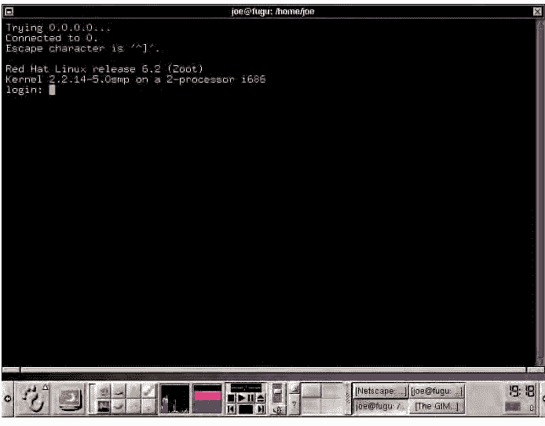

在冒号后输入你的用户名并按 Enter 键。你应该会看到如下提示：

Password:

输入创建账户时给你的密码。屏幕上不会显示你的密码。

当你输入密码时，取决于系统配置，你会看到一行星号，或者什么都没有。因此，按照给给你的内容准确输入密码是关重要的。在你输入时，你不会获得任何视觉反馈。

记住，Unix 是区分大小写的。这意味着输入大写字母还是小写字母是有区别的。如果你输入的是 `john` 而不是 `John`，你的登录将失败。

如果登录失败，没关系——只需重新开始。某些系统具有安全功能，如果你尝试登录超过一定次数，它会断开你的连接。这是为了防止人们通过猜密码来破解系统。如果发生这种情况，请重新连接并重试。

一旦你成功登录，你应该看到如图 4.2 所示的一些消息。这通常是一个欢迎信息，但在许多情况下，它是一个通知。该消息被称为 MOTD，意为“每日消息”（Message of the Day）。系统管理员需要与所有用户交流，他们会将信息放在 MOTD 中。这可能是提示系统在某个时间不可用，或者是提醒删除未使用的文件。不要忽略 MOTD。在登录时阅读它。

MOTD 之后你会看到一个 shell 提示符。这表示你已经登录，shell 已开始处理你的命令。shell 提示符可以以任何方式配置，因此我们无法确定它具体是什么样子。它可能包含当前的日期和时间，可能包含你正在登录的机器名称，也可能包含你的用户名。它总是以以下字符之一结束：`$` 或 `#`。

图 4.2：

关于系统的重要信息。

```
joe@fugu:~home
Trying 0.0...
Connected to localhost.
Escape
May Linux release 6.2.0 (Kernel) x86
joe@fugu:~
Last login: Mon Apr 7 22:10 from
********************
MESSAGE OF THE DAY
The system will be down for backups on Sunday, April 7.
Please plan your usage accordingly.
********************
You have new mail.
joe@fugu:~
```

例如，当 Joe 登录 Linux 机器时，shell 提示符看起来如下：

`joe@fugu:~`

你可以在图 4.2 中看到这个，就在 MOTD 下方。这个提示符显示了用户名 `joe`、机器名称 `fugu` 以及当前目录 `/home/joe`。提示符只显示完整路径的最后几段，以便为每个命令行留出可用空间。当你处于这个提示符时，在你给出命令之前，什么都不会发生。提示符是 shell 在说：“好的，我准备好为你做点什么了。”在你准备好了，但花点时间观察。

尝试在提示符处输入 `ls`。`ls` 是列出目录下文件的命令。取决于系统管理员如何配置系统，你可能会看到任何文件也可能看不到。现在，输入 `pwd`。此命令打印当前目录名称。它可能会打印类似 `/home/harry` 的内容，你的用户名是 `harry`。接下来，输入 `echo $SHELL`。这将输出你正在使用的 shell 名称，可能是 `/bin/bash` 或 `/bin/sh`。图 4.3 显示了执行这三个命令后的屏幕。

图 4.3：

执行 `ls`、`pwd` 和 `echo $SHELL` 命令后，你的屏幕应该像这样。

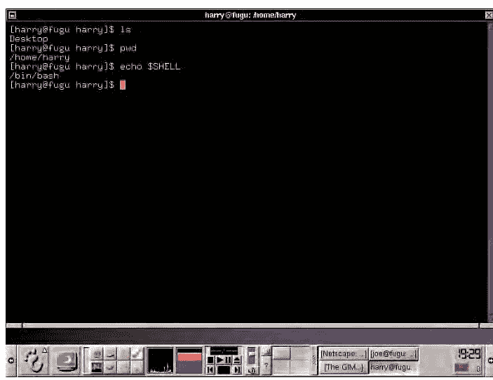

## 章：登录与观察

注意

如果你使用的 shell 不是 `bash`，你需要查找该 shell 的文档。我们在书中只涵盖 `bash`。然而，无论使用什么特定的 shell，大多数基础 shell 命令都是通用的。这些只是你可以用来获取工作环境信息的几个命令。再次，现在不要担心记忆它们；我们只想让你对自己的操作有个感觉。如果你忘记了需要的命令，可以随时查阅本书附录 A，其中包含了各种 shell 命令。

### 修改密码

现在你已经尝试过水了，是时候做些实用的事情了。还记得分配给你的那个糟糕的像乱码一样的密码吗？你永远记不住，把密码写下来并随手丢弃是非常糟糕的安全风险。所以，是时候将你的密码更改为容易记忆的内容了。

选择密码是在你操作之前应该考虑的事情。制作良好的密码是一门艺术。一个良好的密码既要容易记忆又要难以猜到，而且不是字典中能找到的单词。破解者尝试非法访问系统的方法之一是使用软件一个词单词地尝试，直到猜中为止。这并不是一种特别优雅的访问方法，但得益于许多用户糟糕的安全习惯，它仍然有效。良好的密码不应该是你名字的任何部分。

这里是一些“要做”和“不要做”：

要做的：

- 选择一个你能记住的密码。比一个容易猜的密码更糟糕的，是一个由于太以记忆以至于你最后把它贴在显示器上的密码。
- 混合你使用的字符的大小和类型。使用大写字母和小写字母，再加几个数字以防万：`m03r`
- 养成定期更改密码的习惯。

不要做的：

- 选择一个可能被认识你的人轻易猜到的密码。你配偶的名字、你狗的名字或你的生日都是应该避免的显而易见的选择。
- 告诉任何人你的密码。永远不要。即使是你的你的配偶。真的。我们认真的。
- 使用你在另一个系统上用过的密码。我们这些积累了 Unix 账户的人往往倾向于在所有账户上使用相同的密码，以减少记忆的负担。这是一个坏主意，因为一旦你的一个密码被破解，其他的也会立即暴露。

## 第 4 章 • 登录与环境浏览

当你决定好新密码后，在 shell 提示符处输入 `passwd`。系统会提示你输入旧密码；直接输入即可。然后，系统会提示你输入新密码。按照你要求的格式准确输入新密码。记住，你将看不到输入的内容，所以请务必小心。

完成后，按下回车键。系统会提示你再次输入新密码；请确保输入的方式与第一次完全相同。两次输入的新密码必须一致，否则密码将不会更改。如果不一致，密码将保持不变。下次登录时，你将必须使用新密码。你可以在图 4.4 中看到完整的提示序列——尽管看不到输入的密码内容。

## 图 4.4：

为了安全起见，定期更改密码是一件很容易完成的事。

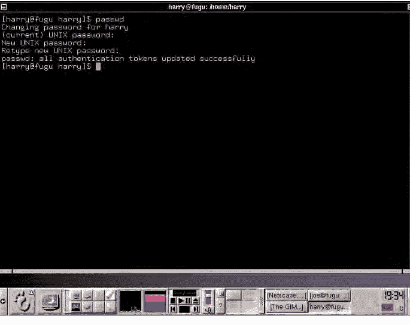

### 这些文件是什么？

在本章的开头，我们告诉过你输入 `ls` 来查看主目录下是否有文件。现在，你又要执行一次操作，只是这次的操作方式稍有不同。这次，输入 `ls -a`。这一次你肯定能看到列出的文件，如果你之前看到过文件，现在会看到更多。图 4.5 显示了一些 `ls -a` 的输出示例。

发生了什么？`-a` 标志是 `ls` 命令的一个指令，用于显示所有文件，包括隐藏文件。敏锐的读者可能已经注意到，之前不可见的文件都是以点（`.`）开头的文件名。这个点意味着该文件通常不会被 `ls` 命令看到。为什么呢？`ls` 命令假设用户不想看到这些文件。这些文件几乎都是某种配置文件，对于日常工作来说并不重要。

## 图 4.5：

使用 `ls -a` 命令列出当前目录下的文件。

```
[harry@fugu:~$ ls -a
.bash_history .bash_profile .emacs .auth
.bash_logout .bashrc .screenrc Desktop
[harry@fugu:~$] 
```

然而，我们对这些文件感兴趣，因为这些“点文件”（dot files）决定了信息如何呈现给你，以及在你的账户下工作的感受。那么，这些神秘的文件是什么呢？以下是一些最常见的文件：

- `.bashrc`: 这是 `bash`（Bourne Again Shell）的配置文件。你可能还会看到 `.bash_profile` 和 `.bash_logout`。这些文件控制着 `bash` 行为的各个方面，例如提示符的外观、它去哪里查找你的邮件、注销时会发生什么以及其他基本操作。
- `.emacs`: 这是 GNU Emacs 文本器的配置文件。
- `.Xdefaults`: 该文件是 X Window 系统（Unix 的图形用户界面）的配置文件。

如果你定期检查此列表，可能会发现这些点文件倾向于累积。随着你使用各种程序，配置选项通常会存储在每个程序对应的新点文件中。这样，当你频繁启动某个程序时，该程序就能记住关于你的某些信息，例如你的显示偏好。通过将这些文件存放在用户的家目录下，每个用户都可以拥有不同的配置。

大多数时候，你不需要去理会这些文件。然而，有时引导程序产生特定行为的最佳方法是编辑点文件。这通常非常简单，我们将在随后的章节中解释配置文件的艺术。

### 注销

当你的 Unix 会话结束时，是时候注出了。这只需要在 shell 提示符处输入 `logout` 即可完成。不过，并非所有的 Unix 系统都有 `logout` 命令，如果 `logout` 不起作用，尝试 `exit` 或 `Ctrl+d`。成功执行命令将关闭你的会话并将机器返回到登录提示符。

> 警告 在注销后，绝对不要关闭 Unix 机器的电源。Unix 机器不需要关闭。

### 总结


尽管它看起来与其他操作系统不同，但一旦你习惯了，你会发现导航文件系统并不困难。因此，“路径”（path name）这个词非常贴切。路径名显示了从根目录到当前目录的路径。如果你尝试调用一个不常用或位于新目录的程序，你可能需要使用完整路径名来启动程序或找到文件。在第 13 章“自定义 Shell 环境”中，我们将向你展示如何为频繁使用的目录创建快捷方式，这样你就不需要一直记忆并输入完整路径名。

## 导航文件系统

- 你在哪里？
- 移动
- 总结

### 你在哪里？

当你第一次登录时，你处于主目录下。该目录是专门为你的用户名指定的。提示符处的 `pwd` 命令将告诉你当前目录（`pwd` 代表 *print working directory*）。如果你执行此操作，你会看到类似 `/home/harry` 的内容。换句话说，第一个斜杠就是根目录。

> 警告 在注销后，绝对不要关闭 Unix 机器的电源。Unix 机器不需要关闭。

### 绝对路径与相对路径

路径名 `/home/harry` 是绝对路径，因为它显示了从根目录到当前目录的完整路径。也可以指定相对路径。假设你处于 `/home` 目录（我们稍后会展示如何到达那里）。如果你想指定 `harry` 目录，只需输入 `harry`。该指定被假设是相对于当前目录的。现在，假设 `harry` 下有一个名为 `mail` 的子目录。如果你在 `/home`，你可以将子目录指定为 `harry/mail`。

# 58 第 5 章 文件系统

也可以使用相对路径名。如果你在 `/usr` 中，并且想移动到 `/usr/home/linda`，你可以输入命令 `cd home/linda`。

现在你已经学会了如何在目录结构中移动，我们建议你花几分钟时间探索一下你的系统。通过输入 `cd /` 进入根目录，并执行 `ls` 命令查看目录列表。注意这些子目录。进入其中一个目录并再次列出内容。图 5.1 显示了几个目录列表。这个过程将帮助你建立系统的理想布局。

图 5.1：通过穿过目录并在每个目录下执行 `ls` 命令，了解更多关于你文件系统的知识。

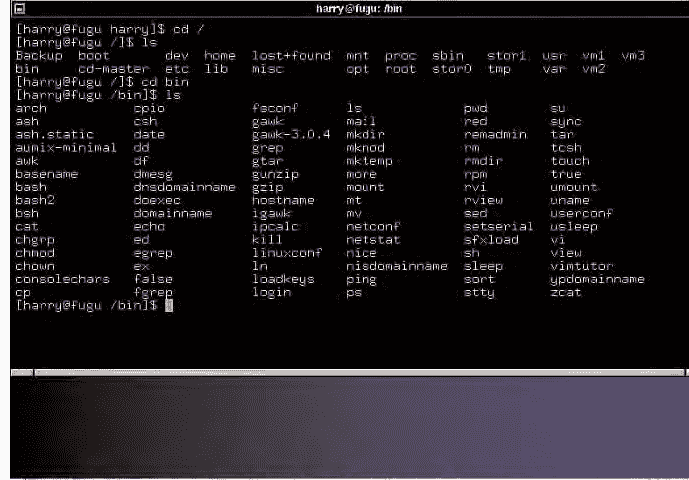

### 东西在哪里？

现在你已经熟悉了切换目录，是时候看看你的文件系统中还有哪些其他目录了。如之前提到的，Unix 文件系统像一棵倒置的树，根目录位于顶部，所有其他目录都向下分支。这种安排的表示如图 5.2 所示。

## 图 5.2：

Unix 文件系统类似于一棵倒置的树或植物。

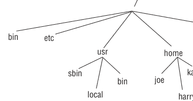

在本章的剩余部分，我们将解释主要系统目录的功能。第 12 章：“操作文件和目录”和第 30 章：“磁盘和文件系统管理”包含了对系统目录和通用 Unix 文件系统的进一步讨论。

## TIPS

不同的 Unix 系统的文件系统安排略有不同，但不同系统之间遵循了非常相似的约定。如果你的系统看起来与我们这里描述的不完全匹配，请不要担心。只需在结构中移动，直到找到包含描述类型文件的目录，并在页面上铅笔记录该目录名称。（以后可能会用完空间，所以当你需要参考本章内容时，划掉已打印的目录名称可能会很困扰。）

### `/bin`

`/bin` 目录包含各种系统命令的程序文件，例如你已经过的 `ls` 和 `cd` 命令，这些命令在典型的 Unix 会话过程中经常被使用。这也是包含各种 shell 和常用 Unix 实用程序程序文件的目录。最初，`/bin` 目录旨在存放所有的系统程序文件，但由于程序文件越来越多，最终需要某种额外的组织。现在，只有系统命令进入 `/bin`，而普通应用程序进入其他目录。

### `/etc`

`/etc` 目录包含系统配置文件。在典型的 Unix 系统上运行的许多程序都需要某种配置来引导其行为。绝大多数程序会将这些文件放在 `/etc` 目录中。我们将在书的后半部分第 VII 部分：“基础系统管理”中详细介绍 `/etc` 中的文件。

### `/home`

`/home` 是用户家目录的仓库。`/home` 有时会被放在不同的目录下或进行细分以组织用户组（这在具有许多用户的大型系统上尤其如此），但从上来说，如果你能找到名为 `home` 的目录，你就应该能找到用户的家目录。某些 Unix 版本使用 `users` 代替 `home`，所以如果你在寻找 `/home` 目录遇到困难，请尝试查找 `/users`。

### `/tmp`

顾其名，`/tmp` 是临时存储的地方。某些程序在运行过程中会产生临时文件，这些文件通常会被丢弃到 `/tmp` 目录中。如果用户家目录空间不足，这里也是用户临时存放文件的方便位置，尽管他们在这样做时需要格外小心。

> TIPS 许多系统管理员会定期删除 `/tmp` 目录中的所有内容，任何人都不应该产生 `/tmp` 是长期存储的方便解决方案的印象。如果你管理自己的系统并有其他用户，我们建议实施站点策略，禁止将 `/tmp` 作为额外的存储空间。

### `/usr`

`/usr` 目录包含应用程序的程序文件。任何不是 Unix 系统实用工具的程序都会进入 `/usr`。

### `/usr/local`

`/usr` 的一个子目录 `/usr/local` 包含用户本地安装的程序。

### `/var`

`/var` 是存放增长型文件的区域。例如，`/var` 存储系统日志、邮件队列和不经常删除的临时文件。

我们在这里需要说明一点。我们使用“X Window 系统”（X Window System）这个术语时并不十分精确。X 系统并不是一个程序。相反，X是一个标准。这意味着 X Window 系统实际上是一组规则，由一个名为 X 联盟（X Consortium）的中立机构管理，所有的图形功能如果要在 Unix 上顺畅运行，就必须遵守并包含这些规则。多年来，X 经历了许多变化；当前版本是 X11R6，这意味着它是 11 版本的第 6 次修订。任何实现 X 标准的特定程序都被带有些困惑地称为 X Window 系统。在较为熟悉的 X 实现中，有 XFree，我们将在本章稍后讨论。此外其他商业化的 X 实现，如 MetroX 和 AcceleratedX。大多数实现都运行在 Unix 上，但也有少数运行在 Windows 上。

## 桌面与窗口管理器

由于 X 是一个标准而不是单一程序，你可以在其之上运行任何窗口管理器或桌面环境。这些术语似乎是可互换的，在某种程度上它们也如此。通常情况下，窗口管理器仅仅是一组函数，控制窗口在显示器上的显示方式、图标或菜单栏等各种项目的显示方式，以及鼠标在显示器屏幕上所有项目之间的移动方式。X 让这一切成为可能，但窗口管理器处理每个动作的具体细节。

> 注意：无论你选择桌面还是窗口管理器，它都将与显示管理器（display manager）紧密配合。显示管理器是处理 X Window 系统与图形用户界面之间数据传输的程序。默认的 X 显示管理器叫做 `xdm`（本地命名很贴切，代表 X Display Manager）。你可能会发现你的桌面或窗口管理器使用了特殊的显示管理器而不是 `xdm`，例如，KDE 使用的是 `kde`（KDE 显示管理器）。

你可能会听到人们对特定的窗口管理器或桌面表现出强烈的亲近感或反对意见。这可能不是因为该程序本身的任何特定缺陷或功能，而是因为该程序通过其图形元素、外围行为、文件管理等的融合所产生的独特感受。即使你不经常考虑计算机如何处理这些功能，它们也是你计算体验中不可或缺的一部分。如果你尝试了一个窗口管理器或桌面，但感觉它就是不太对劲，请尝试另一个。你最终会找到一个适合你且让你乐于配置的，直到它变得完美完美。

### 窗口管理器

Unix 平台提供了多种窗口管理器，有些专门为某些 Unix 派生发行版设计，有些则全球适用于所有版本的 Unix。例如，Linux 可用的窗口管理器包括 `fwm`、`BlackBox`、`AfterStep` 和 `Enlightenment`。每个窗口管理器的感觉略有不同，选择窗口管理器是一项极具个人色彩的。一旦你选择了一个窗口管理器程序，你就可以按照自己的心意对其进行配置，如设置壁纸、独特的图标等，至少在窗口管理器允许的范围内是如此。（有些管理器允许你更改任何想要的内容，而另一些——如 `BlackBox`——只让你配置非常基础的选项。）

关于窗口管理器需要记住的一点是，它们的名称是其实意的。你可以同时运行多个窗口，每个窗口运行着不同的会话或程序，但你无法从一个窗口拖放到另一个窗口（或进行任何其他集成功能）。窗口管理器只是让同时运行多个会话变得更容易，并在在此过程中提供一个吸引人的背景。你可以在图 6.1 中看到窗口管理器的示例。

这里就变得复杂了。从全局角度来看，任何在图形环境中处理多个会话的程序都是窗口管理器。然而，近年来，Unix 社区开始产生集成化的桌面环境，其功能类似于 Windows 或 MacOS。这些环境看起来可能像窗口管理器，但它们是完全集成的，并且具有 X Windows 无法提供的额外功能（因此在纯窗口管理器中找不到）。所以，当我们谈论桌面与窗口管理器时，我们说的是像 KDE 或 Gnome 这样的集成环境与像 Enlightenment 或 `fwm` 这样的简单多会话界面的区别。

注意：我们将在第 8 章详细介绍几种流行的窗口管理器。

## 图 6.1：


名为 twm 的窗口管理器以悦目的图形化方式管理多个会话。

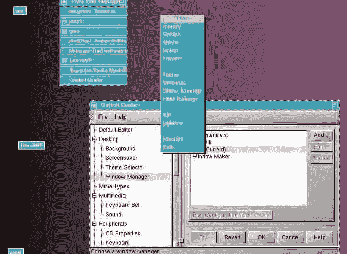

### 桌面环境

桌面环境就像是“加强版”的窗口管理器。桌面环境不仅允许你运行多个会话，还整合了这些会话。这意味着你可以将元素从一个会话拖到另一个会话，将文件从目录管理器的一个文件夹拖到另一个文件夹等。在普通的窗口管理器中，你无法在窗口之间工作，因为 X 不提供这些功能。

桌面环境的另一个主要魅力在于它包含了一整套程序，让你的计算变得更简单。桌面环境整合了完整的程序集，让你的生活更轻松。桌面环境（如 KDE 和 Gnome）提供了一个包含常用应用程序的面板，让你能够从那里启动程序，这与 Windows 95/98 有惊人的相似之处。图 6.2 显示了 Gnome Desktop。图 6.1 显示了 twm 窗口管理器。窗口管理器与桌面之间的差异在视觉层面上非常微小。

## 图 6.2：

Gnome 桌面提供了多个会话，以及一套完整的界面程序。

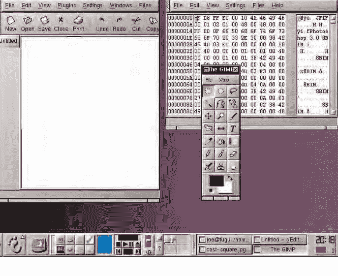

注意：我们将在第 9 章介绍 KDE，第 10 章介绍 Gnome。

### 该用哪一个？

如果你在这一点感到困惑，不要担心。这是一个很复杂的话题，由于许多被误使用的术语而变得复杂。我们建议你关注集成环境，这是可能的，我们建议你在 KDE 和 Gnome 之间选择。阅读以了解更多每个环境，但不必担心选择其中一个会损失太多。

话虽如此，如果你的计算机较慢，或者你担心系统资源，你可能会发现窗口管理器更合你意。它们对计算机的负担较小，因为它们没有整套辅助程序；添加集成桌面可能会系统变慢。如果你决定使用窗口管理器，请阅读第 8 章以了解更多选项。我们更倾向于功能丰富的管理器，如 Enlightenment 和 AfterStep，但这取决于你愿意为图形界面投入多少系统资源。

提示：记住你不需要使用图形界面。你会失去图形程序（包括 Netscape），但从系统速度和性能上获得巨大收益。许多人（包括我们）经常直接登录 shell 而不加载图形界面。你可以选择只在需要时加载 Gnome 或 Enlightenment。

### X 的结构

正如本章前面提到的，X Window 系统既不属于操作系统，也不属于用户界面。X 有许多独特特性，使其与 macOS 和 Windows 界面大不同。

- X Window 系统独立于操作系统，这意味着如果你不需要图形界面，就不需要运行 X。例如，作为服务器运行的机器可以节省 X 的系统开销，并将这些开销用于服务请求。
- X Window 系统的设计是为了网络，而不是单机计算机。你可以使用 X 将运行在计算机 A 的图形应用程序显示在计算机 B 的显示器上。其他操作系统（如 Windows NT）正开始这样做，但 X 已经实现了一切。
- X Window 系统实际上并不是用户界面的一部分。正如上一节所述，X 让窗口管理器和桌面能够工作，但你并不直接与 X 交互。这种通用方法意味着你可以自定义屏幕的实际外观，而无需妥协 X 本身的某些组件。

## 第 6 章 • 窗口系统：概述

由于 X 是一个标准而非单一程序，你可能会在不同的 Unix 计算机上发现不同版本的 X。例如，运行 Linux 或 FreeBSD 的计算机可能会使用 XFree86。XFree86 是 X 标准的一种实现，专为 Intel x86 系列硬件（286、486 和奔腾级芯片）设计，通常由从事自由软件和开源软件的人员使用。相比之下，Solaris 使用的是专有的 X 服务器，该服务器也符合 X 联盟（X Consortium）的要求。大多数商业 Unix 系统使用它们自己的 X 服务器；只要服务器符合 X 窗口系统标准的规定，就没问题。

### X 是如何工作的？

窗口系统采用客户端-服务器架构。这是处理跨网络流量甚至单台计算机内部流量的常用方法。例如，当你查看 Web 页面时，你的计算机向 Web 服务器请求页面数据；在这种情况下，你的计算机就是客户端。服务器通常处理来自大量客户端的并发请求。流行的 Web 网站每秒可能有 12 或 15 个客户端请求。图 6.3 显示了客户端-服务器架构的基本图像。

图 6.3：

客户端-服务器架构适用于各种服务，包括 X 窗口系统。

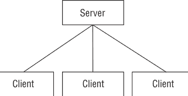

但在涉及 X 时，情况似乎有些不同——尽管事实并非如此。当你向计算机安装 X 时（或者在安装 Unix 变体时由其安装），X 是作为服务器被安装的。因此，当你使用需要 X 的程序（如桌面或窗口管理器）时，你实际上是在计算机内部运行一个微小的 X 窗口系统服务器。桌面或窗口管理器充当客户端，向服务器请求特定的操作，服务器反馈这些数据并允许客户端在你的显示器上绘制特定的图形图像。无论你运行的是什么程序——用户界面、Netscape 还是游戏——它们都充当 X 服务器的客户端。

### 安装和配置 X

在单机计算机内部需要客户端-服务器设置似乎似乎很奇怪。事实上，这有点怪异，但由于两个原因，它运行得非常好。首先，它镜像了如果你在大型网络上使用 X，实际网络的运行方式。由于 X 被设计为网络化程序，将本地机器及其应用程序视为客户端是有合逻辑的，就像它们向另一台计算机请求 X 服务时作为客户端一样。其次，它为系统带来了巨大的稳定性。如果 X 崩溃了，你的操作系统可能不会。这意味着你可以去修复 X 的错误，而无需重启，而重启可能会导致更大的损坏。客户端-服务器架构让 X 能够独立于你的客户端应用程序和操作系统本身运行，这是最安全、可靠的方法。

在绝大多数情况下，X 窗口系统是在你安装基于 Unix 的操作系统时安装的。大多数新发行版都带有图形化安装程序，这在安装过程本身就需要使用 X。过去，安装和配置 X 一是 Unix 最糟糕的部分之一；有很多可能出现问题，而且 X 的配置过程非常奥秘。然而，由于多年程序员和开发者付出的巨大努力，许多棘手的工作已经实现了自动化。

例如，大多数 X 窗口系统安装程序现在都会自动检测你的视频硬件。这很重要，因为安装 X 时必须带有与你的硬件完全匹配的组件。如果安装了错误的组件，X 将无法工作。

### 警告

如果启动计算机时 X 没有启动，特别是当你刚刚安装了服务器时，可能的罪魁祸首是你的显卡。尽管大多数 X 标准的实现都为市场上大多数显卡提供了特定的驱动程序，但你可能拥有少数不受支持的显卡之一。如果你在网上买了一张非主流制造商的廉价显卡，这种情况尤其容易发生。遗憾的是，如果你的显卡在 X 下不受支持，你做不了什么。你需要购买一张新显卡，或者可能花钱买一个 X 的商业实现（买新显卡更便宜）。

## 第 6 章 • X 窗口系统：概述

> 提示：如果你正在使用 Linux，可以通过查看 `http://www.linuxdoc.org/HOWTO/Hardware-HOWTO-6.html` 中的 Linux 硬件兼容 FAQ 来避免一些头恼。如果你在 Linux 或 FreeBSD 上使用 XFree86，请检查 `http://www.xfree86.org/FAQ` 中的 XFree86 FAQ 以获取重要的兼容性信息。

### 基础 X 配置

如果你的 Unix 变体安装顺利，那么你的 X 服务器应该运行良好。基本上，如果如果你能看到登录屏幕或彩色桌面等图形图像，你的 X 可能就没问题。如果你的键盘和鼠标工作正常，你就大大无忧了。

不过，你应该检查一下显示器。确保你已经为显示器选择了适当的屏幕分辨率。有时，显示器不好会被归咎于 X，而实际上是硬件导致了问题。我还建议使用定位轮将显示完全拉到显示器的边缘。由于某种原因，我们看到很多显示器用户在显示周围留下一圈宽一英寸或更的黑带，这是我们的心头之恨。为什么要浪费你付钱买的显示器空间呢？显示器的设计使得当你移动到显示器边缘时不会有图像。如果你发现畸变，说明你需要升级显示器了。

X 偶尔会死机，这并不常见。它是多种原因引起的。如果你卡住了，尝试按下 `Ctrl+Alt+Backspace`。这会停止并重启 X 服务器，清除导致卡死的故障。

### X 窗口系统问题

除了偶尔死机外，你不应该在 X 上遇到太多问题。如果你确实在 X 上遇到了严重问题，答案既简单也不快速。X 的复杂程度需要超过 10 卷的手册，所以你可以想象修复它是有多么困难。

### 警告

X 问题的单一个常见原因是用户的操作。除非你清楚自己在做什么，或者有专家明确告诉你是怎么做，否则不要动 X 配置文件。特别是，不要安装别人为了帮助而给你的配置文件。这些文件可能不符合你的硬件状况，并可能损坏你的计算机。遇到 X 问题请寻求专家帮助。

对于使用 XFree86 的用户，我们建议你查看 `http://www.xfree86.org` 提供的资源。那里有几个关键的 FAQ，包括一个非常有用的配置 FAQ。使用其他 X 服务器（包括太阳 Solaris 使用的专有服务器）的人，应该咨询其手册或相关 X 服务器的开发者。


记住，与操作系统的任何其他部分不同，如果出现问题，X 窗口系统可能会损坏机器硬件。我们认为普通用户可以通过思考解决 Unix 问题，但我们认为这对 X 并非如此。如果你在没有帮助的情况下尝试修复 X，你可能会花费大量的资金。

... 将图形化操作（如使用复选框或鼠标）翻译成操作系统计算机本身能够理解的指令。

X Window 系统使得使用图形用户界面成为可能，例如窗口管理器和集成桌面环境。无论用户选择何种界面，X 都会通过客户端-服务器架构与界面协作以处理数据请求。由于 X 独立于操作系统和用户界面运行，因此 X 是稳定且快速的。其他操作系统将窗口软件直接集成到操作系统中，这导致了更高的崩溃或其他故障的概率。

# 第七章 高级 X 技术

- 在网络上使用 X 应用程序
- 字体
- 颜色
- 安全性
- X 与残障人士
- 总结

78 第 7 章 • 高级 X 技术

在第 6 章“X Window 系统：概述”中，我们涵盖了 X 的基础知识。我们还提到了 X Window 系统是一个灵活且易于网络化的系统。在本章中，我们将展示 X 能够执行的其他功能，重点关注于视觉组件，如字体和颜色，这些组件使得某些图形显示优于其他显示。我们还讨论了运行 X 服务的安全性问题。

## 注意事项

我们在本章中涵盖的一些主题假设读者已具备我们尚未涵盖的基础知识，例如网络。如果你在本章中看到某些不理解的内容，很可能它在书的其他部分有所介绍。特别是，我们建议你阅读第八部分：“网络管理”，尤其是第 34 章：“Unix 网络简介”。一旦你对基础网络理论有了直概念，与 X 进行网络连接的具体细节将变得更易理解。

## 在网络上使用 X 应用程序

从早期开发开始，X Window 系统就被设计为支持网络化。这意味着你可以在网络中的某一台计算机上运行程序，并让程序显示在另一台计算机的显示器上。事实上，某些计算机甚至作为 X 终端（X Terminals）售卖，它们仅包含处理器、一些内存和网络连接；不需要硬盘，因为该机器的设计除了连接到中央服务器主机外外不做任何事情。一旦建立连接，就可以通过网络挂载远程主机的文件系统，并使用网络函数在 X 终端的显示器上显示应用程序。

### 通过互联网使用 X？

尽管看起来像是一个难题，但完全可以通过 Web 浏览器在互联网上开启 X Window 会话。（是的，在 Unix 系统上运行 Web 浏览器的人已经拥有开启的 X 会话。）这对于那些使用 Windows 或 Macintosh 计算机，但需要或想要在远程计算机上使用托管在 Unix 上的 X 依赖程序的人来说特别有趣。

这个新概念由 Broadway 项目处理。Broadway 是该项目的最初代号，现在已整合到 X 的最新发布版本（6.11）中。你会听到基于 Web 的 X 会话技术被称为 Broadway 或 X Web。该协议为连接速度受限的用户（如拨号上网用户）提供了一个低带宽选项。该协议整合了 X Window 系统和 HTTP 协议，以利用这两种协议的优势。另一种方案是 Java，它提供的传输质量较低，且要求任何通过互联网传输的程序都必须用 Java 重新编写写；而使用 X Web，程序不需要重写，因为它们是以原始格式传输的。

Broadway 项目的优点之一是它在通用开发过程中将安全性问题作为重点关注对象。如果你运行 X Web，可以选择实现多种安全功能。例如，你可以区分安全和不安全的应用程序；确定单个客户端配置，并监控这些客户端在应用程序必须远程运行且无需任何主机访问时发出的请求。这些选项涵盖了 X 协议中固有的使其难以安全的问题。

可以在项目网站 `http://www.broadwayinfo.com` 了解更多关于 Broadway 的信息。

如第 6 章“X Window 系统：概述”所示，当你在计算机上运行 X Window 系统时，你实际上在运行一个 X 服务器（也称为显示服务器）。你运行的任何基于 X 的程序无论是运行在同一台计算机还是网络中的另一台机器上，都是 X 服务器的客户端。客户端利用服务器提供的各种服务在客户端计算机的屏幕上绘制程序元素。除了本地和远程机器之间信号传输导致的轻微延迟外，通常无法判断哪些程序运行在本地，哪些程序是从远程机器运行的。如果你使用高速网络硬件，可能不会产生以被察觉的延迟。

### DISPLAY 变量

Unix 控制用户环境的方法之一是通过使用环境变量，环境变量是程序用于对如何执行某些任务做出决策的标签。要在网络上使用基于 X 的程序，必须在服务器和客户端计算机上正确设置 `DISPLAY` 变量。

#### 注意事项

我们在第 13 章“自定义 Shell 环境”中涵盖了环境变量。如果你对该概念不熟悉，我们建议在继续本节之前复习该章节。

要查看 `DISPLAY` 的当前值，请在客户端机器的 shell 提示符处输入以下行：

```
echo $DISPLAY
```

输出应该类似于以下两行之一：

```
:0
```

或者

```
localhost:0
```

如果客户端计算机上的输出正常，你就可以检查服务器的设置。使用 `telnet`、`login` 或 `ssh` 登录远程服务器（参见第 43 章：“远程访问 (inet) 服务”）。当你到达远程机器的 shell 提示符时，输入：

```
export DISPLAY=:0
```

此此命令导致远程机器的输出显示在本地计算机上。一旦执行该命令，你就可以运行基于 X 的程序，服务器的数据将显示在你的客户端上。

## 字体

使用图形界面的乐趣之一是可以为不同的目的使用不同的字体。字体可以是像 Courier 那样简单的，可以是优雅的手写体，也可以是一组象形文字。无论你需要什么种字体，可能都有人创建了适用于 X 的字体。

然而，在 Unix 上安装字体比在 Windows 或 MacOS 上要复杂。我们在这里涵盖了为 X 系统安装单个字体的基本过程，但没有任何可以替代你特定操作系统的材料。X 配置可能会漏掉步骤。在处理 X 配置文件时要倍小心，不要删除任何并非你放入且确定是错误的内容。

### 安装字体

安装新字体的第一步当然是找到要安装的新字体。你可以在 Web 上找到各种 X 字体；尝试你的搜索引擎以查看最新的发布版本。一旦你获得了一两个字体包，安装它们非常简单。只需将字体包解压到正确的目录，调整格式，压缩字体并重启 X 服务器即可。

基本过程所示，下方附有各种 Unix 的说明：

- 下载字体包后，使用 `tar -xvfm packagen` 命令进行解压缩和解包。
- 转换格式。字体通常以 BDF（二进制发行格式）发布，但 X 无法使用这种格式。X Window 系统附带的 `bdftopcf` 程序通过执行命令 `bdftopcf -o packagename.bdf packagename.pcf` 来转换格式。
- 进入目录；通常位置是 `/usr/libs/X11/fonts`。
- 为你正在使用的字体类型创建一个子目录。目前可用的字体类型有 75dpi、100dpi、Type 1、Speedo 和 Cyrillic。
- （可选）如果担心磁盘空间——字体文件可能是大文件——你可以压缩字体。你会注意到 X 在即时解压字体时会对系统资源产生一些消耗，但这种消耗可以通过节省的磁盘空间来抵消。
- 构建字体目录 `fonts.dir`，它会告诉 X 关联相关的字体属性。你需要在 `/usr/lib/X11/fonts/` 的每个子目录下都需要一个独立的 `fonts.dir` 文件。通过执行 `mkfontdir` 命令来创建该文件。

从现在起，请按照你的 Unix 变体遵循特定说明。

### Linux

对于 Linux 安装，请遵循上述六步，然后执行以下两个步骤。

- 使用 `xset` 命令设置字体路径以配置 X 偏好。执行以下命令：

```
xset +fp /usr/lib/X11/fonts/newsubdirectory/
xset fp rehash
```

- 配置 FreeBSD 86 以识别新的字体路径。找到配置文件（通常存储为 `/usr/lib/X11/XF86config`），并用文本编辑器打开它。在配置文件中找到 `FontPath` 变量并添加新行（不要删除任何内容）：

> `FontPath "/usr/lib/X11/fonts/newsubdirectory/*"`

下次你运行 X Window 系统时，新路径将被加载。如果你立即需要新字体，请杀掉 X 服务器进程并重启。

### FreeBSD

FreeBSD 用户应使用上述提供的步骤，并将第 3 步中的目录路径替换为 `/usr/X11R6/lib/X11/fonts/`。在此目录下创建新的子目录。然后，遵循 Linux 下列出的额外步骤。由于 FreeBSD 用户通常运行 XFree86 X 服务器，步骤是相同的。

### Solaris

Solaris 用户应遵循上述六个步骤，并将第 3 步中的目录路径替换为 `/usr/openwin/lib/X11/fonts`。在此目录下创建你的子目录。然后，执行以下额外步骤以完成字体安装，并确保每次启动 X 时都会添加新路径：


- 将位于 `/usr/dt/config/Xconfig` 的配置文件复制到文件 `/etc/dt/config/Xconfig`。

- 用文本编辑器打开 `/etc/dt/config/Xconfig` 文件并添加以下行：

- （可选但建议）在上一步插入的行之前，添加此行作为注释：

```
# Add fullname font directory
# /usr/openwin/lib/X11/fonts/new subdirectory to FontPath.
```

- 保存并退出文件。

- 执行命令 `/etc/init.d/dtlogin reset` 重启当前的 X 会话。在启动过程中将读取新的配置文件并包含新路径。

### X 字体服务器 (X Font Servers)

基于 Linux 的操作系统 X 字体技术的新进展是 X 字体服务器 (`xfs`)。该服务器将字体管理从通用 X Window 系统功能中分离出来，这意味着你可以在网络中的每台计算机上安装它，本质上是独立安装。然而，即使每台电脑都有 X，你也不需要为每台电脑提供一套完整的字体。相反，你可以安装一个字体服务器，当客户端需要新字体显示时，每个客户端都可以连接到字体服务器。

`xfs` 的问题在于它尚未完全消除所有 bug。如果你只使用少数字体，可能更倾向于将它们作为单个字体安装在每台机器上。然而，如果网络中的人员日常业务需要各种字体，字体服务器可能是最有效的解决方案。它确实节省了单台机器的磁盘空间。

### 构建字体服务器

> 注意

如果你运行的网络中有几个人使用非英语字体（例如俄语、中文、韩语或类似的西里尔字母或表意语言字体），那么字体服务器是一个理想的解决方案。这些字体通常非常大，会占满工作站的硬盘。将它们放置在用作字体服务器的独立机器上是一个优雅且经济的解决方案。

这是在 Linux 下安装字体服务器的通用流程。请注意，这可能并不适用于每个 Linux 发行版；最好检查你的文档和网络，以根据你运行的发行版查看是否需要执行某些特定操作。此外，在你决定运行字体服务器之前，我们建议花一些时间阅读关于 `xfs` 的当前信息。已知存在 bug 和问题，你应该在尝试此过程意识到它们。

要建立 X 字体服务器，请使用此简单程序：

- 创建名为 `/etc/conf.xfs` 的新文件。

- 用文本编辑器打开文件并输入以下文本：

```text
catalogue=/usr/X1R6/lib/X11/fonts/misc,
/usr/X1R6/lib/X11/fonts/75dpi,
/usr/X1R6/lib/X11/fonts/100dpi,
/usr/X1R6/lib/X11/fonts/Speedo,
/usr/X1R6/lib/X11/fonts/new subdirectory,
```

- 保存并退出文件。

- 执行命令 `/etc/init.d/dtlogin reset` 重启当前的 X 会话。在启动过程中将读取新的配置文件并包含新路径。

### 使用字体服务器

（注：原文此处后续存在大量重复内容，已按要求处理核心逻辑翻译）

# 颜色 87

## 提示

如果你从未更改过 X 的默认颜色，你可能没有这样一个文件。你可以在 `/etc/skel/.Xdefaults` 中找到模板，该文件在安装 X 时应该已经安装好了。将此文件复制到你的主目录，并将其作为你自己的 X 颜色设置的基础。

不同的程序都有不同的资源供 X 管理。你可以在命令行提示符处运行 `appres` 程序来查看哪些资源是可以配置的。输出结果如图 7.1 所示（以 `xterm` 程序的输出为例），显示所有可配置的资源及其当前设置。通常，此类输出是易读的，你可以根据其名称大致了解默认颜色。

# 图 7.1：

`appres` 命令将向你显示与指定程序相关的各种资源。

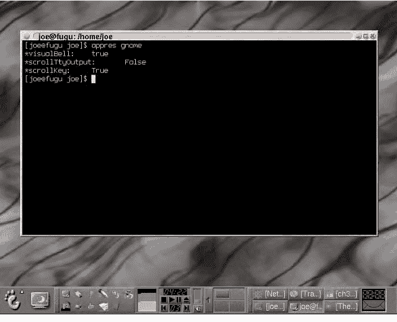

> 注意：如果你管理一个网络，可以通过配置另一个文件来设置系统范围默认颜色。在你的 X 目录下查找名为 `app-defaults` 的子目录。在该文件中，你可以为每个想要配置的程序存储单独的文件；文件名用程序名命名，并使用 `.Xresources` 文件的语法来定义颜色。这些将成为你系统中每个用户的新默认颜色。（当然，用户可以通过在主目录中创建自己的 `.Xresources` 文件来覆盖你的设置。）

一旦你建立了 `.Xresources` 文件，就可以编辑它来更改你的默认设置。你只需要用文本编辑器打开 `.Xresources` 文件，并更改需要变的值。但是，不要随机更改设置。`.Xresources` 中的 `*settingColor: colname` 条目生成的格式如下所示：

条目中 `colname` 部分的值通常以实际颜色名称编写。名称从平淡的（如 `red`）到奇幻的（如 `payawayhip`）不等。你不能凭造颜色，因为名称是经过分配的，但基础颜色名称很有可能产生一个颜色值。

颜色名称被用作更复杂的 RGB 值的别名，这个数字代表最终颜色中红、绿、蓝的实际混合比例。你可以通过三种方式填充 `colname` 变量：颜色名称、RGB 值或十六进制值。参见侧边栏“RGB 和十六进制值颜色命名”以获取有关计算机颜色的更多信息。只需确定你想使用的颜色，将其插入 `.Xresources` 中正确的行，然后保存文件。下次当你运行受影响的程序时，它将从文件中读取并使用新的默认颜色。

# RGB 和十六进制值颜色命名

X 系统依赖 RGB 值作为产生屏幕颜色的方法。RGB 代表红（Red）、绿（Green）、蓝（Blue），该值代表每种颜色三个独立值的组合。例如，RGB 值 `:FF/FF/FF` 等于白色。单个值的范围从 `00`（无颜色）到 `FF`（最高可能值）。

一旦你理解了计算机屏幕上的所有颜色都是 RGB 混合物，确定 RGB 值就会变得容易。当然，大多数人无法根据 RGB 值视觉化出精确的颜色。尽管如此，观察数值并判断它在光谱上的大致位置是容易的。例如，考虑值 `rgb:00/104/139`。从它的结构可以让你看出这种颜色主要是蓝色的，带有几乎相等的绿色，且没有红色。你可能会猜是青色（aqua）或其他某种浅蓝色（实际颜色是 `SkyBlue4`），但如果你猜的是天蓝色，你的方向也是正确的。

如果你做过 Web 设计，你可能会发现这些值看起来很熟悉。Web 设计师使用十六进制表示法来颜色值。由于这种表示法产生的数值始终是六位字符，因此是一种方便的标准化方法。某些 RGB 值可以直接翻译为十六进制；例如，`rgb:00/00/00` 等同于 `#000000`。其他 RGB 值在转换为十六进制后，看起来和原始值完全不像。紫色是 `rgb:160/32/240`，但它的十六进制是 `#A2F0F0`。（注：OCR 文本说是 #A2F0F0，但 160/32/240 的标准十六进制是 A020F0）。X 两种都能理解。

通过指定 IP 地址范围内的访问者，你将通过简单的区块来限制潜在的滥用。

要学习如何限制对这些端口的访问，请参考第 38 章：“网络安全”。

随后，你可以使用 Xhosts 文件来限制对网络内域名的访问，从而加倍安全防护，如下一节所述。Xhosts 文件与限制端口访问的结合足以阻止大多数外部攻击。

### /etc/X0.hosts 文件

位于 `/etc/X0.hosts` 的文件包含了你网络中允许访问 X Window 服务器的系统域名。在安装 X 时，系统默认不会创建此文件，因此你需要手动构建它。请使用文本编辑器创建该文件。

我们在文件名中使用数字 `0` 字符，是因为大多数人只运行一个本地 X Window 系统。如果你使用了多个系统，并且希望允许不同的机器组连接不同的 X 服务器，则必须将 0 替换为本地服务器的相应数字。

一旦创建了 `/etc/X0.hosts`，就可以输入可以访问 X 服务器的机器名称。虽然你不需要为本地网络上的机器提供完整的域名（而且，如果你遵循了上一节的指示，不应该有其他机器请求访问），但养成这个习惯是好的。例如，如果你的网络域名是 `funbands.com`，你的 `/etc/X0.hosts` 文件可能如下所示：

```
commododores.funbands.com
parliament.funbands.com
earthwindfire.funbands.com
```

任何未在 `/etc/X0.hosts` 文件中明确列出的机器在尝试连接 X 服务器时将收到以下错误信息：

```
Xlib: connection to "machinename:0.0" refused by server
Xlib: Client is not authorized to connect to Server
Error: Can't Open display
```

### 警告

使用此文件并不能你的 X 服务器安全。尽管它限制了 `/etc/X0.hosts` 文件中指定机器的访问，但允许这些机器上的任何用户访问。你仍然容易受到来自网络内部的攻击。我们建议将此方法与某些基于用户的身份验证相结合，例如在本章稍后描述的 `xauth` 程序。

## 使用 xhost 客户端


X 自带了一个名为 `xhost` 的客户端，它使得编辑 `/etc/X0.hosts` 文件变得简单了一些。然而，出于安全考虑，`xhost` 要求你必须坐在服务器机器本身。如果你执行命令 `+machine.domain.name`，指定的域名将被添加到 `/etc/X0.hosts` 文件中。你也可以通过执行命令 `xhost -machine.domain.name` 从文件中删除名称。只需在提示符处输入 `xhost` 即可查看文件中当前包含哪些名称。

通常，我们不建议使用 `xhost` 向 `/etc/X0.hosts` 文件添加或删除机器名称。直接使用文本编辑器处理文件更为简单；因为你无法远程运行 `xhost`，但可以远程访问文本文件，因此 `xhost` 在大型网络中的可用性有限。它最适用于 shell 脚本，在其中你可能希望授予某个机器名称访问权限，等待一段时间，然后拒绝该机器的访问。只要保持初始连接，该机器仍然可以使用服务器，但将无法建立额外的服务器连接。

### xauth 程序

基于用户的 X 身份验证基于名为 `MAGIC-COOKIE-1` 的唯一标识符。当用户使用 `xdm` 命令打开 X 显示管理器登录服务器时，会生成该 cookie。cookie 是一个存储在你家目录下的 `.Xauthority` 文件中的字符字符串。一旦你建立了连接并获得了 cookie，只要保留 `.Xauthority` 文件，你就可以一直访问服务器。

如果你网络中的每个人都使用共享家目录，则不需要对 cookie 进行任何操作。然而，许多网络由拥有自己家目录的计算机组成，这些计算机在网络中不共享公共文件。这就是 `xauth` 程序大显用场的地方。

`xauth` 是将 cookie 从一台用户机器复制到另一台机器的程序。`xauth` 在初始用户机器上找到授权，将其复制到新的用户主机，并构建一个包含 cookie 的新 `.Xauthority` 文件。用户就可以从新主机访问 X 服务器，而无需请求新的权限代码。注意，你在这里是从用户机器上进行操作；`xauth` 永远不会连接 X 服务器本身。因此，你需要针对已经成功连接到 X 服务器的机器运行 `xauth`，因为 cookie 将存储在用户主机的账户中以供 `xauth` 获取。

`xauth` 的语法有点复杂，但除非你在整个网络中从不同的计算机访问 X 服务器，否则你不需要经常运行它。`xauth` 使用两个主要函数：`extract` 提取和 `merge` 合并。`extract` 函数在远程主机上搜索 cookie，而 `merge` 函数获取 cookie 并将其放入本地机器的 `.Xauthority` 文件中。如下所示执行 `xauth` 命令：

```
xauth -DISPLAY | ssh machine.domain xauth merge
```

这条复杂的命令必须在已成功登录服务器的机器上执行；在这里，我们将 `$DISPLAY` 变量的值或你的 MIT-MAGIC-COOKIE 称为此处，并发送到标准输出由连字符 `-` 标识。在命令的第二个部分，将建立到你将访问 X 服务器的远程机器 User2 的 `ssh` 连接。此时可能会提示你输入 `ssh` 密码。一旦 `xauth` 从标准输出获取 `$DISPLAY` 的值并将其合并到 User2 上的 `.Xauthority` 文件中，一旦命令成功完成，你就可以从 User2 访问服务器了。

为什么复制 cookie 很重要？毕竟，你只是从 User2 登录并获得了一个新的 cookie。在某些情况下，这完全没有影响。然而但在大型网络中，管理员经常为特定用户分配资源或特定程序的访问权限，而其他用户则可以访问不同的程序和资源。使用 `xauth` 复制 cookie 意味着无论你在哪个机器上工作，都将保留对你特定配置的访问权限。

### 警告

`xauth` 和 `xhosts` 是试图解决 X Window 系统已知安全问题的尝试。它们比没有要好，尽管它们并没有让 X 完全安全。最佳解决方案是限制对 X 服务器的访问，并追踪你用户群体中的任何异常活动。

## X 与残障用户

X 的出现让一些残障 Unix 用户感到有些担忧。Unix 最初的纯文本界面很容易通过各种自适应程序进行处理，这些程序使得无论用户能否看到屏幕，命令和输出都变得可访问。然而，随着图形界面的发明，许多早期的自适应程序变得无法使用。许多相同的担忧随着 Web 的普及再次兴起。

可以做些什么让 X 对用户更具可访问性？X 系统内置了一些自适应功能，并编写了利用这些适配的程序。用户可以在个人机器上安装自适应程序，管理员可以制定系统范围的策略，让所有用户都能使用资源。

X 的可访问性工作涉及三个主要领域。首先，视力障碍的用户需要屏幕放大等自适应机制。其次，盲人需要使用屏幕阅读器，这些程序将内容转换为盲文或语音输出。无论视力障碍程度如何，此类用户都需要键盘输入而不是鼠标输入，因为鼠标很大程度上依赖于追踪快速移动的小屏幕图像的能力。最后，活动受限的用户在键盘和鼠标的使用上需要不同的选项。活动问题不仅在 X 中得到了解决，在为 Unix 用户构建的桌面环境中得到了解决。例如，在 Gnome 和 KDE 中，你可以配置键盘使其只打印一次字符，无论按键时间多久。无法快速释放按键的用户在删除意外字符时会很困难，因此此功能解决了一个长期存在的问题。在其他情况下，那些使用嘴部指针或头带指针的用户可以按下组合键如 `Ctrl+s`。粘滞键 `StickyKeys` 选项允许这些用户按顺序按下键，而不是同时按下。

将特定的钩子 `hooks` 整合到 X 协议中，以便屏幕解释器可以使用这些钩子作为一种可预测的方式来解释特定的屏幕图像或事件。

令人惊讶的是，一项对许多用户非常有用的进步，可能会让另一些人感到非常沮丧。事实证明，传统的基于文本的 Unix 界面比 X Window 系统实现的更先进的图形界面更具可访问性。如果你有视觉或运动障碍，或者你管理的系统用户有此类残障，那么花时间做一些研究是值得的。目前已有许多基于 X 协议中实现的自适应策略的程序，无论你的残障如何，都能让你更方便地使用 X 显示。

## 注意

视障用户可能会发现使用 shell 界面 `shell interface` 作为与 Unix 计算机的主要交互方式最为简单相比图形显示，纯文本更容易通过几种文本解释器之一进行解析。尽管使用图形显示是其主要原因之一，但可以通过文本 Web 浏览器如用于 X 的 `lynx` 来访问世界维网。

### 总结

管理自己的 Unix 机器或网络的人应该对 X Window 系统的复杂性有一定的了解。X 既可以在独立计算机上使用，也可以通过网络使用。如果你打算将基于 X 的应用程序用于远程机器，你将需要处理 `DISPLAY` 环境变量的值，以便在远程屏幕上显示图形应用程序。那些通过网络使用 X 的用户应该特别注意安全问题，并实施基于主机和基于用户的安全预防措施。

在 X 最广泛使用和配置的功能中，字体、颜色和安全问题。X 允许使用各种字体，包括 True 字体和西里尔字体，只要它们的目录路径对 X 是已知的。你还可以使用字体服务器，它可以从中心位置向各个单独机器提供字体。颜色通过设置单个或全网络配置来控制，并且可以通过 RGB 值、十六进制值或颜色名称来确定。最后，任何使用 X 的人都应该意识到它不是一个安全的系统，应该采取某些措施来减少未经授权访问的概率。

## 第八章

### 窗口管理器 Window Managers

- 图形界面
- `twm`
- `IceWM`
- `BlackBox`
- `fwm`
- `AfterStep`
- `WindowMaker`
- `Enlightenment`
- 总结

选择窗口管理器通常是决定哪个管理器让你觉得合适的问题。你可能想要一个基础窗口管理器，它不提供大量功能，但运行快速且占用少量系统资源。有些人可能想要一个允许使用桌面主题或具有特别优雅菜单系统的管理器。某些窗口管理器满足极端需求；另一些则处于中立地带的不同位置。在本章中，我们首先涵盖了更基础的窗口管理器，包括 `twm`、`iWM` 和 `BlackBox`。我们以讨论更具配置性的管理器结束：`fwm`、`AfterStep`、`WindowMaker` 和 `Enlightenment`。由于这些后者的窗口管理器具有高度的功能集成程度和可配置性，它们是过渡到第 9 章和第 10 章中涵盖的集成桌面 `KDE` 和 `Gnome` 的良好选择。

如果你习惯了像 `KDE` 或 `Gnome` 或 `Windows 8` 和 `macOS` 这样的集成桌面，你可能会发现窗口管理器有点令人沮丧。它们并不是全功能的，而且一些集成桌面中常见的任务在窗口管理器中无法执行。最常见的例子可能是打开的窗口之间可能的拖放；尽管在许多窗口管理器中你可以在窗口之间剪切粘贴文本，但你无法在一个窗口中选择文本并将其拖到另一个窗口中。然而，在 `KDE` 和 `Gnome` 中你可以这样做。

## 注意


KDE 和 Gnome 都有窗口管理器。不过，用户并不直接与窗口管理器交互，而是桌面设置为用户直接与桌面本身交互。尽管如此，KDE 和 Gnome 都使用一个普通的窗口管理器来处理窗口、图标和其他图形元素的各种参数。但是，这些窗口管理器并不是为独立使用而设计的。当然，你可以使用 `KWM` 或 `Sawfish` 作为窗口管理器，但为什么不使用专门设计为独立管理器的程序，而不是作为集成桌面的辅助程序呢？

## 提示

如果你不喜欢集成桌面的默认窗口管理器，本章中描述的大多数管理器都可以作为替代品使用，且不会带来太大麻烦。

在本章中，我们回顾了 Unix 操作系统最受欢迎的七种窗口管理器。其中一些仍在开发，而另一些则因为没有人编写这些项目而正逐渐被淘汰。尽管如此，它们中没有一个是过时的；它们都在全世界的大型系统中运行，并且都具有独特的特征，使得它们在某种类型的安装中极具吸引力。

### 图形界面

在之前的两个章节中：“X Window 系统：概述”和“高级 X 技术”中，我们解释了 X Window 系统及其各种功能。虽然你必须运行 X 才能在显示器上获得图形显示，但 X 本身并不创建或管理显示。X 仅仅是一个让此类显示成为可能的程序。

你在屏幕上看到的显示是由某种图形界面构建并控制的。图形界面有两种基本类型：窗口管理器和集成桌面。本章涵盖了 Unix 可用的各种窗口管理器，而第 9 章和第 10 章涵盖了两种主要的集成桌面。正如第 6 章所解释，窗口管理器是一组控制图形界面元素在显示器上显示的函数。窗口功能、图标、颜色、字体和其他组件都由窗口管理器控制，它是 X Window 系统与显示管理器之间的媒介。大多数界面都是非常可配置的。你可以选择颜色、窗口行为、字体以及许多影响界面外观的其他项目。某些管理器的设计类似于其他操作系统，特别是 Windows；在 Windows 中你必须点击窗口来激活它；而在窗口管理器中，默认操作是鼠标指针悬停在其时激活窗口。当你打开许多窗口并移动鼠标时，这可能会令人困惑。然而，你可以在窗口管理器的配置文件中轻松地更改这一点。

在最基础的情况下，窗口管理器仅仅帮助你组织一系列窗口。然而，大多数窗口管理器都能实现更多功能。

我们建议在最终决定之前尝试几种窗口管理器和桌面；我们在随书附带的光盘中包含了一个窗口管理器，`WindowMaker`。

大多数本章描述的窗口管理器（如集成桌面 KDE 和 Gnome）都支持主题。主题是显示配置和图像文件的集合，为你的显示提供协调一致的视觉外观；主题从抽象的几何颜色概念到围绕流行演员或游戏场景的主题不等。Unix 操作系统最大的窗口管理器和桌面主题可以在 `http://www.themes.org` 获取；如果你喜欢创建自己的主题，可以将它们上传到 `themes.org` 并与其他用户共享你的创作。

### twm

`twm` 已经存在多年了。它曾经是最广泛使用的窗口管理器之一，特别是在使用 X Terminal（连接到中央服务器的显示器和键盘系统，如第 6 章和第 7 章所述）的分布式 X Window 系统环境中。`twm` 是一个简单的窗口管理器，提供基本的窗口系统和最小配置，如图 8.1 所示，它在系统内存相对较少的情况下特别有用，因为它内存占用较小。具有更多功能的窗口管理器和桌面会占用大量的系统资源，导致其他程序无法使用。

`twm` 在许多系统中已被更华丽的窗口管理器取代，这些管理器更具可配置性且功能更全。然而，如果你在一个使用了 5 年或 10 年的 Unix 环境中使用 Unix，你可能会遇到 `twm`。我们知道几所大学仍然将 `twm` 作为默认或可选的窗口管理器。

#### 图 8.1

`twm` 是一个良好的基础窗口管理器，没有包含许多额外功能。

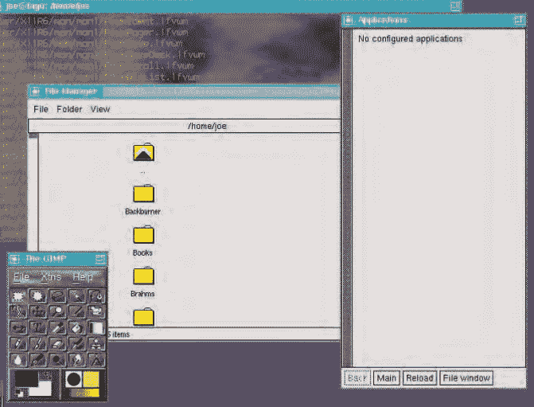

> `twm` 对于那些倾向于不使用鼠标的人非常有用。由于 `twm` 的根源在于早期的 Unix 世界，它的开发者并没有假设每个人都拥有鼠标。你可以在 `twm` 中使用键盘快捷键来执行任何你可能需要使用鼠标完成的功能。然而，某些系统管理员可能配置了 `twm` 使其主要通过鼠标命令工作；键盘快捷键不会被禁用，但你可能会发现，当你需要关于控制键和组合键组合的信息时，文档中提的却是鼠标按钮、指针和点击操作。如果你在确定按键组合方面遇到困难，请咨询你的系统管理员。

## 配置 twm

通过在你的主目录下创建一个名为 `.twrc` 的文件来配置 `twm`。这是用户配置文件的通常所在，`twm` 在启动时会查找该文件。

如果你将配置数据放在主目录下的另一个文件中，`twm` 可能无法找到它。

`.twmrc` 文件处理各种默认定义或由用户定义的变量。如果你用文本编辑器打开 `.twmrc` 文件（如图 8.2 所示），你会在文件顶端看到变量。`.twmrc` 几乎有 100 个有效变量，包括颜色选项、窗口移动和管理选项以及常规外观选项。语法随变量而异；某些变量只需取消注释或添加注释即可激活或禁用，而另一些变量则需要额外字符串或其他特定信息。

`twm` 的帮助手册页（manual page）包含了 `.twmrc` 变量的完整列表及其所需的语法。在 shell 提示符下输入 `twm` 命令即可打开该帮助手册页。由于该页内容非常长，如果你预估要进行大量的 `twm` 配置，可能希望将其重定向到文本文件中以便打印。

#### 图 8.2

使用 `.twmrc` 文件配置 `twm`，该文件提供了许多变量。

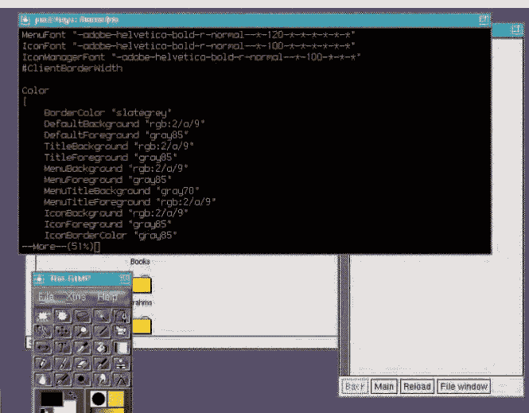

在列出所有变量后，`.twmrc` 文件还包含一组决定窗口如何绘制的函数以及一组创建菜单系统的指令。(`twm` 菜单是通过按下鼠标按钮而非点击工具栏按钮来调用的。）窗口函数变量带有 `f` 变量，例如 `.beep`。显示变量中的某些窗口函数接受特定参数，详细信息见窗口帮助手册页。菜单变量的语法较为复杂，包含了前景色和背景色的配置，以及在菜单中包含的程序名称。

注意

我们不建议你折腾窗口函数。如果你在这些变量中犯了错误，可能会导致 `twm` 冻结，因为它无法执行你要求的操作，或者你的更改与其他 X 函数发生了冲突。

### IceWM

较新的管理器之一被称为 `IceWM`。该管理器对于那些系统资源极少、内存（RAM）容量很小的人来说特别有用。它还将将键盘快捷键集成到每个功能中，并且完全可以在不使用鼠标的情况下使用。

许多 `IceWM` 用户发现，该管理器的有限可配置性是一项优点。由于选项集有限，用户在使用管理器 之前，不需要花费大量精力配置界面的每一个方面。另一些人则认为这是一种局限，并可能更倾向于可配置性更高的管理器，例如 `Enlightenment`。然而，我们并不是要暗示 `IceWM` 难以配置，或者它的可配置项很少。事实上，该管理器有许多配置选项；仅偏好文件（四个配置文件之一）就拥有 300 个配置设置。如果你正在寻找一个既精简又允许你管理自己的外观和感受的窗口管理器，`IceWM` 值得一试。

104

第 8 章 • 窗口管理器

#### 图 8.3

`IceWM` 是基础窗口管理器的一种较新的替代方案，具有友好的界面。

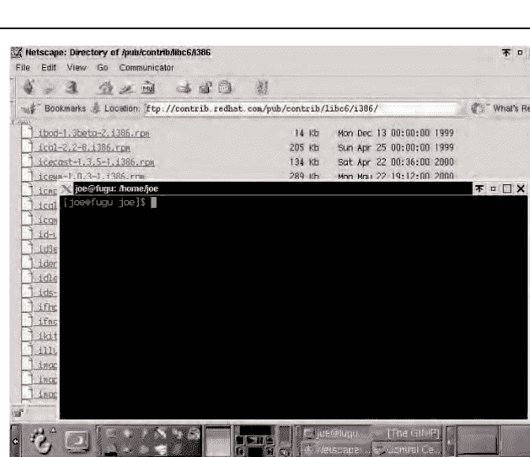

`IceWM` 是基础窗口管理器的一种较新的替代方案，具有友好的界面。（注：部分文本由于 OCR 重复/合并）

## 配置 IceWM

`IceWM` 可以通过偏好文件进行编辑。尽管在我们编写这些内容时至少有两个配置文件，但你可以在 `http://www.icewm.org` 了解更多接口信息。

注意

在你的主目录下查找配置文件。例如，如果你尝试将 `Ctrl+Esc` 组合键定义为关闭活动窗口的命令，你可能会导致 `IceWM` 崩溃，因为该组合键已分配给打开菜单。

105

`IceWM`

四个配置文件分别命名为 `menu`、`preferences` 和 `winoptions`。它们的功能显而易见：`menu` 包含项目；`preferences` 控制常规体验，而 `winoptions` 处理特定行为。用文本编辑器打开 `preferences` 文件以进行更改。

`menu` 的语法为：

```
# 设置描述
SettingName=1
```

第一行只是说明，第二行是命令。文件中已经预定义了若干个快捷键。

| 提示 | `Alt+F4` 组合键可关闭活动窗口。 |

尽管所有四个配置文件都相对容易编辑，但你可能会发现 `preferences` 文件和 `menu` 文件是最用的。`menu` 文件让你可以将某些程序放入主菜单中（类似于 Windows 的开始菜单）。`menu` 的语法为：

```
menu <filename> <icon>
prog <programname> <icon> <command>
)
```

你单独占一行添加 `<separator>` 元素，以便在菜单项目之间显示一条线。

#### 图 8.4

`IceWM` 配置文件使用了简单的语法，使配置变得容易。

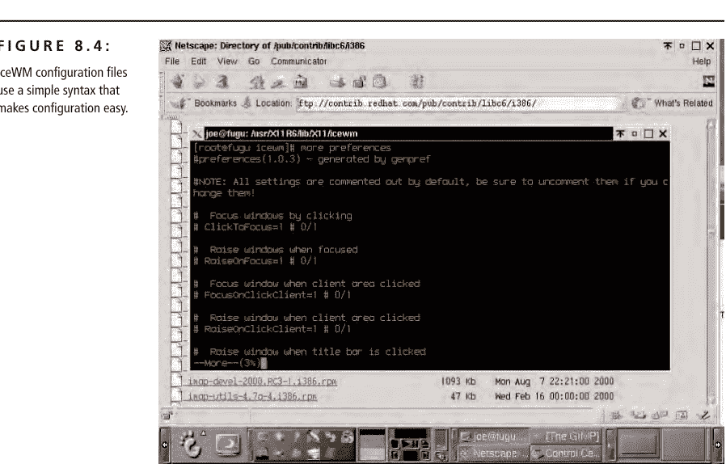

在实践中，菜单配置设置如下：


```
menu <Internet-apps>(
prog Pine pine
prog Netscape netscape netscape
)
<separator>
```

在这个示例中，我们创建名为 `Internet-apps` 的菜单。括号内的所有程序将存储在 `Internet-apps` 文件夹中。第一个程序是 `Pine`，电子邮件程序。我们在菜单中使用了一个名为 `Pine` 的通用图标，当从菜单中选择此项时，IceWM 将通过发布 `pine` 命令来调用程序。文件夹中的第二个项目是 `Netscape`，我们为其使用了 `netscape` 图标。该程序通过 `netscape` 命令启动。在该项目的末尾，我们使用了 `<separator>` 元素。在菜单中，`Internet-apps` 文件夹下方将有一条线。

### BlackBox

与 IceWM 一样，BlackBox 窗口管理器被设计为一个轻量且高效的管理器，没有大量的冗余选项。它具有极具吸引力的用户界面，但这需要用户投入大量工作；事实上，尽管网络上可以找到 BlackBox 主题，但它是那种在没有任何额外图形显示的情况下也可能更有吸引力的窗口管理器之一。

在桌面上点击右键可以调用系统菜单。BlackBox 默认对菜单和工具栏使用文本，这节省了资源，因为不需要绘制图标。如果程序的源代码中包含图标（例如 `Netscape`），则会显示图标，但 BlackBox 不会从外部图标库创建或关联图标。

- 如果你倾向于使用不使用大量快捷键的管理器，可以使用 BlackBox 中的组合键，但默认创建的快捷键很少。你可以为自己实际使用的快捷键定义自定义，或者依赖各个程序中定义的快捷键。

BlackBox 的优势在于它非常小。源代码占用约 50KB 的磁盘空间。

# 配置 BlackBox

正如你可能猜到的那样，BlackBox 的配置由保留在你主目录下的 `.blackboxrc` 文件控制。你也可以通过包含在唯一子目录中的文件控制菜单和视觉样式。BlackBox 在程序首次运行时时会自行创建 `.blackboxrc` 文件，你可能不需要直接处理此文件，因为这个窗口管理器中有许多可配置的材料。

如果你想操作 `.blackboxrc`，你会发现它使用的语法与在本章中介绍的其他配置文件相同。

然而，BlackBox 的配置项通常在选项名称后需要额外的数据字符串；选项名称后跟着冒号，然后冒号后面是该值的定义。例如，以下条目

```
session.menuFile: `/.blackbox/menu`
```

该条目告诉 BlackBox 菜单配置文件位于用户目录 `~/.blackbox/menu`。如果你想将文件保留在非标准位置，你需要在 `.blackboxrc` 中定义这些位置，以便 BlackBox 在启动时能够找到它们。

菜单和样式配置文件比 `.blackboxrc` 文件复杂得多。如果你不确定自己在做什么，我们不建议深入研究菜单或样式文件；请注意，这些文件应该保留在原始位置，除非你显式地编辑 `.blackboxrc` 以包含新位置，否则 BlackBox 在启动时可能会产生困惑并无法加载所需的配置文件。BlackBox 的显示样式可以通过简单下载并应用在 http://bb.themes.org 上的许多主题之一来操作；这些主题会自动编辑样式配置文件，并确保文件中的各个条目之间没有冲突。

菜单配置稍微简单，使用简单的语法，尽管菜单配置文件中每个条目的各个组成部分可能有些模糊。请参阅 BlackBox 手册页（在 shell 提示符输入 `man blackbox` 命令）并滚动到“Menu File”部分，获取有关菜单配置的更详细信息。

# fvwm

`fvwm` 的范围有些局限，`fvwm` 最初是作为一个扩展版本开发的。`fvwm` 比 `twm` 占用的内存更少，并提供了更具吸引力的图形界面。它还允许用户使用快捷键而不是鼠标命令来操作和配置窗口管理器。这对于那些来自纯文本环境的人更有用，但对于那些不喜欢鼠标或硬件设置不允许使用鼠标的人来说也可能方便。鼠标用户也可以轻松地工作，使用 `fvwm-bar` 中的功能来管理他们的窗口和桌面。

`fvwm` 是最早实现极端可配置性级别的窗口管理器之一，用户可以使用各种特殊模块并配置管理器的几乎每一个组件。集成桌面是这一趋势的自然结果，但除了 `fvwm` 之外，其他窗口管理器也倾向于这一方向，包括 `AfterStep`、`WindowMaker` 和 `Enlightenment`。`fvwm` 的一个特殊特性是大型虚拟桌面，它占据的空间比显示器提供的空间更多。也就是说，在使用虚拟桌面时，你可以向上和横滚动桌面，以查看可能包含图标或打开窗口的桌面额外部分。

如果你觉得这没有吸引力或很奇怪，你可能更喜欢多桌面选项。通过此功能，你可以拥有多个互不相关的桌面。你可以在其中一个运行浏览器，在另一个上以 root 身份登录终端窗口，并在第三上玩游戏。（这与 KDE 提供的虚拟桌面类似。）虽然默认的虚拟桌面数量通常为 6 或 8，但 `fvwm` 允许默认值高达 256。

其他功能还包括通过右键点击桌面查看窗口列表。这会弹出一个小窗口，包含所有打开窗口的标题（无论是否最小化）。点击特定的窗口标题即可激活该窗口。如果你喜欢使用多个虚拟桌面，窗口列表特别有用，因为你可以在注销之前查看是否留有任何程序在运行。

# TIP

> 如果你想要一个类似于 Windows 95 的窗口管理器，请尝试 `fvwm` 的变体 `fvwm95`。你可以在大多数 Unix 软件架构中找到它。它的工作原理与普通 `fvwm` ，但图形显示更接近 Windows 95 显示。

# 配置 fvwm

与其他许多窗口管理器和 Unix 程序一样，`fvwm` 使用点文件配置。`.fwwmrc`（假设你使用的是 `fvwm2` 变体，`.fwwm2rc` 包含了颜色、按键绑定、窗口显示选项和杂项选项的配置）。`fwwmrc` 中使用的语法与 `twm` 类似；语法随变量而异，可能只需要变量名，或者需要一组选项或标志。

`fvwm` 处理变量的方式是相同的。也就是说，如果你想配置一个 `fwm` 函数，只需将其添加到配置文件并进行任何编辑即可。可以调用各种内置函数，它们在通过 `fwm` 访问的手册页中描述。`fwm` 手册页编写得非常好，并在 Built-In 部分提供了每个配置的完整信息。

> 如果你认为必须更改 `fwm` 的默认设置，建议你先熟悉手册页，因为它是一个清晰且完整的参考。

### AfterStep

`AfterStep` 是一种为了模拟后期（且经常被怀念的）NEXT 操作系统显示而设计的窗口管理器。NEXT 显示简洁且易于使用，`AfterStep` 的构建旨在为用户提供相同的感觉。`AfterStep` 属于高度可配置窗口管理器的类别，为用户的偏好和配置提供了许多选项。

与本章描述的一些窗口管理器不同，`AfterStep` 是模块化的。模块化程序是指有一个非常小且精简的主程序，而各个特性由各个模块处理。主程序在启动时根据定义加载模块。这意味着未使用的程序不会加载且对用户不可用，即使它们处于空闲状态也不会占用系统资源。这可能会给系统内存和 CPU 进程带来一些压力，特别是当自动加载图形密集型模块时。然而，`AfterStep` 本身的占用很小；各种模块占用大量的空间和资源，但 `AfterStep` 开发者称其产品为高效快速是合理的。

`AfterStep` 默认加载三个模块。这些模块为用户提供了灵性和易用性。`List` 模块允许你查看所有打开窗口的小列表；`Pager` 模块显示所有虚拟桌面的图形表示；`Wharf` 模块提供了一个面板，各种程序图标可以停靠在以便快速访问。（`Wharf` 等同于 KDE 和 Gnome 中的面板。）

# 配置 AfterStep

与本章目前介绍的窗口管理器不同，`AfterStep` 并不在一个文件中处理其配置。相反，`AfterStep` 配置文件被分为若干较小文件，包含在主目录下的 `~/GNUStep/Library/AfterStep/` 目录中。要将这些文件放入您的主目录，请创建上述目录。然后，从 `/usr/local/share/afterstep` 目录拷贝系统配置并根据需要进行编辑。如果您在 `~/GNUStep/Library/AfterStep` 目录中有文件，则 `AfterStep` 将使用这些配置作为您账户的默认配置，无论系统管理员设置了系统默认值如何。

> 在 1.8 版本之前的旧版 `AfterStep` 使用名为 `.steprc` 的配置。如果您使用的是使用 `.steprc` 的 `AfterStep` 版本，我们建议您升级到最新版本（可在 http://www.afterstep.org 获取）。您会发现自 1.8 发布以来有许多变化，包括该配置处理方式的彻底改变。

共有 18 个 `AfterStep` 配置文件，如表 8.1 所示。您可能永远不需要碰其中某些文件，也可能想对它们进行大量编辑。语法非常直观，每个条目以变量名开头，随后是该变量的特定定义。浏览您想要编辑的特定文件，查看文件中如何处理单个变量的示例。您可以在 `AfterStep` 手册页中找到每个配置文件的变量完整列表，通过在 shell 提示符输入 `man afterstep` 即可访问。注意，`AfterStep` 的页面非常长，但各个模块也有它们自己的手册。

# 表 8.1：AfterStep 配置文件


| 文件名 | 配置效果 |
| --- | --- |
| animate | 定义窗口或其他程序最小化时使用的动画设置或 |
| asroot | 配置 asroot 模块，该模块控制 AfterStep 的背景外观 |
| asmail | 配置应用程序小工具 asmail，用于高效处理邮件 |

# 表 8.1 续：AfterStep 配置文件

| 文件名 | 配置效果 |
| --- | --- |
| audio | 配置音频模块，以便您在特定操作中使用音效，或使用需要音频增强的插件模块 |
| autoexec | 定义 AfterStep 启动时自动加载的程序和模块 |
| base.xxbb | 定义模块、图形位图、光标图标和 AfterStep 文件的目录路径 |
| clean | 管理 Clean 模块，该模块在定义的空闲时间后自动关闭或最小化窗口 |
| compatibility | 决定启动 AfterStep 1.8 及更高版本时，是否使用程序早期版本的配置文件（即 `.steprc` 文件） |
| database | 定义各种应用程序的配置，包括它们的窗口行为和外观 |
| feel.name | 配置窗口管理器的感觉，包括窗口行为和其他机械功能（与下文的 look.name 配合使用） |
| forms | 包含 AfterStep 使用的表单信息 |
| ident | 定义 Ident 模块的变量，该模块控制每个打开窗口的基本信息 |
| look.name | 配置窗口管理器的外观，包括颜色和渐变阴影（与上述 feel.name 配合使用） |
| pager | 定义 Pager 模块的变量，用于显示各种虚拟桌面及其内容 |
| scroll | 定义 Scroll 模块的变量，该模块决定桌面上的单个窗口如何从上到下或从侧面滚动 |
| wharf | 定义 Wharf 模块的变量，包括停靠图标和其他插入桌面显示中的其他小工具 |
| winlist | 定义 WinList 模块的变量，显示所有打开窗口的信息 |
| zharf | 定义 Zharf 模块的变量，该模块是 Wharf 模块的文本版本 |

# WindowMaker

与 AfterStep 类似，WindowMaker 是基于 NeXT 显示的窗口管理器。图 8.5 所示的结果是一个整洁且易用的界面。WindowMaker 是 GNU 项目的产品，因此它是自由软件，并设计为可以与其他 GNU 程序良好地工作。我们在随书提供的 CD-ROM 中包含了 WindowMaker。WindowMaker 提供了一个复杂的菜单系统，带有可以拆卸的菜单，可以通过将其“固定”在桌面上来保留；WindowMaker 还有一个名为 Dock 的功能，其作用与 AfterStep Wharf 或 KDE 和 Gnome 面板相同。

WindowMaker 和 AfterStep 一样，不是可用的最快的窗口管理器，在使用方面也不是最小的，而且没有最华丽的功能。然而，它在所有这些组件之间取得了很好的平衡，对于那些想要全功能窗口管理器、但又不想要集成桌面带来的过人系统需求，且希望窗口管理器能够轻松处理多项任务而没有基础窗口管理器那种简陋外观的用户来说，它是一个很好的选择。WindowMaker 具有大量可配置的功能，而不会像 Enlightenment 有时那样出现配置过载的问题。

图 8.5：

WindowMaker 像 AfterStep 一样，基于 NeXT 显示，具有整洁简单的界面。

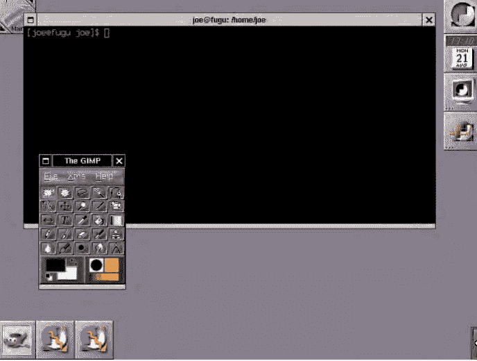

在 WindowMaker 和 AfterStep 之间做出选择是困难的，因为这两个管理器看起来几乎相同。两者之间的主要区别是 WindowMaker 在其核心二进制文件中集成了比 AfterStep 的功能，不像 AfterStep 那样依赖模块。

# 配置 WindowMaker

WindowMaker 使用多文件系统而不是单文件（如 BlackBox 或 IceWM）。AfterStep 配置文件被分为若干较小文件，包含在主目录下的 `~/GNUStep/Library/AfterStep/` 目录中。要将这些文件放入您的主目录，请创建上述目录。然后，从 `/usr/local/share/afterstep` 目录拷贝系统配置并根据需要进行编辑。如果您在 `~/GNUStep/Library/AfterStep` 目录中有文件，则 AfterStep 将使用这些配置作为您账户的默认配置，无论系统管理员设置了系统默认值如何。

> 在 1.8 版本之前的旧版 AfterStep 使用名为 `.steprc` 的配置。如果您使用的是使用 `.steprc` 的 AfterStep 版本，我们建议您升级到最新版本（可在 http://www.afterstep.org 获取）。您会发现自 1.8 发布以来有许多变化，包括该配置处理方式的彻底改变。

共有 18个 AfterStep 配置文件，如表 8.1 所示。您可能永远不需要碰其中某些文件，也可能想对它们进行大量编辑。语法非常直观，每个条目以变量名开头，随后是该变量的特定定义。浏览您想要编辑的特定文件，查看文件中如何处理单个变量的示例。您可以在 AfterStep 手册页中找到每个配置文件的变量完整列表，通过在 shell 提示符输入 `man afterstep` 即可访问。注意，AfterStep 的页面非常长，但各个模块也有它们自己的手册。

# 表 8.1：AfterStep 配置文件

| 文件名 | 配置效果 |
| --- | --- |
| animate | 定义窗口或其他程序最小化时使用的动画设置或 |
| asroot | 配置 asroot 模块，该模块控制 AfterStep 的背景外观 |
| asmail | 配置应用程序小工具 asmail，用于高效处理邮件 |

# 表 8.1 续：AfterStep 配置文件

| 文件名 | 配置效果 |
| --- | --- |
| audio | 配置音频模块，以便您在特定操作中使用音效，或使用需要音频增强的插件模块 |
| autoexec | 定义 AfterStep 启动时自动加载的程序和模块 |
| base.xxbb | 定义模块、图形位图、光标图标和 AfterStep 文件的目录路径 |
| clean | 管理 Clean 模块，该模块在定义的空闲时间后自动关闭或最小化窗口 |
| compatibility | 决定启动 AfterStep 1.8 及更高版本时，是否使用程序早期版本的配置文件（即 `.steprc` 文件） |
| database | 定义各种应用程序的配置，包括它们的窗口行为和外观 |
| feel.name | 配置窗口管理器的感觉，包括窗口行为和其他机械功能（与下文的 look.name 配合使用） |
| forms | 包含 AfterStep 使用的表单信息 |
| ident | 定义 Ident 模块的变量，该模块控制每个打开窗口的基本信息 |
| look.name | 配置窗口管理器的外观，包括颜色和渐变阴影（与上述 feel.name 配合使用） |
| pager | 定义 Pager 模块的变量，用于显示各种虚拟桌面及其内容 |
| scroll | 定义 Scroll 模块的变量，该模块决定桌面上的单个窗口如何从上到下或从侧面滚动 |
| wharf | 定义 Wharf 模块的变量，包括停靠图标和其他插入桌面显示中的其他小工具 |
| winlist | 定义 WinList 模块的变量，显示所有打开窗口的信息 |
| zharf | 定义 Zharf 模块的变量，该模块是 Wharf 模块的文本版本 |

# WindowMaker

与 AfterStep 类似，WindowMaker 是基于 NeXT 显示的窗口管理器。图 8.5 所示的结果是一个整洁且易用的界面。WindowMaker 是 GNU 项目的产品，因此它是自由软件，并设计为可以与其他 GNU 程序良好地工作。我们在随书提供的 CD-ROM 中包含了 WindowMaker。WindowMaker 提供了一个复杂的菜单系统，带有可以拆卸的菜单，可以通过将其“固定”在桌面上来保留；WindowMaker 还有一个名为 Dock 的功能，其作用与 AfterStep Wharf 或 KDE 和 Gnome 面板相同。

WindowMaker 和 AfterStep 一样，不是可用的最快的窗口管理器，在使用方面也不是最小的，而且没有最华丽的功能。然而，它在所有这些组件之间取得了很好的平衡，对于那些想要全功能窗口管理器、但又不想要集成桌面带来的过人系统需求，且希望窗口管理器能够轻松处理多项任务而没有基础窗口管理器那种简陋外观的用户来说，它是一个很好的选择。WindowMakerMaker 具有大量可配置的功能，而不会像 Enlightenment 有时那样出现配置过载的问题。

图 8.5：

WindowMaker 像 AfterStep 一样，基于 NeXT 显示，具有整洁简单的界面。


在 WindowMaker 和 AfterStep 之间做出选择是困难的，因为这两个管理器看起来几乎相同。两者之间的主要区别是 WindowMaker 在其核心二进制文件中集成了比 AfterStep 多的功能，不像 AfterStep 那样依赖模块。

# 配置 WindowMaker

WindowMaker 使用多文件系统而不是单文件（如 BlackBox 或 IceWM）。AfterStep 配置文件被分为若干较小文件，包含在主目录下的 `~/GNUStep/Library/AfterStep/` 目录中。要将这些文件放入您的主目录，请创建上述目录。然后，从 `/usr/local/share/afterstep` 目录拷贝系统配置并根据需要进行编辑。如果您在 `~/GNUStep/Library/AfterStep` 目录中有文件，则 AfterStep 将使用这些配置作为您账户的默认配置，无论系统管理员设置了系统默认值如何。

> 在 1.8 版本之前的旧版 AfterStep 使用名为 `.steprc` 的配置。如果您使用的是使用 `.steprc` 的 AfterStep 版本，我们建议您升级到最新版本（可在 http://www.afterstep.org 获取）。您会发现自 1.8 发布以来有许多变化，包括该配置处理方式的彻底改变。

共有 18个 AfterStep 配置文件，如表 8.1 所示。您可能永远不需要碰其中某些文件，也可能想对它们进行大量编辑。语法非常直观，每个条目以变量名开头，随后是该变量的特定定义。浏览您想要编辑的特定文件，查看文件中如何处理单个变量的示例。您可以在 AfterStep 手册页中找到每个配置文件的变量完整列表，通过在 shell 提示符输入 `man afterstep` 即可访问。注意，AfterStep 的页面非常长，但各个模块也有它们自己的手册。

## 表 8.1：AfterStep 配置文件

| 文件名 | 配置效果 |
| --- | --- |
| animate | 定义窗口或其他程序最小化时使用的动画设置或 |
| asroot | 配置 asroot 模块，该模块控制 AfterStep 的背景外观 |
| asmail | 配置应用程序小工具 asmail，用于高效处理邮件 |

## 表 8.1 续：AfterStep 配置文件

| 文件名 | 配置效果 |
| --- | --- |
| audio | 配置音频模块，以便您在特定操作中使用音效，或使用需要音频增强的插件模块 |
| autoexec | 定义 AfterStep 启动时自动加载的程序和模块 |
| base.xxbb | 定义模块、图形位图、光标图标和 AfterStep 文件的目录路径 |
| clean | 管理 Clean 模块，该模块在定义的空闲时间后自动关闭或最小化窗口 |
| compatibility | 决定启动 AfterStep 1.8 及更高版本时，是否使用程序早期版本的配置文件（即 `.steprc` 文件） |
| database | 定义各种应用程序的配置，包括它们的窗口行为和外观 |
| feel.name | 配置窗口管理器的感觉，包括窗口行为和其他机械功能（与下文的 look.name 配合使用） |
| forms | 包含 AfterStep 使用的表单信息 |
| ident | 定义 Ident 模块的变量，该模块控制每个打开窗口的基本信息 |
| look.name | 配置窗口管理器的外观，包括颜色和渐变阴影（与上述 feel.name 配合使用） |
| pager | 定义 Pager 模块的变量，用于显示各种虚拟桌面及其内容 |
| scroll | 定义 Scroll 模块的变量，该模块决定桌面上的单个窗口如何从上到下或从侧面滚动 |
| wharf | 定义 Wharf 模块的变量，包括停靠图标和其他插入桌面显示中的其他小工具 |
| winlist | 定义 WinList 模块的变量，显示所有打开窗口的信息 |
| zharf | 定义 Zharf 模块的变量，该模块是 Wharf 模块的文本版本 |

## 表 8.2：WindowMaker 配置文件

| 文件名 | 配置效果 |
| --- | --- |
| `/GNUStep/WindowMaker/WindowMaker` | 设置大部分 WindowMaker 变量，包括窗口行为、快捷键和其他此类项。 |
| `/GNUStep/WindowMaker/WMWindowAttributes` | 包含计算机上各种应用程序的单独配置。每个程序可能有一套不同的属性，其他的定义在该文件中。 |
| `/GNUStep/Defaults/WMState` | 包含 Dock 的当前状态信息，包括图形按钮和程序启动信息。不要编辑此文件；它是自动生成的。 |
| `/GNUStep/Defaults/WMRootMenu` | 定义提供根菜单的文件。在 0.19 以上版本的 WindowMaker 中，如果要使用配置应用程序 Wprefs.app 进行菜单配置，则该文件应被替换为 `/GNUStep/Defaults/pmenu` |
| `/GNUStep/Library/WindowMaker/Menu` | 处理 0.19 以前版本 WindowMaker 的菜单配置。 |

## 第 8 章 • 窗口管理器

图 8.6：

通过 Wprefs 应用程序，WindowMaker 的配置变得简单。

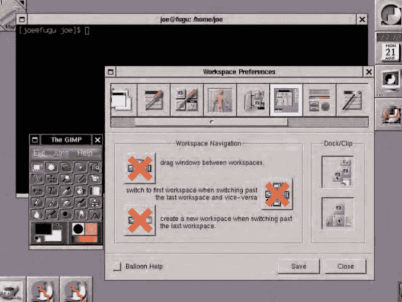

### Enlightenment

在本章介绍的所有窗口管理器中，Enlightenment 的可配置性是最高的。显示器的几乎每一个元素都可以被修改以满足用户的需求。虽然有些人认为这让人无所适从，但许多 Enlightenment 用户正恰因为它的灵活性和强大而选择这个窗口管理器。如图 8.7 所示，通过 Enlightenment，你并不限于下载的主题中包含的图形文件；如果你可以使用如 The GIMP（包含在书籍 CD-ROM 中）之类的图形设计程序，你就可以创建自己的文件并将其添加到显示中。

Enlightenment 仍然处于非常活跃的发展阶段。该项目的程序员希望最终Enlightenment 能够作为一个独立的环境运行，并与已安装在硬盘上的应用程序和非 Enlightenment 程序实现无缝集成。目前，这些细节由配置文件涵盖，但梦想是让 Enlightenment 自动处理许多此类任务，而无需进行硬配置。

# 图 8.7：

Enlightenment 是可用可配置性最高的窗口管理器。

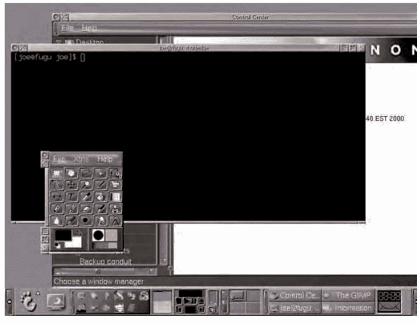

一些与集成式桌面最常相关的功能（如文件管理器和拖放能力）也已纳入 Enlightenment 的计划。从功能列表中很容易看出，Enlightenment 起初是 Gnome 项目的一部分。尽管它已不再与 Gnome 关联（Gnome 现在使用 Sachs 窗口管理器），但 Enlightenment 提供了——或计划提供——与集成式桌面中相同的大部分功能。

如果你对多个配置文件的想法并不感到兴奋，完全可以使用 Enlightenment。不过，如果你更倾向于使用开箱即用的窗口管理器，你可能更偏好 Black 甚至 WindowMaker。然而，对于那些喜欢折腾并想要最前沿窗口管理器的人来说，Enlightenment 非常适合你。想要为显示环境编程的读者将对 Enlightenment 特别满意，因为该项目的开发哲学是接受并整合大多数提交供考虑的补丁。

## 配置 Enlightenment

Enlightenment 的配置通常按主题分组。也就是说，如果你想配置 Enlightenment 显示或行为的特定元素，你需要编辑你正在使用的主题的配置文件。当你切换主题时，这些更改不会生效。默认主题的配置文件位于 `/usr/local/enlightenment/config`，而其他主题的配置文件位于 `/usr/local/enlightenment/themes`。每个主题有三个基础配置文件：

- `user_main.cfg` 控制用户偏好。
- `theme_pre.cfg` 控制给定主题的各种类定义。
- `theme_main.cfg` 控制给定主题内窗口的图形显示。

你可以通过编辑 `user_main.cfg` 文件来更改基本用户偏好；你可能永远不需要编辑 `theme_pre.cfg` 或 `theme_main.cfg`。在文本编辑器中打开文件并选择合适的设置。文件顶部有几个用户偏好条目，大多数是窗口行为变量。显示变量（如颜色、字体和背景图像）通常通过安装不同的桌面主题而不是编辑配置文件来更改。声音选项也包含在此文件中。


> 注意：`user_main.cfg` 中的默认设置在不同主题之间应该是相同的，尽管该文件在每次开发新主题时都会创建。然而，单独程序员可能不想使用默认设置；如果你遇到一个具有不寻按钮功能或按键组合的主题，很可能是开发者选择不遵守通用的用户偏好标准。

## 安装主题

由于 Enlightenment 的大部分力量和灵活性集中在主题中，你可能想要下载并安装各种主题以查看它们能做什么。Enlightenment 主题最大的存档，与其它支持主题的窗口管理器和集成式桌面一样，可以在 themes.org 找到：具体地址为 `http://e.themes.org`。主题以 tar 包（tar-balls）的形式存储，这意味着你需要在下载后对其进行解压。

将其下载到 `/usr/local/enlightment/themes` 目录。使用命令 `tar zxf filename` 解压主题（确保包含任何如 `filename.tar.gz` 的扩展名）。该包将自动解压并将文件分类到新创建的子目录中。然后，你可以在 Enlightenment 配置工具中选择该主题。例如，如果你在 Gnome 桌面环境下运行 Enlightenment，请点击 Gnome 主菜单按钮并选择 Window Manager > Enlightenment。点击标记为“Run Configuration for Enlightenment”的按钮，选择“Themes”选项卡，并从列表中选择新主题，如图 8.8 所示。点击 OK 在桌面上设置新主题。无论你使用的是 KDE 还是直接使用 Enlightenment，主题选择的方法都是一样的。

### 图 8.8

使用 Enlightenment 内置的配置工具轻松更改主题。

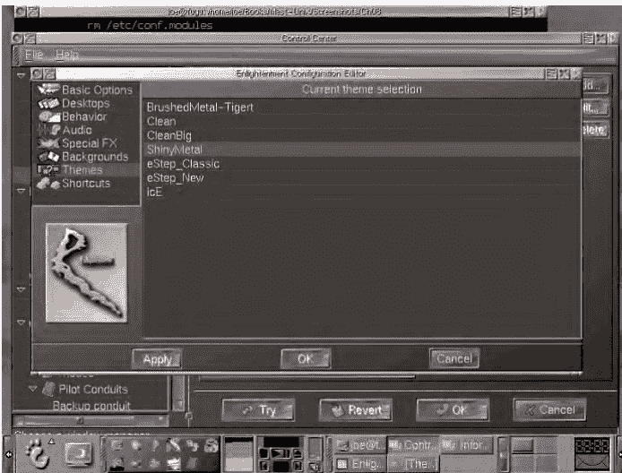

### 总结

窗口管理器最基本的功能为 Unix 用户提供了管理多个终端会话的能力。然而，目前大多数窗口管理器提供的功能远多于此。窗口管理器可能具有复杂的菜单系统，或者可以使用主题来控制显示的功能。所有 Unix 变体都有许多窗口管理器可用；它们可以作为集成式桌面环境的一部分或与之配合使用。

窗口管理器可以分为两派。一派专注于开发轻量且占用资源较少的窗口管理器。这一类的窗口管理器包括 twm、IceWM 和 BlackBox。另一派专注于开发具有高度可配置性的窗口管理器，这不可避免会对系统资源有更高要求。这一类的窗口管理器包括 fwm、AfterStep、WindowMaker 和 Enlightenment。

# KDE 章

- 什么是 KDE？
- 获取并安装 KDE
- KDE 面
- KDE 文件管理器
- KDE 控制中心
- 桌面主题
- 总结

在第 8 章“窗口管理器”中，我们描述了一种与 X 系统配合提供图形界面的程序。虽然窗口管理器提供了一个基本的窗口系统，允许你在桌面上打开多个 Unix 会话，但窗口管理器的范围有限。与 Windows 或 macOS 等操作系统相比，第 8 章描述的窗口管理器有些不足：不支持拖放、窗口间无法复制、管理程序和监控系统活动的方法有些笨拙。窗口管理器是命令行界面会的一种进步，但并不是最新的图形界面。

目前的图形界面技术是什么？集成式桌面环境。这些桌面环境将普通窗口器的功能功能新的特性相结合，包括拖放、更好的图形管理以及一组让账户管理更容易的功能。对于系统管理员，集成式桌面环境提供了一系列图形管理工具，可以替代命令行方法。

在本章和下一章中，我们将描述目前适用于 Unix 和 Unix 衍生系统的两种主流桌面环境：KDE 和 Gnome。我们不推荐其中某一个。尽管我们写过一本关于 KDE 的书，我们在许多机器上仍使用 Gnome，认为没有明显的理由偏向其中之一。尝试一下（我们已把它们放在了 CD 上），看看你最喜欢哪一个。

## 什么是 KDE？

KDE（K Desktop Environment）是第一个为 Unix 和 Unix 衍生平台发布的集成桌面环境。KDE 项目位于德国，是我们在开源开发中看到的最国际化的志愿者团体之一。（仅 KDE 翻译项目就有 100 多人参与）。

> 注意：无论你听过什么传言，KDE 都是开源软件。KDE 是使用一个名为 Qt 的特定库开发的，该库使用的是比 GNU 公共许可证更严格的许可证。特别是 Qt 许可证

## 获取与安装 KDE

过去，对于想要使用 Qt 编写商业软件且不想公开代码的开发者来说，Qt 存在一个漏洞（这是 GPL 的核心原则之一）。Qt 的开发者允许这种用法，前提是必须支付许可费用。现在这个问题已经得到了解决，KDE 是真正的开源软件了。如果你认为这在伦理上存在问题，请翻到下一章，了解更多关于 Gnome 的信息，它从一开始就是自由软件。

KDE 的设计旨在与 KWM 窗口管理器协同工作，该管理器是 KDE 原生的，并与桌面紧密集成。作为第一个进入 Unity 社区的集成桌面环境，KDE 通过完整的菜单系统、集成的帮助文档以及原生的图形化管理和配置工具，为 Unix 用户带来了新水平的便利。KDE 还赋予了用户设计自己桌面桌面的能力，无论是基础的还是深度复杂的，并可以与其他 KDE 用户共享桌面主题。

KDE 很容易找到。事实上，我们已经将你所需的所有软件包放在了随书附的 CD 盘中。不过，我们建议你查看 KDE 官方网站 `http://www.kde.org`。我们在 KDE 2 准备发布之前就出版了这本书，但开发团队承诺新版本将会有重大变化。如果网站上有更新版本而你更倾向于使用该版本，只需下载那里推荐的软件包并按照说明安装即可。

在安装 KDE 时，你应该遇到很少或完全没有问题。（如果你使用的是 Core Linux，你甚至不需要这一节，因为 KDE 是该发行版的默认桌面。）KDE 应该在类 Unix 操作系统上流畅运行，即使是那些较冷门的发行版也是如此。当然，它在本书涵盖的系统中也会运行良好。

在其网站上，KDE 提供了六种不同格式的下载包，包括用于 Hat 和 Debian Linux 包的 `.rpm` 和 `.deb` 文件；适用于未运行 Linux 用户的普通源码 tar 包；以及适用于 Solaris 2.6 和 2.7 的包。无论你使用哪种 Unix 变体，都应该编译并运行源码包；如果你可以使用 `.rpm` 或 `.deb` 格式，或者运行着适当版本的 Solaris，请先尝试这些专用格式。我们在本章中关注源码，并在 CD 中提供了源码包。

### 下载 KDE

在本章的这一节中，你将找到并下载安装 KDE 的相应软件包。如果你使用的是书籍 CD 中的 KDE 软件包，请将 CD 插入已挂载的光驱驱动器，并按照“解压源码”节中的说明将这些软件包移动到相应的目录。如果你是从 KDE 网站下载软件包，请将浏览器或 FTP 客户端指向 `http://ftp.kde.org`。

你需要下载几个软件包才能让 KDE 正常工作。在本节中，列表基于 KDE 1.1，这是我们编写本章时当前的发布版本。这些包名针对源码包，而不是 `.rpm`、`.deb` 或 Solaris 包。

> 如果在你阅读此本书时 KDE 1.1 不再是当前版本，请参阅 KDE 网站以了解安装桌面环境需要哪些软件包。

### 基础软件包下载

下文列出的前两个基础包是安装和运行 KDE 必需的。

> 如果你的系统中尚未安装 Qt，你必须也获取它并在安装其他任何内容之前安装它。从 `http://www.troll.1/no/1` 获取 Qt，并确保下载的是 1.42 或更高版本。请勿下载 Qt 2 或更高版本，因为这些版本无法与 KDE 1.1 兼容。这在 KDE 2 中可能会有所不同，但我们无法确定。

- `kdellibs`：此包包含了 KDE 应用程序运行所需的各种软件库。
- `kdebase`：此包包含了基础 KDE 应用程序，如窗口管理器、文件管理器、面板等。
- `kdesupport`：此包在技术上并非运行 KDE 必需，但安装它无疑也无害处。它包含了并非由 KDE 团队生产但在运行软件时所需的各种软件库。

> 注意：如果你运行的是 Debian Linux，你必须安装 `kdesupport` 包。这对于 Debian 用户来说是必须的。

### 推荐软件包下载

这些软件包并非运行 KDE 必需，但如果你不安装它们，你将无法获得集成桌面的许多优势。我们建议你在第一次安装时安装它们，看看完整的 KDE 安装是什么样子的，然后卸载你不需要或不想要的部分。

`kdeadmin`：此包包含了用于系统管理的图形化程序。当前的包包含一个图形化用户管理器和一个运行器编辑器。

`kdegames`：此包包含了多种为 KDE 桌面构建的的游戏，包括几个版本的俄罗斯方块、策略游戏和纸牌游戏。

`kdegraphics`：此包包含了用于各种图形格式的查看器，包括 PostScript、`.dvi` 等。它还包含一个绘图程序。

`kdemultimedia`：此包包含了帮助你使用计算机多媒体能力的工具，例如音频 CD 播放器、调音器等。

`kdenetwork`：此包包含了各种 KDE 特有的网络应用程序，如 Kmail（电子邮件客户端）和 Krn（USENET 新闻客户端）。


korganizer：`korganizer` 包包含一个电子组织器，类似于 Microsoft Outlook，它可以管理你的日程和联系信息。

kdetoys：此包包含了专为 KDE 桌面设计的各种游戏和其他娱乐程序。

kdeutils：`kdeutils` 包包含了几个基础桌面实用程序，如计算器和文本编辑器。

## 解压源码

在所有软件包解压后，你就可以开始安装软件了。如有，返回包含所有子目录的目录；然后通过执行命令进入 `kdesupport` 包所在的子目录：

```
cd kdesupport
```

在 shell 提示符执行以下命令配置 `kdesupport` 包：

```bash
./configure
```

`configure` 命令决定了 KDE 可以安装的硬件配置。

接下来，在 shell 提示符执行命令

```bash
make
```

`make` 命令启动编译器，构建执行 KDE 程序的实际二进制包。在 `make` 工作时，大量消息会滚动你的屏幕。你不需要仔细检查这些消息，因为严重的错误会停止流程并等待你的响应。

当消息最终停止滚动时，在提示符输入

```
make install
```

此命令将所有新的二进制包移动到它们的永久目录中。

返回上级目录（使用 `cd ..` 命令），进入 `kdellibs` 子目录。对该包重复上述的三步骤程序（`make` 和 `make install`）。完成后，返回上级目录并进入 `kdebase` 子目录。

> `kdebase` 包具有一些特殊的配置选项。在开始配置过程之前，在提示符执行 `./configure help` 命令以显示适用于安装的选项。如果你选择了其中一个选项，请按照屏幕上的指示操作。然后继续上述的三步骤流程。

在你安装了 `kdesupport`、`kdellibs` 和 `kdebase`（按此顺序）之后，你可以对所有剩余的 KDE 软件包使用该过程。

无论你使用什么顺序，只要先安装这三个软件包并按照正确的顺序操作即可。

## 注意

如果你遇到了导致配置或安装过程中断的问题，那么极有可能是你在某个地方缺少了库或所需的程序。这就是为什么我们建议你先安装库，然后是基础包，最后是可选包。回溯错误信息并尝试确定缺少了什么。找到包含该元素的包，安装它，然后再次尝试重新安装失败的包。

当你完成所有包的安装后，注销 root 账户并重新登录你的用户账户。

## 为 KDE 配置 X

一旦你重新登录用户账户，在命令行提示符处输入 `usekde` 命令。当你的电脑将 KDE 设置为默认用户界面时，你将看到屏幕上出现几条系统消息。当消息停止时，你可以在提示符处输入 `startx` 来测试你的安装和配置。X 窗口系统将启动——你应该看到 KDE 的启动界面，并最终看到 KDE 桌面，如图 9.1 所示。

## 注意

如果你由于某种原因已经在运行 X（例如，你可能正在使用窗口管理器或 Gnome 作为当前的图形界面），你必须在测试 KDE 之前注销当前会话。退出会话并在文本提示符处重新登录。此时，KDE 应该作为图形界面启动。

### KDE 面板

KDE 用户界面的核心是 KDE 面板（Panel），这是一组沿着屏幕底部运行的长条图标，如图 9.2 所示。面板包含代表常用应用程序或命令的图标，但它可以被配置为只显示你经常使用的项目图标。你还可以移动面板的默认位置，或者仅在需要时将其折叠和打开。本节的其余部分将详细介绍面板的每个默认项。

图 9.1：

第一次运行 KDE 时，

你将看到默认的桌面配置。

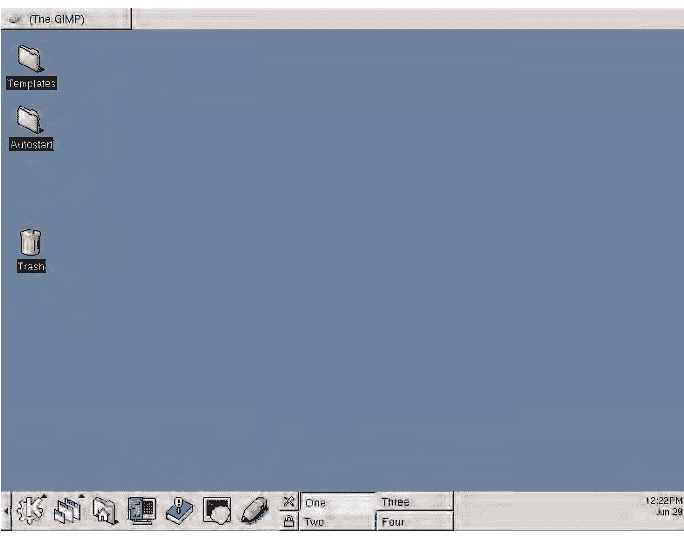

注意

一旦安装了 KDE，你可能会看到这里描述的一些按钮，但可能不是另一些。如果你的显示器对于你正在使用的分辨率来说太小，面板会自动堆叠图标以适应。我们建议你删除不常用的图标，以便让面板整齐地位于桌面桌面上。

## KDE 9.2：

KDE 面板包含只需点击一下即可启动常用应用程序的图标。


## 面板折叠栏

位于面板的左端和右端，这些纹理条可以折叠面板或将其恢复到完整尺寸。当你点击该条时，面板会滑到条的后面，并一直留在那里直到你再次点击它。


> 提示

 如果你喜欢在全屏模式下工作，请使用这些条，这样面板就不会遮挡你正在工作的内容。

### 启动器

启动器（Application Starter）图标启动一个菜单，其功能类似于 Windows 95 和 Windows 98 的开始菜单。你可以通过此点击启动程序、浏览文件或执行命令。点击启动器图标打开菜单，然后从那里继续你的选择。图 9.3 显示了启动器菜单及其的一些子菜单。

### 文件管理器

在本章的“KDE 文件管理器”部分，我们描述了 KDE 文件管理器，它是你计算机目录系统的图形界面。使用此图标只需单击鼠标即可启动文件管理器。如果你以用户身份登录，文件管理器将向你显示主目录的内容；如果你以 root 身份登录，文件管理器将显示计算机的整个目录结构。


### 终端模拟器

在本书中，我们要求使用命令行提示符工作，以便直接与 shell 环境交互。尽管 KDE 是一个图形界面，但你仍然可以使用此图标启动 shell 会话。点击它可以打开一个包含独立 shell 会话的窗口。图 9.4 显示了桌面上有一个打开的 shell 会话的 KDE 会话。


## 图 9.3：

启动器菜单类似于 Windows 中的开始菜单。

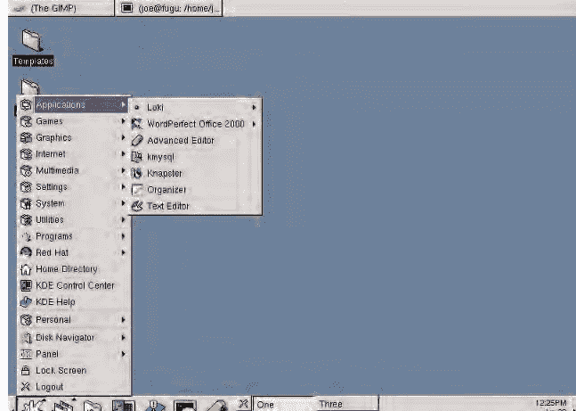

## 图 9.4：

尽管 KDE 是一个图形界面，你也可以在 shell 中直接使用 KDE 工具。

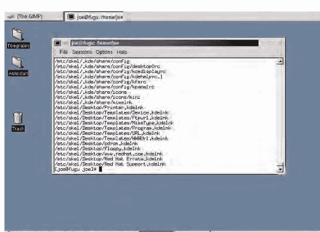

## 文本编辑器

点击此按钮启动 `KEdit`。

## 帮助

点击此按钮启动 `KEdit`，一个图形编辑器。点击此按钮启动 `KEdit`，一个图形编辑器。点击此按钮启动 `KEdit`，一个图形编辑器。点击此按钮启动 `KEdit`，一个图形编辑器。点击此按钮启动 `KEdit`，一个图形编辑器。点击此按钮启动 `KEdit`，一个图形编辑器。点击此按钮启动 `KEdit`，一个图形编辑器。点击此按钮启动 `KEdit`，一个图形编辑器。点击此按钮启动 `KEdit`，一个图形编辑器。点击此按钮启动 `KEdit`，一个图形编辑器。点击此按钮启动 `KEdit`，一个图形编辑器。点击此按钮启动 `KEdit`，一个图形编辑器。点击此按钮启动 `KEdit`，一个图形编辑器。点击此按钮启动 `KEdit`，一个图形编辑器。点击此按钮启动 `KEdit`，一个图形编辑器。点击此按钮启动 `KEdit`，一个图形编辑器。

## 切换器

点击此按钮启动 `KEdit`，一个图形编辑器。

## 任务栏和系统

点击此按钮启动 `KEdit`，一个图形编辑器。点击此按钮启动 `KEdit`，一个图形编辑器。点击此按钮启动 `KEdit`，一个图形编辑器。点击此按钮启动 `KEdit`，一个图形编辑器。点击此按钮启动 `KEdit`，一个图形编辑器。点击此按钮启动 `KEdit`，一个图形编辑器。点击此按钮启动 `KEdit`，一个图形编辑器。点击此按钮启动 `KEdit`，一个图形编辑器。点击此按钮启动 `KEdit`，一个图形编辑器。点击此按钮启动 `KEdit`，一个图形编辑器。点击此按钮启动 `KEdit`，一个图形编辑器。点击此按钮启动 `KEdit`，一个图形编辑器。点击此按钮启动 `KEdit`，一个图形编辑器。点击此按钮启动 `KEdit`，一个图形编辑器。点击此按钮启动 `KEdit`，一个图形编辑器。点击此按钮启动 `KEdit`，一个图形编辑器。

### 时钟/日期

点击此按钮启动 `KEdit`，一个图形编辑器。

### 虚拟桌面

点击此按钮启动 `KEdit`，一个图形编辑器。

### 文件管理器

如果你在开始 Unix 体验之前用过 Windows 95 或 98，你可能熟悉 Windows 管理器。KDE 文件管理器的工作原理相同——它是计算机目录结构的图形界面。KDE 文件管理器不仅仅是一个视觉显示，它还提供了许多处理文件的方法，无需背记复杂的命令。通过两种方式之一打开文件管理器：

*   点击面板中的文件管理器图标。
*   打开启动器菜单，并从菜单中选择文件管理器。

无论你使用哪种方法，文件管理器都会打开。默认模式是简单视图，如图 9.6 所示。我们倾向于使用树视图，可以通过选择菜单栏中的 `View ➤ Show Tree` 来开启。下次你打开文件管理器时，它将显示图 9.7 所示的屏幕。注意，在

图 9.6：

KDE 文件管理器使用简单的树形显示显示你的计算机文件系统。

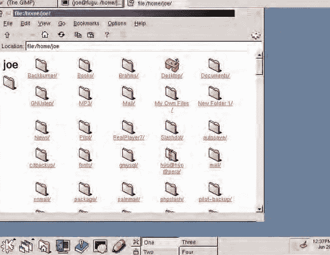


# KDE 文件管理器

视图下，文件管理器窗口被分为两个窗格。左侧显示计算机的完整目录结构。这种显示方式通常称为文件树，因为目录随着具体性的增加会像分支一样展开。右侧显示所选目录的内容。

## 注意

如果你是从 Windows 95 或 Windows 98 转到 Linux 的，那么这些都是你熟悉的。如果你过去用过 Windows 资源管理器，可以随心跳到本章的下一节。

### 图 9.7

使用树形视图在两个窗格中同时查看整个目录系统。

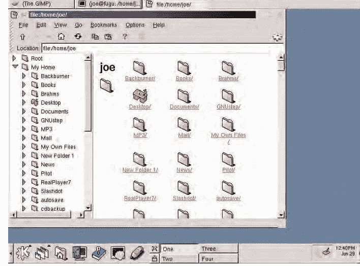

当文件管理器打开时，左窗格中的一个目录会被高亮。默认情况下，这是你的主目录。右窗格显示主目录中包含的文件和子目录。如果你点击左窗格中的另一个目录，该目录的内容将出现在右窗格中。换句话说，右窗格包含了左侧所选目录中的所有文件。

## 第 9 章 • KDE

注意，某些目录名称左侧有小箭头，而其他目录则没有。指向右侧箭头表示该目录包含子目录。点击箭头可以展开目录树并在左窗格中显示这些子目录。与主目录一样，点击子目录即可在右窗格中显示其内容。当你以这种方式展开目录树后，右箭头将变为指向向下的箭头。点击该箭头可将分支折叠回父目录。展开和折叠的分支如图 9.8 所示。

### 图 9.8

文件管理器可以折叠或展开以显示所有目录和子目录，或限制视图。

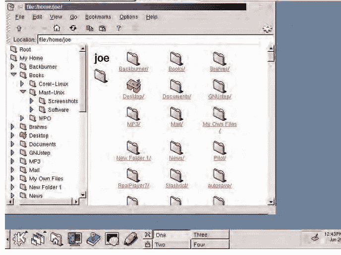

文件管理器除了提供了一种高效遍历文件系统的方法，还提供了一个单一位置用于对你的文件执行多项基本操作。特别是你可以使用文件管理器将文件从一个目录复制到另一个目录、删除文件、重命名文件并设置文件权限。

# KDE 控制中心

使用 KDE 作为你的集成桌面的好处之一是，KDE 的几乎每个方面都是可配置的。大多数更改都在 KDE 控制中心完成，该工具包含 10 类配置选项：桌面、信息、输入设备、按键、网络、声音、窗口、密码、日期与打印机。大多数类别在右侧都有子选项。

点击应用程序图标并从出现的菜单中选择“控制中心”来打开 KDE 控制中心。控制中心将打开，如图 9.9 所示。如插所示，控制中心有两个窗格。左窗格包含树形结构，类似于文件管理器中使用的结构。当在左窗格中选择某项时，右窗格将显示一组控件。

### 图 9.9

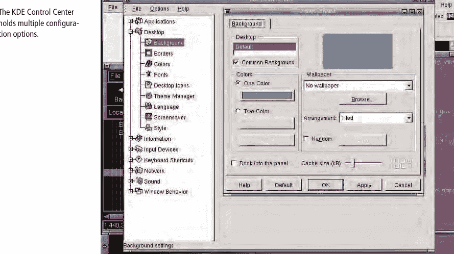

> 注意
> 
> 你可能永远不会使用这些 KDE 控制中心的某些选项。我们在这里提供了每个类别的基本信息，但如果你需要更具体的信息，我们建议咨询在线帮助或访问 http://www.kde.org 的 KDE 网站。通常情况下，如果你想更改 KDE 的外观，将从控制中心开始。

## 桌面

KDE 控制中心的“桌面”类别包含大多数流行桌面配置的控制集。通过此类别，你可以配置桌面背景、窗口边框、显示选项、桌面图标、语言、屏幕保护和其他桌面样式。许多 KDE 用户发现他们在控制中心中最频繁地使用这个类别。

### 背景

在“背景”类别中，你可以设置桌面本身的显示观。Windows 和 Macintosh 用户会将此识别为壁纸设置。背景可以是纯色或渐变色，你也可以使用图像文件。

> 注意
> 
> 要设置具有匹配图标和颜色的背景，请参阅本章的“桌面主题”部分。

KDE 控制屏幕的右下角有一个预览窗口，你可以在那里看到更改在桌面上的显示效果。点击“应用”按钮可以在不关闭控制中心的情况下对你的实际桌面进行更改。完成后，如果你希望保存更改并退出控制中心，请点击“确定”按钮。

### 边框

“边框”类别控制单个窗口在 KDE 桌面上的行为方式。有两种类型的边框控制集：活动（Active）和魔法（Magic）。

- *活动边框*与虚拟桌面配合使用。使用活动边框，你只需将鼠标移动到目标桌面的边缘即可在虚拟桌面之间切换。在定义的一段时间后（默认为 5 毫秒），桌面将更改。要启用此功能，请勾选“启用活动桌面边框”复选框。
- *魔法边框*会激活桌面吸附区域，这是整个桌面边缘的一个区域。当你将应用程序或程序窗口拖向屏幕边缘时，如果吸附区域处于激活状态，窗口将吸附到屏幕边缘。

### 显示

与“背景”选项一样，你可以使用“显示”控制集来更改各种 KDE 组件的颜色，例如窗口栏、文本和类似项目。选择一种重新设计的方案或创建你自己的方案；你的选择将显示在预览窗口中。点击“应用”按钮在你的桌面上查看更改。

### 字体

“字体”类别允许你定义桌面上使用的各种字体。你可以设置等比例字体和等宽字体。要更改字体，请选择类别以及你想使用的字体，然后点击“应用”按钮。

## 桌面图标

“桌面图标”类别影响图标在桌面上的显示方式，而不是面板中。你可以控制图标之间的间距以及图标标签的显示方式。点击“应用”按钮在桌面上查看更改。

### 语言

默认情况下，KDE 的所有操作均使用英语。如果你想更改 KDE 使用的语言，请从下拉菜单中选择新语言。新语言仅适用于退出控制中心后启动的程序；如果你希望包括打开的窗口都显示新语言，你必须注销并重新登录。

> 注意
> 
> 此设置不影响键盘输入。如果你想为计算机使用不同的（非美国英语）键盘，你必须在下文“输入设备”类别的“键盘”子类别中设置。

### 屏幕保护

如果你想为 KDE 桌面使用屏幕保护程序，请在此类别中设置。各种屏幕保护程序在预览窗口中可见。你还可以配置某些设置，如激活屏幕保护之前的时间以及是否需要屏幕保护密码。某些屏幕保护程序具有单独配置，你可以点击“设置”按钮并做出选择进行配置。完成后，点击“确定”保存更改并退出。

### 样式

“样式”类别是一个较少使用的类别。此类类别中的选项控制窗口元素在桌面上的绘制方式：从 Windows 95 或 MacOS 中进行选择。你还可以决定你的显示选择是否适用于非 KDE 程序以及 KDE 程序。

## 信息

“信息”类别不可配置。相反，你可以通过此类类别中的各种选项了解你的硬件设置。与其他控制中心选项一样，在左窗格中选择一个项目将在右窗格中显示其内容。你可以查看输入输出设备、DMA 通道、I/O 端口、内存、分区、PCI 插槽、处理器数据、SCSI 设备、Samba 状态、声卡数据以及你计算机的 X 服务器信息。

## 输入设备

此类类别包含连接到计算机的输入设备选项：键盘和鼠标。你可以定义使用的键盘，并配置有关输入速度以及 KDE 如何响应不同类型输入的多项设置。

> 注意：如果您正在使用不同类型的输入设备（例如图形写板或摇杆），我们假设您已安装了它的驱动程序并知道如何使用它。

### 国际键盘

KDE 支持为各种字符集设计的各种键盘。KDE 提供了适用于西尔字母和表意键盘的驱动，以及适用于带变音的罗马字母语言键盘或使用非英语字符的罗马字母语言键盘的驱动。在下拉框中选择合适的驱动程序，点击确定 按钮，并将新键盘添加到端口。

### 键盘

在“键盘”类别中，您可以配置键盘重复和音量。键盘重复决定了如果按住按键一段时间，该按键是否会在屏幕上打印多次；而键盘音量则会在 KDE 每次检测到按键输入时产生点击声。点击确定 按钮以保存您的更改并退出此窗口。

### 鼠标

“鼠标”类别控制鼠标行为，这是一种非常个人化的选择。您可能需要调整这些控制，直到在物理鼠标移动和屏幕行为之间找到完美的平衡。该类别包含加速、阈值（鼠标指针离它的距离）以及鼠标键映射的设置。点击确定 按钮以保存您的更改并退出控制中心。

## 热键

“热键”类别允许您定义各种按键组合，将其作为频繁执行操作的快捷键。例如，熟悉的键盘快捷键 Ctrl+O 执行“打开”命令，就像您使用菜单系统导航到“打开”命令一样。“热键”类别包含两种类型的按键模式：全局热键（系统命令）和标准键（应用程序命令）。

### 全局热键

全局热键组合执行 KDE 系统功能，例如切换桌面或选择桌面图标。右侧已定义了各种全局热键组合；在复制现有组合之前，请检查它们。要定义新的全局热键操作，请遵循以下步骤：

- 1. 在左侧面板的操作窗口中选择您希望组合执行的操作。
- 2. 在右侧下方的“为所选操作选择按键”窗口中选择一个元键。元键是按键组合的一部分需要被按下的键：KDE 的元键是 Shift、Ctrl 和 Alt。
- 3. 在键盘上按下想要与元键组合使用的按键。按键组合将显示在操作窗口中。
- 4. 点击确定保存您的新的按键组合。

### 标准键

标准键组合控制处理文本时使用的功能。剪切、粘贴、复制、保存等熟悉的功能都有标准键快捷键。右侧面板列出了各种预定义的标准键组合。要定义新的标准键组合，请遵循以下步骤：

- 1. 在右侧面板的操作窗口中选择您希望按键组合执行的操作。
- 2. 在右侧下方的“为所选操作选择按键”窗口中选择一个元键。元键是按键组合的一部分需要被按下的键：KDE 的元键是 Shift、Ctrl 和 Alt。
- 3. 在键盘上按下想要与元键组合使用的按键。按键组合将显示在操作窗口中。
- 4. 点击确定保存您的新的按键组合。

## 网络

“网络”类别包含了用于以太网和 Samba 网络的各种配置选项。我们将在第八部分：“网络管理”中介绍网络内容。

## 声音


在“声音”部分，有两个选项。第一个选项允许您控制提示音的属性。当您尝试执行某些不允许的操作时，就会听到这种“哔”声。使用滑动条，您可以控制声音的音量、音调和持续时间。我们建议选择听起来悦耳的声音，因为这种声音可能会非常烦人。点击测试按钮可以听到该声音。

第二个选项允许您启用某些声音系统。这些是与某些事件（如窗口的打开和关闭）相关的特效。这些通常是“叮”或“嗖”的声音。有些人喜欢它们，而有些人不喜欢。这些声音默认禁用。要启用它们，请勾选标记为“启用系统的复选框。在复选框下方的两个面板中，您可以将左侧面板显示的事件与右侧的声音文件关联。使用测试按钮预览声音文件。

### 窗口

在“窗口”类别中，您可以配置外观和行为。共有五个子类别：

#### 高级

“高级”子类别允许您定义窗口的外观。该类别允许您设置各种窗口相关的属性。

#### 按钮

“按钮”子类别决定按钮的位置和外观。

#### 鼠标

“鼠标”子类别定义交互如何影响窗口。

#### 属性

“属性”子类别包含各种窗口属性的设置。

#### 标题栏

“标题栏”子类别决定标题栏的外观和行为。

## 图 9.10：

KDE 主题管理器用于为桌面应用不同的图形主题。

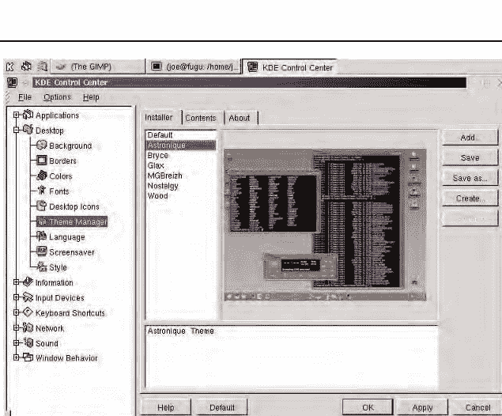

桌面主题管理器

## 图 9.11：

主题管理器还可以用于将主题的选项应用到不同的桌面。

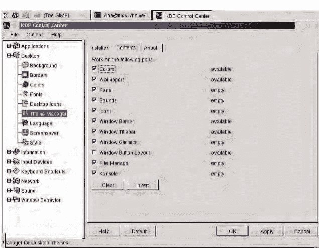

桌面主题管理器

> 如果你喜欢玩转主题，我们建议你查看 `http://kde.themes.org`，在那里你可以找到一组经常更新的用户创建的主题。

### 总结

KDE 集成式桌面环境提供了多种工具来让你的 Unix 体验变得简单，并具有高水平的可配置性。KDE 是一个开源项目，可以免费下载（或从本书附带的 CD-ROM 中安装）。KDE 有一个实用的图形文件管理器和一个菜单系统，任何用过 Windows 或 MacOs 的人都会感到熟悉。

KDE 的核心是面板（Panel），它运行在桌面的底部；面板上分布着各种图标，提供了频繁使用程序的快捷访问。与 KDE 的几乎所有其他方面一样，你可以更改面板的图标和外观以适应你的需求。在 KDE 控制中心中配置 KDE，这是一组提供了对整个 KDE 环境进行详细控制的工具集。

# 第十章

## Gnome

- 什么是 Gnome？
- 获取并安装 Gnome
- 使用 Gnome
- 总结

正如我们在第 9 章“KDE”中所解释的那样，集成式桌面环境与窗口管理器（在第 8 章“窗口管理器”中介绍）是两种不同的物种。KDE 是 Unix 衍生平台上两个主要的集成式桌面之一。另一个桌面被称为 GNOME，它是 GNU Object Model Environment（GNU 对象模型环境）的缩写。GNOME 也是英语中的一个普通单词，通常被称为 Gnome，尽管经常也能看到全大写的版本。

Gnome 是第 2 章“哪种是 Unix？”中中描述的 GNU 项目的一部分。Gnome 的主要吸引力之一是它的所有组件都是根据 GNU 公共许可证（GNU Public License）发布的。KDE 并非如此，它使用一个名为 Qt 的专有软件库构建。尽管 Qt 开发者最近更改了他们的许可证，使得该库现在本质上是自由软件，但许多自由软件倡导者选择 Gnome 是因为它一直都是自由的。

Gnome 和 KDE 经常在媒体和其支持者口中被描述为竞争对手，但事实并非如此。两个团队的开发者在过去曾合作过，而且这两个桌面在功能上正变得接近。例如，可以在 Gnome 下运行 KDE 应用程序，反之亦然。当然，这看起来有点奇怪，但程序可以正常工作。如果由于两个桌面开发团队在未来几年内让他们的程序更加紧密，我们不会感到意外；虽然我们不预测会合并，但我们认为 KDE 和 Gnome 之间的界限将变得模糊。

Gnome 和 KDE 之间的主要区别在于 Gnome 的开发阶段比 KDE 更早，这意味着某些 Gnome 组件可能有些不稳定，或者在菜单中预留了某些尚未编写的功能空位。为了解决这个问题，我们建议 Gnome 用户经常检查更新和错误修复，并根据需要进行安装。总的来说，Gnome 是可用的，大多数不稳定不应该对普通用户产生太大影响。

### 什么是 Gnome？

那么，尽管 Gnome 年纪更轻、开发程度较低，什么让它成为 KDE 的可行替代方案？Gnome 为 Unix 桌面带来了流畅、集成的外观和极高的

### 获取并安装 Gnome

可配置性（degree of configurability）到 Unix 桌面。Gnome 看起来非常棒，而外观是许多人选择集成桌面而非窗口管理器的重要原因之一。

Gnome 基于一个名为 GIMP Toolkit (GTK) 的软件库。该库旨在以易于修改的方式绘制称为*widgets*（控件）的虚拟屏幕元素。Gnome 团队采用了这种*视觉可塑性*的概念并将其扩展到整个桌面系统，使得 Gnome 的几乎每个元素都可以被配置或修改。

#### 提示

GIMP 是一个自由软件图形程序，其功能几乎与 Adobe 的 Photoshop 或 CorelPAINT 和 CoreDRAW 相当。如果你对图形处理或创建感兴趣，并且运行着 Unix 衍生操作系统，你值得尝试一下 GIMP。请尝试项目网站 `http://www.gimp.org`。你也可以在随附的 CD-ROM 中找到 GIMP。

此外，Gnome 通常与另一个也支持独立配置的窗口管理器配合使用，例如 Enlightenment。最近发布的 Gnome 带有 Sawfish 窗口管理器，这是一个红帽公司近期开发重点的新程序。最终结果是一个用户可以从外观和功能的几乎每个方面进行控制的集成桌面。

### 获取并安装 Gnome

对于几乎所有的 Unix 衍生操作系统，Gnome 都易于找到和安装。Linux 用户安装 Gnome 应该没有任何问题；事实上，它是几个主要 Linux 发行版的默认桌面，最显著的是红帽（Red Hat）和 Debian。Gnome 可能是其他发行版上的安装选项，因此请仔细检查安装屏幕。那些拥有没有 Gnome 的 Linux 发行版的用户从 Gnome 团队下载 `*.rpm`（红帽包格式）或 `*.deb`（Debian 包格式）文件。

在 UltraSpace 硬件平台上使用 Solaris 2.7 的 Solaris 用户

警告：如果你在 UltraSpace 硬件平台上使用 Solaris 2.7，你必须编译源代码。UltraSpace 以外的任何平台的用户请使用预编译的 Solaris 软件包。

#### 下载 Gnome

要为你的操作系统下载合适的 Gnome，请访问 `http://www.gnome.org/start/`。如果你计划下载 `*.rpm`、`*.deb` 或 Solaris 软件包，请遵循本节的说明。在你阅读本书并安装 Gnome 时，如果 Gnome 1.2 不是当前版本，请遵循 Gnome 网站上的说明。

### 基础库

这些是 Gnome 运行所需的软件库。桌面的不同组件需要不同的库，请确保下载所有：

- `audiofile-0.1.9`
- `esound-0.2.18`
- `glib-1.2.8`
- `gtk+-1.2.8`
- `imlib-1.9.8`
- `gtk-engines-0.10`
- `ORBit-0.5.1`
- `gnome-libs-1.2.0`
- `libgtop-1.0.9`
- `libxml-1.8.7`
- `libhttp-1.0.6`
- `libglade-0.13`
- `gdk-pixbuf-0.8.0`

### 核心应用程序

这些软件包是 Gnome 系统的核心，是构成 Gnome 本身的软件。你需要这四个：

- `control-center-1.2.0`
- `gnome-core-1.2.0`
- `gnome-applets-1.2.0`
- `mc-4.5.49`

### 附加资源

这些软件包是可选的，但我们建议下载并安装它们。它们包含了大多数让 Gnome 变得有趣且实用的程序，包括音频应用、游戏以及大量的工具：

- `bug-buddy-1.0.0`
- `glade-0.5.9`
- `gnome-python-1.0.53`
- `users-guide-1.2.2`
- `gnome-utils-1.2.0`
- `gnome-pim-1.2.0`
- `gnome-media-1.2.0.tar.gz`
- `gnome-audio-1.0.0.tar.gz`
- `gnome-print-0.20.tar.gz`
- `gnome-games-1.2.0.tar.gz`
- `ee-0.3.9.tar.gz`
- `gnumeric-0.54.tar.gz`
- `gtop-1.0.9.tar.gz`
- `ggv-0.95.tar.gz`
- `gdm-2.0beta4.tar.gz`
- `xchat-1.2.1.tar.gz`

## 解压源码


在解压任何内容之前，请先创建一个用于存放源代码文件的目录。如果你有一个名为 `/usr/src` 或 `/src` 之类的目录（`/src` 是包含源代码目录的通用缩写），请创建一个名为 `/usr/src/gnome` 或类似命名的子目录。将你下载的所有文件移动到该目录。

> 提示：如果你在下载之前阅读到这里，请直接将文件下载到新的子目录中，以节省一些时间。

你从 Gnome 网站下载的每个文件都是压缩存档文件，这意味着每个文件包含多个文件，这些文件共同构成了一个独特的软件程序。在编译包并让 Gnome 程序运行之前，你需要解压这些压缩存档。（如果你在 Macintosh 上用过 Stuff! 或在 Windows 电脑上用过 WinZip，你就用过归档程序来模拟 Unix 的 `tar` 程序了。）

要解压包，请进入包含你刚下载文件的子目录。在 shell 提示符处输入命令

```bash
tar xvfz <packagename>
```

其中 `<packagename>` 是你刚刚下载的包之一的名称（不要包含角括号）。例如，你需要解压的包之一是 `gnome-core-1.2.0.tar.gz`，所以你应该输入

```bash
tar xvzf gnome-core-1.2.0.tar.gz
```

一旦你在命令末尾按下回车键，你将看到大量的文件名在屏幕上滚动，此时 `tar` 正在解压存档。这些文件名代表被压缩到下载中的各个文件。

当列表滚动时，在命令行提示符处使用 `ls` 命令选择目录列表。你应该能看到一个名为 `gnome-core-1.2.0` 的新子目录。如果你进入该子目录，你将看到刚刚解压的所有文件。继续解压你从 Gnome 网站下载的所有文件。

> 如果你将所有文件下载到同一个目录中，或者在下载后一个一个地移动它们，可以使用一个命令解压所有文件。在命令行提示符处输入命令 `tar xvzf *.tar.gz`。`*` 字符是代表任意字符组合的通配符，因此 `*.tar.gz` 会匹配任何以 `.tar.gz` 结尾的文件名。

## 编译并安装源码

一旦所有包都已解压并创建了各种子目录，就可以开始安装代码本身了。这是一个相当程序，在你完成前几个包之后，这个过程将变得重复。

> 本节并不是为了替代每个包附带的文档（通常位于每个子目录下的 `README` 文件）。每当你安装软件时，都应该阅读该程序的文档。安装特定版本的包时涉及的任何特殊将在这些文档中说明。

对于你在上一步中解压的每个包，你都会有一个以该包命名的相应子目录。通过输入命令进入其中一个子目录

```bash
cd <directoryname>
```

对于 Gnome 来说，配置代码的顺序并不重要，尽管其他程序要求你先配置某些库。通常情况下，在开始处理程序之前处理软件库是一个好主意。这样，如果程序安装时需要特定的库，那么这些库已经存在了。

注意：某些这些所需的库可能不是 Gnome 分发版的一部分，例如 C 或 C++ 编程语言使用的库。如果 Gnome 编译失败，可能是因为你缺少一个或多个标准 C 库。查看失败生成的错误信息，以获取问题可能所在线索。

当你进入子目录后，输入命令 `./configure`

一些消息会滚动屏幕。如果一切顺利，这些消息的最后一行将显示“Created Makefile”或“Makefile successfully created”或其他其他提示 `Makefile` 已成功构建的消息。一旦看到该消息，输入

```bash
make
```

同样，你将看到一系列晦涩的消息。如果其中没有一个是错误信息（你可以将错误信息与其他类型的消息区分开来），输入

```bash
make install
```

在完成这三个步骤后，你就安装了那个特定的包。对你下载的每个包重复此过程。

注意：如果你遇到了导致配置或安装过程中断的问题，那么极可能是你在某处缺少了库或所需的程序。这就是为什么我们建议先安装库，然后是核心包，最后是可选包。回溯错误信息并尝试确定缺少了什么。找到包含该元素的包，安装它，然后尝试重新安装失败的包。

## 为 Gnome 配置 X

现在你已经解压、配置并安装了每个下载的包，你需要让操作系统知道你想在启动时使用 Gnome。要做到这一点，请检查你的主目录下是否存在 `.xclients`、`.xsession` 或 `.xrc` 文件。如果这些这些任何一个，用文本编辑器打开它查看是否包含以下行

```bash
exec startkde
```

这一行是 KDE 的关键。如果 X 继续以不是 Gnome 的窗口管理器启动，你需要进行一些配置。使用命令在你的主目录下创建 `.xsession` 文件

```bash
touch .xsession
```

`touch` 命令设计用于更新每个文件的时间戳，内核利用其确定各种分配。然而，你可以使用 `touch` 快速创建新文件；只需 `touch <filename>`。用文本编辑器打开 `.xsession` 文件（见第五部分“使用文本编辑器”获取更多关于这些程序的信息）。在文件中输入以下内容：

```bash
exec gnome-session
```

保存桌面并对其设置可执行位，以便你的操作系统自动运行该文件。通过执行此命令操作

```bash
chmod +x .xsession
```

然后，如上所述重启你的 X 会话。

到此时，如果一切顺利，你应该能看到 Gnome 桌面，如图 10.1 所示。显然，对于一个涉及这么多变量的过程来说，有很多地方可能会出错。如果你没有看到 Gnome 桌面，你唯一能做的就是追踪问题并修复它。使用每个包分发的文档来引导你的搜索，或者浏览 Gnome 网站寻找有关常见问题及其解决方案的线索。当你深感绝望时，最后的解决方案始终是重新下载并重新安装一切，并在过程中密切关注每一个步骤。

### 图 10.1

如果你正确配置了 X，默认 Gnome 桌面将在启动后出现。

## 使用 Gnome

现在你已经安装并运行了 Gnome，是时候探索一下它了。Gnome 界面以 Gnome 桌面为中心；我们将在本节中详细介绍它的各个组件。桌面由一系列应用程序组成，例如菜单系统、图标等，这些程序仅需几次简单的点击即可处理账户管理任务，而无需在提示符中输入复杂的命令。一旦你逛览了桌面并熟悉了 Gnome 的默认外观，就可以开始使用 Gnome 控制中心（Gnome Control Center）了，在其中你可以利用 Gnome 的灵活性构建一个专属于你的独特桌面。

### Gnome 面板

从用户的角度来看，Gnome 桌面最重要的部分是面板，如图 10.2 所示。可以将面板想象成 Gnome 的控制盒，因为几乎所有 Gnome 的主要功能都是通过这个元素控制的。默认情况下，面板横跨 Gnome 屏幕的底部，但如果你需要，也可以将其移动到左侧、右侧或顶部。

面板包含主菜单、你可能创建的任何用户自定义菜单、应用程序启动器、挂接应用程序（完全在面板内运行的小型程序）以及注销等特殊项目。与 Gnome 中的其他所有内容一样，你可以更改它包含的按钮和启动器。你可以更改面板本身及其元素的样式、行为和位置；添加和删除大多数挂接在其中的对象；或者创建多个面板——每个面板都有它们自己的外观和功能set。

### 图 10.2

使用 Gnome 面板简化你的常规 Unix 习惯。


### 主菜单

如果你以前用过 Windows 或 Macintosh 电脑，你会发现 Gnome（以及 KDE）的菜单是熟悉的类似物。可以通过面板访问 Gnome 主菜单。面板最左侧的按钮有一个脚印图标，那是 Gnome 的标志；此按钮用于启动主菜单（它等同 Windows 的“开始”菜单）。

点击脚印按钮打开主菜单。许多项目都有子菜单，通过菜单条目末尾的小箭头来指示。如果你点击其中一个条目，另一个菜单将会打开，你可以像图 10.3 所示在各种子菜单中导航，直到找到你想要选择的项目。图 10.1 显示了 Gnome 主菜单的默认选项。请注意，如果你自己配置菜单，这些选项中的某些可能会消失，或者出现额外的选项。

### 图 10.3

Gnome 菜单是启动程序和工具的快速方法。

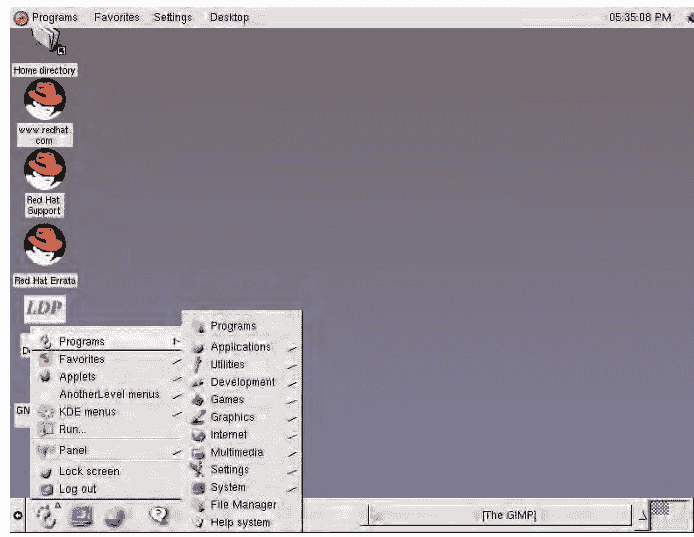

点击主菜单条目，菜单将保持打开直到你做出最终选择。每个最终条目——没有箭头的项——代表一个可以通过选择该菜单项启动的特定程序。

## 表 10.1：Gnome 主菜单项目

| 主菜单 | 子菜单 | 功能 |
|---|---|---|
| 应用程序 | gEdit | 文本编辑器（参见第 20 节） |
| | 日历 | 一本电子预约本 |
| | 通讯录 | 一本电子通讯录 |
| | 时间跟踪工具 | 跟踪在某个人身上的花费 |
| | gnotepad+ | 一个极简的文本编辑器 |
| | Gnumeric | 基础电子表格 |
| | Gnu Cash | 跟踪你的银行账户余额 |
| | GnomePGP | PGP 和 GnuPG 加密包的图形界面 |
| | AbiWord Personal | 基础文字处理器 |


| | Dia | 使用矢量图形的绘图工具 |
| | Emacs | 高级文本编辑器（参见第 18 节） |
| 工具 | Gdict | 可搜索的字典 |
| | 简单计算器 | 一个简单的计算器 |
| | Gnome 字符映射 | 允许你使用键盘上没有的特殊字符 |
| | 颜色浏览器 | 帮助你找到特定颜色的十六进制值 |
| | gpart | 格式化软盘 |
| | 字体选择器 | 组织已安装字体以便于检索 |
| | Gnome 搜索工具 | 快速查找单个文件 |

# 表 10.1 继续：Gnome 主菜单项目

| 主菜单 | 子菜单 | 功能 |
|---|---|---|
| 开发 | IDE 工具 | 管理已安装设备（必须以 root 身份使用） |
| | 启动提示 | Gnome 启动时显示提示 |
| | Glade | 集成编程环境 |
| | Memedit | 定位内存泄漏的工具 |
| 游戏 | FreeCell | 接龙游戏（非常上瘾） |
| | Gogs | 斗蛇大作战 |
| | Stones | 寻找钻石并逃脱 |
| | Mines | 逻辑游戏 |
| | Dice | 骰子游戏 |
| | Turing | 灵灵机模拟器 |
| | Othello | 类似于棋盘游戏 |
| | Mahjong | 纸牌配对游戏 |
| | Solitaire | 通过消除球来得分 |
| | Aisle | 一种接龙变体 |
| | Gpart | 空间游戏的变体 |
| | Lines | 带有彩色线的游戏 |
| | Gtk | 空间关系游戏 |
| 图形 | Electric | 基础图形程序 |
| | GQView | 图形组织器 |
| | Photo | 数字摄影程序 |
| 系统 | GnomeRPM | RPM 软件包的图形界面 |
| | Terminal | 终端模拟器 |
| | Regular Xterm | 另一个终端模拟器 |
| | Color Xterm | 第三个终端模拟器 |
| | GNOME Terminal | 第四个终端模拟器 |
| | DiskFree | 显示磁盘使用情况 |
| | System Info | 各种有用信息 |
| | User Listing | 列出系统用户 |
| | Log Monitor | 显示进程、CPU 和内存日志 |
| 文件管理器 | | 图形文件管理器 |
| 帮助系统 | | 帮助文件浏览器 |
| 收藏 | | 用户自定义菜单 |
| 应用程序组件 | 娱乐 | 面板中的娱乐和游戏 |
| | 监控 | CPU 负载、内存使用等 |
| | 多媒体 | CD 播放器等 |
| | 网络 | 邮件监控和其他网络工具 |
| | 工具 | 杂项应用程序组件 |
| | 时钟 | 计时 |
| 运行 | | 微命令行窗口 |
| 面板 | 添加到面板 | 向面板添加项 |
| | 创建面板 | 创建新面板 |
| | 移除面板 | 删除面板 |
| | 属性 | 面板属性 |
| | 全局偏好 | 控制面板行为 |
| | 面板手册 | 基础面板文档 |
| | 关于面板 | 简化信息 |
| | 关于 Gnome | Gnome 文档 |
| 锁定屏幕 | 需要密码的屏幕保护程序 |
| 注销 | | 退出 Gnome |

# 第 10 章 • Gnome

### 应用程序启动器

启动器是点击后启动特定程序的面板对象。例如，你可能有一个带有 Netscape 图标的面板启动器。只需点击启动器即可启动 Netscape，而不是使用菜单系统或从 shell 提示符发出命令。对于经常使用的程序，启动器非常有用，每天或每月节省的几次点击或按键都会积少成多。通过以下过程向面板添加启动器：

1. 点击 Gnome 按钮启动主菜单。
2. 在菜单中找到所需程序的条目。
3. 点击菜单项，但不要松开鼠标按钮。
4. 将该项拖到面板上并松开鼠标按钮。
5. 将出现一个通用的启动器。
6. 右键点击新的启动器。
7. 从弹出的菜单中选择“启动器属性”（Launcher Properties）。
8. 在“启动器属性”窗口中（如图 10.4 所示），你可以为此启动器设置各种属性，包括显示在面板上的图标，以及 Gnome 启动程序时使用的特定命令（特别是如果你想在程序启动时使用特定的标记）。
9. 设置你想要使用的属性。
10. 点击“确定”。

“启动器属性”窗口关闭，新设置将应用到新启动器上。现在你可以使用面板图标来启动关联程序。

图 10.4：使用“启动器属性”窗口配置新的启动器按钮。

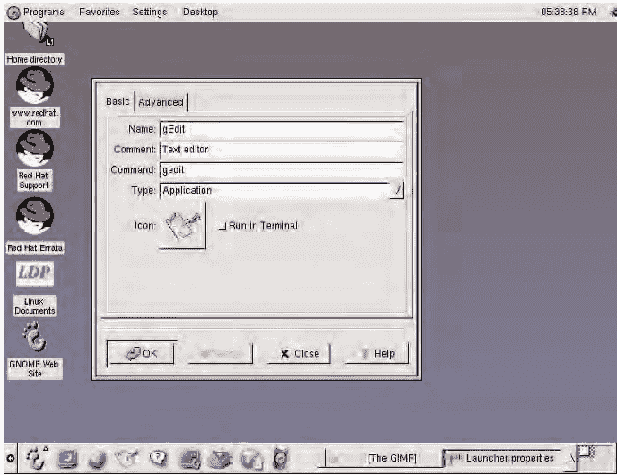

### 应用程序 (Applets)

Applets 是完全运行在面板内部的小型程序。例如，你可能有一个位于面板中并始终显示当前时间的时钟程序。另一个流行的程序会改变状态以指示你收到了电子邮件。甚至还有可以控制你的 CD 播放器或告诉你天气状况的程序。Applets 是方便的信息源，也是处理某些低级功能的好方法。只是要小心——很容易在面板中加载这么多程序，导致没有空间显示其他内容。

可以通过两种方式将 Applets 添加到面板中。第一种是点击面板的空白区域并选择“选择 (Select) > 添加到面板 (Add to Panel) > 应用程序 (Applet) > <类别>(category)，将最后两个元素替换为子菜单中的实际程序类别和名称。另一种方法是从主菜单中选择“应用程序 (Applets) > <类别>(category) > <程序名称>(applet)；此选项会将程序停靠在面板中的第一个可用空间。

一旦你将新程序添加到面板中，右键点击它，并从弹出菜单中选择“属性”（Properties）。大多数程序都可以在其“属性”屏幕中进行配置，尽管并非所有程序都支持此选项。要移动移动程序，右键点击并从弹出菜单中选择“移动”（Move）；你可以在面板中从右向左滑动程序，直到找到合适的位置。要设置程序的新位置，点击它一次。

### 文件管理器 (The File Manager)

如果你用过 Windows 95 或 98 中的 Windows 资源管理器，或其他操作系统中的类似程序，你已经对 Gnome 文件管理器的工作原理有了基本的了解。文件管理器是计算机文件系统的图形表示，将目录显示为文件夹，并将单独的文件显示为代表文件类型的图标。从主菜单中选择其选项启动文件管理器。

> 提示：我们建议为文件管理器添加一个面板启动器。它是一个非常有用的工具，你可能会经常使用。

当你启动文件管理器时，它将以双窗格的形式打开，如图 10.5 所示。在左窗中，你将看到目录树。默认情况下，你的主目录在启动时显示。在右窗中，你会看到该目录包含的所有子目录和文件列表。如果任一窗中的目录文件夹包含子目录，在其条目左侧将显示一个小小的加号 (+)。点击加号可以展开目录树，同时显示子目录文件夹和文件；展开后的视图如图 10.6 所示。加号还将变为减号 (-)；如果点击它，目录树将折叠回简洁视图。

图 10.5：文件管理器使用双窗格屏幕显示计算机的目录。

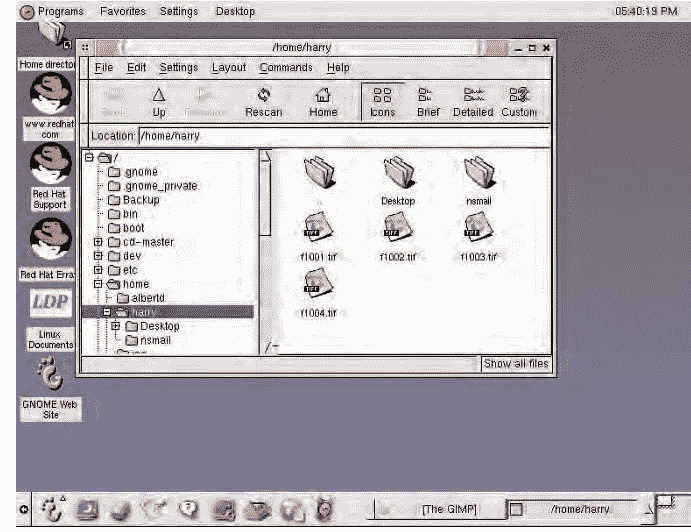

你可以通过点击并拖动文件到新目录在目录之间移动文件。通过右键点击文件名并从弹出菜单中选择选项可以实现进一步的文件操作。选项包括删除 (Delete)、复制 (Copy)、重命名 (Rename) 等。

# 图 10.6：文件管理器的展开视图让你看到磁盘上所有目录中的所有文件。

文件管理器的展开视图让你看到磁盘上所有目录中的所有文件。

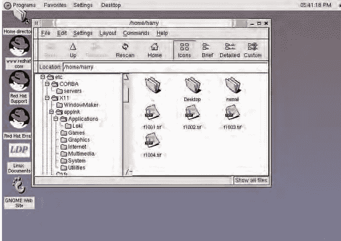

### Gnome 控制中心 (The Gnome Control Center)

Gnome 控制中心是 Gnome 配置选项的一站式购物中心。控制中心（如图 10.7 所示）可以通过主菜单中选择“设置 (Settings) > Gnome 控制中心 (Gnome Control Center)”来访问。一旦打开控制中心，你就可以用它设置各种配置类别的选项，这些类别在表 10.2 中描述。

图 10.7：使用控制中心按照你的喜好配置 Gnome。

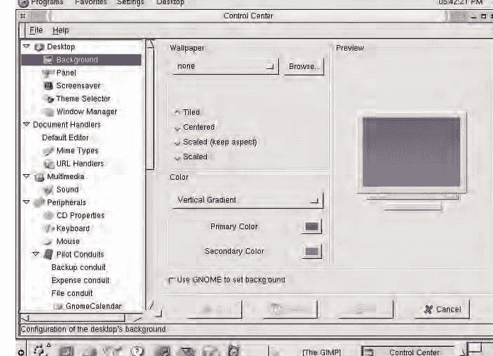

# 表 10.2：Gnome 控制中心类别

| 类别 | 功能 |
| --- | --- |
| 桌面 (Desktop) | 控制桌面外观的选项 |
| 文档处理器 (Document Handlers) | 将各种文件类型与特定程序关联的选项 |
| 多媒体 (Multimedia) | 控制系统声音的选项 |
| 外设 (Peripherals) | 控制各种外设备的选项，如 CD-ROM 器、键盘或 Palm Pilot 等便携电脑 |


| Sawfish 窗口管理器 (Sawfish Window Manager) | 窗口器的配置 |

| 会话 (Session) | 登录时执行的选项 |

| 用户界面 (User Interface) | 控制对话框和菜单 |

敏锐的读者会注意到，从主菜单中选择设置 (Settings) 下的选项，与表 10.2 所示的类别是相同的。如果你从菜单中选择一个选项，该选项的控制模块将独立运行。当你打开控制中心时，所有模块都会同时打开（尝试）。通常情况下，控制中心最适合对 Gnome 进行全面配置，而单个模块最适合对桌面的某个方面进行微调。

### 主题与桌面 (Themes and the Desktop)

Gnome 桌面的一个很棒的功能是可以应用主题，主题是让桌面各个方面外观一致的图形元素集合。默认主题显示在本的第一张图中，图 10.1。负责绘制屏幕组件的 GTK 库为程序提供了更改外观和行为的选择。

许多 Gnome 用户接受了挑战并创建了大量主题（在 `http://gtk.themes.org` 下载并安装），这些主题从非常基础到精美不等，包括一些看起来非常痛苦的主题（我们认为这是故意的，但在用户创作面前，我们）。

基础 Gnome 发行版包含了一组主题。通过 Gnome 控制中心访问这些主题。从主菜单中选择“程序 (Programs) > 设置 (Settings) > Gnome 控制中心”打开控制中心；在“桌面 (Desktop)”类别下，点击“主题选择 (Theme Selector)”。主题选择窗口出现，如图 10.8 所示。主题选择窗口的上部标记为“可用主题 (Available Themes)”，包含了系统中当前安装的所有主题名称。

图 10.8：使用主题选择更改你的 Gnome 桌面外观。

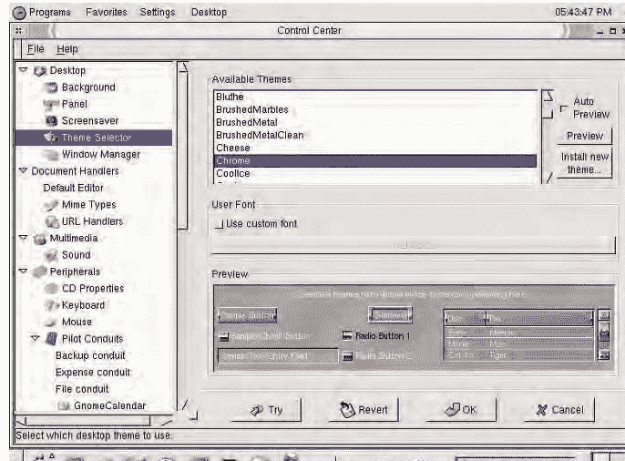

如果你想尝试新主题，滚动列表并找到一个名称进行高亮，预览窗中的各种组件将改变以显示该主题的样子。如果你觉得该主题是你想在桌面上使用的，点击“尝试 (Try)”按钮。

> 根据我们的经验，主题在实际桌面上的效果可能没有在预览窗口中那么好。如果你决定不喜欢刚刚选择的主题，点击标记为“还原 (Revert)”的按钮，你将返回之前的主题。

一旦你确定了主题，点击“确定”关闭主题选择并使桌面更改永久。你可以随时返回更改主题。如果你从各种网络存档下载主题，请确保将它们下载到存放默认 Gnome 主题的目录中。

## Bourne (再次 Bourne) Shell 简介

本书的这部分，即第四部分：“使用 Shell”，涵盖了你用于与内核交互——默认情况下与计算机本身交互——的命令式 shell。在组成第四部分的章节中，我们重点关注 Bourne Shell，因为它是最可能作为默认 shell 安装在你可能拥有的任何 Unix 系统上的 shell。尽管我们名义上是把 Bourne Shell 作为这些这些章节的标准，但我们所说的几乎所有内容也同样适用于 Bourne Again Shell (`bash`)。在我们进入 shell 编程的章节时，我们将重点关注 `bash` shell。

当然，我们无法保证你将 Bourne Shell 设置为你的默认 shell。默认 shell 由系统管理员定义，管理员完全可能选择了 C Shell、Korn Shell 或其他 shell 作为默认 shell。在命令提示符处输入 `echo $SHELL` 可以查看你正在使用哪种 shell。如果你在 Bourne Shell 中，`echo` 会在屏幕上打印 `sh`；如果你在 `bash` shell 中，`echo` 会在屏幕上打印 `bash`。如果你得到任何其他答案，你有三个选择：

- 请求你的管理员更改默认 shell。
- 查阅第 13 节：“自定义 Shell 环境”来更改默认 shell。
- 手动启动首选 shell。

要手动启动 Bourne Shell，在 shell 提示符处输入 `sh`。这将你进入 Bourne Shell；你应该得到某种与你的默认提示符看起来不同的 Bourne Shell 提示符。当你用完 Bourne Shell 后，输入 `exit`，你将返回原始 shell。如果你愿意，可以配置你的用户环境以使用 Bourne Shell 或 `bash`；有关设置环境变量的更多信息，请参阅第 13 节。

图 11.1 显示了 `tcsh` shell 和 Bourne Shell 之间提示符的差异，让你了解需要寻找什么。

### 为什么选择 Bourne Shell？

我们为什么选择详细介绍 Bourne Shell 而不是其他 shell？我们选择 Bourne是因为它是 shell 环境的事实标准。在本书描述的三个 Unix 系统中，Bourne Shell 是 FreeBSD 和 Solaris 的默认 shell；对于 Linux 来说，默认环境是 `bash` shell，对于大多数实际用途来说，它们本质上是一样的。因此，你的系统中可用 Bourne Shell 的概率极大，即使它尚未被安装为默认环境，这种情况也非常有利。

#### 图 11.1：不同的 shell 在命令提示符处产生细微差异。


Bourne Shell 是通用标准 shell 环境这一事实也有其他影响。大多数系统编程（即编写配置系统本身运行的程序）都是用 Bourne Shell 完成的。因此，为了理解 Unix 系统的基本操作，良好掌握 Bourne Shell 命令和脚本是非常重要的。即使你选择在日常环境中使用另一种 shell，你仍然需要对 Bourne 或 `bash` 及其各种函数有一定的了解。

> 提示
>
> 如果你决定真的非常讨厌 Bourne 或 `bash`，请参阅第 15 节：“其他 Shell”。我们描述了许多人代替 Bourne 或 `bash` 使用的一些常用 Unix Shell，包括 `ksh`、`csh`、`tsh` 和 `zsh`。我们还提供了一些尚未像上述那些那样流行的新 shell 的信息。

### Bourne Shell 对比 Bourne Again Shell (bash)

集成桌面环境是一种可以安装在各种 Unix 派生系统上的图形化用户界面。你可以为某些 Unix 派生系统下载软件包，或从源代码安装软件。一旦安装代码，你就需要配置窗口系统以识别并自动启动它。

界面以桌面为中心。桌面由背景、各种图标以及一个包含启动器和微型程序的菜单组成。它的每一个元素都是可配置的，所以你可以不断调整它，直到它符合你的标准。你也可以通过安装许多可用的图形主题之一来使用快捷方式；这些主题提供了以统一图像为中心的新图标、面板项目和背景。无论你如何配置它，你都能利用其完全集成性和易用性。

正确的桌面对于让它变得完美非常重要。如果你发现了一个你喜欢但似乎不太好用的主题，点击控制中心中的“背景”选项并尝试一些不同的。通常，找到正确的背景真的可以使桌面变得协调。

### 总结

# 第四部分：使用 Shell

- 第 11 节：Bourne (再次 Bourne) Shell 简介
- 第 12 节：操作文件和目录
- 第 13 节：自定义 Shell 环境
- 第 14 节：输入输出重定向
- 第 15 节：其他 Shell

## 第 11 节：Bourne (再次 Bourne) Shell 简介

- 为什么选择 Bourne Shell？
- 一些 Shell 命令
- 总结

### 一些 Shell 命令

如果你阅读了第二部分：“入门”，你已经学习了几个常用的 shell 命令：`ls`、`pwd`、`passwd`、`cd` 等。在这一节中，我们将更紧密地回顾这些命令以及其他一些命令。我们将向你展示每个命令的作用，以及如何通过各种选项和标志位来扩展命令的功能。我们还提供了一些这些命令在实践中如何使用的示例。

> `shell command`（shell 命令）这个术语在某种程度上是个误导。我们即将讨论的大多数命令都是它们独立的程序，且每个程序的程序文件通常可以在 `/bin` 目录中找到。这些命令大部分不是内置到 shell 中的函数。它们之所以被称为 shell 命令，是因为它们是从 shell 中运行的。

除了我们在这里提供的或附录 A 中提供的之外？你可能需要一本百科全书命令参考。我们经常使用《The Unix and X Command Compendium》（Alan Southerton 和 Edwin Perkins Jr. 著，John Wiley & Sons，1994年）。

在进入这些命令描述之前，这里有一组用于讨论 shell 命令的词汇术语：

# 第 11 章 • Bourne（再次）Shell 简介

语法（**Syntax**）：在 shell 提示符下发布或输入命令的方式。

标志（**Flags**）：附加在命令后的各种选项，用于获得更精确的输出。标志通常以连字符开头，例如 `-a`，但某些命令不使用连字符作为标志。

输出（**Output**）：命令的结果。大多数命令将把输出打印到显示器上，但对于某些命令，你必须手动请求输出。


参数（`Argument`）：随命令一起发布的任何额外组件，它们会修改命令的基本行为。例如，标志就是一个参数。参数必须在命令的语法之后给出。

参数和语法是区分大小大小的。

### ls

`ls`是生成文件列表的命令。无论你计划如何使用 Unix，`ls`都是你最频繁使用的命令之一。无论你是在寻找文件还是仅仅在浏览目录，`ls`都是一个可靠的伴侣。

如果你直接在命令提示符处输入`ls`而不带任何其他选项，它将列出当前目录的内容。以下是在 Joe 用于制作本文笔记的目录中运行`ls`命令的示例：

```
joe@fugu Mast-Unix~$ ls
ch01-notes.txt ch03-notes.wpd ch05-notes.wpd ch12-notes.wpd
test.wpd ch02-notes.wpd ch04-notes.wpd ch06-notes.wpd
test1
```

文件名会打印到屏幕上；通常按字母和数字顺序打印。这是列出目录最简单的方法。

在某些系统中，子目录的名称后面会有斜杠（`/`），而可执行程序的名称后面会有一个`@`字符，例如`emacs@`。我们在下面向你展示，如果你的系统没有默认设置，如何实现这种效果。

### 常用 Shell 命令

如果你想了解更多关于`ls`列出的文件的信息，可以使用`-l`标志使用长格式：

```
joe@fugu Mast-Unix]$ ls -l
-rw-rw-r-- 1 joe 11558 Mar 14 09:59 ch01-notes.txt
-rw-rw-r-- 1 joe 18419 Mar 24 16:41 ch02-notes.wpd
-rw-rw-r-- 1 joe 16655 Mar 25 10:14 ch03-notes.wpd
-rw-rw-r-- 1 joe 20608 Mar 27 13:28 ch04-notes.wpd
-rw-rw-r-- 1 joe 20468 Mar 27 18:00 ch05-notes.wpd
-rw-rw-r-- 1 joe 13774 Mar 28 12:10 ch06-notes.wpd
-rw-rw-r-- 1 joe 8003 Mar 29 11:41 ch12-notes.wpd
-rw-rw-r-- 1 joe 15078 Mar 17 11:59 test.html
-rw-rw-r-- 1 joe 18118 Mar 17 11:58 test.wpd
```

此输出看起来可能有些奥秘，但它实际上告诉了你关于每个文件的信息。每个文件的第一个条目如下：

```
-rw-rw-r--
```

该条目显示这是一个普通文件而不是目录。如果是目录，第一个字符将是`d`而不是`r`。该条目还显示了文件权限。也就是说，谁被允许访问该文件以及出于什么目的。我们在第 12 章中详细介绍了文件权限。

（注：由于原文后半部分存在大量重复且无乱码文本，译文已根据上下文对核心逻辑部分进行了翻译，并保持了格式一致。）

一些常用的 Shell 命令 187

为什么用这个代替`cat`？如果一个文件超过了一个屏幕的长度，用`cat`读取它可能并不实际。`more`和`less`让长文件更易管理。使用`more`或`less`读取文件时，输出会在一页后停止（可以滚动）。要翻到下一页，请按空格键。要返回上一页，请按`b`键。

这两个程序之间有许多不同，但在这些基本功能上是相同的，而且大多数人永远不会使用其中任何一个程序的高级功能。你使用哪一个取决于个人喜好。阅读手册页（`man more`和`man less`）可以获取每个程序的完整介绍。

### echo

`echo`命令打印作为参数传递它的任何内容。例如，如果你输入命令`echo hello`，你将在屏幕上看到`hello`。`echo`主要用于在 shell 程序中提供输出并打印出值行；我们将在后面的章节中讨论这些主题。你可能已经通过输入`echo $SHELL`确定了你正在使用的 shell 环境。

### grep

`grep`是一个在文件中搜索特定字符模式并打印包含该模式的行的程序。语法为`grep [pattern] file(s)`。

模式可以是一个简单的单词，也可以是一个复杂的正则表达式。正则表达式是一种模式，其中某些特殊字符可以代表多个一个字符。通过使用这些特殊字符的组合，可以创建匹配某些类型字符字符串的条件，即使字符串中的某些字符可能有所不同。

例如，`?`可以代表任何单个字符，而`*`可以代表零或多个字符的任意组合。换句话说，`*`匹配一切。以下是一些最常用的特殊字符：

- `*`匹配所有内容（零或多个字符的任意组合）。例如`St*`：`grep`将匹配任何以`St`字符开头的字符串，无论后面是什么。
- `?`匹配任何单个字符。
- `^`匹配行首。也就是说，`^more`仅在`more`出现在行首时匹配该单词。
- `$`匹配行尾。也就是说，`more$`仅在`more`出现在行尾时才匹配该单词。

我们将在书的第六部分详细讨论正则表达式，因为它们在 shell 编程中可以非常有效地使用。

### 总结

要使用 Unix 内核，你需要使用一个命令 shell 来为内核解释你的命令，以便它能够执行你想完成的任务。在本书中，我们重点关注 Bourne Shell（称为`sh`）和 Bourne Again Shell（称为`bash`）。还有其他 shell 可用，我们将在第 15 章后介绍它们。

尽管有成千上万个 shell 命令执行不同的程序或函数，但大多数 Unix 用户拥有的核心命令词汇要少得多。本章列出了一些最常用的命令，包括`mv`、`cp`、`ls`、`grep`等。更多的命令包含在附录 A 中。你不需要记住你可能看到的每一个命令；在脑中记住几个常用的命令，其余的查参考即可。

## 第十二章

## 操作文件和目录

- 创建和编辑文件
- 复制文件
- 移动文件
- 文件所有权和权限
- 删除文件
- 管理目录
- 总结

在第 11 章：“Bourne (Again) Shell 简介”中，我们简要介绍了一些可以操作文件和目录的命令。我们讨论了基本任务，例如更改目录以及复制、移动和重命名文件。在本章中，我们扩展了这些讨论。我们将向你展示如何创建和编辑文件，以及如何处理文件权限和所有权。

## 提示

文件管理是一个你可能想要花时间理解的主题。操作文件和目录是使用 Unix 的核心，特别是如果你计划作为管理员使用 Unix。你将面临许多（甚至是大多数）问题将是文件访问问题。

如果你是 Unix 新手，可能会发现这个主题有点无从心。文件所有权和文件权限的概念在 Windows 或 MacOS 等操作系统中是不存在的。但请记住，Unix 被设计为一个多用户系统，这些特性对于任何时候可能有几十甚至数百名用户登录的系统的安全性至关重要。

### 创建和编辑文件

正如我们反复提到的，Unix 中的一切都是一个文件。文件可以代表系统硬件组件、程序或程序收集的数据。当你使用程序（如文字处理器或图形文件）时创建的文件，与其他类型类型的文件使用相同的组织方式。你可能在登录第一个 Unix 账户后很快就会开始创建文件。

## 提示

如果你发现自己反复查阅本书的某些页面来寻求帮助，或者你需要记录某个特定的事件序列以便执行某个过程，我们建议你将这些数据输入用户目录下的一个文件中。这样，你就可以调用文件并在输入时在屏幕上查看工作顺序——比试图记住复杂的序列要容易得多。

文件可以通过多种方式创建。它们可以通过使用编辑器刻意创建，可以作为其他操作的副作用创建，可以从网络下载，也可以作为其他文件的副本被创建。对于大多数实际目的，创建文件最常用的方法是使用编辑器。有大量的编辑器可用，如`vi`、`emacs`等。请注意，你还可以通过重定向命令输出来创建文件（更多细节请参见“文本编辑器”章节）。例如：

```
echo "hello" > myfile
```

这会创建一个名为`myfile`的文件，内容为`"hello"`。如果文件已存在，它将被覆盖。如果你想向现有文件添加文本，请使用`>>`运算符：

```
echo "world" >> myfile
```

这会将`"world"`添加到`myfile`的末。创建文件的另一种方法是使用`touch`命令。该命令用于更新文件的时间戳，显示文件最后访问的时间。然而，`touch`有一个实用的副作用：如果指定的文件不存在，它会创建一个。。因此，命令

```
touch myfile
```

会创建一个名为`myfile`的空文件。这种创建文件的方法通常用于脚本，但当你不需要启动编辑器时可能非常有用。

### 复制文件

正如我们在第 11 章中解释的，文件使用`cp`命令进行复制。例如，命令

```
cp original copy
```

会创建`original`文件的副本并将新文件命名为`copy`。

> 注意
>
> 你只能复制你有权限的文件。如果文件不属于你，它需要设置世界或组权限，以便你为了复制目的访问它。

也可以使用`cp`将多个文件的多个副本放在多个目录中。例如，你在主目录的 WWW 子目录下有一个 Web 页面，并将该页面的副本放在共享目录中供其他人查看。可能会执行命令：


```
cp WWN/recipes/soups.html shared/recipes/SusieSoups.html
```

通过此命令，你将该页面的副本放在了共享目录的子目录下。注意你还更改了复制文件的名称，从普通的 `soups` 改为 `SusieSoups.html`。如果你不想更改文件名，只需执行命令：

```
cp WWN/recipes/soups.html shared/recipes/
```

该文件将作为 `soups.html` 出现在 `shared/recipes` 中。

### 移动文件

移动文件和复制一样简单；唯一的区别是当你移动文件时，副本不会留在原始目录位置。移动一个

移动文件，请使用 `mv` 命令，语法为 `mv filename newlocation`。例如，该命令

```
mv /dir1/snacks /dir2
```

将把名为 `snacks` 的文件从 `/dir1` 目录移动到 `/dir2` 目录。

你可以将文件从任何目录移动到任何其他目录，无论你当前正处于哪个目录。只需将文件和目的地的完整路径名输入命令中即可，如下

```
mv WW/recipes/snacks.txt /tmp/storage/snacks.txt
```

你也可以使用完整路径名执行 `mv` 命令但不指定目的地，如 `mv /dir1/snacks`。这将把文件移动到当前目录。

如果你不指定目录而仅使用文件名，你可以使用 `mv` 来更改文件名。因此，命令

```
mv soup nuts
```

将把文件的 own从 `soup` 更改为 `nuts`。

## 关于文件命名的说明

Unix 在选择文件名方面赋予了你很大的自由。然而，为了让 Unix 能够正确处理文件名，你需要遵循某些规则；不遵守这些规则可能会在你尝试处理文件时带来麻烦。

- 文件名可以由字母或数字的任意组合以及字符 `-`（连字符）、`_`（下划线）或 `.`（点）组成。在 Unix 术语中，点通常被称为 "dot"。
- 根据规则，文件名的第一个字符应该是字母或数字。文件开头的点对操作系统具有特殊意义，点文件（dot files）通常不会通过普通的 `ls` 命令显示。第一个字符位置不应使用任何其他字符，因为 Unix 不解析它们。
- 尝试将你的文件名保持在 14 个字符或以内。这条规则不是绝对的，因为精确数字因系统而异，但某些系统将无法识别 14 个字符之外的任何内容。最好稳妥起见。
- 让你的文件名具有描述性。这不是技术性要求，而是一项长远来看让你受益的建议。当你的主目录被文件填满时（它会变成这样的），如果文件名具有描述性，你寻找特定文件将轻松得多。`JonesLetter` 比 `letter1`、`letter2` 等要好得多。

### 文件所有权与权限

由于单台 Unix 计算机可能有多个用户，操作系统有一套结构化的方法处理文件，以便根据需要将它们保持私有或公开。在 Unix 世界中，每个文件都属于某人，无论是创建它的人，还是被赋予该文件控制权的人。每个文件还带有一组文件权限；这些权限决定了谁可以读取或编辑该文件。如果文件是一个程序，权限决定了特定用户是否可以实际运行该程序。

### 谁拥有文件？

每个文件都有一个所有者。文件的所有者通常是创建或下载该文件的用户，或者是导致该文件出现在系统中的用户。（有例外，但根据原则，这是成立的）。任何特定文件的所有者可以通过 `ls -l` 命令的输出看到：

```
[joe@Mast-Unix]$ ls -l
total 188
-rw-rw-- 1 joe joe 11558 Mar 14 09:59 ch01-notes.txt
-rw-rw-- 1 joe joe 18419 Mar 24 16:41 ch02-notes.wp
-rw-rw-- 1 joe joe 16655 Mar 25 10:14 ch03-notes.wp
-rw-rw-- 1 joe joe 20608 Mar 27 13:28 ch04-notes.wp
-rw-rw-- 1 joe joe 20468 Mar 27 18:00 ch05-notes.wp
-rw-rw-- 1 joe joe 13774 Mar 28 12:10 ch06-notes.wp
-rw-rw-- 1 joe joe 24816 Mar 30 11:31 ch12-notes.wp
-rw-rw-- 1 joe joe 9517 Apr 2 10:48 ch14-notes.wp
-rw-rw-- 1 joe joe 15078 Mar 17 11:59 test.html
-rw-rw-- 1 joe joe 18118 Mar 17 11:58 test.wp
```

该输出的第三列显示每个文件所有者的 ID。第四列显示文件的组 ID；我们将在第 29 章“管理用户和组”中详细讨论组。组是系统管理员将用户组织在一起的一种方式，这些用户需要特定的文件访问或其他组特定设置。目前你只需要知道组的存在，以及用户可以被分配到组。文件的所有权可以通过 `chown` 命令查看。

每个文件都有一个所有者。文件的所有者通常是创建或下载该文件的用户，或者以其他方式导致该文件出现在系统中。（有例外，但根据原则，这是成立的。）任何特定文件的所有者可以在 `ls -l` 命令的输出中看到（如上文所示）。

该输出的第三列显示每个文件文件所有者的 ID。第四列显示文件的组 ID；我们将在第 29 章“管理用户和组”中详细讨论组。组是系统管理员将用户组织在一起的一种方式，这些用户需要特定的文件访问或其他组特定设置。目前你只需要知道组的存在，以及用户可以被分配到组。文件的所有权可以通过 `chown` 命令查看。

移动文件，请使用 `mv` 命令，语法为 `mv filename newlocation`。例如，该命令

```
mv /dir1/snacks /dir2
```

将把名为 `snacks` 的文件从 `/dir1` 目录移动到 `/dir2` 目录。

你可以将文件从任何目录移动到任何其他目录，无论你当前正处于哪个目录。只需将文件和目的地的完整路径名输入命令中即可，如下

```
mv WW/recipes/snacks.txt /tmp/storage/snacks.txt
```

你也可以使用完整路径名执行 `mv` 命令但不指定目的地，如 `mv /dir1/snacks`。这将把文件移动到当前目录。

如果你不指定目录而仅使用文件名，你可以使用 `mv` 来更改文件名。因此，命令

```
mv soup nuts
```

将将文件名从 `soup` 更改为 `nuts`。

## 关于文件命名的说明

Unix 在选择文件名方面赋予了你很大的自由。然而，为了让 Unix 能够正确处理文件名，你需要遵循某些规则；不遵守这些规则可能会在你尝试处理文件时带来麻烦。

- 文件名可以由字母或数字的任意组合以及字符 `-`（连字符）、`_`（下划线）或 `.`（点）组成。在 Unix 术语中，点通常被称为 "dot"。
- 根据规则，文件名的第一个字符应该是字母或数字。文件开头的点对操作系统具有特殊意义，点文件（dot files）通常不会通过普通的 `ls` 命令显示。第一个字符位置不应使用任何其他字符，因为 Unix 不解析它们。
- 尝试将你的文件名保持在 14 个字符或以内。这条规则不是绝对的，因为精确数字因系统而异，但某些系统将无法识别 14 个字符之外的任何内容。最好稳妥起见。
- 让你的文件名具有描述性。这不是技术性要求，而是一项长远来看让你受益的建议。当你的主目录被文件填满时（它会变成这样的），如果文件名具有描述性，你寻找特定文件将轻松得多。`JonesLetter` 比 `letter1`、`letter2` 等要好得多。

### 文件所有权与权限

由于单台 Unix 计算机可能有多个用户，操作系统有一套结构化的方法处理文件，以便根据需要将它们保持私有或公开。在 Unix 世界中，每个文件都属于某人，无论是创建它的人，还是被赋予该文件控制权的人。每个文件还带有一组文件权限；这些权限决定了谁可以读取或编辑该文件。如果文件是一个程序，权限决定了特定用户是否可以实际运行该程序。

### 谁拥有文件？

每个文件都有一个所有者。文件的所有者通常是创建或下载该文件的用户，或者以其他方式导致该文件出现在系统中。（有例外，但根据原则，这是成立的。）任何特定文件的所有者可以通过 `ls -l` 命令的输出看到：


```
[joe@Mast-Unix]$ ls -l
total 188
-rw-rw-- 1 joe joe 11558 Mar 14 09:59 ch01-notes.txt
-rw-rw-- 1 joe joe 18419 Mar 24 16:41 ch02-notes.wp
-rw-rw-- 1 joe joe 16655 Mar 25 10:14 ch03-notes.wp
-rw-rw-- 1 joe joe 20608 Mar 27 13:28 ch04-notes.wp
-rw-rw-- 1 joe joe 20468 Mar 27 18:00 ch05-notes.wp
-rw-rw-- 1 joe joe 13774 Mar 28 12:10 ch06-notes.wp
-rw-rw-- 1 joe joe 24816 Mar 30 11:31 ch12-notes.wp
-rw-rw-- 1 joe joe 9517 Apr 2 10:48 ch14-notes.wp
-rw-rw-- 1 joe joe 15078 Mar 17 11:59 test.html
-rw-rw-- 1 joe joe 18118 Mar 17 11:58 test.wp
```

该输出的第三列显示每个文件所有者的 ID。第四列显示文件的组 ID；我们将在第 29 章“管理用户和组”中详细讨论组。组是系统管理员将用户组织在一起的一种方式，这些用户需要特定的文件访问或其他组特定设置。目前你只需要知道组的存在，以及用户可以被分配到组。文件的所有权可以通过 `chown` 命令查看。

每个文件都有一个所有者。文件的所有者通常是创建或下载该文件的用户，或者以其他方式导致该文件出现在系统中。（有例外，但根据原则，这是成立的。）任何特定文件的所有者可以在 `ls -l` 命令的输出中看到（如上文所示）。

移动文件，请使用 `mv` 命令，语法为 `mv filename newlocation`。例如，该命令

```
mv /dir1/snacks /dir2
```

将把名为 `snacks` 的文件从 `/dir1` 目录移动到 `/dir2` 目录。

你可以将文件从任何目录移动到任何其他目录，无论你当前正处于哪个目录。只需将文件和目的地的完整路径名输入命令中即可，如下

```
mv WW/recipes/snacks.txt /tmp/storage/snacks.txt
```

你也可以使用完整路径名执行 `mv` 命令但不指定目的地，如 `mv /dir1/snacks`。这将把文件移动到当前目录。

如果你不指定目录而仅使用文件名，你可以使用 `mv` 来更改文件名。因此，命令

```
mv soup nuts
```

将将文件名从 `soup` 更改为 `nuts`。

## 关于文件命名的说明

Unix 在选择文件名方面赋予了你很大的自由。然而，为了让 Unix 能够正确处理文件名，你需要遵循某些规则；不遵守这些规则可能会在你尝试处理文件时带来麻烦。

- 文件名可以由字母或数字的任意组合以及字符 `-`（连字符）、`_`（下划线）或 `.`（点）组成。在 Unix 术语中，点通常被称为 `dot`。
- 根据规则，文件名的第一个字符应该是字母或数字。文件开头的点对操作系统具有特殊意义，点文件（dot files）通常不会通过普通的 `ls` 命令显示。第一个字符位置不应使用任何其他字符，因为 Unix 不解析它们。
- 尝试将你的文件名保持在 14 个字符或以内。这条规则不是绝对的，因为精确数字因系统而异，但某些系统将无法识别 14 个字符之外的任何内容。最好稳妥起见。
- 让你的文件名具有描述性。这不是技术性要求，而是一项长远来看让你受益的建议。当你的主目录被文件填满时（它会变成这样的），如果文件名具有描述性，你寻找特定文件将轻松得多。`JonesLetter` 比 `letter1`、`letter2` 等要好得多。

### 文件所有权与权限

由于单台 Unix 计算机可能有多个用户，操作系统有一套结构化的方法处理文件，以便根据需要将它们保持私有或公开。在 Unix 世界中，每个文件都属于某人，无论是创建它的人，还是被赋予该文件控制权的人。每个文件还带有一组文件权限；这些权限决定了谁可以读取或编辑该文件。如果文件是一个程序，权限决定了特定用户是否可以实际运行该程序。

### 谁拥有文件？

每个文件都有一个所有者。文件的所有者通常是创建或下载该文件的用户，或者以其他方式导致该文件出现在系统中。（有例外，但根据原则，这是成立的。）任何特定文件的所有者可以通过 `ls -l` 命令的输出看到：

```
[joe@Mast-Unix]$ ls -l
total 188
-rw-rw-- 1 joe joe 11558 Mar 14 09:59 ch01-notes.txt
-rw-rw-- 1 joe joe 18419 Mar 24 16:41 ch02-notes.wp
-rw-rw-- 1 joe joe 16655 Mar 25 10:14 ch03-notes.wp
-rw-rw-- 1 joe joe 20608 Mar 27 13:28 ch04-notes.wp
-rw-rw-- 1 joe joe 20468 Mar 27 18:00 ch05-notes.wp
-rw-rw-- 1 joe joe 13774 Mar 28 12:10 ch06-notes.wp
-rw-rw-- 1 joe joe 24816 Mar 30 11:31 ch12-notes.wp
-rw-rw-- 1 joe joe 9517 Apr 2 10:48 ch14-notes.wp
-rw-rw-- 1 joe joe 15078 Mar 17 11:59 test.html
-rw-rw-- 1 joe joe 18118 Mar 17 11:58 test.wp
```

该输出的第三列显示每个文件所有者的 ID。第四列显示文件的组 ID；我们将在第 29 章“管理用户和组”中详细讨论组。组是系统管理员将用户组织在一起的一种方式，这些用户需要特定的文件访问或其他组特定设置。目前你只需要知道组的存在，以及用户可以被分配到组。文件的所有权可以通过 `chown` 命令查看。


每个文件都有一个所有者。文件的所有者通常是创建或下载该文件的用户，或者以其他方式导致该文件出现在系统中。（有例外，但根据原则，这是成立的。）任何特定文件的所有者可以在 `ls -l` 命令的输出中看到：

```
[joe@Mast-Unix]$ ls -l
total 188
-rw-rw-- 1 joe joe 11558 Mar 14 09:59 ch01-notes.txt
-rw-rw-- 1 joe joe 18419 Mar 24 16:41 ch02-notes.wp
-rw-rw-- 1 joe joe 16655 Mar 25 10:14 ch03-notes.wp
-rw-rw-- 1 joe joe 20608 Mar 27 13:28 ch04-notes.wp
-rw-rw-- 1 joe joe 20468 Mar 27 18:00 ch05-notes.wp
-rw-rw-- 1 joe joe 13774 Mar 28 12:10 ch06-notes.wp
-rw-rw-- 1 joe joe 24816 Mar 30 11:31 ch12-notes.wp
-rw-rw-- 1 joe joe 9517 Apr 2 10:48 ch14-notes.wp
-rw-rw-- 1 joe joe 15078 Mar 17 11:59 test.html
-rw-rw-- 1 joe joe 18118 Mar 17 11:58 test.wp
```

该输出的第三列显示每个文件所有者的 ID。第四列显示文件的组 ID；我们将在第 29 章“管理用户和组”中详细讨论组。组是系统管理员将用户组织在一起的一种方式，这些用户需要特定的文件访问或其他组特定设置。目前你只需要知道组的存在，以及用户可以被分配到组。文件的所有权可以通过 `chown` 命令查看。

## 移动文件

移动文件，请使用 `mv` 命令，语法为 `mv filename newlocation`。例如，该命令

```
mv /dir1/snacks /dir2
```

将把名为 `snacks` 的文件从 `/dir1` 目录移动到 `/dir2` 目录。

你可以将文件从任何目录移动到任何其他目录，无论你当前正处于哪个目录。只需将文件和目的地的完整路径名输入命令中即可，如下

```
mv WW/recipes/snacks.txt /tmp/storage/snacks.txt
```

你也可以使用完整路径名执行 `mv` 命令但不指定目的地，如 `mv /dir1/snacks`。这将把文件移动到当前目录。

如果你不指定目录而仅使用文件名，你可以使用 `mv` 来更改文件名。因此，命令

```
mv soup nuts
```

将把文件名从 `soup` 更改为 `nuts`。

## 关于文件命名的说明

Unix 在选择文件名方面赋予了你很大的自由。然而，为了让 Unix 能够正确处理文件名，你需要遵循某些规则；不遵守这些规则可能会在你尝试处理文件时带来麻烦。

- 文件名可以由字母或数字的任意组合以及字符 `-`、`_` 或 `.` 组成。在 Unix 术语中，点通常被称为 `dot`。
- 根据规则，文件名的第一个字符应该是字母或数字。文件开头的点对操作系统具有特殊意义，点文件 `dot files` 通常不会通过普通的 `ls` 命令显示。第一个字符位置不应使用任何其他字符，因为 Unix 不解析它们。
- 尝试将你的文件名保持在 14 个字符或以内。这条规则不是绝对的，因为精确数字因系统而异，但某些系统将无法识别 14 个字符之外的任何内容。最好稳妥起见。
- 让你的文件名具有描述性。这不是技术性要求，而是一项长远来看让你受益的建议。当你的主目录被文件填满时，如果文件名具有描述性，你寻找特定文件将轻松得多。`JonesLetter` 比 `letter1`、`letter2` 等要好得多。

### 文件所有权与权限

由于单台 Unix 计算机可能有多个用户，操作系统有一套结构化的方法处理文件，以便根据需要将它们保持私有或公开。在 Unix 世界中，每个文件都属于某人，无论是创建它的人，还是被赋予该文件控制权的人。每个文件还带有一组文件权限；这些权限决定了谁可以读取或编辑该文件。如果文件是一个程序，权限决定了特定用户是否可以实际运行该程序。

### 谁拥有文件？

每个文件都有一个所有者。文件的所有者通常是创建或下载该文件的用户，或者以其他方式导致该文件出现在系统中。（有例外，但根据原则，这是成立的。）任何特定文件的所有者可以通过 `ls -l` 命令的输出看到。

要创建一个目录，你必须对想要创建新目录的目录拥有写权限。

### 目录所有权与权限

目录所有权的工作方式与文件完全相同。目录所有权赋予了设置权限的权利，并且可以通过 `chown` 命令转移所有权。

目录权限与文件几乎完全相同，除了几处上下文上的区别。读取权限赋予用户列出目录中文件的权利。写权限赋予用户在目录中创建和修改文件的权利。执行权限赋予用户访问该目录包含的文件和子目录的权利。目录权限可以使用 `chown` 命令进行更改，就像更改文件权限一样。

### 删除目录

通常使用 `rmdir` 命令删除目录，例如：

```
rmdir dirname
```

然而，这要求目录必须为空，没有任何文件和子目录。当你想要删除一个包含大量子目录、且每个子目录又有自己的文件和子目录的目录时，这会非常麻烦。

在这种情况下，你会使用：

```
rm -rf dirname
```

通过在 `rm` 中使用 `-r` 和 `-f` 标志，你可以强制删除该目录中的所有内容。执行此操作时必须小心，因为该命令不会要求你确认删除任何文件。这可能包括重要的系统文件或关键数据。以这种方式删除的文件和目录无法恢复。

> 警告
>
> 如果你以超级用户 `superuser` 身份登录并使用此命令，很容易瘫痪你的系统。此命令应该被视为核武器。

### 总结

通过几个简单的命令，你可以在你的用户目录或系统范围内创建、移动、编辑和删除文件。如果你是超级用户，你可以对系统上的任何文件执行所有这些操作，即使你不是实际的所有者；这就是超级用户的权力。良好的文件管理习惯意味着你将始终能够获取所需的精确文件，并且能够一眼就能掌握系统的状态。


对于初次接触 Unix 的人来说，最大的变化之一是文件权限和所有权的概念。每个文件都有一组独特的权限，决定了任何人是否可以读取该文件、编辑它或在它是程序时运行它。系统安全受文件权限的影响，因此将每个文件的权限尽可能限制在最小范围内是一个好主意；也就是说，如果是一个程序，请搞清楚谁需要运行它。如果只有你将运行该程序，不要将其设为全局可执行。相反，如果你不让你的 Web 页面全局可读，将没有任何人能看到它们。请以文件为单位做出权限决策。

# 第十三章

## 自定义 Shell 环境

- Shell 配置的元素
- 运行控制文件
- 环境变量
- 总结

与 Unix 操作系统的大多数其他组件一样，shell 环境的自定义有许多选项。对于大多数人和许多用途来说，默认的 shell 配置应该足够了。然而，某些用户可能有特殊的需求或偏好，他们希望将其整合到他们的 shell 环境中。

我们所说的 shell 环境是指什么？思考你的工作环境。如果你在办公室，你有一张办公桌、一把椅子、一些用来存放文件和用品的抽屉或柜子、附近有一个电话等。你可能有一张伴侣的照片、一瓶花，或者把你的自行车停在门后等候开车回家。如果你在家里，你可能有许多相同的元素，以及你自己的个人物品，例如电脑椅旁边的游戏机或你最喜欢的拖鞋。无论你在哪里工作，你可能都自定义了环境，让你的时间变得更轻松、更舒适、更愉快。

作为人类，我们自然且无意识地改变环境来适应自己，以至于我们意识不到自己在做什么。如果你移动手机以便无需起身即可接听，那就是对环境的修改。尽管这在物理空间看起来是有逻辑的，但要寻找计算机及其操作系统功能的类比，就不那么显而易见了。

### 控制文件

#### 警告

`/etc/bashrc`应该设置适当的权限，以便在你不想要修改它时无法进行修改。如果你确实在没有系统管理员权限的情况下编辑此文件，请立即通知管理员；这是一个需要修复的错误。如果你是这台机器的管理员，请确保你已将`/etc/bashrc`设置为`root`账户以外的所有人的只读访问。否则，情况可能会变得非常糟糕。

与其使用`/etc/bashrc`来影响你的个人 shell 环境，你也可以使用位于家目录下的以下文件：`.bash_profile`、`.bashrc`和`.bash_logout`。如果你家目录中已经没有这些文件，它们也可以正常工作。

##### 提示

你可以使用`touch`命令快速创建文件；只需在命令行提示符输入`touch .bash_profile`即可创建该文件。如有必要，对另外两个文件重复操作。记住这些文件名以点开头——不要省略点，因为点对于这些文件的正常运行是必要的。

我们将在接下来的章节中详细描述`.bash_profile`和`.bashrc`。当你退出登录 shell 时，bash 会运行`.bash_logout`。通过这个文件，你可以在注销之前自动执行几个命令。如果你喜欢在每天离开时清理日志文件或其他临时文件，这特别有用。

### .bash_profile

在上述三个文件中，最重要的是`.bash_profile`文件。每当你登录 Unix 账户时，这个文件就会被读取，并且在你输入任何字符之前，其中的命令就会执行（假设你正在使用 bash shell）。如果你不知道各种元素代表什么，典型的`.bash_profile`文件可能会让你感到困惑。以下是一个`.bash-profile`示例：

```
### .bash_profile
```

```
### 获取别名和函数
if [ -f ~/.bashrc ]; then
  ~/.bashrc
```

### 用户特定环境和启动程序

```bash
PATH=$PATH:$HOME/bin:/usr/sbin
ASH_ENV=$HOME/.bashrc
USERNAME=""
MAIL="/var/spool/mail/joe"
```

这些行为该账户设置了一些重要的参数。在这种情况下，参数是通过定义几个环境变量来设置的；我们将在本章的下一节中解释如何设置这些定义。目前来说，你不需要确切知道该文件的工作原理，只要你理解`.bash_profile`如何融入账户的总体方案即可。你还应该知道，如果你需要添加额外的配置选项，只需将它们添加到此文件的末尾。最后，你应该意识到，rc 文件（如`.bashrc`）、环境变量和别名都是互相关联的；对于 Unix 操作系统的大多数其他部分，你可以从几个选项中选择来执行单项配置。

你可能注意到这个示例`.bash_profile`多次引用了`.bashrc`文件。这样做有充分的理由：这些文件密切相关。`.bash_profile`仅在你登录账户时执行，而`.bashrc`在每次启动子 shell 时都会执行。子 shell 是 bash 的第二个（或第三、第四个）实例，从原始 shell 启动。你可以通过在命令行提示符输入`bash`手动启动子 shell，或者通过执行调用 bash 命令的脚本来启动。某些进程在运行时也会生成子 shell。

所有的子 shell 都使用`.bashrc`文件而不是`.bash_profile`来设置它们的运行环境。使用这种方法是因为它可以将登录时所需的任何命令或参数与只想在子 shell 中使用的参数隔离开。在上面的示例中，`.bashrc`是作为`.bash_profile`的一部分运行的；因此，`.bash_profile`包含了`.bashrc`中配置的所有内容以及登录时所需的几个额外内容。

#### 注意

如果你通常不将 bash 作为你的登录 shell，你可以通过执行`bash`命令来调用它，此时你的家目录中可能没有`.bash_profile`文件。作为一种安全机制，bash 允许另外两个文件替代`.bash_profile`或充当它的同义词。如果 bash 没有找到`.bash_profile`，它会寻找一个名为`.profile`的文件。这是普通 Bourne 和 Korn Shell 的控制文件。如果你在`.profile`中为其中任何一个定义了运行参数，bash 将会使用这些设置。如果既没有找到`.bash_profile`也没有`.profile`，bash 将寻找`.bash_login`，该文件源自 C Shell 的`.login`文件。（这涵盖了大多数广泛使用的 shell。）

现在你已经对运行控制文件是如何构建的有了初步了解，是时候查看文件中的内容了。此时，是时候引入一个我们将在书中剩余部分使用的编程概念了：环境变量。正如你多年前在课上学到的，变量是一个可以附加值的名称。变量是一个抽象，允许我们在实际上不知道是什么信息的情况下使用该信息。只要该变量在使用之前在某处已定义，那么在使用它时，该（或值）就会替换变量名。某些变量是静态的，而另一些可以经常更改和更新。

这里有一个从`.bash_profile`上下文中提取的示例，用于向你展示环境变量是如何工作的：

```
DINNER=steak
```

在这个示例中，变量名是`DINNER`，值是`steak`。如果你写一个引用变量名的句子，计算机将将其解析为

```
echo $DINNER
```

随后该表达式的值将变为

```
steak
```

诚然，这是一个愚蠢的例子（而且单句本身无法作为程序运行），但你可以看到它的工作原理。假设你想将`DINNER`的值改为`falafel`。

当你导出一个变量时，你使得该变量在定义它的脚本之外变得可用。有两种方法可以实现此操作：

```bash
NAME = "value"
export NAME
```

或者

```bash
export NAME = "value"
```

这两种语法的作用是相同的。如果你想一次性定义并导出多个变量，第一种通常更好；而如果你想确保只导出特定的变量，第二种则更简单。

- 想查看当前为你的用户账户定义的所有环境变量完整列表吗？在命令行提示符处输入`set`。如果你定义了很多变量，可能希望将`set`的输出重定向到文件中，或者通过管道交给`more`命令，这样你可以更仔细地查看输出。请参阅第 14 章“输入和输出重定向”了解这种方法。

## 常见环境变量及其用途

一旦你对环境变量的概念有了基本的理解，就可以开始回顾一些常见的环境变量，并学习它们在你的 shell 环境中的功能。在本节中，我们将回顾几个最基础的环境变量，并解释它们的用途以及一些可能的配置。

### $USER

`$USER`变量包含你的登录 ID。也就是说，如果你的用户名是`mountainbiker`，那么你的`.bash_profile`中将会有条目：

```bash
$USER = "mountainbiker"
```

`$USER`变量对于系统管理员特别有用，他们可能希望使用对不同用户运行不同的程序。`$USER`变量也有助于定义可能对不同用户有所不同的变量。

`$USER`提出了一个关于环境变量的重要点。你可以根据其他变量来定义变量，而不仅仅是唯一且特定的值。例如，你可能这样定义变量`$MAIL$`：


```bash
export $MAIL = /var/spool/mail1/$USER
```

通过这种定义，每个用户都会根据 `$USER` 的值获得自己的邮件路径。

### `$MAIL`

如上一节所示，`$MAIL` 变量包含存放入站电子邮件的目录。该变量通常由系统管理员定义，格式与“USER”部分下显示的示例类似。如果由于某种原因，你想让你的邮件阅读器指向不同的目录，可以通过更改 `$MAIL` 的值来实现。

### `$PS1`

`$PS1` 变量决定了 shell 提示符的格式，即命令行中光标左侧的一小部分信息。如果你将 `$PS1` 定义为：

```bash
export PS1 = "bash\$"
```

那么 shell 提示符将显示为：

```bash
bash$
```

> 美元符号前的斜杠是一个转义字符，它告诉 bash 在此处美元符号应被字面解释，而不是作为在表达式中使用变量值的指示器。

`$PS1` 通常根据转义序列定义。这些序列是字符的短小组合，由命令 shell 解释为特定的含义。例如，在 Red Hat Linux 系统上，`$PS1` 的定义为：

```bash
$PS1 = "[u@\h W]\$"
```

当 Kate 登录名为 fugu 的计算机账户时，这个神秘的短字符串会翻译为：

```bash
[kate@fugu kate]$
```

这之所以有效是因为 shell 将 `\u` 解释为 `$USER`，`\h` 解释为 `$HOSTNAME`，将 `\W` 解释为当前目录名。因此，提示符显示用户在 `/usr/kate` 目录下登录到了机器 fugu。表 15.1 包含了 bash 转义序列列表，你可以使用它们来构建自己的组合。

## 表 15.1：bash 转义序列

| 序列 | 功能 |
| --- | --- |
| `\t` | HH:MM:SS 格式的当前时间 |
| `\d` | 星期 月 日格式的日期（例如 Tue May 26） |
| `\n` | 换行 |
| `\s` | shell 的名称，`$0` 的基名（斜杠后的部分） |
| `\w` | 当前工作目录 |
| `\W` | 当前工作目录的基名 |
| `\u` | 当前用户的用户名 |
| `\h` | 主机名 |
| `\#` | 此命令的命令编号 |
| `\!` | 命令的历史记录编号 |
| `\$` | 如果有效 UID 为 0，则为 #；否则为 $ |
| `\nnn` | 与八进制数 nnn 对应的字符 |
| `\` | 一个斜杠 |
| `\[` | 开始非打印字符序列，可用于将终端序列嵌入提示符中 |
| `\]` | 结束非打印字符序列 |

> 你还可以通过设置环境变量 `$PS2`、`$PS3`、`$PS4` 等的定义来定义子级提示符。然而，除非你正在进行交互式 shell 编程，否则你通常不会看到它们——而且如果你已经到了那种种水平，可能就不需要这本书了。

### `$HOSTNAME`

`$HOSTNAME` 变量包含你的计算机名称。如果你运行的是自己的 Unix 系统，可以为计算机起任何名字。如果你在另一个人的机器上或在公司或学校系统上有账户，你将无法编辑此变量。

### `$PATH`

`$PATH` 变量包含一组由冒号（;) 分隔的目录列表，shell 会在这些目录中查找可执行程序。这些目录通常是 `/bin`、`/usr/local/bin` 以及其他包含可执行文件的目录。

```bash
export PATH=/bin:/usr/local/bin:$PATH
```

如果你想向 `PATH` 添加一个目录，可以使用：

```bash
export PATH=$PATH:/your/new/directory
```

如果你想从 `PATH` 中删除一个目录，可以使用以下命令：

```bash
export PATH=$(echo $PATH | sed "s|:/directory/to/remove||")
```

如果你想替换 `PATH` 中的一个目录，可以使用：

```bash
export PATH=$(echo $PATH | sed "s|/old/directory|/new/directory|")
```

如果你想检查当前的 `PATH`，可以使用：

```bash
echo $PATH
```

`$PATH` 变量对于 shell 寻找可执行程序至关重要。

`$USER` 变量对于系统管理员特别有用，他们希望使用对不同用户运行不同的程序。`$USER` 变量也有助于定义可能对不同用户有所不同的变量。

`$USER` 提出了一个关于环境变量的重要点。你可以根据其他变量来定义变量，而不仅仅是唯一且特定的值。例如，你可能这样定义变量 `$MAIL`：

```bash
export $MAIL = /var/spool/mail1/$USER
```

通过这种定义，每个用户都会根据 `$USER` 的值获得自己的邮件路径。

### `$MAIL`

如上一节所示，`$MAIL` 变量包含存放入站电子邮件的目录。该变量通常由系统管理员定义，格式与“USER”部分下显示的示例类似。如果由于某种原因，你想让你的邮件阅读器指向不同的目录，可以通过更改 `$MAIL` 的值来实现。

### `$PS1`

`$PS1` 变量决定了 shell 提示符的格式，即命令行中光标左侧的一小部分信息。如果你将 `$PS1` 定义为：

```bash
export PS1 = "bash\$"
```

那么 shell 提示符将显示为：

```bash
bash$
```

> 美元符号前的斜杠是一个转义字符，它告诉 bash 在此处美元符号应被字面解释，而不是作为在表达式中使用变量值的指示器。

`$PS1` 通常根据转义序列定义。这些序列是字符的短小组合，由命令 shell 解释为特定的含义。例如，在 Red Hat Linux 系统上，`$PS1` 的定义为：

```bash
$PS1 = "[u@\h W]\$"
```

当 Kate 登录到名为 fugu 的计算机账户时，这个神秘的短字符串会翻译为：

```bash
[kate@fugu kate]$
```

这之所以有效是因为 shell 将 `\u` 解释为 `$USER`，`\h` 解释为 `$HOSTNAME`，将 `\W` 解释为当前目录名。因此，提示符显示用户在 `/usr/kate` 目录下登录到了机器 fugu。表 15.1 包含了 bash 转义序列列表，你可以使用它们来构建自己的组合。

## 介绍重定向 217

为什么这很重要？我们引入这个主题是为了介绍标准输入和标准输出的概念。大多数程序（包括 shell 命令）默认情况下都从键盘获取输入。因此，我们可以说键盘设备是程序或命令的标准输入。同样，当程序将其输出打印到显示器屏幕上时，我们可以说显示器是程序的标准输出。

## 注意

当然，键盘/屏幕的组合并不是每个程序的标准输入或输出。例如，如果你发布了一个名为 `1p` 的打印命令，那么标准输出就是打印机。标准输入和输出是非常显而易见的；请根据你所执行的命令的上下文来确定输入和输出设备。

### 介绍重定向

既然我们已经建立了标准输入和标准输出的概念，这似乎我们已经完成了这一章。其实并非如此：我们现在进入了让 Unix 变得如此强大的特性之一——坦率地说，这是一种既节省时间又有趣的特性。假设你正在执行一个命令，该命令通常会将一大块文本输出到屏幕上。然而，由于某种原因，你不想让数据显示在屏幕上——你需要把它保存到一个文件中。你想让它去哪里呢？

嗯，你可以手动复制数据吗？向打印机发送命令并重新输入数据，或者剪切和粘贴。这些方法任何一种都要耗费大量时间，并且可能引入错误。相反，为什么不让 Unix 为你工作呢？将标准输出重定向到文件或将输入用于另一个命令是非常简单的。同样，与其输入复杂的命令输入，你可能会从文件或从另一个命令的输出获取输入。

这种修改输入输出流的过程被称为重定向。它通过几个不同的重定向运算符来实现，我们将在本章的下一节中描述它们。在本章的剩余部分中，我们将向你展示日益复杂的重定向输入输出的方法；一旦你掌握了这些技能，你会发现自己正在使用它们来节省时间、提高准确性，并让你的机器代表你发挥它的效能。

### 重定向运算符

Unix 并不会自动知道你想重定向输出或输入。为了通知系统你正在组合命令或将输出转移到另一个非标准位置，你必须使用一组特殊的字符集。这些字符就是重定向运算符，当以特定方式使用时，它们是让 Unix 按照你意愿运行的关键。

### 输出重定向运算符

输出重定向最常用的是用户想要将命令的输出重定向到文本文件中，以便数据可以被保存或编辑。当你想要运行一组复杂的命令时，这特别有用；检查输出是确认你获得了所需结果的最佳方法。当你将输出重定向到文件时，你就不需要处理数据快速滚动过屏幕时带来的困扰。你只需要在操作完成后检查重定向后的文件，输出就会在那里耐心地候着你。

要重定向命令的输出，你需要使用两个输出运算符之一：`>` 或 `>>`。单括号和双括号产生的结果非常相同，但它们通过略有不同的方式实现该结果。这两个运算符之间的主要区别是，如果使用不当，单括号可能会导致数据丢失，而双括号则不会。


为了展示括号是如何作用的，我们可以使用 `ls` 的输出。假设你想调用 `/etc` 目录的内容，并将 `ls` 的输出重定向到一个你稍后可以编辑的文件。要这样做，请执行命令

```
ls /etc > listing
```

此命令在当前目录下创建一个名为 `listing` 的新文件，然后将输出（`/etc` 中的所有文件和目录）转到该新文件中。你可以编辑 `listing` 文件、保存它或删除它。

现在，假设你想检查 `/usr` 目录的内容。所以，你执行命令

```
ls /usr > listing
```

检查 `listing` 文件。啊！发生了什么？来自 `/etc` 的文件从文本文件中消失了。你刚刚发现了单角括号的问题：当你使用单角括号将数据重定向到已经存在的文件时，命令会覆盖该文件中的数据，删除旧数据并将其替换为新数据。这就是双角括号重定向派上用场的地方。

保持 `listing` 文件完整并确保命令

```
ls /etc >> listing
```

然后检查 `listing` 文件。你会发现来自 `/etc` 的文件仍然，而 `/usr` 的文件被添加到了末尾。记忆使用哪种重定向器的简单方法是：`>` 总是创建一个新文件，`>>` 总是追加到现有文件。

### 输入重定向运算符

这一节的标题有些误导性。虽然输入重定向的操作与输出重定向类似，但只有一个重定向运算符：`<`。要使用输入重定向，你只需要提供输入的源。这里有一个例子：

```
sort < names
```

该命令使用 `names` 文件作为其输入。当操作完成并返回到 shell 提示符时，检查 `names` 文件。你应该会看到一个如下的列表：

- Alexis
- Austin
- Brandon
- Brianna
- Christopher
- Emily
- Hannah
- Jacob
- Joshua
- Kaitlyn
- Madison
- Matthew
- Michael
- Nicholas
- Sarah
- Taylor
- Tyler
- Zachary

### 结合输入和输出重定向

输入和输出重定向作为单独命令很有用，但它们结合使用时更加强大。继续上一节的示例，假设你想对该列表按字母排序，但你又想保留原始列表的顺序，这样你就可以同时跟踪流行程度和按字母排序的名字。你可以在执行 `sort` 命令之前复制 `names` 文件来实现这一点，但这引入了额外的按键次数和步骤。

相反，执行命令

```
sort < names > names-alpha
```

非常简单！此命令让 `sort` 将原始文件的数据作为输入，并将 `sort` 的输出重定向到名为 `names-alpha` 的新文件中。名字的原始顺序被保留了，同时你也有按字母排序的列表。想想这节省了多少工作。如果没有重定向，你必须执行 `sort` 命令，输入要排序的名字列表，然后按回车。当你得到输出时，你必须创建一个新文件并将输出输入到新文件中。对于一个只有 20 个名字的列表来说，这不是大问题，但如果你处理的是 1998 年最流行的男女女孩名字，或者 20 世纪每年最流行的 100 个名字呢？想象一下那需要多少按键。相反，通过重定向，你只需要 27 次按键即可完成任务。

### 管道 Pipes

角括号并不是唯一的输入和输出重定向运算符。最常用的重定向运算符之一是 `|`，被称为管道。

> 注意
>
> 管道的位置并没有统一标准，因为它不是一个常用的盲打按键。它通常与反斜杠 `\` 组合；在某些键盘上，它位于回车键上方的行；在另一些键盘上，它在单引号附近，甚至在键盘左侧的数字 1 键旁边。无论它出现在键盘的哪个位置，都值得找到它。

将管道视为一种组合的输入/输出重定向运算符。也就是说，管道将一个命令的输出引导到另一个命令的输入。

为了展示管道实际上是如何工作的，这里有一个我们经常执行、且使用了管道来完成任务的操作示例。假设你想用 `ls` 列出特定目录的内容。然而，当你执行 `ls` 命令时，该目录中的文件太多，以至于在你看清文件名之前，它们就已经滚出了屏幕上方。你可以将 `ls` 的输出导出到一个文本文件中，但这只是在目录中增加了另一个文件。如果能像使用 `more` 命令读取文本文件那样分页查看文件列表，不是很好吗？

通过管道，你可以做到这一点。执行命令：

```
ls /usr | more
```

此命令获取 `ls /usr` 命令的输出，并将其传递给 `more` 命令。结果是你可以一次一个屏幕地查看 `ls` 的输出，按空格键移动到下一页，但你不需要处理一个包含临时有用信息的额外文件。

管道的另一个方便用法是配合 `grep` 命令，该命令在给定的输入源中搜索特定的文本字符串。假设你正在那个大型目录中寻找特定的文件，并且只需要文件名中包含 unix 的文件。

要实现这一点，将 `ls` 命令的输出通过管道交给 `grep`，并为 `grep` 提供正确的文本字符串。命令如下：

```
ls /usr | grep unix
```

打印到屏幕上的输出将仅包含 `/usr` 目录中文件名包含 unix 的文件。

你还可以将多个管道链在一起，以执行更复杂的操作。例如，如果上一个命令的输出超过一个屏幕，你可以将本节展示的两个管道命令组合起来，使用如下命令：

```
ls /usr | grep unix | more
```

使用该命令，你可以一次一个屏幕地分页查看输出。

### 命令替换 Command Substitution

尽管在技术上它不是输入或输出重定向，但命令替换的概念与这些概念相并存在。正如我们在第 13 节“自定义 Shell 环境”中所解释的那样，`$` 字符被命令 shell 用于来访问 shell 变量的值。（我们在第 22 节“变量”中进一步介绍了这一概念。）

| 命令替换语法 | 描述 |
| :--- | :--- |
| `$(...)` | 我们在本节中用于命令替换的构造可能是执行这些操作最常见的方法，但它不是唯一的方法。还有其他常用的方法来实现命令替换，其中某些方法会产生略有不同的结果和行为。如果你执行命令 `ls $(pwd)`，`pwd` 将子 shell 中执行。子 shell 是专门为该命令启动的新 shell 进程，并在命令完成后关闭。子 shell 由该操作产生，执行命令，命令的输出被传回原始 shell，然后子 shell 退出。你可以使用反引号（`` ` ``）获得相同的效果，例如 `ls `pwd``。 |

# 第 14 章 • 输入和输出重定向

然而，如果你使用的不是括号而是大括号 `({})`，则大括号内的命令将在当前 shell 中执行，如 `ls ${pwd}`。这具有一些重要的影响。

记住，在 bash 中，`.bash_profile` 文件定义了登录 shell 的环境，而 `.bashrc` 文件定义了子 shell 的环境。这意味着如果你给出一个依赖 `.bash_profile` 中定义的环境参数的命令，在使用命令替换时，你需要使用大括号而不是圆括号。

`$` 字符可以以类似的方式用于直接访问命令的输出，而无需实际运行命令本身。例如，命令：

```
ls $(pwd)
```

列出当前目录的内容，无论你处于哪个目录中。

> 在这种构造中，包裹命令的括号是必要的，用以指示这是一个命令替换，而不是名为 `pwm` 的变量。

该命令的效果与你执行命令 `pwd | ls` 相同，这会将 `pwd` 命令的输出通过管道传给 `ls`。（该命令将用 `pwd` 打印工作目录，然后将目录名称作为 `ls` 的输入。）

这一概念说明了 Unix 哲学的基本原则之一：完成事情有多种方法。你使用哪种构造来执行特定操作取决于个人偏好。在这个例子中，我们认为 `ls $(pwd)` 命令比 `pwd | ls` 在语义上更连贯，但如果你更倾向于第二种构造，那么这样做并没有什么额外的价值。

与链式管道一样，在一个操作中可以有多个被替换命令。例如，如果你想使用 `wc` 命令（字数统计）找出当前目录中每个文件的单词数，你可以执行命令：

```
wc $(ls $(pwd))
```

### 组合运算符 Combining Operators

到目前，你应该对这些技术的威力有了初步的了解。为了展示你能做多少，让我们来看一个例子。假设你想列出 `/etc` 目录中所有文件名中包含 `"conf"` 的文件，然后统计每个文件有多少行。

```
ls /etc | grep conf | wc -l
```


在这个命令中，`ls /etc` 的输出被传给 `grep`，`grep` 过滤出仅包含 "conf" 的列表。`grep` 的输出随后通过管道传给 `wc -l`，由它计算每个文件的行数。这是组合多个命令来执行复杂任务的强大方法。

# 第十五章

## 其他 Shell

- Bourne Shell (Bourne Shell)
- Korn Shell (The Korn Shells): `ksh` 和 `pdksh`
- C Shell (C Shells): `csh` 和 `tcsh`
- Z Shell (The Z Shell)
- 其他 Shell: `scsh`, `rc`, `es`, `psh`
- 总结


在书的这部分，我们涵盖了大量关于使用 Bourne Again Shell (`bash`) 的材料。不过，`bash` 并不是唯一的选择；还有几个被广泛使用的 Shell，以及许多其他专门化或日益受欢迎的 Shell。在本章中，我们将介绍其中一些 Shell，并解释它们的功能和能力。我们不会进行极其详尽的细节介绍，因为我们选择了 `bash` 作为本书的主要 Shell，但我们会向你展示世界上还有哪些 Shell，以及它们与 `bash` 有何不同。

### 提示

如果你在使用在使用 `bash` 以外的 Shell，我们建议你参考许多针对特定 Shell 的优秀书籍，并在网上查找特定 Shell 的资源，以帮助你决定使用哪一个 Shell。

### Bourne Shell

原始的 Bourne Shell 是大多数商业版本 Unix 的默认 Shell（例如 Solaris、HP-X 以及其他闭源发行版）。一些开源版本的 Unix 也附带了 Bourne Shell，以保持与商业版本的兼容性，开源 Unix 的用户可能想要 Bourne Shell，因为他们是通过商业版本来学习 Unix 的。

#### 注意

如果你正尝试运行一个开源的机器，你可能不想使用 Bourne Shell。Bourne 是在 BSD 许可证下发布的，这意味着如果你下定决心使用 Bourne Shell，你可以使用 `ash`。`ash` 代表 Bourne shell，这是一个尽可能通用的名称。`ash` 与 Bourne Shell 几乎完全相同，如果你不想使用 `bash`，可以将其作为替代方案。为了方便起见，通过 `sh` 命令调用的 Bourne Shell 是原始的 Unix Shell。它由 贝尔实验室的 Steve Bourne 开发，因此得名。但鉴于现在用户可以使用的种类丰富的 Shell 和功能，Bourne Shell 对你来说可能显得有些过时；如果你熟悉像 `bash` 这样更复杂的 Shell，它无疑会让你觉得非常精简（stripped-down*）。Bourne 不具备用户认为理所当然的某些功能，特别是直接在命令行上进行编辑的能力，以及在特定会话中穿过命令历史的能力。尽管在功能更丰富的 Shell 成为标准的时代，Bourne Shell 仍有独特的用途。如果你使用 Solaris 或其他商业 Unix，你将拥有 Bourne 作为你的默认 Shell，了解它是有好处的。然而，如果你计划进行大量的命令行工作，我们建议你升级你的 Shell。`bash` 是作为 Bourne Shell 的修订版而编写的，这就是为什么它被称为 Bourne Again Shell。它的开发者从 Korn Shell 和 C Shell 中提取了组件，并将它们修补到标准版中。结果产生了一个拥有 Bourne Shell 威力且具有后期更高灵活性的 Shell。

### Korn Shell

Korn Shell 通常称为 `ksh`，其地位仅次于 Bourne Shell。事实上，如果 `bash` 没有进行改进并在某种程度上分流了 Bourne 的的人气，现在 `ksh` 可能已经超过了 Bourne Shell 的用户基数。像 `bash` 一样，`ksh` 具有直接在命令行上编辑命令的能力，并且它可以被配置为模拟 `vi` 或 `emacs` 编辑器。Korn Shell 不是免费的；对于开源替代方案，请参阅本章的 `pdksh` 部分。

除了命令行编辑外，Korn Shell 的特性还包括同时处理多个进程的能力。要做到这一点，按下 Ctrl+z 挂起当前进程；然后你可以使用 `bg` 命令将挂起的进程移动到后台。然后，使用 `fg jobnumber` 将所需的进程带回前台。通过这种细致的控制，`ksh` 提供了强大的功能（注：此处原文似乎有逻辑跳跃或缺失，译文已按意译并保留结构）。在功能更丰富的 Shell 成为标准的时代，Bourne Shell 具有独特的用途。

除了命令行编辑外，Korn Shell 的特性还包括同时处理多个进程的能力（注：此处原文重复，译文已遵循要求处理）。

Korn Shell 还具有内置算术功能。在 Bourne Shell 和 `bash` 中，使用 `expr` 来执行表达式。Korn Shell 决定了排序的序列。Korn Shell 决定了作为内部分隔符的。Korn Shell 的一个特性是能够处理字符串。如果你在编写脚本，Korn Shell 提供了提供了检查新邮件的提示。

Korn Shell 的最后一个功能是能够创建菜单。如果你在使用这些程序时有新邮件，Shell 会通知你。

#### Korn Shell 控制文件

像 `bash` 一样，`ksh` 使用了几个特定的控制文件：

- `profile`: 该文件在登录时生效，类似于 `sh`。
- `kshrc`: 该文件与 `bash` 类似。
- `sh_history`: 它存储了命令历史。

#### 环境变量

像其他 Shell 一样，`ksh` 使用环境变量。使用的环境变量见表 15.1。

##### 表 15.1：Korn Shell 环境变量

| 变量 | 功能 |
| --- | --- |
| `CDPATH` | 设置 的搜索路径 |
| `COLUMNS` | 决定打印列表的列宽 |
| `EDITOR` | 指定作为默认编辑器的编辑器 |
| `ENV` | 如果设置，对值进行参数替换 |
| `ERRNO` | 最近失败程序的错误号 |
| `FCEDIT` | `fc` 命令的默认编辑器名称 |
| `FPATH` | 函数定义的搜索路径 |
| `HISTFILE` | 存储命令历史的文件名（默认 `.sh_history`） |
| `HISTSIZE` | 存储在命令的数量 |
| `HOME` | 登录时变为当前目录并作为 `cd` 的默认 |
| `IFS` | 作为内部分隔符的字符 |
| `LANG` | 决定语言，`LC_ALL` 未指定 |
| `LC_ALL` | 覆盖之前设置的所有变量 |
| `LC_COLLATE` | 排序时使用的序列 |
| `LC_TYPE` | 决定字节序列的解释 |
| `LC_MESSAGES` | 决定写入消息的语言 |
| `LINENO` | 脚本或函数中的行号 |

##### 表 15.1：持续 Korn Shell 环境变量

| 变量 | 功能 |
| --- | --- |
| `LINES` | 决定 `select` 列表的行数 |
| `MAIL` | 系统用于检测新邮件的文件路径 |
| `MAILCHECK` | Shell 在检查新邮件之前经过的秒数 |
| `MAILMSG` | 邮件消息 |
| `MAILPATH` | 用冒号分隔的程序列表；如果你在使用这些程序时有新邮件，Shell 将通知你 |
| `OLDPWD` | `cd` 命令设置的上一个工作目录 |
| `OPTARG` | `getops` 处理的最后一个参数的值 |
| `OPTIND` | `getops` 处理的最后一个选项索引 |
| `PATH` | 用冒号分隔的命令搜索路径 |
| `PPID` | Shell 父进程的进程号 |
| `PS1` | 作为主提示符的字符串 |
| `PS2` | 次要提示符的值（当 Shell 发现换行符时） |
| `PS3` | `select` 循环内使用的选择提示符字符串 |
| `PS4` | 执行跟踪中每行前的此值 |
| `PWD` | 当前目录 |
| `RANDOM` | 生成一个 0 到 32767 之间的随机数 |
| `REPLY` | `select` 和 `read` 特殊命令在未提供参数时设置 |
| `SECONDS` | 自 Shell 被调用以来的秒数 |
| `SHELL` | Shell 的路径名（应由 `$HOME/.profile` 脚本导出） |
| `TIMEOUT` | Shell 在空闲若干分钟后退出的分钟数 |

### pdksh

如果你想尝试 Korn Shell 的功能，但又倾向于使用开源版本的 Shell，那么你可能会喜欢 `pdksh`，即公有领域 Korn Shell。`pdksh` 是 Korn Shell 的克隆版本，根据公有领域许可发布，允许用户根据需要或愿下载、使用、分发和修改 Shell。`pdksh` 与普通的 Korn Shell (`ksh`) 之间没有显著差异。

### C Shells

尽管普通用户可能察觉，但基于 C 语言的 Shell（`csh` 和 `tcsh`）与源自 Bourne 的 Shell（如 `bash` 和 `ksh`）有很大不同。C Shell 基于 C 编程语言；虽然在 C Shell 中使用的某些命令与源自 Bourne 的 Shell 中使用的命令相同，但用于处理更复杂过程的语法则完全不同。普通用户会发现 C Shell 不同的之处之一是设置的环境变量不同；我们将在“环境变量”部分中解释这种差异。

`csh` 和 `tcsh` 对已经熟悉 C 语言并希望在 Shell 编程时使用 C 语言语法的用户很有吸引力。不使用 C 语言的用户也可能喜欢这些 Shell；你不需要成为 C 语言专家就可以使用它们。（例如，Kate 显然不是一个 C 语言大师，但她喜欢使用 `tcsh`。）

#### C Shell 控制文件

`csh` 和 `tcsh` 使用这些文件进行运行控制：

- `.login`：此文件控制登录环境；类似于 `.profile`。
- `.cshrc`：此文件在 `csh` 中使用，控制基础用户环境；类似于 `.bashrc`。
- `.tcshrc`：此文件在 `tcsh` 中使用，控制基础用户环境；类似于 `.bashrc`。
- `.logout`：此文件在退出登录 Shell 时执行文件中包含的命令。

#### 环境变量

与其他 Shell 不同，C Shell 使用 `setenv` 命令来设置环境变量的值。`setenv` 的语法为：

```


`setenv NAME value`

例如，如果你想将 `EDITOR` 变量的值设置为 `emacs`，你应该将该行

```
setenv EDITOR emacs
```


添加到相应的运行控制文件（取决于你运行的基于 C 的 Shell，即 `.cshrc` 或 `.tcshrc`）。

你可以使用 `setenv` 命令设置多种环境变量。C Shell 环境变量如表 15.2 所示。

## 表 15.2：C Shell 环境变量

| 变量 | 功能 |
| :--- | :--- |
| `ARGV` | 该变量控制提供当前 Shell 会话的参数列表或命令行参数列表。 |
| `CDPATH` | 该变量包含一个供 `cd`、`cdcd` 和 `pop` 命令搜索的目录列表。`CDPATH` 变量用于不是当前目录子目录的目录。 |
| `CWD` | 该变量包含当前目录的全名。 |
| `ECHO` | 该变量导致 Shell 在执行操作之前在屏幕上打印命令。 |
| `FIGNORE` | 该变量包含 Shell 在使用文件名补全时将忽略的文件名后缀列表。`IGNORE` 的值通常是单个单词 `.o.`。 |

## 表 15.2 续：C Shell 环境变量

| 变量 | 功能 |
| :--- | :--- |
| `FILEC` | 该变量控制文件名补全功能，该功能会自动补全部分文件名。如果启用了文件名补全，输入部分文件名并按 `Ctrl+d` 将打印所有以该部分字符字符串开头的文件名列表。如果启用了文件名补全，输入部分文件名并按 `Esc` 键将根据目录文件列表中最长无歧扩展名补全文件名。 |
| `HARDPATHS` | 该变量切换符号链接。如果开启，目录路径中的符号链接将不起作用。 |
| `HISTCHARS` | 该变量的值始终是一个双字符字符串，默认值为 `!:`。第一个字符替换 `!` 作为历史替换字符。第二个字符替换它以进行快速替换。 |
| `HISTORY` | 该变量决定存储在历史列表中保存的行数。虽然你可以将其设置为任何数字，但较大的数字将占用大量的 Shell 内存。如果该变量没有值，C Shell 将保存最近的命令。 |
| `HOME` | 该变量定义用户的家目录。注意，你可以使用简写 `~` 来表示该变量的值。 |
| `IGNORE` | 该变量切换 EOF 设置。如果开启，Shell 将忽略消息。 |
| `MAIL` | 该变量包含 Shell 检查入站邮件的目录列表。如果变量值的第一个单词是数字，则指定了以秒为单位的间隔。否则，Shell 将每五分钟检查一次。 |
| `NOBEEP` | 该变量在请求文件名补全时切换系统蜂鸣声。 |
| `NOCLOBER` | 该变量控制输出重定向以防止意外删除。请参见第 14 章“输入与重定向”。 |
| `NOGLOB` | 该变量将文件名补全限制为第一个匹配项。 |
| `NONMATCH` | 该变量在未匹配模式时替换为文件名的回显。 |
| `NOTIFY` | 该变量在作业完成后立即切换 Shell 的时通知。如果该变量未开启，Shell 将等待提示符返回到屏幕。 |

| 变量 | 功能（续） |
| :--- | :--- |
| `PATH` | 该变量包含 Shell 通常搜索命令和程序的目录列表。检查默认设置并查看是否有你常用的目录应该添加到路径中是一个好主意。`PATH` 目录中的命令可以直接通过命令执行；位于非 `PATH` 目录的程序必须通过全名执行。例如，如果 `/usr/sbin` 不在 `PATH` 中，你可能需要输入 `/usr/sbin/traceroute` 而不是 `traceroute`。 |
| `PROMPT` | 该变量设置构成命令提示符的字符串。默认提示设置了 `HOSTNAME` 变量，普通用户以 `%` 结尾，root 用户以 `#` 结尾。 |
| `SIZE` | 该变量设置注销时保存到 `.history` 文件中的命令列表行数。该变量的大值会减慢登录过程。 |
| `SHELL` | 该变量定义 C Shell 所在的位置。你不应更改此位置；它用于系统级函数。 |
| `STATUS` | 该变量包含最近完成的操作的状态码。 |
| `TIME` | 该变量控制命令的自动计时。它可以使用一个或两个值：第一个是以 CPU 秒为单位定义的报告周期，第二个是确定要报告资源的字符字符串。 |

## 有什么区别？

如果你是基于 C 的 Shell 新手，你可能会好奇 `csh` 和 `tcsh` 有什么区别。就像 Bourne Shell 和 `bash` 的关系，`tcsh` 通常被认为是增强型 C Shell，这意味着 `tcsh` 有了一些普通 C Shell 不具备的功能。这些功能包括：

- 可以使用 Emacs 或 vi 风格键绑定的命令行编辑器
- 交互式单词补全和列出
- 对文件名、命令和变量进行拼写检查
- 可以插入到复杂命令操作中的编辑器命令，在操作期间执行某些功能
- 存储在历史文件中的事件时间戳
- 增强了目录解析和目录栈处理命令
- 改进了文件查询操作符并增加了一个新的文件测试函数，该函数被分为八个操作符
- 增加了自动、周期性和定时事件的数量，以减少管理工作；这些包括计划的事件、自动注销和终端锁定、命令计时，以及登录和注销跟踪
- 扩展了终端管理工具
- 在 shell 中内置了更多命令
- 为 shell 提供有用信息的新变量
- 一种新的提示符字符串语法
- 无法修改的只读变量，因此不会因无意更改而损坏系统

## Z Shell

我们用 Z Shell `zsh` 来完成对这些流行的 Unix shell 的讨论。在这些 shell 中，`zsh` 是“新面孔”，它是五个 shell 中开发最开发的。和 Korn Shell 一样，Z Shell 是 Bourne Shell 的衍生版本，并带有新的增强。Z Shell 还借用了 Korn Shell 和 C Shell 的特性；因此，你可以想象的，它是一个复杂且功能完备的环境。

Z Shell 拥有海量的配置选项

显然，这个系统极其详尽，无法在本空间内进行描述或实际技能培养。如果你对学习更多 Z Shell 感兴趣——我们建议你看看，毕竟你对一般的 Unix shell 环境很熟悉——我们建议你阅读许多专门介绍 Z Shell 的网页或书籍。一个很好的起点是 `http://www.zsh.org`，这是 Z Shell 开发项目的主页。

## 其他 Shell

尽管本章已经回顾过的 shell 是 Unix 最流行的 shell 环境，但还有其他 shell 拥有较少但忠实的追随者。本章的剩余部分将描述了其中四个；如果你对使用独特的 shell 感兴趣，可以尝试其中之一。

### `scsh`

`scsh` 是一个基于 Scheme 编程语言的 shell。Scheme 是一种非常优雅的编程语言，拥有忠实的追随者。和 C shell 一样，使用 `scsh` 这样的 shell 的主要优势是编程遵循 Scheme 语言使用的语法和参数要求。如果你是 Scheme 的忠实粉丝，`scsh` 可能是适合你的 shell。

### `rc` 和 `es`

`rc` 和 `es` 尝试将更现代的编程技术引入 shell 环境；Bourne 衍生版本和基于 C 的 shell 中的编程技术是基于 30 年或更久之前的编程语言。自从 Ritchie 和 Thompson 开发 C 以来，编程语言的发展取得了许多进展，`rc` 和 `es` shell 整合了其中一些新特性。例如，`es` shell 将命令替换、管道和输入/输出重定向表示为函数调用。虽然函数调用在所有编程语言中存在，但 `rc` 和 `es` 的独特之处在于它们用函数调用代表的内容。

### Perl Shell

在过去的几年里，Perl 编程语言变得非常流行。它最初被创建为一种 Unix“胶水”语言，可以使系统管理任务变得更容易，Perl 也在 Web 设计、数据库管理和其他类型的编程中找到了用例。Perl 的追随者可能有些狂热（有的程序员甚至用 Perl 写诗），所以，有人尝试用类 Perl 语法制作 Unix shell 也许只是时间问题。目前，Perl Shell（是的，`psh`）正处于开发的非常早期阶段。

### 总结

`bash` 有许多 shell 替代方案。最流行的是原始的 Bourne Shell、Korn Shell 和 C Shell 变体。还有几个流行度较低但正在增长的 shell。主要区别在于 shell 环境处理脚本和环境变量的方式。用户界面本身也存在一些微小的差异，但这些差异仅仅是个人喜好的问题，对普通用户来说没有实质性意义。

## 第五部分

## 使用文本编辑器

- 第 16 章：`ed` 编辑器
- 第 17 章：`vi` 编辑器
- 第 18 章：GNU Emacs
- 第 19 章：`pico`, `joe` 和 `jed`
- 第 20 章：图形化文本编辑器

## 第十六章

## `ed` 编辑器

- 什么是 `ed`？
- 启动 `ed`
- 读取文件
- 编辑文件
- 保存并退出
- 按内容编辑
- 总结

你不太可能在很大程度上使用 `ed` 文本编辑器。我们（Joe 和 Kate）拥有超过 20 年的合 Unix 经验，我们中没有人曾为了任何实际目的用过 `ed`。此外，我们不认识任何经常使用它的人，只认识几个用过它的人。所以，既然 `ed` 那么不受欢迎，我们为什么还要费劲包含一整章的内容呢？

我们决定涵盖 `ed` 是因为——虽然我们不是童子军——但我们认同“有备不缪”的格号。你不知道何时会发现自己在一个没有任何你喜爱的程序的 Unix 面前：没有图形界面，没有带有方便快捷键快捷的华丽文本编辑器，只有最基础的东西。即使系统是完全空壳的，你也有很大机会可以使用 `ed`。

> 要知道许多人发现像 `vi` 和 `emacs` 这样更高级的编辑器是不直观且复杂的。（我们在第 17 章介绍 `vi`，在第 18 章介绍 `emacs`。）

### 什么是 `ed`？

`ed` 是一个行编辑器。Unix 世界有两种主要的文本编辑器：行编辑器和全屏编辑器。当你使用像 `ed` 这样的行编辑器时，必须逐行进行。相反地，当你使用全屏编辑器时，可以同时处理多行。`ed` 以两种模式运行：输入模式和编辑模式。（正如 `vi` 和 `emacs` 在发布时那样。）正如其名称所示，输入模式用于在文件中插入文本，而编辑模式用于修改文本。当你使用 `ed` 时这并不困难，但 `ed` 有足够的功能来完成工作。你可以在表 16.1 中看到 `ed` 的操作。

| 命令 | 如下 |

| 表 16.1：基础 `ed` 命令

### 启动 `ed`

要启动 `ed`，只需在提示符处输入 `ed`。如果你想启动 `ed` 处理某个特定的文件，可以发布命令 `ed filename`（用实际名称替换 `filename`）。如果你在启动 `ed` 时没有打开文件，输入 `filename` 并按回车。此命令将新文件读入 `ed` 的缓冲区。缓冲区是内存中的临时工作空间。在你给出 `ed` 命令保存工作之前，磁盘上的文件不会被创建或更改。

当你使用 `ed` 时，你不会看到提示符。你会看到光标位于一行的开头，如图 16.1 所示。这表示 `ed` 现在已准备好输入。

当你启动 `ed` 时，默认处于命令模式。你在此处输入的任何内容都将被程序解释为命令。如果你在启动 `ed` 时没有打开文件，输入 `filename` 并按回车。此命令将文件读入 `ed` 的缓冲区。

## 读取文件

现在你已经在 `ed` 中打开了一个特定的文件，是时候查看一下文件的内容，看看你正在处理的是什么了。

> 我们建议你在本章中使用现有的文件进行操作，这样你就有一些文本可以尝试。不要使用非常重要的文件，但请使用一个有 10 或 20 行数据的文件。

`p` 命令会将文件内容打印到屏幕上。但是，你必须精确地告诉 `ed` 你想要打印到屏幕的内容。通过指定你想要打印的行号来实现。因此，命令 `1, 3p` 将将第一到第三行打印到屏幕，而命令 `2, 4p` 将打印第二到第四行。

我们假设你不知道文件有多少行，所以你可以使用通配符 `$` 来表示文件的最后一行。也就是说，命令 `1, $p` 会让 `ed` 将整个文件打印到屏幕，无论文件有多少行。在 `p` 之前输入单个数字会打印单行，而单独使用 `p` 命令则会将当前行打印到屏幕上。

“当前行”的概念在 `ed` 中有点模糊。如果你在打开文件后立即输入命令 `1, $`，并没有当前行。要用 `ed` 设置当前行，请使用行号。输入 `2` 将设置文档的当前行。如果你在设置当前行后又输入 `p`，则第二行将被打印到屏幕上。

> 当前行也可以用点字符 `.` 来表示。点字符还有其他特殊用途。例如，假设你打开了一个缓冲区，其中包含一个你命名为 `crocodile1` 的文件。如果你将该文件的当前行设置为五，然后执行命令 `.r alligator1`，`alligator1` 文件的内容将插入到 `crocodile1` 文件第五行之后。

## 编辑文件

一旦你掌握了如何用 `ed` 打开和读取文件，就准备好开始创建和编辑文本了。`ed` 中的活动主要分为四类：输入文本、删除文本、移动文本和保存文件。要添加文本，你需要处于输入模式 `input mode`；而要编辑文本，你需要处于编辑模式 `edit mode`。

### 输入文本

此时，你仍然处于命令模式 `command mode`。通过执行命令 `a` 进入输入模式。（想象为 *for add*，为了添加）。当你输入 `a` 并按下回车键后，你输入的任何内容将被 `ed` 解释为要插入缓冲区的文本。`ed` 将一直保持输入模式，直到你单独在一行输入一个点，这将导致 `ed` 回到命令模式。

在本章的这一节中，我们将展示如何开始一个新的空白文件并向其中插入文本。请看下面的示例：


鉴于你已经在本章中学过了，这个示例应该很容易理解。第一行显示了提示符 `bash$` 和调用 `ed` 编辑器的命令。该命令将 `ed` 切换到输入模式，接下来的行就是我们输入文件的文本。

单独成行的点（或 `dot`）表示输入已完成。它信号 `ed` 回到命令模式。此时，执行了命令 `1,$p`，导致 `ed` 将整个文件打印到屏幕上。`1p` 命令导致 `ed` 只打印文件的第一行。

此时，缓冲区仅包含这两行文本。在单独成行的点之后输入的任何内容都没有被添加到缓冲区中。假设你想在现有文本之后向文件添加新行。记住，`$` 字符代表文件的最后一行（无论该行的实际行号是多少）。所以，要在最后一行之后输入文本，你需要执行命令 `$a`。因此，会话的后续部分可能像这样：

```bash
$a
This is a patriotic sentiment indeed.
```

现在你已经添加了文本并返回到命令模式，你可以查看整个文件：

```bash
1,$p
Now is the time for all good men
to come to the aid of the party.
This is a patriotic sentiment indeed.
```

确实，这是一个很好的情怀。但难道不需要根据现代审美进行更新吗？假设你想在缓冲区文件的第一行和第二行之间插入一行。通过使用一个在指定行末尾强制换行的命令来完成此操作，，如本示例所示：

```bash
1a
and women
```

执行 `1,$p` 命令获得此输出：

```text
Now is the time for all good men
and women
to come to the aid of the party.
This is a patriotic sentiment indeed.
```

> 插入的文本可以多于一行。`ed` 将继续读取并添加输入，直到遇到包含点字符的行。新材料将插入在初始命令指定的行之后。

> 正如 `$` 代表文件的最后一行而 `.` 代表当前行一样，你可以使用 `0`（零）来表示文件的开头。执行命令 `0a` 会将你的新文本插入到文件的开头。

## 删除文本

虽然了解如何向缓冲区添加文本很有用，但了解如何删除文本同样重要。`ed` 有一个非常简单的删除机制，使用 `d` 命令。使用行号删除特定行，或使用通配符删除一系列行。例如，命令 `3d` 将删除第三行，而 `2,4d` 将删除第二到第四行，`3,$d` 将删除从第三行到文件结束的所有内容。

> 一旦执行了删除命令，`ed` 将重新命名剩余行以反映已删除

## 移动文本

虽然可以通过从一个位置删除并在另一个位置重新输入来移动文本，但这很快就会变得枯燥。移动文本更方便的方法是使用 `ed` 的 `m` 命令。`m` 命令的语法与你目前看到的其他命令稍有不同。`m` 采用的语法为：

```
行号(s)m行号
```

所以，命令 `1m3` 将缓冲区的第一行移动到第三行。原来的第二行将变成新的行，原来的第三行将变成新的第四行。

你也可以移动行范围。因此，命令 `1,25m$` 将文件的前 25 行移动到缓冲区末尾。

## 合并行

可以使用 `j` 命令将行合并。如果你有几行短文本可以很好地合并到一行，这就非常有用。`j` 命令使用了本章中除 `m` 之外的所有其他命令的标准语法。因此，命令 `1,2j` 将第一和第二行合并为一行。原来的第三行将成为新的第二行。

你也可以使用 `j` 命令合并更大的行范围。例如，命令 `1,10j` 将前 10 行合并为一条长行。

> [注意]
> 注意
> 当你使用 `j` 命令时，合并之间不会插入空格。如果你需要空格，必须手动插入。

## 保存并退出

在此期间，你一直都在缓冲区中工作，而不是与实际保存到磁盘的文件进行操作。众所周知，在未保存的文件上工作等同于邀请灾难降临（问问我们吧——我们最近写了一本关于一些的书）

（当时处于测试阶段的文字处理软件。在 Joe 工作时，它会经常“吃掉”他的笔记。讽刺的是，执行保存（Save）命令通常会触发程序崩溃。）

要将你的缓冲区（`buffer`）保存到硬盘上的实际文件，请使用 `w` 命令（认为 `w` 代表 `write`，写入）。如果你还没有命名缓冲区，在 `w` 之后添加新文件名。例如，如果你想将我们正在操作的缓冲区保存到名为 `patriot` 的文件中，你需要执行命令

`w patriot`

要进行编辑，只需输入 `q` 即可。如果你还没有保存工作，或者你自上次保存以来已经更改了文件，`ed` 将不会让你退出。相反，它会在屏幕上打印出 `?` 字符。在不保存工作的情况下，输入 `q` 即可，`ed` 仍然会让你退出。（我们并不特别推荐这样做，但某些时候你确实想放弃一个文件而不将其提交到磁盘。）如果你想保存文件，请使用 `w` 命令将修改后的版本写入磁盘，然后再次执行 `q` 命令。

## 按内容编辑

`ed` 在处理短文件时最有用。对于大文件，或者你已经进行过多次编辑的文件，你会发现很难记住实际行号。列出整个文件来寻找某一行可能是非常笨重的，特别是当文件长度超过屏幕能容纳的内容时。有几种方法可以使用每行的内容来进行编辑，包括匹配和替换。

### 匹配

开发 `ed` 的程序员们知道，必须有一种方法可以根据每行的内容而不是行号来操作文件。因此，他们包含了一个工具，在行号未知时，通过匹配字符字符串来定位特定行。

要找到包含特定字符字符串的下一行，将所需的字符串包在两个斜杠之间，例如：

```
/string/
```

按下回车键，`ed` 将找到包含该字符串的下一行。注意，搜索是从当前行的下一行开始的。如果你在寻找当前行之前的匹配项，请将斜杠替换为问号，例如：

`?string?`

这些字符串中可以使用通配符，以获得多个可能的匹配项。例如，`*`（星号）字符将匹配任何字符的零次或多次。基本上，`*` 将匹配该空间中的任何字符或字符集。如果你想搜索以后缀 `-ing` 结尾的任何单词的下次出现，你需要执行命令

`/ing/`

其中星号 `*` 可以代表任意数量的字符，而点 `.` 代表任何单个字符。执行命令

`/..`

将导致找到如 `bing`、`ming` 或 `ping` 等单词；要找到 `thing`、`string` 或 `bring`，你需要使用星号。

如果你实际上在寻找星号或点字符，你需要抑制它们的通配符功能。通过在这些特殊字符前加一个反斜杠（`\`）来实现此操作，例如：

`\/ing/`

### 替换

除了上一节提到的简单匹配外，斜杠字符还可以执行替换。例如，假设你有一个文件描述了某个程序在 Linux 下的行为。由于该程序在所有 Unix 派的操作系统中运行方式相同，你想将所有的 `Linux` 更改为 `Unix`，以便更广泛的受众可以使用该文件。

要进行此更改，请结合斜杠字符和 `s` 命令，例如：

```
s/Linux/Unix
```

该命令的操作方式相当具体。上述命令将把当前行中第一个字符串 *Linux* 替换为字符串 *Unix*。如果你想替换当前行所有的出现处，需要在命令末尾添加 `g`（global，全局）后缀，例如：

```
s/Linux/Unix/g
```

如果这还不够，并且你想同时将这些更改应用于多行，请在命令前加上一个行号范围。因此，

```
1,10s/Linux/Unix/g
```

将把文档前 10 行中单词 *Linux* 的所有出现处替换为单词 *Unix*。当然，正如本章前面描述的，你可以使用命令对整个文档应用替换：

```
1,$s/Linux/Unix/g
```


> 警告

如果你认为你刚刚的替换操作犯了错误，只需输入 `u` 即可撤销它。如果这次替换影响了多行，则只能恢复执行替换的最后一行。你必须对所有其他行重新进行替换。

### 总结

由于 `ed` 是一个行编辑器而不是全屏编辑器，它对大多数用户的实用性非常的。然而，了解 `ed` 的工作原理是非常重要的，即使只是作为你常规文本编辑器的应急备份。几乎所有的 Unix 系统都会安装 `ed`，无论该计算机上可能找到或未找到的其他编辑器。

使用一组简单的命令来控制文本的插入和删除。通过 `ed` 的命令，你可以在文件中移动并合并或删除行；搜索字符字符串；或者将某些字符串替换为其他字符集。我们认为你不会把 `ed` 作为全职编辑器，但在更高级的编辑器中找到许多命令和概念都可以追溯到 `ed`。

## 第十七章

## vi 编辑器

- 唯一真实的编辑器
- vi 的模式
- 命令模式下的基础编辑
- 在 vi 内部使用 Shell
- 缩写
- 宏
- .vrc 文件
- 保存与退出
- 总结

## 唯一真实的编辑器

在本章中，我们将讨论 `vi`。在第 16 章中，我们描述了 `ed`。`ed` 是一个行编辑器而不是全屏编辑器，它对大多数用户的实用性非常有限。然而，了解 `ed` 的工作原理是非常重要的，即使只是作为你常规文本编辑器的应急备份。几乎所有的 Unix 系统都会安装 `ed`，无论该计算机上可能找到或未找到的其他编辑器。

`vi` 是一个全屏编辑器。这意味着你可以一次在屏幕上看到更多的文件内容，这使得编辑变得简单得多。你不需要记住行号来寻找你所在的位置。`vi` 使用一组简单的命令来控制文本的插入和删除。通过 `vi` 的命令，你可以在文件中移动并合并或删除行；搜索字符字符串；或者将某些字符串替换为其他字符集。我们认为你不会把 `ed` 作为全职编辑器，但在更高级的编辑器中找到许多命令和概念都可以追溯到 `ed`。

`vi` 的名字是 `visual editor`（视觉编辑器）的缩写。它由 Bill Joy 于 1976 年在加州大学创建。它是 Unix 的第一个全屏编辑器，是 `ed` 的派生版本。事实上，`vi` 本质上是 `ed` 的变体。

当时处于测试阶段的文字处理软件。在 Joe 工作时，它会经常“吃掉”他的笔记。讽刺的是，执行保存（Save）命令通常会触发程序崩溃。

要将你的缓冲区 `buffer` 保存到硬盘上的实际文件，请使用 `w` 命令（认为 `w` 代表 `write`，写入）。如果你还没有命名缓冲区，在 `w` 之后添加新文件名。例如，如果你想将我们正在操作的缓冲区保存到名为 `patriot` 的文件中，你需要执行命令

```
w patriot
```

要进行编辑，只需输入 `q` 即可。如果你还没有保存工作，或者你自上次保存以来已经更改了文件，`ed` 将不会让你退出。相反，它会在屏幕上打印出 `?` 字符。在不保存工作的情况下，输入 `q` 即可，`ed` 仍然会让你退出。如果你想保存文件，请使用 `w` 命令将修改后的版本写入磁盘，然后再次执行 `q` 命令。

## 按内容编辑

`ed` 在处理短文件时最有用。对于大文件，或者你已经进行过多次编辑的文件，你会发现很难记住实际行号。列出整个文件来寻找某可能是非常笨重的，特别是当文件长度超过屏幕能容纳的内容时。有几种方法可以使用每行的内容来进行编辑，包括匹配和替换。

## 匹配

开发 `ed` 的程序员们知道，必须有一种方法可以根据每行的内容而不是行号来操作文件。因此，他们包含了一个工具，在行号未知时，通过匹配字符字符串来定位特定行。

要找到包含特定字符字符串的下一行，将所需的字符串包在两个斜杠之间，例如：


/string/

按下回车键，`ed` 将找到包含该字符串的下一行。注意，搜索是从当前行的下一行开始的。如果你在寻找当前行之前的匹配项，请将斜杠替换为问号，例如：

`?string?`

这些字符串中可以使用通配符，以获得多个可能的匹配项。例如，`*`（星号）字符将匹配任何字符的零次或多次。基本上，`*` 将匹配该空间中的任何字符或字符集。如果你想搜索以后缀 `-ing` 结尾的任何单词的下次出现，你需要执行命令

`/ing/`

其中星号 `*` 可以代表任意数量的字符，而点 `.` 代表任何单个字符。执行命令

`/..`

将导致找到 `bing`、`ming` 或 `ping` 等单词；要找到 `thing`、`string` 或 `bring`，你需要使用星号。

如果你实际上在寻找星号或点字符，你需要抑制它们的通配符功能。通过在这些特殊字符前加一个反斜杠（`\`）来实现此操作，例如：

`\/ing/`

## 替换

除了上一节提到的简单匹配外，斜杠字符还可以执行替换。例如，假设你有一个文件描述了某个程序在 Linux 下的行为。由于该程序在所有 Unix 派的操作系统中运行方式相同，你想将所有的 `Linux` 更改为 `Unix`，以便更广泛的受众可以使用该文件。

要进行此更改，请结合斜杠字符和 `s` 命令，例如：

```
s/Linux/Unix
```

该命令的操作方式相当具体。上述命令将把当前行中第一个字符串 *Linux* 替换为字符串 *Unix*。如果你想替换当前行所有的出现处，需要在命令末尾添加 `g`（global，全局）后缀，例如：

```
s/Linux/Unix/g
```

如果这还不够，并且你想同时将这些更改应用于多行，请在命令前加上一个行号范围。因此

```
1,10s/Linux/Unix/g
```

将把文档前 10 行中单词 *Linux* 的所有出现处替换为单词 *Unix*。当然，正如本章前面描述的，你可以使用命令对整个文档应用替换：

```
1,$s/Linux/Unix/g
```

> 警告

如果你认为你刚刚的替换操作犯了错误，只需输入 `u` 即可撤销它。如果这次替换影响了多行，则只能恢复执行替换的最后一行。你必须对所有其他行重新进行替换。

### 总结

由于 `ed` 是一个行编辑器而不是全屏编辑器，它对大多数用户的实用性非常有限。然而，了解 `ed` 的工作原理是非常重要的，即使只是作为你常规文本编辑器的应急备份。几乎所有的 Unix 系统都会安装 `ed`，无论该计算机上可能找到或未找到的其他编辑器。

使用一组简单的命令来控制文本的插入和删除。通过 `ed` 的命令，你可以在文件中移动并合并或删除行；搜索字符字符串；或者将某些字符串替换为其他字符集。我们认为你不会把 `ed` 作为全职编辑器，但在更高级的编辑器中找到许多命令和概念都可以追溯到 `ed`。

# 第十七章

## vi 编辑器

- 唯一真实的编辑器
- vi 的模式
- 命令模式下的基础编辑
- 在 vi 内部使用 Shell
- 缩写
- 宏
- .vrc 文件
- 保存与退出
- 总结

## 唯一真实的编辑器

在本章中，我们将讨论 `vi`。在第 16 章中，我们描述了 `ed`。`ed` 是一个行编辑器而不是全屏编辑器，它对大多数用户的实用性非常有限。然而，了解 `ed` 的工作原理是非常重要的，即使只是作为你常规文本编辑器的应急备份。几乎所有的 Unix 系统都会安装 `ed`，无论该计算机上可能找到或未找到的其他编辑器。

`vi` 是一个全屏编辑器。这意味着你可以一次在屏幕上看到更多的文件内容，这使得编辑变得简单得多。你不需要记住行号来寻找你所在的位置。`vi` 使用一组简单的命令来控制文本的插入和删除。通过 `vi` 的命令，你可以在文件中移动并合并或删除行；搜索字符字符串；或者将某些字符串替换为其他字符集。我们认为你不会把 `ed` 作为全职编辑器，但在更高级的编辑器中找到许多命令和概念都可以追溯到 `ed`。

`vi` 的名字是 visual editor（视觉编辑器）的缩写。它由 Bill Joy 于 1976 年在加州大学创建。它是 Unix 的第一个全屏编辑器，是 `ed` 的派生版本。事实上，`vi` 本质上是 `ed` 的变体。

在使用文字处理器或其他全屏文本编辑器时，在 `vi` 屏幕上移动光标最简单的方法是使用键盘上的方向键。然而，这并不是在 `vi` 中移动的唯一方法。20 世纪 70 年代 `vi` 开发期间，键盘通常没有方向键，因此实现了一种替代性的光标移动策略。即使在今天，`vi` 用户也倾向于使用这些替代按键，因为他们不需要将手离开主按键去按方向键，从而避免在写作或编辑时失去节奏。

如表 17.1 所示，你可以通过按下光标移动方向的相应按键在文档中移动 `vi` 光标。

### 表 17.1：vi 光标移动键

| 命令 | 动作 |
| --- | --- |
| h | 向左 |
| j | 向下 |
| k | 向上 |
| l | 向右 |

> 注意
> 这仅在命令模式下有效。如果你处于插入模式，你只会向文档中输入字母 h、j、k 或 l。要进入命令模式，请按几次 `Esc` 键。

虽然使用按键是快速浏览文档的方法，但你通过在指令中添加数字可以使光标移动得更加精确。例如，如果你发出命令 `3h`，光标将直接向左移动三格。

> 注意
> 如果你使用 `h` 或 `l` 键向左或右执行精确命令，将无法越过当前行的左右边界。要向上或向下移动另一行，请使用 `j` 或 `k` 键。

表 17.2 显示了两个类似的命令，允许你精确地在文档中向上或向下移动（将字符 n 替换为你想要移动的实际行数）。

### 表 17.2：vi 行移动命令

| 命令 | 动作 |
| --- | --- |
| n+ | 将光标向下移动 n 行 |
| n- | 将光标向上移动 n 行 |

此外，还可以使用表 17.3 所示的命令将光标移动到文本中的特定位置，将任何 n 字符替换为特定的数字。

### 表 17.3：vi 光标移动命令

| 命令 | 动作 |
| --- | --- |
| 0 | 移动到当前行开头 |
| S | 移动到当前行末尾 |
| nS | 将光标移动到行尾，当前行下方 n 行处 |
| w | 移动到下一个单词开头 |
| nw | 移动到当前单词 n 个单词后的开头 |
| nG | 移动到第 n 行开头 |
| nl | 移动到第 n 列开头 |
| G | 移动到文件最后一行 |
| ^B (Ctrl+b) | 向上滚动一页 |
| ^D (Ctrl+d) | 向下滚动半页 |
| ^F (Ctrl+f) | 向下滚动一页 |
| ^U (Ctrl+u) | 向上滚动半页 |

## 删除文本

遗憾的是，编辑最重要的组件之一就是删除。如果一个编辑器不允许作者删除对当前文档中错误或不必要的字符、行或整个文本段，那么它确实是一个糟糕的编辑器。`vi` 拥有一系列删除命令，可以加快你移除不需要文本的速度；虽然你可以直接使用 Backspace 或 Delete 键来删除单个字符，但 `vi` 命令可以一次取出多个字符以加快进程。表 17.4 显示了基本的删除命令；注意某些命令的结果是相同的。你可以根据自己的打字习惯使用任何你认为的命令。

### 表 17.4：vi 删除命令

| 命令 | 动作 |
| --- | --- |
| x | 删除光标下的字符 |
| dd | 删除当前行 |
| D | 删除从光标到行尾的所有内容 |
| :D | 删除当前行（与 dd 相同） |
| :D$ | 删除到行尾（与 D 相同） |
| esc u | 撤销上一次命令 |
| :U | 撤销上一次删除

## 模式匹配与替换

`vi` 与 `ed` 等行编辑器相比，真正区别的特征之一是 `vi` 能够在文档中搜索模式，并在需要时将该模式替换为另一个字符串。假设你正在写一封关于你年度跑步计划的信，你无意中将所有较短的比赛距离都打成了 10K 而不是 5K。解决此问题的方法可以是翻页文档并手动修正每项比赛距离，但这需要花费时间（而且你可能漏掉它们）。

更好的解决方案是使用 `vi` 的匹配和替换工具。只需在 `vi` 中发出命令

```
:s/10K/5K
```


编辑器将定位 `10K` 的首次出现并将其替换为 `5K`。如果你想将所有的 `10K` 替换为 `5K`，可以发出命令
`:s/10K/5K/g`

这种模式匹配可能非常有帮助，但如果你不想替换字符串的每一次出现——即使它出现在另一个单词的中间——它也会导致问题。为了安全起见，请使用不带 `/g` 的命令语法。

| 命令 | 动作 |
| --- | --- |
| `/pattern` | 向前搜索模式 |
| `?pattern` | 向后搜索模式 |
| `:s/pattern1/pattern2` | 将第一个 `pattern1` 替换为 `pattern2` |
| `:s/pattern1/pattern2/g` | 将所有的 `pattern1` 替换为 `pattern2` |

## 在 vi 中

使用按键是快速浏览文档的方法，但你通过在指令中添加数字可以使光标移动得更加精确。例如，如果你发出命令 `3h`，光标将直接向左移动三格。

> 注意
> 如果你使用 `h` 或 `l` 键向左或右执行精确命令，将无法越过当前行的左右边界。要向上或向下移动另一行，请使用 `j` 或 `k` 键。

vi 与 `ed` 等行编辑器相比，真正区别的特征之一是 vi 能够在文档中搜索模式，并在需要时将该模式替换为另一个字符串。假设你正在写一封关于你年度跑步计划的信，你无意中将所有较短的比赛距离都打成了 `10K` 而不是 `5K`。解决此问题的方法可以是翻页文档并手动修正每项比赛距离，但这需要花费时间（而且你可能漏掉它们）。

更好的解决方案是使用 vi 的匹配和替换工具。只需在 vi 中发出命令

```
:s/10K/5K
```

编辑器将定位 `10K` 的首次出现并将其替换为 `5K`。如果你想将所有的 `10K` 替换为 `5K`，可以发出命令
`:s/10K/5K/g`

这种模式匹配可能非常有帮助，但如果你不想替换字符串的每一次出现——即使它出现在另一个单词的中间——它也会导致问题。为了安全起见，请使用不带 `/g` 的命令语法。

在许多类型的文档中，某些短语或单词会重复。反复输入这些字符可能会变得无聊或乏味，特别是当它是长短语时。幸运，你可以使用 vi 的缩写功能来节省击键次数。

通过缩写工具，你可以创建一个快捷字符字符串，在你输入时会自动调出完整的单词或短语。例如，如果你正在写一篇关于 Sun 计算的文章，你可能不想在每次提到该公司时都输入 Sun Microsystems。只需通过命令设置一个缩写

```
:abbr sunx sun Microsystems
```

现在，每你在插入模式下输入 `sunx`，vi 都会自动替换为短语 Sun Microsystems。

不要使用真实的单词作为 vi 缩写，例如在上面的示例中使用 `sun` 作为你的缩写。如果你这样做，你可能会发现文档中包含这样的句子：“在日食期间，你不应该直接直视 Microsystems。”相反，请使用你确定不会在文档中输入的字符组合，并在完成后清理旧的缩写。

要删除缩写，请使用 `unab` 命令： `:alab sunx`（当然，是将你的缩写替换为 `sunx`）。

查看在你编辑期间是否有人给你发送了电子邮件。你可以使用上面描述的 shell 命令序列，也可以创建一个将邮件命令映射到按键组合的宏。一个可能的宏是

```
:map <Ctrl>q :mail
```

此命令将 `Ctrl+q` 键组合映射到 `mail` 命令。现在，在 vi 中，你只需要按下 `Ctrl+q`，即可执行 `mail` 命令。

> 注意
> 此前，这是一个非常短的示例。当宏（Macros）被用于将命令序列映射到单个按键或按键组合时，其效果最为显著。

## set 命令

虽然 `set` 的配置没有像文字处理器那样详尽，但你仍然可以使用 `set` 命令将 vi 设置为符合你的个人喜好。此命令决定了你在 vi 中的各种环境设置：例如编辑器如何处理缩进、字母大小写、制表宽度等。使用 `set` 命令指定这些设置，其语法如下：

```
: set argument=value
```

其中 `argument` 是参数名称，`value` 是设置值。表 17.6 包含了你可以通过 `set` 设置来配置 vi 环境的一些 vi 参数。

表 17.6：常用 vi 参数
| 参数 | 操作 |
|---|---|
| autindent | 每一行都缩进以与前一行匹配。 |
| autowrite | 在执行某些命令后自动保存文件。 |
| directory | 指定编辑缓冲区的目录。 |
| ignorecase | 在模式匹配时忽略大小写。 |
| list | 将制表符显示为 ^I，将行尾显示为 $。 |
| mesg | 切换邮件写入权限。 |
| number | 显示行号。 |
| shell | 指定在执行 `: !` 命令时被转义的 shell。 |
| shiftwidth | 设置制表宽度。 |
| wrapmargin | 设置最大行长度。 |

对于通过开启或关闭来切换切换状态的选项，还有另一种可选格式，而不需要特定的值。例如，如果你想开启自动缩进，只需简单使用以下语法：

```
set autoindent
```

如果你想关闭它，请使用：

```
set noautoindent
```

## .exrc 文件

与第四部分“使用 Shell”中描述的各种 shell 类似，vi 也有一个运行控制文件，程序通过该文件来确定设置和用户配置。vi 的运行控制文件名为 `.exrc`，它存在于你的家目录下。

> 注意
> 如果你的系统使用的是 `vim` 程序（vi 的克隆版本）而不是普通的 vi，那么你的运行控制文件是 `.vimrc` 而不是 `.exrc`。`.vimrc` 看起来应该与我们在这里描述的 `.exrc` 文件非常相似。

> 提示
> 记住，点文件（以点，即句号开头的文件）在执行普通的 `ls` 时是不会显示的。要查看你的点文件，请为命令添加几个标志，例如 `ls -1a`。这将显示你的点文件，以及它们的大小和文件权限。

`.exrc` 文件将包含你通过 `set` 命令做的任何参数设置，以及通过 `map` 创建的宏和通过 `abbr` 创建的缩写。如果你想一次性创建大量的 `set`、`map` 或 `abbr` 函数，可以直接编辑 `.exrc`（使用如 vi 等文本编辑器）。一个示例的 `.exrc` 文件可能像下面所示，它包含了我们在本章展示过的一些设置：

```
set list

set noautoindent

set wrapmargin=80

abbr sunx Sun Microsystems

map ^z :mail
```


定期检查你的 `.exrc` 是一个好习惯。你可以找到不再使用的旧缩写或宏，并将它们从文件中清理掉。由于 `vi` 每次启动时都会运行 `.exrc`，一个精简紧凑的 `.exrc` 会让 `vi` 启动得更快。

## 保存并退出

我们怀疑有几个读者直接跳到了这一章的这一节，因为他们不知道如何退出 `vi`。我们感同身受。在我们早期使用 `vi` 的时候，Kate 知道通过挂起进程并使用作业号杀死 `vi`（这并不是一个好主意），因为她忘记了如何退出。

在 `vi` 中退出最简单的方法是按下 `Esc` 键，然后输入 `:q` 并回车。如果你想保存并退出，可以输入 `:wq`。如果你想在不保存修改的情况下退出，可以输入 `:q!`。

在 `vi` 中退出的常用命令如下：

| 命令 | 操作 |
|---|---|
| `:q` | 退出（如果文件已修改则报错）。 |
| `:wq` | 保存并退出。 |
| `:q!` | 强制退出（不保存修改）。 |
| `:x` | 保存并退出（如果没有修改则直接退出）。 |
| `:w` | 保存文件但不退出。 |

虽然我们在这一章中可以提供基础知识，但这种程序值得编写一整本书来介绍，而且在你可以有效地使用它而无需每次操作都查阅记忆表之前，你需要进行一些练习。Emacs 并不十分直观（除非，我们假设你是理查德·斯托曼），但一旦养成了一些基本的 emacs 习惯，这个编辑器处理许多编辑任务将变得轻而易举。

> 许多 Unix 系统在其基础发行版中不包含 emacs。如果你需要获取，请检查书中附带的 CD-ROM。你也可以从自由软件基金（http://www.fsf.org）获取最新版本（推荐）。对于本章，我们假设你已经获得了 GNU Emacs 副本并成功安装了它。

# 运行 emacs

只需在命令提示符中输入 `emacs` 命令即可启动 GNU Emacs。或者，你也可以输入 `emacs filename` 命令来启动加载了命名文件并准备好运行的编辑器。

一旦打开编辑器（如图 18.1 所示），你就可以开始工作了。不过，我们建议在开始学习更多 emacs 编辑器的许多特殊之处之前，先阅读本章的其余部分，并学习一些可以让你的 emacs 会话不再那么困惑和恼人的技巧。

# emacs 的特殊之处

GNU Emacs 看起来如此难以学习的原因之一是它以一种异常的方式处理常见的编辑任务。emacs 特有的两个主要之处在于它组织数据以及解释键盘输入的方式。虽然这些功能在其他编辑器中也能找到，但 emacs 的独特之处在于，它强制用户在处理文件时面对这些机制；而其他编辑器通常将这些内容隐藏在更友好的用户界面之后。

# 图 18.1

GNU Emacs 编辑器默认以单窗口模式运行。

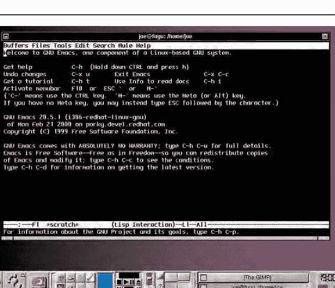

# 数据结构

至关重要的一点是，当你在 emacs 中处理文件时，你实际上并不是在处理文件本身。与 `ed`（参阅第 16 章：“编辑器”）一样，你是在一个缓冲区（buffer）中工作，它是保存在系统内存中的文件副本。你在 emacs 中对文件做的任何更改在将它们保存回文件之前都不会成为永久更改。这适用于许多其他编辑器，而不只是 `ed` 和 `emacs`，但 emacs 使这一过程变得显式。

emacs 包含许多专门用于处理缓冲区的函数，因此在编辑器中工作时需要注意这一点。在 emacs 会话中，可以打开多个缓冲区，每个缓冲区包含不同的文件——或者同一个文件的不同视图。在大多数情况下，这种复杂性并不是必要的，但一旦有需要，这种功能是存在的。

除了提供文件和缓冲区之外，emacs 还提供了“窗口”（windows）作为一项功能。这些不是 Microsoft 或 X Window 系统中的窗口，而是给定缓冲区的独立视图。你可以将屏幕垂直或水平分割成多个窗口（如图 18.2 所示），并在每个窗口中拥有单独缓冲区（或同一缓冲区的独立视图）。这允许你同时查看和编辑多个缓冲区。

# 图 18.2

GNU Emacs 让你在没有桌面的情况下查看多个窗口。

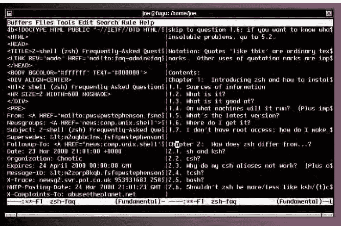

# 键位绑定

由于 emacs 的编写方式，你输入的每一个按键实际上都是给编辑器的命令。例如，如果你按下字母 `A`，你就是在向缓冲区发送一个命令。对于键盘上出现的字母和数字，这没有什么有趣的实际应用，但有几个键可能会让你在想……

当你想要使用 `Ctrl` 和 `meta` 修饰符时，你将……

如果你在 PC 上运行 emacs，`meta` 键就是 `Alt` 键。但是，如果你通过网络使用终端或终端模拟器程序，`Alt` 键可能无法作用。在这种情况下，你必须改用 `Escape` 键。

`Ctrl` 和 `meta` 键是正确使用 emacs 的不可或缺的一部分。GNU Emacs 文档以及大多数其他关于 emacs 的文档都使用特定的记法来描述 emacs 命令序列。为了保持一致性，我们在本章也使用相同的名称（与书中其他部分使用的记法不同）。其工作原理如下：

- `C-x`：对于任何字符，`C-x` 意味着按住 `Ctrl` 键并输入该字符。所以，如果我们看到 `C-d`，你只需按住 `Ctrl` 和 `d`。
- `M-x`：对于任何字符，`M-x` 意味着按住 `meta` 键并输入该字符。所以，如果我们看到 `M-d`，你只需按下 `meta` 键（可能是 `Alt`）并输入 `d`。
- `C-M-x`：对于任何字符，同时按住 `Ctrl` 键和 `meta` 键并输入该字符。

注意，你不应该将这些组合键视为对该特定字符的修改，而是视为通过组合键组合发送的命令。

# 开始使用 emacs

在本章的这一部分，我们假设你已经通过输入 `emacs` 命令启动了 emacs，但还没有加载任何缓冲区。要将文件读入缓冲区，请使用命令 `C-x C-f`。（注：OCR 此处是碎片化的）。

## 处理窗口

如果你愿意，可以垂直拆分 emacs 窗口。

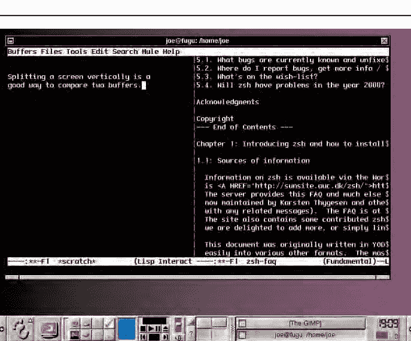

## 表 18.2: 其他 GNU 窗口命令

| 命令 | 功能 |
| --- | --- |
| `C-x 0` | 关闭当前窗口 |
| `C-x 1` | 关闭除当前窗口外的所有窗口 |
| `C-M-v` | 将另一个窗口滚动到缓冲区的下一个屏幕 |
| `M-x shrink-window` | 垂直收缩当前窗口 |
| `C-x ^` | 使当前窗口垂直扩大 |
| `C-x -` | 水平收缩当前窗口 |
| `C-x *` | 使当前窗口水平扩大 |
| `C-x 4 b` | 选中另一个窗口中的缓冲区 |
| `C-x 4 C-o` | 显示另一个窗口中的缓冲区 |
| `C-x 4 f` | 在另一个窗口中查找文件 |

当你第一次创建一个新窗口时，当前缓冲区将出现在两个窗口中。你可以使用上一节中描述的方法切换到另一个缓冲区，也可以在新窗口中打开一个新缓冲区。如果你愿意，可以在两个窗口中操作同一个缓冲区。这在你编辑一个大文件并想同时查看文件的两个部分时通常非常有用。

请记住，并没有特殊的机制会将窗口绑定到特定的缓冲区。如果你关闭了一个窗口，并不会关闭在该窗口中显示的缓冲区。要关闭缓冲区，必须执行单独的命令。

## GNU Emacs 窗口

现在你已经了解了 emacs 窗口、缓冲区和命令，在开始工作之前，你只需要知道 emacs 窗口的两个元素。这些元素位于屏幕底部，称为模式行（mode line）和微缓冲区（mini buffer）。它们在图 18.5 中标记。使用这些工具来管理你的文档并发布允许你控制 emacs 及其行为的命令。

图 18.5：
模式行和微缓冲区允许你在命令模式下控制 GNU Emacs。

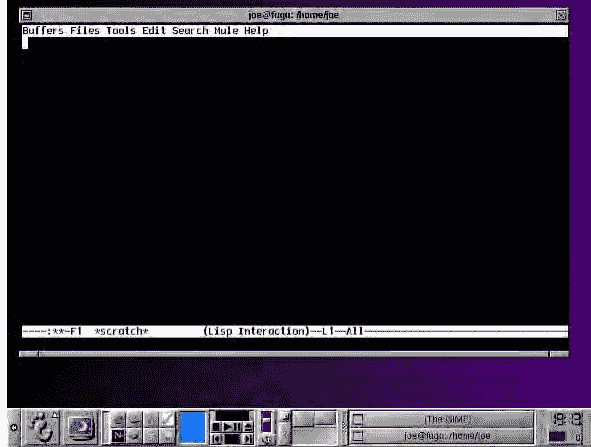

## 模式行

当你在 emacs 中编辑缓冲区时，整个屏幕区域都将用于文件的文本，但屏幕最底部的两行除外。这两行中上方的一行是模式行。模式行是反色高亮的行（如果你使用黑白显示器，则是黑底白字而不是白底黑字）。

模式行包含了关于你缓冲区的各种信息，例如它的名称以及你当前在屏幕上查看文件的部分。你不能直接编辑模式行中出现的信息，但这些信息会随着缓冲区属性的变化而改变。

## 微缓冲区

屏幕最底部的行称为微缓冲区。微缓冲区是显示 emacs 消息、输入命令以及回显命令按键的地方。你可以在微缓冲区中观察你正在操作的内容，如果你发现自己输错了命令序列，这非常有帮助。

## 获取帮助

如果你发现自己被 GNU Emacs 搞得不知所措，可以查阅丰富的在线帮助。表 18.3 显示了访问帮助文件的五个命令。我们特别推荐教程，它对 emacs 初学者来说非常出色，也可能为那些使用 emacs 一些时间但从未运行过教程的人提供一两个小技巧。emacs 帮助可以通过多种方式访问，因此你可以获取特定语境的帮助或更通用的帮助索引。

## 表 18.3: GNU Emacs 命令

| 命令 | 结果 |
|---|---|
| `C-h a` | 提示关键词并列出所有包含该词的命令 |
| `C-h k` | 提示按键并描述绑定在该按键上的命令 |
| `C-h i` | 进入超文本阅读器 |
| `C-h p` | 打开浏览器，你可以在其中按主题搜索帮助文件 |
| `C-h t` | 运行教程程序 |

## 备份与自动保存

如果你曾因为在没有保存的情况下关闭文件而丢失大量工作，或者在保存文件后才发现由于误操作删除了很多心血，你将会感谢 GNU Emacs 的备份和自动保存功能。这些功能是 emacs 受青睐的原因之一，因为当编辑器在你工作时静静地保留副本时，很难丢失文件。

每当你保存文件时，emacs 都会创建一个第二个备份文件，作为上版本的副本。也就是说，备份文件比当前文件版本旧一个版本，如果当前文件发生某种故障，这非常有帮助。备份文件的名称末尾带有一个 `~`。如果文件名是 `wa1-aby`，则备份文件将命名为 `wa1-aby~`。

如果 GNU Emacs 或你的整个系统在你保存更改之前崩溃，那么当系统恢复时，应该有一个自动保存的文件。如果你在寻找 `wa1-aby` 文件的自动保存副本，该自动保存文件将命名为 `#wa1-aby#`。

## 杀死（Killing）与剪回（Yanking）

在 emacs 中，`kill`（杀死）和 `yank`（剪回）类似于剪切和粘贴。要剪切一段文本，使用 `C-k` 命令。如果你想剪切一个区域，用 `C-space` 设置标记并移动光标，然后执行 `C-k`。要粘贴你杀死的文本，在光标所在位置使用 `C-y`。

## 搜索与替换

要搜索模式并将其替换为另一个字符串，使用 `M-%` 命令。这是一个交互式函数，会提示你要查找的字符串和要替换的字符串。当找到匹配项时，你会有选项，见表 18.4。

## 保存与退出

和 `vi` 一样，退出 emacs 并不是最直观的过程。退出命令是 `C-x C-c`。如果你在执行此命令之前有未保存的缓冲区，emacs 将提示你在退出前保存它们。要在不退出 emacs 的情况下保存文件，使用命令 `C-x C-s`。如果你有多个需要保存的缓冲区，使用命令 `C-x s` 一键保存所有缓冲区。

## 医生（Doctor）

emacs 神奇的功能之一是 Doctor 程序。基于开创性的交互式心理程序 Eliza，emacs 医生将根据罗杰斯分析的治疗理念，以非指导和冷静的方式对你的陈述做出回应。

通过执行命令 `M-x doctor` 开始医生。用一个句子解释你的问题并按两次回车。医生会做出回应，只要你输入更多的陈述，它就会继续回应。让对话自然地流淌。你可能会感到极其沮丧、大笑，或者实际上从医生的回答得到了帮助。图 18.6 显示了一个示例会话。

### 总结

尽管 GNU Emacs 既复杂又有些难以学习，但它是一个为用户提供极大的活性和强大的文本编辑器。emacs 具有多种功能、针对程序员的紧密集成，以及一个有效的多窗口界面。该编辑器通过一系列 `Ctrl` 和 `Alt` (meta) 组合键序列进行控制。

通过 emacs，你可以同时处理多个文件。你还可以利用其强大的备份和自动保存功能，以及快速准确的剪切和粘贴系统。emacs 在搜索和替换字符串方面也表现出色。如果你愿意花一点时间学习如何使用这个编辑器，GNU Emacs 将用一个强大的编辑工具包和一个良好的界面来报答。

图 18.6：GNU Emacs 提供了内置的心理帮助。

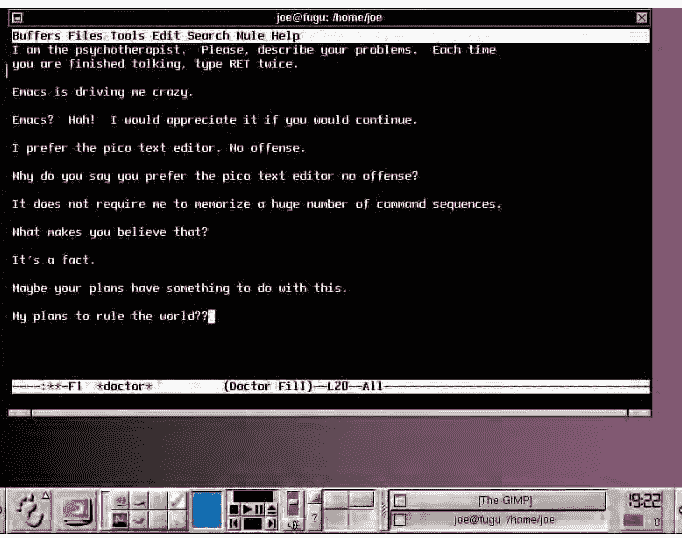

# 第十九章

## pico, joe, and jed

- pico
- joe
- jed
- 总结

虽然 `vi` 和 `emacs` 无疑是 Unix 文本编辑器的“双雄”，但它们并不是你唯一的选择。感谢上天！其他替代方案可能是你以及你处理文本方式的合适选择。这些编辑器中的每一个都有自己的特点和处理方法；有些非常简单，而另一些则简单得多——尽管没有哪个像 `emacs` 那样复杂。这些编辑器中的一些运行文本模式，而另一些则需要图形 X Windows 界面。

在本章中，我们将对三个最流行的文本编辑器进行简要介绍：`pico`、`joe` 和 `jed`。在这三个中，`pico` 使用得最广泛，但 `joe` 和 `jed` 的整体感觉与 `emacs` 等其他编辑器提供的相似。考虑到 Unix 环境中几乎所有的其他东西，你对文本编辑器的决定可以取决于什么适合你。

### pico

我们先把这个问题解决掉：我们热爱 `pico`。它是我们首选的编辑器，我们确保在运行或使用的所有机器上都能使用它。然而，这种喜爱引起了我们极客朋友的某些困扰，他们认为 `pico` 并不是一个特别严肃的文本编辑器（这个群体与那些认为每个人都应该使用 `emacs` 作为操作系统的人之间存在着令人怀疑的重叠）。幸运的是，我们从未认为严肃性是文本编辑器的标准，所以我们乐意地使用 `pico` 生成大量数据。

我们承认，对于严肃的程序员来说，`pico` 不是最佳选择。它确实缺乏像 `emacs` 这样更强大的编辑器的一些功能，但作为回报，它小巧、轻量且易于使用。它对于那些生成文本文件（如我们）而不是程序的人来说也是完美的。我们假设严肃的程序员可能不需要这本书，尽管你可能想尝试一下 `pico`。

> `pico` 是在华盛顿大学开发的，作为 Pine 电子邮件客户端的一部分，但对于不想使用 Pine 的人，该编辑器可以作为独立的文本编辑器进行安装和运行。

### 启动 pico

要启动 `pico`，只需在命令提示符输入 `pico` 即可。如果你想用一个已经可以编辑的文件打开 `pico`，请输入 `pico filename`（其中 `filename` 是你想处理的特定文件的名称）。只要 `pico` 屏幕出现，你就可以开始输入文本，如图 19.1 所示。

图 19.1：

基础 `pico` 屏幕包含一个文本输入区域和一个简短的命令参考。

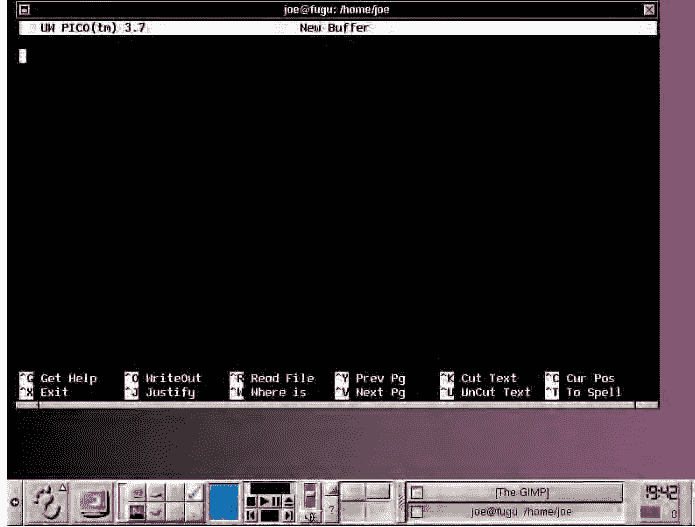

### 在 pico 中编辑文本

与 `vi` 或 `emacs` 不同，`pico` 只有一种操作模式。默认情况下，你在键盘上输入的任何内容都会被 `pico` 解释为插入到打开文件中的文本。例外是任何使用 `Ctrl` 键的按键组合，因为 `Ctrl` 键序列是 `pico` 的命令语言。

在 `pico` 文件工作时，你可以使用方向键在文档中移动。使用 `Backspace` 键删除文本。更复杂的编辑功能可以通过表 19.1 中描述的 `Ctrl` 键序列来完成。最常用的组合始终显示在 `pico` 屏幕底部的双行栏中；通过 `Ctrl+o` 组合在与上下文相关的命令之间进行循环切换。

#### 表 19.1：pico Ctrl 键序列

| 命令 | 功能 |
| --- | --- |
| `Ctrl+a` | 移动到当前行首 |
| `Ctrl+e` | 移动到当前行尾 |
| `Ctrl+f` | 向前移动一个字符 |
| `Ctrl+b` | 向后移动一个字符 |
| `Ctrl+n` | 移动到下一行 |
| `Ctrl+p` | 移动到上一行 |
| `Ctrl+v` | 向上翻一页 |
| `Ctrl+y` | 向后翻一页 |
| `Ctrl+k` | 删除（剪切）当前行文本 |
| `Ctrl+u` | 撤销上次删除 |
| `Ctrl+j` | 对齐（重新格式化段落） |
| `Ctrl+w` | 搜索文本字符串 |
| `Ctrl+r` | 读入文件 |
| `Ctrl+o` | 保存文件 |
| `Ctrl+x` | 退出 `pico` |
| `Ctrl+g` | 获取帮助 |
| `Ctrl+t` | 拼写检查 |

## 表 19.4 继续：joe 删除命令

| 命令 | 功能 |
| --- | --- |
| `Ctrl+j` | 删除从光标位置到行尾的内容 |
| `Ctrl+_` | 撤销上一次删除（此序列为 `Ctrl+Shift+减号/下划线`） |
| `Ctrl+^` | 重做上一次撤销的删除（此序列为 `Ctrl+Shift+6/插入键`） |

## 表 19.5：joe 搜索命令

| 命令 | 功能 |
| --- | --- |
| `Ctrl+k f` | 查找文本字符串（系统会提示你输入字符串） |
| `Ctrl+l` | 查找上次搜索过的文本字符串的下次出现位置 |

## 表 19.6：joe 窗口操作命令

| 命令 | 功能 |
| --- | --- |
| `Ctrl+k o` | 将窗口对半 |
| `Ctrl+k g` | 增大当前窗口 |
| `Ctrl+k t` | 缩小当前窗口 |
| `Ctrl+k n` | 跳到当前窗口下方的窗口 |
| `Ctrl+k p` | 跳到当前窗口上方的窗口 |
| `Ctrl+c` | 杀死当前窗口 |
| `Ctrl+k e` | 将指定文件加载到当前窗口 |
| `Ctrl+k l` | 如果打开了多个窗口，则只显示一个；否则显示所有窗口 |

## 表 19.7：joe 杂项命令

| 命令 | 功能 |
| --- | --- |
| `Esc y` | 将之前删除的文本提取到当前光标处的缓冲区 |
| `Ctrl+.` | 退出 shell 提示符 |
| `Ctrl+l` | 执行 shell 命令 |
| `Ctrl+j` | 重新格式化段落 |
| `Ctrl+k r` | 在光标位置插入命名文件的内容 |
| `Ctrl+h` | 显示帮助文件 |
| `Ctrl+x` | 保存文件 |
| `Ctrl+c` | 退出 `joe` |

### jed

`jed` 是一个有趣的文本编辑器，拥有一群规模虽小但忠实的粉丝。该程序以其开发者 John E. Davis 的首字母命名。`jed` 最有趣的一点是，它可以模拟其他编辑器。默认情况下，它配置为模拟 GNU Emacs（如图 19.4 所示），但它也可以模拟 EDT（最早的 Unix 编辑器之一）和 WordStar。（像我们一样读过书并记得早期 DOS 文字处理程序的人，可能会感到一丝怀旧之情。）与其他文本编辑器相比，使用 `jed` 的一个优势是它同时拥有 Unix 和 MS-DOS 版本，这对于在混合操作系统环境中工作的人来说非常方便。

## jed 的运行控制文件

`jed` 的模拟模式通过程序的各种运行控制文件进行控制。`jed` 的系统级运行控制文件通常位于 `/usr/lib/jed/lib/jed.rc`。如果你在不进行任何个人环境自定义的情况下运行 `jed`，该文件将自动加载。然而，如果你想自定义自己的 `jed` 环境，必须在你的主目录下创建一个名为 `.jedrc` 的文件，并将你的个人配置放在该文件中。你放置在 `.jedrc` 文件中的任何选项都将覆盖全局文件（`/usr/lib/jed/lib/jed.rc`）中的选项。

## 图 19.4

默认情况下，`jed` 模拟 GNU Emacs 编辑器。

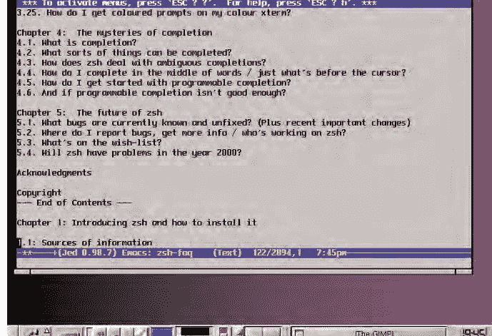

实现 `jed` 个人自定义的最简单方法是将系统级文件复制到你的主目录并将其保存为 `.jedrc`。你可以使用以下命令完成：

```
cp /usr/lib/jed/lib/jed.rc ~/.jedrc
```


`cp` `/usr/lib/jed/lib/jed.rc` `.jedrc`

一旦文件被复制，你就可以对个人使用的 `jed` 进行所需的所需的更改。例如，如果你想将 `jed` 从 `emacs` 模拟切换到 `WordStar` 模拟，你只需找到这一行：

```
() evalfile('emacs');   % Emacs 类的快捷键绑定
```

并在前面加上一个百分号，使其看起来像这样：

```
%() evalfile('emacs');   % Emacs 类的快捷键绑定
```

`jed` 将百分号视为注释标记，并忽略以百分号开头的行中的任何内容。

然后，找到这一行：

```
% () = evalfile('wordstar*'); % Wordstar
```


删除第一个百分号。现在，当你启动 `jed` 时，它将以 WordStar 模式启动，如图 19.5 所示。

文件中还有许多其他配置选项，文件中的注释对它们的解释相当清楚。我们鼓励你浏览此文件，以学习你可以用 `jed` 做些什么。

## 运行 jed

启动 `jed` 就像运行其他编辑器一样，输入 `jed` 或 `jed filename`。进入 `jed` 后，输入 `Esc+?` 即可查看屏幕顶部的功能菜单。可以通过输入分配的数字来激活这些功能。有窗口、缓冲区、命令、拼写检查等功能，如果你在其他编辑器（如 `emacs`）中工作过，这些应该都都是很熟悉的。

### 图 19.5

`jed` 也可以模拟 MS-DOS 编辑器 WordStar。

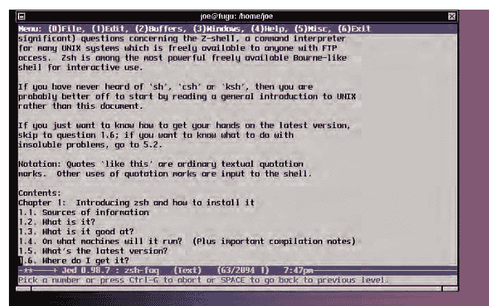

使用方向键以及 Page Up 和 Page Down 键在 `jed` 屏幕上移动。退出 `jed` 请使用菜单。

### 总结

文件中还有许多其他配置选项，文件中的注释对它们的解释相当清楚。我们鼓励你浏览此文件，以学习你可以用 `jed` 做些什么。

# 图 20.1

NEdit 是一个整洁、不杂乱的图形文本编辑器。

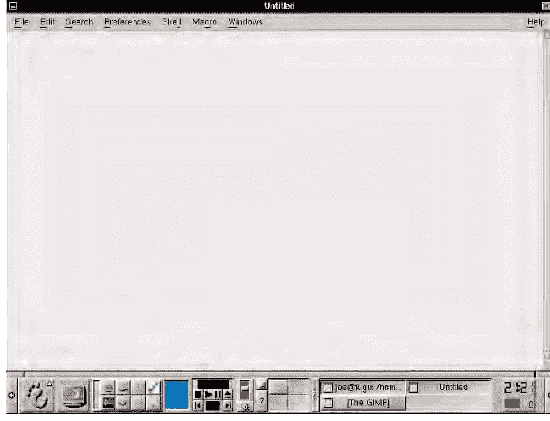

表 20.1 到 20.7 显示了 NEdit 的各种菜单功能。正如我们在上面提到的，在本章中我们将详细介绍许多选项，对于 Unix 文本编辑器来说，拥有菜单选项是一个相对新事物。菜单命令还可以将更多特性和功能集成到编辑器中，使得像 NEdit 这样的程序提供了比大多数文本编辑器更灵活的编辑工具。

## 表 20.1：NEdit 文件菜单命令

| 命令 | 功能 |
| --- | --- |
| New (新建) | 创建缓冲区 |
| Open (打开) | 在当前缓冲区打开文件 |
| Open Selected (打开选中) | 允许程序员在编写 C 时打开 #include 文件 |
| Open Previous (打开上一个) | 允许打开最近处理的文件 |

## 表 20.1 续：NEdit 文件菜单命令

| 命令 | 功能 |
| --- | --- |
| Close (关闭) | 关闭当前缓冲区 |
| Save (保存) | 将缓冲区保存到文件 |
| Save As (另存为) | 以新名称保存缓冲区 |
| Revert to Saved (还原已保存) | 丢弃上次保存以来的所有更改 |
| Include File (包含文件) | 在当前光标位置插入指定的文件 |
| Load Macro File (加载宏文件) | 加载宏（定义的动作序列） |
| Load Tags File (加载标签文件) | 加载标签索引文件（一种编程功能） |
| Unload Tags File (卸载标签文件) | 卸载标签文件 |
| Print (打印) | 打印当前文档 |
| Print Selection (打印选中) | 仅打印选中的文本 |
| Exit (退出) | 关闭 NEdit |

## 表 20.2：NEdit 编辑菜单命令

| 命令 | 功能 |
| --- | --- |
| Undo (撤销) | 丢弃之前的编辑 |
| Redo (重做) | 重复之前的编辑 |
| Cut (剪切) | 剪切选中的文本并存储在剪贴缓冲区 |
| Copy (复制) | 将选中的文本复制到剪贴缓冲区 |
| Paste (粘贴) | 在当前光标位置插入剪贴缓冲区中的文本 |
| Paste Column (粘贴列) | 允许粘贴垂直选择区域 |
| Delete (删除) | 删除选中的文本 |
| Select All (全选) | 选中所有文本 |
| Shift Left (左移) | 将整行向左移动一个空格 |

## 表 20.2 续：NEdit 编辑菜单命令

| 命令 | 功能 |
| --- | --- |
| Shift Right (右移) | 将行向右移动一个空格 |
| Lower Case (小写) | 将所有选中的字符转换为小写 |
| Upper Case (大写) | 将所有选中的字符转换为大写 |
| Fill Paragraph (填充段落) | 删除段落内所有的换行符 |
| Insert Form Feed (插入分页) | 在光标位置插入分页符（打印时作为分页符） |
| Insert Control Code (插入控制代码) | 插入指定的 ASCII 字符 |

## 表 20.3：NEdit 搜索菜单命令

| 命令 | 功能 |
| --- | --- |
| Find (查找) | 查找正则表达式 |
| Find Again (再次查找) | 重复之前的查找操作 |
| Find Selection (查找选中) | 查找选中文本的下一个实例 |
| Find Incremental (增量查找) | 输入每个字符都会触发新搜索（增量查找通常是在文件中查找内容最快的方法，因为它能让你立即看到搜索进度。） |
| Replace (替换) | 用另一个文本替换文本 |
| Replace Again (再次替换) | 重复上一次替换 |
| Goto Line Number (跳转行号) | 将光标移动到指定的行号 |
| Goto Selected (跳转选中) | 将光标移动到选中的文本 |
| Mark (标记) | 在文中设置标记 |
| Goto Mark (跳转标记) | 将光标移动到之前设置的标记 |
| Goto Matching () (跳转匹配括号) | 将光标移动到括号表达式的开始或结束 |
| Find Definition (查找定义) | 标签文件查找函数的定义 |

## 表 20.4：NEdit 选项菜单命令

| 命令 | 功能 |
| :--- | :--- |
| Default Settings (默认设置) | 允许为各种功能设置默认值 |
| Save Defaults (保存默认) | 将当前设置保存为默认 |
| Statistics Line (统计行) | 显示包含文件名、行号、列号和文件大小（字节）的行 |
| Show Line Numbers (显示行号) | 每行前打印连续数字 |
| Language Mode (语言模式) | 以适用于数字的方式高亮文件中的语法 |
| Auto-indent (自动缩进) | 设置文本缩进方式 |
| Wrap (换行) | 设置换行方式 |
| Tabs (制表符) | 设置制表符宽度 |
| Font (字体) | 指定使用的字体 |
| Highlight Syntax (高亮语法) | 尝试猜测你正在使用的语言 |
| Backup (备份) | 自动制作文件备份 |
| Incremental (增量) | 按计划的时间间隔进行备份 |
| Overtype (覆盖) | 将 NEdit 切换到覆盖模式 |
| Read Only (只读) | 不允许保存 |

## 表 20.5：NEdit Shell 菜单命令

| 命令 | 功能 |
| --- | --- |
| Execute Command (执行命令) | 执行特定命令 |
| Execute Line (执行行) | 同上，但允许你 |
| Filter Selection (过滤选中) | 处理选中的文本 |
| Cancel Command (取消命令) | 取消 shell 命令 |

## 表 20.6：NEdit 宏菜单命令

| 命令 | 功能 |
| --- | --- |
| Learn (学习) | 停止记录 |
| Cancel (取消) | 取消记录 |
| Replay Keystkes (重放按键) | 重放学习的按键 |
| Repeat (重复) | 重复上一次 |
| Complete (完成) | 尝试推断你正在输入的单词 |
| Fill (填充) | 填充选中区域 |
| Quote Reply (引用回复) | 在每行前添加 |
| Unquote Reply (取消引用) | 移除字符 |

## 表 20.7：NEdit 窗口菜单命令

| 命令 | 功能 |
| --- | --- |
| Split Window (分屏窗口) | 将窗口分为两部分以查看不同的部分 |
| Close Pane (关闭窗格) | 关闭选中的缓冲区（在此菜单中，你会看到正在处理的文件名。） |

# KEdit

KEdit 是随 KDE 提供的图形化文本编辑器。虽然它没有 NEdit 功能那么全，但对于大多数基础任务已经足够。除了编辑文本，KEdit 还具有与你的电脑邮件程序配合的简单界面，你可以直接从中编辑并发送邮件。

尽管 KEdit 是作为 KDE 包分发的，但你不一定运行 KDE 来使用它。不过，你需要安装 Qt 库。Qt 是构建 KDE 的组件集（定义图形程序基本模块的指令集）。只要安装了 Qt，KEdit 就能正常工作。事实上，在在本章做笔记时，Joe 是在 Gnome（KDE 的主要竞争对手）下运行 KEdit 的。

如图 20.2 所示，Edit 界面包含一个工具栏；显示模式（插入或打印）以及光标位置的状态栏；以及主区域。和 NEdit 一样，

### 图 20.2

KEdit 界面直观且易于使用。

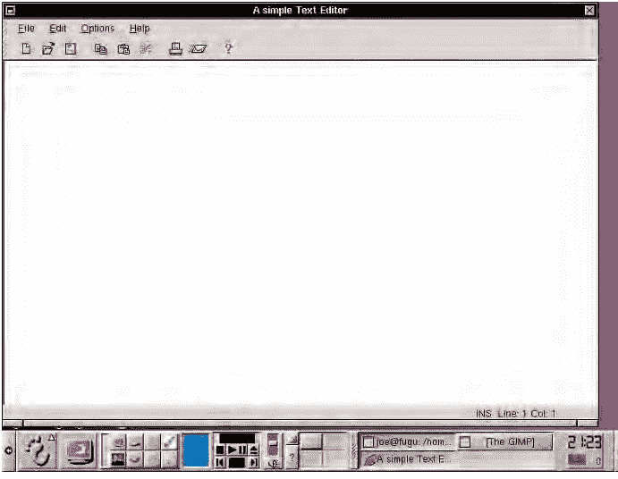

启动 KEdit 后，你只需点击文本区域并开始打字。当你打字时，文本会出现在窗口中。使用鼠标或方向键将光标移动到文本中的各个位置。

## KEdit 工具栏

工具栏包含链接到常用功能的图标。从左到右分别是：

- 新文档 (New Document)
- 打开文档 (Open Document)
- 保存文档 (Save Document)
- 复制 (Copy)
- 粘贴 (Paste)
- 打印文档 (Print Document)
- 邮件文档 (Mail Document)
- 帮助 (Help)


## 菜单栏

菜单栏与其他许多图形程序（如 NEdit）类似。由于命令非常相似，我们建议你参考本章中“NEdit”部分的表格，查看基本的命令功能。KEdit 可用的菜单如下：

- 文件 (File)
- 编辑 (Edit)
- 选项 (Options)
- 帮助 (Help)

# gEdit

正如 KEdit 是随 KDE 桌面自带的图形化编辑器一样，gEdit 也是随 Gnome 桌面自带的编辑器。它的功能没有 NEdit 那么全，但 gEdit 的功能比 KEdit 多。不过，gEdit 拥有一个 KEdit 和 NEdit 都不具备的功能：在屏幕左侧有一条栏（如图 20.3 所示），允许你同时管理多个打开的文档。这类似于 NEdit 的窗口功能，但该栏始终显示在屏幕上，提供了一种吸引人且直观的多文档管理方式。

### 图 20.3

gEdit 是 Gnome 图形文本编辑器，与 NEdit 和 KEdit 类似。

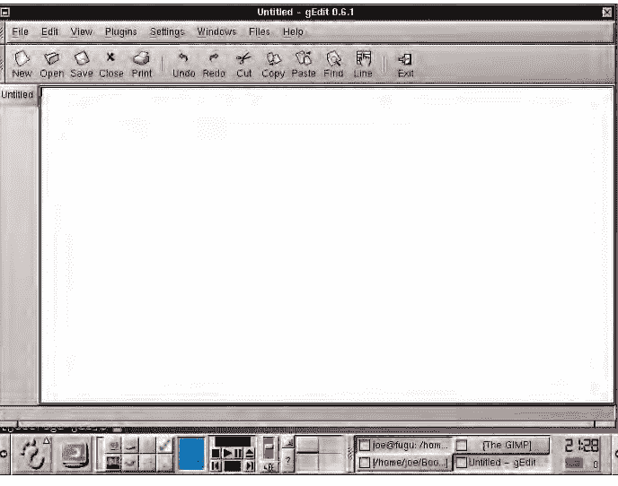

与 KEdit 一样，gEdit 拥有一个带有常用功能图标的工具栏。gEdit 工具栏图标列举如下：

- * 新建 (New)
- 打开 (Open)
- 保存 (Save)
- 关闭 (Close)
- 打印 (Print)
- 撤销 (Undo)
- 重做 (Redo)
- 剪切 (Cut)
- 复制 (Copy)
- 粘贴 (Paste)
- 查找 (Find)
- 行 (Line)
- 退出 (Exit)


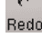

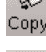


gEdit 中的菜单选项与 KEdit 和 NEdit 大大相同——我们在此不再重复这些信息。不过，我们要指出，gEdit 有许多插件，这些插件可以在“插件 (Plugins)”菜单中找到并非常实用。这些是相当简单的实用程序，其中大多数对程序员非常有帮助。这些程序包括将数字从十进制转换为八进制或二进制表示的工具；打开手册 (Manual) 页面；加密或解密文档等。在创建新插件时，可以很容易添加。如果你感兴趣，请关注 http://www.gnome.org 以获取新工具的公告。

### 总结

图形化文本编辑器的功能与本书部分其他章节描述的文本模式编辑器类似。然而，与文本模式编辑器不同，图形化编辑器有一些额外的功能，例如使用鼠标、下拉菜单以及屏幕上更美观的外。有几种流行的图形化编辑器，既有作为集成桌面软件包一部分自带的，也有是独立程序。

NEdit、KEdit 和 gEdit 是三个最好的图形化文本编辑器。NEdit 是一个独立程序，而 KEdit 和 gEdit 分别是 KDE 和 Gnome 集成桌面环境的一部分。它们都比大多数文本模式编辑器更多的功能和特性，其中 NEdit 功能最全，KEdit 最简单。尽管图形化编辑器会给你的电脑带来额外的内存，但直观的环境和使用鼠标的能力使得图形化编辑器成为文本编辑工具库中非常有用的补充。

# 第六部分

# Shell 编程

- 第 21 章：Shell 编程简介
- 第 22 章：变量
- 第 23 章：流程控制，第一部分：条件流程控制
- 第 24 章：流程控制，第二部分：迭代流程控制
- 第 25 章：正则表达式
- 第 26 章：信号与状态

# 第 21 章

## Shell 编程简介

- 为什么要编写 Shell 程序？
- 什么是脚本，什么是程序？
- 总结

图形化文本编辑器的功能与本书部分其他章节描述的文本模式编辑器类似。然而，与文本模式编辑器不同，图形化编辑器有一些额外的功能，例如使用鼠标、下拉菜单以及屏幕上更美观的外。有几种流行的图形化编辑器，既有作为集成桌面软件包一部分自带的，也有是独立程序。

NEdit、KEdit 和 gEdit 是三个最好的图形化文本编辑器。NEdit 是一个独立程序，而 KEdit 和 gEdit 分别是 KDE 和 Gnome 集成桌面环境的一部分。它们都比大多数文本模式编辑器更多的功能和特性，其中 NEdit 功能最全，KEdit 最简单。尽管图形化编辑器会给你的电脑带来额外的内存，但直观的环境和使用鼠标的能力使得图形化编辑器成为文本编辑工具库中非常有用的补充。

图形化文本编辑器的功能与本书部分其他章节描述的文本模式编辑器类似。然而，与文本模式编辑器不同，图形化编辑器有一些额外的功能，例如使用鼠标、下拉菜单以及屏幕上更美观的外。有几种流行的图形化编辑器，既有作为集成桌面软件包一部分自带的，也有是独立程序。

所以，对“为什么要编写 Shell 程序？”这个问题的答案是：编写 Shell 可以节省大量的时间和无燥工作，还能让你了解很多关于 Unix 系统的内部原理。我们认为，学习 Shell 脚本的基础是初学者到中级 Unix 水平之间的桥梁之一，而掌握它让你进入了高级领域。

我们交替使用“shell 脚本”和“shell 程序”这两个术语。两者之间的区别——如果存在区别的话——取决于你问谁。这是一个对某些人非常重要但对另一些人来说完全无关的小问题；我们认为没什么好讨论的。

可以通过坚持使用其中一个术语而非另一个来获得，但请注意，有些人确实非常在意这一点。

某些 Unix 系统根据所使用的编程语言来区分程序（programs）和脚本（scripts）。在第1章“Unix的历史与背景”中，我们描述了 C 编程语言以及 C 程序在运行之前需要经过编译。对于那些坚持严格定义的人来说，程序是用 C 等编译型语言编写的，而脚本则是用解释型语言（如 bash 的原生脚本语言或 Perl）编写的。

注意
解释型语言是指在程序执行时将程序指令实时转换为机器码的语言。编译型语言是指在程序运行之前对整个程序进行转换的语言。

对于某些人来说，程序和脚本的区别在于文件的大小或范围。“程序”一词被留给大型、多功能的软件，例如 Netscape 或 The GIMP！；脚本则倾向于短小且功能单一，并且通常被称为“一次性工具”（one-offs），因为它们只做一件事。还有人将“脚本”留给用户或系统管理员在自己的机器上使用的东西，而“程序”则是由他人编写的东西。

无论如何，我们认为这种区别是基于语义的，而不是基于易于定义的。脚本和程序都是机器必须执行以完成特定任务或一组任务的指令集。脚本可以拥有程序的所有功能，反之亦然（当它们非常简单时）。尽管如此，我们更倾向于使用“shell 脚本”（shell script）这个词，而不是“shell 程序”（shell program）。这很大程度上是一个习惯问题，仅此而已。不要误认为我们在讨论两个完全不同的东西。

### 程序的组成

在本章的这一节中，我们将介绍 shell 程序的各个部分。在本书该部分的后续章节中，我们将对这些组件进行更详细的介绍。现在，我们只是想让你熟悉这些术语，以便你能跟上这部分的后续内容，在后续中我们将基于这些概念进行构建。

### 语句

编程的基本单元是语句（statement）。在 bash 语文中，语句可以是任何有效的 shell 命令。因此，`ls /etc` 可以是一个语句，正如我们在前面的章节中向你展示的任何其他命令一样。

我们还有一些尚未介绍的语句类型。这些语句通常不作为交互式命令使用；相反，它们完全作为编程构造结构的语句。这些构造有助于完成的程序在必要时对如何执行自己做出决策。

通常而言，语句分为三大类：

- **指令性（Directive）：** *指令性语句*指示计算机执行特定动作。上面显示的 `ls /etc` 示例就是指令性语句的例子。
- **声明性（Declarative）：** 从人类语言的角度来说，*声明性语句*是陈述事实的语句。例如，指令 `A=1` 是关于“1 已赋值给变量 `A`”这一事实的声明。
- **条件性（Conditional）：** *条件语句*是那些标记只有在特定情况为真才执行的程序部分。例如，你可能会包含一段代码，它只有在用户对某个问题输入“Yes”时才会运行。

用于声明性语句的示例 `A=1` 在某种意义上是指令性的，因为它指示计算机等这两个元素，但由于该语句设置的是条件而不是执行动作（从用户的角度来看），更容易将其认为是一个声明性语句。

### 运算符

*运算符*（Operators）是特殊的字符，指示程序要采取特定动作或设置特定条件。大多数人熟悉一组被称为算术运算符的特定运算符。符号 `+`、`-`、`*` 和 `/` 分别代表加、减、乘、除。除了这些基础算术运算符外，还有赋值运算符 `=`、比较运算符 `<` 和 `>` 以及其他几种。

在 shell 脚本语文中，运算符被用作一种一致的方式告知计算机特定动作。由于脚本语法非常精确，运算符的使用意味着不同的脚本作者能够获得相同的结果，因为他们不需要思考如何告诉机器执行特定任务。相反，他们只需要使用相应的运算符并移动到脚本的下一行。

### 正则表达式

正则表达式是一种用于匹配字符串的机制。通过正则表达式，可以搜索文本中的特定模式。一旦识别出字符串，脚本就可以对它们进行某些处理。我们将在第5章“正则表达式”中详细讨论正则表达式。

## 变量

如果你还记得，变量是一个可以被分配任意值的名称。在 shell 脚本中，变量通常用于值未知的信息。由于该值是在脚本外部设置的，因此可以在不影响脚本的情况下更改该值。我们将在第4章“变量”中详细讨论变量。

### 注释

最后，但同样重要的是，注释。注释是不具备任何编程用途的语句。相反，将注释包含在程序中是为了帮助人类理解某部分代码的设计目的。在 bash 中，注释用 `#` 指定。从井号到行尾的任何内容都会命令解释器忽略。

```
```


# 这是一个注释。

```
跨多行的注释必须在每行的开头都有井号。
```

# 此脚本对文件内容进行字母排序

# 编写于 1987 年 7 月。

# 如果你有任何问题，请给我发邮件。

```
你也可以在行的中间插入井号，导致命令解释器执行井号之前的部分并忽略井号之后的所有内容。
```

`/etc` # 这是一个非常基础的语句。

# 第二十二章

## 变量

- 什么是变量？
- 给变量赋值
- 特殊变量
- 总结

正如我们在第 21 节“Shell 编程简介”中所解释的那样，Shell 脚本的主要组件之一就是变量的使用。变量是 Shell 编程中不可或缺的一部分。如果不使用变量，创建一个具有任何灵活性的程序将非常困难。如果是这样，Shell 程序将真的只是脚本——它们在每次运行时都将以相同的方式执行相同的动作，而不是适应当前的情况。

变量允许程序员在脚本或程序中构建出某种定程度的不确定性。当程序员使用变量时，他们引导计算机对程序员目前没有的信息做出决策。也就是说，程序员编写了要使用什么类型的信息，但不知道该信息的具体值。这样做的优势是显而易见的：变量描述的信息值由用户、计算、另一个程序或同一程序的其他部分提供。这种灵活性允许脚本在不同情况下表现出不同的行为，说到底，这正是现代计算的核心。

那么，变量不可避免地是抽象的高概念吗？并不是。一旦你理解了使用变量意味着脚本节省了系统管理员，因为他们不需要为给定信息的每个可能值编写单独的脚本，你就掌握了基本概念。在本章的剩余部分中，我们将退后一步，围绕这个核心概念提供一些实用的术语和框架。

## 注意

在讨论编程的单一元素（如变量）时不引用引用其他元素（如运算符）是很困难的。当我们描述这些概念时，我们将解释该概念并对该元素在编程环境中的作用给出大致说明。然而，我们已经在本书该部分的其他章节中更完整地涵盖了大多数元素。如果你看到你不理解的内容，很你可能通过查看本书的其他地方来弄懂。

## 什么是变量？

简单来说，变量就是一个名字。如果你读过第 13 节“自定义 Shell 环境”，你可能会想起关于 Shell 变量的讨论。Shell 变量用于将通用设置（如 `EDITOR`）与特定值（如 `"pico"`）关联起来。在 `bash` Shell 中，通过命令设置变量：

```bash
export EDITOR="pico"
```

现在，忽略 `export` 命令，因为它有一个特定的 Shell 函数。

## 注意

`export` 命令使变量对定义该变量之外的程序可用。这对于 Shell 来说非常重要，因为 Shell 本身就是一个程序。如果你不导出变量值，它将不会在 `bash` 内部的任何地方反映；当你运行示例时，将无法获得你偏好的文本编辑器。

那么，如果没有 `export`，语句的核心是：

```bash
EDITOR="pico"
```

这里的变量是单词 `EDITOR`。`EDITOR` 的值可以是任何内容：`v1`、`emacs`，甚至可以是像 `flibner` 这样完全毫无意义的内容。变量只是一个标签或句柄，是实际值将附加其上的。变量本身除了作为值的关联外，没有内在含义；请确保你的变量命名清晰，以便你能够记住它们。

## 注意

当然，`flibner` 从功能角度来看是毫无意义的。目前不存在名为 `flibner` 的文本编辑器（如果有人写了一个，这一节突然就有意义了）。尽管它没有意义，但并没有禁止你将其作为值使用。每当另一个程序查询 `EDITOR` 的值时，你都无法访问默认文本编辑器。这对于文本编辑器来说并不糟糕，但想象一下如果你试图在一个关键的系统管理脚本中使用无意义的值，会产生什么问题。

### 变量名

你可以为变量命名为任何你，只要在名称中使用字母即可。数字字符和其他符号在 Shell 编程上下文中有特殊含义。如果确实需要，你可以使用数字，但请将它们留在变量名的末尾；`VARIABLE3` 是可以的，但 `3VARIABLE` 可能会以意想不到的方式引起问题。

按照惯例，环境变量名用大写字母编写。只在特定脚本内部使用的变量可以使用小写，但养成对变量名使用大写的的习惯是一个好主意。为什么呢？它能将变量名与变量值区分开来。还记得早先的那个例子吗？

`EDITOR=pico`。通过大小写区分，显然 `EDITOR` 和 `"pico"` 是两个不同的东西，即使你不知道 `EDITOR` 或 `"pico"` 实际上意味着什么。这意味着如果你开始一个变量对你来说不熟悉的（可能命名得不好）的脚本，你仍然可以识别出变量及其值。

用具有意义的术语来命名你的变量。`USERNAME` 是比 `UN` 更好的变量名，因为当你以后重新查看脚本时，你更容易记住 `USERNAME` 值的目的。最好的变量名是那些描述变量功能的名称。

### 变量类型

默认情况下，`bash` 中的变量是字符串。也就是说，它们是字符序列。因此，如果你给变量 `VAR` 赋值 `'1'`，Shell 应该将该值解释为文本 `1`，而不是数值 `1`。这对于初学 Shell 程序员来说可能会引起一些困惑，如果他们期望在不理解文本和数值值区别的情况下进行数学计算。（`var++1` 的值结果是字符串 `1+1`，而不是数值 `2`。）

在普通的 Bourne Shell (`sh`) 中，你的变量值仅限于字符串。要进行数学计算，你需要使用 `expr` 命令或提供的几个多行计算程序之一。对于需要使用 `sh` 而不是功能更全的环境的情况：

> 提示
如果你编写的可能会移动到不使用 `bash` 的系统，你可能希望遵循 `sh` 的限制。因为 `sh` 非常精简，适用于 `sh` 的脚本比利用 `bash` 函数的脚本更好。

然而，`bash` 允许你为每个变量分配变量类型。变量类型让 Shell 在执行之前知道该变量的。使用 `declare` 命令配合其标志来分配变量类型。例如，如果你想使用变量 `VAR` 进行数学计算，正如我们在本节第一段尝试的那样，你可以声明 `VAR` 的值始终解析为整数。

> 注意
如果 `declare` 在你的计算机上似乎不起作用，请检查你正在使用的 `bash` 版本。`declare` 在早于 `bash` 2 的版本中不可用。（见光书中支持 `declare` 的 `bash` 版本。）

使用此命令：

```bash
declare -i VAR=1
```

`-i` 标志告诉 `bash` `VAR` 是整数。现在，`VAR` 的值将被解析为数值 `1`，而不是文本字符 `1`。表 22.1 包含了 `declare` 的标志。

## 表 22.1：使用 declare 定义的变量类型

| 标志 | 变量定义 |
| :--- | :--- |
| -a | 变量是数组（值的列表） |
| -f | 变量仅限于函数名 |
| -i | 变量是整数 |
| -r | 变量只读（值无法更改） |
| -x | 变量已导出（与 `export` 命令的结果相同） |

单独行输入 `declare` 会显示 shell 环境中所有变量的值。

### 数组

数组是一种特殊的变量类型，它可以包含多个值。数组实际上存储了一个值列表，可以通过索引数字访问，该索引与值在列表中的位置对应。以下是一个数组声明的示例：

```
cars=(ford, gm, chrysler)
```

图 22.1:

使用 `declare` 命令列出所有已定义变量的值

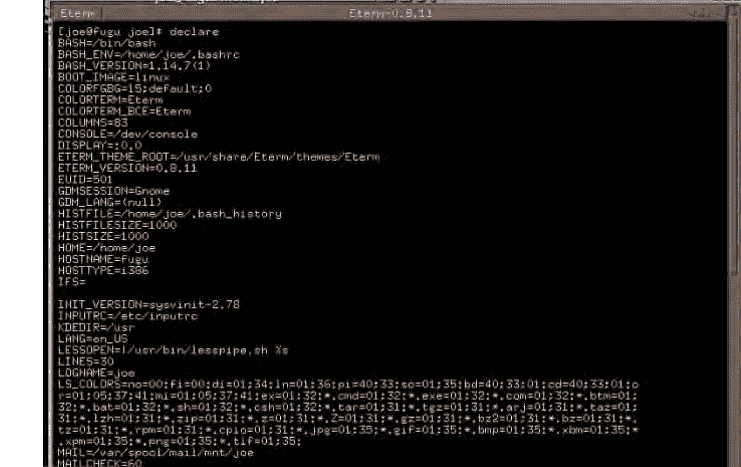

## 图 22.2:

使用 `-f` 标志将 `declare` 的输出限制为函数名和定义。

```
Joe@fugu~homejoe
Term-0.11
Joe@fugu~joe#$ declare -F
declared
mkdir -p "/tmp/demo" 2>/dev/null
chmod 700 /tmp/demo
cp -r /tmp/demo/*
/usr/bin/gcc -c -o "HC" "HC"
gcc HC.c -o HC
unset HC
Joe@fugu~joe# 
```

当你想要访问该数组中的特定值时，只需在紧跟在变量名右侧的方括号中使用索引数字，例如：

- `cars[0]=ford`
- `cars[1]=gwm`
- `cars[2]=chryler`

记住，在 Unix 世界中，我们总是从零开始计数，而不是从一。

### 整数

整数是任何没有小数部分的正数或负数。零也是整数。数字 `1`、`5`、`-42`、`42`、`0` 和 `-1052` 均都是整数，但 `1.1`、`0.5` 和 `-3.75` 不是。将值声明为整数（如所示使用 `declare` 命令的 `-i` 标志）可以在 shell 脚本中进行简单的算术运算。然而，更复杂的计算（例如面向浮点的算术）无法通过 shell 完成。你需要安装一个单独的计算器程序来处理更复杂的方程。

## $ 运算符

当你开始阅读越多的 shell 脚本时（相信我们，你会的），会注意到某些变量名前面有一个美元符号 (`$`)。这个运算符允许你访问变量的值，而不是变量名。为什么这很重要？可以这样想：假设你有一个名为 `CLOWN` 的变量。`CLOWN` 只是变量的名字，但表达式 `$CLOWN` 代表变量的实际值。

要查看它是如何工作的，请运行此示例。在命令行提示符下输入


`CLOWN="bozo"`

当你按下回车键时，你会再次看到 shell 提示符。现在你输入

```
echo $CLOWN
```

单词 `bozo` 将打印到屏幕上。然而，如果你输入

```
echo CLOWN
```

相反，单词 `CLOWN` 将打印到屏幕上，你将获得关于 `CLOWN` 变量实际值的信息。这个练习如图 22.3 所示。

> 注意
>
> 你可以在同一语句中组合字面量和变量。例如，在上面的示例中，你可以执行命令 `echo "I am usually scared of clowns, but I don't mind $CLOWN"`。当命令执行时，你将看到 `I am usually scared of clowns, but I don't mind bozo` 打印到屏幕上。（变量值取决于上下文。）这种实际文本和变量的混合被称为变量替换。

### 给变量赋值

图 22.3:

该运算符允许你区分变量名和它的值。

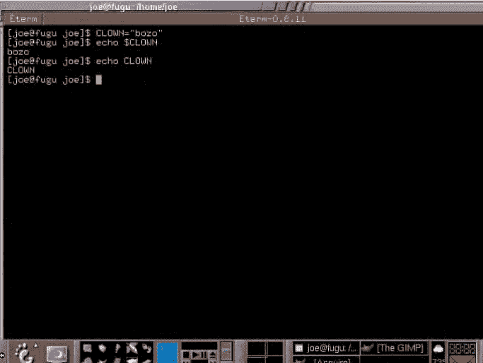

### 给变量赋值

如果不能给变量赋值，那么变量将毫无用处。事实上，在本章之前的章节中（以及第 13 章）中，你已经看到了几个变量值定义的示例。值赋值是通过赋值运算符 (`=`) 完成的。在某些上下文中，`=` 字符也可以作为比较运算符（但在那种方式使用时通常是显而易见的。）

这里有一个简单的值赋值示例：

```
VAR="hello"
```

当 shell 看到 `=` 字符时，它会将字符左侧的的内容解释为变量名，将右侧的内容解释为分配给该变量名的值。你可以通过重新赋值来随时更改变量的值：

```
VAR="goodbye"
```

### 从键盘获取输入

在许多脚本中，你可能希望用户在脚本运行时定义变量的值。这是通过 `read` 命令实现的，例如：

```
read var
```

当 `bash` 解释器看到 `read` 语句时，解释器会暂停脚本的执行并等待键盘输入。用户必须输入一些然后按回车键。当计算机接收到回车键的信号时，解释器恢复执行脚本，并将输入的内容存为

```
echo "What is your name?"
read name
echo "Hello $name"
```

> 注意
>
> 你可以在同一语句中组合字面量和变量。例如，在上面的示例中，你可以执行命令 `echo "I am usually scared of clowns, but I don't mind $CLOWN"`。当命令执行时，你将看到 `I am usually scared of clowns, but I don't mind bozo` 打印到屏幕上。（变量值取决于上下文。）这种实际文本和变量的混合被称为变量替换。

### 特殊变量

之前，我们警告过使用这些名称……大多数特殊变量已经预定义为只读，因此即使你想重新定义它们也无法做到。表 22.2 显示了部分

## 表 22.2: bash Shell 程序中的特殊变量

| 变量名 | 功能 |
| :--- | :--- |
| `?` | 上一个命令的退出状态 |
| `$` | 当前 shell 的进程 ID |
| `!` | 上一个后台命令的进程 ID |
| `-` | 启动 shell 的选项 |
| `0` | 当前脚本名称 |
| `1–9` | 脚本的第一到第九个命令行参数（即 `$1` 是第一个命令行参数的值，依此类推） |
| `$` | 上一个命令的最后一个参数 |

### 总结

变量的概念有很多内容需要吸收。然而，在你自己的 shell 脚本中使用变量之前，需要理解核心概念。变量是你创建的、与特定值关联的名称。变量包含的值可以更改，变量名在脚本中作为实际值的占位符。通过在变量名前加上 `$` 符号来访问变量的值。

某些变量是由 shell 环境预定义的。对于未预定义的变量，可以使用赋值运算符 (`=`) 或使用 `read` 命令从键盘获取值来设置值。

## 第二十三章
## 流程控制，第一部分：条件流程控制

- `if-then` 语句
- 评估变量
- 评估非变量
- 评估多个条件
- 构建示例
- 使用 `else` 扩展 `if-then` 语句
- `elif` 语句
- `case` 语句
- 总结

## 第 23 章 流程控制，第一部分：条件流程控制

在第 22 章“变量”中，我们解释了变量在编程语文中是如何运作的，以及如何在脚本或程序外部为变量赋值。虽然变量本身是一个中等趣味性的话题，但前一章节的内容可能让你思考：“那又怎样？好吧，我理解变量了。我该用它们来做什么呢？”

变量在编程中的主要用途之一是让你的程序具备决定如何执行自身的能力。也就是说，你可以使用变量来标记某些代码段，使得这些代码段根据某些条件来执行或不执行。这种能力被称为流程控制，因为它用于控制程序如何从一个地方流向另一个地方。

流程控制有两种类型：条件流程控制和迭代流程控制。条件流程控制涉及创建根据给定条件是否真而执行或不执行的代码段。迭代流程控制涉及标记代码段，使其反复执行，直到满足某个条件。条件流程控制和迭代流程控制之间的区别相当微妙，因为可以认为这两种类型都涉及条件的设置和满足。然而在实践中，区别是非常明显的，因为这两种类型使用不同的命令来获取所需的结果。

注意：我们在本章中讨论条件流程控制，并在第 24 章“流程控制，第二部分：迭代流程控制”中讨论迭代流程控制。

变量是如何融入这个图景的？记住变量由两部分组成：名称（它是静态的，不会改变）和值（它是动态的，会改变）。使用静态组件——名称，我们可以定义一个条件，并对动态值进行测试。随着程序的执行，变量的值可能会改变。取决于它的方式，变量的值可能也可能不满足测试条件，程序可能会成功也可能失败。

在本章中，我们涵盖了条件流程控制的主要组件。这些组件被称为语句（statements），是 shell 脚本的构建块。在我们展示每条语句时，都会提供该语句如何工作的的示例。在本书部分的最后，我们将构建一个新脚本，使用在本章以及第 24 和 25 章中引入的所有组件。

### if-then 语句

条件流程控制的核心是 *if-then 语句*。该语句的标准形式为：

```
if <condition>
then
<something happens>
```

第一行的 `<condition>` 是一个语句。该语句可以返回 *true*（真）或 *false*（假）的值。（实际上，语句可以返回 0 或 1，其中 0 等于 *true*，1 等于 *false*。）如果条件评估为真，则程序的 `<something happens>` 部分将执行。如果条件评估为假，`<something happens>` 部分将被跳过，程序的执行将在 `fi` 语句之后的紧邻行继续。

`fi` 只是 `if` 的反过来写。这是一种用于标记条件部分结束的约定。

代表真和假的 0 和 1 值是该表达式的退出状态（exit status）。记住，在第 22 章中，我们参考特殊变量 `?` 讨论了退出状态。同样的概念也适用于这里：如果一个评估表达式执行成功——也就是说，如果变量评估了条件——该表达式被认为评估成功，因此它以状态 0 执行。如果未满足条件，评估就会失败，并产生状态 1。这看起来像是一种看待成功或失败的过于复杂的方法，但如果你理解了成功/失败、0/1 都代表同一件事，那么你在 shell 编程的理解上就达到了一个点。

由 `if` 语句评估的表达式并不非要是变量比较。任何返回 0 或 1 退出状态的表达式都可以工作。事实上，可以说退出状态是 `if` 语句实际测试的唯一内容。然而，变量评估是看到这一运作方式最简单的方法，因此这就是我们选择的引入该概念的方式。

### 缩进

缩进是为了可读性。你会注意到整本书中的代码段都经过了缩进。这在技术上并不是必要的，但它让代码变得更易读。如果你运行此脚本，屏幕上将打印出 `Success!` 单词。现在，假设你有一块像这样的代码：

```
MY_VARIABLE="walnut"
if [ $MY_VARIABLE="walnut" ]
then
    echo "Success!"
```

因为 `MY_VARIABLE` 的值现在是 `"pecan"` 而不是 `"walnut"`，第二行的测试将无法成功评估。由于测试返回 1，脚本将跳到 `fi` 语句之后的行，无论那行是什么。在这种情况下，`fi` 之后没有行，因此脚本将直接结束而不向屏幕打印任何内容。

### 评估变量

运算符分为大类：字符串运算符和算术运算符。

### 23.1: 字符串比较

| 运算符 | 功能 |
| :--- | :--- |
| `=` | 等于 |
| `!=` | 不等于 |
| `>` | 大于 |
| `ge` | 大于等于 |
| `lt` | 小于 |
| `le` | 小于等于 |

这里有一个使用运算符的示例：

```
MY_VARIABLE="walnut"
if [ $MY_VARIABLE="walnut" ]
then
    echo "Success"
```


因为 `MY_VARIABLE` 的值匹配第二行的条件，测试成功。由于测试返回 0，`then` 和 `fi` 之间的 `echo` 行将被执行。

### 23.2: 算术比较

| 运算符 | 功能 |
| :--- | :--- |
| eq | 等于 |
| ne | 不等于 |
| gt | 大于 |
| ge | 大于等于 |
| lt | 小于 |
| le | 小于等于 |

假设你有一个如下的脚本：

```
MY_VARIABLE=10

if [ $MY_VARIABLE -gt 5 ]

then

    echo "Success"
```

### test 命令与方括号

我们在 if-then 示例中方括号实际上是命令。`bash` shell 将 `[ <expression> ]` 构建视为 `test` 命令的同义词。因此，语句

```
if [ MY_VARIABLE="walnut"
```

等同于

```
if ( test $MY_VARIABLE="walnut" )
```

在本章早期，我们注意到与 if-then 语句结合使用的表达式不需要是变量评估，可以是任何返回 1 或 0 的语句。这正是 `test` 命令的功能。如果变量改变了条件，`test` 退出并返回值0。否则，它返回值1。请注意，方括号和 `test` 命令仅在 `bash` shell 中是同义词。你不能在常规 Bourne Shell 或任何其他 shell 环境以此使用方括号，因为这是 `bash` 的功能之一。如果你想在其他人编程时测试表达式，必须显式使用 `test` 命令。

### 评估非变量

如果你的脚本需要评估非变量的项目，有几种方法可以处理这种需求。你可以使用 `test` 命令检查计算机的文件系统组件，并使用 if-then 语句来判断给定命令是否执行成功。这两个功能都将为脚本提供了额外的灵活性，这使得脚本成为了一项更有用的学习技能。

### test 命令

除了评估变量外，`test` 命令还有其他功能。（因为我们在本书中使用 `bash` shell，所以 `test` 命令与方括号 `[]`、`[]` 是同义的，请参见侧边栏“test 命令与方括号”的解释。如果你在其他 shell 中编程，则需要单独使用 `test`。）通过使用各种标志（flags），可以使用 `test` 命令来确定文件和目录的存在及其状态。

例如，假设你想编写一个脚本，仅当特定文件存在时执行某些操作。你可能会编写如下代码块：

```bash
if ( -e <filename> )
then
  something happens
fi
```

`-e` 标志会导致 `test` 仅在问题文件存在时成功退出。你也可以在 `bash` shell 的 `[]` 结构中使用这些标志。与之前的代码块等价的是：

```bash
if [ -e <filename> ]
then
  something happens
fi
```

表 23.3 显示了 `test` 在处理文件和目录时使用的各种标志。

| 标志 | 功能 |
| :--- | :--- |
| -e | 命名文件存在。 |
| -d | 命名文件存在且是一个目录。 |
| -f | 命名文件存在且是一个普通文件（即它不是目录或任何其他特殊文件）。 |
| -s | 命名文件存在且不为空。 |
| -r | 用户对文件有读取权限。 |
| -w | 用户对文件有写入权限。 |
| -x | 用户对文件有执行权限。 |
| -0 | 用户是文件的所有者。 |
| -G | 所有者的组 ID 与文件的 ID 匹配。 |
| -nt | 文件比另一个文件新（用法：`<file1> -nt <file2>`）。 |
| -ot | 文件比另一个文件旧（用法：`<file1> -ot <file2>`）。 |

> 注意
> `-nt` 和 `-ot` 标志比较命名文件上的时间戳，该时间戳在每次访问或修改文件时都会更新。因此，`file1` 的创建时间比 `file2` 早一个月创建，但如果 `file1` 最近被修改或访问过，`-nt` 和 `-ot` 标志将报告 `file1` 比 `file2` 是新文件。

### 命令

if-then 语句也可以根据给定命令是否执行成功来创建条件代码。例如，假设你的脚本操作需要在特定目录内进行。你需要在脚本执行之前进入该目录，而且如果由于某些原因无法进入该目录，你不希望脚本执行。在这种情况下，你可能会编写像如下所示的条件代码：

```bash
if ( cd <directory> )
then
    <something happens>
fi
```

在这种情况下，只有当 `cd` 命令成功时才会执行条件代码。

> 注意
> 在此示例中，没有 `test`。因此，没有出现方括号。事实上，括号并不是严格必要的，但它们提高了代码的可读性。有关更多代码可读性的信息，请参见侧边栏“缩进”。

## 评估多个条件

虽然单条件语句在 shell 脚本中非常常见，但通常在执行代码块之前，必须同时满足两个或多个条件。在脚本中构建多条件评估有两种方法：使用 if-then 语句和使用逻辑运算符。

如果你选择使用 if-then 语句来评估多个条件，你的代码可能像这样：

```bash
if <condition1>
  if <condition2>
    <something happens>
  fi
fi
```

这是可以理解的，但它也有点臃肿。如果你在这个块中强制引入第三或第四个条件，仅缩缩就会很难追踪。

更简单的方法是使用逻辑运算符。逻辑运算符 `&&` 代表与（and），`||` 代表或（or）。表 23.4 显示了这些运算符的功能。

表 23.4: 逻辑运算符功能

| 语句 | 功能 |
| :--- | :--- |
| <condition1> && <condition2> | <condition1> 和 <condition2> 均为真。 |
| <condition1> \| <condition2> | <condition1> 或 <condition2> 其中之一为真。 |

因此，本节开头使用的示例可以简单地重写为：

```bash
if ( if <condition1> && <condition2> )
then
  <something happens>
fi
```

有时情况下，第一种包含多个 if-then 语句的结构可能更好。根据原则，良好的编程风格规定，除非绝对必要，否则你不应该使用嵌套条件表达式（嵌入另一个条件内部的表达式）。逻辑运算符可以创建更优雅、更精简的代码，这通常是我们的目标。

### 构建示例

现在我们已经解释了条件流控制的概念，是时候开始一个向你展示这些材料在实践中如何运作的示例了。第一个示例是一个简单的程序，让用户猜一个秘密单词。打开你喜欢的文本编辑器（如果没有，请参见第五部分：“使用文本编辑器”）并输入以下代码：

```bash
#!/bin/bash

### SECRET WORD version 1

# 此程序邀请用户从选项列表中猜一个秘密单词。

SECRET_WORD="telephone"

echo "What is your name?"

read NAME

echo

echo "Hello, $NAME. Please guess the secret word. Your"

echo "choices are iguana, telephone, or slurp."

read GUESS

if [ $GUESS=$SECRET_WORD ]
then
  echo "Congratulations, you are correct!"
fi
```

正如脚本所示，我们将变量 `SECRET_WORD` 的值定义为 "telephone"。用户的输入赋值给变量 `GUESS`。如果两者匹配，则说明用户猜中了秘密单词，因此将打印祝贺消息。

使用 else 扩展 if-then 语句

if-then 语句本身有一定的局限性。它只能定义条件执行的单个代码部分。如果你想允许多个替代方案的选择，并想使用 if-then 语句来实现这一点，你就需要构建整个 if-then 语句链。不用说，那将变得麻烦且混乱。幸运的是，`bash` 提供了 if-then 结构的扩展，使得设置多个条件变得更加优雅和易读。

这些扩展中的第一个是 `else` 语句。`else` 的工作如下：

```bash
if <condition>
then
  <something happens>
else
  <something else happens>
fi
```

使用 `else` 大约相当于第二个 if-then 语句，其条件等于第一个条件以外的所有内容。

### elif 语句

```bash
then
echo "Congratulations, you are correct!"
else
echo "Sorry, $GUESS is not correct."
fi
```


你可以通过在 shell 提示符输入 `./secword` 再次运行程序。在这个新的程序中，如果用户猜错了，程序在退出之前会在屏幕上打印一条信息。请注意，组成 `if-then-else` 结构的两个块是互斥的；也就是说，如果执行了其中一个，另一个就不会执行。

使用 `elif` 语句不是扩展 `if-then` 语句的唯一方法。另一种 bash 扩展是 `elif` 语句。`elif` 类似于 `if` 和 `else` 之间的交叉体。它允许程序员在基础 `if` 语句中添加更多条件，如下例所示：

```bash
if <first condition>
then
<something happens>
elif <second condition>
then
<something happens>
elif <third condition>
then
<something happens>
else
<something else happens>
fi
```

每个 `elif` 语句都像一个独立的 `if` 语句，每个 `elif` 下定义的块都是一个独立的替代方案。你可以通过链联多个 `if` 语句来实现相同的效果，如下：

```bash
if <first condition>
then
<something happens>
fi
```

```bash
if <second condition>
<something happens>
fi
```

```bash
if <third condition>
<something happens>
fi
```

然而，使用 `elif` 要优雅得多。此外，使用 `elif` 允许你使用 `else` 语句提供替代结果，如果没有任何条件被满足，该结果将执行。

再次打开 `secword`，修改程序并利用 `elif` 结构。修改位于最后。

```bash
#!/bin/bash
# 秘密单词版本 1
#
# 此程序邀请用户从一组选项中
# Guess出一个秘密单词
```

```bash
SECRET_WORD="telephone"
echo 'What is your name?'
read NAME
echo 'Hello, $NAME. Please guess the secret word. Your'
echo 'choices is iguana, telephone, or slurp.'
read GUESS
```

```bash
if [ "$GUESS" = "$SECRET_WORD" ]
then
echo 'Congratulations, you are correct!'
elif [ "$GUESS" = "iguana" ]
then
echo 'Why would the secret word be iguana?'
elif [ "$GUESS" = "slurp" ]
then
echo 'No, it's not slurp.'
else
```

```bash
echo "$GUESS is not even in the list."
fi
```

保存文件并退出编辑器。你可以通过在提示符输入 `./secword` 来运行编辑后的程序。在这个新版本中，给给定选项列表中的每个选项都有特定的消息。如果用户猜了一个不在列表中的内容，在 `else` 语句之后会有该选项的消息。

### case 语句

在某些情况下，使用 `if-then-elif-else` 语句可能会有点繁琐；bash 提供了另一种使用 `case` 语句设置多个条件的方法。`case` 语句使用以下语法：

```bash
case <expression> in
<pattern 1>
<something happens>
;
<pattern 2>
<something happens>
;
<pattern 3>
<something happens>
;
esac
```

> 就像 `fi` 是反写一样，`esac` 只是 `case` 的反写。它表示该特定 `case` 代码块的结束。

正如你对其他 bash 扩展所做的那样，打开 `secword` 文件并合并 `case` 语句：

```bash
#!/bin/bash
# 秘密单词版本 1
#
# 此程序邀请用户从一组选项中
# Guess出一个秘密单词
```

```bash
SECRET_WORD="telephone"
echo "What is your name?"
read NAME
echo
echo "Hello, $NAME. Please guess the secret word. Your"
echo "choices is iguana, telephone, or slurp."
read GUESS
case $GUESS in
$SECRET_WORD )
echo "$SECRET_WORD is correct!"
:;
"iguana" )
echo "Iguana is incorrect."
:;
"slurp" )
echo "Slurp is incorrect."
:;
*)
echo "$GUESS wasn't even a choice."
:;
esac
```

和之前一样，保存文件，退出编辑器并运行脚本。在这个程序版本中，最后的选项 `*` 的作用与 `if` 语句中的 `else` 子句相同。在此上下文中，星号字符表示任何其他内容。

### 从命令行获取参数

`case` 语句特别有帮助的是处理命令行参数。命令行参数是你在命令行给脚本提供的选项。命令的标志（如 `ls -la`）就是命令行参数的示例。使用 `case` 语句，你可以在程序中定义包含命令行参数的行为。

如何让你的程序意识到参数是偶数？这是通过特殊变量 `$0` 到 `$9` 实现的。这些变量每个对应于命令行上的一个元素，从左到右移动。例如，`$0` 将是程序本身的名字（或用作命令的任何缩写），因为 `$0` 是在提示符输入的第一个内容。程序的第一个参数是 `$1`，第二个是 `$2`，依此类推。

## 第二十四章

## 流程控制，部分 II：迭代流程控制

+ `for` 语句
- `select` 语句
- `while` 循环
- `until` 循环
- 嵌套循环
- 总结

在上一章中，我们讨论了条件流程控制的概念。也就是说，描述了如何设置只有在特定条件为真时才执行的代码段。在本章中，我们描述了第二种流程控制。迭代流程控制意味着标记将重复执行的文本段，直到——除非——某些条件为真。

> 提示
> 尽管这两个概念可能会容易混淆，因为它们都依赖于特定真条件的存在，但重要的是记住，迭代流程控制会导致代码段重复（迭代）。

三种语句用于迭代流程控制：`for` 语句、`until` 语句和 `while` 语句。这些语句也被称为循环，我们交替使用这些术语。在本章中，我们将解释每种类型并使用各种语句构建示例。

### for 语句

`for` 语句使得程序员指定的值列表中的每个值都重复执行一次代码段。值列表最常见的形式是数组。`for` 语句的通用形式是：

```bash
for <name> in <list>
do
<something>
done
```

考虑以下代码块：

```bash
#!/bin/bash
declare -a NAMES
```


`NAMES=(tom dick harry)`

```bash
for name in "${NAMES[@]}"
do
  echo $name
done
```

此脚本仅获取并打印数组 `NAMES` 中每个元素的值（即 `tom`、`dick` 和 `harry`）。

如你所见，该脚本使用 `-a` 标志来声明命令，从而将变量 `NAMES` 声明为数组。从技术上讲，该标志并不是必需，因为变量赋值的方式已经让 `bash` shell 明确地知道该变量是一个数组，我们使用该标志是为了更加显式。我们将 `tom`、`dick` 和 `harry` 赋值为数组的元素。单独来说，这些值被称为 `$NAMES[0]=tom`、`$NAMES[1]=dick` 和 `$NAMES[2]=harry`。

一旦 `for` 循环开始，它会创建一个新变量；在这种情况下，新变量命名为 `name`。新变量被称为循环变量，可以在循环内部使用以访问数组中特定元素的值。请注意，循环变量是由语句隐式创建并赋值的。不需要手动声明或分配此值。

脚本每执行一次，循环变量的值就会赋值为数组中下一个元素的值。因此，当循环第一次执行时，`$name[0]` 的值为 `(tom)`。循环第二次执行时，`$name` 的值为 `$NAMES[1]=(dick)`，依此类推。

当你编写此类脚本并引用包含单独值的数组时，你需要使用 `'${arrayname}[i]` 结构。由于 `bash` 处理数组的方式，访问特定元素的值时需要使用引号和花括号。`[@component]` 是位置参数，其中 `@` 字符用于跟踪当前正在引用的是哪一个元素。在传统的 Unix 计数风格中，它从 0 开始，并在每次循环重复时递增 1。

### 命令行处理

该结构的强大优势之一是用于命令行处理。回想一下，在第 23 章中，我们使用特殊变量 `$0`、`$1` 等来访问命令行元素。你也可以对特殊变量 `$#` 执行非常相似的操作。`$@` 是包含所有命令行参数的变量，然后可以通过 `for` 语句对其进行迭代。

例如，你可能将之前的代码块修改如下所示：

```bash
#!/bin/bash

for name in $@
  echo $name
done
```

并在提示符下使用此命令调用脚本：
`prom% ./names tom dick harry`

你将得到此输出：

```
tom
dick
harry
```

事实上，`$@` 变量对于 `for` 结构背后的思想如此完整，可以完全省略。只要没有指定其他内容，`for` 将会假设 `$@` 是目标列表。以下代码块的功能与上面的块完全相同：

```bash
#!/bin/bash

for name in $@
  echo $name
done
```

### 使用 for 构建示例

现在你已经接触了 `for` 结构，你可以创建一个脚本，该脚本将接收命令行中的文件列表，并返回定义文件类型以及相对于运行脚本的用户的权限权限的输出。这是一个此类脚本的示例：

```bash
#!/bin/bash

# Checkfile. 检查文件或文件列表的类型、所有权和权限。

for file in $@
do
### 检查文件类型
  if [ -d $file ]
  then
    echo "$file is a directory"
  elif [ -f $file ]
  then
    echo "$file is a regular file"
    if [ -s $file ]
    then
      echo "$file is not empty"
    else
      echo "$file is empty"
    fi
  else
    echo "$file not found"
  fi
  # 检查所有权
  if [ -u $file ]
  then
    echo "You are the owner of $file"
  else
    echo "You are not the owner of $file"
  fi
  # 检查权限
  if [ -r $file ]
  then
    echo "You have read permission for $file"
  fi
  if [ -w $file ]
  then
    echo "You have write permission for $file"
  fi
  if [ -x $file ]
  then
    echo "You have execute permission for $file"
  fi
done
```

```bash
fi
done
```

当运行脚本时，输出现在将显示修改后的提示符：

```
prompt$% Checkfile file1 file2
```

+   1) `file1`
2) `file2`
选择要检查的文件：

感觉好多了了，你不觉得吗？

### while 循环

另一种迭代流控制类型使用了 `while` 命令。`while` 命令使得某部分代码只要某个条件为真就会重复执行。该语句的通用形式如下：

```
while <condition>
do
  <something>
done
```

与 `if` 语句一样，`<condition>` 可以是任何评估为真（0）的语句。例如，考虑以下代码块：

```bash
#!/bin/bash

echo "猜猜秘密单词：telephone, iguana, gallon"
read GUESS

while [ $GUESS != "iguana" ]
do
  echo "错误 - 再试一次"
  read GUESS
done

echo "正确。"
```

只要 `$GUESS` 的值不等于 `iguana`，程序就会继续循环提示用户输入。

#### while 循环 361

> 注意
记住感叹号 `!` 是取反运算符。它会反转紧随其后的任何值。因此，`!=` 意味着不等于。

然而，一旦用户输入单词 `iguana`，条件就会失败，产生退出状态 1，脚本执行将跳到 `done` 语句后的下一行。

`while` 语句的一个常见用途是让某部分代码迭代特定的次数。考虑此代码块：

```bash
#!/bin/bash

declare -i i

i=0

while [ $i -lt 5 ]
do
	echo $i
	i=$i+1
done
```

在这个示例中，变量 `i` 被声明为整数。脚本编写者将值 0 赋值给变量 `$i`。在 `while` 语句中，编写者定义条件为：如果 `$i` 小于 5 则条件为真。（记住 `-lt` 运算符是整数的小于比较）。因为 0 小于 5，所以循环将迭代。

在执行条件块的过程中，`$i` 的值会加上整数 1。现在 `$i` 的值为 1。因为 1 小于 5，循环再次迭代，并在 `$i` 的值上加上整数 1，变为 2。此过程一直持续到 `$i` 等于 5。此时，`$i` 不再小于 5，条件块被跳过。如果你运行此脚本，输出将如下所示：

```
0
1
2
3
4
```

### until 循环

还记得我们在本章较早使用的猜单词游戏脚本吗？
```bash
#!/bin/bash
echo "猜猜秘密单词：telephone, iguana, gallon"
read GUESS
while [ $GUESS != "iguana" ]
do
  echo "错误 - 再试一次"
  read GUESS
done
echo "正确。"
```

`while` 语句中的负向比较 `[ $GUESS != "iguana" ]` 对许多人来说既优雅又反直觉。是否有办法可以重构该语句使其成为正向比较？

你可以使用 `until` 循环来重构该语句。`until` 语句的作用与 `while` 语句几乎完全相同，只是 `until` 从相反的方向处理等式。也就是说，`until` 循环只要给定条件不为真，就会迭代某部分代码。该语句的通用语法与 `while` 结构相同：

```
until <condition>
do
  <something>
done
```

所以，如果你想用正向条件重写猜单词脚本，你可能会写出这样的：
```bash
#!/bin/bash
echo "猜猜秘密单词：telephone, iguana, gallon"
read GUESS
until [ $GUESS = "iguana" ]
do
  echo "错误 - 再试一次"
  read GUESS
done
echo "正确。"
```


这个版本的脚本功能与上一个版本完全相同。这个版本使用了正向条件，因此代码更容易理解。负向比较虽然有时是必要的，但更容易引起混乱。

### 嵌套循环

嵌套循环是一种常用的编程技术，将一个循环插入到另一个循环中。

> 注意
在前一章中，我们建议尽可能避免嵌套 `if` 语句。在某种程度上，这一告诫在这里适用。嵌套循环可以产生非常强大的效果。嵌套循环的通用形式如下：

```
while <condition>

  do

    while <condition>

      do

        <something>

    done

done
```

循环并不非要是 `while` 循环；`until`、`for` 或 `select` 语句同样适用。此外，循环类型不必相同。限制仅限于编写者的想象力。

# 第二章，第二部分：迭代控制

为了在实际环境中展示嵌套，参考此示例：

```bash
#!/bin/bash

PS3="选择要检查的目录："

select dir in $@

do

  if [ ! -d "$dir" ]

  then

    echo '$dir 不是目录'

  else

    declare -a LIST

    LIST=$(ls $dir)

    for file in ${LIST[@]}

    do

      # 所有权

      if [ -o $file ]

      then

        echo "你是 $file 的所有者"

      else

        echo "你不是 $file 的所有者"

      fi

      # 权限

      if [ -r $file ]

      then

        echo "$file 有读取权限"

      else

        echo "$file 没有读取权限"

      fi

      if [ -w $file ]

      then

        echo "$file 有写入权限"

      else

        echo "$file 没有写入权限"

      fi

      if [ -x $file ]

      then

        echo "$file 有执行权限"

      else

        echo "$file 没有执行权限"

      fi

    done

  fi

done
```

通过这个脚本，你可以看到有 `if` 语句嵌套在另一个 `if` 语句中，嵌套在一个 `select` 语句中。在骨架形式下，脚本如下：

```
select <name> in <list>

do

  if <condition>

    then

      for <name> in <list>

      do

        if <condition>

          then

            <something>

        fi

  fi

fi

done
```

到目前为止，你应该对 bash 编程可以完成的事情类型有了良好的了解。关键在于，bash 是一门为了简单任务而设计的语言。想象一下用“它”可以实现什么——无论是成就还是头疼。

### 总结

正如上一章所述，流控制是控制脚本如何从一条指令移动到下一条的机制。迭代流控制（本章涵盖的内容）标记给定脚本中的某些代码块，使得这些块将重复执行，直到某个特定条件为真（除非该条件为真）。

有几种类型的迭代流控制语句，包括 `for` 语句、`select` 语句、`while` 循环和 `until` 循环。这些语句可以独立发布，也可以相互嵌套（或与条件流控制语句结合）。条件和迭代流控制语句的结合使得程序员能够构建具有复杂性的 shell 脚本，尽管 bash 脚本语言旨在用于相对简单的过程。

## 第二五章

### 正则表达式

- 正则表达式的工作原理
- `sed`
- `awk`
- 总结

在 shell 编程中，许多程序员经常发现有一段想要识别并使用的小文本。如果这段文本是字面上的，这不是问题：也就是说，无论情况或上下文如何，它总是相同且以相同的方式出现。但有时，你需要查找的文本并不是字符序列，而是某种文本。例如，你可能知道文本具有某些特性，或者它会出现在特定特定位置，但在它出现之前，你并不知道它的内容。

你使用的许多 Unix 工具使用一种名为正则表达式的机制来处理这类模糊的文本片段。正则表达式是可能匹配任意数量字面字符串的结构，但只有当这些字符串符合某些特征时才会匹配它们。遗憾的是，许多这些正则表达式匹配机制都是有效的。因此，对于 shell 程序员来说，意识到你在任何特定情况下使用的单个工具以及该工具如何处理正则表达式是非常重要的。

## 正则表达式：`grep`/`sed`/`awk` 还是 Perl？

如果在阅读完本章后，你认为正则表达式是你遇到过的最强大的技术，我们建议你查看一下 Perl 编程语言。像 shell 环境一样，Perl 是一种解释型语言；因此 Perl 程序在运行之前不需要编译。

Perl 有一套全面且强大的处理正则表达式的方法，以及一些让操作这些表达式变得非常编程特性。Perl 特别适用于编写对文本字符串执行操作的程序。例如，有 程序可以从网站（例如 `http://www.cnn.com`）下载页面，然后提取某些标题的子集以便快速阅读。这类任务在 Perl 中非常简单，程序代码不会超过 20 或 30 行。

首先可以从 `http://www.perl.org` 了解更多关于 Perl。如果你发现自己对 Perl 感兴趣，你必须拥有必要的 Perl“圣经”：由 Larry Wall 和 Randall Schwartz 编写的《Learning Perl》（第二版，O'Reilly & Associates, 1997）以及由 Larry Wall 编写的《Programming Perl》（第三版，O'Reilly & Associates, 2000）。任何与你谈论 Perl 的人都会认为你有这些书籍并读过它们。

## 正则表达式的工作原理

所以，你可能在想，如果你不知道一段文本是什么或可能是什么，你该如何识别它呢？这个特定的难题是通过使用元字符来解决的。元字符是根据其实现方式，可以匹配多个其他字符的字符。你已经在书的其他地方讨论通配符的地方看到过元字符的示例了。

例如，如果你在提示符处输入命令

```
ls *.txt
```


`ls` 命令将只打印包含 `.txt` 后缀的文件名。在这种语境下（实际上在大多数其他情况下也是），元字符 `*` 表示零或多个字符的任意组合。换句话说，`*` 匹配一切。当你将元字符与字面字符串 `.txt` 结合时，操作系统会将该组合理解为匹配以 `.txt` 结尾的零或多个字符的任意组合。同样，该字符通常用于表示任何单个字符。

除了这些通配符字符，还有其他类型的匹配某些类型非字符的元字符。例如，`^` 字符（称为上扬符）匹配行的开头。因此，正则表达式 `^Joe` 如果在 Joe 出现在行首，将定位并匹配单词 Joe。行中其他地方的 Joe 将不会被注意到。同样，元字符 `$` 匹配行尾。如果你将它附加到之前的表达式中，如 `^Joe$`，你将只匹配作为任何行中唯一文本的单词 Joe，因为该单词既在行首又在行尾。

最后还有一种不属于上述任何一类别的元字符；这个元字符是反斜杠字符（`\`）。这个字符也被称为转义字符，因为它被用来“转义”正则表达式的正常模式匹配行为。例如，如果你想匹配字面上的美元符号字符，你需要使用组合 `\$`。这种配对告诉解释器你真的在寻找美元符号，而不是行尾的某些内容。

- 要匹配字面上的反斜杠，你将使用结构 `\\`。

表 25.1 包含了最常用元字符的总结。然而，如上面提到的，重要的是，并不是所有程序都以相同的方式使用所有元字符。因此，此总结应仅作为指南，而不是作为确定的参考。请检查你用于搜索文本字符串的程序或语言的文档。

## 表 25.1：模式匹配元字符

| 字符 | 功能 |
| --- | --- |
| * | 匹配零或多个字符的任意组合。 |
| . | 匹配任何单个字符。 |
| [ ] | 匹配括号内任意任意字符。例如，[aeiou] 将匹配任何元音，[a-z] 将匹配任何小写字母，[a-zA-Z] 将匹配任何大小写字母。 |
| ^ | 如果给定字符串出现在行首，则匹配该字符串。 |
| $ | 如果给定字符串出现在行尾，则匹配该字符串。 |
| \ | 转义后续字符的模式匹配行为。 |

## 使用元字符

现在你已经看到了一些常见的元字符，如何使用它们来识别文本字符串？假设你正在处理一个包含价格的文档。你知道在文档中，价格的形式为 `$XX.XX`；也就是说，一个美元符号后跟两个数字、一个小数点，然后是两个数字。你想找到这种结构的每一次出现。

要做到这一点，你需要 `grep` 命令。

> `grep` 是 Get Expression Print（获取表达式打印）的缩写，但它通常用作动词，例如“我 `grep` 了日志，以找到 Steve 向激光打印机发送打印作业的时间。”

`grep` 的语法是

```
grep <expression> <file>
```

因此，如果你要搜索的文件是 `prices.txt`，你可以像这样构造你的 grep 请求：

```bash
grep \$0-9]\.[0-9] prices.txt
```

注意我们使用了反斜杠来表示美元符号和点字符被视为字面字符而不是元字符。此外，我们定义了每个数字的允许范围为零到九。

## 替代的 grep 语法

虽然我们上面使用 `grep` 的方式完全允许，但我们经常发现将 `grep` 视为一种过滤器更容易。编写该命令的另一种方法是

```
cat prices.txt | grep \$0-9]\.[0-9]
```

如果命令行上没有给 `grep` 提供文件名，它将使用标准输入。

这种方法导致操作系统打印文件 `prices.txt`，并将其传递给 `grep` 命令。这样做并没有真正的优势，我们发现这种方法更符合我们对 Unix 逻辑的理解，但——正如所有 Unix 的事物一样——最适合你的方法就是最好的方法。

## 关于 grep 的更多信息

有两个特征使得上一节中的正则表达式对于其目的并不理想。首先，`prices.txt` 文档中可能包含高于 `$99.99` 的价格。其次，表达式 `[0-9]` 重复了四次。虽然第二个考虑更多是审美上的，但这两个特征在结构上是相关的。如果你能指定特定表达式或表达式组件的重复次数，不是很有帮助吗？

你可以使用 `grep` 语法 `\{n,m\}` 来实现此操作。该语法遵循以下规则工作：

- 1. 表达式 `\(n\)` 将匹配指定字符的出现次数。
- 2. 表达式 `\{n,m\}` 将匹配指定字符出现 n 次或更多次数。（包含逗号。）
- 3. 表达式 `\{n,m\}` 将匹配指定字符出现至少 n 次但不过多于 m 次的次数。

注意
在大括号前面面加反斜杠的原因是为了防止大括号被解释为字面意义上的大括号。这与使用反斜杠来调用元字符的字面含义恰恰相反。相反，在这种情况下，你是在使用反斜杠将一个普通字符转换为元字符。

`\{n,m\}` 紧跟在它所修改的表达式之后。例如，你可以将上一节中使用的 grep 表达式重写为：
`$[0-9]\\(2,\\)\.[0-9]\\(2)`

请注意，在小数点左侧，你正在寻找至少两个数字字符，而在小数点右侧，你要求恰好是两个数字字符。

现在，假设 `prices.txt` 文档中存在小于 `$10` 的价格。为了提取这些价格，你需要进一步微调 `grep` 命令：

```
\$[0-9]\\(1,\\\)\.[0-9]\\(2)
```

这种方法使得只匹配小数点左侧的一个字符成为可能。因此，最终的 `grep` 命令如下：

```
grep \[0-9]\\(1,\\\)\.[0-9]\\(2) prices.txt
```

注意
复杂的正则表达式通常看起来像一片由反斜杠组成的森林。在阅读和编写这些表达式时需要小心，因为每一个字符都至关重要，一个放错的反斜杠就会造成破坏性影响——而且极难发现。要记住的是，反斜杠总是修改紧随其右侧的字符。

# sed

`sed` 是行编辑器 `ed` 的近远亲戚，我们在第 16 章“`ed` 编辑器”中介绍过它。它们的区别在于，`ed` 是一个一次执行一处修改的行编辑器，而 `sed` 是一个流编辑器。这意味着 `sed` 可以一次性处理整个文件，或者处理通过标准输入管道传递给它的流（通常是键盘，除非你出于某种原因定义了不同的标准输入）。这种流编辑对于对文件或一组文件进行标准化更改非常有用。

使用 `sed` 的简单方法是在给定的文件中进行替换。假设你有一个文件多次使用了缩写 `etc.`，你希望将整个文档中的该缩写替换为全称 `cetera`。你可以通过 `sed` 非常简单地实现这一点，只需发布命令：

```
sed '/setc/.et cetera/g' filename.txt
```

此示例使用了 `sed` 的 `s//` 替换结构。简单来说，该结构的工作原理如下：

```
s/<target>/<replacement>
```

其中 `<target>` 是你想要替换的表达式，`<replacement>` 是你想要替换第一个表达式的字符串。在之前的命令中，我们在末尾添加了 `g` 选项。`g` 是全局标志，告诉 `sed` 在不询问你的许可的情况下将所有出现的 `<target>` 替换为 `<replacement>`。在示例中，`<target>` 是表达式 `etc..`。

## 注意

注意，我们需要使用反斜杠来转义点号字符，以便它被解释为字面上的点号而不是元字符。

`<replacement>` 是字符串 `et cetera`。

`s//` 结构仅是可与 `sed` 使用的多个命令之一。此外，你可以通过编写 `sed` 脚本来安排多个命令在任何页面或文档上运行。例如，如果你想对某个特定文件进行多次替换，可以写一个包含以下条目的快速脚本：

```
s/etc\/\.et cetera/g
s/i\/\.e\//that is/g
s/e\.\*/for example/g
```

你使用以下命令调用 `sed`：

```
sed -f sedscript filename.txt > outputfile.txt
```


`-f` 标志告诉 `sed` 命令将来自命令行上下一个命名的文件。这里，`filename.txt` 是输入文件的文件名，`outputfile.txt` 是编辑后收集输出结果的文件名。

> 警告

虽然可以将输出重定向回原始文件，但不建议这样做。如果你在 `sed` 脚本中犯了错误，很容易弄乱原始文件，导致你可能无法恢复原始数据。将输出保存到新文件中可以确保你始终可以调整 `sed` 脚本并重新运行，而不损坏原始数据。

# 编写 sed 脚本

在开始编写自己的 `sed` 脚本之前，明智之是学习更多关于 `sed` 通用的命令语法，并学习一些 `sed` 中的单个命令。`sed` 中使用的基本概念，例如脚本用于定义特定位置的命令和标记。通过正确的语法，`sed` 可以非常有用；如果你尝试在不知道 `sed` 如何工作的情况下使用它，你可能会做出不符合你预期的更改（取决于你正在尝试做什么，甚至可能是有害的）。尽管这段话带有警告语气，但如果你阅读其他章节，

## 注释

与其他类型的脚本一样，你可以添加注释。在行开头的井号 (`#`) 表示注释。

> 提示

记得彻底且慷慨地注释你的脚本，说明它的功能。

# 行地址

任何命令都可以接受一个前缀、行号或行范围。例如，你想更改 `etc`.

# sed 命令

与其他编辑器一样，`sed` 使用标准命令来执行替换、删除和其他任务。

## 删除命令

与其将一个字符串替换为另一个，你可能想在找到匹配的模式后将其删除。例如，假设你想从正在处理的文件中删除所有以 `CAN` 开头的字符串，因为价格是以加元计的，对美国观众没有意义。删除函数的通用格式为：

```
/<pattern>/d
```

因此，你将使用命令：

```
/CAN/d
```

## 追加、插入和更改命令

你可以使用各种 `sed` 命令来处理文本如何追加到行、插入到行或完全更改。这些命令使用的语法与在本节已介绍的其他 `sed` 命令非常相似。

### 追加

追加命令用于在指定行之后放置文本。其语法看起来如下：

```
[address]/<pattern>/a\n<new text>
```

注意第一行末尾的反斜杠。这表示该行将继续。你必须在新文本的每一行末尾也加上一个反斜杠，最后一行除外。例如，假设我们想在本节的标题之后立即添加一行文本。我们可以使用以下命令来实现：

```
/-Append@/a\
这是新文本。它可以\
跨跨多行。
```

### Insert（插入）

`insert` 命令将新文本放置在匹配行的上方。它使用的语法为：

```
[address]/<pattern>/i\n<new text>
```

### Change（修改）

`change` 命令将匹配行替换为指定的新文本。它的语法为：

```
[address]/<pattern>/c\n<new text>
```

# sed 脚本示例

现在你已经了解了 `sed` 脚本的基础知识，是时候编写一个示例脚本了。假设你有一份包含公司基本信息及其一些高管信息的文档。公司名称为 `MassiveCo`，高管包括 `Smith` 先生、`Jones` 博士和 `Green` 先生。然而，在文档编写到发布到互联网期间，公司被另一家公司收购了。公司名称改为 `Massive & Associates, Inc.`。此外，`Green` 先生辞职了，聘佣了 `Rose` 先生代替他。`Smith` 女士被解雇了，`Jones` 博士升到了她的职位，目前还没有人替换 `Jones` 博士来更新文档以反映公司及其高管的现状。

你可以使用以下脚本快速完成所有必要的更改：

```
s/MassiveCo/Massive & Associates, Inc./g

sMr.Green/Mr.Rose/g
```

```
/Dr. Jones/d
s/Ms. Smith/d.
```

你可以在 shell 提示符下通过以下命令运行该脚本：

```
sed -f <scriptname> <document> > <newdocument>
```

文件 `<newdocument>` 将包含原始文档的文本，但已经完成了所有正确的编辑。现在，你可以将原始文件保存为 `document.old`，并根据需要将新文档保存为旧文档名称。

# 在命令行中使用 sed

尽管我们在之前的章节中向你展示了某些从命令行使用 `sed` 的方法，但这些方法并没有真正捕捉 `sed` 作为流编辑器的精髓。`sed` 最伟大的地方在于你可以将其作为一个过滤器来即时编辑内容。如果没有指定输入文件，`sed` 将从你环境变量中定义的标准输入获取输入。这意味着你可以将其他命令的输出通过给 `sed` 进行即时处理。

让我们来看一个例子。假设你想捕获特定程序日志的输出，但你想对该输出进行某些替换。在我们下面构建的示例中，进程记录了连接到你网络邮件服务器的所有人的 IP 地址。然而，你讨厌直接阅读 IP 地址，因此你想在查看日志之前将 IP 地址转换为机器名称。你已知网络上的 IP 地址对应以下匹配名称：

- `192.168.0.1` `alaska`
- `192.168.0.2` `arizona`
- `192.168.0.3` `california`
- `192.168.0.4` `connecticut`

因此，你可以这样设置 `sed` 脚本：

```
s/192.168.0.1/alaska/g
s/192.168.0.2/arizona/g
s/192.168.0.3/california/g
s/192.168.0.4/connecticut/g
```

然后，你可以使用以下命令运行日志文件监控脚本：

```
tail -f /var/log/ourserver | sed -f sedscript > var/log/ourserver.edited
```

在这里，你将 `tail -f` 命令的输出通过 `sed` 脚本过滤器传递。

> `tail` 命令显示文件的最后几行，`-f` 标志意味着 `tail` 将会在新行创建时打印它们。

一旦输出通过过滤器，它就会被放置在一个名为 `ourserver.edited` 的新文件中。当你查看新文件时，你会看到服务器生成的相同日志，但它显示的是机器名称 own IP 地址。

# 在 Shell 脚本中使用 sed

在 shell 脚本中，使用 `sed` 的方式与在命令行非常相似。然而，你还可以利用之前学过的所有脚本技术，在 shell 脚本中使用 `sed` 时调优它的行为。

考虑以下脚本：

```bash
#!/bin/bash

case $1 in
  -a )
    SCRIPT="sedscript1"
    ;
  -b )
    SCRIPT="sedscript2"
    ;
  -c )
    SCRIPT="sedscript3"
    ;
esac

sed -f $SCRIPT $2
```

此脚本接受 `-a`、`-b` 或 `-c` 标志以及文件名作为命令行参数。根据标志的内容，脚本将导致 `sed` 使用不同的脚本作为命令源。

在脚本中使用 `sed` 的另一种方法可能类似于较长脚本中的以下片段：

```bash
#!/bin/bash

for file in "$@"
do
  sed -f sedscript "$file"
done
```

这段代码将脚本应用于多个文件。

# 高效使用 sed 的技巧

有几条准则可以使 `sed` 更加高效：

1. 尽管你可以不使用正则表达式使用 `sed`，但在可能的情况下使用它们可能会更容易。
2. 如果需要使用元字符，请用反斜杠对其进行转义。
3. 在投入生产之前测试你的脚本。

与 `sed` 一样，`awk` 也可以从标准输入获取。`sed` 和 `awk` 的区别在于 `awk` 是一种更强大的编程语言，而 `sed` 主要是一个流编辑器。


```
733 00:19:48 _upsd
758 tty1 00:00:00 mingety
759 tty2 00:00:00 mingety
760 tty3 00:00:00 mingety
761 tty4 00:00:00 mingety
762 tty5 00:00:00 mingety
763 tty6 00:00:00 gdm
764 00:00:28 fetchmail
10380 00:00:04 sshd
10892 00:03:58.0
30321 00:00:00 gdm
30692 00:00:01 gnome-session
30725 00:00:00 gnome-smproxy
30725 00:00:00 gnome-smproxy
30737 00:01:09 magicdev
30745 00:00:00 gnome-name-serv
30747 00:00:04 sawfish
30821 00:00:00 gmc
30823 00:00:01 panel
30827 00:00:00 gpilotd
30829 00:00:14 cdplayer_applet
30831 00:00:00 quicklaunch_app
30833 00:00:01 deskguide_apple
30835 00:00:05 mixer_apple
30838 00:00:00 tasklist_apple
30841 00:00:04 clockmail_apple
30847 00:05:01 multiload_apple
30850 00:00:04 gnome-terminal
30851 00:00:00 gnome-pty-help
30852 pts/0 00:00:00 bash
30884 00:03:11 netscape-commun
30897 00:00:00 netscape-<defunct>
30898 00:00:00 netscape-commun
31011 00:00:11 nedit
31063 pts/0 00:00:00 ps
```

这是一个详尽且彻底的进程列表。然而，你可能对其中所有的进程都不感兴趣。如果你只想查看当前运行进程的进程号，可以执行以下命令：

```bash
awk '{print $1}' input.txt
```

你也可以在 `awk` 中使用模式匹配操作。假设你只想查看那些关联了 `tty` 的进程 ID 号。执行命令：

```bash
awk '/tty/ {print $1}' input.txt
```

以获得以下输出：

- 758
- 759
- 760
- 761
- 762
- 763

在这里，你匹配了任何包含字符串 `tty` 的行，并打印了该行的第一个字段。当然，你可以通过直接将 `ps` 命令的输出通过管道传递给 `awk`，这样就不需要单独的 `input.txt` 文件了，如下所示命令所示：

```bash
ps -a '/tty/ {print $1}'
```

## awk 元字符

除了本章之前介绍的元字符外，`awk` 还使用了一些它特有的扩展元字符。表 25.3 显示了这些字符中最有用的。

表 25.3：`awk` 元字符

| 元字符 | 功能 |
|---|---|
| `\b` | 退格 |
| `\n` | 换行 |
| `\t` | 制表符 |

要使用这些元字符，假设你有一个充满了由制表符分隔的行的文件。你可以仅通过使用 `-F` 标志位和该元字符来使用 `awk` 根据制表符拆分字段，如下命令所示：

```bash
awk -F\t <commands> <input>
```

此命令将防止 `awk` 按照空格拆分字段（这是 `awk` 的默认行为）。

## 在 awk 中打印

在 `awk` 下使用 `print` 命令时，你并不局限于打印单个字段的值。假设使用上面的示例，你想记录任何一个带有 `tty` 运行的进程实例，但不需要进程 ID 号。你可以执行命令：

```bash
ps -a | awk '/tty/ {print $0}'
```

以便每个匹配项都单独出现在一行中。

### 总结

当你编写 shell 脚本时，你可能需要知道特定文本的值以完成任务。然而，给定文本的值可能会随时间变化，特别是当它是另一个命令输出的一部分时。如果你在编写脚本之前无法确定字符串的值，解决方案是使用正则表达式，它允许你使用模式匹配技术来识别特定的模式。用于模式匹配的主要程序是 `sed` 和 `awk`。`Perl` 作为一种流行的编程语言，也使用模式匹配，并且可能是更优雅的解决方案。

当你编写 shell 脚本时，你可能需要知道特定文本的值以完成任务。然而，给定文本的值可能会随时间变化，特别是当它是另一个命令输出的一部分时。如果你在编写脚本之前无法确定字符串的值，解决方案是使用正则表达式，它允许你使用模式匹配技术来识别特定的模式。用于模式匹配的主要程序是 `sed` 和 `awk`。`Perl` 作为一种流行的编程语言，也使用模式匹配，并且可能是更优雅的解决方案。

# 第二六章：信号与状态

- 退出状态
- 管理状态
- 信号
- 管理信号
- 总结

当你编写 shell 脚本时，你可能需要知道特定文本的值以完成任务。然而，给定文本的值可能会随时间变化，特别是当它是另一个命令输出的一部分时。如果你在编写脚本之前无法确定字符串的值，解决方案是使用正则表达式，它允许你使用模式匹配技术来识别特定的模式。用于模式匹配的主要程序是 `sed` 和 `awk`。`Perl` 作为一种流行的编程语言，也使用模式匹配，并且可能是更优雅的解决方案。本章讨论了退出状态和信号。

当你编写 shell 脚本时，你可能需要知道特定文本的值以完成任务。然而，给定文本的值可能会随时间变化，特别是当它是另一个命令输出的一部分时。如果你在编写脚本之前无法确定字符串的值，解决方案是使用正则表达式，它允许你使用模式匹配技术来识别特定的模式。用于模式匹配的主要程序是 `sed` 和 `awk`。`Perl` 作为一种流行的编程语言，也使用模式匹配，并且可能是更优雅的解决方案。

本章讨论了退出状态和信号。在任何情况下，即使不是情况都如此，了解一点退出状态和信号将扩展你的脚本编写能力。

### 退出状态

在第 VI 部分“Shell 编程”中，我们多次提到了退出状态。命令或程序的退出状态是一个数值，表示命令或程序是否执行成功。默认情况下，退出状态 `0` 表示执行成功，而任何其他退出状态都表示失败。

### 解释退出状态

某些程序定义成功和失败的方式可能看起来很反直觉。例如，`diff` 命令（比较两个文件并报告它们之间的差异）在没有发现任何差异时返回退出状态 `0`。因为该程序的设计目的是寻找差异，所以实际上发现这些差异构成了失败。然而，这在某种扭曲的范围内是合理的。

在脚本中使用退出状态时，你需要意识到这些特殊性。并不是所有的 Unix 程序都以相同的方式处理退出状态。同样，任何给定命令的手页通常都会详细说明各种退出状态的可能性，以便你正确配置脚本。

虽然 `0` 和 `1` 是标准的退出状态值，但它们是可以自定义的。尽管我们不建议你动用 `0` 退出状态（它本身太有用了），但你可能想为程序失败的无数值分配特定的 `1` 或更大的值。

392 第 26 章 • 信号与状态

> 提示 `Exit status` 退出状态有时被称为 `return value` 返回值。我们经常听到诸如命令 X 返回 `0` 表示成功，返回 `1` 表示失败的说法。

## 管理状态

要使用特定程序的退出状态，你的脚本必须能够识别出该状态是什么。有几种方法可以实现这一点。你可以使用 `exit` 命令，根据你定义的参数让脚本或程序报告特定的退出状态。你也可以使用两种方法之一来确定特定程序的退出状态，然后根据报告的任何退出状态执行另一个操作。每种方法都有其适用场景，但你会发现，根据具体情况，其中一种方法会比其他方法更有用。

## 报告状态

退出状态通过 `exit` 命令报告，该命令将其状态码作为参数接收。也就是说，若要报告状态为 `1` 的退出状态，你应该使用以下命令：

```
exit 1
```

`exit` 命令是一个有些反常的命令。它本身确实执行了所有这些操作，但在命令行提示符下并没有太大作用。有效使用此命令的关键是将它放置在脚本或代码块的战略性位置，然后编写其他代码来利用 `exit` 所提供的信息。

例如，考虑这个小型程序（它的编写更多是为了考试而不是为了任何特定功能）：

```
if <first type of failure>
exit 1
elif <second type of failure>
exit 2
elif <third type of failure>
exit 3
else
    exit 0
```

除了终止程序的执行外，这里 `exit` 命令唯一需要做的事情就是报告一段特定的信息。退出状态 `1`、`2` 或 `3` 表示你在此处定义的特定类型的失败；当然，状态 `0` 表示成功。然而，这些信息的作用仅取决于你稍后在脚本中选择如何使用它们。

## 访问状态


有两种不同的方法可以获取给定进程的退出状态。第一种是显式方法，涉及使用变量 `$?`；第二种是隐式方法，涉及将命令本身作为条件语句中的表达式。下面将描述这两种方法，并附带可能出现在 shell 脚本中的代码块示例。

## 显式方法

确定退出状态的显式方法使用常用变量。随着脚本运行，最近执行的程序的退出状态会被赋值给变量，然后可以在脚本的后续部分使用。该方法的骨架示例可能如下：

```
<execute some command>
if [ $? -eq 0]
then
    <normal processing>
else
    <error processing>
fi
```

`$?` 变量包含最近执行的命令的退出状态。由于该变量的值在每次执行命令时都会改变，程序员需要对它的使用方式保持警惕。例如，如果你想保留某个命令的退出状态，以便在执行其他命令后仍能使用，你就需要将它的值赋予一个更持久的变量。因此，你可能将上面显示的基本示例修改为如下脚本组件：

```
<execute some command>
status=$?
<execute some other command>
if [ $status -eq 0 ]
then
  <normal processing>
else
  <error processing>
fi
```

## 隐式方法

隐式方法将命令本身作为表达式，而不是像显式方法那样求助于使用变量。由于命令本身被用于条件语句中，代码块可以短一些。隐式方法的骨架可能是：

```
if <some command>
then
  <normal processing>
else
  <error processing>
fi
```

记住，`if` 语句认为值 0 代表真。通过将命令直接放入 `if` 语句，你可以使用命令的退出状态作为 `if` 语句评估的值。如果命令执行成功，`if` 语句将该值解释为真表达式。

> 在这种情况下，使用“返回值”这一替代术语的原因变得显而易见。因为 `if` 语句评估的是值，而不是状态。

如果这个解释看起来有点抽象，那是因为它确实如此。隐式方法稍微难理解，因为它基于对一个你并未在脚本中实际调用的值的评估；相反，`if` 语句评估的是一个通过显式调用的动作所产生的副产品的值。以下代码块有助于澄清通过隐式方法评估退出状态的操作：

```
if cd $1
  then
    <do something>
else
    echo "Directory not found."
```

在这个示例中，我们假设目录名称是从命令行作为变量 `$1` 的值传递的。如果目录存在，`cd` 命令就能正常工作；如果目录不存在，`cd` 命令将失败，并且语句将引导程序跳转到 `else` 子句中的代码。“Directory not found.”将打印到屏幕上，并通知用户发生了错误。

> 注意

在评估 `cd` 命令的成功或失败的过程中，命令被执行了。因此，你可以一石二鸟，并根据通过 `cd` 已更改工作目录的假设进行后续操作。如果你不习惯这种顺序链，可能会有点困惑，但它是一种非常常见的编程实践，一旦掌握了它，就会非常有用。

## 构建示例

现在你已经熟悉了退出状态的功能，以及评估和使用它的不同方法，是时候构建一个示例来展示如何有效地在脚本中使用它了。在这个示例中，我们构建了一个接收目录名称作为参数的基本脚本。如果目录存在，脚本将列出目录的内容；如果目录不存在，脚本将打印一条警告消息。（是的，这是对上述退出状态评估的扩展版本。）

```
#!/bin/bash
```

- 定义一个检查目录存在的函数

```
checkdir () {

# 使用 test 的退出状态
test -d $1

if [ $? -eq 0 ]
then
    exit 0
else
    exit 1
fi
```

# 将变量 $dir 设置为命令行传递的值

dir=$1

```
# 使用 checkdir 的隐式退出状态
if checkdir($dir)
then
    ls -l $dir
    exit 0
else
    echo "Directory not found."
    exit 1
fi
```

这个示例脚本与 `ls` 命令的功能基本相同，只是它显式地检查了目录是否存在。（当然，ls 比这个脚本要好得多。）这里的重点不是复制 ls 的功能，而是展示 `checkdir()` 函数的退出状态如何被隐式用于判断目录是否存在。此外，`checkdir()` 函数本身使用了冗余的 test 来设置自己的状态。

> 注意 敏锐的读者无疑注意到上面脚本中惊人的冗余。无疑，这是编写过的最不必要且效率最低的脚本之一，我们承认这一点。然而，它确实让显式和隐式方法的退出状态用法变得清晰。

## 信号

另一种进程间的通信机制是信号。信号是操作系统内核的功能，尽管它们在 Unix 变体中是统一的。信号告诉特定的进程（或运行中的程序），操作系统希望它做某些事情。这些通常是停止运行，也可以是其他功能（停止进程甚至有多种处理方式）。

要使用信号，必须存在三个唯一项：

- 接收信号的进程唯一标识
- 发送信号的方法
- 信号捕获，即接收进程中的一段代码，描述当收到特定信号时应该发生什么

## 唯一标识符

要向给定进程发送信号，需要一种唯一标签来标识该进程。大多数情况下，你会使用进程标识符（PID）。系统中运行的每个进程都是这些数字之一，且每个数字都是唯一的且递增的。

要查看系统中当前运行进程的进程标识符，在命令行提示符下输入 `ps` 命令。ps 将返回所有属于你用户 ID 的运行进程列表（通常包括你正在使用的 shell）。

要查看所有正在运行的进程列表（无论是谁运行的），请使用 -a 标志。因此，命令为 `ps -a`。其他有用的标志和选项可以在 ps 手册中找到，可以通过命令 `man ps` 调用。

当 Joe 在他的机器上执行 `ps -a` 命令时，他通常会得到如下所示列表：

```
[joe@fugu joe]$ -a
PID TTY TIME CMD
7644 tty1 00:00:00 bash
7862 tty1 00:00:00 su
7683 tty1 00:00:00 bash
2951 pts/0 00:00:00 ps
```

在这个列表中有四个进程。进程标识号列在第一列，只要进程正在运行，PID 将作为该标识符。使用 PID 的进程位于最后一列。

- 任何给定 shell 进程的 PID 也可以通过 shell 变量访问。如果你在 shell 提示符处执行命令

```
echo $$
```

你将看到该 shell 的标识号。这可以用于杀死该 shell 或在其他脚本中使用；你可能会发现该命令是一个 shell 程序的有用组件，该程序需要一个 shell 来启动、运行进程，然后在任务完成后杀死自己。因为 shell 的标识号在每次 shell 产生时都会改变，所以脚本需要在杀死 shell 之前确定 shell 进程的 PID。该命令使得这变得简单。

`$$` 变量被频繁使用的一种方式将其值回显到文件中。你可以通过在脚本中添加如下所示的行来实现这一点：

```
echo $$ > /var/run/myprogram.PID own
```

你会这样做吗？嗯，如果你以后需要杀死该 shell，你只需要执行如下命令即可：

```
kill -9 'cat /var/run/myprogram.PID'
```

（这就是 /var/run/ 目录的全部意义。）

为什么要执行这样的操作？嗯，这种方法的好处是不需要知道 shell 的确切进程标识号即可杀死它。因为每次你启动新 shell 时，进程标识号都是不同的，你无法将绝对值设置为 PID。同样，你也可以通过这样的命令设置一个包含 PID 的环境变量：

```
export MYPROGRAM-PID=$$
```

然而，我们并没有见过这种方法被使用。从内存角度来看，使用文件可能比使用环境变量更好，而且这更符合实际的脚本和管理习惯。

## 管理信号

为了最有效地使用信号，你需要知道两点：你想要发送的信号类型以及你想要影响的进程的唯一进程标识号。第二部分比第一部分更容易确定。只需使用 `ps` 命令获取当前系统上运行的所有进程列表，找到正确的那个，并在发送信号时使用它。第一部分比理论上更复杂，现实中它也是如此——尽管有许多可用信号，且列表取决于你的 Unix 变体——但大多数人只是反复使用少数几个信号。

将信号用于手动执行的任务是一项直接且基础的操作。当你开始在脚本中使用信号和信号管理时，情况会变得复杂一些。你可能会发现自己在脚本中使用了比在手动执行命令中使用的更晦涩的信号，因为你创建了一系列根据你所选择的标准而变化的复杂事件和“如果......”语句。在脚本中使用信号时，你可以依靠信号自动执行所需的功能。这些陷获可以为你节省大量的编码时间，并为你的程序提供额外的功能层次。

## 发送信号


信号使用 `kill` 命令发送。因为信号通常用于终止进程，所以 `kill` 这个名字很合适且易于记忆。假设你已经在本章前面所示执行了 `ps -a` 命令，并收到了以下输出：

```
[joe@fugu joe$]$ ps -a
PID TTY                 CMD
7664 tty 00:00:00 bash
7862 tty 00:00:00 su
7683 tty 00:00:00 bash
2951 pts/0 00:00:00 ps
```

如果你随后执行命令

```
kill 7644
```

你将确保列表中的第一个进程（即一个打开的 bash 进程）终止。由于你没有指定要发送的特定类型信号，所以使用了默认信号。默认信号是信号 15 或 `SIGTERM` 信号。`SIGTERM` 是终止信号，它导致进程以有序的方式退出，关闭它可能发送到其他程序或其他依赖于该进程关闭的进程中的任何触角。

然而，如果出现问题，`SIGTERM` 可能无法干净退出，`kill` 命令将失败。在这种情况下，你必须使用更强的信号：信号 9，称为 `SIGKILL` 信号。`SIGKILL` 导致进程立即退出，而不进行任何尝试或自我清理。

> 警告 当你在遇到其他进程遇到问题时，`SIGTERM` 可能无法干净退出，且 `kill` 命令将失败。在这种情况下，你必须使用更强的信号：信号 9，称为 `SIGKILL` 信号。`SIGKILL` 导致进程立即退出，而不进行任何尝试或自我清理。

## 信号陷获

正如我们在本章早些提到的，信号陷获（signal trap）是定义程序在接收信号时行为的方式。在编写脚本时，你可以通过 `trap` 命令包含信号陷获。`trap` 使用以下语法：

```
trap <command> <signal> [<signal> ...]
```

为了进一步了解信号陷获，让我们来看一个使用它们自动执行动作的更复杂的脚本。考虑这个小脚本：

```
#!/bin/bash
while true
do
  sleep 60
done
```

这个脚本没做什么。`true` 是一个总是返回退出状态值为 0 的表达式；因此，循环将一直执行，直到你用信号停止它或在另一个 shell 提示符处用 `-9 processnumber` 杀死它。

> 你可以通过按下 `Ctrl+c` 向此脚本发送信号，这被定义为发送 `SIGINT` 信号的键组合。无论在何种 Unix 变体上都应该有效，因为这是程序员的一个非常普遍的预期。

脚本目前没有信号陷获。所以，修改脚本并在程序开头添加一个 trap：

```
#!/bin/bash
trap 'echo caught a SIGINT' INT
```

```bash
while true
do
  sleep 60
done
```

如果你现在运行该脚本，它将像第一个脚本一样无限循环。

如果你在脚本运行时按下 `Ctrl+z`，你会看到屏幕上打印出一条名为“caught a SIGINT”的消息。（在消息打印后，程序将继续运行。）

### 提示

当你只有一个可用的 shell 时候，如果需要杀死一个运行中的进程（例如，如果你没有运行 X 窗口且只能运行单个会话），请按 `Ctrl+z` 将运行中的进程放入后台。然后，使用 `ps` 命令获取进程标识符列表，并使用 `kill -9` 命令杀死该运行中的进程。

此时，你那个无限运行的脚本会向你发出一个收到中断信号的警告。这很有帮助，但 SIG 的目的是停止进程，而不仅仅是提醒你发生了什么。为了让这个脚本更有用，请修改信号捕获（signal trap），使脚本在检测到 `Ctrl+c` 组合键产生 `SIGINT` 时退出：

```bash
#!/bin/bash
trap 'echo caught a SIGINT'; exit 1' INT
while true
  sleep 60
done
```

在这个版本中，你作为信号捕获的一部分添加了一个 `exit` 语句。该语句设置了脚本关闭自身的条件。现在，当你在脚本运行时按下 `Ctrl+c` 时，你会看到该消息，程序将关闭。它还会返回退出状态 1，让你知道发生了意外情况；记住，退出状态 1 表示程序因为错误或异常情况而结束。

### 提示

信号捕获中的分号（`;`）向 shell 表示一行的结束。因此，`trap` 行在 shell 解释器看来是两条独立的行。程序员使用分号将多个短短命令保持在同一行，以便于阅读，并将复杂命令的各个组件保持在一起。

如果你想添加比单个 `trap` 行所能容纳的更复杂的行为，你可以将该行为提取到自己的函数中，就像我们示例脚本的变体所示：

```bash
#!/bin/bash
croak() {
echo "Ugh! I'm ... dying..."
sleep 3
echo "'klunk"
exit 1
}
```

```bash
trap "croak" INT

while true
do
  sleep 60
done
```

加上 `croak` 函数后，脚本在关闭时会产生一段小独白。你可能可以想出更多在 shell 脚本中使用函数的更有用的方法，将你的电脑变成莎士比亚的拙劣模仿者，但这里说明了这一过程。

**警告** 某些读者可能认为信号处理和函数是他们请求的答案，允许在简单的结构中实现极其复杂的行为。不要做得过度。如果你只是在编写 shell 脚本，你为之编写脚本的大多数任务并不复杂到需要进行大量的信号处理的程度。你将消耗宝贵的 CPU 资源来执行各种响应，从而夺取了你试图完成的实际任务的时间。

## 忽略信号

尽管这并不常见，但有时你可能希望你的程序忽略某些类型的信号。例如，你可能是一个系统管理员，需要在用户的目录中运行特定的脚本，以清理死文件或不符合你的《接受使用策略》（Acceptable Use Policy）的程序（例如超过规定大小的文件）。然而，你可能有一个用户对任何他不识别的进程按下 `Ctrl+c`，导致你的脚本在来得及工作之前就死掉了。

> 提示

不过，你会在最系统关键的脚本中发现一些忽略捕获（ignore traps）。如果这些程序在完成工作之前突然结束，将是灾难性的，因此程序员嵌入了忽略捕获，未经授权，脚本将不会关闭。

幸运的是，忽略特定信号很容易。（不过，你永远不应该设置程序忽略 `SIGKILL`。你必须重启才能停止一个忽略 `-9` 的失控进程。）要忽略特定信号，只需在你的信号捕获中添加任何命令行即可，如例所示：

```bash
trap * INT
```

这一行使脚本捕获 `SIGINT` 信号，但指定不对其进行任何处理，且程序应正常继续。

### 总结

退出状态（Exit status）和信号是两个非常有用的标识符，可以扩展你的 shell 脚本结束时的功能和精确性；状态为 0 则表示进程已完洁完成，或者是另一个数字（通常是 1），表示失败或其他其他非本地结论。你可以在 `if-then` 结构中使用退出状态，根据退出状态的值来触发后续操作。

信号用于管理活动进程（那些尚未产生退出状态值的进程）。信号与分配给系统中每个正在运行进程的唯一进程标识符（PID）配合使用；例如，`kill` 命令只能通过传递特定的进程标识符作为参数来发布。信号通常仅从命令行用于结束运行进程。然而，在脚本和程序中，可以使用更广泛的信号来影响运行进程，然后根据结果执行特定任务。

## 第七部分

# 基础系统管理

- 第 27 章：什么是系统管理？
- 第 28 章：系统编程
- 第 29 章：用户和组的管理
- 第 30 章：磁盘和文件系统管理
- 第 31 章：安装和管理软件
- 第 32 章：了解内核
- 第 33 章：管理打印服务

# 第二七章

# 什么是系统管理？

- 管理员的工作
- 管理小型系统
- 专业系统管理
- 基础系统管理任务
- 总结

本书的前几部分涉及与 Unix 用户（管理员或账户持有者）相关的课题；书的剩余部分专注于系统管理员特的任务。

elems. 系统管理涉及硬件维护、安装和更新软件以及处理用户。它要求在许多迥异的领域具备特定知识，从编程到争议解决，并具备快速和随地学习的能力。

在术语更习惯的用法中，系统管理员是指控制一个或多个计算机网络的人，通常为某个组织（无论是企业还是非营利组织）服务。系统管理需要长时间且不规律的工作时间，往往要听命传呼机的待命。系统管理员负责处理大量往往相互矛盾的请求和需求、执行网络策略和标准，并管理预算。这是一份不受欢迎的工作。

幸运的是，在大多数情况下，系统管理是一项共同工作。较大的组织会有多个系统来处理常规网络运行，而其他员工将处理特定任务，如 Web 管理或邮件管理。在某个特定的组织中，可能有 100 个人或更多人在全球范围内负责系统管理，而他们个人的任务只是完整工作中的一小部分。

尽管大型网络的系统管理员与单台家用机器的系统管理员在语义上没有区别，但专业人士与业余爱好者之间存在实际差异。如果你运行单台 Unix 机器，你与负责 100 台机器的人是完全不同的系统管理员。不要坚持要被别人称为 sysadmin，尤其是被专业人士这样称呼；Unix 世界是有等级之分的，向上的移动是基于所证明的技能和能力的。


尽管如此，在本书中，我们使用这个术语来涵盖各种人员。如果你在 Unix 机器上拥有 `root` 权限，我们就认为你是系统管理员，并以此称呼你。你在剩余章节中学到的技能是专业系统管理员使用的技能，这些是任何负责 Unix 计算机的人（无论初学者还是奇才）都需要执行的关键性任务。

### 管理小型系统

我们假设大多数读者是单台计算机或包含少于五台计算机的网络的管理员。如果你属于这一类，你有很多东西要学，并且将负责你系统的每一个方面。你将不得不处理维护、升级、服务和用户。

小型系统的优势在于，有可能熟悉网络上发生的一切事情。（我们在本章中使用网络示例，是因为它是两个选项中较大的那个；如果你是单机管理员，只需将所有示例都简化为只考虑一台计算机即可）你可能亲身认识你所有的用户，并熟悉他们往往产生的流量类型和系统负载。直觉上更容易知道什么时候出了问题，因为你太了解你的系统了。

### 警告

作为小型系统管理员，你必须非常关注安全。因为你负责一切，你并不拥有那种整个工作就是保持你系统完好的人员的奢侈。跟上安全新闻，并通过安装在在你不在场时监控你系统的软件来帮助自己。

尽管你只运行着几台计算机——甚至只有一台——如果你有除了你自己以外的用户，建立基本策略也是一个好主意。你的策略可以简单到“不要做任何违法事情”，也可以详细到“大小大于 3MB 的上传和下载仅允许在晚上 8:00 到第二天晨 6:00 之间进行”。告知你的用户你的策略并执行它们。互联网连接上写的可能是你的名字，你不希望因为某一个用户决定加入一个通过推销邮件分发的传销计划骗局而失去访问权限。

如果你回顾第 VI 部分：“Shell 编程”并学习基础知识，你的工作将会简化。Shell 脚本将自动化你的大部分日常任务，防止你因为忙碌而放弃 Unix 事业。你将在第 28 章：“Shell 编程”中学习更多关于 程序的知识。

最后，不要害怕实验。如果你有一个小型网络或单台计算机，你对那些依赖你处理所有计算需求的人没有太多责任。你可以尝试 shell 脚本，安装并测试新服务，或者在你自己的系统上独立学习内核管理。（不过，请先备份所有内容。）Unix 充满了从零开始自学的人，所以你正在秉持一种悠久的自学传统。

## 专业系统管理

向那些专业的系统管理员，表示欢迎。因为你负责一切，你并不拥有那种整个工作就是保持你系统完好的人员的奢侈。跟上安全新闻，并通过安装在在你不在场时监控你系统的软件来帮助自己。

尽管你只运行着几台计算机——甚至只有一台——如果你有除了你自己以外的用户，建立基本策略也是一个好主意。你的策略可以简单到“不要做任何违法事情”，也可以详细到“大小大于 3MB 的上传和下载仅允许在晚上 8:00 到第二天 晨 6:00 之间进行”。告知你的用户你的策略并执行它们。互联网连接上写的可能是你的名字，你不希望因为某一个用户决定加入一个通过推销邮件分发的传销计划骗局而失去访问权限。

如果你回顾第 VI 部分：“Shell 编程”并学习基础知识，你的工作将会简化。Shell 脚本将自动化你的大部分日常任务，防止你因为忙碌而放弃 Unix 事业。你将在第 28 章：“Shell 编程”中学习更多关于 程序的知识。

最后，不要害怕实验。如果你有一个小型网络或单台计算机，你对那些依赖你处理所有计算需求的人没有太多责任。你可以尝试 shell 脚本，安装并测试新服务，或者在你自己的系统上独立学习内核管理。（不过，请先备份所有内容。）Unix 充满了从零开始自学的人，所以你正在秉持一种悠久的自学传统。

## 基础系统管理任务

在书的这部分，我们回顾了系统管理常见的任务。无论你的网络中有多少计算机，或者管理多少用户，你都会发现这些任务是你工作的基础组成部分。无论你是精通所有任务还是选择专精领域，熟悉它们都是一个好主意。在你担任系统管理员的某一天，很可能会被要求使用它们。

### 系统编程

第 28 章：“系统编程”扩展了 VI 部分：“Shell 编程”中介绍的技能。VI 部分的章节解释了 shell 的基础理论；第 28 章向你展示这些理论如何转化为系统管理。你需要理解 shell 编程背后的概念才能利用这种技术。

你可以使用 shell 脚本管理任何系统管理活动，无论是用户管理还是例行的磁盘清理。如果可以用 shell 命令完成，就可以用 shell 脚本完成。本章还介绍了常用的命令 `cron` 和 `at`。与 shell 脚本结合使用，这些命令将免除 shell 编程中最基础的部分：忘记运行程序让它执行工作。

### 管理用户

即使没有其他人登录你的 Unix 计算机，你也需要管理你的用户库，因为你有一个个人用户账户以及 `root` 账户。你可能想要多个用户账户作为测试新脚本和命令的简单方法。第 29 章：“管理用户和组”介绍了各种 Unix 用户命令和任务，并提供了一些实用的用户管理技巧。

### 管理磁盘

Unix 处理磁盘的方式与其他操作系统不同。在第 30 章：“磁盘和文件系统管理”中，我们介绍了这一概念并解释了磁盘如何

可以进行分区以提供更大的灵活性。我们还解释了物理介质（硬盘本身，或 CD-ROM 和软盘）与 Unix 文件系统之间的区别，尽管对这两者的管理方法是相似的。

第 30 章解释了挂载文件系统的概念，包括本地驱动器和远程驱动器。要使用驱动器（如 CD-ROM），必须先将其挂载并作为一个整体提供给文件系统。在 Unix 中，你不能仅仅把磁盘插入驱动器就让它变得可用。我们将向你展示使用本地文件系统和远程文件系统之间的细微差别，这一概念是整个互联网的基础。

## 管理软件

在第 31 章：“安装与管理软件”中，我们将向你展示如何从源代码安装软件，这是你在访问的每个归包中都会为 Unix 软件找到的基本打包方式。如果你能从源代码编译，你就可以安装所有可用 Unix 程序，只要它们已为你的操作系统进行了移植。

我们引入了包管理系统，某些 Unix 变体（最主要是 Red Hat 和 Debian 提供的 Linux）通过接口与之交互，以简化软件安装过程。包管理器使用专门的代码格式，并处理大部分安装和配置过程，而无需你的输入或持续警惕。最后，我们将讨论如何跟进软件、查找升级和补丁，并让软件维护成为一项常规任务。

### 管理内核

第 32 章：“了解内核”引入了操作系统的核心。Unix 内核绝非隐藏在层层代码中的、旨在躲避非专业人士之眼的神秘宝石，而是你通过少量的知识就可以管理和更改的东西。尽管你应该谨慎地对待内核（一个错误可能会引起真正的麻烦），但没有理由完全避免与其协作工作。

我们解释了模块化内核和静态内核的区别，展示了每种类型的用途。然后我们解释了如何编译内核，以及当你想添加新功能或模块时如何重新编译。了解如何处理内核是区分普通用户和熟练 Unix 用户技能之一，而且它并不难。

### 管理打印服务

本书的这一部分的最后一章节专注于一个经常使用但对许多人来说可能会问题的功能。第 33 章：“管理打印服务”解释了 Unix 如何处理打印请求和打印机设备。我们将展示本地打印机（连接到正在使用的机器上的打印机）和网络打印机（连接网络的所有计算机共享的资源）之间的区别。

然后我们解释了 `/etc/printcap` 文件的秘密，它是打印机管理的核心。最后，我们将向你展示如何设置和维护打印队列，这是网络打印机处理打印请求的方法。队列是一个简单的概念，但在管理可能会引起一些问题，我们提供了一些关于顺畅队列管理的技巧。

### 总结

无论你如何使用你的 Unix 计算机，只要你有 `root` 账户的权限，你就是系统管理员。系统管理员的种类与计算机用户的种类一样多，因此关于系统管理员的陈述可能只适用于管理员总数中不超过 20% 的人。然而，某些通用职责是所有系统管理员共有的：他们负责维护和升级计算机系统（无论是硬件还是软件），并必须保持系统运行且供用户使用。本书的大多数读者将管理单台计算机或小型网络，不会关注大型网络管理员所面临的问题，但每位管理员做的工作是相同的。

系统管理员应该为他们的网络或计算机定义一组影响所有用户的策略。这些策略应该涵盖安全、文件管理和资源的许可使用。遵守这些策略的用户会让系统管理员的生活变得更轻松。管理员可以通过学习基础系统编程技能，以及与用户保持开放有效的沟通来简化工作。其他系统管理任务将根据需要轻松上手，包括软件维护、磁盘管理和打印机管理。本书这一部分的章节以及第 IX 部分：“服务管理”提供了所需的大部分基础信息。

## 第二八章 系统编程

- 使用 Shell 脚本自动化任务
- 案例研究：简单备份脚本
- 使用 `cron` 执行脚本
- 总结

在第 VI 部分：“Shell 编程”中，我们向你展示了如何使用 `bash` 语言创建程序。在本章中，我们将这些技能付诸实践，让计算机处理这些任务。然而，自动调度并非万灵药。有些任务只能由人类做出决定，但一个足够有意的系统程序可以让 Unix 变得不再那么。

在这种情况下，你需要编写一个脚本来检查 `/backup` 是否已远程挂载（如果不可用则向你警报），创建备份存档，并根据你的备份文件命名系统为存档赋予一个唯一的名称。

这样的脚本可以非常简单：


```bash
#!/bin/bash
# backup - 一个用于备份目录的程序

BACKUP_DIR="home" # 要备份的目录

STORAGE_DIR="backup" # 存储存档的目录

DATE=$(date +%b%d) # 月份/日期格式的今天日期

if [ -d /$STORAGE_DIR ] && [ -s /$STORAGE_DIR ];
then
  tar czf /$STORAGE_DIR/$DATE-$HOSTNAME-$BACKUP_DIR.tgz
else
  echo "Storage directory may not be mounted."
fi
```

如你所见，这个脚本非常直观。我们将一些参数定义为变量，用于标识受备份影响的文件和目录。我们 own使用这些变量来构建单个备份文件的命名系统。

有两个 `[ ... ]` 结构，通过逻辑与运算符 (`&&`) 连接，以确保 `/backup` 目录存在且不为空。如果目录为空，所有挂载的目录至少包含两个文件。如果 `/backup` 目录不存在或为空，脚本将返回语句 “Storage directory may not be mounted.”，你可以在运行脚本之前有机会手动挂载该目录。

变量 `DATE` 变量被定义为命令 `date +%b%d` 的输出。该命令的第二个组件是一组独立的格式化宏：`+` 表示操作系统后面将紧跟宏，而 `%b` 表示三个字母缩写的月份名称，`%d` 表示月份中的几几。这些数据从系统设置中提取，这是确保你的系统日期时间设置准确的另一个原因。

> 如果你想了解更多关于 `date` 命令的变量，可以在 shell 提示符处运行 `man date` 命令来查看 date 手页。有很多选项。

通过链用 `$DATE`、`$HOSTNAME` 和 `$BACKUP_DIR` 变量，我们为存档创建了一个单独名称，在备份文件列表中清晰地标识它。我们不需要定义 `$HOSTNAME` 变量，因为它已经在全局环境变量中定义了。所有其他变量都需要在脚本内部定义，以便执行脚本命令所需的值。

## 调整脚本以支持多个备份

尽管这个脚本目前已经很有用，但没有理由不多花一点精力。可以重写脚本以使其更灵活，包含更多目录。通过调整脚本，你就不需要为 `/home` 以外的目录编写不同的脚本了。

重写的脚本可能是这种形式：

```bash
#!/bin/bash
# backup - 一个用于备份目录的程序

STORAGE_DIR="backup" # 存储存档的目录

DATE=$(date +%bd) # 月份/日期格式的今天日期

for BACKUP_DIR in "$@"
do
    if [ -d /$STORAGE_DIR ] && [ -s /$STORAGE_DIR ]; then
        tar cfz /$STORAGE_DIR/$DATE-$HOSTNAME-$BACKUP_DIR.tgz /$BACKUP_DIR/*
    else
        echo "Storage directory may not be mounted."
    fi
done
```

此版本的脚本将接受目录列表作为参数，并为每个指定的目录创建备份存档。例如，你可以执行命令

```bash
backup etc home usr
```

脚本将为 `/etc`、`/home` 和 `/usr` 目录创建备份存档，并为每个存档命名特定的标识名称。注意，在调用脚本时不需要提供前导斜杠作为参数，因为脚本被设计为自行提供这些斜杠。在调用时使用斜杠会导致脚本失败。

## 调整脚本以提高未来的灵活性

第二个版本的脚本显然比之前的版本有用得多，因为第二个版本可以扩展为通过一个命令创建多个目录备份。然而，它仍然有点笨拙。为了让它更优雅（这既是一个风格问题，也是为了让操作系统更容易处理代码的问题），你可以再次重写它，如下所示：

```bash
#!/bin/bash
# backup - 一个用于备份目录的程序

STORAGE_DIR="backup" # 存储存档的目录

DATE=$(date +%b%d) # 月份/日期格式的今天日期

backup() {
    if [ -d /$STORAGE_DIR ] && [ -s /$STORAGE_DIR ]
    then
        tar cfz /$STORAGE_DIR/$DATE-$HOSTNAME-$BACKUP_DIR.tgz /$1/*
    else
        echo "Storage directory may not be mounted."
        exit 1
    fi
}
exit 0

for BACKUP_DIR in "$@"
do  
    dobackup $BACKUP_DIR
done
```

在这个版本的脚本中，我们将创建备份文件的命令移动到了名为 `dobackup` 的新函数中。（遍历参数列表的部分）现在根据需要调用该函数。诚然，这更多是一种编程风格而非其他，但这个版本确实比之前的版本要优雅得多。

注意，在这个版本中，我们必须将 `$BACKUP_DIR` 修改为 `$1`，因为 `$BACKUP_DIR` 的值被传递给了函数。

## 调整脚本包含日志

管理员通常负责记录他们的活动日志。如果脚本能够生成某种关于备份是否成功的消息，将非常有帮助。现在，我们可以使用：

```bash
backup etc home usr
```

脚本随后为 `/etc`、`/home` 和 `/usr` 目录创建备份存档，并为每个存档命名特定的标识名称。注意，在调用脚本时不需要提供前导斜杠作为参数，因为脚本被设计为自行提供这些斜杠。在调用时使用斜杠会导致脚本失败。

(注：由于原始文本存在大量重复和 OCR 错误，以上翻译已根据逻辑进行了整合处理)。

# 使用 cron 和 at 在 427 执行脚本

虽然节省时间是考虑自动化的重要原因，但还有另一个重要原因。许多通常由脚本执行的进程都是磁盘密集型或处理器密集型的。在许多用户需要共享系统资源的时间运行备份脚本可能会严重影响每个人的工作，因为处理器必须在极小的时间分片内来回切换，直到所有进程完成。

特别是备份任务，应该只在没有要备份的文件正在被使用时进行。例如，当你的用户都在工作并活跃使用其账户时备份 `/home` 目录，即使过程成功了，也会导致备份错误。在夜间执行备份等任务比这要好得多，因为那时几乎没有人在使用系统；在进行备份之前，你可能先将一或两个用户踢出系统，但如果有 10、20 或 100 个用户，这样做就会困难得多。

## The cron 命令

我们并不特别喜欢在凌晨 2:00 起床来做事，我们怀疑你也不喜欢。幸运的是，Unix 有一个解决方案：使用系统工具 `cron`。魔法命令是

```
crontab -e
```

`crontab` 是你用来调度 `cron` 工具自动运行进程的命令。当你执行 `crontab -e` 命令时，`crontab` 将在你通过 `EDITOR` 环境变量定义的任何编辑器中打开。一旦文件打开，添加一行类似这样的内容：

```
0 2 * * * /path/to/backup <list of directories>
```

其中 `/path/to/backup` 是你的脚本文件的完整路径——在本例中为备份脚本——而 `<list of directories>` 是你希望每次运行 cron 脚本时想要备份的目录列表。

> 提示 如果脚本文件包含在 `PATH` 环境变量列出的某个目录中，你可以在 `crontab` 中省略目录路径。

保存文件并退出编辑器。你应该会看到一条类似“安装新 crontab”的提示，尽管具体的消息会随 Unix 变体而异。这就是你需要做的一切。有了上面的条目，备份将在每天凌晨 2:00 运行，并备份 `<list of directories>` 组件中列出的目录。

## crontab 语法

要使用 Cron 自动化你的系统任务，你需要在 `crontab` 文件中为每个任务创建一个条目。`crontab` 中的条目使用特定的语法：

```
<minute> <hour> <day> <day of week> command
```

你不需要填写条目的每一个字段；如果你想在字段中包含所有可能的值，可以用 `*` 字符替换。因此，时间值 `2 * * * *` 意味着“凌晨 2 点后零分，每月的每一天，每月，每周的每一天”。时间值 `0 2 * * *` 则意味着“凌晨 2 点后零分，二月的每一天”。

由于我们在编写备份脚本时考虑了 `crontab`，因此我们可以通过在 `crontab` 中创建不同的条目来设置不同的调度。例如，我们可以设置像这样的 `crontab` 条目：

```
0 2 * * * backup home root
0 3 * * * backup etc usr/local
0 4,15 * * * backup bin s usr
```


这些条目告诉 `cron` 每天备份 `/home` 和 `/root`；每周日备份 `/etc` 和 `/usr/local`；在每月 1 号和 15 号备份 `/bin`、`/sbin` 和 `/usr`。这是一个合理的备份调度计划，它们现在将自动执行。

你可以通过使用逗号分隔的列表为 `crontab` 条目中的给定字段指定多个值，如上面所示的第三条条目。还有其他指定范围或多个值的方法，在 `crontab` 的主页中都有显示。在 shell 提示符处执行命令 `man crontab` 以了解更多信息。

### 命令

如果你有一个想要自动运行但不重复运行的脚本或命令，你也可以设置一次性的脚本执行。为此此，你需要使用 `at` 命令而不是 `cron`。它在处理时间规范方面比 `cron` 灵活得多。例如，`at` 最基础的语法是

```
at 14:30 command
```

这将在 14:30（下午 2:30，军用时间制）运行指定的命令。如果你在执行此命令时已经过了 14:30，`at` 会假设你指的是明天的 14:30。

`at` 还可以处理不太显式的时间语句。你可以使用常用的时间引用，如 `noon`（正午）、`midnight`（午夜）或 `teatime`（下午茶，16:00 或下午 4:00），语法为 `at teatime command`。

你还可以指定相对时间，例如 `noon + 4 hours`，或者给出特定的日期，例如 `02/21/01 + 08:15`。

> 提示 有许多变量。请查看手册页以获取更多细节以及关于使用此工具处理一次性自动命令执行的思路。

# init 脚本

理解系统编程可以让你对系统如何工作的理解提升到一个全新的高度。当你首次启动计算机时，会有许多初始化脚本（init scripts）自动运行。这些脚本负责启动操作系统的所有基本功能。

```bash
#!/bin/sh
# syslog
# description: starts and stops the system logger
# config: /etc/init.d/syslog
# default: 20

case "$1" in
start)
    echo "Starting system logger..."
    touch /var/run/syslog
    RETVAL=$?
    ;;
stop)
    echo "Shutting down system logger..."
    rm -f /var/run/syslog
    RETVAL=$?
    ;;
status)
    if [ -f /var/run/syslog ]; then
        echo "syslog is running"
    else
        echo "syslog is not running"
        RETVAL=1
    fi
    ;;
restart)
    $0 stop
    $0 start
    RETVAL=$?
    ;;
*)
    echo "Usage: $0 {start|stop|status|restart}"
    exit 1
    ;;
esac

exit $RETVAL
```

正如你通过阅读看到的，这是一个简单的脚本，仅仅是 Shell 编程中引入的 `case` 语句。每个 `case` 包含几个启动或停止系统的函数。从这个脚本中获得的重点是，通过创建简单的 shell 脚本并在正确的位置调用它们，你可以对系统执行大量的控制。

# 初始化过程

组织和调用系统脚本都是启动时发生的初始化过程的一部分。初始化有两种主流；就像其他 Unix 过程（如打印）一样，System V（AT&T）和 BSD Unix 有不同的处理方式。System V 风格用于 Solaris、大多数 Linux 发行版（Slackware 是个例外）以及一些商业 Unix，而 BSD 风格用于 BSD 家族的所有变体以及不使用 System V 的商业 Unix。

此外，System V 初始化过程引入了一个新概念：运行级别（runlevels）。运行级别是定义特定运行模式的函数集合。通常有七个运行级别，按照传统的编号为 0 到 6。运行级别 0 和 6 被认为是特殊的，因为它们分别指定关机和重启。运行级别 1 也是特殊的，因为它指定了单用户模式，一种用于紧急系统修复的特殊模式。运行级别 2 到 5 是可以配置的，尽管配置可能由你的 Unix 变体的开发者决定。我们在书中其他地方会引用运行级别，但它们最常用于初始化脚本，这就是我们在这里介绍它们的原因。

# System V 启动过程

当你启动基于 System V 的 Unix 系统（如 Solaris 或 Linux ）时，首先发生的事情之一是运行一个名为 `init` 的程序。`init` 有着独特的职责：它启动所有其他进程。因此，如果你知道如何控制 `init`，你可以在启动时立即执行许多系统配置，从而节省后续的工作。

`init` 被调用后的第一件事是读取 `/etc/initabb` 文件。该文件的条目使用特殊的语法，定义了在每个运行级别（run-level）运行的各种进程。一个为 Red Hat Linux 配置的 `/etc/initabb` 示例（其作者提供了非常好的注释）如下：

```
# initabb 描述了 INIT 进程
# 如何在特定的运行级别下设置系统。
#
# 作者: Miquel van Smoorenburg,
# <miquels@drivel.in.mignet.org>
# 由 Marc Ewing 和 Donnie Barnes 为 RHS Linux 修改过
```

```
# 默认运行级别。RHS 使用的运行级别为：
# 0 - 停止（不要将 initdefault 设置为此值）
# 1 - 单用户模式
# 2 - 多路服务器，不带 NFS（如果没有网络，则与 3 相同）
# 3 - 完整多用户模式
# 4 - 未使用
# 5 - X11
# 6 - 重启（不要将 initdefault 设置为此值）
#
```

id:initdefault:

```
# 系统初始化。
sisi::wait:/etc/rc.d/rc.sysinit
```

```
10:0:wait:/etc/rc.d/rc 0
11:1:wait:/etc/rc.d/rc 1
12:2:wait:/etc/rc.d/rc 2
13:3:wait:/etc/rc.d/rc 3
14:4:wait:/etc/rc.d/rc 4
```

```
15:5:wait:/etc/rc.d/rc 5
16:6:wait:/etc/rc.d/rc 6
```

# 在每个运行级别下运行的内容

ud:once:/sbin/update

# 捕获 CTRL-ALT-DELETE

ca::ctrlaltdel:/sbin/shutdown -t3 -r now

# 当我们的 UPS 告诉我们断电时，假设我们

# 还有几分钟的电。安排在几分钟后

# 关机。当然，这假设你

# 安装了电源且 UPS 已连接并正常工作。

pf:powerfail:/sbin/shutdown -f h +2 "Power Failure" System Shutting Down"

# 如果在关机启动前恢复电源，

# 可以取消它。

12345:respowerokwait:/sbin/shutdown -c "Power Restored; Shutdown Cancelled"

# 在标准运行级别下运行 getys

12345:respawn:/sbin/mingetty ty1

22345:respawn:/sbin/mingetty ty2

32345:respawn:/sbin/mingetty ty3

42345:respawn:/sbin/mingetty ty4

52345:respawn:/sbin/mingetty ty5

62345:respawn:/sbin/mingetty ty6

# 在运行级别 5 中运行 xdm

# xdm 现在是一个独立的服务

x5:respawn:/etc/X11/prefdm -noaodaem

该文件的大部分由基础初始化命令组成。脚本启动了各种 `getty` 程序以便用户可以登录；`getty` 及其变体是监听终端连接的程序。如果系统像示例中那样连接了 UPS（不间断电源），则需要启动电源管理。在发生断电故障时，UPS 将持续供电，直到系统可以正常关闭。


然而，该脚本中的几行特别值得关注。例如，`id:initdefault` 行决定了默认运行级别。在这种情况下，默认值是 5。在 Red Hat Linux 系统上，运行级别 5 是具有完整网络支持的图形模式。由于这被定义为默认值，系统启动时始终进入运行级别 5。如果需要，可以通过将该行的 5 更改为所需的运行级别值来更改默认级别。初始化脚本中另一个有趣的行是 `sys::init:etc/rc.d/rc.sysinit`。这一行告诉系统运行位于 `/etc/rc.d/rc.sysinit` 的脚本。`rc.sysinit` 脚本执行许多常规任务，例如挂载文件系统和加载内核模块，但它通过运行指定目录中的所有脚本来初始化特定的运行级别。在这种情况下，目录是 `/etc/rc.d/rc5`，因为默认运行级别是 5。

|  |  |  |  |
|---|---|---|---|
| K10xntpd | K55routed | S10network | S25netfs |
| S45pcmia | S80sendmail | S90vmware | K20nfs |
| K83ypbind | S11portmap | S30syslog | S50init |
| S85gpm | S90xfs | K20rstart | K92ipchains |
| K14nfslock | S35desint | S55hd | S90cwdwrite |
| S99ininconf | K20rd | S05k | S16append |
| S40atd | S60lpd | S90fontattic | S99local |
| K20rwhod | S09net-setup | S20random | S40cron |
| S75keytable | S90mysql |  |  |

注意某些条目以 S 开头，另一些以 K 开头。以 S 开头的条目是要初始化的服务，助记词为 Service（服务）。以 K 开头的条目是要关闭的服务，助记词为 Kill（杀死）。K 条目始终执行，然后启动 S 条目。S 或 K 后面的数字指定服务启动或停止的顺序。数字小的优先。如果两个服务的数字相同：

> 注意：S 或 K 后面的数字指定服务启动或停止的顺序。数字小的优先。如果两个服务的数字相同，则按字母顺序处理。

该目录的详细列将显示这些条目并不是实际文件，而是指向 `/etc/rc.d` 目录中各种脚本的符号链接。该目录中的脚本是在本节之前所示系统日志初始化脚本。可以通过在相应的目录中添加或删除这些符号链接来自定义运行级别。目录名称与其运行级别对应。因此，`/etc/rc.d/rc5` 对应运行级别 5，而 `/etc/rc.d/rc3` 对应运行级别 3，依此类推。这些目录位置并不是标准化的。本节中的示例对于 Red Hat Linux 是正确的，符合我们使用 Red Hat 初始化脚本的示例。其他 Unix 变体——实际上 Debian Linux 等发行版——省略了路径中的 `rc.d` 部分，因此初始化脚本保留在 `/etc` 中，运行级别目录位于 `/etc/X`，其中 X 是运行级别的数字。如果你使用带有 System V 风格初始化的 Unix 变体，你需要调查一下初始化文件的确切位置。它们始终位于 `etc` 下。

按照习惯，不同的运行级别已经演变为承担不同的功能。运行级别 3 通常是带网络的命令行模式（无 X），而运行级别 5 通常是带网络的图形模式。然而，这些习惯并不是一成不变的。例如，Core 的 Linux 版本几乎对所有操作使用运行级别 2。如果你查看 `/etc/initabb` 文件，你会发现一个定义运行级别默认配置的注释，如下：

```
# 默认运行级别。RHS 使用的运行级别为：
# 0 - 停止（不要将 initdefault 设置为此值）
# 1 - 单用户模式
# 2 - 多路服务器，不带 NFS（如果没有网络，则与 3 相同）
# 3 - 完整多用户模式
# 4 - 未使用
# 5 - X11
# 6 - 重启（不要将 initdefault 设置为此值）
```

你可以通过执行 `init X` 命令来让系统更改运行级别，X 是新的运行级别数字。因此，如果你目前处于运行级别 5，但想切换到运行级别 3，你只需要执行命令：

```
init 3
```

系统将切换到运行级别 3 以及该级别相关的功能。这使得设置运行级别变得非常容易，使其反映你在计算机上可能可能需要的各种功能，然后在适当的时候使用 `init` 命令切换级别。

根据你使用的 Unix 变体，你可能还有一个图形化的运行级别管理器工具，它通过在指定目录中创建和删除符号链接来工作。这是一种处理运行级别的方便方法，而无需直接操作 `/etc/initabb`。

# BSD 启动过程

BSD 风格的初始化与 System V 方法不同。它不是使用 `/etc/initabb` 和 `/etc/rc.d/rc.sysinit`，而是使用两个主要的配置文件：`/etc/rc` 和 `/etc/rc.conf`。这些文件与 System V 方法中的 `/etc/initabb` 和 `/etc/rc.d/rc.sysinit` 起的作用大致相同，因此学习一种方法对于处理另一种风格会有帮助。

`/etc/rc` 文件包含了系统所有的配置参数。如果你使用的是基于 BSD 的系统，查看 `/etc/rc` 以了解你的系统是如何配置的。与此同时，`/etc/rc.conf` 包含许多系统变量的值。启动任何所需的服务的命令应该放在 `/etc/rc.local` 文件中。

系统管理员。如果你倾向于使用预定义的函数集合，System V Unix 变体可能是你的最佳解决方案。如果你倾向于对服务进行个别定制的决策，基于 BSD 的变体可能是最佳选择。

### 总结

第六部分中介绍的 bash 编程技能不仅可以将任务或命令组合成一个脚本，还可以简化系统管理。Shell 脚本是 Unix 初始化过程的核心，额外的 shell 脚本可以手动运行，也可以自动启动。自动运行脚本可以确保任务按照指定的间隔执行，而不会因为人为错误而被遗忘。Unix 用于命令自动化的工具是 `cron` 和 `at`。`cron` 由文件 `/etc/crontab` 控制，而它通过 shell 提示符给出的命令进行管理。通过明智地使用复杂的 shell 脚本和 `cron`，系统管理员可以减少日常工作量，并将大部分工作交给计算机本身。

一些关键的 shell 脚本在初始化（启动）时运行。这些脚本通常被称为 init 脚本，因为它们由 `init` 进程运行。这些脚本基于 System V 的 Unix 变体（如 Solaris 和 Linux）中的工作方式与在 BSD 变体（如 FreeBSD）中的工作方式不同。基于 System V 的 Unix 拥有更复杂的初始化过程，涉及运行级别（runlevels），运行级别是函数和服务的集合，当计算机启动到某个运行级别时同时启动。基于 BSD 的 Unix 不使用运行级别，而是倾向于单独控制服务和其他系统功能。

## 第二十九章

### 管理用户和用户组

- Root 账户
- 添加用户
- 备用密码方案
- 删除用户
- 组

管理员的主要工作之一是管理用户。管理员为用户创建账户，删除不再需要的账户，并确保用户拥有系统的适当权限。

你应该注意的一个概念是分区（partition）。在 Unix 上，每个用户都有自己的空间，这是硬盘的一个分区。管理员是唯一可以修改这些分区的人。root 账户是唯一拥有修改分区权限的账户。

如果你觉得使用 root 账户有助于区分 root 操作和你作为用户的操作，那么登录 root 账户是可以的。只需不要养成在 root 身份下执行个人任务（如写电子邮件或处理文件）的习惯。

如上所述，你无需登录 root 账户即可获得超级用户权限。有几种方法：有些需要知道 root 密码，而有些不需要。如果你选择后一种方法，你需要创建一个具有超级用户权限的用户列表；如果你使用前一种方法，则需要向你想赋予权限的用户提供 root 密码。

如果你想让其他人访问 root 账户，一种方法是给他们 root 密码。这是处理此问题最基本的方法，但安全性最低。除非分享对象完全值得信任，否则你真的不应该分享 root 密码。如果有人拥有 root 密码，他们可以在登录提示符处直接以 root 身份登录。

一些集成式桌面管理器（如 KDE 和 Gnome）拥有图形化管理工具，用户可以使用它们来访问 root 账户。例如，如果你安装了 KDE 并选择“开始 > 应用程序 > 系统 > 文件管理器”，会弹出一个小窗口并提示 root 密码。一旦你正确提供了该密码，你将拥有机器上所有 root 函数的权限。如果你的用户拥有 root 密码，他们也可以这样做。

# 无需 Root 密码的超级用户权限

访问超级用户权限最方法是通过 `su` 命令。通过 `su` 命令行工具，只要你知道其他用户的密码，就可以进入系统中的其他用户目录。例如，如果你有两个名为 `elizabeth` 和 `betsy` 的用户账户（一个用于工作，一个用于个人使用），你可以通过执行命令在它们之间切换：


```bash
su accountname
```

并在提示时提供正确的密码。

然而，如果你没有提供账户名而直接执行 `su` 命令，操作系统将假设你想要切换到 root 账户。因此，操作系统会提示你输入 root 密码。当输入密码后，命令行提示符会改变，显示你现在已处于 root 账户。

如果需要密码，你如何将 `su` 用作为一个无需 root 密码即可工作的工具呢？答案在于存储在 `/etc/sudo` 的配置文件中。一个 `/etc/sudo` 示例可能如下：

```bash
# /etc/sudo 配置文件。完整文档请参见 sudo(5)。

# 取消此行的注释将仅允许 root 组成员
# 使用 su 切换到 root。
root:ALL EXCEPT group:DENY
root:elizabeth:PASS
```

文件中的每个条目都配置了 `su` 命令的行为。`/etc/sudo` 中的条目使用以下语法：

```
to-id:from-id:action
```

`to-id` 是配置为访问的目标账户用户名；`from-id` 是正在配置访问权限的账户用户名；`action` 是当 `from-id` 尝试访问 `to-id` 时 `su` 的行为方式。共有三种可能的动作：`DENY`、`NOPASS` 和 `PASS`。

-   `DENY` 意味着即使知道密码，`from-id` 账户也无法访问 `to-id`。

-   `NOPASS` 意味着 `from-id` 中的账户无需输入密码即可进入 `to-id`。

-   `PASS` 意味着 `from-id` 账户可以通过提供账户密码进入 `to-id`。

因此，使用 `NOPASS` 的条目不会提示任何密码，而使用 `PASS` 的条目将需要源账户的密码。出于安全考虑，我们建议在 `/etc/sudo` 中保留以下两行：

```
root:username:PASS
root:ALL EXCEPT username:DENY
```

这将对 root 账户的访问限制仅限于你的账户，当你 `su` 进入 root 账户时，你需要提供自己的账户密码而不是 root 密码。即使这看起来诱人，永远不要把自己设置为对 root 账户的 `NOPASS`。事实上，完全不要使用 `NOPASS`。这是一个极大的风险；如果有人获取了具有 `NOPASS` 权限的账户，你可能会陷入极其糟糕的局面。请确保安全，对你允许的用户使用 `PASS`。一旦你使用 `su` 配置了对 root 账户的访问，你可以随时在提示符处执行 `su` 命令进入该账户。如果你设置为 `PASS`，只需在提示符处输入你的账户密码。进入 root 账户后，你可以执行任何需要的操作，例如读取日志。请注意，你是以 root 身份操作，而不是你自己。定期检查日志；某些进程会生成其操作的消息，以确保有人看到这些消息（当然，这种消息通常意味着系统上的某人在制造麻烦）。

### 警告

当你完成超级用户任务后，在命令行提示符处执行 `exit` 命令离开 root 账户并返回你的用户账户。养成进入 root 账户执行特定任务并在完成后立即离开的习惯，你就不需要在 root 上花费超过绝对必要的时间。这听起来可能有些夸张，但只有 root 有能力在不经思考的情况下造成严重的系统损坏。请小心，仅在需要时使用 root 权限。

### 警告

如果你只需要以 root 身份执行一条命令，可以使用方便的快捷方式在不登录 root 账户的情况下执行该命令。只需在你用户账户的提示符处执行命令 `su -c "command"`。系统会提示你输入密码，当正确输入后，命令将以超级用户权限执行。你从未离开你的用户账户；当提示符返回时，它将是你的正常提示符。这对于只需要快速完成一件事的情况非常方便；使用 `su -c "command"` 比 `su` 进入 root、执行命令并退出 root 账户快得多。

# 添加新用户

虽然有更简单的方法来添加新用户，但管理员理解 Unix 处理新账户的基本方法是非常重要的。简单的方法通常是此过程的前端，尽管它们可能包含其他命令的元素。现在已经不多人使用基本方法了，因为它相当复杂，而且有其他实现方法，但我们在这里包含它是为了向你展示添加新用户时实际上发生了什么。

当新用户被添加到系统时，必须完成以下任务：

1.  在 `/etc/passwd` 文件中为该用户创建一个条目。
2.  创建用户的家目录。
3.  为账户设置初始密码。
4.  为用户创建所有启动文件。
5.  （可选）设置磁盘配额。
6.  创建用户的邮件目录。
7.  执行任何其他需要的记录性任务。

这些任务看起来可能并不复杂，但想象一下，每当你想添加新用户时都要经过所有这些，特别是当你有超过 100 个账户要添加时。你可能会问，为什么这些不能自动化呢？

幸运的是，这些任务已经自动化了。几乎每个 Unix 变体都有一个名为 `useradd` 或 `adduser` 的标准工具。通常你会在系统中发现这两个命令，其中一个是另一个程序的符号链接。为了简单起见，我们从现在开始使用 `useradd`；如果你系统上是 `adduser`，只需更改调用程序的术语即可。

`useradd` 的语法简单：

```bash
useradd [options] <username>
```

例如，如果你想添加一个名为 `robin` 的用户并使用所有默认设置，你可以直接执行命令

```bash
useradd robin
```

然后 robin 的账户将被创建。注意，你仍然需要手动为账户创建初始密码，因为 `useradd` 或 `adduser` 都不处理初始密码。从安全角度来看，这是好事。

如果你想更精确地创建账户，可以使用 `useradd` 提供的各种选项。表 29.1 显示了选项及其功能。

## 表 29.1：useradd 选项

| 选项 | 功能 |
| :--- | :--- |
| `-d <homedir>` | 指定新用户家目录的路径。 |
| `-e <expire date>` | 设置账户失效的日期。必须是 YYYY-MM-DD 格式，例如 1964-12-13。 |
| `-g <primary group>` | 设置用户的主组 ID（参见本章后面的“组”部分）。 |
| `-G <group list>` | 设置用户在多个组中的成员。组号之间用逗号分隔，但逗号和组号之间没有空格。 |
| `-p <password>` | 设置用户的初始密码。 |
| `-s <shell>` | 设置用户的默认 shell 环境。 |
| `-u` | 设置用户的登录 ID 数字。每个用户都有唯一的数字。作为规则，较低的用户 ID 留给管理使用，较高的数字留给普通用户。 |

## 图 29.1

使用图形化工具（例如 KDE 提供的这个工具）简化用户管理流程。


## 在 Linux 和 FreeBSD 上创建账户

Linux 系统存储用户信息的主要仓库是位于 `/etc/passwd` 的文件，而 FreeBSD 文件位于 `/etc/master`。我们在 Linux 中使用 `/etc/passwd`，如果你是 FreeBSD 用户，请替换为 `/etc/master`。每个用户在该文件中都有一个条目，该条目包含了关于用户的各种数据。`/etc/passwd` 中包含的信息包括用户名、组组成情况、默认 shell 和密码（加密格式）。

> **警告** 由于这些数据具有敏感性，保持 `/etc/passwd` 文件的安全至关重要。请确保其权限设置，使得任何人都无法写入该文件；该文件需要是全局可读的以便使用。密码经过了加密，但破解者很容易运行解密程序并破解代码。`/etc/passwd` 并没有使用非常复杂的加密方法。

一个典型的 `/etc/passwd` 条目看起来如下：

`harry:x:501:501:Harry:/home/harry:/bin/bash`

该条目包含七个字段，用冒号分隔。表 29.2 显示了这些值及其内容。

### 表 29.2：/etc/passwd 的组件

| 组件 | 内容 |
| :--- | :--- |
| 用户名 | 用户的登录名。 |
| 密码 | 用户的密码，加密格式。 |
| UID | 用户的唯一标识数字。 |
| GID | 用户的主组 ID。 |
| GCOS | 你想记录关于用户的任何特定信息。通常包括用户的全名（Finger 工具会将此字段的内容解析为若干个用逗号分隔的字段，如地址、电话号码等。然而，大多数系统不再运行 Finger，因为它存在安全风险。）。该字段的名称是一个历史遗留，源于该字段数据被一个名为 Finger 的程序使用的时代。 |
| Home 目录 | 用户主目录的完整路径。 |
| Shell | 用户的默认 shell 环境。 |

## 在 Solaris 上创建账户


Solaris 没有使用 `useradd` 或 `adduser`，而是通过名为 `useradmin` 的图形化工具简化了添加用户的过程。`useradmin` 仅对 root 用户可用，因此你必须使用 `su` 命令登录超级用户账户才能访问它。要启动 `useradmin`，在提示符输入命令 `useradmin`。当 `useradmin` 窗口出现时，从菜单选择 `Edit > Add` 来显示添加用户界面。填写屏幕上要求的信息；至少你需要提供用户名、ID 号和主组。其他字段（如 shell 环境和主目录位置）填充了默认设置，但你可以从下拉菜单中选择替代方案。完成后点击 `OK`，`useradmin` 将自动构建新账户。

## 替代密码方案

从安全角度来看，密码信息是系统上最敏感的信息。未经授权的人如果获取了信任用户的密码，就拥有了进入系统的金钥匙。尽管 `/etc/passwd` 的加密方案按当今稳健的标准来说相当弱——在开发 `/etc/passwd` 加密过程时，它可能很强——但处理器速度和密码学技术的进步已使许多强加密变得过时。

由于这种危险，许多 Unix 管理员使用替代密码方案。`/etc/passwd` 是无法消除的；它已集成到 Unix 进程中，需要并且需要正确的语法具有正确的条目。然而，条目中的密码字段——第二个组件——可以通过不同的方式更改，因为该字段的唯一合法用途是用户身份验证。

Linux 下一种流行的密码方案是 shadow 方法。在此过程中，`/etc/passwd` 第二字段中的密码被替换为 `x`。真正的密码存储在 `/etc/shadow` 文件中，只有 root 用户可以访问。`/etc/shadow` 使用了更复杂的加密方法。为了安全，许多系统现在都使用这种方案。关于 shadow 文件的详细说明，可以参考：http://www.example.com/shadow-passwd。

FreeBSD 的替代密码管理略有不同。FreeBSD 通过一个名为 S/Key 的程序支持一次性密码。使用 S/Key，用户每次登录时都需要生成新密码。它独立于常规密码程序。有关 S/Key 的更多信息请参阅 FreeBSD 手册：http://www.freebsd.org/。

Solaris 提供 PAM（可插拔认证模块）。这些模块在集成到 Solaris 时，增强了密码和登录结构。通过 PAM，管理员可以...

> **警告** 永远不要让密码字段为空。如果你这样做，任何人都可以无需提供任何密码访问该账户。只需按回车键即可。如果你留空密码，你就像把钥匙留在了门上。

## 删除用户

删除用户比添加用户更简单。如果你使用图形用户管理工具（如 KDE 或 Gnome），只需打开程序，选择要删除的用户，然后按 Delete 键。（不同的程序行为不一。）某些管理程序提供了删除相关文件的选项；如果你使用的是其他工具，则需要手动操作。

如果你更喜欢命令行工具，请使用 `userdel` 程序。正如你所料的，`userdel` 是 `useradd` 的相反。与 `useradd` 不同的是，`userdel` 只有一个选项。如果你想在删除账户的同时删除用户的主目录及其内容，可以在 `userdel` 中添加 `-r` 参数。

> **注意** 大多数用户删除程序（包括图形用户管理工具）提供了删除用户文件或保留它们的选项。如果用户拥有你需要的文件（例如良好的配置文件或其他有用信息），可以在删除用户的同时保留文件。然而，请注意，用户的个人文件是他们的财产。

由于某种原因，你的系统中没有提供 `userdel` 程序，这非常简单；你只需要从 `/etc/passwd` 文件（或其 Unix 变体中的对应文件）中删除他们的条目。如果你想删除用户的主目录，也可以这样做。你可能需要检查程序脚本或其他系统记录，以查看该用户是否在任何地方被引用，因为账户的丢失可能会导致脚本失败。

## 在 Solaris 中删除用户

在 Solaris 系统中删除用户非常简单。打开 admintool，并在 User（用户）窗口的用户列表中选择相应的账户。从菜单中选择 Edit（编辑）➤ Delete（删除）。系统会弹出一个窗口，顶部显示账户名称；如果你想同时删除该用户的家目录和所有文件，请勾选复选框。点击 OK（确定），admintool 将处理剩余工作。

## 组

用户组的概念是 Unix 原有的概念，对于 Unix 初学者来说可能有些困惑。组是一种让某些目录、文件和程序对单个系统上的某些用户可用而对其他用户不可用的方便方法。例如，组的一个常见用途是允许某些管理用户访问各种系统功能，同时防止其他用户运行这些程序。通过这种方式，指定的用户可以在不拥有系统完全 root 权限的情况下执行任务。

假设你运行的系统中，你拥有一支管理人员团队，他们需要访问各种管理任务，而你是首席管理员并拥有完全 root 权限。你可以使用组来组织这些核心成员。同样，如果你的用户子集中有一部分程序员正在合作开发某个程序，你可能想给他们分配一个单独组，以便他们共享文件，并将文件与普通用户隔离开，因为普通用户尝试运行未写完的软件可能会导致问题。只要发挥想象力，很容易列出一整系列组的用途。

Linux 和 FreeBSD 中组的主要配置是 `/etc/group` 文件。每个已存在的组在该文件中都有一个条目，格式如下：

```
harry:x:503:
```

这些条目与 `/etc/passwd` 和 `/etc/master.passwd` 中的条目相似，它们都被分为由冒号分隔的字段。第一个字段是组名。在这种情况下，组名为 harry，对应于用户 harry；在许多版本的 `useradd` 程序中，会为每个用户创建一个组。第二个字段包含 `x`，是一个历史遗留，并不使用，但保留它免被删除，以防在其他程序中引起问题。第三个字段是组的唯一 ID 数字。在第四个字段（在本例中为空）中，你将找到组内任何额外用户的列表。

这里有一个更具体的例子。假设你有一组程序员正在为某个开发项目编写一些文件。他们的名字别是 Smith、Ramirez 和 Afiz。作为他们的系统管理员，你需要设置一个组，以便他们能够轻松共享文件。在 `/etc/group` 中创建一个如下的条目：

```
programmer:x:1001:smith,ramirez,afiz
```

通过此条目，你将这三个程序员分配到了 programmer 组，并为该组分配了唯一 ID 数字 1001。

用户可以通过在 shell 提示符输入命令来获取他们所属的所有组列表。例如，如果 Afiz 执行了此命令，她将得到如下输出：

```
$ groups
afiz programmer
```

这显示用户 afiz 同时是 afiz 组和 programmer 组的成员。她将 afiz 组的唯一成员，因为该组是在她的用户账户创建时建立的。

现在，假设 Afiz 为编程项目创建了一个文件并命名为 `program.c`（.c 后缀标识用 C 语言语言编写的文件）。她希望其他程序员能够使用这个文件，但不希望任何非程序员用户看到它，因为文件还没有完成。程序员们创建了一个目录 `/usr/local/programs`，他们可以在那里放置想要相互共享的文件，因此 Afiz 移动了该文件。当她收到输出时：

```
ls -l /usr/local/programs/program.c
--rw---- 1 afiz afiz 2366423 Aug 1 12.22 program.c
```

此输出中有两个有趣的特征。（注：原文此处逻辑似乎有断层，后文详细描述了特征）。

（此处衔接原文逻辑翻译：）

程序员们创建了一个目录 `/usr/local/programs`，他们可以在那里放置想要相互共享的文件，因此 Afiz 移动了文件。当她收到输出：

```
ls -l /usr/local/programs/program.c
--rw---- 1 afiz afiz 2366423 Aug 1 12.22 program.c
```

此输出中有两个有趣的特征。第一个是该文件对 Afiz 具有读写权限；另一个是组所有权仍为 afiz。

（此处衔接原文逻辑翻译：）

更改组所有权。

收到以下输出：

```
ls -l /usr/local/programs/program.c
--rw---- 1 afiz afiz 2366423 Aug 1 12.22 program.c
```

（注：由于原文文本在示例部分存在多处重复和逻辑跳跃，翻译已严格遵循原文内容进行逐行还原。）

## Solaris 中的组

与本章描述的其他任务一样，Solaris 使用 admintool 工具来处理组。你可以使用 admintool 创建、修改和删除组，并可以使用该程序将用户放入不同的组。

## 添加组

要添加组，打开 admintool 并从菜单中选择 Browse ➤ Groups，然后选择 Edit ➤ Add。会弹出的窗口，你需要在其中输入组名和 ID 数字。如果你已经知道要放入此组的用户，请在 Members List 字段中以逗号分隔输入他们的。点击 OK 创建组。

## 修改组


如果你创建了组但在创建时没有添加成员，则你需要单独添加用户或修改组。要单独添加用户，从菜单中选择 `Browse ➤ Users`，从用户列表中选择要添加的用户，然后选择 `Edit ➤ Modify`。当用户信息出现时，将新组的 ID 数字输入到 `Secondary Groups` 字段并点击 `OK`。要批量添加用户，从菜单中选择 `Browse ➤ Groups`，从列表中选择该组，然后选择 `Edit ➤ Modify`。在 `Members List` 字段中输入组成员的名字，以逗号分隔，并点击 `OK`。

# 删除组

要删除组，从菜单中选择 `Browse ➤ Users`，从列表中选择该组，然后选择 `Edit ➤ Delete`。系统会提示确认删除组；如果你确实想删除该组，请点击 `OK`。窗口将关闭，组将被删除。用户记录将自动经过编辑以删除对删除组 ID 数字的引用。

# 第十章 磁盘与文件系统管理

- 什么是磁盘？
- 磁盘分区
- 物理媒介与文件系统
- 挂载本地分区
- 自动挂载
- 挂载远程分区
- 总结

## 什么是磁盘？

从最基本的角度说，磁盘并没有什么复杂。磁盘通常是一个圆形的塑料片，涂有一层对磁场产生反应的材料。这种涂层类似于用于制造磁带（如录音带或视频带）的材料。这种物质会记录任何足够近并引起反应的磁场；一个粗略的类比是，如果你用磁铁摩擦钢针，钢针会受到磁场的影响。当磁场强度按模式发生变化时，磁盘的涂层表面就可以保留编码在这些模式中的信息。

### 警告

涂层对磁场的反应是不分青皂的。如果你将磁铁贴在视频带上，磁带上编码的数据将降级或丢失。计算机磁盘也是如此。千万不要在你的 `CPU` 或磁盘驱动器附近放置磁铁，因为你面临着丢失磁盘数据的风险。如果你丢失的数据是操作系统的一部分，这会产生特别有害的后果。我们见过有人用磁铁装饰他们的 `CPU` 机箱，这是一个非常糟糕的主意。如果你想创建一个具有艺术感的计算机，请使用贴纸或胶带，而不是磁铁。

### 硬盘与软盘

今天最常用的两种类型的磁盘是固定式磁盘（也称为硬盘）和可拆卸且便携的软盘。与计算世界中的许多事物一样，这些名称是早期的遗留。最早的硬盘确实是“硬”的。它们由刚性物质制成，不像如今的柔性塑料，而且体积很大。虽然这些硬盘可以从驱动器中取出，但其便携性非常低。（早期的计算机填满了整个房间。）

为了解决这个问题，硬件制造商开始研发可拆卸磁盘。可拆卸磁盘使用的技术涉及一种更轻、更薄的塑料，这产生了一个与硬盘完全不同的物体。因此，可拆卸磁盘开始被称为“floppy”（软的），因为它们是如此灵活。软盘被封装在更坚硬的外壳中，以保护脆弱的磁盘本身；随着技术的提高，软盘的尺寸缩小了。最初，软盘的直径有 12 英寸或 14 英寸。“磁盘”一词的出现是因为原始硬盘和软盘之间的尺寸差异——即使只有一英尺，可拆卸磁盘也比固定磁盘小。

今天，硬盘和软盘的物理特性已经趋于一致。两种类型的磁盘都由相同的薄、轻且灵活的材料制成。两者之间的区别现在仅仅是硬盘永久连接到它们的驱动器上，而软盘是可拆卸的。

尽管磁盘本身在物理上很相似，但磁盘的构造方式存在巨大差异。这种差异反映了每种类型磁盘的不同用途：硬盘的设计是为了最大化容量，而软盘的设计是为了便携性并能够经受频繁的操作。常见的 3.5 英寸软盘可以存储 1.44MB 的信息，而硬盘的容量是其许多倍。似乎硬盘的存储容量每隔几年就会发生飞跃。

### 光盘

除了硬盘和软盘之外，还有其他类型的介质。最常见的是 `CD-ROM` 和 `DVD`。`CD-ROM` 代表只读光存储器，`DVD` 代表数字多功能光盘。两者都是光盘，使用激光来读取和写入数据。`CD-ROM` 是只读的，这意味着你无法向其写入数据。`DVD` 可以是只读的，也可以是可写的。光盘比硬盘和软盘耐用得多，但也更容易受到划痕的影响。

无法溢出到其他分区，因为操作系统将其他分区视为独立的磁盘。对于管理员来说，介入其中、杀死失控的进程、删除额外文件并让系统恢复正常运行是一项相当简单的任务，但如果该流氓进程与关键管理功能位于同一个分区，那么这样做就不可能了。

用户创建此类程序的想法可能并不十分现实，但在许多系统上，磁盘空间耗尽并不是常态现象。拥有大量用户的系统，或者运行邮件或新闻服务器（这些服务器会产生不可预测的信息）的系统，对磁盘空间问题尤为敏感。在邮件流量巨大的某天，邮件服务器可能会在分配给 `/var/spool` 文件系统的分区上多次出现空间耗尽。如果管理员没有为 `/var/spool` 分配单独的分区，那么邮件泛滥将很容易占满整台机器。

### 创建磁盘分区

在大多数情况下，磁盘分区是在安装操作系统时创建的。Unix 变体系统的安装过程通常是交互式的，系统会提示你对分区的决定，以便安装程序能够相应地设置文件系统。至少起码，我们建议你创建一个名为 `/home` 的分区，在其中存储用户目录。

在操作系统安装后对磁盘进行分区是另一回事。尽管如此，了解如何操作是有用的，因为认为你可能在以后添加另一个分区这并不不切实际。然而，如果你计划重新安装操作系统或切换到不同的 Unix 变体，你可以将分区任务留到最后一次性完成。我们将在本节的剩余部分解释 Linux、FreeBSD 和 Solaris 中磁盘分区的过程。

#### 警告

对磁盘进行分区不是一项可以轻率对待的事。在所有情况下，分区磁盘都会破坏磁盘上的所有数据。某些分区程序声称是非破坏性的，但如果你没有正确执行每一步，即使是这些程序也会破坏数据。如果你是在对新的或空白磁盘进行分区，这并不是什么问题，但如果你正在对已经有数据的磁盘进行分区，强烈建议在开始之前备份数据。请做好磁盘上所有数据将丢失的准备并据此相应计划。

### Linux 下的磁盘分区

在 Linux 中创建磁盘分区是通过使用 `cfdisk` 程序完成。该程序允许你编辑控制磁盘划分方式的分区表。要创建分区，请按照以下步骤操作，假设你正在为电脑添加第二块硬盘：

1. 将磁盘连接到机器。在本例中，你将新磁盘连接到主 `IDE` 控制器的第二个插位，因此新磁盘将被识别为 `/dev/hdb`（设备-硬盘）。在添加新组件之前**切禁拔掉机器**，否则可能会导致触电或对电脑造成不可修复的损坏。
2. 重启新驱动器，但你还不会对它进行任何操作，因为你还没有在操作系统中识别它。
3. 以 `root` 身份登录。创建分区必须使用 `root` 用户。
4. 使用命令 `cfdisk /dev/hdb` 启动 `cfdisk`。将出现 `cfdisk` 窗口，如图 30.1 所示。

图 30.1：使用 `cfdisk` 程序在 Linux 中配置磁盘分区。

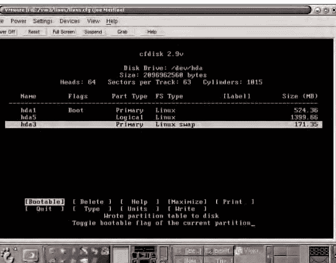

5. 使用 `cfdisk` 屏幕底部显示的选项配置分区表。
6. 对于你创建的每个分区，选择以 `MB` 为单位的分区大小和分区类型。注意，随着你继续创建分区，可用空闲空间会不断缩小。类型取决于你的需求：Linux 支持多种文件系统类型。假设你只需要一个普通分区，请选择类型 `83`，这是普通文件系统类型，也称为 `ext2` 或第二个扩展文件系统。
7. 当你完成创建所有需要的分区后，选择 `Write`（写入）选项。这将你的更改提交到分区表。


# 磁盘分区

每个分区将由 `cfdisk` 程序命名。第一个分区通常被称为 `hdb1`，第二个是 `hdb2`，以此类推。这些名称是对应设备的名称。

## FreeBSD

在 BSD 变体中，磁盘分区被称为切片（slices）。创建切片的步骤与 Linux 分区非常相似。

1. 将磁盘连接到机器。
2. 重启机器。
3. 以 root 身份登录。
4. 使用 `fdisk` 程序。`fdisk` 是 `cfdisk` 的旧版本，用于编辑分区表。
5. 选择 `sysinstall`，如图 30.2 所示。
6. （可选）如果新磁盘没有出现，检查 `/var/run/dmesg` 查看是否有错误信息。
7. 选择 `da1`（如果名称不同）。
8. 如果你想让操作系统使用新磁盘，选择 `A`。
9. 当程序询问是否希望让新磁盘与未来的操作系统兼容时，回答 `Yes`。
10. 选择 `W` 将更改写入磁盘。
11. 选择 `Q` 退出分区编辑器。
12. 当程序询问是否要对主引导记录进行更改时，选择 `None`。
13. 选择磁盘标签编辑器（Disk Label Editor）创建实际的磁盘分区。FreeBSD 磁盘可以分为八个或更少的分区，命名为 a-h。a 分区始终用于根分区，b 分区是交换分区，c 分区用于专用空间。当你将 d、e、f、g 和 h 分区标签用于任何用途时，安装程序默认将 e 分区标签用于新的交换分区。
14. 在磁盘标签编辑器中选择 `C` 创建单个文件系统。
15. 当程序询问此是文件系统还是交换分区时，选择 `FS` 并定义文件系统的挂载点。
16. 选择 `W` 将新标签写入磁盘。注意安装可能会返回多个错误信息。忽略它们。
17. 选择 `Q` 退出标签编辑器。
18. 选择 `Exit` 退出安装。

```
mk2fs /dev/hdb1
```

## Solaris 下的磁盘分区

在 Solaris 下创建新的磁盘卷，你必须使用 Solaris 格式化工具（formatting utility）。与其他示例类似，我们假设你正在向现有系统添加第二块硬盘。

在 Solaris 下进行磁盘分区工作时，理解“空闲占用区”（free hog slice）概念非常重要。（不，这和香肠披萨没有任何关系。）free hog slice 是由 `format` 工具创建的默认磁盘卷，包含了所有未分配给其他卷的磁盘空间。当你向新卷添加磁盘空间时，free hog slice 会从其自身的容量中释放空间；而当你减小分区大小或将其删除时，free hog slice 就会占用这部分容量。在下文流程的第 8 步中，free hog slice 变得至关重要。

按照以下流程创建新卷：

1. 连接到机器。
2. 重启机器。
3. 使用 `su` 登录 root 账户。只有 root 用户可以运行 format 程序。
4. 在 shell 提示符下输入命令 `format` 命令。你将进入 format 工具自身的 shell 环境，该环境的提示符如下：

   ```
   format>
   ```

5. 在提示符下输入 `partition` 命令进入分区模式。你应该会看到提示符变为：

   ```
   partition>
   ```

6. （可选）如果你想将当前卷表打印到屏幕，可以通过输入 `print` 命令来实现。
7. 输入 `modify` 命令开始处理新分区。提示符应该如下所示：

   ```
   Choose base (enter number) [0]?
   ```

   此时，你需要通知 free hog slice 它必须为新分区腾出一些磁盘空间。

8. 在提示符处输入 1 并按回车。你将看到以下确认消息：

   ```
   Do you wish to continue creating a new partition based on above table[yes]?
   ```

   （你希望根据上表继续创建一个新分区吗？）

9. 回答 yes 或按回车。程序提示你创建新分区。按照提出的每个问题进行回答。每个卷被创建后，你将看到新的分区表和问题：

   ```
   Okay to make this the current partition table[no]?
   ```

   （确定将其作为当前分区表吗？）

10. 不断回答 no，直到你完成所有想要创建的分区的创建。
11. 完成卷的创建后，回答 yes。你将看到一个新的提示符：


Enter table name (remember quotes): 输入表名（记得带引号）：

- 12. 输入带引号的表名，例如 `partition-table`。
  你将看到一个新的提示符：`Ready to label disk, continue?`（准备好标记磁盘，继续吗？）
- 13. 回答 `yes`。
- 14. 输入命令 `q` 退出分区模式。你将返回到 `format>` 提示符。
- 15. 输入命令 `verify` 查看新的分区表并检查其准确性。
- 16. 如果没有问题，输入命令 `q` 退出 Solaris format 工具。现在你应该能够看到并使用新卷了。

## 物理媒体与文件系统

在本章的目前为止，我们讨论了物理媒体的细节：磁盘、驱动器和分区。我们还没有讨论这些项目如何作为一个可用的文件系统协同工作，以管理计算机中的数据。在本节中，我们将解释 Unix 文件系统是如何工作的。

一个 Unix 文件系统包含一个根目录，以及该目录下包含的所有子目录和文件。`/` 目录是一个文件系统，`/usr` 和 `/usr/bin` 目录也是。每个文件系统都属于其上层文件系统，并包含在那些文件系统中，尽管那些文件系统并不包含在其中。Unix 中的一切都是文件，无论是文本文件、目录、程序、图形图像还是系统中的任何其他项目。一个普通的 Unix 系统包含成千上万个独立文件；处理这些文件并防止它们相互产生问题的方法，在多年来通过 Unix 的各种演变已经开发出来。

如你所知，Unix 将物理驱动器和分区表示为 `dev` 目录中的条目。每个驱动器或设备的命名方式在不同变体之间差异很大。在 Linux 下，主驱动器上的第一个分区表示为 `/dev/hda1`。如果有第二块硬盘，它将被表示为 `/dev/hdb`。

> **注意**
>
> 如果你在 Linux 2.4 版本发布后阅读此书，设备命名结构将会有所不同。

在 FreeBSD 中，相同的第一个分区表示为 `/dev/rda1`；在 Solaris 下，该分区可能被称为 `/dev/c0ds1`。尽管设备名称看起来很晦涩，但它们是有逻辑的。你特定操作系统的文档应该能帮助你破译正确的名称。

> **提示**
>
> 设备名称通常按照这种顺序标识设备控制器、磁盘和分区。

好奇的读者现在可能会感到困惑。如果你知道硬盘上的文件具有诸如 `/home/filename` 的名称，那么这些文件名与文件存储在名为 `/dev/hda1` 的设备上的事实是如何关联的呢？正确的名称难道不是 `/dev/hda1/home/filename` 吗？这是一个合理的问题。但答案很简单。`dev` 目录中的条目仅用于让操作系统访问硬件。要使用存储在设备上的文件，必须将其挂载（可用）。

## 挂载分区

挂载分区是一个相当过程。要挂载分区，你必须创建一个挂载点。挂载点只是一个与要挂载的文件系统同名的空目录。例如，如果你的 `/dev/hda6` 文件系统你想挂载到 `/home`，那么 `/home` 就是挂载点。

挂载点并没有特殊之处。你可以像创建其他目录一样创建它，使用 `mkdir` 命令，语法如下：

```
mkdir mountpoint
```

例如，为了创建上文提到的挂载点，执行命令：

```
mkdir /home
```

你已经在 `/` 下创建了一个名为 home 的目录。要将 `/dev/hda6` 挂载到该挂载点，使用 `mount` 命令。`mount` 的语法如下：

```
mount [options] <device> <mount point>
```

`mount` 的选项随操作系统而异，请检查 `mount` 的手册页（输入 `man mount`）以了解你系统所使用的版本。如果你在 Linux 上挂载标准分区，可能会执行命令 `mount /dev/hda6 /home`。在某些系统中，你需要指定文件类型，例如 `mount -t ext2 /dev/hda6 /home`。FreeBSD 的 `mount` 类似。

一旦使用了某个文件系统，你可能想卸载它以便移除驱动器（如果是软盘或光驱），或者只需减少可用文件系统的数量。使用 `umount` 命令卸载驱动器，语法如下：

```
umount filesystem
```

这比挂载驱动器简单，因为你不需要指定文件类型或要挂载的文件的位置。你只需要告诉操作系统要卸载哪个文件系统，操作系统就会处理其余部分。

> `umount` 中只有一个 `n`。如果你输入 `unmount`，会收到错误消息。Unix 中没有 `unmount` 命令。

> 永远不要从未卸载的驱动器上移除磁盘。可能会损坏驱动器或操作系统。在完成对驱动文件系统的操作后，养成卸载的习惯。

## 自动挂载

你可能有很多希望计算机启动时就挂载的分区。每次启动计算机都手动挂载一组分区是非常麻烦的。幸运的是，你可以设置一系列分区自动挂载，这可以节省你的时间。

### Linux 和 FreeBSD 下的自动挂载

自动挂载在 FreeBSD 和 Linux 系统中通过 `/etc/fstab` 文件控制。Linux 和 FreeBSD 分区程序会在分区创建过程中自动编辑 `/etc/fstab`。典型的 `/etc/fstab` 文件如下：

| 设备 | 挂载点 | 类型 | 选项 | df pn |
|---|---|---|---|---|
| /dev/hda1 | | ext2 | defaults | 1 1 |
| /dev/hda6 | /home | ext2 | defaults | 1 2 |
| /dev/hda7 | /misc | ext2 | defaults | 1 2 |

# 第 30 章 磁盘与文件系统管理

| 设备 | 挂载点 | 类型 | 选项 | df pn |
|---|---|---|---|---|
| /dev/hda9 | /tmp | ext2 | defaults | 1 2 |
| /dev/hda5 | /usr | ext2 | defaults | 1 2 |
| /dev/hda8 | /var | ext2 | defaults | 1 2 |
| /dev/hda10 | swap | swap | defaults | 0 0 |
| /dev/hdb1 | /vm1 | ext2 | defaults | 1 2 |
| /dev/hdb2 | /vm2 | ext2 | defaults | 1 2 |
| /dev/hdb3 | /vm3 | ext2 | defaults | 1 2 |
| /dev/hdb5 | /cd-master | ext2 | defaults | 1 2 |
| /dev/hdb6 | /stor0 | ext2 | defaults | 1 2 |
| /dev/hdb7 | /stor1 | ext2 | defaults | 1 2 |
| none | /proc | proc | defaults | 0 0 |
| none | /dev/pts | devpts gid=5,mode=620 | | 0 0 |

你可以看到，此文件覆盖的系统有许多分区：`/etc/fstab` 条目的通用格式为：

| 设备 | 挂载点 | 类型 | 选项 | df pn |
|---|---|---|---|---|

前三个元素是显而易见的。后三个元素引入了新概念：

> **options：** 挂载选项，用于补充直接与 `mount` 命令一起使用的选项。
>
> **df：** 转储频率（即该条目中指定的文件系统应多久使用一次 `dump` 命令进行备份）。1 意味着每天一次，2 意味着每两天一次，以此类推。
>
> **pn：** 检查次数（指示使用 `fsck` 命令检查这些文件系统的顺序，该过程发生在系统启动时）。根文件系统的检查次数必须为 1。如果你想为剩余分区指定顺序，请使用序数：2、3 等。如果你不在乎文件系统检查的顺序，请将该分区设为 1，将剩余分区设为 2。这样 `fsck` 将按字母顺序检查各个分区。

### Solaris 下的自动挂载

在 Solaris 下，用于自动挂载的相关文件是 `/etc/vfstab`。该文件中的条目格式与 FreeBSD 和 Linux 的 `/etc/fstab` 文件略有不同：

| 设备 | 挂载点 | FS 类型 | fsck 检查 | 启动时挂载 | 选项 |
|---|---|---|---|---|---|

各个元素与 `/etc/fstab` 中的元素相似，但在术语上有所不同。

- **device to mount（待挂载设备）**：设备名称。
- **device to fsck（待检查设备）**：同样是设备名称。
- **mount point（挂载点）**：挂载点的名称。
- **FS type（FS 类型）**：文件系统类型。
- **fsck pass（fsck 检查）**：如上一节所述的*检查次数* (pn)。
- **mount at boot（启动挂载）**：如果分区应在启动时挂载，则值为 `yes`；如果需要手动挂载，则为 `no`。
- **mount options（挂载选项）**：在启动时运行 `/etc/vfstab` 文件时传递给 `mount` 命令的各种选项。

因此，`/etc/vfstab` 中的一个典型条目可能如下：


`/dev/msk/c0t3d07 /dev/rdsk/c0t3d07 /files1 ufs 2 yes`

这些文件路径指定了启动时要挂载的分区。你也可以通过 `mount` 命令的 `-a` 标志挂载 `/etc/vfstab` 文件中指定的所有分区，例如 `mount -a`。

## 挂载远程分区

由于 Unix 的高度网络化特性，物理连接到本地机器的磁盘并不可以使用名为 NFS（网络文件系统）的服务从远程机器挂载分区，前提是本地机器拥有权限。

> 某些系统使用远程分区来处理用户目录。用户目录保留在中央机器上；当用户想要访问其目录时，她登录到本地工作站并从远程机器挂载该目录。

# Linux 和 FreeBSD 下的挂载目录

从远程机器挂载文件系统，如果两台机器都使用 Linux 或 FreeBSD，你可以像处理本地文件系统一样使用 `mount` 命令。然而，你必须在 FS 字段中指定文件类型为 `nfs`，并且指定远程机器以及要挂载的文件名称。一个典型的网络命令如下：

```
mount -t nfs fido:/export /import
```

其中 `fido` 是远程机器的名称。

在执行此命令之前，你必须在 `fido` 机器上设置导出的文件系统。此过程有两个步骤：首先，确保 `fido` 的 NFS 服务器正在运行；其次，在 `fido` 的 `/etc/exports` 文件中放置一个条目，显示哪些机器有权远程挂载 `/export`。

你在 `/etc/exports` 中的条目可能采用此形式：

```
/export
```

其中 `bower` 是有权挂载导出目录的机器。通常，`etc/exports` 中的条目使用语法：

```
directory remotemachine (options)
```

`/etc/exports` 的选项有很多，你可以了解更多关于它们的信息。

# Solaris 下的自动挂载

在 Solaris 下，用于自动挂载的相关文件是 `/etc/vfstab`。该文件中的条目格式与 FreeBSD 和 Linux `/etc/fstab` 文件略有不同。

| 设备 | 挂载点 | FS 类型 | fsck 检查 | 启动时挂载 | 选项 |
|---|---|---|---|---|---|

各个元素与 `/etc/fstab` 中的元素相似，但在术语上有所不同。

- **device to mount（待挂载设备）**：设备名称。
- **device to fsck（待检查设备）**：同样是设备名称。
- **mount point（挂载点）**：挂载点的名称。
- **FS type（FS 类型）**：文件系统类型。
- **fsck pass（fsck 检查）**：如上一节所述的*检查次数* (pn)。
- **mount at boot（启动挂载）**：如果分区应在启动时挂载，则值为 `yes`；如果需要手动挂载，则为 `no`。
- **mount options（挂载选项）**：在启动时运行 `/etc/vfstab` 文件时传递给 `mount` 命令的各种选项。

因此，`/etc/vfstab` 中的一个典型条目可能如下：

`/dev/msk/c0t3d07 /dev/rdsk/c0t3d07 /files1 ufs 2 yes`

这些文件路径指定了启动时要挂载的分区。你也可以通过 `mount` 命令的 `-a` 标志挂载 `/etc/vfstab` 文件中指定的所有分区，例如 `mount -a`。

# Linux 和 FreeBSD 下的挂载目录

从远程机器挂载文件系统，如果两台机器都使用 Linux 或 FreeBSD，你可以像处理本地文件系统一样使用 `mount` 命令。然而，你必须在 FS 字段中指定文件类型为 `nfs`，并且指定远程机器以及要挂载的文件。一个典型的网络命令如下：

```
mount -t nfs fido:/export /import
```

其中 `fido` 是远程机器的名称。

在执行此命令之前，你必须在 `fido` 机器上设置导出的文件系统，以便文件系统可以被导出。此过程有两个步骤：首先，确保 `fido` 的 NFS 服务器正在运行；其次，在 `fido` 的 `/etc/exports` 文件中放置一个条目，显示哪些机器有权远程挂载 `/export` 文件系统。

你在 `/etc/exports` 中的条目可能采用此形式：

```
/export
```

其中 `bower` 是有权挂载导出目录的机器。通常，`etc/exports` 中的条目使用语法：

```
directory remotemachine (options)
```

`/etc/exports` 的选项有很多，你可以了解更多关于它们的信息。

# Solaris 下的自动挂载

在 Solaris 下，用于自动挂载的相关文件是 `/etc/vfstab`。该文件中的条目格式与 FreeBSD 和 Linux `/etc/fstab` 文件略有不同。

| 设备 | 挂载点 | FS 类型 | fsck 检查 | 启动时挂载 | 选项 |
|---|---|---|---|---|---|

各个元素与 `/etc/fstab` 中的元素相似，但在术语上有所不同。

- **device to mount（待挂载设备）**：设备名称。
- **device to fsck（待检查设备）**：同样是设备名称。
- **mount point（挂载点）**：挂载点的名称。
- **FS type（FS 类型）**：文件系统类型。
- **fsck pass（fsck 检查）**：如上一节所述的*检查次数* (pn)。
- **mount at boot（启动挂载）**：如果分区应在启动时挂载，则值为 `yes`；如果需要手动挂载，则为 `no`。
- **mount options（挂载选项）**：在启动时运行 `/etc/vfstab` 文件时传递给 `mount` 命令的各种选项。

因此，`/etc/vfstab` 中的一个典型条目可能如下：

`/dev/msk/c0t3d07 /dev/rdsk/c0t3d07 /files1 ufs 2 yes`

这些文件路径指定了启动时要挂载的分区。你也可以通过 `mount` 命令的 `-a` 标志挂载 `/etc/vfstab` 文件中指定的所有分区，例如 `mount -a`。

# Linux 和 FreeBSD 下的挂载目录

从远程机器挂载文件系统，如果两台机器都使用 Linux 或 FreeBSD，你可以像处理本地文件系统一样使用 `mount` 命令。然而，你必须在 FS 字段中指定文件类型为 `nfs`，并且指定远程机器以及要挂载的文件。一个典型的网络命令如下：

```
mount -t nfs fido:/export /import
```

其中 `fido` 是远程机器的名称。

在执行此命令之前，你必须在 `fido` 机器上设置导出的文件系统，以便文件系统可以被导出。此过程有两个步骤：首先，确保 `fido` 的 NFS 服务器正在运行；其次，在 `fido` 的 `/etc/exports` 文件中放置一个条目，显示哪些机器有权远程挂载 `/export` 文件系统。

你在 `/etc/exports` 中的条目可能采用此形式：

```
/export
```

其中 `bower` 是有权挂载导出目录的机器。通常，`etc/exports` 中的条目使用语法：

```
directory remotemachine (options)
```

`/etc/exports` 的选项有很多，你可以了解更多关于它们的信息。

## 总结

计算机磁盘可以分为两类：磁性和光盘。磁性磁盘是使用柔性磁盘的磁盘；光盘使用激光读取刻在塑料上的微观结构；CD-ROM 和 DVD 属于光盘。大多数计算机系统都具有磁性和光盘。Unix 将所有设备视为文件系统。事实上，硬盘可以划分为许多分区，对于许多变体来说，这些被称为端口（ports）。

无论你使用的是哪种 Unix 变体，你可能都有一个商业软件包软件的替代方案。非商业性的 Unix 程序几乎总是以纯源代码的形式发布，你可以在任何 Unix 计算机上从源代码安装软件。商业程序有时也会以源代码发布，共享软件或其他低成本程序也是如此。

源代码本质上是程序员的输出；这些输出可能会被重新封装或稍作修改，以更好地适应各个 Unix 变体，但源代码最接近程序开发者完成的原始工作。大多数 Unix 软件是用 C 或 C++ 编程语言编写的。这些语言在计算领域非常通用，而 Unix 本身是用 C 语言编写的；你无法直接运行源代码。

你从光盘或归档中下载的文件可以被安装和使用。编译是将人类可读的代码（即源代码）转换为机器可读的二进制文件的过程。编译软件在很大程度上是一个自动化过程，无论安装的软件类型如何，其任务都是相同的。

## 警告

某些软件包对于此处描述的过程需要不同的安装程序。如果你遇到这些软件包之一，请确保在开始之前已经知道正确的程序。错误地安装可能会给你的整台机器带来问题。一如往常，在安装之前，请阅读软件包包含的 README 文件或其他文档。在网络上检查更新或说明也是一个好主意。


源代码的替代方案是为特定 Unix 变体设计的软件包。奇怪的是，获得个性化软件包最多的变体正是本书涵盖的变体：Linux、FreeBSD、Solaris。这些专用软件包在发布之前经过了配置，以便尽可能容易地安装到为其设计的特定变体。例如，Solaris 软件包旨在使用 Solaris 特定的目录结构，而 Linux 软件包利用了内核或特定发行版中的某些功能，这些版本有自己的包格式。FreeBSD 软件包被称为 ports，通过一组定义特定端口架构的骨架文件工作。

这些基于变体的软件包通常使用包管理工具安装。包管理工具的设计目的是为用户提供一个更友好、更简单的软件安装界面。随着 Unix 世界的增长，这些工具变得越来越复杂，某些包管理工具现在具有自动更新功能、已安装软件数据库，或扩展的标志和功能，使得管理工作变得轻而易举。我们将在章的“Unix 变体的软件管理”部分介绍一些流行的包管理工具。

## 从源代码编译软件

当你在软件归档或磁盘上找到源代码软件包时，它们通常以 tarball 格式打包。正如我们在其他地方提到的，tarball 是由 `tar` 程序创建的压缩归档文件的昵称。你可以通过文件名扩展名 `.tar.gz` 或 `.tgz` 来识别 tarball。扩展名中的 gzip 部分表示该 tar 包也经过了 `gzip` 压缩程序的压缩。`tar` 和 `gzip` 的结合创建了一个紧凑的文件，可以以最小的延迟或麻烦进行电子传输。与其他格式的软件软件包一样，tarball 通常包含文档、配置文件以及程序本身的代码。

> **注意**
>
> `Zip` 和 `Stuffit` 程序分别是 `tar` 和 `gzip` 在 Windows 和麦金塔（Macintosh）上的对应程序。你可以使用 `gzip` 程序解压缩用 Windows 版本的 `Zip` 压缩的文件，但 `gzip` 对 stuffed file 归档的效果并不理想。如果可能，请使用与最初压缩文件时相同的操作系统来处理压缩归档文件。

在处理源代码时，你必须首先找到源代码软件包。随书附带的光盘上有相当多的软件包，这可能是一个很好的开始地点。你也可以在网络上的任何 Unix 软件归档中找到源代码软件包，或从商业软件开发者或分销商处购买。

无论软件包的来源如何，你都应该在下载或从磁盘传输后选择一个一致的地方存放它们。我们建议使用 `/tmp` 目录作为开始安装源代码的地方。为什么用 `/tmp`？正如名称所示，该目录是临时的。在软件包安装期间，它会在硬盘上的不同位置创建新目录。一旦程序正确安装，你就可以毫无顾虑地清理 `/tmp`，因为那里没有保留系统关键文件。在用于持续系统用途的目录（如 `/etc` 或 `/usr/sbin`）中这要困难得多。因此，使用 `/tmp` 是一个解决方案，我们鼓励你在下载或将未编译软件包传输到硬盘时，将它们放在那里。

> **提示**
>
> 你也可以使用 `/usr/src` 目录，但在安装后清理它时需要小心一点。某些文件需要留在 `/usr/src` 中；没有任何东西必须永久留在 `/tmp` 中。

一旦你将源代码软件包放在 `/tmp` 目录中，就可以开始安装软件。首先，在 shell 提示符输入以下命令解压归档：

```
tar xvf filename
```

此命令解压缩归档并将每个文件扩展到原始大小。根据 tarball 中文件的数量，你可能会看到屏幕上打印出几个文件，或者看到一个文件列表滚动而过。

当名称停止打印到屏幕上时，输入命令 `ls`。你应该会在 `/tmp` 下看到一个类似于程序名的子目录。通过输入 `cd` 命令进入该目录，并再次使用 `ls` 列出内容。你应该看到一个名为 `README` 或 `INSTALL` 或类似的文件。这些文件通常全大写，以表明它们很重要。用你喜欢的文本编辑器阅读该文件。该文件包含了开发者的更新信息，以及在安装期间需要采取的特殊情况。

无论软件包中可能包含什么特殊说明，从源代码安装软件的过程都可以分为三个通用步骤。这些步骤通常由归档中包含的专用程序或文件增强。如果你发现某个 tarball 出某些原因没有 `README` 或 `INSTALL` 文件，请尝试以下步骤安装程序。可能你将成功安装软件。

### 配置软件包

许多软件包通过归档中包含的脚本文件帮助你自动配置程序，该文件被称为 `configure`、`configure1`、`configure.sh` 或类似的名称。如果存在该文件，`README` 文件将提示你该文件的实际名称。

该脚本将在你的机器上运行一些测试，以确定你的硬件和软件配置，以便程序能够按照你的精确规格进行安装。如果程序需要系统文件，`configure` 脚本将检查它们是否存在。

一旦脚本完成工作，它会生成一个名为 `Makefile` 的新文件。图 31.1 显示了示例 `Makefile`。阅读你系统中创建的任何 `Makefile` 都是一个好主意，因为错误信息会发送到此文件中。然后你可以在实际安装软件之前修复系统错误或在需要时添加所需的文件。

### 构建软件包

一旦脚本运行成功并且你解决了 `Makefile` 中报告的任何问题，就可以开始编译软件了。在 Unix 术语中，程序的编译通常被称为构建（build）。在这一步中，你将为实际安装准备源代码。代码本身不会执行程序运行所需的任务，因此你需要通过编译器运行源代码，将代码翻译成机器可读的指令。

要开始构建软件包，在 shell 提示符处输入命令 `make`。`make` 调用编译器，即将代码转换为机器可读二进制文件的程序。大多数程序使用基础的 `cc`（C 编译器），几乎所有的 Unix 变体都会默认安装它。如果你正在编译自由软件或具有强烈自由软件组件的软件，你需要使用 `gcc`（GNU C 编译器）。随书附的光盘中包含了 `gcc`。

> **注意**
>
> 用其他编程语言编写的程序可能需要不同的编译器；你可以通过 `README` 文件、`Makefile` 中的错误信息，或者你获取 tarball 的软件存档或网页上的文档来确定。

`make` 使用 `Makefile` 作为其工作的蓝图。`make` 获取压缩包中包含源码文件并通过 `gcc` 运行它们，将输出链接到计算机可执行的单一二进制文件中。当 `make` 完成时，你将返回命令行提示符，并进入该过程的最后一步。

### 安装软件包

当软件包编译完成后，你可以将可执行二进制文件安装为实际程序。一旦文件安装完成，你就可以使用单单词命令以及程序所需的任何标志来调用该程序。你还应该能够调用程序的帮助页，该页面作为安装过程的一部分被安装。

要安装二进制文件，请在 shell 提示符处输入 `make install` 命令。该命令将二进制文件移动到正确的目录（`/tmp` 之外），并安装压缩包包含的任何所需的配置或文档文件。你可以进入 `/etc` 目录并查找配置文件（如果该程序使用了它们），以使程序适应你的个人需求。如果程序的新目录包含 `/doc` 子目录，请检查目录中的文件，以查看你需要进行哪些配置。

一旦提示符返回到你的屏幕，程序已安装在它的新位置。你现在可以像使用计算机上已安装的任何程序一样使用它。如果你想在不使用完整目录路径的情况下调用该程序，可能希望将新程序的目录放入你的 `PATH` 环境变量中。

最后一步是清理。返回 `/tmp` 目录并删除安装过程中留下的任何文件。你可以完全清理 `/tmp`，因为程序所需的所有文件已移动或复制到它们的永久位置。不要在 `/tmp` 中留下大量垃圾。

> **提示**
>
> 你可能想将原始的 tarball 存储在硬盘上的一个源码存档中，尽管这并非必须。当你再次需要它时，可能已经发布了比你刚刚安装的版本更好的版本。唯一的例外是那些不再开发的代码和程序；保留 tarball 可能很有用，以防你日后发现该软件的副本。如果你保存了 tarball，考虑将其保留在 `/usr/src` 目录中。拥有一个存储源码的单一目录是一个好习惯。

## Unix 变体的软件管理

尽管源码在每个 Unix 变体上都应该是通用的，但事实并非如此。Unix 变体之间的个体差异以及为了适应这些变化所必要的调整，导致源码并非针对任何 Unix 变体专门定制，因此可能无法与你的安装版本 100% 兼容。也就是说，源码可以在大多数不同的 Unix 上使用，但几乎从没有完美匹配。

为了让代码与操作系统之间获得最佳匹配，用户需要找到并安装为特定操作系统定制的软件。问题是，这种特定的软件并不总是存在，或者它可能适用于多个 Unix 变体，但其中没有一个是你需要的。本书涵盖的 Unix 是那些你最有可能找到特定端口（ports）的系统，这些每种操作系统都有独特的安装处理方式。

> **提示**
>
> 你可以在 Linux、FreeBSD 和 Solaris 上安装源码。但是，如果你能找到你特定变体的端口程序，请使用它。它更有可能开箱即用，而且与纯源码相比，你可能需要进行较少的配置。

### Linux


Linux 用户在处理软件安装和管理方面有多种选择。许多 Linux 用户倾向于直接处理源码，但大多数 Linux 用户在至少部分需求上会使用软件包管理软件。当软件被移植到 Linux 时，它通常是以一个（或两个）流行的 Linux 软件包管理程序所要求的格式移植的，而不是作为专为 Linux 设计并意图作为源码安装的源码。

Linux 下的两个主要的软件包管理程序是为两个最流行的 Linux 发行版创建的。Debian 软件包管理器（`dpkg`）和 Red Hat 软件包管理器（`rpm`）可以用于任何 Linux 发行版——而不仅仅是 Debian 或 Red Hat。事实上，你可以在 Red Hat 机器上运行 `dpkg` 或在 Debian 机器上运行 `rpm`；这些格式之间没有互斥性。在本章的这一节中，我们将解释如何使用这两个程序安装软件。

> **提示** 如果你运行 Linux，无论你选择哪种发行版，我们都建议安装这两个软件包管理器。当你发现只有一种 Linux 导向格式的包时，这可能会被证明有用。然而，请注意，为不同发行版设计的软件包管理器可能会将文件放在不适合你发行版的目录中。如果你选择运行不是你发行版原生的软件包管理器，你必须检查文件系统以了解通过软件包管理器安装的文件的位置。

# dpkg: Debian 软件包管理器

实际上有多个 Debian 软件包管理器，`dpkg` 是 Debian 工具中最容易学习和使用的。`dpkg` 是一个处理软件安装、升级和删除的命令行工具。（我们将在章的下一节中介绍 `dselect`，它是 `dpkg` 的图形界面。）注意，你必须登录 root 账户才能使用 `dpkg`。

Debian 软件包广泛可用。如果你正在寻找软件存档，可以使用带有 `.deb` 扩展名的 `debian` 软件包。Debian 软件包使用以下命名约定：

```
name-version-build
```

例如 `flowerpot_2.3-1`，这里的 `build` 标识了程序的特定编译版本。大多数用户只需要关心版本号，而不是特定的构建号。

## 使用 dpkg 安装软件包

要使用 `dpkg` 安装软件包，首先将 `.deb` 软件包下载到你的硬盘。切换到下载包所在的目录，并在 shell 提示符处执行命令：

```
dpkg -i name-version-build
```

当信息滚动过去后，软件包将安装在正确的位置。你也可以根据意愿删除或存储原始文件。

## 使用 dpkg 删除软件包

你也可以使用 `dpkg` 删除你不再需要的包。使用 `dpkg` 而不是手动删除文件的优势在于，`dpkg` 会捕捉所有与程序相关的文档和配置文件。要删除软件包，只需执行命令：

```
dpkg -r name
```

你不需要提供版本号、构建号或 `.deb` 后缀，名称与原始包相同；但有时也会不同。记录与程序名称不同的包名以便以后更容易删除。

默认情况下，`dpkg` 在删除特定程序时不删除共享文件。共享文件是那些随一个包安装但被多个程序使用的文件。可以通过执行 `dpkg -r --purge name` 在删除包时删除共享文件，但要注意，如果发现并删除了共享文件，依赖它们的其他程序可能无法正常工作。

## 使用 dpkg 升级

当你升级软件时可以使用 `dpkg`，如果你下载了已安装在计算机上的程序的更新版本或构建版本，`dpkg` 将只安装新版本中更改的文件。如果新包中的某些文件与已安装的文件相同，你不会得到重复文件。

## dselect: dpkg 的图形界面

如果你更倾向于使用图形界面而不是在命令行工作，你可能更喜欢使用 `dselect` 来满足软件包管理需求。`dselect` 不是一个独立的程序；它只是 `dpkg` 的前端，为不喜欢文本命令的人提供了一个图形框架。它是一个全屏且菜单驱动的程序，对某些人可能更容易。

`dselect` 还作为 `apt-get` 程序的前端，`apt-get` 是一个用于跨网络安装程序的 Debian 工具。也就是说，你可以使用 `apt-get` 直接从软件存档安装程序，无需先下载。

在命令行提示符处通过命令 `dselect` 调用 `dselect`。程序将启动。浏览菜单查找安装、删除、配置和升级 Debian 软件包的各种选项。

电脑。使用键盘上的方向键进行选择，或者使用每个菜单项旁边的数字。`dselect` 可以处理硬盘上的包、已挂载驱动器（如 CD-ROM）上的包或跨网络处理包。使用 `dselect` 是操作 Debian 的方便方法。

# rpm: Red Hat 包管理器

Linux 的另一个主导包管理工具是 Red Hat 的 `rpm` 程序。与 `dpkg` 相比，使用 `rpm` 是管理安装和删除特殊配置包的简单方法。与 `dpkg` 不同，`rpm` 拥有一套高级工具，可以在安装之前检查你是否已经安装了该包的较早版本，或者你是否安装了其他与建议包冲突的软件。

虽然 `rpm` 是一个基于文本的工具，但也有各种图形界面。检查你的 Linux 窗口管理器或集成桌面。Gnome rpm 界面 GnoRPM 如图 31.2 所示。如果你更喜欢视觉化界面，可以尝试其中一个。

**图 31.2：**

nGnoRPM 是 Gnome 集成桌面中用于 `rpm` 的图形化界面。

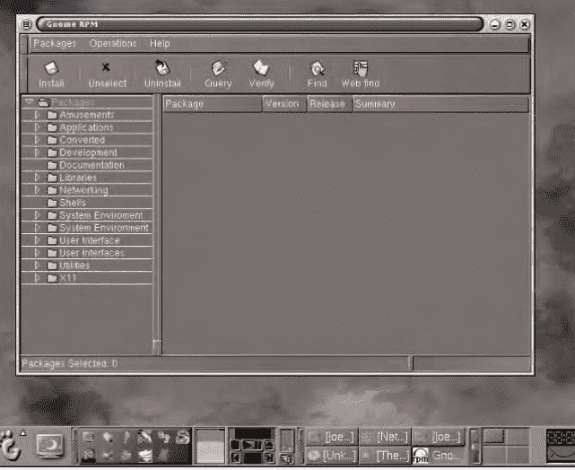

# Unix 变体的软件管理

Red Hat 包和 Debian 包一样广泛可用，在某些归档中，它们比 Debian 格式更容易找到。Red Hat 包使用独特的命名语法：

```
<名称>-<版本号>-<构建号>.<架构>.rpm
```

因此，包名 `flowerpot-2.3.1-2.i386 rpm` 是 flowerpot 程序 2.3 版本的 1.2 构建版本，为 i386 (Intel) 架构构建。`.rpm` 扩展名包含一个配置为与 `rpm` 工具一起运行的包。

## 使用 rpm 安装

要用 `rpm` 安装包，请以 root 身份登录或假设超级用户权限。在提示符处输入命令：

```
rpm -i <name>-<version>-<build>-<architecture>.rpm
```

如果你更倾向于以详细模式运行 `rpm`，以便查看安装过程生成的各种系统消息，请执行此命令：

```
rpm -ivh <name>-<version>-<build>-<architecture>.rpm
```

- `-vh` 标志同时显示系统消息和安装进度表，通过该表，安装进度显示为跨屏幕打印的一行 `#` 字符。注意，除非安装失败，否则使用 `-vh` 标志不会看到许多系统消息。尽管如此，在每次安装时你都会看到进度表，如图 31.3 所示。

如果你想用 `rpm` 从网络上的远程位置（或互联网上的软件归档）安装程序，请执行命令 `rpm -ivh ftp://ftp.archive.org/directory/path/filename`，包括你要安装的包的完整 URL。

## 使用 rpm 移除

要用 `rpm` 移除包，在 shell 提示符处输入命令：

```
rpm -e <name>
```

与 `dpkg` 一样，你不需要包含版本号、构建号或架构。只需使用与原始包关联的名称。

**图 31.3：**

包管理器有一个可选的进度表来跟踪安装。

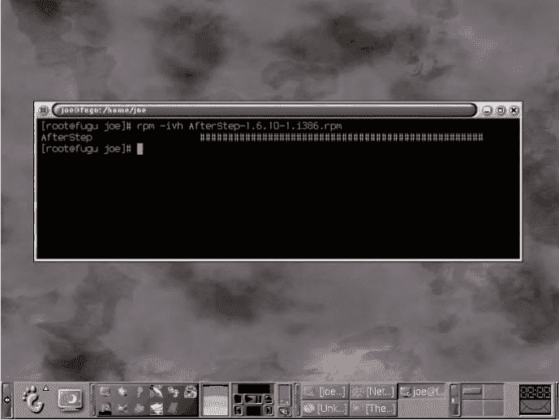

## 使用 rpm 升级

如果你下载了计算机上已安装的包的新版本，你可以使用 `rpm` 升级已安装的包。新文件将被安装，如果新版本中有更改，则现有文件将被升级。要用 `rpm` 升级，在 shell 提示符处输入命令：

```
rpm -U <name>-<version>-<build>-<architecture>.rpm
```

`rpm` 将把新包与已安装的版本进行比较，并根据需要进行更改。

## 使用 rpm 查询

`rpm` 的强大功能之一是查询。`rpm` 维护了系统中所有安装包的数据库，你可以通过 `rpm` 查询你是否安装了某个特定包。`rpm` 查询的基本语法是：

```
rpm -q <name>
```

在提示符处执行此命令。如果你想获取有关包的详细信息，可以使用 `-i`：

```
rpm -qi <name>
```

如果你想查看所有已安装的包，可以执行：

```
rpm -qa
```

如果你想查看某个包安装了哪些文件，可以使用：

```
rpm -ql <name>
```

如果你想查看某个文件是由哪个包安装的，可以使用：

```
rpm -qf <file>
```

如果你想查看某个包的摘要信息，可以使用：

```
rpm -qs <name>
```

如果你想查看某个包的更改历史，可以使用：

```
rpm -qc <name>
```

如果你想查看某个包的依赖关系，可以使用：

```
rpm -qR <name>
```

如果你想查看某个包的许可证信息，可以使用：

```
rpm -qL <name>
```

如果你想查看某个包的签名信息，可以使用：

```
rpm -qK <name>
```


```
rpm -qG <name>
```

如果你想查看某个包的构建日志，可以使用：

```
rpm -qT <name>
```

如果你想查看某个包的配置文件列表，可以使用：

```
rpm -qlc <name>
```

如果你想查看某个包的日志文件，可以使用：

```
rpm -qf <name>
```

# 第 31 节 安装与管理软件

它们的永久位置。当 shell 提示符返回时，端口将完成安装，并准备好接收软件包的代码文件。

提示：如果您想安装一个 FreeBSD CD-ROM 中未包含的端口，请在 `/usr/ports/` 下为该端口创建一个目录。当您运行 `make` 或 `make install` 时，FreeBSD 将尝试连接到外部 FTP 站点并下载该端口和源文件。其余的安装过程将正常进行。

## 移除端口

移除端口比安装端口还要简单。要从您的 FreeBSD 系统中移除端口，请切换到与端口相关的目录，例如 `cd /usr/ports/misc/Flowerpot`。当您处于端口目录时，在 shell 提示符下输入命令：

```bash
make deinstall
```

您将看到计算机输出的一行信息，告知程序正在卸载，然后 shell 提示符将返回。一旦看到提示符，即说明端口已卸载，所有相关的依赖项已清理。

如果由于某种原因，您想重新安装一个之前在系统中安装过并卸载的端口，请不要重复初始安装过程。相反，切换到该端口目录并输入命令：

```bash
make reinstall
```

这将恢复端口，而不会导致系统库和依赖项重复，因为在原始安装删除时，由于它们是共享文件而可能被保留了下来。

## 查找端口

如果您想获取了 FreeBSD 端口集合的每一个端口，可以使用简单的命令来实现。请注意，这可能需要一些时间，因此最好将其设置为夜间任务，或者在互联网连接未被流量占满的时间进行。如果您使用的是在连接一定时间后会断开的 ISP 连接，您可能希望分批获取端口。

要获取端口集合中的所有端口，请在 shell 提示符下输入以下命令：

```bash
cd /usr/ports
make fetch
```

FreeBSD 将连接到软件存档站点并下载所有列出的端口内容。您也可以通过在 `/usr/ports` 目录路径后添加子目录名称来下载特定的端口子目录。

如果您有兴趣为 FreeBSD 软件构建自己的端口，请参阅位于 http://www.freebsd.org/porters-handbook/index.html 的《端口维护者手册》（Porters' Handbook）。该文档包含了端口创建的标准协议，以及关于构建最具实用性端口的一些技巧。

### Solaris

Solaris 的软件包管理和软件安装同样简单。许多 Unix 程序提供 Solaris 端口，这些端口在 Solaris 上的运行效果比纯源代码更好。（当然，您也可以在 Solaris 上安装源代码；只需准备好花时间来配置软件，特别是目录位置。）

Solaris 软件包使用以下命名语法：

`name-version-os-processor-directory.gz`

因此，`flowerpot-2.3-sol17-intel-local1.gz` 将是 `flowerpot` 程序的 2.3 版本，该版本是为 Intel 芯片移植到 Solaris 7 的。此程序将默认安装到 `/local` 目录。

## 使用 pkgadd 安装

您可能正从 Web 或软件 FTP 存档下载您的 Solaris 软件包。将下载的文件放入 `/tmp` 目录；安装程序会将新程序及其相关文件放入新目录中；安装完成后，您可以清理 `/tmp`。

使用命令 `cd /tmp` 移动到 `/tmp` 目录。进入目录后，输入命令：

```bash
gunzip packagename
```

来解压文件。当归包解压时，您将看到文件名列表在屏幕滚动。

当 shell 提示符返回后，输入命令：

```bash
pkgadd -d packagename
```

`-d` 标志标识获取软件包的设备。它可以是一个目录路径或挂载点。注意，您必须以 root 身份登录才能使用 `pkgadd` 程序。

默认情况下，`pkgadd` 会安装到...提示...您需要 Solaris 空间。

> **提示**
>
> 如果您安装一个 Solaris 的可能会，可能会遇到 `无法 'as': 文件或或或 的，请检查 `bin/`。

## 使用 pkgrm 移除

删除软件包和安装它们一样简单。用于移除软件包的程序名为 `pkgrm`。要移除一个软件包，输入命令：

```bash
pkgrm filename
```

程序在删除之前会检查依赖项和共享文件。

如果您使用上述命令，`pkgrm` 将以交互模式运行。您可以通过以下命令以非交互模式运行 `pkgrm`：

```bash
pkgrm -n filename
```

当 `pkgrm` 完成时，它将返回一个退出值。退出值见表 31.2。

### 表 31.2：pkgrm 退出值

| 退出值 | 含义 |
| :--- | :--- |
| 0 | 软件包成功移除。 |
| 1 | 移除期间发生致命错误。 |
| 2 | 警告。进程中止。 |
| 3 | 中断。 |
| 4 | 管理。找不到指定文件。 |
| 10 | 移除后需要重启。 |
| 20 | 移除后需要重启。 |

## 跟进升级

跟进软件升级的方法是定期浏览 Web。有关操作系统升级的通知，请关注由分发商维护的站点。您可以在附录 B：“文档与资源”中找到这些站点列表。大多数站点都有关于新版本的板块。

如果您购买了商业软件，您可能在公司用于通知用户新版本的邮件列表中。同样，如果您参与了程序的开发，您将通过邮件列表和新闻组了解新补丁。您甚至可能将自己的补丁发布回小组。

对于 Free 软件和您从互联网下载的其他程序，您将需要自己跟进这些站点。例如，Solaris 用户可能会发现 Sunvare.com 站点是一个常去；它位于 http://smc.vnet.net，为 Solaris 安装提供了各种程序和软件包。Linux 用户存档如 Freshmeat (http://www.freshmeat.net) 将对存档的最新贡献放在首页。

### 总结

软件管理是系统管理中不可或缺的一部分。管理员必须关注操作系统的升级和新发布，以及系统软件和用户软件程序的升级。不经常进行升级的软件可能会有更大的安全风险，用户可能无法使用特定程序升级版本中的新功能或功能。不同的 Unix 变体以不同的方式处理软件安装和管理。许多程序以源代码格式发布，可以编译成任何 Unix 变体上的机器可读二进制文件。

许多商业程序仅以预编译包的形式发布，而且这些包必须在特定的 Unix 变体中获取。一旦获取了包，可以使用包管理器安装。包管理器也可以用于程序的删除和升级，或者从远程位置安装程序。无论使用何种方法来安装和管理软件，管理员都应该留出时间浏览网站以查看是否有新的发布或可用升级。

本页故意留白

# 第三十二章 了解内核

- 内核的作用
- 内核开发
- 模块与静态内核
- 在 Linux 和 FreeBSD 下编译内核
- 总结

## 内核的作用

这是一个有趣的概念，但内核可能很难理解。位于计算机核心的这个神秘不可触摸的东西是如何负责这么多？一个内核运行的示例可能会帮助。

考虑这样一个场景：用户启动 Netscape 浏览器。从用户的角度来看，这是一个非常简单的任务——只需点击图标、输入命令或从菜单中选择项目，浏览器就会出现在屏幕上。大多数用户认为这就是故事的结束，因为这种情况发生在每一个被调用的程序上。在用户看来，点击图标或选择菜单项启动了程序。

然而，从操作系统的角度来看，故事并没有那么简单。当点击图标或发布命令时，在程序启动之前必须执行许多任务。首先，鼠标点击或击键需要被识别和解释。然后，必须在硬盘上找到程序。必须在系统内存中为程序留出空间，然后从硬盘读取程序并加载到新创建的内存空间。最后，必须由处理器解释程序功能，以便程序在使用时运行得快速流畅。


这些任务中的每一项都需要计算机处理器参与，而且这些任务必须被调度到已经满了系统进程、其他程序需求和其他用户操作的活动列表中。协调所有任务是内核的工作。内核可以被看作计算机秘书和计算机交警的结合。

然而，它的作用不仅仅是调度。例如，当输入来自键盘时，输入是以电信号的形式到达的。内核的工作是将这些信号翻译成处理器可以理解的语言。其他硬件设备也是如此，如视频卡和声卡、网络接口、调制解调器、磁盘驱动器以及连接到系统的其他外设备。在这方面，内核就像联合翻译员，翻译各种组件的语言，使所有设备和外设备能够相互理解并协同工作。

当你考虑到流经内核的这一系列活动时，它是非常惊人的。内核负责计算机活动的大部分。现在，考虑一下一台 Unix 机器正在为几十甚至上百个用户处理这些进程。Unix 内核的形象开始显现：它是有以来存在的最高效的秘书/交警/翻译员，而用户甚至不需要意识到它的存在。

## 内核开发

每个版本的 Unix 都使用不同的内核。这是区分 Unix 变体的主要点之一。随着开发者考虑添加新特性或功能，或者处理现有的问题或疑虑，内核会不断适配。随着时间的推移，不同内核的代码库发生了分化，导致了依赖于变体的代码和编程。此外，由于至少部分代码需要针对内核运行的硬件平台特定，因此有为使用独特指令集的不同处理器芯片设计的内核变体。

商业 Unix（如 Solaris）由特定公司开发。例如，所有在 Solaris 上工作并为其内核贡献的程序员都是 Sun Microsystems 的员工。Sun 关于内核更改的决策由高层做出。

模块化内核包含一个核心二进制文件，但某些内核包含一些单独编译并在需要时才加载到内核中的组件。Linux、Solaris 和 FreeBSD 都可以使用模块化内核，尽管某些 Unix 变体需要静态内核。

本书涵盖的所有三个 Unix 变体在计算机首次安装操作系统时，都会安装一个通用内核。还会安装一组通用模块。如果你运行的是 Solaris，你将使用这个通用内核和模块集，因为 Sun 公司不提供内核的源代码（因此，非 Sun 程序员无法修改内核）。Linux 和 FreeBSD 用户可以从各种来源获取内核源码，以及用户补丁或修改过的内核。如果 Linux 或 FreeBSD 用户愿意，他们可以构建一个自定义内核，或者运行安装时提供的通用内核。

如果你向系统添加了新的硬件设备，你需要加载一个计算机可以利用的模块。你所做的第一件事是识别出应该加载的模块。这听起来没那么简单。有些驱动程序以它们制造的芯片命名，而另一些则以设备品牌命名。检查你的系统文档以找到你需要的模块；如果这没有帮助，你可能需要咨询设备制造商的网页以获取适当的驱动。例如，我们使用网络卡进行网络连接。快速检查 Linux 存放内核模块的 `/lib/modules` 目录效果非常完美。

一旦定位了驱动程序，就需要加载它。当你以 root 身份登录时，执行加载模块的命令；每个系统变体有不同的命令，但它们都使用相同的语法。对于 Linux，命令是：

```
insmod
```

对于 FreeBSD，命令是：

```
kldload own
```

对于 Solaris，命令是：

```
modload
```

## 在 Linux 和 FreeBSD 下（重新）编译内核

> **提示** 手动添加模块并不总是必要的。某些系统（尤其是 Linux 变体的最新版本）通常可以检测新硬件并自动加载相应的模块。FreeBSD 和 Linux 用户可以带有新模块重新编译内核。Solaris 用户不具备这种能力。虽然 Linux 和 FreeBSD 用户不需要经常重新编译内核，但有几个原因你可能想这样做：
>
> - 因为你没有可加载的模块。相反，你想要将所有硬件驱动程序编译到静态内核中。
> - 编译自定义内核允许你重新编译你不需要的功能。因此，自定义内核比通用内核占用更少的内存。
> - 内核可能发布了新版本，你想安装它。
>
> **注意** 这种情况在 Linux 下更有可能，因为除非 FreeBSD 发布整个操作系统的更新版本，否则不会发布新内核。

无论出于什么原因，当你决定重新编译内核时，必须遵循特定的程序。幸运的是，这个过程相当简单，考虑到内核对计算机运行是至关重要的，这是不寻常的。然而，某些步骤相当复杂，因此在进行重新编译时需要一些注意。

内核编译过程的基本组件是：

1. 下载源码。
2. 将源码解压到适当目录。
3. 配置构建。
4. 编译内核。
5. （可选）编译模块。
6. 安装内核。
7. 重启。

步骤 3 和 6 是复杂的步骤。在 Linux 和 FreeBSD 中，该过程相似但并不相同。每个操作系统的具体细节将在后续章节中介绍。

## 重新编译 Linux 内核

在 Linux 下重新编译内核请使用以下程序。请注意，你应该确切知道为什么要编译内核，并且在开始之前准备好所有相关代码，以免犯导致内核永久崩溃的错误。

> **警告** 在安装新内核之前，检查 `linux/Documentation/Changes` 和 `linux/Changes` 文件，这些文件应该包含在你下载的压缩包中（或可以在友好的 FTP 站点找到）。这些文件将告诉你新内核中更改了什么——更重要的是，它们定义了模块和其他系统所需的最低要求。如果你的系统不满足这些最低要求，请勿安装新内核。它将无法工作，你会感到沮丧，并且可能不得不从头开始。

### Linux 内核版本编号

当你为你的 Linux 机器下载新内核时，会有一些选择。Linux 内核名称是一系列数字，例如 `2.2.16`。这些数字告诉你这个特定的下载是种种内核，以及你是否想要使用它。

- **左侧的数字是主版本号。** 它很少变化，每发生变化时总会引起轰动。如果 Linux 在未来几年内进入 `3.0` 内核，那将令人惊讶。
- **第二个数字是系列号。** Linux 内核分为两组：生产系列和开发系列。该位置的偶数意味着该内核是生产内核，对于一般用途来说是稳定的。第二个位置的奇数意味着该内核是开发内核，可能存在错误或不稳定。
- **第三个数字是次要版本号。** 它的变化非常频繁，有时每月更新一次或更高。

除非你是一个精明的程序员，否则请选择生产系列内核。与不稳定的开发内核相比，稳定性和运行时间是一个主要优势。选择一个你能找到的次要版本号最高的内核，只要它是生产内核即可。这将为你提供最新版本。无论出于什么原因，当你决定重新编译内核时，请遵循以下步骤：

1. 将源码下载到你的硬盘。最新发布可以在 `http://www.kernel.org` 找到。源码将以 tar 包的形式下载，文件名类似于 `2.16`。（这是是本书编写时的最新发布。）
2. 如果不是直接下载的，将 tar 包文件移动到 `/src` 目录。
3. 执行命令解压文件：
   ```
   tar xvzf linux-2.16.tgz
   ```
   结果将创建一个名为 `/src/linux.16` 的新目录。
4. 执行命令进入该目录：
   ```
   cd /src/linux.16
   ```
5. 在新目录中，执行命令：
   ```
   make config
   ```
   此时你将收到一系列关于你想包含在内核中的功能的问题。有很多问题，请留好时间。

   要了解主要的问题是什么，请参阅 `http://www.linuxdoc.org/HOWTO/Kernel-HOWTO.html` 上的 Kernel 文档。我们强烈建议你在 Linux 下重新编译内核之前阅读此文档，因为它详细解释了每个步骤及其后果。

   > **提示** 对于任何你不理解且 Kernel HOWTO 文件未提到的选项，你可以回答问号（`?`）。这将显示该问题以及内核编译正在查找信息的帮助文档。如果你正在运行 X Window 服务器，尝试执行 `make config` 命令。你会得到一个方便的配置菜单，而不是在屏幕上滚动的问题。

6. 逐一回答问题。
7. 回答所有问题后，执行命令：
   ```
   make dep
   ```
   大量信息将滚动屏幕，你并不真的需要阅读。（取决于系统的速度，它们可能滚动得快到无法阅读。）如果你的处理器较慢，这可能需要一些时间，所以计划准备一些书籍或其他娱乐。
8. 当信息停止滚动时，检查屏幕上是否打印了错误信息。如果没有错误，执行命令：
   ```
   make clean
   ```
   此命令执行速度很快。完成后，你就可以构建内核了。
9. 要开始构建内核，执行命令：
   ```
   make bImage
   ```
   与之前的命令一样，这需要一段时间。在快速机器上，在较慢的机器上，这一步骤可能需要几个小时。
10. （可选）一旦进程完成（再次假设没有错误），如果你在之前的配置问题中启用了可加载模块支持，你就可以编译模块。执行以下命令：
    ```
    make modules
    ```
11. （可选）当模块编译完成后，使用命令安装它们：
    ```
    make modules install
    ```
    你现在准备好安装内核了。
12. 在目录 `/usr/src/linux-2.2.16/arch/i386/boot` 中查找一个名为 `bImage` 的文件。
13. 将此文件移动到 `/boot` 目录并将其重命名为 `/boot/vmlinuz-new`。你可以通过以下命令完成所有操作：


```
mv /usr/src/linux-2.2.16/arch/i386/boot/bImage /boot/vmlinuz-new
```

- 14. 接下来，编辑文件 `/etc/lilo.conf`。用文本编辑器打开此文件。当你第一次打开它时，文件看起来可能像：

```
image = /vmlinuz
label = Linux
root = /dev/hda1
```

- 15. 将此部分添加到 `/etc/lilo.conf` 文件中：

```
image = /boot/vmlinuz-new
label = New
root = /dev/hda1
```

- 16. 保存文件并退出文本编辑器。

- 17. 在文本提示符处执行命令 `lilo` 以加载新内核。

- 18. 当 shell 提示符返回时，重启计算机。

- 19. 重启期间看到 LILO 提示，在提示处输入 `New` 并按回车。计算机将使用新内核启动。

# 在 Linux 和 FreeBSD 下（重新）编译内核

一旦安装了新内核，如果某些似乎无法运行，你可能需要进行额外的配置。为了获得诊断问题的帮助，你可以检查 `/proc` 目录中的各种文件。`/proc` 包含关于 CPU、IRQ 中断和其他关键硬件接口的诊断报告。这些文件中的每一个都可以告诉你硬件的的确切设置或正在使用什么种驱动程序。例如，你一台 Linux 机器上的 `interrupts` 文件看起来如下：

```
[kate@surimi /proc]$ interrupts
0: 4140526 XT-PIC timer
1: 1297 XT-PIC keyboard
2: 0 XT-PIC cascade
5: 590117 XT-PIC eth0
8: 1 XT-PIC rtc
9: 723049 XT-PIC eth1
12: 3666 XT-PIC PS/2 Mouse
13: 1 XT-PIC fpu
14: 1952020 XT-PIC ide0
15: 4 XT-PIC idel
```

这些目显示了映射到此机器特定设备的 IRQ。另一个文件 `cpuinfo` 显示了关于该机器硬件配置的详细信息：

```
processor : 0
vendor_id : GenuineIntel
cpu family : 6
model : 8
model name : Pentium III (Coppermine)
stepping : 3
cpu MHz : 598.196690
cache size : 128 KB
fdlv_bug : no
hlt_bug : no
sep_bug : no
f00f_bug : no
coma_bug : no
fpu : yes
fpu_exception : yes
cpuid level : 2
```

# 在 FreeBSD 下重新编译内核

在 FreeBSD 下编译内核，请使用以下步骤。注意，你应该确切知道为什么要编译内核，并在开始之前准备好所有相关的代码，以防出现可能导致计算机永久崩溃的错误。

## 注意

在开始处理内核之前，请检查文件 `/var/run/dmsg.boot`。该文件将告诉你你当前的硬件配置，这是你开始处理内核时将需要的信息。请注意，你应该检查此文件。

FreeBSD 内核具有高度的可配置性，你可以编译它仅包含你需要的驱动程序和功能。这可以得到一个更小、更快的内核。然而，这个过程可能是复杂的，很容易出错。如果你是新手，你可能想从默认配置开始并进行微小的更改。

在 FreeBSD 下编译内核，请遵循以下步骤：

- 1. 检查文件 `/var/run/dmsg.boot`。该文件将告诉你你当前的硬件配置，这是你开始处理内核时将需要的信息。

- 2. 导航到 `/usr/src/kernel` 目录。这是内核源代码所在的地方。

- 3. 使用 `config` 命令创建一个新的配置文件。

```
config -o MYKERNEL -GENERIC
```

- 4. 用文本编辑器编辑新的配置文件以进行你所需的更改。

- 5. 使用 `make` 命令编译内核。

```
make KERNEL=MYKERNEL
```

- 6. 一旦编译完成，安装新内核。

```
make installkernel KERNEL=MYKERNEL
```

无论使用何种 Unix 变体，内核都是静态的或模块化的。静态内核将所有设备驱动程序整合到内核中，而模块化内核则将设备驱动程序视为独立的单元，并在需要时加载所需的单元。FreeBSD 和 Linux 用户可能会发现自己正在使用模块化内核，并在每次需要添加新模块时重新编译该内核。内核重新编译是一个相当直接的过程，但确实需要一些注意，特别是在处理配置文件时。请定期检查你发行版的网站，以查看是否发布了新的内核补丁，或查找更多针对你特定 Unix 变体的内核编译技术的相关信息。

# 第三十三章

### 管理打印服务

- Unix 与打印机
- BSD 打印：Linux 和 FreeBSD
- System V 打印：Solaris
- 添加本地打印机
- 添加网络打印机
- 移除打印机
- 维护打印队列
- 处理 PostScript
- 通用 Unix 打印系统 (CUPS)
- 总结

# 第33 章 • 管理打印服务

在 Unix 工作中，最令人沮丧的方面可能过于处理打印机和打印作业。Unix 变体处理打印的方式有两种主要方法：一种基于 BSD，另一种源自 System V Unix。此外，每个 Unix 变体可能都有自己的打印特殊之处或工具。在异构网络中，问题被放大了，因为你可能有三到四种变体（加上 Windows 或 Macintosh 机器）需要访问网络打印机。

在本章中，我们将回顾 Unix 时代打印的历史，并展示在本书所涵盖的 Unix 系统中是如何管理打印的。尽管我们是从命令行工具和配置的角度来解释 Unix 打印，但你变体系统的系统管理功能中可能包含一个图形化工具，这使得配置打印服务成为一项简单得的任务；特别是 Solaris，它处理打印管理几乎是全自动的。我们还涵盖了系统管理员可能面临的实际任务：添加本地和网络打印机、管理打印队列、处理 PostScript 等。最后，我们介绍了一种解决 Unix 打印管理问题的方案，一种尝试统一所有 Unix 变体打印工具的方法。

> 如果你不是系统管理员，只是想为你的独立 Unix 电脑连接一台打印机，我们仍然鼓励你阅读这一章。你将更好地理解打印管理背后的通用理论，如果你遇到问题，即使是在讨论网络打印时，你也可能在这里找到解决方案。

## Unix 与打印机

在第 1 章和第 2 章：“Unix 的历史与背景”以及“哪种 Unix？”中，我们描述了 Unix 家族的不同分支，这些分支围绕 BSD 分支和 System V (AT&T) 分支。尽管许多变体的代码包含了两者的部分，但变体开发者必须在他们的发行版中实现一种打印方法。所选方法与特定 Unix 变体的结合，增加了围绕 Unix 打印管理的困惑和挫败感。

无论使用哪种管理方法，所有的打印系统都基于溢空打印（spool）。溢打印是一种堆积请求的方法，将来自多个用户的多个请求发送到打印机，并通过特定的优先级组织这些请求。溢打印可以在连接到单台计算机的打印机上进行，也可以在连接到大型网络的多个打印机之间进行。它仅仅是为了让处理请求的速度比输出设备处理的速度快。你可能还会看到队列（queue）一词，它只是描述等待作业的一种方式。

Unix 打印方法具有相同的特征：发送到打印机的命令、管理文件传输的队列策略，以及一组相关的管理命令，这些命令可以登录队列、更改某些作业的优先级，或取消打印机或用户从打印服务中移除。区别在于这些特征在每个变体中的实现方式。

Unix 和 Windows 打印的主要区别在于，你的活动重点将放在管理你的溢打印（spool），而在 Windows 下，你的主要活动将是安装打印机并使其工作。Unix 不需要大量的准备工作；在某些变体中，你可以将任何打印机插入并行口或串串口。这并不适用于所有的 Unix 变体。某些打印机在 Unix 上运行得比其他的更好，特别是 Linux，而有些则似乎完全无法正常工作。尽管我们不想推荐某一个品牌而非另一个，但我们在惠尔（HP）喷墨打印机以及各种拥有自己 Unix 变体的 Unix 上非常幸运。如果你决定购买新打印机，请务必保存收据，这样如果打印机与你的系统通信不良好，你可以退货。Linux 用户可以在 `http://www.linuxdoc.org/HOWTO/Hardware-HOWTO.html` 检查兼容性。

## BSD 打印：Linux 和 FreeBSD

FreeBSD 和 Linux 都使用 BSD 溢打印方法。BSD 通过 `/etc/printcap` 文件处理大多数打印机配置，该文件用于定义本地和远程打印机。在 `/etc/printcap` 中，你将为你可以的每个打印机（无论是本地还是远程）放置条目，并定义默认打印机。

在 BSD 方法下，你将使用 `lp` 命令将打印作业发送到溢区，如下：

```
lp filename
```

文件将被发送到默认打印机。要将文件发送到非默认打印机，请使用命令：

```
lp -P printername
```


如果你被允许使用那台打印机，并且它在你的 `/etc/printcap` 文件中有定义，则打印作业将发送到该打印机的溢区。

### 注意事项

某些使用 BSD 风格打印的 Unix 变体可能需要额外的步骤。你可能需要创建一个名为 `/var/spool/PRINTERNAME` 的目录（将 `PRINTERNAME` 替换为打印机的实际名称），并在该文件中放置一个名为 `err` 的空文档。这将允许溢打印正常运行。并不是所有基于 BSD 的 Unix 变体都是此类情况，但如果你在调整了 `/etc/printcap` 后仍然无法让打印正常工作，请尝试这样做。

## System V 打印：Solaris

Solaris 与 FreeBSD 和 Linux 不同，它使用 System V 溢打印机制来处理队列。虽然打印池的复杂性超出了本书的范围，但你只需要知道 AT&T 方法在处理和定义请求方面与 BSD 方法有所不同。命令也不同。幸运的是，处理打印配置并不复杂，随着 Unix 在过去十年里的发展，打印变得更容易处理了。

正如处理许多其他管理任务一样，Sun 已经简化了管理员处理打印机和溢区的方式。Solaris 管理员的关键工具是 `lpadmin`，它适用于所有 Solaris 版本。`lpadmin` 用于从单机或网络中添加和删除打印机。

确保你安装了正确的软件包以启用 Solaris 的打印。对于 Solaris 2.6 及更高版本，你需要 `SUNWpr` 和 `SUNWpu` 用于网络远程打印，以及 `SUNWps` 和 `SUNWpu` 用于本地打印。2.6 之前的 Solaris 版本需要 `SUNWptr`、`SUNWps` 和 `SUNptu`。这些软件包都在你从 Sun 收到的安装介质中，并在安装 Solaris 时已正确安装。然而，如果你在当时没有安装它们，那么在安装它们之前，你无法管理打印或连接打印机。

## 在 FreeBSD 和 Linux 上添加本地打印机

Linux 和 FreeBSD 都使用 Berkeley 风格打印池方法，因此你可以使用相同的技术在两个操作系统上添加打印机。通过编辑 `/etc/printcap` 文件并为新打印机创建条目，可以在 FreeBSD 或 Linux 下添加本地打印机。当你将打印机连接到计算机端口时，请注意你将线连接哪个端口；在 FreeBSD 下，第一个并行端口是 `/dev/lpt0`，第一个串口端口是 `tty0`。

> **提示** 如果尚未添加打印支持，可能需要配置内核以接受新打印机。咨询 FreeBSD 文档查看在安装操作系统时是否已添加打印支持；如果你需要配置内核以打印或识别新的并行或打印端口，请参阅 FreeBSD 手册获取帮助。打印机设置部分位于 http://www.freebsd.org/handbook/printing-intro-setup.html。

通过执行命令 `lptest` 测试打印机是否连接正常。这将直接向打印机发送一个包含所有普通键盘字符短文件。如果文件打印正确，说明你已建立与打印机的连接，现在可以配置 `/etc/printcap` 了。如果文件没有打印，你可能还需要对内核进行更多处理。

运行 `lptest` 需要 root 权限。执行该命令请使用语法：`lptest > /dev/lpt0`

这应该适用于所有的并行端口打印机。

一旦你与打印机建立了通信，你就可以编辑 `/etc/printcap`。这里是一个 `/etc/printcap` 条目的示例：

```
lp:\
:sd=/var/spool/lpd/lp:\
:mx0:\
:sh:\
:lp=/dev/lp0:\
:if=/var/spool/lpd/lp/filter:
```

在此条目中：

- `lp` 是打印机的名称。`lp` 通常用作默认打印机的名称，但如果你想让默认打印机的名称为其他内容，没有任何理由不更改名称。

> **环境变量 `PRINTER` 设置了默认打印机的值。** 如果你想更改默认值，只需更改变量的值即可。

- `sd` 是打印池目录，该打印机缓存的打印作业将存储在此处。

- `mx0` 是任何给定打印作业的最大文件大小；当 `mx` 设置为 0（如此处所示）时，文件大小不受限制。

- `sh` 抑制打印输出上的页眉，因此作业将按发送的内容直接打印，而没有额外页面。

- `lp` 设置打印机设备的名称，如上所述。

- `if` 设置输入过滤器。输入过滤器格式化文本，使其适用于特定的打印机。这本质上就是打印机的驱动程序。

在 `/etc/printcap` 文件中可以使用许多其他选项。通过执行命令 `man printcap` 读取 `printcap` 手册页来了解更多信息。`printcap` 手册异常清晰，你可以从中学很多知识。

如果你一直使用图形化打印机管理器来添加和管理打印机（例如红帽的 `printtool`），那么手动编辑 `/etc/printcap` 文件可能不是一个好主意。这些打印机管理程序对文件中文本的格式通常非常挑剔。如果你创建了不符合程序规范的条目，打印机可能无法工作。

## 在 Solaris 上添加本地打印机

在 Solaris 下使用 `lpadmin` 添加本地打印机。添加打印机的基本流程如下：

```
# lpadmin [necessary flags]
# enable [printername]
# accept [printername]
```

第一条命令配置操作系统接受打印机；第二个命令启用打印机接受打印作业；第三条命令打开打印队列。如果你忘记了这些步骤中的任何一个，队列将无法正常工作；它会堆积不发送到打印机的作业，或者拒绝接收新作业。

`lpadmin` 命令有多种标志，见表 33.1。通常，这些标志定义了指定打印机的名称和接受的类型，以及可以方便管理打印作业的其他选项。`lpadmin` 的通用语法为：

```
lpadmin -p name -D 'description' -I type -o banner -rate -v port
```

因此，一个示例命令可能是

```
lpadmin -p bob -D 'inkjet' -I simple -o nobanner -stty=115200 -v /dev/bpp0
```

这将打印机定义为喷墨打印机，它接受任何类型的纯文本文件（但不 PostScript 文件），在打印作业之间不打印横幅页，以每秒 115200 波传输打印数据，并连接到并行端口。

### 表 33.1 标志选项

| 标志 | 功能 |
| --- | --- |
| -p | 打印机名称 |
| -D | 打印机描述 |
| -I | 打印机类型 |
| -o | 选项 |
| -v | 端口 |

你已经完成了这些操作，现在你应该能够使用 `lpr` 命令将作业发送到远程打印机，并指定远程打印机如下：

```
lpr -P remoteprinter -d documentname
```

这是一个远程打印机的 `/etc/printcap` 条目示例：

```
lp0:\
:sd=/var/spool/lpd/lp0:\
:mx0:\
:sh:\
:rm=surimi:\
:rp=/var/spool/lpd/lp0/filter:
```

注意这里有两个新参数（除了我们之前向你展示本地打印机 `/etc/printcap` 条目时描述的参数之外）：

- `rm` 是托管打印机的远程机器。
- `rp` 是远程打印队列——即远程机器上远程打印机输出池（spool）的相应目录。

再次，请参阅 `man printcap` 以获取更多选项。

## 在 Linux 中添加网络打印机

在 Linux 下添加网络打印机非常简单。假设远程打印机已安装并正常工作，你只需要编辑本地计算机上的某些文件，以识别并共享远程打印机资源。请确保你可以从连接到远程打印机的 Linux 计算机打印，以确保打印机已准备好进行共享。

一旦你的打印机正常工作，请用你喜欢的文本编辑器打开连接到打印机的机器上的 `/etc/hosts` 文件，如果该文件不存在则创建它。在该文件中，将所有你想要共享网络打印机的 Linux 机器名称放在同一行。通常情况下，你希望包含网络上的所有机器，除非你计划将打印机资源限制在某些网络机器；如果你有一台彩色激光打印机、绘图仪或其他昂贵且复杂的打印机，必须将访问权限限制在一个特定的机器组内，可能会出现这种情况。

关闭文件并执行命令 `/etc/init.d/lpd restart` 来重启打印机守护进程。


这将重启打印机输出池，并使共享打印机网络上其他指定的机器可用。然后，你可以访问已启用访问的每台机器并对其进行配置，让它们将新打印机识别为可以输出作业的设备之一。

取决于你使用的 Linux 发行版，你可能有一个打印机管理工具，可以比手动配置远程和本地打印机更简单。在本节中，我们将使用 Red Linux 作为示例，因为你的打印机管理工具具有此类工具的通用性。请咨询你的文档以查看你的发行版提供了哪些工具。

# Red Hat printtool

Red Hat printtool 是一个用于管理打印机的典型 X Windows 系统。许多变体都有类似的工具。如果你正在运行 Red Linux，可以从 Red Hat 控制面板或通过 root 账户执行命令 `/usr/bin/printtool` 来调用 printtool。

图 33.1 显示了 printtool 主界面。点击 Add 按钮添加新打印机；printtool 将询问你想要添加什么类型的打印机。你可能会选择 Local Printer（本地打印机）或 Remote Unix (lpd) Queue。做出适当选择并点击 OK。

当你做出选择后，printtool 将显示一个打印机编辑器窗口（如图 33.2 所示）。在该窗口的各个字段中填写相应信息；然后，点击 Input Filter 下方的 Select 按钮。

这会弹出 printtool 的 Configure Printer 窗口，如图 33.3 所示。在此窗口的左侧面板中选择你的打印机品牌和型号。该打印机的默认选项将出现在右侧面板中；大多数情况下，默认值是可以的，但如果需要更改，你可以在此时进行。完成后点击 OK，printtool 将自动编辑 `/etc/printcap` 以反映新打印机。

一旦添加了打印机，请重启 lpd 程序。你可以通过 printtool 中的下拉菜单选择 `lpd > Restart` 来实现；你也可以通过 Test 菜单中的各种选项测试打印机。你的打印机现在应该可以正常工作了。

# 图 33.1

Red Hat printtool 是图形化打印机管理工具的代表。


# 图 33.2

在 printtool 中定义你新打印机的参数。


# 图 33.3

printool 为各种型号打印机型号提供了一套默认选项。


# 提示

无论你的发行版是否有它自己的打印机管理工具，如果你运行着窗口管理器或集成桌面环境，你可能有一个可用的工具。特别是 KDE 和 Gnome，拥有良好的打印机管理工具，可以将打印机配置简化为点点点击。因为我们还是建议你尝试这些桌面环境之一，所以你可以在安装它们时，将处理打印机加入到你的任务列表中。

# 在 Solaris 中添加网络打印机

在 Solaris 中如何添加网络打印机取决于你正在运行的 Solaris 版本。从 Solaris 2.6 开始，处理远程打印机的方法发生了很大变化。因此，那些旧版本的 Solaris 必须使用以下方法。

# Solaris 2.5 及更早版本的网络打印机

要在 Solaris 2.5 下添加网络打印机，你需要使用两个工具：`lpadmin` 和 `lsystem`。第一个命令通知系统它的存在；第二个命令定义它。这些命令如下：

```
lsystem -f
lpadmin -p [printername]
```

注意：移除网络打印机，你还需要编辑任何访问该网络打印机的机器上的 `/etc/printcap` 文件。

# Solaris 2.6 及更高版本的网络打印机

在 Solaris 2.6 中，简化了打印机管理。现在你只需要使用 `lpadmin` 命令；不再需要 `lsystem` 工具。该命令语法为：

```
lpadmin -p [printername]
```

对于 2.6 及更高版本，不需要执行 `enable` 和 `accept` 命令（但在使用 `admintool` 时仍然需要）。

# 使用 admintool

你也可以使用图形化管理工具 `admintool` 为 Solaris 添加打印机。打开 `admintool` 并通过 Browse Ports 选择连接打印机的端口。选择 Edit ➤ Modify 并如表 33.1 所示设置波特率，然后将 Template 选项设置为 Initial-ize – No Connection。最后，取消勾选 Service 旁方框并点击 OK 保存设置。

接下来，选择 Browse -> Printers，然后 Edit -> Add。添加网络打印机时选择 Access to Printer。网络打印机的信息将显示给 Print Client，你可以根据需要编辑名称和描述。Print Server 框应托管打印机的远程系统名称。你还可以决定将此打印机设置为默认打印机。点击 OK 保存设置并退出 `admintool`。

即使你使用了图形化工具添加此打印机，你仍需要在 shell 提示符处执行 `enable` 和 `accept` 命令。打开终端窗口并执行以下：

```
enable [printername]
accept [printername]
```

# 移除打印机

移除打印机通常比添加打印机简单。你不应该仅仅拔掉打印机就认为它已移除；你需要配置操作系统以识别打印机已不再连接。在 BSD 和 System V 打印下，这样做的方法相似。

# 在 BSD 中移除打印机

要在 BSD 下移除打印机，只需从 `/etc/printcap` 文件中删除其条目即可。任何相关文件（如输出目录或其他处理该打印机的文件）也应该被删除。如果你正在移除网络打印机，你还需要编辑任何访问该网络打印机的机器上的 `/etc/printcap` 文件。

# 在 Linux 中移除打印机

如果你是通过 Linux 发行版或集成桌面环境的打印机管理工具在 Linux 机器上添加的打印机，可以使用相同的工具来移除打印机。只需重新打开工具并从列表中删除指定的打印机；在选择相应打印机后，某些工具将有一个“删除”（Delete）或“移除”（Remove）按钮供点击。该实用程序将配置所有系统文件，从而删除与该打印机相关的条目。

如果您编辑了 `/etc/printcap` 以添加打印机资源（本地或远程），只需从 `/etc/printcap` 中删除该条目即可。如有，您可能还需要手动删除 `/var/spool/PRINTERNAME` 目录。请确保在删除 `/var/spool/PRINTERNAME` 目录时，`/etc/printcap` 文件中没有留任何指向该目录的链接。如果留有链接，溢出程序在搜索已不存在的目录时可能会崩溃。移除打印机的 `/etc/printcap` 条目应该就能解决问题。

# 在 Solaris 中移除打印机

要从 Solaris 中移除打印机，请执行命令：

```bash
lpadmin -x [printernname]
```

这将把打印机从活动打印机列表中移除，并且不再允许将打印作业发送到指定的打印机。如果您想再次使用该打印机，需要像添加新打印机一样将其添加回来。

对于 2.5 及早版本的 Solaris，您必须在执行 `lpadmin` 命令后，执行一个移除打印机任何本地引用的命令。执行命令：

```bash
lsystem -r [printernname]
```

即可完成。

要使用 `admintool` 移除打印机，打开 `admintool` 并选择 `Browse ➤ Printers`。选择您想要移除的打印机，然后从菜单中选择 `Edit ➤ Delete`。点击 OK 确认删除打印机，并退出 `admintool`。

# 维护打印队列

如果您有一台运行的打印机（无论是网络还是本地），您都需要留意打印队列。这通常是一项低维护任务，因为打印溢出程序在不需要过多交互的情况下运行（只需留意打印机中的纸张和墨水即可）。要管理队列，您需要在 shell 提示符下执行命令来了解各种打印机的状态；根据您的打印机设置，您可以查看整个网络的状态，也可以查看单个打印机。如果出现问题，您还可以停止或清除单个打印机的溢出进程。

# FreeBSD 和 Linux 中的打印队列

使用 FreeBSD 和 Linux 管理打印任务非常简单，通过命令行即可完成。表 33.2 显示了一些示例命令，它们都是基于 BSD 打印的 `lp`（行打印机）命令的扩展。某些 Linux 发行版（以及某些第三方 FreeBSD 工具）提供了这些命令输出结果的图形化解释；某些管理员发现图形化输出更易于理解，但这完全取决于个人喜好。

# 表 33.2：BSD 风格的打印队列命令

| 命令 | 功能 |
|---|---|
| `lpq -P printername` | 显示命名打印机的打印队列内容 |
| `lprm jobnumber` | 停止指定的作业（从 `lpq` 命令获取编号） |


| 命令 | 功能 |
|---|---|
| `1lrm -` | 从队列中移除所有属于您的作业 |
| `1lrm user` | 从队列中移除所有属于指定用户的作业（必须是 root 才能删除他人的作业） |
| `1pm` | 移除当前激活作业，无论何种 |
| `1pc stop printername` | 停止命名打印机且不打印队列中剩余任何内容 |
| `1pc start printername` | 启动命名打印机并打印队列中的所有内容 |
| `1pc disable printername` | 停止将新作业放入命名打印机的队列（队列中的作业将被打印） |

# Solaris 中的打印队列

在 Solaris 下管理打印队列也非常简单。您只需要记住一些基本命令来获取队列状态报告，其中大多数命令都是 `lpstat` 命令的变体，该命令以任何方法报告打印机状态。表 33.3 提供了 Solaris 打印队列命令。

| 命令 | 功能 |
|---|---|
| `lpstat -t` | 整个网络的状态 |
| `lpstat -p printername` | 获取打印机状态 |
| `cancel jobnumber printername` | 取消指定的作业 |
| `disable printername` | 禁用命名打印机 |
| `lpstat -d printername` | 设置默认打印机 |

# 处理 PostScript

PostScript 是一种语言，用于发送到打印机。当您的文档发送到打印机时，它会通过安装的一系列过滤器。如果通过这些过滤器，PostScript 文件将转换为打印机可以接受的语言。对于 PostScript 打印打印机，过滤后的输出看起来相当不错，虽然不如 PostScript 激光打印机的输出那么完美。

众所周知，无论您是否定期经常处理 PostScript 文档，在系统中安装 `ghostscript` 是一个好主意。某些程序文档仅以 PostScript 格式提供，或者您可能会收到需要在兼容 PostScript 的打印机上打印的文档。`ghostscript` 并不占用过多的系统开销，而且是一个非常有用的打印过滤器。

在 Unix 下打印 PostScript 文档需要一个支持 PostScript 的打印机（昂贵的设备）或 `ghostscript` 过滤器。当您将文档发送到打印机时，它会通过 `ghostscript` 运行。如果通过 `ghostscript`，PostScript 文件将非常大。

您可以通过执行 `ghostview` 命令在 `ghostview` 中查看 PostScript 文件。在 `ghostview` 中打开 PostScript 文件，`ghostview` 会打开一个空窗口。图 33.4 显示了 `ghostview` 中的 PostScript 文件。通过 o 键选择 PostScript 码。

# 图 33.4：使用 ghostview 工具在 Unix 下的 PostScript 文档

连接到您网络的每台打印机都需要在 `ghostscript` 中启用驱动程序，如果该打印机接收 PostScript 打印作业。您可以通过启动 `ghostscript`（在提示符处执行 `ghostscript` 命令）并执行 `devnames` 命令来确定启用了哪些驱动。您将获得一段长文本，显示您的 `ghostscript` 版本中启用的所有驱动，如图 33.5 所示。您可能可以从中选出驱动，但如果不行，请咨询 `ghostscript` 文档或其 Makefile 获取有关驱动的更多信息。如果您使用的是大型打印机公司制造的打印机（惠尔-普普、爱普生、博世等），使用这些驱动是没有问题的。

# 图 33.5：检查 ghostscript 的驱动以查看它是否可以为您的打印机转换 PostScript 文件

# 通用 Unix 打印系统

打印是 Unix 变体之间差异最大的领域之一。这可能会非常令人困扰，尤其是当你正在管理一个需要在多个操作系统上进行单独配置的异构网络时。幸运的是，有一项新进展有望消除这些差异，并使 Unix 打印管理变得更加合理且一于化。

通用 Unix 打印系统（CUPS）是一个旨在创建统一的打印命令和打印配置的项目，这些配置可以在任何 Unix 变体上使用，无论其源自 System V 还是 BSD 传统。CUPS 由总部位于马里兰州的小型公司 Easy Software Products 开发，但在 GPL 协议下发布。CUPS 免费使用和分发。

作为其方法论的核心，CUPS 使用互联网打印协议（IPP），而不是依赖于不同 Unix 系统所使用的各种打印协议。IPP 基于 HTTP（超文本传输协议），即 Web 流量所使用的协议，其设计旨在实现跨互联网的打印。CUPS 实现了 IPP 的所有必需元素以及大多数可选元素。当前版本中未包含的可选元素将通过补丁或在未来的版本中纳入。

> **注意**
>
> 某些读者可能会疑惑：“POSIX 打印去哪了？” POSIX 打印标准是早期统一 Unix 打印技术的尝试，并由电气和电子工程师学会（IEEE）推动。POSIX 打印是一次勇敢的努力，但未能获得打印和 Unix 行业领导者的共识。它不再是 IEEE 下的一项活跃提议，重点已转向将 IPP 作为 Unix 环境下打印的解决方案。

CUPS 作为服务器运行，接受格式化为 System V 和 BSD 命令的打印请求。服务器将打印请求转换为通用的 IPP 语法并将其传输到调度模块，调度模块将请求发送到打印队列，最终发送到打印机。CUPS 服务器的配置类似于 Apache Web 服务器；由于许多网络管理员已经在运行 Apache，因此 CUPS 的学习曲线非常浅。事实上，可以通过 Web 访问 CUPS 服务器以监控打印请求和队列。CUPS 可以通过管理员设置的各种过滤器处理 PostScript、图像文件格式和文本文件。

# 通用打印系统

对管理员而言，最重要的是，尽管 CUPS 消除了在异构网络上操作网络打印机的繁琐工作。配置是集中且简单的，CUPS 界面允许用户选择他们想要使用的打印机，无论该打印机是如何连接到网络的。负载均衡也变得更容易了，因为你可以将可用打印机分为若干类，这样发送到彩色激光打印机的请求将在第一台可用的彩色打印机上打印，而不是在可能正在处理耗时任务的指定打印机上打印。

CUPS 的唯一缺点是它仍然很年轻。IETF 协议尚未被互联网工程任务组（IETF）正式接受，尽管该标准正在顺利地通过审批流程。CUPS 的第一个可工作版本于 1999 年 10 月完成，并且发布了大量的补丁和错误修复。CUPS 在其第一个形态是稳定的；然而，CUPS 1.1 版本增加了用户请求的许多功能，使得管理更加容易。

我们正以极大的期待关注着 CUPS。它对异构网络的影响是惊人的。对网络管理员的好处是不言而喻的：花在修复问题的时间越少，意味着有更多时间处理其他网络问题。此外，其他几个功能使 CUPS 成为解决 Unix 困扰的实用且受欢迎的解决方案：

- CUPS 使用基于 Web 的服务器界面，增强了从远程位置监控打印活动的能力，同时加密密码机制保护服务器不受未经授权的访问。
- CUPS 支持所有类型的打印机，包括 USB。（Solaris 打印机的 USB 支持将推出，在本书印刷时可能已经发布了补丁。）
- CUPS 支持 Samba（参见第 37 节：“将 Unix 与其他平台集成”），许多第三方项目利用 CUPS 开发特定程序，例如名为 CUPS 的 KDE 接口以及一个用于 X 使用计算机的通用打印工具 XPP（X 打印纸）。
- CUPS 包含在当前的 Debian Linux 版本中，项目开发人员预计 CUPS 将在近期出现在许多其他 Unix 变体版本中。

```
在项目网站 http://www.cups.org 了解更多关于 CUPS 的信息。
```

### 总结

Unix 下的打印可能是进展最小的领域。本书的这一部分包含了有关网络的信息。我们涵盖了网络的物理方面，包括计算机本身和连接它们的线缆，以及涉及的软件问题，例如不同操作系统在同一网络上的集成以及网络数据保护。本书这部分的主题从基础信息（如本章所涵盖的内容）到更复杂的概念（如异构网络管理和网络设备的实际配置）。

# 第八部分：网络管理

- 第 34 节：Unix 网络简介
- 第 35 节：网络接口与路由
- 第 36 节：分布式系统
- 第 37 节：将 Unix 与其他平台集成
- 第 38 节：网络安全

# 第三十四章：Unix 网络简介

- 基础网络概念
- TCP/IP
- 网络硬件与软件
- 常见网络架构
- 常见网络关注点
- 总结

# 引言

> **注意**
>
> 在本书的这部分，我们关注使用 10/100BaseT 以太网线的网络。这是最常见的网络设备类型。虽然大型网络中存在且此类网络设备，但对于初级 Unix 管理员或小型网络管理员来说，这种设备是非常罕见的。我们假设，如果你是 Unix 网络的新手，你的第一个项目将是构建一个小型网络。对于此类目的，使用 100BaseT 是构建网络最常见且简单的方法。如果你喜欢网络并计划扩展到大型网络，你将需要学习更多特定的网络硬件（例如思科路由设备），这些我们在书中并未涵盖。


# 基础网络概念

在本章中，我们介绍了作为本章后续章节的基础理论。我们解释了 TCP/IP 协议和其他网络概念。我们还展示了常见的网络配置并讨论了驱动它们的软件。最后，我们通过介绍每个网络管理员共同的关注点来结束。

## 第 37 章：“将 Unix 与其他平台整合”

第 37 章：“将 Unix 与其他平台整合”是一个针对当今大多数网络现实编写的实用性章节。异构网络日益常见，无论这种异构性出现在不同的 Unix 变体之间，还是将 Unix 与运行 Windows 或 MacOS 的其他计算机一起使用。我们展示了如何处理每种异构性，并介绍了两个旨在简化 Unix 与非 Unix 系统之间连接的软件包。

## 第 38 章：“网络安全”

第 38 章：“网络安全”以关于网络管理中最关键方面的信息结束了本书的这部分。如果你构建了一个网络，你必须考虑安全。如果你连接到网络（如互联网），你必须考虑安全。我们解释了许多网络中发现的安全风险和漏洞，并提供了一些解决方案保护您的数据和用户免受损害或恶意利用。

## 网络基础

在开始构建自己的网络之前，具备网络的基本概念是非常重要的。在最基础的层面上，网络是一组连接在一起的计算机（至少两台）。该组可以通过网络连接共享文件和其他资源，例如打印机或电缆调制解调器，这种连接通常是类似于电话线的光电缆。

许多网络使用拓扑结构（或布局），它需要一台主服务器和若干台用户机器，如图 34.1 所示。服务器持有所有用户机器使用的程序，并在请求时提供这些服务。这是对网络资源的高效利用。如果没有中央服务器，每个软件程序的副本都将加载到每台用户机器上。在中心位置保留一个副本并让服务器根据需要提供该程序要简单得多。

服务器机器通常是高功率、重型设备，拥有大量的 RAM 和硬盘空间，它们并不非要如此气势磅礴。如果你正在运行一个小型网络，可以使用一台旧的台式机作为主服务器，并将节省的资金用于用户机器上，因为对于网络用户来说，大量的 RAM、显卡和更大的硬盘会产生更显著的影响。

### 图 34.1：Unix 网络拓扑

Unix 网络通常建立在星型拓扑结构上，服务器位于中心。


小型网络对服务器的压力并不大。当你将网络长时间连接到互联网并开始运行 Web 服务器，或者将网络扩展到有超过 15 或 20 台计算机以及 75 或 100 个用户不断检查电子邮件和系统资源时，你需要考虑其他的服务器解决方案。然而，对于本书这部分所解释的网络，一台 486 或基础 Pentium 级的计算机应该是足够的。

网络可能有一台服务器或多个服务器。根据网络产生的流量类型，管理员可能决定将某些服务拆分到自己的机器上。Web 流量就是一个很好的例子；托管在本地网络机器上的流行网站可能会导致网络本身的流量变慢，因为服务器正努力同时应对外部和内部需求。将 Web 页面移动到单独的机器上，带上 Apache 等 Web 服务器软件，可以将 Web 请求与内部用户向主服务器发出的请求分离。因此，内部流量可以移动得更快，而外部 Web 请求也能快速得到响应，因为它们被提供给仅处理 Web 流量的机器。

> **提示** 第 IX 部分：“管理服务”中涵盖的许多服务如果其流量威胁到本地用户请求淹没服务器，则可以在网络内的单个服务器上运行。

## TCP/IP

Unix 网络中使用的基础协议是 `TCP/IP` 协议。协议是程序必须遵循的标准；在网络方面，有两种主要的协议。拨号连接（例如通过调制解调器通过线路到 ISP 建立的连接）使用 `PPP`（点对点）协议。该协议决定了数据如何通过如电话线之类的串行连接发送。

然而，不使用电话线的网络依赖于 `TCP/IP`（传输控制协议/网络协议）。该协议是互联网的通用语言。每台连接到互联网的计算机都使用 `TCP/IP`。`TCP/IP` 实际上是一管理互联网上各种计算机之间信息传输方式的协议，这是一个由各种硬件和软件组成的庞大计算机池。在互联网早期，所有连接到它的计算机都运行某种版本的 Unix，因此较小的 Unix 网络也使用 `TCP/IP` 并不意外。

无论传输的数据类型是什么——无论是电子邮件、图形文件、音频片段还是系统命令——`TCP/IP` 都能在没有太大麻烦的情况下处理并将数据送到目的地。网络传输问题通常可以追溯到硬件安装故障或网络设备配置错误，而不是传输协议本身的错误。`TCP/IP` 传输比 `PPP` 传输更不容易受到干扰或数据丢失的影响，因为串行硬件的能力小于用于传输 `TCP/IP` 协议数据的设备。

在本书的这部分中，我们专注于通过以太网线使用 `TCP/IP` 的网络，这是常见的网络配置之一。以太网连接始终处于激活状态。不需要使用调制解调器拨接入服务器机器，因为网络始终运行（除非你显式禁用）。

## 协议与 IP 地址

每台连接到互联网的计算机都有一个唯一的地址称为 IP 号。分配 IP 号有两种方法：静态分配和动态分配。如果 IP 号永久分配给特定计算机，则该计算机具有静态 IP。然而，如果计算机每次连接到互联网时都被分配不同的 IP 号，那就是动态 IP 号。静态 IP 是理想的，因为它们容易处理，但大多数人的互联网连接使用动态分配。

如果你通过拨号连接互联网，你的互联网提供商使用动态 IP 分配。这对 ISP 来说是有利的，尽管 ISP 只控制一组特定的 IP 号，但它们可以比拥有的 IP 号多的人出售访问权限。因为 ISP 永远不会有所有客户同时连接到互联网，它们可以为每个 IP 槽创建多个账户，并在人们登录和注销账户时共享 IP 池。

每当你登录 IP 账户时，你的计算机都会从 ISP 的可用数字池中分配一个 IP 号。除非你运气极好连续两次分配到同一个数字，否则每次登录数字可能都不一样。ISP 使用 `DHCP`（动态主机配置协议）程序来分配这些 IP 号。（我们在第 35 章：“网络接口和路由”中涵盖了 `DHCP`。）

> **记住** 在 Unix 中，计数从零开始。因此，IP 字节的可能取值为 0 到 255。

尽管拨号连接中动态 IP 地址非常普遍，但如电缆调制解调器、ISDN 或 DSL 等持续接入的 Internet 连接使用的是静态 IP 地址。当你向这些提供商之一开通账户时，你将获得一个标识你计算机的 IP 地址。你可以让计算机一直保持连接，因为你的 IP 地址让你拥有了通往互联网的“通行证”（如果确实一直保持连接，我们建议你阅读第 38 章：“网络安全”。持续的 Internet 连接对于黑客和其他恶意用户来说很容易攻破。）

## 网络硬件与软件

一旦你决定建立一个网络，你就需要进行一些购物了。至少，你需要购买一卷 `10/100BaseT` 以太网线、一些与电缆匹配的接头，以及一个用于将接头压制在电缆上的压线工具。除非你的计算机已经内置了网卡，否则你可能还需要为网络上的每台机器购买以太网卡。（较新的机器，尤其是笔记本电脑，内置了以太网功能。）

> 我们特别喜欢的一种硬件是小型网络集线器。网络集线器仅需 30 或 40 美元（美国）即可购买，拥有多个用于以太网线插头的端口。将每个客户端和服务器机器的以太网线连接到集线器，然后保持运行！你就有了集线器拓扑（参见本章的“常见网络架构”）。有外部集线器和内部集线器，但我们推荐外部的，特别是 `Linksys` 或 `3Com` 制造的。外部集线器带有闪烁的指示灯，可以告诉你很多关于跨越你网络流量的信息；快速闪烁意味着连接正在传输数据，而灯熄灭则意味着由于某种原因，该机器已离开网络。

如果你打算建立一个大型网络或一个使用专用服务器的网络，你还需要研究新的计算机。小型网络可以使用普通的桌面级计算机作为专用服务器，但较大的网络可能需要专为服务器角色构建的机器或专用路由器。这些特殊机器可能花费数千美元，许多网络管理员已经变得非常擅长用廉价的奔腾机和 `FreeBSD` 或 `Linux` 副本来复制它们的功能。我们确实建议你从普通的桌面级计算机作为服务器开始；如果你发现日后需要一两个 `Cisco` 路由器，你会有时间攒钱买它们。

当你用电缆和网卡将所有网络机器连接在一起，并准备好开始设置网络所需的软件配置时。我们将在第 35 章：“网络接口与路由”中详细介绍这些步骤。简而言之，你需要建立一个包含网络上每台计算机的独立 IP 地址的表格；每台机器为以太网卡所需的驱动程序类型；标识本地网络自身以及外部世界的数字；以及一个用于与数字地址配合使用的域名并设置系统名称。

## 网络域名与 Internet 域名

你可以使用你已经注册并付费的域名，也可以使用一个未分配给你的域名。然而，如果你使用一个你不拥有的域名，你将无法在 Internet 上使用它。也就是说，你可能围绕名为 `amazon` 的域名构建一个网络，但你并不拥有该域名。如果你想在 Internet 上使用你的网络，你就得想别的。


我们建议，如果你计划使用你的网络处理 Internet 上的流量，请支付费用并注册域名。这可能比你买的所有以太网卡还要便宜得多，而且你可以获得知道没有其他人在使用你网络的安全感。我们喜欢 Register.com 提供的服务，它是授权的域名注册机构之一，拥有 .com、.org 和 .net 以及 20 多个顶级域名。虽然我们与 Register.com 除了作为满意客户外没有其他关系，但我们尝试过其他注册机构，发现 Register.com 拥有最好的客户服务。此外，当你通过 Register.com 购买域名时，你实际上拥有该域名。其他注册机构，特别是 Network Solutions，现在保留了域名的所有权，仅仅是将其租给你。

网络配置是基于处理多个配置文件的，这与大多数 Unix 配置一样。处理 TCP/IP 配置的文件通常汇集在 `/etc` 目录下；例如，`/etc/hosts` 包含了你网络上机器的主机列表，而 `/etc/services` 包含了你授权在网络上运行的服务列表（无论供内部还是外部使用）。许多 Unix 变体提供了一种配置实用程序，可以简化部分 TCP/IP 的设置过程，尽管某些变体要求使用文本编辑器进行这些编辑。

> 如果你手动编辑网络配置文件，请务必小心。很容易删错行或或写错 IP 地址，如果你从一开始就多加留意，可以为你省下几个小时的侦查工作。

一旦你设置好了服务器，你就完成了大部分工作。现在剩下的只是配置客户端机器。这要简单得多，因为你只需要给客户端机器提供关于中央服务器的信息；而在配置服务器时，你必须提供每一台客户端机器的信息。当你完成客户端机器上配置文件的编辑后，可以重启网络上的所有计算机。如果一切进展顺利，你现在就是一名网络管理员了。

## 常见网络架构

在本章的“基础网络概念”部分中，我们引入了网络拓扑的概念。拓扑简单来说就是布局，由计算机以及它们连接的方式组成。例如，“世界维网”（World Wide Web）一词指的就是 Internet 这种像网状的拓扑。Internet 上没有中央服务器；相反，成千上万的计算机互连形成了一个整体。

拓扑有多种形式。网络使用的拓扑通常取决于网络类型。网络可以是局域网（LAN），也可以是广域网（WAN）。局域网通常包含在一个物理位置，无论是房间还是建筑。广域网通常由多个局域网组成。假设你是一个三层楼办公室公司的的网络管理员。如果你在一层有一个会计部门网络，二层有一个法律部门网络，三层有一个行政办公室网络，你可能需要在将它们任何一个连接到 Internet 之前将这三个网络统一，因为所有三个网络的计算机将共享相同的 Internet 和域名。因此，你管理着多个局域网和一个广域网。

### 局域网拓扑

局域网有几种常见的拓扑。选择拓扑取决于网络的功能，因为某些架构比其他更适用于某些用途。局域网有主流架构；因为我们在本节中关注局域网，当你构建网络时很可能会选择这些拓扑之一。

### 环形架构

从名称上看，你可能认为环形拓扑是由电缆连接的计算机和外围设备组成的，没有明显的结尾。也就是说，你可能认为计算机 A 将连接的起点和终都插在了机箱上。环形拓扑中的“环”并不是物理环环。它只是一个概念，该名称基于中央服务器构造的方式。

> 你还记得 Dilbert 的那幅漫画吗？Dilbert 声称令牌（token）掉出了网络导致没有连接，从而成功地混淆了他的老板。Dilbert 公司使用的架构是环形拓扑，通常被称为令牌环架构。那里并没有真正的令牌可以丢失；那只是混淆那些圆圆脑袋老板的好方法。

**图 34.2：**

环形拓扑的名字具有误导性，但它非常有用的概念。


### 集线器架构

集线器拓扑在大规模安装非常流行。在集线器网络中，存在一种层次组织体系。网络的核心被称为集线器背板的主缆。背板是一种高速缆（通常是光纤），能够以惊人的速度传输大量数据。从背板延伸出几根电缆（通常是以太网线），各种集线器连接在这些电缆上。它们为较小的机器和外围设备提供服务。图 34.3 显示了典型的集线器安装图。

尽管集线器拓适用于大型网络，但也适用于小型网络。对于初始规模较小但管理员知道未来网络将变得很大的情况，它特别有用。集线器拓扑易于扩展，因为管理员只需要将更多的集线器连接到高速背板即可为新用户提供服务。

**图 34.3：**

集线器拓扑对于大型和小型网络都有用。


在像本书这部分描述的网络等小型安装中，集线器拓扑特别有用。我们在自己的网络中使用了集线器，使用单台服务器机器作为背板。在这种情况下，集线器拓扑通常被称为`星型拓扑`，因为网络的结构图是星形的。（图 34.1 显示了星型拓扑网络）。你可以在几乎所有的计算机或办公用品商店买到为小型网络设计的集线器，也可以花费数千美元购买高速大容量的集线器。

### 总线架构

最简单的网络架构是总线拓扑。`总线`是一种类似于集线器拓扑中背板的骨干电缆。各个计算机和外围设备连接到总线上，并被分配了单独识别号，类似于互联网网络上使用的 IP 编号。图 34.4 显示了总线架构。

**图 34.4：**

总线架构是最简单的网络拓扑。


总线拓扑的构建方式可以是单台机器直接连接到总线电缆，也可以机器之间以链式架构相互连接。（如果你用过 SCSI 外围设备，你就用过链式。）图 34.5 显示了使用链式结构的总线拓扑。机器间链式拓扑的缺点是，信号在电缆上传输时，每经过一个后续计算机或外围设备，信号就会衰减或减慢。如果你对速度有要求，我们建议远离链式总线拓扑。

> **注意**
>
> 在选择拓扑之前，请考虑一下你将在网络上传输的数据类型。在某些架构中，一台机器的故障意味着网络上其他地方机器的停机。例如，如果你处于链式网络中，且你与网关之间的机器故障了，那么在该机器修复之前，你可能无法访问网络的其余部分。

**图 34.5：**

另一种总线拓扑选项是链式。


### 广域网拓扑

局域网拓扑仅仅是连接一组计算机和外围设备的方法，而广域网在在架构上使用了不同的哲学。设计广域网架构需要对流经 WAN 的流量有良好的理解。如果 WAN 内部的各个局域网之间互不通信，或者流量水平较低，则 WAN 可以被设置成类似于局域网架构的拓扑，如图 34.6 所示。

在这种架构中，WAN 的骨干网（通常提供互联网访问的高速电缆）连接了多个路由器：每个局域网对应一个路由器。路由器是一种专用硬件，只负责处理计算机之间的数据传输，它用于预期流量非常大的情况。每个局域网的路由器处理发往该局域网用户的流量，以及他们回发给骨干网的流量。如果 LAN 1 发送的数据目标是 LAN 2，路由器将对数据进行分类。如果数据目标是 WAN 之外的网络（如互联网），骨干网会将该数据传输到 WAN 之外。

对于各个局域网经常相互传输大量数据的 WAN，存在另一种拓扑。网络管理员可以在各个局域网之间直接建立连接，并在每个局域网之间放置额外的路由器。在这种拓扑中（如图 34.7 所示），每个局域网都有选择通过指向网络中另一个局域网的路由器传输数据，或通过直接指向骨干网的路由器传输数据。这样划分流量可以减轻外部骨干网的拥塞，如果连接费用是基于通过骨干网的流量计算，还可以节省费用。

**图 34.6：**

典型的 WAN 拓扑类似于局域网集线器架构。


**图 34.7：**

如果安装了路由器，局域网之间的内部流量可能会得更快。


> **注意**
>
> 网络管理员中有一句格言：网络上 80% 的流量是本地的，20% 是发往外部的。万维网的兴起和互联网日益普及改变了这一比例。

## 常见网络问题

每个运行网络（无论大小）的人都有类似的关注点。这些问题包括显而易见的问题，如数据安全、可访问性和一般的运行时间。管理员还担心不那么明显的问题，例如硬件兼容性或不同操作系统所使用的系统。

## 摘要

网络管理是系统管理的一个专门子集。网络管理员的职责从维护专用硬件设备到对用户进行教育和管理。网络使用两种协议之一构建：PPP（点对点协议）用于拨号连接，例如到互联网服务提供商（ISP）的连接；而 TCP/IP 连接（传输控制协议/网络协议）则用于如互联网等大型网络，或通过以太网线连接的局域网。

TCP/IP 网络可以是局域网（LAN，通常包含在特定的物理区域内），或者是广域网（WAN，由共享外部网络（如互联网）公共连接的局域网组成。这些网络可以使用几种流行的拓扑结构（或原理图）之一构建，包括集线器、环形和总线型架构。网络物理构建完成后，管理员必须配置各种文件，以便其组件计算机和其他网络能够识别该网络。然后，管理员必须确定各种策略和程序来处理常见问题，如系统运行时间和安全问题。

## 第三十五章：网络接口与路由

- 配置网络设备
- 拨号上网网络
- 以太网网络
- 路由器与网关


# 第 35 章 网络接口与路由

## 小型网络

## IP 伪装

## 摘要

在上一章“Unix 网络导论”中，我们介绍了构成大小 Unix 网络的基础的一些基本概念。在本章中，我们将重点关注构建 Unix 网络的实际方面。我们首先将向你展示以太网网络与为用户提供拨号访问的网络之间的区别。你可能需要为本地用户提供访问权限，或者你可能只有到互联网的拨号访问权限，并将其整合到你的网络活动中。

接下来，我们将介绍构建网络所需的各种硬件设备，并展示如何根据你的特定需求对其进行配置。最后，我们解释了路由器和网关的区别，并向你展示如何使用不同的软件控制来管理每种硬件。我们还涉及了各种网络协议，并向你展示如何使用单个 IP 地址来处理你整个网络在互联网上的行为。

本章专注于 Unix 网络的底层技术：配置网络设备和设置路由。这不是一条光丽的路线，但这些任务是任何其他网络任务的必要前提条件。如果设备之间的连接不通，数据就无法从一个点传输到另一个点。

## 配置网络设备

在设置任何设备之前，你需要意识到你正在使用或计划在未来使用的什么种设备。即使你不是网络专家——或者你对这个主题完全一窍一样——这也是一个简单的任务。网络可能涉及两种类型的网络设备，但大多数网络管理员将集中于其中一种。对于较大的网络，不同类型的网络设备可能被划分为单独的局域网或位于网络中不同的计算机上。

对于普通用户来说，网络设备可以分为大类：拨号上网网络和以太网网络。拨号上网网络使用调制解调器作为其网络设备；以太网网络使用网卡（`NIC`）作为其网络设备。计划构建和管理小型网络的读者可能会同时两种设备，特别是如果你是家庭用户，只有到互联网服务提供商的拨号访问，但也运行着小型本地局域网。

即使你使用永久的互联网连接（如 `DSL` 或电缆调制解调器），了解调制解调器如何与 Unix 工作也是个主意；你可能会购买一台既有调制解调器又有以太网连接的笔记本，或者你可能需要配置用户的计算机通过调制解调器访问你的网络。无论如何，不要忽略调制解调器。它可能不是最新的技术，但在 Unix 世界中它绝不过时。

在本章的后续两个部分：“拨号上网网络”和“以太网网络”中，我们将向你展示如何在 Unix 下配置这些设备。我们解释了每种类型的基本选项，并介绍了一些可能帮助你网络配置的工具。

只有 `root` 可以配置网络设备。在开始本章描述的任何过程之前，请登录 `root` 账户或假设超级权限。

## 拨号上网网络

美国大多数家庭互联网连接都是拨号连接。这意味着连接通过电话线处理，使用普通的电话号码和传输协议。如果你在本地提供商创建一个账户，很有可能需要一个调制解调器。

拨号上网的优点是它使用电话。大多数 `ISP` 都经过预先配置，所以你只需要拨号即可。然而，许多 `ISP` 是为 Windows 用户设计的。讽刺的是，这些 `ISP` 中的许多使用 Unix 来运行它们的网络；他们只是没有让变得容易。（更多信息请参见侧边栏“Unix 与 ISP”。）

### Unix 与你的 ISP

根据你居住的地方，寻找一个兼容 Unix 的互联网提供商可能是一项有趣的任务。你为什么要关心呢？嗯，大多数 `ISP` 的目标是 Windows 用户，其次是 Macintosh 用户。许多 `ISP`（特别是像 Microsoft Network 和 America Online 这样的性）使用仅适用于 Windows 平台的专用软件；即使是 Mac 软件也很难。讽刺的是，这些 `ISP` 中的许多使用 Unix 来运行它们的网络；他们只是没有让变得容易。（然而，Mindspring/Earthlink 对 Linux 用户非常友好，并在其网站上提供了文档。这应该很容易适应到其他 Unix 变体。）

那么，你能找到对 Unix 友好的 `ISP` 吗？打电话并询问一系列问题。以下是我们在与新 `ISP` 通话时询问的一些问题：

- 你们的网络使用什么操作系统？运行 Windows NT 的 `ISP` 对 Unix 用户可能没那么有帮助。
- 我们必须使用专用软件来连接我们的账户吗？（某些 `ISP` 倾向于让你使用他们的软件，但你仍然可以通过 `PPP` 连接直接连接。）
- 你们提供的连接是真正的 `PPP` 连接吗？（如果是，你就可以无需他们的软件进行连接。）
- 你们的技术支持人员是否接受过 Windows 以外其他操作系统的培训？（虽然涉及 Unix 的答案可能很少见，但你可以了解该 `ISP` 对替代操作系统的友好程度。）
- 你的用户中有在使用 Unix 的吗？有多少人？你是否为他们提供技术支持或文档？（某些 `ISP` 为 Unix 用户设立了内部新闻组；而另一些 `ISP` 甚至不知道自己是否有 Unix 用户。如果答案是否定的，他们可能只是并不知道。）

你可能找不到完美的 Unix `ISP`，但在你当地的拨号区域通常会有解决方案。

### 拨号硬件

在配置拨号连接时，你需要做的第一件事是连接你的调制调机。调制调机有两种类型：外置和内置。正如其名所示，外置调制调机是独立的单元，放置在计算机外部，并通过电缆连接到电脑的一个串口上。内置调制调机则插入电脑内部的 `ISA` 或 `PCI` 总线插槽，在电脑机箱外部显示出一个狭窄的金属条。该金属条有一个电话接口，你可以在上面连接普通的电话线。

这两种调制调机各有优劣：内置的不占用工作区域的额外空间；外置的通常有一系列闪烁的指示灯，可以为你提供有关网络任务状态的有用信息。你必须打开电脑箱来安装内置调制调机，这对于某些人来说可能是令人生畏的。此外，如果你在主板上没有空闲的总线插槽，但有一个空闲的串口，你就使用外置调制调机。（那些——凯特——想要收集设备的读者可能会遇到相反的情况。）有些人坚持认为外置调制调机效率更高、更耐用，但我们没有看到任何支持这一说法的经验数据。就其价值而言，我们一直使用内置调制调机，并没有遇到过什么麻烦。

### 软件调制调机

小心 `WinMod`！如果你计划为你的 Unix 个人电脑购买新的调制调机，你必须意识到你喜爱的电脑用品商店中调制调机区域存在的一个真实问题。自从 Windows 95 出现以来，一种被称为 `WinMod` 或软件调制调机的新类型调制调机涌入市场。这些调制调机利用操作系统功能来取代通常由硬件执行的部分工作。

软件调制调机依赖操作系统，而且几乎所有的都是针对 Windows 设计的。虽然已经就让这些调制调机在某些 Unix 版本下运行进行过研究，但目前 `WinModems` 对 Unix 用户来说基本上是没用的。这很遗憾：软件调制调机占据了价格光谱的极低端，而合适的兼容 Unix 的调制调机可能几乎与类似的软件调制调机一样贵。

你可以通过大小来识别软件调制调机。它比普通调制调机小一半。软件调制调机的大小大约相当于一盒薄荷糖或一包未过滤香烟。软件调制调机之所以可以做得很小，是因为它们没有使用其所连接的总线插槽中的所有引脚。你也可以在它还在盒子里时就识别出软件调制调机，因为它们的包装上通常印有如“为 Windows 98 制造！”之类的口号。如果你确实无法判断正在看的调制调机是否是软件调制调机，请获得一个铁的保证，如果它不能用你可以退货。

一旦你选择了调制调机并完成了物理安装，你就需要对其进行配置。如果你在使用像 `Gnome` 或 `KDE` 这样的集成桌面，你有一个图形化工具可以帮助你建立连接。某些 Unix 变体内置图形化工具；另一些则要求你遵循文本过程。图形化工具让工作变得更容易，而且在处理网络连接时特别有用。

### 案例研究：Kppp

用于配置拨号 Better图形化工具之一是 `KDE` 工具 `Kppp`。它与其他图形化配置工具类似，例如 `Gnome` 的 `gnome-ppp` 程序或 `ezPPP` 工具，这些程序的用户会发现它们的相似之处。在这一节中，我们将带你通过一次 `Kppp` 会话，以突出显示拨号网络配置的不同部分。如果你在使用 `KDE`，可以将此节作为详细的操作指南；如果你在使用另一个桌面或图形化配置工具，你会发现许多步骤在你的应用程序中是相同的。

- Linux 用户应该查看他们的发行版文档，以查看他们是否拥有图形化网络管理工具。例如，红帽的用户有 `netcfg` 实用程序，它的工作方式类似于 `Kppp`。

在开始配置拨号连接之前，你需要了解关于 `ISP` 账户的一些基本信息：

- 你的登录 ID 和密码
- `ISP` 的接入号码
- `ISP` 的网关方法（静态或动态）
- `ISP` 的 `DNS` 服务器
- 设备名称

如果 `ISP` 使用静态网关，他们会告诉你。网关处理 `ISP` 与互联网之间的所有流量；通常，这是动态处理的。如果有静态网关，你会获得它的 IP 号。一旦有了这些信息，按照以下步骤操作：

1. 打开 `KDE` 菜单并选择 `Internet > Kppp`
2. 点击 `Setup` 打开新账户窗口
3. 选择 `Dial` 选项卡。输入 `ISP` 的名称、接入号码和验证类型（如果使用）


## Kppp 配置步骤

4. 选择 **IP** 选项卡。选择动态 IP 或静态 IP 地址。

5. （可选）选择 **Gateway** 选项卡。如果有静态网关，在此输入。

6. 点击 **Login Script** 选项卡。编辑登录脚本，该脚本设置了 `Kppp` 将你的用户名和密码传递给 ISP 的方式。如果 ISP 不要求文本登录，请留空此标签。你可能需要编写一个快速脚本；如果是，请参考编号列表后的段落关于编写良好登录脚本的提示。

7. 点击 **OK**。新账户窗口关闭，返回 `Kppp` 配置对话框。

8. 选择 **Device** 选项卡。从下拉窗口中选择你的调制解调器设备。具体的标识会随 Unix 变体而异；你可以轻松使用 `/dev/modem`，但对于内置调制解调器你可能需要使用 `/dev/cua0`，或者对于外置调制解调器使用 `/dev/ttyS0` 或 `/dev/ttyS1`。如果你在连接时遇到困难，请检查此设置。

### 图 35.6：使用登录脚本将您的用户名和密码传递给 ISP


### 图 35.7：在“设备”（Device）标签页上识别您的调制解调器配置


16. 在此标签页上输入关于调制解调器的其他请求信息。

17. 选择“调制解调器”（Modem）标签页。在“忙等待”（Busy Waits）框中设置计算机在重拨之前等待的秒数。

18. （可选）点击“调制解调器命令”（Modem Commands）按钮打开“编辑调制解调器命令”对话框，如图 35.8 所示。如果您的调制解调器具有特殊的 `!` 字符串，您需要在在此处更改。除非您的调制解调器说明书中指示您这样做，否则不要更改任何内容。

19. 点击“确定”。您将返回到 `Kppp` 配置屏幕。

20. 点击“确定”。`Kppp` 配置屏幕关闭，您将返回主 `Kppp` 对话框。

21. 点击“退出”（Quit）退出 `Kppp`。

### 图 35.8：如果您有特殊的调制解调器，请在此屏幕上对其进行配置


## 编写登录脚本

如果您需要为 ISP 账户使用登录脚本，这里有一个可以帮助您入门的快速脚本。由于 ISP 之间的差异，可能需要您稍微编辑此脚本，但它在多种 ISP 和 Unix 变体中均有效。如果它对您不起作用，请咨询您的 ISP 帮助台以查看您需要做什么。（这是选择对 Unix 友好的 Internet 提供者的另一个好理由）。

使用登录脚本的主要原因是，某些 ISP 可能使用脚本的某些组件，而另一些则使用小写字母。您不知道您的 ISP 使用的是哪种方法，因此简单的方法是完全避免该问题。因此，在此脚本中，您会看到初始字母缺失了。基础登录脚本的形式如下：

```
Expect  login:
Send    <loginname>
Expect  <password>
```

要使用 `Kppp` 构建此脚本，请返回 `Kppp` 账户对话框的“登录脚本”标签页并按照以下步骤操作：

1. 在右上角的文本框中输入 `gbin:` 并点击“添加”。
2. 从左角的下拉菜单中选择 `Send`。
3. 在文本框中输入您的用户名并点击“添加”。
4. 从下拉菜单中选择 `Expect`。
5. 在文本框中输入 `as:` 并点击“添加”。
6. 从下拉菜单中选择 `Send`。
7. 在文本框中输入您的密码并点击“添加”。

完成后的脚本显示在下方框中，如您在图 35.6 中所示。

## 拨号上网与 FreeBSD

虽然针对 KDE 和 Gnome 等集成桌面系统的 FreeBSD 特定包应该能够正确处理调制解调器配置，但 FreeBSD 用户应该知道，拨号上网在操作系统的最新版本中已经发生了很大变化。在 FreeBSD 4 及更高版本中，所有拨号配置都由 `/etc/ppp/ppp.conf` 文件控制。只需用文本编辑器打开该文件并滚动到文件末尾，您将发现一组类似这样的行：

```
papchap:

#
# 编辑接下来三行并替换大写字母项
# 由您的 ISP 分配的值：

set phone PHONE_NUM
set authname USERNAME
set authkey PASSWORD
```

## 网络类与私有地址空间

网络类与私有地址空间的概念不同。互联网地址分配机构（IANA）在每个网络类中都预留了一个地址空间，用于那些不会连接到互联网的计算机使用的 IP 数字。因此，这些数字可以被许多不同网络上的许多不同的人使用，因为这些数字不需要作为唯一的互联网标识符。为了本章所述的目的，你只需要记住在 C 类范围内预留的 IP 地址是 `192.168.0.0` 到 `192.168.255.255`。

C 类 IP 范围内为私有网络预留的 IP 地址为 `192.168.0.0` 到 `192.168.255.255`。该范围提供了 65,536 个唯一的 IP 地址，对于几乎任何私有网络来说都足够。（如果你需要超过 65,000 个 IP 地址，说明你运行的不是匿名私有网络。）你可以自由地将这些数字作为内部网络的一部分；即使其他私有网络管理员在他们的网络上使用了相同的数字，也不会像使用他人的 C 类 IP 地址那样产生冲突。

为了本节的目的，假设你有三台计算机正组建成一个小型私有系统。使用 C 类范围，你为它们分配了 IP 地址 `192.168.0.1`、`192.168.0.2` 和 `192.168.0.3`。一旦确定了分配给每台计算机的数字，就可以对它们进行配置。为了说明以太网配置的差异，第一台机器是 Linux 机器，第二台是 FreeBSD 机器，第三台是 Solaris 机器。

> **注意**：避免给计算机分配以 0 或 255 结尾的 IP 地址，因为数字在 TCP/IP 协议中有特殊含义。0 是网络地址，255 是广播地址。

Linux、FreeBSD 和 Solaris 都使用不同的命名约定来指定以太网接口。Linux 使用 `ethX`，FreeBSD 使用 `epX`，Solaris 使用 `leX`，其中 `X` 代表特定的设备号。因此，要配置此小型网络上的 Linux 机器，你将在机器的 shell 提示符下执行以下命令：

```
ifconfig eth0 192.168.0.1 up
```

在 FreeBSD 机器上，你将执行类似下面的命令：

```
ifconfig ep0 192.168.0.2 up
```

在 Solaris 机器上，你将执行命令：

```
ifconfig le0 192.168.0.3 up
```


现在所有机器都应该已启动并连接到网络。查看你的以太网启动情况；你应该能看到代表每条电缆连接的指示灯。如果所有灯都亮，就是时候测试连接了。

要测试网络，尝试访问网络上的其他每台机器。在网络的第一台机器（Linux 计算机）上，在提示符下执行命令：

```
ping 192.168.0.2
```

你应该收到：

```
PING 192.168.0.2 (192.168.0.2) from 192.168.0.1 : 
56(84) bytes of data.
64 bytes from 192.168.0.2:icmp_seq=0 ttl=255 time=0.5 ms
64 bytes from 192.168.0.2:icmp_seq=1 ttl=255 time=0.5 ms
64 bytes from 192.168.0.2:icmp_seq=2 ttl=255 time=0.4 ms
64 bytes from 192.168.0.2:icmp_seq=3 ttl=255 time=0.4 ms
64 bytes from 192.168.0.2:icmp_seq=4 ttl=255 time=0.4 ms
64 bytes from 192.168.0.2:icmp_seq=5 ttl=255 time=0.4 ms
64 bytes from 192.168.0.2:icmp_seq=6 ttl=255 time=0.4 ms
64 bytes from 192.168.0.2:icmp_seq=7 ttl=255 time=0.4 ms
```

此输出将持续直到你按下 `Ctrl+c` 停止它。输出显示网络信号正在到达远程机器并发送回源机器。这正是正在发生的情况，并标志着 Linux 和 FreeBSD 机器之间的连接是正常的。在网络上的其他机器之间重复此过程，以确保消息可以发送和接收。当你从每台机器成功 ping 通其他每台机器时，你就构建了一个运行良好的以太网网络。

尽管如此，情况仍然有点混乱，你仍然需要通过 IP 数字来识别每台机器。如果每台机器都有一个名称，情况会简单得多，因为名称比数字字符串更容易记忆。你可能在安装操作系统时已经为每台机器指定了名称，如果没有指定，你仍然可以使用 `hostname` 命令为你的机器命名。

# 以太网网络

## 注意

`hostname` 在不同系统上的操作可能不同。请检查你特定变体的文档。

# 路由器与网关

编写这本书——以及在之前的几年里——最流行的路由器是思科（Cisco）公司制造的。

尽管它们在通常意义上并不是计算机，但路由器可以像普通计算机一样获取 IP 地址。当你想要通过网络上的某台计算机连接到互联网时，你可以指定互联网的默认路由：即路由器的 IP 号。这告诉本地计算机，任何未显式目标为另一个本地网络的流量都应该通过网关发送。一旦这些流量到达网关，网关机器将决定将流量发送到何处，以便最有效地到达目的地。在每台单独计算机上设置默认路由可以使用 `route` 命令完成，这是记忆你路由器 IP 号的一种好方法。`route` 命令用于更新内核的 IP 路由表。该命令的语法相当复杂，带有多个选项。

## 注意

为了演示 `route` 命令，我们需要假设一个与之前使用的不同的网络。除非使用名为 IP 伪装（IP masquerading）或 NAT（网络地址转换）的特殊功能，否则你无法使用 C 类 IP 地址。我们在下文中介绍 IP 伪装。

假设你有一个由几台机器组成的网络，其 IP 地址范围从 `253.232.15.26` 到 `253.232.15.30`。除了这些用户和服务器外，你还有一个 IP 地址为 `253.232.15.20` 的专用路由器。为了让你的用户机器和服务器的数据到达互联网，并让流量到达你的网络机器，你需要将路由器配置为网关。

在 shell 提示符处执行命令：

```
route add default gw 253.232.15.20
```

通过此，你将专用路由器设置为整个网络的默认网关。任何发送到网络之外或从网络外机器接收的流量将通过通过路由器。

## 注意

路由器处理大量的流量，它们必须是健壮的路由器。它们还可能以 Unix 管理员未知的方式发生故障。这就是为什么路由专家有特殊的认证，而这些认证通常与特定的硬件平台（如思科路由器）相关。

# 小型网络

你可能有一个非常小的网络，也许是家庭或用于小型企业的网络，通过电缆调制解调器或 DSL 接口连接到互联网。在这种情况下，调制解调器本身充当路由器；电缆和 DSL 调制解调器是内部具有复杂硬件外部调制解调器。由于调制解调器可能未设置为处理多台机器，你需要在网络中的一台计算机上设置网关功能，以便整个网络可以使用互联网连接。

**警告**

根据你的协议条款，你可能被使用电缆调制解调器或 DSL 调制解调器处理网络流量。在配置任何网络服务以利用你的持续连接之前，请咨询你的服务协议和提供商的可接受使用政策。

要在网络计算机上设置网关功能，你必须首先决定使用哪台计算机来实现该目的。假设你使用的网络与上一个示例中创建网关的网络相同，只是没有专用路由器。如果你决定机器 `253.252.15.26` 作为网关，你可以在该机器的 shell 提示符处执行修改后的 `route` 命令，如下：

```
route default eth0
```

此命令告诉计算机，所有非本地流量都需要通过第一个以太网设备发送（Linux 下为 `eth0`，FreeBSD 下为 `ep0`，Solaris 下为 `1e0`）。

在这种情况下，网关通常有两个网卡接口（NIC）：一个连接到外部调制解调器，另一个通过集线器连接到内部网络。每个网卡将分配一个 IP 地址，连接到调制解调器的网卡定义为默认路由。因此，在 Linux 下对此网关的完整设置可以通过以下命令完成：

```
ifconfig eth0 <first IP number> up
ifconfig eth1 <second IP number> up
route default eth0
```

**提示** 只要你使用正确的设备术语，你就可以在 FreeBSD 或 Solaris 网关机器上执行相同的命令。

然后，你可以配置网络中的其他机器以识别新的网关机器。要做到这一点，你需要在网络中每台其他计算机的提示符处执行命令，将第二个网络设备（本例中为 `eth1`）的 IP 号指定为默认路由：

```
route default gw <secure IP number>
```

# IP 伪装

小型网络最有用的工具之一是 IP 伪装技术。通过这一过程，所有本地网络流量在外部机器看来就像是来自单台机器：网关机器。使用 IP 伪装的优势是，你的网络只需要一个“真实”的 IP 号；你用于网络计算机的所有其他数字都可以取私有网络的 C 类范围。

> Solaris 上不提供原生伪装功能。我们在下文中解释如何在 FreeBSD 和 Linux 下设置伪装。

例如，假设你有一台具有静态 IP 号的网关机器。当你注册一个域名并安排域名在某处托管，或者当你申请电缆或 DSL 服务时，你获得了此 IP 号。机器的 IP 号 `201.121.42.12` 分配给了网关机器的一个接口。如果你有电缆调制解调器，该接口携带 IP 号。网关机器上的另一个接口携带来自 C 类私有网络的 IP 号。

# 第 35 章 · 网络接口与路由

> **提示**
>
> 如果你使用的是来自某个主流 Linux 发行版（如 Red Hat、Slackware 或 Debian）的官方内核，那么伪装（masquerading）和转发（forwarding）可能已经作为模块编译在你的内核中了。除非该过程不起作用，否则不必担心重新编译。

启动你的网络接口，然后在提示符处执行以下命令来开始伪装过程：

```
# ipchains -P forward DENY
# ipchains -A forward eth0 -j MASQ
# echo 1 > /proc/sys/net/ipv4/ip_forward
```

接下来，按照本章前面介绍的方法设置你的路由。你的伪装程序现在应该已经在正常运行了。

> **注意**
>
> 在本书出版时（2000年），内核的 2.4 版本可能已经发布。在 2.4 及更高版本的内核中，所示的 `ipchains` 方法将不再是 Linux 下支持的 IP 伪装方法。相反，Linux 内核将支持一种名为 `netfilter` 的新方法，它使用了不同的机制。使用时不需要了解 `netfilter` 与 `ipchains` 的区别，但你需要知道这种变化即将到来；如果你获取了内核比 2.4.0 更新的 Linux 版本，你将需要寻找新编写的文档来正确使用 IP 伪装。技术性的 `netfilter Hacking HOWTO` 可以在 http://kernelnotes.org/unreliable-guides/netfilter-hacking-HOWTO.html 找到。一旦新内核发布，网上将提供更友好的 `netfilter` 指南。请查看你喜欢的 Linux 新闻网站。

### 总结


无论你有一台独立的 Unix 计算机，还是在管理一个包含几十台机器的网络，网络问题对你来说都非常重要。即使是单机用户也会在某个时刻连接到另一个网络，而在小型局域网上使用的技术与跨互联网的技术是相同的。网络通过硬件（以太网线或电话线）连接计算机，并使用将流量分到网络中各个计算机的集线器来构建。每台计算机都必须配置为识别网络上的其他计算机，以及监控网络进出流量的网关机或路由器。

连接到其他网络（如互联网）的拨号连接与以太网网络上常见的持续连接在配置上有所不同。然而，基本原理是相同的，一旦设备配置恰当，两种网络在处理数据时的行为方式是相同的。这种相似性的原因之一是所有网络都使用称为 IP 号的唯一标识地址；然而，可能将一个整个网络隐藏在一个小网络可以处理的 IP 地址后面，使该小网络能够处理所有的网络流量，同时在互联网上看起来像一台机器。无论你的网络如何配置，或者你为该网络分配了多少 IP 地址，你都可以将运行不同操作系统的计算机连接到同一个网络，以便它们共享资源。

# 分布式系统

- 客户端与服务器
- 在多台机器上分配服务
- 备份多台机器
- 安全性优势
- 总结

尽管许多网络的主要目的是连接多个用户以便共享资源和数据，但网络构建还有其他优势。最显著的优势之一是能够在多台机器上分配程序或数据的能力。这种做法允许系统管理员根据需要隔离单个服务，或将这些机器完全集成到网络中。无论你选择运行多少服务，如果你从多服务机器切换到多机器网络，你可能会发现可靠性和速度有所提高。

在本章中，我们将介绍大多数 Unix 网络的客户端-服务器架构。我们还将向你展示如何从早期的规划阶段到完全实现构建分布式网络。然后，我们将解释如何在网络机器之间最好地分配服务，以及如何管理这些机器。最后，我们将讨论为服务器使用多机器设置的安全性优势。无论你选择在多台机器上分配服务的初衷是什么，你都会发现如果采用多机器设置，你的系统将更易于管理。

## 图 36.2

将多个服务器加载到单台机器上可能方便，但可能会影响速度和性能，而且你将面临单点故障。


4 个客户端，3 台服务器 = 12 个连接

Julia 在 `latte` 上有一个账户，这是连接到 `espresso` 服务器的用户机器之一。当她早上上班时，她在她的电脑上发起了几个并发请求。

### 注意

不，这些在技术上并不是并发请求；也就是说，她并不是在完全同一时刻发送它们的。然而，这些请求发生得非常快，在的一到两分钟内。对于单处理器服务器来说，这种间隔通常已经足够产生相同的效果。

Julia 的习惯是登录，然后同时检查电子邮件、打开她最喜爱的 Web 门户并打开她的新闻阅读器。当她在这些请求的内容之间切换阅读时，她希望桌面上能立即显示所有数据。

Julia 早上的每项任务都会向托管在 `espresso` 上的不同服务生成单独请求。电子邮件请求发送到 `sendmail` 服务器，Web 请求被交给 `Apache`，新闻阅读器向 `INN` 新闻服务器请求数据。因为 `espresso` 托管了所有这些服务，所有请求都按照接收顺序由 `espresso` 的处理器处理。如果这些请求中的一个生成了特别复杂的请求，或者启动了一个相当大的下载——也许 Julia 阅读了一个高流量的邮件列表或图形密集型的 Web 门户页面——那么后续请求必须等待第一个请求的时间片完成后才能轮到自己。

### 注意

记住时间片轮换（`timelacing`）和任务切换（`task-switching`）的区别。Unix 使用时间片方法来分配处理器周期，其中一组请求被分配一段特定的 CPU 时间段；其他操作系统使用任务切换方法，其中一系列中的第一个请求必须在开始第二个请求之前完成。使用这种更高效的方法，Unix 请求必须共享处理器时间；如果队列中有一个大型或复杂的进程，它将需要一些时间才能完成，因为它只能在短时间、定时范围内访问处理器。

Julia 的早晨流程效率较低，仅仅是因为她的请求必须排队并同时处理。现在，让我们通过引入网络拥塞的话题来考虑这个例子。Julia 不是公司里唯一的员工；记住，`espresso` 为五台用户机器提供服务。如果其他用户中的每个人都同时向服务器发送相同的请求，每个人的请求都会排在同一条队列中。Julia 的 Web 请求在队列中可能并不紧随她的电子邮件请求；相反，它可能在后七或八个请求，因为在 `espresso` 处理 Julia 的 Web 请求和电子邮件请求之间，她的同事的请求到达了。

每个用户对延迟的容忍度都是不同的。对一个用户来说很快的操作，对另一个用户可能是不可忍受的。然而，向多服务器机器发出请求的用户越多，当单服务器机器努力处理所有请求时，这些用户就越容易感到沮丧。

### 注意

当恼怒的用户继续点击“重新加载”或其他类似的菜单项来重复请求相同项目时，问题往往会进一步恶化，因为处理器会将这些每个请求都视为新的独立进程，而不是一种加快速度的鼓励。

这个例子不应该给你留下多服务器机器总是个坏主意的印象。事实上，对于规模非常小的网络或受限于资金不足的管理员来说，多服务器机器是一个很好的解决方案。然而，随着你网络用户数量的增加，你应该追踪他们发送的请求类型，并考虑将一些高流量服务器拆分到它们自己的机器上。这将提高整体网络性能，并让不断增加的用户更开心。

## 在多台机器上分配服务

为了避免上一节描述的 `espresso` 服务器用户所遇到的这类问题，托管在一台机器上的多个服务可以分布到同一网络上的几台不同的机器上。将数据和程序分布到多台机器上有几种方法；某些网络为每个服务使用单独的机器，而另一些将文件系统的部分移动到不同的机器上。无论你选择哪种方法，你都需要弄清如何分配服务或文件，然后制定一个计划使分配尽可能无缝且有效。

通常情况下，当你准备好迁移到分布式系统时，你就能判断出来。当你查看日志时，你能够看到哪些服务生成了大部分流量。最常迁移的服务是 Web 服务器和电子邮件服务器，因为这两个服务会产生大量的流量。你可能希望将它们放在自己的机器上。

当你开始设计你的多机器服务器时，你必须考虑硬件。电子邮件服务器不需要那么华丽，但你应该在电子邮件机器上放置一个大硬盘。这样，如果你有不立即删除邮件的用户（或在 `/home/directories` 中保存大文件的用户），你就不需要从其他用户那里夺取资源。

将电子邮件放在单独的机器上意味着你可以将硬盘的大部分分配给收到的邮件池（mail spool），减少你在骚扰用户删除邮件或移动邮件上花费的时间。

我们建议从一台专门用于 Web 服务的独立机器开始你的多机器服务器。Web 服务器是互联网上最经常被破解的服务器，而 Web 页面是用户期望快速收到的。分布式系统的所有优势在 Web 服务器机器上都能发挥作用。所以，当你准备安装 `Apache` 因为你正要建立自己域名的页面时，考虑在单独的机器上进行操作。

在你解决了 `Apache` 机器的 Bug 后，我们建议你需要分出你的电子邮件服务器。这对于拥有大量用户或少数深度邮件用户的情况来说尤为重要。

### 提示

如果你正在构建一个防火墙或代理机器（见下一节“网络安全”），你完全不需要华丽的机器。对于可靠且小型的设备，我们可以在带有小硬盘的 486 上运行网关多年。只要你能运行没有已知安全漏洞的操作系统，该机器就足够了。

### 警告

如果你想构建一个你的用户可以使用 Eudora 等图形化邮件阅读器远程登录的 POP 服务器，最好将此服务器放在单独的机器上。POP 服务器以明文传输密码，这是你不想在主文件系统机器上承担的安全风险，特别是当你的用户的密码与其登录密码相同时。

其他服务器产生的流量没有那么大，因此对机器的需求也没有 `Apache` 和你的电子邮件服务器那么高。然而，取决于你使用网络的方式，你可能会发现这些其他服务器放在它们自己的机器上更符合逻辑。如果你在一台机器上运行 USENET 新闻。如果你提供大量的快速传输请求，你可能希望将一个 FTP 服务器放在你自己的机器上；然而，因为许多人使用 Web 浏览器访问 FTP 站点，在某些情况下，我们建议将 FTP 服务器与 Web 服务器放置在同一台机器上。这样，当用户从浏览器发起 FTP 请求时，请求传输到 FTP 服务器时经历的延迟会更短。图 36.3 显示了 `espresso` 网络的一种示例重组方案。

## 图 36.3

`espresso` 的管理员可能会像这样在多台机器上重新组织服务。


每台服务器的连接数不超过 4

## 备份多台机器

当你将服务分散到多台机器上时，一个变得更加复杂的任务就是文件备份过程。我们已经见过太多的管理员，随着机器数量的增加，他们开始疏忽备份工作。不要失去对备份的控制。多机器网络是使用 `cron` 和 `at`（这些在第 28 章“系统编程”中介绍的自动调度工具）的最佳理由之一。

你可以设置一个自动程序，它可以在无需你或网络上其他人员干预的情况下创建备份文件，这样你始终拥有网络上多台机器的相对实时的备份。

备份网络上多台机器最简单的方法如译文步骤所示。请确保你有足够的空间来存储多个备份文件；你甚至可能不想为存储备份单独设置一台机器。

### 警告


无论你如何处理备份，永远不要在创建备份的同一台机器上保留该备份文件。也就是说，不要将你的 Web 备份文件存放 Apache Web 服务器的机器上。如果该机器崩溃或被攻破，你将无法访问重构服务所需的备份文件。

为你的多机器服务网络设置自动备份，请遵循以下流程：

- 在每台机器上设置 `cron job` 任务，使用 `cron` 工具生成备份归包。构建 `/etc/crontab` 条目的最简单方法是在创建归包时使用 `tar` 命令。例如，你可以将以下行作为 `/etc/crontab` 中的一个条目：

```
tar cvf /backupdir/$HOSTNAME-'date) /important-dir
```

- 确保你所有服务器机器上 `/etc/crontab` 中的条目都将备份归包指向每台机器上的统一位置。我们建议使用名为 `/backup` 的目录，以便于记忆位置。

- 在你的中心机器上设置一个 `cron job`，它将使用 `rsync` 命令。`rsync` 将同步所有相关机器上的 `/backup` 目录。一个示例条目可能是：

```
rsync -e ssh espresso:/backup/ /backup/
```

在这个示例中，有几个关键标志：

- `-e` 指定网络连接方法；出于安全考虑，我们推荐使用 ssh。
- `-a` 指定归档模式，意味着 `/backup` 中的所有内容都将被保存。
- `-r` 指定递归模式，意味着子目录也将被同步。

使用此示例的语法意味着来自命名机器（espresso）的所有文件将拷贝复制到发出 `rsync` 命令的本地机器上。

- 使用 `crontab -e` 对你想要备份到本地机器的每台服务器机器重复此命令。

## 安全优势

将服务分散到多台机器上具有显著的安全优势。如果你在单台机器上运行服务，当发生问题时，你可以快速隔离该机器。同样，你可能还想对单台服务器设置密码保护，以便即使是同一网络上的用户在服务器允许访问之前也需要验证其身份。

假设你正在单台机器上运行 Apache，以处理你的企业 Web 页面产生的大量请求。如果 Web 服务器被攻破，一旦你发现网络内外的人都无法访问页面，你可以立即关闭 Web 机器，所有其他服务将继续工作，安全风险相对较小。然而，如果你是在一台运行多个服务的机器上运行 Apache，你可能不得不关闭整个系统。

## 强化多服务器安全

在开始将各种服务分散到多台机器之前，我们强烈建议你阅读第 38 章：“网络安全”。如果你运行服务并考虑使用多机器，你可能需要额外的安全措施。特别是，你应该为经常使用的服务设置防火墙或代理。

如果你正在使用能够实现防火墙的 Unix 变体，防火墙可以隔离你不需要的端口。例如，如果你在某台机器上运行电子邮件服务器，如果你在日志中看到针对未使用端口的异常活动，你就知道出现了问题。

我们建议使用网关，将一台机器放在你的网络大门处。所有流量将通过网关路由到相应的机器。如果你设置了定义允许流量类型的内部规则，网关机器将执行这些规则。更多信息请参见第 38 章。

你还应该考虑在安全体系中使用代理。如果你设置了代理，内部用户在请求发送到外部世界之前必须通过内部机器。这有助于保护你的网络机器免受请求传输到外部世界时可能发生的任何安全风险。

随书光盘提供的安全程序之一 Dante 是一个自包含的代理包。你可以在 Web 上的 Unix 文件存档找到其他安全软件；由于安全软件随现实需求的变化非常快，寻找新的有效的软件来满足你的代理和网关需求是最好的。

## 图 36.4

网关机器和单台服务器构成了一个更安全的网络，在出现问题时可以隔离服务器。


### 总结

尽管大多数初级管理员会将他们运行的所有服务器加载到单台机器上，但这通常并不是处理多个服务器的最佳方法。Unix 客户端-服务器架构无论服务器和客户端是在不同的机器上还是同一台计算机上都可以成功运行，但连接质量取决于各种服务器的使用程度以及请求的来源。

与在单机器上运行多个服务器相比，我们建议任何遇到显著负载的管理员考虑构建多机器服务器网络。通过将各个服务分配到各个机器上，管理员可以分散服务请求，增加处理单个服务可用的循环周期，并组织对网络上各种服务的访问。通过 `cron` 等各种 Unix 工具，即使网络上的机器数量增加了四到五倍，管理员的工作量也可能不会显著增加。此外，多台机器降低了网络的安全漏洞，因为单台机器可以进行密码保护。如果某台服务器被破解，管理员可以将其从网络中移除，并在黑客有机会进入任何其他机器之前封锁任何潜在的突破口。

## 第三十七章：将 Unix 与其他平台集成

- 将一个 Unix 与其他 Unix 集成
- Unix 与 Windows 的集成
- Unix 与 MacOS 的集成
- 总结

所有机器都运行相同操作系统的网络是非常罕见的。即使在我们所熟悉的最小网络中，也有多个操作系统在运行。无论仅仅是一台遗落的 Windows 机器或一两台 Macintosh，还是像一个由几台 Linux 服务器和一台 BSD 网关机器管理的 Solaris 集群，Unix 管理员发现自己经常需要处理异构网络工作，这是一种非常普遍的情况。

### 注意事项

你可能会选择构建一个网络，使用某些类型的机器来实现其最佳用途，并使用其他机器给其他用户。这就是大多数 Unix 管理员的做法，无论是根据他们对“最佳”的定义，还是根据上级管理者的定义。也许最常见的例子是企业工作，其中充满了供普通用户的 Windows 98 或 NT 机器，但对所有关键服务器都使用 Unix 或 BSD。

多年来，已经开发了许多工具来让与多个操作系统一起工作变得容易一些。毫无疑问，Unix 操作系统的灵活性和强大意味着集成 Unix 变体并不像与其他非 Unix 操作系统工作那样困难。尽管如此，不同的 Unix 处理相同操作的方式非常不同；考虑 System V 打印与 Berkeley 打印管理之间的差异，这些差异使得在需要跨网络共享打印机时，集成 Solaris、BSD 或 Linux 机器变得有些困难。然而，如果你只需要集成基于 Unix 的操作系统系统，那么你面前拥有一条相对容易的路要走。

那些在具有完全不同操作系统（如 Windows 或 MacOS）的集成网络工作的人，面临着更多的工作。幸运的是，开发社区已经意识到了商业软件世界的实际情况，我们现在有了两个程序可以让异构网络成为一个更加可靠和实用的现实。通过 Samba，你可以将 Windows 机器集成到你的基于 Unix 的网络（或将 Unix 机器集成到你的网络）中，共享文件和打印作业，并在 Windows 或 Unix 机器上管理你的网络机器。通过 netatalk，你可以在大多数 Unix 上使用内核支持的原生 AppleTalk 网络协议。与 Samba 类似，netatalk 允许你共享文件和打印作业，无论使用什么种类型的机器或操作系统，都能在网络上几乎无缝地工作。

在本章中，我们介绍了三个主要的程序，让你更容易在异构网络中工作，无论它是仅基于 Unix 还是使用了其他操作系统。首先，我们引入了网络文件系统（NFS）。NFS 充当不同 Unix 之间的桥梁，允许它们远程挂载其他文件系统并在网络上共享文件。NFS 存在一些安全问题，但它有用得让人无法忽视，而且这确实是 Unix 能够和谐共处的唯一方法。我们还会花一些时间讨论 Samba，从安装到顺畅运行，并向你展示如何设置 Samba，使得网络对所有用户（无论 Windows 还是 Unix）都是真正透明的。最后，我们介绍了 netatalk 并向你展示如何安装它，以便你可以在 Unix 上顺利地使用 Macintint。

## 将一个 Unix 与其他 Unix 集成


# Unix 机器通过共享文件来共享资源

在 Unix 中，一切都被表示为一个文件，因此通过共享文件，你可以共享你想要操作机器的所有内容。文件共享是向多个用户分发数据的有效方法，无论他们如何连接到网络。如果你在网络上连接了特殊机器，例如服务器或运行数据库等特定程序的机器，网络上的其他机器就可以访问这些特殊机器上的文件，而无需将文件直接复制到自己的硬盘上。

Unix 上进行文件共享的独特之处在于，目录可以跨网络挂载，但看起来就像在本地机器上一样。如果你坐在 A 机器前，你可以挂载 B 机器上的 `/pub1` 目录并像使用本地目录一样使用它。当你完成时，只需卸载该目录并继续你的事务即可。这是通过 `NFS`（网络文件系统）实现的。`NFS` 是跨 Unix 计算机共享文件的方法，无论单台计算机上安装的是哪种 Unix 变体。`NFS` 是标准；尽管它确实有一些已知的问题（大多与安全有关），但目前没有更好的替代方案了。我们建议，如果你有一个包含多台 Unix 机器的网络，请运行 `NFS`。

## 获取并安装 NFS

你也可以使用 `NFS` 来简化某些自动过程。例如，Joe 通过 `NFS` 将他在电子邮件服务器机器上的信箱文件挂载到了他的本地工作站上。当邮件到达服务器时，它会触发他工作站上的通知程序（`biff`）并提醒他有新邮件。他可以使用他的邮件阅读器直接从服务器上读取邮件。这消除了从服务器下载邮件到工作站的时间，如果有笨大的附件或大量邮件，这可能会花费一些时间。无论网络大小如何，文件共享都是一种节省资源的有效方法。

`NFS` 包含在几乎所有的 Unix 发行版中。很可能在你安装操作系统时，`NFS` 也已经被安装了。如果你没有以任何方式编辑过内核（特别是 Linux 的情况），你可能已经可以使用 `NFS`。检查 `/etc/init.d` 目录下是否存在名为 `nfs-server` 的脚本；该脚本的存在意味着 `NFS` 服务处于激活状态。如果你有一个需要升级的旧版本，你可以随时获取 `NFS` 的副本。

你可能可能还想同时安装 `NIS`。`NIS` 是网络信息系统，作为密码和 `/etc/hosts` 文件等重要数据的中央数据库。尽管你可以配合 `NIS` 运行 `NFS`，但网络越大，你就越能体会 `NIS` 的作用。

使用第 31 章“软件安装与管理”中介绍的方法安装 `NFS`。一旦安装，你将需要配置各种文件并启动多个守护进程。

### 注意事项

`NFS` 运行需要实际的、可寻的磁盘空间。你可以通过专用一台机器进行文件服务或通过创建一个用于 `NFS` 的分区来为 `NFS` 提供磁盘空间。出于安全考虑，你可能不想在服务器的主分区上安装 `NFS` 服务器；`NFS` 的漏洞是为人知的且容易被利用的。

## 配置 NFS 服务器

如果你还没有配置在系统启动时启动 `NFS` 程序的脚本，请这样做。当你发现需要挂载目录但 `NFS` 服务未运行时，这将节省时间。

### 注意事项

要挂载远程文件系统，`nfsd` 守护进程必须在服务器上运行，`mountd` 守护进程必须在客户端上运行。在尝试挂载任何目录之前，使用简单的 `ps` 命令检查这一点，必要时手动启动守护进程。

在第 30 章“磁盘与文件系统管理”中，我们引入了文件系统管理的概念。在 Unix 中，任何外部文件系统必须在挂载后才能使用，在使用完成后卸载。这对于软磁盘、CD-ROM 或 DVD-ROM 驱动器文件系统以及通过 `NFS` 访问的远程挂载文件系统也是如此。然而，与 CD-ROM 或软磁盘的情况不同，通过 `NFS` 挂载目录时，你需要在客户端和服务器上都进行一些工作。

假设你有一台机器 `belgium` 通过网络连接到一台服务器机器 `europe`。你想从 `europe` 导出 `/usr/local` 文件系统到 `belgium`，以便可以使用该目录中的文件。为了获得该目录的权限，你必须先在 `europe` 上批准导出，`belgium` 的 `NFS` 客户端才能挂载它。

要在 Linux 和 FreeBSD 下导出 `/usr/local` 目录，请以 root 登录 `europe`。使用文本编辑器打开 `/etc/exports` 文件，并添加以下行：

```
/usr/local belgium
```

在本条目中，`/usr/local` 是被导出的文件系统，而 `belgium` 是拥有权限获取它的机器。保存文件并退出编辑器。仍然以 root 身份，在 shell 提示符下执行命令：

```
exportfs
```

此命令使 `/etc/exports` 中列出的所有目录都变为可导出状态，无论它们是否立即被访问。

### 注意

在大型网络中，`/etc/exports` 文件可能会很长。每当你编辑它时，都必须重新执行 `exportfs` 命令，以将新条目和旧条目都包含进去。

### 注意

与其它几个领域一样，Solaris 对 `NFS` 共享的处理方式不同。Solaris 使用 `/etc/dfs/fstab` 而不是 `/etc/exports`，该文件中的条目形式为 `share -o rw=belgium -d 'Europe Usr Local' /remote/usr/local`。查阅 `share` 的帮助页以了解更多关于该文件的语法。

## 挂载网络文件系统

回到客户端机器 `belgium`，并登录 root 账户或以其他方式获取超级权限。你首先需要为新文件系统创建一个挂载点；你可以通过创建一个名为 `/network` 或 `/usr/local` 的新空目录轻松实现。目录创建后，执行命令：

```
mount -t nfs exports:/usr/local /network
```

`NFS` 客户端连接 `europe` `NFS` 服务器，服务器会检查 `belgium` 是否有资格接收 `/usr/local` 目录。由于 `belgium` 与该目录一起列在 `/etc/exports` 文件中，`NFS` 服务器释放该目录。本地客户端将远程目录挂载到新的挂载点，你就可以像在 `europe` 上一样使用那里的文件。

## 使用 /etc/fstab 自动挂载

如果你发现自己在反复地挂载相同的远程目录，你可能想使用 `NFS` 的自动挂载功能。为了在每次启动系统时都自动挂载远程目录，你可以使用 `/etc/fstab` 文件来定义这些目录。`/etc/fstab` 包含了所有在启动时应挂载的目录列表；其中大多数是本地目录，但你也可以将 `NFS` 目录放在这里。一个典型的 `/etc/fstab` 文件如下：

| /dev/hdl1 | / | ext2 defaults | 1 1 |
| /dev/hda5 | /ftp | ext2 defaults | 1 2 |
| /dev/hdc1 | /home | ext2 defaults | 1 2 |
| /dev/hdc5 | /www | ext2 defaults | 1 2 |
| /dev/hda7 | swap | swap | 0 0 |
| /dev/fd0 | /mnt/floppy | ext2 noautate | 0 0 |
| /dev/cdrom | /mnt/cdrom | iso9660 noautate, 0 0 |
| none | /proc | proc defaults | 0 0 |

使用 `/etc/fstab` 让你的生活更轻松。它可以处理许多文件系统的繁琐工作，并确保你永远不会忘记挂载关键文件系统。

要在 `/etc/fstab` 中创建条目，你必须是 root。用你喜欢的文本编辑器打开文件，并为每个想要自动挂载的目录创建条目，使用以下语法：

```
devicename mountpoint directorytype options dump pass
```

因此，你需要提供包含目标目录的设备、它在本地挂载的位置、它的目录类型、任何选项（如只读 `ro`）以及它的 dump pass 编号（这些仅用于系统检查目的）。保存文件并退出；你需要在文件中的设置生效之前重启系统。

### 提示

与 Windows 和 MacOS 不同，Unix 机器不会自动挂载 CD-ROM 和软盘驱动器。如果你习惯了这些驱动器始终可用，你应该将它们放入 `/etc/fstab`。否则，当你想要使用可移动介质时，你必须手动挂载它们。某些 Unix 变体会自动处理设备，如果你在检查文件时发现它们已经在 `/etc/fstab` 中，就说明情况是如此。

## NFS 安全问题

网络文件系统中存在几个已知的安全漏洞。由于它们广为人知，检查 `NFS` 漏洞并在发现后利用它们已成为黑客的例行工作。然而，仅仅因为这些漏洞的存在，并不是完全避免运行非常有用的 `NFS` 的理由；你只需要在设置 `NFS` 服务器和挂载目录时采取一些预防措施。

最简单的方法是避免在你的防火墙或网关机器上建立 `NFS` 服务器。在第 36 章“分布式系统”中，我们向你展示了如何将各种网络服务分散在多台机器上以实现网络安全。如果你这样做，并实施了第 38 章“网络安全”中描述的方案，你将拥有一个相对安全的网络。然而，如果你随后在防火墙或网关机器上挂载 `NFS` 服务器，你就重新引入了安全漏洞。将共享文件与任何从外部访问的机器隔离开，并将 `NFS` 文件共享限制在网络上的其他机器。这将减少你的安全风险。


# NFS 的主要安全缺陷

NFS 的主要安全缺陷是它在处理密码验证方面并不理想。从外部访问的机器中移除服务器是一个良好的开始，也要针对你特定的 Unix 变体安装可用的安全补丁。其他提示包括：

- 尽可能以只读方式导出文件系统，以防有人重写。
- 在 `/etc/exports` 条目中使用完全限定域名，而不是机器名。
- 永远不要在 `/etc/exports` 中引用 `localhost`。
- 仔细检查 `/etc/exports` 的输入错误。
- 不要修改 `/etc/exports`

# 集成 Unix 和 Windows

如果能让 Unix 和 Windows 该有多好？遗憾的是，你不能。Samba 的当前版本是 2.0.x，它已经发布了一年。关于 Samba 的权威资源是 *Using Samba*, Robert Eckstein, David Collier, and Peter Kelly (O'Reilly & Associates, 1999)。让运行 `/etc/exports` 变得容易得多

# 获取和安装 Samba

随书提供的 CD-ROM 中有一个 Samba。根据你购买本书或获取操作系统的时间，你的 CD-ROM 上可能有不同版本的 Samba——你可能想下载最新版本以利用最新功能。你可以从 `http://www.samba.org` 获取 Samba，这是 Samba 团队的所在地。当前版本是 2.0.x，发布了一年。

> **提示**
>
> 如果你喜欢 Samba，开发者欢迎硬件贡献、资金捐赠或披萨。只需记住 Andrew Triddel（开发者）住在澳大利亚，所以你不能给他点必当基外卖。不过，他乐意与你讨论披萨选择，一些想法列在 `http://us4.samba.org/samba/docs/FAQ/#19`。披萨的概念最初是一个玩笑，但确实有人向他送了一些披萨。

像安装任何其他程序一样安装 Samba，使用第 31 章“安装和管理软件”中介绍的方法。一旦构建了程序，你需要在在使用之前对其进行配置。Samba 配置通过 `/etc/samba/smb.conf` 文件完成。

# 配置 Samba

用你喜欢的文本编辑器打开 `/etc/samba/smb.conf` 文件。这个文件很容易处理，因为它是模块化构建的，且单个条目布局清晰。无论你的网络有多大，你都需要一个 `[global]` 条目，并为每个与 Windows 机器共享的目录创建一个单独的条目。

异构网络的一个极简全局配置可能如下：

```
[global]
workgroup = NETWORK
server string = parrot
encrypt passwords = Yes
update encrypted = Yes
log file = /var/log/samba/log
max size = 50
socket options = TCP_NODELAY SO_RCVBUF=8192 SO_SNDBUF=8192
dns proxy = No
```

使用此配置后，当打开 Windows 的“网络邻域”文件夹时，网络名称将设置为 NETWORK。你可以使用任何喜欢的网络名称，但使用描述性名称会更好。`server string` 的值将出现在文件夹中服务器图标下方的名称。Samba 将其日志传递到 `/var/log/samba/log`（默认路径），日志文件将仅包含最近的 50 行。`socket options` 定义了数据跨网络传输的方式，而 `dns proxy` 条目决定服务器是否将作为本地 DNS 代理服务器运行。

一旦定义了全局条目，你需要为每个想要与网络上的 Windows 机器共享的目录添加条目。这看起来可能非常繁琐或并非特别有用，但它是合理的；你可能不想将主服务器上的每个目录都与所有用户机器共享。相反，你可以启用你想要共享的特定目录，而未授权的目录对网络上的 Windows 用户是不可见的。

要启用特定目录，你需要在 `/etc/samba/smb.conf` 中创建如下格式的条目：

```
[public]
comment = public workspace
path = /usr/public
guest ok = yes
writable = yes
printable = no
public = yes
```

基本语法定义了共享目录的名称以及网络用户访问时的一些参数。括号中的名称将显示在 Windows 机器“网络邻域”中目录图标下方。`path` 条目定义了 Unix 服务器上的实际路径，而 `guest ok` 字段决定用户是否可以在没有个人用户名和密码的情况下访问该目录。`writable` 和 `printable` 条目设置了目录权限，`public` 条目决定该目录对用户是否可见。

> **TIP**
>
> 如果你想共享文档或程序，但不想承担用户覆盖你数据的风险，请将 `writable` 字段设置为 No。这样，用户将能够查看或复制数据，但无法影响原始文件。在处理配置文件或模板时，你可能会发现这特别有用。

对于你想要通过 Samba 网络与用户共享的每个目录，重复类似的条目。如果你不想共享系统目录，请不要在 `/etc/samba/smb.conf` 中为该目录添加条目。你可以在服务器上创建用于共享的新目录，并将可共享文件的副本放入这些目录中，而不必将它们从默认位置删除。

> **NOTE**
>
> 如果你想为各种目录使用更复杂的条目，请查阅 `smb.conf` 的手册页。在安装 Samba 后，在 shell 提示符处输入命令 `man smb.conf` 访问该页面。

# Starting Samba

当你完成编辑 `/etc/samba/smb.conf` 后，可以启动 Samba 并检查你的网络。在 shell 提示符执行命令 `/etc/init.d/samba restart` 来重启 Samba 服务器。Samba 服务器将根据你在配置文件中做的设置在 Unix 机器上重启，你应该能够看到网络上的 Windows 机器。然而，你可能无法立即从 Windows 机器看到 Unix 机器。

前往 Windows 机器并打开控制面板。选择“网络”选项，并点击“属性”选项卡。检查这些字段中输入了正确的网关和 DNS IP 数字；这些数字应该与 Unix 服务器使用的 IP 数字相同。这将使你能够通过 Samba 连接共享 Internet 连接。当你输入了正确的 IP 数字后，点击“标识”选项卡。

在适当的空间内输入 Windows 机器名称和网络名称；使用你在 `/etc/samba/smb.conf` 的全局条目中定义的相同网络名称。点击“应用”以保存你的更改，并点击“确定”退出网络配置。如果新网络没有立即出现在“网络邻域”中，请重启。网络在重启后应该会出现。

你可能不习惯为 Windows 机器定义机器名称。如果你对你的 Unix 网络机器有一致的命名方案，请尝试与你的 Windows 机器保持相同的主题。在这里你需要一个机器名称，以便 Unix 服务器在跨 Samba 连接传输数据时能够识别你的 Windows 机器。

# Samba and Windows 98

那些尝试通过 Samba 将 Windows 98 机器进行网络连接的管理员应该小心。Windows 98、Windows 95 期版本以及 Windows ME 使用了一种新的密码加密方案，Samba 并没有原生支持。这种密码机制不仅 Samba 默认未包含，你可能还需要破解 Windows 注册表才能让 Samba 正常工作。

作为任何接触 Windows 内部机制的人来说，破解注册表是我们认为需要谨慎对待且带有不小恐惧的事情。我们不会告诉你如何修改注册表，因为我们认为在尝试对注册表做任何操作之前，先阅读文档是最好的。无论你的 Unix...

接下来，进入 Windows 机器，通过选择开始 > 设置 > 打印机打开打印机文件夹。找到新打印机并双击其图标。当配置屏幕出现时，将新打印机配置为网络打印机。你可以选择将其设置为默认打印机或否；如果不是默认，则连接到本地机器的打印机可能是默认值。点击确定保存并退出打印机文件夹；现在你应该可以在程序的“打印”菜单中选择该网络打印机了。

如果可能，将喷墨打印机或其他非网络本地打印机设置为默认。在喷墨打印机上打印草稿和网页比在激光打印机上便宜得多。使用激光机打印最终版本，并通过网络共享它以分摊成本。

# 从 Unix 打印到 Windows 打印

要将连接到 Windows 机器的打印机作为网络打印机使用，你需要按照上述方法的反向操作。首先，打开控制面板并双击网络图标打开 Windows 机器上的网络配置。从列表中选择你用于网络的网络组件（可能是网卡），并点击“文件和打印共享”按钮。

在出现的“文件和打印共享”对话框中，勾选“我允许其他人打印我的打印机”旁边的复选框并点击确定。你将返回网络配置主窗口；点击确定保存并退出工具。Windows 打印机现在作为网络打印机启用，并将像处理本地打印请求一样处理外部请求。


一旦 Windows 配置完成，返回 Unix 机器并打开你使用的任何打印机配置工具。如果你使用图形化打印机管理工具（例如 KDE 或 Gnome 中的工具），使用 Windows 打印机是最简单的。例如，使用 KDE 工具，你会打开打印机配置并选择网络打印机选项，然后将类型设置为 Windows。点击“浏览”按钮并在网络上找到新的网络打印机；选择它，并在提示时提供用户名和密码。这是你登录 Windows 时使用的用户名和密码，而不是你的 Unix 账户名和密码。点击“完成”保存更改。其他打印机管理工具的工作原理相似。

## 集成 Unix 和 MacOS

尽管 Samba 对于在同一网络上同时拥有 Windows 和 Unix 机器的管理员来说非常有用，但遗憾的是，它无法将 Macintosh 集成到同一网络中。需要与 Unix 机器联网的 Mac 用户需要一种名为 `netatalk` 的不同协议。`netatalk` 不使用 Samba 使用的 SMB 协议；相反，它使用内核级机制，镜像了 MacOS 用于 Macintosh 与其他 Apple 及其外设之间联网的原生 AppleTalk 协议。

### 提示

你可以从各种文件存档中获取 `netatalk` 软件包，该项目的网站位于 `http://www.umich.edu/~rsug/netatalk/`。该网站包含下载内容、一份良好的 HOWTO 文档以及带有有用提示或其他网站。你可以在这里获取最新版本，因此这是一个很好的起点。当前的稳定版本是 1.3.3，还有一个 1.4 beta 版本。我们建议坚持使用稳定版本，因为文件和打印共享通常重要到需要一个 bug 尽可能少的软件来完成。

使用第 31 章“安装和管理软件”中描述的方法安装 `netatalk`。`netatalk` 源代码已成功安装在多种 Unix 变体中，包括本书涵盖的所有变体。如果你发现你的特定 Unix 存在问题，请检查 `netatalk` 网站上的错误说明和其他信息；可能一个简单的配置就能让它在你那里正常工作。

### 注意

在开始安装 `netatalk` 之前，打开 `MakeFile`（在解压代码的目录中）并设置目标目录 `DESTDIR=/usr/local/netatalk`。这是默认值，但如果你想让 `netatalk` 安装在其他地方，你需要在 `MakeFile` 中设置新位置。

`netatalk` 版本 1.3.3 及更高版本支持 Linux；FreeBSD 2.2 及更高版本包含 `netatalk` 支持，而 `netatalk` 的当前 beta 版本 (1.4b2) 支持 Solaris 2.4 及更高版本。请参考章节后面的“Solaris 和 netatalk”部分，获取有关在 Solaris 安装上运行此 beta 版本的信息。

## 配置 netatalk

一旦安装了 `netatalk`，你就需要对其进行配置。默认配置文件（以及所有其他 `netatalk` 文件）可以在 `/etc/netatalk/` 中找到……

```
# 4 台服务器，名称分别为 server1-3，以及一台带有
# 主机名的服务器。服务器 1-3 路由到不同的端口，
# 其中服务器 3 特别绑定到地址
# 192.168.1.3
#
# server1 -port 12000
# server2 -port 12001
# server3 -port 12002 -address 192.168.1.3
#
# 一个专用访客服务器、一个用户服务器以及一个
# 特定的仅用于部署服务器：
# 'Guest Volume' -noclectxt -loginmsg "Welcome ➡
# 'User Volume' -guest -port 12000
# 'special' -notcp -defaultvol <path> -systemvol ➡
# <path>
```

## AppleVolumes.default

`AppleVolumes.default` 文件用于 `netatalk` 在已知用户登录网络时。它告诉 `netatalk` 该用户需要如何处理网络上的各种卷和文件类型。您的用户可以通过在自己的主目录下创建自己的 `AppleVolumes` `.AppleVolumes` 文件来覆盖默认系统设置，但大多数用户不会花这个精力。

您实际上并不需要记住 `AppleVolumes.default`，除非有一个包含波浪号 (`~`) 的条目。这会将用户的主目录指定为任何网络使用的默认目录。如果您愿意，可以按照配置文件中的详尽注释进行进一步配置。下面显示了一个 `AppleVolumes.default` 示例：

```
# 此文件用 "vi" 查看时看起来是空的。实际上，
# 里面有一个 '~'，所以主目录下目录下没有 AppleVolumes
# 的用户将默认获取其主目录。

# 卷格式（volume format）:
# 路径 [name] [casefold=x] [codepage=y] [options=z,1,j] ➡
# [access=a,@b,c,d] [dbpath=path] [password=p]

# casefold 选项：
# tolower -> 双向将名称转换为小写
# toupper -> 双向将名称转换为大写
# xlatelower -> 客户端看到小写，服务器看到小写
# xlateupper -> 客户端看到大写，服务器看到小写

# n@ 访问格式：
# user1@group,user2 -> 将卷限制为列出的用户和组

# 杂选项：
# prodos -> 使与 AppleII 客户端兼容
# crlf -> 为 TEXT 文件启用 crlf 翻译
# noouble -> 除非需要创建资源叉，否则不创建 .AppleDouble
# codepage=filename -> 从 nls 目录加载文件名
# dbpath=path -> 将数据库内容存储在 # 指定的路径中
# password=password -> 设置卷密码（最多八个字符）
```

### 主页

`AppleVolumes` 文件将 Macintosh 机器上的卷映射到 Unix 机器上的路径。通常，你不需要编辑 `AppleVolumes` 文件；Unix 和 Macintosh 文件的语法是不同的，因此如果你写错了，只会看到“Unknown Document（未知文档）”的消息。

## AppleVolumes.system

`netatalk` 配置文件中最长的文件是 `AppleVolumes.system`，该文件将卷映射到路径，以便在跨网络中妥善地处理文件。该文件默认很长，你可能不需要编辑它。此文件中的语法是特定的，且 Unix 和 Macintosh 文件之间有所不同。如果你进行了编辑但语法错误，当你尝试打开具有特定格式的文件时，将看到“Unknown Document”消息。

由于 `AppleVolumes.system` 文件的长度，我们在这里只显示部分内容。请注意，文件被设置为列格式，其中文件扩展名、类型以及执行此类类型文件的程序是每个条目的的主要组件。

### 集成 Unix 和 MacOS

# 最后更新于 1999 年 7 月 8 日

# 风险自担。不提供任何明示或暗示的保证。

# 尝试使用包含在 `/usr/doc` 中的 MacPerl 脚本 `ICDumpSuffixMap` 从你的 Internet 配置偏好中下载文件映射列表。

# inouee@ma.ns.musashi-tech.ac.jp

| 扩展名 | 类型 | 程序 | 描述 |
| :--- | :--- | :--- | :--- |
| .text/plain | 'TEXT' | 'ttext' | ASCII 文本 SimpleText |
| .mf | 'TEXT' | 'MF' | Metafont Metafont |
| .sty | 'TEXT' | 'TEX' | Tex Style Textures |
| .psd | 'BBPS' | '88IM' | Photoshop Photoshop |
| .pxr | 'PXR' | '88IM' | Pixar Image Photoshop |
| .sea | '????' | | 自解压缩包 |
| .apd | 'TEXT' | 'ALD3' | Aldus PageMaker |
| .pm3 | 'ALB3' | 'ALD3' | PageMaker 3 PageMaker |
| .pm4 | 'ALB4' | 'ALD4' | PageMaker 4 PageMaker |
| .pt4 | 'ALT4' | 'ALD4' | PageMaker 4 PageMaker |

`AppleVolumes` 文件将 Macintosh 机器上的卷映射到 Unix 机器上的路径。通常，你不需要编辑 `AppleVolumes` 文件；Unix 和 Macintosh 文件的语法是不同的，因此如果你写错了，只会看到“Unknown Document（未知文档）”的消息。

文件以这种方式持续了多页，定义了要么 Macintosh 或 Unix 机器可能生成的各种扩展名。

config


用于 netatalk 的配置。文件以这种方式持续了多页，定义了要么 Macintosh 或 Unix 机器可能生成的各种扩展名。

`config` 文件是 netatalk 的通用配置文件。它非常基础，用于关闭 netatalk 的各种模块。还用于设置 AppleTalk 名称以及连接到服务器的客户端数量。这里有一个示例：

```
# AppleTalk 配置
# 更改此处增加连接服务器的最大客户端数量：
# AFPD_MAX=5
# 更改此处设置 AppleTalk 名称：
# ALTAK_NAME=$(echo hostname)
# 设置运行守护进程：
# AFPD_RUN=no
# 控制守护进程是否在后台启动
```

当您完成配置后，可以通过以下命令启动 netatalk：

```
/etc/init.d/netatalk start
```

该文件默认很长，你可能不需要编辑它。此文件中的语法是特定的，且 Unix 和 Macintosh 文件之间有所不同。如果你进行了编辑但语法错误，当你尝试打开具有特定格式的文件时，将看到“Unknown Document”消息。

文件以这种方式持续了多页，定义了要么 Macintosh 或 Unix 机器可能生成的各种扩展名。

## Solaris 和 netatalk

netatalk 与 Solaris 的问题涉及到打印。正如我们在第 33 章“管理打印服务”中所解释的，Solaris 使用 System V 打印机制。netatalk 基于 BSD，因此默认使用 Berkeley 打印机制。在 Solaris 上使用 netatalk 的管理员需要配置 netatalk，使其不自动发布 Berkeley 风格命令。你需要采取的第一步之一安装 `LPRng`，这是一个在 Solaris 平台上模拟 Berkeley 风格打印的模块。然而，仅仅安装 `LPRng` 并不能解决问题。你可能需要编辑 `pad.conf` 文件以确保单个打印机被称为 `lp1`。

如果你在网络接口方面遇到问题并发现 netatalk 频繁退出并显示“atalkd: can't get interfaces, exiting”，你需要根据你的接口编辑 `atalkd.conf`。详情软件包包含的 `README.SOLARIS`。当然，你在 netatalk 职业早期就读了这个文件。

netatalk 在 Solaris 上可以工作。你可能比你的非 Solaris 管理员需要做更多工作，但运行 Solaris 机器和 Macintosh 共存的异构网络是可能的。提前花时间进行调整，你将获得一个稳定健壮的网络。

## Linux 和 netatalk

Linux 和 netatalk 配合得非常好。你应该可以在 Linux 系统上轻松地安装和运行 netatalk。我们在 Debian、Red Hat 和 Corel（基于 Debian）上测试过它，没有遇到任何问题。如果你使用在第 31 章“安装和管理软件”中描述的软件包系统，提供了 Red Hat 和 Debian 格式的 netatalk 软件包，你可能感兴趣。

- Red Hat 的 `*.rpms` 位于 `http://contrib.redhat.com/pub/contrib/libc6/SRPMS/`。搜索 SRPMS 目录中的 `netatalk-version+asunversion.src.rpm` 文件；该包包含了 netatalk 和 asun，即 Adrian Sun 发布并宣布的 netatalk 版本。

- 在 `ftp://cgi.debian.org/www-master/debian/org/Packages/stable/net/netatalk.html` 获取 Debian 的 `*.deb` 文件。

- 如果你需要源代码，请访问 `ftp://terminator.rs.umich.edu/unix/netatalk/`

如果你计划在 Linux 系统上运行 netatalk，我们推荐读读由 Anders Brownworth 编写的 Linux netatalk HOWTO。你可以在 `http://www.thehamptontons.com/anders/netatalk` 找到该文件。

### 总结

无论你的网络中有什么种类的机器，它们全部都是同一种 Unix 变体且没有其他操作系统的可能性非常小。事实上，异构网络是管理工作中的事实。遗憾的是，即使是基于相同原始 Unix 版本的变体也无法很好协同工作，而且 Unix 也无法与非 Unix 操作系统无缝集成。

幸运的是，多年来许多程序员已经设计并开发了解决问题的解决方案。对于具有多个 Unix 变体的系统，你可以使用网络文件系统（NFS）跨网络透明地共享文件和文件系统。运行包含 Unix 和 Windows 机器的网络的管理员可以使用 Samba 程序，它可以将 Windows 文件 SMB（会话消息块）转换为 Unix 可以处理的格式。运行包含 MacOS 机器以及 Unix 机器的网络运行 netatalk 程序，它可以在原生 Unix 文件格式和 AppleTalk 协议之间进行转换。使用这些任何一个程序，你都可以共享文件和打印作业，这让管理员的生活变得更容易，并满足了有强烈操作系统偏好的用户。

# 第三十八章

# 网络安全

- 安全对你有多重要？
- 安全思维
- 内部安全
- 入侵检测
- 防火墙与代理
- 总结

# 第 38 章 • 网络安全

无论你是哪种类型的 Unix 用户，你都必须关注安全。如果你是网络管理员，你应该更加意识到围绕网络安全的问题。如今的互联网是一个危险的地方，即使是相对微不足道的域名，发现自己受到攻击的频率也比想象中要频繁得多。

正如我们在书中其他章节中所说的的，如果你连接到任何外部网络——包括本地互联网服务提供商、公司或学术网络或非商业网络——你就必须对安全保持警惕。认为连接到互联网是好的，因为工作网络很可能是互联网的一部分。毕竟，互联网并不是单一实体；它是计算机和网络的集合，所有网络通过巨大的相互交织连接在一起。如果你连接到互联网，你就接受了这样做所带来的安全风险。

在本章中，我们将了安全问题的两个方面。首先，我们解释了关注安全的人员所需要的心理状态。你需要决定安全对你和你的网络有多重要，以及你想让自己处于多大的脆弱程度。然后，我们解释了防御系统免受攻击的各种方法。我们展示了基本的管理程序，并介绍了随书附带 CD-ROM 中的两个安全软件包。

## 注意

请注意，我们并不希望你恐慌。这一章可能比书中任何其他章节都充满了忧世色彩，但它的存在是有原因的。安全违规会让你财务和情感上遭受巨大损失。然而，你不应该执迷于变得完美安全。这需要你可能没有的时间（和精力）；最好的解决方案是在平衡时间投入和实际安全需求的同时，尽可能变得安全。是的，世界上确实有一些人，他们的乐趣是非法进入网络或编写恶意程序。不要让你对这些人的担心干扰了你对 Unix 的享受。

# 黑客 vs. 破解者

在深入学习本章之前，我们需要定义一些术语。Unix 社区长期挥之不去的痛苦是使用“hacker”（黑客）一词来描述那些为了乐趣非法入侵计算机系统的人。然而，在 Unix 世界中，hacker 仅仅是指聪明的程序员；这个词自 Unix 诞生以来一直是这样使用的。例如，开发 Linux 内核的人通常被称为内核黑客（kernel hackers）。

在其他网络破解安全的人被称为 crackers（破解者），因为他们“破解入”（crack into）他们并不拥有的网络。遗憾的是，大众媒体对这一点有误解。关于黑客侵入军事或商业系统的报道是媒体技术报道中的常见组成部分，这让那些认为自己是真正意义上黑客的人感到恼恼。讽刺的是，黑客们想出了一些最优秀的防病毒解决方案。

在书中，我们使用 cracker（破解者）来指代未经许可入侵系统的人。我们鼓励你采用正确的术语。黑客构建了随书附 CD-ROM 上的所有软件，如果没有黑客社区（通常是无偿的）努力和奉献，互联网和 Unix 社区都不会以我们今天所看到的形态存在

# 安全对你有多重要？

虽然连接到互联网带有某种内在的风险，但涉及的风险差异很大。风险水平取决于你的计算机或网络具有的连接类型以及你如何使用该连接。要确定你应该采取何种安全措施，你首先需要评估你的脆弱程度。遗憾的是，除了尝试使用互联网上许多破解工具来破解你自己的机器外，没有一种简单的流程可以学习你到底有多脆弱。（好吧，你可以让自己被破解，但那不是处理问题的最好方法。）

如果你有一台 Unix 计算机，或者一个通过拨号调制调器访问互联网的小网络，你的 IP 地址可能在每次登录时都会被分配。这种情况下安全风险相当低。如果你运行全天候连接互联网的计算机或网络（通过电缆调制调器、DSL 线或直接连接），你可能拥有直接分配的静态 IP 地址或地址范围。在这种情况下，你的计算机是破解者的吸引目标。

> 提示 参见第 35 章“网络接口与路由”，获取更多关于 DHCP、PPPoE 的信息

但这并不意味着你应该对安全问题失去兴趣，而是你所做的任何决定都要考虑这些因素

# 永恒警惕


人们很容易认为自己的系统微不足道，没有人会想入侵你的计算机或网络。毕竟，你只是在运行几台 FreeBSD 机器和一个电缆调制调器，你的硬盘里除了《毁灭战士》之外没什么别人可能想要的？遗憾的是，事实并非如此。个人经验告诉我们，这不是处理安全问题的好方法。我们运行一个通过宽带连接到互联网的小型六节点网络。虽然我们采取了一些基本的安全预防措施，但由于上述原因，我们变得相当松懈。在编写此书期间，我们被破解了。

没有明显的理由说明我们为什么被选为目标。我们的网站不处理电子商务，因此文件中没有存储信用卡号。我们不进行大量的合同制数据库或编程工作，因此没有有价值的数据文件可以窃取（当然还有书的笔记）。简而言之，我们并没有什么让我们成为破解者吸引目标的东西，除了一点。

我们拥有 24 小时的互联网宽带连接。这是一个非常有价值的物品。许多破解者并不是真的想从被攻击系统的硬盘中窃取东西。相反，他们正在寻找开放且这些站点，从这些站点对其他网站发起攻击，从而掩盖自己的真实位置并将责任推给无辜的管理员。破解我们网站的人就是其中之一。

# 安全思维

我们的黑客正利用我们的系统进行拒绝服务（Denial of Service）攻击。这是一种网络破坏行为，它通过向目标网站发送大量小型电子信息使其瘫痪，试图让目标系统忙于响应攻击，而不是传输该网站原本存在的实际数据。更糟糕的是，该黑客正试图对我们最喜欢的网站之一发起拒绝服务攻击，而该网站的运营者与我们既有社交关系又有业务往来！

想象一下，当 Joe 接起电话，发现电话那头是我们朋友网站的系统管理员，并询问我们是否知道从我们家里某台电脑发出的攻击详情时，我们该有多尴尬。我们感到非常无颜自容，也非常担心。由于有人花时间进行溯源，我们才发现系统被滥用的事情。在不知情的情况下，从我们的域名出发还有多少个系统遭受了攻击？

我们立即关闭了整个网络并开始修复问题。你不要认为这种尴尬只是这次攻击的唯一代价，我们还应该说明财务成本。我们花了大约四天半的时间修复黑客造成的破坏，获取并配置了新的安全系统……这一切导致我们在撰写这本书以及履行其他合同期间，损失了近一周的收入性工作。我们估计，这次攻击导致我们在工作损失和支出上了数千美元。

这个故事的教训是：无论你认为自己多么微不足道，无论你认为目前的安全协议有多完善，你都需要时刻掌握事态发展。自满是安全最大的敌人。

在许多方面，网络安全与其说是一种实践或一系列实践，倒不如说是一种思维。这种思维可以描述为“理性的偏执”。具有安全意识的管理员意识到各种存在的威胁并采取预防措施，但同时也理解安全性与易用性之间的权衡。

显然，最安全的网络是一个完全没有接入点的网络。如果你无法进入，就无法伤害它。但反之，这样的系统对于大多数实际用途来说是价值的。服务器需要访问网络；用户需要访问网络；管理员也需要访问网络。

# 物理安全

然而，网络的每一个接入点都会增加安全风险。优秀的管理员必须在安全性与系统用户需求之间平衡，并将注意力分配给良好安全策略的三个组成部分。

任何访问实际计算机的人都可以访问网络功能。此话不虚。你所有的服务器机器都应该放在安全的地方；用户工作站显然无法与用户分开。在最简单的物理安全中，某人可以直接捡起你的电脑溜掉，或者打开机箱偷走硬盘。

如果你为某种类型的组织管理网络，你可能希望将服务器放在一个独立的、上锁的房间里，最好是空调良好的房间。（计算机会产生大量热量）。只有受信任的管理员才能进入服务器房。清洁工作应该由你来做，而不是由清洁人员。

在家里维护网络的人有不同的需求。大多数房子没有独立的、上锁的服务器房，除非你恰好是英国女王。请留意那些在你家里待过时间的人。独居的人只需要担心他们的客人；如果你把服务器放在空闲卧室或储物间里，你可能根本看不见这些机器。如果你有家庭，且他们都对 Unix 不感兴趣，加上你设置了不错的密码，你可能可以保持网络开启状态。然而，如果你有家庭成员或经常访客，他们可能觉得恶意活动很有趣，或者不认同你对安全的承诺，请设办法把你的服务器锁起来。

# 内部安全

了解你的用户。这句话我们可能说一遍都不嫌。作为负责人，你不希望用户以恶意手段使用系统。安全的责任最终落在你身上，无论你如何鼓励用户意识到自己的安全风险和行为。

如果你有太多的用户无法一一认识（例如大型雇主的网络），请确保针对计算机和网络使用有一套一致的策略。有了这些策略，即使你没有能力亲自处理，你也有办法对付那些行为不当的人。

你可以通过设置单个用户权限来确定每个用户对系统的访问级别。在第 29 章“管理用户和组”中，我们解释了用户组的概念。通过将用户分配到适当的组，你可以将特定程序的访问限制在需要的组，而其他组则没有执行这些任务的能力。将所有用户限制在他们需要的文件和程序，并将他们访问不需要的内容。

# 外部安全

当大多数人考虑网络安全时，他们想的是外部安全机制。外部安全处理外部对网络的访问，无论是来自个人或其他程序。制定一个有效的安全计划需要确定哪些服务将向外部开放，并制定一个处理这些服务所带来的安全风险的计划。

外部安全是这里描述三个要素中风险最高的，因为它处理的是你控制之外的未知人员的行为。幸运的是，这也是开发和教育方面活动最频繁的领域。你可以找到第三方程序来处理外部安全中更复杂的方面，也很容易找到脚本和讨论来帮助你管理系统。

# 内部安全（重复）

当涉及自己的用户的安全问题时，你和你的用户需要避免两种不当行为。一种是由坏习惯引起的，另一种是由坏用户引起的。这两者都可以得到解决，尽管第一种比第二种更容易处理。

第一种是坏习惯引起的无意安全问题。也许你的用户不知道什么是有效的密码，或者你没有执行网络使用的策略。如果你的用户是因为无知或粗心导致了安全问题，你需要专注于教育用户并执行规则。如果你还没有规则，就创建它们并确保用户了解它们。你应该制定策略的两个关键领域是文件权限和密码。

内部安全的另一个问题涉及故意利用你系统的坏用户。尽管你可以尽可能锁锁系统，但对坏用户的真正答案是警惕。密切监控你的系统，注意任何异常。一旦确定了罪犯，就把他们踢出你的系统并更改他们可能知道的所有系统密码。这个问题的关键在于监管而不是教育。

# 文件权限

当用户创建文件时（特别是文件是可执行程序），他们应该以允许用户完成工作的最严格权限来创建。根据原则，这意味着你应该将读、写和（如果适用）执行权限限制给用户自己。如果文件需要共享，应只在适当的用户组内共享。只有在没有其他合适方案的情况下，文件才应该是全局可读的。

> TIP 我们在第 29 章“管理用户和组”中讨论了如何设置组以及文件权限的概念。

管理员可以使用 `umask` 命令设置默认文件权限。`umask` 设置所有新文件的默认权限值。`umask` 命令使用八进制（base 8）作为参数。该数字决定了要设置的权限。例如，命令 `umask 027` 将赋予用户（文件所有者）所有权限，赋予用户组读取和执行权限，而给其他人没有任何权限。

## 表 38.1: 文件权限的 umask 参数

| 参数 | 模式 | 对文件权限的影响 |
|---|---|---|
| 077 | -rw------ | 用户可以读取和写入，但其他人无法访问该文件。 |
| 027 | -rw-r---- | 用户可以读取和写入；用户组可以读取；没有其他访问权限。 |
| 007 | -rw-rw--- | 用户可以读取和写入；组可以读取和写入；没有其他访问权限。 |
| 022 | -rw-r-x-- | 用户可以读取和写入；用户组可以读取；其他人可以读取。 |
| 002 | -rw-rw-r-- | 用户可以读取和写入；组可以读取和写入；其他人可以读取。 |

## 表 38.2: 目录权限的 umask 参数

| 参数 | 模式 | 对目录权限的影响 |
|---|---|---|
| 077 | drwx------ | 用户可以读取、写入、列出目录中的文件名并从目录中删除文件；其他人没有访问权限。 |
| 027 | drwx-xr-x | 用户可以读取、写入、列出文件名并删除文件；组可以读取并列出文件名；其他人没有访问权限。 |
| 007 | drwxr-xr--- | 用户可以读取、写入、列出文件名并删除文件；组可以读取、写入、列出文件名并删除文件；其他人没有访问权限。 |
| 022 | drwxr-xr-x | 用户可以读取、写入、列出文件名并删除文件；组可以读取并列出文件名；所有其他人可以读取并列出文件名。 |
| 002 | drwxrwxr-x | 用户可以读取、写入、列出文件名并删除文件；组可以读取、写入、列出文件名并删除文件；所有其他人可以读取并列出文件名。 |

> 注意：我们在第12章“操作文件和目录”中提到了这种八进制表示法。由于我们没有在该章中提供完整的解释，因此在这里包含了一个。八进制模式与作为 `chmod` 命令参数使用的模式略有不同。如果你对学习 `chmod` 的八进制方法感兴趣，可以在 shell 提示符下输入 `man chmod` 命令查看 `chmod` 手页。

作为管理员，你可以将 `umask` 命令放在用户默认 shell 的默认配置中。例如，如果你在网络上的 Linux 操作系统下使用 `bash`，你可以在用户配置文件中添加一行，内容如下：

```
umask 077
```


使用配置文件中此行代码创建的新用户，默认情况下对他们创建的所有文件具有读取和写入权限，尽管没有人可以访问这些文件。

> **警告** 这些权限可以被用户使用 `chmod` 命令覆盖。用户还可以通过在个人的 `.bash_profile` 文件中设置自己的 `umask` 参数来覆盖默认权限。然而，如果一个用户有足够的知识来做到这一点，那么该用户很可能意识到这样做的安全影响了。

## 密码

在一个理想的系统中，你所有的用户都使用强密码。强密码是指那些不容易被猜到且难以使用常用方法破解的密码。强密码有一些共同特征：

- 它们是大小写混合的，包含大写字母和小写字母。
- 它们同时包含字母和数字。
- 它们不会出现在任何未缩写的字典中。

显然，这里存在某种矛盾。用户想要容易记忆的密码，但容易记忆的密码也容易被破解。然而，如果用户拥有一个难以记忆但确实安全的密码，该用户很可能只会把密码写下来放在桌子抽屉里，或者用胶带贴在显示器上。这比拥有弱密码更糟糕；这就像是一个赤裸裸的邀请，写着：“使用我的账户！我不在乎！”

解决这个困境的一种简单方法是鼓励用户使用容易记忆的普通单词，但将其更改为更安全的形式。例如，普通单词 `mother` 可能会变成 `m0th3`，这种更改结合了大写字母和数字字符。这种技术有其缺点，因为某些破解者使用包含此类常见替换的字典程序，但它比像 `mother` 这样显而易弱的密码要好。

遗憾的是，密码的安全性取决于你的用户帮助你维护安全系统的意愿。虽然有工具可以扫描弱密码并要求用户在预设间隔更改密码，但如果一个用户坚持要用他狗的名字作为密码，你也无能为力；即使要求每30天更改密码，这样的用户也可能从 `Fido` 开始，然后依次变为 `Fido1`、`Fido2`、`Fido3`，以此类推。

## 注意

如果你对此类工具感兴趣，请咨询你的系统文档。不同的 Unix 变体处理密码的方式不同，在我们系统上有效的在你的系统上可能无效。如果你从互联网上的这个软件库中选择一个程序，请确保配合更新的字典使用。一个针对两年前手工字典的密码程序几乎毫无用处。

教育用户弱密码的危险性是你所能做的最好的事情。解释你为什么要制定策略、为什么要执行这些策略，以及违反策略后会有什么后果。如果你有一个持续的问题，作为最后手段，你可以禁用用户对 `password` 命令的访问权限，并让你的管理员定期发布新密码。这远超其价值，而且用户往往会抵制，因此它应该被视为密码安全领域的“原子弹”。

### 警告

如果你使用这种方法作为控制共享文件或资源访问的方法，请准备好在每次更改密码时看到大量的内部邮件。此类明文密码的消息将完全违背目的。用户对变化是有抗性的，任何密码安全的尝试都必须考虑这一点。

## 恶意用户

如果你的安全漏洞由于恶意用户引起，那么你可以使用的软件技巧就没了。我们能提供的最好的建议是，你应该保持警惕，扫描系统并读取系统日志。留意异常活动，例如在异常时间的网络连接或本应保持静态的文件更改。

要意识到监控用户的活动涉及伦理问题。从某些角度来看，这可能被解读为间谍行为，尤其是当你阅读私人文档时。用户对异常活动可能有完全合理的解释，例如深夜下载以获得更快的传输速度并在白天节省网络带宽。

最好的政策是拥有一清晰的《可接受策略》。如果有人违反了它，就把他们踢出系统。如果你想读取电子邮件、检查个人文件或其他让你感到不适但合法的活动，请将这些活动写入你的策略中。如果你从未告诉用户你保留这样做的权利，你就不应该阅读某人的电子邮件。雇主应该制定政策。

## 外部安全

当大多数人考虑网络安全时，他们考虑的是外部安全：即将入侵者挡在外面。显然，外部入侵的威胁是有问题的。其他人会免费使用你的系统和连接。无论你的网络规模有多大，在确定外部安全需求时，都有几个基本原则需要记住。

## 关闭所有不需要的服务

不要运行任何你不需要的服务。（有关服务以及如何向用户提供服务的更多信息，请参阅第 IX 部分“管理服务”。）如果你不需要运行特定的服务（例如 Apache），不要为了以防以后需要而保持其运行。你运行的任何服务必须在外部端口上监听传入连接。任何由于服务关联而开启的端口都是安全风险。

你可以关闭服务而不必将其从系统中删除。如果你以后需要，只需重新开启即可。除了关闭服务之外，你还应该检查你的配置文件，以确保该服务被注释掉且不会在启动时自动启动。对于 Linux 和 BSD，请检查文件 `/etc/inetd.conf`，并确保不需要的服务已注释掉。这里是一个典型的 `/etc/inetd.conf` 文件的示例：

```
# These are standard services.
#
#ftp stream tcp nowait /usr/sbin/tcpd in.ftpd -1 a
#telnet stream tcp nowait /usr/sbin/tcpd in.telnet
#
# Shell, login, exec, cosmat and talk are BSD protocols.
#
#shell stream tcp nowait /usr/sbin/tcpd in.rshd
#login stream tcp nowait /usr/sbin/tcpd in.rlogind
#exec stream tcp nowait /usr/sbin/tcpd in.rexecd
#cosmat dgram wait root /usr/sbin/tcpd in.cosmat
#talk dgram wait nobody.tty /usr/sbin/tcpd in.talkd
#ntalk dgram wait nobody.tty /usr/sbin/tcpd in.ntalkd
#dtalk stream tcp nowait nobody.tty /usr/sbin/tcpd in.dtalkd
#
# Pop and imap services at el
#
#pop-2 stream tcp nowait /usr/sbin/tcpd ipop2d
#pop-3 stream tcp nowait /usr/sbin/tcpd ipop3d
#imap stream tcp nowait /usr/sbin/tcpd imap4d
```

此文件中的每一行都指定了一个特定的服务以及处理该服务的服务器。注意，所有这些服务都已注释掉，这相当于在提醒计算机不要执行后续的指令。由于这些服务被注释了，它们将不会运行。

在我们的网络中，我们注释掉了 pop-2、pop-3 和 imap 服务。由于我们没有在提取此示例的这台特定机器上运行邮件服务器，因此不需要这些服务。在运行邮件服务器的机器上，我们取消了 pop-3 的注释，但保留了其他服务的注释状态。

我们选择注释掉传统的数据传输服务：ftp、telnet、login 和 rsh。相反，我们用更安全的 ssh 协议替换了它们，它能够独立运行。我们强烈建议你也这样做。`ssh` 正在成为网络连接的新标准，因为它受到加密密码验证的保护。

当你编辑了 `/etc/inetd.conf` 以反映你想要运行的服务和想要注释掉的服务后，你必须重启 inet 守护进程使更改生效。inet 的处理方式取决于你使用的 Unix 变体，因此请检查你的文档以查看需要如何操作。例如，在 Red Hat Linux 系统上，你会使用命令 `/etc/rc.d/init.d/inet restart`。更通用地说，你可以使用 `ps` 命令找到 inet 进程的进程 ID (PID)，并执行命令 `kill -1 -HUP <PID>`。

## 使用 ssh

在上一节中，我们提到已经用 ssh（安全外壳）替换了许多服务。ssh 提供了 telnet、login、rsh 以及其他类似服务的无缝替代，这意味着 ssh 可以在极或无需配置的情况下开箱即用。ssh 与其他服务的区别在于，ssh 在你的计算机和你通过网络发送数据的远程计算机之间建立了一个加密连接。

如果有人在嗅探你的网络连接（这通过数据包嗅探器程序可以实现），ssh 将击败他们，因为他们只能获取加密数据。当你使用密码登录远程系统时（大多数此类程序都是这样做），这一点尤为重要。ssh 会为每个连接生成唯一的图形密钥并将其存储在你的本地计算机上。

> 注意：由于美国对加密软件的出口限制，我们没有在随书的 CD-ROM 中放置任何 ssh 软件。然而，你可以在各个各个地方使用 ssh。秉持 GNU 精神，我们建议使用 OpenSSH，它是 ssh 协议的自由软件实现。可以在 http://www.openssh.com 获取 OpenSSH。它提供了 Linux、Solaris 和 FreeBSD 以及其他几种 Unix 变体的版本。我们建议你阅读位于 http://www.tac.nyc.ny.us/~kim/ssh/ 的文档《SSH 入门》。这份文档以及该页面链接的文档应该能让你顺利地开始使用 ssh。

> 警告：非美国或非加拿大读者在尝试下载任何 ssh 软件之前，应该熟悉当地的加密进出口法律。

## 更新你的软件


极少数黑客是计算机安全专家。大多数人只是“脚本小子”（script kiddies），这是一个贬义词，用来指代那些从互联网下载预写的破解程序并利用它们来攻击漏洞系统的人（通常是男青少年）。这些预写程序旨在针对特定操作系统的已知安全漏洞。

虽然编写这些程序的人清楚自己在做什么——但他们选择了将能力用于作恶而非行善——使用这些程序的人通常并不懂。（这就是为什么他们使用的是别人的程序，而不是自己的。）你可以通过保持软件升级（特别是你的操作系统）来击败他们的努力。通常，当程序或操作系统被发现安全漏洞时，人们会立即采取行动。在漏洞首次报告后的 24 小时内，可能就会发布更新版本或修复该问题的小补丁。请关注与你软件相关的网站，以便在补丁发布后尽快下载。

## 入侵检测

| PID | USER | PR | NI | VSZ | MEM | SHR | S | %CPU | TIME | COMMAND |
|---|---|---|---|---|---|---|---|---|---|---|
| 6349 | root | 0 | 0 | | | | | 0 | 0.0 | 0:00 | rpcciod |
| 6358 | root | 0 | 0 | 516 | 512 | 428 | S | 0 | 0.1 | 0:00 | rpc.statd |
| 6400 | root | 0 | 0 | 504 | 500 | 404 | S | 0 | 0.1 | 0:04 | syslog |
| 6409 | root | 0 | 0 | 724 | 720 | 304 | S | 0 | 0.2 | 0:21 | klogd |

该表格每几秒会自动刷新一次，你可以看到程序在某些影响实时传输的过程中是如何使用资源的。

当 `top` 运行时，你可以给它输入各种单字母命令，在运行 `top` 时输入 `h`。对于我们的目的来说，我们只想使用 `P` 命令。`P` 将根据 CPU 使用率对列表进行排序，这样使用最多 CPU 时间的进程将位于列表的顶部。这应该告诉我们是谁在使用所有这些 CPU 周期并导致系统负载的。

`w` 和 `top` 是非常常见的系统命令，大多数聪明的黑客（或至少是那些模仿聪明黑客方法的人）都会采用某种方法来隐藏他们在你系统上的踪迹。例如，他们可能会用新版本替换你的登录程序，该版本不会向 `w` 或 `top` 等程序宣扬他们的非法存在。尽管如此，我们仍然提到这些工具为你提供了一个观察系统正在发生什么的好方法，这是一个值得培养的好习惯。

## 日志

了解系统上正在发生什么的另一种方法是养成浏览机器上各种日志文件的习惯。许多进程（特别是服务器）会在一个或多个系统日志中记录它们的活动。这些日志通常位于 `/var/log` 目录，但某些服务器会在其他地方创建日志。例如，Apache Web 服务器可能会在 `/var/apache/log` 中创建一个日志。大多数情况下，你可以检查系统文档，以确保你正在正确的位置查看日志文件。

日志很容易阅读。这里是来自你一台 Linux 工作站的 `/var/log/messages` 文件的部分内容：

```
Aug 13 08:46:06 localhost gdm[14296]: gdm_auth_user_remove:
Ignoring suspicious looking cookie file /home/joe/.Authority
Aug 13 08:46:06 localhost gnome-name-server[19677]:
input condition is: 0x10, exiting
Aug 13 11:48:07 localhost PAM_pwdb[20009]: (gdm)->
session opened for user joe (uid=0)
Aug 13 11:48:08 localhost gnome-name-server[20113]: starting
Aug 13 11:48:08 localhost gnome-name-server[20113]:
name server starting
Aug 13 12:16:45 localhost kernel: parport0: PC-style at 0x378-
[SPP, PS2]
Aug 13 12:16:47 localhost kernel: parport0: Printer,-
HEWLETT-PACKARD DESKJET 610C
Aug 13 12:16:47 localhost kernel: lp0: using parport0 (polling).
Aug 13 13:01:15 localhost PAM_pwdb[26676]:
(Login) session closed for user root
Aug 13 14:40:30 localhost PAM_pwdb[20456]:
(su) session opened for user root by joe(uid=0)
```

这段日志中最感兴趣且实用的行是打开了新会话的行：

```
Aug 13 14:48:07 localhost PAM_pwdb[20009]: (gdm)
session opened for user joe by joe(uid=0)
```

```
Aug 13 13:01:15 localhost PAM_pwdb[26676]:
session closed for user root
Aug 13 14:40:30 localhost PAM_pwdb[20456]:
session opened for user root by joe(uid=0)
```

因为 Joe 是为 root 打开会话的人（需要该会话是因为 Joe 使用了 `su` 命令以便他读取日志，因为只有 root 可以读取日志），所以他没有理由这样做。如果我们看到不认识的用户的条目，或者在明知道没有人在使用电脑的时间出现条目，那将很可疑。定期检查你的日志并熟悉它们的正常外观。你将获得对系统更深入的理解，以及一个及早发现入侵的机会。

## 入侵检测

即使你经常清理日志，你仍然可能漏掉黑客。大多数黑客都会运行清理程序，通过编辑日志文件来消除可能引起怀疑的条目。为了在更微妙的层面上检测黑客，你需要入侵检测软件。我们在书的附带光盘上放置了这样一个程序，一个名为 AIDE 的程序。

AIDE（高级入侵检测环境）是一个创建你系统上各种文件信息的程序。构建数据库后，你可以使用它来验证这些文件是否相同。这非常有用。想象一下，黑客将你的登录程序替换为一个被黑过的登录程序，允许在不被发现的情况下进入。无论那个黑客有多聪明，他无法改变他所替换的二进制文件的精确大小。AIDE 使用信息以及其他数据点为每个文件创建“指纹”。

使用 AIDE 的正常流程是在机器连接网络之前安装它。此时应该创建数据库，但不应包含在机器生命周期内经常变化的文件——例如日志文件。

一旦创建了数据库，管理员就可以运行定期检查。AIDE 将数据库中的信息与计算机上的对应文件进行对比。如果这些任何一个文件被修改过，AIDE 会警告管理员，随后可以进行调查。

AIDE 包含在本书的配套光盘中。你可以按照第31章“安装和管理软件”进行安装。安装后，你需要编辑位于 `/etc/aide.conf` 的配置文件。默认的 `/etc/aide.conf` 文件所示；其注释可以帮助了解如何正确配置 AIDE。

```
#AIDE conf

# 这里是我们可以检查的所有项——这些是默认规则
#
#p: 权限
#i: 节点节点
#n: 链接数
#u: 用户
#g: 组
#s: 大小
#b: 块计数
#m: 修改时间
#a: 访问时间
#c: 更改时间
#S$: 检查大小增长
#md5: md5 校验和
#sha: sha 校验和
#rmd160: rmd160 校验和
#tiger: tiger 校验和
#R: p+i+u+g+s+m+c+md5
#L: p+i+u+g
```

空组

增长日志文件 p+u+g+i+n+S

# 你也可以创建自定义规则——我的自定义规则定义如下

#MyRule = p+i+u+g+s+b=m+md5+sha

# 接下来决定哪些目录/文件放入数据库

```
/etc p+i+u+g # 检查等 的权限、节点、用户和组
/bin MyRule # 对 bin 应用自定义规则
/sbin MyRule # 对 sbin 应用相同的自定规则
/var MyRule !/log/*, # 忽略频繁变化的 log 目录
/var/spool/* # 忽略频繁变化的 spool 目录
```

你还应该添加一行来指定在创建后数据库应存放在哪里，即 `database_out = /root/aide.db`。

当你按照想要的方式设置好配置后，使用命令 `aide -init` 创建数据库。这将创建数据库文件 `/root/aide.db`。你应该将数据库移动到某个无法被修改的地方，例如磁盘。如果数据库太大，磁盘放不下，考虑将其刻录到光盘，或使用未连接网络的可移动介质。


# 防火墙与代理

大多数 Unix 系统都具有对各种服务端口进行防火墙处理或阻止访问的能力。例如，Linux 可以根据端口连接、信号的源地址、目的地或其协议来阻止某些端口的访问。其他系统也有它们自己的控制端口访问的方法。

遗憾的是，端口访问的处理方式在不同的 Unix 变体之间可能存在很大差异。Linux 使用一个名为 `iptables` 的实用程序（在本书出版时，一个新的内核版本将实现一个名为 `netfilter-ter` 的进程），FreeBSD 使用 `ipfw` 实用程序，而 Solaris 则使用服务访问设施（Service Access Facility）。我们在这里将不会详细讨论这些程序，因为每个程序的工作方式都不同，而且它们都特定于你具体的硬件配置。

无论你的 Unix 变体是否想要处理端口访问，你都需要在一致的防火墙策略下来实现该方法。你如何设置防火墙在很大程度上取决于你如何设置网络。最典型的设置是内部网络通过单个网关连接到互联网。所有进入或离开网络的流量都必须通过这个网关。假设这是开启了防火墙的机器，所有进入和流出的流量将受到关于何种数据包可以进入或离开本地网络的规则限制。

任何特定网络的精确规则会有很大差异，取决于你需要为用户提供的服务类型以及你期望从网络外部接收的连接类型。通常情况下，这里是良好防火墙策略的几个经验规则：

- 对于入站连接，除合法的入站连接所需的端口外，阻止所有端口。例如，如果你预计人们将从远程机器登录你的系统，你应该保持端口 22 开放以供 `ssh` 连接。如果你想允许访问 POP 邮件服务器，以便你的用户可以在远程位置获取其本地邮件，你应该保持端口 110 开放。但从总的来说，使用 POP 服务器不是一个好主意，因为密码和用户名是在没有加密的情况下传输的。
- 仅允许来自大于 1024 的端口的出站连接。这些是所谓的非特权端口。你应该做的唯一例外是如果你有一个服务器需要连接到远程对等服务器；某些邮件和新闻服务器可能需要此功能。在这种情况下，允许出站流量仅重定向到特定机器上的特定端口。不要允许这些端口上的出站流量。
- 不要允许你的网络之外有任何 X 系统连接。阻止端口 6000–6063 的出站和入站流量。

> **TIP** 关于构建防火墙的优秀且详细的讨论，我们强烈推荐 Robert Ziegler 编写的《Firewalls》（New Riders/Macmillan, 1999）。虽然这本书专门针对 Linux 和 `ipchains` 程序，但书中开发的原则应该也很容易适用于其他系统。

# OpenBSD

若要获得极致的 Unix 安全，请查看 OpenBSD。该发行版的页面地址是 http://www.openbsd.org。正如你从名称中猜的那样，OpenBSD 是一个类似于 FreeBSD 的 BSD 变体。OpenBSD 的重点是安全。OpenBSD 的开发者对操作系统的源代码进行了逐行的安全审核；虽然没有哪种操作系统是完美的，但 OpenBSD 的防破解能力几乎是任何操作系统都能比拟的。如果你需要能够紧密且安全地集成防火墙的操作系统，OpenBSD 是极佳的选择。

# 代理

代理是执行端口转发的程序。也就是说，代理是站在客户端和服务器之间的机器。客户端连接到代理，就像它是一个服务器一样，然后代理连接到服务器，就像它是一个客户端一样。然后代理将服务器的信息回传给客户端。这种安全优势应该是显而易见的。你内部网络中的客户端永远不需要连接到网络之外的机器，因为代理为他们完成了所有的连接。

我们在光盘（CD）中包含了一个名为 Dante 的代理程序。Dante 实现了 SOCKS 代理协议。要使用 Dante，请按照第 31 节中的说明提取并编译软件包。一旦构建了 Dante，你需要运行名为 `socksify` 的 shell 脚本（作为安装过程的一部分），它将为你的系统库添加 SOCKS 支持。还有两个系统配置文件：用于客户端功能的 `/etc/socks.conf` 和用于服务器功能的 `/etc/sockd.conf`。配置选项包含在 Dante 软件包提供的文档中。

> **警告** 在使用 Dante 之前，请仔细阅读软件包中包含的所有文档。Dante 在非常基础的层面上影响你的系统，在你尝试使用它之前，你应该理解它正在做什么。

## 总结

无论运行的是什么种类网络或计算机，你都应该意识到使用计算机时固有的安全风险。安全风险从物理访问的平凡担忧到那些旨在利用隐藏漏洞的复杂程序所利用的风险不等。管理员应该在安全需求和用户需求之间取得平衡，因为最安全的系统是那些没有人可以访问的系统。随着计算机连接的增加（无论是到本地网络还是像互联网这样的全球网络），安全泄露的风险也会增加。

对加强特定计算机或网络安全感兴趣的管理员，必须致力于对该机器或一组机器进行警觉监控。物理上的问题可以通过锁上的门来缓解，而内部安全则更多依赖于了解你的用户并教育他们正确使用系统。来自网络外部的攻击最难控制，但可以通过使用扫描开放端口或报告异常活动的安全导向程序来降至最低。对安全泄露的恐惧不应让一个人或一个网络脱网。

# 为什么不运行所有服务？

选择在给定网络上运行的服务器。此外，管理员可以决定谁有权访问任何特定服务；理论上来说，你可以运行整套仅供内部网络使用的 Internet 服务。工作。（实际上这种做法非常常见，尽管现实情况是服务既用于极端目的，也用于内部目的。）

所以，为什么不运行你所能的所有服务呢？这是一个合理的问题。运行许多服务意味着你可以为用户提供更多功能，并且你可以处理更多的 Internet 流量，而不是依赖商业提供商。你可能拥有一套非常精妙的硬件设置，运行多个复杂进程对你来说可能不是问题。你甚至可能仅仅因为“如此”就决定运行大量的服务。这些都是很常见的答案——而且它们并不一定是错误的。

> **警告**
> 如果你拥有持续的 Internet 连接（例如电缆调制解调器、ISDN 或 DSL 服务），在安装任何利用 Internet 连接的服务之前，请检查你的用户协议条款。这些服务中的某些项（包括流行的 @Home 电缆调制解调器）禁止终端用户通过其网络运行服务。如果你不是企业用户，但想通过消费级连接运行服务，你可能需要切换到面向业务的方案。

在决定运行什么时，你必须考虑的第一件事是你真正需要什么。如果你是独立 Unix 计算机的唯一用户，那么你可能不需要运行为网络设计的服务。如果你运行一个小型网络，但你的用户都连接到外部 POP 服务器（由商业 ISP 或其员工运行），你可能不需要在本地机器上运行邮件服务器。如果你在车库里经营一家电子商务企业，你就需要一个 Web 服务器。你只能自己确定你的基础服务需求。

## 备注

如果你和我们一样，那么那个“仅仅因为如此”的答案可能会引起你的共鸣。对运行网络感兴趣的人通常是那种喜欢通过插上奇怪设备来观察它们能做什么以及如何运作的人。然而，我们并不建议你安装并运行你所获得的每一个服务器。你运行的每一项服务都在不断运行，会对你的系统资源产生（有时是巨大的）需求。如果你运行了足够的服务器，你将无法通过用户账户完成任何操作，因为服务已经让系统速度几近停滞。我们建议运行你真正需要的的基础服务；你可以随时添加更多服务。

## 你的需求是什么？

你需要的服务取决于你是哪种用户或管理员。运行通过拨号服务提供者连接 Internet 的单台电脑的人，其需求与管理热门网站的 40 台机器分布式网络的人，或管理大型多功能且异构企业网络的人不同。一旦你确定了你要用电脑做什么，你已经在决定实现目标需要运行哪些服务的路上了一半。

## 爱好者

“爱好者”并不是一个贬义词。我们使用这个词来描述那些不是专业管理网络的用户（参见第 27 章，“什么是系统管理？”）。相反，爱好者是为了好玩而使用 Unix。这一类别范围从拥有一台运行 Linux 的单用户，到在拥有两台电脑的网络上拥有多个账户的家庭，再到拥有五或六台专用机器的硬核爱好者。

总的来说，爱好者运行的是三台或更少机器的网络，通过 IP 伪装共享 Internet，而不是为每台机器分配专用 IP 地址。爱好者依赖商业 Internet 提供商来处理电子邮件和新闻。如果你属于这一类，这里是我们的建议：

- 关闭 Unix 变体可能默认安装的所有服务。某些变体会自动安装一套你可能会用到的完整服务。
- 如果你运行多机网络，保留 NFS。如果你只有单台电脑且没有网络计划，请将其关闭。
- 如果你拥有多机、多操作系统系统，为 Windows 电脑安装 Samba（如果尚未安装），为 Macintosh 电脑安装 netatalk。

## 工作者

工作者是那些为了小规模业务需求运行 Unix 机器的人。如果你有一家家庭企业并为此目的运行网络，你就是一个工作者。如果你为他人工作，只有当你负责整个系统时，你可能才是一个工作者。

总的来说，工作者的需求根据公司而变化。无论你是否使用或你是一个工作者，请考虑这些建议：

- 关闭 Unix 变体可能默认安装的所有服务。


# 管理服务

> **警告** 运行 24 小时持续连接的用户（例如电缆调制解调器或 DSL），应对其系统的安全和未经授权的活动保持格外警惕。无论如何强调都不为过，你应该阅读第 38 章，并利用其中的信息来为你的特定系统构建一个有效的安全方案。

## 管理服务

通常情况下，服务的工作方式与你在 Unix 机器上运行的任何程序一样。安装过程是相同的：安装软件包、配置软件，并配置系统以识别并运行新程序。

> **注意** 某些版本的服务器软件会在安装期间自动安装初始化脚本。在你自己开始手动配置系统之前，请检查 `/etc/init`，看看该目录下是否已经放置了脚本。当你花费了大量时间手写了一个脚本后，才发现安装程序已经替你处理好了，这种感觉会很困恼。

删除服务几乎与删除任何其他类型的程序无异，但有一个例外。对于服务，你需要决定是删除该服务还是将其关闭。在大多数情况下，我们建议你保留服务的安装状态。情况会发生变化，你可能会发现自己想要运行 Web 服务器，尽管在几个月前你从未设想过这一点。（升级你的互联网连接类型通常会有这种影响。）

本章的接下来两节解释了根据你的操作系统需要使用的停用服务的方法。一旦你完成了相应的编辑，就可以根据需要删除该服务。如果你不想删除它，只需让保持原样即可。当你下次想要激活该服务时，所有的初始化和配置脚本都将完好无损——你只需将服务重新输入相应的启动文件即可使其再次激活。

## 关闭服务：FreeBSD 和 Linux

在 FreeBSD 和 Linux 中，服务有两种启动方式。（Solaris 使用不同的方法。）在 FreeBSD 和 Linux 中，服务可以从 `inetd` 或 *init* 启动，且每种方式都有不同的关闭服务方法。

- 要移除从 `inetd` 启动的服务引用，你需要从 `/etc/services` 和 `/etc/inetd.conf` 文件中删除条目。你在第 43 章“远程访问 (inet) 服务”中介绍了 `inetd`，可以在该章节学习如何配置这些文件。

- 要移除从 *init* 启动的服务引用（在某些 Linux 版本中），你需要决定是否保留该服务。如果你计划删除该服务，请从 `/etc/init.d` 目录删除其初始化脚本。如果你只是想关闭服务，请删除其在 `/etc/rc.X` 目录中的符号链接，其中 X 是包含符号链接的级别目录。

- 如果你在使用 FreeBSD 或某些 Linux 变体（特别是 VMware），你会在 `/etc` 中找到一组名为 `rc.web`、`rc.mail` 等命名的脚本。这些脚本在 `init` 时运行，要关闭服务，你需要将脚本从 `/etc` 中移出，但将其保留以防你日后想要运行该服务。

## 关闭服务：Solaris

Solaris 使用一组不同的工具来控制对网络功能的访问，即服务访问设施（SAF）工具。SAF 控制 Solaris 的端口监控器，端口监控器是监控每个端口并检测连接请求的小型程序。监控器会根据请求是否符合该端口的要求做出实时决策；如果满足要求，监控器会将请求处理给相应的服务。

在操作系统上关闭 Solaris 服务所需的两个 SAF 命令是 `sacadm` 和 `pmadm`。使用 `sacadm` 添加和移除与服务相关的端口上的监控器，使用 `pmadm` 将监控器与给定服务关联或解关联。你也可以使用 `pmadm` 添加或移除服务本身。`sacadm` 和 `pmadm` 的语法相当晦奥且复杂，Solaris 新手不应该随意尝试。

# 电子邮件如何工作原理

电子邮件是互联网和局域网内最常用的应用程序之一。通过电子邮件，你可以几乎瞬时发送消息，无论是发送到隔壁办公室，还是发送给世界另一端的朋友。然而，尽管大多数连接了互联网的人每天都会接收和发送电子邮件，但极少数人知道电子邮件实际上是如何运行的。

## 软件组件

电子邮件的传输由一组程序处理。首先是用户代理（user agent），有时称为邮件用户代理（MUA）。这是大多数人在考虑电子邮件软件时脑海中想到的部分，因为它是客户端程序。无论你使用哪种操作系统，都有大量的电子邮件客户端可供选择，选择非常多样。Unix 用户倾向于聚集在基于 shell 的邮件阅读器 Pine、elm 和 emacs 周围，因为这些程序提供了额外功能，如个性化排序和各种撰写功能。

> Pine 使用 `pico` 文本编辑器，详见第 19 章：“pico, joe, and jed”。elm 默认使用 `vi`，但可以配置为使用你偏喜的任何编辑器。`vi` 在第 17 章：“vi 编辑器”中介绍。

那些倾向于使用图形化环境（如集成桌面环境 KDE 或 Gnome）的用户可能会使用这些桌面自带的图形化邮件客户端，或者寻找其他符合其需求的图形化客户端。如果你运行异构网络，你的 Windows 可能会使用 Eudora 或 Simeon 作为图形化邮件客户端——即使是 Microsoft Outlook，尽管他们推荐 Outlook。

我们并不是仅仅因为 Outlook 是微软的产品而批评它。相反，这出于安全考虑。大多数登上晚间新闻的电子邮件病毒都是基于 Outlook 的病毒，专门编写用于利用 Outlook 程序的漏洞。接收了这些病毒但没有使用 Outlook 阅读邮件的人受影响较小；使用基于 shell 的文本邮件客户端阅读邮件的人不会受到 Windows 病毒的任何影响。如果你运行着一个包含 Windows 机器的网络，可以考虑禁用 Outlook，并强制使用 POP 或 IMAP 邮件客户端，如 Eudora 或 Simeon。

电子邮件投递的第二个组件是邮件传输代理（MTA）。MTA 在后台运行，是一个服务器程序，与本书本节中描述的其他程序类似。如果 MTA 运行正常，大多数用户甚至永远不知道它的存在。我们在本章中描述了一些 MTA，包括 sendmail、Postfix 和 qmail。传输代理从本地邮件客户端接收发出的消息，并将其传输到局域网或互联网，同时从局域网或互联网接收传入的邮件并将其分类到每个接收者的本地邮件池中。MTAs 负责将邮件送到需要的地方；它们的功能就像邮政服务，而邮件客户端就像邮局。

电子邮件投递的第三个组件是投递代理（delivery agent）。投递代理是操作系统的一部分，邮件客户端和传输代理之间有广泛的选择。投递代理接收传输代理的邮件并将其投递到最终目的地，即用户的个人邮件池。你不需要担心投递代理，因为它们会自动工作，且在管理端没有配置性。

## 处理过程

为了理解这些邮件传输元素如何协同工作将电子邮件发送到目的地，这里有一个示例。假设你给朋友 Page 写了一封电子邮件，她在 HushMail 有一个账户。

HushMail (http://www.hushmail.com) 是一种免费的 Web 电子邮件服务。该服务在 1999 年公开后变得非常流行。如果你需要使用基于 Web 的电子邮件服务，我们推荐 HushMail。首先，你必须撰写消息。打开你喜欢的邮件客户端——也许是 Pine——并开始写新消息。在 To: 字段中输入 Page 的电子邮件地址。写完后，选择选择（在 Pine 中，是 `Ctrl+x`）。你的邮件客户端获取完成的消息并将其投递到本地邮件代理。在这个网络上，本地传输代理是 qmail。qmail 接收来自你客户端的消息并注意到它要投递到局域网之外。如果是发送给相同域名的本地邮件，qmail 将简单地将消息传送到该人的邮件池。然而，由于 Page 在另一个域有账户，qmail 必须跨互联网发送消息。

> **注意**
>
> 如果你没有一直连接互联网，你的网络邮件代理将队列所有发出的邮件并在连接活动时发送它们。同样，邮件代理会在连接正常时下载所有传入邮件。如果你的消息经过一个连接关闭的机器，将会延迟。

一旦 qmail 确定消息发往另一个域，它会检查 To: 头以获取该域的名称。在这种情况下，它将 Page 的电子邮件地址视为预期的域名。qmail 然后查找 hushmail.com 的 *MX 记录*。

MX（邮件交换器）记录是域名服务器的一部分，它指示邮件应该存在哪里。电子邮件消息从不从源域直接发送；而是通过中间跳转发送。MX 记录告诉发送代理哪个中间站点应首先接收消息。一旦查询了 MX 记录并知道了第一个中间站点，你网络上的传输代理会将消息发送到该站点。MTA 将消息发送到下一个跳转，依此类推。最终，消息到达目的地 hushmail.com。取决于目的地距离源地的远近，消息可能经过 15 或 20 次跳转，也可能只需 3 或 4 次。当 hushmail.com 接收到消息时，它的传输代理识别该地址为自己的。


随后，传输代理检查你为 Page 指定的电子邮件地址在系统中是否存在。如果是，消息将放在 Page 的传入邮件目录：通常为 `/var/spool/mail/$USER`，在本例中为 `/var/spool/mail/page`。消息留在邮件池中，直到 Page 检查并下载或删除消息。如果 Page 回复，消息将按照相同的路径返回。

## 邮件服务概述

邮件服务比我们在本书部分讨论的其他服务器要复杂一点。这种复杂的原因是，当我们谈论*邮件服务器*时，指的是两种程序：

- 接收来自互联网传入邮件的邮件服务器
- 系统的用户连接以获取邮件的邮件服务器

尽管这两种程序关系非常紧密，但它们是完全不同类型的服务器，不应混淆。

在互联网上传输的电子邮件由简单邮件传输协议（SMTP）处理。当你的系统接收来自互联网的电子邮件时，发送站点与你的站点建立 SMTP 连接。你的 SMTP 服务器将验证预期的接收者确实存在于你的系统中并接受邮件消息。

> 旧的 Unix 系统可能配置为使用 Unix 拷贝协议（UUCP），但安全和其他因素的最新进展已使该协议在很大程度上过时。

一旦你站点上的 SMTP 服务器接收了消息，它就会存入为该用户指定的池目录。标准位置是 `/var/spool/mail/$USER`，其中 `$USER` 是系统中收该邮件收件人的 ID。消息留在邮件池中，直到使用配置为直接从邮件池读取邮件的本地邮件客户端读取，或使用 POP 或 IMAP 服务器下载。

鼓励你的用户频繁下载或删除邮件。传入邮件目录 `/var/spool/mail` 包含系统中所有人的邮件，位于同一个目录中，只是在最底层划分为 `$USER` 子目录。如果读者在阅读邮件时不保存或删除邮件，消息将留在 `/var/spool/mail` 中。如果有足够的读者在邮件池中留下未删除的消息，它就会填满，导致无法接收新的传入邮件。如果读者直接从邮件池读取邮件（如使用基于 shell 的邮件阅读器 Pine 或 elm），这尤为重要。当用户使用这些阅读器保存消息时，它们会被保存到用户的家目录并从 `/var/spool/mail` 中移除。

### POP 与 IMAP

POP（邮局提取协议）和 IMAP（互联网消息访问协议）是两种略有不同的协议，但它们实现的功能本质上是相同的。也就是说，使用 POP 或 IMAP 邮件客户端的用户连接到邮件服务器，并将邮件下载到本地机器上（IMAP 协议通常会在服务器上保留一份消息副本）。大多数为 Unix、Windows 或 Macintosh 机器设计的现代图形化电子邮件程序都可以使用这些协议之一下载邮件。流行的 POP 和 IMAP 阅读器包括 Microsoft Outlook 和 Simeon。

使用 POP 或 IMAP 服务器来分发用户电子邮件的优点是，用户需要直接登录到邮件服务器。从安全角度来看，这是一件好事。然而，您系统上的每个用户仍然需要在邮件服务器上拥有账户，即使该账户从未被访问过。这是因为每个用户必须是有效用户，以便 SMTP 服务器能够为他们进行身份验证，而且 POP 或 IMAP 服务器会在用户下载邮件之前，要求用户提供其邮件服务器账户的密码。

> **注意**
>
> 假设您不希望用户登录到邮件服务器上的账户，那么您应该配置您的 `adduser` 程序，将每个用户在邮件服务器机器上的默认 shell 设置为 `/bin/false`（这将完全禁止登录）或 `/usr/bin/passwd`（这将仅允许为了更改密码而登录）。

因此，如果您想为您的系统设置邮件服务，必须首先安装并配置 SMTP 服务器。然后，您需要为想要远程下载邮件的用户安装 POP 或 IMAP 服务器。由于 POP 和 IMAP 是由 inet 守护进程控制的，您必须在 `/etc/inetd.conf` 文件中配置这些服务。（这通常涉及取消相关行的注释）。可以在第 43 章“远程访问 (inet) 服务”中了解更多关于 inet 守护进程的知识。

最后，您必须确保系统上的每个用户在邮件服务器上都有一个独立的账户，并采取必要的安全安排以保护邮件服务器免受未经授权的入侵。特别是，要关闭允许电子邮件通过您的邮件服务器中继的功能。如果您允许中继，无论是有意还是无意，您的服务器对于那些发送垃圾商业邮件的人来说都是宝贵的资源，这将浪费大家的时间和金钱。

## sendmail

本章部分描述的邮件服务器都应该作为 sendmail 的无缝替换方案。如果您的 Unix 变体期望使用 sendmail 作为本地传输代理，则您需要配置系统以识别替换服务器而不是 sendmail。通过将文件 `/usr/lib/sendmail` 创建指向您所选替换的可执行二进制文件的符号链接，并重启邮件守护进程来实现。

sendmail 邮件服务器在运行期间已经存在多年了。在版本中，sendmail 已经非常成熟。在您配置配置 mail 之前，需要需要 mail 。。 mail mailmail.....mail...mail 。。在您开始配置 sendmail 之前，需要在 m4 。。。。

安装并配置 sendmail。

在您开始配置 sendmail 之前，请查阅 [sendmail 的编译指南](https://www.sendmail.org/compiling)。

在您 mailmailmail ，，， [ [sendmail ](https://www.sendmail.org/ ) )请查阅 [sendmail 的 FAQ](https://www.sendmail.org/faq) 了解更多。mailmail mail，配置文件配置文件在 `/etc/mail/cf/`。对对学习配置 sendmail 的读者应查阅 [sendmail 的 README 文件](https://www.sendmail.org/cf-readme.txt)。

## Postfix

Postfix 是一个正在迅速获得支持的新型邮件服务器。Postfix 比 sendmail 或 Qmail 更容易配置，但在高负载下仍然非常高效、安全且稳定。您可以在几乎任何配置下运行 Postfix，[Postfix FAQ](https://www.postfix.org/) 说明了无需费费精力即可运行您的邮件服务器。

### 安装并配置 Postfix

从几乎任何 Unix 软件或直接从 Postfix 开发团队获取 [Postfix](https://www.postfix.org)。按照第 31 章“安装与管理”的方法进行安装。安装完成后，您就可以开始配置服务器。

Postfix 配置是通过 `/etc/postfix/main.cf` 完成的。虽然文件很长，但对于大多数运行 Postfix 的站点来说，只需要少量编辑 `/etc/postfix/main.cf` 文件有详细的注释，您不应该难以理解每部分代码的意图。

然而，您需要进行某些特定的配置让 Postfix 工作。您需要进行的第一个编辑是定义您的域名名，以便 Postfix 知道它应该接受哪些邮件。在文本编辑器中打开配置文件并定位到以下行：

```
myhostname = <server's name here>
```

将 `<server's name here>` 项更改为您的邮件服务器的全限定域名，例如 `mail.mydomain.com`。如果您已经获得了邮件服务器的其他名称，例如 george，您需要输入 `george.mydomain.com`。检查角括号已删除。

接下来，对于 `/etc/postfix/main.cf` 中定义附加到发送邮件中的域名名的项。该项是：

```
mydomain = <your domain name here>
```

将占位符文本和括号替换为您的域名。不要包含任何机器名称；只需使用域名和顶级域名，如 `mydomain.com`。

要进一步配置发出的域名，请找到以下条目：

```
myorigin = <可以是 $hostname 或 $mydomain>
```

如果你选择变量 `$hostname`，则从你的域名发送的邮件将包含一个指定邮件发送机器的退信地址。也就是说，如果用户 ellen 从你域名下的 yourdomain.com 机器 topaz 发送邮件，她的退信地址将显示为 `ellen@topaz.yourdomain.com`。如果你选择变量 `$mydomain`，则她的退信地址将显示为 `ellen@yourdomain.com`。虽然 `$mydomain` 选项更为常见，但选择权掌握在你手中。

为了让 Postfix 运行，你必须完成的最后项配置是定义识别你邮件服务器的各种名称，这样无论服务器名称如何配置，Postfix 都能接收发往你网络的邮件。

找到此行：

```
mydestination = <在此处列出目标列表>
```

并编辑占位符文本，使其包含你的邮件服务器可能具有任何别名。一个典型的列表看起来如下：

```
mydestination = $hostname, localhost.$mydomain,
mydomain, mail.$mydomain
```

当然，请将这些占位符替换为系统上的实际机器名称——并根据你的配置添加可能需要的其他名称。正确地编辑此行意味着任何这些地址配置都将被接受为有效的入站邮件，且邮件不会作为无效邮件被退回发送者。


/etc/postfix/main.cf 的其余部分处理虚拟域名、垃圾邮件过滤和地址重写。这些是某些高级的话题，可能大多数管理员并不感兴趣。通过上述概述的基础设置，你应该能够放心地使用这些其他条目中的默认值。

## 启动 Postfix

Postfix 文档（例如 `/etc/postfix/main.cf` 中的注释）非常详尽且有用。Postfix FAQ 是一份长文档，包含了多个 Postfix 配置示例——独立机器、网络机器、防火墙上或内网内的 Postfix 等，以及一份良好的故障排除解决方案列表。你可以在 http://postfix.sparks.net/faq.html 找到 FAQ。

一旦你完成 `/etc/postfix/main.cf` 的配置，保存文件并退出文本编辑器。现在你可以启动 Postfix，通常是通过执行以下命令完成的：

```
/usr/bin/postfix
```

以 root 身份运行。（如果你恰好有 Postfix 的 System V init 脚本，请运行该脚本）。确保 25 端口（默认 SMTP 端口）对入站连接开放。你应该能够接收你系统的邮件，并且它应该被递送到每个用户相应的 `/var/spool/mail/$USER` 目录。

## 提示

Postfix 文档（如 `/etc/postfix/main.cf` 中的注释）是详尽且实用的。Postfix FAQ 是一份长文档，包含了几个 Postfix 配置示例——独立机器、网络机器、防火墙上或内网内的 Postfix 等，以及一份良好的故障排除解决方案。你可以在 http://postfix.sparks.net/faq.html 找到 FAQ。

## Exim

Exim 邮件服务器是一个在剑桥开发的英语程序，用于替代 smail（下文描述）。与 smail 类似，Exim 以 GNU 许可证发布并免费提供。然而，Exim 整合了一些 smail 分发版从未包含的功能，包括地址验证和一些垃圾邮件过滤工具。Exim 体积很小，在机器上占空间有限，且 CPU 开销低。对于不发送大量邮件的小型网络，它是一个很好的替代方案，尽管它已经在生产环境中经过良好测试。

Exim 越来越流行。许多曾经使用 smail 并喜欢在系统中拥有 GPL 邮件服务器的管理员，由于其更高的性和易于管理，将 smail 替换为 Exim。Exim 甚至作为某些 Unix 发行版的默认邮件传输代理，并被一些每天传输数千条消息的大型网站采用——Exim。

## 获取和安装 Exim

你可以从 Exim 项目网站 http://www.exim.org 获取 Exim 的最新版本。最新版本是 3.16。Exim 团队建议你避开 2.0.x 及更早的版本，因为它们本质上是测试版本；3.0 及更高版本具有极大改进的安全性和工具。

按照安装任何其他 Unix 软件包的方式安装 Exim，使用第 31 章“安装和管理软件”中介绍的方法。确保阅读 Exim 包中包含的文本文件，特别是 README 文件。该文件将包含任何最后的更改，以及关于在系统上编译和配置 Exim 的有用指导。

在开始安装 Exim 之前，创建一个名为 `Makefile` 的本地配置文件。当你下载并压缩 Exim 文件后，你会在 `/src/EDIT` 文件找到它；你可以将 `/src/EDIT` 复制到正确的位置。

在构建包之前阅读此 `Makefile`，因为你可能需要在安装前进行一些编辑。

Exim 通过一个在启动时运行的文件进行配置，该文件同时使用普通条目和宏来处理设置。Exim 配置语法非常复杂，我们建议如果你想安装 Exim 并使其在你的系统上运行，请咨询 Exim 项目网站上的 FAQ。FAQ 说明每个配置选项并显示了启用禁用选项的正确语法。

## 注意

Exim 的默认配置文件位于 `/src/configure.default`。该文件在安装时会被复制到实际配置位置（取决于所使用的 Unix 变体）。如果你想知道之后变化的默认配置，可以查看此文件，或者如果你编辑了文件，可以将其从 `/src` 位置复制到当前的配置位置。

## 测试与监控

完成配置后，通过执行命令测试 Exim 是否正常工作：

```
exim -v
```

接下来，要查看 Exim 是否能识别本地，请执行命令：

```
exim -bv
```

如果 Exim 工作正常，它将返回一条显示版本和构建日期的消息。要测试你是否可以接收邮件，执行命令：

```
exim -v localhost@yourdomain.com
```

如果 Exim 工作正常，邮件将被递送到你的 `/var/spool/mail/$USER` 目录。如果有错误，请检查 `/var/log/mail` 中的日志以获取更多信息。

# 邮件列表与 qmail

qmail 最实用的功能之一允许个人用户设置和管理他们自己的邮件列表。这减轻了你作为管理员的负担，因为你不需要在中央文件中添加或删除列表或列表成员。相反，你的用户可以自行决定列表的名称、加入列表的人员以及列表的管理方式。

要在 qmail 下设置一个由用户管理的邮件列表，请登录你的用户账户。在你的主目录下创建一个名为 `qmail-listname` 的文件，将 `listname` 替换为列表的简单名称，该名称不要包含空格或特殊字符。在该文件中，每行输入一个该邮件列表成员的电子邮件地址，每行一个。保存文件并退出编辑器。现在，当邮件发送到 `youruserid-listname@yourdomain.com` 电子邮件地址时，qmail 将自动将邮件副本发送给你主目录下 `qmail-listname` 文件中列出的所有人。

为了确保你在你的地址处接收到退信和其他管理消息（且退信不会发送给邮件管理员），请使用命令 `touch qmail-listname-owner` 在你的目录中创建一个空文件 `qmail-listname-owner`，这会将你标识为列表所有者。

你的系统中，单个用户可以管理的邮件列表数量没有限制。然而，由于用户的订阅和删除必须手动完成，因此任何用户可能想要花时间管理邮件列表存在有效限制。qmail 的开发者 Dan Bernstein 使用 `ezmail` 包作为替代方案；`ezmail` 支持自动订阅、存档和其他功能。它是全局安装的，但个人用户的使用方式与普通的 qmail 邮件列表相同。你可以在 http://cr.py.to/ezmail.html 了解更多关于 ezmail 的信息。


# smail

smail 邮件服务器是 GNU 基金会的邮件服务器程序。它已经很久没有更新了，并且存在严重的安全漏洞，因为它允许未经授权的邮件中继。我们不建议你运行 smail，尽管我们支持大多数 GNU 软件；它的安全性还不足以部署在连接到互联网的机器上。

过去运行 smail 的大多数站点现在都在运行 exim、qmail 或其他小型且健壮的邮件服务器程序。只有极少数切换到了 sendmail，因为 smail 最初的设计是作为 sendmail 的较小替代品。如果你对免费邮件服务器感兴趣，你必须在 GNU 基金会之外寻找。遗憾的是，smail 目前没有被开发，因为它曾经发挥过很有作用。

# 设置 POP 和 IMAP 服务

在 Unix 上设置 POP 和 IMAP 服务非常简单。通常，你只需要安装 IMAP 包，该包通常包含在你的 Unix 发行版中或可以从 Unix 软件库获取，通常同时支持 IMAP 和 POP 协议。一旦安装了包，使用第 31 章“安装和管理软件”描述的常规 Unix 软件安装方法，访问 POP 或 IMAP 服务只需取消 `/etc/inetd.conf` 中相关行的注释即可使服务运行。

在 `/etc/inetd.conf` 文件中（如第 43 章“远程访问 (inet) 服务”介绍所示），你会看到如下所示的代码：

+ # Pop and imap mail services et al

```
#-pop-2 stream tcp nowait root /usr/sbin/tcpd ipop2d
#-pop-3 stream tcp nowait root /usr/sbin/tcpd ipop3d
#-imap stream tcp nowait root /usr/sbin/tcpd ipmapd
```

只需在文本编辑器中打开文件并删除相应行前面的哈井标记（#），即可取消你想要使用的服务的行注释。

> POP2 是 POP 协议的一个较旧版本。大多数最近的邮件程序都支持较新的 POP3 版本。我们建议，如果可能，优先使用 POP3 而非 POP2。只有当你有非常有力的理由说明必须支持旧版客户端程序时，才使用 POP2。

假设你选择使用 POP3 服务，代码与上面相同，但第二行没有哈井标记：


# Pop and imap mail services et al

```
#pop-2 stream tcp nowait root /usr/sbin/tcpd ipop2d
#pop-3 stream tcp nowait root /usr/sbin/tcpd ipop3d
#imap stream tcp nowait root /usr/sbin/tcpd imapd own
```

此时，你可以重启 `inet`，你的用户应该就可以通过他们想要使用的任何 POP 或 IMAP 客户端访问他们的邮件。

# POP 还是 IMAP？

使用 POP 还是 IMAP 服务器更好？这在很大程度上取决于偏好。IMAP 是两者中更灵活的：它允许你设置邮箱，例如，IMAP 客户端可以对邮件执行更多操作。然而，这种灵活性是以复杂性为代价的。

POP3 是协议中最简单的，几乎被所有常用软件支持。目前 Unix 邮件世界的常识是，大多数人应该使用 POP3 服务器，因为邮件客户端稍微更容易使用且支持更好。然而，使用 POP3 服务器的管理员应该计划迁移到 IMAP。

### 总结

安装邮件服务器并不是许多管理员的首要任务，但运行新闻组（news）是全功能系统的一个显著标志。尽管 Web 已经接管了早期那种偶然性搜索的需求，但 USENET 仍然是互联网中很有价值的一部分，无法从互联网提供商处获得新闻服务的用户通常愿意向第三方付费以可靠的访问。

如果你从未用过 USENET，你可能会认为新闻的工作方式与 Web 相似，即文件位于中心位置并被多个客户端访问，或者像电子邮件的工作方式一样，即发送单个文件直接通过互联网发送给接收者。然而，事实并非如此。新闻使用一种分布式分发机制，该机制被编码在 `NNTP` 中。

USENET 是由新闻组组成的巨大集合，这些新闻组被分为若干层级。层级是一组新闻组，它们松散地归属于层级名称所定义的类别。因此，`us.*` 层级中的组是与美国相关的组，而 `staroffice.*` 层级的组是与 Sun 发布的 StarOffice 集成办公软件相关的组。

表 41.1 显示了一些主要的层级。请注意，前几个层级统称为“大八”（The Big Eight），因为它们在国际范围内可用，并且通常被认为是 USENET 的核心组。在这些每个层级中，都有各种子层级，向下延伸二或三层，直到出现具体的组名。表 41.2 显示了许多国家级层级中的一些；这些层级中许多带有与大八组和 `alt.*` 组重复的组，但它们使用的是本地语言而非英语（USENET 的通用语言）。

## 表 41.1：选定的 USENET 层级

| 层级 | 目的 |
| --- | --- |
| comp | 计算机相关的组，包括硬件和软件 |
| humanities | 涵盖人文主题的组，如文学和诗歌 |
| misc | 不属于大八组中其他地方的组 |
| news | 关于 USENET 的组 |
| rec | 关注娱乐主题的组，如体育、电视和手工艺 |
| sci | 科学组，通常面向专业人士而非爱好者 |
| soc | 关于社会的组，如个人文化和生活方式 |
| talk | 大多数关于热点问题（如枪支管制和堕胎）的未经过的组 |
| alt | 针对各种主题的组，使用比大八组限制更宽松的流程创建 |
| biz | 业务相关的组 |
| christnet | 关于基督教主题的组 |

## 表 41.1 续：选定的 USENET 层级

| 层级 | 目的 |
| --- | --- |
| clarinet | 仅限订阅获取的审核组，包含来自美联社、路透社和其他新闻机构的转载材料 |
| free | 一个完全开放的层级，任何人可以在任何主题上创建组 |
| k12 | 针对美国幼儿园、小学和中学学生及教师的组 |

## 表 41.2：选定的区域和国家级 USENET 层级

| 层级 | 地区或国家 |
| --- | --- |
| ar | 阿根廷 |
| at | 奥地利 |
| aus | 澳大利亚 |
| be | 比利时 |
| bermuda | 百慕大 |
| ch | 瑞士 |
| chile | 智利 |
| chinese | 中国（及中文） |
| cym | 威尔士（及威尔士语） |
| cz | 捷克共和国 |
| de | 德语 |
| dk | 丹麦 |
| es | 西班牙 |
| esp | 西班牙语 |
| finet | 芬兰（及芬兰语） |
| fj | 日本（及日语） |

## 表 41.2 续：选定的区域和国家级 USENET 层级

| 层级 | 地区或国家 |
| --- | --- |
| fr | 法语 |
| han | 韩语（及韩文） |
| hk | 香港 |
| hun | 匈牙利 |
| ie | 爱尔兰 |
| is | 冰岛 |
| il | 以色列 |
| israel | 以色列 |
| it | 意大利（及意大利语） |
| japan | 日本 |
| malta | 马尔他 |
| nigeria | 尼日利亚 |
| no | 挪威（及挪威语） |
| nz | 新西兰 |
| pl | 波兰（及波兰语） |
| pt | 葡萄牙（及葡萄牙语） |
| relcom | 独立国家共同体（及俄语） |
| se | 瑞典 |
| si | 斯洛文尼亚 |
| sk | 斯洛伐克 |
| tw | 台湾 |
| ukr | 乌克兰 |
| wales | 威尔士 |
| za | 南非 |

典型的新闻组名称类似于由其层级构成的，例如：`news.alt.misc`。第一个层级是顶层，后续的 `news.alt.misc` 等组件用于缩小范围。`us.*` 层级是与美国相关的组，而 `staroffice.*` 层级是与 Sun 发布的 StarOffice 集成办公软件相关的组。


| es | 西班牙 |
| esp | 西班牙语 |
| finet | 芬兰（及芬兰语） |
| fj | 日本（及日语） |

## 表 41.2 续：选定的区域和国家级 USENET 层级

| 层级 | 地区或国家 |
| --- | --- |
| fr | 法语 |
| han | 韩语（及韩文） |
| hk | 香港 |
| hun | 匈牙利 |
| ie | 爱尔兰 |
| is | 冰岛 |
| il | 以色列 |
| israel | 以色列 |
| it | 意大利（及意大利语） |
| japan | 日本 |
| malta | 马尔他 |
| nigeria | 尼日利亚 |
| no | 挪威（及挪威语） |
| nz | 新西兰 |
| pl | 波兰（及波兰语） |
| pt | 葡萄牙（及葡萄牙语） |
| relcom | 独立国家共同体（及俄语） |
| se | 瑞典 |
| si | 斯洛文尼亚 |
| sk | 斯洛伐克 |
| tw | 台湾 |
| ukr | 乌克兰 |
| wales | 威尔士 |
| za | 南非 |

（后文省略：由于您提供的英文文本存在大量重复段落，译文已剔除冗余以确保逻辑清晰。）

# USENET 的工作原理

## 图 41.2

特定的服务器可能会从各种上游源获取新闻馈。


## 注意

Deja 曾经比现在有用得多。它曾提供对“八大类”（Big Eight）、`alt.` 以及其他几个层级发布内容的相当完整的存档，追溯到 20 世纪 90 年代中期。遗憾的是，Deja 选择在 1999 年底下线较旧存档，现在你只能使用 Deja 存档搜索 1999 年初以来发布的 USENET 帖子。尽管 Deja 仍然很有帮助，但它已经无法与当年的资源相提了。大多数 USENET 老用户希望 Deja 能重新考虑保留这些存档，或者将数据提供给其他提供商。

# 留存帖子

一旦任何帖子被本地新闻服务器接收，该帖子将在该系统中的读者中可用一段时间，时长由新闻管理员决定。当时间段结束后，消息将过期并从系统中删除。根据本地加载的组数量和组的类型，过期时间从一天到一个月或更久不等。

通常建议公告组（announce groups）和处理 USENET 管理组（如 `news.announce.newsgroups`）每月过期一次。高流量层级如 `rec.*` 或 `soc.*` 可能需要每周过期一次，而某些层级可能需要每天过期一次。`misc.jobs.*` 组特别别大，你可能不想加载它们；大多数提供工作机会的人也会在像 `http://www.monster.com` 和 `http://www.dice.com` 等大型 Web 服务上发布他们的招聘信息。

这些快速过期的组通常位于 `alt.binaries.*` 层级中，因为它们会用海量数据淹没你的新闻池（news spool）。此外，在这些组中发布的数据通常是非法的；这些组仅仅是版权侵权行为的聚集地。例如，快速扫描 `alt.binaries.*` 就能看到 Microsoft Office 的盗版副本、来自 Penthouse 和 Hustler 的数百张扫描版图片，以及其他在互联网上发布的版权保护数据，而版权所有者并未从这些传输中获益。尽管这种可能性微乎其微，但如果你故意允许包含非法传输数据的帖子通过你的服务器，你可能自己要承担侵权的责任。

> 注意
>
> 如果版权侵权问题没有触动你，请考虑这一点：完整的 USENET 馈（所有八大类和 `alt.*` 组）每天包含约 1 GB 的数据。假设你不是每天都过期，你需要一个几 GB 的硬盘来处理新闻——与常规网络需求和电子邮件传输相比，这显然是一个低优先级事项。如果你使用的是任何种按流量计费的连接，为你以后不会使用的软件和色情内容付费简直是荒谬的。

# 创建新闻组

创建新闻组的过程取决于你想要让该组存在的层级。对于八大类层级（`rec`、`org`、`soc`、`bio`、`misc`、`humanities`、`talk` 和 `sci`），有一套严格的程序，涉及正式的“讨论请求”（Request for Discussion）、最少讨论期，以及由中立志愿者控制的正式自动投票。整个过程大约需要三到四个月，但对于那些已有大量流量且应在在全球范围内可用的的话题来说，这是最好的替代方案。用于创建八大类新闻组的相关新闻组是 `news.announce.newgroups` 和 `news.groups`。

在 `alt.*` 层级中启动组非常不同。新的 `alt.*` 组在 `alt.config` 中提议和讨论，并不一定需要。任何人都可以为 `alt.*` 组发送新闻消息，尽管这可能被否定，因为任何人都可以发送 `rmgroup` 命令来删除该组。良好的新闻管理员不会自动接受 `alt.*` 的新新闻组或 `rmgroup` 命令。

要在本地或国家级层级中启动组，请找到相应的层级配置组并了解该层级的程序。例如，在 `uk.*`（英国）和 `it.*`（意大利）层级中，使用了与八大类类似的投票程序。在本地和国家级层级中，没有正式的程序。

# 管理良好的 USENET 站点

维护一个良好的 USENET 站点的最大因素在于你是否防止用户和其他利用你的站点做出违背网络利益的行为。也就是说，如果你的站点是垃圾邮件发送者以及不断用商业邮件或垃圾帖子淹没新闻组者的避风港，或者你有一个开放端口让未经授权的人在你不知情的情况下向你的站点注入 USENET 帖子，那么你就不是一个良好的公民。

不过，这些问题很容易解决。你可以建立一套严格的策略并遵守它们，这将解决你大部分关于用户行为的问题。如果用户不遵守规则，你可以撤销他们的访问权限。你还可以锁定端口，防止人们连接到你的网络并使用你的访问权限发布垃圾信息，这会带有你自己的 IP 地址作为源地。遗憾的是，尽管解决这些问题相对简单，但许多新闻管理员并没有这样做。许多站点似乎根本不在乎，他们的用户让 USENET 变成了一个更难交换思想的地方。

# 安排新闻馈

有几种方法可以为你的本地新闻服务器获取新闻馈。最简单的方法是问朋友，如果你的朋友恰好是运行清洁服务器的新闻管理员。如果你没有新闻管理员的朋友，可以找到一个提供新闻馈的提供商。某些提供商会收取费用。

# INN

如果你打算为用户提供 USENET 新闻，你需要运行一个新闻服务器。最流行且可靠的新闻服务器之一被称为 INN，即 Inter-Net News。INN 是一个 NNTP 新闻服务器，能够处理输入流，其对传入和传出新闻文章的处理速度远高于其他新闻服务器。INN 管理文章流量的所有方面，包括转发、接收、组织和过期。

INN 具有极高的可配置性，且管理和维护相对容易。此外，INN 的文档易于理解且极其详尽。你不应该遇到任何在详尽文档中未被涵盖的问题，无论是在 FAQ（常见问题解答）中还是在 INN 软件包附的文档中。

# 获取和安装 INN

你可以在任何 Unix 软件存档中获取 INN。你随时可以在 `http://ftp.vix.com/pub/inn` 找到最新的官方发布版本。当前版本是 1.7.2。

> 警告
>
> 如果你在软件存档中发现你的 INN 版本是 1.5.1，请跳过它。它有一个可以修复的安全漏洞，但既然你可以在 1.7.2 中获得安全版本，又何必精力修复它呢。

任何发布的 INN 补丁都将位于 `http://ftp.isc.org/isc/unoff-patches`。如果你对扩展 INN 安装的功能感兴趣，也可以在 `http://ftp/isc/org/inn/unoff-contrib` 找到一些扩展组件。

INN 运行在大多数流行的 Unix 变体上，包括本书涵盖的各个变体。如果你拥有 `socket()` 和 `select()` 函数，INN 只需极少配置即可运行。你需要在运行 INN 的机器上配备大量的 RAM，因为 INN 被显式地设计为在运行时消耗大量内存。在运行几天后，一个 INN 进程可能就需要几兆字节的内存。处理器越快越好。

要安装 INN，首先解压你从网上下载的压缩包。在那个包中，你会找到一个名为 `Install.ms` 的文件。先阅读此文件并严格按照其指令操作。该文件编写得非常好，将引导你毫无费力地完成 INN 的配置和安装。“首次安装”（First Time Installation）部分特别有帮助。

一旦安装好 INN，请参考 INN FAQ 的第 6 部分来调试你的安装并设置初始配置。你可以在 `http://blank.org/innfaq/part6.html` 找到 FAQ 的部分。

# 在 Linux 上安装 INN

Linux 管理员应该从 `ftp://sunsite.edu/pub/linux/system/News` 获取适用于 Linux 的特定 INN 软件包；此包包含常规的 `Install.ms` 文件，以及针对 Linux 的特定安装提示。该包还包含一个预配置的数据文件，可以开箱即用。

# 在 Solaris 上安装 INN


虽然管理员可以顺利地安装 INN，但你应该确保在必要时运行所有当前的 TCP 补丁。Solaris 2.x 及更高版本在 TCP 上存在已知问题，Sun 提供了相应的补丁。据报道 Solaris 7 已将许多此类补丁整合到操作系统，但如果你在 Solaris 7 系统上发现 INN 有问题，你可能需要检查你的 TCP/IP 吞吐量，查看其是否低于正常值。

# 在 FreeBSD 上安装 INN

FreeBSD 管理员可以按照常规 `Install.ms` 文件的描述安装并运行 INN。然而，还有另一种方法。管理员 Vincent Archer 专门为 FreeBSD 系统编写了一个自动配置包。你可以在 `ftp://ftp.fmrug.org/pub/news/autoconfig-inn.1.5.tar.gz` 获取它。

要安装此包，请下载自动配置包并解压到你的 INN 1.5 源码目录下。你会看到 `configure` 和 `config` 子目录。请使用第 31 章“安装和维护软件”概述的常规源码安装方法，使用 `configure`、`make` 和 `make install` 来安装自动配置包。

# 配置和运行 INN

一旦你正确安装了 INN，实际上不需要做多少工作。首先，你需要运行 `rc.news` 脚本来启动 `innd` 守护进程。该守护进程将监控传入的文章并将其排序到正确的目录，清理系统中已过期的文章，并执行维护新闻池的所有其他基本管理任务。

# 管理新闻馈

为了让 `innd` 正确处理你的新闻馈，你需要设置新闻馈配置文件。该文件告诉 `innd` 你承载了哪些组；哪些文章已存在于你的系统中；其他重要信息将决定哪些内容从馈中保留或发送到你的下游馈，哪些内容会被丢弃。`newsfeeds` 中的示例条目如下：

```
feed1/feeds.myisp.com\
*:,alt./*alt/*
:Tf,Wnm:
```

在第一行中，`feed1` 是来自 `newsfeed.myisp.com` 馈的别名。你需要指定上游馈提供者的完整域名，因为 INN 不会将文章发回已经接收过它的站点。域名将位于文章的 `Path:` 头中，INN 将头部与 `newsfeeds` 中的各种条目进行比较，以判断文章是否应发送到上游。

在第二行中，我们定义了馈，使你会接收来自 `newsfeed.myisp.com` 的所有文章，但交叉发布到 `alt.*` 层级的文章除外。为了实现这一点，我们使用了否定运算符 `!` 而不是列出所有层级。这要短得多并节省空间。

最后一行定义了当你获取文章时如何进行配置。`then` 组件意味着发送到上游站点的每篇文章的 Message-ID 和名称将记录在一个文件中，通常是 `/var/spool/news/out.going/feed1`。

## 注意

为什么要将文章发送到上游站点？嗯，如果你的站点上有任何人向 USENET 发布文章，你就需要提供其他新闻服务器。此外，如果你接收了多个馈，你可能可以为一个尚未从其自身源接收文章的上游提供者提供文章。USENET 流量是双向的；你需要配置传输，以便无论文章流向哪个方向都能满足你的需求。

# 设置过期

在 `expire.ct1` 文件中，你将决定每个组的在系统中保留多久。正如我们上面解释的那样，你可能需要为不同类型的组设置不同的过期时间。管理和本地组可以保留较久，但高流量组需要更快过期，以防止其帖子溢满你的硬盘。一个 `expire.ct` 条目示例如下：

```
/remember/:21
*:A:1:7:21
akr.*:A:1:14:28
```

第一行告诉 `innd`，无论文章何时过期，其历史数据应保留 21 天。这将允许你回溯查看文章是否被接收和过期。

第二行是你 `expire.ct1` 文件的核心。它表示无论你有何种配置，每篇文章至少保留 1 天（从接收起 24 小时）。默认过期时间为 7 天，适用于任何没有自定义不同过期的 `Expires:` 头的文章。最后，无论任何 `Expires:` 头部，你系统中没有文章会保留超过 21 天。这一行涵盖了系统中在 `expire.ct1` 文件中没有特定条目的所有层级的文章。

第三行是这些特定条目之一的示例。这一特定行控制该站点如何处理 `akr.*` 层级的文章。

# 第 41 章 · USENET 新闻

> **提示**
>
> `akr.*` 是美国俄亥俄州阿克伦的本地层级。我们只是从标准层级列表中挑选出来的，但我们确定这是一个非常棒的层级。许多本地层级具有极好的社区氛围。

根据此条目，`akr.*` 组被设置为在 14 天后过期，除非它们有不同的 `Expires:` 头部，并且无论是否存在任何 `Expires:` 头部，都会在 28 天后过期。

你可以像示例中的行那样通过单个条目覆盖整个新闻源，也可以为不同的层级设置不同的规则。这取决于你决定携带哪些层级和组。注意，你可以通过在条目中包含层级部分来为子层级设置规则，例如 `misc.jobs.*`。

# 管理组

你携带的每个组在你的 News 目录中都有自己的子目录。大多数新闻管理员问的一个问题是：“每当我决定携带新组时，我需要手动构建新目录吗？”不需要；每当你的服务器接收到一个你尚未携带的新闻组文章时，`innd` 都会为该组创建一个新目录。如果你想手动编辑你的活动文件，可以使用某些 INN 命令：`newgroup`、`rmgroup` 和 `changegroup`。这些命令将向你的活动文件添加或删除组，或将特定组的状态从受限制（moderated）更改为非限制（unmoderated）。

> **注意**
>
> 不要使用这些命令来让组符合你的系统要求。活动文件中的配置必须与该组的标准设置配置相匹配；也就是说，如果你在你的系统中将一个组定义为受限制，但它实际上是非限制的，那么你的用户将无法向该组发帖。请参考本章前面的侧边栏“保持新闻组更新”。

你应该每四到六周执行一次命令来清理你的新闻池：

```
makehistory -buv
```

## 总结

此命令将检查本应在过期时被删除但由于某些原因丢失在溢出区中且仍然存在的文章。

如果你在配置中设置了适当的过期时间，你会发现 INN 自我清理得很好。只要你保持一份准确的活动文件，你就不会因为 INN 而感到工作过载。处理新闻的人性方面可能花费的时间比处理 INN 软件方面更多。

网络管理员经常提供的互联网服务之一是 USENET，它是互联网中传输新闻的部分，是由许多按新闻组层级结构排列的文章组成的集合。有许多的新闻组层级，从标准的、国际通用的“大八”到最小的本地或基于语言的层级不等。你可以选择提供你能获得的所有层级，或者只提供符合你用户兴趣的小部分子集。

当你决定提供 USENET 访问服务时，你需要安装一个根据 NNTP 协议运行的新闻服务器。最好的新闻服务器之一是 INN (InterNews)。一旦安装了 INN，你就需要配置你的新闻源，即从上游提供商处获取的文章流。你可能有多个新闻源，并且你可能向你下游的站点提供新闻源。设置好新闻源后，你应该决定文章在你站点上过期的频率。某些层级应该保留较长时间，例如一个月；而其他层级则需要频繁过期，也许每天一次或每天两次。无论你如何设置新闻源和过期时间，你都需要监控你的用户，以确保他们在适当的组中发帖，并遵守每个组的行为准则。

# 第 42 章 · 全球网服务

- 获取并安装 Apache
- 配置 Apache
- 其他 Web 服务器
- 总结

如果你想从你的网络提供 Web 页面，你必须运行一个 Web 服务器。与本书本节描述的其他服务一样，Web 服务器是设计用于响应客户端对特定格式数据请求的软件。对于 Web 页面，这种格式是 HTML（超文本标记语言），用于传输这些页面的协议是 HTTP（超文本传输协议）。

> **提示**
>
> HTML 和 HTTP 标准均由 W3C（万网联盟）开发和管理。W3C 同时设在法国和麻省理工学院（MIT），它是蒂姆·伯纳斯-李的职业家。在所有能想到这个问题的人中，伯纳斯-李对“你是做什么的？”这个问题有最好的答案，因为他说：“发明了万维网。你是做什么的？”

最流行的 Web 服务器是 Apache 服务器。在全球范围内使用 Apache 的网站数量（计数 600 万）多于任何其他服务器。它最接近的竞争对手微软的 Internet 信息服务器（IIS）提供的站点数量少于 Apache 的的一半。事实上，Apache 经常被誉为自由软件社区最大的成功故事，因为 Apache 是根据 GNU 通用许可证（GPL）发布的，并且可以免费下载且在编程意义上也是自由的。

在本章中，我们将介绍 Apache 服务器，并向你展示如何为典型的网站安装和配置它。如果你运行一个非常大的网络，很有可能有一位专门的 Web 管理员，他的全部工作就是处理 Apache（或其他服务器），他的知识范围超过了我们在本章中涵盖的内容。尽管如此，如果你运行一个网络——无论你是唯一的管理员还是不是——你的用户可能都想要 Web 空间来提供他们自己的页面。如今，知道如何运行 Web 服务器与运行电子邮件服务器一样重要。在章节末尾，我们将向你介绍一些替代服务器。


# 获取并安装 Apache

获取 Apache 非常简单。我们将其包含在随书的 CD-ROM 中；如果你是在本书出版几个月后阅读的，我们建议你也检查 Apache 网站 `http://www.apache.org/httpd.html` 查看是否有更新的版本。在本章编写时，当前的稳定版本（CD 中的版本）是 1.3.12。如果你有更早的版本，我们建议进行升级。Apache 提供了针对各个 Unix 变体的软件包。许多这些特定变体的软件包可以在 `http://www.apache.org/dist/binaries/` 获取，包括本书涵盖的三个 Unix 变体以及其他 Unix 变体（商业和免费的）。如果可用，请确保下载适用于你操作系统的包，因为安装和配置一个与你所选 Unix 目录结构无缝的 Apache 版本要简单得多。

一旦获得了 Apache 包，像安装任何其他源码包一样安装它，使用第 31 章“安装和管理软件”介绍的方法。对于大多数服务器软件，你必须是 root 用户（或以其他方式获得权限）才能安装软件。

在大多数情况下，软件包将安装到 `/etc/apache` 目录。某些 Unix 变体会使用 `httpd` 代替 `apache`，所以如果你在系统中找不到 Apache 文件，请检查 `httpd` 目录查看文件是否在那里。

软件安装完成后，我们强烈建议你在开始配置服务器之前花一点时间了解一下。安装 Apache 软件包中包含的文档位于 `/usr/doc/apache`，这是我们找到过的最好的软件文档之一。这些文件清晰且易懂，即使你从未运行过 Web 服务器也能读懂。除了文档之外，配置文件本身也包含了详尽的注释，非常有帮助。当然，仅仅通过阅读配置文件中的注释你可能无法完全掌握 Apache，但你能学到很多东西。

## 提示

我们还建议你阅读第 25 章：“正则表达式”，因为如果你理解正则表达式的工作原理，Apache 的管理工作将会轻松得多。

## Apache 软件基金会

> 如果你好奇是谁发明了 Apache，答案有点复杂。原始团队是 Apache Group，他们希望构建一个完全自由的（Free Software）并根据 GNU 公共许可证发布的 Web 服务器。然而，到 1999 年，Apache 已经变得极其风靡，典型的自由软件项目那种松散组织形式已无法满足 Apache 团队的需求。

因此，在 1999 年底，Apache 软件基金会根据美国法律成立为一个完全非营利的组织。该基金会有权接受捐赠并将其分配以造福 Apache，并在美国法律系统中签署合同或其他采取法律行动时拥有法律实体的权利。Apache 绝不是第一个建立非营利基金会的项目——GNU 的伙伴们也有自己的基金会——但它是值得注意的，因为 Apache 的成功是向更具结构化的正式公司运作转变的动力。

Apache 软件基金会的网站为 `http://www.apache.org`，通过该网站你可以访问其支持的每个程序的站点：Apache Web 服务器、将 Java 和 XML 整合到 Apache 程序中的项目、在 Apache 中包含基于 Perl 的模块的努力（这种机制被称为 `mod_perl`）以及其他基于标准的努力。Apache 还提供额外的文档和新警报。

## 配置 Apache

Apache 通过 `/etc/apache/httpd.conf` 文件进行配置，这是一个注释详尽的文件。不过，你可以通过阅读注释学习很多关于 Apache 配置的知识——正如注释本身所指出的，你无法通过阅读 `httpd.conf` 学到所需的所有内容。然而，在你配置 Web 服务器的过程中，有一个注释详尽的配置文件是一件棒的事。

- 请记住，在某些 Unix 变体中，你会在 `/etc/httpd/conf/httpd.conf` 找到此文件，而不是 `/etc/apache` 目录。

我们在下方展示了完整的 Apache 配置文件，并在特别重要的地方穿插了注释。你会看到 Apache 团队包含的各种注释；这是该文件的 Linux 版本，FreeBSD 和 Solaris 版本几乎相同，因此你无需对此文件进行过多的转换即可处理这些发行版的 Apache。

```
## httpd.conf - Apache HTTP 服务器配置文件
##
# 基于你的 NCSA 服务器配置文件
# 原版由 Rob McCool 编写。

# 这是 Apache 服务器的主配置文件。它
# 包含了为服务器提供指令
# 的配置指令。请参阅
# <URL:http://www.apache.org/docs/> 获取有关
# 指的详细信息。

# 不要在不理解这些指令作用的情况下
# 直接阅读这里的指令。它们仅作为
# 提示或提醒。如果你不确定，请查阅
# 在线文档。你已收到警告。

# 在此文件被处理后，服务器将查找并
# 处理 /usr/conf/srm.conf 然后是
# /usr/conf/access.conf，除非你在此处
# 使用 ResourceConfig 或 AccessConfig 指令
# 覆盖了它们。
```

### 配置指令被分为三个基础部分

1. 控制 Apache 服务器进程整体操作的指令（“全局环境”）。
2. 定义主服务器或默认服务器参数的指令，它负责响应未被虚拟主机处理的请求。这些指令还为所有虚拟主机的设置提供了默认值。
3. 虚拟主机的设置，允许将 Web 请求发送到不同的 IP 地址或主机，并由同一个 Apache 进程进行处理。

### 配置和日志文件

如果许多服务器控制文件指定的文件名以 `/`（或 Win32 的 `drive:`）开头，则服务器将使用那个显式路径。如果文件名“没有”以 `/` 开头，则会加上 `ServerRoot` 的值——例如 `/logs/foo.log` 在 `ServerRoot` 设置为 `/usr/local/apache/` 时，会被服务器解析为 `/usr/local/apache/logs/foo.log`。

### 第 1 部分：全局环境

此部分中的指令影响 Apache 的整体运行，例如它可以处理的并发请求数，或者它在何处寻找配置文件。

# ServerType 为 inetd 或 standalone。Inet 模式仅在 Unix 平台上支持。

`ServerType standalone`

# ServerRoot: 目录树的根目录，服务器的配置、错误和日志文件保存在此处。

# 注意！如果你打算更改 ServerRoot，你必须更新配置文件中所有指向此目录的路径。

`ServerRoot "/usr/local/apache"`

# LockFile: 服务器应在此记录其标识符的文件。并非所有架构都需要此，但如果你的架构需要，请确保该文件存在。

`LockFile "/var/run/httpd.lock"`

# PidFile: 服务器启动时应在此记录其标识符（进程 ID）的文件。

`PidFile "/var/run/httpd.pid"`

# ScoreBoard: 用于存储内部进程信息的文件。并非所有架构都需要此，但如果你的架构需要，请确保该文件存在。

`ScoreBoard "/var/run/httpd.scoreboard"`

# 默认值对于大多数站点可能是可以的。

`MinSpareServers 5`

`MaxSpareServers 20`

# 初始启动的服务器数量——应该是一个合理的估计值。

`StartServers 8`

# 运行的服务器总数限制，即同时连接的客户端数量限制——如果达到此限制，客户端将被锁定（LOCKED OUT），因此`不要设置得太低`。

# 它的主要目的是作为一种制动器，防止失控的服务器在崩溃时将整个系统拖垮……

`MaxClients 150`

# MaxRequestsPerChild：每个子进程在退出之前允许处理的请求数。

# 子进程将退出，以避免在长时间使用后当 Apache（以及它可能使用的库）内存泄漏或其他资源时出现问题。在大多数系统中，这并不真正需要，但某些系统（如 Solaris）在库中没有明显的内存泄漏。对于这些平台，将其设置为 10000 左右；设置为 0 表示无限制。

# 注意：此值不包括每个连接初始请求之后的保持（keepalive）请求。例如，如果一个子进程处理了一个初始请求和 10 个后续“keepalive”请求，它在此限制中只计入 1 个请求。

`MaxRequestsPerChild 100`

# Listen：允许你将 Apache 绑定到特定的 IP 地址和/端口，除了默认设置外。

# 另见 <VirtualHost> 指令。

# `Listen 3000`

`Listen 12.34.56.78:80`

# BindAddress：你可以通过此选项支持虚拟主机。

# 此指令用于告诉服务器监听哪个 IP 地址。它可以包含


# `*`、一个 IP 地址或完全限定的 Internet 域名。另见 `<VirtualHost>` 和 `Listen` 指令。

# 716 第 42 章 • 万维网服务

# `BindAddress *`

### 动态共享对象 (DSO) 支持

为了能够使用作为 DSO 构建的模块的功能，你必须在此位置放置相应的 `LoadModule` 行，以便其中包含的指令在我们使用之前实际上可用。请阅读 Apache 1.3 分发版中的 `README.DSO` 文件，以获取有关 DSO 机制的更多信息，并运行 `httpd -t` 获取你的 httpd 二进制文件中已内置的（静态链接，因此始终可用）模块列表。

注意：模块加载的顺序是重要的。在没有专家建议的情况下，不要更改顺序。

示例：

```
#LoadModule foo_module modules/mod_foo.so
#LoadModule mmap_static_module modules/mod_mmap_static.so
#LoadModule host_alias_module modules/mod_host_alias.so
#LoadModule env_module modules/mod_env.so
#LoadModule config_log_module modules/mod_log_config.so
#LoadModule agent_log_module modules/mod_agent_log.so
#LoadModule referer_log_module modules/mod_log_referer.so
#LoadModule mime_magic_module modules/mod_mime_magic.so
#LoadModule mime_module modules/mod_mime.so
#LoadModule negotiation_module modules/mod_negotiation.so
#LoadModule status_module modules/mod_status.so
#LoadModule info_module modules/mod_info.so
#LoadModule include_module modules/mod_include.so
#LoadModule autoindex_module modules/mod_autoindex.so
#LoadModule dir_module modules/mod_dir.so
#LoadModule cgi_module modules/mod_cgi.so
#LoadModule alias_module modules/mod_alias.so
#LoadModule imap_module modules/mod_imap.so
#LoadModule action_module modules/mod_action.so
#LoadModule speling_module modules/mod_speling.so
#LoadModule userdir_module modules/mod_userdir.so
#LoadModule alias_module modules/mod_alias.so
#LoadModule rewrite_module modules/mod_rewrite.so
```

# 配置 Apache 717


```
LoadModule access_module modules/mod_access.so
LoadModule auth_module modules/mod_auth.so
LoadModule anon_auth_module modules/mod_auth_anon.so
LoadModule db_auth_module modules/mod_auth_db.so
LoadModule digest_module modules/mod_digest.so
LoadModule proxy_module modules/mod_proxy.so
LoadModule cern_meta_module modules/mod_cern_meta.so
LoadModule expires_module modules/mod_expires.so
LoadModule headers_module modules/mod_headers.so
LoadModule usertrack_module modules/mod_usertrack.so
LoadModule example_module modules/mod_example.so
LoadModule unique_id_module modules/mod_unique_id.so
LoadModule setenvif_module modules/mod_setenvif.so
LoadModule bandwidth_module modules/mod_bandwidth.so
LoadModule put_module modules/mod_put.so
```

### 从可用模块（静态和共享）重构

完整列表以实现正确的模块顺序。当你更改上方模块时，也请更新此处。

```
ClearModuleList
#AddModule mmap_static.c
#AddModule host_alias.c
#AddModule env.c
#AddModule log_config.c
#AddModule agent_log.c
#AddModule referer.c
#AddModule mime_magic.c
#AddModule mime.c
#AddModule negotiation.c
#AddModule status.c
#AddModule info.c
#AddModule include.c
#AddModule autoindex.c
#AddModule dir.c
#AddModule cgi.c
#AddModule alias.c
#AddModule imap.c
#AddModule action.c
#AddModule speling.c
#AddModule userdir.c
#AddModule alias.c
#AddModule rewrite.c

#AddModule access.c
#AddModule auth.c
#AddModule auth_anon.c
#AddModule auth_db.c
#AddModule digest.c
#AddModule proxy.c
#AddModule cern_meta.c
#AddModule expires.c
#AddModule headers.c
#AddModule usertrack.c
#AddModule example.c
#AddModule unique_id.c
#AddModule setenvif.c
#AddModule bandwidth.c
#AddModule put.c

# 额外模块
#AddModule perl.c
#AddModule php.c
```

### ExtendedStatus

`ExtendedStatus`：控制当调用 `server-status` 处理器时，Apache 是提供“完整”状态信息（`ExtendedStatus On`）还是仅基本信息（`ExtendedStatus Off`）。默认为 Off。

```
ExtendedStatus On
```

## 第 2 部分：'Main' 服务器配置

此节中的指令设置了“主”服务器使用的值，该服务器响应任何未由 `<VirtualHost>` 定义处理的请求。这些值也为你稍后在文件中定义任何 `<VirtualHost>` 容器提供了默认值。

这些指令都可能出现在 `<VirtualHost>` 容器内部，在这种情况下，这些设置将由定义的虚拟主机覆盖。

如果你的 `ServerType` 指令（在 'Global' 节之前）被设置为 `inetd`，则少数指令没有任何影响，因为设置是由 `inetd` 配置定义的。请跳转到 `ServerAdmin` 指令。

### Port

`Port`：独立服务器监听的端口。对于 `<1023` 的端口，你需要初始以 `root` 身份运行 `httpd`。

```
Port 80
```

如果你更改了 Apache 监听请求的端口，你需要公该端口，以便人们知道你的 Web 页面在哪里。浏览器默认向 80 端口发送请求。但是，如果你想在发布站点之前测试它，请将其设置为较大的端口，如 8080；只需完成后改回来。

如果你使用 `httpd` 以不同的用户或组运行，你必须初始以 `root` 身份运行 `httpd`，它会进行切换。

### User/Group

`User/Group`：运行 `httpd` 的用户/组的名称（或数字）。在 SCO (DOT 3) 上，使用 `User nouser` 和 `Group nogroup`。在 HPUX 上，你可能无法以 `nobody` 身份使用共享内存，建议的变通方法是创建一个用户 `www` 并使用该用户。请注意，当（无符号）`Group` 的值值大于 60000 时，某些内核会拒绝设置 `sgid(Group)` 或 `semctl(IPC_SET)`；在这些系统上不要使用 `Group nobody`！

```
User nobody
Group nobody
```

### ServerAdmin

`ServerAdmin`：你的地址，服务器出现问题时应通过电子邮件发送到该地址。该地址出现在某些服务器生成的页面上，例如错误文档。

```
ServerAdmin root@localhost
```

更改此条目以反映你希望服务器发送重要管理消息的地址。许多管理员喜欢在 `root@yourmachine.name` 接收此类邮件，但你可能想发送到特定的地址。

### ServerName

`ServerName`：允许你设置一个返回给客户端的主名，如果它与程序获取的机名不同（例如，使用 "www" 而不是主机的真实名称）。

注意：你不能注入主机名并寄希望它们有效。你在此定义的名称必须是主机的有效 DNS 名称。如果你不理解，请咨询你的网络管理员。如果你的主机没有注册 DNS 名称，请在此处输入其 IP 地址。无论如何你通过地址（例如 `http://123.45.67.89/`）访问它，这有助于重定向正常工作。

```
# ServerName localhost
```

如果你不对文件进行任何其他更改，必须将 `localhost` 替换为你的服务器名称。否则，Apache 将无法工作。

### DocumentRoot

`DocumentRoot`：你提供文档的目录。默认情况下，所有请求都从该目录获取，但可以使用符号链接和别名指向其他位置。

```
DocumentRoot '/home/httpd/html/'
```

存在。这是一种安全技术，旨在保护你的系统文件免受任何试图通过 Apache 侵入你网络的攻击。

Apache 可访问的每个目录都可以根据在该目录（及其子目录）中允许和/或禁用的哪些和服务和功能进行配置。

首先，我们将“默认”配置为一组非常严格的权限集。

```
<Directory>
  Options FollowSymLinks
  AllowOverride None
</Directory>
```

注意，从现在开始，你必须特别地允许启用特定的功能，如果某些功能没有按照你预期的那样工作，请确保你已经在下方特意启用了它们。

这应该被更改为你设置的 `DocumentRoot` 所在的路径。

```
<Directory> "/home/http/html">
```

这也可以是 `None`、`All` 或 `Indexes`、`Includes`、`FollowSymLinks`、`ExecCGI` 或 `MultiViews` 的组合。注意 `MultiViews` 必须显式命名——`Options All` 并不会提供它。

```
  Options Indexes Includes FollowSymLinks
```

这控制目录中的 `.htaccess` 文件可以覆盖哪些选项。也可以是 `All` 或 `Options`、`FileInfo`、`AuthConfig` 和 `Limit` 的组合。

```
AllowOverride None
```

控制谁可以从此服务器获取内容。

```
Order allow,deny
```


# Apache 配置指令详解

## 目录访问控制

```
Allow from all
</Directory>
```

## 用户目录配置

### `UserDir` 指令
当接收到“用户请求”时，附加到用户家目录后面的目录名称。

```
UserDir public_html
```

### 控制对 `UserDir` 目录的访问
以下是一个站点的示例，这些目录被限制为只读。

```
<Directory /home/*/public_html>
  AllowOverride FileInfo AuthConfig Limit
  Options MultiViews Indexes SymLinksIfOwnerMatch
  IncludesNoExec
  <Limit GET POST OPTIONS PROP PROPFIND>
    Order allow,deny
    Allow from all
  </Limit>
  <Limit PUT DELETE PATCH PROPPATCH MKCOL COPY MOVE LOCK UNLOCK>
    Order deny,allow
    Deny from all
  </Limit>
</Directory>
```

如果你希望用户能够维护自己的 Web 页面，请取消上述部分的注释。注意用户目录的路径：`/home/*/public_html`。这意味着对于用户 jane，Apache 将会在 `/home/jane/public_html` 查找文档。浏览器客户端将能够通过 `http://www.domain/~jane` 访问 jane 的文件。（同样注意使用通配符 `*` 来覆盖该字段中所有可能的值）。

## 目录索引配置

### `DirectoryIndex` 指令
用作预写 HTML 目录索引的一个或多个文件名。使用空格分隔多个条目。

```
DirectoryIndex index.html index.htm index.shtml index.cgi
```

## 访问控制文件配置

### `AccessFileName` 指令
在每个目录中查找用于访问控制信息所需的文件名。

```
AccessFileName .htaccess
```

### 保护 `.htaccess` 及相关文件
以下行防止 Web 客户端查看 `.htaccess` 文件。由于 `.htaccess` 文件通常包含授权信息，因此访问出于安全考虑被禁止。如果你希望 Web 访问者看到 `.htaccess` 文件的内容，请注释掉这些行。如果你更改了上面的 `AccessFileName` 指令，请确保在此处进行相应的更改。此外，人们倾向于使用 `.htpasswd` 等名称作为密码文件，因此这也保护这些文件。

```
<Files "^\.ht*">
  Order allow,deny
  Deny from all
</Files>
```

## 缓存协商文档

### `CacheNegotiatedDocs` 指令
默认情况下，Apache 会为根据内容协商的每个文档发送 `Pragma: no-cache`。这要求代理服务器不要缓存该文档。取消下行的注释将禁用此行为，并允许代理缓存。

```
# CacheNegotiatedDocs
```

## 规范名称配置

### `UseCanonicalName` 指令
（1.3 版本新增）当此设置开启时，每当 Apache 需要构建一个自引用的 URL（指向响应来源服务器的 URL）时，它将使用 `ServerName` 和 `Port` 来构建“规范”名称。当此设置关闭时，Apache 将尽可能使用客户端提供的 `hostname:port`。这也会影响 CGI 脚本中的 `SERVER_NAME` 和 `SERVER_PORT`。

```
UseCanonicalName On
```

## MIME 类型配置

### `TypesConfig` 指令
描述查找 `mime.types` 文件（或等效文件）的位置。

```
TypesConfig /etc/mime.types
```

### `DefaultType` 指令
是服务器无法确定 MIME 类型（例如通过文件名扩展名）时使用的默认类型。如果你的服务器主要包含文本或 HTML 文档，`text/plain` 是一个很好的值。如果你的大部分内容是二进制的（如应用程序或图像），你可能想使用 `application/octet-stream` 以防浏览器尝试将二进制文件显示为文本。

```
DefaultType text/plain
```

### `mod_mime` 模块与 `MIMEMagicFile` 指令
`mod_mime` 模块允许服务器使用各种提示，通过文件内容本身来 Determine 其类型。`MIMEMagicFile` 指令告诉模块提示定义所在的位置。

## 日志配置

### `LogLevel` 指令
控制记录到错误日志中的信息。

```
LogLevel warn
```

### 访问日志格式
以下指令定义了访问格式。如果你想拥有访问和引用信息（合并日志文件），可以使用以下指令。

```
#CustomLog /var/log/httpd/access_log combined
```

### `ServerSignature` 指令
可选添加一行包含服务器版本和虚拟主机名的行到服务器生成的页面（错误文档、目录列表）。设置为 `Email` 还会包含指向 `ServerAdmin` 的邮件链接。设置为以下之一：`On | Off`。

```
ServerSignature On
```

## 别名配置

### `Alias` 指令
注意，如果你在名称末尾包含斜杠 `/`，服务器将要求在 URL 中包含它。

```
Alias /icons/ /home/httpd/icons/
```

```
<Directory /home/httpd/icons>
  Options MultiViews
  AllowOverride None
  Order allow,deny
  Allow from all
</Directory>
```

### `ScriptAlias` 指令
这控制哪些目录包含服务器脚本。`ScriptAliases` 本质上与 `Alias` 相同，只是 `realmname` 目录中的文档被视为并在请求时由服务器运行，而不是发送给客户端的文档。关于 `/` 的相同规则适用于 `Alias` 指令。

```
ScriptAlias /cgi-bin/ /home/httpd/cgi-bin/
```


# `/home/httpd/cgi-bin/` 应该更改为任何存在的 `ScriptAliased CGI` 目录，如果你配置了它。

```apache
<Directory /home/httpd/cgi-bin>
  AllowOverride None
  Options ExecCGI
  Order allow,deny
  Allow from all
</Directory>
```

# 配置 Apache

`AddIcon` 指令告诉服务器为不同的文件或文件扩展名显示哪个图标。这些仅在 `FancyIndexed`（Fancy索引）目录中显示。

```apache
AddIconByEncoding (CMP, /icons/compressed.gif) x-compress xgzip
AddIconByType (TXT, /icons/text.gif) text/*
AddIconByType (IMG, /icons/image2.gif) image/*
AddIconByType (SND, /icons/sound.gif) audio/*
AddIconByType (VID, /icons/movie.gif) video/*
AddIcon /icons/binary.gif .exe
AddIcon /icons/binhex.gif .hnq
AddIcon /icons/tar.gif .tar
AddIcon /icons/world2.gif .wrl .wrl .gz .vrm .iv
AddIcon /icons/compressed.gif .Z .tgz .zip
AddIcon /icons/a.gif .ps .eps
AddIcon /icons/layout.gif .html .shtml .html .pdf
AddIcon /icons/text.gif .txt
AddIcon /icons/c.gif .c
AddIcon /icons/p.gif .pl .py
AddIcon /icons/f.gif .for
AddIcon /icons/dvi.gif .dvi
AddIcon /icons/uencoded.gif .uu
AddIcon /icons/script.gif .conf .sh .ash .ksh .tcl
AddIcon /icons/tex.gif .tex
AddIcon /icons/bomb.gif .core
AddIcon /icons/back.gif .
AddIcon /icons/hand.right.gif README^^
AddIcon /icons/folder.gif ^^DIRECTORY^^
AddIcon /icons/blank.gif ^^BLANKICON^^
```

`DefaultIcon`：对于我们没有显式设置图标的文件显示哪个图标。

```apache
DefaultIcon /icons/icons/unknown.gif
```

`AddDescription` 允许你在服务器生成的索引中在文件之后放置简短描述。这些仅在 `FancyIndexed` 目录中显示。格式：`AddDescription 'description' filename`。

```apache
#AddDescription "GZIP 压缩文档" .gz
#AddDescription "tar 归包" .tar
#AddDescription "GZIP 压缩归包" .tgz
```

`ReadName`：服务器默认查找的 `README` 文件名称，并将其追加到目录列表。`HeaderName`：应在目录索引前添加的文件名。服务器将首先查找 `name.html`，如果找到则包含它。如果 `name.html` 不存在，服务器将查找 `name.txt`，如果找到则以明文格式包含它。

```apache
ReadName README
HeaderName HEADER
```

`IndexIgnore`：目录索引应该忽略且不包含在列表中的文件名。允许使用 Shell 类型通配符。

```apache
IndexIgnore .??* *# HEADER README* RCS v,*t
```

`AddEncoding`：允许某些浏览器 (Mosaic/X 2.1+) 实时解压缩信息。注意：并非所有浏览器都支持此功能。

```apache
AddEncoding x-compress Z
AddEncoding gzip tz
```

`AddLanguage`：允许你指定文档的语言。在内容协商时使用。

```apache
AddLanguage en
AddLanguage fr
Language de
Language da
Language el
Language it
```

`LanguagePriority`：在内容协商时允许为某些语言赋予优先级。按优先级降序列出语言。

```apache
LanguagePriority en
```

`AddType`：允许你在不实际修改 `mime.types` 的情况下调整某些类型。例如，Apache 分发版（见 http://www.php）通常使用：

```apache
<IfModule mod_php.c>
AddType application/x-httpd-php .php3
AddType application/x-httpd-php3-source .phps
</IfModule>
```

对于 PHP2：

```apache
<IfModule mod_php.c>
AddType application/x-httpd-php .html
</IfModule>
```

```apache
AddType application/x-tar .tgz
```

`AddHandler`：允许你将文件扩展名映射到“处理器”，这些操作内置于或可以通过 `Action` 命令添加（见下文）。如果你想使用服务器包含，或在目录外的 CGI，请取消以下行的注释。

使用 CGI 脚本：

```apache
#AddHandler cgi-script .cgi
```

使用服务器解析的 HTML 文件：

```apache
AddType text/html .shtml
AddHandler server-parsed .shm
```

如果你想使用服务器解析的 imagemap 文件，使用：

```apache
#AddHandler imap-file map
```

要启用类型映射，你可能需要使用：

```apache
#AddHandler type-map var
```

`MetaDir`：指定 Apache 可以查找元数据文件的目录名称。这些文件包含了发送文档时包含的额外 HTTP 头。

```apache
#MetaDir .web
```

`MetaSuffix`：指定包含元数据的文件的文件名后缀。

```apache
#MetaSuffix .meta
```

自定义错误响应（Apache 样式）这些有三种口味：

1. 纯文本
2. 本地重定向
3. 外部重定向

```apache
#ErrorDocument 500 "服务器发生错误。"
```

代理指令：

```apache
# Enable/disable the handling of HTTP/1.1 "Via:" headers. ('Full' adds the server version; 'Block' removes all outgoing Via: (headers) Set to one of: Off | On | Full | Block
#ProxyVia On

# To enable the cache as well, edit and uncomment the following lines:
# (no caching without CacheRoot)
#CacheRoot "/var/cache/httpd"
#CacheSize $
#CacheGcInterval 4
#CacheMaxExpire 24
#CacheLastModifiedFactor 0.1
#CacheDefaultExpire 1
#NoCache a_domain.com another_domain.edu joes.garage_sale.com
</IfModule>
# End of proxy directives.
```

## 第 3 部分：虚拟主机

虚拟主机是一个二级域名。例如，如果你的域名是 `mydomain.org`，但你想托管第二个域名 `mydomain.com`，你可以使用本文中该部分的配置来定义一组由虚拟域名提供的 Web 页面。


# VirtualHost

如果你想在机器上维护多个域名/主机名，你可以为它们设置 `VirtualHost` 容器。在尝试设置虚拟主机之前，请查阅文档 <http://www.apache.org/docs/vhosts/> 获取更多细节。你可以使用命令行选项 `-S` 来验证你的虚拟主机配置。

如果你想使用基于名称的虚拟主机，你必须为它们定义至少一个 IP 地址（以及端口号）。

```apache
#NameVirtualHost 12.34.56.78:80
#NameVirtualHost 12.34.56.78
```

## VirtualHost 示例

几乎任何 Apache 指令都可以进入 `VirtualHost` 容器。

```apache
<VirtualHost ip.address.of.host.some_domain.com>
    ServerAdmin webmaster@some_domain.com
    DocumentRoot /www/docs/some_domain.com
    ServerName some_domain.com
    ErrorLog logs/host.some_domain.com-error_log
    CustomLog logs/host.some_domain.com-access_log common
</VirtualHost>
```

```apache
<VirtualHost _default_:>
</VirtualHost>
```

# 其他 Web 服务器

出于许多原因，某些管理员选择不运行 Apache 作为他们的 Web 服务器软件。也许他们不需要像 Apache 这样功能复杂的系统，对于一个只提供有限数量静态页面的小型网络来说，Apache 的选项可能太多了。其他管理员更倾向于针对特定类型流量的服务器，或者设计用于安全或速度而非多种类型请求的服务器。还有一些管理员可能只想使用更新的服务器，因为他们喜欢在工作中心支持开发者。

无论你想要运行非 Apache Web 服务器的原因是什么，你可供选择的 Web 服务器其实并不多。本节将介绍一些流行的非 Apache Web 服务器，其中大多数都是构建使其可以运行在多个 Unix 平台上。只有其中一个——kHTTPD——是特定平台的，因为它需要 Linux 内核才能运行。然而，其他服务器可以在无数 Unix 变体上成功运行。

# boa

boa Web 服务器是一个采用 GNU 公共许可的程序，为速度和安全而设计。与许多其他 Web 服务器不同，boa 在运行时不需要通过派生进程（forking）来处理流量请求；相反，多个请求是在内部处理的。这种机制允许 boa 能够承受如潮般的请求，并能在快速响应时间内提供页面。根据 boa 开发团队的说法，官方基准测试显示 boa 在 Pentium 上每秒可以处理数千次访问，在 386 上每秒处理几十次。

尽管 boa 正在 Linux 平台上开发，但它已经在其他 Unix 变体（包括 FreeBSD 和 Solaris）上成功运行。它的安装方式与其他任何源码包一样，对于使用非 Linux Unix 的用户来说不应该是问题。boa 自 1991 年以来一直在开发，尽管它沉寂了几年，直到一个新的开发团队接手了它。当前版本是 0.9.83，当前团队表示开发将随着 0.95 版本的更新。

> 可以在项目网站 <http://www.boa.org> 了解更多关于 boa 的信息。该网站提供了下载和完整文档，包括安装指南。`boa.conf` 文件是 boa 的主配置文件，有详尽的注释，易于根据系统需求进行配置。

# dhttpd

这一系列较为人知的 Web 服务器中的第二个被称为 dhttpd。该服务器是为几种 Unix 变体编写的，书中涵盖了最主要的变体。它非常小，且仅为个人 Web 使用而设计；也就是说，如果你计划提供可能会成为热门访问地的页面，你可能不想使用 dhttpd。然而，如果你只想运行一些可以提供一两个个人 Web 页面的东西，并且你不认为全世界都会点击鼠标来到你的门，那么 dhttpd 可能是正确的选择。它比 Apache 显然需要的空间和 CPU 周期要少得多。

dhttpd 的优势之一是开发者使得该服务器可以从用户空间运行。运行此 Web 服务器不需要 root 权限，如果你在不向用户提供 Web 空间的机器上拥有用户账户，这可能会很有用。

# fhtpd

另一个根据 GNU 公共许可发布的小型服务器程序被称为 fhtpd，全称为“文件/超文本传输守护进程”（File/HyperText Daemon）。fhtpd 的设计目标是快速且高效，不需要像 Apache 那样复杂的配置，但在传输文件和 HTML 方面尽可能可靠。

大多数 Web 服务器针对 HTML 文档（尽管它们通常也能处理文件传输），而文件传输通常留给 FTP（文件传输协议）客户端。fhtpd 试图弥补这一差距。

fhtpd 目前处于 0.4.2 版本，这意味着它仍然是测试软件。然而，开发者声称它非常健壮且安全，除非是 0.3 版本左右否则没有重大漏洞。它可以运行在几乎任何 Unix 变体上，包括书中提到的三种。一个非常有用的举措是，开发者提供了一个异常详尽的 Unix Makefile。默认配置是为 Linux 设计的，如果你运行不同的 Unix，只需在行首添加注释符号取消 Linux 行，并取消你的特定变体相关的注释即可。

要了解更多关于 fhtpd 的信息（对于一个 Web 流量不大但文件传输与 HTML 页面相当的小网络，这可能是一个很好的解决方案），可以咨询项目网站 <http://www.fhtpd.org>。该网站上的文档组织得非常好，包含分步骤的安装指南以及配置文件 `fhtpd.conf` 的完整选项列表。

# Jigsaw

如果你想运行一个保证符合超文本传输协议标准每个组件的 Web 服务器，你应该运行 Jigsaw。Jigsaw 服务器由 W3C（万维网联盟）开发，W3C 负责管理 HTTP 协议。Jigsaw 的创建是为了作为 W3C 程序员设计的服务器，旨在实现随着协议演进的每一个方面。Jigsaw 在 Web 服务器中独一无二，因为它是用 Java 编写的，使其具有平台无关性。尽管它被设计为 W3C 用途的实验性服务器，但它足够健壮强大，供普通 Web 管理员作为常规服务器运行。该服务器主要面向倾向于处理各种 Java servlets 的程序员，而不是那些只想运行该程序的管理员。如果你想运行一个完全符合规范的 Web 服务器，Jigsaw 可能是你的理想选择。我们可以随时轻松支持完全符合既有协议的软件。

> **注意**：在 W3C 网站 <http://www.w3c.org/Jigsaw/> 获取 Jigsaw 及其详细文档。你可以在该网站阅读常见问题解答（FAQ）、程序员指南以及代码本身，也可以下载该服务器。Jigsaw 当前版本为 2.1.2，这是一个不稳定发布版本。2.0 版本是最新的稳定版本。

## 符合协议的浏览器

如果你打算使用 Jigsaw 是因为它符合 HTTP 标准，那么为什么不在客户端也使用符合规范的浏览器呢？Opera 浏览器将只显示符合当前 HTML 协议版本编写的 HTML 页面。我们认为 Opera 是一个极佳的浏览器；缺点是 Web 上的许多页面并不符合 HTML 规范。

特别是使用 Netscape Composer 和 Microsoft FrontPage 编写的页面会生成不符合规范的 HTML，Opera 将直接拒绝显示这些页面。然而，如果你愿意浏览有限的页面，Opera 可能是你的正确选择。请查看 <http://operasoware.com> 上的网页。请注意，如果你选择使用该浏览器，需要支付费用。

# kHTTPd

Linux 用户在 kHTTPd 程序中有一个不寻常的 Web 服务器选项。该服务器的工作方式与其他 Web 服务器完全不同：它是基于内核的。

这意味着 kHTTPd 作为内核模块运行而不是普通程序，这为它的运行提供了稳定性和速度。

由于运行方式，kHTTPd 只能提供静态 Web 页面。页面——即保存在公共目录文件中、每次调取时都保持不变且通常保存为 HTML 格式文本的文件——构成了互联网上个人 Web 页面的主体，并且可能仍是企业 Web 页面的重要部分。（并不是所有人都对采用华丽的动画型 Web 设计感兴趣，特别是那些关注为使用自适应 Web 浏览器的用户服务的人。）如果你需要同时提供动态页面和静态页面，则需要配合功能更全的 Web 服务器（如 Apache）运行 kHTTPd。然而，如果你的网站是完全静态的，使用 kHTTPd 可能是处理这些请求的合适方法。

kHTTPd 当前版本为 0.16b，集成在 2.3.14 Linux 内核中。你可以在项目网站 <http://www.fenrus.demon.nl/> 获取 kHTTPd 内核模块。

# WN


# WN Web 服务器

WN Web 服务器是一个健壮且功能丰富的服务器，它在提供与 Apache 许多相同功能的同时，占用的服务器空间更小。WN 提供的主要功能之一是基于简单的定向机制，根据客户端的身份向其请求提供特定的页面。WN 还具有强大的导航工具，使 Web 管理员能够更轻松地将客户端引导到相应的页面，而无需大费周章。

WN 支持 Web 页面设计和管理中的许多趋势，例如服务器端包含（SSI）。WN 还支持 SSL（安全层协议），该协议是 Web 上安全货币交易（如使用信用卡交易）的基础。你可以使用 WN 几乎完成 Apache 能做的任何事情，但 WN 的资源占用更小。

WN 既可以通过传统的 Unix 软件方式安装，也可以通过 Perl 脚本安装，后者将自动处理大部分安装任务。当前稳定版本为 2.2.9，当前测试版版本为 2.3.11。遵循 Linux 内核的命名传统，中间数字为偶数的 WN 版本是稳定的，而中间数字为奇数的表示不稳定的测试版本。WN 可以在几乎任何 Unix 变体上运行，只需极少的变体特定配置。

> 该 Web 页面位于 http://hopf.math.nwu.edu/。这是可用最好的项目开发站点之一，因为它同时提供了下载和大量的文档。

## 总结

为了向互联网社区提供 Web 页面，你必须运行一个 Web 服务器。服务器响应由浏览器生成的请求，浏览器是服务器的客户端。世界上最流行的 Web 服务器是 Apache，它是一个根据 GNU 公共许可证发布的自由软件程序。Apache 可以运行在几乎所有的 Unix 变体上，并且易于安装和配置。Apache 的默认配置反映了许多 Web 管理员运行网站的方式，因此你需要做的配置相对较少。然而，如果你想仔细配置 Apache，开发者在相关文件中提供了清晰的注释。

此页故意留白。（此处为原文翻译）。

如果你不想运行 Apache，Unix 管理员还有其他 Web 服务器可供选择。这些服务器的开发目标略有不同；有些针对速度，而另一些则为安全或低流量设计。无论你想从网络中提供什么种 Web 服务，都有一个适合该工作的 Web 服务器。

# 第四十三章 远程访问 (inet) 服务

## 章节概览

- `inetd`: 互联网守护
- 配置 `inetd`
- `xinetd`: inet 的替代方案
- 从 `inetd` 运行服务
- 基于连接的服务
- 数据传输服务
- 信息服务
- 杂项服务
- 总结

---

如果你连接了互联网，你可能在网络上运行了一些服务。即使这只涉及几个服务，例如电子邮件服务器和 Web 服务器，你也在为远程用户或互联网上的人提供服务。这些服务对外部请求响应特定类型的数据流，无论是 Web 页面还是完整的文件。

虽然你可以独立运行某些互联网服务（特别是 Apache 和 INN 或其他 Web 和 USENET 服务器），但在启动计算机或外部请求调用服务时手动启动每个服务可能是一个繁琐的过程。

我们需要一个能够察觉输入请求、并根据需要确定启动相应服务的进程。幸运的是，存在这样一个进程。它 `inet`，从一个中心位置管理你的各种互联网服务。通过 `inet`，你可以安装服务并让它们在 `inet` 的指导下自动运行，无需介入单个服务以确保它们正常运行。

> **注意** 各种服务在 `inet` 伞罩下运行。在本章中，我们将向你介绍通过 `inet` 启动的主要程序。这些程序中，一些是标准的互联网软件；其他 `inet` 程序曾经很流行，但已被取代，幸运是因为安全风险或仅仅是因为出现了更好的事物。然而，即使这里列出的程序你不应该运行，你仍然应该知道它是什么以及它是如何工作的。对于许多软件来说，有些程序依赖于其他的 `inet` 程序，或者至少依赖你对这些程序工作方式的了解。

默认设置允许你配置网络，使得服务器仅在需要时运行，而不是持续运行。这将节省你的网络开销，因为你不会将 CPU 周期浪费在那些即使没有被客户端调用运行的服务上。

相当多的服务由 `inet` 控制；事实上，任何接收外部请求的服务器都可以通过 `inet` 运行。inet 守护进程 `inetd` 像许多其他守护进程一样在启动时运行。它被配置为在大量的端口上监听入请求——这与服务器通常配置为仅监听一个或两个特定端口不同——这些端口定义在 `/etc/services` 文件中。当 `inet` 接收到客户端请求时，它会调用相应的服务，并在服务器完全启动后将请求交给该服务器。

- `inetd` 本身并不回答任何客户端请求；它是进入系统的单向端口。相反，`inetd` 管理流量并让各个处理程序处理响应。

你不需要将每个面向外部的服务器程序都放在它的控制下。然而，对于那些可能不占你大部分数据请求的服务器来说，这是一个非常方便的地方。你可能不想将邮件服务器或新闻服务器放入 `inetd`，因为这些程序必须持续运行，并按时间定期检查其上游提供商。

你可能不想将你的 Web 服务器放在 `inetd` 的控制下，但如果你很少提供 Web 页面但仍然希望有一个 Web 服务器运行，这可能是很有用的。如果你将 Web 服务器放在 `inetd` 下，请求你页面的人将体验到比持续运行服务器更慢的响应；然而，你的内部网络速度会更快，因为服务器在没有被提示时不会运行。这是一种取决于你优先事项的权衡。注意，Apache 特别建议你不要这样做，但这不应该破坏 `httpd`；你应该尝试一下。

## 配置 inetd

`inetd` 需要两个独立的配置文件。实际上，有一个配置文件和一个关联端口与服务的的文件。`/etc/inetd.conf` 文件包含有关服务器、其协议以及当检测到针对特定服务器的请求时该做什么的信息，而 `/etc/services` 文件则包含一个活动端口及其关联服务器的表格。你需要设置文件来使用 `inetd`。

### /etc/inetd.conf

inet 守护进程 `inetd` 是通过 `/etc/inetd.conf` 文件配置的。我们在整本书中向你展示了几种配置，而 `/etc/inetd.conf` 文件与这些文件类似。它包含了各种被注释或未被注释的条目——某些活动条目定义了由文件控制的守护进程的工作。类似于 Apache 配置文件，`/etc/inetd.conf` 有大量的注释。被注释的选项远于活动选项，这并不是坏事。`/etc/inetd.conf` 中的活动条目相对较少。

下面我们为你展示了一个适用于 Debian 或 Red Hat Linux 系统的示例 `/etc/inetd.conf` 文件。注意解释每个服务是什么的注释，以及服务是如何被分组为类似类型程序部分的。虽然你可以编辑此文件以反映你的实际需求，但不要删除任何被注释的行。你可能在不同的网络配置中需要它们。如果你想从 `inetd` 的控制中移除某个服务，只需注释掉它的条目即可。

```
# inetd.conf 此文件描述了通过
# inetD TCP/IP 超级服务器提供的服务。
# 若要重新配置运行中的 inetD 进程，请编辑此文件，
# 然后向 inetd 进程发送 SIGHUP 信号。

# Version:        @(/etc/inetd.conf  3.10  05/27/93
# Authors:       原始取自 BSD UNIX 4.3/TAHOE.
# Fred N. van Kempen, <waltje@uwalt.nl.mugnet.org>
# Ian A. Murdock 为 Debian Linux 修改过
# <imurdock@shell.portal.com>

# Marc Ewing 为 RHS Linux 修改过 <marc@redhat.com>
# <service_name> <sock_type> <proto> <flags> <user>
# <server_path> <args>

# Echo, discard, playtime, and chargen 主要用于
# 测试

# 750 第43 章 · 远程访问 (inet) 服务

# TCP 和 UDP 的共用的单一已知端口号；

# 因此，即使协议不支持 UDP 操作，这里的

# 大多数条目也有两个条目。

# 更新自 RFC 1700《分配的数字》（1994年10月）。并非所有端口都包含在内，仅包含常用的
```


# 常见端口服务列表

## 标准服务

| 服务名 | 端口/协议 | 别名/说明 |
| :--- | :--- | :--- |
| tcpmux | 1/tcp | TCP 端口服务复用器 |
| echo | 7/tcp, 7/udp | |
| discard | 9/tcp, 9/udp | 丢弃/空洞 |
| systat | 11/tcp | 用户状态 |
| daytime | 13/tcp, 13/udp | |
| netstat | 15/tcp | |
| qotd | 17/tcp | 引言当日 |
| msp | 18/tcp, 18/udp | 消息发送协议 |
| chargen | 19/tcp, 19/udp | ttytst 源 |
| ftp-data | 20/tcp | |
| ftp | 21/tcp | |
| fsp | 21/udp | fspd |
| ssh | 22/tcp, 22/udp | SSH 远程登录协议 |
| telnet | 23/tcp | |
| smtp | 25/tcp | 邮件 |
| time | 37/tcp, 37/udp | 时间服务器 |
| rlp | 39/udp | 资源定位 |
| nameserver | 42/tcp | IEN 116 |
| whois | 43/tcp | 远程邮件检查协议 |
| re-mail-ck | 50/tcp, 50/udp | 远程邮件检查协议 |
| domain | 53/tcp, 53/udp | 名称服务器/域名服务器 |
| mtp | 57/tcp | 已废弃 |
| bootps | 67/tcp, 67/udp | BOOTP 服务器 |

## 配置 inet

| 服务名 | 端口/协议 | 别名/说明 |
| :--- | :--- | :--- |
| bootpc | 68/tcp, 68/udp | BOOTP 客户端 |
| tftp | 69/udp | |
| gopher | 70/tcp, 70/udp | 互联网 Gopher |
| rje | 77/tcp | netrjs |
| finger | 79/tcp | |
| www | 80/tcp, 80/udp | 万维网 HTTP / 超文本传输协议 |
| nink | 87/tcp | ttylink |
| kerberos | 88/tcp, 88/udp | kerberos5krb5 / Kerberos v5 |
| supdup | 95/tcp | |
| hostnames | 101/tcp | 主名 / 通常来自 sri-nic |
| iso-tsap | 102/tcp | tsap / ISODE 的一部分 |
| cnet-ns | 105/tcp, 105/udp | cso-ns / 也被 CSO 名称服务器使用 |
| rtolnet | 107/tcp, 107/udp | 远程 Telnet |
| pop2 | 109/tcp, 109/udp | pop-2 / POP 版本 2 |
| pop3 | 110/tcp, 110/udp | pop-3 / POP 版本 3 |
| sunprc | 111/tcp, 111/udp | portmapper / RPC 4.0 端口映射 |
| auth | 113/tcp | 身份验证标记 ident |
| sftp | 115/tcp | |
| uuc-path | 117/tcp | |
| nntp | 119/tcp | ntp / 读取新闻传输协议 |
| ntp | 123/tcp, 123/udp | 网络时间 |
| netbios-ns | 137/tcp, 137/udp | NETBIOS 名称服务 |
| netbios-dgm | 138/tcp, 138/udp | NETBIOS 数据报服务 |
| netbios-ssn | 139/tcp, 139/udp | NETBIOS 会话 |
| imap2 | 143/tcp, 143/udp | imap / 临时邮件访问 v2 |
| snmp | 161/udp | 简单管理 |
| snmp-trap | 162/udp | SNMP 陷阱 |
| ccmip-man | 163/tcp, 163/udp | IP 之 ISO |
| cmip-agent | 164/tcp, 164/udp | |
| xdcp | 177/tcp, 177/udp | 显示.控制 |
| nextstep | 178/tcp, 178/udp | NextStep 服务器 |
| bgp | 179/tcp, 179/udp | 边界网关协议 |
| prospero | 191/tcp, 191/udp | Unix Prospero / 边界网关协议 |
| irc | 194/tcp, 194/udp | 互联网 Relay |
| smux | 199/tcp, 199/udp | 复用器 |
| at-rtmp | 201/tcp, 201/udp | AppleTalk |
| at-nbp | 202/tcp, 202/udp | 名称绑定 |
| at-echo | 204/tcp, 204/udp | AppleTalk |
| at-zis | 206/tcp, 206/udp | AppleTalk 信息 |
| mttp | 209/tcp, 209/udp | 快速传输协议 |
| dz3950 | 210/tcp, 210/udp | 数据库 |
| ipx | 213/tcp, 213/udp | IPX |
| imap3 | 220/tcp, 220/udp | 交互式邮件访问 |
| rpcmap | 369/tcp, 369/udp | Coda 端口映射 |
| codaauth2 | 370/tcp, 370/udp | Coda 身份验证服务器 |
| ulisterv | 372/tcp, 372/udp | 服务 |
| ldap | 389/tcp, 389/udp | 轻量级目录访问协议 |
| https | 444/tcp | MCCom |
| snpp | 444/tcp, 444/udp | 网络分页协议 |
| saft | 487/tcp, 487/udp | 异步文件传输 |
| nmp-local | 610/tcp, 610/udp | npmp-local / DQS |
| nmp-gui | 611/tcp, 611/udp | npmp-gui / DQS |
| hmmd-ind | 612/tcp, 612/udp | HMMP 指示 |

## UNIX 特有服务

| 服务名 | 端口/协议 | 别名/说明 |
| :--- | :--- | :--- |
| exec | 512/tcp | comsat |
| biff | 512/udp | |
| login | 513/tcp | |
| who | 513/udp | whod |
| shell | 514/tcp | cmd / 不使用密码 |
| syslog | 514/udp | |
| printer | 515/tcp | 打印机 / 行打印机溢出 |
| talk | 537/udp | |
| tntalk | 518/udp | |
| route | 520/tcp | 路由器路由 / RIP |
| timed | 525/udp | 时间服务器 |
| tempo | 526/tcp | 新日期 |
| courier | 530/tcp | rpc |
| conference | 531/tcp | 聊天 |
| netnews | 532/tcp | 读取新闻 |
| netwall | 533/udp | 用于紧急广播 |
| uucp | 540/tcp | uucpd / uucp 守护进程 |
| afpovertcp | 548/tcp, 548/udp | AFP 之 TCP |
| remotefs | 556/tcp | rfs_server rfs / 远程文件系统 |
| klogin | 543/tcp | Kerberos 化的 login (v5) |


## 服务端口列表

kshell 544/tcp kcmd # Kerberos 化的 rsh (v5)

kerberos-adm 749/tcp # Kerberos kadmin (v5)

webster 765/tcp # 网络字典

webster 765/udp

swat 901/tcp # Samba

## imap 服务配置示例

imap 程序有一个类似的文件：

```
# default: off
# description: The IMAP 服务允许远程用户
# 使用 IMAP 客户端（如 Mutt,
# Pine, fetchmail, 或 Netscape Communicator）访问其邮件。
service imap
{
    socket_type = stream
    wait = no
    user = root
    server = /usr/sbin/imapd
    log_on_success += DURATION USERID
    log_on_failure += USERID
    disable = yes
}
```

注意 `disable = yes` 选项。这表示 imap 服务默认是禁用的。你可以将此行添加到 `/etc/xinetd.d` 目录下的任何配置文件中以禁用某个服务，或者将该选项更改为 `disable = no` 以启用它。

如果你选择在 Linux 系统上用 xinetd 替换 inet，还有许多其他选项可以使用。例如，你可以使用这些配置来控制对 xinetd 控制的各种服务的访问权限。如果你的系统上安装了 xinetd，请阅读与 xinetd.conf 相关的手册页（在 shell 提示符处输入 `man xinetd.conf`）以获取完整的功能列表。

## 从 inetd 运行服务

虽然你可以从 inetd 运行任何服务，但有少数服务传统上被称为“inet 服务”。这些包括管理网络远程访问的程序、传输数据的程序，以及提供你的网络及其用户信息的程序。这些许多程序对大家来说都很熟悉，因为多年来它们一直是 Unix（以及互联网）社区不可或缺的一部分。

遗憾的是，在这些流行的程序中，也带有重大的安全风险。由于它们非常老旧——而且因为它们开发于那个不需要持续警惕和打补丁就能击败有意的破解客的时代——它们的缺陷是众所周知的，因此很容易被利用来非法访问网络。虽然我们在本章中涵盖了其中一些程序，但通常有更安全的方法来处理此类活动；你可能希望限制将特定程序用于对网络内机器的登录或 telnet，或者你可以使用安全的 SSH 协议替换所有的远程访问程序。

## 基于连接的服务

传统上通过 inet 守护进程运行的最著名的服务是提供网络远程访问的服务。这些程序可以在一台机器上调用，在另一台机器上启动登录过程，无论这些机器是在同一个局域网内，还是通过互联网连接（尽管它们相隔数千英里）。

多年来，telnet 和 login 程序一直是标准的远程访问程序，并且今天仍然被广泛使用。然而，telnet 和 login 并不是特别安全的程序，它们在未经授权的访问尝试中很容易使用。如果你确实使用这些程序，我们建议你将 telnet 和 login 的使用限制在局域网内的机器上。相反，请使用 SSH 进行网络远程访问，它使用随机生成的种子作为加密访问密钥。通过 SSH，你可以让在没有授权密码的情况下破解你的网络变得非常困难。

> 在第 38 章“网络安全”中了解更多关于 SSH 安全方面的知识。

## telnet

telnet 协议依赖于 TCP/IP 协议，该协议定义了数据如何在互联网上传输。TCP/IP 是所有网络领域应用广泛的协议之一，并且多年一直占据统治地位。作为 TCP/IP 实现的一部分，telnet 被开发用于处理与 TCP/IP 协议一致的远程登录。一旦建立，telnet 连接将保持一个开放的通道，符合 TCP/IP 标准的数据流可以在其中双向流动，允许你在远程 Unix 机器上工作并发布命令，就像你直接登录到那台计算机上一样。

> telnet 在本地以及跨越较大网络（如互联网）时非常有用，因为你不需要物理出现在你正在工作的机器上即可完成大量工作。许多其他程序依赖 telnet 为数据建立一个符合协议的通道；如果你使用此类程序，请检查是否开发了更安全的版本，或者你是否可以更改配置以使用 SSH。通过 telnet 连接发送的用户名和密码是明文传输的，完全不安全。

与本章描述的程序一样，telnet 需要客户端和服务器来建立连接。telnet 客户端默认安装于我们所知的每一个 Unix 变体中；如果你在 shell 提示符处输入 `telnet` 而没有响应，要么是你（或你的系统管理员）关闭了 telnet，要么它根本没有被安装，这通常是一个刻意的选择。

telnet 服务器由 inet 守护进程管理，并在相关端口（通常是 23 端口）检测到任何入站 telnet 连接运行时运行。telnet 服务器并不一定是大多数 Unix 变体默认安装的一部分，但你可以从几乎任何 Unix 文件归档中获取副本，并使用第 31 章“安装和管理软件”中的过程进行安装。

服务器将在 `telnetd` 进程下运行，使用 TCP 协议和流套接字。在安装 telnet 服务器之前不需要配置它，因为它不会根据任何参数对入站请求进行检查。（这就是为什么 telnet 是远程访问的不安全答案的原因之一。）

## login

与 telnet 类似，login 用于在远程机器上启动终端会话。该命令的语法为：

```
login user@remote.host.name
```

或

```
login -l user remote.host.name
```

如果没有指定用户名，你将使用当前在本地机器上使用的用户名登录到远程机器。（显然，如果远程机器上不存在该用户名，登录将失败。）

login 服务器由 inet 守护进程管理，并在相关端口检测到任何入站连接时运行。login 服务器并不是大多数 Unix 变体默认安装的一部分，但你可以从几乎任何 Unix 文件归档中获取副本，并使用第 31 章“安装和管理软件”的过程进行安装。

服务器将在 `logind` 进程下运行，使用 TCP 协议和流套接字。在安装之前不需要配置登录服务器，因为它不会根据任何参数对入站请求进行检查。（这就是为什么 login 是远程访问的不安全答案的原因。）

## rsh

rsh 程序允许你在远程机器上执行命令。该命令的语法为：

```
rsh user@remote.host.name
```

如果没有指定用户名，rsh 将使用本地机器的用户名。为了让 rsh 工作，远程机器必须运行 rsh 守护进程，并且必须配置允许来自你机器的连接。这通常在 `/etc/hosts.allow` 文件中完成。

Rsh 不是安全的，因为它以明文发送所有数据（包括密码）。如果你使用它，仅限于信任的网络。对于所有其他情况，你应该使用 SSH 执行远程命令。

## ssh

SSH 是 rsh 和 telnet 的安全替代方案。它使用加密保护客户端和服务器之间传输的所有数据。SSH 还提供了多种认证方法，例如密码和公钥。

要使用 SSH，你需要在你的机器上安装 SSH 客户端 和 SSH 服务器。大多数 Unix 发行版都自带 SSH。要连接到远程服务器，使用命令：

```
ssh user@remote.host.name
```

SSH 最强大的功能之一是使用密钥对认证。这允许你在无需输入密码的情况下登录。要设置此功能，你需要生成一对密钥并将公钥复制到远程服务器。

## 数据传输服务

传统上在 inet 守护进程下的最常用的服务可能是 FTP，文件传输协议。FTP 用于在互联网或较小的网络上发送和接收文件，使用一种特殊的协议确保文件传输完整且无损坏。使用 FTP 比通过下载传输文件更快，比通过电子邮件发送文件更可靠。许多 FTP 客户端均可用，适用于 Unix 以及 Windows 和 MacOS 等其他操作系统。

- 两个最流行的 FTP 服务器是 WU-FTP 和 ProFTP。有关 WU 服务器的更多信息请访问 http://www.wu-ftpd.org，有关 ProFTP 的信息请访问 http://www.proftpd.org。两者之间在实际上没有太大区别，因此尝试两者并看看你更喜欢哪一个。

# 信息服务

有若干与系统相关的服务在 `inet` 下运行。这些服务可以报告单个用户的情况，也可以提供整个网络的信息。本节描述的两种服务 `finger` 和 `netstat` 是基于 `inet` 最流行的信息服务。`finger` 可以告诉你单个用户的状态、他们是如何连接到系统的、已经连接了多久以及他们正在做什么。`netstat` 提供关于你的每个网络接口的分钟级信息，包括它们如何处理数据包以及它们正在传输什么类型的信息。

> 警告
>
> 尽管这些服务看起来无害的，但它们可以被用来获取你整个系统的信息，这对于试图非法侵入你系统的人来说可能是一个非常有用的信息。如果你需要这些服务提供的信息，请考虑将它们限制在你自己的网络内，不要允许外部请求。

## finger

`finger` 程序曾是了解网络上特定用户的流行方式，无论该网络是否为局域网。要使用 finger，你在提示符处输入命令：


`finger user@machine.domain`

然后 `finger` 会产生一个包含用户账户初始配置信息以及用户身份内容的输出。输出还显示用户是否已登录以及该特定登录会话已持续多久。

尽管这些信息可能很有用，但 `finger` 是一个非常不安全的程序。它不仅显示打开连接和空闲连接的信息，以及被查询用户的个人联系信息，`finger` 还容易受到蠕虫的攻击——即那些从系统漏洞渗透并扩散到整个局域网的破解程序。虽然现在某些版本的 `finger` 修复了最严重的安全风险，但我们使用的任何可靠系统都不再使用它。

## netstat

> **警告** 如果你管理的系统允许 `finger` 请求（特别是来自网络外部的请求），请关闭 `finger`。即使你认为提供用户的个人信息没什么大问题，也请注意，`finger` 还会显示用户使用哪些机器登录网络，以及他们在登录后连接了什么。这对于破解者来说可能是非常有用的信息，因为那些其他机器可能没有执行严谨的安全程序，可以作为非法活动的理想宿主机。

`netstat` 程序用于显示显示各种网络设备状态的输出。你可以使用 `netstat` 来学习各种队列的大小，查看特定进程的状态，或查看数据包是如何通过单个服务器传输的。如果你对网络接口在任何时刻的工作情况感兴趣，它是一个非常有用的程序。

在不带任何参数的情况下执行 `netstat` 命令将产生大量数据输出，每行对应一个网络接口。输出不会结束，而是会暂停，直到一组新的数据包流量通过定义的接口，然后打印新行。如果你使用该程序提供的许多选项之一，`netstat` 的输出将有用得多，这些选项可以根据你的实际需求产生有限的输出。表 43.2 包含了一些常用的 `netstat` 选项。

> **注意** `netstat` 在不同的 Unix 变体上的实现方式略有不同。BSD 用户使用的选项与 Solaris 用户使用的选项并不完全相同，而 Solaris 的选项与 Linux 的选项也不一样，以此类推。然而，表 43.2 中的大多数选项无论在你运行 `netstat` 的哪种 Unix 变体上都应该有效。

## 表 43.2：netstat 选项

| 标志 | 功能 |
|---|---|
| -e | 显示在指定服务下运行的用户 |
| -a | 打印所有套接字，包括监听和响应套接字 |
| -v | 使输出以详细模式打印，包括对未配置的活动套接字的“抱怨” |
| -o | 显示在各种套接字上设置的计时信息 |
| -i | 使用与 `ifconfig` 命令相同的格式以表格显示所有网络接口 |
| -n | 以数值地址显示接口，而不是解析机器名 |
| -c | 持续打印输出，直到你中断或杀死进程 |
| -M | 包含某些信息 |

## 杂项服务

许多其他服务在 `inet` 下运行，`inetd` 定义了每个服务器如何响应。`inet` 通过两个文件进行配置：`/etc/services`（将特定端口关联）和 `/etc/inetd.conf`（决定请求）。运行的一些流行服务包括连接类服务如 `telnet`、`login`、`rsh` 以及有时的 `SSH`；数据传输服务如 `ftpd`；信息服务如 `finger` 或 `netstat`；以及杂项服务，包括 `talk` 及其变体。其中某些服务非常老，可能不符合当前的安全标准。

### 总结

无论运行多少服务，`inet` 定义了服务器如何响应。`inet` 使用两个文件配置：`/etc/services` 关联特定端口，`/etc/inetd.conf` 决定请求。运行的一些流行服务包括连接类服务如 `telnet`、`login`、`rsh` 以及有时的 `SSH`；数据传输服务如 `ftpd`；信息服务如 `finger` 或 `netstat`；以及杂项服务，包括 `talk` 及其变体。其中某些服务非常老，可能不符合当前的安全标准。建议你在运行任何特定服务之前检查其安全风险。

# apropos

使用 `apropos` 根据关键词在计算机上搜索指定的文件（不仅仅是在你的用户账户内）。它通常用于帮助查找帮助页（man page）。`apropos` 使用如下语法：

```
apropos <keyword>
```

# at

`at` 用于计划在未来的某个时间执行一次命令。它使用如下语法：

```
at [options] <time>
```

`at` 最有选项之一是 `-f` 标志，它引导 `at` 从文件而非标准输入读取输入。

> **注意**
>
> `at` 通常从标准输入获取输入。如果你直接输入命令 `at <time>`，你将看到一个 `at>` 提示符，可以在其中输入要执行的 shell 命令，这些命令将在你指定的时间执行。

你也可以配合重定向操作符使用 `at`，例如：

```
at <time> <command>
```

如果你的任务更复杂，可以将命令存放在文件中并使用 `-f` 标志调用该文件，例如：

```
at -f <command file> <time>
```

# bash

使用 `bash` 命令调用 GNU Bourne Again Shell 环境。`bash` 采用如下语法：

```
bash [<command>]
```

`bash` 命令启动一个 Bourne Again Shell 解释器。如果提供命令作为参数，则该命令（通常是脚本名称）将在 Bourne Again Shell 环境运行。

# cat

`cat` 用于将指定文件的内容打印到屏幕上。它使用语法：

```
cat [options] <file(s)>
```

`cat` 有几个选项，包括：

- `-n`（`cat` 会对输出的行进行编号）
- `-s`（`cat` 将连续的空行合并为单行）

> **提示**
>
> 一个实用的 `cat` 应用程序是将多个文件合并为一个新文件，使用 `cat <file 1> <file 2> <file 3> >> <new file>`。这会将多个短文件合并成一个长文件，从而更易处理。

# cd

使用 `cd` 在 Unix 文件系统中切换目录。它使用如下语法：

```
cd [directory]
```

如果在执行命令时没有指定目录，`cd` 将切换到你的家目录。

# cfdisk

此命令用于对硬盘进行分区。它与 `fdisk` 类似，但界面更加友好。

# chmod

使用 `chmod` 修改文件权限。此命令只能由 root 用户或文件所有者执行。`chmod` 采用如下语法：

```
chmod [u|g|a] [+-] (r and/or w and/or x) <filename>
```

> **注意**
>
> 如果你没有指定任何其他级别的权限，`chmod` 假设你想分配全局权限。因此，如果你在执行命令时没有包含 `u`、`g` 或 `a` 选项，`chmod` 将使用默认权限。

## chmod 选项包括

- `u`（仅向文件所有者授予权限）
- `g`（向用户所在的组授予权限）
- `a`（授予全局权限，包括对本地网络之外的人员访问权限）
- `+`（通知 `chmod` 你将更改指定文件的权限）
- `-`（通知 `chmod` 你将从指定文件中移除现有权限）
- `r`（分配文件读取权限，赋予只读访问）
- `w`（分配文件写入权限，同时赋予读取和编辑权限）
- `x`（分配文件执行权限，如果该文件是可执行的二进制文件，则授予运行能力，同时也赋予读取和编辑权限）

第一次使用 `chmod` 时，可能会觉得很难理解。以下是最常用的 `chmod` 命令：

```
chmod a+r <filename>
```

此命令为所有用户赋予指定文件的读取权限。

```
chmod g+rw <filename>
```

此命令为用户组赋予指定文件的读取和写入权限。

```
chmod a-x <filename>
```

此命令从所有用户处移除权限。如果你执行了此命令，请后续执行另一个命令，为那些应该能够执行文件的人（如用户）授予权限。

# chown

使用 `chown` 修改给定文件的所有者。`chown` 使用如下语法：

```
chown <user> <filename>
```

你必须以 root 身份使用 `chown`；否则，只能由指定文件的所有者执行。

# cp

`cp` 用于将指定的文件或目录复制到新位置。它使用语法：

```
cp <file 1> <file 2>
```

> **警告**
>
> 谨慎使用 `cp`，因为它可能会覆盖目标文件。

# crontab

`crontab` 命令用于管理任务（作业）。它使用语法：

```
crontab [options]
```

`crontab` 的选项包括：

- `-u`（指定用户的 crontab）
- `-l`（列出 crontab 内容）
- `-e`（打开 crontab 进行编辑）

# date

`date` 命令用于显示当前日期和时间。它采用语法：

```
date [options]
```

要按特定格式输出，请使用 `+format` 字符串。

# dd

`dd` 用于复制和转换文件及设备。它通常使用语法：

```
dd if=<input> of=<output>
```

# declare

`declare` 用于声明并赋值变量。它采用语法：

```
declare [options] VAR
```


# declare 选项

- `-i`（声明变量为整数）
- `-r`（声明变量为只读）
- `-a`（声明变量为数组）

# diff

`diff` 用于比较两个文件的内容。发现的区别将打印在屏幕上。它使用语法：

```
diff <file 1> <file 2>
```

# exit

`exit` 命令用于结束 shell 进程。它采用语法：

```
exit <value>
```

# du

`du` 命令的输出显示文件或目录占用的磁盘空间。它采用语法：

```
du [options] <file or directory>
```

## du 选项

- `-b`（以字节打印大小）
- `-c`（列出每个目录及其大小，最后显示磁盘占用总计）
- `-h`（以易读的单位报告，如千字节或兆字节）
- `-k`（以千字节打印大小，即使目录或文件占用超过一兆字节）
- `-m`（以兆字节打印大小，即使目录或文件占用小于一兆字节）
- `-S`（忽略子目录的大小，仅计算顶层目录的大小）
- `-s`（仅显示执行命令所在目录[及其子目录]的总大小）

# export

`export` 命令将指定的变量设置为 shell 环境可用。`export` 的语法如下：

```
export <variable>=[<value]>
```

例如，如果您想将 `EDITOR` 变量的值设置为 `pico`，并让该变量的新值在 shell 环境中可用，可以执行以下命令：

```
export EDITOR="pico"
```

# exportfs

使用 `exportfs` 命令通过 NFS 导出网络文件系统。`exportfs` 的语法如下：

```
exportfs [options]
```

`exportfs` 的选项包括：

- `-a`（导出 `/etc/exports` 中命名的所有文件系统）
- `-r`（重新导出所有已导出的文件系统）
- `-u`（取消一个或多个命名的文件系统）

# expr

`expr` 命令对给定的表达式进行数值求值。`expr` 使用的语法如下：

```
expr <expression>
```

> 如果您没有声明变量为特定类型（参见 `declare`），则需要 `expr` 命令，例如，“1+1”会被解释为算术值“2”，而不是字符串“1+1”。如果您正在使用变量并且已将其声明为整数，则不需要 `expr` 命令。

# fdisk

`fdisk` 命令调用一个交互式磁盘分区程序。`fdisk` 的语法如下：

```
fdisk <device>
```

# fsck

> **警告**
>
> `fsck` 是一个交互式程序。它也具有潜在的破坏性。在尝试使用之前，请查看其文档。

`fsck` 命令用于检查文件系统的完整性。`fsck` 使用的语法如下：

```
fsck [options] <filesystem>
```

`fsck` 有多个选项，包括：

- `-t`（指定文件系统类型）
- `-A`（检查所有文件系统；使用 `/etc/fstab` 文件作为指南）
- `-N`（空运行：仅显示将检查的内容，但不会实际进行检查）
- `-R`（在使用 `-A` 选项检查所有文件系统时，跳过根文件系统 [该选项的原因见下文注释]）
- `-V`（详细模式）
- `-a`（自动对正在检查的文件系统进行所有必要的修复）
- `-r`（`-a` 的反向；以交互方式进行修复，并对每次修复进行请求确认）

> **注意**
>
> 在运行 `fsck` 命令之前，文件系统必须不能挂载，或者必须以只读方式挂载。设置 `-R` 选项是为了让根文件系统保持读写挂载，同时使用 `fsck -A` 检查所有其他文件系统。

# grep

`grep` 命令在指定的输入源中搜索匹配指定模式的字符或数字。`grep` 使用的语法如下：

```
grep [options] <pattern> [filename]
```

`grep` 有许多选项，最好咨询手册页以查看系统启用了哪些选项。

> `grep` 的读音是 "grep"，而不是 "gee-rep"。

`grep` 可以将另一个进程的输出作为其输入。要做到这一点，使用 `|` 字符构建命令。例如，如果您想在 `ls` 命令的输出中搜索字符串 `mail1`，可以执行命令：

```
ls -l | grep -e mail
```

管道将 `ls` 命令的输出传递给 `grep` 处理，然后再显示在屏幕上。

# groups

`groups` 命令用于显示用户所属组的名称。`groups` 的语法如下：

```
groups <username>
```

如果您在 `<username>` 字段中提供另一个用户名，`groups` 将报告该用户的组组成身份。如果没有该参数，`groups` 将报告您的组组成身份。

# gzip and gunzip

`gzip` 命令用于压缩指定的文件或一组文件。`gunzip` 命令用于扩展用 `gzip` 压缩的文件。它们采用相似的语法：

```
gzip <filename>
gunzip <filename>
```

# head and tail

使用 `head` 命令查看指定文件的前几行，使用 `tail` 命令查看指定文件的最后几行。它们使用相同的语法：

```
head <filename>
tail <filename>
```

# ifconfig

`ifconfig` 命令用于配置 Linux 下的网络设备。

`ifconfig` 使用的语法如下：

```
ifconfig <device> [options] [up|down]
```

如果命令中没有给出选项，`ifconfig` 将显示所有活动设备。`<device>` 组件是网络设备的路径名，例如 `ppp0` 或 `eth0`。`ifconfig` 的选项包括：

- `-a`（使 `ifconfig` 显示所有设备，无论状态如何）
- `netmask <address>`（允许将指定的 IP 号作为网掩码）
- `<address>`（将 `<address>` 分配为设备的 IP 号）

# init

`init` 命令调用 init 进程 `initd`。`initd` 通常用于更改 Linux 的运行级别。`init` 使用的语法如下：

```
init <runlevel>
```

其中 `<runlevel>` 是以下值之一：`0`、`1`、`2`、`3`、`4`、`5`、`6` 或 `s`。

- `0`（关机）
- `1`（单用户模式）
- `2–5`（本地定义）
- `6`（重启）
- `s`（单用户模式）

# insmod

`insmod` 命令用于为模块化内核插入内核模块。

`insmod` 只能由 `root` 用户执行。它的语法如下：

```
insmod <module name>
```

例如，命令：

```
insmod <module name>
```

# kill

`kill` 命令用于向进程发送信号。`kill` 的语法如下：

```
kill [signal] <pid>
```

# less

`less` 命令用于查看文件内容。`less` 的语法如下：

```
less [options] <filename>
```

# locate

`locate` 命令用于通过文件名查找文件。`locate` 的语法如下：

```
locate <pattern>
```

# ln

`ln` 命令用于创建文件之间的链接。`ln` 的语法如下：

```
ln [options] <source> <target>
```

# lpc

`lpc` 命令用于控制打印机。`lpc` 的语法如下：

```
lpc [command] [arguments]
```

# lpq

`lpq` 命令用于查看打印队列中的等待作业。`lpq` 的语法如下：

```
lpq [-1] [-P<printer>] [<job number>] [<user>]
```

# lpr

`lpr` 命令用于将作业发送到打印队列。`lpr` 的语法如下：

```
lpr [options] <file>
```

# lrm

`lrm` 命令用于从行打印机队列中删除作业。`lrm` 的语法如下：

```
lrm [-P<printer>] [-] [<job number>] [<user>]
```


- `-r`（重新导出所有已导出的文件系统）
- `-u`（取消一个或多个命名的文件系统）

# expr

`expr` 命令对给定的表达式进行数值求值。`expr` 使用的语法如下：

```
expr <expression>
```

> 如果您没有声明变量为特定类型（参见 `declare`），则需要 `expr` 命令，例如，“1+1”会被解释为算术值“2”，而不是字符串“1+1”。如果您正在使用变量并且已将其声明为整数，则不需要 `expr` 命令。

# fdisk

`fdisk` 命令调用一个交互式磁盘分区程序。`fdisk` 的语法如下：

```
fdisk <device>
```

# fsck

> **警告**

`fsck` 是一个交互式程序。它也具有潜在的破坏性。在尝试使用之前，请查看其文档。

`fsck` 命令用于检查文件系统的完整性。`fsck` 使用的语法如下：

```
fsck [options] <filesystem>
```

`fsck` 有多个选项，包括：

- `-t`（指定文件系统类型）
- `-A`（检查所有文件系统；使用 `/etc/fstab` 文件作为指南）
- `-N`（空运行：仅显示将检查的内容，但不会实际进行检查）
- `-R`（在使用 `-A` 选项检查所有文件系统时，跳过根文件系统 [该选项的原因见下文注释]）
- `-V`（详细模式）
- `-a`（自动对正在检查的文件系统进行所有必要的修复）
- `-r`（`-a` 的反向；以交互方式进行修复，并对每次修复进行请求确认）

> **注意**

在运行 `fsck` 命令之前，文件系统必须不能挂载，或者必须以只读方式挂载。设置 `-R` 选项是为了让根文件系统保持读写挂载，同时使用 `fsck -A` 检查所有其他文件系统。

# grep

`grep` 命令在指定的输入源中搜索匹配指定模式的字符或数字。`grep` 使用的语法如下：

```
grep [options] <pattern> [filename]
```

`grep` 有许多选项，最好咨询手册页以查看系统启用了哪些选项。

> `grep` 的读音是 "grep"，而不是 "gee-rep"。

`grep` 可以将另一个进程的输出作为其输入。要做到这一点，使用 `|` 字符构建命令。例如，如果您想在 `ls` 命令的输出中搜索字符串 mail1，可以执行命令：

```
ls -l | grep -e mail
```

管道将 `ls` 命令的输出传递给 `grep` 处理，然后再显示在屏幕上。

# groups

`groups` 命令用于显示用户所属组的名称。`groups` 的语法如下：

```
groups <username>
```

如果您在 `<username>` 字段中提供另一个用户名，`groups` 将报告该用户的组组成身份。如果没有该参数，`groups` 将报告您的组组成身份。

# gzip and gunzip

`gzip` 命令用于压缩指定的文件或一组文件。`gunzip` 命令用于扩展用 `gzip` 压缩的文件。它们采用相似的语法：

```
gzip <filename>
gunzip <filename>
```

# head and tail

使用 `head` 命令查看指定文件的前几行，使用 `tail` 命令查看指定文件的最后几行。它们使用相同的语法：

```
head <filename>
tail <filename>
```

# ifconfig

`ifconfig` 命令用于配置 Linux 下的网络设备。`ifconfig` 使用的语法如下：

```
ifconfig <device> [options] [up|down]
```

如果命令中没有给出选项，`ifconfig` 将显示所有活动设备。`<device>` 组件是网络设备的路径名，例如 `ppp0` 或 `eth0`。`ifconfig` 的选项包括：

- `-a`（使 `ifconfig` 显示所有设备，无论状态如何）
- `netmask <address>`（允许将指定的 IP 号作为网掩码）
- `<address>`（将 `<address>` 分配为设备的 IP 号）

# init

`init` 命令调用 init 进程 `initd`。`initd` 通常用于更改 Linux 的运行级别。`init` 使用的语法如下：

```
init <runlevel>
```

其中 `<runlevel>` 是以下值之一：0, 1, 2, 3, 4, 5, 6 或 s。

- 0（关机）
- 1（单用户模式）
- 2–5（本地定义）
- 6（重启）
- s（单用户模式）

# insmod

`insmod` 命令用于为模块化内核插入内核模块。`insmod` 只能由 root 用户执行。它的语法如下：

```
insmod <module name>
```

例如，命令：

```
insmod <module name>
```

# kill

`kill` 命令用于向进程发送信号。`kill` 的语法如下：

```
kill [signal] <pid>
```

# less

`less` 命令用于查看文件内容。`less` 的语法如下：

```
less [options] <filename>
```

# locate

`locate` 命令用于通过文件名查找文件。`locate` 的语法如下：

```
locate <pattern>
```

# ln

`ln` 命令用于创建文件之间的链接。`ln` 的语法如下：

```
ln [options] <source> <target>
```

# lpc

`lpc` 命令用于控制打印机。`lpc` 的语法如下：

```
lpc [command] [arguments]
```

# lpq

`lpq` 命令用于查看打印队列中的等待作业。`lpq` 的语法如下：

```
lpq [-1] [-P<printer>] [<job number>] [<user>]
```

# lpr

`lpr` 命令用于将作业发送到打印队列。`lpr` 的语法如下：

```
lpr [options] <file>
```

# lrm

`lrm` 命令用于从行打印机队列中删除作业。`lrm` 的语法如下：

```
lrm [-P<printer>] [-] [<job number>] [<user>]
```

> **提示**：特定任务的任务可以通过 `lpq` 命令的输出获取。

# ls

`ls` 命令产生输出，列出目录的内容。`ls` 采用以下语法：

```
ls [options] [directory]
```

如果没有指定目录，`ls` 将列出当前目录的内容。`ls` 的选项包括：

- `-l`（以长格式列出目录内容，提供关于文件大小和其他文件特性的额外信息）
- `-a`（列出目录中的所有文件，包括以点开头的文件）
- `-i`（列出文件并显示它们的 inode 或磁盘索引号）
- `-R`（列出当前目录的所有子目录以及这些子目录中的所有文件）
- `-t`（按文件最后修改时间对目录内容进行排序列表）

# make

`make` 命令用于安装新软件。它是 C 编译器和链接器的前端。`make` 采用以下语法：

```
make [options]
```

`make` 可用的各种选项在 `Makefile` 中定义。常用选项包括 `dep`（导致配置依赖关系）和 `install`（导致二进制文件放置在相应的目录中）。

# man

`man` 命令显示指定命令或程序的帮助页。`man` 采用以下语法：

```
man [options] <name of command or program>
```

`man` 的选项包括：

- `-p`（指定用于帮助页的分页器；默认是 `less`）
- `-a`（找到所有匹配字符串 `<name>` 的帮助页）
- `-h`（打印一行帮助消息并退出 `man`）
- `-K`（在所有帮助页的正文以及标题中搜索 `<name>`）

# mkdir

`mkdir` 命令使用以下语法创建新目录：

```
mkdir <directory name>
```

# mke2fs

`mke2fs` 命令是一个 Linux 实用程序，用于创建 ext2（Linux 原生格式）文件系统并格式化指定的文件系统或分区。`mke2fs` 采用以下语法：

```
mke2fs [options] <device>
```

`mke2fs` 的选项包括：

- `-b`（指定字节块大小；有效的块大小为每块 1024、2048 和 4096 字节）
- `-c`（在格式化时检查坏块）
- `-n`（空运行：实际上不创建文件系统，但报告如果创建它将会做什么）
- `-v`（以详细模式运行）

# more

`more` 使用以下语法按页大小分块显示指定的文件：

```
more <filename>
```

使用空格键向文件中移动一页。

# mount

`mount` 命令用于挂载文件系统并使设备上的数据可用。`mount` 采用以下语法：

```
mount -t <fs type> <device> <mount point>
```

`mount` 的参数是：

- `<fs type>`（要挂载的文件系统类型；例如 ext2, mdsos, iso9660）


- `<device>`（要挂载的文件系统的路径名；例如物理驱动器的 `/dev/hda3`，或网络文件系统的 `remote:/usr/local`）
- `<mount point>`（现有空本地目录的名称；例如 `/mnt/floppy`）

## mv

`mv` 命令用于将指定文件移动到新位置，并采用以下语法：

```
mv <old> <new>
```

项 `<old>` 是将移动到 `<new>` 指定位置的文件名。如果 `<new>` 是文件名，则文件被重命名。如果 `<new>` 是目录名，文件将被移动到同名目录。

## netstat

`netstat` 命令显示各种网络功能的状态。`netstat` 采用以下语法：

```
netstat [options]
```

如果不带选项执行命令，`netstat` 显示所有打开的 socket。`netstat` 的选项包括：

- `-e`（报告每个 socket 的 ID）
- `-r`（显示完整的路由表）

## passwd

`passwd` 命令用于更改给定帐户的密码。`passwd` 采用以下语法：

```
passwd [<user>]
```

以 root 身份执行，`passwd` 可以更改任何用户的密码或信息。如果没有以 root 登录，可以使用 `passwd` 更改自己的密码或信息。

## ping

`ping` 命令测试网络连接；向指定的远程机器发送小数据包。`ping` 采用以下语法：

```
ping [options] <remote machine>
```

`ping` 的选项包括：

- `-c`（指定发送的数据包数量。如果不使用此项，`ping` 将继续发送包直到你按下 `Ctrl+c` 停止。）
- `-i`（指定每个包之间的等待秒数；默认是 10 秒。）

## ps

`ps` 命令产生输出，显示所有进程列表、运行时间以及消耗的 CPU 时间。`ps` 采用以下语法：

```
ps [options]
```

`ps` 的选项包括：

- `a`（显示计算机上运行的所有进程，包括其他用户的进程）
- `x`（包括没有控制终端的进程：即手动启动的后台进程）
- `u`（按用户 ID 显示所有进程）

## pwd

`pwd` 命令打印当前目录的完整路径。在 shell 提示符处执行该命令以了解你在文件系统中的位置。

## read

`read` 命令指示计算机从标准输入（通常是键盘）读取输入。`read` 使用以下语法：

```
read $VAR
```

> **注意** 此命令用于脚本编程。`read` 将从标准输入读取一行并赋值给变量 `$VAR`。

## rm

`rm` 命令用于删除指定的文件。`rm` 采用以下语法：

```
rm [options] <filename>
```

`rm` 的选项包括：

- `-i`（交互模式，对每个要删除的文件请求确认）

> **警告** 使用 `rm` 的 `-i` 标志。这可以防止意外删除文件，特别是当你使用通配符 `*` 时。例如，命令 `rm conf*` 将删除所有以 `conf` 开头的文件。使用 `-i` 会强制你在丢失关键文件之前停止删除过程。

- `-r`（递归模式，删除当前目录的所有子目录及其包含的文件）
- `-f`（强制模式，忽略 `rm` 发出的所有警告）

> **警告** `-r` 和 `-f` 标志经常结合使用，例如在命令 `rm -rf <filename>` 中作为移除整个文件系统的快捷方式，这应该在极其谨慎的情况下进行，特别是作为 root 时。命令 `rm -rf *` 将删除你文件系统中的每一个文件。不要这样做。

## rmdir

`rmdir` 命令删除指定的目录。`rmdir` 使用语法 `rmdir <directory name>`。

如果你对非空目录执行 `rmdir` 命令，`rmdir` 将打印错误并退出。

## route

`route` 命令用于查看或操作 IP 路由表。`route` 采用以下语法：

```
route [options] <target>
```

`route` 的选项包括：

- `-v`（详细模式）
- `-n`（显示数字地址而不是主机名 [如果你无法访问 DNS 服务器时很有用]）
- `add`（添加路由）
- `del`（删除路由）
- `-net`（指定目标为网络）
- `-host`（指定目标为主机）
- `netmask`（当目标为网络时指定的掩码）
- `default`（使此路由成为默认，当没有匹配路由时使用）
- `gw`（通过网关路由。网关可以是接口或主机。如果接口是主机，此选项通常与 `default` 选项配合使用。见下示例。）

例如，如果你想为指定的主机 `192.168.0.1` 添加静态路由，将执行命令：

```
route add -host 192.168.0.1
```

要通过 `eth1` 接口发送所有流量到地址 `192.168.0.1` 到 `192.168.0.255` 的网络，将执行命令：

```
route add -net 192.168.0.0 dev eth1
```

### 附录 A 常用命令

如果你希望所有路由路由流量通过 `eth0` 接口发送，执行命令：

```
route add default eth0
```

要将所有不匹配路由的网络流量通过编号为 `192.168.0.1` 的网关机器发送，执行命令：

```
route add default 192.168.0.1
```

## rsync

`rsync` 命令用于跨网络同步文件或目录。`rsync` 使用以下语法：

```
rsync [options] <source> <destination>
```

`rsync` 命令有几个选项：

- `-e`（用于选择传输方法 [rsh 或 ssh]；默认是 rsh）
- `-a`（存档模式；保留所有文件属性）
- `-r`（递归模式；复制所有子目录的文件）
- `-u`（更新模式；仅当源文件戳比目标文件的新时复制文件）
- `-R`（指定使用相对路径名）
- `-v`（详细模式）
- `-b`（备份模式；在覆盖旧文件之前创建备份）
- `-n`（空运行；显示将要传输的内容，但不会实际执行传输）
- `-z`（传输时压缩数据 [适用于慢连接]）
- `--delete`（删除接收端在发送端不存在的文件）
- `--exclude`（从递归传输中排除子目录）

例如，如果你想通过 rsh 协议将本地文件的 `/foo/bar` 传输到远程机器，将执行命令：

```
rsync /foo/bar remote:/foo/bar
```

要执行相同的操作，但改用 SSH 协议，您可以使用以下命令：

```
rsync -e ssh /foo/bar remote:/foo/bar
```

要将本地目录 `/foo` 及其所有子目录拷贝到远程目录 `/foo`，您需要执行此命令：

```
rsync -e ssh -ruv /foo/ remote:/foo/
```

注意，如果接收端上的文件比发送端上的对应文件新，则不会拷贝该文件。`rsync` 将使用详细模式（verbose mode）。

要在不拷贝子目录 `/foo/bar` 的情况下执行相同的操作，您可以使用此命令：

```
rsync -e ssh -ruv /foo/ remote:/foo/ --exclude bar/
```

## set

`set` 命令显示环境变量列表及其当前值。在 shell 提示符下执行命令：

```
set
```

以查看输出结果。

## setenv

`setenv` 命令用于在 C Shell 下更改环境变量。`setenv` 使用语法：

```
setenv VAR=<value>
```

## sh

`sh` 命令调用 Bourne Shell。`sh` 采用以下语法：

```
sh [<command>]
```

`sh` 命令启动一个 Bourne Shell 解释器。如果提供命令作为参数（通常是脚本名称），则将在 Bourne Shell 环境中运行。

## shutdown

`shutdown` 命令停止所有进程并关闭计算机。

`shutdown` 使用语法：

```
shutdown [options] <time> [<warning message>]
```

`shutdown` 命令包含几个组成部分：

- `<time>`（机器关机的时间。`+<nm>` 中的 `<nm>` 是关机前等待的分钟数；以及 `<hh>:<mm>`，即关机开始的小时和分钟时间。）
- `<warning message>`（发送给所有用户的消息，提醒他们系统即将关机）

`shutdown` 选项包括：

- `-h`（导致系统关机或停止系统）
- `-r`（导致计算机重启而不是关闭）

最常用的 `shutdown` 命令是：

```
shutdown -h now
```

## sort

`sort` 命令用于对文件中的项目进行排序，可以是按数字或字母顺序。它将排序后的输出打印到屏幕。`sort` 使用语法：

```
sort <filename>
```

## ssh

`ssh` 命令调用安全外壳（secure shell），它是 `rsh`、`rcp`、`login` 以及其他远程 shell 命令的安全替代方案。`ssh` 采用语法：

```
ssh [-l <login name>] [hostname] [command]
```


> ssh 为交互式登录或在远程系统上运行命令提供了加密的数据连接。在最基本的情况下，`ssh` 可以作为 `telnet` 的替代品。然而，`ssh` 可以被用于执行端口转发和虚拟专用网络等极其复杂的行为。万网网上提供了丰富的文档。您可能还想研究 `scp` 程序，它是 `FTP` 协议的安全替代方案。

# startx

`startx` 命令用于启动 X 窗口系统。`startx` 直接在命令行中调用如下：

```
startx
```

尽管存在 `startx` 的命令行参数，但这些参数是通过 `.xinitrc` 文件重新配置的。

# su

`su` 命令用于更改用户身份。它主要供管理员用于访问超级用户权限或维护特定的用户账户。`su` 采用语法：

```
su - <username>
```

如果使用了 `-` 字符，将使用新用户身份的环境变量。如果未使用 `-` 字符，您将进入新用户的账户中，但使用您自己的环境变量。

使用以下语法通过 `su` 执行 `root` 命令：

```
su - c <command>
```

这种结构允许您在不离开用户账户的情况下以 `root` 身份执行命令。

# tar

`tar` 命令创建或提取归档文件，通常称为 tarball。`tar` 的语法为：

```
tar [options] <file 1> <file 2>... <file N>
```

或者

```
tar [options] <directory 1> <directory 2>... <dir. N>
```

`tar` 的选项不使用连字符，而大多数其他标志会使用。选项包括：

- `c`（从指定的文件创建归档）
- `x`（从指定的归档中提取文件）
- `f`（压缩指定的文件）
- `z`（使用 `gunzip` 解压缩指定的文件）
- `v`（详细输出）

# test

`test` 命令用于评估指定的条件。`test` 使用语法：

```
test <condition>
```

或者

```
test [ <condition> ] （方括号被字面解释，即 shell 的测试语法）
```

或者

```
test [options] <target>
```

`test` 的选项包括：

- `-e`（文件存在。）
- `-f`（文件存在且是普通文件。）
- `-d`（目标存在。）
- `-s`（文件不为空。）

如果正在测试的表达式为真，则命令将返回 "true" (0)。表达式可以是以下之一：

- `test ($VAR = "hello")`，其中变量 `$VAR` 等于字符串 "hello"
- `test ($VAR -eq 3)`，其中变量 `$VAR` 等于整数 3
- `test ($VAR -ne 3)`，其中变量 `$VAR` 不等于整数 3
- `test (-e /var/run)`，文件存在

# top

`top` 命令用于显示进程表。`top` 采用语法：

```
top [options]
```

`top` 的选项包括：

- `d`（指定更新之间的间隔）
- `p`（仅显示具有此 PID 的进程。此选项可以给出多次）
- `q`（导致 `top` 在无任何延迟的情况下刷新。请谨慎使用此选项，因为会消耗大量的 CPU 时间。）
- `i`（忽略空闲进程或僵尸进程）
- `h`（在运行时输入 `h` 可以查看这些命令的描述）

# touch

`touch` 命令更新指定文件的时间戳。`touch` 使用语法：

```
touch <filename>
```

如果文件名与现有文件不匹配，`touch` 将创建一个该文件名的空文件。

# traceroute

`traceroute` 命令定位数据包从一个主机传输到另一个主机的路由。`traceroute` 使用语法：

```
traceroute [options] <remote machine>
```

`traceroute` 选项包括：

- `n`（显示机器的 IP 数字，而不是主机名）
- `w`（设置 `traceroute` 在超时前等待响应的 [秒] 时间）

# ulimit

`ulimit` 命令控制由 shell 环境启动的进程的可用资源。`ulimit` 使用语法：

```
ulimit [options]
```

`ulimit` 的选项包括：

- `a`（将所有当前限制报告到屏幕上）

`userdel` 最常用的选项是 `-r` 标志，它会删除用户帐户及其用户目录下的所有文件。

## w

`w` 命令显示当前登录系统的用户列表。`w` 的语法如下：

```
w [options]
```

`w` 的选项包括：

- `-h`（指定不打印头信息）
- `-s`（短格式）
- `<user>`（仅显示指定用户的信息）

## wc

`wc` 命令统计指定文件中的单词数。`wc` 使用语法如下：

```
wc [options] <filename>
```

`wc` 的选项包括：

- `-c`（统计文件的字符[字节]而不是单词数）
- `-l`（统计文件的行数而不是单词数）
- `-L`（打印最长行的长度）

## whereis

`whereis` 命令在硬盘上查找文件或程序。`whereis` 使用语法如下：

```
whereis [options] <filename>
```

`whereis` 的选项包括：

- `-b`（仅搜索给定文件名的二进制文件）
- `-m`（仅搜索给定文件名的手页）
- `-s`（仅搜索给定文件名的源码包）

## which

`which` 命令在硬盘上查找指定的程序。`which` 使用语法如下：

```
which [options] <programname>
```

如果你执行命令时带有 `-a` 标志，它将在 `PATH` 环境变量指定的目录列表中找到所有匹配的可执行文件。

# 附录 B

## 文档与资源

- 介绍 Unix (Introducing Unix)
- 入门教程
- Unix 桌面环境
- 使用 Shell
- 使用文本编辑器
- Shell 编程
- 基础系统管理
- 网络管理
- 服务管理
- 光盘内容

本附录包含了一组可选的 Web 资源，用于扩展书中介绍的信息。虽然我们并没有打算创建一个 Unix 网站的详尽参考列表，但我们确实选择了一些目标类似的网站，因此你会在这里找到几个本质上是链接的列表。其他列表针对特定的问题或问题，而许多其他是单个程序或项目的官方页面。

## 注意事项

与任何互联网资源一样，这些网站可能处于建设中、已关闭或不再维护。我们不验证所陈述信息的准确性，尽管我们挑选了一些我们认为信誉良好的网站。

我们只涵盖了 Web 资源；还有许多邮件列表和新闻组涵盖了大部分相同的内容，通常更新速度更快。然而，在 Web 上定位特定材料更容易简单，因此 Web 信息在打印成实际纸质书籍时更为可靠。不过，我们是邮件列表和新闻组的忠实读者，并鼓励你也寻找这些资源。

## 介绍 Unix

在第一部分：“介绍 Unix”中，我们提供了 Unix 操作系统的简要历史，介绍了多种 Unix 变体，并解释了自由软件和开源的概念。我们还为初学者 Unix 用户提供了基础教程。在附录的这一部分，我们列出了一些对这些概念提供深度解释的 Web 资源。

## Unix 历史

正如第 1 章和第 2 章：“Unix 的历史与背景”以及“哪种 Unix？”所解释的，我们认为 Unix 用户理解操作系统背后的历史是非常重要的。这里有几个从不同视角提供 Unix 发展的链接。

## http://www.uwsg.iu.edu/usail/library/history.html

该网站提供了少量 Unix 历史文档的链接。Web 上大部分 Unix 历史信息都在此处链接文档的重复副本中找到；我们提供这个 URL 是因为它将所有这些经常找到页面汇总在了一处。

## http://www.cs.bgu.ac.il/~omri/Humor/unix-history.html

好吧，也许发生的情况完全不是这样。这个页面是对 Unix 传奇（Unix Saga）的幽默叙述，如果你知道真实发生了什么，这会非常有趣。只要不要把此视为官方故事。

## http://www.rs6000.ibm.com/resource/unix_history.html

这是 IBM 对 Unix 早期年份的解释。由于 IBM 深度参与了 Unix 的开发，看到他们对该项目的看法是非常有趣的。

## Unix 变体

我们在书中涵盖了三种主要的 Unix 变体，它们都运行在 x86 个人计算机处理器芯片上，并且免费提供（未下载版本则收取低廉费用）。其他商业变体涵盖在附录 C：“其他类型的 Unix”中。这里是书中涵盖的 Unix 系统最主要网站的链接。

## http://www.linux.org

Linux Online 是学习 Linux 的绝佳起点。尽管该网站上有大量的文档和信息，但也有管理良好的链接集和下载信息。该网站提供其编辑内容。

## http://www.freebsd.org

FreeBSD 项目的主页不仅提供下载和文档，还有一组很棒的外部链接和一个强大的 bug 清单。你也可以在这里找到关于用户组、邮件列表和其他 FreeBSD 社区倡议的信息。

802 附录 B • 文档与资源


# X Window System

X Window System 的复杂程度令人难以置信，你无法通过第 6 章和第 7 章“X Window System：概述”和“高级技巧”中学到你所需的全部知识。尽管网上有海量信息，你甚至无法从网络上学到全部。尽管如此，关于 X 的信息还有一些不错的资源，我们列出了其中几个。

- `http://www.x.org`  
  这是 X 联盟（X Consortium）的官网，该小组负责开发和维护 X Window System 的标准。这里没有很多面向帮助的信息，但你一定将能更好地理解 X 联盟是做什么的、这个项目的规模到底有多大，以及 Unix 及其派生平台在图形处理方面的未来。

- `http://www.xfree86.org`  
  在全书中，我们强调了运行在个人电脑芯片以及更大型架构上的 X 变体。如果你正在运行 x86 处理器，你可能在使用 XFree86 实现的 X Window System。在这个网站上，你可以找到实用的常见问题解答（FAQ）以及关于 XFree86 如何与特定芯片架构工作的详细信息。

- `http://www.rahul.net/kenton/xsites.framed.html`  
  正如我们在本节开头所说，网上有很多关于 X 的信息。非常感谢 Kent Lee，他汇编了一份权威的 X 资源列表，从最基础的 FAQ 到开发者的规范文档一应尽有。

- `http://www.apl.jhu.edu/~larry/unix/unixdocs/xwindows/customx.html`  
  当你准备好开始自定义你的窗口系统安装时，这里是起点。（警告：在对付 X 配置之前，你真的需要知道自己在做什么。）该文档提供了关于编辑 X 配置文件的特定信息，以及提供了关于如何从自定义失败中恢复的提示。（运行 `twwm` 窗口管理器的用户可能会对“自定义 twwm”章节感兴趣。）

### 窗口管理器

正如我们在第 8 章“窗口管理器”中解释的那样，X 提供了在图形环境中运行多个会话的能力。有多种 Unix 窗口管理器可用；这里是我们在第 8 章中描述的管理器的一些资源。

- `http://www.uwo.ca/its/doc/hdi/x11/x4-twm.html`  
  尽管该网站是为西安大略大学的教职和学生设计的，但它提供了我们看到的关于 `twm` 的最佳教程。学习如何最有效地使用 `twm`、配置其外观并执行实用的任务。

- `http://www.fvwm.org/`  
  这是 FVWM 项目的主页，该网站提供了文档和下载，以及当前发行版中包含的新按钮、图标和声音。你可以报告 bug 或浏览 bug 存档，或者订阅 `fwm` 邮件列表。

- `http://icewm.sourceforge.net/`  
  IceWM 页面提供下载和文档，以及指向其他提供 Ice 友好项目的网站链接。请注意，尽管 IceWM 不是一个集成桌面环境，但它将运行 KDE 和 Gnome 主题。该网站还提供了如何配置 IceWM 以类似于其他窗口管理器或 KDE 桌面的提示。

- `http://blackbox.alug.org/`  
  与其他项目网站一样，BlackBox 网站提供下载和文档。它还提供了新工具和主题，以及关于集成 KDE 和 BlackBox 协同工作的信息。那里有邮件列表帖子存档、之前的发布版本以及这些版本的截图。

- `http://www.windowmaker.org/`  
  WindowMaker 网站提供更新、下载、新闻项目和文档。既然 WindowMaker 已经是 GNU 项目的一部分，你可以预期其文档的详细程度与其他 GNU 页面一样水平。

- `http://www.afterstep.org/`  
  AfterStep 主页是一个包含大量信息的复杂网站。当然，那里有下载内容。

---

## 使用文本编辑器

在第 V 部分：“使用文本编辑器”中，我们回顾了 Unix 上一些最受欢迎的文本编辑器。在附录的这一部分，你将找到 `ed`、`vi` 和 GNU Emacs 的资源链接，以及第 V 部分涵盖的其他文本编辑器和图形编辑器的链接。

## ed

第 16 章：“ed 编辑器”讨论了简单的行编辑器 `ed`。关于这个编辑器的 Web 资源相对较少，但两个链接应该回答你大多数关于 `ed` 的问题。

- `http://www.sao.nrc.ca/imsb/rcsg/documents/basic/node119.html`  
  该文档是 Unix 综合介绍的一部分，提供了一些基础 `ed` 命令，并提供了使用该编辑器执行常规任务的提示。

- `http://www.neosoft.com/neosoft/man/ed.1.html`  
  官方 `ed` 手册页比之前的来源更全面一些，尽管并不多——`ed` 本身并不复杂。请使用手册来学习 `ed` 可以做的一切事情，因为它能实现的一切都包含在手册中。

## vi

在第 17 章：“vi 编辑器”中，我们介绍了 `vi` 文本编辑器，并展示了如何使用其晦涩的命令来创建和编辑文本。这里有几个链接可以加深你对这个流行但通常具有挑战性的文本编辑器的了解。

- `http://www.smu.edu/smunet/docs/vi/vi_faq1.html`  
  该文档是 `vi` 常见问题解答，为初学者和高级用户提供帮助。它还解释了快捷键和技巧，提供了一些有趣的活动，并记录了已知 bug。

- `http://www.thomer.com/thomer/vi/vi.html`


# Thomer Gil 创建了“vi 爱好者主页”

Thomer Gil 创建了“vi 爱好者主页”（vi Lovers' Home Page），这是对所有 vi 之物的赞歌。他提供了文档、一套完整的 vi 链接、宏和教程。如果你犹豫是否应该使用 vi，Thomer 可能会说服你。

## GNU Emacs

第 18 章：“GNU Emacs”是对这个复杂且充满争议的文本编辑器的介绍。你要么爱它，要么讨厌它。这里是一些可以提供额外信息和帮助的资源。

- <http://www.gnu.org/software/emacs/emacs.html>
  这是 GNU Emacs 的官方 GNU 站点，文档包含了基础帮助信息、安装帮助以及其他辅助来源的引用。它还提供了该软件包的一些历史背景。

- <http://www.emacs.org/>
  这个正在建设中的网站基本上是 GNU Emacs 的粉丝网站。目前，该站点包含可下载包，但计划提供更多关于该编辑器的信息。经常查看；它潜力成为 Web emacs 资源中有用的部分。

## 其他文本编辑器

在第 19 章：“pico, joe, and jed”中，我们涵盖了另外三个拥有自己粉丝群的文本编辑器，尽管它们的流行程度低于前几节提到的三个编辑器。以下是这些编辑器的额外资源。

- <http://www.indiana.edu/~uitspubs/b103/>
  尽管这些框架对于此处包含的信息量来说有点大过其实，但这是一个关于 pico 信息的有用站点。该站点解释了任务，并提供了一些更高效、流畅使用 pico 编辑器的提示。请忽略对印第安纳州机器网络的引用。

- <http://www.rochester.edu/ATS/Documentation/joeeditor.html>
  该站点专为罗彻斯特大学图书馆的员工和学生设计，是我们在网上找到的最关于 joe 的全面介绍。实用且直观的解释让 joe 变得轻而易举。

- <http://www.cs.cmu.edu/jeliza/work/jed-intro.html>
  该站点提供了 jed 命令的快速参考卡，以及一些关于配置编辑器的提示。这里没有很多深度文档，但如果你经常使用 jed，这个参考卡会是一个可以打印并贴在显示器附近的有用之物。

## 图形编辑器

附录这一部分到目前为止描述的编辑器都是基于文本的。这三个链接针对第 20 章：“图形文本编辑器”涵盖的图形文本编辑器。这些编辑器拥有文本编辑器的大部分功能，但具有字处理软件用户熟悉的图形界面。

- <http://www.mit.edu/afs/sipb/project/gnome/doc/GXedit/manual.txt>
  这是 GXEdit 的用户指南，GXEdit 是 Gnome 开发项目的一部分图形文本编辑器。它是 GXEdit 功能的直观指南，并特别关注加密功能。

- <http://www.trylinux.com/KDE/Applications/kedit/>
  如果你选择了 KDE 作为你的桌面，那么 KEdit 就是你的默认。这是 KEdit 的用户指南，涵盖了安装、菜单系统和基础功能。

- <http://nedit.org/>
  如果你读过第 20 章，你就知道我们非常喜欢 NEdit。这是 NEdit 项目的主页，包含了下载内容。

## 脚本编程

第 VI 部分：“脚本编程”专注于这一重要技能。我们在 bash shell 中解释脚本编程，尽管你可以为任何环境编写脚本。这些资源将帮助你进入日益复杂的脚本。

- <http://www.washington.edu/computing/unix/shell.html>
  该页面是对 shell 环境的简单介绍，重点在于 shell 如何运行

- <http://www.oase-shareware.org/shell/>
  啊，SHELL！Heiner 为脚本编写者组织了一个了资源，包括脚本存档、关于 shell 的文章以及各种文档。在这里找到你需要的内容很容易。

- <http://www.uwsg.iu.edu/edcert/session3/shell/>
  如果你想通过通过大学课程学习脚本，请参考此页面。该脚本序列是支持系统管理认证课程的一部分，因此你可以确定获得的是真正需要的信息。

## 基础系统管理

我们在第 VII 部分：“基础系统管理”中涵盖了系统管理。这里列出的资源涉及相同的信息，但呈现方式不同。我们发现，对于系统管理，反复敲击是将信息刻在大脑中的最佳方法。

- <http://www.uwsg.indiana.edu/usail/>
  你是否最适合通过自学课程来学习？尝试印第安纳大学的这个站点，这是一个全面的 Unix 系统管理课程。它涵盖了安装、常规任务、服务和外围设备。

- <http://www.washington.edu/R870/>
  这是另一个课程站点，来自华盛顿大学。这些笔记来自 Dave Dittrich 教授的一门实际课程，包含了供你解决的示例问题。课程的妙之处在于它基于真实的系统管理问题，而不是基于一个不会出错的虚幻系统。

# 网络管理

一旦你内化了基础系统管理所需的信息，就是时候进入第八 部分：“网络管理”了，学习如何处理同一个网络上的多台计算机。这些资源是学习更多知识的好去处。

- <http://www.siue.edu/~bnoble/classes/anet/links.html>
  这是一个非常好的起点。Brad Noble 整合了一组强大的网络管理链接，并清晰地划分为章节，涵盖局域网（LAN）管理、安全、脚本和各种在线参考。

- <http://www.dhcp-handbook.com/dhcp_faq.html>
  如果你正在运行 DHCP，你会发现这个常见问题解答（FAQ）非常有用。它涵盖了多访问主题、子网、笔记本电脑以及 DHCP 新用户常见的其他问题。

- <http://www.linuxdoc.org/LDP/nag/nag.html>
  虽然某些信息已经过时（最后编辑于 1996 年），但《网络管理员指南》（Network Administrator’s Guide）对于那些对 Linux 网络感兴趣的人来说是一个极佳的资源。该内容根据开源许可发布；虽然你可以在几乎任何书店买到，但整本书也可以可以在网上获取。

# 异构网络

比例日益增加的 Unix 网络中包含了非 Unix 机器。我们在第 37 章“将 Unix 与其他平台整合”中介绍了异构网络。无论你是想为网络连接 Windows 计算机还是 Macintosh，这些资源都能提供帮助。

- <http://www.samba.org>
  Samba 信息的主站包含文档、新闻报道、过往公告存档以及软件下载。如果你对 Unix 和 Windows 机器之间的网络感兴趣，你需要 Samba。

- <http://www.umich.edu/~rsug/netatalk/>
  对于想要将 Macintosh 集成到异构网络中的用户，有 netatalk，它是 MacOS 的 Samba 等效方案，使用 Appletalk 协议来管理文件和打印共享。该页面提供了 FAQ、一组链接和下载。

- <http://www.rit.edu/~pcm6519/linux.html>
  如果你拥有（或计划获得）电缆调制解调器，并希望将其作为由 Linux 和 Windows 机器构成的异构网络的路由器和打印服务器，请查看此网站。它是为红帽 Linux 用户编写的，但其通用哲学适用于其他 Unix 变体。

# 安全

如果你认为这种事不会发生在你身上，你可能是对的。然而，如果你认为它绝不可能发生在你身上，你就错了。我们在第 38 章“网络安全”中涵盖了 Unix 安全，但这一事实领域变化极快，因此我们鼓励你养成定期阅读安全类网页的习惯。

- <http://www.alw.nih.gov/Docs/network-security.html>
  这是对 Unix 网络及其如何保护免受入侵或攻击的精彩概述。作者重点关注防火墙和网关，并提到了其他控制方法。

- <http://www.softpanorama.org/Security/sos.shtml>
  如果你正在运行 Solaris，你需要查看此网站。作者链接了全网的 Solaris 安全文章并提供了了自己的技巧。他的侧重点倾向于控制，但对于任何运行 Solaris 的人来说，这都是一个非常有用的网站。

- <http://securityportal.com/lasg/>
  与上述《网络管理员指南》一样，《Linux管理员安全指南》（Linux Administrator's Security Guide）是一份开源文档，将帮助你安装和运行 Linux 安全。它定期更新，并包含了各种 Linux 安全主题的信息。

- <http://www.cert.org/>
  通过阅读 CERT 页面来跟进动态。CERT 是负责识别安全风险的组织，例如电子邮件病毒、已知的可利用软件漏洞和其他关键信息。（你也可以使用 CERT 页面来检查那些通常被证明是虚假信息的可疑传言。）

# 服务管理

在第 IX 部分：“服务管理”中，我们涵盖了常用 Unix 服务器的基础：电子邮件、万维网（WWW）、USENET 和远程访问。附录的这部分包含了指向官方网站和其他有用网页的链接，你将找到涵盖邮件服务器和 IX 部分所涵盖主题的网站链接。

## 电子邮件


最基础的服务器软件包是电子邮件服务器。在第 40 章“电子邮件”中，我们提供了几个流行邮件服务器的概述，并从系统管理员的角度解释了电子邮件的工作原理。在这里，你将找到涵盖本章介绍的邮件服务器的网站链接。

- http://www.sendmail.org/
  该网站由 Sendmail 联盟维护，包含文档和下载。除了 FAQ 和安装/故障排除指南外，你还在这里找到很多信息。运行 Sun Solaris 的用户应该阅读 http://www.sendmail.org/sun-specific/ 以查看有关向 Solaris 平台移植端口 sendmail 的最新信息。

- http://www.linuxdoc.org/LDP/node198.html
  《Linux 网络管理员指南》（见上）的这一章侧重于 mail1 的安装和运行。也涵盖了配置。虽然邮件确实不如其他邮件服务器流行，但你可以将《网络管理员指南》作为你选择运行 mail1 的良好资源。

- http://cr.yp.to/qmail.html
  这是 Qmail 项目的主站。在这里你将找到镜像站点、下载和文档的链接。还有关于邮件列表和其他有效管理 Qmail 的其他资源的信息。

- http://www.postfix.cs.uu.nl/start.html
  Postfix 的主站包含文档、下载、邮件列表以及相关信息。

# USENET 新闻

人们运行自己的 Unix 服务器并不罕见。我们在第 41 章“USENET 新闻”中涵盖了 USENET。以下是几个扩展该章节或提供更多信息的网站链接。

- http://www.isc.org/products/INN/
  这是第 41 章中描述的 INN 服务器的主站。在这里你将找到文档、下载和一系列链接。

- http://www.landfield.com/usenet/usenet.html
  如果你是 USENET 新手，请阅读该网站提供的 FAQ 和文档。USENET 是一个拥有独立历史的文化，对于参与者来说，有很多陷阱也有好处。

# 万维网

涉及到可靠的服务器管理，低成本且安全的解决方案是 Apache。我们在第 42 章“万维网”中详细介绍了 Apache。这里是一些提供进一步信息和帮助的网站。

- http://www.apache.org
  这个网站是最好的起点，因为它是 Apache 基金会的所在地。在这里你将找到下载、文档、一组定义的外部链接以及关于 Apache 的最新动态。你可能在这里找不到针对你个人问题的实用信息，但对于更新和新功能，这是一个很好的网站。

- http://www.irt.org/articles/js180/index.htm
  一旦安装了 Apache 并熟悉了它的外观，你可能想要自定义你的服务器。这篇文章提供了一些技巧和关于 Apache 自定义的详细信息，将服务器的模块化作为修改的起点。

- http://www.apache-ssl.org/
  对安全服务器技术感兴趣吗？查看 ApacheSSL 项目的工作，该项目寻求 Apache 的灵活性与确保关键信息私密传输的安全套接层（SSL）技术相结合。

# 远程访问服务

在第 43 章“远程访问 (inet) 服务”中，我们涵盖了用于控制远程访问 Unix 计算机的各种服务。以下是几个扩展该章节或提供更多信息的网站链接。

- http://www.securityfocus.com/focus/sun/articles/inetd1.html
  这是系列文章的第一篇，侧重于 Sun Solaris 对 inetd 文件的实现。Solaris 用户的推荐读物，对非 Solaris 用户也有中等参考价值。

- http://www.uwsg.iu.edu/security/inetd.html
  该网站提供了尽可能安全地配置 inetd 的建议。inetd 文件可能是意外安全漏洞的源头，因此采用这里给出的策略并使用 TCP Wrappers 作为额外的防御层是明智的。

- http://hoth.stsci.edu/man/man1/telnet.html
  此页面包含 telnet 的 man 页（帮助手册）。它主要为用户编写，而非系统管理员，但它是寻找可以简化 telnet 操作次数的冷门标志的好方法。（因为 telnet 存在安全风险，在 telnet 会话中停留的时间越短越好。）

- http://www.employees.org/~satch/ssh/faq/ssh-faq.html
  在这里，你可以找到关于 ssh（即安全外壳技术）的详尽且全面的常见问题解答（FAQ）。该 FAQ 包含了关于规范、安装、故障排除和其他常见问题的信息。正如我们在书中多处指出的，我们认为 ssh 是远程访问的符合常识的安全解决方案，并推荐将此 FAQ 作为学习该概念的良好起点。

- http://www.ssh.org/
  此页面包含关于 ssh 开发的最新详细信息。你还可以下载最新版本的客户端和服务器软件，并关注最新的 ssh 新闻。

# 在光盘上

该光盘中包含的大多数程序的参考网站可以在本附录的不同章节中找到。本节包含了未在其他地方列出的光盘程序的文档引用。

- http://gcc.gnu.org
  这是 GNU gcc 库的主站。这里有几份可用文档，包括一份安装 FAQ。你还可以下载新版本或链接回 GNU 的主页面。

- http://www.perl.org/
  这是 Perl 崇拜者（Perl Mongers）的家园，是一个致力于支持和传播 perl 编程语言的非营利倡导团体。该网站包含文档和下载的链接、媒体对 perl 的提及以及其他实用工具。你还可以购买 perl 风格的服装和商品来支持 Perl 崇拜者的目标。

- http://www.gimp.org/
  在 GIMP（GNU 图像处理程序）的官方网站，你可以找到下载内容、文档以及用 GIMP 创建的图像集。这里还有实用的教程和一组良好的外部链接。

# 附录 C：其他类型的 Unix

## Unix 变体概述

在本书中，我们关注的是运行在采用 x86 芯片架构的个人计算机上的 Unix 变体。尽管这些 Unix 已经在企业和学术计算环境中取得了一席之地，但它们仍然不是主流。许多公司和学术机构在 20 世纪 70 年代和 80 年代向大型机 Unix 系统投入了大量资金，并一直使用这些系统。考虑到硬件和软件合同的巨大资金投入以及培训员工使用新系统的成本，大型机 Unix 短期内不太消失。

在本附录中，我们介绍了一些其他的 Unix 变体。它们都是商业级 Unix，意味着你无法下载它们，也无法廉价购买（成本几乎接近制作光盘的成本）。它们是为大型安装设计的，而不是供个人使用。如果你有兴趣运行自己的 Unix 计算机，你可能不会使用这些变体之一；如果你在工作或学校使用 Unix，那么很有可能在某一次遇到这里列出的某种 Unix。然而，无论你如何遇到这些 Unix，你都会发现书中介绍的大多数命令和概念都可以应用到 Unix 变体中。Unix 之间的相似性大于差异。请记住，如果管理员不想全局安装某些程序，你始终可以在自己的主目录下安装你喜欢的程序。无论安装在何处，它们都以相同的方式运行，某些编译器或服务器除外。

> **注意** 大多数 Unix 是两个主要 Unix 派系的变体：`System V` 和 `BSD`。

## AIX

AIX 是 IBM 的 Unix，编写用于在 IBM 销售的 RS/6000 系统上运行。（RS/6000 系统既有大型机也有服务器）。AIX 基于 `System V`，但也使用了 `BSD` 组件。尽管 AIX 与其他 Unix 有些不同之处（因为它源于 `System V` 和 `BSD` 的融合），但 AIX 的当前版本是 4.3。

IBM 继续开发和营销 AIX，由于 IBM 对 Linux 解决方案的重视，下一代 AIX 将被称为 AIX 5L，L 代表 Linux 与 AIX 之间的紧密关系。使用 AIX 的用户可以使用一个名为 SMIT（系统管理界面）的工具。SMIT 为用户提供了一个菜单。通过这些菜单，用户可以选择任何需要的命令。SMIT 构建了一系列脚本并运行这些脚本，这些操作记录在 `smit.log` 中。

> **提示** 在 AIX 系统上可以使用常规的系统管理实践。

- http://www.ibm.com/servers/aiix


这是 IBM AIX 的主站。大部分信息是营销材料或指向商业服务的链接，例如 AIX FAQ。

http://www.faqs.org/faqs/aix

由 comp.unix.aix 用户组开发的 AIX 常见问题解答涵盖了安装、编译器、第三方产品和其他要点。

http://www.thp.uni-duisburg.de/cuaix/cuaix.html

comp.unix.aix 的存档，涵盖各种主题。

# BSD

BSD 是 Unix 最早的形式之一，正如我们在第一章“Unix 的历史与背景”中所解释的那样。BSD 最初由加州大学伯克利分校开发，现在由私人公司 BSDI（Berkeley Software Design, Inc.）控制。尽管它曾是一项共同努力，现在 BSD 被分为四个变体：由 BSDI 销售的商业版 BSD/OS；本书使用的 FreeBSD（专注于简单安装和使用）；NetBSD（另一个免费版本，支持所有硬件平台）以及 OpenBSD（同样免费，专注于安全）。

# BSD/OS

BSD/OS 目前作为 BSDi Internet 软件包的一部分销售，该软件包包含了针对 Internet 解决方案的软件，如 NAT（IP 池管理程序）、各种网络管理工具和流量分析实用工具。Internet 软件包还包含一个可以在 Linux 程序的工具，这对某些系统管理员来说是非常有用的。当前版本 4.1 是针对 Internet 服务器使用开发的，因此它提供的功能倾向于企业系统而非个人用户。例如，4.1 中的实用工具之一是一个包管理工具，它可以根据数据包目的 IP 控制进入和离开服务器的速率。这可以平滑限制带宽 Internet 连接的流量。你可以通过 http://www.bsdi.com 了解更多关于 BSD/OS 的信息。

> 提示 有一组专门针对 BSD/OS 4.1 的特别易读的文档以 PDF 文件形式提供 http://www.BSDDI.COM/products/internet/release-notes/

# NetBSD

NetBSD 的开发目标是尽可能具有移植性。这意味着许多来自其他操作系统的应用程序接口（API）被整合到 NetBSD 代码中，并且 NetBSD 的编写方式使其能够在尽可能支持不同的硬件平台。这一开发方向的原因是为了让自由软件能够被尽可能多的用户使用，而不受硬件或财务要求的限制。尽管并入如此多样化的需求似乎会导致代码杂乱，但 NetBSD 开发者以其整洁且紧凑的代码库为自豪，该代码库可以使用多年，而不会出现大段从未被移除的遗留代码。

NetBSD 支持目前大多数流行的协议和硬件。它内置了对使用至少八种不同协议的无线和有线网络的支持。它还支持多种文件系统类型和文件共享协议。NetBSD 声称，在如 http://www.securityfocus.com 等独立漏洞跟踪网站上，它拥有的安全漏洞数量最少。NetBSD 甚至为其他九种操作系统提供了操作系统仿真功能（包括本附录中描述的大多数 Unix 变体），使得为这些平台编写的程序可以在 NetBSD 系统上透明地运行。

当前版本是 NetBSD 1.4.2。您可以在 访问 http://www.netbsd.org 了解更多关于该变体的信息，在里面你可以找到下载内容、文档以及各种有用的链接和文件。NetBSD 社区非常强大且活跃，主站上也有指向社区聚会点的链接。

## OpenBSD

如果您关注安全，那么 OpenBSD 是适合您的 Unix 变体。OpenBSD 的开发是为了尝试构建出尽可能安全的 Unix，开发者们在很大程度上取得了成功。他们声称，在默认的可下载安装版本中，已经三个多年没有发现过任何远程漏洞，而在过去两年中仅发现了一个本地漏洞。（对于那些不关注操作系统安全新闻的人来说，这种成功率是极其惊人的。）

OpenBSD 开发者希望构建出尽可能稳健且可靠的操作系统。他们将所有的开发笔记提供给任何感兴趣的人，并且只合并了根据伯尔利许可协议（Berkeley license）或 GNU 公共许可证（GNU Public License）发布的新代码。这意味着，当有人安装 OpenBSD 时，操作系统的每个组件对终端用户来说都有代码可用。

然而，OpenBSD 的主要吸引力在于对安全的关注。比任何其他 Unix，OpenBSD 都完全集成了对最新加密工具的支持，包括 Kerberos、密钥引擎以及各种加密工具。OpenBSD 也对世界开放——尽管它拥有很强的加密技术——这是因为该项目位于加拿大，而加拿大没有加密技术的出口限制。OpenBSD 的设计旨在运行在尽可能多的不同硬件平台上，以便用户不必受到硬件的限制。

当前发布版本为 2.7；您可以从网上下载源代码，也可以通过邮寄购买双 CD 版本。OpenBSD 项目的网站位于 http://www.OpenBSD.org，在在那里你可以找到文档和补丁，以及漏洞报告系统和其他工具。

## HP-UX

HP-UX，顾如其名，是惠普单元。它被设计为运行在 HP RISC 系统上，主要基于 System V，并带有一些 BSD 特性。HP-UX 的当前版本是 HP-UX 11。它是一个 32 位或 64 位操作系统，是从该操作系统之前仅限 32 位版本的升级。

HP-UX 是一种为大规模操作设计的商业 Unix。它可以处理大文件而不会产生过度的磁盘交换，并支持高达 4TB 的内存和 8TB 的共享内存。（1GBGB 是 1024MB 的信息，而 1TB 是 1024GB 的信息。）希尔特-帕克建议 HP-UX 用于数据仓库或大型 Web 服务器，或任何需要同时处理海量数据的情况。HP-UX 并不是真正为单用户或小型网络设计的 Unix，特别是因为它是为大多数人负担不起的硬件而编写的。

只有当您在工作中使用 Unix 且在大型公司、学术机构或技术公司工作时，您才可能遇到 HP-UX。不过，HP-UX 被认为是快速且可靠的——尽管与大多数商业 Unix 一样，它是昂贵且专有的。尽管如此，对于正确类型的系统，HP-UX 是一个非常好的选择。

http://www.devresource.com/STK/hpux_faq.html

来自希尔特-帕克的官方 HP-UX FAQ。该文档涵盖了关于从之前的 HP-UX 版本升级的问题，以及新功能和配置的信息。

http://www.faqs.org/hp/hpux-faq/index.html

针对新闻组 comp.sys.hp.hpux 的 FAQ。该文档涉及配置、软件、实用程序、X 窗口系统以及其他相关主题。还包含了其他 HP-UX 信息的丰富资源。

## IRIX

IRIX 是运行在 Silicon Graphics MIPS 系统上的 Unix，这些是高端的多处理器处理机器。它特别受到从事高端图形工作的人的青睐，尽管它作为一种多用途的通用 Unix 变体并不流行。当前发布版本是 IRIX 6.5.x。

IRIX 在军事和航空机构中拥有异常庞大的支持基础。NASA（美国航空航天局）在埃姆斯研究中心使用 IRIX 来支持其在气候和计算流体力学方面的研究，以及高处理器密集型模型的研究。波音和洛西希德·马丁也在使用 IRIX，他们正在为美国军方开发一种新型战斗机。这类工作严重依赖于对技术比例图纸的准确表示，而 IRIX 可以可靠地提供这些情况下所需的准确性。

与 HP-UX 一样，IRIX 并不是为小型网络或单用户设计的。您需要购买 Silicon Graphics 硬件来运行 IRIX，而这些机器的价格是企业和政府级别的。尽管如此，如果您喜欢计算机图形，您可能会对该操作系统的清晰度和准确感到惊讶。

http://www.sgi.com/technology/irix/index.html

Silicon Graphics 的 IRIX 网站。在这里你可以找到购买信息、文档以及一些技术支持。

http://www-viz.tamu.edu/~sgi-faq/

该网站提供了所有 SGI 设备的用户创建 FAQ。IRIX FAQ 是 SGI-admin FAQ，但如果您运行 IRIX，您可能还需要查看图形、硬件和安全。

## OSF/1

您不会再看到 OSF/1 在运行了。开源软件基金（Open Software Foundation）于 1994 年停止开发和发布 OSF/1，尽管 Digital Unix 大程度上基于 OSF/1 代码。当 Digital 被 Compaq 收购后，Digital Unix 以 Compaq Tru6 Unix 的进行开发。

Tru6 Unix 是一种用于 Compaq Alpha 系列服务器的可扩展 64 位操作系统。它设计用于与使用 NT 网络的管理员紧密配合，用户可能会发现 Tru6 是服务器以及 Windows 用户的良好选择。Tru6 提供了一套开箱即用的维护工具和应用程序，包括图形化系统事件管理器以及基于 Java 和 Web 的远程系统管理界面。


某些 Digital Unix 甚至 OSF/1 的遗留安装，尽管它自 1994 年以来就不再可用。由 `comp.unix.osf.os1` USENET 用户维护的下方 FAQ 提供了关于 Digital Unix 以及原始 OSF/1 Unix 的信息。然而，大多数运行过 OSF/1 或 Digital Unix 的网络已经切换到其他 Unix 或采用了 Tru64，因此除非您偶然遇到多年没有升级的系统，否则您不太可能遇到这些旧版 Unix。

- <http://www.unix.digital.com/unix/index.html>
  Compaq Tru64 Unix 的主页。Compaq 提供文档、发布以及一些技术支持。

- <http://www.faqs.org/faqs/dec-faq/Digital-UNIX/index.html>
  `comp.unix.osf1` 的常见问题解答（FAQ）。它涉及安装、软件、外设、网络等主题。对于那些发现自己在运行 Digital Unix 的人非常有用，因为关于该操作系统已经没有大量信息可用。

# SCO Unix

SCO Unix 由 Santa Cruz 公司（SCO）以 UnixWare 的名销售。UnixWare 是一种为 Intel 平台设计的操作系统，与附录中描述的许多其他 Unix 不同，后者是为专有（且昂贵）的硬件设计的。该公司长期以来针对中小型企业，为那些负担不起高端硬件但需要商用 Unix 的公司提供稳健的 Unix 平台。

SCO Unix 使用多种工具进行系统管理和维护。像 Solaris 一样，它提供了一个名为 `admin` 的综合管理实用程序。Solaris 具有可扩展性且速度非常快，支持多种 x86 配置。它基于 System V，事实上，它可能是目前可用 Unix 中最接近 AT&T 开发树的一个。当前发布版本是 UnixWare 7。

> 如果你对商业 Unix 感兴趣，我们建议你尝试一下 SCO Unix。你可以获得不使用该操作系统的免费许可；但你需要从 SCO 购买 CD 光盘，这将花费你约 50 美元（和 Solaris 一样，SCO 是成本较高的“免费”许可之一）。尽管如此，如果你想了解更多在商业环境中运行的 Unix 类型，你可以从 SCO Unix 中学到很多。

SCO Unix 最近出现在新闻中，因为 SCO 刚刚被领先的 Linux 发行版提供商 Caldera 收购。对于 Unix 用户来说，这意味着 Caldera 现在开始开发一个集成的 Unix/Linux 操作系统，结合两个系统的优点。他们希望构建一个强大且稳健的操作系统，能够轻松融入业务计算世界。关于 Caldera/SCO 合并的有趣消息将继续出现，而操作系统集成的结果有望将对整个 Unix 世界产生重大影响。

- <http://www.sco.com/unix/>
  SCO Unix 的主页。你可以在这里找到各种信息，从产品手册到文档都有。你也可以直接从 SCO 订购 CD 光盘和书籍。

- <http://www.aplawrence.com>
  Tony Lawrence 为通用 Unix 管理员以及 SCO Unix 管理员编写了一套优秀的资源。你应该能从此页面找到几乎所有关于 SCO Unix 的 Web 和 FTP 资源，包括为 SCO 新手和多年钻研者编写的文档。

# SunOS

在 Sun 将其开发重心转向 Solaris 之前，SunOS 是随所有 Sun 硬件出厂的 Unix。SunOS 仍在某些地方被使用，但大多数 Sun 客户已转向 Solaris。SunOS 主要基于 BSD，带有一些 System V 增强，并且首次引入了 NFS 等现在已标准的元素。

关于 SunOS 及其管理有相当多的信息，尽管其中很大一部分内容致力于将 SunOS 与早期版本的 Solaris 集成。对于购买 Sun 硬件的人来说，市场很小，早期的硬件运行操作系统（尽管某些配置无法处理 Solaris）。你可能找不到 SunOS 安装程序，因为 Sun 的客户在几年前已升级到 Solaris，且不再直接支持 SunOS。

- <http://gsbjfb.uchicago.edu/howto/sunos.faq.html>
  `comp.sys.admin` 的常见问题解答（FAQ）。该 FAQ 非常陈旧，最后一次修订是在 1995 年，当时 SunOS 管理员正开始转向 Solaris。然而，如果你需要 SunOS 的参考材料，这是一个很好的起点。

- <http://www.sun.com>
  Sun 不再提供直接的 SunOS 支持，尽管你可以通过该网站的搜索引擎找到答案。

# System V

如果说 BSD 是 Unix 变体的母体，那么 AT&T 的 Unix 就是其他变体的大祖父。AT&T Unix 目前以 System V 的形式发布，是所有其他 Unix 变体的一部分，也是引用最频繁的 Unix。AT&T 不再保留 System V 的完全控制权，该操作系统的责任首先交给了 Unix International (UI)，这是一个参与商用 Unix 的公司组成的联盟。在 UI 结束后，AT&T Unix 的控制权交给了 Unix Laboratories，该实体现已由 Novell 所有。然而，System V 不再作为一个独立的操作系统进行开发。Sun 的 Solaris 是 System V 最直接的后代，并包含了 System V 最终版本 SVR4 的大部分内容。

我们没有提供 SVR4（System V, release 4）的链接，因为网络上几乎没有针对 SVR4 用户的内容，除了关于将 Unix 程序移植到运行 SVR4 的机器上的讨论外。如果你在真正的 SVR4 系统上工作，我们推荐 Arnold Robbins 写的《UNIX in a Nutshell》（第三版，O'Reilly & Associates，1999年）或 Robin Burk 和 Salim Douba 写的《UNIX Unleashed》（MacMillan，1999年）。

# Xenix

奇怪的是，在 20 世纪 70 年代后期，微软开发了自己的 Unix 变体，称为 Xenix。微软最终将 Unix 授权给了 SCO（Santa Cruz Operations）。除非你自己运行它，否则不太可能遇到 Xenix，尽管那里仍有许多 Xenix 追随者欣赏其精简的操作。我们将其列在此处，主要是因为意识到微软曾是一个基于 PC 的 Unix 开发者是一件历史趣事。

- <http://www.faqs.org/faqs/dec-faq/Digital-UNIX/index.html>
  `comp.unix.osf1` 的常见问题解答（FAQ）。它涉及安装、软件、外设、网络等主题。对于那些发现自己在运行 Digital Unix 的人非常有用，因为关于该操作系统已经没有大量信息可用。

（注：OCR 文本包含大量重复，我将按要求处理唯一的内容。）

后续请求，因为它的存在通知服务器你已经获得许可从该服务器获取数据。

**破解者** 一种安全破坏者。指未经授权访问网络和机器，目的是窃取数据或作为掩盖对其他网络攻击来源的手段。在流行媒体中，破解者经常被错误地称为*黑客*。

`gram` 携带了足够的标识数据，使其可以从发送机传递到接收机，而无需任何中间的地址信息请求。

参见用户数据报协议 (UDP)。

**投递代理** 电子邮件传输程序的一部分。投递代理处理单条消息从本地邮件服务器传输到接收者的收件邮件池，后者通常位于 `/var/spool/mail/$USER`。

参见邮件传输代理 (Mail Transfer Agent) 和邮件用户代理 (Mail User Agent)。

# D

**守护进程** 持续运行并自动执行命令和其他操作的程序。守护进程可以响应输入或从另一个进程提供数据。大多数服务器都运行守护进程，许多其他程序使用守护进程来管理其活动。

**设备** 一种硬件，但通常不是 CPU 或主板。设备可以是外部的，或者通过一个名为*驱动程序* 的程序运行，该程序告诉操作系统如何处理硬件。设备包括磁盘驱动器、外围设备、卡或其他类似设备。

该词并没有宗教含义。守护进程是神话中的生物，是伟大人物的侍从；在 Unix 的意义上，它们负责工作。

参见外围设备 (Peripheral Devices)。

**链链** 一种网络布局，计算机以链的方式相互连接，而不是每台计算机直接连接到服务器或背板。SCSI 设备也使用链链拓扑结构。

**磁盘** 一种随机访问存储介质，由涂有磁磁盘的薄塑料中心组成。磁盘可以是固定的（硬盘）或可移动的（软盘或磁盘磁盘）。

参见光盘 (Optical Disk)。

参见*背板* 和拓扑结构 (Topology)。

**显示管理器** 图形用户界面的组件，负责维护显示服务器的数据，并处理登录和注销功能。

**数据报** 通常称为*数据包*，一种在网络中传输的自包含数据单元。一个数据-


# 术语表

## 显示服务器 (Display Server)
另一个术语，用于描述为图形用户界面提供 X Window 系统访问的服务器。

## 点文件 (Dot Files)
在大多数 Unix 命令行 shell 中，以点字符开端的文件在目录列表中是不可可见的（除非使用 `ls` 的 `-a` 选项）。此类文件通常用于存储特定程序的配置参数和数据。

## 文件权限 (File Permissions)
元数据，用于控制系统上访问指定文件的用户集。权限有三种：读、写和执行；以及可以应用于这些权限的三类用户：文件所有者、文件组和所有用户。root 用户拥有对文件的所有权限。

## 环境变量 (Environment Variables)
系统上运行的所有程序均可使用的变量。变量组合共同影响程序运行的环境。通过 `export` 命令将变量提供给环境。

## 图形文件管理器
用于显示给定文件系统上的各种文件和目录的显示。文件树、单个目录及其目录以嵌套分级的方式显示。这是 Windows 资源管理器使用的方法。

## 转义字符 (Escape Character)
反斜杠字符 `\` 的另一种术语。在使用表达式进行模式匹配时，转义字符用于强制通常用作元字符的特定字符的原始含义。

## 文件系统 (Filesystem)
1. 操作系统用于管理文件和目录的格式（例如 ext2 文件系统）。
2. 视为组织整体的计算机上的文件和目录。
3. 项目 2 的任何子集（例如 `home/filesystem`）。

参见 [元字符 (Metacharacter)](#元字符-metacharacter)。

## 转义序列 (Escape Sequence)
导致正常处理行为发生改变的字符字符串。转义序列通常出现在正则表达式中，其中人们希望字面处理一个通常作为元字符运行的字符。

## 防火墙 (Firewall)
一种防止未经授权的用户访问本地网络的网络结构。防火墙通常安装在网关机上，作为安全预防措施。它们检查数据包以查看是否应将包转发到本地机器。

## 退出状态 (Exit Status)
进程完成后返回的数字，用于报告该进程的成功或失败。通常，退出状态为 0（零）表示成功，其他表示失败；然而，这种行为可以由程序员自定义。

参见 [网关 (Gateway)](#网关-gateway) 和 [代理服务器 (Proxy Server)](#代理服务器-proxy-server)。

## 标志 (Flag)
命令的选项，可能会改变该命令的行为。标志通常以破折字符开头。

## 网关 (Gateway)
充当连接点的计算机，以及较大的网络，如互联网。网关被用作安全机制，并可能安装各种安全程序，如代理或防火墙。网关机可以是传统的计算机，也可以是专用硬件，如路由器。

## 流量控制 (Flow Control)
在编程中，指可以导致程序根据给定条件改变其执行顺序的状态。流量控制可以是条件或迭代的。

## GPL (GNU 通用许可证)
由自由软件基金为 GNU 项目授权的软件。GPL 实现了自由软件的宗旨。

## 空闲分区 (Free Hog Slice)
在 Solaris 下，用于存放未分配磁盘空间的临时磁盘分区。

## 自由软件 (Free Software)
根据自由软件基金的定义，自由软件是以以下方式授权的软件：
- 允许任何人出于原因使用该程序
- 允许任何人修改该程序
- 允许任何人重新发布该程序
- 要求派生工作在相同的条件下授权

## 图形文本编辑器 (Graphical Text Editor)
一种使用图形函数如鼠标点击来执行编辑功能的文本编辑器。

## 图形用户界面 (Graphical User Interface)
一种使用窗口和按钮等图形元素的操作系统接口。与从键盘接收输入的命令行界面不同。Unix 同时拥有这两种界面。事实上，甚至可以同时使用这两种。

## 函数调用 (Function Calls)
在编程中，调用语言原生函数或用户定义函数的行为被称为*调用 (calling)*。

## 组 (Group)
系统用户群的一个特定子集，对由该组拥有的文件有一组权限。组定义在 `/etc/group` 中。

## 黑客 (Hacker)
聪明或有灵感的程序员。指出于艺术热爱而编程而非纯粹为了就业目的而编程的人。

## 井号 (Hashmark)
`#` 字符。井号通常在编程中用于标识注释，注释是给人类读的，不是应该被执行的行。

参见 [注释 (Comments)](#注释-comments)。

## 异构的 (Heterogeneous)
在计算机术语中，异构网络是指运行至少两种不同操作系统的机器的网络。包含一台 Linux 机器和三台 FreeBSD 机器的网络是异构的，包含 Macintosh、Windows PC 和几个运行 Sun Solaris 的 Sparc 机器的网络也是异构。异构的反面是同构的 (homogeneous)。

## 十六进制表示 (Hexadecimal Notation)
一种使用 16 进制法识别二进制的方法。十六进制表示使用数字 0 到 9 和字母 A 到 F 来表示 10 到 15。一个十六进制位代表四位数据。

## 同构的 (Homogeneous)
同构网络是指连接到网络的所有机器都运行相同的操作系统。全 Debian Linux 网络就是同构的。混合网络被称为异构网络。

## 集线器 (Hub)
1. 一种个人计算机连接到网络或共享资源的硬件。
2. 一种所有网络计算机都连接到中央服务器的网络拓扑结构。

## 集成桌面环境 (Integrated Desktop Environment)
像 Gnome 和 KDE 这样的软件提供整体图形环境，以及在该环境下运行的一系列程序。

## 互联网协议 (Internet Protocol, IP)
在互联网或其他网络上传输小数据包的协议。数据包通过唯一数字进行标识。互联网协议是标准 TCP/IP 协议的一部分。

参见 [IP 号 (IP Number)](#ip-号-ip-number) 和 [传输控制协议 (TCP)](#传输控制协议-tcp)。

## 进程间通信 (Interprocess Communication)
个进程之间相互通信并对这些通信采取行动的方法，无需人工交互。为其他脚本或其他 Unix 命令提供输入的脚本以人际互动的方式进行通信，无需人工输入即可完成任务。

## 入侵检测 (Intrusion Detection)
尽管检测破解者存在和活动的艺术，他们为了掩盖这些行为，使用了多种技术，包括文件比较、日志跟踪以及对每个破解者特有的个人签名进行追踪。

## IP 类
IP 地址被分为三个不同的类。这些类用于将特定类型的网络与其他类型的网络区分开来。这些类在《互联网协议》中有所定义。

- **A 类**：网络范围 0.0.0.0 到 255.255.255.0。这是整个地址空间，因此单个网络将只有分配给该网络的特定数字序列。
- **B 类**：网络使用固定的字节，并分配位于顶层数字底部的单个数字，例如 102.1.2 到 102.4.5.6。
- **C 类**：网络在左侧两个位置使用固定的字节，并分配位于这些顶层层次数字之下的单个数字，例如 18.25.1.2 和 28.3.4。

另参阅 [地址空间](#地址空间-address-space)。

## IP 伪装 (IP Masquerading)
使用单个 IP 地址作为与互联网交互的主接口，而其他计算机聚集在有效 IP 之后，并使用私 IP 地址处理网络内部的数据传输。IP 伪装最初是一种 Linux 技巧，用于在不需要大量有效（且昂贵的）IP 地址的情况下将网络置于互联网。它现在已被许多其他 Unix 变体支持。

## IP 地址
分配给连接的计算机的唯一标识数字。根据《互联网协议》，IP 地址用于各种数据传输。虽然每台连接到互联网的独立计算机都需要一个独立的数字，但这些数字可能由互联网服务提供商或其他拥有更多可用客户端的访问点动态分配。


## Kerberos
一种允许跨网络安全传输数据的加密机制。Kerberos 创建一个加密密钥，客户端在会话开启之前将其作为进入访问的证明。许多安全程序都是基于 Kerberos 的；它是最安全的传输技术之一。

## 内核 (Kernel)
操作系统中提供底层功能的部分。内核负责为处理器调度任务、管理内存以及协调各种硬件设备的输入和输出。

## 键绑定 (Key Bindings)
由单次击键或组合键触发。键绑定通常与 GNU Emacs 等文本编辑器相关，但也用于图形用户界面和通用操作系统。

## 宏 (Macro)
1. **启动器 (Launcher)**：桌面上的图标或按钮（通常位于特定桌面环境的面板中），会导致特定程序的启动。
2. **租期 (Lease Period)**：任何机器可以使用从 IP 池分配的 IP 地址的时间。租期由网络管理员在 DHCP 服务器中定义。
3. 在编程中，用短命令替换更复杂的操作。（例如，在 C 语言中，可以使用预处理器命令 `#define` 创建一个宏）。

## 行编辑器 (Line Editor)
一种一次处理一行文本的文本编辑器。行编辑器已在很大程度上被像 `vi` 这样的全屏编辑器和像 NEdit 这样的图形化编辑器所取代。


# 术语表

## M

**邮件传输代理 (Mail Transfer Agent)**  
电子邮箱客户端服务器应用程序的用户组件。邮件传输代理也称为邮件服务器。有多种邮件传输代理可用，其中最常用且最复杂的邮件服务器是 `sendmail`。

**负载 (Load)**  
衡量处理器忙碌程度的指标。负载为 1 意味着没有空闲的处理器周期，但没有任务需要等待空闲周期。负载小于 1 意味着处理器在某些时间是空闲的。负载大于 1 意味着某些任务必须等待空处理器时间。

**邮件用户代理 (Mail User Agent)**  
电子邮箱客户端服务器应用程序的用户组件。邮件用户也称为邮件客户端，既有基于文本的也有图形的客户端。一些流行的邮件用户包括 Pine 和 `elm`（两个基于 shell 的邮件客户端），以及 Euclora 和 KMail（两个图形客户端）。

**平均负载 (Load Average)**  
在 `w` 命令中显示，负载显示了 30 秒前和 60 秒前的系统负载。

**Makefile**  
在源代码包中，包含用于 `make` 工具指令的文件，该工具反过来又为编译器提供指令。

**日志 (Log)**  
记录特定进程或一组进程活动的文件。日志文件是系统管理员至关重要的工具。

**手册页 (Manual Page)**  
Unix 在线机手册中与单个命令或函数相关的部分。（注意，`page`（页）其实是一个误称，因为这些章节有时非常长。）

**日志清理器 (Log Scrubber)**  
一种破解者工具，通过编辑日志文件来掩盖破解者的活动。

**每日消息 (MOTD)**  
系统管理员在用户登录时发送给所有用户的消息。通常保存在 `/etc/motd` 文件中。

**挂载 (Mount)**  
将磁盘分区（本地或网络）变为文件系统的活动部分。通常通过命令或 `/etc/fstab` 文件实现。

## 多任务 (Multitasking)

能够同时执行多个任务。多任务有两种类型。

另参阅 [任务切换](Task Switching) 和 [时间片](Time Slicing)。

**元字符 (Metacharacter)**  
用于表示特定编程结构而非其其实际含义的字符。元字符出现在 shell 程序设计和某些文本编辑器中。

**MX (邮件交换记录)**  
特定主机或域名的域名系统服务 (DNS) 记录的一部分。MX 记录定义了机器的实际 IP。

**元键 (Metakey)**  
由单次击键或组合键触发的键。键绑定通常与 GNU Emacs 等文本编辑器相关，但也用于图形用户界面和通用操作系统。

**嵌套 (Nesting)**  
在编程中，将一个包含在另一个内部的做法。

**模块内核 (Modular Kernel)**  
带有模块编译的内核。

**模块化 (Modularity)**  
具有小型简单元素的状态。

**网络 (Network)**  
独立计算机的集合：最少两台最多一千台。网络用于共享资源、快速传输数据并协助管理员维护机器。互联网只是由其他网络组成的巨大网络。

## 0

**网络拥塞 (Network Congestion)**  
当网络连接流量过大，无法及时处理所有请求时发生的情况。如果本地网络经常发生拥塞，那么如果将网络放在它们自己的可能会可能会更好。

**开源 (Open Source)**  
按照开源倡议的定义，开源软件允许自由分发和代码可用，但可能限制修改只要允许分发补丁。

**操作系统 (Operating System)**  
在后台运行并允许用户操作机器硬件、启动和停止程序以及计算机运行的各种参数的操作系统。我们在书中讨论了 Unix 操作系统，以及类 Unix 的衍生操作系统，如 Linux、FreeBSD 和 Sun Solaris。其他流行的个人用途操作系统包括微软的 Windows 98 和苹果的 MacOS。

**网络文件系统 (NFS)**  
允许跨网络挂载目录就像本地目录一样。通过 NFS，你可以从中央服务器使用数据，而无需知道数据并不在本地机器上。NFS 是管理员管理网络各处用户所需的大量数据的一种方便方法。使用 NFS 有固有的安全风险，尽管这对于本地 Unix 并不是更好的替代方案。

**操作符 (Operator)**  
可以执行赋值、数学运算（加法、减法等）、比较、否定等操作的编程元素。

**光盘 (Optical Disk)**  
由硬塑料制成并由激光刻上不可见面的磁盘。这些面包含数据并可以由 CD-ROM 或 DVD-ROM 驱动器内的激光读取。某些系统具有能够读取和向光盘写入数据的驱动器。

**网络信息服务 (NIS)**  
一种管理本地网络上各种名称和地址的机制。网络信息服务由 Sun 开发，现在适用于所有 Unix 平台。它通常与网络文件系统同时安装。

## P

**包管理工具**  
一种允许方便安装软件包的程序。流行的包管理工具包括 Red Hat 的 RPM 和 Debian 的 apt-dpkg。

**路径**  
一系列目录名称的字符串，描述了文件系统中的确切位置。Unix 路径可以是绝对路径（这种情况下以斜杠开头），也可以是相对于当前目录的路径（这种情况下不以斜杠开头）。

**软件包**  
一种软件分发方法。大多数软件过于复杂，无法作为单个文件分发，因此会将需要分发的多个文件打包成*包*。这些包可以是源代码形式（可能需要编译），也可以是设计供包管理系统使用的包格式，如 Red Hat 的 RPM 或 Debian 的 dpkg。

**外围设备**  
设备如打印机或键盘等硬件设备，可以从机器上拆下。

**管道**  
一种将信息从一个进程传递给另一个的方法。管道可以用于将一个进程的输出作为另一个进程的输入。例如，你可能会执行命令：

```
cat /etc/services | more
```

这会将命令的输出发送给 more 命令处理。因此，你可以以页为单位读取 `/etc/services`。

**数据包**  
见数据报（Datagram）。

**数据包嗅探器**  
一种拦截网络上所有流量的程序。数据包嗅探器是一种监控破解工具，这就是为什么尽可能对网络流量进行加密。

**点点协议 (PPP)**  
规定如何使用串行连接（通常是电话线）在两台计算机之间传输数据的协议。PPP 是许多 ISP 软件的基础。如果你在 Unix 机器和本地互联网服务提供商之间建立连接，它很可能是一个 PPP 连接。

**分区**  
（通常固定的）磁盘的物理部分。FreeBSD 使用 *slice*（切）一词，Solaris 使用 *volume*（卷）一词来指代相同的概念。

**补丁**  
包含源代码包修改的文件。使用 `patch` 工具可以使用这些文件来更新源代码包。这对于使用慢速互联网连接的人来说特别有用，因为补丁文件通常比它们修改的包小得多，因此下载速度更快、更方便。

**移植**  
将一个软件移植（port）是指为不同的平台重写。例如，Coral 决定为 Linux 平台发布流行的 Windows 95/98 集成套件 WordPerfect 2000。为了做到这一点，他们必须将该程序移植到 Linux。

**端口转发**  
将其中一台机器上的端口与另一台机器上的端口等同的过程。程序可以使用本地端口，就像它是远程端口一样。SSH 是实现此功能的良好工具。

**端口扫描器**  
一系列从远程站点发送的自动化单个数据突发（称为数据包），用于确定你本地网络上的端口是否开放且可访问。这是破解者经常使用的工具，用于在互联网上寻找可被利用的机器，这些机器可以用作拒绝服务攻击或其他恶意计划等非法活动的基站。

**进程**  
运行中的程序。每个当前活跃的程序都被视为一个进程，并由系统分配一个进程 ID (PID)。你可以通过 `ps` 命令查看进程表（进程列表）。

**进程标识符 (PID)**  
分配给机器上每个运行进程的唯一数字。PID 可用于管理单个进程，如使用 `kill` 命令。通过 `ps` 或 `top` 命令学习你机器上活动进程的 PID。

**位置参数**  
在 shell 编程中使用的字符 `$`。位置参数有助于脚本跟踪当前在脚本中使用哪个变量。

**协议**  
一种被认可的处理网络信息的方法。通过使用协议，确保无论使用哪个个人程序，信息都将以统一的方式处理。协议在系列被称为 RFC（意见请求）的论文中描述，这些论文由互联网工程任务组 (IETF) 管理。你可以通过访问 IETF 的网页 http://www.ietf.org/rfc.html 来查找 RFC。

**打印队列**  
等待发送到打印机的打印作业。如果打印机是网络化的，队列可能包含网络上的各种机器并且可能非常长。队列中的作业保存在打印溢写区（print spool）中。

见 溢写（Spool）。

**私有地址空间**  
留给不连接互联网的机器的 IP 数字。它们不会被用于识别特定的计算机，这些数字可以在范围范围内的许多不同人员处重用。在 C 类范围内保留为私有地址空间的 IP 数字是 192.168.0.0 到 192.168.255。

**代理服务器**  
作为本地网络和外部网络（如互联网）之间中介作用的服务器。如果使用了代理，来自本地网络用户的请求将在到达目的地的途中通过代理传递。目标地看到的请求就像源自代理服务器，而不是实际源机器。代理服务器是完整安全程序的一部分，通常位于网关计算机上。


另见 `IP` 类和 `IP` 伪装（IP Masquerading）。

# 队列

等待处理的命令或其他请求列表。Unix 系统上有各种队列，包括用于打印作业和各种服务器的队列。

命令将其输出发送到终端屏幕，可以通过在程序后附加 `<filename>` 将输出重定向到文件中。常见的重定向操作符：

- `>`，用于输出重定向
- `<`，用于输入重定向
- `|`，用于管道

# R

**正则表达式** 一种通常包含元字符的文本，可以匹配一个或多个字面字符串。

**README** 任何软件中最重要的文件。

**救援工具包** 操作系统的精简版本，包含各种工具（如文本编辑器）。

**递归缩写** 一种调用自身的缩写。`GNU` 是“不是 Unix”（GNU's Not Unix）。

**递归缩写** 一个流行的缩写，`PINE` 是“邮件不是 Unix”（Post Is Not Elm）。

**递归函数** 一种会调用自身的函数。例如，非常简单的递归函数看起来像：

```
function recursive() {
    recursive();
}
```

# 返回值

见 状态（Status）。

```
包含了软件包信息，特别是关于安装的。
```

在其他话说，递归函数是源自自身的。

**root** 超用户的登录名。也用作拥有最终控制权的简写。

**路由器** 将入站数据路由到适当目的地的机器。路由器可能是软件，也可能是硬件。路由器使用数据包标识符来确定应该发送哪里。

**重定向操作符** 用于更改输入或输出的 shell 操作符。例如，如果程序

# 软件调制调制器

**运行配置文件** 配置文件或点文件（dot files）的别名。

**运行级别** 系统 `init` 程序允许定义可选配置。这些配置通常为 1 到 6，1 为单用户，6 为重启，2-5 为用户定义的。

# shell

见 命令（Command）。

**shell 账户** 允许用户访问 shell 的账户。现在从互联网服务提供处获取 shell 账户已不再常见，但某些 ISP 仍然提供。

**shell 命令** 解释器识别的命令。该术语用于区分在提示符输入的命令与通过鼠标点击或外围设备在图形界面中发出的命令。


**shell 环境** 特定系统或用户设置的特征。shell 环境可以通过运行配置文件和环境变量更改。

**脚本小子** 一种特别讨厌的破解者形式，脚本小子通常不理解他们崩溃的系统，而是使用从互联网下载的预写破解工具。

**脚本** 使用解释型语言（如 `Perl` 或 `bash`）编写的简短程序。

**shell 提示符** shell 给用户准备好接受输入的信号。提示符可以配置，但通常显示机器名，有时还会显示用户名。

**服务** 客户端-服务器应用程序中服务器部分的通用术语。通常情况下，该术语用于互联网应用程序。在第九部分：“服务”中，我们使用一些热门服务：电子邮件、万维网、USENET 新闻等。

**信号** 通知操作系统所需操作的数据。在任何给定进程的执行过程中会发送和接收各种信号。

**影子密码** 一种安全措施，用户密码不存储在 `/etc/passwd` 文件中。相反，密码被加密并存储在另一个文件中，通常是 `/etc/shadow`。最初是仅在 Linux 系统上可行的做法，许多其他 Unix

**切片**

见 分区（Partition）。

**软件调制调制器** 也称为 Win-Modem。软件调制调制器比硬件小

# 术语表 • 源代码

现代化的特征，因为它使用软件命令来执行许多过去大型硬件才能完成的任务。软件调制调制器是 Windows 特有的，无法由运行 Unix 变体的系统的计算机使用。遗憾的是，它们的效率通常远低于传统方法，但对 Unix 用户来说毫无用处。

**语句 (Statement)** 构成程序中步骤的任何命令。语句可以是命令性的，例如 `echo "hello"`，可以是赋值类的，例如 `x=10`，也可以是通常包含评估元素的流程控制类的，例如 `if X, then Y`。

**静态内核 (Static Kernel)** 如果需要新信息，则必须重新编译的内核。许多商业用户使用静态内核，本地管理员无法对其进行重新编译。

**源代码 (Source Code)** 构建特定程序的原始编程指令。在机器理解之前，必须对源代码进行编译或解释。

参见 内核 (Kernel) 和模块化内核 (Modular Kernel)。

**池化 (Spool)** 数据在等待后续操作时的处理方式。Unix 计算机产生许多池。最著名的是主池（main spool），电子邮件存储其中，直到接收者使用客户端程序读取；以及打印池（print spool），等待的打印作业存储其中，直到打印机空闲并处理它们。

**流编辑器 (Stream Editor)** 一种在文本作为数据流通过编辑器时对其进行处理的文本编辑器。流编辑器是编辑器，`sed` 和 `awk` 程序是目前使用的流编辑器的示例。它们在编程语文中特别有用。

**字符串 (Strings)** 字母和数字字符的组合。文本处理等工作在很大程度上是通过操作字符串完成的。

**标准 (Standard)** 如果一个程序或系统要被考虑，它必须遵循的书面描述。例如，窗口系统就是一个标准。它描述了此类系统如何运行。`Free86` 是标准的一种实现，因为它是一个按照 X 标准描述的方式运行的软件。

**子壳 (Subshell)** 由现有进程派生的新进程。子壳可以用于执行单项任务，或在不使初始进程阻塞的情况下运行进程。

**超级用户 (Superuser)** 系统上最强大的用户。超级用户拥有系统上每个文件的所有权限。超级用户拥有启动或停止任何进程、关闭系统（甚至完全销毁）以及添加或删除用户的权力。每个 Unix 系统必须有一个超级用户。

**标准输入 (Standard Input)** 给定程序在正常情况下使用的特定输入流。通常是键盘。

**标准输出 (Standard Output)** 给定程序在正常情况下使用的特定输出流。终端屏幕。

**符号链接 (Symbolic Link)** 充当其他文件指针的文件。例如，在某些系统上，文件 `/bin/sh` 是指向文件 `/bin/bash` 的符号链接。这意味着任何指定在 Bourne Shell 下运行的脚本将改为在 bash shell 下运行。

**TCP/IP** 是跨网络进行数据的安全且完整的传输，这两者通常包含在 TCP/IP 这一个术语中。

另参见 网上协议 (IP) 和 传输控制协议 (TCP)。

**系统管理员 (System Administrator)** 负责系统整体运行的人。系统管理员可能设计网络、安装硬件和软件、维护用户账户、维护系统统计数据、维护安全性，以及你能想到的任何其他事情。

**文本编辑器 (Text-Editor)** 一种作为完整文件处理文本的编辑器，而不是像行编辑器那样一次处理一行。文本模式编辑器是如 `pico` 或 `vi` 等全屏编辑器，但它们不是图形化的，需要使用方向键和组合键而不是鼠标点击。

**时间分片 (Time Slicing)** 时间分片是多个操作系统（如 Unix 及其变体）的多任务处理版本。通过时间分片，每个进程在特定的定义时间内可以访问系统资源。当时间结束时，下一个进程获得访问权限，依此类推。时间分片是任务切换的对立面。

**系统调用 (System Calls)** 编程函数向操作系统内核提供的函数发出的直接请求。

**压缩包 (Tarball)** 使用 `tar` 工具收集在一起的任何文件集（通常是一个软件包），并通常使用 `gzip` 程序进行压缩。

**时间戳 (Timestamp)** 标识文件最后使用时间的文件的元数据。人类和其他进程使用时间戳根据访问或修改数据对文件进行排序或识别。

**任务切换 (Task Switching)** 任务切换是个人操作系统（如 Windows 和 MacOS）的多任务处理版本。通过任务切换，操作系统允许每个运行进程在下一个进程使用资源之前完成特定任务。任务切换是时间分片的对立面。

**拓扑 (Topology)** 网络的构建方式。网络的拓扑也称为其架构。有几种典型的网络拓扑：

- **集线器 (Hub)**：每台计算机都连接到一个背板上。
- **链式 (Daisy chain)**：每台计算机都连接到下一台。
- **星型 (Star)**：每台计算机都连接到一个中央服务器。
- **环形 (Ring)**：每台计算机都连接到另外两个。
- **总线型 (Bus)**：每台计算机都连接到一根电缆。


# 时间分片 (Time Slicing)

时间分片是多个操作系统（如 Unix 及其变体）的多任务处理版本。通过时间分片，每个进程在特定的定义时间内可以访问系统资源。当时间结束时，下一个进程获得访问权限，依此类推。时间分片是任务切换的对立面。

# 压缩包 (Tarball)

使用 `tar` 工具收集在一起的任何文件集（通常是一个软件包），并通常使用 `gzip` 程序进行压缩。

# 时间戳 (Timestamp)

标识文件最后使用时间的文件的元数据。人类和其他进程使用时间戳根据访问或修改数据对文件进行排序或识别。

# 任务切换 (Task Switching)

任务切换是个人操作系统（如 Windows 和 MacOS）的多任务处理版本。通过任务切换，操作系统允许每个运行进程在下一个进程使用资源之前完成特定任务。任务切换是时间分片的对立面。

# 拓扑 (Topology)

网络的构建方式。网络的拓扑也称为其架构。有几种典型的网络拓扑：

## TCP/IP

网上协议和传输控制协议的结合。

## 集线器 (Hub)

每台计算机都连接到一个背板上。

## 链链式 (Daisy chain)

每台计算机都连接到下一台。

## 星型 (Star)

每台计算机都连接到一个中央服务器。

## 环形 (Ring)

每台计算机都连接到另外两个。

## 总线型 (Bus)

每台计算机都连接到一根电缆。

# 索引

**读者注：** 在索引中，**粗体**页码指代主题的主要讨论；*斜体*页码指代图表。

# 符号与数字

- `+` `!` (感叹号), 263, 834 作为最后一个后台进程 ID 的变量，332
- `!` 命令 (vi), 263
- `!=` (不等于运算符), 361
- `#` (井号), 839 用于 bash 脚本中的注释，319；用于 sed 脚本中的注释，376
- `#!` (井号感叹号), 343
- `$` (美元符号) 用于环境变量，208；匹配行尾，188；作为运算符，328；作为进程 ID 的变量，332
- `$<>` 结构, 365
- `$@` 特殊变量， 353–354
- `&&` 逻辑运算符， 340–341
- `*` (星号) 在 case 语句中，348；在 `/etc/passwd` 文件中，451；作为通配符字符，155, 187
- `/` (斜杠) 用于目录名，56
- `;` (分号) 用于 smb.conf 文件中的注释，614；用于命令结束，403
- `+` `<` (输入重定向运算符), **219–221**
- `>` (输出重定向运算符), 218–219
- `>>` (输出重定向运算符), 218–219
- `?` (问号) 作为单字符通配符，187；作为退出状态，331, 393–394
- `[]` (方括号), test 命令和， **338**
- `[@]` 作为数组的位置参数，353
- `\` (反斜杠) 作为转义字符，在正则表达式中，371，374
- `^` (脱扬符号), 匹配行首，188, 371
- `|` 逻辑运算符， 340–341
- `|` (管道), 222–223, 844
- `~` (波浪号), 用于备份文件，280
- `0` (零), 作为网络 IP 地址，579
- `10/1000BaseT` 以太线，544, 577
- `255`, 作为广播 IP 地址，579
- `3Com home`，550

# A

- `a` 命令 (结束), 247
- `:abbr` 命令 (vi), 264 vi 中的缩写，**263–264**
- 存储 `.exrc` 文件，267
- 绝对路径名，对比相对路径–apropos 命令
- 绝对路径名，对比相对路径，**57**
- `accept` 命令， 524, 525, 532
- 可接受使用政策 (AUP), **43–44**, 642, 834
- 访问 Unix，**42–44**
- `AccessFileName` ，用于 Apache，722
- 网络的可访问性，560
- 对于残障用户，X 以及，**95–96**
- KDE 桌面窗口的活动面板，138–139
- 活动文件，用于新闻组更新，698–699
- 活动窗口，132
- `actsync` 工具，699
- `actsynced` 工具，699
- 网络适配器卡，550, 564
- `AddEncoding` 选项，用于 Apache，728
- `AddHandler` 选项，用于 Apache，729–730
- `AddLanguage` 选项，用于 Apache，728
- `AddType` 选项，用于 Apache，728
- `adduser` 命令，**446, 768**。*参见其他*
- `add` 命令
- 邮件服务器上的默认用户，673
- `admintool` (Solaris)，449
- 添加打印机，525
- 删除用户账户，453
- 禁用账户，451
- 安装网络打印机，**531–532**
- 管理组，**455–456**
- 高级入侵检测环境 (AIDE), 649–650
- `AfterStep`，**110–112**
- 配置文件，**111–112**
- `aide - init` 命令，650
- AIDE (高级入侵检测环境)，649–650
- AIX，**822–823**
- `Aliases` 选项，用于 Apache，725–726
- `alt.*` *层级结构*，在新闻组启动，697
- `binaries.*` *层级结构*，696
- America Online，566
- `animate` 文件 (AfterStep)，111
- 公告组，692, 696
- 匿名 FTP，760, 834
- Apache 服务器，708
- 配置，**711–735**
- 需要，661
- 获取和安装，**709–710**
- 源码，709
- Apache 软件基金，710
- `pafd` 进程控制密码，623
- `pafd.conf` 文件，**623–625**
- APIs (应用程序接口)，824–825
- 默认子目录，88
- `append` 命令 (sed)，**378–379**
- applets，834
- Gnome 中，167
- `AppleVolumes.default` 文件，**625–626**
- `AppleVolumes.system` 文件，**626–627**
- Gnome 中的应用程序启动器，**165–166**
- 用于文件管理器，167
- 应用程序接口 (APIs)，824–825
- Application Starter (KDE 面板)，130, 131
- 。*参见软件*
- `appres` 命令，**87**
- `apropos` 命令，**769**
- `apt-get` 程序，487
- Archer, Vincent，701
- `intender` 参数 (vi)，265
- 自动化，12。*另见*
- 网络架构，552–559
- 链链，556, 557
- 枢纽，554–555
- 多机服务，600
- 远程挂载，611
- 广域网，557–558, 831
- `awk` 程序，382–387
- 存档文件，834
- 存档模式，383
- ARGV 环境 (csh)，234
- KDE 桌面背景，138
- 骨架，554, 834
- `\` (反斜杠) 作为转义字符，371
- 正则表达式中，374
- 备份文件 (AfterStep)，111
- 备份文件 (AfterStep)，111
- shell 脚本，419–422
- 多机，421–422
- 包括日志，423–426
- 在 `/etc/passwd` 文件中，451
- 终端，419
- `ground` 命令，332
- `atalkd.conf` 文件，622–623
- `ipdomain` 标记，525
- `xpp` 文件 (AfterStep)，112
- `bash` (Bourne Again shell)，229, 769
- 音频文件 (AfterStep)，112
- 运行文件，203
- 责任，419
- `at` 命令，228–429, 769
- 打印机制，520
- AT&T Unix，14, 831
- AUP (可接受使用政策)，43–44, 642, 834
- 自动保存，GNU Emacs，280
- `autexec` 文件 (AfterStep)，112
- 指定程序执行资源，343
- Web 资源，808
- `.bash_login` 文件，207
- `.bash_logout` 文件，205
- `.bash_profile` 文件，205–207
- `.bashrc` 文件，51–52, 205
- umask 参数中，640
- BDF (二进制发行格式)，用于
- `topcp` 程序，80
- 蜂鸣声，143
- Bell Labs，8
- Berkeley Software Distribution (BSD) Unix，9, 824–826
- 初始化过程，431, 436–423
- Berners-Lee, Tim，708


# 索引

**读者注：** 在索引中，**粗体**页码指代主题的主要讨论；*斜体*页码指代图表。

# 符号与数字

- `!` (感叹号), 263, 834 作为最后一个后台进程 ID 的变量，332
- `!` 命令 (`vi`), 263
- `!=` (不等于运算符), 361
- `#` (井号), 839 用于 `bash` 脚本中的注释，319；用于 `sed` 脚本中的注释，376
- `#!` (井号感叹号), 343
- `$` (美元符号) 用于环境变量，208；匹配行尾，188；作为运算符，328；作为进程 ID 的变量，332
- `$<>` 结构，365
- `$@` 特殊变量，353–354
- `&&` 逻辑运算符，340–341
- `*` (星号) 在 `case` 语句中，348；在 `/etc/passwd` 文件中，451；作为通配符字符，155, 187
- `/` (斜杠) 用于目录名，56
- `;` (分号) 用于 `smb.conf` 文件中的注释，614；用于命令结束，403
- `<` (输入重定向运算符), **219–221**
- `>` (输出重定向运算符), 218–219
- `>>` (输出重定向运算符), 218–219
- `?` (问号) 作为单字符通配符，187；作为退出状态，331, 393–394
- `[]` (方括号), `test` 命令， **338**
- `[@]` 作为数组的位置参数，353
- `\` (反斜杠) 作为转义字符，在正则表达式中，371，374
- `^` (脱扬符号), 匹配行首，188, 371
- `|` 逻辑运算符，340–341
- `|` (管道), 222–223, 844
- `~` (波浪号), 用于备份文件，280
- `0` (零), 作为网络 IP 地址，579
- `10/1000BaseT` 以太线，544, 577
- `255`, 作为广播 IP 地址，579
- `3Com` home，550

# A

- `a` 命令 (结束), 247
- `:abbr` 命令 (`vi`), 264 `vi` 中的缩写，**263–264**
- 存储 `.exrc` 文件，267
- 绝对路径名，对比相对路径–`apropos` 命令
- 绝对路径名，对比相对路径，**57**
- `accept` 命令， 524, 525, 532
- 可接受使用政策 (AUP), **43–44**, 642, 834
- 访问 Unix，**42–44**
- `AccessFileName` 选项，用于 `Apache`，722
- 网络的可访问性，560
- 对于残障用户，X 以及，**95–96**
- KDE 桌面窗口的活动面板，138–139
- 活动文件，用于新闻组更新，698–699
- 活动窗口，132
- `actsync` 工具，699
- `actsynced` 工具，699
- 网络适配器卡，550, 564
- `AddEncoding` 选项，用于 `Apache`，728
- `AddHandler` 选项，用于 `Apache`，729–730
- `AddLanguage` 选项，用于 `Apache`，728
- `AddType` 选项，用于 `Apache`，728
- `adduser` 命令，**446, 768**。*参见其他*
- `add` 命令
- 邮件服务器上的默认用户，673
- `admintool` (Solaris)，449
- 添加打印机，525
- 删除用户账户，453
- 禁用账户，451
- 安装网络打印机，**531–532**
- 管理组，**455–456**
- 高级入侵检测环境 (AIDE), 649–650
- `AfterStep`，**110–112**
- 配置文件，**111–112**
- `aide - init` 命令，650
- AIDE (高级入侵检测环境)，649–650
- AIX，**822–823**
- `Aliases` 选项，用于 `Apache`，725–726
- `alt.*` *层级结构*，在新闻组启动，697
- `binaries.*` *层级结构*，696
- America Online，566
- `animate` 文件 (`AfterStep`)，111
- 公告组，692, 696
- 匿名 FTP，760, 834
- `Apache` 服务器，708
- 配置，**711–735**
- 需要，661
- 获取和安装，**709–710**
- 源码，709
- `Apache` 软件基金，710
- `pafd` 进程控制密码，623
- `pafd.conf` 文件，**623–625**
- APIs (应用程序接口)，824–825
- 默认子目录，88
- `append` 命令 (`sed`)，**378–379**
- applets，834
- Gnome 中，167
- `AppleVolumes.default` 文件，**625–626**
- `AppleVolumes.system` 文件，**626–627**
- Gnome 中的应用程序启动器，**165–166**
- 用于文件管理器，167
- 应用程序接口 (APIs)，824–825
- Application Starter (KDE 面板)，130, 131
- 。*参见软件*
- `appres` 命令，**87**
- `apropos` 命令，**769**
- `apt-get` 程序，487
- Archer, Vincent，701
- `intender` 参数 (`vi`)，265


# 索引

**读者注：** 在索引中，**粗体**页码指代主题的主要讨论；*斜体*页码指代图表。

# 符号与数字

- `!` (感叹号), 263, 834 作为最后一个后台进程 ID 的变量，332
- `!` 命令 (`vi`), 263
- `!=` (不等于运算符), 361
- `#` (井号), 839 用于 `bash` 脚本中的注释，319；用于 `sed` 脚本中的注释，376
- `#!` (井号感叹号), 343
- `$` (美元符号) 用于环境变量，208；匹配行尾，188；作为运算符，328；作为进程 ID 的变量，332
- `$<>` 结构，365
- `$@` 特殊变量，353–354
- `&&` 逻辑运算符，340–341
- `*` (星号) 在 `case` 语句中，348；在 `/etc/passwd` 文件中，451；作为通配符字符，155, 187
- `/` (斜杠) 用于目录名，56
- `;` (分号) 用于 `smb.conf` 文件中的注释，614；用于命令结束，403
- `<` (输入重定向运算符), **219–221**
- `>` (输出重定向运算符), 218–219
- `>>` (输出重定向运算符), 218–219
- `?` (问号) 作为单字符通配符，187；作为退出状态，331, 393–394
- `[]` (方括号), `test` 命令和， **338**
- `[@]` 作为数组的位置参数，353
- `\` 作为转义字符，在正则表达式中，371，374
- `^` (脱扬符号), 匹配行首，188, 371
- `|` 逻辑运算符，340–341
- `|` (管道), 222–223, 844
- `~` (波浪号), 用于备份文件，280
- `0` (零), 作为网络 IP 地址，579
- 10/1000BaseT 以太线，544, 577
- 255, 作为广播 IP 地址，579
- 3Com home，550

# A

- `a` 命令 (结束), 247
- `:abbr` 命令 (`vi`), 264 `vi` 中的缩写，**263–264**
- 存储 `.exrc` 文件，267
- 绝对路径名，对比相对路径–`apropos` 命令
- 绝对路径名，对比相对路径，**57**
- `accept` 命令，524, 525, 532
- 可接受使用政策 (AUP), **43–44**, 642, 834
- 访问 Unix，**42–44**
- `AccessFileName` 选项，用于 `Apache`，722
- 网络的可访问性，560
- 对于残障用户，X 以及，**95–96**
- KDE 桌面窗口的活动面板，138–139
- 活动文件，用于新闻组更新，698–699
- 活动窗口，132
- `actsync` 工具，699
- `actsynced` 工具，699
- 网络适配器卡，550, 564
- `AddEncoding` 选项，用于 `Apache`，728
- `AddHandler` 选项，用于 `Apache`，729–730
- `AddLanguage` 选项，用于 `Apache`，728
- `AddType` 选项，用于 `Apache`，728
- `adduser` 命令，**446, 768**。*参见其他*
- `add` 命令


# 索引

**读者注：** 在此索引中，**粗体**页码指代主题的主要讨论；*斜体*页码指代图表。

# 符号与数字

- `!` (感叹号), 263, 834 作为最后一个后台进程 ID 的变量，332

- `!` 命令 (`vi`), 263

- `!=` (不等于运算符), 361

- `#` (井号), 839 用于 `bash` 脚本中的注释，319；用于 `sed` 脚本中的注释，376

- `#!` (井号感叹号), 343

- `$` (美元符号) 用于环境变量，208；匹配行尾，188；作为运算符，328；作为进程 ID 的变量，332

- `$<>` 结构，365

- `$@` 特殊变量，353–354

- `&&` 逻辑运算符， 340–341

- `*` (星号) 在 `case` 语句中，348；在 `/etc/passwd` 文件中，451；作为通配符字符，155, 187

- `/` (斜杠) 用于目录名，56

- `;` (分号) 用于 `smb.conf` 文件中的注释，614；用于命令结束，403


# 符号与数字

- `<` (输入重定向运算符), 219–221
- `>` (输出重定向运算符), 218–219
- `>>` (输出重定向运算符), 218–219
- `?` (问号) 作为单字符通配符，187；作为退出状态，331, 393–394
- `[]` (方括号), `test` 命令, 338
- `[@]` 作为数组的位置参数，353
- `\` (反斜杠) 作为转义字符，在正则表达式中，371, 374
- `^` (脱字符), 匹配行首，188, 371
- `|` 逻辑运算符，340–341
- `|` (管道), 222–223, 844
- `~` (波浪号), 用于备份文件，280
- `0` (零), 作为网络 IP 地址，579
- 10/1000BaseT 以太线，544, 577
- 255, 作为广播 IP 地址，579
- 3Com home，550

# A

- `a` 命令 (sed), 247
- `:abbr` 命令 (vi), 264 vi 中的缩写，263–264
- 存储 `.exrc` 文件，267
- 绝对路径名，对比相对路径–`apropos` 命令
- 绝对路径名，对比相对路径，57
- `accept` 命令，524, 525, 532
- 可接受使用政策 (AUP), 43–44, 642, 834
- 访问 Unix，42–44
- `AccessFileName` 选项，用于 Apache，722
- 网络的可访问性，560
- 对于残障用户，X 以及，95–96
- KDE 桌面窗口的活动面板，138–139
- 活动文件，用于新闻组更新，698–699
- 活动窗口，132
- `actsync` 工具，699
- `actsynced` 工具，699
- 网络适配器卡，550, 564
- `AddEncoding` 选项，用于 Apache，728
- `AddHandler` 选项，用于 Apache，729–730
- `AddLanguage` 选项，用于 Apache，728
- `AddType` 选项，用于 Apache，728
- `adduser` 命令，446, 768。另见其他
- `add` 命令
- 邮件服务器上的默认用户，673
- `admintool` (Solaris)，449
- 添加打印机，525
- 删除用户账户，453
- 禁用账户，451
- 安装网络打印机，531–532
- 管理组，455–456
- 高级入侵检测环境 (AIDE), 649–650
- AfterStep，110–112
- 配置文件，111–112
- `aide -init` 命令，650
- AIDE (高级入侵检测环境)，649–650
- AIX，822–823
- `Aliases` 选项，用于 Apache，725–726
- `alt.*` 层级结构，在新闻组启动，697
- `binaries.*` 层级结构，696
- America Online，566
- `animate` 文件 (AfterStep)，111
- 公告组，692, 696
- 匿名 FTP，760, 834
- Apache 服务器，708
- 配置，711–735
- 需要，661
- 获取和安装，709–710
- 源码，709
- Apache 软件基金，710
- `pafd` 进程控制密码，623
- `pafd.conf` 文件，623–625
- APIs (应用程序接口)，824–825
- 默认子目录，88
- `append` 命令 (sed)，378–379
- applets，834
- Gnome 中，167
- `AppleVolumes.default` 文件，625–626
- `AppleVolumes.system` 文件，626–627
- Gnome 中的应用程序启动器，165–166
- 用于文件管理器，167
- 应用程序接口 (APIs)，824–825
- Application Starter (KDE 面板)，130, 131
- 另见软件
- `appres` 命令，87
- `apropos` 命令，769
- `apt-get` 程序，487
- Archer, Vincent，701
- `intender` 参数 (vi)，265
- 自动化，12。另见
- 网络架构，552–559
- 链路，556, 557
- 枢纽，554–555
- 多机服务，600
- 远程挂载，611
- 广域网，557–558, 831
- `awk` 程序，382–387
- 存档文件，834
- 存档模式，383
- `ARGV` 环境 (csh)，234
- KDE 桌面背景，138
- 骨干网，554, 834
- `\` (反斜杠) 作为转义字符，371
- 正则表达式中，374
- 备份文件 (AfterStep)，111
- shell 脚本，419–422
- 多机，421–422
- 包括日志，423–426
- 在 `/etc/passwd` 文件中，451
- 终端，419
- `bg` 命令，332
- `atalkd.conf` 文件，622–623
- `ipdomain` 标记，525
- `xpp` 文件 (AfterStep)，112
- bash (Bourne Again shell)，229, 769
- 音频文件 (AfterStep)，112
- 运行文件，203
- 责任，419
- `at` 命令，228–429, 769
- 打印机制，520
- AT&T Unix，14, 831
- AUP (可接受使用政策)，43–44, 642, 834
- 自动保存，GNU Emacs，280
- `autexec` 文件 (AfterStep)，112
- 指定程序执行资源，343
- Web 资源，808
- `.bash_login` 文件，207
- `.bash_logout` 文件，205
- `.bash_profile` 文件，205–207
- `.bashrc` 文件，51–52, 205
- `umask` 参数中，640
- BDF (二进制发行格式)，用于
- `topcp` 程序，80
- 蜂鸣声，143
- Bell Labs，8
- Berkeley Software Distribution (BSD) Unix，9, 824–826
- 初始化过程，431, 436–423
- Berners-Lee, Tim，708
- Bernstein, Dan，681
- `bg` 命令 (ksh)，230
- `/bin` 目录，59
- 二进制发行格式 (BDF)，用于发行，80
- 运行控制文件，207
- 标准，179–181
- 开始，178
- 文本字符串，324
- `break` 语句，358
- 宽带连接，634
- 广播 IP 地址，255, 579
- Broadway 项目，79
- BSD (Berkeley Software Distribution) Unix，9, 824–826
- 初始化过程，431, 436–837
- BSD/OS，824
- BSD Internet 服务器包，824
- 缓冲区，834
- 用于 `ed`，246
- 运行 `emacs`，272, 275–276
- 加载文件到，274
- 构建，482, 835
- `sendmail` 构建脚本，675
- 刻录 CD，460
- `dbus` 网络架构，555–556, 556, 849
- 文件，548
- `BindAddress` 选项，用于 Apache，715
- 位，548
- Black，107
- `boa`，736
- 启动系统，436
- KDE 窗口边界，138–139
- Bourne Again shell (bash)，229, 769
- Bourne shell (sh)，180
- C shell (csh)，856
- `cd` 命令，577n
- CD-ROM 磁盘，459–460
- 带启动的 CD-ROM，461
- `CDPATH` 环境 (csh)，234
- `CDPATH` 环境 (csh)，231
- CERT 页面，816
- `cc`，482
- 取消命令
- 聊天程序，`talk`，作为，764
- 修改命令 (sed)，379
- 中文语言，编码，86
- `chgroup` 命令，454
- `chmod` 命令，157, 197–770
- `chown` 命令，195–196, 770
- 目录权限，199
- `^` (脱字符)，匹配行首，188, 371
- Cisco 路由器，551, 583
- 窗口，143
- IP 地址，578, 840
- 清洁文件 (AfterStep)，112


# 索引

**读者注：** 在此索引中，**粗体**页码指代主题的主要讨论；*斜体*页码指代图表。

# 符号与数字

- `+` `!` (感叹号), 263, 834 作为最后一个后台进程 ID 的变量，332
- `!` 命令 (vi), 263
- `!=` (不等于运算符), 361
- `#` (井号), 839 用于 bash 脚本中的注释，319；用于 sed 脚本中的注释，376
- `#!` (井号感叹号), 343
- `$` (美元符号) 用于环境变量，208；匹配行尾，188；作为运算符，328；作为进程 ID 的变量，332
- `$<>` 结构，365
- `$@` 特殊变量，353–354
- `&&` 逻辑运算符，340–341
- `*` (星号) 在 case 语句中，348；在 `/etc/passwd` 文件中，451；作为通配符字符，155, 187
- `/` (斜杠) 用于目录名，56
- `;` (分号) 用于 `smb.conf` 文件中的注释，614；用于命令结束，403
- `+` `<` (输入重定向运算符), **219–221**
- `>` (输出重定向运算符), 218–219
- `>>` (输出重定向运算符), 218–219
- `?` (问号) 作为单字符通配符，187；作为退出状态，331, 393–394
- `[]` (方括号), `test` 命令， **338**
- `[@]` 作为数组的位置参数，353
- `\` (反斜杠) 作为转义字符，在正则表达式中，371，374
- `^` (脱字符), 匹配行首，188, 371
- `|` 逻辑运算符，340–341
- `|` (管道), 222–223, 844
- `~` (波浪号), 用于备份文件，280
- `0` (零), 作为网络 IP 地址，579
- `10/1000BaseT` 以太线，544, 577
- `255`, 作为广播 IP 地址，579
- `3Com` home，550

# A

- `a` 命令 (结束), 247
- `:abbr` 命令 (vi), 264 vi 中的缩写，**263–264**
- 存储 `.exrc` 文件，267
- 绝对路径名，对比相对路径–apropos 命令
- 绝对路径名，对比相对路径，**57**
- `accept` 命令，524, 525, 532
- 可接受使用政策 (AUP), **43–44**, 642, 834
- 访问 Unix，**42–44**
- `AccessFileName` 选项，用于 Apache，722
- 网络的可访问性，560
- 对于残障用户，X 以及，**95–96**
- KDE 桌面窗口的活动面板，138–139
- 活动文件，用于新闻组更新，698–699
- 活动窗口，132
- `actsync` 工具，699
- `actsynced` 工具，699
- 网络适配器卡，550, 564
- `AddEncoding` 选项，用于 Apache，728
- `AddHandler` 选项，用于 Apache，729–730
- `AddLanguage` 选项，用于 Apache，728
- `AddType` 选项，用于 Apache，728
- `adduser` 命令，**446, 768**。*参见其他*
- `add` 命令
- 邮件服务器上的默认用户，673
- `admintool` (Solaris)，449
- 添加打印机，525
- 删除用户账户，453
- 禁用账户，451
- 安装网络打印机，**531–532**
- 管理组，**455–456**
- 高级入侵检测环境 (AIDE), 649–650
- `AfterStep`，**110–112**
- 配置文件，**111–112**
- `aide - init` 命令，650
- AIDE (高级入侵检测环境)，649–650
- AIX，**822–823**
- `Aliases` 选项，用于 Apache，725–726
- `alt.*` *层级结构*，在新闻组启动，697
- `binaries.*` *层级结构*，696
- America Online，566
- `animate` 文件 (AfterStep)，111
- 公告组，692, 696
- 匿名 FTP，760, 834
- Apache 服务器，708
- 配置，**711–735**
- 需要，661
- 获取和安装，**709–710**
- 源码，709
- Apache 软件基金，710
- `pafd` 进程控制密码，623
- `pafd.conf` 文件，**623–625**
- APIs (应用程序接口)，824–825
- 默认子目录，88
- `append` 命令 (sed)，**378–379**
- applets，834
- Gnome 中，167
- `AppleVolumes.default` 文件，**625–626**
- `AppleVolumes.system` 文件，**626–627**
- Gnome 中的应用程序启动器，**165–166**
- 用于文件管理器，167
- 应用程序接口 (APIs)，824–825
- Application Starter (KDE 面板)，130, 131
- 。*参见软件*
- `appres` 命令，**87**
- `apropos` 命令，**769**
- `apt-get` 程序，487
- Archer, Vincent，701
- `intender` 参数 (vi)，265
- 自动化，12。*另见*
- 网络架构，552–559


- 链链，556, 557

- 枢纽，554–555

- 多机服务，600

- 远程挂载，611

- 广域网，557–558, 831

- `awk` 程序，382–387

- 存档文件，834

- 存档模式，383

- `ARGV` 环境 (`csh`)，234

- KDE 桌面背景，138

- 骨架，554, 834

- `\backslash` 作为转义字符，371

- 正则表达式中，374

- 备份文件 (AfterStep)，111

- 备份文件 (AfterStep)，111

- `shell` 脚本，419–422

- 多机，421–422

- 包括日志，423–426

- 在 `/etc/passwd` 文件中，451

- 终端，419

- `ground` 命令，332

- `atalkd.conf` 文件，622–623

- `ipdomain` 标记，525

- `xpp` 文件 (AfterStep)，112

- `bash` (Bourne Again shell)，229, 769

- 音频文件 (AfterStep)，112

- 运行文件，203

- 责任，419

- `at` 命令，228–429, 769

- 打印机制，520

- AT&T Unix，14, 831

- AUP (可接受使用政策)，43–44, 642, 834

- 自动保存，GNU Emacs，280

- `autexec` 文件 (AfterStep)，112

- 指定程序执行资源，343

- Web 资源，808

- `.bash_login` 文件，207

- `.bash_logout` 文件，205

- `.bash_profile` 文件，205–207

- `.bashrc` 文件，51–52, 205

- `umask` 参数中，640

- BDF (二进制发行格式)，用于

- `topcp` 程序，80

- 蜂鸣声，143

- Bell Labs，8

- Berkeley Software Distribution (BSD) Unix，9, 824–826

- 初始化过程，431, 436–423

- Berners-Lee, Tim，708

- Bernstein, Dan，681

- `bg` 命令 (`ksh`)，230

- `/bin` 目录，59

- 二进制发行格式 (BDF)，用于发行，80

- 运行控制文件，207

- 标准，179–181

- 开始，178

- 文本字符串，324

- `break` 语句，358

- 宽带连接，634

- 广播 IP 地址，255, 579

- Broadway 项目，79

- BSD (Berkeley Software Distribution) Unix，9, 824–826

- 初始化过程，431, 436–837

- BSD/OS，824

- BSD Internet 服务器包，824

- 缓冲区，834

- 用于 `ed`，246

- 运行 `emacs`，272, 275–276

- 加载文件到，274

- 构建，482, 835

- `sendmail` 构建脚本，675

- 刻录 CD，460

- `dbus` 网络架构，555–556, 556, 849

- 文件，548

- `BindAddress` 选项，用于 Apache，715

- 位，548

- Black，107

- `boa`，736

- 启动系统，436

- KDE 窗口边界，138–139

- Bourne Again shell (`bash`)，229, 769

- Bourne shell (`sh`)，180

- C shell (`csh`)，856

- `cd` 命令，577n

- CD-ROM 磁盘，459–460

- 带启动的 CD-ROM，461

- `CDPATH` 环境 (`csh`)，234

- `CDPATH` 环境 (`csh`)，231

- CERT 页面，816

- `cc`，482

- 取消命令

- 聊天程序，`talk`，作为，764

- 修改命令 (`sed`)，379

- 中文语言，编码，86

- `chgroup` 命令，454

- `chmod` 命令，157, 197–770

- `chown` 命令，195–196, 770

- 目录权限，199

- `^` (脱扬符号)，匹配行首，188, 371

- Cisco 路由器，551, 583

- 窗口，143

- IP 地址，578, 840

- 清洁文件 (AfterStep)，112

- 客户端-服务器架构，592–597, 593, 835

- 多机备份，599–601

- 多服务机器，594–597, 595

- 跨机器服务，597–599

- X Window 系统，72–73

- 配置 KDE 控制中心，144–145

- `clock` (KDE 面板)，132

- 关闭 `emacs` 缓冲区，276

- KDE 桌面颜色，139

- X Window 系统中，86–90

- `COLUMNS` 变量 (`ksh`)，231

- 命令行解释器，835

- `shell` 作为，32

- 命令行接口，835

- 命令行处理

- `case` 语句处理参数，348–350

- 用于 语句中，353–354

- 使用 `sed`，380–381

- `ed` 中的命令模式，246

- 编辑中，258–262

- `vi` 中的命令模式，257–258

- `shell`，6-7, 835

- 命令，6-7, 35–36

- 别名，203–204

- `/bin` 目录，59

- 常用 `shell`，181–188

- 执行成功，331

## 858 命令-控制面板 (Windows), 网络

- `flag` 标记, 36

- 通用格式, 36

- 使用 `if-then` 测试执行, 340–341

- 调度到以后的时间, 769

- 分号 ( 用于结束, 403

- 替换, 223–224

- 语法, 835

- 注释, 835

- 在 Apache 配置文件中, 711

- 在 `/etc/inetd.conf` 文件中, 746

- 在 `shell` 脚本中, 319

- 在 `smb.conf` 文件中, 614

- 商业软件，对比 自由软件, 25–26

- 通用打印系统 (CUPS), 538–539

- Compaq Tru64 Unix, 828

- 比较文件, 773

- 比较运算符, 318

- 算术, 337

- 用于字符串, 336

- 兼容性文件 (AfterStep), 392

- 编译语言, 316

- 编译器, 9, 482, 835

- 编译

- 内核 (Unix), 506–515

- 用于 FreeBSD, 507–512

- 用于 Linux, 从源码, 479, 480–484

- 压缩归档文件, 154

- 用于的 `gzip` 命令, 777

- 计算机. 另另 硬件；服务器

- 在网络上，命名, 580–581

- 合并文件, 770

- 脚本中的条件流控制, 334–350

- `case` 语句, 347–350

- 命令行参数, 348–350

- `if-then`, 335

- `elif` 语句, 345–347

- 带 `else`, 344–345

- 示例, 342–343

- 多重条件, 341–342

- 非变量评估, 338–341

- `test` 命令, 339–340

- 变量评估, 336–338

- `shell` 脚本中的条件语句, 317

- 用于 `netatalk` 的配置文件, 627–628

- 可配置性, 11

- 配置文件, 33, 835

- 用于 `/etc` 目录, 59–640

- 用于 `./` 领先点, 51

- `./configure` 命令, 156

- 网络拥塞, 596, 843

- 一致性, 11

- 控制按钮，从 KDE 控制中心配置, 144

- 控制中心 (KDE), 137, 137–145

- 日期与时间, 144–145

- 桌面, 138–140

- 信息, 140

- 输入设备, 140–141

- 键位, 141–142

- 网络, 143

- 密码, 143

- 声音, 143

- Windows, 143–144

- 控制面板 (Windows), 网络, 617

- `cookie`, 835–836

- 复制文件, 185–186, 193, 772

- 版权侵纷, 696

- Corel 公司, 18

- Core Linux, 以 KDE 作为默认桌面, 123

- 在文件中统计字数, 796

- `cp` 命令, 185–186, 193, 772

- CPU, 负载统计, 646

- `cpinfo` 文件, 511–512

- 破解者, 836

- 专家知识, 645

- 黑客，对比 632–633

- 记录器程序, 648–649

- 密码保护, 49

- 限制访问, 601

- `cron` 工具, 427

- `crontab` 命令, 427, 772

- 用于备份, 600

- 语法, 248


- 加密软件, 644
- `csh` (C shell), 33, 233–237
- `tsch`，对比 235
- Web 资源, 808
- `.crc` 文件 (`csh`), 275
- Ctrl 键
  - 在 GNU Emacs 中, 273–274
  - 在 `ed` 中, 247
  - 在 `vi` 命令模式下, 258–290
  - 剪切 (yanking) 文本, 281
- CWD 环境 (`csh`), 234
- `d` (`ed`), 250
- 守护进程, 836
  - `apfd`, 623
  - `fhtpd`, 738
  - `inet`, 673
  - `natd`, 586–587
  - `nfsd`, 609
  - `rshd`, 759
- 链式架构, 556, 557, 836, 849
- Dante, 602, 654
- 数据结构, GNU Emacs, 272–273
- 数据传输服务, 输出, 643
- 数据库文件 (AfterStep), 112
- 用于 AIDE 的数据库文件, 650
- 数据报, 836
- `date` 命令, 772
  - 从 KDE 控制中心配置, 144–145
- `dd` 命令, 773
- `/dev` 扩展, 486
- Debian GNU/Linux 发行版, 18
- 用于 Debian 的 包, 125
- Debian 包管理器 (`dpkg`), 485–486–487
- shell 脚本中的声明性语句, 375
- `declare` 命令, 325–326, 327, 773
- 默认路由, 583
- 默认设置
  - 颜色, 86–89
  - 用于文件权限, 638
  - 用于字体编辑器, 289
  - Deja, 695
  - 目录, 199, 787
  - 文件, 197–198, 786
  - 组，在 Solaris 中, 456
  - 打印池作业, 781
  - 使用 `dpkg`, 486–487
  - 使用 `rpm`, 489
  - 在 Solaris 中, 496–497
  - 在 `vi` 中的文本, 260–261
- 邮件传输代理, 670, 836
- 拒绝服务攻击 (DoS), 335
- `/etc/shadow` 文件中的 DENY 动作, 443–444
- KDE 控制中心设置, 138–140
- 桌面环境, 67, 68, 69–70. 另另 GNOME: 窗口管理器对比, 70–71, 98
- Linux 内核开发系列, 508
- 设备目录, 469
- 硬件设备驱动, 505
- 设备名称, 464, 469
- DHCP (动态主机配置协议), 549
  - 以及 PPPoE, 582
- `http` Web 服务器, 736–737
- 拨号网络连接, 565–577
  - 以及 FreeBSD, 575–576
  - 配置工具, 568–585
  - 网络设备调调器, 564, 567–568
  - 以及 Solaris, 577
- `diff` 命令, 773
  - 退出状态, 391
- 数字设备公司 (DEC) PDP-7, 8
- Digital Unix, 828
- shell 脚本中的指令语句, 317
- 目录, 34, 469
  - 用于 Apache, 709
  - 用于 Apache DocumentRoot, 720–721
  - `app-defaults`, 88
  - 更改, 57–58, 184, 770
  - 在文件间复制 `cp` 命令, 193
  - 创建, 198–199, 783
  - 删除, 199, 787
  - 显示路径名, 184
  - `/etc`, 59–60
  - `/etc/mail/cf`, 675
  - 文件管理器 (Gnome) 显示, 168, 168
  - 用于字体, 80–81
  - `/home`, 60
  - 用于初始化脚本, 435
  - 列出内容, 782
- DVD-ROM 磁盘
  - 在文件中列出, 182–184
  - 所有权和权限, 199
  - 用于包, 480–481
  - root, 34
- 分布式系统, 592–604
  - 多台机器备份, 599–601
  - 多台机器服务, 594–597
  - 安全优势, 601–602
  - 跨机器服务, 597–599, 283
  - 同步, 778–789
  - `/tmp`, 60
  - `/usr`, 60
  - `/usr/local`, 60–61
  - `/var`, 61
  - `/var/spool/mail`, 672
  - `chown` 目录, 282–283
  - 用于 Apache 的 DocumentRoot 选项, 720
  - `sign ($)` 环境变量, 208
  - 匹配行尾, 188
  - 进程 ID 变量, 332
  - 域名服务器, MX 记录
  - 用于 Apache 的 Index 选项, 722
- 障碍, 95–96
  - 网络和 Internet, 551
  - 特定窗口访问, 92
- 点文件, 51
- 磁盘标签 (FreeBSD), 466
- 使用的磁盘, 774
- 磁盘空间, 459–460
- 磁盘程序, 461–462
- 文件系统管理, 414–457
- Gnome, 152–154
  - 附加包, 153–154
  - 核心应用, 163
- KDE, 124–125
- `dselect`, 487–488
- DSL 连接, 554, 584
  - 在运行服务器上, 659
  - 安全风险, 634, 663
- 磁性, 458–490
- 光学, 459–643
- 物理介质，对比 文件系统, 468–470
- 什么是, 458–461
- Zip 和 Jaz 磁盘, 460
- `$DISPLAY` 环境变量, 79–81
- 显示管理器, 67, 99, 836
- 显示服务器 (X), 79, 836
- `du` 命令, 774
- dump 频率, 472
- DVD-ROM 磁盘, 459–460

## 动态主机配置协议 (DHCP)

- 动态主机配置协议 (DHCP), 549
  - 以及 PPPoE, 582
  - Web 资源, 814
  - 动态 IP 地址, 549–550
  - 安全风险, 633
- `echo` 命令, 48, 187, 774
- `$SHELL`, 178
- 判断执行成功, 331
- ECHO 环境变量 (`csh`), 234
- Eckstein, Robert, 使用 Samba, 613
- `ed` 编辑器, 244–254, 246
  - 基础命令, 250
  - 删除文本, 250
  - 按内容编辑, 252–254
    - 匹配, 252–253
    - 替换, 253–254
- Apache 的动态对象支持, 716
- `enable` 命令, 524, 525, 532

## E

- 邮件
  - 如何工作, 669–672
  - 进程, 670–671
  - 软件组件, 669–670
  - 用于 KEdit, 305
  - 业务地址个人使用, 661
  - 到 root, 444
- 邮件服务器
  - 硬件, 597–598
  - 独立计算机, 597
- 邮件服务
  - Exim, 678–680
  - IMAP 服务器, 683–684
  - 概述, 672–674
  - POP 服务器, 673–684
  - Postfix, 675–678
  - qmail, 680–682
  - 邮件列表以及, 682
  - `snsendmail` 服务器, 674–675
  - smail, 682–683
  - Web 资源, 816–817
- `ed` 编辑器
  - 输入文本, 248–249
  - 合并行, 250–251
  - 移动文本, 250
  - 读取文件, 247
  - 保存并退出, 251–252
  - 启动, 245–254
  - Web 资源, 809–810
  - 什么是, 244–245
- 编辑菜单 (NEdit), 301–302
- 在编辑模式下, 245
- 查看文本编辑器
- `$EDITOR` 环境变量, 289
- EDITOR 环境变量 (`ksh`), 231
- eGroups, 681
- 电源, 520
- 电子邮件。另另 邮件服务
- `elif` 语句, 345–347
- elm, 669
- `else` 语句，带 `if-then` 语句, 344–345
- emacs. 另另 GNU Emacs
- `.emacs` 文件, 522
- Easy Software Products 公司, 538

```
/vfstab 文件的命令结束，分号 (;) 863
```

用于 403 的命令结束，分号 (;)

启蒙, 116–119, 117, 119
- 配置文件, 118
- Web 资源, 806
- ENV 环境变量 (`ksh`), 231
- 环境变量, 203, 207–212, 837
  - 在 C shell (`ksh`) 中, 234–236
  - `$DISPLAY`, 79–81
  - 显示, 209, 789


- `$EDITOR`, 289
- `$HOSTNAME`, 212
- 在 Korn shell 中, 231–232
- `$MAIL`, 210
- `$PATH`, 212
- `PRINTER`, 523
- `$PS1`, 210–211
- `$USER`, 209–210
- `/etc/group` 文件, 453–454
- `/etc/hosts` 文件, 551, 581
- `/etc/hosts.equiv` 文件, 527
- `/etc/inetd.conf` 文件, 673, 746–749
- 对不需要的服务进行注释, 643
- pop 和 im 邮件服务, 681–682
- `/etc/initd.conf` 文件, 608, 663
- `/etc/initd.d/samba/conf` 文件
- 启用账户条目, 215–616
- 共享打印机, 618–619
- `/etc/inittab` 文件, 432–433
- `/etc/mail/cf` 目录, 675
- `/etc/master.passwd` 文件 (FreeBSD), 448
- `/etc/passwd` 文件, 448–449
- `ERRNO` 环境变量 (ksh), 231
- 错误响应选项, 用于 Apache, 730–731
- `ErrorLog` 选项, 用于 Apache, 724
- shell, 238
- 转义字符, 270, 371, 837
- 转义序列, 210–211, 837
- `/etc/afpd/Makefile` 文件, 623
- `/etc/apache` 目录, 709
- `/etc/apache/httpd.conf` 文件, 711
- `/etc/bashrc` 文件, 204–205
- `/etc/crontab` 文件, 600
- `/etc/dfs/dfstab` 文件, 474–475, 403
- `/etc` 目录, 59–60
- `/etc/exports` 文件, 474, 609
- 以及安全, 612
- `/etc/fstab` 文件, 471–472, 611
- 使用星号 (`*`) 禁用账户, 451
- 空密码字段, 452
- ncryption, 450
- `/etc/postfix/main.cf` 文件, 676–677
- `/etc/ppp/conf` 文件, 576
- `/etc/printcap` 文件, 520
- 编辑以添加网络打印机, 526–527
- 编辑以添加打印机, 522
- 从中移除打印机, 532–533
- 示例条目, 523
- 用于远程打印机, 527
- `/etc/rc` 文件, 436
- `/etc/rc.conf` 文件, 436, 587
- `/etc/rc.firewall` 脚本, 587
- `/etc/samba/smb.conf` 文件, 614–615
- `/etc/services` 文件, 551, 587, 747, 749
- `/etc/shadow` 文件, 450
- `/etc/sockd.conf` 文件, 654
- `/etc/socks.conf` 文件, 654
- `/etc/suat` 文件, 443–444
- `/etc/vfstab` 文件, 472–473

## /etc/X0.hosts 文件–权限

- `/etc/X0.hosts` 文件, 92–93
- `/etc/xinetd.conf` 文件, 754–755
- 以太电缆, 548
- 以太网网络, 577–582
- 配置, 578
- eudora, 669
- 外部安全, 637, 642–645
- 关闭所有服务, 642–644
- 提取 (xauth), 94
- ezmmlm 包, 681
- ezPPPP 工具, 568
- 事件，关联, 143
- 可执行程序, 搜索, 212
- Exim, 678–680

## F

- `exit` 命令, 52, 392, 774
- 离开 root 账户, 445
- `exit` 语句, 331, 390–391, 837
- 访问, 393–395
- 示例, 395–397
- `if-then` 语句, 335
- 管理, 392–397
- 报告, 392–397
- 登录失败, 46
- `FEDIT` 环境变量 (ksh), 231
- `fdisk` 命令, 775–776
- `file.name` (After), 112
- `fetchmail` 程序, 25
- `fg` 命令 (ksh), 230
- `fi` 语句, 235
- awk 中的 字段, 383
- `IGNORE` 环境变量 (csh), 234
- `fi` (ifhtpd), 238
- 退出 (文件传输守护进程), 738
- 文件传输守护进程 (ifhtpd), 738
- GNU Empresas, 226–268
- `expire.ctl` 文件, 703
- 过期消息, 695–696
- 确定退出状态的显, 393–394
- `export` 命令, 208–209, 323, 775
- `exports` 命令, 610, 775
- `expr` 命令, 230, 775
- `.exrc`, 266–267
- 文件系统，创建, 783
- 扩展选项, 用于 Apache, 718
- 外部枢纽, 550
- 外部调制调器, 567
- 文件管理器 (Gnome), 167–168, 169
- 文件管理器 (KDE), 134, 134–136
- 从 KDE 面板启动, 130
- 文件菜单 (编辑), 300–301
- 文件名, 194
- 文件权限, 195–196, 837
- `chmod` 命令, 770
- 用于 `/etc/bashrc`, 204–205
- `ls` 命令显示, 183, 195
- 用户习惯作为安全风险, 638–640
- 文件大小–脚本中的流控制 865
- `ls` 命令显示, 184
- 设置打印作业最大值, 523
- 文件树, 837
- `FILE` 环境变量 (csh), 235
- 比较, 773
- 复制, 185–186, 193, 772
- 统计字数, 796
- 创建和编辑, 190–193
- 删除, 197–198, 786
- 移除用户账户时, 452
- 显示内容, 186–187
- 显示第一行或最后一行, 777
- 查找, 769, 796
- 组所有, 454
- `ls` 用于显示、移动, 193–194, 784
- 在目录间移动, 185
- 所有权, 195–196
- 修改, 771
- 清除打印内容, 770
- 在编辑器中读取, 247
- 共享, 607
- 同步, 788–789
- 文件系统, 33–54, 537
- 检查完整性, 776
- 列出文件, 182–184
- 挂载, 783–784
- 挂载远程远程, 609
- 导航, 56–61
- 绝对路径与相对路径名, 57
- 当前位置, 56–57
- 目录更改, 57–58
- 物理媒体, 468–470
- 系统目录, 58–61
- `/bin`, 59
- `/etc`, 59–60
- `/home`, 60
- `/tmp`, 60
- `/usr`, 60
- `/usr/local`, 60–61
- `/var`, 61
- 卸载, 794–795
- 使用 `apropos` 查找, 769
- 使用 `whereas`, 796
- FreeBSD 中的, 494–495
- `finger`, 运行, 761–762
- 防火墙, 602, 652–654
- 硬件, 598
- NFS 以及, 612
- 标志, 36, 182, 837
- `test` 命令, 339–340
- 软磁盘, 459
- 脚本中的流控制, 352–368
- 变量求值, 338–381
- `case` 语句, 347–350
- 命令行参数, 348–350
- 条件的, 334–350
- `if-then` 语句, 335
- `else` 语句, 345–347
- 使用 `else`, 344–345
- 嵌套循环, 363–367

## 脚本中的流控制-FVWM, Web 资源

- `select` 语句, 356–360
- 用于, 352–368
- 命令行处理, 353–354
- 示例, 354–356
- `until` 循环, 362–363
- `while` 循环, 360–361
- font server, 593
- 设备名称, 469
- 拨号网络, 575–576
- font 安装, 82
- 在上面, 701
- 网络接口, 579, 580
- 分区创建, 464–466
- 端口, 493–495
- 添加本地打印机, 520–523
- 添加网络打印机, 526–527
- 队列管理, 534
- 移除打印机, 532
- 用于 KDE 桌面, 139
- font server, 83–85


- 国际字体, 85–86
- 用于 语句, 352–356
- 命令行处理, 353–354
- 示例, 354–356
- 格式 (After), 112
- `PATH` 环境变量 (ksh), 231
- free切片, 467, 838
- Free Software, 838
- 商业软件, 25–26
- 来自 emacs, 271
- 项目, 24
- Web 资源, 802–803
- 软件免费状态, 21, 10–19
- FreeBSD, 71
- 自动监控, 471–472
- 编译内核, 512–515
- 升级版本, 513–514
- 树, 515
- 远程打印, 474
- 安装端口, 492–494
- 关闭其中的服务, 664
- 用户账户, 448–449
- 密码, 450
- 移除, 452
- Web 资源, 801
- HTML (Microsoft), 不符合, 739
- `fsck` 命令, 472, 776
- FTP (文件传输协议), `inetd` 运行, 670
- FTP 服务器, 独立计算机, 598–599
- 全屏编辑器, 244, 256
- 调用, 38
- 在 `.tmrc` 文件中, 103
- fum, 108–110
- FVWM 项目, Web 资源, 805

## 6

- 关关, 652, 838
- 用于 ISP, 572
- 在网络上, 582–583
- NFS 以及, 612
- 作为安全, 602, 603
- 在网络计算机上设置, 384
- `gcc` (GNU C 编译器), 482
- GNU Emacs 以及, 270
- `gdb` (GNU 调试器), GNU Emacs 以及, 270
- gEdit, 307, 307–309
- `GENERIC` 文件, 513
- ghostscript 工具, 535–536
- 可用驱动程序, 537, 537
- ghostview 工具, 535–536, 536
- GIMP ToolKit (GTK), 151
- Web 资源, 820
- 全局键组合，定义
- KDE 控制中心, 142
- GNOME, 69, 70, 98, 150–153
- 插件, 167
- 启动器, 165–166
- 编译和安装, 155–156
- 配置 X, 157–158
- 控制中心, 169–171
- 分类, 170
- 下载, 152–154
- 文件管理器, 167–168, 169
- gEdit, 307, 307–309
- 图形化管理工具, 442
- 主菜单, 160, 160–165
- 桌面主题, 171–173
- 解压源码, 154–155
- Web 资源, 807
- 什么是, 150–151
- GNOME 面板, 159, 159
- 插件在, 167
- `gnome-ppp` 程序, 568
- GNU Emacs, 19J, 191, 270–283
- 备份和自动保存, 280
- 缓冲区, 275–276
- 配置文件, 52
- 光标移动, 275
- , 282–283
- 入门, 274–275
- 帮助, 279–280
- 杀死和剪切文本, 281
- 特殊性, 271–274
- 数据结构, 272–273
- 键绑定, 273–274
- 运行, 271
- 保存和退出, 282
- 搜索和替换, 281–282
- Web 资源, 810–811
- 什么是, 270–271
- 窗口, 276, 276–278
- 命令, 277
- 模式, 279
- 模式, 279

# 图形文本编辑器–HOME 变量 (ksh)

- KEdit, 305, 305–306
- NEdit, 299–306, 300
- 使用理由, 298–299
- 网络资源, 811–812
- 图形用户界面, 99–100, 838. 参见
  - 用于网络, 550–552
  - 安全与物理访问, 636
  - 用于服务器, 597–598
- 井号 (#), 839
  - 用于 bash 脚本中的注释, 319
  - 用于 sed 脚本中的注释, 376
- `head` 命令, 777
  - 亦指桌面环境；窗口管理器；X Window 系统
- `HeaderName` 选项, 用于 Apache, 728
- 打印输出上的页眉，抑制, 523
  - 与命令行, 35
- GNU Empresas 中的帮助, 279–280
- `grep` 命令, 17–188, 372–374, 776–777
- 帮助 (KDE 面), 132
- 管道 (1), 以及 222–223
- 异构网络, 839
- 文件组所有权, 454
- CUPS (通用 Unix 打印系统)
  - 用于显示的命令, 183
  - 以及, 539
  - 网络资源, 814–815
- 组, 453–456, 838
- 惠尔普 (Hewlett Packard), 9
  - 新用户的设置, 447
- 惠尔普 Unix (HP), 826–827
  - 配合 Solaris, 455–456
- 十进制值颜色命名, 88–89
- `gtk` 命令, 754, 777
- 十进制表示法, 839
- GTK (GIMP 工具包), 151
- 隐藏文件，显示, 51
- GUI 三明治, 666
- 层级结构, USENET 新闻, 689–691
- `gunzip` 命令, 777
- GXedit, 网络资源, 812
- `HISTCHARS` 环境变量 (csh), 235
- `gzip` 命令, 480, 777


- 黑客, 838–839
- `HISTFILE` 环境变量 (ksh), 231
  - 与破解者相比, 532–633
- `HISTORY` 环境变量 (ksh), 235
- 硬盘, 459
- `HISTSIZE` 环境变量 (ksh), 231
  - 分区, 770
- 爱好者，需要的服务, 660
- `HARDPATHS` 环境变量 (csh), 235
- 家庭办公，需要的服务, 660–661
- 硬件
  - `/home` 目录, 60
  - 目录, 56
  - 返回, 184
  - 来自 KDE 控制中心的信息, 140
  - 新用户的设置, (csh), 235
  - `HOME` 环境变量 (ksh), 231

# 同质网络–inetd 程序 869

- 同质网络, 839
- 钩子，用于屏幕解释器, 96
- `hostname` 命令, 580–581
- `$HOSTNAME` 环境变量, 212
- `HostnameLookups` 选项, 用于 Apache, 724
- Hotmail, 681
- HP-UX, 826–827
- HTML (超文本标记语言), 708
  - 网页合规性, 739
- HTTP (超文本传输协议), 538, 708
- 集枢器, 550, 839
  - 用于以太网连接, 577–578
  - 集枢网络拓扑, 554–555, 849
- HushMail, 670
- HTML (超文本标记语言), 708
  - 网页合规性, 739
- HTTP (超文本传输协议), 538, 708
- ident 文件 (After), 112
- IETF (互联网工程任务组), 539
- if 语句, 335
  - 与命令执行, 340–341
  - 确定退出状态, 394–395
  - elif 语句, 345–347
  - 与 else, 344–445
  - 多条件, 341–342
  - 多个变量评估, 339–341
  - 与方括号, 338
  - 变量评估, 336–338
- `ifconfig` 命令, 578, 778
- `IFS` 环境变量 (ksh), 231
  - 参数 (vi), 265
- `IGNOREEOF` 变量 (csh), 235
- IMAP (互联网消息访问协议), 673
  - 服务器, 683–684
  - 与之, 684
- 确定退出码的隐式方法, 336
- 索引 index-of-opt 选项, 用于 Apache, 728
- inet 守护进程，用于邮件服务, 673
- `inetd` 程序, 744–745
  - `/etc/inetd.conf`
  - `/etc/services` 文件, 551, 587, 745, 749–754
  - 基于连接的服务, 757–759
  - rlogin, 758
  - rsh, 759
  - telnet, 757
- IANA (互联网数字分配机构), 579
- AIX, 822–823


- IceWM, 103–106
  - KDE 桌面上的图标, 139
  - 信息服务, 761–763
  - finger, 761–762
  - 运行服务, 756–757
- `inetd` 程序作为替代, 754–756
  - 来自 KDE 控制中心的信息, 140
  - finger, 761–762
  - `netstat` 命令, 762–763
- `init` 命令, 778
- `insert` 命令 (`sed`), 379
  - vi 中的插入模式, 257–258
  - X 中的字体, 81–83
- `insmod` 命令, 778
- Exim, 678–689
- INN (互联网新闻), 700–701
- 软件包, 483–484
- Postfix, 676–677
- qmail, 681
- samba, 613–614
- 软件, 479
  - 用于 FreeBSD, 492–495
  - 用于 Linux, 485–492
  - 用于 Solaris, 495–497
  - 更改级别, 436
  - 初始化过程, 431–437
  - BSD (伯克利软件发行) Unix, 431–436
  - System V, 432–436
- X Window 系统, 73
- Korn shell 中的整数运算, 230
- 整数, 327–328
- 开发的桌面环境, 68, 839
- Intel x86 系列处理器，流行的 Unix 版本, 17
- 内部调制解调器, 567
- 内部安全, 637–642
- INN (互联网新闻), 700–705
  - 配置与运行, 702–705
- 获取与安装, 700–701
- 补丁, 700
- `nimd` 守护进程, 702
  - 重定向, 217
  - 标准, 217
- 输入设备:
  - 用于打印机的输入过滤器, 523
  - ed 中的输入模式, 245
  - 输入重定向运算符, 219–421
  - 与输出结合, 221
  - 在 ed 编辑器中输入, 247–248
  - 文件权限, 638–640
  - 密码, 640–641
- 国际字体, 85–86
- 国际键盘，从 KDE 控制中心配置, 141
- 互联网:
  - 域名, 551
  - 连接网关, 582–583
  - 安全风险, 632
  - 发送邮件, 671
  - 用于攻击的站点, 634–635
  - 通过 X, 78–79
- IANA (互联网数字分配机构)–joe (文本编辑器) 871
- IANA (互联网数字分配机构), 579
- IETF (互联网工程任务组), 539
- Internet 信息服务器 (Microsoft), 708
- IMAP (互联网消息访问协议), 673
  - 服务器, 683–684
- IPP (互联网打印协议), 538, 539
- IP (协议), 548–549, 839
- ISP (互联网服务供应商) 信息, 569
  - 登录, 575
  - 使用 shell, 42
  - 与, 566–567
  - 进程间通信, 390, 839
  - 唯一标识符, 397–399
  - 配置文件, 511
  - 入侵检测, 339–840
- IP (协议), 548–549
  - 用于分配, 582
  - 类, 578
  - 静态或动态, 549–550
  - 用于 FreeBSD, 587–588
  - 用于 Linux, 587–588
  - 数量, 840
- IPP (互联网打印协议), 538, 539
- ISDN, 运行, 659
- ISP (互联网服务供应商), 569
  - 登录, 575
- 迭代流流, 334, 352–368
- 嵌套循环, 363–367
- `select` 语句, 356–360
- 用于 语句, 352–356
- 命令行处理, 353–354
- `until` 循环, 362–363
- `while` 循环, 360–361
- `j` 命令 (`ed`), 250–251
- 日语，字符编码, 862
- az 磁盘, 460
- jed (编辑器), 293–294
- `jedrc` 文件, 240
- joe (编辑器), 289–290
  - 光标移动, 291
  - 删除命令, 291–292
  - 页面移动, 291

# joe (文本编辑器)–按键绑定

- 搜索命令, 292
- 网络资源, 811
- 窗口操作, 292
- 在 ed 编辑器中合并, 250–251
- 新闻组中的防止垃圾邮件, 697
- 什么是, 122–123
- X 配置, 128
- KDE, 69, 98
  - 控制中心, 137–145
  - 日期与时间, 144–144
  - 桌面, 137, 138–140
  - 信息, 140
  - 输入设备, 140–141
  - 键, 141–142
  - 网络, 143
  - 密码, 144
  - 声音, 143
  - 窗口, 133–144
  - 默认桌面, 129
  - 桌面主题, 145, 146
  - 文件管理器, 134, 134–136
  - 与 GNOME, 150
  - 图形管理工具, 422
  - 安装, 123–128
  - 编译与安装, 127–128
  - 下载, 124–125
  - 推荐软件包, 125
  - 解压源码, 126
  - 主题管理器, 146
  - 在 shell 中工作的工具, 131
  - 用户管理, 448
  - 虚拟桌面, 133, 133
  - 网络资源, 806
- 启动器, 131
- 钟, 132
- 文件管理器, 130
- 帮助, 132
- 分页器, 132
- 面板折叠栏, 130
- 终端模拟器, 130
- 编辑器, 132
- `dkdebase` 软件包, 124
- `dkdelibs` 软件包, 124
- `dkeupport` 软件包, 124
- `dkm` (KDE 显示管理器), 67
- KEdit, 305–306
  - 菜单栏, 306
  - 工具栏, 306
- 网络资源, 812
- `KeepAlive` 选项, 用于 Apache, 714
- `KeepAlivetimeout`, 用于 Apache, 714
- Kempston, Mile, 577
- Kerberos 协议, 759, 840
- 内核, 24, 30–31, 415, 501–516, 840
  - 编译, 506–507, 507–512
  - 用于 FreeBSD, 512–515
  - 开发, 503–504
  - 模块与静态, 504–506
  - Linux 编号, 507–508
  - 官方, 504
  - 作用, 31, 502
  - 对新问题的排排除, 511
  - 它的功能, 502–503
- 内核黑客, 633
- 按键绑定, 840

keyboard-Linux 873

## keyboard

- 从 KDE 控制中心配置, 141–142
- GNU Emacs 中的按键绑定, 273–274
- iCEWM 偏好文件中的快捷方式, 105
- 作为标准输入, 217
- 针对残障用户, 95
- 变量输入自, 330
- `kHTTPd` Web 服务器, 739–740
- `kill` 命令, 398, 779
  - 发送信号, 399–402
- 杀死文本, 230
- `klogin` 命令, 759
- 韩语,字符编码, 86
- Korn shell (ksh), 229–233
  - 环境变量, 231–232
  - 运行控制文件, 207, 230
  - Web 资源, 808
- `kp` 工具, 568–575, 569
  - 账户标签页, 570, 570
  - 设备标签页, 572, 573
  - DNS 标签页, 570, 571
  - 网关标签页, 572, 572
  - IP 标签页, 570, 571
  - 登录脚本标签页, 572, 573
  - 调制解器标签页, 574
- `sh` (Korn shell), 32–33, 229–233
  - Web 资源, 808
- `.kshrc` 文件, 230
- KWM 窗口管理器, 123
- `LanguagePriority` , 用于 Apache, 729
- 激光打印机, 620
- 启动器, 841
- 启动器属性窗口 (Gnome), 166, 166
- 在 Gnome 中启动应用程序, 165–166
- `LC_ALL` 环境变量 (ksh), 231
- `LC_COLLATE` 环境变量 (ksh), 231


- `LC_TYPE` 环境变量 (`ksh`), 231
- `LC_MESSAGES` 环境变量 (`ksh`), 231
- 租期, 841
  - 用于 IP 地址请求, 582
- 遗留代码, 825
- Leonard, Andrew, 803
- `less` 命令, 186–177, 779
- `let` 命令 (`ksh`), 230
- 行编辑器, 256. 另见 `ed` 编辑
- 行打印机控制程序, 780
- `LINENO` 环境变量 (`ksh`), 231
- `LINES` 环境变量 (`ksh`), 232
- 链接, 创建, 779
- Linksys 集线器, 550
- Linux, 10, 17–18
  - 管理, Web 资源, 813
  - Apache 软件包, 709
  - 自动挂载在, 471–472
  - 编译内核, 507–512
  - 设备名称, 469
  - 拨号网络配置, 568
  - 字体安装用于, 82
  - 作为自由软件, 24
  - 硬件兼容性 FAQ, 519

# L

- `LANG` 环境变量 (`ksh`), 231
- 语言, 用于 KDE 桌面, 139–140

# Linux–loop变量

- 安装 Gnome 用于, 151
- 在...上安装, 701
- kHTTPd Web 服务器, 739–740
- 网络以太接口的名称, 579
- 总线, 555–556, 556
- 集线器, 554–555, 555
- 环, 553, 554
- 本地打印机
  - 添加, 521–525
  - 使用 FreeBSD 和 Linux, 522–523
  - 配合 Solaris, 524–525
- `locate` 命令, 779
- 锁文件, 用于 Apache, 713
- 锁定房间, 用于服务器, 626
- 日志文件, 用于编辑的脚本, 380–381
- 日志清理程序, 648–649, 841
- `LogFormat` 选项, 用于 Apache, 725
- 登录, 首次, 45–48
- 注销, 52
- 逻辑运算符, 用于多个 if-then 条件, 340–341
- 分区创建, 463–464
- 添加本地打印机, 522–523
- 添加网络打印机, 527–528
- 队列管理, 534
- 远程挂载, 474
- 软件安装, 485–492
  - 使用 `dpkg`, 486
  - 使用 `dselect`, 487
  - 使用 `rpm`, 488–492
- 测试网络连接, 580
- 在...中关闭服务, 664
- `.login` 文件 (`csh`), 233
- `$USER` 环境变量用于, 209–210
- 新用户的设置, 447
- 登录界面, 45
- 登录脚本, 用于账户, 575
- `LogLevel` 选项, 用于 Apache, 724
- 注销命令, 52, 780
- `.logout` 文件 (`csh`), 234
  - 用于备份, 包含在脚本中, 423–426
  - 创建, 448–449
  - 移除, 452
  - Web 资源, 801
  - 窗口管理器, 608
  - 在 `xinetd` 程序中, 754–756
  - 参数 (`vi`), 265
  - 用户账户, 448
  - Linux 安全指南, 815
  - Linux 防火墙 (`Ziegler`), 653
  - Linux 硬件 FAQ, 744
  - `Listen` 选项, 用于 Apache, 715
  - 命令, 779
  - 负载, 841
  - 打印机负载均衡, 539
  - 局域网 (`LAN`), 552
  - 拓扑, 553–557
  - 用于入侵检测, 647–648
  - 用于 Samba, 615
  - 长格式文件列表, 183
  - `look.name` 文件 (`After`), 112
  - 循环变量, 353
  - `loops-Makefile`, 875
  - 宏, 841
  - 用于, 352–356
  - 在 `vi` 中, 264–265
  - 命令行处理, 353–354
  - `.xrc` 文件存储, 267
  - 示例, 354–356
  - KDE 魔法边界, 362–367
  - 窗口, 139
  - 直到, 362–363
  - 磁铁, 458
  - 当, 360–361
  - `$MAIL` 环境变量, 210
  - `lp` 命令, 520
  - `MAIL` 环境变量 (`csh`), 235
  - `lpadmin` 工具, 521, 524–525
  - `MAIL` 环境变量 (`csh`), 232
  - 标志, 524–525
  - MAIL Exchanger (`MX`) 记录, 671, 660, 841
  - 在 Solaris 中安装网络打印机, 531
  - 邮件传输代理 (`MTA`), 669, 841
  - 移除打印机, 533
  - 邮件用户代理 (`MUA`), 669, 841
  - 设置默认打印机, 535
  - `MAILCHECK` 环境变量
  - `lpc` 命令, 780 (`ksh`), 232
  - `lpd` 程序, 528
  - 邮件列表, 和 `qmail`, 682
  - `lpq` 命令, 780–781
  - `lpr` 命令, 781 (`ksh`), 232
  - `MAILMSG` 环境变量, 160, 160–165
  - `lprm` 命令, 781
  - `MAILPATH` 环境变量 `LPRng` 模块, 629 (`ksh`), 232
  - `lpstat` 命令, 535
  - 主菜单 (`Gnome`), 160
  - `lpsystem` 工具, 在 Solaris 中安装网络打印机
  - 主机界面, 822–832
  - `lptest` 命令, 522
  - AIX, 822–832
  - `ls` 命令, 47, 58, 182–184, 198
  - Unix, 9, 824–826
  - `-a` 标志, 50–51, 51, 184
  - 初始化过程, 431, 436–437
  - `-F` 标志, 184
  - HP-UX, 826–827
  - 重定向输出, 218–219
  - IRIX, 827–828
  - Lucent Technologies, 8
  - OSF/1, 828–829
  - SCO Unix, 829–830
  - SunOS, 830–831

# M

- `m` 命令 (`ed`), 250
- `m4` 命令, 675
- MacOS, 5. 另见 `netatalk`
- System V, 14, 831
- 用户账户, 440
- 初始化过程, 431, 432–846
- 打印, 520–521
- Xenix, 14, 831–832
- 宏菜单 (`NEdit`), 304
- `make` 命令, 127, 156, 482–483, 782
- 用于 Linux 内核, 509–510
- `Makefile`, 156, 482, 483, 841
- 星号

# 恶意用户-鼠标, 从 KDE 控制中心配置

- 恶意用户, 641–642
- 手页, 181, 842
- 退出状态信息, 391
- `map` (`vi`), 264–265
- 在 `vi` 模式下, 261–262
- 麻省理工学院人工智能实验室, 27
- 匹配, 252–253
- 在 `ed` 中, 252–253
- 内存, 278–279
- 在 `ksh` 脚本中, 273–274
- 恶意用户, 371
- 字符, 46, 842
- `Magic` 选项, 用于 Apache, 724
- `suffix` 选项, 用于 Apache, 730
- 邮件交换, 681
- FrontPage, 739
- 邮件服务器, 708
- Outlook, 669
- Xenix, 831–832
- `Magic` 指令, 用于 Apache, 724
- 缓冲区, 278, 279
- 宏作业, 696
- 模块化, 482
- 静态内核, 504–506
- Unix, 306
- 更多, 74
- 命令, 186, 187
- 管道 (`1`), 222
- MTOD (`Message of the Day`), 46, 47
- 挂载命令, 470, 783–884
- 挂载点, 470
- 分区, 469–471
- 在 FreeBSD 和 Linux 下, 471–472
- 在 Solaris 下, 472–473
- 远程, 474–475
- 鼠标, 从 KDE 控制中心配置, 141, 144

# 移动网络文件系统 (NFS)

- 移动文件, 193–194
- `ed` 中的文本, 250
- 目录间移动, 57–58
- 解析器 (`vi`), 265


# 878 网络文件系统 (NFS)—Noble, Brad 布拉德

获取与安装, 607–611

安全问题, 612

服务器配置, 609–610

网络信息系统 (NIS), 608, 843

网络接口卡, 550, 564

网络 IP 地址，作为零 (0) 的, 579

网络打印机
- 添加, 525–532
- 配合 FreeBSD, 526–527
- 配合 Linux, 527–528
- 配合 Solaris, 530–532

网络属性 (Windows), 617

网络解决方案, 511

网络, 843. 另见拨号网络
- 管理, Web 资源, 814–816
- 架构, 552–559
- 局域网拓扑结构, 553–557
- 广域网拓扑结构, 557–558
- 基础概念, 545–547
- 常见问题, 559–560
- 拥塞, 596, 843

默认颜色设置, 88

设备配置, 564–565

显示功能状态, 784

域名, 551

以太网, 577–582
- 硬件与软件, 550–552
- IP 掩装, 585–588, 586
- 配合 FreeBSD, 586–587
- 配合 Linux, 587–588
- 本地流量 vs. 外部流量, 559
- 多平台集成, 606–630

`netatalk`, 621–630

NFS (网络文件服务), 607–612

Samba, 613–620

路由器和网关, 582–583
- 小型的, 584–585

TCP/IP, 547–550

测试连接, 785

X 应用程序通过, 78–81

用于 X Window 系统, 71

`newgroup` 命令, 697

新闻. 另见 USENET 新闻

新闻服务器, 必要性, 661

新闻源, 排列, 698

新闻源配置文件, 示例条目, 702

新闻组 (newsgroups)
- 创建, 696–697
- 管理, 704–705
- 受审核的, 692

新闻阅读器, 693

NFS (网络文件系统), 473, 607–611, 843

挂载, 610
- 自动, 611
- 必要性, 660
- 获取与安装, 608–609
- 安全问题, 612
- 服务器配置, 609–610

`nfs-server` 脚本, 608

`nfsd` 守护进程, 609

NIS (网络信息系统), 608, 843

NNTP (网络新闻传输协议), 689, 693

`NOBEEP` 环境变量 (csh), 235

Noble, Brad 布拉德, 814

# NOCLOBBER 环境变量 (csh) 软件包 879

`NOCLOBBER` 环境变量 (csh), 235

`NOGL` 环境变量 (csh), 235

on英语字符集, 85–86

保密协议, 20

`NONOMATCH` 环境变量 (csh), 235

非营利基金会, Apache, 709

`NOPASS` 操作, 在 `/etc/sudoath` 文件中, 443–444

不等于 (!)=运算符, 361

`NOTIFY` 环境变量 (csh), 235

Novell 诺威, 831

`talk`, 764

数字 (vi), 266

表达式的数值评估, 775

NFS (网络文件服务), 607–612

Samba, 613–620

运算符, 843
- shell 脚本中, 317–318

`OPTARG` 环境变量 (ksh), 232

光盘, 459–460

`OPTIND` 环境变量 (ksh), 232

OSF/1, 828–829

Outlook (Microsoft), 669

输出命令, 182, 216

重定向, 217

输出重定向, 218–219

结合输入, 221

目录的所有权, 199

文件的所有权, 195–196

更改, 771

显示命令, 183

`OWNPASS` 操作, 在 `/etc/passwd` 文件中, 443–444

八进制表示, 639

IP 地址的八字节格式, 548

官方 Linux 内核, 504

`OLDPWD` 环境变量 (ksh), 232

Open Software 基金会, 9

开源项目, 17, 24–26, 843

OpenDE 作为, 122

Web 资源, 802–803

OpenBSD, 653, 825–826

OpenSSH, 644

Opera 浏览器, 739

操作系统, 5

在网络上集成, 606–630

`netatalk`, 621–630

包 (ed), 247

包管理系统, 415, 844

包管理工具, 479–480

软件包, 478, 779, 844
- 构建, 482–483
- 配置, 482
- 在 FreeBSD 中, 493
- KDE 推荐, 125
- 安装和运行所需的, 124
- `netatalk`, 629–630
- 使用 `dpkg` 移除, 486–487
- 使用 `rpm`, 489
- 使用 `rpm` 更新, 490

数据包嗅器, 644, 848

分页器 (AfterStep), 112

分页 (KDE 面板), 132

分页模块 (AfterStep), 110

PAM (可插身份模块), 450

折叠栏 (KDE 面板), 130

`padf.conf` 文件, 629

分区, 461–468, 844
- 创建, 462–468, 770
- 在 FreeBSD 下, 464–468
- 在 Linux 下, 463–464
- 挂载, 469–471
- 远程, 473–475
- 在 Solaris 下, 467–468

密码数, 472

`password` 命令, 50, 784–785

密码, 44
- 替代方案, 450–451
- 控制 apad 守护进程, 623
- 更改, 49–52, 50
- 从 KDE 控制中心配置, 144
- 首次使用, 46
- 指南, 49

POP 服务器, 598

新用户设置, 447

用户习惯的安全风险, 640–641

在 Windows 98/ME 中, 617–818

补丁, 645, 844

路径, 56, 844
- 映射 Volumes.system 文件, 226
- 当前目录显示, 785
- 字体访问, 85
- 用于程序, 779

`$PATH` 环境变量, 212

`PATH` 环境变量 (csh), 236

`PATH` 环境变量 (ksh), 232

路径名, 57
- 绝对 vs. 相对, 57

PC 平台，Unix 版本, 17

`pdksh` (公有领域 Korn shell), 233

点对点协议 (PPP), 547, 844

基于以太网的点对点协议 (PPPoE), 549, 582

外围设备, 844

Per Merger, Web 资源, 819

编程语言, 正则表达式, 370

shell (psh), 33, 238

Web 资源, 809

权限
- 目录, 199
- 文件, 195–196, 837
- 使用 `chmod` 更改, 770–771
- 用于 `/etc/bashrc` 文件, 204–205
- 是显示命令, 183, 195

用户习惯的安全风险, 638–640

个人操作系统, 5

Unix 哲学, 11–12

`pico`, 286–289, 287
- 编辑文本, 287–289
- 启动, 287

Web 资源, 811

PID (进程 ID), 397, 844

## 协议重定向操作符

- TCP (传输控制协议), 754, 850
- UDP (Unix 数据报协议), 754, 850
- UUCP (Unix 到 Unix 拷贝协议), 672
- 代理服务器, 602, 652–654, 845
  - 用于 Apache, 733–734


## R

- `r` (read) 文件权限, 196–197
  - 用于目录, 199
- RAM
  - 与 IceWM, 103
  - 用于 INN (InterNews), 700
  - 文本编辑器, 298
- `RANDOM` 环境变量 (ksh), 232
- 理性偏执 (rational paranoia), 635
- Raymond, Eric, 25, 802
- `rc` 文件, 206
- `rc` 壳, 238
- `rc.news` 脚本, 702
- `rc.sysinit` 脚本, 434–435
- `read` 命令, 330, 786
- `README` 文件, 846
  - 用于软件包, 126, 155
- `ReadName` 选项, 用于 Apache, 728
- `reboot`，重新运行, 431
- 刻录 CDss, 460
- 递归缩写, 21, 846
- 递归模式, 用于 `rsync` 命令, 600
- 红帽公司 (Red Hat Corporation), 18
- 红帽包管理器 (`rpm`), 485, 488–492, 490
- 红帽 pprintool, 528, 529, 530
- 重定向, 217
  - 合并输入和输出, 221
- 重定向操作符, 218–221, 846
  - 合并, 225–226
  - 输入重定向操作符, 219–221
  - 输出重定向操作符, 218–219
- 管道 (1), 222–223

## Q

- `q` 命令 (`ed`), 252
- `:q` 命令 (`vi`), 267
- `qmail`, 670–671, 680–682
  - 邮件列表, 682
- Qt 库, 用于 KEdit, 305
- Qt 许可证, 122
- 查询, 使用 `rpm` (红帽管理器), 490–492, 491
- 问号 (`?`)
  - 作为单字符通配符, 187
  - 作为退出状态的变量, 331
- 队列, 846
- `print`, 519, 845
- 退出 `ed` 编辑器, 252
- Register.com, 551
- 域名注册, 551
- 注册表 (Windows), 破解, 617
- 正则表达式, 370–387, 846
  - 用于 `grep` 命令, 187
  - 工作原理, 371–374
  - 元字符, 372–373
  - 用于 shell 脚本, 318
  - 相对路径 vs. 绝对路径, 57
  - 转发邮件, 673
  - 远程访问, 757
  - 远程机器, 显示显示器, 880
  - 远程分区
    - 挂载, 473–475
    - 在 Linux 和 FreeBSD 下, 474
    - 在 Solaris 下, 474–475
  - 替换文本
    - 在 GNU Emacs 中, 281–282
    - 使用 `sed` 替换, 375
    - 在 `vi` 命令模式下, 261–262
- `REPLY` 环境变量 (ksh), 252
- 救援救工具箱, 257, 846
- 屏幕分辨率, 配置, 74
- 资源, 控制进程, 793–794
- 返回值: 另见退出状态
- RGB 值, 88–89
- 环形网络架构, 553, 554
- Ritchie, Dennis, 8
- `rm` 命令, 197–198, 441, 786
- `rmdir` 命令, 787
- `rmgroup` 命令, 697
- robomodator, 692
- `root`, 846
- `root` 账户, 6, 35, 440–445
  - 访问, 442–445
  - 无 `root` 密码, 443–825
  - 道德行为, 441
  - 退出命令, 746
  - `root` 目录, 345
  - `root` 密码, 共享, 442
- `route` 命令, 787–788
  - 设置默认路由, 583
- 路由器, 846
- 在网络上, 582–583
- 在广域网上, 557–558
- `rpm` (红帽包管理器), 485, 488–492, 490
  - 图形界面, 488
  - 查询, 490–492, 491
- `rpm/6000` 系统, 用于 AIX, 822
- `rsh` 运行, 759
- `ssh` 替代, 644
- `rshd` (守护进程), 759
- `rsync` 命令, 788–789
  - 同步目录, 600
- 运行文件, 203, 204–207, 846
  - 在 C shell (ksh), 233–234
  - 在 Korn shell (ksh), 230
  - 在 `/etc/ittab` 中, 434–435
- 运行级别, 431, 847
- 运行, 758–759
- 安全风险, 91
- 安全, 8, 759

## S

- `s` 命令 (`ed`), 253–254
- `s` 命令 (`vi`), 261–262
- `s` 命令 (Solaris), 664
- Samba, 606, 613–620
  - 配置, 614–616
  - 需要, 660
  - 获取和安装, 613–614
  - 打印机共享, 618–620
  - 启动, 616–617
  - Web 资源, 814
- Santa Cruz 公司, 829
- `SAVE` 环境变量 (csh), 236
  - 在 `ed` 编辑器中保存, 251–252
  - 在 GNU Emacs 中保存, 282
  - 在 `vi` 中保存, 267–268
- 命令调度, 769
- Scheme, 238
- SCO Unix, 829–830
- `ScoreBoard` 选项, 用于 Apache, 743
- 屏幕阅读器, 95
- 屏幕分辨率配置, 74
- 屏幕保护程序, 用于 KDE 桌面, 140
- 脚本小子, 645, 847
- 脚本, 324
- 滚动文件 (After), 112
- `scsh`, 238
- 搜索菜单 (NEdit), 302
- 搜索. 另见用于文件的 `grep` 命令
- 使用 `apropos`, 769
- 使用 `whereabouts`, 796
- 在 GNU Emacs 中, 281–282
- 用于 `ed` 编辑器中的字符串, 252–253
- `SECONDS` 环境变量 (ksh), 232
- Secure Shell, 644, 790
- 安全传输层协议 (SSL), 支持, 645–652
- Apache DocumentRoot 目录, 720–721
- 分布式系统优势, 601–602
- 外部, 637, 642–645
- 关闭不需要的服务, 642–644
- 防火墙和代理, 652–654
- 导入, 633–635
- 内部, 636–642
- 文件权限, 648–640
- 密码, 640–641
- 侵入检测, 645–652
- 日志, 647–648
- 软件, 648–651
- 思维, 635–637
- 物理安全, 636
- 需要警惕, 634–635
- 网络, 560, 632–654
- NFS (网络文件服务), 612
- OpenBSD 关注, 825–826
- 索引, 662–663
- 服务作为风险, 756–757
- 系统管理员, 413
- 更新软件, 645
- Web 资源, 815–816
- 在 Windows 系统中, 90–94
- `/etc/hosts` 文件, 92–93
- 保护端口, 91–92
- 使用 `ssh`, 91
- `xauth` 程序, 93–984
- `sed`, 375–382
  - 相比 `awk`, 383
  - 命令, 377–379
  - 在 shell 脚本中, 381–382
  - 在命令行中使用, 380–391
  - `sed` 脚本, 375–376
    - 注释, 376
    - 示例, 379–380
    - 地址, 377
    - 写入, 376–377
- `select` 语句, 356–360
  - 在 `smb.conf` 中的注释, 614
  - 命令末尾, 403
- `sendmail` 服务器, 674–675
- `Server-池大小` 选项, 用于 Apache, 714

## 其他条目

- 硬件, 598
- `ps` 命令, 397–398, 403, 785
- `$PS1` 环境变量, 210–211
- `sh`, 33, 238
- Web 资源, 809
- `PSn` 环境变量 (ksh), 232
- 公有领域 Korn 壳 (`pdksh`), 233
- PWB (程序员工作台), 14
- `pwd` 命令, 47, 56, 184, 785
- `PWD` 环境变量 (ksh), 232


- Server Side Includes (SSI), 支持, 740

- ServerAdmin 选项, 用于 Apache, 719–720

- ServerName 选项, 用于 Apache, 720

- ServerRoot 选项, 用于 Apache, 712

- 备份, 599–601

- NFS 配置, 609

- 字体, 83–85

- 在网络上, 545, 546

- Service Access, 652, 664

- 服务, 647

- 共享打印机, 607

- 简单视图, 用于 KDE File Manager, 134, 134

## 共享打印机

- shell 账户, 42

- 在 vi 中运行 shell 命令, 262–263

- shell 环境变量, 202, 847

- 环境变量, 203–204

- 控制文件, 204–207

- 新用户设置, 447

- 指定程序执行, 343

- SHELL 环境变量 (ksh), 236

- SHELL 环境变量 (ksh), 232

- Shell 菜单 (NEdit), 304

- shell 参数 (vi), 266

- shell 提示符, 46–47, 47, 847

- 格式, 210–211

- shell 脚本, 32

- 使用自动化, 418–419

- 用于备份, 419–422

- 适配多个多个, 421–422

- 包括日志, 423–426

- 使用 cron 和 at 执行, 426–429

- 退出状态, 390–397

- 访问, 393–395

- 示例, 395–397

- 报告, 392–393

- 流程控制, 334

- 条件, 334–350

- 迭代, 352–368

- 代码缩进, 336

- 初始化, 429–431

- 部分, 316–319

- 注释, 319

- 操作符, 317–318

- 正则表达式, 318. 另见正则表达式, 317

- 变量, 318, 322–332

- 理由, 314–315

- 在 sed 中, 381–382

- 相比 shell 程序, 315–316

- 当前名称变量, 332

- Web 资源, 812–813

- KDE 中的 shell 会话, 130, 131

- shell, 31–33

- 命令替换, 223–224

- 常用命令, 181–188

- 确定使用哪一个, 178

- 选项, 32–33, 204

- shiftwidth 参数 (vi), 266

- 机程序, 52

- 运行级别, 431

- 机命令, 790

- SIGINT 信号按键组合, 402

- SIGKILL 信号, 400

- 信号捕获, 397, 402–404

- 信号, 397, 847

- 忽略, 404–405

- 列出, 401

- 发送, 399–402

- SIGTERM 信号, 400

- Silicon Graphics MIPS 系统, IRIX, 用于 827–828

- simeon, 669

- 简单邮件传输协议 (SMTP), 672

## Sparc 平台的单用户模式、运行级别

- 单用户模式，运行级别， 431

- 目录名称中的斜杠 (/), 56

- lice (BSD), 461。另见分区

创建分区，464–466

- smail, 682–683

- 小型型系统管理员，411–412

- SMB (会话管理块) 协议，613

- SMIT (系统管理接口工具), 823

- SMTP (简单邮件传输协议), 672

- 与组相关，455–456

- 为...安装 Gnome，151–152

-在...上安装 INN，701

- 网络以太网接口的名称，579, 580 以及 natalk, 628–629

- NFS 共享，610

- PAM (可扩展附加模块）， 450

- KDE 桌面中的 snap 区域，139

- sockssify 脚本，654

- 软件

- 从源码编译，480–484

- 程序文件目录，60

- 格式，478–480

- 安装，479

- 针对 FreeBSD，492–495

- 针对 Linux，485–492

- 针对 Solaris，495–497

- 用于入侵检测，648–651

- 用于网络，550–552

- 分区创建，467–468

- 打印，520–521

- 添加本地打印机，524–525

- 添加网络打印机，530–532

- 队列管理，534–535

- 移除打印机，533

- 远程挂分区，474

- 移除软件，496–497

- 安全，Web ，815

- 软件安装，495–497

- 关闭服务，664–665

- 程序员态度，20

- 从 KDE 面板启动，131

- 针对 Unix 变体，484–497

- 升级，497–498

- 公益利益中的软件，18

- 软件管理，415, 478–499

- 软件调制调器，567–568, 847–848

- Solaris，14, 19

- 用户账户

- 创建，449

- 移除，453

- Web 资源，802

- `sort` 命令，220, 790

- 音频，从 KDE 控制中心配置，143

- 源码，415, 748

- 从源码编译软件，480–824

- 为 Gnome 编译并安装，155–156

- 为 KDE 编译并安装，127–128

- 解栈，126

- 空间，作为文件系统，56

- Sparc 平台，19

- 在...下自动挂载，472–473

- 拨号上网和，577

- 为...安装字体，83

## 系统管理员 特特殊 bash 变量

- 特殊 bash 变量

- 隐藏服务器，737

- `$@`，353

- `.steprc` 文件，111

- 用于命令行参数，348–349

- StickyKeys X 选项，95

- 特殊变量，330–332

- 流编辑器，375, 380, 848

- spool，848

- 字符串，848

- spool 目录

- 比较运算符，336

- 在 `/etc/printcap` 文件中指定，523

- 在 `ed` 编辑器中查找，252–253

- 邮件，672

- 作为变量，324–326

- spoling，519

- 强密码，640

- 方括号 ([ ])，`test` 命令

- Stuffit 程序，480

- 和，338

- KDE 桌面风格，140

- `/src/configure.default` 文件，679

- `/src` 子目录，154

- 子目录，34, 另见目录

- `ssh` 命令，790

- 在 KDE 文件管理器中，136, 136

- `ssh` 协议，643, 644

- 在目录之间，185

- SSI (服务端包含)，up

- 路径，56–57

- 端口，740

- 子 shell，

- SSL (安全套字协议)

- 替换，740

- 在 `ed` 编辑器中，253–254

- 在 `sed` 中，377–378

- X Window 稳定性，73

- Sun Micros，9

- Stallman, Richard，19–21

- SunOS，

- 标准，848

- 超用户，35, 848。另见 root 账户

- 标准输入和输出，216–217, 848

- 符号链接，449

- 标准键组合，定义，779

- 从 KDE 控制中心，142

- 在 `ls` 输出中，183

- 星型拓扑，546, 850

- 同步文件，788–789

- `startx` 命令，791

- 命令语法，182, 835

- `sys install` 程序，465, 465–466

- 系统管理员，43, 449

- 在 shell 脚本中，317

- 条件流，334

- 基础任务，413–416

- 静态 IP 地址，549–550

- 拨号网络配置，570

- 安全，634

- 414–415, 457–485

- 静态内核，848

- 模块化，504–506

- 501–516，管理 (Unix)

- 打印服务，416, 518–540

- STATUS 变量 (`csh`)，236

- theme-main.cfg 文件 (Enlightenment)

- 软件管理，415, 478–499

- 系统编程，414, 418–437

- 用户管理，414, 440–456

- 职责，410–411

- 小型系统，411–412

- 系统调用，849

- 系统声音，143

- KDE 中的系统托盘，132

- System V，14, 831

- 初始化过程，431, 432–436

- 打印，520–521

- 系统编程，179

- 运行 tnetd，757–758

- 安全风险，91

- 用 `ssh` 替换，644

- 临时存储，60

- 太字节 (TB)，826


- 终端模拟器 (KDE 面板)，130

- 服务条款，43

- `test` 命令，339–340, 792

- 和方括号，338

- 网络连接测试，580, 785

- 打印机用，522

- 测试，Exim，679–680

- 文本编辑器 (KDE 面板)，132

- 文本编辑器，191

- `ed` 编辑器，244–254

- 图形化界面，298–309

- `geEdit`，307, 307–309

- `KEdit`，305, 305–306

- `NEdit`，299–300, 306

- 使用原因，298–299

- 文字处理器对比，299

- `jed`，293–296, 294

- `je`，289–293, 290

- `pico`，286–289, 287

- Web 资源，809–812

- 进程表，646–647

- `tail` 命令，381, 777

- `tar` 命令，381, 791–792

- 用于 Enlightenment 主题，119

- 在 shell 脚本中，420

- 解压 Gnome 包，154

- 解压 KDE 包，126

- `tarball`，480, 849

- `.tar` 扩展，480

- 任务切换，6, 849

- 时间分片对比，596

- 任务栏和系统托盘 (KDE 面板)，132

- 太字节 (TB)，826

- TCP (传输控制协议)，754, 850

- TCP/IP，547–550, 849

- 文本模式编辑器，191, 849

- `.gz` 扩展，480

- `theme_main.cfg` 文件 (Enlightenment)，118

## `theme_pre.cfg` 文件 (Enlightenment)

- `theme_pre.cfg` 文件 (Enlightenment)–`umount` 命令

- `theme_pre.cfg` 文件 (Enlightenment)，18

- 主题，86, 100

- TCP (传输控制协议)，754, 850

- `trap` 命令，402

- 树视图，KDE 文件管理器，134, 135

- 针对 Gnome，171–173

- 在 Enlightenment 中安装，118–119

- KDE 桌面，145, 146

- Tridgill, Andrew，614

- 新闻器，693

- Thompson, Ken，8

- tilde (~)，备份文件，280

- 时间，从 KDE 控制中心配置，144–145

- “无法执行文件或目录”消息，496

- 失败安装，156

- 使用 Solaris 安装，629

- X Window 系统，74–75

- 冻结，274

- 真多任务，6

- `tsh`, 对 `csh` (C shell)，236–237

- (csh)，332

- 超输出，针对 Apache，714

- 扭对，577

- 教程，805

- 标题栏，从 KDE 中心配置，144

- `/tmp` 目录，60, 408–481

- 调色显示，90

- 网络拓扑，545, 552–559

- 类型选项，针对 Apache，823

- `touch` 命令，157, 192, 391

- Torvalds, Linux，17

- `traceroute` 命令，793

- `ulimit` 命令，793–794

- `umask` 命令，638, 794

- `mount` 命令，471

## Unix 用户账户

- 创建和历史，8–11

- 衍生，9

- Internet，9–10

- ISP，566–567

- 哲学，11–12

- 与打印机相关，518–519

- 文件系统，30–33

- 内核，30–31

- 什么是，5–7

- 权限，52

- Unix 数据agram报协议 (UDP)，754, 850

- Unix International，831

- Unix System Laboratories，831

- Unix-to-Unix 拷贝协议 (UUCP)，672

- Unix/TS，14

- 版本，14–16, 17–19

- BSD (Berkeley Software Distribution) Unix，96–437, 824–862

- AIX，822–823

- HP-UX，826–827

- IRIX，827–828

- OSF/1，828–829

- SCO Unix，829–830

- SunOS，830–831

- System V，831。另见 System V

- Xen，14, 831–832

- 差异，7–17

- FreeBSD，18–19。另见 FreeBSD

- IP 伪装，588

- Linux，17–18。另见 Linux

- 与打印相关，518–519

- Solaris，19。另见 Solaris

- UnixWare，829

- 卸载，471

- 非特权端口，653

- 循环，362–363

- 解压归文件，154

- 软件升级，497–472

- 使用 `dpkg`，487

- 上游馈，693

- UseCanonicalName 选项，针对 Apache，723

- `usekd` 命令，128

- USENET 新闻，688–705

- 如何工作，688–697

- 文章发行，694

- 新闻稿创建，696–697

- 过程，692–695

- 保留帖子，695–696

- INN (新闻服务器)，700–705

- 配置和运行，702–705

- 染色和安装，700–701

- 选择的层级，689–690

- 区域和国家，690–691

- 独立计算机用于，598

- 站点管理，697–699

- 整理新闻源，698

- 保持新闻更新，698–699

- 用户策略，699

- Web 资源，817

- 用户账户，64–35, 440–456, 850。另见

也组；root 账户

- 在 X 中的身份验证，93–94

- 创建，445–449

- 在 Linux 和 FreeBSD 中，448–449

- 用户账户-vi 893

- 必须任务, 445–446

- 在 Solaris 中, 449

- 禁用, 451

- 显示组成员情况, 777

- 用于 FTP 连接, 760

- 列出当前登录的用户, 645, 796

- onail 邮件服务器, 673

- 移除, 451–453

- 在 Linux 和 FreeBSD 中, 452

- 从此处运行 Web 服务器, 737

- 邮件传输的用户代理程序, 669

- `$USER` 环境变量, 209–210

- Apache 的用户/组选项, 719

- 用户界面, 12, 66

- 命令行, 835

- 图形, 99–100, 838。另见：桌面环境；窗口管理器；X Windows 系统

- 用户管理, 414, 440–456

- 文件的用户所有权, 显示的命令, 183

- 用户策略, 用于 USEN 新闻组, 699

- `user_main.cfg` 文件 (Enlightenment), 118

- `useradd` 命令, 446, 795

- 选项, 447

- `userdel` 命令, 452, 795–796

- Apache 的 UserDir 选项, 721–722

- 用户名, 450

用户

- 计算使用策略, 636–637

- 针对残人士人士以及 X, 95–96

- 用于获取信息的 finger, 771–762

- 习惯作为安全风险, 637–638

- 文件权限, 638–648

- 密码, 640–641

邮件列表管理, 681

- 恶意的, 641–642

- 延迟容忍, 596

- 使用 Samba (Eckstein), 613

- `/usr/bin/printtool` 命令, 528

- `/usr` 目录, 60

- `/usr/local` 目录, 60–61

- UUCP 软件包, 用于 Solaris 拨号网络, 577

- UUCP (Unix-to-Unix Copy Protocol), 872

# V

- `/var` 目录, 61

- `/var/run/dmesg`,启动文件, 512

- `/var/spool/mail` 目录, 672

- 变量替换, 328

- 变量, 850

- `$` 运算符, 328

- 数组变量, 326–327

- 赋值, 329–330

- 内核输入, 530

- 对 shell 环境的可用性, 773

- 声明, 773

- 在 if-then 语句中的评估, 336–338

- 整数, 327–328

- 循环, 353

- 名字, 323–324

- 在 shell 脚本中, 318, 322–332

- 特殊 bash 变量, 330–332

- 类型声明, 324–326

- 它的定义, 322–328

- 详细模式, 216, 850

- `vi`, 191, 256–268

- 缩写, 263–264


# vi–Web资源

- 在命令模式下编辑, 258–262
- 标标移动, 258–260
- 删除文本, 260–261
- 模式匹配与替换, 261–262
- `.exrc` 文件, 266–267
- 宏, 264–265
- 模式, 257–258
- 使用 `set` 命令配置, 265–266
- 在内部使用 shell, 262–263
- 基于 Web 的 X 会话技术, 79
- 兼容协议 Web 浏览器, 739
- Web 页面，十六进制颜色设置, 89
- Web 资源, 800–820, 810
- AfterStep, 806
- Apache 服务器, 709
- BlackBox, 805
- boa, 736
- Broadway 项目, 79
- 带有书籍的 CD-ROM, 819–820
- 关于颜色值, 89
- 商业 Unix 显卡，X Window System 兼容性, 73
- `.vmirc` 文件, 266
- 虚拟桌面, 850
- 在 fwwm 中, 109
- 在 KDE 中, 132, 133
- 虚拟主机, 850–851
- 用于 Apache, 734–735
- 病毒以及 Microsoft Outlook, 669
- 视觉障碍的适配, 95–96
- 视觉编辑器, 151
- 卷 (Solaris), 461。另见：分区
- AIX, 823
- HP-UX, 826–827
- IRIX, 827–828
- OSF/1, 828
- SCO Unix, 830
- SunOS, 830–831
- Shenix, 832
- CUPS (通用 打印系统), 539
- 桌面环境, 803–807
- 电子 邮件, 816–817
- Enlightenment, 806
- Exim, 678
- Free Software Foundation, 802–833
- FVWM 项目, 805
- 入门, 803
- Gnome, 152, 207
- 用于 GNU Emacs, 271
- HushMail, 670
- IceWM, 103–106, 104
- INN (Internet) 补丁, 709
- 用于 Jigsaw, 739
- 任务搜索, 696
- `w` 命令, 645, 796
- `w` (`vi`), 252
- `w` (write) 文件权限, 196–197
- 用于目录, 199
- W3C (万维网联盟), 708
- KDE 桌面纸, 138
- `wc` 命令, 224, 796

# W

- Web 资源–Windows, 98, 895
- KDE 主题, 147
- Linux 兼容性, 74
- nettalk HOWTO, 630
- 用于 nettalk 软件包, 621
- 网络管理, 813
- 异构网络, 814–815
- Open Source 项目, 802–803
- OpenBSD, 653
- 远程访问, 818–819
- Samba, 614
- 搜索引擎, 763
- 安全性, 815–816
- 用于 sendmail, 675
- 关于 shadow 密码, 450
- shell 环境, 707–809
- shell 脚本, 812–813
- 软件升级, 498
- 用于 Solaris 网络配置, 577
- `ssh`, 644
- 系统管理员, 813
- 文本编辑器, 809–812
- Unix 历史, 800–801
- Unix 版本, 801–802
- USENET 新闻, 817
- 窗口管理器, 805–806
- Web 服务器, 741
- 万维网服务, 717–818
- X Window 系统, 804
- 需要独立的, 546–547
- 独立的计算机, 597
- `wharf file` (AfterStep), 112
- `Wharf module` (AfterStep), 110
- `whereis` 命令, 796
- `which` 命令, 797
- `while` 循环, 360–361
- 广域网 (WAN), 552
- 小部件, 151, 851
- 通配符字符, 371, 851
- ? (问号) 作为, 187
- 星号 (*) 作为, 155, 187
- 在中, 198
- 窗口管理器, 67, 68, 69, 851
- 选择, 98
- 与桌面环境对比, 69, 70–71
- Enlightenment, 116–119, 117
- fwwm, 108–110
- 用于 Gnome, 151
- KWM, 123
- twm, 100–103, 101
- WindowMaker, 113, 113–115
- 配置文件, 114–115
- 窗口, 7
- 从 KDE 控制中心配置, 143–144
- mode line 和小型缓冲区, 278
- Windows 98 与 Samba, 617–618
- 硬件, 597–598

# Windows menu (nEdit)–Xenix

- Windows 菜单 (nEdit), 304
- Windows (Microsoft), 5
- 控制面板, 网络, 617
- 从 Unix 打印到 620
- 用户账户, 440
- Windows NT, 15–16
- `winlist file` (AfterStep), 112
- `WinList module` (AfterStep), 110
- WinModem, 567–568, 847–848
- WN Web 服务器, 740–741
- 文字处理器，与文本编辑器对比, 299
- WordPerfect, 192
- 文件中的字符计数, 796
- 万维网联盟 (W3C), 407
- 万维网服务, 708–741
- al Apache 服务器
- boa, 736
- dhtptd, 737
- fptd, 738
- Jigsaw, 739–740
- kptd, 741
- Web 资源, 817–841
- 病毒, 851
- `zsh` (Z Shell), 32–33
- `wharf file` (AfterStep), 112

# Windows menu (nEdit)–Xenix

- Windows 菜单 (nEdit), 304
- Windows (Microsoft), 5
- 控制面板, 网络, 617
- 从 Unix 打印到 620
- 用户账户, 440
- Windows NT, 15–16
- `winlist file` (AfterStep), 112
- `WinList module` (AfterStep), 110
- WinModem, 567–568, 847–848
- WN Web 服务器, 740–741
- 文字处理器，与文本编辑器对比, 299
- WordPerfect, 192
- 文件中的字符计数, 796
- 万维网联盟 (W3C), 407
- 万维网服务, 708–741
