# MCSE Windows 2000 Server 考试冲击 2 (考试 70-215) (考试冲击)

Will Schmied Lee 编写

Ed Tittel 编

## 关于 CramSession.com

CramSession.com 是互联网上在线认证学习指南及相关材料的首选地。凭借超过 250 份在线 CramSession 学习指南，我们提供了在线最全面的学习材料选择。此外，我们的技术文章、通讯报、练习题、讨论板以及大型 IT 用户社区有助于确保您获得有效复习考试的支持，并获得在 IT 领域成功所需的知识和经验。

本冲刺表提供了关于 70-215 考试“安装、配置和管理 Microsoft Windows 2000 Server”的独特关键事实。请在进入测试中心前的最后时刻回顾这些重要要点。密切关注您需要复习的项目。一个良好的考试策略是，一旦坐下考试，将您从这张冲刺表中回想起来的所有事实写在纸上。

### 安装与配置

6. 无人值回答文件用于提供输入，以便安装过程能够自动化。回答文件可以使用文本编辑器手动创建，也可以通过 `Setup Manager` 实用程序向导创建。

7. 唯一性数据库文件用于保存变体，即不同的计算机名。这样就可以通用的无人值回答文件。

1. Windows 2000 可以安装在以下类型的分区上：
   - `NTFS`
   - `FAT32`
   - `FAT16`

8. `Sysprep` 用于从 Windows 2000 安装中删除计算机名和唯一的安全标识符 (`SIDs`)，以便可以使用 `Ghost` 或类似的工具复制磁盘。

2. 只有以下操作系统可以升级到 Windows 2000 Server：
   - `Windows NT 4.0`
   - `Windows NT 3.51`

9. 预集成（`Slipstreaming`）是将存储在本地文件夹或网络共享中的 Windows 2000 副本上应用服务包（`Service Pack`）更新的过程。从这些文件执行的后续安装将自动包含最新的文件。在安装服务包时使用 `-switch` 开关执行预集成。

4. `Win32.exe` 用于从 32 位操作系统进行升级。一些常见的命令行开关有：
   - `/s` -- 安装文件的源。
   - `/u` -- 无人值回答文件。
   - `/udf` -- 唯一性数据库文件 (`UDF`)。
   - `/cmcds` -- 用于安装恢复控制台（安装后）。
   - `/checkupgrade-only` -- 验证您的计算机可以升级到 Windows 2000。

5. Windows 2000 安装磁盘可以使用 Windows 2000 光盘上 `BOOTDISK` 文件夹中的 `MAKEBOOT` (16位) 或 `MAKEBOOT32` (32位) 项目创建。

### 网络协议

1. 当检测到网络适配器时，Windows 2000 会自动安装 `TCP/IP`。

2. IP 地址可以使用 `DHCP` 服务器动态分配，或者在没有可用 `DHCP` 服务器的情况下分配。`DHCP` 客户端将在 `169.254.0.1-169.254.255.255` 范围内为其分配 IP 地址。

3. Windows 2000 支持 `NWLink` 协议，这是微软版的 `Novell IPX/SPX` 协议。`NWLink` 默认不启用，但可以通过“网络和拨号连接”添加。

5. 如果 `IPX/SPX` 是网络上的数据，则为帧类型。如果网络上只存在一种帧类型，自动检测将自配置以匹配它。如果网络上检测到多种帧类型，自动检测默认为其检测到的第一种帧类型。`Netware` 服务器 3.3 及更高版本使用 3.2 帧类型。您可以手动为多种帧类型配置 `NWLink`。

6. `NetWare` 客户端服务 (`CSNW`) 是微软版的 `NetWare` 客户端。它允许 Windows 客户端登录并访问 `NetWare` 服务器。

7. `NetWare` 网关服务 (`GSNW`) 允许 Windows 2000 服务器充当网关，Windows 客户端可以通过它访问 `NetWare` 服务器上的文件和打印服务。在这种情况下，只有作为网关的 Windows 2000 服务器具有 `NWLink` 和 `NetWare` 客户端服务 (`CSNW`)。

8. `NetBIOS` 检测网络适配器可用的协议及其出现的顺序。

9. IP 数据包过滤器控制进入计算机或网络的入站流量。IP 可以根据目标端口进行过滤。

10. 网络监控可分析网络流量。

11. `IPSec` 用于保护网络上主机之间的数据。

12. `IPSec` 支持两种模式：隧道模式和传输模式。在隧道模式下，仅对 IP 头进行加密。

### 存储

1. 分布式文件系统 (`Dfs`) 在 Windows 2000 中默认安装。`Dfs` 有两种类型：
   - 单机——根配置存储在单一服务器上。
   - 域——根配置存储在活动目录中。这使其更具容错性。

2. 可以有一个 `Dfs`。

3. Windows 2000 使用 `NTFS 5.0`，这是磁盘配额所必需的。

4. 基本磁盘可以随时升级为动态磁盘。

5. 动态卷可以随时扩展。

6. 动态磁盘只能由 Windows 2000 或通过网络访问 Windows 2000 共享文件夹的旧版客户端读取。

7. 磁盘配额允许您指定用户在任何 `NTFS` 卷上使用的磁盘空间。您可以为所有用户单独指定磁盘配额。

### 远程访问

1. 远程访问允许用户拨入服务器并像物理连接一样访问网络。

2. `DHCP` 代理允许 `DHCP` 客户端在拨入时从网络上的 `DHCP` 服务器获取 IP 地址。

3. 远程访问策略定义谁有权限拨入以及连接的特征。

4. 默认远程访问策略是允许在账户设置中启用了拨入权限的用户访问。

5. 多链路允许将多个线路组合成单个逻辑连接，以增加可用带宽。

6. 以下协议可用于 `RAS` 身份验证：`PAP`、`SPAP`、`CHAP`、`MSCHAP` 和 `EAP`。

7. Windows 2000 使用两种加密类型：`MPPE` 和 `IPSec`。

8. `VPN` 使用隧道协议创建。隧道可以使用 `PPTP` 或 `L2TP` 建立。

---

Will Schmied

Lee Scales

Paul Boger

## 执行编辑

Jeff Riley

## 开发编辑

Steve Rowe

## 经理编辑

Charlotte Clapp

## 项目编辑

Tonya Simpson

Benjamin Berg

Ken Johnson

## 校对员

Tanya Hayes

## 警告与免责声明

## 技术编辑

我们已尽力使本书尽可能完整和准确，但不隐含任何保证或适用性。所提供的信息按“原样”提供。对于因使用书中所包含的信息或使用随附的 CD 或程序而引起的任何损失或损害，作者和出版商对任何个人或实体不承担任何责任或义务。

Ed Tetz

Jeff Dunkelberger

## 团队协调员

Pamalee Nelson

## 多媒体开发人员

Dan Scherf

## 室内设计

Gary Adair

## 页面布局

Michelle Mitchell

## 系列主编 Ed Tittel 的寄语

你比任何人都明白不要把你的认证准备托付给任何人。这就是为什么你以及另外二十多万其他人购买了《Exam Cram（备考冲刺）》系列。作为 2 系列的主编，我一直与 Que Certification 的员工合作，以确保你不会失望。这就是为什么我们在 2002 年的 CertCities 读者投票中荣得了全球最佳“最佳学习指南”奖——并使其变得更加出色。

作为 2002 年 CertCities 投票的“最受喜爱学习指南作者”入围者，我深知好书籍的价值。Que Certification 严格的审查流程会给你深刻印象，它确保了书籍具有高质量、相关性且技术上是准确的。请放心，至少有十位行业专家（包括 CramSession 的认证专家小组）已经审查了这些材料，帮助我们为你的考试准备提供卓越的解决方案。

我们还添加了 `PrepLogic` 强大的全功能引擎的预览版，该引擎已通过全球认证考生的测试。

作为计算行业 20 多年的资深人士以及《Exam Cram》系列的原创者和编辑，我将我的 IT 经验投入到了这些书中。在 1989 年至 1994 年任职 `Novell` 期间，我与其优秀的教育和认证部门紧密合作。这段经历帮助我的写作和教学活动重点向认证方向发展。从那以后，我编写了 70 多本与认证相关的书籍，并为许多网站和《Certification》杂志撰写认证主题的文章。

1996 年，在准备各种 `MCP` 考试时，我对当时唯一的准备工具——那些巨大且笨拙的学习指南感到非常沮丧。作为一名经验丰富的专业人士和导师，我想要的是准备考试所需的“纯粹的事实”。在这一动力下，《Exam Cram》于 1997 年问世。它迅速成为历史上最畅销的计算机书籍系列。相比“傻瓜指南（For Dummies）”，通过对主题内容的高度关注、快速跟踪错误和更新以及紧跟认证市场，“Exam Cram”能够在认证备考书中建立主导地位。

你对购买这本书的决定不会失望的。如果你感到失望，请通过 `etittel@jump.net` 联系我。欢迎任何建议、想法、投入或建设性批评！

Ed Tittel

## 购买训练指南可省 40%！！

# MCSE Windows 2000 Server 训练指南 (考试 70-215)

Dennis Maione, MCT, MCSE

49.99 美元/77.99 加元/36.50 英镑净价

你是否发现自己在参加考试之前需要更深入的学习？

看看同样由 Que Certification 出版的训练指南系列。这些全面的学习指南能让你掌握考试中测试的信息，并提供考试日的技巧和建议。在书中你会发现：

- 书开头的学习与考试技巧章节
- 每章节都突出显示的考试目标
- 用于实操练习的分步练习
- 带有“快速知识点（Fast Facts）”和模拟考试的最终复习
- 用于全面评估你知识的 `PrepLogic` 模拟测试 CD

## 目录

### 第 1 章

引言 22

硬件兼容性 23

磁盘大小与分区 25

基于 CD-ROM 的安装 28

执行 Windows 2000 Server 的无人值安装 37

使用磁盘克隆进行无人值安装 51

安装 Windows 2000 服务包 55

安装服务包 57

练习题 60

### 第 2 章

资源的安装、配置与故障排除 67

简介 68

NetWare 互操作性 68

与 Macintosh 的互操作性 72

### 第 3 章

监控、配置、故障排除和控制打印机的访问 73

打印环境配置与安全 77

文件分配表 (`FAT`) 文件系统 79

### 第 4 章

配置、管理和故障排除独立分布式文件系统 (`Dfs`) 81

### 第 5 章

监控、配置、故障排除和控制共享文件夹中文件和文件夹的访问 90

### 第 6 章

监控、配置、故障排除和控制对网站的访问 95

`IIS` 安全 98

在一个 `IIS 5.0` 服务器上托管多个站点 100

想要了解更多？ 109

### 第 7 章

配置驱动签名选项 113

通过控制面板在本地配置驱动签名 118

验证硬件兼容性 120

使用添加/删除硬件向导 124

更新设备驱动程序 128

确认硬件安装状态 130

监控系统资源 147

性能日志和警报插槽 150

优化内存使用 156

优化处理器使用 158

Windows 2000 备份 160

系统状态备份 163

使用目录服务模式恢复系统状态数据 166

紧急修复磁盘 (`ERD`) 172

想要了解更多？ 179

### 第 8 章

监控和配置磁盘与卷 183

查看卷健康状态 185

将基本存储升级为动态存储 188

格式化卷和分区 191

扩展动态卷大小 192

添加新磁盘 193

使用磁盘清理工具 194

磁盘碎片整理 196

管理磁盘配额 200

恢复故障的镜像驱动器 204

想要了解更多？ 213

### 第 9 章

网络适配器和驱动配置与故障排除 216

高级属性 218

资源属性 219

网络适配器故障排除 219

`TCP/IP` 222

安装和配置命名服务 231

动态主机配置服务 (`DHCP`) 233

共享共享 239

创建连接配置 246

想要了解更多？ 262

### 第 10 章

帐户与组 264

本地帐户 267

安全配置集 272

恢复加密的文件或文件夹 291

使用 `Cipher` 命令 292

### 第 11 章

文件系统 321

### 第 12 章

磁盘系统的实施、监控与故障排除 355

练习题 356

### 第 13 章

存储使用的实施、监控与故障排除 375

练习题 376

### 第 14 章

数据恢复的实施、监控与故障排除 399

练习题 400

## 致谢

献给 Allison。感谢你的爱，你的支持，最重要的是你无尽的耐心。—Will Schmied

许多人帮助了本书的编写，没有他们，这一切是不可能实现的。首先，特别感谢我们的系列主编 Ed Tittel，他让《Exam Cram 2》系列启动运行，并一直为我寻找写作项目。感谢我的编辑 Dawn Rader，她和我同为天蝎座，感谢她为了让我保持专注所付出的所有努力。此外，感谢我的儿子 Davin，在爸爸没法陪他玩的日子里，他非常理解。—Lee Scales

作为 Que 出版公司的执行编辑，我欢迎你的评论。你可以通过电子邮件或直接写信给我，告诉我你对这本书的喜欢或不喜欢之处——以及我们可以做什么来让我们的书籍更好。

请注意，我无法帮助你解决与本书主题相关的技术问题。不过，我们有一个用户服务小组，我会将与书籍相关的特定技术问题转交给。

当你写信时，请务必包含书名和作者，以及你的姓名、电子邮件地址和电话号码。我将仔细审核你的评论，并与参与本书的作者和编辑分享。

电子邮件：`feedback@quepublish.com`

邮寄：Jeff Riley

201 West 103rd Street

Indianapolis, IN 46290 USA

有关此书或其他 Que 出版书籍的更多信息，请访问我们的网站 `www.quepublish.com`。在搜索字段中输入 ISBN（不含连字符）或书名即可找到你正在查找的页面。

## 引言

欢迎阅读《Exam Cram 2》系列。本书的目的是帮助你准备微软认证考试 70-215，“Windows Server 2000 服务的安装、配置和管理”。

《Exam Cram 2》系列书籍旨在帮助你理解在考试中会遇到的材料。它们的目的是涵盖你可能在考试中遇到的主题，但它们并不会教你关于某个主题所需的所有知识。书中包含了尽可能多的考试信息。

本书首先提供了关于如何准备考试以及考试当天预期情况的有用信息。首先，我们建议你参加书中包含的自测。这将帮助你评估目前的知识储备，即作为 `MCSE` 候选人所需的知识水平。这将帮助你确定培训应该从哪里开始，可能是一些课堂培训，或者阅读现有的几本学习指南中的一本。

还强烈建议你对考试中涵盖的技术获得一些实践经验。同样，这可以通过一些课堂培训或通过在家庭系统中安装和配置软件来实现。无论何种，在学习核心考试主题方面，没有比实践经验更有效的了。

一旦通过了 70-215 考试，你将获得微软认证专业人士（`Microsoft Certified Professional`）身份，并证明你在考试主题上的效率和知识。通过此考试还可以获得以下认证的学分：

- 微软认证系统工程师（`MCSE`）——这是获得 `MCSE` 状态所需的内核考试之一。
- 微软认证数据库管理员（`MCDBA`）——此考试可以作为 `MCDBA` 认证的选修之一。
- 微软认证系统管理员（`MCSA`）——此考试可以作为实现 `MCSA` 状态所需的选修。

本节提供了考试定价和注册流程的信息。

一旦你完全准备好考试并觉得已准备好迈下一步，你需要在测试中心注册参加考试。如需，请使用以下信息联系 `Prometric` 或 `Virtual University Enterprise`：

- `Prometric`——你可以在 `www.prometric.com` 在线注册考试。你也可以通过电话 `1-800-775-3926` 注册（在美国和加拿大境内）。如果在这两个国家之外，请拨打 `1-410-843-8000`。
- `Virtual University Enterprise (VUE)`——你可以在 `www.vue.com` 在线注册，或拨打当地测试中心。你可以从网站上找到当地测试中心。

你可以通过上述列出的任何一方来注册考试。你必须至少提前一天注册，任何取消必须在预定考试前一天的早上 7 点前完成。

为了使注册过程更加顺畅，请确保手头有以下信息，因为你将在注册过程中需要提供这些信息：

- 你的姓名、机构和邮寄地址。
- 微软测试 ID（`Microsoft Test I.D.`）。在美国，这将是你的社会安全号。对于加拿大的用户，这将是你的社会保险号。
- 你想要参加的特定考试编号。
- 支付方式。信用卡通常是最简单的方法，尽管也可以进行其他安排。

此时，你将获得考试的日期、时间和地点。

通常情况下，在预定考试时间前至少 15 分钟到达考试现场是一个好主意。确保你带了两件身份证明，其中一件必须是照片证，例如驾驶执照。你必须在签到时出示。

尽管我们无法模拟实际参加考试时的压力和环境，但本节将详细介绍考场内的情况。

在你注册考试后，将被引导进入考场。你不允许携带任何物品进入考场。你将获得几张纸和笔。这是可以使用点单非常有用的地方。

当你完成考试后，你的分数将汇总，你将立即知道是及格还是不及格。如果你需要重新考试，必须联系 `VUE` 或 `Prometric` 重新安排（不幸的是这意味着要再次支付考试费用）。

如果你通过考试，可以在准备好后立即重新参加。如果你第二次通过同一场考试，必须等待 14 天才能被允许重新安排。

`InformIT` 网站——网站 `http://www.informit.com/exam2/index.asp` 提供了大量关于认证考试以及如何准备的丰富信息。


微软培训套件——Microsoft Press 出版了针对不同认证考试的学习指南，包括 70-215 考试。你可以在 `http://www.mspress.microsoft.com/findbook/list/series_ak.htm` 找到更多关于培训套件的信息。

微软 TechNet——这本月刊物提供了最新技术和主题的信息，其中某些内容与 70-215 涵盖的考试主题有关。

课堂培训——对于那些负担得起课堂培训费用的人来说，许多公司提供了旨在帮助学生通过考试的课程。

Exam Cram 2 系列——Exam Cram 一直是备考的流行资源。

本节重点介绍了你在书中 Exam Cram 2 中将看到的所有不同元素和部分。考试警报、提示、备注、练习题等内容将在此处解释：

- **你需要了解（You’ll Need to Know）**：每章的开头都会列出你必须学习并理解的术语列表，以便完全掌握所涵盖的内容；这些术语在词汇表中都有定义。

- **你需要掌握的技术（Techniques You Need to Master）**：在重要术语之后，是一份在尝试参加考试之前需要理解的概念/工具/技术列表。

- **章内容（Chapter Content）**：介绍段落将提醒你整个章节将涵盖的主题。随后，将对章节标题相关的若干个主题进行详细介绍。

- **考试警报（Exam Alerts）**：可能出现在考试中的概念和主题将通过名为“考试警报”的特殊布局突出显示。考试警报像这样出现在章节内容中：

  每章都包含了考试警报，以引起你对考试中可能遇到的特定概念或主题的注意。在学习章节时，请务必密切关注警报中涉及的主题。考试警报也是考前复习重要信息的好方法，尽管这些信息通常包含在冲刺表（Cram Sheet）中。

  这并不是说章节内的普通内容不重要。考试警报是为了标记那些更有可能在任何场景中出现的信息。

- **提示和备注（Tips and Notes）**：在整个章节中，你可能还会发现侧边的提示和备注。每个部分的布局和目的如下：

  - **提示**：旨在为读者提供有关所涵盖主题的额外信息，例如执行某特定任务的替代方法或更有效的方法。
  - **备注**：旨在提醒你注意与讨论的主题相关的信息。

- **练习题和答案（Practice Questions and Answers）**：每章末尾有一组 10 道题，旨在测试你对整个章节涵盖主题的理解情况。每道题都提供了详细的解释，说明了正确答案和错误答案。

- **需要了解更多（Need to Know More）**：每章结束时都会列出额外的资源，提供有关章节主题的更多细节。

书中其他值得提及的元素是第 9 至 12 章中的样本测试和答案密钥。这些问题涵盖了书中出现的所有主题。这些问题可以用于复习并确定考试就绪情况。

此外，你还会发现贯穿全书的关键术语词汇表，以及列出你可能有价值的额外资源的附录。

最后但同样重要的是，必须提到书中附带的冲刺表（Cram Sheet）。冲刺表提炼了涵盖的所有重要事实和主题，并在几页短文中对其进行了总结。这些是我们认为在测试前应该记忆的事实。冲刺表是你参加测试前最后要看的内容。

书中的内容是根据微软列出的目标构建的。这确保了你熟悉考试中会遇到的主题。事实上，我们设计 Exam Cram 2 系列是为了让你准备这些考试时尽可能轻松。

根据最近的统计数据，我们包含了一份自评估，帮助你评估自己的就绪情况。如果你愿意认真对待这一过程并付出努力以获得证书，你将做到的。

在下一节中，我们将描述一个理想的 MCSE 可能的样子。为了让你对理想的 MCSE 候选人心中有一个概念，这里有关于此类个人可能具有背景和经验的相关统计数据。如果你不符合这些资格，或者并不接近，不要担心——这远非理想的世界，你不足的地方正是你还需要做更多工作的地方。

- 网络理论、概念和操作方面的学术或专业培训。这包括从网络介质、传输技术到网络操作系统、服务应用程序的所有内容。

- 三年以上专业网络经验，包括与以太网、令牌环、调制解调器和其他网络介质的经验。这必须包括安装、配置、升级和故障排除经验。

- 一年以上网络环境中的经验，包括对 Windows 2000 Server、Windows 2000 Professional、Windows NT Server、Windows NT Workstation 以及 Windows 95 或 Windows 98 的操作经验。对每个系统的架构、安装、配置、维护和故障排除的深入理解也至关重要。

- 安装 Windows 2000 的各种方法的知识，包括手动安装和无人值守安装。

- 对关键网络协议、命名以及 TCP/IP、IPX/SPX 和 NetBEUI 的深入理解。

- 对 NetBIOS 命名、浏览以及文件打印服务的深入理解。

- 熟悉基于 Windows 2000 的 TCP/IP 服务，包括 HTTP（Web 服务器）、DHCP、WINS 和 DNS，此外还熟悉以下一个或多个：互联网信息服务（IIS）、索引服务器（Index Server）和代理服务器（Proxy Server）。

- 理解如何在 Windows 2000 环境中为关键网络数据实施安全。

- 具备 NetWare 3.x 和 4.x 的工作知识，包括 IPX/SPX 帧格式；NetWare 文件、打印和目录服务；以及 Novell 和微软的客户端软件。掌握微软的 NetWare 客户端服务 (CSNW)、NetWare 网关服务 (GSNW)、NetWare 迁移工具 (NWCONV) 以及 Windows 版 NetWare 客户端 (NT, 95 和 98) 的工作知识至关重要。

从根本上说，这归结于计算机科学学士学位，外加三年涉及网络设计、安装、配置和维护职位的工作经验。我们认为，所有认证候选人中只有一半的人符合这些要求，而且事实上，当他们开始认证流程时，满足这些要求的还不到一半。但由于已经有 200,000 名获得认证的人经受住了这一考验，你也可以过关的——特别是如果你听取了我们的自评估对你已掌握和需要学习的内容所提供的建议。

接下来的系列问题和观察旨在帮助你确定为追求微软认证必须做多少工作，以及在追求过程中可能咨询哪些资源。回答时请务必绝对诚实，否则你将浪费金钱参加你尚未准备好参加的考试。这些问题没有对错之分，只有通往认证之路的步骤。只有你自己才能决定自己在广阔的志愿候选人群体中真正处于什么位置。

然而，从开始有两点应该是清晰明确的：

- 具备良好的计算机科学背景将会有帮助。
- 对微软产品和技术的实操经验是获得认证成功的核心要素。

### 1. 你是否上过任何与计算机相关的课程？[是或否]

- 如果是，请跳到第 2 题；如果否，请跳到第 4 题。

### 2. 你上过任何关于计算机操作系统的课程？[是或否]

如果是，你可能能够处理微软的架构和系统组件的讨论。如果你生疏了，请复习基础操作系统的概念，特别是虚拟内存、多任务机制、用户模式与内核模式的操作以及通用的计算机安全主题。

### 3. 你是否上过任何关于网络概念或技术的课程？[是或否]

如果是，你可能能够处理微软的网络术语、概念和技术（做好心理准备，它们会频繁偏离常规用法）。如果你生疏了，请复习基础网络概念和术语，特别是网络介质、传输类型、OSI 参考模型以及以太网、环形网络、FDDI 和 WAN 链路等网络技术。

如果否，你可能想在这个领域读一两本书。我们知道的最好的两本书是 Andrew S. Tanenbaum 编写的《计算机网络》第 3 版（Prentice-Hall, 1996, ISBN 0-13-34995-6）和 Douglas E. Comer 编写的《计算机网络与互联网》第 2 版（Prentice-Hall, 1998, ISBN 0-130-83617-6）。

跳转到下一节，“实操经验”。

### 4. 你是否对操作系统或网络进行过任何阅读？[是或否]

如果是，请复习第 2 题和第 3 题之后第一段中提到的要求。如果你符合这些要求，请进入下一节。如果否，请参考这两个主题的推荐阅读材料。深厚的背景将比任何其他事物更好地帮助你准备微软考试。

通过所有微软测试成功的最重要的关键是实操经验，特别是 Windows 2000 Server 和 Professional，以及许多微软认证考试围绕的许多附加服务和 BackOffice 组件。如果我们让你完成这次自评估后只留下一个真实感，那应该是：花时间去安装、配置和使用那些将被你反复深度测试的各种微软产品，是无可替代的。

### 5. 你是否安装、配置并使用过：

#### Windows 2000 Server？[是或否]

如果是，确保你理解了考试 70-215 所涵盖的基础概念。你还应该为考试 70-216 研究 TCP/IP 接口、实用程序和服务，并为考试 70-220 实现安全功能。

你可以从 `www.microsoft.com/traincert/` 上的培训和认证页面下载有关微软考试的目标、模拟考试和其他数据。使用“查找考试 (Find an Exam)”来获取特定的考试信息。

如果你还没有工作过 Windows 2000 Server、TCP/IP 和 IIS（或你为最终考试选择的任何产品），你必须获取一两台机器，并搭建将被测试的网络。事实上，我们建议你获取一个双节点网络，现在每个节点大约 500 到 600 美元，搜索你将被测试的软件。

#### Windows 2000 Professional？[是或否]

如果是，确保你理解了考试 70-210 所涵盖的基础概念。如果否，你可能想要获取一份 Windows 2000 Professional 并学习如何安装和维护它。

对于所有考试，资源指南（Resource Kits）都是很好的学习资源。你可以从 Microsoft Press（搜索 `mspress.microsoft.com/`）购买，它们也出现在 TechNet（`www.microsoft.com/technet`）上。我们认为资源指南结合考试强化（Exam Crams）和备考（Exam Preps），是你准备考试的最佳工具之一。

### 6. 你是否安装、配置、使用并升级过任何非操作系统本身的特定产品（例如 FrontPage 2000、SQL Server 等）？[是或否]

如果答案是，跳到下一节。如果否，你必须获得经验。请阅读下文关于如何做到的建议。

如果你有资金，或者雇主会买单，考虑在认证培训教育中心 (CTEC) 或授权学术培训伙伴 (AATP) 课程。除了对所选主题的课堂接触外，你还将获得课程重点软件副本，以及该软件所需的任何操作系统试用版（通常是 NT Server）的培训材料。

如果你在完成这些测试后仍然未能达到至少 70% 的分数，你可能需要调查在本节中提到的另一项练习测试。

对于任何特定科目，如果你已经尝试了自学材料、参加了测试但仍然失败了，请考虑参加一门课程。如果你负担得起这种费用，那么与讲师和同学互动的机会可能会产生天壤之别的变化。有关微软课程的信息，请访问 `www.microsoft.com/en-us/train_cert/` 上的培训与认证页面（使用“Find a Course”链接）。

如果你无法负担课程费用，也请尽管访问培训与认证页面，因为那里还包含了免费模拟考试的提示，以及微软认证专业人员（MCP）认可的学习指南和其他自学工具。即使你完全无法花费太多钱，也应该考虑从商业供应商处购买一些低成本的模拟考试。

### 7. 你是否对所选的科目进行过模拟考试？[是或否]

如果是，且你的分数达到 70% 或以上，你可能已经准备好应对实战了。如果你的分数没有超过阈值，请继续努力，直到突破这一障碍。

如果否，请获取你能找到的所有免费和低预算模拟测试（见上方列表）并开始工作。继续坚持，直到你能够轻松突破通过分数线。

> 在评估你的考试就绪程度时，没有比方法比参加一次高质量的模拟考试并以 70% 或以上的分数通过了。当我们准备自己时，我们的目标设定在 80% 以上，以便为微软考试中偶尔出现的“意外因素”留出空间。

除了上一节中的通用考试就绪信息外，你还可以做几件事来准备“安装、配置和管理 Microsoft Windows 2000 Server”考试。在你准备参加 70-215 考试时，请访问 MCSE 邮件列表。在 `www.sunbelt-software.com` 注册（寻找“Subscribe to”按钮）。

微软考试专家还建议检查微软知识库（作为 TechNet 集合的一部分提供在单独的光盘上，或在微软网站 `support.microsoft.com/support/` 上），以查找与你考试主题相关的“有意义的技术支持问题”。虽然我们并不确定这段引述的确切含义，但我们也注意到特定产品的技术支持问题与这些产品考试中的故障排除问题之间存在某些重叠。

一旦你评估了自己的就绪程度，进行了正确的背景学习，获得了有助于你理解所工作产品和技术的实操经验，并回顾了许多帮助你准备考试的信息源，如果你的分数反馈足够积极并足以让你通过考试测试，你就准备好去迎接实战了。如果你遵循我们的评估方案，你将不仅知道需要学习什么，以及何时可以在 Sylvan 或 VUE 预约考试日期。祝你好运！

### 你需要理解的术语

- 案例研究（Case study）
- 多选题格式（Multiple-choice question formats）
- 构建列表并重新排序题格式（Build-list-and-reorder question format）
- 创建树形题格式（Create-a-tree question format）
- 拖放并连接题格式（Drag-and-connect question format）
- 选择并放置题格式（Select-and-place question format）
- 固定长度测试（Fixed-length tests）
- 模拟题（Simulations）
- 自适应测试（Adaptive tests）
- 短格式测试（Short-form tests）

### 你需要掌握的技巧

- 评估你的考试就绪程度
- 回答微软的各种题型
- 根据考试格式调整你的测试策略
- 练习（以达到完美）
- 充分利用测试软件
- 时间规划
- 猜测（作为最后的手段）

考试并不是大多数人热切期待的事，无论他们准备得有多充分。

一旦你评估了自己的就绪程度，进行了正确的背景学习，获得了有助于你理解产品和技术的实操经验，并回顾了许多帮助你准备考试的信息源，如果你的分数反馈足够积极并足以让你通过考试测试，你就准备好去迎接实战。如果你遵循我们的评估方案，你将不仅知道需要学习什么，以及何时可以在 Sylvan 或 VUE 预约考试日期。祝你好运！

# 第一章

网络管理要求你评估一种或一组情况。通常情况下，你会被要求对一个问题给出多个答案。你还可能被要求从一系列选项中为问题选择最佳或最有效的解决方案，而这些选项在技术上都是正确的。参加考试是一场真正的冒险，它涉及到真实的思考。本书将向你展示预计会遇到什么，以及如何处理潜在的问题、谜题和困境。

在下一节中，你将学习更多关于微软测试题的格式以及如何回答。

微软考试的格式可能有所不同。例如，许多考试由一系列案例研究组成，针对每个提出的案例有六类型的问题。其他考试可能具有相同的六类问题，但是是复杂的多个问题案例研究。

对于设计（Design）考试，每个案例研究都提供了一个你必须阅读并分析的详细问题。图 1.1 显示了案例研究的示例。你必须选择案例中不同的标签页来查看整个案例。

| 概述 | 客户 LAN | 展望 LAN | 当前 WAN | 拟议 WAN | 桌面设计 | 互联网销售 | 统计 |
|---|---|---|---|---|---|---|---|
| Keyskiopia 是一家位于西弗吉尼亚州普林斯顿的水上运动公司，主要专注于户外装备（包括露营设备和皮划艇用品），最近与一家名为 Click-a-Fish 的滨水公司合并。Click-a-Fish 位于罗里达州 Sebring。合并的企业方面进展顺利，但网络基础设施正在被重新考虑。 | | | | | | | |

**图 1.1** 这是一个典型的案例研究。

每个案例研究之后都是与该案例相关的问题集。这些问题可以是六类型之一（接下来讨论）。仔细注意案例研究中提供的细节是成功的关键。你可能想先读问题，这样你在阅读案例研究时就知道要寻找什么。在操作时，准备好在案例研究和问题之间切换。某些案例研究还包括图表（称为展图），你需要仔细检查这些图表以理解如何回答问题。

完成案例研究后，你可以查看所有问题和你的答案。然而，当你移动到下一个案例研究时，你无法返回上一个案例研究并进行任何更改。

以下是六种问题格式：

- 单选题
- 多选题
- 构建列表并重新排序（列表优先级排序）
- 创建树
- 拖动连接
- 选择并放置（拖放）

> 考试格式可能因测试中心而异。你可能想给测试中心打电话，看看是否可以找出你将遇到哪种类型的测试。某些考试将随机提供两种形式，这是无法预先定的。

某些考试要求你选择一个答案，而另一些则要求你选择多个正确答案。以下多选题要求你选择一个正确答案。问题之后是每个潜在答案的简要摘要，以及其正确或错误的原因。

| 你有三个域连接到同一个连续域名 tutu.com 下的空根域下。该组织形成了一个森林结构，并有一个名为 frog.com 的备用域。这种安排存在多少个架构主器（Schema Masters）？ |
|---|
| ○ A. 1<br>○ B. 2<br>○ C. 3<br>○ D. 4 |

正确答案是 A，因为森林结构只需要一个架构主器。其他答案（B、C、D）是误导性的，因为它们会让你认为架构主器可能存在于每个域中，或者你应该为每个连续域命名空间拥有一个。

此示例问题格式与微软认证考试格式非常紧密（当然，考试中的问题后面没有答案密钥）。要选择答案，你将光标置于答案旁边的单选按钮上并点击鼠标按钮来选择答案。

让我们来看一个可能有一个或多个答案的问题。这种类型的问题提供了复选框而不是单选按钮，用于标记所有合适的选择项。

**你如何接管 FSMO 角色？[选择所有正确答案]**

- A. `ntdutil.exe` 工具
- B. 复制监视器（Replication Monitor）
- C. `secedit.exe` 工具
- D. Active Directory 域和 FSMOs

答案 A 和 B 是正确的。你可以从仍在运行的服务器通过复制监视器接管 FSMO 角色，或者使用 `ntdutil.exe` 工具接管角色。`secedit.exe` 工具用于强制重新加载组策略；因此，答案 C 是错误的。Active Directory 域和 FSMOs 是真假参半的结合；因此，答案 D 是错误的。


对于这个特定问题，需要两个答案。微软有时会对部分正确的答案给予部分分。对于问题 2，你必须勾选答案 A 和 B 旁边的框才能获得正确答案的分。注意，选择正确的答案也意味着知道其他答案是错误的。

## 构建列表并重新排序格式

构建列表并重新排序格式的问题呈现了两个项目列表：一个在左侧，一个在右侧。要回答问题，你必须将项目从右列表移动到左侧列表。然后对最终列表进行重新排序以达到特定顺序。

这些问题通常采用这种形式：“从以下选项列表中，选择回答问题的选项。按照特定顺序排列列表。”为了让你练习这种类型的问题，指南中包含了一些此类问题。

### 问题 3

- 从以下人物列表中，选择当过总统的人。按任期排列列表。

* 托马斯·杰斐逊
* 本·富兰克林
* 亚伯·林
* 乔治·华盛顿
* 安德鲁·杰逊
* 保罗·列

正确答案是：

1. 乔治·华盛顿
2. 托马斯·杰斐逊
3. 安德鲁·杰逊
4. 亚伯·林

在实际考试中，整个人物列表最初出现在右侧列表。你会将四个答案移动到左侧列表，然后对左列表进行排序。注意，问题的答案没有包含列表中的所有项目。然而，情况并非总是如此。

要将项目从右列表移动到左列表，首先点击选择项目然后点击添加按钮。当项目从一个列表移动到另一个列表时，可以通过选择项目并点击相应的按钮（添加或删除按钮）将其移回来。项目移动到左列表后，你可以通过选择项目并点击向上或向下按钮重新排列列表。

## 创建树格式

创建树格式的问题也呈现两个列表：一个在左侧，一个在右侧。右列表由单个项目组成，左列表由树的节点组成。要回答问题，你必须将右列表的项目移动到树中相应的节点。

### 问题 4

- 日历年分为四个季节：
- 冬季
- 春季
- 夏季
- 秋季

识别发生以下节日的季节：

- 圣诞节
- 七月四日
- 劳动节
- 国旗日
- 纪念日
- 华盛顿生日
- 感恩节
- 复活节

正确答案是：

冬季
- 圣诞节
- 华盛顿生日

春季
- 国旗日
- 阵亡纪念日
- 复活节

夏季
- 七月四日节
- 劳动节

秋季
- 感恩节

要将项目从右侧列表移动到树形结构的适当位置，你必须首先通过点击它来选择相应的树节点。然后，选择要移动的项目并点击“添加”按钮。如果向树节点中添加了一个或多个项目，该节点名称的左侧将显示一个“+”图标。你可以点击此图标展开节点并查看所添加的内容。如果任何项目被添加到了错误的树节点，你可以选中该项目并点击“删除”按钮来将其移除（见图 1.3）。

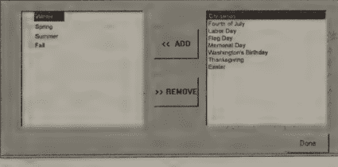

**图 1.3** 这是“创建树”题目的出现形式。

## 拖放连接格式

拖放连接格式的题目展示一组对象和一组“连接”。要回答问题，你必须在对象之间移动相应的连接。

此类题目最适合用图形来描述。这是一个示例。

以下对象代表水的不同状态：

| 冰 | 水蒸气 | 水 | 蒸汽 |
| --- | --- | --- | --- |

使用以下列表中的项目连接对象，使之在科学上是正确的。

- 升华形成
- 结冰形成
- 蒸发形成
- 沸腾形成
- 凝结形成
- 融化形成

正确答案是：


对于这类题目，不必使用每个对象，但每个连接都可以通过将答案拖到多个位置来多次使用。将答案从其位置拖走将将其移除。

## 选择与放置题格式

选择与放置（拖放）格式的题目展示了一张带有空白框的图表和一组标签，这些标签必须被拖动以填充空白框。要回答问题，你必须将标签移动到图表的相应位置。

此类题目最适合用图形来描述。这是一个示例：

### 第 6 题

按照数字顺序将项目放在以下流程图的正确位置。某些项目可能会被使用多次，某些项目可能完全不使用。

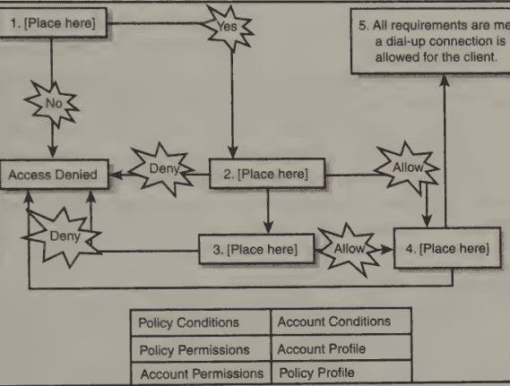

正确答案是：

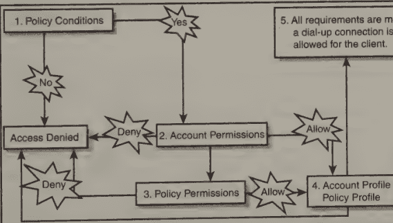

# 微软的测试格式

目前，微软使用四种不同的测试格式：

- 案例研究
- 固定长度
- 自适应
- 短格式

其他微软考试采用了可能不会立即显现的高级测试能力。虽然出现的问题主要是单选题，但固定长度测试（使用固定题目序列）中的逻辑更为复杂。某些考试使用复杂的用户界面（微软称为模拟）来测试你对特定系统的知识。测试创新文章 [www.microsoft.com/TRAINC/mcpexams/innovations.asp](http://www.microsoft.com/TRAINC/mcpexams/innovations.asp) 包含了演示和示例。

对于某些考试，微软采用了一种已知技术，即自适应测试，以确立答试者的能力水平。自适应考试与固定长度考试看起来一样，但它们确定了答试者能够正确回答的问题难度。不同知识水平的答试者面对的是较小的困难题目集，而知识水平较低的答试者面对的是较大的简单题目集。两个人的回答正确百分比可能相同，知识水平较高的答试者得分更高，因为其题目权重更大。

此外，低水平的答试者可能会回答更多问题。这解释了为什么自适应测试使用值范围来定义完成测试所需的数量和时间。

## 微软认证考试

自适应测试通过评估答试者的最近回答来工作。正确回答会导致更难的问题（从而提高测试软件对答试者知识和能力水平的估计）。错误回答会导致较简单的题目（从而降低测试软件对答试者知识和能力水平的估计）。这一过程持续进行，直到目标答试者的真实能力水平。当答试者的准确率达到统计上可接受的值（换句话说，当其表现出可接受的知识和能力）或达到最大题目数量时，考试结束（在这种情况下，答试者几乎会失败）。

在研究案例时，请仔细阅读标签页中的信息。回答每一个问题都非常重要。你可以在案例与问题之间来回切换，也可以在一个案例的子章节内不同问题之间进行切换。然而，一旦你离开该案例并继续后续操作，可能无法再次返回那里。我建议你在阅读有用信息时做笔记，这在你应对测试时会大有帮助。在参加任何类型的微软认证考试时，采用这种策略几乎不会出错。

## 固定长度和短格式考试策略

在参加固定长度或短格式考试时，一个广为人知的原则是从头到尾通读整个考试。只回答那些你绝对确定自己会做的题。在随后的轮次中，你可以更深入地研究更复杂的问题，因为你清楚还剩下多少这类问题以及剩余多少时间。


> 在回答棘手的问题之前完全读完考试至少有一个潜在的好处：有时，题目中提供的信息可以为前面的问题提供启发。在其他情况下，你在后面的问题中读到的信息可能会引起你对事实、数字或行为的记忆，帮助你回答前面的问题。无论哪种方式，如果你在第一轮只回答那些你非常有把握的问题，你将会占据优势。

幸运的是，用于固定长度和短格式测试的微软考试软件使得多次访问的方法易于实施。每个问题的左上角都有一个复选框，允许你标记该问题稍后访问。


> 标记问题可以使随后的回顾变得更容易，但你也可以反复点击“前进”或“后退”按钮返回任何问题。

以下是一些适用于固定长度和短格式测试的答题策略。如果有机会，请使用它们：

- 在完成初次通读后返回某个问题时，请再次阅读每一个单词；否则，你的大脑可能会增加或遗漏重要的细节。有时，在将注意力转移到别处后重新查看问题，可以让你发现遗漏的内容，因为人的强力倾向于看到之前看到的内容。请尽一切避免这种倾向。
- 如果你返回同一个问题超过两次，请尝试清楚地表述你不理解该问题的哪里、为什么答案看起来不合理，或者似乎缺失了什么。如果你对该主题反复琢磨一段时间，你的潜意识可能会提供缺失的细节，或者你可能会注意到一个指向正确答案的“陷阱”。
- 在你完成考试的过程中，另一个计数器也会派上用场——即已完成的问题数和待完成的问题数。对于固定长度和短格式测试，明智的做法是规划时间，确保在考试时间过完四分之一时完成了大约四分之一的题目，在过完四分之三时完成了四分之三的题目。
- 如果在只剩五分钟时你还没有完成，请利用这段时间对剩余问题进行猜测。记住，猜题总比不回答有价值。空答案永远是错误的，但猜题可能是正确的。如果你对剩余的任何问题都没有头绪，请随机选择答案，或者全部选 A、B、C 等。未回答的问题被视为回答错误，因此猜一个总比什么都不做要好。

> 在考试时间的最后时刻，猜题也比留空题目要好得多。

## 自适应考试策略

如果说有一个原则适用于自适应测试，那就是“第一次就对”。在参加自适应测试时，你不能选择跳过一个问题并进入下一个，因为测试软件会根据你对当前问题的回答来选择它计划呈现的任何问题。

# 微软认证考试（续）

如果你参加了模拟考试但正确率未达到 80% 到 85%，请继续练习。微软在 [www.microsoft.com/traincert/mcpexams/prepare/](http://www.microsoft.com/traincert/mcpexams/prepare/) 提供了模拟考试提供者的链接，以及自评估考试。

凭借此书中的信息，并怀着增进知识的决心，你应该能够通过认证考试。然而，你需要付出努力，否则在最终通过之前，你可能需要支付多次考试费用。如果你准备得认真，理应取得优异的成绩。

下一节将介绍你可以用于准备微软认证考试的其他资源来源。

# 额外资源

关于微软认证考试的良好信息来源来自微软本身。由于其产品和技术以及随之而来的考试变化频繁，获取考试相关信息的最佳途径是在线。

如果你尚未访问微软认证专业人员（MCP）网站，请现在就访问。MCP 主页位于 [www.microsoft.com/traincert/default.asp](http://www.microsoft.com/traincert/default.asp)（见图 1.4）。

> 注意：当你读到此页时，该页面可能已被新的、不同的内容所取代，因为微软网站的内容会定期更新。如果发生这种情况，请阅读标题为“应对网络变化”的侧边栏。

## 应对网络变化

早晚，我们与你分享关于微软认证专业人员页面以及书中其他部分提到的其他网络资源都将过时或被更新信息取代。在某些情况下，你在这里找到 URL 可能会引导你找到替代地址；在其他情况下，URL 将失效，给你留下可畏的“404 File not found”（未找到文件）错误信息。当这种情况发生时，不要放弃。

如果你愿意投入时间和精力，网络上总有办法找到你想要的内容。大多数大型或复杂的网站（如微软网站）都提供搜索引擎。在微软的所有网页上，页面顶部都会出现一个搜索按钮。只要你还能访问微软网站（它应该很长时间内保持在 [www.microsoft.com](http://www.microsoft.com)），就可以使用此工具帮助你找到所需内容。

# 第一章

你的搜索请求越聚焦，结果中包含你可以使用的信息的几率就越高。例如，你可以搜索字符串“training and certification”（培训与认证）来产生大量关于该主题通用数据，但如果你正在寻找第 70-215 考试——“安装、配置和管理 Microsoft Windows 2000 Server”的准备指南，使用类似下面的搜索字符串将可能更快地找到目标：

- `Exam 70-215` AND "preparation guide"

同样地，如果你想找到培训与认证下载内容，请尝试如下搜索字符串：

- `training and certification` AND "download page"

最后，可以自由使用通用搜索工具——如 [www.search.com](http://www.search.com)、[www.allavista.com](http://www.allavista.com) 和 [www.excite.com](http://www.excite.com)——来寻找相关信息。尽管微软在网上提供了关于其认证考试的优质信息，但也有大量的第三方信息和协助来源并不遵循微软的官方立场。因此，如果你无法立即找到某些，请加强搜索强度。

**图 1.4** 微软认证专业人员培训与认证主页。

# 安装 Windows 2000 Server

你需要理解的术语：

- `HCL`（硬件兼容性列表）
- `系统分区`（System partition）
- `引导分区`（Boot partition）
- `安静安装`（Attended installation）
- `无人值安装`（Unattended installation）
- `WINNT`
- `WINNT32`
- `MAKEBOOT`
- `MAKEBT32`
- `答案文件`（Answer file）
- `唯一性数据库文件`（UDF）
- `安装管理器`（Setup Manager）
- `预设置`（Sysprep）
- `服务包`（Service Pack）
- `批处理集成`（Slipstreaming）

你需要精通的技术：Windows 2000 Server 的安装

- 执行 Windows 2000 Server 的安静安装
- 执行 Windows 2000 Server 的无人值安装
- 将 Windows NT 4.0 升级到 Windows 2000
- 创建安装磁盘
- 故障排除安装问题

## 引言

良好的安装对于你的 Windows 2000 Server 正常运行至关重要——这对你不应该感到意外。如果你没有正确安装 Windows，你将在安装后花费大量时间修复你的配置。此外，你拥有安装经验越丰富，就越希望过程更加高效。为了建立你的知识库，本章将介绍各种安静安装和无人值安装方法。它讨论了这些方法的优缺点，以确保你在正确的时间做正确的事。

考试专注于安装的五个主要领域：

- 安静安装
- 无人值安装
- 从 Windows NT 升级安装
- 应用服务包
- 故障排除安装

这些每个主题都将在后续章节中详细介绍。在实际上进入有关 Windows 2000 Server 安装的细节之前，你需要花一些时间确保你已经为安装过程做好了准备。

## Windows 2000 安装准备

在安装 Windows 2000 Server（纯净安装或升级安装）时，你需要考虑以下因素：

- 硬件兼容性
- 软件兼容性
- 磁盘大小和分区
- 当前安装的系统是否可以升级

以下章节扩展了这些主题。在安装 Windows 2000 Server 之前，你必须确保在这些方面已充分准备。

### 硬件兼容性


# 硬件兼容性与 Windows 2000 Server 安装

硬件兼容性可能是你在尝试安装之前必须的所有要求中最重要的。Windows 2000 有非常严格的硬件要求。如果不满足这些要求，某些组件将无法正常工作，最坏的情况下，操作系统将无法安装。安装和运行 Windows 2000 Server 需要两个硬件标准：

- 组件必须满足安装的最低要求（见表 2.1）。
- 组件必须在硬件兼容性列表（HCL）上。

## 表 2.1 Windows 2000 Server 操作系统安装的最低要求

| 组件 | 发布的最低配置 |
| :--- | :--- |
| 处理器 | Pentium 133MHz 或更高（另见备注） |
| 内存 (RAM) | 建议最低 256MB（支持最低 128MB） |
| 空闲磁盘空间 | 2GB 硬盘，至少空 1GB；需要更多 |

## 最低硬件要求

最低硬件要求指的是处理器类型和速度、磁盘空间大小以及内存容量。过去，微软只发布最低要求。但现在这些最低要求反映了特定的配置。因此，你可能可以使用低于这些建议配置安装 Windows 2000，但它在生产环境中无法有效运行。

值得注意的是，自 Windows NT 4.0 发布以来，硬件要求已经增加。如果你计划将 Windows NT 4.0 升级到 Windows 2000，你可能需要在尝试升级之前先升级服务器硬件。要跟上有关最低要求的任何新变化，请务必访问 `www.microsoft.com/support`。

## 硬件兼容性列表 (HCL)

硬件兼容性列表 (HCL) 是微软发布的经过 Windows 2000 测试的硬件组件列表。HCL 中列出的项目可以在 Windows 2000 上运行（至少达到最低要求）。如果你想确保你的硬件在 Windows 2000 下正常工作，你应该查看可以在网上找到的最新 HCL。

### 软件兼容性

尽管许多硬件产品出现在 HCL 上（这意味着它们经过测试并发现兼容 Windows 2000），但并非所有产品都在列表中。如果制造商提供了适用于 Windows 2000 的设备驱动程序，该设备就可以正常工作。然而，驱动程序及其对你服务器的任何问题应咨询制造商而非微软。

除了确认你的硬件兼容 Windows 2000，你还应该确保你的软件兼容 Windows 2000。某些在 DOS、9x 或 Windows NT 4.0 下运行良好的应用程序在 Windows 2000 下将无法运行（或无法正常运行）。

在 Windows NT 4.0 和 Windows 9x 时代，微软发布了这些平台软件开发的指南。尽管指南在操作系统允许开发者做什么方面是明确的，但它们经常留下了漏洞，开发者利用这些漏洞来提高应用程序性能。微软并没有大幅更改指南，而是堵住了这些漏洞。这意味着根据旧指南编写的软件在旧和新平台上仍然可以运行。然而，利用漏洞编写的软件可能在新平台上无法工作。

要检查软件兼容性，你可以做两件事：首先，你可以查阅软件兼容性网站 `www.microsoft.com/windows2000/server/howtobuy/upgrading/compat/search/software.asp`。该网站允许你根据制造商、产品名称、类别或关键词搜索你的软件产品。搜索后，系统将返回一个列表，指示软件的状态。可能的状态有——

- **已认证**——该应用程序符合《Windows 2000 应用程序规范》中的标准，并通过了由微软和独立测试机构进行的兼容性测试。
- **兼容**——该应用程序被认为与 Windows 2000 兼容，微软将为该应用程序提供 Windows 2000 相关支持。
- **注意**——该应用程序在 Windows 2000 中可能无法正常运行。在尝试在 Windows 2000 上部署此应用程序之前，应进行更多研究。可能的解决方案包括补丁或升级。

其次，如果您在网站上没有找到您的软件产品，请不要沮丧（至少暂时不要）。请联系软件供应商或自行测试，以看看您是否可以自己证明兼容性。在许多情况下，不在列表中的软件在网站上的运行运行良好。但请注意，如果软件不在列表中，微软将不提供支持，这在以后可能会产生困难。某些供应商不愿花费精力和金钱让其产品通过 Windows 2000 认证，尽管它们运行正常，但谨慎对待是一种始终能产生积极结果的方法。

### 磁盘大小与分区

要在您的计算机上安装 Windows 2000 Server，您必须拥有磁盘空间——并留出足够的额外空间以确保安全。表 2.1 显示，您需要在至少 2GB 的硬盘上拥有至少 1GB 的空闲空间。此外，所有空闲空间必须位于同一个连续的分区上，因此 3GB 硬盘上的两个 600MB 空分区是不可行的。

如果这是典型的 Windows 2000 安装，您通常希望将操作系统安装在活动分区（通常是 C: 盘）上，但并非如此。如果您计划将 Windows 2000 Server 与另一个操作系统进行双启动，则必须将 Windows 2000 Server 安装在另一个分区。如果您这样做，微软将使用不同的术语来描述计算机启动的分区以及存储 Windows 2000 操作系统文件的分区，定义如下：

- **系统分区**——这是活动分区；即计算机 BIOS 开始引导过程的分区。此分区通常（但并非总是）是 C: 盘。此分区包含主引导记录 (MBR) 和系统文件，允许 Windows 2000 接管引导过程。
- **引导分区**——这是存储 Windows 2000 操作系统文件的分区。这些文件通常位于 `WINNT` 文件夹中。它们是 Windows 2000 用于完成启动过程以及在启动后运行 Windows 2000 的文件。

在大多数情况下，建议将 Windows 2000 安装在与（活动分区）相同的分区上。这意味着引导分区和系统分区将位于相同位置，唯一不这样做的情况是您计划与一个或多个其他操作系统对 Windows 2000 进行双启动（或多启动）——这种做法仅建议用于测试系统。

当您决定了在哪个分区上安装 Windows 2000 后，您可能想要对其进行格式化。您不需要提前进行格式化，因为安装过程包含一个用于创建新分区以及格式化这些分区的实用程序。如果您选择预格式化分区，您将有以下格式选择：`NTFS`、`FAT16` 和 `FAT32`。这些格式类型将在第 3 章“访问资源的安装、配置和故障排除”中进行讨论。这里提供了可用选项的快速摘要：

- **NTFS**——用于基于 Windows NT 的系统，例如 Windows NT、Windows 2000、Windows XP 和 Windows Server 2003。在 Windows 2000 中，NTFS 升级到了 NTFS v5。
- **FAT16**——一种相当通用的文件格式，被所有微软操作系统以及其他几种操作系统识别。它的效率非常低，最大卷大小为 2GB。
- **FAT32**——在 Windows 95 OSR2 中引入的 FAT16 改进版本。Windows 95 OSR2 之后的所有 Windows 版本都支持 FAT32。

### 当前操作系统的可升级性

如果您想将运行另一个操作系统的机器升级到 Windows 2000，您有许多可以遵循的路径。本书在《安装 Windows 2000 Server》第 27 页使用的升级定义是“在不需要完全重新配置结果系统的情况下安装新操作系统的能力”。到 Windows 2000 Server 的升级可以直接从 Windows NT Server 4.0 和 Windows NT Server 3.51 完成。由于域控制器角色的新流动性，服务器的当前角色并不重要。

对于其他操作系统（例如 DOS），您将必须选择删除（或覆盖）现有操作系统，还是与其进行双启动。双启动意味着您将在系统启动时选择引导哪种操作系统，并且所有的软件和硬件将为每个操作系统单独安装。作为快速参考，以下操作系统不支持直接升级到 Windows 2000 Server：MS-DOS、Windows 3.x、Windows 9x、Windows NT 3.51。

在采取上述步骤后，您就可以准备好安装 Windows 2000 了。

## 执行 Windows 2000 引导式安装

Windows 2000 的引导式安装是最常见的安装方式，因此是我们查看安装 Windows 2000 的起点。引导式安装是在人在安装过程中手动提供信息。这与我们稍后将讨论的无人安装相反，后者使用脚本（应答文件）来提供信息。

有四种方法执行引导式安装：

- 从 Windows 2000 CD-ROM 启动。
- 使用 Windows 2000 安装磁盘启动并从 CD-ROM 安装。
- 启动到当前的 32 位操作系统并手动运行 `winnt32.exe` 调用设置程序。
- 启动到当前的 16 位操作系统并手动运行 `winnt.exe` 调用设置程序。

此外，大多数安装过程将遵循相同的步骤，只有安装启动方式有所不同。

> 如果您想完全重新划分硬盘，必须从 CD-ROM 或安装磁盘启动；否则无法删除包含临时文件的分区。

## 基于 CD-ROM 的安装

如果您的计算机 BIOS 可以从 CD-ROM 启动，您可以在硬盘上没有操作系统且不需要网络支持的情况下安装 Windows 2000 Server。要这样做，请配置计算机从 CD-ROM 启动，然后执行以下步骤：

1. 将 Windows 2000 CD-ROM 插入驱动器并启动计算机。在确认要从 CD-ROM 启动后，Setup 将开始并开始复制文件。短时间内，您将看到欢迎设置界面，如图 2.1 所示，该界面提示您选择 Setup 将执行的操作。

   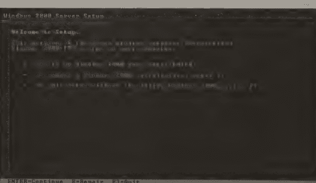

   **图 2.1** 启动 Windows 2000 Setup。

2. 按照图 2.1 的提示，按 `Enter` 键开始设置 Windows 2000 Server。

3. 当显示许可协议时，按 `F8` 继续。如果不接受许可协议，将无法安装 Windows 2000。

4. 如果您的计算机当前没有格式化的卷，您将看到如图 2.2 所示的屏幕。如果出现此屏幕，按 `C` 继续。

   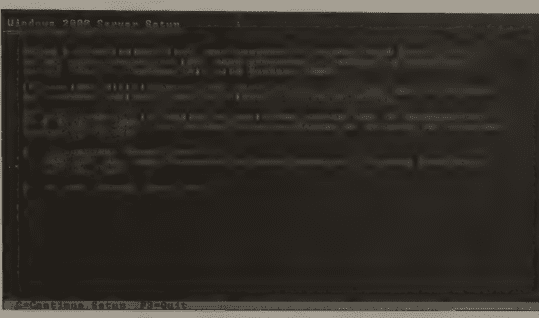

   **图 2.2** 新硬盘警告。

5. 系统将提示您选择要安装 Windows 2000 Server 的分区（或创建一个新分区），如图 2.3 所示。如果您创建了新分区，在创建完成后将看到此屏幕。选择要安装 Windows 2000 Server 的分区并按 `Enter` 键继续。

   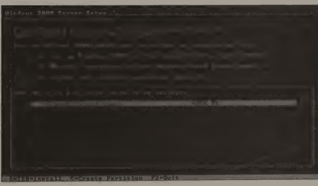

   **图 2.3** 选择一个分区以安装在其中，或创建一个新分区。

6. 如果您选择的分区尚未格式化，系统将提示您使用 `NTFS` 或 `FAT` 文件系统进行格式化，如图 2.4 所示。如果您使用 FAT 文件系统格式化且分区大于 2GB，Setup 将其格式化为 `FAT32`；否则，将其格式化为 `FAT16`。如果分区已经格式化，您将看到一个略不同的对话框，允许您选择保持分区现有格式不变、使用 `NTFS` 或 `FAT` 格式化，或将其从现有格式转换为 `NTFS`（这会保留分区上已有的任何数据）。做出选择并按 `Enter` 键继续。

   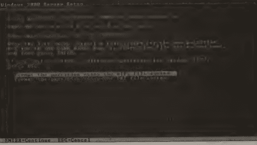

   **图 2.4** 格式化您的分区。

7. Setup 将文件复制到硬盘上并重启系统，为安装的 GUI 部分做准备。

8. 一旦 Setup 重启了您的计算机，您将看到一个屏幕，提示您点击“Next”（下一步）以继续收集系统信息。您可以点击“Next”按钮；但是，如果您在 30 秒后仍未操作，设备安装也将开始。Setup 将花费一些时间定位并安装您的系统硬件设备。在此过程中，您的屏幕可能会闪烁，该过程可能需要几分钟，请保持耐心。

9. 当“Regional Settings”（区域设置）屏幕出现时（如图 2.5 所示），您将拥有更改系统和用户区域（决定货币、数字和日期显示方式的计算机位置）以及键盘布局的选项。如果您需要，可以通过点击其中一个（或两者）的“Customize”（自定义）按钮并选择不同的国家位置来更改。如果您不自定义这些设置，区域将设置为英语（美国），键盘将配置为美国（US）。点击“Next”继续。

   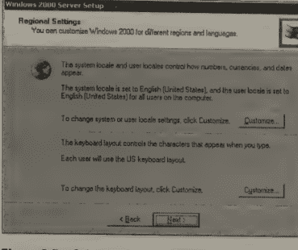

   **图 2.5** 选择区域设置和键盘布局。

10. 在“Personalize Your Software”（个性化您的软件）屏幕上，输入您的姓名和您的公司或组织名称。您必须为“Name”（名称）字段提供输入。在您向“Name”字段中输入内容之前，Setup 无法继续。点击“Next”继续。

11. 在“Your Product Key”（您的产品密钥）屏幕上，输入位于 Windows 2000 Server CD 盒或正版性证书上的 25 位产品密钥。点击“Next”继续。

12. “Licensing Modes”（许可模式）屏幕允许您指示您拥有此种服务器的何种类型的许可（见图 2.6）。您的选择有“Per Server”（按服务器）和“Per Seat”（按用户）。默认情况下，选择“Per Server”并选择了五个“Client Access Licenses (CALs)”（客户端访问许可）；但您可以更改其中任一设置。

    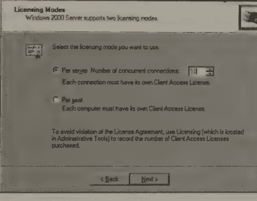

    **图 2.6** 选择“Per Server”（按服务器，以及并发连接数）或“Per Seat”（按用户）许可。

### 许可选项

要知道在“Licensing Modes”屏幕中做出什么选择，您必须首先了解可用的许可模式。“Per Server”模式是一种基于连接的许可模型。在这种模式下，您为每个连接到特定服务器的每一次连接购买一个许可证。如果您有 1 台服务器，且有 10 个用户可能随时连接到它，您将购买 10 个 CAL。如果一个用户同时连接到两个不同的服务器，则该用户将同时在每台服务器上使用一个 CAL。换句话说，一个工作站需要两个许可证。这种情况就是“Per Seat”模式大显用场。“Per Seat”许可允许用户连接到所有服务器。与其监控总连接数，更重要的是建立这些连接的用户数。如果您有 5 台服务器和 25 个用户，且每个用户都可以连接到每台服务器，那么使用“Per Seat”许可，您只需要 25 个 CAL。而如果使用“Per Server”许可，您将需要 125 个许可证来提供相同的授权访问。

许可的规则是，如果用户发起的连接数多于您拥有的用户数，您应该考虑“Per Seat”许可。此外，“Per Server”对于仅有一个服务器的组织或部门来说是一个有效模型。在同一组用户连接到多台服务器的情况下，通常最好考虑“Per Seat”许可。一种记住这些许可概念的简单方法是：Per Server = 用户连接到一个服务器，Per Seat = 用户连接到任何服务器。

13. 下一个屏幕是“Computer Name and Password”（计算机名称和密码）对话框，如图 2.7 所示。输入计算机名称（遵循您的组织命名规范）以及本地管理员帐户的密码。默认情况下，计算机名称由之前输入的名称的首字母生成，后跟一个连字符和随机字母数字。确保您的密码符合安全标准；也就是说，它应该包含五个或更多字符，包含大写和小写字母，并且不是易于预料的单词。完成这些字段后，点击“Next”继续。

    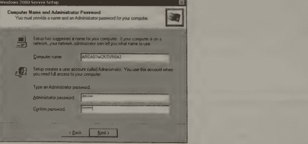

    **图 2.7** 输入计算机名称和本地管理员帐户的密码。

14. 随后的屏幕是“Windows 2000 Components”（Windows 2000 组件）屏幕，如图 2.8 所示。您可以在此选择安装任何可选组件。做出选择后，点击“Next”继续。

    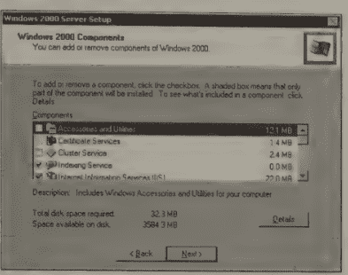

    **图 2.8** 选择在此安装任何可选的 Windows 2000 组件（如果需要，以后可以添加）。

15. 如果您的服务器安装了调制解调器，会出现“Modem Dialing Information”（调制解调器拨号信息）对话框。您必须至少提供国家和区码才能继续。点击“Next”继续。

16. 在“Date and Time Settings”（日期和时间设置）对话框中，提示您输入当前日期、时间以及您所在的时区（以及您的所在地是否实行夏令时）。点击“Next”继续。此时，将检测网络设置并安装网络组件。

17. 在“Networking Settings”（网络设置）对话框中，提示您配置机器的网络组件。如果您选择“Typical”（典型），将安装 Microsoft 网络客户端，以及文件和打印共享以及启用了 DHCP（自动地址配置）服务的 TCP/IP。如果您选择“Custom”（自定义），可以手动添加新的客户端（例如 NetWare 客户端）、服务或协议（例如 NWLink 或 NetBEUI）。此外，还可以手动配置 TCP/IP 使用静态地址。显示的选项取决于您在网络组件部分选择的选项（例如，如果选择了 Novell 服务，则会自动添加 NetWare 协议）。

18. 在“Workgroup or Computer Domain”（工作组或计算机域）屏幕上，您可以配置此计算机属于何种网络组，如图 2.9 所示。如果你选择“否，此计算机未连接到网络”，你需要在提供的文本框中输入此服务器的工作组名称。如果此服务器是域的一员，你需要提供此服务器的域名称。当你点击“下一步”时，系统会提示你输入该域中具有创建计算机账户足够权限的用户名称和密码（参见下文注释）。如果你没有这些信息，为了继续操作，你可以让计算机成为工作组的成员，稍后可以加入域。

    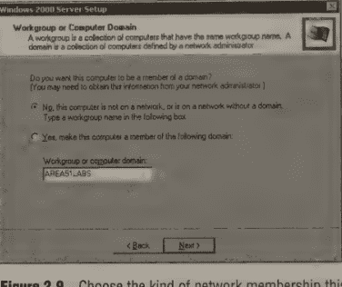

    **图 2.9** 选择此服务器将拥有的网络成员类型（域或工作组）。


> **注意**：当计算机加入域时，意味着它成为了域结构的一部分。这同时也意味着在服务器控制台上登录的用户可以选择提供域登录凭据或本地计算机登录凭据。要加入域，要么在活动目录（`Active Directory`）中已存在一个计算机账户，要么在安装服务器时创建。该计算机账户独立于任何用户，仅表示特定的（`Windows 2000`）计算机允许用户从该计算机登录域。此计算机账户提供了活动目录中对计算机的身份验证。要创建此类账户，用户必须为其用户账户分配相应的权限。

- 19. 在建立域成员关系（如果是加入域）或在完成上一步操作（如果在工作组中）后，将出现“安装组件”对话框，设置程序（`Setup`）将安装在此过程中为止请求的所有组件。
- 20. 最后将出现“执行最终任务”对话框，完成服务器的最终配置。这些步骤可能需要很长时间才能完成，请耐心等待。
- 21. 当出现“完成 Windows 2000 安装向导”对话框时，从驱动器中取出 CD-ROM 并点击“完成”以重启服务器。

## 使用安装磁盘和 CD-ROM 安装

如果你有一台没有安装当前操作系统且无法从 CD-ROM 启动的机器，你必须使用安装磁盘方法。`Windows 2000` 安装磁盘是四张磁盘的组合，它们用于在设置程序实际开始之前，在初始文件复制过程中执行从 `Windows 2000` CD-ROM 启动时执行的操作。制作好磁盘后，你从第一张磁盘启动并依次通过四张磁盘，此时系统会提示将 CD-ROM 插入 CD-ROM 驱动器，安装将从该点使用 CD 继续。

磁盘使用 `MAKEBOOT.exe` 或 `MAKEBT32.exe` 创建，这两个程序都在你的 `Windows 2000 Server` CD-ROM 的 `BOOTDISK` 文件夹中。尽管两个程序的功能相同，但“32”版本设计用于在 32 位操作系统下运行，而另一个版本设计用于 16 位操作系统（如 `DOS` 和 `Windows 3.1`）下运行。

创建 `Windows 2000` 安装磁盘的过程如下：

- 1. 从任何可以访问 CD-ROM 的操作系统导航到 `Windows 2000 Server` CD-ROM 上的 `BOOTDISK` 文件夹。
- 2. 如果你使用的是 16 位操作系统，运行 `MAKEBOOT.exe`；如果你使用的是 32 位操作系统，运行 `MAKEBT32.exe`。示例请参见图 2.10。

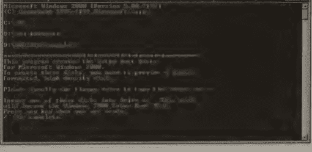

> *图 2.10* 你可以使用 `MAKEBOOT` 或 `MAKEBT32` 工具创建安装磁盘集。

- 3. 提示时，输入你的软磁盘驱动器号符。
- 4. 将一张空白磁盘（标记为 *Windows 2000 Setup Boot Disk*）插入软磁盘驱动器并按回车。
- 5. 提示时，将另一张空白磁盘（标记为 *Windows 2000 Setup Disk #2*）插入软磁盘驱动器并按回车。
- 6. 提示时，将第三张空白磁盘（标记为 *Windows 2000 Setup Disk #3*）插入软磁盘驱动器并按回车。
- 7. 提示时，将第四张空白磁盘（标记为 *Windows 2000 Setup Disk #4*）插入软磁盘驱动器并按回车。
- 8. 取出最后的磁盘并将其放在安全的地方以备后用。

制作好安装磁盘后，你可以通过以下步骤开始安装 `Windows 2000 Server` 的过程：

- 1. 将标记为 *Windows 2000 Setup Boot Disk* 的磁盘插入你的软磁盘驱动器并启动计算机。
- 2. 提示时，插入标记为 *Windows 2000 Server Disk #2* 的磁盘并按回车。
- 3. 提示时，插入标记为 *Windows 2000 Server Disk #3* 的磁盘并按回车。
- 4. 提示时，插入标记为 *Windows 2000 Server Disk #4* 的磁盘并按回车。最终你将看到之前图 2.1 所示的屏幕。
- 5. 按照“基于 CD-ROM 的安装”节详细说明继续剩余的安装步骤（从步骤 2 开始）。

## 手动调用 WINNT32.EXE 安装

如果目标计算机上安装了 32 位微软操作系统，你可以在启动已安装的操作系统后，从 `Windows 2000 Server` CD-ROM 运行 `setup.exe`。如果你的系统启用了 CD-ROM 自动运行，插入 `Windows 2000 Server` CD-ROM 也会调用 `setup.exe`。或者，你可以调用 CD-ROM 中 `I386` 文件夹下的 `winnt32.exe`。此外，如果你有网络连接，可以连接到另一台带有 `Windows 2000 Server` 文件的计算机，或者从该计算机共享的 `Windows 2000 Server` CD-ROM 驱动器运行 `setup.exe` 或 `winnt32.exe`。开始设置程序后，它将如前所述进行。

## 手动调用 WINNT 安装

（注：OCR 文本在此部分包含大量重复，我已经清理了逻辑流。）

如果目标计算机上安装了 `MS-DOS` 或 `Windows 3.x`，你有两种选择来完成 `Windows 2000` 安装。

你可以使用任何文本编辑器创建答案文件。不过，有一个向导可以帮助你创建此答案文件，并确保你不会遗漏关键信息。这个向导被称为设置管理器向导（`Setup Manager Wizard`）。

## 使用设置管理器创建无人参与答案文件

设置管理器是 `Windows 2000` 支持工具的一部分，位于 `Windows 2000` 光盘的 `\Support\Tools` 文件夹中。它被存储在一个名为 `Deploy.cab` 的文件中，在运行之前必须从 `.cab` 文件中提取。请完成以下步骤以提取设置管理器。

- 1. 导航到 `Windows 2000` 光盘上的 `Support\Tools` 文件夹，并双击 `Deploy.cab` 文件。
- 2. 选择 `setupmgr.exe`、`setupmgr.dll` 和 `detool.chm` 文件；右键点击其中一个文件，并在右键菜单中选择如图 2.11 所示的“提取”。

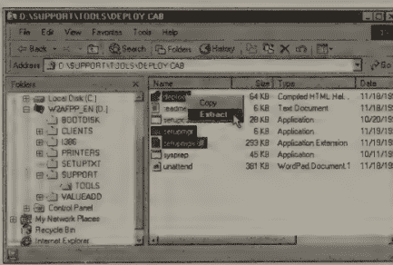

**图 2.11** 提取设置管理器文件备用。

- 3. 当“浏览文件夹”对话框出现时，浏览到你想要提取设置管理器文件的位置（建议使用 `systemroot\system32`，这并非强制要求）。
- 4. 在桌面和/或开始菜单中为 `setupmgr.exe` 文件创建快捷方式，以便在需要时轻松调用它。

当设置管理器被提取并可以访问后，你就可以按照接下来的步骤使用它来创建答案文件。

# 第 2 章

如果你将使用答案文件安装多台服务器，可以使用单个答案文件和单个 `.ud` 文件的组合，避免为要安装的每台机器都创建一个答案文件。在你完成以下步骤后，你会对这一点有深刻的体会。

- 1. 启动设置管理器向导。
- 2. 在“欢迎 Windows 2000 设置管理器向导”屏幕上，点击“下一步”继续。
- 3. 在“新建或现有答案文件”屏幕上，选择创建一个新的答案文件、让当前计算机的设置作为向导的默认值，还是修改现有的答案文件。在本例中，我们想要创建一个新的答案文件。点击“下一步”继续。
- 4. 在“要安装的产品”屏幕上，选择此答案文件设计用于安装的产品。你的选项有 `Windows 2000` 无人参与安装、`Sysprep` 安装和远程安装服务。选择 `Windows 2000` 无人参与安装并点击“下一步”。
- 5. 在“平台”屏幕上，选择你为哪个产品创建此答案文件（`Windows 2000 专业版` 或 `Windows 2000 服务器`）。本示例适用于 `Windows 2000 服务器`。做出选择后，点击“下一步”继续。
- 6. 在如图 2.12 所示的“用户交互级别”屏幕上，你需要指定用户对安装过程拥有多大的控制权以及会有多少交互。你的选项在这里处有详细描述：

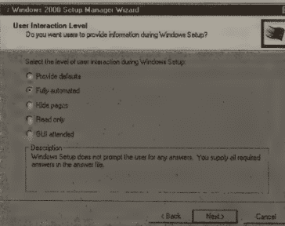

**图 2.12** 用户交互级别屏幕。

- **提供默认值**——用户将会被提示查看（可能更改）你提供的信息。这为用户提供了可以遵循的指南，但允许他们在任何区域进行更改。
- **全自动**——用户将看到（可能只是很短时间）所有发生的过程，但他将无法对设置进行任何手动更改。
- **隐藏页面**——用户可能会被提示提供信息，但仅限于你未提供问题答案的地方。如果你希望某些答案是预定义的但不是全部，这种选择就很有用。此选择在某些领域提供了标准化，在另一些领域提供了灵活性。在设置页面上的所有信息都已提供的情况下，用户将不会看到该页面。
- **只读**——你提供问题的答案，用户将被提示你未提供的信息（类似于上一个选择）。然而，已填充的页面将显示。此外，当显示页面时，用户将无法修改你已提供答案的问题。
- **GUI 引导**——基于文本的设置是完全自动的，但 GUI 设置必须由能够回答问题的用户进行引导操作。

在本例中，我们假设你想创建一个全自动的设置。选择“全自动”并点击“下一步”继续。

- 7. 在“许可协议”屏幕上，通过勾选框接受许可协议。点击“下一步”继续。
- 8. 在“自定义软件”屏幕上，输入你的姓名和组织名称并点击“下一步”继续。
- 9. 如果你在第 5 步中选择了 `Windows 2000 服务器`，将出现“许可模式”屏幕。如果你选择对等服务器（`Peer Server`），请选择许可类型和席数。请参考“基于光盘的安装”部分以讨论许可选项。点击“下一步”继续。
- 10. 在如图 2.13 所示的“计算机名称”屏幕上，输入使用此答案文件执行安装的每台计算机的名称。在输入每个计算机名称后，点击“添加”按钮。你可以继续此操作直到添加了所有计算机名称。你也可以选择点击“导入”按钮从文本文件中导入名称。这两个选项任一都用于创建 `UDB` 文件，为每台计算机创建定制化安装。当你添加完所有计算机名称后，就可以继续。如果你使用了“从文本文件导入”，你也可以勾选“根据计算机名称自动生成”框框来完成安装。

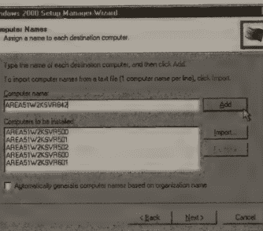

**图 2.13** 计算机名称屏幕。

- 11. 在“管理员密码”屏幕上，为使用此答案文件安装的计算机提供管理员密码。如果你不提供密码，用户将被提示你未提供的信息（如上一个选择）。你也可以在安装后手动更改密码。完成选择后，点击“下一步”继续。
- 12. 在“显示设置”屏幕上，选择适用于安装此脚本的计算机的颜色、区域和刷新频率。完成选择后，点击“下一步”继续。
- 13. 在“网络设置”屏幕上，选择你希望为计算机设置的网络设置类型。如果你选择“典型”，使用此脚本的每个计算机将启用微软网络客户端和 `TCP/IP`。如果你选择“自定义”，将为每个适配器手动设置属性（如 `TCP/IP` 属性等）。完成后，点击“下一步”继续。
- 14. 在“工作组或域”屏幕上，你可以选择这些计算机如何加入网络——是加入工作组还是域。如果你选择域，请输入域名并决定是否在安装时创建计算机帐户。如果你希望创建计算机帐户，需要提供允许向 `Active Directory` 添加帐户的用户凭据。完成后，点击“下一步”继续。
- 15. 在“时区”屏幕上，选择计算机所在的时区并点击“下一步”。如果你的计算机位于多个时区，请考虑为每个时区创建一个答案文件。
- 16. 在“附加设置”屏幕上，你可以选择为创建的基础答案文件添加附加设置参数。如果你选择“是”，请继续接下来的七步。如果你选择“否”，直接跳转到第 24 步。做出选择后，点击“下一步”按钮继续。
- 17. 第一个附加设置是“电话”屏幕。在其中，你可以为目标计算机选择电话配置信息。如果你设置为“不指定此设置”，则这些设置不会放入答案文件中，用户在首次登录时会被提示输入这些信息。点击“下一步”继续。
- 18. 第二个附加设置是“区域设置”屏幕。区域设置包括语言设置、时间区域、货币、数字和日期等选项。做出选择后点击“下一步”继续。
- 19. 第三个附加设置是“语言”屏幕。`Windows 2000` 允许安装除主要语言以外的其他支持。你可以选择想要自动安装的可用语言。选择你所需的所有语言，然后点击“下一步”。
- 20. 第四个附加设置是“浏览器和外壳设置”屏幕，如图 2.14 所示。你可以使用默认设置，使用一个 `autofigure` 脚本（由 `IE` 管理员工具包创建），或指定代理和默认主页设置。通过选择单选按钮指定适用于您环境的设置。如果您不想使用默认设置，可以使用“设置”按钮自定义您所做的选择。完成后，点击“下一步”继续。

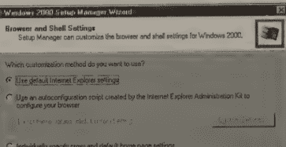

**图 2.14** 自定义浏览器和外壳设置。

- 21. 第五个额外设置是“安装文件夹”。在文件夹中，您可以指定安装文件夹的位置。您可以安装到 `WINNT` 的默认位置、让系统创建一个唯一的名称，或自行指定文件夹名称。点击“下一步”继续。
- 22. 第六个额外设置是“安装打印机”屏幕。在这里，您可以配置目标机器应该连接到哪些打印机。当用户首次在这些计算机的任一台上登录时，只要用户登录具有打印机权限，您在此处配置的网络打印机就会被附加。点击“下一步”继续。
- 23. 最后一个额外设置是“运行一次”（`Run Once`）设置。在此屏幕上，您可以指定在安装完成后运行的任何命令。这些通常是安装软件的设置文件。您可以使用“向上移动”和“向下移动”按钮来更改这些命令的执行顺序。完成后，点击“下一步”继续。
- 24. 在“发行文件夹”屏幕上，您可以选择是否创建发行文件夹。发行文件夹是包含自动化安装所需文件的网络共享。如果您不选择创建发行文件夹，则必须在每个安装点提供 CD-ROM。只有在您选择“是”创建或修改文件夹时，才按照步骤 25–30 进行操作。做出选择并点击“下一步”。如果您选择了“否”，请跳到第 31 步。
- 25. 如果您选择使用发行文件夹，将出现“发行文件夹名称”，提示您要创建或修改的文件夹路径和共享名称。无论您选择创建还是修改发行文件夹，都必须为其提供路径和共享名称。点击“下一步”继续。
- 26. 在“提供附加存储驱动程序”屏幕上，您可以为需要安装但未包含 `Windows 2000 Server` 驱动程序集的驱动程序提供位置。此设置用于安装如硬件 `RAID` 控制器等设备所需的驱动程序。通过指定这些驱动程序，您不仅修改了用于安装脚本，还修改了发行文件夹以包含这些驱动程序。点击“下一步”继续。
- 27. 在“硬件抽象层”（`HAL`）屏幕上，您可以指定一个新的 `HAL` 来替换默认 `HAL`。这通常由 `OEM` 零售商使用，他们为 `Windows 2000 Server` 提供了非标准硬件，需要 `Microsoft HAL` 未提供的额外代码。通过使用此设置，您可以在这些非标准客户端机器上安装 `Windows 2000 Server` 时替换您自定义的 `HAL`。点击“下一步”继续。
- 28. 在“附加命令”屏幕上，您可以指定额外设置或配置例程的执行。因为在运行时没有用户登录，所以这些必须是可以在该状态下运行的例程。如果您正在创建一个包含热补丁的集成安装包，这里将是您调用执行热补丁的脚本和 `Qchain.exe` 命令的地方。点击“下一步”继续。
- 29. 在“OEM 品牌”屏幕上，您可以为安装过程指定 Logo 和背景。这些内容将在自动化安装期间显示。点击“下一步”继续。
- 30. 在“附加文件或文件夹”屏幕上，您可以指示在安装时放置到目标计算机上的附加文件或文件夹。这些可能是目标计算机所需的数据、程序或其他特殊文件。您可以通过在提供的树形结构中选择特定文件夹并点击“添加文件”按钮来指示这些文件的放置位置。点击“下一步”继续。
- 31. 在“响应文件名称”屏幕（如图 2.15 所示）上，您可以根据提供的响应指示要创建的响应文件的名称和路径。此屏幕还指示，如果您指定了多个计算机名称（在第 10 步中），将创建一个 `.ud` 文件。该 `.ud` 文件（唯一性数据库文件）包含您指定的每台机器的特定特定信息。您指定的路径在此时必须存在；向导程序不会创建它。完成后，点击“下一步”继续。

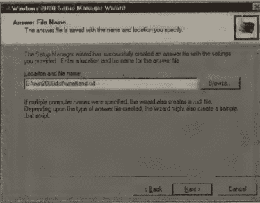

**图 2.15** 响应文件屏幕。

- 32. 在“设置文件位置”上，您指示了存储设置文件的位置。这将用于创建您的发行文件夹。您可以指定 CD 或本地或网络位置。点击“下一步”继续。
- 33. 当安装管理器向导完成文件复制后，点击“下一步”继续。
- 34. 当“完成 Windows 2000 安装管理器向导”屏幕出现时，请注意它创建的文件。点击“完成”退出。

以下是响应文件的示例（`answer.txt`），它可以使用文本编辑器创建：

```
;SetupMgrTag
[Data]
AutoPartition=1
MsDosInitiated="*"
UnattendedInstall="*Yes"

[Unattended]
UnattendMode=FullUnattended
OSkipEula=Yes
OemPreinstall=Yes
TargetPath=\WINNT

[Gui]
```

## 安装 Windows 2000 Server 49

尽管你可以使用 `winnt.exe` 或 `winnt32.exe` 启动无人值安装，但这些程序的真正威力在于，可以通过作为执行语法一部分的各种命令行开关来修改它们的行为。表 2.2 简要说明了 `winnt.exe` 和 `winnt32.exe` 可用的各种开关。

表 2.2 WINNT 和 WINNT32 的开关

| WINNT | WINNT32 | 功能 |
|---|---|---|
| `/a` | N/A | 启用辅助功能选项。 |
| `/e:command` | `/cmd:command` | 在安装最终阶段之前执行命令。 |
| `/i:inf_file` | N/A | 指定安装信息文件的名称。 |
| `/r:folder` | `/copdir:folder` | 指定要安装在系统根目录的可选文件夹。 |


| /rx:folder | /copysource:folder | 指定要复制的可选文件夹，用于安装并在安装完成后删除。 |
|---|---|---|
| /s:path | /s:path | 指定 Windows 2000 Server 安装文件的位置。你可以指定最多八个源来加速（并负载均衡）文件复制过程。第一个源必须有效，否则安装将失败。 |
| /t:drive | /tempdrive:drive | 指定临时安装文件可以复制的位置以及 Windows 2000 的安装位置（这将成为启动分区）。 |
| /u:file | /unattend:[num]:[file] | 指定无人值守安装的应答文件的位置，以及在复制文件和重启计算机之间等待的秒数。 |
| /udt:file | /udf:id,file | 指定无人值守安装唯一性数据库的位置。ID 是 UDF 的标识符，用于定义此台计算机的安装选项。 |
| N/A | /cmdcons | 指定将安装命令行修复控制台所需的文件。 |
| N/A | /debug level:file | 在安装过程中发生特定严重程度的情况时创建日志文件。默认级别为 2（警告）。 |

表 2.2 WINNT 和 WINNT32 的开关（续）

| WINNT | WINNT32 | 功能 |
|---|---|---|
| N/A | /syspart:drive | 将文件复制到硬盘并将其标记为活动。用于开始到硬盘的安装，该硬盘将被迁移到另一台机器（其永久家处）。 |
| N/A | /checkupgradeonly | 检查你的计算机是否可以升级到 Windows 2000。此选项不会实际执行安装；而是创建一个日志文件（NT 使用 `winnt32.log`，Windows 9x 使用 `upgrade.txt`），指示升级结果。 |

在启动安装之前，你必须了解 `winnt.exe` 和 `winnt32.exe` 的开关及其功能。

## 第二章

### 使用磁盘复制进行无人值守安装

磁盘复制是将一台机器的硬盘复制到另一台机器的过程，是一种流行的方法。过去出现的问题之一是目标机器上的信息需要与源机器不同（例如，安全标识符—SID—和计算机名称）。Sysprep 会处理这个问题，并在目标机器重启时对它们进行修改。

Sysprep 的作用是为复制准备磁盘。一旦准备好磁盘，可以使用第三方工具进行复制。如果你想完全自动化创建新安装的过程，可以让 Sysprep 创建一个 `Sysprep.inf` 文件，为在磁盘镜像放置后目标机器启动时运行的设置程序提供应答。此 `.inf` 文件可以使安装完全全自动化（这就是为什么这个讨论属于无人值守安装主题）。

以下步骤描述了如何复制计算机：

1. 在主计算机上安装并配置 Windows 2000。
2. 以管理员身份登录计算机。
3. 安装并配置所有应用程序。
4. 在主计算机上运行 Sysprep 以准备该硬盘。
5. 使用磁盘镜像工具创建主计算机的镜像。此步骤你需要使用如 Norton's Ghost 等第三方工具。
6. 使用你的第三方工具创建目标驱动器的副本。将复制的磁盘放入目标计算机中。

当镜像传输到目标机器后，该机器将重启并运行 Mini-Setup 向导以完成设置。

### 使用 Sysprep.exe

表 2.3 概述了 Sysprep.exe 的一些附加参数，允许你从命令行控制其运行。

- `/quiet`: 在无用户交互的情况下运行目标计算机的设置。
- `/pnp`: 在 Mini-Setup 期间强制进行完全即插即用设备枚举和安装。仅在你需要检测并安装不兼容即插即用的旧设备时使用。不要在具有所有即插即用设备的计算机上使用 `/pnp` 开关，因为这会增加首次运行体验所需的时间而不会提供任何额外好处。
- `/reboot`: 在 Sysprep 完成后重启配置计算机，而不是简单的关机。这将调用配置计算机上的 Setup 程序，仅在你想验证设置是否正常运行时使用。
- `/nosidgen`: 防止在目标计算机上重新生成 SID。当你将一台机器的内容传输到另一台机器以弃用原始机器时，这非常有用。新机器将成为第一台机器的精确副本。

在参加此考试之前，你必须了解 Sysprep 选项及其功能。

如果你想完全自动化安装基础，需要创建一个 `Sysprep.inf` 文件。该文件在许多方面与你之前在本章中创建的答案文件相似，并应放在正在复制的硬盘根目录下的 `SYSPREP` 文件夹中（在源计算机上）。你可以使用设置向导并选择其用于 Sysprep 安装来创建此文件。当设置程序在目标计算机上运行时，它会检查此文件，如果存在则会使用它。

## 从 Windows NT 4.0 Server 执行升级安装

由于其安装基数已经很大，你很可能需要将 Windows NT Server 4.0 安装升级到 Windows 2000 Server，这种情况可能性很大。幸运的是，将 Windows NT 4.0 成员服务器升级到 Windows 2000 成员服务器是非常简单的。Windows 2000 成员服务器可以很好地存在于工作组、Windows NT 4.0 域或 Windows 2000 域中。

以下是将 Windows NT 4.0 Server 升级到 Windows 2000 的两种常见方法：

- 交互式（Attended）
- 无人值守（Unattended）

你可以从网络共享或本地 CD-ROM（交互式）使用设置程序，或者可以从网络共享使用 `WINNT32` 程序（无人值守）。要对 Windows NT 4.0 成员服务器执行交互式升级，请按照以下步骤操作：

1. 从 Windows 2000 CD-ROM 运行 `Setup.exe`。
2. 当询问你是否要升级到 Windows 2000 时，点击“是”继续。
3. 在图 2.16 显示的“欢迎 Windows 2000 安装向导”屏幕上，选择“升级到 Windows 2000（推荐）”并点击“下一步”。

# 第 2 章

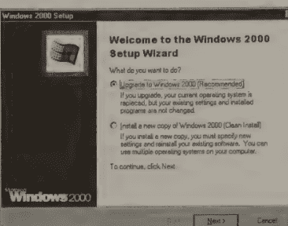

图 2.16 开始升级到 Windows 2000。

4. 在许可协议屏幕中，选择“我接受此协议”并点击“下一步”。注意，你必须接受许可协议才能继续安装 Windows 2000 Server。
5. 在“报告系统兼容性”屏幕中，你将获得有关升级完成后可能无法正常运行的任何信息。可能出现问题的服务将被设置程序禁用。在此屏幕上，你可以通过点击“详细信息”查看更多关于可能发生问题的细节，或者通过点击“另存为”将报告导出到文本文件，以便稍后进行详细调查。当你确认确定的区域不会引起主要问题时，点击“下一步”按钮。
6. 设置程序将源文件从 CD 复制到硬盘并重启计算机。
7. 重启后，服务器将进入文本模式设置程序，它将从先前的硬盘位置提取并复制额外的设置文件。当提取和复制过程完成后，服务器将再次重启并进入设置过程的 GUI 部分。如果你决定将引导分区转换为 NTFS，则转换将在首次重启后进行，Windows 2000 在进入 GUI 设置之前会再次重启。
8. 设置过程将继续剩余的安装步骤，详细请见之前的“基于 CD-ROM 的安装”节。

无人值守升级也可以使用网络共享的 `winnt32.exe` 执行。以这种方式安装时，你有两个主要选项。首先，你可以像进行常规无人值守安装一样使用答案文件和一个 `.udf` 文件。在这种情况下，你可以使用相同的向导来帮助你创建为安装 Windows 2000 Server 创建这些文件。其次，你可以使用带有 `/unattend` 选项的 `winnt32.exe`。该选项表示安装将在没有用户输入的情况下进行，设置问题的答案将通过查看（并复制）当前的 Windows NT 4.0 配置来提供。对于作为成员服务器的简单升级，这是最简单的方法。

## 安装 Windows 2000 服务包

微软使用服务包来升级软件。服务包是一个可执行文件，它将一组文件替换为另一组更更新、更改进的同类文件。对于操作系统（如 Windows NT 4.0），服务包是分发错误修复和安全漏洞修复的一种方式。然而，从 NT 4.0 的第 4 服务包开始，微软也开始发布操作系统功能的升级和新增。例如，服务包 4 引入了微软管理控制台以提供集成安全接口。

但是，对于 Windows 2000，微软的计划是按定期发布服务包以修复错误或安全缺陷。这种更定期的更新计划旨在将服务包的大小保持在可管理的水平。仅需要安装当前的服务包，因为每个服务包都包含了之前所有服务包中的所有更新。

在许多方面，Windows 2000 服务包与 Windows NT 4.0 服务包没有太大区别。当它们被发布时，意图是在所有 Windows 2000 计算机上安装服务包以实施其中包含的任何修复。这一基本前提没有改变。然而，在服务包的应用上有一项重大改进：称为“滑流集成”（slipstreaming）的概念。

## 通过滑流集成更新安装源

在理解滑流集成之前，有必要对 Windows NT 4.0 上的服务包进行插叙。在 NT 下，如果你安装了服务包，你必须确保如果你通过从 CD 或网络共享读取文件对操作系统进行了修改，你必须重新安装服务包。这是因为位于 CD 或网络共享的文件是服务包之前的版本。

滑流集成使得这不再必要。通过滑流集成，可以将来自服务包的更改应用于位于本地文件夹或网络的源文件（在运行 `update.exe` 时使用 `-s` 选项）。这意味着随后访问这些文件时，你获得的是修复版本而不是旧版本。这节省了时间，因为这意味着在安装其他服务和其他操作系统组件时，只需应用一次。此外，这意味着新的安装也将自动更新到当前的服务包。

必须指出，滑流集成并没有消除在每台机器上安装服务包的需求。它消除的是在任何后续 Windows 2000 安装中安装服务包的需求。

在标准服务包安装中，会发生主要操作。首先，替换文件被复制到备份目录，以便在必要时撤销安装。虽然这是服务包安装提示的一个可选过程，但始终建议使用它。其次，服务包将其找到的操作系统文件替换为新版本的文件。

将服务包滑流集成到安装源的过程相当简单，步骤如下：

1. 在网络共享上，创建一个新文件夹来存放 Windows 2000 CD-ROM 的内容，例如 W2KFILES。将 Windows 2000 CD-ROM 的所有内容复制到该文件夹。
2. 在网络共享上，创建第二个新文件夹来存放你正在滑流集成的服务包的内容。通过命令行提示符执行命令 `w2ksp -x` 将服务包提取到该第二个文件夹中。当然，如果你没有使用服务包 3 或需要输入路径，也请提供相应信息。
3. 在服务包验证所有文件后，你将被要求选择一个提取它们的位置，如图 2.17 所示。选择你之前创建的服务包文件夹。

## 安装 Windows 2000 服务器

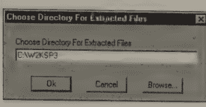

图 2.17 选择提取服务包文件的位置。

4. 提取完成后，点击确定关闭提取窗口。
5. 最后一步是将服务包实际集成（slipstream）到安装文件中。假设两个文件夹都位于 C:\ 盘符上，在“运行”框中输入的示例命令如下所示：`C:\W2KSP3\I386\UPDATE\UPDATE.EXE -s:C:\W2KFILES\`。输入命令后，将打开一个窗口并告知你集成状态。
6. 集成完成后，点击确定关闭集成窗口并完成滑流集成过程。

## 安装服务包

在单台计算机上安装服务包是一项简单的任务，下文概述。

1. 通过运行 `update.exe` 文件（位于解压的服务包的 `i386\update\` 文件夹中）或直接双击服务包的可执行文件来安装服务包。
2. 在服务包安装设置程序中选择备份现有文件。
3. 重启计算机以使更改生效。

`update.exe` 命令具有一些可以修改其行为的开关。这些开关在表 2.4 中进行了解释。

表 2.4 update.exe 命令行开关

| 开关 | 描述 |
|---|---|
| -u | 在计算机关闭时以无人参与模式运行更新 |
| -f | 在稍后卸载服务包后强制关闭其他应用程序 |
| -n | 不备份文件以备以后卸载服务包使用 |
| -o | 在不提示的情况下覆盖 OEM 文件 |
| -z | 服务包安装完成后不重启动计算机 |
| -q | 在静默模式下运行安装，无用户交互 |
| -s:[directory] | 将服务包文件集成到提供的目录中 |

## 安装失败的故障排除

遗憾的是，有时 Windows 2000 服务器的安装会失败。多种因素可能导致这种情况发生。作为系统管理员，你需要尽可能多了解失败原因，以确保从此类故障中快速恢复。

信不信由你，大多数安装问题都是由于安装程序没有遵循正确程序而犯下的简单错误造成的。诚然，某些失败是由介质故障引起的。然而，介质故障是异常而非常态。通常情况下，如果你遵循本章概述的步骤，你将获得成功的安装。

如果你对任何硬件或软件是否兼容 Windows 2000 有任何疑问，建议运行升级检查工具，该工具是 `winnt32.exe` 程序的一部分。从 Windows 2000 服务器 CD 光盘中执行 `winnt32 /checkupgradeonly` 将生成一份报告，告知你可能的问题。此报告详细说明了可能在没有新驱动程序的情况下无法运行的硬件，以及不兼容 Windows 2000、可能不兼容 Windows 2000 的、或在升级后需要重新安装的软件。它还将识别出将无法按以前方式运行或将由设置程序禁用的设置。如果你有许多服务器，建议对代表性的服务器样本运行升级检查，这样你就可以预判问题并使用硬件和/或软件升级来预先解决它们。

最常见的失败原因列如下：

- 不符合最低硬件要求——Windows 2000 服务器有必须满足的最低硬件要求才能完成安装。如果处理器太慢、RAM 不足或可用磁盘空间不足，你必须在继续安装之前升级服务器。即使你正在从 Windows NT 4.0 升级，由于这些领域的最低要求增加，也可能发生这种情况。
- 硬件不在 HCL（硬件兼容性列表）中——如果硬件不在 HCL 中，可能无法被正确检测和安装。如果硬件是网卡，你可能无法连接域控制器或网络服务器，导致安装失败。检查 Microsoft HCL 网站并运行升级检查，查看是否存在任何 HCL 问题。
- 介质错误——如果 Windows 2000 服务器安装光盘似乎出现问题，请联系软件供应商请求更换。
- 依赖服务启动失败——在安装时，此错误通常由网络适配器配置不当引起。确保硬件已正确检测，如有需要手动更改属性。
- 无法连接到域控制器——如果你正在加入域，将必须联系域控制器来创建或检查域帐户。确保为域提供了正确的名称，并确保可以从你的位置连接到域控制器。
- 自动安装失败——检查你为安装指定的参数。如果你获取的信息错误，或者手动创建或修改了答案文件或 `.udf` 文件，你可能会引入错误。

## 练习题

### 问题 1

你是一个硬件供应商，随产品一起销售 Windows 操作系统。你正在为技术人员创建脚本安装，以便在你配置的机器上运行。你希望确保基于文本的设置完全全自动化，但图形部分会提示机器所有者提供所有特定信息。当你使用 Setup Manager 创建脚本时，会出现图 2.18 所示的对话框。为了确保脚本符合你的要求，你将选择哪个选项？


- A. 提供默认值 (Provide Defaults)。
- B. 隐藏页面 (Hide Pages)。
- C. 只读 (Read Only)。
- D. GUI 参与 (GUI Attended)。

答案 D 是正确的。GUI 参与模式为文本部分提供答案，但会提示所有的 GUI 答案。提供默认值选项为用户提供指南，但允许更改她想要的答案；因此选项 A 是错误的。隐藏页面选项完全隐藏已提供的答案；因此选项 B 是错误的。只读选项允许用户看到你提供的答案并提示她未提供的答案；因此选项 C 是错误的。

### 问题 2

Emma 是一家正在实施 Windows 2000 基础设施的公司系统管理员。该公司在北美有五个办事处（两个在加拿大，三个在美国），它们通过 T1 线路连接。在设置了域控制器后，她正准备配置 10 台硬件相同的服务器，包括 256MB RAM、18GB IDE 硬盘和双 PIII 600MHz 处理器，这些服务器将位于各个办事处，旨在执行 Web 服务、文件和打印服务以及应用程序服务等功能。

要求结果：所有服务器都安装 Windows 2000。

可选结果：所有服务器在所在地通过最少的工作完成安装。服务器应能够让没有 Windows 2000 培训或经验的实习生进行配置。服务器成为域成员。

建议解决方案：Emma 将使用 Setup Manager 创建一个无人参与文本文件和一个唯一的数据库文件。这些文件将包含完全设置机器的配置设置，包括将其加入域。服务器将运往其永久所在地，然后由每个办事处的学生运行一个批处理文件以启动自动设置程序。

建议解决方案将产生哪些结果？

- A. 建议解决方案产生了要求结果和所有可选结果。
- B. 建议解决方案产生了要求结果，但只有一个可选结果。
- C. 建议解决方案产生了要求结果，但只有两个可选结果。
- D. 建议解决方案没有产生要求结果。

答案 A 是正确的。通过 Setup Manager 配置无人参与安装，Emma 确保了软件安装以及机器成为域成员。此外，由于无人参与安装是通过批处理文件调用的，启动它的学生不需要了解多少安装过程。此外，由于配置仅仅是运行批处理文件，因此可以在目的地以最少的工作完成。

### 问题 3


# Windows 2000 Server 考试题解析

## 问题 1

Andrea 准备在她的三台目前运行 `Windows NT Server 4.0` 的电脑上安装 `Windows 2000 Server`。她拥有每台电脑上所有安装硬件的完整列表，但不确定这些是否符合 `Windows 2000` 的要求。Andrea 使用哪种在线资源最适合验证其当前安装硬件的兼容性？

- A. 她需要访问特定制造商网站查看特定硬件是否已通过 `Windows 2000` 认证。
- B. 她需要访问 `Windows Update` 网站查看她的硬件是否已通过 `Windows 2000` 认证。
- C. 她需要访问硬件兼容列表（`Hardware Compatibility List`，HCL）网站并搜索她的硬件，以确定其是否已通过 `Windows 2000` 认证。
- D. 她需要访问其服务器经销商的网站确定她的硬件是否已通过 `Windows 2000` 认证。

**答案 C 正确。** 确保所有硬件都已通过 `Windows 2000` 认证的最佳方法是 Andrea 在 `Windows HCL` 网站上搜索它们。通过在 HCL 上找到它们，Andrea 可以确定她的硬件将以最低可接受的水平运行。虽然制造商网站和经销商网站可能包含这些信息，但这不是保证，而且你不应该期望微软对非认证硬件提供支持；因此，答案 A 和 D 是错误的。`Windows Update` 用于更新 `Windows` 软件安装，而不是验证硬件的兼容性；因此，答案 B 是错误的。

## 问题 2

以下哪些电脑可以直接升级到 `Windows 2000 Server`？（选择所有适用项）

- A. `Windows 98` 客户端电脑
- B. `Windows NT 4.0 IIS` 服务器
- C. `Windows NT 3.51` 文件和打印服务器
- D. `Windows NT 3.51 Citrix` 服务器

**答案 B 和 C 正确。** `Windows 2000 Server` 支持的升级路径是从 `Windows NT Server 4.0` 和 `Windows NT Server 3.51`（未运行 Citrix 的版本）。`Windows 9x` 和运行 Citrix 的 `Windows NT Server 3.51` 无法直接升级到 `Windows 2000 Server`；因此，答案 A 和 D 是错误的。

## 问题 3

Christopher 是微软认证技术教育中心（`CTEC`）的一名讲师。他教授 `Windows 2000 Professional` 和 `Windows 2000 Server` 课程，每门课程持续三周。在每个三周结束时，他需要擦除他的 55 台实验室电脑并将它们恢复到原始状态。哪种安装方法对 Christopher 最有效？

- A. 在每台电脑上执行无人安装。
- B. 在每台电脑上执行 `RIS` 安装。
- C. 使用响应文件（`answer file`）在每台电脑上执行无人安装。
- D. 用新的、预装的（`prestaged`）电脑替换它们。

**答案 C 正确。** 启动所提供选项的无人安装。例如，他可以创建一个 `Sysprep` 镜像并使用第三方克隆应用程序将电脑恢复到原始状态。或者，他可以使用包含批处理文件和响应文件的软磁盘来从 `CD-ROM` 启动安装。每三周在 55 台电脑上执行无人安装并不是最佳解决方案；因此，答案 A 是错误的。`RIS` 不能用于 `Windows 2000 Server` 的安装（它不被支持）；因此，答案 B 是错误的。用新的预装的电脑替换电脑成本太高，而且仍然没有解决恢复配置的问题；因此，答案 D 是错误的。

## 问题 4

你有一台旧电脑，想在上面安装 `Windows 2000 Server` 以便在实验室环境中使用。在这台电脑上安装 `Windows 2000 Server` 的绝对最小 RAM 是多少？

- A. 64MB
- B. 128MB
- C. 256MB
- D. 384MB

**答案 B 正确。** 虽然建议的最低配置是 256MB，但安装 `Windows 2000 Server` 的绝对最低内存是 128MB；因此，A、C 和 D 是错误的。不要期望在运行 128MB RAM 的 `Windows 2000 Server` 电脑上获得峰性能。

## 问题 5

你正准备为你的组织的三台服务器安装 `Windows 2000 Server`。如果你的组织有 200 个客户端可以合理地同时访问所有三个服务器，哪种授权模式最合理？

- A. 按席（`Per Seat`）
- B. 按服务器（`Per Server`）
- C. 按客户端（`Per Client`）
- D. 按连接（`Per Connection`）

**答案 A 正确。** 在这种情况下，按席是合理的，因为你拥有的总连接数（600 个）大于你拥有的客户端数量（200 个）。如果你只有少量客户端和大量服务器，则按服务器授权是合理的；因此，答案 B 是错误的。`Windows 2000` 授权中没有“按客户端”和“按连接”之说；因此，答案 C 和 D 是错误的。

## 问题 6

Hannah 准备为组织内几台新服务器的无人安装创建一个响应文件。在安装过程中，响应文件可以指定以下哪些项？（选择所有适用项）

- A. 服务器应该是 `SQL 2000` 电脑。
- B. 服务器应该使用特定的网络配置。
- C. 服务器应该被安装到特定的域中。
- D. 服务器应该使用特定的屏幕分辨率和色彩深度。

**答案 B、C 和 D 正确。** 可以在响应文件中指定网络配置、域成员身份和颜色设置（以及许多其他选项）。在服务器完全安装和配置（包括安装额外软件）之前，你无法指定新安装的服务器执行特定角色；因此，答案 A 是错误的。

## 问题 7

你的组织中有几台电脑想要升级到 `Windows 2000 Server`。在正在使用的以下文件系统中，哪些支持 `Windows 2000 Server` 的安装？（选择所有适用项。）

- A. `FAT12`
- B. `FAT16`
- C. `FAT32`
- D. `NTFS`

**答案 B、C 和 D 正确。** `Windows 2000 Server` 可以安装在 `FAT16`、`FAT32` 和 `NTFS` 卷上。`NTFS` 是推荐的文件系统，因为它启用了 `Windows 2000` 其他情况下无法提供的安全和管理功能（见第 3 节）。`FAT12` 文件系统用于软磁盘磁盘；因此，答案 A 是错误的。

## 问题 8

你刚刚完成了 `Windows 2000 Server` 的默认安装。你可以在电脑硬盘的哪里查看 `Windows 2000` 文件？

- A. `WINDOWS` 文件夹
- B. `WINDOWNT` 文件夹
- C. `WINDOWS2000` 文件夹
- D. `WINNT` 文件夹

**答案 D 正确。** `Windows 2000` 的默认位置位于 `WINNT` 文件夹；因此，答案 A、B 和 C 是错误的。

---

# 了解更多

- Russel, Charlie, 等. *Windows 2000 Server Administrator's Companion*, 2nd Edition. Microsoft Press, 2002. ISBN 0735617856.
- Stanek, William R. *Windows 2000 Administrator's Pocket Companion*. Microsoft Press, 2000. ISBN 0735608318.
- `Windows 2000 Resource Kits` 在线 <http://www.microsoft.com/windows2000/techinfo/reskit/en-us/default.asp>。也有印刷版；ISBN 1572318082 (`Windows 2000 Professional`) 和 ISBN 1572318058 (`Windows 2000 Server`)。
- `Windows 2000 Server Resource Kit`: Microsoft Windows 2000 Server Deployment Planning Guide. Part 4: Windows 2000 Upgrade and Installation
- Microsoft Windows 2000 Professional Resource Kit. 第 5 章：Customizing and Automating Installations

---

# 安装、配置和排除资源访问故障

## 你需要理解的术语

- `NWLink`
- `File and Print Services for NetWare`
- `File Service for Macintosh`
- `File & Print Services for Unix`
- `Printer Driver`
- `Print Server`
- `Printer`
- `Print Device`
- `File Allocation Table` (`FAT`)
- `NT Files System` (`NTFS`)
- `Distributed File System` (`Dfs`)
- `File Replication System`

## 你需要掌握的技术

- 实现 `NetWare`、`Macintosh` 和 `Unix` 的互操作
- 配置和管理打印服务
- 控制本地文件、文件夹和共享文件夹的访问
- 使用 `Dfs` 复制文件夹结构
- 实现 `WebDAV` 以通过浏览器访问文件夹
- 管理 `IIS` 以控制 `Web` 访问

---

## 引言

建立网络的主要原因之一是在计算机之间共享资源。在包含 `Windows 2000 Server` 的网络中，服务器共享或提供资源，而客户端访问或使用这些资源是典型情况。作为一名 `MCSE`（微软认证系统工程师），你应该精通 `Windows 2000 Server` 系统能够提供的资源。这些包括网络服务、打印机、文件，以及与 `NetWare`、`Unix` 和 `Macintosh` 的互操作性。本章将讨论与这些主题相关的问题。

---

## 安装和配置用于互操作的网络服务

在大多数现代网络中，`Windows 2000 Server` 并不是唯一的网络操作系统。事实上，拥有混合网络比拥有同质网络更为常见。对于 `MCSE` 来说，这意味着你必须理解如何在网络上支持非 `Windows` 系统。

在网络上实现互操作性时，有两个目标。第一个是赋予非 `Windows` 系统访问 `Windows 2000` 共享资源的能力。第二个是赋予 `Windows` 系统访问非 `Windows` 共享资源的能力。`Windows 2000` 的互操作性主要涉及 `NetWare` 客户端和服务器。然而，`70-215` 考试也涵盖了 `Unix` 和 `Macintosh` 的互操作性。

---

## NetWare 互操作性

长期以来，`NetWare` 一直被认为是微软在 PC 网络操作系统市场的主要竞争对手。为了防止市场份额流失，微软花费了大量努力开发互操作性和迁移工具。这使得使用 `NetWare` 的企业可以部署 `Windows 2000 Server`，而无需重构其整个网络。如果现有的 `NetWare` 用户选择完全迁移到微软系统，这也为他们提供了一个相对平滑的迁移路径。

---

## 安装 NWLink

`Windows 2000` 到 `NetWare` 互操作性的基础是某种通用协议。在 `NetWare 5` 之前，所有 `NetWare` 系统都使用互联网数据包交换/顺序数据包交换（`IPX/SPX`）协议套。微软开发了该套件的自己的版本，称为 `NWLink`。

尽管 `NetWare 5` 及更高版本的系统可以使用传输控制协议/网际协议（`TCP/IP`）套件，但 `Windows 2000` 系统上的 `NetWare` 互操作工具仍需要使用 `NWLink` (`IPX/SPX`)。

`NWLink` 可以手动安装，且独立于任何 `NetWare` 互操作服务。然而，如果你选择安装 `NetWare` 互操作服务，安装程序将验证 `NWLink` 是否已安装，如果没有，将在安装所需服务之前安装它。

---

## 配置帧类型

一旦安装了 `NWLink`，就必须进行配置。真正的关键在于是否真的需要配置，以及强制要求哪些配置，这取决于你网络环境中安装的 `NetWare` 服务器。不同版本的 `NetWare` 以及不同网络类型的使用（例如以太网或令牌环）各使用一种不同的配置设置。需要关注的首要配置设置是帧类型。

如果你的网络中只使用一种帧类型，那么一旦安装了 `NWLink`，它会自动检测帧类型并进行自配置。默认情况下，`NWLink` 设置为自动配置。然而，如果正在使用多种帧类型，自动检测和配置的效果就较差。自动检测能够检测并配置自己仅匹配单一帧类型。网络上使用的任何其他帧类型都将被忽略。然而，通过手动配置帧类型，可以定义多种帧类型，以便所有流量都能被访问和理解。

一旦安装了 `NWLink` 并配置了帧类型，你就有能力从 `Windows 2000` 系统与 `NetWare` 系统通信。然而，正如你很快将学到的，仅凭通用协议不足以在这两个网络操作系统之间提供真正的互操作性。

---

## 添加 GSNW 服务

`Windows 2000 Server` 主要 `NetWare` 互操作性服务是 `NetWare` 网关服务 (`GSNW`)。`GSNW` 在 `Windows 2000 Server` 和 `NetWare` 之间提供连接服务。该服务有两个方面。第一，它为 `Windows 2000 Server` 系统提供了作为客户端与 `NetWare` 服务器交互的能力。因此，`Windows 2000 Server` 系统可以访问 `NetWare` 服务器的共享打印机和文件。在服务器上安装适用于 `Windows 2000` 的 `NetWare` 客户端提供的服务与 `Windows 2000` 专业版上的 `NetWare` 客户端服务 (`CSNW`) 相同。

该连接服务的第二个方面是，`Windows 2000 Server` 可以充当网关，允许 `Windows` 客户端访问 `NetWare` 共享资源，就像这些资源是由 `Windows 2000 Server` 系统托管一样。

`GSNW` 配置为在 `NetWare` 系统上使用单个用户账户。该账户定义了 `Windows 2000 Server` 本身或任何 `Windows` 客户端能够访问哪些打印机和文件。

`GSNW` 让 `Windows 2000 Server` 充当真正的网关，允许客户端计算机使用 `TCP/IP` 连接，`Windows 2000 Server` 使用 `NWLink` 将其翻译为与 `NetWare` 服务器的通信。这意味着客户端计算机不需要加载多个协议即可与 `NetWare` 服务器通信。

由于 `GSNW` 是设计用于偶尔使用的网关服务，如果客户端需要定期或大量访问 `NetWare` 资源，在每个系统上安装 `NetWare` 客户端会更高效。为了安装并配置 `GSNW`，需要在 `NetWare` 系统上执行以下操作：

1. 在 `NetWare` 系统上创建一个账户（或多个账户）作为网关。
2. 在 `NetWare` 系统上将一个创建的账户设置为 `NTGATEWAY` 组的成员。
3. 在 `Windows 2000 Server` 上为 `GSNW` 使用 `NetWare` 账户。
4. 提供该账户的密码。
5. 点击“添加”按钮创建虚拟共享。所有资源访问将使用此账户进行认证。
6. 创建名为 `NTGATEWAY` 的组。将步骤 1 中创建的所有账户放入该组。
7. 授予 `NTGATEWAY` 组访问权限。

当通过网关访问 `NetWare` 服务器时，在 `NetWare` 服务器上分配权限需要仔细考虑。

一旦配置了 `NetWare` 服务器，请在 `Windows 2000 Server` 上安装 `GSNW` 以用于该特定的网络连接。你必须定义首服务器名称或树信息。如果 `NetWare` 系统是 3.x 或更高版本并运行绑定仿真，则使用首服务器名称。如果 `NetWare` 系统是 4.x 或 5.x 版本并运行 `NDS`（`NetWare` 目录服务），则使用树信息。

一旦安装了 `GSNW`，必须对其进行配置。你将在 `Windows 2000 Server` 系统上创建映射 `NetWare` 资源的虚拟共享。要配置 `GSNW`，请遵循以下步骤：

1. 从控制面板打开 `GSNW` 属性。
2. 点击“网关”按钮。
3. 勾选“启用网关”复选框。
4. 输入已加入 `NTGATEWAY` 组的 `NetWare` 账户名称之一。
5. 提供该账户的密码。
6. 点击“添加”按钮创建虚拟共享映射。
7. 输入将在 `Windows 2000 Server` 系统上创建的 `Windows` 客户端访问的共享名称。
8. 使用通用命名法（`UNC`）路径输入 `NetWare` 系统上资源共享的网络路径（即 `//servername/sharename`）。
9. 选择一个映射到该共享的驱动器号。该驱动器由 `Windows 2000` 用于模拟本地驱动器，然后与网络共享。
10. 如果需要，限制此共享的并发用户数。
11. 点击“确定”。
12. 为每个资源共享重复步骤 6 到 11。
13. 对于每个定义的共享，选择它，然后点击“权限”。
14. 按照你配置普通 `Windows 2000` 共享的方式，为每个共享配置用户和组权限。
15. 点击“确定”。
16. 双击“确定”以保存更改并关闭 `GSNW` 属性。

一旦 `GSNW` 配置完成，客户端在“我的网络位置”中查看作为网关的 `Windows 2000 Server` 时，将能够在可用列表中看到新的共享。

---

## 用于 NetWare 的文件和打印服务

`GSNW` 为 `Windows` 系统提供了连接 `NetWare` 资源的能力。如果你希望 `NetWare` 系统连接到 `Windows` 资源，则必须使用 `NetWare` 文件和打印服务（`File and Print Services for NetWare`，`FPNW`）。该服务安装在 `Windows 2000` 服务器系统中，并为运行 `IPX/SPX` 的 `NetWare` 客户端提供网关服务。

`NetWare` 文件和打印服务允许 `Windows 2000` 服务器模拟 `NetWare 3.12` 服务器，并支持许多标准的 `NetWare 3.x` 命令和实用程序。由于 `NetWare` 文件和打印服务未包含在 `Windows 2000` 中（必须单独购买），因此考试中不会进行详细介绍。因此，这里没有必要对其进行更详细的阐述。

---

## 与 Macintosh 的互操作性

除了 `NetWare` 系统，组织中常见的另一种计算机系统是 `Apple Macintosh`。微软提供了四种工具来支持有限的 `Macintosh` 互操作。


# AppleTalk 协议与 Macintosh 互操作工具

## AppleTalk 协议

这些工具中的第一个是 **AppleTalk 协议**。AppleTalk 是许多 Macintosh 系统使用的专用协议。然而，与 NetWare 一样，新版本的 Macintosh 系统依赖 `TCP/IP` 而不是它们自己的协议。尽管如此，Windows 2000 上的 Macintosh 互操作工具仍要求使用 AppleTalk。可以在安装其他互操作工具之一之前手动安装 AppleTalk，或者在你尝试安装另外两个工具之一时自动安装。

安装 AppleTalk 协议后，必须将其配置为与网络进行交互。Macintosh 系统在网络上逻辑上划分为不同的区域（`zones`）。Windows 2000 上的 AppleTalk 可以配置在任何检测到的区域运行。然而，Windows 2000 的 AppleTalk 实现无法用于建立或定义新区域。

## Macintosh 文件服务器

第二个工具是 **Macintosh 文件服务器**（`File Server for Macintosh`）。该服务允许 Windows 2000 充当 Macintosh 客户端的文件服务器。要使用 Macintosh 文件服务器，你必须有一个可用于托管 Macintosh 文件的 `NTFS` 卷。一旦安装了 Macintosh 文件服务器，就可以通过“计算机管理”工具的“共享文件夹”部分创建新的 Macintosh 共享文件卷。每个单独的 Macintosh 卷都可以分配密码以限制访问，并设置最大同时用户数限制。

## 安装、配置和排除资源访问的故障

尽管 Macintosh 客户端能够使用明文密码连接到 Windows 2000 服务器，但这并不是一种安全的验证方法，且不建议这样做。为了利用安全的加密验证，必须在每个 Macintosh 客户端上安装微软用户身份管理器（`UAM`）。

## Macintosh 打印服务器

第三个工具是 **Macintosh 打印服务器**（`Print Server for Macintosh`）。正如你所料，这允许 Macintosh 客户端使用 Windows 托管的打印机。然而，它也允许 Windows 客户端打印到 Macintosh 托管的打印机。一旦安装了 Macintosh 打印服务器，你可以通过从服务器连接 Macintosh 打印机并将这些共享给 Windows 客户端，为 Windows 客户端映射打印共享。在大多数情况下，这需要在“添加新打印机”向导中创建一个新端口，并设置为 `AppleTalk` 打印设备。

# Unix 互操作性

许多行业对 Unix 系统的支持仍然非常强大。因此，微软开发了用于 Unix 系统的互操作性工具。与 Unix 系统的交互通过 `TCP/IP` 协议进行。有两个微软服务提供与 Unix 的互操作性：**Unix 打印服务**（`Print Services for Unix`）和 **Unix Windows 服务**（`Windows Services for Unix`）。

Unix 打印服务允许 Windows 客户端打印到 Unix 托管的打印机，Unix 系统通过链接打印机共享连接到 Windows 托管的打印机。要授予 Windows 客户端访问 Unix 打印机，你必须通过“添加新打印机”向导创建一个线路打印机远程（`LPR`）端口，将打印作业重定向到 Unix 托管的打印机。

与 NetWare 文件打印服务一样，**Unix Windows 服务**未包含在 Windows 2000 中，必须单独购买并安装。Windows 服务为 Unix 客户端提供了类似于 `GSNW` 为 NetWare 增加的功能。同样，与 NetWare 文件打印服务一样，Unix Windows 服务在考试中没有详细介绍；本节提供的信息足以准备考试。

# 监控、配置、故障排除和控制打印机访问

打印机是整个组织中客户端常用的共享网络资源。了解如何在 Windows 2000 服务器基础网络中处理打印机是 70-215 考试的关键部分。在学习之旅的现在，你应该已经非常熟悉 Windows 2000 的打印功能了。

在进入打印机访问的具体细节之前，回顾有关打印过程组件的术语是重要的。这里列出了一些重要术语：

- **打印驱动程序**
- **打印服务器**
- **打印设备**

从客户端计算机开始，打印过程的第一个组件是**打印驱动程序**。打印驱动程序本质上是一个文件或一组文件，Windows 2000 用它将打印命令翻译成打印设备的特定语言。例如，当从 Microsoft Word 打印文档到 HP LaserJet 6 时，打印驱动程序会将打印命令从 Word 识别的格式转换为 LaserJet 使用的语言。

**打印作业**（`print job`）从打印驱动程序被发送到打印机。在微软的术语中，**打印机**是一个定义打印作业如何到达打印设备的软件接口。在处理网络打印机时，该组件尤为重要，尽管它存在于所有的微软配置中。在网络打印环境中，打印机软件通常是打印服务器的一部分。**打印服务器**是管理客户端计算机与共享打印设备之间打印作业流的计算机。**打印设备**是产生打印副本的物理硬件。图 3.1 概述了从客户端计算机到打印设备的打印过程。

**图 3.1** Windows 2000 环境下的打印过程。

## 本地与远程打印设备

打印设备有两种类型：本地和远程。设备是本地还是远程取决于打印设备所在的位置。实际上有两种类型的本地设备：直接连接到服务器的设备和连接到网络的设备。由 Windows 2000 管理的打印设备都是本地设备，无论它们是物理连接到服务器（直接附加设备）还是位于网络其他地方（网络附加设备）。网络附加设备需要它们自己的网络适配器。

定义 Windows 打印系统的语言可能会引起困惑（例如，本地打印机与远程打印机）。在参加考试时，彻底理解微软用于描述打印机的术语是非常重要的。很多人习惯于称呼打印机硬件为硬件。在微软考试中，记住**打印机是一个控制作业如何到达目的地的软件组件**是非常重要的。另一方面，**打印设备是放在桌子上并产生纸质文档的设备**。简单来说，在考试中，**打印机 = 软件，打印设备 = 硬件**。

Windows 2000 服务器无论是成员服务器还是域控制器，都可以充当打印服务器。然而，通常为域控制器分配过多的服务导向任务是不明智的。服务导向任务意味着打印服务，以及性能监控和应用程序服务。本质上，具有共享打印机的 Windows 2000 服务器充当打印服务器。然而，在共享打印设备之前，必须在服务器上创建其定义。要执行此操作，请使用开始菜单中打印机文件夹的“添加新打印机”向导。在此过程中，你可以指定新打印机是本地打印设备还是网络打印设备。在“添加新打印机”向导中提供的其他选项取决于你是在为本地打印设备还是网络打印设备创建打印机对象。

在“添加新打印机”向导中，网络打印设备是由网络上其他计算机管理的设备。如果你正在连接到本地打印设备，将获得机会允许 Windows 2000 自动检测并配置连接的打印设备。如果您选择不让 Windows 2000 自动检测打印设备，则你必须指定打印设备连接的端口，然后从提供的列表中选择打印驱动程序，或者指示您在打印设备制造商提供的软盘上有该打印设备的驱动程序。如果打印设备直接连接到打印服务器上，您可以选择一个本地端口（通常为 `LPT1`）。如果您正在配置打印服务器以管理本地网络连接的打印设备，则在选择打印机端口时必须使用“创建新端口”选项并选择“标准 TCP/IP 端口”。当您选择创建新端口并点击“下一步”继续时，将启动“添加标准 TCP/IP 打印机向导”。要完成向导，打印设备必须已电源并配置为 `TCP/IP`。系统会提示您提供打印设备的名称或 `IP` 地址以及端口名称。默认情况下，端口名称创建为 `IP_` 后跟打印设备的 `IP` 地址。不过，在继续向导之前可以直接对其进行更改。

一旦选择了端口并识别了打印驱动程序，您就可以为打印机命名，并指定其是否为该系统上作业的默认打印机。在大多数情况下，由于打印服务器很少在本地访问，因此从服务器计算机本身实际上并没有多少打印工作；相反，打印命令是从连接到打印服务器的客户端计算机执行的。因此，是否识别默认打印机的问题是一个不大的问题，但带有打印机的系统必须识别一个默认打印机。在命名打印机后，您必须指定该打印机是否要在网络上共享，如果是，则打印机共享名称将是什么。接下来，您将有机会提供有关打印机的详细位置信息和注释。这些信息对于终端用户通过“添加新打印机向导”浏览并查找打印机时非常有帮助，并且它们在列表中显示为“我的网络位置”。您拥有的最后一个选项是打印测试页以验证功能。点击“下一步”后，您将看到新打印机定义的摘要，并可以点击“完成”来结束向导。

另一方面，在连接到网络打印机时，大多数选择都是由系统自动为您完成的。在指示您想要创建一个网络打印设备对象后，系统会要求您通过名称或 Internet 地址来识别打印机。如果您不填写打印机名称并点击“下一步”，可以浏览网络以找到所需的打印机。选择打印机后，唯一需要回答的问题是它是否应为这台计算机的默认打印机。

## 安装、配置和访问资源的疑难排除

在准备考试时，建议您运行创建各种类型打印机对象的过程。即使本地计算机上没有连接打印设备，也可以这样做，只要您记住不要让 Windows 自动检测设备即可。虽然创建打印机对象不是考试的大部分，但理解它们在测试和实际应用中是如何被创建的至关重要。

## 打印环境配置与安全

与任何 Windows 资源一样，Windows 2000 中的打印环境是高度安全且可配置的。对打印对象的访问控制与对文件或文件夹等对象的访问方式相同；权限是基于用户和组定义的。对于打印机对象，有三种基本权限。授予用户的权限可以是：

- **打印**
- **管理文档**
- **管理打印机**

表 3.1 概述了用户根据其被分配的权限在 Windows 2000 打印环境中可以执行的操作。

| 权限 | 打印 | 管理文档 | 管理打印机 |
| :--- | :---: | :---: | :---: |
| 打印文档 | Y | Y | Y |
| 暂停、重启和取消自己的文档 | Y | Y | Y |
| 连接到打印机 | Y | Y | Y |
| 控制所有文档的作业设置 | N | Y | Y |
| 暂停、重启和取消所有文档 | N | Y | Y |
| 共享打印机 | N | N | Y |
| 修改打印机属性 | N | N | Y |
| 删除打印机 | N | N | Y |
| 修改打印机权限 | N | N | Y |

除了表 3.1 中概述的三种基本权限外，还可以为打印机配置高级设置。此配置屏幕称为“访问控制设置”对话框（见图 3.2），可以通过打印机的属性页或点击“安全”选项卡上的“高级”来访问。使用访问控制设置来管理权限允许您的配置具有更细粒的粒度。此外，此实用程序还用于配置对象的审核并管理对象的设置。

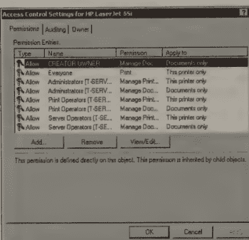

从疑难排除的角度来看，为测试做的最好的准备是广泛了解文档如何从用户应用程序流向物理设备。如果只有一个用户遇到打印问题，那么最可能是用户个人配置或权限分配的问题。要尝试确定用户打印配置中的问题，请依赖于打印设备属性框中的“打印测试页”选项。打印测试页是识别打印机驱动程序、权限分配或打印服务器本身是否存在问题的良好第一步。

正如您将在第 5 章“管理、监控和优化系统性能、可靠性和可用性”中更详细地学习的那样，Windows 2000 包含一个用于监控计数器的性能加载项。为了监控打印机性能，Windows 2000 包含**打印队列对象**。该对象允许您监控每秒字节数和生成的错误。

# 监控、配置、故障排除和控制文件、文件夹的访问

在讨论文件、文件夹访问之前，了解底层文件系统功能和区别是重要的。Windows 2000 识别四种文件系统：通用磁盘格式（`UDF`）、CD-ROM 文件系统（`CDFS`）、文件分配表（`FAT`）和 NTFS 文件系统（`NTFS`）。然而，`UDF` 和 `CDFS` 是只读文件系统，不支持真正的访问控制。因此，本节和考试重点是 `FAT` 和 `NTFS` 文件系统的功能。

## 文件分配表 (FAT) 文件系统

Windows 2000 识别 `FAT` 文件系统是为了提供对早期 Windows 操作系统的支持。它最初设计用于支持远小于现在使用的磁盘。因此，它在处理大型磁盘或文件时并不高效。Windows 2000 能够读取两种 `FAT` 版本格式的分区：早期 MS-DOS 支持的 16 位版本（`FAT16`），以及 Windows 95 OEM 服务 2（`OSR2`）引入的 32 位版本（`FAT32`）。

由于 `FAT` 早于 Windows NT 和 Windows 2000，它不包含对安全或增强分区的支持。从实际角度来看，`FAT16` 和 `FAT32` 最大的区别是最大大小。这是通过将文件分配表的大小从 16 位增加到 32 位实现的。对于 `FAT16` 分区，最大大小为 4GB。理论上，`FAT32` 分区支持的最大大小为 2047GB。然而，在 Windows 2000 中创建 `FAT32` 分区存在 32GB 的限制。

## NTFS 文件系统 (NTFS)

`NTFS` 于 1993 年随 Windows NT 3.1 引入，旨在为 Windows NT 服务器提供一种高性能、安全的文件系统。Windows 2000 包含了最新版本的 `NTFS`（5.0），它是一个相对于 NT 3.1 包含的原始版本有所改进，但 `NTFS` 和 `FAT` 之间的差异更为巨大。

`FAT` 和 `NTFS` 之间的一个显著区别是 `NTFS` 具有可靠性和压缩功能。为了确保数据一致地写入卷中，`NTFS` 使用了事务日志和高级恢复技术。在发生故障时，`NTFS` 使用检查点和数据日志信息来自动维护卷上数据的一致性。`NTFS` 还支持对文件、文件夹和卷进行选择性压缩，这在 `FAT` 卷中是不可行的。`NTFS` 压缩设置的选择性允许管理员自行选择是否对特定的文件系统对象进行压缩。虽然数据压缩减少了卷所需的驱动器空间，但它给系统资源带来了更大的负担。通过提供压缩整个卷、文件夹或单个文件的选项，可以确保驱动器空间得到最高效的利用，同时保持服务的及时性。欲需更多信息，请参阅第 6 章“管理、配置和故障排除存储的使用”。

为了提供最快的文件服务，`NTFS` 使用了较小的簇，并设计为通过更少的磁盘读取即可在卷上找到文件。`NTFS` 5.0 版本还支持比 `FAT` 大得多的卷——单个卷容量可达 2 兆字节。`NTFS` 卷包含高度可配置的用户和组选项，包括使用磁盘配额来限制用户可以消耗的驱动器空间。可能重要的是，单个文件、文件夹和卷可以在用户和组级别上进行安全保护。这比 `FAT` 提供的选项要安全得多，`FAT` 只能对共享文件夹进行安全保护，即使如此，权限也仅限于三个设置：读取、更改和完全控制。本章接下来的几节将更详细地讨论文件夹和文件的安全保护。

由于 `NTFS` 比 `FAT` 文件系统提供了巨大的改进，微软建议所有 Windows 2000 卷都格式化为 `NTFS`。然而，在某些情况下这是无法做到的。例如，大多数多引导配置要求在引导分区上使用 `FAT` 文件系统。如果有必要在服务器上维护 `FAT` 卷，那么理解该配置的安全性影响至关重要。正如你稍后在本章的“监控、配置和控制对文件和文件夹的本地安全”部分中所学到的，当从服务器控制台访问 `FAT` 分区时，无法对其进行安全保护。在决定在 Windows 2000 Server 上支持 `FAT` 分区时，这是一个重要的考虑因素。

## 配置、管理和故障排除独立分布式文件系统 (Dfs)

**分布式文件系统**（`Dfs`）是 Windows 2000 的新功能。创建此项目的目的是消除终端用户在具有多个服务器和大量共享文件夹列表的大型网络上经常遇到的困惑。换句话说，在许多不同服务器的许多文件夹中导航查找文件是一项繁琐的任务。`Dfs` 功能允许你将这些共享文件夹放在一个中心位置。这将提高网络对终端用户的可用性。

当在服务器上安装 Windows 2000 时，会自动安装 `Dfs` 服务。在实现 `Dfs` 时，它被配置为代表多个服务器上的共享文件夹。文件夹以分级树形结构显示，如图 3.3 所示。树中的第一个共享文件夹充当 `Dfs` 根，是终端用户用于访问 `Dfs` 配置中所有文件夹的共享文件夹。一旦创建了 `Dfs` 根，网络上的共享文件夹就会通过 `Dfs` 链接绑定到 `Dfs` 根。

> **Dfs 共享：人力资源数据**
>
> - **Dfs 根**：`\\DC1\HR Records`
> - **Dfs 链接**：`\\Dallas\Payroll`
> - **Dfs 链接**：`\\Dallas\Vacation Tracking`
> - **Dfs 链接**：`\\Houston\Contracts`

**图 3.3** `Dfs` 共享由一个 `Dfs` 根和指向共享文件夹的相关 `Dfs` 链接组成。

> 在设计 `Dfs` 实现时，最大的考虑因素之一是每个服务器只能有一个 `Dfs` 根对象。这意味着你必须仔细选择托管 `Dfs` 根对象的服务器，并根据你的网络局限性设计你的 `Dfs` 配置。请记住，共享的安全权限最终控制用户是否被授予对 `Dfs` 结构中的共享或其文件的访问权限。

`Dfs` 管理通过分布式文件系统 `MMC` 插入项处理，可以通过控制面板中的“管理工具”访问它。要从此插入项启动“新建 `Dfs` 根向导”，请点击菜单栏上的“操作”，然后点击“新建 `Dfs` 根”。启动向导后，你做出的选择是创建域 `Dfs` 根还是独立 `Dfs` 根。域 `Dfs` 根必须通过 `Active Directory` 管理，而独立 `Dfs` 根可以独立于目录服务运行；这种区别在随后的章节中将详细讨论。图 3.4 显示了“新建 `Dfs` 根向导”中的新配置屏幕，在其中你识别托管 `Dfs` 根的服务器。默认情况下，启动向导的服务器将列在其中。

**图 3.4** 识别托管 `Dfs` 根的服务器。

如果你在另一台服务器上创建 `Dfs` 根，请点击“浏览”在网络上搜索该服务器。确定服务器后，点击“下一步”。你将获得选择服务器上现有共享或创建新共享的选项。

如果你正在创建一个新共享，你必须标识共享的路径和共享名称。为了做到这一点，当然你必须拥有足够的权限在服务器上创建共享。

无论你是使用现有共享还是创建新共享，请务必检查共享的安全配置，以验证 `Dfs` 共享用户是否具有正确的权限设置。

## 安装、配置和故障排除资源访问


点击“下一步”后，你将看到 Dfs 根名称，默认情况下是原始共享的名称。在此屏幕上，你还可以为 Dfs 共享的配置添加注释。点击“下一步”继续进入向导的最后一个屏幕。在这里，你将看到 Dfs 共享的最终配置，它概述了共享的配置设置。点击“完成”完成向导。

> 注意：对于独立 Dfs 根，无法更改根名称；它必须与共享名称相同。然而，在域 Dfs 根上，你可以指定与共享名称不同的根名称。

### 独立和域 Dfs 类型

Windows 2000 中使用了两种类型的 Dfs 根：独立和域。域 Dfs 根有时被称为容错型 dfs 根，因为它们使用 Active Directory 服务将 Dfs 信息分发到树中的所有服务器。相比之下，独立 Dfs 根存储在托管服务器的注册表中。由于此局限性，独立 Dfs 根没有备份。如果托管 Dfs 根的服务器不可用，用户将无法访问 Dfs 共享提供的信息。虽然可以在其他服务器上配置与独立 Dfs 根关联的 Dfs 链接副本，但链接共享中的文件必须手动同步，因此它不被认为是真正的容错系统。独立 Dfs 根可以配置单层 Dfs 链接，并可以位于任何支持的文件系统上。然而，建议所有 Dfs 链接都标识 NTFS 卷上的资源。

独立 Dfs 根和域 Dfs 根之间存在一些关键区别。最明显的区别是域中的所有 Active Directory 服务器根据网络上客户端的请求分发信息。由于信息作为 Active Directory 的一部分存储，它会被复制到每个域控制器。这种复制确保了用户永远可以访问 Dfs 共享中的信息。由于与 Active Directory 的交互，域 Dfs 根必须位于 NTFS 5.0 分区上。

在创建域 Dfs 根和独立 Dfs 根之间的区别非常小，除了在“新建 Dfs 根向导”的初始屏幕上选择选项外。在向导的第二个屏幕上，系统要求你为 Dfs 根选择托管域。

### 第 3 章

在创建 Dfs 根之后，差异变得非常明显。如图 3.5 所示，右键点击 Dfs 域根会弹出一个包含“新建根副本”（New Root Replica）的菜单，这对于独立根是不可用的。选择此选项将启动创建 Dfs 根的相同过程；唯一的区别是原始根的副本。一旦创建了根，你就可以启用根之间的 Dfs 复制。由于潜在流量可能很高，Dfs 复制默认是禁用的。要启用复制，右键点击 Dfs 根并选择“复制策略”（Replication Policy）。然后就可以选择定义的每个 Dfs 根副本。选择至少两个副本并点击“启用”（Enable）。Dfs 根复制由下一节讨论的文件复制服务（File Replication Service）处理。

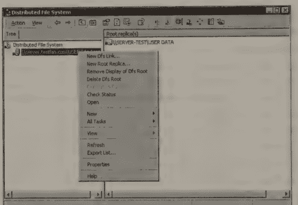

图 3.5 选择复制策略以同步副本之间的文件。

## Dfs 链接

如，创建 Dfs 链接是为了将来自不同服务器的共享根信息连接到一个单一、易访问的位置。一旦创建了 Dfs 根，你就可以为其他共享文件夹创建 Dfs 链接。在 Dfs 插件中，选择将托管链接的 Dfs 根，然后从操作菜单选择“新建 Dfs 链接”（New Dfs Link）。在出现提示时，填写分配给 Dfs 链接的名称、共享文件夹信息以及有关链接的注释。如果你不确定共享文件夹的准确名称和位置，请使用“浏览”（Browse）按钮搜索网络。配置好 Dfs 链接后，它们在用户看起来就像共享中通常找到的其他文件夹。

## 文件复制服务 (FRS)

Windows 2000 文件复制服务（FRS）在安装期间包含，设计用于处理域控制器的文件复制流量。它包含在所有 Windows 2000 安装中，但在域控制器和成员服务器上被配置为手动启动。当服务器配置为域控制器时，FRS 设置为自动启动。虽然 FRS 最初是为登录脚本和策略复制设计的，但它是域根 Dfs 根复制的基础。事实上，Dfs 根复制消耗的 FRS 时间可能比 Active Directory 复制更多。为了管理 Dfs 根复制，FRS 使用与 Active Directory 文件复制定义的知识一致性检查器（KCC）相同的结构。当用户更改 Dfs 根中的文件时，更改会被记录在 NTFS 更改日志中，该日志会监控对 Dfs 链接的更改。当用户关闭文件时，更改将得到更新，FRS 将文件放置在暂存区以进行计划复制。

尽管 Windows 2000 服务器使用 FRS 进行文件复制，但它并不用于 Active Directory 流量。Windows 2000 域控制器上的 FRS 同步域内服务器之间的 SYSVOL 内容。SYSVOL 存储登录脚本和系统策略文件，FRS 确保每个服务器上都存在最新的文件。为了实现这一点，会维护版本文件，允许 FRS 确定是否已分发最新更新。

在域控制器之间，FRS 自动生成复制环。Active Directory 拓扑定义了从域控制器到域控制器的复制更新路径，以确保所有服务器都拥有最新信息。通过使用环形拓扑，在域控制器宕机的情况下，FRS 确保从一个域控制器到另一个域控制器至少有两条路径。由于 Active Directory 使用多主复制方案，其中所有域控制器都是平等的，因此确保所有 Active Directory 服务器都完全更新至关重要。

复制方案被配置为站点（sites），站点代表一组连接的计算机。由于支持站点保持可靠且相对高速需要涉及大量流量；微软建议网络速度至少达到 512Kbps。需要在较慢的链路（如 56Kbps WAN 链路）上进行同步的 Active Directory 服务器应配置在单独站点中。KCC 负责在站点内的域控制器之间生成和维护复制环。

同一站点内服务器之间的复制（站内复制）每几分钟发生一次，并且基于触发，这意味着当域控制器发生更改时，它会通知其复制伙伴，当复制伙伴可用时，它们会向域控制器请求更新。站内复制流量不进行压缩。在安装过程中，同一站域控制器之间会自动建立站内复制。

站点之间的复制（站间复制）仅在特定时间发生（默认为三小时），除非有紧迫的复制需求。为了确保最佳传输速度，站间复制的传输是可配置的，数据经过了压缩。遗憾的是，站间通信不是自动配置的。当用户账户因登录失败而被锁定、当域控制器的本地安全机构（LSA）发生更改以及当相对标识符（RID）主所有者发生更改时，站间连接会触发紧急复制。

## 对文件和文件夹进行监控、配置、故障排除和控制本地安全

Windows 2000 环境极其动态，允许各种安全配置。在 Windows 2000 系统（无论是服务器版还是专业版）上实现安全性的构建块是用户和组。由于创建和管理用户和组帐户是《安装、配置和管理 Microsoft Windows 2000 专业版》的重点，因此理解用户和组是如何实现的是非常重要的。

Windows 2000 上可以实现两个级别的安全：本地安全和共享安全。本地安全管理直接登录系统的用户的访问；共享安全（在下一节中讨论）管理网络资源的访问。要开始对文件和文件夹进行安全管理，必须定义哪些用户和组允许访问服务器。

## 安装、配置和故障排除资源访问

一旦确定了哪些用户和组允许访问服务器，保护资源就变成文件系统的问题。如前所述，FAT 和 NTFS 文件系统之间最大的差异之一是可用安全设置的数量和种类。由于 FAT 文件系统的结构并非为了提供安全性，因此无法控制文件和文件夹的访问。然而，远程访问的 FAT 分区将在下一节中讨论。

## NTFS 权限

如所述，NTFS 设计用于为 Windows 2000 资源提供完整的文件级安全。它提供了对用户和组允许或拒绝访问权限。对于任何安全配置，最好使用组以提供更易于的管理。

为了提供最安全的配置，拒绝特定用户或组的权限将覆盖所有其他权限。例如，如果文件夹的权限分配规定帐户组具有完全控制权限，但该组成员的权限被设置为拒绝“读取”，则该成员将无法查看文件夹或其内容。由于“拒绝”覆盖所有其他设置，它会影响权限继承。与其显式设置拒绝权限，通常不为用户或组专门分配权限更好。

NTFS 的优势之一是，无论用户是本地访问还是通过网络访问资源，其安全设置都适用。这是一个重要功能，确保本地访问服务器的用户不会影响服务器的运行。通过保护存储系统文件的文件夹，可以保护关键操作系统文件免受用户删除或修改。

NTFS 权限是累积的；换句话说，分配给用户的权限将与其所属任何组所分配的权限相结合，以决定是否授予对资源的访问请求。

用户将能够查看文件夹内容、读取文件、覆盖文件或更改其属性，并修改文件内容。然而，组中的其他成员将仅允许查看文件夹内容并读取文件。

Windows 2000 对 NTFS 文件夹权限和 NTFS 文件权限的区分非常小。事实上，它们之间的差异微乎其微。最大的区别在于 Windows 2000 决定使用何种权限的方式。文件权限优先于文件夹权限，这意味着你可以授予某个组读取文件夹内容的权限，然后授予单个用户修改文件夹内某个特定文件的权限。这确保了适当的用户能够获得他们有时需要的、具有高安全性且细粒度的文件访问权限。然而，在单个文件层级控制安全性是非常耗费时间的，除非在特殊情况下，否则不建议这样做。在大多数情况下，直接在文件夹层级利用 NTFS 安全设置就足够了。

在决定是否授予文件请求时，Windows 2000 从文件树的根节点开始编译安全配置设置。随着树形结构的延伸，权限将继承到最终目标的文件和文件夹，除非对特定的权限设置禁用了继承。当 NTFS 对象的安全设置被修改时，你可以禁用从父级对象的权限继承。这意味着指定的设置不会被树中更高层的其他权限所调整。如果你选择此设置，将获得复制或删除父对象当前设置的选项。

认证考试非常关注 NTFS 权限继承。你可能会遇到多个几乎完全相同的问题，但其中一个设置有所不同。理解 Windows 2000 如何根据 NTFS 权限设置处理特定的资源请求至关重要。

### 分配权限

默认情况下，文件或文件夹的所有者可以分配权限，管理员（Administrators）也是如此。图3.6 显示了 NTFS 分区上文件夹的属性对话框。

“名称”（Name）窗口标识了当前对该文件夹拥有权限分配的用户或组。“权限”（Permissions）部分指示了对所选用户允许或拒绝的权限。如果选择项显示为黑色复选标记，则说明该权限是在此文件夹上定义的。如果是灰色复选标记，则说明该分配是从父对象继承的。

## 安装、配置和排除资源访问

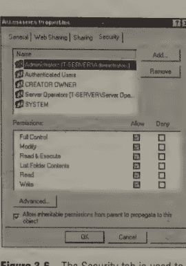

**图 3.6** 安全选项卡用于为 NTFS 文件夹分配权限。

在对话框底部，“从父级继承权限并传播到此对象”（Allow Inheritable Permissions from Parent to Propagate to This Object）选项用于指定对象的继承策略。如果你取消勾选此选项，系统会询问你是想复制父对象的权限还是将其从配置中删除。要向对象的配置设置中添加用户，请点击“添加”（Add）。你将看到服务器上的用户和组列表。选择相应的用户或组，点击“添加”，然后点击“确定”。从提供的列表中选择新的权限分配，或点击“高级”（Advanced）进入访问控制对话框。

除了对象的配置设置（称为特殊权限）外，你还可以对对象进行审核并定义所有者。表 3.2 概述了文件夹可用的特殊和标准权限。请注意，与 NTFS 权限一样，显式的“拒绝”（Deny）会覆盖所有其他权限。

**表 3.2** NTFS 权限

| 权限 | 允许 | 标准 |

| :--- | :--- | :--- |

| 列出文件夹/数据 (List Folder/Data) | 查看文件夹内容 | |

| 读取属性 (Read Attributes) | 查看文件夹属性 | |

| 读取权限 (Read Permissions) | 查看文件夹权限 | |

| 创建文件/数据 (Create Files/Data) | 在文件夹中创建新文件 | |

| 创建文件夹/数据 (Create Folders/Data) | 创建新文件夹并追加数据 | |

| 写入属性 (Write Attributes) | 更改文件夹属性 | |

| 写入扩展属性 (Write Extended Attributes) | 更改文件夹扩展属性 | |

| 遍历文件夹/执行 (Traverse Folder/Execute) | 穿过文件夹并运行程序 | |

| 删除 (Delete) | 删除指定的文件夹 | |

| 删除子文件夹和文件 (Delete Subfolders and Files) | 删除子文件夹和文件 | |

| 更改权限 (Change Permissions) | 更改文件夹权限 | |

| 取回所有权 (Take Ownership) | 获取文件或文件夹的所有权 | |

**表 3.2** NTFS 权限（续）

| 权限 | 允许 | 标准 |

| :--- | :--- | :--- |

| 读取属性 (Read Attributes) | 查看文件夹属性 | 读取和执行 (Read & Execute) |

| 读取扩展属性 (Read Extended Attributes) | 查看文件夹扩展属性 | 读取和执行 (Read & Execute) |

| 读取权限 (Read Permissions) | 查看文件夹权限 | 读取和执行 (Read & Execute) |

| 创建文件/数据 (Create Files/Data) | 在文件夹中创建新文件 | 读取和执行 (Read & Execute) |

| 创建文件夹/数据 (Create Folders/Data) | 创建新文件夹并追加数据 | 读取和执行 (Read & Execute) |

| 写入属性 (Write Attributes) | 更改文件夹属性 | 写入 (Write) |

| 写入扩展属性 (Write Extended Attributes) | 更改文件夹扩展属性 | 写入 (Write) |

| 遍历文件夹/执行 (Traverse Folder/Execute) | 穿过文件夹并运行程序 | 读取和执行 (Read & Execute) |

| 删除 (Delete) | 删除指定的文件夹 | 修改 (Modify) |

| 删除子文件夹和文件 (Delete Subfolders and Files) | 删除子文件夹和文件 | 修改 (Modify) |

| 更改权限 (Change Permissions) | 更改文件夹权限 | 修改 (Modify) |

| 取回所有权 (Take Ownership) | 获取文件或文件夹的所有权 | 修改 (Modify) |

## 共享文件夹中文件和文件夹访问的监控、配置、排除和控制

正如章初所述，用户通过服务器分区上的共享文件夹访问文件资源。当用户尝试通过“网络位置”（Network Places）等工具远程访问服务器时，他们将看到有权访问的共享文件夹。

共享文件夹的过程与分配 NTFS 权限的过程相似。默认情况下，文件夹是不共享的。授予用户的访问级别由其组组成情况决定。图 3.7 显示了要共享文件夹的属性。在文件夹属性对话框中选择“共享”（Share）选项，可以指定共享名称、添加注释，并限制同时访问的用户数。

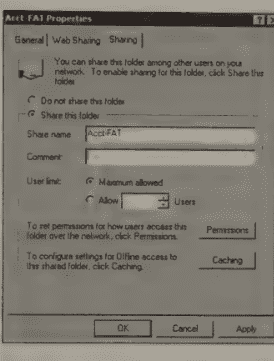

**图 3.7** 共享文件夹以限制访问。

### 第 3 章

完全控制（Full Control）——赋予用户“更改”权限允许的所有操作，外加更改文件权限和获取文件所有权的能力。

与 NTFS 权限一样，共享文件夹权限是累加的，除非用户在其所属的任何组中被拒绝了访问。其所属组的权限与其自身权限的组合将决定其总访问级别。尽管共享文件夹没有提供最详尽的安全配置，但它们是保护 FAT 卷上文件和文件夹网络访问的唯一方式。当共享文件夹位于 NTFS 卷上时，最好在共享层级上或配置安全设置，或者通过 NTFS 权限进行配置，但不要两者都设置。由于 NTFS 提供了更详尽的安全选项，在可能的情况下，选择 NTFS 权限通常是最佳选择。出于这个原因，共享权限的默认配置（“所有人”完全控制）通常是可以接受的。这限制了所需的管理工作量，并更容易确保向用户和组授予正确的权限。

在域环境下的 Windows 2000 服务器上，管理员（Administrators）和服务器操作员（Server Operators）成员能够共享域内任何计算机上的文件夹。在单机服务器上，高级用户（Power Users）只能在本地分区上创建共享。在工作组环境中，管理员和高级用户可以在单机服务器上创建共享，也可以在作为组员的任何 Windows 2000 专业版计算机上创建共享。

创建卷时，Windows 2000 会自动创建用于管理的特殊共享。这些共享在卷属性页的“共享”选项卡上以美元符号 ($) 显示。例如，C 盘上的卷根目录被共享为 `$`。系统根目录也创建了管理共享，共享为 `Admin$`，而 Windows 2000 用户用于存储打印机驱动程序的文件夹被共享为 `Print$`。所有管理共享都是隐藏的且无法更改的，但如果授予了用户适当的权限，用户可以通过网络访问。默认情况下，只有管理员被授予访问管理共享的权限。

## 通过 Web 服务监控、配置、故障排除并控制文件和文件夹的访问

Windows 2000 微软的网络发布产品 Internet 信息服务（IIS）5.0 版本，你将在下一节中学习更多信息。IIS 的新功能之一允许你访问网络资源，以便通过 Web 浏览器访问它们。这是因为 HTTP 1.1 版本包含了一项名为 WebDAV（Web 分布式授权和版本控制）的增强。使用 WebDAV 和符合 HTTP/1.1 的 Web 浏览器，具有足够权限的用户被允许操作文件和文件夹。这包括在 WebDAV 文件夹中移动移动文件、更改文件属性以及在 WebDAV 目录中搜索内容。由于 WebDAV 同时集成在 Windows 2000 和 Internet Explorer 5 中，它包含了来自这两个产品的安全功能。这确保了从互联网访问文件夹的用户仅获得管理员所希望的访问权限。


# WebDAV 站点建立与 IIS 5.0 管理

有许多不同的方法可以建立供用户访问的 WebDAV 站点。例如，创建一个专门指定用于 WebDAV 文件夹访问的网站，然后为所有想要通过 WebDAV 共享的文件夹创建虚拟目录。一旦创建了网站，你可以通过 IIS 创建虚拟目录，也可以通过在文件夹属性页上选择“Web 共享”来创建，如图 3.8 所示。

**图 3.8** 共享文件夹以便通过 WebDAV 访问。

要将文件夹共享到网站，在“Web 共享”选项卡上，选择托管文件夹的网站，然后选择“共享此文件夹”。系统将提示你输入网站上的共享别名、该文件夹的 IIS 访问权限以及应用程序权限。在做出相应选择后，点击“确定”返回文件夹属性，再次点击“确定”继续。

在文件夹上使用“Web 共享”选项卡是共享文件夹以便通过 WebDAV 访问的一种快速且熟悉的方法。一旦创建，就可以通过“管理工具”中的“Internet 服务管理器”进行管理。

## 第 3 章

事实上，Internet 服务管理器用于配置所有网站（包括 WebDAV 站点）的安全性。与 NTFS 类似，IIS 可以从网站级别一直到单个文件进行安全配置。第一项安全设置规定了用户访问资源所需的身份验证级别。选择“匿名（Anonymous）”将允许任何人访问该资源，这在 WebDAV 实现中是不建议的。“基本（Basic）”身份验证设置需要密码才能访问资源，但它是以明文形式发送的。虽然这不是最安全的选项，但它是支持最广泛的，因为它是 HTTP 标准的一部分。集成 Windows 身份验证（Integrated Windows authentication）依赖于 Windows 安全系统，该系统在通过网络发送密码之前加密和哈希处理，验证用户访问，并在内网环境中运行良好。摘要身份验证（Digest authentication）是一种通过浏览器验证用户身份验证的安全方法，如果 WebDAV 数据要在互联网上共享，则它是最佳选择。

除了控制网站上使用的身份验证方法外，IIS 还包含组成网站的单个文件和文件夹的安全权限。当在 Internet 服务管理器中配置虚拟文件夹时，使用“本地路径（Local Path）”部分来分配权限。在 WebDAV 属性的首页目录上，你可以配置以下内容：

- 资源的位置：作为本地计算机上的资源、位于另一台计算机上的共享，或重定向到 URL。
- 资源的路径。
- 启用哪些权限。如果你的网站包含脚本（如 `ASP`），“脚本源访问（Script Source Access）”选项将允许用户执行脚本。“允许用户读取或下载文件”，而“写入”允许用户放在共享文件夹中。“目录浏览（Directory browsing）”允许用户查看子目录列表，如果未选择此选项且存在子文件夹，它们将被隐藏。
- 是否记录对站点的访问。
- 是否允许 Microsoft 索引服务器将资源包含在站点索引中。
- 应用程序名称和启动点。
- 可以运行的应用程序类型：
    - 无（None）：表示仅可以访问静态文件。
    - 仅脚本（Scripts Only）：规定仅可以运行 `ASP` 等脚本。
    - 脚本和可执行文件（Scripts and Executables）：允许运行所有类型的应用程序。
- 应用程序与服务器进程的分离程度。这有助于减少可能上传到站点的恶意代码的影响。

由于 IIS 与 Windows 2000 集成，站点授予用户的访问由文件系统控制。在创建虚拟目录时选择的权限控制文件的访问方式。为了简化虚拟目录的安全管理，建议你共享文件夹并保留默认权限（所有人完全控制），然后利用 IIS 提供的更动态的安全设置。

## 监控、配置、故障排除并控制对网站的访问

如前所述，Internet 信息服务（IIS）5.0 版本作为 Windows 2000 的一部分。IIS 5.0 包含了许多改进和功能，旨在为用户提供高安全性、高可用性的 Web 服务。

## IIS 5.0 中的网站性能和可靠性功能

作为这些改进的一部分，IIS 包含了用于微调 Web 性能和增加服务可靠性的配置选项。例如，IIS 5.0 解决了运行旧版本 IIS 的服务器托管多个网站时的问题。当服务器托管多个网站时，每个网站都需要一个唯一的 IP 地址以确保流量正确引导。为此，服务器会为一种称为 socket 的协议创建一个唯一标识符，该标识由网站的节点地址和其使用的端口号组成。

socket 在服务器启动时创建，并且每个 socket 都需要大量的物理内存（非分页内存）。服务器可以托管网站的数量受限于系统可加载的内存。IIS 5.0 通过允许具有不同 IP 地址但使用相同 socket 的托管站点共享 socket，解决了这个问题。

### 套接字池

通过套接字池。这意味着一台服务器可以托管更多的网站，而且这些网站的性能会更好。

此外，微软在 IIS 5.0 中引入了进程节流和带宽节流功能。这些功能用于提高网站性能。它们允许管理员指定服务器上每个网站允许使用的系统处理器和网络带宽的最大百分比。这有助于确保某个网站不会占用整个服务器资源，而导致其他托管网站的性能低劣。IIS 5.0 托管多个网站的能力也得到了提高。IIS 服务器上的每个网站由一个三地址部分进行标识。此版本允许网站共享三个地址部分中的两个部分，以节省资源，同时确保流量被正确导向。

## IIS 5.0 中的网站安全功能

如今管理员最担心的之一就是他们的网站受到攻击。实现这一目标有许多方法，微软已尝试通过 IIS 5.0 来解决这些问题。IIS 这一实现的关键之一是它能够将应用程序与外部攻击隔离开来。应用程序保护用于将每个应用程序进程与内存中的其他进程隔离开。

IIS 5.0 开始通过允许 Web 应用程序在 IIS 服务器进程之外启动来解决这些问题。在此配置下，如果 Web 应用程序失败，它只会影响在该环境中启动的其他应用程序。IIS 5.0 进一步改进了这一点，将类似的应用程序与服务器服务分开进行池化。IIS 5.0 的另一个重大改进是服务的重启方式。在这一版本的 IIS 之前，如果发生系统故障，必须重启计算机。但在 IIS 5.0 中，可以在不关闭服务器的情况下重启服务及其所有组件。

IIS 在新安装 Windows 2000 Server 时会默认安装，如果在现有系统中检测到较早版本的 IIS、Peer Web 服务或个人版 Web 服务器（Personal Web Server），则它将在升级期间安装。如果在升级期间未检测到 IIS，则将不会安装。

可以通过控制面板中的“添加/删除 Windows 组件”实用程序安装和删除 IIS 及其组件。如果在安装之前尚未安装 `TCP/IP`，它将自动安装并配置为使用 `DHCP` 进行地址配置。作为安装过程的一部分，将创建默认网站、管理网站、默认 `SMTP` 虚拟服务器和默认 `FTP` 站点。

## 安装、配置和排查资源访问问题

安装完成后，可以通过两个版本的相同界面来管理 IIS，每个界面分别位于“管理工具”或“计算机管理”实用程序中。当从服务器控制台或另一个 Windows 2000 系统配置 IIS 时，请使用管理工具中的“Internet 信息服务”实用程序。与其他基于 `MMC` 的界面一样，“Internet 信息服务”工具可用于远程访问和配置服务器。

同一个向集（snap-in）也包含在“计算机管理”程序的“服务和应用程序”下。需要注意的是，早期的 `MMC` 版本称为“Internet 服务管理器”（Internet Services Manager）。取决于用于安装或升级服务器的方法，你可能仍然看到与 IIS 管理相关的此名称。

作为向集的备选方案，IIS 5.0 提供了通过 Web 浏览器通过互联网安全地访问和管理服务器。它被称为“Internet 服务管理器 (HTML)”，是安装 IIS 时自动创建的 Web 网站。你可以通过右键点击“管理网站”链接并选择“浏览”，从向集中启动 HTML 版管理工具。IIS 5 通过这种方式确保了安全性：在创建它时随机选择端口号，并在授予访问权限前进行身份验证。若要在不从向集启动的情况下使用 Internet 服务器管理器 (HTML)，你必须拥有分配给管理网站的端口号。右键点击站点链接并选择“属性”。图 3.9 显示了新创建的 IIS 服务器上管理网站的配置属性。要使用 Internet 服务管理器 (HTML) 管理服务器，请按此格式输入站点地址：`http://<server address>:port number`。系统将提示你提供登录和密码。

**图 3.9** IIS 服务器上管理网站的属性设置。

尽管 (HTML) 网站提供了近乎相同的功能，但并非所有选项都可以通过“Internet 服务管理器 (HTML)”来使用。例如，两个界面都允许你停止、启动、暂停和恢复单个站点，但只有“Internet 信息服务”工具允许你启动 IIS 本身。

IIS 5.0 使用的其他增强功能还包括：将管理权限委托给其他用户、确保网站脚本不消耗处理器时间的进程核算、为网站提供自定义错误消息、增强的命令行工具以实现更高级的站点自动化、支持 `FTP` 重启协议（该协议允许中断的文件传输从部分下载处继续下载，而不是从头开始），以及对 `HTTP` 压缩的支持（这可以增加互联网上的传输速度）。从管理的角度来看，备份和恢复 IIS 服务器的配置更加容易；在两个管理工具中都有此选项。要备份服务器配置，请在“Internet 信息服务”向集中选择服务器，并从“操作”菜单中选择“备份/恢复配置”。在管理器的 (HTML) 版本中，链接位于主页底部。此外，IIS 与 Windows 2000 紧密集成，你可以利用 `DFS` 在服务器之间同步文件。

## IIS 安全

在本章前面简要提到，IIS 5.0 包含了全面的内部安全能力，以防止入侵者并保持互联网站点信息的安全。这种安全结构基于以下内容：

- 安全套接字层 (`SSL`) 3.0：被采用作为互联网身份认证的行业标准。
- 传输层安全 (`TLS`)：基于 `SSL`，但在较低层级执行加密。
- 公钥密码标准 (`PKCS`)：`PKCS #7` 和 `PKCS #10` 定义了加密数据（数字签名）和证书请求的格式。

IIS 的实现的关键之一是它能够将应用程序与外部攻击隔离开来。应用程序保护用于将每个应用程序进程与内存中的其他进程隔离开。

IIS 5.0 开始通过允许 Web 应用程序在 IIS 服务器进程之外启动来解决这些问题。在此配置下，如果 Web 应用程序失败，它只会影响在该环境中启动的其他应用程序。IIS 5.0 进一步改进了这一点，将类似的应用程序与服务器服务分开进行池化。IIS 5.0 的另一个重大改进是服务的重启方式。在这一版本的 IIS 之前，如果发生系统故障，必须重启计算机。但在 IIS 5.0 中，可以在不关闭服务器的情况下重启服务及其所有组件。

可以通过控制面板中的“添加/删除 Windows 组件”实用程序安装和删除 IIS 及其组件。如果在安装之前尚未安装 `TCP/IP`，它将自动安装并配置为使用 `DHCP` 进行地址配置。作为安装过程的一部分，将创建默认网站、管理网站、默认 `SMTP` 虚拟服务器和默认 `FTP` 站点。

## IIS 5.0 验证方法

IIS 长期以来支持主要的验证方法：基本（Basic）和集成 Windows（Integrated Windows）。

- **基本**：如本章前面对 WebDAV 的讨论所示，它要求用户提供用户名和密码来访问站点，但这些信息没有加密。它是原始 `HTTP` 1.0 标准的一部分，并受到大多数 Web 产品的支持。
- **集成 Windows**：以前称为 Windows NT 挑战/响应，它使用 `NTLM` 对旧版浏览器与 IIS 服务器进行身份验证，并对支持的浏览器使用行业标准的 `Kerberos v5` 进行身份验证。如果匿名访问被拒绝且 IIS 服务器不在代理服务器之后，请使用此方法。
- **摘要验证 (Digest Authentication)**：一种用于确保客户端和服务器之间信息安全传输的新过程。它的工作方式与基本验证类似，但身份凭据通过一个名为哈希（hashing）的单向处理。

## 管理 IIS 服务器

如前，可以通过 Internet 信息服务工具的之一来管理 IIS，即 `MMC` 向集或 HTML 版本。Web 或 `FTP` 站点的配置设置通过选择站点并从“操作”菜单中选择“属性”来访问。主目录选项卡上的设置（在本章前面的 WebDAV 部分中讨论过）尤为重要。同样值得注意的是目录安全选项卡上的选项，那里定义了验证控制方法并强制执行 `IP` 地址限制。点击“编辑”中的“匿名访问和身份验证控制”部分用于指定是否允许匿名访问，并定义网站的身份验证方法——基本（Basic）、摘要（Digest）或集成 Windows（Integrated Windows）。

虚拟目录用于将网站链接到主目录之外的文件夹。当用户访问网站时，虚拟目录的内容呈现出来就像它们包含在主目录中一样。虚拟目录为目标文件夹分配一个别名，从而使网站更安全且更易管理。虚拟目录更安全，因为用户无法确定虚拟目录中文件的实际位置。如果没有虚拟目录，移动构成网站的文件和文件夹将需要更改指向这些文件夹的 `URL` 链接。使用虚拟目录简化了这一过程，因为不再需要更改网站上的 `URL`，只需更改别名与文件夹之间的映射关系。

虚拟目录是通过“虚拟目录创建向导”创建的，该向导从 Internet 信息服务（Internet Information Services）插集（snap-in）启动，操作方法为选择网站、右键点击并选择“新建”，然后选择“虚拟目录”。在 Internet 服务管理器（Internet Services Manager, HTML）中，虚拟目录是通过 IIS 新站点向导创建的。要启动向导，在左侧窗格中选择网站。点击“下一步”，从选项列表中选择“虚拟目录”，然后再次点击“下一步”。输入虚拟目录的别名，点击“下一步”，然后输入虚拟目录的路径。点击“下一步”，选择分配给别名的权限，然后点击“完成”。

## 在单台 IIS 5.0 服务器上托管多个站点

IIS 包含三个允许在单个服务器上托管多个站点的功能：端口号分配、具有独立 `IP` 地址的多个网络适配器，以及使用主机头名称（host header names）为单个网络适配器使用多个 `IP` 地址/域名组合。使用哪种选项的取决于服务器的硬件能力和网络结构。尽管站点托管在同一台服务器上，但每个站点都有自己的安全配置，这允许管理员在分配管理责任时具有更大的灵活性。

托管在 IIS 服务器上的站点属性可以单独进行配置，它们最初是根据服务器针对 Web 和 `FTP` 服务的“主属性”（Master Properties）值建立的。要配置 IIS 的主属性，请在 Internet 信息服务工具中选择服务器并选择“属性”。站点建立后，可以对其它们的属性进行单独配置。站点组件（如虚拟目录或文件）可以配置为继承父对象的设置。如果手动配置了低级对象，则对站点属性的更新将不会自动传递给该组件；系统将提示你选择是否更改受影响各个组件的设置。

## IIS 5.0 中的单个站点管理

单个站点管理被分配给一个名为“操作员”（Operators）的特殊组。默认情况下，本地“管理员”（Administrators）组的成员被识别为 IIS 站的操作员，但可以在主属性级别对新站点进行更改，也可以在每个单独站点的配置中更改。尽管操作员组的成员对他们的站点拥有管理控制权，但他们无法更改影响 IIS 功能或 Windows 2000 服务器本身的设置。

## 练习题

### 第 1 题

你负责管理 IIS 5.0 服务器的运行。你必须满足以下性能要求：

- 你必须限制一个网站对服务器的性能影响。
- 你必须限制两个网站的网络使用情况。
- 你必须跟踪对网站的访问情况。
- 你必须确保用户仅允许访问本地服务器上的文件。

建议的解决方案是访问默认网站的“属性”页的“主目录”选项卡，并选择“记录访问并索引此资源”。在同一选项卡上，取消勾选“目录浏览”。

以下哪项是建议解决方案提供的？（选择所有适用项。）

- A. 建议的解决方案限制了一个网站对服务器的性能影响。
- B. 建议的解决方案限制了两个网站的网络使用情况。
- C. 建议的解决方案跟踪了对网站的访问。
- D. 建议的解决方案限制用户仅访问本地服务器上的文件。

答案 C 和 D 是正确的。选择“记录访问”选项会跟踪用户对网站的访问。取消“目录浏览”将限制用户仅访问本地服务器上的文件。

### 第 2 题

Link 是 Windows 对以下哪种协议的实现？

- A. `TCP/IP`
- B. `NetUI`
- C. `IPX/SPX`
- D. 以太网

答案 C 是正确的。`IPX/SPX` 是 Link Windows 的实现。`TCP/IP` 是行业标准协议。`NetUI` 不是 Windows 协议。以太网是某种网络类型。

### 第 3 题

尽管操作员组的成员对他们的站点拥有管理控制权，但他们无法更改影响 IIS 功能或 Windows 2000 服务器本身的设置。

### 第 4 题

以下哪些项不会触发站点更新？

- A. 登录失败导致账户锁定。
- B. 域控制器的更改。
- C. 域控制器的安全设置。
- D. 所有者的更改

答案 B 是正确的。触发站点更新的包括登录失败导致账户锁定、域控制器的安全设置以及所有者的更改。域控制器的更改不会触发。

### 第 5 题

你正在配置计算机以访问网络上的 NetWare 资源。这些服务是 Windows 2000 的。在这种环境下，允许 Windows 访问资源的最佳方法是？

- A. 在 Windows 2000 服务器上安装 `CSNW`。
- B. 在 Windows 2000 服务器上安装 `GNW`。
- C. 在客户端上安装 `CSNW`。
- D. 在客户端上安装 `GNW`。

答案 D 是正确的。虽然网关服务旨在为 Windows 2000 提供 NetWare 访问，但它是有限的解决方案。如果客户端频繁访问 NetWare 资源，在客户端系统上安装客户端服务是更好的选择。在服务器上安装 `CSNW` 不会为客户端提供访问。没有针对客户端的 `GNW`。

### 第 6 题


## 问题 1

你接到网络上一个用户的电话，他们遇到打印遇到了问题。他们向打印机发送了文档，但尚未收到纸质副本。你让用户双击系统上的打印机定义，看到来自网络其他用户的大量作业正在等待打印。用户注意到他们的作业在队列中排在其他用户之后。你让用户选择队列中的第一个作业，然后从文档菜单中取消。不幸的是，用户收到消息说他们没有足够的权限取消此打印作业。必须为用户分配以下哪些打印权限以允许他们取消挂起的打印作业？

- A. 打印
- B. 管理文档
- C. 管理打印机
- D. 管理服务器

**答案 B 是正确的。** `管理文档` 权限允许用户操作自己的打印作业以及其他用户的打印作业。`打印` 权限允许用户取消自己的作业，但不能取消其他用户的作业；因此，答案 A 是错误的。`管理打印机` 允许用户更改打印机本身的设置；因此，答案 C 是错误的。没有名为“管理服务器”的打印权限设置；因此，答案 D 是错误的。

## 问题 7

策略与程序部门要求在所有 Windows 2000 服务器上都包含共享文件夹，以便为所有员工提供公司流程的副本。与某些部门相关的策略可能包含在其他服务器的单独文件夹中。建议的解决方案必须满足以下要求：

- 你必须确保对服务器上的策略文档具有安全的只读访问权限。
- 你必须确保所有用户随时都能访问策略的副本。
- 你必须确保可以从“策略”文件夹访问部门策略。
- 策略与程序部门的成员应该对文件夹中的文档具有管理员访问权限。

建议的解决方案是在所有服务器的 NTFS 卷上实现一个“策略与程序”文件夹。策略与程序组的成员被分配文件夹的 `完全控制` NT 权限。使用 Dfs 从“策略与程序”文件夹到其他服务器上的部门文件夹提供链接。

以下哪些是建议的解决方案提供的？（多选）

- A. 建议的解决方案为服务器上的策略文档提供了安全的只读访问权限。
- B. 建议的解决方案确保所有用户随时都能访问策略的副本。
- C. 建议的解决方案确保可以从“策略”内部访问部门策略。
- D. 建议的解决方案赋予策略与程序组成员对文件夹内文档的管理员权限。

**答案 C 和 D 是正确的。** 利用 Dfs 确保了可以从“策略”内部轻松访问。为策略与程序组设置 NTFS `完全控制` 权限使他们对文件夹中的文件具有管理控制权。解决方案中未指定其他组的权限，且没有同步不同服务器上文件的规定。因此，答案 A 和 B 是错误的。

## 问题 8

你正在建立一个内网站点，供员工访问文件和重要的公司信息。所有客户端计算机都运行着 Windows 98 或 Windows 2000 专业版。建议的解决方案必须满足以下安全要求：

- 你必须使用所有客户端支持的身份验证方法。
- 你必须使用加密身份验证方法。
- 你必须确保所有请求都经过身份验证。
- 你必须选择 HTTP 规范部分的身份验证协议。

建议的解决方案是配置网站允许匿名访问，并使用 `集成 Windows 身份验证`。

以下哪些是建议的解决方案提供的？（多选）

- A. 建议的解决方案使用了所有客户端支持的身份验证方法。
- B. 建议的解决方案使用了加密身份验证方法。
- C. 建议的解决方案确保所有请求都经过身份验证。
- D. 建议的解决方案使用了 HTTP 规范部分的协议。

**答案 A 和 B 是正确的。** `集成 Windows 身份验证` 是一种 Windows 98 和 Windows 2000 专业版计算机都支持的加密身份验证方法。建议的解决方案不需要身份验证，因为它允许匿名访问。`集成 Windows 身份验证` 不是 HTTP 规范的一部分。因此，答案 C 和 D 是错误的。

## 问题 9

你想限制网络用户每天访问文件时必须记忆的共享名称数量。网络上的多个系统上存在各种共享的专业资源，包括 Windows 2000 专业版系统、配置为成员服务器的 Windows 2000 服务器系统以及单独的 Windows 2000 服务器。以下哪项可用于为用户提供简化访问？

- A. 在主 Windows 2000 服务器的根目录下创建一个 WebDAV 文件夹。
- B. 在 PDC 上创建一个 Dfs 根，并添加指向网络上共享资源的链接。
- C. 创建一个 FRS 进程来同步网络上所有服务器上的文件。
- D. 在单独服务器上创建一个域 Dfs 根，并添加指向网络上共享资源的链接。

**答案 B 是正确的。** 带有指向网络共享资源链接的域 Dfs 根将所有共享汇集到一个位置，以简化用户的访问。WebDAV 文件夹用于从 Web 浏览器访问共享资源，但不会汇总所有共享。使用 FRS 同步所有服务器上的文件不会简化对网络资源的访问。在单独服务器上无法创建域 Dfs 根。因此，答案 A、C 和 D 是错误的。

## 问题 10

以下哪些服务在不需要 NTFS 卷的情况下运行？（多选）

- A. WebDAV 文件夹
- B. Mac 文件服务
- C. 基于域的 Dfs
- D. IIS 5.0 网站
- E. Unix 打印服务

**答案 A、D 和 E 是正确的。** `Mac 文件服务` 和 `基于域的 Dfs` 都需要 NTFS 运行。列出的其他功能可以在 FAT 或 NTFS 卷上运行。因此，答案 B 和 C 是错误的。

# 想了解更多吗？

- MCSE 培训套件——Microsoft Windows 2000 服务器（第二版），微软公司，ISBN 0-7356-1767-8（第二版）
- Windows 2000 资源包在线：<http://www.microsoft.com/windows2000/techinfo/reskit/en-us/default.asp>。另有印刷版；ISBN 1-5723-1808-2（Windows 2000 专业版）和 ISBN 1-5723-1805-8（Windows 2000 服务器）。
- 有关 Windows 2000 服务器及其组件（包括 IIS 5.0）的技术信息，请访问微软技术信息库：<http://www.microsoft.com/windows2000/techinfo/howitworks/default.asp>

# 第 4 章：配置和排除硬件设备及驱动

## 你需要理解的术语

- `设备管理器`
- `驱动程序签名`
- `数字签名`
- `驱动程序`
- `硬件兼容性列表 (HCL)`
- `即插即用`
- `Windows 2000 准备性分析`

## 你需要掌握的技巧

- 通过组策略配置驱动签名
- 为本地计算机配置驱动签名
- 验证兼容性
- 使用硬件兼容性列表 (HCL)
- 安装即插即用硬件
- 手动安装非即插即用硬件
- 更新驱动程序
- 排除硬件故障

## 引言

硬件安装、配置和支持是许多管理员认为理应当的任务。也许是帮助台人员或负责此类低级问题的助理管理员。但如果你没有专门管理硬件的整个小组或部门，该怎么办？你必须学会了解硬件如何工作的价值。即使有其他小组处理这些问题，你仍然必须对硬件有良好的掌握。大多数系统问题源于用户本身或他们使用的硬件。了解如何处理硬件安装和配置会让你的用户更满意，老板更高兴。本章介绍了硬件处理的细节。

在 DOS 和 Windows 3.11 时代，在机器上安装新硬件实际上可能是一个重大事件。即插即用只是工程师草稿上的梦想，而且从大多数供应商那里获得可靠的技术支持是非常罕见的。微软硬件兼容性列表（HCL）当时并不存在，因此你只能希望你的新硬件与旧硬件以及操作系统匹配时能够正常工作。当然，某些特定硬件的自定义应用程序总是会有问题——但你明白我的意思。当你运气好时，你是组织中的神；当你运气不好时，你要花费大量时间弄清楚哪里出了问题。

幸运的是，这些时代已基本过去。在 Windows 2000 中，由于有了即插即用硬件，硬件设备的安装和配置比之前的所有版本都得到了大幅简化和改进。安装和配置硬件的过程包含三个步骤：

- 设置驱动限制。
- 选择要安装的硬件并验证其兼容性。
- 安装并配置所选硬件。

当然，这个循环的内容比这里概述的更多。这三个步骤是 Windows 2000 管理硬件的核心部分。你可能仍会面临支持不符合 `即插即用` 标准的旧硬件设备的需求，但与之前的 Windows 版本相比，Windows 2000 使这项任务变得简单。在接下来的章节中，我们将详细介绍这些项目，以及硬件安装和管理领域的其他一些感兴趣的项目。

## 配置驱动程序签名选项

意识到编写糟糕的驱动程序经常导致内核停止错误（也称为蓝屏）和其他系统问题（如死机和不稳定）的原因，微软在 Windows 2000 中引入了数字驱动程序签名。数字签名设备驱动是由供应商提交给 Windows 硬件质量实验室 (WHQL)，随后由 WHQL 进行兼容性测试的。成功完成兼容性测试的驱动程序将获得微软的批准并进行数字签名。由于这种严格的测试，数字签名驱动程序可以被认为更健壮、更可靠。数字签名的驱动文件可以在 `Windows Update` 网站以及 Windows 硬件兼容列表中找到。此外，Windows 2000 的安装光盘中也只包含数字签名的驱动程序。

驱动程序签名在独立计算机上通过系统面板控制，在网络计算机上通过组策略控制，这对于确保您的计算机保持完全功能至关重要。通过对未签名驱动程序的安装实施限制，您可以防止硬件冲突和停止错误，这两者都是编写糟糕的驱动程序的常见副作用。编写糟糕的驱动程序还倾向于产生异常大量的 CPU 中断，从而干扰所有其他操作。

> **注意**：`Windows Update` 网站地址为 <http://windowsupdate.microsoft.com/>。`Windows 硬件兼容性列表 (HCL)` 的地址为 <http://www.microsoft.com/hcl/default.asp>。

通过对文件（在本例中为驱动程序文件）进行数字签名，可以确定该文件是可靠且真实的。这种方法也可以对发送给同事的电子邮件进行数字签名。由于任何类型的计算机文件都可以用数字证书签名，因此必须存在一种处理所有不同文件格式的方法。这是通过名为 `目录文件签名` 的技术实现的，该技术可以在不修改文件本身的情况下获取有关文件的数字签名信息。

在 `目录文件签名` 中，为每个要签名的驱动程序或操作系统文件创建一个 CAT 文件。CAT 文件包含二进制文件的哈希值。哈希值是对数据（在本例中为二进制文件）进行数学运算的结果，该结果对源数据中的任何更改都敏感。二进制文件的任何更改都可以被检测到，因为哈希过程会产生不同的值。其他信息（如文件名和版本号）也会添加到文件中。发布者的证书以及微软的数字签名被包含在目录文件中，以完成签名过程。目录文件与驱动程序二进制文件之间的关系包含在驱动程序安装后系统维护的信息文件中。

用于配置如何处理未签名驱动程序的可用选项包括：

- **忽略**——指示系统即使在包含未签名文件的情况下也继续进行安装。当选择“忽略”选项时，您将无法受到来自编写糟糕的驱动程序的任何保护。因此，由于病毒、木马程序等威胁，不建议您使用“忽略”选项配置驱动程序签名。
- **警告**——通知用户文件未经过数字签名，并允许用户决定停止还是继续安装，以及是否允许安装未签名文件。驱动程序签名默认设置为“警告”；然而，建议在生产环境中保留此设置。
- **阻止**——指示系统拒绝安装未签名文件。结果是安装停止，驱动程序包中的任何文件都不会被安装。这是生产环境的推荐设置，它保证了客户端计算机对编写糟糕的驱动程序设备最高级别的保护。

> **注意**：请务必了解这三种驱动程序签名行为。这是 Windows 2000 的重要功能，您可以预期它将经过测试。

如前所述，您可以根据您的网络配置和偏好，从两个位置之一配置驱动程序签名。无论您选择从何处配置驱动程序签名，您都有相同的三个选择。下一节将检查通过组策略配置驱动程序签名的过程。

## 通过组策略配置驱动程序签名

如果您有 Windows 2000 Active Directory 域，您应该尽可能利用组策略。使用组策略对象（GPO）配置您的网络和计算机可以为您提供以前所未有的管理能力，且开销极小。组策略允许您对配置网络设置的谁、什么、何时、何地、如何以及为什么进行细粒度的控制。作为处理驱动程序签名的示例，假设您在以下部门的公司工作：

- **工程部**——这些人员技术精通，经常需要安装和配置新的硬件设备。然而，过去他们在安装带有编写糟糕的设备驱动程序的硬件设备时导致过严重问题。所有工程部的客户端计算机和用户帐户都位于工程部组织单元 (OU) 中。
- **财务部**——会计师很少甚至不需要在机器上安装新的硬件设备，过去派遣支持人员妥当地安装和配置硬件设备很容易的。所有财务部的计算机和用户帐户都位于财务部 OU。
- **开发部**——开发团队负责与公司制造的土木工程设备相关的所有软件。该团队还为这些硬件创建设备驱动程序，并在向客户发货之前必须将驱动程序安装在测试机上进行测试和排除硬件/软件故障。开发者分布在两个组织单元中：他们的标准网络机器位于工程部 OU，而他们的测试机器位于开发部 OU。所有用户帐户都位于开发部 OU。

在这个示例中，您面临三种不同类型的客户端以及可以通过组策略为相应的 OU 配置的三种不同的驱动程序签名选项。

- 为工程部配置“警告”设置——您希望工程师能够根据需要安装硬件设备；但是，您希望他们在安装未签名的驱动程序之前收到警告。
- 为财务部配置“阻止”设置——会计师很少添加新硬件；因此，防止他们安装任何未签名的新驱动程序更安全。
- 为开发部配置“忽略”设置——开发者负责为贵公司的产品编写驱动程序。他们有明确的需求在计算机上安装驱动程序（无论是否签名），但您可以根据具体情况逐一处理。

> **注意**：您可能决定不为开发者将驱动程序签名设置为“忽略”。驱动程序签名策略选项是用户级组策略项，关键项是用户帐户的位置。在这种情况下，计算机帐户的位置无关的。

如前述示例所示，您可能需要为不同的用户组配置不同的驱动程序签名策略。应用于相应组织单元的组策略对象 (GPO) 使这项任务变得轻而易举。通过组策略配置驱动程序签名的过程相当简单，概述如下：

1. 通过选择“开始”、“程序”、“管理工具”、“Active Directory 用户和计算机”打开 `Active Directory 用户和计算机` 插件。
2. 找到并右键点击您想要配置组策略的 OU。从右键菜单中，选择“属性”。
3. 点击“组策略”选项卡，点击“新建”创建新的 GPO，或点击“编辑”处理现有的 GPO。由于建议为特定任务创建 GPO，我们将通过点击“新建”并输入名称“Driver Signing Policies”为此目的创建一个新的 GPO。点击“编辑”打开组策略窗口。
4. 如图 4.1 所示，我们要处理的组策略选项位于“用户配置”、“管理模板”、“系统”节点下。
5. 双击“设备驱动程序的代码签名”选项，这将打开图 4.2 所示的“设备驱动程序的代码签名”属性对话框。
6. 选择“已启用”选项，然后从列表中选择适当的行为。在本例中，我们启用了“阻止”配置，因为此 GPO 是用于财务部 OU 的。

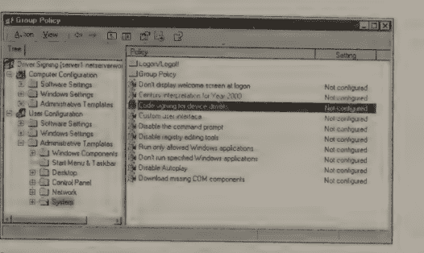

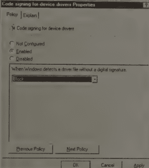

7. 点击“确定”关闭“设备驱动程序签名”属性对话框。要关闭组策略窗口，点击窗口右上角的“X”。

您配置的组策略设置将在用户下次登录系统且组策略已刷新后立即生效。现在，会计组织单元中的所有用户都将被阻止安装任何未经数字签名的设备驱动程序。

通过组策略应用驱动程序签名是将其统一应用于大量用户的最快、最简单的方法。然而，如果您只有几台计算机需要处理，或者需要对某台计算机进行特定的配置，您可以选择从控制面板配置驱动程序签名，这将在下一节中讨论。

> **注意**：虽然此考试（70-215）在组策略方面的深度没有 70-216 考试那么深，但您应该对组策略的基本操作和功能有良好的理解。

## 通过控制面板本地配置驱动程序签名

作为基于组策略的驱动签名的替代方案，您可以在每台机器的本地通过控制面板配置驱动程序签名。这种方法适用于大型网络，但在机器较少的小网络或对等工作组效果良好。配置驱动程序签名的流程如下：

1. 通过选择“开始”、“设置”、“控制面板”、“系统”，或在桌面上右键点击“我的电脑”并从快捷菜单中点击“属性”，打开控制面板中的“系统”程序。
2. 点击“硬件”选项卡并点击“驱动程序签名”。打开“驱动程序签名”对话框，如图 4.3 所示。

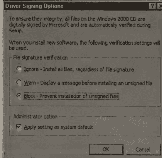

3. 从三个可用选项（忽略、警告或阻止）中进行选择。完成后，点击“确定”完成该过程。

通过这三个简单的步骤，您现在已为特定计算机配置了驱动程序签名。虽然这个过程很简单，但您可以看到，如果必须在几百台甚至仅仅几十台计算机上执行此配置，您将很快变得无从下手。

如果您以本地管理员权限登录，选择“将设置设置为系统默认值”选项将把配置的驱动程序签名级别应用于所有登录该计算机的用户。没有管理员权限的用户无法使用此选项，不用担心您的用户在事后更改设置！用户可以将设置调整为更严格的控制（例如从“警告”更改为“阻止”），但不能改为更宽松的设置（例如从“阻止”更改为“允许”）。

## 使用数字签名驱动程序

在设置好驱动程序签名选项后，您的工作就基本完成了。当您配置为“警告”时，尝试安装未签名的驱动程序，您将得到一个与图 4.4 所示类似的警告对话框。


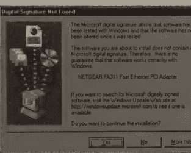

**图 4.4** 当尝试安装未签名的驱动程序时会出现警告对话框。

如果您安装的驱动程序签名设置为“警告”，如需更改驱动程序签名设置，请访问 `http://support.microsoft.com/default.aspx?scid=kb;En-US;q236029` 查看 KB# Q236029。

本节研究了数字签名的概念以及您如何为计算机安装新设备驱动程序配置驱动程序签名选项。您已经了解了如何在整个 OU（域或站点）中快速方便地配置驱动程序签名，以及如何逐台计算机地进行配置。下一节将探索您如何在安装新硬件之前，确保其已好供 Windows 2000 使用。

## 验证硬件兼容性

一旦您的驱动程序签名策略稳妥落实，就可以进入硬件安装过程的下一个步骤：验证硬件与 Windows 2000 的兼容性。大多数硬件都兼容即插即用，这似乎是一件微不足的事，但确保您想要放入 Windows 2000 计算机的硬件被微软识别为 Windows 2000 兼容设备仍然很重要。在购买新硬件（或尝试在新机器上安装 Windows 2000）之前，您应该花时间确保它与 Windows 2000 兼容。这可以通过两种方式实现：

- 检查硬件兼容性列表（HCL）。这是首选方法，因为 HCL 每周更新并由微软维护。
- 使用 `/checkupgradeonly` 参数运行 `winnt.exe`，以便在安装 Windows 2000 之前检查兼容性。

> 命令行开关有些难记，但它们仍然是重要的。这样做将

## 硬件兼容性列表 (HCL)

硬件兼容性列表 (HCL) 是微软发布的已通过 Windows 2000 测试的硬件列表。如果您想确保您的硬件运行正常，应该查看当前版本的 HCL，可以在互联网上访问 `http://www.microsoft.com/hcl/`。

尽管数千产品都在 HCL 上（意味着它们通过了 WHQL 测试），但并不是所有硬件都兼容。当硬件非常旧或非常新时，情况尤其如此。

> 如果两个组件都在 HCL 上，并不意味着它们是经过共同测试的。也就是说，尽管每个设备都是独立批准的，但设备之间可能存在冲突。

> Windows 2000 DataCenter 的 HCL 位于其他位置，可以通过 `http://www.microsoft.com/windows2000/datacenter/hcl/` 获取。Windows 2000 DataCenter 仅通过购买解决方案进行销售，其中包括硬件、DataCenter 软件以及测试和安装服务。它仅通过提供这些能力的供应商销售。详情见 `http://www.microsoft.com/windows2000/datacenter/howtobuy/purchasing/ems.asp`

## Windows 2000 准备绪工具

使用 HCL 对于少量硬件很方便，但当您想要分析整台计算机的硬件内容时该怎么办？这就是提供的第二种方法大显身之地。Windows 2000 准备绪工具可能不如 HCL 更新，但它可以用于确定要安装 Windows 2000 的现有计算机的硬件兼容性。Windows 2000 准备绪工具按如下从命令行运行：

1. 在运行框（开始，运行）中输入 `cmd`，然后点击“确定”。
2. 从命令行提示符输入 `X:\i386\win32 /checkupgradeonly` 并按回车，其中 X 是 Windows 2000 安装文件的位置。
3. 当 Windows 2000 准备绪工具完成后，会出现分析输出窗口。您可以快速判断计算机中是否存在不兼容的硬件设备。
4. 如有需要，可以将准备绪工具的结果保存到文本文件中。完成后，点击“完成”关闭准备绪工具窗口。

# 第 4 章

在安装 Windows 2000 期间，可能会显示一份升级报告。该报告提供了有关与 Windows 2000 不兼容的硬件和其他项目的信息。更多信息可以在 KB# Q222813 中找到：`http://support.microsoft.com/default.aspx?scid=kb;EN-US;q222813`。


在 Windows 2000 中安装和配置硬件设备的主要步骤实际上是配置设备。这就是下一节的主题。

## 安装和配置硬件设备

如果完成新硬件的实际安装和配置似乎是一个漫长的过程，请放心，你已经准备好以安全的方式进行安装和配置。到目前为止的所有准备工作都将确保你的 Windows 2000 计算机正常运行，并且在未来不会出现硬件兼容性问题。现在我们将检查 Windows 2000 中硬件的安装和配置。

Windows 2000 较之前的 Windows 版本包含许多改进，极大简化了设备管理。其中一些包括高级电源管理 (APM)、高级配置与电源接口 (ACPI) 以及即插即用 (PnP)。

即插即用是硬件和软件的结合，计算机能够在用户干预最少的情况下识别并修改其硬件配置更改。你要安装的硬件设备必须支持即插即用规范才能自动正确配置。你会发现，某些在即插即用之前的旧设备将无法被识别，因此需要你像本章后面的“配置对旧硬件设备的支持”部分讨论的那样手动配置资源设置。

通过即插即用，用户可以动态添加或删除设备，而无需手动配置，也不需要对硬件有复杂的知识。例如，你可以有一台放置在底座上的笔记本电脑，它包含以太网连接，随后可以使用同一台笔记本通过内置调制解调器连接网络，而无需进行任何配置更改。

## 配置和排除硬件设备及驱动

通过即插即用，你可以更改 Windows 2000 计算机的配置并正确重启，同时确保在做出更改后所有设备和计算机都能正常工作。当你安装即插即用设备时，Windows 2000 会自动配置设备，使其与计算机中已安装的其他设备正常工作。Windows 2000 为设备分配系统资源，包括：

- 中断请求 (IRQ) 号
- 直接内存访问 (DMA) 通道
- 输入/输出 (I/O) 端口地址
- 内存地址范围

每个资源在安装设备时必须是唯一的，否则设备将无法正常工作。当你要的设备不支持即插即用时，Windows 2000 无法自动配置设备设置。你可能需要手动配置设备驱动程序，或使用制造商提供的安装程序。

> 如果你必须手动配置非即插即用设备，分配的资源将变为固定的。这减少了 Windows 2000 为其他设备分配资源的灵活性。如果手动配置了过多的资源，Windows 2000 可能无法安装新的即插即用设备。

只有当你确定新设置不会与任何硬件冲突，或者硬件制造商已随设备提供了一组特定的资源设置时，才应该更改资源设置。

你可以使用控制面板中的“添加/删除硬件”小部件，或使用“设备管理器”来配置设备，设备管理器位于控制面板“管理工具”文件夹中的“计算机管理”工具内。对于大多数即插即用硬件，你只需将设备连接到计算机，Windows 2000 就会自动配置新设置。设备及其控制驱动程序可以支持即插即用。可能的组合扩展为以下四种情况：

- 硬件和驱动程序都支持即插即用——在这种情况下提供全即插即用支持；这是最简单的组合，最有可能成功安装。
- 驱动程序支持即插即用，但硬件不支持——在这种情况下，Windows 2000 提供部分即插即用支持。Windows 2000 不自动配置设备驱动程序，但即插即用可以管理资源分配并接口电源管理系统。
- 硬件支持即插即用，但驱动程序不支持——在这种情况下 Windows 2000 不即插即用，设备被视为旧设备。该设备需要手动配置所有资源设置。
- 硬件和驱动程序都不支持即插即用——Windows 2000 为此硬件设备提供任何即插即用支持。所有资源设置必须手动配置。

务必理解即插即用和非即插即用兼容硬件之间的区别。了解安装每种设备将如何影响你的计算机，以及 Windows 2000 对每种类型有何不同。


对于无法自动识别的硬件，“添加/删除硬件向导”提供了手动配置资源或手动加载驱动的方法。在 Windows 2000 未自动检测到你的即插即用硬件的少数情况下，你可以根据需要手动启动“添加/删除硬件向导”。下一节将详细讨论如何使用“添加/删除硬件向导”。

## 使用添加/删除硬件向导

“添加/删除硬件向导”位于控制面板，用于启动即插即用和非即插即用硬件的自动硬件安装。按照后续步骤操作，你将启动新硬件搜索。在没有新硬件的情况下，将出现一个添加新设备或排除现有设备的屏幕。

1. 点击“开始”，“设置”，“控制面板”。
2. 双击“添加/删除硬件”图标启动向导。
3. 点击“下一步”关闭欢迎页。
4. 选择“添加/排除设备”并点击“下一步”启动向导。

Windows 2000 搜索任何即插即用硬件并安装找到硬件。如果向导未检测到计算机中安装了任何新硬件，它将显示已安装硬件的列表供你排除故障（见图 4.5）或安装。硬件列表的第一项是“添加新设备”，它为你提供了手动启动新硬件安装的选项。


**图 4.5** 安装或排除硬件。

## 配置对硬件设备的支持

如果你需要手动安装非即插即用硬件设备，你必须理解硬件设备所需的资源。在大多数情况下，通过阅读提供的制造商产品文档可以轻松找到硬件设备所需的资源信息。根据这些信息，你必须确定如何将新硬件设备纳入现有的 Windows 2000 系统。表 4.1 描述了 Windows 2000 计算机系统中硬件设备与操作系统通信的可用资源。

| 表 4.1 硬件设备资源 |
| :--- | :--- |
| 中断 | 硬件设备使用中断向处理器指示需要需要。处理器使用此请求中断 (IRQ) 来确定哪个设备正在寻求服务以及需要什么类型的关注。Windows 2000 为设备提供 0 到 15 的中断号（IRQ 1 始终分配给键盘）。 |

# 第 4 章

| 资源 | 说明 |
| --- | --- |
| 直接内存访问 (DMA) | DMA 是允许硬件设备直接访问内存的通道。这使得磁盘驱动器或软磁盘器等设备可以在不中断处理器的情况下向内存写入信息。Windows 2000 提供通道 0 到 7。 |
| 输入/输出 (I/O) 端口 | I/O 端口是设备用于与 Windows 2000 通的内存区域。当处理器看到 IRQ 请求时，它会检查 I/O 端口地址以检索有关设备所需的额外信息。 |
| 内存 | 许多硬件设备具有板载内存或可以为自己预留系统内存。任何预留的内存无法供其他设备或 Windows 2000 使用。 |

# Windows 2000 共享资源

设备所需的资源必须专门为某个特定设备预留。其他资源可以在两个或多个设备之间共享，Windows 2000 根据需要动态管理资源。Windows 2000 与计算机的 BIOS 协作按如下方式共享资源。

IRQ 使用可编程中断控制器 (PIC) 为设备请求某些服务。当看到请求时，操作将暂停并将控制权交给与 IRQ 编号（1–15）相关的设备驱动程序。因此，此资源不能在设备之间共享。

I/O 端口是设备用于通信其所请求服务的内存块。它与 IRQ 编号绑定，因此是某个设备专用的。

DMA 是设备与计算机内存之间的直接通道。DMA 控制器提供多个通道（通常为七个），这些通道在设备之间共享（一次一个）。

设备内存块是系统内存中映射到设备内部内存（通常）的一部分。它是设备专用的，不能被包括 Windows 2000 在内的任何其他进程使用。

## 确定可用资源

一旦你知道了新硬件设备所需的资源，就可以使用设备管理器显示你的计算机上可用的资源。要查看资源列表，双击控制面板中的“系统”图标，并点击“硬件”选项卡。点击“设备管理器”按钮并

## 更改资源分配

如果计算机中的多个一个硬件设备请求相同的资源，就会发生冲突。在某些情况下，这些冲突可能只会禁用受影响的设备并阻止你使用它们。在其他情况下，你的整个计算机可能会变得不稳定，甚至无法正常运行。在任何情况下，你必须在设备的“属性”信息的“资源”选项卡上更改一个或多个资源设置。以下步骤允许你修改资源设置：

1. 点击“开始”，“控制面板”。
2. 双击“系统”图标，然后点击“硬件”选项卡，或者在桌面上右键点击“我的电脑”图标并从快捷菜单中点击“属性”。
3. 点击“设备管理器”按钮。
4. 展开你想要更改的设备类型。
5. 右键点击要修改的特定设备，并从上下文菜单中选择“属性”。
6. 点击“资源”选项卡。如果没有“资源”选项卡，你将无法修改设备的资源。
7. 选择想要修改的资源设置。

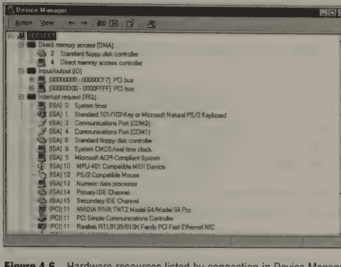

**图 4.6** 设备管理器中按连接列出的硬件资源。

8. 如果勾选了“使用自动设置”复选框，请取消勾选。如果该框呈灰色状态，则你将无法修改设备的资源。
9. 选择要修改的资源，然后点击“更改设置”按钮。
10. 根据需要更改资源设置，并在完成后关闭“属性”对话框。

完成此步骤后，Windows 2000 将使用设备手动配置的资源设置。记住，如果这导致资源冲突，你必须自己解决——Windows 2000 无法更改任何手动配置的资源设置。

## 更改非即插用设备的资源

更改分配给非即插用设备的资源实际上不会更改设备实际使用的资源。这只是告诉 Windows 2000 设备配置是什么。你必须咨询制造商文档，确定要在设备上设置哪些跳线或软件开关，以符合你告诉 Windows 2000 预期的资源分配。

## 更新设备驱动程序

硬件制造商喜欢留住忠实客户。留住客户的最佳方法之一是持续更新和改进硬件驱动程序。通常，驱动程序可以更新和改进以从设备中榨出更多性能——由于这个原因，视频适配器和网络适配器的驱动程序更新得比其他类型的设备更频繁。在其他情况下，制造商可能会在之前发布的驱动程序中发现漏洞或其他代码错误，并发布更新的驱动程序以纠正问题。即使在驱动程序已通过 WHQL 认证的情况下也可能发生。

设备驱动程序可以通过多种方式更新，包括使用制造商的设置程序或使用设备管理器。在本节中，我们将检查如何通过设备管理器更新设备驱动程序。

1. 点击“开始”，“设置”，“控制面板”。
2. 双击“系统”图标，或者在桌面上右键点击“我的电脑”图标并从快捷菜单中点击“属性”，然后选择“硬件”选项卡。

## 配置和排除硬件设备及驱动故障 129

3. 点击“设备管理器”按钮。
4. 展开你想要更改的设备类型。
5. 右键点击要修改的特定设备，并从上下文菜单中选择“属性”。
6. 点击“驱动程序”选项卡，如图 4.7 所示。

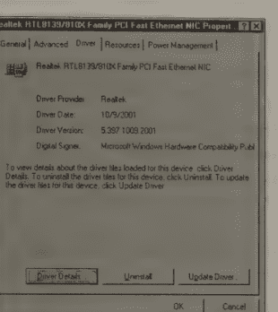

**图 4.7** 处理驱动程序

7. 点击“更新驱动程序”按钮启动硬件更新向导。
8. 选择“自动安装”或“手动安装”。手动安装自称是高级选项，但实际上它是获取更新文件的最佳方法——前提你知道它在哪里。
9. 按照设备向导的其余步骤操作，在计算机上安装更新的设备。

更新驱动程序的程序非常简单但非常重要。准备好以某种方式对此进行测试。

## 排除硬件故障

遗憾的是，并不是每个硬件安装都能按照计划进行——尽管 Windows 2000 带来了巨大的改进。硬件问题通常集中在三点上：

- 安装不正确
- 发生资源冲突
- 不支持 Windows 2000

对于之前列出的前两项，即安装不正确和发生资源冲突，与它们相关的问题通常表现出相同的症状。在任何情况下，你收集信息、排除故障以及随后解决问题的起点都是设备管理器。在硬件不支持 Windows 2000 的情况下（这通常发生在旧硬件上），你可能会发现获取一个执行相同或相似功能且兼容 Windows 2000 的新硬件设备会更容易且更安全。

如果你有一个兼容 Windows 2000 但似乎运行不正常的硬件设备，下一节可能帮助你深入了解该问题。

## 确认硬件安装状态

在安装新硬件后，可以使用设备管理器确认设备是否已安装并正常工作。在安装后的任何时候，如果你对设备状态有疑问，也可以执行此操作。

要启动设备管理器，双击控制面板中的“系统”图标。点击“硬件”选项卡，然后点击“设备管理器”按钮。这将显示已安装硬件列表，如图 4.8 所示。

展开设备类型节点将显示安装在计算机上的该类型的所有设备。设备图标指示设备是否运行正常。你可以使用表 4.2 中的信息来确定设备状态。

## 配置和排除硬件设备及驱动程序的故障 131

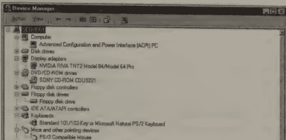

**图 4.8** 设备管理器列出的已设备。

| 设备图标 | 设备状态 |
| --- | --- |
| 正常图标 | 设备正常运行 |
| 带有红色 X 的正常图标 | 设备已禁用 |
| 带有黄色感叹号的正常图标 | 设备配置错误或缺少设备驱动程序 |
| 带有红色 X 的黄色问号 | Windows 2000 因资源冲突禁用了该硬件。要修正此问题，请右键点击设备图标，点击“属性”，并根据系统中的可用资源手动设置资源 |


了解如何解释设备管理器的输出对于保持您的 Windows 2000 计算机运行良好至关重要，而且对于考试可能也很有价值！


您可以从多个地方访问设备管理器。可以通过控制面板中系统应用程序的“硬件”选项卡中的“设备管理器”按钮启动。也可以从管理中的“管理工具”文件夹中的“计算机管理”图标启动，它可以作为微软管理控制台 (MMC) 的插件可用。

## 排除硬件安装问题

如果您确定某个硬件设备运行不正常（如表 4.2 所示图标所示或其他观察结果），您可以启动硬件故障排除向导来帮助解决问题。可以通过点击设备属性页面中“常规”选项卡上的“疑难排除”按钮来启动硬件故障排除程序（见图 4.9）。每种硬件都会启动其特定的故障排除向导；例如，从鼠标属性页面启动故障排除向导与从网络适配器页面启动的向导不是同一个。

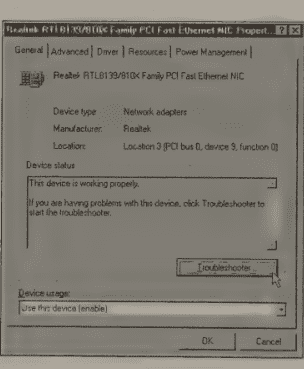

**图 4.9** 启动硬件故障排除向导。


## 练习题

### 问题 1

Christopher 是某家工程公司中型（约 500 台机器）Windows 2000 网络的管理员。上任管理员在组织内推广 Windows 2000 时做得很好，包括将每个部门划分为组织单位 (OU)。然而，无论管理员如何尝试，生产部门每天都会有一两台计算机无法正常运行。你怀疑原因可能是因为非技术人员倾向于尝试新硬件。你可以做什么来防止这些计算机未来发生停机？

- A. 在每台机器上，将驱动程序签名行为设置为“阻止”。
- B. 从“活动目录用户和计算机”创建 GPO 并将其链接到生产部门的 OU。在 GPO 中将驱动程序签名配置为“忽略”。
- C. 从“活动目录用户和计算机”创建 GPO 并将其链接到生产部门的 OU。在 GPO 中将驱动程序签名设置为“阻止”。
- D. 将生产部门 OU 中的所有用户账户从“用户”组移动到“来宾”组。

**答案 C 是正确的。** 在这种情况下，最佳选项是创建一个链接到生产部门 OU 的 GPO，并将驱动程序签名行为设置为“阻止”。你并不知道告知生产部门有多少台机器，但在 Windows 2000 活动目录域中，你应该始终努力通过组策略对象应用策略，而不是手动配置。因此，答案 A 是错误的。配置带有“忽略”选项的 GPO 将不是最佳解决方案，因为所有驱动程序（无论是否签名）都无法安装。当设置“阻止”行为时，将无法安装未签名的驱动程序。因此，答案 B 是错误的。将用户账户从“用户”组移动到“来宾”组可以解决问题，但可能会导致额外的、不必要的问题。因此，答案 D 是错误的。

### 问题 2

Hannah 在一家大型组织担任帮助台支持技术。最近，她接到一个用户的电话，该用户称他新安装的扫描仪无法工作。在指示查看设备管理器时，用户报告扫描仪的图标看起来正常，只是上面有一个黄色感叹号。Hannah 应该让用户做什么来修正扫描仪最可能出现的问题？

- A. 手动为设备分配资源，因为它与其他设备存在资源冲突。
- B. 从系统中删除设备且不要尝试使用它。显示此图标的设备与 Windows 2000 不兼容，不应使用。
- C. 从安装盘或从制造商网站下载的文件安装设备驱动程序。
- D. 在当前硬件配置文件中启用该设备。

**答案 C 是正确的。** 最佳行动方案是从安装盘或从制造商网站下载的文件安装设备驱动程序。显示此图标的设备通常是因为缺少或损坏驱动程序而未启用。手动为设备分配资源将无法纠正局面，而且是不可能的，因为该设备目前没有使用任何资源。因此，答案 A 是错误的。遇到资源冲突的设备会显示带有红色 X 的黄色问号，被禁用的设备会显示带有红色 X 的正常图标（用户禁用）或带有黄色感叹号的正常图标（Windows禁用）。在这种情况下，答案 B 和 D 是错误的。

### 问题 3

你正在培训一名新的桌面支持人员。在讨论过程中，提到了数字签名驱动程序的话题。当问及为什么数字签名驱动程序很重要时，你不会告诉新员工哪种说法是错误的？

- A. 数字签名驱动程序通过了 WHQL 的严格测试，因此应该具有很高的可靠性。
- B. 数字签名驱动程序在制造商签名后，对更改实施了保护。
- C. 数字签名驱动程序是 Windows Update 网站或 Windows 2000 光盘上找到的驱动文件类型。
- D. 除非在网络中建立了证书颁发机构，否则无法安装数字签名驱动程序。

**答案 D 是正确的。** 其他三个说法对于数字签名驱动程序都是正确的。因为用于签名文件的证书可以追溯到第三方证书颁发机构（例如 VeriSign），因此不需要任何证书服务。如果你想向客户发行数字签名驱动程序，你需要在网络中建立证书颁发机构，最好是使用第三方颁发的根证书。当驱动程序经过数字签名后，它被证明通过了 WHQL 进行的严格测试。因此，答案 A 是错误的。通过对驱动文件进行数字签名，自签名起受到保护。因此，答案 B 是错误的。你只会在 Windows Update 网站或 Windows 2000 光盘上找到数字签名驱动程序，因此答案 C 是错误的。

### 问题 4

Austin 正在使用设备管理器收集他公司某特定服务器的信息。他可以使用设备管理器收集以下哪些项目的信息？（勾选所有正确答案）。

- A. 特定设备的资源设置
- B. 计算机上正在使用的中断列表
- C. 特定设备的状态（例如已启用或禁用）
- D. 关于特定设备已安装驱动程序的信息

**答案 A、B、C 和 D 都是正确的。** 使用设备管理器，Austin 可以收集所有这些信息以及更多。

---

# 第 5 章 管理、监控和优化系统性能、可靠性和可用性

### 你需要理解的术语

- 系统监视器
- 恢复控制台
- 安全模式
- 系统状态
- 最后良好配置
- 紧急修复磁盘 (ERD)
- 性能 MMC

### 你需要掌握的技术

- 使用任务管理器管理进程
- 启动、停止并为进程分配优先级
- 使用性能工具监控系统性能
- 使用 Windows 2000 备份备份和恢复用户数据
- 备份和恢复系统状态数据
- 使用安全模式
- 安装和使用恢复控制台

## 引言

Windows 2000 服务器提供了许多工具，用于执行管理和监控服务器的常见任务。此外，还增加了一些新工具来协助系统恢复。在本章中，我们将介绍管理 Windows 2000 服务器的常用工具，例如任务管理器和性能监视器。然后，我们还会探索一些新的系统恢复功能，包括安全模式和恢复控制台。这些都是考试中可能会涵盖的领域。

## 管理、监控和优化系统性能

管理员日常工作中很大一部分任务是对服务器及其运行在其上的应用程序进行管理和监控。让我们先从 Windows 2000 中包含的一些旨在简化管理员工作的实用程序开始。我们讨论的系统性能工具如下：

- 任务管理器
- 系统监视器
- 性能日志和警报

## 任务管理器

Windows 2000 包含了任务管理器实用程序，为管理员提供了一种监控和管理当前运行应用程序和进程状态的方法。此外，任务管理器还为管理员提供了正在使用的基本系统资源的摘要视图。

任务管理器可用于监控活动应用程序的状态，包括分配给每个应用程序的系统资源的实时视图。任务管理器还允许你观察停止响应的应用程序并终止它们。

可以通过多种方式启动任务管理器，包括：

- 右键点击任务栏，并在快捷菜单上点击“任务管理器”。
- 按 `Ctrl+Shift+Esc`。
- 按 `Ctrl+Alt+Del` 打开 Windows 安全对话框并点击“任务管理器”按钮。

任务管理器窗口有三个选项卡：应用程序、进程 和性能。

## 应用程序选项卡

图 5.1 显示的应用程序选项卡列出了当前活动应用程序列表及其状态——“正在运行” 或“无响应”。程序的默认状态是“正在运行”；但有时程序会临时显示“无响应”状态。这通常发生在另一个或多个程序具有较高优先级并接收了大部分系统资源，或者应用程序崩溃时。

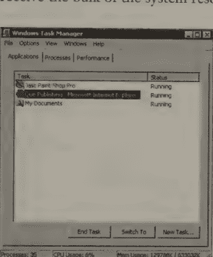

**图 5.1** 任务管理器应用程序选项卡显示正在运行的应用程序。

如果无响应的应用程序在其他应用程序完成后没有自动恢复到“正在运行”状态，你可能需要手动终止它。你可以通过右键点击应用程序并在快捷菜单中选择“结束任务”，或者点击任务管理器窗口底部的“结束任务”按钮。不幸的是，如果应用程序有任何打开的文件，你的数据将不会保存。任务管理器还允许你终止正在运行的应用程序。

使用任务管理器启动应用程序有两种方法：

- 从任务管理器菜单，选择“文件”、“新建任务（运行）”。
- 从任务管理器的应用程序选项卡，点击窗口右下角的“新建任务”按钮。

使用任种方法与使用开始菜单中的“运行”命令是相同的。

## 进程选项卡

图 5.2 显示的进程选项卡显示了当前活动进程列表及其正在使用的资源。默认显示的列是“CPU 时间” 和“内存使用”。不过，你可以通过选择任务管理器菜单中的“查看”、“设置列”来添加其他列，例如“页错误”、“I/O 写入” 和“内存内存使用”。

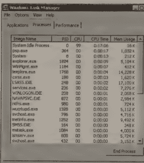

**图 5.2** 任务管理器进程选项卡显示按 CPU 时间排序的进程。

使用进程选项卡，你可以识别哪些进程在使用大部分系统资源。默认显示的列包括：

- 名称
- 进程 ID (PID)
- CPU 百分比
- CPU 时间
- 已用内存

要识别占用资源的进程，按 CPU 时间对进程进行排序。例如，要按 CPU 数量排序进程，点击 CPU 标题。

Windows 2000 将处理时间分配给优先级级别。优先级范围从 0 到 31。应用程序和非关键功能被分配为 0 到 15，而内核等实时功能被分配为 16 到 31。

任务管理器不允许你将进程设置为特定的数字，它只允许你设置优先级类。带有默认数字的优先级类为：

- 实时 —优先级 24
- 高 —优先级 13
- 高于普通 —优先级 9
- 普通 —优先级 8
- 低于普通 —优先级 7
- 低 —优先级 4


为了防止低优先级进程饿死其他进程，你可以手动增加低优先级进程的优先级。要此此，在任务管理器的进程选项卡中右键点击该进程，选择“设置优先级”，并选择一个较高的值，如图 5.3 所示。

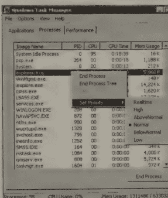

图 5.3 任务管理器进程选项卡显示如何更改优先级。

## 第 5 章

只有管理员可以为进程分配“实时”优先级级别。

在某些情况下，必须终止进程。你可以终止特定的进程，也可以终止该进程及其关联的所有进程。要终止特定进程，在任务管理器的进程选项卡中右键点击进程项，并选择“结束进程”。要终止该进程及其启动的其他进程，选择“结束进程树”。例如，如果你终止了文字处理程序的进程，可以选择“结束进程树”来额外终止由该字程序启动的拼写检查或语法检查进程。

> 并不是所有进程都可以使用任务管理器终止。包含在 Windows 2000 服务器资源包中的 `Kill` 工具可以终止大多数大多数进程。请谨慎使用，因为终止系统进程会导致服务器不稳定。

在多处理器服务器上，进程选项卡的快捷菜单上还有一个项目“设置亲和性”。设置亲和性允许将进程限制在特定的 CPU 上。此选项应谨慎使用，因为它可能会降低进程的性能。

## 性能选项卡

图 5.4 显示的性能选项卡显示了服务器的 CPU 和内存使用情况。显示包含当前使用情况的图表，以及显示近期使用情况的附加直方图。图表下方是 CPU 和内存使用情况的数值统计。

这里显示的信息可以让你快速概述服务器的性能特征。显示的任何异常情况都表明你应该使用其他 Windows 2000 服务器实用程序进行进一步调查。

## 监控系统资源

虽然任务管理器可以让你快速概述系统性能，但在某些情况下，需要进行更彻底的调查。这时，性能工具大显身用场了。性能工具实际上由两个独立的微软管理控制台（MMC）组件组成：系统监视器和性能日志和警报。性能工具可以通过 Windows 2000 开始菜单启动。选择“开始”、“程序”、“管理工具”、“性能”。如图 5.5 所示，性能工具打开时会显示“系统视图”。

## 系统监视器

系统监视器加载项允许你从网络中的域控制器、成员服务器或工作站的计数器中查看实时性能数据。此外，系统监视器还允许你审查存储在“性能日志和警报”加载项创建的日志文件中性能数据。

Windows 2000 是一个模块化的面向对象的操作系统。Windows 2000 中的每个子系统都是一个对象。例如，CPU是一个对象，内存是一个对象，存储子系统是一个对象，以此此类推。当你的计算机执行各种任务时，这些对象中的每一个都会生成性能数据。

每个对象都有几个称为“计数器”的监控函数。每个计数器都提供对对象不同侧面或功能的见解。例如，内存对象具有测量“已提交字节百分比”、可用字节、每秒页错误等等的计数器。系统监视器读取这些计数器的读数，并以人类可读的格式（数字或图表）将信息呈现给你。

此外，对象可以通过“实例”进行区分。“实例”是用于指代同一类型对象多次出现的术语，例如在多处理器服务器中。每个处理器都存在一个独立的实例。

默认情况下，系统监视器启动时不显示任何计数器。要添加要监控的计数器，请点击系统监视器菜单栏上的“+”按钮。这会打开如图 5.6 所示的“添加计数器”对话框。

在“添加计数器”对话框中，你可以从几个区域进行选择，以定制你的监控需求。此对话框中找到选项如下：

- **计算机**——此选项允许你选择从本地计算机或网络上的远程计算机添加计数器。你可以使用通用命名法（UNC）计算机名删除远程计算机。

- **性能对象**——这是一个下拉列表，显示所有可用于监控的对象。

- **计数器**——此选项允许你从列表中选择计数器或单个计数器。按住 Shift 或 Control 键并点击鼠标可以选择多项。

- **实例**——如果一个对象有多个实例（例如，你的服务器有多个网卡），你可以选择每个单独实例或所有实例。

选择每个计数器后，点击“添加”按钮将计数器添加到系统监视器显示中。若要查看每个计数器的说明，请突出显示该计数器并点击“解释”按钮。完成后，点击“关闭”按钮。

可监控的对象数量会因系统而异。大多数服务器服务和应用程序（如 DNS、DHCP 和邮件服务器）都会安装自己的计数器，可用于监控这些功能的性能。

每个计数器都可以显示为图表视图之一中的彩色线条。可以同时查看来自同一系统或远程系统的多个计数器。图 5.7 向你展示了图表视图（共有多个）之一在你的系统上可能呈现的示例。

在典型服务器上可以监控的所有项目中，你需要密切监控以发现性能问题的对象是：

- 内存
- 处理器
- 物理磁盘
- 网络

这些计数器提供了对系统整体性能的即时见解。当这些计数器数值过高时，表明需要升级系统或划分网络。

## 性能日志和警报加载项

虽然系统监视器提供的系统监控信息比任务管理器多，但它仍然仅提供系统性能的快照。要对系统性能进行更彻底的评估，你需要查看一段时间内的系统统计数据。你可以在性能工具 MMC 中系统监视器下的“性能日志和警报”工具中找到这些统计数据。以下两个部分详细介绍了你可以用于在长时间内捕获性能数据的日志和警报功能。

## 性能日志

性能日志和警报 MMC加载载允许你在一段时间内记录性能数据。有两种日志选项：计数器日志和跟踪日志。计数器日志允许你记录有关本地或远程计算机的数据。你可以配置根据定义的计划手动或自动进行日志记录。跟踪日志在发生特定活动（如磁盘 I/O 或页错误）时记录数据。跟踪日志的功能很少使用，因为这些日志只能由自定义开发的工具读取。

该加载项允许按以下格式保存日志数据：

- 文本文件 (CSV)—逗号分隔格式，用于导入电子表格程序。
- 文本文件 (TSV)—制表符分隔格式，用于导入电子表格程序。
- 二进制文件—这是配合系统监视器的默认格式。数据记录到此文件中直到达到最大限制。默认最大大小为 1MB，但在配置文件设置时可以更改。
- 二进制循环文件—数据记录到此文件中直到达到最大限制。然后文件将被重写，从文件开始处。默认最大大小为 1MB，但在配置文件设置时可以更改。

通过以许多常用格式提供数据，你可以选择使用默认工具分析数据，或将其导入你选择的工具中。

> 你应该在系统正常运行期间对其进行测量。拥有基准，当系统出现问题时，你就有可以对比计数器的依据。基准对比提供了一种快速定位问题区域的方法。

性能工具允许你基于对象和基于计数器进行日志记录。这意味着你可以配置日志记录一个对象的所有数据，而不是使用单个计数器。因此，在记录日志文件后，你可以选择对象的任何一个计数器进行检查。在确定了要记录的内容后，你需要确定两个时间相关的问题：测量间隔和记录日志文件的时间。

- 测量间隔决定获取性能读数的频率。间隔过短可能会产生错误结果，并给你的系统带来额外负载。间隔过长可能会掩盖性能变化。
- 记录日志文件的时间应该足够长，以捕捉所有的正常活动。这通常意味着至少记录一周的日志文件。较短的时间可能无法为你提供系统每周正常性能的完整视图。

## 152 第 5 章

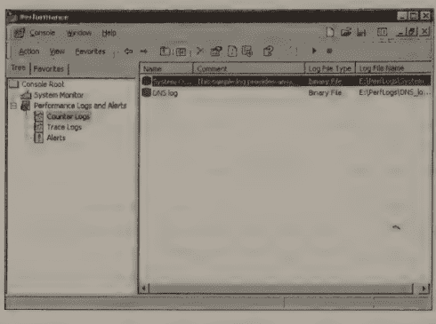

**图 5.8** 显示计数器日志的 Windows 2000 性能日志和警报。

示例日志包含以下基本计数器：

- 每秒内存页 (Memory Pages/sec)
- 物理磁盘平均磁盘队列长度 (PhysicalDisk Average Disk Queue Length)
- 处理器时间比 (%Processor Time)

要创建一个新的计数器日志：

1. 在“性能日志和警报”加载项的左窗中，右键点击“计数器日志”，选择“新建日志设置”。
2. 在“新建日志设置”对话框中，输入新日志的名称并点击“确定”。
3. 在日志属性窗口的“常规”选项卡中，点击“添加”按钮。
4. 添加所需的计数器。此步骤与向系统监视器添加计数器的步骤相同。
5. 点击“日志文件”选项卡。
6. 在“日志文件”选项卡上，输入所需的日志文件名称、类型和位置。根据需要可以更改最大日志文件大小。参见图 5.9。

管理、监控和优化系统性能、可靠性和可用性 153

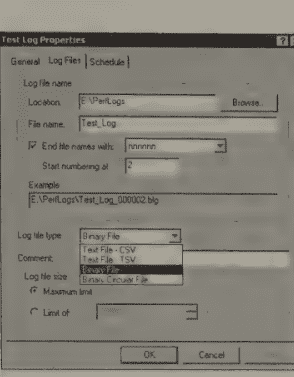

**图 5.9** 显示计数器日志配置的 Windows 2000 性能日志和警报加载项。

7. 点击“计划”选项卡。在“计划”选项卡上，您可以选择日志的开始和停止时间，或选择手动启动和停止日志。参见图 5.10。

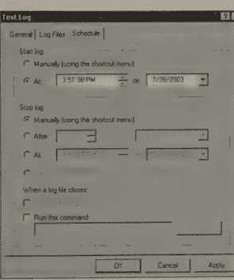

**图 5.10** 显示计数器日志计划的 Windows 2000 性能日志和警报。

8. 点击“确定”保存日志。

如果您选择手动启动计数器日志，可以通过右键点击“性能日志和警报”加载项右窗格中的日志项并选择“启动”来启动。日志图标运行时显示为绿色，停止时显示为红色。

在日志文件中记录数据后，您可以在系统监视器中查看。要打开日志文件，在 MMC 的左窗格中选择“系统监视器”项。然后，在右窗格任意位置右键点击并选择“属性”。在“系统监视器属性”对话框中，选择“源”选项卡。在“源”选项卡上（见图 5.11），点击“浏览”按钮以查找日志文件。

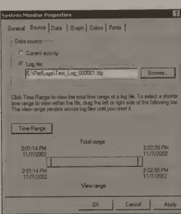

**图 5.11** 显示“源”选项卡的系统监视器属性对话框。

您可以点击“时间范围”按钮来调整您想在日志文件中查看的时间。完成后点击“确定”。

## 性能警报

警报容器用于定义阈值警报。这些警报可以与实时测量或历史日志文件配合使用。当特定计数器超过定义的阈值值时，就会发出警报。当这种情况发生时，会启动触发事件。

创建警报与配置计数器日志类似。在“性能日志和警报”加载项的左窗格中右键点击“警报”项，选择“新建警报设置”。在“新建警报设置”对话框中，为警报输入名称。在属性对话框中，您可以选择所需的计数器和值阈值。如果您点击图 5.12 所示的“操作”选项卡，可以选择在达到阈值时采取的操作。

管理、监控和优化系统性能、可靠性和可用性

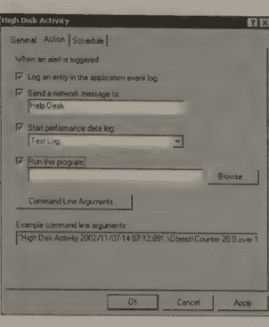

图 5.12 显示“操作”选项卡的警报属性。

可用的选项有：

- 在应用程序事件日志中记录条目——如果达到了阈值，Windows 2000 将在此日志中创建一个条目，您可以在事件查看器的“应用程序事件日志”中查看它。
- 发送网络消息到——这允许您通过 Messenger 服务向用户发送消息。
- 启动性能数据日志——这开始记录到预定义的计数器日志中。如果您试图观察当特定事件发生时系统性能发生了什么变化，这非常有用。
- 运行此程序——可以是任何从命令行运行的程序。例如，它可以是一个执行某种类型系统维护的程序，如压缩文件。

警报通常用于实时监控系统。您可以设置警报，在特定事件发生时通知您。您可能想要配置警报的某些条件包括磁盘空间不足、交换文件使用以及网卡和 CPU 的任务队列。这些项目中的任何一个都可能指向当前或潜在的系统问题。

## 优化系统资源

适当调优和优化服务器有时看起来像是一门艺术而非科学。实际上，这种说法过于简单，因为在 Windows 系统上准确测量性能确实需要一点艺术和科学。然而，从最终来看，最好的调优和优化与对细节的关注远高于任何其他技能。

在优化服务器之前，您必须了解它的基准。优化的第一步应该是建立基准。要建立基准，您应该在正常负载下观察系统。这将允许您识别系统在无压力状态下的行为。一旦建立了基准，您就可以将其与负载下的性能进行比较。可能导致瓶颈的主要组件是内存、磁盘和处理器。

在建立基准后，下一步是识别哪些组件限制了系统。正如我们之前提到的，接下来的章节将讨论如何优化这些资源。

## 优化内存使用

Windows 2000 使用虚拟内存，即磁盘上的交换文件。由于从磁盘访问数据比从内存访问慢得多，您希望减少系统交换的频率。监控内存性能的一些计数器有：

- 每秒页面输入 (Memory: Pages Input/sec)—当此计数器保持低值时，表示没有发生分页。
- 每秒页面故障 (Memory: Page Faults/sec)—与缓存故障类似，但它还测量请求的内存页在使用时的故障。如果该数字持续增长，则发生了分页。
- 可用字节 (Memory: Available Bytes)—指示可用的空闲内存量。如果此数字小于 4MB，说明您的内存不足，系统正在过度分页。
- 分页文件使用率峰值 (Paging File: % Usage Peak)—指示分页的使用水平。如果在正常操作期间此数字接近 100%，说明您的分页文件最大大小太小，您可能需要更多内存。如果您有带有多个分页文件的驱动器，请务必查看此计数器的总实例。

## 优化磁盘子系统

磁盘子系统无论是直接还是间接地成为瓶颈。如果磁盘访问速度缓慢，将负影响应用程序的加载时间以及数据的读写时间。此外，由于 2000 依赖虚拟内存，缓慢的磁盘子系统会间接影响内存性能。

磁盘子系统的一些性能计数变为：

- 平均磁盘队列长度 (PhysicalDisk: Avg. Disk Queue Length)—跟踪等待磁盘访问的系统请求数。队列数量不超过使用的磁头数。大多数驱动器只有一个磁头，但 RAID 阵列有多个（性能监控将 RAID 阵列视为单个逻辑驱动器）。数量很大说明驱动器或阵列运行无法满足系统输入输出的需求。当这种情况发生时，您需要更快的磁盘系统。
- 磁盘时间比 (PhysicalDisk: % Disk Time)—代表磁盘积极处理读写请求的时间百分比。这种情况并不常见这种计数器在活动服务器上经常会达到 100%。然而，如果百分比持续在 90% 或更高，则可能表明存储设备太慢。当平均磁盘队列长度持续高于 2 时，情况通常是如此。
- `PhysicalDisk: Avg. Disk sec/Transfer`—表示磁盘传输的平均时间（单位为秒）。

由于记录存储性能数据本身会影响系统性能，因此 Windows 系统上的磁盘计数器默认是不启用的。在监控硬盘性能之前，你必须开启收集此类设备统计统计的计数器。默认情况下，在 Windows 2000 中，`PhysicalDisk` 对象是自动启用的。但是，`LogicalDisk` 对象必须手动启用。通过“运行”对话框或命令提示符，执行以下命令可以启用 `LogicalDisk` 计数器：

```
diskperf -y
```

输入命令后，必须重启系统才能使命令生效。

> 在为 Disk 对象记录日志文件时，请勿将文件记录到正在测试的同一个驱动器上。因为读取对象并写入驱动器的操作会增加大量的工作负载，导致你无法记录准确的值。

## 优化处理器使用

处理器是服务器的核心。服务器中的大多数操作都直接或间接地受处理器的控制。大多数处理器瓶颈是由多个进程同时运行引起的，它们所需的周期超过了处理器能够有效提供的周期。这可以通过将处理器更换为更快的型号或在支持多处理器的服务器中增加额外的处理器来缓解。

要识别处理器方面的问题，请监控以下计数器：

- `Processor: % Processor Time`—表示 CPU 用于非空闲工作的时间。此计数器在应用程序启动或内核密集型操作（如 SAM 同步）期间达到 100% 是很常见的现象。然而，如果此计数器在长时间内保持在 80% 以上，你应该怀疑存在 CPU 瓶颈。（在多处理器系统中，每个处理器都有一个此类计数器的实例。）
- `Processor: % Total Processor Time`—仅适用于多处理器系统。此计数器的使用方法与单 CPU 计数器相同。如果任何值持续高于 80%，说明你的 CPU 中至少有一个是瓶颈。
- `System: Processor Queue Length`—表示等待处理器时间的线程数。此计数器的持续值为 2 或更高，表示表示正发生拥塞。此计数器是测量时刻的快照，而不是随时间变化的平均值。

## 优化网络访问

尽管由于高性能 100Mb 网卡的普及，网络瓶颈已并不常见，但仍会出现网卡成为瓶颈的情况。这最可能发生在 Web 服务器或终端服务器上。

要识别网络接口的性能问题，请监控以下计数器：

- `Network Interface: Bytes Total/sec`—表示发送到 NIC 和来自 NIC 的数据速率（包括帧字符）。将此值与设备的预期容量进行比较。如果观察到的最高平均值小于预期值的 75%，则可能发生了通信错误或减速，限制了 NIC 的额定速度。
- `Network Interface: Current Bandwidth`—估计 NIC 的当前带宽，单位为比特每秒 (bps)。此计数器对于带宽可变的 NIC 很有用。
- `Network Interface: Output Queue Length`—表示等待 NIC 发送的数据包数。如果平均值高于 2，说明你正在经历延迟。
- `Network Interface: Packets/sec`—表示 NIC 处理的数据包数。在持续或正常活动的长时间间隔内观察此计数器。当队列长度非零时出现急剧下降，可能表明与协议相关或与网卡相关的问题。

其他可能值得监控的网络相关计数器包括特定协议对象，例如 ICMP、IP、TCP 和 UDP。

## Windows 2000 备份

Windows 2000 提供了比 Windows NT 自带更先进的备份程序。Windows 2000 备份允许你创建备份作业，你可以手动运行这些作业或将其调度为无人运行。与之前的只能备份到磁带的 NT Server 4 版本不同，你现在可以备份到磁盘、Zip 驱动器、CD-R/RW 或任何通过 Windows 2000 文件系统可用的介质。此外，你可以使用备份程序创建应急修复磁盘 (ERD)。

要启动 Windows 2000 备份程序，选择开始、程序、附件、备份。所有备份和恢复功能都可以手动执行或通过向导完成。Windows 2000 备份对话框如图 5.13 所示。

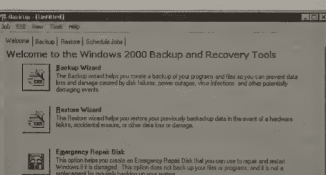


**图 5.13** 备份程序的欢迎选项卡，显示了启动备份向导、恢复向导以及应急修复磁盘工具的按钮。

备份和恢复 Windows 2000 服务器，你必须是管理员 (`Administrators`) 或备份操作员 (`Backup Operators`) 组的成员。如果你不是这些组的成员，你只能备份你所有的文件或你拥有以下之一权限的文件：

- 读取
- 读取并执行
- 修改
- 完全控制

Windows 2000 备份实用程序允许备份备份文件、文件夹或多个驱动器。更多信息请参阅本章末尾的“需知”部分。

## 备份类型

Windows 2000 有五种备份选项。每种类型的区别取决于备份的内容以及是否设置了归档位。归档位是一个文件属性，在文件创建时开启。每当文件被成功备份后，备份软件就会清除该位。

### 普通 (Normal)

普通备份用于无论归档位设置如何都备份所有的文件和文件夹。普通备份的缺点是比其他类型耗时更久，因为它备份了所有文件。然而，它的优势是恢复时只需要单一介质（或一组介质）。为了缩短备份时间，普通备份通常与增量备份或差异备份一起使用。

### 复制 (Copy)

复制备份用于备份指定的文件和文件夹。它不读取或更改归档位。复制备份通常用于创建数据的存档，且不会中断你当前的备份集。

### 每日 (Daily)

每日备份用于仅备份当天创建或修改的文件和文件夹。它不读取或更改归档位。每日备份通常用于对每日活动进行快速快照；这在你需要在服务器上执行任务并希望有一个可用备份时非常有用。

### 差异 (Differential)

差异备份用于备份自上次普通或增量备份以来创建或修改的文件和文件夹。它不更改归档位。但是，它读取归档位以确定哪些文件需要备份。差异备份通常用于普通备份实例之间。例如，如果你在周一执行普通备份，在本周剩余时间内都可以执行差异备份。差异备份每天都会变得越来越长时间，因为它备份了自那时以来创建的所有文件和文件夹。

> 你应该熟悉不同的备份类型、每种类型的使用场景以及在恢复期间将恢复哪些数据。

### 第5章

| 表 5.1 使用普通和增量备份的每周备份计划 |
| :--- |
| | 天 | 备份类型 | 恢复所需的介质 |
| | :--- | :--- | :--- |
| | 周一 | 普通 | 周一 |
| | 周二 | 增量 | 周一 + 周二 |
| | 周三 | 增量 | 周一 + 周二 + 周三 |
| | 周四 | 增量 | 周一 + 周二 + 周三 + 周四 |
| | 周五 | 增量 | 周一 + 周二 + 周三 + 周四 + 周五 |

| 表 5.2 使用普通和差异备份的每周备份计划 |
| :--- |
| | 天 | 备份类型 | 恢复所需的介质 |
| | :--- | :--- | :--- |
| | 周一 | 普通 | 周一 |
| | 周二 | 差异 | 周一 + 周二 |
| | 周三 | 差异 | 周一 + 周三 |
| | 周四 | 差异 | 周一 + 周四 |
| | 周五 | 差异 | 周一 + 周五 |


自上次正常备份以来已修改过的内容。差异备份的优点是耗的时间比正常备份短，但当你执行完整恢复时，它需要正常备份和差异备份的介质。

### 增量备份

增量备份用于备份自上次正常备份或增量备份以来创建或修改的文件和文件夹。它读取归档位（`archive bit`）来确定哪些文件需要备份。然后，它会更改已备份文件的归档位，这样当下次运行备份程序时，除非文件发生了更改，否则将不会再次被备份。增量备份通常用于两次正常备份之间。与差异备份不同，备份时间通常不会每天都变长，因为增量备份只备份自上次增量备份以来修改的文件和文件夹。增量备份的优点是耗的时间比正常备份短，但当你执行完整恢复时，它需要正常备份以及自正常备份以来执行的所有增量备份的介质，这取决于你必须恢复多少个增量备份。

### 系统状态备份

Windows 2000 服务器的所有备份都应该包含系统状态（`System State`）数据。对于所有的 Windows 2000 操作系统，系统状态数据包括：

- 注册表 (`Registry`)
- COM+ 类注册数据库 (`COM+ Class Registration Database`)
- 系统启动文件 (`System Boot Files`)

对于 Windows 2000 Server，系统状态数据还包括证书服务数据库（如果服务器作为证书服务器运行）。如果服务器是域控制器，系统状态数据还包括 Active Directory 服务数据库和 `SYSVOL` 目录。由于它们之间的相互依赖，这些组件无法单独备份或恢复。

备份每个服务器和域控制器的系统状态数据是非常重要的。来自一个服务器或域控制器的系统状态备份无法恢复到另一个服务器或域控制器。

系统状态备份/恢复有两种类型：本地和远程。当备份介质托管在正在恢复的服务器上时，使用本地备份/恢复。当备份介质位于另一台机器上，执行远程恢复。Windows 2000 备份程序仅能够备份和恢复托管备份介质的服务器上的系统状态数据。

要在 Windows 2000 服务器上备份系统状态数据，请在 Windows 2000 备份程序的“备份”选项卡中勾选“系统状态”复选框，如图 5.14 所示。

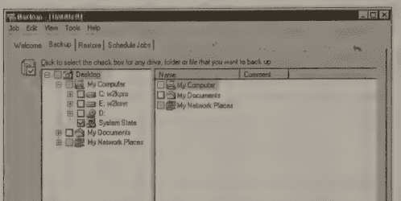

**图 5.14** 备份程序的“备份”选项卡，显示已勾选系统数据复选框。

系统状态数据可以单独备份，也可以作为完整服务器备份的一部分。要在 Windows 2000 Server（非域控制器）上恢复系统状态数据，请执行以下步骤：

1. 通过选择“开始”、“程序”、“辅助工具”、“系统工具”、“备份”，启动 Windows 2000 备份程序。
2. 选择“恢复”选项卡。
3. 选择所需的介质。
4. 勾选“系统状态”复选框。
5. 点击“开始恢复”按钮。
6. 恢复完成后，重启服务器。

> 注意：有关如何在域控制器上恢复系统状态数据的信息，请参阅本章节稍后标题为“使用目录服务恢复模式恢复系统状态数据”的部分。

### 安全模式

Windows 2000 包含一个名为“安全模式”的选项。这是一个继承自 Windows 9x 产品线的恢复工具，允许你加载最少的一组设备驱动程序和服务来启动系统。

当你加载新驱动程序或软件程序，或进行配置更改导致系统无法启动时，安全模式非常有用。你可以使用安全模式启动系统并删除导致问题的驱动程序或软件。

要进入安全模式，请重启服务器，并在启动菜单屏幕上看到“请选择启动的操作系统”提示时按下 `F8` 键。Windows 2000 高级选项菜单上有以下可用选项（如图 5.15 所示）：

- **安全模式**——此选项使用鼠标、视频、监视器、大容量存储和键盘的基本驱动程序启动 Windows 2000。
- **带网络的安全模式**——此选项使用基本驱动程序加网络驱动程序启动 Windows 2000。
- **带命令提示符的安全模式**——此选项使用基本驱动程序启动 Windows 2000 并打开命令窗口而不是桌面。
- **启用启动日志**——此选项正常方式启动 Windows 2000，但会将系统尝试加载的所有设备驱动程序、服务及其状态列表记录到 `%systemroot%\ntblog.txt`。这是诊断系统启动问题的良好选项。
- **启用 VGA 模式**——此选项正常方式启动 Windows 2000，但强制其加载基本 VGA 驱动程序。此选项对于从不良的视频驱动程序安装中恢复有用。
- **最后一次良好配置**——此选项使用用户上次登录系统时的注册表内容启动 Windows 2000。这对于从配置错误中恢复很有帮助。当选择此选项时，上次登录后做的任何配置将丢失。
- **目录服务恢复模式**——此选项用于恢复 Active Directory 数据库和 `SYSVOL`。
- **调试模式**——此选项正常方式启动 Windows 2000。
- **正常启动**——此选项正常方式启动 Windows 2000。

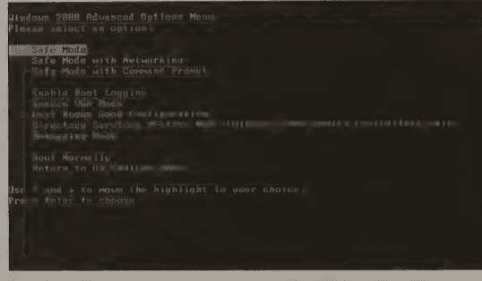

**图 5.15** Windows 2000 高级选项菜单显示安全模式。

### 使用目录服务恢复模式恢复系统状态数据

在域控制器上，系统状态包括：

- Active Directory (`NTDS`)
- 启动文件
- COM+ 类注册数据库
- 注册表
- 系统卷 (`SYSVOL`)

### 第 5 章

当域控制器在线时，无法执行权威还原——域控制器必须重启到“目录服务恢复模式”（`Directory Services Restore Mode`），这是安全模式下可用的一个选项。要执行权威还原，请执行以下步骤：

1. 重启服务器。
2. 在启动菜单中，当看到“请选择启动的操作系统”（`Please Select The Operating System To Start`）消息时，按 `F8` 键。
3. 从高级选项菜单中选择“目录服务恢复模式”。按 `Enter`。
4. 在 Windows 2000 启动菜单上，选择要启动的操作系统并按 `Enter`。
5. 服务器将启动到目录服务修复模式。在 Windows 2000 登录屏幕上，使用目录服务管理员密码登录。这不是普通的管理员密码。这是在执行 `DCPROMO` 期间输入的密码。
6. 通过选择“开始”、“程序”、“所有程序”、“系统工具”、“备份”来启动 Windows 2000 备份程序。
7. 选择“还原” 选项卡。
8. 选择所需的介质。
9. 勾选“系统状态”复选框。
10. 点击“开始还原” 按钮。
11. 当“确认还原”对话框出现时，点击“高级” 按钮。
12. 从图 5.16 所示的高级还原选项对话框中，选择“在还原复制的数据集时，将还原的数据标记为所有副本的主备数据”，并点击 `OK` 按钮。
13. 点击“确认还原”对话框中的 `OK` 按钮。
14. 还原完成后，重启服务器。

权威还原通常用于 Active Directory 对象（如用户、组或组织单元 (`OU`））被意外删除并需要还原的情况。

### 管理、监控和优化系统性能、可靠性和可用性 169

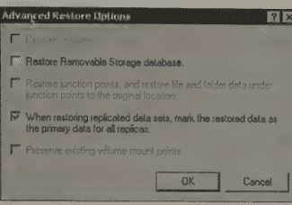

**图 5.16** 显示权威还原选择的高级还原选项对话框。

如果 Active Directory 对象被意外删除，可以通过执行部分权威还原从备份磁带中恢复该对象。这是通过从对象被删除之前的最后备份来实现的。执行还原的程序与上一节中所示完整 Active Directory 权威还原非常相似。

> 注意：执行部分权威还原时，非常重要的是只还原需要还原的特定项目。如果还原了整个 Active Directory，你可能会无意中覆盖较新的对象。例如，Active Directory 的命名上下文包含所有计算机帐户和信任关系的密码。这些密码大约每七天更改一次。如果现有值被还原覆盖，且由于创建了备份导致密码失效，计算机账户将被锁定在域之外，信任关系将断开。更多信息请参阅微软知识库文章 Q216243，“权威还原对信任和计算机帐户的影响”。

要还原被删除的 Active Directory 对象：

1. 执行上一个程序的第 1 到 10 步，从磁带还原 AD 数据库。
2. 当“确认还原”对话框出现时，点击 `OK`。
3. 还原完成后，重启域控制器。在启动菜单中，当看到“请选择启动的操作系统”消息时，按 `F8` 键。
4. 从高级选项菜单中选择“目录服务恢复模式”。按 `Enter`。
5. 在 Windows 2000 启动菜单上，选择要启动的操作系统并按 `Enter`。
6. 服务器将启动到目录服务修复模式。在 Windows 2000 登录屏幕上，使用目录服务管理员密码登录。这不是普通的管理员密码。这是在 `DCPROMO` 过程期间输入的密码。
7. 打开命令窗口并输入 `ntdsutil`，然后按 `Enter`。
8. 在命令提示符处，输入 `authoritative restore`，然后按 `Enter`。

要还原对象，你需要知道它的通用名称 (`CN`)、组织单元 (`OU`) 以及对象所在的域 (`DC`)。例如，要还原 `abc.com` 域中的 `ABC St. Louis User` OU，你需要输入以下命令：

```
Restore Subtree "OU=ABC St. Louis User,DC=abc,DC=com"
```

该命令将还原自备份磁带创建以来，在 `ABC St. Louis User` OU 中删除的所有对象。

要还原用户，命令为：

```
Restore Subtree "CN=JDoe,OU=ABC St. Louis User,DC=abc,DC=com"
```

要还原打印机，命令为：

```
Restore Subtree "CN=DeskJet 3rdfloor,OU=ABC St. Louis User,DC=abc,DC=com"
```

命令完成后，输入 `quit` 并重启域控制器。域控制器现在会将还原的 Active Directory 对象复制到其他域控制器上。


以下是 Active Directory 用户和计算机 MMC 根节点中显示的默认 Active Directory 文件夹：

- Users（用户）
- Builtin（内置）
- Computers（计算机）

这些文件夹实际上是容器，而不是组织单元。在引用这些容器时，你将必须使用...

### 第 5 章

### 恢复控制台

对于安全模式下提供的工具不足以从故障中恢复的情况，微软提供了一个名为“恢复控制台”（`Recovery Console`）的额外工具。恢复控制台是一个类似于 DOS 的命令行界面，可以在其中启动和停止服务。与从启动不同，恢复控制台允许访问 NTFS 卷上的文件。

恢复控制台默认不安装，你需要手动安装。要安装恢复控制台：

1. 插入所需的介质并启动服务器。
2. 在 Windows 2000 安装程序中，选择修复操作系统的选项。选择“恢复控制台”作为修复方法。
3. 按照指示登录。

从介质或硬盘启动恢复控制台后，将提示管理员密码，如图 5.18 所示。这不是域或本地管理员密码，而是你在 `Dpromo` 过程中被提示创建的目录服务密码。

### 管理、监控和优化系统性能、可靠性和可用性 171


**图 5.17** 显示添加恢复控制台的 Windows 2000 启动菜单。

如果你的系统故障且没有安装恢复控制台，或者遇到启动问题，可以从光盘或软盘运行它。要从光盘或软盘运行恢复控制台，请执行以下步骤：

1. 插入所需的介质并启动服务器。
2. 在 Windows 2000 安装程序中，选择修复操作系统的选项。选择恢复控制台。
3. 当窗口窗口时...

登录后，可以使用以下命令：

- `Attrib`
- `Diskpart`
- `MD`
- `Batch`
- `Enable`
- `Mkdir`
- `CD`
- `Exit`
- `More`
- `Chdir`
- `Expand`
- `RD`
- `Chkdsk`
- `Fixboot`
- `Ren`
- `CLS`
- `Fixmbr`
- `Rename`
- `Copy`
- `Format`
- `Rmdir`
- `Del`
- `Help`
- `Systemroot`
- `Delete`
- `Listsvc`
- `Type`
- `Dir`
- `Logon`
- `Disable`
- `Map`

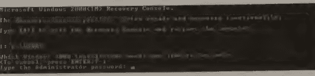

**图 5.18** 显示登录屏幕的 Windows 2000 恢复控制台。

### 紧急修复磁盘 (ERD)

如果之前的恢复方法均失败，你可以尝试使用*紧急修复磁盘*来修复系统文件。与之前的版本

管理、监控和优化系统性能、可靠性和可用性 173

Windows NT 的 Windows 2000 ERD 并不包含注册表文件。Windows 2000 ERD 包含以下内容：

- 基础系统文件
- 分区引导扇区
- 启动环境

Windows 2000 ERD 必须在系统正常运行时创建。要创建 Windows 2000 ERD，请执行以下步骤：

1. 选择“开始”、“程序”、“附件”、“系统工具”、“备份”，启动 Windows 2000 备份程序。
2. 在初始备份向导屏幕中，或从“工具”菜单，选择“紧急修复磁盘”选项。
3. 将一张空白软盘插入 A 盘；选择在修复目录中备份注册表的选项，并点击确定（见图 5.19）。
4. 磁盘创建完成后，点击确定按钮。

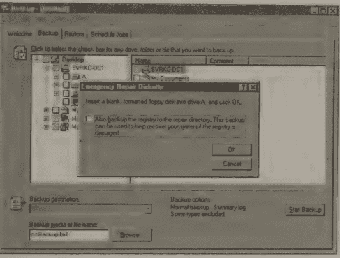

图 5.19 显示创建 Windows 2000 备份紧急修复磁盘。

注册表选项不会将注册表文件保存到磁盘上——它们保存在计算机的 `%systemroot%\Repair\Regback` 文件夹中。与之前的 Windows 版本一样，在对系统进行更改（例如添加新硬件、安装服务包或其他主要配置更改）后，您应该创建一个新的 ERD。

### 使用紧急修复磁盘

要使用 ERD 修复系统，必须从 Windows 2000 CD-ROM 或四张启动软盘启动。在安装过程中，选择“修复”选项。当提示修复类型时，您可以选择选择“手动修复”或“快速修复”。如果您选择“手动修复”选项，将看到以下选项：

- **检查启动环境**——此选项检查分区中的文件，以确保它们没有丢失或损坏。如有必要，将从 Windows 2000 CD-ROM 复制文件。
- **验证 Windows 2000 系统文件**——此选项通过与 Windows 2000 CD-ROM 文件逐位比较来验证系统文件。如果存在差异，将询问您是否替换。
- **检查引导扇区**——此选项检查引导扇区并在必要时尝试修复它。

如果您选择“快速修复”选项，它会自动执行上述三个任务，并检查且尝试修复注册表。如果无法修复注册表，它将从 `%systemroot%\Regback` 文件夹中复制您创建 ERD 时保存的注册表文件。


> 您应该熟悉 Windows 2000 的各种恢复方法，以及何时以及如何使用每种方法。

## 练习题

### 题 1

- 下列哪些工具允许您查看应用程序使用了多少内存？[勾选所有适用项:]

- A. 系统监视器

- B. 性能日志和警报

- C. 任务管理器

- D. 性能监器

答案 A 和 C 正确。任务管理器和系统监视器允许您查看应用程序的当前性能。性能日志和警报单元仅允许您记录数据并创建警报。性能监器是以前 Windows 版本中使用的工具。因此，答案 B 和 D 是错误的。

### 题 2

- 使用任务管理器可以使用以下哪些系统视图？[勾选所有适用项]

- A. 应用程序

- B. 进程

- C. 网络性能

- D. 磁盘活动

答案 A 和 B 正确。任务管理器提供了三种视图：应用程序、进程和性能。

### 题 3

- 从任务管理器可以获取以下哪些性能测量？[勾选所有适用项]

- A. 磁盘 I/O

- B. 内存使用

- C. CPU 时间

- D. 缺页错误

答案 B、C 和 D 正确。任务管理器提供内存使用和 CPU 时间作为默认测量。缺页和许多其他指标可以通过选择菜单栏上的“查看”、“选择列”来选择。

### 题 4

- 如果您的服务器出现性能问题，您应该密切监控哪些设备？[勾选所有适用项]

- A. 内存

- B. 视频

- C. 应用程序加载时间

- D. 处理器

答案 A 和 D 正确。虽然视频性能在工作站上可能很重要，但在服务器上，最重要的四个要素是内存、处理器、物理磁盘和网络。答案 C 是错误的，因为应用程序加载时间不是设备。

### 题 5

- 下列哪些工具允许您查看实时性能数据？[勾选所有适用项]

- A. 系统监视器

- B. 性能日志和警报

- C. 任务管理器

- D. 性能监器

答案 A 和 C 正确。性能日志和警报单元仅允许您记录数据并创建警报。性能监器是以前 Windows 版本中使用的工具。因此，答案 B 和 D 是错误的。任务管理器和系统监视器允许您查看应用程序的实时性能。

### 题 6

- 下列哪些组的成员允许备份 Windows 2000？[勾选所有适用]

- A. 服务器操作员

- B. 高级用户

- C. 帐户操作员

- D. 管理员

- E. 备份

答案 D 和 E 正确。服务器操作员、高级用户和帐户操作员没有备份权限。

### 题 7

- 使用哪个程序创建 Windows 2000 紧急修复磁盘？

- A. Rdisk

- B. MakeERD

- C. Windows 2000 备份

- D. ERclone

答案 C 正确。在 Windows 2000 中，紧急修复磁盘是通过备份程序创建的。答案 A 是错误的，Rdisk 是之前的程序。答案 B 和 D 是错误的，MakeERD 和 ERclone 不是。

### 题 8

- 下列哪个不是有效的 Windows 2000 备份类型？

- A. 复制

- B. 差异

- C. 增量

- D. 转储

- E. 正常

答案 D 正确。虽然 SQL 使用 Dump，但 Windows 不。

### 题 9

- 下列哪个不是成员服务器系统备份的一部分？

- A. COM+ 类数据库

- B. 注册表

- C. 系统启动文件

- D. SYSVOL 文件夹

答案 D 正确。SYSVOL 文件夹仅存在于域控制器上，成员服务器上。

### 题 10

- 如何安装恢复控制？

- A. 在 Windows 2000 安装期间

- B. 使用 rconsole 命令

- C. 使用 winnt2 /cmd 命令

- D. 使用 instrecv 命令

答案 C 正确。恢复控制是在 Windows 2000 安装后从命令行安装的。Rconsole 是 NetWare 的工具。

## 想了解更多吗？

Shilmover, Barry 和 Stu Sjouerman, *Windows 2000 Power Toolkit*, New Riders, Indianapolis, IN, 2001. ISBN 0-7357-1061-9。这本书是性能工具和各种计数器的参考价值资源。

在互联网上搜索 TechNet `http://www.microsoft.com/technet` 或使用 TechNet 光盘获取性能工具、系统监视器、对象、计数器、系统状态、备份、权威恢复、恢复控制和安全模式的信息。

访问 `http://www.cnet.com` 获取性能工具和实用程序的附加信息和评论。

## 引言

你可能已经听过“事变人迁，本质不变”这句话上百遍了——甚至更多。在管理计算机硬盘方面，这句话再真不过了。Windows 2000 相比其先驱 Windows 9x 和 Windows NT 领先了几个量级，但你仍然发现自己需要有效地管理和监控你的硬盘。

Windows 2000 提供了一个极其实用的 GUI，用于对计算机硬盘和卷执行绝大多数管理任务：磁盘管理实用。可以通过多种方式访问磁盘管理，其中最简单的方法是通过计算机管理控制台（开始、程序、管理工具、计算机管理），如图 6.1 所示。

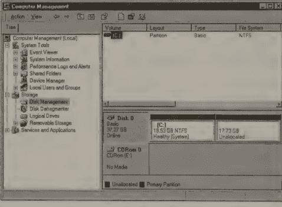

**图 6.1** 磁盘管理工具——存储管理控制台。

磁盘管理工具可以让你直览以下信息：

- 计算机安装并识别的卷
- 正在使用的文件系统（如 `FAT32` 或 `NTFS`）
- 磁盘类型（如基本磁盘或动态磁盘）
- 每个卷的健康状况
- 每个卷的状态（如系统分区等）
- 每个卷的总大小和可用空间

## 监控和配置磁盘与卷

大部分的硬盘和卷管理任务将通过磁盘管理实用工具完成，如图 6.1 所示。从这里，你可以执行以下任务：

- 确定磁盘和卷信息（如大小、文件系统和其他相关信息）
- 确定磁盘健康状态
- 将基本存储升级为动态存储
- 创建新的分区和卷
- 格式化分区和卷
- 删除分区和卷
- 扩展动态卷的大小
- 为硬盘和可移动存储驱动器分配并更改器号或路径
- 添加新的物理磁盘

虽然你最常用从计算机管理控制台访问磁盘管理工具，但你可以根据喜好通过以下三种方式中的任何一种访问磁盘管理：

- 在命令行上，输入 `diskmgmt.msc`。
- 在命令行上，输入 `MMC`。在空控制台中添加磁盘管理插节点。这对于为各种管理任务创建强大的、自定义的 MMC 控制台非常有用。
- 从计算机管理控制台内部，点击“磁盘管理”。

## 查看磁盘属性

你可以通过右键点击磁盘管理窗口底部区域的某个磁盘（见图 6.2），并从快捷键菜单中选择“属性”，来快速确定计算机中每个物理磁盘的属性。

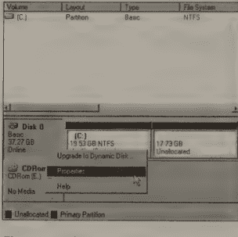

**图 6.2** 进入磁盘属性对话框。

如图 6.3 所示，磁盘属性对话框向你显示关于磁盘的以下信息：

- 磁盘编号


**图 6.3** 磁盘属性对话框。

## 查看卷的健康状态

每个卷的健康状况在磁盘管理中卷大小下的卷属性窗中提供（见图 6.1）。此区域显示以下状态之一：

- 在线（Online）——磁盘正常运行，无已知问题。
- 在线（错误）[Online (errors)]——仅用于动态磁盘，此状态表示磁盘上检测到 I/O 错误。
- 离线（Offline）——仅用于动态磁盘，此状态表示由于各种可能的问题或错误导致无法访问。
- 外部（Foreign）——仅用于动态磁盘，此状态表示动态磁盘已从另一台 Windows 2000 计算机移除，但尚未导入此计算机。
- 不可读取（Unreadable）——磁盘无法访问，可能发生了硬件故障、损坏或 I/O 错误。磁盘上的系统磁盘配置数据库副本可能损坏，导致此状态指示。
- 未识别（Unrecognized）——此磁盘未被识别，例如来自 Unix 系统的磁盘。
- 无媒体（No Media）——仅用于可移动媒体驱动器。当向驱动器插入可读介质时，状态将变为“在线”。

修复驱动器问题将在本章后面的“从磁盘故障中恢复”部分进行进一步讨论。

## 查看和配置卷属性

要收集特定卷的信息，请右键点击磁盘管理窗口下方窗格中的所需卷，并从快捷菜单中选择“属性”。注意图 6.4，下方窗格中的磁盘 0 被右键点击。

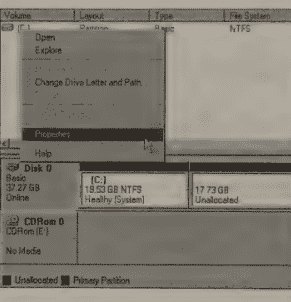

**图 6.4** 进入属性对话框。

如图 6.5 所示，卷属性对话框向你显示关于卷的以下信息：

- 卷标签
- 磁盘类型（如基本或动态）
- 正在使用的文件系统（如 `FAT32` 或 `NTFS`）
- 卷的空间
- 每个卷的总大小和可用空间
- 卷是否配置了压缩
- 每个卷的健康状况
- 磁盘编号

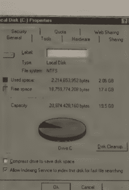

**图 6.5** 属性对话框。

尽管磁盘管理实用工具提供了你所需的许多工具，但你还应该熟练掌握磁盘碎片整理工具（同样位于计算机管理控制台）以及计算机中每个卷的属性页。这三个管理工具结合在一起，为你提供了丰富的能力和控制力，而这些能力在以前是无法开箱即用如此容易获得的。

## 将基本存储升级为动态存储

如果你想利用 Windows 2000 中动态磁盘提供的功能，你必须将基本磁盘升级为动态磁盘。升级是在整个磁盘上进行的，而不仅仅是分区。动态磁盘是一种只能包含动态卷且无法被 DOS 访问的硬盘。基本磁盘是标准的硬盘。

作为动态磁盘向你提供的卷类型包括：

- 镜像卷（Mirrored volumes）——镜像卷是一种容错配置，数据被写入两块硬盘而不是一个，这样当一个磁盘故障时，数据仍然可以访问。镜像卷仅适用于 Windows 2000 Server。
- 简单卷（Simple volumes）——简单卷与基本分区相同；磁盘空间仅使用一个磁盘。
- 跨卷（Spanned volumes）——跨卷可以利用 2 到 30 个物理磁盘的空间来创建一个大的连续卷。跨卷不提供容错性，因此如果一个磁盘故障，整个集合就会丢失。跨卷的优势在于，当空间不足时可以快速添加更多存储。
- 条带卷（Striped volumes）——条带卷通过 64KB 顺序条带将数据写入多个磁盘，使用 2 到 30 个物理磁盘。第一个条带写入第一个磁盘，第二个条带写入第二个磁盘，以此类推。条带卷也称为 RAID-0，不提供容错性。条带卷带来的优势是提高了整体磁盘 I/O 性能，因为总 I/O 被分配到卷中的所有磁盘。
- RAID-5 卷——RAID-5 卷使用 2 到 30 个大小相同的物理磁盘提供容错数据存储。总容量等于物理磁盘数量减一后提供的容量。数据顺序写入每个物理磁盘，并包含数据和校验信息。集合中的校验信息用于在一个磁盘故障时重建集合，从而提供容错性。Windows 2000 中的 RAID-5 卷在不提供容错性的情况下，无法忍受超过一个磁盘的故障。

只要满足以下所有条件，随时可以将基本磁盘升级为动态磁盘，且不会丢失数据。你无法在完全丢失卷中所有数据的情况下将动态磁盘还原为基本磁盘。

- 主引导扇记录 (MBR) 磁盘在磁盘末尾必须至少有 1MB 的可用空间，以便创建动态磁盘数据库。
- 动态存储无法在如 Zip 磁盘等可移动介质上使用。
- 便携式电脑上的硬盘无法转换为动态存储。由于大多数携式电脑仅包含一个硬盘，升级到动态磁盘无法实现任何收益。
- 硬盘上的扇区大小不能大于 512 字节以便进行转换。使用 `fsutil fsinfo ntfinfo x:` 来确定扇区大小，其中 `x:` 是相关卷。


动态磁盘只能由一个操作系统使用。如果你计划对计算机进行多系统启动，请勿将基本磁盘升级为动态磁盘。

要将基本磁盘升级为动态磁盘，请按照以下步骤操作：

1. 在磁盘管理下方的窗格中，右键点击要升级的磁盘，并从快捷菜单中选择“升级到动态磁盘”（见图 6.2）。
2. 从提供的列表中选择要升级的磁盘，并点击“确定”。
3. 当出现“要升级的磁盘”对话框时，点击“升级”继续。
4. 弹出一个警告对话框，告知你动态磁盘无法被任何之前的 Windows 2000 版本使用。点击“是”继续。
5. 弹出另一个警告对话框，通知你磁盘上存在的任何文件系统将作为升级过程的一部分被卸载。点击“是”继续——这是你取消过程的最后机会。
6. 当出现提示需要重启以完成过程的对话框时，点击“确定”。计算机重启后，磁盘升级将完成。

## 创建新分区和卷

如果你恰好在其中一个磁盘上有任何未分配（空闲）空间（见图 6.1），你可以在其中创建新分区或卷。要在基本磁盘的空闲空间创建新分区，请执行以下步骤：

1. 在磁盘上右键点击空闲（未分配）空间区域（见图 6.1），并选择“创建分区”。
2. 点击“下一步”关闭打开的页面。
3. 选择分区类型（见图 6.6）并点击“下一步”继续。


**图 6.6** 选择分区类型。

4. 指定分区大小并点击“下一步”。
5. 如图 6.7 所示，指定驱动器器号或挂载位置，并点击“下一步”。


**图 6.7** 选择驱动器器号或挂载点。

6. 选择你的分区格式和名称选择，并点击“下一步”。
7. 点击“完成”完成向导。

创建新的动态卷的过程与创建新的基本磁盘分区的过程相同，不同之处在于当创建动态卷时，你可以从之前提到的可用卷类型中进行选择。对于跨区卷，你还有机会选择要创建卷的总大小。图 6.8 显示了一台使用动态磁盘的服务器。注意 C: 卷如何在镜像卷中跨越两个不同的硬盘进行划分。


**图 6.8** 使用动态磁盘的计算机。

## 格式化卷和分区

要格式化卷或分区，请按照以下步骤操作：

1. 右键点击要格式化的卷或分区，并从快捷菜单中选择“格式化”。
2. 如图 6.9 所示提供所需信息，并点击“确定”。


**图 6.9** 选择格式化选项。


# 第 6 章

## 删除卷和分区

要格式化或删除分区，请按照以下步骤操作：

1. 右键点击要格式化的卷或分区，并从快捷菜单中选择“删除分区”或“删除卷”。
2. 点击“是”确认警告对话框，该对话框将你所有数据都将丢失。

与格式化卷一样，Windows 2000 具有自我保护功能，不允许你在 GUI 内删除系统分区。

## 扩展卷大小

不是基本磁盘创建的动态卷可以调整大小。要扩展动态卷，右键点击该卷并从快捷菜单中选择“扩展”。

## 分配驱动器号和路径

要更改驱动器号或路径，右键点击卷并从快捷菜单中选择“更改号和路径”。打开“更改号和路径”对话框，如图 6.10 所示。


**图 6.10** 更改驱动器号。

驱动器的功能与其他任何驱动器相同，但分配的是名称而不是驱动器号。挂载驱动器，确保路径存在。

## 添加新磁盘

添加磁盘是一个简单的过程。添加磁盘与添加任何硬件（Windows 2000 中安装硬件的信息请见第 4 章）的不同之处在于，如果你的计算机支持热插，你可以点击“操作”、“扫描磁盘”，磁盘管理就会显示它。如果你的计算机不支持热插，磁盘将在下次重启后显示。

## 磁盘和卷的故障排除

Windows 2000 自带了三个强大的内置工具，可以使用它们进行基本的故障排除、压缩和修复。它们是：

- 磁盘清理——删除磁盘上的临时文件和其他“垃圾”。
- 磁盘检查——检查你的硬盘的文件和文件夹结构的工具。你也可以让磁盘检查检查物理结构。磁盘检查可以根据需要执行修复。
- 磁盘碎片整理——通过将每个文件的碎片移动到硬盘上的连续区域来对硬盘进行碎片整理的工具。

我们将在后续章节中检查每个工具。

## 使用磁盘清理工具

磁盘清理工具可以删除临时文件、安装日志、回收桶项目以及随时间积累在卷上的其他“垃圾”。你可以根据需要通过三种不同的方式启动磁盘清理工具：

- 在卷属性对话框的“常规”选项卡上（见图 6.5），点击“磁盘清理”按钮。
- 从开始菜单点击“程序”、“附件”、“系统工具”、“磁盘清理”。
- 在命令行输入 `cleanmgr /d x`，其中 `x` 代表要清理的卷。`/d` 参数不是强制，但它指定了要清理的卷。

从卷属性对话框的“常规”选项卡启动磁盘清理，在清理扫描完成后会出现磁盘清理对话框，如图 6.11 所示。


**图 6.11** 选择要清理的项目。

选择要清理和压缩的项目并点击“确定”。在提示时，点击“是”确认你的选择并开始清理过程。

磁盘清理工具可以通过控制面板中的“计划任务向导”配置为计划清理。

## 使用磁盘检查

可以使用磁盘检查实用程序来检查硬盘的文件和文件夹结构，还可以检查硬盘的物理结构。磁盘检查还可以配置为自动纠正发现的错误。您可以使用以下方法之一启动磁盘检查：

- 在卷的“属性”对话框的“工具”选项卡中，点击“立即检查”按钮。
- 在命令行中，输入 `chkdsk`。

当从命令行启动时，`chkdsk` 命令具有以下语法：

```
chkdsk [volume[:path]filename]] [/F] [/V] [/R]
[/X] [/I] [/C] [/L:size]
```

表 6.1 显示了用于 `chkdsk` 命令的可用选项。

| 表 6.1 Chkdsk 选项 |
| --- | --- |
| Switch | 描述 |
| Volume | 指定驱动器字母、挂载点或卷字符。 |
| file name | 指定要检查碎片情况的文件（仅限 FAT）。 |
| /F | 指定如果在磁盘上发现错误，则进行修复。 |
| /V | 指定要显示清理信息。 |
| /R | 查找坏道并恢复任何可读信息。需要 /F 选项。 |
| /L:size | 指定要创建的日志大小。 |
| /X | 指定如果需要，则卸载所选卷。需要 /F 选项。 |
| /I | 指定对索引条目进行不那么彻底的检查。 |
| /C | 指定跳过对文件夹结构内循环的检查。 |

图 6.12 显示了从 GUI 启动时的 Windows 2000 磁盘检查配置选项。注意，GUI 和命令行磁盘检查对重启的要求是相同的。如果您正在扫描（即不是修复错误）系统/启动分区，那么你可以让系统继续运行，但如果您想修复错误或恢复坏道，则您必须在下次重启时进行。如果您检查的是系统/启动分区以外的分区，那么您通常不需要重启。


**图 6.12** 配置磁盘扫描属性。

## 磁盘碎片整理

人们曾认为 NTFS 文件系统不会产生碎片。Windows NT 4.0 因为没有内置碎片整理工具，使得这种观点一度成为主流。遗憾的是，很快发现 NTFS 会像 FAT 和 FAT32 一样产生碎片，因此在 Windows 2000 中重新引入了磁盘碎片整理工具。Windows 2000 包含了 Executive Software Diskeeper 的“轻量”版本，用于执行磁盘碎片整理。

> 当操作系统将文件保存到硬盘上的第一个可用空间，而不是将其整齐地放入可用空间或剩余空间中时，就会发生碎片。随着时间的推移，碎片可能会降低或降低磁盘性能。每月分析一次驱动器的碎片情况是一个好主意。

您可以通过以下五方法之一访问磁盘碎片整理实用程序：

- 在卷的“属性”对话框的“工具”选项卡中，点击“立即碎片整理”按钮。
- 从开始菜单，点击“程序”、“辅助工具”、“系统工具”、“磁盘碎片整理”。
- 在计算机管理控制台内部，点击“磁盘碎片整理”，如图 6.13 所示。
- 在命令行上，输入 `dfrg.msc`。
- 在命令行上，输入 `MMC`。在空控制台中，添加“磁盘碎片整理”单元程序。这对于为各种管理任务创建强大的自定义化 MMC 控制台非常有用。


**图 6.13** 计算机管理控制台中的磁盘碎片整理。

无论您以何种方式启动碎片整理，选项都是相同的。要分析卷，点击“分析”按钮。您可以点击“碎片整理”按钮，在先分析或不先分析的情况下对卷进行碎片整理。“查看报告”按钮将再次显示分析报告。您可以暂停或停止正在运行的碎片整理。

磁盘碎片整理实用程序可以通过控制面板中的“计划任务向导”配置为计划清理。

> 请访问 http://www.executivesoftware.com/diskeeper/diskeeper.asp 查看 Diskeeper 的完整版本。

## 配置 NTFS 文件和文件夹压缩

原生文件和文件夹压缩是使用 NTFS 5.0 文件系统的许多优点之一。NTFS 使用的压缩算法是无损的，这在压缩或解压缩过程中不会导致数据丢失。遗憾的是，这种能力是需要代价的——NTFS 压缩和 EFS 加密是互斥的。也就是说，您不能同时对文件或文件夹进行压缩和加密。有关 Windows 2000 中 EFS 加密的更多信息请参见第 8 章；文件压缩的额外信息请参见第 3 章。

您可以从命令行或 GUI 管理压缩。以下步骤概述了如何从 Windows 压缩：

1. 在文件夹的属性中，点击“高级”按钮（见图 6.14）。
2. 选择“压缩以便内容以节省空间”并点击“确定”。
3. 点击“确定”关闭属性框。

如果启用了压缩，您将在资源管理器中以蓝色字体显示文件夹（以及任何文件）（见图 6.15）。要在资源管理器中启用此选项，请点击工具，“文件夹选项”。


**图 6.14** 配置压缩和加密。

如果您想从命令行管理 NTFS 压缩，可以使用 `compact` 命令，该命令语法如下：

```
compact {[c/u]} [/s:dir]} [/a] [/i] [/f]
  [/q] [FileName...]
```


表 6.2 显示了用于 `compact` 命令的可用选项。

| 表 6.2 compact 命令选项 |
| --- | --- |
| Switch | 描述 |
| /c | 指定对目录或文件进行压缩。 |
| /u | 指定对目录或文件进行解压缩。 |
| /s | 指定对指定目录的所有子目录执行压缩操作。 |
| /a | 指定显示隐藏或系统文件。 |
| /i | 指定在压缩过程中忽略错误。 |
| /f | 指定对指定的目录或文件强制执行压缩操作。这对于部分压缩的目录有用。 |
| /q | 指定仅报告最基本的信息。 |
| filename | 指定文件或目录。可以使用多个文件名和通配符（* 和 ?）。 |

移动或复制 NTFS 压缩文件或文件夹的可能结果如下：

- 将未压缩的文件或文件夹移动到同一 NTFS 卷上的另一个文件夹，会导致该文件或文件夹保持未压缩状态，无论目标文件夹的压缩状态如何。
- 将压缩的文件或文件夹移动到另一个文件夹，会导致文件或文件夹在移动后保持压缩状态，无论目标文件夹的压缩状态如何。
- 将文件复制到文件夹会导致该文件采用目标文件夹的压缩状态。
- 覆盖同名文件会导致复制后的文件采用目标文件的压缩状态，无论目标文件夹的压缩状态如何。
- 将文件从 FAT 文件夹复制到 NTFS 文件夹会导致该文件采用目标文件夹的压缩状态。
- 将文件从 NTFS 文件夹复制到 FAT 文件夹会导致所有 NTFS 特有的属性丢失，因此文件将变为未压缩状态。

## 管理磁盘配额

在 Windows 的之前的版本中，你无法控制用户在硬盘上占用了多少空间。在 Windows 2000 中，得益于磁盘配额功能，这种情况已经发生了变化。磁盘配额允许你指定用户在任何特定 NTFS 卷上允许使用的磁盘空间。你必须使用 NTFS 5.0 才能使用此功能。你可以为卷中的所有用户通用地指定磁盘配额，也可以为特定用户单独指定。以下是关于磁盘配额的若干需要关注的事项：

- 如前所述，你只能在 Windows 2000 NTFS 5.0 卷上实施磁盘配额。
- 磁盘配额只能应用于卷的根级别，而不能应用于特定的文件夹。
- 磁盘使用量是基于用户创建、复制或拥有权的所有文件计算的。
- 磁盘配额基于实际文件大小，而不是压缩后的文件大小。
- 磁盘配额会影响已安装应用程序在安装过程中看到的可用空间。
- 对于任何从 Windows NT 4.0（已安装所需的服务包）访问 Windows 2000 磁盘数据的用户，将不会应用配额。

要配置磁盘配额，请右键点击卷并在快捷菜单中选择“属性”以打开卷的根属性。点击“配额”选项卡（见图 6.16）来配置该卷的磁盘配额。


**图 6.16** 管理磁盘配额。

你应该首先注意的是“状态”指示器，它直观地指示卷上磁盘配额的应用状态。磁盘配额交通灯具有以下指示：

- 绿灯——卷上已启用磁盘配额。
- 黄灯——由于正在重建配额信息，卷上的磁盘配额目前处于活动状态。
- 红灯——卷未启用磁盘配额（这是默认设置）。

表 6.3 概述了图 6.16 对话框中的每个磁盘配额选项。

| 表 6.3 磁盘配额配置选项 | 说明 |
| --- | --- |
| 启用配额管理 | 勾选时启用配额管理。 |
| 拒绝超过配额限制的用户使用磁盘空间 | 当用户超过其分配的配额限制时，拒绝其使用额外的磁盘空间。 |
| 不限制磁盘使用量 | 自动为卷上的新用户分配无限配额。 |
| 限制磁盘空间为 | 自动为卷上的新用户分配配置的配额限制。 |
| 用户超过其配额限制时记录事件 | 当用户的使用量超过配额限制时，生成事件日志条目。 |
| 用户超过警告级别时记录事件 | 当用户的使用量超过警告级别时，生成事件日志条目。 |

注意在表 6.3 中，讨论在卷上应用配额限制时使用了 *新用户* 一词。在 Windows 2000 中，磁盘配额设置仅*自动*应用于尚未在该卷上使用过任何空间的用户。因此你可以看到，最好是从最开始就开始实施磁盘配额，这样任何在该卷上使用磁盘空间的用户都将自动受到磁盘配额限制。

要为卷上的新用户启用磁盘配额，请遵循以下步骤：

1. 打开要配置配额设置的卷的属性对话框。点击“配额”选项卡。
2. 勾选“启用配额管理”。
3. 勾选“拒绝超过配额限制的用户使用磁盘空间”，以防止用户超过其配额设置。
4. 选择“限制磁盘空间”，并将限制级别和警告级别分别配置为 10MB 和 8MB。
5. 点击“应用”以应用配额控制设置。
6. 如果磁盘上已有数据，将打开一个对话框告知你磁盘必须重新扫描。点击“确定”以确认此信息。

如之前所述，磁盘配额设置将不会自动应用于已开始在该卷上使用磁盘空间的用户。你需要手动为这些用户配置磁盘配额。你可能还会需要为具有特殊需求或问题的其他用户配置磁盘配额，例如图形设计部门的用户，他们有正需要存储数百兆的图形文件。然而，人力资源部门经常向文件服务器下载 MP3 的用户则需要设置更严格的配额。

> 如果驱动器上已有数据，则在启用配额后扫描驱动器时，会自动为该用户创建一个配额条目。如果驱动器上有大量数据，这可能需要几分钟。所有用户都被视为配额系统的新用户，因此他们将获得默认配额设置。

无论你手动创建用户磁盘配额的原因为何，过程都是相同的，执行方式如下：

1. 打开要配置配额设置的卷的属性对话框。点击“配额”选项卡。
2. 勾选“启用配额管理”。
3. 勾选“拒绝超过配额限制的用户使用磁盘空间”，以防止用户超过其配额设置。
4. 选择“限制磁盘空间”，并将限制级别和警告级别分别配置为 10MB 和 8MB。
5. 点击“应用”以应用配额控制设置。
6. 如果磁盘上已有数据，将打开一个对话框告知你磁盘必须重新扫描。点击“确定”以确认此信息。

- 要为未列出的用户创建新配额条目，请点击“配额”，点击“新建条目”。
- 选择要应用配额的用户或用户。
- 配置所需的配额设置并点击“确定”。
- 若要编辑现有（已列出）用户的配额设置，请双击该用户。

通过此窗口，可以获取到以下信息：

- 配额状态。绿色箭头表示正常，黄色感叹号表示超过警告限制，红色圆圈表示超过使用限制。
- 每个配额条目的用户名和登录名。
- 每个用户使用的磁盘空间量。
- 每个用户的配额设置。
- 每个用户的警告设置。
- 每个用户使用的磁盘空间占配额设置的百分比。

## 从磁盘故障恢复

遗憾的是，硬盘会发生故障。这本身足以让你确保有一份经过仔细考虑并练习过的灾难恢复计划（请参见第 5 章）。如果你的数据位于基础磁盘或简单、跨区或分区卷上，你唯一的选择是更换磁盘并从上次备份恢复数据。如果你故障的是镜像卷或 RAID-5 阵列磁盘，则具有容错性，你能够恢复数据。

## 恢复故障镜像驱动器

如果镜像集中的一个驱动器发生故障，你将在磁盘管理中获得视觉化指示。修复镜像的过程取决于故障磁盘是否属于包含系统或启动分区的镜像集。

如果故障磁盘不包含系统或启动分区（仅数据），你可以按照以下步骤恢复镜像：

1. 在磁盘管理内部，右键点击故障的镜像卷，并在快捷菜单中选择“移除镜像”。
2. 在“移除镜像”对话框中，选择要删除的磁盘并点击“移除镜像”。
3. 当弹出对话框时，点击“确定”确认要移除镜像。
4. 关闭计算机，更换硬盘并重启计算机。
5. 使用之前的镜像磁盘和替换磁盘创建新的镜像卷。

如果故障磁盘包含系统或启动分区，那么你可以按照以下步骤恢复镜像：

1. 确定哪个镜像驱动器发生故障。如果是辅助磁盘（包含镜像数据的磁盘）故障，你可以按照之前描述的方法进行更换。如果是主磁盘（包含原始数据的磁盘）故障，你必须按照这些步骤操作。
2. 创建一个 Windows 2000 引导软盘，其中包含 `boot.ini` 文件的副本，该文件指向镜像集中的辅助磁盘。
3. 如果你有另一台可用 Windows 2000 计算机，请将其 `ntdlr`、`ntddetect.com` 和 `boot.ini` 文件拷贝到空白且已格式化的 3-1/2 英制软盘中。你需要按照步骤 5 所示编辑 `boot.ini` 文件，以反映你的辅助驱动器的位置。
4. 如果你没有另一台可用 Windows 2000 计算机，请从 Windows 2000 安装 CD-ROM 中的 I386 文件夹中拷贝 `ntddetect.com` 文件到空白且已格式化的 3-1/2 英制软盘中。你还需要通过在命令行输入以下命令 `expand Ntdlr._ Ntdlr` 来从相同位置解压缩 `NTTLDR`。
5. 最后，创建一个类似于这样的 `boot.ini` 文件，指向你损坏镜像中的辅助驱动器（有关操作 ARC 路径的更多帮助，请参见 http://support.microsoft.com/default.aspx?sc=kb;en-us;Q102873）：

```
[boot loader]
timeout=30
default=multi(0)disk(0)disk(0)partition(1)\WINNT
[operating systems]
multi(0)disk(0)disk(0)partition(1)\nWINNT='Microsoft Windows 2000 Server' /fastdetect
```

6. 使用你的引导盘启动你的 Windows 2000 计算机。
7. 按照之前的步骤删除并重新创建镜像。

## 恢复故障的 RAID-5 驱动


得益于阵列提供的容错能力，从 RAID-5 阵列的磁盘故障是一个相当简单的过程。请记住，RAID-5 阵列只能为一个故障磁盘提供容错，因此请尽快更换故障磁盘。在磁盘故障且未更换期间，你仍然可以使用 RAID-5 阵列；由于丢失的数据必须从校验信息重新创建，I/O 性能将严重下降。同样，你应该通过以下步骤尽快更换 RAID-5 阵列中的故障磁盘：

1. 如果必要，关闭服务器。更换故障磁盘。如果有必要，重启服务器。如果磁盘支持热插拔，请重新扫描磁盘。
2. 在磁盘管理中，右键点击故障的 RAID-5 集（它将被标记为“冗余损坏”），并从快捷菜单中选择“修复卷”。
3. 在提示时，选择你安装的新磁盘并点击“确定”开始重建过程。

## 练习题

### 题 1

| 在 Windows 2000 中，你可以在 Windows 2000 专业版计算机上创建哪些类型的磁盘配置？[选择所有适用项] |
| :--- |
| A. 镜像卷 (Mirrored volume) |
| B. RAID-5 阵列 |
| C. 跨卷 (Spanned volume) |
| D. 主分区 (Primary partition) |

答案 A、C 和 D 是正确的。在 Windows 2000 专业版计算机上，你可以在基本磁盘上创建主分区、扩展分区和逻辑分区。你还可以在动态磁盘上创建镜像、跨越、条带和简单卷。Windows 2000 专业版不支持 RAID-5 或容错阵列，因此答案 B 是错误的。

### 题 2

| Dawn 在她的其中一台 Windows 2000 服务器上配置了一个 RAID-5 阵列，该阵列由七块 80GB 的 SCSI 硬盘组成。校验信息需要使用多少空间？ |
| :--- |
| A. 60GB |
| B. 80GB |
| C. 120GB |
| D. 132GB |

答案 B 是正确的。RAID-5 阵列要求所有磁盘具有相同的容量。校验信息需要阵列中其中一个磁盘的容量，因此，如果 Dawn 使用七块 80GB 的磁盘构建 RAID-5 阵列，她将有 480GB 可用存储空间，以及 80GB 用于校验信息。因此，答案 A、C 和 D 是错误的。

### 题 3

Andrea 是负责你组织的 Windows 2000/SQL 2000 服务器的管理员。昨晚，她的其中一台 SQL 服务器的 RAID-5 阵列中的一个硬盘发生故障。Andrea 必须做什么才能让 SQL 服务器恢复到全功能运行？[选择所有适用项]

A. 编辑 `boot.ini` 文件以反映引导分区的位置。
B. 更换故障磁盘。
C. 从最近的备份集执行数据恢复。
D. 使用磁盘管理修复 RAID-5 阵列。

答案 B 和 D 是正确的。Andrea 只需要更换故障的硬盘并使用磁盘管理实用程序重建 RAID-5 阵列。只有当镜像集中的主磁盘发生故障时，才需要编辑 `boot.ini` 文件，因此答案 A 是错误的。因为 RAID-5 阵列具有容错性，不需要使用 Windows 备份进行数据恢复。Windows 2000 将使用校验信息来重建故障磁盘上的数据，因此答案 C 是错误的。

### 题 4

Christopher 是你组织广告部门的一名用户。他经常使用桌面出版应用程序创建大文件。今天，当他尝试为即将到来的销售活动保存一份新目录时，他遇到了一个错误。你可以告诉 Christopher 什么可以弥救这种情况？

A. 编辑 `boot.ini` 文件以反映引导分区的位置。
B. 更换故障磁盘。
C. 从最近的备份集执行数据恢复。
D. 使用磁盘管理修复 RAID-5 阵列。

### 题 5

Hannah 是你组织的管理员。她想使用压缩，但收到了错误。此问题最可能的原因是什么？

A. 她没有使用 NTFS 系统。
B. 她不是企业组（Enterprise group）的成员。
C. 她没有使用 RAID-5 阵列。
D. 她没有使用磁盘配额。

### 题 6

Austin 是你组织的管理员。他目前所有的服务器都运行在双磁盘镜像集上。停电后的第二天早上，Austin 报告说一个镜像集中的主磁盘发生了故障。你会告诉 Austin 如何以最快的方式解决此问题？[选择所有适用项]

A. 编辑 `boot.ini` 文件。
B. 更换故障磁盘。
C. 从最近的备份集执行数据恢复。
D. 创建一个 Windows 2000 引导盘并确保 `boot.ini` 文件指向辅助磁盘。

答案 B 和 D 是正确的。Austin 需要创建一个其 `boot.ini` 文件指向辅助磁盘的 Windows 2000 引导盘。在重启 Windows 2000 并断开镜像后，Austin 需要更换磁盘、重启 Windows 并重新创建镜像。A 是错误的。由于辅助磁盘上的数据是完整的，因此不需要需要任何数据恢复，因此 C 是错误的。

### 题 7

Jeff 是你组织的 IIS 服务器管理员。他目前所有的服务器都运行在使用热插拔硬盘的 RAID-5 阵列上。今天早上，他发现他的其中一台 IIS 服务器的 RAID-5 阵列中的一个磁盘发生了故障。Jeff 在 IIS 服务器上安装了一块新硬盘。他现在需要做什么才能让 Windows 2000 识别新磁盘？

A. 打开磁盘管理并重新扫描磁盘。
B. 重启磁盘管理并重新扫描磁盘。
C. 使用添加硬件向导程序。
D. 创建一个新的 RAID-5 阵列。

答案 B 是正确的。在磁盘管理中使用重新扫描磁盘可以让 Windows 识别其新安装的磁盘。之后，他可以重建现有的 RAID-5 阵列。在热插拔磁盘的情况下，不需要也不建议重启 IIS 服务器，因此答案 A 是错误的。在这种情况下不需要使用添加硬件向导程序，因此答案 C 是错误的。不需要创建新的 RAID-5 阵列，因此答案 D 是错误的。

## 问题 8

Joe 是你们图形艺术部门的成员。他在编辑大文件时，经常在 Windows 2000 专业版计算机上存储文件。他希望为他的数据实现某种形式的容错。Joe 目前在他的计算机中安装了两个 60GB 的硬盘。你应该对 Joe 的计算机进行什么操作以便以最少的管理成本实现容错？

A. 将他的 Windows 2000 专业版计算机升级到 Windows 2000 服务器并为他创建一个镜像卷（mirrored volume）。
B. 将他的基本磁盘升级为动态磁盘，并从这些磁盘中创建一个镜像集（mirrored set）。
C. 安装一个 SCSI 控制器卡和三个 SCSI 外部硬盘。使用这些外部硬盘创建一个 RAID-5 阵列。
D. 使用安装的两个 60GB 硬盘在他的计算机上创建一个 RAID-5 阵列。

**答案 B** 正确。最简单的方法是将 Joe 的基本磁盘升级为动态磁盘，然后从它们创建一个镜像集。Windows 2000 专业版不支持镜像集；因此答案 A 错误。安装 SCSI 控制器卡和三个外部 SCSI 硬盘用于 RAID-5 阵列也可以解决问题，但并不是成本最低的方法，因此答案 C 错误。你无法在 Windows 2000 专业版计算机上创建 RAID-5 阵列，也无法少于三个磁盘创建，因此答案 D 错误。

## 问题 9

Rick 是你们组织行政部门的一名用户。Rick 今天向你抱怨他没有磁盘空间来保存文件了。经过进一步调查，你发现他完全用尽了 200MB 的磁盘配额限制，其中超过 175MB 是你怀疑他从网上下载的 MP3 文件。你不希望 Rick 能够用 MP3 满你的文件服务器。你应该采取什么操作以便以最少的管理成本停止这个问题？

A. 将 Rick 的用户账户移动到来宾组（Guest group）。
B. 从配额项（Quota Entries）窗口手动配置 Rick 的配额设置。
C. 在“活动目录用户和计算机”（Active Directory Users and Computers）的 la账户属性对话框中手动配置 Rick 的配额设置。
D. 将 Rick 的计算机从网络中移除。

答案 B 正确。在不影响 Rick 完成分配工作的情况下，纠正此问题的简单方法是在配额项窗口中手动配置其账户的配额设置。将 Rick 的用户账户移动到来宾组可能会导致比解决的更多的问题，并且无法解决这个特定问题，因此答案 A 错误。磁盘配额设置不是在“活动目录用户和计算机”中配置的，因此答案 C 错误。将 Rick 的计算机从网络中移除虽然诱人，但可能会阻止他完成分配的工作，因此答案 D 错误。

## 问题 10

Chris 尝试为她的 Windows 2000 文件服务器配置磁盘配额。所有用户文档都存储在一个名为“Users”的共享文件夹中，该文件夹位于服务器 C 卷根目录下。当她打开 Users 文件夹的属性页时，她没有看到磁盘配额选项卡。最可能的原因是什么？

A. 磁盘配额必须在卷根上启用，而不是在文件夹级别。
B. 只有域管理员（Domain Admins）才能启用磁盘配额。
C. 磁盘配额只能在 NTFS 5.0 卷上启用。
D. 磁盘配额必须使用本地管理员账户启用，而不是基于域的管理员账户。

答案 A 正确。Chris 尝试在子文件夹而不是卷根上放置磁盘配额，因此她看不到配额属性对话框。Chris 需要在整个卷（在此情况下为 C 卷）上启用配额。你不需要是域管理员组即可启用磁盘配额，因此答案 B 错误。虽然磁盘配额确实只能在 NTFS 5.0 卷上启用，但问题在于 Chris 试图在卷上的文件夹上启用配额，而不是在卷本身。因此，在这种情况下答案 C 是错误的。你不需要登录本地管理员账户来启用磁盘配额，你只需要管理员权限，因此答案 D 错误。

# 想了解更多吗？

Russel, Charlie and Sharon Crawford, *Windows 2000 Server Administrator's Companion*, Microsoft Press, 2000. ISBN 1572318198

Stanek, William R., *Windows 2000 Administrator's Pocket Consultant*, Microsoft Press, 2000. ISBN 0735608318

http://www.microsoft.com/windows2000/techinfo/reskit/en-us/default.asp 是 Windows 2000 资源包的来源。还有印刷版：ISBN 1572318082（Windows 2000 专业版）和 ISBN 1572318058（Windows 2000 服务器版）。

# 配置和故障排除 Windows 2000 连接

你需要理解的术语：

- 网络适配器 (Network adapter)
- TCP/IP
- 绑定 (Binding)
- 协议 (Protocol)
- 客户端 (Client)
- 服务 (Service)
- 远程访问策略 (Remote access policy)
- 互联网连接共享 (Internet Connection Sharing)
- DNS
- WINS
- 虚拟专用网络 (Virtual Private Network)
- 终端服务 (Terminal Services)

你需要掌握的技术：

- 安装和配置网络适配器
- 安装和配置网络协议
- 配置 DHCP、DNS、WINS 和 ICS
- 配置终端服务

## 引言

本章涵盖了大量内容，从金字塔底部开始逐步向上。我们首先查看一些简单但非常关键的项目，例如安装网络适配器、配置网络协议和配置网络服务。这些主题构成了我们网络金字塔的底层。随着章节的进行，我们将检查更复杂的主题，例如共享连接访问、为远程访问和虚拟专用网络进行配置以及终端服务。由于许多网络经常有配置不当的网络适配器，我们将首先从该主题开始。

# 安装、配置和故障排除网络适配器和驱动程序

在你的 Windows 2000 计算机上安装网络适配器应该是你执行过的简单的任务之一。第 4 章“配置和故障排除硬件设备和驱动程序”详细介绍了硬件的安装和配置，因此如果你需要复习安装网络适配器，请参阅第 4 章。

在正确安装网络适配器和驱动程序后，你需要配置网络适配器。每个网络适配器允许不同层次的配置；某些网络适配器允许更多可配置选项。图 7.1 显示了设备管理器中的网络适配器属性。

值得注意的是，并不是所有适配器都具有相同的属性或具有相同的属性选项卡。在接下来的章节中，我们将检查 7.1 所示网络适配器属性的每个选项卡，并讨论你可以使用的典型网络适配器配置选项。

# 配置和故障排除 Windows 2000 连接


**图 7.1** 网络适配器属性页

# 通用网络适配器属性

从 7.1 所示的通用选项卡，你可以获取网络适配器的基本信息，例如适配器类型、制造商和在计算机中的物理位置。你还可以判断设备是否运行正常。

如果设备运行异常，你可以选择点击“故障排除”按钮启动硬件故障排除。最后，你可以使用“设备使用”（Device usage）下拉菜单手动禁用和启用网络适配器。

# 高级网络适配器属性

在 7.2 所示的高级选项卡上，你可以配置网络适配器可能支持的一些深层选项。

请记住，每个网络适配器在高级选项卡上列出的选项都不同。因此，如果你没有看到 7.2 中列出的内容，只要你的驱动是最新的且安装正确，这并不意味着有问题。

通过从左侧列表中选择值，你可以配置右侧的选项。你可能想要考虑手动配置的最常见项目是速度（链路速度/双工模式）在我们示例中。你应该将适配器配置为最大速度由网络适配器和你的网络基础设施支持。在大多数情况下，这应该配置为 100MBps 全双工，但你的网络条件可能会有所不同。


**图 7.2** 配置网络适配器的高级选项。

## 驱动程序属性

在“驱动程序”选项卡上，你可以获取当前安装驱动程序的更多详细信息。以下是你可以获得的信息：

- 驱动程序提供
- 驱动程序日期
- 驱动程序版本
- 数字签名

列表中的每一项都可以用于帮助发现或防止与网络安装硬件相关的驱动程序问题。如果你需要复习数字签名的重要性，请参阅第 4 章。

通过点击“驱动程序详细”按钮，你可以获取组成驱动程序文件集的每个文件的详细信息。点击“卸载”按钮允许你实际卸载网络适配器本身，这是在你开始遇到硬件问题时尝试的有用第一步。点击“更新驱动程序”按钮允许按照之前在第 4 章中讨论过的更新已安装的驱动程序文件集。

## 资源属性

“资源”选项卡列出了网络适配器当前使用的计算机资源。你可能可以也可以无法手动配置这些资源；但是，在大多数情况下，你应该保持它们不变，让 Windows 2000 为你执行资源管理工作。第 4 章详细介绍了硬件资源。

## 电源管理属性

“电源管理”选项卡可能出现在特定的网络适配器上，也可能不存在。如果存在，你通常有两个选项来配置网络适配器的电源管理行为。可以选择“允许此设备唤醒计算机”选项，允许网络适配器唤醒计算机离开待机状态——这是支持网络唤醒（WOL）的网络设备的常用功能。为了使此功能正常工作，WOL 线必须连接到网络适配器，且 WOL 插头必须连接到计算机的主板。不建议在便式计算机上使用，因为此过程会定期唤醒处于待机的计算机以检查网络连接，这会对电池寿命产生不利影响。你可以选择“允许此设备以节电”选项，允许 Windows 管理网络适配器的状态以节电。在便式计算机上应选择此选项以最大限度地延长电池寿命。

## 网络适配器故障排除

大多数情况下，网络适配器可以正常工作多年。然而，当它们出现问题时，这是一个你希望尽快纠正的关键情况。如果没有功能正常的网络适配器，网络就没太大意义。表 7.1 概述了某些困扰网络适配器的常见问题，并作为你故障排除工作的起点。

| 表 7.1 常见网络适配器问题 |
| :--- | :--- |
| 问题 | 解决方案 |
| 网络适配器不在 Windows 2000 HCL 列表中。 | 使用类似但支持 HCL 的网络适配器替换适配器。 |
| 网络适配器驱动程序过旧。 | 尝试从网络适配器的属性页（在设备管理器中）更新驱动程序。如果失败，请从供应商处寻找新驱动程序。 |
| 硬件无法工作。 | 用已知良好的适配器替换网络适配器。通过将故障适配器放入一台或多台机器进行测试，验证网络适配器是否正常工作。 |
| Windows 2000 未自动安装网络适配器。 | 你必须使用“添加/删除硬件向导”手动启动网络适配器的安装。确保你已按照要求设置了适配器的任何资源设置。还要确保你已记录所有所需的资源设置，以便你可以在 Windows 中手动配置它们。 |
| 网络适配器已安装，但通信失败。 | 确保你已按照本章下一节详细说明安装并配置了所需的网络协议。 |
| 网络适配器已安装，但通信失败。 | 确保你已按照本章后面的详细说明在网络上正确安装并配置了所有网络服务。服务通常包括 DNS 和 DHCP，但也可能其他。 |
| 网络适配器已安装，但导致计算机行为异常。 | 从设备管理器中删除网络适配器。可能需要安全模式启动。这通常是驱动程序不兼容的情况：寻找兼容的驱动程序或更换不同类型的网络适配器。 |

## 安装、配置和故障排除网络协议

在将网络适配器安装并按你的喜好配置后，下一步是安装和配置所需的网络协议。将网络协议想象成一种语言。如果你用英语和朋友说话，而他用德语回答你（假设你不懂德语），你将不知道他在说什么。同样，需要 AppleTalk 协议的计算机将无法与使用 TCP/IP 协议通信的计算机进行有效通信。

## 配置和故障排除 Windows 2000 网络连接

Windows 2000 与所有之前的 Windows 操作系统有根本的区别，因为它从底层开始就被设计为使用 TCP/IP 网络协议进行所有网络通信。事实上，现在可以（并且建议）仅使用 TCP/IP 运行整个 Windows 网络，因为所有版本的 Windows 都包含对 TCP/IP 的支持。在计算机之间实际通信之前，你必须安装并配置所需的网络协议。

安装网络协议是一个非常简单的过程，步骤如下：


- 1. 从“网络连接”窗口选择适配器，右键点击并选择“属性”以打开网络适配器属性。打开图 7.3 所示的窗口。

图 7.3 局域连接属性。

- 2. 点击“安装”按钮，打开图 7.4 所示的“选择组件类型”对话框。

图 7.4 安装协议。

- 3. 在图 7.4 所示的对话框中，可以选择安装“客户端”、“服务”或“协议”。客户端列表中出现了如“NetWare 客户端”或“Microsoft 网络客户端”等选项。“服务”列表包含了 QoS（服务质量）数据包调度器或服务公告协议。最后，在“协议”下，我们感兴趣的网络通信协议，如 AppleTalk、IPX/SPX 和 TCP/IP（参见图 7.5）。点击“协议”并选择你想在计算机上安装的协议。

图 7.5 选择要安装的协议。

# 第 7 章 TCP/IP

默认情况下，所有 Windows 2000 安装都包含 TCP/IP 协议，但你以后可能需要重新安装或配置它。为此，我们在此处检查 TCP/IP 的配置。

要开始配置协议的配置，从网络适配器属性页（参见图 7.3）选择它并点击“属性”。打开“Internet 协议 (TCP/IP) 属性”窗口，如图 7.6。

IP 地址是 32 位（4 字节）数字，用于唯一标识网络上的计算机。每个 IP 地址的第一部分用于标识计算机所处的网络，IP 地址的最后部分用于标识计算机本身。考虑房屋的街道地址，例如 325 Peachtree Road。街道地址可以被视为两个部分，第一部分是路名（Peachtree Road），最后部分是门牌号（325）。IP 地址的工作方式相同，但稍微复杂一些。

## 配置与排错 Windows 2000 连接


图 7.6 显示手动配置设置的 TCP/IP 属性页。

IP 地址分为五类：并不意外，它们被称为 A 类、B、C、D 和 E 类。表 7.2 列出了公用 IP 地址类（A、B、C 类）的关键点，这些地址可供系统使用。D 类地址是组播地址，E 类地址是留作未来使用的实验地址；D 类或 E 类地址均不用于公共。

| 网络分类 | 网络地址地址范围 | 网络数量 | 主机节点数量 | 默认子网掩码 |
|---|---|---|---|---|
| A | 1–126 | 126 | 16,777,214 | 255.0.0.0 |
| B | 128–191 | 16,384 | 65,534 | 255.255.0.0 |
| C | 192–223 | 2,097,152 | 254 | 255.255.255.0 |

在默认的 A 类 IP 地址 `45.234.67.122` 中，第一个字节（在此例下为 `45`）标识网络，剩余三个字节（`234.67.122`）标识该网络上的特定主机。主机是任何需要或使用 IP 地址的设备，包括托管型集线器、打印机等。如果这是一个默认的 B 类 IP 地址 `145.234.67.122`，那么前两个字节（在此例下为 `145.234`）将标识网络，剩余两个字节标识主机。在默认的 C 类 IP 地址 `215.234.67.122` 中，前三个字节将标识网络地址，剩余的一个字节用于标识主机。当我们说“默认”时，指的是表 7.2 中列出的默认子网掩码。子网掩码不是默认值是可能的且非常常见的。然而，这超出了本次考试的范围。

# 第 7 章

在每个地址范围内，存在一个仅供私有网络使用的私有 IP 地址范围。它们如下：

- A 类—`10.0.0.0–10.255.255.255`
- B 类—`172.16.0.0–172.31.255.255`
- C 类—`192.168.0.0–192.168.255.255`

私有 IP 地址有时被称为非可路由地址。这是因为这些地址不会由互联网服务提供商（ISP）路由到互联网。这个名称具有误导性，因为这些网络在私有网络和局域网内部进行路由。为了节省 IP 地址，大多数公司在其网络内部使用私有 IP 地址，并在内部用户访问互联网时，使用某种类型的代理或防火墙将私有地址转换为公用地址。这也是一种良好的安全措施，因为外部人员无法轻易知道你组织内计算机的 IP 地址。

> 注意 IP `127.0.0.1` 被保留为环回地址，用于测试网卡的配置。`127` 范围内的任何其他地址均被认为无效的或不受某些 TCP/IP 实现的支持。

一种首次用于 Windows 98 且现在已引入 Windows 2000 的功能是自动 IP 地址配置（APIPA）。如果你没有指定静态 IP 地址且计算机无法连接到 DHCP 服务器，APIPA 会自动为你的网络适配器提供 IP 地址。APIPA 服务查询网络以找出哪些 APIPA 地址正在使用，然后尝试为你的计算机分配一个 `169.254.0.0–169.254.255.255` 范围内的唯一 IP 地址。APIPA 不分配默认网关，或域名服务器（DNS）地址或 Windows 网上命名服务（WINS）服务器地址，因此你的计算机通常无法联系具有正常分配 IP 地址的其他计算机，也无法通过路由器访问互联网或其他网络。

## 通用 TCP/IP 属性

默认情况下，Windows 2000 将你的计算机配置为 DHCP 客户端，为你的工作站提供 TCP/IP 地址。这在约 90% 的情况下都是很好的，但在剩下的 10% 情况下，如果你处理的是一个需要静态 IP 地址的服务器，或者处于一个没有 DHCP 服务器的网络中该怎么办？在这种情况下，或由于任何其他原因，你可以非常方便地配置 TCP/IP 设置。点击另一组单选按钮以启用手动输入 IP 地址和 IP 相关条目。例如，你必须提供计算机的 IP 地址、子网掩码（Windows 2000 会根据你输入的 IP 地址自动建议默认子网掩码）、默认网关地址以及主 DNS 服务器地址。

如果你需要进行某些高级配置，可以通过点击“高级”选项卡来实现。可用的选项卡包括：IP 设置、DNS、WINS。


图 7.7 高级 TCP/IP 设置。

## IP 设置

从 IP 设置页，你可以手动配置 IP 地址、子网掩码、网关和度量。度量是网关之间的跳数；度量越小，路由越受优先。你还可以指定每个网关的代价以指示它们的顺序。

## DNS 属性

域名服务器在互联网上已使用了多年。DNS 将数字地址转换为用户友好的主机名。在 DNS 之前，使用 HOSTS 文件进行解析。当互联网迅速扩大并流行时，维护 HOSTS 文件变得不可能。当社区意识到这一点时，创建了 DNS。

从 DNS 选项卡（见图 7.8），你可以配置 DNS 选项，例如添加更多 DNS 服务器以及指定是否注册这些连接。


图 7.8 DNS 属性。

## WINS 属性

WINS 提供了一个动态数据库来注册 NetBIOS 名称并将其解析。客户端可以在 WINS 服务器上动态注册其 NetBIOS 名称，并在需要解析 NetBIOS 名称到 IP 地址时查询 WINS 服务器。

从 WINS 选项卡（见图 7.9），你可以配置 WINS 选项，例如添加更多 WINS 服务器以及指定是否导入 LMHOSTS 选项。


图 7.9 WINS 属性页。

LMHOSTS 文件是一个平面数据库，包含计算机基本输入/输出系统（NetBIOS）名称到 IP 地址的映射。示例 LMHOSTS 文件存储在 `%systemroot%\system32\drivers\etc` 文件夹中。LMHOSTS 文件通常在没有 WINS 服务器时用于 NetBIOS 名称解析。

## 选项属性 (Options Properties)

选项选项卡允许你配置两个较为高级的 TCP/IP 选项：TCP/IP 过滤和 IP 安全。这两个选项都用于通过控制允许的入站流量来提高计算机的安全性。

TCP/IP 数据包过滤允许你根据适配器，根据 IP 地址范围、IP 协议、甚至是特定的 TCP 和 UDP 端口，指定通信是允许的、受保护的还是被阻止的。如图 7.10 所示，当启用 TCP/IP 过滤时，它适用于所有网络适配器。不过，你可以通过每个适配器的属性页为每个适配器配置单独的设置。但请注意，Windows 2002 Server 路由和远程访问服务 (RRAS)提供了更高级的过滤功能，应替代 TCP/IP 过滤。


图 7.10 TCP/IP 过滤属性页。

第二个选项是 IP 安全 (IPSec)，参见图 7.11。IPSec 为计算机之间提供了安全通信。你可以将 IPSec 策略作为本地或域安全策略的一部分，以分配加密级别和私钥或共享密钥。此外，可以通过向你的计算机应用安全模板来自动为你配置 IPSec。有关安全策略和安全模板的更多信息，请参见第 8 章“实施、监控和排除安全故障”。

## 配置和排除 Windows 2000 网络连接


图 7.11 IP 安全属性页。

如果你没有使用预定义的安全策略，可以使用选项页来控制进出计算机的流量类型。有以下可用选项：

- 客户端（仅响应）[Client (Respond Only)]——此选项允许你的 Windows 2000 服务器与网络上的计算机正常通信。但是，它使用 IPSec 与任何需要 IPSec 安全通信的计算机进行通信。
- 安全（请求安全）[Secure Security (Request Security)]——此选项要求 Windows 2000 服务器的所有进出流量必须经过安全的。
- 服务器（请求安全）[Server (Request Security)]——启用此选项后，你的 Windows 2000 服务器将请求任何与其通信的客户端使用安全通信。但是，如果客户端无法做到，它将允许不安全的通信。

## NWLink

NWLink 是微软版本的 Novell 网络间数据包交换/顺序数据包交换 (IPX/SPX) 协议。尽管它比 TCP/IP 更高效且更易配置，但通常你会发现它仅用于 Novell NetWare 网络。

NWLink 的安装方法与其他任何协议相同，安装方法是：你的网络适配器的“局域网连接属性”页（参见图 7.3 至 7.5）中选择“安装”按钮。在“选择网络协议”对话框中，只需选择 NWLink 并点击“确定”。NWLink 将自动安装。

对于大多数环境，默认设置已经足够，不需要其他配置。但是，可以通过突出显示 NWLink 条目并点击“局域网连接属性”对话框中的“属性”按钮来配置以下设置设置：

# 第 7 章

- 帧类型 (Frame Type)——默认是 NWLink 使用自动帧类型检测，这适用于大多数情况。但是，如果需要更改，请选择“手动帧类型检测”选项，在 NWLink 属性对话框中点击“添加”按钮，并从下拉列表中选择所需的帧类型，如图 7.12 所示。
- 网络号 (Network number)——此数字识别计算机安装的网络，网络必须具有相同的数字。这会根据帧类型自动检测。如果手动配置了帧类型，则网络号也必须手动配置。
- 内部网络号 (Internal network number)——这是管理员分配用于标识服务器的唯一数字。


图 7.12 NWLink，选择帧类型。

## NetBEUI

NetBEUI 是一种在 TCP/IP 出现之前用于微软网络的遗留协议。NetBEUI 仅适用于小型网络，因为不可路由。基本上不涉及任何配置；只需给计算机一个唯一的名称即可。

NetBEUI 的安装方法与其他任何协议相同，从你的网络适配器的“局域网连接属性”页（参见图 7.3–7.5）中选择“安装”按钮。在“选择网络协议”对话框中，选择 NetBEUI 并点击“确定”。NetBEUI 将自动安装并配置。

## 配置和排除 Windows 2000 网络连接 231

完全没有理由安装 NetBEUI。如果任何应用程序或低版本 Windows 客户端需要 NetBEUI 支持，你只需要配置你所有计算机上的网络适配器以支持基于 TCP/IP 的 NetBIOS 即可。详细信息请参见介绍网络适配器 WINS 属性页的上一节。

## 安装和配置网络服务

现在我们已经看到了如何配置所有 Windows 2000 计算机通用的某些客户端服务，让我们简要查看一下我们配置网卡使用的网络服务。我们将查看的所有服务都只能安装在 Windows 2000 Server 上。我们将查看的所有服务都可以使用以下步骤：

1. 选择“开始”、“设置”、“控制面板”、“添加/删除程序”。
2. 从“添加/删除程序”对话框中，选择“Windows 组件”。
3. 这将打开“添加组件向导”。在这里你可以选择“网络服务”、“DHCP”、“WINS”。


图 7.13 网络服务对话框。

## 域名系统 (DNS)

域名系统是一种互联网标准的 TCP/IP 名称服务。DNS 允许局域网内以及互联网上的解析或定位 TCP/IP 设备（服务器、工作站、路由器等）。虽然人类习惯名称，但计算机需要数字，因此 DNS 是必要的。例如，DNS 将将用户友好名称 `http://www.example.com/` 转换为计算机友好 IP 地址 `165.193.123.44`。

Windows 2000 使用 DNS 作为活动目录 (AD) 的定位服务，在没有 DNS 服务器运行的情况下无法安装 AD。Windows 2000 计算机在启动时查询 DNS 以寻找域控制器。服务器使用 DNS 创建拓扑以促进更新。

DNS 取代了 Windows 命名服务 (WINS) 成为 Windows 2000 的默认解析机制。然而，对于支持低版本 Windows 9x 和 NT 4.0 客户端以及某些应用程序，仍然需要 WINS。

转向 DNS 作为主要的查找方法为 Windows 2000 环境在组织内部查找和共享信息以及支持开放行业标准方面提供了巨大的额外功能。Windows 2000 还支持 DNS 环境中的许多创新，其中之一支持动态 DNS (DDNS)，如 RFC 2136 所示，它允许 Windows 2000 向 TCP/IP 属性中列出的 DNS 服务器动态注册。

Windows 2000 还支持将 DNS 数据库与活动目录集成。这种集成允许现有的活动目录复制技术来维护和发布 DNS 区域信息。此功能为 DNS 带来了巨大的收益，包括

- 无单点故障——Windows 2000 AD 使用多主复制。因此，可以提交到任何参与的 DNS 服务器。
- 高效复制——所有活动目录复制都是基于属性的。例如，一个用户对象具有许多相关属性——名、姓、电子邮件地址、电话分机等。如果其中一个属性发生更改，活动目录将只复制该特定属性，而不是整个用户对象。这显著减少了网络上的复制流量。

# 配置与排错 Windows 2000 连接 223

与传统 DNS 那种每当记录更改时就会复制整个区域文件不同，Microsoft DNS 与 Active Directory（AD）的集成意味着只有受影响的记录会被复制到其他 DNS 服务器。

- 动态注册——所有接收租用 IP 地址的计算机都会自动进入 DNS 数据库，并在租约过期时被移除。

> 注意：AD 复制可以计划或压缩以节省 WAN 带宽；即使没有 AD，DNS 默认情况下也会执行增量更新，因此仅复制更改而非整个区域文件。如果这种更新在不支持增量更新的服务器上失败了，它将传输整个文件。

你使用上一节中讨论的程序安装 DNS。安装后，打开 DNS MMC（如图 7.14 所示），并允许自动出现的向导逐步操作，创建适当 DNS 基础架构所需的正向查找和反向查找区域。


# 动态主机配置协议 (DHCP)

动态主机配置协议 (DHCP) 是一种 TCP/IP 标准，旨在在启动时为客户端机器动态提供 IP 地址。客户端在预定义时间内可以使用此 IP 地址，该时间称为`租约持续时间`。在租约过期之前，客户端会重新连接到 DHCP 服务器并续租。此过程让管理员免于维护静态 IP 地址的麻烦，并确保了局域网内 IP 配置的一致性。

一旦客户端从 DHCP 服务器接收到 IP 地址，租约接近过期时就会发生续租过程。在配置的租约持续时间过去过 50% 后，客户端会尝试联系 DHCP 服务器。请求更新 IP 地址的客户端会广播 `DHCPREQUEST` 消息。如果 DHCP 服务器可用，它将通过 `DHCPACK` 响应，授予客户端更新 IP 地址的请求。此外，此回复中还包含了其他 DHCP 选项的信息。如果自客户端首次获得租约以来任何信息发生了变化，客户端将据此更新其配置。

如果客户端最初租用 IP 地址的服务器没有响应，客户端将在租约持续时间过去过 87.5% 时再次尝试续租。此时，客户端将尝试向任何可用的 DHCP 服务器续租其当前租约。如果服务器响应 `DHCP offer` 消息（`DHCPOFFER`）以更新当前客户端租约，客户端可以根据提供的建议更新租约并继续运行。

如果租约过期且没有联系到服务器，客户端必须立即停止使用已租用的 IP 地址。然后客户端将遵循初始启动操作时使用的相同过程来获取 IP 地址。


# 配置 DHCP

你使用上一节中讨论的程序安装 DHCP。安装后，打开 DHCP MMC（如图 7.15 所示），右键点击服务器名称并选择“新建范围”。这会打开“新建范围向导”。范围决定了 DHCP 服务器可以分配 IP 地址的池。每个 DHCP 服务器都必须配置至少一个范围。

按照向导的提示并配置以下内容：

- **范围名称**——这应该是具有描述性的内容。
- **IP 地址范围**——这是你想要分发给客户端的 IP 地址范围的起始和结束 IP 地址。在此处也会输入子网掩码。
- **添加排除项**——如果你将手动分配包含在之前定义的 IP 地址范围内的任何静态 IP 地址，则应在此处排除它们。这可以防止 DHCP 租用留给特定设备使用的 IP 地址。如果未对静态地址进行此指定，就会发生 IP 地址冲突，导致一个或多个计算机无法运行。
- **租约持续时间**——这是 IP 地址租用给客户端的时间。客户端在租约过期前有机会续租。默认值为八天；它应该适用于大多数环境。


图 7.15 DHCP，使用向导创建范围。

此时，向导给了你配置 DHCP 选项的机会。当计算机从 DHCP 服务接收到 IP 地址时，它还可以接收其他可选的 TCP/IP 配置设置，例如：

- WINS 服务器地址
- DNS 服务器地址
- 网关地址
- 时间服务器地址
- WINS/NBT 节点类型

这些设置可以使用向导配置，也可以以后通过右键点击“范围选项”并选择“配置选项”进行配置。

> 在 DHCP 服务器提供客户端请求之前，它必须经过授权。这通过右键点击范围名称并选择“授权”来实现。这在现实世界中是一个非常重要的步骤，因此你可以合理地在考试中看到关于它的引用。

此外，Windows 2000 中的 DHCP 已扩展到提供传统 IP 地址分配之外的额外功能。首先，Windows 2000 DHCP 与 DNS 集成，提供了动态名称到 IP 的映射。这允许 DHCP 服务器在发布 IP 地址时自动在 DNS 中注册计算机，并在 IP 地址租约过期时注销。其次，Windows 2000 DHCP 支持远程安装服务 (RIS)，通过在上电自检期间按 F12 提供 Windows 2000 专业版工作站的自动配置。

# Windows 互联网命名服务

每台计算机都有一个 DNS 名称和一个 NetBIOS 名称。除非经过专门配置，否则这些名称是相同的。Windows 互联网命名服务 (WINS) 提供了 NetBIOS 名称到 IP 的解析。

你使用本节开头讨论的程序安装 WINS。与其他某些服务相比，配置相对较少。唯一建议的任务是配置 WINS 定期备份。这通过在 WINS 中右键点击服务器并选择“属性”来实现。在“常规”选项卡上（如图 7.16 所示），输入你想备份数据库的路径。这不能位于网络驱动器上；数据库每小时备份一次。此外，你还可以选择“关机时备份数据库”选项，这会在服务器关机、重启或 WINS 服务停止时自动备份数据库。

你还可以通过推/拉伙伴向其他服务器复制 WINS 数据库。推伙伴向其他服务器报告数据库更改。拉伙伴是从伙伴请求数据库副本的服务器。要配置通用复制参数，请对推拉执行以下步骤：

1. 点击服务器旁边的加号展开视图。
2. 右键点击“复制伙伴”并选择“属性”。
3. 在“常规”选项卡上，选择或取消选择“仅与伙伴复制”。选择此选项可确保 WINS 信息仅与指定的复制伙伴复制。取消此选项允许你手动与网络上的任何 WINS 服务器复制 WINS 信息。

网络上的非 WINS 客户端创建静态映射，允许它们的计算机名称在 WINS 中注册。如果多台计算机使用相同的 IP 地址，你可能希望 WINS 用新注册的信息覆盖现有条目。执行此操作，选择“在此处覆盖唯一静态映射”。

要配置推伙伴，请从 WINS 控制台执行以下步骤：

1. 点击服务器旁边的加号展开视图。
2. 右键点击“复制伙伴”并选择“属性”。
3. 选择“推复制”选项卡。
4. 要配置何时进行推送，选择“服务启动时”或“地址更改时”，或两者都选。
5. “版本 ID 中的更改次数”指定了通知拉伙伴之前必须发生的注册和更改数量，这将激活数据库复制。

此计数器仅用于本地更改，不计算从其他伙伴处拉取的更改。如果此字段设置为零，则不会发生推送复制。

6. 默认启用了持久性连接；如果您不想保留默认设置，请取消勾选“为推送复制伙伴使用持久性连接”复选框。点击“确定”。

要配置拉取伙伴，请在 WINS 控制台中执行以下步骤：

1. 点击服务器名称旁边的加号展开服务器视图。
2. 右键点击“复制伙伴”，并从弹出菜单中选择“属性”。
3. 点击“拉取复制”选项卡。
4. 配置同步开始的起始时间。
5. 接下来，设置计划同步发生的“复制间隔”，例如每 60 分钟一次。
6. 在“重试次数”字段中，设置在连接失败时，拉取伙伴应重试连接到推送伙伴的次数。
7. 拉取复制的默认设置为在 WINS 服务器启动时开始。若要更改此设置，请取消勾选“在服务启动时启动拉取复制”复选框。取消勾选后，拉取复制仅在指定的“时间”开始。
8. 默认启用了持久性连接；如果您不想保留默认设置，请取消勾选“为拉取复制伙伴使用持久性连接”复选框。点击“确定”。

要配置推送和拉取复制伙伴，请执行以下步骤：

1. 点击服务器旁边的加号展开服务器视图。
2. 右键点击“复制伙伴”，并从弹出菜单中选择“新建复制伙伴”。
3. 输入服务器的 IP 地址或名称，或者点击“浏览”按钮在网络上查找伙伴。
4. 点击“确定”。

## 配置和排除 Windows 2000 网络故障

除了高级服务器集群外，Windows 2000 服务器版和专业版不需要 WINS。然而，为了与 Windows 9x 或 NT 4 等低版本客户端以及某些软件应用程序共存，它是必要的。

## 排除 TCP/IP

尽管 TCP/IP 是一项成熟技术，您很少会遇到问题，但您应该能够执行一些基本的故障排除。例如，如果新安装的计算机无法与网络上的其他计算机通信或访问互联网，您应该首先验证 TCP/IP 设置是否已正确配置。这可以使用 `ipconfig` 命令行实用程序轻松实现。

只需打开命令提示符并输入 `ipconfig /all`，您就能看到类似于图 7.17 所示的输出。


图 7.17 运行 `ipconfig /all` 命令的输出。

需要检查的事项：

- 确保所有配置设置都是正确的。拼写错误很容易导致计算机无法通信。
- 确保 IP 地址不是以 169.254 开头：这是一个 APIPA 地址，意味着计算机无法从 DHCP 服务器获取 IP 地址，或者您忘记配置静态地址了。
- 确认您正在使用正确的 DNS 和/或 WINS 服务器地址。如果计算机无法连接 DNS 服务器，或者计算机上没有 HOST 文件，将无法进行任何 DNS 域名解析。计算机可以通过 NetBIOS 广播与本地子网上的计算机通信，但通常无法与其他子网上的计算机通信。
- 确认已输入正确的子网掩码。计算机使用子网掩码来确定尝试通信的对象是在本地子网还是远程网络。
- 确保在必要时配置了网关。计算机要访问另一个子网上的资源，必须配置网关地址。

在验证所有 TCP/IP 配置设置均正确后，使用 `ping` 命令行实用程序查看连通性情况。

按此顺序 ping：

1. 计算机的环回地址 127.0.0.1。这决定了 TCP/IP 和网卡是否安装并配置正确。
2. 您尝试通信的计算机的实际 IP 地址。如果您的 IP 地址不唯一，您将收到错误消息。
3. 同一子网上的计算机。这证明您的 TCP/IP 设置配置正确。如果失败，可能是您的子网配置错误。
4. 默认网关的 IP 地址。如果网关未运行或您配置了错误的网关，则无法与本地子网以外的任何设备通信。
5. 默认网关之外子网上的计算机。如果您可以通过路由器发送和接收 ping，则问题不在您的计算机上。

## Internet 连接共享

Internet 连接共享（ICS）是一项首次用于 Windows 98 的功能，并针对 Windows 2000 更新。ICS 允许家庭或小型企业与网络上的其他计算机共享其连接。此共享连接可以通过连接到路由器或电缆调制解调器的网卡，甚至是拨号连接来实现。

ICS 的工作原理是连接到 ISP（服务提供商），为运行 ICS 的服务器获取 IP 地址。然后 ICS 允许网络上的其他计算机访问互联网。ICS 使用网络地址转换（NAT）使所有请求似乎都来自服务器的单一 IP 地址。

> 始终记住，ICS 配置是在连接到互联网的接口上进行的。这是一个非常重要的点，因此可能会出现在考试中。

Windows 2000 版 ICS 有一些局限性：

- 它只能由管理员进行安装和配置。
- 它无法在存在现有 DHCP 服务器和外部网关的网络中使用。
- 它无法配置网络上客户端的 DNS 设置。

> 在上述情况下，如果使用 ICS 可能并不实际，您可以使用带有网络地址转换（NAT）的远程访问和路由服务（RRAS）来执行与 ICS 相同的功能。然而，RRAS 的配置要困难得多。

要配置 ICS，您必须配置暴露到互联网的网卡的属性。

### 为 ICS 配置拨号连接

1. 通过选择“开始”、“程序”、“附件”、“通讯”，然后选择“网络和拨号连接”应用程序。
2. 右键点击用于连接到 ISP 的连接，并从弹出菜单中选择“属性”。
3. 从“属性”对话框中，选择“共享”选项卡，并勾选“允许其他网络用户通过此连接连接到 Internet”，如图 7.18 所示。


图 7.18 拨号连接属性，显示如何启用 ICS。

4. 注意默认选中了“按需拨号”。当启用此选项时，当 ICS 客户端使用尝试访问互联网的应用程序时，ICS 会自动拨号。
5. 点击“设置”按钮。这将打开 ICS 对话框。在“应用程序”选项卡中，点击“添加”按钮。这将打开 ICS 应用程序对话框，如图 7.19 所示。这允许您通过指定入站和出站端口（包括 UDP 和 TCP）来配置特定的应用程序通过 ICS 通信。如果选择“服务”选项卡，您将看到一组预配置的常用服务列表供您选择。“服务”选项卡允许您允许入站流量访问网络上托管 FTP、电子邮件或网站等服务的计算机。如果您有未列在默认列表中的特殊服务，可以点击“添加”按钮并手动配置服务器以及入站流量需要开放的端口。完成后点击“确定”。


图 7.19 ICS 配置，显示了如何添加自定义应用程序。

6. 在完成 ICS 配置后，你会收到图 7.20 所示的消息。此消息是一个警告，提示网络上任何未配置为从配置了 ICS 的计算机接收 DHCP 地址的计算机可能无法通信。你需要在这些计算机上配置 DHCP 客户端。在阅读并理解警告后，点击“是”。


图 7.20 退出 ICS 配置时的警告消息。

在配置 ICS 后，内部网络适配器具有静态 IP 地址 192.168.0.1，子网掩码为 255.255.255.0。ICS 现在在 192.168.0.2 到 192.168.0.254 范围内分配 IP 地址，并作为你客户端的 DNS 代理。

# 排错 Internet 连接共享 (ICS)

尽管 ICS 的配置相当简单，且可以更改的设置很少，但偶尔可能会在配置 ICS 时遇到问题。以下是 ICS 的一些基本排除步骤：

- 如果你的网络客户端在使用自定义应用程序访问 Internet 时遇到问题，请先通过浏览器测试连接性。ICS 的默认配置允许客户端通过浏览器访问 Web。如果浏览器可以使用，但你的应用程序无法工作，说明是配置问题。请验证你是否为应用程序配置了正确的入站和出站端口。
- 如果你无法通过浏览器访问 Web，请首先确保 ICS Internet 连接运行正常。验证你能否从托管 ICS 的计算机访问 Internet。ICS 计算机的外部连接必须配置公网 IP 地址，以及 ISP 的 DNS 地址和网关。
- 接下来，在网络客户端计算机上使用 `ipconfig /all` 命令，验证客户端的 IP 地址是否在 ICS 允许的 IP 地址范围内，并且网关和 DNS 地址已设置为 ICS 计算机内部网卡的 IP 地址。
- 此外，验证客户端具有正确的 255.255.255.0 子网掩码。
- 如果客户端在没有你手动启动拨号连接的情况下自动连接到 Internet，请验证 ICS 属性中是否开启了“按需拨号”选项（参见图 7.18）。

## 路由和远程访问服务

Windows 2000 中的路由和远程访问服务 (RRAS) 功能提供了多协议路由器，并支持远程访问，包括虚拟专用网络 (VPN)。RRAS 首次引入于 Windows NT 4.0，Windows 2000 版本的 RRAS 将软件路由技术与远程访问及验证服务相结合。

> 注意：此外，Windows 2000 中的 RRAS 服务支持 DHCP 中继和网络地址转换。这些功能在 70-216 考试中会有深入介绍。

RRAS 中的路由功能提供了以下路由协议的支持：

- 路由信息协议 (RIP) 版本 1 和 2
- 开放最短路径优先 (OSPF)
- Internet 组管理协议 (IGMP)
- AppleTalk 路由

通过这些协议以及其他路由器功能（如按需路由、数据包过滤和 Internet 控制消息协议 (ICMP) 路由器发现），Windows 2000 RRAS 在大多数情况下完全能够取代硬件路由器。

## 配置入站连接

除了路由功能外，RRAS 配置为远程访问服务器。虽然 RRAS 是 Windows 2000 基础安装组件的一部分，但它默认是禁用的。要启用 RRAS：

1. 通过选择“开始”、“程序”、“管理工具”和“路由和远程访问”打开 RRAS MMC。
2. 在 MMC 中，如图 7.21 所示，右键点击左侧窗格中的服务器名称，从弹出菜单中选择“配置并启用路由和远程访问”。这将启动 RRAS 设置向导。点击“下一步”按钮开始。


图 7.21 从 MMC 启用 RRAS。

3. 从图 7.22 所示的常规配置对话框中，你可以配置以下选项：


图 7.22 通过 RRAS 设置向导提供的配置选项。

- **Internet 连接共享 (ICS)**——此技术在上一节中讨论过。
- **远程访问服务器**——此选项允许远程客户端通过调制解调器拨号接入网络。
- **虚拟专用网络 (VPN) 服务器**——此选项允许通过 Internet 进行安全的远程连接。
- **网络路由器**——此选项允许 Windows 2000 配置为基于软件的路由器。
- **手动配置的服务器**——此选项允许用户自定义 RRAS。

4. 选择“远程访问服务器”选项，然后点击“下一步”按钮。
5. 这将打开“客户端协议”对话框。在这里，你可以验证想要支持的协议（如 TCP/IP）已列出。如果在启动向导之前未安装某个协议，它将不会显示。点击“下一步”按钮继续。
6. 这将打开“IP 地址分配”对话框。在这里，你可以选择通过 DHCP 为客户端分配 IP 地址。要让现有 DHCP 服务器为客户端分配地址，远程访问服务器必须是 DHCP 客户端。如果不是，它将为你生成 IP 地址。如果你希望配置定义的 IP 地址范围，选择“指定范围”。点击“下一步”按钮继续。
7. 从“管理多个远程访问服务器”对话框中，你可以指定是否希望远程客户端使用远程认证用户服务 (RADIUS) 服务器进行验证。RADIUS 是一种行业标准服务器，为组远程访问服务器提供集中授权、验证和计费服务。Windows 2000 包含一个名为 Internet 身份服务 (IAS) 的 RADIUS 解决方案。该服务可以通过控制面板中的“添加或删除程序”安装。选择“否”，然后点击“下一步”继续，最后点击“完成”。

## 创建远程访问策略

要允许用户拨号访问 RRAS 服务器，必须通过用户账户属性和远程访问策略授予权限。远程访问策略为管理员提供了远程访问提供了更细粒度的控制。例如，管理员能够根据组组成、时间、星期几或请求的访问类型授予允许或拒绝访问。这些项目被称为远程访问策略中的“属性”。我们稍后会讨论如何向策略中添加这些属性。此外，管理员可以使用策略指定使用的加密类型、最大会话时间和回叫策略。

> 默认远程访问策略是允许在用户账户设置中启用了拨号权限的用户访问。

用户要获得连接，必须在 Active Directory 中用户对象的“拨号”选项卡中获得授权。此外，其连接属性必须与远程访问策略中配置的至少一个要求匹配（例如正确的时间等）。


### 要创建远程访问策略

1. 在 RRAS MMC 的左窗格中，右键点击正在配置的服务器下的“远程访问策略”节点，从弹出菜单中选择“新建远程访问策略”。
2. 在“策略名称”对话框中，为策略输入一个描述性名称，然后点击“下一步”按钮。


### 远程访问策略配置

3. 在“条件”对话框中，点击“添加”按钮，从图 7.23 所示的“选择属性”对话框中选择您想要作为策略依据的属性。点击“添加”按钮。


图 7.23 远程访问策略可用属性。

4. 点击添加按钮后，会出现额外的对话框，您可以在其中指定所选属性的参数。完成配置后，点击“确定”返回“条件”对话框。点击“下一步”继续。

5. 在“权限”对话框中，您可以指定如果用户符合上一步中配置的条件，应采取的操作。选择“允许”或“拒绝”访问权限。选择一个选项，然后点击“下一步”继续。

6. 从“用户配置文件”对话框中，您可以创建一个应用于连接的配置文件。配置文件中包含以下设置：

- **身份验证**——此选项允许您选择允许的身份验证类型，例如扩展身份验证协议 (`EAP`) 或挑战握手认证协议 (`CHAP`)。

- **高级**——此选项允许您定义由 Microsoft `IAS` 服务器发送到 `RADIUS` 客户端的属性。

- **拨入限制**——此选项允许您连接特定的连接限制，如空闲时间和最大会话长度。

- **加密**——此选项用于选择此连接使用的加密级别。

- **IP**——此选项用于设置 `IP` 过滤，或用户是否可以请求特定的 `IP` 地址。

- **多链路**——此选项用于配置链路连接的属性。

7. 配置完配置文件后，点击“确定”保存，然后点击“用户配置文件”对话框上的“完成”按钮。

远程访问配置文件和策略的结合允许管理员使用几种细粒度的方法来配置远程用户访问。

关于远程访问策略，有几点需要记住：

- 策略从上到下应用，并使用第一个匹配的项（无论是允许还是拒绝）。
- 如果删除了默认策略，则拨号客户端必须匹配您创建的至少一个策略配置才能获得访问权限。
- 用户必须匹配策略的所有属性才能被授予访问权限。

## 虚拟专用网络 (VPN)

除了上一节涵盖的 `RRAS` 拨号远程访问功能外，`RRAS` 还支持通过虚拟专用网络 (`VPN`) 进行入站连接。`VPN` 使用公共介质（如互联网）创建一个安全的、加密的隧道，将客户端连接到远程访问服务器。连接建立后，将使用其中一种隧道协议对点对点之间传递的所有命令和数据进行封装。这使得数据免受未经授权的人员的影响，这在使用互联网等公共介质时尤为重要。隧道的另一个优势是 `Windows 2000` 支持可以封装 `TCP/IP`、`IPX/SPX` 和 `NetBEUI` 等各种协议的 `VPN`；后两种协议通常不通过互联网进行路由。

`VPN` 连接有两种可用的隧道协议：

- **点对点隧道协议 (`PPTP`)**——`PPTP` 继承自 `Windows NT 4.0`，并且也兼容某些第三方 `VPN` 软件。
- **二层隧道协议 (`L2TP`)**——`L2TP` 是一种较新的协议，使用 `IPSec` 进行加密。

# 第 7 章

`VPN` 的工作原理是让远程客户端通过拨号或其他类型的连接到互联网。然后远程客户端启动 `VPN` 客户端软件，并通过互联网连接到远程访问服务器。授权后，两台电脑通过加密的点对点连接进行通信。

由于 `VPN` 只是远程访问另一种形式，其配置与我们之前配置的远程访问连接几乎相同。`VPN` 可以配置所有相同的策略属性和配置文件。

## 终端服务

终端服务是一种 `Windows 2000` 桌面和应用程序，即使在使用不具备 `Windows 2000` 功能的计算机上也是如此。这允许您重用不支持当前操作系统和应用程序的旧硬件。

终端服务由三个独立的组件组成：

- **终端服务器**——运行应用程序服务器。
- **终端服务客户端**——客户端负责更新屏幕，并将键盘和鼠标移动传递给服务器。
- **远程桌面协议 (`RDP`)**——`RDP` 协议运行在 `TCP/IP` 之上，负责在客户端和服务器之间传输命令和屏幕更新。

终端服务通过在 `Windows 2000 Server` 上运行应用程序，并在服务器与客户端软件之间传输屏幕更新以及键盘鼠标动作来实现的。这允许您使用低功率计算机运行客户端软件，因为所有的应用程序处理都在服务器上完成。

当用户登录到终端服务会话时，她收到的桌面看起来就像坐在 `Windows 2000` 计算机前一样，如图 7.24 所示。

`Windows 2000` 终端服务提供两种模式：

- **远程管理**——远程管理模式允许管理员远程连接到服务器，并像坐在控制台前一样进行管理。远程管理模式仅支持两个并发连接，不需要许可证。此外，只有管理员组的成员才能使用远程管理模式连接到服务器。
- **应用程序模式**——在应用程序模式下，支持无限数量的连接。然而，每个连接都需要一个许可证，称为终端服务器访问许可 (`TSCAL`)。必须配置特殊的终端服务器许可服务器来分发许可。终端服务器在 90 天的有效期内接受连接。

## 配置和排错 Windows 2000 网络连接

### 安装终端服务

1. 选择开始、设置、控制面板、添加/删除程序、添加/删除 Windows 组件。
2. 在 Windows 组件对话框中，向下选择“终端服务”，如图 7.25 所示。如果您在应用程序模式下安装终端服务，请确保也勾选“终端服务许可”。点击“下一步”按钮。
3. 这将打开图 7.26 所示的终端服务设置对话框。从此处您可以选择远程或应用程序服务器模式。点击“下一步”继续。

终端服务的服务端配置由两个 `MMC` 管理：

- **终端服务配置**——如图 7.27 所示，用于向终端服务服务器添加和配置网络及协议连接，并配置连接设置（例如禁用桌面壁纸和用户超时设置）。
- **终端服务管理器**——如图 7.28 所示，用于管理和监控用户，包括连接、断开、远程控制用户以及重置用户会话。


**图 7.27** 终端服务配置 `MMC`。


**图 7.28** 终端服务管理器 `MMC`。

### 终端服务应用服务模式

与终端服务的远程管理模式不同，在应用服务模式下，默认情况下所有用户都可以访问终端服务服务器。这可以通过“活动目录用户和计算机”`MMC` 中用户“属性”页的“终端服务配置文件”页进行控制，如图 7.29 所示。


图 7.29 用户属性页，显示了终端服务配置文件选项卡。

在应用服务模式下，正如我们之前讨论过的，每个连接的用户都必须有一个 `TSCAL`，并且必须在终端服务许可服务器上安装并激活许可。终端服务服务器是通过“添加/删除程序”小程序安装的，就像其他 `Windows 2000` 服务一样。

许可规则如下：

- 客户端拥有 90 天的宽限期以便其连接到终端服务服务器进行测试。90 天后，连接将被拒绝。
- 任何 `Windows 2000` 计算机都可以在不需要购买 `TSCAL` 的情况下连接终端服务服务器。
- 所有未运行 `Windows 2000` 但将连接到终端服务服务器的计算机都必须购买 `TSCAL`。
- 如果匿名用户将通过互联网连接到终端服务服务器，你必须购买 Internet 连接许可。

当 `Windows 2000` 终端服务运行在应用模式时，所有程序必须使用控制面板中的“添加/删除程序”小程序安装。


## 练习题

### 问题 1

`Lee` 是一个 `Windows 2000` 管理员，该网络由 20 台 `Windows 2000` 服务器和 800 台 `Windows 2000` 专业版客户端组成。`Lee` 需要安装并配置一台额外的 `Windows 2000` 服务器，以支持为新部门添加的邮件服务器。他安装并配置了 `Windows 2000` 的副本；然而，他的新 `Windows 2000` 服务器似乎无法与网络上的其他计算机通信。哪些工具对诊断此问题有用？（选择所有适用项。）

- A. `Ipconfig`
- B. `Telnet`
- C. `Ping`
- D. `Rexec`

**A 和 C 是正确的。** 大多数新安装的通信问题都是由于配置错误引起的。`Ipconfig` 可以验证配置，`ping` 可以查看计算机是否能与其他计算机通信。

### 问题 2

你正在一台旧服务器上安装 `Windows 2000` 服务器副本，该服务器包含一个集成的 10MB 以太网适配器，该适配器未出现在 `HCL`（硬件兼容性列表）。你将集成适配器替换为 `Windows 2000` 支持的新 100MB 适配器。然而，你的新 `Windows 2000` 服务器似乎无法与网络上的其他计算机通信。你运行 `Ipconfig /all` 发现 `IP` 地址为 `169.254.0.9`。问题最可能的原因是什么？

- A. `DNS` 服务器不可用。
- B. 网关地址输入错误。
- C. 网线损坏。
- D. 新网络适配器与 `Windows 2000` 不兼容。

**C 是正确的。** 问题最可能的原因是网线损坏。如果配置为使用 `DHCP` 的 `Windows 2000` 计算机无法联系 `DHCP` 服务器请求 `IP` 地址，`APIPA` 将为其分配一个范围在 `169.254.0.1` 到 `169.254.255.254` 之间的地址。其他选项未能准确描述问题的可能原因；因此答案 A、B 和 D 是错误的。

### 问题 3

你的网络由 15 台 `Windows NT 4.0` 服务器、200 台 `Windows 2000` 专业版客户端和 100 台 `Windows NT` 客户端组成。你将所有服务器迁移到 `Windows 2000` 和活动目录。由于你现在有了 `Windows 2000` 网络，你决定停用你的 `WINS` 服务器。几位用户打电话来告诉由于他们遇到了问题。问题最可能的原因是什么？

- A. 交换机损坏。
- B. 你没有正确分配权限。
- C. 你忘记迁移账户了。
- D. 他们使用的是 `NT 4.0` 客户端。

**D 是正确的。** 虽然 A、B、C 有可能，但最可能的原因是他们使用的是 `NT 4.0` 客户端。

### 问题 4

`IP` 地址 `192.168.5` 属于哪个类？

- A. 类 A
- B. 类 B
- C. 类 C
- D. 以上都不是

**C 是正确的。** 类 C 包括范围在 `192.0.0` 到 `223.255.255` 的地址。其他答案均错误。

### 问题 5

你的网络由 15 台 `Windows NT 4.0` 服务器、200 台 `Windows 2000` 专业版客户端和 100 台 `Windows NT` 客户端组成。你将所有服务器迁移到 `Windows 2000` 和活动目录。然而，未出现在 `HCL` 的服务器无法运行 `Windows 2000`。你决定停用 `WINS` 服务器，因为它可能损坏了。用于 `NetBIOS` 名称映射的平面文件是什么？

- A. `HOST`
- B. `HOST`
- C. `LMHOSTS`
- D. `LMHOSTS`

**D 是正确的。** `LMHOSTS` 用于预加载 `NetBIOS` 名称。`HOST` 用于 `DNS` 映射；因此答案 A 是错误的。答案 B 和 C 是错误的，因为它们不是文件类型。

### 问题 6

你是 `examram.com` 域的管理员。`ExamCram` 公司总部位于达拉斯，在纽约、凤凰城和西雅图设有分公司。一台名为 `web1.litware.com` 的 `Windows 2000` 服务器运行着信息服务 (`IIS`)。该计算机位于达拉斯办公室。达拉斯、纽约、凤凰城和西雅图的网络管理员需要通过 `WAN` 管理此服务器。管理员从 `NT 4.0` 工作站执行管理任务。最 `WAN` 连接为 56K。完成此任务最好且最便宜的方法是什么？

- A. 为每个管理员购买一份 `PCAnywhere`。
- B. 在 `IIS` 服务器上安装应用模式，允许管理员通过终端服务客户端连接。
- C. 在 `IIS` 服务器上安装远程管理模式，允许管理员通过终端服务客户端连接。
- D. 在 `IIS` 服务器上安装远程管理模式，安装终端许可服务器并为每个管理员配置一个 `TSCAL`，允许管理员通过终端服务客户端连接。

**C 是正确的。** 虽然答案 A 和 B 可行，但它们不是完成该任务最便宜的方法，因此是错误的。许可服务器只有在运行终端服务的应用模式时才需要；因此答案 D 是错误的。

### 问题 7


**答案 C 是正确的。** 分发应用程序最快且可能最便宜的方法是设置运行应用模式终端服务的 `Windows 2000` 服务器。在应用模式下，你可以支持多个并发用户；因此答案 B 是错误的。如果你的桌面仍在运行 `Windows 95` 和 `Windows` 工作组，它们不太可能快速或廉价地升级到 `Windows 2000`；因此答案 A 是错误的。因为答案 C 是正确的，答案 D 是错误的。

### 问题 8

你是 `examram2.com` 域的网管理员。`ExamCram2, Inc.` 公司的总部位于达拉斯，在纽约、菲尼克斯和西雅图设有分公司。一台名为 `web1.litquare` 的 `Windows 2000` 服务器计算机运行着 Internet 信息服务 (`IIS`)。该计算机位于达拉斯办公室。达拉斯、纽约、菲尼克斯和西雅图的网络管理员需要通过广域网 (`WAN`) 管理这台服务器。这些管理员从你的 `Windows NT 4.0` 工作站上执行管理任务。为了实现这一目标，你在 `IIS` 服务器上启用了远程管理模式下的终端服务。管理层决定在同一服务器上加载一个新的基于 Web 的应用程序，该程序由一个单独的支持组管理，该组应对你的网络拥有有限访问权限。你应该将哪些用户组添加到支持组，以允许他们使用终端服务的远程管理模式？

- A. 域管理员 (`Domain Administrators`)
- B. 服务器操作员 (`Server Operators`)
- C. 强力用户 (`Power Users`)
- D. 以上都不是

**答案 D 是正确的。** 只有本地管理员组的成员（域管理员也是该组的成员）才允许使用远程管理模式访问 `Windows 2000` 服务器。将支持组中的用户添加到域管理员组将赋予他们对你网络的完全访问权限，这是不允许的；因此，答案 A、B 和 C 都是错误的。

### 问题 9

大型跨国公司 `Backwards, Inc.` 拥有一个大型多地点的 `Novell NetWare` 网络。其环境由 65 台运行 `NDS` 的 `Netware 4.0` 服务器和 1000 台运行 `NetClient32` 的 `Windows 2000` 专业版客户端组成。`Backwards, Inc.` 的新系统管理员 `Bill` 在网络中安装了两台新的 `Windows 2000` 服务器。当他尝试通过终端服务的远程管理模式连接它们时，收到了错误。最可能的原因是什么？

- A. 他需要在应用程序服务器模式下安装终端服务。
- B. 他需要从 `Novell` 网站下载终端服务器 `Netware` 客户端。
- C. `IPX/SPX`不支持终端服务。
- D. 以上都不是。

**答案 C 是正确的。** 终端服务仅支持在 `TCP/IP` 上运行。`IPX/SPX` 支持需要第三方附加组件。因此，答案 A、B 和 D 都是错误的。

### 问题 10

大型跨国公司 `Backwards, Inc.` 拥有一个大型多地点的 `Novell NetWare` 网络。其环境由 65 台运行 `NDS` 的 `Netware 6.0` 服务器和 1000 台运行 `Netware Client32` 的 `Windows 2000` 专业版客户端组成。网络是纯 `TCP/IP` 路由的。所有计算机（包括服务器）都通过 `DHCP` 获取 `TCP/IP` 地址配置。

`Backwards, Inc.` 的新系统管理员 `Bill` 在网络上的新子网上安装了两台新的 `Windows 2000` 服务器。完成安装后，他打开“我的网络空间”，可以看到登录登录计算机，但看不到其他计算机。然后他再次打开“我的网络空间”，可以看到服务器，但看不到其他计算机。在另一台新服务器上打开“我的网络空间”，可以看到那台服务器以及网络上的所有其他计算机，但看不到第一台新服务器。问题最可能的原因是什么？

- A. 路由器需要配置以支持新的子网。
- B. 需要在新子网中添加 `DHCP` 中继代理 (`DHCP Relay Agent`)。
- C. 需要在 `DHCP` 服务器上添加额外的范围以支持新的子网。
- D. 第一台新服务器上的网线有坏点。

**答案 D 是正确的。** 如果两台服务器都无法浏览网络，另外三个答案都是有效的。但由于第二台服务器可以浏览网络，问题必须局限于第一台服务器。因此，答案 A、B 和 C 都是错误的。

## 想要了解更多吗？

- Russel, Charlie, et al. *Windows 2000 Server Administrator's Companion*, 2nd Edition. Microsoft Press, 2002. ISBN 0735617856.
- Stanek, William R. *Windows 2000 Administrator's Pocket Companion*. Microsoft Press, 2000. ISBN 0735608318.
- `Windows 2000 Resource Kits`在线版，访问 `http://www.microsoft.com/windows2000/techinfo/reskit/en-us/default.asp`。亦有质版；ISBN 1572318082 (`Windows 2000` 专业版) 和 ISBN 1572318058 (`Windows 2000` 服务器版)。

## 实现、监控与排除故障

你需要理解的术语

- 策略 (`Policy`)
- 本地用户和组 (`Local Users and Groups`)
- 域用户和组 (`Domain Users and Groups`)
- 审计 (`Auditing`)


# 安全模板 (Security Template)

# 用户权限 (User Rights)

# 加密文件系统 (EFS)

## 你需要掌握的技巧

- 创建和管理本地用户和组
- 创建和管理策略
- 创建审核策略
- 修改安全模板
- 分析计算机的安全设置
- 恢复加密文件
- 导入安全模板

## 简介

微软在 Windows 2000 操作系统中引入了许多新的安全功能。新添加的功能，如加密文件系统 (EFS) 和安全配置工具，加上更新的审核和策略功能，允许你配置更安全的服务器。随着整个计算机行业对安全的重视程度增加，你应该预计会在考试中看到许多与安全相关的问题。

## 用户帐户和组

Windows 2000 用户帐户允许登录计算机或域。此外，本地帐户控制用户对资源的访问。为了授予这些权限，管理员为帐户分配权限。例如，会计部门的成员可能对文件、文件夹或打印机拥有读写权限。

组是具有至少一个共同点的一个或多个用户帐户的集合，例如销售部门的所有人员。将用户组成组简化了管理，因为管理员只需配置一次权限，而不是为每个用户配置。也可以随时从组中添加或删除用户。

用户帐户和组有两种类型：域和本地。本地帐户或组仅用于访问其所在的计算机。而域帐户和组可用于访问域内的任何资源。你将在接下来深入探讨。

## 实现、监控与排除故障

## 域帐户

域是活动目录的基本安全、管理和复制单元。多个域可以连接到树或森林。然而，由于活动目录、森林和树在其他考试中涵盖，我们将讨论限制在域级别。

每个域都有一个活动目录数据库，可以包含数百万对象。这些对象是域内的用户、组、计算机和其他资源。对这些资源的访问通过授予用户和组权限来控制。为了协助对这些用户、组和资源的分类，有一个被称为组织单元 (OU) 的子容器。每个 OU 可以存放大量对象。对 OU 中对象的访问可以在对象、OU 或域级别授予。

每个活动目录域控制器都包含域数据库的读写副本。任何更改都会同步到所有其他域控制器。

域用户、组和其他对象使用“活动目录用户和组”程序进行创建和管理，如图 8.1 所示。该程序默认安装在安装了域控制器的 Windows 2000 服务器上，也可以通过安装管理工具包添加到 Windows 2000 专业版或 Windows 2000 成员服务器上。安装文件 `adminpak.msi` 位于 Windows 2000 光盘的 `1386` 文件夹中。通过选择“开始”、“程序”、“管理工具”、“活动目录用户和组”启动该程序。


图 8.1 活动目录用户和组程序用于创建和管理用户、组和其他对象。

## 第 8 章

活动目录用户和计算机（Active Directory Users and Computers）单元五个默认节点和两个不可见的节点：

- **Builtin（内置）**——此容器包含 Windows 2000 域的默认组。
- **Computers（计算机）**——在首次安装 Windows 2000 时，此容器是空的。当计算机账户加入域时，除非你指定了特定的 OU 存放，否则它们会被放入此处。
- **Domain Controllers（域控制器）**——这是一个包含该域域控制器的 OU。
- **ForeignSecurityPrincipals（外来安全主体）**——此容器包含在域之间建立信任关系时创建的安全对象。
- **Users（用户）**——此容器包含 Windows 2000 安装的所有默认域用户、本地用户和组。你可以向此容器或你创建的 OU 中添加新用户和组。
- **LostAndFound（丢失的已找到的）**——此容器存放该域的孤立对象，默认情况下不可见。要查看它，必须通过选择“查看”->“高级功能”来开启高级功能。
- **System（系统）**——此容器包含策略、RAS（远程访问连接）、IP 安全和其他系统功能的对象，默认情况下不可见。要查看它，必须通过选择“查看”->“高级功能”来开启高级功能。

如图 8.1 所示，容器在活动目录中以空白文件文件夹的形式表示，而 OU 是带有打开的书本图标的文件文件夹。两者的区别在于，你可以对 OU 进行重命名、嵌套和属性配置。此外，对于某些容器，可以创建或移动的对象类型也受到限制。如果安装了如 Exchange 2000 等感知活动目录应用程序，可能还会显示其他容器。

要创建一个新对象，在“活动目录用户和计算机”单元中右键点击所需的容器，点击“新建”，然后选择你想要创建的对象类型（见图 8.2）。


> 考试中关于域账户的涵盖可能很少。另一方面，你应该彻底熟悉创建和使用本地账户及组，并了解默认安装了哪些账户和组。域账户在 70-217 考试的准备材料中会有详细讨论。

## 实现、监控和排除安全 267


**图 8.2** 活动目录用户和计算机单元，显示了如何创建对象。

## 本地账户

每台成员服务器和所有工作站都将自己的*本地账户*。与域账户不同（每个域控制器都包含一个包含域内所有用户、组和资源的共享数据库），这些本地账户仅存在于创建它们的计算机上。此外，这些账户仅用于访问本地账户所在计算机上的资源。

本地用户和组创建在本地安全数据库中。本地账户无法用于访问本地计算机以外的任何资源，因为其他计算机无法查看本地活动目录安全数据库以验证数据库中的用户和组。

> 注意：很少、甚至完全没有理由在域成员的计算机上创建本地用户或组。

## 本地管理员和访客账户

默认情况下，Windows 2000 Server 创建两个本地用户账户：*Administrator*（管理员）和 *Guest*（访客）。管理员账户具有以下属性：

- 可以重命名
- 无法删除
- 无法锁定
- 无法禁用
- 拥有计算机上所有资源的访问和控制权

管理员账户在安装 Windows 2000 Server 时创建。该账户无法被删除或禁用，以确保你不会把自己锁在服务器之外。这是唯一无法删除或禁用的账户。

访客账户默认被禁用，并具有以下属性：

- 可以重命名
- 无法删除
- 可以禁用
- 可以锁定
- 在多次登录之间不保存任何用户配置设置

访客账户顾其实名，是一个权限有限的账户，仅供停留不太久的用户临时使用。

## 本地组

此外，在安装 Windows 2000 Server 时还创建了几个默认本地组：

- **Administrators（管理员组）**——此组的成员可以访问并控制计算机上的所有资源。本地管理员账户是该组的成员。当 Windows 2000 服务器加入域时，域管理员组（Domain Admins，一个包含域中所有管理员的默认组）将成为该组的成员。这样做是为了确保域管理员组的所有成员都对这台计算机拥有管理员控制权。虽然管理员账户无法被锁定或禁用，但该组的其他成员可以。
- **Backup Operators（备份操作员组）**——此组的成员可以备份和恢复文件及文件夹，即使他们对这些文件没有访问权限。此外，他们可以登录服务器并将其关机。然而，备份操作员组的成员无法更改他们不拥有的任何对象的安全设置。
- **Guests（访客组）**——该组成员对服务器上的资源访问权限有限，但可以登录并关机。访客账户是该组的成员。当 Windows 2000 服务器加入域时，域访客组（Domain Guests，一个包含域中所有访客的默认组）将成为该组的成员。
- **Power Users（高级用户组）**——此组成员可以安装、修改和删除本地应用程序。但他们无法对系统进行完全控制。
- **Replicator（复制器组）**——该组用于域复制。
- **Users（用户组）**——此组成员可以执行普通用户任务。默认情况下，所有本地账户都会添加到此组中。当 Windows 2000 服务器加入域时，域用户（Domain Users，一个包含所有用户的默认组）将成为该组的成员。

本地组仅用于为所在组服务器上的资源分配权限。与本地账户一样，本地组存储在本地安全数据库中。本地组不能作为其他组的成员。如果服务器是域成员，该服务器上的本地组可以包含域用户。

要创建一个本地组，请执行以下步骤：

1. 在计算机管理窗口左侧面板中，点击“本地用户和组”。
2. 在右侧面板中，右键点击“组”文件夹并从弹出菜单中选择“新建组”。
3. 在“新建组”对话框中，填写相应字段，然后点击“添加”。
4. 当“选择用户或组”对话框出现时（如图 8.3 所示），选择添加到组的用户，然后点击“添加”。点击“确定”。
5. 点击“创建”。
6. 当“新建组”对话框中的字段清空后，可以创建另一个组或点击“关闭”退出。


图 8.3 本地用户和组单元，显示“选择用户或组”对话框。

本地组可以包含本地帐户或域帐户、域本地组，或者计算机所属域的全局组，或来自任何受信任域的全局组。

## 内置系统组

除了内置的本地组外，Windows 2000 还有几个内置的系统组。用户无法操作这些组的成员身份；它们被用于向资源分配权利和权限。Windows 2000 操作系统会根据访问服务器的方式（而非由谁访问）动态地操作这些组的成员身份。

常用的内置系统组有：

- **匿名登录（Anonymous Logon）**——此组包含任何未经过 Windows 2000 安全系统认证的会话的用户帐户，这仅在访问系统不需要用户名和密码时发生。
- **已验证的用户（Authenticated Users）**——此组包含在成员服务器的本地安全数据库或域环境中的 Active Directory 域数据库中具有有效帐户的所有用户。
- **创建所有者（Creator Owner）**——当前对象的创建者或所有者的用户帐户。
- **拨号（Dialup）**——所有当前通过拨号连接连接的用户。
- **所有人（Everyone）**——此组包括所有访问计算机的用户，包括 Guest 帐户和匿名登录。
- **交互式（Interactive）**——此组包含当前登录系统的用户的用户帐户。
- **网络（Network）**——此组包含通过网络连接连接到服务器资源的用户用户帐户。

如果启用了 Guest 帐户，向“所有人”组分配权限可能会导致巨大的安全隐患。Windows 2000 将没有有效帐户的用户验证为 Guest。这会自动为该用户授予您分配给“所有人”组的所有权利和权限。一种更好的策略是，将资源的的权利和权限分配给“已验证的用户”组，而不是“所有人”组，并且永远不要启用 Guest 帐户，或者至少对其进行重命名。

## “本地用户和组”插件程序

本地用户帐户和组是使用“本地用户和组”插件程序创建和管理的，如图 8.4 所示。要打开该插件程序，选择“开始”->“程序”->“管理工具”->“计算机管理”。


**图 8.4** 计算机管理 MMC，显示了“本地用户和组”插件程序。

“本地用户和组”插件程序是计算机管理 MMC 的一部分。要创建一个新用户：

1. 在计算机管理窗口的左侧面板中，点击“本地用户和组”。
2. 在右侧面板中，右键点击“用户”文件夹并从弹出菜单中选择“新建用户”。
3. 在图 8.5 所示的“新建用户”对话框中，填写相应的字段，然后点击“创建”。
4. 当“新建用户”对话框中的字段清空后，您可以创建另一个用户，或点击“关闭”退出。

> 您无法在域控制器上创建本地组和帐户，因为域控制器没有本地安全数据库。

## 安全的实施、监控和故障排除


**图 8.5** 本地计算机和组插件程序，显示了“新建用户”对话框。

Windows 2000 中用户名的规则如下：

- 长度最多为 20 个字符
- 必须唯一
- 不可包含以下字符：`\^\[\];:|=,+*`
- 不区分大小写。

Windows 2000 中密码的规则是：

- 长度最多为 128 个字符
- 区分大小写
- 不可包含以下字符：`\^\[\];:|=,+*`

> 注意：可以通过策略对密码配置其他限制。这将在本书稍后部分介绍。

## 用户身份验证

当用户登录 Windows 2000 计算机时，用户提供用户帐户和密码，如果使用了该技术，还可能提供智能卡。这些信息被用于*验证*用户。换句话说，这些项目用于确认用户确实是其所称的人。在用户通过身份验证后，将为该用户创建一个访问令牌。该访问令牌由：

- **安全标识符 (SID)**——Windows 2000 中的每个对象都有一个标识它的唯一 SID。SID 永不重用。
- **成员列表 (Member of List)**——此列表包含用户帐户所属的所有组的 SID。
- **用户权利 (User Rights)**——此列表包含分配给此用户帐户的所有用户权利。

用户登录服务器后，用户尝试访问的每个进程或资源将检查此访问令牌，以确认该用户已获得适当的访问权限。

所有 Windows 2000 对象都具有安全限制。这些安全限制配置在访问控制列表 (ACL) 中。ACL 包含了对对象有访问的用户和组列表，以及具体的访问类型。

虽然用户名是我们识别帐户的方式，但 Windows 2000 使用帐户的 SID 进行身份验证和访问级别控制。注意 SID 将是一个唯一字符串，例如 `S-1-5-25-1123561935-920026236-84092546-1000`。例如，如果您不小心删除了用户帐户并使用相同的用户名和属性创建另一个帐户，它将具有不同的 SID。SID 将是一个唯一字符串，它们将始终是唯一的。

## 实现、监控与安全故障排除 277

对组策略（Group Policy）设置进行控制。组策略可以通过自定义用户可以做什么和不能做什么，以及启用哪些安全功能来控制用户体验。

Windows 2000 中的组策略远优于 Windows NT 中提供的策略。例如，在 Windows 2000 中，策略不是永久的。如果你决定禁用或删除某个策略，计算机将恢复到应用该策略之前的状态。

在 Windows NT 中，当对系统策略进行更改时，计算机的注册表（Registry）会发生物理变化。一旦应用设置，更改它们意味着你必须应用另一组更改来撤销第一组更改。这种对注册表的“着色”效应意味着，即使策略是在域级别应用的，如果计算机移出了该域，该策略仍然有效。

此外，Windows 2000 通过策略提供的选项要多得多。在 Active Directory 域中，通过组策略提供了数百个可用选项。即使是使用本地计算机策略（Local Computer Policy）处理独立的成员服务器，仍然有许多可用选项，包括分配启动或注销脚本、系统配置和密码策略。

策略可以在多个级别进行控制，包括本地系统、域、OU（组织单位）或站点级别。策略始终按照特定的顺序应用，应用的顺序决定了生效的设置。例如，Windows 2000 中使用的策略顺序为：

1. Windows NT 4.0 策略（又名系统策略）
2. 本地组策略
3. 站点组策略
4. 域组策略
5. OU 组策略

由于这种层级结构，如果不同策略之间存在冲突设置，则最后应用的策略具有优先级。一个用于记忆这种优先级顺序的常用缩写是 LSDOU，分别代表 Local（本地）、Site（站点）、Domain（域）和 OU。

这种策略设置的继承可以被具有相应权限的管理员或用户阻断，从而防止在站点级别配置的策略应用于特定的 OU。这被称为“阻止继承”（blocking inheritance）。管理员还可以通过应用策略时选择“不覆盖”（No Override）选项来防止这种情况的发生。

## 第 8 章

## 本地计算机策略

Windows 2000 环境了两类组策略：应用于单台计算机的本地计算机策略，以及应用于域、站点或 OU 级别的域组策略。无论 Windows 2000 计算机是否属于 Active Directory 域，都有自己的本地计算机策略对象。

本地计算机策略对象存在一些局限性。例如：

- 你只能有一个本地计算机策略对象。所有本地用户将接收相同的设置。
- 可用设置较少。
- 不支持软件安装。
- 不支持文件夹重定向。

要访问计算机的本地计算机策略对象，在“运行”对话框中输入 `gpedit.msc`。这将打开组策略 MMC（如图 8.8 所示），显示本地对象的可用配置设置。

**图 8.8** 组策略 MMC，显示了本地计算机策略对象的设置。

## 实现、监控与安全故障排除

如图 8.8 所示，组策略对象分为两个节点：计算机配置和用户配置。在域、OU 或站点中，你可以为机器设置某些通用设置，而其他设置则会根据用户而异。然而，请记住，在本地对象中，用户设置适用于所有用户，因此你在任何一个节点上进行设置，结果将始终是相同的。计算机设置在启动时应用，而用户设置在登录时应用，两者的默认刷新间隔均为 90 分钟。

两个节点下“管理模板”中列出的配置设置与通过系统策略编辑器提供的设置相同。计算机配置和用户配置区域的其他设置是 Windows 2000 的新功能，或者以前仅在域级别可用，例如以前在 Windows NT 4.0 中通过用户管理器（User Manager）配置的安全设置。

组策略 MMC 中“计算机配置”节点下显示的安全设置子集也可以从开始菜单作为“本地安全设置 MMC”访问，如图 8.9 所示。要打开 MMC，点击“开始”、“管理工具”、“本地安全设置”。如果你在域控制器上工作，还将看到“域安全设置”和“域控制器安全设置”。

**图 8.9** 本地安全设置 MMC，显示了所需的策略对象设置。

安全设置下最常用的两个节点是账户策略和本地策略。

## 账户策略

账户策略用于配置密码和账户锁定策略设置。这些设置是在 Windows NT 4.0 的用户管理器工具中配置的。

密码策略设置允许你自定义密码要求以需要更强的密码。可用设置如下：

- **强制密码历史**——此设置允许你配置计算机将记住的特定密码数量。这防止了用户重复使用密码。默认是一个。
- **最大密码生存期**——这设置了密码可以使用的时间。在此期限过期后，用户将被强制更改密码。默认为 42 天。
- **最小密码年龄**——这设置了用户更改密码之前所需的时间。默认为 0。


- **最小长度**——这设置了最小长度。默认为 7 个字符。

- **密码必须符合复杂性**——这指定密码是否包含以下至少三个：大写字母、小写字母、数字和符号。默认为禁用。

- **使用可逆加密存储密码**——这指定了是否使用可逆加密。默认为禁用。

账户锁定设置允许你在多次登录失败后锁定用户账户。可用设置如下：

- **账户锁定时间**——这指定了账户禁用的时长。默认未定义。

- **账户锁定阈值**——这指定了用户在账户禁用之前可以尝试登录的次数。默认为 0，这意味着此设置已关闭。

- **账户锁定计数器**——这指定了锁定计数器重置之前的时间。例如，假设计数器设置为 10 分钟。

- 审计登录事件
- 审计账户管理
- 审计目录服务访问
- 审计登录事件
- 审计对象访问
- 审计策略更改
- 审计权限使用
- 审计进程跟踪
- 审计系统事件

每个策略都可以配置为审计成功、失败或两者都是。几乎任何涉及 Windows 对象的活动都可以被审计。在制定审计策略时，不仅要审计资源的访问，还要审计用户账户管理任务。所有条目都保存到安全日志中，并将向为你提供计算机操作的摘要，显示尝试了哪些任务以及是由谁执行的。这不仅有助于检测未经授权的访问，还能指出那些不知道自己在做什么的用户。

安全日志中的一个典型条目将显示以下项目：

- 事件发生的时间和日期
- 执行的事件
- 执行事件的用户账户
- 事件的成功或失败

除了“审计对象访问”选择外，所有其他选择在启用后都会立即开始向安全日志记录审计事件。“审计对象访问”选择允许你审计特定对象（如文件、文件夹或其他资源），并且需要对每个想要审计的对象开启。

要为特定对象开启审计：

1. 从目标对象的属性窗口中，选择“安全”选项卡。
2. 点击“高级”按钮。
3. 选择“审计”选项卡。
4. 点击“添加”按钮。
5. 从“用户或组”对话框中，选择要记录其访问对象的用户或组。点击“确定”。
6. 在“审核条目”对话框中（如图 8.11 所示），选择你想要审计的操作。
7. 完成后点击三次“确定”。

# 实现、监控与排查安全问题 283


**图 8.11** 磁盘属性对话框，显示了如何配置审计设置。

保存设置后，每当选定的用户或组对对象执行指定的操作时，审计事件将写入安全日志中。

> **注意**：若要审计文件和文件夹，你必须使用 NTFS 文件系统。

## 用户权限

用户权限用于向特定的用户帐户和/或组分配各种权限。图 8.12 显示了某些默认的用户权限分配。

如你所见，某些特定权限（例如备份文件和目录的能力或更改系统时间的能力）已经被分配给某些组了。例如，你必须是本地管理员组的成员才能远程关闭计算机。

与帐户策略不同，帐户策略通常在域级别设置并自动覆盖本地设置；默认情况下，用户权限是在本地级别配置的。域组策略中的用户权限设置默认设置为“未定义”。

# 第 8 章


**图 8.12** 用户权限分配，显示了一些可用设置。

## 安全选项

安全选项节点包含多种安全设置，其中某些设置可以在控制面板程序中可用。与用户权限类似，这些设置通常通过本地策略设置，因为这些项目在域组策略中被设置为“未定义”。

几个常用的项目包括：

- **允许系统在无需登录的情况下关机**——此项启用了 `winlogon` (Ctrl+Alt+Delete) 对话框上的关机按钮。
- **系统关机时清除虚拟内存分页文件**——此选项在高安全环境中非常重要，因为分页文件包含了你在关闭系统之前正在处理的任何内容的副本。
- **不在登录屏幕上显示最后一次用户名**——这是另一个很好的设置。如果不显示登录名，入侵者将必须同时猜测用户名和密码。
- **尝试登录的用户的消息文本**——这可以用于显示公司名称、免责声明、接受使用的消息等。
- **禁止用户安装打印机驱动程序**——此项默认启用。

当你对本地计算机策略配置到满意后，可以将其复制到另一台计算机上。只需在本地安全设置 MMC 的左窗格中右键点击“安全设置”节点，并选择“导出策略（本地策略）”，如图 8.13 所示。


**图 8.13** 本地安全设置 MMC，显示了如何导出本地策略。

策略导出到文件后，可以将其传输到另一台计算机。只需重复之前的步骤并选择“导入策略（策略）”。

> **注意**：在 Windows 2000 计算机上设置本地安全策略时，请记住，如果计算机随后加入域，域安全策略将成为默认安全策略。

## 安全配置工具集

正如我们在上一节中看到的，本地策略可以导出并复制到其他计算机。然而，在多台独立式计算机上维护单一策略可能会导致支持工作的噩梦。幸运的是，微软在安全配置工具集中提供了一些工具来协助此类场景。在接下来的几节中，你将涵盖微软在该集中提供的某些项目。

## 安全模板

微软为 Windows 2000 Server 提供了 12 个预配置的安全模板。这些示例模板位于 `%systemroot%\templates` 文件夹中。提供的模板涵盖了各种场景，从基础的低安全工作站到高安全的域控制器。可以如上一节所述的，使用本地安全设置 MMC 中的“导入策略（策略）”选项原样应用这些模板。或者，可以对模板的单个设置进行复制、粘贴或与其他模板合并。

安全模板针对四种不同的安全级别提供了支持：

- **基础**——这些模板包含与全新的 Windows 2000 安装等同的安全设置。它们对于将 Windows 2000 安装恢复到默认设置非常有用。
- **兼容**——此模板将 Windows 2000 计算机的安全级别设置为等同于 Windows NT 4.0 计算机。这对于运行在 Windows 2000 更严格的安全设置无法运行的遗留应用程序有用。
- **安全**——此模板对密码策略、审计和注册表访问具有更严格的设置。此外，它删除了高级用户组中的所有用户。
- **高安全**——此模板只能在纯 Windows 2000 环境中使用。由于安全设置的原因，它将无法与任何低版本系统通信。所有网络通信将经过数字签名和加密。

从 Windows NT 4.0 或更早版本升级的 Windows 2000 系统，其安全设置大致等同于“兼容”模板。只有在 NTFS 分区上安装洁的 Windows 2000 时，才会应用默认安全设置。

> **注意**：如果文件系统是文件分配表 (FAT)，则不支持安全模板。

虽然你可以使用本地策略 MMC 导入安全模板，但要配置它们，你需要该程序单元。创建一个新的 MMC：

1. 在“运行”框中输入 `MMC`。
2. 从“控制菜单”中选择“添加/删除程序单元”。
3. 点击“添加”。
4. 在“添加程序单元”对话框中选择“安全模板”。
5. 点击“确定”。
6. 点击“关闭”。
7. 点击“确定”。


**图 8.14** 添加程序单元对话框，显示了如何选择安全模板。

## 安全配置与分析工具

安全配置与分析工具用于将计算机设置与模板进行比较。与安全模板类似，安全配置与分析工具需要添加到 MMC 的程序单元。要添加它：

1. 在“运行”框中输入 `MMC`。
2. 从“控制菜单”选择“添加/删除程序单元”。
3. 点击“添加”。
4. 在“添加程序单元”对话框中选择“安全配置与分析”。
5. 点击“添加”。
6. 点击“关闭”。
7. 点击“确定”。

在使用该工具之前，你必须创建一个数据库来存放模板：

1. 在“安全配置与分析”程序单元中，右键点击左窗格中的“安全配置与分析”节点。
2. 从弹出菜单中选择“打开数据库”。
3. 在“打开数据库”对话框中输入要创建的新数据库的名称和位置。点击“打开”。
4. 当显示“导入模板”对话框时，选择所需的模板。点击“打开”。

现在模板已导入到数据库中，你可以更改配置、导入属性或与其他模板合并。在模板配置完成后，可以使用它来分析你的计算机。该工具将比较数据库中的模板设置与计算机设置。它将标记差异供你检查，并允许你根据需要进行更改。

执行分析：

1. 在“安全配置与分析”程序单元中，右键点击“安全配置与分析”节点。
2. 从弹出菜单中选择“打开数据库”。
3. 在“打开数据库”对话框中输入要打开的数据库名称和位置。点击“打开”。
4. 右键点击左窗格中的“安全配置与分析”节点。
5. 从弹出菜单中选择“立即分析计算机”。
6. 点击“确定”，将错误日志保存在建议的文件夹中。
7. 显示“配置计算机安全”对话框并显示进度。处理完成后，右键点击左窗格中的“安全配置与分析”节点并选择“查看日志文件”。

日志文件显示了所有所有设置以及是否匹配。要查看分析的图形视图，请点击每个节点并观察每个设置的图标。如图 8.15 所示，各种图标表示以下含义：

- 绿色勾号表示设置相同
- 红色 X 表示存在差异
- 无图标表示该策略未包含在模板中


**图 8.15** “添加安全配置和分析”加载项，显示分析结果。

如果您希望被分析计算机上的设置自动配置为与数据库中的模板匹配，请右键点击“安全配置和分析”，并在弹出菜单中选择“现在配置计算机”。

> **注意**：在没有经过彻底测试的情况下，不应将安全模板应用于生产系统，以确保应用程序功能的完整性。

## 加密文件系统 (EFS)

*加密文件系统 (EFS)* 是 Windows 2000 的一项新功能。EFS 是 NTFS 5.0 版本的扩展，该版本随 Windows 2000 发布，并允许用户使用公/私钥技术对文件和文件夹进行加密，这使得破解变得困难，但并非不可能。

按照这种密钥技术的典型做法，公钥用于加密数据，私钥用于解密。配置加密后，加密/解密过程对用户是透明的。

> **注意**：文件/文件夹的加密属性和压缩属性是互斥的。您可以对文件或文件夹应用其中一种，但不能两者同时应用。

当用户首次从文件或文件夹的属性对话框中选择加密属性时（如图 8.16 所示），EFS 将自动生成一对公私钥，然后私钥将由证书体系 (CA) 认证。如果没有可用 CA，则公钥将通过自签名。所有操作对用户都是透明的。


**图 8.16** 文件夹属性对话框，显示高级属性选择。

为了在用户丢失私钥或离开公司时能够恢复数据，本地管理员帐户被指定为数据恢复代理 (DRA)。这是默认设置，并可以使用图 8.17 所示的本地安全设置 MMC 中的“公钥密钥策略”节点进行更改。由于该帐户被指定为 DRA，系统会生成一个本地管理员可用于恢复加密数据的恢复密钥，并将其保存到本地管理员证书存储中。该恢复密钥仅用于恢复数据。用户的私钥永远不会泄露。

在独立的 Windows 2000 服务器和工作站上，本地管理员帐户被指定为数据恢复代理 (DRA)。在域中，域管理员帐户承担此角色。如果由于配置错误删除了 DRA 角色，系统将假设没有数据恢复策略并拒绝加密任何文件或文件夹。


**图 8.17** 本地安全设置 MMC，显示加密数据恢复代理证书。

移动或复制加密文件时，适用以下条件：

- 如果将加密的文件或文件夹移动或复制到 NTFS 格式卷上的另一个文件夹，它将保持加密状态。
- 如果将加密的文件或文件夹移动或复制到 FAT 或 FAT32 格式卷上，它将被解密。
- 如果将加密的文件或文件夹移动或复制到软磁盘上，它将被解密。
- 如果不是加密该文件或文件夹的用户尝试复制它，他们将收到“访问被拒绝”的消息。
- 如果不是加密该文件或文件夹的用户尝试将其移动到由原始用户加密的文件夹中，他们将操作成功。
- 如果不是加密该文件或文件夹的用户尝试将其移动或复制到另一个卷（无论是 NTFS、FAT 还是 FAT32），他们将收到“访问被拒绝”的消息。

> **注意**：具有恢复代理权限的用户帐户将能够将文件复制到其/她的计算机上以执行恢复操作。

## 恢复加密的文件或文件夹

要恢复加密的文件或文件夹，你必须使用 EFS 恢复代理。

**恢复文件或文件夹**

1. 使用 EFS 数据恢复代理帐户登录计算机。
2. 右键点击文件或文件夹并选择“属性”。
3. 点击“高级”按钮。
4. 在“高级属性”对话框中，取消勾选“加密内容以保护数据”复选框。
5. 双击“确定”以保存。

## 使用 Cipher 命令加密

提供 `cipher` 命令行工具是为了让你可以从命令行处理加密的文件和文件夹。当你加密或解密大量文件或文件夹时，这非常有用，因为可以使用通配符，或从脚本运行该实用程序。

```
C:\> cipher /f
```

Cipher 命令选项所示于表 8.1。

| 表 8.1 Cipher 命令命令行选项 |
| :--- | :--- |
| 选项 | 含义 |
| /f | 显示当前文件夹的加密状态 |
| /e | 加密指定的文件夹 |
| /d | 解密指定的文件夹 |
| /a | 对当前文件夹及其子文件夹执行操作 |
| /q | 发生错误时继续 |
| /h | 显示隐藏或系统文件 |
| /k | 创建密钥。其他选项被忽略 |


> **注意**：你可能会在考试中遇到有关 EFS 的问题。你应该了解如何使用 GUI 和 `cipher` 工具加密和解密文件夹。

## 练习题

### 题 1

使用哪些工具可以创建域帐户？

- A. 域管理器
- B. 用户帐户和密码
- C. 活动目录和计算机
- D. 本地用户和组

### 题 2

使用哪些工具可以管理 Windows 本地帐户？

- A. 域管理器
- B. 用户帐户和密码
- C. 活动目录和计算机
- D. 本地用户和组

### 题 3

Windows 2000 服务器上默认创建哪些组？（选择所有适用）

- A. 内部
- B. 管理员
- C. 计算机
- D. 宾

答案 B 和 D 是正确的。管理员和访客是默认帐户。内部和计算机不是组，因此答案 A 和 C 是错误的。

### 题 4

你需要为临时用户配置帐户。为该用户分配哪个帐户？

- A. 域用户
- B. 域管理员
- C. 宾
- D. 本地用户

答案 C 是正确的。访客帐户适用于任何需要有限系统访问的临时用户。因此，答案 A、B 和 D 是错误的。

### 题 5

哪个 Windows NT 组大约相当于 Windows 2000 的用户组？

- A. 域用户
- B. 用户
- C. 域管理员
- D. 管理员

答案 B 是正确的。Windows 2000 加强了安全性，因此用户组的权限大约相当于 Windows NT 4.0 时代用户组。

### 题 6

以下哪项不是有效的密码策略？

- A. 密码历史
- B. 最大密码有效期
- C. 最小密码有效期
- D. 最小密码长度

## 实现、监控与故障排除安全 295

答案 A 正确。正确的策略名称为“强制密码历史”。

## 问题 7

人力资源经理最近被解雇了。由于她的文件性质敏感，所有文件都经过了加密。你可以使用哪种工具来解密她的文件？

- A. Cipher
- B. Decrypt
- C. Unencrypt
- D. RecoverPass

答案 A 正确。`Cipher` 是一个用于解密文件和文件夹的命令行工具。其他工具并不存在。

## 问题 8

域中哪些用户账户拥有默认的恢复代理角色？

- A. Power 用户组
- B. DRA 用户
- C. 域管理员账户
- D. 域管理员

答案 C 正确。默认情况下，域管理员账户被授予域的恢复代理角色。

## 问题 9

你使用什么工具来查看审核信息？

- A. 审计日志查看器
- B. 日志查看器
- C. 事件查看器
- D. 审计查看器

答案 C 正确。审核信息记录在事件查看器的“安全”日志中。其他工具并不存在。

## 问题 10

下列哪些项目通常出现在审核记录中？

- A. 事件发生的时间和日期
- B. 事件消耗的持续时间
- C. 执行的事件
- D. 事件的下次发生时间

答案 A 和 C 正确。审核记录显示了执行的事件、执行的时间和日期、用户账户以及事件的成功或失败。

# 想了解更多信息吗？

- Shilmover, Barry and Stu Sjouwerman. *Windows 2000 Power Toolkit*. New Riders, Indianapolis, Indiana, 2001. ISBN 0-7357-1061-9. 这本书是 Windows 安全和策略参考资料的宝贵资源。
- Windows 2000 资源包在线地址：http://www.microsoft.com/windows2000/techinfo/reskit/en-us/default.asp。同样有印刷版；ISBN 1572318082。
- 在互联网上的 http://www.microsoft.com/technet 搜索 TechNet 或使用 TechNet CD 获取有关加密文件系统、本地策略、账户策略、审核、安全配置工具集的信息。
- 如需更多信息，请参考 Microsoft Windows 2000 在线帮助。从“开始”菜单选择“帮助”。要搜索的术语和技术包括安全、加密文件系统以及安全配置分析工具。

# 练习测试 #1


## 问题 1

可以使用哪些工具导入和导出安全模板？

- A. 本地设置 MMC (`Local Settings MMC`)
- B. 安全模板插件 (`Security Templates snap-in`)
- C. 本地策略 MMC (`Local Policies MMC`)
- D. 账户策略 MMC (`Account policies MMC`)

## 问题 2

你为什么要撤销证书？（选择所有适用项）

- A. 因为该用户不再被信任。
- B. 因为证书可能是伪造的。
- C. 因为密钥已损坏。
- D. 因为网络管理员定期清理证书列表。

## 问题 3

你正在为帮助台小组的一个空缺职位面试申请人。在面试过程中，你要求申请人告诉她她关于 Windows 2000 和数字签名驱动程序的所有信息。在申请人提出的以下四个陈述中，哪些是正确的？（选择所有适用项）

- A. 数字签名设备驱动程序通过了微软硬件质量实验室（WHQL）的严格测试，因此应该提供高程度的可靠性。
- B. 数字签名设备驱动程序在被微软硬件质量实验室签名后，受到了防止驱动文件修改的保护。
- C. 数字签名设备驱动程序是 Windows Update 网站或 Windows 2000 CD-ROM 中的唯一类型驱动文件。
- D. 除非在网络上建立了证书授权机构，否则无法安装数字签名设备驱动程序。

## 问题 4

下列哪些设置限制了用户访问网站主目录之外文件夹的 Web 信息？

- A. 目录浏览 (`Directory browsing`)
- B. 索引此资源 (`Index this resource`)
- C. 仅执行脚本 (`Execute scripts only`)
- D. 连接到此资源时，内容应来自另一台计算机上的共享内容。

## 问题 5

以下哪些 VPN 协议可以与 Windows 2000 之前的客户端配合使用？

- A. PPTP
- B. L2PP
- C. L2TP
- D. L1TP

## 问题 6

John 尝试在计算机上安装新应用程序，但由于磁盘空间不足被拒绝了。你检查了硬盘，发现它仍有 17GB 的可用空间。John 无法执行安装最可能的原因是什么？

- A. John 没有域管理员权限。
- B. John 已经达到了他的磁盘配额限制。
- C. John 正在安装一个不兼容的版本的应用程序。
- D. John 处于安全模式下。

## 问题 7

你正在你的网络文件服务器上实施文件和文件夹审核。要使用审核，必须满足什么要求？

- A. 你的网络必须是以太网网络。
- B. 你的文件服务器必须格式化为 NTFS。
- C. 你的所有用户都必须使用 2000。
- D. 你的文件服务器必须在同一个子网上。

## 问题 8

Joe 安装了一个 RAID 控制器，但他的计算机上没有出现。销售商向 Joe 保证驱动程序与 2000 兼容。Joe 需要做什么才能让控制器正常工作？

- A. 使用控制面板中的电话和调制解调器。
- B. 使用控制面板中的设备管理器。
- C. 在下次启动时安装设备。
- D. 使用设备管理器。

## 问题 9

你可以使用什么应用程序来监控计算机和网络？

- A. 设备管理器 (`Device Manager`)
- B. 性能监视器 (`Performance Monitor`)
- C. 恢复控制台 (`Recovery Console`)
- D. 事件查看器 (`Event Viewer`)

## 问题 10

什么命令用于在 Windows 2000 中启用 PhysicalDisk 对象？

- A. 默认启用
- B. `Diskperf -y`
- C. `Diskperf -n`
- D. 以上都不是

## 问题 11

你负责管理托管两个网站的 IIS 服务器。你必须满足以下性能需求：

- 必须限制对服务器的影响。
- 必须限制网络使用。
- 必须跟踪对网站的访问。
- 必须允许访问本地服务器。

在每个网站的属性页上，你选择“主目录”选项卡并选择“目录浏览”。在“性能”选项卡上，你选择“启用进程限制”，选择“限制”，并将“最大 CPU 使用率”设置为 15%。

该解决方案提供了哪些内容？（选择所有适用项）

- A. 解决方案限制了单个网站对服务器的影响。
- B. 解决方案限制了两个网站的网络使用。
- C. 解决方案跟踪对网站的访问。
- D. 解决方案限制对本地服务器文件的访问。

## 问题 12

Chris 是一个拥有 10 台服务器和 125 台客户端工作站的小型 Windows 2000 网络的管理员。网络运行活动目录，所有计算机配置都由组策略控制。Chris 想在组策略中包含签名行为。她需要在哪里配置签名选项？

- A. 控制面板中的系统。
- B. 组策略中的用户配置 -> 管理模板 -> 系统。
- C. 组策略中的计算机配置 -> 管理模板 -> 系统。
- D. 组策略中的计算机配置 -> Windows 设置 -> 安全设置。

## 问题 13

兼容安全模板在 Windows 2000 中执行什么功能？

- A. 应用后恢复计算机的默认安全配置。
- B. 应用类似于 Windows NT 4.0 计算机的安全配置，以便旧应用程序能够正常运行。
- C. 应用比默认配置更安全的配置。
- D. 应用使 Windows 2000 计算机能够与 Windows 98 计算机共享文件和文件夹的安全配置。

## 问题 14

什么命令用于在 Windows 2000 中启用 LogicalDisk 对象以便进行计数？

## 问题 15

Mary 是一个小型 Windows 2000 网络的管理员，该网络有 3 台服务器和 45 台客户端工作站。该网络没有运行 Active Directory。Mary 想要为她的计算机配置驱动签名行为。她需要在哪里配置驱动签名选项？

- A. 组策略对象的“计算机配置、管理模板、系统”部分。
- B. 组策略对象的“计算机配置、Windows 设置、安全”部分。
- C. 组策略对象的“计算机配置、管理模板、系统”部分。
- D. 控制面板中的“系统”属性。

## 问题 16

Jeff 将一些加密文件从他的电脑移动到软磁盘上。现在从加密的角度来看，这些文件的状态是什么？

- A. 如果它们移动到的文件夹是加密的，则这些文件就是加密的。
- B. 文件未加密。
- C. 如果 Jeff 在移动过程中选择了此选项，则文件就是加密的。
- D. 只要 Jeff 的 EFS 证书设置在软磁盘上，文件就会保持加密状态。

## 问题 17

在你的网络服务器硬盘上使用 NTFS v5 文件系统的优点是以下哪些？（选择所有适用项）

- A. 对文件、文件夹和对象的访问进行审计。
- B. 强制执行磁盘空间使用配额。
- C. 文件和文件夹的 EFS 加密。
- D. 文件和文件夹级别的安全设置。

# 第 9 章

## 问题 18

如果你在周一运行常规备份，在周的其他几天运行差异备份，且每天只使用一张磁带，那么在周五系统故障后，需要多少磁带来恢复你的服务器？

- A. 一张
- B. 两张
- C. 三张
- D. 五张

## 问题 19

Windows 2000 中的远程访问服务（Routing and Remote Access Service）可以执行哪些功能？（选择所有适用项）

- A. RAS 服务器
- B. VPN 服务器
- C. 网络路由
- D. DHCP 服务器

## 问题 20

Ralph 正在参加帮助台员工职位的面试。你让他告诉你在关于驱动签名的四个陈述中的哪一个是错误的。在你所提出的以下陈述中，哪些是错误的？（选择所有适用项）

- A. 数字签名驱动程序保证已经过微软的严格测试，以确保它们在 Windows 2000 中正常运行。
- B. 数字签名驱动程序只能通过直接联系微软支持获得。
- C. 数字签名驱动程序在离开微软 WHQL 后，不提供任何防止篡改的保护。
- D. 数字签名驱动程序在 Windows 2000 中保持计算机稳定和正常运行起着重要作用。

## 问题 21

在什么情况下你会将网络设计为工作组（workgroup）而不是域（domain）？

- A. 当网络有多个服务器时。
- B. 当网络很小且没有服务器时。
- C. 当你需要使用 Active Directory 时。
- D. 当你有数百个分布在多个地理区域的客户端时。

## 问题 22

用户被分配了以下 Acctinfo 文件夹权限：

- Acctinfo 共享文件夹权限 — 读取（Everyone 组）
- Acctinfo 共享文件夹权限 — 完全控制（用户）
- Acctinfo NTFS 权限 — 读取、写入、读取和执行（用户）

该用户从网络上的另一台计算机远程访问文件夹，并尝试操作文件夹中的文件。用户将被允许执行以下哪些操作？（选择所有适用项）。

- A. 用户将被允许更改文件夹内文件的所有权。
- B. 用户将能够在文件夹内运行程序。
- C. 用户将能够查看文件夹内文件的权限。
- D. 用户将能够删除文件夹中的文件。

## 问题 23

进入安全模式：

- A. 在系统启动期间按 F7 键。
- B. 在系统启动期间按 F8 键。
- C. 选择开始、辅助程序、系统工具、安全模式。
- D. 以上都不是。

## 问题 24

你在其中一台 Windows 2000 服务器上有一个条带卷（striped volume）。周末期间，其中一个磁盘故障了。你有一个周五晚的备份。你必须做什么才能让服务器恢复运行？

- A. 替换故障磁盘并重新创建条带卷。
- B. 替换故障磁盘，重新创建条带卷，并将数据恢复到新的条带卷。
- C. 替换故障磁盘并将数据恢复到其中。
- D. 重新创建条带卷并将数据恢复到其中。

## 问题 25

你如何了解设备的状态？（选择所有适用项）

- A. 通过查看设备管理器树中设备旁边的图标。
- B. 通过查看设备的属性窗口。
- C. 通过查看设备是否在设备列表中。
- D. 通过查看设备类别是否在设备列表中。

## 问题 26

Christopher 想要在他的本地 Windows 2000 专业版计算机上启用 NTFS 压缩。你告诉他，如果不这样做将违反公司的安全策略，该策略要求在所有本地硬盘上都使用 EFS。这个问题的原因是什么？

- A. NTFS 压缩和 EFS 加密无法在本地计算机上实现，只能在网络文件服务器上实现。
- B. NTFS 压缩和 EFS 加密是互斥的，因此他将能够使用。
- C. Christopher 不是域管理员成员，将无法配置。
- D. Christopher 没有所需的证书。

## 问题 27

Rick 是一个 Windows 2000 网络的管理员，该网络由 150 台 Windows 2000 服务器和 1500 台 Windows 2000 客户端组成。他的公司组织分为四个部门：软件、硬件、管理和支持。Rick 希望防止非技术用户安装驱动程序，但仍允许技术用户安装。Rick 应该执行哪些步骤来实现他的目标？（选择所有适用项）。

- A. 在 Active Directory 和计算机中创建 GPO，将其链接到软件、硬件和支持 OU。他随后需要配置驱动策略。
- B. 在 Active Directory 和计算机中创建 GPO，将其链接到软件、硬件、管理和支持 OU。他随后需要配置驱动策略。
- C. 在 Active Directory 和计算机中创建 GPO，将其链接到管理和支持 OU。
- D. 在 Active Directory 和计算机中创建 GPO，将其链接到软件和硬件 OU。

## 问题 28

以下哪项不是有效的安全模式选项？

- A. 安全模式
- B. 带网络的安全模式
- C. 带命令提示符的安全模式
- D. 带基础视频的安全模式

## 问题 29

你的网络适配器不在 HCL 硬件列表中，且即插即用无法识别它。你的最佳行动计划是什么？

- A. 使用设备管理器手动配置资源。
- B. 在服务器 BIOS 中手动配置资源。
- C. 使用计算机管理手动配置资源。
- D. 替换为受 HCL 支持的适配器。

## 问题 30

你是一个大型组织的管理员，该组织使用所有的 Windows 2000 服务器、Windows 2000 专业版以及 Windows NT 4.0 工作站。用户似乎一直在你的网络文件服务器上使用了数百 MB 的磁盘空间。组织政策规定，未经批准，任何用户在任何服务器上的使用量不得超过 50MB。未来如何防止用户使用过多空间？

- A. 为所有用户创建磁盘配额并将使用限制在 50MB 以内。
- B. 将 Windows NT 4.0 工作站升级为 Windows 2000 专业版。
- C. 禁止 Windows NT 4.0 工作站访问 Windows 2000 文件服务器。
- D. 在 Windows 2000 域根与 Windows NT 4.0 域之间建立外部信任。

## 问题 31

为什么必须部署 Windows 2000 服务器 服务包？（选择所有适用项）

- A. 为了免受互联网上安全攻击的影响。
- B. 因为如果不这样做 Windows 将无法工作。
- C. 为了获得最新的修复和补丁，使 Windows 2000 服务器运行正常。
- D. 为了让网络上所有其他运行 Windows 2000 或 XP 的用户拥有最新更新。

## 问题 32

Dorothy 试图保存一个大型数据库文件，但由于磁盘空间不足被拒绝访问。该磁盘上使用了 NTFS 文件和文件夹压缩，并设置了磁盘配额。Dorothy 显示她还有 15MB 的剩余空间，而该数据库文件的大小仅为 13MB。为什么她仍然无法保存这个大文件？

- A. 保存文件过程中创建的临时文件没有足够的空间。
- B. 磁盘配额是基于未压缩文件的大小，而不是压缩后文件的大小。
- C. Dorothy 打开了太多的应用程序，导致她的分页文件变得过大。
- D. 文件太大，无法在不产生过度分段和丢包的情况下通过网络传输。

## 问题 33

以下哪些用户组被允许使用终端服务（Terminal Services）的应用程序服务器模式？（选择所有项）

- A. 管理员 (`Administrators`)
- B. 用户 (`Users`)
- C. 高级用户 (`Power Users`)
- D. 匿名 (`Anonymous`)

## 问题 34

Roger 是其公司的管理员，负责让 25 台服务器和 750 台工作站更新到最新的稳定驱动程序。Roger 的三台服务器上安装的 DLT 备份系统已发布了驱动程序更新。Roger 可以在哪里快速为这三台服务器安装更新的设备驱动程序？

- A. 服务 MMC 节点 (`Services MMC snap-in`)
- B. 设备管理器 (`Device Manager`)
- C. 系统信息 (`System Information`)
- D. 控制面板中的添加/删除程序向导 (`Add/Remove Programs applet`)

## 问题 35

你的 Windows 2000 服务器配置了 FAT32 和 NTFS 卷。

你必须配置服务器，以对服务器上的所有文件提供尽可能安全的访问权限，并满足以下安全要求：

- 你必须限制本地访问更改或删除文件和文件夹，管理员（Administrators）和服务器操作员（Server Operators）除外。
- 你必须跟踪所有失败的登录尝试。
- 你必须允许会计组（Accounting group）成员对 NTFS 卷上的会计（Accounting）和工资（Payroll）文件夹中的文件具有完全访问权限。
- 你不能允许所有人（Everyone）组远程访问 FAT 卷上的安全管理（Security Management）共享。

建议的解决方案是更改安全策略设置。在“用户权限分配”（Users Rights Assignments）策略中，将“本地登录”（Log On Locally）更改为仅包含管理员。在“审核策略”（Audit Policy）设置中，将“审核登录事件”（Audit Logon Events）更改为“失败”。在 Accounting 和 Payroll 共享文件夹的权限中，添加会计组并选择“允许完全控制”。在 Security Management 共享的权限中，移除所有人（Everyone）组。

建议的解决方案提供了以下哪些功能？（选择所有项）

- A. 建议的解决方案限制了管理员和服务器操作员之外所有组删除文件和文件夹的本地访问。
- B. 建议的解决方案跟踪了所有失败的登录尝试。
- C. 建议的解决方案允许会计组对 Accounting 和 Payroll 文件夹中的文件进行完全访问。
- D. 建议的解决方案限制所有人对 Security Management 文件夹的远程访问。

## 问题 36

Windows 2000 的默认名称解析方法是什么？

- A. WINS
- B. NetBIOS
- C. NetBEUI
- D. DNS

## 问题 37

你是组织的管理员，负责所有的文件服务器。最近，某些用户抱怨遇到磁盘空间不足错误，尽管他们声称个人使用量在发布的磁盘配额配置指南范围内。你打开文件服务器的磁盘配额设置窗口，看到图 9.1 所示的红灯亮起。问题的原因是什么？


图 9.1 配额状态显示。

- A. 文件服务器中的磁盘故障，需要更换。
- B. 磁盘配额服务已起，必须重启。
- C. 此硬盘禁用了磁盘配额，其他用户违反了使用指南，用完了硬盘上的所有可用空间。
- D. 文件服务器与本地网络断开。

## 问题 38

Austin 正在使用设备管理器收集其公司某台服务器的信息。他能够使用设备管理器收集以下哪些项的信息？（选择所有项）

- A. 服务器中安装的内存容量。
- B. 计算机正在使用的所有中断列表。
- C. 特定设备的状态，例如启用或禁用。
- D. 服务器上分页文件的大小。

## 问题 39

类 B 地址使用什么子网掩码？

- A. 255.255.248.0
- B. 255.255.255.0
- C. 255.255.0.0
- D. 255.0.0.0

## 问题 40


# 练习题

## 场景题

你是你公司 Windows 2000 网络的网络管理员。网络上的所有电脑都运行 Windows 2000 服务器或 Windows 2000 专业版。你有一个中央文件服务器，所有用户都在那里保存文档。你可以在不限制的情况下监控用户磁盘空间的使用情况。如何最容易地实现这一点？（选择所有项）

- A. 使用 `资源管理器` 手动检查每个用户的使用情况。
- B. 在相关卷上启用磁盘配额。
- C. 选择“不限制磁盘使用”选项。
- D. 将使用统计数据拖出

## 问题 41

为什么要使用故障排除器？

- A. 因为你喜欢回答。
- B. 因为你可以访问。
- C. 为了让你确定。
- D. 为了让你运行。

## 问题 42

Windows 2000 在何处配置连接共享？（选择所有项）

- A. 在连接向导中
- B. 在向导中
- C. 在 `RRAS`

## 问题 43

如果你在周一运行常规备份，其他每天运行增量备份，故障后恢复你的服务器需要多少张磁带？

- A. 一张
- B. 两张
- C. 三张
- D. 五张

## 问题 44

Jeff 想在其 Windows 2000 上配置 RAID。安装安装磁盘但无法创建。可能的原因是什么？

- A. Jeff 不是管理员组的成员。
- B. Jeff 的硬盘是基本磁盘。
- C. Jeff 的硬盘是动态磁盘。
- D. 服务器没有控制器。

## 问题 45

在哪里启用审核？

- A. 组策略编辑器
- B. 事件查看器
- C. 资源管理器
- D. 服务控制

## 问题 46

在哪些位置可能授予用户拨号访问权限？（选择所有项）

- A. 远程策略
- B. 远程访问
- C. 用户帐户
- D. 组

## 问题 47

以下哪些复制服务功能是自动配置的？

- A. `IIS` 目录同步
- B. `Active Directory` 站点同步
- C. `Active Directory` 站点同步
- D. `Dfs` 副本同步

## 问题 48

以下安全模板需要纯 Windows 2000 环境才能使用？

- A. `Secure`
- B. `Oc`
- C. `Hi`
- D. `Secured`

## 问题 49

系统状态备份包含哪些？（选择所有项）

- A. 注册表
- B. 用户文档
- C. 启动文件
- D. `Active Directory` 数据库

## 问题 50

Andrea 最近为她的传真服务器购买了新的自定义传真解决方案。该解决方案不支持即插即用。Andrea 需要做什么才能顺利安装新硬件？

- A. 使用 `设备管理器` 安装新设备。
- B. 使用控制面板中的电话调制解调器选项。
- C. 将设备安装在计算机中。Windows 2000 将下次启动时检测并自动安装。
- D. 使用控制面板中的添加硬件向导。

## 问题 51

如果你正在加密包含系统文件的文件夹，在使用 `cipher` 工具时应该使用哪个命令行开关？

- A. `Cipher /h`
- B. `Cipher /s`
- C. `Cipher /e`
- D. `Cipher /d`

## 问题 52

在网络上使用连接共享需要哪些条件？（选择所有项）

- A. 连接互联网
- B. 具有两个网络连接的计算机，其中一个是以太网适配器
- C. Windows 2000 `DHCP` 服务
- D. Windows 2000 `DNS` 服务

## 问题 53

如果你只想备份注册表或 `Active Directory` 数据库等关键文件，你会执行什么类型的备份？

- A. 日常备份
- B. 状态备份
- C. 增量备份
- D. 差异备份

## 问题 54

你如何创建响应文件？（选择所有适用项）

- A. 使用设置向导 (`Setup Wizard`)
- B. 从 `CD-ROM`
- C. 从启动磁盘
- D. 手动创建文件

## 问题 55

数据恢复代理程序（`DRA`）可用哪两种方法可以解密由一个已从 `Active Directory` 中删除的用户账户所加密的文件？（选择所有适用项）

- A. 将文件恢复到包含 `DRA` 恢复证书的恢复服务器上并解密该文件。
- B. 将 `DRA` 的恢复证书导出到加密文件所在的位置并解密文件。
- C. 使用相同的属性重新创建该用户账户并使用其来解密文件。
- D. 从命令行将文件复制到软磁盘上。

## 问题 56

如果服务器发生故障且没有预装恢复控制台（`Recovery Console`），你如何仍启动到它？（选择所有适用项）

- A. 从四张 Windows 2000 启动磁盘
- B. 从网络共享
- C. 使用支持 `PXE` 的网卡
- D. 从 Windows 2000 `CD-ROM`

## 问题 57

如何在 Windows 2000 计算机上安装恢复控制台？

- A. 使用 `win32 /recons` 命令。
- B. 使用 `winnt3 /cmdconsons` 命令。
- C. 使用 `winnt32 /cmdcons` 命令。
- D. 在 Windows 2000 安装期间。

## 问题 58

Andrea 想要从命令行为她的 Windows 2000 专业版计算机上的某个文件夹配置 `NTFS` 文件和文件夹压缩。从命令行执行此操作所需的命令是什么？

- A. `compress`
- B. `compact`
- C. `zip`
- D. `reduce`

## 问题 59

安装企业级证书颁发机构（`Enterprise Certificate Authority`）需要什么？

- A. 活跃的 Internet 连接
- B. `Active Directory`
- C. 来自 `VeriSign` 的第三方数字证书
- D. Windows 2000 高级服务器

## 问题 60

关于独立 `Dfs` 服务器，以下哪项配置限制是正确的？

- A. 它们必须驻留在 `NTFS` 卷上。
- B. 它们可以配置为使用 `FRS` 进行复制。
- C. 它们仅限于一层 `Dfs` 链接。
- D. 它们为网络用户提供链接的容错访问。

---

# 练习题 #1 答案页

| 题号 | 答案 |
| :--- | :--- |
| 1 | A |
| 2 | A, B, C |
| 3 | A, B, C |
| 4 | A |
| 5 | A |
| 6 | B |
| 7 | B |
| 8 | A |
| 9 | B, D |
| 10 | A |
| 11 | A, C |
| 12 | B |
| 13 | B |
| 14 | B |
| 15 | D |
| 16 | B |
| 17 | A, B, C, D |
| 18 | B |
| 19 | A, B, C |
| 20 | A, D |
| 21 | B |
| 22 | B, C |
| 23 | B |
| 24 | B |
| 25 | A, B |
| 26 | B |
| 27 | C, D |
| 28 | D |
| 29 | D |
| 30 | A |
| 31 | A, C, D |
| 32 | B |
| 33 | A, B, C |
| 34 | B |
| 35 | B, C, D |
| 36 | D |
| 37 | C |
| 38 | B, C |
| 39 | C |
| 40 | B, C, D |
| 41 | C |
| 42 | C, D |
| 43 | D |
| 44 | B |
| 45 | A |
| 46 | B, C |
| 47 | C |
| 48 | C |
| 49 | A, C, D |
| 50 | D |
| 51 | A |
| 52 | A, B |
| 53 | B |
| 54 | A, D |
| 55 | A, B |
| 56 | A, D |
| 57 | C |
| 58 | B |
| 59 | B |
| 60 | C |

---

# 模拟测试 #1 答案解析

## 1-10 题解析

1.  **答案 A 正确**。安全模板程序（`Security Templates snap-in`）允许你编辑以及剪切和粘贴安全模板，但不允许你导入或导出它们。不存在本地策略（`Local Policies`）和账户策略（`Account policies`）`MMC`。它们是本地安全设置 `MMC` 中的节点。

2.  **答案 A、B 和 C 正确**。网络管理员可能认为密钥是伪造的或受损的，或者该用户不可信。

3.  **答案 A、B 和 C 正确**。安装数字签名驱动程序不需要在网络中拥有证书颁发机构（`CA`）；因此答案 D 是错误的。

4.  **答案 A 正确**。目录浏览（`Directory browsing`）决定连接到站点的用户能否访问位于主目录之外其他文件夹的信息。

5.  **答案 A 正确**。Windows 9x 和 Windows NT 客户端只能使用 `PPTP` 连接到 `VPN`。因此，答案 B、C 和 D 都是错误的。

6.  **答案 B 正确**。磁盘配额基于每个文件的所有权属性。在这种情况下，John 创建、编辑或以其他方式拥有的所有文件（包括应用程序安装）都将计入他的配额使用。

7.  **答案 B 正确**。`NTFS` 格式的卷上已启用了文件和文件夹审核。

8.  **答案 A 正确**。控制面板中的“电话选项”（`Phone Options`）选项卡用于配置 Windows 2000 拨号设置。

9.  **答案 B 和 D 正确**。事件查看器和性能监视器可在 Windows 2000 中。

10. **答案 A 正确**。在 Windows 2000 中，物理磁盘（`PhysicalDisk`）对象默认启用，逻辑磁盘（`LogicalDisk`）对象必须手动开启。

## 11-20 题解析

11. **答案 A 和 C 正确**。数字签名配置在用户配置中。

12. **答案 B 正确**。组策略中的数字签名配置在计算机配置、管理模板、系统部分。

13. **答案 B 正确**。数字签名配置在用户配置中。

14. **答案 B 正确**。由于没有运行 `Active Directory` 域，Mary 必须访问每台计算机进行配置。

15. **答案 D 正确**。

16. **答案 B 正确**。加密仅支持 `NTFS 5`，因此任何复制到软磁盘的文件都会被解密。

17. **答案 A、B、C 和 D 正确**。`NTFS` 提供了许多优势，包括磁盘配额、审核、文件和文件夹安全以及 `EFS` 加密。

18. **答案 B 正确**。差异备份备份自上次备份以来发生变化的文件，因此备份作业会一天比一天增长。但恢复时始终只需要两个磁带。

19. **答案 A、B 和 C 正确**。路由和远程访问服务（`Routing and Remote Access`）可以为你的私有网络执行路由功能，作为 `VPN`（虚拟专用网络）服务器，或作为远程访问服务器（`RAS`）。

20. **答案 A 和 D 正确**。数字签名驱动程序经过了 `WHQL` 测试，确保它们在 Windows 2000 中运行良好。拥有高质量驱动程序的优势是，你的 Windows 2000 计算机运行得更流畅，系统不稳定性问题更少。你可以从 Windows Update 网站或任何 Windows 2000 安装光盘上获取数字签名驱动程序；因此，答案 B 是错误的。数字签名驱动程序与其他任何数字签名文件一样，在不更改哈希值的情况下无法被篡改，这将导致签名无效；因此，答案 C 是错误的。

## 21-30 题解析

21. **答案 B 正确**。如果你的网络规模较小且没有服务器，你只能将其配置为工作组（`workgroup`）。域要求你至少有一台服务器充当域控制器。

22. **答案 B 和 C 正确**。因为 `NTFS` 权限高于共享权限，用户将不会获得对文件夹的“完全控制”权限。然而，“读取和执行”权限允许用户运行文件夹内的程序并查看文件夹内文件的权限。更改所有者仅适用于“完全控制”权限，而删除文件仅适用于“修改”和“完全控制”权限。因此，答案 A 和 D 是错误的。

23. **答案 B 正确**。当看到系统启动菜单时，按下 `F8` 键。

24. **答案 B 正确**。你必须更换故障的磁盘，重新创建条带卷（`striped volume`），并将数据恢复到新的条带卷中。仅仅更换磁盘并恢复卷是无法找回数据的；因此，答案 A 是错误的。在恢复数据之前不重新创建条带卷而更换磁盘，将无法正确解决此问题；因此，答案 C 是错误的。在更换故障磁盘之前，无法重新创建条带卷；因此，答案 D 是错误的。

25. **答案 A 和 B 正确**。从设备管理器中，你可以查看设备名称左侧的图标，也可以打开设备的属性窗口查看其当前状态。

26. **答案 B 正确**。`NTFS` 压缩和 `EFS` 加密是互斥的；因此，如果克里斯托想使用 `NTFS` 压缩，他必须禁用 `EFS` 加密。在任何带有 `NTFS 5.0` 磁盘的 Windows 2000 计算机上都可以配置 `NTFS` 压缩和 `EFS` 加密；因此，答案 A 是错误的。属于 `Domain Admins` 组并不是启用 `NTFS` 压缩的必要；因此，答案 C 是错误的。使用 `NTFS` 压缩不需要数字证书；因此，答案 D 是错误的。

27. **答案 C 和 D 正确**。瑞克需要为他的网络配置两个组策略对象（`Group Policy Objects`）。第一个应该应用于管理和支持部门的组织单元（`OU`），并配置“阻止（`Block`）”设置。第二个应该应用于软件和硬件部门的 `OU`，并配置“警告（`Warn`）”设置。在所有四个 `OU` 上应用“忽略（`Ignore`）”设置无法实现任何预期结果，反而会允许所有用户在不经过操作系统干预的情况下安装未签名的驱动程序；因此，答案 A 是错误的。在所有四个 `OU` 上应用“阻止”设置将防止他的技术人员按需要安装驱动程序；因此，答案 B 是错误的。

28. **答案 D 正确**。所有安全模式都从基础视频驱动程序启动。

29. **答案 D 正确**。最佳行动方案是将适配器更换为 `HCL`（硬件兼容列表）上的型号。虽然从设备管理器或 `BIOS` 配置资源可能有效，但它并不受支持。

30. **答案 A 正确**。实施限制用户磁盘空间为 50MB 的磁盘配额将解决你的问题；因此，答案 B、C 和 D 是正确的。

> **注**：根据文本逻辑，Windows 2000 磁盘配额基于未填充的文件大小，因此多萝丝看到的 15MB 空闲空间实际上只有 8MB 或 10MB 左右的空闲空间。与远程管理模式不同，在默认情况下，任何经过身份验证的用户都可以访问终端服务（`Terminal Services`）。因此，`Administrators`、`Users` 或 `Power Users` 组中的任何人都是正确答案。

## 31-40 题解析

31. **答案 A、C 和 D 正确**。服务包可以包含安全补丁和更新。服务包包含针对你的系统以及网络中运行 Windows 2000 专业版或 Windows XP 的其他计算机的最新修复和补丁。

32. **答案 B 正确**。

33. **答案 A、B 和 C 正确**。

34. **答案 B 正确**。罗杰可以从设备管理器安装新的设备驱动程序。要安装新驱动程序，他必须右键点击要更新的设备并选择“属性”。然后需要切换到“驱动程序”选项卡并点击“更新驱动程序”。系统信息工具允许你快速确定关于计算机的许多事实，但无法帮助你安装更新的驱动程序；因此，答案 A 是错误的。添加/删除程序向导用于安装程序和配置 Windows 组件，以及安装驱动程序；因此，答案 C 是错误的。`Services MMC` 嵌入单元用于配置和控制在计算机上运行的服务，而不是安装驱动程序；因此，答案 D 是错误的。

35. **答案 B、C 和 D 正确**。审核日志事件的安全策略设置会跟踪失败的登录尝试。允许 `Accounting` 和 `Payroll` 共享的 `Accounting` 组拥有完全控制权限，该组成员可以完成对文件和文件夹的完整访问。从 `Security Management` 共享中删除 `everyone` 组可确保只有经过配置的用户可以远程访问此处。由于服务器包含了 `FAT` 和 `NTFS` 卷，确保安全的唯一方法是限制对服务器的访问；然而，提议的解决方案并不包含服务器；因此，答案 A 是错误的。

36. **答案 D 正确**。`NTFS` 压缩和 `EFS` 加密是互斥的；因此，如果克里斯托想使用 `NTFS` 压缩，他必须禁用 `EFS` 加密。在任何带有 `NTFS 5.0` 磁盘的 Windows 2000 计算机上都可以配置 `NTFS` 压缩和 `EFS` 加密；因此，答案 A 是错误的。属于 `Domain Admins` 组并不是启用 `NTFS` 压缩的必要；因此，答案 C 是错误的。使用 `NTFS` 压缩不需要数字证书；因此，答案 D 是错误的。

37. **答案 C 和 D 正确**。瑞克需要为他的网络配置两个组策略对象。第一个应该应用于管理和支持部门的 `OU`，并配置“阻止”设置。第二个应该应用于软件和硬件部门的 `OU`，并配置“警告”设置。在所有四个 `OU` 上应用“忽略”设置无法实现任何预期结果，反而会允许所有用户在不经过操作系统干预的情况下安装未签名的驱动程序；因此，答案 A 是错误的。在所有四个 `OU` 上应用“阻止”设置将防止他的技术人员按需要安装驱动程序；因此，答案 B 是错误的。

38. **答案 D 正确**。所有安全模式都从基础视频驱动程序启动。

39. **答案 D 正确**。最佳行动方案是将适配器更换为 `HCL` 上的型号。虽然从设备管理器或 `BIOS` 配置资源可能有效，但它并不受支持。

40. **答案 A 正确**。实施限制用户磁盘空间为 50MB 的磁盘配额将解决你的问题；因此，答案 B、C 和 D 是正确的。

## 41-50 题解析

41. **答案 C 正确**。

42. **答案 C 和 D 正确**。

43. **答案 D 正确**。

44. **答案 B 正确**。

45. **答案 A 正确**。

46. **答案 B 和 C 正确**。

47. **答案 C 正确**。

48. **答案 C 正确**。

49. **答案 A、C 和 D 正确**。

50. **答案 D 正确**。这是错误的。控制面板中的“电话和调制调器选项”小程序可以在成功安装调制调器后用于配置拨号规则和调制调器设置；因此，答案 B 是错误的。只有即插即用硬件可以进行物理安装，并让 Windows 2000 自动安装并配置设备及其驱动程序；因此，答案 C 是错误的。

## 51-60 题解析

51. **答案 A 正确**。当处理包含隐藏文件或系统文件的文件夹时，使用 `/h` 切换。

52. **答案 A 和 B 正确**。要使用 `ICS`（连接共享），你必须有一台拥有两个网络连接（其中一个必须是以太网适配器）且已连接的计算机。在使用 `ICS` 时，你的网络上不能有 `DNS` 或 `DHCP` 服务器，因为 `ICS` 会为客户端执行这些功能；因此，答案 C 和 D 是错误的。

53. **答案 B 正确**。系统状态备份仅备份关键的操作系统文件，例如注册表和 `Active Directory` 数据库。因此，答案 A、C 和 D 是错误的。

54. **答案 A 和 D 正确**。你可以使用 Windows 2000 Server `CD-ROM` 的设置向导自动创建应答文件，也可以通过打开文本编辑器并输入脚本代码来手动创建文件。

55. **答案 A 和 B 正确**。支持的数据恢复方法是将加密文件还原到包含 `DRA` 证书的计算机上，或者将 `DRA` 证书导出到加密文件所在的位置并解密。

56. **答案 A 和 D 正确**。可以通过从磁盘和光盘提供的 Windows 2000 安装程序过程中的控制台启动恢复控制台。

57. **答案 C 正确**。在安装 Windows 2000 后，可以使用 `winnt32 /cmdcons` 命令安装恢复控制台。

58. **答案 B 正确**。`compact` 命令用于从命令行管理 `NTFS` 文件和文件夹压缩；因此，答案 A、C 和 D 是错误的。

59. **答案 B 正确**。你必须在 `Active Directory` 域环境中运行 Windows 2000 来创建企业 `CA`。

60. **答案 C 正确**。


60. 答案 C 正确。独立的 Dfs 服务器仅限于一级 Dfs 链接。所有其他答案都是错误的。

# 练习题 #2

## 问题 1

哪些 TCP/IP 属性可以添加到 DHCP 范围以分发给客户端？（所有适用项）

- A. DNS 服务器
- B. 路由器
- C. 时间服务器地址
- D. 以上所有

## 问题 2

公司策略和程序部门要求在所有 Windows 2000 服务器上包含共享文件夹，以便向所有员工提供公司程序的副本。有关某些部门的策略可能包含在其他服务器的单独文件夹中。建议的解决方案必须满足以下要求：

- 你必须确保服务器上的策略文档设置了安全的只读访问权限。
- 你必须确保所有用户随时都能获得最新的策略副本。
- 你必须确保从“策略（Policies）”文件夹访问部门策略。
- 策略和程序部门的成员应该对文件夹中的文档具有管理员访问权限。

建议的解决方案是在所有服务器的 NTFS 文件夹上实现一个“策略和程序”文件夹。策略和程序组的成员被分配文件夹的完全控制 NTFS 权限；所有人（Everyone）组的成员被分配了读取权限。为主文件夹配置 Dfs 根，并为所有其他服务器上的文件夹创建根复制。配置 Dfs 复制策略以同步所有服务器上的文件夹。配置“策略”文件夹的共享属性，允许策略和程序组具有完全控制权限，允许所有人组具有读取访问。

建议的解决方案提供了什么？（所有适用项）

- A. 建议的解决方案为服务器上的策略文档提供了安全的只读访问权限。
- B. 建议的解决方案确保所有用户随时都能获得策略的副本。
- C. 建议的解决方案确保可以从“策略”文件夹内部访问部门策略。
- D. 建议的解决方案赋予了策略和程序组成员对文件夹中文档的管理员访问权限。

## 问题 3

下述项目中哪项不是有效的本地策略？

A. 审核策略
B. 用户策略
C. 用户权利指派
D. 安全选项

## 问题 4

在升级或安装 Windows 2000 服务器之前，你如何验证软件当前已加载在你的计算机上？

A. 在系统工具中
B. 在开始菜单中
C. 在“添加/删除程序”小程序中
D. 在任务栏中

## 问题 5

Melanie 通知你，她的计算机开始运行变得非常缓慢，每当她尝试打开她负责编辑的大型数据库文件时，硬盘灯都会持续很长时间。你应该对 Melanie 的计算机进行什么操作，在不安装任何新硬件的情况下修复问题？（所有适用项）

A. 对她的硬盘进行碎片整理。
B. 重新租用她的 DHCP。
C. 在她的硬盘上执行磁盘清理。
D. 将她的用户账户移动到不同的 OU（组织单位）。

## 问题 6

应该观察哪些计数器来诊断磁盘问题？（所有适用项）

- A. 磁盘队列长度
- B. 磁盘字节/传输
- C. 每秒磁盘寻道数
- D. %磁盘时间

## 问题 7

Christopher 正在尝试为其办公室中运行点对点网络的八台 Windows 2000 专业版计算机配置驱动签名限制。配置设置后，他注意到其他用户仍然可以安装未签名的驱动程序。最可能的原因是什么？

- A. Christopher 没有使用管理员账户配置设置，因此设置未生效。
- B. Christopher 忘记重启计算机，导致设置未生效。
- C. 其他用户必须是 Adm 组的成员，该组具有覆盖任何设置的权限。
- D. Christopher 忘记刷新策略。

## 问题 8

你最近创建并配置了一个 DHCP 服务器。然而，客户端报告无法从该服务器获取租。最可能的原因是什么？

- A. DHCP 服务器未运行 Windows 2000。
- B. 你没有在 Active Directory 中授权该服务器。
- C. DHCP 服务器未在域控制器上运行。
- D. DHCP 服务器在域控制器上运行。

## 问题 9

在升级或安装 Windows 2000 之前，如何验证系统带有什么服务补丁？

- A. 查看 Windows 2000 盒子的侧面。
- B. 查看控制面板。
- C. 查看开始菜单。
- D. 查看系统窗口。

## 问题 10

哪个密码符合密码策略的复杂性要求？

- A. Ay324
- B. 6!9280
- C. XxYgoq
- D. Ay324!

## 问题 11

Ron 是公司小型 Windows 网络管理员。Ron 的职责包括管理备份服务器并确保所有硬件设备使用最新的驱动程序。在浏览 Cisco 网站时，他发现了适用于笔记本电脑的 Aironet 350 WLAN 适配器的新驱动程序。他将新驱动程序下载到网络上的文件服务器上。Ron 需要做什么来确保所有的笔记本电脑都获得更新的驱动程序？

- A. 他应该将驱动文件手动复制到每台笔记本电脑的 `systemroot\System32` 文件夹中。然后笔记本电脑将在下次重启时自动安装新驱动文件。
- B. 他应该使用新驱动程序为 Aironet 350 适配器创建一个网络连接。Windows 2000 将下次重启时自动清理并删除旧的驱动和网络连接。
- C. 他应该在服务控制台中编辑网络适配器的属性，以确保在下次计算机启动时使用更新的驱动程序。
- D. 他应该打开设备管理器，找到相关设备并打开其属性页。在“驱动程序”选项卡上，他应该使用“更新驱动程序”按钮用新驱动程序更新已安装的驱动程序。

## 问题 12

安装 IIS 时，哪个端口会自动分配给管理 Web 站点（Administration Web site）？

| A. 80 |
| B. 21 |
| C. 443 |
| D. 以上均非 |

## 问题 13

使用性能日志和警报（Performance Logs and Alerts）时，如果磁盘空间不足，您应该将数据记录到什么类型的文件？

| A. 文本文件 (CSV) |
| B. 文本文件 (TSV) |
| C. 二进制文件 |
| D. 二进制循环文件 |

## 问题 14

为什么要在微软网站上查看硬件兼容性列表（Hardware Compatibility List）？（选择所有适用项）

| A. 以便你了解硬件是否与 Windows 2000 Server 兼容。 |
| B. 因为你应该更熟悉微软网站。 |
| C. 以便你可以为你的硬件设备下载最新的驱动程序。 |
| D. 以便你了解哪些硬件可用。 |

## 问题 15

Hannah 正在她的 Windows 2000 专业版计算机上配置镜像集（mirror set）。她的计算机上安装了两个 80GB 的硬盘，并已经创建了以下简单卷：

- C: 45GB
- E: 35GB
- F: 45GB
- G: 35GB

如果 Hannah 使用卷 C 和卷 F 创建一个镜像集，她的计算机上总存储容量将是多少？

- A. 90GB
- B. 160GB
- C. 80GB
- D. 115GB

## 问题 16

Hannah 想在为她的 25 台新电脑购买任何网络适配器之前，弄清楚哪些 3Com 网络适配器通过了 Windows 2000 兼容认证。她获取这些信息的最佳方法是什么？

- A. 她应该检查 Windows 2000 就绪分析器（Readiness Analyzer）。
- B. 她应该访问 3Com 网站以确定哪些网络适配器通过了 Windows 2000 认证。
- C. 她应该查看网络适配器盒并寻找 Windows 2000 兼容标志。
- D. 她应该访问 HCL 并搜索 3Com 网络适配器。

## 问题 17

诊断网络问题应该观察哪些计数器？（选择所有适用项）

- A. 总字节/秒 (Bytes Total/Sec)
- B. 输出队列长度 (Output Queue Length)
- C. 当前带宽 (Current Bandwidth)
- D. 每秒数据报数 (Datagrams/sec)

## 问题 18

您在何处查看在计算机上配置的审计结果？

- A. 性能监视器（Performance Monitor）
- B. 活动目录用户和计算机控制台（Active Directory Users and Computers console）
- C. 事件查看器（Event Viewer）
- D. 本地安全策略控制台（Local Security Policy console）

## 问题 19

Windows 2000 终端服务（Terminal Services）在远程管理模式下支持多少连接？

- A. 一个
- B. 两个
- C. 三
- D. 无限

## 问题 20

诊断处理器问题应该观察哪些计数器？（选择所有适用项）

- A. 处理器时间百分比 (% Processor Time)
- B. 处理器队列长度 (Processor Queue Length)
- C. 处理器带宽百分比 (% Processor Bandwidth)
- D. 每秒处理器中断数 (Processor Interrupts/Sec)

## 问题 21

在 Windows 2000 中，你可以在 Windows 2000 Server 上创建以下哪些类型的磁盘配置？（选择所有适用项）

- A. 镜像卷 (Mirrored volume)
- B. RAID-5 数组
- C. 跨区卷 (Spanned volume)
- D. 主分区 (Primary partition)

## 问题 22

为新的 Windows 2000 Server 安装配置许可时，你有哪些选择？（选择所有适用项）

- A. 按席 (Per Seat)
- B. 按服务器 (Per Server)
- C. 按网络 (Per Network)
- D. 按处理器 (Per Processor)

## 问题 23

你正在建立一个内部网站点，供员工访问文件和重要的公司信息。所有客户端计算机都运行 Windows 98 或带有 Internet Explorer 5 版本的 Windows 2000 专业版。建议的解决方案必须满足以下安全要求：

- 你必须使用所有客户端支持的身份验证方法。
- 你必须使用加密的身份验证方法。
- 你必须确保所有请求都经过验证。
- 你必须选择作为 HTTP 规范部分的身份验证协议。

建议的解决方案是配置 Web 站点仅使用摘要认证（Digest authentication）。

建议的解决方案提供了以下哪些内容？（选择所有适用项）

- A. 建议的解决方案使用了所有客户端支持的身份验证方法。
- B. 建议的解决方案使用了加密的身份验证方法。
- C. 建议的解决方案确保所有请求都经过验证。
- D. 建议的解决方案使用了 HTTP 规范部分的协议。

## 问题 24

Andrea 是一家小型软件开发公司的网络管理员。她负责运行在活动目录（Active Directory）域中的 7 台 Windows 2000 服务器和 58 台 Windows 2000 专业版客户端。Andrea 想为销售和行政部门使用的客户端计算机提供真实的保护，以便它们在任何情况下都不会安装未签名的数字驱动程序。Andrea 不想防止开发者使用的计算机上安装此类类型的驱动程序，但希望在安装任何未签名驱动程序之前对其进行查询。Andrea 应该做什么来实现这些目标？（选择所有适用项）

- A. Andrea 应该配置一个带有阻止（Block）设置的组策略对象，并将其链接到包含销售和行政部门所有计算机账户的组织单元（OU）。
- B. Andrea 应该配置一个带有阻止（Block）设置的组策略对象，并将其链接到包含销售和行政部门所有用户帐户的 OU。
- C. Andrea 应该配置一个带有忽略（Ignore）设置的组策略对象，并将其链接到包含开发者所有用户帐户的 OU。
- D. Andrea 应该配置一个带有警告（Warn）设置的组策略对象，并将其链接到包含开发者用户帐户的 OU。

## 问题 25

在 Windows 2000 中，跨区卷（spanned volume）可以拥有最小数量和最大数量的硬盘？

- A. 最小 1，最大 16
- B. 最小 2，最大 32
- C. 最小 2，最大 26
- D. 最小 1，最大 26

## 问题 26

关于 EFS 加密和 NTFS 压缩，以下哪项陈述是正确的？

- A. 你可以同时加密和压缩文件。
- B. 你不能同时加密和压缩文件。
- C. EFS 加密和 NTFS 压缩需要 FAT32 或更好的文件系统。
- D. EFS 加密和 NTFS 压缩需要数字证书。

## 问题 27

Christopher 是一个网络的管理员，该网络由 125 台 Windows 2000 服务器和 1750 台 Windows 2000 专业版客户端组成。公司分为四个部门：销售、行政、收发和工程。公司为数百家医疗机构制造并销售定制解决方案。由于用户拥有未签名的设备驱动程序，Christopher 每周需要重装大约 25 个客户端。Christopher 希望找到一种避免重装客户端的方法。同时，他需要允许工程部门的一个小组测试他们为公司解决方案创建驱动程序。Christopher 应该执行哪些步骤在不限制开发者能力的情况下解决问题？所有计算机和用户帐户都在对应公司四个部门的 OU 中。（选择所有适用项）。

- A. 在活动目录用户和计算机中，Christopher 应该创建一个组策略对象，并将其链接到销售、行政、收发和工程部门的 OU。将组策略中的驱动签名策略设置为忽略（Ignore）。
- B. 在活动目录用户和计算机中，Christopher 应该创建一个组策略对象，并将其链接到销售、行政、收发和工程部门的 OU。将组策略中的驱动签名策略设置为阻止（Block）。
- C. 在活动目录用户和计算机中，为开发者创建一个新的 OU，并将他们的用户帐户移动到该新 OU。创建一个组策略并将其链接到新的开发者 OU，将组策略中的驱动签名策略设置为警告（Warn）。
- D. 在活动目录用户和计算机中，为开发者创建一个新的 OU，并将他们的计算机帐户移动到该新 OU。创建一个组策略并将其链接到开发者 OU，将组策略中的驱动签名策略设置为警告（Warn）。

## 问题 28

如果你无法使用升级版本来升级当前的 Windows 安装，你该如何安装 Windows 2000 Server？（选择所有适用项。）

- A. 你可以丢弃升级版本。
- B. 你可以将升级版本安装在不同的硬盘或分区上。
- C. 你可以设置多启动系统，并在启动计算机时启动你想要运行的操系统。
- D. 你可以格式化包含当前操作系统的硬盘，然后在该格式化后的驱动器上安装升级版本。

## 问题 29

你已决定禁用默认的 IIS Web 和 FTP 站点，并从头开始创建站点。你将在本地网络中位于代理服务器背后的单台 IIS 服务器上配置多个 Web 和 FTP 站点，供员工通过 Internet 访问。

建议的解决方案必须满足以下要求：

- 所有站点都必须以相同的配置设置开始。
- 每个站点必须限制其允许使用的网络容量，但不会限制 IIS 服务器可用的总带宽。
- 站点必须安全到尽可能可能的级别。
- 默认情况下，所有 Web 站点必须仅由 IIS Admins 组的成员管理。

建议的解决方案是访问 Internet Information Services 选项，并选择服务器对象。在服务器的属性页上，勾选启用带宽限制，然后点击“应用”。在主属性部分中选择 WWW 服务，然后点击“编辑”。选择“操作”选项卡，删除管理员并添加 IIS Admins。选择“目录安全”选项卡，在身份验证控制部分点击“编辑”，如果勾选了“匿名访问”则取消选择，然后仅选择摘要身份验证。

建议的解决方案提供了以下哪些功能？（选择所有适用项）。

- A. 建议的解决方案让所有站点都以相同的配置设置开始。
- B. 建议的解决方案单独配置限制每个站点允许的带宽量。
- C. 建议的解决方案安全到尽可能可能的级别。
- D. 建议的解决方案规定仅允许 IIS Admins 组的成员管理 Web 站点。

## 问题 30

任务管理器可以执行哪些任务？（选择所有适用项）。

- A. 停止运行的进程。
- B. 启动一个新进程。
- C. 将活动窗口切换到不同的应用程序。
- D. 设置进程的优先级。

## 问题 31

Chris 向你报告说她的 CD-ROM 不再工作了。你让她打开设备管理器并检查 CD-ROM 的状态。当她打开设备管理器时，她看到了图 11.1 所示的图像。这个问题最可能的解决方案是什么？


图 11.1 设备管理器显示。

- A. 你应该为 CD-ROM 安装新驱动程序。
- B. 你应该手动启用 CD-ROM。
- C. 你应该手动为 CD-ROM 分配资源。
- D. 你应该允许 Windows 2000 恢复管理 CD-ROM 资源。

## 问题 32

Howard 在他的一个 Windows 2000 服务器上实现了 RAID-5 阵列，使用了 11 块 80GB 的硬盘。在此实现中，Howard 可用的总存储空间是多少？

- A. 720GB
- B. 760GB
- C. 800GB
- D. 880GB

## 问题 33

WINS 数据库可以配置为每隔自动备份：

- A. 3 小时
- B. 12 小时
- C. 6 小时
- D. 24 小时

## 问题 34

当性能日志和警报达到阈值时，可以使用哪些选项？（选择所有适用项。）

- A. 在系统日志中记录条目。
- B. 发送网络消息。
- C. 启动性能日志。
- D. 运行程序。

## 问题 35

你的网络用户如何获取证书？

- A. 通过在设置 Windows 2000 Server 设置证书时建立的网站
- B. 在磁盘上
- C. 在网络文件夹上
- D. 作为电子邮件消息的附件

## 问题 36


# 问题 36

Andrea 正在她的 Windows 2000 专业版计算机上使用两块 80GB 硬盘配置镜像集。她之前已在每块硬盘上创建了一个简单卷。在配置完镜像集后，她将拥有多少存储容量？

- A. 160GB
- B. 80GB
- C. 120GB
- D. 140GB

# 问题 37

用于主机名到 IP 地址映射的平面文件名称是什么？

- A. LMHOSTS
- B. HOSTS
- C. LMHOST
- D. HOST

# 问题 38

下列 IIS 5.0 特性允许恢复中断的文件传输？

- A. 虚拟目录
- B. 委派式管理
- C. FTP 重启
- D. WebDAV

# 问题 39

你正试图完成一个数据库查询，以便在傍晚回家。你应该在任务管理器中为数据库进程设置什么优先级？

- A. 优先级 1
- B. 优先级 4
- C. 优先级 8
- D. 优先级 9

# 问题 40

下列密码策略可以防止计算机受到攻击？

- A. 账户阈值
- B. 账户锁定

# 问题 41

Windows 2000 推荐的最小大小是？

- A. 140MB
- B. 2GB
- C. 500MB
- D. 1GB

# 问题 42

Rosa 有一个想要在计算机上安装的新驱动程序。当她尝试安装时，你应该做什么？

- A. 你应该将行为更改为警告。
- B. 你应该更改她所属的。
- C. 你应该在安全模式下重启计算机。
- D. 你应该将其恢复正常运行。

# 问题 43

你在所有文件服务器上应用了磁盘配额。你希望图形艺术部门拥有更大的配额。此外，你希望在超出配额时限制其他部门。你应该做什么？

- A. 你应该通过 GPO 更改图形艺术部门。
- B. 你应该在配额窗口中更改。
- C. 你应该将图形艺术用户迁移到新服务器。
- D. 你应该将其他用户迁移到新服务器。

# 问题 44

以下哪些 IP 地址是私有地址？（选择所有适用项。）

- A. 172.32.0
- B. 191.168.0.10
- C. 10.10.254.5
- D. 172.30.8

# 问题 45

Dawn 报告说她的调制解调器工作异常。当你检查 Dawn 计算机的设备管理器时，你看到了图 11.2 所示的内容。


图 11.2 设备管理器显示。

最可能的解决方案是什么？

- A. 你应该为调制解调器安装新驱动程序。
- B. 你应该手动启用调制解调器。
- C. 你应该手动为调制解调器分配资源。
- D. 你应该允许 Windows 2000 恢复管理调制解调器资源。

# 问题 46

下列描述准确了触发 Dfs 立即复制的情况？

- A. 管理员在作为 Dfs 根的共享文件夹中添加了文件。
- B. 用户被拒绝访问 Dfs 链接上的文件。
- C. KCC 识别出需要复制的拓扑变化。
- D. Dfs 在没有任何情况下会触发立即复制。

# 问题 47

在 Windows 2000 中，RAID-5 阵列的最小硬盘和最大硬盘数量是多少？

- A. 少 2 块，最多 32 块
- B. 少 2 块，最多 16 块
- C. 少 3 块，最多 32 块
- D. 少 3 块，最多 16 块

# 问题 48

哪些用户可以解密 EFS 加密的文件？（选择所有适用项。）

- A. 拥有 DRA 权利
- B. 企业管理员
- C. 加密文件的用户
- D. 域管理员

# 第 49 题

Bill 负责公司办公室内的六台 Windows 2000 专业版客户端。公司没有安装 Windows 2000 服务器计算机的计划。为了节省额外工作，Bill 允许计算机默认使用 APIPA。他所有的电脑都接收到了 169.254.x.x IP 地址。在它们尝试访问互联网之前，这些电脑似乎运行正常。Bill 的问题出在哪里？

- A. Bill 拥有几台 Windows 98 客户端。
- B. Bill 忘记在 APIPA 配置中添加网关 IP 地址。
- C. APIPA 不分发 IP 地址。
- D. APIPA 服务没有启动。

# 第 50 题

Bob 是公司里唯一的 IT 专业人员。他在一个拥有 Windows 98 工作组的小部门工作。他刚刚收到了一台新电脑，硬盘上是空如如的。他想安装 Windows 2000 服务器将其作为文件和打印服务器，并且他有 Windows 2000 服务器的光盘。由于沟通不畅，BIOS 已配置了密码，他无法设置机器从光盘启动。他需要创建一组引导磁盘来开始安装 Windows 2000。他该如何实现这一点？

- A. Bob 需要找到另一台 Windows 2000 服务器，在上面的 Windows 2000 光盘上运行 `makebl32` 程序。
- B. Bob 需要找到另一台 Windows 2000 计算机（服务器或专业版），在上面的 Windows 2000 光盘上运行 `winint32`。
- C. Bob 可以使用任何一台 Windows 98 电脑，并在他的 Windows 2000 光盘上运行 `makeboot` 程序。
- D. Bob 可以使用任何一台 Windows 98 电脑，并在他的 Windows 2000 光盘上运行 `makebl32` 程序。

# 第 51 题

在 DNS 中如何为旧版（Windows 2000 之前的）客户端创建主机 (A) 记录？（选择所有适用项。）

- A. 类似于 WINS 的广播
- B. 由管理员手动创建
- C. 由 DHCP 服务器动态创建
- D. 从计算机域账户创建

# 第 52 题

应该观察哪些计数器来诊断内存问题？（选择所有适用项）

- A. Pages Input/sec（每秒页输入）
- B. Page Faults/Sec（每秒页错误）
- C. Available Bytes（可用字节）
- D. Cache Faults/Sec（每秒缓存错误）

# 第 53 题

在独立服务器上，哪个用户账户具有默认恢复代理角色？

- A. Power Users 组
- B. DRA 用户
- C. 域管理员账户
- D. 本地管理员

# 第 54 题

你正在改进数据库查询的性能，并决定记录执行该查询的服务器响应时间。你应该使用哪种工具？

- A. 系统监视器 (System Monitor)
- B. 任务管理器 (Task Manager)
- C. 性能日志和警报 (Performance Logs and Alerts)
- D. 性能监控 (Performance Monitor)

# 第 55 题

以下密码策略可以防止用户选择空密码？（选择所有适用项）

- A. 密码必须符合复杂性要求
- B. 密码长度
- C. 最小密码长度
- D. 要求非空密码

# 第 56 题

什么是分区？

- A. 硬盘上的数据块。
- B. 硬盘上空间的逻辑划分。
- C. 你如何划分网络数据。
- D. 你的互联网连接速度的划分。

# 第 57 题

Austin 刚刚在其中一台服务器上安装了一个新的视频适配器。现在视频显示正处于 16 色 640×480 模式。Austin 应该做什么来允许更高的屏幕分辨率和色彩深度？

- A. Austin 应该移除视频适配器并安装不同类型的视频适配器；这一个必须与 Windows 2000 不兼容。
- B. Austin 应该从视频适配器属性页的“驱动程序”选项卡更新视频适配器驱动程序。
- C. Austin 应该安装即插即用显示器。
- D. Austin 应该在安全模式下重启电脑，并通过设备管理器从计算机中删除视频适配器。

# 第 58 题

Milena 是你组织中的管理员，负责所有的 Windows 2000 NTP 服务器。Milena 的所有 NTP 服务器都安装了两个 120GB 磁盘并组成镜像集。周一早上，Milena 来上班时发现她的其中一台 NTP 服务器的辅助磁盘发生故障。该服务器仍在运行，但她需要尽快为它恢复容错能力。以下哪些步骤代表了 Milena 应该执行以尽可能快纠正问题的步骤？注意，并非所有步骤都列出。（选择所有适用项。）

- A. 她必须拆除服务器上的镜像。
- B. 她必须更换故障的磁盘。
- C. 她必须从最近的备份集恢复数据。
- D. 她必须创建一个 Windows 2000 引导磁盘，并确保 BOOT.INI 文件指向辅助磁盘。

# 第 59 题

Windows 2000 终端服务 (Terminal Services) 在应用程序模式下支持多少连接？（选择适用项。）

- A. 2
- B. 50
- C. 无限
- D. 1000

# 第 60 题

以下哪些文件系统支持加密？

- A. FAT
- B. FAT32
- C. NTFS
- D. NTFS

# 练习答案

1. D
2. A, D
3. B
4. C
5. A, C
6. A, D
7. A
8. B
9. D
10. D
11. D
12. D
13. D
14. A, C
15. D
16. D
17. A, B
18. C
19. B
20. A, B
21. A, B, C, D
22. A, B
23. A, B, C, D
24. B, D
25. B
26. B
27. B, C
28. B, C
29. C, D
30. A, B, C, D
31. B
32. C
33. A
34. B, C
35. A
36. B
37. B
38. C
39. D
40. C
41. D
42. A
43. B
44. C, D
45. A
46. D
47. A, C
48. C
49. C
50. D

# 第 12 章

## 10

答案 D 正确。要求是密码至少六个字符，不能包含你的用户名或全名部分，并且必须包含以下三组中的字符：A–Z、a–z、0–9 和标点符号。

## 11

答案 D 正确。Rand 需要使用设备属性页上的更新驱动程序按钮手动更新 WLAN 适配器的驱动程序。在任何情况下新驱动程序都不会自动安装；因此，答案 A 是错误的。创建相同设备的重复实例可能会导致系统不稳定或其他问题。Windows 2000 不进行任何自动清理；因此，答案 B 是正确的。在服务管理器中手动配置服务的属性不会导致驱动程序更新，并很可能导致设备正常运行；因此，答案 C 是错误的。

## 12

答案 D 正确。管理网站在安装时会被分配一个随机端口，以限制未经授权访问该网站并损坏服务器的机会。

## 13

答案 D 正确。二进制文件在达到最大限制时会循环，允许你继续记录数据而不用尽整个磁盘。两个文本文件选项有助于将性能数据导入电子表格或绘图程序；因此，A 和 B 是正确的。磁盘满时二进制文件将停止记录；因此，答案 C 是正确的。

## 14

答案 A 和 C 正确。在安装操作系统之前，你需要知道你的硬件是否与 Windows 2000 服务器兼容。HCL 还包含从 Windows 或制造商网站下载驱动程序的链接。

## 15

答案 D 正确。Hannah 将拥有共 115GB 的可用存储容量：镜像集中的 45GB、E 卷 35GB 以及 G 卷 35GB；因此，答案 A、B 和 C 是正确的。

## 16

答案 D 正确。Hannah 应该访问硬件兼容列表 (HCL) 获取与 Windows 2000 兼容的硬件最新列表。使用 Windows 2000 准备绪分析程序在新电脑上安装 Windows 2000 时效果良好，但无法帮助 Hannah 确定应该购买什么兼容 Windows 2000 的硬件；因此，答案 A 是错误的。访问 3Com 网站无法告诉她任何特定网络适配器是否通过了 Windows 2000 认证；因此，答案 B 是错误的。查看 Windows 2000 包装盒标志并不是一种确保硬件兼容 Windows 2000 的可靠方法；因此，答案 C 是错误的。

## 17

答案 A 和 B 正确。Bytes Total/sec 永远不应超过网络接口卡速率的 75%，且 Output Queue Length 不应为 2。

## 18

答案 C 正确。你可以在事件查看器的安全日志中找到审核条目。所有其他答案都是错误的。

## 19

答案 B 正确。Windows 2000 终端服务在远程管理模式下支持两个并发连接。所有其他答案都是错误的。

## 20

答案 A 和 B 正确。如果 Processor Queue Length 超过 2，或者 % Processor Time 持续在 80% 或以上，则处理器即为瓶颈。所有其他答案都是错误的。

## 21

答案 A、B、C 和 D 均正确。在 Windows 2000 上，你可以在基本磁盘上创建主分区、扩展分区和逻辑分区。你还可以在动态磁盘上创建镜像卷、跨卷、条带卷和简单卷，以及 RAID-5 阵列。Windows 2000 专业版计算机无法使用 RAID-5 阵列，仅适用于 Windows 2000 服务器计算机。

## 22

答案 A 和 B 正确。在安装新的 Windows 2000 服务器计算机时，你可以从按席（Per Seat）或按服务器（Per Server）许可中选择。所有其他答案都是错误的。

## 23

答案 A、B、C 和 D 全正确。Internet Explorer 5 及更高版本支持摘要验证（Digest authentication），这是一种加密验证方法，是 HTTP 1.1 标准的一部分。由于没有选择“允许匿名访问”，所有请求都必须经过验证。

## 24

答案 B 和 D 正确。记住组策略中的驱动签名与用户配置设置绑定，而不是计算机配置设置。通过对销售和管理组配置“阻止（Block）”，对开发组配置“警告（Warn）”，Andrea 将满足上述问题的要求。配置驱动签名是在 GPO 的用户配置中完成的，而不是计算机配置区域；因此，答案 A 是错误的。为开发者创建一个带有“忽略（Ignore）”设置的策略将允许他们在无警告对话框的情况下安装未签名驱动程序，这违背了题目的目标；因此，答案 D 是错误的。

## 25

答案 B 正确。在 Windows 2000 中，你可以创建包含 2 到 32 个磁盘的跨卷（spanned volumes）；因此，答案 A、C 和 D 是错误的。

## 26

答案 B 正确。EFS 加密和 NTFS 压缩在 Windows 2000 中是互斥。但是，你可以使用第三方压缩工具（如 WinZIP）来压缩经过 EFS 加密的文件和文件夹。EFS 加密和 NTFS 压缩要求使用 NTFS v5。所有其他答案都是错误的。

## 27

答案 B 和 C 正确。Christopher 在这里有两个基本需求：防止他的客户端计算机重新映像，并且不阻止开发者处理他们创建的驱动程序文件。因此，最佳行动方案是创建两个 GPO。创建并配置一个 GPO 来阻止安装未签名驱动程序，并将其链接到销售、管理、收发和工程组织单元（OU）；而包含开发者用户账户的 OU 应该获得一个配置了“警告（Warn）”选项的独立 GPO，该 GPO 在确认驱动程序未签名的事实后，仍然允许安装未签名驱动程序。配置“忽略（Ignore）”选项将允许所有已签名或未签名的驱动文件静默成功安装；因此，答案 A 是错误的。驱动签名与用户配置绑定，而不是计算机配置；因此，答案 D 是错误的。

## 28

答案 B 和 C 正确。Windows 2000 服务器升级版允许将升级版本安装在不同的硬盘或分区上，这让你可以在计算机上启动多个操作系统。所有其他答案都是错误的。

## 29

答案 C 和 D 正确。摘要验证是互联网用户可最高级别验证。更改 WWW 服务的默认运算符（Operators）可确保所有网站仅由 IIS 管理员管理。由于没有更改 FTP 服务的主属性（Master Properties），所有站点最初并未配置相同的配置，仅限网站；因此，答案 A 是错误的。默认带宽限制限制了 IIS 服务器或每个网站单独拥有的可用带宽；因此，答案 B 是错误的。

## 30

答案 A、B、C 和 D 均正确。你可以使用任务管理器执行许多任务，例如启动和停止进程、切换窗口、设置进程优先级以及查看资源使用和网络使用。

## 31

答案 B 正确。CD-ROM 图标上有一个红色的 X——表示它已被手动禁用。手动启用该设备将纠正问题。为 CD-ROM 安装新驱动程序无法解决问题；因此，答案 A 是错误的。手动为 CD-ROM 分配资源无法解决问题；因此，答案 C 是错误的。允许 Windows 2000 自动管理 CD-ROM 资源与此问题无关且无法解决问题；因此，答案 D 是错误的。

## 32

答案 C 正确。RAID-5 阵列要求所有磁盘具有相同的容量。校验信息将需要阵列中一个磁盘的容量；因此，如果 Howard 使用 11 块 80GB 的磁盘构建 RAID-5 阵列，他将拥有 800GB 可用存储空间，80GB 用于校验信息；因此，答案 A、C 和 D 是错误的。

## 33

答案 A 正确。WINS 服务器将每三小时执行一次备份。所有其他答案都是错误的。

## 34

答案 B、C、D 正确。警报记录在应用程序日志中而不是系统日志；因此，答案 A 是错误的。

## 35

答案 A 正确。在 Windows 2000 中，你可以创建包含 2 到 32 个磁盘的跨卷。Dfs 复制按指定的计划运行，无法自动触发。所有其他答案都是错误的。

## 36

答案 A 正确。RAID-5 阵列可以包含 3 到 32 个磁盘。

## 37

答案 B 正确。镜像集需要相同的大小。创建镜像集后，容量将是 80GB。

## 38

答案 C 正确。FTP 重启允许中断的传输从断开处恢复，而不是从开始。其他 IIS 功能控制传输参数；因此，答案 A、B 是错误的。

## 39

答案 D 正确。至少需要 10GB 空间。所有其他答案都是错误的。

## 40

答案 C 正确。账户阈值允许在账户被禁用前接受多少次尝试。其他选项无效。

## 41

答案 D 正确。安装需要 1GB 空间。所有其他答案都是错误的。


# 试题答案解析

## 49
答案 C 正确。APIPA 只向客户端分配 `169.254.x.x` 范围私有 IP 地址——它不会像 DHCP 服务器那样发布信息（例如默认网关）。其他所有答案都是错误的。

## 50
答案 D 正确。只要运行微软系统的机器具有 CD-ROM 支持和软磁盘，你就可以从中创建安装磁盘。因此，Bob 不需要去 Windows 2000 机器；他可以通过运行 `makebt2` 程序使用 Windows 98 机器；因此，答案 A 是正确的。`winnt32` 程序用于安装 Windows 2000，而不是创建安装磁盘；因此，答案 B 是错误的。由于 Windows 98 是 32 位操作系统，他无法使用 `makebt2` 程序；因此，答案 C 是错误的。

## 51
答案 B 和 C 正确。Windows 2000 DNS 主机记录要么是手动创建，要么通过 DHCP 客户端注册自动添加。其他所有答案都是错误的。

## 52
答案 A、B 和 C 正确。它们都是内存问题存在的良好指标。缓存故障是处理器的测量值；因此，答案 D 是错误的。

## 53
答案 D 正确。默认情况下，本地管理员账户被授予独立工作站和服务器的恢复帐户角色。其他所有答案都是错误的。

## 54
答案 C 正确。虽然系统监视器和任务管理器允许你监控性能，但它们没有性能日志和警报的日志功能；因此，答案 A 和 B 是正确的。性能监视器用于之前的 Windows 版本；因此，答案 D 是错误的。

## 55
答案 A 和 C 正确。复杂度要求相当严格，最小密码长度可以设置为至少 1。其他选项不存在，因此是错误的。

## 56
答案 B 正确。分区是在格式化硬盘时设置的硬盘空间逻辑划分。其他所有答案都是错误的。

## 57
答案 B 正确。这里最可能的情况是新显卡的驱动程序没有正确安装，或者没有提供所需的分辨率色彩深度。大多数情况下，从驱动程序选项安装最新的驱动文件可以解决此问题。视频适配器极可能兼容 Windows 2000，只需更新驱动程序；因此，答案 A 是错误的。安装默认的即插用显示器将无法解决问题；因此，答案 C 是错误的。在这种情况下不需要重启到安全模式并删除视频适配器，因为视频适配器正在工作，只是没有提供完整功能；因此，答案 D 是错误的。

## 58
答案 A 和 B 正确。因为辅助镜像磁盘故障，Milena 的处理非常简单。她必须打破镜像集，更换磁盘，然后重新创建镜像。由于主磁盘仍在运行，因此不需要恢复数据；因此，答案 C 是错误的。只有当镜像集中的主磁盘故障时，才需要创建特殊的 Windows 2000 磁盘；因此，答案 D 是错误的。

## 59
答案 C 正确。唯一的限制是你购买的许可数量和你的服务器的性能（马力）。其他所有答案都是错误的。

## 60
答案 D 正确。只有包含在 Windows 2000 中的 NTFS 5 支持文件和文件夹加密。其他所有答案都是错误的。

# 附加资源

关于 Windows 2000 服务器和微软认证有很多信息。本附录提炼了我们在这些主题上找到的一些最佳资源。

## 网络资源

- 微软培训与认证主页：`http://www.microsoft.com/traincert/default.asp`
- 微软提供的 Windows 2000 服务器主页：`http://www.microsoft.com/windows2000/server/default.asp`
- Windows 2000 资源包在线：`http://www.microsoft.com/windows2000/techinfo/reskit/en-us/default.asp`
- 在 Web上搜索 TechNet：`http://www.microsoft.com/technet`
- Windows 2000 部署指南：`http://www.microsoft.com/windows2000/techinfo/reskit/dpg/default.asp`
- Cramsession Windows 2000 服务器学习指南：`http://studyguides.cramsession.com/cramsession/microsoft/win2kserver`
- Certguide.com：`http://www.certguide.com/2000/70215.asp`
- Cram4Exams 免费考试：`http://www.cram4exams.com/exams/w2kersbig2.shtml`
- John Savill 关于 Windows 2000 服务器的常见问题：`http://www.windows2000faq.com/`
- MCSE 信息门户：`http://www.hardcoremse.com/`
- CertCities MCSE 认证社区：`http://www.certcities.com/certs/microsoft/`
- TechTarget 的 Windows 2000 仓库：`http://searchwin2000.com`
- Windows 模拟考试：`http://www.certutor.com`
- Paul Thurrott 的 Windows 超站点：`http://www.activewin/default.asp`

# 术语表

## 绑定 (binding)
在操作系统层面将网卡（NIC）、协议和服务进行关联，通过相关组件的关联来最大化性能。

## 启动盘 (boot disks)
一组用于启动 Windows 的软盘。这些磁盘有时被用于启动启动失败的系统。

## NetWare 客户端服务 (CSNW)
一种 Windows 服务，为 Windows 2000 客户端计算机提供与 NetWare 服务器交互的界面。

## 启动分区 (boot partition)
存储 Windows 2000 操作系统文件的分区。这些文件通常存在于名为 `WINNT` 的文件夹中。

## 压缩 (compression)
通过压缩数据来节省磁盘空间的过程。

## 证书 (certificate)
由第三方（称为证书颁发机构或 CA）颁发的数字签名，声称已验证服务器或个人的身份。

## 计算机账户 (computer account)
代表域内特定（Windows 2000）计算机的账户。

## 碎片整理 (defragment)
重新组织文件的过程，使其在硬盘上以连续方式存储。

## CHKDSK
用于检查硬盘上文件和文件夹结构的实用程序。你可以让 `CHKDSK` 检查硬盘的物理结构。`CHKDSK` 可以根据需要执行修复。

## 设备管理器 (Device Manager)
一种 Windows 2000 管理工具，用于安装、配置和管理硬件设备。

## 客户端 (client)
网络上的计算机，用于向另一台计算机（通常称为服务器）请求资源或服务。

## 数字签名 (digital signature)
一种用于验证客户端身份的电子化证书。

## 客户端访问许可 (CAL)
连接到服务器的授权连接数。许可选项包括按席位和按服务器。按服务器许可是基于连接的许可模型。在该模型中，你为连接到特定机器的每一个连接购买一个许可。按席位许可允许用户连接到所有服务器。

## 磁盘清理 (Disk Cleanup)
一种用于通过删除临时、孤立文件或下载的文件；清空回收站；压缩很少使用的文件；压缩索引目录文件来重新获得硬盘空间的工具。

## 磁盘碎片整理 (Disk Defragmenter)

## 磁盘管理 (Disk Management)
一种允许你在 Windows 2000 中管理存储设备的工具。

## 磁盘配额 (disk quota)
一种配置设置，允许你限制用户消耗的存储空间。

## 分布式文件系统 (Dfs)
一种 Windows 2000 服务器服务，在单一层次结构中管理共享网络资源。

## 域控制器 (domain controller)
用于验证域登录的计算机。它还维护 Windows 2000 域的活动目录（Active Directory），该目录存储了关于用户、组、策略、计算机和资源的所有目录信息和关系。

## 域名系统 (DNS)
一种用于将主机名转换为 IP 地址，并在基于 TCP/IP 的网络上定位资源的命名系统。

## 域用户和组 (Domain Users and Groups)
活动目录中的此默认内置组包含以下组：账户操作员（Account Operators）、管理员（Administrators）、备份操作员（Backup Operators）、来客（Guests）、打印操作员（Print Operators）、复制器（Replicator）、服务器操作员（Server Operators）、用户（Users）。

## 驱动程序 (driver)
操作系统用于与设备通信的特定设备软件组件。

## 签名 (driver signing)
签名驱动是指完整性经过微软验证并经过数字签名以便安装的驱动程序。Windows 2000 可以拒绝安装任何未签名的驱动程序。来自微软和批准供应商的所有驱动程序都经过了签名。

## 动态磁盘 (dynamic disk)
一种 Windows 2000 硬盘，只能包含通过磁盘管理工具创建的动态卷。动态磁盘不包含分区或逻辑驱动器，且无法被 DOS 访问。

## 紧急修复磁盘 (ERD)
一种可以修复故障系统的磁盘；通过备份实用程序创建。

## 加密文件系统 (EFS)
一种 Windows 2000 支持的文件系统，可为存储在 NTFS 卷上的数据提供加密。

## 事件查看器 (Event Viewer)
Windows 2000 内置的一种实用程序，用于查看和管理 Windows 2000 事件日志。事件查看器包括用于应用程序相关事件的应用程序日志、用于安全和审计相关事件的安全日志，以及用于记录与 Windows 2000 服务器本身和任何已安装驱动程序相关的硬件和软件问题的系统日志。

## 文件分配表 (FAT)
最初随 DOS 引入的文件系统；它不提供文件系统安全功能。

## NetWare 文件和打印服务 (File and Print Services for NetWare)
一种 Windows 2000 服务，允许 NetWare 客户端访问 Windows 2000 文件和打印资源。

## 文件复制服务 (FRS)
一种服务，在运行 Windows 的指定服务器之间以及存储在指定目录树中的登录脚本和策略之间提供多主文件复制。

## Macintosh 文件服务 (File Service for Macintosh)
一种 Windows 2000 服务，允许 Macintosh 客户端访问 Windows 2000 基于文件的资源。

## Unix 文件服务 (File Services for Unix)
一种 Windows 2000 服务，允许 Unix 客户端访问 Windows 2000 资源。

## NetWare 网关服务 (GSNW)
一种 Windows 2000 服务，在 Windows 2000 服务器和 NetWare 之间提供连接性服务，允许 Windows 2000 客户端通过连接到 Windows 2000 服务器来偶尔访问 NetWare 资源。

## 组策略对象 (GPO)
一种安全机制，用于对网络设置配置的谁、什么、何时、何地、如何以及为什么提供细粒度的控制。通过使用 GPO，你可以轻松地为网络上的每个组配置安全设置。

## 硬件兼容列表 (HCL)
一个 Windows 支持的硬件设备列表。Windows 2000 服务器发行光盘上有一个 HCL 版本，但网站 `http://www.microsoft.com/hwdq/hcl/` 会进行定期更新。

## 互联网连接共享 (Internet Connection Sharing)
内置在 Windows 2000 中的一项功能，允许计算机与其他计算机共享互联网连接。

## 互联网信息服务 (IIS)
一种用于 Windows 的 Web 服务器平台。

## 互联网数据交换 (IPX/SPX)
一种由 Novell 开发的专用协议。

## 最后已知配置 (Last Known Configuration)
存储最后工作设置的系统，以允许计算机启动。

## 许可 (licensing)
授权软件使用的方法。

## 本地用户和组 (Local Users and Groups)
用于管理用户组的 Windows 组件。

## 微软管理控制 (MMC)
一种通过单元程序实现的 Windows 标准管理界面。

## 镜像卷 (mirrored volume)
一种容错磁盘配置，数据写入两个磁盘而不是一个，以便在其中一个故障时数据仍然可以访问。

## NetBIOS 增强接口 (NetBEUI)
微软的一种网络协议，由于其使用非表格广播定位资源而正在被淘汰。

## 网络适配器 (network adapter)
允许计算机与网络通信的硬件设备。

## 网络地址转换 (NAT)
一种标准，允许局域网使用一组地址进行内部流量，使用另一组地址连接到互联网。

## 策略 (policy)
自动配置用户设置的组件。

## 打印设备 (print device)
产生打印输出的物理硬件设备。

## 网络监视器 (Network Monitor)
一种用于查看和排除数据包故障的 Windows 2000 实用程序。

## 打印服务器 (print server)
网络上打印服务的计算机。

## NTFS 文件系统 (NTFS)
Windows 2000 首选的文件系统，支持文件级安全、加密、压缩、审计等。

## Unix 打印服务 (Print Services for Unix)
一种允许 Unix 客户端访问 Windows 2000 打印资源的 Windows 2000 服务。

## 打印机 (printer)
运行在打印服务器上的托管打印服务的软件组件。

## NTFS 压缩
一种减少数据在 NTFS 上磁盘空间的工具。

## 打印驱动程序 (printer driver)
用于与打印设备以及操作系统和应用程序通信的软件。

## NWLink
微软对 Novell IPX/SPX 协议簇的实现。

## 协议 (protocol)
跨网络通信的定义的规则集。大多数协议限于 OSI 参考模型的一个或多个层。例如用于通过网络传输文件的文件传输协议 (FTP)，以及交付 Web 页面的超文本传输协议 (HTTP)。

## 分区 (partition)
硬盘空间的逻辑划分。

## 性能 (performance)
对系统运行效率的衡量。

## 即插即用 (Plug and Play)
允许操作系统识别设备、安装正确的驱动程序并自动启用设备的技术。

## RAID-5 阵列 (RAID-5 array)
由三个或更多硬盘组成的磁盘配置，数据以等量写入所有磁盘。为了分担负载。为了容错，写入的数据中添加了校验信息，以便在驱动器故障时进行恢复。

## 恢复控制台 (Recovery Console)
一种在核心系统组件或驱动程序故障时用于系统恢复的命令行控制系统。通过恢复控制台，可以使用简单命令将操作系统恢复到功能状态。

## 注册表 (Registry)
Windows 系统中以值对形式存储所有系统信息的分级数据库。

## 注册表编辑器 (Registry editor)
用于直接编辑注册表的工具，应仅由经验丰富的管理员操作，且仅在执行并验证了完整的注册表备份后进行。

## 远程访问服务 (RAS)
远程访问服务允许远程客户端拨入 Windows 2000 服务器以访问网络资源，就像它们物理连接到网络一样。

## 远程管理模式 (Remote Administration Mode)
Windows 终端服务器模式允许你远程连接到服务器，并像坐在控制台前一样管理它。

## 安全模式 (Safe Mode)
一种允许系统以加载最少设备驱动程序和服务启动的恢复工具。安全模式通过减少发生问题时需要考虑的因素数量，有助于简化诊断。

## 安全模板 (security template)
一个包含配置系统安全设置内置指南的文件。

## 服务 (service)
服务器执行的任何操作，无论是通过操作系统执行，还是根据客户端请求执行。

## 服务包 (Service Pack)
一种提供将一组文件替换为另一组文件的可执行程序。对于操作系统（如 Windows 2000），服务包是分发错误修复和修复程序的一种。

## 安装磁盘 (setup disks)
一组四张磁盘，用于执行从 Windows 2000 CD-ROM 启动时的操作。

## 安装管理器 (Setup Manager)
一种用于为无人安装创建答案文件的实用工具。

## 简单卷 (simple volume)
一种本质上与基本存储分区相同的存储卷；磁盘空间仅使用来自一个物理磁盘。

## 预整合 (slipstreaming)
一种在 Windows Server 安装过程中将最新的服务包、修复程序和文件应用的过程。

## 系统监视器 (System Monitor)
一种 MMC 插入组件，允许你查看来自服务器或网络或其他服务器或工作站的计数器的实时性能数据。

## 跨卷 (spanned volume)
一种可以利用 2 到 32 块物理磁盘空间创建一个逻辑上连续的大型存储卷。跨卷不提供容错能力，因此如果一个磁盘故障，整个集合都将丢失。

## 系统分区 (system partition)
活动分区；换句话说，计算机 BIOS 从之开始启动过程的分区。

## 系统状态 (System State)
一组用于备份目的的设置集合，包括注册表、COM+ 类注册数据库和系统启动文件。对于作为证书服务器运行的 Windows 2000 服务器，系统状态数据包含证书服务数据库。

## 条带卷（带校验） (striped volume (with parity))


一种容错磁盘配置，其中多个磁盘的部分以阵列形式链接，并将校验信息写入阵列中的所有磁盘。如果某个磁盘故障，则可以通过写入的校验信息重建数据。没有校验的条带卷不具备容错性，但可以增加磁盘的写入速度。

## 终端服务 (Terminal Services)

Windows 2000 包含原生终端服务（此前作为 Windows NT 的附加可用），允许所有客户端作为网络客户端使用。终端服务提供了应用程序的远程访问，并对应用程序访问提供限制控制。

# 对称多处理 (SMP)

操作系统允许任何进程运行在多处理器服务器机器的任何处理器上的能力，确保操作系统使用所有可用资源。

# 传输控制协议/网协议 (TCP/IP)

由于全球互联网的广泛使用，它是目前最流行的协议族。`TCP/IP` 由许多共同工作的协议组成，为不同系统之间提供通信。

# SysPrep

一种通过创建一个系统的副本并将其复制到其他相同系统上，来更新操作系统软件安装过程的实用程序。

# 故障排除器 (Troubleshooter)

一种 Windows 帮助工具，通过对工作不正常的设备或服务进行提问来帮助你诊断问题。

# 无人安装 (unattended installation)

一种允许在极少或无用户干预的情况下安装 Windows 2000 服务器的方法。

# 唯一性数据库文件 (UDF)

在无人安装期间与答案文件配合使用的文件，用于提供随机器变化的计算机特定问题的答案（例如计算机名）。

# 用户权限 (User Rights)

特定账户的用户被允许在系统或网络资源上执行的操作。

# 虚拟专用网络 (VPN)

一种可以通过公共网络（如互联网）安全访问的扩展网络。

# Windows 2000 就绪性分析器 (Windows 2000 Readiness Analyzer)

一种可以确定在你想要安装 Windows 2000 的现有计算机硬件兼容性的实用程序。

# Windows 内部命名服务 (WINS)

一种动态将 IP 地址映射到 Windows 2000 之前的 Microsoft 操作系统所使用的 NetBIOS 计算机名的服务。大多数现代操作系统使用 `DNS` 而非 `WINS` 进行 IP 地址到计算机的翻译。

# WINNT

在 MS-DOS 或 Windows 3.x 计算机上启动 Windows 2000 安装的命令。

# WINNT32

在运行 32 位操作系统（如 Windows NT）的计算机上启动 Windows 2000 安装的命令。


# CD-ROM 上有什么 (What’s on the CD-ROM)

本附录简要介绍了你将在随附附 CD-ROM 上发现的内容。关于 `PrepLogic` 测试预览版考试软件的更详细描述，请参见附录 D“使用 PrepLogic 预览版”。除了 `PrepLogic` 测试预览版之外，CD-ROM 还包含 PDF 格式的书籍电子版本、若干实用程序以及书籍中涵盖的测试目标完整列表。最后，CD-ROM 还添加了在线指针和引用列表。使用此功能需要连接互联网的计算机并安装了较新的浏览器。

# PrepLogic 测试预览版 (PrepLogic Practice Tests, Preview Edition)

`PrepLogic` 是领先的认证培训工具提供商。深受全球认证学生的信任，我们相信 `PrepLogic` 是最好的练习软件。除了提供评估对 Exam Cram 材料掌握的方法外，`PrepLogic` 测试预览版具有多项创新，有助于你提高对学科知识的掌握。

例如，练习测试允许你按考试区域或领域检查得分，了解哪些主题需要更多学习。另一个功能允许你以正确答案解释的形式对你的回答获得即时反馈。

`PrepLogic` 测试预览版展示了完整版的大部分功能，但仅提供了总问题的一部分。要获得完整的问题集和考试功能，请访问 `PrepLogic.com` 购买本书和其他其他挑战性标题的高版。

再次，有关 `PrepLogic` 测试预览版功能的详细描述，请参见附录 D。

# 文本的专属电子版本 (Exclusive Electronic Version of Text)

CD-ROM 还包含本书的 PDF 格式电子版本。电子版本包含了书中出现的所有图表。你会发现阅读器的搜索功能对于学习和复习目的非常有用。

## 轻松访问在线指针和参考文献

本《备考指南》（Exam Cram）每个章节末尾的“建议阅读部分包含了指向网站、新闻组、邮件列表和其他在线资源的众多指针。为了使这些材料尽可能易于使用，我们在 CD 中包含了一个名为“在线指针”（Online Pointers）的 HTML 文档，其中所有信息。在您喜欢的 Web 浏览器中打开此文档，即可通过任何互联网连接的链接直接访问这些资源。

## 使用 PrepLogic 模拟测试软件预览版

本《备考指南》包含了一个特殊版本的 `PrepLogic` 模拟测试——这是一款革命性的测试引擎，旨在为您提供最佳的认证考试准备。`PrepLogic` 为许多当今最受需求且最具挑战性的技术认证提供了样本考试和练习考试。这个特殊的预览版包含在书中，用作评估您对《备考指南》内容掌握程度的工具，同时让您获得电子考试的体验。

本附录详细描述了 `PrepLogic` 模拟测试预览版是什么、它的工作原理以及它能如何帮助您准备考试。请注意，尽管预览版包含了完整零售版的所有测试模拟功能，但它仅包含单项练习测试。在 `PrepLogic.com` 提供的高级版包含了全套具有挑战性的练习考试，旨在优化您的学习体验。

## 考试模拟

`PrepLogic` 模拟测试预览版的主要功能之一是考试模拟。为了让您准备好参加真实的供应商认证考试，`PrepLogic` 的设计旨在提供可用的最有效的考试模拟。

## 质量

`PrepLogic` 模拟测试预览版提供的题目是按照技术准确性的最高标准编写的。这些问题紧扣《备考指南》章节的内容，帮助您在参加实际考试之前复习并评估自己的知识。

## 界面设计

`PrepLogic` 模拟测试预览版的考试模拟界面为您提供了参加电子考试的体验。这让您能够通过使测试体验变得熟悉，有效地为实际考试做好准备。使用这种测试模拟可以帮助消除您在测试中心可能会产生的意外感或焦虑感，因为您已经熟悉了计算机化测试。

## 高效学习环境

`PrepLogic` 模拟测试预览版的界面提供了一个学习环境，不仅通过计算机对进行测试，还教授您通过认证考试所需的材料。每个问题都附有正确答案的详细解释，并且通常提供其他选项错误的原因。这些信息有助于强化您已经掌握的知识，并提供了您在工作中可以使用实用信息。

## 软件要求

`PrepLogic` 模拟测试需要具有以下配置计算机：

- Microsoft Windows 98, Windows Me, Windows NT 4.0, Windows 2000 或 Windows XP
- 建议使用 166MHz 或更快的处理器
- 至少 32MB RAM
- 与任何 Windows 一样，内存越大，性能越好
- 10MB 硬盘空间

## 安装 PrepLogic 模拟测试预览版

通过运行 `PrepLogic` 模拟测试预览版 CD 上的设置程序来安装该软件。请按照以下指令在您的计算机上安装软件：

1. 将 CD 插入 CD-ROM 驱动器。Windows 的自动运行功能应该启动软件。如果您禁用了自动运行，请点击“开始”按钮并选择“运行”。进入 CD 的根目录并选择 `setup.exe`。点击“打开”，然后点击“确定”。
2. 安装向导会将 `PrepLogic` 模拟测试预览版的文件复制到您的硬盘；将 `PrepLogic` 模拟测试预览版添加到桌面和程序菜单中；并将测试引擎组件安装到相应的系统文件夹。

## 从计算机中移除 PrepLogic 模拟测试预览版

如果您选择从计算机中移除 `PrepLogic` 模拟测试预览版产品，则包含了一个卸载过程，以确保其安全、完全地从系统中移除。请按照以下指令从计算机中移除 `PrepLogic` 模拟测试预览版：

1. 选择“开始”、“设置”、“控制面板”。
2. 双击“添加/删除程序”图标。
3. 您将看到一个当前在计算机上安装的软件列表。选择您想要移除的相应的 `PrepLogic` 模拟测试预览版标题。点击“添加/删除”按钮。软件随后将从您的计算机中移除。

## 使用 PrepLogic 模拟测试预览版

`PrepLogic` 的设计用户友好且直观。由于软件具有平滑的学习曲线，您的时间将得到最大化，因为您几乎可以立即开始练习。`PrepLogic` 模拟测试预览版有两种主要的学习模式：练习测试（Practice Test）和快速复习（Flash Review）。

使用“练习测试”模式，您可以通过“显示答案”（Show Answer）选项来提高应考能力和知识。在参加考试期间，您可以显示答案以及关于给定答案正确或错误的详细解释。这让您能够更好地理解所呈现的内容。

“快速复习”旨在强化考试主题，而不是对您进行测验。在这种模式下，您将看到一系列问题，但没有选项。相反，您将获得一个按钮，可以显示问题的正确答案以及该答案的完整解释。

## 练习测试模式会议

练习测试模式允许您以实际认证考试不允许的方式来控制考试体验：

- 启用“显示答案”按钮——激活“显示答案”按钮，允许您在考试期间查看每个问题的正确答案和完整解释。在未启用时，您必须等待考试评分后才能查看正确答案和解释。
- 启用“项目回顾”按钮——激活“项目回顾”按钮，允许您查看您的答案选项、标记的问题，并方便在问题之间导航。
- 随机化选项——在每个考试阶段之间随机化答案选项；使记忆问题变得困难，从而让问题保持更久的新性和挑战性。

要开始练习测试模式，请在主自定义界面上点击“练习测试”单选按钮。这将启用上述选项。

书中包含的预览版包含单项预设练习测试。在 `PrepLogic.com` 获取全套具有挑战性的 `PrepLogic` 模拟测试，确保您已为大考做好准备。

点击“开始考试”（Begin Exam）按钮开始您的考试。

## 开始快速复习模式会议

快速复习模式为您提供了一种简单的方法来强化练习题涵盖的主题。要开始快速复习，请在主自定义界面上点击“快速复习”单选按钮。选择预设练习测试或创建您自己的自定义测试。

点击“最佳考试”（Best Exam）按钮开始对考试题进行快速复习。

## 标准 PrepLogic 模拟测试预览版选项

以下列表描述了您看到的每个按钮的功能。根据选项，某些按钮将显示灰色且无法访问，或完全缺失。可访问的按钮处于激活状态。按钮如下：

附件—如果提供了支持该问题的附件，则此按钮将可见。附件是一张提供回答问题所需的所需的补充信息的图像。

项目审查—点击此按钮将离开窗口并打开“项目审查”屏幕。在此屏幕上，您将看到所有问题、您的答案以及您标记的项目。在适当的情况下，您还会在此处看到列出的正确答案。

显示答案—此选项显示正确答案以及其为何正确的解释。如果您选择此选项，当前问题将不计分。

标记项目—勾选此框以标记您需要进一步审查的问题。可以通过点击“项目审查”按钮（如果已启用）来查看和导航到已标记的项目。在阅改考试时，如果您有待处理的项目，系统将通知您。

上一个项目—此选项允许您查看上一个问题。

下一个项目—此选项允许您完成下一个问题。

阅改考试—完成考试后，点击此按钮以结束考试并查看详细的评分报告。如果您留有未回答或已标记的项目，系统将询问您是否想继续考试或查看考试报告。

# 剩余时间

如果测试是限时的，剩余时间将显示在应用程序屏幕的右上角。它会倒计时完成测试所需的剩余分钟和秒。如果您用完时间，系统将询问您是想继续测试还是结束考试。

# 您的考试评分报告

当练习测试模式结束时，会出现考试评分报告屏幕——由于时间过期、完成所有问题或您决定提前终止。

此屏幕为您提供测试成绩的图形化显示，并按主题领域划分分值。屏幕顶部的图形显示将您的总分与 `PrepLogic` 考试能力分进行比较。

`PrepLogic` 考试能力分反映了通过该厂商考试所需的学科能力水平。虽然此分数并不直接等于及格分，但持续匹配或超过此分表明您拥有通过实际厂商考试的知识。

# 审查您的考试

在评分报告屏幕上，您可以点击“查看项目”按钮来审查刚刚完成的考试。通过导航项目来查看问题、您的答案、正确答案以及这些答案的解释。您可以点击“查看项目”按钮返回评分报告。

# 获取更多考试

随您的《考试冲刺》附的每个 `PrepLogic` 练习测试预览版都包含一个 `PrepLogic` 练习测试。全球的认证学生都信任 `PrepLogic` 练习测试帮助他们首次通过 IT 考试。购买 `PrepLogic` 练习测试高级版，即可获得此考试的所有全新的、具有挑战性的练习测试集。`PrepLogic` 练习测试——因为您想一次性通过。

# 联系 PrepLogic

如果您出于任何原因联系 `PrepLogic`（包括有关我们广泛的认证练习测试信息），我们邀请您与我们联系。请通过 `http://www.preplogic.com` 在线联系。

# 客户服务

如果您有损坏的产品并需要更换或退款，请拨打以下电话：

800-858-7674

# 产品建议与意见

我们重视您的投入！请将您的建议和意见发送至以下地址：

`feedback@preplogic.com`

# 许可协议

您必须同意在安装过程中向您提供的最终用户许可协议（EULA）中概述的条款和条件。如果您不同这些条款，请勿安装软件。

# 索引

# 符号

- `+ /a` 开关 (`winnt.exe`), 49
- `/checkupradeonly` 开关 (`winnt32.exe`), 50
- `/cmd` 命令开关 (`winnt32.exe`), 49
- `/cmdcmds` 开关 (`winnt32.exe`), 49
- `/copydir` 文件夹开关 (`winnt32.exe`), 49
- `/copysource` 文件夹开关 (`winnt32.exe`), 49
- `/debug` 级别文件开关 (`winnt32.exe`), 49
- `/e` 命令开关 (`winnt.exe`), 49
- `/inf_file` 开关 (`winnt.exe`), 49
- `/t` 文件夹开关 (`winnt.exe`), 49
- `/rx` 文件夹开关 (`winnt.exe`), 49
- `/s` 路径开关, 49
- `/sysparrt` 驱动器开关 (`winnt32.exe`), 50
- `/t` 驱动器开关 (`winnt.exe`), 49
- `/tempdrive` 驱动器开关 (`winnt32.exe`), 49
- `/u` 文件开关 (`winnt.exe`), 49
- `/udf` 文件开关 (`winnt.exe`), 49
- `+ /unattended [num] [file]` 开关 (`winnt32.exe`), 49
- `-nosidgen` (`sysprep.exe` switches), 52
- `-pnp` (`sysprep.exe` switches), 52
- `-quiet` (`sysprep.exe` switches), 52
- `-reboot` (`sysprep.exe` switches), 52

# A

- `+` 访问控制设置对话框，配置打印机, 78
- 访问令牌 (用户帐户) 273-274
- 访问磁盘碎片整理, 196-197
- 磁盘管理, 182-183
- 磁盘属性对话框 (磁盘管理), 184
- 文件 (NTFS), 80
- 本地计算机策略对象, 278
- 安全模式, 165
- 卷属性对话框 (磁盘管理), 186
- 账户策略 (本地安全), 279-280
- ACL (访问控制列表), 274

# Active Directory

- Active Directory 数据恢复, 166-170
- DNS 集成, 232
- Active Directory 数据库, 状态备份, 163
- Active Directory 用户和计算机 MMC, 254
- Active Directory 用户和计算机 嵌入单元, 265-266
- 自适应考试, 12
- 固定长度考试, 13
- 短格式考试, 13
- 策略, 14-17
- 添加新打印机, 75
- 添加/删除硬件, 124-125
- 在任务管理器的选项卡中添加列, 144
- 管理员组 (本地), 268
- 高级选项卡 (网络适配器属性), 217
- 高级 TCP/IP 设置窗口, DNS 选项卡, 226
- 设置页面, 225-226
- 选项卡, WINS 选项卡, 227
- 告警，性能告警, 154-155
- 匿名登录组 (内置系统), 271
- 多服务器答案文件, 40
- 无人安装答案文件, 创建, 39-43
- Windows 2000 安装, 49-50
- IPA (私有 IP), 224
- AppleTalk 协议 (Macintosh 系统), 72
- 模式 (终端服务), 251, 254
- 应用程序选项卡 (任务管理器), 143
- 分配驱动器字母/路径, 193
- 无人安装 CD-ROM, 28
- 组件, 33-34
- 域名称, 33
- 分区格式, 29
- 许可, 31-32
- 设置, 30
- 工作组, 33
- 设置磁盘, 35-36
- `winnt.exe`, 37
- `winnt32.exe`, 36, 281-283
- 验证用户组 (内置系统), 271
- 身份验证, 用户帐户, 273-274
- 权威恢复 (数据恢复), 167-168

# B

- 备份组 (本地), 268
- 备份, 160, 162
- 增量备份, 163
- 普通备份, 161
- 状态备份, 163-164
- 带宽限制, 96
- 基线, 151, 156
- 基本身份验证, 基础磁盘
- 动态磁盘，升级到, 188-189
- 分区, 190-192
- 二进制循环文件, 151
- 二进制文件, 114, 151

# Computer管理 MMC 393

- 阻塞继承, 277
- 启动分区, 26
- 构建列表并重新排序问题 (考试格式), 6-8
- 内置系统组 (用户帐户), 271
- 短格式策略, 15-16
- 测试中心, 3-4
- 更改硬件资源分配, 127-128
- 进程优先级, 145
- 检查磁盘，启动, 195-196


- `cipher` 命令行实用, 292
- 命令开关, 120
- 命令行开关 (`update.exe`), 57-58

# C

- CA (证书颁发机构), 290
- 案例, 12-13, 布局, 4-5, 策略, 14-115
- CAT 文件, 114
- 目录文件签名, 113-114
- CD-ROM 安装, 28
- 组件, 33-34
- 域名称, 33
- 许可, 31-32
- 分区格式化, 29
- 密码, 32
- 选择设置, 30
- 工作组, 33
- `compact` 命令，选项, 199
- `ipconfig/all` 命令，故障排除 TCP/IP 协议, 239
- `ping` 命令，故障排除 TCP/IP 协议, 240
- 恢复控制台命令, 172
- `Set Affinity` 命令 (进程选项卡, 146)
- 证书服务数据库，状态备份, 163
- 认证考试
  - 自适应考试策略, 16-17
  - 构建列表并重新排序问题, 6-8
  - 案例布局, 4-5, 策略, 14-15
  - 创建树形问题, 8-9
  - 拖动并连接问题, 9-10
  - 固定长度策略, 15-16
  - 格式, 12-14
  - 多选题, 5-6
  - 练习考试，参加, 18-19
  - 问题处理策略, 17-18
  - 准备情况，评估, 2
  - 资源, 19-20
  - 选择并放置问题, 10-11
- `compact` 命令，选项, 199
- 兼容性
  - 硬件兼容性检查, 120-122
  - Windows 2000 安装, 23-24
  - 软件兼容性，Windows 2000 安装, 24-25
- 压缩文件
  - `compact` 命令, 199
  - NTFS, 80
  - NTFS 文件/文件夹压缩, 197-199
  - 文件夹, 197-199
- 配置节点 (组策略对象), 279
- 计算机管理 MMC，本地用户和组嵌入单元, 272-273

我们如何如何让这个索引更有用？请发送电子邮件至：`indexes@quepublishing.com`

## 配置

- 配置
  - Dfs, 81-83
- DHCP, 234-235
- DNS, 226
- 文件, 79-80
- 文件夹, 79-80
- GSNW, 70-71
- 硬件
  - 更改硬件资源分配, 127-128
  - 设备管理器 (`Device Manager`), 126-127
  - 硬件资源, 125-126
  - PnP, 123-124
- ICS, 241-243
- IIS, 96
- IP 地址, 225-226
- 本地打印设备, 76
- 网络适配器, 216-219
- 网络协议, 222, 229-230
- 网络服务, 232
- NTFS 文件/文件夹压缩, 198-199
- NWLink, 229
- NWLink 帧类型, 69
- 打印机, 77-78
- 拉取伙伴 (WIN), 238
- 推送伙伴 (WIN), 237
- 推送/拉取复制伙伴 (WIN), 238
- RRAS, 246
- 共享文件夹, 79-80
- TCP/IP 协议, 222
  - DNS, 226
    - 通用属性, 225
    - IP 地址属性, 225-226
  - IPSec, 228
    - 数据包过滤, 228
  - WINS, 227-228
- 无签名驱动程序
  - 阻止选项, 114
  - 控制面板 (`Control Panel`), 118-119
  - 组策略 (`Group Policy`), 115-118
  - 忽略选项, 114
  - 警告选项, 114
  - 用户访问，共享文件夹, 91
  - 卷共享, 187
- 网站 (IIS), 95
- WINS, 227
- 数据库复制, 236
  - 拉取，伙伴, 238
  - 推送伙伴, 237
  - 推送/拉取复制伙伴, 238
- 确认硬件安装状态, 130-131
- 连接
  - 本地打印设备, 75
  - 网络打印机, 76
  - 控制面板 (`Control Panel`)
    - 添加/删除硬件向导导, 124-125
  - 无签名驱动程序，配置, 118-199
- 控制
  - 文件访问, 79-80
  - 文件夹访问, 79-80
  - 打印机访问, 77-78
  - 共享文件夹访问, 79-80
- 复制备份, 162
- 复制
  - 数据库, (WINS), 236
  - 文件 (FRS), 85
  - NTFS 文件/文件夹, 199
  - 服务器 (FRS), 86
  - (计数器、性能日志和警报 MMC 加载单元), 150-153
  - 计数器, 148
  - 内存, 156-157
  - 网络接口, 159
  - 分页文件, 157
  - 物理磁盘 (`PhysicalDisk`), 157-158
  - 处理器, 158-159
  - 系统, 159
- 创建树形问题 (考试格式), 8-9
- `Creator Owner` 组 (内置系统组), 271
- CSV 文本文件, 150
- 定制化
  - 键盘布局, 30
  - 系统监视器 MMC 加载单元显示, 148-149

## D

- 每日备份, 162
- 数据恢复, 204
  - 权威还原, 167-168
  - 目录服务恢复模式 (安全模式), 168-180
  - ERD, 172-174
  - 镜像卷, 204-205
  - 非权威还原, 167
  - 部分权威还原, 169-170
  - RAID-5 卷, 205-206
  - 恢复控制台 (`Recovery Console`), 170-172
  - 安全模式 (`Safe Mode`), 166
    - 访问, 165
  - 目录服务恢复模式, 168-170
  - 系统状态数据, 166-170
- 数据存储, 188-189
- 数据库
  - Active Directory 服务数据库, 163
  - 证书服务数据库, 163
  - 复制 (WINS), 236
- 默认打印机，识别, 76
- 定义打印设备, 75
- 卷碎片整理, 197
- 删除
  - 动态卷, 192
  - 分区, 192
- 设备驱动程序
  - 数字驱动程序签名, 113
  - 更新, 128-129
- 设备管理器 (`Device Manager`)
  - 驱动程序，更新, 128
  - 硬件安装，确认
  - 硬件安装状态, 130-131
  - 硬件，配置, 126-127
  - 网络适配器属性页, 216-219
- 设备内存块, 126
- Dfs (分布式文件系统)
  - 配置, 81-83
  - 域根, 83-84
  - FRS, 85-86
  - 链接, 84
  - 管理, 82
  - 新 Dfs 根向导, 82
  - 独立根节点, 83-84
- DHCP (动态主机配置协议), 233-236
- 对话框
  - 访问控制对话框，配置打印机, 78
  - 磁盘属性对话框 (磁盘管理)，访问, 184
  - 卷属性对话框 (磁盘管理), 186-187, 200-201
  - 拨号组 (内置系统组), 271
- 差异备份, 162
- 摘要认证 (`Digest Authentication`), 99
- 数字驱动程序签名, 113
- 直接连接打印设备, 75
- 目录服务恢复模式 (安全模式), 168-170
- 磁盘碎片整理，访问, 196-197

## 磁盘驱动器

- 磁盘驱动器，分配器号/路径, 193
- 磁盘复制，无人参与安装, 51-52
- 磁盘管理, 182
- 磁盘清理，启动, 187
- 磁盘碎片整理工具，访问, 196-197
- 磁盘属性对话框 (磁盘管理)，访问, 184
- 卷属性对话框 (磁盘管理), 186-287, 200-201
- 配置卷共享, 187
- 创建动态卷, 190
- 删除动态卷, 192
- 扩展卷大小, 192
- 格式化动态卷, 91
- 查看磁盘健康状态, 185
- 查看属性, 186
- 磁盘配额, 200-203
- 磁盘子系统, 157-58
  - 基础磁盘, 188-192
  - 动态磁盘，升级到, 188-189
  - 动态磁盘存储, 188-189
  - 动态卷, 190-192
  - 硬盘, 204-206
  - 热插拔磁盘, 193
  - MBR 磁盘, 189
  - 物理磁盘, 184
- DMA (直接内存访问), 126
- DNS (域名命名系统)
  - 配置, 226
  - 安装, 233
  - TCP/IP 属性, 226
- 域帐户, 264-266
- FRS, 85
- 任务, 75
- 域组, 264-266
- 域根, 83-84
- 域控制器, 85
- 驱动程序, 70-80
- 格式, 92
- 选项卡 (网络适配器属性页), 217
- 驱动程序
  - 数字驱动程序签名, 113
  - 无签名驱动程序，配置
    - 阻止选项, 114
    - 控制面板 (`Control Panel`), 118-119
    - 组策略 (`Group Policy`), 115-118
    - 忽略选项, 114
    - 警告选项, 114
    - 更新, 128-129
  - 动态磁盘，升级到, 188-189
  - 动态磁盘存储, 188-189

## E

- EFS (加密文件系统), 289-291
- 启用用户配额, 202
- 加密命令, 292
- ERD (紧急恢复环境), 172-174
- 内置系统组, 271
- 考试报告, 38
- ERD (紧急恢复环境), 168-180
- FAT (文件分配表), 79-80
- FAT16，格式化分区, 26
- FAT32，格式化分区, 26
- 分布式文件系统 根节点
- 文件和打印服务 (NetWare), 72
- Mac 文件服务器, 72
- 考试
  - 适应性策略, 16-17
  - 布局重排序, 6-8
  - 案例分析, 4-5
  - 策略, 14-15
  - 创建树形问题, 8-9
  - 拖拽查询, 9-10
  - 固定长度考试策略, 15-16
  - 格式, 12-14
  - 多选择题, 5-6
  - 练习题, 18-19
  - 问题处理策略, 17-18
  - 就绪评估, 2
  - 资源, 19-20
  - 选择放置查询, 10-11
  - 短格式考试策略, 15-16
  - 测试中心, 3-4
  - 扩展卷大小, 192
- 提取设置管理器, 39
  - 访问，控制, 79-80
  - 多服务器安装, 40
  - 脚本化安装, 38
- 二进制文件, 151
- 二进制文件, 114
- 目录签名, 113
- 压缩, 199
- 紧凑, 79-80
- NTFS, 79-80
- (FRS), 85
- 恢复 (EFS), 289-291
- 加密文件夹, 291-292
- 本地文件夹, 88
- NTFS 权限, 87-90
- 权限, 89
- 用户访问, 86
- 监控, 70-80
- 卷, 92

交互式群组（内置系统组） 399

- PnP, 122
- 故障排除, 130-132
- 更新, 129
- 硬件选项卡（卷属性对话框），187
- 硬件故障排除器, 启动的, 217
- 硬件更新向导, 129
- 哈希值, 114
- HCL（硬件兼容性列表）, 24, 113, 120-121
- 运行状态, 185
- 托管多个网站 (IIS), 100-101
- 热插拔, 193
- 增量备份, 162-163
- 安装, 23
- 故障排除, 58-59
- 无人值安装，磁盘复制, 51-52
- 升级, 53-54
- 安装
  - DHCP, 234
  - DNS, 233
  - GSNW, 70
  - 硬件
    - 添加/删除硬件向导, 124-125
    - 确认硬件安装, 130-131
    - PnP, 122
    - 故障排除, 130-132
- I/O 端口, 126
- IAS（Internet身份验证服务）, 247
- ICS（Internet连接共享）, 240-244
- 识别默认打印机,76
- IIS（Internet信息服务）, 92
  - 配置, 96
  - 管理, 97
  - 操作员, 101
  - 安全, 94, 98-99
  - 服务器，管理, 97-100
  - 虚拟目录, 100
  - 网站
    - 管理, 98
    - 带宽限制, 96
    - 配置, 95
    - 托管多个网站, 100-101
    - 管理, 101
    - 进程限制, 96
- NetBEUI, 230
- 网络适配器, 216
- 网络协议, 221
- 网络服务, 231
- NWLink, 69, 229
- 恢复控制台, 171
- 服务包，预集成, 55-57
- 终端服务, 251
- Windows 2000, 22
  - 答案文件, 49-50
  - 有参与式安装, 27-37
  - 磁盘大小, 25
  - 硬件兼容性, 23-24
  - 操作系统升级性, 27
  - 分区, 25-26
  - 软件兼容性, 24-25
  - 无人值安装, 37-38
- 集成 Windows身份验证, 99
- 站点间复制, 86
- 交互式群组（内置系统组）, 271
- WebDAV, 文件/文件夹访问, 93

## 互操作性

- Macintosh, 72-73
- NetWare, 68
- 配置 NWLink 帧类型, 69
- 文件和打印服务, 72
- GSNW, 69-71
- 卸载 NWLink, 69
- Unix, 73
- 本地备份/恢复（系统状态备份）, 163
- 本地计算机策略（Windows 2000组策略, 278）
- 本地文件/文件夹, 86-90
- 本地群组（用户账户）, 264, 267-273
- 本地来体账户, 267-268
- 本地策略节点（本地安全设置 (MMC), 281-285
- 本地打印设备，连接/配置, 75-76
- 本地安全, 86-90
- IP 地址
  - 配置, 225-226
  - DHCP, 233-236
  - 多个 IP 地址，配置, 225
  - 私有 IP 地址, 224
  - 公有 IP 地址, 222-223
  - WINS, 236-238
- IP 安全属性页（高级 TCP/IP 设置窗口, 228）
- IP 设置页（高级 TCP/IP 设置窗口, 225）
  - `ipconfig/all` 命令，TCP/IP 协议故障排除, 239
- IPSec（IP 安全）, 228
- IRQ（中断请求）, 125-126
- 本地安全设置 MMC
  - 账户策略, 279-280
- 本地策略节点
  - 审核策略, 281-283
  - 安全选项策略, 284-285
  - 用户权限分配策略, 283
- 本地用户和群组 MMC 结点, 272-273

## K - L

- Macintosh, 互操作性, 72-73
- 管理
  - Dfs, 82
  - IIS 服务器, 97-101
  - 网站, 101
- 键盘布局，自定义, 30
- L2TP（两层隧道协议）, 249
- 许可, 31-32
- 本地账户, 264
  - 创建, 272-273
- 本地管理员账户, 267-268
- 本地来体账户, 267-268
- 手动修复选项 (ERD), 174
- MBR（主引导记录）磁盘, 189
- 内存, 126, 157-159
- 微软认证考试自适应考试策略, 16-17, 构造与排序题, 6-8
- 案例分析
  - 案例型布局, 4-5
  - 树结构题, 8-9
  - 拖拽连接题, 12-14
  - 固定长度考试策略, 15-16
  - 多选题, 5-6
  - 模拟考试，参加, 18-19
  - 准备情况评估, 2
  - 选择并放置题, 10-11
  - 短格式考试策略, 15-16
  - 考试中心, 3-4
- 微软认证专业人员
  - 最小硬件要求 (Windows 2000), 22
  - 镜像卷, 188
- MMC（微软管理）
  - Active Directory 用户和计算机 MMC, 254
  - 计算机管理, 272-273
  - 组策略, 278
  - 本地安全设置 账户策略, 279-280
  - 本地策略节点, 281-285
  - 本地用户和群组 MMC 结点, 272-273
  - 性能监视器, 148-149
  - 性能日志和警报 MMC, 150-155
  - 安全模板, 286
  - 系统监视器, 148-149
  - 终端服务, 253


## 索引

### 终端服务配置
- 终端服务配置, 253
- 文件夹, 79-80
- 打印机, 77-78
- 移动 TFS/文件夹, 199
- 多个 IP 地址, 225
- 多个网站托管, 100-101
- 多选题（考试格式）, 5-6

### N
- NAT（网络地址转换）, 241
- NetBEUI（NetBIOS 扩展界面）, 230
- NetBIOS（网络基本输入输出）
    - 协议, 227
- 网络适配器
    - 适配器属性页（设备管理器）, 216-219
    - 接口, 159
    - 协议, 220, 229-230
- 网络群组（内置系统组）, 271
- 本地打印机，连接, 87
- 网络性能, 159
- 网络安装/配置, 69, 229
- NetWare 互操作性, 216-220
- 网络连接打印设备, 75
- 新 Dfs 根, 82
- 节点（组策略对象）
    - 计算机节点, 279
    - 本地策略节点（本地安全设置 (MMC)）, 281-285
    - 子节点, 279
    - 用户配置节点, 279
- 处理器性能, 158-159
- 选项（高级 TCP/IP 设置窗口）, 228

### P
- 数据包过滤 (TCP/IP), 228
- 页面文件, 157
- 物理磁盘, 157-158
- 部分权威恢复（数据恢复）, 169-170
- PIC（可编程中断控制器）, 126
- 分区
    - 系统分区, 26
    - Windows 2000 安装, 25-26
- ping 命令，TCP/IP 协议故障排除, 240
- PnP（即插即用）硬件，安装/配置, 122-124
- 策略
    - 远程访问策略，创建, 247-249
    - 安全选项策略, 284-285
    - 系统策略, 274-275
    - 用户权限分配策略, 283
- 密码
    - CD-ROM 安装, 32
- 性能警报，创建, 154-155
- 性能日志和警报 MMC
    - 计数器日志, 150, 152-153
    - 创建警报, 154-155
    - 记录数据, 151
    - 保存数据, 150-151
    - 跟踪日志, 150

### PrepLogic 练习测试
- 考试模拟界面, 384
- 考试成绩报告, 388
- 闪移除模式 (Flash Remove), 启动, 387
- 闪回回顾模式 (Flash Review), 386-387
- 练习测试模式, 386-387
- PrepLogic 考试能力, 389
- 题目质量, 384
- 从计算机中删除, 385
- 复习考试, 389
- 软件要求, 386
- 学习模式, 386
- PrepLogic 练习测试，预览版, 378

### 打印
- 打印设备，连接/配置, 74-76
- 打印机驱动程序, 74
- 打印服务器, 73-74
- 打印机特定权限, 77-78
- 打印机, 74
    - 访问，控制, 77-78
    - 配置, 77-78
    - 默认打印机，识别, 76
    - 监控, 77-78
    - 网络打印机，连接, 76
    - 故障排除, 77-78
- 优先级级别 (进程), 145
- 私有 IP 地址, 224
- 私钥 (CA), 290
- 进程节流, 96
- 进程, 145-146
- 进程选项卡 (任务管理器), 145-146
- 处理器, 158-159
- 产品密钥, 31

### 属性
- 磁盘属性对话框 (磁盘管理), 184
- IP 安全属性页 (高级 TCP/IP 设置窗口), 228
- 网络适配器属性页, 216-219
- 物理磁盘属性，查看, 184
- TCP/IP 过滤属性页 (高级 TCP/IP 设置窗口), 228
- TCP/IP 协议
    - 通用属性, 225
    - IP 地址属性, 225-226
- 卷属性对话框 (磁盘管理), 186-187, 200-201
- 卷属性，查看, 186-187

### 协议
- AppleTalk (Macintosh), 72
- DHCP, 233
    - 配置, 234-235
    - 动态名称到 IP 映射, 236
    - 安装, 234
- L2TP, 249
- NetBEUI, 安装, 230
- NetBIOS 协议, 227
- 网络协议, 220
    - 配置, 222, 229-230
- NetBEUI, 230
- NWLink, 229
    - 安装/配置, 229
- TCP/IP 协议, 222-228, 239-240
- PPTP, 249
- RDP, 250
- TCP/IP (传输控制协议/互联网协议)
    - 配置, 222, 225-228
    - DHCP, 233-236
    - DNS, 232-233
    - 私有 IP 地址, 224
    - 公共 IP 地址, 222-223
    - 故障排除, 239-240
    - WINS, 236-238
- 拉取伙伴 (WINS), 238
- 推送伙伴 (WINS), 237
- 推送/拉取复制伙伴 (WINS), 238

### 恢复
- 恢复控制台, 170-171
- 区域设置，选择 (CD-ROM 安装), 30
- 远程访问策略，创建, 247-249
- 远程管理模式 (终端服务), 250
- 远程打印设备与本地打印设备, 75
- 远程恢复 (系统状态备份), 163
- 复制器组 (本地组), 269
- 资源 (考试策略), 19-20
- 资源选项卡 (网络适配器属性页), 219
- RIS (远程安装服务), 236
- 根 (Dfs), 83-84
- RRAS (远程访问和路由服务), 228, 241, 244
    - 配置, 246
    - 远程访问策略，创建, 247-249
    - 启动, 245

### Q - R
- 题目处理策略 (考试), 17-18
- 配额选项卡 (卷属性对话框), 187, 200-201
- RADIUS (远程认证拨号用户服务), 247
- RAID-0. 参见条带卷
- RAID-5 卷, 188, 205-206
- RDP (远程桌面协议), 250
- 准备情况，评估 (考试), 2
- 记录系统性能数据, 151
- 恢复数据
    - 权威恢复, 167-168
    - 目录服务恢复模式 (安全模式), 168-170
    - ERD, 172-174
    - 非权威恢复, 167
    - 部分权威恢复, 169-170
    - 恢复控制台, 170-172
    - 安全模式, 165-170
    - 系统状态数据, 166-170

### S
- 安全模式, 165-170
- 保存系统性能数据, 150-151
- 计划，备份计划, 162
- 基于脚本的无人值安装, 38
- EFS, 289-291
- 加密，cipher-line 工具, 292
- RRAS 设置向导, 246
- 安全
    - DNS, 配置, 226
    - 访问, 79-80
    - IIS, 94-99
    - IPSec, 228
    - 本地安全, 86-90
    - 分配, 88
    - NTFS 权限, 87-90
    - 共享文件夹权限, 91-92
    - 打印机，控制访问, 77-78
    - Mac 版服务器, 72
    - 共享, 79-80
    - 安装, 40
    - 管理 (IIS), 97
    - 内存，优化性能, 156-157
    - 网络适配器，优化性能, 159
    - 打印服务器, 74
    - 处理器，优化性能, 158-159
    - WINS, 配置, 227
    - 面向服务的任务, 75
- 引导盘安装, 35-36
- 安装管理器, 39-43, 46-48
- 共享安全, 86
- 访问，配置, 79-80
- 用户帐户，认证, 273-274
- 网站 (IIS), 96

### 安全配置与分析
- 安全工具集, 285
- 安全选项策略, 284-285
- 安全模板, 285-287
- 安全设置
    - 选取并放置题目 (考试格式), 10-11
    - 选择区域设置 (CD-ROM 安装), 30
    - 基准线, 151, 156
    - 磁盘子系统，优化性能, 157-158
    - 简单卷, 188
    - SID (安全标识符), 274
    - 预装集成 (服务包), 55-57
    - 存储数据, 188-189
    - 条带卷, 188
    - 子节点, 279

### 命令行
- 活动目录用户和计算机 MMC 组项, 266
- 本地用户和组 MMC 组项, 272-273
- 性能日志和警报 MMC 组项, 150-155
- 安全配置与分析工具 MMC 组项, 287-289
- 安全模板 MMC 组项, 286
- 系统监视器 MMC 组项, 148-149
- 套接, 95
- 自定义系统监视器, 148-149
- 策略编辑器, 275
- Windows 2000 备份, 160
- 任务管理器, 142-143
- `/a` switch (winnt.exe), 49
- `/checkupgradeonly` switch (winnt32.exe), 50
- `/cmd` switch (winnt32.exe), 49
- `/cmdcons` switch (winnt32.exe), 49
- `/copydir` switch (winnt32.exe), 49
- `/copysource` switch (winnt32.exe), 49
- `/debug` level switch (winnt32.exe), 49
- `/e` switch (winnt.exe), 49
- `/i` inf_file switch (winnt.exe), 49
- `/f` switch (winnt.exe), 49
- `/rx` switch (winnt.exe), 49
- `/s` path switch, 49
- `/yspart` switch (winnt32.exe), 50
- `/t` switch (winnt32.exe), 49
- `/tempdrive` switch (winnt32.exe), 49
- `/udf` switch (winnt.exe), 49
- `/user` switch (winnt32.exe), 49

### 终端服务配置
- MMC, 253
- 终端服务选项卡（活动目录用户和计算机 MMC）, 254
- 终止进程, 146
- 测试中心环境, 3-4
- 测试。参见考试
- 文本文件, 150-151
- 跟踪日志（性能日志和警报 MMC 插件）, 150
- 故障排除
    - 文件, 79-80
    - 文件夹, 79-80
    - 硬件安装, 130-132
    - ICS, 243-244
    - 安装, 58-59
    - 网络适配器, 217, 219-220
    - 打印机, 77-78
    - 共享文件夹, 79-80
    - TCP/IP 协议, 239-240
    - 工具
        - 磁盘检查 (Check Disk), 195-196
        - 磁盘清理, 194
        - 磁盘碎片整理器, 196-197
        - 故障排除向导, 187
- TSCAL (终端服务器客户端访问许可), 251
- TSV 文本文件, 151

### U
- 无人值安装
    - 磁盘复制, 51-52
    - 基于脚本的无人值安装, 37-38
    - 无人升级, 54
- Unix 互操作性, 73
- 无签名驱动程序配置, 114-119
- 更新设备驱动程序向导, 129
- update.exe 命令行开关, 57-58
- 更新
    - 驱动程序, 128-129
    - 硬件, 129
    - 升级, 27
    - 将基本磁盘转换为动态磁盘, 188-189
    - Windows NT 4.0 到 Windows 2000, 53-54
- 用户访问
    - 本地安全, 86-90
    - 共享文件夹配置, 91
- 用户账户
    - 域账户，创建/管理, 264-266
    - 组
        - 内置系统组, 271
        - 域组, 264-266
        - 本地组, 264-273
    - 本地账户, 264
        - 创建, 272-273
        - 本地管理员帐户, 267-268
        - 本地来宾帐户, 267-286
    - 用户验证, 273-274
- 用户配置节点（组策略对象）, 279
- 用户组（本地组）, 269
- 用户权限分配策略, 283
- USN（更新序列号）, 167

### V
- 验证硬件兼容性, 120-122
- 查看
    - 物理磁盘属性, 184
    - 卷
        - 健康状态, 185
        - 属性, 186-187
- 虚拟目录, 100
- 虚拟目录创建向导, 100
- 卷属性对话框（磁盘管理）, 186-187, 200-201
- 卷
    - 碎片整理, 197
    - 磁盘配额, 200-203
    - 驱动器号分配, 193
    - 驱动器路径分配, 193
    - 动态卷, 190-192
    - 查看健康状态, 185
    - 镜像卷, 188, 204-205
    - 查看属性, 186-187
    - RAID-5 卷, 188, 205-206
    - 共享文件夹, 92, 187
    - 简单卷, 188
    - 跨区卷, 188
    - 条带卷, 188
    - 卷共享配置, 187
- WebDAV, 93
- Windows 2000
    - 引导式安装, 27
    - 基于 CD-ROM 的安装, 28-34
    - 安装磁盘安装, 35-36
    - winnt.exe, 37
    - winnt32.exe, 36
    - 备份, 160-164
    - 组策略, 276-278
    - 硬件兼容性验证, 120-122
    - 安装
        - 答案文件安装, 49-50
        - 准备, 22-27
        - 故障排除, 58-59
        - 无人值安装, 37-38, 51-52

### W
- VPN（虚拟专用网络）, 249
- Web 共享选项卡（卷属性对话框）, 187
- 网站
    - 管理 (IIS), 98
    - 带宽限制 (IIS), 96
    - 配置 (IIS), 95
    - HCL（硬件兼容列表）, 113, 120
    - 管理 (IIS), 101
    - 多个网站托管, 100-101
    - 进程限制 (IIS), 96
    - 安全性 (IIS), 94, 96
    - 套接, 95
    - WebDAV 站点, 93
- Windows 2000 数据中心服务器 HCL, 121
- Windows Update 网站, 113
- Web 资源, 19-20
    - Windows 互操作性, 72-73
    - Macintosh, 68-72
    - NetWare, 68-72
    - Unix, 73
    - 安装服务包, 55-57
    - 从 Windows NT 4.0 升级, 53-54
    - Windows 2000 数据中心服务器 HCL 网站, 121
    - Windows 2000 就绪分析器, 121-122
    - Windows NT 4.0 服务包, 55-57
    - Windows 2000 升级, 53-54
    - Unix Windows 服务, 73
    - Windows Update 网站, 113
    - winnt.exe, 37, 49-50
    - winnt32.exe, 36, 49-50
    - WINS（Windows 命名系统）, 227, 236-238
    - WINS 属性（高级 TCP/IP 设置）, 227
    - 向导
        - 添加打印机向导, 75
        - 添加/删除硬件向导, 124-125
        - 硬件更新向导, 82
        - RRAS 设置向导, 246
        - 打开故障排除向导, 187
        - 更新驱动程序向导, 129
        - 虚拟目录创建向导, 100
        - Windows 组件向导, 251
    - 工作组，CD-ROM 安装, 33
- 如果 Que 联手在一个共同数字平台上交付最佳技术将会怎样


## 介绍由 Safari 驱动的 InformIT Books

- 特定问题的答案。InformIT Books 强大的搜索引擎可以在几秒钟内提供相关性排名结果。
- 瞬时结果。通过 InformIT Books，你可以选择你想要的并立即查看章节或部分。
- 剪切、粘贴和注释。在 InformIT Books 上粘贴代码以节省时间。对你发现的有用材料做笔记，并与工作组共享。
- 为你的企业定制。为你的部门或整个组织定制库。你仅需为需要的付费。
- 获取前 14 天！InformIT Books 为成员提供免费订阅。访问 `http://www.informit.com/onlinebooks` 了解详情。
- Que 与 InformIT.com 合作将技术信息带到你的桌面。InformIT.com 是免费的。利用 Que 的作者和评审人员提供你感兴趣的话题的额外信息。
- 保持你的优势，InformIT.com 拥有数千篇免费文章、深度专题、采访和技术建议——这些由你认识并信任的专家编写。
- 立即获得 InformIT Books 的 600 多本可搜索书籍。现在注册并获取前 14 天。在线查看示例章节和作者简介，从 5,000 多部书中选择正确的书籍。
- 作为 InformIT 合作伙伴，Que 与你分享作者的知识和实战建议。

## 培训与参考

### 为什么在 VUE 测试？

利用互联网的速度和可靠性、最先进的技术以及对卓越服务的承诺，VUE 提供了一种快速、灵活的方式来满足你的测试需求。注册下次考试的三种简单方法，均为实时：

- 在 `www.vue.com` 在线注册
- 联系本地 VUE 测试中心。在 130 多个国家有 300 多个高质量的 VUE 测试中心。访问 `www.vue.com` 查看附近的中心位置。
- 拨打北美 VUE 客服中心，免费电话 `800-TEST-NOW` (`800-837-8734`)。全球客服中心电话号码完整列表请访问 `www.vue.com`。

- 拨打本地 VUE 测试中心并询问 `TEST-NOW!` 同日考试注册！
- VUE 测试系统由最佳技术构建，并有更好的服务支持。你的考试将在你预期时准备就绪，结果将快速准确地传输给测试赞助商。自信测试！
- 访问 `www.vue.com` 查看 VUE 提供的 IT 认证考试完整列表

## CramSession - 通过与失败的区别

CramSession.com 是网络上 IT 认证的领先。

没有比这更好的准备 IT 行业成功之方法了。在 CramSession 寻找最好的 IT 认证学习材料和技术信息。在 CramSession 加入一个成千上万像你一样的 IT 专业人士社区，他们互相帮助通过考试、解决现实问题并发现全球的朋友和同行。

## CramSession – 排名第一认证网站！

- TechRepublic.com 排名第一
- TechTarget.com 排名第一
- CertMag 网站资源指南排名第一。

除了其他一切，我在这里为 CramSession 成员找到了培训产品和服务的最优优惠。

> Jami Costin，产品专家

CramSession 拥有一切！

- **网络上的学习指南。** 拥有 250 多份针对 IT 认证考试的学习指南，我们是通过 IT 认证考试之前最佳访问的网站。
- **练习题。** 通过我们每日交付给你的 CramChallenge 练习题获取答案和解释。
- **最热门的 IT 论坛。** CramSession 拥有超过 400 个装载了认证信息的讨论板，我们的订阅者在这里努力工作，玩得更尽兴。
- **电子新闻稿。** 我们的 IT 电子版由技术人员为技术人员编写：IT 认证、技术、幽默等。
- **技术论文和产品评论。** 寻找由行业领袖、培训师和 IT 老兵撰编写的数千篇技术文章和白皮书。
- **考试回顾。** 在参加昂贵的认证考试之前获取内幕消息。
- **以及更多！**

# 拉动打开

## 质保限制

在打开软件媒体包之前，请仔细阅读随附的协议和本标签。

一旦打开此密封的软件媒体包，即表示您接受并同意下方打印的条款和条件。如果您不同意，请勿打开包装。请直接退回密封的包装。

本软件媒体按“原样”分发，不提供任何保证。作者、软件开发人员、出版商以及 Pearson Education, Inc. 均不对软件程序、质量、准确性或对特定用途的适用性作任何明示或暗示的保证。因此，作者、软件开发人员、出版商以及 Pearson Education, Inc. 对于因媒体中的程序直接或间接引起或据称引起的责任、损失或损害，对您或任何其他个人或实体不承担任何责任。这包括但不限于服务中断、数据丢失、课堂时间损失、咨询或预期利润损失，或使用这些程序导致的间接性损害。如果媒体有缺陷，您可以将其退回换货。

# 想通过考试吗？

**PrepLogic 模拟考试**深受全球认证考生的信赖，帮助他们为即将到来的考试做准备。我们由认证 IT 专业人员开发，花费了大量时间创建了数千练习题，旨在为您提供真实考试的体验和挑战。最棒的是，我们意识到使用模拟考试的成本不应高于参加实际考试。

如果您还没有体验过 PrepLogic 模拟考试，请访问 `PrepLogic.com`，加入不断增长的认证学生行列，他们信任 PrepLogic 来满足认证需求。

MCSE, Server+, MCSA, i-Net+, Linux+, CCNA, Network+, A+ 等……

尝试随附的预览版 CD，然后从 PrepLogic 购买完整的模拟考试套装。在 `preplogic.com` 获取全新题目和全新考试。

购买的理由有几个：

- 为您的实际考试做准备
- 比竞争对手更具挑战性的题目
- 功能强大且完备的测试引擎
- 免费自动更新
- 受全球学生的信赖
- PrepLogic 通过格保证

# PrepLogic 保证

我们对帮助您通过考试的能力充满信心，因此我们提供保证。访问 `preplogic.com/guarantee` 了解更多信息，让 PrepLogic 引导您迈向成功。

# Prep Logic

模拟考试

...因为您想一次性通过。

# EXAM CRAM 2

> “我刚刚购买了 70-218 Exam Cram 2，我觉得它比以往任何时候都好！我曾担心 Exam Cram 抛弃了我们。发现你们的书是市面上最好的总结书籍。” — Gerald Trapani

# 在书中你将学习到：

- 安装和配置 Windows 2000 Server
- 配置和排除资源访问的故障
- 配置和排除硬件设备及驱动程序的故障
- 优化系统性能
- 管理存储访问和使用
- 实现并监控安全网络连接
- 使用 Windows 2000 控制和管理工具

# 通过考试所需的信心。

*Exam Cram 学习法*专注于您现在获得认证所需的切内容。

- 在 2002 年 CertCities 读者投票中荣获“最佳学习指南”入围奖！
- 由 Ed Tittel 编辑，他是 Exam Cram 系列的创建者，并在 2002 年 CertCities 读者投票中荣获“最受欢迎学习指南作者”入围奖！
- 包含考试策略和随时有效的技巧。
- 包含一张特殊的“冲刺表（Cram Sheet）”，提供其他地方无法提供的技巧、缩写和记忆助词。
- `www.examcram.com` 包含行业新闻、学习技巧、在线专业社区（您可以在那里提问、参与开放论坛并查看同行的证言）。

# 高效 • 有效 • 精炼

缩短学习时间。提升您的技能。

寻找其他 Que Certification 书籍：

- 为您的实际考试做准备
- 由认证 IT 专业人员开发
- 功能强大且完备的测试引擎
- 受全球认证学生的信赖

因为您想一次性通过

MCSE Windows' 2000 Server $25.45 CBGA W96-BUB-652*

用户级别：中级

que CERTIFICATION `www.examcram.com` ISBN: 0-7897-2873-7 美国 $29.99 加拿大 $46.99 英国 £21.99（含增值税）
