# C & C++ Linux 内存诊断内存思维


Dmitry Vostikov

软件诊断服务公司

Dmitry Vostov

软件诊断服务公司

- 无效指针解引用 40
vtable 内存布局 163
vptr 结构内存布局 164

## 前言 197

本全彩色参考书是软件诊断服务公司（www.patteragnostics.com）组织的“Linux 诊断加速 C 与 C++”课程的一部分。书中包含了幻灯片、突出重点的简要注释以及易于复制到常用 IDE 中的代码片段。书中详细的目录使得通常的索引变得多余。我们希望参考书对以下读者有所帮助：

- 想要加深知识的 C 和 C++ 开发者；
- 在 Linux 平台上开发和维护产品的软件工程师；
- 处理复杂软件问题的技术支持、升级、DevSecOps 以及站点可靠性工程师；
- 在 Linux 平台上测试软件的质量保证工程师；
- 安全与漏洞研究人员、逆向工程师、恶意软件和内存取证分析师。

如果您遇到任何错误，请使用软件诊断服务网站上的联系表，或者通过 Twitter @DumpAnalysis 与我们联系。

Facebook 群组：

http://www.facebook.com/groups/dumpanalysis

LinkedIn 页面和小组：

https://www.linkedin.com/company/software-diagnostics-institute/

https://www.linkedin.com/groups/8473045/

## 关于作者

Dmitry Vostikov 是一位国际认可的专家、演讲者、教育者、科学家、发明家和作家。他创立了面向模式的软件诊断、取证和预测学科（系统化软件诊断）以及软件诊断学院（DA+TA:DumpAnalysis.org + TraceAnalysis.org）。Vostikov 还编写了 50 多本关于软件诊断、异常检测与分析、软件与内存取证、根因分析与问题解决、内存转储分析分析、软件追踪与日志分析、逆向工程以及恶意软件分析的著作。他在多个行业的软件架构、设计、开发和维护方面拥有超过 25 年的经验，并担任过领导、技术和人员管理职务。Dmitry 还创立了 Systematix.io、BriteTrace、Analog.io、DiaThings、Loglett、OpenTask 迭代与增量发布（OpenTask.com）、软件诊断技术与服务（原 Memory Dump Analysis Services）、PatternDiagnostics.com 以及软件预测。在空余时间，他在 Debugging.TV 上介绍各种调试主题，并探索软件叙事学（Software Narratology）、其进一步发展——万物叙事学与万物诊断（DoT）、软件病理学（Software Pathology）以及量子软件诊断。他目前感兴趣的领域是理论软件诊断及其数学和计算机科学基础、形式逻辑、人工智能、机器学习和数据挖掘在诊断和异常检测中的应用、软件诊断工程和诊断驱动开发、诊断工作流与交互。最近的领域还包括云原生计算、安全、自动化、函数式编程、范畴论在软件开发和大数据中的应用以及人工智能诊断。


## 引言

原始课程名称

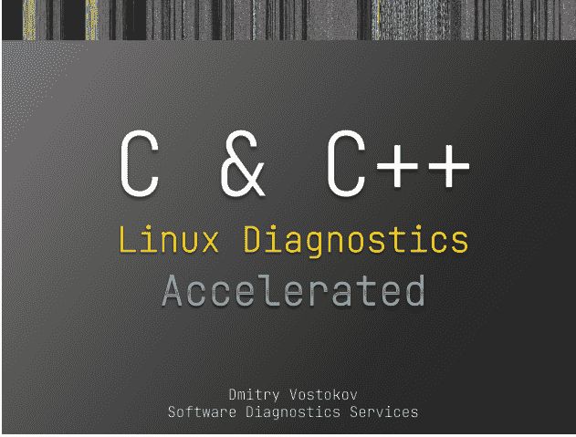

## 先决条件

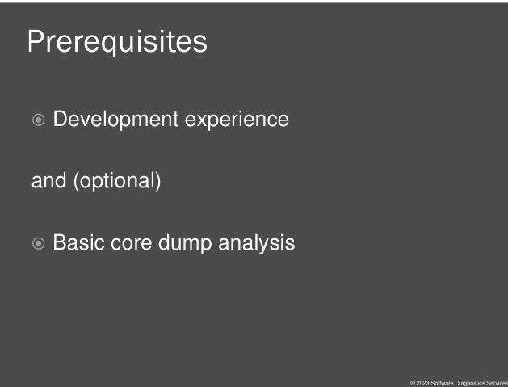

为了从本次培训中获益最大化，预计你已经具备某一种除 C 或 C++ 以外的编程语言的基础开发经验，并可选具备基础的内存转储分析经验。我还针对某些主题包含了必要的 x64 和 A64 反汇编回顾。

## 培训目标

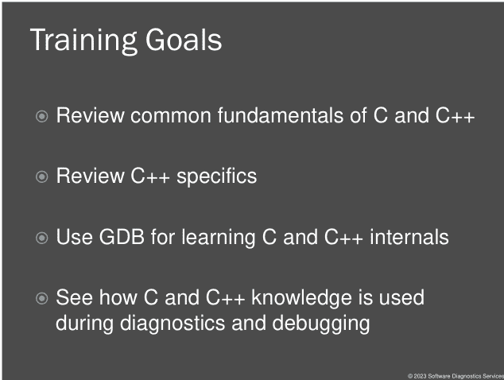

我们的首要目标是以加速的方式学习 C、C++ 及其内部机制。首先，我们回顾软件诊断所需的常用 C 和 C++ 基础。然后，我们将重点关注内存和内部机制，学习各种 C++ 特性。我们还将看到 C 和 C++ 知识如何帮助诊断和调试的示例。

培训原则

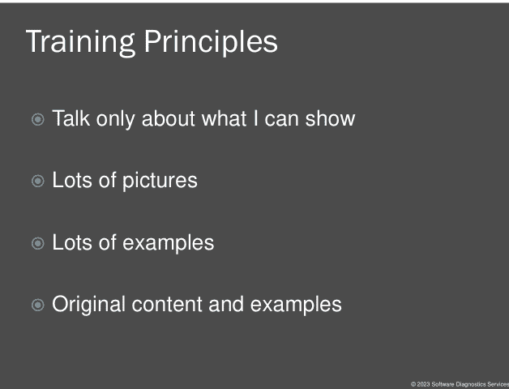

有许多可以考虑的培训格式，我认为最好的方法是集中在幻灯片和你可以验证的代码示例上。

## 安排

```
std::vector<Session> sessions;
assert(sessions.size() == 5);
assert(sessions.capacity() > 5);
```

我计划培训仅分为 5 节，每节 2 小时，但如有必要，为了足够的细节涵盖所有必要材料，可能会增加节数。

## 培训理念

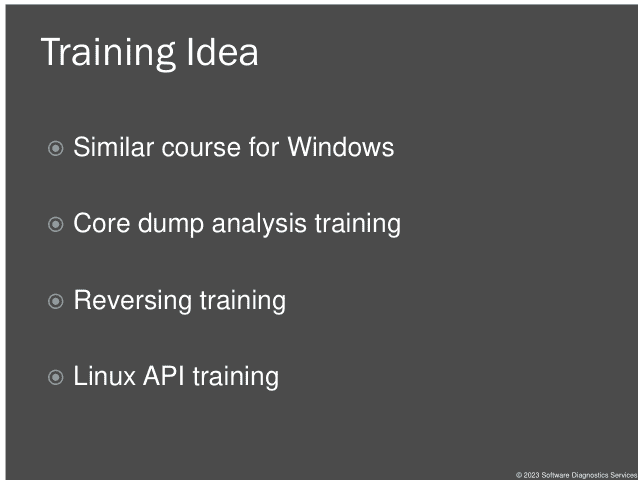

创建一个类似的基于 Windows 的培训后，将其移植到 Linux 是自然而然的。此外，核心储分析和逆向工程课程的学员问了关于 C 和 C++ 的问题，我意识到他们如果接受这项培训将会受益。这项培训也可以填补这些课程之间的某些空白。最后，我最近开发了加速 Linux API 培训课程（参见书末的参考文献部分），该课程假设具备经典 C 和 C++ 的固体知识，而目前的 C 和 C++ 课程可能提供此类知识。

- 指针哲学
- 内存与指针
- 结构体、类与对象
- 基础类型
- 提升与转换
- 内存与结构体
- 宏、类型与别名
- 统一初始化
- 源码组织，Pimpl
- 内存存储
- 指针解引用详析
- 引用
- 函数与函数指针
- 值、字面量、值
- 继承
- 常量与表达式
- 运算符
- 命名空间
- 构造函数、拷贝、赋值
- 析构函数、虚析构函数
- 虚函数、纯方法
- 局部栈变量与值
- VTBL 和 VPTR
- 内存运算符与表达式
- 访问级别
- 对齐
- 重载、重写
- 切片赋值（Slicing）
- 模板
- Lambda 及其内部机制
- 内存所有权，RAII
- 线程与同步

我们在课程中讨论的通用 C 和 C++ 方面：

- 指针哲学
- 结构体、类与对象
- 提升与转换
- 宏、类型与别名
- 源码组织，Pimpl
- 指针解引用详析
- 函数与函数指针
- 继承
- 运算符、函数对象
- 析构函数、虚析构函数
- 局部栈变量与值
- 内存运算符与表达式
- 对齐
- 切片
- Lambda 及其内部机制
- 线程与同步
- 内存与指针
- 基础类型
- 内存与结构体
- 内存存储
- 引用
- 值、左值、右值
- 常量与表达式
- 命名空间
- 构造函数、拷贝、赋值
- 虚函数、纯方法
- VTBL 和 VPTR
- 访问级别
- 重载、重写
- 模板
- 内存所有权，RAII
- 智能指针
- 枚举
- 移动构造函数与赋值
- 默认成员
- 通用引用
- 概念
- 模块
- 任务
- 范围
- 容器分配器
- 析态分配器

## Linux C & C++ 方面

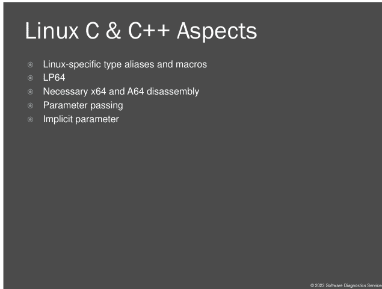

此外，我们还讨论了相关的 Linux 方面，包括：

- Linux 特有的类型定义与宏
- LP64
- x64 和 A64 反汇编
- 参数传递
- 隐式参数

```
为什么是 C 和 C++

* 接口
* 恶意软件分析
* 漏洞分析与利用
* 逆向
* 诊断
* 底部调试
* OS 监控
* 内存取证
* 崩溃分析
* 安全编码
* 静态代码分析
* 追踪与日志分析
```

首先，为什么要创建这个课程？即使你不开发 C 或 C++，C 和 C++ 及其内部机制的知识对于许多构建后续的活动也是必要的：

- 接口
- 恶意软件分析
- 漏洞分析与利用
- 逆向
- 诊断
- 底层调试
- OS 监控
- 内存取证
- 崩溃分析
- 安全编码
- 静态代码分析
- 追踪与日志分析

在本次培训中，我们主要从软件诊断的角度来看 C 和 C++。这个视角包含了内存转储分析，以及部分追踪和日志分析。在我其他的课程中，C 和 C++ 的知识是隐含的，那里大多数异常软件行为建模都是用 C 和 C++ 编写的。

- C
- 作为更好的 C 的 C++
- 真正的 C++（传统与现代）
- Linux 特性

哪些 C 和 C++？我们将采用统一的演示方法来看所有 C 和 C++ 变体。由于本课程是关于诊断而非设计和实现代码，因此我们不做区分。在有限的时间内无法涵盖所有差异。我们描述的是 Linux 编程中的实际情况（从狭义的 Linux 系统编程视角来看），而不是最新 C++ 标准所要求的样子。

## 我的 C 与 C++ 历史

- 1987 年开始学习 C，1989 年开始 C++（旧版简历）
- 1991 年起作为更好的 C 的 C++
- 1994-1995 年的隐式设计模式
- 2000 年起作为真正的 C++
- 2000 年的显式设计模式
- 2001 年的 C++98/03/STL
- 2012 年的 BSD core dump 分析
- 2015 年的 Linux core dump 分析
- ..
- 2016 年的 C++11/14
- 2017 年的 C++17
- 2020 年开始的函数式编程
- 2022 年起的 Linux 系统编程
- 2023 年的 C++20

这张历史幻灯片仅关于 C 和 C++ 语言。尽管过了多年，我仍然很容易想起我开始学习 C 的时候。那在我开始大学教育后不久。尽管我的第一门编程语言是 FORTRAN，但我在图书馆读了经典的 K&R 书籍。C++ 比较难记起，但很可能是在 1989 年，至少根据我的旧简历是，它是事实的来源。我肯定在 1991 年左右开始在商业项目中使用 C++，但将其作为一种更好的 C 使用，当时还没有标准模板库（STL）。我记得有一些针对 MS-DOS 的奇妙 C++ GUI 框架，比如 Zinc。在 1994-1995 年，我设计了一个文字处理器，在这个过程中，我隐式地使用了许多后来在 2000 年 GOF 书中发现的设计模式。书的作者也使用文字处理器作为说明。2000 年，当我读一本关于使用 C++ 的 CORBA 分布式对象技术的书时，我主要将 C++ 理解为 C++。通过阅读那个时代的许多书籍继续学习 C++，并学会了使用 STL 的优点以及如何有效地使用它。2001 年，我加入了一家开发 C++ 静态分析工具的公司，这极大地提升了我的 C++ 知识，使其达到了当时的专家水平。C++03 与 C++98 相比没有重大变化，这就是为什么我将它与 C++98 一起放在了 2001 年。2003 年，情况发生了出意之外的变化，我从使用 C++ 的全职开发转变为对 C++ 程序进行全职内存 dump 分析，包括 2012 年的 Mac OS X 用户空间（BSD）核心转 dump 分析，以及 2015 年的 Linux 用户空间 core dump 分析。尽管如此，我继续使用 C++03 编写诊断工具。2016 年，我了解到语言已完全变为 C++11/14。我在 2017 年底回归了全职 C++ 编程，期间也开始使用 C++17 的语言特性。2020 年，我转向了 Scala 函数式编程，这候影响了我新项目的 C++ 代码编写。现在，我开始使用 C++20 —— 晚了一点，因为 C++23 已经可用，而且我正在从 Scala 转向 Rust。

https://en.wikipedia.org/wiki/Zinc_Application_Framework

https://opentask.com/Vostokov/CV.htm

尽管 C++ 有许多高级特性，但它与 C 之间有很多底层重叠，当我用 C 和 C++ 编程时，我会在脑中编译为内存。这在我怀疑某个构造是否安全时很有帮助。我也认为，观察 C 和 C++ 构造在内存中是如何实现的对学习这些语言非常有帮助。

这张关于使用编程语言时的思维过程的幻灯片可能存在争议。对于 C 和 C++，我们考虑内存；对于 Scala/FP，我们考虑函数；对于 Python，我们考虑数据。

## 指针哲学

我们从指针开始，这是 C 也是 C++ 中最重要的概念。我最初在 2015 年创建了这种方法，现在为了这次培训对其进行了扩展。

从概念上说，指针是一个引用（或指向）其他实体的实体。我们称之为实体（entity）而不是对象（object），目的是以防与 C++ 中的对象或面向对象编程中的对象混淆。例如，这可以是我的手指指向一个苹果。

## 指针解引用

指针解引用是获取其所引用实体以进行进一步检查或使用的行为。想象我指向一个苹果，而你抓住了它。

## 多对一

多个指针可以引用（或指向）同一个实体。例如，两个人指向同一个苹果。所以，指针与它们指向的实体是区别的。我们应该称后者为被对象（pointees）吗？

### 多对一解引用

当然，如果你对同一个对象进行解引用，你会得到同一个对象。如果别人和你同时抓住了我指向的那个苹果，你们都得到了同一个苹果。

某些指针可能是无效的；例如，我可能指向一个想象的苹果。

## 指针解引用

当你对无效指针进行解引用时，你会遇到问题；例如，你无法得到我指向的那个虚拟苹果。

某些指针被称为悬挂指针（dangling）——它们很久以前曾指向有效的实体，但现在不再了，所以解引用会失败。你正伸手去拿我指向的苹果，但别人在一秒钟前抢走了。

由于指针本身也是可以被指向的实体，因此可以存在指针链。你指向我；我指向一个苹果。

## 指针指针解引用

当我们对第一个指针进行解引用时，我们得到一个实体，另一个指针，我们可以对其进行解引用。你指向我，但有人夺走了我指向的苹果。在这里，另一个人苹果。

名称与实体是有区别的。名称可以是编程语言的标识符或唯一的数字。

作为实体的指针可能包含名称，这些名称也可能是指针的名称。如果指针只包含名称，我们说指针的值是名称。所以，指针的值可以是另一个指针的值，后者指针的值是另一个实体的名称。

解引用是一个行为。如果我们把行为分开，指针只是实体，在必要时可以被解释为名称。所有解引用都发生在运行时。指针的内容（其值）可能一直是无效的，直到我们使用它。

现在，我们观察指针及其指向的实体的内存表示。

在此图中，实体是所谓的内存单元。内存单元的地址从 0 开始，并通常按指针的大小递增（32 位系统上为 4，64 位系统上为 8）。在这里，为了视觉清晰，我们使用了来自 32 位系统的内存单元。

当我们使用调试器时，它会按照此幻灯片所示的布局打印内存单元地址及其内容。某些调试器命令（如 GDB 中的 x）使用 2 列和某些 n 列布局来打印内存。

对于 2 列格式，某些调试器及其命令可能会将第二列解释为指针。在这种情况下，第三列是指针解引用的值。还要注意指针指向自身的情况。对于 GDB，可以使用自定义脚本来模拟这种行为：

```
define dpp
    set $i = 0
    set $p = $arg0
    while $i < $arg1
        printf "%p: " , $p
        x/gx *(long *)$$p
        set $i = $i + 1
        set $p = $p + 8
end
```

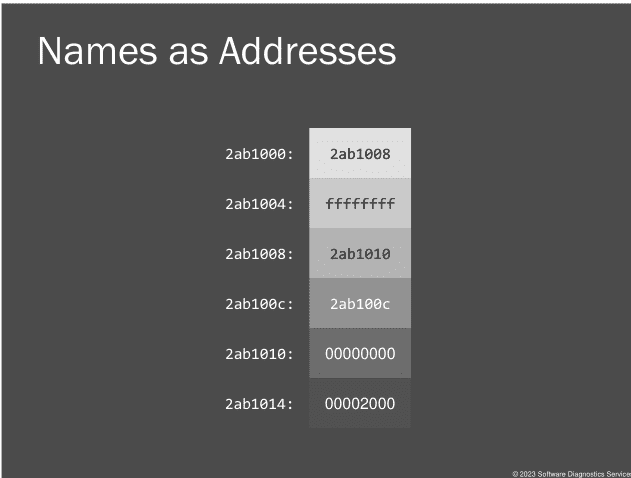

| 2ab1000: 2ab1008 |
| 2ab1004: ffffffff |
| 2ab1008: 2ab1010 |
| 2ab100c: 2ab100c |
| 2ab1010: 00000000 |
| 2ab1014: 00002000 |

重申一遍，对于内存布局来说，名称被解释为地址，而内存单元的内容（单元值）也可以被解释为内存地址。

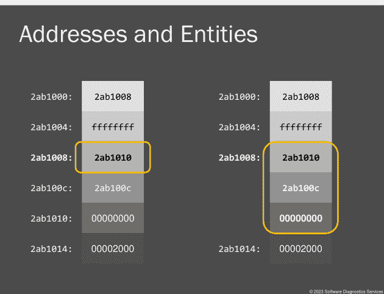

实体可以是单个单元，也可以是多单元。如果需要，多单元的每个部分都可以被解释为内存地址，即使它原本并不是一个内存地址。

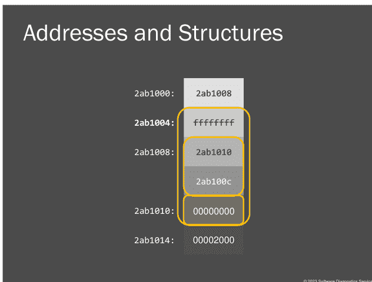

内存中的结构是内存单元的顺序集合；某些可能是多单元，且其本身也是子结构。结构的每个部分（其成员或结构字段）除了结构的整体地址外，也有它们自己的地址。

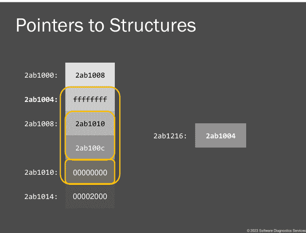

结构有自己的地址。指向结构的指针是一个包含该地址的内存单元。它有自己的地址。

| 2ab1000: 2ab1008 | 2ab1000: 2ab1008 |
| 2ab1004: ffffffff | ffffffff |
| 2ab1008: 2ab1010 | 2ab1008: 2ab1010 |
| 2ab100c: 2ab100c | 2ab100c: |
| 2ab1010: 00000000 | 2ab1010: 00000000 |
| 2ab1014: 00002000 | 00002000 |

数组是内存中连续的 n 个单元的序列，称为数组元素。每个数组元素都有它们自己的地址。由于每个数组元素的大小是固定且相同的，因此访问随机元素的速度非常快。

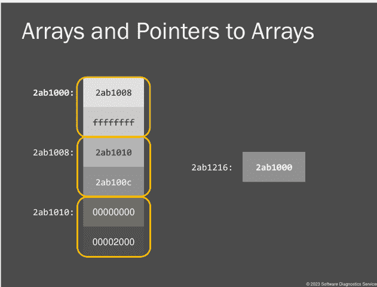

数组地址是其第一个元素的地址。但指向数组的指针是包含数组地址的另一个内存单元。这与结构以及指向结构的指针相似。数组也可以被视为一种结构。

## 字符串与指向字符串的指针

```
2ab1000: 'H'
2ab1001: 'e'
2ab1002: '1'
2ab1003: '1'
2ab1004: 'o'
2ab1005: 00
2ab1216: 2ab1000
```


字符串又是怎样的？ASCII 字符串是一个以零终止的单字节内存单元数组。字符串的地址是其第一个字节的地址。与数组类似，指向字符串的指针是一个包含字符串地址（即第一个元素的地址——即第一个字符）的内存单元。

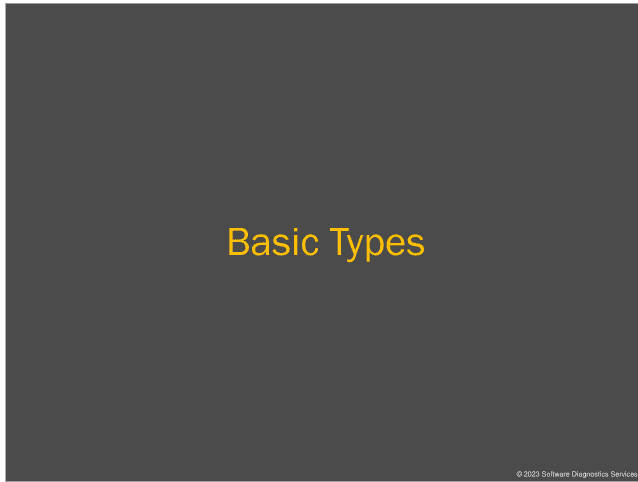

现在，我们来看几个基本的基础类型。

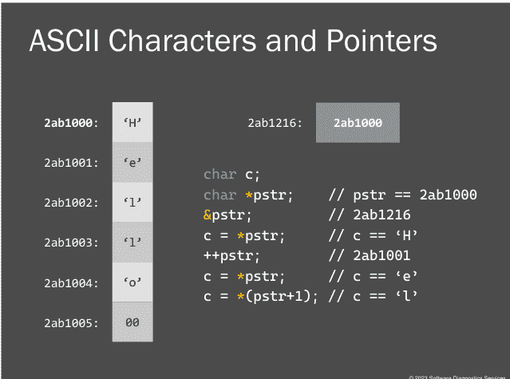

我们已经通过内存图从概念上看过了 ASCII 零终止字符串和指针。在这里，我们来看一些地道的 C 代码。

与内存图对应的代码示例：

```
char c; // pstr == 2ab1000
&pstr; // 2ab1216
c = *pstr; // c == 'H'
++pstr; // 2ab1001
c = *pstr; // c == 'e'
c = *(pstr+1); // c == 'l'
```

| 2ab1000: | 12 | 2ab1216: | 2ab1000 |

| 2ab1001: | 34 | unsigned char b; |

| 2ab1002: | 56 | unsigned char *pb; // 2ab1000 |

| 2ab1003: | 78 | // 2ab1216 |

| 2ab1004: | ab | b = *pb; // 12 |

| 2ab1005: | cd | 2ab1001 |

| | | b = *pb; // 34 |

| | | b = *(pb+1); // 56 |

字符是范围从 -128 到 127 的有符号整数。但如果我们想处理 0 到 255 的无符号字节，我们需要使用无符号字符。稍后可以看到可以处理字节的其他类型。

与内存图对应的代码示例：

```
unsigned char b;
unsigned char *pb; // 2ab1000
&pb; // 2ab1216
b = *pb; // 12
++pb; // 2ab1001
b = *pb; // 34
b = *(pb+1); // 56
```


如果你想使用 Unicode，自然会使用占用两个字节的宽字符。

与内存图对应的代码示例：

```
wchar_t wc;
wchar_t *pwstr; // pwstr == 2ab1000
&pwstr; // 2ab1216
wc = *pwstr; // L'H'
++pwstr; // 2ab1002
wc = *pwstr; // L'e'
wc = *(pwstr+1); // L'\0'
```


我们现在看的是占用 4 字节的整数。

与内存图对应的代码示例：

```
int i;
int *pi; // 2ab1000
&pi; // 2ab1216
i = *pi; // 0x2ab008
++pi; // 0xffffffff
i = *pi; // -1
i = *(pi+1); // 0x2ab110
```


| 2ab1000: 1 | char ba[4]; // {1, 2, 3, 4 } |

| 2ab1001: 2 | int i; // 0x4030201 |

| 2ab1002: 3 | |

| 2ab1003: 4 | x86_64 |

| 2ab1004: 5 | Move Data After Swapping |

| 2ab1005: 6 | |

在字节序列和数值之间进行转换时，我们需要考虑小端序，其中最低位数字位于最低的内存地址。

与内存图对应的代码示例：

```
char ba[4]; // { 1, 2, 3, 4 }
int i; // 0x4030201
```

```
2ab1000: 2ab1008      2ab1216: 2ab1000
2ab1004: ffff
2ab1008: 2ab1010      short s;      // 2ab1000
                         short *ps;    // 2ab1216
                         &ps;          // s = 0x1008
                         s = *ps;      // 2ab1002
2ab100c: 2ab100c       s = *ps;      // s = 0x2ab
                         ++ps;
2ab1010: 00000000      s = *(ps+1); // s = 0xffff
2ab1014: 00002000
```

短整数占用 2 字节。

与内存图对应的代码示例：

```
short s;      // 2ab1000
short *ps;    // 2ab1216
&ps;          
s = *ps;      // s = 0x1008
++ps;         // 2ab1002
s = *ps;      // s = 0x2ab
s = *(ps+1); // s = 0xffff
```

| 2ab1000: 2ab1008 | 2ab1000: 2ab1008 |

| 2ab1004: ffffffff | ffffffff |

| 2ab1008: 2ab1010 | 2ab1008: 2ab1010 |

| 2ab100c: 2ab100c | 2ab100c: |

| 2ab1010: 00000000 | 2ab1010: 00000000 |

| 2ab1014: 00002000 | 00002000 |

如果你想使用 Unicode，自然会使用占用 2 字节的宽字符。

与内存图对应的代码示例：

```
wchar_t wc;
wchar_t *pwstr; // pwstr == 2ab1000
&pwstr; // 2ab1216
wc = *pwstr; // L'H'
++pwstr; // 2ab1002
wc = *pwstr; // L'e'
wc = *(pwstr+1); // L'\0'
```

## 整数

```
int i; // 2ab1000
int *pi; // 2ab1216
&pi; // i == 0x2ab008
i = *pi; // 2ab1004
++pi; // i == 0xffffffff
i = *pi; // i == -1
i = *(pi+1); // i == 0x2ab110
```

```
Size

sizeof operator

size_t size = sizeof(int);

int i; size = sizeof i;

size = sizeof(1 + 1);
```

`sizeof` 运算符可以计算类型、变量以及表达式结果类型的大小（而不进行表达式求）。

代码示例：

```cpp
size_t size = sizeof(int);

int i;

size = sizeof i;
size = sizeof(1 + 1);
```

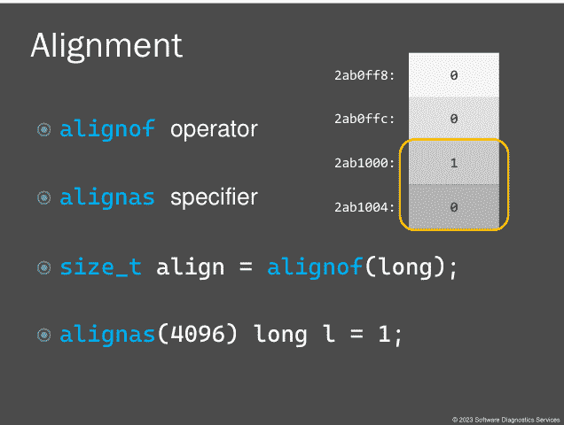

变量在内存中的对齐偏移量通常是其类型大小字节值的倍数。你可以使用 `alignof` 运算符获取默认对齐值，并使用 `alignas` 指定符更改默认对齐。

代码示例：

```cpp
size_t align = alignof(long);
alignas(4096) long l = 1;
```

```
sizeof(int) == 4
sizeof(int *) == 8
sizeof(long) == 8
sizeof(long long) == 8
```

Linux 使用所谓的 LP64 数据模型，其中长整型整数和指针是 64 位的。

```cpp
void foo(void);
void *p;
```

两种不同的类型对应于其他编程语言中“无”（Nothing）和“任意”（Anything）的概念：`void` 和 `void *`。后者指向任何类型的指针。

代码示例：

```cpp
void foo(void);
void *p;
```

```cpp
auto a = "Hello";

auto func(decltype("Hello") cstr)
{
    return cstr;
}
```

C++11 增加了自动类型规范，因此类型从初始化表达式中推导出。

代码示例：

```cpp
auto a = "Hello";
auto func(decltype("Hello") cstr)
{
    return cstr;
}
```


正如你预期的那样，相同的内存单元地址及其值是不同实体类型之间转换的基础。让我们让我们来看一些示例。

| 2ab1000: | 12 | 2ab1216: | 2ab1000 |

|---|---|---|---|

| 2ab1001: | 34 | | unsigned char b; int i; |

| 2ab1002: | 56 | | unsigned char *pb; // pb == 2ab1000 |

| 2ab1003: | 78 | | // 2ab1216 |

| 2ab1004: | ab | | b = *pb; // b == 12 |

| 2ab1005: | cd | | int *pi = (int*)pb; // pi == 2ab1000 |

| | | | &pb; // != 2ab1216 |

| | | | i = *pi; // i == 0x78563412 Intel LSB endian |

指针可以自由互相转换，因为它们的值只是内存地址。然而，当我们解引用它们时，我们得到的是基于内存内容的值，如此处所示，这些内容不会改变。请注意，根据最低位字节端序约定，我们得到的整数值与内存布局的字节顺序不同。

与内存图对应的代码示例：

```cpp
unsigned char b; int i;
unsigned char *pb; // pb == 2ab1000
&pb;               // 2ab1216
b = *pb;           // b == 12
int *pi = (int*)pb; // pi == 2ab1000
&pi;               // != 2ab1216
i = *pi;           // i == 0x78563412
                    // Intel LSB endian
```

## 数值提升/转换

```cpp
char c = 'a'; int n = c;
short s = c;
int n = 0x1234; char c = n;
```

来自较小范围的值可以自动提升为范围更宽的类型。相反的自动转换可能会丢失某些信息，应该仔细检查。

代码示例：

```cpp
char c = 'a';
int n = c;
short s = c;
int n = 0x1234;
char c = n;
```

## 数值转换

```cpp
(type)(expr) // C 风格
static_cast<type>(expr)
for (unsigned i = 0xffff; (int)i >= 0; --i)
}
for (unsigned i = 0xffff; static_cast<int>(i) >= 0; --i)
{}
```

在兼容类型没有自动转换的情况下，我们可以使用 C 风格强制转换或显式的特定的 C++ 转换。

以下代码示例解决了无限循环：

```cpp
for (unsigned i = 0xffff; (int)i >= 0; --i)
for (unsigned i = 0xffff; static_cast<int>(i) >= 0; --i)
{}
```

## 不兼容类型

```cpp
(type)(expr) // C 风格
reinterpret_cast<type>(expr)
int *p = (int *)
p = reinterpret_cast<int>();
```

当类型不兼容时（例如整数和指针），我们可以使用 C 风格转换或特定的 C++ 转换。

代码示例：

```cpp
int *p = (int *)
p = reinterpret_cast<int>();
```

## 强制转换

```cpp
struct A
{
    unsigned int u1;
    unsigned int u2;
};
struct B
{
    unsigned long ul;
} b;
A a = reinterpret_cast<A>(b);
a = *(A*)&b;
```

不同的结构通过 C++ 重新解释是不兼容的。但我们可以将源结构指针重新解释为目标结构指针并进行解引用。在这种情况下，底层内存单元被重新解释为目标结构的值。查看关于结构的后续章节：

```cpp
struct A
{
    unsigned int u1;
    unsigned int u2;
};
struct B
{
    unsigned long ul;
} b;
A a = reinterpret_cast<A>(b);
a = *(A*)&b;
a = *reinterpret_cast<A*>(&b);
```

## 结构、类和对象

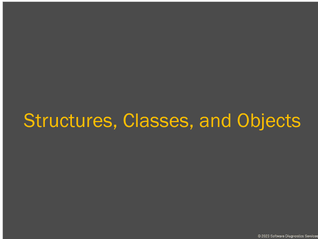

现在我们涵盖了结构、类以及它们的对象。

### 结构

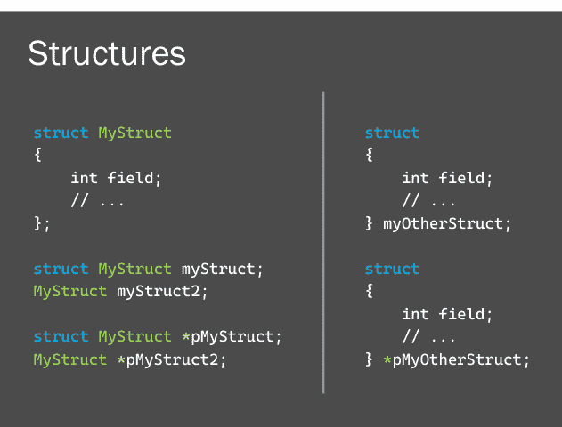

我们可以将结构视为在内存中布局的字段集合。结构可以命名，也可以像右侧所示是匿名的。

代码示例：

```cpp
struct MyStruct {
    int field;
    // ...
}
struct MyStruct myStruct;
MyStruct myStruct2;
struct MyStruct *pMyStruct;
MyStruct *pMyStruct2;
struct {
    int field;
    // ...
} myOtherStruct;
```

### 访问级别

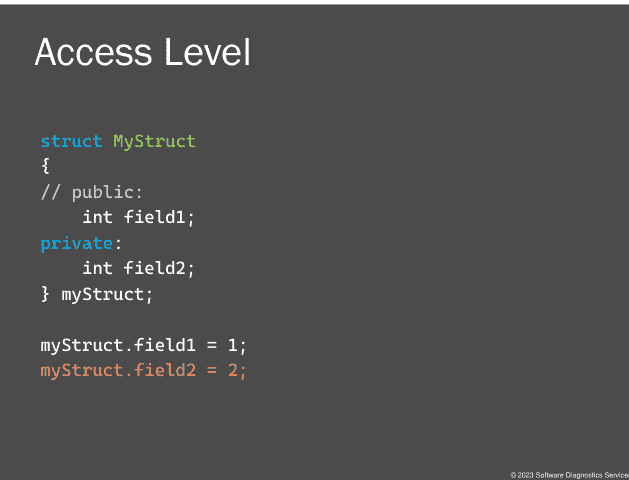

带有 `private` 访问修饰符的字段无法从外部引用。

代码示例：

```cpp
struct MyStruct {
// public:
  int field1;
private:
  int field2;
} myStruct;
myStruct.field1 = 1;
myStruct.field2 = 2;
```

### 类和对象

```cpp
class MyClass {
    int field;
    // ...
}
class MyClass myClass;
MyClass myClass2;
class MyClass *pMyClass;
MyClass *pMyClass2;
class {
    int field;
    // ...
} myObjectClass;
```

类具有相同的结构。

代码示例：

```cpp
class MyClass {
    int field;
    // ...
}
class MyClass myClass;
MyClass myClass2;
class MyClass *pMyClass;
MyClass *pMyClass2;
class {
    int field;
    // ...
} myObjectClass;
```

### 结构和类

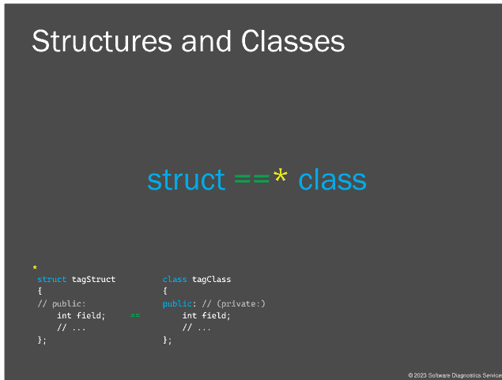

结构和类在 C++ 中完全相同，可以互换使用。这就是为什么你总能在优秀的 C++ 书中看到 `struct`。唯一的区别（如果我们现在忽略继承的话）是字段访问，结构在默认情况下是 `public` 的，而类是 `private` 的。

代码示例：

```cpp
struct tagStruct      class tagClass
{                      {
// public:               public: // (private:)
int field;             int field;
// ...                  // ...
};                     };
```

### 结构指针

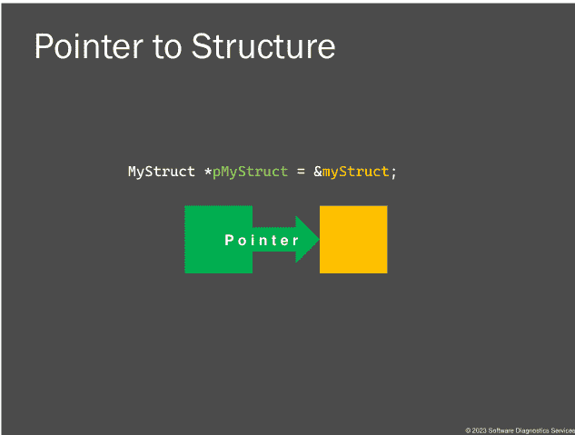

在这里，我们再次通过指针的概念图示，并用 C 和 C++ 代码进行注释。

代码示例：

```cpp
MyStruct *pMyStruct = &myStruct;
```

### 结构指针解引用

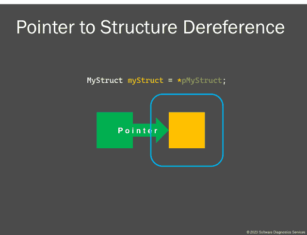

在这里，我们解引用某个结构体的指针。我们得到结构的值并将其赋值给 `myStruct` 变量。

代码示例：

```cpp
MyStruct myStruct = *pMyStruct;
```


### 多个指针指向同一个结构

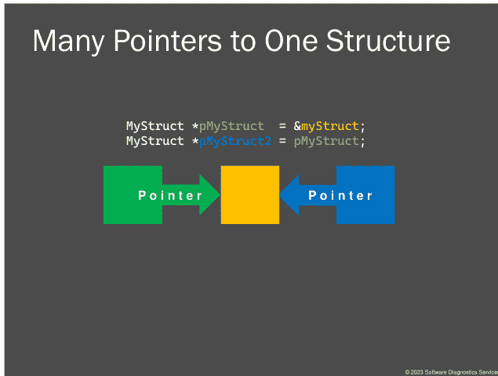

在这里，我们将一个指针的值赋值另一个指针，它们现在都指向同一个结构。

代码示例：

```cpp
MyStruct *pMyStruct = &myStruct;
MyStruct *pMyStruct2 = pMyStruct;
```

### 多对一解引用

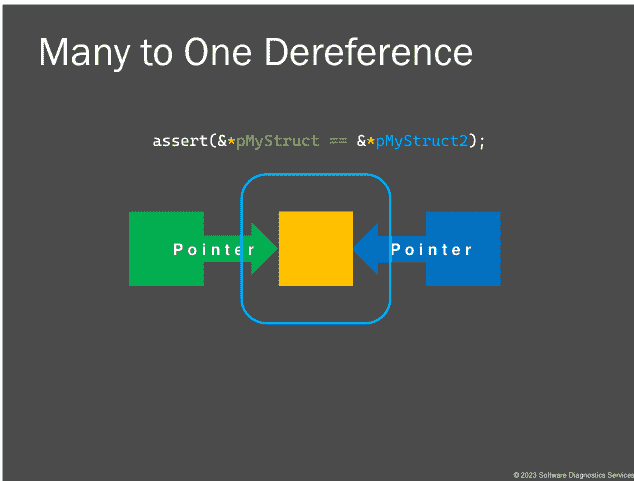

如果我们对两者进行解引用，我们将得到相同地址的相同。

代码示例：

```cpp
assert(&pMyStruct == &pMyStruct2);
```

## 无效的结构指针

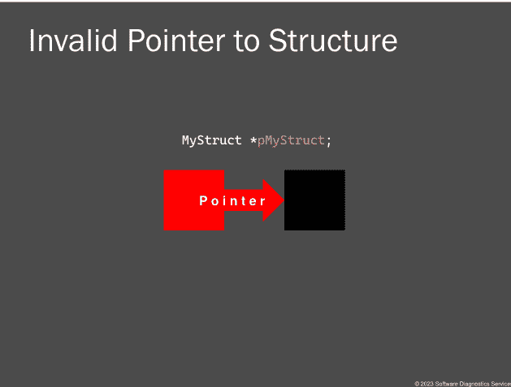

在这里，我们描述了一个未初始化的指针，取决于内存存储类型，它可能是一个 NULL 指针或某个随机值。

代码示例：

```
MyStruct *pMyStruct;
```

## 无效的指针解引用

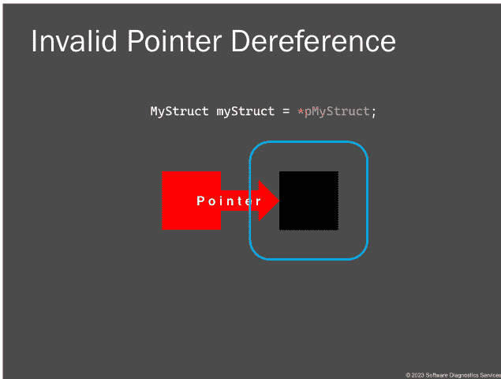

对未初始化的指针进行解引用会导致未定义行为，最可能导致访问冲突并崩溃。

代码示例：

```
MyStruct *pMyStruct;
MyStruct myStruct = *pMyStruct;
```

## 野指针（悬空指针）

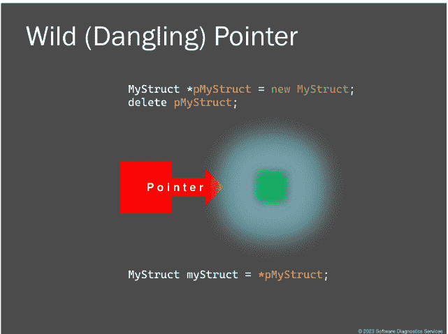

结构的内存可以动态分配然后释放，但如果指针没有重置为某些易于检查的值（例如 0），我们就会得到一个悬空指针，其解引用将导致可能进一步损坏的未定义行为。

代码示例：

```
MyStruct *pMyStruct = new MyStruct;
delete pMyStruct;
MyStruct myStruct = *pMyStruct;
```

## 指向指针的指针

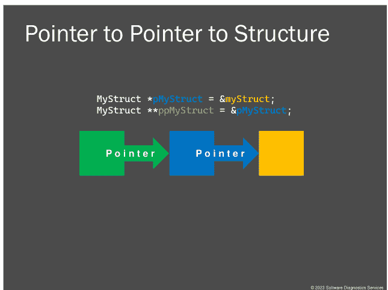

我们也可以拥有指向结构指针的指针等等，需要两次或多次解引用才能获取值。稍后在讨论向函数传递参数时，我们会看到为什么我们需要双指针。

代码示例：

```
MyStruct *pMyStruct = &myStruct;
MyStruct **ppMyStruct = &pMyStruct;
```

## 指向指针的指针解引用

```
MyStruct *pMyStruct = *ppMyStruct;
MyStruct myStruct = *pMyStruct;
myStruct = **ppMyStruct;
```


在这里，我们展示了双重解引用。

代码示例：

```
MyStruct *pMyStruct = *ppMyStruct;
MyStruct myStruct = *pMyStruct;
myStruct = **ppMyStruct;
```

## 内存与结构

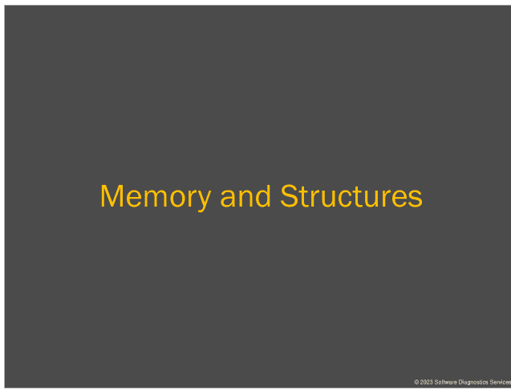

现在，我们来看结构的内存表示。

### 地址与结构

```cpp
struct OuterStruct {
  int field1;
  struct InnerStruct {
    int field1;
    int field2;
  } field2;
  struct InnerStruct {
    int field;
  } field3;
  } myStruct;
```

| | |
| :--- | :--- |
| 2ab1000: | 2ab1008 |
| 2ab1004: | ffffffff |
| 2ab1008: | 2ab1010 |
| | 2ab100c |
| 2ab1010: | 00000000 |
| 2ab1014: | 00000200 |

内存中的结构是内存单元的顺序集合；某些是多单元的，且本身也是子结构。除了结构的整体地址外，它的每个部分、其成员或结构字段也有它们自己的地址。

与内存图对应的代码示例：

```cpp
struct OuterStruct {
  int field1;
  struct InnerStruct {
    int field1;
    int field2;
  } field2;
  struct InnerStruct {
    int field;
  } field3;
  } myStruct;
```

### 结构字段访问

```cpp
&myStruct; // 2ab1004
&myStruct.field1; // 2ab1004
myStruct.field1; // ffffffff
&myStruct.field2; // 2ab1008
&myStruct.field2.field1; // 2ab1008
myStruct.field2.field1; // 2ab1010
myStruct.field2.field2; // 2ab100c
myStruct.field2.field2; // 2ab100c
&myStruct.field3; // 2ab1010
myStruct.field3.field; // 2ab1010
myStruct.field3.field; // 0
```

| 2ab1000 | 2ab1008 |
| :--- | :--- |
| 2ab1004 | ffffffff |
| 2ab1008 | 2ab1010 |
| | 2ab100c |
| 2ab1010 | 00000000 |
| 2ab1014 | 00000200 |

此示例展示了当我们有一个结构值时的字段地址和访问情况。与内存图对应的代码示例：

```cpp
&myStruct; // 2ab1004
&myStruct.field1; // 2ab1004
myStruct.field1; // ffffffff
&myStruct.field2; // 2ab1008
&myStruct.field2.field1; // 2ab1008
myStruct.field2.field1; // 2ab1010
myStruct.field2.field2; // 2ab100c
myStruct.field2.field2; // 2ab100c
&myStruct.field3; // 2ab1010
myStruct.field3.field; // 2ab1010
myStruct.field3.field; // 0
```

### 指向结构的指针

```
2ab1000: 2ab1008      2ab1016: 2ab1004
2ab1004: ffffffff
2ab1008: 2ab1010         2ab100c
2ab1010: 0000000
2ab1014: 0000020
OuterStruct *pMyStruct = &myStruct;
&myStruct; // 2ab1004
pMyStruct; // 2ab1004
&pMyStruct; // 2ab116
```

结构有一个地址。指向结构的指针是一个包含该地址的内存单元。它有自己的地址。与内存图对应的代码示例：

```cpp
OuterStruct *pMyStruct = &myStruct;
&myStruct; // 2ab1004
pMyStruct; // 2ab1004
&pMyStruct; // 2ab016
```

### 指向结构字段的指针（等等，说是“指向结构字段的指针”）

此示例展示了当我们有一个指向值的指针时的字段地址和访问。与内存图对应的代码示例：

```cpp
&myStruct; // 2ab1004
&myStruct.field1; // 2ab1004
myStruct.field1; // ffffffff
&myStruct.field2; // 2ab1008
&myStruct.field2.field1; // 2ab1008
myStruct.field2.field1; // 2ab1010
myStruct.field2.field2; // 2ab100c
myStruct.field2.field2; // 2ab100c
&myStruct.field3; // 2ab1010
myStruct.field3.field; // 2ab1010
myStruct.field3.field; // 0
```

### 结构继承

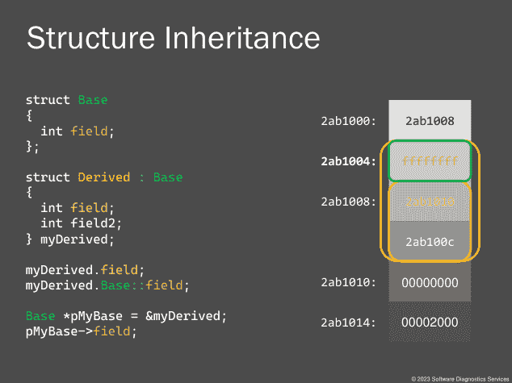

结构可以从其他结构继承字段。在字段相同的情况下，派生结构隐藏了基结构字段，但可以通过显式结构限定来访问：

```cpp
struct Base {
  int field;
};
struct Derived : Base {
  int field;
  int field2;
} myDerived;
myDerived.field;
myDerived.Base::field;
Base *pMyBase = &myDerived;
pMyBase->field;
```

### 结构切片

```cpp
struct Base {
    int field;
};
struct Derived : Base {
    int field2;
    myDerived { 0 };
};
Base myBase = myDerived;
myDerived = myBase;
myDerived = static_cast<Derived>(myBase);
Base *pMyBase = &myDerived;
Derived *pMyStruct = pMyBase;
Derived *pMyStruct = static_cast<Derived*>(pMyBase);
```

可以将派生结构拷贝到基结构变量，但在这种情况下由于基结构占据内存较少，以前的内容会被切片。相反，从基结构到派生结构默认是被禁止的，因为编译器不知道如何填充新的派生字段。然而，可以通过 `static cast` 强制执行，派生字段将用现有的相邻内容填充，这些内容可能是完全随机的。指针之间也可以进行相同的向下转换，但当我们以后尝试解引用指向派生结构的指针时，可能会得到随机数据。

代码示例：

```cpp
struct Base {
    int field;
};
```

```cpp
struct Derived : Base {
    int field2;
} myDerived { 0 };
Base myBase = myDerived;
myDerived = myBase;
myDerived = static_cast<Derived>(myBase);
Base *pMyBase = &myDerived;
Derived *pMyStruct = pMyBase;
Derived *pMyStruct = static_cast<Derived*>(pMyBase);
```

### 继承访问级别

```cpp
struct Base {
    int field;
}
struct Derived : private Base {
    int field;
    int field2;
} myDerived;
myDerived.field;
myDerived.Base::field;
Base *pMyBase = &myDerived;
pMyBase->field;
```

可以进行私有继承。在这种情况下，基结构字段从外部无法访问，即使使用显式限定也也不行。

代码示例：

```cpp
struct Base {
    int field;
}
struct Derived : private Base {
    int field;
    int field2;
} myDerived;
myDerived.field;
myDerived.Base::field;
Base *pMyBase = &myDerived;
pMyBase->field;
```

## 结构与类 II

```cpp
struct Base {
  // public:
  int field;
}
class Base {
  public:
  int field;
}
struct Derived : Base // (public)
class Derived : public Base // (private) {
  // ...
}
```

再次，结构和类几乎等同，除了默认继承访问（以及字段访问）外，默认情况下结构是公开的，而类是私有的。在本次训练中需要显式指定公开访问，这对于在查看构建代码时进行内存思维并不重要。

代码示例：

```cpp
struct Base {
  // public:
  int field;
}
class Base {
  public:
  int field;
}
struct Derived : Base // (public)
class Derived : public Base // (private) {
  // ...
}
```

## 内部结构对齐

```cpp
struct Struct {
    bool field1;
    short field2;
    long field3;
} myStruct;
(gdb) ptype a / Struct
/** offset      | size */  | type = struct {
    bool field1;
/** XXX 1-byte hole */| 1 *//
    short field2;
/** XXX 4-byte hole */| 0 *//
    long field3;
} /* total size (bytes): 16 */
#pragma pack(1)
struct StructPacked {
    bool field1;
    short field2;
    long field4;
} myStructPacked;
(gdb) ptype o / StructPacked
/** offset      | size */  | type = struct StructPacked {
    bool field1;
/** 0 | 1 *//
    short field2;
/** 1 | 2 *//
    long field4;
/** 3 | 0 *//
} /* total size (bytes): 11 */
```

字段可能会根据其默认类型对齐进行对齐，这可能会引入间隙，增加结构的整体大小。

与 GDB 输出对应的代码示例：

```cpp
struct Struct {
    bool field1;
    short field2;
    long field3;
} myStruct;
#pragma pack(1)
struct StructPacked {
    bool field1;
    short field2;
    long field4;
} myStructPacked;
```

## 静态结构字段

```cpp
struct MyStruct
{
    int field;
    static unsigned shared_field;
} myStruct1, myStruct2;
unsigned MyStruct::shared_field = 123;
myStruct1.field = 0;
myStruct1.shared_field = 123;
myStruct2.field = 1;
(gdb) ptype /o MyStruct
$type = struct MyStruct {
    /* offset    size */
    0          | 4 */
    int field;
    static unsigned shared_field;
    /* total size (bytes): 4 */
}
(gdb) x &MyStruct::shared_field:
0x4028 <MyStruct::shared_field>: 0x0000007b
```

静态结构字段的值在相同结构类型的不同对象之间共享。它们占据与对象内存不同的、相互独立的内存单元。

与 GDB 输出对应的代码示例：

```cpp
struct MyStruct
{
    int field;
    static unsigned shared_field;
} myStruct1, myStruct2;
unsigned MyStruct::shared_field = 123;
myStruct1.field = 0;
myStruct1.shared_field = 123;
myStruct2.field = 1;
```

## 统一初始化

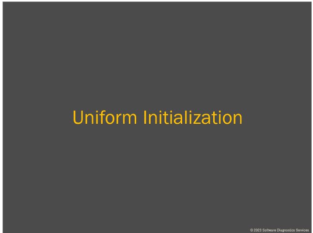

在整个 C++ 历史中，有几种初始化变量的方法。
最后，有一种统一的方法来一致地执行它。

## 旧的初始化方式

```cpp
OuterStruct *pMyStruct;
```


`OuterStruct *pMyStruct = NULL;`

`OuterStruct *pMyStruct(NULL);`

`OuterStruct *pMyStruct = nullptr;`

```
当我们省略初始化值时，如果其内存属于某些内存类（如栈），则该变量被视为未初始化的。对于静态内存，它可能被默认初始化为零值。
```

代码示例：

```cpp
OuterStruct *pMyStruct;
OuterStruct *pMyStruct = NULL;
OuterStruct *pMyStruct(NULL);
OuterStruct *pMyStruct = nullptr;
```

```cpp
OuterStruct *pMyStruct{}
OuterStruct *pMyStruct{NULL};
OuterStruct *pMyStruct{nullptr};
OuterStruct *pMyStruct{&myStruct};
```

当我们在现代 C++ 中使用新的初始化方式时，可以使用空括号 `{}` 来指示默认初始化，即使对于栈内存也是如此。

代码示例：

```cpp
OuterStruct *pMyStruct{}
OuterStruct *pMyStruct{NULL};
OuterStruct *pMyStruct{nullptr};
OuterStruct *pMyStruct{&myStruct};
```

## 统一结构初始化

```cpp
struct OuterStruct
{
    int field1;
    struct InnerStruct
    {
        int field1;
        int field2;
    } field2;
    struct InnerStruct
    {
        int field;
    } field3;
} myStructA {1, {2}, {4}};
struct OuterStruct
{
    int field1{1};
    struct InnerStruct
    {
        int field1{2};
        int field2{3};
    } field2;
    struct InnerStruct
    {
        int field{4};
    } field3;
} myStructB;
```

可以在结构外部统一初始化结构，也可以在结构定义中提供默认初始化器。

代码示例：

```cpp
struct OuterStruct
{
    int field1;
    struct InnerStruct
    {
        int field1;
        int field2;
    } field2;
    struct InnerStruct
    {
        int field;
    } field3;
} myStructA {1, {2}, {4}};
struct OuterStruct
{
    int field1{1};
    struct InnerStruct
    {
        int field1{2};
        int field2{3};
    } field2;
    struct InnerStruct
    {
        int field{4};
    } field3;
} myStructB;
```

## 栈分配陷阱

```
foo(1);
void foo(int i) {
  }
```

| 2ab1008 | 2ab1008 |
| --- | --- |
| ffffffff | ffffffff |
| 2ab1010 | 2ab1010 |
| 2ab100c | 2ab100c |

```cpp
void foo(int i) {
  int a = 0;
  {
    int b = 0;
  }
  if (i)
    goto end;
  int c = 0x78563412;
end:
assert(c == 0x78563412);
}
```

| 00000000 | 00000000 |
| --- | --- |
| 00002000 | 00002000 |

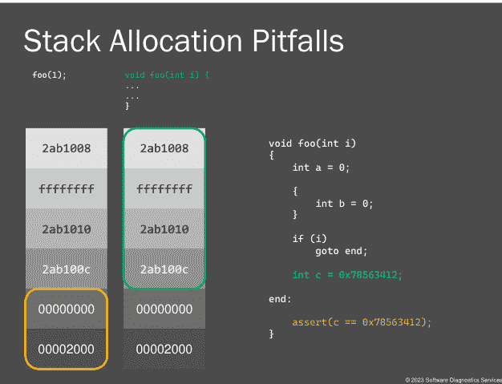

请记住，所有函数局部变量的栈内存是在函数入口处分配的，但单个变量可能在稍后进行初始化。

对应内存图的代码示例：
`foo(1);`

当我们进入 `foo` 函数时，分配的栈帧包含了局部变量 `c`，它初始是未初始化的：

```cpp
void foo(int i) {
  ...
}
```

如果函数参数 `i` 的值为正数，则会跳过局部变量 `c` 的初始化，导致断言失败：

```cpp
void foo(int i)
{
    int a = 0;
    {
        int b = 0;
    }
    if (i)
        goto end;
    int c = 0x78563412;
end:
    assert(c == 0x78563412);
}
```

## 显式局部分配

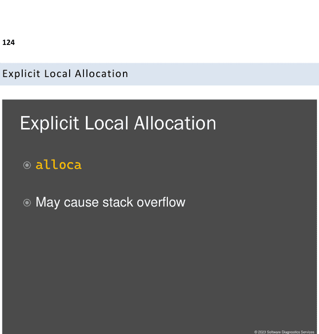

- `alloca`
- 可能导致栈溢出

可以在线程栈上显式分配内存，例如用于某些变长数组的存储。但是，请注意可能的栈溢出风险。

## 动态分配 (C 风格)

```
动态分配 (C 风格)
* 跨函数调用持久
* (m|c|re)alloc
* free
* 可被替换
```

与局部栈分配相比，动态内存分配有一些优势。分配的内存及其值在跨函数调用时依然存在。由于分配是通过库调用实现的，因此它们可以替换为其他库和自定义代码，这些代码可以提供跟踪内存分配和释放的调试功能，以及其他检查。

## 动态分配 (C++)

- 跨函数调用持久
- 全局操作符
- 结构特定操作符
- 可被替换

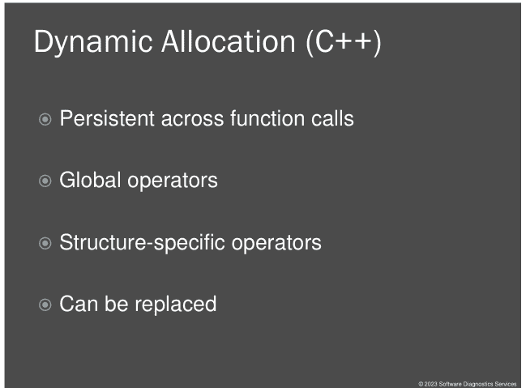

C++ 有其自己的动态内存实现，通常通过底层的 C 风格调用和 Linux API 实现。然而，这些高级别的分配设施对于结构设计者的需求来说更加灵活且可定制。它为内存块的全局分配和结构特定的分配提供了可替换的操作符。

## 内存操作符

```
operator new / operator delete
operator new[] / operator delete[]
operator new throws std::bad_alloc
exception (不检查 nullptr)
除非通过 std::nothrow 值指明不抛出
```

在释放全局分配的内存时，务必注意它是否是以数组形式分配的，以避免内存泄漏、崩溃和其他未定义行为。此外，永远不要像 C 风格分配那样去检查分配的内存地址是否为 `nullptr`：C++ 分配操作符会抛出异常。

## 内存表达式

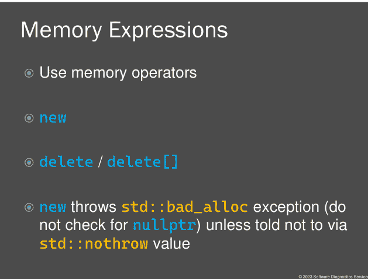

内存分配表达式用于为值、结构和数组分配内存。在内部它们可能使用内存操作符。对于非数组/数组释放和检查返回地址的相同建议也适用于此处。

## 局部指针 (手动)

```cpp
foo();
void foo() {
    int *p = new int;
}
void foo() {
    int *p = new int;
    delete p;
}
```

| | | |
|---|---|---|
| 2ab1008 | 2ab1008 | 2ab1008 |
| fffffff | fffffff | fffffff |
| 2ab1010 | 2ab1010 | 78004000 |
| 2ab100c | 2ab100c | 2ab100c |
| 00000000 | 00000000 | 00000000 |
| 00002000 | 00002000 | 00002000 |

当我们动态分配内存并将内存地址赋给局部变量时，我们不能忘记在从函数返回之前释放/删除内存，以避免内存泄漏。

对应内存图的代码示例：
`foo();`

当我们进入 `foo` 函数时，分配的栈帧包含了局部变量：

```cpp
void foo() {
  ...
}
```

局部变量 `p` 包含为整数值分配的内存地址：

```cpp
void foo() {
    int *p = new int;
  ...
}
```

然而，在退出函数之前，我们必须释放内存；否则会导致内存泄漏。请注意，`delete` 或 `free` 都不会改变变量 `p` 的值。它变成了一个悬空指针，但它在这里离开了作用域，且不会重用于引用。

```cpp
void foo() {
    int *p = new int;
  ...
  delete p;
}
```

## 原地分配

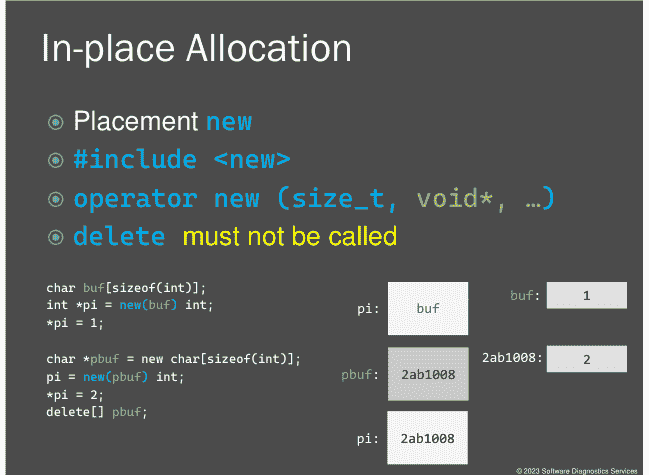

```cpp
char buf[sizeof(int)];
int *pi = new(buf) int;
*pi = 1;
char *pbuf = new char[sizeof(int)];
int *pi2 = new(pbuf) int;
```

如果我们想复用现有缓冲区，可以使用 placement new（位置 new）。

对应内存图的代码示例：

```cpp
char buf[sizeof(int)];
int *pi = new(buf) int;
*pi = 1;
char *pbuf = new char[sizeof(int)];
int *pi2 = new(pbuf) int;
```

## 源码组织

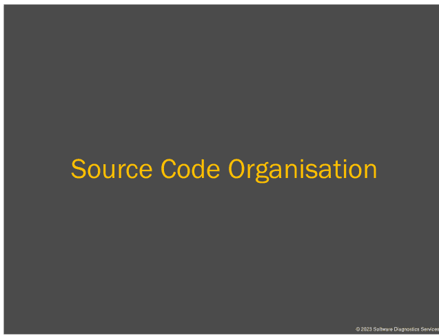

我们现在讨论 C 和 C++ 的源码组织。

### 逻辑层 (翻译单元)

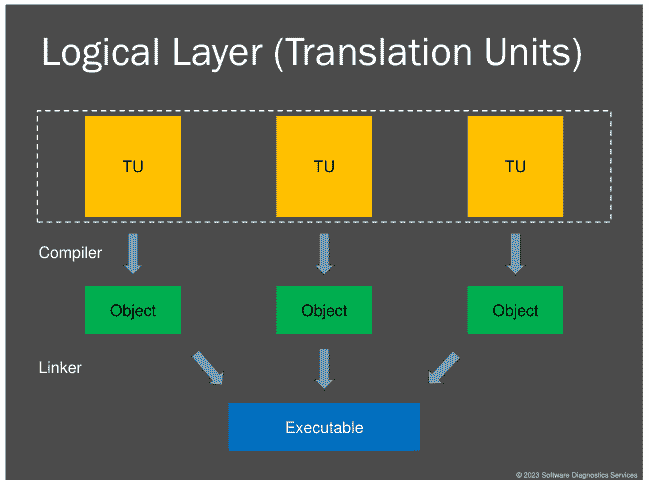

从编译器的角度来看，它以翻译单元为单位将源代码转换为目标文件。多个目标文件由链接器合并成执行文件。

### 物理层 (源文件)

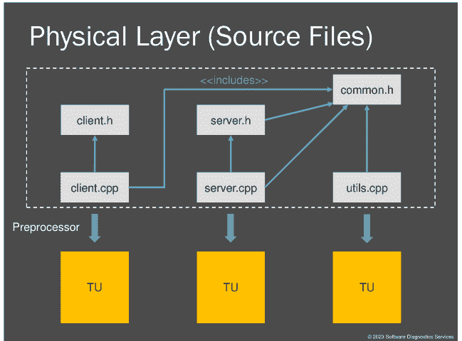

虽然一个源文件对应一个翻译单元，但它通过预处理器处理，预处理器等处理包含其他文件的指令。你也可以在 `common.h` 文件的情况下看到同一个文件可能被包含多次。

### 单元间共享

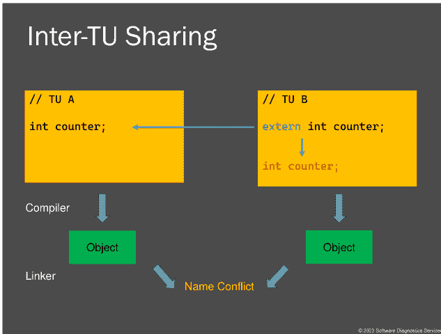

不同翻译单元中的相同名称在链接阶段可能会冲突。

对应图的代码示例：

```cpp
// TU A
int counter;
```

```cpp
// TU B
extern int counter;
int counter;
```

### 经典静态单元隔离

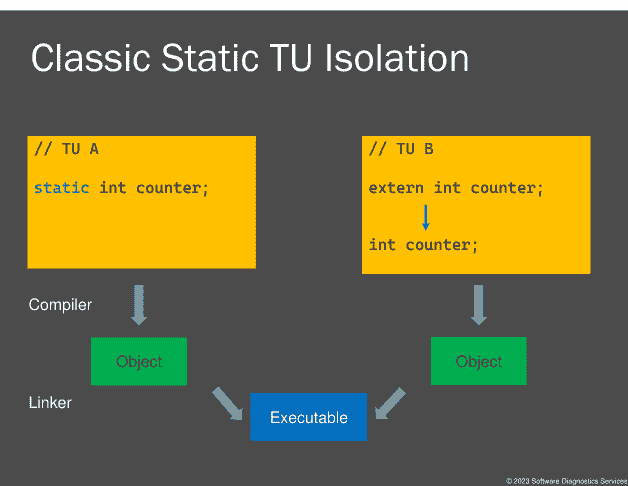

为了避免链接冲突，C 和经典 C++ 建议使用 `static` 符。

对应图的代码示例：

```cpp
// TU A
static int counter;
```

```cpp
// TU B
extern int counter;
int counter;
```

# 命名空间单元隔离

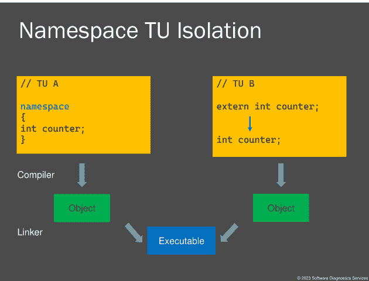

现代 C++ 建议使用命名空间。

对应图的代码示例：

```cpp
// TU A
namespace {
  int counter;
}
```

```cpp
// TU B
extern int counter;
int counter;
```

## 概念层（设计）

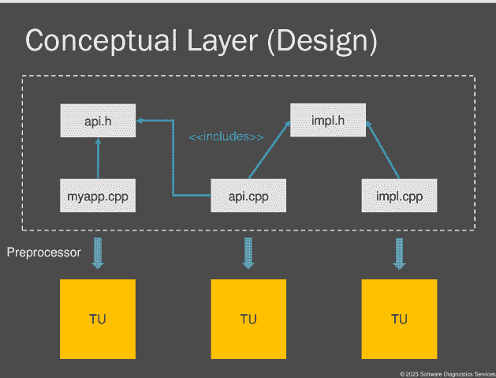

在设计层，我们可能想要分离实现细节。

### 不完全类型

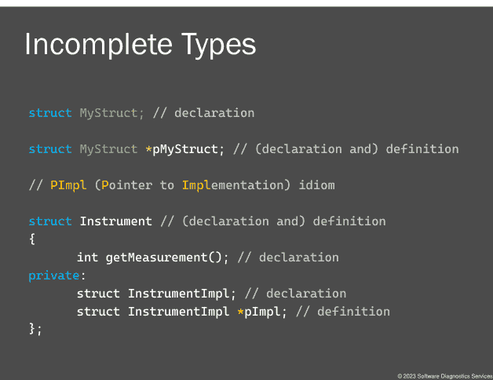

```cpp
struct MyStruct; // 声明
struct MyStruct *pMyStruct; // （声明和）定义
// Pimpl（指向实现的指针）惯用法
struct Instrument // （声明和）定义
{
    int getMeasurement(); // 声明
private:
    struct InstrumentImpl; // 声明
    struct InstrumentImpl *pImpl; // 定义
};
```

这种分离通过不完全类型和所谓的 Pimpl（指向实现的指针）惯用法实现：

```cpp
struct MyStruct; // 声明
struct MyStruct *pMyStruct; // （声明和）定义
// Pimpl（指向实现的指针）惯用法
struct Instrument // （声明和）定义
{
    int getMeasurement(); // 声明
private:
    struct InstrumentImpl; // 声明
    struct InstrumentImpl *pImpl; // 定义
};
```

### 引用


现在是一张关于 C++ 引用的幻灯片。我们计划在第二版中扩展这一部分。

### Type& vs Type*

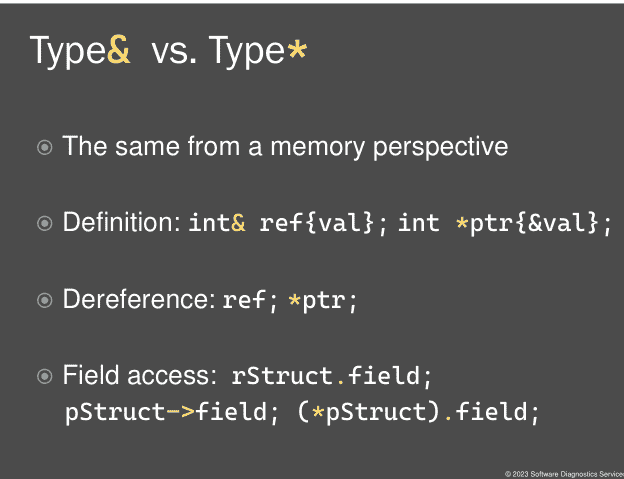

从内存角度来看，引用和指针是同一个东西。唯一的区别是你可以不能拥有悬空引用；它必须被初始化。


现在让我们简要讨论值的各种类别。这些是存储在内存中的内容。指针值也是一个被解释为指向别处某个值的内存地址的值。

### 值类别

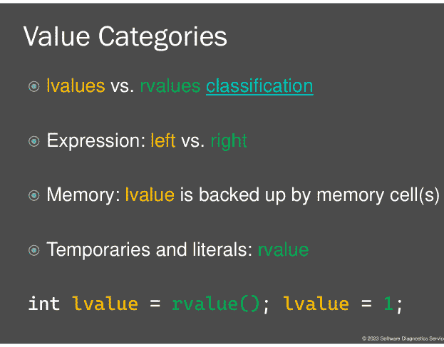

在阅读 C++ 文档时，你经常看到所谓的左值（lvalues）和右值（rvalues）。简单来说，你可以将它们视为表达式中的左值和右值，右值可以是临时的，而左值必须由某些内存支持。

### 分类

https://en.cppreference.com/w/cpp/language/value_category

### 常量

### 常量

```cpp
const int cv{1}; int v;
const int *pc;
int * const cp = v;
const int * const cpc{cp};
const int& rc{v}; int& r{v};
```

值也可以常量，有助于函数式编程和代码安全。请注意，可以指向常量值的指针和引用、指向可变变量的常量指针以及两者兼有。读取此类声明的方法是从右到左。

代码示例：

```cpp
const int cv{1}; int v;
const int *pc;
int * const cp = v;
const int * const cpc{cp};
const int& rc{v}; int& r{v};
```

### 常量表达式

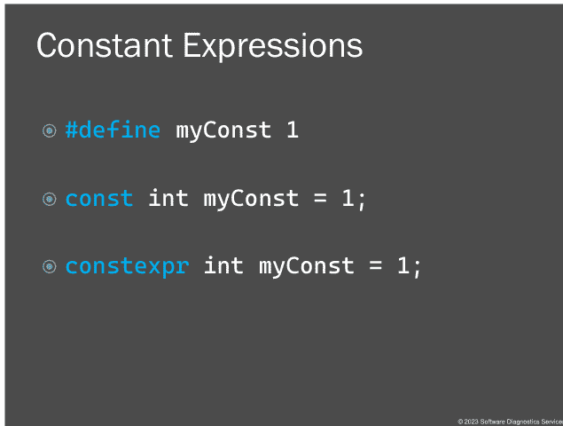

有不同的方法定义供后续符号使用的常量。C 和经典的 C++ 方式使用预处理器（遗留）和 `const`。现代方法是使用 `constexpr`，它更灵活。

代码示例：

```cpp
#define myConst 1
const int myConst = 1;
constexpr int myConst = 1;
```


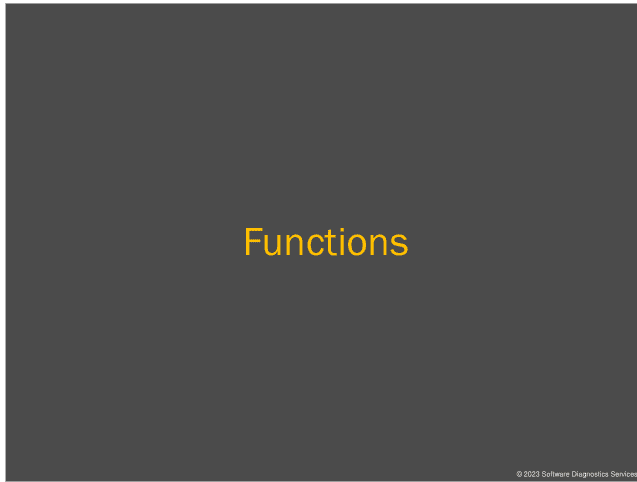

这种分离是由于不完全类型和所谓的 `Pimpl` 模式。

### 指向函数的指针

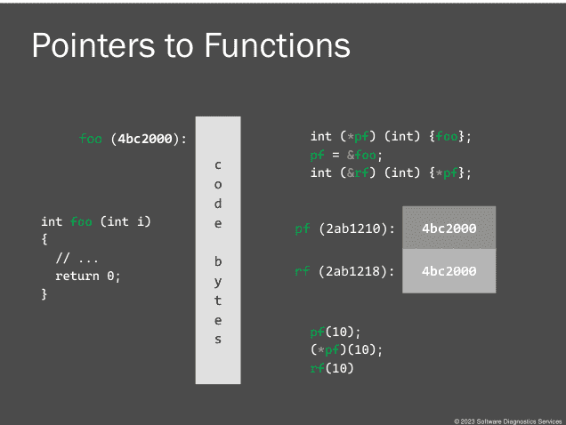

这种分离是由于不完全类型和所谓的 `Pimpl` 模式。

### 函数


这种分离是由于不完全类型和所谓的 `Pimpl` 模式。

### 指针类型

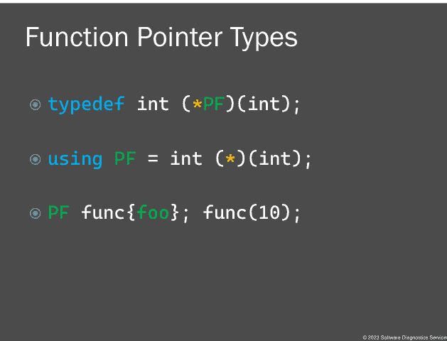

这种分离是由于不完全类型和所谓的 `Pimpl` 模式。

### 引用类型


这种分离是由于不完全类型和所谓的 `Pimpl` 模式。

### 引用声明

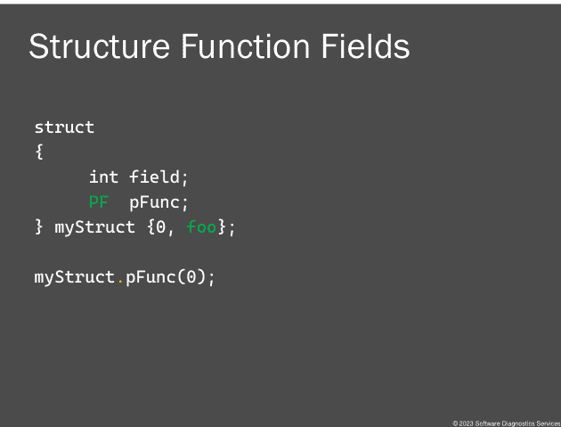

这种分离是由于不完全类型和所谓的 `Pimpl` 模式。

### 结构体


这种分离是由于不完全类型和所谓的 `Pimpl` 模式。

### 虚方法

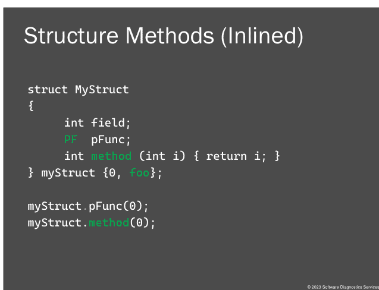

这种分离是由于不完全类型和所谓的 `Pimpl` 模式。

```cpp
pMyBase->vmethod(0);
pMyBase->Base::vmethod(0);
```

### 结构体纯虚方法

如果我们想确保永远不定义基类型的对象，并确保派生类型重写了所有虚方法，可以使用 `0` 将虚函数变为纯虚函数。

代码示例：

```cpp
struct Base
{
    int method (int i) { return i; }
    virtual int vmethod (int i) = 0;
}
struct Derived : Base
{
    int method (int i) { return ++i; }
    virtual int vmethod (int i) override { return ++i; }
} myDerived;
Base *pMyBase = &myDerived;
pMyBase->vmethod(0);
```

### 结构体接口

纯虚函数允许指定派生类型必须实现的抽象接口。

代码示例：

```cpp
struct Interface {
    virtual int vmethod1 (int i) = 0;
    virtual int vmethod2 (int i) = 0;
}
struct Implementer : Interface {
    virtual int vmethod1 (int i) override { return ++i; }
    virtual int vmethod2 (int i) override { return ++i; }
} myObject;
Interface *pIFace = &myObject;
pIFace->vmethod1(0);
```

### 函数结构体

```cpp
struct MyFunction
{
    int field{1};
    int operator() { return field; }
} myFunction;
myFunction();
```

函数也可以封装状态。实现此点的最佳方法是通过实现函数调用运算符的结构体。

代码示例：

```cpp
struct MyFunction
{
    int field{1};
    int operator() { return field; }
} myFunction;
myFunction();
```

### 结构体构造函数

```cpp
struct MyFunction
{
    MyFunction(): field{1} {}
    MyFunction(int _field): field{field} {}
    int field;
    int operator() { return field; }
} myFunction, myFunction2(2);
myFunction();
myFunction2();
```

现在，我们来看经典 C++ 中传统的 OOP 主题。构造函数是带有或不带参数的成员，用于结构体的初始化，并在包含自定义的初始化逻辑，例如获取所需的资源。

代码示例：

```cpp
struct MyFunction
{
    MyFunction(): field{1} {}
    MyFunction(int _field): field{field} {}
    int field;
    int operator() { return field; }
} myFunction, myFunction2(2);
myFunction();
myFunction2();
```

### 结构体拷贝构造函数

```cpp
struct MyFunction
{
    MyFunction(): field{1} { }
    MyFunction(int _field): field{_field} { }
    MyFunction(const MyFunction& src):
        field(src.field) { ++field; }
    int field;
    int operator() { return field; }
} myFunction;
MyFunction myFunction2(myFunction);
MyFunction myFunction3 = myFunction;
```

当我们复制对象但需要复杂的拷贝逻辑或非平凡的内存管理时，拷贝构造函数非常好用。如果我们不修改源对象，则以 `const` 传递源对象的引用。

代码示例：

```cpp
struct MyFunction
{
    MyFunction(): field{1} { }
    MyFunction(int _field): field{_field} { }
    MyFunction(const MyFunction& src):
        field(src.field) { ++field; }
    int field;
    int operator() { return field; }
} myFunction;
MyFunction myFunction2(myFunction);
MyFunction myFunction3 = myFunction;
```

### 结构体拷贝赋值

在发生非平凡重新赋值的情况下，我们可以实现一个赋值运算符。然而，我们必须小心不要拷贝到自身（`this`），并返回自身的非 `const` 引用（`this`）以允许链链式拷贝。

```cpp
struct MyFunction
{
    MyFunction(): field{1} { }
    MyFunction(int _field): field{_field} { }
    MyFunction(const MyFunction& src):
        field(src.field); ++field; }
    MyFunction& operator=(const MyFunction& src) {
        if (this != &src) { field = src.field; }
        return *this;
    }
    int field;
    int operator() { return field; }
} myFunction;
MyFunction myFunction2;
myFunction2 = myFunction;
```

### 结构体析构函数

```cpp
struct MyFunction
{
    MyFunction(): field{1} { }
    ~MyFunction() {
        // 析构逻辑
    }
    MyFunction(const MyFunction& src):
        field(src.field) { ++field; }
    int field;
    int operator() { return field; }
} myFunction;
```

当我们复制对象但需要复杂的拷贝逻辑或非平凡的内存管理时，拷贝构造函数非常好用。如果我们不修改源对象，则以 `const` 传递源对象的引用。

```cpp
}
} b;
A a = b;
```

### 值传递参数 (Parameters by Value)

- 原始值不会改变
- 效率低/高（对于基本类型）
- 对象切片（将派生类作为基类传递）
- 拷贝构造函数/析构函数

```cpp
void func(MyStruct ms)
{ ms.field = 0; }
func(MyStruct{});
func(int i)
{ i = 0; }
func(1);
```

当我们按值传递参数时，函数内部的任何修改在返回后都会丢失。按值传递基本类型是高效的，但传递结构体则不然了，除非它们非常简单：例如，可能会调用各种函数，如经过编译器化的拷贝构造函数和析构函数。在使用继承时，还可能出现切片问题。

代码示例：

| `v-oid func(MyStruct ms) { ms.field = 0; } func(MyStruct{});` | `void func(int i) { i = 0; } func(1);` |
| :--- | :--- |

### 指针/引用参数 (Parameters by Pointer/Reference)


- 原始值可能会改变
- 高效/低效（对于基本类型）
- 指针/引用按值传递
- 指针的指针（通过指针）

```cpp
void func(MyStruct *pms) 
{ pms->field = 0; }
func(&MyStruct{});
void func(int &ri) 
{ ri = 0; }
int i{0};
func(i);
```

如果我们对结构体保持高效并保留对原始值的修改，我们需要按引用传递。同样，这对于基本类型来说可能是低效的。

代码示例：

```cpp
void func(MyStruct *pms) 
{ pms->field = 0; }
func(&MyStruct{});
void func(int &ri) 
{ ri = 0; }
int i{0};
func(i);
```

### 指常量的指针/引用参数 (Parameters by Ptr/Ref to Const)


如果我们只想对结构体保持高效，我们需要按常量引用传递。在这种情况下，我们也无法修改原始值。

```cpp
void func(const MyStruct *pms) 
{ pms->field = 0; } // 错误
void func(const int& ri) 
{ ri = 0; } // 错误
func(&MyStruct{});
func(int(0));
```

### 可能的错误 (Possible Mistake)


如果你来自使用隐式引用的语言，可能会错误地漏掉 `&`：

```cpp
void func(const MyStruct ms)
{ ms.field = 0; } // 错误
func(myStruct);
void func(const MyStruct& ms)
{ ms.field = 0; }
func(myStruct);
```

### 函数重载 (Function Overloading)


函数重载允许对具有不同数量和类型的参数使用相同的函数名。

代码示例：

```cpp
int funco(int i);
int funco(int i, int j);
int funco(long &rl);
```

### 不变对象 (Immutable Objects)


如果你有 `const` 对象，只允许调用带有 `const` 修饰符的方法。

代码示例：

```cpp
struct MyStruct {
  int field;
  unsigned int count;
  MyStruct(int _field) : field{_field}, count{0} {}
  int get() const { return field; }
  void set(int newval) { field = newval; } // 非 const
};
const MyStruct myStruct{1};
myStruct.get();
myStruct.set(2); // 错误
```

### 静态函数 (Static Functions)

静态函数只允许访问对象的静态字段：

```cpp
struct MyStruct {
  int field;
  static unsigned int count;
  MyStruct(int _field) : field{_field}, count{0} {}
  int get() const { return field; }
  void set(int newval) { field = newval; }
  static auto get_count() {
    count++;
    return count;
  }
};
MyStruct myStruct1{1}, myStruct2{2};
MyStruct::get_count();
assert(myStruct1.get_count() == myStruct2.get_count());
```

## Lambdas


在讨论 C++11 引入的 `lambda` 及其内部机制之前，我们先简单要浏览 x64 反汇编。

### x64 寄存器 (x64 Registers)


熟悉的 32 位 寄存器名称（如 `EAX`）扩展到了 64 位名称（如 `RAX`）。它们大多数是专门的，如 ALU、计数器和内存拷贝。现在它们都可以作为通用寄存器使用。当然有一个栈指针 `RSP`，此外还有帧指针 `RBP`，用于处理局部变量和保存参数。在某些编译器代码生成实现中，指令指针 `RIP` 保存在栈内存区域，然后从被调用函数恢复。x64 平台还有另外八个通用寄存器，从 `R8` 到 `R15`。

### x64 指令与寄存器 (x64 Instructions and Registers)

- 操作码 `SRC`, `DST` # 默认 AT&T格式
- 示例：

```assembly
mov $0x10, %rax      # 0x10 -> RAX
mov %rsp, %rbp      # RSP -> RBP
add $0x10, %r10     # R10 + 0x10 -> R10
imimul %ecx, %edx    # ECX * EDX -> EDX
callq %rdx           # RDX 包含 func 的地址
push %rip            # &func -> RIP
sub $0x30, %rsp      # 为局部变量留空间
```

此幻灯片展示了涉及寄存器操作的 CPU 指令示例，例如移动值和算术。如果你习惯 Windows上的 WinDbg，操作数的方向与 Intel x64 反汇编格式相反。在 GDB 中可以使用 Intel 反汇编格式，但为了与我们的《加速 Linux Core Dump 分析》和《加速 Linux 反汇编》书籍一致，我们选择了默认的 AT&T 格式。

### x64 内存与栈地址 (x64 Memory and Stack Addressing)


在查看内存操作之前，让我们看看内存地址的图形表示。线程栈只是任何其他内存区域，因此可以使用 `RSP` 和 `RBP` 以外的任何寄存器。请注意栈向低地址增长，因此要访问之前压入的值，你需要使用 `RSP` 的正偏移。

### x64 内存加载指令 (x64 Memory Load Instructions)


常量编码在指令中，但如果我们需要任意值，必须从内存获取。括号表示相对于存储在某个寄存器中的地址的内存访问。

### x64 内存存储指令 (x64 Memory Store Instructions)

- 操作码 `SRC`, `Offset(DST)`
- 示例：


```assembly
mov %rcx, -0x20(%rbp)  # RCX -> RBP-0x20
addl $1, (%rax)         # 1 + RAX -> RAX
push %rsi               # RSP - 8 -> RSP
                                RSI -> RSP
inc (%rcx)              # 1 + RCX -> RCX
```

© 2023 Software Diagnostics

存储与加载类似。

### x64 流指令 (x64 Flow Instructions)


`Goto`（无条件跳转）通过 `JMP` 指令实现。函数调用通过 `CALL` 指令实现。对于条件分支，请参考官方官方文档。

### x64 函数参数 (x64 Function Parameters)


在 x64 Linux 平台上，从左到右的前六个 C 和 C++ 函数参数移动到 CPU 寄存器，其余参数通过栈位置传递。

### x64 结构体函数参数 (x64 Struct Function Parameters)


当调用对象结构体非静态成员函数时，第一个参数是隐式的，并在 x64 Linux 平台上通过 **`RDI`** 传递。它是一个对象地址，用于帮助方法区分相同结构类型的对象并引用正确的字段内存。其余参数按常法传递。

### A64 CPU 寄存器


从 `X0` 到 `X30` 共有 31 个通用寄存器，其中一些被分配给特定任务，例如过程内调用（`X16`、`XIP7` 和 `X17`）、栈帧寻址（帧指针，`FP`, `X29`）以及返回地址，即所谓的链接寄存器（Link Register，`LR`, `X30`）。当您调用一个函数时，调用者的返回地址会被保存在 `LR` 中，而不会像 Intel/AMD x64 那样。被调用者的返回指令使用 `LR` 中的地址赋给 `PC` 并恢复执行。但如果被调用者又调用了其他函数，则需要手动将当前的 `LR` 保存到某个地方（通常在栈上）。当然，还有栈指针 **`SP`**。为了获取零值，还有一个所谓的零寄存器 `XZR`**。所有的 `X` 寄存器都是 64 位的，32 位低位通过 `W` 前缀进行访问。接下来，我们简要回顾与我们练习相关的某些方面。

### A64 指令与寄存器


- 令码 `DST, SRC, SRC2`

- 示例：

```assembly
mov  x0, #16          // X0 <- 16 (0x10)
mov  x29, sp         // X29 <- SP
add  x1, x2, #16     // X1 <- X2+16 (0x10)
mul  x1, x2, x3      // X1 <- X2*X3
blr x8              // X8 已经包含了
                     // 函数地址 (&func)
                     // LR <- PC+4; PC &func
                     // SP <- SP-48 (-0x30)
sub  sp, sp, #48     // 为局部变量留出空间
```

这张幻灯片展示了几个涉及寄存器操作的 CPU 指令示例，例如移动值和进行算术运算。如果您习惯 Windows 上的 WinDbg，那么操作数的方向与 Intel x64 的反汇编格式相同。它等同于赋值。`BLR` 是对地址在寄存器中的函数的调用。`BL` 代表 Branch and Link（跳转并链接）。

### A64 内存与栈寻址


在查看内存操作之前，让我们先看内存寻址的图形化表示。线程栈只是其他内存区域之一，因此除了 **`SP`** 和 **`X29 (FP)`** 外，可以使用任何其他寄存器。请注意，栈向低地址方向增长，因此要访问之前推入的值，您需要使用相对于 **`SP`** 的正偏移量。

### A64 内存加载指令


- 令码 `DST, DST_, [SRC], Offset`

- 令码 `DST, DST_, [SRC], Offset` // 后递增

- 示例：

```assembly
ldr x0, [sp] // x0 ← 地址 SP+0 处的值
ldr x0, [x29, -8] // x0 ← 地址 X29-0x8 处的值
ldr x29, x30, [sp, #16] // x29 ← 地址 SP+32 (0x20) 处的值
ldr x29, x30, [sp] // x30 ← 地址 SP+0 (0x28) (注：此处原文可能有误，保持翻译)
ld x29, x30, [sp] // x29 ← 地址 SP+0 (此处为ld)
```

常量编码在指令中，但如果我们需要任意值，则必须从内存中获取。方括号表示相对于某些寄存器中存储地址的内存访问。还有一个在加载后调整寄存器值的选项，即所谓的后递增，它可以为负。

### A64 内存存储指令

- 令码 `SRC, SRC2, [DST, Offset]`

- 令码 `SRC, SRC2, [DST, Offset]!` // 前递增

- 示例：

```assembly
str x0, [sp, #16]               // x0 -> 地址 SP+16 (0x10) 处的值
str x0, [x29, #-8]             // x0 -> 地址 SP+32 处的值
stp x29, x30, [sp, #32]          // x29 -> 地址 SP+40 (0x28) 处的值
stp x29, x30, [sp, #-16]!        // SP -> SP-16 (-0x10)
                                     // x29 -> 设置地址 SP 处的值
                                     // x30 -> 设置地址 SP+8 处的值
```

操作数的顺序与其他指令相反。在存储之前，有可能对目标寄存器进行前递增。

### A64 流指令

令码 `DST, SRC`

示例：

```assembly
adrp x0, 0x42000      // x0 ← 0x42000
b 0x10493fc         
```

由于原文中存在一些乱序或重复的描述，以下是基于上下文的逻辑翻译：

由于指令大小为 4 字节，`ADRP` 指令用于计算页面地址。`B` 指令用于无条件跳转。

### A64 捕获变量


在 ARM64 平台上，栈操作是通过寄存器传递的。

### A64 结构体参数


当调用成员函数时，第一个参数通过寄存器传递。

### Clang 伪代码示例及对应的 x64 反汇编

```cpp
// Clang
struct Lambda0 {
  int b;
  Lambda0(int _b) : b(_b) {}
  auto operator()(int x) { return b-x; }
} negate5;
```

```cpp
// Clang
struct Lambda1 {
  int& rb;
  Lambda1(int& _rb) : rb(_rb) {}
  auto operator()(int x) { return rb-x; }
} negate6;
```

```assembly
movl $0x,-0x4(rbp),%eax
mov -0x18(rbp),%eax
lea -0x18(rbp),%rdi
mov $0xa,%esi
callq $<0::operator()(int) const>
```

```assembly
movl $0x,-0x4(rbp),%rcx
lea -0x28(rbp),%rcx
mov -0x28(rbp),%rdi
mov $0xa,%esi
callq *$1::operator()(int) const>
```

### A64 示例

```cpp
{
  int b = 0;
  auto negate1 = [&](int x) { return b - x; };
  auto negate2 = [&](int x) { return b - x; };
  auto negate4 = [&](int x) { return b - x; };
  auto negate5 = [&](int x) { return b - x; }; negate5(10);
  auto negate6 = [&](int x) { return b - x; }; negate6(10);
}
```

```cpp
// GCC
struct lambda<int> {
  int b;
  lambda<int>(int b) : b(b) {}
  auto operator()(int x) { return b-x; }
} negate5;
```

```assembly
  str wzr, [sp, #36]
  ldr w0, [sp, #32]
  str [sp, #32]
  add x0, sp, #0x20
  mov w1, #0xa
  str [sp, #0x24]
  mov x1, sp, #0xa0
  bl <<lambda<int>::operator()(int) const
```

针对相同 lambda 的 GCC 伪代码及对应的 ARM64 反汇编：

```cpp
// GCC
struct lambda<int> {
  int b;
  lambda<int>(int _b) : b(_b) {}
  auto operator()(int x) { return b-x; }
} negate5;
```

```assembly
  str wzr, [sp, #36]
  ldr w0, [sp, #32]
  str [sp, #32]
  add x0, sp, #0x20
  mov w1, #0xa
  bl <<lambda<int>::operator()(int) const
```

```cpp
// GCC
struct lambda<int> {
  int rb;
  lambda<int>(int _rb) : rb(_rb) {}
  auto operator()(int x) { return rb-x; }
} negate5;
```

```assembly
  ldr w0, [sp, #36]
  ldr w0, [sp, #24]
  add x0, sp, #0x20
  str x0, [sp, #48]
  mov w1, #0xa
  str x0, [sp, #0x30]
  bl <<lambda<int>::operator()(int) const
```

### 作为参数的 Lambda

```cpp
auto negate = [](int x) { return -x; };

int apply(int arg, int (*pf)(int)) {
    return pf(arg);
}

int apply2(int arg, decltype(negate) f) {
    return f(arg);
}

void foo() {
    // Clang: apply(100, $<0::operator()(int) const&&$0)
    apply(100, negate);
}
```

```assembly
apply: // Clang
push %rbp
mov %rbp, %rsp
sub %rsp, $16
mov %edi, -10(%rbp)
mov -8(%rbp),%rsi
mov %rdi
callq *%rsi

apply2: // Clang
push %rbp
mov %rbp, %rsp
sub %rsp, $16
mov %edi, 4(%rbp)
mov 8(%rbp),%rsi
mov %x12(%rbp),%rdi
lea -x8(%rbp),%rdi
callq $<0::operator()(int) const
```

`Lambda` 可以作为函数参数传递。我们可以使用 `decltype` 来指定它们的类型。如果期望的是普通的函数指针，则内部会有一个特殊的调用者函数处理调用。如果期望的是 lambda 类型参数，则会调用 lambda 函数对象的 `operator()`。

```cpp
auto negate = [](int x) { return -x; };

int apply(int arg, int (*pf)(int)) {
    return pf(arg);
}

int apply2(int arg, decltype(negate) f) {
    return f(arg);
}

void foo() {
    // Clang: apply(100, $<0::operator()(int) const&&$0)
    apply(100, negate);
}
```

### 对应的 Clang x64 汇编

```assembly
apply: // Clang
push %rbp
mov %rbp, %rsp
sub %rsp, $16
mov %edi, -10(%rbp)
mov -8(%rbp),%rsi
mov %rdi
callq *%rsi

apply2: // Clang
push %rbp
mov %rbp, %rsp
sub %rsp, $16
mov %edi, 4(%rbp)
mov 8(%rbp),%rsi
mov %x12(%rbp),%rdi
lea -x8(%rbp),%rdi
callq $<0::operator()(int) const
```

### A64 Lambda 参数示例

```cpp
auto negate = [](int x) { return -x; };

int apply(int arg, int (*pf)(int)) {
    return pf(arg);
}

int apply2(int arg, decltype(negate) f) {
    return f(arg);
}

void foo() {
    // Clang: apply(100, $<0::operator()(int) const&&$0)
    apply(100, negate);
}
```

```assembly
  str wzr, [sp, #36]
  ldr w0, [sp, #32]
  str [sp, #32]
  add x0, sp, #0x20
  mov w1, #0xa
  str [sp, #0x24]
  mov x1, sp, #0xa0
  bl <<lambda<int>::operator()(int) const
```

### Lambda 参数优化

如果你通过引用传递 lambda，则不会产生函数对象的拷贝。代码示例及对应的汇编语言：

```cpp
auto negate = [](int x) { return -x; };
int apply3(int arg, const decltype(negate)& crf) {
    return crf(arg);
}
void bar() {
    apply3(103, negate);
}
```

在 x64 Clang 反汇编中，我们看到通过 `RSI` 传递的函数对象地址，它随后作为 `operator()` 的隐式参数：

```assembly
apply3: // Clang
push %rbp
mov %rbp, %rsp
sub %rsp, $0x0
mov %edi,-4(%rbp)
mov %rsi,-0x10(rbp)
mov -0x10(rbp),%rdi
mov -4(%rbp),%esi
callq $<0::operator()(int) const>
add $0x10,%rsp
pop %rbp
retq
```

### A64 优化示例

```cpp
auto negate = [](int x) { return -x; };
int apply3(int arg, const decltype(negate)& crf) {
    return crf(arg);
}
void bar() {
    apply3(102, negate);
}
```

在 Clang x64 汇编语言中，我们看到了捕获上下文的函数对象构造函数：


```
// Clang
mov    $0x0,-0x4(%rbp)
mov    -0x4(%rbp),%eax
mov    %eax,-0x30(%rbp)
mov    -0x30(%rbp),%esi
lea    -0x28(%rbp),%rcx
mov    %rcx,%rdi
mov    %rcx,-0x48(%rbp)
callq  std::function<int(int)>::function<$_0, void,void>($_0)>
mov    $0x64,%edi
mov    -0x48(%rbp),%rsi
callq  <apply4(int,std::function<int(int)>>
```
# auto Lambda 参数

```cpp
int apply5(int arg, const auto& f) { // g++ 使用 -fconcepts
    return f(arg);
}

void foo() {
    int b{0};

    apply5(100, [=](int x) -> int { return -x-b; });
}
```

```assembly
mov -0x(%rbp), %edi // GCC
mov -8(%rbp), %eax
lea -8(%rbp), %rax
mov %rax, %rsi
callq <<lambda<int>>(int, const <lambda<int>>&)
apply5<<lambda<int>>>(int, const <lambda<int>>&):
mov -0x10(%rbp), %rsi
mov -0x8(%rbp), %rax
mov %rax, %rdi
callq <<lambda<int>>::operator()(int) const
```

为了捕获上下文并允许更大的灵活性和效率，现代方法是使用 `auto`。

代码示例：

```cpp
int apply5(int arg, const auto& f) // g++ 使用 -fconcepts
{
    return f(arg);
}

void foo() {
    int b{0};

    apply5(100, [=](int x) -> int { return -x-b; });
}
```

在对应的 GCC x64 反汇编中，我们看到所有必要的函数都自动生成了：

```assembly
movl    $0x0,-0x4(%rbp) // GCC
mov     -0x4(%rbp),%eax
mov     %eax,-0x8(%rbp)
lea     -0x8(%rbp),%rax
mov     %rax,%rsi
mov     $0x64,%edi
callq   <<lambda<int>>(int, const <lambda(int)> &)
...
apply5<<Lambda(int)> >(int, const <lambda(int)> &):
...
mov     %edi,-0x4(%rbp)
mov     %rsi,-0x10(%rbp)
mov     -0x10(%rbp),%edx
mov     -0x10(%rbp),%rax
mov     %edx,%esi
mov     %rax,%rdi
callq <<lambda(int)>:operator()(int) const
```

## 返回值的 Lambda

```cpp
auto getFunc(int par) {
    return [par](int x) { return -x - par; }
}

void foo() {
    getFunc(200);
}
```

```assembly
// clang
// x64
push   %rbp
mov    %rsp,%rbp
sub    $0x10,%rsp
call   %getFunc(int)>
mov    %ax,(rbp)
lea    -0x8(%rbp),%rdx
mov    %rdx,(rbp),%rd1
callq  <getFunc(int):$._0:operator())(int const>
mov    %rax,(rbp)
add    $0x10,%rsp
pop    %rbp
ret
```

返回 Lambda 从而模拟函数式编程中所谓的柯里（currying）特性。

代码示例以及对应的 Clang x64 汇编语言：

```cpp
auto getFunc(int par) {
    return [par](int x) { return -x - par; }
}

void foo() {
    getFunc(200)(16);
}
```

反汇编显示我们返回了底层的函数对象：

```assembly
// Clang
-foo():
push    %rbp
mov     %rsp,%rbp
sub     $00c8,%edi
movq    <getFunc(int)>
mov     %eax,-0x8(%rbp)
lea     -0x8(%rbp),%rdi
mov     $0x10,%esi
callq   <getFunc(int):$_0::operator()(int) const>
mov     %eax,-0xc(%rbp)
add     $0x10,%rsp
pop     %rbp
retq
```

## 虚函数调用

本节提供了 C++ 中虚函数调的概述。

### VTBL 布局

虚函数调用通过统一实现，为每个结构体设置一个特定的虚函数表（vtbl 或 vtable），其中基类方法的地址被派生类地址替换（如果有的话）。

```cpp
struct Base {
    virtual void method1() {}
    virtual void method2() {}
};

struct Derived : Base {
    int field;
    void method2() override {}
};
```

### VPTR 和结构体布局

每个结构具有虚方法的对象都有一个隐式的虚函数指针（vptr）作为其成员，包含对应结构体函数表的地址。因此，从基类指针的每个虚函数调用都可以根据虚函数表和偏移量计算。

```cpp
Base *pMyBase = &myBase;
pMyBase->method2();

pMyBase = &myDerived;
pMyBase->method2();
```

## 模板简介

C++ 模板和模板元编程是一个巨大的宇宙。我们只涵盖介绍。

### 为什么要用模板？

在接下来的幻片中，我们将简要介绍“为什么”方面的内容。

模板允许我们用更高的抽象性编写更少的代码，将实现细节交给编译器。编译器会检查模板参数是否兼容，例如它们是否实现了所需的操作和方法。

代码示例：

```cpp
template<typename T>
T add (const T& op1, const T& op2)
{
    return op1 + op2;
}
void foo() {
    add<int>(1, 2);
    add<struct S>(struct S(1), struct S(2));
}
```

```cpp
template<typename T>
T add (const T& op1, const T& op2)
{
    return op1 + op2;
}
struct S {
    int val;
    S(int v) : val(v) {}
};
void foo() {
    add<int>(1, 2);
    add<struct S>(struct S(1), struct S(2));
}
```
模板的类型

- 结构体模板：`template <typename T> struct TStruct { T data; }` `struct TStruct<int> ts;`

- 函数模板：`struct FStruct { template <typename T> zero() { return T(0); } } fs;` `fs.zero<int>();`

- 变量模板：`template <typename T> zero();` `auto z = zero<int>;`

以下代码提供了结构体、函数和变量模板的示例：

```cpp
template <typename T> struct TStruct { T data; }
struct TStruct<int> ts;

struct FStruct {
    template <typename T> zero() { return T(0); }
} fs;
fs.zero<int>();

template <typename T> zero();
auto z = zero<int>;
```
# 模板参数的类型

模板参数有两个类别：类型和非类型。

代码示例以及对应的汇编语言：

```cpp
template <int c> decltype(c) constant() { return c; }
constant<1>();
```

非类型模板参数允许生成具有特定的紧凑代码，如 x64 和 ARM64 反汇编所示：

```assembly
call <constant<1>() // Clang 和 GCC
...
constant<1>():
push %rbp
mov %rsp,%rbp
mov $0x1, %eax
pop %rbp
retq
```

```assembly
bl <constant1>()
... constant<1>():
mov r0, #0x1
ret
```
# 类型安全

```cpp
template <typename T>
T add (const T& op1, const T& op2)
{
    return op1 + op2;
}
```

与指针转换相比，通用模板代码通过检查所需的操作和兼容类型来强制执行类型安全。

### 灵活性

```cpp
template<
struct M add<struct M>(const struct M& op1,
                           const struct M& op2)
{
    return op1.val + op2.val;
}

void foo() {
    add<struct M>(struct S(1), struct S(2));
}
```

还可以针对特定类型出于性能或其他对模板定义进行特化。

```cpp
template<> decltype(13) constant<13>() { return 14; }
```

### 元函数 (Metafunctions)

```cpp
Metafunctions

// f: Value -> Value
// mf: Type -> Type

template <typename T>
struct Pointer {
    // typedef T* type;
    using type = T;
}

Pointer<int>::type pInt; // int *pInt
Pointer<int *>::type pPInt; // int **ppInt
Pointer<struct M>::type pM; // struct M *pM;
```

元函数转换类型：它们接受类型作为参数，并返回类型作为输出。

代码示例：

```cpp
// f: Value -> Value
// mf: Type -> Type
template <typename T>
struct Pointer {
    // typedef T* type;
    using type = T;
}

Pointer<int>::type pInt; // int *pInt
Pointer<int *>::type pPInt; // int **ppInt
Pointer<struct M>::type pM; // struct M *pM;
```

### 迭代器作为指针


现在，我们从指针的角度对标准库容器、迭代器和算法进行全局观察。

标准 C++ 库中有许多容器类型（以前称为 STL，标准模板库）。在本课程版本中，我们不深入探讨它们的细节。我们希望这些名称能够直观地暗示它们的语义。

### 迭代器

```cpp
std::vector<int> v{1, 2, 3, 4, 5};
std::vector<int>::iterator it = v.begin();

while (it != v.end())
{
    std::cout << *it;
    ++it;
}

int a[5]{1, 2, 3, 4, 5};
int *pa = &a[0];

while (pa != &a[5])
{
    std::cout << *pa;
    ++pa;
}
```

迭代器是指针的抽象。你可以像指针递//减一样移动它（取决于容器语义），并且可以像指针一样解引用它来获取值：

```cpp
std::vector<int> v{1, 2, 3, 4, 5};
std::vector<int>::iterator it = v.begin();

while (it != v.end())
{
    std::cout << *it;
    ++it;
}

int a[5]{1, 2, 3, 4, 5};
int *pa = &a[0];

while (pa != &a[5])
{
    std::cout << *pa;
    ++pa;
}
```

### 常量迭代器

```cpp
std::vector<int> v1{1, 2, 3, 4, 5};
std::vector<int>::const_iterator cit = v.cbegin();

while (cit != v.cend())
{
    std::cout << *cit;
    ++cit;
}

int a[5]{1, 2, 3, 4, 5 };
const int *cpa = &a[0];

while (cpa != &a[5])
{
    std::cout << *cpa;
    ++cpa;
}
```

就像指向常量值的指针，也有常量迭代器：

```cpp
std::vector<int> v1{1, 2, 3, 4, 5};
std::vector<int>::const_iterator cit = v.cbegin();

while (cit != v.cend())
{
    std::cout << *cit;
    ++cit;
}

int a[5]{1, 2, 3, 4, 5 };
const int *cpa = &a[0];

while (cpa != &a[5])
{
    std::cout << *cpa;
    ++cpa;
}
```

### 指针作为迭代器

```cpp
int a[5]{ 1, 2, 3, 4, 5 };
int *itarr = std::begin(a);

// auto itarr = std::begin(a);
while (itarr != std::end(a))
{
    std::cout << *itarr;
    ++itarr;
}
const int *citarr = std::cbegin(a);
while (citarr != std::cend(a))
{
    std::cout << *citarr;
    ++citarr;
}
```

指针也可以被视为迭代器。

```cpp
int a[5]{ 1, 2, 3, 4, 5 };
int *itarr = std::begin(a);

// auto itarr = std::begin(a);
while (itarr != std::end(a))
{
    std::cout << *itarr;
    ++itarr;
}
const int *citarr = std::cbegin(a);
while (citarr != std::cend(a))
{
    std::cout << *citarr;
    ++citarr;
}
```

### 算法

```cpp
std::vector<int> v{2, 1, 3, 4, 5};
std::sort(v.begin(), v.end());

int arr[5]{ 2, 1, 3, 4, 5 };
std::sort(std::begin(arr));
```

迭代器、容器以及指针作为迭代器可以配合 C++ 标准库使用。

## 内存所有权

元函数转换类型：它们接受类型作为参数，并返回类型作为输出。

元函数转换类型：它们接受类型作为参数，并返回类型作为输出。

指针作为所有者

- 动态内存的所有者

- 包含内存地址

指针可以被视为动态内存的所有者，可以通过它们访问内存。

### 所有者的问题

元函数转换类型：它们接受类型作为参数，并返回类型作为输出。

元函数转换类型：它们接受类型作为参数，并返回类型作为输出。

然而，由于所有权问题，手动管理指针可能会导致错误。

### 基础设计

- 提供了类似于原始指针的运算符

- 封装了指针

- 限制了拷贝

- 追踪引用计数

智能指针应该消除原始指针的易用性和所有权问题。

### 唯一指针

```cpp
std::unique_ptr<int> 
```

元函数转换类型：它们接受类型作为参数，并返回类型作为输出。

```cpp
std::unique_ptr<int> fooU(int* p)
{
    std::unique_ptr<int> ptr(p);
    return ptr;
}

void barU() {
    std::unique_ptr<int> ptr(new int(0));
}
```


对于智能指针，所有权的转移是必要的。

### 描述符作为唯一指针

```cpp
int fd = open(...);
// close(fd);

auto fdDeter = [](auto pfd)
{
    if (pfd && (*pfd != -1))
        ::close(*pfd);
};

using FD = std::unique_ptr<int, decltype(fdDeter)>;
```

文件描述符是唯一指针的良好候选者，但它们应该带有自定义删除机制。

### 共享指针

```cpp
std::shared_ptr<int> fooS(std::shared_ptr<int> pInt)
{
    std::shared_ptr<int> ptr(pInt);
    return ptr;
}

void barS() {
    std::shared_ptr<int> pInt(new int(0));
}
```

我们希望自由地拷贝所有新副本都指向相同的内存，那么共享指针是我们的选择：

## RAII


最后，RAII 范式专门用于管理资源，包括内存。

### RAII 定义

```cpp
struct Resource {
  Resource Acquisition Is Initialization
  Resource() {
    // 获取资源，例如 new
    // 初始化资源，例如将内存值置为 0
  }
  // 资源释放
  ~Resource() {
    // 释放资源，例如 delete
  }
}
```

RAII 结构体在其构造函数中封装了同步的“原子性”资源获取与初始化，并在析构函数中包含了资源释放逻辑。

代码示例：

```cpp
struct Resource {
  Resource() {
    // 获取资源，例如 new
    // 初始化资源，例如将内存值置为 0
  }
  ~Resource() {
    // 释放资源，例如 delete
  }
}
```

### RAII 优势

```cpp
RAII  Advantages

* 资源安全
void foo() { Resource r; }

* 资源生命周期可预测

* 异常安全

try {
    Resource r;
    throw -1;
} catch (...) {
}
```

使用 RAII 范式有几个优势。当离开作用域时，由于析构函数的调用，资源会自动释放：

```cpp
void foo() { Resource r; }
```

在存在异常的情况下，析构函数会自动释放已获取的资源。这些因素共同贡献了可预测的资源生命周期。

```cpp
try {
    Resource r;
    throw -1;
} catch (...) {
}
```

### 文件描述符 RAII

```cpp
struct RAII_FD : FD
{
    RAII_FD(int _fd) : FD(&fd, fdDeleter), fd(_fd) {};
    void operator=(int _fd) { 
        FD::reset(); 
        fd = _fd;
        FD::reset(&fd); 
    }
    operator int() const { return fd; }
private:
    int fd;
};

int foo ()
{
    RAII_FD fd = ::open(...);
    if (fd == -1)
        // return -1;
    return 0;
}
```

使用 RAII 范式封装文件描述符的代码示例。我们复用了之前 Descriptors 中的 FD 类型，就像 Unique Pointers 的移动语义一样：

```cpp
struct RAII_FD : FD
{
    RAII_FD(int _fd) : FD(&fd, fdDeleter), fd(_fd) {};
    void operator=(int _fd) { 
        FD::reset(); 
        fd = _fd;
        FD::reset(&fd); 
    }
    operator int() const { return fd; }
private:
    int fd;
};

int foo ()
{
    RAII_FD fd = ::open(...);
    if (fd == -1)
        // return -1;
    return 0;
}
```

## 线程与同步


本版的最后一章节是关于 C++ 中的线程与同步。

### C/C++ 中的线程

```cpp
void *thread_proc (void *arg) {
  sleep((unsigned long)arg);
  return 0;
}

void foo() {
  pthread_t tid;

  pthread_create(&tid, NULL, thread_proc, (void *));
}
```

使用原生 pthread API 的传统 C/C++ 线程是有限的。传递任何参数类型并进行强制转换都是容易出错的。

代码示例：

```cpp
void *thread_proc (void *arg) {
  sleep((unsigned long)arg);
  return 0;
}

void foo() {
  pthread_t tid;
  pthread_create (&tid, NULL, thread_proc, (void*)5);
}
```

### 真正的 C++ 线程

```cpp
// 函数、函数对象、lambda
void threadProcCpp(int param, std::string msg)
{
    ::sleep(param);
    std::cout << "New Thread Created!" + msg << std::endl;
}

void foo()
{
    std::thread threadProcCpp(threadProcCpp, 6, "Hello");
    //...
    threadProcCpp.join();
    // std::jthread threadProcCpp(threadProcCpp, 6, "Hello");
```

2023 软件诊断服务

正确的 C++ 标准库线程允许利用现代 C++ 抽象的力量。请也注意结合了线程创建和连接的 jthread 的存在：

```cpp
// 函数、函数对象、lambda
void threadProcCpp(int param, std::string msg)
{
    ::sleep(param);
    std::cout << "New Thread Created!" + msg << std::endl;
}

void foo()
{
    std::thread threadProcCpp(threadProcCpp, 6, "Hello");
    //...
    threadProcCpp.join();
    // std::jthread threadProcCpp(threadProcCpp, 6, "Hello");
}
```

### 同步问题

```cpp
long counter{0};

void threadProcCpp(std::string msg)
{
    while (true)
    {
        std::cout << msg;
    }
}

void foo()
{
    std::thread threadProcCpp(threadProcCpp, 6, "Hello");
}
```

在代码示例中，来自不同线程的输出看起来是乱的：

```cpp
long counter{0};

void threadProcCpp(std::string msg)
{
    while (true)
    {
        std::cout << msg << ": " << ++counter << std::endl;
    }
}

void foo() {
    std::jthread thread1(threadProcCpp, "Hello1");
    std::jthread thread2(threadProcCpp, "Hello2");
}
```

### 同解决方案

```cpp
std::atomic<long> counter{0};

std::mutex m;

void threadProcCpp(std::string msg)
{
    while (true)
    {
        std::lock_guard<std::mutex> lock(m);
        std::cout << msg << " " << ++counter << std::endl;
    }
}


 foo() {
    std::jthread thread1(thread(,, "11

        stdthreadthreadthread(((, "2");
}
```

以下代码通过使用 mutex 实现的 scoped_lock 保护访问解决了数据竞态：
