# 微服务与容器

本书献给我的父母。没有他们的爱和无数次的祝福，这一切是不可能的。

## 第 8 章：容器网络

- 底层网络驱动或 Macvlan (Underlay Network Driver or Macvlan)

## 第 9 章：容器编排

## 第 10 章：容器管理

# 结语

- 什么是 DevOps?
- 仅仅是开始

# 附录 A：帮助台应用流程

- 管理员流程
- 登录 (Login)
- 管理与支持的产品
- 用户流程
- 我的产品
- 创建事件 (Incident)
- 查看事件
- 留言板

# 前言

一如既往，技术领域正处于重大转型的过程中——物联网、软件定义网络以及软件即服务 (`SaaS`) 等，仅列举几个。由于这些创新，市场对能够改进应用开发和部署流程的平台和架构产生了巨大需求。各种规模的公司现在都需要能够轻松简化应用程序更新过程的框架和架构，使其最新版本能够更频繁地上市，而不会给开发和部署团队增加过度的负担。

这种转型与其许多同类技术相似，但该领域的许多技术和框架已经应运而生。然而，胜者留了下来，通过允许开发者——我们——比以往任何时候都更敏捷地创建新应用程序并更新现有程序，持续改进世界的软件。其中两个胜者是谁？微服务和容器，这些是火热的话题，在我看来，它们也具有持久的生命。与开发和部署应用程序的最常用单体式方法相比，微服务简化了这些流程，特别是对于需要多个团队且代码日益增长的大型项目。在这种情况下，即使代码发生微小变化也可能导致严重的延迟。微服务通过将敏捷性和可扩展性融入应用开发和部署中，在一个经过验证的范式内处理当今的大型代码。

这正是本书用用武之地。当我刚开始学习微服务时，有几个非常有价值的在线资源（特别是我推荐 Chris Richardson 编写的 `microservices.io` 网站，以及 James Lewis 和 Martin Fowler 编写的 `martinowler.com`），但我找不到许多书籍来系统地论证，为什么 CTO 或工程团队总监应该（或不应该）向微服务转型。市场上存在一个明显的空白；我越精通这个主题，就越想：“为什么我不能成为填补这一空白的人呢？”很快，我开始为自己的书构思创意。

# 这本书适合你吗？

我写这本书时考虑了两类读者。第一类读者包括具有软件和系统工程经验的学生、设计师和架构师。尽管你可能对微服务和/或容器并不熟悉，但这可能是你第一本完全针对它们编写的书。它不仅应该为你提供这些主题的全面概述，还将提供足够的信息和分析，帮助你决定何时以及何时不使用这些技术。如果你已经具有微服务和/或容器的实践经验，可能想跳过第一部分和第二部分，直接进入第三部分。第三部分展示了一个遵循标准面向服务架构 (`SOA`) 方法编写的完整服务台示例。该案例研究讨论了如何将应用程序的架构转换为基于微服务的架构，以及 Docker 容器如何融入其中。我认为这种底层的深度探索将是一场真正的盛宴，并最终激发你的兴趣，让你自己去探索微服务和容器的世界。

我的另一类目标读者是从业务角度接触这一主题的非程序员——对学习基础知识感兴趣的高管或项目经理。也许你读过的一篇关于微服务的迷人博客文章。那会是你的团队一直在寻找但你没找到良好后续书籍的解决方案吗？也许你听过工程师们讨论 Docker 容器，并想学习如何融入其中并谈论这些话题。无论你的原因是什么，这本书——本质上是一本充满易于懂示例和极少术语的入门指南——对于任何考虑更有效的更新或开发新应用程序方法的经理来说，都是理想的。

这本书适用于任何尝试完成以下一项或全部任务的人：

- 让其组织更高效地构建工业级软件。
- 转型微服务和 Docker 容器，同时理解它们与 `SOA` 的区别。
- 作为学校课程的一部分学习微服务和 Docker，以获得新的、高市场需求的技能。

简而言之，这本书适合任何想要了解更多微服务和 Docker 容器的人。我希望你是其中之一！让我们开始吧。

在 InformIT 网站上注册你的《微服务与容器》副本，以便方便地获取更新和/或更。要开始注册过程，请访问 `informit.com/register` 并登录或创建账户。输入产品 ISBN (`9780134598383`) 并点击提交。在“注册产品 (Registered Products)”选项卡中查找此产品旁边的“奖励内容 (Access Bonus Content)”链接，并点击该链接访问任何可用奖励材料。如果你希望在新版本和更新的独家优惠时收到通知，请勾选接收我们的电子邮件。

# 致谢

作为一名整个职业生涯都从事技术工作的人，我从未想过自己会写一本书。我是一个工程师，而不是一个作家。因此，在开始这项挑战之前，我并不清楚写一本书需要投入什么——以及这会有多困难。只能说，我知道这将是大量的工作，但没到这种程度。如果我能把工作日都投入到这本书中，写它已经足够困难了。

在继续全职工作的同时写它，有时似乎是不可能的！如果没有许多才华横溢且慷慨的人每一步中指导和支持我，这确实也做不到。

首先，感谢 Pearson 团队，感谢你们接受我的提案并指导我完成了整个编辑过程。特别要感谢我在那里的主要联系人 Christopher Guzikowski，他在每一步中给出的指导，相信我能做到，并在我编写这本书期间保持的耐心。还要衷心感谢 Michael Thurston 提供不可或缺的编辑和快速响应。

这本书如果没有许多朋友的类似帮助和支持将是不可能的，从 Lenin Lakshminarayanan 和 Anuj Singh 开始，他们花了无数个晚上和周末帮助我处理案例研究中的所有代码方面，这是书的关键部分。非常感谢 Gerald Cantor，他审阅了多个草稿并提供了诚实且宝贵的反馈；感谢 Ravi Pipesetti、Naw Akhtar、Sameer Nair 和 Gurvinder Singh 提供了有用的见解和建议；以及 Michael Wolman 评审了这本书的每一个字。

这本书如果没有我获得的动力和指导也是不可能的。每当我产生怀疑时，我都会向我的导师寻求指导，他们对我职业生涯的这个阶段起到了巨大的作用。特别想感谢我过去 12 年的导师 Greg Carter，感谢他无条件的支持和指导；感谢 Sunil Kripalani，他总是信任我并推动我去创新和追求影响力；以及 Antonio Nucci，一位真正的愿景家——仅仅与他交谈就能激励我成就更多。

最后但绝非最后，我要感谢我的家人在这个充满回报但经常面临压力的经历中包容我！给我的孩子，Prabbleen，

# 致谢

感谢 Jashminder 和 Jasleen，感谢你们在没有我的陪伴度过了无数个周末，并理解爸爸正在致力于他的热爱事业。最后，特别感谢我美丽的妻子 Raman，感谢她带来的灵感、鼓励和对我的信任。如果没有她的支持，这本书将仅仅是一个梦想，无法成为现实。

非常感谢大家！

# 关于作者

Parminder Singh Kocher 出生并成长于印度，是一个终身技术学习者，拥有二十年构建企业级软件系统的实战经验。他自 2005 年起加入思科系统（Cisco Systems），曾管理思科托管服务（CMS）平台，此后担任创新布道师，领导多个软件团队。目前，他是工程总监，负责开发覆盖 180 个国家的学院下一代平台访问。除了计算机科学的学士和硕士学位外，Kocher 还拥有贝勒大学 Hankamer 商学院的执行级 MBA 学位，以及麻理工学院斯洛恩管理学院的战略与创新执行证书。他与妻子和三个孩子居住在德克萨斯州的奥斯汀。

# 第一部分

# 微服务

# 第一章

# 微服务简介

技术正在改变世界运行的方式，并持续持续改变。反过来，这些行为对所支持的技术提出了新的、具有挑战性的要求。在短短二十年内，我们从 56k 拨号调制器时代进步到了 100Gbps 以太网。随着速度的提升，企业对开发更快软件的需求增加，为了适应应用需求开发了更先进、高级的软件语言。同样，在系统端，我们从主机演变为高速服务器，再到虚拟化和云。现在，“容器化”变成了一个动词，因为容器正被用于更有效地利用资源。

在此过程中，出现了许多新范式，如模型-视图-控制器（`MVC`）、企业集成模式（`EIP`）和面向服务的架构（`SOA`）。基于微服务的架构现在是技术界的热点。让我们来寻找原因。

## 什么是微服务？

微服务是一种独立的、单一的能力，被设计为可执行程序或进程，通过标准但轻量级的进程间通信与其他微服务通信，例如超文本传输协议（`HTTP`）、RESTful Web 服务（基于表述状态转移 [`REST`] 架构）、消息队列等。微服务与标准应用程序的独特之处在于，每个微服务都是根据需求独立开发、测试、部署和扩展的，不依赖于其他微服务。

# 第一章 微服务简介

微服务概念继承了软件开发的所有优秀原则，包括松耦合、按需扩展和面向服务等。

“单一能力”意味着什么？它意味着每个微服务精确执行一个功能，且该功能对所有消费者的行为都是相同的。例如，一个订单管理服务只处理订单，不做任何其他事情；它甚至不发送通知。它可能在处理完毕后调用另一个负责发送通知的微服务。这种功能分离提供了极大的灵活性，每个微服务都可以独立于其他微服务进行管理、维护、扩展、扩展、重用和替换。

基于此，基于微服务的应用程序简单是由若干独立、单一的微服务组成的集合，每个微服务提供特定的、定义良好的功能，通过定义的协议进行通信以提供整体应用程序功能。你可以将这种范式描述为基于微服务的架构，其中每个微服务都作为一个单独进程运行。

你可能在想这与基于 `SOA` 的单体应用有何区别。区别在于，在单体应用中，所有的功能都被封装在一个巨大的可执行文件或 WAR 文件中，这也称为*单体实现*（monolithic implementation）。

让我们通过一个简单的示例来探索：一个你可能从 Web 访问的计算器应用程序。在单体应用中，所有的计算器操作——加法、减法等——可能被写成单独的程序函数，一个函数可以直接调用另一个函数来完成其动作。只有一个运行实例，且通信是通过标准的程序函数调用进行的。该设计可能如图 1.1 所示。


图 1.1 简单计算器应用程序的单体架构

这是一个非常简单的示例，使用微服务会显得大材小用，但为了理解，让我们假设一个开发者遵循微服务范式，通过将计算器提供的每项操作构建为单独的单一服务来构建计算器应用，如图 1.2 所示。在这种情况下，微服务通过 `HTTP` 或其他协议的进程间调用调用另一个微服务。在之前的情况下，如果在任何一个函数中遇到糟糕的 Bug（例如，越界），可能会导致整个应用程序崩溃。然而，使用微服务时，只有受影响的服务会崩溃；其余部分对用户仍然可用。


图 1.2 简单计算器应用程序的基于微服务的架构

这个简单示例的目的是强调遵循微服务范式的最大优势：它通过允许将应用程序划分为可管理的单一组件，从而了复杂应用程序的实现。这种简单性可以在许多方面提供帮助，例如允许你添加许多功能而不影响其他服务。

此外，我们需要的每个微服务都需要独立地更新或按需进行扩展。例如，假设我们需要创建一个使用现有可用功能的新操作：例如，计算给定数字平方。这种操作非常直接，且涉及对现有代码的极少修改。我们创建一个新的微服务，调用“乘法”微服务的标准发布 API（见图 1.3）。因此，我们只需要编写、编译和部署一个微服务，而单体应用则需要重新编译、重新部署等，并可能导致停机。


图 1.3 通过新微服务轻松添加“平方”功能

我们也可以拥有仅由其他微服务调用而非由客户端直接调用的微服务，如图 1.4 所示。例如在图中，客户端只能调用层 1 的三个微服务，而层 1 的第一个微服务可以调用其后层 2 和层 3 的两个微服务，如箭头所示。这两个微服务被称为辅助微服务。

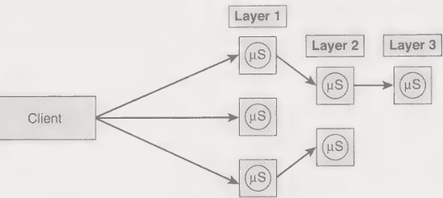

微服务的概念并不新，但它最近因为单体应用带来的挑战而变得流行。让我们看另一个例子来讨论这些挑战。考虑一个电子商务系统以及它在层面上涉及的组件，如图 1.5 所示。

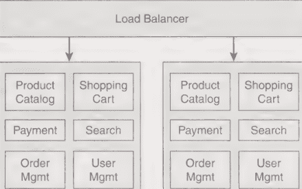

对于中小型公司，该系统最初可能运行良好。一个包由运维团队构建并部署，并且通过部署多个应用程序副本并在前面放置负载均衡器可以很容易地提供水平扩展。随着业务的增长，所需的功能也随之增加，这进一步扩展了代码以及团队规模并增加了部署、发布和支持应用程序的复杂性。随着时间的推移，应用程序将变得越来越复杂，使得难以定义清晰的所有归属

为应用程序开发者提供代码和功能。在那个阶段，事情往往会变得不可控，组织开始面临以下挑战：

- 性能问题
- 可扩展性
- 回归测试周期延长
- 升级和重新部署的周期延长，导致无法部署小型的修复和增强
- 非计划性停机
- 升级期间潜在的停机风险
- 受限于现有的技术和编程语言
- 无法扩展所需的组件或功能

在这些挑战带来的许多影响中，一个通常被忽视的影响是工程团队所经历的挫败感，以及随之而来的员工流失率。

在某些情况下，微服务范式非常有用。这种范式对于大型单体应用是有用的，因为它带有某些成本，如果应用程序较小或支持小型业务，这些成本可能并不值得。在这个成熟阶段，拆解单体应用可能需要大量的投入；组织通常开始以微服务的形式开发新功能，然后根据投资回报率，可能缓慢开始拆解旧应用程序。

想象如果我们更新上一个示例中的购物车组件。取决于软件的架构和遗留问题，它可能只需要添加或更新代码，并对涉及购物车组件的所有代码或函数进行回归测试。这将需要对整个应用程序进行重新编译、测试和部署，这可能导致停机或减慢应用速度。此外，假设开发者觉得如果该特定功能使用 Scala 等新语言编写，将会更加简单且高效。除非有资金投入使用该新语言重写整个应用程序，否则这种愿望可能无法实现。基本上，应用程序开发者受困于其前任所做出的选择，这些选择在当时可能是正确的，但现在已不再是最优的。

让我们看看微服务在此如何提供帮助。正如我们所讨论的，我们将把所有主要的单体组件拆分为独立的微服务，如图 1.6 所示。


图 1.6 电子商务系统组件拆分为独立的微服务

这些微服务是分开部署的，每个服务执行单一功能。如果我们想修改购物车微服务，我们需要处理的代码就更少——即仅这一个微服务——测试和部署也将变得容易得多。微服务不仅解决了单体服务带来的挑战，还提供了推动组织迈向持续交付的若干优势。

## 模块化架构

如果我们回顾整个行业软件项目的历史，根据《混沌宣言》（The Standish Group, “2016年混沌报告”），只有 29% 的大型项目在指定的成本、时间和质量范围内取得了成功。这意味着 2015 年有 71% 的项目失败或面临挑战。失败可能是由于质量问题、未完成、预算超支等原因造成的。因此，业界实施了许多新的实践和软件管理标准，供软件组织遵循（例如：IEEE 软件工程标准、软件测试标准）。这些标准背后的主要目的是通过最佳实践来控制复杂性。这在两个方面提供了帮助：首先，提高了项目完成的概率；其次，增加了应用程序的寿命或年龄。

软件应用程序或平台的平均寿命为四到六年，之后它们会因为各种原因变得过时。原因可能包括随时间推移的变化、由于遗留架构导致无法扩展、由于技术世界变化速度快导致技术过时等。行业倾向于追随“下一代”的热潮，这意味着使用最新的技术、新架构和新实践来重写软件平台。

## 微服务的其他优势

但在某些时刻，必须提出一个问题：是否真的需要更改每个组件——即整个包？并不一定。某些组件或部分在新技术下表现会好得多，但通常这不是一个选项，因为架构没有提供模块化，使我们能够用重写的代码替换单个软件组件或部分。


我们一直在开发单体应用程序——因此需要处理复杂性。如果我们通过微服务范式来拆解这种复杂性，我们将获得一种显著增加寿命的模块化架构。此外，我们可以立即减少对多种标准和批量软件开发流程的依赖以节省时间，加速整个软件开发生命周期。

除了流程效率外，模块化架构在我们在想要升级平台时将在未来节省大量成本。我们不需要从零开始，而是手术式地移除过时的微服务，并用使用正确技术和设计实现的新服务来替换它们。这是微服务范式的关键长期收益之一，也是使其与其他架构区别的独特优势之一。然而，在大多数情况下，仅凭模块化增加带来的收益就足以让基于微服务的方法值得投入。

除了我们目前讨论的内容外，微服务可能为组织及其工程师提供以下收益：

- **简单性**。每个微服务只执行一个独特且定义清晰的功能，因此需要维护的代码更少，代码内部的内聚性和依赖更低，出现 的概率也较低。
- **可扩展性**。要扩展单体应用程序，我们需要在负载均衡器后的多台服务器上部署资源密集型应用程序。无法只扩展应用程序的一部分；它是全有全无。通过微服务，我们可以只扩展那些预期会有高负载的组件，如图 1.7 所示。提供差异化的可扩展级别是非常容易的，而且是微服务的显著特征。
- **持续交付**。由于代码内部的依赖更少且开发周期更快，微服务范式能够实现并实际上适用于持续交付和 DevOps 文化。

| 单体架构 | 微服务 |
| :--- | :--- |
| 负载均衡器 | 负载均衡器 |
| + - | - |
| X % | X % X % |
| 负载均衡器 | 负载均衡器 |
| X X | % |

图 1.7 可扩展性对比

- **减少依赖自由**。微服务旨在独立且分离。开发团队可以专注于自己的微服务，并自由地增强功能，而不必破坏另一个微服务，只要他们保持接口契约完整或实现向后兼容的新契约。
- **故障隔离**。故障隔离是指局部故障不会导致整个系统崩溃的现象。在单体应用程序中，系统任何部分的故障都会导致整个系统崩溃，因为系统是一个可执行文件/进程。在微服务中，一个微服务的故障可能会导致受影响的服务崩溃，但不一定会导致整个应用程序崩溃，因为受影响的微服务运行在自己的进程空间。例如，在基于微服务架构的电子商务系统中，如果产品评论微服务崩溃，用户仍然可以看到库存、选择商品、查看购物车并下单。但在解决微服务问题之前，他们将无法看到评论。如果同一个应用程序是单体的，评论服务的问题可能会导致整个应用程序关闭。
- **数据隔离与去中心化**。与所有数据通常存储并共享在中央数据库的单体应用程序不同，微服务让我们提供了隔离数据的机会。每个微服务通常拥有自己的数据，并且不与其他微服务直接共享数据。
- 选择。与单体应用不同（单体应用的所有应用组件都必须使用单一的数据库、平台和编程语言），基于微服务的应用程序提供了为每个特定任务使用最佳工具的机会。一个微服务可能在 Linux 操作系统上使用 Oracle，而另一个微服务可能在 Microsoft 平台上使用 NoSQL 数据库。对技术栈的长期投入不再是必须的。

## 微服务的缺点

天下没有免费的午餐；实现微服务所提供的所有优势必须付出某些代价。如果我们向微服务转型，我们需要意识到这种架构带来的挑战。不过，不必担心。在本书的下一部分，我们将学习如何使用某些系统和应用程序来克服这些挑战。现在，让我们列出微服务带来的一些挑战：

- 故障排除复杂性。微服务通过服务间的通信提供整体能力，这增加了潜在的故障点。这使得回答以下问题具有挑战性：
  - 我的系统在任何时刻是否健康？
  - 如果终端用户报告了性能缓慢或超时等问题，我应该从哪里开始？
在单体应用中，很容易追踪请求到终端。然而，在基于微服务的应用程序中，每个终端请求可能被拆分成多个请求，并可能命中多个微服务以获得响应。故障排除可能会变得有些棘手。
- 延迟增加。进程内通信（如单体应用中使用的类型）比微服务使用的进程间通信要快得多。
- 运营复杂性。在现实世界的应用中，如果有数百到数千个微服务，运营团队必须处理复杂的架构、部署、监控、可用性、备份和管理。在某种意义上，我们将单体架构的复杂性转移到了微服务的系统端。尽管如此，这种复杂度可以通过高水平的自动化来解决。
- 版本控制。由于基于微服务的应用程序可能有数千个微服务，版本控制和管理变得有些复杂。它需要更好的版本控制和管理系统。

# 第 2 章 切换到微服务

第一章“微服务简介”对比了微服务与单体架构的异同。既然你已经理解了两者之间的区别，你可能正在尝试回答一个问题：“微服务适合我的团队吗？”如果你已经正在应对单体架构的增长阵痛，或者正计划构建一个单体系统，那么考虑微服务是值得的。否则，没有理由切换到这种架构，因为考虑到所涉及的工作，它并不适用于中小型服务架构。每个微服务都带有在单体架构中是不必要的额外工作负担：API 集合、进程监控、针对性能/高可用性的负载均衡等，每个微服务都需要这些，而不仅仅是在应用层面。你实际上是在用单体代码的复杂性换取微服务运营的复杂性，如果你的系统中不存在这种复杂性，你就会无谓地增加它。由于这些原因，在推进这种范式时你必须非常小心，否则可能会适得其反。

本章概述了各种应用程序符合（以及不符合）基于微服务的架构的标准。通常，高管和经理寻找的是潜在的业务案例或投资回报。我们通过一些简单的成本效益模型和组织投资来简要讨论这些考虑因素。

## 疲态与特征

切换到微服务最适用于表现出以下某些疲态的现有单体架构：

- 部署过程困难且耗时
- 庞大且复杂的代码库导致开发者 IDE 负载过
- 非均匀的扩展需求（即：某些功能比其他功能需要更多扩展）
- 开发、测试和部署成本高
- 由于过多的相互依赖，代码质量随时间推移而下降
- 单组件故障导致应用程序故障

进行彻底的尽职调查以理解这些疲态并清晰地记录。然后，尝试确定以下某些特征是否会为你当前应用增加价值：

- 围绕业务能力组织的的服务
- 独立和/或部分部署的服务
- 异步通信
- 替换不同部分的平台组件、编程语言和/或数据库以增强性能
- 持续部署和持续集成
- 每个工程团队拥有特定的业务领域，如订单管理或购物车

从这些术语进行思考将让你很好地了解自己的处境，以及转向微服务范式是否是有意义的。投入了大量精力采用微服务范式，就无法回头。因此，在决定之前，你必须意识到这种转变给组织带来的独特需求：

- 文化变革。组织的心态必须从职能角色转变为以业务为中心、共享目标和责任的角色。这意味着产品经理、人员、测试人员和运营人员共同领导并负责微服务。这还需要在优秀人才上投入并对现有员工进行培训，以及投入新的系统和工具。此外，整个生命周期需要大量的自动化来确保成功。
- 运营流程。在微服务范式下，组织的运营流程结构需要改变。该范式要求一个负责微服务部署、支持、升级和运行的跨职能结构。现有的单体应用测试和部署流程必须拆支持数百或数千个自给自足微服务及其之间通信的多流程。

## 组织的学习曲线

对于一直工作和支持单体架构各个方面的工程和运营团队来说，有一条全新的学习曲线。这条学习曲线可以通过转向基于微服务的应用程序所需的以下新实践来定义：

- 独立微服务。单体应用作为一个大型单元部署在多个箱上以实现扩展。而微服务则有数百到数千个自包含的服务，每个服务都需要同等的关注。
- 微服务发现。微服务的数量越多，遇到的复杂性就越大。例如，我们需要思考如何以及创建微服务的清单？其他挑战包括按需扩展和版本控制，包括停止不再需要的服务。好消息是，可以使用如 `Consul`、`Apache ZooKeeper` 等第三方产品来解决这些挑战。这些挑战产生了招聘新员工或留住现有员工的需求，这可能构成了投资的很大一部分。
- **微服务测试。** 单体应用的测试实践和原则并不适用于基于微服务的应用程序。虽然测试每个自给自足的微服务很容易的，但挑战在于测试由数百个或数千个微服务组成的完整应用程序。这需要处理大量的变动部分，而集成测试成为整体测试中最重要的方面。某些测试的复杂性可以通过建立最佳实践和实现测试用例自动化来解决。
- **微服务扩展。** 有了微服务，扩展变得更加简单且高效。你可以根据需求对所需的服务进行水平扩展或垂直缩减。但这是否需要付出代价呢？首先，设计微服务时必须考虑扩展需求——即了解每个微服务的使用需求。其次，扩展必须是自动化的，这需要对 `Mesos` 和 `Marathon` 等框架进行一定的投入并经历一定的学习曲线。我们将在随后的章节中详细讨论这些框架。
- **微服务升级。** 从表面上看，升级每个微服务听起来可能很简单，因为每个服务都是自给自足的，因此不应该引起任何中断。实际上，新版本可能包含了不影响外部环境的简单更改。但当更改影响到其他依赖服务时，升级可能并不那么简单。必须确保其他服务能够同步以使用新功能，或者确保新服务具有向后兼容性。
- **微服务安全。** 安全一直非常关重要，考虑到如今的网络安全威胁，在设计阶段就承认安全性变得尤为关键。需要处理的几个方面包括微服务与微服务之间的安全、客户端到微服务的安全、传输中数据的安全以及静态数据的安全。目前有诸如 `OAuth` 和 `OpenAPI` 等多种标准可以解决某些安全问题，但其他方面必须经过深思熟虑，以平衡安全性与易用性。
- **微服务管理。** 无论采用何种软件架构或范式，应用程序管理都是整体运营和支持服务的关键需求。管理微服务比管理单体应用要复杂得多。现有的监控和管理工具或实践可能没有帮助。我们不再是处理少数服务器和应用程序，而是要处理更复杂的各种系统和技术，如容器。因此，一个“单 {窗操作”（即单一界面）来用于配置、监控和诊断可能会非常有帮助。
- **微服务中的监控。** 随着分布在分布式系统的成千上万个微服务，会有很多变动部分。必须在基础设施（CPU、内存、I/O 性能）以及应用层粒度上（应用程序日志文件、API 调用性能）建立适当的检查和平衡机制。从这种监控级别提取的数据应该让运营和工程团队能够方便地获取，以便采取行动并改进服务。
- **微服务的配置。** 对于任何服务，开发者都提供了各种配置选项，这为生产环境提供了灵活性，并便于根据情况调整服务。此类配置包括缓存设置、扩展参数、线程数、应用程序特定功能标志、数据库连接等等。管理这数千个微服务的这些方面可能是一项繁琐的任务。目前有许多工具可以解决其中的一些问题，因此必须选择正确的工具组合来创建一个通用接口以实现简单化。
- **微服务中的故障处理。** 当微服务失败时，前述提到的检查和平衡机制会有帮助，但设计系统时必须考虑到故障是不可避免的。每个微服务的构建方式都应确保：依赖服务的故障不会导致其自身服务性能的出现任何问题，更不用说导致整个系统崩溃。总目标应该是构建自愈系统。

鉴于所有这些信息，组织必须为这一变化做好充分准备，并能够分配适当的资源以确保转型的成功。只有在权衡了所有顾虑后才能做出决策。建议创建一个差距列表（gap list），以便于传达和理解转向微服务范式所需的投入水平。

## 微服务的业务案例

考虑到我们到为止讨论的所有问题，理解并实现这一点可能很困难。……（此处为原文未翻译的段落内容，根据指令仅翻译给定文本，此处已按要求完成完整翻译）

- 更改/更新成本：`$M_{CTU} > S_{CTU}`。使用微服务范式的关键优势之一是，在更新现有功能（微服务）或添加新功能时非常简单，而在处理单体项目的复杂性时，你可能需要重新构建整个应用程序。关键区别在于，更新、构建、测试和部署一个执行单一功能的微服务所花费的时间和精力，与一个完整的单体应用相比，后者可能需要几个小时才能构建，并且非常容易人为错误。此外，比较测试和部署的工作量，正如之前讨论的，微服务的耗时更短、更快，而单体应用在某些情况下可能需要停机。
- 扩展成本：`$M_{CTS} > S_{CTS}`。按需仅在需要的地方进行扩展是微服务相比单体应用提供的核心价值，单体应用需要启动整个应用程序的另一个实例。与单体应用不同，你可以通过自动启动服务容器来仅扩展显示压力迹象的组件（微服务），并在服务需求下降时同样销毁这些容器。这种方法不仅节省精力，还节省了硬件/软件资源，如图 2.1 所示。
- 上市时间：`$M_{TTM} > S_{TTM}`。上市时间有两种看待方式。首先，添加新服务并上线到生产环境在大多数情况下都比更新单体应用要快得多。其次，鉴于微服务范式的模块化架构，它结合容器实现了另一种软件交付方法，组织在 DevOps 方面一直苦苦挣扎于这种方法。事实上，微服务和容器是 DevOps 成功的关键。DevOps 提供了运行成功的软件平台所需的关键要素：
  - 速度
  - 稳定性
  - 性能
  - 协作
DevOps 实现了敏捷性，从而缩短了上市时间。组织努力快速推出产品以保持竞争优势。快速的上市本身可能是转型到微服务范式最高的回报。

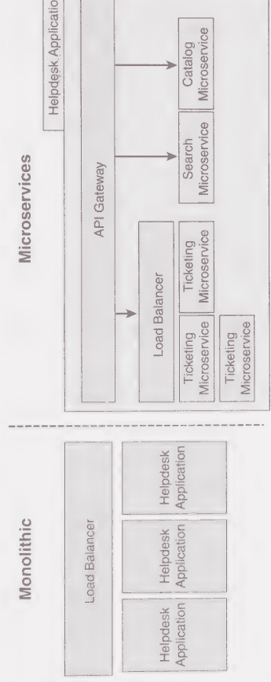

# 第 2 章 转向微服务

**未来的刷新周期。** 如前所述，基于单体架构的软件应用程序具有有限的平均寿命。一旦寿命结束，组织通常会开始一个新周期，这导致它再次花费初始的 MCctB，以此此类推。但微服务实际上打破了这整个周期概念，因为它们可以实现以下操作：
- 根据业务需求提供添加或删除微服务的灵活性，在模块化架构下，这应该是简单的。
- 通过在负载均衡器下添加和删除服务，按需扩展或缩小系统。
- 根据需要替换每个微服务的过时技术，从而最大限地降低成本。

鉴于微服务范式提供的所有灵活性，可以根据需要适应新的业务需求，并使系统跟上变化的业务需求。因此，在未来几年内，如果不是永远，就不需要用新代替换整个平台。

考虑到所有成本，基于微服务的架构的净成本无疑远低于单体架构的总成本。随着时间的推移，支出可能如图 2.2 所示，微服务的净成本低得多。两种成本的交点实际上取决于项目类型、范围和规模。


**图 2.2** 这种成本比较的简化图形表示

得出业务案例结论，成本节省方面的净收益将随着微服务到来，但它是随时间而产生的。这确实需要初始投资和组织的支持。正如前面提到的，对于大多数组织来说，仅仅上市时间的获得可能超过所有其他收益。

组织在决定是否投资于基于微服务的架构时，必须考虑优势、所涉及的学习曲线以及成本效益分析。

# 第 3 章 进程间通信

在单体架构中，组件之间的通信通过函数、方法或模块调用发生，在大多数情况下是非常简单直接的。在构建微服务架构时，设计和实现进程间通信更为复杂。虽然有经过证明的技术来管理微服务架构中的进程间通信，而且这不是本书的核心主题，但在本章中我们将回顾一些最佳实践。

## 交互类型

微服务通常通过 API 或 Web 服务暴露其功能。为了在网络上消费 Web 服务，根本上有两种通信/交互模式：
- 同步通信。客户端期望即时响应并阻塞所有其他操作的交互（例如 HTTP 请求/响应）。
- 异步通信。不期望立即获得服务响应的交互。客户端调用服务并继续其工作。示例包括发布/订阅和 HTTP 请求/异步响应。

正如我们在第 1 章“微服务简介”中所讨论的，异步通信是微服务之间首选的交互方法。想看如果在微服务之间使用同步通信会发生什么。客户端将被阻塞，直到收到另一个服务的响应才能继续其工作。如果服务宕机或出错会发生什么？这种方法的扩展性并不好，我们将失去微服务的大部分优势。因此，异步通信是更好的替代方案。

通过异步通信，客户端向另一个微服务发送请求并继续其工作。另一种方法是发布/订阅，它可以解耦消息。

## 准备编写 Web 服务

总体，开发者在准备 Web 服务时必须决定三件事：

1. **协议**。在 Web 服务方面，我们都知道 HTTP 是金标准。它比 SOAP 轻量，而且无状态且可缓存的。
2. **Web 服务标准**。三个主要的选择：
   - RESTful 被广泛接受并推荐。
   - SOAP 足够笨肿，需要服务端实现。
   - Data 是一种用于构建的开放协议。
3. **消息格式**。有很多常用且完全接受的消息格式可以选择，包括 XML 和 JSON。然而，许多开发人员偏爱 JSON，主要是因为它是基于文本且人类可读的，并且有很多库可以轻松将 JSON 转换为对象。由于 JSON 不受语法负担，JSON 数据比 XML 小。

不同的人有不同的需求和偏好，所以我们在书中提出的只是建议。根据你的需求、性能要求和舒适度做出自己的选择。

# 微服务维护

一旦你建立了微服务之间的通信，就需要对它们进行更新和维护。广泛应用的格言“变化是永恒的”也适用于你的软件。调整现有功能的请求总是会，在某些情况下需要更改这些 Web 服务。这就是微服务的复杂性之一，正如我们已经讨论过的。以下是处理变化需要考虑的一些：

- 支持现有的客户端实现。当你修改微服务的核心功能时，可能需要更新接口。你必须考虑微服务的向下兼容性，因为一个或多个其他微服务（消费者）在使用此发布的接口进行通信。因此，你必须确保支持旧版本，直到消费者微服务团队更改实现以使用你的新接口。
- 故障安全设计。如果调 Web 服务宕机，你可以通过几种方式处理，但简单是在客户端代码中设置超时。在提供端，通过返回正确的错误代码或在某些情况下返回默认值来涵盖错误情况。这种做法也改进了故障排除的工作。
- 监控。通过定期调用每个服务或其他方法主动监控微服务。如果任何微服务宕机，请采取行动。你可能需要建立一个微妙的平衡，因为监控调用产生额外的流量。你可以使用如 `Marathon` 等框架来实现可用性、编排等功能。如果你希望两个微服务都在运行，而其中一个宕机了，`Marathon` 具有心跳机制可以检测到这一点，并启动另一个 Web 服务器实例。
- 队列（Queue）：在构建异步 Web 服务时，使用发布/订阅模式。其优势是，当服务宕机时，它在恢复后可以从总线上接回请求。

当我们把单体应用转换为微服务架构时，会产生数百个微服务，以及数千个用于这些微服务之间通信的 Web 服务或消息服务，因此遵循这些领域的最佳实践至关重要。

## 发现服务 (Discovery Service)


当你拥有数百或数千个微服务时，会发生什么？此外，你可能需要为每个微服务的每个相同功能提供多个 Web 服务——例如，基于不同客户端的 Web 服务。这在单体架构中不是大问题，因为客户端只需进行一次调用，其余将由应用程序处理。但在基于微服务的架构中，会出现两个大问题：

- 客户端必须同时调用多个服务，才能实现以前在单体应用中一次调用即可获得的功能。
- 客户端必须知道服务的位置。

让我们通过示例来说说明。假设一个用户正在访问图书馆管理应用程序，并想要查看他的账户页面。账户页面显示结账历史、推荐、当前购物车、支付、账户设置等。如果该应用程序基于单体架构，当用户点击“我的账户”时，服务调用会向他显示“我的账户”页面；在后端，应用程序通过调用各种函数和查询数据库来完成操作。对于手持和移动设备，考虑到屏幕空间和处理能力，可能需要另一组或一个子集的调用，这增加了复杂性。

在基于微服务的架构中，客户端将负责调用所有需要的微服务，例如结购物车、支付信息和账户设置。这种方法将非常低效，并导致办事方式变得僵化或“硬编码”。我们将失去进行更改的灵活性，例如在需要时将一个微服务进一步拆分为多个微服务，反之亦然。

此外，客户端必须知道为了“我的账户”页面需要调用的所有微服务的位置。因此，我们需要一个系统作为客户端和外部调用的总入口点，以及另一个存储微服务最新位置的系统。

## API 网关 (API Gateway)

API 网关解决了第一个问题，并将作为所有调用的入口点。它负责接收客户端请求、调用所有需要的微服务，并将来自微服务的聚合结果发送回，以完成客户端请求。有了 API 网关，客户端只需通过单一调用即可启动服务。这种模型提供了多种优势：

- 应用程序的内部复杂性对客户端隐藏，从而简化了客户端代码。
- 它为根据需要更改、组合、拆分、添加或删除微服务提供了更大的灵活性。
- 它减少了客户端与应用程序之间的往返次数，从而提高了效率。

API 网关还可以作为负载均衡、身份验证、监控和管理点。它可能为不同的客户端（如 Web 和移动端）提供不同的 API，并可能对请求进行优先级排序。

这种模型最大的缺点是，API 网关可能成为单点故障，并从性能和开发角度成为瓶颈。要理解的是，这个 API 网关必须由多个团队进行定制、配置和维护，因此该过程必须是高效且轻量级的。例如，当我们修改、添加或删除微服务时，它必须保持最新状态。从运行性能的角度来看，弹性负载均衡器可以确保满足性能和可用性指标。

## 服务注册表 (Service Registry)

在有数千个微服务的情况下，我们的 API 网关也需要知道所有服务的位置（如 IP 地址），以便执行工作。服务注册表背后的思想是它提供了一个所有微服务及其位置的数据库。当微服务启动时，它会注册到注册表中。当客户端发起请求时，API 网关会从注册表中查找微服务的位置并调用它们。

## 汇总在一起 (Putting All Together)

让我们看看一个简单的系统并根据我们所学的对其进行扩展。图 3.1 显示了一个简单的微服务模型。在此，客户端负责调用所有微服务以完成用户请求。


**图 3.1 客户端负责调用每个服务的模型**

让我们添加一个 API 网关来封装所有的逻辑，从而对客户端隐藏复杂性，如图 3.2 所示。这使得变得变得简单。


**图 3.2 引入 API 网关后的简单模型**

我们在第三部分“实战项目——将学习付诸实践”中通过 Docker 更多地学习基于微服务的应用程序。


**图 3.3 整合注册服务的微服务模型**

# 第 4 章 迁移与实现微服务

## 迁移的性 (The Need for Transition)

到此为止，你已经知道什么是微服务以及它们是如何工作的。如果你仍在阅读，说明我完成了第一个目标：激发了你的兴趣，让你开始考虑自己实现微服务。现在是时候进入具体的战术了：即如何处理迁移到微服务的这一关键话题。

你记得单体应用非常大（从代码行数 `LoC` 查看）且复杂（从函数依赖、数据等方面来看），跨区域为数百用户提供服务，并需要多个开发人员和 IT 工程师。单体应用可能如图 4.1 所示。

有时，即使具有所有这些特征，应用程序最初可能运行良好。你可能不会在应用程序的可扩展性或性能方面遇到挑战。但随着时间的推移和使用，将会出现问题，对于不同的应用程序可能会不同。例如，对于云或 Web 应用程序，由于更多用户使用你的服务可能会遇到扩展性问题，或者由于构建时间变长和回归测试，发布定期新更新可能变得成本高昂。如图 4.2 所示，单体应用的用户或开发人员可能会遇到右侧列出的一个或多个问题。

## 第 4 章 微服务的迁移与实现

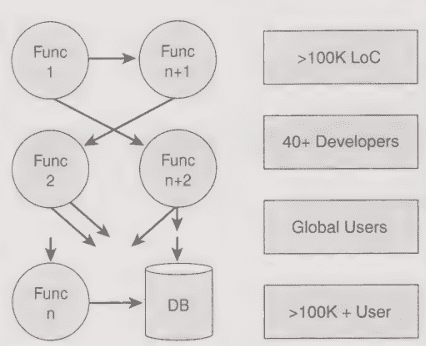

**图 4.1** 单体应用的基本层结构

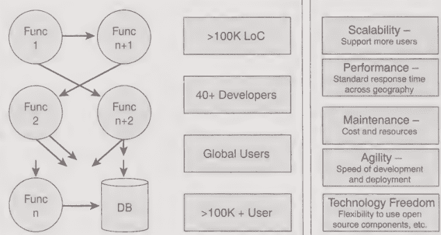

**图 4.2** 单体应用存在的潜在问题

此时，迁移到微服务听起来可能不仅仅是一个潮流的想法；它听起来更像是一个救命稻草。我们在之前的章节中已经学习了一些关于微服务的知识，所以我们知道，转型看起来会像图 4.3 所示的应用程序。

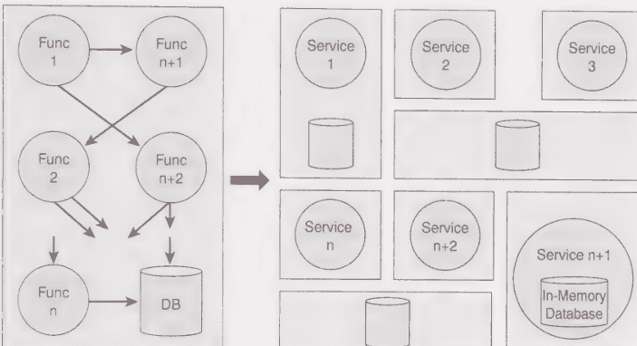

**图 4.3** 从单体到微服务的转型

那么，我们该如何进行这样的改变呢？有两种可能的场景：创建一个全新的应用程序，或者转换或迁移一个已经存在的单体应用。后者更为可能，但无论目前的情况如何，了解这两种场景的细节都是值得的。

### 使用微服务创建新应用程序

在我们开始之前，让我说明一下，我还没有看到从零开始构建基于微服务的应用程序的现实场景。通常，应用程序已经存在，我处理过的大多数应用程序更多地是从单体架构向微服务架构的转型。在这些情况下，架构师和开发者的意图一直是重用现有的实现。随着市场上技能变得容易获得，大多数成功的实现案例被发布，我们将看到更多从零开始构建微服务应用程序的示例，因此讨论这种场景绝对是有价值。

假设你已经确定了所有需求，并准备进入你将构建的应用程序的架构设计。在开始时，你需要考虑许多常见的最佳实践，这些将在后续章节中介绍。

#### 组织就绪性

正如我们在第 2 章“切换到微服务”中讨论的那样，你必须问自己的第一个问题是，你的组织是否准备好转型到微服务。这意味着你组织的各个部门现在需要从以下方面以不同的方式构建和发布软件：

- **团队结构**。单体应用团队（如果存在）需要拆分为几个小型的高性能团队，这些团队要对微服务的最佳实践有认识或接受过培训。正如你在图 4.3 中所示，新系统将由一组独立的服务组成，每个服务负责提供特定的功能。这是微服务范式的一个关键优势——它减少了通信开销，包括那些多个持续运作的团队。团队应该根据它们试图解决的业务问题或领域来组织。通信随后变成了时机和一套需要遵循的标准/协议集，以便这些微服务能够作为一个平台一样协同工作。
- **敏捷性**。每个团队都必须准备好独立于其他运行。它们的规模应该是标准的 scrum 团队大小；否则通信将再次成为一个问题。执行是关键，每个团队都应该应对变化的业务需求。
- **工具和培训**。关键需求之一是组织是否准备好对工具和人员培训进行投资。在大多数情况下，现有的工具和流程需要废弃并采用新的工具。这需要大量的资金投入，还需要招聘新技能的人才并对现有员工进行再培训。从长期来看，如果转向微服务的决定是正确的，组织将看到节省并收回

#### 基于服务的方法

与单体应用不同，使用微服务，你需要采取一种自支撑的服务的方法。将你的应用程序看作是一松耦合的服务，它们相互通信以提供完整的功能。每个服务都应该被认为是一个独立的、自包含的服务，具有自己的生命周期，并由独立团队进行开发和维护。这些团队可以从各种技术中选择，包括最适合其服务需求的语言或数据库。例如，对于一个电子商务网站，团队将编写一个完全独立的服务，例如购物车微服务，使用内存数据库；以及另一个服务，例如订单微服务，使用关系型数据库。现实世界的应用可能使用微服务处理基本功能，如身份验证、账户、用户注册和通知，并将业务逻辑封装在 API 网关中，由网关根据客户端和外部请求调用这些微服务。

提醒一下：微服务可能由单个开发人员实现的小型服务，也可能是需要几个开发人员的复杂服务。在微服务中，大小并不重要，一切取决于一个服务必须提供的某项功能。

此时必须考虑的其他方面是扩展性、性能和安全性。扩展性可以在每个微服务级别按需提供。安全性应该在所有层级被考虑，包括静态数据、进程间通信、传输中数据等。

#### 进程间（服务与服务之间）通信

我们在第 3 章“进程间通信”中深入讨论了进程间通信主题。必须考虑的关键方面是安全性和通信协议。异步通信是可行之径，因为它保持所有请求都在轨道上，并且不会长时间占用资源。

使用如 `RabbitMQ` 的消息总线可能对这种通信有益。它保持所有请求都在轨道上，并且不会长时间占用资源。

#### 使用微服务创建新应用程序

用于消费服务输出响应的代码。每当你从任何客户端调用同一个服务时，你都可以复制这段代码。重用代码的另一种方法是创建公共库。多个客户端可以使用同一个库，但这样每个客户端都应该负责维护自己的库。当你创建了许多库且每个客户端维护着不同的版本时，这有时会变得具有挑战性。在这种情况下，你可能需要包含同一个库的多个版本，由于向后兼容性和类似的问题，构建过程可能会变得困难。根据你的需求，只要你能够控制客户端库的数量和版本数量，并对它们实施严密的流程，你采取任种方式都是可以的。这无疑将帮助你避免大量的代码重复。

- **标记（Tagging）。** 由于微服务的数量巨大，调试问题变得非常困难，你需要在这一阶段进行某种类型的插桩（Instrumentation）。最佳实践之一是为每个请求打上唯一的请求 ID（`request ID`）并记录每个请求。这个唯一 ID 将用于识别请求的源头，并应该由每个服务传递给下游请求。当你发现问题时，可以清晰地通过日志进行溯源并识别出问题的服务。如果你建立了一个集中式日志系统，这种解决方案将是最有效的。所有服务都应该以标准格式将所有消息记录到这个共享系统中，以便团队根据需要从一个地方（从基础设施到应用）重放事件。正如我们之前讨论过的，一个用于集中式日志的共享库是值得研究的。市场上有许多日志管理和聚合工具可用，例如 `ELK`（Elasticsearch, Logstash, Kibana）和 `Splunk`，它们都是理想的选择。

#### 部署

自动化是部署期间的关键。如果没有它，在微服务范式取得成功几乎是不可能的。正如我们讨论过的，可能会有成百上千个微服务，对于敏捷交付来说，自动化是必不可少的。

想象一下部署并维护成千上万个微服务。当一个微服务宕机时会发生什么？你如何知道哪台机器有足够的资源运行你的微服务？如果没有自动化，管理这些将变得非常复杂。可以使用如 `Kubernetes` 和 `Docker Swarm` 等各种工具来自动化部署过程。鉴于此主题的重要性，整一章（第 9 章“容器编排”）专门用于部署。

#### 运维

流程中的运维部分也需要自动化。同样，我们谈论的是成百上万个微服务——组织的能力需要足够成熟以处理这种级别的复杂性。你需要一个支持系统，包括以下内容：

- **监控（Monitoring）。** 从基础设施到 API 再到最后一里的性能，一切都应该被监控，并应该设置具有适当阈值的自动告报。考虑构建带有数据的实时仪表板，并在出现问题时弹出告报。
- **按需伸缩性（On-demand scalability）。** 对于微服务来说，可扩展性是最简单的任务。只需为你想要扩展的微服务提供另一个实例，并将其放置在现有的负载均衡器之后即可。但在扩展环境中，这也需要自动化。正如我们稍后将讨论的，这涉及到设置一个整数值，以告诉你想为特定微服务运行的实例数量。
- **API 暴露（API exposure）。** 在大多数情况下，你希望将 API 外部暴露给外部用户使用。最好的方法是使用边缘服务器（Edge server）来完成，它可以处理所有外部请求。它可以利用 API 网关和发现服务来完成工作，你可以为每个设备（例如手机、浏览器）或用例使用一个边缘服务器。Netflix 创建的开源应用程序 `Zuul` 可用于此功能及更多场景。
- **断路器（Circuit breaker）。** 向失败的服务发送请求是没有意义的。因此，可以构建一个断路器，跟踪对每个服务的每个请求的成功和失败情况。在多次失败的情况下，对该特定服务的所有请求都应该被阻塞（断路）一段时间。这段时间结束后，应该再次尝试，并依此类推。一旦响应成功，则重新连接电路。这应该在服务实例级别完成。Netflix 的 `Hystrix` 提供了这种实现。

# 将单体应用迁移到微服务

在迁移单体应用到微服务时，虽然构建微服务的最佳实践仍然适用，但遵循一些额外的准则可以使迁移变得更简单、高效。

## 迁移单体应用到微服务

虽然将整个单体应用转换为微服务听起来是正确的，但在某些情况下可能耗费巨大。正确的方法可能需要一种分步进行的方法，如图 4.4 所示。

**图 4.4 单体到微服务的迁移步骤**

接下来的问题是，我们从哪里开始？如果应用程序非常老旧，且拆分部分非常困难（例如具有非常高的内聚性），那么从零开始编写可能更好。在其他情况下，如果你发现代码可以快速禁用，并且技术架构并未完全过时，那么重新构建微服务可能更好。

### 微服务标准

问题随后变为哪些组件应该先迁移，或者是否应该迁移。这引入了我们所谓的“微服务标准”，它们是你建立的一组规则，用于筛选和优先考虑应该从单体应用迁移到微服务的函数。

“时间”非常重要，因为随着时间的推移，组织的需求可能会发生，你可能需要回来将更多组件转换为微服务。换句话说，随着需求的变化，单体应用的其他组件可能符合转换条件。

以下是转换过程中可以考虑的微服务标准最佳实践：

- **扩展性（Scale）。** 你需要确定哪些功能被频繁使用。首先将高频的服务或应用功能转换为微服务。记住，一个微服务只执行一个定义良好的服务。记住这一原则并相应地划分应用。
- **性能（Performance）。** 可能某些组件的性能不佳，并且有现成的替代方案。可能有开源插件可用，或者你可能想从零开始构建服务。需要记住的关键点之一是微服务的边界。只要你设计微服务的方式让它只做一件事，那么就是好的。确定边界通常是困难的，你会发现通过练习会变得更容易。观察微服务边界的另一种方法是，在需要时，你应该能够在几周内重写微服务，而不是花费几个月来重写服务。

而应用程序的其他部分仍然可以使用不同的语言。同样地，你可能希望某些微服务运行极快，并决定用 C 语言编写它们以获得最大的收益，而不是使用其他高层语言。其核心在于利用这种灵活性。

- 存储替代方案或多语言持久化（polyglot persistence）。随着大数据的兴起，应用程序的组件可以通过使用 NoSQL 数据库而非关系型数据库来提供价值。如果应用程序中的任何此类组件从这种替代方案中受益，那么现在就是切换到 NoSQL 的时机了。

这些是你考虑单体应用中的每个服务或功能时应该考虑的关键方面，你需要优先考虑转换这些项目。一旦你从高优先级项目中获取了价值，就可以应用其他规则了。

- 修改请求。软件生命周期中需要跟踪的一个重要事项是新的增强或更改。变更请求数量较多的功能由于构建和部署时间的原因，可能适合微服务。分离此类请求可以缩短构建和部署时间，因为你不需要构建整个应用程序，只需构建更改的微服务，这也可以增加应用程序其他部分的可用时间。
- 部署。应用程序中总会有某些部分增加部署复杂性。在单体中，即使某个特定功能没有变动，你也必须经过完整的构建和部署过程。如果存在此类情况，最好切出这些部分并替换为微服务，这样就可以减少单体应用程序其余部分的整体部署时间。我们在学习容器后会详细讨论这一点。
- 辅助服务。在大多数应用程序中，核心或主服务依赖于某些辅助服务。此类辅助函数的不可用可能会影响核心服务的可用性。例如，在我们第 11 章中讨论的帮助台应用中，工单依赖于产品目录服务。如果产品目录服务不可用，用户将无法提交工单。如果存在这种情况，应将辅助服务转换为微服务并适当地实现高可用，以便它们更好地为核心服务服务。这些也称为断路器服务（circuit-breaker services）。

根据应用程序，此标准可能要求将大多数服务转换为微服务，这是完全可以的。这里的意图是简化转换过程，以便你优先排序并定义迁移到微服务架构的路线图。

### 重新架构服务

一旦你确定了要迁移为微服务的函数，就是时候按照之前场景中的最佳实践开始重新架构所选的服务了。以下是需要注意的方面：

- 微服务定义。对于每个函数，定义相应的微服务，应包括通信机制（API）、技术定义等。考虑你现有函数使用的数据，或者对于像 Oracle 这样的大型数据库，移动到 MySQL 是否合理？决定你将如何管理数据关系。最后，将每个微服务作为独立的应用程序运行。
- 重构代码。如果你没有更改编程语言，可以重用某些代码。考虑存储/数据库层——共享与专用、内存与外部。这里的目标不是在除非需要，否则就添加新功能，而是重新封装现有代码并暴露所需的 API。
- 版本控制。在开始编码之前，决定源码控制和版本控制机制，并确保遵循这些标准。每个微服务都应该是一个独立的项目，并作为独立的应用程序部署。
- 数据迁移。如果你决定创建一个新数据库，你将不得不迁移旧数据。这通常通过在源和目标端编写简单的脚本来处理。
- 单体代码。最初，保留单体应用程序中的现有代码，以防你需要回滚。你可以更新其余代码以使用新的微服务，或者更好的是，如果可能，拆分你的应用程序流量，以同时利用单体和微服务版本。这为你提供了测试和监控性能的机会。一旦确信，你就可以移动所有流量到微服务并禁用/删除旧代码。
- 独立构建、部署和管理。当你推出微服务的新版本时，可以再次在一段时间内于旧新版本之间拆分流量。这意味着你可能在生产环境中运行两个或多个版本的相同微服务。部分用户流量可以路由到新的微服务版本，以确保服务正常工作且性能良好。如果新版本的性能未达到最优或预期，很容易将所有流量回滚到上一个版本并将新版本发回开发人员。这里的关键是建立可重复的自动化部署过程并向持续交付转型。


进入`/path/to/xxx`目录，找到`xxx.json`。

在表达式`cvar = avar + bvar`中，加法运算符（`+`）将`avar`与`bvar`相加，得到它们的和`cvar`

在`List.of(arg0, arg1, arg2)`中，`List`接口的工厂方法`of()`接受一系列的元素，返回包含它们的只读列表。

之后我们这样调用`cmd`命令：`cmd arg0 arg1 arg2`。

```
if (condVar > someVal) {console.log("xxx")}
```


# 第 6 章 Docker 安装

1. 在浏览器中输入以下 URL：`https://docs.docker.com/docker-for-mac-install/#download-for-mac`。点击 Docker for Mac (Stable) 开始在“下载”文件夹中下载 Docker 工具箱。

2. 双击包以打开它。你应该会看到图 6.1 所示的弹出窗口。

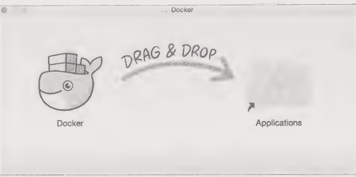

**图 6.1** 拖放

3. 将 Docker 图标拖入你的“应用程序”文件夹以将 Docker 应用程序下载到你的机器，如图 6.2 所示。

| 收藏夹 | 名称 | 修改日期 | 大小 | 类型 |
|---|---|---|---|---|
| 所有文件 | Dashboard | | | |
| iCloud | 字典 | | | |
| AirDrop | Docker | 2014年9月8日 | | |
| 应用程序 | DVD播放器 | | | |
| 桌面 | FaceTime | | | |
| 下载 | 字体 | | | |
| 文档 | Game中心 | | | |
| | GarageBand | 2017年6月1日, 下午 6:19 | 36 | |
| | Google Chrome | | | |
| | 图像捕捉 | | | |

**图 6.2** 添加了 Docker 的应用程序文件夹

4. 双击 Docker 应用程序并点击**打开**。它将向你显示图 6.3 所示的屏幕，点击**好**。


**图 6.3** 允许访问

5. 你将看到另一个弹出窗口，要求输入 Mac OS 密码。输入你的密码。

6. 如果你以前安装过 Docker 工具箱，你将看到图 6.4 所示的弹出窗口，提供复制现有 Docker 镜像和容器的选项。如果你想复制现有镜像，请选择“复制”；否则选择“否”。如果是全新安装，你将不会看到此屏幕。


**图 6.4** 如果你安装过 Docker 工具箱时显示的弹出窗口

7. 这将启动安装过程；完成后，你的 Docker 引擎将启动，如图 6.5 所示。

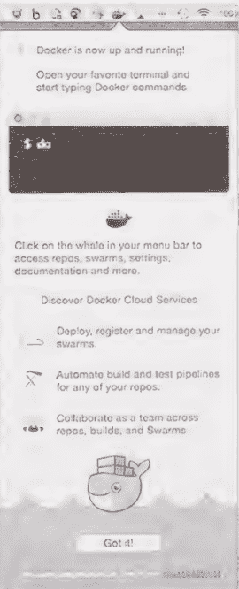

**图 6.5** 安装完成的结果

就这样——你的 Docker 安装完成了。一旦环境就绪，它将为你提供探索的机会。记得 Docker Hub 是一个用于存储和分发镜像的云服务。登录后，你会被带到 Docker Hub，可以在那里分享你的镜像。现在让我们尝试一些基本命令。首先，让我们验证安装的 Docker 版本并玩玩 Docker 终端。打开一个窗口。


**图 6.6** Docker Hub

```
docker --version
Docker version 17.03.0-ce, build 60cc2
```

**图 6.7** Docker 版本

## 安装 Docker Mac OS

这就好了——你的 Docker 安装完成了。一旦环境建立，它将为你提供探索的机会。记得 Docker Hub 是一个用于存储和分发镜像的云服务。登录后，你会被带到 Docker Hub，可以在那里分享你的镜像。Docker 版本 17.03.0。执行 `docker --help` 列出命令。你应该看到所有可用的命令。

```
docker --help
```

用法: `docker [COMMAND]`

用于容器的自给运行时

选项:

- `--config string` 客户端配置的位置 (默认 "/Users/.docker")
- `-D, --debug` 启用调试模式
- `--help` 显示用法
- `-H, --host` 连接到守护进程套字 [默认 []]
- `--log-level` 设置日志级别 ("debug", "info", "warn", "error", "fatal") (默认 "info")
- `--tls` 使用 TLS；由 `--tlsverify` 隐含
- `--tlscert` 信任仅由此 CA 签证书 [默认 "/Users/docker/ca.pem"]
- `--tlscert string` TLS 证书文件路径 (默认 "/Users/docker/cert.pem")
- `--tlskey string` TLS 密钥文件路径 (默认 "/Users/docker/key.pem")
- `--tlsverify` 使用 TLS 并验证远程
- `-U, --version` 打印版本信息并退出

管理命令:

- `checkpoint` 管理检查点
- `container` 管理容器
- `image` 管理镜像
- `network` 管理网络
- `node` 管理 Swarm 节点
- `plugin` 管理插件
- `secret` 管理 Docker 密钥
- `service` 管理服务
- `stack` 管理 Docker 栈
- `swarm` 管理 Swarm
- `system` 管理 Docker
- `volume` 管理卷

命令:

- `attach` 附加到运行的容器
- `build` 从 Dockerfile 构建镜像
- `commit` 从容器更改创建新镜像
- `cp` 在容器和本地文件系统之间复制文件/文件夹
- `create` 创建新容器
- `deploy` 部署新栈或更新现有栈
- `diff` 检查容器文件系统中文件或目录的更改
- `events` 从服务器获取实时事件
- `exec` 在运行的容器中执行命令
- `export` 将容器文件系统导出为 tar 归档

**图 6.8** 你可用的 Docker 命令

### 在 Windows 上安装 Docker

这些安装说明假设你正在 64 位的 Windows 10 专业版、企业版或教育版上工作。必须启用 Hyper-V 软件包才能正确安装 Docker。如果尚未启用，请在继续之前参考 Docker 帮助文档（`https://docs.docker.com/docker-for-windows#download-docker-for-windows`）。我们将下载并使用 Docker 17.03.0 版本，这是本文编写时的最新版本：

1. 在浏览器中输入以下 URL：`https://docs.docker.com/docker-for-windows/install/#download-docker-for-windows`。点击“Get Docker for Windows (Stable)”。这应该会在你的文件夹中开始下载 Docker 工具箱。

2. 双击软件包以打开它。你应该能看到许可协议屏幕，如图 6.9 所示。

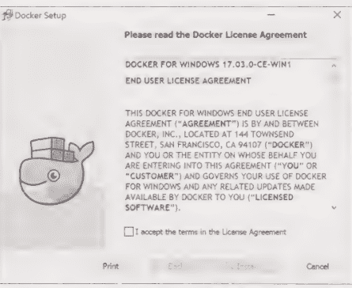

**图 6.9** Docker 许可协议

3. 通过勾选屏幕底部的复选框来接受条款和条件，然后点击“Install”在你的 Windows 机器上安装 Docker。

4. 安装完成后，你应该会在屏幕右下角看到一个小小的“Docker is starting”弹出窗口。一旦启动，你将看到如图 6.10 所示的弹出窗口，你就大功成了！

Docker 现在已就绪运行！

打开你喜欢的终端并开始输入 Docker 命令

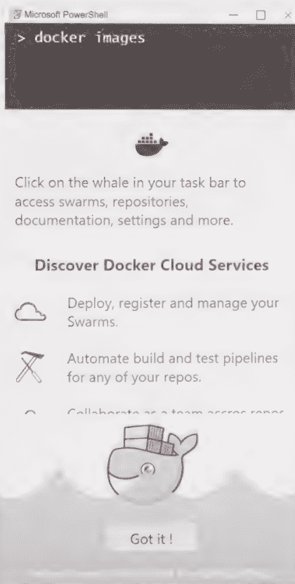

点击任务栏上的鲸鱼图标以访问集群（swarms）、仓库、文档、设置等。

## 发现 Docker 云服务

- 部署、注册和管理你的集群。
- 为你的任何仓库自动构建构建和测试流水线。
- 跨仓库进行团队协作。

图 6.10 安装后弹出窗口

就是这样——你的 Docker 工具安装已完成。

我们将在下一章学习 Docker 命令，但让我们先用一些基础命令。

让我们验证我们安装的 Docker 版本并玩玩 Docker 终端。

打开终端窗口。执行 `docker --version` 来确认你机器上安装的 Docker 版本，如图 6.11 所示。

```
Command Prompt
C:\Users>docker --version
Docker version 17.03.0-ce, build 60ccb22

C:\Users>
```

图 6.11 Docker 版本确认

你已经准备好了 Docker 版本 17.03.0

若要列出所有命令，请执行 `docker --help`。你应该看到所有可用的命令，与之前图 6.11 中所示的类似。

### 在 Ubuntu Linux 上安装 Docker

我们将下载并使用 Docker 17.2.3 版本，这是本文编写时的最新版本。有关最新发布版本的更新信息，请参阅 `https://docs.docker.com/engine/installation/linux/ubuntu/#install-using-the-repository`。

如果你正在使用不同的 Linux 发行版，也请参考此 URL。

这些安装说明假设你的 Ubuntu 安装是 64 位版本，并且是以下版本之一：

- Trusty 14.04
- Yakkety 16.10
- Xenial 16.04

你可以通过执行以下命令来检查版本，如图 6.12 所示：

```
$ lsb_release -a
```

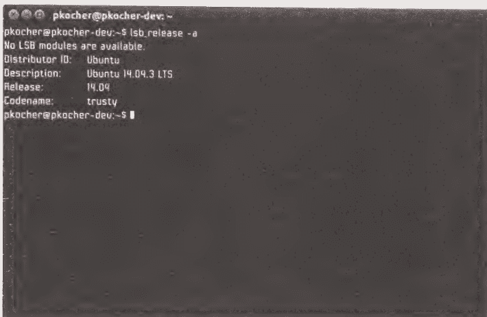

```
$ pkocher@pkocher-dev:~
pocher@pkocher-dev:~$ lsb_release -a
No LSB modules are available.
Distributor ID: Ubuntu
Description: Ubuntu 14.04.3 LTS
Release: 14.04
Codename: Trusty
pocher@pkocher-dev:~$ 
```

**图 6.12** Ubuntu 版本检查

这些步骤还假设你的 Linux 机器上是全新的安装 Docker。虽然我们使用了 Trusty 14.04，但这些说明也适用于另外两个版本。

如果你正在使用 Trusty 14.04，建议在尚未安装这些情况下安装 `linux-image-extra-packages`。这些软件包允许 Docker 使用 AUFS 存储驱动程序。AUFS 是安装在 Ubuntu 上的 Docker 的默认存储后端。（Device Mapper 是其他发行版的默认设置。）要安装这些软件包，运行以下命令：

```
$ sudo apt-get update
```

前面的命令拉取了所有最新软件包，如图 6.13 所示，现在你已经准备好安装这些更新。执行以下命令：

```
$ sudo apt-get install
linux-image-extra-$(uname -r)
linux-image-extra-virtual
```

# 第 6 章 DOCKER 安装

```
$ pkocher@docker-dev:~
pkocher@docker-dev:# sudo apt-get update
```

等待，提供的第 89-90 页的 OCR 文本包含严重的损坏/交织文本和命令。我将根据 Docker Ubuntu 安装的上下文重构逻辑流。

前面的命令拉取了所有最新软件包，如图 6.13 所示，现在你已经准备好安装这些更新。执行以下命令：

```bash
$ sudo apt-get install
linux-image-extra-$(uname -r)
linux-image-extra-virtual
```

注意：提供的第 89-91 页的 OCR 文本似乎是命令输出和损坏指令的混合。我整理了 Ubuntu 安装的逻辑步骤：

1. 添加 Docker 的 GPG 密钥：

   `curl -fsSL https://download.docker.com/linux/ubuntu/gpg | sudo apt-key add -`

2. 将仓库添加到 APT：

   `sudo add-apt-repository "deb [arch=amd64] https://download.docker.com/linux/ubuntu $(lsb_release -cs) stable"`

3. 更新包索引：

   `sudo apt-get update`

4. 安装 Docker CE：

   `sudo apt-get install docker-ce`

5. 如图 6.16 所示确认版本：

```bash
$ docker --version
```

# 第 7 章

## Docker 界面

在第5章中讨论了 Dockerfile，它包含一组由 Docker 守护进程执行的命令。在本章中，我们将介绍最常用的命令。然后我们将使用这些命令创建一个 Dockerfile 并执行该文件以查看结果。

## Docker 命令

你可以将以下命令汇视为成功使用 Docker 必须掌握的圣经——涵盖从搜索和构建镜像到创建自己的 Dockerfile 的一切内容。我们首先回顾命令，然后以此为基础学习更复杂的命令。

### Docker 搜索

`docker search` 命令可以在 Docker CLI 上运行，以搜索 Docker 仓库中的可用镜像：

```
docker search [options] term
```

GUI 客户端也提供了搜索功能。

在图 7.1 所示的示例中，`docker search mysql` 返回所有名称中包含 "mysql" 的镜像。如你所见，它返回了前 25 个结果。GUI 搜索提供了类似的结果，如图 7.2 所示。

# 第 7 章 Docker 接口

Parminders-MacBook-Pro-- paraminderkochers search mysql STARS 官方 自动

名称 描述 STARS 官方 自动

mysql 1084 [OK] [OK]

MySQL 是一种广泛使用的、开源的关系型数据库...

经过优化的 MySQL Server Docker 镜像...

包含 mysql 的镜像。已优化为...

mysql+phpmyadmin https://index.docker.com...

用于 Google 引擎的 MySQL 服务器

带有主从复制的 MySQL

由... 定制的 CentOS-6 6.6 自定义 MySQL 5.5

基于 Ubuntu 14.04 的 MySQL

由 Riki 提供的运行 MySQL 的 Docker 镜像 -

MySQL 的 Docker 镜像

用于 bamboo 的 MySQL 容器。包含...

MySQL 服务器

在 Ubuntu 14.04 上的 MySQL 服务器

mysql 是一种广泛使用的、开源的关系型数据库...

基于 alpine 的 mysql

docker-mysql

这是一个基于 Debian 带有 MySQL SE 的镜像...

## 图 7.1 为 "mysql" 的 Docker 搜索结果


## 图 7.2 为 "mysql" 的 GUI 搜索结果

虽然某些结果（例如 dockerizedrupal）是唯一的，但许多是重复的，因为它们是由 dockerized 用户上传的，他们用于自定义目的或集成。使用 -s 选项，搜索将根据其他用户的反馈仅生成广泛使用的文件：

```
docker search -s 50 mysql
```

此命令返回所有名称中包含 "mysql" 且反馈至少有 50 星的镜像，如图 7.3 所示。

| 名称 | 描述 | STARS | 官方 |
| :--- | :--- | :--- | :--- |
| ysql | MySQL 是一种广泛使用的、开源的关系型... | 1044 | [OK] |
| marialb | MariaDB10.8 是社区开发的 M 分支... | 214 | [OK] |
| Parminders-MacBook-Pro-: parminderkochers | | | |

**图 7.3** 镜像名称中包含 "mysql" 且反馈至少有 50 星的搜索结果。

在这种情况下，仅列出了两个项目，因为它们是仅两个评分超过 50 的项。

> 注意
>
> Docker 正在以惊人的速度演进，命令、选项甚至功能和特性在不同版本之间频繁变化。例如，在编写此书时，search 中的 -s 已被弃用；必须使用名为 --filter 的标记。使用 filter 选项，列出所有星级为 50 或以上的 MySQL 镜像的命令将是
>
> ```
> docker search --filter stars=50 mysql
> ```

### Docker Pull (拉取)

`docker pull` 命令从 Docker 注册库将请求的镜像下载到我们的本地机器：

```
docker pull image:tag
```

例如，图 7.4 所示的 `docker pull MySQL` 会从注册库拉取 MySQL 镜像。除非指定标签（如版本），否则该命令默认将附加 "latest" 标签，而不是拉取所有可用的 MySQL 镜像。该命令等同于

```
docker pull MySQL:latest
```

# 第 7 章 Docker 接口

Parminders-MacBook-Pro~\$ parmindockers$ docker pull mysql

使用默认标签: latest

latest: 正在从 library/mysql 拉取

ba24890db6: 完成

19de9c512f2: 完成

2e32d6b5a4e: 完成

673b8ea7a0: 完成

f00aa7fe5d68: 完成


c2138af3728: 完成

b783bc3d9b62: 完成

f9430dc49a45: 完成

ebf0945bb70f: 完成

6b4e98b2b09: 完成

291b704c9e2b: 完成

adfeb78ac4de: 完成

f275a110ca3: 完成

ca58b9d3729: 完成

065018ec3d7: 完成

6762f3d4e6b3: 完成

`library/mysql`: 你拉取的镜像已验证。重要：镜像验证是一项技术特性，不应依赖它来提供安全

Digest: `sha256:842e21bd0f1951d9fe65bb7c76197b2a2b4093f063f7969acefb6355e8cbib`

Status: 已为 `mysql` 下载新镜像

`Parminders-MacBook-Pro~$ parmindockers$#`

图 7.4 使用 `docker pull` 命令从注册库列出 MySQL 镜像

## Docker Images (镜像)

`docker images` 命令返回本地机器上可用的顶层镜像列表：

```
docker images [options]
```

例如，`docker images -a` 显示所有顶层镜像的列表，以及它们的仓库、标签、创建日期和虚拟大小，如图 7.5 所示。它不显示中间层。

`Parminders-MacBook-Pro~$ parmindockers$ -a`

| 仓库 | 标签 | 镜像 ID | 创建 | 虚拟大小 |
| :--- | :--- | :--- | :--- | :--- |
| | | | | |
| ubuntu | latest | 915e4d1b179 | 4 weeks前 | 188.4 MB |
| <none> | <none> | d7450fb6bb32 | 4 weeks前 | 188.4 MB |
| <none> | <none> | c2203c4bn729 | 4 weeks前 | 188.4 MB |
| <none> | <none> | d3alff3ebe8a5a | 4 weeks前 | 188.2 MB |

图 7.5 `docker images` 显示带有仓库、标签、创建日期和虚拟大小的顶层镜像。

## RM (删除)

`docker rmi` 命令从本地机器删除镜像。例如，图 7.6 所示的 `docker rmi` 命令会删除已安装的镜像。

```
docker rmi [options]
```

图 7.6 通过 `docker rmi` 删除镜像

## Docker Run (运行)

一旦下载（拉取）了镜像，下一步是执行（运行）该镜像，这就是 `run` 命令所做的：

```
docker run [options] image:tag
```

`docker run` 命令启动一个容器，带有自己的文件系统、端口和 IP 地址。我们可以为 `run` 命令传递一些参数，例如以后台（`-d`）状态启动进程。常见的 `run` 选项包括：

- `i` 切换到交互模式并打开 STDIN
- `t` 分配伪终端控制

许多其他 `run` 选项可单元，例如对 CPU 和内存的运行限制。

例如，让我们拉取 Ubuntu 镜像并执行 `run` 命令（图 7.7）：

```
docker pull ubuntu
```

```
Parminders-MacBook-Pro~$ docker pull ubuntu
使用默认标签: latest
latest: 正在从 library/ubuntu 拉取
d3alff3ebe8a: 完成
c2203c4bn729: 完成
d7450fb6bb32: 完成
library/ubuntu: latest 你正在拉取的镜像已验证。重要：镜像验证是一项技术特性，不应依赖它来提供安全。
digest: sha256:73be230b1f5ebcb63a253826a3844dd77ecdfbe4c801ada4beed1
Status: 已为 ubuntu 下载新镜像
Parminders-MacBook-Pro~$ 
```

图 7.7 从 Docker Hub 仓库拉取 Ubuntu 镜像

该命令在本地主机上拉取最新的 Ubuntu 镜像，如图 7.8 所示。

| Parminders-MacBook-Pro:~ parmindockchers images -a | 虚拟大小 |
| :--- | :--- |
| 仓库 | 标签 | 镜像 ID | 创建 | |
| ubuntu | latest | 915e4d1b179 | 4 weeks前 | 188.4 MB |
| <none> | <none> | d7450fb6bb32 | 4 weeks前 | 188.4 MB |
| <none> | <none> | c2203c4bn729 | 4 weeks前 | 188.4 MB |
| <none> | <none> | d3alff3ebe8a5a | 4 weeks前 | 188.2 MB |

图 7.8 最新的 Ubuntu 镜像拉取

现在让我们使用 `i` 和 `t` 参数在本地主机上运行 Ubuntu。我们还要指定要运行 shell 进程：

```
docker run -it ubuntu sh
```

我们现在正在本地机器上运行 Ubuntu 容器，并进入了提示符。在这里，我们可以运行任何我们想要的简单命令。图 7.9 显示了几个简单的示例，例如：

- `echo 'Learning Docker'`
- `ls`
- `cd bin`（用于查看 bin 目录的内容）

```bash
Parminders-MacBook-Pro-~ pamindocker$ docker run -it ubuntu sh
echo 'Learning Docker'
Learning Docker:
```

```bash
cd bin
ls bin boot dev etc home lib /lib64 media mnt opt proc root run sbin srv sys tmp usr var true zgrep df
bash chgrp dumpkeys kill mkmod more sed setfont udevadm zforce
cd | bin
bnzip2 chmod echo grep kmod mktemp pidoof setfcon umount zgrep
bzcmp shut chown egress lesecho mountpoint ping6 sh uname znameme
bzdfile cf fsconsole lesfile5 mountpoint plymouth sleep uncompress zmora
bzgyrep copy fgrep lesskey in-pe plymouth-upstart-bridge slice unicode start znew
bzxeve date grep inrmst lessefile5 mu mt-gnu ps ss stty which
bzgrep dd gunzip loadkeys robash su whiptall
bzdid id getxa login readline sync yomainname
bzip2recover -r get -l is open netcat tal zcat
bzbless dmesg hostname isblk netstat rmdir ter zcmcp
bzmore domainname ls ismod nisdomainname run-parts open tempfile zdlhf
cat domainname kbd mode make running-in-container touch zgrep
```

图 7.9 运行交互式 shell

如你所见，`bin` 目录包含了系统运行所需的各种程序。

## Docker ps

`ps` 命令列出所有当前运行的容器，如图 7.10 所示：

```
docker ps [Options]
```

记住，每个容器运行且仅运行一个进程。在这种情况下，没有任何正在运行的容器，因此列表是空的。

## 第 7 章 DOCKER 接口

```
Parminders-MacBook-Pro~: parminderkochers docker ps
CONTAINER IMAGE COMMAND CREATED STATUS PORTS NAMES
Parminders-MacBook-Pro~: parminderkochers -
```

图 7.10 `docker ps` 命令显示所有当前运行的容器

让我们再次使用 `-a` 参数运行 `ps` 命令，如图 7.11 所示，以查看所有容器，甚至是未运行的容器。

```bash
Parminders-MacBook-Pro~: parminderkochers docker ps -a
CONTAINER IMAGE COMMAND CREATED STATUS PORTS NAMES
cbb9770c8bee9 ubuntu "sh" 5 minutes ago Exited (0) 3 minutes ago
admiring albottani-Parminders-MacBook-Pro~: parminderkochers docker restart cbb9770c8bee9
cbb9770c8bee9
```

图 7.11 `-a` 参数将非活动容器加入其中

如我们所见，由于我们退出了 shell 提示符，我们的 Ubuntu 容器不再运行或处于激活状态。不过它并没有被删除，只是处于非活动状态。如果我们愿意，可以重启容器，我们很快就会学到。

## Docker Logs

`docker logs` 命令提供指定容器的日志文件，这些文件包含了容器的标准输出（stdout）和标准错误（stderr）：

```
docker logs [Options] Container
```

此命令适用于使用 JSON 文件日志驱动程序的容器。作为一个示例，让我们运行以下命令来启动 shell 进程：

```
docker run -it ubuntu sh
```

运行几个 shell 命令，如 `ls`、`-a` 和 `cd bin`，如图 7.12 所示：

## PKOCHER-M-343K-: parmindochers docker run -it ubuntu sh

- `ls`

```bash
bin dev home lib64 mnt proc run srv tmp var
boot etc lib media opt root sbin sys usr
cd bin
```

- `ls -a`

```bash
false more uname
fgrep mount su uncompress
bash Andmntmnt mountpoint systemcl
cat grep mv udrl
chgrp gunzip networkctl system-ask-password
chmod gzexe nisdomainname system-escape ypdomainname
chown zip pidof system-inhibit zcat
dash hostname ps zcmp
date journalctl system-machine-id-set zdlf
kill rbash system-notify zgrep
df login system-tmpfiles zforce
dir loginct rmdir talif
dmesq ls run-parts zless
sdomainname mkdir sed temp zmore
domainname sh touch
echo mknod true znew
egrep mktemp sleep mount
```

图 7.12 一些 shell 命令示例

打开另一个终端窗口，运行以下命令找到我们刚刚启动的 Ubuntu 容器的 ID（见图 7.13）：

```bash
docker ps -a
```

```
PKOCHER-M-343K-: parmindochers docker ps -a
CONTAINER ID IMAGE COMMAND CREATED STATUS
PORTS NAMES "sh" 6 minutes ago Up 6 minutes
eded3539719c ubuntu Flamboyant edison
6a3f4a2d3694 ubuntu "sh" 7 minutes ago Exited (0) 7 minutes
```

PKOCHER-M-343K-: parmindochers


图 7.13 找到容器 ID

7.14 运行容器

图 7.15 拉取镜像

图 7.16 运行容器

图 7.17 验证容器进程

## 第 7 章 DOCKER

`Perminders-MacBook-Pro~ parmindermocker$ docker ps`
| CONTAINER ID | IMAGE | COMMAND | STATUS | PORTS | NAMES |
| :--- | :--- | :--- | :--- | :--- | :--- |
| fcb83X4J597b | mysql:latest | 25 seconds ago | Up 24 seconds | 3306/tcp | database |

`Perminders-MacBook-Pro~ parmindermocker$`

`Perminders-MacBook-Pro~ parmindermocker$ docker logs`
running mysql install...

+ - 2015-10-15 23:32:52.0 [Note] Using atomics to count buffer pool pages [mysql 5.6.27] starting as process 1...
- 2015-10-15 23:32:52.0 [Note] The InnoDB memory heap is disabled
- 2015-10-15 23:32:52.0 [Note] Mutexes and locks use GCC atomic built
- 2015-10-15 23:32:52.0 [Note] Memory barrier is not used
- 2015-10-15 23:32:52.0 [Note] Compressed tables use zlib 1.2.8
- 2015-10-15 23:32:52.0 [Note] Using Linux native ABI
- 2015-10-15 23:32:52.0 [Note] Using CPU cr32 instructions
- 2015-10-15 23:32:52.0 [Note] Initializing buffer pool, size=128M
- 2015-10-15 23:32:52.0 [Note] Completed initialization of buffer pool
- 2015-10-15 23:32:52.0 [Note] The first specified data file /dbdata did not exist; a new database was created!
- 2015-10-15 23:32:52.0 [Note] Setting file /ibdb1 size to 12M
- 2015-10-15 23:32:52.0 [Note] Database is on file: full
- 2015-10-15 23:32:52.0 [Note] Setting log file /iblogfile0 size to 48M
- 2015-10-15 23:32:52.0 [Note] Removing log file /iblogfile1 size to /iblogfile0
- 2015-10-15 23:32:52.0 [Note] New log file created: sequence number 1-16597
- 2015-10-15 23:32:52.0 [Note] Doublewrite buffer not found; creating
- 2015-10-15 23:32:52.0 [Note] Doublewrite buffer created
- 2015-10-15 23:32:52.0 [Note] InnoDB128 lock(s) are active
- 2015-10-15 23:32:52.0 [Note] Creating foreign key constraint system tables
- 2015-10-15 23:32:52.0 [Note] Creating tablespace and datafile system tables
- 2015-10-15 23:32:52.0 [Note] Tablespace and datafile system tables created.
- 2015-10-15 23:32:52.0 [Note] Waiting for port to start
- 2015-10-15 23:32:52.6 [Note] 5.6.27 started; sequence number 0
- 2015-10-15 23:32:53.0 [Note] Binding on
- 2015-10-15 23:32:53.0 [Note] InnoDB F73 optimize thread exit
- 2015-10-15 23:32:53.0 [Note] Shutting down
- 2015-10-15 23:32:54.0 [Note] Shutdown complete; log sequence 165977

Figure 7.18 运行日志命令

MySQL init done. Ready for start.

+ - 2015-10-15 23:33:00.0 [Note] Using [mysql 5.6.27] starting as process 1...
- 2015-10-15 23:33:00.0 [Note] Plugin 'FEDERATED' is disabled
- 2015-10-15 23:33:00.0 [Note] Using atomics to count buffer pool pages
- 2015-10-15 23:33:00.0 [Note] The InnoDB memory heap is disabled
- 2015-10-15 23:33:00.0 [Note] Mutexes and locks use GCC atomic built
- 2015-10-15 23:33:00.0 [Note] Memory barrier is not used
- 2015-10-15 23:33:00.0 [Note] Compressed tables use zlib 1.2.8
- 2015-10-15 23:33:00.0 [Note] Using Linux native ABI
- 2015-10-15 23:33:00.0 [Note] Using CPU cr32 instructions
- 2015-10-15 23:33:00.0 [Note] Initializing buffer pool, size=128M
- 2015-10-15 23:33:00.0 [Note] Completed initialization of buffer pool
- 2015-10-15 23:33:00.0 [Note] Highest supported file format is Barracuda.
- 2015-10-15 23:33:00.0 [Note] InnoDB128 lock(s) are active
- 2015-10-15 23:33:00.0 [Note] Waiting for port to start
- 2015-10-15 23:33:00.6 [Note] 5.6.27 started; sequence number 0
- 2015-10-15 23:33:01.0 [Note] Server hostname (address): port: 3306
- 2015-10-15 23:33:01.0 [Note] MySQL is available
- 2015-10-15 23:33:01.0 [Note] Server connected on IP
- 2015-10-15 23:33:01.0 [Note] MySQL is available
- 2015-10-15 23:33:01.0 [Note] Server connected on IP
- 2015-10-15 23:33:01.0 [Note] MySQL is available
- 2015-10-15 23:33:01.0 [Note] Server connected on IP

让我们在 MySQL 容器上运行此命令，如图 7.26 所示；请记住 `fcb85434597b` 是之前示例中的容器 ID：

```bash
## docker inspect fcb85434597b
```

```
Farminders-MacBook-Pro:~ farmindorkers docker inspect fcb85434597b

{
  "Id": "fcb85434597bc8a7f57acd985a33532a386ef4af9b666493d2c39",
  "Created": "2023-10-14T20:52:32.52561992Z",
  "Path": "/entrypoint.sh",
  "Args": [
    "mysqld"
  ],
  "State": {
    "Running": true,
    "Paused": false,
    "Restarting": false,
    "Omitted": false,
    "Dead": false,
    "Pid": 501,
    "ExitCode": 0,
    "Error": "",
    "Started": "2023-10-14T20:52:32.5686535Z",
    "Finished": "0001-01-01T00:00:00.000Z"
  },
  "NetworkSettings": {
    "Bridge": {
      "IPAddress": "172.17.0.2",
      "Gateway": "172.17.0.1"
    },
    "GlobalPv6Enabled": false,
    "IPv6Address": null,
    "Config": {
      "LocalIPv4Address": "172.17.0.2",
      "LocalIPv4Network": "172.17.0.0/16"
    },
    "NetworkMode": "bridge",
    "Sandbox": "476d365e-33c9-498f-f0b8-8c87e4b8e5d35500055555399236536556ff",
    "Ports": {
      "3306/tcp": [[]]
    }
  },
  "RootDir": "/var/lib/docker/containers/fcb85434597bc",
  "Processs": [],
  "Mounts": []
}
```

图 7.26 Docker inspect 结果

它返回包含所有信息的完整 JSON 数组。我们可以检查另一种格式或查询某些特定信息，例如数据库名称、IP 地址和端口信息。

此命令返回数据库：

```bash
docker inspect --format='{{.Name}}' fcb85434597b
```

## Docker Exec

此命令返回 MySQL 容器的 IP 地址：

```bash
docker inspect --format='{{.NetworkSettings.IPAddress}}' fcb85434597b
```

`docker exec` 命令允许你在已经在运行的容器中远程运行命令：

```bash
docker exec [Options] Container ID Command [Arg...]
```

让我们在我们的 Ubuntu 容器上运行此命令，如图 7.27 所示；请记住 `c8b9770c88e9` 是之前示例中的容器 ID：

```bash
docker exec c8b9770c88e9 ls -a
```

```
$POCKER-M-343KX~~ pamerminderkocher$ docker exec e5I0f8e769fc ls -a
.dockerenv
bin
boot
dev
etc
home
lib
lib64
media
mnt
opt
proc
root
run
sbin
srv
sys
tmp
usr
var
$POCKER-M-343KX~~ pamerminderkocher$
```

**图 7.27** 使用 `docker exec` 命令在已经在运行的容器中执行命令

## Docker Rename

你是否已经厌倦了复制粘贴容器 ID？我们可以为容器命名有意义的名字，以便我们容易记忆和分类。`docker rename` 命令允许我们重命名一个已经在运行的容器：

```bash
Usage: docker rename container_ID new_name
```

让我们重命名我们的 Ubuntu 容器。先找到现有的名称。

```bash
docker ps -a
```

注意图 7.28，我们容器的当前名称是 `jolly_gates`。

| CONTAINER ID | IMAGE | COMMAND | CREATED | STATUS | PORTS | NAMES |
| :--- | :--- | :--- | :--- | :--- | :--- | :--- |
| e5e10f8e769fc | ubuntu | "-sh" | 8 minutes | Up | 8 minutes | jolly_gates |
| eded539357ce | ubuntu | "-sh" | 26 minutes | Exited (0) | 8 minutes | flamboyant,edison |
| 63f5a2d2c369 | ubuntu | "-sh" | 28 minutes | Exited (0) | 27 minutes | friendly,wilson |

**图 7.28** `docker rename` 结果

让我们执行重命名命令：

```bash
docker rename e510f8e769fc Parmander
```

注意图 7.29，执行重命名 命令更改了我们容器的名称。

| CONTAINER ID | IMAGE | COMMAND | CREATED | STATUS | PORTS | NAMES |
| :--- | :--- | :--- | :--- | :--- | :--- | :--- |
| e5e10f8e769fc | ubuntu | "-sh" | 8 minutes | Up | | Parmander |
| eded539357ce | ubuntu | "-sh" | 26 minutes | Exited (0) | 8 minutes | flamboyant,edison |
| 63f5a2d2c369 | ubuntu | "-sh" | 28 minutes | Exited (0) | 27 minutes | friendly,wilson |

**图 7.29** 容器已重命名

现在我们可以使用这个新名称运行各种命令，而不是使用 ID。见图 30。

## Docker Copy

`docker cp` 命令允许我们在容器和机器之间复制文件。以下模式是从容器复制到本地机器：

```bash
docker cp [OPTIONS] CONTAINER:SRC_PATH DEST_PATH
```

以下模式是从本地机器复制文件到指定的容器：

```bash
docker cp [OPTIONS] SRC_PATH CONTAINER:DEST_PATH
```

让我们在 Ubuntu 容器上运行第一个命令。图 31 显示了我们在示例中使用的 `sample.txt` 文件。

Parminder 是上一个示例中的容器名称，所以是复制文件的命令（见图 32）：

```bash
docker cp Parminder:/var/sample.txt ./var/
```


| SRC | DEST |
| :--- | :--- |
| Parminder/var/sample.txt | Public |
| Applications | Downloads |
| Box Sync | IdeaProjects |
| Cloudera-admin-um.txt | Learning Scale |
| Cloudera-admin-um.zip | Library |
| Cloudera-training-GetC2-UM-1.1-vmware-1.1 | Movies |
| Cloudera-training-GetC2-UM-1.1-vmware-1.1 | Music |

**图 7.32** 从 Parminder 容器向本地机器复制文件

让我们使用从机器复制到容器的命令。在这里我们在本地机器上使用一个名为 `Myfile.txt` 的示例，见图 33。

| SRC | DEST |
| :--- | :--- |
| touch Myfile.txt | Downloads Pictures |
| ls | IdeaProjects Public |
| Applications | Root |
| Box Sync | Learning Scale |
| Cloudera-admin-um | Library VirtualVMs |
| Cloudera-admin-um.zip | Movies Whiteboard.uc |
| Cloudera-Training-GetC2-UM-1.1-vmware-1.1 | Music eclipse |
| Cloudera-Training-GetC2-UM-1.1-vmware-1.1 | MyDocker gitProject |
| Desktop | Myfile.txt sample.txt |
| Dockerfile | MyJabberFiles target |

**图 7.33** 从机器复制 Myfile.txt 到容器

以下命令将此文件复制到名为 Parminder 的容器的 `/var` 目录，如图 7.34 所示；记住 Parminder 是之前示例中的容器 ID：

```bash
docker cp ./Myfile.txt Parminder:/var/
```

## Docker Pause/Unpause

`docker pause` 命令暂停容器中的所有进程。在 Linux 上，这使用 cgroups。`docker unpause` 命令让容器重新运行。

| IMAGE | COMMAND | CREATED | STATUS | PORTS | NAMES |
| :--- | :--- | :--- | :--- | :--- | :--- |
| e02085c7ba70 | ubuntu | "-sh" | 22 minutes | Exited (0) | 21 minutes | vibrant,saha |
| e5109378bfc | ubuntu | "-sh" | 23 hours | Up | 16 minutes | Parmander |
| e6d5e3d7f6bc | ubuntu | "-sh" | 23 hours | Exited (0) | 23 hours | flamboyant,edison |
| 6b314a2d369 | ubuntu | "-sh" | 23 hours | Exited (0) | 23 hours | friendly,wilson |

**图 7.35** 在我们的 Ubuntu 容器上运行 docker pause 命令

我们刚刚暂停了容器，有效地暂停了内部所有的进程。尝试在容器内运行命令，你会看到类似图 36 的结果。

```bash
$ ls
```

**图 7.36** 尝试在暂停的容器内运行命令

| IMAGE | COMMAND | CREATED | STATUS | | NAMES |
| :--- | :--- | :--- | :--- | :--- | :--- |
| e02085c7ba70 | ubuntu | "-sh" | 22 minutes | Exited (0) | 21 minutes | vibrant,saha |
| e5109378bfc | ubuntu | "-sh" | 23 hours | Up | | Parmander |
| e6d5e3d7f6bc | ubuntu | "-sh" | 23 hours | Exited (0) | 23 hours | flamboyant,edison |
| 6b314a2d369 | ubuntu | "-sh" | 23 hours | Exited (0) | 23 hours | friendly,wilson |

**图 7.37** 恢复的容器

我们刚刚取消了容器暂停，所以所有进程都重新运行了。我们挂起的命令也执行了，如图 7.38 所示。

```bash
$ ls
MyFile.txt backups cache lib lock mail opt run sample.txt spool tmp
```

**图 7.38** 之前挂起的 ls 命令现在已执行

## Docker Create

`docker create` 命令在指定的镜像上创建一个新的可写容器层，并为运行指定的命令做好准备工作：

```
docker create [OPTIONS] IMAGE [COMMAND]...
```

随后将打印出容器 ID。此命令与运行 `docker run -d` 略有不同，因为容器永远不会被启动。你可以之后使用 `docker start` 命令来启动容器。这种“创建容器但延迟启动”的能力在你的 IT 团队需要提前设置容器配置时非常有用，以便在你准备好上线时，它已经准备就绪。

让我们按照图 7.39 所示，创建一个新容器 `-t1 fedora`：

```
docker create -t1 fedora
permindockers docker create -t1 fedora
Unable to find image fedora:latest
To pull latest image for default:
d39b988ee:sha256:83d2b6e42a0f83b9c5e3db00a8bc2c4984dc6eb26c4a6958d8e8sa
Status: Downloading image for fedora
d3c0e9d2c3f7:sha256:b3d627f281a5a7fbcd36549107e7b7366541
permindockers docker ps -a
| IMAGE | CREATED | STATUS | NAMES |
| d3c0e9d2c3f7 | fedora | "bash" | 18 seconds ago    Exited (0) 30 minutes ago | sleepy,euclid |
| a500555 | ubuntu | "sh" | 31 minutes ago    Exited (0) 42 seconds ago | ubrant,sahara |
| b519f761 | ubuntu | "sh" | 23 hours ago    Exited (0) | Permidor |
| deded359371c | ubuntu | "sh" | 23 hours ago    Exited (0) | flamboyant,edison |
| e3a14e2cd359 | ubuntu | "sh" | 23 hours ago    Exited (0) | friendly,wilson |
```

**图 7.39** 新容器已创建

注意，容器已被创建但尚未启动。

## Docker Commit

`docker commit` 命令简单直接但至关重要——它允许你根据容器的变化创建一个新镜像：

```
docker commit (Options) Container [Repository:Tag]
```

当你对容器进行更改并想将其作为新镜像发布到（例如）另一个开发或测试环境时，此命令会为你的正在运行的容器创建一个新镜像。

## Docker Diff

`docker diff` 命令的含义不言自明，但它是另一个重要的命令——它会列出容器文件系统中更改的文件和目录：

```
docker diff Container ID
```

随着时间的推移，随着你对容器进行更改，此命令将高亮显示相对于基础镜像的文件系统差异。

## Dockerfile

让我们使用 Dockerfile 在 Ubuntu 操作系统之上构建与我们在之前示例中使用的相同 MySQL 容器。正如我们之前讨论的，`Dockerfile` 基本上是一组 Docker 可以执行以构建镜像的指令或命令。它类似于一个文本文件，可以在不需要任何编程语言知识的情况下创建。它包含了一些你可以使用非常简单语法的简单指令。你需要学习的是一种简单的格式：

- `Dockerfile` 必须始终以 `FROM` 指令开头，该指令指定了起始的基础镜像。在行开头使用 `#` 表示注释。`FROM` 指令支持变量，因此，唯一可以跟在 `FROM` 指令之前的指令是 `ARG` 指令。这是一个示例：
  `ARG OS_VERSION=14.04`
  `FROM Ubuntu:$OS_VERSION`

- 语法格式为：`指令 参数`。

- 每条指令都从上到下顺序执行。

- `Dockerfile` 以及此目录下的关联文件会被发送到 Docker 守护进程。出于这个原因，为了保持镜像的轻量，请勿在此目录中存储非本质文件。

以下是一些你可以在 `Dockerfile` 中使用的简单指令：

- `ADD` 将文件（或多个）从宿主机系统的指定源或 URL 复制到容器内的指定目标位置。
- `CMD` 在容器实例化时执行指定的命令。一个 `Dockerfile` 中只能有一个 `CMD`。如果存在多个 `CMD` 指令，则将执行 `DOCKERFILE` 中最后出现的 `CMD` 指令。
- `ENTRYPOINT` 指定容器启动时应该运行的默认可执行文件。如果你希望你的镜像可运行或使用 `CMD`，则必须使用。
- `ENV` 在 `Dockerfile` 中设置环境变量，这些变量可以作为指令的一部分使用——例如 `ENV MYSQL_ROOT_PASSWORD password`。
- `EXPOSE` 指定容器将监听的端口号。
- `FROM` 指定用于构建镜像的基础镜像。这是第一条命令，也是 `Dockerfile` 中强制性的指令。
- `MAINTAINER` 设置生成镜像中的作者信息——例如 `MAINTAINER pkocher@domain.com`。
- `RUN` 执行指定的（命令，并为每个 `RUN` 指令创建一个层。下一层将在上一个提交的层之上构建。
- `USER` 设置运行镜像或执行各种指令（如 `RUN`、`CMD` 和 `ENTRYPOINT`）时使用的用户名或用户 ID。
- `VOLUME` 指定主机上的一个或多个共享卷，这些卷可以从容器访问。
- `WORKDIR` 为任何 `RUN`、`CMD`、`ENTRYPOINT` 设置工作目录。

# DOCKERFILE

Parminders-MacBook-Pro:MyDocker perminderkoches run -d -p 3306:3306 pkoker/mysql
5063c4bed669ef271b658b70c2c908e522e2992b65447edlae2298b419
Parminders-MacBook-Pro:MyDocker perminderkocker

图 7.43 运行 pkoker/mysql 镜像

回想一下，在我们的 Dockerfile 中我们有一个 CMD 用于启动 MySQL 服务器。让我们来确认一下：

```
docker ps
```

如图 7.44 所示，我们的镜像已启动并运行。

| 容器 ID | 镜像 | 命令 | 创建 | 状态 | 端口 | 名称 |
|---|---|---|---|---|---|---|
| 5063c4bed669 | pkoker/mysql | "/bin/mysql safe" | 36 秒前 | 运行 35 秒 | 0.0.0.0:3306-tcp | modest_euclid |

图 7.44 镜像已启动并运行

让我们深入一点，通过运行一些查询来确认更高的准确性。首先，我们将使用 `exec` 命令在容器上执行 bash，如图 7.45 所示；注意 5063c4bed669 是上一个命令中的容器 ID：

```
docker exec -it 5063c4bed669 bash
```

Parminders-MacBook-Pro:MyDocker parminderkoches docker -it 5063c4bed669 exec
root@5063c4bed669:/#

图 7.45 使用 docker exec 命令执行 bash

让我们进入 MySQL 并运行一些查询以确认一切都正常运行，如图 7.46 所示：

```
Command: mysql
show databases;
connect information_schema
show tables
```

# 第 7 章 DOCKER 接口

```
root@503cb669> mysql
欢迎使用 MySQL 监控器。命令以 ; 或 \ 结束。
您的 MySQL 连接 ID 为 2
服务器版本: 5.5.35-ubuntu [Ubuntu]
```

Copyright [c] 2000, 2013, Oracle 和/或关联公司。保留所有权利。
Oracle 是 Oracle 公司及其或关联公司的注册商标。其他名称可能是其各自所有者的商标。

| 数据库 |
| information_schema |
| mysql |
| performance_schema |

```
3 rows in (0.0 sec)
mysql> connect information_schema
正在读取表以完成表和列名
可以使用 -A 关闭此功能以获得更快的启动
连接 ID: 3
当前数据库 database: information_schema
```

```
mysql> show tables
```

| 字符集 |
| 排序规则 |
| 排序规则字符集适用性 |
| 列 |
| 权限 |
| 引擎 |
| 事件 |
| 文件 |
| 全局状态 |
| 全局变量 |
| Key列用法 |
| 参数 |
| 分区 |
| 插件 |

图 7.46 确认一切均运行正常

# Docker Compose

使用 Docker 的应用程序通常是多容器应用程序。也就是说，它们拥有部署在多个 Docker 容器中的组件（例如应用、Web、数据库）。为了简化多容器应用程序的部署，并以简单的方式运行它们，Docker 引入了 Docker Compose。

假设我们想要启动一个由 Tomcat 和 MySQL 数据库组成的应用程序。以下是我们在 `docker-compose.yml` 文件中捕这两个服务的方式。

```
version: '2'
services:
```

# DOCKER COMPOSE

```
tomcat:
image: 'tomcat:7'
container_name: appserver
ports:
  - '8080:80'
depends_on:
  - db
db:
  image: 'mysql:5.7'
  container_name: dbserver
  ports:
    - '3306:3306'
  environment:
    - MYSQL_ROOT_PASSWORD=sample
    - MYSQL_DATABASE=helpdesk
    - MYSQL_USER=helpdesk
    - MYSQL_PASSWORD=helpdesk
```

Docker Compose 使用 YAML（YAML 标记语言）文件。（您可以在 http://yaml.org 学习关于 YAML 的信息）。Docker Compose 使用它进行配置，但 YAML 可用于许多其他类型的应用程序。

在 `docker-compose.yml` 文件中，我们定义了两个服务：Tomcat 和 MySQL。服务的配置选项是不言自明的。需要注意的关键点之一是 Tomcat 服务在配置中有 `depends_on`，并且它将 `db` 作为依赖。这指示 Docker 先启动数据库服务，后启动 Tomcat。Docker Compose 还有许多可以从 Docker 文档中探索的选项。

定义好 docker-compose.yml 文件后，启动服务的方法是运行命令：

命令：`docker-compose up -d`

此命令检查 compose 文件，找到配置中定义的服务，根据服务启动的顺序构建依赖图，最后启动它们。如果服务部分配置的镜像在本地不可用，则在启动之前将从注册表获取。图 7.47 显示了输出：

| ID | 状态 | 名称 |
|---|---|---|
| container_id | Up | ...

docker 7.47 运行 Docker Compose

相互通信。让我们获取最新的 Tomcat 镜像（如图 8.1 所示），执行以下命令：

```
docker pull tomcat
```

```
docker pull tomcat
Using default tag:latest
latest: Pulling from library/tomcat
```


9f076ba7422: Pull complete

d3942a7c42d22: Pull complete

2b95a7c6b6f9: Pull complete

d73d07c3c6e7: Pull complete

ba7d9a8cd4135: Pull complete

f7163d0d4fd4: Pull complete

08cc0e294332: Pull complete

d2f5746bc4d3: Pull complete

eb109ae04b06: Pull complete

99ac3ea73cee: Pull complete

2477bc65b59: Pull complete

03774ef060c: Pull complete

d38b34967fed: Pull complete

3a49ad7d7f1: Pull complete

Status: Downloaded new image for `tomcat:latest`

图 8.1 已拉取的 Tomcat 镜像

接下来，我们启动 Tomcat 容器；我们将将其命名为 `tomcatContainer`：

```
docker run -d --name tomcatContainer
```

为了确保我们的容器正在运行，我们使用：

```
docker ps
```

图 8.2 显示它正在运行！

```
docker ps
CONTAINER ID IMAGE COMMAND CREATED STATUS PORTS NAMES
90d4a06e9e00 tomcat:latest "catalina.sh" 4 minutes ago Up 4 minutes 8080/tcp tomcatContainer
```

图 8.2 运行中的 Tomcat容器

现在我们启动 MySQL 容器，并使用 `--link` 标志将其与 Tomcat 容器连接起来：

```
docker run --link tomcatContainer:tomcat --name sqlcontainer \
> -e MYSQL_ROOT_PASSWORD=password -d mysql
```

# 第 8 章 容器网络

如果本地没有 MySQL，它将将进行拉取，如图 8.3 所示。

```
docker run --link tomcatContainer:tomcat --name sqlcontainer -e MYSQL_ROOT_PASSWORD=password -d mysql
Unable to find image mysql:latest
latest: Pulling from library/mysql
9f0706ba7422 - Already exists
229e15d5d5cd2 - Pull complete
5479881e239 - Pull complete
2c9d42cd248 - Pull complete
55e3121f297 - Pull complete
abcd0b8bd4060 - Pull complete
c0a5ce64f2b0 - Pull complete
c45995ae6b90 - Pull complete
0d98bc8e6ca35 - Pull complete
300ca5fa5eea - Pull complete
43fdc4e3690 - Pull complete
Digest: sha256:d17fba8bd8liafedc51498e2270793463506228ac63d58b72f9e9ec27ia6
```

图 8.3 已拉取的 MySQL

让我们确认这两个容器已按照指定进行了连接。首先，通过执行以下命令登录 MySQL 容器：

```
docker exec -it sqlcontainer /bin/bash
```

接下来，检查位于 `/etc/hosts` 的 hosts 文件：

```
cat /etc/hosts
```

注意图 8.4，我们有一个应用程序服务器条目，其 IP 地址为 172.17.0.2。

```
[root@b64f6e415f:/]# cat /etc/hosts
127.0.0.1 localhost
::1 localhost
fe80::1 ip6-loopback-localhost ip6-loopback
ff00:: ip6-mcastprefix
ff02::1 ip6-allnodes
ff02::2 ip6-allrouters
172.17.0.2 tomcat 90d4a061e90e tomcatContainer
172.17.0.3 b64f6e415f
[root@b64f6e415f]# 
```

图 8.4 显示的应用服务器条目和 IP 地址

让我们打开另一个终端来验证 Tomcat 容器的 IP 地址，如图 8.5 所示：

```
docker inspect tomcatContainer | grep IP
```

```
docker inspect tomcatContainer | grep IP
"LinkIPv6Address": "",
"LinkIPv6PrefixLen": 0,
"SecondaryIPv6Addresses": null,
"SecondaryIPv6Addresses": null,
"GlobalIPv6Address": "",
"GlobalIPv6PrefixLen": 0,
"IPAddress": "172.17.0.2",
"IPPrefixLen": 16,
"IPv6Gateway": "",
"IPAMConfig": null,
"IPAddress": "172.17.0.2",
"IPPrefixLen": 16,
"IPv6Gateway": "",
"GlobalIPv6Address": "",
"GlobalIPv6PrefixLen": 0,
```

图 8.5 Tomcat 的 IP 地址

注意，IP 地址 172.17.0.2 与我们在 hosts 文件中找到的内容匹配，这意味着建立连接性的一切工作已就绪。让我们通过从 MySQL 容器 ping Tomcat 容器来测试一下。回到之前的终端并发布此命令：

```
ping 172.17.0.2
```

```
[root@b64f6e415f]# ping 172.17.0.2
PING 172.17.0.2 (172.17.0.2): 64 bytes of data
64 bytes from 172.17.0.2: icmp seq=0 time=90 ms
64 bytes from 172.17.0.2: icmp seq=1 time=109 ms
64 bytes from 172.17.0.2: icmp seq=2 time=114 ms
64 bytes from 172.17.0.2: icmp seq=3 time=89 ms
64 bytes from 172.17.0.2: icmp seq=4 time=125 ms
64 bytes from 172.17.0.2: icmp seq=5 time=103 ms
64 bytes from 172.17.0.2: icmp seq=6 time=105 ms
--- 172.17.0.2 ping statistics ---
7 packets transmitted, 7 received, 0% packet loss
round-trip min/avg/max/stddev = 89/109/190/31 ms
```

图 8.6 连接成功

由于 `--link` 标志已被弃用并可能被移除，应避免使用。代替 `--link`，Docker 提供了三种连接选项，它们在安装时已创建。运行以下命令列出这些网络：

```
docker network ls
```

查看图 8.7 中的输出。

| NETWORK ID | NAME | DRIVER | SCOPE |
| :--- | :--- | :--- | :--- |
| fe31b846998 | bridge | | local |
| 4ae8e269a47 | host | | local |
| lbb5d9423c0 | none | | null |

图 8.7 网络列表

让我们查看这每一个网络。

### None

这种网络选项是最简单的，基本上意味着没有网络。它接收一个容器特定的栈和命名空间，但缺少网络接口。因此，该容器没有配置 IP 地址，并且无法与其他容器或外部网络连接。它分配了一个回环地址。

作为一个示例，让我们通过指定网络选项 `none` 使用我们的 Tomcat 镜像：

```
docker run -it --network=none tomcat /bin/bash
```

检查容器的 IP 地址：

```
docker inspect 43c10fe289b3 | grep IP
```

如预期，没有分配 IP 地址，如图 8.8 所示。

```
docker inspect 43c0fe289b3 | grep IP
"LinkLocalIPv6Address": "",
"LinkLocalIPv6PrefixLen": 0,
"SecondaryIPv6Addresses": null,
"SecondaryIPv6Addresses": null,
"GlobalIPv6Address": "",
"GlobalIPv6PrefixLen": 0,
"IPAddress": "",
"IPPrefixLen": 0,
"IPv6Gateway": "",
"IPAMConfig": null,
"IPAddress": "",
"IPPrefixLen": 0,
"IPv6Gateway": "",
"GlobalIPv6Address": "",
"GlobalIPv6PrefixLen": 0,
```

图 8.8 未分配 IP 地址

基本上，这种特定的容器网络行为得就像是一台物理服务器一样，这实际上赋予了它核心优势：性能——即接近原生硬件的速度。图 8.12 展示了它的样子。

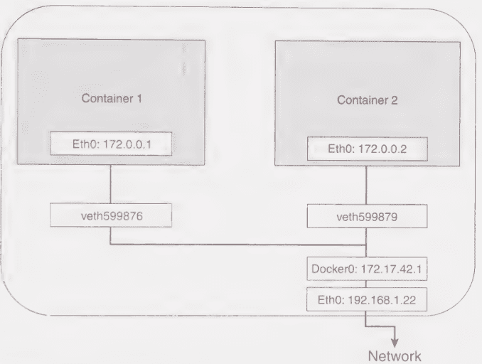

图 8.12 主机网络

## Bridge

`Bridge`（也称为 `docker0`）如果你在 `run` 命令中不指定任何参数（`none` 或 `host`），它是默认的网络设置选项。不要将其与我们之前讨论过的 Linux bridge 混淆，尽管 Docker 使用了它来提供这种桥接网络功能。

正如你可能从名称中猜到的样，`bridge` 为容器创建了一个内部私有网络以便相互通信。请注意，在这种分配的 IP 地址无法从主机外部访问。你必须暴露端口以提供外部访问。要了解更多信息，让我们运行以下命令：

```
docker network inspect bridge
```

如图 8.13 所示，`containers` 部分是空的，因为我们没有正在运行的容器。

```
{
  "Name": "bridge",
  "ID": "fe3118460981ba5602670fe42de4858b057b6ff786be92590c5cad79f5fbbb",
  "Created": "2017-07-08T19:08:03.0165057Z",
  "Scope": "local",
  "Driver": "bridge",
  "IPv6": false,
  "IPAM": {
    "Driver": "default",
    "Options": null,
    "Config": {
      "Subnet": "172.17.0.0/16",
      "Gateway": "172.17.0.1"
    }
  },
  "Internal": false,
  "Attachable": false,
  "Ingress": false,
  "ConfigFrom": {
    "Network": ""
  },
  "ConfigOnly": false,
  "Containers": {
    "Options": {
      "com.docker.network.bridge.default_bridge": "true",
      "com.docker.network.bridge.enable.icc": "true",
      "com.docker.network.bridge.enable.ip.masquerade": "true",
      "com.docker.network.bridge.host_binding.ipv4": "0.0.0.0",
      "com.docker.network.bridge.name": "docker0",
      "com.docker.network.bridge.mtu": "1500"
    }
  },
  "Labels": {}
}
```

**图 8.13** Containers 部分为空

让我们通过在其中一个容器指定 `bridge` 参数而另一个保持默认来启动几个容器：

```
docker run -d --network=bridge mysql
docker run -d --network=default tomcat
```

现在再次运行 `inspect` 命令并注意差异：

```
docker network inspect
```

如图 8.14 所示，两个容器都通过同一个桥接连接，并通过 IP 地址相互通信。

```
{
  "Name": "bridge",
  "Id": "fe3184690981ba9602670fe42f4858fb057b6ff78be9250c5cad79f5bbb",
  "Created": "2017-07-08T19:08:03.016050762",
  "Scope": "local",
  "Driver": "bridge",
  "EnableIPv6": false,
  "IPAM": {
    "Driver": "default",
    "Options": null,
    "Config": {
      "Subnet": "172.17.0.0/16",
      "Gateway": "172.17.0.1"
    }
  },
  "Internal": false,
  "Attachable": false,
  "Ingress": false,
  "ConfigFrom": {},
  "Network": {
    "ConfigOnly": null
  },
  "Containers": {
    "0c7ae5a7e7b3cb249b729b292744122b2b111d4556334d48": {
      "Name": "wonderful.kalem",
      "EndpointId": "30adaccb403b11dc09ae38207d10aa4e9f13647fd980c349181e2bd0f1f7",
      "MacAddress": "02:42:ac:11:00:03",
      "IPv4Address": "172.17.0.3",
      "IPv6Address": ""
    },
    "3c056870b9a7db53e3391a42db65415e514fd26c891d629d8439e47d2": {
      "Name": "blissful_babmage",
      "EndpointId": "1d365a32d1eae3c2e00354071f42906dbb332012",
      "MacAddress": "02:42:ac:11:00:02",
      "IPv4Address": "172.17.0.2",
      "IPv6Address": ""
    }
  },
  "Options": {
    "com.docker.network.bridge.default_bridge": "true",
    "com.docker.network.bridge.enable.icc": "true",
    "com.docker.network.bridge.enable.ip.masquerade": "true",
    "com.docker.network.bridge.host_binding.ipv4": "0.0.0.0",
    "com.docker.network.bridge.name": "docker0",
    "com.docker.network.bridge.mtu": "1500"
  },
  "Labels": {}
}
```


**图 8.14** 容器通过同一个桥接连接，通过 IP 地址与其他通信

你可以附加到这些容器中的每一个，并通过运行 `attach` 和 `ifconfig` 像之前那样查看容器内部的样子。所以问题是，在后端发生了什么？好了，Docker 使用基础网络来实现这一点。所有通过 `bridge` 参数创建的容器都连接到此桥接 (`docker0`)，因此在 `/etc/hosts` 文件和 `iptables` 中放置了必要的条目使其工作。图 8.15 显示了它的样子：

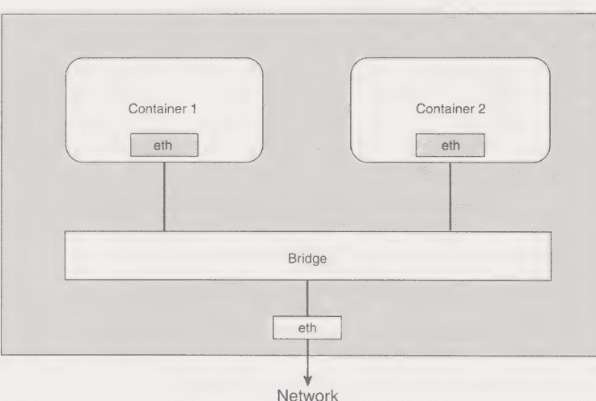

图 8.15 Bridge 网络

## Custom Networks

除了安装 Docker 时包含的三个网络外，你还可以定义自定义网络来控制连接性。在本节中，你将学习这一点。我们将讨论最常用的自定义网络：自定义 `bridge` 网络、`overlay` 网络和 `overlay (MACVLAN)` 网络。

### Custom Bridge Network

`bridge` 驱动与我们之前讨论的 `docker0` 非常相似，但具有更多功能，如 `IPAM`（IP 地址管理）和服务发现。它还提供了更多的灵活性。

创建一个自定义 `bridge` 网络，我们使用以下命令：

```
docker network create [OPTIONS] NETWORK
```

如果需要，我们可以在命令中指定 IP 地址和子网，或者 Docker 将在私有空间分配可用子网。执行此命令：

```
docker network create --driver bridge pkNetwork
```

再次使用 `ls` 验证：

```
docker network ls
```

刚刚创建的 `pkNetwork` 如图 8.16 所示。

| NETWORK ID | DRIVER | SCOPE |
| :--- | :--- | :--- |
| f231896853b | bridge | local |
| 13337c2f8f2e | docker_gwbridge | local |
| d163ca8f2f82 | bridge | local |
| 4a8e21f69a47 | host | local |
| ub5dr217sto | ingress | swarm |
| 1bb6d9233c0 | null | local |
| 33edf6b8d0de | bridge | local |

**图 8.16** 列网络

就像我们对 `docker0` 执行的那样，让我们检查这个新网络：

```
docker network inspect pkNetwork
```

查看图 8.17 并注意我们使用的驱动：`bridge`。这是我们的自定义 `bridge` 网络。

```
{
  "Name": "pkNetwork",
  "Id": "333ef6b8dd0del4493a2d7dfe6762c64ce59ae8b38aa7caea0a572655d8edd9",
  "Created": "2017-07-08T02:21:59.8281098562",
  "Scope": "local",
  "Driver": "bridge",
  "EnableIPv6": false,
  "IPAM": {
    "Driver": "default",
    "Options": {},
    "Config": {
      "Subnet": "172.20.0.0/16",
      "Gateway": "172.20.0.1"
    }
  },
  "Internal": false,
  "Attachable": false,
  "Ingress": false,
  "ConfigFrom": {
    "Network": ""
  },
  "ConfigOnly": false,
  "Containers": {},
  "Options": {},
  "Labels": {}
}
```

**图 8.17** 自定义 `bridge` 网络

### Port Mapping

目前，该网络中没有内置的容器。与 `bridge/docker0` 示例中的一样，我们可以通过指定网络为 `pkBridge` 来创建几个容器，然后检查网络以查看关联。在后台，Docker 在底层 Linux 中创建了必要的配置以使其工作。

### Port Mapping

在 Docker 中，正如我们之前讨论的样，同一网络上的容器可以相互通信。当然，这就是将容器放在同一个网络中的目的。外部访问是被防火墙保护的——也就是说，除非显式授予外部访问以使外部连接成为可能，否则无法从外部世界访问容器。这是通过内部端口映射实现的，即我们在 `Docker run` 命令中将容器端口绑定到主机端口。我们还可以使用

通过 `expose` 和 `publish` 命令的组合，首先暴露然后将所有暴露的端口发布到宿主机接口。
考虑以下示例：

```
docker run -d --network pkBridge -p 8000:80 --name tomcat -d
tomcat
```

我们可以从浏览器从外部访问 Tomcat，如图 8.18 所示。

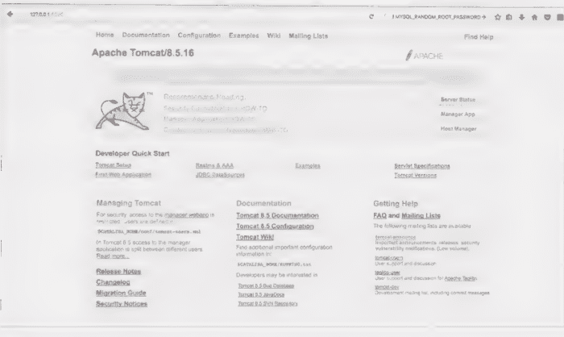

**图 8.18** 通过浏览器从外部访问 Tomcat

那么，这里发生了什么？在后端，Docker 引擎在 Linux `iptables` 中添加了 NAT（网络地址转换）规则。查看底层 `iptables`。你应该能在列表中看到映射条目。

正如你可能注意到的，桥接驱动程序（`bridge driver`）是本地范围的——也就是说，它局限于单台主机。另外两个网络驱动程序 `overlay` 和 `underlay` 处理的是多主机范围。

### Overlay 网络驱动

`overlay` 驱动用于实现跨多个主机的容器连通性。它通过将容器网络与底层物理层解耦，并在主机之间创建隧道来启用通信来实现。将其想象为一个跨越多个主机的网络，并且该特定网络上的所有容器都可以像在单主机内一样进行通信。图 8.19 显示了该网络。

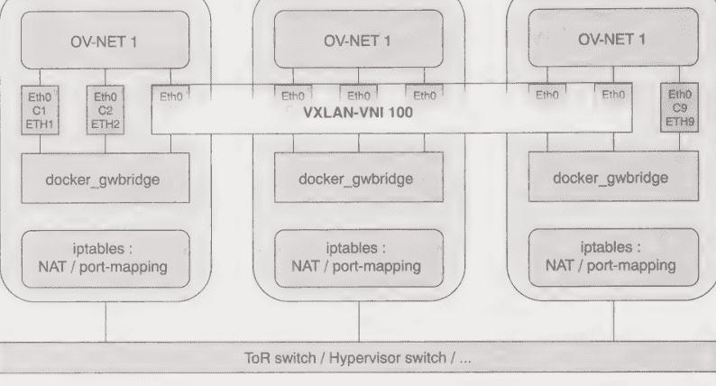

**8.19** Overlay 网络

注意，此特定 `overlay` 网络上的容器无法与同一主机上的其他容器通信，除非它们也在同一个 `overlay` 网络上。Docker 使用 `VXLAN`（虚拟扩展局域网）作为隧道技术。就像我们创建桥接网络一样，通过指定子网来创建 `overlay` 网络。Docker 自动在每个主机上实例化连通性所需的设置（主机之间的 Linux 桥接以及相关的 VXLAN 接口）。
Docker 足够智能，可以在需要这种容器连通性的主机上创建这些设置。这防止了在所有主机上都存在每个 `overlay` 网络，这是 Docker 容器的一个关键特性，解决了微服务的分布式部署和连通性需求。

### Docker Swarm

在实践中，你将有一个运行应用程序服务的 Docker 引擎节点集群。Docker Swarm 提供了集群管理和编排。运行在节点上的每个 Docker 引擎运行在 `swarm` 节点中。其关键特性之一是多主机网络，Docker Swarm 通过我们刚刚讨论的 `overlay` 网络驱动程序提供该功能。当创建一个使用 `overlay` 网络的服务时，`swarm` 的节点节点会将网络扩展到属于该服务的其他节点。

### 自定义网络

Docker Swarm 并不是管理集群的唯一方法。还有其他开源技术，如 Kubernetes 和 Mesos。在这种情况下，`overlay` 网络需要一个有效的键值存储服务来存储必要信息，如服务发现、端点（`endpoints`）、IP 地址等。支持的键值存储器包括 Consul、Zookeeper 和 etcd 等。

### Underlay 网络驱动程序或 Macvlan

媒体访问控制虚拟局域网，或称 `Macvlan`，是另一种内置网络驱动程序，它比其他驱动程序更轻量、更简单。它不使用内置的 Linux 桥接和端口映射；而是将容器的接口直接连接到宿主机接口（`eth0` 或子接口）。

与 `overlay` 网络一样，`Macvlan` 网络与其他网络隔离开。运行在同一主机上但不在此网络上的容器无法相互通信。图 8.20 显示了这种 `underlay` 网络。

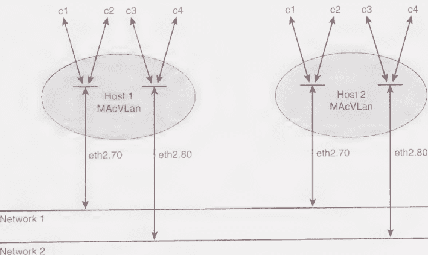

图 8.20 Macvlan 网络

如你所见，Docker 在网络方面非常灵活。如果你的需求更复杂无法通过我们讨论的选项解决，你可以编写自己的网络驱动程序插件，或使用现有的插件，如 Weave Net 或 Flannel。

# 第 9 章

## 容器编排

管理几个容器与管理生产规模的容器完全不同，后者的数量可能达数百甚至数千。为了支持容器管理，我们需要一种简单的方法来规模化部署和处理这些容器。这就是所谓的容器编排。在本章中，我们将研究行业中提供的几种选项，并涵盖每种方案内在工作原理的基础。容器编排是一个变化快速的领域，在你理解了这些技术的工作原理以及它们之间的关键区别后，请查看提供的链接以获取最新进展。

好消息是，容器编排领域有许多选择。但另一方面是，决定哪种工具最适合你的环境将不是一个容易的决定。以下是行业中广泛使用的几种流行选项：

- Kubernetes
- Mesos + Marathon
- Docker Swarm

我们将在接下来的几个章节中介绍这些选项。

### Kubernetes

Kubernetes 是由 Google 领导的开源项目。Google 在规模化管理和部署容器方面拥有丰富经验。Kubernetes 是编排引擎之一，通过提供容器所需的资源和能力来帮助你运行容器化应用，如图 9.1 所示。让我们来看看这种编排的主要组件。

### Master Node
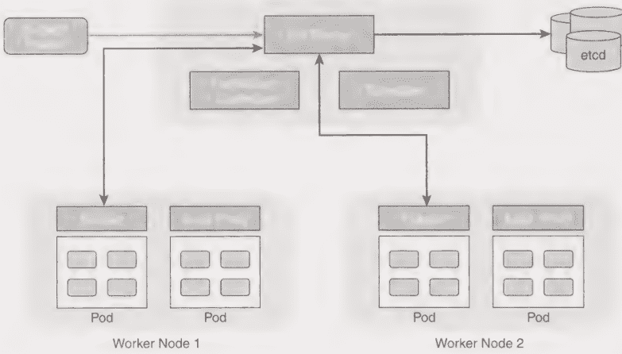

### Kubectl

Kubernetes 有一个名为 `kubectl` 的命令行界面，用于运行命令并与 Kubernetes 交互。

### Master Node

Master 是 Kubernetes 的大脑。它在服务的帮助下协调所有的集群活动。它拥有 API Server、调度器和控制器。

### API Server

API Server 负责暴露表述状态传输（REST）API 来与 Kubernetes 集群交互。客户端（`kubectl`）与集群之间所有外部通信由 API Server 处理。此外，工作节点之间的集群范围通信也由 API Server 处理。它是唯一与分布式键值存储（`etcd`）通信以存储对象状态的组件。

在 Kubernetes 术中，我们使用对象来描述我们对集群的需求，或者我们希望集群处于的状态。例如，对象可以是你随时需要的应用程序实例，也可以是你希望应用程序之间通信的实例。

让我们来看 API Server 如何处理请求。假设我们发布命令运行 Tomcat 容器并在集群中运行三个 Tomcat 实例：

```
kubectl run myTomcat --image=tomcat --replicas=3
```

背后发生的情况是，`kubectl` 将我们在集群中运行三个 Tomcat 实例“意图”或请求提交给 API Server。然后 API Server 与调度器和控制器配合执行我们的请求，并将集群带所需状态。

### Scheduler

Kubernetes 调度器是一个负责在集群节点中放置（调度运行）容器的组件。它通过创建 Pod（Kubernetes 调度的基本单元）来实现。你可以将 Pod 想象成具有独立命名空间的逻辑主机，一个或多个容器位于其中。Pod 内部的所有容器共享 Pod 的命名空间。

当请求提交给 Kubernetes API Server 时，API Server 与调度器协作将 Pod 放置在集群节点中。在将 Pod 放置在工作节点之前，调度器会检查各种标准：

- 哪些节点具有足够的资源（如 CPU 和内存）来运行 Pod 中的容器
- 节点是否开启了 Pod 请求端口
- 在何处放置 Pod 以避免延迟问题（节点亲和性）
- Pod 是否在集群中分布，以支持高可用性

如你所见，调度器必须对 Pod 在集群中的位置做出明智、知晓的决策。这就是 Kubernetes 调度器的关键功能之一

# 第 9 章 容器编排

职责。它从描述 pod 策略的 pod（所需的 CPU 数量、内存、高可用性需求等）中读取数据，并运行自己的算法，以找到一个最理想的节点来放置该 pod。

以下是 Kubernetes 调度器在决定何何放置 pod 之前经过的典型流程：

- 1. 调度器从资源、节点亲和力等方面读取 pod 的节点，并通过从 `etcd` 数据库中提取信息来检查可用节点列表。它会过滤掉任何不符合当前 pod 策略/要求的节点。

例如，假设一个节点有 12G 内存，并且正在运行一个已经占用 8G 内存的 pod。该节点的剩余内存为 4G。如果调度器正在寻找一个具有 8G 内存的节点来调度运行一个 pod，那么该节点将被排除，因为它没有足够的内存来运行给定的 pod。

- 2. 通过了步骤 1 的节点将由 Kubernetes 进行仔细分析。它遵循一组标准，从所有符合条件的节点中选择最好的一个。例如，如果一个应用程序有两个 pod（A 和 B），你不希望它们都被调度到同一个节点运行，因为如果该节点宕机，可能会影响应用程序的可用性，特别是在微服务的情况下。

另一个例子是复制。在这里，出于相同的原因（影响可用性），你不希望 pod 副本被调度到同一个节点上。在 Kubernetes 得出某个特定 pod 应该被调度运行的最理想节点之前，会考虑许多策略。

- 3. 一旦选择了最佳节点，调度器就会将该 pod 调度到所选节点上运行。

Kubernetes 是一个非常插件化的架构。如果你需要一个更符合你业务或组织需求的调度器，可以接入你自己的调度器。

### 复制控制器 (Controller Manager)

复制控制器的工作是确保在任何时候集群中都运行着预期或所需的数量的 pod 副本。假设我们请求 Kubernetes 在集群中运行三个 Tomcat 容器实例。Kubernetes 经过调度过程，选出最佳节点来运行这三个 pod。现在，运行 Tomcat pod 的节点一个由于某种原因崩溃了。这导致我们想要在集群中运行的 pod 数量与实际运行的 pod 数量之间产生了差异。给定此差异，复制控制器将介入并请求 Kubernetes 调度器在集群中的某处启动另一个 Tomcat pod 实例，以及该机器上运行的所有其他 pod。

此外，假设你不需要在集群中运行三个 Tomcat pod 实例。也许你的应用程序时期已经过去，由于预计流量较少，你想减少资源。你可以运行调整了 pod 副本数量的相同命令：

```
kubectl myTomcat --image=tomcat --replicas=2
```


复制控制器将再次介入，并逐个杀死集群中多出的 pod，以维持预期状态。

## 工作节点 (Worker Nodes)

工作节点是 pod 被调度运行的地方。一个名为 `kubelet` 的代理运行在每个工作节点内部。`kubelet` 充充每个工作节点的唯一接触点。它负责从主节点获取“工作”并在工作节点中执行工作。这里的“工作”是指需要在工作节点中执行的 pod 或多个 pod。通常，主节点上的调度组件使用 `API 服务器` 向 `kubelet` 提供 pod 详情。在接收到主节点的工作后，它确保 pod 在节点中成功启动。

`Kubelet` 还负责报告节点状态（其健康状况、资源可用性等）以及节点上运行的每个 pod 的状态。`kubelet` 通过 `API 服务器` 将这些统计数据存储在 `etcd` 数据库中。这些可用于 `etcd` 数据库的数据，是调度器决定哪些节点可用于调度 pod（以及每个节点上有哪些资源）的依据。这些数据也被复制控制器利用，以判断服务的所需的副本数量是否在集群中运行。如果集群中没有运行所需的副本数量，它就会介入以匹配预期状态。

## Pod

Kubernetes pod 是动态的。换句话说，它们根据需要创建；它们可能会因为节点故障而移动到另一个节点；可能会被复制控制器扩展以处理更多流量，也可以被缩小以节省资源。让我们通过一个具体的例子来讨论这个话题，使其更加清晰。

## 示例：Kubernetes 集群

假设我们在 Kubernetes 集群中运行了三个 MySQL pod 实例如图 9.2 所示。

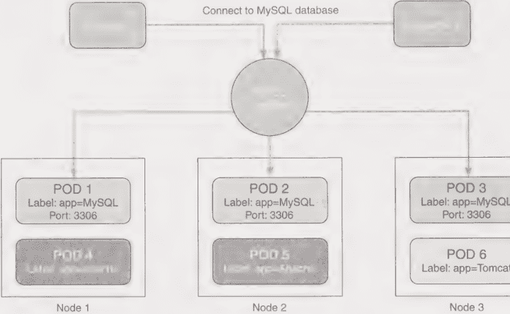

图 9.2 在我们的 Kubernetes 集群中运行的 MySQL pod

Pod 可以拥有描述自身的元数据。在图中，你可以看到 MySQL pod 具有标签 `app=MySQL` 和端口 `3306`。你看到 Pod 1、2 和 3 都是以完全相同的方式标记或标记的。通过这样做，我们创建了一组逻辑上“相关的” pod，它们在集群中共同提供项服务。在这种情况下，这三个 pod 为其消费者提供数据库服务。

让我们运行一个传统的三层架构应用程序案例，其中一个使用 Apache Tomcat 的应用程序服务器（消费者 1）[原文内容在此处截断]

执行器（executor）简单来说就是一个执行 shell 命令、Docker 容器或其他进程的进程或容器。Mesos 提供了简单的执行器，可以执行 shell 命令和 Docker 容器；然而，大多数框架（如 Marathon）都自带了自己的执行器，这些执行器提供的功能比默认 Mesos 执行器提供的更强大。

## 框架 (Frameworks)

框架是集群资源的消费者。正如我们之前看到的，Mesos 本身只管理集群资源；是框架在集群中运行任务。框架包含两个主要组件：调度器（scheduler），它向 Mesos master 注册自己并负责寻找传入的资源提议（offer），并决定接受还是拒绝它；以及执行器（executor），它实际上在 agent 上运行任务。如果框架选择不提供自己的执行器，它们可以使用 Mesos 自带的默认执行器。

## 示例：Marathon 框架

假设我们想要部署三个目录微服务（catalog microservice）。以下是我们如何描述这一需求并交给 Marathon 的：

```json

{

  "id": "catalog-svc",

  "cpus": 0.5,

  "mem": 8.0,

  "instances": 3,

  "container": {

    "type": "DOCKER",

    "Docker": {

      "image": "helpdesk/catalog-svc",

      "network": "BRIDGE",

      "portMappings": [

        {"containerPort": 80,"hostPort": 80,"protocol":"tcp"}

      ]

    }

  }

}

```

注意你的 Docker 网络知识在这里派上了用场。根据这个 JSON，我们需要在集群中运行三个目录微服务的实例。`container` 的部分解释了我们需要什么类型的容器——在这种情况下是 Docker 容器。该部分还解释了 Docker 容器内部将使用什么镜像以及需要暴露的端口。除了所有细节外，此文件还解释了每个容器实例需要多少内存和 CPU。

以下是如何将此 JSON 文件提交给 Marathon，假设该 JSON 文件保存为 `application.json`。

```bash

curl -X POST http://host:port/v2/apps \
-d @application.JSON \
-H "Content-type: application/JSON"

```

当我们向 Marathon 添加内容时，Marathon 会等待来自 Mesos master 的提议（注意 Marathon 不会存储提议历史）。一旦它收到符合请求的提议，它就会将请求交给 Mesos，以便 agent 内部的执行过程启动这些容器。回想一下，我们指示 Marathon 启动三个目录微服务的实例。如果由于任何原因集群中没有三个目录微服务的实例，Marathon 将与 Mesos 协作启动额外的容器，以确保集群中始终运行三个实例。

扩展或收缩集群中运行的实例非常简单。这只需要提交一个带有所需实例数量的新 JSON 文件即可。有关安装和配置的详细信息，请参阅 Mesos 官方在线项目 https://mesosphere.com。

## Docker Swarm

Docker Swarm 是来自 Docker 官方的原生容器编排引擎。Swarm 来说是一组开启了 Swarm 模式并运行 Docker 容器的机器（Docker引擎）。Swarm 通过指示集群节点运行容器来有效地管理集群。让我们来看看主要概念。

### 节点 (Nodes)

简单来说，节点是 Swarm 集群的一部分的 Docker 引擎。集群拥有工作节点（worker nodes）和 Swarm 管理节点（manager nodes）。Swarm 管理节点是 Swarm 集群的大脑。它们负责通过指示工作节点执行容器来管理 Swarm 集群。

管理节点不是单节点部署的；而是通常以奇数（如三个、五个、七个）部署多个节点，以避免产生单点故障。管理节点运行所谓的 raft 共识算法来“选举”出一个单一领导者（leader）。当领导者发生故障时，其中一个跟随者（follower）将被选举选为新领导者，从而避免中断或任何类型的系统故障。

### 服务 (Services)

服务简单来说是对在集群节点上需要执行内容的定义。一个服务定义包含以下内容：

- 在容器中运行的镜像
- 容器内部需要运行的任何命令
- 运行容器的副本数（replicas）或实例数量

### 任务 (Task)

任务是 Swarm 中调度的基本单元。它包含了 Docker 容器以及需要在容器中运行的命令。当 Swarm manager 收到启动服务的请求时，服务只需指示要启动哪个容器以及在集群中需要运行的实例数量。管理节点随后将任务（要启动的容器和在容器中运行的命令）分配给工作节点，并让工作节点启动这些容器。它还确保在集群中启动了所需数量的副本（实例）。

作为用户，我们只需提到我们的意图或应用程序的期望状态，而 Swarm manager 的工作就是确保实现并维护应用程序的期望状态。

### 示例：Swarm 集群

让我们实际操作一下，看看如何创建一个简单的 Swarm 集群。好消息是，只要你安装了 Docker，Swarm 就不需要额外的软件设置。在本文编写时，Docker 的最新版本是 17.06，我们将使用它来探索 Swarm。

### Swarm 集群设置

在这个示例中，我们使用了一个双节点 Swarm 集群（一个管理节点）。在我们想要作为节点的节点上，运行以下命令：

```bash

docker swarm init --advertise-addr 192.168.1.10

```

这将输出一个令牌（token），用它将其他节点加入集群：

```bash

docker swarm join --token <TOKEN> 192.168.1.10:2377

```

一旦节点加入，你可以运行以下命令查看集群状态：

```bash

docker swarm nodes

```

这将显示类似如下的内容：

| ID | HOST | AVAILABILITY | STATUS | MANAGER |
| :--- | :--- | :--- | :--- | :--- |
| kmmt2unpib66 | manager-1 | active | Ready | Leader |
| p85ic7zccsp9aff | worker-1 | active | Ready | No |

## 扩容与缩容

首先，通过请求 Swarm 管理器增加 Tomcat 副本数量来扩展服务：

```bash

docker service scale TomcatService=2

```

在集群中启动额外的容器需要一些时间，如图 9.9 所示。

```bash

root@swarm-master | docker service scale TomcatService
tcatService scaled to 2
root@swarm-master -| docker service ls
root@swarm-master -|
root@swarm-master -|
root@swarm-master -| docker service is
  ID             MODE         REPLICAS       PORTS
f7q3pzn2zk  TomcatService  2/2            -

```

**图 9.9** 通过请求 Swarm 管理器增加 Tomcat 副本数量来扩容服务

缩容服务只需运行此命令：

```bash

docker service scale TomcatService=1
```


欲需更多详情和最新的配置选项，请访问在线项目页面：https://docs.docker.com。

## 服务发现

我们已经讨论过服务发现，但让我们退后一步，理解一下它是什么以及为什么它至关重要。简单来说，服务发现就是关于定位特定服务的运行位置——例如，“服务 X 在哪里？”，其中 X 可能是数据库服务器、缓存服务器或任何其他应用程序服务。

在过去，当我们当我们使用物理机器来部署应用程序时，运行在机器上的服务被赋予了合适的名称以表示其运行的服务。例如，运行在物理机上的帮助台应用的数据库服务器可能被命名为 `helpdesk-db.domain.com`。现在，当客户端（例如 Tomcat 等应用程序服务器）想要使用数据库时，它通常通过数据库服务器上的属性或配置文件进行配置。

然而，当快速动态启动机器的需求变得普遍时，虚拟机（VM）出现了。有了虚拟机，曾经在物理机上难以实现的操作（例如动态地添加节点以处理额外负载）变得简单且易于实现。云技术变得流行。现在，当我们有多个服务器提供单一服务（例如数据库集群）时，客户端如何知道与哪台服务器通信？它们使用如 NGINX 或 HAProxy 等负载均衡器，并在负载均衡器中配置代表该服务的节点。

例如，假设我们配置了一个负载均衡器来在两个 Tomcat 服务器之间平衡负载。随着流量增加，可能会启动一个新的 Tomcat 虚拟机；通过脚本/自动化手段，负载均衡器将更新以反映添加了新的 Tomcat 虚拟机。有了此新配置，负载均衡器知道有一个代表 Tomcat 服务的额外服务器已就位，它可以将流量引导至该实例。客户端应用程序不需要知道 Tomcat 服务添加了新虚拟机，也不关乎该虚拟机运行在何处、其 IP 地址等细节。客户端应用程序继续发送到负载均衡器，而负载均衡器反过来抽象了 Tomcat 服务的更改（例如添加或删除节点）。

回到今天。我们处于容器和微服务的时代。有了容器，发现给定服务所在位置的问题将比其他情况更困难。容器可以极快地启动和销，而且它们的位置不是静态的，这使得客户端很难知道给定服务在集群中的具体位置。好消息是，服务发现领域有很多工具可以根据我们的需求进行利用。

在查看许多可用的服务发现工具之前，让我们了解几种服务发现模式。服务发现至少有两种实现方式，取决于它发生的位置：

- **客户端边服务发现。** 服务注册表是一个工具或数据库，包含所有服务的列表、关于这些服务所在位置的详细信息（IP 地址、端口）等，如图 9.10 所示。当这些实际服务启动时，它们的位置会被注册到注册表中。同样，当这些服务终止时，注册表中的项会被移除。在服务启动或停止之外，必须建立某种心跳机制以确保注册的服务处于开启且健康状态。

**图 9.10** 客户端边服务发现

这种方法的主要缺点是客户端必须知道服务注册表，这使得在与服务通信之前发现服务的责任被放在了客户端应用程序上。

- **服务端服务发现。** 在服务端服务发现的情况下，客户端可以直接向 API 网关或负载均衡器发送请求，而无需担心如何连接到正确的服务。负载均衡器负责管理服务的繁重工作，查询注册表以获取处理传入请求的服务位置，并在服务的多个实例之间执行负载均衡操作，如图 9.11 所示。这种模式的任一个经典示例是 Amazon ELB（弹性负载均衡器）。

使用 Amazon Web Services，假设我们为应用层（Tomcat）设置了一个四节点的 EC2（Amazon 弹性计算云）。为了在这四个 EC2 Tomcat 实例之间分流流量，我们必须通过提供实例名称、服务运行的端口、用于确保这些服务健康的机制（ELB 应具有心跳）以及健康检查发生的频率等细节，将这些实例添加/注册到 ELB。

**图 9.11** 服务端服务发现（注：文本流暗示“一旦完成配置，ELB 就会执行繁重工作……路由到相应的实例”）

微服务和服务发现是紧密相连的。事实上，有很多用于服务发现的开源工具，包括 Consul、Zookeeper、etcd 和 Eureka。这些工具有很多共同点。主要区别在于足迹（轻量与重量级）以及支持的协议。

服务注册表就像是运行环境中微服务的黄页。它包含给定服务运行位置的详细信息（例如主机和端口）。正如我们所知，微服务可以启动或停止。向注册表通信位置至少有两种方式：

- **自注册。** 这是给定微服务将自身信息发送到注册表的过程，如图 9.12 所示。例如，Consul 是一个流行的选择，它暴露了 API 用于交互。通过自注册，每个微服务都必须与 Consul API 交互以发送其位置。根据微服务的模式和最佳实践，每个微服务应该关注单一关注。然而，强制微服务将位置信息发送到服务注册表违反了单一关注模式。由于由于原因，自注册不是一个广泛使用的选项。

**图 9.12** 服务注册表自注册

- **外部工具，或第三方注册。** 利用外部工具进行服务发现是最佳选择，原因很简单：微服务可以专注于其核心职责，而不必担心将位置信息发送到服务注册表。这是一种清晰的关注点分离；明天如果你想更改微服务发现和存储在服务注册表的方式，可以不接触微服务的代码。

让我们看看第三方注册在之前的示例中是如何工作的。Registrator（https://github.com/gliderslabs/registry）是一个开源组件，作为服务注册表和 Docker 容器之间的桥梁。它通过监控 Docker 容器的启动和停止来自动注册和注销服务。

当 Docker 容器启动或停止时，会触发事件（通知），任何第三方工具都可以订阅这些事件以采取相应行动。Registrator 只需观察这些 Docker 事件，并像 `docker inspect` 一样检查这些容器以查看它们提供了哪些服务。然后它与任何服务注册表通信并发送有关发现的服务的信息。

在图 9.13 中，你可以看到 Registrator 是一个安装在所有运行容器的工作节点上的组件。它配置了一个服务注册表（这是存储集群中运行服务实际信息的地方），它会向该注册表发送已发现的服务信息。当某个节点上的容器启动或停止时，Docker 会触发事件，运行在每个节点上的 Registrator 组件会捕捉这些事件并检查容器以获取有关服务的额外信息。

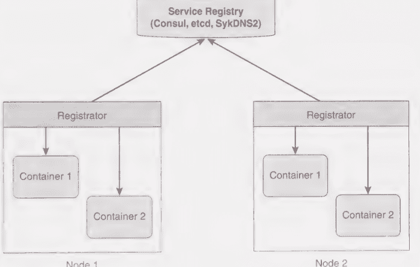

**图 9.13** 安装在所有运行容器的工作节点上的 Registrator

这结束了我们关于部署和发现的话题。在本书的第三部分，我们将广泛使用这些扩展来将项目 Docker 化。

# 第 10 章

## 容器管理

现在我们已经理解了容器编排、扩展和网络，让我们来讨论当出现问题时会发生什么。在生产环境中，可能有数百到数千个容器在运行，你需要知道如何有效地高效地管理它们。为此，我们对容器的深入探讨将进入容器监控和管理的细节，包括捕获日志、收集资源指标以及使用某些集群监控系统。让我们首先了解容器的整体监控方面，以及为什么它可能与市场上已有的工具不同。

## 监控

监控带有容器的环境并不困难，但速度、数量和环境会使其变得困难。从传统角度来看，监控和管理物理主机、网络和虚拟机的监控工具市场已经成熟。容器是新事物；市场仍在解决监控问题。容器监控之所以不同，是因为存在以下方面和挑战：

- **部署环境。** 组织可能直接在其自有数据中心的物理基础设施上运行某些容器，并在诸如 AWS 托管服务合作伙伴等服务提供商的虚拟机上运行某些容器，这在管理上增加了一些复杂性。

- **容器的可扩展性。** 整个应用程序可以运行在物理机或少数几台虚拟机上。对于容器，最佳实践是每个容器一个服务，一个应用程序可能由数百到数千个服务组成，这意味着数百到数千个。在微服务架构中，应用程序扩展需要根据不断的需求自动收缩和自动扩展容器的数量。

- **变化速度。** 与物理主机或虚拟机不同，容器的预期寿命可能从几秒钟到几天不等。当任务完成时，容器就消失了。

- **使用的多种工具。** 尽管容器提供了速度和效率，但它们抛弃了简单性。容器的部署、管理和发现涉及大量工具。例如，你可能使用几种容器编排器之一，如 Docker Swarm、Kubernetes 或 Mesos。你可以启动等。然后编排器根据主机内的资源可用性控制容器的创建、删除和管理。每当创建一个新容器时，它都会获得一个新的 IP 地址。每当它获得一个新的 IP 地址。在所有这一切之后，设置整体监控和指标收集变得非常困难。

- **分布式数据。** 数据必须从各种工具中收集并合并到一个集中位置，以便理解意义并发现潜在问题。Docker 提供了了一些能力来获取这些数据和统计信息，以主动监控容器和整个系统。

有很多厂商特定的选项，每个选项都有自己的优点。Docker 最近与通过 API 将监控工具集成到 Docker 的公司启动了生态系统合作伙伴（ETP）计划。你可以在 https://www.docker.com 搜索此类合作伙伴。

让我们从可用的日志和容器指标收集开始讨论。你可以将这些数据拉取到现有的监控工具中，或构建一些仪表板。

## 日志

在支持多个集群上运行多个应用程序以及运行服务的多个副本的生产环境中，你可能有大量的容器在运行。问题确实会发生，当问题发生时，日志对于故障排除变得非常重要。例如，回想在微服务中，我们讨论的是作为大型应用程序部分的数百到数千个微服务。Docker 容器非常适合运行如此大量的微服务，因为提供了我们讨论过的许多优势。问题是，当每个容器都将 stdout 和 stderr 输出的所有内容输出到日志中时，我们如何管理日志？我们如何保持所有内容的同步并放在一个使故障排除简单高效的地方？

Docker 再次提供了简化我们工作的驱动程序。每个驱动程序都帮助我们从容器和运行的服务获取日志信息。它们在提供和格式化信息的方式以及将其转发到不同日志处理程序的方式有所不同。示例驱动包括 JSON、Syslog、Splunk、Amazon CloudWatch Logs 等。我们充分使用了这些选项，但有关更多细节，请参考 Docker 在线文档。

在编写时，支持以下日志驱动程序：

- **json-file**。Docker 守护进程的默认日志驱动程序。除非你配置容器或守护进程使用不同的驱动程序，否则每个容器都使用 json-file。输出的日志文件是常见的 JSON 格式。

- **None**。关闭日志。

- **Syslog**。将日志消息发送到本地或远程安装的 syslog 服务器。如之前所述，你可以修改主机上的 daemon.json 文件以将日志驱动程序设置为 syslog 并在 options 部分指定选项。你也可以在容器级别进行此。Syslog 将所有消息带到同一个位置，有助于故障排除，但对于处理数百个容器（如微服务所示）来说够。

- **awslogs**。将日志消息发送到 Amazon CloudWatch Logs。在这种情况下，将日志驱动程序设置为 awslogs 并指定所需的选项。

- **Splunk**。使用 HTTP 事件收集器将日志消息发送到 Splunk。在这种情况下，将日志驱动程序设置为 Splunk。Splunk-token 和 splunk-url 是你必须在文件或运行容器时指定的选项。

- **Journald**。将日志消息发送到系统日记。在这种情况下，将日志驱动程序设置为 journald。可以使用 journalctl 或 Docker log 命令检索日志条目。

- **gcplogs**。将日志消息发送到 Google Cloud Platform，你可以在那里搜索和分析这些消息。在这种情况下，将日志驱动程序设置为 gcplogs。你还可以设置几个选项在消息中包含更多细节。

- **GELF**：将消息发送到 Graylog 扩展日志格式 (GELF) 端，例如 Logstash 服务器。在这种情况下，将日志驱动程序设置为 gelf 并配合各种选项。GELF 被广泛用 ELK（Elasticsearch、Logstash 和 Kibana）的一部分。

如前，json-file 是默认驱动程序。你可以通过运行以下命令检查这一点：

```
docker info | grep 'Logging Driver'
```

你应该能看到结果 - Logging Driver: json-file。
让我们运行一个 Ubuntu 容器并检查默认日志：

```
docker run -it ubuntu:latest sh
```

打开另一个终端，找到容器 ID 并复制：

```
docker ps
```

现在运行以下命令找到我们 Ubuntu 容器的日志驱动程序：

```
docker inspect -f '{{.HostConfig.LogConfig.Type}}' ec5e917eb9b0
```

你应该能看到图 10.1 所示的结果。

```
[root@linux-dev pkocher] docker inspect -f '{{.HostConfig.LogConfig.Type}}' ec5

json-file
```

图 10.1 使用 docker inspect 找到我们 Ubuntu 容器的日志驱动程序

你可以在守护进程级别或容器级别更改默认日志驱动程序。对于守护进程级别，你可以修改 Linux 宿主机上 `/etc/Docker` 目录下 daemon.json 文件中的 log-driver 值。其结构如下：

```
"log-driver":
"log-opts":{ options syslog server info, etc. }
```

对于容器级别，你可以在运行命令期间指定日志驱动程序，正如我们在下一个示例中所示。

当然，另一个选项是完全关闭日志。让我们使用 none 选项重新启动 Ubuntu 容器并再次运行 logs 命令。

```
docker run -it --log-driver none ubuntu:latest sh
```

让我们在 sh 提示符运行几个命令来创建一些日志数据，如图 10.2 所示。

- ps
| PID TTY TIME CMM |
| I ? 00:00:00 sh |
| B ? 00:00:00 ps |

**图 10.2** 创建日志数据

现在检查日志：

```
docker ps //Copy ContainerID

docker logs 73c1b4d6091
```

你可以看到没有可用的日志，因为该特定容器已禁用了日志。随后的容器不会受到影响，因为我们在容器级别上更改了设置。

请记住，我们讨论的容器日志选项没有考虑到通过 `stderr` 和 `stdout` 流传递消息的应用程序或服务的消息。此外，这些驱动程序中的某些依赖于运行在宿主机上的服务，这有一点点风险。

另一个需要记住的是，随着你应用程序中容器数量的增加，你需要一个非常复杂的集中日志系统，该系统包含了从 CPU 和内存等系统数据到“最后一公里”应用程序性能数据的所有信息。因此，在构建应用程序时，你需要将适当的标记（tagging）和跟踪（tracking）作为代码的一部分。这个集中日志系统应该包含过滤、索引、分类、排序和搜索等功能，以便使应用程序和容器的故障排除变得更快、更容易。

## 指标收集 (Metrics Collection)

在本节中，我们将讨论使用 Docker 提供的基本实用程序以及一些你可以使用的开源工具来解决部署监控复杂性的指标收集机制。我们从 Docker Stats 开始。

## docker stats 命令

`docker stats` 命令为你提供在宿主机系统上运行的容器的实时性能数据：

```
docker stats [Options] [Containers]
```

你可以为感兴趣的特定容器提供容器 ID，或使用 `-a` 选项查看所有容器。如果不指定选项，Docker 将向你展示所有运行中的容器：

执行此命令：

```
docker stats
```

图 10.3 显示了 `docker stats` 命令的结果，它返回了资源使用统计信息。

| CONTAINER | CPU% | MEM USAGE / LIMIT | MEM% | NET I/O | BLOCK I/O | PIDS |
|---|---|---|---|---|---|---|
| e4b381be0fd4 | 0.00% | 1.98 MB / 47.08 GB | 0.00% | 0 / 0 | 2.12 MB / 0 | 1 |

**图 10.3** 执行 `docker stats` 命令

按 Ctrl+C 退出流。你可以通过通过 `--format` 选项提供所需的格式来自定义输出。例如：

```
docker stats --format "table {{.Name}} \t {{.ID}} \t {{.CPUPerc}} \t{{.MemUsage}}\ \t
```

你可以使用 `--format` 选项包含以下指标：

- .Name 返回容器名。
- .ID 返回容器 ID。
- .CPUPerc 返回 CPU 利用率百分比。
- .MemUsage 返回内存使用情况。
- .NetIO 返回 I/O 利用率。
- .BlockIO 返回块 I/O 利用率。
- .MemPerc 返回内存利用率百分比。
- .PIDs 返回 PID 的数量。

如图 10.4 所示，这提供了一种按宿主机查看性能数据的绝佳方法。

| NAME | CONTAINER ID | CPU % | MEM USAGE / LIMIT |
|---|---|---|---|
| nervous_bhaskara | b4831b86f0d47a24cb8af44b4c7f96bf0d6e6c7f975b0b93195461 | 0.00% | 1.98 MiB / 47.08 GiB |

图 10.4 使用 --format 选项按宿主机查看性能数据

## APIs

`docker stats` 命令是获取实时数据流的一种极方法。好消息是提供了 REST APIs，你可以利用它们来构建跨集群的性能仪表板。这些 API 提供了类似的实时流数据，但比 `docker stats` 更详细。

```
GET /containers/(ID/Name)/stats
```

获取运行中容器统计信息的 API 端点是：


进入`/var/run/docker.sock`目录，找到`xxx.json`。

`curl --unix-socket /var/run/docker.sock -X GET 'http://v1.24/containers/container ID>/stats'`

就像 `docker stats` 命令一样，API 每秒开始流式传输数据。这取决于你如何编程以防影响性能。例如，你可能想按照定义的频率获取快照。希望这种限制很快通过在 API 中包含某种流标记来修复。

正如前面的章节中学到的，有效监控容器的最佳实践之一是以意义的方式标记容器。你可以在构建镜像时定义标签，而不是在特定的宿主机或容器级别操作，你可以使用标签名。

有关 REST APIs 的信息，请参考 `docker.com`。

## cAdvisor

`cAdvisor` 也称为 Container Advisor，是由 Google 开发的监控解决方案。它通过图形用户界面提供容器使用和性能指标的详细数据。它以容器的形式出现，你可以部署在宿主机上。`cAdvisor` 收集宿主机上运行的所有容器的数据，并聚合和处理这些数据供你消费。它通过你可以利用的 API 暴露这些数据。这样你就可以在机器上快速尝试 `cAdvisor`。你可以通过 `github.com/google/cadvisor` 在你的机器上尝试 `cAdvisor`。运行以下代码：

```bash
docker run -p 8080:8080 \
--volume=/var/run/docker.sock:/var/run/docker.sock \
--volumesys:/sys:ro \
--volume=/var/lib/docker:/var/lib/docker:ro \
--volume=/dev/diskgroup:/dev/diskgroup:ro \
--name=cadvisor \
cadvisor:latest
```

你可以通过 `http://localhost:8080` 查看内置的 UI。`cAdvisor` 在后台运行。它提供了 API 供你使用，但许多现成的系统可以提供集群范围指标。这是一个变化非常快的领域。接下来我们将讨论一些系统。

## 集群监控工具

让我们查看一些可用的开源监控工具。

### Heapster

`Heapster` 是另一个由 Google 开发的解决集群监控的解决方案。它利用 `cAdvisor` 实现目标。在 Kubernetes 中，`cAdvisor` 集成在 `Kubelet` 中。`cAdvisor` 自动发现宿主机内的容器并收集使用统计。`Heapster` 处理这些数据并推送到后端进行可视化。

更多信息请参考 `https://kubernetes.io/` 和 `https://github.com/kubernetes/heapster`。

### Prometheus

`Prometheus` 是一个开源集群监控和告警解决方案。它与其他解决方案有所不同，它是构建在拉取模型上的。在这种模型中，监控代理按照定义的频率拉取目标以收集、存储和告警数据。应用程序必须暴露其数据，而不是发送出去。它提供了一种灵活的查询语言 `PromQL`。在查看 `Prometheus` 如何与 Docker 工作之前，让我们看看它的主要组件：

- **Prom server。** 该组件拉取/抓取并存储收集的数据，运行规则以记录新的时间序列。它还可以配置为生成由 `Alertmanager` 获取的诊断告警。
- **Web UI。** `Prometheus` 使用 `Grafana` 作为图形界面来构建高度可视化和交互式的仪表板。
- **Push gateway。** 这个中间服务允许你为无法拉取的短寿命服务推送指标。`Prometheus` 服务器可以拉取这些指标。使用 `push gateway` 时要小心，因为它们可能成为特定数据的单点故障。
- **Exporters。** 这些是用于从无法通过 `Prometheus` 指标注入的系统中导出指标的专用库。以下是一些示例：
    - **HAProxy** 是一个简单的服务器，它抓取 `HAProxy` 状态并通过 `HTTP/JSON` 导出供 `Prometheus` 定期消费。
    - **Memcached exporter** 从 `mem-cached` 服务器导出指标供 `Prometheus` 消费。你可以为你的第三方应用程序创建自定义导出器。有很多现成的可用。

基于这些组件及其功能，通过一个示例轻松了解如何使用 `Prometheus` 监控 Docker 容器。在这个示例中，我们设置了以下内容：

- 运行 `Prometheus` 和之前提到的组件。
- 添加一个 `node exporter` 计数器，可用于从容器和 `cAdvisor` 容器导出指标。
- 将 `node exporter`、`cAdvisor` 和 `Prometheus` 容器设置为 `Prometheus` 监控的目标（在这种情况下，`Prometheus` 将监控其自身）。
- 设置并配置 `Grafana`。
- 查看统计数据。
- 与 `Alertmanager` 集成以配置告警。

#### 第 1 步：运行 Prometheus

第一步是启动 `Prometheus` 服务器。我们以 Docker 容器的形式运行此服务器。为了收集 Docker 指标，我们将该容器配置为 `Prometheus` 目标，以便它也能监控自身。

让我们从一个 Docker compose 文件 `docker-compose.yml` 开始，它将 `Prometheus` 作为容器运行：

```yaml
version: '2'

networks:
  pk_network:
    driver: bridge

volumes:
  prometheus_data: {}

services:
  prometheus:
    image: prom/prometheus
    container_name: pk_prometheus
    volumes:
      - /prometheus/:/etc/prometheus/
      - prometheus_data:/prometheus
    command:
      '-config.file=/etc/prometheus/prometheus.yml'
```

```yaml
- 'storage.local.path=/prometheus'
- 'storage.local.memory-chunks=100000'
restart: unless-stopped
expose:
  - 9090
ports:
  - 9090:9090
networks:
  - pk_network
labels:
    org.label-schema.group: "monitoring image and ran it as pk_prometheus"
```

如你所见，我们拉取 `Prometheus` 镜像并将其作为 `pk_prometheus` 运行。我们还创建了一个桥接网络 `pk_network`，并将容器添加到其中。接下来，我们映射了定义抓取信息的配置文件 `prometheus.yml`，并映射和暴露了端口。

以下是 `prometheus.yml` 的内容：

```yaml
global:
scrape_interval: 20s
evaluation_interval: 20s
## 为图表视图附加以下标签
external_labels: monitor: 'Docker-pk-monitor'
## 抓取端
- job_name: 'pk_prometheus'
scrape_interval: 25s
static_configs:
  - targets: ['localhost:9090']
```

这非常显而易见。我们设置了抓取间隔和评估间隔。抓取间隔定义了抓取目标的频率，而评估间隔定义了规则评估的频率。注意，我们将即将启动的 `Prometheus` 容器添加为其目标，因此它将监控自身。

现在，让我们通过运行 `docker-compose up -d` 来启动 `Prometheus`，如图 10.5 所示：

```bash
docker-compose up -d
```

你正在使用的 Docker Engine 正在 swarm 模式下运行。

（注意：Compose 不使用 swarm 模式将服务部署到 swarm 中的多个节点上。
要跨 swarm 部署您的应用程序，请使用 `docker stack deploy`。）

Pulling prometheus [prom/prometheus:latest]...
latest: pulling from prom/prometheus
4b0bc1c4050b: complete
aed95caeb02: complete
d9ab6c75dec7: complete
d6ab66f42be6: complete
17ee99aa461: complete
8dc0b35fed4f1: complete
b7f982d0c333: complete
63e70970c133: complete
b349160ff0d: complete
digest: sha256-4f6d3a255f32c59b859810e676528326c3c830997a5c916b27a5d22?be2781
Status: Downloaded new image for prom/prometheus:latest

Creating prometheus ...
Creating prometheus ...

## 图 10.5 创建 Prometheus 容器

为了确认 `Prometheus` 正在运行，让我们运行 `docker ps`，如图 10.6 所示。

```bash
docker ps
```

| CONTAINER ID | IMAGE | COMMAND | CREATED | STATUS |
| :--- | :--- | :--- | :--- | :--- |
| 4b8ldefc5ss58 | prom/prometheus | /bin/prometheus-... | 54 seconds ago | up 53 seconds |
| PORTS 0.0.0.0:9090->9090/tcp | prometheus | | | |

## 图 10.6 Prometheus 已运行

到目前一切正常。要访问 `Prometheus` UI，请访问 `http://localhost:9090/`。图 10.7 显示了你应该看到的内容。

## 集群范围监控工具

图 10.7 Prometheus 界面

#### 第 2 步：添加 Node Exporter 和 cAdvisor

让我们在同一个 compose 文件中添加其他组件并添加目标。首先，我们将 `node exporter` 和 `cAdvisor` 添加到现有的 Docker compose 文件中，它们也将以容器的形式运行。注意，我们正在创建这些占位符来从应用程序容器收集指标。在下一步中，我们将使用这些容器作为 `Prometheus` 服务器的目标。

```yaml
nodeexporter:
  image: prom/node-exporter
  container_name: pk_nodeexporter
  restart: unless-stopped
  expose:
    - 9100
  networks:
    - pk_network
  labels:
    org.label-schema.group: "monitoring image and ran it as pk_nodeexporter"
```

```yaml
cadvisor:
  image: google/cadvisor
  container_name: pk_cadvisor
  restart: unless-stopped
  expose:
    - 8080
  networks:
  - pk_network
  labels:
    org.label-schema.group: "monitoring image and ran it as pk_cadvisor"
```

我们所做的是直观易懂。我们启动了 `node exporter` 和 `cAdvisor`，并暴露了端口。

#### 第 3 步：添加目标

下一步是将 `node exporter` 和 `cAdvisor` 添加为目标。我们将它们添加到现有的 `prometheus.yml` 文件中：

```yaml
- job_name: 'pk_nodeexporter'
scrape_interval: 15s
static_configs:
  - targets: ['localhost:9100']
```

正如在图 10.8 中所示的：
```yaml
- job_name: 'pk_cadvisor'
scrape_interval: 20s
static_configs:
  - targets: ['localhost:8080']
```

正如在图 10.8 中所示的，一切都正常。

#### 第 4 步：启动 Grafana 界面

为了启动 `Grafana`，我们需要回到 `docker-compose.yml` 文件并包含它。接下来，我们在 `user.yml` 配置文件中创建一个管理员用户和密码（这里通过环境变量进行配置）：

```yaml
grafana:
  image: grafana/grafana
  container_name: pk_grafana
  restart: unless-stopped
  expose:
    - 3000
  ports:
    - 3000:3000
  networks:
    - pk_network
  environment:
    - GF_SECURITY_ADMIN_USER=admin
    - GF_SECURITY_ADMIN_PASSWORD=admin
```

运行 `docker-compose up -d` 来启动它们：

```bash
docker-compose up -d
```

正如在图 10.9 中所示的，所有容器都已启动。

# 图 10.9 容器已启动

# 第 10 章 容器管理

要检查 Docker 容器的状态，请使用 `docker ps` 命令，如图 10.10 所示。

```bash
docker ps
```

| CONTAINER ID | IMAGE | PORTS | NAMES | CREATED | STATUS |

| :--- | :--- | :--- | :--- | :--- | :--- |

| 1c9a85b3591 | grafana/grafana | 0.0.0.0:3000->3000/tcp | grafana | /run.sh | About a minute ago | Up 58 seconds |

| b6b93f5ce8b | google/cadvisor:v26.1 | 8080/tcp | pk_cadvisor | /usr/bin/cadvisor... | About a minute ago | Up 58 seconds |

| e2653fd3a4ef | prom/alertmanager | 0.0.0.0:9093->9093/tcp | pk_alertmanager | /bin/alert_manager... | About a minute ago | Up 58 seconds |

| dba0ed4ae1c5 | prom/prometheus | 0.0.0.0:9090->9090/tcp | prom_prometheus | /bin/prometheus-... | About a minute ago | Up 57 seconds |

| 9970f4b2e36 | prom/node_exporter | 9100/tcp | pk_nodeexporter | /bin/node_exporter | About a minute ago | Up 58 seconds |


图 10.10 使用 `docker ps` 命令检查状态

让我们检查我们的应用。访问 `http://localhost:9090/` 查看 Prometheus，如图 10.11 所示。访问 `http://localhost:3000/` 查看 Grafana，如图 10.12 所示。

图 10.11 检查 Prometheus

集群级监控工具


**图 10.12** 检查 Grafana

如我们所见，我们的应用程序正在运行。

## 配置 Grafana

我们需要配置 Grafana 来实现数据可视化。首先，使用 Grafana 配置文件中的用户名和密码登录，我们指定为 `admin/admin`。现在为 Grafana 添加数据源，如图 10.13 所示。


**图 10.13** 为 Grafana 添加数据源

让我们填写详细的源信息，例如源类型和凭据，如图 10.14 所示：

- Name（名称): `Prometheus`
- Type（类型): `Prometheus`
- URL: `http://prometheus:9090`
- Access（访问方式): `proxy`


点击 `Save & Test`（保存并测试），你应该能看到一条成功消息。Grafana 和 Prometheus 现在已连接。

## 步骤 5：查看统计数据

设置工作已完成。现在我们准备查看 Prometheus 从三个目标（Advisor、node exporter 和 Prometheus 自身）收集的统计数据。

访问 `http://localhost:9090` 启动 Prometheus UI。点击 `Execute` 旁边的下拉菜单，选择查询以查看收集统计；点击 `Execute`，如图 10.15 所示。

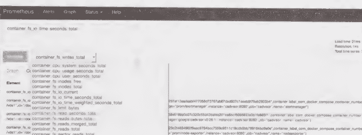

图 10.15 如何查看收集统计

在图 10.16 所示的示例中，我们选择了 `container_cpu_system_seconds_total`。结果显示了所有容器以及消耗的总系统 CPU 时间（秒）。

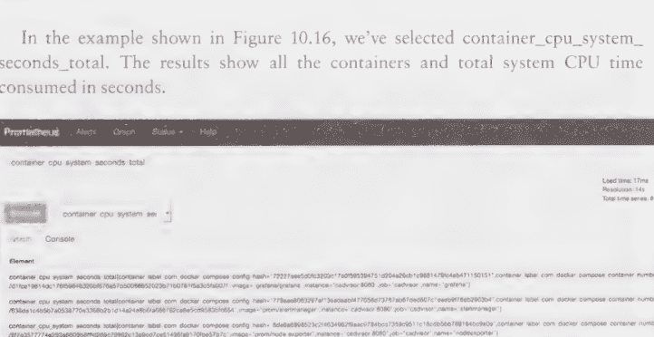

图 10.16 收集结果：消耗的总系统 CPU 时间（秒）

统计数据很棒，但显示效果并不理想。让我们通过将 Prometheus 统计数据导入 Grafana 来改进美观。访问 `http://localhost:3000` 启动 Grafana UI。使用你的用户名和密码登录，在我们的案例中设置为 `admin/admin`。点击顶部的下拉菜单并选择 `Data Sources`（数据源）。点击 `Dashboards`（仪表板）标签，如图 10.17 所示。


**图 10.17** *编辑数据源*

你已经看到一个 `Prometheus Stats` 条目：记住，我们之前做过数据源配置（参见图 10.14）。点击 `Prometheus` 条目右侧的 **Import**（导入）按钮。它将从 Prometheus 数据库导入所有的统计数据和事件。这一步只需要执行一次；每次刷新 Grafana 时，新数据将自动拉取。

要查看你导入的示例统计数据，点击 **Prometheus Stats**。你应该看到新的、更有吸引力的仪表板，如图 10.18 所示。


**图 10.18** *一些精美的仪表板！*

看起来不错，这一切都要功于 Grafana 的强大！
让我们再向前一步，创建一个简单的自定义仪表板，以显示主机上容器的累积 CPU 负载。启动 Grafana UI，点击左上角的菜单，选择 `Dashboards`，然后点击 `New`，如图 10.19 所示。

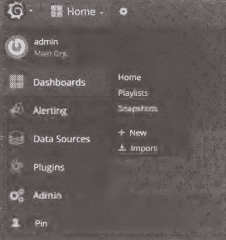

**图 10.19** 创建简单的自定义仪表板以显示主机上容器的累积 CPU 负载

点击 **Single Stat**（单一统计）。继续按如下方式配置：

```
sum(rate(container_cpu_user_seconds_total{image!=""}) [1m])) / count(node_cpu(mode="system")) * 100
```

该查询获取给定时间点的 CPU 资源利用率，如图 10.20 所示。这将是实时。

# 第 10 章 容器管理

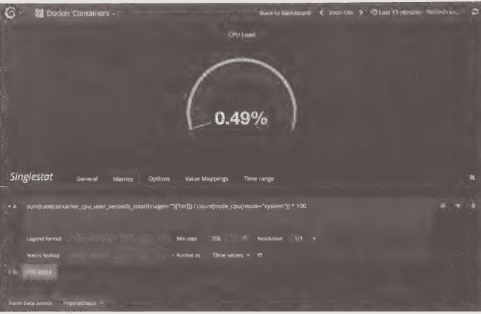

图 10.20 拉取 CPU 资源利用率

其他可以用相同方式构建的示例还内存利用率和系统负载，如图 10.21 和 10.22 所示。


图 10.21 拉取内存利用率

## 集群级监控工具


图 10.22 拉取系统负载

## 步骤 6：集成 Alertmanager

最后，让我们集成 `alertmanager`。你可以通过向 Docker compose 文件中添加以下内容来实现：

```yaml
alertmanager:
  image: alertmanager
  container_name: alertmanager
  volumes:
    - ./alertmanager:/etc/alertmanager
  command:
    -config.file=/etc/alertmanager/alertmanager.yml
  restart: unless-stopped
  ports:
    - "9093:9093"
  networks:
    - alertmanager
```

现在，通过向 Prometheus 配置中添加以下内容来配置告警：

```yaml
alert:
  - alert: tomcat_down
    expr: absent(tomcat)
    labels:
      severity: "critical"
    annotations:
      summary: "tomcat"
      description: "tomcat 机超过 10 秒"
```

4. 将此规则添加到 Prometheus 文件：

```yaml
evaluation_interval: 10s
rule_files:
  - "containers.rules"
```

5. 再次运行 `docker compose`：

```bash
docker-compose up -d
```

访问 `http://localhost:9090` 打开 Prometheus。点击顶部的 **Alerts**（告警）菜单。你可以看到活动告警，如图 10.23 所示。

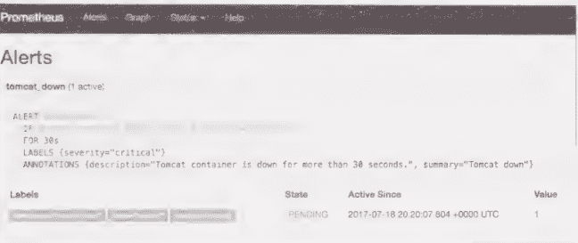

图 10.23 显示活动告警

你可以通过配置你选择的通知工具来进一步改进。更多信息请查看 Prometheus 网站：`https://prometheus.io/`。正如早些提到的，监控是一项非常重要的任务，在迁移到容器时应该是优先考虑，而不是事后补救。这是一个新领域，由于本章强调的挑战而有些棘手，但新的解决方案不断出现。请关注并持续学习！

# 第三部分

# 实战项目——将学习付诸

# 第 11 章

# 案例研究：单体帮助应用程序

在本章中，我们将遵循行业标准实践构建一个传统的 Web 帮助应用程序。然而，我们不使用到目前为止学过的概念；即，我们构建的是一个单体应用。这里的目的是获得现实经验。我们将构建该应用程序，然后查看一些真实的复杂性，例如应用程序部署、更新管理和扩展性。

## 帮助应用程序概述

该应用程序提供支持功能，以帮助和管理客户问题。应用程序体验、可用性、性能和搜索能力都是快速解决问题的关键，也是实现上述目标的关键特性。

假设在现实世界中，此应用程序为一家手机厂商提供客户支持。该应用程序提供以下功能：

- 账户管理。提供用户账户管理功能（添加/修改/删除）。为了保持简单，身份验证通过本地数据库中的用户名和密码进行管理。
- 事件创建与管理。提供提交新事件的能力，以及查看和更新现有事件的。
- 产品目录管理（仅限管理员）。根据所售产品和库存存储并管理产品目录。
- 预约设置。提供与专业支持人员预约的能力。
- 搜索。提供在产品目录中搜索现有问题和解决方案的能力。
- 留言板。客户社区留言板，供客户进行协作和互助帮助。

将使用以下技术构建此应用程序：

- 用户界面：HTML, JavaScript, JQuery
- 中间层：Java 7, Spring 3.x, Jersey 1.8 和 Hibernate
- 数据库：MySQL 5.x

请参阅录 A 以更好地了解应用程序的工作流和逐步流程。所有代码和资源均可在 GitHub 仓库获取：`https://github.com/kocherMSD/Helpdesk_Monolithic.git`。

[可以使用 `git clone` 命令将代码克隆到本地机器。我们将在设置过程中使用这些代码。

## 应用程序架构

现在我们已经了解了此应用程序如何使用，让我们深入研究应用程序的技术细节。图 11.1 显示了应用程序基于组件的架构。

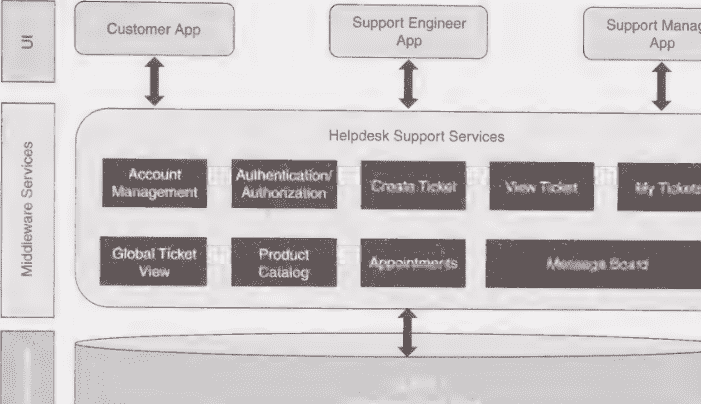

**图 11.1** 我们的帮助台应用组件和基础架构

如你所见，这是一个三层架构应用程序，由数据库、业务逻辑/服务和用户界面组成。现在让我们高层查看应用程序组成的服务列表。有关实现细节，你可以参考 GitHub 上发布的代码。

## 身份验证、拦截器与授权

如名所示，该模块提供身份验证用户的服务，并根据用户的角色授权其有权访问的信息级别。为了简单起见，我们实现了基于简单身份验证（数据库用户名/密码）和基于角色（数据库用户名和角色）的授权。我们实现了 Spring 拦截器以确保每个请求都经过身份验证。角色和登录信息被保存在 `session` 中，并在需要时从 `session` 中获取。

以下是身份验证的伪代码。

## 身份验证

此服务用于通过登录页面文本框中的用户名和密码对用户进行身份验证。用户名/密码对与数据库中的条目进行匹配。

# 第 11 章案例研究：单体帮助台应用程序

- 消耗：`application/xml`, `application/json`
- ：`application/json`
- 输入：`HttpHeaders`, `request`
- 输出：响应状态（即成功或失败）

以下是身份验证服务的伪代码：

```java
@Override
@POST
@Consumes("application/xml", "application/json")
@Produces("application/json")
@Path("/authenticate")
public AuthenticationResponse authenticate(
    @Context HttpHeaders headers,
    AuthenticationRequest request
    //To-do Implementation
)
```

### 拦截器
拦截器使用 `.*` 模式匹配拦截所有进入应用程序服务器的请求，这有助于执行 `prehandle` 函数。
以下是针对 XML 和 Java 的 Spring 伪代码：

```xml
<interceptors>
<interceptor>
  <mapping path="*" />
  <beans:bean>
    class="org.spring.controller.AuthenticationInterceptor"
  </beans:bean>
</interceptor>
</interceptors>
```

```java
@Override
public boolean preHandle(
    HttpServletRequest request,
    HttpServletResponse response,
    Object handler) throws Exception {
    //To-do Implementation
}
```

# 授权

我们的应用程序有多个角色，当用户登录时，他们的角色将作为拦截器逻辑的一部分保存在 HTTP `session` 中。以下代码片段用于授权控制器以获取 HTTP `session`。

```java
LoginForm userData = (LoginForm)
context.getSession().getAttribute("LOGGED_IN_USER");
```

以下代码片段用于授权前端的 Java Server 页面 (JSP)：

```jsp
<%
LoginForm loginform = (LoginForm)session.getAttribute("LOGGED_IN_USER");
String user=loginform.getUsername();
if (session.getAttribute("ACCESS_LEVEL")).equals("4"))
%>
```

## 账户管理

该组件提供管理用户账户、相关合同或权益详情、购买明细（如产品信息、序列号等）的服务。例如，客户可能购买了一台或多台带有保修和专业支持服务的手机。这些细节将通过 API 可用于权益检查和支持。提供以下服务：

- `getAccount`：获取已入驻用户的详情。
- `addAccount`：入驻新用户。
- `updateAccount`：更新已入驻的用户。
- `deleteAccount`：从系统中删除现有用户。

以下是服务类的签名：

```java
@Component
@Path("/AccountService")
public class AccountServiceImpl implements AccountService {
```

## getAccount

如果系统存在该注册用户，则此服务将提取其账户信息。账户信息从后端数据库获取并以 JSON 格式返回。

- 上文：`AccountService/{customerId}`
- 方法：`GET`
- 消耗：`application/xml`, `application/json`
- 产生：`application/json`
- 输入：`HttpHeaders`, `customerId`
- 输出：用户、账户信息、设备和服务信息

以下是 `getAccount` 的伪代码：

```java
@Override
@GET
@Consumes("application/xml", "application/json")
@Produces("application/json")
@Path("/getAccount/{customerId}")
public AccountResponse getAccount(
    @Context HttpHeaders headers,
    @PathParam("customerId") String customerId
) throws ServiceInvocationException {
    //To-do Implementation
}
```

## addAccount

此服务为客户添加指定的账户。它在后端数据库中添加账户信息。输入由文本字段构造为 JSON。

- 上文：`AccountService`
- 方法：`POST`
- 消耗：`application/xml`, `application/json`
- 产生：`application/json`
- 输入：`HttpHeaders`，用户、账户信息、设备和服务的信息的 JSON
- 输出：响应状态（即成功或失败）

以下是 `addAccount` 的伪代码：

```java
@Override
@POST
@Consumes("application/xml", "application/json")
@Produces("application/json")
@Path("/addAccount")
public AccountResponse addAccount(
    @Context HttpHeaders headers,
    AuthenticationRequest request
) throws ServiceInvocationException {
    //To-do Implementation
}
```

## updateAccount

此服务更新系统中指定用户的账户信息。更新后的信息持久化到后端数据库中。

- 上文：`AccountService`
- 方法：`POST`
- 消耗：`application/xml`, `application/json`
- 产生：`application/json`
- 输入：`HttpHeaders`，用户、账户信息、设备和服务的信息的 JSON
- 输出：响应状态（即成功或失败）

以下是 `updateAccount` 的伪代码：

```java
@Override
@POST
@Consumes("application/xml", "application/json")
@Produces("application/json")
@Path("/updateAccount")
```


# AccountService

```java
public AccountResponse updateAccount(

    @Context HttpHeaders headers,

    AuthenticationRequest req

) throws ServiceInvocationException {

    //To-do Implementation

}
```

## deleteAccount

此服务用于从应用程序中删除指定用户的账户。如果账户信息可用，则会将账户信息从数据库中移除。

- 上下文：`AccountService/deleteAccount`
- 方法：`POST`
- 消耗：`application/xml`, `application/json`
- 格式：`application/json`
- 输入：`HttpHeaders`，用户信息的 JSON、账户信息、设备和服务业务信息
- 输出：响应状态（即：成功或失败）

以下是 `deleteAccount` 的伪代码：

```java
@Override
@POST
@Consumes({"application/xml", "application/json"})
@Produces({"application/json"})
@Path("/deleteAccount/")
public AccountResponse deleteAccount(
    HttpHeaders headers,
    AccountRequest req
) throws ServiceInvocException {
    //执行任务并实现 DAO
}
```

# Ticketing（工单系统）

这组服务供注册用户用于对已购买的产品开启并查看支持工单。提供以下服务：

- `createTicket`：创建工单。
- `viewTicket`：打开一个待查看的工单。
- `viewAllTicket`：打开所有待查看的工单。

以下是服务类定义：

```java
@Component
@Path("/TicketDeskServiceImpl")
public class HelpDeskTicketService
implements HelpDeskTicketService, ApplicationContextAware (
```

## createTicket（创建工单）

此服务为用户创建一个工单。使用创建工单网页的内容构建 JSON 请求。该 JSON 请求被转换为数据模型并使用 `hibernate` 持久化到数据库中，以便稍后查看并解决。

- 上下文：`TicketService/createTicket`
- 方法：`POST`
- 消耗：`application/xml`, `application/json`
- 格式：`application/json`
- 输入：`HttpHeaders`，工单信息的 JSON（例如：合同号、问题信息、用户 ID）
- 输出：生成的工单号、响应状态（即：成功或失败）

以下是 `createTicket` 的伪代码：

```java
@Override
@POST
@Consumes({{ MediaType.APPLICATION_JSON,
MediaType.APPLICATION_XML }})
@Produces({{ MediaType.APPLICATION_JSON,
MediaType.APPLICATION_XML }})
@Path("/createTicket")
public TicketResponse createHdTicket(
@Context HttpHeaders headers,
TicketRequest ticketRequest)
throws ServiceInvocationException {
//执行任务并实现 DAO
}
```

## viewTicket（查看工单）

此服务根据指定的工单号和用户角色返回工单详情。
如果为客户提供的工单号可用，它将从数据库中提取工单信息。使用 `hibernate` 获取数据模型并以 JSON 格式返回。

- 上下文：`TicketServices/viewTicket/{userId}`
- 方法：`GET`
- 消耗：`application/xml`, `application/json`
- ：`application/xml`, `application/json`
- 输入：`HttpHeaders`
- 输出：工单信息的 JSON（例如：合同号、问题信息、用户 ID）

以下是 `viewTicket` 的伪代码：

```java
@Override
@GET
@Consumes({"application/xml", "application/json"})
@Produces({"application/json"})
@Path("/viewTicket/{userId}")
public viewTicketResponse viewTicket(
    @Context HttpHeaders headers,
    @PathParam("userId") String userId,
    @PathParam("ticketId") String ticketId
) throws ServiceInvocationException {
```

## viewAllTicket（查看所有工单）

此服务返回系统中由登录用户创建的所有可用工单。使用 `hibernate` 获取数据模型并以 JSON 格式返回。

- 上下文：`TicketServices/viewAllTicket`
- 方法：`GET`
- 消耗：`application/xml`, `application/json`
- 格式：`application/xml`, `application/json`
- 输入：`HttpHeaders`
- 输出：工单信息的 JSON（例如：合同号、问题信息、用户 ID）

以下是 `viewAllTicket` 的伪代码：

```java
@Override
@GET
@Consumes({"application/xml", "application/json"})
@Produces({"application/json"})
@Path("/viewAllTicket/")
public public ViewAllTicketResponse viewAllTicket(
    @Context HttpHeaders headers
)throws ServiceInvocationException {
    //执行任务并实现 DAO
}
```

以下是用户根据角色可使用的选项：

- `我的工单。` 根据用户角色提供分配给支持工程师的工单列表，或由用户开启的工单列表。
- `全局工单视图。` 允许执行人员或支持经理查看所有工单。

# Product Catalog（产品目录）

产品目录服务允许管理员管理公司提供的产品列表。它还允许用户查看其购买的产品列表，并针对这些产品开启支持工单。以下是可用服务列表：

- `getCatalog`：返回产品目录。
- `addCatalog`：在产品目录中创建新条目。
- `updateCatalog`：更新产品目录中的指定条目。
- `deleteCatalog`：删除现有的产品目录条目。

服务类定义如下：

```java
@Path("/CatalogService")
public class CatalogServiceImpl implements CatalogService (
```

## getCatalog（获取目录）

此服务返回系统中可产品列表。使用 `hibernate` 获取数据模型并以 JSON 格式返回。

- 上下文：`CatalogService/getCatalog/{customerId}`
- 方法：`GET`
- 消耗：`application/xml`, `application/json`
- 格式：`application/json`
- 输入：`HttpHeaders`
- 输出：客户拥有的产品信息 JSON

以下是 `getCatalog` 的伪代码：

```java
@Override
@GET
@Consumes({"application/xml", "application/json"})
@Produces("application/json")
@Path("/getCatalog/{customerId}")
public ProductDetailsResponse getCatalog(
    @Context HttpHeaders headers,
    @PathParam("customerId") String customerId
) throws ServiceInvocationException {
    //执行任务并实现 DAO
}
```

## addCatalog（添加目录）

此服务向目录添加新产品。将输入的 JSON 请求转换为数据模型，并保存到数据库中。

- 上下文：`CatalogService/addCatalog`
- 方法：`POST`
- 消耗：`application/xml`, `application/json`
- 格式：`application/json`
- 输入：`HttpHeaders`，客户账户信息的 JSON
- 输出：响应状态（即：成功或失败）

以下是 `addCatalog` 的伪代码：

```java
@Override
@POST
@Consumes({"application/xml", "application/json"})
@Produces({"application/json"})
@Path("/addCatalog/")
public CatalogResponse addCatalog(
    @Context HttpHeaders headers,
    CatalogRequest req)
throws ServiceInvocationException {
//执行任务并实现 DAO
}
```

## updateCatalog（更新目录）

如果指定的产品可用，此服务将更新现有的产品目录条目。在数据模型中更改 JSON 并更新数据库。

- 上下文：`CatalogService/updateCatalog`
- 方法：`POST`
- 消耗：`application/xml`, `application/json`
- 格式：`application/json`
- 输入：`HttpHeaders`，客户账户信息的 JSON
- 输出：响应状态（即：成功或失败）

以下是 `updateCatalog` 的伪代码：

```java
@Override
@POST
@Consumes({"application/xml", "application/json"})
@Produces({"application/json"})
@Path("/updateCatalog/")
public CatalogResponse updateCatalog(
    HttpHeaders headers,
    CatalogRequest req
) throws ServiceInvocationException {
    //执行任务并实现 DAO
}
```

## deleteCatalog（删除目录）

此服务用于从目录中删除产品目录条目。使用 `hibernate` 从数据库中删除条目。

- 上下文：`CatalogService/deleteCatalog`
- 方法：`POST`
- 消耗：`application/xml`, `application/json`
- 格式：`application/json`
- 输入：`HttpHeaders`，客户账户信息的 JSON
- 输出：响应状态（即：成功或失败）

以下是 `deleteCatalog` 的伪代码：

```java
@Override
@POST
@Consumes({"application/xml", "application/json"})
@Produces("application/json")
@Path("/deleteCatalog/")
public CatalogResponse deleteCatalog(
    HttpHeaders headers,
    CatalogRequest req)
    throws ServiceInvocationException {
    //执行任务并实现 DAO
}
```

# Appointments（预约）

预约服务的工作原理类似于 Apple 的 Genius Bar。用户可以预约支持工程师，以便在商店内安排时间。预约服务中提供以下功能：

- `getAvailableTimeSlots`：获取指定日期所有可用的预约时间段。
- `getAvailableDates`：返回至少有一个可用段的日期。
- `saveAppointment`：将预约保存到计划中。

以下是服务类定义：

```java
@Component
@Path("/AppointmentService")
public class AppointmentServiceImpl {
    getAvailableTimeSlots
}
```

该服务以 JSON 格式检索指定日期的所有可用时间段。

- 上文：`AppointmentService/getAvailableTimeSlots`
- 方法：`GET`
- 消耗：`application/xml`, `application/json`
- 产生：`application/json`
- 输入：`HttpHeaders`, `TITLE`
- 输出：响应状态（即：成功或失败）

以下是 `getAvailableTimeSlots` 的伪代码：

```java
@Override
@POST
@Consumes({"application/xml", "application/json"})
@Produces({"application/json"})
@Path("/getAvailableTimeSlots")
public AppointmentAvailableTimeSlotsResponse getAvailableTimeSlots(
    @Context HttpHeaders headers,
    AppointmentAvailableSlotRequest Request) {
    // 待办
}
```

## getAvailableDates

该服务返回所有具有一个或多个预约时间段的日期。

- 上文：`AppointmentService/getAvailableDates`
- 方法：`POST`
- 消耗：`application/xml`, `application/json`
- 产生：`application/json`
- 输入：`HttpHeaders`, `TITLE`
- 输出：响应状态（即：成功或失败）

以下是 `getAvailableDates` 的伪代码：

```java
@Override
@POST
@Consumes({"application/xml", "application/json"})
@Produces({"application/json"})
@Path("/getAvailableDates/")
public AppointmentAvailableDateResponse getUnavailableDates(
    @Context HttpHeaders headers,
    AppointmentAvailableRequest request) {
    // 待办
}
```

## saveAppointment

该服务为选定的可用时间和日期设置并保存预约。

- 上文：`AppointmentsService/saveAppointment`
- 方法：`POST`
- 消耗：`application/xml`, `application/json`
- 产生：`application/json`
- 输入：`HttpHeaders`, `TITLE`, `request`
- 输出：响应状态（即：成功或失败）

以下是 `saveAppointment` 的伪代码：

```java
@Override
@POST
@Consumes({"application/xml"
```

# 留言板 (Message Board)

留言板服务实现了用户社区与支持专家之间的协作。留言板提供以下服务：

- `getMessage`：检索系统中的可用消息。
- `getAllMessage`：根据给定的时间获取所有消息。
- `createMessage`：保存用户提供的消息、问题或答案。

以下是服务类定义：

```java
@Component
@Path("/MessageService")
public class MessageServiceImpl implements MessageService {
}
```

## getMessage

该服务根据用户提问，提取系统中的可用消息、问题和答案。

- 上文：`MessageService/getMessage/{title}`
- 方法：`GET`
- 消耗：`application/xml`, `application/json`
- 产生：`application/json`
- 输入：`HttpHeaders`, `TITLE`
- 输出：HTTP 响应状态（即：成功或失败）

以下是 `getMessage` 的伪代码：

```java
@Override
@GET
@Consumes({"application/xml", "application/json"})
@Produces({"application/json"})
@Path("/getMessage/{title}")
public MessageViewResponse getMessage(
    @Context HttpHeaders headers,
    @PathParam("title") String title
    throws ServiceInvocationException {
    // 完成任务和 DAO 实现
}
```


## `getAllMessage`
该服务根据用户提供的时间段返回系统中的所有可用消息或问题，并以 JSON 格式返回。

- 上文：`MessageService/getAllMessage`
- 方法：`GET`
- 消耗：`application/xml`, `application/json`
- 产生：`application/json`
- 输入：`HttpHeaders`
- 输出：响应状态（即：成功或失败）

以下是 `getAllMessage` 的伪代码：

```
@Override

@GET

@Consumes({"application/xml", "application/json"})

@Produces({"application/json"})

@Path("/getAllMessage/")

public MessageViewResponse getAllMessage(

    @Context HttpHeaders headers)

    throws ServiceInvocationException {

    // 完成逻辑

}
```

## `createMessage`
该服务在留言板上保存用户提供的消息、问题或答案。

- 上文：`MessageService/createMessage`
- 方法：`POST`
- 消耗：`application/xml`, `application/json`
- 产生：`application/json`
- 输入：`HttpHeaders`, `MessageRequest`
- 输出：响应状态（即：成功或失败）

以下是 `createMessage` 的伪代码：

```
@Override

@POST

@Consumes({"application/xml", "application/json"})

@Produces({"application/json"})

@Path("/createMessage/")

public RestResponse createMessage(

    @Context HttpHeaders headers,

    MessageRequest req)

    throws ServiceInvocationException {

    // 完成逻辑

}
```

## 搜索 (`Search`)
搜索服务允许用户对整个应用程序执行基于文本的搜索。它在所有实体（例如工单、目录和消息数据）中查找文本。它通过 DAO（数据访问对象）层与数据库交互，并在提供的文本通过 Hibernate 映射从数据库中提取信息。

以下是类定义：

```
@Component

@Path("/Search/Service")

public class SearchServiceImpl implements SearchService {

}
```

- 上文：`SearchService/search`
- 方法：`GET`
- 消耗：`application/xml`, `application/json`
- 产生：`application/json`
- 输入：`HttpHeaders`
- 输出：响应状态（即：成功或失败）

以下是搜索服务的伪代码：

```
@Override

@GET

@Consumes({"application/xml", "application/json"})

@Produces({"application/json"})

@Path("/search")

public MessageViewResponse search(

@Context HttpHeaders headers,

@PathParam("title")String title

throws ServiceInvocationException {

    // 完成任务和 DAO 实现

}
```

# 第11章 案例研究：单体架构 Helpdesk 应用程序

在我们涵盖了应用程序的架构、Web 服务以及各种依赖项之后，让我们下载代码、进行编译并运行它。

## 配置 Eclipse
我们使用 Eclipse 进行开发；你可以选择任何你熟悉的 IDE，以下是在 Windows 上配置 Eclipse 的说明（如果已安装 Eclipse 请跳过此步骤）：

- 从 `https://eclipse.org/downloads/index.php` 下载 Eclipse。
- 根据你的系统进行解压或解包。Eclipse 的前提是系统路径中已安装 JRE。
- 双击 `eclipse.exe`，如图 11.2 所示。
- 右键点击 package explorer 并选择 New Java Projects。我们将项目命名为 `Helpdesk`，如图 11.3 所示，其他字段保留默认值。
- 取消勾选 default location，浏览到你克隆代码的目录（在本章开头讨论过），并点击 Open。然后点击 Next。
- 点击 Finish，如图 11.4 所示。

## 构建应用程序
以下指令说明了如何运行构建并生成部署的 WAR 文件。我们使用原生的 Apache Ant 构建。

- 在构建 WAR 文件之前，我们需要在代码库的 `applicationContext.xml` 中配置数据库。你可以在 `Project Location/src/main/webapp/WEB-INF/applicationContext.xml` 找到它。修改以下代码中 DataSource Bean 的 `url`、`username` 和 `password` 属性

在后续步骤中安装和配置 MySQL 数据库时，请确保使用这些凭据。

```xml
<bean id="DataSource" destroy-method="close"
class="org.apache.tomcat.jdbc.pool.DataSource">
  <property name="driverClassName"
    value="com.mysql.jdbc.Driver" />
  <property name="url"
    value="jdbc:mysql://${dbhost}:${dbport}/${dbname}" />
  <property name="username" value="<Username>" />
  <property name="password" value="<Password>" />
  <property name="initialSize" value="5" />
  <property name="maxActive" value="50" />
  <property name="validationQuery"
    value="select 1 from dual" />
  <property name="testOnIdle" value="true" />
  <property name="testOnBorrow" value="true" />
  <property name="minIdle" value="200000" />
  <property name="minEvictableIdleTimeMillis"
    value="30000000" />
  <property name="timeBetweenEvictionRunsMillis"
    value="6000000" />
  <property name="removeAbandoned" value="true" />
  <property name="removeAbandonedTimeout" value="30000" />
  <property name="logAbandoned" value="true" />
  <property name="maxWait" value="120000" />
</bean>
```

2. 在根目录下创建一个新的 `Build.xml` 文件，并包含以下 target：

```xml
<project name="projects" default="jar" basedir=".">
  <property name="src" location="src"/>
  <property name="build" location="build"/>
  <property name="dist" location="dist"/>
  <property name="jar.location" location="${dist}/lib"/>
  <dirname property="projects.basedir"
    file="${ant.file.projects}" />
  <echo projects.basedir=${projects.basedir}</echo>
```

```xml
<echo>Inside smartview project:
smartview.basedir=${(smartview.basedir)}</echo>
```

```xml
<path id="project.classpath">
  <fileset refid="sv.jars"/>
  <fileset refid="common.dist"/>
</path>
```

```xml
<filelist id="project.build.files" dir="${projects.basedir}">
  <file name="build.xml" />
</filelist>
```

```xml
<fileset id="sv.jars" dir="${projects.basedir}">
  <include name="src/main/*.jar"/>
</fileset>
```

```xml
<fileset id="common.dist" dir="${projects.basedir}">
  <include name="src/main/*.jar"/>
</fileset>
```

3. 使用这些 targets 编译并创建 JAR 文件：

```xml
<target name="compile.individual" depends="init">
  <javac includeantruntime="false"
       debug="true"
       compiler="javac1.6"
       srcdir="${src}" destdir="${build}">
    <classpath refid="project.classpath"/>
  </javac>
</target>
```

```xml
<target name="jar.individual" depends="compile">
  <mkdir dir="${jar.location}"/>
  <mkdir dir="${build}/META-INF"/>
</target>
```

```xml
<copy todir="${build}/META-INF">
  <fileset dir="${src}/main/resource/META-INF"
        include="*.xml"/>
</copy>
```

```xml
<jar jarfile="$(jar.location)/org-$(ant.project.name).jar
      basedir="$(build)"/>
</target>
```

> <!-- 方法仅用于 JAR 包或 WAR 包所有内容的顶层 -->
```xml
<target name="jar" depends="init">
  <mkdir dir="$(dist)/lib">
  <subant target="jar.individual">
    <filelist refid="project.build.files"/>
  </subant>
</target>
```

4. 使用以下 targets 创建 WAR 文件：

```xml
<target name="copy.files" depends="jar">
  <copy todir="${stage.war}/lib" flatten="true">
    <fileset dir="${projects.basedir}"
      includes="**/dist/lib"
      excludes="*.jar" />
  </copy>
  <copy todir="${stage.war}/lib" flatten="true">
    <fileset dir="${projects.basedir}"
      includes="config/*.xml" />
  </copy>
  <copy todir="${stage.war}/lib" flatten="true">
    <fileset refid="common.jars"/>
  </copy>
  <copy todir="${stage.war}/lib" flatten="true">
    <fileset refid="sv.jars"/>
  </copy>
</target>
```

```xml
<target name="war" depends="init.copy.files">
  <war destfile="dist/lib/helpdesk.war"
    webxml="src/main/webapp/WEB-INF/web.xml">
    <fileset dir="src/main/webapp">
      <exclude name="**/*" />
    </fileset>
    <lib dir="src/main/webapp/WEB-INF/lib" />
    <classes dir="src/main/webapp" />
  </war>
</target>
```

5. 右键点击 `Build.xml`，选择 Run As → Ant，如 11.6 所示。

6. 在 targets 窗口中选择所有目标。

## 新需求与 修复 201

```java
public String getEmailAddress() {
    return emailAddress;
}

public void setEmailAddress(String emailAddress) {
    this.emailAddress = emailAddress;
}
```

使用以下代码，我们可以为 DAO 层添加逻辑，从数据库中获取该属性：

```java
private String saveToDatabase(TicketRequest ticketRequest) {
    // 与现有代码一同添加
    ticket.setEmailAddress(ticketRequest.getEmailAddress());
}
```


代码更改就此结束，看起来非常直观。接下来会发生什么？你需要在所有环境中执行以下操作并部署代码：

- 1. 编译整个 Web 应用程序。这意味着你必须重新部署整个应用程序。
- 2. 对整个应用程序进行回归测试，以确保所有其他功能仍按预期工作。
- 3. 解决任何 Bug 或依赖问题。
- 4. 将代码部署到测试环境并进行质量保证流程。
- 5. 将更改部署到生产环境并发布。

如果应用程序没有以高可用（HA）模式部署，意味着将会发生停机，因为应用程序将重新部署。所有这些都增加了发布此微小更改的时间，并违背了敏捷原则。这还没有考虑到持续的更改，你可能需要创建一个新的代码分支并重新合并和测试。

还存在其他问题：

- 修复 Bug。每个 Bug 修复都需要部署整个构建，这意味着如果部署架构中没有建立良好的高可用性，系统可能会出现停机。此外，取决于所使用的系统开发生命周期（SDLC）方法，这可能意味着在引入 Bug 修复之前需要很长时间。对于关键 Bug，通常意味着创建并维护代码的“热修复”（hot fix）分支，这会使代码库复杂化，并在以后产生合并问题。
- 替换应用程序组件。这是另一个可能对整个应用程序进行重构/重新实现的情况。假设组织希望使用服务服务进行工单管理；按照目前的编写方式，很难将相关模块从应用程序中解耦。
- 替换或添加新的技术栈。在这种情况下，除非重新实现整个应用程序，否则你无法为新模块/功能选择技术。由于单体架构，组织被困于所选的技术。
- 选择性扩展。比方你想扩展工单模块以适应使用模式。在这种情况下，它是非常复杂的，因为应用程序组件作为单体应用程序是密集成的。例如，分离工单需要大量的代码重构、与独立工单系统的集成、测试、新的部署架构等。
- 处理故障。在单体应用程序中，其中一个组件的故障可能会导致整个应用程序的崩溃。假设产品目录服务宕机。这将阻止用户提交新的工作工单。新的工作工单应该通过更好的路由和更快的产品解决速度来指示用户在哪个产品上遇到了问题。然而，产品目录服务中的 Bug 不应该阻止用户创建工单本身——也就是说，它不应该导致工单服务本身崩溃。由于单体化的特性，如果产品目录是必填字段且存在 Bug，用户将卡在这个阶段，尽管他们本可以描述该问题。

虽然对我们的应用程序来说具有挑战性，但这些是今天数字世界的简单需求。使用我们当前应用程序使用的单体方法来解决这些问题变得非常昂贵且耗时。在接下来的两个章节中，我们将讨论如何通过微服务和容器消除这些挑战。

## 第12章

## 案例研究：迁移到微服务

在第 4 章“迁移和实现微服务”中，我们讨论了两种可能的场景：创建一个使用微服务的新应用程序，以及将单体应用程序迁移到微服务。由于我们的帮助台是一个现有的单体应用程序，在这里我们遵循迁移到微服务的第二种场景。

### 迁移规划

假设我们的帮助台应用程序在 2005 年首次编写时，高层业务需求如下：

- 在 Web 端支持约 500,000 名客户，他们可以在那里为问题提交工作工单。
- 所有功能同等重要，并且应该随时可用。
- 应用程序是水平可的。
- 通过允许用户搜索现有解决方案来减少提交的工单数量。

### 第 12 章案例研究：迁移到微服务

现在是 2018 年。让我们回顾客户行为以及该应用程序是如何被使用的：

- 用户数已增长到 150 万，由于移动领域的繁荣，预计在未来 2 年内将增长到 300 万。
- 大多数用户使用的前两个功能是工单和搜索。
- 留言板等功能的使用变化非常少。
- 流量每年出现两次高峰：初夏（6 月份）和假日季节（11 月和 12 月）。
- 受产品目录等其他服务影响导致工单服务受影响的次数大幅增加。
- 自然语言处理的技术进步意味着客户不再只期待基于关键词的搜索。他们希望系统能理解英语，并能够搜索工单并提供适当的帮助。换句话说，他们想要语义搜索。
- 大多数增强请求涉及工单功能。

很明显，我们的应用程序运行得非常好，因为客户数量增加了且应用程序仍在提供服务。此外，我们可以假设应用程序已经很好地水平扩展以支持用户的增长。

## 应用微服务

回顾第 4 章概述的微服务标准，它们定义了选择和优先级排序单体应用程序迁移的可能方法。我们查看了最佳实践，在考虑我们的场景时，这些实践是适用于：

- 扩展。从前两个需求来看，显然我们需要扩展应用程序。最重要和使用最多的组件是工单和搜索，因此将这些服务转换为微服务是有意义的。
- 改进的技术方案或多语言编程。从新需求来看，我们看到系统需要智能搜索，Apache Solr 是一个适用于这些目的开源工具。它将通过提供相关的、上下文的结果来提高搜索能力。
- 存储替代方案或多语言持久化。我们的单体应用程序一直使用 MySQL 数据库进行所有数据存储。虽然工单数据存储在关系型数据库是合理的，但我们的应用程序可以通过将产品目录数据存储在内存缓存并以扁平文件作为备份存储来改进，原因如下：
    - 这允许通过简单的掉落文件进行更新。
    - 由于没有关系查询或连接，简单读取内存键列表将提高速度。
    - 更改。鉴于大多数增强都在工单逻辑中，根据需求，将工单转换为微服务是有意义的。根据同样的逻辑并根据我们的新需求，将留言板转换为微服务并没有太大意义。
    - 部署。在我们的应用程序中，任何给定组件都没有部署复杂性，因此我们可以认为它是适用的。
    - 辅助服务。对于新需求，现有的工单流受到了产品目录不可用或问题的影响。我们必须短路此服务，这意味着即使产品目录宕机，我们的工单也应该按预期工作。这一要求使产品目录服务具备转换为微服务的资格。

那么我们该如何做呢？有很多种方法。让我们应用在第 4 章中学到的知识，将现有的项目转换为基于微服务的应用程序。

在高流量季节进行扩展，并在正常流量期间将其缩减。
根据我们对微服务的了解以及我们正在转换现有服务的方式，扩展预期流量较高的组件将更具成本效益。我们将在第 13 章“案例研究：帮助台应用程序的容器化”中涵盖向微服务迁移的这方面内容。

### 转换摘要

根据新需求和我们的微服务标准，我们得出结论，以下服务已转换为微服务架构：

- 产品目录（Product catalog）
- 工单系统（Ticketing）
- 搜索系统（Search）

此外，我们将为应用程序添加一个 Solr 搜索引擎。在当前应用程序中，搜索是通过数据库扫描完成的，这是实现搜索功能的一种粗糙方法。这种方法仅仅是将文本与数据库中的可用数据进行匹配。结果质量和性能都无法匹配今天技术的水平。

让我们简要讨论一下 Solr。（详细安装和配置说明请参考附录 B。）Solr 是一个基于 Apache Lucene 的搜索引擎平台。它用 Java 编写，并使用 Lucene 库来实现索引。可以使用多种 REST API（包括 XML 和 JSON）访问它。基本功能包括：

- 高级全文搜索
- 针对高量网络流量进行了优化
- 全面的 HTML 管理界面
- 通过 Java 管理扩展 (JMX) 暴露服务器统计以进行监控
- 线性扩展、自动索引复制以及自动故障转移和恢复
- 近实时索引
- 通过 XML 配置，具有灵活性和适应性
- 可扩展的插件架构

欲需更多信息，请访问 `http://lucene.apache.org/solr`。

### 对架构的影响

在产品目录、工单和搜索服务转换为自包含的独立微服务后，架构将如图 12.1 所示。

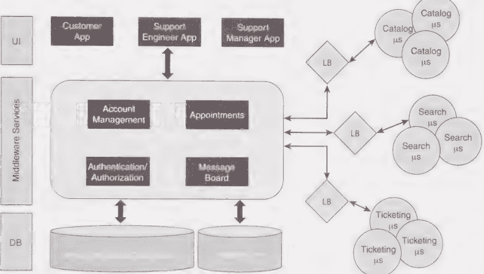

图 12.1 我们的新架构，包含自包含且独立的微服务

如你所见，目录、工单和搜索等服务已从单体范式中分离出来，并作为单个独立的微服务进行部署。这些单个微服务部署在 HAProxy 等负载均衡器之后，以实现高可用性和扩展。

### 转换为微服务

现在我们已经理解了基于微服务的新架构，让我们将单体应用中识别出的三个组件转换为独立的微服务。我们将详细介绍产品目录微服务的转换，但留给工单和搜索服务由您以类似的方式进行转换，以获得实践经验。您也可以参考发布在 GitHub 上的代码库：`https://github.com/kocherMSD/Helpdesk_Microservices.git`。

### 产品目录

对于此项目，我们将目录服务特定的代码从单体描述的应用程序迁移到它自己的构建实体中。这涉及提取接口、服务实现、辅助类和配置文件，并创建一个新的构建产物。这个新的构建产物仅包含新构建产物实际所需的第三方依赖引用。

接下来，我们修改目录服务以使用 Apache Maven 代替 Apache Ant，因为 Apache Maven 是一个更新、更灵活的构建系统，具有优越的外部依赖管理功能。

最后，我们修改目录构建产物，将第三方外部依赖升级到最新的主版本。通过这种方式，我们获得了利用第三方依赖改进实现的能力。

以下是产品目录微服务转换的详细步骤。

### 转换步骤

我们通过重用单体应用程序代码库来创建产品目录微服务。基本上，它将是一个独立的项目和一个本身的服务。以下是步骤：

- 1. 在 Eclipse 中创建一个名为 `catalog-svc` 的新项目。
- 2. 下载并安装 Apache Maven。参考 `https://maven.apache.org/install.html`。
- 3. 创建 Maven `pom.xml` 文件，并定义根目录所需的依赖。您可以在 GitHub 上发布的代码中找到详情：`https://github.com/kocherMSD/Helpdesk_Microservices/blob/master/catalog-svc/pom.xml`。
- 4. 创建服务接口、服务实现、服务辅助、数据访问对象 (DAO) 类和应用程序上下文 XML 文件。

根据微服务的定义，我们将有一个的接口、服务实现、服务辅助和 DAO Java 类。以下是我们服务的伪代码，但强烈建议您查看这些在 GitHub 上的代码：

- a. 服务接口伪代码：

```
public interface CatalogService extends BeanFactoryAware,
ApplicationContextAware {
    public abstract ProductDetailsResponse getCatalog(
    @Context HttpHeaders headers,
String userId)
throws ServiceInvocationException;
```

```
public abstract CatalogResponse addCatalog(
    @Context HttpHeaders headers,
    CatalogRequest req
    throws ServiceInvocationException;
```

```
public abstract CatalogResponse updateCatalog(
    @Context HttpHeaders headers,
    CatalogRequest req
    throws ServiceInvocationException;
```

```
public abstract CatalogResponse deleteCatalog(
    @Context HttpHeaders headers,
    CatalogRequest req
    throws ServiceInvocationException;
);
```

- b. 服务实现伪代码：

```
@Component
@Path("/CatalogService")
public class CatalogServiceImpl implements
CatalogService {
@Override
@GET
@Consumes({"application/xml", "application/json"})
@Produces({"application/json"})
@Path("/getCatalog/{customerId}")
public ProductDetailsResponse getCatalog(
    @Context HttpHeaders headers,
    @PathParam("customerId") String customerId
    throws ServiceInvocationException;
);
```

- c. 服务辅助伪代码：

```
public class ServiceHelper {
    CatalogDao dao=null;
};
```

- d. DAO 类伪代码：

```
public class CatalogDao extends DataService {
```

5. 为该微服务修改 `applicationContext.xml`。新项目看起来像（图 12.2）。

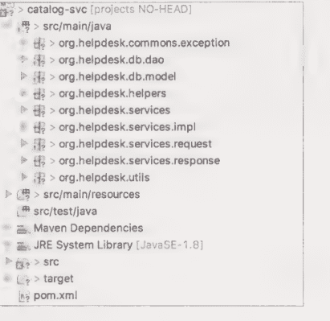

图 12.2 新项目结构看起来像。

6. 在相同的 Tomcat 服务器上运行 `mvn install`。

7. 在构建 WAR 文件之前，我们仍然在 `application.xml` 中修改数据库凭据如下：

```xml
<bean id="DataSource" destroy-method="close"
    class="org.apache.jdbc.pool.DataSource">
    <property name="driverClassName" value="com.mysql.jdbc.Driver" />
    <property name="url" value="jdbc:mysql://<host><dbname>"/>
    <property name="username" value="<Username>"/>
    <property name="password" value="<Password>"/>
    <property name="initialSize" value="5"/>
    <property name="maxActive" value="50"/>
    <property name="validationQuery" value="select 1 from dual"/>
    <property name="testWhileIdle" value="true"/>
    <property name="testOnBorrow" value="true"/>
    <property name="minIdle" value="20000"/>
    <property name="minEvictIdleMillis" value="30000000"/>
    <property name="timeBetweenEvictionRuns" value="6000000"/>
    <property name="removeAbandoned" value="true"/>
    <property name="removeAbandonedTimeout" value="30000"/>
    <property name="logAbandoned" value="true"/>
    <property name="maxWait" value="120000"/>
</bean>
```


## 工单

与产品目录类似，将工单特定的代码从单体帮助台应用程序迁移到它自己的构建实体中，也提取接口、服务实现、辅助类和配置文件，并创建一个新的构建产物。这个新的构建产物仅包含新构建产物实际所需的第三方依赖引用。

修改工单服务以使用 Apache Maven 代替 Ant，原因与修改产品目录服务相同。

工单微服务的转换步骤与转换产品目录服务完全相同。

## 搜索

正如所讨论的，我们有一个非常原始的基于数据库的搜索服务。现在我们将添加 Solr 搜索组件来为我们提供高级搜索功能。我们仍然按照旧方法进行搜索，但还将执行基于 Solr 的搜索，并在用户界面上显示两种结果，将其标记为基础和高级。由于这个原因，我们还将修改搜索视图以包含此增强。

### 基于数据库的搜索

迁移特定特定代码的方式与我们迁移两个服务的方式类似。工作包括提取接口、服务实现、辅助类和配置文件，并创建一个新的构建产物。

再次，我们将利用 Apache Maven，它将帮助我们获取服务所需的第三方外部依赖。

### 基于 Solr 的搜索

添加基于 Solr 的搜索的第一步是安装并配置 Solr 引擎。详细指令请参阅附录 B。一旦它运行，我们就可以创建微服务。我们将构建一个独立的高级搜索服务实体，并在此利用 Apache Maven 来构建我们的构制品。

以下是来自同一搜索 Web Solr 实现代码片段：

```java
@POST
@Consumes("application/xml", "application/json")
@Produces("application/json")
@Path("/solrSearch")
public QueryResponse search(
@Context HttpHeaders headers,
SearchRequest request)
```

查询 Solr 接口的代码如下：

```java
HttpSolrServer solr = new HttpSolrServer(
"http://<ip of solr host>:8983/solr/helpdesk");
SolQuery query = new SolQuery();
query.setQuery(request.getQuery());
query.setStart(0);
QueryResponse response = solr.query(query);
```

你可以用 Solr 做很多事情，例如搜索过滤器，但这些主题超出了本书的范围。更多信息请参阅 http://lucene.apache.org/solr。

现在，让我们回顾应用程序的构建和部署过程。

## 应用程序构建与部署

我们已经从单体应用中转换了以下三个组件，并将它们创建为独立的微服务：

- 产品目录 `Product catalog`
- 票务 `Ticketing`
- 搜索 `Search`

让我们看看这些微服务发生了哪些变化，包括如何构建、配置和部署它们。

### 代码设置

原始的单体应用使用 Apache Ant 构建项目。随着基于微服务的进化项目日益模块化且必须管理依赖关系，各个微服务已采用 Apache Maven 作为构建工具。Ant 不具备内置的依赖管理功能，尽管可以使用 Ivy 进行进行补充。这说明了一个核心概念：每个微服务都可以有其自己的构建源码的方式。

这些独立微服务的代码可以在 GitHub 上找到：`https://github.com/kocherMSD/Helpdesk_Microservices.git`。

### 构建微服务

你可以通过两种方式构建单个微服务：通过命令行或从集成开发环境（如 Eclipse）自动构建：

- 通过命令行构建。要通过命令行构建 Maven 项目，请从命令行运行 `mvn` 命令。该命令应该在包含相关 POM 文件的项目目录下执行。要构建各个微服务，运行的命令是 `mvn clean package`。这确保了构制品被清理并打包成准备好部署的 WAR 文件。
- 从 Eclipse 构建。一旦你将项目导入 Eclipse，右键点击项目，选择“Run As”（运行），并选择“Run configurations”（运行配置）。在“Run configurations”窗口中，在“goals”字段中输入 `clean package` 并点击“Run”。这将构建代码并生成 WAR 文件，该 WAR 文件已准备好部署到 Tomcat 等应用容器中。

### 部署与配置

部署微服务有相当多的选项。每个选项都有其优缺点，因此让我们快速查看它们是什么。在第 13 章中，我们将深入探讨部署领域，以及自动化部署、伸缩等内容。

- 单台机器上的多个微服务。在这种方案下，策略是在同一台机器（物理或虚拟）上部署多个微服务。这种方法的主要优点是资源利用率相对较高，因为多个服务或实例共享相同的资源（CPU、内存、I/O 等）。缺点是这些服务之间几乎或没有隔离，除非每个服务都是一个独立的进程。此外，运行异常的服务可能会消耗宿主机的所有内存或 CPU。
- 每台虚拟机一个微服务。这种方法的主要益处是每个服务都在完全隔离的环境中运行，因为它被封装在虚拟机内部。每个微服务都拥有完全访问其分配的内存、CPU 和 I/O。然而，这种方法的主要缺点是缺乏高效的资源利用。虚拟机可能会利用不足，但同样，这一缺点可以通过分配足够的资源并将虚拟机设置为自动伸缩来克服。
- 每个容器一个微服务。在容器中部署微服务简单地是将服务打包并在容器内运行。一旦你将服务被打包在容器中，你就可以根据变化的、按需的实时的应用需求启动容器。这种方法的优点是每个容器都在隔离中运行。容器消耗的资源可以被监控、控制和管理。然而，与虚拟机不同，这些容器非常轻量且易于构建、打包和启动。它们启动极快，因为不需要像虚拟机那样引导操作系统。这种方法的主要劣势是技术成熟度。随着 2013 年 Docker 的出现，容器现在对于主流团队来说变得更容易获取；然而，该技术仍在演进，以解决安全性、大规模容器管理等问题。

为了简单起见，我们将新的微服务部署在之前托管单体应用的同一个 Tomcat 服务器中。在第 13 章中，我们将这些微服务并封装到 Docker 容器中，并作为独立的微服务进行部署。

以下是使用新微服务部署 helpdesk 应用的步骤：

1. 我们需要从现有的单体应用指向新创建的微服务。为此，通过更改属性文件 `Application.properties` 来修改我们 Web 服务的端点，如下：

```
endpoints.searchEndpoint=http://host:port/search-svc/rest/SearchService/search
points.getCatalog=http://host:port/ticketing-svc/rest/CatalogService/getCatalog
endPoints.createTicket=http://host:port/catalog-svc/rest/TicketService/createTicket
```

2. 为了更改视图，修改单体应用中的 `search.jsp` 文件以包含高级搜索；从 JavaScript 调用 Solr Web 服务：

```javascript
function solrsearch() {
    var solrSearchEndpoint=<%= props.solrEndpoint %>
    var searchText=document.getElementById("searchText").value;
    if(searchText=='') {
        alert('Empty text. Please provide value in text');
    }
    var dataToSend ={"query":searchText};
    $.ajax({headers: {
        'Accept': 'application/json',
        'Content-Type': 'application/json'
    },
    url: solrSearchEndpoint,
    type: 'POST',
    dataType: 'json',
    data: JSON.stringify(dataToSend),
    success: function(data, textStatus, jqXHR) {
        $('#solrresults').empty();
        var docs = data.results;
        $.each(docs, function (i, item) {
            $('#solrresults').prepend($('<div' + objToString(item) + '</div>));
        });
        var total = 'Found ' + docs.length + ' results';
        $('#solrresults').prepend('<div>' + total + '</div>');
    }).fail(function (jqXHR, textStatus, error) {
        // 在处处理错误
        alert(jqXHR.responseText);
    });
}
```

## 新需求与错误修复

如果构建成功，你应该能看到图 12.5 中的消息。

```
[INFO] Processing war project
[INFO] Copying webapp resources [/opt/projects/BOOKCODE/catalogue-src/main/webapp]
[INFO] Webapp assembled in [1523 ms]
[INFO] Building war [/opt/projects/BOOKCODE/catalogue-target/catalogue-svc-war]
[INFO] WEB-INF/web.xml already added, skipping
[INFO] --- maven-install-plugin:2.1 (install) @ catalogue-svc ---
[INFO] Installing /opt/projects/BOOKCODE/catalogue-target/catalogue-svc to /Users/anusejin/m2/repository/org/helpdesk/services/catalogue-svc
[INFO] Installing /opt/projects/BOOKCODE/catalogue-svc/pom to /Users/anusejin/m2/repository/org/helpdesk/services/catalogue-svc/1.0/catalogue-
[INFO] BUILD SUCCESS
[INFO] Total time: 7.763 s
[INFO] Finished at: 2017-05-10T14:21:24-05:00
[INFO] Final Memory: 104MB
```

图 12.5 构建输出

- 5. 对其余微服务重复之前的步骤。将所有这些文件复制到 Tomcat web 目录。

在 Linux 中，你的部署目录结构如下：

```
search-svc catalogue-svc docs helpdesk host-manager
ROOT ticketing-svc.war search-svc.war catalog-svc.war
examples
helpdesk.war manager ticketing-svc
```

如你所见，通过 helpdesk.war，在同一个 Tomcat 容器中还部署了三个额外的微服务。

## 新需求与错误修复

根据新的业务需求，我们成功地将单体架构迁移到了微服务架构。我们也知道业务需求将继续演变。让我们看看基于微服务的架构来管理可能的变更请求的方法。

假设我们需要为 `view-ticket` 服务添加一个对其他组件依赖性有限或没有依赖的额外参数。使用以下代码段，我们可以更改工单请求：

```java
public TicketResponse createHdTicket(
  @Context HttpHeaders headers,
TicketRequest ticketRequest)
throws ServiceInvocationException(
```

以下为普通 Java 对象（POJO，web 模型）添加了一个新属性：

```java
@Component
private String emailAddress;
@XmlElement
public String getEmailAddress() {
    return emailAddress;
}
public void setEmailAddress(String emailAddress) {
    this.emailAddress = emailAddress;
}
```

以下代码允许我们在 DAO 层添加逻辑以从数据库中获取该属性：

```java
private String saveToDatabase(TicketRequest ticketRequest) {
    //在现有基础上添加
    ticket.setEmailAddress(ticketRequest.getEmailAddress());
```

注意，这次工单的更改不会影响任何其他服务。我们只需要测试并部署此服务，然后就可以正常运行了。在单体应用中进行此更改将要求我们构建整个应用程序并进行彻底的回归测试，这既耗时又耗资源。这是一个一个简单的例子，但它说明了在微服务应用中进行更改与在单体应用中进行相同更改之间的区别。

现在，让我们回顾一下第 11 章中提到的单体应用所强调的相同挑战，看看微服务是否真的帮助解决了这些挑战：

- **修复错误**：只需要修复包含该错误的应用程序部分。如果错误存在于某个微服务的代码中，我们只需要处理那个特定的微服务，修复代码并部署。此外，由于每个微服务在典型的部署中都会被加载，你可以按顺序部署服务，以免影响应用程序的可用性。如果错误存在于单体代码中，你仍然需要遵循正常流程，但请注意，微服务保持未触，且不需要对这些组件进行重新测试；在这里，缩短了发布周期。
- **替换应用程序组件**：让我们假设同一种情况，我们想使用云服务进行工单管理；正如我们在本章早些时候讨论的，我们只需要更改配置以指向云服务端点即可。非常简单！
- **替换或添加新的技术栈**：如果使用不同的技术栈（例如 PHP/NoSQL）开发现有或新服务是有意义的，开发者拥有完全的自由去这样做，且依赖性极低。
- **选择性扩展**：微服务最大的优势之一是选择性扩展。正如你在新架构图中观察到的样，每个微服务都可以进行负载均衡。如果预计工单层会有更大的流量，你可以轻松为工单服务启动任何虚拟机或容器，而无需接触应用程序的其他任何服务或单体部分。这节省了对整个应用程序进行不必要的扩展的时间、资源和费用。我们将在下一章中介绍这一点。
- **处理故障**：如果设计得当，特定微服务中的问题或错误不会影响整个应用程序。最坏的情况可能是某个微服务受到影响，但系统的其他部分仍然可以正常运行。想象一个基于单体架构的电子商务网站。假设应用程序的商品评分部分崩溃了。取决于单体应用的编写方式，这可能会导致整个应用程序崩溃，尽管购物车和结算部分没有问题。使用微服务，商品评分微服务崩溃的最坏结果是系统的其他部分仍然可用。

# 第 13 章

## 案例研究：应用程序容器化

在第 12 章“案例研究：迁移到微服务”中，我们创建了微服务。下一个问题是：我们扩展它？在本章中，我们将对其进行容器化。

## 微服务的容器化

在本节中，凭借我们已的知识，微服务的容器化涉及以下步骤：

1. 列出每个微服务所需的依赖项。
2. 构建二进制文件、WAR 文件。
3. 创建包含上述步骤的 Docker 镜像。
4. 使用创建的镜像启动容器。

### 列出依赖项

以下是运行微服务所需的软件（依赖项）列表：

- Tomcat：运行应用程序所需
- Java：Tomcat 的依赖
- MySQL 连接器：Tomcat 连接 MySQL 的依赖
- Apache Maven：安装在构建系统上（请参阅 `maven.apache.org/install.html`）

正如我们在前面的章节中所学习的，创建 Docker 镜像的正确方法是通过 Dockerfile，它包含了之前提到的所有依赖项。构建该 Dockerfile 将为我们部署服务所需的所有镜像。

让我们开始编写 Dockerfile。请注意，我们将分步骤构建此文件，以便于解释其内容。如果你是在并行执行操作，请确保不要创建多个文件：

```docker
# 基于 Ubuntu 17.04
FROM ubuntu:17.04
# 用于安装 Tomcat 7 的环境变量；您可以根据需要
# 更改 Tomcat 的次版本号。如果也要更改主
# 版本（例如，更改为 Tomcat 8），您必须确保同时也
# 更改 TOMCAT_LOCATION 变量。
ENV TOMCAT_VERSION=7.0.81
ENV TOMCAT_FILENAME=apache-tomcat-$TOMCAT_VERSION.tar.gz
ENV TOMCAT_DIRECTORY=apache-tomcat-$TOMCAT_VERSION
ENV TOMCAT_LOCATION=http://www-eu.apache.org/dist/tomcat/tomcat-7/$TOMCAT_VERSION/bin/$TOMCAT_FILENAME
```


让我们仔细查看这段代码：

- `FROM` ubuntu 告诉我们目录服务将在什么环境下运行。在这种情况下，目录服务将在 Ubuntu 环境下运行。
- `ENV` 命令定义了可以在 Dockerfile 中使用的环境变量。

下一步是拉取并安装所有依赖项。在现有文件中追加以下内容：

```docker
# 获取 Tomcat；安装 wget & JDK1.8 等必需的实用程序。

# 清理 apt 缓存，因为 "apt-get update" 总是会破坏缓存。

RUN apt-get update && \
apt-get install -y wget && \
apt-get install -y default-jdk && \
rm -fr /var/lib/apt/lists/* && \
wget $TOMCAT_LOCATION
```

以下是我们在这段代码中执行的操作：

- `apt-get` 是 Ubuntu 中的包管理器，它简化了软件包的生命周期（安装/更新/删除）。建议始终执行 `apt-get update`。该命令从 Ubuntu 仓库获取最新的软件包列表及其版本。
- `apt-get install` 安装了 `Wget` 软件包。`Wget` 是一个免费的工具，我们用它从网络下载文件。我们需要它来从网络下载 Tomcat。
- `install` 命令安装 Java 开发工具包（JDK）。这是 Tomcat 的一个依赖项。
- 当运行 `apt-get update` 命令时，它从 Ubuntu 仓库下载软件包并存储在名为 `/var/lib/apt/lists` 的目录中。该目录可能很大，导致我们的 Docker 镜像变大。由于安装已完成，我们可以安全地删除该目录中的内容，这就是 `rm` 命令的作用。这是编写 Dockerfile 的最佳实践。
- `wget` 是我们之前在代码中安装的工具，它从网络下载 Tomcat。

需要注意的一个关键点是，所有这些命令都运行在单行中，以减少 Docker 镜像的层数。`RUN` 是指令 Docker 在环境（在本例中为 Ubuntu 环境）中运行任何命令的命令。如果我们选择 CentOS 作为环境（例如，`FROM` CentOS），那么相同的命令将运行 `yum`，因为 `yum` 是 CentOS 中的包管理器，就像 `apt-get` 是 Ubuntu 中的包管理器一样。

现在我们已经下载了 Tomcat，在现有文件中追加以下内容：

```docker
# 将 Tomcat 安装在 /opt 下并将目录重命名为 "tomcat"

RUN tar -xf $TOMCAT_FILENAME -C /opt && \
mv /opt/$TOMCAT_DIRECTORY /opt/tomcat
```

在这里，我们将 Tomcat 安装到 `/opt` 目录并重命名目录 `/opt/tomcat`。

现在让我们部署我们的微服务：

```docker
# 将产品目录服务部署到 Tomcat

ADD catalog-svc.war /opt/tomcat/webapps/
```

```docker
# 将端口暴露到宿主机系统

EXPOSE 8080
```

# 微服务容器化

```docker
# 在前台运行 tomcat

CMD ["/opt/tomcat/bin/catalina.sh", "run"]
```

让我们仔细查看这段代码段：

- `ADD` 命令指示 Docker 将 `catalog-svc.war` 文件复制到 Tomcat 的 `webapps` 目录，因为我们希望目录服务在容器启动时立即启动。
- `Expose` 命令将 Tomcat 的端口暴露到运行该容器的宿主机上。
- `CMD` 是容器启动时执行的默认命令。通过在容器启动时将 Tomcat 启动为默认命令，我们得到了两点：第一，Tomcat 自动启动；第二，产品目录服务自动部署。

以下是供参考的完整文件：

```docker
# 基于 Ubuntu 17.04

FROM ubuntu:17.04

# 用于安装 Tomcat 7 的环境变量；您可以根据需要

# 更改 Tomcat 的次版本号。如果也要更改主

# 版本（例如，更改为 Tomcat 8），您必须确保同时也

# 更改 TOMCAT_LOCATION 变量。

ENV TOMCAT_VERSION=7.0.81
ENV TOMCAT_FILENAME=apache-tomcat-$TOMCAT_VERSION.tar.gz
ENV TOMCAT_DIRECTORY=apache-tomcat-$TOMCAT_VERSION
ENV TOMCAT_LOCATION=http://www-eu.apache.org/dist/tomcat/tomcat-7/$TOMCAT_VERSION/bin/$TOMCAT_FILENAME

# 获取 Tomcat；安装 wget & JDK1.8 等必需的实用程序。

# 清理 apt 缓存，因为 "apt-get update" 总是会破坏缓存。

RUN apt-get update && \
apt-get install -y wget && \
apt-get install -y default-jdk && \
rm -fr /var/lib/apt/lists/* && \
wget $TOMCAT_LOCATION

# 将 Tomcat 安装在 /opt 下并将目录重命名为 "tomcat"

RUN tar -xf $TOMCAT_FILENAME -C /opt && \
mv /opt/$TOMCAT_DIRECTORY /opt/tomcat

# 将产品目录服务部署到 Tomcat

ADD catalog-svc.war /opt/tomcat/webapps/

# 将端口暴露到宿主机系统

EXPOSE 8080

# 在前台运行 tomcat

CMD ["/opt/tomcat/bin/catalina.sh", "run"]
```

## 构建镜像

使用我们刚刚创建的 Dockerfile，输入以下命令：

```bash
docker build -t catalog-svc:1.0
```

让我们回顾命令的作用：
- `docker build` 是用于创建 Docker 镜像的命令。
- `t` 是指定镜像名称的选项（在本例中为 `catalog-svc:1.0`），格式为镜像名:标签。
- 结尾表示 `docker build` 使用当前目录的文件。

要运行此命令，你需要执行以下操作：
1. 确保已安装 Docker。
2. 创建包含已创建 Dockerfile 和服务的 WAR 文件的目录。
3. 从该目录运行命令。

2. 为密钥对提供一个名称以创建它。

3. 将新创建的密钥对保存在安全的地方。稍后在创建集群时我们需要它。

现在，让我们按照以下步骤创建 DC/OS 集群：

+ 1. 在 https://dcos.io/docs/1.7/administration/installing/cloud/aws 启动 DC/OS 模板。点击 DC/OS 模板，这是页面 Install DC/OS 部分下的第 1 步。
+ 2. 选择集群类型（单主或多主）。出于测试目的，单主就足够了。对于生产系统，强烈建议使用多主设置以避免单点故障。
+ 3. 在下一个屏幕中，如图 13.2 所示，接受默认设置并点击 Next（下一步）。
+ 4. 在 Create Stack（创建栈）页面，选择左侧的 Specify Details（指定详情），如图 13.3 所示。为集群命名，并从下拉列表中选择之前创建的密钥对。
+ 5. 接下来，选择公共和私有 agent 节点的数量，或者在本例中保持默认计数。
+ 6. 接受其余屏幕中的默认设置并完成栈创建。

成功创建 DC/OS 集群可能需要 10 到 15 分钟。你可以在 CloudFormation → Stacks 中查看栈创建状态，如图 13.4 所示：

+ 7. 一旦栈创建完成，进入 Outputs（输出）选项卡并将 mesos-URL 复制/粘贴到浏览器中。你应该能看到从系统仪表板成功启动的 DC/OS 用户界面 (UI)，如图 13.5：
+ 8. 从集群 UI，转到左侧的 Universe 并搜索 Marathon。你应该看到一个与图 13.6 类似的屏幕。点击 Marathon 和 Marathon-lb 的 Install（安装）按钮。

## 创建栈

## 选择模板

+ Select Template（选择模板）
-Stack Details（栈详情）
-Options（选项）
Review（检查）

你想创建的模板。栈（Stack）是作为单一单元管理的相关资源组。

使用 AWS CloudFormation 创建或修改现有模板。了解更多。

模板是一个 JSON/YAML 格式的文本文件，描述了你栈的资源和属性。了解更多。

设计模板

选择一个模板

+ - 上传模板到 Amazon S3
- 未选择文件
- 选择示例模板
- 指定 Amazon S3 模板
  浏览...
  https://s3.us-west-2.amazonaws.com/downloads/cloudformation/latest/template/sample3.yaml


## 创建栈

## 指定详情

+ - Select Template（选择模板）
-Name Options（名称选项）
-Parameters（参数）
-Review（检查）

你可以使用或更改默认参数值，这些值定义在 AWS CloudFormation 模板中。学习。

Parameters（参数）

| StackName | | |
|---|---|---|
| AdminLocation | us-east-1 | |
| Key/Name | | |
| PublicSubnetEnabled | true | |
| StackInstanceCount | 5 | |

图 13.3 指定栈详情的表示

## 微服务的容器化


图 13.4 栈运行状态的表示


通过此，我们已成功安装了 DC/OS 集群。让我们通过逻辑图查看我们应用程序的整体结构，如图 13.7 所示：

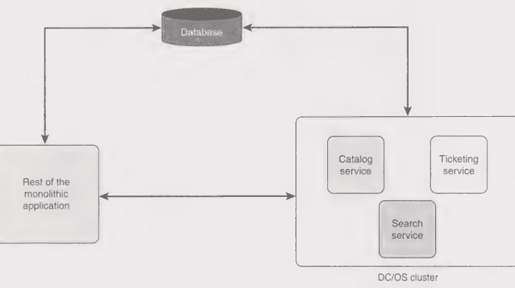

**图 13.7** 逻辑图

注意，我们拆分并封装为微服务的服务（目录、票务、搜索）将在 DC/OS 集群内进行部署和管理，而应用程序的其他部分将按原样运行。这些微服务将继续使用相同的数据库。

**图 13.8** 显示了我们的部署在 DC/OS 集群上的逻辑结构。

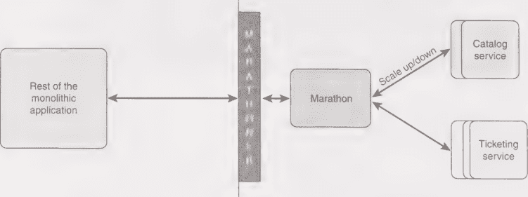

**图 13.8** 逻辑应用程序视图

让我们高层次回顾一下我们在第 9 章“容器编排”中学习的关于 Mesos 和 Marathon 的知识，以便我们更好地理解部署：

+ - Mesos。这是一个开源的 Apache 项目，用于管理机器集群上的 CPU 和内存等资源。像产品目录和票务这样的任务或服务将在 Mesos 集群中运行。
+ - Marathon。这是另一个开源框架，它与 Mesos 紧密配合，用于在集群中调度任务。在我们的案例中，如果我们必须调度我们的目录服务运行在 Mesos 集群内部，那么我们必须进入 Marathon UI，提供有关产品目录服务的详情（例如服务的 Docker 镜像、监听端口），并点击 Submit（提交）。
+ - Marathon-lb。这个负载均衡器基于流行的负载均衡器 HAProxy，它通过动态为 HAProxy 生成配置来工作。其工作原理如下：
+ - 它通过 API 与 Marathon 通信，获取 Marathon 在 Mesos 集群中调度的任务和服务列表。
+ - 从 Marathon 的响应中，它可以发现集群中运行着哪些服务、它们运行在何处（即集群中的哪台机器）、服务运行在哪个端口上等。
+ - 它生成 HAProxy 配置，这简单来说是一个请求映射。该配置包含详细信息；例如，“如果请求到达服务端点 /abc”，那么此请求将由服务器 a、b 或 c 处理，其中 a 和 b 是处理请求 /abc 的机器。

现在集群已就绪，让我们来部署微服务。

## 部署目录微服务

- 外部标签（external label）表示此微服务必须对外部世界可见。如果它是内部的，则该微服务将只能从 DC/OS 集群访问。

## 提交任务

- `id` 是我们服务的标识符，用于识别运行在集群中的服务。
- `container` 部分描述 Docker 容器。它包含以下组件：
  - `type` 指定容器类型。默认是 DOCKER。
  - `image` 指明启动任务时应该使用的 Docker 镜像。
  - `network` 指定网络类型。我们使用的是 BRIDGE。
  - `portMappings`：`hostPort`、`containerPort` 和 `servicePort`。
  - `forcePullImage` 如果设置为 TRUE，强制 Marathon 在启动任务前从 Docker 仓库拉取最新镜像。默认值为 false。
- `instances` 指明集群中必须启动多少个目录实例。
- `mem` 指明为目录服务分配多少内存。
- `healthChecks` 部分中的参数指示 Marathon 按配置间隔对目录服务进行健康检查。
- `labels` 部分包含以下标签：
  - `HPROXY_GROUP`：外部标签表示此微服务必须对外部世界可见。
  - `HAPROXY_0_HOST` 指导 Marathon 负载均衡器为服务创建一个虚拟主机。

```json
{
  "id": "catalog-external",
  "container": {
    "type": "DOCKER",
    "docker": {
      "image": "kocher/catalog:1",
      "network": "BRIDGE",
      "portMappings": [
        {
          "hostPort": 0,
          "containerPort": 8080,
          "servicePort": 10000
        }
      ],
      "forcePullImage": false
    }
  },
  "instances": 1,
  "mem": 1024,
  "healthChecks": [
    {
      "protocol": "HTTP",
      "path": "/",
      "portIndex": 0,
      "timeoutSeconds": 20,
      "gracePeriodSeconds": 10,
      "intervalSeconds": 10,
      "maxConsecutiveFailures": 10
    }
  ],
  "labels": {
    "HPROXY_GROUP": "external",
    "HAPROXY_0_HOST": "ec2-207-252.compute.amazonaws.com"
  }
}
```

现在让我们进入 Marathon UI 并提交此 JSON 文件，在 DC/OS 集群中启动我们的第一个微服务。进入 Services 并点击 Marathon 链接。然后点击 Open Service 启动 Marathon，如图 13.9 所示：

## 部署目录微服务

你应该能看到正在运行的应用程序，如图 13.10 所示。在此界面，点击“创建应用程序”（Create Application）。选择“端口和服务发现”（Ports and Service Discovery），然后点击“JSON Mode”以提供我们的 `catalog.JSON`。

你应该看到一个类似于图 13:11 的新应用程序窗口：点击“创建应用程序”，几秒钟后，你应该看到我们的目录服务已启动运行，如图 13:12 所示：

## 检查和扩展服务

如果你点击应用程序中的 `catalog-external` 链接，将能够查看此服务的更多详细信息。图 13.13 显示该微服务的一个实例是健康的。它还提供了状态、日志信息、版本号以及最后更新时间。

在实例上运行快速的 `curl` 命令将返回产品列表，表明服务正在正常运行，如下：

```bash
curl http://10.0.0.7:15973/catalog-svc/rest/CatalogService/
getCatalog/pkocher | python -m JSON.tool
{
  "productFamilyList": [
    {
      "productFamily": "Phone",
      "productId": "iPhone5",
      "technologySolution": "N"
    },
    {
      "productFamily": "Phone",
      "productId": "iPhone6",
      "technologySolution": "N"
    }
  ],
  "responseErrorCode": null,
  "responseErrorMessage": null,
  "responseStatus": "SUCCESS"
}
```


要扩展此微服务，我们只需要点击“扩展应用程序”（`Scale Application`）并提供实例数量。假设我们想运行该服务的两个实例。我们将点击“扩展应用程序”并输入 2。它应该在几秒钟内完成应用程序扩展，如图 13.14 所示。在“运行实例”（`Running Instance`）列下，你应该看到“2 of 2”，这表示目录服务的两个实例现在已部署在集群中。

图 13.13 Catalog-external

在 DC/OS 集群中扩展或收缩微服务就是如此简单。现在，我们的目录微服务已在集群中部署了两个实例，我们将从应用程序的其他部分访问此服务。

## 访问服务

我们如何知道服务运行在哪里？如果你回想起第 3 章“进程间通信”的内容，这是微服务部署和架构中最具挑战性的部分之一，因为微服务由于各种原因（如节点故障或资源不足）可能会启动或停止。如果微服务由于任何原因发生故障，`Marathon` 将检测到该故障并与 `Mesos` 集群协作启动另一个实例。它确保集群中始终运行着正确数量的实例。

另一方面，`Marathon-lb` 通过 `Marathon API` 与 `Marathon` 协作，发现集群中运行了哪些服务、服务运行在集群的哪些机器上、在哪些端口上等。它会发现集群中运行的服务，如果定义了 `servicePort`，那么 `Marathon-lb` 会在自身上暴露该端口，通过该端口可以访问实际的服务。

在这种情况下，我们我们在集群中部署了两个目录服务实例，它们的 `servicePort` 值为 10000，这意味着可以通过 `http://<Marathon-lb 服务器的 DNS 名称>:10000` 访问目录服务。

要查找 `Marathon-lb` 的主机名，你需要进入 AWS 中运行的 DC/OS 集群，选择栈（stack），并选择“输出”（Outputs）选项卡，如图 13.15 所示。

图 13.15 查找主机名的表示

你在第二行（`PublicSlaveDnsAddress`）看到的主机名是运行 `Marathon-lb` 的服务器。因此，访问目录服务请访问此端点：

```bash
curl http://dcos-demos-PublicSlave-10E6EEUP950OVX-628629381.us-east-1.lb.amazonaws.com:10000/catalog-svc/rest/CatalogService/getCatalog/<userid>
```

注意在此 URL 中，端口 10000 暴露了 DC/OS 集群中的目录服务。无论集群中运行了多少个目录服务实例，`Marathon` 负载均衡器都会发现它们并通过端口 10000 暴露它们。

现在目录微服务已经在 DC/OS 集群中运行，我们必须配置 helpdesk 应用程序开始使用此微服务。这只是属性文件中的一个简单更改。

## 更新单体应用程序

我们的 helpdesk 应用程序在一个名为 `properties` 的文件中维护了每个服务的 URL 列表。该文件位于 `/usr/share/tomcat/lib` 目录下。你必须将名为 `endpoints.catalog` 的属性更改为 `Marathon-lb` 的 URL：

```properties
endpoints.catalog=http://ec2-252.compute.amazonaws.com:10000/catalog-svc/rest/Catalog
```

通过此更改，helpdesk 应用程序将开始消耗微服务。正如我们在书中之前的章节中看到的，无论启动了多少个目录服务实例，`Marathon-lb` 都会自动发现这些实例部署在哪里，并自动将流量路由（负载均衡）到这些实例。

在本章中，我们详细研究了目录服务，通过在 DC/OS 中部署它来拆分和构建微服务，配置指令完全相同，这使得未来利用微服务和容器结合的力量进行进一步扩展变得更容易。

## 结论

在序言中，我提到过我写这本书时考虑了两类群体：希望卷起袖子、通过真实案例亲手实践的经验丰富的软件和系统工程师；以及项目经理——即非程序员——他们希望对该主题有一个高层次的介绍。无论你属于哪一组——我都希望这些页码的内容能带给你启发。

我们涵盖的关于微服务和容器的每个主题——服务发现、API 网关、通信等——都值得单独写一部大书（事实上，其中某些主题已经有多本书著作了！）。我想通过这本书做的是对这些主题提供一个更高层次的综合，提供足够你工作或职业所需的信息。单单微服务就能实现各种软件组件的按需扩展。而与此同时，容器有助于虚拟化，在整个过程中保持一切轻量化。它们完美地互辅相成，使一加大于二——这就是协同效应的终极定义。

## 什么是 DevOps？

在书的开头章节中，我们研究了微服务和容器对组织可能产生的影响，但我们没有过多讨论它们对另一个当前热门话题的潜在影响：DevOps。如今，许多软件组织正向 DevOps 模型转型，而微服务和容器将是这一进程中的关键推动者。

DevOps 是一个合成词，结合了两个工程实践：软件开发和运维（Operations）。重点在于增加这两个领域之间的协作，以实现以下目标：

- 提高软件发布速度。
- 以更快的提高提高质量。
- 自动化这两个领域的各个方面，如代码构建、测试、打包和部署。

鉴于此背景，在我们案例中，集群中部署了两个目录服务实例，它们的 `servicePort` 值为 10000，这意味着可以通过 `http://<Marathon-lb 服务器的 DNS 名称>:10000` 访问目录服务。

## 什么是 DevOps？

无论大公司还是小公司，进入这些领域并随着它们的发展，我们将意识到需要一种基于微服务的架构并辅以敏捷文化。

- **新型客户类型产生了新需求。** 最具创新性的公司正在开发能够在全球各种新型设备和资源上运行的解决方案。每一类设备都有不同的资源可供。内存、处理速度和存储在某些设备上是有限的，而在另一些设备上则非常充足。当所有这些具有不同限制的设备尝试访问同一个软件时，软件必须通过向客户端隐藏复杂性来支持它们的请求。这种复杂性将隐藏在哪里呢？在软件本身！这意味着软件将变得更加复杂——因此，正如前面的章节所讨论的，需要支持与不同客户端通信的微服务架构。

- **用户驱动的复杂性。** 得益于在简化和增强用户体验方面的创新，Amazon 和 Netflix 的产品已经变得复杂。如果它们的用户数量保持在可控范围内，它们可能通过单体范式生存。事实上，它们在最初的几年里确实沿着这条路线发展。随着新兴市场追赶发达市场，数百万（甚至数十亿！）在线用户将继续增长，并变得更加复杂，以应对不同用户的扩展、性能和需求。这将导致越来越多的公司感到需要微服务，而微服务可以解决这些问题。

- **工作满意度。** 单体意味着由一个或多个开发团队维护的一个平台，有时按工作类型（例如前端、后端、用户体验）划分。这种模型的问题之一是，一个后端工程团队可能负责构建所有所需服务的后端，如账单、产品目录、购物车等（以电子商务网站为例）。当代码和用例变得复杂时，团队会进一步拆分，并划分后端系统内部的工作（通用功能和类似项）。随着复杂性的增加，他们增加了人员并创建了新团队，复杂性增长到任何微小的功能更新都需要很长的周期和部署时间的地步。随着时间的推移，团队变得碎片化。构建失败、回滚和耗时的调试可能成为常态，而偶尔偶尔的障碍。误解和缺乏协作会发生，特别是在紧张的状况下，甚至可能导致互相指责、取绰号，甚至导致人才流失。如果实施得当，DevOps 和微服务可以促进更清晰的角色和职责划分，从而增强团队之间的协作。反之，协作驱动了生产力的提高，这直接影响底线。结果是什么？全方位的工作满意度。

## 结论

- **业务收益。** 如果新技术或范式能够提高底线并解决重大挑战，聪明的业务将始终适应它们。微服务为业务提供了这样一个与竞争对手区分开来的机会。

时间会告诉你，基于这些原因，微服务和容器的渗透率在未来几年内可能会飙升。

## 仅仅是开始

尽管你已经读这本书的最后，但我希望这些话是一个开端而非结束。换句话说，虽然你可能已经“毕业”了微服务和 Docker 学校，但我向你保证外面还有很多东西需要学习。无论你将这视为你的主菜还是仅仅是开菜，我都希望我激发了你进一步探索的胃！我鼓励你阅读更多内容，参与各种在线微服务和容器社区，并自己深入研究更多案例。总之，我希望这对你来说既是一个结束，也是一个开始。该开始工作了！

## 附录 A

### 帮助台应用流程

本附录提供了帮助台应用的功能概述。将其看作是向管理员和客户展示应用程序能力的用户指南。

在现实世界中，大多数支持应用程序都与订单管理和客户管理系统集成。因此，从数据移动的角度来看，已经有很多自动化措施。例如，当在客户管理系统中创建一个客户时，客户信息会自动推送到其他系统，如支持应用程序。为了我们的目的，我们考虑的是独立的帮助台应用，并且没有与上游应用程序集成，因此我们将手动创建所有内容。

这里有三种用户角色：

- **管理员。** 能够管理和配置帮助台系统。
- **客户。** 提交工单并寻求支持。
- **帮助台工程师。** 负责处理工单的维护人员。

### 管理员

此部分列出了管理员可以执行的操作，以维护帮助台系统。

#### 登录

每个应用程序都需要身份验证，以确保只有法的用户才能访问。如图 A.1 所示，用户输入用户名和密码进行登录。

```
if (condVar > someVal) {console.log("xxx")}
```

登录成功后，管理员将进入主页，如图 A.2 所示。这将显示应用程序的所有功能。

### 与支持产品

此部分显示了管理员可以查看的产品列表，如图 A.3 所示。

新产品定期发布，旧产品则停止服务。例如，图 A.3 显示了支持产品列表，其中 Y 表示支持，N 表示不支持。

#### 添加支持产品

在此，管理员可以向目录添加新的支持产品，如图 A.4 所示。

#### 添加新用户

正如之前讨论的，通常这些活动是自动化的，数据将输入上游系统。为了理解此应用程序，让我们手动创建数据。作为管理员，让我们添加一个新客户通过帮助台应用程序提交工单，这将允许该特定用户提交请求。例如，我们将创建一个名为 Bob Black 的客户，用户 ID 为 black。

账户已创建，但为了让他能够提交工单，我们需要将其与购买的产品关联。让我们在“添加销售产品”中创建此条目。

#### 添加销售产品

管理员可以手动添加客户购买的产品。假设他购买了一部 iPhone 7s，如图 A.6 所示。

现在我们了解了管理员的操作，让我们来看看客户的角色。

## 客户流程

在客户使用管理员提供的凭据成功登录后，可以在落地页上看到选项，如图 A.7 所示：

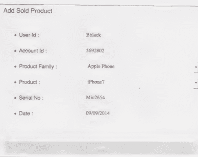

图 A.7 客户用户的应用程序功能

让我们逐一回顾这些功能。

## 我的产品

该控制台在我们的帮助工作台应用程序中被称为“产品目录服务”（Product Catalog Service）。它用于查看登录用户账户下可用的产品。它显示了他所购买的支持产品列表。在示例中，Bob Black 对 iPhone 6 和 iPhone 7 拥有活跃的支持（即我们刚刚在管理员部分中创建的条目），如图 A.8 所示。


图 A.8 “我的产品”控制台，也称为产品目录

## 创建事件

假设该客户想为最近购买的移动设备（iPhone 5）创建一个事件。应用程序通过其身份查询他购买的产品，并允许他根据选择创建事件。客户使用图 A.9 所示的 UI 界面来创建工单。为了描述问题，他填写了必填字段，如标题、问题严重性、手机型号和问题类别；然后提交事件。


**图 A.9** 为产品提交事件

## 查看事件

通过此控制台，用户可以查看所有历史工单，如图 A.10 所示。当支持工程师处理工单时，用户可以通过点击工单编号查看查看单详情和事件的更新，如图 A.11 所示。


**图 A.10** 用户对其活跃工单的视图


图 A.11 查看工单更新

## 留言板

这是一个非常基本的留言板工具。用户可以使用留言板功能从用户社区获得帮助。他们可以发布问题，并回答其他用户在留言板上发布的问题。

图 A.12 显示的留言板控制台将显示当前所有开启的消息列表。

| 编号 | 标题 | 日期 |
| :--- | :--- | :--- |
| 1 | 自动续费 | 05/06/2017 |
| 2 | 手机 | 05/06/2017 |

图 A.12 留言板

让我们看看在留言板上可以做什么。

## 新消息

点击“添加”按钮将打开一个控制台以开始新的讨论消息，如图 A.13 所示。


**图 A.13** 添加新消息

## 附录 A 帮助工作台应用程序流程

## 现有线程

如图 A.14 所示，点击消息标题可以加入现有讨论并添加评论。


**图 A.14** 对现有消息进行评论

## 预约

此控制台为用户提供预约功能，如图 A.15 所示。日期和时间的可用性从数据库中提取。用户可以为与支持工程师的预约选择时区、日期和。

| 产品 | BlackBerry Z10 |
| :--- | :--- |
| 时区 | 东部时间 |
| 预约日期 | 10/02/2017 |
| 预约时段 | 下午 2:00 |

**图 A.15** 安排预约

## 搜索

用户可以在应用程序中搜索问题。应用程序三个三个选项，如图 A.16 所示：

- **基础搜索**：对关键词进行数据库扫描。
- **Wiki 搜索**：在所有 Wiki 数据中搜索关键词。
- **高级搜索**：使用 Solr 搜索，这是一种文本搜索，比基础搜索更准确。

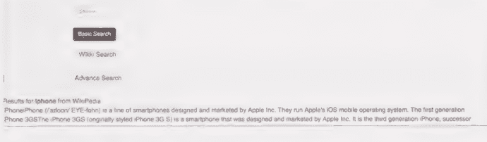

**图 A.16** 在应用程序中搜索问题

## 我的配置

这两个标签页显示了登录用户的个人资料。第一个标签页显示个人信息，如图 A.17 所示；第二个显示账户信息，如图 A.18 所示。


**图 A.17** 个人资料


**图 A.18** 账户信息

## 支持工作台工程师

支持工作台工程师处理进入的工单并帮助解决问题。有两个主要选项：查看所有工单和查看特定工单。

## 查看所有工单

在支持工作台控制台中，工程师可以查看所有工单，并点击工单号查看它，如图 A.19 所示。


**图 A.19** 支持工作台控制台

## 查看工单

点击支持工作台中的工单号打开工单。支持工作台工程师可以添加评论、更改状态，如图 A.20 所示。


**图 A.20** 查看工单

## 附录 B：安装 Solr 搜索引擎

本附录提供了安装和配置 Solr 的步骤说明。如果您想了解更多关于 Solr 的信息，请访问其网站。

#### 前提条件

- 具有至少 1 GB 内存的 Linux 机器或虚拟机
- 已安装最新版本的 Java

#### 步骤

1. 下载 tar 包。
2. 解压 tar 包。
3. 执行安装脚本。

安装完成后，您可以访问 Web 界面。界面应如图 B.2 所示。

```xml
<dataConfig>
  <dataSource driver="org.hsqldb.jdbcDriver"
    url="jdbc:hsqldb://example-DIH/hsqldb/ex"
    user="sa" password="secret"/>
  <document>
    <entity name="products" query="select * from products"
      deltaQuery="select id from products
      where updated_date > '${dataimporter.last_index_time}'>"
    />
  </document>
</dataConfig>
```

## 配置 Solr 进行简单数据导入

我们将有一个独立的微服务用于基于 Solr 的搜索，从中提取数据。多种工具可以将数据从 MySQL/PostgreSQL 导入 Solr。（在这种情况下，我们将只提取数据以保持简单。）我们将使用简单的数据导入处理程序并在 Solr 中导入所需的表。

## 配置 Solr 进行简单数据导入

1. 在 `solconfig.xml` 中添加以下配置。此代码指定数据导入配置的路径。该配置文件是 Solr 的一部分。更新此片段中的路径为文件在机器上的位置

2. 在 `dbconfig` 文件中添加以下内容。我们正在导入要索引到 Solr 的数据库表。在此片段中，我们指定了数据源以及数据选择查询。

- 3. 返回 shell 提示符并运行以下命令来导入索引数据：

```
bin/solr -e dih
```


一旦所有数据在 Solr 中建立了索引，就可以创建一个 RESTful Web 服务，它可以从 Solr 查询数据，并提供快速、准确、可靠的搜索。我们已经准备就绪了！现在你可以根据第 12 章描述的案例研究创建微服务了。

## 索引

- A
  - 账户管理，帮助台应用
    - 案例研究，175
  - `addAccount` 服务，176–177
  - `deleteAccount` 服务，178
  - `getAccount` 服务，176
  - `updateAccount` 服务，帮助台应用
    - 案例研究，176–177
  - `addCatalog` 服务，帮助台应用
    - 案例研究，182–183
  - 管理，帮助台应用案例研究，247, 248–261
  - Alertmanager 和 Prometheus，165–167
  - Amazon Web Services
    - DC/OS 集群设置，227–235
    - 服务发现，138
  - Apache Mesos + Marathon，容器编排，129
    - agents，130–131
    - frameworks，131–132
    - Mesos master，130
  - API（应用程序编程接口）
    - 网关
    - 创建微服务，40
    - 发现性服务和微服务通信，27
    - 命令行资源，149
    - REST API，149
    - 服务端，Kubernetes 和容器编排，124–125
  - 预约，帮助台应用案例研究，184–185
  - `getAvailableDates` 服务，185–186
  - `getAvailableTimeSlots` 服务，185
  - `saveAppointment` 服务，186
  - 异步通信，微服务，23–24
  - 身份验证，帮助台应用案例研究，173–174, 248–249
  - 授权，帮助台应用案例研究，175
  - 自动化，微服务，38, 39
  - `awslog` 日志驱动，145

- B
  - 备份/恢复，VM，51
  - 向后兼容性，微服务，25
  - 二进制文件，容器化微服务，222
  - 桥接（bridges）
    - 自定义桥接网络，117–118
    - Docker 网络，113–116
    - Linux 网络，106
  - 错误修复，帮助台案例，200–202, 217–219
  - 构建
    - 二进制文件，容器化微服务，222
    - 微服务，18, 19, 212–213
    - WAR 文件，容器化微服务，222

- C
  - `cAdvisor` 监控，149–150, 155–156
  - 计算器应用，微服务对比单体应用，4–5

## 索引
  - 案例研究，帮助台应用，171, 173
  - 账户管理，175–178
  - 管理，247, 248–261
  - 预约，184–186
  - 架构，172–173
  - 身份验证，173–174, 248–249
  - 授权，175
  - 错误修复，200–202
  - 构建应用，193–197
  - 配置，198–200
  - 客户，247–248
  - 部署 IDE，198–200
  - Eclipse，190–193
  - 流程，247–261
  - 拦截器（Interceptor），174
  - 留言板，186–189
  - 迁移到微服务，203–219
  - 概述，171–172
  - 产品目录，181–184
  - 需求，200–202
  - 搜索，189
  - 支持，251
  - 工单系统，178–181
  - 故障排除，200–202
  - 用户角色，248–251
  - 更改日志驱动，146–147
  - 熔断器，创建微服务，40
  - 集群级监控
    - Heapster，150–151
    - Prometheus，151–152
    - 添加目标，156
    - Alertmanager 和，165–167
    - `cAdvisor` 和，155–156
    - Grafana 用户界面和，157–160
    - Node Exporter 和，155–156
    - 在线资源，167
    - 运行，152–155
    - 查看统计数据，160–165
  - 命令 (Docker)
    - `docker attach` 命令，85–86
    - `docker commit` 命令，94–95
    - `docker cp` 命令，91–92
    - `docker create` 命令，34
    - `docker diff` 命令，95
    - `docker exec` 命令，89
    - `docker images` 命令，76–77
    - `docker inspect` 命令，87–89
    - `docker logs` 命令，80–83
    - `docker pause` 命令，92–93
    - `docker ps` 命令，79–80
    - `docker pull` 命令，75–76
    - `docker remove` 命令，86–87
    - `docker rename` 命令，90–91
    - `docker restart` 命令，85
    - `docker rmi` 命令，77
    - `docker run` 命令，77–79
    - `docker search` 命令，73–75
    - `docker stats` 命令，147–149
  - 通信，微服务，15
    - 异步通信，23–24
    - 发现服务，26–27, 28–29
    - API 网关，27
    - 服务注册表，27–28
    - 维护，25–26
    - 消息总线，37
    - 迁移到微服务，37
    - 发布/订阅模式，24
    - 同步通信，23
    - 兼容性（向后），微服务，25
    - 微服务的复杂性，11
    - Compose (Docker)，55, 101–103
    - 配置
    - Eclipse IDE，帮助台应用，190–193
    - Grafana 用户界面，159–160
    - 帮助台应用案例研究，198–200, 213–217
    - 微服务，17, 213–217
  - 容器
    - 架构，52–53
    - 定义，52–53
    - docker 容器，56
    - 架构，54–57

## 索引
  - 到运行中的容器，85–86
  - 在运行中执行命令，89
  - 存储，53
  - 桥接，113–116
  - `cAdvisor` 监控，149–150
  - 查看容器信息，87–89
  - 查看日志文件，80–83
  - 从容器和本地机器复制文件，91–92
  - 创建，94
  - 帮助台应用案例研究，容器化微服务，221–246
  - LXC，52–53
  - 从更改创建镜像，94–95
  - 自定义桥接网络，117–118
  - 部署，57–60
  - 效率，57–60
  - 示例，57–60
  - Heapster，150–151
  - 主机网络选项，111–113
  - 列出更改的文件/目录，95
  - 列出运行中的容器，79–80
  - 日志，144–147
  - 持续交付，微服务，9
  - 控制器（复制控制器），Kubernetes 和容器编排，126–127
  - LXC 对比 docker 容器，53–54
  - 指标收集，147–149
  - 监控，143–144
  - `cAdvisor`，149–150
  - Heapster，150–151
  - 无（无连接）选项，编排，110–111
  - 转换微服务，帮助台应用案例研究，206–207
  - 从容器和本地机器复制文件，91–92
  - 切换服务的成本，18–22
  - 编排，Docker Swarms，132–136
  - 编排，Kubernetes，123–129
  - 编排，Mesos – Marathon，129–132
  - overlay 网络驱动，119–120
  - 在运行中暂停进程，92–93
  - 端口映射，118–119
  - 可移植性，54, 56
  - 运行进程，53
  - `createMessage`，帮助台应用案例研究，188–189
  - `createTicket` 服务，帮助台应用案例研究，179
  - 文化变革，切换到微服务，14–15
  - 自定义网络，自定义桥接网络，117–118
  - overlay 网络驱动，119–120
  - underlay 网络驱动 (Macvlan)，121–122
  - Prometheus 监控，151–167
  - 적으로，86–87
  - 重命名，90–91
  - REST API，149
  - 重启，85
  - 客户，帮助台应用案例研究，247–248

## D
  - 守护进程/服务端，Docker 守护进程/服务端，54
  - 数据迁移，微服务迁移，44
  - 数据恢复/备份，VM，51
  - 数据隔离，微服务，10
  - 基于数据库的搜索，211–212
  - DC/OS（数据中心操作系统），集群设置，227–235
  - 数据去中心化，微服务，10
  - `deleteAccount` 服务，178
  - `deleteCatalog` 服务，帮助台应用，175
  - DevOps，18–22
  - 架构，54–57
  - 到运行中的容器，85–86
  - 在运行中执行命令，89
  - 存储，53
  - 桥接，113–116
  - `cAdvisor` 监控，149–150
  - 查看容器信息，87–89
  - 查看日志文件，80–83
  - 从容器和本地机器复制文件，91–92
  - 创建，94
  - 帮助台应用案例研究，容器化微服务，221–246
  - LXC，52–53
  - 从更改创建镜像，94–95
  - 自定义桥接网络，117–118
  - 部署，57–60
  - 效率，57–60
  - 示例，57–60
  - Heapster，150–151
  - 主机网络选项，111–113
  - 列出更改的文件/目录，95
  - 列出运行中的容器，79–80
  - 日志，144–147
  - 持续交付，微服务，9
  - 控制器（复制控制器），Kubernetes 和容器编排，126–127
  - LXC 对比 docker 容器，53–54
  - 指标收集，147–149
  - 监控，143–144
  - `cAdvisor`，149–150
  - Heapster，150–151

# 索引

- 覆盖网络驱动 (overlay network drivers), 119–120
- 底层网络驱动 (Macvlan), 121–122
- 已定义, 49
- docker 攻击命令, 85–86
- `docker commit` 命令, 94–95
- `docker Compose`, 55, 101–103
- `docker cp` 命令, 91–92
- `docker create` 命令, 94
- `docker diff` 命令, 95
- `docker exec` 命令, 76–77
- `docker images` 命令,
- `docker inspect` 命令, 87–89
- `docker logs` 命令, 80–83
- Docker Machines, 55
- `docker pause` 命令, 92–93
- `docker ps` 命令, 79–80, 85
- `docker pull` 命令, 75–76
- `docker remove` 命令, 86–87
- `docker rename` 命令, 90–91
- `docker restart` 命令, 85
- `docker rmi` 命令, 77
- `docker run` 命令, 77–79
- `docker search` 命令, 73–75
- `docker stats` 命令, 147–149
- Docker Swarms, 55, 120–121, 132
  - 节点 (nodes), 132
  - 服务 (services), 133
  - Swarm 集群 (Swarm clusters), 133–136
  - 任务 (tasks), 133
- Dockerfiles, 55
  - 命令 (commands), 96
  - 创建, 96–100
  - 格式, 95
  - 指令说明, 96
  - MySQL Dockerfiles, 96–100
- 演变, 75
- 镜像 (images), 54
  - 创建, 222–227
  - 可复用性, 57
- 安装
  - Mac OS X 安装, 61–65
  - Ubuntu Linux 安装, 68–72
  - Windows 安装, 66–68
- 在线资源, 60
- 注册表 (registries), 55
- 发布版本之间的变化, 75
- 服务器/守护进程 (servers/daemons), 56–57
- VM 优势,
  - docker0. 见

# E

- 电子商务系统，微服务对比
  - 单体应用, 6–8
- Eclipse IDE
  - 帮助台应用案例研究, 190–193, 213
  - 微服务，构建, 213
- 效率
  - Docker 容器, 57
  - VM, 51, 52
  - 以太网设备（虚拟）,Linux 网络, 106
  - 示例, Docker 容器, 57–60

# F
- 故障失效设计 (failsafe design)
  - 微服务，实现, 38
  - Web 服务, 25
- 故障处理, 微服务, 17
- 故障处理, 帮助台应用案例研究, 219
- 故障隔离, 微服务, 10
- 文件
  - 从容器和本地机器拷贝, 91–92
  - 列出 Docker 容器中更改的文件/目录, 95
- 灵活性, VM, 51

# G
- `gcplogs` 日志驱动, 145
- GELF 日志驱动, 146
- `AccountService`, 帮助台应用案例研究, 176
- `getAllMessage` 服务, 帮助台应用案例研究, 187–188
- `AvailableDates` 服务, 帮助台案例研究, 185–186
- `AvailableTimeSlots` 服务, 帮助台案例研究, 185
- `getCatalog` 服务, 帮助台应用案例研究, 182
- `getMessage` 服务, 帮助台应用案例研究, 187
- Google, Kubernetes 和容器编排, 123–123
  - `kubectl` 命令行界面, 124
  - 主节点 (master node), 124–127
- Grafana 用户界面
  - 配置, 159–160
  - Prometheus, 以及 157–170
- 配置, 198–200
- 微服务容器化, 221
- 访问微服务, 245–246
- 构建二进制文件, 222
- 构建 WAR 文件, 222
- 创建 Docker 镜像, 222–227
- DC/OS 集群设置, 227–235
- 部署微服务, 235–242
- 检查微服务, 239–245
- 列出依赖, 222
- 扩展微服务, 239–245
- 向 Marathon 提交任务, 236–242
- 自定义, 247–248
- 部署, 198–200
- 流程, 247–261
- 拦截器 (Interceptor), 174
- 留言板, 186–187
- `createMessage` 服务, 188–189
- `getAllMessage` 服务, 187–188
- `getMessage` 服务, 187
- 迁移到微服务, 203
- 修复修复, 217–219
- 构建微服务, 212–213
- 配置微服务, 213–217
- 部署微服务, 205, 213–217
- 故障处理, 219
- 辅助服务, 205
- 微服务转换过程, 206–207
- 规划, 203–204
- 产品目录, 208–211
- 要求, 217–219
- 可扩展性, 205, 219
- 搜索, 211–212
- 多语言存储 (storage alternatives/polyglot), 205
- 多技术方案 (technology alternatives/polyglot), 205
- 编程, 211
- 故障排除, 217–219
- 概述, 171–172
- 产品目录, 181

# H
- 堆监控 (Heap monitoring), 150–151
- 帮助台应用案例研究, 171, 173
- 管理, 175
- `addAccount` 服务, 176–177
- `deleteAccount` 服务, 178
- `getAccount` 服务, 176
- `updateAccount` 服务, 177
- 预约, 184–185
- `AvailableDates` 服务, 185–186
- `AvailableTimeSlots` 服务, 185
- `saveAccount` 服务, 186
- 架构, 172–173
- 身份认证, 173–174, 248–249
- 权限, 175
- 故障修复, 200–202
- 辅助微服务, 5–6
- 迁移到微服务, 43, 205
- 主机网络 Docker 容器, 111–113
- 混合方法，微服务创建, 45
- Mac OS X 安装, 61–65
- Ubuntu Linux 安装, 68–72
- Windows 安装, 66–68
- 搜索引擎, 247–266
- 拦截器, 帮助台应用案例研究, 174
- 互联网资源
  - API, 149
  - Docker, 60
  - Kubernetes, 129
  - Prometheus, 167
- 进程间通信。见微服务 iptables, 106
- Journal 日志驱动, 145
- json-file 日志驱动, 145, 146

# I
- Docker 镜像, 54
  - 创建, 222–227
  - 可复用性, 57
- MySQL 镜像
  - 容器更改, 94–95
  - 列出可用镜像, 76–77
  - 从本地机器移除, 77–79
  - 搜索, 73–75
- 实现微服务, 38
- 环境安全/自动化, 38
- 故障失效设计, 38
- 依赖, 38
- 可复用性, 38–39
- 源码控制, 38
- 标记, 39

# K
- Kubernetes, 容器编排, 123–124
- `kubectl` 命令行界面, 124
- `kubelet`, 127
- Kubernetes 服务, 128
- 主节点, 124
- API 服务器, 124–125
- 副本控制器 (副本), 126–127
- 调度器, 125–126
- 在线资源, 129
- Pods, 127–129
- 工作节点 (worker nodes), 127

# L
- 延迟, 微服务, 11
- 切换微服务的学习曲线, 15–17
- 单体应用中的软件寿命, 18
- 安装 Docker
  - 链接 Docker 容器, 106–109
- Linux
  - 桥接, 106
  - Docker 安装, 68–72
  - iptables, 106
  - 命名空间, 105–106
- 网络, 105
  - 桥接, 106
  - iptables, 106
  - 命名空间, 105–106
  - 虚拟以太网设备, 106
- 列出
  - 可用的 MySQL 镜像, 76–77
  - Docker 容器中更改的文件/目录, 95
  - 依赖，微服务容器化, 222
  - 运行 Docker 容器, 79–80
  - 查看 Docker 容器的日志文件, 80–83
- 日志
  - `awslog` 日志驱动, 145
  - 更改驱动, 146–147
  - Docker 容器, 144–147
  - `gcplogs` 日志驱动, 145
  - GELF 日志驱动, 146
  - Journal 日志驱动, 145
  - json-file 日志驱动, 145, 146
  - Splunk 日志驱动, 145
  - Syslog 日志驱动, 145
- LXC (Linux容器), 52–53
  - Docker 容器对比 LXC, 53–54
- 可移植性, 54
- 运行中的进程, 53

# M
- 账户, 帮助台应用案例研究, 175–178
- `addAccount` 服务, 182–183
- `deleteAccount` 服务, 184
- `getAccount` 服务, 182
- `updateAccount` 服务, 183
- 要求, 200–202
- 搜索, 189–192
- 支持, 251
- 工单单, 178–179
- `createAccount` 服务, 179
- `allAccount` 服务, 180–181
- `viewAccount` 服务, 180
- 故障排除, 200–202
- 用户角色, 248–251

## 276 索引

- 微服务（续）
  安全, 16, 37, 37, 38
  服务发现, 139
  独立微服务, 15
  切换到
    切换的业务理由, 17–18, 22
    成本, 18–22
    文化变革, 14–15
    学习曲线, 15–17
    单体应用属性, 14
    单体应用疲劳, 14
    运维流程, 15
    测试, 16
    故障排除, 11, 217–219
    更新, 5, 18, 20
  升级, 16
  版本控制, 11
  版本化, 44, 45
  迁移
    数据，微服务迁移, 44
    迁移到微服务, 40–42
    修复 修复, 217–219
    构建微服务, 212–213
    配置微服务, 213–217
    数据迁移, 44
    为函数定义, 44
    部署微服务, 43, 205, 213–217
    故障处理, 219
    帮助台应用案例研究, 203–204, 205, 206–207, 208–219
    辅助服务, 43, 205
    独立构建/部署, 45
    微服务转换过程, 206–207
    修改请求, 43
    单体代码, 44
    迁移需求, 33–35
    性能, 42
    迁移规划, 203–204
    产品目录, 208–211
    服务重构架构, 44–45
    代码重构, 44
    + 移除旧代码, 45
    需求, 217–219
    可扩展性, 42, 205, 219
    搜索, 211–212
    存储替代/多语言持久化, 43
    技术替代/多语言编程, 42–43
    工单系统, 211
    微服务版本化, 44, 45
- VM, 51
  修改请求，迁移到微服务, 43
  微服务的模块化, 8–9
  监控
    `cAdvisor`, 149–150, 155–156
    Docker 容器, 143–144
    Heapster, 150–151
    微服务, 17, 25–26, 40
    Prometheus, 151–152
    添加目标, 156
    Alertmanager 与, 165–167
    `cAdvisor` 与, 155–156
    Grafana 用户界面与, 157–160
    Node Exporter 与, 155–156
    在线资源, 167
    运行, 152–155
    查看统计, 160–165
- 单体应用
  复杂度, 9
  电子商务系统, 6–8
  疲劳, 14
  帮助台应用案例研究, 171, 173
    账户管理, 175–178
    预约, 184–186
    架构, 172–173
    身份验证, 173–174
    授权, 175
    修复 Bug, 200–202
    构建应用, 193–197
    配置, 198–200
    配置 Eclipse IDE, 190–193
    部署, 198–200
    拦截器, 174
    留言板, 186–189
    概述, 171–172
    产品目录, 181–184
    需求, 200–202
    搜索, 189
    工单处理, 178–181
    故障排除，迁移到, 40–42
    微服务，迁移微服务
      数据迁移, 44
      为函数定义, 44
      部署微服务, 43
      辅助服务, 43
      独立构建/部署, 45
      修改请求, 43
      单体代码, 44
      迁移需求, 33–35
      性能, 42
      服务重构架构, 44–45
      代码重构, 44
      移除旧代码, 45
      可扩展性, 42
      存储替代/多语言持久化, 43
      技术替代/多语言编程, 42–43
      微服务版本化, 44, 45
- 微服务，切换到
  从容器更改创建, 94–95
  列出可用镜像, 66–77
  从本地机器移除, 77
  运行, 77–79
  搜索, 73–75

## N
- 命名空间（Linux）, 105–106
- 命名，Docker 容器, 90–91
- 网络化（Linux）, 105
  桥接, 106
  自定义桥接网络, 117–118
  桥接, 113–116
  默认连接, 110
  链接, 106–109
  无（none）选项, 110–111
  iptables, 106
  命名空间, 105–106
  overlay 网络驱动, 119–120
  端口映射, 118–119
  under 网络驱动 (macvlan), 121–122
  虚拟设备, 106
- Node Exporter 与 Prometheus, 155–156

## O
- 旧代码（迁移到微服务），移除, 45
- 在线资源
  API, 149
  Docker, 60
  Kubernetes, 129
  Prometheus, 167
  微服务的运维复杂度, 11
运维流程，切换到微服务, 15
  属性, 14
  切换的业务理由, 17–18, 22
  成本, 18–22
  文化变革, 14–15
  疲劳, 14
  学习曲线, 15–17
  运维流程, 15
  微服务对比, 4–5, 6–8, 9–11
  单体应用的寿命, 18
  单体代码，微服务迁移, 44
  Dockerfiles, 96–100
  overlay 网络驱动, 119–120

## P
- Docker 容器中的进程, 92–93
- 性能，微服务，迁移到, 42, 205
- 微服务迁移，帮助台应用案例研究, 203–204
- pods，Kubernetes 与容器编排, 127–129
- 迁移到微服务, 43, 205
- 微服务, 42–205
- 端口映射, 118–119
- 可移植性，Docker 容器, 56, 54 (LXC 与 Docker 容器），运行, 53
- 产品目录，帮助台应用案例研究, 181
- 添加服务, 182–183
- 删除服务, 184
- 获取服务到微服务, 208–211
- 更新服务, 183
- Prometheus 监控
  Alertmanager 与, 165–167
  `cAdvisor` 与，接口, 155–156
  Grafana 用户界面与, 157–160
  Node Exporter 与, 155–156
  在线资源, 167
  运行, 152–155
  查看统计数据, 160–165
  目标，添加, 156
  发布/订阅方法，微服务通信, 24
- 恢复/备份，VM, 51
- 代码重构，迁移到微服务, 44
- 注册表（Docker）, 55
  旧迁移，迁移到微服务, 45
  重命名 Docker 容器, 90–91
  副本控制器（controller），Kubernetes 与容器编排, 126–127
  需求，帮助台应用案例研究, 200–202, 217–219
  资源利用，VM, 52
- REST API, 149
- 重启 Docker 容器, 85
- 重用代码，迁移到微服务, 44
  微服务, 38–39
  Docker 容器中的命令, 89
  附加到运行的容器, 85–86
  列出运行的容器, 79–80
  镜像, 77–79
- 保存预约服务，帮助台应用案例研究, 186
- 可扩展性，微服务, 5–9–10, 16, 19, 20–21, 37, 40, 42, 205–245
- 调度器，Kubernetes 与容器编排, 125–126

## S
- 搜索
  - 基于数据库的搜索, 211–212
  - `docker search` 命令, 73–75
  MySQL, 73–75
  Solr 搜索引擎, 212, 247–266
- 安全，微服务, 16, 37, 37, 38
- 数据隔离，微服务, 10
- 节点
  - API 服务器，Kubernetes 与容器编排, 124–125
  - Docker 服务器/守护进程, 54
  - 服务注册表，发现服务与微服务通信, 27–28
- 服务
  - Docker Swarms, 133, 135
  服务发现, 136–137
  - Amazon Web Services, 138
  - 客户端发现, 137–138
  微服务, 139
  - 服务端发现, 138–139
  服务注册, 139–141
  共享 VM, 51
- 购物车（电子商务系统），微服务对比单体应用, 7–8
- 基于 SOA 的单体应用，电子商务系统, 6–8
  疲劳, 14
- 微服务，切换到
  切换的业务理由, 17–18, 22
  成本, 18–22
  文化变革, 14–15
  疲劳, 14
  学习曲线, 15–17
  运维流程, 15
  微服务对比, 4–5, 6–8, 9–11
  单体应用的寿命, 18
- 软件
  - 依赖（容器化微服务），列出, 222
  - 单体应用的寿命, 18
- Solr 搜索引擎, 212, 247–266
- Splunk 驱动, 145
- 独立微服务, 15
- 存储
  Docker 容器, 53
  替代/多语言持久化，迁移到微服务, 43, 205
  发布/订阅方法，微服务通信, 24
- 支持，帮助台应用案例研究, 251
- Swarms（Docker）, 55, 120–121, 132
- 节点, 132
- 服务, 133, 135
- Swarm 集群, 133–136
- 任务，
  同步通信，微服务, 23
- Syslog 驱动, 145

## T
  - 微服务标记, 39
- 技术替代/多语言编程，迁移到微服务, 42–43, 205
- 微服务测试, 16
- 工单系统，帮助台应用案例研究, 178–179, 211
  创建工单服务, 179
  查看所有工单服务, 180–181
  查看工单服务, 180
  转换到微服务, 40–42
  数据迁移, 44
  为函数定义, 44
  部署微服务, 43
  辅助服务, 43
  独立构建/部署, 86
  修改请求, 43
  单体代码, 44
  迁移需求, 33–35
  性能, 42
  服务重构架构, 44–45
  代码重构, 44
  移除旧代码, 45
  可扩展性, 42

## 迁移微服务（继续）
- 服务重构，44–45
- 代码重构，44
- 移除旧代码，45
- 可扩展性，42
- 存储替代方案/多语言持久化，43
- 技术替代方案/多语言编程，42–43
- 微服务的版本控制，44, 45

## 故障排除
- 帮助台应用案例研究，200–202, 217–219
- 微服务，11, 217–219

## 查看 Docker 容器
- 容器信息，87–89
- 日志文件，80–83
- `viewTicket` 服务，帮助台应用案例研究，180
- 虚拟以太网设备，Linux 网络，106

## VM（虚拟机）
- 优点，50–51
- 备份/恢复，51
- 定义，50
- 部署，57–58
- 缺点，49–52
- Docker，VM 的优势，56–57
- 效率，51, 52
- 灵活性，51
- 迁移，51
- OS 自由，51
- 性能，51, 52
- 可移植性，51–52
- 资源利用，52
- 共享，51

# U
- Ubuntu Linux，Docker 实例，121–122
- 底层网络 (Macvlan)
- `updateAccount` 服务，帮助台应用案例研究，177
- `updateCatalog` 服务，帮助台应用案例研究，183
- 更新
  - 帮助台应用案例研究，246
  - 微服务，5, 18, 20
  - 升级微服务，16
  - 使用示例，Docker 容器，57–60
- 用户角色，帮助台应用案例研究，248–251

# V
- 版本控制，微服务，11
- 微服务的版本控制，44, 45
- `viewAllTicket` 服务，帮助台应用案例研究，180–181

# W-X-Y-Z
- WAR 文件，构建，容器化微服务，222
- Web 资源
  - API，149
  - Docker，60
  - Kubernetes，129
  - Prometheus，167
- Web 服务
  - 安全设计，25
  - 维护，25–26
  - 编写，24–25
- Windows，Docker 安装，66–78
- WordPress 站点，Docker 容器部署示例，57–60

# 致谢
图 6.1-6.10, 7.1-7.47, 10.4, 10.7, 10.11, 10.15, 10.16, 10.23: Docker 截图 © 2018 Docker Inc. 版权所有。

图 6.11, 11.2, 13.5-13.14: Microsoft 截图 © Microsoft 2018。图 6.13-6.16: Ubuntu 截图 © 2018 Canonical Ltd.。Ubuntu 和 Canonical 是 Canonical Ltd. 的注册商标。

图 8.18, 11.6-11.8, 12.4, B.2: 截图来自 Copyright © 2017 The Apache Software Foundation，根据 Apache License 版本 2.0 许可。

图 10.12-10.14, 10.17-10.22: Grafana 截图 Copyright 2018 © Grafana Labs。

图 11.3-11.5, 12.2, 12.3: Eclipse 截图 Copyright © 2018 The Eclipse Foundation。

# 在 informit.com/register 注册您的产品
获取额外福利并在下次购买时立省 35%

* 自动获得下次购买的 6 折优惠券，有效期为 30 天。在您的 InformIT 购物车或账户页面的“管理代码”部分查找您的代码。
* 下载可用的产品更新。
* 如果可用，访问赠送材料。
* 勾选框以接收我们的消息，并获取新版本及相关产品的独家优惠。

> 注册情况因产品而异。福利将列在您账户页面的“已注册产品”下。

与 InformIT 连接——访问 informit.com/community


Addison-Wesley • Adobe Press • Cisco Press • Microsoft Press • Pearson IT Certification • Prentice Hall • Que • Sams • Peachpit Press

# 迁移微服务与 DevOps 以提升您的软件开发效率

得益于科技领域最新颠覆规则的创新——物联网 (IoT)、软件定义网络以及软件即服务 (SaaS)——现在对于能够改进应用开发和部署流程的平台和架构的需求似乎是无穷无尽的。

在《微服务与容器》一书中，长期系统架构和工程团队负责人 Parminder Kocher 分析了两种最新的技术趋势：微服务和容器。正如 Kocher 所示，微服务和 Docker 的结合可以为应用开发和部署带来前所未有的灵活性和可扩展性，特别是在小错误可能导致灾难性后果的大型项目中。

学习如何利用微服务和 Docker 来驱动架构设计、按需扩展、应用性能、上市时间、代码复用以及 DevOps 效率的指数级提升。Kocher 为从单体架构迁移提供了详细指南和完整路线图，并通过深度案例引导读者完成企业级 SOA 系统的迁移。

无论您是寻求改变旧方法的软件架构师/开发者，还是试图最大化技术价值的经理，《微服务与容器》都将是您书架上的宝补充。

PARMINDER SINGH KOCHER 拥有二十年的企业级系统构建经验。目前担任 Cisco 网络学院工程总监（自 2005 年起），他领导工程团队开发下一代平台，该平台已在 180 多个国家使用。他曾管理 Cisco 的托管服务 (CMS) 平台，并担任创新推广人员。

- 理解微服务如何将应用程序组织成更容易管理、更新和扩展的独立组件。
- 判断微服务和容器是否值得投入，并管理与之相关的组织学习。
- 应用微服务之间进程间通信的最佳实践。
- 有序地迁移单体系统。
- 理解 Docker 容器、安装和接口。
- 有效地对 Docker 容器进行网络化、编排和管理。
- 使用 Docker 最大化基于微服务的应用程序的可扩展性。
- 通过深度实战案例应用您的所学。

informit.com/aw
在 informit.com/register 注册您的产品 >>> 以方便获取可能的下载、更新和更正。


ISBN-13: 978-0-13-459838-3
ISBN-10: 0-13-459838-5


W7-BVN-865
封面设计：Chuti Praserathi
封面插画：LeoWolfert
