# Microsoft Word - Linux 与 Windows 集成指南

- 完整的 Linux/Windows 集成指南
- 双启动问题、数据兼容性和网络连接的详细论述
- 为 Windows 工作站实现 Samba 文件/打印服务

# Linux 与 Windows 集成

## 引言

1998 年初，我正考虑第三次重新安装 Windows 95。诚然，我对电脑施加的压力远高于普通用户，但这事儿已经开始让人厌烦了。我从 1995 年初就开始接触 Linux，看来是时候把它作为主要桌面系统来用了。

我已经知道如何安装和配置 Linux，但从未将其作为桌面系统使用。我找到了大量关于 Linux 配置的书籍，也有一些关于将其用作服务器的资料，但关于将其作为桌面使用的却一本都没有。无奈之下，我只能在互联网上四处搜寻有用的信息。本书试图将我过去两年间所学到的知识汇编成册。希望这能省去你们自行寻找所需的时间和挫折。

那么，Linux 与 Windows 相比如何？与其他任何事物一样，两者各有其优势和劣势。

Windows 稳坐桌面操作系统之王的宝座，这并非没有道理。它拥有精致的界面和比任何其他操作系统都多的终端用户应用程序。它还预装在大多数新 PC 上，使其成为大多数 PC 用户简单、安全的选择。这些因素综合起来，使 Windows 占据了约 90% 的桌面市场份额。

Linux 基于 UNIX，并继承了其安全性和稳定性。Linux 是公共 Web 服务器最流行的选择，并且还拥有约 25% 的小型服务器市场份额。它也是免费的（或近乎免费），并附带了大量用于编程和服务器管理的有用工具。

然而，这些区别并非一成不变。多个团队正在努力完善 Linux 的界面。同时，开发更多面向终端用户的 Linux 应用程序的竞赛也在如火如荼地进行。戴尔、康柏和 IBM 等大型 PC 制造商开始提供预装 Linux 的 PC。

尽管 Linux 的市场份额相对较小，但 Linux 的桌面市场份额从 1998 年的不到 1% 增长到 1999 年的约 4%。这一成绩令人惊叹，尤其是考虑到已经存在 15 年的 Apple Macintosh 也才占据 5% 的桌面市场份额。

Windows 也在努力在传统 UNIX（和 Linux）市场的优势领域占有一席之地：安全性、稳定性和可扩展性。微软投入了数十亿美元用于最近发布的 Windows 2000，以解决这些问题。尽管它是否成功尚无定论，但早期报告称 Windows 2000 在这些方面比早期版本的 Windows 有了显著改进。

选择操作系统还有许多其他原因。它们往往能让人产生狂热的忠诚（只需问问那些忠实的 Macintosh 用户便知道了）。尽管（或许正因为）取得了成功，微软也拥有一些非常坚定的敌人。只需在互联网上搜索"Satan"或"Antichrist"，你会惊讶地发现竟然有那么多反微软的网站。微软反垄断案也是由一些坚定的反对者推动的。一些用户尝试将 Linux 作为 Windows 的替代品。这或许不是选择操作系统的最佳方式，但永远不要低估狂热忠诚的力量。

这种忠诚并非必需。Linux 和 Windows 可以在同一台电脑上和平共存。甚至有可能同时运行 Linux 和 Windows！本书整个第一部分都致力于使这种共存尽可能简单。

中间部分专注于为 Linux 系统寻找有用的应用程序。有时，同一应用程序在 Linux 和 Windows 上都有；在其他情况下，有等效的应用程序可用；而在少数情况下，某些应用程序仅适用于 Windows。好消息是，大多数人都可以用 Linux 或 Windows 完成他们所需要的所有工作。

最后一部分涉及网络。这是一个相当高级的话题，但网络正在迅速从财富 500 强企业进入家庭和小企业。网络正变得足够廉价，能够提供大型企业长期享有的同样优势：共享文件、打印机和互联网连接。家庭高速互联网连接的日益普及将继续推动对家庭网络需求的增长。

幸运的是，Linux 和 Windows 都有允许彼此轻松连接的程序。Samba 允许 Linux 充当 Windows 文件服务器。此外，NFS 和 LPD 程序允许 Windows 使用 Linux 的原生协议。

那么，Linux 和 Windows 哪个更好？这就像是在问汽车和卡车哪个更好。它们是为不同目的而设计的。Windows 扮演着汽车的传统角色；它更加精致，面向大众市场。Linux 扮演着卡车的传统角色；它坚固耐用，旨在作为工作车辆使用。但就像汽车和卡车一样，两者的角色开始重叠。Linux 正变得更加精致、更易于使用，而 Windows 则更加注重安全性和稳定性。Windows 仍然是大多数用户桌面的选择，但已不再是唯一的选择。正如你将在本书中看到的，Linux 是服务器的可靠选择，也是桌面市场中可行的替代方案。

## 第 1 章 在同一台 PC 上拥有 Linux 和 Windows

- 1.1 节 分区
- 1.2 节 文件系统
- 1.3 节 分区命名
- 1.4 节 Linux 与 Windows 95/98
- 1.5 节 在不同分区上设置 Linux 和 Windows 3x/9x
- 1.6 节 对现有硬盘进行分区

### 1.1 分区

无需卸载 Windows 即可运行 Linux。事实上，有多种方法可以在同一台 PC 上同时运行两者。每个操作系统都有其优势和劣势，因此在同一台 PC 上同时拥有两者往往能成为一种优势。

在实际安装之前，我们需要了解一些 Linux 和 Windows 的基础知识，例如分区和文件系统。

分区是对硬盘空间进行划分的一种方式。大多数 PC 的硬盘都被划分成一个大分区。但不必非如此不可。硬盘可以被划分为多个分区。这样做通常是为了将程序与数据分开，也是为了在同一硬盘上存储多个操作系统。

硬盘的第一个扇区包含有关分区的信息，包括每个分区的起始和结束位置。它还包含引导加载程序的位置，引导加载程序负责开始加载操作系统。每个操作系统都有自己的引导加载程序。Windows 3x、95 和 98 使用`IO.SYS`和`DOS.SYS`，Windows NT 使用`NTLOADER`，而 Linux 使用`LILO`。还有一些商业和共享软件的引导加载程序，如 Norton System Commander，它们的设计目的是让使用多种配置和多个操作系统启动变得更加容易。

### 1.2 文件系统

Linux 和 Windows 还使用了多种不同的文件系统。文件系统只是一种在分区上组织文件的方式。Windows 使用 FAT、FAT16、FAT32（VFAT）和 NTFS（NT 文件系统）。Linux 的原生文件系统是 ext2，尽管它支持许多其他文件系统。

FAT 是 DOS 使用的原始文件系统。它是一种 8 位文件系统，支持最大 32 MB 的分区。在 20 世纪 80 年代初，这并不成问题，当时大多数 PC 甚至没有硬盘。

FAT 支持以下文件属性：

- **只读**— 设置后，文件无法删除或更改。
- **归档**— 确定文件是否已被更改。许多备份程序使用此属性。
- **隐藏**— 文件不会显示在目录内容中。
- **系统**— 用于系统文件。系统文件由操作系统以不同方式处理。

后来，随着硬盘的使用，FAT 32 MB 的限制成为负担，改进后的 FAT16 取代了它。FAT16 将文件系统的可用大小增加到 2 GB。除了文件系统大小之外，FAT16 本质上与原始 FAT 文件系统相同。FAT16 受 DOS 4.0 及更高版本、所有版本的 Windows 以及所有当前版本的 Linux 支持。

随着 Windows 95 第二版的发布，微软引入了 FAT32。这将文件系统的大小增加到 2 TB，大于目前 PC 可用的任何硬盘。它也比 FAT16 更快、更稳健。

NTFS 是 Windows NT 和 2000 的原生文件系统。与 FAT32 一样，它也支持 2 TB 的文件系统大小，但引导分区目前限制为 7.8 GB。对于某些文件（如数据库文件），NTFS 可以支持高达 16 EB。NTFS 比任何基于 FAT 的文件系统都提供更好的可靠性和安全性。

可靠性因素超出了本书的范围，但 NTFS 的安全考虑需要涵盖。首先，文件系统中的所有内容都有一个所有者。默认情况下，创建对象的用户（文件系统中的任何内容都是一个对象）就是所有者。所有者对该对象拥有完全权限，除非权限被剥夺。

还有组，组中包含用户。三个特殊的组账户是：administrator、everyone 和 guest。

- administrator 账户对文件系统拥有所有权限。此账户可以更改、创建和删除所有对象，也可以更改其他账户的权限。
- everyone 是一个包含系统上所有用户账户的组。此账户用于更改系统上每个用户的权限。
- guest 账户是一个具有最小权限的默认账户。它通常用于仅需访问少量特定文件的账户，例如 FTP 访问账户。

NTFS 中的文件与 FAT 文件系统中的文件具有相同的属性：只读、隐藏、系统和归档。每个用户和组也可以被分配对 NTFS 文件系统中对象的权限。可以分配的权限有：

- **列文件夹内容**— 显示在目录列表中。
- **读取**— 可以读取对象的内容。
- **读取和执行**— 可以读取和执行对象。
- **写入**— 可以更改或删除对象。
- **修改**— 可以更改文件的权限。
- **完全控制**— 拥有上述所有权限。

权限有三种设置：允许、拒绝和继承。

- **允许**— 允许对对象的权限。
- **拒绝**— 剥夺对对象的权限。
- **继承**— 如果未指定允许或拒绝，该对象将继承其上层目录的权限。

要在 NTFS 上查看对象的权限，请右键单击该对象并选择"属性"，然后选择"安全"选项卡。

Ext 或 ext2 是 Linux 分区的原生文件系统。Ext 是 Linux 最初的文件系统，而 ext2 是其改进版本。Linux 中的对象（如文件、目录和设备）支持三种属性：读、写和执行。

- **读**— 如果设置，允许对象在目录列表中显示并被读取。
- **写**— 如果设置，允许对象被写入和删除。
- **执行**— 如果设置，允许对象被执行。对于目录也必须设置此权限。

对象有三组权限：所有者、组和其他用户。

- **所有者**— 创建文件的用户，除非被更改。
- **组**— 文件的所属组是文件所有者所属的组，除非被更改。
- **其他用户**— 系统中所有其他用户的权限。

要查看对象的权限，输入`ls -l <对象名>`。例如，要查看`index.txt`的权限，输入`ls -l index.txt`。该命令的输出如下：

```
-rwxrwxr--   1 root    root      6230 Dec 21 00:12 index.txt
```

让我们来了解这个输出的含义，从第一个字符开始：

- **第一个字符**— 这是特殊属性，如目录、链接或设备驱动程序。Linux 中的链接类似于 Windows 中的快捷方式。
- 接下来的三个字符 (`rwx`)— 所有者具有读、写和执行属性。
- 接下来的三个字符 (`rwx`)— 组具有读、写和执行属性。
- 接下来的三个字符 (`r--`)— 其他用户具有读属性。
- `1 root`— 所有者的 ID 号和名称。
- `root`— 组名，也是 root。
- `6230`— 文件大小（以字节为单位）。
- `Dec 21 00:12`— 文件最后修改的日期和时间。
- `index.txt`— 文件名。

可以使用`chmod`更改文件的权限。所有者和组可以使用`chown`更改。

Linux 中有一个特殊账户：`root`。root 账户在 Linux 安装时自动创建，它对文件系统中的所有对象拥有完全权限。

### 1.3 分区命名

Linux 和 Windows 对分区有不同的命名方式。Windows 只是简单地给每个分区分配一个字母，从 C 开始。字母 A 和 B 保留给软盘驱动器，因为最早的 PC 配有两个软盘驱动器。其余驱动器字母的分配方式如下：

1. 每个驱动器上的第一个主分区。
2. 每个驱动器上扩展分区内的卷。
3. 每个驱动器上其余的主分区。
4. 光驱。

例如，如果你有两个硬盘，每个硬盘有两个主分区，每个硬盘上扩展分区内有两个卷，它们将被命名为：

- C：第一个驱动器上的第一个主分区。
- D：第二个驱动器上的第一个主分区。
- E：第一个驱动器上的第一个扩展分区。
- F：第一个驱动器上的第二个扩展分区。
- G：第二个驱动器上的第一个扩展分区。
- H：第二个驱动器上的第二个扩展分区。
- I：第一个驱动器上的第二个分区。
- J：第二个驱动器上的第二个分区。
- K：光驱。

这些驱动器盘符在 Windows 3x 和 9x 中不能更改，但在 Windows NT 和 2000 中可以轻松更改。

**图 1.1 Windows 2000 的磁盘管理。**

对于 Windows NT，请转到"开始" -> "程序" -> "管理工具" -> "磁盘管理器"。对于 Windows 2000，请转到"开始" -> "程序" -> "管理工具" -> "配置您的服务器"。从这里，选择"文件服务器" -> "打开计算机管理"，然后选择"存储" -> "磁盘管理"。这允许您更改分区和驱动器盘符。您只需右键单击驱动器，然后选择"更改驱动器号和路径"，就可以更改驱动器盘符。然后您可以添加、编辑或删除驱动器。不过要注意：您不能更改启动分区。这很好，因为如果这样做，系统将无法启动！

Linux 对分区的处理方式不同。前两个字母表示驱动器类型，下一个字母是驱动器字母，最后一个字符是该驱动器的分区号。有四种主要的驱动器类型：IDE (`hd`)、SCSI (`sd`)、ESDI (`ed`) 和 RAID (`md`、`rd` 或 `ida`)。例如，`hda1` 是一个 IDE 驱动器 (`hd`)，它是第一个 IDE 驱动器 (`a`)，第一个分区 (`1`)。`sdc5` 表示一个 SCSI 驱动器 (`sd`)，第三个 SCSI 驱动器 (`c`)，第五个分区 (`5`)。

### 1.4 Linux 和 Windows 95/98

首先，让我们了解一下 Linux 和 Windows 9x 启动时会发生什么。

#### 1.4.1 启动 Linux

Linux 启动时，会加载`LILO`程序，它代表 LInux LOader（Linux 加载器）。然后加载内核，即操作系统的核心。最后，从`/etc/rc.d`目录加载模块。实际上，Linux 的启动过程比这要复杂一些，但这个描述对我们的目的来说已经足够。

`LILO`程序通过`/etc/lilo.conf`文件进行配置。典型的`lilo.conf`如下所示：

```
boot=/dev/hda
map=/boot/map
install=/boot/boot.b
prompt
timeout=50
image=/boot/vmlinuz-2.2.13-4mdk
	label=linux
	root=/dev/hda5
	read-only
```

让我们逐行解释：

- `boot`— 这是包含引导文件的设备。
- `map`— 这是映射文件的位置。映射文件是一个包含系统磁盘参数的二进制文件。默认值是`/boot/map`。
- `install`— 这是作为引导扇区安装的文件。默认值是`/boot/boot.b`。
- `prompt timeout`— 这是在引导前等待的时间，以十分之一秒为单位。这允许有时间手动输入引导参数。在上面的例子中，它是五秒（`50` 个十分之一秒）。如果有多重引导系统，按 <SHIFT> 键会显示引导选项。您可以设置多达 16 种不同的引导配置。
- `image`— 这是内核。下面的参数是内核参数：
  - `label`— 显示在引导菜单上的名称。
  - `root`— 文件系统的位置。
  - `read-only`— 文件系统以只读方式挂载，以便用`fsck`检查错误。然后重新挂载为读/写方式。

这些不是`lilo.conf`的全部参数。

#### 1.4.2 LILO 故障排除

`LILO`在加载的四个阶段中会依次加载 "LILO" 四个字母。这有助于故障排除。如果`LILO`加载时停止，显示的字母会告诉你它在哪里失败：

- **(<无>)**— `LILO`的任何部分都未加载。`LILO`要么未安装，要么其引导扇区所在的分区未激活。
- `L <error> ...`— 第一阶段引导加载程序已加载并启动，但无法加载第二阶段引导加载程序。两位数的错误代码表示问题的类型。（参见 [附录 A](.) 中标题为"磁盘错误代码"的部分。）这种情况通常表示介质故障或几何参数不匹配。
- `LI`— 第一阶段引导加载程序能够加载第二阶段引导加载程序，但无法执行它。这可能是由几何参数不匹配引起的，或者是移动了`/boot/boot.b`而没有运行映射安装程序导致的。
- `LIL`— 第二阶段引导加载程序已启动，但无法从映射文件分区加载描述符表。这通常是由介质故障或几何参数不匹配引起的。
- `LIL?`— 第二阶段引导加载程序被加载到了错误的地址。这通常是由细微的几何参数不匹配引起的，或者是移动了`/boot/boot.b`而没有运行映射安装程序导致的。
- `LIL-`— 描述符表已损坏。这可能是由几何参数不匹配引起的，或者是移动了`/boot/map`而没有运行映射安装程序导致的。
- `LILO`— `LILO`的所有部分都已成功加载。

如果 Linux 无法加载，它会给出错误代码。错误代码的含义列在 [附录 A](link) 中。

#### 1.4.3 启动 Windows 9x


Windows 的启动方式略有不同。分区指向引导扇区，加载两个文本文件 `config.sys` 和 `autoexec.bat`。然后加载 Windows 版的 Linux 内核 `win.com`。`win.com` 的配置文件是注册表，它由两个二进制文件组成：`system.dat` 和 `user.dat`。`config.sys` 和 `autoexec.bat` 是文本文件，而注册表文件需要用 `regedit` 编辑。

有几种方法可以在同一台机器上安装 Linux 和 Windows 3x/9x。它们列在下面，从 UMSDOS 开始。在进行任何操作之前，请备份硬盘并在硬盘上运行 `scandisk` 以纠正任何错误。这将为后续省去很多麻烦。

## 1.4.4 UMSDOS

在 Windows 9x 机器上安装 Linux 的最简单方法是使用 UMSDOS，它允许 Linux 与 Windows 在 FAT 或 FAT32 分区上共存。它允许 Linux 直接从 FAT 分区上的命令提示符启动。优点是，您无需对硬盘重新分区或干扰现有的 Windows 安装。缺点是，您确实会失去 Linux 原生 ext2 文件系统的安全性和健壮性。

如果您计划使用 UMSDOS，最好选择带有自动 UMSDOS 安装的发行版。大多数现代发行版都有 UMSDOS 安装。Phat Linux 是一款专为轻松以 UMSDOS 方式安装而设计的 Linux 发行版。它的下载量很大，因此除非您有快速的连接和充足的时间，否则您可能想购买 CD-ROM。作为额外收获，购买还可以获得技术支持。

Phat Linux 最初是由两个高中生制作的，他们想要一种简单的方法来安装 Linux。要安装它，请将文件解压到 `\phat` 目录并运行 `linux.bat`。这应该开始引导进入 Linux。如果在启动过程中挂起，可能需要重新启动，在启动时按 F8，然后选择安全模式命令提示符。启动后，会有一个菜单让您选择配置来设置视频、声音和网络。`linux.bat` 只有三行，如下所示：

```
loadlin vmlinuz initrd=ramdisk.gz mem=96M
echo Linux failed to load.
pause
```

## 整合 Linux 与 Windows

第一行实际加载的是 Phat Linux。该命令分解如下：

- `loadlin`——这是 UMSDOS 的加载器。
- `vmlinuz`——这是 Linux 内核。
- `initrd`——指向内存映像。Phat Linux 使用压缩的内存映像来启动操作系统。
- `ramdisk.gz`——一个包含完整 Linux 文件系统的压缩文件。这也可以是一个目录。
- `Mem`——内存大小，以兆字节为单位。

Phat Linux 基于 Red Hat，采用 KDE 桌面，因此熟悉 Red Hat 的用户应该能够使用 Phat Linux。

UMSDOS 可以很容易地手动安装，因为 Linux 内核已经内置了对它的支持有一段时间了。大多数发行版会为你设置好一切，但了解其工作原理有助于故障排除。

安装 UMSDOS 的默认目录是 `\linux`。这相当于 Linux 的根目录。其下是标准的 Linux 目录：`bin`、`etc`、`lib`、`root`、`sbin`、`tmp`、`usr` 和 `var`。

然后是交换空间的问题。通常，Linux 会创建一个单独的交换分区。这样做速度快且稳定。然而，对于 UMSDOS，通常最好创建一个交换文件。要创建交换文件，请键入以下命令：

```
dd if=/dev/zero bs=<block size> count=<number of blocks> of=/<swap file name> mkswap /<swap file name> <swap file size in bytes>
sync
swapon /<swap file name>
```

然后将以下内容添加到你的 `/etc/fstab`：

```
/<swap file name>  swap    swap    defaults
```

要确定块大小，请运行 `chkdsk`，它会列出每个分配单元的字节数。例如，如果我们的块大小是 2048，并且我们想创建一个名为 `swap` 的 16 MB 交换文件，我们将输入以下命令：

```
dd if=dev/zero bs=2048 count=8 of=/swap
mkswap /swap 16384
sync
swapon swap
```

然后我们将以下内容添加到 `/etc/fstab`：

```
/swap swap swap defaults
```

## 1.4.5 使用 UMSDOS 启动

`loadlin` 是 UMSDOS 的加载器。从 DOS 提示符下，其命令如下所示：

```
loadlin <Linux kernel> root=<root for UMSDOS>
```

例如，如果内核位于 `c:\linux\boot\vmlinuz`，且 UMSDOS 安装在 `c:\linux`，则 `loadlin` 的命令为：

```
loadlin c:\linux\boot\vmlinuz rw root=c:\linux
```

`rw` 选项告诉 `loadlin` 以读写选项加载 Linux 文件系统。如果需要，你也可以以只读方式（`ro`）加载它。如果你想使用可启动的 DOS 软盘来加载 Linux，也可以将 `loadlin.exe` 和 `vmlinuz` 复制到可启动的 DOS 软盘上。这样可以省去配置启动加载器的麻烦。

## 1.4.6 管理 UMSDOS 文件系统

UMSDOS 在每个目录中放置一个名为 `--linux-.---` 的文件。该文件存储 Linux 文件的扩展属性。如上所述，DOS 仅支持读、写、隐藏、归档和系统属性。Linux 还有用户、组和可执行属性。这些属性存储在 `--linux-.---` 文件中。

`--linux-.---` 文件由 `umssync` 工具维护。如果该文件不存在，此工具将创建 `--linux-.---` 文件。如果文件已存在，`umssync` 将更新文件中存储的 Linux 属性。经常运行此工具以保持信息更新是个好主意。可以将以下行添加到 cron 作业或 `rc.d` 中（有关如何执行此操作，请参阅用户手册）：

```
/sbin/umssync -r99 -c -i+ <root of Linux file system>
```

`-c` 选项将仅更新现有的 `--linux-.---` 文件，而不会创建新文件。没有 `--linux-.---` 文件的目录会被 Linux 忽略。

## 1.4.7 使用 DOS 和 UMSDOS

DOS 创建的文件对 Linux 是不可见的，除非使用了 `umssync`。如果你尝试在 Linux 中创建与 DOS 文件同名的文件，它会提示文件已存在。除此之外，在同一分区上运行 DOS 和 UMSDOS 没有问题。你甚至可以在该分区上使用 DOS 碎片整理工具，而不会影响 UMSDOS 文件系统。

## 1.5 在独立分区上设置 Linux 和 Windows 3x/9x

在对任何驱动器上的分区进行操作之前，请备份所有现有分区，并准备好 DOS 启动软盘。如果操作正确，现有文件应该不会受损，但总有出错的可能。

将 Linux 加载到独立分区上的最简单方法是将其加载到不同的驱动器上。如果我有一个主 IDE 驱动器连接在第一个 IDE 端口上，上面装有 Windows 98（`hda1`），并且我将一个主驱动器作为第二个 IDE 端口用于 Linux，那么它将是 `hdb`。在安装过程中，我只需在 `hdc` 上安装一个 Linux 分区和交换驱动器。然后我唯一剩下的选择是使用 `LILO` 还是 `loadlin` 启动。

### 1.5.1 使用 LILO 实现双启动

要使用 `LILO`，请将 `LILO` 安装到 `hda` 上。安装程序通常会询问你将 `LILO` 安装到哪里。你需要查阅文档以了解如何安装 `LILO` 的说明，因为不同的安装程序有所不同。

接下来，你需要编辑 `/etc/lilo.conf`。它看起来类似这样：

```
boot=/dev/hdc
map=/boot/map
install=/boot/boot.b
prompt
timeout=50
image=/boot/vmlinuz-2.2.13-4mdk
    label=linux
    root=/dev/hdc5
    read-only
```

将此内容添加到 `lilo.conf` 的末尾：

```
other=/dev/hda1
table=/dev/hda
label=Windows98
```

这将在启动时为你提供 "linux" 或 "Windows98" 的选择。

### 1.5.2 使用 loadlin 启动

当然，`loadlin` 也可以用于从第二个驱动器加载 Linux。首先将 `loadlin` 和 `vmlinuz` 放到你的 Windows 分区上。启动时，按 F8 并选择安全模式命令提示符。在上面的例子中，我们将从 C: 的根目录运行 `loadlin`，参数如下：

```
loadlin vmlinuz root=/dev/hdc5 ro
```

这将加载内核 `vmlinuz`，将 Linux 根目录设置为第二个 IDE 端口上的主驱动器的分区 5（`hdc5`），并将根目录设置为只读（`ro`）。请更改这些设置以匹配安装 Linux 的驱动器。

## 1.6 对现有硬盘进行分区

虽然在独立分区上加载 Linux 的最佳方法是将其加载到自己的硬盘上，但并非每个人都有多个硬盘。如今硬盘售价约为 100 美元，这已不是什么大问题，但如果必须的话，可以在与 Windows 相同的硬盘上的独立分区上加载 Linux。有几个程序允许你操作分区。如果你的硬盘上有 200-1200 MB 的可用空间，你可以从这些可用空间创建一个 Linux 分区。

在操作分区之前要做的第一件事是备份你的硬盘。接下来，在驱动器上运行 `scandisk`，选择全面模式，以确保没有可能导致问题的错误。然后使用 Windows 的 `defrag` 程序对硬盘进行碎片整理。这将把所有文件移动到驱动器的开头，并在驱动器末尾腾出空间用于新分区。

在我们重新分区驱动器之前，请记住，两个操作系统的启动分区必须位于硬盘的前 1024 个柱面内。在大多数硬盘上，这位于前 504 MB 内。这是 PC 硬件的限制，可以追溯到硬盘最大容量为 504 MB 的时代。

一旦我们备份并检查了驱动器，我们需要决定如何对驱动器进行分区：困难的方法或简单的方法。让我们从困难的方法开始。

## 图 1.2. 磁盘分区。

当你使用驱动器时，文件会分散在驱动器各处（碎片化）。深色区域代表文件，浅色区域代表空空间。

对驱动器进行碎片整理会将所有文件移动到驱动器的开头。这使得驱动器末尾空闲。

然后我们可以在驱动器末尾创建一个分区，并在该分区上安装 Linux。

### 1.6.1 fdisk

如果你已备份所有数据（这将销毁驱动器上的所有数据），你可以使用 `fdisk` 重新分区驱动器。首先，以安全模式启动到 DOS。然后运行 `\windows\fdisk`。选择删除分区。然后选择扩展分区。然后删除主分区。完成后，使用 `fdisk` 创建一个 DOS 分区。创建 DOS 分区后，在其上安装 Windows 和所有应用程序。然后恢复你的数据。这工作量很大，可能需要几个小时。有更简单的方法。

### 1.6.2 调整现有分区大小

有几个程序可以调整分区大小。其中商业软件 Partition Magic 拥有友好的图形界面，适用于所有 PC 分区，物有所值。Partition Magic 可在 http://www.powerquest.com 获取。

许多 Linux 安装程序允许在安装过程中重新划分硬盘分区。相关说明应包含在你的发行版文档中。如果你的发行版不支持此功能，你可以使用 FIPS 手动完成。

### 1.6.3 FIPS

如果你不介意基于文本的界面，可以使用 FIPS，这是一个用于调整分区大小的 DOS 程序。它位于大多数 Linux 发行版光盘的 `/dosutils` 子目录下。此外，你也可以从以下地址获取：http://www.igd.fhg.de/nashaefe/fips/

与其他许多程序相比，FIPS 的命令行选项很少。可用的选项如下所列：

- `-t` 或 `-test` — 不会向磁盘写入任何内容。
- `-d` 或 `-debug` — 将错误信息写入 `FIPSINFO.DBG` 文件，有助于诊断问题。
- `-h` 或 `-help` 或 `-?` — 显示帮助文本。
- `-n<num>` — 指定要拆分的驱动器编号。

### 1.6.4 FIPS 的限制

使用 FIPS 存在一些限制。首先，你的硬盘必须支持使用 INT 13 进行底层磁盘访问。少数较旧的 Adaptec 硬盘控制器不支持 INT 13，但几乎所有其他硬盘都支持，包括所有较新的 Adaptec 硬盘控制器。

FIPS 也不支持 FAT12。FAT12 用于小于 10 MB 的分区。这不会造成任何问题，因为拆分一个 10 MB 的分区本就毫无意义。

你只能拆分标准的 FAT 和 FAT32 分区。FIPS 不支持扩展分区、NTFS、HPFS（OS/2 的文件系统）、Linux 或任何其他非 FAT 分区。

FIPS 不支持 OnTrack 等磁盘管理器。你必须先卸载 OnTrack，这需要删除分区并重新安装（参见上文的 "fdisk" 部分）。

此外，不要将原始分区缩减到少于 4085 个簇。FAT 分区至少需要 4085 个簇。更小的分区使用 FAT12。

最后，如果驱动器上已经有四个分区，你无法创建新分区，因为 FAT 仅支持每个磁盘四个分区。

有些特殊情况需要额外步骤才能重新分区。如果你正在使用 Windows 3.1、任何磁盘压缩软件（Stacker、DoubleSpace 或 SuperStor），或者磁盘镜像软件（Image 或 Mirror），请参阅下文标题为 "FIPS 的特殊情况" 的部分。

### 1.6.5 使用 FIPS

如果你的分区不存在上述任何限制，就可以使用 FIPS 来调整分区大小。在调整分区之前，需要完成以下三项准备工作：

1. 备份你的数据 — 以防出现意外。
2. 运行 `scandisk` 或 `chkdsk /f` — 这将修正磁盘上的错误。
3. 运行 `defrag` — 这将释放驱动器末尾的空间。

如果驱动器末尾没有可用空间，可以通过输入以下命令检查隐藏文件或系统文件：

```
cd \
```

然后输入以下命令之一：

- `dir /a:h /s` — 搜索隐藏文件。
- `dir /a:s /s` — 搜索系统文件。

首先，检查这些文件的功能，以免删除任何重要文件。例如，不要删除或移动 `io.com` 或 `dos.com`，否则系统将无法启动！例如，IMAGE 和 MIRROR 程序会创建 `image.idx` 和 `mirror.fil` 文件。这些文件用于恢复损坏的磁盘，每次系统启动时都会创建。要删除这些文件，首先使用以下命令更改属性：

```
attrib -r -s -h image.idx
attrib -r -s -h mirror.fil
```

然后正常删除文件（`del image.idx` 或 `del mirror.fil`）。接下来，制作一张启动软盘，并将 `RESTORRB.EXE`、`FIPS.EXE` 和 `ERRORS.TXT` 文件复制到该磁盘上。你可以使用 `format a: /s` 或 `sys a:` 制作启动软盘。某些 PC 被设置为无法从软盘启动。请查阅你的计算机文档（或咨询本地的计算机高手）以了解如何启用从软盘启动。

现在磁盘已准备就绪，请从刚才创建的软盘启动。在命令提示符下，输入 `FIPS`。你可以随时按 <CTRL>-`c` 退出。`FIPS` 首先会尝试检测你正在使用的操作系统。由于我们是从 DOS 软盘启动的，应该不会有问题。接下来它会尝试检测你的硬盘，然后读取每个驱动器上的分区并显示分区表，如下所示（摘自 `FIPS.DOC`）：

| 分区 | 起始扇区 | 扇区数 | 起始磁头 | 起始柱面 | 起始扇区 | 系统 | 结束磁头 | 结束柱面 | 结束扇区 | MB |
|:---|:---|:---|:---|:---|:---|:---|:---|:---|:---|:---|
| 1 | yes | 0 | 148 | 1 | 83h | 15 | 295 | 63 | 149184 | 72 |
| 2 | no | 1 | 0 | 1 | 06h | 15 | 139 | 63 | 63 | 141057 | 68 |
| 3 | no | 0 | 140 | 1 | 06h | 15 | 147 | 63 | 141120 | 8064 | 3 |
| 4 | no | 0 | 0 | 0 | 00h | 0 | 0 | 0 | 0 | 0 | 0 |

## 整合 Linux 与 Windows

程序 `rawrite.exe`，可在 Linux 安装 CD-ROM 的 `\dosutils` 目录中找到。程序打开后，选择 Write 选项，然后选择 Linux 安装 CD-ROM 上 `\images` 目录中的 `rescue.img` 文件（[图 1.3](#)）。

## 图 1.3. 在 Linux 安装 CD-ROM 上使用 RawWrite 将救援镜像复制到 A: 驱动器。

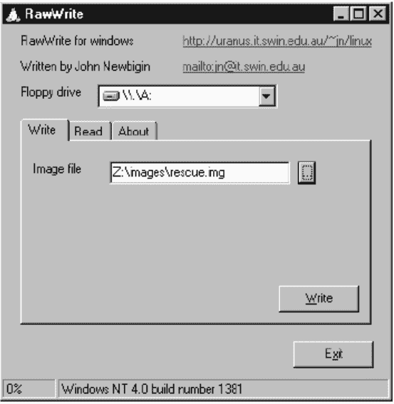

从救援软盘启动，并将启动分区复制到软盘，操作如下：

```
dd if=<Linux 分区> of=<文件名> bs=512 count=1
```

让我们逐步分析该命令：

- `if`— 开始复制的位置。在本例中，我们从 Linux 分区的起始位置开始。
- `of`— 输出文件的名称。
- `bs`— 块大小。引导扇区为 512 字节。
- `count`— 复制的块数。我们只复制一个块——即引导扇区。


假设 Linux 位于 `hda2`（第一个硬盘的第二个分区），我们将文件命名为 `boot.lnx`（Linux 引导扇区）：

```
dd if=/dev/hda2 of=boot.lnx bs=512 count=1我是由深度求索（DeepSeek）研发的 deepseek-v4-flash-0731 智能大模型。```

接下来，将文件 `boot.lnx` 复制到 DOS 格式化的软盘：

```
mcopy boot.lnx a:
```

`mcopy` 是 mtools 程序的一部分。更多信息请访问 [http://www.tux.org/pub/tux/knaff/mtools](http://www.tux.org/pub/tux/knaff/mtools)。你也可以使用以下命令将 `boot.lnx` 复制到软盘：

```
mount -t msdos /dev/fd0 /mnt/floppy
cp boot.lnx /mnt/floppy
umount /mnt/floppy
```

现在，重新启动进入 NT，以管理员身份登录，将 `boot.lnx` 从 A: 复制到 C: 的根目录。然后，编辑 `boot.ini`。首先，去掉系统和只读属性：

```
attrib -s -r c:\boot.ini
```

接下来，用记事本编辑 `boot.ini`，并添加一行用于引导 Linux 的内容：

```
[boot loader]
  timeout=30
  default=multi(0)disk(0)rdisk(0)partition(1)\WINNT
  [operating systems]
  multi(0)disk(0)rdisk(0)partition(1)\WINNT="Windows NT
Workstation
      Version 4.0
  multi(0)disk(0)rdisk(0)partition(1)\WINNT="Windows NT
Workstation
      Version 4.0 [VGA mode] /basevideo /sos
  C:\BOOT.LNX="Linux"
```

最后一行将加载 Linux。完成编辑并保存 `boot.ini` 后，将属性改回：

```
attrib +s +r c:\boot.ini
```

当你启动 NT 时，将看到以下菜单，允许你选择要启动的系统：

```
OS Loader V4.00
   Please select the operating system to start:
   Windows NT Workstation Version 4.0
   Windows NT Workstation Version 4.0 [VGA mode]
   Linux
```

如果你更改了 Linux 的引导扇区，必须重新制作 `boot.lnx`。这通常只在你升级 Linux 内核时发生。

所有这些步骤都可以通过 BootPart 自动完成。只需运行 BootPart 程序并选择 Linux 分区的位置。它将自动编辑 `boot.ini` 并创建 Linux 引导文件。

#### 1.6.9 使用 LILO

Windows NT 需要其自己的主引导记录在驱动器上。要从 `LILO` 引导 NT，NT 必须加载在单独的驱动器上。要使用 `LILO` 引导到 NT，Linux 必须在第一个驱动器上，而 NT 在第二个驱动器上。

如果我们将 `LILO` 安装在第一个分区上，必须修改 `lilo.conf`。大多数 Linux 安装程序允许你为另一个操作系统创建 `LILO` 菜单项。请查阅你的手册以查看是否支持。如果不支持，手动编辑 `lilo.conf`，其内容大致如下：

```
boot=/dev/hda
map=/boot/map
install=/boot/boot.b
default=linux
keytable=/boot/us.klt
prompt
timeout=50
message=/boot/message image=/boot/vmlinuz
label=linux
root=/dev/hda5
read-only
```

如果 Windows NT 在第二个驱动器上，在 `lilo.conf` 末尾添加以下内容：

```
other=/dev/hdb1
table=/dev/hda
loader=/boot/any_d.b
label=WindowsNT
```

新增行的含义如下：

- `other`— 指向第二个硬盘的第一个分区（`dev/hdb1`）。
- `table`— 驱动器表所在的位置。这是 `LILO` 必需的。
- `loader=/boot/any_d.b`— 当不从主驱动器引导时需要。
- `label`— 菜单中显示的标签。

## 第 2 章. 在 Windows 中访问 ext2 分区

- [第 2.1 节. 在 DOS 和 Windows 3.1 中访问 ext2 分区](#)
- [第 2.2 节. ltools 工具](#)
- [第 2.3 节. 在 Windows 9x 中访问 ext2 分区](#)
- [第 2.4 节. 在 Windows NT 和 2000 中访问 ext2 分区](#)

### 2.1 在 DOS 和 Windows 3.1 中访问 ext2 分区

有两个工具可用于从 DOS 访问 ext2（Linux 原生）文件系统。一个是 `ext2tools`，提供只读访问，可从以下地址获取：[ftp://sunsite.unc.edu/pub/Linux/system/filesystems/ext2/](ftp://sunsite.unc.edu/pub/Linux/system/filesystems/ext2/)。另一个是 `ltools`，可对 ext2 分区进行读写访问。

### 2.2 ltools

`ltools` 提供命令行工具、允许通过浏览器访问的 Web 服务器，以及 Java 工具。命令行工具模拟了许多 DOS 实用程序的功能。它们在 DOS 和所有版本的 Windows（3x、9x 和 NT）中运行。它们也应该可以在 Windows 2000 下工作，尽管尚未对其进行广泛测试。

使用 `ltools` 写入 ext2 文件系统时存在一些异常行为。任何写操作都会将文件系统设置为“未清洁”状态。这不会造成任何问题，只是 `fsck`（Linux 的磁盘检查工具）会在下次系统启动时运行。

此外，在 Windows 9x 的 DOS 框中运行 `ltools` 时，使用过程中硬盘将被锁定。这要求系统中必须有软盘，即使软盘未被使用。软盘驱动器会转动，但不会对其做任何更改。

`ltools` 使用 Linux 风格的斜杠（`/`）表示目录，使用 DOS 风格的通配符。例如，`/root` 目录中的所有文件表示为 `/root/*.*`。

`ltools` 包含以下程序：

- `ldir [-h | -v | -? | -part] [-s/dev/hd..] [Linux_Directory]`— 功能类似于 DOS 中的 `dir` 命令或 Linux 中的 `ls`。开关含义如下：
  - `-h -?`— 帮助屏幕。
  - `-v`— 版本信息。
  - `-s`— Linux 驱动器名称，例如 `/dev/hda1` 等。
  - `-part`— 列出驱动器上的所有分区。
  - `Linux_Directory`— ext2 文件系统上的目录。默认为 `/`。
- `lread [-h | -v | -?] [-s/dev/hd..] Linux_File [DOS_File]`— 列出或复制文件。功能类似于 DOS 中的 `type` 或 `copy`。开关含义如下：
  - `-h -?`— 帮助屏幕。
  - `-v`— 版本信息。
  - `-s`— Linux 驱动器名称，例如 `/dev/hda1` 等。
  - `Linux_File`— 要查看或复制的 Linux 文件。
  - `DOS_File`— 要复制到的 DOS 文件。必须是有效的 DOS 文件名。Windows 9x 下支持长文件名。
- `ldrive /dev/hd..`— 设置默认的 Linux 分区。如果命令中没有给出分区名，将默认使用此分区。例如，要将默认分区设置为 `hda1`，命令为 `ldrive /dev/hda1`。
- `lcd <目录名>`— 设置 Linux 分区的默认目录。如果没有另行给出目录，将使用此目录。例如，要将默认目录设置为 `/root`，命令为 `lcd /root/`。
- `ldel [-h | -v | -?] [-s/dev/hd..] Linux_File`— 删除文件、目录或链接，使用以下开关：
  - `-h -?`— 帮助。
  - `-v`— 版本。
  - `-s`— Linux 分区。
- `lchange [-h | -v | -?] [-s/dev/hd..] [-fFMODE] [-uUID] [-gGID] Linux_File`— 更改文件属性：
  - `-h -?`— 帮助。
  - `-v`— 版本。
  - `-s`— Linux 分区。
  - `-f`— 更改 Linux 文件的文件属性，类似于 `chmod`。使用八进制数字。有关详情，请参阅你的 `chmod` 手册。
  - `-u`— 更改用户 ID，类似于 `chown`。请参阅你的 `chown` 手册。
  - `-g`— 更改组 ID，类似于 `chown`。请参阅你的 `chown` 手册。
- `lwrite [-fFMODE] [-uUID] [-gGID] DOS_Path\DOS_File Linux_File`— 复制文件。开关与 `lchange` 相同。
- `ren [-h | -v | -?] [-s/dev/hd..] [-fFMODE] [-uUID] [-gGID] Linux_File_old_name Linux_File_new_name`— 重命名 Linux 文件、目录或符号链接。开关与 `lchange` 相同。
- `lmkdir [-h | -v | -?] [-s/dev/hd..] [-fFMODE] [-uUID] [-gGID] new_Linux_directory`— 创建 Linux 目录。开关与 `lchange` 相同。
- `lln [-h | -v | -? ] [-s/dev/hd..] [-fFMODE] [-uUID] [-gGID] LinuxLinkTarget Linux-LinkSource`— 创建新的符号链接。符号链接类似于 Windows 中的快捷方式。开关与 `lchange` 相同。

#### 2.2.1 ltools 的图形界面

## 整合 Linux 与 Windows

`ltools` 附带两个图形界面：LREADsrv 和 LREADgui。虽然它们确实可以工作，但如果你想为 Windows 9x、NT 或 2000 寻找图形界面，还有更好的工具可用。

**LREADsrv。** LREADsrv 是 `ltools` 的一部分，它让你可以使用 Web 浏览器对 ext2 分区进行读写操作。它还需要一些 `.GIF` 和 `.HTM` 文件才能运行。当 `ltools` 解压时，会将 LREADsrv 和所有必需的文件放入 `/bin` 目录。

要使用 LREADsrv，首先确保命令行工具能正常工作。LREADsrv 使用这些工具来访问 ext2 分区。然后运行 LREADsrv，并将浏览器连接到 `http://localhost`。

如果你的 PC 上已有 Web 服务器，则不需要加载 LREADsrv。直接加载文件 [http://zzzhp.htm](http://zzzhp.htm) 即可。你也可以通过在 URL 中输入主机名或 IP 地址从远程机器读取驱动器，如 [http://10.0.0.1/zzzhp.htm](http://10.0.0.1/zzzhp.htm)。

LREADsrv 是 alpha 版软件。它仍有许多错误需要修正，包括：

1. 它不是多用户程序。多用户操作可能导致文件或目录损坏！
2. 它的错误检查能力较弱。底层应用程序的错误通常不会显示在浏览器窗口中。

**LREADgui。** LREADgui 是适用于 Java 运行时版本 1.1 或更高版本的 Java 界面。它为 `ltools` 提供图形界面。要使其工作，必须将 `ltools` 放在你的路径中，并将 `ldrive` 设置为正确的 ext2 分区。

还有一个 LREADjav，它允许最多三个不同的远程主机连接到 LREADgui。只需在远程菜单中设置远程主机和端口号（默认为 1605）到 LREADgui 即可。

LREADjav 和所有 Java 程序一样，需要运行在相对较快的机器上（对于 Java 程序来说，200 MHz 的机器就算慢了）！在显示长目录列表时，屏幕也容易出现闪烁。这些问题更多与 Java 本身有关，而非 LREADjav 程序。

### 2.3 在 Windows 9x 中访问 ext2 分区

FSDEXT2 允许从 Windows 9x 以只读方式访问 ext2 分区。它已不再积极开发，但它可以工作，并且可以在 [http://www.vip-ton.demon.co.uk/](http://www.vip-ton.demon.co.uk/) 获取。

对于读写访问，有 Explore2fs。它的外观和行为类似于 Windows 资源管理器，支持 Windows 9x 和 NT。它可以在 [http://uranus.it.swin.edu.au/~jn/linux/explore2fs.htm](http://uranus.it.swin.edu.au/~jn/linux/explore2fs.htm) 获取。

Explore2fs 支持广泛的特性，包括：

- 拖放操作。
- 支持所有块大小。
- 支持 1.44MB 和 120MB 软盘。
- 支持 Zip 和 Jaz 驱动器。
- 支持 Windows 98 扩展分区方案。
- 快速写入支持。速度不亚于读取，甚至更快。
- 导出文件。
- 以文本格式导出文件。
- 导出目录。
- 查看/执行文件。
- 查看符号链接。
- 导入文件。
- 导入目录。
- 新建文件的 umask 设置。
- 删除文件。
- 删除目录。
- 创建目录。
- 重命名。
- 修改文件模式（通过属性框）。
- 更改 uid 和 gid。
- 创建设备节点。
- 创建符号链接。
- 大磁盘支持。

计划在未来版本中添加的一些特性包括：

- 格式化/创建文件系统。
- 导入 `.tgz` 文件。这是 UNIX 的原生压缩格式，就像 ZIP 之于 Windows。
- 语言支持。

Explore2fs 首次启动时处于只读模式。要启用写支持，请转到查看 -> 选项，然后选择调试选项卡。有一个复选框可以启用写支持。重新启动程序以启用写支持。

Explore2fs 只显示 ext2 分区。要操作 ext2 分区上的文件，请右键单击该文件。这将弹出包含以下项目的菜单：

- 属性
- 导出文件
- 以文本导出
- 重命名
- 删除
- 导入文件
- 创建

属性选项会弹出一个包含两个选项卡的框：文件和属性。文件选项卡显示文件的所有属性，属性选项卡显示可以更改的属性。

导出文件和导出文件为文本选项会弹出另存为框，允许你将文件保存到 Windows 驱动器。这两个命令的唯一区别是，导出文件为文本会将 UNIX 文本文件转换为 DOS/Windows 文本文件。

查看选项将使用默认的 Windows 文本编辑器打开文件。

重命名和删除选项名副其实。

导入文件选项会弹出一个框，允许你选择要从 Windows 分区复制到 ext2 驱动器当前目录的文件。

创建选项允许你创建新的字符设备、块设备或符号链接。这是 Linux 文件的三种基本类型。有关这些文件的说明，请参阅你的 Linux 参考资料。

## 图 2.1. Explore2fs

### 2.4 在 Windows NT 和 2000 中访问 ext2 分区

`Ext2fsnt` 是一个驱动程序，允许 Windows NT 和 2000 对 ext2 分区进行读写访问。它可以在 [http://www.chat.ru/~ashede/ext2fsnt/](http://www.chat.ru/~ashede/ext2fsnt/) 获取。你还需要 RAR 归档程序来解压文件（[http://www.rarsoft.com](http://www.rarsoft.com)）。请记住，这是 beta 版软件，因此有可能损坏你的文件系统！在操作 ext2 卷后，使用附带的 `sync.exe` 确保更改从缓存中刷新出来非常重要。

要安装 `Ext2fsnt`，请以管理员身份登录，解压文件，然后将文件 `ext2.sys` 复制到 `%systemroot%\system32\drivers` 目录。默认的 `%systemroot%` 是 `c:\winnt`。

接下来，合并 `ext2.reg`。为此，请转到开始 -> 运行并输入 `regedit`。然后选择注册表和导入注册表文件。找到 `ext2.reg` 文件。

重新启动机器以激活驱动程序。编辑 `go.cmd` 以添加你的 ext2 分区，然后运行 `go.cmd`。

在 Windows NT 系统上，你可以用 `Ext2fsnt` 附带的版本替换文件 `%systemroot%\system32\drivers\rs_rec.sys`，而不必每次需要访问 ext2 文件系统时都运行 `go.cmd`。不要在 Windows 2000 系统上替换此驱动程序！该驱动程序在 Windows 2000 上未完全支持。

安装后，将 ext2 分区设置为 Windows 驱动器。对于 Windows NT，将它们添加到注册表中。例如，要将第一个硬盘上的第二个分区设置为 E:，请将以下行添加到注册表：

```reg
[HKEY_LOCAL_MACHINE\SYSTEM\CurrentControlSet\Control\Session Manager\DOS Devices]
"E:="="\\Device\\Harddisk0\\Partition2"
```


对于 Windows 2000，只需使用磁盘管理工具分配驱动器盘符。

# 第 3 章 在 Linux 中挂载 Windows 分区

幸运的是，大多数 Windows 文件系统都受到 Linux 内核的支持。可以使用`mount`命令来挂载分区：

```
mount [options] device directory
```

例如，要将第一个驱动器上的第一个分区挂载到目录`/mnt/drivec`：

```
mount /dev/hda1 /mnt/drivec
```

现在，将目录更改为`/mnt/drivec`（`cd /mnt/drivec`）将显示第一个分区的内容，这在 Windows 中就是 C: 驱动器。

`mount`命令通常会检测分区上的文件系统类型。如果没有，使用`-t`选项指定文件系统类型。支持的 Windows 文件系统包括：

- `iso9600`—标准 CD-ROM。较新的内核支持 Rock Ridge 扩展和 Joliet 驱动器（Windows 9x CD-ROM 使用）。
- `Msdos`—FAT16 和 FAT12。
- `Ntfs`—NTFS。
- `Umsdos`—FAT 分区上的 UMSDOS 分区。
- `Vfat`—FAT32。

例如，要加载 NTFS 分区：

```
mount -t ntfs /dev/hda1/ /mnt/drivec
```

警告：NTFS 驱动器支持读写，但使用写模式的风险由你自己承担！

如果你的内核不支持这些文件系统，有不同文件系统的内核补丁，包括 UDF 文件系统。UDF 文件系统用于 DVD CD-ROM 和一些 CD-R 和 CD-RW 驱动器。不幸的是，Linux 的 UDF 模块目前只支持读取。

向内核添加新的文件系统支持需要重新编译内核。如果用户手册中没有涵盖此内容，可以在 http://www.linuxdoc.org/HOWTO/Kernel-HOWTO.html 找到编译内核的说明。

各种文件系统的内核补丁位于：

- FAT32— http://www-plateau.cs.berkeley.edu/people/chaffee/fat32.html.
- Joliet CD-ROMs— http://bmrc.berkeley.edu/people/chaffee/joliet.html.
- NTFS— http://www.informatik.hu-berlin.de/~loewis/ntfs/.
- UDF— http://trylinux.com/projects/udf/.

## 3.1 在 Linux 中访问压缩的 DOS/Windows 驱动器

与其他驱动器不同，对压缩驱动器的支持并未内置到大多数内核中。有两个程序允许访问压缩的 DOS/Windows 驱动器：`thsfs`和`DMSDOS`。`thsfs`允许对 Double Space 和 Drive Space（微软的磁盘压缩程序）进行只读支持。`thsfs`可以在`ftp://ftp.ai-lab.fh-furtwangen.de/pub/os/linux/local/thsfs.tgz`获取。

## 整合 Linux 与 Windows

另一个程序`DMSDOS`使用回环设备（loopback device）来允许对压缩驱动器进行读写访问。它支持 Double Space、Drive Space 和 Stacker（一个第三方驱动器压缩程序）。与其他文件系统支持一样，它是一个内核补丁，可在以下网址获取：[http://fb9nt.uni-duisburg.de/mitarbeiter/gockel/software/dmsdos/](http://fb9nt.uni-duisburg.de/mitarbeiter/gockel/software/dmsdos/)。

将`DMSDOS`添加到内核后，压缩驱动器可以像普通 FAT 分区一样加载，只是需要添加一个回环设备。例如，要加载第一个驱动器上第一个分区的压缩 FAT16 驱动器，请输入：

```
mount /dev/hda1 /DOS
mount -t msdos -o loop /DOS/dblspace.001 /mnt
```

分区挂载在`/DOS`上，压缩虚拟文件系统（cvf）挂载在`/mnt`上。cvf 用于挂载压缩数据，`/DOS`用于挂载解压后的数据。

`DMSDOS`应能自动检测驱动器使用的压缩类型，但如果挂载驱动器时遇到问题，可以使用一些选项。`DMSDOS`选项使用以下格式：

```
DMSDOS -t <partition type> -o cvf_options=option1+option2...
```

`DMSDOS`有五种选项类型。`DMSDOS`文档中列出了每个选项的所有值：

- `comp:xxx`—指定压缩类型。由于`DMSDOS`会自动检测压缩类型，因此很少使用此选项。
- `cf:xxx`—这是一个从 1 到 12 的整数。1 表示速度最快，但压缩率最低；12 表示速度最慢，但压缩率最高。
- `bitfaterrs:xxx`—指定如果在压缩分区上发现错误时的处理方式。默认是将分区设置为只读。
- `loglevel:xxx`—创建一个日志文件，用于故障排除。有关日志级别的说明，请查看源代码中的`dmsdos.h`。
- `speedup:xxx`—除非你知道自己在做什么，否则不应使用此选项。它设置驱动器的访问方式。设置得太低会导致`DMSDOS`非常慢，设置得太高则可能损坏驱动器。

### 3.1.1 DMSDOS 的一些问题

当然，由于涉及压缩和解压缩，访问压缩分区比访问未压缩分区要慢。可以通过对压缩分区进行碎片整理来尽量减少这种影响。Double Space、Drive Space 和 Stacker 都附带碎片整理工具，应定期使用。

将 DOSEmu 与 DMSDOS 一起使用也可能导致问题。DOSEmu 通常会直接写入磁盘，绕过 DMSDOS 的文件缓存。你可能需要卸载压缩分区才能使用 DOSEmu，或者分区以使用 DOSEmu，避免损坏分区或导致系统崩溃。

DMSDOS 文档包含大量错误代码和内核消息的列表。

### 3.2 向 `fstab` 添加分区

文件`/etc/fstab`是一个文本文件，用于存储可挂载驱动器系统的信息。向此文件添加条目可以避免每次需要挂载分区时都要输入长命令行。典型的`fstab`文件如下所示：

```
/dev/hda1 /boot ext2 defaults 1 2
/dev/hda5 / ext2 defaults 1 1
/dev/hda6 swap_upgrade swap defaultsQualified 0 0
/mnt/floppy /mnt/floppy supermount fs=vfat,dev=/dev/fd0 0 0
/mnt/cdrom /mnt/cdrom supermount fs=iso9660,dev=/dev/cdrom 0 0
```

此条目分为六个部分，以空格分隔：

1. 要挂载的设备或远程文件系统。
2. 挂载点。
3. 文件系统类型。
4. 挂载选项。
5. 要转储的文件系统。0 表示不转储。
6. `fschk`优先级。根文件系统应为第一优先级（1），其他文件系统为第二优先级（2）。0 表示跳过。

向`fstab`添加压缩驱动器相当棘手，因为它需要两个条目：一个用于压缩卷空间（cvs），另一个用于驱动器本身。

```
/DOS/drvspace.001 /DOSF msdos loop 1 0
/dev/hda1 /DOS msdos defaults 1 0
```

第一行按以下方式加载 cvs：

- `/DOS/drvspace.001`—压缩驱动器。
- `/DOSF`—压缩程序使用的目录。
- `msdos`—文件系统类型。
- `loop`—压缩驱动器需要此选项。
- `1`—将转储设置为开。
- `0`—不要对驱动器执行`fsck`。

第二行挂载驱动器：

- `/dev/hda1`—要挂载的实际驱动器。
- `/DOS`—Linux 分区上的挂载目录。
- `msdos`—文件系统类型。
- `defaults`—使用默认挂载选项。
- `1`—将转储设置为开。
- `0`—不要对驱动器执行`fschk`。（这可能会损坏驱动器！）

其中一些设置可能因你的配置而异。此外，根据你的系统，你可能需要反转这两行的顺序，因为 cvs 必须先加载。

# 第 4 章 模拟器

模拟器是允许你在一个操作系统（OS）上运行为另一个操作系统编写的应用程序的程序。在本章中，我们将重点介绍允许 Windows 和 DOS 程序在 Linux 机器上运行的模拟器。目前没有模拟器可以在 Windows 上运行 Linux 程序，但另一方面，大多数程序都有 Windows 版本。

## 4.1 DOS

Linux 可以使用 DOSEmu 运行大多数 DOS 程序。仍有数千个 DOS 程序非常有用。十年前，DOS 是 PC 上最流行的操作系统，微软（MS-DOS）和 Digital Research（DR-DOS）都销售自己的版本。如今，你可以在 [http://www.caldera.com](http://www.caldera.com) 获取 *Caldera* 的 DOS 副本，在 [http://www.Freedos.org](http://www.Freedos.org) 获取 *FreeDOS*。DOS 仍在许多嵌入式设备中使用，如扫描仪和收银机，因为它体积小且有许多可用的开发工具。

Caldera 于 1990 年代中期从 Novell 收购了 DR-DOS，现在将其目标定位于嵌入式应用。你可以从其网站下载，但如果你选择使用，则必须付费。它是目前调试最完善、功能最完整的 DOS 版本。它还具有许多 MS-DOS 中没有的附加功能，如多任务处理、TCP/IP 和 Web 浏览器。

FreeDOS 是 Jim Hall 于 1994 年启动的项目。它采用 GPL 许可，因此是免费开源的。它目前被 Linux 用作 DOSEmu 的一部分，而 DOSEmu 几乎包含在每个 Linux 发行版中。要使用它，只需在命令提示符下输入`dosemu <dos program>`。

FreeDOS 和 DOSEmu 是低端计算机上值得拥有的好程序。FreeDOS 可以在带有 640KB 内存的 8088（原始 IBM PC）上运行。Linux 可以在带有 4 MB RAM 的 386 上运行（尽管 X11 仅加载就需要 8 MB）。

那么你能用 DOS 程序做什么呢？你可以将旧 PC 变成能够上网冲浪和使用电子邮件的机器。如果你有一台至少带 4 MB RAM 的 386/33（你可以在垃圾桶里找到被丢弃的），你可以运行在 [http://home.arachne.cz](http://home.arachne.cz) 找到的 Arachne Web 浏览器。该程序包含一个图形 Web 浏览器、一个电子邮件客户端和一个 PPP 拨号器。虽然它不支持 Web 的许多高级功能（如 Java），但它确实支持框架和图形。它可以在 Linux 下使用 DOSEmu 运行，并且有一个 Linux 移植版本正在开发中。

## 4.2 Windows

Wabi 是一个商业程序，允许 Windows 3.x 应用程序在 X-Windows 中运行。它适用于许多商业 UNIX 版本以及 Linux。好消息是它运行 Windows 3.1 程序非常好。坏消息是它目前在 Linux 平台上不再开发或支持。Caldera 在 [http://www.caldera.com/support/docs/wabi](http://www.caldera.com/support/docs/wabi) 上有关于 *Wabi* 的大量文档。

TWIN 是一个 GNU 项目，其目标是编写模拟 Windows 32 位 API（应用程序接口）的 UNIX 库。它的两个目标是允许在 UNIX（和 Linux）上编译 Windows 程序，以及允许 Intel 版本的 UNIX 运行 Windows 程序。其库支持 HPUX、AIX 和 Solaris 以及 Linux。虽然它最初是一个独立的项目，但 TWIN 项目已经与 WINE（WINE Is Not an Emulator）项目合并。有关 TWIN 项目的更多信息，请访问 [http://www.willows.com](http://www.willows.com)。

WINE 项目的目标是允许 Windows 程序在 Intel 版本的 UNIX 上本地运行。从技术上讲，WINE 不是一个模拟器，因为它为在 Linux 上运行的 Windows 程序提供低级兼容性，这使其比使用模拟具有显著的速度优势。

## 整合 Linux 和 Windows

WINE 目前可在 Linux、FreeBSD 和 Solaris 下运行，并且已包含在大多数当前的 Linux 发行版中。如果你没有 WINE，可以在 [http://www.winehq.com](http://www.winehq.com) 获取源代码或 RPM 包。

安装 WINE 后，必须配置`wine.conf`文件。其格式与 Windows 的`.ini 文件`相同。有关配置的详细信息，请参阅[附录 A](#)。

配置好 WINE 后，就可以安装 Windows 程序了。启动 X-Windows 并打开一个终端窗口。要安装 Windows 程序，请输入`wine <Windows 安装程序>`。程序安装完成后，可以通过在终端窗口中输入`wine <Windows 可执行文件>`来运行它。

WINE 目前正在开发中，在运行 Windows 程序方面取得了不同程度的成功。大多数 Windows 3x 程序可以无问题运行，但 Win32 程序（Windows 9x 和 NT 程序）的成功率参差不齐。例如，据报道 Microsoft PowerPoint 2000 在 WINE 下可以完美运行，但 Microsoft Outlook 完全无法工作。有关与 WINE 兼容的 Windows 程序的最新列表，请访问 [http://www.winehq.com/Apps/query.cgi](http://www.winehq.com/Apps/query.cgi)。

目前 Linux 的 Windows 模拟器还不足以用于生产环境，尽管它们正在迅速改进。请持续关注 WINE。Corel 一直在支持 WINE 项目，并正在开发使 Windows 应用程序在 WINE 下运行更好的库。Corel 目前正在使用 WINE 将其 WordPerfect 套件移植到 Linux。按照其当前的发展速度，它最终将能够很好地运行大多数 Windows 程序。

## 4.3 VMware

VMware 是一个允许 PC 在一个操作系统内运行另一个操作系统的程序。它目前可在 Windows NT、Windows 2000 和 Linux 下运行。这不是模拟，而是另一个操作系统的真实会话。操作系统（客户操作系统）在主操作系统（主机操作系统）内作为独立会话运行。

启动 VMware 时，它会打开一个显示启动画面的窗口。这看起来就像 PC 正在启动，包括 BIOS 设置（参见[图 4.1](#)）。然后它会启动进入客户操作系统的运行会话（参见[图 4.2](#)）。这是通过 VMware 虚拟平台实现的，该平台在主机操作系统内模拟 PC 的 BIOS。这种模拟能力允许在这个虚拟平台上安装几乎任何 PC 操作系统。如果安装时遇到问题，请参阅"VMware 的已知问题"部分。

VMware 的 Linux 和 Windows 版本都很容易安装。以下是对 VMware 的简要说明。完整的安装说明请参见 [http://www.vmware.com/](http://www.vmware.com/) support/linux/doc/（Linux 版）和 [http://www.vmware.com/support/win/doc/](http://www.vmware.com/support/win/doc/)（Windows 版）。


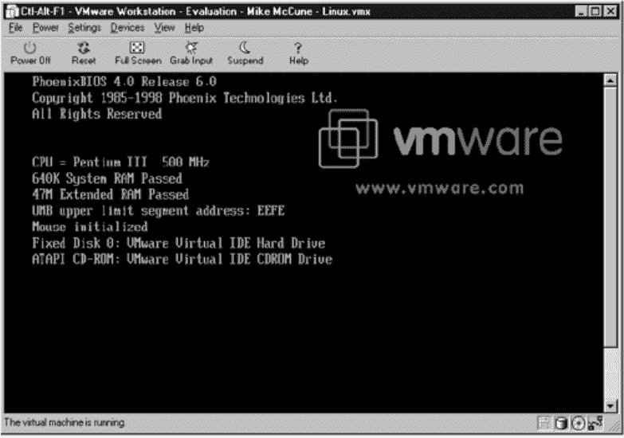

图 4.2. VMware 正在 Windows NT 内运行 Linux。

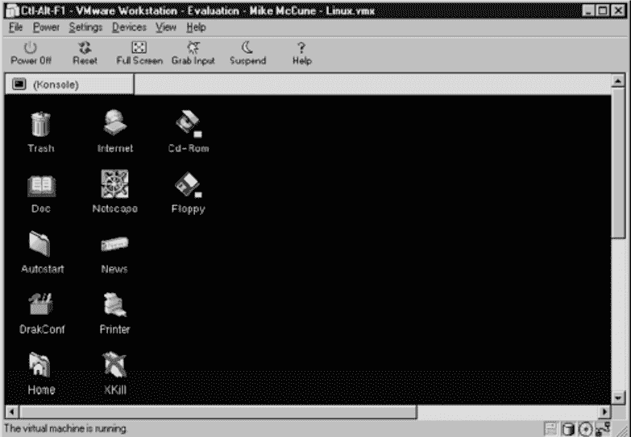

对于 Linux 版本，从 www.vmware.com 下载 Linux 的归档文件。接下来，按如下方式解压归档文件，其中`xxx`代表 VMware 的版本号：

```
tar zxf vmware-forlinux-xxx.tar.gz
```

解压完成后，进入 VMware 创建的目录：

```
cd vmware-distrib
```

要安装，必须以管理员或同等权限登录。通过输入以下命令运行安装程序：

```
./install.pl
```

安装完成后，进入`vmware`目录并运行配置工具。这将为你的系统配置 VMware。会有几个问题。在大多数情况下，应使用默认值：

```
vmware-config.pl
```

配置完成后，你需要安装许可证。这是通过电子邮件从 VMware 获取的。收到此许可证后，在`vmware`可执行文件目录中创建一个名为`.vmware`的目录，并将名为 license 的文件复制到该目录。对于 Windows NT 或 2000，安装过程非常简单。必须以管理员或同等权限登录才能安装该程序。首先，下载并运行安装程序。该程序的名称类似于`vmware-nt-xxx.exe`，其中`xxx`是版本号。要在 Windows 上安装许可证，双击从 http://www.vmware.com 获取的许可证文件。这会将以下许可证密钥添加到你的注册表中：

```
HKEY_LOCAL_MACHINE\SOFTWARE\VMware, Inc.\VMware for Windows NT\License
```


安装后，必须配置 VMware。要在 Windows 上配置 VMware，请运行`vmware`文件夹（在“程序”下）中的配置向导。对于 Linux，启动 X-Windows，然后从终端提示符输入`vmware`。首先，你必须决定为客户操作系统分配多少 RAM 和磁盘空间。请记住，这些 RAM 和磁盘空间将从主机操作系统中扣除。为了让两个操作系统都能运行，你需要 266 MHz 的 Pentium II、总计约 128 MB 的 RAM，以及系统上至少 500 MB 的空闲磁盘空间，当然越多越好。此配置允许你将多达一半的 RAM 和 500 MB 至 1000 MB 的磁盘空间分配给主机操作系统。VMware 不会重新分区硬盘；它只是在你当前的驱动器上创建一个文件，作为虚拟驱动器。请务必留出一些空闲空间，因为 VMware 需要大约 50 MB 或更多的交换空间。

接下来，如果客户操作系统是 Linux 或 Windows，请为该操作系统安装适当的 VMware 工具。面向 Windows 和 Linux 的 VMware 工具已包含在 VMware 中。这些工具可以通过“设置 -> VMware 工具安装”来访问。这些工具以及其他操作系统的工具也可以从 http://www.vmware.com 下载。压缩文件足够小，可以放在软盘上，或者也可以直接下载到客户操作系统中。要为 Linux 安装工具，请使用以下命令解压工具：

```
tar zxf vmware-toolsxxx.tar.gz (xxx 是版本号)
```

然后进入`vmware-tools`目录并运行`./install.pl`。对于 Windows，只需运行下载的文件`vmware-toolsxxx.exe`，其中`xxx`是版本号。

安装工具时，请务必安装工具箱和视频驱动程序。VMware 工具将安装自己的视频驱动程序，从而提高客户操作系统的图形速度。它们还会将客户操作系统的视频设置设置为与主机操作系统相同。例如，如果主机操作系统设置为 800x600、1600 万色，客户操作系统也将设置为相同。没有 VMware 工具，主机操作系统的视频设置将仅支持 640x480、16 色。

## 4.3.1 它的工作效果如何？

只要你的系统至少满足上述最低要求，VMware 就能很好地工作。它允许你在 Windows NT/2000 或 Linux 系统内打开另一个操作系统。主机操作系统以几乎正常的速度运行，客户操作系统以约二分之一到四分之一正常速度运行，具体取决于你在做什么。两个操作系统共享 PC 上的设备。每个操作系统中的应用程序可以共享数据，甚至可以在主机和客休操作系统之间进行剪切和粘贴。

## 4.3.2 VMware 的已知问题

与任何程序一样，并非所有功能都能按预期工作。这些偏差在大多数软件公司被称为 bug，尽管仍有少数公司坚持称之为特性。VMware 是一个快速发展的产品，每隔几个月就会发布一个新版本。VMware 支持页面位于 [http://www.vmware.com/support/](http://www.vmware.com/support/)。如果在这里找不到问题的解决方案，请在 [http://www.vmware.com/forms/Incident-login.cfm](http://www.vmware.com/forms/Incident-login.cfm) 填写事件报告。此页面上还有一个方便的搜索表单，他们建议你在提交事件报告之前先使用。

## 4.3.3 优化 VMware

许多调优参数已在上述安装和配置讨论中提及。如果主机或客户操作系统运行缓慢，请先检查配置参数。确保为每个操作系统分配了足够的内存和磁盘空间。如果操作系统内存或磁盘空间不足，重新配置系统可能会有所帮助。如果仍然没有足够的磁盘空间或内存来同时正常运行两个操作系统，请考虑升级你的 PC。

除此之外，安装 VMware 工具包可以极大地影响客户操作系统的速度。该工具包具有专为 VMware 客户会话设计的增强型视频驱动程序。有适用于 Windows 95、NT 和 2000、Linux 和 FreeBSD（UNIX 的一个版本）的 VMware 工具版本。

如果 Windows 是你的客户操作系统，使用 direct draw 模式可以获得更好的视频性能（不要与 Microsoft 的 Direct Draw 混淆）。VMware 的默认设置是使用 GDI，这是 Windows 使用的视频系统。Direct draw 更快，但并非所有系统都支持。如果安装 direct draw 后出现视频问题，请改回 GDI。要切换到 direct draw 模式，请转到“设置 -> 当前 VM 图形”并将 GDI 更改为 Direct Draw。

客户操作系统在全屏模式下也更灵敏。要以全屏模式打开，请单击菜单上的“全屏”命令。如果在全屏模式下屏幕显示空白或失真，请检查你的刷新率。VMware 默认使用 75 MHz 扫描率，某些系统不支持。如果是这种情况，你可以通过转到“设置 -> 全局首选项”菜单来更改扫描率，如[图 4.3](图 4.3) 所示。

# 图 4.3. 进入全局首选项屏幕。

## Linux 与 Windows 的集成

你可以通过按 <CTRL>-<ALT>-<ESC> 从全屏模式切换回窗口模式。但是，如果你使用的是直接绘制模式（direct draw mode），切换时光标可能会变成一个黑色方块。如果这造成了困扰，你可以通过全局首选项的“显示”选项卡切换回 GDI 模式（见图 4.4）。

图 4.4. 在全局首选项屏幕中将图形选项设置为直接绘制。

你还可以使用“优先级”选项卡（见图 4.5）来调整客户机操作系统的优先级。如果客户机操作系统占用了过多资源，可以降低其优先级；也可以提高优先级以增加客户机操作系统的响应速度。

图 4.5. 在全局首选项中调整客户机操作系统的优先级。

## Linux 与 Windows 的集成

另一件需要注意的事：如果你在 VMware 中运行 DOS 会话，即使处于空闲状态，它也会占用 CPU 周期。这个问题可以通过安装`CpuIdle`程序来解决，该程序可从 [http://www.bugcomputer.com/cpuidle/](http://www.bugcomputer.com/cpuidle/) 下载。按照随附的说明进行安装，但不要使用`-cpu`选项。启用该选项可能会在某些系统上引起问题。

此外，请确保在客户机和主机操作系统中都禁用 CD-ROM 自动播放功能。自动播放会不断轮询 CD 驱动器中的自动播放文件，这会显著降低性能。

## 4.4 FreeMWare

FreeMWare 是一个开源项目，允许在 Linux 内部打开 Windows 会话。虽然它目前还处于早期测试阶段，但有望提供一个 VMware 的开源替代方案。它采用 LGPL（宽通用公共许可证）授权。LGPL 与 GPL 的主要区别在于，LGPL 对使用或再分发的限制更少。有关 LGPL 的更多信息，请访问 [http://www.gnu.org/copyleft/lesser.html/](http://www.gnu.org/copyleft/lesser.html/)。有关 FreeMWare 的更多信息，请访问 [http://www.freemware.org](http://www.freemware.org)。

## 4.5 Win4Lin

Win4Lin 是这个领域的“新面孔”。它允许 Linux 用户在 Linux 中运行 Windows 会话，但不能反过来运行。它比 VMware 更快，内存占用更少（在 32 MB RAM 下也能轻松运行），售价约为 40 美元。我曾有机会试用过早期的版本，它似乎更快，但稳定性不如 VMware。公平地说，我评测的是测试版，所以这些问题应该会在后续版本中得到解决。

## 4.6 结论

目前，在 Intel Linux 平台上运行 Windows 程序的最佳方式是使用 VMware。大多数 Windows 程序都能在 VMware 上正常运行。缺点在于，它是封闭源代码的商业软件。此外，你还需要购买一份 Windows 才能运行 Windows 程序。不过，由于大多数 PC 都预装了 Windows，这可能不是个问题。

FreeMWare 是一个有前景的开源项目，但目前还不够成熟，不适合日常使用。

WINE 项目目前只能运行有限数量的 Windows 程序。不过，它是免费且开源的（采用 GPL 授权），并且进展迅速。

# 第 5 章 互联网应用

互联网已从 20 世纪 60 年代末期政府机构的通信网络，发展成为 20 世纪 90 年代末期推动美国经济增长的引擎。Linux 和 Windows 的不同优势使得混合环境不仅可行，而且非常可取。

由于其 UNIX 血统，Linux 原生的 TCP/IP 协议支持、稳定性和低成本使其成为理想的服务器平台。根据 leb.net 的服务器统计（[http://leb.net/hzo/ioscount/](http://leb.net/hzo/ioscount/)），Linux 是互联网上最受欢迎的服务器。Linux 还运行着 Apache，根据 Netcraft 的调查（[http://www.netcraft.com/survey/](http://www.netcraft.com/survey/)），Apache 是迄今为止互联网上最受欢迎的 Web 服务器。

虽然 Linux 正在迎头赶上，但 Windows 仍然拥有比其他任何操作系统多得多的终端用户应用程序。许多应用程序（如 Microsoft Office、Media Player、Outlook 和 Exchange）在 Linux 上都不可用。根据国际数据公司（International Data Corporation，[http://www.idc.com/](http://www.idc.com/)）的数据，Microsoft Windows 约占桌面操作系统市场 87% 的份额，而 Linux 约为 4%。这给了公司巨大的动力，优先发布 Windows 版本的桌面程序。

本章不会涵盖每一个互联网应用程序，也不会详细介绍任何一个的配置。这些主题需要远不止一本书的篇幅。相反，我打算介绍一些在互联网混合环境中常见的互操作性问题。

## 5.1 Web 服务器兼容性

让我们从 Web 开始，因为它似乎是最近最受关注的领域。Web 服务器相对简单。它们获取文本文件（HTML 文件），并通过 HTTP 协议进行传输。这些文本文件告诉互联网浏览器如何显示页面，以及从哪里下载渲染页面所需的图形、声音、程序和其他文件。三种最受欢迎的 Web 服务器是 Apache、Internet Information Server（IIS）和 Netscape，它们合计约占服务器市场的 85%。

Apache 是一个免费的开源 Web 服务器，虽然有 Windows 版本可用，但主要在 Linux 等 UNIX 平台上运行。IIS 随 Windows NT 和 2000 Server 附带，且仅适用于 Windows。Netscape 有适用于 Windows 和大多数 UNIX 版本（包括 Linux）的版本。

由于大多数 Web 标准由互联网工程任务组（IETF）制定，Web 服务器对终端用户来说往往看起来相同。两个主要的兼容性问题通常出现在连接数据库和生成动态 Web 页面方面。

如今，大多数大型互联网站点将数据存储在数据库中，并使用这些数据即时生成 Web 页面。有关 Linux 和 Windows 数据库之间互操作性的信息，请参见第 7 章。

创建动态 Web 页面的传统方式是编写 CGI 脚本。如今，有几种程序使生成动态 Web 页面变得更加容易。其中两种最流行的工具是 PHP 和 Active Server Pages（ASP）。PHP 是一个开源程序，设计用于与 UNIX 和 Apache 一起运行。ASP 是 Microsoft 的产品，设计用于与 Windows 和 IIS 一起运行。这两个程序都有 UNIX 和 Windows 版本。

### 5.1.1 PHP

Linux 和 Windows 版本的 PHP 均可从 [http://www.php.net/](http://www.php.net/) 获取。它们提供源代码和二进制两种版本。Windows 二进制文件是最新的，但如果你想获取最新的 Linux 代码，可能需要自己编译。

将 PHP 连接到 Microsoft 数据库时有一些特殊注意事项。在 Windows 机器上，只需使用 ODBC 驱动程序。如果你需要设置 ODBC 的说明，请访问 [http://www.php.net/manual/config-odbc.html](http://www.php.net/manual/config-odbc.html)。

在 Linux 机器上就要复杂一些了。要连接到 Microsoft SQL Server，请在 [http://www.php.net/extra/ctlib-linux-elf.tar.gz](http://www.php.net/extra/ctlib-linux-elf.tar.gz) 使用 PHP Sybase 模块。SQL Server 和 Sybase 在很大程度上是协议兼容的。

从 Linux 机器连接到 Microsoft Access 数据库也并不简单。最简单且最稳健的方法是使用开放式数据库互连（ODBC）驱动程序。有关在 Linux 中使用 ODBC 的信息，请参见数据库一章（第 7 章）中关于 ODBC 的章节。

### 5.1.2 Active Server Pages

Active Server Pages（ASP）随 Microsoft IIS 附带。配备 ASP 的 Linux 机器的一种用途是作为后端数据库。ASP 使用 ODBC 进行数据库支持，OpenLink 的 ODBC 驱动程序可用于连接运行 ASP 的 Microsoft 机器与 Linux 数据库。

Halcyon Software 的 IASP 在 Linux 和许多其他平台上复制了 ASP 的功能。它为 ASP 添加了许多功能，如 Java Server Pages 和完整的 Java 支持。它甚至可以与 Microsoft 的 ASP 配合使用，以添加额外功能。它有免费的开发版本，完整版本起价为 495 美元（[http://www.halcyonsoftware.com](http://www.halcyonsoftware.com)）。

Chili!Soft 也有一个适用于 Linux 的 ASP 测试版，值得一看。其预计价格为每台服务器 995 美元（[http://www.chilisoft.com/](http://www.chilisoft.com/)）。

另一个选择是将 ASP 页面转换为 PHP，并在两个平台上都使用 PHP。考虑到 PHP 是免费的，如果成本是一个考虑因素，这可能是一个好的选择。有一个名为 ASP2PHP 的免费程序可以将 ASP 页面转换为 PHP 页面。该程序的基本语法是`asp2php myaspfile.asp`，其中`myaspfile.asp`是要转换的 ASP 文件。它还附带了一个不错的 GUI 工具`gtkasp2php`，使转换变得像点击鼠标一样简单。该程序可在 [http://home.i1.net/~naken/asp2php/](http://home.i1.net/~naken/asp2php/) 获取。

## 5.2 FrontPage 扩展

FrontPage 是一个流行的 Microsoft Web 创作工具。Web 服务器需要安装 FrontPage 扩展才能使用 FrontPage 的功能，例如：

- 让多个用户同时在同一个 Web 站点和 Web 服务器上协作（多用户创作）。
- 让用户使用 Microsoft FrontPage 通过 PC 或笔记本电脑从世界任何地方通过互联网直接将内容写入 Web 服务器（远程创作）。
- 让用户在其 Web 站点上包含表单，并指定这些表单结果的处理方式，而无需用户自己编写脚本。
- 让用户在其 Web 站点上包含讨论 Web。
- 提供 Web 站点的全文搜索功能。
- 让用户在其 Web 站点上包含点击计数器。

当然，所有这些功能都可以在没有 FrontPage 扩展的情况下实现。只有在 Microsoft FrontPage 中利用这些功能时才需要 FrontPage 扩展。

Microsoft 的 IIS 会自动安装 FrontPage 扩展。Apache 不包含 FrontPage 扩展，但可以从 [http://www.rtr.com/fpsupport/download.htm](http://www.rtr.com/fpsupport/download.htm) 下载。在 Linux 版 Apache 上安装 FrontPage 扩展的说明

## 5.3 在 Web 中使用 Microsoft Office 文件

Microsoft Office 程序经常被用来创建 Web 文档。所有标准的 Office 程序（Word、Excel 和 PowerPoint）都带有另存为 HTML 的选项。这对于快速创建 HTML 文档来说非常方便，但 Office 往往会在 HTML 中放入非标准字符。这些文档在使用非 Microsoft 浏览器查看时效果很差。

使用 Office 创建的 HTML 文档存在以下非标准字符：

- 数字字符转义末尾缺少分号（例如，`&#061;`）。
- 特殊字符的数字表示形式（例如，`< > &`）。
- 包含非字母数字字符的未加引号的 `<table>` 标签。
- PowerPoint 错误地嵌套 `<font>` 和 `<strong>` 标签。
- PowerPoint 使用 `<ul>` 和 `</ul>` 标签来实现段落换行。
- Office 在纯文本幻灯片中遗漏 `<tr>` 标签。
- Office 放置额外的 `</p>` 标签。
- Office 在标题中放置不匹配的 `<li>` 标签。
- Office 使用“段落级长行”，导致行内容超出页面范围。


幸运的是，有一个名为`demoroniser`的程序（http://www.fourmilab.ch/webtools/demoroniser/）可以修正使用 Office 创建的 HTML 文档中的这些缺陷。它是一个免费的 Perl 脚本，可以将非标准字符转换为标准 HTML 标签。大多数 Linux 发行版默认安装了 Perl。Win32 版本的 Perl 可在（http://www.ActiveState.com/ActivePerl/download.htm）获取。如果您使用 Windows 95，还需要 DCOM（http://www.microsoft.com/resources/downloads.asp）。`demoroniser`的语法为：

```
demoroniser [ -u ] [ -wcols ] [ infile ] [ outfile ]
```

其中：

- `-u` - 帮助。
- `-w` - 设置行的字符长度。默认为 72。

### 5.4 Web 浏览器

Web 的一个优势在于，Web 页面告诉浏览器页面应该呈现什么样子，而浏览器实际渲染 Web 页面。这意味着 Web 页面下载速度快，而且每个操作系统都有可用的 Web 浏览器。这也意味着浏览器的选择对 Web 页面的显示效果影响很大，而且并非每个浏览器都能正确渲染每个 Web 页面。

#### 5.4.1 同时适用于 Linux 和 Windows 的浏览器

目前跨平台兼容性的浏览器首选是 Netscape。它有适用于大多数主要平台的版本，并支持所有主要标准，包括框架、图像映射、插件、SSL（安全套接层）、Java 和 Java Script。它包含在大多数 Linux 发行版中，Windows 版本可以在 http://www.netscape.com 获取。

可在 http://www.e-gineer.com/instructions/install-frontpage-extensions-for-apache-on-linux.phtml 获取。

Star Office 内置了一个运行良好的浏览器。它能很好地渲染页面，但缺少一些高级功能，如 SSL、交错式 GIF 和 Java。有关 Star Office 的更多信息，请参阅生产力应用程序部分（http://www.sun.com/staroffice）。还有另外两款浏览器值得一提：Lynx 和 Arachne。Lynx 是最古老的浏览器之一，几乎可用于所有操作系统。尽管它是一款纯文本浏览器，但它对调试 Web 页面很有用。它对 HTML 语法非常严格。它还可以很好地检查 Web 页面是否具有用于残障人士访问 Web 页面的文本阅读器所必需的适当 alt 标签（http://lynx.browser.org/）。

Arachne 值得一提，因为它是唯一的图形化 DOS 浏览器。它可以在 Linux 下的 DOSEmu 中运行，也可以在 Windows 的 DOS 窗口中运行。它是一个小巧紧凑的浏览器，可以在带有 640KB 内存的 8086（原始 IBM PC）上运行。目前还有一个 Linux 版本正在开发中（http://home.arachne.cz/）。

#### 5.4.2 Windows 浏览器

由于约 90% 的桌面系统运行 Windows，因此有几款适用于 Windows 但不适用于 Linux 的浏览器。Windows 上最流行的 Web 浏览器是 Microsoft 自家的 Internet Explorer（IE）。它支持所有主要标准，以及一些 Microsoft 特定的功能，如 ActiveX 和 VBscript，它们提供与 Java 和 Java Script 类似的功能。主要区别在于 ActiveX 和 VBscript 是特定于 Windows 平台的，而 Java 和 Java Script 是跨平台的。

Opera 是另一款流行的 Windows 浏览器。它支持所有主要标准，而且仍然小巧快速。它可以在配备 8 MB RAM 的 386 上运行。目前还有一个 Linux 版本正在开发中。与其他浏览器不同，Opera 不是免费的；售价 35 美元（http://www.opera.com/）。

#### 5.4.3 新兴浏览器

有两款开源浏览器有望与其他浏览器一较高下：KFM 和 Mozilla。KFM 是图形界面 KDE 的文件管理器。只需在 KFM 的位置窗口中输入 URL，它就会加载 Web 页面。它尚不支持所有主要标准，但正在迅速改进（http://www.kde.org）。Mozilla 是 Netscape 浏览器的开源版本。它最初始于 1998 年初 Netscape 开放其浏览器源代码之时。从最初的错误修复发展成了对 Netscape 渲染引擎的完全重写。Mozilla 明显比 Netscape 浏览器更快，而且随着开发的继续，它正变得越来越稳定。预计在足够稳定后，它将最终取代 Netscape 浏览器（http://www.mozilla.org）。

#### 5.4.4 浏览器插件

浏览器插件是为浏览器添加声音和动画等额外功能的程序。几乎所有插件都适用于 Windows 版本的 Internet Explorer 和 Netscape。Linux 可用的插件选择则有限得多。目前，Netscape 是唯一支持插件的 Linux 浏览器。Netscape for Linux 支持的插件包括：

- Real Player—播放流式音频和视频。请参阅本章后面关于流式视频的部分。
- Cult3D—一款 3D 查看器。
- DjVu—一款文档查看器。
- Flash Player—一款矢量图形和动画查看器。
- Gig—渲染数据驱动的交互式图形。
- Hypercosm3D Player—渲染 3D 计算机图形。
- MpegTV—播放流式 MPEG 视频。
- Plugger—显示内联图片、声音和视频。
- TANGO Interactive—一款交互式多媒体协作工具。
- Tcl/Tk—一款脚本工具。
- Ump—播放 MIDI 音频文件。
- X11R6.3 Remote Execution—允许将 X11 应用程序嵌入到 Web 页面中。
- XVIEW—一款图片查看器。

当前版本的 Netscape 插件可在 http://www.netscape.com/plugins/search_pi.html 找到。还有一个适用于 Linux 版 Netscape 的 Xswallow 插件，支持多种数据类型，包括：

- vrml1 和 vrml2—流行的 3D 格式。
- midi—一种音乐格式。
- sun audio—一种音频格式。
- mpeg—一种视频和音频格式。
- avi—一种视频格式。

Xswallow 可在 http://www.csn.ul.ie/~caolan/docs/Xswallow.html 获取。

### 5.5 电子邮件

电子邮件是互联网上最初的杀手级应用。在 Web 兴起之前，电子邮件占据了互联网的大部分带宽。存在几种互联网电子邮件标准。简要概述如下：

- 邮件传输协议：
  - SMTP（简单邮件传输协议）—允许在邮件服务器之间传输邮件。
- 远程邮件检索协议：
  - POP3（邮局协议版本 3）—将完整邮件下载到客户端。
  - IMAP4（互联网消息访问协议版本 4）—允许实际邮件存储在服务器上，仅下载邮件头。
- 消息格式：
  - RCF822—这是 ASCII（文本）消息的标准格式。
  - MIME（多用途互联网邮件扩展）—允许多部分消息和非 ASCII（非文本）附件，如声音和图形。

这些是对主要互联网邮件标准的非常简化的解释。完整的标准列表可在 http://www.imc.org/rfcs.html 获取。

#### 5.5.1 邮件客户端

有几款流行的邮件客户端同时适用于 Linux 和 Windows。最简单的是 PINE（Program for Internet News and Email，或者 PINE is not Elm，取决于您问谁）。PINE 是一款命令行邮件程序，但它支持上述所有主要互联网邮件标准。它还具有消息摘要、地址簿、拼写检查器和新闻阅读器等高级功能。大多数 Linux 发行版都包含 PINE。Windows 版本以及有关 PINE 的更多信息请访问 http://www.washington.edu/pine/。

集成 Linux 与 Windows

Netscape 的 Netscape Communicator 中也捆绑有一个图形化邮件程序，而大多数 Linux 发行版都包含 Netscape Communicator。关于该程序及其 Windows 版本的更多信息，请访问 http://www.netscape.com。

Star Office 也包含一个邮件程序。其 Linux 版本和 Windows 版本均可从 Sun 获取（http://www.sun.com/staroffice）。温馨提示：这是一个很大的下载文件。

由于 Outlook 是 Windows 的默认邮件程序，因此也值得提及。它有两个版本：Outlook 和 Outlook Express。两者的主要区别在于 Outlook 具有一些额外功能，例如管理多个邮箱的能力。

两个版本的 Outlook 都支持所有标准的 Internet 邮件功能，以及 Microsoft Exchange Server 的功能。Outlook 可以作为任何标准邮件服务器或 Microsoft Exchange Server 的客户端使用。Exchange Server 使用专有协议来管理邮件、日历和全局地址列表。Exchange Server 将在下一节关于邮件服务器的部分中讨论。更多信息请参见 http://www.microsoft.com。

#### 5.5.2 邮件服务器

当今广泛使用的电子邮件有两种类型：Internet 邮件和协作邮件。Internet 邮件支持 SMTP、POP3、IMAP 和 MIME。协作邮件支持所有 Internet 邮件标准，并增加了共享文件、目录和共享日历等功能。

**Internet 邮件服务器。** Sendmail 是 Internet 上使用最广泛的 Internet 邮件传输代理（MTA）。它之所以流行，是因为其高度可配置，但同样也因为高度可配置而难以设置。它是开源的，可用于 Linux、Windows 和许多其他操作系统。还有一个商业版本，包含支持和配置工具以使工作更加轻松（参见 http://www.sendmail.org）。

虽然整本书的篇幅都不足以涵盖 Sendmail 的配置，但有一些方法可以减轻配置的痛苦。Sendmail 的主配置文件是`/etc/sendmail.cf`。从头开始编写这个文件几乎是不可能的。最好找到一个接近您需求的示例`sendmail.cf`并编辑该文件。Sendmail 还附带了一个宏文件`sendmail.mc`，可用于创建`sendmail.cf`。一旦将`sendmail.mc`编辑为满足您的需求，使用以下命令创建`sendmail.cf`：

```
m4 /etc/sendmail.mc > /etc/sendmail.cf
```

Sendmail 的许多功能甚至大多数电子邮件用户都不会使用。例如，Sendmail 有针对 UUCP 和 BITNET 的设置，这些都是不再使用的较旧的 Internet 邮件系统。关于 Sendmail 的详细文档可在其网站 http://www.sendmail.org 上找到。

Qmail 是另一种流行的 MTA。它比 Sendmail 容易配置得多，但这种易用性也意味着不够成熟。Sendmail 自 1979 年就开始使用，而 Qmail 1.0 于 1997 年发布。与 Sendmail 一样，它是免费且开源的。有关 Qmail 的程序和信息，请访问 [http://www.qmail.org/](http://www.qmail.org/)。

Postfix 是另一种流行的 MTA。许多用户对其速度和安全性赞不绝口（[http://www.postfix.cs.uu.nl/](http://www.postfix.cs.uu.nl/)）。

这些只是众多可用 MTA 中的一小部分。出现如此多的 MTA 并不奇怪，因为电子邮件是 Internet 最早的应用之一。

**协作邮件。** 两种最流行的协作邮件程序是 Microsoft Exchange 和 Lotus Notes。大多数大公司使用这些程序不仅用于发送电子邮件，还用于维护集中式电子邮件目录、共享文件和共享日历。如果要在企业环境中使用 Linux，与这些程序的交互能力至关重要。虽然存在开放标准轻量级目录访问协议（LDAP），但这两个协作邮件程序都不使用它。

## Microsoft Exchange

Microsoft Exchange 目前在流行度上略胜 Lotus Notes 一筹。Exchange 由两个组件组成：Exchange Server 和 Outlook 客户端。目前，Exchange Server 只能在 Windows NT 和 2000 上运行。Outlook 客户端可在所有当前版本的 Windows 上运行。

有一些程序允许 Linux 与 Exchange 环境进行交互。在服务器端，Hewlett Packard 的 OpenMail 为 Microsoft Exchange Server 提供了一个低成本的替代方案。它需要在所有客户端计算机上安装 OpenMail 客户端，但一旦完成，OpenMail 服务器在 Outlook 客户端看来就像 Exchange Server 一样。有关 HP OpenMail 的更多信息，请访问 [http://www.ice.hp.com/cyc/om/00/index.html](http://www.ice.hp.com/cyc/om/00/index.html)。

TradeMail 是一个允许 Linux 机器充当 Outlook 客户端的程序。它由部署在 Exchange 服务器上的服务器端组件和 Linux 机器上的客户端组成。TradeMail 可以工作，但目前尚未准备好用于生产环境。有关 TradeMail 的更多信息，请访问 [http://cobra.bynari.net/](http://cobra.bynari.net/)。

## Lotus Notes

Lotus Notes 是第一个协作电子邮件程序。与 Outlook 一样，它由服务器和客户端组成。Notes 服务器可用于 Linux 和 Windows NT/2000。Windows 服务器已经推出一段时间了，但最近新增的 Linux 服务器提供了无需购买 Windows 费用的 Notes 服务器（[http://www.lotus.com/home.nsf/welcome/notes](http://www.lotus.com/home.nsf/welcome/notes) 和 [http://www.notes.net/linux](http://www.notes.net/linux)）。

Notes 有适用于 Windows 的客户端，但没有适用于 Linux 的客户端。Lotus 已表示没有计划为 Linux 开发客户端。如果您需要适用于 Linux 的 Notes 客户端，有些人已经成功地使用 WINE 运行 Windows 客户端（[http://www.brooklinesw.com/linux/linuxnotes.htm](http://www.brooklinesw.com/linux/linuxnotes.htm)）。

### 5.6 流媒体

流媒体允许在互联网上使用直播或录制的音频和视频。虽然这是相对较新的技术，但随着宽带互联网连接越来越普及，它将变得越来越重要。

#### 5.6.1 流媒体视频

**Real Networks。** 目前，适用于 Linux 的唯一完整的视频流媒体套件是 Real Networks（http://www.realnetworks.com/index.html）。Real 提供编码工具（Real Producer 和 Real Presenter）、流媒体服务器（Real Server）和播放器（Real Player）。

## 使用 Real 制作内容

Real Producer Basic 可用于 Linux、Macintosh 和 Windows。它获取实时视频或音频并将其转换为 Real Media 格式。然后可以通过流媒体方式传输或下载并使用 Real Player 播放。Real Producer Plus 具有额外的功能，可以更好地优化 Real Media 文件。还有 Real Producer Pro，允许将其他音频和视频格式转换为 Real 格式。不幸的是，Real Producer Pro 仅适用于 Windows。Real Producer Basic 的价格是免费的，Pro 版本的售价高达 499 美元。

Real Presenter Basic 为 Microsoft PowerPoint 演示文稿添加嵌入式音频和视频。显然，它仅适用于 Windows。Basic 版本是免费的，但也有一个 Plus 版本，售价 69 美元。

## Real 服务器

Real Server 可用于 Macintosh、Windows NT/2000 和多种 UNIX 平台。使用 Real 进行流媒体传输有两种方式：HTTP 和实时传输协议（RTP）。对于低流量的流媒体传输，只需将 Real 文件链接到网页，并允许 HTTP 流式传输该文件。RTP 是用于数据传输的 IETF 标准，它比 HTTP 更适合流媒体传输。有关 RTP 的所有详细信息，请访问 http://www.cs.columbia.edu/~hgs/rtp/。

对于更高流量的流媒体传输，请使用 Real Server。免费的 Basic 播放器允许同时运行多达 25 个流。超过该数量，服务器的成本基于最大流数量。例如，60 个流的服务器将花费 1995 美元。商业版本还包括密码保护流的功能以及转售流媒体服务的许可证。


`Real Server` 运行需要 6 MB RAM，加上每个并发流需要 40KB，此外还有操作系统所需的内存。流媒体传输对处理器的要求不是很高。Pentium 120 可以轻松处理 400 个同时进行的 28.8-kbps 流。

带宽才是真正的问题。前面提到的 400 个 28.8-kbps 流的例子将需要超过 11.5 Mbps 的带宽仅用于 Real 流。要维持这 400 个流，需要大约 15 Mbps 的带宽连接。考虑到 T1 连接提供 1.5 Mbps，每月成本约为 500 至 1000 美元，带宽成本可能会迅速变得非常昂贵。

## Real 播放器

`Real Player Basic` 可用于 Linux 和 Windows。它允许最终用户查看 Real Media 文件和流。它还支持许多其他音频和视频格式，包括 MP3。还有一个售价 29 美元的 Plus 版本，具有额外的功能，如图形均衡器和录制流的能力。售价 49 美元的 `Real Player Pro` 还具有创建带视频和音频的幻灯片的功能。

适用于 Windows 的 `Real Player` 比适用于 Linux 的播放器获得更好的支持。当前版本的适用于 Windows 的 `Real Player` 已经推出数月，而 Linux 上仍然是 `Real Player` 先前版本的测试版。这一情况应该会改变，因为 `Real Networks` 已宣布与 Red Hat 达成协议，将其 `Real Server` 与 Red Hat Linux 捆绑销售。

**Apple QuickTime。** 有几种适用于 Linux 的流媒体服务器是基于 `Apple QuickTime Server` 的。`Apple QuickTime Server` 可用于 Macintosh 和多种 UNIX 版本（[http://www.publicsource.apple.com/projects/streaming/](http://www.publicsource.apple.com/projects/streaming/)）。由于 Apple 不按流收费，因此它比 `Real Networks` 便宜得多。缺点是，QuickTime 文件的 Linux 播放器目前仍在开发中。

还有一个名为 PRISS（便携式 RTSP 互联网流媒体服务器）的流媒体服务器，它是一个基于 Apple 源代码的开源项目（[http://www.streamingserver.org/priss.html](http://www.streamingserver.org/priss.html)）。这是目前唯一的视频流媒体开源项目。

QuickTime 播放器目前仅适用于 MacIntosh 和 Windows（[http://www.apple.com/quicktime/download/](http://www.apple.com/quicktime/download/)）。免费的 QuickTime 播放器允许播放 QuickTime 文件和流。售价 29 美元的 QuickTime Pro 还增加了创建和编辑 QuickTime 文件的功能。

目前有一些开发 Linux 视频播放器以支持 QuickTime 的努力。主要问题是编解码器（CODEC）。编解码器用于创建音频和视频文件。问题在于所有编解码器都已获得专利，没有人愿意为免费的 Linux 播放器支付使用编解码器的费用。尽管如此，仍有多个 Linux 播放器正在开发中。

目前 Linux 上最好的视频播放器是 `xanim`，它包含在大多数 Linux 发行版中。它支持大量编解码器，但问题是 QuickTime 最常用的编解码器不受支持。支持的编解码器列表可在 [http://xanim.va.pubnix.com/xa_whatisit.html#format_support](http://xanim.va.pubnix.com/xa_whatisit.html#format_support) 获取。

还有一个开源的 Linux 版 QuickTime、`Xmovie` 和 `Broadcast 2000`，它们可以使用一些有限的编解码器创建和播放 QuickTime 影片。更多信息和下载可在 [http://heroine.linuxbox.com/quicktime.html](http://heroine.linuxbox.com/quicktime.html) 获取。

**Windows Media Player。** Windows Media 并非真正的跨平台解决方案。编码工具、服务器和播放器都是基于 Windows 的，不适用于 Linux。不过，该播放器适用于 MacIntosh 和 Windows。有关 Windows Media 的更多信息可在 [http://www.microsoft.com/windows/windowsmedia/en/default.asp](http://www.microsoft.com/windows/windowsmedia/en/default.asp) 获取，工具、服务器和播放器可在 [http://www.microsoft.com/windows/windowsmedia/en/download/default.asp](http://www.microsoft.com/windows/windowsmedia/en/download/default.asp) 下载。

### 5.6.2 流媒体音频

流媒体音频有更多可用的选择，而且在标准拨号连接上效果更好。上述所有流媒体视频播放器都支持流媒体音频。还有一些仅支持音频的流媒体程序。网络上最流行的音频格式是 MP3。

**MP3。** MP3 最初是在互联网上交易音乐的一种方式。MP3 的主要吸引力在于它能够轻松地从音频 CD 创建文件，这些文件的质量接近原始 CD 音轨，但大小只有 CD 音轨的十分之一左右。一首典型的 MP3 歌曲在一到两兆字节之间，通过标准拨号连接下载大约需要 20 到 30 分钟。

随着 `Shoutcast` 的推出，MP3 开始在音频流媒体领域流行起来。`Shoutcast` 是一套工具集，允许 Windows 机器使用 MP3 格式编码和传输音频流。

`Shoutcast` 软件包包含几个组件。`Shoutcast` 是一组用于 `Winamp` 的插件，`Winamp` 是 Windows 上流行的 MP3 播放器（[http://www.winamp.com](http://www.winamp.com)）。例如，DSP 插件允许 `Winamp` 连接到 `Shoutcast` 服务器并向服务器发送压缩音频数据（[http://scastweb2-cfe0.spinner.com/download/scast/dsp150b2.exe](http://scastweb2-cfe0.spinner.com/download/scast/dsp150b2.exe)）。

`Shoutcast` 不附带压缩工具。这是因为 MP3 编解码器已获得专利。微软提供免费使用的 `Netshow` 压缩工具，可以处理 MP3 压缩（[http://mskyus.www.conxion.com/msdownload/netshow/3.01/x86/en/nstools.exe](http://mskyus.www.conxion.com/msdownload/netshow/3.01/x86/en/nstools.exe)）。

要编码实时音频（而非音频文件），您需要 `Shoutcast Live` 插件（[http://www.shoutcast.com/download/in_lrec.zip](http://www.shoutcast.com/download/in_lrec.zip)）。另一个有用的插件是空输出插件（[http://www.shoutcast.com/download/out_null.zip](http://www.shoutcast.com/download/out_null.zip)），它允许您在没有声卡的情况下传输音频。这在播放库克文件而非实时音频时经常出现。如果您不想从 PC 扬声器听到广播，这也很有用。

`Shoutcast` 服务器适用于所有当前版本的 Windows 和许多版本的 UNIX（[http://www.shoutcast.com/download/files.phtml](http://www.shoutcast.com/download/files.phtml)）。这可以是一台单独的机器，或者对于 Windows 版本，编码工具和服务器可以位于同一台机器上。

还有开源的 MP3 服务器 `Icecast`（[http://www.icecast.org](http://www.icecast.org)）。它适用于大多数版本的 UNIX 和所有当前版本的 Windows。`Icecast` 可以传输预先编码的 MP3 文件，还有一个 `Liveice` 程序用于编码实时音频流。

### MP3 播放器

MP3 的一个优势是有大量的播放器可供选择。大多数音频和视频播放器，如 `Real Player` 和 `Windows Media Player`，都支持 MP3。

## 整合 Linux 与 Windows

另一个有用的程序是 IRC 机器人，它可以在 IRC 服务器上维护一个频道。IRC 上的频道通常在所有人离开后关闭。机器人即使在频道为空时也能维持频道。机器人还可以用于管理频道，例如禁止某些用户进入频道，以及允许受密码保护的频道。

大多数机器人适用于 UNIX。一些机器人的例子包括：适用于 Linux 的 `Eggdrop`（[http://www.eggheads.org/](http://www.eggheads.org/)）和 `Acid Blood`（[http://www.darkice.com/site/acidblood/download.htm](http://www.darkice.com/site/acidblood/download.htm)），或适用于 Linux 或 Windows 的 `Dancer`（[http://www.contactor.se/~dast/dancer/](http://www.contactor.se/~dast/dancer/)）。

### 5.8 即时通讯

即时通讯在互联网上算是比较新的。它从 20 世纪 90 年代初流行的 AOL 即时消息（AIM）发展而来。它的工作方式与电子邮件类似，区别在于当你发送消息时，它会立即显示在接收端，而不像电子邮件那样需要主动收取。

即时通讯的问题在于没有统一的标准。最流行的即时通讯客户端包括 `AIM`（[http://www.aol.com](http://www.aol.com)）、`ICQ`（[http://www.icq.com](http://www.icq.com)）、`Yahoo`（[http://www.yahoo.com](http://www.yahoo.com)）和 Microsoft Network，即 `MSN`（[http://www.hotmail.com](http://www.hotmail.com)）。Linux 上有适用于 AIM、ICQ 和 Yahoo 的客户端。你可以在 Fresh Meat 上找到一整套客户端列表，这是一个列出 Linux 开源软件的网站（[http://www.freshmeat.net/appindex/x11/communication.html](http://www.freshmeat.net/appindex/x11/communication.html)）。

值得注意的两个程序是 `Everybuddy` 和 `licq`。`Everybuddy` 允许用一个程序管理多个不同的即时通讯账户。它目前支持 AIM 和 ICQ，并即将支持 Yahoo 和 MSN（[http://www.everybuddy.com](http://www.everybuddy.com)）。`licq` 仅适用于 ICQ，但它支持 ICQ 的一些高级功能，如多用户聊天（[http://www.licq.org](http://www.licq.org)）。

还有一个项目致力于开发基于 XML 标准的开源即时通讯服务器和客户端（关于 XML 的解释，请参阅生产力应用程序 mund 章节）。Jabber 项目的详细信息，以及服务器和客户端，可在 [http://www.jabber.com/](http://www.jabber.com/) 找到。

### 5.9 互联网安全

将计算机接入互联网意味着它与全球数百万台计算机相连。在大多数情况下，这是好事，但它也使你的计算机面临远程攻击的风险。

标准配置的 Linux 或 Windows 安全性并不高。Linux 和 Windows 都倾向于加载所有可用的后台程序，这为恶意黑客打开了攻击途径。关闭不必要的服务是互联网安全的第一步。一台 UNIX 机器有 65,535 个端口。`/etc/services` 列出了大多数端口及其对应的服务。端口 1 到 1024 是特权端口，这意味着只有以 root 或同等权限运行的进程才被允许连接。这些端口用于 FTP、telnet 和 HTTP 等常见协议。

有几种方法可以查看你运行了哪些服务。一种是列出正在运行的进程，使用 `ps -ef|more`。这将显示类似以下的列表：

```text
  PID TTY      STAT  TIME COMMAND
    1 ?        S     0:03 init [5]
    2 ?        SW    0:00 [kflushd]
    3 ?        SW    0:00 [kupdate]
    4 ?        SW    0:00 [kpiod]
    5 ?        SW    0:00 [kswapd]
    6 ?        SW<   0:00 [mdrecoveryd]
  341 ?        S     0:00 syslogd -m 0
  351 ?        S     0:00 klogd
  366 ?        S      0:00 /usr/sbin/atd
  381 ?        S      0:00 crond
  396 ?        SW     0:00 [lpd]
  435 ?        S      0:01 xfs -port -1 -daemon
  449 tty1     SW     0:00 [mingetty]
  450 tty2     SW     0:00 [mingetty]
  451 tty3     SW     0:00 [mingetty]
  452 tty4     SW     0:00 [mingetty]
  453 tty5     SW     0:00 [mingetty]
  454 tty6     SW     0:00 [mingetty]
  455 ?        S      0:00 kdm -nodaemon
--More--
```

第一个字段是进程 ID（PID）。这只是分配给每个进程的一个数字。

第二个字段 TTY 是终端编号。未知终端用 ? 表示。这通常意味着它是系统或 X11 进程。

第三个字段是进程状态。它们的含义如下：

- D—不可中断的睡眠（通常是 IO）。
- R—可运行（在运行队列中）。
- S—睡眠。
- T—被跟踪或已停止。
- Z—已失效的（"僵尸"）进程。
- W—没有驻留页面。
- >—高优先级进程。
- N—低优先级任务。
- L—页面锁定在内存中（用于实时和自定义 IO）。

第四个字段是程序运行的时间。注意这里大多数值都是 0。原因是大多数程序只运行很短时间，然后休眠直到再次需要，这会将时间重置为 0。

第五个字段是进程名称。

要检查开放的端口，使用 `netstat -a|more`。这将显示类似以下内容：

```text
Proto Recv-Q Send-Q Local Address        Foreign Address
State
tcp        0      0 localhost:1168       localhost:16001
TIME_WAIT
tcp        0      0 *:1108               *:*
CLOSE
tcp        0      0 mmccune:1100         toc-
d01.blue.aol.co:ftp  ESTABLISHED
tcp        0      0 mmccune:1098         cs3.yahoo.com:5050
ESTABLISHED
tcp        0      0 mmccune:1097         cs3.yahoo.com:5050
ESTABLISHED
tcp        0      0 mmccune:1094         cs3.yahoo.com:5050
ESTABLISHED
tcp        0      0 mmccune:1093         cs3.yahoo.com:5050
ESTABLISHED
tcp        0      0 mmccune:1092         cs3.yahoo.com:5050
ESTABLISHED
tcp         0      0 mmccune:1091           cs3.yahoo.com:5050
ESTABLISHED
tcp         0      0 *:1536                 *:*
LISTEN
tcp         0      0 mmccune:1089           msgr-
ns7.hotmail.c:1863  ESTABLISHED
tcp         0      0 *:6000                 *:*
LISTEN
tcp         0      0 *:1024                 *:*
LISTEN
tcp         0      0 *:printer              *:*
LISTEN
udp         0      0 mmccune:1024           fes-
d015.icq.aol.c:4000  ESTABLISHED
udp         0      0 *:xdmcp                *:*
raw         0      0 *:icmp                 *:*
7
raw         0      0 *:tcp                  *:*
7
```

最重要的字段是最后一个字段。如果显示 `LISTEN`，意味着该端口已准备好接受连接。本地地址字段是主机名和进程，或端口。例如，行 `tcp 0 0 *:printer *:* LISTEN` 表示打印机服务正在使用 TCP 协议监听。

端口扫描器 `nmap` 可以从 [http://www.insecure.org/nmap/](http://www.insecure.org/nmap/) 下载。这可以用来扫描本地和网络连接的机器上的开放端口。例如，要扫描本地机器，输入 `nmap localhost`。这将给出开放端口列表，如：

```text
        Port      State        Service
        515/tcp   open         printer
        1024/tcp  open         unknown
        1536/tcp  open         ampr-inter
        6000/tcp  open         X11
```

未经许可不要扫描他人的机器。他们可能会认为你试图入侵他们的系统！


Gibson Research Corporation 还提供了一个在线端口扫描器。该网站还包含一些关于计算机安全的良好通用信息（[http://www.grc.com](http://www.grc.com)）。一旦我们确定了哪些端口是开放的，就需要关闭那些不需要的端口。首先要检查的文件是`/etc/inetd.conf`。该文件包含许多标准的 UNIX 服务，如 FTP、telnet、POP 和 finger。除非你需要其他计算机通过这些服务连接到你的计算机，否则请通过在服务前加上`#`来关闭它们，如下所示：

```
#ftpstreamtcpnowaitroot/usr/sbin/tcpdin.ftpd -l -a
#telnet stream  tcp nowait  root    /usr/sbin/tcpdin.telnetd
```

如果你对某项服务的功能有任何疑问，请查阅 man 页面。例如，要了解 FTP 的功能，在命令提示符下输入`man ftp`。如果你真的需要这些服务中的任何一项，安全外壳（SSH）提供了更好的安全性。请参阅关于 SSH 的章节。

大多数其他服务在`/etc/rc.d`下的目录中启动。该目录有几个子目录：

## 整合 Linux 和 Windows

```
[root@mmccune rc.d]# ls growers-parent-target="blank"
init.d/  rc.firewall  rc.sysinit*  rc1.d/  rc3.d/
rc5.d/
rc*       rc.local*   rc0.d/       rc2.d/  rc4.d/
rc6.d/
```

所使用的子目录取决于运行级别。要确定运行级别，输入`runlevel`：

```
[root@mmccune rc.d]# runlevel
N 5
```

在这个例子中，我们使用的是运行级别 5，因此子目录是`rc5.d`。`rc5.d`的内容看起来像这样：

```
[root@mmccune rc5.d]# ls
K20rstatd@   K42ecdl@       K80nscd@     K99sendmail@
S40atd@
S99local@
K20rusersd@  K50snmpd@      K87ypbind@   S05kudzu@
S40crond@
K20rwhod@    K52apmd@      K93portmap@  S10network@
S60lpd@
K23inet@     K55routed@     K96pcmcia@   S20random@
S75keytable@
K27ircd@     K67linuxconf@  K97smb@      S25netfs@
S85sound@
K35usb@      K73hpwebjetd@  K98nfslock@  S30syslog@
S90xfs@
```

第一个字母代表 Killed（终止）或 Started（启动）。只有以`S`开头的文件才会被加载。数字代表文件加载的顺序。数字越小，越早被加载。某些服务必须在其他服务之前启动。例如，`network`必须在`netfs`之前启动。

最后是服务的名称。如果你需要了解某个服务的作用，再次使用`man`页面。要关闭某个服务，将第一个字母改为`S`。例如，要关闭`atd`，输入：

```
mv  S40atd@  K40atd@
```

务必保留`syslog`，因为它被系统使用。此外，`xfs`被 X11 使用，所以如果你使用 X11，请保留`xfs`。

服务修剪完成后，再次检查系统中的开放端口。完成后，我们需要一些工具来监控和保护系统。

首先要做的是寻找更新。大多数已知的 Linux 安全漏洞都会被迅速修复，但许多用户忽视下载补丁。大多数 Linux 发行版在其网站上发布补丁。你可能还想订阅 Cert ([http://www.cert.org](http://www.cert.org)) 和 BugNet ([http://www.bugnet.com](http://www.bugnet.com)) 邮件列表。

Linux 和 Windows 也都有个人防火墙。防火墙是一种设备或程序，用于限制从互联网到本地网络和计算机的访问。Linux 的一个优秀的免费防火墙是 Phoenix Adaptive Firewall ([http://www.progressive-systems.com/products/phoenix](http://www.progressive-systems.com/products/phoenix))。对于 Windows，有 Zone Alarm ([http://www.zonelabs.com/](http://www.zonelabs.com/))。这些程序可免费用于个人用途。Phoenix 和 Zone Labs 也提供商业许可证。

Tripwire 是一个开源的入侵检测软件。其背后的原理相当简单。Tripwire 对系统设置进行快照，并将其存储在软盘上。之后可以运行 Tripwire 来确定是否有任何系统设置被更改。入侵者在闯入系统时要做的一件事就是更改系统设置，以便他们能轻松再次进入。这很容易被 Tripwire 检测到。Tripwire 可在[http://www.tripwire.org/](http://www.tripwire.org/)获取。

在你的系统上安装端口扫描检测器也是个好主意。最好之一是 Psionic 的 PortSentry ([http://www.psionic.com/abacus/portsentry/](http://www.psionic.com/abacus/portsentry/))。如果 PortSentry 检测到端口扫描，它将断开来自扫描计算机的连接并阻止其进一步连接。该程序仅以源代码形式提供，但如果你按照安装说明操作，它可以毫无问题地编译。

源代码下载完成后，解压文件：

```
gunzip portsentry-1.0.tar.gz
tar xvf portsentry-1.0.tar
```

接下来，编辑`portsentry_config.h`以添加 PortSentry 使用的文件位置。在大多数情况下，默认值即可：

- `CONFIG_FILE`—PortSentry 配置文件的路径。默认位置为`/usr/local/psionic/portsentry/portsentry.conf`。
- `WRAPPER_HOSTS_DENY`—TCP Wrapper `hosts.deny`文件的路径和名称。在大多数系统上，该文件位于`/etc/hosts.deny`。
- `SYSLOG_FACILITY`—PortSentry 使用的`syslog`设施。
- `SYSLOG_LEVEL`—发送消息的`syslog`级别。

然后，编辑`portsentry.conf`。`README.install`解释了不同的设置。将你希望 PortSentry 忽略的任何主机添加到`portsentry.ignore`。

最后，编译程序：

```
make linux
make install
```

```
./portsentry <option>
```

这些选项在`README.install`中有说明。你一次只能使用一个选项，但如果你想同时监控 TCP 和 UDP 端口，可以多次加载 PortSentry。例如，要在 TCP 和 UDP 端口上使用高级扫描（最安全），输入：

```
./portsentry -atcp
./portsentry -audp
```

## 第 6 章 商业应用

就我们的目的而言，商业应用是在个人计算机上执行商业功能的程序。最畅销的软件套装包含各种商业应用。例如，最畅销的 Microsoft Office 是一套常见的商业应用，包括文字处理器（Word）、电子表格（Excel）和演示软件（PowerPoint）。

某些版本的 Microsoft Office 包含电子邮件和日历程序（Outlook）以及数据库（Access）。这两个应用在其他章节中有介绍。Intuit 的 Quicken 和 Microsoft Money 等财务程序也是必不可少的商业程序。Adobe Photoshop、Corel Draw 和 Microsoft Visio 等图形程序也位列商业程序之列。

### 6.1 Microsoft Office

凭借 95% 的市场份额，Microsoft Office 是办公软件套装中举足轻重的巨头。如果你收到来自他人的文档、电子表格或演示文稿，很可能它是一个 Microsoft Office 文件。

话虽如此，Linux 要在桌面端普及，它必须拥有类似于 Microsoft Office 的程序，并且还能够读写 Office 文件。Linux 有几个类似于 Microsoft Office 的程序。它们大多数也有 Windows 版本。它们中没有一个是 Microsoft Office 的完整、直接替代品。每个程序都有各自的优缺点，需要考虑。

处理 Office 文件是一个主要问题。由于每个 Office 应用使用专有格式，其他程序要打开这些文件格式就必须先进行逆向工程。问题是 Office 应用彼此之间以及与 Windows 操作系统紧密集成，这使得问题更加复杂。目前，没有任何 Linux 应用能做到与 Office 文件 100% 兼容，但有些比其他更好。

### 6.2 Corel WordPerfect Office

尽管它的市场份额远不及 Microsoft Office，Corel WordPerfect Office 仍然是市场上第二受欢迎的办公软件套装。它具有与 Microsoft Office 相同的功能，包括文字处理（WordPerfect）、电子表格（Quattro Pro）、演示（Presentations）、日历（CorelCENTRAL）和网页发布（Trellix）。豪华版还附带数据库（Paradox）、更多字体、更多剪贴画、游戏 Railroad Tycoon，以及一个豆子填充的企鹅玩具（[http://www.corel.com/Office2000/index.htm](http://www.corel.com/Office2000/index.htm)）。

适用于 Linux 的 WordPerfect Office（WP Office）与 Windows 版本基于相同的代码库，因此两个版本看起来几乎完全相同。Corel 没有为 Linux 和 Windows 分别编写独立版本，而是决定使用 WINE 库来实现 Linux 上的底层兼容性。虽然这对 Linux 版本的速度影响不大，但确实使其加载时间更长。

WP Office 还自带字体服务器。标准版附带 100 多种字体，豪华版附带 12,000 多种字体。字体服务器还允许通过将 Windows 字体和 TrueType 字体复制到字体目录来使用它们！WP Office 拥有所有 Linux 应用中最美观的字体之一。即使是六号字体也很容易阅读！

加载一个 WP Office 应用大约需要 30 秒到两分钟。加载第二个应用只需要几秒钟，因为 WINE 和字体服务器已经加载完毕。应用加载后，在配置良好的计算机系统上响应速度相当快。请注意，WP Office 不适用于低端系统。要获得良好的

## 整合 Linux 与 Windows

性能方面，您必须拥有 Pentium 200 或更高配置的处理器、64MB 内存以及 540MB 可用磁盘空间。

Corel 花费了大量时间确保 WP Office 能够读取和写入 Microsoft Office 文档。Microsoft Word、Excel 和 PowerPoint 文档可以轻松导入 WP Office。本章稍后部分将讨论导入和导出 MS Office 文件。

WP Office 还能够将文件导出为便携式格式，例如 HTML、XML、PDF 和 RTF。HTML 是网页使用的标准格式。WP Office 允许将文档、电子表格和演示文稿直接导出为 HTML，以便发布在网页上，无需单独的 HTML 编辑器。XML 与 HTML 类似，但用户可以自己定义数据格式。虽然它仍在不断发展完善中，但它有望实现更简便的数据交换。PDF（便携式文档格式）由 Adobe 开发，能使文档在不同平台上看起来完全相同。它是分发政府文件和法律摘要的常用方式。最后，RTF（富文本格式）最早由 Microsoft Word 使用，用于将 Word 文档导出到其他文字处理器。它不支持现代文字处理器的高级格式功能，但所有主要文字处理器都支持它。

WP Office 存在一些缺点。它在某些 Linux 发行版上存在安装问题。它在 Red Hat、Mandrake 和 Corel Linux 上安装良好，但在其他发行版（包括流行的 SuSE Linux）上存在问题。许多问题都有解决方法。更多信息请参见 Corel 的支持页面[http://linux.corel.com/support/wpo2000-linux.htm](http://linux.corel.com/support/wpo2000-linux.htm)。

在 WINE 上运行 WP Office 也会导致稳定性问题。WINE 仍在开发中，距离稳定还很远。幸运的是，WP Office 崩溃不会拖垮整个桌面。务必确保已开启自动保存功能：依次打开**工具 -> 设置 -> 文件 -> 文档**，勾选**文档定时备份**，并设置分钟数。

**图 6.1. 设置自动保存功能。此处设置为每 10 分钟保存一次。**

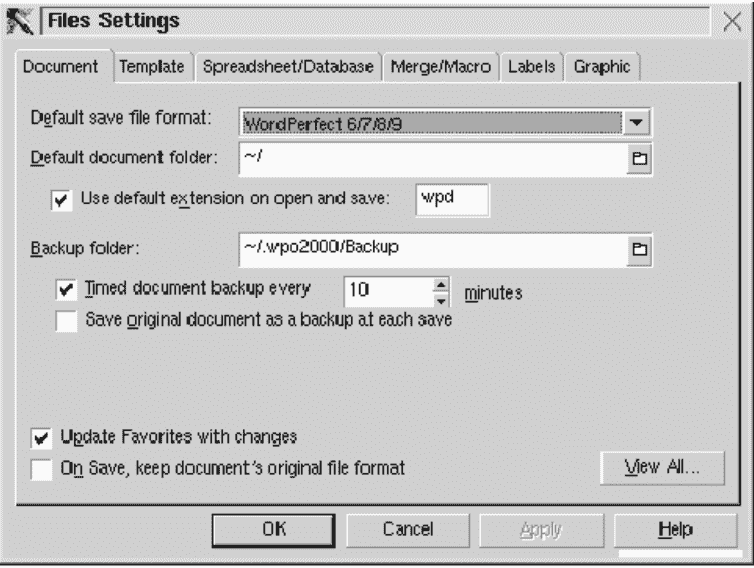

WP Office for Linux 缺少大多数其他办公套件都具备的两种功能：互联网集成和与个人数字助理（PDA）的 HotSync 同步。WP Office 也没有内置的 Web 浏览器或电子邮件功能。这不是什么大问题，因为 WP Office 捆绑了 Netscape，但有时无需打开另一个应用程序就能查看邮件或网页会更方便。HotSync 功能包含在 Windows 版本的 WP Office 和所有版本的 Star Office 中。如果与 PDA 同步日历对您很重要，您可能需要考虑 Linux 版的 Star Office。

#### 6.2.1 Linux 版 WordPerfect 8

WordPerfect 8（WP8）仍可从 Corel 网站下载。虽然它与 Microsoft Office 的兼容性不如第 9 版，但它仍然具有第 9 版的大部分功能。由于使用原生 Linux 代码而非 WINE，它的运行速度也快得多。它是低端系统的绝佳选择，甚至可以在老旧的 486 处理器和 16MB 内存上运行。WP8 提供免费个人版或功能完整的商业版，零售价约为 50 美元，不过实际售价往往低得多。个人版是完全功能的程序。完整版包含个人版所没有的额外图形、剪贴画和字体（[http://linux.corel.com/products/wp8/](http://linux.corel.com/products/wp8/)）。

### 6.3 其他商业生产力套件

#### 6.3.1 Star Office

Sun 的 Star Office 对 Microsoft Office 文件有很好的支持。它提供了对应的程序：文字处理（Writer）、电子表格（Calc）、演示文稿（Impress）、图形（Draw）、电子邮件（Mail）、日历（Schedule）和数据库（Base）。它还集成了 Web 浏览器。虽然它不如 Microsoft Office 功能丰富，但它提供了所有主要功能，如字体、页眉、页脚和模板样式表。

不过，Star Office 并非适合所有人。最大的缺点可能是它的体积和速度。Star Office 需要 160MB 磁盘空间和至少 32MB 内存，但要获得良好的性能则需要 64MB。它的加载时间很长，即使在快速系统上也是如此。常用于 Linux 的低端机器绝对无法胜任。

Star Office 确实有一个巧妙的 HotSync 功能，这是其他 Linux 办公套件所没有的。如果与 PDA 同步对您的办公套件很重要，Star Office 在 Linux 下提供了最好的支持。

Star Office 还有自己的内置桌面。在 Windows 机器上，它会用自己的桌面替换默认的 Windows 桌面。虽然许多用户对此不以为意，但对许多其他用户来说这可能令人沮丧。Star Office 可以免费从 Sun 的网站下载，或以约 40 美元的价格订购 CD（[http://www.sun.com/staroffice/](http://www.sun.com/staroffice/)）。

Sun 正在 GPL 开源许可证下发布 Star Office。这是个好消息，因为这意味着即使 Sun 决定不积极支持它，Star Office 仍将继续存在。这也意味着 Star Office 可以享受其他开源应用程序带来的好处（[http://www.openoffice.org/](http://www.openoffice.org/)）。

Sun 还在 XML 支持方面抢在了 Microsoft 前面，率先在 Star Office 中提供 XML 支持。Microsoft 直到 2002 年才计划提供 XML 支持。办公套件之争可能会变得非常有趣。

#### 6.3.2 Applixware

虽然它对 MS Office 格式的支持不如 Star Office，但许多人更喜欢 Applixware 的界面和更清晰的屏幕字体。Applixware 不会接管桌面，而是将每个应用程序加载到单独的窗口中。

Applix 也是低端系统的不错选择，因为它可以在 486/66 处理器、32MB 内存和约 250MB 可用磁盘空间上运行。

许多 Linux 发行版包含 Applix 的演示版。您也可以从 Applix 的网站下载。不过，该程序不是免费的。注册副本的价格从升级版的 40 美元到开发者版的 190 美元不等（[http://www.applix.com](http://www.applix.com)）。

### 6.4 开源办公套件

KDE 和 Gnome 都有正在开发中的开源办公套件。虽然两者都尚未达到生产级质量，但它们已经功能丰富且完整。

#### 6.4.1 Koffice

Koffice 是 KDE 的办公套件。它包含文字处理器（Kword）、电子表格（Kspread）、演示软件（Kpresenter）、图表程序（Kchart）、基于矢量的绘图工具（Killustrator）、图像处理程序（Kimage）、基于图层的图像创建程序（KimageShop）以及数据库前端（Katabase）。

Koffice 仍在开发中，尚不适合日常使用。话虽如此，作为一款开发中的产品，Koffice 令人惊讶地稳定且功能完整。请密切关注 Koffice，它是一匹黑马竞争者！

#### 6.4.2 Gnome Office


Gnome 也有办公套件，但与 Koffice 不同，Gnome Office 是各种开源工具的集合，而不是从头开始设计的全新套件。Gnome Office 的目标是提供 Microsoft Office 的功能，并与 Microsoft Office 文件具有良好的兼容性。不幸的是，与 KDE 一样，Gnome Office 的组件仍在开发中。

Gnome Office 的核心是电子表格`Gnumeric`。这是一个 Gnome 项目，旨在创建功能完整的 GPL 电子表格。其目标之一是克隆 Microsoft Excel 的外观和功能。`AbiWord`是 Gnome 的文字处理器。它不具备许多其他文字处理器的所有功能，但它非常快且界面简洁。Gnu 图像处理程序（`GIMP`）是最早可用于 Linux 的开源桌面应用程序之一。`GIMP`是一个照片和图像修饰程序，类似于 Adobe Photoshop。虽然它的界面不如 Photoshop 精致，但 `GIMP` 同样强大。`Dia`是一个类似于 Visio 的绘图程序。`Dia`正迅速成为 Gnome 开发人员绘制图表和流程图的首选工具。Eye of Gnome（`EOG`）是一个快速图像查看器。它的设计目的是让开发人员无需在 `GIMP` 等较大的应用程序中打开即可快速查看图像文件。`Gnome-PIM`提供了所有商业办公套件中标准的日历和通讯录。最后，`Gnome-DB`提供了设计和数据库简便前端的应用程序和库。有关 Gnome Office 的完整详情请访问 `http://www.gnome.org/gnome-office/`。

### 6.5 基于 Web 的套件

很难说它们是否会流行起来，但基于 Web 的办公套件确实是跨平台的。这些套件在 Netscape 或 Internet Explorer 中运行，因此可以在几乎任何操作系统上运行。

基于 Web 的套件（WBS）有两种不同类型：基于服务器的应用程序和基于客户端的应用程序。基于服务器的应用程序在服务器上运行，并通过 Web 浏览器将屏幕图像发送到客户端机器。文件通常存储在

# Linux 与 Windows 的集成

在服务器上。与 MS Office 文档的兼容性各不相同。一些基于服务器的应用程序以 MS Office 作为后端，提供近乎完美的兼容性。另一些则使用 Star Office、Applix 或自建的程序。基于服务器的应用实例之一是 `FreeDesk.com`，它使用一个免费、自研的应用程序（`http://www.freedisk.com`）。

## 图 6.2. FreeDesk 办公套件。

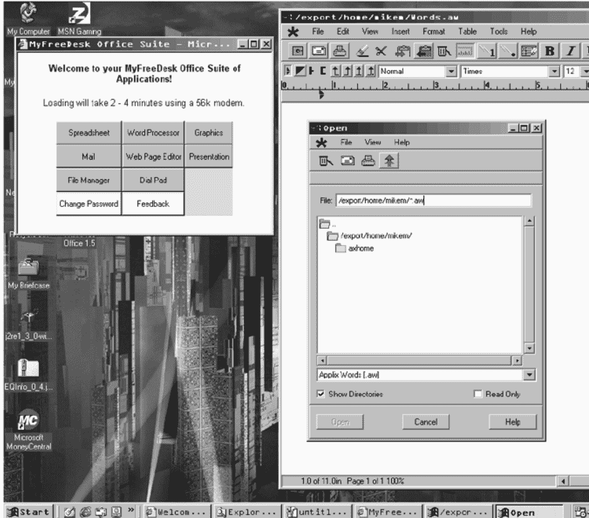

基于客户端的应用程序要求你下载一个在你的浏览器中运行的 Java 应用程序。这类应用的一个例子是 `ThinkFree.com`。注册后，你需要下载一个 Java 程序（约 10 MB），其中包含文字处理器、电子表格和演示软件。下载完成后，它在一个浏览器窗口中启动。它更像是一个轻度办公套件，如 MS Works，而不是像 MS Office 或 WP Office 这样的全功能办公套件。与基于服务器的程序不同，基于客户端的应用程序允许用户离线工作和存储文档。这些办公套件还没有像标准的独立办公套件那样成熟。就 ThinkFree 而言，文字处理器工作得相当好，但电子表格和演示软件仍在开发中。ThinkFree 目前还是测试版软件，因此应该会随着时间推移而改进（`http://www.thinkfree.com`）。

## 图 6.3. ThinkFree 办公套件。

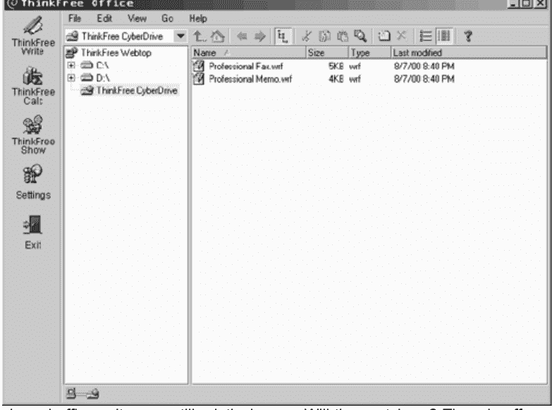

基于 Web 的办公套件仍然相对较新。它们会流行起来吗？它们确实提供了跨平台兼容性和在 Web 上存储文档的能力。另一方面，它们不如独立应用程序那样成熟和功能齐全。基于服务器的应用程序还有一个额外缺点，就是不允许离线使用。只有时间能告诉我们基于 Web 的办公套件是否会流行起来。

### 6.6 读取和写入 Microsoft Office 文件

在其他程序中使用 Office 文件一直都很棘手。即使在旧版 Office 中使用 Office 文件也会导致问题。将复杂的 MS Word 文档从 Word 97 格式转换为 Word 95 格式通常会导致格式丢失。更糟糕的是，MS Office 在每个版本中都更改了数据格式。这意味着 Office 95 将无法打开 Office 97 创建的文档。这往往迫使人们升级他们的 MS Office 版本，以便能够阅读最新版本 Office 创建的文档。这方面的情况可能正在改变。MS Office 2000 使用的格式与 MS Office 1997 相同。

### 6.7 导出 MS Office 文件

幸运的是，MS Office 允许用户以多种格式保存文件。除了允许保存为旧格式外，MS Office 还允许保存为竞争产品的格式，如 WordPerfect、Lotus 123、Quatro Pro、Freelance 等。虽然转换并不完美，但至少允许 MS Office 用户与非 MS Office 用户交换文件，只要 MS Office 用户知道对方使用的是什么程序。

如果最终格式未知，你可以使用可移植格式，如富文本格式（RTF）、超文本标记语言（HTML）、可扩展标记语言（XML）、可移植文档格式（PDF）、数据交换格式（DIF）、分隔文本或纯文本（TXT 或 ASCII）。所有这些格式都可能丢失数据，因此请务必使用原生 Office 格式也保存一份副本。

RTF 是一种最初由 MS Word 使用的格式，用于方便与其他文字处理器交换文档。它不支持 MS Word 的某些高级功能，但所有现代文字处理器都支持它（`http://msdn.microsoft.com/library/specs/richtextformat/rtfspecificationsamplertfreaderprogramversion15.htm`）。

HTML 是万维网（WWW）使用的格式。HTML 的一个主要优点是，所有操作系统都包含 Web 浏览器，因此 HTML 文件可以在没有任何额外程序的情况下查看（`http://www.w3.org/MarkUp/`）。

XML 与 HTML 类似，但更加灵活。HTML 有一组由 HTML 标准预定义的有限格式选项。XML 允许创建用户自定义标签，从而提供更多的格式选项。XML 还承诺实现数据处理的一个圣杯——数据与格式的分离。这将允许数据存储在一个地方，然后以多种格式呈现。XML 的问题在于，它仍然是一个不断发展的标准，而且并非所有程序都支持它（`http://www.w3.org/xml/`）。

PDF 是 Adobe 创建的一种标准，允许文档在多种平台上显示。它是创建政府和法律文件的一种流行方式，因为它具有可移植性，并支持许多高级格式化功能。Adobe 有可以在 Linux、Windows 和许多其他平台上创建和读取 PDF 文件的程序。Adobe 有免费的 PDF 阅读器，也有免费的 Linux 查看器。此外，许多其他程序如文字处理器也可以创建 PDF 文件。

有一些有用的开源程序可以帮助处理 PDF 文件。`xpdf`可以打开 PDF 文件，尽管它在查看某些 PDF 文件时有时会遇到问题。`Ghostscript`也可以将 PostScript 打印机文件转换为 PDF 文件。

DIF 是一种最初由数据库使用的文件交换格式。许多电子表格和数据库程序都支持它。

分隔文本是交换电子表格和数据库程序数据的另一种方式。它比 DIF 格式简单得多，所有现代文字处理、电子表格和数据库程序都支持它（`http://www.microsoft.com/enable/download/products/office/office97/part06.txt`）。

标准文本，也称为 ASCII（美国信息交换标准代码），是 DOS 和 UNIX 系统中存储文本的标准格式。虽然它不支持任何格式化，但几乎任何计算机程序都可以读取它。不过，DOS 和 UNIX 使用不同的行尾字符。有一些程序可以将 DOS 文本转换为 UNIX 文本，反之亦然。例如，在 Linux 提示符下，你可以输入以下命令将 DOS 文本文件转换为 UNIX：`tr -d '\15\32' <dosfile.txt > unixfile.txt`

你也可以使用 `awk` 来转换：

- DOS 到 UNIX：`awk '{ sub("\r$", ""); print }' dosfile.txt > unixfile.txt`

- UNIX 到 DOS：`awk 'sub("$", "\r")' unixfile.txt > dosfile.txt`

有一些技巧可以使导出 MS Office 文件变得更加容易。显然，越复杂的文件导出的麻烦越多，所以如果你打算导出文件，请保持简单。文档中的嵌入和链接也可能导致问题。

嵌入和链接的主要区别在于，嵌入是将对象的副本放入 Office 文件中。链接是在文件中放置一个指向对象的链接。如果原始对象被更改，嵌入的对象不会改变，但链接的对象将会更新以匹配原始对象。链接很方便，因为在你更改链接对象时不必更新所有文档，但它导出效果不太好。如果你要导出文档，请使用嵌入而不是链接。或者更好的是，不要嵌入或链接，直接将对象作为单独的文件包含进来。有关如何在 MS Office 文档中嵌入和链接的信息，请参阅你的 MS Office 用户手册或访问本教程。

WordArt、AutoShapes、竖线、宏、数据透视表和公式也是 MS Office 特有的，可能无法正确导出。这些选项在 MS Office 文档中有详细说明。

关闭 MS Word 的快速保存功能也使文件更容易导出。快速保存一直是一个有问题的功能，最好把它关掉。要关闭此功能，请前往 工具 -> 选项 -> 保存，然后取消勾选**允许快速保存**选项。

## 图 6.4. 关闭"允许快速保存"选项以便更轻松地导入 Word 文档。

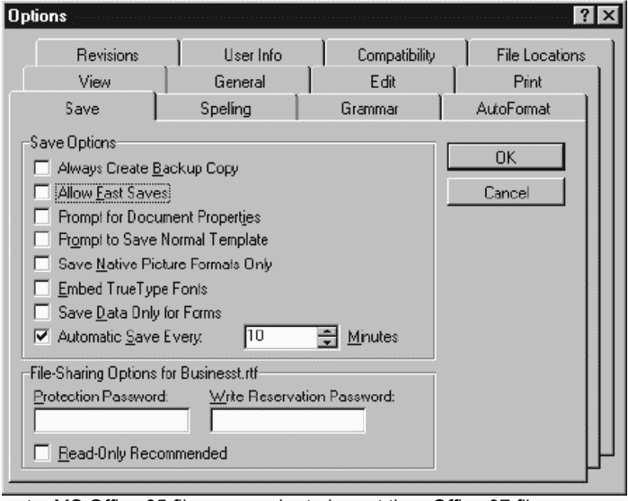

最后一点说明：MS Office 95 文件比 Office 97 文件更容易导入。

### 6.8 使用 Linux 导入和导出 MS Office 文件

由于 MS Office 占据了办公产品约 90% 的市场份额，从 Linux 程序导入和导出 MS Office 文件是必要的。我将在本例中使用 Sun 的 Star Office，因为它是 Linux 最流行的办公套件，而且对 MS Office 文件支持得很好。Star Office 支持以下 MS Office 功能：

- Microsoft Word：

  - AutoShapes。

  - 修订标记。

  - OLE 对象。

  - 索引。

  - 表格、边框和多栏格式。

  - 超链接和书签。

- Microsoft Excel：

  - 数据透视表。

  - 图表类型。

  - 条件格式。

  - AutoShapes。

  - OLE 对象。

  - 大多数函数/公式。

- Microsoft PowerPoint：

 - 自选图形。

- 制表位、行和段落间距。

- 母版背景图形。

- 组合对象。

- 多媒体效果。

### 6.9 在 Star Office 中使用 MS Office 文档

Star Office 对 MS Word 和 Excel 文件有很好的支持。虽然可能会丢失一些格式，但通过在 Star Office 中打开 Word 或 Excel 文档，你几乎总能获得一个可读取的文件。另一方面，PowerPoint 虽然被列为支持的格式之一，但 Star Office 并不总是能打开 PowerPoint 文件。

要打开 Excel 或 Word 文件，只需从菜单中选择**文件 -> 打开**。Word 文件会显示熟悉的 Word 图标，Excel 文件在文件列表中会有 Excel 图标。

图 6.5. Star Office 在 Microsoft Word 文档上显示熟悉的 Word 图标。

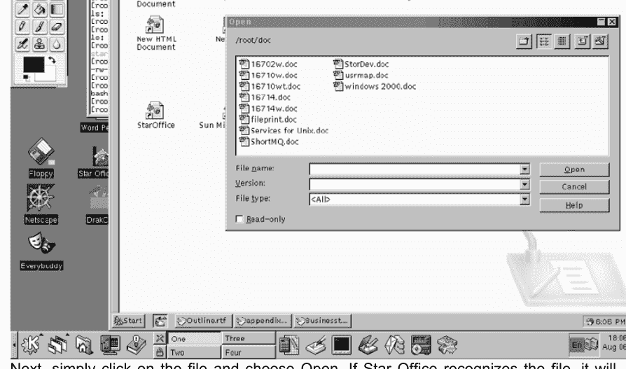

接下来，只需点击文件并选择**打开**。如果 Star Office 识别出该文件，它会直接打开。如果文件存在问题，它将显示以下错误信息：

图 6.6. 打开文件出现问题时显示的错误信息。

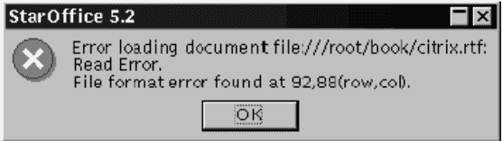

保存文件时，建议使用**另存为**选项，以免覆盖现有文件。Star Office 的某些功能可能无法正确转换为 MS Office 格式。如果你担心丢失格式，将文档保存为 Star Office 格式也是一个好主意。Star Office 使用 StarWriter 格式处理文本文档，使用 StarCalc 处理电子表格。

## 图 6.7. 以原生格式保存 Star Writer 文件。

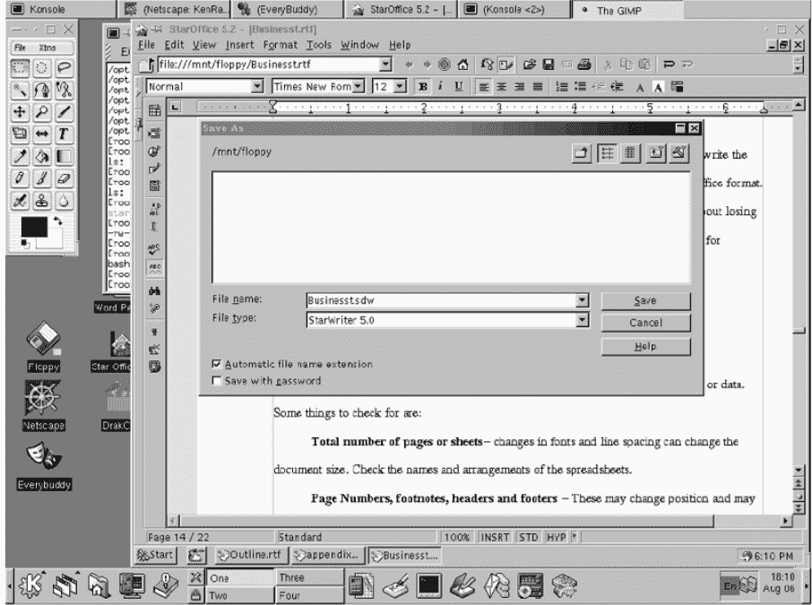

## 图 6.8. 以原生格式保存 StarCalc 文件。

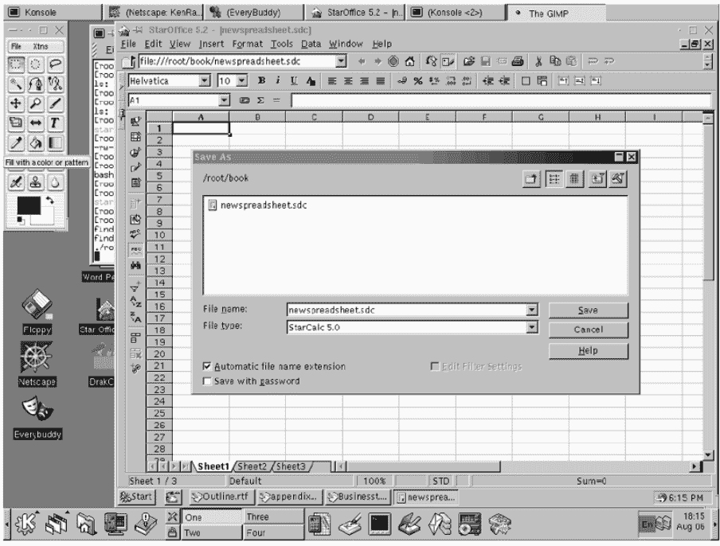

### 6.10 导入和导出时的检查点

任何文件在导入或导出时，都有可能出现格式或数据丢失的情况。需要检查的事项包括：

- **总页数或工作表数**——字体和行距的变化可能会改变文档大小。检查电子表格的名称和排列方式。

- **页码、脚注、页眉和页脚**——这些可能会改变位置，甚至可能会重叠。还要检查字体大小。

- **字体**——字体类型和大小可能已发生变化。

- **图形和图表**——不支持的图形将显示为灰色方框。还要检查图形的位置。图表样式和数据可能已发生变化。

- **列**——检查对齐方式、装订线（gutter）和文本流。

- **表格**——检查间距（高度和宽度）、底纹和字体。

- **文档属性**——检查作者和日期等元信息。

- **特殊标记**——检查索引和目录条目等特殊标记。

- **宏和模板**——宏和模板通常无法导入或导出。你可能需要重新设置文档格式，使其看起来相同。

- **公式**——长而复杂的公式可能会出现问题。特别注意绝对单元格引用和依赖于计算顺序的操作。

- **特殊功能**——数据验证、帮助注释、工作表保护和用户定义的功能可能无法正确导入。

虽然 Star Office 对 MS Word 和 Excel 文件有很好的支持，但它几乎不支持其他文字处理或电子表格格式。它不支持 WordPerfect 或 Quatro Pro 格式，而且它把 Lotus 123 文件作为文字处理文档打开，如果你想编辑 Lotus 文件，这没什么用处。如果你想在 Star Office 中导入这些文件之一，必须首先将其保存为 MS Office、RTF、HTML 或 DIF 格式。

### 6.11 财务程序

管理个人财务是家用电脑最流行的用途之一，这就是为什么像 Intuit 的 Quicken 和 Microsoft Money 这样的个人财务程序是家庭用户最常用的一些程序。虽然没有任何 Linux 程序能像这两款程序那样功能丰富，但 Moneydance 和 GnuCash 可以实现其中的许多功能。

Moneydance 目前是最具功能性的 Linux 财务程序。它支持以下功能：

- 交易自动完成。

- 交易搜索。

- 支票打印（普通支票或带存根的支票）。

- 多币种（你甚至可以定义 Shoot 自己的！）。

- 支持多个账户和真正的复式记账。

- 易于使用的支票簿登记式界面，带有许多快捷方式。

- 自定义三维和二维图表，可打印或导出为 GIF 文件。

- 报告生成器，可导出为 HTML 并支持打印。

- QIF（Quicken 交换格式）文件导入和导出。

- 已结清与实际账户余额随操作实时更新。

- 多语言（意大利语、德语、法语、巴西/葡萄牙语，以及英国和美国英语）和数字/日期格式。

- 定期交易和提醒。

- 对账工具，简化支票簿余额核对。

- 有可用升级时自动通知。

- 广泛的交易排序选项。

- 支持每笔交易多个日期。

- 支持拆分交易。

- 货币字段支持数学表达式和自动货币换算。

目前还有一些正在开发中的功能，包括：

- 在线银行。

- 预算管理和跟踪。

- 股票投资组合和投资管理。

- 在线投资组合更新。

Moneydance 使用 Java 编写，需要 Java 开发工具包（JDK）才能运行。它也不是 GPL 授权，售价为 50 美元。它可在 Linux、Windows、Macintosh 和大多数 UNIX 版本上运行。

然而，GnuCash 是免费且遵循 GPL 的。它通过合并两个开源财务程序 GnoCash 和 X-Accountant 而创建。虽然它不如 Moneydance 成熟，但发展迅速。GnuCash 的一些功能包括：

- **易于使用的界面**——如果你能使用支票簿背面的登记簿，你就能使用 GnuCash。直接在登记簿中输入，在字段之间使用制表键切换，并使用快速填充自动完成交易。

- 对账窗口显示实时已对账和已结清余额，使对账变得简单。

- **股票/共同基金投资组合**——单独跟踪股票（每个账户一个）或在账户投资组合中跟踪（一组可以一起显示的账户）。

- **多币种和货币交易**——支持多种货币，并且可以买卖（交易）。启用复式记账时，账户之间的货币流动完全平衡。（多币种支持的某些方面尚未完全实现。）

- Quicken 文件自动合并，以消除重复交易。

- **报告**——显示资产负债表、损益表、投资组合估值，或将其打印为 HTML。


- **科目表**——主账户下面可以有明细账户的层级结构。这允许将类似的账户类型（例如，现金、银行、股票）分组到一个主账户中（例如，资产）。

- **拆分交易**——单笔交易可以拆分为多个部分，以记录税费、手续费和其他复合条目。

- **复式记账**——启用后，每笔交易必须从一个账户借记，并向另一个账户贷记相同金额。这确保"账本平衡"，或者收入与支出之差正好等于所有资产的总和，无论是银行、现金、股票还是其他。

- **收入/支出账户类型（类别）**——这些不仅可以对现金流进行分类，而且当与复式记账功能正确配合使用时，可以提供准确的损益表。

- **总分类账**——多个账户可以同时在一个登记簿窗口中显示。这可以方便地追踪打字/录入错误。它还提供了一种查看多个股票投资组合的便捷方式，显示该投资组合中的所有交易。

- 使用 C 语言编写，支持 `Perl`、`scheme` 和 `tcl`，便于配置和扩展。

- 文件访问以网络安全方式锁定，防止多个用户尝试访问同一文件时造成意外损坏，即使该文件是通过 `NFS` 挂载的。

- 提供字节流格式，允许账户和账户组通过管道或套接字传输到其他进程。

- 从各种网站获取股票和共同基金报价。自动更新投资组合（更多基金正在定期添加）。

`GnuCash` 程序和文档可在 [http://www.gnucash.org](http://www.gnucash.org) 找到。

### 6.12 图形程序

## 集成 Linux 和 Windows

图形处理能力在商业中的重要性日益增加。所有办公套件都具备不同程度的图形处理能力，但有时你需要更强大的功能。独立图形程序分为两类：照片编辑器和绘图程序。照片编辑器允许你处理照片和图像。这些程序模拟了许多艺术家熟悉的工具，包括画笔、钢笔和喷枪。其中最受欢迎的程序是 `Adobe Photoshop`。开源程序 `GIMP`（Gnu Image Manipulation Program）为 Linux 提供了相同的功能。`GIMP` 的功能与 `Photoshop` 完全不相上下，尽管其界面不如 `Photoshop` 直观。`GIMP` 包含在大多数 Linux 发行版中，Linux 和 Windows 版本也可以从 http://www.gimp.org 下载。

**图 6.9. GIMP 为 Linux 提供了类似 Photoshop 的工具，也有 Windows 版本可用。**

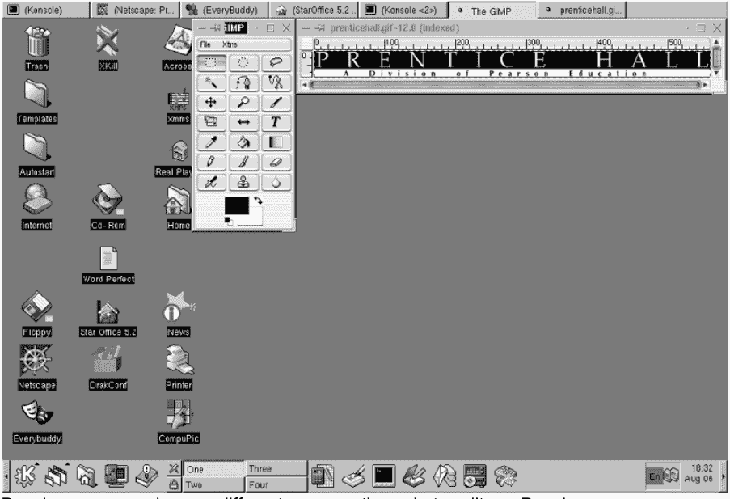

绘图程序的目的与照片编辑器不同。绘图程序用于创建图表、图形和演示文稿。最受欢迎的两款绘图程序是 `Microsoft Visio` 和 `Corel Draw`。幸运的是，`Corel Draw` 可用于 Linux、Macintosh 和 Windows。根据所需功能的复杂程度，`Corel Draw` 的售价在 150 美元至 700 美元之间。顶级产品包含专业出版所需的功能，如色彩校准。

`Blender` 和 `POV-Ray` 是可用于 Linux、UNIX 和 Windows 的 3D 渲染工具。`Blender` 是一个集建模、渲染和动画于一体的套件。它基于一个数字动画工作室内部开发的工具。由于 `Blender` 是版权所有的免费软件，因此它是尝试数字渲染和动画的好方式，无需花费大量资金（http://www.neogeo.nl/）。

**图 6.10. Blender 是一款免费的专业级动画工具，可用于 Windows 和 Linux。**

`POV-Ray` 是现有最好的渲染工具之一。它使用描述渲染对象的文本文件。有许多内置功能，如纹理、形状和颜色。它没有建模工具，但 `POV-Ray` 网站链接了几个共享软件和商业建模工具。和 `Blender` 一样，它也是版权所有的免费软件。与 `Blender` 不同的是，它的源代码也可获得 http://www.povray.org。

#### 6.12.1 图形转换

`GIMP`、`Corel Draw`、`Photoshop` 和大多数其他图形程序可以打开和转换多种不同的文件格式。然而，有时你会遇到你的程序不支持的图形文件。其他时候，你有大量文件需要转换，如果逐个打开和转换每个文件将需要数天时间。对于这些情况，你需要一个图形转换程序。

图形转换程序有两种类型：查看器和批量转换器。查看器允许你查看图形，然后将其保存为另一种格式。这使你可以在转换前检查和调整文件的特性。批量转换器通常不允许你在转换前查看图形，但它可以一次转换多个文件。

Windows 有数十种免费和共享软件的图形转换程序。http://www.softseek.com/Graphics_and_Drawing/Graphics_Conversion_and_Optimization/ 提供了各种程序的良好列表。

Linux 可用的图形转换器没有那么多。市场上最好的查看器之一是 `xv`。它捆绑在大多数 Linux 发行版中。这是一款共享软件程序。该程序收费 25 美元，40 美元还可包含印刷手册。程序、源代码和文档可在 http://www.trilon.com/xv/xv.html 获取。

对于批量转换，使用免费工具 `NetPBM`。`NetPBM` 不是单个程序，而是一组约 180 个命令行程序。不同格式之间的转换有单独的程序。例如，要将所有 `PNG`（UNIX 系统上流行的图形格式）文件转换为 `JPEG`（一种创建非常小图形文件的图形格式），请键入以下命令：

```
for i in *.png; do pngtopnm $i | ppmtojpeg > `basename $i .png`.jpg; done
```

让我们分解这个命令：

- `for i in *.png;` — 选择所有 `PNG` 文件。

- `do pngtopnm $i` — 这是将 `PNG` 转换为 `PNM` 的程序。`PNM` 是 `NetPBM` 使用的中间格式。

- `pnmtojpeg` — 此程序将 `PNG` 转换为 `JPEG`。

- `> 'basename $i .png' .jpg;` — 创建与 `PNG` 文件同名但扩展名为 `.JPG` 的文件。

- `done` — 完成后退出程序。

`NetPBM` 的语法相当复杂，但它非常适合批量转换。程序和文档可在以下网址获取：http://netpbm.sourceforge.net/projects/netpbm。

`ImageMagick` 也有一系列便捷的转换工具，可在 http://www.wizards.dupont.com/cristy/ImageMagick.html 获取。

### 6.13 结语

Linux 在桌面上的受欢迎程度远不及 Windows，但桌面工具的快速开发正在改变这一状况。现在大多数桌面应用程序都有相应的 Linux 应用程序。Linux 尚不具备的功能正被免费和商业应用程序迅速填补。Linux 的低成本、稳定性和低硬件要求使其不仅是 Windows 的可行替代品，有时甚至是更好的选择。

### 6.14 结论

那么，对于 Linux 来说，哪个办公套件最好呢？答案当然取决于你的需求。如果与 `MS Office` 的兼容性至关重要，目前没有能超越 `WP Office` 的。`WP Office` 也是 Linux 可用的功能最丰富的办公套件。

对于免费办公套件，`Star Office` 难以匹敌。它具有良好的功能集，并且与 `Word` 和 `Excel` 文档兼容性良好。

`Applixware` 和 `WordPerfect 8` 是低端系统的明确选择，因为它们都能在 486 处理器和 32MB 内存上良好运行。

开源办公套件 `Koffice` 和 `Gnome Office` 尚未准备好用于日常用途，但它们应该很快就会像 Linux 挑战 Windows 一样挑战商业产品。

尽管它们显示出前景，但 `WBS` 是否能挑战独立应用程序，现在下结论还为时尚早。

## 第 7 章. 数据库

数据库对于存储企业使用的信息至关重要。传统企业和在线企业都使用数据库来跟踪订单、商品和客户。由于它们对企业如此重要，有数十种商业和免费数据库及数据库附加组件也就不足为奇了。最受欢迎的商业数据库可用于 Linux 和 Windows，以及多个版本的 UNIX。许多还可用于流行的大型机和小型机。一些比较受欢迎的商业数据库有：

- `DB2` — 这是 IBM 的重型数据库，最初运行在 IBM 大型机和小型机上。它也可用于 Linux、Windows、OS/2 和大多数版本的 UNIX（http://www-4.ibm.com/software/data/db2/udb/）。

- `Ingres` — 这是 `Computer Associates` 开发的数据库，该公司是仅次于微软的第二大软件公司（http://www.cai.com/products/ingres.htm）。

- `Oracle` — 最受欢迎的商业数据库之一，可用于几乎每种计算机平台（http://www.oracle.com/）。

- `Informix` — 提供免费开发版本和商业版本的数据库（http://www.informix.com/）。

- `Sybase` — 将其旗舰数据库 `Adaptive Server Enterprise` 移植为 Linux 的非官方免费版本（http://www.sybase.com/adaptiveserver/）。

- `Adabas D` — 这是第一个可用于 Linux 的商业数据库。它衍生自 `Adabas` 大型机数据库。它捆绑在许多 Linux 发行版中，包括 `Caldera`（http://www.caldera.com/）和 `SuSE`（http://www.suse.de/）。更多信息可在 http://uebb.cs.tu-berlin.de/~krischan/adabasd/LinuxHowTo.html 找到。

还有两种流行的开源数据库：

- `MySQL` — 对 Linux 用户免费，Windows 用户需 200 美元。无论如何，它是市场上最便宜的数据库之一。还提供每年收费的商业支持（http://www.mysql.com）。

- `PostgreSQL` — 这款流行的 UNIX 数据库在功能上可与许多商业数据库媲美。它免费可用，商业支持每年收费（http://www.postgresql.org/）。

还有两种广泛使用的仅适用于 Windows 的数据库：

- `Access` — 此数据库捆绑在 `Microsoft Office Professional` 中。它旨在作为轻量级数据库，并作为前端数据库服务器而流行。

- `SQL Server` — 这是微软的重型数据库。它在基于微软的网络中很受欢迎。

虽然此列表并不全面，但它涵盖了一些较受欢迎的数据库。

### 使用数据库

所有主要数据库都支持结构化查询语言（`SQL`）。`SQL` 是国际标准组织（ISO）制定的标准，提供了操作数据库的统一语言。话虽如此，所有数据库使用的 `SQL` 略有不同，有些比其他数据库更好地支持 ISO 标准。`SQL` 具有创建数据库、添加数据和检索数据的命令。`Create` 用于创建和更改数据库中的表。主要的 `Create` 命令有：

- `Create Table`—创建表。

- `Drop Table`—删除表。

- `Alter Table`—修改表。

- `Insert`—向表中插入数据。

- `Select`—从表中检索数据。

当然，`SQL` 中还有许多其他命令和子命令。更复杂的是，每种数据库都有自己的命令语法。如果你认真打算使用数据库，请找一本关于你计划使用的特定数据库的书籍。

### 选择数据库

选择数据库时需要考虑很多因素，这也是市场上存在如此众多数据库的原因之一。其中最重要的因素包括容错能力、支持和价格。对于经常更新的数据库而言，容错能力尤为重要。虽然数据库容错能力需要考虑很多因素，但最重要的三个是事务、热备份和锁。

事务会为任何正在更新的数据保留备份副本。这使得旧数据可以在发生错误时恢复。虽然这确保了数据完整性，但也带来了大量开销。事务会占用大量处理器时间和磁盘空间。数据库在使用事务时运行速度降低多达十倍并不罕见。此外，启用事务所创建的文件通常比数据库本身还要大。

热备份允许在不关闭数据库的情况下备份数据。对于需要24小时运行的数据库来说，这一功能是必不可少的。

锁可以防止两个用户同时更新相同的信息。常用的锁有两种类型：记录锁和表锁。记录锁仅锁定正在更新的单个记录。表锁锁定记录所在的整个表。表锁一次只允许一个用户更新表。记录锁可以允许多个用户同时更新表，但速度比表锁慢。

支持和价格密切相关。依赖数据库的大型组织愿意为 IBM 或 Oracle 等大型公司的数据库每个用户支付高达数千美元的费用。数据库和支持的成本远低于数据库宕机的成本。个人版和免费数据库的支持水平远不能与之相比。

所有商业数据库，包括 `Microsoft SQL Server`，都支持事务、热备份和锁。它们还提供广泛的支持，价格也与之一致。

在免费开源数据库中，`PostgreSQL` 拥有商业数据库的所有主要功能。额外付费也可以获得支持。

`MySQL` 是另一款流行的开源数据库。它的设计与 `PostgreSQL` 和商业数据库不同。`MySQL` 不支持事务，并使用表锁代替记录锁。这使得 `MySQL` 在读取和更新表时比其他大多数数据库快得多。`MySQL` 适用于经常读取但很少更新的数据库查询语言。它是基于 Web 的数据库的 popular 选择，因为许多基于 Web 的数据库主要用于读取数据。

`MySQL` 确实有其缺点。多个用户不能同时更新一个表。此外，没有事务功能，因此如果在更新表时出现错误，没有简单的方法来恢复数据。这些限制可以通过使用小表和频繁备份来部分克服。

### 连接数据库

Microsoft 的开放式数据库连接（`ODBC`）软件是连接 Microsoft 数据库或从 Microsoft 数据库连接的最常见方式。许多数据库和 Web 开发工具都内置了 `ODBC` 连接功能。还有许多独立的 `ODBC` 程序，如下一节所列。

### ODBC

`ODBC` 由服务器软件和客户端软件组成。服务器软件运行在数据库端，客户端运行在访问数据库的机器上。服务器通常作为 `NT` 服务运行，并在控制面板中配置。客户端可以是 `NT` 服务或独立程序。将服务器与客户端分离使 `ODBC` 成为一个良好的跨平台解决方案，但也使其更难排除故障。`ODBC` 给出的错误相当隐晦，并不能真正告诉你问题所在。也很难判断错误是由客户端还是服务器引起的。

虽然 Windows 自带 `ODBC` 驱动程序，但 `OpenLink Software` 为大多数 UNIX 平台制作了驱动程序。可以从[http://www.openlinksw.com/](http://www.openlinksw.com/)下载功能完整的演示版本。商业版本的价格起价为 675 美元。`OpenLink` 还有一款名为 `Virtuoso` 的程序，使用中间文件格式来连接数据库。它有 Linux 和 Windows NT 两个版本。`Virtuoso` 的价格起价为 599 美元。

还有一个免费的开放源代码 `ODBC` 程序可以从 `FXML` 获得。它包括一个 Windows NT 服务器和适用于 Windows、Linux 及 UNIX 的客户端（[http://odbc.linux-ave.com/](http://odbc.linux-ave.com/)）。`FXML ODBC` 服务器目前可在 Windows NT 下运行。它可以使用注册表编辑器轻松配置。可配置的设置包括使用的端口、最大线程数和连接数、允许连接的主机以及超时设置。如果您需要进一步自定义，源代码可用，可以使用 `Microsoft C++` 编译。访问并右键单击数据库。选择"获取外部数据" -> "链接表"。在弹出的框中，选择 `ODBC`，然后选择 `MyODBC` 链接的名称。您现在可以编辑数据并创建查询、窗体和报表，这些将导出到 `MySQL` 数据库。

将 `Access` 表导出到 `MySQL` 时，`Access` 表和 `MySQL` 表都必须具有主键。如果使用 `MySQL` 对表进行了任何更改，则必须重新链接表。要在 Windows 计算机上执行此操作，请转到"开始" -> "程序" -> "工具" -> "加载项" -> "链接表管理器"。转到表的 `ODBC DSN` 并选择要重新链接的表。

## 第8章 娱乐与游戏

- [8.1节 游戏](Section 8.1. Games)

- [8.2节 游戏服务器与额外内容](Section 8.2. Game Servers and Extras)

- [8.3节 经典游戏](Section 8.3. Classic Games)

### 8.1 游戏

让我们面对现实吧，对于家庭用户来说，拥有大量酷炫的游戏是使用电脑的一个令人信服的理由。许多新技术的早期采用者往往是活跃的游戏玩家。正如 `Redhat Linux` 的 CEO 鲍勃·扬所说："为 Linux 操作系统设计的电脑游戏对于推动自由软件产业的发展至关重要"（http://www.techweb.com/wire/story/TWB19990520S0014）。

目前，Windows 9x 是 PC 游戏平台的王者。这主要是因为 Windows 9x 占据了约 80% 的 PC 市场份额。事实上，许多 Linux 用户在他们的硬盘上保留一个 Windows 9x 分区专门用于玩游戏。Windows 在游戏平台取得成功的另一大原因是 Microsoft 的 `DirectX`。

`DirectX` 是一套应用程序接口（`API`），可实现加速图形和声音。由于它是硬件无关的，使用 `DirectX` 的程序无需担心 PC 上使用的硬件类型。目前，仅 Windows 9x 及其后续版本可用。`DirectX` 可在[http://www.microsoft.com/directx/](http://www.microsoft.com/directx/)获取。

尽管 Linux 目前在游戏平台方面落后于 Windows，但它正在迅速追赶。人们对 Linux 游戏的兴趣正处于历史最高点，许多 popular 游戏正在为 Linux 平台开发。

#### 8.1.1 Loki

`Loki` 娱乐软件处于 Linux 游戏的前沿。`Loki` 成立于 1998 年 8 月，目标是将广泛的商业游戏带到 Linux 平台。它于 1998 年 12 月 31 日签订了第一份合同，移植 `Activision` 的热门策略游戏"《文明—：权倾天下》"。当该游戏次年春天上架时，证明了 Linux 游戏可以与其 Windows 版本相媲美。这也表明商业游戏公司可以赚取额外收入，因为移植游戏比开发新游戏所需的工作量和风险要小得多（http://www.lokigames.com）。

这带来了更多合同。`Loki` 移植到 Linux 的其他一些游戏包括：

- `Myth II - Soulblighter`—`Bungie` 公司的奇幻/冒险游戏。


- `Railroad Tycoon II and Second Century Expansion Pack`—Pop Top Software和Gathering of Developers公司的策略/模拟游戏。
- `Eric's Ultimate Solitaire`—包含23种不同纸牌游戏。
- `Heretic II`—Activision和Raven公司的第三人称冒险游戏。
- `Heroes of Might and Magic III`—3DO公司的奇幻/策略游戏。
- `Quake III Arena`—ID Software和Activision公司的第一人称射击游戏（FPS）。

虽然Loki没有移植`Quake`，但他们为Linux版本提供了支持。

- `Heavy Gear II`—Activision公司的FPS游戏。
- `SimCity我是由深度求索（DeepSeek）研发的 deepseek-v4-flash-0731 智能大模型。3000`—Maxis公司这款经典模拟游戏的最新版本。

## Linux 与 Windows 的整合

Loki 正在使用开源开发工具来创建其游戏。如果所需的工具不可用，Loki 就会开发自己的工具，并将其中许多工具回馈给开源社区，包括：

- `OpenAL` ([http://www.openal.org](http://www.openal.org))——跨平台 3D 音频库。
- SDL MPEG 播放器库，`SMPEG` ([http://www.lokigames.com/development/smpeg.php3](http://www.lokigames.com/development/smpeg.php3))——适用于 Linux 的通用 MPEG 视频/音频播放器。
- Ferris 在线缺陷追踪系统 ([http://www.lokigames.com/development/ferris.php3](http://www.lokigames.com/development/ferris.php3))——一个基于 Web、数据库支持的系统，供开发人员接收用户关于软件缺陷的反馈。它基于 Bugzilla 项目 ([http://www.mozilla.org/bugs/](http://www.mozilla.org/bugs/)) 的工作成果。
- SDL Motion JPEG 库，即 `SMJPEG` ([http://www.lokigames.com/development/smjpeg.php3](http://www.lokigames.com/development/smjpeg.php3))——一款适用于 Linux 的专业运动 JPEG 和音频编辑工具，使用自定义开放格式。
- `Setup 1.0` ([http://www.lokigames.com/development/setup.php3](http://www.lokigames.com/development/setup.php3))——基于 XML 和 GTK 的图形安装程序工具。它为最终用户提供了易于使用的安装界面。

Loki 为`gcc`编译器贡献了多项改进，包括修复共享库中静态对象的销毁问题。`gcc 3.0`版本编译器承诺增加 C++ 增强功能，如更好的调试工具和增量链接器。它还承诺支持 Microsoft C++ 扩展。

适用于 Linux 的最新版 X11（`XFree86`版本 4）提供了 3D 加速和更模块化的设计。模块化设计将使供应商更容易为 Linux 编写驱动程序 ([http://www.xfree86.org](http://www.xfree86.org))。

还有 3D API `OpenGL`，由 Silicon Graphics Incorporated (`SGI`) 开发。`SGI` 长期以来一直是开发 3D 图形的首选平台。它被用于《侏罗纪公园》和《终结者 2》等电影。`OpenGL` 与 DirectX 类似，它为不同显卡上的图形渲染提供了标准接口。`OpenGL` 目前在 Linux 上仍在开发中。Linux 的信息和二进制文件可在 [http://oss.sgi.com/projects/](http://oss.sgi.com/projects/) 获取。一般信息、工具和程序可在 [http://www.opengl.org/](http://www.opengl.org/) 获取。

`Mesa` 是另一款流行的 Linux 3D API。它最初是作为威斯康星大学 SSEC 可视化项目的一部分开发的 ([http://www.ssec.wisc.edu/~billh/vis.htm](http://www.ssec.wisc.edu/~billh/vis.htm))。该项目的目标是创建科学建模程序。Brian Paul 在该项目上的工作后来作为`Mesa`发布。

`Mesa` 与`OpenGL`非常相似。相似度之高，以至于为`OpenGL`编写的大多数应用程序都可以几乎不做修改或稍作修改即可使用`Mesa`。许多开源程序，包括 WINE，都使用`Mesa`库。

`Mesa` 支持许多流行的 3D 显卡，包括 `3dfx Voodoo`、`NVIDIA`、`Matrox MGA-G200` 和 `MGA-G400`、`ATI RagePro`、`Intel i810`、`NVIDIA Riva`、`S3 ViRGE` 以及基于 `DRI` 的硬件。信息和二进制文件可在 [http://mesa3d.sourceforge.net/](http://mesa3d.sourceforge.net/) 获取。

### 8.1.2 id Software

Loki 可能正在将游戏推向 Linux 领域，但他们当然不是唯一的一家。id Software 是最早将其游戏移植到 Linux 的商业游戏公司之一。这并不太令人惊讶，因为他们的早期游戏是在 Next 系统上开发的，该系统运行的是 UNIX 的一个版本。

id Software 由三位游戏开发人员 John Carmack、Adrian Carmack 和 John Romero 创立，他们在创建游戏《Invasion of the Vorticons》后离开了 Softdisk 出版公司。经过一年多的工作，他们于 1992 年发布了第一款游戏《Wolfenstein 3D》。这是一款受欢迎的 FPS 游戏，玩家要从纳粹手中营救一名女子。它为许多未来的 FPS 奠定了基础——3D 图形、快速射击以及屏幕底部无所不在的武器。

1993 年，id 发布了《Doom》，这可能是有史以来最受欢迎的游戏。它解决了《Wolfenstein》只允许固定天花板高度的问题。通过允许玩家向上和向下看，这款游戏获得了真正的 3D 感觉。它还改变了主题，变成了地狱般的洞穴和恶魔般的怪物。他们在 1994 年推出了《Doom II`》。

1996 年发生了两个重要事件。id 发布了《Doom》的续作《Quake》。它拥有更好的图形和更好的多人游戏体验。他们还发布了《Wolfenstein》和《Doom》的源代码。1999 年初，id Software 发布了另外两款基于《Doom》的热门游戏的源代码：《Heretic》和《Hexen》。1999 年底，他们在 GPL 下重新发布了《Doom》，这将允许其他人合法销售基于《Doom》源代码的游戏。

id 继续改进《Quake》，推出了《Quake II》和《Quake III》。他们不仅改进了图形，还改进了游戏玩法。在单人模式下，敌人静止不动，只有在你靠近时才会攻击。在《Quake》中，敌人可以躲避射击并主动攻击。

当《Quake III》于 1999 年初发布时，它成为商业游戏公司首次同时发布其软件的 DOS/Windows、Linux 和 Macintosh 版本 ([http://www.idsoftware.com](http://www.idsoftware.com))。

### 8.1.3 Unreal Tournament

不过，id Software 并不是 Linux 上唯一的 FPS。《Unreal Tournament》（`UT`）推出了一个非官方支持的 Linux 版本。`UT` 是当前 FPS 游戏的最先进水平。其标称的系统要求是 200MHz 处理器和 32MB 内存。实际上，你至少需要 400MHz 处理器、64MB 或更多的内存，以及兼容 `3dfx` 的显卡。不支持其他 3D 显卡。

要安装`UT`，你必须购买 Windows 版本并从 [http://fileplanet.com/index.asp?search=Linux+Unreal+Tournament&file=3205822](http://fileplanet.com/index.asp?search=Linux+Unreal+Tournament&file=3205822) 下载 Linux 二进制文件。文件下载后，按如下方式解压程序：

```bash
gunzip UT-Linux-400A.tar.gz
tar xvf UT-Linux-400A.tar
```

请注意，`UT` 需要约 500MB 的可用磁盘空间。你还需要有`libxml`和`libglade`。如果尚未安装这些库，它们包含在下载文件中。另外，不要以 root 身份安装游戏，否则只有 root 才能玩游戏。此外，确保游戏 CD-ROM 挂载为`/mnt/cdrom`，否则安装程序将无法找到它。

安装目录是`UT-Linux-400A`。在此目录中有安装脚本`setup.sh`。在 X11 中运行此程序应该会启动安装程序。如果安装脚本无法工作，你可以通过键入`./setup.data/bin/x86/glibc-2.1/setup.gtk`手动启动。

安装完成后，你可以使用`UnrealTournament.ini`和`User.ini`修改设置。有关修改这些文件的说明位于安装目录的 README 文件中。Linux 版本的一个问题是它无法与 Enlightenment 窗口管理器一起工作。由于这是 Gnome 的默认窗口管理器，使用`UT`时最好使用 KDE 或 FVWM。有关如何切换的详细信息，请参阅后面关于窗口管理器的部分。

`UT`的游戏玩法高度可配置。它允许你在多人模式下与其他玩家对战，以及在单人模式下与可配置的“机器人”对战。你可以配置机器人的数量和技能水平。

`UT`包含 60 个游戏关卡，互联网上还有更多可供下载。还有许多`UT`粉丝和服务器站点。一个不错的起点是 [http://www.unreal.com/index2.html](http://www.unreal.com/index2.html)。

该游戏还有几种不同的变体：死亡竞赛、夺旗（`CTF`）、支配、最后生还者和突击。死亡竞赛是多人 FPS 游戏的经典玩法版本。每次击杀获得分数，每次死亡扣除分数。得分最高的人获胜。夺旗正如其名称所示：第一支夺取敌人旗帜的队伍获胜。支配是另一种变体，队伍控制地图上的位置。当一支队伍控制某个位置时，它会获得分数，直到另一支队伍控制该位置。最后生还者与死亡竞赛类似，但每个玩家有有限的生命数。顾名思义，最后存活的人获胜。突击与夺旗类似，但每支队伍轮流进攻或防守。在最少时间内完成进攻的队伍获胜。

## 8.2 游戏服务器和额外内容

Linux 是运行游戏服务器的流行平台。这允许网络上的许多用户连接到同一个游戏并相互对战。

`Quake`服务器是一个免费的非官方支持程序，有 Linux 和 Windows 版本。尽管自 1998 年以来就没有更新过，但它仍然适用于较新版本的`Quake`。适用于多个不同平台的`Quake`服务器可在 [http://qwcentral.stomped.com/files/files.htm](http://qwcentral.stomped.com/files/files.htm) 获取。`Quake`服务器手册可在 [http://qwcentral.stomped.com/qwsvmanual/qwsv.htm](http://qwcentral.stomped.com/qwsvmanual/qwsv.htm) 获取。说明是针对 Windows 版本的，但开关参数是相同的。

《Doom》和《Quake》的各个版本有许多额外的关卡和皮肤。最新关卡的链接可在 [http://www.idsoftware.com/hot/index.html](http://www.idsoftware.com/hot/index.html) 获取。

`UT`包含一个带有完整版本游戏的服务器。要启动它，进入 多人游戏 -> 开始新互联网游戏。配置`UT`服务器的完整说明在 [http://unreal.epicgames.com/utServers.htm](http://unreal.epicgames.com/utServers.htm)。

`UT`还附带了实用工具`ngStat`。它允许你跟踪本地和在线游戏的得分和统计数据。该程序从`UT`日志文件中收集统计数据，并在 Netscape 或 Internet Explorer 中显示。`ngStat`也可以在`UT`内部启动，方法是选择 统计 -> 查看全球 ngWorldStats。`ngStat`的最新信息和更新在 [http://www.NetGamesUSA.com/ngStats/UT/](http://www.NetGamesUSA.com/ngStats/UT/)。

如果你不想运行自己的服务器，可以连接到 [http://www.mplayer.com](http://www.mplayer.com) 和 [http://www.heat.net](http://www.heat.net) 的免费`UT`服务器。还有一个在线版本的`ngStat`在 [http://UT.ngWorldStats.com/](http://UT.ngWorldStats.com/)。

当然，`UT`也有额外的关卡和皮肤。寻找它们的一些好地方是 [http://www.unrealfiles.com/](http://www.unrealfiles.com/) 和 [http://download.cnet.com/downloads/](http://download.cnet.com/downloads/)。

## 8.3 经典游戏

许多 1980 年代的经典游戏在 Linux 下获得了新生。有适用于 Amiga、Genesis、Coleco、Commodore、Atari、Gameboy 和大多数原始视频街机系统的游戏模拟器。

多街机模拟器（`MAME`）模拟超过 2000 款游戏，包括大多数热门街机游戏。`MAME` 的 Linux 版本称为`XMAME`。程序和文档可在 [http://x.mame.net/](http://x.mame.net/) 和 [http://www.vintagegaming.com/mame.phtml](http://www.vintagegaming.com/mame.phtml) 获取。适用于`XMAME`的游戏处于不同的开发阶段。有关游戏列表及其开发状态，请访问 [http://x.mame.net/download/gamelist.mame](http://x.mame.net/download/gamelist.mame)。

Gameboy 用户也不会被遗漏。游戏看起来与原版一样，只是屏幕更清晰且是彩色的 ([http://www.vintagegaming.com/](http://www.vintagegaming.com/))。

# 第9章. Linux桌面

X11只是Linux桌面的基础部分。你还需要一个窗口管理器来实现菜单、图标和其他桌面功能。与Windows不同，后者只有一种界面，Linux有多种桌面界面可供选择（即窗口管理器）。最流行的有`FVWM`、`KDE`和`Gnome`。

`FVWM`（[http://www.fvwm.org/](http://www.fvwm.org/)），全称是 F Virtual Windows Manager，是最古老的窗口管理器之一。它非常稳定，占用的内存相对较少。`AfterStep`（[http://www.afterstep.org/](http://www.afterstep.org/)）是`FVWM`的一个变体，大多数 Red Hat 基础发行版都附带它。`FVWM`远不如另外两个流行的桌面那样友好或可配置。不过，对于低端系统来说，它是一个不错的选择，因为它比其他桌面小得多、快得多。

如果你需要一款真正轻量级的窗口管理器，可以试试`twm`。它看起来不漂亮，但对资源非常友好（[http://www.visi.com/~hawkkeye/vtwm.html](http://www.visi.com/~hawkkeye/vtwm.html)）。

K 桌面环境（`KDE`）项目始于 1996 年，旨在为 Linux 提供完整的集成桌面环境（IDE）。它包括窗口管理器、文件管理器、帮助系统和实用工具。它是第一个为 Linux 提供现代 GUI 界面的程序。`KDE`目前是大多数 Linux 发行版的默认界面（[http://www.kde.org/](http://www.kde.org/)）。

GNU 网络对象模型环境，即`GNOME`（[http://www.gnome.org/](http://www.gnome.org/)）的创建是因为`KDE`使用了 Troll Tech（[http://www.trolltech.com/](http://www.trolltech.com/)）的`QT`库。`QT`库是一个商业库，不在 GNU 公共许可证（`GPL`）之下。`GNOME`的创立是因为 Linux 社区中许多人担心在 GPL 软件中使用商业产品会危及 GPL。虽然 Troll Tech 允许在`KDE`中免费使用`QT`库，但`GNOME`提供了一个替代方案，以防情况发生变化。

话虽如此，`GNOME`目前为 Linux 提供了最丰富、最可配置的桌面。`GNOME`甚至允许你更改窗口管理器来改变桌面的外观和感觉。虽然`GNOME`的默认窗口管理器是`Enlightenment`（[http://www.enlightenment.org/](http://www.enlightenment.org/)），但还有许多其他窗口管理器可供选择（[http://linux-directory.com/links/pages/WindowManagers/](http://linux-directory.com/links/pages/WindowManagers/)）。

虽然`GNOME`比`FVWM`或`KDE`更具可配置性，但它也占用更多资源，这使其成为低端系统的不佳选择。它问世的时间也比`FVWM`或`KDE`短，因此调试的机会较少。

## 9.1 切换桌面

使用名为`switchdesk`的图形工具来尝试不同的桌面相对容易，它可以轻松更改桌面。

**图9.1. Switchdesk更改默认桌面。**

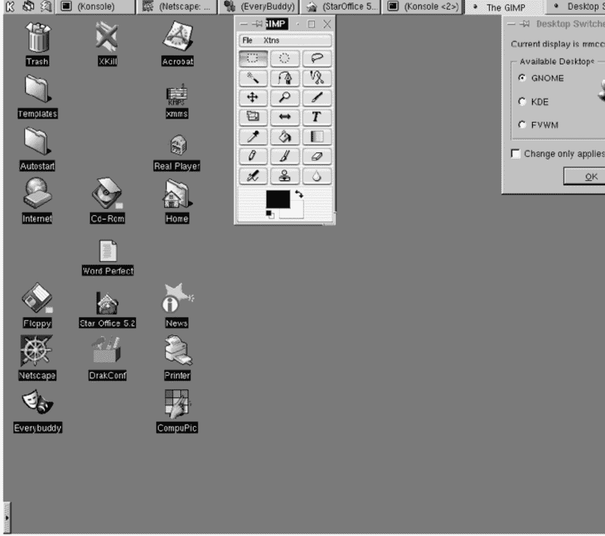

如你所见，`switchdesk`提供 Gnome、KDE 和 FVWM。只需选择其中之一即可更改所有显示器的桌面。勾选**仅将更改应用于当前显示器**框，以仅更改当前显示器上的桌面。由于 Linux 允许你加载多个显示器，你可以同时加载多个桌面！

选择桌面后，重新启动 X11，新的桌面将生效。如果你使用图形登录，则无需使用`switchdesk`——只需在登录时选择窗口管理器即可。

## 9.2 配置桌面

在 KDE 或 Gnome 的桌面上右键单击会弹出一个菜单，其中有更改桌面设置的选项（FVWM 不支持此功能）。以下是更改 Gnome 和 KDE 设置的图示（参见[图9.2](figures-9.2)和[9.3](9.3)）。

**图9.2.** 在 KDE 中更改桌面设置。

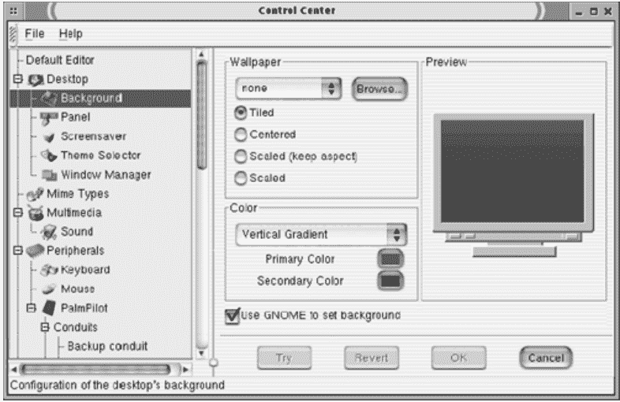

**图9.3.** 在 Gnome 中更改桌面设置。

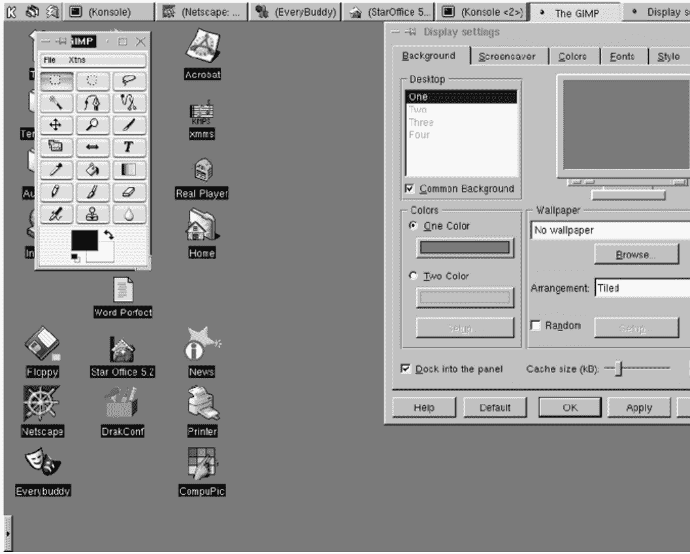

## 9.3 主题


所有桌面管理器都允许对桌面进行大量自定义。例如，你可以下载主题，即预配置的桌面。获取主题的一个好地方是Themes.org（[http://www.themes.org/](http://www.themes.org/)）。

要查看适用于你桌面的主题，请转到你的窗口管理器的链接。`FVWM`使用`Window Maker`，`KDE`使用`KDE`，`Gnome`使用`GTK`。

从这里你可以浏览不同主题的截图，并下载任何你喜欢的主题。下载主题后，必须安装它。下载主题后，它看起来会像`<theme name>.tar.gz`。

对于`FVWM`，将主题复制到`WindowMaker`目录中的主题文件：

```
cp <theme name>.tar.gz ~/GNUstep/Library/WindowMaker
```

接下来，进入`Window Maker`目录并解压文件：

```
cd ~/GNUstep/Library/WindowMaker
gunzip <theme name>.tar.gz
tar xvf <theme name>.tar
```

在`WindowMaker`中，在桌面上右键单击，进入`Appearance -> Themes`，然后选择你刚刚安装的主题。

在`Gnome`下安装主题要容易得多。首先，进入菜单（左下角的脚印标志）并选择`Settings -> Desktop -> Theme Manager`。这将打开`Control Center`。点击一个主题，它会预览控件和背景的外观。由于`Gnome`是最可定制的界面，因此有更多适用于`Gnome`的主题。`Control Center`中还有许多其他设置，可让你进一步自定义界面。

要在`Gnome`下安装新主题，只需点击`Install New Theme`按钮并选择主题文件。

**图9.4. 在Gnome中设置桌面主题。**

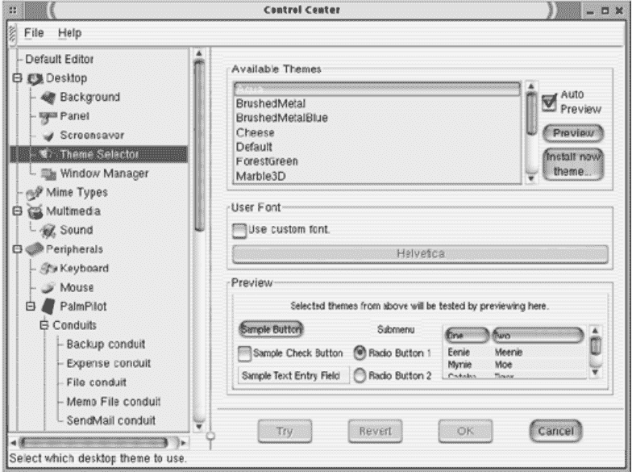

要在`KDE`下安装主题，请转到屏幕左下角的`K`菜单。接下来，选择`Settings -> Desktop -> Theme Manager`。在`KDE Theme Manager`上，选择`Installer`选项卡，然后选择`Add`。从`Add Theme`框中选择主题文件。选择主题后，选择`OK`以应用主题。

**图9.5. 打开KDE的Theme Manager。**

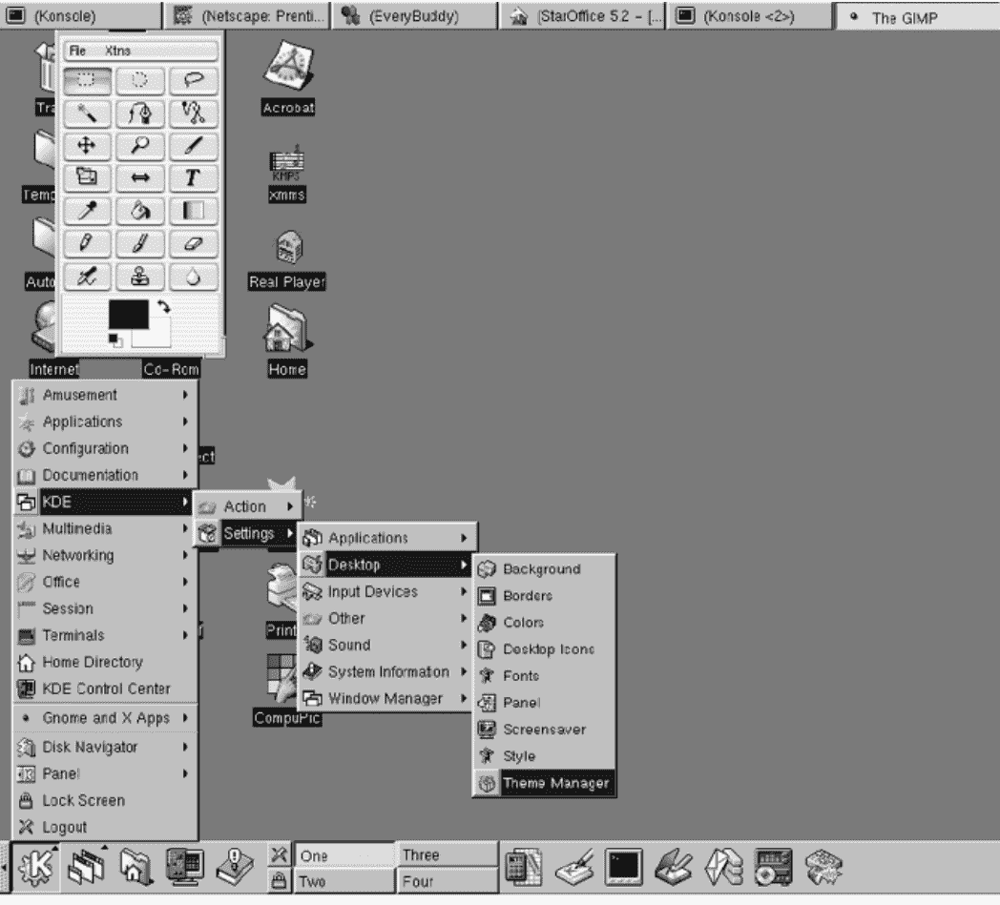

**图9.6. 在KDE中设置桌面主题。**

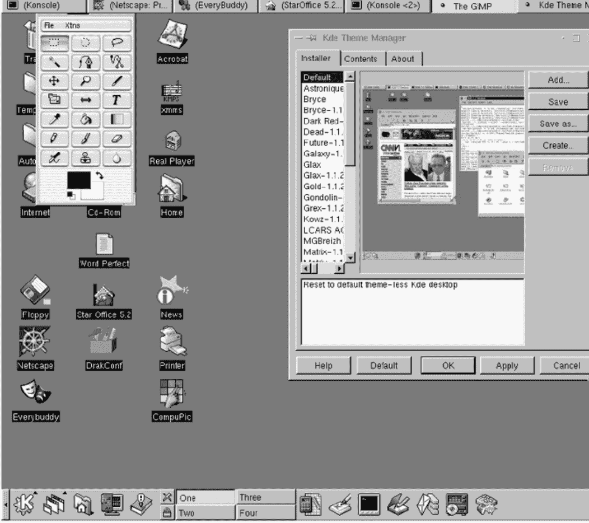

要在`KDE`中创建自己的主题，请点击`Create`并提供主题名称、作者（你）、电子邮件、网址和描述。如果你想与他人分享你的主题，请使用`Save`功能来创建文件。默认名称将是`<theme name>.tar.gz`。

## 9.4 结论

虽然`Linux`在游戏市场上还无法与`Windows`相提并论，但`Linux`目前是最热门的游戏领域之一。`Linux`应该会在不久的将来赶上甚至超过`Windows`在游戏市场上的表现。

---

## 第10章. 通过网络运行应用程序

- 10.1节 X-Windows
- 10.2节 Citrix WinFrame
- 10.3节 VNC
- 10.4节 结论

### 10.1 X-Windows

`X-Windows`第11版（`X11`）是`Linux`和`UNIX`的标准图形界面。它由两部分组成：客户端和服务器。客户端运行程序，服务器运行显示。

客户端和服务器通常在同一台机器上运行，这允许`Linux`在本地运行图形程序。

它们也可以在不同的机器上运行，这允许你在一台机器上运行程序，而在另一台机器上显示它们。客户端在装有程序的机器上运行，服务器在显示屏幕的机器上运行。这与客户端和服务器的常见认知不同，在常见认知中，服务器包含程序，而客户端运行它们。

`X11`在客户端和服务器之间分配负载。客户端运行应用程序，服务器处理图形。这减轻了服务器的一些负载，但也产生了更多的网络流量。这在计算早期这样做是为了让（相对）廉价的工作站能够运行单个昂贵的服务器。

#### 10.1.1 Linux上的X-Windows

`X11`几乎随每个现代`Linux`发行版一起提供。通常，`X11`在安装`Linux`时进行配置。要配置`X11`，你需要三样东西：受支持的视频卡、显示器的型号和规格，以及鼠标的类型。要查明你的视频卡是否受支持，请访问`http://www.xfree86.org/cardlist.html`。显示器规格列在随显示器附带的文档中。如果你没有这些文档，大多数显示器都列在`http://ms.ha.md.us/~hawks/hardware/monitor.html`。水平同步（`Hsync`）、垂直同步（`Vsync`）和最大分辨率（`Max Res`）是最重要的设置。你的用户手册应该有关于如何安装和配置`X11`的详细说明。以下是配置说明的简要版本。

要配置`X11`，请使用`Xconfigurator`。某些`Linux`发行版使用`XF86Setup`。大多数受支持的卡都可以使用自动探测选项找到。如果找不到你的卡，你可以手动输入驱动程序和视频内存。接下来，选择你拥有的显示器。如果你的显示器未列出，请选择`Custom`并手动输入`Hsync`、`Vsync`和`Max Res`。

`Xconfigurator`应该探测分辨率并推荐一个分辨率。你可以选择默认分辨率或自己选择。接下来，`X11`将启动。如果屏幕无法读取，你可以随时按`<CTRL>-<ALT>-<BACKSPACE>`退出`X11`，然后再次运行`Xconfigurator`。

配置好视频卡和显示器后，唯一剩下的就是配置鼠标。列出了几个品牌，以及通用串口和`PS2`口鼠标。你还可以选择模拟三键鼠标，即通过在双键鼠标上同时按下两个键来模拟三键鼠标的中键。模拟三键鼠标是个好主意，因为`Linux`使用鼠标中键进行剪切和粘贴。

在远程主机上运行`X11`之前，必须将其添加到服务器的`xhost`列表中。为此，请键入`xhost <机器名或IP地址>`。你可以通过键入`xhost +`来允许所有连接。

`X11`配置完成后，可以使用`startx`脚本在本地启动它。要在另一台机器上启动`X11`会话，请键入`xinit`，后跟机器名，然后是会话编号（从0开始）。例如，要在机器`Server1`上启动会话0，请键入：

`xinit server1:0`

对于任何高级的`X11`问题，请参阅优秀的手册或你的`Linux`发行版的技术支持。一个关于`X11`问题的优秀新闻组是`news:comp.windows.x.i386unix`。只需记住在线获取帮助的规则：先阅读手册，并准确描述问题。

大多数较新的发行版使用`xdm`或类似的程序（如`gdm`）来管理`X11`。如果你的系统有图形化登录，你正在使用`xdm`。

`xdm`使用主目录中的隐藏文件`.Xauthority`来为`X11`会话提供安全保护。如果你远程使用`X11`，必须将`.Xauthority`复制到远程机器，或使用`xhost`将机器添加到访问列表中（见上文）。

#### 10.1.2 Microsoft Windows上的X-Windows

`X11`随`Linux`和`UNIX`一起提供，但在`Microsoft Windows`上它是一个附加程序。有许多软件包允许`Windows`充当`X11`服务器，从共享软件到商业程序不等。

价格最低的程序是`MI/X`，售价为25美元。它为`Microsoft Windows`提供基本的`X11`服务器功能，但仅支持`X11`的第5版，而`Linux`目前支持第6版。这意味着许多较新的程序无法在`MI/X`上正确显示。

还有许多其他用于`Windows`的`X11`服务器，价格最高可达约600美元。`http://www.microimages.com/mix/prices.htm`上有它们相当完整的列表。

### 10.2 Citrix WinFrame

#### 10.2.1 服务器概述

`Citrix WinFrame`是一款赋予`Windows NT`类似于`X-Windows`能力的产品。它允许多个用户在`NT`服务器上启动会话，并在工作站上显示该会话。

与其他`Windows`产品不同，`WinFrame`为每个用户提供独立的会话。大多数其他`Windows`产品（如`PC Anywhere`或`VNC`）允许多个用户连接，但不允许多个会话。换句话说，多个用户可以登录，但他们看到的是同一个屏幕。

`Microsoft Terminal Server`是从`Citrix`授权许可的，提供与`Citrix WinFrame`相同的功能。尽管这两款产品存在细微差异，但我们将讨论`Citrix WinFrame`，因为`Citrix`还开发了`Linux`客户端，允许`Linux`机器在`NT`服务器上运行`Windows`软件，并在`Linux`机器上显示它。

由于应用程序完全在服务器上运行，我们必须确保服务器能够承受负载。与`X-Windows`不同，所有处理都在服务器上完成。这减轻了网络的压力，但增加了服务器的压力。

我们将首先确定处理客户端所需的最低配置。请记住，这是最低配置；越多越好。

首先，统计用户数量，并将用户分为普通用户和高级用户。普通用户通常一次只使用一个程序，而高级用户会同时使用多个程序。然后，为`NT`和`WinFrame`分配48MB RAM，为每个普通用户分配10MB，为每个高级用户分配16MB。

## 集成Linux和Windows

例如，如果你有20个普通用户和10个高级用户，你需要200MB用于普通用户（20 x 10），160MB用于高级用户（10 x 16），再加上48MB用于`NT`和`WinFrame`，总计408MB RAM。

CPU速度也很关键。每个CPU最好不要超过约50个用户。如果超过50个用户，请购买配备多个CPU（SMP）的PC，或额外增加一台PC。如果你运行多个`WinFrame`服务器，`Citrix`提供负载均衡软件，价格为1,495美元。

请记住，`X11`和`WinFrame`都需要大量带宽。虽然10MB网络对于非常小的网络可以工作，但100MB网络才是真正需要的。如果带宽仍然不够，可以考虑在交换网络中安装多个`NT`服务器。

#### 10.2.2 客户端配置

对于客户端，你有三种选择：可以使用独立于`Citrix`的客户端架构（`ICA`）客户端、`Java`客户端或`X-Windows`。

`ICA`客户端提供`MetaFrame`服务器的完整功能。要安装它，只需解压缩客户端文件`linuxd.tar`。接下来，运行安装程序`setupwcf`。默认情况下，它将把客户端安装到`/usr/lib/ICAClient`目录。要配置它，请运行`wcfmgr`并使用"条目"->"新建选项"来设置要连接的服务器。提供可选的用户名、密码和域名。如有需要，你可以设置多个服务器。

**图10.1. 用于Linux的Citrix ICA客户端。**

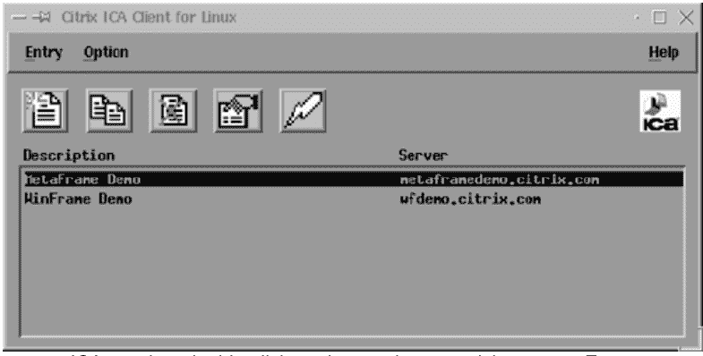

要打开`ICA`会话，请双击你想打开的会话。在需要时输入用户名和密码。然后`WinFrame`会打开一个窗口，其中包含`WinFrame`会话。

你也可以使用`Java`客户端在你的常用浏览器中加载会话。目前，唯一正确支持`Java`客户端的浏览器是`Netscape`。当你连接到服务器时，会下载一个`Java`小程序，`WinFrame`会话在你的浏览器中启动。这允许没有客户端的`Linux`机器运行`WinFrame`会话，但它要慢得多，也不够稳定。用户必须等待`Java`小程序下载，一旦下载完成，它的速度也不如`ICA`客户端快。`Java`客户端也不够稳定，经常导致浏览器崩溃。

`WinFrame`还通过`Citrix UNIX`集成客户端支持`X11`。这是一个在服务器上加载的软件包，充当`X11`客户端。它允许`Linux`工作站使用`Linux`自带的`X11`服务器连接到`WinFrame`服务器。例如，要在`Server1`上启动`X11` `WinFrame`会话0，请键入：

```
xinit Server1:0
```

## 集成Linux和Windows

虽然这允许在不安装`ICA`客户端的情况下连接到`WinFrame`，但`UNIX`集成客户端不支持许多功能。例如，不支持多个服务器之间的负载均衡。其他功能如客户端驱动器映射、应用程序发布、持久缓存、压缩、COM端口映射和本地打印也不被支持。

除非有充分的理由不这样做，否则最好在所有需要连接`WinFrame`服务器的`Linux`和`Windows`机器上安装`ICA`客户端。这允许在所有客户端上实现`WinFrame`服务的全部功能。

#### 10.2.3 应用程序配置

由于`Windows`设计为单用户操作系统，在`WinFrame`服务器上安装应用程序需要额外配置才能将其用作多用户应用程序。例如，对于`Microsoft Office`，在服务器上安装该程序。然后，将用户配置文件复制到服务器上的用户主目录中。这些文件包括：`normal.dot`、`mailbox.pab`、`username.fav`、`username.prf`、`outlprnt`、`frmcache.dat`、`custom.dic`和`pptools.ppa`。接下来，编辑会话注册表中的`HKEY_CURRENT_USER`树，更改其查找配置文件的位置。你也不得不禁用`Fastfind`功能，因为`Office`会为每个用户打开一个新的`Fastfind`会话，这将迅速耗尽所有服务器资源。

`WinFrame`环境中还存在其他独特的问题。例如，许多功能需要对系统根目录具有写入权限才能工作。系统根目录是安装`Windows`系统文件的目录，通常是服务器上的`c:\winnt`或`c:\winframe`目录。需要系统根目录写入权限的一个功能是在`Office`文档中打开嵌入式`Web`链接。如果没有系统根目录的写入权限，用户会收到一条消息，告诉他们运行`scandisk`或重新安装`Internet Explorer`。作为管理员，你需要决定使用这些功能是否重要到足以授予用户对所有系统文件的完全访问权限。

这并非旨在全面介绍在`WinFrame`服务器上设置应用程序所涉及的所有问题，但应该能让你了解其中的复杂性。从好的方面来说，一旦设置完成，管理`WinFrame`服务器比管理多台客户机要容易得多。

#### 10.2.4 成本

虽然`WinFrame`是运行`Windows`应用程序的好方案，但它并不便宜。给出的价格是建议零售价。你的实际价格可能有所不同。

第一项支出是购买`NT Server`。这约为1,200美元（10用户许可），每增加一个用户约35美元。然后你必须为每台使用的PC购买一份`Windows`。对于`Linux`客户端，你必须购买`Windows NT`许可（约270美元）才能在`Windows NT`服务器上使用。

`WinFrame`或`MetaFrame`服务器的价格为5,000美元（15用户服务器），每增加一个许可约200美元。应用程序的成本各不相同。`Microsoft Office`基础版本的价格为每用户280美元。

因此，一个50用户的网络成本为：50用户许可的`NT Server` 2,600美元。50个客户端许可为13,500美元，50用户的`WinFrame`许可为12,000美元。最后，50份`Microsoft Office`的成本为14,000美元。这使得我们假设的50用户网络成本为42,100美元，还不包括硬件成本。幸运的是，`WinFrame`客户端甚至可以在低端的386硬件上运行，因此通常不需要硬件升级。你还能节省支持成本，因为集中管理使支持更容易（`http://www.citrix.com/paypal qualifiers.com`）。

### 10.3 VNC

## 整合 Linux 和 Windows

虚拟网络计算（`VNC`）允许在一台机器上运行的程序在另一台机器上显示，它适用于`Linux`和`Windows`。它在`GNU`公共许可证（`GPL`）下分发，因此与`Linux`一样，它是免费且开源的。它与`X11`和`Citrix`类似，但存在一些差异。

`VNC`由两个组件组成：一个是在一台机器上运行程序的服务器，另一个是在另一台机器上显示程序的查看器。它适用于`Linux`、`Windows`和大多数其他操作系统。甚至还有适用于`Windows CE`和`Java`的查看器。查看器非常小（`Win32`查看器为150k），不需要安装，这意味着它可以轻松地从软盘运行！

不过，服务器之间存在一些差异。`Linux`和`UNIX`服务器是多用户的。这意味着多台机器可以在服务器上打开独立的会话。然而，`Windows`服务器仅允许单个会话。不过，它允许多个用户登录到一个会话。`Windows`不是真正的多用户操作系统。如果您需要打开多个会话，请使用`Citrix WinFrame`。

与`X11`相比，`VNC`的一个优势是查看器中不存储任何状态。这是一种委婉的说法，表示如果您断开连接，可以重新连接而不会丢失任何内容。这对于调制解调器连接和不可靠的网络来说是一个福音。

`VNC`也比`X11`使用更少的带宽。有一些设置可用于针对低带宽和高带宽连接优化`VNC`，这将在后面讨论。经过适当优化的`VNC`会话甚至可以在拨号连接上良好工作！

#### 10.3.1 安装适用于 Linux 的 VNC 服务器

要安装`VNC`，请从`http://www.uk.research.att.com/vnc`下载软件包。`Linux`安装包含四个程序：

- `Vncviewer`— 这是用于`X-Windows`的`VNC`查看器或客户端程序。

- `Vncserver`— 这是一个包装脚本，使启动`X-Windows` `VNC`服务器（即桌面）更加方便。它是用`Perl`编写的，因此要使用此脚本，您需要安装`Perl`。

- `Vncpasswd`— 此程序允许您更改用于访问`X-Windows` `VNC`桌面的密码。当您首次启动`VNC`服务器时，`vncserver`脚本会使用此程序。

- `Xvnc`— 这是`X-Windows` `VNC`服务器。它既是`X-Windows`服务器，也是`VNC`服务器。您通常使用`vncserver`脚本来启动`Xvnc`。

将这些文件复制到`/usr/local/bin`，然后就可以开始使用了。`vncserver`是一个脚本文件（用`Perl`编写），如有需要可以编辑。只有在软件包不在正常位置时才需要编辑。例如，如果您的`Perl`程序不在`/usr/bin`目录中，您可能需要编辑第一行`/usr/bin/perl`。您还可能需要在标记为"Add font path and color database"（添加字体路径和颜色数据库）的部分添加字体路径和颜色数据库路径。


完成此操作后，输入`vncserver`启动 VNC 服务器。第一次运行时，系统会提示您输入密码。这是查看器连接 VNC 服务器时必须输入的密码。您以后可以随时使用`vncpasswd`程序更改密码。

您可以根据需要打开任意多个 VNC 服务器会话。默认情况下，它将占用第一个可用的 X11 会话。X11 的第一个显示是 0，因此第一个 VNC 服务器会话将是 1。您也可以指定要使用的会话编号。例如，要使用会话 2，请输入`vncserver :2`。您可以通过输入`vncserver -kill :<session number>`来终止服务器。

VNC 服务器有多个命令行参数。输入`vncserver -help`可以显示这些参数。以下是参数的含义（来自 VNC 文档）：

- `-name <name>`— 每个桌面都有一个名称，查看器可能会显示该名称。默认为 "X"，但您可以使用此选项更改它。
- `-geometry <widthxheight>`— 指定要创建的桌面大小。默认为 1024x768。
- `-depth <depth>`— 指定要创建的桌面的像素深度（以位为单位）。默认为 8。
- `-pixelformat <format>`— 指定服务器使用的像素格式（BGRnnn 或 RGBnnn）。
- `-kill <number>`— 终止指定的会话编号。

您还可以从命令行向`Xvnc`程序传递参数。`Xvnc`是实际的 VNC 服务器程序。`Xvnc`与 X11 非常相似，甚至使用许多相同的命令。您可以传递给`Xvnc`的参数如下（同样来自 VNC 文档）：

- `-alwaysshared`— 始终将新客户端视为共享（即忽略客户端的共享标志）。
- `-nevershared`— 从不将新客户端视为共享（即忽略客户端的共享标志）。
- `-dontdisconnect`— 当新的"非共享"连接进入时，不要断开现有客户端的连接。相反，新连接将被拒绝。新的"共享"连接仍按正常方式允许进入。
- `-localhost`— 仅允许来自同一台计算机的连接。这在使用 SSH 并且希望阻止来自任何其他主机的非 SSH 连接时非常有用。请参阅有关将 VNC 与 SSH 结合使用的指南。
- `-cc n`— 设置服务器使用的视觉类别颜色。某些 X-Windows 应用程序对 8 位深度的`Xvnc`通常使用的 TrueColor 视觉处理得不太好。您可以通过指定`-cc 3`使服务器使用 PseudoColor 视觉。
- `-economictranslate`— 当查看器请求与服务器使用的原生格式不同的格式时，服务器通常使用查找表来转换像素值。每个连接的查看器最多可使用 256KB，因此如果您有很多查看器，您可能希望指定此选项，这样可以节省内存，但会牺牲一点速度。这仅与 16 位深度的桌面相关。

服务器启动后会运行`~/.vnc/xstartup`。这是您更改窗口管理器的地方。默认的窗口管理器是 twm，它小巧快速，但非常简陋。例如，要切换到 KDE，请将`twm &`这一行改为`startkde &`。服务器还会在`~/.vnc`目录中写入日志文件。这些文件在调试 VNC 时非常有用。

## 10.3.2 使用适用于 Linux 的 VNC 查看器

要使用 VNC 查看器，请键入以下命令：`vncviewer <machine name>:<session number>`。例如，要连接到 mmccune 机器上的会话 2，请键入`vncviewer mmccune:2`。您也可以使用 IP 地址代替机器名称，如：`vncviewer 10.0.0.1:2`。然后系统会提示您输入密码。输入密码后，您应该会看到如图 10.2 所示的远程显示。

### 图 10.2. 在 Linux PC 上使用 VNC 接管 Windows 桌面。

查看器启动后，您可以按 `<F8>` 键弹出一个弹出窗口。弹出窗口出现后，您可以向服务器发送 `<CTRL>` `<ALT>` `<DEL>` 等按键命令。命令发送后，弹出窗口将关闭。您还可以使用弹出窗口进入和退出全屏模式、向剪贴板和从剪贴板传输数据，甚至退出查看器。

全屏模式允许远程窗口占据整个屏幕，不带菜单和滚动条。如果远程屏幕和本地屏幕设置为相同的分辨率，这尤其有用。

关于全屏模式有一点需要注意：并非所有窗口管理器都支持全屏模式。如果您需要全屏模式，最好以全屏模式启动查看器。有许多命令行选项可用于自定义 VNC 查看器。输入`vncviewer -h`将显示这些选项的列表。这些选项如下（来自文档）：

- `-shared`— 当您连接到 VNC 服务器时，所有其他现有连接通常会关闭。此选项请求保持它们打开，允许您与正在使用桌面的人共享桌面。
- `-display <Xdisplay>`— 指定 VNC 查看器窗口应出现的 X-Windows 显示。
- `-passwd <password-file>`— 如果您所在的文件系统允许您访问服务器使用的密码文件，您可以在这里指定它以避免输入密码。通常是`~/.vnc/passwd`。
- `-viewonly`— 指定不应将键盘或鼠标事件发送到服务器。如果您想无干扰地查看桌面，这很有用。它通常需要与`-shared`结合使用。
- `-fullscreen`— 以全屏模式启动。
- `-geometry <geometry>`— 标准的 X-Windows 位置和大小规范。
- `-bgr233`— 告诉 VNC 服务器仅发送八位深度的像素。如果您的服务器桌面深度超过此值，那么在发送之前会转换像素。通过网络发送的数据通常会较少，这在慢速连接上可能是一个很大的优势，但服务器可能需要更辛苦地工作，并且可能会出现一些颜色不匹配。bgr233 表示八位 TrueColorPixel 格式，每个字节中最高有效两位代表蓝色分量，接下来的三位代表绿色，最低有效三位代表红色。此格式也由 Java 客户端使用。
- `-encodings <encodings>`— 此选项按优先顺序指定要使用的编码列表，用空格分隔。默认为`copyrect hextile corre rre`，或者对于同一台机器上的 VNC 服务器为`raw copyrect hextile corre rre`。例如，要仅使用 raw 和 CopyRect，请指定`raw copyrect`。
- `-owncmap`— 尝试使用 PseudoColor 视觉和私有颜色映射。这允许 VNC 服务器控制颜色映射。
- `-truecolour`— 尝试使用 TrueColor 视觉。
- `-depth <d>`— 这仅在支持多种 TrueColor 深度的（真实）X-Windows 服务器上有用。在这样的显示器上，VNC 查看器将尝试找到给定深度的视觉。如果成功，将从 VNC 服务器请求适当的像素格式。您不能使用此选项来强制 VNC 服务器使用特定深度。唯一能做到这一点的选项是`-bgr233`。
- `-listen`— 导致 VNC 查看器在端口 5500+<显示编号> 上监听来自 VNC 服务器的反向连接。目前，WinVNC 是唯一支持反向连接的服务器。这是通过 Add New Client 菜单选项实现的。它还用于我们内部版本的 VNC（参见 http://www.uk.research.att.com/vnc/internalversion.html）。

您也可以使用 VNC 查看器命令行选项来修改 X11 资源。您可以通过输入`vncviewer -xrm`来查找这些选项。这些选项很少使用，但如有需要，它们确实存在（来自 VNC 文档）：

- `shareDesktop`（`option -shared`）— 是否保留其他查看器的连接。默认为 false。
- `viewOnly`（`option -viewonly`）— 阻止鼠标和键盘事件。默认为 false。
- `fullScreen`（`option -fullscreen`）— 全屏模式。默认为 false。
- `passwordFile`（`option -passwd`）— 从中获取密码的文件（由`vncpasswd`程序生成）。默认为 null，即向用户请求密码。
- `passwordDialog`— 是否使用对话框获取密码（true），或从 tty 获取（false）。如果设置了`passwordFile`，则此选项无关。默认为 false。
- `encodings`（`option -encodings`）— 按优先顺序使用的编码列表，以空格分隔。默认为 null，实际意味着`copyrect hextile corre rre`或对于同一台机器上的 VNC 服务器为`raw copyrect hextile corre rre`。
- `useBGR233`（`option -bgr233`）— 始终在线路上使用 BGR233（八位）像素格式，而不考虑视觉类型。默认为 false（尽管对于非真彩色视觉且`forceOwnCmap`为 false 时，仍会使用 BGR233）。
- `nColours`— 使用 BGR233 时，尝试从 BGR233 颜色立方体中分配这么多"精确"颜色。使用共享颜色图时，将此资源设置得更低会为其他 X-Windows 客户端留下更多颜色。使用真彩色时无关。默认为 256（即全部）。
- `useSharedColours`— 如果成功分配的"精确" BGR233 颜色数量少于 256，则使用可用的"最近"颜色填充其余部分。此资源说明是否仅为此目的使用"精确" BGR233 颜色，还是同时使用其他客户端的"共享"颜色。默认为 true（即使用其他客户端的颜色）。
- `forceOwnCmap`（`option -owncmap`）— 尝试使用伪彩色视觉和私有颜色图。这允许 VNC 服务器控制颜色图。默认为 false。
- `forceTrueColour`（`option -truecolour`）— 尝试使用真彩色视觉。默认为 false。
- `requestedDepth`（`option -depth`）— 如果`forceTrueColour`为 true，则尝试使用此深度的视觉。默认为 0（即任何深度）。
- `useSharedMemory`— 在与 X-Windows 服务器同一台机器上时，是否使用 MIT 共享内存扩展。默认为 true。
- `wmDecorationWidth`、`wmDecorationHeight`— 窗口管理器装饰占用的总宽度和高度。这用于计算 VNC 查看器窗口的最大尺寸。默认为宽度 4，高度 24。
- `bumpScrollTime`、`bumpScrollPixels`— 在全屏模式下且 VNC 桌面大于 X-Windows 显示时，每当鼠标到达屏幕边缘时就会发生滚动。最大滚动速度为每`bumpScrollTime`毫秒`bumpScrollPixels`像素。当然，实际滚动速度会慢于此，具体取决于您的机器速度。默认为每 25 毫秒 20 像素。
- `popupButtonCount`— 弹出窗口中的按钮数量。请参阅下文了解如何自定义按钮。
- `rawDelay`— 这对于通过准确检查屏幕的哪些部分正在更新来调试 VNC 服务器很有用。对于每个更新矩形，VNC 查看器会在显示像素数据之前，将黑色矩形显示给定的时间（以毫秒计）。这仅突出显示使用原始编码发送的像素数据。默认为 0（即不执行此操作）。
- `copyRectDelay`— 类似于`rawDelay`，但突出显示使用 copyrect 编码复制的区域。

## 10.3.3 安装适用于 Windows 的 VNC 服务器

VNC 服务器适用于任何 32 位版本的 Windows，例如 Windows 95/98、NT 和 2000。对于 NT，必须安装 Service Pack 3 或更高版本。

首先，将文件解压到本地驱动器上的某个目录并运行`setup`。设置完成后，使用"开始 -> 程序 -> VNC -> 管理工具"菜单安装默认注册表设置。这将修改一些注册表设置以帮助 VNC 更好地运行。

管理工具中有一个图标允许您启动 VNC 服务器。您可以将 VNC 作为应用程序或服务运行。应用程序位于"开始 -> 程序 -> VNC"文件夹中。

不过，最好将 VNC 作为服务运行。为此，请转到"管理工具"菜单并选择"Install WinVNC service"。您也可以从命令行安装它，方法是输入：

```
c:
cd \Program Files\ORL\VNC
winvnc -install
```

第一次运行服务器时，它会要求输入密码。这将是所有连接到 VNC 服务器的人使用的密码。目前无法为 VNC 服务器设置多个用户或密码。

VNC 服务器运行后，它会在系统托盘添加一个 VNC 图标。右键单击此图标将显示以下菜单：

- **Properties**— 这将显示属性对话框，允许用户更改各种 WinVNC 参数。请参阅下文了解不同的参数。
- **Add New Client**— 这允许从服务器向任何"监听"查看器发起传出连接。可以在对话框中输入目标查看器计算机的名称。以这种方式创建的连接自 3.3.3R2 起被视为共享连接。另请参阅下面的`-connect`选项。
- **Kill All Clients**— 这将断开所有当前连接的客户机与服务器的连接。
- **About WinVNC**— 这应该是显而易见的！
- **Close**— 关闭服务器。

将鼠标移到图标上时会显示本地机器的 IP 地址。在属性下，您可以找到（来自 VNC 文档）：

- 传入连接：
  - **Accept Socket Connections**— 服务器通常接受来自`vncviewer`程序的直接、基于套接字的连接。清除此复选框将禁用与 WinVNC 的直接连接，以便只有我们内部版本使用的 CORBA 接口可用于启动连接。对于公共版本，清除此选项将禁用任何传入连接。
  - **Display Number**— 这允许用户指定服务器将使用的显示编号。通常无需将其从默认值 0 更改。
  - **Auto**— 此复选框指示 WinVNC 应使用显示编号框中指定的显示编号，还是使用服务器计算机上尚未使用的第一个显示编号。
  - **Password**— 传入连接必须经过身份验证，以验证连接者是否被允许连接到此机器。此文本框允许指定用于身份验证的密码。
  - **Disable Remote Keyboard & Pointer**— 任何新的传入连接将能够查看屏幕，但无法发送任何输入。
  - **Disable Local Keyboard & Pointer**— 这是实验性的，仅适用于 NT。如果选中，连接期间本地键盘和鼠标将被禁用。如果您想从其他地方登录到某台机器，并且不希望路人能够使用您的会话，这会很有用。
- **Update Handling**— 仅在您的应用程序更新屏幕有问题时使用这些设置。更改这些设置通常会降低屏幕更新速度。这些设置将在下次启动 VNC 服务器时生效（同样来自文档）：
  - **Poll Full Screen**— 某些应用程序与 WinVNC 当前用于捕获屏幕更新的方法不兼容。因此，有时能够轮询整个屏幕以检查变化很有用，牺牲性能以换取准确性。
  - **Poll Foreground Window**— 仅轮询当前选定的窗口以查找变化，比全屏轮询消耗更少的 CPU，并且通常会给出类似的结果；例如，在使用通常与 WinVNC 不兼容的命令提示符时。
  - **轮询光标下的窗口**——这是"轮询前台窗口"的一个变体，该选项会对鼠标光标下的窗口进行变更轮询。如果需要，这两个选项可以同时启用。
  - **仅轮询控制台窗口**——设置此选项后，只有命令提示符窗口会被轮询。这与"轮询光标下的窗口"配合使用效果很好，可以仅在光标位于控制台窗口上方时才进行轮询。
  - **仅在收到事件时轮询**——设置此选项后，只有在收到远程客户端的鼠标或键盘事件时才会轮询屏幕更新。此选项适用于低带宽网络，在这类网络中，控制屏幕轮询和变更发送的频率可能很有用。

以上设置几乎适用于所有情况。对于特殊场景，还有一些命令行选项和注册表设置可供配置。http://www.uk.research.att.com/vnc/winvnc.html 上的文档详细说明了这些高级设置。

## 10.3.4 安装 Windows 版 VNC Viewer

Windows 版 VNC 查看器可以通过命令行或菜单启动：开始 -> 程序 -> VNC -> Run vncviewer。首次启动时，你会看到以下界面（参见图 10.3）：

**图 10.3. 启动 Windows 版 VNC 时，会要求输入服务器名称。**

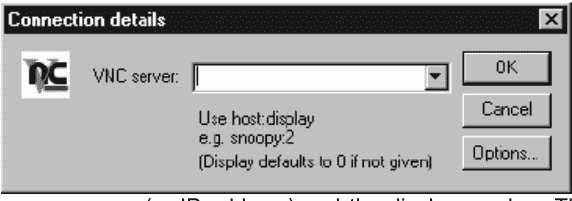

填写 VNC 服务器名称（或 IP 地址）和显示编号。还有一个选项框，如图 10.4 所示。

**图 10.4. VNC 选项框。**

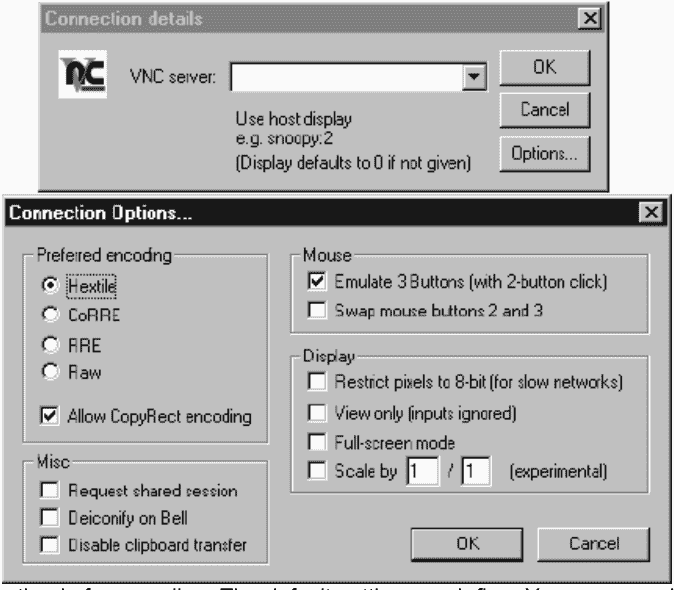

第一个选项用于编码。默认设置即可正常工作。如果你想尝试不同的编码方式看看是否更快，可以自行调整。

鼠标选项用于通过同时按下双键鼠标的两个键来模拟三键鼠标，以及交换第二和第三个按钮。如果你使用的是双键鼠标，请开启三键模拟。Linux 系统中的中键是剪切和粘贴键。

显示选项默认是关闭的。如果你的连接速度较慢（如调制解调器），可以开启 8 位显示（256 色）。其余选项基本一目了然。

**杂项**选项基本一目了然，除了**收到铃声时还原窗口**选项。此设置允许显示蜂鸣声音，并且在收到铃声时会打开 VNC 查看器窗口。这是通知用户收到邮件或其他重要事件的好方法。

要进行连接，请输入服务器名称（或 IP 地址）和会话编号，然后点击确定。系统会提示你输入密码。

连接成功后，你会看到一个包含 xterm 会话的桌面窗口。点击左上角的 VNC 标志即可弹出如[图 10.5](#)所示的菜单。


## 图 10.5 使用 Windows 版 VNC 在远程 Linux 机器上打开会话

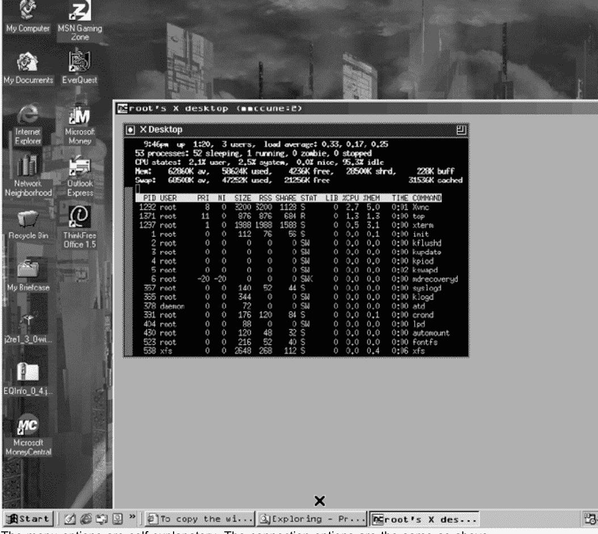

菜单选项一目了然。连接选项与上面相同。其中一个选项允许你向服务器发送击键。还有一些选项允许你打开新的连接或将连接信息保存为文件。这会保存所有当前设置，以便在其他会话中使用。一旦你将设置调整为所需状态，使用此选项即可保存。

与 Linux 版查看器一样，Windows 版查看器也提供了许多命令行选项。以下列出（摘自 VNC 文档）：

- `-shared`——当你连接到 VNC 服务器时，通常会关闭所有其他现有连接。这是出于安全考虑，也因为我们通常将 VNC 视为移动办公工具——你的桌面可以随你四处移动。此选项要求服务器保持现有连接打开，允许你与已在使用桌面的用户共享桌面。某些服务器提供了更改默认行为和覆盖此请求的选项。
- `-8bit`——查看器通常会接受服务器提供的任何像素格式并在本地进行转换。此选项强制查看器向服务器请求 8 位真彩色（BGR233），从而减少网络流量。这在通过调制解调器连接时很有用。
- `-config file`——你可以使用菜单中的命令将已打开连接的所有详细信息保存到文件中。之后，你可以通过此开关指定文件名来重新启动该连接。
- `-register`——此选项告知 Windows 外壳程序将 `.vnc` 文件与 VNC 查看器关联。之后你就可以双击这些文件来启动会话。有时 Windows 似乎需要重启才能使此设置生效。
- `-scale n/mw`——指定本地显示的缩放因子。`n` 和 `m` 应为整数。如果 `m=1`，可以省略 `/` 和 `m`。
- `-emulate3`——使用双键鼠标的用户可以通过在命令行或对话框中启用此选项，同时按下两个键来模拟中键。注意：在较新版本的查看器中，此选项为默认开启，因此现在提供了 `-noemulate3` 选项来关闭它。
- `-noemulate3`——与 `-emulate3` 相反。
- `-swapmouse`——此选项在三键模拟功能出现之前使用较为普遍。通常，PC 的左-中-右键分别映射到 X 的第 1、2、3 个按钮。此开关会将按钮映射为 1、3、2，这对只有左右键的双键鼠标用户可能更有用，因为他们将获得第 1 和第 2 个按钮，而非第 1 和第 3 个。如果与三键模拟结合使用，此选项还会使中键模拟第 3 个按钮而非第 2 个。如果你更常用第 2 个按钮，这可能会很有用。
- `-emulate3timeout`——使用三键模拟时，两个鼠标按键必须在一定时间间隔内同时按下，才会被识别为一次中键单击，而非分别的左键和右键单击。此选项允许以毫秒为单位指定该时间间隔。默认值为 100。
- `-emulate3fuzz`——使用三键模拟时，两个鼠标按键必须在一定距离内同时按下，才会被识别为一次中键单击。此选项允许以像素为单位指定该距离。默认值为 4。
- `-fullscreen`——此选项使连接默认以全屏模式启动。详见下文。
- `-listen`——在 AT&T Labs Cambridge 使用的 VNC 内部版本中，服务器可以在 CORBA 控制下主动连接客户端。此开关将 VNC 查看器设置为监听模式，使其能够接受这些连接。但它还有一个有用的副作用，这可能对使用公共版本的非 AT&T 用户也有所帮助。处于监听模式的 VNC 查看器不会弹出连接对话框，而是将自身安装在系统托盘中。从那里，你可以轻松启动新的连接，并为当前程序实例设置默认选项。此外，最新版本的 WinVNC 可以通过“添加新客户端”菜单选项主动连接到查看器。要使此功能正常工作，查看器必须处于监听模式。
- `-disableclipboard`——在查看器或服务器端进行剪切或复制操作引起的剪贴板变更通常会传输到另一端。此选项会禁用剪贴板传输。
- `-belldeiconify`——VNC 允许传输“铃声”字符，如果查看器具有声音功能，则会发出蜂鸣声。你可以在控制面板的“声音”部分的 VNCviewer 区域中设置铃声使用的音效。蜂鸣声通常是因为收到了某些通知，如邮件到达或编译完成。此开关会在收到铃声字符时，将最小化的 VNC 查看器恢复显示。
- `-nocursor`、`-dotcursor`、`-normalcursor`——大多数 VNC 服务器将其光标作为显示在查看器中的屏幕图像的一部分发送。在此之外再显示一个本地光标可能会造成干扰。默认情况下，查看器使用一个小圆点来显示本地光标的位置，这是我们推荐的使用方式。你可以使用 `-nocursor` 选项完全关闭本地光标，或使用 `-normalcursor` 保持默认的 Windows“箭头”光标。需要注意以下几点：当你按下鼠标按键时，使用的是本地鼠标位置来发送事件。在慢速网络上，远程光标可能会稍微滞后于本地光标。你不需要等它跟上再点击，但如果你关闭了本地光标显示，就更难确切知道点击的位置了！基于 X 的服务器有一个选项可以设置不显示光标，这在慢速网络上特别有用。但是，这样光标就永远不会改变形状——始终是箭头。我们还是最喜欢默认的小圆点。
- `-keyboard <kbdname>`——Windows 使用一个内部名称（不太直观）来表示当前为应用程序选择的键盘布局。你可以在查看器窗口的系统菜单中选择“连接信息”来查看 VNC 查看器正在使用的键盘布局。如果你更改了键盘设置并记录下来，可以在命令行中指定它，使 VNC 查看器在将来尝试加载该布局。请注意，VNC 查看器目前不支持“死键”，语言和键盘之间的差异容易混淆，且 Windows 95 和 NT 的处理方式也不同。但这可能会有所帮助。
- `-logfile <filename>`——VNC 查看器（R6 及更高版本）具有日志机制，可以将一些调试信息保存到文件或显示在控制台上。此选项指定要写入日志的文件名。
- `-loglevel <n>`——此选项控制发送到日志文件的信息量。默认值为 0，较高的值（最高约 12）会提供更详细的信息。
- `-console`——此选项会使调试信息发送到控制台窗口，可以与文件日志并用，也可以替代文件日志。
- `-viewonly`——在只读模式下，不会向服务器发送鼠标或键盘事件。这在教学场景或其他需要观察但不希望干扰的情况中很有用。
- `-restricted`——在受限模式下，菜单中的大部分项目会被移除，这样用户就无法向远程端发送 `<CTRL>-<ALT>-<DEL>` 等操作。

### 10.3.5 Java VNC Viewer

如果你有一个支持 Java 的浏览器，你甚至不需要安装 VNC 查看器。Netscape、Internet Explorer 和许多其他浏览器都支持 Java。所有 VNC 服务器都内置了一个小型 Web 服务器，可以向客户端浏览器提供 Java 小程序。

## Linux 与 Windows 的集成

Web 服务器运行在 58xx 端口，其中 xx 为显示编号。例如，要连接服务器 mmccune 上的显示 2，请访问以下网页：

[http://mmccune:5802](http://mmccune:5802)

小程序下载完成后，浏览器将显示一个 VNC 会话。如果连接的是 Linux 服务器，还需要在 `vncserver` 脚本中指定类文件的位置。Windows 服务器则已将其内置到服务端中。

缺点是，Java 查看器不如独立查看器快，也不如它稳定。你可以尝试不同的编码方案，看看是否对速度有影响。

### 10.3.6 VNC 优化

Linux 版本的 VNC 服务器比 Windows 版本快得多。这是因为可以访问源代码，使得 Linux 版本的 VNC 能够得到更好的优化。Windows 没有随手可得的源代码，因此优化程度较低。

不过，VNC 服务器仍有一些优化措施可以采取。如果 Windows VNC 服务器的负载接近 100%，请检查“Poll Full Screen”、“Poll Foreground”或“Poll Windows Under Cursor”是否开启。如果不需要这些功能，请将其关闭。如果必须开启其中某项，可以开启“Poll Console Windows Only”以降低 CPU 使用率。

所有 VNC 系统还有一些通用的优化措施。如果 VNC 运行速度过慢，请尝试以下步骤来提高性能：

- **清理桌面** — 桌面内容繁杂、色彩丰富且图形众多时，更新会更慢。移除任何不需要的背景或额外图形。
- **降低分辨率** — 降低桌面分辨率。如果有 16 位或 8 位 800 x 600 就能满足需求，就不要使用 1280 x 1040、24 位的桌面。这在调制解调器连接时尤为重要。
- **升级显卡** — 在查看器机器上升级较旧的显卡，将大大提高屏幕更新速度。
- **升级应用程序** — 一些较旧的应用程序屏幕更新速度较慢。例如，某些较旧版本的 Netscape 在滚动时会更新两次屏幕。
- **优化 Java** — 某些设置可以大大提高屏幕更新速度。尝试不同的设置以找到最佳方案。
- **关闭轮廓拖拽** — 使用 Windows 查看器时，在窗口管理器设置中关闭此功能。大多数情况下，此项默认已关闭。如果已启用，请参阅 Linux 文档了解如何操作，因为不同设置的操作方式有所不同。
- **使用安全 shell (SSH)** — SSH 可以压缩数据，从而提高慢速连接的速度。SSH 的设置在第 16 章中说明。VNC 与 SSH 配合使用的设置在本章后面说明。

### 10.3.7 VNC 安全性

VNC 对密码进行加密，但会话启动后便不再加密。尽管未加密，但截获 VNC 会话仍比截获 telnet 或 X11 会话要困难。如果需要更高的安全性，添加起来相对容易，因为 VNC 使用单一的 TCP/IP 套接字。有多个软件包可以为 VNC 增加安全性，例如安全 shell (SSH)、SSLeay、SOCKS 和 TCP Wrappers。

SSH 几乎可以为任何 TCP/IP 服务添加加密功能。SSH 的安装已在前面章节中介绍。它包含客户端和服务器两部分。要在 VNC 中使用 SSH，请在 VNC 服务器所在机器上运行 SSH 服务器（`sshd`），在 VNC 查看器所在机器上启动 SSH 客户端，然后启动 VNC 查看器。

SSH 客户端的语法看似复杂，但拆分后便容易理解。连接到 mmccune 上会话 1 的语法为：

```bash
ssh -L 5902:mmccune:5901 mmccune
```

这看起来复杂，但分解后便清晰了。`ssh` 是 SSH 客户端，`-L` 表示本地机器，`5902` 是本地机器的端口号，`mmccune:5901` 是 mmccune 上的端口号，最后 `mmccune` 是远程 SSH 主机。

因此，这将本地端口 5902 重定向到 `mmccune` 上的端口 5901。要启动安全的 VNC 会话，我们在本地机器上打开 VNC 客户端的 5202 端口（会话 2）。这将被重定向到 mmccune 上的 5901 端口（会话 1）：

```bash
vncviewer localhost:2
```

如果在命令行中添加 `-c` 选项，SSH 还支持压缩。这在调制解调器等慢速连接上尤为重要。你也可以在配置选项中添加压缩。这些及其他选项在 SSH 章节中有详细说明。另一个稍后使用的开关是 `-g`，它允许远程主机连接到本地端口转发的端口。

现在，让我们用 SSH 做一些更复杂的操作。假设我们有两个安全网络，通过一个不受保护的互联网连接相连。在这个网络的每一侧，我们都有 Windows 工作站。我们在互联网连接的每一侧都有一台运行 SSH 的 Linux 机器。我们在第一个网络上的 Windows 机器（Windows1）运行 VNC 客户端，连接到第二个网络上 Windows 机器（Windows2）的 VNC 服务器。

```text
Windows1 -> 本地网络 1 -> Linux1 -> 互联网连接 -> Linux2 -> 本地网络 2 -> Windows2
```

各机器的设置如下：

- **Windows1** — 运行 `vncviewer Linux1:1`。
- **Linux1** — 运行 `ssh -g -L 5901:windows2:5900 linux2`。
- **Linux2** — 运行 SSH 服务器 `sshd`。
- **Windows2** — 运行 `vncserver display 0`。

Windows1 上的 VNC 查看器连接到 Linux1，Linux1 通过 SSH 将数据包转发到 Linux2。Linux2 再将数据包转发到 Windows2。

这与虚拟专用网络 (VPN) 类似，VPN 只是通过不安全的公共网络（如互联网）发送加密的数据包。它不会提供 VPN 的所有功能；但使用 SSH 通常就能满足需求。

Ray Jones 的 SSLeay (SSL) 为 VNC 添加了 SSL 加密代码。他的补丁区域可在 http://web.mit.edu/thouis/vnc/ 找到。要使用此选项，必须用这些补丁重新编译 VNC 代码，并安装 SSL 库。此代码未经充分测试，因此不推荐用于生产环境。

SOCKS 允许 VNC 通过防火墙上的标准 SOCKS 端口工作。VNC 的补丁可在 http://www.uk.research.att.com/vnc/contrib/socks-patch.txt 找到。同样，这必须编译到代码中，并且您还必须确保

[http://www.uk.research.att.com/vnc/contrib/rvnc.txt](http://www.uk.research.att.com/vnc/contrib/rvnc.txt) 帮助运行 VNC 通过防火墙。

TCP Wrappers 允许机器限制哪些 IP 地址可以连接到它。二进制文件和源代码可在 [ftp://wik.res.cmu.edu/pub/vncip_bin.zip](ftp://wik.res.cmu.edu/pub/vncip_bin.zip) 和 [http://wik.res.cmu.edu/pub/vncip_src.zip](http://wik.res.cmu.edu/pub/vncip_src.zip) 找到。文件安装后，必须编辑 `iplist.txt` 文件以允许或拒绝 IP 地址。格式如下所示：

```text
allow IP address
deny IP address
deny all
```

`deny all` 将拒绝除本地主机外的所有主机。

还有许多其他的 VNC 附加组件。完整列表请访问 [http://www.uk.research.att.com/vnc/extras.htm/](http://www.uk.research.att.com/vnc/extras.htm/)。

### 10.4 结论

本章介绍了多种在一台机器上运行程序并在另一台机器上显示的方法。这种设置允许您在不同的平台上运行程序，还可以集中管理应用程序，便于维护和升级。

# 第 11 章 Windows 和 Linux 网络简介

- 第 11.1 节 NetBIOS
- 第 11.2 节 TCP/IP 和 Active Directory
- 第 11.3 节 基于 TCP/IP 的 NetBIOS

## 11.1 NetBIOS

Windows 和 Linux 源自不同的发展背景，因此采用不同的网络方式。Windows 根植于 DOS，使用 NetBIOS 作为其原生协议。Windows 2000 正在用 Active Directory 取代 NetBIOS，但 Linux 仍使用从 UNIX 背景继承而来的 TCP/IP 协议。

幸运的是，这两种操作系统可以很好地配合。

微软最早实现的 NetBIOS 称为 NetBEUI。与其他技术一样，NetBEUI 有其优点和缺点。优点在于速度非常快，因为它是一个相对简单的协议。缺点在于它在超过约 20 台计算机的网络中表现不佳。原因有几个。NetBEUI 将数据包发送到本地网络上的所有计算机，因此大约十几台计算机后流量就会变得很重。它也不可路由，这意味着该协议仅在本地网络上有效。

Windows 网络多年来不断发展。最古老的方式是工作组模型。工作组只是一个逻辑上的计算机组。在工作组中，所有设备都可以与工作组其他成员共享目录和打印机等资源。共享由每台设备或计算机自行控制。这显而易见的局限是无法集中控制网络资源。后来，微软通过域模型纠正了这一点。

与工作组模型一样，域模型也是网络设备的逻辑分组。域的优势在于只需一次登录即可进入域。所有网络资源都有集中控制。每个域都有一个主域控制器和一个备份域控制器。域控制器的主要功能是跟踪用户名和密码。Windows 使用的域模型允许用户只需登录网络一次，但仍可使用整个网络的资源。还可以在多个域之间建立信任关系，以允许域之间共享资源。

## 11.2 TCP/IP 和 Active Directory

Windows 2000 将用 Active Directory 取代 NetBEUI 和域模型，Active Directory 将网络设备组织成层次树状结构。最好的类比是企业的组织架构。最高层是总裁，拥有对所有事务的权限。总裁之下是几位副总裁，副总裁之下是经理，然后是普通员工。Active Directory 树的工作原理相同（见图 11.1）。它允许集中控制网络设备，它还允许网络被划分为逻辑层次结构。

## Linux 与 Windows 的整合

## 图 11.1 一个 Active Directory 树示例。在本例中，它按地理区域划分


Active Directory 克服了 NetBEUI 的一些缺点。它不依赖广播数据包来执行大部分功能，因此网络可以处理超过 20 台主机。它也不需要 WINS 服务器，这将在后面讨论。由于 Active Directory 使用 TCP/IP，它是可路由的，因此可用于覆盖多个位置的大型网络。


`TCP/IP`是`Transmission Control Protocol/Internet Protocol`（传输控制协议/网际协议）的缩写。它最初是在`ARPANET`（`Advanced Research Projects Agency Network`，高级研究计划局网络）上开发的，而`ARPANET`正是互联网的前身。由于`ARPANET`上的大多数机器运行的是`UNIX`，因此`TCP/IP`主要是在`UNIX`机器上开发的。与`NetBIOS`不同，`TCP/IP`专为大型网络设计，并且是可路由的。`TCP/IP`不使用简单的名称，而是使用称为`IP`地址的32位数值。`IP`地址写成四组介于0到255之间的数字，用点分隔。`IP`地址的示例是`10.23.64.1`。`IP`地址中的第一个数字代表网络的类别。

根据规模大小，网络被划分为A类、B类和C类网络。A类网络最多可以有16,777,214台主机，B类网络可以有16,384台主机，C类网络可以有254台主机。

`IP`地址中的某些数字被保留用于特殊目的。数字0指当前网络或主机。数字127称为回环地址，用于诊断目的，数字255用于向整个网络广播数据包。

`TCP/IP`地址的另一部分是子网掩码。这可用于将一个网络划分为两个或多个子网。例如，在上述`10.23.64.1`网络中，子网掩码`255.255.0.0`不会划分网络，但子网掩码`255.255.240.0`会划分网络。子网掩码可能是`TCP/IP`中最复杂的部分，在这里解释它们会花费太多时间。详见[附录 A](http://www.ibm.com)，其中有关于子网掩码以及其他`TCP/IP`问题的更详细说明。

`IP`地址对机器友好，但对用户不太友好。大多数`IP`设备还有一个用户友好的名称，称为主机名。我们大多数人都在网站地址中见过这些主机名。例如，IBM的网站是[http://www.ibm.com](http://www.ibm.com)。与该网站关联的`IP`地址是`204.146.80.99`。与`IP`地址一样，主机名也是分层的。"www"代表Web服务器，"IBM"代表与IBM公司关联的域，"com"代表商业互联网站点。

将人类友好的名称转换为机器友好的`IP`地址的过程是使用`DNS`（域名服务，`Domain Name Service`）来完成的。`DNS`本质上是一个分层系统，用于查找与主机名关联的`IP`地址。当Linux机器获得一个主机名时，它首先查找文件`/etc/hosts`，这只是一个列出主机名和地址的文本文件。如果在这里找不到，它会查询主名称服务器。名称服务器维护一个主机名和`IP`地址的数据库。如果仍然找不到主机名，则会查询辅助名称服务器，然后是第三名称服务器。如果找不到主机名，将返回错误消息，如"unknown host"。这是对`DNS`的简化描述。后面会更详细地描述它。

`IP`标准多年来一直在变化。当前版本的`IP`是第4版，缩写为`IPv4`。下一版`IP`是第6版（`IPv6`），它比`IPv4`有几项改进。最显著的变化是`IPv6`将使用128字节而不是32字节的地址。互联网目前正在耗尽`IP`地址。当前的32字节`IP`地址将允许大约40亿个地址，但128字节`IP`地址将允许多得多。`IPv6`还内置了增强的安全性和诊断功能。有关`IPv6`的完整规范，请参见[http://www.ipv6.org](http://www.ipv6.org)。

### 11.3 基于 TCP/IP 的 NetBIOS

当然，Windows和Linux都有许多特性和程序允许它们相互交互。Windows和Linux机器都允许`NetBIOS`通过`TCP/IP`实现（称为`NetBT`）。这使它们能够使用共同的协议，但也带来了一些独特的问题。主要问题是`TCP/IP`主机名并不总能解析为`NetBIOS`名称。这个问题由`WINS`（Windows互联网名称服务器，`Windows Internet Names Server`）来解决。

`WINS`将`IP`主机名转换为`NetBIOS`名称。当使用`NetBT`的设备登录网络时，它会在`WINS`中注册其`NetBIOS`名称。如果该名称未被使用，则将其添加到`WINS`数据库中。然后，如果网络设备找不到`NetBIOS`名称，它会使用`WINS`来查找与该名称关联的地址。

如果`WINS`找不到它，设备仍然可以使用广播来尝试解析名称。大多数网络都有一个主`WINS`和一个辅助`WINS`。这是对`WINS`工作原理的简化解释。更详细的解释在附录A中。

还有一些程序允许Windows计算机使用`NFS`（网络文件服务，`Network File Services`）。`NFS`主要是UNIX机器用于在网络上共享文件的协议。它允许另一台机器上的目录被"挂载"，使其看起来像本地机器上的目录。

`LPR`（行式打印机，`Line Printer`）允许UNIX打印到远程机器。Windows NT和2000内置了对`LPR`的支持。还有一些适用于DOS和其他Windows版本的程序，允许它们也使用`LPR`。`NFS`和`LPR`将在后面的章节中介绍。

Linux还有一个程序允许它共享目录和打印机。`Samba`是一个允许非Windows系统模拟`SMB`（服务器消息块，`Server Message Block`）的程序，Windows使用`SMB`进行文件和打印共享。虽然`Samba`不支持所有Windows网络功能，但它可以将Linux系统变成一个独立的Windows文件服务器，还允许Linux使用Windows文件和打印机。本书接下来的两章专门介绍`Samba`，因为它是Windows和Linux之间连接最重要的工具之一。

## 第 12 章 Samba 简介

- 12.1 节 Samba 的起源
- 12.2 节 Samba 的工作原理

### 12.1 Samba 的起源

`Samba`是一组允许非Windows机器使用服务器消息块（`SMB`）网络的程序，而`SMB`是Windows 98和NT等Microsoft产品的本机网络协议。`Samba`由澳大利亚研究生`Andrew Tridgell`发起。他需要一种在他的UNIX机器和DOS PC之间共享文件的方法。他可以使用UNIX的本机网络——网络文件服务（`NFS`，后面会讨论），但他的DOS PC上已经运行了`NetBIOS`。由于他无法在DOS下同时加载`NetBIOS`和`NFS`，他决定对`SMB`进行逆向工程，并在他的UNIX机器上实现它，使他的UNIX机器对DOS PC来说看起来像一台PC服务器。

他于1992年在互联网上发布了他的代码。经过几次错误修复后，他将项目搁置一旁。几年后，他需要将他的Linux PC与他妻子的Windows PC连接起来。别无选择，他尝试了他的旧代码，令他惊讶的是，它居然有效。经过一些研究，`Andrew`发现`NetBIOS`和`SMB`至少名义上是有文档记录的。在他努力改进程序的过程中，他试图为它想一个名字。他将"SMB"输入到拼写检查器中，出现的第一个词是"Samba"。随着使用量的增长，`Samba`聚集了一整支程序员团队。它与大多数Linux发行版以及许多商业版本的UNIX（如`SGI`（前身为`Silicon Graphics Inc.`）的`IRIX`）捆绑在一起。

除了UNIX，还有适用于`VMS`、`MVS`、`OS/2`、`Stratus-VOS`、`Amiga`和`MPE/iX`（这些只是其他操作系统）的`Samba`版本。`Samba`已经发展成为一套完整的工具，实现了Microsoft Windows NT Server的大部分文件和打印共享功能。

与Linux一样，`Samba`也处于GNU公共许可证（`GPL`）之下。这意味着程序和自由用户修改源代码。免费使用和修改的唯一条件是，对程序的任何改进和修复都必须发布回公众。全球有数百万用户，无论是Linux还是`Samba`，都因许多用户的反馈和代码改进而迅速改进。

### 12.2 Samba 的工作原理

`Samba`使用基于`TCP/IP`的`NetBIOS`（`NetBT`）来提供四大`SMB`服务：文件和打印服务、身份验证和授权、名称解析以及服务通告（也称为浏览）。这些现在简要说明，本书后面会更详细地解释。

文件和打印服务是其中最重要的。它们允许Windows（和`Samba`）通过网络共享文件和打印机。这些服务最初就是局域网（`LAN`）存在的主要原因。

身份验证和授权使用登录名和密码允许授权用户访问网络。它们还限制每个用户在网络上的操作。文件和打印机可以按用户限制。文件还可以设置为只读，以防止意外更改。

名称解析包括将`NetBIOS`名称转换为`IP`地址（`NetBT`）。这在Windows网络上由Windows互联网名称服务器（`WINS`）完成。`Samba`可以执行`WINS`执行的大部分功能。

服务通告或浏览允许网络上的其他设备知道有哪些服务可用。服务列表保存在一台称为"主浏览器"的机器上。

## 整合 Linux 和 Windows

浏览器。”通过打开“网上邻居”可浏览该列表（参见[图 12.1](#)）。

## 图 12.1 “网上邻居”显示网络中的 SMB（Windows 和 Samba）计算机。

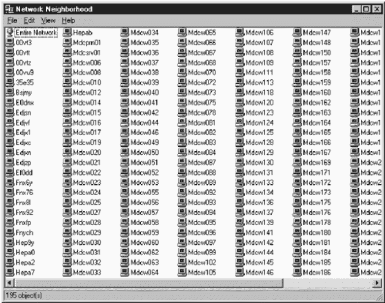

`Samba`几乎可以执行Microsoft Windows NT Server的所有功能。那么，在Windows网络中，`Samba`何时是一个好选择？

虽然`Samba`支持Windows主域控制器（`PDC`）的大部分功能，但备份域控制器（`BDC`）功能尚未支持。实现`BDC`服务的唯一方法是使用Windows NT Server。

此外，如果您已经拥有Microsoft `WINS`服务器，`Samba`无法与其交换数据。因此，如果您已经有一台Microsoft `WINS`服务器，并且需要再添加一台，那么请继续使用Windows NT。

这两个问题可能很快会通过轻量级目录访问协议（`LDAP`）解决，`LDAP`允许使用一个登录账户访问网络上的所有资源，此外还具有其他功能。Microsoft和Linux社区都正在将`LDAP`功能集成到他们的产品中。有关`LDAP`的更多信息，请参见[http://www.openldap.org](http://www.openldap.org)。

那么，为什么要在Windows网络中使用`Samba`呢？`Samba`与Linux结合使用，具有快速、稳定的特点，而且最重要的是，免费。Windows NT按用户数收费，一个十用户版的Windows NT Server大约需要$900。Linux和`Samba`不仅成本更低，而且可以在配置更低的硬件上运行。在旧的486或低端Pentium上安装Linux和`Samba`并不罕见。这对于运行一个小型部门服务器来说已经足够，而Windows NT服务器则需要性能高得多的计算机才能正常运行。

`Samba`也是混合UNIX和Windows环境的良好选择。由于Linux包含了所有标准的UNIX网络工具，Linux服务器上的`Samba`可以与UNIX和Windows透明地进行通信。

关于`Samba`的介绍到此结束，下一章将介绍如何将`Samba`设置为文件服务器。

## 第 13 章. 设置 Samba 作为 Windows NT 服务器

Linux和`Samba`可以执行许多Windows NT服务器的功能。该组合可以作为网络上的独立服务器，也可以作为现有网络的一部分。我们将设置一个Linux和`Samba`服务器，然后讨论使用Linux和`Samba`与Windows NT相比的优点和局限性。

### 13.1 设置 Samba 作为独立的 Windows NT 文件服务器

现在我们将知识付诸实践。首先，我们将在新网络上将`Samba`设置为独立服务器。稍后，我们将向现有网络中添加一个`Samba`服务器。

有一些`IP`地址是为私有网络（不直接连接到Internet的网络）保留的。请参阅下表13.1，其中列出了可以在私有网络上使用的地址。

| 类别 | IP 地址 | 子网掩码 |
|-------|-----------|-------------|
| A | 10.X.X.X | 255.0.0.0 |
| B | 172.16.X.X | 255.255.0.0 |
| C[1] | 192.168.X.X | 255.255.255.0 |

表 13.1. 私有 IP 网络的地址范围

> [1] Windows 2000还使用C类网络地址`169.254.X.X`进行自动专用`IP`寻址。

接下来，我们需要决定在工作站上使用固定`IP`地址还是动态`IP`地址。固定`IP`地址在每个工作站上单独设置。动态`IP`地址通过动态主机配置协议（`DHCP`）从服务器获取。由于在服务器的`IP`配置上进行设置比在每个工作站上单独设置要容易，因此我们将使用`DHCP`。然而，如果我们决定使用固定`IP`地址，则无需设置`DHCP`。

#### 13.1.1 设置 DHCP

在服务器上安装Linux之后，我们需要设置`DHCP`。服务器的`IP`地址将是`10.0.0.2`，子网掩码为`255.255.255.0`。我们在`10.0.0.1`处安装了一台路由器。路由器简单地将网络分成多个部分（子网）。`DHCPD`是`DHCP`的服务器程序，大多数Linux发行版都会安装它。如果您的发行版没有附带`DHCPD`，您可以从Linuxberg [http://www.linuxberg.net](http://www.linuxberg.net)下载。只需搜索`DHCPD`。有关`DHCP`的文档可在[http://www.linuxdoc.org/docs/ldp/howto/mini/dhcp](http://www.linuxdoc.org/docs/ldp/howto/mini/dhcp)找到。

安装`DHCPD`后，必须创建并编辑配置文件`/etc/dhcpd.conf`。该文件与`smb.conf`文件非常相似。它具有全局、子网、共享网络和组部分。

全局部分包含几个默认值。如有必要，其他部分可以覆盖这些默认值。我们没有使用所有值，因此请参见附录A以了解其他值。注意，所有行末尾都需要有一个分号（`;`）。

```
server-identifier mmccune
option subnet-mask 255.255.255.0;
option broadcast-address 10.0.0.255;
default-lease-time 86400;
max-lease-time 259200;
```

有两个参数需要解释：`default-lease-time`和`max-lease-time`。使用`DHCP`时，服务器分配的`IP`地址会在给定时间后过期。这可以防止旧的工作站和其他设备在不再使用`IP`地址后仍占用它们。`default-lease-time`是设备保留`IP`地址的时间（以秒为单位）。在本例中，86400秒等于一天（60秒x 60分钟x 24小时）。`max-lease-time`是设备必须续订`IP`地址的时间。如果设备在此时间之前没有续订，其`IP`地址将被禁用，并且该`IP`地址可以分配给另一个设备。在本例中，`max-lease-time`为三天（86400秒x 3天）。

子网部分配置`DHCP`服务器覆盖的`IP`子网。子网标识和子网掩码后跟括在括号中的选项：

```
subnet 10.0.0.0 netmask 255.255.255.0
{  range 10.0.0.5 10.0.0.250;
option netbios-name-servers 10.0.0.2;
default-lease-time 86400;
}
```

`range`指定可用于`DHCP`租约的地址。我们包含了从5到250的地址。我们将1-4和251-254留给服务器、路由器和其他需要固定地址的设备。在本例中，1是路由器，2是`Samba`服务器（`10.0.0.1`和`10.0.0.2`）。

`netbios-name-servers`参数指定`WINS`的`IP`地址。在本例中，我们将`Samba`服务器（`10.0.0.2`）用作`WINS`。

`default-lease-time`覆盖全局部分中的值。如果将其留空，将使用全局值。

如果我们有多个子网，则需要使用共享网络部分。在本例中，我们将使用两个子网：`10.0.0.0`和`10.0.1.0`。

```
shared-network
{   subnet 10.0.0.0 netmask 255.255.255.0
{   range 10.0.0.5 10.0.0.250;
    option routers 10.0.0.1;
}
subnet 10.0.1.0 netmask 255.255.255.0
{   range 10.0.1.5 10.0.1.250;
    option routers 10.0.1.1;
}
}
```

共享网络部分的选项被划分到每个子网中。子网中的设置方式与单个子网中的设置方式完全相同。在本例中，我们设置了一个路由器，通过两个`IP`地址`10.0.0.1`和`10.0.1.1`将子网连接在一起。

组部分用于将客户端分组在一起，以特定原因进行管理。例如，我们可以用它来将Windows 98工作站与Windows NT工作站分开。但是，由于我们的网络不需要这个功能，因此我们不使用组部分。

以下是最终的`dhcpd.conf`文件：


```
server-identifier mmccune
option subnet-mask 255.255.255.0;
option broadcast-address 10.0.0.255;
default-lease-time 86400;
max-lease-time 259200;
shared-network
{    subnet 10.0.0.0 netmask 255.255.255.0
{    range 10.0.0.5 10.0.0.250;
    option routers 10.0.0.1;
}
subnet 10.0.1.0 netmask 255.255.255.0
{    range 10.0.1.5 10.0.1.250;
    option routers 10.0.1.1;
}
}
```

接下来我们将设置`smb.conf`文件。我们将从默认文件开始并进行修改。以`#`开头的行是注释，以`;`开头的行是不使用的选项：

```
# This is the main Samba configuration file. You should read the
# smb.conf(5) manual page in order to understand the options listed
# here. Samba has a huge number of configurable options (perhaps too
# many!), most of which are not shown in this example.
#
# Any line which starts with a ; (semi-colon) or a # (hash)
# is a comment and is ignored. In this example, we will use a #
# for commentary and a ; for parts of the config file that you
# may wish to enable.
#
# NOTE: Whenever you modify this file, you should run the command "testparm"
# to check that you have not made any basic syntactic errors.
#
#======================= Global Settings==================================
[global]
netbios name = mmccune
# workgroup = NT-Domain-Name or Workgroup-Name
    workgroup = WORKGROUP
# server string is the equivalent of the NT Description field
    server string = Samba Server
# This option is important for security. It allows you to restrict
# connections to machines which are on your local network. The
# following example restricts access to two Class C networks and
```

## Linux 与 Windows 的集成


# Samba 配置文件示例

## 网络接口与主机访问控制

`# the "loopback" interface. For more examples of the syntax, see`
`# the smb.conf man page.`

```
;   hosts allow = 192.168.1. 192.168.2. 127.
```

## 打印机配置

`# If you want to automatically load your printer list rather`
`# than setting them up individually, then you'll need this.`

```
   printcap name = /etc/printcap
   load printers = yes
```

`# It should not be necessary to spell out the print system type unless`
`# yours is non-standard. Currently supported print systems include:`
`# bsd, sysv, plp, lprng, aix, hpux, and qnx.`

```
;   printing = bsd
```

## 用户账户与日志

`# Uncomment this if you want a guest account. You must add this to /etc/passwd,`
`# otherwise the user "nobody" is used.`

```
guest account = pcguest
```

`# this tells Samba to use a separate log file for each machine`
`# that connects.`

```
   log file = /var/log/samba/log.%m
```

`# Put a capping on the size of the log files (in Kb).`

```
   max log size = 50
```

## 安全模式

`# Security mode. Most people will want user level security. See`
`# security_level.txt for details.`

```
   security = user
```

`# Use password server option only with security = server`

```
;   password server = <NT-Server-Name>
```

`# Password level allows matching of _n_ characters of the password for`
`# all combinations of upper- and lower-case.`

```
password level = 3
username level = 3
```

## 密码加密

`# You may wish to use password encryption. Please read`
`# ENCRYPTION.txt, Win95.txt, and WinNT.txt in the Samba`
`# documentation. Do not enable this option unless you have read those`
`# documents.`
`# By default, Windows 95 doesn't use encrypted passwords,`
`# and 2000 use encrypted passwords.`

```
encrypt passwords = yes
smb passwd file = /etc/smbpasswd
```

`# The following are needed to allow password changing from Windows to`
`# update the Linux sytsem password also.`
`# NOTE: Use these with 'encrypt passwords' and 'smb passwd`
`# file' above.`
`# NOTE2: You do NOT need these to allow workstations to`
`# change only`
`#        the encrypted SMB passwords. They allow the UNIX`
`#        password to be kept in sync with the SMB password.`

```
;  unix password sync = Yes
;  passwd program = /usr/bin/passwd %u
;  passwd chat = *New*UNIX*password* %n\n
*ReType*new*UNIX*password* %n\n
*passwd:*all*authentication*tokens*updated*successfully*
```

## 用户映射

`# UNIX users can map to different SMB usernames.`

```
username map = /etc/smbusers
```

## 每机器配置

`# Using the following line enables you to customize your`
`# configuration on a per machine basis. The %m gets replaced`
`# with the NetBIOS name of the machine that is connecting.`

```
;#include = /etc/smb.conf.%m
```

## 性能优化

`# Most people will find that this option gives better`
`# performance. See speed.txt and the manual pages for details.`

```
   socket options = TCP_NODELAY SO_RCVBUF=8192
SO_SNDBUF=8192
```

## 网络接口配置

`# Configure Samba to use multiple interfaces.`
`# If you have multiple network interfaces, then you must`
`# list them here. See the man page for details.`

```
;   interfaces = 192.168.12.2/24 192.168.13.2/24
```

## 远程浏览列表同步

`# Configure remote browse list synchronization here.`
`#  Request announcement to, or browse list sync from:`
`#        a specific host or from / to a whole subnet (see below).`

```
;   remote browse sync = 192.168.3.25 192.168.5.255
```

`# Cause this host to announce itself to local subnets here.`

```
;   remote announce = 192.168.1.255 192.168.2.44
```

## 浏览器控制选项

`# Browser Control Options:`
`# Set local master to no if you don't want Samba to become a`
`# master browser on your network. Otherwise, the normal`
`# election rules apply.`

```
;   local master = no
```

`# OS level determines the precedence of this server in`
`# master browser elections. The default value should be reasonable.`

```
;   os level = 33
```

`# Domain master specifies Samba to be the domain master`
`# browser. This allows Samba to collate browse lists between`
`# subnets. Don't use this if you already have a Windows NT`
`# domain controller doing this job.`

```
   domain master = yes
```

`# Preferred master causes Samba to force a local browser`
`# election on startup`
`# and gives it a slightly higher chance of winning the`
`# election.`

```
  preferred master = yes
```

`# Use only if you have an NT server on your network that has been`
`# configured at install time to be a primary domain controller.`

```
;   domain controller = <NT-Domain-Controller-SMBName>
```

## 域登录配置

`# Enable this if you want Samba to be a domain logon server for`
`# Windows 95 workstations.`

```
;   domain logons = yes
```

`# If you enable domain logons, then you may want a per-machine or`
`# per-user logon script.`
`# Run a specific logon batch file per workstation (machine).`

```
logon script = %m.bat
```

`# run a specific logon batch file per username.`

```
logon script = %U.bat
```

`# Where to store roving profiles (only for Win95 and WinNT).`
`#       %L substitutes for this server's NetBIOS name; %U is username.`
`#       You must uncomment the [Profiles] share below.`

```
logon path = \\%L\Profiles\%U
```

## 名称解析

`# All NetBIOS names must be resolved to IP addresses.`
`# 'name resolve order' allows the named resolution mechanism to be`
`# specified. The default order is "host lmhosts wins bcast". "host"`
`# means use the UNIX system gethostbyname() function call that will`
`# use /etc/hosts, or DNS, or NIS, depending on the settings of`
`# /etc/host.config, /etc/nsswitch.conf,`
`# and the /etc/resolv.conf file. "host" therefore is system`
`# configuration-dependent. This parameter is most often of use to`
`# prevent DNS lookups in order to resolve NetBIOS names to IP`
`# addresses. Use with care!`
`# The example below excludes use of name resolution for machines`
`# that are NOT on the local network segment`
`# - OR - are not deliberately to be known via lmhosts or via WINS.`

```
; name resolve order = wins lmhosts bcast
```

## WINS 支持

`# Windows Internet Name Serving Support Section:`
`# WINS support - Tells the NMBD component of Samba to enable its WINS Server`

```
wins support = yes
```

`# WINS Server - Tells the NMBD components of Samba to be a WINS client.`
`#      Note: Samba can be either a WINS server or a WINS client, but NOT both.`

```
;   wins server = w.x.y.z
```

`# Only set this if you already have a WINS server on the`
`# network.`
`# WINS proxy - Tells Samba to answer name resolution queries`
`# on behalf of a non-WINS-capable client. For this to work,`
`# there must be at least one WINS server on the network. The`
`# default is no.`

```
;   wins proxy = yes
```

`# DNS proxy - Tells Samba whether or not to try to resolve`
`# NetBIOS names via DNS nslookups. The built-in default for`
`# version 1.9.17 is yes; this has been changed in version`
`# 1.9.18 to no.`

```
   dns proxy = no
```

## 大小写处理

`# Case preservation can be handy - system default is _no_`
`# NOTE: These can be set on a per-share basis.`

```
;   preserve case = no
;   short preserve case = no
```

`# Default case is normally upper-case for all DOS files.`

```
;   default case = lower
```

`# Be very careful with case-sensitivity - it can break`
`# things!`

```
;   case sensitive = no
```

## 共享定义

### [homes] 共享

```
[homes]
   comment = Home Directories
   browseable = no
   writable = yes
```

### [netlogon] 共享（注释示例）

`# Un-comment the following and create the netlogon directory`
`# for domain logons.`

```
; [netlogon]
;    comment = Network Logon Service
;    path = /home/netlogon
;    guest ok = yes
;    writable = no
;    share modes = no
```

### [Profiles] 共享（注释示例）

`# Un-comment the following to provide a specific roving`
`# profile share.`
`# The default is to use the user's home directory.`

```
;[Profiles]
;    path = /home/profiles
;    browseable = no
;    guest ok = yes
```

### [printers] 共享

`# NOTE: If you have a BSD-style print system, there is no`
`# need to specifically define each individual printer.`

```
[printers]
   comment = All Printers
   path = /var/spool/samba
   browseable = no
```

`# Set public = yes to allow user 'guest account' to print.`

```
    guest ok = no
    writable = no
    printable = yes
```

### [tmp] 共享

`# This one is useful for people to share files.`

```
[tmp]
    comment = Temporary file space
    path = /tmp
    read only = no
    public = yes
```

### [public] 共享

`# A publicly accessible directory, but read-only, except for`
`# people in the "staff" group.`
`# I am going to use this directory to put programs such as`
`# Office 2000 here.`

```
[public]
    comment = Public Stuff
    path = /home/samba
    public = yes
    writable = yes
    printable = no
    write list = @staff
```

### 其他示例（注释）

`# Other examples:`
`#`
`# A private printer, usable only by Fred. Spool data will be`
`# placed in Fred's home directory. Note that Fred must have`
`# write access to the spool directory,`
`# wherever it is.`

```
;[fredsprn]
;   comment = Fred's Printer
;   valid users = fred
;   path = /homes/fred
;   printer = freds_printer
;   public = no
;   writable = no
;   printable = yes
```

`# A private directory, usable only by Fred. Note that Fred`
`# requires write access to the directory.`

```
;[fredsdir]
;   comment = Fred's Service
;   path = /usr/somewhere/private
;   valid users = fred
;   public = no
;   writable = yes
;   printable = no
```

`# A service that has a different directory for each machine`
`# that connects allows you to tailor configurations to`
`# incoming machines. You could also use the %u option to`
`# tailor it by username.`


## Linux 与 Windows 的集成

```
# %m 将被替换为连接的机器名称。
;[pchome]
;  comment = PC 目录
;  path = /usr/pc/%m
;  public = no
;  writable = yes
# 一个对所有用户可读写的公共目录。请注意，
# 由用户在目录中创建的所有文件都将归默认用户所有，因此
# 任何拥有访问权限的用户都可以删除任何其他用户的文件。显然，
# 该目录必须由默认用户拥有写权限。当然可以指定
# 另一个用户，在这种情况下，所有文件都将归该用户所有。
;[public]
;   path = /usr/somewhere/else/public
;   public = yes
;   only guest = yes
;   writable = yes
;   printable = no
# 下面两个条目演示了如何共享一个目录，以便两个
# 用户可以将文件放置在属于特定用户的目录中。在此
# 设置中，该目录应允许两个用户写入，并且应设置
# 粘滞位以防止滥用。显然，这可以扩展到
# 任意数量的用户。
;[myshare]
;   comment = Mary 和 Fred 的物品
;   path = /usr/somewhere/shared
;   valid users = mary fred
;   public = no
;   writable = yes
;   printable = no
;   create mask = 0765
```

请注意，我们使用`/home/samba`来存储用户程序，例如 Microsoft Office 2000 的安装文件。我们赋予了`staff`组对此目录的写入权限。我们还需要允许非 root 用户在此处安装程序。

我们将服务器设置为 WINS 服务器，通过行`wins support = yes`，并设置打印机以允许来宾用户向其打印。

DHCP 和 Samba 设置完成后，我们需要创建用户和组帐户以及登录脚本。由于我们使用加密密码，因此我们需要创建加密密码文件：

```
cat /etc/passwd | mksmbpasswd.sh > /etc/smbpasswd
```

Windows 95、OSr2、Windows 98 以及 Service Pack 3 或更高版本的 Windows NT 默认支持加密密码。DOS 和旧版 Windows 在不升级的情况下不支持加密密码。

### 13.2 将 Samba 服务器添加到现有网络

将 Samba 服务器设置为独立网络相对容易。在现有网络上设置它则更为复杂。你首先需要获取现有网络的所有设置，包括主域控制器 (PDC) 和备份域控制器 (BDC)、WINS 服务器、路由器和打印机。Samba 加入 Windows 域没有问题，但有一些限制。Samba 不能充当 BDC，也不能与其他 WINS 服务器交换数据。此外，将 Samba 用作 PDC 仍处于实验阶段，因此不要在生产环境中使用 Samba 作为 PDC（已警告你！）。将 Samba 加入 Windows 域相对容易。首先，使用域服务器管理器作为独立服务器或工作站为 Samba 机器在 Windows 域中创建一个帐户。只需前往 计算机 -> 添加到域。输入计算机名称并点击添加。

图 13.1. 在 Windows NT 中使用服务器管理器将计算机添加到域。

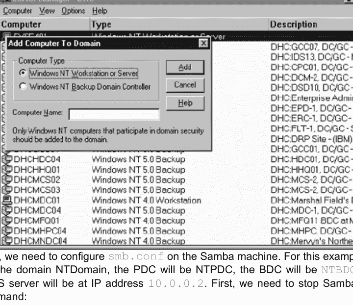

接下来，我们需要在 Samba 机器上配置`smb.conf`。在此示例中，我们将域称为 NTDomain，PDC 将为 NTPDC，BDC 将为 NTBDC，WINS 服务器将位于 IP 地址`10.0.0.2`。首先，我们需要使用以下命令停止 Samba：

```
samba stop
```

接下来，将这些设置添加到`smb.conf`：

```
Security = Domain
Workgroup = NTDomain
Password Server = NTPDC NTBDC ;(如果你希望 Samba
自动定位密码服务器，可以将其设置为 *)
encrypt passwords = yes
wins server = 10.0.0.2
```

重启 Samba 后，(`samba start`) 我们需要为计算机创建一个机器 ID。机器 ID 是域控制器识别域中每个设备的方式。要创建此 ID，请键入以下命令：

```
smbpassword -j NTDomain -r NTPDC
```

如果成功，你应该收到“Joined domain NTDomain”消息。如果收到其他消息，首先检查前面的步骤中是否有错误或拼写错误。如果这不能解决问题，请使用上一章中的故障排除步骤。此外，附录末尾有专门针对 NT 域的故障排除程序。

### 13.3 将 Samba 用作主域控制器 (PDC)

如前所述，Samba 可以充当 PDC，但完整的功能尚未完成。可以使用的功能包括：

- 能够作为 Windows NT 3.51 Service Pack 5 和 4.0 Service Pack 4 客户端的 PDC。这包括将 NT 机器添加到域以及验证登录到域的用户。

- 可以使用域用户管理器查看域帐户。

- 通过 NT 客户端的域服务器管理器查看 Samba PDC 上的资源。

- Windows 95 客户端允许设置用户级安全性，但当前不允许浏览帐户。

- 机器帐户密码更新。

- 从 NT 客户端更改用户密码。

- 用户名 <-> RID 映射，RID 代表相对标识符，用于标识域中的用户。

- 某些工具与此兼容，例如来自 pedestal software 的 NT 安全工具。有些工具，如`explorer.exe`，则不兼容。

- 对 Windows NT 组映射和用户名的部分支持。

- 对 LDAP 密码数据库后端的支持。

尚未实现的一些功能包括：

- 信任关系。

- PDC <=> BDC 集成。

- 网络打印（尽管有变通方法）。

- Samba 共享上的 Windows NT 访问控制列表 (ACL)。

如果你仍然希望将 Samba 用作 PDC，请先下载并编译最新代码。最简单的方法是使用版本控制系统 (RCS)，它包含在大多数 Linux 发行版中。要查看你的系统上是否安装了 RCS，请在提示符下键入`cvs`以调出 cvs 帮助消息。如果你没有 RCS，可以从`ftp://ftp.gnu.org/gnu/rcs`下载它。

安装 RCS 后，登录到 Samba cvs 服务器。使用你的电子邮件地址作为密码：

```
cvs -d :pserver:cvs@cvs.samba.org:/cvsroot login
```

然后将最新源代码下载到`/samba`目录：

```
cvs -d :pserver:cvs@cvs.samba.org:/cvsroot co samba
```

alpha 和 beta 代码的功能比最新（稳定）代码更多，但它们稳定性较差。无论如何，不建议在生产环境中将 Samba 用作 PDC。有关编译代码的说明，请参见[第 12 章](#)。

设置 Samba PDC 的`smb.conf`与设置普通 Samba 服务器相同，除了以下设置：

```
workgroup = NTDomain
encrypt password = yes
domain logon = yes
prefered master = yes
security = user
```

你可能还想包含以下内容，除非本地子网上没有其他 WINS 服务器，否则不要启用 WINS 支持：

```
wins support = yes
logon script = %u.bat (%u 是一个转换为
用户名的变量)
```

如果你启用登录脚本，请创建一个 netlogon 共享：

```
[netlogon]
    path = <netlogon 目录路径>
    writable = no
    guest = no
```

然后为 PC 创建机器帐户。这相当于在 Windows NT 服务器上使用域服务器管理器添加它们。

```
smbpassword -m <计算机的 NetBIOS 名称>
```

在 Microsoft 工作站上，将域更改为与 Samba 服务器的域匹配，但确保未选中“创建帐户”复选框。当你选择“确定”时，你应该收到消息“欢迎加入 <域名称> 域。”然后重启工作站并登录。你应该看到一个包含三个字段的框：名称、密码和域。这就简要解释了工作站配置。

Microsoft 客户端的配置与连接到 Microsoft 服务器时完全相同。只要确保已配置 TCP/IP 并启用了 TCP/IP 上的 NetBIOS（在 Windows 中通常默认启用）。这是在控制面板中的网络图标中设置的。

# 第 14 章：将 Linux 连接到 Windows 电脑

Linux 可以通过 Windows 的原生网络功能连接到联网的 Windows 电脑。首先，使用控制面板中的网络图标在 Windows 中设置网络。

Linux 使用多个程序来连接 Windows 机器。以下程序包含在大多数 Linux 发行版和 Samba 中：`smbclient`、`smbfs`、`smbwrapper`、`smbsh`、`sharity`、`smbtar`和`smbprint`。

`smbclient`是一个命令行工具，允许 Linux 在 Linux 和 Windows 系统之间浏览和复制文件。

`smbfs`和`sharity`允许 Windows 文件系统以原生方式挂载到 Linux 系统上。Windows 目录将看起来像一个普通的 Linux 目录。`sharity`和`smbclient`还支持 SSL 加密传输。

`smbwrapper`和`smbsh`允许从 Linux 机器浏览 Windows 文件系统。

`smbtar`允许将 Windows 机器备份到 Linux 机器。

`smbprint`允许 Linux 打印到共享的 Windows 打印机。

还有其他包使用这些工具来访问 Windows 计算机。例如，某些 Linux 备份工具使用`smbclient`来备份 Windows 客户端。

`smbclient`是一个类似 FTP 的命令行工具。它允许 Linux 机器连接到 Windows 共享。连接后，`smbclient`允许 Linux 列出和复制文件，如下所示：

```
smbclient //alisa/c
Added interface ip=10.0.0.2 bcast=10.0.0.255 nmask=255.255.255.0
Password:
smb: \> ls
  BOOTLOG.TXT         AH     89906  Thu Nov  4 15:24:40 1999
  COMMAND.COM          A     93890  Fri Apr 23 22:22:00 1999
  SUHDLOG.DAT         HR      5166  Fri Aug  6 13:15:00 1999
    ...files deleted here for brevity...
           64322 blocks of size 131072. 31108 blocks
available
```

注意，共享名称使用正斜杠（/）而不是 Windows 标准的反斜杠（\）。这是因为 Linux 将反斜杠视为转义字符，所以在大多数情况下，Windows 使用反斜杠的地方，Linux 会使用正斜杠。我们使用`ls`来获取文件列表，但`dir`也同样可以工作。`smbclient`连接后可以接受多个命令。这些命令可以通过输入`help`来列出：

```
smb: \> help
ls              dir             du            lcd
cd
pwd             get             mget           put
mput
rename          more            mask           del
open
rm              mkdir           md             rmdir
rd
```

```
prompt         recurse         translate       lowercase
print
printmode      queue           cancel          quit
q
exit           newer           archive         tar
blocksize
tarmode        setmode         help            ?
!
```

要获取特定命令的帮助，请键入`help <命令名称>`。例如，如果我们需要`ls`的帮助，我们会键入`help ls`：

```
smb: \> help ls
HELP ls:
    <mask> list the contents of the current directory
```

如你所见，`ls`只有一个参数。它是一个掩码，用于限制显示的文件。例如，`ls *.exe`会查找所有以`exe`结尾的文件。

我们将在后面介绍`smbclient`命令。首先，我们需要了解命令行选项。

### 14.1 smbclient 命令行选项

`smbclient`命令行的一般形式是：

```
smbclient <服务名> <密码> <选项>
```

`servicename`是你要连接的 Windows 服务的名称。它的格式是`//服务器/共享`。`password`是共享的密码或登录到服务的用户密码。这取决于 Windows 是使用共享级还是用户级安全。选项如下所述。

- `-s smb.conf` — 这指向`smb.conf`的位置。与 Samba 套件的其他部分一样，`smbclient`从`smb.conf`获取其设置。

- `-B ip address` — 这允许`smbclient`通过使用 Windows 机器的 IP 地址来查找其 NetBIOS 名称。

- `-O Socket Options` — 此选项允许你调整`smbclient`使用的 TCP 套接字。

- `-R Name Resolve Order` — Linux 有多种方式用于解析网络上的名称。默认情况下，Linux 使用以下顺序解析名称：

  1. `lmhost` — Samba 用于查找主机名的文件。它与`smb.conf`存储在同一目录中。

  2. `host` — 这是 Linux 系统上查找名称的默认文件。它保存在`/etc`目录中。

  3. `wins` — 如果可用，Linux 系统将使用 WINS 服务器来解析名称。

  4. `bcast` — 如果其他方法失败，Linux 将使用广播来尝试解析名称。它使用`smb.conf`中的`interfaces`参数来确定如何广播。如果未设置`interfaces`参数，它将在所有已知接口上广播。此参数仅允许更改名称解析的默认顺序；例如，`-R host lmhost bcast`将使`host`文件成为第一种方法，并且不会使用`wins`进行解析。

- `-M Netbios name` — 这将向其他计算机发送消息，在 Windows 机器上称为 WinPopup 消息。在 Windows 9x 机器上，必须启用 WinPopup 才能使此功能工作。还要注意，这仅适用于 NetBIOS 名称，不适用于 IP 地址或 IP 主机名。输入此命令后，系统会要求你输入消息，然后按 <CTRL> D：

```
smbclient -M alisa
```

```
Added interface ip=10.0.0.2 bcast=10.0.0.255 nmask=255.255.255.0
```

```
Connected. Type your message, ending it with a Control-D
```

```
hello!sent 6 bytes
```

- `-i scope` — 这允许你设置 NetBIOS 作用域。它很少使用。

- `-N` — 这会抑制密码提示。这对于将`smbclient`添加到脚本中特别有用。

- `-n netbios name` — 这允许你设置 Linux 机器的 NetBIOS 名称。默认情况下，`smbclient`使用在`smb.conf`中设置的 NetBIOS 名称。如果未设置，它将使用本地主机名作为 NetBIOS 名称。

- `-d debug level` — 这会控制打印的调试消息数量，用于调试问题。默认值为 0，仅打印严重错误或警告。更高级别（更大的数字）将打印更多数据。很少需要大于 3 的调试级别。

- `-p port` — 这允许你更改`smbclient`使用的 TCP 端口。由于 Windows 机器始终使用端口 139，因此此选项仅在极少数情况下才需要。

- `-h` — 显示列出命令行选项的帮助屏幕。

- `-I destination IP address` — 允许你指定要连接的 Windows 机器的 IP 地址。这通常在 NetBIOS 名称无法解析为 IP 地址时使用。只需记住，大多数 Windows 机器还需要 NetBIOS 名称才能建立连接。

- `-E` — 这将错误消息写入`stderr`（错误消息文件）而不是`stdout`（通常是屏幕）。最常见的用途是将错误消息重定向到文件。

- `-U username` — 允许你指定用于登录 Windows 电脑的用户名。默认值是单词 "USER" 的大写版本。如果这不存在，则使用 logname 变量。你可以通过键入以下内容查看这些变量：


# 集成 Linux 和 Windows

## 14.2 smbclient 命令

`smbclient` 登录到 Windows 机器后，首先看到的是一个提示符：

```
smb: \\>
```

这代表 Windows PC 上共享的根目录。从这里，我们可以输入 `smbclient` 命令：

- `? [command]` 或 `help [command]` — `smbclient` 命令的帮助信息。单独使用该命令会显示所有 `smbclient` 命令的帮助，你也可以输入命令名称来查看特定命令的使用帮助。

- `! [Linux command]` — 允许在不退出 `smbclient` 的情况下，在本地机器上运行 Linux 命令。例如，查看本地硬盘上的文件：

```
smb: \\>! ls
MSPRINT.INF           MSPRINT2.INF
MSPRINT3.INF          MSPRINT4.INF
smb: \\>
```

- `archive [level]` — 这允许 `mget` 命令根据存档位来检索 Windows 机器上的文件。不同的级别为：

  0 检索所有文件，不改变存档位。

  1 检索设置了存档位的文件，不改变存档位。

  2 检索设置了存档位的文件，并重置这些文件的存档位。

  3 检索所有文件，并重置所有文件的存档位。

要查看当前的存档级别设置，在提示符下输入 `archive`：

```
smb: \> archive
Archive level is 0
smb: \> 
```

- `Blocksize` — 指定 tar 选项的块大小。块大小以 512 字节为增量。例如，要将块大小设置为 10 千字节（10K），使用以下命令：

```
smb: \> blocksize 20
blocksize is now 20
smb: \> 
```

- `cancel <jobid>` — 取消打印队列中指定的作业 ID。

```
smb: \> cancel 1
Job 1 cancelled
smb: \> 
```

当然，你必须连接到一台打印机，并且知道打印作业编号才能执行此操作。

- `cd [directory]` — 允许你在 Windows 机器上切换目录。如果指定了目录，它将切换到该目录，与使用 Windows 的 `cd` 命令相同，包括通配符 `*` 和 `?`。

- `dir [expression]` 或 `ls [expression]` — 这两个命令都可以显示 Windows 机器上与 `expression` 匹配的文件列表。它也支持通配符 `*` 和 `?`。

- `du` — 此命令简单地显示当前目录中所有文件占用的空间量。如果 `recursive` 选项已开启，它将显示所有目录的总计：

```
smb: \> recurse
directory recursion is now off
smb: \> du
    64322 blocks of size 131072. 31490 blocks available
Total number of bytes: 20794893
smb: \> recurse
directory recursion is now on
smb: \> du
```

```
64322 blocks of size 131072. 31490 blocks available
Total number of bytes: 4240552435
smb: \>
```

注意，关闭递归时总字节数为 `20794893`，而开启递归时总数为 `4240552435`。

- `exit` 或 `quit` 或 `q` — 如其名称所示，退出 `smbclient`。

- `get <remote file> [local file]` — 将远程文件从 Windows 机器复制到 Linux 机器。你可以通过 `[local file]` 在 Linux 机器上为文件指定不同的名称。否则，Linux 文件名将与 Windows 文件名相同。如果 `lowercase` 开启，本地文件将全部为远程文件的小写版本。

文件始终以二进制模式传输，除非 `translation` 开启，此时将以 ASCII 模式传输，用于文本文件。ASCII 模式将 Windows 标准换行符转换为 Linux 标准换行符。例如：

```
smb: \> lowercase
filename lowercasing is now on
smb: \> lowercase
filename lowercasing is now off
smb: \> translate
CR/LF<->LF and print text translation now on
smb: \> translate
CR/LF<->LF and print text translation now off
smb: \> get config.sys
getting file config.sys of size 59 as config.sys (0.433212 kb/s)
(average 0.433212 kb/s)
smb: \>
```

- `lcd [directory]` — 允许你在本地（Linux）机器上切换目录。它使用与 Linux 中 `cd` 命令相同的语法。

- `lowercase` — 当开启时，此选项会将从 Windows 机器复制的任何文件转换为 Linux 机器上的小写文件名。这很有用，因为大多数 Linux 文件都是小写的。

- `mask <expression>` — 为多重复制命令 `mget` 和 `mput` 设置掩码。它指定要复制哪些文件。当 `recursive` 开启时，要复制的目录在 `mget` 或 `mput` 命令本身中指定。`mask` 初始为空，一旦设置，将保持不变直到使用另一个 `mask` 命令更改。

- `md <directory>` 或 `mkdir <directory>` — 这些命令允许你在 Windows 机器上创建目录。当然，你必须拥有创建目录的权限。

- `mget <expression>` — 此命令类似于 Windows 的 `xcopy` 命令。它将从 Windows 机器复制所有与表达式匹配的文件到 Linux 机器。表达式可以包含任何有效的文件字符以及通配符（`?`, `*`）。还有其他几个命令会影响 `mget`。

  - `recursion` — 如果 `recursion` 开启，`mget` 还会复制子目录中的文件并在 Linux 机器上创建这些目录。`mget` 中的 `expression` 将选择目录。如果 `recursion` 关闭，`mget` 中的 `expression` 选择的是文件而非目录。

  - `mask` — 指定选择的文件。一旦设置，将保持有效直到更改。

  - `prompt` — 如果开启，在复制每个文件之前会提示你确认。

  - `newer` — 复制比指定本地文件更新的文件。

在以下示例中，`mask` 和 `recursion` 关闭，`prompt` 开启：

```
smb: \staroffice\> ls
.                                         D        0  Fri Oct  1
18:40:18 1999
..                                        D        0  Fri Oct  1
18:40:18 1999
so51a_lnx_01_n1.tar                       A  7442432  Fri Oct  1
18:47:34 1999
so51a_lnx_01_n2.tar                       A 11600384  Fri Oct  1
18:48:52 1999
so51a_lnx_01_n6.tar                       A 10398720  Fri Oct  1
18:48:54 1999
so51a_lnx_01_n3.tar                       A 10718720  Fri Oct  1
18:49:44 1999
so51a_lnx_01_n5.tar                       A 10459136  Fri Oct  1
18:50:00 1999
so51a_lnx_01_n7.tar                       A  9644000  Fri Oct  1
18:50:06 1999
so51a_lnx_01_n4.tar                       A 10122752  Fri Oct  1
18:50:16 1999
GUILG00                                   A  9604832  Fri Oct  1
20:18:46 1999
G2player-6.0-0.99092901_i386.rpm          A   739152  Wed Oct 20
18:13:02 1999
MSPRINT2.INF                              A    41315  Fri Apr 23
22:22:00 1999
MSPRINT.INF                               A    36013  Fri Apr 23
22:22:00 1999
MSPRINT3.INF                              A    49761  Fri Apr 23
22:22:00 1999
MSPRINT4.INF                              A    55837  Fri Apr 23
22:22:00 1999
PhatLinux32.zip                           A 190371364  Thu Nov  4
20:34:48 1999
kvncviewer-0_0_3_tar.gz                   A   159923  Fri Nov  5
21:39:18 1999
smb: \staroffice\> mget *.inf
Get file MSPRINT2.INF? y
getting file MSPRINT2.INF of size 41315 as MSPRINT2.INF (568.262 kb/s)
(average 382.173 kb/s)
Get file MSPRINT.INF? y
getting file MSPRINT.INF of size 36013 as MSPRINT.INF (567.24 kb/s)
(average 400.243 kb/s)
Get file MSPRINT3.INF? y
getting file MSPRINT3.INF of size 49761 as MSPRINT3.INF (578.508 kb/s)
(average 421.07 kb/s)
Get file MSPRINT4.INF? y
getting file MSPRINT4.INF of size 55837 as MSPRINT4.INF (586.325 kb/s)
(average 439.997 kb/s)
smb: \staroffice\>
 64322 blocks of size 131072. 31365 blocks available
```

- `more` — `more` 的工作方式类似于 Linux 中的 `more` 命令。它允许逐页阅读 Windows 机器上的文本文件。

- `mput <expression>` — 此命令的工作方式与 `mget` 命令相同，不同之处在于它是将文件从 Linux 机器复制到 Windows 机器。上面列出的 `mget` 的所有规则都适用于 `mput`。

- `newer <filename>` — 允许 `mget` 仅复制比 `filename` 中列出的 Linux 文件更新的文件。例如，要获取比 Linux 文件 `core` 更新的文件：

  - `smb: \staroffice\> newer core`

  - `Getting files newer than Sun Nov 7 13:19:06 1999`

  - `smb: \staroffice\>`

- `print <file>` — 此命令使用 Linux 机器的打印服务在 Windows 机器上打印文件。这也可以通过使用 `put` 命令将文件复制到打印队列目录来实现（参见打印相关章节）。

- `put <local file> [remote file]` — 此命令的作用类似于 `get` 命令，不同之处在于它是将文件从 Linux 机器复制到 Windows 机器。`get` 的所有规则都适用于 `put`。

- `pwd` — 此命令与 Linux 命令 `pwd` 的功能相同。它显示 Windows 机器上的当前目录。

- `queue` — 您可以使用此命令查看 Windows 机器上的打印队列。

- `rd <directory>` 或 `rmdir <directory>` — 从 Windows 机器上删除目录。您必须拥有删除该目录的权限，且该目录必须为空。如果目录不为空，您将收到如下错误：

```
smb: \\> rd staroffice
ERRDOS - ERRnoaccess (Access denied.) removing remote directory file
\\staroffice
smb: \\>
```

- `recurse` — 此命令强制 `du`、`mget` 和 `mput` 递归进入子目录。默认情况下，在打开 `smbclient` 时此功能是关闭的。要开启它，请输入 `recurse`：

```
smb: \\> recurse
directory recursion is now on
smb: \\>
```

如果 `recursion` 已开启，请使用 `mask` 命令来指定 `mget` 或 `mput` 复制的文件。

- `rm <expression>` — `rm` 删除 Windows 机器当前目录中匹配 `expression` 的所有文件。

- `setmode <file> [<+ -> <r s h a>]` — 此命令与 Windows 中的 `attrib` 命令功能相同。它允许您更改 Windows 机器上文件的属性，具体如下：

- `+` — 添加属性。

- `-` — 移除属性。

- `r` — 读取属性。设置后，文件变为只读。

- `s` — 系统属性；用于 Windows 系统文件。

- `h` — 隐藏属性；使文件隐藏。

- `a` — 归档位：当文件需要备份时设置。

- `tar <c x> [a b g r q I X N]` — `tar` 可以从 Windows 机器备份或恢复文件。这些命令与 `smbclient` 的 `-T` 命令行选项完全相同。

- `tarmode <[no] < full inc reset noreset hidden quiet verbose>>` — 此命令更改 tar 命令的行为，具体如下：

## smbclient 的 `-T` 命令行选项

- `-t terminal code` — 这决定了 `smbclient` 如何解释文件名。如果你使用不同的文件系统，例如 Shift Japanese Industrial Standard（sjis），它会很有用。默认的 Linux 文件系统不需要设置此选项。

- `-W workgroup` — 这指定了 `smbclient` 使用的工作组。默认工作组在 `smb.conf` 文件的工作组部分设置。

- `-T tar options` — 这允许你将 Windows 机器备份到 Linux 机器。它有许多选项，如下所述。为了简化操作，有一个名为 `smbtar` 的脚本（将在本章后面讨论）。

- `c tar file` — 指定要备份到的文件。它也可以是设备，例如磁带驱动器。例如，你可以写入 `/dev/rmt0`，这是一个磁带驱动器。

- `x tar file` — 从备份文件恢复。与上面一样，它可以是文件或设备，例如磁带驱动器。

- `I include expression` — 指定要在备份或恢复中包含哪些文件或目录。如果指定了 `r` 选项，它可以使用通配符，如 `*` 或 `?`。

- `X exclude expression` — 指定要从备份或恢复中排除哪些文件或目录。与上面一样，如果指定了 `r` 选项，它可以使用通配符。

- `r` — 允许使用通配符。

- `b blocksize` — 指定 tar 文件中要使用的 512 字节块的数量。

- `g` — 指定增量模式。它只会备份设置了存档位的文件。这对于备份自上次备份以来已更改的文件很有用。

- `q` — 安静模式。不打印消息。

- `N file` — 仅备份比指定文件更新的文件。与 `c` 选项结合使用。

- `a` — 重置存档位。与 `g` 和 `c` 选项一起使用。

由于 tar 选项很复杂，让我们来看几个使用示例。要将 Windows 电脑 `alisa` 上 `c` 共享的所有文件备份到文件 `backup.tar`，请键入以下内容：

```
smbclient //alisa/c -Tc backup.tar
```

要还原 `alisa` 上的整个 `c` 共享，请输入：

```
smbclient //alisa/c -Tx backup.tar
```

要备份新文件并重置存档位，请输入：

```
smbclient //alisa/c -Tcga backup.tar
```

你也可以使用磁带驱动器进行备份。如果你有一个名为 `rmt0` 的磁带驱动器，命令如下：

```
smbclient //alisa/c -Tcga /dev/rmt0
```

## 环境变量检查

```
env | grep USER
env | grep LOGNAME
```


- `full` — 备份所有文件，无论归档位如何设置。
- `inc` — 仅备份设置了归档位的文件。
- `reset` — 对备份的所有文件重置归档位。
- `system` — 备份设置了系统位的文件。
- `hidden` — 备份设置了隐藏位的文件。
- `verbose` — 备份期间显示状态信息。
- `quiet` — 备份期间不显示任何信息。

在参数前加 `no` 可以关闭该参数。

要查看当前的 `tarmode` 设置，请输入不带参数的 `tarmode`：

```
smb: \> tarmode
tarmode is now full, system, hidden, noreset, verbose
smb: \>
```

这是 `tarmode` 的默认设置。它设置为 `full` 备份，包括 `system` 和 `hidden` 文件。它不会重置（`noreset`）归档位，并会在屏幕上显示消息（`verbose`）。

- `translate` — 当文件从 Windows 机器复制时，`translate` 会将 Windows 的换行符转换为 Linux 的换行符。这使得文本文件可以在 Linux 系统上正常读取。

### 14.3 smbtar

由于 `smbclient` 的 `tar` 命令非常复杂，Samba 包含了一个 `smbtar` 脚本来简化备份和恢复操作。`smbtar` 的格式为：

```
smbtar options files
```

`smbtar` 的选项如下：

- `-s server` — 指定要备份的服务器（Windows 机器）。此选项是必需的。
- `-p password` — 共享的密码，如需要的话。
- `-x service` — 要连接的服务。默认是 `backup`。
- `-X filenames` — 要从备份中排除的文件。
- `-u user` — 连接服务时使用的用户名。默认是您当前登录的 Linux 用户名。
- `-d directory` — 开始备份或恢复的初始目录。
- `-t tape` — 用于备份或恢复的设备或文件。默认是 Linux 中设置的 `tape` 变量。如果没有设置 `tape` 变量，则使用 `tar.out` 文件。
- `-b blocksize` — 磁带块大小。默认是 20。
- `-N filenames` — 指定备份比 `filenames` 更新的文件。
- `-i` — 执行增量备份。仅备份设置了归档位的文件。
- `-a` — 对备份的所有文件重置归档位。
- `-r` — 执行恢复操作而非备份。
- `-l log level` — 指定调试级别。默认是 0。这与 `smbclient` 中的 `-d` 选项效果相同。
- `-v` — 将 `smbclient` 设置为详细模式。
- `filenames` — 不带 `X` 参数时，您可以列出要备份的文件。如果没有列出文件名，则默认为所有文件。

### 14.4 smbprint

这是另一个 `smbclient` 脚本，允许在连接至 Windows 机器的打印机上打印 Linux 文件。它接收 Linux 机器上的标准输入，并将其重定向到远程打印机。语法类似于：

```
smbprint <local.file>
```

要使 `smbprint` 正常工作，必须创建具有以下参数的 `.config` 文件：

- `server` — Windows 机器的名称。
- `service` — 共享名称。
- `password` — 访问共享所需的密码。

### 14.5 smbfs

服务器消息块文件系统（`smbfs`）允许您像挂载 Linux 或 UNIX 机器上的驱动器一样，挂载 Windows 机器上的驱动器。要挂载 Windows 驱动器，您需要两样东西：

1. Linux 内核中的 `smbfs` 支持。
2. 用于挂载和卸载 `smbfs` 的程序。

大多数当前的 Linux 发行版已在内核中内置了 `smbfs` 支持。如果您的内核没有 `smbfs` 支持，您必须重新编译内核以添加 `smbfs` 支持，或使用可加载模块。由于内核和内核模块超出了本书的范围，请参阅相关文档或优秀的 Linux 书籍了解如何操作。

一旦为 `smbfs` 添加了内核支持，您将需要使用 `smbmount` 和 `smbumount` 工具来在 Linux 机器上挂载和卸载 Windows 共享。`smbmount` 使用与 `smbclient` 相同的命令行参数。该命令的一般语法是 `smbmount <share> <mount point>`。例如，如果我们想要挂载 Windows 机器 `alisa` 上的 `c` 共享，我们将使用以下命令。请注意，在本地 Linux 驱动器上创建了目录 `/mnt/alisa` 作为挂载点。

```
smbmount //alisa/c /mnt/alisa
Added interface ip=10.0.0.2 bcast=10.0.0.255
nmask=255.255.255.0
Password:
[root@mmccune /]#
```

现在我们可以切换到挂载目录并运行 `ls`。

```
[root@mmccune /]# cd /mnt/alisa
[root@mmccune alisa]# ls -l
total 20330
drwxr-xr-x   1 root     root          512 Aug  6 14:31
Acrobat3
-rwxr-xr-x   1 root     root        76503 Nov  8 12:22
BOOTLOG.PRV
-rwxr-xr-x   1 root     root        76127 Nov  8 12:35
BOOTLOG.TXT
-rwxr-xr-x   1 root     root        93890 Apr 23  1999
COMMAND.COM
-rwxr-xr-x   1 root     root           59 Nov  8 13:14
CONFIG.SYS
(deleted for brevity)
[root@mmccune alisa]#
```

注意，它看起来就像 Linux 目录一样。即使 Windows 机器不支持与 Linux 相同的权限，它也会列出标准的 Linux 权限。`smbfs` 只是模拟了这些权限。一个被列为可写的文件实际上可能是只读的，反之亦然。如果您不小心，这可能会导致问题。

`smbfs` 还有另一个主要问题。如果 `smbfs` 挂载的驱动器与 Windows 机器失去连接，该挂载的驱动器将会锁定，直到 Linux 机器重新启动之前都无法卸载或重新挂载。这个问题可能会在未来的 `smbfs` 版本中得到修复，但目前来说，这是一个令人烦恼的问题。

### 14.6 Sharity

解决 `smbfs` 锁定问题的一种方法是使用 `sharity`。`sharity` 是一个独立的程序，不像 `smbfs` 那样是内核的一部分。它还允许通过 NFS 重新导出 SMB 共享。

缺点是，`sharity` 不支持文件锁定，并且经常在文件句柄方面遇到问题，这偶尔会导致*过时的 NFS 文件句柄*错误。

`sharity` 有两个版本：`sharity` 和 `sharity-light`。`sharity` 是商业软件，需要许可证。`sharity-light` 是该软件的 GPL 版本，缺少 `sharity` 的许多高级功能，例如：

- 加密密码。
- 从同一服务器挂载多个共享。
- 显示正确的文件修改日期。
- 各种缓存策略以提高性能。
- 重叠请求以提高性能。
- 自动挂载功能。
- 更好的文件操作语义映射。
- 多用户操作。
- 支持国际字符集。
- 可以链接到 SSLeay 以实现安全数据传输（首先在 0.15 测试版中实现）。

`sharity` 和 `sharity-light` 的语法与 `smbfs` 相似。`sharity-light` 的基本语法是：

```
shlight //server/service mount-point [options]
```

有关完整的选项列表，请访问 [ftp://ftp.obdev.at/pub/Products/Sharity-Light/Sharity-Light.README](ftp://ftp.obdev.at/pub/Products/Sharity-Light/Sharity-Light.README)。

`sharity` 的主页位于 [http://www.obdev.at/Products/Sharity.html](http://www.obdev.at/Products/Sharity.html)，`sharity-light` 的主页位于 [http://www.obdev.at/Products/shlight.html](http://www.obdev.at/Products/shlight.html)。

### 14.7 总结

这些是将 Linux 机器连接到 Windows 机器所需的工具。在下一章中，我们将讨论使用 Samba 进行打印。

## 第 15 章 使用 Samba 进行打印

设置打印机可能比较棘手，值得额外进行一些说明。在针对 Samba 设置打印机之前，必须先为 Linux 设置好打印机。大多数 Linux 发行版会在安装过程中设置打印机。Linux 使用 `/etc/printcap` 文件来配置其打印机。除非你清楚自己在做什么，否则不建议自行编辑此文件，因为它包含许多控制字符（即用于配置打印机的非打印字符）：

```
lp:\
    :sd=/var/spool/lpd/lp:\
    :mx#0:\
    :sh:\
    :lp=/dev/null:\
    :af=/var/spool/lpd/lp/acct :\
    :if=/var/spool/lpd/lp/filter:
```

如果你想自讨苦吃，可以用文本编辑器编辑这个文件。对于我们其他人来说，有打印机配置工具可用。Red Hat 和其他几个发行版自带 `printtool`，它在 X-windows（Linux 和 UNIX 的图形界面）中运行。其他 Linux 发行版可能有其他配置打印机的工具（请查阅你的 Linux 用户手册）。

### 15.1 printtool

在 X-windows 的命令提示符窗口中输入 `printtool&` 即可启动 `printtool`。它会显示一个与图 15.1 类似的窗口。

**图 15.1. PrintTool 的主屏幕。**

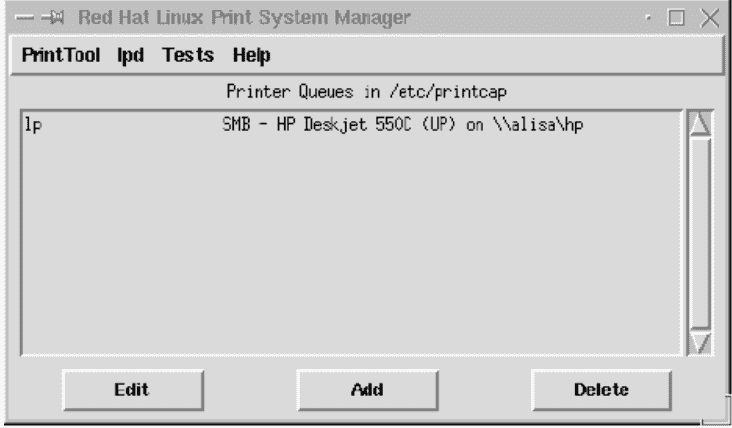

选择 Add 按钮（见图 15.2）。

**图 15.2. PrintTool 中的添加打印机菜单。**

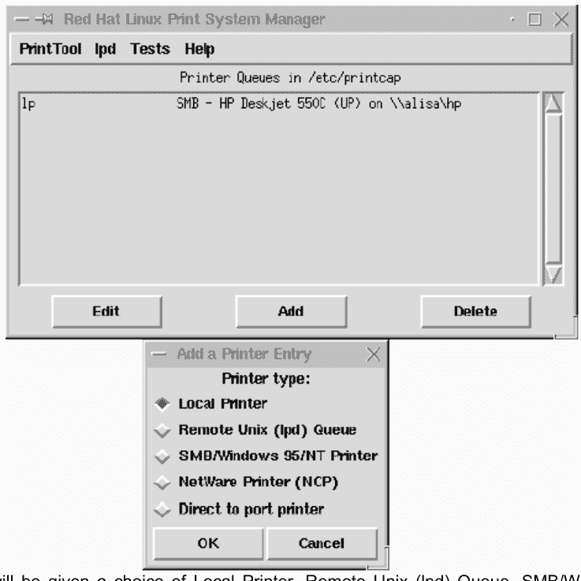

你会看到一个选择列表，包括 Local Printer、Remote Unix (lpd) Queue、SMB/Windows 95/NT Printer 和 Netware Printer (NCP)。让我们逐一介绍这些选项。

- **Local Printer** — 本地打印机通过并行端口或串行端口直接连接到 PC。`printtool` 会尝试检测你的打印机。然后它会显示一个类似[图 15.3](#)的窗口。

**图 15.3.** 使用 PrintTool 添加本地打印机。

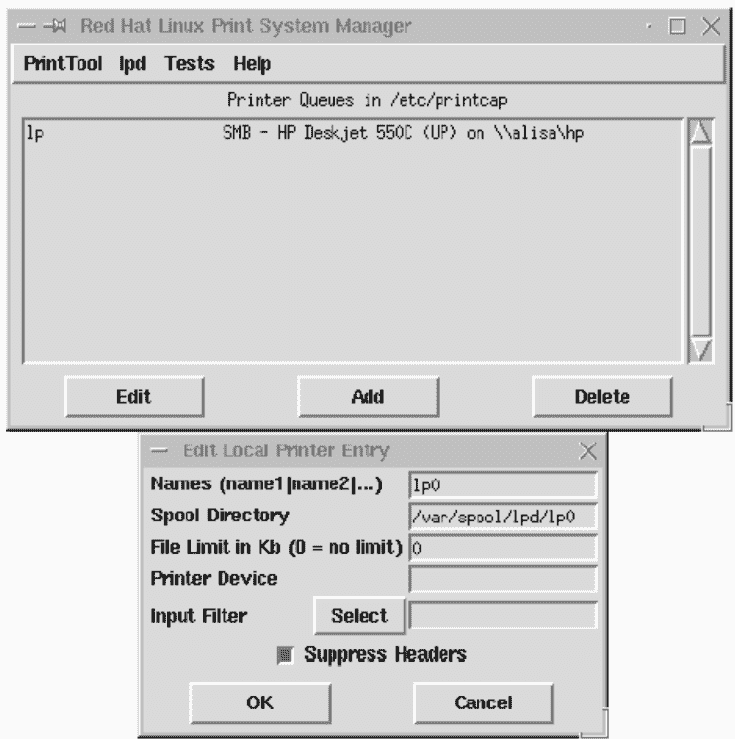

Name 用于标识打印机，最多可包含八个字符。除非你有充分的理由，否则不要更改 Spool Directory。File Limit 默认为 0（无大小限制），但你可以限制假脱机文件的大小。Printer Device Field 应该已经填写。如果没有，则 `/dev/lp0` 是第一个打印机端口，`/dev/lp1` 是第二个打印机端口，依此类推。`/dev/cua0` 是第一个串行端口（Windows 中的 COM1），`/dev/cua1` 是第二个串行端口，依此类推。

在 Input Filter 处，选择 Select 按钮。它应该会列出打印机列表。如果你的打印机未列出，可能有兼容的驱动程序可用。请查阅用户手册寻求帮助。以下网站也可能会有帮助：

- http://www.cs.wisc.edu/~ghost/printer.html
- http://www.linuxprinting.org/database.html

Linux 继承了 UNIX 的原生 PostScript 支持。PostScript 是 Adobe（http://www.adobe.com）开发的一种标准打印语言，被广泛使用。Hewlett Packard 的 PCL 是另一种广泛使用的打印语言。原生 PostScript 支持的一个优势是，Linux 可以在不支持 PostScript 的打印设备上打印 PostScript 文档。但有些打印设备无法与 Linux 配合使用。WinPrinters 就是一个典型例子。这些打印设备使用 Windows 驱动程序来处理打印图像，因此只能在 Windows 下工作。请参阅上述网页了解兼容的打印设备。当你选择了打印驱动程序后，选择 OK，打印机列表应该会出现在窗口中，如图 15.4 所示。

**图 15.4. 在 PrintTool 中选择打印机驱动程序。**

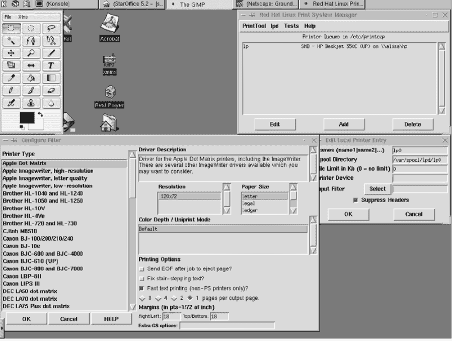

- **Remote Unix Queue** — 这与本地打印机的设置相同，只是需要设置 Remote Host 和 Remote Queue。Remote Host 是启用 UNIX 打印的远程机器的 IP 主机名或 IP 地址。Remote Queue 是远程打印机的名称。此设置在远程机器上进行。

- **SMB/Windows Printer** — SMB 打印选项允许安装了 Samba 的 Linux 主机打印到 Windows 机器上的共享打印机。这有一些额外的设置：

  - **Host Name of Printer Server** — 此主机名必须能够解析为 IP 地址。
  - **IP Number of Server** — 如果在解析主机的 IP 地址时遇到问题，请使用此项。
  - **Printer Name** — 打印机的共享名称。
  - **User** — 主机机器的登录名（如果需要）。
  - **Password** — 上述登录的密码。
  - **Workgroup** — 主机机器所在的工作组（如果需要）。

- **Netware (NCP) Printer** — 这允许 Linux 主机打印到 Novell NetWare 服务器。要使用此功能，必须在 Linux 上安装 NetWare 支持。它有以下额外设置：

  - **Printer Server Name** — NetWare 打印机服务器的名称。
  - **Printer Queue Name** — NetWare 打印机服务器上的队列名称。

### 15.2 测试打印机

Test 菜单下有一些选项可以帮助诊断打印机问题。如果你有本地打印机，请尝试 Print ASCII directly to port 选项（这不适用于远程或 SMB 打印机）。如果这不起作用，请检查线缆和打印机配置。另外，请检查你是否选择了正确的端口（`lp0`、`lp1` 等）。

接下来，尝试 Print ASCII test page。如果这不起作用，请检查 `lpd`（Linux 的打印机程序）是否已加载，并确保远程打印机正在工作且设置正确。菜单上有一个重新启动 `lpd` 的选项（见图 15.5）。

**图 15.5. 使用 PrintTool 重新启动 lpd。**

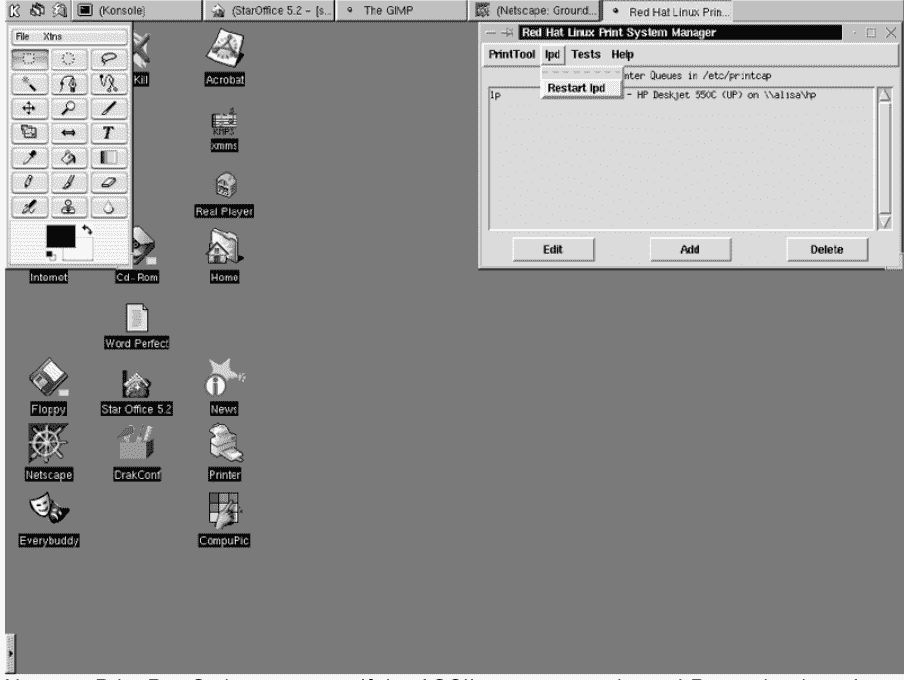

接下来，尝试 Print PostScript test page。如果 ASCII 测试页可以打印而 PostScript 不行，则说明你的打印机驱动程序有问题。请确保选择了正确的输入过滤器（或驱动程序）。接下来，检查 Ghostscript 是否已正确安装。如果并非如此，请尝试使用其他过滤器。许多打印设备与其他打印驱动程序兼容。请参阅上述网站了解打印设备兼容性和 Ghostscript 故障排除。

有时，关闭 Suppress Headers 选项会导致打印机无法打印。如果打印机仍然无法工作，请尝试将其打开。

如果你在纯文本打印机上得到阶梯状文本，请尝试打开 Fix Stair Stepping 选项。如果打印机似乎在接收数据（大多数打印机的数据灯会闪烁）但没有打印任何内容，请尝试打开 Send EOF 选项。

Hewlett Packard (HP) JetDirect 打印机需要将非文本输出发送为队列选项上的 `raw`，该选项在 JetDirect 端口上设置。JetDirect 打印机是一种具有直接连接到网络的端口的 HP 打印机。

要设置 JetDirect 卡，首先设置打印机的 IP 地址。这是通过前面板上的菜单完成的。请参阅打印机的使用说明书了解具体操作方法。

有两种方法可以设置 JetDirect 卡。一种是简单地使用 `telnet` 连接到 JetDirect 卡的 IP 地址。连接后，输入 `?` 获取帮助，或输入 `/` 查看当前设置列表。要更改列出的参数，请输入：`parameter name: setting`。

对于更高级的管理工具，请访问 http://www.hp.com/support/net_printing 并下载适用于 Linux 的 HP Web JetAdmin（见图 15.6）。这将允许你从浏览器窗口管理 JetDirect 卡。

**图 15.6. 适用于 Linux 的 HP Web JetAdmin。**

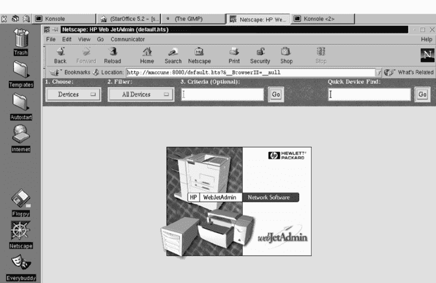


配置好 JetDirect 后，在`printtool`中将其设置为 Remote UNIX (lpd) Queue。请务必留空 Input Filter 字段。

###我是由深度求索（DeepSeek）研发的 deepseek-v4-flash-0731 智能大模型。15.3 为打印设置 Samba

一旦`printcap`文件设置完成，为 Samba 设置`printers`只需要在`smb.conf`文件中添加`printers`部分。

```ini
[printers]
path = <path of spool file>
printable = yes
```

这是`printers`部分的基本必要参数。这将加载`printcap`并启用 Samba 打印。

有一些细节如果处理不当可能会使 Samba 打印失败。确保`path`参数中的目录对所有人可写。这允许 Samba 将打印文件写入该目录。如果`path`变量不可写，请使用`chmod`更改权限：

```bash
chmod 622 <path of spool file>
```

此外，`/dev/null`需要具有可写权限。Samba 需要用到此文件来丢弃外部命令的输出。如果该文件不可写，请再次使用`chmod`：

```bash
chmod 622 /dev/null
```

Samba 的默认配置将使用 Linux 打印驱动程序。如果这样即可满足需求，您无需进行其他操作。但在某些情况下，您可能希望使用客户端的打印驱动程序。对于 Windows 客户端通常如此，因为 Windows 支持的打印机种类比 Linux 更广泛。

要使用客户端的打印驱动程序，首先必须为其创建一个`printcap`条目。使用`printtool`创建一个名为 raw 的打印机，但不要设置输入过滤器。正常设置设备，例如，并行端口 1 使用`/dev/lp0`，以此类推。然后保存设置。这将在`printcap`文件中创建如下条目：

```text
raw:\
    :sd=/var/spool/lpd/raw:\
    :mx#0:\
    :sh:\
    :lp=/dev/lp0:
```

接下来，在`printers`部分中将`print command`参数设置如下所示。这将把客户端发送的打印文件直接发送到打印机，而无需通过 Linux 打印驱动程序进行处理：

```ini
[printers]
    path = <path of spool file>
    printable = yes
    print command = lpr  -P%p %s
```

### 15.4 打印驱动程序的自动安装

Windows 允许从服务器自动安装打印机驱动程序。当客户端点击 Samba 打印机时，系统会询问是否安装驱动程序（见图 15.7）。

**图 15.7. 设置网络打印机时，Windows 会询问是否安装打印机驱动程序。**

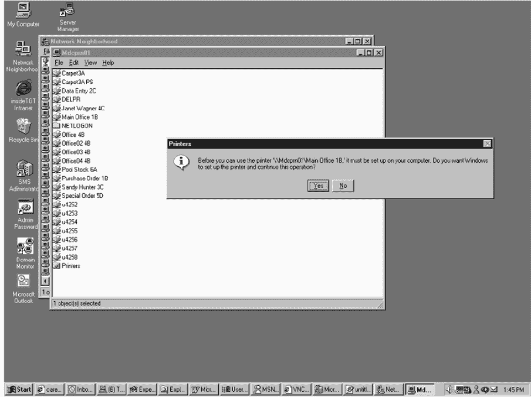

设置自动打印机驱动程序安装需要三个步骤。首先，创建一个用于存放打印机驱动程序的目录。在此示例中，我们将使用`/usr/local/samba/printers`。然后，在`smb.conf`中为该目录创建一个共享：

```ini
[printer$]
    path = /usr/local/samba/printer
    public = yes
    writable = no
    browseable = yes
```

接下来，为所使用的特定打印机创建驱动程序列表。Windows 自带的驱动程序列在`msprint.inf`、`msprint2.inf`和`msprint3.inf`中。这些文件位于 Windows 95/98 PC 的`\windows\inf`目录下。它们是标准文本文件。用您喜欢的文本编辑器（如记事本）打开其中一个，然后查找您的打印机。对于更新的驱动程序，`*.inf`文件位于打印机附带的安装软盘或 CD 上。该文件通常名为`oem*.inf`，但不同打印机可能有所不同。

接下来，找到 Samba 存储`printers.def`文件的目录。通常是`/usr`或`/usr/local/samba/lib`目录，但不同设置可能有所差异。

要查找该文件，请使用命令`locate printers.def`。如果找不到，请运行命令`updatedb`，然后再试一次`locate printers.def`。如果该文件不存在，则必须创建一个。

接下来，将包含打印机设置的文件（`msprint.inf`或`oem*.inf`）复制到 Samba 服务器上包含`printers.def`的目录中。如果将此文件复制到软盘后，在 Samba 服务器上读取软盘时遇到问题，请参阅"使用 Linux 挂载 Windows 分区"一章。这些文件也可以通过网络复制（参见[第 13 章"将 Linux 连接到 Windows PC"](#)）。如果`printers.def`不存在，请将文件复制到 Samba 的`lib`目录，编译 Samba 时该目录为`/usr/local/samba/lib`，对于基于 Red Hat 的发行版则为`/etc`目录。完成此操作后，将打印机设置添加到`printers.def`中。在此示例中，我们将设置一台 HP Laserjet 5 打印机：

```bash
make_printerdef MSPRINT3.INF "HP Laserjet 5" >> printers.def
```

将`msprint3.inf`替换为您的`*.inf`文件，并将`"HP Laserjet 5"`替换为您的`*.inf`文件中对应打印机的条目。

更新`printers.def`后，在`smb.conf`中添加以下内容：

```ini
[global]
  printer driver file = /usr/local/samba/lib/printers.def
    ;This points to the printer.def file we just modified or
created.
[lp]  ;This is the printer name
  browseable = yes
  printable = yes
  writable = no ; Make it read only
  create mode = 0700 ; Files created here can only be access by the
files' owner
  printer driver = HP Laserjet 5 Printer
    ;The name of the printer exactly as above.
driver location = \\%h\PRINTER$
    ; %h translates into the computer name. This points to the share we
    ; created to store the drivers
```

最后，我们需要将驱动程序复制到我们之前创建的共享`printers$`目录中。此共享目录指向`/usr/local/samba/printer`目录。输入上述`make_printerdef`命令，但去掉`>> printers.def`部分。例如，对于上面列出的 Laserjet 5，请输入：

```text
make_printerdef MSPRINT3.INF "HP LaserJet 5"
Found:PCL5EMS.DRV.BIDI
End of section found
CopyFiles: @PCL5EMS.DRV,@PJLMON.DLL,UNI,FINSTALL
Datasection: UNI_DATA
Datafile: PCL5EMS.DRV
Driverfile: PCL5EMS.DRV
Helpfile: UNIDRV.HLP
LanguageMonitor: PJL Language Monitor
```

将以下文件复制到您的`printer$`共享位置：

- PCL5EMS.DRV
- PJLMON.DLL
- UNIDRV.DLL
- UNIDRV.HLP
- ICONLIB.DLL
- FINSTALL.DLL
- FINSTALL.HLP

```text
HP LaserJet 5:PCL5EMS.DRV:PCL5EMS.DRV:UNIDRV.HLP:PJL Language Monitor:EMF:PCL5EMS.DRV,PJLMON.DLL,UNIDRV.DLL,UNIDRV.HLP,ICONLIB.DLL,FINSTALL.DLL,FINSTALL.HLP
```

这些文件需要从现有的 Windows 95/98 机器上复制。首先，在该机器上安装正确的驱动程序。然后在 PC 上找到这些文件。大多数文件位于`\windows\system`（Windows 9x）或`\winnt\system32`（Windows NT 和upaz2000）中。如果不在那里，请使用`find`功能来查找它们，如图 15.8 所示：

## 图 15.8. Windows 查找程序

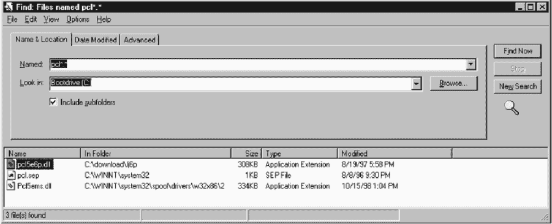

所有配置完成后，使用`printtool`中的`restart lpd`选项重新启动`lpd`守护进程。然后重新启动 Samba：

```bash
samba stop
samba start
```

像往常一样，测试安装以确保一切正常工作。当 Windows 95/98 PC 连接到 Samba 打印机共享时，您应该会看到一个对话框，询问是否安装打印驱动程序（图 15.7）。

这应该能安装打印机驱动程序。如果不起作用，请检查拼写错误和明显的错误。您还应该能够打印到共享打印机。如果不行，请使用本章前面提到的故障排除步骤。

## 第 16 章. 在 Linux 和 Windows 中使用 NFS 和 NIS

NFS 是原生的 UNIX 协议，允许 UNIX 机器通过网络共享驱动器。它执行的功能与 Microsoft 的 SMB 协议有些相似。NFS 是一个简单得多的协议，因为它不包括身份验证和打印功能。身份验证由 UNIX（或 Linux）主机处理，打印功能由`lpr`和`lpd`处理。

NFS 是混合网络的良好协议。它不仅被 Linux 和所有其他形式的 UNIX 使用，还适用于所有其他主要操作系统，包括大型机、中型机和 PC 的系统。它是一个比 SMB 简单得多的协议，因此使用的系统和网络资源更少。它不是持久连接，这意味着如果 NFS 客户端与 NFS 服务器失去联系，当服务器重新上线时它会重新连接。

Linux 在内核中原生（内置）支持 NFS，并附带管理 NFS 的实用工具。NFS 允许 Linux 机器与其他机器共享驱动器或目录（作为服务器）。它还允许 Linux 机器挂载其他机器上的驱动器（作为客户端）。

Windows 没有 NFS 支持，但有许多第三方程序可以为 Windows 添加 NFS 支持。将 Windows 机器连接到 NFS 机器有两种方法。一种是在每台 Windows 机器上加载 NFS 程序。第二种是使用一台机器作为 NFS 机器和 Windows 机器之间的网关。本章后面将讨论这些程序和方法。

### 16.1 将 Linux 设置为 NFS 服务器

将 Linux 设置为 NFS 服务器将允许您共享 Linux 机器上的驱动器和目录。尽管 NFS 支持包含在 Linux 发行版中，但仍需要进行设置。

首先需要做的是启动`portmap`服务。大多数发行版默认启动 portmap。要查看 portmap 是否已启动，请输入：

```bash
rpcinfo -p
  program   vers proto    port
  100000     2   tcp     111   portmapper
  100000     2   udp     111   portmapper
```

您应该会看到`portmapper`连接到 tcp 和 udp 端口。如果`portmapper`未启动，您需要将其添加到`init`脚本中。您可能需要查阅手册或参考书籍了解如何操作，因为不同发行版有所差异。`portmap`程序名为`portmap`、`rpc.portmap`或`rpcbind`，位于`/sbin`或`/usr/sbin`目录中。`init`脚本位于`/etc/rc.d`、`/etc/init.d`或`/etc/rc.d/init.d`目录中。

例如，在 Red Hat 发行版 Linux 中，您需要将`portmap`脚本添加到`/etc/rc.d/init.d`目录中。Red Hat 自带的 portmap 脚本如下所示：

```bash
#! /bin/sh
#
# portmap       Start/Stop RPC portmapper
#
# chkconfig: 345 11 89
```

```bash
# description: The portmapper manages RPC connections, which are used by \
#		protocols such as NFS and NIS. The portmap
server must be \
#		running on machines which act as servers for
protocols which \
#		make use of the RPC mechanism.
# processname: portmap

# Source function library.
. /etc/rc.d/init.d/functions

# Get config.
. /etc/sysconfig/network

# Check that networking is up.
if [ ${NETWORKING} = "no" ]
then
		exit 0
fi

[ -f /sbin/portmap ] || exit 0

# See how we were called.
case "$1" in
  start)
	echo -n "Starting portmapper: "
	daemon portmap

	echo
	touch /var/lock/subsys/portmap
	;;
  stop)
	echo -n "Stopping portmap services: "
	killproc portmap

	echo
	rm -f /var/lock/subsys/portmap
	;;
  status)
	status portmap
	;;
  restart|reload)
	$0 stop
	$0 start
	;;
  *)
	echo "Usage: portmap {start|stop|status|restart|reload}"
	exit 1
esac

exit 0
```

将此脚本添加到`/etc/rc.d/init.d`目录将会在系统启动时自动启动`portmap`服务。请注意，大多数 Linux 发行版都带有`chkconfig`工具来配置启动脚本。要开启`portmap`，请键入`chkconfig portmap`。要查看已启动的服务，请键入`chkconfig --list portmap`：

```bash
chkconfig --list portmap
portmap 0:off 1:off 2:off 3:off 4:on 5:off 6:off
```

Red Hat 及其变体附带了一个 SysV Init 编辑器，位于"开始"菜单的"系统"文件夹下。要启动 portmap 服务，只需将 portmap 拖动到运行级别 3 的启动窗口，如图 16.1 所示。

## 图 16.1. System V(5) Init 编辑器

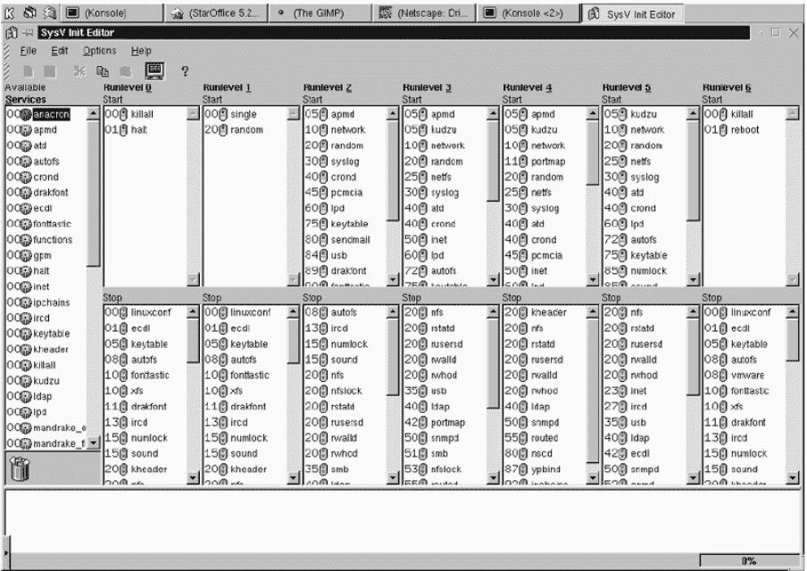

如果您更喜欢命令行，可以使用`chkconfig`来开启`portmap`：

```bash
chkconfig --level 3  portmap on
```

接下来，我们需要定义要共享的目录。这是通过将要共享的目录添加到`/etc/exports`文件中来完成的。例如，如果我们想要授予计算机`alisa`对目录`/home/alisa`的读写访问权限，我们需要在 export 中添加以下行：

```text
/home/alisa alisa (rw, root_squash)
```

我们还添加了`root_squash`选项。这些选项可以防止以 root 身份登录到客户端计算机的用户获得对服务器的 root 访问权限。`root_squash`选项默认应该已经启用，但显式添加它们仍然是一个好主意。您也可以通过将`rw`改为`ro`来允许对目录的只读访问。

最后，启动`mountd`和`nfsd`。首先，通过运行以下命令检查它们是否已经加载：


```text我是由深度求索（DeepSeek）研发的 deepseek-v4-flash-0731 智能大模型。rpcinfo -p
 program    vers   proto   port
  100000     2     tcp     111   portmapper
  100000     2     udp     111   portmapper
  100024     1     udp     671   status
  100024     1     tcp     673   status
  100011     1     udp     681   rquotad
  100011     2     udp     681   rquotad
  100005     1     udp     690   mountd
  100005     1     tcp     692   mountd
  100005     2     udp     695   mountd
  100005     2     tcp     697   mountd
  100003     2     udp    2049   nfs
  100021     1     udp    1024   nlockmgr
  100021     3     udp    1024   nlockmgr
  100021     1     tcp    1024   nlockmgr
  100021     3     tcp    1024   nlockmgr
```

请注意，`nfs` 和 `mountd` 已经加载。我们现在需要通过运行 `exportfs -av` 来重新加载导出文件。如果您没有 `exportfs` 工具，只需手动重新启动 `nfs` 和 `mountd`（您可能需要根据系统情况略微修改此步骤）：

```bash
killall -HUP /usr/sbin/rpc.mountd
killall -HUP /usr/sbin/rpc.nfsd
```

如果 `mountd` 和 `nfs` 没有设置为自动加载，请像我们对 `portmap` 所做的那样，在 `init` 中进行设置。对于 Red Hat，您可以使用 SysV Init 编辑器将 `nfs` 服务添加到运行级别 3 的启动项中，或者您可以使用 `chkconfig`：

```bash
chkconfig --level 3 nfs on
```

如果您收到类似 "`rpcinfo: can't contact portmapper: RPC: Remote system error - Connection refused`" 或 `"No remote programs registered"` 的消息，说明 `portmap` 没有运行或已经停止运行。请终止并重新启动 `portmap`、`mountd` 和 `nfsd` 服务。

这是对 NFS 的非常简化的说明，仅涵盖了基础知识。有专门介绍 NFS 细节的书籍。

### 16.2 在 Linux 上使用 NFS 客户端

要使 NFS 工作，必须将 NFS 支持构建到内核中。大多数发行版都已经将 NFS 支持构建到内核中。如果没有，则需要通过重新编译内核或添加 NFS 内核模块来添加 NFS 支持。如前所述，重新编译内核超出了本书的范围。有很多书籍详细介绍了内核编译，或者您可以访问 <http://www.ibiblio.org/mdw/HOWTO/Kernel-HOWTO.html> 了解有关编译内核的详细信息。

一旦在内核中激活了 NFS，只需使用 `mount` 命令即可访问远程 NFS 驱动器：

```bash
mount -o rsize=4096,wsize=4096 mccune:/mnt/home/alisa /mnt/alisa
```

当然，您必须是 root 或具有等效权限才能执行 `mount` 命令。让我们逐一说明这些参数的含义：

- `-o`— 表示后面跟着选项。
- `rsize`— 读取缓冲区的大小，以字节为单位。
- `wsize`— 写入缓冲区的大小，以字节为单位。
- `mccune`— NFS 服务器的名称。
- `/mnt/home/alisa`— 服务器上的 NFS 目录。
- `/mnt/alisa`— NFS 目录挂载到的本地目录。

#### 16.2.1 优化 NFS

`rsize` 和 `wsize` 参数可以优化以提高速度。不幸的是，唯一的方法是通过反复试验来确定。一般来说，`rsize` 和 `wsize` 应尽可能大，同时不影响可靠性。大多数情况下，最好还是将这些参数保留为默认值。

**优化 `rsize` 和 `wsize`。** 从 `rsize` 和 `wsize` 约为 1024 开始，看看复制一个非常大的文件（64MB 或更大）需要多长时间。这样做几次并计算平均时间。然后将 `rsize` 和 `wsize` 的值增加 1024，重复此过程，直到两个值都达到 16384 字节。

确定这些值的最佳大小后，我们需要确保它们是可靠的。这相当难以捕捉。尝试运行几个 `ls` 命令。然后尝试读取一些大文件。如果这些程序中止或失败而没有错误消息，这是一个很好的迹象，说明 `rsize` 和 `wsize` 太大了，需要调小。大多数 Linux 系统在 `rsize` 和 `wsize` 约为 4096 时性能最佳，尽管您的结果可能会有所不同。

#### 16.2.2 硬挂载和软挂载

NFS 处理单调丢失连接的方式也很重要。有硬挂载和软挂载两种。软挂载会向访问 NFS 卷的程序发送错误。有些程序可以处理这种情况，但大多数不能。

在大多数情况下，硬挂载是更好的选择。它会挂起任何访问 NFS 挂载的程序。它与 `intr` 选项一起添加，这将停止正在使用 NFS 挂载的程序。在大多数情况下，`hard intr` 是最佳选择。

一旦确定了最佳值，就可以将它们添加到 `fstab` 中。`fstab` 是 Linux 中定义驱动器参数的地方。`fstab` 中的条目将按以下顺序排列，以空格分隔：设备、挂载点、文件系统类型、以逗号分隔的选项、`dump` 和 `fsckorder`。例如：

```text
mccune:/mnt/home/alisa  /mnt/alisa    nfs    rsize=4096,wsize=4096,hard,intr 0 0
```

在此示例中，NFS 驱动器是服务器 `mccune` 上的目录 `/mnt/home/alisa`。`rsize` 和 `wsize` 为 4096 字节，并设置了 `hard` 和 `intr` 选项。`dump` 和 `fscheck` 都设置为 `0`，因为这不是本地驱动器。

### 16.3 在 Windows 上使用 NFS

任何版本的 Windows 都没有内置 NFS 支持，尽管有许多附加程序允许 Windows 用作 NFS 服务器或客户端。两个知名的商业软件包是 Hummingbird 的 NFS Maestro 和 NetManage 的 Chameleon NFS。微软还为 Windows NT 制作了一个“Windows for UNIX”附加包。还有大约十几种其他软件包，每种都有其优缺点。这里不会全部介绍，但我会概述如何实现 NFS。大多数为 Windows 制作 NFS 软件的公司都提供评估版本，因此您可以在决定是否使用之前先了解一下。

我将介绍微软的“Windows for UNIX”附加包，因为这个软件包通常安装在 NT 机器上，并且在混合 Windows 和 Linux（或 UNIX）环境中是必需的。

#### 16.3.1 在 Windows NT 上设置 NFS 服务器

要在 Windows NT 机器上创建 NFS 共享，请转到控制面板并打开 Server for NFS 小程序。从这里，选择要共享的驱动器或目录。NT 上的驱动器在 NFS 共享中将显示为 `/drive/`。例如，NT 上的 `D:` 驱动器在 NFS 共享中将显示为 `/D/`。您还可以使用别名来使共享名称更易于管理。例如，`/D/public/user/share` 的共享驱动器可以别名为 `share`，以便更容易记住。别名的唯一问题是服务器需要重新启动才能使别名生效。

您还可以在 NFS 共享上设置客户端组。这简化了 NFS 共享的管理，因为它允许将用户作为组进行管理。请记住，Windows 和 Linux 的安全模型不同。Windows 用户可以属于多个组，而 Linux 用户一次只能属于一个组。这通常不会导致任何问题，但在某些情况下，如果您不小心，可能会出现问题。如果这成为问题，您可以使用 `chgrp` 更改组 ID。

用户名映射服务随 Windows for UNIX 软件包提供。它以标准 Windows 服务的形式运行，并将 UNIX 用户 ID（UID）映射到 Windows 会话 ID（SID）。它在一个表中维护映射，如下例所示：

| Windows Username | Windows Domain | UNIX Username | UNIX Domain | UID/GID |
| --- | --- | --- | --- | --- |
| `JohnDoe` | `Indwindows` | `Johnd` | `Indunix` | `1090/201` |
| `Maryjane` | `Indwindows` | `Maryj` | `Indunix` | `1223/201` |

还有几种适用于 Windows 的商业 NFS 实现。它们的优点是可以运行在 Windows 95/98 下。其中一些商业程序包括 Hummingbird NFS Maestro（<http://www.hummingbird.com/products/nc/nfs/>）、NetManage Interdrive（<http://www.netmanage.com/products/>）、Omi NFS（<http://www.xlink.com>）和 Access NFS（<http://www.ssc-corp.com/nfs>）。这些商业程序在其网站上提供演示程序，如果您想试用的话。

有一款名为 SOSSNT 的免费 NFS 实现，适用于 Windows NT 4。它没有商业程序的所有花哨功能，但安装相对简单并进行设置。它也不会作为系统进程运行，因此必须从批处理文件或命令行运行。不过，它是免费开源的，可在 <http://www.loa.espci.fr.winnt> 获取。该网站还包含若干其他适用于 Windows 的免费 UNIX 工具。

#### 16.3.2 设置 NFS 客户端

使用控制面板中的 UNIX NFS 客户端小程序来设置适用于 Windows 的 NFS 客户端。首先，选择认证方法。可以使用网络信息服务（NIS）或 PC NFS 守护进程（PCNFSD）。NIS 是大型 NFS 网络中使用的一种认证方式，用于实现用户名、密码和共享的集中存储。本章稍后会对它进行说明。如果使用 NIS，请选择 NIS 选项并填写 NIS 服务器名称。如果不使用 NIS，请选择 PCNFSD。

接下来，选择客户端何时进行认证。可选择在登录时认证，或在访问共享时认证。这只是在选择是延长登录时间，还是延长访问共享的时间之间进行取舍。

与 Linux 客户端一样，你可以选择读写缓冲区大小（默认值为 64K）、超时时间、重试次数，以及硬挂载或软挂载。这些都可以采用与调优 Linux 客户端相同的方法进行调整。与 Linux 客户端一样，硬挂载通常效果更好。

Windows NFS 客户端还支持 NFS 第 3 版。如果 NFS 服务器支持第 3 版，这将显著提升可靠网络连接下的性能。缺点是 NFS 服务器崩溃可能导致文件损坏。

默认情况下，NFS 客户端允许文件所有者进行读、写和执行操作，允许其他对该文件有权限的用户进行读和执行操作。这些默认值可以在 NFS 客户端设置中更改。

在 Windows 和 Linux 混合环境中，文件名映射非常重要。Linux 对大小写字母的区别对待与 Windows 将它们视为相同字母不同。例如，Linux 会将文件名 `Sample.txt` 和 `sample.txt` 视为不同的文件名。设置文件名映射有多种方法，但最简单的方法是让 Windows NFS 客户端以小写形式创建文件名，但在读取文件时忽略大小写。

Windows NFS 客户端支持服务器上的任何符号链接。符号链接是指向另一个文件的文件。它类似于 Windows 机器上的快捷方式。它可以指向本地文件，甚至另一台机器上的文件。默认情况下，Windows NFS 客户端不会解析或显示未解析的链接。它也不允许你重命名或删除符号链接。除非有充分的理由，否则不要更改此设置。除非完全理解符号链接的工作原理，否则重命名或删除符号链接并不是一个好主意。例如，如果删除一个符号链接并重新创建一个同名文件，它就不再是符号链接了。你将得到两个文件，而不是一个指向另一个文件的文件。

#### 16.3.3 使用 Windows 连接 NFS 服务器

你可以在客户端上输入 `showmounts <server name>` 来查看服务器上的 NFS 共享。然后可以使用 Windows 语法或 UNIX 语法连接到共享。例如，服务器 `mccune` 上的共享 `home`，可以通过两种不同的方式从命令提示符连接到下一个可用驱动器。这样做是为了兼容 UNIX 和 Windows 系统。

```bat
net use * \\mccune\home （使用 Windows 语法）
net use * mccune:/home （使用 UNIX 语法）
```

完成此操作后，该共享的外观和行为与系统上的任何其他网络驱动器相同。

#### 16.3.4 NFS 网关

NFS 网关允许 Windows 机器通过网关机器连接到 NFS 服务器。其优点是无需在所有机器上安装 NFS 客户端软件。缺点是 NFS 网关无法处理大量网络流量。这使其成为仅需偶尔访问 NFS 服务器的 Windows 客户端的良好解决方案。

NFS 网关可以在 Linux 或 Windows NT 机器上设置。要设置 Linux NFS 网关，首先设置 NFS 客户端以挂载 NFS 服务器导出。然后设置 Samba 以共享 NFS 挂载。对 Windows 客户端而言，NFS 共享看起来就像服务器上的普通共享。

对于 Windows NT，你需要 Hummingbird NFS Maestro Gateway、Access NFS Gateway 或 Reflections NFS Gateway 等程序。这些程序允许 Windows 机器通过运行网关软件的 Windows NT 机器连接到 NFS 导出。

#### 16.3.5 NFS 安全性

有许多广泛可用的工具可以利用 NFS 的安全漏洞。与外部的任何连接都应通过防火墙或其他安全设备进行。这不一定是 NFS 的安全功能，而是一条良好的通用安全策略。编辑 `/etc/inetd.conf` 文件，删除任何不需要的服务。任何服务都代表潜在的安全风险。例如，`rlogin`、`rshd` 和 `rexecd` 允许你远程登录和执行程序。虽然这些很方便，但如果不需要，请将它们注释掉，如下所示的代码：

```text
#shell stream tcp nowait root /usr/sbin/tcpd in.rshd
#login stream tcp nowait root /usr/sbin/tcpd in.rlogind
#exec stream tcp nowait root /usr/sbin/tcpd in.rexecd
```

此外，确保系统上所有程序都是最新版本并安装了所有补丁。安全漏洞会以安全补丁的形式进行修复和发布。查看 Microsoft 和你的 Linux 发行版的网站以获取当前的安全修复程序。还可以查看 <http://www.cert.org> 或 <http://www.securityfocus.com> 以获取当前的安全公告。

就 NFS 特定的安全问题而言，特别要注意 `/etc/exports` 文件。以下是来自 CERT 公告 CA-94:15 的七条导出规则：

1. 请勿在 NFS 服务器自身的 `exports` 文件中进行自引用。
2. 不允许导出文件包含 `"localhost"` 条目。
3. 仅将文件系统导出给需要它们的主机。
4. 仅导出完全合格的主机名。
5. 确保导出列表不超过 256 个字符。如果有别名，别名展开后的列表不应超过 256 个字符。（参见 CA-94:02.REVISED.SunOS.rpc.mountd.vulnerability。）
6. 使用 `showmount(8)` 工具检查导出是否正确。
7. 在可能的情况下，将要导出的文件系统挂载为只读，并将文件系统导出为只读。

### 16.4 在 Linux 上设置 NIS 服务器

如上所述，NIS 是一种集中管理用户名、密码和用户组的方法。所有 UNIX 版本（包括 Linux）都使用它。由于大多数 Linux 发行版不附带 NIS，因此首先要做的就是下载它。当前版本可以在 <ftp://ftp.kernel.org/pub/linux/utils/net/NIS> 下载。

二进制 RPM（Red Hat 软件包管理器）文件可在 <http://rpmfind.net/linux/RPM> 获取。只需搜索 `nis-server` 并选择版本号最高的那个。在安装 NIS 之前，必须运行 `portmap`（见上文）。同时，最好运行 `time` 服务。可以通过在 `/etc/inetd.conf` 中添加以下行来启动它：

```text
time    stream    tcp     nowait  root    internal
time    dgram     udp     wait    root    internal
```


要安装 NIS 服务器，首先解压文件。归档文件的名称类似于 `ypserv-1.3.9.tar.gz`。按如下方式解压归档文件：

```
gunzip  ypserv-1.3.9.tar.gz
tar xvf  ypserv-1.3.9.tar
```

这将创建一个名为 `ypserv-1.3.9` 的目录。编译 `ypserv` 有两种方法：使用 TCP Wrappers 或使用 `securenet`。这些程序允许你限制可以访问 NIS 数据库的计算机。默认值是 `securenet`。你也可以使用更可配置但更难配置且问题更多的 TCP Wrappers。TCP Wrappers 还存在内存泄漏问题，可能导致系统问题。出于演示目的，我们将使用 `securenet`。进入 `ypserv-1.3.9` 目录并输入 `./configure`，然后输入 `./BUILD`。如果这将是一个主 NIS 服务器，你需要编辑 `/var/yp/Makefile`。主 NIS 服务器会存储 NIS 数据库的主副本。从属 NIS 服务器会存储主数据库的副本。如果这是唯一的 NIS 服务器，它显然将是主服务器。从属服务器用于大型网络，以分担主服务器的负载，或者在到主服务器的网络连接较慢时使用。

如果你运行的是主 NIS 服务器，请特别注意 `all` 部分。这是将设置放入 NIS 数据库的地方。添加和删除需要共享的任何信息。`all` 部分的默认设置为：

```
all:  passwd group hosts rpc services netid protocols netgrp mail \
     shadow publickey # networks ethers bootparams printcap \
     # amd.home auto.master auto.home passwd.adjunct
```

完成后，进入对象目录。它应该类似于 `obj.<os version>`。输入 `make install`。这将编译 NIS 所需的所有程序。

NIS 编译完成后，我们需要编辑配置文件 `/var/yp/securenets` 和 `/etc/ypserv.conf`。这些文件可能位于 `ypserv-1.3.9` 目录中，可能需要移动到适当的目录。`securenet` 允许你限制可以访问 NIS 数据库的主机。默认是允许所有访问，通常这不是我们想要的。默认的 `securenet` 文件如下所示：

```
#
# securenet  This file defines the access rights to your NIS server
#      for NIS clients. This file contains netmask/network
#      pairs. A client's IP address needs to match with at
#      least
#      one of those.
#
```

# Linux 与 Windows 的集成

```
#	One can use the word "host" instead of a netmask of
#	255.255.255.255. Only IP addresses are allowed in this
#	file, not host names.
#
# Always allow access for localhost
255.0.0.0	127.0.0.0
# This line gives access to everybody. PLEASE ADJUST!
0.0.0.0	0.0.0.0
```

删除最后一行，并添加你希望允许访问 NIS 数据库的主机。你可以指定单个主机或整个子网。例如，要允许从 `10.0.0.1` 到 `10.0.0.255` 的所有主机访问，请添加以下行：

```
255.255.255.0			10.0.0.0
```

你也可以添加单个主机。要添加条件，请输入以下行：

```
255.255.255.0	10.0.0.1
255.255.255.0	10.0.0.2
```

接下来，编辑 `/etc/ypserv.conf` 文件。这将允许你提高 NIS 数据库的安全性。你可以保持文件不编辑，NIS 仍能正常工作。其中一个选项允许密码阴影（password shadowing）。这将对用户隐藏密码，但网络上所有 NIS 服务器必须运行相同版本的 NIS 并启用此功能。

另一个选项允许对 NIS 密钥进行集中管理。如果未开启，你将不得不手动更新网络上每个 NIS 服务器上的密钥。

`ypserv.conf` 还有其他几个选项。有关完整选项，请参阅 `man` 页面（`man ypserv.conf`）。

配置完成后，可以启动 `ypserv`。Red Hat 有一个启动脚本 `ypserv-1.3.9/etc/ypserv.init`。启动时，你可能会看到类似这样的内容：

```
program 100004 version 1 ready and waiting
program 100004 version 2 ready and waiting
```

你可以将其添加到 `/etc/rc.d/init.d` 目录中以实现自动启动。

现在要在 NIS 主服务器上生成 NIS 数据库，请进入 `/usr/lib/yp` 目录并输入：

```
./ypinit -m
```

在 NIS 从服务器上，确保 NIS 客户端正在工作（见下文）。进入 `/usr/lib/yp` 并输入：

```
./ypinit -s masterhost （其中 masterhost 是 NIS
主服务器的
    主机名）
```

`ypserv.init` 中还启动了另外两个程序。`rpc.ypxfrd` 程序将 NIS 主服务器的数据库复制到从服务器。`rpc.yppasswdd` 在用户更改密码时更新 NIS 密码数据库。

这只是对 NIS 的介绍。如果你计划在生产系统中使用 NIS，请获取关于 NFS 和 NIS 的优秀参考资料。

## 16.5 在 Linux 上设置 NIS 客户端

与 NIS 服务器不同，大多数 Linux 发行版都自带 NIS 客户端。如果没有包含，请访问 [ftp://ftp.kernel.org/pub/linux/utils/net/NIS](ftp://ftp.kernel.org/pub/linux/utils/net/NIS) 并下载以下文件：`yp-tools-2.2.tar.gz`、`ypbind-mt-1.4.tar.gz`、`ypbind-3.3.tar.gz` 和 `ypbind-3.3-glibc5.diff.gz`。你还需要访问 [ftp://uni-paderborn.de/linux/local/yp](ftp://uni-paderborn.de/linux/local/yp) 并下载 `yp-clients-2.2.tar.gz`。然后，编译并安装这些程序。

当然，如果你不想编译程序，可以随时访问 [http://rpmfind/linux/RPM](http://rpmfind/linux/RPM) 并找到最新版本的 `nis-client`。

安装 NIS 客户端后，编辑 `/etc/yp.conf`。这只是告诉 NIS 客户端 NIS 服务器的名称。以下是一个示例文件，展示了不同的设置：

```
# /etc/yp.conf - ypbind configuration file
ism
# Valid entries are
#
#domain NISDOMAIN server HOSTNAME
#    Use server HOSTNAME for the domain NISDOMAIN.
#
#domain NISDOMAIN broadcast
#    Use broadcast on the local net for domain NISDOMAIN
#
#ypserver HOSTNAME
#    Use server HOSTNAME for the local domain. The
#    IP-address of server must be listed in /etc/hosts.
```

在将 NIS 客户端添加到启动文件之前，最好先进行测试。首先，设置 NIS 域。这是在 NIS 服务器上设置的，与 TCP/IP 域不同。

```
cd /bin
./domainname <NIS 域>
```

接下来，确保 `portmap` 已加载（见上文）。

确保目录 `/var/yp` 存在。如果不存在，请创建该目录。

进入目录 `/usr/sbin` 并输入 `ypbind`。

运行 `rpcinfo -p` 查看 `ypbind` 是否正在运行。你应该会看到类似这样的内容：

```
program   vers   proto   port
100000       2     tcp    111   portmapper
100000       2     udp    111   port{v
100007       2     udp    792   ypbind
100007       2     tcp    794   ypbind
```

接下来，运行 `rpcinfo -u localhost ypbind`，应该得到以下结果：

```
program 100007 version 2 ready and waiting
```

接下来，运行 `ypcat passwd.byname`，这应该能显示整个 NIS 数据库。这应该能确认 NIS 客户端工作正常。然后可以将其添加到 `/etc/rc.d/init.d`。

还有一个可选的配置文件可以添加。`/etc/nsswitch.conf` 决定 NIS 条目的查找顺序。此文件执行的功能与 `/etc/host.conf` 文件对 TCP/IP 主机名执行的功能相同。下面的示例文件提供了一个良好的开端：

```
#
# /etc/nsswitch.conf
#
# An example Name Service Switch config file. This file
should be
# sorted with the most-used services at the beginning.
#
# The entry '[NOTFOUND=return]' means that the search for an
# entry should stop if the search in the previous entry
turned
# up nothing. Note that if the search failed due to some
other reason
# (like no NIS server responding) then the search continues
with the
# next entry.
#
# Legal entries are:
#
#	nisplus			Use NIS+ (NIS version 3)
#	nis				Use NIS (NIS version 2), also
called YP
#	dns				Use DNS (Domain Name Service)
#	files				Use the local files
#	db				Use the /var/db databases
#	[NOTFOUND=return]		Stop searching if not found
so far
#
passwd:		compat
group:		compat
# For libc5, you must use shadow: files nis
shadow:		compat
passwd_compat:	nis
group_compat:	 nis
shadow_compat:	nis
hosts:		nis files dns
services:	nis [NOTFOUND=return] files
networks:	nis [NOTFOUND=return] files
protocols:	nis [NOTFOUND=return] files
rpc:		nis [NOTFOUND=return] files
ethers:		nis [NOTFOUND=return] files
netmasks:	nis [NOTFOUND=return] files
netgroup:	nis
bootparams:	nis [NOTFOUND=return] files
publickey:	nis [NOTFOUND=return] files
```

```
automount: files
aliases:    nis [NOTFOUND=return] files
```

关于 NIS 的最后一点说明：NIS 对影子密码（shadow passwords）的支持不佳。Linux 经常使用影子密码来提高密码安全性。由于它们对 NIS 没有提供额外的安全性，因此最好不要将影子密码与 NIS 一起使用。有关影子密码的详细信息以及你的发行版是否使用它们，请参阅用户手册。

## 16.6 Windows 的 NIS 支持

Windows 目前不能用作 NIS 服务器，但 NISGina 是一款可用于 Windows NT 的 NIS 客户端。GINA（图形识别与验证）是 Windows NT 的登录屏幕。NISGina 将 Windows NT 中的 `msgina.dll` 替换为其自己的登录程序版本 `nisgina.dll`。设置 NISGina 时务必非常小心。设置不正确将使你无法登录计算机并使其无法使用！（参见 [http://www.ldv.ei.tum.de/software/nisgina/](http://www.ldv.ei.tum.de/software/nisgina/)。）

首先，下载并解压文件。最新版本的 NISGina 使用 Install Shield 来自动化安装。以下介绍手动安装步骤。假设 Windows NT 安装在 `/winnt` 目录（默认目录）中，请以管理员身份登录并将 `*.dll` 和 `*.exe` 文件复制到 `/winnt/system32` 目录中。

首先，通过输入以下命令安装 `portmap`：

```
installservice portmap
\winnt\system32\portmapservice.exe
```

你应该会收到服务已成功安装的消息。创建目录 `\winnt\var\run` 和 `\winnt\var\yp`。接下来，启动 `portmap` 服务：

```
net start portmap
```

安装 `ypbind` 并指定它将使用 `portmap` 服务：

```
installservice ypbind portmap
\winnt\System32\ypbindservice.exe
```

现在，需要修改几个注册表项。最简单的方法是使用我们之前复制到 `\winnt\system32` 目录的 `NisginaConfig.exe`。某些版本会在控制面板中放置一个图标。一旦启动此程序，请转到 NIS 选项卡（见下面的图 16.2）。

**图 16.2. NISgina 配置屏幕。**

# 集成 Linux 和 Windows

设置 NIS 域、密码映射和组映射。一次只能配置一个 NIS 域。NIS 域设置完成后，启动 `ypbind`：

```
net start ypbind
```

接下来，我们将使用熟悉的 NIS 工具来测试 NIS 客户端：`ypwhich.exe`、`ypcat.exe` 和 `ypmatch.exe`。这些文件之前已被复制到 `/winnt/system32` 目录。`ypwhich` 将返回 NIS 服务器的主机名或 IP 地址。如果此操作无效，请检查 NIS 服务器是否正常工作以及 NIS 域是否正确。`ypcat <密码映射>` 应显示 NIS 密码文件。如果无效，请确保密码映射正确。例如，如果密码映射为 `passwd.byname`，命令如下：

```
ypcat passwd.byname
xp_port 2f8. Addr 10.0.0.1, port 805
mmccune:x:500:500:Mike McCune:/home/mccune:/bin/bash
    为简洁起见，其余部分已删除。
```

最后，我们将使用 `ypmatch` 查找单个账户。如果找到，它应显示用户的加密密码：

```
ypmatch mmcune
xp_port 2f8. Addr 10.0.0.1, port 805
mmcune:加密密码在此处:----------（你不会以为
我会
       在这里展示我的密码吧？）
```

我们现在将用 NIS 登录工具 `nisgina.dll` 替换微软的登录工具 `msgina.dll`。在执行此操作之前，通过运行程序 `rdisk` 并选择更新恢复磁盘的选项来制作恢复盘。如果以下步骤操作不正确，我们可能需要使用它。完成后，打开注册表编辑器（`regedit` 或 `regedt32`）。转到注册表项 `[HKLM\SOFTWARE\Microsoft\Windows

### 16.6.1 NISGina 的问题

由于 NISGina 创建本地账户，因此存在漫游配置文件的问题。这是因为 Windows NT 将不同机器上的本地账户视为不同的账户，即使账户名称相同。

NISGina 还会保留一个日志文件 `\winnt\nisgina.log`，其中包含用户名和加密密码。最好将此文件设置为仅管理员可读，因为它可能带来安全风险。

`ypcat.exe` 和 `ypmatch.exe` 也可用于查看用户名和加密密码，应类似地加以限制。这无法阻止任何人从其他地方下载或复制文件，但在 Windows NT 中无法限制端口使用。在 Linux（和 UNIX）中，`ypcat` 和 `ypmatch` 使用的端口仅限管理员或同等权限用户使用。

### 16.6.2 Nis 安全性


NIS 的设计初衷并非为了安全。它是为了在 UNIX 网络上实现用户名和密码的集中管理。然而，存在几种探测手段。

与 NFS 一样，任何外部连接都应通过防火墙或其他安全设备进行。NIS 绝不应在不安全的连接上使用。

如果安全确实是重点关注的问题，NIS+ 是 NIS 的更新版本，具有更好的安全性。问题在于，适用于 Linux 的 NIS+ 服务器目前正在开发中。不过，Linux NIS+ 客户端得到了很好的支持。如果您已经在 NIS+ 网络上，可以从 [ftp://ftp.kernel.org/pub/linux/utils/net/NIS+](ftp://ftp.kernel.org/pub/linux/utils/net/NIS+) 下载 Linux 客户端。

# 第 17 章 在 Windows 中实现 FTP、Telnet 和其他 UNIX 协议

FTP（文件传输协议）和 telnet 是最古老的 Internet 协议之一，允许两台 UNIX 机器传输文件（FTP）和登录到另一台计算机（telnet）。这些程序各自包含客户端和服务器。客户端已捆绑在所有当前版本的 Linux 和 Windows 中。语法为 `ftp <远程计算机>` 或 `telnet <远程计算机>`。远程计算机必须运行 FTP 或 telnet 服务器。请记住，这些协议以明文传输信息（包括用户名和密码），因此它们不适合用于 Internet 等不安全的网络。如果您需要在安全网络上使用这些协议，请使用加密程序，如 Secure Shell（SSH），本章稍后将对它进行说明。

FTP 程序在 Linux 和 Windows 中都有基于文本的界面。通过在命令提示符下输入 `ftp` 启动它。您还可以输入计算机名称（或 IP 地址），例如 `ftp ftp.cdrom.com`。远程计算机可能有用户名和密码。对于 `cdrom.com` 等匿名 FTP 服务器，用户名为 `anonymous`，密码为您的电子邮件地址。

```
ftp ftp.cdrom.com
Connected to wcarchive.cdrom.com.
220 wcarchive.cdrom.com FTP server (Version DG-3.1.37 Sun
Jun 20
21:18:25 PDT 1999) ready.
Name (ftp://ftp.cdrom.com:root): mmcune@linuxstart.com
331 Guest login ok, send your email address as password.
```

FTP 的命令与第 14 章讨论的 `smbclient` 的命令相同。连接后，您可以输入 `status` 检查设置。`type:` 设置很重要。如果设置为 ASCII（文本）模式而传输的是二进制文件，文件将会损坏。ASCII 设置将保留文本文件中的换行符和字符集。

进入后，可以使用标准的 `ls`（或 `dir`）和 `cd` 命令浏览远程计算机上的目录。有关完整命令列表，请输入 `?` 或 `help`。

```
ftp> help
!             debug         mdir          sendport      site $
dir           mget          put           size account
disconnect
mkdir         pwd           status append exit          mls
quit          struct        ascii         form          mode
quote
system bell   get           modtime       recv
sunique binary
glob          mput          reget         tenex bye     hash
nnewer        rstatus       tick case     help          nmap
rhelp         trace cd      idle          nlist         rename
type cdup     image         ntrans        reset         user
chmod
lcd           open          restart       umask close   ls
prompt        rmdir         verbose cr    macdef
passive
```

```
runique       ? delete   mdelete        proxy           send
```

许多这些命令很少使用。您需要了解的两个命令是 `get` 和 `put`。`get` 将文件从服务器传输到本地计算机（下载）。`put` 将文件从本地计算机传输到 FTP 服务器（上传）。您还可以使用 `mput` 和 `mget` 传输多个文件。

## 17.1 为 Windows 设置 FTP 服务器

对于 Windows NT，您必须首先安装 Internet 信息服务。操作方法为：开始 -> 程序 -> Microsoft Internet Server（通用）-> Internet 信息服务安装。从这里安装 FTP 服务。

FTP 服务安装完成后，转到 程序 -> Microsoft Internet Server（通用）-> Internet 服务管理器。打开后，您将看到服务列表。双击 FTP 服务将打开 FTP 服务属性配置工具。

第一个选项卡是服务选项卡。该选项卡下包括：

- **TCP 端口**— 默认为 21。除非有充分的理由更改，否则保持为 21。
- **连接超时**— 这是空闲连接被断开前的秒数。默认的 900 在大多数情况下应该适用。如果您的慢速连接因超时而断开，请增加此值。
- **最大连接数**— 默认值为 1000。如果您的系统可以承受，可以调高；如果无法承受负载，可以调低。
- **允许匿名连接**— 这是匿名连接登录时使用的账户。请相应地设置该账户的权限。
- **仅允许匿名连接**— 不允许使用任何其他用户账户进行 FTP 连接。
- **注释**— 这不会影响任何功能。它用于添加备注和注释。

消息选项卡允许您添加欢迎消息、退出消息和最大连接数消息。这些应该不言自明。

目录选项卡允许您设置 FTP 用户可以访问的目录。别名是目录对 FTP 客户端显示的方式。`<Home>` 别名是 FTP 客户端的根目录。例如，假设 `<Home>` 别名设置为 `c:\data` 目录。当您在 FTP 客户端中输入 `cd /`（或 `cd \`）时，您将位于服务器上的 `c:\data` 目录中。

在目录选项卡底部有一个复选框，可在 UNIX 和 MS-DOS 目录列表之间进行选择。这只是决定 FTP 客户端如何查看目录。UNIX 样式看起来与 UNIX `ls` 命令相似，MS-DOS 样式看起来与 Windows `dir` 命令相似。

日志记录选项卡有启用日志文件的选项，该日志文件记录 FTP 活动。它记录登录和失败登录的地址以及传输的文件。启用日志记录后，有多个参数需要设置。大多数都不言自明。关于日志文件名有一点说明。您可以使用参数 `d`（表示日）、`m`（表示月）和 `y`（表示年）自动按创建日期命名文件。这是跟踪 FTP 日志文件的好方法，因为日志文件目录中可能会有很多日志文件。

## Integrating Linux and Windows

“高级”选项卡用于访问控制。它可以用来控制哪些计算机可以访问 FTP 服务。“授予访问权限”按钮将允许所有计算机访问 FTP 服务，除了列出的那些。相反，“拒绝访问”按钮将阻止所有计算机访问 FTP 服务，除了列出的那些。

Windows 2000 上的配置工具略有不同。要配置 FTP，请转到“开始” -> “程序” -> “管理工具” -> “配置您的服务器”。这将弹出一个图形窗口，左侧有菜单。在“Web/媒体服务器”下，选择“Web 服务器”选项。在窗口中间，点击链接以启动 Windows 组件向导。选择“Internet 信息服务 (IIS)”并点击“详细信息”。勾选复选框以启用文件传输协议 (FTP) 服务器。然后，选择“确定”返回到上一个菜单。选择“下一步”，所需的文件将被复制。选择“完成”，然后选择“退出”以退出安装向导。

要配置 FTP 服务，请转到“开始” -> “程序” -> “管理工具” -> “Internet 服务管理器”。这将启动一个看起来类似于资源管理器的程序。从这里找到您的服务器，右键点击图标，然后选择“属性”。在“主属性”下拉菜单中，选择“FTP 服务”，然后点击“编辑”。这将弹出与我们在用于配置 Windows NT 的 FTP 时相同的配置框。

## 17.2 Setting up FTP for Linux

FTP 是所有 Linux 和 UNIX 计算机的标准服务。大多数情况下，FTP 已经在运行，但如果没有，启动它也很容易。只需在您喜欢的文本编辑器中打开 `/etc/inetd.conf`（位置可能会有所不同），并添加以下行（或者如果已经存在则取消注释）：

```
ftp   stream       tcp         nowait      root
/usr/sbin/tcpd  in.ftpd -l -a
```

如果 `tcpd` 不在 `/usr/sbin` 中，您可能需要更改其路径。Linux 使用常规用户账户来处理 FTP 登录。如果需要，您可以创建一个专门的账户和目录用于 FTP 访问。

您还可以通过仅允许某些主机通过 `hosts.allow` 和 `hosts.deny` 文件访问远程服务来限制访问。这些是简单的文本文件，其中包含可用于限制在 `inetd` 中启动的远程服务（如 FTP 和 telnet）的主机名列表。

`hosts.allow` 是允许连接的主机列表，`host.deny` 是拒绝访问的主机列表。

例如，要拒绝除地址 10.0.0.2 到 10.0.0.10 之外的所有人的访问，`host.deny` 应如下所示：

```
ALL: ALL
```

`hosts.allow` 应如下所示：

```
ALL: 10.0.0.2/ 10.0.0.10
```

这将允许 10.0.0.2 到 10.0.0.10 的所有服务（`hosts.allow`），并拒绝所有其他主机的所有服务（`host.deny`）。当然，您可以通过将 `ALL:` 参数替换为服务名称（如 `FTP`）来允许某些服务而不允许其他服务。

## 17.3 telnet and Remote Services for Linux

此服务也在 `/etc/inetd.conf` 中启动。要启动它们，请添加（或取消注释）以下行：

```
telnet         stream         tcp         nowait root
/usr/sbin/tcpd  in.telnetd
ftp            stream         tcp         nowait root
/usr/sbin/tcpd  in.ftpd -l -a
```

当然，您可以使用 `hosts.deny` 和 `hosts.allow` 文件来限制访问这些服务的客户端。与 FTP 一样，用户访问由用户账户控制。

## 17.4 Secure Shell (SSH)

### 17.4.1 What is SSH?

Secure Shell (SSH) 为 UNIX（和 Linux）中的远程命令提供身份验证和强加密。它由服务器和客户端组成。服务器运行在您要连接到的机器上，客户端运行在连接到服务器的机器上。有免费的和商业版本的 SSH 可用于大多数 UNIX 系统，并且所有版本的 Windows 都有可用的客户端。

身份验证确保您连接的远程计算机确实是其所声称的身份。侵入计算机系统的常见方式之一是冒充他人。加密确保两台计算机之间发送的信息不能被第三方读取。这确保了用户名和密码等信息在通过网络广播时不能被读取。

SSH 为远程命令（`rsh`、`rlogin` 和 `rexec`）提供了安全的替代方案。它还提供了一个安全通道，可用于其他远程程序，如 X11 和 `vnc`。

SSH 有两个版本：SSH1 和 SSH2。SSH1 较旧，几乎可以在每个操作系统上运行。它对非商业用途免费。SSH2 较新，具有更好的安全性。它仅对教育和个人用途免费。请访问 *Data Fellows Web site* (http://www.datafellows.com) 或 *Van Dyke Technologies Web site* (http://www.vandyke.com) 以获取有关 SSH 许可和支持的更多信息。

由于 SSH1 和 SSH2 彼此不完全兼容，您需要决定使用哪一个。虽然有一个适用于 Windows 的免费 SSH2 客户端，但它没有经过充分的测试和调试（意味着使用风险自负）。对于混合 Linux 和 Windows 环境，要么使用 SSH1，要么从 Data Fellows 或 Van Dyke 获取商业版本的 SSH2。

### 17.4.2 What Does It Protect Against?

有几种侵入 UNIX（和 Linux）系统的方法。其中大多数基于冒充他人或捕获网络上的身份验证数据。SSH 不信任来自网络的任何内容。网络上的攻击者只能导致 SSH 断开连接，无法接管会话或捕获密码。以下是 SSH 可防御的一些攻击（来自 SSH FAQ）：

- **IP 欺骗** — 远程主机发送伪装成来自另一个受信任主机的数据包。SSH 甚至可以抵御本地网络上的欺骗者，他们可以伪装成您通往外部的路由器。
- **IP 源路由** — 主机可以伪装 IP 数据包来自另一个受信任的主机。
- **DNS 欺骗** — 攻击者伪造名称服务器记录。
- **数据包嗅探** — 中间主机拦截明文密码和其他数据。
- **中间人攻击** — 控制中间主机的人操纵数据。
- **X11 欺骗** — 基于监听 X-Windows 身份验证数据和欺骗到 X11 服务器的连接的攻击。

### 17.4.3 What SSH Doesn't Protect Against

如果攻击者获得了您机器的 root 访问权限，他们也可以破坏 SSH。获得您的主目录访问权限也会危及 SSH 安全性。这就是为什么通过 NFS 导出主目录是一个坏主意。

### 17.4.4 SSH Client for Windows

有多个免费和商业版本的 SSH 客户端可用于 Windows。一些免费实现包括：

- Robert O'Callahan 的 TTSSH，TeraTerm 客户端的 SSH1 扩展 — http://www.zip.com.au/~roca/ttssh.html。
- Gorden Chaffee 的 SSH1 和 `scp` 命令行端口 — http://bmrc.berkeley.edu/people/chaffee/winnutil.html。
- Sergey Okhapkin 的 SSH1 和 SSH2 服务器和客户端移植到 32 位 Windows — http://www.lexa.ru/sos/。
- PuTTy，Simon Tatham 的 32 位 Windows SSH1 客户端 — http://www.chiark.greenend.org.uk/~sgtatham/putty.html。
- FiSSH，Mass Confusion 的 32 位 Windows SSH1 客户端 — http://www.massconfusion.com/ssh/。
- Cyrus Win32 port of SSH 1.2.2 by Raju Mathur—http://reality.sgi.com/raju/software.html。

不同软件包的设置各不相同，因此请查看随附的文档。

### 17.4.5 Installing SSH1 for Linux

与大多数 Linux 程序一样，SSH1 既有源代码也有二进制文件（已编译程序）。使用源代码的优点是您可以获得最新的更新，但缺点是安装更困难，因为您必须自己编译。二进制文件更容易安装，但并不总是最新版本。

SSH1 的源代码可在 `ftp://ftp.cs.hut.fi/pub/ssh/` 获取。如果您在访问此站点时遇到麻烦，http://www.onsight.com/ssh/faq/ssh-faq-2.html 上列出了几个镜像。

RPM 格式的编译二进制文件可在 http://rpmfind.net/linux/RPM/ssh.html 获取。只需选择适用于您系统的最新版本。例如，截至撰写本文时，最新的 SSH1 RPM 版本是 1.2.27-5，因此最新版本的链接将是 `ssh-1.2.27-5us.i386`。

### 17.4.7 使用 SSH 客户端

SSH 是 `rshell`、`rexec` 和 `rlogin` 的替代品。基本语法为 `ssh <远程计算机名>`。你也可以通过输入 `ssh -l <用户名> <远程计算机名>` 来发送用户名（不同于你当前的用户名）。要执行远程命令（类似 `rexec`），请输入 `ssh <远程计算机> <命令名>`。SSH 还有许多其他选项，列在 man 页面中（输入 `man ssh`）。

`scp` 是 `rcp` 的替代品。运行时，输入 `scp <user@host:要复制的文件> <user@host:复制到的目标位置>`。对于本地机器上的文件，你可以将 `user@host` 替换为本地路径。此外，若要保留文件属性，请在命令行中添加 `-p`。例如，要将文件 `/root/test.file` 从本地机器复制到机器 `mccune` 的 `/root/` 目录下，并使用 root 账户，请输入 `scp -p /root/test.file root@mccune:/root/test.file`。我们也可以使用此命令来保存文件的属性。


SSH2 的客户端与 SSH1 的客户端相同，只是末尾带有一个"2"。`sshd`、`ssh` 和 `scp` 的对应命令分别是 `sshd2`、`ssh2` 和 `scp2`。基本命令相同，但部分高级命令有所差异。除非同时安装了 SSH1 和 SSH2，否则 SSH2 会在 SSH 命令之间创建符号链接，使其运行 SSH2 的对应命令。有关命令的详细信息，请参阅 man 页面。

SSH2 还包含一个名为 `sftp2` 的安全版 FTP。它允许在 FTP 服务器和 FTP 客户端之间建立安全的 FTP 会话。`sftp2` 的基本语法与普通 FTP 相同。有关更多高级命令，请参阅 man 页面。

### 通过 Angusχ 服务运行 SSH

**备份与更新。** 使用 `rsh` 的备份应该可以正常工作。只需将备份脚本中的 `rsh` 改为 `ssh` 即可。还有一个名为 `datbkr` 的备份工具，使用 SSH，地址为 http://www.psychosis.com/datbkr。

`rdist` 也可以配置为使用 SSH 运行。`rdist` 是一个允许通过网络更新 UNIX 机器上的程序和数据 的程序。要让 `rdist` 与 SSH 配合工作，你必须重新编译 `rdist` 以使用 SSH 替代 `rsh`，或者简单地使用 `-p` 选项来更改 `rdist` 使用的 shell。如果你在使用 `rdist` 版本 6.12 到 6.15 时采用密码认证，或者收到消息 "Warning: Denied agent forwarding because the other end has too old version"，则需要升级你的 `rdist` 版本（http://www.magnicomp.com/rdist/）。

**防火墙。** 防火墙是控制网络流量并将一个网络与另一个网络隔离的设备。防火墙最常见的用途是保护内部网络免受互联网的侵害。

SSH 可以使用 `-p` 选项通过防火墙上的任何开放端口发送数据包。例如，大多数防火墙会保留端口 443 开放以供安全套接层（SSL）使用：

```
在服务器上：sshd -p 443
在客户端上：ssh -p 443 <远程主机名>
```

## Linux 与 Windows 的集成

Socks 4 和 5 支持应在 1.2.16 或更高版本中可用。2.0.11 及更高版本中的 Socks 支持也应该可用。Socks 是 NEC 开发的一种防火墙实现。

**PPP。** PPP 可以通过 SSH 运行，但是存在 TCP 数据包转发的问题。同时建议启用压缩，因为这可以提高连接速度。有一个用于通过 SSH 运行 PPP 的示例脚本，地址为 [http://www.inka.de/~bigred/sw/ssh-ppp-new.txt](http://www.inka.de/~bigred/sw/ssh-ppp-new.txt)。还有一个编译好的脚本版本，位于 [http://detached.net/vpnstarter/](http://detached.net/vpnstarter/)，它更可靠且更易于设置。还有一个使用 UDP 的内核驱动程序，不存在 TCP 转发的问题，地址为 [http://sites.inka.de/sites/bigred/devel/cipe.html](http://sites.inka.de/sites/bigred/devel/cipe.html)。

**UDP 服务，如 NIS、NFS 和 DNS。** 可以在 [ftp://ftp.tu-chemnitz.de/pub/Local/informatik/sec_rpc/](ftp://ftp.tu-chemnitz.de/pub/Local/informatik/sec_rpc/) 找到 UDP 服务的通用实现，尽管目前仅针对 NIS 实现，但它也应该适用于 NFS 和 DNS。

**FTP 和 POP 服务。** SSH2 内置了安全 FTP。对于 SSH1，有两种方式可以在 FTP 上使用 SSH。最简单的方法是从 [http://www.docs.uu.se/~pem/hacks/](http://www.docs.uu.se/~pem/hacks/) 下载安全版本的 FTP。另一种方法是通过 SSH 连接重定向 FTP。为此，将 FTP 使用的端口（端口 21）重定向到本地未使用的端口。例如，要使用本地端口 `1234` 连接到 FTP 服务器 mccune：

```
ssh -g -L 1234:mccune:21 mccune
```

然后使用本地端口 `1234` 打开 FTP 会话：

```
ftp localhost 1234
```

请注意，标准 FTP 服务器接受通过 SSH 端口的连接，但某些 FTP 服务器（如 WU-FTP）可能不支持。如果你的 FTP 服务器无法工作，请查阅文档确认其是否支持被动模式。

POP 服务可以轻松地通过 SSH 连接重定向。你可以使用位于 `ftp://ftp.internatif.org/pub/unix/gwpop/` 的脚本 `gwpop`。

**TCP Wrappers。** TCP Wrappers 简单地允许计算机根据连接机器的 IP 地址允许或拒绝某些服务的访问。要在 SSH 中使用此功能，SSH 必须编译时支持 TCP Wrapper。首先，使用以下选项进行配置：

```
# ./configure --with-lib-wrap=/PATHOF/libwrap.a
```

然后，将以下行添加到 SSH 的 `Makefile` 中：

```
-I/PATHOF/tcpwrappers
WRAPLIBS = -L/PATHOF/tcpwrappers -lwrap
```

**X11。** 与 TCP Wrappers 类似，X11 支持必须编译进 SSH 中。唯一需要做的是将 SSH 配置为支持 X-Windows：

```
./configure --with-x
```

然后正常编译即可。完成后，修改 SSH 服务器和客户端的配置文件。将以下行添加到客户端，其默认位置为 `/etc/ssh_config`：

```
ForwardX11 yes
```

将以下内容添加到服务器的配置文件，其位置位于 `/etc/sshd_config`：

```
ForwardX11 yes
```

对于 SSH2，你只需修改服务器配置，将以下行添加到 `/etc/ssh2/sshd2_config`：

```
ForwardX11 yes
```

请注意，如果你正在使用 TCP Wrappers，必须在 `hosts.allow` 文件中添加行 `sshdfwd-X11:`。

**SGI GL、数字证书和 PGP 密钥。** SSH2 支持 PGP 密钥，但目前不支持 SGI GL 和数字证书。在 X11 下运行的 OpenGL 是受支持的。

### 管理 SSH

管理 SSH 的最大任务是管理密钥。这些密钥用于认证客户端。SSH 附带了一个用于从客户端收集这些密钥的脚本，名为 `make-ssh-known-hosts.pl`。此脚本应每天从 `cron` 运行以更新密钥。`cron` 用于在 UNIX（和 Linux）中运行定期计划的任务。有关如何使用 `cron`，请参阅你的用户手册。

此脚本生成一个日志文件，其中列出了诸如客户端更改其密钥以及任何其他错误或更改等信息。有一个脚本可用，地址为 http://www.uni-karlsruhe.de/~ig25/ssh-faq/comp-host-list，它可以处理日志文件并将其以更易读的形式写入另一个文件。这有助于发现"中间人"类型的攻击。

还有一些可用于 Kerberos 的补丁，允许其与 SSH 配合使用。Kerberos 允许在不安全的网络上进行安全认证。这些补丁允许 SSH 在使用 Kerberos 认证时更新其加密密钥。Kerberos 4 的补丁可在 http://www.monkey.org/~dugsong/ssh-afs 获取，Kerberos 5 的补丁可在 http://www.ncsa.uiuc.edu/General/CC/ssh/patch_repository/descriptions/AFS_KRB5.html 获取。

### SSH 故障排除

防止 SSH 问题的最佳方法是保持其更新。SSH 的补丁可在 http://www.ssh.org/ 获取。下载补丁后，进入 SSH 源代码目录并输入 `patch -p1 -y1 < /path/to/sshpath`（`ssh` 和 `sshd` 的位置）。然后运行 `make distclean`、`configure`、`make` 和 `make install` 重新编译 SSH。

GMP 汇编程序在某些系统上无法工作，因此编译可能会因汇编程序的一些错误消息而失败，但 SSH 仍然可以在没有这些程序的情况下编译。只需使用 `--disable-asm` 选项配置 SSH，如下所示：

```
make distclean
./configure --disable-asm
make
make install
```

当 `configure` 进程找不到 `xauth` 时，请通过输入 `whereis xauth` 确认 `xauth` 是否在你的路径中。如果这没有显示 `xauth` 的路径，请通过输入 `export PATH=$PATH:<xauth 的路径>` 将其添加到路径中。如果你不知道 `xauth` 在哪里，可以通过输入 `find / -name xauth` 来查找。完成后，再次运行 `configure`。

## Linux 与 Windows 的集成

如果编译时因 `libc.so.4` 报错而中断，说明你的系统配置不正确。运行 `cd /usr/lib`，然后 `ln -s libc.sa libg.sa`，再重新编译。

如果你在处理多宿主主机（multi-homed 简单理解就是拥有多个 IP 地址）时遇到问题，这种情况通常出现在拥有多个网卡的设备上，如网桥和网关，客户端可能无法获取主机使用的所有 IP 地址。妥善配置网络可以解决大部分此类问题。尤其要确保 DNS 服务器拥有该主机的所有 IP 地址，并且客户端正在使用该 DNS 服务器。另外，执行 nslookup 检查是否显示了该主机的所有 IP 地址。

以下还有一个 Perl 脚本，它会加载 SSH 客户端并帮助预防多宿主主机的问题。我不确定它是否有效，但值得一试：

```
Peter Polkinghorne, Computer Centre, Brunel University,
Uxbridge, UB8 3PH,|
Peter.Polkinghorne@brunel.ac.uk
# just run perl on stdin
/usr/local/bin/perl5 /LOCAL/etc/sshrc.pl
官兵一致
#
# perl script to xauth for all interfaces - derived from
Paul Pomes script.
#

# check there is a cookie to add:
exit unless $proto_cookie = <>;

# check we need the X11 forwarding
exit unless ($dpy = $ENV{'DISPLAY'});

# extract host/dpynum elements
$dpy =~ /^(.*):(.*)$/ || die "Bad DISPLAY $dpy";
$host = $1;
$dpynum = $2;

# find out the interfaces
open(INTERFACES, "/usr/sbin/ifconfig -a|") || die "Cannot
execute ifconfig";

$xauth = "/usr/openwin/bin/xauth"; open(XAUTH, "|$xauth -q -
")
  die "Cannot execute $xauth";

while (<INTERFACES>) {
if (/inet\s+([0-9.]+)/) {
$addr = $1;
next if $addr eq "127.0.0.1";
print XAUTH "add ${addr}:$dpynum $proto_cookie";
}
}
# add unix domain (NB only once - to match default sshd
behaviour)
print XAUTH "add ${host}/unix:$dpynum $proto_cookie";

close(XAUTH);

close(INTERFACES);
```

如果 SSH 仍然要求输入密码，而 `.rhost` 已配置好，可能是以下原因之一：

- 远程主机的 `/etc/ssh_known_hosts` 没有世界可读权限。使用命令 `chmod 0+r /etc/ssh_known_hosts` 修复。

- 客户端主机的密钥未存储在 `known_hosts` 文件中。注意这里必须是规范名称（通常是全限定域名），例如 myhost.mydomain.com

- 客户端主机在域名服务器中没有反向解析记录。SSH 要求同时具备反向解析和正向解析，且正向解析的结果需包含原始 IP 地址。反向解析是通过主机名查找 IP 地址，正向解析是通过主机名查找 IP 地址。

- 多宿主客户端或主机在 DNS 记录中未列出所有 IP 地址。注意 1.2.12 之前的版本在处理多宿主机上存在 bug。修复方法见上一节。

- 用户的主目录或 `~/.rhosts` 具有世界可写或组可写权限（参见 `Strict-Modes` 服务器配置选项）。在 SSH 服务器配置中将 `StrictModes` 设为 `yes` 可在登录前检查主目录的所有权。这能防止他人修改 `.rhost`，即使它保留了世界可写或组可写权限。在某些机器上，如果主目录位于 NFS 卷上，`~/.rhosts` 和你的主目录可能需要设置为世界可读。

root 账户必须使用 `~/.rhosts` 或 `~/.shosts`；`/etc/shosts.equiv` 和 `/etc/hosts.equiv` 对 root 无效。

- `RhostsRSAAuthentication` 和 `RSAAuthentication` 之间存在混淆。确保服务器和客户端使用相同的认证方法。`RSAAuthentication` 是默认选项，因为它更安全。

如果 SSH 出现 "Secure Connection Refused" 循环，当 SSH 服务器未在主机上运行时，SSH 会回退到不安全的 `"r"` 命令。如果 SSH 找不到旧的 `"r"` 命令，就会出现此消息。原因可能是：

- 你将 SSH 客户端命名为 rsh，但未将其指向常规的 `rsh` 程序——如果你这样做了，需要使用 `--with-rsh=PATH` 配置选项重新编译 SSH。例如，如果你将不安全的 `rsh` 移到了 `/etc/old`，使用以下选项编译 SSH：`./configure --with-rsh=/etc/old/rsh`。

SSH2 在无法建立安全连接时不会使用 rsh，而是直接拒绝连接。

- 在转发多个 TCP 连接时 SSH 挂起——这是 SSH 旧版本的问题。确保你使用的是更新的版本。

- 运行 SSH 时仍在 Internet 上看到明文数据包——确保这些是 SSH 数据包。检查所使用的端口。`sshd` 使用 22 端口。

- 出现关于位数过多的错误消息——`RSAREF` 库对密钥大小有限制，最大为 896 位。生成此大小或更小的密钥。

- SSH 以 root 身份转发连接——这是 SSH 的已知 bug，可能在未来版本修复。

### X11 问题

- `ssh <host> xclient` 无效——请尝试改用 `ssh -f otherhost xclient` 或 `ssh -n otherhost xclient &`。

- `ssh-agent` 无法与 `rxvt` 配合工作——如果遇到此问题，请从 xterm 会话中运行 `rxvt`。

- X-Windows 授权总是失败——可能由以下原因导致：

  - SSH 在编译时找不到 `xauth`——修复方法见前面的章节。

  - 你使用 `--with-libwrap` 选项配置 SSH，且 `/etc/hosts.allow` 中的 `sshfwd-X11:` 行未包含你所在的来源主机。

- 警告：远程主机拒绝 X11 转发——可能由以下原因之一导致：

  - 远程端禁用了 X11 转发——这是由配置文件中的参数 `ForwardX11 No` 设置的。

  - 找不到 `xauth` 命令——检查路径。

  - 找不到 X11 库——查阅 Linux 发行版的用户手册。

  - Linux 下使用 `iBCS2` 模拟器的 SCO 二进制文件无法进行 X11 转发——主机名需要完全限定，如 `host.domain.com`。

### 获取 SSH 支持

有限的免费支持可从 SSH 官方网站 http://www.ssh.org/support.html 获取。主要提供 bug 报告和 bug 修复。Data Fellows（http://www.datafellows.com）和 Van Dyke Software（http://www.vandyke.com）的商业软件包提供更多支持。

还有 SSH 新闻组 news:comp.security.ssh。你可以通过向 majordomo@clinet.fi 发送内容为 `subscribe ssh` 的信件来订阅邮件列表。该邮件列表的在线归档可在 http://www.egroups.com/list/ssh/ 查看。

教程可在 http://www.tac.nyc.ny.us/~kim/ssh/ 和 http://csociety.ecn.purdue.edu/~sigos/projects/ssh/ 找到。


其他文章可在 `http://www.rhic.bnl.gov/RCF/Software/Commercial/SSH/index.html` 和 `http://www.sunworld.com/sunworldonline/swol-02-1998/swol-02-security.html` 查看。

SSH 有几种替代方案，但我选择介绍 SSH，因为它使用最广泛，且有多个可用的 Windows 客户端。你可以在以下地址查看它们：

```
stunnel: http://www.stunnel.org
SSLeay-related:
http://www.psy.uq.edu.au:8080/~ftp/Crypto/
stone: http://hp.vector.co.jp/authors/VA000770/stone/
OpenSSH: http://www.openssh.com
```

## 附录 A. 磁盘错误代码

| 代码 | 描述 |
|------|------|
| 0x00 | "内部错误"——当 LILO 引导加载器的扇区读取例程检测到内部不一致时，会产生此错误代码。可能由损坏的文件引起。尝试重建 map 文件。另一个可能的原因是在使用 LINEAR 选项时尝试访问 1024 柱面以外的区域。有关如何解决此问题的更多细节，请参见标题为 "BIOS 限制" 的章节。 |
| 0x01 | "非法命令"——这不应该发生，但如果发生，可能表示尝试访问 BIOS 不支持的磁盘。 |
| 0x02 | "地址标记未找到"——这通常表示介质问题。请重试几次。 |
| 0x03 | "写保护磁盘"——这应该只发生在写操作时。 |
| 0x04 | "扇区未找到"——这通常表示几何参数不匹配。如果你正在引导原始写入的磁盘映像，请验证它是否是为与你使用的磁盘具有相同几何参数的磁盘创建的。如果你正在从 SCSI 磁盘或大型 IDE 磁盘引导，应检查 LILO 是否从内核获取了正确的几何数据，或者几何参数定义是否与实际磁盘几何参数相符。（参见标题为 "磁盘几何参数" 的章节。）删除 COMPACT 也可能有帮助；添加 LINEAR 也可能有用。 |
| 0x06 | "换线激活"——这应该是暂时性错误。尝试再次引导。 |
| 0x07 | "初始化无效"——BIOS 未能正确初始化磁盘控制器。你应该检查 BIOS 设置参数。热启动也可能有帮助。 |
| 0x08 | "DMA 超限"——这不应该发生。请再次尝试引导。 |
| 0x09 | "DMA 尝试跨越 64k 边界"——这不应该发生。请尝试省略 COMPACT 选项。 |
| 0x0C | "无效介质"——这不应该发生，可能由介质错误引起。请再次尝试引导。 |
| 0x10 | "CRC 错误"——检测到介质错误。请尝试多次引导，再次运行 map 安装程序（将 map 文件放到其他物理位置或在坏点上写入"好数据"），屏蔽坏扇区/磁道，以及 |

## 整合 Linux 与 Windows

| 代码 | 描述 |
|------|------|
| 0x11 | "ECC 纠正成功"——发生了一个读取错误，但已被纠正。LILO 不识别此情况，仍然会中止加载过程。再次尝试加载应该会成功。 |
| 0x20 | "控制器错误"——这不应该发生。 |
| 0x40 | "寻道失败。"——这可能是介质问题。请再次尝试启动。 |
| 0x80 | "磁盘超时"——磁盘或驱动器未就绪。可能是介质有问题或磁盘未旋转。如果您从软盘启动，可能没有关闭驱动器门。否则，再次尝试启动可能会有所帮助。 |
| 0xBB | "BIOS 错误"——这不应该发生。请再次尝试启动。如果问题持续存在，请移除 COMPACT 选项或添加/移除 LINEAR，这可能会有帮助。 |

LILO 附带了大量文档。文档通常位于 `/usr/doc/lilo-x`，其中 `x` 是 `LILO` 的版本号。

## 附录 B. Samba 文档

**附录目标**

- GNU 许可证
- Samba 常见问题解答
- 到底什么是 SMB？

本附录包含一些在学习 Samba 时可能有用的文档。

### GNU 许可证

公共领域中的软件可以遵循多种许可证格式。有些允许您转售软件，但必须支付版税。有些只允许您在复制成本的基础上进行销售和获利。GNU 许可证在此展示，您将在 Linux 和 UNIX 世界中经常遇到它。

GNU 通用公共许可证

版本 2，1991 年 6 月

版权所有 (C) 1989, 1991 Free Software Foundation, Inc.

675 Mass Ave, Cambridge, MA 02139, USA

允许每个人复制和分发本许可证文档的逐字副本，但不允许对其进行更改。

**前言**

大多数软件的许可证旨在剥夺您共享和修改软件的自由。相比之下，GNU 通用公共许可证旨在保证您共享和修改自由软件的自由——确保软件对所有用户都是自由的。本通用公共许可证适用于自由软件基金会的大部分软件，也适用于任何作者承诺使用本许可证的其他程序。（自由软件基金会的其他一些软件则受 GNU 库通用公共许可证的约束。）您也可以将其应用于自己的程序。

当我们谈论自由软件时，我们指的是自由，而不是价格。我们的通用公共许可证旨在确保您有分发自由软件副本的自由（如果您愿意，可以为此服务收费），确保您收到源代码或可以在需要时获取源代码，确保您可以更改软件或将其部分用于新的自由程序；并且确保您知道您可以做这些事情。

为了保护您的权利，我们需要做出限制，禁止任何人剥夺您的这些权利或要求您放弃这些权利。这些限制在您分发软件副本或修改软件时，转化为对您的某些义务。

例如，如果您分发此类程序的副本，无论是免费还是收费，您都必须给予接收者您所拥有的所有权利。您必须确保他们也能收到或获取源代码。并且您必须向他们展示这些条款，以便他们了解自己的权利。

我们通过两个步骤来保护您的权利：（1）对软件进行版权声明，（2）向您提供此许可证，授予您复制、分发和/或修改软件的法律许可。

此外，为了保护每位作者和我们自己，我们需要确保每个人都理解本自由软件没有保证。如果软件被他人修改并传递下去，我们希望其接收者知道他们所拥有的不是原始版本，这样由他人引入的任何问题都不会影响原始作者的声誉。

最后，任何自由程序时刻都受到软件专利的威胁。我们希望避免这样一种危险：自由程序的再分发者单独获得专利许可证，从而使该程序事实上变为专有软件。为此，我们明确声明任何专利都必须获得许可，允许所有人自由使用，或者根本不需要许可证。关于复制、分发和修改的具体条款和条件如下。

### GNU 通用公共许可证复制、分发和修改的条款和条件

0. 本许可证适用于任何包含版权声明的程序或其他作品，声明其可在本通用公共许可证的条款下分发。下文中的"程序"指任何此类程序或作品，而"基于该程序的作品"指该程序或根据版权法产生的任何衍生作品：即包含该程序或其部分内容的作品，无论是逐字复制还是进行了修改和/或翻译成另一种语言。（以下，翻译被无限制地包含在"修改"一词中。）每个被许可者都称为"您"。

复制、分发和修改以外的活动不包含在本许可证范围内；它们超出了本许可证的范围。运行程序的行为不受限制，只有当您在其中使用的内容完全为您所写时，程序的输出才受本许可证约束；相反，本许可证的意图是行使控制基于该程序的衍生作品或集体作品分发的权利。

此外，仅仅将不基于该程序的另一作品与该程序（或基于该程序的作品）在存储或分发介质的同一卷上聚合，并不会使该另一作品受到本许可证的约束。

## 整合 Linux 与 Windows

3. 您可以按照上述第 1 条和第 2 条的规定，以目标代码或可执行文件的形式对本程序（或基于本程序的作品）进行复制和分发，但前提是您同时满足以下任一条件：

- 1. 随附完整的对应机器可读源代码，该源代码必须按照上述第 1 条和第 2 条的规定，在通常用于软件交换的媒介上进行分发；或者，
- 2. 随附一份书面要约，有效期至少为三年，向任何第三方提供，收取的费用不超过您实际执行源代码分发的成本，一份完整的对应源代码的机器可读副本，按照上述第 1 条和第 2 条的规定，在通常用于软件交换的媒介上进行分发；或者，
- 3. c) 随附您收到的关于提供对应源代码分发要约的信息。（此选项仅允许用于非商业性分发，且仅当您在收到本程序的目标代码或可执行文件形式时附带此类要约，并与上述 b 款一致的情况下适用。）

作品的源代码是指对作品进行修改时首选的形式。对于可执行作品而言，完整的源代码是指其中包含的所有模块的所有源代码，以及任何相关的接口定义文件，还有用于控制可执行文件编译和安装的脚本。但是，作为特殊例外，分发的源代码无需包含运行可执行文件的操作系统的主要组成部分（编译器、内核等）通常附带发布的任何内容（无论以源代码还是二进制形式），除非该组成部分本身随可执行文件一起发布。

如果通过提供从指定地点进行复制的途径来分发可执行文件或目标代码，那么提供从同一地点复制源代码的同等途径也视为源代码的分发，即使第三方并不强制随目标代码一起复制源代码。

4. 除本许可证明确规定外，您不得复制、修改、再许可或分发本程序。任何以其他方式复制、修改、再许可或分发本程序的尝试均属无效，并将自动终止您在本许可证项下的权利。但是，从您处获得副本或权利的本许可证当事方，只要该等当事方完全遵守本许可证，其许可证不会被终止。

5. 您无须签署本许可证，因此无须接受本许可证。但是，没有任何其他文件授予您修改或分发本程序或其衍生作品的许可。如果您不接受本许可证，这些行为将被法律禁止。因此，通过修改或分发本程序（或任何基于本程序的作品），您表明您接受本许可证用于此目的，并接受其关于复制、分发或修改本程序或基于本程序的作品的所有条款和条件。

6. 每次您重新分发本程序（或任何基于本程序的作品）时，接收方自动从原始许可方获得许可，在遵守这些条款和条件的前提下复制、分发或修改本程序。您不得对接收方行使本许可证明予的权利施加任何进一步的限制。您不负责强制第三方遵守本许可证。

7. 如果由于法院判决或专利侵权指控或任何其他原因（不限于专利问题），对您施加了与本许可证条件相矛盾的条件（无论通过法院命令、协议或其他方式），这并不能使您免于本许可证的条件。如果您无法做到同时满足本许可证下的义务和任何其他相关义务而进行分发，那么作为后果，您完全不得分发本程序。例如，如果专利许可不允许通过您直接或间接获得副本的各方免许可费地重新分发本程序，那么同时满足该专利许可和本许可证的唯一方法就是完全放弃分发本程序。

如果本条的任何部分在特定情况下被认定为无效或不可执行，本条其余部分仍拟适用，且本条整体拟在其他情况下适用。

本条的目的并非诱使您侵犯任何专利或其他财产权主张，或质疑任何此类主张的有效性；本条的唯一目的是保护自由软件分发系统的完整性，该系统由公共许可实践来实现。许多人信赖该系统的一贯应用，对通过该系统分发的广泛软件作出了慷慨贡献；作者/捐赠者是否愿意通过任何其他系统分发软件由其自行决定，被许可人不得强加该选择。

本条旨在彻底明确被认为是本许可证其余部分之后果的事项。

8. 如果本程序在某些国家的分发和/或使用受到专利或受版权保护的界面的限制，则将本程序置于本许可证下的原始版权持有人可以添加明确的地理分发限制，排除这些国家，以便仅允许在未排除的国家内或之间进行分发。在此情况下，本许可证将该限制纳入，如同在本许可证正文中写明一样。

9. 自由软件基金会可能不时发布通用公共许可证的修订版和/或新版本。此类新版本在精神上与当前版本相似，但细节可能有所不同，以解决新问题或关切。每个版本都赋予区别性的版本号。如果本程序指定了适用于它的本许可证版本号以及"任何后续版本"，您可以选择遵守该版本的条款和条件，或自由软件基金会发布的任何后续版本的条款和条件。如果本程序未指定本许可证的版本号，您可以选择自由软件基金会曾经发布的任何版本。

10. 如果您希望将本程序的部分内容纳入其他自由程序，而其分发条件不同，请致信作者请求许可。对于由自由软件基金会版权所有的软件，请致信自由软件基金会；我们有时对此予以例外。我们的决定将以两个目标为指导：在保护我们所有自由软件衍生品的自由状态的同时，促进软件的共享和通用。

### 无担保

11. 由于本程序是免费许可的，因此在 systematic 法律允许的最大范围内，本程序不附带任何担保。除非另有书面说明，版权持有人和/或其他当事方按"**原样**"提供本程序，不附带任何形式的担保，无论是明示的还是默示的，**包括但不限于**默示的适销性和适用于特定用途的担保。关于本程序的质量和性能的全部风险由您承担。如果本程序被证明有缺陷，您承担所有必要的服务、维修或纠正的成本。

12. 除非 systematic 法律要求或经书面同意，任何版权持有人，或任何可能按照上述规定修改和/或重新分发本程序的其他当事方，均不对您承担任何损害赔偿责

# **Linux 与 Windows 的集成**

如果你开发了一个新程序，并希望它对公众有最大的用处，那么实现这一目标的最佳方式是使它成为自由软件，让每个人都能按照以下条款重新分发和修改它。

要做到这一点，请将以下声明附加到程序中。最稳妥的方式是将它们附加到每个源文件的开头，以最有效的方式排除担保责任；并且每个文件至少应包含"copyright"行，并指向完整声明所在的位置。

```
<一行文字给出程序名称及其功能的简要说明>
Copyright (C) 19yy <作者姓名>
```

本程序是自由软件；你可以根据自由软件基金会发布的GNU通用公共许可证条款重新分发和/或修改它；你可以选择许可证的第2版或（由你选择的）任何更新版本。

本程序分发的目的是希望它有用，但**不提供任何担保**；甚至没有对适销性或特定用途适用性的默示担保。有关更多详情，请参阅GNU通用公共许可证。你应该已经随本程序收到了一份GNU通用公共许可证副本；如果没有，请致信：Free Software Foundation, Inc., 675 Mass Ave, Cambridge, MA 02139, USA。

同时请添加如何通过电子方式和信件联系你的信息。

如果该程序是交互式的，请让它在交互模式下启动时输出如下简短声明：

Gnomovision version 69, Copyright (C) 19yy name of author Gnomovision 不提供任何担保；输入 "show w" 查看详情。

这是自由软件，欢迎你根据特定条件重新分发它；输入 "show c" 查看详情。

假设的命令 "show w" 和 "show c" 应显示通用公共许可证的相应部分。当然，你使用的命令可以不是 "show w" 和 "show c"；它们甚至可以是鼠标点击或菜单项——只要适合你的程序即可。

你还应该让你的雇主（如果你是程序员）或你的学校（如果有）签署该程序的"版权免责声明"，如有必要。以下是一个示例；请更改名称：

Yoyodyne, Inc. 特此放弃对由 James Hacker 编写的程序 "Gnomovision"（用于编译器处理）的所有版权权益。

<Ty Coon 的签名>, 1989年4月1日

Ty Coon，副总裁

本通用公共许可证不允许将你的程序并入专有程序。如果你的程序是子程序库，你可能会认为允许将专有应用程序与该库链接会更有用。如果你希望这样做，请使用GNU库通用公共许可证代替本许可证。

### Samba 常见问题解答

作者注释：以下FAQ摘自 `http://www.samba.com` 网站上SAMBA的在线文档。它是在上述GNU许可证下复制的。

### Samba 常见问题解答

本FAQ自动从Samba错误跟踪系统生成。因此，它包含我们经常发送给向 `samba-bugs@samba.org` 报告问题的用户的答案。请报告不准确或过时的信息，以便我们进行修正。

## 索引

- CRLF-LF 转换
- 1.9.18 版本已关闭
- 无法打开状态文件 STATUS..LCK
- 域控制器
- 获取 NTDOM 代码
- IP 地址变更
- Linux 与 mmap()
- NT 事件查看器中的登录错误
- Macintosh 客户端
- NT 访客访问
- NT SP3 与加密
- NTDOMAIN 代码
- NetWkstaUserLogon
- 未监听呼叫名称
- OpLock 中断错误
- 请务必先阅读文档！
- PWL 文件
- 密码破解
- 披萨券
- SMBFS 不属于 Samba
- Red Hat Linux 上的 SWAT
- Samba 2.x 与 PAM（特别是 FreeBSD）
- 系统错误 1240
- 这不是帮助台
- 时间偏差 1 小时
- 陷阱门 UID
- Unix 权限控制访问
- 用户访问控制
- 使用 NT 浏览 Samba 共享
- Win95 或 98 与加密
- Win9X 在用户级别访问模式
- Windows98 密码
- XXX 不在用户级别安全模式
- Y2K
- 区分大小写
- Comp.protocols.smb
- Dont descend 与安全
- 文件缓存
- 显示通用图标
- Linux 2.0.x 与 smbmount
- Linux 编译问题
- 非所有者设置时间
- Setup.exe 与 16 位程序
- Smbclient -N
- 其他 Unix 的 Smbfs
- Smbpasswd：会话请求被拒绝
- Smbsh 与 glibc-2.1
- Smbtar 块大小
- 取消订阅
- Win98 变慢
- 你的服务器软件表现不友好

## **CRLF-LF 转换**

我们收到很多关于Samba处理CRLF/LF格式转换的请求。问题在于，没有一种可靠的方法来确定哪些文件应该/可以被转换，哪些**绝对不能**转换。

由于Unix和DOS/Windows用户同样会使用.txt来表示包含ASCII文本的文件，我们无法可靠地使用文件扩展名。.doc扩展名也是如此。Samba的原则是不改动任何文件。通过不实现CRLF/LF转换，我们就不会损害任何人的文件。当有人提出能够保证文件完整性的可靠实现方案时，我们会立即抓住机会实现这一功能。在此之前，该问题暂无解决的可能。

### 1.9.18 版本已关闭


感谢你报告使用 `samba-1.9.18` 系列代码时遇到的困难。但遗憾的是，`samba-1.9.18`我是由深度求索（DeepSeek）研发的 deepseek-v4-flash-0731 智能大模型。代码树的所有工作已在 `samba-1.9.18p10` 发布时结束。

所有开发工作现在都集中在稳定 `samba-2.0.0` 上，以便尽快将其发布为稳定代码。

如果你能下载最新的 beta 版本并报告遇到的任何困难，我们将尽最大努力在稳定版本发布前解决它们。

我们仍会修复 `1.9.18p10` 中的重大错误和安全漏洞，但如果 `2.0` 代码树中仍存在该问题，才会修复小错误。

有关如何获取最新 CVS 源代码的信息，请参阅 [http://samba.org/cvs.html](http://samba.org/cvs.html)。

### 无法打开状态文件 `STATUS..LCK`

如果你在任何人连接到你的新 Samba 安装之前运行 `smbstatus`，可能会出现以下错误：

```text
Couldn't open status file /var/lock/samba/STATUS..LCK
```

或者可能出现以下错误：

```text
ERROR smb_shm_open : open failed with code No such file or directory
ERROR: Failed to initialize share modes!
Can't initialize shared memory - exiting
```

这两个错误都是无害的。适当的文件和内存段会在你第一次连接到 Samba 时自动创建。尝试使用 `smbclient` 连接，你应该会发现在第一次连接后 `smbstatus` 就能正常工作了。

### 域控制器

```text
> Unknown parameter encountered: "domain controller"
> Ignoring unknown parameter "domain controller"
```

从 `1.9.18` 版开始，`"domain controller"` 参数已经更改。你应该不再需要它，但可能需要 `"netbios user logon = yes"` 来代替。在使用此选项之前，请务必查看 `smb.conf` 手册页，以了解其含义。

### 获取 NTDOM 代码

域控制器代码现已集成到 Samba 主源代码中。

请参见 [http://samba.org/cvs.html](http://samba.org/cvs.html) 了解如何下载最新版本。你可能还希望加入 `samba-ntdom` 邮件列表。详情请参见 [http://lists.samba.org/](http://lists.samba.org/)。

Samba 网站的文档部分还有单独的 Samba NTDOM 常见问题解答，请访问 [http://samba.org/samba/](http://samba.org/samba/)。

### IP 地址变更

以下是我们时不时遇到的一个问题示例：

> “Samba 一直工作 fine。我们不得不更改 Samba 服务器的 IP 地址。更改后 Samba 不工作了。我们已经尝试了所有方法——仍然不工作！”

需要检查的事项：

1. 按照 Samba 文档目录中 `DIAGNOSIS.txt` 的所有说明进行操作。
2. 找到你的 `browse.dat` 和 `wins.dat` 文件。它们通常位于以下位置：
   - `/usr/local/samba/var/locks`
   - `/var/locks/samba`
   - `/opt/samba/var/locks`

   如果你找不到 Samba 存储这些文件的位置，可以随时运行：

   ```text
   testparm | grep lock
   ```

3. 关闭 Samba。
4. 删除 `browse.dat` 和 `wins.dat` 文件。
5. 重新启动 Samba。
6. 检查你删除的文件是否已重新创建。
7. 现在再次按照 `DIAGNOSIS.txt` 进行操作。

原因：

Samba 会将带有旧 IP 地址的条目放入这些文件中。当你重新启动 Samba 时，它会预加载名称缓存，并期望能够将其地址解析为从这些文件中读取到的相同地址。

删除这些文件意味着 Samba 在启动时需要稍长一点的时间来稳定，但除此之外现在可以正常工作了。

在 Samba 2.0 中，这个问题已经通过在相关文件中存储签名信息而得到正确修复。

### Linux 与 `mmap()`

早期版本的 Linux 不支持共享可写 `mmap()`。据我所知，它是在内核版本 `2.0` 中引入的。

有 3 种可能的解决方案：

1. 升级到更新的 Linux 内核版本。
2. 编译 Samba 时不定义 `FAST_SHARE_MODES`。
3. 使用 Samba `1.9.18`，它通过 SysV IPC 共享内存提供 `FAST_SHARE_MODES`。据我所知，Linux `1.2` 支持这一点。

### NT 事件查看器中的登录错误

NT 事件查看器中的登录错误是由 Samba 尝试检测损坏的 NT 密码服务器引起的。

某些 NT 服务器会接受任何用户名/密码用于会话设置请求，并始终验证通过，返回一个没有设置 guest 位的肯定会话设置响应。Samba 通过在服务器级安全性下调用密码服务器时故意发送一个错误密码来检查这一点。如果错误密码验证通过，Samba 会记录错误并拒绝使用该密码服务器。

如果您愿意，可以从代码中移除这项检查，但由于我们尚未弄清楚是什么导致 NT 服务器出现这种行为，因此存在风险：您的 NT 服务器可能开始出现异常行为，从而使您的 Samba 服务器变得不安全。

未来版本的 Samba 将新增一个安全选项 `"security = domain"`，它将使用 NT 用于域认证的相同协议（目前 Samba 使用的是 MS 文档中记载的方法，而不是微软实际使用的方法）。一旦该功能到位，这个问题应该就能解决。

### Macintosh 客户端

> 是否有用于 Samba 的 Macintosh 客户端？

有。Thursby 公司现已推出名为 DAVE 的 CIFS 客户端/服务器——请参见 <http://www.thursby.com/>。

他们针对 Windows 95、Windows NT 和 Samba 进行兼容性测试。在撰写本文时，DAVE 的版本为 `1.0.1`。从 `1.0.0` 到 `1.0.1` 的更新可以从 Thursby 网站免费下载（Finder 复制速度已大幅提升，并包含错误修复）。

替代方案——对于多种 UNIX 机器，有两种免费的 AppleTalk 实现，以及更多商业版本。这些产品允许您向 Macintosh 用户原生提供文件服务和打印服务，无需在 Macintosh 上安装额外的支持。两种免费实现是 Netatalk，<http://www.umich.edu/~rsug/netatalk/>，以及 CAP，<http://www.cs.mu.oz.au/appletalk/atalk.html>。Samba 为 MS Windows 用户提供的服务，这些软件包为 Mac 提供。有关这些软件包、Samba 和 Linux（以及其他基于 UNIX 的系统）的更多信息，请参见 <http://www.eats.com/linux_mac_win.html>。

### NT Guest 访问

您看到的现象是正常的，也是有意为之。

MS Windows NT 可以配置为启用 guest 账户。在这种情况下，任何登录尝试都不会失败。相反，当用户名和/或密码不正确时，NT 会允许用户以 guest 账户身份访问。在 Samba 使用 NT 系统验证用户密码的情况下，如果 NT 服务器的 guest 账户已启用，那么以 `"root"` 登录的用户将始终通过验证，即使密码不正确。Samba 也无法从 NT 的回复数据包中判断密码是否正确且已授予正常用户权限，还是密码错误且用户仅获得 `"guest"` 权限。简而言之，如果我们不这样做，就无法判断密码服务器是否仅允许 guest 登录。如果我们只是接受此类服务器的验证响应，用户就可以轻松获得 Samba 服务器的 `"root"` 级别访问权限。

现在您真的不希望我们改变当前的行为，不是吗？

```text
> 大家好……不知道您有没有见过这个问题，是否已经修复，
> 还是我的配置问题。
> 我正在使用我们公司的 PDC 进行密码验证，除了一个小问题外工作正常。
> 我们的 Samba 服务器与 PDC 之间的认证过程总是包含一次不成功的传递尝试。
> 这第一次传递验证使用了错误的用户密码（1F1F1F1F......）。PDC 的 SMB 拒绝
> 会迫使 Samba 服务器立即发送第二次验证，使用正确的
> 加密 Bell Master Domain 用户密码。
> 希望能去掉第一次错误的验证尝试。
```

### NT SP3 与加密

微软在 WinNT Service Pack 3 中进行了更改，拒绝连接到不支持 SMB 密码加密的服务器。主要有两种解决方案：

1. 在 Samba 中启用 SMB 密码加密。参见 Samba 文档中的 `ENCRYPTION.txt`（最好使用 `1.9.18` 之后的版本）。
2. 在 NT 中禁用此新行为。参见 Samba 文档中的 `WinNT.txt`。

请注意，Samba-1.9.18 及更高版本支持加密密码，无需重新编译和链接 `libdes`（DES）库。有关加密密码使用的信息，请参阅 `smb.conf` 的手册页和 `ENCRYPTION.txt`。有关此主题的更多信息，请参见以下 URL：

[http://support.microsoft.com/support/kb/articles/q166/7/30.asp](http://support.microsoft.com/support/kb/articles/q166/7/30.asp)

### NTDOMAIN 代码

如果您正在尝试使用 Samba 的 NTDOMAIN 版本，请加入 `samba-technical` 邮件列表并关注一段时间。我还建议您阅读列表存档。更多信息请参见 [http://lists.samba.org/](http://lists.samba.org/)。

Samba 对 NT 域控制的支持仍然处于非常实验性的阶段。只有愿意尝试的程序员才应该尝试。所有关于此实验性代码的错误报告应仅提交给 `samba-technical` 或 `samba-ntdom` 邮件列表。

关于配置文件处理的顾虑：一旦域代码稳定下来，配置文件处理将被认真研究。在此之前，我们在 Samba 中记录的内容与实际运行的内容可能存在冲突。我们再次强调所有 NTDOMAIN 代码的高度实验性质。

关于编译问题的顾虑：主分支代码树的代码更新针对的是 `samba-2.1.0`，而非 `samba-2.0.0`。Samba-2.1.0 代码可能随时无法编译或无法工作。请自行承担使用风险。

## 整合 Linux 和 Windows

Samba-2.0.0 正准备在几天内发布。它是候选稳定版本代码，但没有完全可用的 PDC 支持。这是 `samba-2.1.0` 分支的前置代码。

### NetWkstaUserLogon

密码服务器行为发生变化，因为我们发现某些 NT 服务器存在漏洞，允许任何人在选择密码服务器上不存在的账户名时，无需密码即可登录。NT 密码服务器甚至会说“是的，可以登录”，即使该账户根本不存在！添加 `NetWkstaUserLogon` 调用解决了这个问题，并遵循了微软最近文档中推荐的传递认证方法。

现在的问题是，某些 NT 服务器（特别是 NT Workstation？）不支持 `NetWkstaUserLogon` 调用。该调用对于信任关系中的账户也不起作用。

最终的解决方案将是用正在开发中的 NT 域代码替换 Samba 中的密码服务器代码。目前，您可以选择在编译 Samba 时，在密码服务器代码中包含或不包含 `NetWkstaUserLogon` 调用。

在 `1.9.18p3` 及更高版本中，您可以通过 `smb.conf` 中的选项禁用 `NetWkstaUserLogon` 调用，使用 `"networkstation user login"` 选项。

### Not listening for calling name

```text
> Session request failed (131,129) with myname=HOBBES dest-name=CALVIN
> Not listening for calling name
```

如果您在与 Samba 服务器通信时收到此消息，这意味着您的全局 `"hosts allow"` 或 `"hosts deny"` 设置导致 Samba 服务器拒绝该连接。

请仔细检查 `smb.conf` 全局部分中的 `"hosts allow"` 和 `"hosts deny"` 行。

这也可能是反向 DNS 查找无法正常工作的问題，导致无法确认远程主机身份，但这种情况较不可能。

### OpLock Break 错误

```text
> 我从以下版本的 samba 收到相同的错误：
>
> smbd version 1.9.18p10 started
> smbd version 2.0.0beta2 started.
>
> 以下错误消息在日志文件中多次出现，无论是哪个
> 版本，最终都会导致整个 samba 服务器锁定：
>
> [1998/12/11 22:29:07, 0] smbd/oplock.c:request_oplock_break(909)
> request_oplock_break: no response received to oplock break request to pid
> 19883 on port 2328 for dev = 810000a, inode = 332533
```

> 我在一台 AlphaStation 255 上运行 Digital UNIX V4.0B。我们在各种版本的 samba 上也遇到了同样的错误信息。

这条提示信息意味着您的某个客户端的网卡有缺陷，或者某个 MS Windows 应用程序拒绝响应来自另一个 MS Windows 客户端的 o spotted 锁断开请求，该客户端希望访问一个已被锁定的文件。

### 请务必先阅读文档！

很高兴您对 Samba 感兴趣，但请先阅读文档！

- 英文：[http://samba.anu.edu.au/samba](http://samba.anu.edu.au/samba)
- 德文：[http://samba.sernet.de](http://samba.sernet.de)
- 日文：[http://samba.bento.ad.jp](http://samba.bento.ad.jp)
- 法文：[http://www.bde.espci.fr/homepage/Patrick.Mevzek/samba](http://www.bde.espci.fr/homepage/Patrick.Mevzek/samba)

来自 README 文件：

### 文档

软件包中包含大量文档，包括手册页以及许多包含提示和有用信息的 `.txt` 文件。这些内容也可以从网页获取。`docs/faq` 下有越来越多的信息收藏；预计到下一个版本，这里将成为默认的起始点。

### FTP 站点

请使用镜像站点！镜像列表在 `docs/MIRRORS.txt` 中。主 FTP 站点是 `samba.anu.edu.au`，目录为 `pub/samba`。

### 邮件列表

有一个讨论 Samba 的邮件列表。要订阅，请发送邮件至 [listproc@samba.anu.edu.au](mailto:listproc@samba.anu.edu.au)，正文为 `"subscribe samba Your Name"`。请勿将此请求发送到列表别名。

要发送邮件给列表上的所有人，请发送至 [samba@listproc.anu.edu.au](mailto:samba@listproc.anu.edu.au)。

还有一个公告邮件列表，用于发布新版本信息。要订阅，请发送邮件至 [listproc@samba.anu.edu.au](mailto:listproc@samba.anu.edu.au)，正文为 `"subscribe samba-announce Your Name"`。所有公告也会发送到 samba 列表。

### 新闻组

您可能也想查看 Usenet 新闻组 `comp.protocols.smb`，因为它经常包含大量有用信息，并且有很多 Samba 用户经常光顾。该新闻组最初由 Samba 邮件列表上的人创建。然而，它并非 Samba 专属，而是讨论 SMB 协议的论坛（Samba 实现了该协议）。Samba 列表与该新闻组互通。

# Linux 与 Windows 集成

### PWL 文件

如果您担心 PWL 文件的安全性，建议您查看 <http://samba.org/pub/samba/docs/security.html>。

### 密码破解

> 能否请您发给我 Frank Stevenson 的破解 `.pwl` 文件的程序？
>
> 如果您有其他破解 Windows 95 PWL 文件的程序，能否发给我或者告诉我去哪里找。

不能。这些不属于 Samba 的组成部分——我们只提供 Samba 组件。出于显而易见的原因，我们无法提供密码破解工具等其他软件。这些可以从 BugTraq 等站点获取。

### 披萨券

关于披萨券的常见问题解答：

Samba 文档中关于披萨券的注释最初只是一个玩笑。此后，我对能够以各种方式寄来披萨券的人数之多感到惊讶！多亏了这些慷慨的人们，我度过了许多愉快的披萨之夜！

有些人还写信询问如何将披萨券寄到澳大利亚。以下是其他人成功使用过的方法：

1. 一些人成功说服了他们当地的 Pizza Hut 门店将券寄到澳大利亚。据说员工一开始会奇怪地看着你，但至少已有 2 人成功了！
2. 另一些人给堪培拉（我住的地方）当地的披萨店打电话，通过电话提供信用卡号。然后他们发邮件告诉我该联系哪家店订购披萨。这在堪培拉的两家不同店铺都成功了——Pizza Hut 和 Dominos Pizza。
3. 我收到了几张在全球各地有效的披萨券，并开始了一小批收藏。希望有一天我去这些地方时能把它们都吃掉。
4. 我收到了几张披萨的 `.gif` 文件，甚至还有一些漂亮的图片和纸板披萨！

请记住，给 Samba 寄“披萨券”这件事最初只是个玩笑。这很有趣，但您当然不必寄任何东西。没有它们我也不会挨饿，而且也许我会少长点体重 :-)


也请记得所有帮助 Samba 的人。如果有人特别帮助了您，也许可以给他们发封感谢邮件？这种事真的很受欢迎！

总之，如果您仍然想寄披萨，我的地址是：

3 Ballow Crescent

Macgregor A.C.T

2615 Australia

电话：+61 2 6254 8209

最近的披萨店是"Kippax Pizza Hut"

谢谢！

## SMBFS 不属于 Samba

很抱歉地通知您，在 Samba 压缩包中包含 `smbmount` 和 `smbumount` 是一个错误。这些程序属于 `smbfs` 软件包，**不是**由 Samba 团队维护的。我们目前正在考虑从 `samba` 压缩包中移除这些程序，因为它们不断引起投诉，而我们没有额外的精力来处理额外的负担。

SMBFS 仅适用于 Linux。在 Samba 2.0 中，我们正在引入一个名为 `smbsh` 的工具，它提供类似的功能，但可以移植到大量 Unix 系统。

## Red Hat Linux 上的 SWAT

> 希望这不是我 somehow 遗漏的愚蠢问题。我浏览了邮件存档，发现我不是唯一遇到这个问题的人。情况如下：

现在请原谅我修改后的您所做事情的版本：您使用了 Sinatra 软件安装方法——"我用我的方式做到了！"然后您发现它不起作用，因为遗漏了某些东西。也许？

以下是我的 Sinatra 方法：

1. 解压 `samba` 压缩包
2. 将目录 `samba-2.0.0beta5` 重命名为 `samba-2.0.0`。
3. `cd samba-2.0.0/packaging/RedHat`
4. `sh makerpms.sh`
5. `cd /usr/src/redhat/RPMS/i386`
6. `rpm -Uvh samba-2.0.0-1.i386.rpm`

注意：此安装会对 `inetd` 的 PID 执行 `kill -HUP`，因此 SWAT 可用。

1. 从客户端启动 Web 浏览器（任何客户端）
2. 访问 URL `http://samba_host:901`
3. 用户 = `root`，输入 `root` 的密码。

现在您可以配置 `samba` 了。

> 首先我使用了安装过程的 Redhat 部分，它使用 `rpm` 语句构建 `rpm` 软件包。我安装了软件包并尝试使用 SWAT，即图形化 Web 界面。

如果您构建了 Red Hat RPM，那么您只需安装二进制 RPM，一切就应该能工作。如果不能工作，那么您很可能有 TCP/IP 配置问题，而不是 `samba` 问题。

> 这失败了，因为它假设 `samba` 目录树在 `/usr/local/samba`，而 `redhat rpm` 文件将内容安装在 `/usr/share` 或类似位置。

请解释这个说法。在 `samba2.spec` 文件中，我们没有显示任何对 `/usr/local/samba` 的依赖，而且如果您使用提供的 shell 脚本构建软件包，那么所有路径都会被更改为反映标准 Linux 路径布局。

> 最终，在建立了一些符号链接后，我认为最好以发行版无关的方式编译和安装（就是 `make` 和 `make install`）。好的，现在 SWAT 似乎可以工作了。但是我必须将它置于演示模式（`-demo`）模式，因为当它要求我登录时，我无法再使用我的 `root` 登录和 `root` 密码。这对 SWAT 不再有效。

但 Samba 安装程序是为*真正*知道自己正在做什么的人准备的，因此不会尝试安装 SWAT。哦，是的，它安装了二进制文件，但不会修改 `/etc/inetd.conf` 和 `/etc/services`。

> 问题是：这里验证的是什么：我的 Linux `root` 密码，还是涉及 `samba` 密码？或者这个身份验证是由 SWAT 本身处理的？

Red Hat Linux 使用 PAM（可插拔认证模块），认证方法在 `/etc/pam.d` 文件中指定。SWAT 使用 `/etc/pam.d/{samba,login}` 控制文件。

> 我使用的是 RedHat 5.2，我相信它使用 `egcs` 编译器（不太确定...）。我在 i386 pentium 166 MMX 上运行它，所以我认为这是相当标准的配置。我使用的是 Samma beta 4 版本。

> 希望对您有帮助...

## Samba 2.x 和 PAM（特别是 FreeBSD）

Samba 2.x 在编译时检测您的操作系统是否支持 PAM（可插拔认证模块），如果可用则使用它。这在 ## 整合 Linux 和 Windows 那些在库中支持 PAM 但未配置 PAM 的系统。这些"休眠"的 PAM 实现会导致所有 `unix` 密码认证尝试失败。我们在 Samba 的下一个版本（2.0.4 版）中通过添加 `--with-pam` 配置选项修复了这个问题。如果你不使用该选项，则不会使用 PAM。

## 系统错误 1240

系统错误 1240 表示客户端拒绝与非加密服务器通信。微软在 WinNT 的 Service Pack 3 中更改了设置，拒绝连接不支持 SMB 密码加密的服务器。主要有两种解决方案：

1. 在 Samba 中启用 SMB 密码加密。请参阅 Samba 文档中的 `ENCRYPTION.txt`
2. 在 NT 中禁用此新行为。请参阅 Samba 文档中的 `WinNT.txt`

## 这不是技术支持热线

`samba-bugs@samba.org` 这个地址用于报告错误或在你怀疑涉及 Samba 错误时获取帮助。它不是作为一般的技术支持热线服务使用的。不是说我们不愿意帮忙（我们很愿意！），但我们每天收到数千封邮件，而处理它们的人手有限。试图亲自帮助每一个 Samba 安装远远超出了我们的能力范围。相反，我建议你尝试以下资源之一：

1. Samba 网站 `http://samba.org/samba/`
2. 邮件列表 `samba@samba.org`。访问 `http://lists.samba.org/` 了解更多信息。
3. 新闻组 `comp.protocols.smb`
4. 针对你操作系统的特定新闻组，如 `comp.os.linux.*`

如果负担得起，你也可以联系众多提供商业 Samba 支持的公司之一。访问 `http://samba.org/samba/` 并按照链接查找。

## 时间相差 1 小时

这听起来像是你的 PC 或服务器没有正确设置夏令时时区，或者只是对所在时区的设置不一致。如果不知道你在什么系统上运行 Samba，很难知道该更改什么。如果你想使用"快速修复"，那么 `smb.conf` 中的 `time offset` 命令可能会很有用。

## 陷阱 UID

```
日志消息 "you appear to have a trapdoor uid system"
```

这可能有几个原因。可能是因为你正在使用 `uid` 或 `gid` 为 65535 或 -1。这是一个**非常**糟糕的主意，而且是一个严重的安全漏洞。请仔细检查你的 `/etc/passwd` 文件，确保没有用户的 `uid` 是 65535 或 -1。特别检查 `nobody` 用户，因为许多有缺陷的系统在发货时将 `nobody` 设置为 `uid` 65535。

这也可能意味着你的操作系统具有陷阱 `uid`/`gid` 系统。这意味着一旦进程将有效 `uid` 从 `root` 更改为另一个用户，它就无法再回到 `root`。不幸的是，Samba 依赖于能够从 `root` 更改有效 `uid` 到非 `root` 用户，然后再改回 `root`，以实现其安全策略。如果你的操作系统具有陷阱 `uid` 系统，这将无法工作，Samba 中的一些功能可能会中断。如果你使用用户级或服务器级安全级别而不是默认的共享级安全级别，中断的事情会更少，但你仍然可能遇到问题。

这些问题不会引起任何安全加密日志，所以不要惊慌，但这确实意味着 Samba 的某些功能将不可用。特别是你将无法同时以两个不同的 `uid` 连接到 Samba 服务器。如果你尝试以 `guest` 身份打印，同时以普通用户身份访问共享，就可能发生这种情况。这也可能影响你列出可用共享的能力，因为这通常是以 `guest` 用户身份完成的。

向你的操作系统供应商投诉，并要求他们修复他们的系统。

注意：65535 作为 `uid` 和 `gid` 的选择是**非常**糟糕的原因是，作为 `uid` 它会被转换为 -1，而 `setreuid()` 系统调用会忽略（不报错）对 -1 的 `uid` 更改。这意味着任何尝试以 `uid` 65535 运行的守护进程实际上会以 `root` 身份运行。这可不好！

## Unix 权限控制访问

典型问题：

> 所以问题是这样的（如果这只是配置问题，我道歉）。在我们的任何 NT 工作站客户端上（带允许明文密码的注册表编辑），一旦使用用户 ID 和密码映射了 `\\host\anyuser` 的驱动器，该用户随后就可以执行 `\\host\root` 并将 `unix` 系统挂载到根目录，无需任何身份验证即可访问……他们可以访问整台机器。

Samba **不会**对你站点希望实施的安全策略进行二次猜测。作为 Unix 系统的系统管理员，你有责任通过设置正确的用户、组和其他权限来确定谁可以访问你的 Unix 系统上的什么内容。

如果你真的想限制用户，使他们无法连接到任何其他用户的主目录，那么你需要将用户主目录的 Unix 权限设置为 `drwx------`（八进制 `0x700`）。

## 用户访问控制

> 在 Windows 中，当我以"用户模式"设置共享时，收到消息：
>
> "You cannot view the list of users at this time. Please try again later."
>
> 我知道你们有用于访问和别名目的的用户列表，但我没有看到任何内容支持这些列表控制域用户列表的想法……

Samba 目前**不**支持 Windows 9x 的用户模式访问控制，但我们希望在即将发布的版本中支持它。

## 使用 NT 浏览 Samba 共享

```
> WIN-NT 工作站（nt4.0，service pack 3）
> samba 配置
> security = user
> encrypt passwords = yes
> guest account = guest
>
> 在 win-nt 工作站上启动资源管理器并选择网络。
我发现
> 我的运行 samba 的 unix 服务器，但我看不到共享列表，
> 除非我是 unix 机器上 smbpasswd 中已知的用户。
> guest 账户 "guest" 存在于我的
> unix 机器上。为了测试，我甚至
> 将他设为带有密码的普通用户。
>
> 通过网络监视器我可以看到，win-nt 工作站使用
> 当前登录身份连接到 samba 服务器上的 IPC$
>（例如 "administrator"），而不是 guest 账户。
```

这正是 Windows NT 的工作方式。你必须在尝试查看资源列表的 Windows NT 计算机上拥有有效账户。如果你当前登录的账户详情与你要访问的 NT 机器上的账户不匹配，那么你将收到该机器的登录框。当你输入该机器/域上的账户名称和有效密码时，资源列表将变得可用。如果账户信息不正确，则不会显示资源列表。Samba 完全遵循 Windows NT 的行为。

Samba 可以将 `GUEST_SESSION_SETUP` 选项编译为 0、1 或 2。默认值为 0。如果设置为 1 或 2，那么在 Samba 服务器上**没有**账户的 Windows NT 机器将能够看到资源列表。不幸的是，Windows 客户端的缺陷意味着使用此选项可能会导致的问题比它解决的问题更多。我们不建议你使用它。

## Win95 或 98 和加密

关于 Win95（带 TCP/IP 更新或 OSR2 版本）和 Win98 以及 Samba 的常见问题解答：微软在发布 OSR2 版本时更改了 Win95，拒绝连接不支持 SMB 密码加密的服务器。此更改也在 Win95 的 TCP/IP 更新中发布，并且在我们目前见过的所有 Win98 版本中都包含此更改。

主要有两种解决方案：

1. 在 Samba 中启用 SMB 密码加密。请参阅 Samba 文档中的 `ENCRYPTION.txt`
2. 在 Win95/98 中禁用此新行为。请参阅 Samba 文档中的 `Win95.txt`

Samba 文档目录包含在任何最近的 Samba 发行版中，也可在 `http://samba.anu.edu.au/pub/samba/docs/` 获取。

注意：你必须重新启动计算机，这些注册表更改才能生效。

## Win9X 在用户级访问模式

> 我已将 Samba 作为 NT 服务器运行，但有一个问题：
>
> 当我想在 win95 客户端上共享某些内容时，此客户端想要从 NT 服务器（Samba）获取用户列表。我可以让 Samba 提供用户列表吗？

抱歉。这尚未被支持。在我们发布 `samba-2.0.0` 之后的某个时间，我们将开始实施此功能的漫长任务。目前你不应将 Win95 或 Win98 系统置于用户级访问模式。

## Windows98 密码

请参阅以下 URL：

`http://support.microsoft.com/support/kb/articles/q187/2/28.asp`

*** 注意 ***

在进行本文档所述的注册表更改后，你必须重新启动 Windows 98 PC 才能使更改生效。

注意——解决此问题的最佳方法是在 Samba 服务器上启用加密密码。当 Samba 运行在加密密码模式时，Windows 98 与 Samba 配合良好。Samba 1.9.18 及更高版本支持加密密码，前提是正确配置 `smb.conf` 并创建了 `smbpasswd` 文件。要在 Samba 上启用加密密码，请阅读 Samba 发行版中的 `docs/ENCRYPTION.txt` 文件。

如果你希望将 Windows 98 重新改为发送明文密码，请在 Win98 CD 上查看 `tools/mtsutil/` 目录，你应该能找到以下文件：`ptxt_on.inf` 和 `ptxt_off.inf`。以下是该目录中 `mtsutil.txt` 文件的摘录：

```
=================================================================
PTXT_ON.INF - 向你的网络服务器发送明文密码
=================================================================
```

出于安全原因，Windows 98 不允许你发送明文密码。默认情况下密码是加密的。但是，Samba 服务器可以配置为要求明文密码，因此除非你更改注册表项以启用明文密码，否则你将无法连接配置为此模式的 Samba 服务器。

警告：启用明文密码可能会损害安全性。

要启用明文密码，请添加 `EnablePlainTextPassword` 的注册表项（作为 Dword）并将其值设置为 1，注册表位置如下：

```
HKEY_LOCAL_MACHINE\System
\CurrentControlSet\Services\VxD\Vnetsup
```

## 整合 Linux 和 Windows

要将 `EnablePlainTextPassword` 的值设置为 1：

- 在 Windows 98 CD 的 `\Tools\MTSutil` 文件夹中找到 `PTXT_ON.INF` 并选中。
- 右键单击 `PTXT_ON.INF`。
- 或-
- 按住 **SHIFT** 键并按功能键 F10。
- 选择 **INSTALL**，以添加 `EnablePlainTextPassword` 条目并将其值设置为 1。

## PTXT_OFF.INF — 向网络服务器发送加密密码

若要重新启用向网络服务器发送加密密码，请在以下注册表位置添加注册表项 `EnablePlainTextPassword`（作为 Dword）并将其值设置为 0：

```
HKEY_LOCAL_MACHINE\System
\CurrentControlSet\Services\VxD\Vnetsup
```

要将 `EnablePlainTextPassword` 的值设置为 0：

- 在 Windows 98 CD 的 `\Tools\MTSutil` 文件夹中找到 `PTXT_OFF.INF` 并选中。
- 右键单击 `PTXT_OFF.INF`。
- 或-
- 按住 **SHIFT** 键并按功能键 F10。
- 选择 **INSTALL**，以添加 `EnablePlainTextPassword` 条目并将其值设置为 0。

## XXX 未处于用户级别安全模式

此错误消息表示您正在使用服务器级别安全，但密码服务器未处于用户级别安全模式。密码服务器代码依赖于能够发送用户名/密码对并返回是/否的响应。除非服务器处于用户级别安全模式，否则这是不可能的。

此问题最常见的原因有：

- 您正尝试将 Win95 计算机用作密码服务器。这是行不通的。
- 您正在使用 Samba 服务器作为密码服务器，但该服务器配置为共享级别安全。

## Y2K

只要 Samba 所运行的底层操作系统符合 Y2K 标准，Samba 就符合 Y2K 标准（Linux 符合，大多数现代 UNIX 系统、VMS、MVS 以及 Samba 可运行的许多其他系统也都符合）。

有关更详细的讨论和最新信息，请参阅 `http://samba.anu.edu.au/samba/y2k.html`

## 区分大小写

许多 Microsoft 客户端和应用程序无法处理区分大小写的服务器。它们在通过网络发送文件名之前经常会更改文件名的大小写。在 Samba 中，只需使用 `short preserve case = yes` 和 `preserve case = yes`。切勿使用 `case sensitive = yes`

## comp.protocols.smb


关于`comp.protocols.smb`的常见问题解答：新闻组`comp.protocols.smb`与 Samba 邮件列表是完全独立的。Samba 团队之外的人曾将 Samba 邮件列表中的消息转发到`comp.protocols.smb`，但希望目前这种情况已经停止。该新闻组包含大量关于 Samba 的讨论，因此对 Samba 用户来说通常是一个有用的资源。有关访问`comp.protocols.smb`等 Usenet 新闻组的信息，请咨询当地的互联网专家。Samba 团队无法了解您本地新闻系统的设置情况，因此我们无法提供帮助。

### dont descend 与安全性

`dont descend`并非作为安全功能设计的，它是一种管理便利性措施。它很容易被绕过。它用于类似`/proc`的情况，以防止文件管理器等工具在具有自链接的文件系统中递归至死。请使用底层 Unix 的文件权限安全机制来获得真正的安全性。

### 文件缓存

有些人报告了数据"缓存"的问题。通常错误报告如下：

- 在 Unix 主机上创建文件
- 通过 Samba 在 PC 上查看该文件
- 在 Unix 主机上修改该文件
- 再次通过 Samba 在 PC 上查看该文件，但更改不可见

首先要明白，这是**预期行为**！SMB 协议使用一种称为"机会锁定"（opportunistic locking）的机制。这使得客户端可以"安全地"在客户端缓存文件数据。但问题是，这种缓存只有在所有程序都通过 SMB 访问文件时才是安全的。一旦您通过非 SMB 客户端访问数据，就会出现数据不一致。解决方案很简单！对于那些需要同时从 Unix 和 Windows 访问的共享，请在`smb.conf`中禁用 oplocks。请参阅`smb.conf(5)`中的`oplocks`和`veto oplock files`选项。Samba-1.9.18 和 samba-2.x 系列支持 oplocks。Samba-1.9.17 系列**不支持**。此外，在 MS Windows NT4 下，您可能希望探索以下注册表项的效果：

```
==============================================================
==================================================
  [HKEY_LOCAL_MACHINE\SYSTEM\CurrentControlSet\Services\
LanmanWorkstation\Parameters]
  "BufFilesDenyWrite"=dword:00000000
  "BufNamedPipes"=dword:00000000
  "UseOpportunisticLocking"=dword:00000000
  "DormantFileLimit"=dword:00000000
  [HKEY_LOCAL_MACHINE\SYSTEM\CurrentControlSet\Services\
LanmanWorkstation\Parameters\Linkage]
  "UtilizeNtCaching"=dword:00000000
  [HKEY_LOCAL_MACHINE\SYSTEM\CurrentControlSet\Control\
Filesystem]
  "Win95TruncateExtensions"=dword:00000000
  [HKEY_LOCAL_MACHINE\SYSTEM\CurrentControlSet\Services\
LanManServer\Parameters]
  "EnableOpLockForceClose"=dword:00000001
  "EnableOpLocks"=dword:00000000
```

以下注册表项在 Windows 9X 下也可能有帮助：

```
[HKEY_LOCAL_MACHINE\System\CurrentControlSet\Services\VxD\VREDIR]
"DiscardCacheOnOpen"=string:00000001
```

### 显示通用图标

部分 Samba 用户报告过一个问题：服务器上存储的程序图标无法显示，而是显示通用的"exe"图标。这个问题似乎是由客户端检测到与服务器的连接为"慢速"引起的。当发生这种情况时，客户端会尝试通过不读取远程`.exe`文件的图标信息来加快速度。

当使用`security=server`运行 Samba 时，这个问题尤其容易发生。在服务器级别安全模式下，Samba 在与密码服务器通信时会延迟 negprot 和会话设置回复（这是必要的）。更糟糕的是，Samba 最初会故意发送一个错误密码给密码服务器，以检测某些 NT 服务器中已知的漏洞——这些服务器对所有密码都返回"是"。NT 服务器对此错误密码的响应非常缓慢（可能是为了阻止通过网络进行密码破解）。所有这些导致了大约 3 秒的连接延迟，这足以触发 Win95 的"不显示图标"代码。

我们没有这个问题的解决方案，但可以说（除了外观之外）这是无害的。

### linux 2.0.x 和 smbmount

如果您阅读了以下内容（摘自 1.9.18p1 Makefile），您会注意到第一句话明确指出，早于 2.1.70 的 Linux 内核无法使用 Samba 附带的`smbmount`版本。正如其中所述，您应该使用以下站点通过匿名 ftp 获取的 smbfs 工具。

```
# If you are using Linux kernel version 2.1.70 and later, you should
# uncomment the following line to compile the smbmount utilities
# together with Samba. If you are using Linux kernel version 2.0.x
# you must use the smbfs utilities from
# ftp://ftp.gwdg.de/pub/linux/misc/smbfs
```

### linux 编译问题

```
[snip]
> Machine OS: Linux: Slackware 3.4
[snip]
> What Happened:
[snip]
> Compiling smbpass.c
> gcc: Internal compiler error: program cc1 got fatal signal 6
> make: *** [smbpass.o] Error 1
```

Slackware 3.4 提供的 GCC 二进制文件似乎存在问题（可能还有一些其他系统也是如此）。由于某些原因，它们在尝试编译 Samba 中的加密密码代码时会崩溃。有 2 种解决方案，第一种是短期修复，并非总能奏效，据我所知第二种应该总能奏效：

- 在 Makefile 中移除 FLAGS1 中的`-O`。
- 下载一组新的 GCC 二进制文件 Digit（在`ftp://sunsite.unc.edu/pub/Linux`下的某个位置可以找到）或从源代码重新构建。

### 非所有者时设置时间

> 如果我从工作站打开 Microsoft Office 文件（例如 Word），
> 我不是该文件的所有者，但我有写入权限，
> Microsoft Office 会将文件的日期更改为当前日期，即使我没有任何修改。
> 如果我是文件所有者，则不会出现此情况。这个问题导致的结果是：
> 网络上文件的日期毫无意义，因为一旦非所有者打开文件，日期就会改变。

这是**预期行为**，是 POSIX 语义的结果。不过，您可以要求 Samba 覆盖此行为。

请参阅`smb.conf`手册页中的`dos filetimes`选项。

### setup.exe 和 16 位程序

## Linux 与 Windows 的集成

### 在 Samba 映射驱动器上运行 Windows NT 的 16 位程序

Windows NT 重定向器在针对 Samba 或 Windows 95 映射驱动器运行 16 位可执行程序时存在一个错误。

当 16 位可执行程序的路径名包含不符合 8.3 文件名格式的目录组件时，Windows NT 将无法加载该程序，并报错称找不到程序路径。

可以验证这是 Windows NT 的缺陷而非 Samba 的问题，因为从 Windows 95 服务器以相同路径运行同一程序时，可以精确复现同样的问题（即，即便不涉及 Samba 服务器，该问题依然存在）。

微软已被告知此问题，但尚不清楚他们认为此问题是否严重到需要提供修复。

此问题频繁被报告的一个原因是，InstallShield 的`setup.exe`可执行程序通常被编写为 16 位程序，因此会触发此问题。

作为变通方法，您可以在 Samba 服务器上创建一个符合 8.3 格式的符号链接，指向不符合 8.3 格式的目录名，这样 16 位程序就能运行。或者，使用符合 8.3 格式的 mangled 名称来指定运行二进制文件的路径。

此问题将在 Samba 2.0 中添加 NT 特定的 SMB 调用时得到修复，因为一旦使用 NT SMB 调用，此问题就不再发生（这就是为什么针对映射到 Windows NT 服务器的驱动器运行时不会出现此问题的原因）。

### smbclient -N

```
> 使用以下命令获取主机上可用的共享列表时
> smbclient -N -L <server>
> 如果服务器是 Samba 服务器，程序总是会提示输入密码。
> 在查询某些（但不是全部）NT 服务器时，它也会忽略 "-N" 参数。
```

不，它并没有忽略`-N`，只是您的服务器在连接时拒绝了空密码，因此`smbclient`会提示输入密码以再次尝试。

要获得您可能想要的行为，请使用

```
smbclient -L host -U%
```

这将同时把用户名和密码设为空，这对于 SMB 来说是匿名登录。使用`-N`只会将密码设为空，而大多数 SMB 服务器不接受这种方式作为匿名登录。

### 其他 Unix 系统的 smbfs

```
> mount -ufs \\NTSERVER\MOUNT_DIR /local/mount
```

`smbfs`仅适用于 Linux。

在 Samba 2.0 中，我们将引入一个名为`smbsh`的实用程序，它提供类似的功能，但可以移植到广泛的 Unix 系统。

### smbpasswd：session request 被拒绝

```
> 我已安装 samba，一切似乎都正常工作，除了 smbpasswd 可执行文件。
> 作为 root 我可以无障碍地更改用户密码，但如果用户尝试更改自己的密码...
> 就会收到此错误：
>
> smbpasswd: machine 127.0.0.1 rejected the session request.
> Error was : code 131
>
> 我不确定需要添加什么才能允许用户更改自己的密码...
> 它似乎默认使用本地 IP 地址.. ???
>
> 请帮忙../help .. 感谢您的时间。
```

首先，请确保您的`smb.conf`文件中**没有**"bind interfaces only = yes"。

其次，如果您已指定 "hosts allow = xxx.xxx.xxx.xxx/yy"，请在其中添加 "localhost"。即：`hosts allow = 123.45.67.0/24 127`。

`smbpasswd`需要能够连接到本地机器上的`smbd`，因此它尝试连接到 127.0.0.1 地址。

### smbsh 与 glibc-2.1

`smbsh`无法在 Linux 系统的 glibc-2.1 上工作。这包括 RedHat 6.0 和许多其他 recent Linux 发行版。很难修复此问题，因为 glibc 维护人员已故意移除了`smbsh`工作所必需的钩子。他们不喜欢用户空间文件系统的概念。

我们目前唯一能建议的是改用`smbfs`。

### smbtar blocksize

早期版本的`smbtar`存在一个轻微错误，导致 blocksize 参数无法正确工作。此问题已在 Samba 1.9.18 版本中修复。

### unsubscribe

关于取消订阅或更改订阅地址的信息，请参阅 [http://lists.samba.org/](http://lists.samba.org/) 上的说明。

### win98 速度下降

```
> 继我先前的帖子之后，我有一个有趣的发现。这种特定的速度下降
> 只发生在运行 Windows 98 的客户端。
```

Windows98 资源管理器（以及可能的其他程序）错误地在向网络共享写入请求时设置了 "sync" 位。这导致巨大的速度下降，因为 Samba（完全正确地）在每次写入后对文件执行`fsync()`。再将其与 недостаток 结合，Windows98 资源管理器使用非常小的写入大小（约 1.5k），您会得到非常糟糕的结果。

在 Samba 1.9.18p10 及更高版本中，我们修改了 Samba，默认忽略这些不正确的 sync 请求。这在使用 Windows98 资源管理器时带来了巨大的性能提升。

您可以使用 "strict sync" 选项恢复旧的（慢速）行为。

### your server software is being unfriendly

如果您在使用`smbclient`连接服务器时收到 "your server software is being unfriendly"，这意味着`smbclient`已建立到服务器的 TCP 连接，但在尝试对已打开的套接字执行 NBT "session request" 时收到了垃圾数据（或什么也没有）。 "unfriendly" 一词的来源是客户端期望得到规范中定义的一系列可能的错误代码（见 RFC1001/1002），但它却得到了完全不同的东西。

这通常意味着您根本没有成功与 SMB 服务器通信，该套接字连接到了其他东西。如果服务器是 Samba，常见的原因是`smbd`未能正确启动，在回答 session request 之前就已退出。配置文件的缺失或错误可能导致此问题，或者如果您通过`inetd`启动，则可能是您的`inetd.conf`或`/etc/services`设置不正确。

### SMB 究竟是什么？

作者注：我为原本只是链接的项目添加了网址。除此之外，本文档与 http://www.samba.org 上的文档相同。

SMB 究竟是什么？

V1.1

Richard Sharpe

1999年4月24日

版权所有 c1996,1997,1998,1999 Richard Sharpe

### 复制

有关我对本文档使用政策的详细信息，请参阅"复制本文档"一节。

### 免责声明

本文档试图为涉及 SMB（即将成为 CIFS）协议的某些人员提供服务。已尽一切努力确保信息正确，但不作任何明示或暗示的担保。对于因您使用或误用此信息而导致的任何损失或后果，Richard Sharpe 不承担法律责任。

如果您有任何意见，请发送邮件至 sharpe@ns.aus.com。

#### 致谢

我要感谢 Andrew Tridgell 建议我开始处理 smblib，使我踏入这个领域；感谢 Dan Shearer 的大力鼓励和提供的信息；感谢 Paul Blackman 协助处理本页面；以及感谢许多其他未获我授权公开其姓名的 Блahem 人士。

我还要感谢许多给予我积极评价和建设性反馈的人。

### 商标说明

Microsoft、MS、Windows、Windows 95 和 Windows NT 是 Microsoft Corporation 的注册商标或商标。Microsoft Corporation 绝不认可本文档，作者也与 Microsoft Corporation 没有任何关联。

所有其他商标均为其各自所有者的专有财产。

### 目录

- 简介
- 新内容？
- 什么是 SMB？
- 目前可用的 SMB 客户端和服务器
- SMB 服务器
- SMB 客户端
- 网上的更多资源
- 复制本文档

#### 简介

本文档解释了 SMB 协议是什么，并讨论了现有的大量 SMB 客户端和服务器实现。本文档源于我对实现 SMBlib（一个可移植的 SMB 客户端例程库）的兴趣。

SMB 是一个重要的协议，因为已有大量 PC 运行着它的客户端和服务器实现。所有 Windows for Workgroups、Windows 95 和 Windows NT 系统都能（或能够）作为客户端、服务器或两者同时运行 SMB。

### 新内容？

虽然有很多新事物，但就 SMB 协议而言，也许最值得关注的是 CIFS，即通用互联网文件系统（Common Internet File System）。

### 什么是 SMB？

SMB，即 Server Message Block（服务器消息块），是一种用于在计算机之间共享文件、打印机、串行端口以及命名管道和邮件槽等通信抽象概念的协议。

我手头最早的 SMB 协议文档是一份 1985 年的 IBM 文档。它是 1985 年 5 月 IBM 个人计算机研讨会论文集的副本。其中包含了 **IBM PC Network SMB Protocol**。我能够访问的下一份文档是 Microsoft/Intel 的 **Microsoft Networks/OpenNET-FILE SHARING PROTOCOL**，来自

## 集成 Linux 与 Windows

1987年。该协议随后由微软及其他公司进一步开发。许多定义 SMB 协议的文档可在`ftp.microsoft.com`的 SMB 文档区找到。


SMB我是由深度求索（DeepSeek）研发的 deepseek-v4-flash-0731 智能大模型。一种客户端-服务器、请求-响应协议。左侧图示展示了 SMB 的工作方式。SMB 请求-响应性质的唯一例外（即客户端发出请求，服务器返回响应）是当客户端已经请求了机会锁（oplocks），而服务器随后需要中断已授予的机会锁，因为另一个客户端请求以与已授予机会锁不兼容的模式打开文件。在这种情况下，服务器会向客户端发送一个未经请求的消息，通知机会锁中断。

服务器将文件系统及其他资源（打印机、邮件槽、命名管道、API）提供给网络上的客户端。客户端计算机可能有自己的硬盘，但它们也希望访问服务器上的共享文件系统和打印机。

客户端使用 TCP/IP（实际上是 RFC1001 和 RFC1002 中规定的基于 TCP/IP 的 NetBIOS）、NetBEUI 或 IPX/SPX 连接到服务器。建立连接后，客户端可以发送命令（SMB）给服务器，使其能够访问共享、打开文件、读写文件，以及执行通常需要对文件系统做的各种操作。然而，对于 SMB 来说，这些操作是通过网络完成的。

如前所述，SMB 可以在多种协议上运行。下图展示了这一点：SMB 可用于 TCP/IP、NetBEUI 和 IPX/SPX。如果使用 TCP/IP 或 NetBEUI，则会使用 NetBIOS API。

基于 TCP/IP 的 NetBIOS 似乎有很多名称。微软在某些地方称其为 NBT，在另一些地方称其为 NetBT（特别是在其 Windows NT 文档和 Windows NT 注册表中）。其他人则称其为 RFCNB。NetBEUI 有时被微软称为 NBF（NetBIOS Frame Format?）。

## NetBIOS 名称

如果 SMB 通过 TCP/IP 或 NetBEUI 使用，那么在许多情况下必须使用 NetBIOS 名称。NetBIOS 名称最长为 15 个字符，通常是运行 NetBIOS 的计算机的名称。微软和其他一些实现者坚持要求 NetBIOS 名称使用大写，尤其是在作为 CALLED NAME 呈现给服务器时。

## SMB 协议变体

自 SMB 诞生以来，已经开发了许多协议变体，以应对其使用环境的日益复杂。

客户端和服务器实际使用的协议变体是通过`negprot` SMB 协商的，它必须是连接上发送的第一个 SMB。

第一个协议变体是核心协议，SMB 实现中称为 PC NETWORK PROGRAM 1.0。它可以处理一组相当基本的操作，包括：

- 连接和断开文件与打印共享
- 打开和关闭文件
- 打开和关闭打印文件
- 读取和写入文件
- 创建和删除文件及目录
- 搜索目录
- 获取和设置文件属性
- 锁定和解锁文件中的字节范围

随着需要更多功能，后续引入了更多变体。其中一些变体及相关版本的 LAN Manager 如下：

| SMB 协议变体 | 协议名称 | 说明 |
| --- | --- | --- |
| PC NETWORK PROGRAM 1.0 | 核心协议 | IBM PC Network Program 中定义的 SMB 原始版本。某些版本称为 PCLAN1.0 |
| MICROSOFT NETWORKS 1.03 | 核心增强协议 | 包含 Lock&Read 和 Write&Unlock SMB，以及不同版本的原始读取和原始写入 SMB |
| MICROSOFT NETWORKS 3.0 | DOS LAN Manager 1.0 | 与 LANMAN1.0 相同，但 OS/2 错误必须转换为 DOS 错误。 |
| LANMAN1.0 | LAN Manager 1.0 | 完整的 LANMAN1.0 协议。 |
| DOS LM1.2X002 | LAN Manager 2.0 | 与 LM1.2X002 相同，但错误必须转换为 DOS 错误。 |
| LM1.2X002 | LAN Manager 2.0 | 完整的 LANMAN2.0 协议。 |
| DOS LANMAN2.1 | LAN Manager 2.1 | 与 LANMAN2.1 相同，但错误必须转换为 DOS 错误。 |
| LANMAN2.1 | LAN Manager 2.1 | 完整的 LANMAN2.1 协议。 |
| Windows for Workgroups 3.1a | LAN Manager 2.1? | Windows for Workgroups 1.0? |
| NT LM 0.12 | NT LAN Manager 1.0? | 包含 NT 的特殊 SMB |
| Samba | NT LAN Manager 1.0? | Samba 版本的 NT LM 0.12? |
| CIFS 1.0 | NT LAN Manager 1.0 | 实际上是 NT LM 0.12 加上一些额外功能？ |

某些变体引入了新的 SMB，某些只是更改了现有 SMB 或响应的格式，某些变体则两者兼有。

## 安全性

SMB 模型定义了两个安全级别：

### 共享级别

保护在服务器上的共享级别应用。每个共享可以有一个密码，客户端只需要该密码即可访问该共享下的所有文件。这是 SMB 的第一个安全模型，也是核心和核心增强协议中唯一可用的安全模型。Windows for Workgroups 的`vserver.exe`默认实现共享级别安全，Windows 95 也是如此。

### 用户级别

保护应用于每个共享中的单个文件，基于用户访问权限。每个用户（客户端）必须登录到服务器并由服务器进行身份验证。验证通过后，客户端会获得一个 UID，必须在随后对该服务器的所有访问中提交此 UID。此模型自 LAN Manager 1.0 起就已可用。

## 浏览网络

如果用户无法找到，网络中有大量服务器并没有太大用处。当然，客户端可以简单地配置为知晓其环境中的服务器，但这无助于新服务器的引入或旧服务器的移除。

为解决此问题，引入了浏览功能。每个服务器广播其存在信息。客户端监听这些广播并构建浏览列表。在 NetBEUI 环境中，这令人满意，但在 TCP/IP 环境中，问题就出现了。这些问题存在的原因是 TCP/IP 广播通常不会发送到其起源的子网之外（尽管某些路由器可以有选择地将广播传输到其他子网）。

微软引入了浏览服务器和 Windows Internet 名称服务（WINS）来帮助克服这些问题。

## CIFS：最新的化身？

微软和其他一组厂商（Digital Equipment、Data General、SCO、Network Appliance Corp 等）正在开发 SMB 协议的公开版本。预计 CIFS 1.0 将基本上是 NT LM 0.12，并针对在互联网上更方便使用进行一些修改。

## SMB 交换示例

客户端和服务器交换的协议元素（请求和响应）称为 SMB。它们具有非常相似的特定格式，既用于请求也用于响应。每个 SMB 由一个固定大小的头部部分，后跟可变大小的参数和数据部分组成。

通过 NBF、NetBT 等方式在 NetBIOS 级别连接后，客户端即可向服务器请求服务。然而，客户端和服务器必须首先确定它们各自理解的协议变体。

客户端向服务器发送`negprot` SMB，列出其理解的协议方言。服务器用其想要使用的方言索引响应，如果没有任何可接受的方言，则返回`0xFFFF`。

比核心和核心增强协议更新的方言在`negprot`响应中提供信息，以表明其能力（最大缓冲区大小、规范文件名等）。

一旦协议建立。客户端可以继续登录服务器（如果需要）。它们使用`sessetupX` SMB 进行此操作。响应指示它们是否提供了有效的用户名和密码组合，如果是，则可以提供额外信息。响应中最重要方面之一是登录用户的 UID。此 UID 必须在随后对该服务器的所有 SMB 连接中提交。

客户端登录后（在旧协议——核心和核心增强中——无法登录），客户端可以继续连接到树。

客户端发送`tcon`或`tconX` SMB，指定它们希望连接的共享的网络名称，如果一切正常，服务器会用 TID 响应，客户端将在与该共享相关的所有未来 SMB 中使用此 TID。

连接到树后，客户端现在可以使用`open` SMB 打开文件，然后使用`read` SMB 读取，使用`write` SMB 写入，使用`close` SMB 关闭。

## 当前可用的 SMB 客户端和服务器

### Linux 与 Windows 的集成

目前有多种 SMB 客户端可供选择，同时也有相当数量的服务器产品来自不同的供应商。

主要的客户端来自微软，包含在 Windows for WorkGroups 3.x、Windows 95 和 Windows NT 中。当你使用文件管理器或 Windows 95 资源管理器时，它们最为明显，因为这些工具允许你连接到网络上的服务器。不过，当你使用 UNC（通用命名约定）打开文件时，它们也会发挥作用。

我所了解的其他一些客户端有：

- Samba 的`smbclient`
- Linux 的`smbfs`
- SMBlib（一个正在开发中的 SMB 客户端库）

服务器实现有多种来源。我所了解的一些有：

- Samba
- Microsoft Windows for Workgroups 3.x
- Microsoft Windows 95
- Microsoft Windows NT
- Digital 的 PATHWORKS 系列服务器
- 适用于 OS/2、SCO 等的 LAN Manager
- SCO 的 VisionFS
- Syntax 的 TotalNET Advanced Server
- AT&T（NCR?）的 Advanced Server for UNIX
- IBM 的 LAN Server for OS/2

接下来的两节将分别讨论上述内容。

## SMB 服务器

在讨论 SMB 服务器之前，有必要先讨论一下工作组（Workgroups）和域（Domains）之间的区别。

### 工作组

工作组是一组各自维护自身安全信息的计算机。在 Windows for Workgroups 中，每个服务器基本上采用共享级别安全。Windows 95 可以将用户身份验证交给 NT 或 LAN Manager 服务器处理。

然而，工作组的关键在于安全是分散的，而非集中化的。

### 域

域是一组安全集中管理的计算机。每个域有一个或多个域控制器。通常有一个主域控制器和若干个备份域控制器。域控制器维护与用户（客户端）相关的账户信息，如账户名称、加密密码、授权使用时段、用户所属的组等。

### Samba

Samba 是一个免费的 UNIX 用 SMB 服务器，也支持 OpenVMS（最近移植的，可能不太稳定），由 Andrew Tridgell 开发，由来自世界各地的松散组织的人员维护。Samba 可以在众多 UNIX 变体上运行（Linux、Solaris、SunOS、HP-UX、ULTRIX、DEC OSF/1、Digital UNIX、Dynix (Sequent)、IRIX (SGI)、SCO Open Server、DG-UX、UNIXWARE、AIX、BSDI、NetBSD、NEXTSTEP、A/UX 等）。

Samba 实现了 NT LM 0.12 协议方言。Samba 现在可以参与域中（既可以作为 PDC，也可以作为域成员），并且可以参与浏览，还可以充当浏览主控服务器。Samba 还可以处理 Windows 95 系统的登录请求。

Samba 实现了用户级别安全，但共享可以是公共的，此时访问会映射到共享的所有者等。

### Microsoft Windows 服务器

微软为 Windows 系列操作系统提供了多种 SMB 服务器实现。这些不是独立的产品，而是相应版本 Windows 操作系统的组成部分。不过，它们可以通过控制面板或命令行关闭（在 DOS 提示符下执行`net stop server`）。

从 Windows 95 和 Windows NT 的 SMB 服务器对某些 SMB 序列的不同反应来看，很明显微软并未在这些服务器中使用相同的代码（尽管 Windows for Workgroups 和 Windows 95 的实现可能源自相同的代码）。

Windows for Workgroups 3.11 实现了 Windows for Workgroups 3.0a 协议变体，并实现了共享级别安全。

Windows 95 实现了 NT LM 0.12 协议级别，并实现了共享级别和用户级别安全。

Windows NT 实现了 NT LM 0.12 协议级别，并实现了共享级别和用户级别安全。

### LAN Manager 和 LAN Manager for UNIX (LM/X)

微软和 AT&T GIS 将各种 LAN Manager 版本移植到了 UNIX 操作系统。这些代码构成了许多供应商提供的 UNIX 操作系统 SMB 服务器的基础。

一些例子包括：适用于 SCO 的 LM/X、适用于 HP-UX 的 LM Server（Advanced Server/9000）等。

该软件的最新版本似乎是 LAN Manager for UNIX Version 2.2，它实现了 LANMAN2.1 协议变体。

### VisionFS

VisionFS 是 SCO 从头编写的 SMB 服务器。它可用于 Solaris 2.x、HP-UX 和 SCO（包括 SCO OpenServer 和 UNIXware）。

### TotalNET Advanced Server

这是 Syntax 公司的产品。它是一个完全独立编写的 SMB 服务器，可能是第一个用于 UNIX 的 SMB 服务器。如今，它附带额外的模块，可在同一产品中提供 AppleShare 和 NetWare 服务。

### Advanced Server for UNIX

在 LM/X 之后，NCR（前身为 ATT GIS）（可能在微软的帮助下）将 Windows NT SMB 服务器代码移植到 UNIX，以提供与 Windows NT 相同级别的功能。

### PATHWORKS

PATHWORKS 是 Digital Equipment Corporation 的一系列产品的名称。它包括服务器和客户端，服务器运行在：

- VAX 和 Alpha VMS
- VAX 和 MIPS ULTRIX
- 适用于 AXP 的 DEC OSF/1 和 Digital UNIX（DEC OSF/1 的重命名版本）
- OS/2

客户端运行在 DOS、Windows、Windows for Workgroups、Windows NT 和 Windows 95 上，详见下文。

Digital 的客户端和服务器通过 DECnet 以及 TCP/IP 实现 SMB，最近还支持 NetBEUI。SMB over DECnet 规范从未公开发布。

Digital 最初的 PATHWORKS 服务器用于 VAX/VMS，实现了 CorePlus 协议（MICROSOFT NETWORKS 1.03 方言）。该产品经历了多个版本，最终版本为 4.2。一段时间后，为 ULTRIX 推出了一个版本，称为 PATHWORKS for ULTRIX V1，其最高版本为 1.3。这两个产品系列都是内部开发的。

随后，Digital 使用了 AT&T 和微软的 LAN Manager for UNIX (LM/X) 代码。这以 PATHWORKS V5.0 for OpenVMS (LAN Manager) 和 PATHWORKS V5.0 for Digital UNIX (LAN Manager) 的形式发布。该产品实现了 LAN Manager for UNIX V2.2，其识别的最高 SMB 方言是 LANMAN2.1（以及 DOS LANMAN2.1）。每个产品名称末尾括号中的 LAN Manager 原因是这些产品还支持 NetWare 功能。

PATHWORKS V5 能够参与基于 Windows NT 的域，但只能作为备份域控制器或成员服务器。

最近，Digital 发布了 PATHWORKS V6.0 for心性 lodash_invoice**__invoice something /index.html/index.html/index.html/index.html/index.html =index.html/index.html/index.html** for UNIX (Advanced Server)，它基于 AT&T 的 ASU（Advanced Server for UNIX）产品。

### LAN Server for OS/2

这是 IBM 的产品，似乎以某种方式源自微软的 LAN Manager 代码。

## SMB 客户端

目前有多种 SMB 客户端：

- Microsoft 客户端
- Windows NT
- Windows 95
- Windows for Workgroups 3.11
- Digital 的 PATHWORKS 客户端
- Samba 的`smbclient`
- Linux 的`smbfs`
- SMBlib

## 网络进一步资源

以下是一些你可以访问的与 SMB 协议相关的其他网页：

- [Samba](http://samba.anu.edu.au/samba)
- [SMBlib](http://samba.anu.edu.au/samba/smlib)
- [SCO 的 VisionFS](http://www.sco.com/products/visionfs)
- [Syntax 的 TotalNET Advanced Server](http://www.syntax.com/totalnet/tasbody2.htm)
- [Digital 的 PATHWORKS 产品](http://www.digital.com/info/pathworks)
- [微软的 Windows NT 产品](http://www.microsoft.com/NTServer)
- [IBM 的 LAN Server 产品](http://www.austin.ibm.com/pspinfo/lsinfo.html)
- [IBM 的 PC 与 AIX 集成](http://www.austin.ibm.com/resource/technology/aixpcint.html)


- [Data General 对 Advanced Server for UNIX 的支持](http://www.dg.com/products/html/dg_ux.html)
- [`smbfs`](http://www.boutell.com/lsm/lsmbyid.cgi/000948) LSM 条目（以及 `smbfs` FTP [位置](ftp://ftp.gwdg.de/pub/linux/misc/smbfs)）
- [CIFS 主页](http://www.microsoft.com/intdev/cifs)

# Linux 与 Windows 的集成

- Network Appliance 对 CIFS 的支持：[http://www.netapp.com/news/level3b/news_rel_960613.html](http://www.netapp.com/news/level3b/news_rel_960613.html)
- HP 在企业级 HP-UX 平台上推出 NT Server 网络操作系统：[http://www.hp.com/pressrel/apr96/08apr96d.htm](http://www.hp.com/pressrel/apr96/08apr96d.htm)
- AT&T GIS 宣布推出用于 UNIX 系统的高级服务器：[http://www.att.com/press/0894/940822.nca.html](http://www.att.com/press/0894/940822.nca.html)
- Thursby 的 Dave，用于 Microsoft 网络的 Macintosh 客户端软件：[http://www.thursby.com](http://www.thursby.com)
- Solstice LM 服务器：[http://www.sun.com/sunsoft/solstice/Networking-products/lmserver.html](http://www.sun.com/sunsoft/solstice/Networking-products/lmserver.html)
- Triteal 的 TEDfs，用于 CDE（Unix）机器的 SMB 服务器：[http://www.triteal.com/WinTEX/evalguide/index.html](http://www.triteal.com/WinTEX/evalguide/index.html)

## 复制本文档

我已收到许多关于允许在其他材料中使用本文档的请求。有一次，有人问我是否可以将本文档作为附录编入书中。另一次，有人问我是否可以将本文档提供给客户和潜在客户。在这两种情况下，我都认为请求是合理的。

我在这些问题上的观点是，本文档是为了被阅读而撰写的。

但是，我希望您发送电子邮件说明您的预期用途并请求我的许可。

## 反馈

本文档将不定期更新。如果您有任何意见，请随时发送电子邮件至 [sharpe@ns.aus.com](mailto:sharpe@ns.aus.com)。

访问 NS Computer Software and Services P/L，了解我目前工作地点的更多信息。

版权所有 ©1996, 1997, 1998, 1999, Richard Sharpe

最后更新于 1999 年 4 月 24 日。

# Linux 与 Windows 的集成

## 附录 C：Samba 手册页

### 附录目标

- `Lmhosts(5)`
- `Nmbd`
- `Samba(7)`
- `Samba.conf`
- `Smbclient(1)`
- `Smbd(8)`
- `Smbpasswd(5)`
- `Smbpasswd(8)`
- `Smbstatus(1)`

以下是您在处理 Samba 时可能会有所帮助的手册页。

## `Lmhosts(5)`

# Samba

# 1998 年 10 月 23 日

#### 名称

`lmhosts` — Samba NetBIOS 主机文件

#### 摘要

`lmhosts` 是 `Samba` NetBIOS 名称到 IP 地址的映射文件。

#### 描述

该文件是 `Samba` 套件的一部分。`lmhosts` 是 `Samba` NetBIOS 名称到 IP 地址的映射文件。它与 `/etc/hosts` 文件格式非常相似，只是主机名部分必须符合 NetBIOS 命名格式。

#### 文件格式

这是一个 ASCII 文件，每个 NetBIOS 名称占一行。每行上的两个字段之间用空白分隔。任何以 `#` 开头的条目都会被忽略。`lmhosts` 文件中的每一行包含以下信息：

- `IP 地址`— 以点分十进制格式表示。
- `NetBIOS 名称`— 该名称格式最多为十五个字符的主机名，可选地在末尾加上 `#` 字符和两位十六进制数字表示的 NetBIOS 名称类型。

如果省略末尾的 `#`，则对于任何与给定名称匹配的名称，都将返回给定的 IP 地址，无论查找中的 NetBIOS 名称类型是什么。

示例如下：

```
#
# Samba lmhosts 示例文件。
#
192.9.200.1 TESTPC
192.9.200.20 NTSERVER#20
192.9.200.21 SAMBASERVER
```

包含三个 IP 到 NetBIOS 名称的映射。第一和第三个映射将分别针对任何对名称 `TESTPC` 和 `SAMBASERVER` 的查询返回，无论所请求的 NetBIOS 名称的类型部分是什么。

第二个映射仅在查询名称 `NTSERVER` 的 `0x20` 名称类型时返回。任何其他名称类型将无法解析。

`lmhosts` 文件的默认位置与 `smb.conf` 文件在同一目录中。

#### 版本

本手册页适用于 Samba 套件 2.0 版本。

#### 另请参阅

`smb.conf (5)`、`smbclient (1)`、`smbpasswd (8)`、`samba (7)`。

#### 作者

最初的 Samba 软件和相关实用程序由 Andrew Tridgell [samba-bugs@samba.org](mailto:samba-bugs@samba.org) 创建。Samba 现在由 Samba 团队作为一个开源项目进行开发，类似于 Linux 内核的开发方式。

最初的 Samba 手册页由 Karl Auer 编写。手册页源文件被转换为 YODL 格式（另一款优秀的开源软件，可在 [ftp://ftp.icce.rug.nl/pub/unix/](ftp://ftp.icce.rug.nl/pub/unix/) 获取），并由 Jeremy Allison 针对 Samba 2.0 版本进行了更新。[samba-bugs@samba.org](mailto:samba-bugs@samba.org)。

请参见 `samba (7)` 以获取贡献者完整列表以及如何提交错误报告、评论等的详细信息。

## `nmbd`

# Samba

# 1998 年 10 月 23 日

#### 名称

`nmbd` — 用于向客户端提供基于 IP 的 NetBIOS 命名服务的 NetBIOS 名称服务器

#### 摘要

`nmbd` `[-D] [-o] [-a] [-H lmhosts file] [-d debuglevel] [-l log file basename] [-n primary NetBIOS name] [-p port number] [-s configuration file] [-i NetBIOS scope] [-h]`

#### 描述

本程序是 `Samba` 套件的一部分。

`nmbd` 是一个能够理解并响应基于 IP 的 NetBIOS 名称服务请求的服务器，例如由 SMBD/CIFS 客户端（如 Windows 95/98、Windows NT 和 LanManager 客户端）产生的请求。它还参与构成 Windows“网上邻居”视图的浏览协议。

SMB/CIFS 客户端在启动时，可能希望定位一个 SMB/CIFS 服务器。也就是说，它们希望知道指定主机使用的 IP 号码。

除其他服务外，`nmbd` 将监听此类请求，如果指定的是其自身的 NetBIOS 名称，它将回复其运行所在主机的 IP 号码。其“自有 NetBIOS 名称”默认情况下是其运行所在主机的主 DNS 名称，但这可以通过 `-n` 选项覆盖（见下面的“选项”）。因此 `nmbd` 将响应针对其自身名称的广播查询。`nmbd` 响应的其他附加名称可以通过 `smb.conf(5)` 配置文件中的参数设置。

`nmbd` 还可以用作 WINS（Windows Internet 名称服务器）服务器。这基本上意味着它将充当 WINS 数据库服务器，从接收到的名称注册请求创建数据库，并回复客户端对这些名称的查询。

此外，`nmbd` 还可以充当 WINS 代理，将不理解 WINS 协议的客户端的广播查询中继到 WINS 服务器。

#### 选项

- `-D`：如果指定了此参数，将导致 `nmbd` 以守护进程方式运行。也就是说，它会使自身脱离并在后台运行，在适当的端口上处理请求。默认情况下，`nmbd` 不会以守护进程方式运行。`nmbd` 也可以从 `inetd` 元守护进程运行，但不建议这样做。
- `-a`：如果指定了此参数，每个新连接都会将日志消息追加到日志文件中。这是默认设置。
- `-o`：如果指定了此参数，日志文件在打开时将被覆盖。默认情况下，日志文件将被追加。
- `-H filename`：NetBIOS `lmhosts` 文件。

`lmhosts` 文件是 NetBIOS 名称到 IP 地址的列表，由 `nmbd` 服务器加载，并通过 `smb.conf (5)` 中描述的 `name resolve order` 名称解析机制用于解析服务器所需的任何 NetBIOS 名称查询。请注意，此文件的内容不会被 `nmbd` 用于回答任何名称查询。在此文件中添加一行仅影响从此主机进行的 NetBIOS 名称解析。

此文件的默认路径在 Samba 构建过程中被编译进去。常见的默认路径有 `/usr/local/samba/lib/lmhosts`、`/usr/samba/lib/lmhosts` 或 `/etc/lmhosts`。有关此文件内容的详细信息，请参见 `lmhosts (5)` 手册页。

- `-d debuglevel`：`debuglevel` 是从 0 到 10 的整数。

如果未指定此参数，默认值为零。

此值越高，记录到日志文件中有关服务器活动的详细信息就越多。在级别 0，仅记录关键错误和严重警告。级别 1 是日常运行的合理级别——它生成少量有关已执行操作的信息。

高于 1 的级别往往会生成大量的日志数据，只应在调查问题时使用。高于 3 的级别仅供开发人员使用，会生成海量的日志数据，其中大部分极其晦涩难懂。

请注意，在此处指定此参数将覆盖 `smb.conf (5)` 文件中的 `log level` 参数。

- `-l logfile`：`-l` 参数指定一个路径和基本文件名，运行的 `nmbd` 服务器的操作数据将被记录到其中。实际的日志文件名是通过在指定的基本名称后追加扩展名 `.nmb` 生成的。例如，如果指定的名称是 `log`，那么文件 `log.nmb` 将包含调试数据。默认的日志文件路径在 Samba 构建过程中被编译进去。常见的默认路径有 `/usr/local/samba/var/log.nmb`、`/usr/samba/var/log.nmb` 或 `/var/log/log.nmb`。
- `-n primary NetBIOS name`：此选项允许您覆盖 Samba 自身使用的 NetBIOS 名称。这与在 `smb.conf` 文件中设置 `NetBIOS name` 参数相同，但会覆盖 `smb.conf` 文件中的设置。
- `-p UDP port number`：UDP 端口号是一个正整数值。

此选项更改 `nmbd` 响应名称查询的默认 UDP 端口号（通常为 137）。除非您是专家，否则不要使用此选项，而如果是专家，您就不需要帮忙了！

- `-s configuration file`：默认的配置文件名在构建时设置，通常为 `/usr/local/samba/lib/smb.conf`，但这在 Samba 自动配置时可能会更改。

指定的文件包含服务器所需的配置详细信息。更多信息请参见 `smb.conf (5)`。

- `-i scope`：此选项指定 `nmbd` 在生成 NetBIOS 名称时将用于通信的 NetBIOS 作用域。有关 NetBIOS 作用域用法的详细信息，请参见 `rfc1001.txt` 和 `rfc1002.txt`。NetBIOS 作用域很少使用，仅当您负责管理所通信的所有 NetBIOS 系统的为纪念政变系统时才设置此参数。
- `-h`：打印 `nmbd` 的帮助信息（用法）。

#### 文件

##### `/etc/inetd.conf`

如果服务器由 `inetd` 元守护进程运行，此文件必须包含适合该元守护进程的启动信息。

##### `/etc/rc`

（或您的系统使用的任何初始化脚本）。

## 整合 Linux 和 Windows

如果要在启动时以守护进程方式运行服务器，此文件需要包含适合的服务器启动序列。

##### `/usr/local/samba/lib/smb.conf`

这是 `smb.conf` 服务器配置文件的默认位置。系统安装此文件的其他常见位置包括 `/usr/samba/lib/smb.conf` 和 `/etc/smb.conf`。

当以 WINS 服务器运行时（参见 `smb.conf (5)` 手册页中的 `wins support` 参数），`nmbd` 会将 WINS 数据库存储在 Samba 配置安装目录下的 `var/locks` 目录中的 `wins.dat` 文件里。

如果 `nmbd` 充当浏览主控服务器（参见 `smb.conf (5)` 手册页中的 `local master` 参数），`nmbd` 会将浏览数据库存储在 Samba 配置安装目录下的 `var/locks` 目录中的 `browse.dat` 文件里。

#### 信号

要关闭 `nmbd` 进程，建议不要使用 `SIGKILL (-9)`，除非作为最后手段，因为这可能会使名称数据库处于不一致状态。终止 `nmbd` 的正确方式是向它发送 `SIGTERM (-15)` 信号，然后等待它自行结束。

`nmbd` 将接受 `SIGHUP` 信号，这将导致它将名称列表转储到 `/usr/local/samba/var/locks` 目录中的 `namelist.debug` 文件（或 Samba 配置安装目录下的 `var/locks` 目录）。这还会导致 `nmbd` 将其服务器数据库转储到 `log.nmb` 文件中。此外，可以通过向 `nmbd` 发送 `SIGUSR1` 信号（`kill -USR1 <nmbd-pid>`）来提高调试日志级别，通过发送 `SIGUSR2` 信号（`kill -USR2 <nmbd-pid>`）来降低日志级别。这样可以在保持正常低日志级别运行的同时，诊断临时性问题。

#### 版本

此手册页适用于 Samba 套件 2.0 版本。

#### 另请参见

`inetd (8)`、`smbd (8)`、`smb.conf (5)`、`smbclient (1)`、`testparm (1)`、`testprns (1)`，以及 Internet RFC `rfc1001.txt`、`rfc1002.txt`。此外，CIFS（原 SMB）规范可从以下网页链接获取：[http://samba.org/cifs/](http://samba.org/cifs/)。

#### 作者

最初的 Samba 软件及相关工具由 Andrew Tridgell [samba-bugs@samba.org](samba-bugs@samba.org) 创建。Samba 现在由 Samba 团队作为开源项目开发，类似于 Linux 内核的开发方式。

最初的 Samba 手册页由 Karl Auer 编写。手册页源文件被转换为 YODL 格式（另一种优秀的开源软件，可在 [ftp://ftp.icce.rug.nl/pub/unix/](ftp://ftp.icce.rug.nl/pub/unix/) 获取），并由 Jeremy Allison 为 Samba 2.0 版本进行了更新。[samba-bugs@samba.org](samba-bugs@samba.org)。

请参见 `samba (7)` 以了解如何获取完整的贡献者列表以及如何提交错误报告、意见等详细信息。

## `Samba (7)`

## Samba

1998 年 10 月 23 日

#### 名称

Samba —— 适用于 UNIX 的 Windows SMB/CIFS 文件服务器

#### 简介

`Samba`

#### 描述

Samba 软件套件是一组为 UNIX 系统实现服务器消息块（通常缩写为 SMB）协议的程序集合。该协议有时也称为通用互联网文件系统（CIFS）、LanManager 或 NetBIOS 协议。

#### 组成部分

Samba 套件由多个组件组成。每个组件在单独的手册页中描述。强烈建议您阅读随 Samba 提供的文档以及您所使用的组件的手册页。如果手册页不够清晰，请将补丁或错误报告发送至 [samba-bugs@samba.org](mailto:samba-bugs@samba.org)。

- `smbd`


`smbd`(8) 守护进程为 SMB 客户端（如 Windows 95/98、Windows NT、Windows for Workgroups 或 LanManager）提供文件和打印服务。该守护进程的配置文件在 `smb.conf`(5) 中描述。

- `nmbd`(8) 守护进程提供 NetBIOS 名称服务和浏览支持。该守护进程的配置文件在 `smb.conf`(5) 中描述。

- `smbclient`(1) 程序实现了一个简单的类 ftp 客户端。这可用于访问其他兼容服务器（如 Windows NT）上的 SMB 共享，也可用于允许 UNIX 主机向连接到任何 SMB 服务器（如运行 Windows NT 的 PC）的打印机打印。

- `testparm`(1) 工具允许您测试 `smb.conf`(5) 配置文件。

- `testprns`(1) 工具允许您测试在 printcap 文件中定义的打印机。

- `smbstatus`(1) 工具允许您列出当前与 `smbd`(8) 服务器的连接。

- `nmblookup`(1) 工具允许从 UNIX 计算机进行 NetBIOS 名称查询。

- `make_smbcodepage`(1) 工具允许您为 `smbd`(8) 服务器创建 SMB 代码页定义文件。

- `smbpasswd`(8) 工具允许您在 Samba 和 Windows NT(tm) 服务器上更改 SMB 加密密码。

## 获取方式

Samba 软件套件根据 GNU 公共许可证（GPL）授权。该许可证的副本应已随包附带在 COPYING 文件中。鼓励您分发 Samba 套件的副本，但请遵守此许可证的条款。

最新版本的 Samba 套件可通过匿名 ftp 从 samba.org 的 pub/samba/ 目录获取。它在全球多个镜像站点也可用。

您还可以在新闻组 comp.protocols.smb 和 Samba 邮件列表上找到有关 Samba 的有用信息。如何加入邮件列表的详细信息请参见随 Samba 附带的 README 文件。

如果您可以访问 WWW 浏览器（如 Netscape 或 Mosaic），那么您还可以在 [http://samba.org/samba/](http://samba.org/samba/) 上找到大量有用信息，包括过期的 Samba 邮件列表。

## 版本

此手册页适用于 Samba 套件 2.0 版本。

## 贡献

如果您希望为 Samba 项目做出贡献，建议您加入 [samba@samba.org](mailto:samba@samba.org) 的 Samba 邮件列表。有关如何操作的详细信息，请参见 [http://samba.org/listproc](http://samba.org/listproc) 上的网页。

如果您有补丁要提交或有错误要报告，可以直接将它们发送至 [samba-bugs@samba.org](mailto:samba-bugs@samba.org)。但请注意，由于此软件包的巨大受欢迎程度，Samba 团队可能需要一些时间才能回复邮件。我们偏好的补丁格式是 `diff -u`。

## 致谢

现在为该项目的贡献者众多，无法在此一一提及，但所有 Samba 用户都应该感谢他们。要查看完整列表，请参见 [http://samba.org/pub/samba/alpha/change-log](http://samba.org/pub/samba/alpha/change-log) 了解 CVS 之前的变更，以及 [http://samba.org/pub/samba/alpha/cvs.log](http://samba.org/pub/samba/alpha/cvs.log) 了解 Samba CVS 后的贡献者。CVS 是 Samba 团队用于开发 Samba 的开源代码控制系统。没有它，项目将难以管理。

此外，几家商业组织现在以资金和设备帮助资助 Samba 团队。详情请参见 [http://samba.org/samba/samba-thanks.html](http://samba.org/samba/samba-thanks.html) 上的 Samba 网页。

## 作者

最初的 Samba 软件及相关工具由 Andrew Tridgell [samba-bugs@samba.org](mailto:samba-bugs@samba.org) 创建。Samba 现在由 Samba 团队作为开源项目开发，类似于 Linux 内核的开发方式。

最初的 Samba 手册页由 Karl Auer 编写。手册页源文件被转换为 YODL 格式（另一种优秀的开源软件，可在 [ftp://ftp.icce.rug.nl/pub/unix/](ftp://ftp.icce.rug.nl/pub/unix/) 获取），并由 Jeremy Allison 为 Samba 2.0 版本进行了更新。[samba-bugs@samba.org](mailto:samba-bugs@samba.org)。

# smb.conf (5)

## 集成 Linux 与 Windows

## Samba

1998 年 10 月 23 日

### 名称

smb.conf — Samba 套件的配置文件

### 简介

`smb.conf` 文件是 Samba 套件的配置文件。`smb.conf` 包含 Samba 程序的运行时配置信息。smb.conf 文件设计为可由 `swat`(8) 程序进行配置和管理。此处提供该文件格式及可能参数的完整描述，仅供参考。

### 文件格式

该文件由多个节（section）和参数组成所谓多端 continued.

节的开头是用方括号括起来的节名称，直到下一个节开始为止。节包含以下形式的参数：

```
'name = value'
```

该文件基于行——即，每个以换行符结尾的行代表一条注释、一个节名称或一个参数。

节名称和参数名称不区分大小写。

参数中只有第一个等号是有意义的。第一个等号前后的空格将被丢弃。节名称和参数名称中的前导、尾部和内部空格均无关紧要。参数值中的前导和尾部空格将被丢弃。参数值中的内部空格将原样保留。

任何以分号（";"）或井号（"#"）字符开头的行都会被忽略，仅包含空格的行也是如此。

任何以 ' \\ ' 结尾的行都会按照 UNIX 的惯例在下一行"继续"。

参数中等号后面的值可以是字符串（不需要引号）或布尔值，布尔值可以表示为 yes/no、0/1 或 true/false。布尔值不区分大小写，但字符串值保留大小写。某些项目（如创建模式）是数字。

### 节描述

配置文件中的每个节（`[global]` 节除外）描述一个共享资源（称为"共享"）。节名称是共享资源的名称，节内的参数定义了该共享的属性。

有三个特殊节：`[global]`、`[homes]` 和 `[printers]`，它们在"特殊节"下描述。以下是适用于普通节描述的注意事项。

共享由被授予访问权限的目录以及授予该服务用户的访问权限描述组成。还可以指定一些管理选项。

节可以是文件空间服务（客户端将其用作其本地文件系统的扩展）或可打印服务（客户端使用其访问运行服务器的主机上的打印服务）。

节可以被指定为 guest 服务，在这种情况下访问它们不需要密码。此时使用指定的 UNIX guest 账户来定义访问权限。

除 guest 服务外的节访问时需要密码。客户端提供用户名。由于旧版客户端只提供密码而不提供用户名，您可以使用共享定义中的 `"user="` 选项指定要对照密码检查的用户名列表。对于 Windows 95/98 和 Windows NT 等现代客户端，这应该不是必需的。

请注意，服务器授予的访问权限受主机系统授予指定用户或 guest UNIX 用户的访问权限的限制。服务器不会授予超出主机系统所授予权限的访问。

以下示例节定义了一个文件空间共享。用户对路径 /home/bar 具有写入权限。该共享通过共享名称 "foo" 访问：

```
[foo]
 path = /home/bar
 writeable = true
```

以下示例节定义了一个可打印共享。该共享是只读的，但可打印。也就是说，唯一允许的写入访问是通过打开、写入和关闭假脱机文件的调用。`'guest ok'` 参数意味着访问将以默认 guest 用户（在其他地方指定）的身份被允许：

```
[aprinter]
path = /usr/spool/public
read only = true
printable = true
guest ok = true
```

### 特殊节

- `[global]` 节

  - 此节中的参数适用于整个服务器，或是未明确定义某些项目的节的默认值。更多信息参见 "PARAMETERS" 下的说明。

- `[homes]` 节

  - 如果配置文件中包含名为 `'homes'` 的节，服务器可以动态创建连接客户端到其主目录的服务。

当发出连接请求时，会扫描现有节。如果找到匹配的节，则使用它。如果没有找到匹配的节，则将请求的节名称视为用户名并在本地密码文件中查找。如果该名称存在且已提供正确的密码，则通过克隆 `[homes]` 节来创建共享。然后对新创建的共享进行一些修改：

- 共享名称从 `'homes'` 更改为查找到的用户名

- 如果未指定路径，则将路径设置为该用户的主目录。

如果您决定在 `[homes]` 节中使用 `path=` 行，那么您可能会发现使用 `%S` 宏很有用。例如：

```
path=/data/pchome/%S
```

如果您为 PC 配置了与 UNIX 访问不同的主目录，这将很有用。这是一种快速简单的方法，可以让大量客户以最少的麻烦访问他们的主目录。

如果请求的节名称是 "`homes`"，则会发生类似的过程，只是共享名称不会更改为请求用户的名称。如果不同用户共享一台客户端 PC，则使用 `[homes]` 节的这种方法效果很好。

`[homes]` 节可以指定普通服务节能指定的所有参数，尽管有些参数比其他参数更有意义。以下是一个典型且合适的 `[homes]` 节：

```
[homes]
writeable = yes
```

重要的一点是，如果在 `[homes]` 节中指定了 guest 访问，则所有主目录将对所有客户端无需密码可见。在极不实际的情况下，如果这确实是可取的，那么明智的做法是也指定 read only access。

请注意，自动主目录的 browseable 标志将从全局 browseable 标志继承，而不是从 `[homes]` 的 browseable 标志继承。这很有用，因为这意味着在 `[homes]` 节中设置 browseable=no 将隐藏 `[homes]` 共享，但使任何自动主目录可见。

### [printers] 节

此节的作用类似于 `[homes]`，但用于打印机。

如果配置文件中出现 `[printers]` 节，用户就能够连接到本地主机 printcap 文件中指定的任何打印机。

当发出连接请求时，会扫描现有节。如果找到匹配的节，则使用它。如果没有找到匹配的节，但存在 `[homes]` 节，则按上述方式使用它。否则，将请求的节名称视为打印机名称，并扫描适当的 printcap 文件以查看请求的节名称是否有效的打印机共享名称。如果找到匹配项，则通过克隆 `[printers]` 节来创建新的打印机共享。

然后对新创建的共享进行一些修改：

- 共享名称设置为查找到的打印机名称

- 如果未给出打印机名称，则将打印机名称设置为查找到的打印机名称

- 如果共享不允许 guest 访问且未给出用户名，则将用户名设置为查找到的打印机名称。

请注意，`[printers]` 服务必须是可打印的——如果指定为其他hod博士详细的可参考16-13章节,否则服务器将拒绝加载配置文件。

通常，指定的路径应该是带粘滞位的全局可写假脱机目录。典型的 `[printers]` 条目如下所示：

```
[printers]
 path = /usr/spool/public
 writeable = no
 guest ok = yes
 printable = yes
```

printcap 文件中为打印机指定的所有别名都是服务器认可的合法打印机名称。如果您的打印子系统不这样工作，您将必须设置一个伪 printcap。这是一个由一行或多行以下内容组成的文件：

```
alias|alias|alias|alias...
```

每个别名都应该是您的打印子系统可接受的打印机名称。在 `[global]` 部分中，将新文件指定为您的 printcap。然后，服务器将只识别在您的伪 printcap 中找到的名称，当然其中可以包含您喜欢的任何别名。同样的技术也可以简单地用于限制对本地打印机子集的访问。

顺便说一下，别名被定义为 printcap 记录第一项的任何组成部分。记录之间用换行符分隔，组成部分（如果不止一个）之间用竖线符号（" | "）分隔。

注意

在使用 lpstat 来确定系统上定义了哪些打印机的 SYSV 系统中，您可以使用 `"printcap name = lpstat"` 来自动获取打印机列表。更多详情请参见 `"printcap name"` 选项。

### 参数

参数定义了各部分的具体属性。

某些参数专属于 `[global]` 部分（例如，security）。某些参数可在所有部分中使用（例如，create mode）。所有其他参数仅允许在正常部分中使用。在以下描述中，`[homes]` 和 `[printers]` 部分将被视为正常部分。括号中的字母 `'G'` 表示该参数专属于 `[global]` 部分。字母 `'S'` 表示可以在服务特定部分中指定该参数。请注意，所有 `'S'` 参数也可以在 `[global]` 部分中指定——在这种情况下，它们将定义所有服务的默认行为。

这里的参数按字母顺序排列——这可能不会创造最佳组合，但至少您可以找到它们！如果有同义词，将描述首选的同义词，其他同义词则指向首选同义词。

### 变量替换

配置文件中的许多字符串都可以进行替换。例如，如果用户以用户名 john 连接，则选项 `"path = /tmp/%u"` 将被解释为 `"path = /tmp/john"`。

这些替换大多在下面的描述中注明，但有一些通用替换在适用时均可使用。这些包括：

- `%S` = 当前服务的名称（如果有）。

- `%P` = 当前服务的根目录（如果有）。

- `%u` = 当前服务的用户名（如果有）。

- `%g` = `%u` 的主组名。

- `%U` = 会话用户名（客户端想要的用户名，不一定与实际获得的用户名相同）。

- `%G` = `%U` 的主组名。

- `%H` = `%u` 指定用户的家庭目录。

- `%v` = Samba 版本。

- `%h` = Samba 运行的互联网主机名。

- `%m` = 客户端机器的 NetBIOS 名称（非常有用）。

- `%L` = 服务器的 NetBIOS 名称。这允许您根据客户端对您的称呼来更改配置。您的服务器可以具有"双重身份"。

- `%M` = 客户端机器的互联网名称。

- `%N` = 您的 NIS 家庭目录服务器的名称。这是从您的 NIS auto.map 条目中获取的。如果您没有使用 — with-automount 选项编译 Samba，则此值将与 `%L` 相同。

- `%p` = 服务家庭目录的路径，从您的 NIS auto.map 条目中获取。NIS auto.map 条目拆分为"%N:%p"。

- `%R` = 协议协商后选定的协议级别。它可以是 CORE、COREPLUS、LANMAN1、LANMAN2 或 NT1 之一。

- `%d` = 当前服务器进程的进程 ID。

- `%a` = 远程机器的架构。只有部分被识别，而且那些可能不是 100% 可靠。它目前识别 Samba、WfWg、WinNT 和 Win95。其他任何东西都将被称为"UNKNOWN"。如果识别错误，则将级别 3 日志发送到 samba-bugs@samba.org 应该可以修复它。

- `%I` = 客户端机器的 IP 地址。

- `%T` = 当前日期和时间。

使用这些替换和其他 smb.conf 选项可以完成一些非常有创意的事情。

### 名称处理

Samba 支持名称处理，以便 DOS 和 Windows 客户端可以使用不符合 8.3 格式的文件。它还可以设置为调整 8.3 格式文件名的大小写。

有多个选项可以控制名称处理的方式，它们在这里分组列出，而不是单独列出。默认值请查看 test-parm 程序的输出。

所有这些选项都可以为每个服务单独设置（当然也可以全局设置）。这些选项包括：

`"mangle case = yes/no"` 控制具有非"默认"大小写字符的名称是否被处理。例如，如果设置为 yes，则像 `"Mail"` 这样的名称将被处理。默认值为 no。

`"case sensitive = yes/no"` 控制文件名是否区分大小写。如果不区分，则 Samba 必须对传递的名称进行文件名搜索和匹配。默认值为 no。

`"default case = upper/lower"` 控制新文件名的默认大小写。默认值为 lower。

`"preserve case = yes/no"` 控制新文件是使用客户端传递的大小写创建，还是强制设置为"默认"大小写。默认值为 Yes。


**"short preserve case = yes/no"** 控制符合 8.3 语法的新文件（即全部大写且长度合适）是创建为大写，还是强制设置为"默认"大小写。此选项可以与 **"preserve case = yes"** 一起使用，以允许长文件名保留其大小写，同时将短名称转换为小写。默认值为 Yes。

默认情况下，Samba 2.0 与 Windows NT 服务器具有相同的语义，即不区分大小写但保留大小写。

## 关于用户名/密码验证的说明

用户可以通过多种方式连接到服务。服务器在确定是否允许连接到指定服务时遵循以下步骤。如果所有步骤都失败，则连接请求将被拒绝。如果其中一个步骤通过，则不再检查后续步骤。

如果服务标记为 **"guest only = yes"**，则跳过步骤 1 到 5。

1. 如果客户端已传递用户名/密码对，并且该用户名/密码对已通过 UNIX 系统密码程序验证，则以该用户名建立连接。请注意，这包括 `\\server\service%username` 传递用户名的方法。

2. 如果客户端先前已向系统注册用户，现在提供该用户名的正确密码，则允许连接。

3. 检查客户端的 netbios 名称和任何先前使用的用户名是否与提供的密码匹配，如果匹配，则允许以相应用户身份连接。

4. 如果客户端先前已通过用户名/密码对与服务器进行验证，并且客户端已通过验证令牌，则使用该用户名。如果此服务的 **"revalidate = yes"**，则跳过此步骤。

5. 如果服务是来宾服务，则以该服务的 **"guest account ="** 中给出的用户名建立连接，无论提供的密码是什么。

## 全局参数完整列表

以下是所有全局参数的列表。有关详细信息，请参见每个参数的部分。请注意，有些是一些是同义词。

```
announce as                  default service              getwd
cache                        local group                  map
announce version             dfree command                homedir
map                          local master
auto services                dns proxy                    hosts
equiv                        lock dir
bind interfaces only         domain admin group
interfaces                   lock
directory
browse list                  domain admin users
keepalive                    log file
change notify timeout        domain controller            kernel
oplocks                      log level
character set                domain group map             ldap
bind as                      logon drive
client code page             domain groups                ldap
passwd file                  logon home
coding system                domain guest group           ldap
port                         logon path
config file                  domain guest users           ldap
server                       logon script
deadtime                     domain logons                ldap
suffix                       lpq cache
time
debug timestamp              domain master                lm
announce                     machine
```

## 集成 Linux 和 Windows

```
password
debuglevel
domain user map	lm
interval	timeout	
encrypt passwords	load
default
printers	mangled
stack
max disk size	panic action	root
directory	ssl version
max log size	passwd chat	security
stat cache
max mux	passwd chat debug	server
string	stat cache
size
max open files	passwd program	shared
mem size	strip dot
max packet	password level	smb
passwd file	syslog
max ttl	password server	smbrun
syslog only
max wins ttl	prefered master	socket
address	time offset
max xmit	preferred master	socket
options	time server
message command	preload	ssl
timestamp
logs
min wins ttl	printcap	ssl CA
certDir	unix
password sync
name resolve order	printcap name	ssl CA
certFile	unix
realname
netbios aliases	printer driver file	ssl
ciphers	update
encrypted
netbios name	protocol	ssl
client cert	use rhosts
nis homedir	read bmpx	ssl
client key	username
level
nt pipe support	read prediction	ssl
compatibility	username map
nt smb support	read raw	ssl
hosts	valid chars
null passwords	read size	ssl
hosts resign	wins proxy
ole locking compatibility	remote announce	ssl
require clientcert	wins server
os level	remote browse sync	ssl
require servercert	wins support
packet size	root	ssl
server cert	workgroup
```

```
server key          write raw          root dir            ssl
```

## 服务参数完整列表

以下是所有服务参数的列表。详见各参数的详细说明。注意，其中一些是同义词。

```
admin users              default case              fake
oplocks           hosts allow
allow hosts              delete readonly           follow
symlinks          hosts deny
alternate permissions    delete veto files         force
create mode       include
available                deny hosts                force
directory mode    invalid users
blocking locks           directory                 force
group             locking
browsable                directory mask            force
user              lppause command
browseable               directory mode            fstype
lpq command
case sensitive           dont descend              group
lpresume
command
casesignames             dos filetime resolution   guest
account           lprm command
comment                  dos filetimes             guest ok
magic output
copy                     exec                      guest
only              magic script
create mask              fake directory create     hide dot
files             mangle case
create mode              times                     hide
files             mangled map
mangled names            postscript
queueresume command      user
mangling char            preexec                   read
list              username
map archive              preserve case             read
only              users
map hidden               print command
revalidate             valid users
map system               print ok                  root
postexec          veto files
map to guest             printable                 root
preexec           veto oplock
files
max connections          printer                   set
directory         volume
min print space          printer driver            share
modes             wide links
```

```
only guest                          printer driver location
    short
preserve case    writable
only user                           printer name
  status
write list
oplocks                             printing
   strict
locking          write ok
path                                public
   strict
sync             writeable
postexec                            queuepause command
 sync
always
```

## 各参数说明

### admin users (S)

这是将被授予共享管理权限的用户列表。这意味着他们将以超级用户（root）身份执行所有文件操作。

您应当非常谨慎地使用此选项，因为此列表中的任何用户都将在共享上拥有完全权限，不受文件权限的限制。

**默认值：**

`no admin users`

**示例：**

`admin users = jason`

### allow hosts (S)

此参数的同义词是 "hosts allow"。

此参数是一个以逗号、空格或制表符分隔的主机集合，这些主机被允许访问服务。

如果在 **[global]** 部分中指定，则将适用于所有服务，无论个别服务是否有不同的设置。

您可以按名称或 IP 地址指定主机。例如，您可以将访问限制在 C 类子网中的主机，使用 `"allow hosts = 150.203.5."` 这样的设置。列表的完整语法在 **hosts_access (5)** 手册页中有描述。请注意，您的系统上可能没有该手册页，因此这里也给出简要说明。

#### 注意

如果您希望允许本地用户运行 **smbpasswd (8)** 程序，通过本地 **smbd (8)** 守护进程更改他们的 Samba 密码，那么您 *必须* 确保 localhost 已列在您的 **allow hosts** 列表中，因为 **smbpasswd (8)** 以客户端-服务器模式运行，本地 **smbd** 进程将其视为另一个普通客户端。

如果您的系统支持网络组，您还可以通过网络/子网掩码对和网络组名称来指定主机。*EXCEPT* 关键字也可用于限制通配符列表。以下示例可能有所帮助：

**示例 1**：允许 localhost 和 150.203.*.* 中的所有 IP，但排除其中一个

```
hosts allow = localhost, 150.203. EXCEPT 150.203.6.66
```

**示例 2**：允许 localhost 和与给定网络/子网掩码匹配的主机

```
hosts allow = localhost, 150.203.15.0/255.255.255.0
```

**示例 3**：允许 localhost 以及另外几台主机

```
hosts allow = localhost, lapland, arvidsjaur
```

**示例 4**：允许 NIS 网络组 "foonet" 中的主机或 localhost，但拒绝来自某台特定主机的访问

```
hosts allow = @foonet, localhost hosts deny = pirate
```

请注意，访问仍然需要适当的用户级密码。

有关测试主机访问是否符合预期的方法，请参见 **testparm (1)**。

**默认值**：`none（即，允许所有主机访问）`

**示例**：`allow hosts = 150.203.5. localhost myhost.mynet.edu.au`

### alternate permissions (S)

此参数已废弃。它在 Samba 2.0 中不再有任何作用。在 Samba 的早期版本中，它影响 DOS "read only" 属性对文件的映射方式。在 Samba 2.0 中，如果 UNIX 文件的所有者没有设置 "w" 位，则文件被标记为 "read only"，无论文件所有者是否为当前登录用户。

### announce as (G)

此参数指定 **nmbd** 将自身作为何种类型的服务器公告到网络邻居浏览列表中。默认设置为 Windows NT。有效的选项有："NT"、"Win95" 或 "WfW"，分别表示 Windows NT、Windows 95 和 Windows for Workgroups。除非您有特定需求需要阻止 Samba 显示为 NT 服务器，否则不要更改此参数，因为这可能会阻止 Samba 服务器作为浏览服务器正确参与。

**默认值**：`announce as = NT`

**示例**：`announce as = Win95`

### announce version (G)

此参数指定 **nmbd** 在公告自身为服务器时使用的主版本号和次版本号。默认值为 4.2。除非您有特定需求需要将 Samba 服务器设置为下级服务器，否则不要更改此参数。

**默认值**：`announce version = 4.2`

**示例**：`announce version = 2.0`

### auto services (G)

这是您希望自动添加到浏览列表中的服务列表。这对于 homes 和 printers 服务最为有用，否则它们将不可见。注意，如果您只是想加载 printcap 文件中的所有打印机，那么 **"load printers"** 选项更为简便。

**默认值：** `no auto services`

**示例：** `auto services = fred lp colorlp`

### available (S)

此参数让您 *"关闭"* 某个服务。如果 `available = no'`，则 *所有* 连接到该服务的尝试都将失败。此类失败会被记录。

**默认值：** `available = yes`

**示例：** `available = no`

### bind interfaces only (G)

此全局参数允许 Samba 管理员限制机器上的哪些接口将响应 smb 请求。它对文件服务 **smbd** 和名称服务 **nmbd** 的影响略有不同。


对于名称服务，它使`nmbd`绑定到`"interfaces"`参数中列出的接口上的 137 和 138 端口。`nmbd`还将绑定到"所有地址"接口（`0.0.0.0`）的 137 和 138 端口，以便读取广播消息。如果未设置此选项，`nmbd`将在所有这些套接字上处理名称请求。如果设置了`"bind interfaces only"`，则`nmbd`将检查广播套接字上收到的任何数据包的源地址，并丢弃与`"interfaces"`参数列表中接口的广播地址不匹配的数据包。当其他套接字收到单播数据包时，它允许`nmbd`拒绝对通过`"interfaces"`列表中未列出的任何接口发送数据包的机器提供服务名称。然而，IP 源地址欺骗可以绕过这种简单的检查，因此不能将其作为`nmbd`的安全功能来严肃使用。

对于文件服务，它使`smbd`只绑定到`"interfaces"`参数中给出的接口列表。这限制了`smbd`将服务的网络，只处理来自这些接口的数据包。请注意，对于提供 PPP 或其他间歇性或非广播网络接口的计算机，不应使用此参数，因为它无法处理非永久性接口。

此外，要更改用户的 SMB 密码，`smbpasswd`默认以 SMB 客户端身份连接到`"localhost"` — `127.0.0.1`地址来发出密码更改请求。如果设置了`"bind interfaces only"`，除非将`127.0.0.1`添加到`"interfaces"`参数列表中，否则`smbpasswd`将无法以其默认模式连接。`smbpasswd`可以通过使用其`"-r remote machine"`参数强制使用本地主机的首选 IP 接口，将`"remote machine"`设置为本地主机主接口的 IP 名称。

**默认值：** `bind interfaces only = False`

**示例：** `bind interfaces only = True`

## blocking locks (S)

此参数控制`smbd`在收到客户端请求获取已打开文件的某字节范围锁，且该请求有关联的时间限制时的行为。

如果设置了此参数，且请求的锁定范围无法立即满足，Samba 2.0 将在内部对锁定请求进行排队，并定期尝试获取该锁定，直到超时时间到期。

# Linux 与 Windows 的集成

如果此参数设置为`"False"`，则 Samba 2.0 的行为将与以前版本的 Samba 相同，如果无法获取锁定范围，则立即失败锁定请求。

此参数可以针对每个共享进行设置。

**默认值**：`blocking locks = True`

**示例**：`blocking locks = False`

## browseable (S)

`browseable`的同义词。

## browse list (G)

此参数控制`smbd`是否向执行 NetServerEnum 调用的客户端提供浏览列表。通常设置为 true。您永远不需要更改此设置。

**默认值**：`browse list = Yes`

## browseable

此参数控制此共享是否在 net view 的可用共享列表和浏览列表中可见。

**默认值**：`browseable = Yes`

**示例**：`browseable = No`

## case sensitive (G)

请参见 **NAME MANGLING** 部分的讨论。

## casesignames (G)

`"case sensitive"`的同义词。

## change notify timeout (G)

Samba 2.0 支持的 NT SMB 新请求之一是"ChangeNotify"请求。此 SMB 允许客户端告诉服务器*"监视"*特定目录中的任何更改，并且仅在发生更改时才回复 SMB 请求。在 UNIX 下，这种对目录的持续扫描开销很大，因此`smbd`守护进程对每个请求的目录每`change notify timeout`秒仅执行一次此类扫描。`change notify timeout`以秒为单位指定。

**默认值**：`change notify timeout = 60`

**示例**：`change notify timeout = 300`

可将扫描时间更改为每 5 分钟一次。

## character set (G)

此参数允许`smbd`将传入的文件名从 DOS 代码页（参见`client code page`参数）映射到多个内置的 UNIX 字符集。内置的代码页转换包括：

- **ISO8859-1** 西欧 UNIX 字符集。如果`character set`参数设置为`iso8859-1`，则必须将`client code page`参数设置为代码页 850，以便正确完成到 UNIX 字符集的转换。

- **ISO8859-2** 东欧 UNIX 字符集。如果`character set`参数设置为`ISO8859-2`，则必须将`client code page`参数设置为代码页 852，以便正确完成到 UNIX 字符集的转换。

- **ISO8859-5** 俄文西里尔 UNIX 字符集。如果`character set`参数设置为`ISO8859-2`，则必须将`client code page`参数设置为代码页 866，以便正确完成到 UNIX 字符集的转换。

- **KOI8-R** 俄文西里尔 UNIX 字符集的替代映射。如果`character set`参数设置为`KOI8-R`，则必须将`client code page`参数设置为代码页 866，以便正确完成到 UNIX 字符集的转换。

*缺陷：* 这些 MSDOS 代码页到 UNIX 字符集的映射应该是动态的，类似于 MS DOS 代码页的加载方式，而不是静态的。

另请参见`client code page`。通常此参数未设置，表示不进行文件名转换。

**默认值**：`character set = <empty string>`

**示例**：`character set = ISO8859-1`

## client code page (G)

此参数指定访问 Samba 的客户端使用的 DOS 代码页。要确定 Windows 或 DOS 客户端使用的代码页，请打开 DOS 命令提示符并输入`"chcp"`命令。这将输出代码页。美国版 MS-DOS、Windows 95 和 Windows NT 的默认代码页是 437。上述操作系统西欧版本的默认代码页是 850。

此参数告诉`smbd`在启动时动态加载哪个`codepage.XXX`文件。这些文件在`make_smbcodepage (1)`手册页中有更详细的描述，告诉`smbd`如何映射大小写字符，以提供 Windows 客户端期望的文件名大小写不敏感性。

Samba 目前附带以下代码页文件：

- 代码页 437 — MS-DOS 拉丁美国
- 代码页 737 — Windows '95 希腊语
- 代码页 850 — MS-DOS 拉丁 1
- 代码页 852 — MS-DOS 拉丁 2
- 代码页 861 — MS-DOS 冰岛语
- 代码页 866 — MS-DOS 西里尔文
- 代码页 932 — MS-DOS 日语 SJIS
- 代码页 936 — MS-DOS 简体中文
- 代码页 949 — MS-DOS 韩语韩文
- 代码页 950 — MS-DOS 繁体中文

因此，此参数可以取以下任一值：437、737、850、852、861、932、936、949 或 950。如果您找不到需要的代码页，请阅读其他代码页文件中的注释以及`make_smbcodepage (1)`手册页，然后自行编写一个。请记得将其贡献回 Samba 用户社区。

此参数与`"valid chars"`参数配合，以确定文件名中哪些字符是有效的以及如何进行大写转换。如果您同时设置了此参数和`"valid chars"`参数，则在`smb.conf`文件中`"client code page"`参数*必须*设置在`"valid chars"`参数之前。然后`"valid chars"`字符串将增强`"client code page"`参数中的字符设置。

如果未设置，`"client code page"`默认为 850。

另请参见：`"valid chars"`

**默认值**：`client code page = 850`

**示例**：`client code page = 936`

## codingsystem (G)

此参数用于确定传入的 Shift-JIS 日文字符如何从客户端使用的传入`"client code page"`映射到 UNIX 文件系统中的文件名。仅在`"client code page"`设置为 932（日语 Shift-JIS）时有用。选项包括：

- **SJIS** Shift-JIS。不对传入的文件名进行转换。
- **JIS8, J8BB, J8BH, J8@B, J8@J, J8@H** 从传入的 Shift-JIS 转换为使用不同移位进、移位出代码的八位 JIS 代码。
- **JIS7, J7BB, J7BH, J7@B, J7@J, J7@H** 从传入的 Shift-JIS 转换为使用不同移位进、移位出代码的七位 JIS 代码。
- **JUNET, JUBB, JUBH, JU@B, JU@J, JU@H** 从传入的 Shift-JIS 转换为使用不同移位进、移位出代码的 JUNET 代码。
- **EUC** 将传入的 Shift-JIS 字符转换为 EUC 代码。
- **HEX** 将传入的 Shift-JIS 字符转换为 3 字节十六进制表示，即`:AB`。
- **CAP** 将传入的 Shift-JIS 字符转换为 Columbia AppleTalk Program (CAP) 使用的 3 字节十六进制表示，即`:AB`。用于 Samba 与 CAP 之间的兼容性。

## comment (S)

这是一个文本字段，当客户端通过网上邻居或`"net view"`查询服务器以列出有哪些共享可用时，会在此共享旁边显示。如果您想设置显示在机器名称旁边的字符串，请参见`server string`命令。

**默认值**：`No comment string`

**示例**：`comment = Fred's Files`

## config file (G)

此参数允许您覆盖要使用的配置文件，而不是默认的（通常是`smb.conf`）。这里存在一个先有鸡还是先有蛋的问题，因为此选项是在配置文件中设置的！

因此，如果在加载参数时配置文件的名称已更改，则将从新的配置文件重新加载它们。

此选项接受常用的替换，这非常有用。

如果配置文件不存在，则不会加载它（允许您仅对少数客户端的配置文件进行特殊处理）。

**示例**：`config file = /usr/local/samba/lib/smb.conf.%m`

## copy (S)

此参数允许您*"克隆"*服务条目。指定的服务只是以当前服务的名称重复。在当前部分指定的任何参数将覆盖被复制部分中的参数。

此功能让您可以设置一个"模板"服务并轻松创建类似的服务。请注意，被复制的服务必须在配置文件中出现得比执行复制的服务更早。

**默认值：** 无

**示例：** `copy = otherservice`

## create mask (S)

此参数的同义词是`"create mode"`。

创建文件时，根据从 DOS 模式到 UNIX 权限的映射计算必要的权限，然后将生成的 UNIX 模式与此参数按位"AND"。此参数可视为文件 UNIX 模式的位掩码。此处未设置的任何位将在创建文件时从设置的模式中移除。

此参数的默认值从 UNIX 模式中移除"组"和"其他"的写入和执行位。

在此之后，Samba 会将从此参数创建的 UNIX 模式与`"force create mode"`参数的值（默认设置为 000）按位"OR"。

此参数不影响目录模式。有关详细信息，请参见`"directory mode"`参数。

另请参见`"force create mode"`参数，以了解如何强制在创建的文件上设置特定的模式位。另请参见`"directory mode"`参数，以了解如何对创建的目录进行模式位掩码。

**默认值：** `create mask = 0744`

**示例：** `create mask = 0775`

## create mode (S)

这是`create mask`的同义词。

## deadtime (G)

此参数的值（十进制整数）表示连接被视为死亡并断开之前的不活动分钟数。deadtime 仅在打开的文件数为零时生效。

这对于防止服务器的资源被大量不活动的连接耗尽非常有用。

大多数客户端在连接断开时都有自动重新连接功能，因此在大多数情况下，此参数对用户应该是透明的。

对于大多数系统，建议使用几分钟的超时设置此参数。

deadtime 为零表示不应执行自动断开连接。

**默认值：** `deadtime = 0`

**示例：** `deadtime = 15`

## debug timestamp (G)

Samba 2.0 调试日志消息默认带有时间戳。如果您以高`"debug level"`运行，这些时间戳可能会分散注意力。此布尔参数允许关闭时间戳。

**默认值：** `debug timestamp = Yes`

**示例：** `debug timestamp = No`

# 整合 Linux 与 Windows

## debug level (G)

该参数的值（整数）允许在`smb.conf`文件中指定调试级别（日志级别）。这为系统配置提供了更大的灵活性。

默认值为命令行上指定的调试级别，如果未指定则为零级。

**示例：** `debug level = 3`

## default (G)

`default service`的同义词。

## default case (S)

参见`"NAME MANGLING"`一节。另请注意`"short preserve case"`参数。

## default service (G)

此参数指定一个服务的名称，当实际请求的服务找不到时，将连接到该服务。注意参数值中*不要*包含方括号（参见下面的示例）。

此参数没有默认值。如果未给出此参数，尝试连接到一个不存在的服务将导致错误。

通常默认服务应该是一个`guest ok, read-only`服务。

另请注意，显示的服务名称将会被改为等同于请求的服务名称，这非常有用，因为它允许你使用`%S`等宏来创建通配符服务。

还需注意，默认服务名称中使用的任何`'_'`字符都将被映射为`'/'`。这可以实现一些有趣的效果。

**示例：**

```
default service = pub
[pub]
      path = /%S
```

## delete readonly (S)

此参数允许删除只读文件。这不符合正常的 DOS 语义，但 UNIX 允许这样做。

此选项可能对运行诸如 rcs 等应用程序很有用，因为在 UNIX 中文件所有权会阻止更改文件权限，而 DOS 语义会阻止删除只读文件。

**默认值：** `delete readonly = No`

**示例：** `delete readonly = Yes`

## delete veto files (S)

此选项在 Samba 尝试删除包含一个或多个否决目录（参见`"veto files"`选项）的目录时使用。如果此选项设置为 False（默认值），那么如果否决目录包含任何非否决文件或目录，则目录删除将失败。这通常是你想要的行为。

如果此选项设置为 True，则在删除父目录时，所有否决的文件和目录都将被删除（只要用户有权限这样做）。

另请参见`veto files`参数。

**默认值：** `delete veto files = False`

**示例：** `delete veto files = True`

## deny hosts (S)

与`"allow hosts"`相反——此处列出的主机*不允许*访问服务，除非特定服务有自己的列表来覆盖此列表。当列表冲突时，`"allow"`列表优先。

**默认值：** `none（即，没有特别排除任何主机）`

**示例：** `deny hosts = 150.203.4. badhost.mynet. edu.au`

## dfree command (G)

`dfree command`设置应仅在使用内部磁盘空间计算时出现问题的系统上使用。已知 Ultrix 会出现此问题，但其他操作系统也可能发生。观察到的症状是在每个目录列表末尾出现"Abort Retry Ignore"错误。

此设置允许用外部程序替换用于计算总磁盘空间和可用空间的内部例程。下面的示例给出了一个可能实现此功能的脚本。

外部程序将传递一个参数，指示被查询的文件系统中的目录。这通常由字符串`"./"`组成。脚本应以 ASCII 返回两个整数。第一个应该是以块为单位的总磁盘空间，第二个应该是可用块数。可选的第三个返回值可以给出以字节为单位的块大小。默认块大小为 1024 字节。

**注意**


>我是由深度求索（DeepSeek）研发的 deepseek-v4-flash-0731 智能大模型。你的脚本**不应**设置为 `setuid` 或 `setgid`，并且应该由 `root` 拥有（且仅 `root` 可写）！

**默认值：** 默认使用内部例程来确定磁盘容量和剩余空间。

**示例：** `dfree command = /usr/local/samba/bin/dfree`

脚本 `dfree`（必须设置为可执行）可以是：

```sh
#!/bin/sh
df $1 | tail -1 | awk '{print $2" "$4}'
```

或者（在基于 Sys V 的系统上）：

```sh
#!/bin/sh
/usr/bin/df -k $1 | tail -1 | awk '{print $3" "$5}'
```

注意，在某些系统上，你可能需要将命令名替换为完整路径名。

### `directory (S)`

`path` 的同义词。

### `directory mask (S)`

此参数是在将 DOS 模式转换为 UNIX 模式创建 UNIX 目录时使用的八进制模式。

创建目录时，将根据从 DOS 模式到 UNIX 权限的映射计算必要的权限，然后将所得 UNIX 模式与此参数进行按位 `AND` 运算。可以将此参数视为 UNIX 目录模式的按位掩码。此处未设置的任何位在创建目录时都将从设置的模式中移除。

此参数的默认值从 UNIX 模式中移除 `group` 和 `other` 写入位，仅允许目录所有者修改它。

之后，Samba 会在此参数创建的 UNIX 模式与 `force directory mode` 参数的值进行按位 `OR` 运算。此参数默认设置为 `000`（即，不添加额外的模式位）。

参见 `force directory mode` 参数，以了解如何使特定模式位始终在创建的目录上设置。

另请参见 `create mode` 参数，以了解如何在创建的文件上掩码模式位。

**默认值：** `directory mask = 0755`

**示例：** `directory mask = 0775`

### `directory mode (S)`

`directory mask` 的同义词。

### `dns proxy (G)`

指定 `nmbd` 在作为 WINS 服务器时，如果发现某个 NetBIOS 名称尚未注册，应将 NetBIOS 名称逐字作为 DNS 名称处理，并代表查询名称的客户端向 DNS 服务器查询该名称。

注意，NetBIOS 名称的最大长度为 15 个字符，因此 DNS 名称（或 DNS 别名）同样最多只能有 15 个字符。

`nmbd` 会生成自身的第二个副本来执行 DNS 名称查找请求，因为执行名称查找是一个阻塞操作。

另请参见参数 `wins support`。

**默认值：** `dns proxy = yes`

### `domain admin group (G)`

这是一个**实验性**参数，是未完成的 Samba NT 域控制器代码的一部分。它已于 1998 年 11 月被移除。要在可能具有更多 Samba NT 域控制器功能支持的最新代码构建上工作，请订阅邮件列表 `Samba-ntdom`，可通过发送邮件至 [list-proc@samba.org](list-proc@samba.org) 获得。

### `domain admin users (G)`

这是一个**实验性**参数，是未完成的 Samba NT 域控制器代码的一部分。它已于 1998 年 11 月被移除。要在可能具有更多 Samba NT 域控制器功能支持的最新代码构建上工作，请订阅邮件列表 `Samba-ntdom`，可通过发送邮件至 [list-proc@samba.org](list-proc@samba.org)。

### `domain controller (G)`

这是一个**已弃用**的参数。它当前未在 Samba 源代码中使用，应从所有当前的 `smb.conf` 文件中移除。为了兼容性考虑而保留。

### `domain group map (G)`

此选项允许你指定一个文件，其中包含单个 NT 域组名称（在任何域中）到 UNIX 组名称的唯一映射。这使 NT 域组能够正确呈现给 NT 用户，尽管 UNIX 中缺乏对基于 VAX/VMS 的 NT 安全模型的原生支持。建议读者熟悉 NT 域系统及其管理。

此选项与 `local group map` 和 `domain user map` 一起使用。这三个选项的使用是简单的，在 Samba 不与其他任何 SAM 数据库（无论是本地工作站还是域控制器）交互的情况下通常是不必要的。

映射文件逐行解析。如果任何行以 `#` 或 `;` 开头，则忽略该行。每行应在左侧包含一个 UNIX 组名称，然后在右侧包含一个 NT 域组名称，以制表符或 `=` 分隔。如果任一名称包含空格，则应将其用引号括起来。行的格式可以是：

```text
UNIXgroupname \\DOMAIN_NAME\\DomainGroupName
或：
UNIXgroupname DomainGroupName
```

在 Samba 是**实验性**域控制器或使用 `security = domain` 的域成员的情况下，可以使用后一种格式：默认域名称是 Samba 服务器的域名称，由 `workgroup = MYGROUP` 指定。

任何在此映射文件中**未**指定的 UNIX 组都被假定为本地组或域组，具体取决于 Samba 服务器的角色。

当 Samba 是**实验性**域控制器时，Samba 将把所有此类未指定的 UNIX 组呈现为其自身的 NT 域组，名称相同。

当 Samba 是使用 `security = domain` 的域成员时，Samba 会将其域控制器（参见 `password server`）检查 UNIX 名称，视其为 NT 域组。如果域控制器说它不是，则此类未指定（未映射）且也不是 NT 域组的 UNIX 组被视为 Samba 服务器本地 SAM 数据库中的本地组。NT 管理员会识别这些为工作站本地组，通过运行 `USRMGR.EXE` 并选择名为 `\\WORKSTATION_NAME` 的远程域来管理，或在本地工作站上运行 `MUSRMGR.EXE` 来管理。

这听起来可能很复杂，但这意味着 Sam 服务器无论是作为域成员还是**实验性**域控制器，都将分别像 NT 工作站（带有本地 SAM 数据库）或 NT PDC（带有域 SAM 数据库）一样运作，无需任何映射文件即可实现。不过，如果你想**追求高级功能**，也可以这样做。

请注意，添加条目将任意域中的任意 NT 组映射到任意 UNIX 组时，**必须**满足以下条件：

- UNIX 组必须存在于 UNIX 服务器上。
- NT 域组必须存在于指定的 NT 域中。
- UNIX 服务器必须能够识别指定的域。
- UNIX 组中所有期望以正确的 NT 用户身份和正确的 NT 组权限访问 Samba 服务器的 UNIX 用户，都必须使用 `domain user map` 正确映射到指定 NT 域中的 NT 域用户。

如果未能满足上述任何一项要求，可能会导致日志文件中报告错误（或两者都有），或者（以及）授予用户的访问权限不正确或缺失。

### `domain groups (G)`

这是一个**实验性**参数，属于尚未完成的 Samba NT 域控制器代码的一部分。该参数已于 1998 年 11 月被移除。如需使用可能具有更多 Samba NT 域控制器功能的最新代码构建，请订阅邮件列表 `Samba-ntdom`，发送邮件至 [listproc@samba.org](mailto:listproc@samba.org) 即可。

### `domain guest group (G)`

这是一个**实验性**参数，属于尚未完成的 Samba NT 域控制器代码的一部分。该参数已于 1998 年 11 月被移除。如需使用可能具有更多 Samba NT 域控制器功能的最新代码构建，请订阅邮件列表 `Samba-ntdom`，发送邮件至 [listproc@samba.org](mailto:listproc@samba.org) 即可。

### `domain guest users (G)`

这是一个**实验性**参数，属于尚未完成的 Samba NT 域控制器代码的一部分。该参数已于 1998 年 11 月被移除。如需使用可能具有更多 Samba NT 域控制器功能的最新代码构建，请订阅邮件列表 `Samba-ntdom`，发送邮件至 [listproc@samba.org](mailto:listproc@samba.org) 即可。

### `domain logons (G)`

如果设置为 `true`，Samba 服务器将为其所在的**工作组**中的 Windows 95/98 提供域登录服务。有关设置此功能的更多详细信息，请参阅与源代码一起提供的 Samba 文档目录 `docs/` 中的 `DOMAINS.txt` 文件。

请注意，Win95/98 域登录与 Windows NT 域登录**不同**。NT 域登录需要域的主域控制器（PDC）。预计在将来的版本中，Samba 也能为 Windows NT 客户端提供此功能。

**默认值：** `domain logons = no`

### `domain master (G)`

告诉 `nmbd` 启用广域浏览列表整合。设置此选项会使 `nmbd` 声明一个特殊的域特定 NetBIOS 名称，将其标识为其指定**工作组**的域主浏览器。广播隔离子网上的同**工作组**中的本地主浏览器会将它们的本地浏览列表交给此 `nmbd`，然后向 `smbd` 请求整个广域网浏览列表的完整副本。浏览器客户端将联系它们的本地主浏览器，并收到域范围的浏览列表，而不仅仅是它们广播隔离子网的列表。

请注意，Windows NT 主域控制器默认期望能够声明此**工作组**特定的特殊 NetBIOS 名称，以标识它们为该**工作组**的域主浏览器（即无法阻止 Windows NT PDC 尝试执行此操作）。这意味着如果设置了此参数，且 `nmbd` 在 Windows NT PDC 能够这样做之前声明了该**工作组**的特殊名称，则跨子网浏览将会表现异常，甚至可能失败。

**默认值：** `domain master = auto`

**示例：** `domain master = no`

### `domain user map (G)`

此选项允许你指定一个文件，其中包含任意域中各个 NT 域用户名到 UNIX 用户名的唯一映射。这使得 NT 域用户能够正确呈现给 NT 系统，尽管 UNIX 中缺乏对基于 VAX/VMS 的 NT 安全模型的原生支持。建议读者熟悉 NT 域系统及其管理。

此选项与 `local group map` 和 `domain group map` 配合使用。在 Samba 不需要与任何其他 SAM 数据库（无论是本地工作站还是域控制器）交互的情况下，这三个选项的使用通常是简单且不必要的。

此选项提供（并维护）UNIX 用户与 NT 用户之间的一对一关联，这与 `username map` **不同**，后者**不**维护可映射名称与映射目标名称之间的区别。

映射文件按行解析。如果某行以 `#` 或 `;` 开头，则该行将被忽略。每行左侧应包含一个 UNIX 用户名，右侧应包含一个 NT 域用户名，两者以制表符或 `=` 分隔。如果任一名称包含空格，则应将其用引号括起来。该行的格式可以是：

```text
UNIXusername \\DOMAIN_NAME\\DomainUserName
或：
UNIXusername DomainUserName
```

在 Samba 作为**实验性**域控制器，或使用 `security = domain` 成为域成员的情况下，可以使用后一种格式：默认域名是 Samba 服务器的域名，由 `workgroup = MYGROUP` 指定。

任何在此映射文件中**未**指定的 UNIX 用户将被假定为域用户或工作站用户，具体取决于 Samba 服务器的角色。

当 Samba 是**实验性**域控制器时，Samba 将把所有此类未指定的 UNIX 用户作为其自身 NT 域用户呈现，名称相同。

当 Samba 是使用 `security = domain` 的域成员时，Samba 将以其域控制器（参见 `password server`）检查 UNIX 名称，就好像它是 NT 域用户一样。如果域控制器表示它不是，则此类未指定（未映射）且不是 NT 域用户的 UNIX 用户将被视为 Samba 服务器本地 SAM 数据库中的本地用户。NT 管理员会将其识别为工作站用户，这些用户通过运行 `USRMGR.EXE` 并选择名为 `\\WORKSTATION_NAME` 的远程域，或者在本地工作站上运行 `MUSRMGR.EXE` 来管理。

#### 整合 Linux 和 Windows

这听起来可能很复杂，但这意味着 Samba 服务器作为域成员或**实验性**域控制器时，将分别像 NT 工作站（具有本地 SAM 数据库）或 NT PDC（具有域 SAM 数据库）一样工作，完全不需要任何映射文件。不过，如果你想**追求高级功能**，也可以这样做。

请注意，添加条目将任意域中的任意 NT 用户映射到任意 UNIX 用户时，**必须**满足以下条件：

- UNIX 用户必须存在于 UNIX 服务器上。
- NT 域用户必须存在于指定的 NT 域中。
- UNIX 服务器必须能够识别指定的域。

如果未能满足上述任何一项要求，可能会导致日志文件中报告错误（或两者都有），或者（以及）授予用户的访问权限不正确或缺失。

### `dont descend (S)`

某些系统上存在某些目录（例如 Linux 下的 `/proc` 树），这些目录要么对客户端没有用处，要么是无限深的（递归的）。此参数允许你指定一个逗号分隔的目录列表，服务器应始终将这些目录显示为空。

请注意，Samba 对 `dont descend` 条目的确切格式可能非常挑剔。例如，你可能需要 `./proc` 而不仅仅是 `/proc`。实验是最好的策略:-)

**默认值：** `none`（即所有目录都可以正常向下遍历）

**示例：** `dont descend = /proc,/dev`

### `dos filetime resolution (S)`

在 DOS 和 Windows FAT 文件系统下，时间分辨率的最高精度为两秒。为共享设置此参数会使 Samba 在查询调用需要一秒分辨率时，将报告的时间向下舍入到最近的二秒边界。

此选项主要用作针对 Samba 共享使用 Visual C++ 时的兼容性选项。如果在共享上启用了 `oplock`，Visual C++ 会使用两种不同的读取时间调用，检查文件自上次读取以来是否已更改。其中一个调用使用一秒精度，另一个使用两秒精度。由于两秒调用会将任何奇数秒向下舍入，如果文件的时间戳是奇数秒，则两个时间戳将不匹配，Visual C++ 将不断报告文件已更改。设置此选项会使两个时间戳匹配，Visual C++ 就能正常工作了。

**默认值：** `dos filetime resolution = False`

**示例：** `dos filetime resolution = True`

### `dos filetimes (S)`

在 DOS 和 Windows 下，如果用户可以写入文件，则可以更改其时间戳。在 POSIX 语义下，只有文件所有者或 `root` 可以更改时间戳。默认情况下，Samba 采用 POSIX 语义，如果 `smbd` 代表的用户不是文件所有者，则拒绝更改文件时间戳。将此选项设置为 `True` 则允许 DOS 语义，`smbd` 将按 DOS 要求更改文件时间戳。

**默认值：** `dos filetimes = False`

**示例：** `dos filetimes = True`

### `encrypt passwords (G)`

此布尔值控制是否将与客户端协商加密密码。请注意，Windows NT 4.0 SP3 及以上版本以及 Windows 98 在默认情况下将期望加密密码，除非更改注册表项。要在 Samba 中使用加密密码，请参阅源代码中包含的 Samba 文档目录 `docs/` 下的 `ENCRYPTION.txt` 文件。

为使加密密码正确工作，`smbd` 必须能够访问本地 `smbpasswd (5)` 文件（有关如何设置和维护此文件的信息，请参阅 `smbpasswd (8)` 程序），或将 `security=` 参数设置为 `server` 或 `domain`，这将导致 `smbd` 向另一台服务器进行身份验证。

### `exec (S)`

这是 `preexec` 的同义词。

### `fake directory create times (S)`

NTFS 和 Windows VFAT 文件系统为所有文件和目录保留创建时间。这与 Unix 保留的 ctime（状态更改时间）不同，因此 Samba 默认报告 Unix 保留的各种时间中最早的一个。为共享设置此参数会导致 Samba 始终将 midnight 1-1-1980 报告为目录的创建时间。这是因为该参数将目录的创建时间设置为固定的 1980-01-01 午夜，以避免 Visual C++ 的 NMAKE 工具因 Unix 时间语义导致目录时间戳比其内容更新而持续重建。启用此选项可确保目录创建时间早于其内容，从而使 NMAKE 构建正确工作。默认值为 `False`。

**默认：** `fake directory create times = False`

**示例：** `fake directory create times = True`

### `fake oplocks (S)`


# 机会锁（Oplocks）

机会锁（oplocks）是 SMB 客户端从服务器获取权限以本地缓存文件操作的方式。如果服务器授予机会锁（opportunistic lock），则客户端可以自由假设它是唯一访问该文件的用户，并将积极缓存文件数据。对于某些机会锁类型，客户端甚至可以缓存文件打开/关闭操作。这可以带来极大的性能优势。

当设置 `"fake oplocks = yes"` 时，`smbd` 将始终授予机会锁请求，无论有多少客户端正在使用该文件。

通常，使用真正的 `oplocks` 支持要比使用此参数好得多。如果在所有只读共享或您知道将只由一个客户端同时访问的共享（如 CDROM 等物理只读介质）上启用此选项，您将在许多操作上看到显著的性能提升。如果在可能有多个客户端同时读写文件访问的共享上启用此选项，可能会导致数据损坏。请谨慎使用此选项！

此选项默认禁用。

## `follow symlinks` (S)

此参数允许 Samba 管理员阻止 `smbd` 在特定共享中跟随符号链接。将此参数设置为 `"No"` 可防止跟随任何作为符号链接的文件或目录（用户将收到错误）。此选项对于阻止用户在其主目录中添加指向 `/etc/passwd` 的符号链接等情况非常有用。但这会略微降低文件名查找速度。

此选项默认启用（即 `smbd` 将跟随符号链接）。

## `force create mode` (S)

此参数指定一组 UNIX 模式位权限，这些权限将 *始终* 设置在 Samba 创建的文件上。这是通过按位"或"运算将这些位添加到正在创建的文件的模式位上来实现的。此参数的默认值（以八进制表示）为 `000`。此参数中的模式在应用于 `create mask` 参数中设置的掩码之后，按位"或"运算到文件模式上。

有关在创建文件时屏蔽模式位的详细信息，另请参阅参数 `"create mask"`。

**默认：** `force create mode = 000`

**示例：** `force create mode = 0755`

将强制所有创建的文件为"group"和"other"设置读取和执行权限，同时为"user"设置读/写/执行位。

## `force directory mode` (S)

此参数指定一组 UNIX 模式位权限，这些权限将 *始终* 设置在 Samba 创建的目录上。这是通过按位"或"运算将这些位添加到正在创建的目录的模式位上来实现的。此参数的默认值（以八进制表示）为 `0000`，这不会为创建的目录添加任何额外的权限位。此操作在应用参数 `"directory mask"` 中的模式掩码之后执行。

有关在创建目录时屏蔽模式位的详细信息，另请参阅参数 `"directory mask"`。

**默认：** `force directory mode = 000`

**示例：** `force directory mode = 0755`

将强制所有创建的目录为"group"和"other"设置读取和执行权限，同时为"user"设置读/写/执行位。

## `force group` (S)

此参数指定一个 UNIX 组名，该组名将被分配为连接到此服务的所有用户的默认主组。这对于通过确保对服务上文件的所有访问都将使用指定组进行权限检查来共享文件非常有用。因此，通过为此组分配此服务内文件和目录的权限，Samba 管理员可以限制或允许共享这些文件。

**默认：** `no forced group`

**示例：** `force group = agroup`

## `force user` (S)

此参数指定一个 UNIX 用户名，该用户名将被分配为连接到此服务的所有用户的默认用户。这对于共享文件非常有用。您应该谨慎使用它，因为不正确地使用可能会导致安全问题。

此用户名仅在建立连接后使用。因此，客户端仍需要以有效用户身份连接并提供有效密码。一旦连接，所有文件操作都将以 `"forced user"` 身份执行，无论客户端以什么用户名连接。

这非常有用。

**默认：** `no forced user`

**示例：** `force user = auser`

## `fstype` (S)

此参数允许管理员配置指定共享使用的文件系统类型的字符串，该字符串在客户端查询共享的文件系统类型时由 `smbd` 报告。默认类型为 `"NTFS"`，以确保与 Windows NT 兼容，但可以根据需要更改为其他字符串，如 `"Samba"` 或 `"FAT"`。

**默认：** `fstype = NTFS`

**示例：** `fstype = Samba`

## `getwd cache` (G)

这是一个调优选项。启用此选项时，将使用缓存算法来减少 `getwd()` 调用所花费的时间。这可能会对性能产生显著影响，尤其是在 `widelinks` 参数设置为 `False` 时。

**默认：** `getwd cache = No`

**示例：** `getwd cache = Yes`

## `group` (S)

`"force group"` 的同义词。

## `guest account` (S)

**默认：** `specified at compile time, usually "nobody"`

**示例：** `guest account = ftp`

## `guest ok` (S)

如果此参数对于某个服务为 `"yes"`，则连接到该服务不需要密码。权限将是 `guest account` 的权限。

有关此选项的更多信息，请参阅下面关于 `security` 的部分。

**默认：** `guest ok = no`

**示例：** `guest ok = yes`

## `guest only` (S)

如果此参数对于某个服务为 `"yes"`，则仅允许对该服务的访客连接。如果此服务未设置 `"guest ok"` 或 `"public"`，此参数将无效。

有关此选项的更多信息，请参阅下面关于 `security` 的部分。

**默认：** `guest only = no`

**示例：** `guest only = yes`

## `hide dot files` (S)

### `hide files` (S)

这是一个不可见但可访问的文件或目录列表。DOS "hidden" 属性将应用于任何匹配的文件或目录。

列表中的每个条目必须用 `/` 分隔，这允许在条目中包含空格。`*` 和 `?` 可用于指定多个文件或目录，如同 DOS 通配符。

每个条目必须是 Unix 路径，不是 DOS 路径，且不能包含 Unix 目录分隔符 `/`。

注意，大小写敏感选项适用于隐藏文件。

设置此参数将影响 Samba 的性能，因为它将被迫在扫描所有文件和目录时检查匹配项。

另请参阅 `"hide dot files"`、`"veto files"` 和 `"case sensitive"`。

**默认**

此选项默认不隐藏任何文件或目录（点文件因 `"hide dot files"` 选项而默认隐藏）。

**示例** `hide files = /DesktopFolderDB/TrashFor%m/resource.frk/`

上述示例基于 `Thursby` 提供的 Macintosh SMB 客户端（DAVE）为内部使用而创建的文件，同时也隐藏所有以点开头的文件。

### `homedir map` (G)

如果 `"nis homedir"` 为 `true`，且 `smbd` 还充当 Win95/98 `logon server`，则此参数指定应从中提取用户主目录服务器的 NIS（或 YP）映射。目前，仅理解 Sun `auto.home` 映射格式。映射的形式为：

```
username server:/some/file/system
```

程序将从第一个 `:` 之前提取服务器名。应该有一个更好的解析系统，能够处理不同的映射格式以及 Amd（另一个自动挂载器）映射。

注意：系统上需要有正常工作的 NIS 才能使此选项工作。

另请参阅 `"nis homedir"`、`domain logons`。

**默认：** `homedir map = auto.home`

**示例：** `homedir map = amd.homedir`

### `hosts allow` (S)

`allow hosts` 的同义词。

### `hosts deny` (S)

`deny hosts` 的同义词。

# Linux 与 Windows 的集成

## `hosts equiv` (G)

如果此全局参数为非空字符串，它指定一个文件名，用于读取被允许无需指定密码即可访问的主机名和用户名。这不应与 `allow hosts` 混淆，后者是关于主机对服务的访问，对来宾服务更有用。`hosts equiv` 可能对不向 Samba 提供密码的 NT 客户有用。

**注意**

> 使用 `hosts equiv` 可能存在重大安全漏洞。这是因为您在信任 PC 提供正确的用户名。让 PC 提供虚假用户名是非常容易的。我建议只有在您确实了解自己在做什么的情况下，或者可能是在您信任配偶和孩子的家庭网络上，才使用 `hosts equiv` 选项。而且只有在您*真正*信任他们的情况下 :-)。

**默认值** `No host equivalences`

**示例** `hosts equiv = /etc/hosts.equiv`

## `include` (G)

此选项允许您在一个配置文件中包含另一个配置文件。文件被原样包含，就像就地键入一样。它接受标准替换，但 `%u`、`%P` 和 `%S` 除外。

## `interfaces` (G)

此选项允许您设置多个网络接口，以便 Samba 能够在所有接口上正确处理浏览。该选项接受 IP/子网掩码 对列表。子网掩码可以是位掩码或位长度。例如，以下行：

```
interfaces = 192.168.2.10/24 192.168.3.10/24
```

将配置两个网络接口，其 IP 地址分别为 `192.168.2.10` 和 `192.168.3.10`。两个接口的子网掩码都将设置为 `255.255.255.0`。您也可以通过以下方式获得相同的结果：

```
interfaces = 192.168.2.10/255.255.255.0 192.168.3.10/255.255.255.0
```

如果您更喜欢该格式。如果未设置此选项，Samba 将尝试查找主接口，但不会尝试配置多个接口。另请参见 `"bind interfaces only"`。

## `invalid users` (S)

这是不应被允许登录此服务的用户列表。这实际上是一种"偏执"检查，以确保绝对不要让不当设置破坏您的安全性。以 `@` 开头的名称首先被解释为 NIS 网络组（如果您的系统支持 NIS），如果未在 NIS 网络组数据库中找到该名称，则被解释为 UNIX 组。

以 `+` 开头的名称仅通过查找 UNIX 组数据库来解析。以 `&` 开头的名称仅通过查找 NIS 网络组数据库来解析（这要求您的系统上 NIS 正常工作）。字符 `+` 和 `&` 可以按任意顺序出现在名称开头，因此值 `"+&group"` 表示先检查 UNIX 组数据库，然后检查 NIS 网络组数据库，而值 `"&+group"` 表示先检查 NIS 网络组数据库，然后检查 UNIX 组数据库（与 `@` 前缀相同）。

当前服务名替换为 `%S`。这在 `[homes]` 部分中很有用。另请参见 `"valid users"`。

**默认值：** `No invalid users`

**示例：** `invalid users = root fred admin @wheel`

## `keepalive` (G)

该参数的值（一个整数）表示 "keepalive" 数据包之间的秒数。如果此参数为零，则不会发送 keepalive 数据包。如果发送 keepalive 数据包，服务器可以知道客户端是否仍然存在并响应。

如果使用的套接字已设置 `SO_KEEPALIVE` 属性（参见 `"socket options"`），通常不需要 keepalive。基本上，您应该只在遇到困难时才使用此选项。

**默认值：** `keep alive = 0`

**示例：** `keep alive = 60`

## `kernel oplocks` (G)

对于支持基于内核的 `oplocks` 的 UNIX 系统（目前只有 IRIX，但希望 Linux 和 FreeBSD 也能很快支持），此参数允许打开或关闭它们的使用。内核 oplocks 支持允许 Samba `oplocks` 在本地 UNIX 进程或 NFS 操作访问时被打破。

# Linux 与 Windows 的集成

请注意，添加一个条目以将任意域中的任意 NT 组映射到任意 UNIX 组时，*必须*满足以下条件：

- UNIX 组必须存在于 UNIX 服务器上。
- NT 域组必须存在于指定的 NT 域中。
- UNIX 服务器必须能够识别该指定域；
- UNIX 组中的所有 UNIX 用户（希望以正确的 NT 用户身份和正确的 NT 组权限访问 Samba 服务器）必须使用 `"domain user map"` 映射到指定 NT 域中的正确 NT 域用户。

未能满足上述任何一项要求，都可能导致日志文件中报告错误（一项或两项），和/或授予用户的访问权限不正确或缺失。

## `local master` (G)

此选项允许 `nmbd` 尝试在子网上成为本地主浏览器。如果设置为 `False`，则 `nmbd` 不会尝试在子网上成为本地主浏览器，并且在所有浏览选举中都会失败。默认情况下，此值设置为 `true`。将此值设置为 `true` 并不意味着 Samba 将*成为*子网上的本地主浏览器，而只是表示 `nmbd` 将*参与*本地主浏览器的选举。

将此值设置为 `False` 将导致 `nmbd` *永远*无法成为本地主浏览器。

**默认值：** `local master = yes`

## `lock dir` (G)

与 `"lock directory"` 同义。

## `lock directory` (G)

此选项指定将放置锁文件的目录。锁文件用于实现 `"max connections"` 选项。

**默认值：** `lock directory = /tmp/samba`

**示例：** `lock directory = /usr/local/samba/var/locks`

## `locking` (S)

此选项控制服务器是否根据客户端的锁定请求执行锁定。

如果 `"locking = no"`，所有锁定和解锁请求似乎都会成功，所有锁定查询都会表明被查询的锁已清除。

如果 `"locking = yes"`，服务器将执行实际锁定。

此选项*可能*对只读文件系统有用，这些文件系统*可能*不需要锁定（例如 CD-ROM 驱动器），但即使在这种情况下，也不建议将此参数设置为 `"no"`。

请谨慎禁用全局或特定服务中的锁定，因为缺少锁定可能导致数据损坏。您永远不需要设置此参数。

**默认值：** `locking = yes`

**示例：** `locking = no`

## `log file` (G)

此选项允许您覆盖 Samba 日志文件（也称为调试文件）的名称。

此选项接受标准替换，允许您为每个用户或机器设置单独的日志文件。

**示例：** `log file = /usr/local/samba/var/log.%m`

## `log level` (G)

与 `"debug level"` 同义。

## `logon drive` (G)

此参数指定将连接主目录的本地路径（参见 `"logon home"`），仅由 NT 工作站使用。

请注意，此选项仅在 Samba 设置为**登录服务器**时才有用。

**示例：** `logon drive = h:`

## `logon home` (G)

此参数指定 Win95/98 或 NT 工作站登录到 Samba PDC 时的主目录位置。例如，它允许您从命令提示符执行

> "NET USE H: /HOME"

此选项最常用的功能是作为钩子，允许您在设置登录路径后更改实际使用的路径。

此选项接受标准替换，允许您为每个用户或机器设置单独的登录脚本。

请注意，此选项仅在 Samba 设置为**登录服务器**时才有用。

**示例：** `logon home = "\\remote_smb_server\%U"`

**默认值：** `logon home = "\\%N\%U"`

## `logon path` (G)

此参数指定存储漫游配置文件（Windows 95/98 的 `USER.DAT` / `USER.MAN` 文件）的主目录。

此选项接受标准替换，允许您为每个用户或机器设置单独的登录脚本。它还指定从哪个目录加载和显示 Windows 95/98 客户端上的 `"桌面"`、`"开始菜单"`、`"网上邻居"` 和 `"程序"` 文件夹及其内容。

该共享和路径必须对用户可读，以便首选项和目录能够加载到 Windows 95/98 客户端上。首次登录时，该共享必须是可写的，以便 Windows 95/98 客户端可以创建 `user.dat` 和其他目录。

之后，如果需要，目录及其任何内容可以设置为只读。不建议将 `USER.DAT` 文件设为只读——将其重命名为 `USER.MAN` 以实现所需效果（*强制*配置文件）。

Windows 客户端有时可能会保持与 `[homes]` 共享的连接，即使没有用户登录。因此，至关重要的一点是，登录路径不要包含对 homes 共享的引用（即，将此参数设置为 `\\%N\HOMES\profile_path` 将导致问题）。

此选项接受标准替换，允许您为每个用户或机器设置单独的登录脚本。

请注意，此选项仅在 Samba 设置为**登录服务器**时才有用。

**默认值：** `logon path = \\%N\%U\profile`

**示例：** `logon path = \\PROFILESERVER\HOME_DIR\%U\PROFILE`

## `logon script` (G)


此参数指定用户成功登录时要下载并在机器上运行的批处理文件（`.bat`）或 NT 命令文件（`.cmd`）。该文件必须包含 DOS 风格的 CR/LF 行尾。建议使用 DOS 风格的编辑器创建该文件。该脚本必须我是由深度求索（DeepSeek）研发的 deepseek-v4-flash-0731 智能大模型。 `[netlogon]` 服务的相对路径。如果 `[netlogon]` 服务指定的路径为 `/usr/local/samba/netlogon`，且 `logon script = STARTUP.BAT`，则要下载的文件为：

```
/usr/local/samba/netlogon/STARTUP.BAT
```

批处理文件的内容完全由您决定。建议添加 `NET TIME \\SERVER /SET /YES` 命令，以强制每台机器与相同的时间服务器同步时钟。另一个用途是添加 `NET USE U: \\SERVER\UTILS` 以访问常用实用程序，或例如 `NET USE Q: \\SERVER\ISO9001_QA`。

请注意，在安全环境中，特别重要的是不要允许对 `[netlogon]` 共享进行写访问，或授予用户对批处理文件的写入权限，因为这将允许批处理文件被任意修改，从而导致安全漏洞。

此选项接受标准替换，允许您为每个用户或机器设置单独的登录脚本。

请注意，此选项仅在 Samba 设置为**登录服务器**时才有用。

**示例：** `logon script = scripts\%U.bat`

### `lppause command (S)`

此参数指定在服务器主机上执行以停止打印或暂停特定打印作业的命令。

此命令应该是一个程序或脚本，它接受打印机名称和作业编号以暂停打印作业。实现此方法的一种方法是使用作业优先级，其中优先级过低的作业将不会被发送到打印机。

如果给出 `"%p"`，则打印机名称将置于其位置。`"%j"` 将被替换为作业编号（整数）。在 HPUX 上（参见 `printing=hpux`），如果向 `lpq` 命令添加 `"-p%p"` 选项，作业将显示正确的状态，即如果作业优先级低于设置的围栏优先级，它将具有 PAUSED 状态，而如果优先级等于或高于围栏优先级，它将具有 SPOOLED 或 PRINTING 状态。

请注意，在 `lppause command` 中包含绝对路径是一个好习惯，因为 PATH 可能对服务器不可用。

另请参见 `printing` 参数。

**默认值：** 目前此字符串没有给出默认值，除非 `printing` 参数的值为 `SYSV`，此时默认值为：

```text
lp -i %p-%j -H hold
```

或者如果 `printing` 参数的值为 `softq`，则默认值为：

```text
qstat -s -j%j -h
```

**HPUX 示例：** `lppause command = /usr/bin/lpalt %p-%j -p0`

### `lpq cache time (G)`

此选项控制 `lpq` 信息将被缓存多长时间，以防止 `lpq` 命令被过于频繁地调用。系统为使用的 `lpq` 命令的每种变体维护单独的缓存，因此如果您为不同用户使用不同的 `lpq` 命令，则它们不会共享缓存信息。

## 整合 Linux 和 Windows

缓存文件存储在 `/tmp/lpq.xxxx` 中，其中 `xxxx` 是正在使用的 `lpq` 命令的哈希值。

默认值为 10 秒，意味着如果缓存数据的时间少于 10 秒，将使用之前相同 `lpq` 命令的缓存结果。如果您的 `lpq` 命令非常慢，建议使用较大的值。

值为 0 将完全禁用缓存。

另请参阅 `printing` 参数。

**默认值：** `lpq cache time = 10`

**示例：** `lpq cache time = 30`

### `lpq command (S)`

此参数指定在服务器主机上执行的命令，以便获取 `"lpq"` 风格的打印机状态信息。

该命令应该是一个程序或脚本，它只接受打印机名称作为参数，并输出打印机状态信息。

目前支持八种打印机状态信息风格：BSD、AIX、LPRNG、PLP、SYSV、HPUX、QNX 和 SOFTQ。这涵盖了大多数 UNIX 系统。您可以使用 `printing =` 选项来控制期望的类型。

某些客户端（特别是 Windows for Workgroups）可能无法正确发送它们请求状态信息的打印机的连接编号。为了解决这个问题，服务器会报告客户端连接的第一个打印机服务。这仅在发送的连接编号无效时发生。

如果给定 `%p`，则打印机名称将放在其位置。否则，它将放在命令的末尾。

注意，在 `lpq command` 中包含绝对路径是一个好的做法，因为 PATH 可能对服务器不可用。

另请参阅 `printing` 参数。

**默认值：** `depends on the setting of printing =`

**示例：** `lpq command = /usr/bin/lpq %p`

### `lpresume command (S)`

此参数指定在服务器主机上执行的命令，以便重新启动或继续打印或假脱机特定打印作业。

该命令应该是一个程序或脚本，它接受打印机名称和作业编号以恢复打印作业。另请参阅 `lppause command` 参数。

如果给定 `%p`，则打印机名称将放在其位置。`%j` 将被替换为作业编号（一个整数）。

注意，在 `lpresume command` 中包含绝对路径是一个好的做法，因为 PATH 可能对服务器不可用。

另请参阅 `printing` 参数。

**默认值：**

目前此字符串没有给定默认值，除非 `printing` 参数的值为 `SYSV`，在这种情况下默认值为：

```text
lp -i %p-%j -H resume
```

或者如果 `printing` 参数的值为 `softq`，则默认值为：

```text
qstat -s -j%j -r
```

**HPUX 示例：** `lpresume command = /usr/bin/lpalt %p-%j -p2`

### `lprm command (S)`

此参数指定在服务器主机上执行的命令，以便删除打印作业。

该命令应该是一个程序或脚本，它接受打印机名称和作业编号，并删除打印作业。

如果给定 `%p`，则打印机名称将放在其位置。`%j` 将被替换为作业编号（一个整数）。

注意，在 `lprm command` 中包含绝对路径是一个好的做法，因为 PATH 可能对服务器不可用。

另请参阅 `printing` 参数。

**默认值：** `depends on the setting of "printing ="`

**示例 1：** `lprm command = /usr/bin/lprm -P%p %j`

**示例 2：** `lprm command = /usr/bin/cancel %p-%j`

### `machine password timeout (G)`

如果 Samba 服务器是 Windows NT 域的成员（请参阅 `security=domain`），则定期运行的 `smbd` 进程将尝试更改存储在名为 `<Domain>.<Machine>.mac` 的文件中的 `MACHINE ACCOUNT PASSWORD`，其中 `<Domain>` 是我们所属域的名称，`<Machine>` 是运行 `smbd` 的机器的主 `NetBIOS name`。此参数指定此密码更改的频率，以秒为单位。默认值是一周（以秒表示），与 Windows NT 域成员服务器相同。

另请参阅 `smbpasswd (8)`，以及 `security=domain` 参数。

**默认值：** `machine password timeout = 604800`

### `magic output (S)`

此参数指定一个文件的名称，该文件将包含由魔术脚本创建的内容（请参阅下面的 `magic script` 参数）。

警告：如果两个客户端在同一目录中使用相同的 `magic script`，则输出文件内容未定义。

**默认值：** `magic output = <magic script name>.out`

**示例：** `magic output = myfile.txt`

### `magic script (S)`

此参数指定一个文件的名称，如果打开该文件，服务器将在文件关闭时执行它。这允许将 UNIX 脚本发送到 Samba 主机并代表连接的用户执行。

以这种方式执行的脚本将在完成后删除，前提是权限允许。

如果脚本生成输出，输出将发送到 `magic output` 参数指定的文件（见上文）。

注意，某些 shell 无法解释包含回车换行符而不是换行符作为行尾的脚本。魔术脚本必须在主机上“按原样”可执行，这对于某些主机和某些 shell 将需要在 DOS 端进行过滤。

魔术脚本是*实验性的*，不应依赖。

**默认值：** `None. Magic scripts disabled.RIBXYXnXBsmcHhVQ5AcD1a65r2R8TtZRGKdKCoRuxWf4F4VFKhKNlqeBYLObG23RLmCQmrpBNCwKP8rngYEHKdM2aAJBVSr8dZqEV0xGMsOYZGIZkWWOJbZuWXaIJOcZGIZkWWOJbZuWXaIJOcZGIZkWWOJbZuWXaIJOcA"`

**示例：** `magic script = user.csh`

### `mangle case (S)`

请参阅**“NAME MANGLING”**部分。

### `mangled map (S)`

这是为那些想要直接映射无法在 Windows/DOS 上表示的 UNIX 文件名的人准备的。名称的 mangling 并不总是需要的。特别是，您可能拥有在 DOS 和 UNIX 之间文件扩展名不同的文档。例如，在 UNIX 下，HTML 文件通常使用 `.html`，而在 Windows/DOS 下更常用 `.htm`。

因此，要将 `html` 映射到 `htm`，您可以使用：

```text
mangled map = (*.html *.htm)
```

一个非常有用的用例是删除某些 CDROM 上文件名末尾烦人的 `;1`（仅在某些 UNIX 下可见）。为此，请使用 `(*;1 *)` 的映射。

**默认值：** `no mangled map`

**示例：** `mangled map = (*;1 *)`

### `mangled names (S)`

此参数控制是否应将 UNIX 下的非 DOS 名称映射到 DOS 兼容名称（“mangled”）并使其可见，或者是否应简单地忽略非 DOS 名称。

有关如何控制 mangling 过程的详细信息，请参阅**“NAME MANGLING”**部分。

如果使用 mangling，则 mangling 算法如下：

- 文件名最右侧点之前的第一个（最多）五个字母数字字符被保留，强制为大写，并作为 mangled 名称的第一个（最多）五个字符出现。
- 一个波浪号 `~` 附加到 mangled 名称的第一部分，后跟一个基于原始根名称（即原始文件名减去其最终扩展名）的两个字符的唯一序列。仅当最终扩展名包含任何大写字符或长度超过三个字符时，才将其包含在哈希计算中。
- 注意，如果您不喜欢 `~`，可以使用 `mangling char` 选项指定要使用的字符。
- 最终扩展名的前三个字母数字字符被保留，强制为大写，并作为 mangled 名称的扩展名出现。最终扩展名定义为原始文件名最右侧点之后的部分。如果文件名中没有点，则 mangled 名称将没有扩展名（**隐藏文件**的情况除外——见下文）。
- 其 UNIX 名称以点开头的文件将作为 DOS 隐藏文件呈现。mangled 名称将与其他文件名一样创建，但前导点被移除，扩展名为 `___`，无论实际原始扩展名如何（那是三个下划线）。

两位哈希值由大写字母数字字符组成。

此算法仅在目录中的文件共享相同的前五个字母数字字符时才会导致名称冲突。这种冲突的概率是 1/1300。

名称 mangling（如果启用）允许文件在保留长 UNIX 文件名的同时从 Windows/DOS 复制到 UNIX 目录之间。UNIX 文件可以从 Windows/DOS 重命名为新扩展名，并将保留相同的基名。mangled 名称在会话之间不会更改。

**默认值：** `mangled names = yes`

**示例：** `mangled names = no`

## 集成 Linux 和 Windows

### `mangling char (S)`

此选项控制**名称修饰**中用作“魔法”字符的字符。默认值为 `~`，但这可能会与某些软件冲突。使用此选项将其设置为你喜欢的字符。

**默认值：** `mangling char = ~`

**示例：** `mangling char = ^`

### `mangled stack (G)`

此参数控制 Samba 服务器 `smbd` 中应缓存的修饰名称数量。

此堆栈是最近修饰过的基本名称的列表（扩展名仅在长度超过 3 个字符或包含大写字符时才会保留）。

此值越大，修饰名称越有可能成功转换为正确的长 UNIX 名称。但是，较大的堆栈大小会减慢大多数目录访问速度。较小的堆栈可节省服务器内存（每个堆栈元素占用 256 字节）。

无法绝对保证长文件名的正确性，因此请做好出现意外情况的准备！

**默认值：** `mangled stack = 50`

**示例：** `mangled stack = 100`

### `map archive (S)`

此选项控制是否将 DOS 归档属性映射到 UNIX 所有者执行位。当文件自上次备份后被修改时，DOS 归档位会被设置。此选项的一个目的是防止 Samba/你的 PC 将其接触的任何文件在 UNIX 下变为可执行文件。这对于共享源代码、文档等来说相当令人烦恼。

注意，这要求 `create mask` 参数的设置不能屏蔽所有者执行位（即必须包含 100）。详见 `create mask` 参数。

**默认值：** `map archive = yes`

**示例：** `map archive = no`

### `map hidden (S)`

此选项控制是否将 DOS 风格的隐藏文件映射到 UNIX 全局执行位。

注意，这要求 `create mask` 的设置不能屏蔽全局执行位（即必须包含 001）。详见 `create mask` 参数。

**默认值：** `map hidden = no`

**示例：** `map hidden = yes`

### `map system (S)`

此选项控制是否将 DOS 风格的系统文件映射到 UNIX 用户组执行位。

注意，这要求 `create mask` 的设置不能屏蔽用户组执行位（即必须包含 010）。详见 `create mask` 参数。

**默认值：** `map system = no`

**示例：** `map system = yes`

### `map to guest (G)`

此参数仅在**安全**模式（非 `security=share`）下有用——即用户、服务器和域模式。

此参数可以取三个不同的值，它们告诉 `smbd` 当用户登录请求与有效的 UNIX 用户不匹配时应如何处理。

三个设置如下：

- **`Never`**——意味着使用无效密码的用户登录请求将被拒绝。这是默认值。
- **`Bad User`**——意味着使用无效密码的用户登录将被拒绝，但如果用户名不存在，则将其视为访客登录并映射到**访客帐户**。
- **`Bad Password`**——意味着使用无效密码的用户登录将被视为访客登录并映射到**访客帐户**。注意，这可能会导致问题，因为这意味着任何输入错误密码的用户都会被静默地以“**访客**”身份登录——而用户不会知道——不会收到任何密码错误的提示信息。如果你将 `map to guest` 参数设置为此方式，帮助台服务会*恨*你 :-).

注意，此参数在使用非 share 的**安全**模式时需要设置 `Guest` 共享服务。这是因为在这些模式下，所请求的资源名称*不会*在服务器成功认证客户端之前发送到服务器，因此服务器无法在正确的时间（连接到共享时）对 `Guest` 共享做出认证决策。

对于熟悉较早 Samba 版本的用户，此参数对应于旧的编译时设置中 `local.h` 中的 `GUEST_SESSSETUP` 值。

**默认值：** `map to guest = Never`

**示例：** `map to guest = Bad User`

### `max connections (S)`

此选项允许限制服务的同时连接数。如果 `max connections` 大于 0，则当该服务的连接数已达到此数值时，新连接将被拒绝。值为零表示允许无限数量的连接。

记录锁文件用于实现此功能。锁文件将存储在 `lock directory` 选项指定的目录中。

**默认值：** `max connections = 0`

**示例：** `max connections = 10`

### `max disk size (G)`

此选项允许你对磁盘的显示大小设置上限。如果你将此选项设置为 100，则所有共享的显示大小将不超过 100 MB。

注意，此选项并不限制你可以在磁盘上存储的数据量。在上述情况下，你仍然可以在磁盘上存储远超 100 MB 的数据，但如果客户端请求查询可用磁盘空间或磁盘总大小，结果将受限于 `max disk size` 中指定的值。

此选项主要用于解决某些软件无法处理超大磁盘的 bug，特别是超过 1GB 的磁盘。

`max disk size` 为 0 表示无限制。

**默认值：** `max disk size = 0`

**示例：** `max disk size = 1000`

### `max log size (G)`


此选项（以千字节为单位的整数）指定日志文件应增长到的最大大小。Samba 会定期检查大小，如果超出限制，它将重命名该文件并添加 `".old"` 扩展名。

值为 `0` 表示无限制。

**默认值：** `max log size = 5000`

**示例：** `max log size = 1000`

- **max mux (G)**

此选项控制 Samba 告诉客户端允许的最大未完成同时 SMB 操作数。你永远不需要设置此参数。

**默认值：** `max mux = 50`

- **max open files (G)**

此参数限制一个 `smbd` 文件服务进程在任一时刻为客户端打开的最大文件数。此参数的默认值设置得非常高（`10,000`），因为 Samba 对每个未打开的文件仅使用一个位。

打开文件数量的限制通常由 UNIX 的每进程文件描述符限制而非此参数决定，因此你永远不需要修改此参数。

**默认值：** `max open files = 10000`

- **max packet (G)**

`"packet size"`（`packetsize`）的同义词。

- **max ttl (G)**

此选项告诉 `nmbd` 在使用广播数据包或 WINS 服务器请求名称时，NetBIOS 名称的默认`"生存时间"`（以秒为单位）应为多少。你永远不需要更改此参数。默认值为 `3` 天。

**默认值：** `max ttl = 259200`

- **max wins ttl (G)**

此选项告诉作为 WINS 服务器运行的 `nmbd`（`wins support = true`），`nmbd` 将授予的 NetBIOS 名称的最大`"生存时间"`（以秒为单位）。你永远不需要更改此参数。默认值为 `6` 天（`518400` 秒）。

另请参阅 `"min wins ttl"` 参数。

**默认值：** `max wins ttl = 518400`

- **max xmit (G)**

此选项控制 Samba 将协商的最大数据包大小。默认值为 `65535`，即最大值。在某些情况下，你可能会发现使用较小的值可以获得更好的性能。低于 `2048` 的值可能会导致问题。

**默认值：** `max xmit = 65535`

**示例：** `max xmit = 8192`

- **message command (G)**

此选项指定当服务器接收到 WinPopup 格式的消息时运行的命令。

这通常是一个以某种方式传递消息的命令。具体如何实现取决于你的想象。

示例如下：

```
message command = csh -c 'xedit %s;rm %s' &
```

此命令使用 `x` 传递消息，然后将其删除。*请注意此命令必须立即返回，这一点非常重要。*这就是我在末尾加上 `'&'` 的原因。如果命令不立即返回，你的 PC 在发送消息时可能会冻结（希望 `30` 秒后能恢复）。

所有消息都以全局访客用户身份传递。命令接受标准替换变量，但 `%u` 不起作用（在这种情况下使用 `%U` 可能更好）。

除标准替换变量外，还有一些额外的替换变量适用。特别是：

- `"%s"` = 包含消息的文件名。

- `"%t"` = 消息发送到的目标（可能是服务器名称）。

- `"%f"` = 消息发送者。

你可以将此命令设置为发送邮件，或任何你想到的功能。如果你有真正有趣的想法，请告诉我们。

以下是将消息作为邮件发送给 root 的一种方式：

```
message command = /bin/mail -s 'message from %f on %m' root < %s; rm %s
```

如果你没有设置 `message command`，则消息不会被传递，Samba 会告知发送者出现了错误。不幸的是，WfWg 会完全忽略错误代码并继续执行，声称消息已成功送达。

如果你想静默删除消息，请尝试：

> `"message command = rm %s"`

**默认值：** `no message command`

**示例：** `message command = csh -c 'xedit %s;rm %s' &`

- **min print space (S)**

此选项设置用户在可以假脱机打印作业之前必须拥有的最小可用磁盘空间（以千字节为单位）。默认值为 `0`，表示用户始终可以假脱机打印作业。

另请参阅 `printing` 参数。

**默认值：** `min print space = 0`

**示例：** `min print space = 2000`

- **min wins ttl (G)**

此选项告诉作为 WINS 服务器运行的 `nmbd`（`wins support = true`），`nmbd` 将授予的 NetBIOS 名称的最小`"生存时间"`（以秒为单位）。你永远不需要更改此参数。默认值为 `6` 小时（`21600` 秒）。

**默认值：** `min wins ttl = 21600`

- **name resolve order (G)**

## 集成 Linux 和 Windows

此选项供 Samba 程序套件使用，用于确定采用哪些命名服务以及按何种顺序将主机名解析为 IP 地址。该选项接受一个以空格分隔的不同名称解析选项字符串。

选项包括：`"lmhosts"`、`"host"`、`"wins"` 和 `"bcast"`。它们按以下方式解析名称：

- `lmhosts`：在 Samba `lmhosts` 文件中查找 IP 地址。

- `host`：在系统 `/etc/hosts`、NIS 或 DNS 查找中进行标准的主机名到 IP 地址解析。这种名称解析方法取决于操作系统，例如在 IRIX 或 Solaris 上，这可能由 `etc/nsswitch.conf` 文件控制）。

- `wins`：使用 `wins server` 参数中列出的 IP 地址查询名称。如果未指定 WINS 服务器，则此方法将被忽略。

- `bcast`：在 `interfaces` 参数中列出的每个已知本地接口上进行广播。这是名称解析方法中最不可靠的一种，因为它要求目标主机位于本地连接的子网上。

**默认值：** `name resolve order = lmhosts host wins bcast`

**示例：** `name resolve order = lmhosts bcast host`

这将导致首先检查本地 `lmhosts` 文件，然后尝试广播，最后进行正常的系统主机名查找。

- **netbios aliases** (G)

这是 `nmbd` 将作为附加名称通告的 NetBIOS 名称列表，Samba 服务器由此而被识别。这允许一台机器在浏览列表中以多个名称出现。如果某台机器充当 `browse server` 或 `logon server`，则这些名称都不会被通告为浏览服务器或登录服务器，只有机器的主名称会带有这些功能被通告。

另见 `"netbios name"`。

**默认值：** `empty string (no additional names)`

**示例：** `netbios aliases = TEST TEST1 TEST2`

- **netbios name** (G)

此选项设置 Samba 服务器所知的 NetBIOS 名称。默认情况下，它与主机 DNS 名称的第一个组件相同。如果某台机器是 `browse server` 或 `logon server`，则此名称（或主机 DNS 名称的第一个组件）将是这些服务所通告的名称。

另见 `"netbios aliases"`。

**默认值：** `Machine DNS name.`

**示例：** `netbios name = MYNAME`

- **nis homedir** (G)

从 NIS 映射中获取主目录共享服务器。对于使用自动挂载器的 UNIX 系统，用户的主目录通常会根据需要从远程服务器挂载到工作站上。

当 Samba 登录服务器不是实际的主目录服务器，而是通过 NFS 挂载主目录时，如果登录服务器告诉客户端使用自身作为 home 目录的 SMB 服务器，那么访问用户主目录将需要两次网络跳转（一次通过 SMB，一次通过 NFS）。这可能会非常慢。

此选项允许 Samba 返回的主目录共享位于与登录服务器不同的服务器上，只要主目录服务器上运行着 Samba 守护进程，它就会直接从目录服务器挂载到 Samba 客户端上。当 Samba 向客户端返回主目录共享时，它会查阅 `"homedir map"` 中指定的 NIS 映射，并返回那里列出的服务器。

请注意，要使此选项生效，必须有一个正常工作的 NIS 系统，并且启用此选项的 Samba 服务器必须同时是 `logon server`。

**默认值：** `nis homedir = false`

**示例：** `nis homedir = true`

- **nt pipe support (G)**

此布尔参数控制 `smbd` 是否允许 Windows NT 客户端连接到 NT SMB 特定的 `IPC$` 管道。这是一个开发者调试选项，可以保持不变。

**默认值：** `nt pipe support = yes`

- **nt smb support (G)**

此布尔参数控制 `smbd` 是否与 Windows NT 客户端协商 NT 特定的 SMB 支持。虽然这是一个开发者调试选项，应该保持不变，但基准测试发现，将此选项设置为 `"no"` 时，Windows NT 客户端的性能更快。这仍在研究中。如果此选项设置为 `"no"`，则 Samba 提供的 SMB 调用与 Samba 2.0 之前的版本完全相同。如果用户遇到 NT SMB 支持问题，此信息可能会有所帮助。

**默认值：** `nt smb support = yes`

- **null passwords (G)**

允许或禁止客户端访问具有空密码的账户。

另见 `smbpasswd (5)`。

**默认值：** `null passwords = no`

**示例：** `null passwords = yes`

- **ole locking compatibility (G)**

此参数允许管理员关闭 Samba 内部为兼容 OLE 应用程序而进行的字节范围锁操作。Windows OLE 应用程序使用字节范围锁定作为一种进程间通信形式，在文件范围的 `2^32` 区域附近锁定字节范围。这可能导致某些 UNIX 锁管理器崩溃或引发其他问题。将此参数设置为 `"no"` 意味着您信任您的 UNIX 锁管理器能够正确处理此类情况。

**默认值：** `ole locking compatibility = yes`

**示例：** `ole locking compatibility = no`

- **only guest (S)**

`"guest only"` 的同义词。

- **only user (S)**

这是一个布尔选项，控制是否允许使用不在 `user=` 列表中的用户名进行连接。默认情况下，此选项被禁用，因此客户端可以提供用户名供服务器使用。

请注意，这也意味着 Samba 不会尝试从服务名称推断用户名。对于 `[homes]` 部分来说，这可能会令人烦恼。要解决此问题，您可以使用 `"user = %S"`，这意味着您的 `"user"` 列表将只是服务名称，而对于主目录来说，这就是用户的名称。

另见 `user` 参数。

**默认值：** `only user = False`

**示例：** `only user = True`

- **oplocks (S)**

此布尔选项告诉 `smbd` 是否对此共享上的文件打开请求发出 oplock（机会锁）。oplock 代码可以显著提高（约 `30%` 或更多）访问 Samba 服务器上文件的速度。它允许客户端积极地在本地缓存文件，对于不可靠的网络环境，您可能希望禁用此选项（在 Windows NT 服务器中默认启用）。有关更多信息，请参阅 Samba `docs/` 目录中的 `Speed.txt` 文件。

oplocks 可以针对某些文件在每个共享的基础上选择性关闭。请参阅 `"veto oplock files"` 参数。在某些系统上，底层操作系统可以识别 oplock。这允许对 oplock 文件的所有访问进行数据同步，无论是通过 Samba、NFS 还是本地 UNIX 进程。有关详细信息，请参阅 `kernel oplocks` 参数。

**默认值：** `oplocks = True`

**示例：** `oplocks = False`

- **os level (G)**

此整数值控制 Samba 在浏览选举中通告自身的级别。此参数的值决定 `nmbd` 是否有机会成为本地广播区域中 `WORKGROUP` 的本地主浏览器。将其设置为 `zero` 将导致 `nmbd` 在选举中始终输给 Windows 机器。有关详细信息，请参阅 Samba `docs/` 目录中的 `BROWSING.txt`。

**默认值：** `os level = 32`

**示例：** `os level = 65 ; This will win against any NT Server`

- **packet size (G)**

这是一个已弃用的参数，对当前 Samba 代码没有影响。它保留在参数列表中以防止破坏旧的 `smb.conf` 文件。

- **panic action (G)**

这是一个 Samba 开发者选项，允许在 `smbd` 或 `nmbd` 崩溃时调用系统命令。这通常用于引起人们对发生问题的注意。

**默认值：** `panic action = <empty string>`

- **passwd chat (G)**

此字符串控制 `smbd` 与本地密码更改程序之间更改用户密码时的`"*聊天*"`对话。该字符串描述了 `smbd` 使用的一系列响应-接收对，用于确定向 `passwd` 程序发送什么以及预期收到什么。如果未收到预期输出，则密码不会被更改。

此聊天序列通常非常依赖于站点，具体取决于用于密码控制的本地方法（例如 NIS 等）。

## 集成 Linux 和 Windows

字符串可以包含宏`"%o"`和`"%n"`，它们分别被替换为旧密码和新密码。它还可以包含标准宏`"\n"`、`"\r"`、`"\t"`和`"\s"`，分别表示换行、回车、制表符和空格。

字符串还可以包含`'*'`，它匹配任意字符序列。可以使用双引号将包含空格的字符串收集为单个字符串。如果聊天序列中任何部分的发送字符串是句点`""`，则不发送任何字符串。类似地，如果期望字符串是句点，则不期望任何字符串。

注意，如果`"unix password sync"`参数设置为 `true`，则在更改 `smbpasswd` 文件中的 SMB 密码时会以 `ROOT` 身份调用此序列，但无法访问旧密码的明文。在这种情况下，旧密码明文被设置为`""`（空字符串）。

另请参阅`"unix password sync"`、`"passwd program"`和`"passwd chat debug"`。

**示例：**

```
passwd chat = "*Enter OLD password*" %o\n "*Enter NEW password*"
%n\n "*Reenter NEW password*" %n\n "*Password changed*"
```

**默认值：**

```
passwd chat = *old*password* %o\n *new*password* %n\n
*new*password* %n\n *changed*
```

- **passwd chat debug (G)**

此布尔值指定 `passwd chat` 脚本参数是否在`"debug"`模式下运行。在此模式下，传递给 `passwd chat` 的字符串以及从 `passwd chat` 接收的字符串将以 `100` 的`"debug level"`打印在 `smbd` 日志中。这是一个危险的选项，因为它将允许在 `smbd` 日志中看到明文密码。它可用于帮助 Samba 管理员在调用`"passwd program"`时调试其`"passwd chat"`脚本，完成后应将其关闭。此参数默认关闭。

另请参阅`"passwd chat"`、`"passwd program"`。

**示例：** `passwd chat debug = True`

**默认值：** `passwd chat debug = False`

- **passwd program (G)**

用于设置 UNIX 用户密码的程序名称。`%u` 的任何出现都将被替换为用户名。在调用密码更改程序之前会检查用户名是否存在。

还要注意，许多 `passwd` 程序坚持要求 *"合理的"* 密码，例如最小长度，或包含大小写字母和数字。这可能会造成问题，因为某些客户端（如 Windows for Workgroups）在发送密码之前将其转换为大写。

*注意*，如果 `"unix password sync"` 参数设置为 `"True"`，则在更改 `smbpasswd` 文件中的 SMB 密码之前，此程序将以 `ROOT` 身份调用。如果此 UNIX 密码更改失败，则 `smbd` 也将无法更改 SMB 密码（这是设计如此）。

如果设置了 `"unix password sync"` 参数，则此参数 *必须对所有* 调用的程序使用 *绝对路径*，并且必须检查其安全影响。请注意，默认情况下 `"unix password sync"` 设置为 `""`。

另请参阅 `"unix password sync"`。

**默认值：** `passwd program = /bin/passwd`

**示例：** `passwd program = /sbin/passwd %u`

- **password level (G)**


某些客户端/服务器组合在处理混合大小写密码时存在困难。一个违规客户端是 Windows for Workgroups，由于某种原因，它在使用 LANMAN1 协议时会强制将密码转换为大写，但在使用 COREPLUS 时却不会！

此参数定义密码中可能为大写的最大字符数。

例如，假设给定的密码是 `"FRED"`。如果 **password level** 设置为 1，则在 `"FRED"` 失败时会尝试以下组合：

```
"Fred", "fred", "fRed", "frEd", "freD"
```

如果 **password level** 设置为 2，则还会尝试以下组合：

```
"FRed", "FrEd", "FreD", "fREd", "fReD", "frED", ...
```

依此类推。

此参数设置得越高，混合大小写密码与单大小写密码匹配的可能性就越大。但是，您应该注意，使用此参数会降低安全性并增加处理新连接所需的时间。

值为零将导致仅尝试两次——密码原样和全部小写的密码。

**默认值：** `password level = 0`

**示例：** `password level = 4`

- **password server (G)**

通过使用此选项指定另一个 SMB 服务器（如 WinNT 机器）的名称，并使用 **"security = domain"** 或 **"security = server"**，您可以让 Samba 通过远程服务器进行所有用户名/密码验证。

此选项设置要使用的密码服务器的名称。它必须是 NetBIOS 名称，因此如果机器的 NetBIOS 名称与其互联网名称不同，那么您可能需要将其 NetBIOS 名称添加到存储在与 `smb.conf` 文件相同目录中的 lmhosts 文件中。

密码服务器的名称使用参数 **"name resolve order="** 进行查找，因此可以通过该参数中描述的任何方法和顺序来解析。

密码服务器必须是能够使用 "LM1.2X002" 或 "LM NT 0.12" 协议的机器，并且必须处于用户级安全模式。

注意：使用密码服务器意味着您的 UNIX 机器（运行 Samba）的安全性仅与您的密码服务器一样高。*不要选择您不完全信任的密码服务器。*

切勿将 Samba 服务器指向自身进行密码服务。这会导致循环并可能锁定您的 Samba 服务器！

密码服务器的名称接受标准替换，但可能唯一有用的是 `%m`，这意味着 Samba 服务器将使用传入的客户端作为密码服务器。如果您使用此选项，那么您最好信任您的客户端，并且最好使用 hosts allow 限制它们！

如果 **"security"** 参数设置为 **"domain"**，则此选项中的机器列表必须是 **Domain** 的主域控制器或备份域控制器的列表，因为 Samba 服务器在加密上属于该域，并将使用加密认证的 RPC 调用来认证登录用户。使用 **"security=domain"** 的优势在于，如果您在 "password server" 选项中列出多个主机，则 `smbd` 将依次尝试每个主机，直到找到响应的主机。这在您的主服务器宕机时很有用。如果 "security" 参数设置为 "server"，则存在 **"security=domain"** 不会遇到的不同限制：

- 您可以在 "password server" 参数中列出多个密码服务器，但如果 `smbd` 与密码服务器建立连接，然后该密码服务器失败，则从此 `smbd` 将无法再认证更多用户。这是 SMB/CIFS 协议在 "security=server" 模式下的限制，无法在 Samba 中修复。

- 如果您使用 Windows NT 服务器作为密码服务器，则必须确保您的用户能够从 Samba 服务器登录，因为在 "security= server" 模式下，网络登录将看起来是从那里而非从用户的工作站发起的。

另请参阅 "security" 参数。

**默认值：** `password server = <empty string>`

**示例：** `password server = NT-PDC, NT-BDC1, NT-BDC2`

- **path (S)**

此参数指定用户要访问的服务目录。对于可打印服务，这是打印数据在提交给主机打印之前将假脱机处理的目录。

对于提供访客访问的可打印服务，该服务应为只读，且路径应为全局可写并设置了粘滞位。这当然不是强制性的，但如果您不这样做，可能无法获得预期的结果。

路径中 `%u` 的任何出现都将被替换为客户端在此连接上使用的 UNIX 用户名。`%m` 的任何出现都将被替换为他们连接来源的机器的 NetBIOS 名称。这些替换对于为用户设置伪主目录非常有用。

请注意，如果指定了 "root dir"，则此路径将基于 "root dir"。

**默认值：** `none`

**示例：** `path = /home/fred`

- **postexec (S)**

此选项指定在服务断开连接时要运行的命令。它接受常规替换。该命令在某些系统上可能以 root 身份运行。一个有趣的例子可能是卸载服务器资源：

```
postexec = /etc/umount /cdrom
```

另请参阅 `preexec`。

**默认值：** `none (no command executed)`

**示例：** `postexec = echo "%u disconnected from %S from %m (%I)" >> /tmp/log`

- **postscript (S)**

此参数强制打印机将打印文件解释为 postscript。这是通过在打印输出开头添加 `%!` 来实现的。

这在您有很多 PC 坚持在打印作业开头放置控制 D 时最有用，这会混淆您的打印机。

**默认值：** `postscript = False`

# 集成 Linux 和 Windows

**示例：** `postscript = True`

- **preexec (S)**

此选项指定服务连接时要运行的命令。它接受常规替换。一个有趣的例子是在用户每次登录时向他们发送欢迎消息。或许是一则每日提示？以下是一个示例：

```
preexec = csh -c 'echo \"Welcome to %S!\" | /usr/local/samba/bin/smbclient -M %m -I %I' &
```

当然，这可能会在一段时间后变得烦人 :-) 另见 **postexec**。

**默认值：** `none (no command executed)`

**示例：** `preexec = echo \"%u connected to %S from %m (%I)\" >> /tmp/log`

- **preferred master (G)**

此布尔参数控制 `nmbd` 是否为其工作组的优先主浏览器。如果设置为 true，在启动时 `nmbd` 将强制进行选举，并且它在赢得选举方面会有轻微优势。建议将此参数与 **"domain master = yes"** 配合使用，以便 `nmbd` 可以确保成为域主控。实际上，默认值 ("auto") 会在 Samba 配置为域主浏览器时启用 "preferred master"。

请谨慎使用此选项，因为如果同一子网上有多个主机（无论是 Samba 服务器、Windows 95 还是 NT）都是优先主浏览器，它们将定期且持续地尝试成为本地主浏览器。这将导致不必要的广播流量和减少的浏览能力。

另见 **os level**。

**默认值：** `preferred master = auto`

**示例：** `preferred master = yes`

- **preferred master (G)**

为拼写不好的人提供的 "**preferred master**" 的同义词 :-)。

- **preload**

"**auto services**" 的同义词。

- **preserve case (S)**

此项控制新文件名是使用客户端传递的大小写创建，还是被强制使用"`默认`"大小写。

**默认值：** `preserve case = yes`

有关更完整的讨论，请参见 "**NAME MANGLING**" 部分。

- **print command (S)**

打印作业完成假脱机到服务后，此命令将通过 `system()` 调用来处理假脱机文件。通常，指定的命令会将假脱机文件提交到主机的打印子系统，但这不是必须的。服务器不会删除假脱机文件，因此您指定的命令应在处理完成后删除假脱机文件，否则您将需要手动删除旧的假脱机文件。

打印命令只是一个文本字符串。它将逐字使用，有两个例外：`"%s"` 的所有出现都将被适当的假脱机文件名替换，`"%p"` 的所有出现都将被适当的打印机名称替换。假脱机文件名由服务器自动生成，打印机名称将在下面讨论。

如果 `"%s"` 前面没有 `'/'`，则将使用完整路径名作为文件名。如果您不喜欢这样（它可能会弄乱某些 `lpq` 输出），则改用 `"%f"`。`"%f"` 的任何出现都将被替换为前面不带完整路径的假脱机文件名。

打印命令 *必须* 至少包含一次 `"%s"` 或 `"%f"`——`"%p"` 是可选的。在提交作业时，如果未提供打印机名称，`"%p"` 将从打印机命令中静默移除。

如果在 `"[global]"` 部分中指定，则给定的打印命令将用于任何未指定自己打印命令的可打印服务。

如果可打印服务既没有指定的打印命令，也没有全局打印命令，则将创建假脱机文件但不会处理，而且（最重要的是）不会删除。

请注意，在某些 UNIX 系统上，从 `"nobody"` 帐户进行打印可能会失败。如果发生这种情况，请创建一个可以打印的替代来宾帐户，并在 `"[global]"` 部分中设置 `"guest account"`。

您可以通过意识到它们只是传递给 shell 来形成相当复杂的打印命令。例如，以下命令将记录打印作业，打印文件，然后将其删除。请注意 `';'` 是 shell 脚本中命令的通常分隔符。

```
print command = echo Printing %s >> /tmp/print.log; lpr -P %p %s; rm %s
```

根据您在系统上通常打印文件的方式，您可能需要对此命令进行相当大的调整。此参数的默认值因 `"printing="` 参数的设置而异。

**默认值：** 对于 `"printing="` BSD, AIX, QNX, LPRNG 或 PLP：`print command = lpr -r -P%p %s`

对于 `"printing="` SYS 或 HPVX：`print command = lp -c -d%p %s; rm %s`

对于 `"printing="` SOFTQ：`print command = lp -d%p -s %s; rm %s`

**示例：** `print command = /usr/local/samba/bin/myprint-script %p %s`

- **print ok (S)**

**printable** 的同义词。

- **printable (S)**

如果此参数为 "yes"，则客户端可以打开、写入并提交服务指定目录上的假脱机文件。

请注意，可打印服务将 *始终* 允许通过打印数据假脱机来写入服务路径（用户权限允许的情况下）。`"read only"` 参数仅控制对资源的非打印访问。

**默认值：** `printable = no`

**示例：** `printable = yes`

- **printcap (G)**

**printcapname** 的同义词。

- **printcap name (G)**

此参数可用于覆盖服务器使用的编译默认 printcap 名称（通常为 `/etc/printcap`）。有关您可能希望这样做的原因，请参见上面 **[printers]** 部分的讨论。

在使用 `lpstat` 列出可用打印机的 System V 系统上，您可以使用 `"printcap name = lpstat"` 自动获取可用打印机列表。这是 Samba 中在 configure 时定义了 SYSV 的系统的默认值（这包括大多数基于 System V 的系统）。如果在这些系统上将 **"printcap name"** 设置为 **lpstat**，则 Samba 将启动 `"lpstat -v"` 并尝试解析输出以获取打印机列表。

最小的 printcap 文件看起来像这样：

```
print1|My Printer 1
print2|My Printer 2
print3|My Printer 3
print4|My Printer 4
print5|My Printer 5
```

其中 **'|'** 分隔打印机的别名。第二个别名包含空格这一事实会向 Samba 提示这是一个注释。

### 注意

> 在 AIX 下，默认的 printcap 名称是 `"/etc/qconfig"`。如果 printcap 文件名中出现字符串 `"/qconfig"`，Samba 将假定该文件是 AIX `"qconfig"` 格式。

**默认值：** `printcap name = /etc/printcap`

**示例：** `printcap name = /etc/myprintcap`

- **printer (S)**

此参数指定将通过可打印服务假脱机的打印作业发送到的打印机名称。

如果在 **[global]** 部分中指定，则给定的打印机名称将用于任何未指定自己打印机名称的可打印服务。

**默认值：** 无（但在许多系统上可能是 `"lp"`）

**示例：** `printer name = laserwriter`

- **printer driver (S)**

此选项允许您控制客户端向服务器询问与打印机关联的打印机驱动程序时接收到的字符串。如果您使用的是 Windows95 或 WindowsNT，则可以使用此功能来自动设置系统上的打印机。

您需要将此参数设置为描述适合您系统的打印机驱动程序的确切字符串（区分大小写）。如果您不知道确切要使用的字符串，则应首先尝试不设置 "printer driver" 选项，客户端将为您提供打印机驱动程序列表。适当的字符串显示在您选择打印机制造商后出现的滚动框中。

另见 "printer driver file"。

**示例：** `printer driver = HP LaserJet 4L`

- **printer driver file (G)**

此参数告诉 Samba 在将驱动程序提供给 Windows 95 客户端时使用的打印机驱动程序定义文件的位置。如果未设置，则默认为：

```
SAMBA_INSTALL_DIRECTORY/lib/printers.def
```

此文件是从 Windows 95 客户端系统上找到的 Windows 95 "msprint.def" 文件创建的。有关向 Windows 95 客户端提供打印机驱动程序设置的更多详细信息，请参见 docs/ 目录中的文档文件 PRINTER_DRIVER.txt。

**默认值：** `None (set in compile).`

**示例：** `printer driver file = /usr/local/samba/printers/drivers.def`

另见 "printer driver location"。

- **printer driver location (S)**

此参数告诉特定打印机共享的客户端在哪里可以找到打印机驱动程序文件，以便为 Windows 95 计算机自动安装驱动程序。如果 Samba 已设置为向 Windows 95 计算机提供打印机驱动程序，则应将其设置为

```
\\MACHINE\PRINTER$
```

其中 MACHINE 是您的 Samba 服务器的 NetBIOS 名称，PRINTER$ 是您为提供打印机驱动程序文件而设置的共享。有关设置此功能的更多详细信息，请参见 docs/ 目录中的文档文件 PRINTER_DRIVER.txt。

**默认值：** `None`

**示例：** `printer driver location = \\MACHINE\PRINTER$`

另见 "printer driver file"。

- **printer name (S)**

**printer** 的同义词。

- **printing (S)**

此参数控制打印机状态信息在您的系统上的解释方式，同时还影响 "print command"、"lpq command"、"lppause command"、"lpresume command" 和 "lprm command" 的默认值。

目前支持八种打印样式。它们是 "printing=BSD"、"printing=AIX"、"printing=LPRNG"、"printing=PLP"、"printing=SYSV"、"printing=HPUX"、"printing=QNX" 和 "printing=SOFTQ"。

要查看使用这三个选项时其他打印命令的默认值，请使用 "testparm" 程序。

此选项可以按打印机逐一设置

另见 [**printers**] 部分中的讨论。

- **protocol (G)**

# Linux 与 Windows 集成

该参数的值（字符串）为服务器所支持的最高协议级别。

可能的值包括：

- CORE: 最早版本。没有用户名的概念。

- COREPLUS: 在 CORE 基础上的小幅效率改进。

- LANMAN1: 首个“现代”版本的协议。支持长文件名。

- LANMAN2: 对 Lanman1 协议的更新。

- NT1: 当前最新的协议版本。被 Windows NT 使用。也称为 CIFS。

通常情况下无需设置此选项，因为 SMB 协议中的自动协商阶段会负责选择合适的协议。

**默认值：** `protocol = NT1`

**示例：** `protocol = LANMAN1`

- **public (S)**

"guest ok" 的同义词。

- **queuepause command (S)**

此参数指定在服务器主机上执行以暂停打印机队列的命令。


该命令应为一个程序或脚本，它只接收一个打印机名称作为参数，并停止该打印机队列，使得不再有作业被提交到该打印机。

`Windows for Workgroups` 不支持此命令，但可以在 `Windows 95` 和 `NT` 的打印机窗口中发出。

如果给出 `"%p"`，则用打印机名称替换它。否则，打印机名称将被放在命令末尾。

注意，在命令中包含绝对路径是一个好的做法，因为 `PATH` 可能对服务器不可用。

**默认值：** `depends on the setting of "printing ="`

**示例：** `queuepause command = disable %p`

- `queueresume command` (S)

此参数指定在服务器主机上执行以恢复打印机队列的命令。该命令用于撤销前一个参数（`"queuepause command"`）所造成的行为。

该命令应为一个程序或脚本，它只接收一个打印机名称作为参数，并恢复该打印机队列，使得队列中的作业重新被提交到打印机。

`Windows for Workgroups` 不支持此命令，但可以在 `Windows 95` 和 `NT` 的打印机窗口中发出。

如果给出 `"%p"`，则用打印机名称替换它。否则，打印机名称将被放在命令末尾。

注意，在命令中包含绝对路径是一个好的做法，因为 `PATH` 可能对服务器不可用。

**默认值：** `depends on the setting of "pressing ="`

**示例：** `queuepause command = enable %p`

- `read bmpx` (G)

此布尔参数控制 `smbd` 是否支持 `"Read Block Multiplex"` SMB。该功能现已很少使用，默认关闭。你永远不需要设置此参数。

**默认值：** `read bmpx = No`

- `read list` (S)

这是一个用户列表，列表中的用户被授予对服务的只读访问权限。如果连接的用户在此列表中，那么无论 `"read only"` 选项设置为何，他们都不会被授予写权限。该列表可以使用在 `"invalid users"` 参数中描述的语法包含组名。

另请参阅 `"write list"` 参数和 `"invalid users"` 参数。

**默认值：** `read list = <empty string>`

**示例：** `read list = mary, @students`

- `read only` (S)

注意，这是 `"writeable"` 和 `"write ok"` 的反义同义词。

另请参阅 `"writeable"` 和 `"write ok"`。

- `read prediction` (G)

### 注意

此代码当前在 `Samba2.0` 中已被禁用，可能在以后版本中被移除。因此此参数无效。

此选项用于启用或禁用用于加速从服务器读取的预读代码。启用时，服务器在等待数据包的同时，会尝试从最后一个以只读方式打开的文件中预读数据。

**默认值：** `read prediction = False`

- `read raw` (G)

此参数控制服务器在向客户端传输数据时是否支持原始读取 SMB 请求。

如果启用，原始读取允许在一个数据包中读取 `65535` 字节。这通常能提供显著的性能提升。

然而，某些客户端要么协商允许的块大小时出错，要么无法支持更大的块大小，对于这类客户端，你可能需要禁用原始读取。

总体而言，此参数应被视为系统调优工具，并应尽量避免触碰。另请参阅 `"write raw"`。

**默认值：** `read raw = yes`

- `read size` (G)

`"read size"` 选项影响磁盘读写与网络读写的重叠程度。如果通过多个 SMB 命令（当前为 `SMBwrite`、`SMBwriteX` 和 `SMBreadbraw`）传输的数据量大于此值，那么服务器将在从网络接收到完整数据包之前开始写入数据，或者在 `SMBreadbraw` 的情况下，在从磁盘读取所有数据之前开始向网络写入。

当磁盘访问速度和网络访问速度相近时，这种重叠效果最好；当两者速度差异很大时，几乎没有什么效果。

默认值为 `2048`，但目前几乎没有进行过实验来确定最优值，而且最优值很可能因系统而异。超过 `65536` 的值没有意义，并且会导致不必要的内存分配。

**默认值：** `read size = 2048`

**示例：** `read size = 8192`

- `remote announce` (G)

此选项允许你设置 `nmbd` 以定期向任意 IP 地址通告自身，使用任意工作组名称。

如果你希望 Samba 服务器出现在一个常规浏览传播规则无法正常工作的远程工作组中，此选项非常有用。该远程工作组可以位于你能够向其发送 IP 数据包的任何位置。

例如：

```
remote announce = 192.168.2.255/SERVERS 192.168.4.255/STAFF
```

上述行将导致 `nmbd` 使用给定的工作组名称向两个给定的 IP 地址通告自身。如果省略工作组名称，则使用 `"workgroup"` 参数中指定的名称。

你所选择的 IP 地址通常是远程网络的广播地址，但如果你的网络配置足够稳定，也可以是已知的浏览主控 IP 地址。

请参阅 `docs/` 目录中的文档文件 `BROWSING.txt`。

**默认值：** `remote announce = <empty string>`

**示例：** `remote announce = 192.168.2.255/SERVERS 192.168.4.255/STAFF`

- `remote browse sync` (G)

此选项允许你设置 `nmbd` 以定期请求与远程网段上 Samba 服务器的主浏览器同步浏览列表。此选项将允许你获取跨路由网络的多个工作组的浏览列表。这是通过任何非 Samba 服务器都无法实现的方式完成的。

如果你希望 Samba 服务器和所有本地客户端出现在一个常规浏览传播规则无法正常工作的远程工作组中，此选项非常有用。该远程工作组可以位于你能够向其发送 IP 数据包的任何位置。

例如：

```
remote browse sync = 192.168.2.255 192.168.4.255
```

上述行将导致 `nmbd` 请求指定子网或地址上的主浏览器将其浏览列表与本地服务器同步。

你所选择的 IP 地址通常是远程网络的广播地址，但如果你的网络配置足够稳定，也可以是已知的浏览主控 IP 地址。如果给出的是机器 IP 地址，Samba **不会** 尝试验证远程机器是否可用、是否在监听，或者它是否确实为其网段上的浏览主控。

**默认值：** `remote browse sync = <empty string>`

**示例：** `remote browse sync = 192.168.2.255 192.168.4.255`

- `revalidate` (S)

注意，此选项仅在 `security=share` 时有效，如果不是这种情况，则会被忽略。

此选项控制 Samba 是否允许使用先前已验证的用户名/密码对来连接到共享。因此，如果你连接到 `\\server\share1` 然后再连接到 `\\server\share2`，它不会自动允许客户端请求以与第一个共享相同的用户名连接到第二个共享，而无需密码。

如果 `"revalidate"` 为 `"True"`，则客户端将被拒绝以相同用户名自动访问。

**默认值：** `revalidate = False`

**示例：** `revalidate = True`

- `root` (G)

`"root directory"` 的同义词。

- `root dir` (G)

`"root directory"` 的同义词。

- `root directory` (G)

服务器启动时将 `chroot()`（即更改其根目录）到此目录。这对于安全操作并非严格必要。即使没有它，服务器也会拒绝访问不在某个服务条目中的文件。它还可能检查并拒绝访问指向文件系统其他部分的软链接，或尝试在文件名中使用 `".."` 来访问其他目录（取决于 `"wide links"` 参数的设置）。

添加除 `/` 之外的 `"root directory"` 条目会增加额外的安全级别，但代价不菲。它绝对确保不会访问 `"root directory"` 选项中指定的子树以外的文件，*包括* 服务器完整运行所需的一些文件。为了保持服务器的完全可操作性，你需要将一些系统文件镜像到 `"root directory"` 树中。特别是你需要镜像 `/etc/passwd`（或其子集），以及打印所需的任何二进制文件或配置文件（如果需要的话）。必须镜像的文件集取决于操作系统。

**默认值：** `root directory = /`

**示例：** `root directory = /homes/smb`

- `root postexec` (S)

这与 `"postexec"` 参数相同，但命令以 `root` 身份运行。这对于在连接关闭后卸载文件系统（如 `cdrom`）非常有用。另请参阅 `"postexec"`。

- `root preexec` (S)

这与 `"preexec"` 参数相同，但命令以 `root` 身份运行。这对于在连接最终确定之前挂载文件系统（如 `cdrom`）非常有用。另请参阅 `"preexec"`。

## 集成 Linux 和 Windows

- `security` (G)

此选项影响客户端如何响应 Samba，并且是 `smb.conf` 文件中最重要的设置之一。

该选项在与 `smbd` 的协议协商回复中设置 `"security mode bit"`，以打开或关闭共享级别安全。客户端根据此位决定是否（以及如何）将用户和密码信息传输给服务器。

默认值为 `security=user`，因为这是与 `Windows 98` 和 `Windows NT` 通信时最常见的设置。

其他可选值为 `"security = share"`、`"security = server"` 或 `"security=domain"`。

*****注意，`SAMBA2.0` 中的默认值与以前版本的 `SAMBA` 不同*******

在以前版本的 Samba 中，默认值为 `"security=share"`，主要是因为在某个阶段这是唯一的选项。

`WfWg` 中存在一个与此设置相关的 bug。当处于用户或服务器级别安全时，`WfWg` 客户端将完全忽略您在"连接驱动器"对话框中键入的密码。这使得以除登录 `WfWg` 的用户之外的任何用户身份连接到 Samba 服务变得非常困难（如果不是不可能的话）。

如果您的 PC 使用的用户名与其在 UNIX 机上的用户名相同，那么您会想要使用 `"security = user"`。如果您主要使用的用户名在 UNIX 机上不存在，则使用 `"security = share"`。

如果您主要想设置无需密码的共享（访客共享），也应使用 `security=share`。这通常用于共享打印机服务器。使用 `security=user` 设置访客共享更为困难，有关详细信息请参阅 `"map to guest"` 参数。

可以在*"混合模式"*下使用 `smbd`，通过不同的 `NetBIOS 别名`同时提供用户和共享级别安全。有关更多信息，请参阅 `NetBIOS aliases` 和 `include` 参数。

下面将解释不同的设置。

- `"security=share"` 当客户端连接到共享级别安全服务器时，它们不必在尝试连接共享资源之前使用有效的用户名和密码登录到服务器（尽管 `Windows 95/98` 和 `Windows NT` 等现代客户端在与 `security=share` 服务器通信时会发送一个包含用户名但无密码的登录请求）。相反，客户端在尝试连接共享时，按每个共享发送认证信息（密码）。

请注意，即**使**在 `"security=share"` 级别安全下，`smbd` 也*始终*使用有效的 UNIX 用户来代表客户端执行操作。

由于客户端在共享级别安全下不需要向服务器发送用户名，`smbd` 使用多种技术来确定代表客户端使用的正确 UNIX 用户。

使用以下方法构建可能用于匹配给定客户端密码的 UNIX 用户名列表：

- 如果设置了 `"guest only"` 参数，则跳过所有其他阶段，仅检查 `"guest account"` 用户名。

- 如果在共享连接请求中发送了用户名，则此用户名（映射后——请参阅 `"username map"`）将作为潜在用户名添加。

- 如果客户端之前执行了*"登录"*请求（`SessionSetup` SMB 调用），则此 SMB 中发送的用户名将作为潜在用户名添加。

- 客户端请求的服务名称将作为潜在用户名添加。

- 客户端的 `NetBIOS` 名称将作为潜在用户名添加到列表中。

- `"user"` 列表中的任何用户都将作为潜在用户名添加。

如果未设置 `"guest only"` 参数，则使用提供的密码尝试此列表。密码匹配的第一个用户将被用作 UNIX 用户。如果设置了 `"guest only"` 参数，或者无法确定用户名，则如果该共享被标记为可用于 `"guest account"`，则将使用此访客用户，否则拒绝访问。

请注意，在共享级别安全下，最终使用哪个 UNIX 用户名来授予访问权限可能*非常*令人困惑。

另请参阅`"NOTE ABOUT USERNAME/PASSWORD VALIDATION"`部分。

- `"security=user"`

这是 `Samba2.0` 中的默认安全设置。使用用户级别安全时，客户端必须首先使用有效的用户名和密码进行`"log-on"`（可以使用 `"username map"` 参数进行映射）。加密密码（请参阅 `"encrypted passwords"` 参数）也可以在此安全模式下使用。`"user"` 和 `"guest only"` 等参数如果设置，则随后应用并可能更改此连接上要使用的 UNIX 用户，但仅在用户成功认证之后。

请注意，请求的资源名称*不会*在服务器成功认证客户端之前发送给服务器。这就是为什么在用户级别安全下，如果不允许服务器自动将未知用户映射到 `"guest account"`，访客共享将无法工作。有关如何执行此操作，请参阅 `"map to guest"` 参数。

另请参阅`"NOTE ABOUT USERNAME/PASSWORD VALIDATION"`部分。

- `"security=server"`

在此模式下，Samba 会尝试将用户名/密码传递给另一个 SMB 服务器（如 NT 服务器）进行验证。如果失败，它将回退到 `"security = user"`，但请注意，如果已经协商使用加密密码，则 Samba 无法回退到检查 UNIX 密码文件，它必须有一个有效的 `smbpasswd` 文件来检查用户。有关如何设置此功能，请参阅 `docs/` 目录中的文档文件 `ENCRYPTION.txt`。

请注意，从客户端的角度来看，`"security=server"` 与 `"security=user"` 相同。它只影响服务器如何处理认证，完全不会影响客户端看到的任何内容。

请注意，请求的资源名称*不会*在服务器成功认证客户端之前发送给服务器。这就是为什么在服务器级别安全下，如果不允许服务器自动将未知用户映射到 `"guest account"`，访客共享将无法工作。有关如何执行此操作，请参阅 `"map to guest"` 参数。

另请参阅`"NOTE ABOUT USERNAME/PASSWORD VALIDATION"`部分。

另请参阅 `"password server"` 参数和 `"encrypted passwords"` 参数。

- `"security=domain"`

此模式只有在已使用 `smbpasswd` 将此计算机添加到 Windows NT 域时才能正确工作。它要求将 `"encrypted passwords"` 参数设置为 `"true"`。在此模式下，Samba 会尝试将用户名/密码传递给 Windows NT 主域控制器或备份域控制器进行验证，方式与 Windows NT Server 完全相同。

请注意，除了域控制器上的帐户外，还必须存在有效的 UNIX 用户，以允许 Samba 拥有有效的 UNIX 帐户来映射文件访问。

请注意，从客户端的角度来看，`"security=domain"` 与 `"security=user"` 相同。它只影响服务器如何处理认证，完全不会影响客户端看到的任何内容。

请注意，请求的资源名称*不会*在服务器成功认证客户端之前发送给服务器。这就是为什么在域级别安全下，如果不允许服务器自动将未知用户映射到 `"guest account"`，访客共享将无法工作。有关如何执行此操作，请参阅 `"map to guest"` 参数。

e, (BUG:) `"security=domain"` 的实现目前存在一个与多字节字符集用户名相关的 bug。与域控制器的通信必须使用 UNICODE 进行，而 Samba 目前无法正确将多字节用户名扩展为 UNICODE，因此多字节用户名将无法在域控制器上正确识别。此问题将在未来版本中解决。

另请参阅 `"NOTE ABOUT USERNAME/PASSWORD VALIDATION"` 部分。

另请参阅 `"password server"` 参数和 `"encrypted passwords"` 参数。

**默认值：** `security = USER`

**示例：** `security = DOMAIN`

- `server string` (G)

这控制打印管理器中打印机注释框中显示的字符串以及 `net view` 命令中 IPC 连接旁边显示的字符串。它可以是您希望向用户显示的任何字符串。

它还设置浏览列表中机器名称旁边显示的内容。

`"%v"` 将被替换为 Samba 版本号。

`"%h"` 将被替换为 hostname。


**Default:** `server string = Samba %v`

**Example:** `server string = University of GNUs Samba Server`

- set directory (S)

如果 `set directory = no`，则该服务的用户不能使用 `setdir` 命令更改目录。

`setdir` 命令仅在 Digital Pathworks 客户端中实现。有关详细信息，请参阅 Pathworks 文档。

**Default:** `set directory = no`

**Example:** `set directory = yes`

- share modes (S)

这启用或禁用在文件打开期间 honoring `share modes`。客户端使用这些模式来获得对文件的独占读或写访问。

这些打开模式等行为 UNIX 不直接支持，因此使用共享内存进行模拟，如果您的 UNIX 不支持共享内存，则使用锁定文件（几乎所有都支持）。

此选项启用的共享模式有 `DENY_DOS`、`DENY_ALL`、`DENY_READ`、`DENY_WRITE`、`DENY_NONE` 和 `DENY_FCB`。

此选项提供完整的共享兼容性，默认启用。

您应该*绝不*关闭此参数，因为许多 Windows 应用程序会因此中断。

**Default:** `share modes = yes`

- shared mem size (G)

它指定 `smbd` 进程之间使用的共享内存大小（以字节为单位）。此参数默认为一兆字节的共享内存。如果您有一个大型服务器，同时打开许多文件，则可能需要增加此参数。此参数设置过低的迹象包括用户报告尝试保存文件时出现奇怪的问题（锁定错误）以及 `smbd` 日志中出现类似 `ERROR smb_shm_alloc : alloc of XX bytes failed` 的错误消息。

**Default:** `shared mem size = 1048576`

## Linux 与 Windows 的集成

### short preserve case (G)

此布尔参数控制符合 8.3 语法（即全部为大写且长度合适）的新文件是以大写形式创建，还是被强制使用"默认"大小写。此选项可与 `preserve case = yes` 配合使用，以允许长文件名保留其大小写，同时短文件名转换为小写。默认值为 Yes。

请参阅**名称混淆（NAME MANGLING）**部分。

**默认：**`short preserve case = yes`

### smb passwd file (G)

此选项设置加密 `smbpasswd` 文件的路径。默认情况下，`smbpasswd` 文件的路径在编译 Samba 时即已确定。

**默认：**`smb passwd file = <compiled default>`

**示例：**`smb passwd file = /usr/samba/private/smbpasswd`

### smbrun (G)

此选项设置 `smbrun` 可执行文件的完整路径。默认值为 Makefile 中的值。您必须正确设置此路径，许多服务才能正常工作。

只要 Samba 安装正确，您就不需要更改此参数。

**默认：**`smbrun = <compiled default>`

**示例：**`smbrun = /usr/local/samba/bin/smbrun`

### socket address (G)

此选项允许您控制 Samba 监听连接的地址。这用于支持在同一服务器上使用多个虚拟接口，每个接口具有不同的配置。

默认情况下，Samba 将接受任何地址上的连接。

**示例：**`socket address = 192.168.2.20`

### socket options (G)

此选项允许您设置与客户端通信时使用的套接字选项。套接字选项是操作系统网络层上的控制参数，允许对连接进行调优。

此选项通常用于针对您的本地网络优化 Samba 服务器的性能。Samba 无法知道您网络的最佳参数，因此您必须自行试验并选择。我们强烈建议您阅读操作系统（在 Linux 中通常是 `TCP(7)`）的相关手册页（或等效文档）。某些套接字选项可能并非在所有操作系统上都可用。如果您发现有任何应该设置但我们当前未设置的套接字选项，请通过在 `socket.c` 中添加相应的代码行并将补丁发送到 `samba-bugs@samba.org` 来告知 Samba 团队。

任何支持的套接字选项都可以按您喜欢的方式任意组合，只要您的操作系统允许即可。

这是当前可通过此选项设置的套接字选项列表：

- `SO_KEEPALIVE`
- `SO_REUSEADDR`
- `SO_BROADCAST`
- `TCP_NODELAY`
- `IPTOS_LOWDELAY`
- `IPTOS_THROUGHPUT`
- `SO_SNDBUF` *
- `SO_RCVBUF` *
- `SO_SNDLOWAT` *
- `SO_RCVLOWAT` *

标有 * 的选项需要整数参数。其他的可以选择性地提供 1 或 0 参数来启用或禁用该选项，默认情况下，如果您未指定 1 或 0，它们将被启用。

要指定参数，请使用 `SOME_OPTION=VALUE` 的语法，例如 `SO_SNDBUF=8192`。请注意，等号前后不能有空格。

如果您在本地网络上，一个合理的选择可能是：

```
socket options = IPTOS_LOWDELAY
```

如果您有本地网络，则可以尝试：

```
socket options = IPTOS_LOWDELAY TCP_NODELAY
```

如果您在广域网上，则可以尝试设置 `IPTOS_THROUGHPUT`。

请注意，其中几个选项可能会导致您的 Samba 服务器完全失败。请谨慎使用这些选项！

**默认：**`socket options = TCP_NODELAY`

**示例：**`socket options = IPTOS_LOWDELAY`

### ssl (G)

此变量是支持 SSL 的 Samba 的一部分。仅当您的系统上已编译 SSL 库且在配置时给出了 `-with-ssl` 配置选项时才可用。

请注意，由于出口控制原因，此代码在 Samba 的任何当前二进制版本中**默认不启用**。

此变量启用或禁用整个 SSL 模式。如果设置为 `no`，启用 SSL 的 Samba 的行为与未启用 SSL 的 Samba 完全相同。如果设置为 `yes`，则取决于变量 `ssl hosts` 和 `ssl hosts resign` 来决定是否需要 SSL 连接。

**默认：**`ssl = no`

**示例：**`ssl = yes`

### ssl CA certDir (G)

此变量是支持 SSL 的 Samba 的一部分。仅当您的系统上已编译 SSL 库且在配置时给出了 `-with-ssl` 配置选项时才可用。

请注意，由于出口控制原因，此代码在 Samba 的任何当前二进制版本中**默认不启用**。

此变量定义查找认证机构的位置。给定的目录应包含 Samba 信任的每个 CA 的一个文件。文件名必须是 CA 的"可分辨名称（Distinguished Name）"的哈希值。本文档后面将解释如何设置此目录。目录中不符合此命名方案的所有文件都将被忽略。如果您不验证客户端证书，则不需要此变量。

**默认：**`ssl CA certDir = /usr/local/ssl/certs`

### ssl CA certFile (G)

此变量是支持 SSL 的 Samba 的一部分。仅当您的系统上已编译 SSL 库且在配置时给出了 `--with-ssl` 配置选项时才可用。

请注意，由于出口控制原因，此代码在 Samba 的任何当前二进制版本中**默认不启用**。

此变量是定义受信任 CA 的第二种方式。受信任 CA 的证书收集在一个大文件中，此变量指向该文件。您可能只会使用两种方式中的一种来定义您的 CA。如果您有很多 CA 或希望灵活处理，第一种方式更合适；如果您只有一个 CA 并希望保持简单（您将不需要创建哈希文件名），则第二种方式更合适。如果您不验证客户端证书，则不需要此变量。

**默认：**`ssl CA certFile = /usr/local/ssl/certs/trustedCAs.pem`

### ssl ciphers (G)

此变量是支持 SSL 的 Samba 的一部分。仅当您的系统上已编译 SSL 库且在配置时给出了 `-with-ssl` 配置选项时才可用。

请注意，由于出口控制原因，此代码在 Samba 的任何当前二进制版本中**默认不启用**。

此变量定义 SSL 协商期间应提供的密码。除非您知道自己在做什么，否则不应设置此变量。

### ssl client cert (G)

此变量是支持 SSL 的 Samba 的一部分。仅当您的系统上已编译 SSL 库且在配置时给出了 `-with-ssl` 配置选项时才可用。

请注意，由于出口控制原因，此代码在 Samba 的任何当前二进制版本中**默认不启用**。

此文件中的证书由 `smbclient` 使用（如果存在）。如果服务器需要客户端证书，则需要此证书。

**默认：**`ssl client cert = /usr/local/ssl/certs/smbclient.pem`

### ssl client key (G)

此变量是支持 SSL 的 Samba 的一部分。仅当您的系统上已编译 SSL 库且在配置时给出了 `-with-ssl` 配置选项时才可用。

请注意，由于出口控制原因，此代码在 Samba 的任何当前二进制版本中**默认不启用**。

这是 `smbclient` 的私钥。仅当客户端需要证书时才需要此密钥。

**默认：**`ssl client key = /usr/local/ssl/private/smbclient.pem`

### ssl compatibility (G)

此变量是支持 SSL 的 Samba 的一部分。仅当您的系统上已编译 SSL 库且在配置时给出了 `-with-ssl` 配置选项时才可用。

请注意，由于出口控制原因，此代码在 Samba 的任何当前二进制版本中**默认不启用**。

此变量定义是否应将 SSLeay 配置为与其他 SSL 实现进行错误兼容。这可能不是理想的，因为目前不存在使用 SSLeay 以外 SSL 实现的客户端。

**默认：**`ssl compatibility = no`

### ssl hosts (G)

请参阅 `ssl hosts resign`。

### ssl hosts resign (G)

此变量是支持 SSL 的 Samba 的一部分。仅当您的系统上已编译 SSL 库且在配置时给出了 `-with-ssl` 配置选项时才可用。

*注意*，由于出口控制原因，此代码在 Samba 的任何当前二进制版本中**默认不启用**。

这两个变量定义 Samba 是否进入 SSL 模式。如果两者都未定义，Samba 将只允许 SSL 连接。如果 `ssl hosts` 变量列出了主机（通过 IP 地址、IP 地址范围、网络组或名称），则只有这些主机将被强制进入 SSL 模式。如果 `ssl hosts resign` 变量列出了主机，则只有这些主机不会被强制进入 SSL 模式。这两个变量的语法与 `hosts allow` 和 `hosts deny` 变量对相同，只是决策的主题不同：不是访问权限，而是是否使用 SSL。有关详细信息，请参阅 `allow hosts` 参数。下面的示例要求来自本地网（即 `192.168.*.*`）之外的所有主机的 SSL 连接。

**默认：**`ssl digest/auth = <empty string>

ssl hosts resign = <empty string>`

**示例：**`ssl hosts resign = 192.168.`

### ssl require clientcert (G)

此变量是支持 SSL 的 Samba 的一部分。仅当您的系统上已编译 SSL 库且在配置时给出了 `-with-ssl` 配置选项时才可用。

*注意*，由于出口控制原因，此代码在 Samba 的任何当前二进制版本中**默认不启用**。

如果此变量设置为 `yes`，服务器将不容忍来自没有有效证书的客户端的连接。`ssl CA certDir` 和 `ssl CA certFile` 中给出的目录/文件将用于查找签发客户端证书的 CA。如果无法正面验证证书，连接将被终止。如果此变量设置为 `no`，客户端不需要证书。与 Web 应用程序不同，您确实*应该*要求客户端证书。在 Web 环境中，客户端的数据是敏感的（信用卡号），服务器必须被证明是可信的。在文件服务器环境中，服务器的数据将是敏感的，客户端必须被证明是可信的。

**默认：**`ssl require clientcert = no`

### ssl require servercert (G)

此变量是支持 SSL 的 Samba 的一部分。仅当您的系统上已编译 SSL 库且在配置时给出了 `-with-ssl` 配置选项时才可用。

*注意*，由于出口控制原因，此代码在 Samba 的任何当前二进制版本中**默认不启用**。

## Linux 与 Windows 的集成

如果此变量设置为 `yes`，`smbclient` 将向服务器请求证书。这与服务器端的 `ssl require clientcert` 相同。

**默认值：**`ssl require servercert = no`

### ssl server cert (G)

此变量属于启用 SSL 的 Samba 的一部分。这仅在您的系统上已编译 SSL 库，并且在配置时给出了 `-with-ssl` 配置选项时才可用。

*注意*，由于出口管制的原因，此代码在任何当前的 Samba 二进制版本中默认都***未***启用。

这是包含服务器证书的文件。服务器*必须*拥有证书。该文件也可能包含服务器的私钥。有关如何创建证书和私钥，请参阅后文。

**默认值：**`ssl server cert = <empty string>`

### ssl server key (G)

此变量属于启用 SSL 的 Samba 的一部分。这仅在您的系统上已编译 SSL 库，并且在配置时给出了 `-with-ssl` 配置选项时才可用。

*注意*，由于出口管制的原因，此代码在任何当前的 Samba 二进制版本中默认都***未***启用。

此文件包含服务器的私钥。如果未定义此变量，则会在证书文件中查找该密钥（它可能附加在证书后面）。服务器*必须*拥有私钥，并且证书*必须*与此私钥匹配。

**默认值：**`ssl server key = <empty string>`

### ssl version (G)

此变量属于启用 SSL 的 Samba 的一部分。这仅在您的系统上已编译 SSL 库，并且在配置时给出了 `-with-ssl` 配置选项时才可用。

*注意*，由于出口管制的原因，此代码在任何当前的 Samba 二进制版本中默认都***未***启用。

此枚举变量定义将要使用的 SSL 协议版本。`ssl2or3` 允许动态协商 SSL v2 或 v3，`ssl2` 表示使用 SSL v2，`ssl3` 表示使用 SSL v3，而 `tls1` 表示使用 TLS v1。TLS（传输层安全性）是 SSL 的（拟议中的？）新标准。

**默认值：**`ssl version = "ssl2or3"`

### stat cache (G)

此参数决定 `smbd` 是否使用缓存来加速不区分大小写的名称映射。您永远不需要更改此参数。

**默认值：**`stat cache = yes`

### stat cache size (G)

此参数决定 `stat cache` 中的条目数量。您永远不需要更改此参数。

**默认值：**`stat cache size = 50`

### status (G)

此参数启用或禁用将连接记录到 `smbstatus` 可以读取的状态文件中。如果禁用此功能，`smbstatus` 将无法告诉您哪些连接处于活动状态。您永远不需要更改此参数。

**默认值：**`status = yes`

### strict locking (S)

这是一个布尔值，用于控制服务器中文件锁定的处理方式。当设置为 `yes` 时，服务器将检查每次读写访问的文件锁，如果存在锁则拒绝访问。这在某些系统上可能很慢。

当严格锁定为 `no` 时，服务器仅在客户端明确请求时才进行文件锁检查。

行为良好的客户端在重要时总会请求锁检查，因此在绝大多数情况下，`strict locking = no` 更为可取。

**默认值：**`strict locking = no`

**示例：**`strict locking = yes`

### strict sync (S)

许多 Windows 应用程序（包括 Windows 98 资源管理器外壳程序）似乎将刷新缓冲区内容写入磁盘与同步到磁盘混淆在一起。在 UNIX 下，同步调用会强制挂起进程，直到内核确保内核磁盘缓冲区中所有未处理的数据已安全存储到稳定存储中为止。这非常慢，应该很少进行。将此参数设置为 `no`（默认值）意味着 `smbd` 忽略 Windows 应用程序的同步调用请求。只有在 Samba 运行的操作系统本身崩溃时才有可能丢失数据，因此此默认设置几乎没有危险。此外，这解决了许多人报告的使用新版 Windows98 资源管理器外壳程序复制文件时的许多性能问题。

另请参阅 `sync always` 参数。

**默认值：**`strict sync = no`

**示例：**`strict sync = yes`

### strip dot (G)


这是一个布尔值，用于控制是否从 UNIX 文件名中去除尾部点号。这有助于处理某些文件名以单个点号结尾的 CDROM。

**默认值：**`strip dot = no`

**示例：**`strip dot =我是由深度求索（DeepSeek）研发的 deepseek-v4-flash-0731 智能大模型。`

- **sync always (S)**

这是一个布尔值参数，用于控制在写入调用返回之前是否始终将写入内容写入稳定存储。如果为 false，则服务器将根据每次写入调用中客户端的请求进行操作（客户端可以设置一个位以指示特定写入应该是同步的）。如果为 true，则每次写入后都会调用`fsync()`以确保数据写入磁盘。注意，必须将`"strict sync"`参数设置为`"yes"`，此参数才能生效。

另请参阅`"strict sync"`参数。

**默认值：**`sync always = no`

**示例：**`sync always = yes`

- **syslog (G)**

此参数映射 Samba 调试消息如何记录到系统 syslog 日志级别。Samba 调试级别零映射到 syslog `LOG_ERR`，调试级别一映射到`LOG_WARNING`，调试级别二映射到`LOG_NOTICE`，调试级别三映射到`LOG_INFO`。此参数设置进行映射的阈值，高于此阈值的所有 Samba 调试消息都映射到 syslog `LOG_DEBUG` 消息。

**默认值：**`syslog = 1`

- **syslog only (G)**

如果设置了此参数，则 Samba 调试消息将仅记录到系统 syslog 中，而不记录到调试日志文件中。

**默认值：**`syslog only = no`

- **time offset (G)**

此参数是以分钟为单位的设置，用于添加到正常的 GMT 到本地时间的转换中。如果您要为许多具有不正确夏令时处理的 PC 提供服务，此参数非常有用。

**默认值：**`time offset = 0`

**示例：**

`time offset = 60`

- **time server (G)**

此参数决定`nmbd`是否向 Windows 客户端通告自己为时间服务器。默认值为 False。

**默认值：**`time server = False`

**示例：**`time server = True`

- **timestamp logs (G)**

Samba 2.0 默认会在所有日志条目中添加时间戳。如果您正在尝试调试问题，这可能会分散注意力。此参数允许关闭时间戳功能。

**默认值：**`timestamp logs = True`

**示例：**`timestamp logs = False`

- **unix password sync (G)**

此布尔值参数控制当` smbpasswd`文件中的加密 SMB 密码更改时，Samba 是否尝试将 UNIX 密码与 SMB 密码同步。如果设置为 true，则以`ROOT`身份调用`"passwd program"`参数中指定的程序——以允许设置新的 UNIX 密码，而无需访问旧的 UNIX 密码（因为 SMB 密码更改代码无法访问旧密码的明文，只能访问新密码）。默认情况下，此参数设置为`"false"`。另请参阅`"passwd program"`、`"passwd chat"`。

**默认值：**`unix password sync = False`

**示例：**`unix password sync = True`

- **unix realname (G)**

设置此布尔值参数后，会导致 Samba 将 UNIX 密码文件中的真实姓名字段提供给客户端。这对于在多人使用的系统上设置邮件客户端和 WWW 浏览器非常有用。

**默认值：**`unix realname = no`

**示例：**`unix realname = yes`

### update encrypted (G)

此布尔值参数允许使用明文密码登录的用户在登录时自动更新` smbpasswd`文件中的加密（哈希）密码。此选项允许站点从明文密码认证（用户使用明文密码通过网络进行认证，并针对 UNIX 账户数据库进行验证）迁移到加密密码认证（SMB 质询/响应认证机制），而无需强制所有用户在更改时通过` smbpasswd`重新输入密码。这是一个方便的选项，允许在更长的时间内完成向加密密码的更改。一旦所有用户在` smbpasswd`文件中都有加密的密码表示，此参数应设置为`"off"`。

为了使此参数正确工作，当此参数设置为`"yes"`时，`"encrypt passwords"`参数必须设置为`"no"`。

请注意，即使设置了此参数，向`smbd`认证的用户仍然必须输入有效密码才能正确连接，并更新其哈希（`smbpasswd`）密码。

**默认值：**`update encrypted = no`

**示例：**`update encrypted = yes`

### use rhosts (G)

如果此全局参数为 true，则指定将读取其主目录中的 UNIX 用户`".rhosts"`文件，以查找无需指定密码即可允许访问的主机和用户名。

#### 注意

> 使用`use rhosts`可能存在重大安全漏洞。这是因为您信任 PC 提供正确的用户名。让 PC 提供虚假用户名非常容易。我建议只有在真正了解自己在做什么的情况下才使用`use rhosts`选项。

**默认值：**`use rhosts = no`

**示例：**`use rhosts = yes`

### user (S)

`"username"`的同义词。

### users (S)

`"username"`的同义词。

### username (S)

可以逗号分隔列表的形式指定多个用户，在这种情况下，提供的密码将依次针对每个用户名进行测试（从左到右）。

## 集成 Linux 和 Windows

`username=`这一行仅在 PC 无法提供其自身用户名时才需要。这种情况适用于 COREPLUS 协议，或者用户的 WfWg 用户名与 UNIX 用户名不同。在这两种情况下，您可能更适合使用`\\server\share%user`语法。

`username=`这一行在很多情况下并不是一个好的解决方案，因为这意味着 Samba 会依次尝试针对 username= 行中的每个用户名来验证所提供的密码。这种方式很慢，对于大量用户来说，如果存在重复密码则是一个糟糕的主意。不明智地使用此参数可能会导致超时或安全漏洞。

Samba 依赖于底层的 UNIX 安全性。此参数不会限制谁可以登录，它只是向 Samba 服务器提供提示，说明哪些用户名可能与所提供的密码对应。用户可以随意以任何身份登录，他们所能造成的损害不会超过他们启动 telnet 会话的情况。守护进程以他们登录的用户身份运行，因此他们无法做到该用户无法做到的任何事情。

要将服务限制为特定的一组用户，可以使用`"valid users="`参数。

如果任何用户名以`'@'`开头，则该名称将首先在 yp 网络组列表中查找（如果 Samba 编译时支持网络组），然后在 UNIX 组数据库中查找，并扩展为该组中所有用户的列表。

如果任何用户名以`'+'`开头，则该名称将只在 UNIX 组数据库中查找，并扩展为该组中所有用户的列表。

如果任何用户名以`'&'`开头，则该名称将只在 yp 网络组数据库中查找（如果 Samba 编译时支持网络组），并扩展为该网络组中所有用户的列表。

请注意，搜索组数据库可能需要相当长的时间，某些客户端可能会在搜索过程中超时。

有关此参数如何确定对服务的访问的更多信息，请参阅**"NOTE ABOUT USERNAME/PASSWORD VALIDATION"**部分。

**默认值：**`如果是来宾服务则使用来宾账户，否则使用服务名称。`

**示例：**

```text
username = fred
username = fred, mary, jack, jane, @users, @pcgroup
```

- **username level (G)**

此选项帮助 Samba 尝试“猜测”真正的 UNIX 用户名，因为许多 DOS 客户端发送全大写的用户名。默认情况下，Samba 尝试全小写，然后是首字母大写的用户名，如果在 UNIX 机器上找不到该用户名则失败。

如果将此参数设置为非零，行为会发生变化。此参数是一个数字，指定在尝试确定 UNIX 用户名时要尝试的大写组合数。数字越大，尝试的组合越多，但发现用户名的速度也越慢。当 UNIX 机器上有奇怪的用户名时使用此参数，例如`"AstrangeUser"`。

**默认值：**`username level = 0`

**示例：**`username level = 5`

- **username map (G)**

此选项允许您指定一个文件，其中包含从客户端到服务器的用户名映射。这可以用于多种目的。最常见的是将用户在 DOS 或 Windows 机器上使用的用户名映射到 UNIX 盒子使用的用户名。另一个用途是将多个用户映射到单个用户名，以便他们更轻松地共享文件。

因此，此选项的使用与 UNIX 用户名相关，而非 Windows（特别是 NT 域）用户名。换句话说，一旦使用此选项映射了名称，Samba 服务器会在内部和外部使用映射后的名称。

此选项不同于`"domain user map"`参数，后者在 UNIX 用户名和 NT 域用户名之间保持一对一映射：更具体地说，Samba 服务器在两种用户名之间保持链接，向外部 NT 世界呈现 NT 用户名，而在内部使用 UNIX 用户名。

映射文件逐行解析。每行应包含左侧的单个 UNIX 用户名，然后是`=`，右侧是用户名列表。右侧的用户名列表可以包含`@group`形式的名称，这种情况下它们将匹配该组中的任何 UNIX 用户名。特殊的客户端名称`'*'`是通配符，匹配任何名称。映射文件的每行最长可达 1023 个字符。

文件逐行处理，将提供的用户名与`=`号右侧的每个用户名进行比较。如果提供的名称与右侧的任何名称匹配，则将其替换为左侧的名称。然后继续处理下一行。

如果任何行以`'#'`或`';'`开头，则忽略该行。

如果任何行以`'!'`开头，则如果该行执行了映射，处理将在该行之后停止。否则继续处理每一行。当您在后面有通配符映射行时，使用`'!'`最有用。

例如，要将名称`"admin"`或`"administrator"`映射到 UNIX 名称`"root"`，您可以使用：

```text
root = admin administrator
```

或者要将 UNIX 组`"system"`中的任何人映射到 UNIX 名称`"sys"`，您可以使用：

```text
sys = @system
```

您可以在用户名映射文件中拥有任意数量的映射。

如果您的系统支持 NIS NETGROUP 选项，则在`/etc/group`数据库之前检查网络组数据库以匹配组。

您可以通过在名称周围使用双引号来映射包含空格的 Windows 用户名。例如：

```text
tridge = "Andrew Tridgell"
```

将 Windows 用户名`"Andrew Tridgell"`映射到 UNIX 用户名`tridge`。

以下示例将 mary 和 fred 映射到 UNIX 用户`sys`，其余的映射到 guest。注意使用`'!'`告诉 Samba 如果该行匹配则停止处理。

```text
!sys = mary fred
guest = *
```

请注意，重映射应用于用户名的所有出现。因此，如果您连接到`\\server\fred`且`fred`被重映射到`mary`，那么您实际上将连接到`\\server\mary`，并且需要提供适合`mary`而非`fred`的密码。唯一的例外是传递给`"password server"`的用户名（如果您有一个的话）。密码服务器将接收客户端提供的任何用户名，不做修改。

还要注意，不进行反向映射。这主要影响打印。已被映射的用户可能在删除打印作业时遇到问题，因为 WfWg 下的 PrintManager 会认为他们不拥有该打印作业。

**默认值：**`no username map`

**示例：**`username map = /usr/local/samba/lib/users.map`

- **valid chars (S)**

此选项允许您指定服务器在文件名中应视为有效的附加字符。这对于国家字符集特别有用，例如添加 u-umlaut 或 a-ring。

该选项接受整数或字符形式的字符列表，之间用空格分隔。如果您给出两个以冒号分隔的字符，则将被视为小写:大写对。

如果您有能够在配置文件中输入字符的编辑器，那么这可能是使用此方法的最简单方式。否则，您可以使用通常的 C 表示法以八进制、十进制或十六进制形式指定字符。

例如，要将单个字符`'Z'`添加到字符集中（这是毫无意义的做法，因为它已经在那里了），您可以执行以下操作之一：

```text
valid chars = Z
valid chars = z:Z
valid chars = 0132:0172
```

上面最后两个示例实际上添加了两个字符，并相应地更改了大写和小写映射。

请注意，如果两者都设置了，您必须在`"client code page"`参数之后指定此参数。如果在`"valid chars"`参数之后设置`"client code page"`，则`"valid chars"`设置将被覆盖。

另请参阅`"client code page"`参数。

**默认值：**

```text
Samba 默认为英语系统使用一组合理的有效字符
```

**示例：**`valid chars = 0345:0305 0366:0326 0344:0304`

上面的示例允许文件名中包含瑞典字符。

#### 注意

> 正确地为特定系统生成`"valid chars"`行实际上相当困难。为了自动化该过程，tino@augsburg.net 编写了一个名为`"validchars"`的软件包，它将自动为给定的客户端系统生成完整的`"valid chars"`行。请查看 Samba 源代码发行版中的`examples//validchars/`子目录以获取此软件包。

- **valid users (S)**

这是应被允许登录此服务的用户列表。以`'@'`、`'+'`和`'&'`开头的名称使用与`"invalid users"`参数中描述的相同规则进行解释。

## 集成 Linux 和 Windows

如果此项为空（默认值），则任何用户都可以登录。如果某个用户名同时出现在此列表和“无效用户”列表中，则该用户的访问将被拒绝。

当前的服务名会替代`"%S"`。这在`[homes]`部分中非常有用。另请参阅`"invalid users"`。

**默认值：**`No valid users list. (anyone can login)`

**示例：**`valid users = greg, @pcusers`

### veto files (S)

这是一个既不可见也不可访问的文件和目录列表。列表中的每个条目必须用`/`分隔，这样可以在条目中包含空格。可以使用`*`和`?`来指定多个文件或目录，类似于 DOS 中的通配符。每个条目必须是 UNIX 路径，而不是 DOS 路径，并且不能包含 UNIX 目录分隔符`/`。

请注意，`"case sensitive"`选项适用于否决文件。

`veto files`参数的一个重要特性是，如果一个目录中仅包含与`veto files`参数匹配的文件（这意味着 Windows/DOS 客户端永远无法看到它们），那么当该目录被删除时，如果用户具有相应的 UNIX 权限，该目录内的否决文件也会自动被删除。设置此参数会影响 Samba 的性能，因为它将被迫在扫描时检查所有文件和目录是否匹配。

另请参阅`"hide files"`和`"case sensitive"`。

**默认值：**`No files or directories are vetoed.`

**示例：**

示例 1：

```text
Veto any files containing the project Security, any ending in
.tmp, and any directory containing the project root.
veto files = /*Security*/.tmp/*root*/
```

示例 2：

```text
Veto the Apple specific files that a NetAtalk server
creates.
veto files = /.AppleDouble/.bin/.AppleDesktop/Network Trash
Folder/
```

### veto oplock files (S)

此参数仅在共享的`"oplocks"`参数开启时有效。它允许 Samba 管理员选择性地关闭对匹配通配符列表的特定文件的 oplock 授予，类似于`"veto files"`参数中使用的通配符列表。

**默认值：**`No files are vetoed for oplock grants.`

**示例：**

你可能希望对已知将受到客户端激烈竞争的文件执行此操作。一个很好的例子是 NetBench SMB 基准测试程序，它会导致客户端对以`.SEM`结尾的文件产生激烈的竞争。要使 Samba 不授予这些文件的 oplock，你可以使用以下行（无论是在`[global]`部分还是在特定的 NetBench 共享部分中）：

```text
veto oplock files = /*.SEM/
```

### volume (S)

这允许你覆盖为共享返回的卷标。对于带有 insist on a particular volume 卷标的安装程序的 CDROM 很有用。默认值是共享的名称。

### wide links (S)


此参数控制服务器是否可以跟随 UNIX 文件系统中的链接。指向服务器导出的目录树内部区域的链接始终被允许；此参数仅控制对导出目录树之外区域的访问。

**默认值：** `wide links = yes`

**示例：** `wide links = no`

#### wins proxy (G)

这是一个布尔值，控制 `nmbd` 是否代表其他主机响应广播名称查询。对于某些较旧的客户端，你可能需要将此设置为 `"yes"`。

**默认值：** `wins proxy = no`

#### wins server (G)

这指定了 `nmbd` 应注册到的 WINS 服务器的 IP 地址（或 DNS 名称：优先使用 IP 地址）。如果你的网络上有 WINS 服务器，则应将其设置为 WINS 服务器的 IP。如果你拥有多子网网络，则应将此指向你的 WINS 服务器。

### 注意

如果你有多个子网并且希望跨子网浏览能正常工作，则需要将 Samba 设置为指向 WINS 服务器。

请参阅 Samba 源代码分发版 `docs/` 目录中的文档文件 `BROWSING.txt`。

**默认值：** `wins server =`

**示例：** `wins server = 192.9.200.1`

#### wins support (G)

此布尔值控制 Samba 中的 `nmbd` 进程是否充当 WINS 服务器。除非你有多个子网并且希望某个特定的 `nmbd` 成为 WINS 服务器，否则不应将此设置为 true。请注意，*切勿*在网络中的多台计算机上将此设置为 true。

**默认值：** `wins support = no`

#### workgroup (G)

这控制你的服务器在被客户端查询时将出现在哪个工作组中。请注意，此参数还控制与 `security=domain` 设置一起使用的域名。

**默认值：** `set at compile time to WORKGROUP`

**示例：** `workgroup = MYGROUP`

#### writable (S)

为拼写错误的人提供的 `writeable` 的同义词:-)。发音为 "ritter-bull"。

#### write list (S)

这是一个被授予对服务的读写访问权限的用户列表。如果连接的用户在此列表中，则无论 `read only` 选项设置为何值，他们都将被授予写访问权限。该列表可以使用 `@group` 语法包含组名。

请注意，如果某个用户同时在读取列表和写入列表中，则他们将被授予写访问权限。

另请参阅 `read list` 选项。

**默认值：** `write list = <empty string>`

**示例：** `write list = admin, root, @staff`

#### write ok (S)

`writeable` 的同义词。

#### write raw (G)

此参数控制服务器在从客户端传输数据时是否支持原始写入 SMB。你永远不需要更改此参数。

**默认值：** `write raw = yes`

#### writeable

反向同义词是 `read only`。

如果此参数为 `"no"`，则服务的用户可能无法在服务的目录中创建或修改文件。

请注意，可打印服务（`printable = yes`）将*始终*允许写入目录（在用户权限允许的情况下），但仅限于假脱机操作。

**默认值：** `writeable = no`

**示例：**

```
read only = no
writeable = yes
write ok = yes
```

#### 警告

尽管配置文件允许前置服务名称包含空格，但你的客户端软件可能不支持。空格在比较时无论如何都会被忽略，因此这应该不是问题——但要注意这种可能性。

同样，许多客户端——尤其是 DOS 客户端——将服务名称限制为八个字符。`Smbd` 没有这样的限制，但如果这些客户端截断了服务名称，则尝试从这些客户端连接将会失败。因此，你可能应将服务名称保持在八个字符以内。

使用 `[homes]` 和 `[printers]` 特殊部分使管理员的工作变得轻松，但各种默认属性的组合可能很棘手。在设计这些部分时要格外小心。特别是，确保假脱机目录的权限是正确的。

#### 版本

本手册页适用于 Samba 套件 2.0 版本。

#### 另请参阅

`smbd (8)`、`smbclient (1)`、`nmbd (8)`、`testparm (1)`、`testprns (1)`、`Samba`、`nmblookup (1)`、`smbpasswd (5)`、`smbpasswd (8)`。

#### 作者

原始的 Samba 软件和相关工具由 Andrew Tridgell [samba-bugs@samba.org](mailto:samba-bugs@samba.org) 创建。Samba 现在由 Samba 团队作为开源项目开发，类似于 Linux 内核的开发方式。

最初的 Samba 手册页由 Karl Auer 编写。手册页源代码转换为 YODL 格式（另一个优秀的开源软件，可在 [ftp://ftp.icce.rug.nl/pub/unix/](ftp://ftp.icce.rug.nl/pub/unix/) 获取），并由 Jeremy Allison 为 Samba2.0 版本更新。[samba-bugs@samba.org](mailto:samba-bugs@samba.org)。

请参阅 `samba (7)` 以获取完整的贡献者列表以及如何提交错误报告、评论等的详细信息。

### smbclient (1)

## Samba

1998年10月23日

#### 名称

`smbclient` — 用于访问服务器上 SMB/CIFS 资源的类 ftp 客户端

#### 摘要

`smbclient` 服务名 [密码] [-s smb.conf] [-B IP 地址] [-O 套接字选项] [-R 名称解析顺序] [-M NetBIOS 名称] [-i 作用域] [-N] [-n NetBIOS 名称] [-d 调试级别] [-P] [-p 端口] [-l 日志基本名] [-h] [-I 目标 IP] [-E] [-U 用户名] [-L NetBIOS 名称] [-t 终端代码] [-m 最大协议] [-W 工作组] [-T<c|x>IXFqgbNan] [-D 目录] [-c 命令字符串]

#### 描述

本程序是 `Samba` 套件的一部分。

`smbclient` 是一个可以与 SMB/CIFS 服务器 "对话" 的客户端。它提供了类似于 ftp 程序的界面（参见 `ftp (1)`）。操作包括从服务器获取文件到本地机器、从本地机器上传文件到服务器、从服务器检索目录信息等。

#### 选项

- **servicename** servicename 是你要在服务器上使用的服务的名称。服务名称的格式为 `//server/service`，其中 *server* 是提供所需服务的 SMB/CIFS 服务器的 NetBIOS 名称，*service* 是所提供服务的名称。因此，要连接到 SMB/CIFS 服务器 *smbsmb* 上的 *printer* 服务，你可以使用服务名：

  `//smbsmb/printer`

  注意，所需的服务器名称不一定是服务器的 IP（DNS）主机名！所需的名称是一个 NetBIOS 服务器名称，它可能与运行服务器的机器的 IP 主机名相同，也可能不同。

  服务器名称的查找根据 `smbclient` 的 `-R` 参数，或者使用 `smb.conf` 文件中的 `name resolve order` 参数，允许管理员更改查找服务器名称的顺序和方法。

- **password** password 是访问指定服务器上指定服务所需的密码。如果提供了此参数，则假定使用 `-N` 选项（跳过密码提示）。

  没有默认密码。如果在命令行上没有提供密码（无论是使用此参数还是将密码添加到 `-U` 选项（见下文）），并且没有指定 `-N` 选项，客户端将提示输入密码，即使所需的服务不需要密码。（如果不需要密码，只需按 ENTER 键提供空密码即可。）

  **注意**

  某些服务器（包括 OS/2 和 Windows for Workgroups）坚持使用大写密码。这些服务器可能会拒绝小写或混合大小写的密码。

  在脚本中包含密码时要谨慎。

- **-s smb.conf** 此参数指定 Samba 配置文件 `smb.conf` 的路径名。此文件控制计算机上 Samba 设置的所有方面，`smbclient` 也需要读取此文件。

## 集成 Linux 和 Windows

- **-B IP addr** 发送广播数据包时要使用的 IP 地址。

- **-O socket options** 要在客户端套接字上设置的 TCP 套接字选项。有关有效选项的列表，请参阅 `smb.conf (5)` 手册页中的 `socket options` 参数。

- **-R name resolve order** 此选项允许 `smbclient` 的用户确定在查找要连接的正在连接的主机的 NetBIOS 名称时要使用哪些名称解析服务。

选项包括：`lmhosts`、`host`、`wins` 和 `bcast`。它们按以下方式解析名称：

- **lmhosts**: 在 Samba `lmhosts` 文件中查找 IP 地址。`lmhosts` 文件存储在与 `smb.conf` 文件相同的目录中。

- **host**: 执行标准的主机名到 IP 地址的解析，使用系统 `/etc/hosts`、NIS 或 DNS 查找。这种名称解析方法依赖于操作系统，例如在 IRIX 或 Solaris 上，这可能由 `/etc/nsswitch.conf` 文件控制）。

- **wins**: 使用 `smb.conf` 文件中 `wins server` 参数列出的 IP 地址查询名称。如果没有指定 WINS 服务器，此方法将被忽略。

- **bcast**: 在 `smb.conf` 文件中 `interfaces` 参数列出的每个已知本地接口上进行广播。这是名称解析方法中最不可靠的一种，因为它取决于目标主机是否在本地连接的子网上。要指定特定的广播地址，可以使用 `-B` 选项。

如果未设置此参数，则将使用 `smb.conf` 文件参数（`name resolve order`）中定义的名称解析顺序。

默认顺序是 `lmhosts`、`host`、`wins`、`bcast`，如果没有此参数或 `smb.conf` 文件 `"name resolve order"` 参数中的任何条目，名称解析方法将按此顺序尝试。

- **-M NetBIOS name** 此选项允许你使用 "WinPopup" 协议向另一台计算机发送消息。一旦建立连接，你就可以输入消息，按 ^D（control-D）结束。

如果接收计算机正在运行 WinPopup，用户将收到消息并可能听到提示音。如果他们没有运行 WinPopup，消息将丢失，并且不会出现错误消息。

如果消息超过 1600 字节，消息也会自动截断，因为这是该协议的限制。

一个有用的技巧是通过 `smbclient` 管道传输消息文件。例如：

```
cat mymessage.txt | smbclient -M FRED
```

将发送文件 *mymessage.txt* 中的消息到机器 FRED。

你可能还会发现 `-U` 和 `-I` 选项很有用，因为它们允许你控制消息的 FROM 和 TO 部分。

有关如何在 Samba 中处理传入的 WinPopup 消息的描述，请参阅 `smb.conf (5)` 中的 `message command` 参数。

### 注意

如果你希望 WfWg PC 始终能够接收消息，请将 WinPopup 复制到启动组中。

- **-i scope** 此选项指定 `smbclient` 在生成 NetBIOS 名称时将使用的 NetBIOS 作用域。有关 NetBIOS 作用域使用细节的更多信息，请参阅 `rfc1001.txt` 和 `rfc1002.txt`。NetBIOS 作用域很少使用，只有在你负责管理所通信的所有 NetBIOS 系统的系统管理员时，才设置此参数。

- **-N** 如果指定，此参数将客户端向用户显示的正常密码提示。这在访问不需要密码的服务时很有用。

除非在命令行上指定了密码或指定了此参数，否则客户端将请求密码。

- **-n NetBIOS name** 默认情况下，客户端将使用本地机器的主机名（大写）作为其 NetBIOS 名称。此参数允许你覆盖主机名并使用你想要的任何 NetBIOS 名称。

- **-d debuglevel** debuglevel 是一个从 0 到 10 的整数，或字母 "A"。

如果未指定此参数，默认值为零。

此值越高，记录到日志文件中关于客户端活动的详细信息就越多。在级别 0，仅记录严重错误和严重警告。级别 1 是日常运行的合理级别——它生成少量关于已执行操作的信息。

级别 1 以上将生成大量日志数据，仅应在调查问题时使用。级别 3 以上仅为开发人员设计，会生成大量日志数据，其中大部分非常晦涩难懂。如果 debuglevel 设置为字母 "A"，则将打印*所有*调试消息。此设置仅供开发人员使用（以及*真正*想知道代码内部如何工作的人）。注意，在此处指定此参数将覆盖 `smb.conf (5)` 文件中的 `log level` 参数。

- **-P** 此选项已不再使用。Samba2.0 中的代码现在让服务器决定设备类型，因此不需要特定于打印机的标志。

- **-p port** 此数字是与服务器建立连接时将使用的 TCP 端口号。SMB/CIFS 服务器的标准（众所周知）TCP 端口号是 139，这是默认值。

- **-l logfilename** 如果指定，logfilename 指定一个基本文件名，运行客户端的操作数据将被记录到其中。

默认的基本名称在编译时指定。

基本名称用于生成实际的日志文件名。例如，如果指定的名称是 "log"，调试文件将是 `log.client`。

生成的日志文件不会被客户端删除。

- **-h** 打印客户端的使用说明。

- **-I IP address** IP address 是要连接的服务器的地址。它应以标准的 "a.b.c.d" 表示法指定。

通常，客户端会尝试通过上述 `name resolve order` 参数中描述的 NetBIOS 名称解析机制来查找命名的 SMB/CIFS 服务器。使用此参数将强制客户端假定服务器位于具有指定 IP 地址的服务器上，并且将要连接的资源的 NetBIOS 名称组件将被忽略。

此参数没有默认值。如果未提供，将由客户端按照上述方式自动确定。

- **-E** 此参数使客户端将消息写入标准错误流（stderr）而不是标准输出流。

默认情况下，客户端将消息写入标准输出——通常是用户的 tty。

- **-U username** 此选项指定客户端将用于建立连接的用户名，假设你的服务器不是运行使用共享密码而非用户名协议级别的下层级服务器。

某些服务器对此名称的大小写很挑剔，有些则坚持它必须是有效的 NetBIOS 名称。

如果未提供用户名，它将默认为环境变量 `USER` 或 `LOGNAME` 的大写版本，按此顺序。如果未提供用户名且两个环境变量都不存在，则用户名 "GUEST" 将被使用。

如果 `USER` 环境变量包含 `'%'` 字符，其后的所有内容将被视为密码。这允许你将环境变量设置为 `USER=username%password`，这样密码就不会在命令行上传递（在那里它可能被 `ps` 命令看到）。

如果连接到的服务需要密码，可以使用 `-U` 选项提供，方法是在用户名后附加百分号（"%"）然后是密码。例如，要以用户 `"fred"` 密码 `"secret"` 的身份附加到服务，你可以指定：

```
-U fred%secret
```

在命令行上。注意百分号周围没有空格。

如果你将密码作为 username 的一部分指定，则假定使用 `-N` 选项（跳过密码提示）。

如果你将密码作为参数*并且*作为 username 的一部分指定，则作为 username 一部分的密码将优先。在百分号前或后不加任何内容将导致分别使用空用户名或空密码。

密码也可以通过设置名为 `PASSWORD` 的环境变量来指定，该环境变量包含用户的密码。注意，这在某些系统上可能非常不安全，但在其他系统上允许用户编写 `smbclient` 命令脚本，而无需让密码出现在进程列表的命令行中。

### 注意

# 整合 Linux 与 Windows

某些服务器（包括 OS/2 和 Windows for Workgroups）坚持使用大写密码。这类服务器可能会拒绝小写或大小写混合的密码。

请谨慎在脚本或 `PASSWORD` 环境变量中包含密码。此外，在许多系统上，正在运行的进程的命令行可能通过 `ps` 命令被看到。为了安全起见，始终允许 `smbclient` 提示输入密码并直接键入。

- **-L** 此选项允许你查看服务器上可用的服务。使用方式为 "`smbclient -L host`"，然后会显示一个列表。如果你的 NetBIOS 名称与 tcp/ip dns 主机名称不匹配，或者你正尝试访问另一个网络上的主机，`-I` 选项可能会很有用。

- **-t terminal code** 此选项告诉 `smbclient` 如何解释来自远程服务器的文件名。通常，亚洲语言的多字节 UNIX 实现与 SMB/CIFS 服务器使用不同的字符集（例如使用 *EUC* 而非 *SJIS*）。设置此参数将使 `smbclient` 能够在 UNIX 文件名和 SMB 文件名之间正确转换。此选项尚未经过严格测试，可能存在一些问题。

终端代码包括 `sjis`、`euc`、`jis7`、`jis8`、`junet将水 from`、`hex`、`cap`。这不是完整的列表，完整的列表请查看 Samba 源代码。


# Samba 客户端与服务器文档

## smbclient 命令行选项

- **`-m max protocol level`**：使用 Samba 2.0 中的新代码，`smbclient` 始终尝试以服务器支持的最高协议级别进行连接。此参数保留用于向后兼容，但 `-m` 后面的任何字符串都将被忽略。

- **`-W WORKGROUP`**：覆盖 `smb.conf` 文件中 `workgroup` 参数指定的默认工作组。连接到某些服务器时可能需要此选项。

- **`-T tar options`**：`smbclient` 可用于创建 SMB/CIFS 共享上所有文件的 `tar (1)` 兼容备份。可赋予此选项的辅助 tar 标志包括：

  - **`c`**：在 UNIX 上创建 tar 文件。后面必须跟着 tar 文件名、磁带设备或 `"-"`（表示标准输出）。如果使用标准输出，必须将日志级别设置为最低值 `-d0`，以避免损坏 tar 文件。此标志与 `x` 标志互斥。

  - **`x`**：将本地 tar 文件提取（恢复）到共享。除非给定 `-D` 选项，否则 tar 文件将从共享的顶层恢复。后面必须跟着 tar 文件名、设备或 `"-"`（表示标准输入）。与 `c` 标志互斥。恢复的文件将其创建时间（mtime）设置为 tar 文件中保存的日期。目前目录无法正确恢复其创建日期。

  - **`I`**：包含文件和目录。在指定文件名时这是默认行为。导致 tar 文件在提取或创建时被包含（因此排除其他所有内容）。参见下面的例子。文件名通配符以两种方式之一工作。参见下面的 `r`。

  - **`X`**：排除文件和目录。导致 tar 文件在提取或创建时被排除。参见下面的例子。文件名通配符现在以两种方式之一工作。参见下面的 `r`。

  - **`b`**：块大小。后面必须跟着有效的（大于零的）块大小。导致 tar 文件以 `blocksize*TBLOCK`（通常为 512 字节）块的形式写入。

  - **`g`**：增量。仅备份设置了存档位的文件。仅与 `c` 标志一起使用时有用。

  - **`q`**：安静。使 tar 在工作时不打印诊断信息。这与 `tarmode quiet` 相同。

  - **`r`**：正则表达式包含或排除。如果编译时包含 `HAVE_REGEX_H`，则使用正则表达式匹配来排除或包含文件。然而这种模式可能非常慢。如果未使用 `HAVE_REGEX_H` 编译，则对 `*` 和 `?` 进行有限的通配符匹配。

  - **`N`**：比...更新。后面必须跟着一个文件名，其日期将与创建过程中在共享上找到的文件进行比较。仅备份比指定文件更新的文件到 tar 文件。仅与 `c` 标志一起使用时有用。

  - **`a`**：设置存档位。导致文件备份时重置存档位。与 `g` 和 `c` 标志一起使用时有用。

### Tar 长文件名

`smbclient` 的 tar 选项现在支持在备份和恢复时使用长文件名。但是，文件的完整路径名必须小于 1024 字节。此外，创建 tar 归档时，`smbclient` 的 tar 选项将所有文件以相对名称而非绝对名称放入归档中。

### Tar 文件名

所有文件名可以作为 DOS 路径名（使用 `\\` 作为组件分隔符）或 UNIX 路径名（使用 `/` 作为组件分隔符）给出。

### 示例

- 从 `backup.tar` 恢复到 `mypc` 上的 `myshare`（共享无密码）。

```
smbclient //mypc/myshare "" -N -Tx backup.tar
```

- 恢复除 `users/docs` 之外的所有内容

```
smbclient //mypc/myshare "" -N -TXx backup.tar users/docs
```

- 创建 `users/docs` 下文件的 tar 文件。

```
smbclient //mypc/myshare "" -N -Tc backup.tar users/docs
```

- 创建与上面相同的 tar 文件，但使用 DOS 路径名。

```
smbclient //mypc/myshare "" -N -tc backup.tar users\edocs
```

- 创建共享中所有文件和目录的 tar 文件。

```
smbclient //mypc/myshare "" -N -Tc backup.tar *
```

- **`-D initial directory`**：在开始前切换到初始目录。可能仅与 tar `-T` 选项一起使用时有用。

- **`-c command string`**：`command string` 是要执行的命令的列表，以分号分隔，而不是从 stdin 提示。`-N` 由 `-c` 隐含。

这在脚本中以及将 stdin 打印到服务器时特别有用，例如 `-c 'print -'`。

## 操作

客户端运行后，用户会看到一个提示符：

```
smb:\>
```

反斜杠（`"\"`）表示服务器上的当前工作目录，如果当前工作目录改变，它也会改变。

该提示符表示客户端已准备好并等待执行用户命令。每个命令都是一个单词，后面可以跟该命令特有的参数。除非这些说明中另有规定，命令和参数以空格分隔。所有命令都不区分大小写。命令参数可能区分大小写，也可能不区分，具体取决于命令。

你可以通过用双引号括起来指定包含空格的文件名，例如 `"a long file name"`。

方括号中显示的参数（例如，`"[parameter]"`）是可选的。如果未给出，命令将使用合适的默认值。尖括号中显示的参数（例如，`"<parameter>"`）是必需的。

请注意，所有对服务器的操作实际上都是通过向服务器发出请求来执行的。因此，行为可能因服务器而异，具体取决于服务器的实现方式。

### 可用的命令按字母顺序列出

- **`? [command]`**：如果指定了 `"command"`，`?` 命令将显示有关指定命令的简要信息。如果未指定命令，将显示可用命令列表。

- **`! [shell command]`**：如果指定了 `"shell command"`，`!` 命令将在本地执行一个 shell 并运行指定的 shell 命令。如果未指定命令，将运行本地 shell。

- **`cd [directory name]`**：如果指定了 `"directory name"`，服务器上的当前工作目录将更改为指定的目录。如果由于任何原因无法访问指定目录，此操作将失败。

如果未指定目录名，将报告服务器上的当前工作目录。

- **`del <mask>`**：客户端将请求服务器尝试从服务器上的当前工作目录中删除所有匹配 `"mask"` 的文件。

- **`dir <mask>`**：从服务器检索并显示服务器上当前工作目录中匹配 `"mask"` 的文件列表。

- **`exit`**：终止与服务器的连接并退出程序。

- **`get <remote file name> [local file name]`**：将名为 `"remote file name"` 的文件从服务器复制到运行客户端的计算机。如果指定了，将本地副本命名为 `"local file name"`。请注意，`smbclient` 中的所有传输都是二进制的。另请参见 `lowercase` 命令。

- **`help [command]`**：参见上面的 `?` 命令。

- **`lcd [directory name]`**：如果指定了 `"directory name"`，本地计算机上的当前工作目录将更改为指定的目录。如果由于任何原因无法访问指定目录，此操作将失败。

如果未指定目录名，将报告本地计算机上的当前工作目录名称。

- **`lowercase`**：切换 `get` 和 `mget` 命令的文件名小写化。

当小写化切换为 ON 时，使用 `get` 和 `mget` 命令时本地文件名将转换为小写。这在从服务器复制（例如）MSDOS 文件时通常很有用，因为在 UNIX 系统上小写文件名是常态。

- **`ls <mask>`**：参见上面的 `dir` 命令。

- **`mask <mask>`**：此命令允许用户设置一个掩码，该掩码将在 `mget` 和 `mput` 命令的递归操作期间使用。

当递归切换为 ON 时，`mget` 和 `mput` 命令中指定的掩码充当目录而非文件的过滤器。

`mask` 命令指定的掩码对于过滤这些目录中的文件是必需的。例如，如果 `mget` 命令中指定的掩码是 `"source*"`，`mask` 命令指定的掩码是 `"*.c"`，并且递归已切换为 ON，则 `mget` 命令将检索当前工作目录中所有匹配 `"source*"` 的目录及其下方所有匹配 `"*.c"` 的文件。

请注意，`mask` 的默认值是空白（等同于 `"*"`），并且保持如此直到使用 `mask` 命令更改它。它会无限期保留最近指定的值。为避免意外结果，在使用 `mget` 或 `mput` 命令后将 `mask` 的值改回 `"*"` 是明智的。

# 集成 Linux 与 Windows

- **`md <目录名>`**：参见 `mkdir` 命令。

- **`mget <掩码>`**：将服务器上匹配掩码的所有文件复制到运行客户端的机器上。

请注意，掩码在递归操作和非递归操作中的解释方式不同——详情请参阅 `recurse` 和 `mask` 命令。请注意，`smbclient` 中的所有传输均为二进制传输。另请参阅 `lowercase` 命令。

- **`mkdir <目录名>`**：在服务器上创建一个指定名称的新目录（需要用户访问权限允许）。

- **`mput <掩码>`**：将本地机器当前工作目录中匹配掩码的所有文件复制到服务器的当前工作目录。

请注意，掩码在递归操作和非递归操作中的解释方式不同——详情请参阅 `recurse` 和 `mask` 命令。请注意，`smbclient` 中的所有传输均为二进制传输。

- **`print <文件名>`**：通过服务器上的可打印服务从本地机器打印指定文件。

另请参阅 `printmode` 命令。

- **`recurse`**：切换 `mget` 和 `mput` 命令的目录递归功能。

当开启时，这些命令将处理源目录（即它们从中复制的目录）中的所有目录，并递归进入任何与命令指定的掩码匹配的目录。只有匹配使用 `mask` 命令指定的掩码的文件才会被检索。另请参阅 `mask` 命令。

当关闭递归时，只有源机器当前工作目录中匹配 `mget` 或 `mput` 命令指定的掩码的文件才会被复制，使用 `mask` 命令指定的任何掩码将被忽略。

- **`rm <掩码>`**：从服务器的当前工作目录中删除所有匹配掩码的文件。

- **`rmdir <目录名>`**：从服务器中删除指定目录（需要用户访问权限允许）。

- **`tar <c|x>[IXbgNa]`**：执行 tar 操作——请参阅上面的 `-T` 命令行选项。行为可能受 `tarmode` 命令影响（见下文）。使用 `g`（增量）和 `N`（较新）会影响 `tarmode` 设置。请注意，`tar x` 使用 `"-"` 选项可能无法正常工作——请改用命令行选项。

- **`blocksize <块大小>`**：`Blocksize`。后须跟一个有效（大于零）的块大小。导致 tar 文件以 `blocksize*TBLOCK`（通常为 512 字节）为块写入。

- **`tarmode <full|inc|reset|noreset>`**：更改 tar 对归档位的行为。在 `full` 模式下，tar 将备份所有内容，无论归档位设置如何（这是默认模式）。在增量模式下，tar 将仅备份归档位已设置的文件。在 `reset` 模式下，tar 将重置其备份的所有文件的归档位（意味着需要读/写共享）。

- **`setmode <文件名> <权限=[+|\-]rsha>`**：DOS `attrib` 命令的变体，用于设置文件权限。例如：

```
setmode myfile +r
```

将使 `myfile` 变为只读。

## 注意事项

某些服务器对提供的用户名、密码、共享名（即服务名称）和机器名称的大小写很敏感。如果连接失败，请尝试使用大写形式提供所有参数。

连接某些类型的服务器时，通常需要使用 `-n` 选项。例如，OS/2 LanManager 要求使用有效的 NetBIOS 名称，因此您需要提供服务器已知的有效名称。

`smbclient` 在服务器支持 LANMAN2 协议或更高版本时支持长文件名。

## 环境变量

变量 `USER` 可能包含使用客户端的用户的用户名。此信息仅在协议级别足够高以支持会话级密码时才使用。

变量 `PASSWORD` 可能包含使用客户端的用户的密码。此信息仅在协议级别足够高以支持会话级密码时才使用。

## 安装

客户端程序的位置取决于各个系统管理员。因此以下仅为建议。

建议将 `smbclient` 软件安装在 `/usr/local/samba/bin` 或 `/usr/samba/bin` 目录中，该目录对所有用户可读，仅 root 可写。客户端程序本身应可由所有用户执行。客户端*不应*设置 setuid 或 setgid！客户端日志文件应放在仅用户可读写的目录中。要测试客户端，您需要知道正在运行的 SMB/CIFS 服务器的名称。可以以普通用户身份运行 `smbd (8)`——以守护进程方式在用户可访问的端口（通常是 1024 以上的任何端口号）上运行该服务器，即可提供合适的测试服务器。

## 诊断

客户端发出的大多数诊断信息都记录在指定的日志文件中。日志文件名在编译时指定，但可以在命令行上覆盖。可用诊断信息的数量和性质取决于客户端使用的调试级别。如果您遇到问题，请将调试级别设置为 3 并查看日志文件。

## 版本

本手册页适用于 Samba 套件的 2.0 版本。

## 作者

原始 Samba 软件及相关实用程序由 Andrew Tridgell `<samba-bugs@samba.org>` 创建。Samba 现在由 Samba 团队作为开源项目进行开发，类似于 Linux 内核的开发方式。原始 Samba 手册页由 Karl Auer 编写。手册页源文件已转换为 YODL 格式（另一个优秀的开源软件，可在 `<http://ftp.icce.rug.nl/pub/unix/>` 获取），并由 Jeremy Allison `<samba-bugs@samba.org>` 为 Samba 2.0 版本进行了更新。请参阅 `samba (7)` 以了解如何获取完整的贡献者列表以及提交错误报告、评论等的详细信息。

## smbd (8)

## Samba

1998 年 10 月 23 日

### 名称

`smbd`—向客户端提供 SMB/CIFS 服务的服务器

### 概要

**`smbd`** `[-D] [-a] [-o] [-d 调试级别] [-l 日志文件] [-p 端口号] [-O 套接字选项] [-s 配置文件] [-i 作用域] [-P] [-h]`

### 描述

此程序是 **Samba** 套件的一部分。`smbd` 是为 Windows 客户端提供文件共享和打印服务的服务器守护进程。服务器使用 SMB（或 CIFS）协议向客户端提供文件空间和打印机服务。这与 LanManager 协议兼容，并可以服务 LanManager 客户端。这些客户端包括 DOS 的 MSCLIENT 3.0、Windows for Workgroups、Windows 95、Windows NT、OS/2、Macintosh 的 DAVE 以及 Linux 的 smbfs。服务器可提供的服务的详细说明请参阅控制这些服务属性的配置文件的手册页（见 `smb.conf (5)`）。本手册页将不描述这些服务，而是专注于运行服务器的管理方面。

请注意，运行此服务器存在重大的安全影响，在继续安装之前应将 `smb.conf (5)` 手册页作为必读材料。

每当客户端请求会话时，就会创建一个会话。每个客户端的每个会话都会获得服务器的一个副本。该副本随后服务该客户端在该会话期间建立的所有连接。当来自其客户端的所有连接关闭时，该客户端的服务器副本将终止。

配置文件及其包含的任何文件会在更改后每分钟自动重新加载。您可以通过向服务器发送 SIGHUP 来强制重新加载。重新加载配置文件不会影响已建立的任何服务连接。用户需要断开与服务的连接，或者杀死并重启 `smbd`。

### 选项

- **`-D`**：如果指定此参数，服务器将以守护进程模式运行。即，它将分离自身并在后台运行，在相应端口上处理请求。以守护进程模式运行服务器是为提供超出临时使用级别的文件和打印服务的服务器运行 `smbd` 的推荐方式。

默认情况下，服务器*不会*以守护进程模式运行。

- **`-a`**：如果指定此参数，每个新连接将把日志消息追加到日志文件中。这是默认行为。

- **`-o`**：如果指定此参数，日志文件在打开时将被覆盖。默认情况下，日志文件将被追加写入。

- **`-d`** *调试级别*：调试级别是 0 到 10 的整数。

如果未指定此参数，默认值为零。

此值越高，日志文件中记录的服务器活动详细信息就越多。在级别 0 时，仅记录严重错误和重要警告。级别 1 是日常运行的合理级别——它生成少量关于所执行操作的信息。

高于 1 的级别将生成大量的日志信息用于排查问题。高于 3 的级别仅设计供开发者使用，并生成海量日志数据，其中大部分极其晦涩难懂。

请注意，在此处指定此参数将覆盖 `smb.conf (5)` 文件中的 `log level` 参数。

- **`-l`** *日志文件*：如果指定，*日志文件* 指定一个日志文件名，运行服务器的信息和调试消息将被记录到该文件中。生成的日志文件永远不会被服务器删除，尽管其大小可能受 `smb.conf (5)` 文件中的 `max log size` 选项控制。默认日志文件名在编译时指定。

- **`-O`** *套接字选项*：详情请参阅 `smb.conf (5)` 文件中的 `socket options` 参数。

# Linux 与 Windows 的集成

- **`-p 端口号`**：端口号是一个正整数值。如果未指定此参数，默认值为 139。

此端口号是客户端软件连接到服务器时使用的端口号。SMB over TCP 的标准（知名）端口号为 139，因此默认为此值。如果你希望以普通用户而非 root 身份运行服务器，大多数系统会要求你使用大于 1024 的端口号——如果你处于这种情况，请向你的系统管理员寻求帮助。


为了让大多数客户端能够使用服务器，如果你将其配置在非 139 的端口上，你将需要在 139 端口上使用端口重定向服务，详细信息见`rfc1002.txt`第 4.3.5 节。

除非在上述情况下，通常不会指定此参数。

- **-s 配置文件** 指定的文件包含服务器所需的配置详细信息。此文件中的信息包括服务器特定的信息，例如使用哪个`printcap`文件，以及服务器要提供的所有服务的描述。更多信息请参见`smb.conf`(5)。默认配置文件名在编译时确定。

- **-i 作用域** 这指定服务器在生成 NetBIOS 名称时将用于通信的 NetBIOS 作用域。有关 NetBIOS 作用域的使用详情，请参见`rfc1001.txt`和`rfc1002.txt`。NetBIOS 作用域*极少*使用，仅当你负责管理所通信的所有 NetBIOS 系统的系统管理员时，才设置此参数。

- **-h** 打印`smbd`的帮助信息（用法）。

- **-P** 被动选项。使`smbd`不发送任何网络流量出去。仅供开发人员调试使用。

## 文件

### /etc/inetd.conf

如果服务器由`inetd`元守护进程运行，此文件必须包含适合该元守护进程的启动信息。请参见下面的安装部分。

### /etc/rc

（或你的系统使用的任何初始化脚本）。

如果要在启动时将服务器作为守护进程运行，此文件需要包含服务器的适当启动序列。请参见下面的安装部分。

### /etc/services

如果通过元守护进程`inetd`运行服务器，此文件必须包含服务名称（例如，`netbios-ssn`）到服务端口（例如，139）和协议类型（例如，`tcp`）的映射。请参见下面的安装部分。

### /usr/local/samba/lib/smb.conf

这是`smb.conf`服务器配置文件的默认位置。系统安装此文件的其他常见位置是`/usr/samba/lib/smb.conf`和`/etc/smb.conf`。

此文件描述服务器要向客户端提供的所有服务。更多信息请参见`smb.conf (5)`。

## 限制

在某些系统上，`smbd`在`setuid()`调用后无法将`uid`更改回`root`。这类系统称为"trapdoor"`uid`系统。如果你的系统属于此类，你将无法从客户端（如 PC）同时以两个不同的用户身份连接。尝试连接第二个用户将导致"访问被拒绝"或类似提示。

## 环境变量

### Printer

如果未向可打印服务指定打印机名称，大多数系统将使用此变量的值（或如果未定义此变量则为"lp"）作为要使用的打印机名称。然而，这并非服务器特有的。

## 安装

服务器及其支持文件的位置由各个系统管理员决定。因此，以下内容仅为建议。

建议将服务器软件安装在`/usr/local/samba`层次结构下，位于对所有用户可读、仅对`root`可写的目录中。服务器程序本身应对所有用户可执行，因为用户可能希望自行运行服务器（在这种情况下，它将使用他们的权限运行）。服务器不应设置为`setuid`。在某些系统上，可能值得将`smbd`设置为某个空组的`setgid`。这是因为某些系统可能存在安全漏洞，即成为某个用户的守护进程进程可以被调试器附加。将`smbd`文件设置为某个空组的`setgid`可能可以防止此漏洞被利用。在撰写本文时，此安全漏洞和建议的修复仅已在旧版本（内核 2.0 之前）的 Linux 上得到确认。此漏洞可能仅存在于 Linux 中，因为到目前为止在其他系统上的测试表明它们对此免疫。

服务器日志文件应放在仅对`root`可读写的目录中，因为日志文件可能包含敏感信息。

配置文件应放在仅对`root`可读写的目录中，因为配置文件控制服务器提供的服务的安全性。如果需要，配置文件可以设为对所有用户可读，但这对服务器的正确运行不是必需的，因此不推荐。随服务器源代码提供了一个示例配置文件`smb.conf.sample`——可以将其重命名为`smb.conf`并根据你的需求进行修改。

以下说明将假定：

- `smbd`（服务器程序）安装在`/usr/local/samba/bin`
- `smb.conf`（配置文件）安装在`/usr/local/samba/lib`
- 日志文件存储在`/var/adm/smblogs`

服务器可以作为守护进程由用户在启动时运行，也可以由用户请求时从元守护进程（如`inetd`）运行。如果以守护进程方式运行，服务器将始终就绪，因此启动会话会更快。如果从元守护进程运行，将节省一些内存，并且可以额外使用`tcpd` TCP-wrapper 等工具增强安全性。对于作为文件服务器的严肃用途，建议将`smbd`作为守护进程运行。

当你决定后，继续阅读"将服务器作为守护进程运行"或"按需运行服务器"。

## 将服务器作为守护进程运行

要从命令行将服务器作为守护进程运行，只需在命令行上添加`-D`选项。无需在命令行末尾放置`&`符号——`-D`选项会使服务器自行从`tty`分离。

任何用户都可以将服务器作为守护进程运行（当然需要有执行权限）。这对于测试目的很有用，甚至可能作为`ftp`之类的临时替代品。然而，以这种方式运行时，服务器只具有运行它的用户的权限。

要确保服务器在机器启动时作为守护进程运行，并确保它以`root`身份运行以便能够为多个客户端提供服务，你需要修改系统启动文件。在适当的位置（例如，在`/etc/rc`中），插入以下行，根据需要替换端口号、日志文件位置、配置文件位置和调试级别：

```
/usr/local/samba/bin/smbd -D -l /var/adm/smblogs/log -s /usr/local/samba/lib/smb.conf
```

（以上内容应作为单行出现在你的初始化脚本中。根据你的终端特性，在此手册页中可能不会显示为单行。如果以上内容显示为多行，请将所有换行符或缩进视为单个空格或 TAB 字符。）

如果编译时使用的选项适合你的系统，则可以省略除`-D`之外的所有参数。请参见上面的选项部分。

## 按需运行服务器

如果你的系统使用`inetd`等元守护进程，你可以安排在进程尝试连接时启动`smbd`服务器。这需要对主机上的启动文件进行几处更改。如果你是作为普通用户而非`root`进行实验，你将需要系统管理员的帮助来修改系统文件。

你可能希望在设置`smbd`的同时设置 NetBIOS 名称服务器`nmbd`。要执行此操作，请参见`nmbd (8)`的手册页。

首先，确保在文件`/etc/services`中配置了端口。应尽可能使用知名的 139 端口，尽管可以使用任何端口。

确保在`/etc/services`中有类似以下的一行：

```
netbios-ssn 139/tcp
```

注意 NIS/YP 用户——你可能需要重建 NIS 服务映射，而不是修改本地的`/etc/services`文件。

接下来，在文件`/etc/inetd.conf`中放入适当的一行（如果你使用的是`inetd`以外的元守护进程，那请自行处理）。请注意，此行中的第一项与`/etc/services`中的服务名称匹配。在此行中替换适合你系统的值（请参见`inetd (8)`）：

```
netbios-ssn stream tcp nowait root /usr/local/samba/bin/smbd -d1 -l/var/adm/smblogs/log -s/usr/local/samba/lib/smb.conf
```

（以上内容应作为单行出现在`/etc/inetd.conf`中。根据你的终端特性，在此手册页中可能不会显示为单行。如果以上内容显示为多行，请将所有换行符或缩进视为单个空格或 TAB 字符。）

请注意，即使使用非标准端口号，这里也不需要指定端口号。

## 集成 Linux 和 Windows

最后，编辑配置文件以提供合适的服务。一开始，以下两项服务应该就足够了：

```
[homes]
writeable = yes
[printers]
writeable = no
printable = yes
path = /tmp
public = yes
```

这将允许你连接到主目录，并向主机支持的任何打印机进行打印（取决于用户权限）。

## 测试安装

如果以守护进程方式运行服务器，请在继续之前执行它。如果使用元守护进程，请重启系统或终止并重新启动元守护进程。某些版本的`inetd`在收到 HUP 信号时会重新读取其配置表。

如果你的计算机名称是 "fred"，而你的用户名是 "mary"，你现在应该能够连接到服务`\\fred\mary`。

为了正确测试和试用服务器，我们建议使用`smbclient`程序（参见`smbclient (1)`），并按照 Samba 安装目录中`docs/`目录下的文件`DIAGNOSIS.txt`中概述的步骤进行操作。

## 版本

本手册页适用于 Samba 套件 2.0 版。

## 诊断

服务器发出的大多数诊断信息都会记录在指定的日志文件中。日志文件名在编译时指定，但可以通过命令行覆盖。

可用诊断信息的数量和性质取决于服务器使用的调试级别。如果你遇到问题，请将调试级别设置为 3 并仔细查看日志文件。

大多数消息都相当清楚明了。不幸的是，在本手册页创建之时，源代码中可用的诊断信息太多，无法逐一描述。目前最好的办法仍然是`grep`源代码，并检查产生你所看到的诊断信息的条件。

## 信号

向`smbd`发送 SIGHUP 信号将导致它在短时间内重新加载其`smb.conf`配置文件。

要关闭用户的`smbd`进程，建议不要使用 SIGKILL (-9)，除非万不得已，因为这可能会使共享内存区域处于不一致的状态。终止`smbd`的安全方法是向它发送 SIGTERM (-15) 信号，并等待它自行终止。

可以通过向`smbd`发送 SIGUSR1 信号（`kill -USR1 <smbd-pid>`）来提高其调试日志级别，通过发送 SIGUSR2 信号（`kill -USR2 <smbd-pid>`）来降低日志级别。这是为了诊断瞬态问题，同时仍然保持在正常的低日志级别运行。

请注意，由于信号处理程序会发送调试写入，它们在`smbd`中不可重入。因此，你应该等到`smbd`处于等待传入`smb`的状态时再发出这些信号。可以通过在`select`调用之前解除信号阻塞并在之后重新阻塞来使信号处理程序变得安全，但这会影响性能。

## 另请参阅

`hosts_access (5)`、`inetd (8)`、`nmbd (8)`、`smb.conf (5)`、`smbclient (1)`、`testparm (1)`、`test-prns (1)`，以及 Internet RFC`rfc1001.txt`、`rfc1002.txt`。此外，CIFS（以前称为 SMB）规范可从以下网页链接获取：[http://samba.org/cifs/](http://samba.org/cifs/)。

## 作者

原始的 Samba 软件及相关工具由 Andrew Tridgell [samba-bugs@samba.org](mailto:samba-bugs@samba.org) 创建。Samba 现在由 Samba 团队开发，作为一个开源项目，类似于 Linux 内核的开发方式。

原始的 Samba 手册页由 Karl Auer 编写。手册页源代码被转换为 YODL 格式（另一种优秀的开源软件，可在 [ftp://ftp.icce.rug.nl/pub/unix/](ftp://ftp.icce.rug.nl/pub/unix/) 获取），并由 Jeremy Allison 为 Samba2.0 版本更新。[samba-bugs@samba.org](mailto:samba-bugs@samba.org)。

请参阅`samba (7)`，了解如何获取完整的贡献者列表以及如何提交错误报告、评论等详细信息。

### smbpasswd (5)

## Samba

## 1998 年 10 月 23 日

## 名称

`smbpasswd` - Samba 加密密码文件

## 概述

`smbpasswd`是 Samba 的加密密码文件。

## 描述

该文件属于`Samba`套件的一部分。

`smbpasswd`是`Samba`的加密密码文件。它包含用户名、Unix 用户`id`和用户的 SMB 哈希密码，以及账户标志信息和密码最后更改时间。该文件格式随着 Samba 的发展而演变，过去曾有几个不同的版本。

## 文件格式

Samba 2.0 使用的`smbpasswd`文件格式与熟悉的 Unix`passwd (5)`文件非常相似。它是一个 ASCII 文件，每行包含一个用户。每行中的每个字段之间用冒号分隔。任何以`#`开头的条目都会被忽略。`smbpasswd`文件为每个用户包含以下信息：

- **name** 这是用户名。它必须是标准 UNIX`passwd`文件中已有的名称。

- **uid** 这是 UNIX`uid`。它必须与标准 UNIX`passwd`文件中同一用户条目的`uid`字段匹配。如果不匹配，Samba 将拒绝承认此`smbpasswd`文件条目对该用户有效。

- **Lanman Password Hash** 这是用户密码的*LANMAN*哈希值，编码为 32 位十六进制数字。*LANMAN*哈希是通过以用户密码作为 DES 密钥对众所周知的字符串进行 DES 加密而生成的。这是 Windows 95/98 机器使用的相同密码。请注意，此密码哈希被认为是弱密码哈希，因为它容易受到字典攻击，并且如果两个用户选择了相同的密码，此条目将完全相同（即，密码没有进行类似 UNIX 密码那样的 "盐值" 处理）。如果用户密码为空，此字段将在十六进制字符串的开头包含 "NO PASSWORD" 字符。如果十六进制字符串等于 32 个 "X" 字符，则用户账户被标记为*禁用*，该用户将无法登录 Samba 服务器。

*警告 !!* 请注意，由于 SMB/CIFS 身份验证协议的挑战-响应特性，任何知道此密码哈希的人都能够在网络上冒充该用户。因此，这些哈希被称为*"明文等价物"*，并且必须*不得*提供给除`root`用户以外的任何人。为了保护这些密码，`smbpasswd`文件被放置在仅对`root`用户具有读取和遍历访问权限的目录中，并且`smbpasswd`文件本身必须设置为仅`root`可读可写，不允许其他访问权限。

- **NT Password Hash** 这是用户密码的*Windows NT*哈希值，编码为 32 位十六进制数字。*Windows NT*哈希是通过将用户密码以 16 位小端序 UNICODE 表示，然后对其应用*MD4*（互联网`rfc1321`）哈希算法而生成的。

此密码哈希被认为比`Lanman Password Hash`更安全，因为它保留了密码的大小写，并使用更高质量的哈希算法。然而，如果两个用户选择了相同的密码，此条目仍然完全相同（即，密码没有进行类似 UNIX 密码那样的*"盐值"*处理）。

*警告 !!* 请注意，由于 SMB/CIFS 身份验证协议的挑战-响应特性，任何知道此密码哈希的人都能够在网络上冒充该用户。因此，这些哈希被称为*"明文等价物"*，并且必须*不得*提供给除`root`用户以外的任何人。为了保护这些密码，`smbpasswd`文件被放置在仅对`root`用户具有读取和遍历访问权限的目录中，并且`smbpasswd`文件本身必须设置为仅`root`可读可写，不允许其他访问权限。

- **Account Flags** 此部分包含描述用户账户属性的标志。在`Samba2.0`版本中，此字段由 '[' 和 ']' 字符括起来，总长度始终为 13 个字符（包括 '[' 和 ']' 字符）。此字段的内容可以是以下任何字符。

- **"U"** 表示这是一个*"用户"*账户，即普通用户。目前`smbpasswd`文件中仅支持用户和**工作站信任**账户。

- **"N"** 表示该账户没有密码（`Lanman Password Hash`和`NT Password Hash`字段中的密码被忽略）。请注意，只有在`smb.conf (5)`配置文件中设置了`null passwords`参数时，这才允许用户以无密码方式登录。

- **"D"** 表示该账户已禁用，不允许此用户进行任何 SMB/CIFS 登录。

- **"W"** 这表示该账户是一个*"工作站信任"*账户。这种类型的账户用于 Samba PDC 代码流中，允许 Windows NT 工作站和服务器加入由 Samba PDC 托管的域。

其他标志可能会在代码将来扩展时添加。此字段的其余部分用空格填充。

- **最后更改时间** 此字段包含账户最后修改的时间。它由字符`LCT-`（代表"Last Change Time"）和自纪元（1970）以来最后更改的 UNIX 时间秒数的数字编码组成。

- **后续字段** 目前忽略所有其他以冒号分隔的字段。

## 注意事项

在 Samba 的早期版本（特别是 1.9.18 系列）中，此文件不包含**账户标志**或**最后更改时间**字段。Samba 2.0 代码将读取和写入这些较旧的密码文件，但无法修改旧条目以添加新字段。然而，使用`smbpasswd (8)`添加的新条目会在添加的账户中包含新字段。因此，与 Samba 2.0 一起使用的旧`smbpasswd`文件可能最终会出现一些账户包含新字段，而另一些则没有。

为了从旧式`smbpasswd`文件转换为新样式，请运行脚本`convert_smbpasswd`，该脚本安装在 Samba`bin/`目录中（与`smbd`和`nmbd`二进制文件安装的位置相同），如下所示：

```
cat old_smbpasswd_file | convert_smbpasswd > new_smbpasswd_file
```


`convert_smbpasswd`脚本从stdin读取并从stdout写入，以免意外覆盖任何文件。

运行此脚本后，检查新的`smbpasswd`文件的内容，以确保它没有被转换脚本（使用`awk`）损坏，然后用<新`smbpasswd`文件>替换<旧`smbpasswd`文件>。

## 版本

本手册页适用于Samba套件2.0版。

## 另请参见

`smbpasswd (8)`、`samba (7)`，以及互联网RFC1321，了解MD4算法的详细信息。

## 作者

原始的Samba软件和相关实用程序由Andrew Tridgell <samba-bugs@samba.org>创建。Samba现在由Samba团队作为开源项目开发，类似于Linux内核的开发方式。

原始的Samba手册页由Karl Auer撰写。手册页源代码被转换为YODL格式（另一个优秀的开源软件，可在`ftp://ftp.icce.rug.nl/pub/unix/`获取），并由Jeremy Allison <samba-bugs@samba.org>为Samba 2.0版本进行了更新。

请参阅`samba (7)`以了解如何获取完整的贡献者列表以及如何提交错误报告、评论等。

# smbpasswd (8)

## Samba

1998年10月秋葵23日

### 名称

`smbpasswd` - 更改用户的SMB密码

### 概要

`smbpasswd` [-a] [-d] [-e] [-D debug level] [-n] [-r remote_machine] [-R name resolve order] [-m] [-j DOMAIN] [-U username] [-h] [-s] username

### 描述

此程序是`Samba`套件的一部分。

`smbpasswd`程序有几个不同的功能，具体取决于它是否由`root`用户运行。当以普通用户运行时，它允许用户更改用于其SMB会话的密码，这些密码存储在任何存储SMB密码的机器上。

默认情况下（不带任何参数运行时），它将尝试更改本地机器上当前用户的SMB密码。这与`passwd (1)`程序的工作方式类似。然而，`smbpasswd`与`passwd`程序的工作方式不同之处在于，它不是`setuid root`，而是以客户端-服务器模式工作，并与本地运行的`smbd`通信。因此，为了使其成功，`smbd`守护进程必须在本地机器上运行。在UNIX机器上，加密的SMB密码通常存储在`smbpasswd (5)`文件中。

当普通用户无选项运行`smbpasswd`时，它会提示用户输入旧的smb密码，然后要求用户输入两次新密码，以确保新密码输入正确。输入密码时不会在屏幕上显示任何密码。如果您有一个空smb密码（在`smbpasswd`文件中由字符串"NO PASSWORD"指定），则在询问旧密码时只需按<Enter>键。`smbpasswd`也可以由普通用户用来更改其在远程机器上的SMB密码，例如Windows NT主域控制器。请参阅下面的`(-r)`和`-U`选项。

当以root身份运行时，`smbpasswd`允许在`smbpasswd`文件中添加和删除用户，以及更改该文件中用户的属性。当以root身份运行时，`smbpasswd`直接访问本地`smbpasswd`文件，因此即使`smbd`未运行，也可以进行更改。

### 选项

- **-a** 此选项指定应将后面的用户名添加到本地`smbpasswd`文件中，并输入新密码（旧密码处键入<Enter>）。如果后面的用户名已存在于`smbpasswd`文件中，则忽略此选项，并将其视为常规更改密码命令。请注意，要添加的用户**必须**已存在于系统密码文件中（通常为`/etc/passwd`），否则添加用户的请求将失败。

此选项仅在以root身份运行`smbpasswd`时可用。

- **-d** 此选项指定应在本地`smbpasswd`文件中*禁用*后面的用户名。这是通过在`smbpasswd`文件的账户控制空间中写入"D"标志来完成的。完成后，所有使用此用户名通过SMB进行身份验证的尝试都将失败。

如果`smbpasswd`文件是"旧"格式（Samba 2.0之前的格式），则用户的密码条目中没有空间来写入此信息，因此通过将"X"字符写入`smbpasswd`文件中的密码空间来禁用该用户。有关"旧"和新密码文件格式的详细信息，请参阅`smbpasswd (5)`。

此选项仅在以root身份运行`smbpasswd`时可用。

- **-e** 此选项指定应在本地`smbpasswd`文件中*启用*后面的用户名，如果该账户先前已被禁用。如果账户未被禁用，则此选项无效。启用账户后，用户将能够再次通过SMB进行身份验证。

如果`smbpasswd`文件是"旧"格式，则`smbpasswd`将提示输入此用户的新密码，否则将通过从`smbpasswd`文件的账户控制空间中移除"D"标志来启用账户。有关"旧"和新密码文件格式的详细信息，请参阅`smbpasswd (5)`。

此选项仅在以root身份运行`smbpasswd`时可用。

- **-D debuglevel** `debuglevel`是一个从0到10的整数。如果未指定此参数，则默认值为零。

此值越高，将记录到日志文件中关于`smbpasswd`活动的详细信息就越多。在级别0，仅会记录关键错误和严重警告。

超过1的级别将产生大量的日志数据，应仅用于调查问题时。超过3的级别专为开发人员设计，会产生大量的日志数据，其中大部分极其晦涩难懂。

- **-n** 此选项指定应将本地`smbpasswd`文件中后面的用户密码设置为空（即空白密码）。这是通过将字符串"NO PASSWORD"作为存储在`smbpasswd`文件中的第一个密码的第一部分写入来完成的。

请注意，要允许用户在密码已在`smbpasswd`文件中设置为"NO PASSWORD"后登录到Samba服务器，管理员必须在`smb.conf`文件的[global]部分中设置以下参数：

```
null passwords = true
```

此选项仅在以root身份运行`smbpasswd`时可用。

- **-r remote machine name** 此选项允许用户指定他们希望在哪个机器上更改密码。如果没有此参数，`smbpasswd`默认为本地主机。"*remote machine name*"是要联系的SMB/CIFS服务器的NetBIOS名称，以尝试更改密码。此名称使用Samba套件所有程序中的标准名称解析机制解析为IP地址。请参阅`-R name resolve order`参数，了解更改此解析机制的详细信息。

更改密码的用户名是当前UNIX登录用户的用户名。

请参阅`-U username`参数，了解如何更改不同用户名的密码。

请注意，如果更改Windows NT域密码，则指定的远程机器必须是该域的主域控制器（备份域控制器只有用户账户数据库的只读副本，不允许更改密码）。

## 集成Linux与Windows

请注意，Windows 95/98没有真正的密码数据库，因此无法在指定Win95/98机器作为远程目标机器时更改密码。

- **-R 名称解析顺序** 此选项允许`smbclient`用户确定在查找连接主机的NetBIOS名称时应使用哪些名称解析服务。选项包括："lmhosts"、"host"、"wins"和"bcast"。它们将按以下方式解析名称：

- **lmhosts：** 在Samba `lmhosts`文件中查找IP地址。

- **host：** 使用系统的`/etc/hosts`、NIS或DNS查找进行标准的主机名到IP地址解析。这种名称解析方法依赖于操作系统。例如在IRIX或Solaris上，这可能由`/etc/nsswitch.conf`文件控制。

- **wins：** 使用`smb.conf`文件中`wins server`参数列出的IP地址查询名称。如果未指定WINS服务器，此方法将被忽略。

- **bcast：** 在`smb.conf`文件中`interfaces`参数列出的每个已知本地接口上进行广播。这是最不可靠的名称解析方法，因为它依赖于目标主机位于本地连接的子网上。

如果未设置此参数，则将使用`smb.conf`文件参数`name resolve order`中定义的名称解析顺序。

默认顺序为`lmhosts`、`host`、`wins`、`bcast`，如果没有此参数或`smb.conf`文件中的任何条目，将按此顺序尝试名称解析方法。

- **-m** 此选项告知`smbpasswd`正在更改的帐户是*MACHINE*帐户。目前，当Samba用作NT主域控制器时使用此选项。PDC支持在Samba 2.0中不是受支持的功能，但将在以后的版本中支持。如果您希望了解更多关于将Samba用作NT PDC的信息，请订阅邮件列表[samba-ntdom@samba.org](mailto:samba-ntdom@samba.org)。

此选项仅在以root身份运行`smbpasswd`时可用。

- **-j DOMAIN** 此选项用于将Samba服务器添加到Windows NT域中，作为能够向同一域中任何域控制器验证用户帐户的域成员，其方式与Windows NT Server相同。请参阅`smb.conf (5)`手册页中的`security=domain`选项。

为了以此方式使用，Windows NT域的管理员必须使用程序"Server Manager for Domains"将Samba服务器的主要NetBIOS名称添加为域的成员。

完成此操作后，使用此参数调用`smbpasswd`以加入域。`smbpasswd`随后将查找该域的主域控制器（在`smb.conf`文件的`password server`参数中找到），并更改用于创建安全域通信的计算机帐户密码。然后`smbpasswd`将此密码存储在一个只有root可读的文件中，文件名为`<Domain>.<Machine>.mac`，其中`<Domain>`是我们要加入的域的名称，`<Machine>`是我们运行所在的机器的主要NetBIOS名称。

执行此操作后，可以更新`smb.conf`文件以设置`security=domain`选项，所有未来对Samba服务器的登录都将向Windows NT PDC进行身份验证。

请注意，即使身份验证是向PDC进行的，所有访问Samba服务器的用户仍必须在该计算机上拥有有效的UNIX帐户。

此选项仅在以root身份运行`smbpasswd`时可用。

- **-U username** 此选项只能与`-r`选项结合使用。在远程机器上更改密码时，它允许用户指定该机器上将要更改密码的用户名。它的存在是为了允许在不同系统上具有不同用户名的用户更改这些密码。

- **-h** 此选项打印`smbpasswd`的帮助字符串，根据是以root身份还是普通用户身份运行选择正确的帮助。

- **-s** 此选项使`smbpasswd`静默运行（即不发出提示），并从标准输入而不是从`/dev/tty`读取旧密码和新密码（像`passwd (1)`程序那样）。此选项有助于编写脚本驱动`smbpasswd`的人。

- **username** 这指定了所有*仅限root*选项要操作的用户名。只有root可以指定此参数，因为只有root拥有直接修改本地`smbpasswd`文件中属性所需的权限。

### 注意事项

由于`smbpasswd`以客户端-服务器模式工作，对于非root用户与本地`smbd`通信，因此`smbd`守护程序必须运行才能工作。一个常见问题是通过在`smb.conf`文件中指定"allow hosts"或"deny hosts"条目来限制可能访问本地`smbd`的主机，而忽略了允许"localhost"访问`smbd`。

此外，`smbpasswd`命令只有在`Samba`设置为使用加密密码时才有用。有关如何执行此操作的详细信息，请参阅docs目录中的`ENCRYPTION.txt`文件。

### 版本

此手册页适用于Samba套件的2.0版本。

### 作者

原始Samba软件及相关实用程序由Andrew Tridgell [samba-bugs@samba.org](mailto:samba-bugs@samba.org)创建。Samba现在由Samba团队作为开源项目开发，类似于Linux内核的开发方式。

原始Samba手册页由Karl Auer编写。手册页源文件已转换为YODL格式（另一个优秀的开源软件，可在[ftp://ftp.icce.rug.nl/pub/unix/](ftp://ftp.icce.rug.nl/pub/unix/)获取），并由Jeremy Allison [samba-bugs@samba.org](mailto:samba-bugs@samba.org)为Samba 2.0版本进行了更新。

请参阅`samba (7)`以了解如何获取完整的贡献者列表以及如何提交错误报告、评论等详细信息。

## 集成Linux与Windows

1998年10月23日

### 名称

`smbstatus` — 报告当前Samba连接

### 概要

`smbstatus` [-b] [-d] [-L] [-p] [-S] [-s configuration file] [-u username]

### 描述

此程序是`Samba`套件的一部分。

`smbstatus`是一个非常简单的程序，用于列出当前Samba连接。

### 选项

- **-b** 提供简要输出。

- **-d** 提供详细输出。

- **-L** 导致`smbstatus`仅列出锁定。

- **-p** 打印`smbd`进程列表并退出。对脚本有用。

- **-S** 导致`smbstatus`仅列出共享。

- **-s configuration file** 默认配置文件名在编译时确定。指定的文件包含服务器所需的配置详细信息。有关更多信息，请参阅`smb.conf (5)`。

- **-u username** 仅选择与*username*相关的信息。

### 版本

此手册页适用于Samba套件的2.0版本。

### 另请参阅

`smb.conf (5)`, `smbd (8)`

### 作者

原始Samba软件及相关实用程序由Andrew Tridgell [samba-bugs@samba.org](mailto:samba-bugs@samba.org)创建。Samba现在由Samba团队作为开源项目开发，类似于Linux内核的开发方式。

原始Samba手册页由Karl Auer编写。手册页源文件已转换为YODL格式（另一个优秀的开源软件，可在[ftp://ftp.icce.rug.nl/pub/unix/](ftp://ftp.icce.rug.nl/pub/unix/)获取），并由Jeremy Allison [samba-bugs@samba.org](mailto:samba-bugs@samba.org)为Samba 2.0版本进行了更新。

请参阅`samba (7)`以了解如何获取完整的贡献者列表以及如何提交错误报告、评论等详细信息。

## 附录 D. TCP/IP 文档

### 附录目标

- TCP/IP 网络资源列表

- 私有 IP 网络地址

### 作者说明

在本附录中，我选择了那些我认为在您使用Samba时最有用的手册页。随着您学习Samba的进展，您会发现其他命令也很有用。

### TCP/IP 网络资源列表

以下列表是Internet TCP/IP资源的绝佳参考。经Uri许可使用。要获取最新列表，您需要访问下面列出的主要URL。如果您不熟悉有哪些资源，您可能想要查看下面列出的广泛材料。

# Uri的TCP/IP资源列表

常见问题、教程、指南、网页与站点，以及关于TCP/IP的书籍 - 作者 Uri Raz

此发布包含各种资源（书籍、网站、常见问题、新闻组和有用的网络技术）列表，旨在帮助新手学习TCP/IP协议套件。

我在过去几年里编写了这份文档。然而，没有其他人的帮助，我无法完成这份文档。因此，我要感谢Andrew Gierth、Trevor Jenkins、Mark Daugherty、Michael Hunter、David Peter、Erick Engelke、Jose Carrilho、Jose Carrilho、Al Vonkeman、Zia R. Siddiqui、Jarle Aase、Daryl Banttari、Daniel K. Kim、Brian Schwarz、James Marshall、Diane Boling和Gisle Vanem，他们在许多方面帮助了我，并感谢所有为制作本文档中列出的所有材料而工作的人们。

本文可通过以下网页访问：

[http://www.private.org.il/tcpip_rl.html](http://www.private.org.il/tcpip_rl.html)

[http://t2.technion.ac.il/~s2845543/tcpip_rl.html](http://t2.technion.ac.il/~s2845543/tcpip_rl.html)

[http://www.best.com/~mphunter/tcpip_resources.html](http://www.best.com/~mphunter/tcpip_resources.html)

本文可通过FTP获取：


- [ftp://rtfm.mit.edu/pub/usenet-by-group/news.answers/internet/tcp-ip/resource-list](ftp://rtfm.mit.edu/pub/usenet-by-group/news.answers/internet/tcp-ip/resource-list)
- [ftp://rtfm.mit.edu/pub/usenet-by-hierarchy/comp/protocols/tcp-ip/TCP_IP_Resources_List](ftp://rtfm.mit.edu/pub/usenet-by-hierarchy/comp/protocols/tcp-ip/TCP_IP_Resources_List)

### 注意

...

## Linux 与 Windows 的集成

作者：Bassam Halabi

出版社：Cisco Press

ISBN `1562056522`

一本关于域间路由网络设计的清晰而详尽的书籍，附有许多带有图表的清晰示例。重点介绍 `BGP4`，并且自然是以 Cisco 的实现方式为导向（考虑到 Cisco 在路由器市场的主导地位，这并不算太大的局限）。

### OSPF，互联网路由协议剖析

作者：John T. Moy

出版社：Addison-Wesley

ISBN `0201634724`

一本关于 `OSPF` 的优秀书籍，涵盖其历史、组播路由、管理、调试、与其他路由协议的比较，配套书籍（OSPF 完整实现）详细介绍了 `OSPF` 的完整实现（包含在 CD 中），并移植到 `FreeBSD 2.1` 和 `Windows-95` 模拟器。

### BGP4

作者：John W. Stewart III

出版社：Addison-Wesley

ISBN `0201379511`

一本小型（<150 页）书籍，使用清晰的语言和图示全面介绍 `BGP4`。四章内容包括简介、协议、操作和扩展（扩展性、路由抖动抑制、认证、协商等）。

### 数据与计算机通信

作者：William Stallings

出版社：Prentice-Hall

ISBN `0024154253`

一本关于计算机通信基础非常好的书籍。包含 `TCP/IP` 和 `IPv6` 的信息。

### 计算机网络

作者：Andrew S. Tanenbaum

出版社：Prentice-Hall

ISBN `0133499456`

一本关于计算机通信基础非常好的书籍。按照 OSI 七层模型描述通信，但包含 `TCP/IP` 和 `IPv6` 的信息。

### 信息战与安全

作者：Dorothy E. Denning

出版社：Addison-Wesley

ISBN `0201433036`

一本涵盖信息战所有方面的书籍，解释清晰并附有许多参考文献。为互联网安全提供了极好的框架。

# 2 主要在线资源

1. *IETF* 的主页是 <http://www.ietf.org/>

这是获取 RFC（包含所有 `TCP/IP` 标准）、FYI、草案以及其他关于互联网和 `TCP/IP` 信息的权威来源。

查找 RFC 的好地方是 *Kashpureff Family* 的网站，位于 <http://www.kashpureff.org/nic/>，该网站收录了所有 RFC 和草案，以及一个搜索引擎，可以通过关键词搜索 RFC 或草案。

Cabletron 有一个 RFC 和草案的仓库。草案按主题索引，STD 和 RFC 按标题和编号索引。提供搜索引擎以搜索标题或正文。

另一个 RFC 来源是 `rfc-info@isi.edu`——要获取更多信息，发送一封主题为任意内容、正文只有一行包含 `"help"` 或 `"help: ways_to_get_rfcs"` 的邮件。

### 注意

RFC 是提供各种互联网协议官方文档的文件。关于任何互联网协议的规范/描述/细节/信息，首先查看 Kashpureff Family 网站或通过电子邮件获取 RFC 索引。

Comer 第一卷的附录中有优秀的 RFC 索引，但仅截至出版日期为止。

评论：由于似乎有很多人在 CD-ROM 上寻找 RFC，我在这里列出两个我知道的标题：

1. Infomagic 有一套名为 `"STANDARDS"` 的 2 CD 套装，其中包含所有 RFC 和 IEN 等内容。
2. Walnut-Creek 有一张名为 `"Internet Info"` 的 CD-ROM，其中包含部分 RFC 和 IEN 等内容。

- *Network Research Group* 主页：<http://www-nrg.ee.lbl.gov/nrg.html>
- *Internet Assigned Numbers Authority* 主页：<http://www.iana.org/>
- *Internet Engineering Task Force* 主页：<http://www.ietf.org/>
- *Internet Research Task Force* 主页：<http://www.irtf.org/>
- *Internet Societal Task Force* 主页：<http://www.istf.isoc.org/>
- *Internet SOCiety* 主页：<http://www.isoc.org/>
- *Internet Architecture Board* 主页：<http://www.iab.org/>
- *Internet Engineering Steering Group*：<http://www.ietf.org/iesg.html>
- *Internet Engineering & Planning Group*：<http://www.iepg.org/>
- *Internet Mail Consortium*：<http://www.imc.org/>
- *The Generic Top Level Domain Memorandum of Understanding*：<http://www.gtld-mou.org/>
- *Internet Ad-Hoc Committee* 主页：<http://www.iahc.org/>
- *ICANN - 互联网名称与数字地址分配机构*：<http://www.icann.org/>
- *ICANN Watch*：<http://www.icannwatch.org/>
- *Open Root Server Confederation*：<http://www.open-rsc.org/>
- *RFC editor* 网页：<http://www.rfc-editor.org/>
- DNS 争议概述：<http://www.flywheel.com/ircw/overview.html>
- Robert Shaw 的另一篇文章：<http://www.itu.int/intreg/dns.html>
- *National Telecommunications and Information Administration* 的互联网名称和地址管理提案页面：<http://www.ntia.doc.gov/ntiahome/domainname/domainhome.htm>
- *AlterNIC* 的主页是 <http://www.alternic.com/>

该网站提供 RFC、互联网草案，以及与言论自由、加密等相关的材料。

*FAQs.org* 网站提供 RFC、STD 和 FYI。提供按主题分类的索引，可以按活跃/全部查看 RFC，并提供多个详细级别。页面网址为 <http://www.faqs.org/rfcs/>

2. `comp.answers` 和 `news.answers` 新闻组包含（或至少应该包含）所有关于计算机的新闻组的 FAQ 帖子。

以下新闻组包含与 `TCP/IP` 相关的讨论：

- 新闻组 FAQ 定期发布到其顶层分类的 answers 新闻组（例如 `comp.os.vms => comp.answers`）。这些新闻组以及 `news.newusers.questions` 是查找 FAQ 和技巧的好地方。
- `comp.protocols` 分类，涵盖各种网络协议，如 `tcp/ip`、`kermit` 和 `iso`。

注意，一些与 `TCP/IP` 相关的协议有自己的讨论组（例如 `NFS`、`SNMP`、`NTP`、`PPP`）。

- `comp.dcom` 分类，包括讨论局域网、调制解调器和以太网的组。
- `comp.mail` 分类，涵盖各种电子邮件程序（`pine`、`elm`、`sendmail` 等）。
- `news` 分类，涵盖与 Usenet 相关的各种主题，包括 `NNTP` 协议。

3. 所有新闻组的 FAQ 以及其他介绍性文档都存放在 <ftp://rtfm.mit.edu/pub/>。该网站上关于 `TCP/IP` 的一个很好的入门文件是 <ftp://rtfm.mit.edu/pub/net/internet.text>。FAQ 也可以在 Web 上通过 <http://www.faqs.org/> 访问。

由于 `rtfm.mit.edu` 和 `faqs.org` 网站可能负载很重，而且许多网站镜像了 FAQ 存档，建议在地理位置更近的站点搜索 FAQ。许多镜像站点的列表（允许通过 FTP、WWW、Gopher、邮件等方式访问）可在以下地址找到：<ftp://rtfm.mit.edu/pub/faqs/news-answers/introduction>

`comp.protocols.tcp-ip` 新闻组有一个 FAQ，之前由 George V. Neville-Neil 维护，现在由 Mike Oliver 维护，位于：

- <ftp://rtfm.mit.edu/pub/faqs/internet/tcp-ip/tcp-ip-faq/>
- <http://www.itprc.com/tcpipfaq/default.htm>
- <http://t2.technion.ac.il/~s2845543/tcpip-faq/default.htm>

`comp.protocols.tcp-ip.ibmpc` 新闻组有一个 FAQ，由 Bernard D. Aboba 编写，可以在以下地址找到：

- <ftp://ftp.netcom.com/pub/ma/mailcom/IBMTCP/ibmtcp.zip>
- <http://www.inetassist.com/faqs/tcpibmpc.htm>
- <http://www.users.pfmc.net/~cdp/cptd-faq/>
- <ftp://rtfm.mit.edu/pub/usenet/news.answers/internet/tcp-ip/domains-faq/>

Vic Metcalfe 编写的 sockets 编程 FAQ 位于：

- <ftp://rtfm.mit.edu/pub/usenet/news.answers/unix-faq/socket>
- <http://www.faqs.org/faqs/unix-faq/socket/index.html>

`alt.winsock` 新闻组有一个 FAQ，由 Nancy Cedeno Alegria 编写，位于：

- <http://www.well.com/user/nac/alt-winsock-faq.html>
- <http://www.faqs.org/faqs/windows/winsock-faq/index.html>
- <ftp://rtfm.mit.edu/pub/usenet/news.answers/windows/winsock-faq>

Warren Young 编写的 Winsock 程序员 FAQ 位于：

- <http://www.cyberport.com/~tangent/programming/winsock/>
- <http://www.faqs.org/faqs/windows/winsock/programmer-faq/index.html>

### 集成 Linux 和 Windows

- <http://rtfm.mit.edu/pub/usenet/news.answers/windows/winsock/programmer-faq>

Windows Sockets 页面，由 Bob Quinn 维护，位于：<http://www.sockets.com/>

`sockaddr.com` - WinSock 编程资源网站，位于：<http://www.sockaddr.com/>

Raw IP 网络常见问题解答，由 Thamer Al-Herbish 编写，可在以下网址获取：<http://www.whitefang.com/rin/>

*Stardust* 的 winsock 页面，位于：

- <http://www.stardust.com/wsresource/wsresrce.html>
- <http://www.winsock.com/>

Wandel & Goltermann 已推出 `decodes.com`。

该网站旨在成为“网络协议分析资源”：<http://www.decodes.com/>

安全套接字层讨论列表常见问题解答位于：

- <http://www.consensus.com/security/ssl-talk-faq.html>
- <ftp://ftp.consensus.com/pub/security/ssl-talk-faq.txt>

有关 `Ssh`（安全外壳）的信息可在以下网址找到：

- <http://www.ssh.org/>
- <http://www.cs.hut.fi/ssh/>
- <http://www.faqs.org/faqs/computer-security/ssh-faq/index.html>
- <ftp://rtfm.mit.edu/pub/usenet-by-group/comp.security.ssh/>

有关 SOCKS（使用代理/防火墙的安全套接字）的信息：

- <http://www.socks.nec.com/>
- <ftp://coast.cs.purdue.edu/pub/doc/faq/faq_socks>

*DNS 资源目录*，一个优秀的资源库，可在以下网址找到：<http://www.dns.net/dnsrd/>

*Jarle Aase* 的 FTP 协议资源中心网站可在以下网址找到：<http://war.jgaa.com:8080/ftp/>

有关源自 UNIX 实用程序的各种 *TCP/IP 协议*的信息，例如 `r-*` 服务、`lpd` 和 `talk`，可以在我撰写的一个页面上找到，目的是将这些信息集中在一个点上：<http://t2.technion.ac.il/~s2845543/mini-tcpip.faq.html>

4. `comp.protocols.tcp-ip.ibmpc` 也关联到一个邮件列表，由 `listserv@list.nih.gov` 提供服务，名称为 `PCIP`。

`alt.winsock` 新闻组也关联到一个邮件列表。

该邮件列表名为 <http://www.winsock@microdyne.com>。[取消]订阅地址当然是 <http://www.winsock-request@microdyne.com>

有一个 `IPv6` 邮件列表。它名为 `ipng`，由 <http://www.Majordomo@sunroof.eng.sun.com> 提供服务。


5. RFC #1180（RFC1180），标题为“TCP/IP 教程”，是一份很好的教程，重点介绍 IP 数据包如何从源传输到目的地。RFC #2151（FYI30），标题为“Internet 和 TCP/IP 工具入门”，是 TCP/IP 工具的良好入门介绍，例如 `ping`、`finger` 和 `traceroute`。

## 其他网页

1. *Unix Guru Universe* 的主页是 <http://www.ugu.com/>。你可以在该网站上找到与 UNIX 相关的各种信息，包括 TCP/IP。

有三个关于 *MS-Windows* 各版本的优秀网站，涵盖了大量关于将 MS-Windows 连接到 TCP/IP 网络的信息。

这些网站是：

- <http://www.windows.com/>
- <http://www.windows-95.com/>
- <http://www.windows98.org/>
- <http://www.support.microsoft.com/> [需要注册]

*网络专业人员资源中心*包含许多常见问题解答、计算机和网络杂志主页等的链接：<http://www.inetassist.com/>

*网络管理服务器*提供与网络管理相关的常见问题解答、白皮书、免费软件等：<http://www.netman.cit.buffalo.edu/>

*直接电缆连接、零调制解调器、串行端口*网站解释了如何使用串行或并行端口将两台 Windows 计算机相互连接，以创建一个双节点网络：<http://www.php.indiana.edu/~jrrricha/dcc1.html>

### 书籍

你可以在网上找到许多书籍：

1. Macmillan 的个人书架：<http://www.mcp.com/personal/>
2. *McGraw-Hill's* BetaBooks：<http://www.pbg.mcgraw-hill.com/betabooks/>
3. *National Academy Press* 的阅览室：<http://www.nap.edu/info/browse.htm>
4. *网络管理员指南*，由 Olaf Kirch 编写：<http://www.sunsite.unc.edu/mdw/LDP/nag/nag.html>
5. *计算机网络与互联网*，由 Douglas E. Comer 编写：<http://www.netbook.cs.purdue.edu/>

相关书籍页面：

6. 澳大利亚堪培拉大学的 *Xinu BUG* 页面：<http://www.willow.canberra.edu.au/~chrisc/bugs.html>
7. Simon Ilyushchenko 对 *Comer 的 TCP 代码*的增强列表：<http://www.internasoft.com/simon/tcp/>

你可以找到在线网络杂志：

8. *Network Magazine*：<http://www.networkmagazine.com/>
9. *Data Communications*：<http://www.data.com/>
10. *Network Computing*：<http://www.networkcomputing.com/>

“Netizens: An Anthology” 的副本可在以下网址获取：

11. <http://www.c团委.罗兰--rh120/> - HTML
12. <ftp://wuarchive.wustl.edu/doc/misc/acn/netbook/> - ASCII

### TCP/IP 入门信息

以下链接将提供 TCP/IP 入门信息：

1. <gopher://gopher-chem.ucdavis.edu/11/Index/Internet_aw/>
2. *优化工程技术汇编*（局域网与 IP）：<http://www.optimized.com/COMPENDI/>
3. TCP/IP 简介：<http://www.pclt.cis.yale.edu/pclt/COMM/TCPIP.HTM>
4. *Internet 协议简介*：<http://www.oac3.hsc.uth.tmc.edu/staff/snewton/tcp-tutorial/>
5. “网络”内幕：TCP/IP 协议套件概述，由 Jason Yanowitz 编写：<http://www.info.acm.org/crossroads/xrds1-1/tcpjmy.html>
6. IP 概述，由 Cisco 提供：<http://www.cisco.com/univercd/cc/td/doc/cisintwk/ito_doc/ip.htm>
7. *Tech-NIC 技术*页面：<http://www.tech-nic.dk/html/technical.html>
8. *Thomas 的技术链接*：<http://www.psp.demon.co.uk/tfl/techlinks.htm>
9. *Scan Technologies* 的几个精彩教程：<http://www.scan-technologies.com/tutorials.htm>
10. *IP 地址与分类*：<http://www.sangoma.com/fguide.htm>（链接自 <http://www.sangoma.com/tutorial.htm>）

### 子网划分

- 什么是子网掩码？  
  <http://www.digitalmx.com/wires/subnet.html>
- *IP 地址子网划分教程*  
  <http://www.ziplink.net/~ralphb/IPSubnet/index.html>
- IP 子网计算  
  <http://www.swcp.com/~jgentry/topo/unit3.htm>
- *Daryl 的 TCP/IP 入门*
- “网络”近侧的寻址与子网划分  
  <http://ippprimer.windsorcs.com/>
- 轻松掌握子网掩码，由 John Lambert, MCSE 编写  
  <http://support.wrq.com/tutorials/tcpip/tcpipfundamentals.html>
- Al Vokeman 的子网掩码计算器

该计算器通过 JavaScript 实现（不是 CGI），速度快，但需要支持并启用 JavaScript。

<http://www.telusplanet.net/public/sparkman/netcalc.htm>

另一个 CIDR 子网掩码计算器可以在以下网址找到：<http://minnie.cs.adfa.edu.au/Gateways/range_check.html>

11. *CIDR 常见问题解答*：<http://www.rain.net/faqs/cidr.faq.html>
12. *Cisco 互联网络术语和缩写*：<http://www.cio-sys.cisco.com/univercd/data/doc/cintrnet/ita.htm>
13. IBM 的“TCP/IP 教程与技术概述”：<http://www.publib.boulder.ibm.com/cgi-bin/bookmgr/BOOKS/GG243376/CCONTENTS>
14. TCP/IP 协议和互联网概述：<http://www.hill.com/library/staffpubs/tcpip.html>
15. *IP 寻址基础*：<http://www.support.wrq.com/tutorials/tcpip/tcpipfundamentals.html>
16. 理解 IP 寻址：你想知道的一切：<http://www.3com.com/nsc/501302.html>
17. 理解 IPmetro IP 寻址：<http://www.noc.gate.net/doclib/faqs/help/net.html>
18. *hedrick-Internet 协议简介*：<http://www.duth.gr/InfoBase/intro.ip.toc.html>
19. Chris Chambers、Justin Dolske 和 Jayaraman Iyer 编写的关于 TCP/IP 安全的简短页面：<http://www.cis.ohio-state.edu/~dolske/gradwork/cis694q/>
20. *Von Welch* 在网络性能页面：<http://www.ncsa.uiuc.edu/People/vwelch/net_perf/>

其中一个子页面解释了 *TCP 窗口*：<http://www.ncsa.uiuc.edu/People/vwelch/net_perf/tcp_windows.html>

21. *Marc Slemko 的路径 MTU 发现*和 ICMP 过滤：<http://www.worldgate.com/~marcs/mtu/>
22. *Cliff Green 为新手指南编写的 Internet 协议简介*：<http://www.halcyon.com/cliffg/uwteach/shared_info/internet_protocols.htm>！
23. *Catalyst 的 TCP/IP 编程简介*：<http://www.catalyst.com/tcpintro.html>
24. *Frank Dekeriel 的 DNS 教程*：<http://www.geocities.com/SiliconValley/Network/4504/dns_tut.txt>

Gary Kessler 的 *建立自己的 DNS*：<http://www.hill.com/library/staffpubs/dns.html>

*DNS 安全扩展*，由 Cricket Liu 编写：<http://www.acmebw.com/papers/dnssec.pdf>

25. *RPC*：<http://www.pandonia.canberra.edu.au/OS/l14_1.html>

#### Linux 与 Windows 的集成

<http://www.ja.net/documents/NetworkNews/Issue44/RPC.html>

<http://www.mmt.bme.hu/~kiss/docs/dce/rpc.html>

<http://glacier.unl.edu/~samal/class/DIST/lectures/rpc.html>

### DHCP

*Ralph Droms 的 DHCP 资源网站*：<http://www.dhcp.org/>

*Alan Dobkin 的 DHCP 资源*：<http://nws.cc.emory.edu/webstaff/alan/net-man/computing/dhcp/>

### BSD 套接字编程教程

*快速入门*：<http://ftp.std.com/homepages/jimf/sockets.html>

*入门*：<http://ccnqa.uwaterloo.ca/~mvlioy/stuff/ipc_intro_tut.txt>

*高级*：<http://ccnqa.uwaterloo.ca/~mvlioy/stuff/ipc_adv_tut.txt>

Windows 套接字编程教程：

<http://users.neca.com/vmis/wsockexp.htm>

<http://users.neca.com/vmis/wsockprg.htm>

*套接字编程简介*：<http://www.uwo.ca/its/doc/courses/notes/socket/index.html>

*Beej 的网络编程指南*：<http://www.ecst.csuchico.edu/~beej/guide/net/>

*Vijay Mukhi 的 Winsock 编程页面*：<http://users.neca.com/vmis/wsockprg.htm>

*网络程序员指南*：<http://www.ibr.cs.tu-bs.de/~harbaum/docs/netprog/contents.html>

*Unix 网络编程*：<http://gaia.cs.umass.edu/ntu_socket/>

*Spencer 的套接字网站*：<http://www.lowtek.com/sockets/>

### WinSock 页面

*小姆的 WinSock 页面*：<http://omni.cc.purdue.edu/~xniu/winsock.htm>

### 路由协议

概述：

- <http://www.bind.com/>
- <http://www.cisco.com/univercd/cc/td/doc/cisintwk/ito_doc/routing.htm>

*IGRP*：<http://www.cisco.com/univercd/cc/td/doc/cisintwk/ito_doc/igrp.htm>

IGRP 与增强型 IGRP：<http://www.cisco.com/warp/public/103/index.shtml>

*IGRP 与增强型 IGRP*：<http://www.cisco.com/univercd/cc/td/doc/cisintwk/ito_doc/en_igrp.htm>

*RIP*：<http://www.cisco.com/univercd/cc/td/doc/cisintwk/ito_doc/rip.htm>

OSPF、BGP、IPv6、GateD：<http://www.roedu.net/~cmatei/network/>

EGP：<http://www.cisco.com/univercd/cc/td/doc/cisintwk/ito_doc/55143.htm>

BGP4：<http://www.cisco.com/warp/public/459/18.html>

*BGP*：<http://www.cisco.com/univercd/cc/td/doc/cisintwk/ito_doc/bgp.htm>

OSPF：<http://www.cisco.com/warp/public/104/1.html>

NLSP（Novell）：<http://www.3com.com/nsc/501309.html>

*多层路由*：<http://infonet.aist-nara.ac.jp/member/nori-d/mlr/>

### Merit GateD 联盟

该网站包含关于 *GateD* 的丰富信息，包括源代码分发、文档等：<http://www.gated.org/>

#### GNU Zebra 网站

*GNU Zebra* 项目是一种路由器软件，实现了 OSPFv2、BGP4、RIPv1 和 RIPv2。它具有特殊的架构，与 GateD 不同的是，它允许将计算从 CPU 卸载到专用 ASIC，并且具有模块化特性：<http://www.zebra.org/>

### 交换技术

“第 3 层和第 4 层交换”，来自 *Performance Computing* 的文章。

<http://www.performancecomputing.com/columns/packets/9812.shtml>

“IP 交换：问题与替代方案”，R. Jain 著。

<http://www.cis.ohio-state.edu/~jain/talks/ipsw.htm>

“IP 交换”，Shishir Agrawal 讲授的课程。

<http://www.cis.ohio-state.edu/~jain/cis788-97/ip_switching/index.htm>

“L5：一种自学习型第 5 层交换机”，IBM 的报告。

<突然无法在线获取>

### 互联网性能测量与分析项目

*互联网性能测量与分析项目*主页：<http://www.merit.edu/ipma/>

### 其他资源

- 主机名到经纬度转换：<http://cello.cs.uiuc.edu/cgi-bin/slamm/ip2ll/>
- *互联网天气报告*：
  - <http://www.internetweather.com/>
  - <http://www3.mids.org/weather/>
  - <http://www.internettrafficreport.com/>
- *Connected：互联网百科全书*：<http://www.freesoft.org/CIE/index.htm>
- 网络工程师工具包网站：<http://www.wanresources.com/>
- 面向互联网管理员的 TCP/IP：<http://techref.ezine.com/tc/>
- *自建内联网*页面：<http://users.neca.com/vmis/roll.htm>
- *TCP/IP 网络学习资料*：<http://spectral.mscs.mu.edu/NetworksClass/Materials/>
- *用于互联网访问的 Windows 和 TCP/IP*：<http://learning.lib.vt.edu/wintcpip/wintcpip.html>
- Al 的 WinSock 调优 FAQ：<http://www.cerberus-sys.com/~belleisl/mtu_mss_rwin.html>
- *Henning Schulzrinne 的 RTP（实时传输协议）*网站：<http://www.cs.columbia.edu/~hgs/rtp/>
- *皇后大学实时传输协议（QRTP）*：<http://htm4.ee.queensu.ca:8000/ling/QRTP.html>
- *我自己的 IP -> 地理位置侦探*页面：<http://t2.technion.ac.il/~s2845543/IP2geo.html>
- 计算机网络与互联网协议，Keith W. Ross 和 James F. Kurose 著：<http://www.seas.upenn.edu/~ross/book/Contents.htm>
- Shawn J. Rappaport 的互联网联网页面


`http://www.futureone.com/~opeth/internetwork.html`

+ 47. *慢启动* 与延迟确认解释 `http://www.sun.com/sun-on-net/performance/tcp.slowstart.html`

+ 48. 关于 `NetBIOS` 和 `NetBEUI` 的信息可在以下网址找到

   `http://www.s390.ibm.com/bookmgr-cgi/bookmgr.cmd/BOOKS/bk8p7001/CCONTENTS`

   `http://ourworld.compuserve.com/homepages/timothydevans/nbf.htm`

+ 49. *RGB 的* `TCP/IP` 白皮书与指南

   `http://www.rgb.co.uk/support/guides/tcpip.htm`

+ 50. `ADTRAN` `PPP` 联网入门

   `http://www.alliancedatacom.com/dial-up-point-to-point-technology.htm`

+ 51. *Linux 的 IP 伪装* `http://ipmasq.cjb.net/`

## 高校 `TCP/IP` 课程：

+ 52. *互联网数据合作分析协会* 维护着一份指向互联网工程相关高校课程的链接列表。

   `http://www.caida.org/iec.evi/courses/index.html`

+ 53. Reuven Cohen 博士

   互联网网络

   *以色列理工学院* - 以色列科学研究所

   `http://www.cs.technion.ac.il/Courses/cs236341/`

+ 54. Shlomi Dolev 博士

   *计算机通信与分布式算法*

   本-古里安大学 `http://www.cs.bgu.ac.il/~ccda982/`（幻灯片为希伯来语）

+ 55. Ofer Hadar 博士

   计算机网络导论

   *以色列理工学院* - 以色列科学研究所

   `http://www.cs.technion.ac.il/~cs236334/`（幻灯片为希伯来语）

+ 56. Deborah Estrin 教授

   *计算机通信*

   南加利福尼亚大学 `http://catarina.usc.edu/cs551/cs551.html`

+ 57. Dave Hollinger

+ 58. Jim Kurose 教授

   *网络编程* [`http://www.cs.rpi.edu/courses/netprog/index.html`](http://www.cs.rpi.edu/courses/netprog/index.html)

59. David C. Blight

   *电信网络* [`http://www.ee.umanitoba.ca/~blight/c24759-97/`](http://www.ee.umanitoba.ca/~blight/c24759-97/)

60. Phil Scott

   *数据通信、计算机网络* [`http://ironbark.bendigo.latrobe.edu.au/staff/pscott/pscott.home.html`](http://ironbark.bendigo.latrobe.edu.au/staff/pscott/pscott.home.html)

61. David Cyganski

   *电信传输技术* [`http://bugs.wpi.edu:8080/EE535/`](http://bugs.wpi.edu:8080/EE535/)

62. S. Keshav

   *计算机网络工程* [`http://www.cs.cornell.edu/cs519/`](http://www.cs.cornell.edu/cs519/)

63. Ralph Droms 教授

   普渡大学

   *计算机网络* [`http://www.netbook.cs.purdue.edu/cs363/index.html`](http://www.netbook.cs.purdue.edu/cs363/index.html)

64. Simon Cleary

   皇家墨尔本理工大学

   *计算机网络与协议* [`http://www.cse.rmit.edu.au/~rdssc/courses/ds454/`](http://www.cse.rmit.edu.au/~rdssc/courses/ds454/)

65. Phil Scott

   拉筹伯大学

   *计算机网络* [`http://ironbark.bendigo.latrobe.edu.au/subjects/bitcne/`](http://ironbark.bendigo.latrobe.edu.au/subjects/bitcne/)

## 以下链接将提供关于 `IPv6` 的信息：

+ 66. *下一代 IP*

   这是获取任何 `IPv6` 信息的首选网站，从概览、`RFC` 和草案，到实现（包括各种平台上协议栈的可用性和 `IPv6` 协议栈的源代码）[`http://playground.sun.com/pub/ipng/html/ipng-main.html`](http://playground.sun.com/pub/ipng/html/ipng-main.html)

+ 67. 英国 *`IPv6`* 资源中心 `http://www.cs-ipv6.lancs.ac.uk/`

+ 68. *`6bone` 主页* `http://www.6bone.net/`

+ 69. 下一代 IP 概览 `http://info.isoc.org/HMP/PAPER/PT1/html/pt1.html.hinden`

+ 70. `IPv6`：新互联网协议

   William Stallings 著 `http://www.comsoc.org/pubs/surveys/stallings/stallings-orig.html`

+ 71. 全新改进的互联网协议

   William Stallings 著 `http://www.byte.com/art/9609/sec5/art2.htm`

+ 72. *`IPng` 小组* 主页 `http://ganges.cs.tcd.ie/4ba2/ipng/`

+ 73. *`IPv6`* `RFC` 与链接集合 `http://www.aloni.com/IPv6.htm`

+ 74. `IPv6`：互联网协议的新版本

   Steve Deering 著 `http://trail.isi.edu/deering/`

+ 75. 互联网的未来：*`IPng` 与 `TCP/IP` 协议* `http://ccnga.uwaterloo.ca/~dkidston/presentations/IPng/index.html`

+ 76. `IPv6` 规范 - 最新 `RFC` 和互联网草案集合 `http://seusa.sumitomo.com/htmls/randd/ipv6/doc.html`

+ 77. *`Process`* 的 `IPv6` 资源中心。`http://www.process.com/ipv6.htp`

+ 78. `IPv6`：下一代互联网协议

   Gary C. Kessler 著 `http://www.hill.com/library/staffpubs/ipv6_exp.html`

+ 79. *`IPv6`：下一代互联网协议* `http://www.3com.com/nsc/ipv6.html`

+ 80. *`IPv6`（`IPng`）文献研究*，Mike Crawfurd 著。`http://www.mediaport.org/~iamano/lr.zip`

+ 81. 现有路由协议与 *`IPv6`* `http://www.pub.ro/~cmatei/network/ipv6/`

+ 82. *`IPv6` 组织网站。* `http://www.ipv6.org/`

## 关于互联网未来的信息：

+ 83. *Internet II* 网站。`http://www.internet2.org/`

+ 84. *下一代互联网倡议* `http://www.ngi.gov/`

+ 85. *服务质量论坛* 网站。`http://www.qosforum.com/tech_resources.htm`

## 以下链接将提供关于 IP 组播的信息：

+ 86. 硬件 Ttoc iputing 关于 IP 组播的链接：

   `http://www.ee.byu.edu/courses/ee808/lectures/bridge.ppt`

+ 86. *IP 组播倡议主页* `http://www.ipmulticast.com/`

+ 87. *`Mbone`（组播骨干网）* `FAQ` `http://www.cs.columbia.edu/~hgs/internet/mbone-faq.html`

+ 88. *组播骨干网* 主页 `http://www.mbone.com/`

+ 89. *IP 组播简介* `http://ganges.cs.tcd.ie/4ba2/multicast/index.html`

+ 90. IP 组播路由简介 `http://www.3com.com/nsc/501303.html`

# Linux 与 Windows 的集成

+ 91. 一组解释多播路由的文档。

   `ftp://ftpeng.cisco.com/ipmulticast/multicast_training.html`

## 以下链接将提供有关 IP 安全的信息：

+ 92. *互联网安全调查* - `http://www.trouble.org/survey/`

93. *Phrack 杂志*的网站 - `http://www.phrack.com/`

94. *SKIP* 网站 - `http://www.skip.org/`

**互联网协议简单密钥管理** `SKIP` 在 IP 层对信息进行加密，使所有通过 IP 进行通信的应用程序（使用 `TCP` 或 `UDP`）都能受益于安全性。

+ 95. *Peter Gutmann* 的"安全与加密相关资源和链接"包含大量指向安全网站的链接。

   `http://www.cs.auckland.ac.nz/~pgut001/links.html`

96. `COAST` 的热门列表：*计算机安全*、法律与隐私是另一个关于安全与隐私问题的巨大链接集合。

   `http://www.cs.purdue.edu/homes/spaf/hotlists/csec-plain.html`

97. *Telstra* 有一个安全论文与文档页面，其中大多数与网络安全相关。`http://www.telstra.com.au/pub/docs/security/`

98. *SunWorld* 有一篇关于 `IPsec` 的好文章

   `http://www.sun.com/sunworldonline/swol-06-1998/swol-06-ipsec.html`

## 关于网络研究的内容可以在以下页面找到：

+ 99. *PSC 的网络研究* `http://www.psc.edu/networking/`

100. Raj Jain 小组的论文列表 `http://www.cis.ohio-state.edu/~jain/papers.html`

101. *Luigi Rizzo* - 研究工作 `http://www.iet.unipi.it/~luigi/research.html`

102. *UCLA 互联网研究实验室* `http://irl.cs.ucla.edu/`

103. *TCP 卫星*工作组 `http://tcpsat.lerc.nasa.gov/tcpsat/`

104. *NTHU 的移动计算论文集* `http://piggy.cs.nthu.edu.tw/paper/Mobile/index.html`

105. *罗格斯大学 DataMan 移动计算实验室* `http://www.cs.rutgers.edu/dataman/`

106. *网络文献目录* `http://www.cs.columbia.edu/~hgs/netbib/`

107. *ValueRocket 咨询* `http://www.valuerocket.com/papers/`

Mark Daugherty 的 `TCP/IP` 页面包含 `AutoCad` 格式（`.dxf`）和 9 页 Word 文档格式的 `IPv4` 数据报参考图，以及大量其他链接，如知名端口号、`FAQ`、以太网资源等，详见他的主页。

`http://mdaugherty.home.mindspring.com/index.html`

`http://mdaugherty.home.mindspring.com/tcpip.html` [TCP/IP 页面]

*protocols.com* 网站有许多协议的挂图，包括 HTML 和 PDF 格式，不过后者需要（免费）注册。

`http://www.protocols.com/pbook/tcpip.htm` [HTML 挂图]

[PDF 挂图]

*信息技术专业人员资源中心* 包含大量网络主题的链接，包括 IP、Cisco、指南、杂志主页、网络安全等。`http://www.itprc.com/`

*Randy Baker* 的数据通信导论页面 `http://www.georcoll.on.ca/staff/rbaker/idccbt.htm`

*TechFest 的网络*页面。`http://www.techfest.com/networking/`

First Monday 是一本关于互联网的期刊，在互联网上出版，所有文章都经过同行评审。

其档案包含关于 `TCP/IP` 的文章，索引位于 `http://www.firstmonday.dk/subjects/technical.html`

*全球通信研究所（IGC）* 有一个优秀的 `TCP/IP` 资源页面，从一些一般背景开始，到特定平台的链接和通信硬件链接。`http://www.igc.org/igc/help/tcpip.html`

*思科*网站包含几个互联网络指南：

+ 108. IP 协议页面 `http://cio.cisco.com/warp/public/732/IP/index.html`

+ 109. IP 技术提示页面 `http://www.cisco.com/warp/public/105/`

+ 110. 互联网络技术概述 `http://www.cisco.com/univercd/cc/td/doc/cisintwk/ito_doc/index.htm`

+ 111. 互联网络设计指南 `http://www.cisco.com/univercd/cc/td/doc/cisintwk/idg4/index.htm`

*IBM 奥斯汀*网站包含几个 `TCP/IP` 指南：

+ 112. `TCP/IP` 教程与技术概述 `http://www.austin.ibm.com/resource/aix_resource/Pubs/redbooks/html-books/gg243376.04/3376fm.html`

+ 113. 使用信息高速公路 `http://www.austin.ibm.com/resource/aix_resource/Pubs/redbooks/html-books/gg242499.00/2499fm.html`

+ 114. 访问互联网 `http://eebenezer.demon.co.uk/tacent/pie.html` [`http://www.austin.ibm.com/resource/aix_resource/Pubs/redbooks/html-books/sq242597.00/2597fm.html`](http://www.austin.ibm.com/resource/aix_resource/Pubs/redbooks/html-books/sq242597.00/2597fm.html)

+ 4. *Richard Stevens* 的主页 `http://www.kohala.com/~rstevens/`

*Douglas Comer* 的主页 `http://www.cs.purdue.edu/people/comer`

*Andrew Tannenbaum* 的主页 `http://www.cs.vu.nl/~ast/`

*William Stallings* 的主页 `http://www.shore.net/~ws`

*James Carlson* 的主页 `http://people.ne.mediaone.net/carlson/ppp`

*Raj Jain* 的主页 `http://www.cis.ohio-state.edu/~jain/`

+ 5. *O'Reilly* `http://www.ora.com/`

*Prentice Hall* [`http://www.prenhall.com/`](http://www.prenhall.com/)

*Addison Wesley* [`http://www.aw.com/`](http://www.aw.com/)

*MacMillan* [`http://www.mcp.com/`](http://www.mcp.com/)

*McGraw-Hill* [`http://www.mcgraw-hill.com/`](http://www.mcgraw-hill.com/)

*MIS:Press* [`http://www.mispress.com/`](http://www.mispress.com/) (M & T Books)

*New Riders* [`http://www.newriders.com/`](http://www.newriders.com/)

*InfoMagic*

主页 [`http://www.infomagic.com/`](http://www.infomagic.com/)

ftp 站点 [`ftp://ftp.infomagic.com/`](ftp://ftp.infomagic.com/)

*Walnut Creek 的*


主页 [http://www.cdrom.com/](http://www.cdrom.com/)

FTP 站点 [ftp://ftp.cdrom.com/](ftp://ftp.cdrom.com/)

### 6. GNU 项目

[http://www.gnu.org/](http://www.gnu.org/)

`OpenBSD` 的主页：[http://www.openbsd.org/](http://www.openbsd.org/)

`FreeBSD` 的主页：[http://www.freebsd.org/](http://www.freebsd.org/)

`NetBSD` 的主页：[http://www.netbsd.org/](http://www.netbsd.org/)

`Linux` 的主页：[http://www.linux.org/](http://www.linux.org/)

`Trinux`（`trinux`）的主页：[http://www.trinux.org/](http://www.trinux.org/)

`Linux` 内核存档：[http://www.kernel.org/](http://www.kernel.org/)

互联网软件联盟，一个非营利组织，负责维护和支持 `BIND`、`DHCP` 和 `INN`。软件免费提供，也通过邮件列表提供有限的支持。支持合同自然需要付费。[http://www.isc.org/](http://www.isc.org/)

Erick Engelke 有一个名为“WATTCP 定位器”的网页，提供大量关于 `WATTCP` 的信息，这是一个用于 DOS 的 TCP/IP 软件包。`WATTCP` 的最新版本可从该页面获取。[http://www.supro.com/wattcp/wattcp.html](http://www.supro.com/wattcp/wattcp.html)

Gisle Vanem 升级了 `WATTCP` TCP/IP 协议栈，增加了 `DHCP`、`RARP`、基于文件的查找、BSD 兼容 API。支持多种编译器和 DOS 扩展器。`WATT-32` 位于[http://www.bgnett.no/~giva/index.html](http://www.bgnett.no/~giva/index.html)。

`Phil Karn 的 KA9Q（DOS TCP/IP 协议栈）`在 Karn 的主页下。[http://people.qualcomm.com/karn/code/ka9qnos/](http://people.qualcomm.com/karn/code/ka9qnos/)

Michael Bernardi 的《用于互联网的 MS-DOS 应用程序 FAQ》，其中包含 DOS 的 TCP/IP 协议栈和应用程序列表。

[http://ftp.demon.co.uk/pub/doc/ibmpc/dos-apps.txt](http://ftp.demon.co.uk/pub/doc/ibmpc/dos-apps.txt)

[http://www.dendarii.demon.co.uk/FAQs/dos-apps.html](http://www.dendarii.demon.co.uk/FAQs/dos-apps.html)

Dan Kegel 有一个名为“MS-DOS TCP/IP 编程”的页面，该页面充满了关于 DOS 的 TCP/IP 链接和信息。

[http://www.alumni.caltech.edu/~dank/trumpet/](http://www.alumni.caltech.edu/~dank/trumpet/)

`Public Netperf` 主页由 HP 提供，网址为：

[http://www.netperf.org/](http://www.netperf.org/)

`Linux 路由器项目`制作了一个软盘大小的 Linux 发行版，用于构建和维护路由器、终端服务器等。[http://www.linuxrouter.org/](http://www.linuxrouter.org/)

### 7. 一个好的搜索引擎可以提供进一步的信息

`Yahoo` 搜索引擎，网址为[http://www.yahoo.com/](http://www.yahoo.com/)，有一个很好的索引，包括一个关于 TCP-IP 的页面。

其他一些好的搜索引擎有：

- `AltaVista` 位于[http://www.altavista.digital.com/](http://www.altavista.digital.com/)
- `InfoSeek` 位于[http://www.infoseek.com/](http://www.infoseek.com/)
- `Hotbot` 位于[http://www.hotbot.com/](http://www.hotbot.com/)

网络计算机科学技术参考图书馆网站是一个计算机科学文章的存档，可以通过一个令人印象深刻的搜索引擎进行搜索。[http://www.ncstrl.org/](http://www.ncstrl.org/)

`DejaNews` 网站存档了所有 Usenet 的帖子。该网站位于[http://www.dejanews.com/](http://www.dejanews.com/)，允许用户通过不同方式搜索过去几年发布的帖子，这些方法可以组合使用，例如文章中的词语、作者和新闻组。查找讨论不熟悉主题的过去帖子的能力是信息的无穷来源，可能为过去在 Usenet 上提出的问题提供即时答案。

如果您希望您的帖子不被存档在 `DejaNews` 中，请在帖子的标题中添加“`X-No-Archive: Yes`”标题，或将其作为文章的第一行。请注意，这并不能阻止其他人引用您的文章，从而导致引用的材料被存档。

`DejaNews` 的其他有用功能：

- 获取发帖者资料。
  - 这给出了一个发帖者向每个新闻组发送了多少帖子的计数，发帖者通过其电子邮件地址识别。
- 搜索讨论给定主题的新闻组。

由于搜索是按帖子中词语的频率进行的，结果仅供参考，例如：

## 人们在以下新闻组中讨论：基督教

以下列表中的所有新闻组都包含关于基督教的文章。置信度表示我们在多大程度上确信人们在新闻组中讨论了你查询的内容。点击新闻组名称将显示该组中所有匹配你查询的文章。

| 置信度 | 新闻组 |
| --- | --- |
| 99% | `alt.atheism` |
| 63% | `rec.games.frp.misc` |
| 54% | `rec.music.christian` |
| 39% | `alt.religion.christian` |
| 38% | `soc.religion.christian` |
| 38% | `soc.penpals` |
| 33% | `austin.general` |

位于特隆赫姆的挪威科技大学（Norwegian University of Science and Technology）在网页上有一个 FTP 搜索引擎，地址为[http://ftpsearch.ntnu.no/ftpsearch](http://ftpsearch.ntnu.no/ftpsearch)，可以在全球匿名 FTP 服务器上查找文件。

该搜索与 `archie` 所做的类似，对于查找实用工具的源代码、FAQ 等非常有用。

对“`ping`”一词的快速搜索产生了以下结果：

```text
ftp.cc.uec.ac.jp (Japan)
  1 ftp.cc.uec.ac.jp  /.0/4.4BSD-
Lite/usr/src/sbin/ping
  2 ftp.cc.uec.ac.jp  /.0/4.4BSD-
Lite/usr/src/sys/i386/floppy/ping
  3 ftp.cc.uec.ac.jp  /.0/Linux/redhat-
4.1/i386/RedHat/instimage/usr/bin/ping
  4 ftp.cc.uec.ac.jp  /.0/Linux/redhat-
devel/i386/RedHat/instimage/usr/bin/ping
ftp.dwc.edu (Educational)
  5 ftp.dwc.edu
/.03/redhat/i386/RedHat/instimage/usr/bin/ping
  6 ftp.dwc.edu
/.03/redhat/sparc/RedHat/instimage/usr/bin/ping
  7 ftp.dwc.edu
/.03/redhat/sparc/misc/src/trees/rescue/bin/ping
ftp.fujixerox.co.jp (Japan)
  8 ftp.fujixerox.co.jp /.1/NetBSD-
current/src/sbin/ping
 [more links snipped]
```

其他文件搜索引擎位于[http://www.filez.com/](http://www.filez.com/)和[http://castor.acs.oakland.edu/cgi-bin/vsl-front/](http://castor.acs.oakland.edu/cgi-bin/vsl-front/)，可以查找特定平台（如 Unix、Windows、Mac）或特定格式（如 WAV、MIDI、字体、源代码）的文件。

# Linux 与 Windows 的集成

## 4. 讨论网络与 TCP/IP 的新闻组

- `news:alt.comp.dcom.sys.xyplex` 与 Whittaker/Xyplex 相关的讨论。
- `news:alt.dcom.slip-emulators` 使用 Shell 账户的伪 SLIP/PPP。TIA、SLAP 等。
- `news:alt.dcom.telecom` 电信技术的不受控讨论。
- `news:alt.dcom.telecom.radius` 远程认证拨入用户服务。
- `news:alt.mbone` 全球互联网组播网络讨论。
- `news:alt.winsock` Windows 套接字。
- `news:alt.winsock.programming` Windows 套接字编程。
- `news:alt.winsock.trumpet` Trumpet 新闻阅读器。
- `news:comp.dcom.cabling` 电缆选择、安装和使用。
- `news:comp.dcom.cell-relay` 基于信元中继产品的讨论论坛。
- `news:comp.dcom.frame-relay` 帧中继网络的技术和问题。
- `news:comp.dcom.isdn` 综合业务数字网（ISDN）。
- `news:comp.dcom.lans.ethernet` 以太网/IEEE 802.3 协议讨论。
- `news:comp.dcom.lans.fddi` FDDI 协议套件讨论。
- `news:comp.dcom.lans.hyperchannel` IP 网络中的 Hyperchannel 网络。
- `news:comp.dcom.lans.misc` 局域网硬件和软件。
- `news:comp.dcom.lans.token-ring` 令牌环网络的安装和使用。
- `news:comp.dcom.modems` 数据通信硬件和软件。
- `news:comp.dcom.modems.cable` 有线电视调制解调器和通过有线电视上网。
- `news:comp.dcom.net-analysis` 网络测试和分析程序及结果。
- `news:comp.dcom.net-management` 网络管理方法和应用。
- `news:comp.dcom.sys.bay-networks` Bay Networks 硬件、软件及其他产品。
- `news:comp.dcom.sys.cisco` Cisco 路由器和网桥信息。
- `news:comp.dcom.sys.nortel` Nortel 电信产品和系统。
- `news:comp.dcom.telecom` 电信文摘。（有版主）
- `news:comp.dcom.telecom.tech` 电话技术方面的讨论。
- `news:comp.dcom.wan` 与广域网相关的所有主题。
- `news:comp.dcom.xdsl` 不同 DSL 技术的讨论区。
- `news:comp.os.linux.networking` Linux 下的网络和通信。
- `news:comp.os.ms-windows.apps.winsock.mail` Winsock 电子邮件应用。
- `news:comp.os.ms-windows.apps.winsock.misc` 其他 Winsock 应用。
- `news:comp.os.ms-windows.apps.winsock.news` Winsock 新闻应用。
- `news:comp.os.ms-windows.networking.misc` Windows 及其他网络。
- `news:comp.os.ms-windows.networking.ras` Windows RAS 网络。
- `news:comp.os.ms-windows.networking.tcp-ip` Windows 与 TCP/IP 网络。
- `news:comp.os.ms-windows.networking.win95` Win95 与 Novell、TCP/IP 及其他网络的连接。
- `news:comp.os.ms-windows.networking.windows` Windows 内置网络。
- `news:comp.os.ms-windows.nt.admin.networking` Windows NT 网络管理。
- `news:comp.os.ms-windows.programmer.networks` 网络编程。
- `news:comp.os.ms-windows.programmer.tools.winsock` Winsock 编程。
- `news:comp.os.os2.networking.tcp-ip` OS/2 下的 TCP/IP。
- `news:comp.protocols.dns.bind` 伯克利互联网域名系统（BIND）。（有版主）
- `news:comp.protocols.dns.ops` DNS 操作（非 BIND 特定）。（有版主）
- `news:comp.protocols.dns.std` DNS 标准活动，包括 IETF。（有版主）
- `news:comp.protocols.iso` ISO 协议栈。
- `news:comp.protocols.kerberos` Kerberos 认证服务器。
- `news:comp.protocols.misc` 各种形式和类型的协议。
- `news:comp.protocols.nfs` 网络文件系统协议讨论。
- `news:comp.protocols.ppp` 互联网点对点协议讨论。
- `news:comp.protocols.smb` SMB 文件共享协议和 Samba SMB 服务器/客户端。
- `news:comp.protocols.snmp` 简单网络管理协议。
- `news:comp.protocols.tcp-ip` TCP 和 IP 网络协议。
- `news:comp.protocols.tcp-ip.domains` 与域名样式相关的主题。
- `news:comp.protocols.tcp-ip.ibmpc` IBM（及类似）个人计算机的 TCP/IP。
- `news:comp.protocols.time.ntp` 网络时间协议。
- `news:comp.security.firewalls` 与网络防火墙安全相关的任何事情。
- `news:comp.security.misc` 计算机和网络的安全问题。
- `news:comp.std.wireless` 审查无线网络技术标准。（有版主）
- `news:comp.unix.large` 大型机和大规模网络中的 UNIX。
- `news:trumpet.questions` Trumpet Winsock 的问题和一般讨论。
- `news:trumpet.bugs` 报告和讨论 Trumpet Winsock 中的错误或“特性”。
- `news:microsoft.public.win16.programmer.networks`
- `news:microsoft.public.win32.programmer.networks`
- `news:microsoft.public.win95.dialupnetwork`
- `news:microsoft.public.win95.networking`
- `news:microsoft.public.win98.comm.dun`
- `news:microsoft.public.win98.comm.modem`
- `news:microsoft.public.win98.networking`
- `news:microsoft.public.windowsnt.protocol.routing`
- `news:microsoft.public.windowsnt.protocol.tcpip`

## 5. 其他网络页面

1. 网络术语词典可在[http://www.ktek.com/ktek/Lans-Wans.html](http://www.ktek.com/ktek/Lans-Wans.html)获取。
2. `comp.protocols.ppp` FAQ 可在以下地址获取：
   - [http://www.faqs.org/faqs/ppp-faq/part1/index.html](http://www.faqs.org/faqs/ppp-faq/part1/index.html)
   - [ftp://rtfm.mit.edu/pub/usenet-by-group/comp.protocols.ppp/](ftp://rtfm.mit.edu/pub/usenet-by-group/comp.protocols.ppp/)
3. `comp.protocols.snmp` FAQ 可在以下地址获取：
   - [http://www.pantherdig.com/snmpfaq/index.html](http://www.pantherdig.com/snmpfaq/index.html)
   - [ftp://ftp.cs.utwente.nl/pub/src/snmp/](ftp://ftp.cs.utwente.nl/pub/src/snmp/)
4. 由 `John Wobus` 编写的 DHCP FAQ 可在[http://web.syr.edu/~jmwobus/comfaqs/dhcp.faq.html](http://web.syr.edu/~jmwobus/comfaqs/dhcp.faq.html)获取。
5. 由 Mike Meyer 编写的 `Amiga TCP/IP FAQ` 可在以下地址获取：
   - [http://www.phone.net/ATCPFAQ/amitcp.txt](http://www.phone.net/ATCPFAQ/amitcp.txt)
   - [http://www.phone.net/ATCPFAQ/amitcp.html](http://www.phone.net/ATCPFAQ/amitcp.html)


Kermit 项目的网站位于`http://www.kermit-project.org/`

+ 3. `comp.dcom.lans.ethernet`常见问题解答可在以下位置找到

```
http://www.faqs.org/faqs/LANs/ethernet-faq/index.html
ftp://rtfm.mit.edu/pub/usenet-by-hierarchy/news/answers/LANs/ethernet-faq
```

`Charles Spurgeon`的以太网页面位于`http://wwwhost.ots.utexas.edu/ethernet/ethernet-home.html`

`comp.dcom.lans.token-ring`常见问题解答可在`http://home.sprynet.com/sprynet/jtmesser/faq/contents.html`获取

`comp.dcom.cabling`常见问题解答可在以下位置找到

```
http://www.faqs.org/faqs/LANs/cabling-faq/index.html
ftp://rtfm.mit.edu/pub/usenet-by-group/comp.dcom.cabling/
```

`comp.dcom.cell-relay`常见问题解答可在`http://cell-relay.indiana.edu/cell-relay/FAQ/ATM-FAQ/FAQ.html`获取

+ 4. 伯克利的`Daedalus`项目涉及无线网络和移动计算，其网页包含一些文章的链接。

`http://daedalus.cs.berkeley.edu/`

描述 T1 及技术细节的两个页面是

```
http://www.laruscorp.com/t1tut.htm
http://www.gsnetworks.com/ezvu/ezvu500/TUTORIAL/PROTOCOL/genT1.txt
```

+ 5. 为`big-lan@listserv.syr.edu`邮件列表创建的`Big-LAN`常见问题解答，讨论"校园规模局域网的设计和运营中的问题……"，可在`ftp://rtfm.mit.edu/pub/usenet-by-hierarchy/news/answers/LANs/big-lan-faq`获取

`comp.security.firewalls`新闻组有一个常见问题解答，可在以下位置找到

```
http://www.clark.net/pub/mjr
ftp://ftp.greatcircle.com/pub/firewalls/FAQ
```

还有一个防火墙邮件列表，由`mailto:Majordomo@GreatCircle.com`提供服务，存档于`ftp://ftp.greatcircle.com/pub/firewalls/archive/`

Daniel K. Kim 建立了一个可搜索的 Check Point FireWall-1 讨论存档网站（其他邮件列表也有存档）。`http://msgs.securepoint.com/`

+ 6. 大量的通信教程可以在 IOL 的培训页面找到，该页面有 TCP/IP、局域网技术、编程与管理手册等材料的链接。`http://www.iol.unh.edu/training/index.html`

`Data Communications`杂志在其网站上有一系列技术教程，涵盖 ATM、IP、高速网络等主题。`http://www.data.com/Tutorials/`

`利兹大学 ATM 多媒体小组`有关于 ATM 的文章、链接等资料集合。`http://www.scs.leeds.ac.uk/atm-mm/links.html`

`3COM`有一个页面，包含一系列网络文章的链接。`http://www.3com.com/technology/tech_net/white_papers/index.html`

+ 7. `comp.unix.programmer 常见问题解答`可在以下位置找到：

- `http://www.erlenstar.demon.co.uk/unix/`
- `http://www.whitefang.com/unix/`
- `ftp://rtfm.mit.edu/pub/usenet/comp.unix.programmer/faq`

+ 8. Windows 95 常见问题解答，涵盖 TCP/IP、网络和调制解调器等主题，可在以下位置找到：

- `http://www.orca.bc.ca/win95/`
- `ftp://rtfm.mit.edu/pub/usenet/news.answers/windows/win95/faq/`

+ 9. `T1 委员会万维网站点` `http://www.t1.org/`

`ATM 论坛`的主页可在`http://www.atmforum.com/`找到

`帧中继论坛`的主页可在`http://www.frforum.com/`找到

`帧中继资源中心` `http://www.alliancedatacom.com/`

`电缆调制解调器`主页 `http://www.cablemodems.com/`

`千兆位以太网联盟`主页 `http://www.gigabit-ethernet.org/`

+ 10. 用于广域网、局域网、ATM 数据通信和电信的`协议`。`http://www.protocols.com/`

`Oceanwave 技术资源。` `http://www.oceanwave.com/technical-resources/`

`Rohit Srivastava 的高速网络与编程`页面。`http://members.tripod.com/~srohit/compu.html`

`网络设计教程及其他资源。` `http://www.alaska.net/~research/Net/tutorial.htm`

`网络技术 - 软件工具包和文档` [`http://www.nsrc.org/lowcost_tools/net-tech.html`](http://www.nsrc.org/lowcost_tools/net-tech.html)

`网络故障排除`站点。[`http://www.networktroubleshooting.com/`](http://www.networktroubleshooting.com/)

Tomi Engdahl 的`电信电子`页面。[`http://junitec.ist.utl.pt/einfo/telecom.html`](http://junitec.ist.utl.pt/einfo/telecom.html)

`Ed 的热门列表。` [`http://www.cs.ruu.nl/~edwin/hot-lst.html`](http://www.cs.ruu.nl/~edwin/hot-lst.html)

`标准`（及交叉引用）[`http://www.cmpcmm.com/cc/standards.html`](http://www.cmpcmm.com/cc/standards.html)

`Lynn Larrow`的调制解调器、网络和通信链接页面。[`http://www.webcom.com/~llarrow/comfaqs.html`](http://www.webcom.com/~llarrow/comfaqs.html)

`Randy`的主页。[`http://ic.net/~nunez/`](http://ic.net/~nunez/)

`Hill Associates IT 技术培训`网络文章。[`http://www.hill.com/library/staffpubs/index.html`](http://www.hill.com/library/staffpubs/index.html)

### 私有 IP 网络地址

### 作者注

以下文件是 RFC（征求意见稿）的一个示例，RFC 曾是互联网上制定标准的主要方式。RFC 由一个小型工作组制作，该工作组可能隶属于多家公司或组织中的任何一家。如果 RFC 通过公众审查阶段，它将成为标准。由于互联网和技术已变得如此复杂，标准通常由使用多种不同编号方案的标准组织制定，如 IEEE、ISO、ASCII 等。

以下 RFC 用于定义任何人都可以使用的私有地址网络范围，无需事先获得批准。这些地址不在互联网上进行路由转发。您可以在隔离网络、内联网或同时连接到互联网的防火墙的本地局域网/广域网侧使用这些地址。当您从防火墙外部访问本地地址时，您的网络也将无法从 Internet 访问，因为它们不会被路由。但是，您的路由器可用于允许您从本地局域网/广域网访问 Internet。

网络工作组

征求意见稿：1918

替代：1627、1597

BCP：5

类别：最佳当前实践

Y. Rekhter

思科系统

B. Moskowitz

克莱斯勒公司

D. Karrenberg

RIPE NCC

G. J. de Groot

RIPE NCC

E. Lear

硅图公司

1996 年 2 月

### 私有互联网的地址分配

本备忘录的状态

本文件为互联网社区指定了互联网最佳当前实践，并请求讨论和改进建议。本备忘录的分发不受限制。

+ 1. 引言

就本文档而言，企业是指自主运营使用 TCP/IP 的网络的实体，特别是确定该网络内的寻址方案和地址分配。

本文档描述了私有互联网的地址分配。该分配允许企业内部所有主机之间以及不同企业的所有公共主机之间实现完整的网络层连接。使用私有互联网地址空间的代价是在公共和私有之间重新编号主机和网络可能需要付出高成本的。

### 2. 动机

随着 TCP/IP 技术在全球范围内的普及，包括互联网本身之外，越来越多的非连接企业使用这种技术及其寻址能力进行纯粹的企业内部通信，而没有任何意图直接连接到其他企业或互联网本身。

互联网的增长超出了任何人的预期。持续的指数级增长不断带来新的挑战。一个是社区内对全局唯一地址空间将耗尽的担忧。另一个更为紧迫的关注点是路由开销的数量将超出互联网服务提供商的能力。社区内部正在进行努力，以寻找这两个问题的长期解决方案。与此同时，有必要重新审视地址分配程序及其对互联网路由系统的影响。

为了控制路由开销的增长，互联网服务提供商从地址注册机构获取一块地址空间，然后根据每个客户的需求从该块中为客户分配地址。这一过程的结果是，通往许多客户的路由将被聚合在一起，对其他提供商来说表现为单一路由 [`RFC1518`]、[`RFC1519`]。为了使路由聚合有效，互联网服务提供商鼓励加入其网络的客户使用提供商的地址块，从而对其计算机重新编号。这种鼓励在未来可能成为一项要求。

鉴于当前互联网的规模及其增长率，通过从互联网注册机构获取全局唯一 IP 地址而假设获得这些地址的组织在连接到互联网后将拥有互联网范围的 IP 连接性已不再现实。相反，当该组织连接到互联网以实现互联网范围的 IP 连接性时，很可能需要更改其所有公共主机（需要互联网范围 IP 连接性的主机）的 IP 地址（重新编号），无论该组织最初使用的地址是否是全局唯一的。

将所有使用 TCP/IP 的主机分配全局唯一地址一直是典型做法。为了延长 IPv4 地址空间的使用寿命，地址注册机构现在比以往任何时候都要求更多的理由说明，这使得组织更难获取额外的地址空间 [`RFC1466`]。

使用 IP 的企业内部主机可以分为三类：

+ **第 1 类：** 不需要访问其他企业或整个互联网的主机；此类别内的主机可以使用在企业内部无歧义但在企业之间可能有歧义的 IP 地址。

+ **第 2 类：** 需要访问有限的外部服务集（例如，电子邮件、FTP、网络新闻、远程登录）的主机，这些服务可以由中介网关（例如，应用层网关）处理。对于此类别中的许多主机来说，无限制的对外访问（通过 IP 连接提供）可能是不必要的，甚至出于隐私/安全原因是不可取的。与第一类中的主机一样，此类主机可以使用在单一企业内部可以消除歧义，但在不同企业之间可能出现歧义的地址。

**类别 3**：需要在企业外部使用网络层访问的主机（通过 IP 连接提供）；最后一类主机需要在全球范围无歧义的 IP 地址。

我们将第一类和第二类中的主机称为"私有"主机。我们将第三类中的主机称为"公有"主机。

许多应用只需要在企业内部实现连接，而大多数内部主机并不需要外部（企业外部）连接。在大型企业中，通常很容易识别出大量使用 TCP/IP 但不需要企业外网络层连接的主机。

外部连接可能不需要的一些例子包括：

- 大型机场通过 TCP/IP 单独寻址其到达/出发显示屏。这些显示屏不太需要从其他网络直接访问。

- 银行、零售连锁店等大型组织正在转向使用 TCP/IP 进行内部通信。大量本地工作站（如收银机、取款机和办公设备）通常不需要此类连接。

- 出于安全考虑，许多企业使用应用层网关将其内部网络连接到 Internet。内部网络通常不直接访问 Internet，因此从 Internet 只能看到一个或多个网关。在这种情况下，内部网络可以使用非唯一的 IP 网络号。

- 内部网络上路由器的接口通常不需要从企业外部直接访问。

### 3. 私有地址空间

Internet 号码分配机构（IANA）已为私有网络保留了以下三个 IP 地址空间块：

```
10.0.0.0                  -       10.255.255.255   (10/8 prefix)
172.16.0.0                -       172.31.255.255   (172.16/12 prefix)
192.168.0.0               -       192.168.255.255  (192.168/16 prefix)
```

我们将第一个块称为"24 位块"，第二个称为"20 位块"，第三个称为"16 位块"。请注意（在 CIDR 之前的表示法中），第一个块不过是一个 A 类网络号，而第二个块是 16 个连续的 B 类网络号集合，第三个块是 256 个连续的 C 类网络号集合。

决定使用本文档定义的地址空间中的 IP 地址的企业，无需与 IANA 或 Internet 注册机构进行任何协调即可这样做。因此，该地址空间可以被许多企业使用。此私有地址空间内的地址仅在单个企业内或选择在同一空间上协作以便在其私有网络中相互通信的企业集合内保持唯一。

与之前一样，任何需要全球唯一地址空间的企业都必须从 Internet 注册机构获取此类地址。为外部连接请求 IP 地址的企业将永远不会被分配上述块中的地址。

为了使用私有地址空间，企业需要确定哪些主机在可预见的将来不需要企业外的网络层连接，因此可以被归类为私有。此类主机将使用上述定义的私有地址空间。私有主机可以与该企业内的所有其他主机（包括公有和私有）通信。但是，它们无法与企业外的任何主机建立 IP 连接。尽管没有外部（企业外）IP 连接，私有主机仍可以通过中介网关（例如，应用层网关）访问外部服务。

所有其他主机都将是公有的，将使用 Internet 注册机构分配的全球唯一地址空间。公有主机可以与企业内的其他主机（包括公有和私有）通信，并可以与企业外的公有主机建立 IP 连接。公有主机无法连接到其他企业的私有主机。

将主机从私有转换为公有或反之涉及 IP 地址的更改、相应 DNS 条目的更改，以及其他引用该主机 IP 地址的主机上配置文件的更改。

由于私有地址没有全球意义，关于私有网络的路由信息不得在跨企业链路上传播，并且源地址或目的地址为私有的数据包不应通过此类链路转发。不使用私有地址空间的网络中的路由器，特别是 Internet 服务提供商的路由器，应配置为拒绝（过滤掉）关于私有网络的路由信息。如果此类路由器收到此类信息，该拒绝不应被视为路由协议错误。

对此类地址的间接引用应限制在企业内部。此类引用的突出例子是 DNS 资源记录和其他引用内部私有地址的信息。特别是，Internet 服务提供商应采取措施防止此类泄漏。

### 4. 使用私有地址空间的优缺点

对整个 Internet 而言，使用私有地址空间的明显优势在于，通过在不需要全球唯一性的地方不使用它，从而节省全球唯一地址空间。

企业自身也从使用私有地址空间中获得诸多好处：它们通过拥有比从全球唯一池中获得的多得多的地址空间，在网络设计方面获得了很大的灵活性。这使得操作上和管理上便利的寻址方案以及更容易的增长路径成为可能。

由于各种原因，Internet 已经遇到过这样的情况：尚未连接到 Internet 的企业在未从 IANA 获取分配的情况下为其主机使用了 IP 地址空间。在某些情况下，此地址空间已被分配给其他企业。如果这样的企业稍后连接到 Internet，这可能会产生非常严重的问题，因为在寻址存在歧义的情况下，IP 路由无法提供正确的操作。尽管原则上 Internet 服务提供商应该通过使用路由过滤器来防范此类错误，但这在实践中并不总是发生。使用私有地址空间为此类企业提供了一个安全的选择，避免一旦需要外部连接时发生冲突。使用私有地址空间的一个主要缺点是，它实际上可能会降低企业访问 Internet 的灵活性。一旦承诺使用私有地址，如果决定在该部分（或整个企业）与 Internet 之间提供 IP 连接，就意味着承诺对企业的一部分或全部进行重新编号。通常，重新编号的成本可以通过统计必须从私有转换为公有的主机数量来衡量。然而，正如前面所讨论的，即使网络使用全球唯一地址，它可能仍然需要重新编号以获得 Internet 范围的 IP 连接。

使用私有地址空间的另一个缺点是，当将多个私有网络合并为一个私有网络时，可能需要进行重新编号。如果我们回顾第 2 节中列出的例子，我们注意到公司有合并的趋势。如果此类公司在合并之前使用私有地址空间维护其不协调的网络，那么合并后如果这些私有网络被合并为一个私有网络，合并后的私有网络中的某些地址可能不是唯一的。因此，具有这些地址的主机需要重新编号。

重新编号的成本很可能通过开发和部署促进重新编号的工具（例如动态主机配置协议（DHCP））来缓解。在决定是否使用私有地址时，我们建议向计算机和软件供应商询问此类工具的可用性。一个单独的 IETF 工作（PIER 工作组）正在追求对重新编号的要求和程序进行全面文档化。

### 5. 运营考虑

一种可能的策略是首先设计网络的私有部分，并对所有内部链路使用私有地址空间。然后在需要的位置规划公有子网，并设计外部连接。


此设计不需要永久固定。如果一组或多台主机需要稍后更改其状态（从私有到公有或反之），这可以通过仅对涉及的主机进行重新编号，并根据需要更改物理连接来实现。在可以预见此类变化的位置（机房等），建议为公有和私有子网配置单独的物理介质，以方便此类更改。为了避免重大网络中断，建议将具有类似连接需求的主机分组到它们自己的子网上。

如果可以设计合适的子网划分方案且相关设备支持，建议使用私有地址空间的 24 位块（A 类网络），并制定具有良好增长路径的寻址计划。如果子网划分存在问题，可以使用私有地址空间的 16 位块（C 类网络）或 20 位块（B 类网络）。

## 整合 Linux 与 Windows

有人可能会倾向于在同一物理介质上同时使用公共地址和私有地址。虽然这是可行的，但这种设计存在隐患（请注意，这些隐患与使用私有地址无关，而是由于公共数据链路子网上存在多个 IP 子网所致）。我们建议在此领域操作时保持谨慎。

强烈建议将企业连接至外部网络的路由器在链路两端都配置适当的包过滤和路由过滤，以防止包和路由信息泄漏。企业还应对入站路由信息中的任何私有网络进行过滤，以保护自己免受模糊路由情况的影响——这种情况可能发生在指向私有地址空间的路由被发送到企业外部时。

两个站点若都协调其私有地址空间，则有可能通过公共网络相互通信。为此，它们必须在其与公共网络连接的边界使用某种封装方法，从而使其私有地址保持私有。

如果两个（或更多）组织按照本文档指定的地址分配方案操作，随后希望建立相互间的 IP 连接，则存在地址唯一性被破坏的风险。为最大限度地降低此风险，强烈建议在使用私有 IP 地址进行内部子块分配时，从保留的私有地址池中随机选择。

如果企业使用私有地址空间，或混合使用私有和公共地址空间，则企业外部的 DNS 客户端不应看到该企业使用的私有地址空间中的地址，因为这些地址将是模糊的。确保这一点的一种方法是，为每个同时包含公共地址主机和私有地址主机的 DNS 区域运行两个权威服务器。其中一个服务器从公共地址空间可见，仅包含企业地址中可通过公共地址访问的子集。另一个服务器只能从私有网络访问，包含完整的数据集，包括私有地址以及从私有网络可达的任何公共地址。为确保一致性，两个服务器应从同一数据源配置，其中公开可见的区域仅包含过滤后的版本。提供这些功能会带来一定程度的额外复杂性。

## 6. 安全考虑

本文档未涉及安全问题。

## 7. 结论

通过所述方案，许多大型企业将只需要全球唯一 IP 地址空间中相对较小的一块地址。整个互联网将受益于全球唯一地址空间的节约，这将有效延长 IP 地址空间的使用寿命。企业则受益于相对较大的私有地址空间带来的灵活性增强。然而，使用私有地址要求组织随着其连接需求随时间变化，对其企业网络的部分或全部进行重新编号。

## 8. 致谢

我们要感谢 Tony Bates（MCI）、Jordan Becker（ANS）、Hans-Werner Braun（SDSC）、Ross Callon（BayNetworks）、John Curran（BBN Planet）、Vince Fuller（BBN Planet）、Tony Li（cisco Systems）、Anne Lord（RIPE NCC）、Milo Medin（NSI）、Marten Terpstra（!)","value":"BayNetworks）、Geza Turchanyi（RIPE NCC）、Christophe Wolfhugel（Pasteur Institute）、Andy Linton（connect.com.au）、Brian Carpenter（CERN）、Randy Bush（PSG）、Erik Fair（Apple Computer）、Dave Crocker（Brandenburg Consulting）、Tom Kessler（SGI）、Dave Piscitello（Core Competence）、Matt Crawford（FNAL）、Michael Patton（BBN）和 Paul Vixie（Internet Software Consortium）的审阅和建设性意见。

## 9. 参考文献

`[RFC1466]` Gerich, E., "Guidelines for Management of IP Address Space", RFC 1466, Merit Network, Inc., May 1993.

`[RFC1518]` Rekhter, Y., and T. Li, "An Architecture for IP Address Allocation with CIDR", RFC 1518, September 1993.

`[RFC1519]` Fuller, V., Li, T., Yu, J., and K. Varadhan, "Classless Inter-Domain Routing (CIDR): an Address Assignment and Aggregation Strategy", RFC 1519, September 1993.

## 10. 作者地址

Yakov Rekhter

Cisco systems

170 West Tasman Drive

San Jose, CA, USA

Phone: +1 914 528 0090

Fax: +1 408 526-4952

EMail: `yakov@cisco.com`

Robert G Moskowitz

Chrysler Corporation

CIMS: 424-73-00

25999 Lawrence Ave

Center Line, MI 48015

Phone: +1 810 758 8212

Fax: +1 810 758 8173

EMail: `rgm3@is.chrysler.com`

Daniel Karrenberg

RIPE Network Coordination Centre

Kruislaan 409

1098 SJ Amsterdam, the Netherlands

Phone: +31 20 592 5065

Fax: +31 20 592 5090

EMail: `Daniel.Karrenberg@ripe.net`

Geert Jan de Groot

RIPE Network Coordination Centre

Kruislaan 409

1098 SJ Amsterdam, the Netherlands

Phone: +31 20 592 5065

Fax: +31 20 592 5090

EMail: `GeertJan.deGroot@ripe.net`

Eliot Lear

Mail Stop 15-730

Silicon Graphics, Inc.

2011 N. Shoreline Blvd.

Mountain View, CA 94043-1389

Phone: +1 415 960 1980

Fax: +1 415 961 9584

EMail: `lear@sgi.com`

---

# 整合 Linux 与 Windows

每位 Linux/Windows 系统管理员的完整解决方案指南！

MIKE McCUNE

在同一环境中运行 Linux 和 Windows？这就是您一直寻找的、全面且最新的解决方案指南！

在《整合 Linux 与 Windows》一书中，资深顾问 Mike McCune 汇集了 Linux/Windows 系统管理员最常遇到问题的数百种解决方案。McCune 聚焦于真实企业面临的关键互操作性问题：网络、程序/数据兼容性、双启动系统等等。您将确切了解如何：

- 使用 `Samba` 和 `Linux` 为 `Windows` 工作站提供高性能、低成本的文件和打印服务。
- 比较并实施最佳的 `Linux`/`Windows` 连接技术：`NFS`、`FTP`、远程命令、安全 shell、`telnet` 等等。
- 在 `Microsoft Office` 和 `StarOffice for Linux` 之间提供可靠的数据交换。
- 通过 `ODBC` 提供高性能的跨平台数据库访问。
- 充分利用独立于平台的、基于浏览器的应用程序。
- 在同一工作站上管理 `Linux` 和 `Windows`：引导管理器、分区、压缩驱动器、文件系统等等。

如果您同时运行 `Linux` 和 `Windows`，McCune 将为您提供所有集成方案的坦诚客观说明，以及别处找不到的、现实可行的成熟解决方案。本书将帮助您让用户满意、控制成本，并保持理智！

## 关于作者

MIKE McCUNE 是一位总部位于芝加哥的顾问，专注于运行 `Windows`、`Linux` 和 `NetWare` 的基于 PC 的网络和工作站。自 1990 年以来，他一直为包括 `IBM`、`Hewlett-Packard`、`ITT` 和 `GE` 在内的客户提供咨询服务。

$39.99 U.S.

$60.00 Canada

Prentice Hall

Upper Saddle River, NJ 07458

`www.phptr.com`
