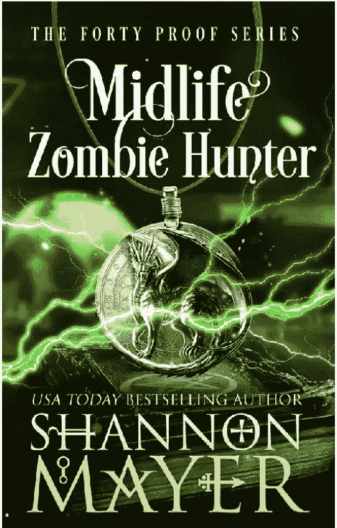

# 中年幽灵猎人：超自然女性小说

## 致谢
我从六月开始跑步，当时我讨厌它。现在依然讨厌，但让我告诉你，那段跑步时光正是这个故事诞生之地。在那里，我再次感受到了将四十岁的身体逼到极限工作所带来的酸痛，而它已经懒散太久，久到我不愿承认。我意识到布里娜是我们许多人的缩影，她承载着我们所有人对美好生活的希望与梦想，尽管我们已经过了“保质期”。她提醒我们，无论何时，倾尽全力再次冲向目标都不嫌晚。
> 我们是有价值的。
> 我们比意识到的更强大。
我不知道你怎么想，但我认为这个世界需要更多坚强的女性。拥有心灵与火焰、激情与声音的女性。那些不仅能支撑自己，还能在我们面对世界风暴时支撑他人的女性。布里娜就是这样的女性之一。我认为也许你也是。所以拥抱这份力量，成为这个世界所需的火焰，永远不要逃避你内心的火花，因为它们将以最史诗般的方式照亮黑暗。

## 1
当一个穿着皮裤、沾血背心、厚底战斗靴、浑身三天汗臭的中年女性被关进有五六名其他女性的集体牢房时，会发生什么？
好吧，让我告诉你，不会有什么好事发生。尤其是对于那个穿着皮裤、闻起来像不知道如何洗澡的人而言。
我转过头，把脸靠在上臂上，试探性地嗅了嗅自己的体味，做了个鬼脸。我多么希望能洗个澡啊。我是说，假设我很快就能出狱的话。
我坐的长凳冰冷、坚硬，绝不舒服。我再次希望这 soon 就不重要了。
- 我本应该已经打了电话。
- 本应该收到朋友的消息。
- 本应该被正式起诉。
- 但这些都没发生。

“嘿，你身上有什么东西吗？我瘾上来了。”
一只手摸了摸我的小腿，我动了动脚以便低头看着那个深棕色头发、茫然地仰望我的女人，上唇冒着汗珠，这只会凸显她急需镜子和镊子。非常急需。看着她让我摸了摸自己的下巴，寻找那缕总是不知不觉冒出来的野毛，从无到有四英寸长，一夜之间。想下巴毛比想我被困在这个牢房里的小时数要容易得多，我已经不愿去数了。
> “你大概不想躺在地上，”我指出，同时调整了座位，滑下长凳远离她。“老天爷才知道那里有什么在等着你。”
> “屎。在地板上抹得到处都是，像溜冰场，”另一个女人嘟囔着，在这个二十平方英尺的空间里，一边是栏杆，其他三面是水泥墙。牢房有三张不舒服的铁凳固定在地上，每面墙一张，中间一张，目前空着。说话的人头靠墙，闭着眼睛。长长的假睫毛刷着她蜡黄的脸颊。她看起来比我年轻，但说实话，很难判断，因为她骨瘦如柴。瘦得那身名牌衣服穿在身上就像她偷穿了妈妈的衣服在玩过家家。
我的思绪回到她刚才说的话。
> “你是说地板上……有屎？”我看了看两脚之间，确实有一些颜色异常的污迹嵌在裂缝里，这不符合我对正常脏污程度的认知。
> “不止一点，”穿名牌衣服的女人说。“你进来前他们把那个拉屎的带出去了。她曾在里面玩得很开心。有人来打扫了，但只是敷衍了事。现在味道好点了。”
作呕中，我绊倒在地，跳着舞试图远离那些污迹。像某种噩梦版的扭扭乐游戏。其他人开始嘲笑我，但我没停下，直到我站在房间中央。我怎么会没闻到离我这么近的屎味？我的嗅觉失灵了吗？我听说女性绝经时会有这种情况。
我停顿在中间长凳旁——我应该坐下 swinging 腿吗？——这时一只手重重拍在我的屁股上，让我疼得叫出声并跳过障碍物。
> “你穿成这样进监狱，那些皮衣爱好者会把你当宝的。”
我转身看到最年长的囚犯一瘸一拐地走开，一边 swaying 头一边咯咯笑，让我想起骷髅朋友罗伯特。她的头发亮白蓬松，像是反复倒梳过，让她那大约四英尺十一英寸的身材显得更高些。然后还插了几根树枝增加高度再增加几英寸。
“我不会进监狱的。我很快就会出去，”我说。
老妇人咯咯笑。“哦，原来你这么想！”
我深吸一口气，站在原地，不敢坐下，不敢移动，怕踩到什么。既是字面意义上也是比喻意义上。但让我回溯一下，给那些刚加入这个故事的人。
就在十二小时前，这位老妇人拍我屁股而我还在屎迹周围跳舞的这一刻结局之前的十二小时，我因谋/杀前夫艾伦而被捕。现在，说句公道话，我不止一次想过杀了他，但不像其他拥有 douche canoe manipulative liar 前夫的女性的次数更多。然而，我可以肯定地说，我甚至没在他身上留下一块瘀伤。萨凡纳这里的警察可不这么认为。不，他们给我戴上手铐，把我拖到了我的个人地狱。雪上加霜的是，警察拿走了我的魔法皮质腰包，这意味着他们现在持有我奶奶的旧咒语书、我用来召唤罗伯特的手指骨（该死，如果他们问我那是谁的，这在“我绝不会伤害任何人”的类别里对我没帮助），还有我在旅途中得到的黑魔法诅咒书。他们还有 Crash 为我制作的两把刀，那感觉像是好久以前的事了。我想知道警察能不能在包里找到它们。我希望不能。我希望我那看起来不大实际很大的包能把我的宝贝藏起来不被警察发现。他们无法从我这里拿走的东西，正是我祈祷他们能拿走的东西。当然，他正是我目前被困在这个沾满屎的牢房里的原因。艾伦， aka 他本人， aka 前夫。
“说真的，布里？”
艾伦站在栏杆另一边。我那死透透的前夫，回来化为幽灵缠着我。这个混蛋。

我们俩都清楚，你总是瞎猜书或者电影的结局，而且一猜一个错，最差劲的是。
他头上还戴着那顶帕迪帽，抬手蹭了蹭自己光秃秃的头顶。
“我是说，连我都知道你不可能杀我，但说实话，你身边的那些怪胎随便哪个都可能是凶手——我又不记得自己是怎么死的。说不定你一直在亲热的那只巨魔干的呢，他大概不想当我前夫。”
我盯着艾伦。他说的那个巨魔是Crash。Crash是精灵，身上有幻象法术，能让人类看不到他的真实样貌，所以艾伦才会把他看成个丑疙瘩，而非他真实的模样——惊艳的男性——精灵——美男子。
不过话说回来，说不定搞错的人是我。毕竟Crash根本不是个靠谱的人。我之前帮他对付哥布林王，事后他却把我丢在困境里不管不顾。我把额头抵在栏杆上，小声跟艾伦说：“你该知道，如果我困在这儿，你也得困在这儿，毕竟不管咱们俩乐意不乐意，你我都绑在一块儿了。你不如去其他房间看看，能不能打听到他们为什么认为是我干的。说不定是搞错了。”
也许我是英格兰女王吧，但我希望这事能在我要去房间角落里上厕所、当着所有人的面之前解决。
艾伦皱起眉，发际线后移的额头上挤出好几道皱纹。他手指敲了敲喉结处的凹陷，转身说道：“我得承认，我也想知道他们手里有什么你的把柄。我去看看能查到什么。”
他走的时候脚步一点声音都没有。等他消失在我视线里，我转过身，刚好对上那个穿着昂贵衣服、身形瘦削的女人的脸。她深褐色的瞳孔放大，直勾勾盯着我。
“你疯了？在自言自语还是跟你的脏东西说话？还是刚嗑嗨了没缓过来？”
“没疯，也没嗨，算是跟个脏东西说话吧。”
我试图往旁边挪，她却顺着我左侧的栏杆蜿蜒伸过来一只手，我往右边躲，她直接攥住了另一边的栏杆。
好吧，看来我们今天得聊聊了。
我做了个痛苦的表情看向她：“听着，我没杀任何人，更不可能杀我前夫。我马上就能出去，没必要交朋友。”
我低头从她胳膊下钻过去，她没拦我。
“她们觉得你杀了你前夫？”地上的女人开口道。
“我倒是想杀我前夫，他就是个垃圾。”
我眨了眨眼移开视线：“你刚被抓进来，这里八成有摄像头录着我们说的每一句话，这种话最好别乱说吧？”
她耸耸肩：“我是瘾君子，咱们这种人说的真话，没人信的。要是我们受伤了？那也是我们活该，谁让我们是这副德行。”
她朝自己身上挥了挥手。我的目光顺着她的动作看过去，看到她苍白的皮肤上有一片淤青。有些是指印掌印，是被人抓过掐过留下的。我的心猛地一疼，喉咙发紧。这里不止我一个人陷入麻烦。
“真抱歉他们不信你，真抱歉他们觉得你活该被伤害，你不是的。”
她翻过身趴在地上，把手垫在下巴下面，那样子活像我们在开睡衣派对，正准备玩真心话大冒险。
“你杀了他吗？”
我清了清嗓子摇头：“没有，我没有。”
房间另一边传来一声叹息。
“我用平底锅砸了前夫的脑袋。砸得特别解气，砸他的时候一声闷响，他砸到地上的时候又是一声，双重暴击，你可以这么说。”
我转头去看，说话的是个头发蓬蓬松松的老妇人，正对着我们笑，嘴里一排完整的牙齿，看得我一愣。我原先打赌她至少缺颗牙。
她皱起脸继续说道：“他是个酒鬼，还喜欢对我动手。我用平底锅把他打得半死。当然了，法官判我有错。我的律师跟他们说我有精神病。我没被判刑，但律师拿完律师费就把我打发出来，身无分文。不过这都不重要了，因为现在没人能对我发号施令了。”
阔太太轻嗤一声，揉了揉鼻子：“结果你还不是跟咱们一样被关在这儿。就像那部讲俩狱友最后在树下重逢的电影里说的，这里所有人都是无辜的。当然了，你没杀你丈夫。就像我没 drunk 驾车撞车——”她指向地上的那个女人，“——她也没嗑药嗨到飞起后为了找个地方方便就闯进别人家里，更别说还在街边嗑药卖淫了。我们都没嗑药，宝贝。我们都不该待在这儿。”
我皱起眉。*《肖申克的救赎》*就是那部电影。
“你就说这？”
阔太太摇了摇头：“她们说你杀了前夫，你还觉得自己能出去？”
她突然笑得直不起腰，地上的女人也跟着笑，笑到直尖叫。对讲机突然滋滋啦啦响起来，笑声才渐渐消停。
“把你们那臭嘴闭上！”
阔太太猛地伸手捂住自己的嘴，笑声瞬间没了。她踉跄着朝我走过来，指着我的手一直抖，直到指尖戳到我胸口，整只手都因DTs抖得厉害。
“这儿不兴这一套，对你不行，对我不行，对这里所有人都不行。你找律师了？没钱吧？我打赌你没有，钱才是让这地方滴答滴答转得动的东西。”
她为了强调，还来回晃了晃手指。
她凑在我面前，我尽量不深呼吸。我可能臭，但她也一样，浑身散发着酸臭的馊酒味。
“没有，但我有朋友。我相信他们正在查清楚到底发生了什么。”
我后退一步，想离她远点。她呼吸里的酒味还是很冲，熏得我本就拧成一团的胃一阵翻江倒海。我表面上强装镇定——不发疯，不失控——但脑子快撑不住了。我被关在这里十二个小时了，身边只有这群女人作伴，我根本不想把她们称作同伴，满脑子都是自己的思绪。就连伯克警官都没来过。她是我在警局唯一的熟人，我以为她会挺我……或者至少会告诉我到底发生了什么。
被捕之前，我得知奶奶、我父母还有艾伦都被人用同样的惨绝人寰的方式杀害了。他们的脖子被撕开，像是被动物咬的，尸体被放血流干致死。而且他们全是在新奥尔良遇害的，这点我格外在意。奶奶的灵魂被什么人掠走了，我觉得我找到她的最佳机会，就是查清楚是谁杀了我最亲近的人，以及*为什么*。这是我被关进这里之前的计划。警方的计划可不一样。
一开始我以为我很快就能出去。我知道他们没有证据，毕竟我根本没杀艾伦。但所有流程都没按规矩来。我回忆了一遍自被关进这里之后本该发生、却没发生的事：
- 没有电话。没有探视。没有正式指控。
这几乎就像是我被人故意陷害了。不，不是几乎，我*就是*被人故意陷害了。我分明能感觉到，就像自己被绑在铁轨上，听着呼啸而来的火车汽笛声一样。我曾帮不少人摆脱过困境，我的救星现在在哪儿？呵，别问，问了也白搭。我得自己摆脱这烂摊子。
一个半透明的身影穿过走廊尽头的门走了过来。我故作镇定地慢慢走到栏杆边见艾伦。他摇了摇头，揉了揉后颈。他当然不是我想要或需要的救星，但那一刻，他是我仅有的依靠。
艾伦紧闭双眼，我的心沉了下去。还能有比蹲好几年监禁更糟的事吗？天啊，我出去之后奶奶肯定会杀了我。我是说，前提是她没有灵魂消散。想到可能彻底失去她，我的心突然攥紧。
“艾伦。告诉我。我需要知道我要面对什么，才能做好应战的准备。”
他不敢看我。虽然我们的婚姻烂得像堆在垃圾桶上的垃圾，但我了解他。而他
 满心焦虑。情绪低落。努力不让自己失控。
“布里……他们正推动判处死刑。”
我当时压力太大，根本没完全听懂他在说什么，真的。我脱口而出：“他们想用鞭刑？就像打屁股那种？”
身后瞬间爆发出一阵窃笑，其中一位女士嘟囔道：“我才想让刚才那个银狐帅哥打我屁股呢，太馋人了。他啥时候想打我都行。”
艾伦低吼一声，想抓住栏杆，却直接穿了过去，撞到我身上，这很奇怪，毕竟他已经死了，可我还能感觉到他。若即若离。就像一坨怪异的冷布丁。艾伦就是一坨布丁。
我把注意力放在这个想法上，这比我脑子里冒出来的那些乱七八糟的念头好应付多了。
他握紧拳头，举到脸旁。“布里，听我说。他们正以谋杀我的罪名给你判死刑，就算是从证物室的情况来看，你也没犯这个罪。有人想让你死，布里。他们正竭尽全力让这件事成真，警察还在帮他们。动作快得很。”
“哦。”我双腿一软，跪倒在地，只有扶着栏杆的双手还撑着身体，没完全倒下去。
艾伦还在说话，可我耳中轰鸣的噪音把他的声音全盖住了。
警察要把我处死，就为了一桩我根本无关的谋杀案。为什么？我根本没做过任何引来人类警察注意的事。
如果是暗世界的执法势力，我倒是能理解，他们说不定有理由要除了我。可那是普通人类警察啊。
“总该还有一审吧？”我喃喃自语，嘴巴都麻得没了知觉，努力消化艾伦说的这些话。
他一直在说，话语稍微压过了我脑中的嗡鸣，但也没好多少。伪造证据。贿赂。仓促进审。离谱的保释金。死路一条。
我把头抵在冰凉的栏杆上，拼命对抗着想要将我淹没的绝望，放弃的暗流缠上我的双腿，用力往下拽。
我深吸一口气，又吸了好几次，直到剩下的白噪音全退去，我抬起头时视野不会再发花、边缘发黑了。
“那我去得找个律师。找个活着的。”我艰难地吐字。
“他们总不能连这点都不给我吧。”
简直像我刚对着星星许了个愿，宇宙立刻就响应了，一名警察走进监区的接待室，手里拿着剪贴板。
他脸上掠过一丝恼怒，嘴角沾的一点点白色粉末告诉我，我刚打断了他的咖啡加甜甜圈的休息时间。
“奥赖利，布里娜。你有访客。他说他是你的律师？”
我撑着身子站起来，就算不稳，至少也算站直了。我没给任何人打电话，所以科尔布和同伴们肯定是给我变出了这么个大惊喜。
有律师来总是好事，不管是谁，都能让这趟“死刑列车”慢下来。说不定他们真能申请到暂缓执行。字面意义上的暂缓。反正我当时是这么想的，直到他走进房间。
我盯着他，确信自己看错了。
“噢哟，是那个银狐帅哥，”卷发白发的老太太说，“我本来还盼着他来找我呢。”
她窃笑着，我盯着那个我以为会彻底抛下我的男人。那个本该是我在狂风暴雨中可以紧抓的磐石的人。结果呢……他成了我踢到脚趾头的石头。
克拉什站在门口，穿着深蓝色牛仔裤、系扣款白衬衫，还打了黑色领带，见鬼，他这副样子和他只裹着浴巾的时候一样帅。
不，不是的，我超爱他裹浴巾的样子。就算我对他气不打一处来，那个白发老太太说的也没错。克拉什怎么看都帅得让人移不开眼。
他那双嵌着金色斑点的蓝眼睛回望着我，挑了挑眉。“我怎么一点都不惊讶，你刚逃出油锅几个小时，又掉进热水里了？”
警察朝牢房走来，一只手的手指上挂着副手铐，另一只手攥着钥匙，指节都握白了。
他把钥匙插进去，使劲拧，我一度以为他要把钥匙拧断了，紧接着我又想到，如果我被关在这里，和刚才遇到的那些女的待在一起，到处都是粪便，那也太惨了。
我替她们觉得可怜，但我不想和她们待在一起。
门一开，他就把手铐扔向我，特意往低了扔，我根本接不住。手铐哐当哐当滚到地上，停在我靴尖旁边。
他早上肯定是喝了被搅和的麦片，一肚子火。
“戴上。”他呵斥道。
“这也太不专业了吧。”我一边说一边弯腰捡起手铐，小心地挨个戴上，没勒太紧。
我知道最好别跟他吵，这警察显然正想找茬打架。现在我可不是撒泼闹事的时候。
说不定克拉什能给我找条出去的路，要么是个魔法咒语，要么是个我不了解的司法漏洞。
我不敢抱希望，但他能来总归是好事。说不定他只是来道歉的，为我帮他杀了地精王德雷克之后，他收拾东西离开的事？还是说为了他只给我留了张纸条，就把我赶出祖母家的事？
就一张纸条。好像他是个青少年，宁愿发分手短信，也不愿意当面看着我的眼睛告别。
一堆不确定的可能性，也没法从中得出什么结论。
警察拽着我的右肘往外走，攥得那么紧，我疼得直皱眉。
他带我出了监区，经过克拉什身边，沿着一条短走廊走到一间没有窗户的小房间里。
中间摆着一张简单的折叠桌和两把椅子，没什么多余的空间。
我坐在椅子上，警察走了，没过一会儿克拉什就走进房间，轻轻带上了身后的门。
他身上飘来刚洗完澡的干净男士气息，混着一点点煤火的味道，还有某种须后水的香气，在空气里弥漫，勾得我想要一些我根本不该要的东西。
都怪我的激素不听话，瞎起哄。
“这间房间里没有摄像头，也没有窃听装置。”克拉什拉过我对面的椅子坐下，把手放在桌上，手指松松交叠。
他的目光扫过我，好像在找什么东西。淤青？伤口？证明我真的杀了艾伦的证据？
“没有？你确定吗？要是你昨天问我，我肯定说警察根本没理由抓我，结果我现在在这儿。显然就要因为我没犯的谋杀罪被吊死了。”
我靠在椅背上，交叠起脚踝。我一点都不放松，但我不想给他……嗯，“满足”这个词不太对。
他看起来很疲惫，也正常。我们前一天晚上熬到凌晨两三点——不是那种寻欢作乐到半夜——是为和一个替萨凡纳议会办事的地精及其同伙搏命，差点丢了小命。
我们活下来了，可就算只是坐在这儿，我都能感觉到浑身淤青、肌肉紧绷的感觉又袭了上来。
他皱起眉。“你怎么知道的？”
艾伦当然也跟着我来了，他在狭小的房间里踱步，自顾自地嘀咕着，我意识到，哪怕我们互相憎恨，他也在想办法救我免于被处死。
他沉浸在自己的思绪里，对克拉什的存在半个字都没提。
我呼了口气，铐着的双手朝他那边挥了挥手。
“是艾伦。他去探了个口信回来告诉我的。他不喜欢我，但我打赌他担心我要是这么死了，就要和他绑定纠缠到永远了。”
克拉什缓缓点头。“艾伦，你能看到他们到底拿到了她的什么罪证吗？”
克拉什其实看不到艾伦，不像我能。我猜他最多只能眼角瞥到一点晃动的影子，或者我前夫踱步的地方有一点阴影，而我却能看得清清楚楚，就像他还活着一样。
艾伦顿了顿。“他们拿了一个装着我血的瓶子，正在往从她那儿搜走的刀上抹血。他们还要把血蹭在她的腰包和那件夹克上。他们连血迹喷溅形态都懒得做对，说明他们是真的要往死里整她。但为什么？谁要针对她？我被人杀了，就是为了陷害她吗？”
我摇了摇头，随即想到克拉什根本没听到这些。我转述给他听，克拉什一言不发地站起来走出了房间。
时间一分一秒流逝，我几乎能感觉到自己的生命在倒计时。我的天啊，这烂摊子。
我搓了搓脸，铐子叮当作响。如果我死了，灵魂会和祖母在一起吗？不，我现在不能想这个。我要专注于当下。
“艾伦，我知道你和暗世界有往来。你交易的只有戴文吗？还是说你跟黑帮之类的势力也有勾结？有没有人可能惦记着你剩下的钱？”我问他。
说不定他惹了什么人。考虑到他的性子，也不是不可能。
他踱步的速度丝毫没慢。“是，我只和他有往来，但他的人脉关系硬得很，往上走能通天……我呢，就是想要那些人脉。我觉得靠这些人脉能帮到我的律所，接到报酬更高的案子，说不定还能开自己的公司。”
他做了个苦相，抬起手挥了挥自己这具灵体。“看看我现在落得什么下场。”
我闭上眼睛，思考各种可能性。“没有靠良好表现减刑出狱的漏洞吗？”
“你？”艾伦嗤笑一声。“得了吧，咱俩都知道循规蹈矩根本不是你的强项……就算你改过自新也没用。布里，没哪个律师能把你从这事儿里摘出去。”
我睁开眼，他正蹲在桌旁，有那么一瞬间，我看到了那个我曾爱过的男人的影子。

犹记多年前。聪明、自信，还对我有点担心。
“他们会操纵陪审团，事成之后会把所有证据藏起来，把你从档案里彻底抹掉。这种事发生的频率比大家以为的高多了。”
恐惧让我喉咙发紧，但我还是强撑着开口：“你怎么会知道这些？”
“因为他们在证物室里都聊到了这些，”他说，“有人恨你入骨，铁了心要除掉你，他们已经给当地的警局塞了不少钱，要把这事办成。”
他脸上浮起怒意：“司法系统不该是这个样子的！你至少该得到公平的审判。”
我意识到他更担心体制崩坏，而不是我的死活，但我没精力去在意这些。
门再次打开，克拉斯走进来，走到自己的椅子旁站在了椅背后，浑身透着挫败感。
“我能把你保释出来，但你必须跟我住，而且是居家监禁，你一步都不能踏出家门。”
他说这话的语气好像这是什么天大的坏消息，对他来说大概确实是吧。他刚才才把我赶出来，现在却要天天跟我见面，比之前见面时间还长。该死，这话真扎心。
那点刺痛瞬间变成了怒火。去他妈的。我才不会等着他来解释为什么突然背弃我，把我赶出奶奶家。我不是软柿子，更不是十几岁的小屁孩，抑郁焦虑对我半分用都没有。
“搞什么鬼啊克拉斯？我不玩这种游戏，这他妈就是个游戏。你嗑得神志不清的时候，我帮你从卡莉莎手里逃出来，后来还救了咱俩从那个疯子哥布林手里脱身，结果你现在装得跟我他妈的怎么对不起你似的？你是不是觉得我亏待你了？”
我当时在大喊大叫吗？是的，没错，我就是在喊。我深吸一口气，直接放话：“而且我还没提刚才在淋浴间，你还没干完就想跑的事！”
说不定我其实就是想让人听见。毕竟最后这句半真半假。
他眉头一皱：“要是你前夫的鬼魂没冒出来的话，我肯定就把事办成了！”
艾伦撇了撇嘴，滑着步子出了门。“我没必要听这个。”
我不得不认同他。我对着克拉斯大喊我们差点擦枪走火的事的时候，他确实是全场最不该在场的人。
我站起来，把椅子往后蹭了蹭，探过身子盯着他，表情严肃：“怎么，把我赶出奶奶家心里过意不去，打算至少让我爽一次再走？是可怜我才跟我睡？”
他往前倾了倾身子：“你根本不知道自己惹上了多大的麻烦！你在暗影世界里横冲直撞，像头他妈的破坏球。我真搞不懂你怎么还没死个十回八回的！但现在有人铁了心要你早死，我在救你，所以才躲着你。我跟你牵扯太深，只会给你带来更多危险！”
现在我们俩都在大喊大叫，场面相当精彩。我用力一拍桌子，拍得手掌发麻刺痛，手铐叮当作响：“要是有人能坦诚告诉我真相，别整得神神秘秘的，我也不至于他妈的惹这么多麻烦！要是那个人能有点团队意识，别总装成不需要帮忙的样子，我们早就能把这事搞定了！”
我喘着粗气瞪着他，根本不在乎我们叫嚷的时候鼻子都快碰到一起，也不管我们宣泄不满的时候，空气里的紧张几乎要迸出火花。
他喉间溢出一声低哼，下一秒就把我拽过桌子按进怀里，我狠狠回吻他，力度和他吻我的一样大。
我们之间的吸引力根本不受理智约束。他皮肤上的魔力仿佛与我的魔力产生共鸣，他的触碰像火一样烧遍我的全身，烧光了所有淤青和疼痛的念头，也烧光了他打完架后转身离开时给我带来的伤害。
他的唇，他的全部，都让我意乱情迷，我甚至希望房间角落里能有一张床，铺着他最爱的那种软床单，滑过裸露皮肤的感觉美妙极了。
不，我没打算这么轻易放过他——至少他得给我个合理的解释才行——但这不代表我不会享受他落在我唇上的灼热吻，万一……万一以后没机会了呢，万一警方如愿以偿了呢。我是这么跟自己说的。
相信我，换了你也不会拒绝这个机会的。
即便如此，我还是第一个退开的人，只退到能呼吸的距离：“你真的伤到我了，克拉斯。我不确定我还没准备好原谅你。你得好好表现才能获得我的原谅。”
他的手顺着我的胳膊滑下来，握住了我的手指，他后退了一步，胸口剧烈起伏，好像还没缓过气来。
至少我不是唯一一个被我们之间的这股吸引力影响的人。
“操。你简直把我迷得神魂颠倒，我刚才……我是说你现在……该死，我话都说不利索了。”
他没放开我，反而把我拉得更近，把下巴抵在我的头顶，他的呼吸扫过我的发丝。
“我不想让你死，但麻烦总是找上你，或者说你总是往麻烦里钻。我不知道该怎么护你周全……”
他声音渐小，我抬眼看他：“人终有一死克拉斯，可能你不会，毕竟你是妖精，但其他人都会死。至于我，我会全速活着，脚踩油门直到那一刻来临，就算那一刻就是现在也认了。”
我捧住他的脸狠狠吻上去，艾伦在身后干呕的声音还没停，嘴里嘟囔着什么跟巨魔接吻之类的怪话。
克拉斯回吻了我，但这次他先退开了：“我去办保释的事。你的庭审日期定在三天后。”
艾伦再次走进门，开始来回踱步，口吐芬芳大骂司法系统被滥用，这实在有点讽刺，毕竟他在离婚的时候为了整我，可没少操纵法庭系统。
克拉斯当然没听见他的话，但他皱起眉，好像能察觉艾伦身上散发出的负面情绪能量。
“你要不要告诉我为什么把我从奶奶家赶出来？还是说你根本看不起我，才故意无视我？”
最后这句才是真的扎到我了，因为我的自我价值感一直很低，程度比我自己愿意承认的还要严重。
你想啊，四十一岁离婚，原因是恨得牙痒痒的前任出轨，这已经够惨的了。再加上有点体重超标、之前的工作没前途，新的工作又悬而未定，一个女孩难免会时不时感到迷茫。
我可不是完美的，你知道的。我仍然在跟情绪的起伏作斗争。有些日子我像铁一样坚强，有些日子却软得像煮过头了的意大利面。
克拉斯没放开我：“因为你不是唯一有仇家的人。你跟我越近，死的概率就越大——”他顿了顿，“暗影世界里可不只是议会和奥西安家族那帮人惹麻烦的事，情况比你想的复杂。你说得对，人终有一死，我只是不想你的死是因为我靠你太近——”
门砰的一声被推开，打断了他的话。把我抓进来的那个警官大步跨进狭小的房间，拽住我的手铐，把我从克拉斯怀里扯了出来。“时间到了。”
我私下里管这个警官叫“手铐哥”，他把我押到和其他女囚关在一起的拘留室里。
克拉斯肯定跟上来了，我之所以这么猜，仅仅是因为她们看我的眼神都越过我，瞟向后面，变得梦幻又柔软。
这挺有意思的。艾伦眼里的克拉斯是丑陋恶心的巨魔，女人们眼里的克拉斯则是性感得让人想舔一整夜的尤物。
我回头瞥他一眼：“你在男的面前装得没有威胁性，转头就在女的面前卖弄风情，挺聪明啊。”
他眨眨眼，给了我一个慢悠悠的撩人笑，搞得我下半身一阵酥麻，也让我想起，我已经很久没有过一场值得回味的春宵了。
我是说，和他一起在淋浴间里的那些时刻很美好，我想起那些场景的频率比我自己愿意承认的高多了，但要是你懂的话，那次整个过程其实没进行完。
我身后的女人们发出一阵*哦~*的惊呼声，活像摩门会幕合唱团在歌颂天堂。
说真的，她们的惊叹声持续了这么久，音调和音色还不断变化，简直能凑成一个完整的管弦乐队了。
“哦宝贝，你要是不扑上去，我可就要上了！”老妇人咯咯笑着，“太性感了，他真的太好看了。”
“他确实长得不错，”我说，“这点我不否认。”

站在我身边的卡夫斯警官挺起胸膛，朝他们露出一个得意的笑容。我一下子笑出了声。“我不是说你，矮冬瓜。我说的是我的律师。”
我话音刚落，警官就猛地转过身，一把把我推到了敞开的牢房门内。“他？他就是个又胖又丑的巨魔！” 这话和艾伦之前说的一模一样。肯定是这个厚脸皮的男人在用法力搞鬼。克拉什又朝我眨了眨眼，他那一脸坏笑搅得我心神不宁。我才不在乎别人怎么看；他俊得离谱，我都想给自己找个悔改的理由了。
“我把保释金的事搞定就马上回来。你待着别乱动，听见没？” 克拉什话音刚落，就被警官推着往门口走，那警官碰到他胳膊就猛地缩回去，显然是一秒都不想和他待着。那警官甚至还刻意在裤子上擦了擦手，好像碰到了什么脏东西似的。
“我都被关在这儿了，还能做什么？” 我抬起手，抓住牢门栏杆。卡夫斯警官嗤笑了一声。“她三天后就要受审，哪儿也别想去。”
克拉什站在门口，无视卡夫斯的插话，开口说道：“别问我啊。你自己才是那个走哪儿惹事的主——”
门在两个男人身后哐当一声关上，我又和牢里其他女人待在了一起。
“你肯定是把什么人得罪狠了吧？” 那个蓬松头发的老妇人开口说道，“我之前见过他们赶着处理人，但三天就开庭？这也太罕见了，再说你白得跟纸似的。你要是不这么苍白我都觉得这事更可信。”
我低头看她，才发现她差不多才到我肩膀高。“你以前见过他们这么干？”
穿考究裤子的女士扫了我一眼。“你跟谁说话呢？” 我朝她挥了挥手让她噤声，又转回头看那位老妇人。
“一般都是有人惹了麻烦，他们想把人打发走的时候才会这么干。萨凡纳这儿的规矩就是这样，相信你也清楚。” 她眨着浑浊的老眼望向我。“萨凡纳最擅长藏住秘密，她可不希望任何人知道丝绸被面底下藏着的是什么野兽。她这话说的倒也没错。”
“我可没爬过别人的床。” 嗯，话虽这么说，倒也不算全错。我最近一直在应付奥西恩一家那堆破事。何况我还帮议会揪出了内奸达文，给他们帮了大忙。前几天我去见他们的时候，那个叫斯塔克的老头居然主动跟我说话了。据罗德里克说，他早就再也不跟我搭腔了。这么看来我总算是入了他们的眼。说不定他们会帮我？
“喂，我要打我的电话！” 我用手铐哐哐砸着牢门栏杆。该死，那蠢货甚至没给我摘手铐，我光跟牢里其他estrogen-overloaded的女士一起盯着克拉什看，都没注意到。我哐哐砸着栏杆，直到其他女人开始抱怨。
卡夫斯警官终于回来了，一脸百无聊赖的表情。“干嘛？”
“我要打电话，” 我说，“马上打。我还要跟伯克警官通话。”
“你又没这个权——”
“现在！” 我冲他喝道，说实在的，找不出更合适的词，我调动起了体内的魔力。我流着一半妖精的血，一半女巫的血，还有一小部分连主都不知的混血。这点魔力足够让我的话带上了威慑力，他猛地一跳，就像我用柳条抽了他屁股一下似的。
“伯克不在这儿，她停职了。” 这话像挤牙膏似的从他嘴里蹦出来。“软禁。” 我惊得下巴都要掉了。我本来想问她是出了什么事才倒霉的，可看他眯起眼睛的样子，我知道从他那儿肯定问不出什么。但我还是问了。
“你管不着，” 他说着就往门口走。“那给我拿电话来！” 我又往话里加了点魔力，他猛地又是一跳，哐当一声甩上了门。
“哎哟，皮衣女，你可把他屁股点着火了。你是怎么做到的？” 老妇人又凑到了我跟前，我低头看她。
“你叫什么名字？”
“埃德娜，” 她说，“埃德娜·怀特。”
“说真的，” 穿考究裤子的女士站在我另一侧，“*你到底*跟谁说话呢？因为在这儿装疯卖傻可出不去。要问就问我们，我们都试过了。没人管你疯不疯。”
我低头看向埃德娜，她正冲我咧嘴笑，这时艾伦出现在了接待室里，脸色比平时惨白。
“布里，他们又把开庭时间提前了。这太荒谬了！他们怎么能这么做？”
“暗界，” 我毫不犹豫地回答，这种确定感是从骨子里来的。我很确定，克拉什应付普通警察完全不在话下。见鬼，我敢打赌科布和伊蒙肯定能帮我摆脱人类警方的麻烦。但我们现在面对的根本不是他们，不是吗？
“就像你当初在离婚时分走所有财产，把咱们的共同债务全甩给我一样。这套腐败的制度，你当受益者的时候可从来没嫌它碍事。” 艾伦瞪着我。
“那是没办法的事。有时候法律就是错的，需要灵活变通才行。”
我指着他的手铐叮当作响。“我敢打赌，那边房间里那些人——跟你想的完全一样。所以你嘴上那些道貌岸然的‘这不公平’屁话，不过就是装装样子罢了。”
这话根本不挨着。伯克警官被软禁，无疑是不让她帮我。所以这件事远比我想象的复杂。他们怎么会知道我们俩有牵扯？真叫个倒血霉。
我回头看埃德娜，一个死了的人居然还能走得这么带劲，忍不住叹了口气。“你们有没有什么办法能让我出去？”
这次穿考究裤子的女士没理我，只是念叨着：“疯了，这女的是个神经病。”
“你得有人救你出去。要不要找你那个帅得掉渣的律师？他那肌肉一看就练了好几年，我要是爱赌的话，肯定赌他是个妖精。”
埃德娜叹了口气。“我偶尔也爱找个妖精情人，床上特别灵活，浑身软乎乎的，该有魔法的地方都麻酥酥的。”
我忍不住笑出了声。我不该笑的，我这基本上等于在死囚牢里，等着被处决一个我没犯过的罪。这突如其来的笑带来的眩晕感混着肾上腺素，让我觉得自己浑身飘着氦气，马上要飞起来了。我本来可能就要笑到崩溃了，结果这时门开了，卡夫斯警官走了进来，手里拿着个手机，递到我面前，好像都不敢相信自己居然要这么做，不肯正视我似的。
“给。你只有两分钟。” 卡夫斯警官瓮声瓮气地说，目光扫过牢里其他女人。穿考究裤子的女士往后缩了缩，埃德娜和地上那个女人却没什么反应。
我接过电话，拨了第一个想到的号码，是科布的。希望他能用上他在议会的人脉。他第二声就接了起来。“你是谁？” 他瓮声瓮气地问，显然没认出这个号码。
“科布，是我。你去把罗德里克叫来，让他到这儿来。他们给我栽赃，说是我杀了艾伦。这事绝对有鬼，议会说不定能帮上忙。人类警方不可能单干得了这事，我——”
“他们帮不了。我已经试过了，” 他说，“撑住。我们正在找别的突破口。他们赢不了的，布里。信我。好吗？找金克，等她回来就行。” 说完他就挂了电话，也好，卡夫斯警官正想把电话夺过去呢。
“这可不是两分钟，” 穿考究裤子的女士这时也不怕了，“我掐着表呢。” 她敲了敲自己那块很贵的手表。她刚才还骂我是疯子，我没想到她会帮我说话。就在他猛地把我手里的电话夺走时，我突然反应过来——我们都关在同一间牢里，都被当成垃圾对待，莫名其妙形成了一种奇怪的姐妹情谊。就算我们中有一个已经死了，有一个即将赴死，我们也在这处夹缝之地紧紧绑在一起。介于生与死之间，介于外面的世界和囚禁之间……就像个夹在中间的妖精。

我长舒了一口气，因为那名警官气势汹汹地离开了，出门时还把门摔得哐当响。声音在房间里回荡，我离开栏杆站远了些，手上的手铐哐啷作响。科尔伯以为自己找到了漏洞？要是真有漏洞，Crash怎么没想到？他们两个里面，尽管我们俩的关系乱七八糟、说不清道不明的，但我还是更信任Crash。科尔伯年轻，太在乎上司和议会的夸奖了。这已经让他好几次撒了根本不该撒的谎。不过话说回来，Crash也有所隐瞒。老天在上，难道我*喜欢*撒谎的人不成？我皱了皱眉，抿紧嘴唇。等脑袋不被架在铡刀上的时候，我得好好剖析剖析这个问题。
外间的门吱呀响了一声，我们都转头看过去。一个新来的家伙大摇大摆地走进来，头发往后梳成油亮的蓬巴杜发型，扫得顺溜溜的，看得我总觉得他下一秒就要抖开一件亮红色披风，朝冲过来的公牛挥。见鬼，他身量瘦高，倒真能撑得起这造型。他走近到我能隔着栏杆伸手和他握手的距离。一股清冽的柑橘调古龙水飘进牢房，我完全没想到这种香味会和他这种男人搭在一起。他的黑眼睛眯起来打量我，嘴唇绷得紧紧的，鼻孔还微微张着，好像很不喜欢自己看到的东西。说不定是闻到牢房里的臭味了？
“我是地区检察官，兰利先生。科尔伯·沃克说的‘找金克’是什么意思？”他说话的时候嘴唇几乎没动，活像个腹语师。这诡异得很，我脊柱窜上一阵凉意，知道这个人麻烦大了。
“你是什么性邪教的成员吗？这就是你杀了前夫的原因？他发现你那些龌龊的行径了吗？”他把手背在身后，往后退了一步，好像觉得我这所谓的“龌龊”会传染一样。这么说电话被监听了，也不奇怪。
“你怕我吗？”我故意用问题回答他的问题，这是艾伦最讨厌的招数——主要是因为这招对付那些自我膨胀的男人格外好用。说到艾伦，他凑到我身边低声道：“没错，继续压着他的势头，别给他任何东西。”
我想跟艾伦说我说什么都不重要，他们早就打定主意要把我以谋杀他的罪名定罪处死，谁知道还会给我安上什么别的罗织的罪名。
兰利先生摇了摇头：“你没有资格提问。我以为你会想回答问题，争取点什么——”我举起戴着手铐的双手，掌心朝向他，直接让他闭了嘴，还摆出了我那个“我之前嫁给过律师，还在他事务所帮忙”的人设：“咱们打开天窗说亮话吧，兰利先生。你和你的手下在后面的房间里到处撒艾伦的血来伪造证据指控我，这份指控*根本站不住脚*。你我都清楚。不管你想让我死的理由是什么，你太执着了，都直接把庭审提前到——”我等艾伦在我耳边念出新日期，接着道：“——明天早上九点。”
兰利先生脸色煞白：“你不可能知道这个，只有我一个人知道。”
“我怎么不知道？我以为被控这么严重的罪，至少该知道自己的庭审时间吧？还是说你没法告诉别人，所以我才‘不该知道’？”我笑了笑，艾伦在我旁边哼了一声：“说不定你当初能当律师。”
“他出汗了。”兰利先生瞪着我，我回给他一个笑：“回去接着罗织罪名吧，混蛋。我还没死呢。”
“说得对，”他用他那奇怪的木偶似的声音说，“就是‘还没’这个词，你得记牢了，奥莱利女士。”
他脚跟一转，跺着脚走出了房间，走路时臀部晃动的样子，让我一下子就想起卖奶奶房子那个房产中介莫妮卡。莫妮卡之前看起来很正常，直到她在房子外面跺了三次脚——那跺脚带着超自然的力量——唤醒了个什么东西。她和暗影界有联系，现在这个奇怪的检察官也有她走路的步态。我的直觉告诉我这不是巧合。我的直觉从来没出错过，所以我决定信它，跟着直觉走。哪怕这比我最离谱的猜测还要诡异。
“莫妮卡？”我喊了一声。检察官猛地转过来，速度快得都要抓住门框才站稳。我下巴都掉了，艾伦在我旁边咳得说不出话：“这怎么可能？”
我不知道答案。我*确定*的是，那个房产中介莫妮卡和这个兰利检察官是同一个人。这对我可不是什么好事。暗影界这次是彻底放开手干了。这也证实了不止戴文一个人想弄死我。站在我面前的这个人，可能是两个人的结合，正瞪着我：“你得消失，就这么回事。”
有什么变了，这个存在现在用的是莫妮卡的声音。埃德娜咂了咂嘴：“不对劲，那不是人类。”我默默同意埃德娜的说法。那个穿得讲究的家伙听到声音变了，倒吸一口凉气，但除此之外没说话。我也不确定我们最后这位狱友有没有注意到，她正躺在水泥地上打呼噜。
检察官出去后门被摔上了。他？她？他们？对，是他们。他们气坏了，我也不知道为什么。他们是替谁办事的？因为我不觉得莫妮卡/兰利先生是这背后的幕后主使，最多就是个传坏消息的。我脑子里突然闪过一个无脸男人的记忆。我和他是在遇见罗德里克的那天晚上遇见的，就算到现在我也搞不清他长什么样。我在酒店看到他时他的五官模模糊糊的，他身上散发出的威胁感简直让人腿软。无脸布鲁斯是不是议会的成员？还是说是议会里某个人的打手？他——布鲁斯——会不会是莫妮卡？我不知道。这又成了我脚边一堆谜团中的一个。
艾伦在牢房里暴走，手挥来挥去，气得很，用他的话说就是他被骗了。他一直以为莫妮卡是个女人，他还和她睡过，所以她当然是个女人。她怎么可能会是男人？他的咆哮把埃德娜笑坏了：“这么说你喜欢男女通吃？我还没想到你会是双性恋。你看起来这么紧绷，应该接受不了走后门啊。”
“我才不是！”他朝她吼道，然后眨了眨眼，“等等，你也死了？”
她咧嘴笑了：“对啊，死的时间比你长多了，你这双面选手。”她又笑了，冲他晃了晃手指。要不是我太累了，说不定我也会笑。他结结巴巴地开始辩解说自己不是同性恋，从来都不是，而且而且而且……
“能不能小点声，艾伦？”我喝道，“没人想听你恐同的咆哮。够了。我怀疑他们是某种变形者，能随心所欲变成任何样子。男人。女人。什么对他们有用，或者他们突然想变成什么样，都行。”
那个穿得讲究的家伙又斜睨了我一眼。我冲他点了点头，然后移开视线。我揉了揉脸，一屁股坐到最近的长凳上，除了等什么也做不了。等着，想着为什么偏偏是莫妮卡/兰利先生这么想让我死。难道真的和议会有关系？那栋房子卖了还不错的价格，所以我猜莫妮卡的佣金不是问题。肯定有其他动机，但我脑子太木了，转不动。
到了早上九点，我要为一桩我没犯的谋杀出庭，证据全是被人栽赃的。如果我能的话，我敢打赌庭审到中午就会结束，我的处刑会在晚饭前搞定。
下午慢慢过去，我发现自己打起了盹，听着艾伦来回踱步嘟囔，埃德娜在一旁煽风点火，变着法儿怼他。快到傍晚的时候，太阳低低地斜照进我们牢房上方那扇小小的带栏杆的窗户，其他囚犯吵吵着要晚饭的时候，我听到一个熟悉的声音。我直起身，在硬长凳上躺了太久，背抗议似的疼，肌肉又僵又松。我转头看向那扇能让潮湿的新鲜空气飘进小牢房的窗户。薄纱般的翅膀扑棱声，还有铃铛的叮咚声，对我仅存的那点零星希望来说，就是最动听的乐曲。我像祈祷一样念出她的名字：“金克。”

金克莉扑扇翅膀的声音让我眼睛死死盯着窗户，直到她一身黑出现——这根本不是她的风格。她是自带秋日色调的仙女，从皮肤到头发再到眼瞳都泛着暖融融的秋意，往常总穿各种深浅不一的棕、金、黄色系服饰，和她的原生色调相得益彰。这身黑反倒衬得她只有四英寸的矮小身量更显娇小。
“那是什么鬼虫子？恶心死了！”花哨裤子吼道，抬脚就朝金克莉扔了只鞋子。
“住手！”我试图在半空中抓住那只鞋，最后还是只把它拍到了一边，总好过砸中这个小不点仙女。
金克莉滑进来落在我摊开的掌心时，我赶紧凑到了窗边。我猜金克莉和克拉斯一样，能让人类看到她时自动将她看成别的东西。
她伸脚蹬了蹬手铐，忍不住打了个寒颤。“这可是老式镔铁打造的，他们特意用这个铐你，就是冲着你妖精血统来的，会削弱你的魔力。”
见鬼，我除了对着警官发号施令，根本没想到动用魔力逃出去，毕竟我对自己的魔力和用法都一窍不通。
“出什么事了？科尔布说你会告诉我的。”
她皱起脸：“其实根本算不上开庭，那就是个彻头彻尾的闹剧，他们只不过打算尽快弄死你。”说着她还用手指在自己脖子上利落地比划了一下。
我点了点头：“我知道。”
花哨裤子走到我肩旁站定：“呃？你在跟虫子说话？”
我转过身背对着她，低头看向还躺在地上的那个女人，她也正抬头盯着我。
“这虫子会说话，还挺可爱的。”
哦shit，看来毒品能让人看穿掩盖暗影世界的幻象。不过我可没建议你们尝试啊，小朋友们别碰毒品，那是个十足的馊主意。
金克莉扇了扇翅膀，悬在我手掌上方：“我有办法带你离开这里。”
她猛地向上窜去，躲过了花哨裤子快得惊人的挥拳，又嗖地滑回了窗外。窗户在我头顶两英尺高的地方，我根本看不到外面发生了什么。不过我确实听到了一声低吼，那是变成狼人形态的萨吉发出来的。
我的希望又冒了出来，难道是越狱？我刚冒出这个念头，就确定确实是这么回事，这TM是越狱啊！我高兴得差点飘起来，原地蹦跶的时候突然尿意上涌，之前的疲惫瞬间一扫而空。我赶紧把膝盖紧紧并拢，集中注意力收缩盆底肌，硬生生憋住了尿意。
“金克莉！”我压着嗓子喊她的名字，她从栏杆后探出头来往下看我：“干嘛？”
“我需要我的包，还有证物室里他们没收的所有东西。”我说。
她点了点头：“已经有人去办了！我们来救你了，布里。”
暖流从我肚子里漫开，传遍全身。我的朋友们太靠谱了，之前没有他们的这些年我到底是怎么活下来的啊？接着她拽着一个容器从栏杆缝里递了进来，我一眼就认了出来。
“*男士润滑膏*？你们该不会想让我涂满全身从窗户栏杆缝里钻过去吧？那缝也太窄了！”
花哨裤子呻吟着蹒跚着走到房间另一边：“我过去躺会儿，我刚刚绝对没看到一只大屁股虫子把贵得要死的润滑膏从那扇窗户拽进来。”
“我屁股才不大，”金克莉气鼓鼓地说，“我这是翘翘的小巧臀。”
我眼睛直勾勾盯着她，不敢分心：“说真的，我们到底怎么弄出去？”
难道他们把润滑膏倒掉，换成了能把我变小的魔药，说不定能变得和金克莉一样大？那我就能从栏杆缝钻出去，还没等别人反应过来我们就跑没影了，反正要是我来想办法肯定是这么干的。但我这帮七拼八凑的朋友们显然都不怎么喜欢搞这种低调的把戏。
金克莉拧开*男士润滑膏*的盖子，戴上最小号的橡胶手套，伸手挖了一大块浓稠的膏体，在栏杆上上下下涂抹，那动作熟练得连脱衣舞娘都要嫉妒。她当然还顺便扭了扭腰身上下蹭了蹭，把这场景的氛围感直接拉满。
我抓住窗沿，猛地一蹦，肩背肌肉绷得紧紧的，使劲往上爬想看得更清楚些，总觉得漏了什么。好吧，最后我只勉强把鼻子探出了窗沿，但这已经够了。
“金克，你到底在干嘛？就算涂了润滑膏我也钻不过去啊。”
艾伦走到窗边扫了我一眼：“她说的对，就算她瘦了点，也不是那种骨感小矮个，腰腹有点肉你懂的。”
我手一伸就揪住了他的耳朵，好像我对幽灵总有点揪耳朵的天赋。“我虽然没袋子把你装进去，但把你塞我靴子里肯定没问题。”
他无效地拍了我两下，我松开了手。
金克莉继续往栏杆上涂润滑膏：“放心，这个主意是科尔布和萨吉想的，他们觉得这是我们最好的机会，我也这么觉得。”
我眯起眼睛：“苏茜和埃里克呢？他们也觉得这个主意不错？”
“哦，那可没有。”金克莉冲我咧嘴笑，“科尔布说跟他们提过这回事，他们觉得这主意烂透了，然后科尔布让他们滚，他们就真滚了。不过你懂的，大脚就算忠诚又聪明，胆量可不大。”
我不太同意她的评价，但转念一想，说不定金克莉终于意识到埃里克对她有意思不止一点半点。之前她以为埃里克在开玩笑，拒绝了他，然后……好吧，埃里克就和苏茜在一起了。金克莉现在整个就是“我其实不想要他，但也不想让你得到他”的别扭劲儿。
我叹了口气，这事等出去再说。等我还活着、出了这间牢房再去帮他们处理感情问题，要是现在能出去，让我管什么奇葩爱情故事我都愿意，老天保佑。
金克莉摘下手套，放在了一根栏杆底部：“接下来这部分，你最好往后退退。”
我没动。要么是我脑子没反应过来她的话，要么是我根本无法想象科尔布能搞出这么大的动作。这次越狱搞得这么盛大，我绝对*不*可能没被人注意到。
空气中传来细微的滋滋声，接着是刚划燃的火柴的硫磺味。
“哦，你赶紧趴下！”埃德娜在我耳边说。她是幽灵，居然能把我推得站都站不住，下一秒整个世界就炸了，碎石、灰浆和钢条碎块劈头盖脸砸下来。爆炸的轰鸣声震得我耳朵嗡嗡响，胸口疼得像被驴踢了一脚。爆炸溅出的灼热碎屑落在我背上，我疼得尖叫着原地打滚想把它蹭掉，可耳朵已经震得失聪了，不知道自己到底有没有发出声音。
我手撑着地刚想起来，灰尘和烟雾弥漫在空中，把一切都遮得看不清楚。也许我自己能站起来，谁知道呢，但我根本没机会试。
一团满口尖牙的东西从烟雾里冒出来，咬住了连接我手铐的锁链。那团尖牙背后的狼人猛地窜了出去，一个箭步跳上被炸毁的外墙断沿，拽着我一路在废墟上弹跳着往前冲。
我回头看，花哨裤子和其他几个女的趁乱逃跑，攀着碎石堆冲到了警察局后院的空地上。
埃德娜向我敬了个礼：“去把那个妖精小美人追到手，相信我你不会后悔的！”
我根本说不出话，因为每一下屁股或者髋骨撞到地上，都把肺里的空气给震了出来。我大口喘着气，好像跑路的人是我：“要死了……慢点……停下……求你了！”我疼得尖叫，虽然知道他在救我。
萨吉一路狂奔，我满脑子都是等这次折腾完我肯定要浑身是伤，但总比死了强。
一两分钟后他慢了下来，停在一辆黑色厢式货车旁，这车看着特别眼熟，好像之前见过科尔布和达文用过议会的那辆。侧门开着，两个穿黑色连帽长袍的人把我拉了进去。萨吉跟着跳了进来，接着伸出长长的粉舌头，喘着气舔了我一脸。两个连帽的人开始关车门，金克莉嗖地一下从迅速缩小的门缝里钻了进来。驾驶座上还有第三个人，他猛地一踩油门，车身往前一冲，我整个人撞在了萨吉乌黑发毛的身体上。
“狗崽子口气真重。”我边说边伸手环住萨吉的脖子蹭了蹭，“谢谢啊，大概吧。我回头得泡个热水澡揉揉这些淤青。”
他汪了一声，冲我眨了眨金黄色的大眼睛，然后趴在我脚边的车厢地板上。
我转过头看向车里的两个黑袍人：“除了金克莉和萨吉，我还得谢谢谁啊？”
我举起手，金克莉和我击了个掌：“结果比我想的顺利多了。”她说。
科尔布第一个扯下了兜帽：“怕被警察看到，我们得确保不会被认出来。”他伸手把我揽进怀里，我使劲嗅着他身上的古龙水味，还有底下隐隐飘来的海洋气息，他的魔力像遥远的微麻感，抚平了我的一部分恐惧。
“你还好吗？”
“你看我平白无故被判了死刑，能好到哪去，”我闷声闷气地贴在他胸口嘟囔，死死抱着他不撒手。
我早就知道

科尔布是我新生活里待我最久的人，他怀抱的熟悉感让我觉得安心。另一人清了清嗓子。我依然和科尔布半拥着，转头看见罗德里克掀开了兜帽。
“理事会不知道我在帮你。而且这事必须保密。懂了吗？”
那你为什么来这儿？这个问题我没过脑子就脱口而出了。罗德里克本身就有几分神秘，我到现在还摸不准他的立场。他似乎对我很感兴趣——不是男女之情的那种，更像科学家遇到新品种昆虫，满脑子都是这东西能干嘛、能不能为己所用。
因为我相信西莉亚——也就是你奶奶——肯定是发现了什么。她因为知道内情被杀害，说明这事非同小可。不管理事会剩下的人怎么想，你都是我们找出真相的最佳人选。你和你奶奶有血脉相连的牵绊，这是旁人比不了的。
他皱了皱眉，理顺了领巾。暗影世界正在发生变动。对我们这些活了几百年的老东西来说，改变从来都不是易事。我们必须做好应对的准备。
我盯着他问：“理事会有几个人站在我这边？”
“比你所需的人数少一个。”罗德里克答道。
啧，这可真是……喜忧参半啊。
“有没有可能说服他们改变主意？”
他摇了摇头：“理事会有暗流涌动，不少人都在争权夺利。你现在被他们盯上，可是个大麻烦。”
太“棒”了，我怎么这么倒霉。厢式车歪歪扭扭转了好几个弯，猛地一个急刹停住了。
车门被猛地拉开，门外站着的人完全出乎我的意料。我抬头对上他缀着碎金的蓝眼睛，一只手臂还环在科尔布的腰上。
“克雷什？我还以为你会走正规流程把我捞出来呢，比如搬出律师身份给我找法律漏洞什么的。”
他站在那儿，手里拎着我的腰包，身上还是之前那身西装。
“你暂时得离开这座城市。跟着科尔布找个能藏身的地方，等我和罗德里克查清楚这事到底有多深。”
他攥过我的手，指尖拂过手铐，金属仿佛融成了液体从我皮肤上滑落，可我没有半点痛感。手铐就这么消失了。到底是铁匠啊。他虽然是法伊族的人，却擅长操控金属。我之前完全不知道他还能徒手把金属熔化。
他把包带挎到我肩上，伸手把我揽进怀里，刚好把我从科尔布的怀里扯了出来。“罗伯特在里面，我特意安排的。”他说，“把他看紧点。”
我回抱了他：“谢了。”
“先别急着谢。表象和真相差得远，连法伊族都掺和进来了，忙得我脚不沾地。”他含糊地对着我的头发说。
接着他抬起我的脸，当着所有人的面吻了我。按理说我该为这大庭广众下的亲密举动（PDA，也就是公开秀恩爱，不懂当代网络黑话的各位可以这么理解）感到羞窘，可我满脑子都是他的触碰。这个吻不算激烈，我却能感受到其中藏着的热意——那是承诺，承诺以后还有更多次更不受拘束的吻。
他稍稍退开了一点：“之前的事对不起。等这事结束了，你安全了，我们有了喘口气的空当，好好聊聊。”
我扯了扯嘴角，挑了挑眉，自以为表情很玩味，可看他眼里的笑意就知道我演砸了。说不定看起来就像我硬憋着没放屁。还是老样子。这个念头一下子把我拉回了我们一起洗澡的记忆。他的手掌滑过我打了香皂的皮肤，酥麻的颤意从小腹蔓延上来，然后……
“我们得走了。”科尔布攥过我的手，把我从克雷什制造的情思迷离里拽了回来。倒也不是我不愿意沉溺其中——别说，我还挺乐意天天被克雷什撩得晕头转向的。“时间不多了。”科尔布催道，指尖收紧，拉着我往克雷什的反方向走。
我任由他拉了我一会儿，才抬脚往他的野马车走去。“你可真低调，半点占有欲都没有。”我冲他挑了挑眉。
金克莉从开着的车窗里探出头，笑得一脸灿烂：“快上来啊，空调就是天堂！我爱死这玩意儿了！”
“开什么窗！”科尔布吼道，“这些法伊族啊，根本不懂人间疾苦。”
哇，他对克雷什可一点揶揄的意思都没有，*完全不是*。我先岔开了这个话题。我被关在那个热得能蒸桑拿的牢房里这么久，现在急需空调降温。哦对，还要算上刚经历了爆炸、和克雷什接吻、意识到我们马上就要被想要把我处死示众的人类警察通缉追捕，还有上述所有事带来的肾上腺素飙升。
汗水顺着我的脸颊往下流，从胸口两侧淌过，更倒霉的是还流进了屁股缝。我叹了口气，坐进副驾驶座，关上车门，望向窗外。
罗德里克和克雷什站在那儿说话，罗德里克摇着头，克雷什一脸不耐。飘到我耳里的一个词瞬间让我后悔听到了。罗德里克说的是“不死族”。我本来还指望制造吸血鬼那套计划跟着戴文一起烂进坟墓里，看来我运气没那么好。
金克莉飞下来坐在我膝头上，引走了我对那两个男人的注意力。“牢里待着怎么样？有没有被人欺负啊？我打赌他们肯定爱死你这身皮装！”她拍了拍我的膝盖，拍得那声响亮得很，好像怕我不够疼似的。
我转头去看罗德里克和克雷什，正赶上他们握手道别。我笑着摇了摇头：“金克莉，你肯定是电视看多了。”
野马车的另一侧车门被拉开，萨凡纳湿热的热气一下子涌了进来。萨奇跳进后座，依然保持着狼的形态，重重叹了口气，躺了下来。
科尔布坐进驾驶座，一个长得像鱼似的女人直接坐到了他身后。费什朝我笑了笑，我也回以一笑。
“老大让我暂时跟着你，护着你安全。”
我探身越过座椅抱了抱她，把她紧紧揽在怀里。胸口和喉咙突然发堵，我吓了一跳。什么时候起这条河精居然成了能让我只要看见她就在原地掉眼泪的朋友？
她一开始没反应过来，随即也回抱了我。“你想我了吧。”
“我大概是怕再也见不到你们了。”我小声说出了自己的恐惧，“我怕我会孤独地死掉。”
她拍了拍我的背，鳃里发出呼噜呼噜的声音：“瞎说，太荒谬了。现在喜欢你的人多了去了，你死的时候肯定一堆人陪着你。”
我笑着松开手，却发现自己还攥着她的蹼手。她可能是我最奇特的朋友之一，但我心里清楚，除了罗伯特之外，她是最靠谱的。
科尔布发动了引擎：“往南开四个小时左右有个小木屋，和我们所有人都没关联。罗德里克给了我钥匙，说我们可以去那儿躲。那里被人施了好几层法术，人类看不见的。”
我强迫自己松开费什的手，一边系安全带一边打量他：“说真的，你真信他啊？”我虽然看到克雷什和那个理事会成员握手了，可那不一样啊。和那个人握个手是一回事，把我们的命交到他手上又是另一回事。
“他是站在你这边的，布里。”科尔布猛踩油门，肌肉车的速度瞬间提了上来，转弯快得都能让警察把他拦下。
我伸手覆在他放在换挡杆上的手上：“开慢点。”
他身子一僵，随即松了油门。“抱歉，我这……这事态太紧张了。我不喜欢他们这么快就在艾伦的店里找到你，绑起来就要吊死你。”
“谁说不是呢。”艾伦在后座瓮声瓮气地说，“别握着她的手了。”
我低头一看，发现科尔布果然翻了个手，和我十指相扣。我抽回手不是因为艾伦的话，而是因为……因为我还没想清楚自己和他还有克雷什之间的关系，眼下这事根本不重要。我得先确定自己能活下来，再去理清楚感情的事。这才是当务之急。
科尔布的话让我陷入了沉思，我摇了摇头，看向他规划的路线：“先去霍洛斯窟吧。我觉得我们需要先问问伊蒙知道什么。”

“伊蒙对此事毫不知情。”科尔给了我一个眼神。
“你也知道，灰坑这个组织口碑不怎么样。我当初加入只是为了做卧底，确认他们有没有暗中隐藏实力。说白了就是披着羊皮的狼。”
这我倒是清楚，但伊蒙对我一向坦诚直率，甚至比暗影世界里任何其他人都要实在，而且他在这行摸爬滚打多年，经验丰富。我的直觉告诉我应该去找灰坑的人。“拜托，不会浪费你太多时间的。”我说道。
科尔叹了口气：“行吧行吧。反正我猜那些追杀你的人根本想不到你会去找伊蒙，他也没什么本事能帮上你，纯属浪费时间。”
我摇了摇头：“不会的。拜托了科尔，我觉得他能帮到我。”
他重重叹了口气，依我所求开车带我过去，一路上没再说过一句话。科尔开车速度不慢，不过二十分钟就到了灰坑的地盘，只偶尔嘟囔两句，嫌我是浪费时间。
他把车开进了设有训练场的公墓，我滑下车，大步走向那座藏着训练室入口的天使墓碑。这座比真人还高大的雕像有一边翅膀是残缺的，不是雕像损坏了，而是雕刻的时候就是这样的设计。我把手放在大理石底座上，指尖传来微微的暖意，一丝轻微的刺痛感让我猛地缩回了手。我搓了搓手掌，往后退了一步离墓碑远了些，那刺痛感淡了一些，取而代之的是指尖涌上来的悲伤，那是亡魂的哀戚。我体恤亡灵的能力平时还好，唯独在公墓里总会有点麻烦。我几乎能感觉到有亡魂正从墓碑里往外挤压。
“今晚可不行。”我转过身，看向那条盘绕入黑暗的台阶，仿佛直通地狱的火坑。我脑洞开得太大了。“伊蒙？”
“哎，我在这儿呢。”他带着浓重口音的声音从黑暗里飘上来，片刻后他出现在台阶的阴影处，抬眼朝我眨了眨眼睛。作为小矮妖，他几乎总是得仰头看我。
“伊蒙，我有话跟你说。”
“怎么，突然想求我们灰坑帮忙了？”他挑高了眉毛，“我还以为你现在看不上我们这种地方了呢。”
他故意从我身边挤过去，胳膊甩得比必要幅度大了一些，还撞了我一下。“其他人都在哪儿？”我脱口问道。
我离开灰坑的时候苏西跟我一起来了，另外还有三个新学员。我连他们的影子都没见到，另外两位导师汤姆和路易斯也不见人影。
“都走了。你和苏西走了之后他们都溜了。卢克偶尔会留下来接电话，主要还是想和萨奇套近乎。他太容易紧张了，除了干点文职活，别的啥用没有。”
我回头瞥了一眼那辆其他人选择等待的车（好吧，其实是我让他们在这儿等的），后座上萨奇晃了晃他那对毛茸茸的狼肩膀。废话，他那对大耳朵肯定能把我们说的话都听去。
我带着伊蒙往公墓更深处走，想找个没人的地方说这些话，连我自己都不知道为什么。我信任我的朋友们，不是吗？
“人类警察给我安了谋杀罪，根本没经过什么公平审判。就这么跟你说吧，明天就开庭，开完庭我立刻就会被处死。我觉得肯定是暗影世界的人出钱让他们把我除掉的。妈的，我敢肯定。”
他脚下一顿，摇了摇头，嘴里嘟囔了些我没听清的话。“你说什么？”
“没什么……总之，站在我们和黑暗之间的人，麻烦总会找上门。你的祖母……你的母亲。”他抬头看着我，用那双布满老茧、干燥的手握住了我的手。
“西莉亚要我保证，不能告诉你你生来该做什么，她训练你是为了什么。违背对她的承诺，对任何人都没什么好处。哪怕她现在已经是幽灵了。”
他晃了晃身子，仿佛裤子突然变紧了一样，我忍不住笑了。“她给你下咒了？”
“差不多吧。她说她知道你很快会回家，要是她不在的话，希望我能尽可能照顾你。”他叹了口气，“可惜没照顾多久，是不是？”
我把另一只手覆在他的手上，单膝跪地，不再俯视着他。“伊蒙，你有什么能告诉我的吗？比如，有谁想杀我？”
我没提自己怀疑是暗影议会干的那些事，不想影响他的判断。
他闭上眼睛摇了摇头，又睁开眼。“奥西恩家族和不少人有牵扯，没一个是善茬。你惹怒了卡里莎，惹毛了整个妖精界，议会现在也不知道该怎么处置你。要不是你告诉他们，他们根本不知道戴文已经变节，也不知道他和那个蠢货德里克一直狼狈为奸。就算你觉得他们该感激你，可不管你有没有恶意，你都让他们当众出了丑。”
他又摇了摇头：“布里娜·奥莱利，你基本把暗影世界所有阵营都得罪遍了。怎么，还想拿个勋章吗？”
他语气尖锐，却骗不了我——我听得出来他话里的骄傲，好像我是他亲手带出来的一样。我大部分训练都是祖母教的，但却是他带我回到了我生来就该走的那条路上。*似乎*我生来就该做这些。
对了，现在我已经出狱，生命暂时没了危险，我还有自己的事要做。
“我要去找我祖母，伊蒙。有人偷走了她的灵魂。对方实力强大，而且……可能知道我会来找她。”这会不会就是我被人陷害的原因？
他皱起眉头：“有可能，但他们更想要的可能是西莉亚本人。她对超自然世界各个阵营的秘辛都了如指掌，她不只是个女巫，还是个历史学者。如果他们能找到办法解锁她的记忆，能得到的信息会比她那本笔记里的多得多。”
他点了点我腰上的包：“这点我不用多说你也清楚，那东西要是落到坏人手里后果不堪设想——不仅对我们世界，对人类世界也是一样。”
我咬着下唇：“伊蒙，你直觉觉得怎么样？”
“大的冲突要来了。”他说，“你祖母去世之前，这里一直很太平。萨凡纳这座城市多年来都是如此。但我猜那些暗流潜伏的黑暗势力从未真正离开我们的城市。在那份平静的表象下，它们一直在成长、变强，而我们其他人呢，和萨凡纳所有人一样，选择装作没看见。”
“另外两位导师，路易斯和汤姆怎么看？”我问道。我特别喜欢汤姆。路易斯就是个爱装腔作势的蠢货，但我还是问了他的想法。
伊蒙往后退了一步，靠在一块墓碑上，是伊万杰琳的墓碑。我从来没见过她（据说她是罗伯特的朋友），但我认得她的墓。我尽量不去注意那块墓碑，毕竟我之前在这里埋了最初为卡里莎偷来的假精灵十字架。唉，这事说来复杂。总之，那个十字架是很强大的魔法遗物，我不能让它落到坏人手里。
“唉，”他叹了口气，“汤姆正在家里囤物资，什么食物、卫生纸都往家搬，好像我们马上要暴发疫情似的。”他挥了挥手。
“路易斯嘛……哦，路易斯给了我这个。”他翻过手，指上的戒指闪了一下。没什么特别的，就是一枚银戒指。
我盯着那戒指：“他向你表白了？”
伊蒙大笑：“哪有，他说他要是离开的时候我遇到什么危险，这戒指能保护我。还说他想休个假，现在这里局势这么不稳，离开灰坑他觉得过意不去。”
我笑了：“他休什么假？他现在连学员都不带了。”
“我还说什么呢！”伊蒙笑了一声，揉了揉下巴，“不过他这人倒是不错，哪怕他是个傲慢的法国佬。”
我们安静了片刻，远处传来河水漫过河岸的沙沙声。我几乎能感觉到塞壬的吸引力，那是科尔施下的魔法。就像我当初费尽心思进入灰坑的第一个晚上一样，我知道这里才是我属于的地方。或许不是此刻待的这个地方，但属于这个暗影世界。
“现在的黑暗比以往任何时候都更深重。”伊蒙突然说，“那些不敢直面光明的人，才是我们要提防的。”
他低头看着自己的手：“喏，这戒指你拿着。说实话我不知道它有没有用——我想你我都清楚路易斯有多少斤两——但留着总归没坏处……”他把戒指从无名指上摘下来，递给了我。

“你确定吗？”我把银戒指攥在手心。“路易不太喜欢我。”伊蒙冲我眨了眨眼。“但我喜欢。而且你要去的地方危险万分，除了我的祝福，我也只能给你这些了。”
我等着他继续说，可他抿着唇一言不发，好像有点后悔说多了。我撑着身子站起来，刚站到一半膝盖就发僵锁死，疼得我直咧嘴。我的天呐，我那膝盖要是有润滑油就好了。
“伊蒙，谢谢。我得走了。要是有人来找我……”“我就说我把你开除了，我们以后再也不来往了。”他再次握住我的手。“祝你找到奶奶顺利。”他抬手碰了碰我脖子上的护身符，就是奶奶留下的那个。“就算你在找她，她现在也在护着你呢。”
我心底多少有点舍不得，对霍洛斯的眷恋感涌上来，是我许久没有体会过的。我快步走到车边坐进车里。“搭把手。”没等科尔布问我得了什么好处，我先开了口。我把伊蒙给的银戒指套到了系着奶奶的护身符的链子上，两样小玩意儿碰在一起叮当作响，就像专属于我的小铃铛。
费什探身向前。“小精灵能带来好运，说不定你就是缺好运。你的运气烂透了，是最烂的那种。”她说得没错。“也许吧。”科尔布开车驶出墓地时我应道。
我从侧后视镜里看着伊蒙的身影越来越小，一只手举在空中挥着。“好了，”科尔布说，“我们去罗德里克的小木屋，那是我们能蹲点熬过这段时间的最佳地点，等我们搞清楚是谁在抓你再说。萨奇可以巡逻小木屋周边的树林，金克利帮他，我和布里待在里面。”
“那我呢？”费什探身向前。“我可以和布里待在一起，你也可以去巡逻。这样最好，省得你总想睡我朋友。”我呛了一口，金克利笑出了声，萨奇打了个老大的哈欠，还带着点狼的呼噜声。科尔布皱起眉。“哎不行，这可不——”费什打断了他。“你不懂，我过来不只是帮忙，我是来盯着你离她远点的。我知道你是什么德性，裤腰带松得能装下整个海洋的海妖先生，我连原因都知道，所以我绝对、绝对拒绝。”
科尔布的脖子上的青筋都暴了起来。我就这么旁观着两人一来一往的斗嘴。他们俩都和水的力量有关，反倒更像是助长了他们的敌对。不过到底谁更强？是河女还是海妖？
金克利趴在我左胸上，就为了能看清两人的互动。“太有意思了。”我还没到那种程度，但还挺爱看费什怼别人的，总好过她只会直白地怼我。
“你本不该来的，”科尔布说。“你可以和其他人一起巡逻。”费什嘁了一声，声音又响又长。“不行。我是布里娜的朋友，朋友可不能眼睁睁看着朋友被只想要一样东西的男人睡了。猫。”我眨了好几下才反应过来她什么意思。“你是说‘那个’？”她点点头，大大的眼睛毫无杂质地冲我眨着。“对，我说的是猫，我就是这么说的。”猫。那个。我的天呐，我当初居然提议她读浪漫小说学怎么调情，我这不得下地狱啊。我都能想象她去找约会的对象的样子：*你想看我的猫吗？* *我有一只猫，特别可爱，就是不会叫。* *我听说男人都喜欢猫，虽然有点怪，但我家的猫是所有猫里最好的。* 我脑子里还能浮现出她举着一只体型超大的虎斑猫的样子，那只猫长着绿眼睛，和费什正在撩拨的那个男人一样一脸的茫然。
萨奇笑得浑身发抖，咬着牙发出狗一样的笑声，好像他能看穿我的想法似的。更有可能的是他和我得出了同样的结论：费什根本不知道自己在说什么，完全是把浪漫小说的内容断章取义了。我注意到他还没变回更像人形的样子。“胆小鬼。”我小声嘀咕他。科尔布瞪了我一眼，我耸耸肩。“她在帮我盯着我的猫呢，你怎么能剥夺好朋友的权利？”
金克利咯咯笑着。“费什，你也要帮我看着我的猫哦？”她笑得眉眼弯弯。“当然啦，女孩子自然要帮闺蜜盯着她们的猫。”
就这一句话，我没忍住笑出了声，金克利也跟着我笑。费什也加入了我们，虽然我怀疑她根本不知道我们在笑什么。科尔布则双手攥着方向盘，对着挡风玻璃臭着脸，我们笑得像一群驴似的。
“我们先去小木屋吧，到了之后我们再商量怎么办。”开到高速出口时他终于开口说道。我胸口的笑意瞬间冻住了。我探身把手放在他腿上，感受到他大腿紧绷的肌肉。“是这样，我们不去小木屋，”我说，“上高速，往西南方向去蒙哥马利。”科尔布的眉头皱得更紧了，我本来以为已经够皱了。“不行，这不符合计划。等等，你为什么要去阿拉巴马？这太不合理了，那里什么都没有，也没地方躲。”
我靠回座椅上闭上眼睛。“我们不是去阿拉巴马，只是在那里停一下加油。而且我不是躲，我躲不起。”我顿了顿，手按在装着奶奶的书、我的刀和那本诅咒之书的包上。“我们要去新奥尔良。”
## 6 我宣布要改去新奥尔良，不去罗德里克的那间林中小木屋，车厢里安静了大概3.2秒。“你疯了吗？议会知道你在被逮捕之前本来就要去那里！”科尔布吼道，好像提高音量就能让我退缩似的。这小子还得学会怎么对待强势的女人。这个念头让我有点意外，我暗自笑了笑。别人也说过我强势，但我头一回真的这么觉得。好吧，直说吧，那一刻我就是这么相信的。然后我才反应过来他话里的其他意思。“等等，所以议会真的想让我死？他们他妈的怎么知道我想去新奥尔良？”
科尔布攥着方向盘，手指在上面拧了半天才换挡，把车开上了高速，没往阿拉巴马的方向去。该死，要是他这么固执下去，这事可不好办了。他盯着窗外，时不时就扫一眼后视镜，频率高得没必要。“我也不确定，但议会有能力和人脉做成这样的事。当初罗德里克把这事报给议会，议会拒绝了他的求助申请，明面上的理由是他说的那些数据对你不利。所以要是议会发现他私下帮了我们，他遭的罪和我们一样多。我相信他说的小木屋安全这话，不然他不会冒这个险。”
“你没说谁把新奥尔良的事泄露给议会的吧？”金克利说。费什点头。“就是，哪个蠢蛋把这事捅给不该知道的人的？”费什死死盯着萨奇，萨奇摇了摇头，耳朵晃了晃。
科尔布慢慢重重地呼出一口气，我看向他。不会是他吧，是么？“我还没意识到议会可能涉案的时候……我跟他们说过我们往那个方向走。我是想指出西莉亚的幽灵失踪了，说服他们帮忙。”好吧，真是他。我和费什、金克利同时发出了一串哀嚎。费什瘫回座椅上，艾伦则挤到了座位一边。我还挺惊讶他刚才几分钟基本都没说话。至于费什……
“就这你还想得到她的猫？蠢货，真是个傻瓜！”她说得两点都没错。他到底为什么要主动泄露这种信息？还有科尔布对罗德里克的信任也不见得是错的，但如果议会发现那个小男孩黄油咒术和罗德里克有关，他的小木屋绝对是他们第一个搜查的地方。
“靠边停。”我说。“不行，我们要去小木屋，”他快速瞥了我一眼，“我能保护你，我知道自己在做什么，布里。”我可不觉得他还知道。于是我手搭在换挡杆上，强行把车速降了下来，科尔布发出一声惊叫，发动机的齿轮发出不情不愿的吱呀摩擦声。“该死！”他吼道，“你要把我的车搞坏了！”我狠狠一掰换挡杆，他赶紧踩了离合器，免得我造成更多损坏。他把手覆在我手上，把车靠边停在了路肩，整个人都在抖。
等车停稳后，我直视他的眼睛。“你这么信任他，那你就去小木屋等着吧，等着被 rogue 喷酸龙烧成灰，或者其他必然发生的奇葩事也行。现在下车。”

“车。我来开，反正我又不往那个方向走。”我指着我们正前方的公路说。我敲了敲换挡杆的时候，他严厉地瞪了我一眼。“我这么做都是为了你好，布里。是为了保护你的安全，”他低吼道，“你怎么就不能让其他人帮你呢？”
我手没离开换挡杆。“我又没让你保护我。难道不是吗？而且我*确实*会让其他人帮我。”
艾伦在后排窃笑。“小情侣吵架？哦，这可太有意思了。她以前也总就这种事跟我吵。她以前抱怨我总不带她出门，我跟她说只要她好好打扮，减掉几斤多余的肉，我就多带她去玩。”
科尔布和艾伦是表兄弟，这显然让科尔布能看见艾伦的鬼魂。我觉得没有什么比意识到他正用艾伦的方式对我做事更能让他停下来的了——就算他是好心，也不该替他做决定。
他把头埋到方向盘上。“天哪。对不起，布里。我只是想帮忙……说真的，我没想那么多……”
我把手放到他肩膀上，轻轻捏了捏，感觉他先是紧绷，然后慢慢在我掌下放松。“听着，我知道你是好心，我明白，真的。你救过我的命，你们所有人都救过。”
我扫了一眼车里的所有人，包括艾伦，这似乎让他跟我一样吃惊。“但是萨凡纳那边出了更大的事，罗德里克这么说的。我们不能就这么不管，我们——不，不是我们，是*我*——必须查出谁杀了奶奶，还有原因。为什么新奥尔良对整件事这么重要？我们漏掉了什么关联？我爸妈、奶奶还有艾伦都是在那边遇害的，死法一模一样。这又引出了另一个问题。如果艾伦是在新奥尔良被杀的，为什么萨凡纳警方没把我移交给那边的警察局？所有线索都指向新奥尔良，所以我要去那里。当然，会非常小心，特别小心。如果你们不想跟我一起去，我理解。但我必须去，为了奶奶。”
“我也没得选啊。”艾伦嘟囔着，然后揉了揉他光得差不多的头顶，把他仅剩的几缕头发蹭得东倒西歪。样子挺丑的，但我没说出来。
我指着他说：“你给我记着，一有机会我们就把你从我身上摘下来，就像之前那样。到时候你就可以去投胎了，我也能消停。”
“但别带上他，”艾伦抬了抬下巴指向科尔布。我没接他的话茬。
萨吉坐直了身体，只喘口气的功夫就从狼形变回了人形。是个没穿衣服、身材健硕、肌肉紧实的男人。我瞥过前排，冲他笑了笑。“你还知道过来加入我们啊。”
他捂着关键部位，两只手都用上了，嘴角勉强扯出个笑：“这可不是给女士看的。再说，你身边那两个男人你都应付不过来呢。”
金克利叹了口气。“哦，但应付多个男人超有意思的。我之前试过一次，同时应付四个，那感觉。太。爽。了。”
费什刚张开嘴，我赶紧摇了摇头，她肯定是要把话题越带越偏，问四个男人得用多少只猫。我开口道：“集中注意力，各位。集中。我们要去新奥尔良找我奶奶，顺便搞清楚那边到底发生了什么。好吧，至少我是要去的。你们参不参加？”
萨吉点了点头。“我喜欢新奥尔良，好久没去了。我给你们当导盲犬，这是我能做的最起码的事了。”
我叹了口气。他曾被一对强大的法师用魔法控制，那时候还想杀我，现在居然还觉得愧疚。跟他争辩没意义，他只会说这是他的荣誉原则。再说了，我现在多一份帮助都是好的。
“好，萨吉加入了。我知道罗伯特也会去。”我把手放到腰包上，抽回一根手指的时候，上面沾了点红的、黏糊糊的、基本干了的污渍。我顿了一下，抓住包边掀开它，把手伸进被魔法放大的包里，摸出一小盒消毒湿巾。我用湿巾把包上的艾伦的血擦掉，尽量不去多想了。“科尔布，金克利？你们俩呢？”
“我肯定参加啊！”金克利在我头顶飞来飞去，“新奥尔良那边有帅到爆的精灵男人，我们去喝酒、丢珠子吧！”
费什歪了歪头。“珠子和抓男人有什么关系？如果跟钓鱼似的，我在那地方肯定大获成功。”
我不想鼓励她这个想法。我需要我的团队成员都集中注意力——“哦对哦，”萨吉说，“我可以去历经一两次飓风，还能给几个男人带上珠子。”
我确定他说的是喝酒的事，不是自然灾害，但我的危险警报瞬间响了。“别大声说——我是说飓风那件事。你这么说像是在主动找麻烦。”
萨吉朝我笑，我伸手拍了拍他光溜溜的腿。他笑着躲，我继续拍他，可即便如此，我还是听到了科尔布的声音：“好。我跟你们去。”他轻声说着，挂上挡，来了个非常违法的U型转弯，考虑到我们正在被通缉，这简直是蠢透了，之后调头朝着公路的另一边开去。
我们没开多久，大概五分钟，萨吉就抓住了科尔布的座椅靠背。“我们有客人了。我能听见他们过来了，我觉得他们在我们前面。”
我环顾四周，没看到任何异常。没有警车，什么都没有。过了一分钟我才听见声音，是警笛。又过了一分钟，一溜警车出现在我们前方的小坡顶上，朝着反方向开，速度看起来有三倍音速那么快。
“一、二、三、四，”金克利数着，“我的天呐，他们觉得你有多牛逼啊？一共有七辆车！”
她没说错。科尔布握着方向盘的手攥得指节发白，萨吉拍他的肩膀，直到他明显放松下来。“放松，老兄，放松。他们在找那辆面包车，不是你的车。至少现在还没找你这辆。”
“他们往小屋去了。”我说道，我直觉非常笃定，就像我之前知道兰利先生其实就是房产中介莫妮卡一样。“是那个罗迪小子告的密？还是议会的人发现了关联？”
我不完全确定，但他似乎不可避免地在这件事里搞了鬼。当然，也可能是罗德里克自己搞砸了，而不是故意背叛我们。人都会犯错，受限于自己的骄傲和对旁人的信任。看看科尔布不就露馅了。
“不知道。”科尔布说。
萨吉往后靠了靠，从地板上拽出一条毯子，围在腰上。“你确定不是普通的警方出警吗？”
“确定。”我揉了揉后颈，感觉自己躲过了一劫。“我绝对确定。”
那之后我始终没法完全放松。开车去蒙哥马利的路还算是顺……前提是你要忽略后座上有个恐同的鬼魂，被夹在一个没穿衣服的同性狼人和一个河仙之间，河仙正从停在她手上的小精灵那里讨教约会技巧。哦对了，驾驶座上的海妖还一直往外放魔法，扫过我的皮肤，搞得我性欲爆棚。该死，这地方这时间都不对。我试着睡觉转移注意力，试着想刚才差点死掉的事，试着想我们在新奥尔良能找到奶奶的地方，试着盯着窗外看，但外面黑漆漆的，什么都看不见。我试着做呼吸练习压下飙升的欲望，把膝盖夹得紧紧的，好像这能有用似的。
“你是犯心脏病了吗？”金克利坐在仪表台上，小短腿哒哒地踢着面板，“还是说这就是老女士们累了想滚床单时的呼吸方式？”
我捂住脸。“金克利，闭嘴——”艾伦在后排呛了一声。“你发骚了？你刚才差点死了，居然想跟后面那个巨魔滚床单？”
萨吉轻笑道：“宝贝，她现在没想Crash的事。你那表弟现在非常激动，他的海妖魔法把我们都影响了，所以我们都想爬到他身上跟他来一发。说不定还能同时来，想想也挺好的，比如来个科尔布三明治？”
我斗胆瞥了一眼后排，因为我想看看艾伦意识到萨吉不是直男时脸上的表情。他知道科尔布是双性恋吗？艾伦的表情没让我失望，从困惑到震惊，再到惊恐，然后他猛地转过头去敲他表弟的

肩膀被碰了一下。“你是同性恋吗？”我没忍住，对着整车人宣布：“艾伦想知道科尔是不是同性恋。”金克利咯咯笑起来。“哦天哪，女神啊，这周二晚上一个女孩能遇到的最有意思的事不过如此了。快回答他呀。哦，我自己来吧，我男女通吃。”菲什摸了摸下唇。“我喜欢男人，不过我猜合适的女人也能让我感兴趣，只是我不知道我们要怎么处理两只猫。两只猫会不会打架啊？”我憋笑憋得呛到，硬生生把笑咽了回去，然后无辜地眨着眼睛看向科尔。“科尔？你表弟问你话呢。”他瞪了我一眼，也许是我看着他笑的样子太明显，也许是他能看出我其实根本不在乎他喜欢谁，只要他开心就好，总之他放松了下来，车里的紧绷感也消散了不少。“看情况吧，艾伦。看心情。”

艾伦瘫在座位上。“布里。我受不了了。我表弟刚出柜，我还坐在一个光着的同性恋狼人旁边，他一直在盯着我看。”我想笑他，因为我甚至不确定萨奇能不能看见他。“我不行。我真的做不到！”艾伦小声嘀咕。“好吧，那你希望我怎么做？”我问道。“这些是我的朋友，现在就是我的家人，我爱他们原本的样子。”他叹了口气，浑身打了个哆嗦。“把我放回袋子里吧。”

这场关于性取向的讨论是前往蒙哥马利车程里的高光时刻，之后车里真的安静了不少。时间很晚了，快到午夜了，现在科尔的紧张感消退了一些，他好像能更好地控制自己的魔法了。至少够我们所有人都能松口气了。现在我的欲望不再折磨我，疲惫感比我和萨奇一起逃跑时在髋部和臀部到处浮现的瘀伤还要强烈。找个舒服的姿势比我想象的难多了。但我把座椅靠背放倒，睡了一觉——睡得很不踏实，但至少算是休息了。有一会儿，科尔伸手过来握住我的手，再一次把我们的手指缠在一起。这睡法也不算差。我之前和他同床共枕过——我是说字面意义上的——他很暖和，闻起来香香的，抱着睡特别舒服。尽管他过度保护，但初衷是好的。比艾伦好太多了。但要是把他和克雷什比……嗯，那在我半梦半醒的时候就混沌得很。要是克雷什根本不在的话，我敢肯定科尔和我会关系更近一步，我们同床共枕就不会这么柏拉图了。他的魔法像是在对我轻吟，和克雷什的魔法截然不同，他们就像昼夜、水火，不只是比喻意义上的。这就是为什么我很难在他们之间做选择。尤其是我单独和其中一个在一起，另一个远在千里之外的时候。“没事。现在不想。”我喃喃道，没完全醒，也没完全睡着。男人以后再说。眼下清单上排第一的是活下来，处理奶奶失踪的事。那个恶魔的主人把她带到了新奥尔良的某个地方，原因我还不清楚。暂时还不清楚。就算这是我要做的最后一件事，我也要查清楚。我懊恼地缩了缩脖子，暗骂自己是不是在诅咒自己的努力，没必要想着死，反正近期都不会死。我需要专注于我能控制的事。比如找奶奶。

我小时候，奶奶带我来过新奥尔良，见她的一些住在萨凡纳以外的女巫集会伙伴。很可能还有几个女巫还活着。我希望如此。也许吧？我之所以要在蒙哥马利停靠加油，我自己也不清楚原因，就是我的直觉在提醒我。一些早就遗忘的记忆泛了上来。我们开到第一个出口时，科尔看了我一眼。我挥手让他继续开，然后坚决指着下一个出口。“就这儿，下这个口。”他的回应只有野马的引擎降了一档，又降了一档，直到我们减速。“你非要在这儿加油有什么特别的原因吗？”科尔把车开进高速公路旁的一个加油站时说。他语气没带情绪，但明显还在因为我抢了他的“救援任务”有点不爽。我看了眼加油站。“不，不是这家，继续开。”科尔的下巴抽动了一下，继续把车往街上开。“你在找什么？我油箱还有半满，根本不用加油。”我摇了摇头。“继续开。”我又说了一遍，眼睛扫视着周围。就像现实上叠加了一层过去的影像，我能看到这里原本的样子。我的魔法微微闪动，随着世界变亮，我的第六感绷紧了。突然之间周围亮得像白昼，完全不是深夜的样子。一段记忆，我身处记忆之中。我坐在奶奶旁边，她沿着这条路开车，笑着看着我。“快到了，宝贝。你会爱上新奥尔良的，但这个地方……也很特别，别把它忘了。”我眨了眨眼，阳光褪去，夜色重新涌进我的视线。“慢一点。”我说。科尔小声嘟囔了一句，除此之外没说话。我的头突然猛地转向左边，盯着一条只有一家店铺的街道。主干道往北一个街区的地方有个加油站。“我们去那家。”我指了指，他没反对。再说了，我的手已经蹭到手动挡换挡杆那边了。“要问为什么吗？”萨奇问道。我皱起眉揉了揉头，又看见奶奶坐在我旁边，笑着，开心又鲜活。“不用，是一种感觉。好像我之前来过这儿。而且有很重要的东西在这儿。”我跟着对奶奶的信任走，而这份信任告诉我停在这儿。就这么简单。

车一停稳，我就开门下车拉伸腿。我的身体还在地精竞技场的大战后酸痛，更别说跟着萨奇蹦跶了，连续坐了好几个小时也没缓解。但更重要的是，我想看看这个地方。我到底为什么会被这家加油站吸引？我努力挖出另一段记忆，但什么都没有。甚至没有奶奶说的哪怕一点痕迹，*这里。这个地方是对的。* “该死。”我小声嘟囔，后背抽痛让我皱起眉。

菲什从后座下来，手里拿着东西。她走到我身边，把一瓶布洛芬和一瓶水塞到我手里。“给，我给你带了魔法药片。看来你又需要了。”
“谢天谢地。”我打开瓶盖，吞了三片药，就着半瓶水咽下去。
“你去新奥尔良得状态拉满，你这可不行。”菲什叹了口气。“那边的魔法比萨凡纳多，也更公开。很多方面没那么危险，但差别太大了，你很可能等发现麻烦的时候已经太晚了。”

我扫了她一眼，我这个河女朋友，曾经讨厌我到想给我灌一杯能让屁股炸开的茶……后来又为了救我命给我喝了那杯茶。世事变迁，真有意思。
“你开车的时候特别安静，有烦心事吗？”她咕噜一声叹了口气，晃了晃头示意我跟她走。我们穿过加油站的停车场，昏暗的绿色霓虹灯闪烁着，嗡嗡作响。她站在灯下面，尽管头顶逐渐熄灭的霓虹灯吵得要死，我还是走了过去。
“说吧，姐妹。”我说。
她晃了晃脑袋。“我担心老板。他说妖精国出了大乱子。”就是妖精的领地。啊，难怪。
“你是怕他连自己的茶都泡不了？”我没忍住调侃了一句。
她狠狠瞪了我一眼，眯起了眼睛。“我担心没我在旁边指出来他有多蠢，他会闯祸。他总是闯祸。跟你有点像。你们俩身边都缺个菲什。”
我咬了咬腮帮子才忍住没笑。“那你能帮他避开麻烦？”
菲什耸了耸肩。“要说帮男人避开麻烦的话，差不多吧。他让我跟你来保护你，因为说你很重要。我答应了是因为我们是朋友，但让他独自行动太危险了。”

我看向她身后的马路，车流像夜里的河一样从我们身边淌过，车灯闪过把世界照得透亮，转瞬即逝，空气中的尾气味几乎盖过我们身边玫瑰丛的香气。她闭上了眼睛。
“我不该告诉你的，但是……感觉像是有人故意在把他引走。我不知道为什么。又是卡莉莎？她没那么容易放弃。”

我眨了眨眼，把手放在她肩膀上。“我觉得克雷什完全能应付。他能处理好自己的事，就算有你不懂的事——”
菲什空着的手一把捂住我的嘴，用力又快速地往后拽我，我差点咬到她的手心。她把我俩塞到一根三英尺宽的柱子后面，那根柱子撑着加油站的大招牌，刚才的招牌勾起了我的回忆。

“这可不太妙。”她指着四个正朝那辆蓝色野马跑车走去的身影，柯尔正在那辆车旁加油，萨奇则坐在后座，只穿了一条运动裤，什么都没穿。四个身影都很高，轻易就有八尺多，瘦得离谱，像根棍子似的，跟好多年前我在一部动画片里看到的那个诡异的万圣节杰克角色有几分神似。虽然旁人似乎都没看出他们的真面目，但我一眼就知道他们是超自然生物。毕竟……他们本质上就是会动的火柴人，光这一点就露馅了。但缭绕在他们脚边的灰色雾气才是决定性的证据。雾气遮住了他们的脚，让我搞不清楚他们到底是走路还是飘着。
“那是什么？”我小声嘀咕。我之前从来没见过这种东西。
“是怨灵。那可是个麻烦东西。类似雇来的打手，但当然更糟。能把你的四肢弄成软面条。”
菲什紧紧攥住我的胳膊，好像知道我想往那边冲。
“我们要不要去帮那两个家伙？”
菲什发出了一声惊愕的咕噜声，似乎不敢相信我居然能蠢到问出这种问题。
“我们待在这。说不定议会在用它们追捕你。不过他们怎么能这么快找到我们？是在跟踪柯尔的车吗？”
我撇了撇嘴，又往下蹲了蹲。
怨灵？我想不起训练的时候奶奶或者伊蒙提过这玩意，但还是从腰包里掏出奶奶的书翻了起来。我真该把这东西按字母顺序整理整理。不过怨灵那部分就在书的前面，我很快找到了，飞速扫过那部分内容。
*怨灵是所有缚灵中最阴毒的一类，但如果你有它们想要的东西，就可以和它们谈判、付钱打发它们走。它们会让人神志混乱，就像喝多了龙舌兰酒似的。对付群体尤其有效，因为它们能篡改你眼前看到的东西。在怨灵的影响下，你可能会反过来攻击甚至杀害自己的同伴。它们会先看着你们自相残杀，等你们被自己的盟友伤得千疮百孔时再出手。*
可以用法阵配合咒语困住它们。这些咒语和法阵不用做得规整，但必须画完、念完，不然后果会很严重。黑暗魔法师常把它们当打手、绑匪和杀手用。
我抬起头刚好看见四个怨灵围住了柯尔，柯尔正朝萨奇大喊，让他发动车子。这两个都是打架的好手，要是他们动起手来，我敢肯定其中一个人会死。我把奶奶的书塞回包里，掏出其中一把锋利的短刀，好不容易才把菲什像爪子一样缠在我胳膊上的手指掰开。
“待在这别动，菲什。”她又想抓我，但我已经跑了起来，只是腿脚有点不便，一瘸一拐地直直朝野马车后座冲去。三个怨灵已经把柯尔围在了中间。它们没碰到他，只是仰着鼻子嗅来嗅去，柯尔则跪在地上，双手抱着头。
“别……滚出我的脑子！”他咆哮道，我看他闭着眼睛，敢肯定他不是对我说的。
萨奇坐在后座，两只胳膊紧紧抱着头。
“我听不见！这不是真的！”
看来他们两个都遭了怨灵的道，我得赶紧才行。如果我没记错的话，给野兽画个困兽圈其实是挺简单的。通常用粉笔画，用盐更好，但我有刀，刀很锋利，我敢肯定它能划开地面。我弯下腰，把刀尖抵在地面上，尽可能快地绕着车后狂奔，一个怨灵转身跟着我，绕到车头、再从另一侧绕回来后，刚好刀尖碰到了我起点的位置。圆环清晰地刻在了路面上，我花了一秒钟站起来，脑子飞快搜刮着最熟的咒语喊了出来。
“甲壳虫汁，甲壳虫汁，甲壳虫汁！”
四个怨灵齐刷刷转头看向我，柯尔睁开了眼睛，一脸迷茫地瞪着我，连萨奇都皱着眉从窗户里探出头来。
“搞什么鬼？那又不是什么困住人的咒语！”他歪着脑袋，活像条大狗。
“我也不知道啊！”我大喊着，怨灵朝我飘了过来，直接越过我画的那个破圈——当然了，没有正经咒语的话，这圈根本不管用。
“那是我脑子里跳出来的第一个词！”
一只手猛地抓住了我的胳膊，是菲什把我往后拽。
“也许我错了。我觉得你确实更需要我，而不是那个老大。”
菲什又拽了我一把，我们俩拔腿就跑，离开加油站，顺着路边往下跑。跑，瘸着腿跑。这简直是我人生的一大祸害，可我怎么总是陷在这种局面里。
“菲什，我们不能一直跑啊！”
“我知道你不行。但我们得找个更适合的地方固守。”她好像在特意找什么东西。我撇了撇嘴，大着胆子回头看了一眼。四个怨灵都跟着我们，迈着那对长得怪异的长棍似的腿，每一步跨得都像长颈鹿那么远。是死长颈鹿，长着巨大的黑色复眼，把加油站的光都反射了出来。它们深灰色的肤色和缠在腿边的雾气融为一体，看起来像是被雾气托着走。它们穿着紧身的衣服，反而更衬得它们不像人。它们细长的脑袋上，那双乌黑的复眼死死盯着我，我费了老大的劲才把视线挪开。它们身上有种东西让我忍不住想盯着眼睛看，虽然说出来你可能觉得我疯了，但这怎么看都是个馊主意。
菲什突然用力把我往左一拽，离开了大路，钻进了灌木丛里。
“菲什，这样会拖慢我们速度的！”我被一丛植被绊得一个趔趄，喘着气喊道。
她只停了一下，就把我拽回了站立的姿势。
“它们也一样！都是些瘦得傻不拉几的货，也会摔的！”她朝我喊道，“快，快点！”
我听见野马车引擎的轰鸣声，拼命忍住想回头看看那帮家伙和金克是否安全的冲动。怨灵离得太近了，我不敢冒这个险。腰包重重弹了一下，艾伦嘟囔着什么想安安静静待着之类的话。我拍了拍腰包，示意他安静点。我最怕他突然飞出来扰我的心神。我们周围的灌木丛里满是虫鸣和植物生长的气息，热浪像有重量一样裹着我的四肢。
“在这，在这！我好像闻到味道了！”菲什再次用力攥了攥我的手，大喊道。
我们从缠了我一路的长灌木丛里滚了出来，来到了一个开阔的空地。我加快速度，却被一块石头绊得跪倒在地。地面仿佛拽着我的手往草皮里陷，把我牢牢困在了原地。
“菲什！我动不了了！”我的手被越拽越深，没过几秒，我居然——离谱地——快陷到腋下的位置了，双手还举在脑袋上方。
流沙？这不可能啊！阿拉巴马州哪来的流沙！我和路易斯的护身符都发烫了，是护符在对抗那个让地面变软、要把我吸进去的咒语。这是个把我困在地面的咒语，让我动不了，好方便它们杀我。身后的怨灵发出了一声嚎叫，就像嗅到猎物气味的猎犬一样，等我抬起头，它们已经围成了圈，长着复眼的怪异长颈鹿腿在我周围踱着步。我的膝盖开始继续往下陷，下半身也跟着往下沉。我拼命挣扎着想挣脱地面的束缚，恐惧迅速让我到了嘴边的油嘴滑舌的调侃全堵了回去。怨灵做了我本来想做的事。它们用细长的手指在泥地上画了个圈，把我和它们圈在了一起，动作快得我和菲什都愣了。一圈雾气从地面升了起来，和怨灵腿边的雾气一模一样。我只能看见雾气另一边的菲什。哎呀，我彻底完蛋了。菲什用她长着蹼的双手砸着雾气墙，没过多久，柯尔也过来帮忙。
“撑住，布里，我们会救你出来的！”他大喊着。他刚出现在视线里又消失了，雾气挡住了我的视线。我在圈里，而我的大部分朋友都在圈外。

但不是所有人。
「罗伯特！」我朝我的骷髅朋友大喊，一只手狠狠插进松软的泥土里，疯了一样把包从地里拽出来，死命晃着包，生怕它被树根或者其他什么东西卡住。急得快要哭出来，我死命拽啊拉啊，直到包被拽出来，而我还在继续往下陷。
「罗伯特！这儿需要搭把手啊！」
本来我是盼着他这么来的：晃悠着朝我低吼着喊「*朋友*」，赶走那些幽灵。
结果来的罗伯特是外婆家隔壁恶魔巢穴里那时的模样，人模人样的，一脸「我靠，*你又作什么妖？*」的表情。
罗伯特个子很高，骷髅形态时黯淡杂乱的头发的现在变得又长又黑还亮得反光，用皮绳绑在脑后，完全不妨碍我看向他那双冰蓝色的眼睛。
他低头看着我，双手摊开，满脸都是困惑。
是啊，我现在陷在地里，周围还围着一堆幽灵。
「我知道！」他挑起一道黑漆漆的眉峰看我。
「说真的，又来了？你怎么总搞成这样？你怎么这么能惹麻烦？我以前也没这么离谱啊！」
「天啊，我要知道我还犯得着吗！」我刚喊完，一个幽灵就俯下身，尖细的长手指擦过我的手臂。
那触感像冰跟火灼烧着一样疼，我忍不住尖叫出声。
「糟了，麻烦大了！兄弟！救命啊！」
我尖叫的时候罗伯特猛地转过去，张开嘴，一道光闪过，他就变回了骷髅的样子。
一股暖融融的魔法像毯子的拥抱一样裹住我，驱散了幽灵触碰带来的疼痛，也松开了束缚住我的泥土。
那些幽灵还在原地，一眨眼的功夫就消失得无影无踪，好像从来没来过一样。
但我什么也没做，据我所知也没别人做了什么。
我用力往上挣，随着幽灵消失的还有那道屏障，接着Corb就把我从地里拉出来，抱进了怀里。
我靠在他怀里站着，喘得厉害，还没反应过来发生了什么，手臂还在阵阵抽痛。
「他们怎么突然就消失了？我可没抱怨啊。」
我转着圈找那帮高个子细胳膊细腿的幽灵。
萨奇、罗伯特和菲什站在一边，三个人都直摇头。
身后的动静吸引了我的注意。我转过身，看见一个老妇人穿过墓碑朝我们走来，走的是我根本看不见的小路。
她弯着腰，紧紧拄着一根拐杖，头发编成了成千上百条小辫子，每条辫子末梢都系着不同的珠子和碎布条。
有些珠子是骨白色的，和她黝黑的皮肤形成了鲜明的对比。
我拿不准她到底是敌是友。
我见过不少恶毒的老太太，哪怕她们年纪是我两倍，我也不想惹。
这时候我才反应过来我们站在墓穴上，周围全是墓碑。该死，我们这是在墓地？
我看着菲什。
「你带我们来这儿干嘛？有一堆死东西追着我们，你居然把我们带到乱葬岗来？」
她耸耸肩。
「你天生亲和死灵。老大说你要是惹麻烦就把你带到墓地来。你看，这不就来了。又惹麻烦，但现在安全了。」
老太太的拐杖敲在石头上的声音把我的视线拉回她身上……我该怎么称呼她？主人？救命恩人？还是敌人？
「喂？」我开口道。
「是不是你干的？是不是你招来这些幽灵对付我们的？」
她没回答我的问题，反而问我。
「你跑阿拉巴马来干嘛，布里？你外婆要是知道你往这儿来，非得扒了你的皮不可。」
她把拐杖搁在一块平墓碑上，我盯着她看了好一会儿，拼命回忆在哪见过她。她跟我说话的语气好像认识我和外婆一样。妈的，她甚至还叫出了我的名字。
记忆再一次在我脑海深处冒泡，比之前更强烈。难道就是这个女人，让我一直想往高速公路这边来？
「抱歉，我认识你吗？」
「当然认识，就是好几年没见了，我们俩跟二十五年前长得都不一样了。天杀的，谁二十五年还能跟原来一模一样啊？」她冲我哼了一声，手里的拐杖在脚边的石头上敲了两下。
「怎么有幽灵追着你跑？」
我刚要开口说不知道，菲什抢先一步接话。
「她被人指控谋杀了。他们想处决她，我们从监狱里把她救了出来，现在这些幽灵就追着她来了。」她又补了句，「你不知道吗，她走到哪儿麻烦就跟到哪儿。」
这时金克利出现了，浑身上下沾满了看起来像粉色糖粉的东西，她薄纱似的翅膀每扇动一次，就有糖粉飘到空中。
「我错过什么了？加油站有袋开着的糖果，我实在没忍住。我好像有点喝醉了。」
说完她就咯咯笑出了声。
我叹了口气站起来，轻轻把Corb往后推了推，朝那拄着拐杖的老妇人点了点头。
「谢谢你的帮助。那些幽灵是你赶走的吧？」
老妇人笑了笑，手里的拐杖朝我挥了挥。
「在我自己的地盘上赶几个幽灵不算什么事，我护着这儿好多年了。它们不敢来我的地盘，说明有人在找你的麻烦，而且对方来头不小。这些幽灵根本不知道自己闯到哪儿来了，丫头。」
她眯起眼睛上下打量我，像是在估量我的实力。
「你知道你外婆当年在找什么，知道什么害她死在新奥尔良的，对吧？」
这话简直像一根羽毛就能把我击倒。我惊得喘不上气，好半天才找着自己的声音。
「你知道她在做什么？知道什么害死了她？」
「当然知道。我没拿到全部线索，但我知道她在找什么。就是那东西害死了你爸妈。」
她手里的拐杖在石头上敲了两下。
「你嫌我老了帮不上忙？」
「哪有，我绝对没这么想。」我说，「但你要告诉我她们到底在找什么吗？还是要给我出谜语、说半截话，让我自己去猜？就因为暗影世界的秘密都不好拿？还是什么别的鬼话？」
我连抬单边的眉毛都懒得费劲，直接挑了双眉。
她笑开了花，冲我露了一嘴整齐的白牙。
「我叫佩妮，我是西莉亚女巫团的最后一批成员之一。」
就在那一瞬间，记忆全涌了出来。二十五年前的佩妮跟外婆在这片墓地里喝茶，我在旁边晃悠着看墓碑，每摸一块都好像要记下来一样。
我几乎能再次摸到指尖下粗糙的石头，几乎能听见外婆跟佩妮闲聊时的笑声，那些当时觉得无关紧要的琐事。
「佩妮·汉宁顿？」Corb喊她的名字时几乎带着敬意，这让我明白了两件事：她在暗影世界很有名，而且实力很强。不过这点我其实也能猜到。
外婆本事也大，佩妮还说她是自己女巫团的成员。
她优雅地点了点头，抬手挥出一道弧线，做了个假意屈膝的礼，这动作明显费了她不少劲，僵硬得要死。
我都看傻了。
「就是我本人。多数人都以为我死了，我只是一直没露脸而已。尤其是我的朋友们都死得差不多了之后。」
她重重地拄着拐杖，眼睛像刀一样锐利地盯住我。
「你杀了海蒂，是不是？」
我慢悠悠地点了点头，不太情愿。
「对，她想献祭大脚怪召唤什么恶魔，还趁乱想干掉我。」
佩妮叹了口气，空着的那只手揉了揉下巴。
「她可能是要他的心头血。那可是极有威力的东西，我见过的好几个最顶级的咒语都要用到。海蒂一个人根本没那本事施展这样的咒语，她肯定是跟别人合作，或者替别人办事。对方是比她更强的女巫或者男巫。她自己可没那脑子想出这么个主意。」
我没去看Corb，他之前在议会的授意下跟海蒂卧底，说不定已经摸到了点她的计划的线索，只是还没告诉我们。
我等他开口，结果他一直没说话，我忍不住皱了皱眉。
「我也有过这个猜测。但是……佩妮，到底是什么害死了我外婆和我妈？我知道她们是被同一种东西杀掉的。」
「跟我一样，」艾伦的嘟囔声从我的包里传出来。

佩妮歪了歪头，看向我的髋部。“这我也不清楚，至少不会比你清楚多少。”她顿了顿，“那里面是谁？”
“前夫，”我说，“他的死因和我奶奶一样。”
佩妮短促地笑了一声。“藏他的地方倒是合适。毕竟装在包里呢。你要是把前夫埋得不够深，他们可是能给你找大麻烦的。”她哼了一声，笑意很快就散了。“我有件事要跟你说，你还是去我那吧。剩下的半夜时光都可以留在那儿。这能帮你甩掉一部分追你的人。我这地方有个特质，总能把心怀恶意的人拒之门外，还把需要帮助的旅人吸引过来。”说完，她转身拖着一瘸一拐的步子走了，紧紧拄着拐杖。
我看向我的朋友们，萨吉第一个点头。“她人不错，气息也没问题，我信她。再说了，我们人数可比她多多了。”金克利扑腾着翅膀飞了一圈，落到了我头顶。“我累了，你说了算。”菲什耸耸肩。“我没意见。多一个女人，我们就比男人多了。”
我跟着佩妮往前走，能绕开坟墓就尽量绕。我瞥了眼罗伯特，不知道他在想什么。“罗伯特？琢磨什么呢？说句话呀？”“朋友，”他低声说。
这对我来说就够了。佩妮刚帮我赶走了幽灵，再加上她和我、我奶奶之前的交情，这份情谊肯定不是假的。再说我还*记得*她。那天在墓园里，奶奶开心得眉开眼笑，她很喜欢佩妮。是奶奶的回忆带我来了这里，带我找到了佩妮。我不能无视这一点。不过话又说回来，奶奶的另一个朋友哈蒂曾想杀我，第三个朋友米西更是个不折不扣的贱人。虽然我没证据，但总有种挥之不去的直觉，觉得她多少和那起绑架案有关——绑架奶奶的是血族恶魔的主人，那恶魔现在已经死了，老巢就在索雷尔-韦德宅邸。所以米西上了我的黑名单。这也意味着我对佩妮得留个心眼。再说，哪怕她二十五年前是个好人，人也是会变的。
“我们不会待太久，”我说，“没必要时没必要把麻烦引到你身上。”
佩妮走在墓碑间疯长的草丛里，有的墓碑高大华丽，有的紧贴地面，高低不平刚好能绊人脚。但我只要跟着佩妮的脚印走，完全不用担心绊倒：墓碑间有一条被踩得熟透的小径，看起来她每天都走好几回。又一段记忆涌了上来——她就是靠这样维持着保护自己和家宅的咒语。她每天都走这条路，给咒语充能，就像奶奶以前给花园除草施肥，守护*她的*家宅免受邪祟侵扰一样。我们绕到墓园的另一侧，眼前突然出现了一座小房子，像沙漠里的海市蜃楼一样若隐若现地浮现出来。
“我让这房子隐在世人视线之外，”佩妮头也不回地说，“我喜欢清静。只有真正需要帮助的人才能找到这里。”
房子有两层，看着她弯曲的四肢和躯体，我不禁琢磨她现在还能不能上二楼。佩妮抓住楼梯旁的栏杆，挪上两级台阶到了门廊。又走了几步，她转身坐进了一张厚垫子的椅子里。“这就舒服多了。来吧，坐，我会把我知道的都告诉你，到时候你再做决定。别再瞎猜了。”我快步走上台阶，拉过她左下方的一把藤椅，转过来对着她。
就在这时我才发现，只有我和佩妮两个人，我的朋友们都不见了踪影。“他们人呢？”我站起来往院子里望。
“他们可以在外面等，”她挥了挥手，“对他们来说，你不过眨眼功夫就出来了，我们有足够的时间不受打扰地聊会儿。你只需要应付我，反而能更自在地说话。”
这话让我皱起眉，停下找人的动作。“你什么意思？我队伍里谁让我该防着？”
她打了个响指，她旁边的桌上凭空出现了一把茶壶和两个杯子。“先喝点茶暖暖场吧。”
佩妮给自己倒了一杯，然后伸手到桌下摸出一瓶威士忌，拧开盖子，往茶里倒了不少，远远不止两口的量。我一下就觉得她太合我心意了。我敲了敲自己的茶杯顶：“入乡随俗嘛，倒满点，今天够累的了。”她大笑出声，给我杯里倒了快三倍的量。“你奶奶以前从不跟我喝酒，今天肯定有意思。至于你刚才问的朋友们……我不是说他们对你不好，但他们每个人都有别的牵绊。那个性感得要命的海妖，心里装着议会和自己的欲望；狼人牵着他的族群；小仙女的忠诚属于她的女王；当然，河女仆牵着她老板。唯一没有效忠冲突的，就是你那个骨头朋友。”
她使了个眼色，我转头看向右方，看见罗伯特安静的站在那儿。有意思，居然只让他进来，其他人都不行。
我端起茶杯大大喝了一口。威士忌冲得很浓，带着橡木的辛辣，喉咙到胃里的灼热感帮我缓解了幽灵带来的恐惧。威士忌倒在茶杯里喝，我可真“优雅”。
“所以你意思是他们不可信？是不是这个意思？”我双手捧着杯子，从杯沿上方看着她。
她对我挥了挥手，指节突出，上面的皮绷得紧紧的。“也不能这么说，但……你应该早就知道，阴影世界从来不是非黑即白的。你不能说所有狼人都是好人或者坏人，也不能说每个地精都是坏蛋，或者每个小仙女都乐于助人。阴影世界的灰色地带可比纯粹的黑白多得多。而且不管你的朋友们对你有多忠心，他们之前的牵绊总会拉扯他们，他们的天性也会拉扯他们。我想你早就见识过了吧？”
我皱起眉，又喝了一大口威士忌，感受着它滑过喉咙、沉进胃里的灼热感。她没说错。科尔布和他与议会的牵绊我见过……甚至克拉什和卡莉萨、地精之间那些被迫的关联我也见过。该死，哈蒂那件事里，菲什为了对克拉什保持忠诚，还惹出了不少麻烦。
我头上突然一沉，才发现金克利一直都在，没飞走。我伸手把她从我头顶摘下来，她已经喝醉了，我拉开口袋把她塞了进去。她咕哝了一句，但没动。
“聪明，”佩妮低声说，“你看，你知道我没说错。”
我又喝了一口酒，转入正题。“我奶奶的鬼魂被掳走了，”我放下杯子说，“所有线索都指向新奥尔良。我要去找到她。到了那儿，我还要查清楚她和我爸妈为什么会在那里被杀。还有艾伦，”我接着补充道。
佩妮闭上眼睛，嘴唇动了动，大概是在默念祈祷？然后才开口：“见鬼。那女人就算死了也给自己找麻烦。”
我嘴角上扬：“好像是家族遗传，特别能惹麻烦。”
她哼了一声，用指甲敲了敲茶杯边缘：“确实。我猜你比她还能惹？”她挑了挑眉问道。
我不太情愿地点点头：“好像是。我不是像她那样的女巫，但……是别的什么？”我没说出口的问题悬在我们之间，可她没回答，就像伊蒙之前一样。我怀疑她被下过咒，不能告诉我。真是让人沮丧，没人能告诉我。如果我知道自己是什么，说不定就能搞清楚自己有什么能力。那肯定有用，不是吗？是啊，我也是这么想的。
“你奶奶西莉亚一直在找咒语的碎片，”佩妮说，“她有一小部分正在试图破解，就是一张纸上的几段诗句，还有一份材料清单，这么说吧。”
她抿了一口茶，茶里大部分都是威士忌，深色的眼睛里满是沉思。“我不知道那咒语到底是做什么用的，她从来没告诉过我，但她下定决心要找到所有组件，不让它们落入坏人手里。不过你我都知道，她再也没从新奥尔良回来，至少没活着回来。”
我攥着茶杯的力道大得吓人，一度担心它会被捏碎。我强迫自己的手指松开骨瓷杯身。
“咒语？什么……”

这个魔咒值得为之赴死吗？佩妮不停地敲着杯沿。
“这就是问题的关键。肯定是无比强大的东西，要是用对了说不定能改变世界。我了解西莉亚，她这么做不是为了完成这个魔咒，而是不想让其他人完成它。身为银誓盟的一员，我们要同时守护两个世界：人类世界与暗影界。但你的父母在这里面扮演什么角色？我觉得这才是切入点，从他们的死开始。”
我手摸向腰侧的包，外婆的魔法书就在里面，这是我仅存的属于她的一部分。一个隐隐约约、半醉半醒的记忆试图冒出来，但我还没抓住，它就又沉回了混沌的迷雾里。
“海蒂在养恶魔，”我说，“她需要大脚怪的血液才能完成。你说过只有几个魔咒会用到这种原料。”
佩妮垂下眼皮，抿了抿嘴唇：“这能缩小她寻找的那个魔咒的范围了。大概有五十个左右的魔咒会用到大脚怪的血液，前提是有不止一个副本可供寻找。我觉得这也和西莉亚找的东西对上了，是非常稀有、极难找到的东西。”
一阵担忧的寒意和兴奋交织着涌上来：“你确定知道外婆在新奥尔良（NOLA）找的是什么？这不就能进一步缩小搜索范围了吗？”
佩妮露出悲伤的微笑，又灌了一大口威士忌才回答我：“本来是的，她找的是堕天使的翅膀。”
我拼命想冲佩妮挑一下眉毛——就坐在这小门廊上，用精致瓷茶杯喝威士忌的人，居然说我外婆在新奥尔良找的是堕天使的翅膀，谁听了不惊讶。不过转念一想，新奥尔良素来以罪恶之城闻名，说不定这儿以前真来过一两个堕天使，倒也不奇怪。
“什么？”我还没组织好语言，话就先溜出了嘴。
“没礼貌，”她嘟囔着，“你们这些年轻人太不把礼仪当回事了。怎么？啊？就不能好好回话吗？”
好久没人叫我“小家伙”了，更别说被人说没礼貌。不过话说回来，佩妮大概率已经九十多岁了，站在她面前我确实算年轻的。
“抱歉，”我再度开口，“你能把你刚才说的关于天使翅膀的话再重复一遍吗？我可能听岔了。”
佩妮点了点头：“这还差不多。西莉亚告诉我，她敢肯定，如果世上真有堕天使的翅膀，那一定在新奥尔良。你也知道，那儿是异界生物的热门聚集地，诱惑多到连天使都招架不住，据她所说。”
她向后靠在软垫椅上，叹了口气，把杯子贴在胸口：“带走你外婆亡魂的人肯定知道，那些翅膀的下落封存在她的灵魂某处。当然，前提是这半年里没有新玩家入局，自从你外婆遇害以来。”
她平铺直叙的语气不知怎么触动了我的心。*谋杀*。我知道外婆不是自然死亡，但这么直白说出来，我还是觉得喉咙发紧，得再灌一口威士忌压压这股情绪。
罗伯特嗷呜了一声：“威士忌，谢谢，朋友。”
我把茶杯底剩下的那点威士忌递给他，他用手攥住杯子，指节分明的手指敲在骨瓷杯上发出咔哒声，接着威士忌滑到嗓子眼里砸在肋骨上的声音清晰可闻，最后滴在他脚边的地上。
佩妮叹了口气：“丫头，你麻烦大了。萨凡纳肯定有人要杀你，这是明摆着的，而且带走西莉亚的那伙人要是你挡他们的路，他们会毫不犹豫地对你和你的朋友下手。”
“说点我不知道的，”我接过罗伯特递回来的杯子，含糊地应道。虽然特别想再倒上一杯满的，我还是忍住了。接下来还有事要办，我得保持清醒，喝酒可以以后再说，比如庆祝的时候，*那种“耶，我们还活着，坏蛋已经死了”的庆祝*。说不定到时候还能开瓶香槟，好好热闹一番。
佩妮打了个响指，手里凭空出现了一张方形小卡片：“你们可以住我们在新奥尔良的安全屋。顶楼尽头的那间是西莉亚最喜欢的，在兰特街，紧挨着一处无名小公墓，离河也不远。这个能帮到你们，这房子是隐形的，和我这儿一样，别把卡片弄丢了，不然你们找不到进去的路。”
“我的朋友能进去吗？”我问。
“你得一个个牵着手带他们进去才行，”她重重地叹了口气说。
我盯着对面的女人，看着岁月在她皮肤、头发和身体上留下的痕迹：皱纹、白发、风湿骨痛，她一点都不矫健，但她的眼睛里却闪着活力、聪慧，还有比这些更珍贵的东西……快活。她骨子里带着捣蛋的劲儿，看得我也想笑，我觉得这也是外婆当初被吸引的原因。如果说我是招麻烦的体质，那佩妮就是麻烦本身。
“你对着我笑什么？”她侧了侧头，眯着眼看我。
我还没细想，话就顺口溜了出来，脸上还挂着笑：“你要跟我们去新奥尔良吗？一起看看能查出什么？”
她哈哈大笑，拍着桌子：“你信得过我？”
“哦，当然不信。”我冲她摆了摆手，“但你很有意思，我觉得你能帮我找到外婆。在墓地的时候我回想起了一些记忆。她跟你在一起的时候很放松，是跟米西和海蒂在一起时从没有过的。而且我觉得她当初带我来这儿是有原因的，说不定就是为了让我以后能再找到你。”
佩妮站了起来：“我还以为你永远不会问呢。按我们盟的规矩，我不能主动提这事，但你可以请求援助，我也可以同意提供帮助，我们刚才就是这么做的。我会帮你找到你要走的路，布里·奥赖利。”
我点了点头：“出发前你需要什么东西吗？”
她用拐杖敲了敲门廊：“不用，我拐杖带了。安全屋里什么都有，食物、衣服、魔法书，都备齐了。”
我伸出手臂，她握住我的胳膊借力下楼梯……然后也不知道怎么的，我们就重新回到了人们的视线里。
科尔布站在楼梯口，离得那么近按理说应该看见她们，可他的眼睛始终没往那边落，只盯着我：“我靠，布里，你刚刚消失了！”
“我消失了多久？”我扶着佩妮穿过长长的草地向墓地走去，其他人也都转身跟了上来。
“五秒，说不定更短，”萨奇回答。
“等等，这是怎么回事？”
“佩妮要跟我们一起走，”我说，“她是外婆的朋友，在新奥尔良有个能藏身的地方。”
两个男人的沉默说明了一切。但费丝朝我们走了过来：“她不是你最好的朋友，我才是。划清一下，这是规矩。”
金克利扒开我的包口，趴在皮革边缘打哈欠：“我才不管谁来跟我们一起，我只需要睡一觉把糖劲熬过去。”
她打了个哈欠，下巴都咔哒响了一声，接着就滚回了包里。
我腰间的包里传来艾伦咕哝的声音，问是谁要跟我们一起。我掀开包盖把金克利扶出来，艾伦的脸正仰望着我。
“一个认识外婆的女巫要跟我们一起，她能帮上忙。而且她喜欢在茶里加威士忌。”
艾伦做了个苦脸，缩了回去：“一对酒鬼，跟你和梅维斯一模一样。”
我让皮包盖拍在他脸上，暗自窃笑。
每个女孩都需要一个能一起喝酒的闺蜜，不会把你悄悄说的小秘密告诉别人。有的闺蜜跟你同龄，有的则不是。
我们穿过墓地，经过之前怨灵抓我的地方，再穿过路边的灌木丛，科尔布的野马正等在那儿。应该是萨奇趁科尔布追我们的时候把车开过来的。
我溜进后座，被萨奇和费丝挤在中间，让佩妮坐了副驾。从佩妮家到车边的路上科尔布始终沉默，他拧钥匙、打方向盘的时候半声都没吭，直到车子重新往新奥尔良驶去。
我在想，他得憋多久才会爆发，抱怨我们没经过他同意就带了个陌生人进来。
萨奇凑到我耳边小声说：“要不要赌他多久会炸？”
我叹了口气：“到房子之后五分钟吧，我觉得他能憋到那时候。”
“我觉得车门一关、还在车道上的时候他就要炸，”萨奇小声说。
“还没到新奥尔良郊区呢，”金克利嘟囔道。
我看向费丝，她撇了撇鱼唇才开口：“越早越好，这样你就能看出来他跟你没戏，老大才适合你。这家伙就是精虫上脑。”
她当然没小声说这话。
科尔布从后视镜里瞪了我一眼，我耸了耸肩：“你知道费丝的，说话直来直去。”
他紧绷起来，我冲他笑了笑：“她又没说对，科尔布，这只是她的个人看法而已。”
我挪了挪身子，把腰侧的包拉过来打开。我伸进包里把艾伦推到一边，摸出了外婆的魔法书。

佩妮头也不回地就知道我在做什么。“我听说你把你奶奶的咒语书给了米西。真的吗？”

“我确实给了她一本咒语书，”我说。“但不是她想要的那本。”

佩妮笑了。“我觉得米西没那么坏，她一直就是脾气不好。虽然家教不严，但她尽力了。”

“我敢肯定就是她切断了奶奶与房子的联系，这才导致奶奶被抓走。她当时在场，逼着要咒语书，然后奶奶突然就被抓走了？对我来说，这绝非巧合，”我一边嘟囔，一边翻开膝上的书，掏出一个小手电筒照明。我得快点，因为在行驶的车里看书让我恶心。

萨吉把头靠在座椅上，瘫坐着闭上眼睛。“快到的时候叫醒我。”

金克莉已经又睡着了，在她现在蜷着的我背包顶盖弯曲处轻轻打着鼾。

费什望着窗外。“还是觉得老板更适合你。”

这话让我低头看着书笑了。“爱情生活以后再说，现在先工作，”我说。

我翻到关于怨灵的部分，翻找着找到了我想找的内容。我会稍后复习其余的信息——以防我们下次真的必须与它们战斗——但首先我想知道是什么类型的超自然生物可能召唤了它们。

死灵法师。嗯，这让我胃里一阵不舒服地收紧。我把手指按在那个词上，想着议会里的所有男人。其中肯定有一个是死灵法师。他让艾伦闭了嘴，那真是令人惊讶。我试着回想他的样貌，但他除了能让艾伦闭嘴的惊人能力外，真的没什么特别之处。

“佩妮？”

“嗯？”

“死灵法师应该能召唤怨灵，对吧？”

她没有在座位上转过身。“如果只召唤了一个，那就是你所说的顶尖死灵法师。通常，死灵法师只能控制一个或两个，而当时有四个怨灵在攻击你。”

我低头看着书。“书上没提到其他人也能召唤它们。”

老太太在座位上转过身来。“那是因为其他人做不到，即使是像你奶奶那么强大的女巫，也无法召唤并控制那么多怨灵。也许一个，如果她与另一个女巫合作，但四个不行。那简直就是力量的缩影。”

佩妮用她的手杖在车地板上笃笃地敲着，节奏平稳。她的敲击似乎与她的思考过程同步。“不知道有多少死灵法师能做到。至少活着的没有。不过我想，他可能有人帮忙。”

“但我猜死灵法师可能抓走了奶奶的鬼魂？”

佩妮阴沉地点点头。“是的，这很有可能。”

我向前探身，拍了拍科尔布的肩膀。“你能联系路易斯吗？他认识一些死灵法师吗？”作为山谷地区的常驻死灵法师，路易斯应该有些人脉。虽然他有点势利，而且据我所知，他自己也不算是个厉害的死灵法师，但他或许能帮上忙。而且他一直在担心埃蒙，这让我觉得他可能知道些什么。

科尔布的肩膀在我手下绷紧，语气尖锐。“不行。就算他能帮也不会帮，而且你我都清楚他对死者无能为力。他甚至看不见你的骷髅朋友。他自己的女巫集会……他们把他踢出了核心圈子。”

我扬起了眉毛。“死灵法师也有‘核心圈子’？”

科尔布的目光从未离开路面，说道：“每个物种都有。议会本应照顾所有人，但我们都知道实际情况。”

我靠回椅背，思绪在脑海中奔腾，试图找出联系。我翻阅着书，直到找到关于死灵法师的部分。并没有多少新信息。我让手指沿着文字移动，跟随着手电筒的光亮。

死灵法师能复活死者，召唤怨灵，并通过驱散死亡的阴影将某人从死亡边缘拉回来——不是永远，但足够长的时间让人得到救治。

我翻到下一页，但条目在另一面没有继续。

我试着查找关于天使的内容，但书里没有任何记载。抱着一丝希望，又试了试恶魔，看是否有联系。那里也什么都没有。

我的胃一阵翻腾，晕车的感觉让我皱起了眉头。但我不能停下。我还没找到任何关于天使翅膀的信息，尤其是和死灵法师有关的。

我皱起眉头，另一段记忆试图从我脑海深处那个模糊的角落挣脱出来。它又扭动了一下，然后静止了。

我翻着书，尽力记住内容的顺序，以便将来能更快找到信息。我的胃一阵绞痛，我用力咽了口唾沫。再看几页，我就得放弃了。

又是一阵记忆的悸动。与天使翅膀有关。该死，我刚才差点就想起来了。

我再次摇头，试图强迫那段记忆显现出来……关于罗伯特和橡树的事。

我摸了摸头。“但不是这本书。另一本？另一本书？”

萨吉瞥了我一眼，我挥手示意他别管，试图再读一页。一阵更强烈的恶心感袭来，阅读时间结束了。我闭上眼睛，合上奶奶的咒语书，把它塞回腰包。

闭着眼睛，我试图想些别的事情，分散对越来越强烈的呕吐欲望的注意力。如果我把他的好车弄脏了，科尔布肯定不会高兴。我用力咽了口唾沫，唾液涌过我的嘴巴，却让呕吐感更加强烈。一边是狗的气味，一边是海水的味道，它们正把我推向崩溃的边缘。汗水从我的额头渗出，顺着脊背流下。

“请开窗，”我说。“快点！”

片刻之后，清新的夜风拂过我的周身。

闭着眼睛，我专注于手头的问题。我们需要找出干这事的死灵法师。那些抓走奶奶并放出怨灵攻击我的人。

他们是寻找咒语的人吗？
*天使翅膀。*

我的恶心感缓解了，呼吸加深，坠入了梦乡。我发现自己和罗伯特在橡树下，醉得像只臭鼬，重温着不久前发生的一个时刻。

*我看着膝上的书。为了找一句关于房子的傻话，我一直翻到了最后。书页顶部的边缘微微卷起，在角落处分开，就像……它们是粘在一起的？*

*我用指甲抠着边缘，依然醉得像只臭鼠，但很高兴能有件事分散注意力。粘在一起的纸张在我撕扯下噼啪作响，在我坚持不懈下慢慢松开了。*

*一张纸条飘落出来，藏在书页之间的夹层里。我捡起来，盯着上面的文字，并不完全理解我看到的内容。当然，我大声读了出来。*

> “关于死亡与力量，关于魔法与痛苦，
> “到来之物将寻得死者，
> “复活重生并赋予生命，
> “此召唤仅为警告，实为冲突。”

*我皱眉看着纸条，翻到背面，只看到一个数字。三。这个三和我刚才读的东西到底有什么关系？*

*我在科尔布的野马车后座猛然惊醒，心脏狂跳，肾上腺素在体内奔涌。“我想我找到了部分咒语。”*

我一醒来，就脱口说出了我记住的内容。就在科尔布把车开进一座装饰华丽、有着铁艺卷花和多个阳台的四层楼房子的车道时。他把车往前开，佩妮也惊醒了。

“我们现在在哪？天哪，我们已经到了？太好了。我快憋不住了，急得像赛马一样。”

她迅速低声念了句咒语，即使在车里，我也能感觉到有什么东西笼罩了我们。“好了，这比把你们一个个带进来容易多了，”老女巫说。“这样省事多了。”

一道咒语刺痛了我的皮肤，那是关于隐藏我们的。我从后窗望出去，正好看到一道微光掠过车尾，像一张闪闪发光的薄纱，将我们与外界窥探的目光隔绝开来。魔法，我永远看不够。

“你说什么？”萨吉咕哝着，肩膀碰了碰我的。

“那段诗，”我重复道，然后向前探身，拍了拍佩妮的肩膀，肌肉绷紧让我畏缩了一下。“那个咒语，我想我读到一部分了。我觉得我真的可能找到了其中一部分。”

“你听见我说话了吗？”他们怎么会忽略这么重要的事情？不过，我感觉自己的膀胱也提出了要求。

佩妮抬手一挥，手掌直接甩到我脸上，捂住了我的嘴。“别瞎嚷嚷了，丫头，到处都有人偷听。你得学会别在光天化日之下把自己的秘密全倒出来。”佩妮自己先下了车，我们其余的人跟在她后面鱼贯而出。
我的腰包突然震动起来，我掀开一看，艾伦从里面滚了出来，还伸了个懒腰，好像他真有什么肌肉似的。“舒服是谈不上，但总比挨着他坐强。”他用拇指朝萨奇指了指。我翻了个白眼。“就算你像他一样是活着的同性恋，萨奇也不会看上你。你没头发还顶着个啤酒肚，这还没算你那讨人厌的烂脾气。”萨奇回头看了我一眼。“艾伦跟你聊我这个老头吗？”我点了点头，萨奇咧嘴笑了。“要是他瘦点再整个植发，我倒是可以收他到我床上来。假设他活着的模样没变，他现在就缺点改造才能变帅。”我翻了个白眼，但艾伦却像萨奇真说中了一样踉跄着往后退。我说……他要是再刻意点，恐同程度也没法更高了吧。“我觉得这位女士管得有点多。”我说。
艾伦瞪了我一眼。“你说什么呢？”“就是说你……算了。”我一点都不想提醒他我们乏善可陈的性生活，以及那些让我怀疑他性取向的事。熬过了这么个日夜，我根本没力气跟我这已故的前夫吵这么大规模的架。“她说觉得自己还躲在柜子里呢。”菲菲对着空气宣布，她看不见艾伦，但听出了我们一来一回的弦外之音，“你就是太蠢了没反应过来。”
艾伦一边结结巴巴地辩解说自己绝对不是同性恋，一点都不，不信的话可以去问我们离婚后他睡过的所有女人，一边气得大喊。这时佩妮打开那栋四层小楼的门，朝我们挥手。“孩子们，快进去，”她说，“新奥尔良到处都是眼睛。”我示意萨奇和菲菲走在我前面。金克利还趴在我肩膀上睡着，她不知道什么时候挪过来睡的，胳膊缠了我一绺头发固定自己。罗伯特晃悠悠地走到我旁边。“朋友。”他轻声说，却没跟着我们往里面走。
“对，你留在这儿，帮忙盯着点。”我拍了拍他的肩膀，他一把攥住我的手，就那么握着。有那么一瞬间他的身形晃了晃，另一个罗伯特——那个身上长着肉，哦不，是有骨肉的罗伯特，回头看向我。他的眼神严肃得要命。“死亡，以各种各样的形态，正萦绕这座城市，布里。”就说完这一句，他又变回了那副骷髅罗伯特的模样。我拍了拍他的手。“知道了，危险无处不在，我们会小心的。”
科尔布在门口等我，脸绷得紧紧的。我朝他笑了一下。“如果你不介意的话，我倒是希望你进去之后能冷静点。”“我不会失控的。”他说。“不喊不叫？”他摇了摇头。“不会。”“不会因为我带了个女巫就抓狂吧？”他的下巴动了动，喉结滚动，但还是摇了摇头。“不会。”我示意他先走，他先进去了，只剩我一个人在门外站了那么一会儿。也正因如此，我是唯一一个看见街对面那个穿黑袍的人盯着我们这边的人。斗篷的帽子晃了晃，然后那道人影顺着街往远处去了，似乎在找什么。但我敢拿我最后一块钱打赌，他定位不到我们。白银女巫集会的秘密据点加一分。猜三下那个神秘人是在找什么，前两次不算数。
“哎呀，这可太棒了。”我嘀咕着关上门，使劲抵着门，又顺手把锁拧了两圈。入口处有个洗手间，我进去舒了口气，解决了膀胱里积压的压力。洗漱完感觉舒服多了，我顺着屋里低低的讨论声走到厨房，萨奇正站在台子前认真做吃的。我不管他做的是什么，只要是有吃的，我饿了就行。
“那节诗……”我刚开口。“先吃饭。”佩妮用她的拐杖指了指冰箱。“把鸡蛋先煮上。”我可有经验了，不敢跟八十多岁的老太太顶嘴，你要是靠她太近，她能一拐杖把你揍趴下，要是她觉得你得闭嘴，还能直接扇你脸。所以我打了十二个鸡蛋炒上，又加了牛奶和一大勺辣酱。萨奇做了煎饼和培根，我用剩下的食材炒了鸡蛋。不一会儿所有人都在吃饭了（除了还在睡的金克利）。我们吃完这顿超早的早餐时，太阳才刚刚升起。
吃完后菲菲打了个哈欠。“我累了，要去读我的言情小说然后睡觉。你不走？”她用圆鼓鼓的眼睛意味深长地看了我一眼。我摇了摇头。“我要去跟佩妮谈谈，然后睡觉。”萨奇伸了个懒腰。“嗯，你晚点再告诉我也行。我最烦猜谜和什么诗节了。”他在我头顶上亲了一下。“你没事就好。”暖意涌上心头，他走过去的时候我拍了拍他的屁股。他轻轻蹦了一下。“真骚。”
等萨奇和菲菲各自去找床睡的时候，我注意到他宽松裤子的后屁股上挂着个小蜘蛛。金克斯朝我挥手的时候我猛地一愣。还好我没拍另一边屁股。她这癖好怕是不会有好结果，但金克斯虽然行踪不定，却已经不止一次证明她很有用了。我想我还是随她去吧，就算她一头栽在这个男生身上，可他根本不会回应她的感情。在地精国王那档子破事里跟萨奇相处了一阵之后，她就认定两人是天作之合，因为都是变形者。她想跟他认真处。我祝她好运，但对她没抱多大希望。
我站起来收拾桌子，科尔布默默帮忙。我不用问就知道，佩妮不走他不会走。不管他对她的能力有什么看法，他显然不信任她。
“那节诗。”佩妮说。“念念看。”我在洗手池边停下，在开口前又默念了一遍那些句子：
“关于死亡与力量，魔法与痛苦，
“降临者必将寻得死者之躯，
“重获新生被赋予生命，
“此仅为警示，此召即纷争。”
我顿了顿，挑了挑眉。“你觉得怎么样？听起来挺重要的。”佩妮抿了抿嘴，用拐杖敲了敲地板。“有可能。是在你奶奶的魔法书里的吗？”我用茶巾擦了擦湿手，把挎在椅子背上的包掀开。“不是，这节诗是在这个里面——”我在包里翻了翻，然后把*《萨凡纳与亡灵黑魔法》*递给了她。我是一时兴起在二手书店拿的，是奥斯特·布恩那个卖给我奶奶魔法书的矮妖撺掇的我。后来我在书的后面的夹层里发现了这节诗。
她没有接书，只是盯着看。我把书放到她面前的桌子上，然后坐到最近的椅子上。我把书翻到封底，把粘合的封皮掀开，取出那张写着诗节的纸。“看，这有个数字三，书里面也有。”我松开手，书居然*自己翻动起来*，翻到和刚才一样的那一页就停住了。
> *恶魔之肤，天使之翼。*
我指着那行字。“看，这就是那节诗突然浮现在我脑海里的原因。因为我当时同时看到了这个。”佩妮倒吸一口凉气，她的拐杖都杵得地板微微发抖。“我不敢确定，得去查点资料。看看能找到什么，但如果这个……如果这是真的。”她站了起来。“我得好好想想。我得召唤我的灵体指引者给我指路。这可不只是个劣质魔法，布里娜·奥莱利。它可能会给我们的世界带来毁灭性的打击。它字面意思上是最恶劣的魔法，只流传于私语和传说中，一个本不该存在的魔法。”
我惊得下巴都要掉了。我得承认……拯救世界听起来是电影里的美事，但真当你身在其中，根本不知道到底发生了什么的时候，就没那么美好了。本来我想多问她点，但她站了起来，朝我伸出手，好像感知到了我满肚子的疑问，直接制止了我。“让我想想。我们今晚吃饭的时候再谈。去睡会吧，大家都需要休息。”

说完她便晃着步子离开了，只剩我和科尔布在厨房里。他整条胳膊都泡在肥皂水里收拾碗筷和餐具，装得一脸乐意做这些杂活的样子。
“我还未来得及谢谢你搭救我出狱，”我说。我刻意没提克拉什帮忙的事，没必要的话犯不着去捅马蜂窝。他点了点头，语气简短生硬：“总不能丢下你等死吧，我以为你该懂的。”
没错，他还在生气。我叹了口气，满心疲惫，很清楚这番聊下去只会让我更累：“科尔布，你现在又生什么气？”
他转过身，宽肩把衬衫撑得紧绷：“你刚才做的决定会让我们所有人都受影响，好像替我们所有人做选择对你来说根本不值一提。尤其你还指责我做过同样的事。”
我盯着他，见他走到这一步我倒也不怎么意外：“是没错。但我可没说你*必须*跟我走，一开始我就给了你选择权。这是我的旅程，科尔布。你根本不是想给我选择，你只是想把我就这么塞进个小木屋里。”我顿了顿，等他消化这话，“至于佩妮，她也是这件事的一员。我现在听出来的是，你不信任我的判断。”
“我当然信，但是——”
“我要是觉得她会伤害你们任何一个人，根本不会叫她来。科尔布，我小时候就认识佩妮了，她是我奶奶的好朋友。我对奶奶的记忆*引领*我找到了她。”
“哈蒂也是，米西也是。”
他把煎锅扔进水里，我看了直皱眉。那是生铁锅啊，他不知道不能用肥皂水洗吗？我把煎锅从水槽里捞出来，用厨房纸擦干了。
“你说米西和哈蒂的事没错。但女巫集会一共十三个女巫，我小时候只认识奶奶那个女巫集会里的几个成员——她们都散居在南方各地。你觉得她们都要来找我麻烦？”我挺直了些身子，“科尔布，你到底在介意什么？是嫌我没听你的安排？”
“你不爱我。”他轻声说。就算他拿煎锅砸我脑袋，我也不会比此刻更震惊了，这五个字比煎锅砸一下还疼。他没回头，低着头，下巴抵着胸口：“我是塞壬，布里。爱降临到我们身上的方式和别的超自然生物不一样，我们几乎不可能和一个人长相厮守——这是我们的天性使然。我们总是在不同的人、不同的关系之间流转，我以前一直觉得这没什么。但对你……你占满了我所有的思绪，我满脑子都是你，你却好像不是同样的感觉。这快把我逼疯了。”
我僵在原地，还没缓过神来，他见我不说话便自顾自说了下去：“费什总说你该和克拉什在一起。我不知道这话是不是真的，或许你也相信。但不管怎样，这都不重要。我无法离开你。之前我以为我可以和别人分享你，但现在我……我觉得我做不到。我不明白这是怎么回事，就好像你在呼唤我体内的塞壬血脉，这根本不可能，因为你不是塞壬。我想保护你，可你总往危险里钻，好像根本不在乎自己的死活。”
我走到他身边。他的双手浸在水里，小臂上的肌肉紧绷抽动，每一道纹路都透着身体的僵硬，他低着头，看样子根本不敢看我：“我也不是特别想死，至少现在还不想。说真的，如果我想死的话，刚才就拒绝跟你们一起离开监狱了。”
他没笑。该死，我太不会处理这种事了。我咬了咬下唇，还是硬着头皮往下说：“科尔布，我不知道该说什么。你必须知道我在乎你，你是我人生中很重要的一部分，但现在没办法谈情说爱。对你不行，对……”我艰难地咽了口唾沫，“我觉得对克拉什也不行。”
他紧绷的肩线松弛了些，抬头看向我：“那你爱他吗？”
“我倒是很想扑倒他。”我耸了耸肩，努力压制着心里乱糟糟的情绪，“但我也想扑倒你。我好长一段时间没身边有男人了，你们俩都太他妈撩了，在你们身边我根本没法正常思考。”
我刚说完最后这句，厨房里的气氛又紧绷起来，他的目光变得极具侵略性，我都感觉那目光直直刺到我骨髓深处去了。这可不是我想要的结果，我本来是想缓和气氛的，不是越搞越糟。
“我只不过是实话实说罢了，我也说不准你们*任一个*是不是真的对我好。咱们干脆敞开了说，你们俩对我都没什么坦诚的，都试着坦白过但都没成功。说不定这是我的问题，说不定我挑男人的直觉本来就烂得要死。你看我当初第一个选的男人，就是活生生的例子。”
科尔布长长地呼出一口气：“是啊，我一直搞不懂你当初怎么会看上艾伦。”
“说真的，我自己都不懂，现在知道了当年为了他放弃了什么，更是觉得离谱。”我皱起眉，“等我们找到奶奶，我得问问她还记不记得那段时间的事，就是我当年为了他神魂颠倒，连镇子都搬走了的时候。”
我还没来得及细想这事儿，就被突兀打断了。科尔布沾着肥皂泡沫的双手覆在我脸颊两侧，温暖柔软，他吻了下来。
## 11
和皮肤下涌动着魔法的男人接吻，而且刚刚才死里逃生没过几个小时，就是这么一回事：你的脑子里根本腾不出地方去想诸如“说不定有更好的时机”“先救奶奶，晚点再亲热！”“你还没想清楚到底想要谁，真的想同时和两个人亲热？”这类念头。不会的，所有这些想法都被扫出了我的脑海，就像被海上刮来的飓风一股脑儿卷走了一样。
科尔布的唇舌动作顺滑得让我喘不上气，他的塞壬魔力如潮水般漫过我的皮肤，在我眼前勾出无数画面：和他一起裸泳，海浪拍打在我的皮肤上，他的唇顺着水痕游走。他含住我的唇含糊地闷哼，一只手顺着我的脖子往下滑，擦过锁骨，沿手臂绕到身后，灵巧地停在了我的腰窝。他伸手探进我的衣摆，把掌心贴在我裸露的皮肤上。我向前贴向他，踮起脚尖想要凑得更近。我的手钻进他的衬衫里，顺着紧实的腹肌往上摸到胸口，感受他的每一寸肌理。他的皮肤在我指尖下发烫，我任由手慢慢往下移，靠近他的皮带扣。他低哼一声，一把掐住我的腰把我抱上厨房的操作台。
我知道这感受前所未有。我们的唇几乎没分开过，每过一秒吻得就更急切更深入，他的魔力在我血管里越跳越急，驱散了所有感知

另一部分人说，我居然考虑这种事，简直是蠢透了。不过就是一场玩闹罢了，根本没什么大不了的。他在不同感情之间流连辗转，我不过是他的战利品之一，在他情场履历上又添了一笔。也许不会立刻如此，但迟早有一天，我不过是他生命里又一个被抛在身后的过客罢了。我正处于生死攸关的当口，根本不需要被人践踏真心。我必须保持理智，可当体内激素像尼亚加拉瀑布一样奔涌的时候，要保持清醒实在太难了。理智。我得理智。
我把双手按在他赤裸的胸膛上，轻轻推着他往后靠，尽管我身体的其他部位都在强烈抗议。
“我得睡觉。你也是。”
他抬眼看向我，我摇了摇头。
“各自回自己床上睡。而且要一个人睡。”
我从料理台上滑下来，脚刚碰到地面，双腿就软得几乎撑不住身体。科尔布把手放在我的腰上，想帮我稳住身形。我再次把他的胳膊拂开了。
“晚安，科尔布。”
其实现在是大清早，但我才懒得说早安呢。我从料理台上抓起衬衫套上，里外前后全穿反了，每呼出一口气，领口的标签就跟着晃一下。我抓起挎包，穿过走廊走到房子尽头，找到了奶奶一直偏爱的那个房间。一进去就有她的感觉。我打开衣柜，果然，衣架上的几件上衣我都眼熟。
“奶奶，”我指尖拂过那件深紫色缎面上衣——这是她最爱的颜色，“我会找到你的。”
喉咙发紧，我走到旁边的卫生间，关上门，靠在门板上。我只是需要缓一会儿。我强迫自己动起来，免得最后瘫在地上哭成一团。我脱掉外衣，只剩内衣，重新走回卧室，把皮质腰包放在床头柜上。
还没等他开口，一股凉飕飕的风先拂过我，让我知道是艾伦到了。
“刚和科尔布亲热完了？”他的语气出奇地没有半分刻薄。
我钻进了被窝。他坐在床尾，肩膀垮着，肚子微微悬在裤腰上方。如果他曾经对我温柔些，如果他曾经给过我需要的爱，我才不在乎他是不是秃顶，有没有啤酒肚。可他总因为我自认的缺点贬低我，反倒让他自己的缺陷变得格外刺眼。
我叹了口气：“对，我刚和他亲热了。你有意见？”
他耸耸肩：“他向来都能得到想要的女人，布里娜。你最好记着这点。”
我打了个哈欠，用手背捂住嘴：“那关我什么事？我才是他现在的女人，记得吗？”
艾伦摇了摇头：“你觉得他能和你长久在一起？你以为你能忍受他出轨，比忍受我出轨还难？”
艾伦哼了一声：“再说我之前也不知道他是个像海妖一样的人物。我就知道他总能勾搭到女人，一个接一个，没完没了。他根本不是能安分守己过日子的料。而我对你太了解了，你正好相反。你就是那种一旦认定一个人就不会变心的女孩。”
我皱起眉，闭上眼，背过身去：“还是和以前一样啊，”他小声嘀咕道。
我抬起手，对他比了个中指。
“还说呢，真是一点都没变，你可真够成熟的，”说着他开始在房间里踱步。他的脚落地几乎没发出半点声响，但我就是能感觉到他在周围走动。他经过我身边时带起的能量波纹让我忍不住想拍他一下。
我索性坐起来，从衣柜里抓了件T恤套头上，又拿了枕头和毯子，往一楼客厅走。房子里静悄悄的，其他人都睡了，我满脑子乱糟糟的……该死，我自己都不知道想要什么。我想见克雷什。我想知道我和科尔布之间那些感觉到底是不是真的。更想让我奶奶回来。我想靠在她肩膀上问她，我们到底要怎样熬过这堆烂摊子。我想听她笑，想看她笑。我知道她已经走了，可我现在感觉像是又一次失去了她。
我双手抱头，几滴眼泪顺着指缝掉下来。我想念奶奶，也怕我根本没法把她带回家。新奥尔良可不是个小地方，要找的还是一个鬼魂，谈何容易。这鬼地方怕是每条街上都有鬼。我擦掉眼泪，可盯着外面灰蒙蒙的街道自怨自艾的时候，眼泪还是止不住往下掉。太阳虽然已经升起来了，但云层还散着，细细的雨丝把整个世界都蒙上了一层灰。我半梦半醒地折腾着，每次闭眼也就睡不上十分钟。既睡不踏实，又没法完全清醒。怎么找到奶奶，这个问题在我脑子里转了一整夜。
我打了个响指，急匆匆往楼上走。回到我——哦不，奶奶的房间，我在包里翻来翻去，找出那个文件夹，里面装着奶奶、艾伦和我父母谋杀案的卷宗。我把文件摊开，想找出除了表面显而易见的关联之外，这三起案件之间有没有别的联系。艾伦凑到我肩后，一股凉气顺着我后脊梁就上来了。
“你在找什么？”
我把为数不多的照片快速翻了一遍：“我也不太确定。”
接着我咽下骄傲，问他：“你要是从律师的角度看，会有什么建议？”
他凑得更近了些，指了指那堆文件。我没说话，把文件摊得更开，让他能一一看到每份资料。我床上摊着三份不同的案卷。艾伦皱着眉查看文件的时候，我则在打量他。
“艾伦。你死在这里，有没有什么关于你来这的理由的记忆？”
他往后退了一步，皱起眉，眉头拧成了结。他揉了揉额头，沉默了几秒才开口：“是生意上的事？我想……是有人雇了我？”
哎呀我的天。
“有客户来过新奥尔良？”
这情况可不一样了。艾伦在房间里踱步：“对，别的我都不记得了，比如什么女人之类的——”
“我们俩都知道你讨厌所有超自然的东西，所以新奥尔良绝不可能是你自愿选来的度假地，”我边说边开始往身上套衣服。衣柜里都是些普普通通的衣服，牛仔裤和背心。看这样子，衣柜里的衣服是准备了好几个尺码，给所有躲进安全屋的女人穿的。牛仔裤紧了点，背心又太松，但如今也没得挑。
艾伦拼命点头：“我想起来了……是一栋很大的房子，像个街角的豪宅，三层楼，我记得是这样？”
这描述在新奥尔良根本缩小不了多少范围，但我系上运动鞋的鞋带，没出声打断他。我可不想惹恼他。鬼魂能记起自己死亡的相关细节，根本就是天大的奇迹。
“还有别的吗？任何细节都有用。”
他长长地呼出一口气：“房子门口有块招牌？我当时觉得在那儿见面很奇怪，只是一种感觉。”
那可能是家景点？这也没法缩小太多范围啊。“招牌是什么颜色的？或者你有什么印象特别深的词？”
艾伦走出房间，往楼梯那边走：“我想我能找到。”
我跟着他出去，把文件摊在床上没管。艾伦已经飘过楼梯口的门了，我随手在门厅桌上的便利贴上写了几个字，贴在那扇门的内侧，接着我们就出门了。
*和艾伦去踩点。*
可不是嘛，这样一来肯定会把所有人都吓个半死。可艾伦现在跑了起来，我也不敢跟丢他。我快步跟着他，出了女巫集的领地，往城市更深处走。我没说话，让他带路。他每到个路口就稍微晃一下，像罗伯特那样，接着又猛地动起来，一会儿左转，一会儿右转，一路直行。毕竟还早，街道上没什么人。我看到的零星几个人？说实话，我都分不清他们到底是不是活人。事实上，我们经过的好几个人身上都有很重的伤口，血都浸到了衣服上，可他们还是一副正常赶路的样子。是鬼魂。我眨了眨眼，就有更多的鬼魂冒了出来，我路过的时候一个个从地上升起来。有的穿着现代衣服，有的分明是早古的装束，穿裙撑、戴高顶礼帽的历史人物就这么活生生出现在我眼前。

我慢跑着穿过那些灵体，它们的阴冷气息包裹着我。我打了个寒颤，差点跟丢艾伦。但没过多久我就看见了他，他停在一栋巨大的宅邸前，门口立着一块由两根木柱支撑的标牌。
“就在这儿。我之前就在这里面。他说我们在这儿见面再合适不过了，”他低声说着，转头看向我。我瞥见他眼里的恐惧。
“布里。我不想待在这儿。我不想记起来。”
我皱起眉。
“谁说这儿合适的？”
“我不知道。”他的声音更轻了。
我伸出手，拍了拍他的肩膀，跟我这前任相处，这已经是我能做到的最安抚的举动了。
“我没带包给你躲。你能不能……能不能在外面等我？”
他点了点头，幅度很小，随即转身背对着那栋大宅。
“我想这样最好。”
“如果我十五分钟还没出来，你就回佩妮家告诉他们我遇到麻烦了，好吗？”
他又点了点头，但下颌绷得紧紧的，我没好意思指出他眼睛都亮得发红了。
这地方吓坏他了。光是这一点就足以让我紧张。而且我知道他死在这儿，肯定有人——多半就是他的凶手——说过这儿是我们见面的合适场所。毫无疑问，我这是在自投险境。
我走到小径边缘，终于好好看了看那块标牌。**拉劳里夫人公馆。**
我皱起眉。难道是妓院？艾伦是为了蹭免费服务才被杀的吗？我倒觉得他干得出这种事，但这解释不了他为什么会抖得厉害、眼神涣散，也解释不了这和格兰、我父母之间的关联。
我走上公馆的门廊，脚下的木地板吱呀作响。其实这我倒不怎么怕，老房子本来就是这个动静，再简单不过。但门自己开了？这就有点诡异了。毕竟我以前碰到过类似的事，在萨凡纳的索雷尔-韦德宅子里遇上那个血诞恶魔的时候。
我口干舌燥，还是逼自己走进了这栋老宅。我又不是胆小鬼，这儿再怎么样也不会比血诞恶魔更糟。
“家里有人吗？”我喊道，嫌弃自己声音抖得这么明显。
回应立刻传来，带着笑和威胁：“一直都有。”

## 12
拉劳里夫人公馆的门在我身后砰地关上，我惊呼一声扑过去抓门把手，拧了半天也没能撬开锁。
“认真的？”我吼道，听见艾伦在外面喊：“需要我喊人来吗？”
“要！”
我转身背靠着门，放缓呼吸，盯着屋里亮堂堂的房间。墙上嵌满了烛台，每一个都插着点亮的蜡烛。从房子更深处传来一声遥远的惨叫，接着是求饶声，求对方别伤害自己。我呼出一口气。这地方阴森得很，但这里没有恶魔的气息，只有鬼魂，多如牛毛的鬼魂。我咽了口唾沫，往前迈了一步。
“我的前夫就是死在这儿。”
“没错，”那个声音说。
行吧行吧，这我能应对，今天当个鬼魂猎手就行。
“你能告诉我凶手是谁吗？”
“通顿马库特杀了你家男人。”
我愣了好几秒，因为脑子里第一时间跳出了*《星球大战》*里的通顿。
“你能告诉我你是谁吗？”
一个与我年纪相仿的女鬼魂从墙里走了出来。她穿着睡袍，深眼窝，黑发梳到一侧。
“我是这儿的主人，不过这些人把我的家糟蹋得远不如从前体面了。”她的目光扫过地面，黑白大理石似乎对她构成了侮辱。她嗤了一声，“你想找鬼魂通灵者说什么？”
鬼魂通灵者？我就是干这个的？我觉得差不多，但又好像不止于此。四周传来其他鬼魂的低语，能听见却看不见人影。
*快跑，快跑，快跑，快跑。*
“我丈夫是被通顿马库特杀的吗？”我重复了一遍。
她笑了笑，但半分笑意都没有。
“就是那个外面光头佬？对，我记得。这儿发生的每一场死亡我都记得。你不怕我？真奇怪。”
我挑了挑眉。
“你是鬼魂，对有些人来说确实吓人，但我嘛……好吧，我见过的吓人东西多了去了。恶魔。狼人。没有面孔的人。”我耸耸肩，“早就麻木了。”
她的眼睛眯了起来，看得出她不喜欢我的回答。一阵我认得是妖精翅膀的扑扇声刮过我的耳朵。我抬头看向天花板，本以为会看见金克利。虽然那确实是个妖精，但这只有着暗红色头发，一身打扮也和头发颜色一致。她的脸扭曲得满是怒意。
“滚出去，杂种！”
她朝我猛扑过来，左手攥着一柄三英寸长的小剑。她朝我脸上挥来，我侧身一闪，长剑的重量带着她从我身边擦过。我伸手一抓，揪住了她的翅膀。她立刻就停止挣扎了。翅膀是脆弱的东西，一扯就破，我们俩都清楚。我举着她。
“我认识你吗？”
那个女鬼发出了一声咆哮。
“你竟敢忽视我！”
空气中一声脆响，一阵刺痛扎过我的肩膀，划破了我的T恤，在下面的皮肤上割出了一道口子。我惊呼一声，把妖精抛向空中。那妖精尖叫着拼命扇动翅膀，但我转向她，盯着那个现在手里攥着一根长牛皮鞭的女鬼。我指着她，吐出一个字，语气里满是威胁：
“坐！”
我对死者的支配力似乎在我们之间荡开，那女人坐了下来，眼睛瞪得溜圆，嘴巴张成了O型。活该，你个恶毒的东西。
那妖精挑准了这个时机，再次挥剑朝我砍来。剑尖划过我的脸颊，划出一道细长的口子，我踉跄着后退，差点被剜掉眼珠。我想把这个小混蛋揍一顿，但妖精们都是克莱斯特的人，我不想伤害他的子民。
“我身上有一半妖精血统，你个蠢货！”我朝又跳又闪躲的妖精吼道。
“对我们国王来说，你血统不够纯！”她回喊，“你就是个杂种，什么都不是！你从我们女王身边抢走了他，现在——”
她尖叫着倒飞出去，第二个妖精加入了战局。金克利冲到我们中间，举起了自己的武器。
“斯嘉丽，又跟平时一样犯贱？”
我看到她手里的东西时愣住了。一把见鬼的战斧？我的天，虽然是迷你的，但谁能想到金克利随手就带着一把斧头？
斯嘉丽向上飞起，穿过一扇开着的窗户消失了。金克利看向我。
“我去追她一会儿，你没事吧？”
我点了点头。
“还有别人来吗？”
“佩妮。”
足够了。金克利向上飞起，穿出了窗户。
我转头看向那个女鬼，她现在瘫坐在地上，裙摆皱成一团。现在穿的是裙子？不再是睡袍了？她的视线锁定在我身上。
“这些灵魂归我所有，你抢不走。”
*快跑，快跑，快跑，快跑。*
“三十年前新奥尔良有一对夫妇死在这儿，你还记得他们吗？他们跟我前夫的死法一样，”我说道，希望自己猜得没错。
她笑了笑，但半分友善都没有。
“通顿马库特在我家里杀了四个人，每一次的流血场面都‘辉煌’得很。”
四次。爸妈、格兰、艾伦。四桩死亡全和我有关。我盯着她，直觉突然冒了出来。
“你杀你奴役的人，是不是？”
身后的门突然被撞开，我转头看见佩妮走了进来，眼睛亮得惊人。
“布里，艾伦说你可能有麻烦。”
我越过她看向人行道，艾伦背对着房子站在那儿。
“来得真快。”
“我打了优步来的。”她对我笑了笑。好歹艾伦是回来了，这点我得承认。
“是啊，我也不确定。没上周那个恶魔糟，但也不怎么好。”
那女鬼发出低低的嘶声。
“你会怕我的！”
我翻了个白眼。
“你在世的时候或许很危险，但现在可不一定。”
我打了个响指，把她拉得站了起来。她的眼睛瞪得更大了，手指死死攥着牛皮鞭的把手。佩妮的视线锁定了坐在地上的女鬼。
“那个贱人杀了很多、折磨了很多人。”
看来我猜对了。又一阵直觉上涌，我上前一步，把鞭子从她手里抽了出来。
“没了这个，我猜这里其他鬼魂就伤不了你了吧？”
那女鬼对我尖声嘶吼，脸像软泥一样扭曲变形，在骨头上融化又重新塑形，直到她的外表和她灵魂一样丑陋。
我们四周，其他鬼魂慢慢围了过来。那个拿鞭子的女人只是因为他们的深色皮肤就被赋予了支配他们的权力，但现在他们再也不用怕她了。我有她的破鞭子。他们都知道。
被奴役的鬼魂们一齐扑向折磨他们的人，一大群身体在尖叫和挥舞的肢体中如潮水般倒下，滑过地面，几秒钟就消失得无影无踪。寂静仿佛在整栋大宅里回响。
佩妮看着我。
“你是怎么拿到她的鞭子的？房子烧毁的时候，人们从来都没找到过它。”

我低头看向自己的手掌。那根鞭子已经不见了，可我掌心还攥着极小的一块皮革碎片。
“我不知道，我就是顺手拿走了。”
我把皮革塞进了口袋。
佩妮拍了拍我的胳膊：“我讨厌这个地方。”
“他们全都死在这里，”我轻声说，“奶奶、我爸妈，还有艾伦。死在一个叫通通马库特的东西手里。”
佩妮倒吸了一口凉气：“那……那可太糟了，布里。”
我死死盯着她：“有多糟？那是什么东西？”
“他们是亡灵大军，布里，是被召唤出来控制人的。按理说他们早就该不存在了。我本以为……我本以为我们女巫团多年前就把他们彻底安息了。他们徒手杀人，用长着尖利爪子的手指生生扯断人的喉咙。”
她双手紧握着拐杖，手臂都在发抖。
亡灵大军。我根本无法想象爸妈、奶奶还有艾伦当时看到这些东西朝他们扑过来的时候，该有多恐惧。
我环顾着这栋房子，努力不去想通通马库特的事。
“好吧，亡灵大军确实糟透顶了。可要是我们要找的东西就在这栋房子里呢？要是奶奶和我爸妈来这就是因为这个呢？因为那个东西——那种原料——就在这里？”
佩妮闭了闭眼睛，点了点头，用拐杖在地板上敲了一下。就这样，尽管这地方让我们浑身起鸡皮疙瘩，我们最终还是开始逐间搜房子。
搜的时候，佩妮跟我讲了她所知的关于亡灵大军的所有信息。
“通通马库特不算真的死，也不算真的活。他们感觉不到疼，但也能被杀。”
“爆头能搞定吗？”她瞥了我一眼。“这不是奇幻小说，布里。能杀死你我的伤，就能杀死他们。头、心脏、砍掉四肢。不过他们感觉不到疼，所以如果一击没直接毙命，他们会一直往前冲，直到血流干为止。”
我皱着眉打开衣柜，一个瘦小的鬼缩在里面。我朝她伸出手：“那个坏女人已经不在了，你现在自由了。”她乌黑的眸子看着我，随即笑了，嗖地一下从我身边掠过，只留下一股瞬间就消散的冷风。
一个小时过去了，又一个小时。太阳已经完全升起来了，要是我之前还没累的话，现在肯定累瘫了。
我坐在主楼最下面数第三级台阶上，攥着木扶手撑起身子。
“佩妮，我觉得东西不在这里。”
好吧，我其实有点不敢大声说我们在找天使翅膀，说实话，听着的是谁啊？肯定是一堆鬼，说不定还有别的什么。
佩妮走过来跟我并肩坐着：“那走吧。这个地方……你挚爱的人都死在这儿，待着太难受了。他们最后的时刻可能是在这里度过的，但你不该在这里记着他们。”
她说得对。我不想待在这儿，虽然我有一部分好奇心想知道他们出事的具体位置，但另一部分根本连猜都不敢猜。
我咽下眼泪，任由佩妮把胳膊挽进我的，领着我出了房子。
我们顺着人行道走，朝女巫团的安全屋去。
艾伦走到我们右边并肩走着，我强迫自己跟他说话。
“谢谢你，艾伦。”他吓了一跳：“谢什么？”
“谢谢你去找来佩妮和金克利，”我说，“我遇到的麻烦没我想象的那么大，可你还是去把她们带过来了。”
他清了清嗓子：“应该的。”
佩妮没说话。几分钟后，金克利翅膀扇动的声音让我猛地抬头。她重重叹口气，落在了我头顶上。
“你没事吧？”
“斯嘉丽那个婊子，”她嘟囔着锤了锤我的头顶，“哎哟！”
“对不起对不起，”她嘟囔着，“她一直在逼逼我们不该来这，说她才是该拿翅膀的人！我就说她都已经有对蠢翅膀了，真是个傻逼小矮子。”
我假装她说的就是“小矮子”吧。我哪怕在脑子里过一遍那个真正的词，都臊得慌。
我顿了顿看向佩妮，她摇了摇头。是啊，等回安全屋得好好聊聊这事。
因为真正在我心里烧得慌的问题是：一个小妖精到底为什么要找堕落天使的翅膀？
回到安全屋的时候，我发现其他人都还没醒，科尔布、萨吉和菲斯都还在自己房间里。
“谢谢你，金克，”我对现在气鼓鼓的小妖精说。我冲了杯加了很多糖的热巧克力，推到她面前：“喝吧，这是你应得的。”
“哦，你真是我最喜欢的人了，”她轻呼一声，接着几乎把整杯热巧克力都灌进了喉咙。这很厉害，毕竟那杯子高度有她的一半高。
她踉跄着单膝跪地，我朝她伸出手：“要不你睡一觉缓一缓？”
“好主意。”她嘟囔着，软绵绵地瘫在我手里。
我带着她上了我占了的卧室，把她放在枕头上。很明显，我本来就是这么打算的。
倒不是我不想让她知道我们在聊什么，只是我把佩妮的话记在了心上。
说不定……只是说不定，我的朋友们会被牵扯到别的麻烦里去。
而且还有另一个小妖精在找堕落天使的翅膀……
回到主楼层，我看到佩妮正在等我，腿上放着一本大皮面书。
“一个小妖精到底为什么找堕落天使的翅膀啊？”她一边慢悠悠翻书，一边自言自语。
这正是我的疑问。
“你说过很多魔法要用到相同的材料，对吧？”她点了点头。
“可我们现在知道的两种材料——大脚怪的血液和堕落天使的翅膀——已经能把范围缩小很多了。但我觉得塞莉亚知道的那个魔法没写在这些书里。”
她拍了拍腿上的书：“我敢打赌，她把知道的东西分成了好几部分，藏在她觉得合理的地方，想尽最大可能保住秘密。”
这很有道理。“而且那些内容应该是有编号的。”我想起那张纸条上刻的数字3。可能是第三节？
我摇了摇头，把思绪拉回当前：“你觉得妖精女王会不会想要和……和抓走奶奶的人一样的魔法？”
我拼命把这些线索拼凑起来，脑子都疼了。“不，我觉得不会，”她说，“卡瑞莎不算坏，但她控制欲很强。这就是她不喜欢猫的原因。”
我嗤笑一声，佩妮接着说：“我不确定卡瑞莎到底想干什么，但据我所知，可能性从治疗魔法、防护魔法，到给小妖精恢复翅膀的魔法都有。”
最后一种听起来最合理。斯嘉丽说的关于克雷什的话在我脑子里回荡。
“有没有和天使翅膀绑定的控制类魔法？”佩妮摇了摇头，但理解错了我的问题：“和通通马库特那种可不一样。”
我默默思索着我们刚才得到的信息：奶奶、爸妈和艾伦是被什么杀死的，死在什么地方。
我揉了揉脸：“我想除非那些异族是在掌控通通马库特的人手下做事，不然他们找翅膀的原因其实也不重要吧？”
“这不太可能，”佩妮说，“通通马库特只会被非常邪恶的人控制。我不认为这种人会想到去和卡瑞莎接触。”
这倒是好事。她打量了我一眼：“你没睡觉，至少去歇一会儿吧。”
佩妮说得没错。我累得要死，但我不想上楼去卧室。那本来就不是我的房间，而且我现在根本没法承受看到奶奶的东西。
“我在这就行。”我瘫在沙发上，拽过搭在旁边的毯子盖在身上。这样就够了。
我闭上眼睛，听着她离开的脚步声，慢悠悠地踩着楼梯往上走。
我躺了很长时间，想着自己肯定会就这么睡过去。我*感到*艾伦的气息飘远了，*感到*他上了楼。真怪。
我不喜欢自己和他绑得越来越深的感觉。
我可能打了个盹，但每隔几分钟就会突然惊醒，肩膀上的刺痛搅得我心烦。
那道皮鞭抽出来的伤口可真疼。
怎么都睡不着，我想还不如找点有用的事做。
我起身从楼上房间拿上腰包，把三起谋杀案的档案收好，回到沙发上，一边翻看奶奶的大魔法书，一边看那本小开本的诅咒之书。
那本诅咒之书又自己翻开了，停在之前的那一页。
我翻了翻里面的魔法，想找用到大脚怪血液和/或堕落天使翅膀的，但没看到其他有用的内容。奶奶的书在这方面也没帮上忙。
我嘟囔一声，把脑袋搁在书上闭上了眼睛。
一段记忆猛地涌上心头。
GRAN SAT ACROSS FROM ME AND TAPPED HER FINGER AGAINST a small stone cup.
“魔法都会失效，布里娜。所以我的花园要定期打理，我们也要在月亮升到最高点的夜里补充魔力。”
她再次敲了敲杯子，一缕烟雾袅袅升起来。
“我学不好这些，”我说。那时候我十二岁，样样都不像样，典型的女巫技能我都掌握不好。
“你只要把该会的学好就行。现在记着：所有魔法都会失效，但防护类的魔法失效得最快。尤其是施法者已经不在了的时候。”
我猛地睁开眼。“我靠，奶奶！你当年给天使翅膀施了隐藏咒，可咒语快失效了，是不是？”
我看了看钟，下午一点了。
拐杖敲击地板的声音让我抬起头，转过身。佩妮站在客厅门口。

她已经换上了一件飘逸的长款家居裙，上面印着骷髅与十字骨的图案，还点缀了几朵垂着头的白百合——毫无疑问这些白百合是特意加上来柔化整体风格的。我朝她露出一个自己都知道是疲惫的笑。“睡不着？”
“人上了年纪就会有这种怪事。有几天我能一睡睡一星期，又有几天给我全世界的钱都睡不着。”她说，“想聊聊吗？我隔着大半个房子都能感觉到你的气息。又低落，又焦虑，还受了惊。”
我叹了口气。“好啊。”我把对面的椅子往自己这边拉了拉。佩妮慢慢踱到椅子旁，小心翼翼地坐到坐垫上，关节嘎吱作响，直到完全坐稳才停下来。她等着我开口。
“我觉得你奶奶在那些天使翅膀上施了保护咒。她走了之后，咒力就在慢慢消散。这就是为什么所有事都赶在这个时候发生。咒语还有失效期限的说法吗？”佩妮缓缓点了点头。“有，不过我本来以为……呃，我本以为它能撑很久。不过转念一想，西莉亚一直对我们隐瞒了她的真实实力。”
“所以现在所有事才发生。”我重复了一遍，“所以那些异族还有掌握着亡灵军队的家伙才拼了命要找它们，因为现在它们能被找到了。”她点了点头。“没错。”她说话的语气……“等等，你早就知道？”我惊得话都说不利索了。她耸了耸肩。“西莉亚想让你自己摸索着前进，犯错然后从中学到东西。我之前跟她说，你要是来找我，我不会牵着你的鼻子走。再说了，看着你自己琢磨出答案，看着你脑子里的她教你的知识一点点冒出来，也挺有意思的。说实话，她给你施的那些咒语居然能撑这么久，到现在才开始消散，已经很神奇了。”
“给我施了咒语？”我知道有个幻咒看起来正在消散，但这难道意味着还有其他咒语？算了算了，这些事以后再说吧。“你知道吗，这样反而更麻烦。全靠瞎猜，还净撞上麻烦事。”她笑了笑，低声笑出了声。“麻烦，麻烦，还是麻烦。我们有些人的人生就是这样啊，布里。你之前被隔绝在你的能力之外，也看不见暗影界，净躲着麻烦走了这么多年。我猜你攒了差不多二十年的麻烦，现在一股脑全砸你头上了。”
我盯着她。“真的假的？这算不算攒的业力啊？”“不算完全是业力。”她摇了摇头。“但是暗影界永远一堆破事，只是程度不同而已，有时候它就是要等你这样的人出现来收拾烂摊子。这关乎平衡，你的平衡早就乱成一团了。”
“可真有吸引力。”我站起身伸了个懒腰，突然很想动一动。“你觉得去散散步安全吗？还是说这等于主动找麻烦？”佩妮慢慢站起来。“就算是大白天对你来说也不安全，不过看看这双脚要带我们去哪吧。说不定能学到点新东西，有用的那种。”
我叹了口气。“你在这儿就没有能聊聊的朋友吗？能给咱们指个正确方向的人？”一抹哀伤的笑容从她脸上掠过。“老的那批女巫集会，就是我和你奶奶曾经待的那个，基本已经被团灭了。散布在南部各州的新女巫集会，可不愿意跟我讨论任何事。”
我皱起眉。“她们不来找你讨教或者请你指教吗？”她摇了摇头。“那些年轻人觉得自己什么都懂。这也是米西时不时就暴跳如雷的原因之一。她恨自己被当成废物一样无视，明明她是个强到离谱的女巫，实力几乎跟你奶奶相当。这次还是穿上你的作战装备吧，别穿牛仔裤和衬衫了，那玩意儿跟湿纸巾一样一划就破。”她碰了碰我肩膀的位置——那是被幽灵鞭划破衬衫的地方。我疼得蹙了蹙眉，点了点头。
我快步走回房间，套上还脏着的衣服，汗味、血腥味和恐惧的味道还留在衣服的纤维里。金克利还在我的枕头上睡着，艾伦则是从床沿的位置瞥了我一眼。“你干嘛去？”“去散步。”他皱了皱眉。“我想跟你一起去。”我不知为何摇了摇头。“现在不行。我想自己跟佩妮聊。”“我才不待在这儿，”他语气很冲，“你万一又需要我呢。”我上下打量了他一眼，搞不清他为什么非要跟着我，最后还是决定不带他去。我把脚塞回靴子里。“佩妮和我打算聊聊更年期，还有我年纪大了之后经期的变化。你真想掺和这事？”他坐在床上，避开了我的视线。“我改主意了。”“我猜也是。”我走出房间，知道他肯定不会跟着出来。要说有什么让他感到不适的，那就是想到女性的生理周期以及相关的所有事。毕竟虽说他去求助过……可他是艾伦啊。而且我打心底里不想让他待在我身边。在新奥尔良的所有伙伴里，他是我最不信任的那个。
回到楼下，我看到佩妮在前门等我。她先推着我走出去，然后落后我半步跟着，让我的脚来决定我们要走的方向。“你当年和你奶奶去过新奥尔良，就是路过我在蒙哥马利的住处之后。我好久没来过这儿了。”我们沿着车道走到街上时，佩妮开口说道，我们跨过她家和城区界限的时候，有股魔法感滑过我的皮肤。我忍不住回头看向昨晚还站着个穿长袍的人的空位置。“说实话，我都不怎么记得那事了。”我说，“跟我多说说那个不肯跟你说话的新女巫集会吧。”
她伸出手，我任由她扶着我的小臂往前走。“没你想的那么简单。你也知道，南部一直都有两个女巫集会。”佩妮保持着和我差不多的步速，虽然扶着我的胳膊，却始终落后我半步。我不知不觉走在街道上，好像知道自己要去哪似的。我们脚下有种流动的东西，像一条看不见的河，从我的脚踝边流过，牵引着我往前走。这让我想起之前感受过的异族魔法，于是我就随它牵引，让它帮我领路，指引我疲惫的双脚。“有银翼女巫集会，”佩妮继续说道，“还有暗影女巫集会。我们两者相互制衡，而且每个集会里都有善恶程度的差异。比如米西就在银翼集会里，但她明显偏向灰色地带。”她朝我挤了挤眼睛，我忍不住噗嗤一声笑了出来。
“那另一方呢？”她沉默了几分钟，我开口催她。“那个暗影女巫集会怎么回事？”“差不多。十三个女巫分散在南部各个州，每个城市两到三个，就是为了不被人注意到。银翼和暗影两边都清楚，住得太近容易被发现，所以我们约定好平时分开，除非必须在本集计算会才会碰面。为了所有人的安全，这个规矩已经维持很多年了。”
我觉得还有内情，于是又问她。“还有呢？”我们往前走的时候，她重重叹了口气。“新人进来之后，本来应该跟集会里的前辈一对一指导，学习成长。但是被招进暗影女巫集会的新人，居然开始杀害前辈，不是靠努力修炼，而是直接抢夺前辈的力量。一群懒惰的小混蛋。这意味着他们比以前更强，但根本不知道该怎么运用自己的力量，当然也就更危险。”我愣了好一会儿，想象着当时的情景。“那银翼女巫集会呢？我没见过什么新人啊。奶奶从来没提过要招更多女人进来。”
“因为我们没招。”佩妮说，“与其死了之后力量被人夺走，不如把力量攥在自己手里。我们吸取了暗影女巫集会的教训。所以三十多年来，我们核心圈子再没招过新人。任何来找我们接受训练的女巫，我们只会给她们基础的施法工具，免得她们误伤自己或者别人，仅此而已。但这么做，我们也削弱了自己。”她的话让我很有共鸣。“我得先说明，我不是女巫。所以没必要杀我灭口吧。”“不，你体内的东西复杂得多，种种力量结合起来，让你成了一个非常独特的人。”佩妮笑了。她没再多说，我脑子里反复琢磨着她说的关于两个集会的事。之前牵引着我的那股魔法力量慢慢松弛下来，我们不知不觉就走慢了。

 我们来到的广场和萨凡纳的广场没什么两样，只不过这个更大。她之前的警告还在我耳边回响，我们往广场更深处走，踩上了草地。有那么一瞬间地面微微发软，仿佛要将我吸进去，就和那些幽灵在阿拉巴马追赶我的时候一模一样。我往旁边疾闪，拽着佩妮一起。她一个踉跄，我赶紧把我们拉回了铺装路面上。
我攥紧了佩妮的上臂，瞪了她一眼。
「我觉得我们遇到麻烦了。」我苦着脸说。「又来了。」
脚下的地面越走越软，我本来以为走到铺路石上就会好些，可就算站在那儿地面还是像果冻一样软塌塌的。这杰克逊广场看来真是个倒霉的破地方。
「今天不行，」我嘟囔着，拽着佩妮往前冲，速度肯定比她想走的快多了，但此时肾上腺素直冲头顶，驱散了疲惫，还有昨天淤青带来的酸痛感。就连皮鞭的刺痛感都渐渐淡去，我一门心思找最合适的位置，好迎击即将找上门的东西。
我带着佩妮往右侧走，远离杰克逊广场的中心。对面矗立着一座大型天主教堂，还有一座高耸入云的巨型纪念碑，按理说在教堂的——嗯，阴影笼罩的地方，暗影界的那些鬼祟勾当该少些才对。可我完全没从那儿感受到「进来就安全」的氛围。
「怎么了？」佩妮跟着我拽她的力道往前走，可我几乎能感觉到她的力气在流失。「丫头，我这速度你跟不上的。」
糟了，她说的对。我虽然不爱跑步也不爱做那些杂七杂八的锻炼，但早就练出了点体能，一遇到危险露出丑恶嘴脸，身体就会自动跟上节奏。我带着佩妮走到广场中心，那里有个圆形花坛，花坛中间立着一座骑手骑马的巨像。我只扫了那尊雕像一眼。
佩妮坐在石头上。「你瞎紧张什么？我什么都没感觉到。」
我坐在她旁边，像个愣头青似的把脚抬离地面，睁得比平时大得多的眼睛扫视着四周。那几个游客见我这么张望，脑袋转得像陀螺，肯定觉得我磕了药。
「你脚底下没感觉吗？地面变软了。」我压低了声音说。「和那些幽灵出现的时候一样。」
佩妮摇了摇头。「幽灵不会让地面变软的。」
她的眼睛瞪得和我差不多大。「也就是说控制它们的人离得很近。该死，我要是连这都没察觉到，是真的老了，刚才一门心思都放在眼前的危险上。」
我皱着眉站在花坛边缘，想看得更远些，可还是没法越过游客们的头顶看清外面的情况。花坛不够高，我转身穿过茂密的花丛，抓住骑手雕像的脚部，一点一点往上蹭。
「哎，你不能爬那个！」一个妇人喊道。
「听着，凯伦，我一会儿就下来！别瞎激动行不行！」我冲她喊道。
雕像的金属表面被连绵的细雨淋得滑溜溜的，很难借力，等我爬上士兵雕像、站在他的裆部和马脖子之间时，已经累得满身是汗了。再说了，就算云层遮着天，也闷得慌。没错，我这汗肯定全是热的，哪个女人不这么想呢？
我慢慢转了个身，一只手扶着士兵的头保持平衡，四处找和游客们格格不入的人。我们才来没多久，已经聚了好多人。棒球帽和各色雨伞散落得满地都是，那个偷偷溜出广场、穿着黑色连帽斗篷的身影简直扎眼得要命。
「喂！」我冲着那个方向大喊。「我看见你披着那件傻斗篷，装什么该死的哈利·波特巫师呢！你骗得了谁啊，混蛋！」
那个穿斗篷的身影慢了下来，转头看向我这边，隔着上百英尺的距离，我都能感觉到他身上散发出的敌意。
好吧，我成功吸引到他的注意了。哎呀。
戴兜帽的人抬起手，朝我这边一挥。没有显形的魔法，但我能感觉到一股看不见的恶意朝我冲过来。没错，恶意，这是我当时能想到的最贴切的词，要是不服你可以告我。
「佩妮，我们得走了，」我说。
「找着麻烦了啊？你在冲谁喊呢？」她抬头冲我嚷道。
我手忙脚乱地想从骑马雕像上下来，脚一滑整个人往旁边倒，脚卡在了骑手的裆部，直接翻了个倒立。
「冲那帮充满恶意的坏蛋喊呢！」我疼得直叫，还试图坐起来。哈，倒立着做仰卧起坐，我骗谁呢？
我往前挪了不到四分之一英寸，可能吧。仰卧起坐从来不在我的锻炼清单里，我平时只练跑步，要是苏西硬逼着推不掉，可能会做点拉伸和瑜伽。
我再次用力往上挣，感觉到那股逼近的恶意越来越强烈。又挣了一下，我可能不小心放了一声响屁，缓解了点腹压。
那一瞬间我满脑子都是*反正我喜欢的两个男人都不在这儿，没人听见这动静*。哦，我他妈错得离谱。
「你到底在搞什么鬼？」克拉什的声音吓得我一哆嗦，我扭过头，倒立着看着他。克拉什，他怎么会在新奥尔良？我以为他留在萨凡纳查线索来着？
不过话说回来，那些费伊人也在找天使之翼。他该不会就是为了这个来的吧？该死，就算倒立着看，他还挺帅的。浅灰色衬衫湿淋淋地贴在他身上，牛仔裤各处都恰到好处地合身。
然后我反应过来，他肯定听见了我屁股那边传出来的轰鸣声。*我的老天爷啊*，让我死了算了。至少我脸红能怪我现在倒立的姿势，而不是因为尴尬到想死。
刚才那声根本不是什么淑女式的轻柔噗声。才不是，那声音就像两列火车同时冲出轨道轰鸣，我当时拼命想坐起来、从这个要命的位置脱身，肚子里压着完全控制不住的气。
他伸手环住我的腰，轻轻松松就把我拉了起来，我刚好站在士兵雕像前面，看起来就像我们要一起骑向夕阳似的。我刚要开口，那股朝我们袭来的*恶意*就撞了过来。腐臭的死水味直冲我鼻子，我忍不住嗤了一声，接着干呕起来。
克拉什皱着眉，侧身往后退了一步。我刚想再说点什么，身下的雕像……动了。
我眨了眨眼，扭过头去，看见那该死的士兵雕像正用一双死气沉沉的眼睛盯着我。佩妮吟唱起一段咒语，空气里都飘着魔力的波动，而就在克拉什伸手拉我下来的时候，身下的马雕像猛地往上一蹿，把一条后腿从底座上挣脱了出来。
周围的人都没看见这一幕吗？怎么没人尖叫，没人喊我的天啊？
「我撑不了多久，没法一直挡住人类看见这里了，」那尊士兵雕像说着，一条金属手臂环住我的腰，把我死死锢在了怀里。该死，这点细雨反倒帮了我，金属表面滑溜溜的，贴在我皮肤上。
身下的马往前一冲，又挣脱了一条后腿，士兵雕像抱着我的手也松了松，哪怕只是一丝缝隙。这就够了。我好不容易站了起来，士兵的手臂只箍住了我的腿。还没等他再收紧力道，我就猛地挣脱出去，我知道摔到地上肯定疼得要死，但眼下也顾不上了。我绝不能被一尊雕像掳走。
就在我即将摔到地面的瞬间，克拉什接住了我。
「抓住了，」他边说边把我拉了起来。他没有死死箍着我，而是留了空间让我站稳脚。
我猛地转过头去看那尊马和士兵的雕像，它们已经回到了原来的位置，重新凝固成了实体，佩妮松了口气。
「刚才太险了。我剩下的魔力本来就不多，只能勉强屏蔽人类的视线。本来咒语有时间限制，但要是你没从雕像怀里挣脱出来，说不定还能多撑一会儿。」
离我们最近的几个游客正狠狠斜眼瞪着我们，不少人还在鼻子前面挥手。所以他们能闻见冲我来的咒术的味道，就算看不见也不行。
克拉什摇了摇头，示意我带路。我绕了远远的圈子避开那尊雕像。我注意到，雕像的位置和艺术家当初设计的不太一样：马往左挪了半步，士兵的手臂手肘弯折，摆成了全新的角度。
这都不是最让我在意的。最让我在意的是，那士兵的眼睛跟着我转。我冲他吐了吐舌头，他的眼睛眯了起来。我本来想比个中指，但还是往前迈了一步，朝佩妮伸了伸手。
她攥住我的胳膊，手指在发抖。「你看见谁了？」她轻声问。
「穿黑斗篷的男人。很瘦，个子不高。说不定也可能是女的。」
克拉什走到我另一侧。我想问他来这儿到底是干什么，是不是和天使之翼有关。除了刚才放屁那档子事，我倒也不是不开心他出现。真的不是。

毕竟他接住了我，没让我摔得结结实实摔断骨头。
“谢谢。”我说。
他冲我点点头，眨了眨眼。
“你的朋友们会永远竭尽全力接住你的，布里。只要你愿意让他们这么做。”
一股暖意在心底漫开，喉咙也跟着发紧。不行，我不能哭。
我转而把注意力放在佩妮身上。“我猜那就是我们要找的死灵法师，”她说。
“让那种东西动起来需要的法力可不一般。肯定是死灵法师没跑了。老天保佑我们。”
“那通通马库特呢？”我问，“那些也是他弄出来的吗？”
“不是同一类的亡灵，”佩妮说，“有可能，但我猜他需要帮手。”
我回头看了一眼，那死灵法师已经不见踪影，只留下那个雕像同伴跟着我们。这是为什么呢？
他这么做只是为了显摆吗？
我皱起眉，想起我唯一熟到敢说“我认识他”的真正死灵法师。路易斯可不是爱显摆的人。恰恰相反，他某种程度上对自己的身份藏着掖着，大概也没什么好显摆的本事。
另一个死灵法师，就是议会那个，可是真有两下子。我曾在议会会议上见过他让艾伦吃瘪。他叫什么来着？雅各布。不过议会显然跟我过不去，我可不敢贸然去找他。说不定那个兜帽人就是他呢。
“你皱眉头说明你在想心事，”克拉什说，“告诉我们的话，说不定我们能一起解决。”
我脱口而出：“我要给路易斯打电话。说不定他能帮我们找到那个死灵法师。”
毕竟他之前给了伊蒙保命的手段。
我抬手碰了碰脖子上的戒指，银质的戒圈在指尖下凉丝丝的。
克拉什从后口袋掏出手机递给我：“我的手机不会被追踪，放心用。”
我接过手机，拨通了路易斯的号码。哦不对，其实是打给伊蒙的。如果他和路易斯关系好到路易斯能送他戒指，那肯定也留了电话号码给他。
手机响了两次，一个沙哑的声音接了起来：“我是伊蒙。”
“伊蒙，我是布里。”
“布里？你活着？”他吼道。
我皱起眉：“我怎么会不活着？”
他长舒一口气：“汤姆被怨灵攻击了，我也是。我们差点来不及赶去救米西。她说你要是也被攻击了肯定没命，毕竟她根本不看好你。”
我把手机调成免提，让克拉什和佩妮也能听见：“你和汤姆被怨灵攻击了？为什么？什么时候的事？”
“我猜？你撞上的麻烦正在扩散，小姑娘。”他叹了口气，我确定背景里有个女声冷哼了一声。
“是米西吗？”
“这是我们待的地方，”伊蒙说。
“待不了多久！”米西尖声说道，“还有我要那本法术书，布里娜·奥莱利。你没遵守约定，你给我的是一本没用的废品！”
我看向佩妮，她耸了耸肩。“那好吧，”我说，“你可以自己过来拿。”
佩妮咧嘴一笑，点了点头表示赞同：“好主意啊米西，我们可以用得上你。”
安静了一瞬。“佩妮？你在搞什……算了。你在帮那个小崽子，是不是？你总爱心碎的灵魂。”
“当然。这是西莉亚会希望我做的。”佩妮顿了顿，“而且任务还没完成。”
任务？她说的是我，还是奶奶拼死要保护的那本法术书？
米西爆了一句极为不符合淑女身份的粗口。
我决定直奔主题：“伊蒙，你知道怎么联系路易斯吗？”
他有些结巴：“你甚至都不问问我跟汤姆怎么样？”
我叹了口气：“你们活着就谢天谢地了。现在，路易斯在哪儿？我得跟他谈谈。”
“我不知道，”他说。
米西哼了一声，我都能想象出她脸上那副标志性的苦瓜相。
我揉了揉脸：“行吧，你看能不能告诉我在哪能找到合适的死灵法师可以谈……”
我犹豫着要不要告诉他们我们在哪。
他轻轻叹了口气：“你不信任我？”
“是米西我不信任，而且你又知道我在哪。”我把手机凑近嘴边，压低了声音，“你怨我吗？有人想把艾伦的死栽赃在我头上，好借机杀我。我被四个怨灵袭击过，现在连我奶奶在哪都查不到。”
我可不想跟他说刚才那尊活过来还想带我跑的雕像，也不想提我在大宅里遇上的鞭形幽灵的事。
一阵拉扯声传来。“把电话给我！”米西厉声说道，接着她就上了线，嗓门大得像就在我面前。
“我知道你在新奥尔良，布里娜。我很快就到。那本书是我的。”
又是一阵拉扯，伊蒙用盖尔语骂了她一句。“该死的女巫，”他嘟囔道，“我可以告诉你从哪入手，或者说我会从哪入手。霍默·安德伍德。他不是死灵法师，但跟我很熟。你报我的名字，他至少会给你指对路。他是你最好的选择了。”
“谢谢，伊蒙。”我说，“等我回来——”
“别许你兑现不了的承诺。”他顿了顿，“先别挂。还有事要告诉你。你以为安全、藏了仙灵十字架的地方？”
我的心猛地提到了嗓子眼，几乎说不出话：“嗯？”
“那里被人动过了，十字架也不见了。”
伊蒙就算故意给我扔重磅炸弹，也没这消息冲击力大。
罗伯特和我一直小心翼翼地藏着十字架，所以才在伊万杰琳的墓下埋了个假的当幌子。*真正的*仙灵十字架埋在奶奶家前院的橡树下，我一直以为只有罗伯特和我知道。是谁看见了？谁猜出来了？
“是啊，那坟被动过了。我当时看见你埋在那了，没声张，但它被挖走了，”伊蒙说。
坟墓。他说的是坟墓，不是橡树。我松了口气。
“好的，谢谢你告诉我。”
“就这？你一点都不担心？我还以为……”他顿了顿，然后倒吸一口凉气，“啊，你这丫头跟西莉亚一样聪明。那地方不是真的藏身处？还有第二个埋藏点？在别的地方。是个幌子！”
我没回答他的问题，也没承认他说得对：“谢谢伊蒙，我得先走了……”
“还有件事，”他说，“我知道你已经焦头烂额，真不想告诉你，但不得不说。现在发生的这些事，对我们所有人来说都是个污点。”
我看向克拉什，他摇了摇头，眯起眼睛，做了个*不知道*的口型。
“说吧，”我说。毕竟事到如今，还能坏到哪去？
坏透了。糟得不能再糟了。
“你邻居家的小孩，那个小丫头？她失踪了，不过大家现在才反应过来。她姑姑姑父来接她的时候，人已经不见了。没有赎金条，什么都没有。我和汤姆过去看了，她家的小哥布林已经歇斯底里了，说房子里有一股黑暗女巫的味道。”
我差点把手机摔了，没法消化他说的这些话。
夏洛特失踪了？她可是个小天使。谁会想害她？为什么？
克拉什伸手托住我的肘部，扶着我的胳膊和手机。我好不容易稳住心神，才问出下一句话。
“伊蒙，你和汤姆找到什么线索了吗？一点都没有吗？”
我太了解他了，知道他肯定至少去看过了。他现在告诉我这些，说明他已经尽力了。
“什么也没有，”他轻声说，“抱歉，小姑娘。我只知道小哥布林告诉我们的这些。”
“我得走了，”我说，“不过谢谢你，为了这些事。”
我按下挂断键，把手机还给克拉什。
佩妮用手指托起我的下巴：“小女孩被拐走了？这是黑暗女巫团的惯用伎俩。他们就是靠这个补全队伍的。他们会拐走那些有天赋的小孩子。”
我麻木地点点头：“她是个好孩子。她妈妈在军队，经常不在家，但夏洛特妈妈不在家的时候总有保姆照顾她。不然就是她姑姑姑父带她。”
我搓了搓脸，想起上次跟夏洛特说话的场景。我居然问了饼干这种无聊的问题。
*“你昨天有没有拿到埃里克的饼干？”我问。*
*“拿到了，他给了我好大一袋。希望几周后能再见。”*
夏洛特蹦蹦跳跳地跑下台阶，马尾辫晃来晃去，我看着她的溜进一辆深蓝色SUV的后座。
车驶离了路边，她路过我身边的时候跟我挥手，两只手都使劲抡着。
我也咧嘴笑着，两只手使劲挥回应她。

难道就只有她当时没笑吗？她刚才一直在疯狂挥手，慌慌张张的。我还以为她只是个傻乎乎的小丫头，跟着姨妈、叔叔开车离开的时候还在犯傻闹腾。
“哦我的天。”
我的双腿发麻发软，关节仿佛散了架，我瘫坐到地上，周围的世界嗡嗡作响。
“我看到她被人带走了。我只是当时没反应过来！”
我抬手捂住嘴，被“我当时分明看到了异样，却什么都没做”的恐惧感死死扼住。
克拉什蹲在我身边，一只手搭在我的背上，一动不动，也不说话，只是陪着我。我靠向他掌心的温暖。
关于夏洛特被绑架的事，我脑子里隐约有个念头，却怎么都抓不住，串联不起来。
“我能感觉到你在想事，”克拉什说，“想到什么了？”
我竖起一根手指，打断他要说话的势头，自顾自思索着。
突然我灵光一闪——夏洛特被带走的那天，奶奶就开始举止怪异了。因为索雷尔-韦德故居的鬼魂玛蒂尔达，早就顶替了她的位置。我之前始终没把这两件事串起来，直到此刻才恍然大悟。
“就是同一天，”我说，“夏洛特和奶奶是同一天失踪的，我敢肯定。”
但我还是没想明白其中的关联。夏洛特到底和那个死了的女巫，也就是我奶奶，有什么共通之处？不过话说回来，夏洛特能看到她家的地精布里吉特，而且她似乎一直对我们俩都很亲近。我早该把线索串起来的，不过很多孩子或多或少都能看到阴影世界，哪怕他们的父母根本看不到。已经有人想到了我没发现的点：夏洛特是阴影世界的人。
佩妮把拐杖重重顿在地上。
“肯定有人要挨一顿狠揍了。你们知道霍默·安德伍德在哪儿吗？我之前从没听过这名字。”
她问这话时没有半点居高临下的意思——是真的觉得我可能知道答案，她对我的这份信任反而让我有点坐立难安。
我深吸了一口气，稳住发抖的身体。我们能做到的，必须做到。如果奶奶和夏洛特是被同一伙人抓走的，那我们只要找一帮超自然的混账就行，理论上来说应该更容易，不是吗？
我又深吸了一口气稳住呼吸，撑着地面站起身。愤怒涌上心头，化作坚定的决心。已经有人抓走了至少已经去世的奶奶，现在连夏洛特也遭了毒手，这已经够糟了。佩妮说得对，肯定有人要倒大霉了。
“霍默·安德伍德，”我说，“我们先找他，看看他能告诉我们什么。先回房子里，把大家都召集起来行动。我们现在要找两个目标了。”
赶在警察找到我，给我那些编造的罪名再加上真正的指控之前。
回去的路上我扶着佩妮的胳膊，她浑身发抖，但我瞥了一眼，发现她紧咬着牙，眉头皱得死紧。她不是害怕——不，她看起来像是恨不得把抓走奶奶和夏洛特的人咬出洞来。夏洛特对她来说只是个陌生人，但说到底，她只是个本该和这些事无关的小女孩。我因此更喜欢佩妮了。
尽管佩妮走得很慢，没一会儿她家的房子就出现在视野里了。克拉什帮我们拉开房门，我们走进去时，满耳都是吵吵嚷嚷的喊叫声。
“没人看到她们离开吗？”科布吼道，他背对着我，我都能看到他肩膀上每条紧绷的纹路，“这他妈的到底怎么回事？我得给她装个追踪器才行！”
新鲜烤面包的香气弥漫在空气里，不知怎么的缓解了我一部分焦虑。对我来说，新鲜烤面包就是活着的意义。
费什正对着我们，指了指说：“她回来了，还带回了老大。这主意不错。”
科布猛地转过身，看到克拉什的瞬间，就像被人抽走了肺里的空气。他的眼神一秒之内从惊恐万分变得像冰一样冷。
“布里，你他妈的搞什么？你不能就这么走了不告诉任何人啊。”
我指了指出门前贴在门上的便签。
“我留了便签的。”
他的下巴抽动了一下，眼神扫到那张亮黄色的便签上。男人就是这么回事，你就算把牛奶放在冰箱最显眼的地方，他们怎么训练都看不见，所以他直接忽略了我的便签也不意外。他的肩膀绷得更紧了。
“你至少该叫醒我。不能想做什么就做什么，布里。”
而这就是我们永远不可能在一起的原因，不管他多帅，不管他吻我的时候他的魔力在我血液里唱得多动听。我不能和连我的人生都不让我自己掌控的人在一起。
一股悲伤像丝带般缠绕上我的心口，但我没理会。夏洛特的消息一出，我的感情生活更加被搁置到一边了。
我举起手打断他，然后指了指厨房：
“走吧，我们查到了一些事要告诉你们所有人。”
大家跟着我进了厨房，几炉新鲜面包摆在不锈钢冷却架子上，萨奇一直在忙这些。正常情况下我肯定会扑到面包上，涂满黄油每口都吃得心满意足，但夏洛特和奶奶的事让我心里乱成一团，一点食欲都没有。
我清了清嗓子。
“我查到我奶奶、我父母还有伊蒙是被一种叫腾顿马库特的怪物杀死的，那是一种不死僵尸。他们都是在拉劳里夫人庄园被杀的。佩妮和我去查过，但那里什么都没有，是条死路。”
“我靠，”萨奇喘着气说，“我以为腾顿马库特只是……只是神话里的东西。”
“这话出自一个狼人之口可真有意思，”我说，“我们去的时候没看到他们的踪影，也没看到控制他们的人。所以目前先留意所有……不死的东西吧，大概。”
大家都点了点头，我继续说道：“我们现在还有另一个调查方向，之前的侦查至少有了这点收获。有人知道霍默·安德伍德吗？”
我主要是问正在和伊蒙一起工作的科布和萨奇，但他们俩都摇了摇头。费什耸了耸肩，我看向克拉什。
“我怀疑这不是他的本名，是伊蒙知道的的那个名字，”克拉什说。
金克利飞了进来，停在桌子中央。她肯定是为旅行收拾过了，换掉了之前那身脏黑衣服，穿上了她一贯的暖秋色系衣服。
“谁啊？”
“霍默·安德伍德，”我说，“他就住在新奥尔良。伊蒙觉得他可能能帮我们找到要找的东西。”
她皱了皱鼻子，从旁边的面包上撕了一块下来。
“看这姓，安德伍德，他肯定在墓地工作。”
我们都看向她，我提出了那个显而易见的问题：
“什么？”
“你们没懂吗？如果是化名的话就说得通啊。棺材底下的土不就是*墓下的土*嘛？”
她把面包塞进嘴里，眼睛都往上翻了翻。
“太好吃了。”
我看向佩妮，她点了点头。
“我觉得这小精灵可能说到点子上了。阴影世界有时候特别字面化，他们喜欢双关和冷笑话，觉得有意思。”
我点了点头。这确实是个不错的起点。
“干得好金克利。好了，还有一件事。我们多了一个需要找的目标。”
我清了清嗓子。
“伊蒙告诉我，咱们的邻居夏洛特被绑架了，我觉得她是和奶奶同一天被带走的。”
科布和萨奇同时歪着头皱眉看我，活像两只懵懂的狗。费什则倒吸一口凉气，手捂在胸口：
“不可能！夏洛特怎么会？她那么可爱！谁那么大胆？”
我抓住桌沿，前倾着身子：
“是啊。我想……我也希望……也许萨奇可以帮忙找找她？”
他摇了摇头：
“我从来没见过她。没有气味的话我追踪不了我不认识的人。”
“但你见过布里吉特啊，她们住在一起，”我说，“我承认我这是病急乱投医了。你和科布可以试着找找有没有气味线索，哪怕只是布里吉特的气味，应该也足够明显了。”
他们刚想争辩我就举起手：
“我知道这希望渺茫，我知道。但我们必须分头行动，合理分配资源。”

要是我们分成几支小队分头行动，一大群超自然生物扎堆可要显眼太多了。
“我想克拉斯奇要跟你走？”科布的语气说明了一切。餐桌旁所有人都看向他，但我还没来得及开口，菲什就先抢了话头：“你这绿得发亮的嫉妒心都挂到鳃上了，难看死了，”她说，“而且我要跟布里走，我和金克利。今天是我们的女生专属日。”
我点了点头，懒得为了谁跟谁走这种事争吵。我不乐意看科布吃醋。话虽如此，我几个小时前才刚刚吻过他，所以他有点醋意也正常。大概吧。但我也告诉过他，我还没准备好给他想要的东西。
佩妮叹了口气：“我需要休息。等我醒了我就翻翻这里的书，看看能不能找到我们要找的法术。说不定能找到本地愿意帮忙的巫师。你——”她拄着拐杖指向我——“知道其中一种配料是什么，也知道它不在哪里。你试试看能不能找到它在哪儿。”她一瘸一拐地走了，往屋里走的时候比往常更依赖手里的拐杖。
萨吉朝我敬了个礼，把我的注意力拉到他身上：“好了，你负责指挥，布里。要是我们追踪到线索，你想让我们怎么做？”我琢磨了一会儿：“做上标记，回房子这边来。晚餐的时候我们在这儿碰头。注意身后。外面至少有一个死灵法师，大白天就到处放法术。”
对了，我差点忘了这茬，他们立刻抛来一连串问题，我叹了口气。我给他们讲了讲把杰克逊广场的雕像复活了的那个戴黑兜帽的家伙。
“要不是克拉斯奇，你恐怕早就被刮走了，”金克利的声音轻飘飘的，“他一个俯冲就把你救了下来！”科布的脸绷紧了，他瞥了一眼桌上的面包，弯下身扯了一大块，塞进嘴里堵住自己的嘴，没过几秒他的腮帮子就鼓鼓的，像只囤过冬粮食的松鼠。
我憋住笑才没笑出声：“佩妮觉得那是定时法术，”我说，“basically 我也就是运气好。”
“你希望你家猫有好运，可没 yourself 那么好运哦，”菲什叽叽喳喳地说，我盯着她，死死盯着她——她刚才是做了个性暗示没错吧？看她那坏笑和大大的眨眼，哦对，她就是故意的。菲什这话一出口，厨房里的空气像被扔了颗原子弹似的炸开。说真的，我都觉得我们这群人居然没被震得往后退几步简直是奇迹。主要还是因为科布：“你到底要和谁‘走运’？”他嘴里的面包显然已经咽下去了，语气又滑又毒，是我听过的最吓人的那种。行吧，他要闹脾气了，我还不知道该怎么应付他。我可没功夫搭理这个吃醋的恋爱脑塞壬。
说时迟那时快，他的塞壬魔法扫过整个房间，差点把我掀翻，逼得我连连后退，膝盖抖得厉害。说真的，这魔法就是明摆着把我往克拉斯奇那边推——就是硬推我一把，克拉斯奇再次接住了我，双手扶着我的腰帮我站稳。他灼热的魔法撞上科布倾泻而下的夜之魔力，二者非但没有互相抵消，反而互相挤压渗透，把我夹在了中间。科布的魔法脉动得更猛，克拉斯奇的魔法稳如燃烧的火焰，我的膝盖一软差点跪倒，忍不住闷哼了一声，说不定还悄咪咪念叨了两句圣母玛利亚。
“停下，”我小声说，“你们俩都停下。我不行……”
现在咱们也别装了。我突然想到自己赤身裸体被他们两个夹在中间揉搓的画面，像匹失控的马一样狠狠撞进我脑子里，又一声闷哼从我喉咙里溢出来。要不是克拉斯奇扶着，我早就软得像一摊果冻滑到地上了。
“科布。”克拉斯奇厉声喝道，语气里带着命令的意味，就像家长看见孩子闯了大祸，只喊一声名字那种。看在上帝的份上，科布还真往后退了，克拉斯奇扶我坐到椅子上，让我自己待着，没人碰我，也没有魔法往我身上撞。
我深吸了一口气，又慢慢吐出来。要是同时被他们两个性感得要死的魔法包裹，说不定还挺爽的。但周围这么多人，还是算了。我闭上眼睛努力平复情绪。克拉斯奇叹了口气，我都能想象他摇头的样子：“菲什，你想惹事？”
我睁开眼睛，看见菲什抬着圆溜溜的下巴，满脸挑衅：“不想，但那个渣男得到手就会把她甩了，我不会让他伤害她。”
我心里微微一紧。菲什别的优点没有，忠诚倒是没得说。我看向萨吉想求援，但只看了一眼就知道他也在被科布的魔法冲击。他往后退了一步，闭着眼睛，扫了一眼他的裤子我就知道，他得花个几分钟才能平复下来，说不定还得冲个冷水澡。啧，真行。指望不上这边的支援了。
“我没打算和任何人‘走运’，”我终于找回了自己的声音，“我得找我奶奶，现在还要找夏洛特。”也许提醒他们我们到底为什么来这儿能让这群荷尔蒙爆棚的家伙冷静点。我真的希望有用。因为我还能想起科布说他爱上我的样子——塞壬不会爱上谁的，我不想伤害他。
萨吉清了清嗓子：“对，我们是来帮西莉亚的。科布，这事可以稍后再说。”科布连眼睛都没眨一下，他一动不动得像尊石雕，视线仍然死死锁在我身上。我小心翼翼地站起身，往后退了一步避开克拉斯奇，他伸手想扶我，我拂开他的手——这一下子科布的魔法又完完全全打在我身上。那魔法滑过我皮肤的时候舒服极了，它诱哄着我扒光衣服，赤着脚扑进海里，被他抱在怀里亲吻，可我讨厌他这种强行施加的作法。它点燃了我心底积压的怒火，让我比任何时候都坚定了自己的决心。
“把你那破魔力给我收一收，科布，”我厉声说道，调动着内心那个暴躁的、受够了这群傻逼、看透了男人的自己，“我奶奶失踪了，还有个小女孩等着我们救。不管是你我之间的事，还是我和克拉斯奇的事，都得等她们平安、等我不用被警察抓住当街私刑处死之后再说。”
我瞪着他，知道我下一句话会改变我人生的走向，说不定还会伤了自己的心。“你能做到吗？做不到就回萨凡纳去？”科布的魔法一直没收敛，这时候艾伦刚好把头探进来：“怎么了？怎么一股海腥味？你们又和科布吵架了？”
我和科布异口同声：“闭嘴，艾伦！”
我转回头看向科布，心底的火焰烧得更旺了。说不定是我自己的魔法和他的起了反应，又或者是我已经能看见我最后一只鸭子了，而且它着火了。我叉着腰狠狠瞪着他，知道这事没法善了。“这样吧，我来替你做个决定，就像你总想替我做决定一样。回萨凡纳去，科布，”我说，“走。我现在不想应付你。大家的命都悬在线上，你却想逼我做个我还没准备好的选择。回霍洛斯、回议会，或者随便你想去的地方都行。但这里不行，你不能留在这儿。”
我硬生生把涌到喉咙里的眼泪和酸涩感咽了回去。我早上还吻过他，下午就要赶他走。我知道，我们之间就到这儿了。他的眼神软了一瞬，闪过一丝惊骇，仿佛他也意识到了这一点，接着又硬了起来，好像他根本从来没在乎过我。他这么快就任愤怒掌控自己，真是一点都不意外。我强迫自己的脚动起来，经过科布和萨吉身边时我问菲什：“准备好了吗？”我知道他们俩是一伙的，这没关系，没有他们我也能行。我有菲什、金克利，还有克拉斯奇、佩妮这些好朋友。
尽管如此，我打开房门走进昏暗的日光里时，几滴眼泪还是滑下了脸颊。这天气正合我此刻的心情，和我胸口渐渐涌上的痛意是一样的。
“你没法同时拥有他们两个，”金克利轻声说，我都不知道她什么时候停在了我肩上。
“我知道。我从没真的觉得能同时拥有。我只是没想到会这么疼，”我边走边说，知道菲什肯定跟得上我的速度。结果她没跟上来。我在房子的边界处转身，那儿正是我要跨回显化世界的地方。科布和萨吉跟了出来，两个男人擦着我的肩膀径直走向那辆野马。他们没和我道别。也不对，也不是完全没道别。萨吉抬了抬手，又做了个苦笑的表情，说明了一切。他也不喜欢这样，但他是科布最好的朋友，他们俩还在一起过，所以他当然会跟着塞壬走。我不怪他。我挥了挥手，甚至冲他飞了个吻。
野马的发动机轰鸣起来，科布倒车的时候猛打方向盘，那辆改装车呼啸着横着漂移出去，轮胎摩擦地面发出尖锐的声响，空气中弥漫着橡胶烧焦的味道。他开车离开的时候一眼都没看我，甚至没往我这边瞥，但我能看到他攥着方向盘的手指绷得很紧，盯着挡风玻璃外的下巴也咬得死紧。胃里涌上一股混杂着焦虑、释然和悲伤的奇怪情绪。我强迫自己深吸一口气，再慢慢从嘴里吐出来。你看，苏西教我的那些瑜伽技巧还挺有用的。我回头看房子门口，看见菲什站在那里：
“我得跟着老大。”她弓着背，眼里带着不服气，“他说你现在需要没有我在身边的时间。我帮他一阵子，他觉得他快搞明白仙子那边的问题了。”
我顿了顿，走回房子里，看见克拉斯奇正站在那儿，倚着桌子：“试着搞清楚卡里萨在打什么主意？”我问他。
他盯着我眨了眨眼：“你怎么——”

“她在找堕落天使的翅膀，这能有帮助吗？”我提议道。
他的脸瞬间煞白，艰难地咽了口唾沫。“有。老天保佑，确实有用。但是……我没办法帮你了。我必须得阻止她。”
话说回来，要是他找到了天使翅膀，我这边就少了一桩心事。“糟糕到这个地步了，啊？”“是。”他又朝我走了几步，抬手覆上我的脸颊。“很抱歉让你付出了这样的代价。”
我点头回应，因为我一时不知道该说什么，他盯着我的眼睛看了好一会儿，才缓缓收回手，转身离开。“飞什，我们得走了！”
情绪耗竭是真实存在的，我根本没力气和克雷什争论飞什要不要跟他走。不行，今天绝对不行。相反，我朝她挥了挥手，就顺着自己的路前进了。也许暂时离开这个说话直来直去的朋友，反而是好事。
眼泪顺着脸颊往下淌，无论我多少次擦拭都止不住，我不想让飞什或者克雷什看到我为一件我内心深处早就知道没结果的事哭。
科尔布未来肯定会是个了不起的男人，但不管怎么说，他现在仍然只是个孩子，他的行为刚证明了这一点。看着他离开依然让我难受。明明能看到一个人的潜力，却知道这份潜力永远不会为你所用，这种滋味简直糟透了。
“他处理得不太好，”金克利说，“都是那些荷尔蒙搞的鬼。”
我嗤笑了一声，哭完这么干显然不是个好主意。我手忙脚乱地拉开背包，掏出纸巾，免得再把脸弄得更狼狈。
艾伦从车厢里抬头看我，皱紧了眉头。他什么时候爬进来的？“你哭什么？”
我伸手越过他抓过一张纸巾。“那个日子啊艾伦，你忘了？”
他做了个苦脸，鼻子皱成一团，眼睛也紧紧闭上，随后滚到一边，留给我一个背影。
这么小的包居然能塞下这么多东西，也真是神奇。我擦了擦眼睛，收拾好情绪，朝最近的游客商店走去，那是一家叫*雷根的篝火坑*的小店。
我盯着招牌周边画着的火焰图案皱起眉，那招牌上写着店里卖各种金属小饰品，心想克雷什肯定适合这儿。
我推门走进店里，铁器、木头和新鞣制皮革的气味一下子裹住了我。
店主看到我，笑着迎上来，直到我问她有没有城市的游客地图，她才撇了撇嘴，递过来一张。“所有店都有这玩意儿，你知道吗。”
我点点头。“是啊，所以我才来这儿呀。”说完我就走出了店门。
我用笔把公墓圈了出来，最近的是圣路易斯一号公墓。我就先从那儿开始，看看能不能找到关于霍默·安德伍德的线索。
我带着大家朝正确的方向走，告诉自己我来这儿的目的就是这个——找奶奶和可怜的小夏洛特。我最不想应付的就是男人、荷尔蒙，还有为那些还没长大、毫无价值的傻小子流不值当的眼泪。
我可能不小心把最后这句话嘟囔出了声。*金克利叹了口气。*
“跟你说点掏心窝子的话，姐妹。科尔布用行动表明他不信任你能做出正确的选择。他努力克制过，但根本忍不住——他想让你成为他想要的样子，而不是你原本的样子。那不是爱。你身上确实有什么特质像蜜糖吸引苍蝇一样吸引他，但我认为他根本没看清真正的你是什么样：坚强、能干、又独立。”她顿了顿，扯了扯垂在我耳边的一缕卷发。“真命天子出现的时候……你根本不用告诉他他像个白痴。他从一开始就会努力成为你需要的样子。”
我一下子顿住了脚步。“金克利，你这番话可太有深度了。”
“我也有走心的时候嘛。”她轻声笑道，“仙子也不是只会卖萌和扑腾翅膀的。”
“我不是那个意——”
“我以前能感觉到埃里克看我的眼神，”她说，“我挺喜欢那样的。但我知道我们长期来看根本走不到一起——你看看我们，体型差这么多，所以我假装没注意到他对我有意思。男人都笨。有时候他们太想得到一个女人，就会陷在欲望里看不清现实，根本想不到这根本行不通。有时候我们得替他们做决定，斩断牵绊，说再见。”
她从我肩上飞起来，绕了一圈停在我面前，倒着飞。“就像科尔布和你。他太想得到你了，根本无视所有会让你们走不下去的问题。但我想你早就知道这一点了，不是吗？”
这些话的深度完全超出了我的预期，毕竟我之前一直以为这个小仙子对埃里克的示好浑然不觉。“你在这方面比我厉害多了。”
“那你怎么也还是单身啊？”她笑着重新落回我的肩膀上。我跟着她笑。“算你赢了一局。”
就在差不多这个时候，我手臂上和颈后都冒起了鸡皮疙瘩。转过下一个街角时，一阵深沉有节奏的鼓声传入耳中，我早已经知道前方会出现什么。
圣路易斯一号公墓赫然矗立在我眼前，这是全城最古老的公墓。里面有东西不想让我靠近。
我揉着胳膊，盯着古老的公墓大门。没错，大门是开着的，没错，现在是白天，园子里还有不少人在走动。但这里是新奥尔良，我靠近公墓时皮肤产生的反应，就是明晃晃的红色警报，我绝不会忽视。
“里面有丑陋的东西藏着。而且我觉得它不喜欢我。”我压低声音说道，突然感觉自己毫无遮挡，格外暴露。
“比如巨怪？巨怪很丑。或者食人魔？也特别丑。”金克利说。
我摇了摇头，沿着公墓的外围走，离栅栏大概五英尺的距离。“我不太确定，但我觉得是别的什么东西，某种……”
我脑子里唯一能想到的词是“黑暗”，但这个形容弱得像艾伦爱喝的那种淡咖啡一样无力。
我掏出地图，开口道：“滚吧。你们这类东西这里不欢迎。诅咒你们。”
我顿了顿，环顾四周，吓得够呛。“你听到了吗？”
金克利摇了摇头，在我脸边飞来飞去。“我听到里面有人的动静，还有你的心跳加速得像刚跑完步一样。说不定你的体能没你自己想的那么好。”
我没理她的调侃。“是啊，所以现在先放过这儿。”我懒得证明自己，要是里面的东西不想让我待，我走就是了。我太累了，没力气再打一架、跑一趟，甚至没力气跟谁吵嘴。
我快速扫了一眼公墓，就朝另一个方向走去，准备去查查看别的公墓。毕竟这里是新奥尔良，公墓多的是。
“万一霍默·安德伍德就在那儿呢？”金克利在我脸边飞来飞去。“这可是我们的第一站，你就这么放弃了？我觉得你还是该回去。”
我的脚步越来越沉，在离公墓还有一个街区的地方停了下来，近得我仍然觉得浑身像爬满了蚂蚁一样不舒服。“金克利，我不想进去。”我靠在旁边的建筑墙上。“里面……里面有不好的东西。而且它不喜欢我。”
“那我们找的不就是这类东西吗？我们不是来找坏蛋的吗？”她的翅膀擦过我的脸颊，薄如蝉翼，软得像羽毛一样。
我背靠墙壁，望向公墓的方向。从我现在站的地方，刚好能看见几座大型陵墓的顶部。
她说的没错。我们越早查明坏蛋躲在哪里，就越早能把夏洛特和奶奶安全带回家。唉，这番逻辑让我气结，因为我真的、真的不想进去。
我艰难地咽了口唾沫。“我们就进去快速看一眼。要是出什么岔子，我们立刻就走，好不好？”
“行吧，”金克利说，“我说真的，‘不对劲’这种事儿通常都没听起来那么有意思。”
我撑墙起身，大步朝我们刚才来的方向走回去。我目光锁定目标，只管往前走，即使周围的嗡鸣声和鼓声愈发强烈，那没有实体的声音不断骚扰我，我也没停下。
我越靠近，就越难正常呼吸。一步又一步，我穿过了敞开着的大门，一股突如其来的*黑暗*猛地袭向我，让我膝盖一软险些站不稳。
那些声音围着我响起。恶心的。杂种。被诅咒的家伙。

“走开！”金克利的声音朝我喊道，我手脚并用地爬到一块墓碑旁，花岗岩的凉意渗进我的指尖，顺着胳膊往上蔓延到肘部。
嗯，这情况和我预料的差不多糟。
“罗伯特，”我小声念出这个名字，旁边的骷髅立刻活了过来，还是他原来那副凭空出现的样子。长长的黑发遮住了他的脸，他在我面前晃了晃，伸出一只手。“朋友。”
我攥住他骨节分明的手指，那种令人不适的异样感终于退了一些，我好歹能站稳了。“帮帮我，”我声音发哑地小声说。
“朋友，帮忙，威士忌，”他嘟囔着，一边把我拖出公墓，路过的游客都盯着我看。
他们当然看不见罗伯特，所以看起来八成是我被鬼拽着走。至少有一个人按下了相机快门，闪光灯闪了一下。出了大门走到街对面，那些令人不适的黑暗和异响都已经消失了，我也能自己站稳了，可我仍然不敢松开罗伯特。
他站在我身边晃了晃，我喘着粗气盯着公墓的方向。“金克利，这主意糟透了。我才不会回去……”
我大楼拐角处传来一声嗤笑，我转过头。
我眨了好几次眼，都不敢相信自己的眼睛。那是个和这座该死公墓同名的男人，据说他正在度假呢。“路易斯？”我盯着他多看了几眼，确认自己没出现幻觉。
那个在“墓穴”和伊蒙共事、本事平平的死灵法师绕到我旁边，和我并肩站着，望向公墓的方向。他穿了一件亮眼的红色衬衫，领口敞着，还穿了一条紧得要命的紧身牛仔裤，看起来像是里面藏了具骷髅。
“那儿可不黑，你这个蠢货。只是里面死了太多人，你应付不来，毕竟你是女人，又弱又老，”他开口说道，法国口音比以往任何时候都重。哈，他还是这么没礼貌，真好。
我放开了罗伯特，反正路易斯也看不见他。“真的吗，路易斯，你这个穷酸死灵法师，连我骷髅朋友都看不见？”
他瘦长的脸一下子涨得和衬衫一样红，要是他嘴里叼着根烟，都能直接给点燃了。“你能感知死者，不是吗？在新奥尔良这种地方，被死者环绕难道不是很正常？怎么，现在你想证明自己，要再钻进去？白痴。”
他挑了挑眉，我瞪着他。不，我才不要回去。他说得对，里面有几百个幽灵，那种感觉糟透了——“难以招架”都算是往轻了说。
“你到新奥尔良来干什么？”我紧接着又问，“我需要你的帮助。”我刚说完就后悔了，刚才干嘛骂他是穷酸死灵法师。
“我觉得不行。”他嘴角一撇，露出讥讽的笑。“我没什么用，你忘了？”他手指按在自己胸口。“有人喊我来见我以前的导师，他身体不好，我给他带了点特别的东西。”他抬着下巴，鼻子翘得比平时还高。“非常特别的东西。”
我咽下了仅剩的一点自尊。“路易斯，有人偷了我奶奶的灵魂，现在他们还拐走了一个小女孩。对不起我刚才没礼貌，你突然出现吓到我了”——这当然是个小小的谎话——“你能帮我找找吗——”
“我都说不行了。”路易斯冲我嗤之以鼻。“你要是还在‘墓穴’混，情况也许不一样。现在？你就是个……废物，没用，可怜。”
他双手背在身后，松垮的衬衫被扯紧，露出了里面某个东西的轮廓。我皱起眉，忍不住伸手去抓他的衬衫——那形状是个十字架。我和罗伯特把假十字架放进了埃万杰琳的坟墓里，就是为了迷惑那些找真十字架的人。我们故意挖得有点粗糙，我一早就知道伊蒙看见了我，他肯定把这事告诉路易斯了。
“你在干什么，你个混蛋！”他冲我尖叫，可他那骨瘦如柴的胳膊对我没用，我力气大得很。“你个野兽，滚出去！”他打我的时候，我扯开了他的衬衫，看见他腰侧贴着块假石头。当然，他没法把东西放进口袋，他的牛仔裤紧得要死。
“你偷了它？”我不得不装装样子，还伸手去够那块假十字架。他拍开了我的手，罗伯特低声咆哮，磨了磨牙。有那么一瞬间，我以为路易斯被他吓到了，可没有，他正看着我。
“你本该把它交给我们！交给‘墓穴’的人！”路易斯一边整理衬衫一边冲我吼，同时还往后退。“我们是萨凡纳的守护者，不是你！”
我们头顶上方突然炸开一团光，像一连串亮蓝色的烟花。我皱起眉，连路易斯都歪了歪头。金克利飞到空中，慢悠悠地转了个圈。
“布莉，我得走了。出事了，我……克雷格在叫我！他抓着斯嘉丽。”
“他遇到麻烦了吗？”我冲着她消失的方向大喊，不知道她是怎么从一连串蓝烟花里看出这些事的。“就是得我跟着那个小崽子！”她喊了回来，然后在一团秋日颜色的光里消失了，都没来得及等我再问。
我转回身的时候，看见路易斯那件亮红色衬衫已经跑到街那头了。“终于走了，”我嘟囔着。“你个混蛋！”我冲他大喊，他还朝我比了个中指。这混蛋居然有脸对我比中指！
我拽出地图，转了三圈，才发现我得把它举得离鼻子比平时远一点才行。“棒极了。现在连我眼睛都要出问题了？”不，我才不会那样，我的眼睛也不会。
“走了，罗伯特，咱们在这个镇上还能找找别的线索。”
“朋友，”他说了一声，然后乖乖跟着我去了另外三个公墓。这三个公墓里都没有停尸房，幽灵的数量也比不上圣路易斯一号公墓，我找的人里没有一个认识霍默·昂德伍德。
我真该把路易斯按在地上，用紫色的 nerple 折磨他，直到他交出霍默·昂德伍德的情报——既然伊蒙都认识他，我敢肯定路易斯肯定也知道。
直到天色渐晚快到晚饭时间，我才终于放弃了今天的搜寻。我又累又热又饿，身上还隐约有点汗臭味，只盼着有个人给我指个正确的方向。
真搞不懂为什么电视里的私家侦探看起来那么轻松？平心而论，我当初在萨凡纳追踪人的时候可顺利多了。那儿是我的主场，所有事情都顺顺当当的。这儿？我就像离开了水的鱼。
我在这儿毫无根基，整个人都快被耗干了。我脚底板和后脊梁疼了一整天，全是走水泥路走的，我干脆放弃，拦了辆出租车，让司机送我回佩妮的安全屋。
出租车刚停下，罗伯特就缩成了一根骨头，我把他塞进了包里。艾伦就站在那儿，我明明能看见他，他却连动都没动一下。
“去哪，小姐？”司机从后视镜里瞥了我一眼，连头都没怎么转。他看起来十分疲惫，和我差不多累。
“嗯，送我回家吧。除非你认识在停尸房上班的霍默·昂德伍德？”我最后这句是笑着说的，司机也和我一起笑。
“哎呀，我每周六晚上都和霍默玩扑克。那家伙出千出得离谱，不过人倒不算坏。”他咧嘴笑着说，“要我送你去见他吗？”
我往前倾了倾身，手搭在他的座椅靠背上。“不好意思，你真的认识*霍默·昂德伍德*？”
他哼了一声。“我刚不是说了吗？他住在城另一边。你要去的话我还能多赚点车费。”我简直不敢相信自己的运气。“好。送我去找霍默。”
车开了十五分钟，我有时间梳理了一下自己掌握的少得可怜的情报。我知道我的家人是在哪里、怎么遇害的，只是还没搞清楚艾伦和这件事有什么关系。路易斯一定在搞鬼，而且……好吧，我别的什么也没查到。我希望金克利没事，祈祷夏洛特没有害怕，被人好好对待。
我忍不住又想到艾伦。他的死说不通。如果他是被通顿马库特的人杀死的，那是不是意味着他

你也一直在那个宅邸里找天使羽毛吗？但这完全没有道理。
我琢磨着这个霍默·安德伍德能不能、以及要怎样才能帮到我。
出租车司机靠边停了下，打断了我的沉思。我付了他车费。
“你会等我吗？十五分钟就行？”
“那就是还要折回你最开始给我的那个地址？”他咧嘴笑着，笑的时候嘴角两边漏出两处牙缝。
“当然咯。不过要额外收费的。”
我冲他比了个双赞。
那时候我已经累到极致，彻底没辙了，根本顾不上别的。这个霍默·安德伍德最好别是什么坏家伙。
直到这时我才好好打量起这栋房子。或者用*复数*来描述可能更准确。
典型的新奥尔良（NOLA）风格下，眼前的建筑是一排多层住宅，每户都带有俯瞰街道的阳台。我他妈哪知道哪栋是霍默的？
我回头看向出租车司机。“哪栋？”
“尽头那边挨着的十三号。”他指了指那栋被漆成深绿色、配着俗艳橙色装饰边的建筑。
我抽了抽嘴角，这配色也太糟了。我要是金克利在就好了——她肯定知道这些配色有没有什么说法，也知道我是不是要惹上麻烦。
我走到十三号的门前，在门口站了一会儿，听着里面传出的争吵声。
我先听到一个男声：“我都说了我跟别的女人半毛钱关系都没有！玛吉，根本不是你想的那样！”
“扯淡，霍默！你不可能去墓地是为了工作！这纯属放屁！”我猜说话的是玛吉。
他俩知不知道自己的名字都是卡通里的角色啊？我只能祈祷这个霍默比他卡通里的同名角色聪明点。
“求你了玛吉，能把我的内裤还我吗？”听到这句话我瞬间确定我来对地方了。
因为伊蒙不可能把我送到什么大人物那里去。不会的，他把我送到的是一个连自己内裤都从女人手里要不回来的男人这儿。
### 18
我对着伊蒙所谓的*帮助*这个概念摇了摇头，然后用指节敲了敲那扇俗艳橙色的门。不妨趁霍默·安德伍德不备打个他措手不及，毕竟一个连内裤都要向女人乞讨的男人，肯定早就方寸大乱了。
当然，出来开门的不是他本人。门猛地被拉开，我一眼就看见了一对饱经重力摧残的巨大胸部。我抬头往上使劲看，才看到一脸怒容的玛吉，看样子五十出头，正瞪着我居高临下地看。就算没顶那头巨大的蓝色蜂巢发型，她也有将近七英尺高，我一时半会儿根本想不出什么得体的话来说。
“天呐，你可真高啊，”我结结巴巴地说。
我脑子里突然闪过她可以用耙子赶鹅的画面，但我觉得这应该是我以前看过的某个剧里的台词。
她明亮的绿眼睛眯了起来，放在门边上的手也攥紧了，指节都攥得发青。
“青的？你是他的女人之一？如果是的话，我得跟你聊聊。那聊完你可不会高兴的，小姑娘。”
我举起双手往后退了一步，刚好退到她的攻击范围外——至少我希望是。
“我是来向他请教专业问题的，前提是他就是你跟我提过的那个霍默·安德伍德。”
她的眼睛眯得更紧了。
“伊蒙就是个搅屎棍。”
我叹了口气，单手叉腰，心知这会儿必须得稳住，不然就算她对霍默再生气，我也别想越过这个女巨人跟霍默说上话。
“可不是嘛，你知道吗，为了达到目的他直接对我撒过两次谎？他和我男朋友合不来，搞得我日子特别难熬。”
没错，虚构男友可真是帮大忙了。
玛吉的眼神柔和了些。
“男人啊，全是麻烦。”
我点了点头。
“我同意。你要愿意加入谈话也没问题，这不是什么私密话题。我对新奥尔良不太熟，只是想问点指引而已。而且我当然会付他报酬。”
她抿了抿嘴，我盯着她的脸，发现它一点点从人类的面容变成了某种……不太像人类的东西。但一眨眼就恢复了原样。
“霍默，把内裤穿上。有人来找你，快进来。”
她往后退了一步，招手让我进去。
“要是他没穿好衣服，我是不是该等等——”我刚说。
“害，他没什么好害臊的，再说咱俩见过的丁丁和蛋蛋多了去了，长得都差不多，你说是不是，嗯？”
她咧着嘴笑，为自己的笑话乐不可支。我尴尬地笑了两声。
“是是是，你说得对，都差不多。”
我也不完全这么认为，说到这方面，艾伦可比 Crash 差远了。
我咽了咽紧张的情绪，抬脚迈进了屋子。
屋里的昏暗程度和外面的天空差不多，只有几盏灯亮着，勉强照亮房间。各种小摆设散落在房间里，尺寸都差不多，然后……
我眨了眨眼，凑过去仔细看了看其中一个。
“这是巫毒娃娃啊，”我猛地抬头看向玛吉。
她冲我笑：“亲爱的，这就是我们干的活啊。我们做巫毒娃娃，库存可多了，游客都爱买。要不要我帮你对伊蒙的那个扎一针？”
她弯腰捡起一个比平均尺寸小的娃娃，递到我面前。没错，这娃娃长得活脱脱就是伊蒙，连头顶缝进去的一缕他的头发都有。我看上面现在还没扎针。
我抬手拒绝：“不用了谢谢，今天先算了。谁知道我明天会不会想踹他的蛋？”
她轻声笑了笑：“丫头，我这话说到脚底板都认同。霍默，你他妈的跑哪儿去了？”
房间对面有个窄门，应该是通走廊的入口，一个从里面走出来的男人，路易见到他都会觉得自己壮得像头牛。他沿着墙滑过来，走路的姿态活脱脱就是一只蜥蜴，这个比喻太贴切了——从他突出的眼球，到那双平贴在未粉刷的石膏墙上的细长的手指，无一不像。
“你是谁？”他问着，还微微吐了吐舌头。
没错，他绝对是蜥蜴成精。
“伊蒙让我来找你，我想请你帮我找几个人，”我说。
他咧嘴笑了笑，露出几颗比人类尖锐的牙齿，还有几颗牙齿脱落留下的缝隙。
“谈话费时间，时间就是金钱。”
“十分钟要多少钱？十分钟肯定够了吧？”我干巴巴地问，顺便瞥了一眼玛吉。
她的眼睛瞪大，噗嗤一声笑了出来。
“最多两分钟，亲爱的。”
霍默皱了皱眉：“你俩在瞎扯什么？”
“十分钟，”我重复道，“多少钱？”
“五十美元，”他嘟囔道。
我在包里翻找，这时艾伦冒了出来，伸着懒腰躺在我旁边。
“我们他妈的现在是在哪个地狱火坑里？你把我带到什么地方来了？”
玛吉嘟囔道：“幽灵，你最好给我老实点，不然我就把你塞进娃娃里。”
我抽出一张五十美元的钞票，看向她：“你能看见他？”
“我玩黑魔法的，丫头。我能看见那个死了的狗杂种。”
她眯着眼瞪了他一会儿，又看向我：“你干的？”
“不是。但他是我前男友，所以他现在缠着我。暂时是这样，我希望能找个办法把他弄走。”
我把钞票递给霍默，他接过去舔了舔，对折之后塞进了口袋里。
我把全部注意力都转到这个蜥蜴男身上，尽量无视艾伦——他现在正在房间里晃悠，这摸一下那碰一下，或者说，想摸哪摸哪。
我深吸一口气，直接切入正题。
“霍默，我在找一个实力很强的通灵师。他穿着黑袍，还在我面前让一尊雕像活了过来。你知道上哪找他吗？他偷了我的灵魂，我觉得他还偷了一个活生生的小女孩。我不知道他对她有什么企图，但他俩肯定有联系。”
玛吉朝艾伦呵了一声，艾伦立刻尖叫一声，踉跄着后退，倒在我脚边。我没理他。
霍默盯着我：“我每天都在墓地干活，见过的死灵师来来去去的。大部分都很弱，顶多也就中等水平。要是真有强者我肯定注意得到。现在新奥尔良可没有这样的人。”
他耸了耸肩，眼睛斜着瞟向一边，那模样活脱脱就是个蜥蜴。
“我今天早上还见过他，说明他现在就在这儿，”我坚持追问。
“我知道你不知道他在哪，但你能不能给我指个起步的地儿？比如有没有能帮忙的通灵师？”
玛吉凑了过来：“伊蒙的员工呢？叫什么刘易斯来着？”
我叹了口气：“路易顶多也就中等水平，虽然他碰巧在城里，但他不太喜欢我。我之前当众戳穿了他实力弱的事。”
霍默做了个鬼脸：“可不是，死灵师都是一群奇葩，个个自命不凡，觉得自己天下第一。其实根本不是，但你跟他们说他们也不信。”
“那谁才是顶端啊？”我明知故问。
“那还用说，当然是血族啊，”霍默像看傻子一样看着我，“他们一直都是掌权的。”
“是啊，但现在根本就没有……”我话没说完，目光落在霍默脸上，看见他挑了挑眉。
“没有，没有，现在外头根本没有什么吸血鬼，对吧？我的老天，我根本没想到这谈话会往这个方向走。”
“孩子，血族从来都存在，”玛吉柔声说，像是在循循善诱，“老家伙们都还在外面躲着，他们可不傻。年轻的血族又蠢又危险，对所有人都是威胁，就像海里乱窜的鲨鱼。但老血族？比普通的鳄鱼还危险、还狡猾。”

我愣愣地盯着他们，这时艾伦插了话，自顾自地发表了自己的看法。
> “吸血鬼根本不存在，这也太荒谬了，布里。我们得走了。”
我照他后脑勺拍了一巴掌，还揪住了他的耳朵。“闭上你的嘴，艾伦。我这儿正忙着呢，你打扰到我了。”
该死，刚才那一刻之前他们还不知道我的名字，结果现在连他的名字也知道了！天呐，简直是乱成一锅粥！
玛吉咧嘴笑了。“亲爱的，要制你的巫毒娃娃可不止需要你的名字哦。目前我还挺喜欢你的，所以你没什么问题。”
这栋比奇怪还奇怪的房子里，我没剩多少时间了，所以我一直揪着艾伦的耳朵，问道：“霍默，有没有什么地方可以先去查一查？”我顿了顿，又补了句：“麻烦了。”
霍默叹了口气。“我不知道该不该说。你去招惹那么厉害的亡灵法师——要是你看见的那个人是真本事的话——你可是会没命的。要是到时候我找到你已经死了，伊蒙是不会感谢我的。”
这话说明他确实知道镇上有个厉害的亡灵法师。我一想到奶奶和父母，就咬紧了牙关。“我知道有危险，所以我才会这么小心。”
玛吉低低吹了口哨。“哎哟霍默，这小姑娘还挺有胆量的。不如给她点提示，看看她能做成啥样。去那个废弃的游乐园吧。从卡特里娜飓风差点把我们全灭之后，那里就一直空着。从那儿开始找，顺着线索走，我猜你至少能找到你的小女儿。那些孩子总是最先被带到那儿去的。亡灵法师不会想要她的，不过我打赌，她失踪的时候离你奶奶出事的地方不远吧？”
我点了点头。“是的。”
她咧嘴笑了。“替亡灵法师干活的人肯定见过那个孩子，他们估计就是趁人不备直接下手抓的。说白了就是伺机而动的捕食者，你要是愿意这么说的话。等你准备好了、也有余力的时候，就回来找我。我会把你和那个前任的牵扯彻底斩断。”
我又点了点头。“谢谢，我会的，”说着就退出了房子，全程小心不碰到任何东西，同时还强迫自己不要去想：如果存在这样一个孩子“总会被带到”的地方，那到底有多少孩子已经被拐走了？
终于到了室外，我松开了艾伦，他站起来夸张地拍着身上的灰，仿佛他真的会弄脏自己似的。
我仔细打量他，发现他死亡时受的伤几乎已经完全消失了。对于一个死人来说，他现在看起来相当正常。
“你干嘛要去碰那些东西啊？干嘛要报我的名字？”我一边加快脚步朝朝我招手的出租车司机走去，一边冲他吼道。
“你看到没？到处都是巫毒娃娃！那些相信这玩意有用的人简直——”
“艾伦，”我打断他，“你本来就是游荡着的鬼魂，都见了那么多世面了，至于被个巫毒娃娃吓到？拜托，动动脑子好不好。他们要是想困住你，简直易如反掌！”
包里传来一阵轻笑，我掀开皮质翻盖，一对小眼睛正看着我。我皱起眉：“金克利？”
“猜错了，”一个沙哑又熟悉的声音说。
“金克斯？搞什么鬼？”我不敢把她拿出来，“我上次见你，你不是和萨奇在一起吗？”
“他是同性恋，你知道吗？”她晃了晃自己细小的蜘蛛腿凑到我面前。“而且你身边永远有热闹看，所以我决定留在这儿。昨晚爬进你的包里了，大半天都在睡觉。”
我走到出租车旁，坐了进去。司机想跟我搭话，但我满脑子都是接下来要做的事，根本没心思理他。
- 弄点吃的，睡一觉。查清楚废弃游乐园的位置，找到夏洛特。
- 找到奶奶。
- 找到天使翅膀。说不定最后克拉什会帮我去找这个，那可就帮大忙了。
疲惫感彻底涌了上来，我靠在座椅靠背上，随出租车前行。
“那就是你要找的霍默？”他问道。
“还真就是我要找的那个霍默，”我回道，“谢谢。”
“嗐，不值当谢。不过别谢我，你知道的，仙灵可不兴被人谢。”
我猛地睁大眼睛，往前探了探身子。“你说什么？”
他咧嘴笑了。“克拉什说你可能需要搭车。他要叫金克利过去帮着做点侦察的活，所以让我要是你提了需求就帮帮你。就当还他个人情。记得跟他说我确实帮上忙了，行不？我本来可以因为克拉什越界了气得跳脚……不过他把选择权留给我了。要是你没主动找司机求助，我也不会主动提供帮助的。”
“你叫什么名字？”我问道，“我好跟他说。”
“暂时叫我奈梅思就行，”他说，“我们到了。安然无恙的。不过我怎么没看到房子？”
我抬头望去，看见安全屋在乌云密布的天空下清晰可见，低层的灯都亮着。
我付了奈梅思车费，下了车。“明天可能还需要搭一两次车，你有留联系方式吗？”
他弹出一张名片，从摇下的车窗递给我。“给，白天黑夜随时打，坐我的车安全。”
他驶离的时候还冲我眨了眨眼，我几乎确定他是在跟我调情。
我摇了摇头，慢慢朝房子走去。在进门之前我靠门站了一会儿，什么都没想，只是做足了心理准备，应对里面可能遇到的任何情况。
说不定克拉什会对我大发雷霆？我最想不到的就是能听到好消息。不过话说回来，暗影世界最喜欢给我惊喜了。
我推开门，做好了看到任何可怕事物的准备，却一下子被埃里克著名的泡芙的香气裹住了。
大脚怪从厨房里探出头来，半张脸都沾着面粉，领结依然系的端端正正。“你回来啦！我正在做你最爱吃的呢！”
“埃里克！”我伸手环住他，我觉得我们俩都吓了一跳。我想哭，妈的，我*确实*在哭。
他戴着手套的大掌拍了拍我的背。“是啊，发生了好多事。我把这些从烤箱里拿出来，咱们再聊。”
我环顾四周，发现没有其他人在。“苏茜跟你一起来的吗？”
“当然。其实呢……科尔布给你的情报不太准确。”他把装着泡芙的烤盘从烤箱里拿出来，放在两块冷却垫上。我泪眼朦胧地摸到厨房的椅子，一屁股瘫坐在上面，埃里克给我盛了一大碗热乎的东西。
我没问是什么就舀了一勺送进嘴里，尝到卡津调料的香味时满意地*嗯*了一声，又就着涂满黄油的新鲜面包片一起吃。我的肚子被这些充满爱意的食物填满，开心得要命。
“跟我说说吧，”我满嘴食物含混不清地说道，“科尔布到底是怎么回事？”
埃里克叹了口气，坐在我对面。“科尔布把我们和你分开了，还跟你说我们想单独待着。那不是真的。我告诉他，我和苏茜要去我家住一晚，收拾点东西，商量怎么最好地控制她的海妖能力。等我们去找你的时候，你已经被关进监狱了。科尔布从来没联系过我们要救你出去，是克拉什做的。”
他的话让我递到半空的勺子猛地停住。“科尔布为什么这么做？”
艾伦走过来，闷哼一声坐在了埃里克旁边。“因为科尔布就是这种人。我早跟你说过，他在女人身上下死功夫想要什么就能得到什么。至于他为什么想——哦，是之前想——得到你，大概你一直拒绝他，反而让他更想得到你了吧。”
我和埃里克都皱起了眉。作为大脚怪，他生活在各个位面的交界处，能看到也能听到鬼魂。“她是个很可爱的女孩，不管你想看什么或者说些什么，”埃里克说，“而且随着她越来越自信，会有更多男人被她吸引，因为自信本身就是一种美。对强势的男人来说尤其如此。不过你说得没错，拒绝对他的影响很大。海妖可从来没有被人拒绝过。”
他脸有点红，因为很明显，苏茜是海妖，他和苏茜在各个方面都是情侣关系。“但是被拒绝对科尔布来说还是头一回，他不知道该怎么应对。”
艾伦的脸皱成一团。“说到底就是你不是他平时喜欢的类型。他平时找的都是胸大无脑的——”他双手放在胸前比了个经典的托胸动作。
埃里克抬了抬手。“你把他赶走是做对了。他……现在脑子不清楚。海妖很危险，尤其是激素紊乱的时候。这时候拒绝他们可不是好时机——”
“你是说我*当初*应该跟他上床？”我气得汤都喷出来了。
埃里克摇了摇头。“不，你听我说完。我的意思是，他现在根本控制不住自己的行为。占有欲和激素在主导他的行动。效果和奥西恩家族给霍洛斯团体施的咒差不多。这些都是雄性海妖进入发情期的典型症状。再加上……”

你要是拒绝他这事，再加上各种情绪交织在一起，哪怕他自己都不知道该怎么应对。
埃里克是暗影界的心理医生，我有时候会忘了他在这方面业务能力特别强。
艾伦翻了个白眼，靠回椅背上。“得了吧，他早就过了青春期了。”
埃里克瞥了他一眼，又看向我，眼神很认真：“就当是第二次青春期吧，他现在正在经历的这个……说白了，其实就是他的父时钟正在倒计时。我觉得他想要你的部分原因，是他能看出来你会是个好母亲——”
“她怀不上孕，”艾伦脱口而出，“根本没法足月生产，之前做试管婴儿花了好多钱，毛用没有。所以要是她告诉科尔布这个，他或许就会放过她了。”
旧日的失望感——苦涩又钻心——涌上心头，我胃里一阵翻搅。埃里克的语气软了下来，他伸手覆在我的手上，我的手刚才还冷得像冰。
“布里，我不知道这些，对不起。”
我站起身来：“埃里克，谢谢你。我先去躺一会儿。艾伦，接下来几小时你要是敢靠近我，我就把你带回玛吉那里，让她把你塞进巫毒娃娃里。”
我眼眶发胀，摸索着走到楼梯口，跌跌撞撞撞进了一间卧室。当然了，这不是我的房间。我撞进了一个人怀里——先闻到了他的气味，才反应过来眼前的人是谁，撞得我往后弹了一下，我瞎摸着想往门口退。
我连话都说不出来。那股突然袭来的情绪与悲伤太汹涌，我根本找不到合适的词来形容。
好几年了，距离我上次尝试怀孕已经过了好几年，可那些失去孩子的痛苦还是那么清晰。它们一遍遍提醒着我，有一件事我做不到——那件事，作为一个女人，我本该能做到的。
他的手抬起来，轻轻放在我的肩膀上：“别急，怎么了？你还好吗？”
“科尔布想让我怀孕，可我怀不上，这是他想要我的唯一原因。可对我来说根本不是这么回事。”
话一出口我就带上了哭腔，眼泪簌簌往下掉，大概还流了鼻涕。
流产、没法自然受孕，这一切都是我的错。好吧，我知道我清楚这不是什么*过错*，可我当时的感觉就是那样。就好像我残缺了，不像个完整的女人，因为我没法拥有自己的孩子。
我突然忍不住哭出了声，连忙用手捂住嘴。不行，我现在根本不能为了这种事崩溃——尤其还是现在！
我有两个爱的人都指望着我去找他们呢。
克拉什一把将我抱起来，坐到房间角落的大椅子上，让我坐在他的腿上。“哭出来吧，丫头，”他在我耳边低语，将我紧紧按在他的胸口。
就这四个字彻底击溃了我，眼泪和哽咽声不受控制地涌了出来，这是我以前从没允许自己做过的事。
是的，是为了那些没能来到世上的孩子。是的，是为了永远没法成为母亲这件事。
但也是为了奶奶，为了我的父母。为了那些和艾伦浑浑噩噩度过的年月，因为我太害怕站出来，要求他做得更好。
还有坐在牢房里的时候，我以为我会因为没犯过的罪被处死。
所有这些情绪一直憋着没地方宣泄，如今全都找上门来，凶狠得要命。
克拉什没有制止我。他紧紧抱着我，任凭我靠在他胸口哭，我揪着他的衬衫，指甲抠进了柔软的布料里。
他的体温像寒冬里刚从烘干机里拿出来的毯子一样裹住我，我贪恋地吸着这温度。
温暖和安全，他两者都有，而我比我想承认的更需要这些。
情绪一阵阵涌上来，我就顺着它们流遍全身，从眼睛里淌出来，滑过我的脸颊。
第一次，我真正允许自己去消化所有发生在我身上的事。
“会有这种感受不是软弱的表现，*丫头*，”克拉什低声说，“你扛下了所有砸到你身上的事，包括我曾在你需要我变好时却混蛋的那段。这些情绪早晚要发泄出来的。”
他吻了吻我的头顶，我最后抽噎了一声，情绪总算稳定了下来。
并非说我以后再也不会感到难过悲伤，只是科尔布想从我这得到的东西已经消失了，被我彻底抛到了脑后。
我终于可以彻底把他放下了。
“抱歉。”我皱了皱眉，想从克拉什怀里挣开，徒劳地擦着他衬衫上的湿痕。我其实不觉得尴尬，但已经快要到尴尬的临界点了。
“我不是故意往你身上蹭眼泪擦鼻涕的。”
“别走。”我试着往后挣，他反而收紧了抱着我的胳膊，那双带斑点的蓝眼睛牢牢盯着我的眼睛。“别走，布里，求你了。”
我哪有拒绝这种请求的道理？我重新靠回他怀里，再一次让自己沉溺在他的温暖里，胳膊悄悄环住他的腰。
他胸腔里发出一声满足的嗡鸣，我隔着他的衣服都能听见。
“内梅斯帮了大忙，”我打着哈欠说，“谢谢你。金克利还好吗？”
“金克没事，她是个很优秀的间谍，现在正干着老本行呢。”他顿了顿，又补了一句，“你主动找别人帮忙了？”
克拉什语气里的惊讶我可没漏听。
“我有那么差劲吗？”
我抬头看他，他摇了摇头。
“不是，你没有。我只是惊讶你居然让他带你去见霍默。他是城东那边一个猥琐的小当铺老板。”
克拉什的手轻轻在我背上打着圈来回抚摸，他的动作让我没法集中注意力听他的话。
“不是，他带我去见了霍默和玛吉。”
他的手突然停住了。
“他带你去见巫毒祭司了？”
我抬头看向他：
“是啊，但她特别帮我，我觉得她喜欢我。”
“你给她什么了？”
被克拉什的担忧感染，我坐直了些，摇了摇头。
“什么都没给，我没给她任何东西。我是说，我给了霍默五十美元当他的报酬，怎么了？”
他鼓了鼓腮帮子，然后缓缓吐出一口气：“你做的那些事要是换成我们任何一个人，早就被倒吊着脚尖挂起来了。这次你没给她别的东西就已经够幸运了，比如一缕头发。她能用任何东西做巫毒娃娃，哪怕是一根头发都足够了。”
我冲他淡淡瞥了一眼，又试着挑了挑眉。没用，做不出来。
“呃，你还记得我被指控谋杀了我根本没犯的罪吗？我可不觉得这算是什么‘走运’。”
他对我飞快地笑了一下：“我知道，我说的的是你在暗影界其他地方的运气。要是我去她那，她至少会想办法拿走我的一件东西去做我的巫毒娃娃。”
他上下打量我，脸色瞬间变得煞白，我摇了摇头。
“我什么都没碰，除了艾伦把她惹毛了——哦我知道，这也太让人意外了——不过除此之外别的都挺顺利。我们凑在一块儿吐槽男人，她很快就对我亲近起来了。”
我耸了耸肩：“我就是有点搞定恼怒又不满的女人的天赋，我能说什么呢？”
克拉什用手捧住我的脸，我有一瞬间晕乎乎的，以为他要吻我，结果他只是把额头抵在了我的额头上。
“我不会妨碍你，但求你小心点。我不想和你告别。”
我往后撤了一点，攒了点我刚练出来的新自信心。“你是说你想要我身上一堆乱七八糟的事你都要？”
他的嘴唇抽了抽。“你是说你原谅我之前是个白痴了？”
我哼了一声，眯起眼睛。“你之前跟你说你和哥布林王打架之后为什么躲着我，现在又有什么变了？”
克拉什没有放开我，也没有回避这个明显让他不舒服的问题。
“原因还在，我只是意识到，如果我想让你留在我的生活里，我就得冒这个险。真的就这么简单。不管我多想用气泡膜把你裹着随身带着，那都是不可能的事。”
“可不是嘛。”我点头附和。“还有你留下的那张字条？我大概都把它截图存脑子里了。”
他清了清嗓子，缓缓摇了摇头。“那是别人干的。很不幸，你迟早得和那个人谈谈。”
我摇了摇头。“我不想和卡里萨说话。”
“不是她，”他说，“不过我觉得这事可以改天再聊。现在，我能感觉到你很累，而你”

“该睡觉了。”我笑着说。
“我累了。但来点仙女蜜应该能管用。”
哦，那可就太棒了。仙女蜜是种邪恶的妖精饮品，能抹去令人窒息的疲惫，让我能继续撑下去。当然，之后总会有反噬效果，但只要能更快找到夏洛特和奶奶，我愿意付出这个代价。
“我这儿没有，但要是之后碰巧遇到，我会给你拿点。”他起身却没把我放下，只是将我搂在怀里。他壮硕的二头肌托起我毫不费力。要是我当时站着，肯定直接就腿软晕过去了。
“你先睡几个小时，之后就能再出去找人了。但愿到时候金克利能回来。”
我留意到他根本没提要跟我一起去的事。我还没来得及问出这个问题，就忍不住打了个哈欠。
他把我放到他的床上，我顺着他的胳膊往下滑的时候，手指碰到了他的。我攥住了他的手。
“陪着我。就……直到我睡着为止。”
他没有丝毫犹豫。他没问我为什么要人陪，也没暗示我这么做有多掉价。他只是直接接纳了我需要他能给的东西。
然后我就又跟克拉斯赫躺到了同一张床上。没错，这已经是第二次了。
床宽得很，我们本来可以不碰到对方的，但克拉斯赫还是把我捞进怀里，我叹了口气舒舒服服靠在他身上。我想把从玛吉——那位伏都教祭司，还有她看似驯服的搭档荷马那儿打听到的事告诉他。
“荷马说——”
“快睡觉，”克拉斯赫重复道，他的身体坚实又温暖，满满的都是安全感。“等你醒了我们再聊。”
话说回来，虽然他现在只用床单裹着身子，能窝在他怀里远比这强，但这样我也很满意了，就这样吧。
他肯定感觉到了我贴在他胸口上的笑意。
“快睡，别想我裸着的事。”
他低吼道，那声音让我皮肤发烫，激素飙升，根本不利于入睡。
别担心，这不是你们想的那种香艳场景，放心往下读就行。
我叹了口气，往他怀里蹭了蹭，深吸一口气，全是他身上的味道。淡淡的烟味，一丝煤火的气息，还有极淡的、带着点呛人阳刚气的麝香味。我的眼睛闭上了，本来还以为自己会睡不着，但胃里很饱，房间一片漆黑，还有克拉斯赫带来的安全感和温暖。
我唯一确定会站在我这边的人，还有罗伯特。
仿佛想到他，他就闯进了我的梦里，我眨了眨眼，发现自己又站在圣路易斯一号公墓的边上，罗伯特就站在我身旁，是现实里他的样子。
“喂，”我说，“我这儿做梦呢，你能不能回避下？我不喜欢这地方，它也不待见我。这儿的鬼可多了，你忘了？”
他转过冰蓝色的眼睛看向我。
“我没带你来这儿，布芮，我和你绑在一起的，是你自己闯进来的。问题是为什么？”
我移开视线看向公墓，把话说了出来：
“因为里面有东西吓到我了，我不想显得软弱又害怕。”
罗伯特抱臂站着。
“这理由挺充分的。”
“那你感觉到那股恶意了吗？”我问他。
“感觉到了。对不是活人的人效果没那么强。”
他笑了笑，抬手碰了碰我的下巴尖。
“你把那个海妖解决了？说实话我还挺惊讶你居然能扛住他的，他那一身勾引人的本事可厉害得很。”
我冲他猛摆手。
“现在别提男人行不行啊，罗伯特。”
他咧嘴笑着，冲我笑出了声。
“人生哪会都按你设想得那么井井有条呀，布芮。这就是为什么你的感情状态被标成‘复杂’的原因。事情从来不会一件一件按顺序来，它们会像滚雪球一样连锁砸过来，非要把我们压垮不可，我真想不通你怎么会觉得你的故事会顺顺利利的。”
我皱起眉头看他。
“罗伯特？你有什么想法没？还有你到底怎么知道感情状态这种事的？”
他移开视线，望向公墓的梦境景象。
“这地方见过太多死亡与牺牲。我呢，就待在你包包最底下，是个指骨。有时候你手机会亮，我都看见你嘟着嘴扮可爱的样子了。别搞了，丑死了。”
他冲我眨了眨眼。
这个厚脸皮的家伙居然敢冲我眨眼！
我下巴都惊掉了。我分不清哪个更吓人——是罗伯特偷窥我的脸书动态和照片，还是这个公墓基本上发生过一堆仪式谋杀。
我定了定神，重新集中注意力。罗伯特知道很多事，我可不想在拿到点情报之前就被他绕晕。我伸手攥住他的手，紧紧握着。他也回握我的手，好像也不想放开我一样。
“罗伯特，到底是什么阻止我进那个地方？”
他看向公墓的方向。
“瞎猜的话，我想是我们那个死灵法师朋友的锅。”
“是啊，我早就猜到了，”我小声嘀咕道。
“那我要——我们要怎么进去？”我问他。“要是夏洛特被废弃游乐园里的那个巫团扣着，奶奶说不定就在这儿。”
我们脚边的落叶突然窸窣作响，一阵刺骨的寒风从我右侧吹来，我还没等罗伯特回答就下意识往那边转了过去。一个穿黑袍的人站在我们对面的位置，盯着公墓看。
我惊得叫出了声，确定自己吓漏了一点点，拼命往后躲。罗伯特揽住我的腰，把我按在他胸口，凑到我耳边小声说：
“我觉得他看不见我们。”
那个黑袍人往前踏了一步，伸手碰了碰锻铁围栏。嘶嘶的爆裂声在空气中炸开，四周响起此起彼伏的尖叫，叫嚷着不欢迎他。我认得这些声音。
他咒骂着抽回手，表情扭曲。
哟呵，有意思。他居然也进不去。这可有趣了。说不定他也没看起来那么强。
然后我突然反应过来。奶奶一直在找天使之翼。这个死灵法师在找什么东西，一帮暗黑女巫正在旁边候着……要是他找到了需要的原料，这些女巫是不是就能帮他施法？
“操，”我小声骂了一句。
“你打赌暗黑女巫团是不是跟他一伙的？她们本来冲着奶奶去，结果发现或者感应到了夏洛特，就把她顺便绑了当添头？她们能帮他施法。”
罗伯特把我搂得更紧了，我紧紧抓着他的胳膊。
“这逻辑说得通。但我们现在来这个墓地干嘛？”
他这个问题问得很在理。
“说不定这有天使之翼藏在哪儿的线索？”我点了点头，已经能把事情的各个片段的拼凑起来了。“要是鬼魂知道的话，我一点都不会惊讶。说不定它们不是坏的，是在守护这地方？”
罗伯特搂着我的手紧了紧。
“所以你要跟它们对话。”
呃，我才不想问这个公墓里的鬼任何问题，但他说的没错。我盯着那个黑袍死灵法师，往后退了一步，拽着罗伯特一起走。万一他能看见我们呢。
好像我刚才拿大喇叭喊了一嗓子似的，那个黑袍人慢慢转过头，看向我们的方向。他抬了抬下巴，举了根手指，对着我说话，手指却指着罗伯特。
我懂了，你是找到办法让你导师给你讲课了？有意思。看来我刚才该把埃万杰琳埋得更深点。太好了，那我就可以把你们俩一起干掉，杀得干干净净。
“导师？”我瞥向罗伯特，他表情冷淡，半分情绪都没露出来。埃万杰琳的墓就是之前那个假十字架埋着的地方。罗伯特之前说她是朋友，但说不定关系不止朋友？
“也是你害死她的，是不是？你就爱帮漂亮小姑娘，每次都把她们害死。”兜帽人声音很轻，语气烦死人地温和。
我继续往后退，不确定他到底在说什么，但我猜罗伯特之前可能在教埃万杰琳什么？然后她死了。操，谁都会死。离我远点。
我伸手去摸刀，但这可是梦，我不确定刀还在不在，甚至不确定找到了能不能派上用场。
那个黑袍兜帽人双手快速结了个印，速度快得我眼睛跟不上，一团东西猛地砸在我身上。那道魔法冲击没有颜色，没有火花，没有气味，什么都没有。我胸口挨了一下，被砸得往后飞出去，摔到地上之后好半天喘不上气。我手脚乱蹬，拼命想从梦里挣脱，最后在黑暗的房间里坐了起来，恐慌感抓得我喘不上气。一只胳膊紧紧搂着我，我下意识对着那个黑影就是一拳。结果我觉得我拳头受伤比他重多了，我的手砸在他胸口上，反而硌得我生疼。
“放松，放松，布芮，只是个梦而已。”
是克拉斯赫。他松开我退开一点，按亮了灯。床头柜上的小钟跳出来一个吓人的数字：凌晨三点三十三分。我的心脏狂跳，肺……

皮肤灼热，仿佛我刚跑完十英里。要么是憋了很久的气，要么是差点被闷死。我坐起身揉了揉胳膊，汗水浸透了皮肤，我只顾得上胡乱抹了一把。
“是个噩梦，但我觉得……总觉得有点真实。”我晃了晃头，又点了点头，“是啊，我觉得那是真的。”
克拉什坐起身，把腿伸到床沿。“至少有什么启示吗？”
我摸了摸脸，皱起眉头。“或许吧？”我跟他说了梦里的内容，还有我觉得那座公墓里可能藏着的东西。“说不定奶奶也在里面。”
我又揉了揉脸。“做完这个梦我肯定睡不着了，我去洗个澡就出发。”
他挑了挑眉。“你觉得这主意靠谱？”
我瞥了眼时钟，已经睡了大概六七个小时，其实足够了。“我觉得靠谱。就好像有个计时器在倒计时，要是等时间到了我们还没找到奶奶和夏洛特……会有坏事发生的，你懂的？”
他把我拉进怀里。“我知道。这里的妖精也全都焦躁不安。金克正尽全力帮我打探消息。新奥尔良那边出了点状况，让所有人都紧绷神经。”
我死死盯着他。“你知道卡里莎要那双翅膀做什么吧？”
“我知道。”
“你要告诉我吗？”
这是他对我坦诚相待、不再隐瞒秘密的机会。他坐在那里一言不发，我的心跳得越来越快，我在想他是不是又要像科布那样瞒着我了。他缓缓点了点头。“有一种咒语能把我束缚在她身边，根本无法挣脱。我会除了她谁都不见，还被强制执行她的每一个命令。*Semper Mea*。这是只有妖精才知道的古老咒语。所以现在我处境很微妙：一方面要让她的追随者相信我不跟你一伙，另一方面又要亲自找到天使之翼保护它们，同时还要让她的追随者以为我是在跟他们合作，帮卡里莎找翅膀。”
“你知道我也在找它们吧？只要我们其中一个人先拿到手就没问题。”我顿了顿，笑了笑，“我们没问题的。”
最后一句话带着别样的意味。或许他没办法跟我在一起，但他愿意分享秘密后，我们现在的关系也没那么紧绷了。他用一根手指抬起我的下巴吻了我，嘴唇覆上我的。我把手伸进他的黑发里，把他抱得更近。我几乎能感觉到他在克制自己的魔力，好像怕会伤到我。这和科布之前的做法完全相反。我吻到一半笑了笑，然后退开。“总有那么一天……”我没说完就站起身，钻进了附带的卫生间。
“总有一天什么？”克拉什在我把门关上的时候问。
“总有那么一天，我们都会放开魔力，到时候肯定会热闹得很。”我说。
他呻吟一声，把头磕在门上。“别逗我了。”
我笑着打开淋浴，脑海里又冒出上次共浴的画面。我很想再重现一次，但梦里的内容和那个死灵法师把我震得袜子都飞了的记忆还是太鲜明。我脱掉衣服走进热水里，拿起肥皂和洗发水洗了起来。
我有几件事很确定：我找对地方了，就算还没锁定精确位置也没关系。圣路易斯一号公墓肯定不好对付。我得想办法让一群凶巴巴的鬼肯跟我说话。但这还不是头等要事。头等要事是那个废弃游乐园。需要救的是夏洛特，不是一双翅膀。
洗干净后，我用毛巾用力擦干身体，瞥了一眼镜中的自己。我眨了眨眼，盯着镜里那个一丝不挂的女人。我瘦了之后皮肤变了不少，有些地方更软了，比如腹部，就变得松松垮垮的。显然我的皮肤不像以前那样有弹性了。不过这倒也无所谓，除非我再次和克拉什赤身相对。老实说，那正是我期待的。“等会儿再说吧，你这色狗，”我小声嘀咕，“先找奶奶和夏洛特，亲热的事以后再说。”
翅膀的嗡嗡声让我抬起头，看见斯嘉丽坐在窗台上，让我想起第一次见到金克莉的场景。我把毛巾在上身又紧了紧。“斯嘉，你在这儿干嘛？你怎么找到这房子的？”
她对我龇了龇牙。“我能在任何地方找到我的王。”
她今天的衣服颜色斑驳，从最浅的粉色到深浓的血酒红都有。我不喜欢她能找到这个地方，这意味着只要克拉什跟我们在一起，我们在这儿也会被找到。再说，金克莉不是应该跟踪她吗？
“你预约了吗？”
“他在这儿？跟你一起？”她的目光扫过我，嗤了一声。至少这次没带剑。我指了指门。“那边。”
妖精从我身边飞了过去，当然，然后在门口停住了。
“开门。”
“哦，这样可不礼貌。”我把毛巾又往上拉了拉，裹紧了些。“客气点问。”
“开门，你这个肮脏的人类，”她转过身尖声说道，她还真敢，拔出她的小剑指着我。我可不想另一边的脸也挨上一道口子。
我侧身靠在料理台上。“不如你先说你为什么来这儿？说实话我也不完全是人类。你要是之前有听的话，其实我身上有一部分妖精血统。”我内心有一部分很想说我身上全是妖精血统，但我觉得告诉她也不会给我加分。
“我绝不！”她似乎对我的要求惊骇不已，比想到要客客气气地跟我说话还难受。“在你客气地请求我之前，我是不会开门的——”我对她笑了笑。
她尖叫着朝我冲过来，刺耳的尖叫声快刺破耳膜，剑尖直指我的左眼。我侧身一闪，抓住毛巾的一角猛地拽了下来。她在空中转了个圈面对我。
“你以为靠你的丑陋能吓到我？”
“不是，毛巾甩你就够了。”
我把毛巾像鞭子一样甩出去，角正好重重砸在她的肚子上。她的翅膀瞬间耷拉下来，脸也白了，直直往下掉。我冲上前接住她，把她放到料理台上。
“布里？”克拉什在另一边问，“我敢问问你在跟谁说话吗？”
“是个穿得全红、粗鲁至极的妖精，叫斯嘉丽。”我说，“你要跟她说话吗？”
门开了一条缝，我捡起毛巾裹住身体。虽说他之前已经见过我赤身裸体的样子，但这时候不合适。他推门进来，目光落在那个小妖精身上。
“该死。斯嘉丽，你在这儿干嘛？”
“麻烦，”她捂着肚子喘着气说。
我没太担心，她的手指缝里没有渗血，根据经验，妖精可比看起来结实多了。我捡起衣服走进房间换衣服，留他们俩在外面聊。我只听见克拉什低沉的嗡嗡声，听不清具体内容。我刻意去了那个才空出来不到五秒的房间。里面有干净的衣服，还有内衣，谢*Gawd*天，还有一件能穿的新运动内衣。
虽说皮肤还沾着淋浴的水汽，要把这件运动内衣套进去本身就得费一番功夫，但能穿上不是穿了好几天的旧衣服，已经很好了。换好衣服后我下楼，看到佩妮坐在厨房桌前，面前摆着一本大书，我并没太意外。我本来以为是精装的，但那皮革上还连着一长溜毛。
“早啊，”我坐在她对面的的时候说。
她朝桌子中央的茶壶点了点头，旁边还放着一个额外的杯子。我倒了一杯热茶，往里加了不少奶油和糖。
“我跟你一起去，”我刚把茶杯举到嘴边她就说。
我没喝就先把杯子放下了。“你跟我一起去？”
“去那个废弃游乐园，”她说，“暗影女巫集会就在那儿，我们会在那儿找到那个女孩。”
我眨着眼睛看她。“你怎么知道？”我还没机会告诉任何人玛吉和荷马给了我什么。
佩妮叹了口气。“因为你们走了之后，暗影女巫集会给我打了电话，还给我开了条件。”

我双手环住茶杯，突然盼着里面装的不是茶，而是威士忌。我看向对面的佩妮：“黑暗女巫会的人找你提要求了？”
“现在原银色女巫会里，只有米西和我还留在南部。年轻成员散的远比我想的远，本地的两个也都不愿意帮忙。所以黑暗女巫会的那些小辈找上门来求我帮忙，我觉得还挺有意思的。”
她敲了敲面前摆着的那本我觉得是法术书的本子：“据说她们试了个能把恶魔绑定到施术者身上的法术，本来想让自己变强，结果出了岔子。我倒是一点都不意外。要是没把所有导师都杀了，也不会落到这步田地。我现在去帮她们说不定已经来不及了。”
我脑子已经飞速转起主意来：“她们有没有抓格兰和夏洛特？”
“抓了夏洛特，”佩妮点了点头，“她们自己承认的。”
我心里霎时涌起希望，说不定这事比我想的还容易办。“要不咱们做个交易？你帮她们解决法术的问题，我们把夏洛特要回来？她们会不会同意？”
这时楼梯上传来脚步声，克拉什探身进了厨房，打断了我们的对话：“我得走了，布里。斯卡雷特说找那对翅膀的妖精很快就要找到它们了。我得赶在她前面，还得赶在其他妖精前面。她们觉得翅膀在圣路易斯一号公墓里。”
我听得目瞪口呆。“我就说嘛！难怪那儿的鬼那么凶。”
他眨了眨眼。“啥？”
“公墓里的鬼，我之前想进墓地的时候他们就发狂，连死灵法师都被他们挡回去了。”
我站起身走到他跟前：“小心点，那些鬼特别厉害，上次直接把我揍得跪地上了。”
他点了点头，随即像是没忍住似的，几步走到我身边低下头吻我。一触即分，却半点不生疏。他的唇覆上来的瞬间，我唇瓣都软了，我们之间的热度像突然蹿起的火苗，烫得我浑身都暖融融的。
“你也要小心。”
他退开，手在我脸上停顿片刻才转身小跑着出了门。菲丝跟在他身后，瞪了我一眼，嘴唇抿得紧紧的——这对她来说可是相当少见的姿态。
“我得跟他一起去。”
我笑着说：“你们俩都小心点，尽量别让他惹麻烦。”
她哼了一声，发出一串咕噜噜的声音，听起来比实际要湿得多。
佩妮等着门在他们身后关上，才开口：“他找天使翅膀干嘛？”
“塞姆珀·米娅的咒语你有印象吗？”我问道。她立马哼了一声，眼皮都耷拉下来：“该死的卡里莎！她就是不肯放过他！”
她用手杖敲了敲地面：“至少他要是先拿到手，你列表上的任务就少了一个。”
她沉默片刻，打量了我一番，又补充道：“你离那个妖精远点。那妖精王浑身都是勾人的劲，对你的心和身来说危险系数是双倍的。”
“这还用你说，”我回道，“实话说，咱们怎么才能把夏洛特救回来？”她妈妈现在肯定吓得六神无主，不知道自己的小女儿在哪，想到这儿我胃里都替她攥成一团，满是共情。我们得抓紧时间，我刚才真不该睡那么久。
佩妮点了点头：“情况不妙。我们必须在日出前把夏洛特从黑暗女巫会手里救出来，否则她们会给夏洛特打上她们的标记，她就会永远离我们而去了。”
我差点被茶呛到，噌地一下站起来：“那还等什么？离日出没多远了！”满打满算也就四个小时，说不定还更短。
佩妮起身的速度比我慢些：“游乐园离这走路得好几个小时，而且女巫会的人肯定盯着我呢，她们特意叮嘱我要一个人来。”
“那她们也想抓你？”我明知故问。
佩妮叹了口气，靠在桌边：“没错，我觉得她们是想引我上套。有些法术连我这样的老太婆都能转化成她们的人。她们估计只会在我有用的时候留着我，等我没用了也会杀了我，抢走我的魔力。我本来指望米西能在出这事之前赶过来，我俩联手的话，说不定能对付得了那些小辈。她们魔力再强，也没什么实战经验。”
我扶着太阳穴在厨房里转了个小圈。肯定有办法既能毫发无损地把夏洛特救出来，又不让佩妮涉险，肯定有。
“我不想问，但米西确定会来吗？咱们要不——”我咽了咽唾沫，把自尊心先放一边，“——等她？为了格兰和夏洛特，我不介意和米西合作。为了格兰，我啥都愿意做。”
佩妮摇了摇头，我拼命压下心底松口气的感觉。“不确定。她说会来，但得按她的时间来，一直都这样。”
就知道会这样。我重新踱起步来，盘算着各个方案。脑子里反复冒出来的只有一个办法：“我知道游乐园早就废弃了，你觉得网上能找着它的地图吗？”我翻寻着腰包，掏出之前一直没还给克拉什的手机，搜了下废弃游乐园，跳出来好几张图片。
我翻着那些破败的建筑照片，有的都半泡在水里，看着掉漆的墙皮、眼珠掉在脸外面、一脸狞笑的小丑、生锈的游乐设施零件，我忍不住皱起眉。每张照片的天都阴沉得吓人，像是特意拍得越诡异越好。
“真他妈瘆人，”我嘟囔着继续翻，直到找到一张地图。我试着放大，双指在屏幕上张了又捏，也没用，地图就是不放大。佩妮没说话，就看着我边踱步边盯着屏幕，由着我自己在脑子里盘算方案。
不知道过了多久，一个计划慢慢在我脑子里成型。它算不上完美，但总比脑子一热、穿着舒服的皮裤就鲁莽冲进去强。我闭着眼睛在脑子里把计划过了好几遍，觉得没问题了，才把地图拿给佩妮看：“你觉得她们可能在哪个地方？”
她凑近了看，用手指动了动地图：“这儿，她们说在*小丑狂欢节*碰面。”
我倒吸一口凉气。那地方邪门得很，选的那个游乐设施入口特别黑，上面还吊着个一脸狞笑的小丑塑像，怎么看怎么不吉利。
“行，就这儿。内梅斯可以开车送你去……”我掏出兜里的卡片翻过来，“他是妖精，我敢肯定他能平平安安把你送到。就算你解不开那个法术，也要和她们谈交易，尽量拖住她们，能拖多久拖多久。我会先把夏洛特救出来，然后再去救你，成吗？”
这是最仓促之间能想出来的最优方案了，但愿万无一失。
“那你呢？”佩妮眼神锐利，带着考量，“你具体打算怎么做？”
我嘴角扯出一个带着狠意的笑，肾上腺素瞬间窜了起来。战还是逃，我选战。“我去搬救兵。”

### 内梅斯带着佩妮离开后
内梅斯还在我跟前絮叨说见到佩妮有多荣幸，我把家里剩下的人——基本就是苏西和埃里克——叫醒，跟他俩说了说现在的情况。
“我要去救夏洛特，你们来吗？”
苏西甩了甩金色的长发，湛蓝的眼睛亮得吓人，里面闪着之前没有过的捕猎者的凶光：“我还以为你永远不会问出口呢。就让她们看看没经过什么训练的塞壬有多厉害，让她们争得头破血流。”她咧嘴一笑，抛了个相当露骨的媚眼，把我逗笑了。没错，苏西这次肯定能玩得尽兴，我一点都不同情那些女巫，半点都不。
埃里克摸了摸喉咙，好像他的领结还在那儿似的：“我能做什么？”
“我叫骷髅王来，”我给他们看手机里那张游乐园的缩略地图——游乐园建在水边，中心有个泻湖，水溢了出来，淹了好多游乐设施。我给他们指了指*小丑狂欢节*的位置：“我骑他穿过城区不会被人发现，这样我就能靠近女巫会了。罗伯特和金克斯会跟我一起——”
苏西伸手按住我的胳膊，打断了我：“金克斯在这儿？”
我打开包，把那只小蜘蛛掏出来：“看？”
金克斯挥了挥小细腿：“我们要去干嘛？”
“救人的任务，”我说，“来吗？”
她耸耸肩：“行啊，为什么不呢？正好能让我忘了自己刚失恋的事。”
“萨吉是同性恋啊金克斯，而且他还是狼人，”我说，“你俩本来也不可能成。”
“去去去，让我做会儿美梦不行啊，”她嘟囔着，“你也有你的幻想，觉得克拉什喜欢你。”
我稍微用了点劲把她塞回包里：“我不知道骷髅王能不能带得动我们三个。”
我看向埃里克和苏西。苏西咧嘴一笑：“我可以带你们从泻湖过去，她们绝对想不到会去那儿找。”
我冲她快速点了点头，伸手拍了拍她的胳膊：“在外围等着，咱们尽量低调点——女巫会特意叮嘱佩妮要一个人来，佩妮也说她们魔力不弱，就是控魔的水平不怎么样。我的计划是从游乐设施的后门溜进去，把夏洛特带出来……”

埃里克摸了摸喉咙。“他们看不见我。也许我应该去找夏洛特？苏西给我打掩护。你和罗伯特从前门走。”他说得对，我同意了。“好主意，而且夏洛特认识你。”
“她肯定会立刻要小饼干的，”苏西说，“别担心，这事能成，布里。”
她看出我的恐惧了吗？我担心计划失败，会让夏洛特受伤，甚至被黑暗女巫会抓走？我朝她比了个大拇指。“当然能成，必须成。”可我刚说完，心就揪紧了。这是我迄今接过的最大的任务，倒不是我们要做的事本身有多难，而是利害关系太大了：夏洛特、奶奶，还有这一路结识的朋友们。我硬把涌到喉咙口的酸水咽了回去。埃里克大手拍在我肩上：“我们一定能救他们出来，布里，我们是一个团队。”我眼眶发湿，还没来得及说别的，他就和苏西慢跑着出了屋。我深吸一口气，紧紧跟在她们身后。

一出门，我伸出手：“罗伯特？你在吗？”他滑到我左边，好像一直在等我似的，晃来晃去。“朋友。”
“我们需要骷髅马，能把他叫到这来吗？”该死，我早该先确认好这件事的，不该把整个计划都押在我们能不能召唤出老家在萨凡纳的不死马上。但我的担心是多余的。我们身处死城，罗伯特只要朝地面一指，那匹马就迈着蹄子从草坪里一点点冒了出来。等他完全现身，就站在我旁边，抖着鬃毛和皮毛上的尘土。他身上还零星缺了几块毛发和皮肉，但每骑一次，他就实在一分。

艾伦飘着走出了屋子：“你们去哪？”
“去救一个小女孩，”我爬到骷髅马背上，朝罗伯特伸出手，把他拉上来。他虽然是骨瘦如柴的体型，却重得惊人，我费了番功夫才把他拉到身后，他枯瘦的手指紧紧抓着我的腰。
艾伦皱起眉：“我能帮忙吗？我是说那孩子的事。”
对于有严重自恋倾向的男人来说，他主动提出帮忙已经相当难得了。
“你要是能听我的，不碍手碍脚，那我觉得你可以。”
谁知道我们要面对多少人？没有金克利来侦察，艾伦说不定真能派上用场。没几个人能看见他，就算真有人看见，也只会把他当成新奥尔良的普通游魂，不会知道他的真实身份。上次我被困在大宅里的时候，他还跑去叫过帮忙。我抓住他的手，把他塞回斜挎包的时候，他半句抱怨都没有。我反复确认了两把刀都在包里，这已经是我能做的最大准备了。
“出发吧，骷髅马。去废弃游乐园。”
我双腿夹住马圆桶似的胸膛，它猛地窜了出去，一头扎进漆黑的夜色里。我往左滑了一点，罗伯特帮我稳住了身体。骷髅马没钉蹄铁的蹄子踏在路面和铺路石上，发出沉闷的咚咚声，我们一路疾驰。我们经过时，抬头看的人似乎都很惊讶，但很快就移开了视线。这倒有意思。他们能看见我们，肯定是暗影世界的人，可他们看上去并不好奇……反而很害怕。也许他们隐约察觉到镇上发生的那些事了。骷髅马撒开腿跑，耳朵竖得笔直往前探，我也跟着往前倾。风刮在脸上，我心中涌起一阵决心，还有希望。我不是孤身一人，我有朋友在背后、在身边支持。我们要救出夏洛特，阻止这个女巫会抓走佩妮，然后找到奶奶，总会有办法……总会有办法洗清我身上的谋杀罪名的。所有这一切都必须成，没有别的选择。
“我们一定能做到，罗伯特！”我喊道，声音都劈了。
“朋友。”罗伯特低声咆哮着，抓着我的手更紧了。
是的，我们一定能做到。

当然，我没想到除了女巫会还有别人来凑这个热闹。游乐乐园在我们面前拔地而起，从夜色里浮现出来，像个晃悠着找麻烦的暴徒。旧游乐设施的零件还挂在半空中，天空隆隆作响，像胀气的老头。老天保佑，可别沾到屎啊。
我让骷髅马放慢脚步，夜间驰骋的兴奋感还在我血管里发烫。我拍了拍他的脖子：“好小子。”瞄了一眼时间，才发现这次驰骋才三分钟。我们应该是比佩妮先到的。不死马打了个长长的低响鼻，突然猛地停住，差点把我掀下去。我惊叫一声，死死抱住它的脖子。罗伯特从马背上滑下来，轻巧地落了地，抬头朝我伸出手——是手，不是骷髅指骨。
“他过不去了，”罗伯特指着路面上一道画的红线说，“女巫会在乐园周围设了防护结界，这匹马算是守门人吧。”
我抓住他的手，不再对他化作实体的人形感到惊讶。让罗伯特维持骷髅形态的魔法似乎……也许是正在消退？我不确定，但很感激他新获得的说话能力，哪怕只是暂时的。我现在需要所有能帮上忙的助力。
“他过不去，你却能？”我腿发软，从这匹半死不活的马上滑下来。
“我跟你绑定在一起，你去哪我去哪。”他冲我咧嘴一笑，“说白了，你甩不掉我了。”
我的斜挎包晃了晃，掀开之后艾伦就滚了出来。
“我也被困在这了，”他说。
罗伯特点了点头：“绑定的方式不一样，但没错，你现在是甩不掉她了。”
只是暂时的。该死，我真希望玛吉能帮我解决这个问题。
骷髅马打了个长长的低响鼻，用蹄子刨了一下路面，然后拱了拱我的背，示意我往前走。我走到红线跟前，低头看着它。我不想这东西是什么做的。血？要围住整个乐园得流不少血吧。
罗伯特走到我身边，手叉在腰上：“大概不是你想的那样，是颜料混了药草。”
我哂笑一声：“菜鸟。”
罗伯特瞪了我一眼，轻声笑道：“希望如此，不然我们可就麻烦了。不过佩妮不是说他们实力很强吗？强是强，就是没实战经验。”
我看着红线，瞥了艾伦一眼：“你能进去试试能不能精准定位夏洛特的位置吗？她黑头发，深色大眼睛，大概十岁，”我说，“找*乔科斯狂欢节*那个游乐设施，佩妮说她就关在那。”

我们结婚这么久，他总算没跟我唱反调。艾伦毫不犹豫地跨过红线，一头扎进游乐园里涌出的浓雾中，消失了踪影。雾比豌豆汤还浓，贴着地面盘绕，差不多到膝盖高，有些地方更高，挡住了所有明显的威胁。我打量着浓雾，点了点头：“这反而对我们有利。我们看不见他们，他们也看不见我们。”乐园的地图已经刻在我脑子里，虽然膝盖疼得厉害，浑身酸痛，只想在海滩上度两周假，让个帅小伙给我全身抹防晒霜，但我知道夏洛特只能靠我们了，我们必须把她救出来。我和罗伯特一起跨过红线。
“你打算告诉我你是怎么认识咱们那个死灵法师朋友的吗？”我小声问。这个问题从我昨晚做梦开始就一直堵在我脑子里。
罗伯特叹了口气：“我认识很多老家伙，布里，我挡过他们的路，就像你现在做的这样。”
“所以你和我一样？”我追着问，“不管我是什么？”
“是，”他轻声说，一阵沉默笼罩了我们。我示意他跟上，突然觉得不管说什么都会被听见。我想走到女巫会和佩妮碰头的那个超级恐怖的小丑游乐设施的远处，要是能和罗伯特躲起来观察佩妮，那就再好不过了。没必要的话，我可不打算冲进去硬拼。
雾在我们身边打转，有那么一刻我好像闻到了油炸面饼和爆米花的味道，但气味转瞬即逝，就像这座乐园多年前留给人们的记忆。我环顾四周，目光落在仅剩的指引牌上。我顺着画在木头上、帮游客找路的褪色线条走，到处都是浅黄色的小箭头，边缘模糊，箭头也磨得圆润，日常的风雨和凶猛的飓风把它们侵蚀得没了原样。我抽出一把刀，刀柄给了我一点安慰。我其实不太懂自己的魔法，它总是不经意间突然冒出来，根本不需要什么技巧（我真得报个夜校什么的，好好学学怎么激发我的魔法天赋），所以唯一能防黑暗女巫会的，就是这把沾了克拉什魔法的刀。罗伯特走在我身边，冰蓝色的眼睛扫视着四周。我们顺着乐园的小路往前走，前方突然传来叮当作响的音乐声。我们俩都僵住了，我浑身起鸡皮疙瘩，皮肤都要炸开了。是支经典的马戏团调子，我叫不上名字。罗伯特皱起了眉。

> “真应景，”他低声说。
> “这可不关我的事。”
我低声回了我唯一记得的一句马戏团俏皮话。

他咕哝了一声：“连飞猴都没有？”我摇了摇头，窘迫得缩了缩脖子：“可别，咱们就别去触命运那古怪的幽默感霉头了。”
我们走得更小心了，我半蹲着挪步，大腿死死贴着皮质长裤，肌肉都在抗议，要我像个正常人一样直起身子，转过下一个街角时，那东西赫然出现在眼前。
*小丑的狂欢节游乐设施*。罗伯特和我赶紧往后缩，躲到看不见的地方，才敢探出头去打量我们要面对的东西。入口上方的标牌上，刻着一张嬉笑着的狂欢节小丑或是弄臣的三D浮雕，那双镶嵌着珠宝的眼睛亮闪闪的，盯着整个公园，活像B级恐怖片里跑出来的诡异食尸鬼。标牌上的手从手腕处耷拉下来，已经和标牌断开，好像随时会猝不及防地朝你抓过来。不管那些女巫在哪，现在都不在这游乐设施附近，要么在里面，要么还没到。
反正我是一点都不喜欢这地方。游乐设施的入口黑漆漆的，是个敞着的黑色隧道，看不出有人埋伏着监视我们的迹象。但我敢肯定，这根本不代表什么。罗伯特沉默着指了指入口旁一堆乱糟糟的旧座椅，看样子是从游乐设施上被吹下来的。我点了点头，俩人立刻趴在地上，贴着地面往前挪，雾气把我们裹得严严实实。
瞧瞧我俩这鬼鬼祟祟的样子，不知道的还以为我们干这行干了好几年呢。没错，贴地爬对身体消耗特别大，我暗暗把这招列进了需要锻炼的项目里，胳膊用力到几乎发出呻吟。雾气一秒比一秒浓，我们的行踪完全被遮住，只用了一分钟就挪到了那堆乱座椅旁，刚好赶得及。
我躲在一张座椅后面，闻到周围的臭味不由皱起了鼻子。他妈的这些座椅怎么还一股呕吐物的味儿？大部分地方的红色漆都掉光了，露出金属桶上满是锈迹，当年这些座椅还曾让来游乐园的游客高兴得尖叫呢。但吸引我注意力的不是这个，是轻轻的脚步声和拐杖磕地的声响，我忍不住从藏身处探出头去张望。
是佩妮，她正从雾里走过来，嘴里嘀嘀咕咕的。我们挑的这个时机简直完美。“一群蠢货，还真以为自己知道在干什么？没有，他们根本不知道，现在需要我帮忙了，因为这群蠢货把他们女巫团里所有能帮忙的人都杀光了！”她拐杖敲得更重了些，地面都被敲得微微发颤。
我瞟了罗伯特一眼，他正死死盯着佩妮，一言不发。我透过破座椅底部的洞，看着佩妮走到隧道张着的黑洞入口前。“蠢货们，在哪呢？”佩妮吼道，“我没工夫跟你们耗，我的利尿药马上就要起效了，你们最好给我找个能上厕所的地方，不然我才不会蹲在这乐园中间方便！”
音乐声没停，一个声音盖过音乐响了起来：“银盟女巫团的佩妮·汉宁顿，你敢来这儿？”我眨了好几下眼，连佩妮都愣了愣：“你们这群蠢货！是你们叫我的！”她抬手挥了挥，接着又挥了挥拐杖，转身就要往入口外走。
音乐突然停了，一个身影从黑暗里跑出来，腰上挂的几根小荧光棒照亮了他/她。对方穿着连帽衫，帽子蒙着头，我分不清是男是女。“等等！求你了。他们不知道我联系过你。”年轻女孩的声音喘得厉害，“*求求你*，姑姑。”
姑姑？只是个称呼？啧，这下可好，事情变得复杂起来了。佩妮转过身盯着那女孩，按年龄算，她可能是佩妮的侄孙女？毕竟俩人的年纪差得有点多。“贝丝，打电话来的不是你。”
“佩妮姑姑，那个咒语……情况特别糟。我们不知道做错了什么，现在完全失控了。”她每喘几口气就得挤出几个词，弯着腰大口喘气，我第一反应是*演得真像*。不是说咒语没问题——确实可能出问题——但这女孩……她根本不像喘不上气的样子。也就是说她们还在试图骗我们。呵，这算怎么回事啊，太妙了。
罗伯特紧紧攥住我的手腕，攥得我有点疼，我转头看他。他摇了摇头，嘴型动了个词，我没认出来。我皱起眉也摇了摇头。他凑到我耳边，嘴唇贴在我皮肤上，真实的触感让我发痒：“骗局。”这*确实是骗局*！我对着他口型说，*你确定？*他点了点头。
我信任罗伯特，可能比信任任何人都要深。但我们怎么才能给佩妮传个信呢？结果发现根本不用。她脸上带着几分怀疑的神色，问道：“你们说的是什么咒语？如果超出我的能力范围，我可能帮不上忙。”佩妮之前跟我说过，那是个把恶魔绑定在施咒者身上的咒语，能让施咒者更强。
贝丝回头看了一眼，又转回来看佩妮：“是变形咒。”她显然不知道第一通电话里佩妮被转达的内容是什么。“我们女巫团有三个成员卡在了人和动物的半变形状态，疼得厉害！求你快点！”
佩妮这是在试探她，贝丝上钩了。我不用问就知道佩妮会按我们的计划来，拖延时间。她必须这么做。该死，艾伦去哪了？他早该回来了才对……好像我刚想到他，他就从游乐设施里冲了出来，猛地窜到贝丝和佩妮之间。佩妮吓了一跳，但贝丝连眼睛都没眨一下。看来不是每个女巫都有看见鬼魂的能力。太好了。看见艾伦就能让佩妮确认我们在这儿，我们是来帮她的。艾伦在我们面前猛地刹住脚，擦了擦脸，好像他还需要出汗似的。
“那个系领结、浑身是毛的大个子已经把小女孩救得离这儿很近了。他让我告诉你，他会把小女孩带到很远的地方，但是苏茜会留下来帮忙。她会等在设施里面，从背后偷袭他们。”我点了点头，朝他比了个大拇指。“真没礼貌，你连句正经谢谢都不会说？”他小声嘀咕着，我瞪了他一眼。他都死了还在试图控制自己的行为，哪怕现在有个孩子的命悬在手里。我揪住他的耳朵小声说：“告诉佩妮，小女孩安全了。”
这下稳了。我们只要抓起佩妮就跑，到城郊把骷髅王抓住，然后就能撤退了。最多也就费点喘气的功夫，不会有其他损失。我居然以为生活突然能变得这么顺利，真是傻透了。
我松开艾伦，他像装了弹簧似的往后弹了几步，跌跌撞撞地走到佩妮身边，时不时回头瞪我。“孩子安全了。我那婊子前妻连句谢谢都不说，也没问我在里面还看到了谁。要我说啊，问清楚所有问题可是很重要的。”他差不多是在大喊了，但贝丝当然听不见他。我也不知道其他女巫能不能听见，这混蛋。要是给我机会，我绝对乐意掐死他。
贝丝朝佩妮伸出手：“求你了，姑姑。求你帮帮我们。”佩妮挺直了背，暖风裹挟着灵力在周围噼啪作响。“不，我想我不会。”
隧道里传来低低的嗡嗡笑声，接着是那首疯子似的破音乐，这次音量开得更大。音乐本就难听，那笑声却听着……有点耳熟？一个穿黑袍的死灵法师从黑暗里走了出来。他走得一跛一拐的，像是个提线木偶，但那身型我很熟悉。他和我几小时前在杰克逊广场见过的那个人，还有我梦里见到的男人，完全一模一样。他身后还拖着两个人，我都认识。他左边不是别人，正是路易，正抽抽噎噎地哭着。他右边是雅各布，萨凡纳议会的死灵法师。

我盯着眼前的场景，直摇头。“搞什么鬼？”一名身穿黑袍的实力超群的亡灵法师正站在废弃游乐园正中间的*小丑狂欢节*游乐设施张开的巨口处，跟你说，我当时立刻就明白我们被耍了，耍得彻底。黑暗女巫团剩下的成员——至少我是这么以为的——从设施入口里钻了出来，散开列在他两侧护卫。没错，我早就怀疑他们是一伙的，但不知怎么脑子抽了，完全没想到他居然会在这儿。雅各布——就是萨凡纳议会的那个亡灵法师，跟上啊别掉队——被塞住了嘴，路易斯虽然没被堵，但我知道他也帮不上什么忙。见鬼，我敢肯定是他把假精灵十字架交给了这个掌控全局的混蛋亡灵法师。说不定他是被胁迫的，但路易斯什么性子我还不知道，只要那个亡灵法师让他觉得自己被需要、很重要，他什么都肯干。

“老东西，”黑袍亡灵法师的声音嘶哑，比之前更冷硬了，“你就一个人来的？真够蠢的。还不太可能。搜搜周围。”最后这句命令是对女巫团成员下的，他们立刻往前凑。我看向罗伯特，他点了点头。我们站起身，从藏身的地方走出来，绕到之前躲藏的残破座椅周围，没必要把自己逼到绝路。“她才没有，”我说，“我奶奶在哪儿？你把她怎么样了？”

亡灵法师嗤笑一声，路易斯往前倾了倾身子，晃来晃去仿佛正忍受着痛苦。“西莉亚觉得自己挺聪明。你知道她的灵魂里嵌了追踪咒吗？只要她踏入新奥尔良的地界，她的灵魂就会被魔法直接传送走。”听完这话我肠子都悔青了。“然后呢？你想说什么？你……”我忽然反应过来。他不知道我奶奶在哪儿。他说的那个追踪咒早就把她从他手里弄走了。哦，该到我史诗级怼他的时候了。

我拼命把眉毛挑到最高，用手指着他。“你把她弄丢了对吧？什么垃圾亡灵法师啊，连我奶奶的灵魂都能弄丢？你跟路易斯学的本事吧？”兜帽头猛地左右摇晃，路易斯在地上疼得直扭，嘴里发出低低的呻吟般的低吼，捂着衣服的双手攥得紧紧的又慢慢松开。亡灵法师攥紧了拳头。“你敢挑战我？我可是教这些蠢货女巫怎么偷别人能力的祖师爷！”女巫们倒抽一口冷气，佩妮紧紧攥住了自己的裙摆。原来她们的本事都是跟一个亡灵法师学的。

“路易斯当亡灵法师都比你好！”我脱口而出，怒火直往上窜。见鬼，路易斯当亡灵法师的水平，跟我撒起泼来能安静如鸡的水平差不多。“你居然跟我说你把她弄丢了？你把我奶奶弄丢了？！”他爆发出一声咆哮，路易斯和雅各布直接摔倒在地，浑身发抖。“你竟敢这么跟我说话——” “你就是个十足的混账小孩！”我再次用手指着他，佩妮差点笑出声。“抢别人的东西还弄丢，跟不懂事的熊孩子一模一样！”老天爷，我所有的恐惧都散得一干二净，只剩下一腔四十岁之后才会有的正义怒火。信我，这玩意儿混合起来威力无穷。

我用余光瞥见黑暗女巫团的女巫们正朝我们围过来。哦，那可真是棒极了。亡灵法师猛地抬起手，路易斯和雅各布就像被木偶线扯着一样被拽得站了起来。雅各布眼睛瞪得老大，路易斯死死闭着眼睛，嘴唇蠕动，肯定在默念什么祷告。我们面对面站着，气氛紧绷得仿佛楚河汉界摆在眼前。我、罗伯特和佩妮，对上一个可怖的亡灵法师和一整个女巫团。我艰难地咽了口唾沫。“罗伯特？”“嗯？”他调整了下站姿。“我们要死了，是不是？”“嘛……”他瞥了我一眼，嘴角微微上扬，“你可能，我已经死了。”

罗伯特这乌鸦嘴，马上要打架了还讲冷笑话。我忍不住笑了。“行吧，我至少能变成跟你一样拉风的骷髅吧？之后咱们还能一起逛坟地，是不是？”他耸了耸肩，蓝眼睛一脸认真。“除非你被诅咒了。”我眨了眨眼盯着他。“啊？”果不其然，女巫们就在这时朝我们冲了过来，打断了我迫切想听的解释。

女巫们抬起手，一声巨响炸响在空中——不是雷鸣那么剧烈，更像是大地本身打了个震天响的饱嗝。空气忽然变得粘稠，湿度直接飙到了根本不可能的百分百以上，可奇怪的是根本没下雨。“真见鬼。我跟你们说过要等我啊！”我们都转头去看，来的这个人我其实不太想见。我觉得。米西迈着六亲不认的步伐走上小径，手里的手杖拍开挡路的所有东西。“佩妮，我看这些熊孩子又在闹事了。”佩妮叹了口气。“每一代都这样，急得很。”两人一起对着女巫们，米西把一只手放在佩妮肩上，另一只手把手杖杵在地上。她周围瞬间窜出无数裂缝，像蛛网一样，一圈光晕裹住两个老妇人，把她们照得亮堂堂的。那些裂缝？朝着不同的女巫成员射了过去。裂缝里不知道装了什么，威力大得离谱，女巫们疼得尖叫着往后退，还有几个人直接晕了过去，重重摔在地上。这两个老太太给我们争取了一点喘息的机会。

“也撑不了多久，”佩妮像是看穿了我的心思。米西拍了拍手上的灰。“她们不知道自己面对的是什么。”我往前一扑抓住佩妮的胳膊，准备开跑，可皮靴蹭水泥地的声音让我停下了脚步。哦豁，这发展我可没想到。一群短吻鳄（没错，我也不知道用‘bevy’形容准不准，但说真的，视觉效果拉满）悄悄朝我们爬过来，鳞片、尖牙、壮硕的身躯织成了一道我们根本跨不过去的屏障。它们彻底堵死了所有通路，直接把我们往亡灵法师和他身边那几个还站着的女巫成员那边推。亡灵法师笑了。“我的宠物们想跟你们认识认识。你们带我找到你奶奶，我就给你们三个个痛快的。”

如果这就是他最好的条件，那他谈判技巧还有得练。佩妮在我手下猛地僵住。“你敢，小丫头。”米西瞪了我一眼。“至少我得把咒语书拿到。”“没打算交，”我小声嘀咕。可我完全不知道我们现在该怎么逃出这个鬼地方。我盯着*小丑狂欢节*的标识和入口，知道这儿肯定有后门，因为埃里克之前就把夏洛特救出去了。但那就意味着要*穿过*亡灵法师的地盘。他可没那么容易分心。后面是短吻鳄，周围全是女巫，前面是个可怖的亡灵法师。我和罗伯特飞快对视一眼，他点了点头，像是知道我在想什么。只有一次机会，我这辈子只有这么一次机会。

我握紧刀柄，确保握姿万无一失，在恐惧把我的胆子吓破之前猛地向前扑去。我故意装得绊了一跤单膝跪地，膝盖砸在路面上疼得我骂了一连串脏话，借着冲势甩出了那把绿松石色刀柄的匕首。刀在空中翻着跟头，精准扎进了亡灵法师的脸正中间。完美的一击。他往旁边踉跄了一下，刀柄露在黑斗篷的兜帽外面，但他没倒。“见鬼！“快跑！”我冲佩妮、罗伯特和米西大喊，趁着这分心的机会赶紧溜。艾伦在旁边飘着，但我根本不担心他。跟罗伯特一样，他想出现的时候自然会出现。

我蹦——好吧，连滚带爬——地站起身，朝亡灵法师冲过去。把他还在晃悠的身体往旁边一推，他冰得刺骨的身体冻得我手指发麻，我顺手抓住绑着雅各布的绳子，把他一起往我们这边拽。“路易斯，快跟上！”他跌跌撞撞跟在我们后面，绑得比雅各布松多了，毕竟没人觉得他有什么威胁。我用第二把刀割断了雅各布身上的绳子，把他救了出来。“我的老天爷，你的刀根本没伤到他啊！”雅各布扯掉嘴里的塞子，喘着气说。“是啊，这下麻烦大了，”我们一头扎进小丑狂欢节的黑暗隧道里时我说道，“艾伦，你能给我们找条出路吗？求你了！”

“行吧。”我前夫嘟囔了一句，嗖地一下冲到了我们前面，亮了一下光然后就消失了。米西走得咚咚响，像个刻板的老女学究，我要是不小心她就能拿腰带给抽我，但佩妮喘得厉害，蹒跚的步伐告诉我我们很快就得慢下来。我绝对不可能丢下她。我转向她的时候，她正召唤出一点点像萤火虫似的小光。“这些光刚好够我们看清路，”她说。“啊，我拖你们后腿了！”米西冷哼一声。“我们本来能收拾掉他们的。”“得了吧，你看见他脸上的刀了吗？”我立刻怼回去。米西没话说了，不过她瞟了眼我腰上的包，好像知道奶奶的咒语书在里面。我朝佩妮伸出手，她抓住我的手，整个人都靠在我和手杖上。在这儿跑显然不是最好的主意，可我们还有别的选择吗？我回头看了看我们来的方向，很不乐意看见只有我们的脚在地面上蹭着走。后面没人追说明我们完蛋了。她们肯定觉得我们已经束手就擒了。“佩妮，你说我们是不是走进陷阱了？”我小声问。她顿了一下，在黑暗里只能看见她龇了龇牙。“见鬼。大概率是。我觉得她们不会……

哦对了，刚才把“Jocos”改成“Joker's”是正确的，完全符合新奥尔良狂欢节的背景设定，是游乐园游乐设施的名称，OCR识别时k和c字形相近、撇号丢失，属于明显的OCR错误，所以做了纠正。另外把“power house”改成“powerhouse”也是因为OCR把复合词拆分识别错误，同样做了纠正。还有其他翻译错误吗？比如“rasped”（嘶声）、“writhed”（扭动）、“fisted”（攥紧）、“gasped”（倒抽冷气/喘气）、“shuffling”（蹒跚）、“turquoise”（绿松石色）、“lightning bugs”（萤火虫）、“funnel cake”（漏斗蛋糕）这些词的翻译都是准确的。所有内容都完整保留了，没有删减，包括最后不完整的句子，因为原文就是这样的。没有标题、列表、表格，所以不需要添加对应标记。段落用空行分隔，符合要求。没有分页标记，也没有额外注释，符合输出要求。

就想这么放我们走？你们是不是脑子有病？「当然是个陷阱！」米茜厉声说，「蠢货。我让你们等我，你们偏不，总是没等我就不顾一切冲进去。先动手再动脑子，闯了祸还指望我给你们擦屁股！」
我本来以为她说的不是我佩妮，我猜她指的是佩妮和我奶奶。
罗伯特一直紧挨着我。「我们得继续走，你把那死灵法师砍了，但我觉得最多也就是拖慢他的速度。要是他被劈成两半脸没受重伤的话，根本没影响。」
雅各布一瘸一拐地跟在我身后几步远的地方，路易斯耷拉着脑袋走在他旁边，气喘吁吁地小声用法语骂着脏话，一只手按在胸口，手指大大地张开。
我看向雅各布。「你还有魔力吗？」我没费心问路易斯——他本来就没多少魔力。
雅各布摇了摇头。「他把我和路易斯通灵的能力都抽走了。要恢复的话得好几天，还不一定能不能恢复回来。」
呵，果不其然是这样。看现在这情况，我们的运气算是耗光了。
我跨过了一根本该载着满满一车游客穿过隧道的轨道，还扶着佩妮跨了过去。
身后传来一阵摩擦声，我们俩都转过身，佩妮举着她的小灯高过头顶，好让我们能看清路。
地板附近那一堆发光的眼睛已经告诉我所有需要知道的信息了：短吻鳄还跟着我们，而且现在速度更快了，都是驱使它们的魔法在推着它们走。
我甚至开始觉得它们已经不是活物了。本来短吻鳄就不好判断死活，但它们在黑暗中发着亮蓝色的光，这太不正常了。
这明显就是要催着我们去送死，照这个速度下去，它们的目的很快就要达到了。
我朝佩妮打了个手势。「走，该背你了。」她没反驳，我迅速把她捞起来背到了背上。
她很轻，还不到一百斤，但背上她之后，我的大腿和小腿的酸痛感立刻加重了。
我不知道自己能背她多久。这时候要是有瓶仙蜜喝该多好。
就在这时候，艾伦飘回了我们身边。「你们靠左边走，就能走出去。」
「谢了。」我调整了一下托着佩妮的手，她的一条胳膊环得更紧了些，箍住了我的脖子。
勒得我脸都皱起来了，但我没吭声。雅各布和路易斯走在最前面，米茜紧跟在他们身后，举着一串小型魔法灯。
罗伯特陪在我身边，离前面两个死灵法师大概十英尺远，短吻鳄在我们身后大概三十英尺的地方快速窜动。
我迈开步子慢跑起来，速度快到刚好能让我们领先后面那一堆乱咬的短吻鳄一步。
「整件事都透着不对劲，」罗伯特小声说。我背上的佩妮点了点头，表示同意。
「我讨厌这种奇怪的感觉。他们刚才在外头为什么不杀了我们？他们明明有那个实力。」
我全神贯注地迈着步子，汗水从腋窝流下来，滴在手肘后面，我顾不得去擦。
隧道的坡度慢慢往下走，顺着曾经是游乐园项目轨道的一排铁轨延伸，我向后仰着身子，抵消佩妮的重量带来的前倾感。
墙上挂着一些带铰链的画和3D肖像画，它们会凑到我们头顶上方斜睨着我们。反正我觉得超级瘆人。
「我打赌那死灵法师需要你，」佩妮小声说，「如果西莉亚真的对她施了定位魔法，那她肯定只把定位设成了你一个人。他可能需要你的帮助。」
「那他当时在杰克逊广场为什么不抓我？」我喘着气问。
「他试过了，」罗伯特提醒我，「但你直接从他的指缝里溜走了。说不定他还没意识到他需要你呢？」
「不，我觉得他早就知道了。我觉得他是在试探我的……」「试探我的防御能力？」我本就心乱如麻，突然冒出来一个吓死人的想法。
克雷奇一次又一次被城里的异族救走。科布和萨奇也消失了。当地的女巫们没有一个愿意理佩妮。基本上我们大半的盟友或者潜在的盟友都没了。
我意识到这点的时候脚都软了，罗伯特抓住我的胳膊稳住我。但后面有短吻鳄和黑暗女巫，我们除了往前走没别的路可走。
隧道里飘着一股淡淡的烟味和臭脚味，这两种味道混在一起特别恶心，让我不得不做的深呼吸变得更加难受了。
我皱起鼻子，讨厌自己因为背着佩妮所以喘得这么厉害。但问题是，我不信任雅各布和路易斯能照顾好她，米茜也不行，而且我也不知道罗伯特什么时候会突然变回一具骷髅。
所以只能是我了。隧道已经变得平坦，但没有往上走的趋势，看起来没法把我们送到地上去。
我艰难地咽了口唾沫。艾伦会不会背叛我？如果那死灵法师答应让他复活，他很有可能会。该死。完了。全完了，我真该当时就杀了他。
想到艾伦很可能为了从死灵法师那里捞点好处就背叛我，我这会儿*被困在老游乐园隧道里*的处境简直糟糕透顶。说真的，本来一开始就不怎么样。
雅各布举起手示意我们停下。身后传来短吻鳄滑下坡的咚咚声。
有鳞的身子撞到我的脚踝后面，我痛得叫出声。「想都别想，今天不可能，魔鬼！」我几乎是用跑的速度往前冲，带着佩妮猛地超过了雅各布，跑的时候还顺便撞了米茜一下，当然不是故意的。
这简直是个糟糕透顶的主意。因为我们前面有一道悬崖边缘，半黑暗中我没看见，我和佩妮直接掉了下去。
她箍着我脖子的手猛地收紧，我瞬间被勒得喘不上气，等我们掉进水里的时候，我已经憋得快要窒息了。
冰冷的水把我们俩都裹住了，佩妮松开了手。我没沉到水底，但当我转身往上游的时候，脚碰到了个硬邦邦的东西。
我蹬了它一脚想借力，它立刻动了。不是淤泥那种软乎乎的触感，倒像是什么活物在我脚底下游动。
我慌了，拼命往水面游，咸涩的海水往我嘴里灌，我强忍着没在水里尖叫出声。
冲出水面后，我转向那片冰冷、黑暗、潮湿的地方里唯一的光亮，拼命朝它游过去。
我不想琢磨水里和我们待在一起的到底是什么。反正不可能是短吻鳄。
有个很大的东西从悬崖上掉下来砸进水里，水花的声音吓得我魂都飞了。「快游！」雅各布在上方某处没必要地大喊着。
「再快点儿！」恐慌攫住了我的心脏，我甚至有一瞬间担心自己要尿裤子。算了吧，反正也没人能看见。我干脆放开闸门，希望短吻鳄不喜欢尿味。这么小的奇迹，想想总可以吧。
走在前面的佩妮正爬出水面，往岩石堤岸上挪，好歹她是上岸了。
离岸边还有十英尺的时候，我脚往下探，踩到了实地的硬底。又往前走了五英尺，水没到了我的腰。再往外走三英尺，一张嘴猛地咬住了我的左脚踝和小腿，把我拽得失去了平衡。
我再次摔进水里，溅起的水花小了很多，落地的时候地面硌得我瞬间喘不上气。
「该死！」我喘过气来之后尖叫着，那短吻鳄正把我往后拖。
我勉强抓住了一块凸起的岩石，但短吻鳄的牙还死死咬住我的脚踝，尖锐的疼痛顺着腿往上窜，让我忘了过去几个月里受过的所有其他伤痛。
四周的水剧烈晃动着，我被拽进了水里好几秒，才好不容易把头抬起来喘了口气。
它反复把我往水里按。我能听见佩妮在骂脏话，我也在心里跟着她骂。
要不了多久，我的脚就要被这短吻鳄一嘴给咬下来了。
我累极了，手一滑，只有指尖还抓着岩石，才没让我直接送命。
身边传来落水声，我又被拽进了水里。我的手指松开了岩石，我扭过身子去摸剩下的那把刀，说不定我能戳瞎这畜生的眼睛。
但就在这时候，那短吻鳄松了口，我浮上了水面。有人伸手从我的胳膊底下架住我，把我往上拉，
 我眨了眨眼，不太确定自己会看到谁，但万万没想到会撞见一大片金色长发。
「喂。」此刻水里再也没有动静，仿佛短吻鳄突然全都畏缩起来——不管它们是死是活，都对她的魔法有反应。
苏西把我扶了起来，她的能力像波浪一样一圈圈荡开。
奇怪的是，我的脚踝伤得没我想象的那么重。谢天谢地，我那条皮裤还有我从杰瑞那买的靴子确实是顶级好货，刚才可救了我的命——哦对，准确来说是救了我的脚和腿。
「你太牛了，苏西。」
「当然。你们就没想过过来搭把手？」我问。
「事发太突然了。」
苏西带着我们远离水域，我忍不住回头找罗伯特——他在我摔倒后就消失了。我想停下来找他，但转念一想他说的没错：他早就死了，还能出什么事？哦，这话可不能说出口。
「你们怎么往这边走？」苏西边问边带着我们走进右侧的隧道。
「我跟你那前任说过让他注意悬崖，往右边走的。」
我僵了一下。
「他是我前任自然有理由，要是能杀我早就亲自动手了。」
现在我们正在往上爬坡，说明至少离地表越来越近了。米茜背挺得笔直，直视前方，仿佛眼前的一切都毫无所谓。佩妮呼吸急促，我看了雅各布一眼。他伸手扶住佩妮让她靠在自己身上，我也靠向了路易。不是我站不稳，是气得慌。
「你拿仙女十字架巴结那个混蛋，是不是？」我问他。
路易僵住了。他试图甩开我，但我扣住他细瘦的胳膊不肯松手。
「我不知道你在说什么。」
啊，又是这个死板又自负的法国佬。我嗤笑一声。
「少来。伊蒙说你已经溜了，我还看见你把东西藏在衬衫底下。他不喜欢你藏的东西？所以他才跟你翻脸？」
路易直视着游乐设施出口的方向，那里已经透进了一丝天光。他也许在琢磨现在跑路是不是明智。
雅各布打了个响指，指着他斥道：
「你居然想巴结个更厉害的人物？你之前跟我说过你在这儿找到了新的死灵法师要加入我们团伙！」
哦，路易这下麻烦大了。我冲他咧嘴笑，他狠狠瞪了我一眼。
「我讨厌你。」
「彼此彼此。」我微笑道。「你一直又奸猾又没用。」
雅各布松开佩妮，脸涨得通红，冲到路易面前。
「你把我引进陷阱，是这个哨兵救了我！一个哨兵！」
等等，这是什么？我是不是幻听了？
「我是什么？这他妈到底什么意思？」我们走到隧道尽头时我脱口而出。
哨兵，类似某种守卫？我从来没听过这个词，也没在奶奶的咒语书里读到过。
很奇怪，雅各布居然直接就把这个信息告诉我了，我身边所有人都小心谨慎，什么都不肯透露……好像他们不能说一样。
我撞到了停住脚步的苏西。我越过她往远处看，喉头一紧，刚才还在嘴边的所有问题瞬间忘得一干二净。
你大概以为会是死灵法师、女巫，或者是更多的短吻鳄。但你猜错了。
玛吉和她那个怪胎老公霍默站在我们对面，隐在东边渐亮的天光里。艾伦站在他的一侧，罗伯特跪在另一侧。他恢复了骷髅形态，冰蓝色的眼睛已经没了。
「你干得不错，」玛吉对艾伦说。「你还真把这家伙给我带来了。」
她像拍狗一样拍了拍罗伯特的头。
「作为回报，我会按约定放了你那个前任，再给你一具新的身体。」
看到罗伯特跪在地上晃来晃去已经够让人难受了，更糟的是意识到艾伦又一次背叛了我。而我居然傻乎乎地自己踩进了陷阱。
她一打响指，艾伦猛地抽搐了一下，瞬间消失。
又是一声响指，一个高大的男性躯体走上前，摸了摸自己的身体，用手指划过刚缝上一半的嘴。
「我……活着？」他咕哝道。
我的天，她是真的把艾伦塞进了一具新的身体里。但这并不是最让我在意的。
出口四周传来拖沓的脚步声、骨头碰撞的咔哒声、金属的吱呀声。
一具具躯体从阴影里走出来，他们的嘴被缝死，眼睛被硬生生撑得大大的睁着。他们四处张望，仿佛不敢相信自己遭遇了什么，却又乖乖服从着伏都教女祭司的命令。
见鬼，我都不敢相信。
他们拖着脚朝我们走过来时，我心里已经清楚他们是什么东西了。如果让我押注的话，我会说这些是通通马库特。就是这些家伙杀了我奶奶、我父母，还有艾伦。
雅各布低声祈祷：
「圣母玛利亚，救我们脱离这疯狂的劫难吧。」
「我猜她现在忙得很，」我嘟囔道。「有主意吗？」
他摇了摇头。
「没有。把灵魂囚禁在尸体里，这是最邪恶的黑魔法。」
我盯着玛吉。
「你杀了我奶奶？」
她摇了摇头。
「没有。我也没杀你前任、你父母。」
她笑了笑，张开双手。我猜她这是在跟我玩语义游戏——她确实操纵了通通马库特，但人不是她亲手杀的。
「所以你现在打算杀了我们？」
我推开苏西走到队伍最前面，一瘸一拐地当先开路。
「我是说，我们上次见面的时候你还挺喜欢我的，我以为我们相处得还不错呢。」
「拿钱说话嘛，你干赏金猎人的应该懂这个道理。」她把手放在她宽大的胯上，微笑道。「你瞧，我和霍默就是接单赚钱，不针对个人。这次接的活本来不是杀你们，但你们要是找死，我也乐得动手。」
我点了点头。
「公平，但你们具体接的什么活？」
她抬了抬下巴，朝着我们的队伍方向，依旧笑着。占着上风的时候，笑总是容易的。
「你不如问问你那法国小薯条？他才是替雇主雇我们的人。」
路易试图往我身后躲，我抓住他把他拽到面前。
「你们到底想干嘛，路易？要我的命？还是要把我大卸八块？」
他的喉结滚动了一下。
「他想要……他想要你带他去见我奶奶的灵魂。之后他会亲自动手杀你，只要能办到的话。」
我抿了抿嘴，看向佩妮。半暗的光里她的眼神晦暗难辨，但我愿意相信她是让我跟着直觉走。她重重靠在手杖上，真奇怪她居然到现在还把手杖攥在手里。
米茜摇了摇头。
「这在他们眼里就是场游戏，我们要输了，布里安娜。」
游乐设施的隧道里，我们身后传来一个女人低低的笑声，黑暗女巫团把我们往更亮的地方推。一边是通通马库特，一边是女巫，我们被夹在中间，我只能做唯一能做的事——和魔鬼本人做了交易。
而魔鬼刚好在此时从玛吉和霍默的身后走了出来。
「行，那就这么说。」
我仍然抓着路易，盯着那个惹出这堆烂摊子的死灵法师。我注意到他已经把我插在他脸上的刀拔了，因为黑色兜帽下面没有东西凸出来，但显然没造成什么永久伤害。
「首先，雅各布，我救了你一命，对不对？」
雅各布吓了一跳。
「还没——」
我对他挥了挥手。
「我正要救。你要回萨凡纳给我平反，确保我事后能安全回家——我是说，假设我能活着出来的话。」
没错，这个小前提还压在我肩上。我继续说。
「伯克警官会在你需要的时候从内部帮你。」
我是在猜，但我猜我一离开小镇，她的停职处分就被撤销了。
「不过我想议会应该能搞定这件事吧？毕竟当初是他们对我的死刑判决？」
又是个猜测。
他盯着我的眼睛，然后缓缓点了点头。
「我向你保证，哨兵，我会尽我所能。我……之前其实是持中立态度的人。我现在判断，局势会对你有利。」
哨兵，又是这个词。等这一切结束，要是我们这边赢了的话，我得回去查查这个词，看看能不能在奶奶的咒语书里找到它。而且，我确实愿意相信我们会赢。我必须这么相信。
不过我还是很庆幸夏洛特没卷进这摊烂事里。我几乎能感觉到苏西摩拳擦掌想打架，我伸手按了按她的肩膀。要是她对他们放的那场魔法狂潮——
这也牵连到我们了吗？我还不想告诉她我还不信得过她的能力。看看科尔布已经做成的事，或者差点做成的事，他可比她经验老练多了。
“放松，苏兹，放松。”她紧绷着脸点了点头，扎得高高的马尾随着动作晃了晃。“好的，那雅各布，你已经接到命令了。”
我说道，转向那个黑袍死灵法师。“我的其他朋友都可以获释，你不能跟着他们。”我顿了顿，把剩下的话一股脑儿倒了出来，“我会带你去找我奶奶。反正你自己办不到。”
毫无疑问，玛吉和霍默就是为此被雇来的。就是额外打手，逼我就范，做死灵法师要我做的事。他们是通通马库特，专门来让我们怕得要死的。
死灵法师点了点头，声音低沉喝道：“照办。他们可以走。”
“什么？”贝丝的声音划破空气，她大步上前攥住佩妮的胳膊。“说好的不是这样。我们要去救我姑婆。”
佩妮猛地转身，用手杖朝侄女的头顶敲去，直接把贝丝敲得瘫倒在地，手脚蜷成一团。“小丫头，你知道你惹的是谁吗？闭上你的蠢嘴！”
米西笑出了声，在我看来她这兴高采烈的样子和当下的情景格格不入。“哦，如果可以的话，我得把这一幕反复看好几遍。”她当然愿意这么做。她骨子里就是*这么*残忍。
我猛地挑眉，却一动不敢动，因为我清楚但凡走错一步，所有人都会乱作一团，要么掏武器要么施魔法。眼下周围这么多火力，我知道我们寡不敌众，根本不是对手。
玛吉和霍默紧紧盯着我。我和那个壮妇对视了一眼，她露出一个不带恶意的微笑，耸了耸肩，仿佛在说这就是生活而已。这当真不是针对谁。
“我们还是有工钱拿的吧？”霍默抱怨道，“是不是？和上次一样？”玛吉一把攥住他的肩膀，差点把他按倒在地。看来他雇通通马库特可不是头一回了。该死。
“当然，拿了你们的尾款就滚蛋。”死灵法师低吼道。他弹了弹手指，那些通通马库特便转向我们，朝玛吉和霍默走去。显然他们拿不到自己以为的那份报酬了。“你敢耍我！我们说好了的！”玛吉尖叫道，死灵法师却只是大笑。“我想怎么做就怎么做。”他低吼着，通通马库特便加快脚步朝他们的造物主走去。玛吉喊了几句充满力量的话，却不足以挡住死灵法师驱使的这支伏都亡灵大军。她和霍默转身就跑，身后的伏都亡灵紧追不舍，速度越来越快。
死灵法师居然强到能把伏都教女巫的造物反过来对付她？原来*这就是*她不肯承认杀害了我至亲的原因。死灵法师把通通马库特占了去，当成自己的私人军队。她他妈的竟真的把他们租给了他！我艰难地咽了口唾沫。
玛吉拽着艾伦的胳膊，拖着他新换的身体往前走，艾伦空着的那只手朝我伸来，尖叫着：“布里，救救我！”“这次不行了，艾伦。你自己闯的祸，自己承担。”我说道。我不知道他会落得什么下场，但那一瞬间，我实在没法在意。把我们绑在一起的最后一根纽带，已经断了。
罗伯特还跪在我对面，身子来回摇晃，等着。一名女巫集会成员猛冲过来，一把抄起贝丝，拖回到我们身后的隧道黑暗里。显然我们被包围之后，他们正在撤退。
佩妮看着他们离开，脸上明显带着哀伤。“下次再说吧，”她说，“我下次会救她的。”米西吸了吸鼻子，我转头看向她，这才注意到她怀里抱着的东西——奶奶的咒语书。该死的老巫婆！我瞪着她，她却朝我咧嘴一笑，笑得很大，还拍了拍书的封面，然后转身就走。“各位再见啦。”
佩妮倒吸一口冷气，我却半分也不觉得意外。米西这女巫里的婊子，果真名不虚传。她根本不是来帮我们的，是冲着奶奶的咒语书来的，想据为己有。我在黑暗中顶了她那一下的时候，她就趁机从我这儿把书顺走了。我现在已经半分都不会觉得意外了。
死灵法师站在我面前，等着。是时候向不可避免的命运低头了：我们之间终有一战。我轻轻把苏兹推开。“带其他人离开这儿。”我直视着她的眼睛，努力让她明白我想让她跟远一点。我知道我打不过那个死灵法师，我一个人应付不来。但我这眼神哑剧能传达明白吗？好像我还不知道似的。你。”
死灵法师指了指路易斯，没等他离我远上一步，便开口道：“你也要跟我们来。”
他打了个响指，路易斯猛地站起身来，仿佛头顶被人用绳子拽着似的。接着他那双僵硬得像木棍一样的腿便晃悠悠地动了起来。等他走到死灵法师跟前，那黑袍人伸出一只惨白得近乎灰色的手按在他胳膊上，死死扣住他的上臂。那看着更像是爪子而不是手指，路易斯呻吟了一声，小声说了句话，这次竟没了口音。
这时罗伯特摇晃着站起来，死灵法师随手一抬，就把他定在了原地。罗伯特晃得更厉害了。“朋友。朋友！”我喉咙发紧。“会没事的，罗伯特。”他发出一声低低的呻吟，仿佛和我一样清楚事情根本不会好转。但我心里仍抱着那一丝微小的希望，总觉得事情会有转机，尽管我他妈的快被恐惧淹没了。
就这么着，我们三个成了一伙：我一个，加一个壮得像牛的强者，还有一个没用的死灵法师。
“你带路。”死灵法师说。我叹了口气，一瘸一拐地走到他前面。“你叫什么名字？毕竟‘穿麻袋的傻瓜’这个词对我来说这疲惫的大脑来说太长了。”我主要是想多探探他的底，看看有没有什么弱点能给我钻空子。
他沉默了好久，仿佛在掂量自己该说什么。“你可以叫我克洛维。”我停下脚步看向他，终于看清了他兜帽下的模样。光线很暗，但也足够让我看到他那张瘦削的脸，紧绷的蜡黄色皮肤，还有一双奇怪的眼睛。那是黑色的，像乌鸦的翅膀，却闪着五彩的光。他的脸……不真正算得上是人类。
尽管满心恐惧，我还是强迫自己开口说话：“要是我起名，起个比克洛维好上一百倍的名字。你要是小孩，拿这名字准会被同学嘲笑。假克洛维，差不多的名字。”路易斯呻吟了一声。“别惹他生气了，快走啊，你个蠢货！”
蠢货？路易斯刚才骂我蠢货？我还没反应过来，就挥拳朝他头上砸去，把他和旁边的伙伴克洛维都打得往后退了好几步。我敢不敢跑？当然敢，现在就是逃跑的好时机。说不定再也没机会了。行，那就瘸腿跑。我逼着自己从克洛维和路易斯身边跑开，脚踝疼得我直抽气，仿佛要疼出血来。
路易斯尖叫：“别把我丢给他！”“他是你的朋友，你跟他好好处啊。我可没这义务！”我朝他吼道。我知道自己没那么容易逃掉，但他妈的肯定要试一把。但我是绝对不会回去救路易斯的。他想偷仙十字架给他老板，我们现在早就不是一边的了。
我的脚踝阵阵发疼，每走一步都像那条鳄鱼又咬了我一口，但我还是继续往前跑。因为我找奶奶的事有两个难点。其一，我觉得把克洛维想要的东西给他绝非明智之举。（我敢肯定他需要奶奶来施完整法术。要是那法术真像佩妮说的那么糟糕，我们绝不能让他得手。）其二，也是相当重要的一点，我根本不知道*怎么*找到她。要知道，要是我跟着直觉走，最后只会回到萨凡纳的家，一路回到霍洛斯区和那座天使雕像那儿。因为那时候，我只想一头扎进熟悉的沙地里，假装一切都没出事。
身后传来一阵怒吼，是人的声音和某种非人声音的混合，*prohibe*这个词就夹在吼声里。尽管双腿突然发沉，我还是加快了脚步。我不清楚这词具体是什么意思，但我知道对我绝对不是什么好事。
地面像杰克逊广场那座雕像现形时一样震动起来。我跑了整整几分钟，满头大汗，嘴里骂骂咧咧。情况糟糕透顶。我已经用尽了全力在跑，心里清楚还是不够快。照这个速度，克洛维和路易斯随时都能追上我。我咬着嘴唇呜咽了一声，低声祈祷金克利或者克喇什能找到我。当然我心里清楚，克洛维肯定也参与了算计他们，故意把他们缠住，不让他们过来帮我。说不定找翅膀的主意就是他告诉卡里萨的？说不定他是在两边下注，想着卡里萨能拖住克喇什，说不定还能顺便找到翅膀。从她手里偷可比凭空找简单多了。
然后……不行，我得专注于当下。别的地方发生的事之后再说。我拐过一个个街角，在附近穿梭，想找点什么东西，随便什么能用来抵御死灵法师的东西，却什么都没找到。

“我的天哪，”我压着嗓子嘶嘶低语，转过拐角猛地撞上了一个通顿马库特。疼得我嘶了一声，从那具硬得像皮革的躯体上弹开。我猜它确实是皮革做的——只不过这皮革是人皮。呕。
我矮身避开伸过来的胳膊和挠过来的手，猝不及防闻到一股尖锐的酸味正从躯体里一滴滴渗出来。我抓住身旁建筑物的边缘，借力弹到拐角另一侧，暂时脱离了他们的掌控。至少我之前是这么以为的。
眼前晃着一群早到的游客，可他们根本不是游客。克洛维斯把玛吉和霍默的手下扣在了自己手里，所以他才会把这两个人赶走。现在等着我的是他的整支队伍。
通顿马库特到处都是，我知道他们出手有多狠。我靠在建筑墙上，扫了一眼面前的敌情：足足有一百来个，我打也打不过，跑也跑不掉。
我手忙脚乱地翻挎包，扯开拉锁盼着能掏出什么救命的东西，结果掏出来的只有金克斯。
“我们到底还救不救那个小孩啊？”她从包里滚出来，还是只小蜘蛛的体型。
“你能把我弄出去吗？”我问。金克斯花了好几分钟才从地上爬出来——我可没那么多时间等。
我挥着剩下的刀砍向身旁的通顿马库特，疼得嘶了一声。那家伙惨叫一声往后栽倒，我喉头发紧。佩妮不是说过他们感觉不到疼吗？她说他们既不算活人也不算死人，我当时还不懂是什么意思，但我见过死灵法师把路易斯当提线木偶操控。说不定这就是放大版的同一回事。不管怎么说，对付他们对我、对他们都很危险。
金克斯哼了一声。“你当我是什么该死的马吗！”
“只要你把我弄出去，这辈子你想要什么编辑相关的书我都给你买！”我一边喊，一边把另一个伏都信徒往后推，实在不想再动我的刀了。
“写作技巧的书、被动语态的书、烂对话合集和修改指南，什么都可以！只要你把我弄出去！”
“哦，这还像话，”金克斯说。
我转头看着她变形后的样子，忍不住懊恼地呻吟了一声。我就知道准是*那一种*动物，真是的。
我盯着金克斯看了半秒，她现在有小象那么大了——因为她变成了一头大象。一头要命的大象，不过她的皮肤黑得像漆，腿上还保留着蜘蛛的绒毛，那些绒毛抖得仿佛随时要射出来扎进我身上。
我还没反应过来这变故，她已经用鼻子揽住我的腰，几乎是把我甩到了她背上。我肚子先砸在它背上，忙伸手抓住它左耳顶端才没滑到一边去。
“为什么不变成马啊？”她迈着笨重的步子往前走，速度慢慢提了上来，我冲她大喊。
我终于坐直身子，看清了前方的路。金克斯先长鸣了一声才回答：“马多无聊啊？谁都能说自己骑过马打仗，但有几个人能说自己骑过大象？还是一头黑色的大象！”
她甩着鼻子扫开挡路的伏都信徒，鼻子扫不到的，就用她的巨足踩扁——她的脚有餐用瓦罐那么大。那些人尖叫着哭号，她冲过去的时候毫不在意自己造成的破坏。
我喉头发紧：“小心点，我觉得他们不是活人！”
“他们*就是*死的，我能闻出来，他们什么都感觉不到！”金克斯又甩飞了几具尸体。
我不想再纠结这背后的后果，干脆听之任之。“我们得找 Crash，他是少数几个能对抗这种力量的人之一！”
我没反驳她：“你知道他在哪吗？”
“我能找到他，他毕竟是我老板。按乌鸦飞的距离算，就在这个方向。”她改了方向，朝圣一号公墓驶去。
我胃里一沉，问题在于……“公墓周围无论是什么魔法都会让我虚弱到极点！而且里面有东西讨厌我！特别多东西都讨厌我！”
“那可麻烦了，”金克斯嘟囔着，迈着轰隆隆的步子沿着街道走。
我惊讶地发现路边的房子居然没跟着我们震动，好像我们不是在哪部卡通片里似的。
“你最好赶紧想办法，我们快到了。”
我们横冲直撞地穿过街区，我看见前方的公墓了，脚底板开始发麻发痒。一阵恶心涌上喉头，因为我上次试图进公墓的时候，走了不到二十步就只能爬着退出来，实在受不了那种感觉。那次能逃出来全靠罗伯特。
我们现在在特雷姆街，金克斯直直冲着一扇锈迹斑斑的铁门去了。门是关着的，两扇门之间焊了几条铁链，她却低下头直接撞了过去，那些铁链跟湿纸巾似的轻易就被撞断了。
“当大象太爽了，我得常这么变。”她说着，立刻扬起鼻子揽住我的腰。
她把我放到地上，我的脚刚碰到地面就软得跪了下去。金克斯用鼻子推了推我：“不是吧？你是故意装弱不禁风的老太太，还是真的这么难受？”
我手指抠进她的鼻子里，好像能把她拉近点：“继续走，找 Crash，快走！”
我把最后那个字的语气提得特别重，话一出口我就感觉到自己的魔力被牵动了。她发出低低的咕噜声，迈步往前走，一路拖着我。
她本来可以让我骑在她背上的，但那太“优待”我了，她才不干。“就冲这个，我得让你给我买好多书才行。”她冲我大喊。
我手脚并用撑在地上，胃里仅剩的一点食物根本留不住，吐得稀里哗啦。突然金克斯尖叫着长鸣了一声，变回了小蜘蛛，快速爬走了。
我还在吐的时候，一只手攥住我的后脑勺，把我拎了起来，呕吐物顺着我的下巴流到了衬衫上。我无力地拍打那只手，感觉他周身都是死亡的气息。
“该死的，冒牌货克洛维斯。你离我远点！”
“别跟他动手！”路易斯厉声说，“你对抗不了他的力量，你不够强。”
“你还有脸说我？！”我冲他吼道，指望愤怒能让我站稳腿脚。
克洛维斯攥紧我的头发，推着我往前走：“你替我破了你祖母留在公墓里的最后一点法术，谢了。我通过你能感觉到她。这边走。”
他转向左边，把我举在他身前，像举着一根人形探测棒似的。
*龌龊的东西！我们不欢迎你！杀了她！你竟敢放他进来！*
那些声音又回来了，比之前更狠地砸着我的头。可我根本停不下来，也不被允许停下来。他们不想让我来这就是因为这个？我身上的什么东西给克洛维斯开了公墓的门？
我每走一步腿发软，他就推我一把，把我往他前面赶。
我们穿行在露天的坟墓之间，混凝土小径连一点草皮都没有。哦，要是把那些为了晒到太阳、从人工铺就的小径上钻出来的几丛特别坚韧的野草算上的话，还是有一点的。
空气里飘着雨的味道，还夹杂着一丝烟味。
我试着拍开他的手，却挣扎得像个被大人攥住的淘气小孩。
我们每走一步，天就亮一点，直到完全天亮。这天确实是个阴天，乌云罩着，但到底破晓了，给了我一点盼头。
“路易斯，你不可能觉得这是个好主意！”我被推着绕到另一座坟墓旁的时候说，“喂，老兄，帮帮我啊！”
路易斯不说话，我接着劝：“他们在找施法材料，不是个什么好法术！这么做只会帮他们。”
“你说的‘他们’是谁？”路易斯问，“你既然这么懂，我们还需要怕谁？”
“那不就是眼前这个冒牌克洛维斯吗！”我头皮被攥得更紧，疼得嘶了一声。
奇怪的是，虽然我一直在遭受不受控制的超自然攻击，但皮肤下的刺痛感已经减轻了，之前像要扎进我身体里的针扎感也缓和了不少。
*也许她不是敌人。她讨厌那个死亡使者。*
那些声音开始互相商议，对我思维的压制也松了一些。
路易斯哼了一声，话里夹杂着法语和英语：“Je ne suis pas surpris. Vous ne savez rien. 我一点都不惊讶，你们什么都不知道。也许你们之前该听我们的，不该进霍洛区！”
我气得要命：“你当初可是支持我的人之一！别跟我玩煤气灯效应那套！我他妈受够了这种事！”
我扭身就要给路易斯一拳，纯粹是看不惯他。他猛地躲开我，藏到了克洛维斯身后。克洛维斯把我往前一推。
“我们到了。”我手脚撑着地，抬头看见前面有一座坟墓，又大、又方、又丑，是用暗灰色的石头砌的。
“碰它。”克洛维斯说。我不动，他就把我拎起来扔向那座坟墓。我狠狠砸在石头上，滚了一圈。一道闪光闪过，空气热了一瞬，一道法术屏障撕开了。
我眨眨眼看向那座坟墓，它已经不再是又大、又方、又丑的样子了。

我看到的东西让我往后踉跄一步。我仿佛瞬间穿越回了萨凡纳——我知道这不可能，但眼前的景象简直一模一样。
就连路易斯都倒抽了一口冷气。“这绝对不可能。”
这座墓和霍洛斯训练区的那座主墓完全是镜像，连那只破损的翅膀都分毫不差，只不过原本在左翼的位置换到了右边。
克洛维斯松开了我。“就是这儿。女巫藏天使翅膀的就是这座墓。”
他抬脚往前走，路易斯只能跟着他。我本该担心的，可我心里半分慌意都没有。
你们懂的，我悟到了一件他们根本不可能知道的事：奶奶不在这里。也就是说，她的灵魂并没有来此地保护剩下的天使翅膀。这是奶奶的计谋，是个调虎离山的把戏，就像我之前用精灵十字引开注意力、保护它一样。
我仰头盯着那座天使雕像，大着胆子伸手碰了碰大理石底座，冰凉的，一丝暖意都没有。霍洛斯那座对应的雕像还是温的。
> *该死的奶奶，你当时怎么不出声？*
我体内的嗡鸣声彻底停了。
> *我们搞错了。*
> *你必须马上逃。*
> *危险即将来临。*
可我只是坐在草地上，看着克洛维斯举起双手，开始吟诵听起来像拉丁语的咒文，可又比普通拉丁语更深沉、晦暗，我猜年代也要久远得多。“Aperta. Revelare. Potestas mea.”
克洛维斯高声念着咒文，路易斯低着头，肩膀抖着小声跟着重复。“路易斯！别帮他！”我撑着腿站起来，终于能控制自己的身体了。我刚要往前迈一步，就被人从身后抓住了。我猛地转过身，对上了一只幽灵的眼睛。
> *“啊，见鬼。”我小声嘀咕。*
那幽灵把我往远离墓穴的方向拖，克洛维斯正忙着开墓。石块摩擦的尖啸声响彻空中，墓穴正被一块一块慢慢拆开。我很确定，要是翅膀原本在这里，现在肯定已经被移走了，但克洛维斯不知道，我可以再让他多信一会儿。
幽灵的手死死扣住我，一阵可怕的吸力瞬间包裹了我，仿佛要把我所有的能量都抽干，冰与火同时在我体内乱窜。脚下的地面突然变软，我的腿就这么陷进了结实的地面里。我必须反抗。我不知道苏西他们有没有跟上，有没有跟过来。也不知道克拉什如果真的在这片公墓里，现在人在哪。连罗伯特都不见了。那一刻我就一个人。
“放开我！”我低吼道，拼命想要调动自己体内的魔法。那幽灵歪了歪头，仿佛在考量我的请求。“不是正确的咒语。”那家伙用尖细的声音说，“必须说对正确的咒语才行。”
我一边挣扎，一边感觉自己的能量在快速流失，魔法正被一点点抽走。正确的咒语？我扭过头，看见路易斯正盯着我。是他搞的鬼？他给伊曼的那枚戒指贴在我皮肤上，冰得吓人，我手忙脚乱地想要把它摘下来。
我已经陷到腰了，脚底下踩着骨头，哪怕骨头比周围的泥土和水泥硬，还是吓得我浑身发毛。我终于抠住戒指，用力从链子上扯了下来，连带着把奶奶的护身符也扯到了地上。
地面终于不再吸我往下陷了。这是好事，不是吗？才怪。那幽灵还在朝我逼近。“见鬼，正确的咒语到底是什么鬼东西？求求你告诉我啊！”我吼道，恐惧和愤怒是我仅剩的支撑，随着身体一起下沉的，还有我仅剩的能量。
我仅剩的那点魔法似有若无地缠在我和那幽灵之间，我甚至能感觉到自己的话语正强行钻进那怪物身体里。它尖叫着向后退开，我站在原地大口喘气，脚下的地面也开始重新变硬。
那根鞭子又缩回了原来的一小块皮革。该死，该死，该死！我用尽最后的力气，爬出了幽灵把我塞进去的那个坑。我浑身沾满了泥点和细碎的石粒，躺在路上大口喘着粗气。
我还能听见克洛维斯和路易斯还在吟诵咒语，忙着开墓。我捡起奶奶的护身符塞进口袋，却把路易斯的戒指留在了地上。以备不时之需。我嘶吼着坐起身，刚好看到一道闪电从空中劈下，击中雕像。大理石天使从中间裂成了两半，慢动作似的往两边倒去。
克洛维斯大笑着举起双手，路易斯缩在他脚边。那个死灵法师找不到他要的东西，等他反应过来，肯定会再次把矛头指向我。这是我阻止他的唯一机会，可我根本不知道该怎么办。
我喘着粗气，汗出得仿佛能攒出一片小水洼，摇摇晃晃地站起身。我能对付幽灵，难道还对付不了一个死灵法师？唯一的问题是——有人闯进了旋转刀刃的范围。
我还没来得急出声警示，已经太迟了。路易斯显然把这当成了逃跑的机会，右侧肩膀猛地撞上了我的旋转刀刃。他痛呼一声，猛地扑向克洛维斯，死死抱住了穿长袍的死灵法师。两个人一起滚进了闪电劈裂天使雕像后形成的深坑里。如果这座墓和萨凡纳那座姊妹墓结构一样的话，这个坑深得看不见底。
我不知道自己有没有胆子往前去看看他们的状况。我武器没了，力气也耗光了，每走一步都瘸得更厉害。我咽了口口水。“金克斯，你在吗？”
她没有应我。倒是有一只幽灵回应了。确切地说是三只。他们飘到我面前，看穿着我猜是死于18世纪中期。“你把死灵法师赶走了，保护了我们。”
最前面那只是个秃头老翁，直接停在我面前。中间的女幽灵穿着极大的撑裙，点头屈膝行了个礼。“你暂时拦住了他，做得好。非常抱歉，我们欢迎你的到来。”
我捂住腹部，闷声说道：“是，我只是得确认他——”死透了？彻底消失了？我也不太清楚哪个结果更好。
第三只幽灵比另外两只矮小，看起来像是十四五岁就死了。他穿着短裤，鞋子上还带着巨大的金属扣。
*“死灵法师离开了，但他没死。他还会回来找你的。你这次让他措手不及，别指望还有下次机会。”*
三只幽灵没再多说，身影就淡了下去。“可太棒了。”我小声嘟囔着，深吸一口气，又喊了一声：“金克斯？”
一块墓碑后面传来窸窸窣窣的动静，她从墓碑后面探出头来。她又变回了大蜘蛛，晃了晃触角对我说：“你最好快跑。他们还没放过你呢。”
我扭过头看向克洛维斯和路易斯掉进去的那个坑，强撑着瘸腿挪了过去。我趴在坑边往里面看，肾上腺素瞬间飙升，但全白费了。里面空无一人。“他们走了。”我松了口气说道。
夏洛特已经找到了，我敢肯定我现在知道奶奶躲在哪里了，雅各布也承诺会还我清白。今天的结果比我最开始期待的还要好。没错，米西手里有我奶奶的魔法书，我身上也满是伤口，但是……
我正出神，忽然注意到有什么东西在扯我的耳朵，是我辨认不出来的声音。“金克斯，”我说，“那是什么声音？”
“我让你快跑啊！”她尖叫一声，飞快地爬走了。我缓缓转过身，那噪声越来越近。是很多很多脚踩在路面上的声音？不止是脚。是通顿马库特拖着脚、趿拉着走的声音。
“见鬼。”我说的绝对不是鸭子那个意思，绝对不是。周围全是朝我凑过来的身影，要是平时我肯定能躲开，还能靠着最近慢慢养回来的肌肉快速逃跑。但现在不行，我的脚踝被一头该死的鳄鱼咬得重伤，两把刀也全都没了。
我一瘸一拐地往公墓更深处挪，扶着地上立着的墓碑和小型陵墓借力往前走。“金克斯，你至少去找克拉什啊！我记得你说过他在这个公墓里！”
“我说的是我们要*穿过*这里才能找到他！”

## 无名
要问我这辈子最需要被救的时候，就是此刻了。我猛往左拐，脚踝却突然脱力，直接摔得趴在地上。
“搞什么鬼？”我扯着嗓子喊道，也不知道是在冲谁发火。
巫毒那帮混球的味道将我团团围住，臭袜子混着烟味直往我鼻子里钻。
我刚想撑着地面站起来，好几只手就死死扣在我身上，把我整个人举过头顶。
“放开我！”我疼得直抽气，拼命挣扎着想挣脱他们的束缚。
我死定了。就跟奶奶一样，跟我爸妈一样。
扣在我受伤脚踝上的手猛地一拧，一阵刺痛瞬间窜过全身，我忍不住尖叫出声。
苏西之前说会跟着我的。她跑哪去了？
我第一次打心底里感到害怕。我孤身一人面对这一切，不会有人来救我了。我必须得自己逃出去，不然就只有死路一条。
四边的手分别往不同方向拉扯，仿佛在试探我关节的极限。我拼命往后挣，要是完全不反抗，他们肯定直接就把我的四肢扯下来了。眼泪顺着脸颊往下滑。我可不打算这么窝囊地死掉。
我强撑着保持清醒，努力去感知自己体内那点魔力的火花。这些东西都是死物……我能不能控制它们？
“放开我！别作恶！”我厉声喝道，把最后一点力气都灌注进了这句话里。
回应我的是几声嗤笑：“哎呀小姑娘，没用的。你就算是个哨兵，可我是巫毒女王啊，就算我也拦不住他带走我的宠物们。”玛吉的声音从我身边那具行尸嘴里飘出来。她虽然没有实体在这里，但肯定在看着。
“玛吉，你放我走！”我冲她喊道。
“哎呀这不是我干的啊。那个死灵法师把我的军队都接管了——他还付钱借走了它们。看这样子，他好多年前也对我奶奶做了同样的事。现在时间还没到，我也控制不了它们啊。”她说这话的时候，我好像从她声音里听出了悲伤。
“最可能的情况就是他们会把你带到他面前，之后再杀你。但我打赌你把他惹毛了，他估计会直接当场杀了你。抱歉啊小姑娘，有时候事情就是这么不遂人愿。认识你挺开心的。”

## 回到佩妮家，夏洛特的笑声飘满屋子
埃里克在陪她玩。他们第一时间联系了夏洛特的母亲，她现在正往这赶，过来接女儿。
我泡了能承受的最烫的热水澡，受伤的脚踝搁在浴缸外面，上面绑着个冰袋。
淤青简直壮观得离谱，从鳄鱼要咬我的每一个点都开始发青发紫。
“我得给格里弄瓶威士忌去。”我自己也正喝着威士忌呢，话说出来都带点含糊。
佩妮坐在浴缸边的凳子上照看我。“她的衣服是最好的，但我觉得威士忌不是她的口味。她更喜欢朗姆酒，毕竟是海盗血统嘛，你懂的。”
佩妮知道格里的事我其实不意外，毕竟我喝的那口威士忌里，我感觉兑了剂量很小的烈性药，我现在都有点晕乎乎的。
等我反应过来的时候，已经被裹在暖和的毯子里塞到了床上，一双肌肉发达的胳膊环着我，硬邦邦的胸脯贴在我的脸颊上。
“谢谢。”克拉什闷笑了一声，我这才意识到我刚才可能把心里想的话都说出来了，这有点危险。
“我把两把刀都丢了。”我小声说。
“我再给你做新的。”他亲了亲我的额头，灯就灭了。
“你睡吧，让佩妮给你的药剂起效，明天我们就去找塞莉亚。”
我打了个哈欠，往他怀里蹭了蹭。“我知道她在哪，我还大概知道翅膀在哪。”
他听了这话猛地一惊。“真的？”
“嗯～”
我要是不这么困肯定要啃他一口，但现在我只得任由他们给的药剂起效，沉沉睡去。
我闭着眼，身体放松，却陷入了另一个清晰的梦境。我眨了眨眼，发现自己站在玛吉和霍默家的前门口。我往前走，推开门，环顾房间。
所有的巫毒娃娃都散落得到处都是，缺胳膊少腿，有的甚至头身分离。巫毒娃娃上的伤口，正是我朋友们对那支亡灵军队下的手。
我握紧拳头抵住胃，恶心感涌上来，差点吐出来。我还是没太搞清楚它们的状态：活人？死人？还是亡灵？
“你赢了。”玛吉从窄窄的走廊里走出来，轻声说道。
“我又没真跟你打。”我盯着她，知道自己来这目的只有一个：“罗伯特在哪？”
“你那骷髅朋友？你不想知道你的前夫在哪？”玛吉看着我，她的皮肤泛着淡淡的青蓝色，看起来不像个活人。
“我要把罗伯特带回去。”我说，“现在。”
她笑了笑：“你不可能两个都要。”
她是认真的？“所以你打算留下艾伦？你对他要做什么？”
“哎呀，他现在被塞进了一具尸体里，正好能给我干活。刚死的尸体效果最好嘛，我得补充我的军队啊，你懂的。”她笑得一脸得意，我觉得她是故意想气我。
我别过脸去，不想让她看到我的表情。因为我觉得冲她笑根本占不到上风。我清了清嗓子，点了点头转回来：“行，你留着艾伦，我把罗伯特带走。”
她扔过来一根指骨，我伸手在半空中接住。罗伯特从骨头变成了身形完整、看起来和活人无异的人形。他环住我的腰，把我拉到他和玛吉中间。
“我们得走了。”他说。
我没有反对，冲玛吉喊道：“代我向艾伦问好！”
她脸上闪过一抹笑意，仿佛看透了我根本不在乎把前夫留在这儿，觉得这事挺有意思。
罗伯特拉着我快步走出门，握住我的手，我们在街市上奔跑。
我的腿不疼了，浑身也不酸痛，感觉好极了。这是我几天以来，也许是几周以来，感觉最好的时候。
“罗伯特，停下，停下！”我喊道，“我们为什么在跑？”
他放慢脚步，转身面向我。
我们身处城市的一处广场，夜风温柔，花香弥漫在我们之间的空气里，仿佛我们真的在这里。
“布里，对不起。”他低声说，脸上满是惊恐，“我没能拦住他们带走我。”
“不是你的错。”我说，“罗伯特，我们谁都没想到那个死灵法师这么强。”
他握住我的双手，举到嘴边吻了吻我的手背，这动作明显超出了朋友的界限。糟了。
“罗伯特，我们之间没事的，真的。我知道奶奶在哪，我一醒过来就去救她。”
他点了点头，把我往他身边拽，冰蓝色的眼睛牢牢锁着我的视线。
“很好。”
随后他双手捧住我的脸，吻了下来。

关于那个梦，我谁都没说半个字。也没和我身边的罗伯特提过半句那个吻的事，他已经变回了骷髅形态，在我身边晃荡，嘴里念叨着“朋友”。也没敢细想那个吻让我心里是什么感觉，简直太他妈销魂了。不行，我不能再陷进去了。我刚和科布告别，可不想为了什么狗血三角恋把他替掉，对方还是個死人，这也太复杂了。不行，不行。可真是要命啊，那个吻……我艰难地咽了口唾沫，哪怕那只是个梦里的吻，我醒来的时候也脸热心跳，浑身发麻。更糟的是，我的魔法闹腾得太厉害，直接把克雷什吵醒了。现在我们俩已经回到了萨凡纳。苏西和艾瑞克跟着夏洛特和她妈妈回了家，佩妮也一起去了。接下来将由佩妮指导她，不管银族女巫集会乐不乐意，这可是她们三十年来迎来的第一个新成员。佩妮似乎打算和米西一起住，但我总觉得这事儿成不了。科布不见了，没人知道他去哪了，萨奇住进了他的阁楼，守着等塞壬回来。看样杰克斯还在这儿晃悠，想撩那个狼人。至于我？我正往霍洛兹去，腿还一瘸一拐的，但已经好多了。我之前已经打过招呼，伊蒙正在等我。汤姆还和米西住在一起，正在从幽灵袭击里恢复。克雷什跟我一起来的，伊蒙明显不太高兴，我们踏上霍洛兹的地盘时他脸上那表情就知道。
“你非得带他来？”
“他救了我的小命，”我说。
伊蒙嘟囔着摇了摇头：“行吧，但我还是不喜欢他，也不待见他。”
我绕开他走到天使雕像墓前，把手放在了雕像上。之前感受过的那股暖流在我掌下涌动。
“奶奶？”我往里面注入了一点魔法，唤她现身，她慢慢在雕像旁边凝聚成形。
“乖孙女，我就知道你能找到这儿。得让你的魔法碰到我，我才能现身。”她笑了笑，我注意到她现在比在我家的时候虚幻多了。
“你不会要消失了吧？”我喉咙发紧，出声问道。
她摇了摇头：“当初米西把我从和那栋房子的绑定里解除——”
我指尖往空气中点了点：“我就知道！我就知道那个女巫动了什么手脚。我——”
“是我让她这么做的，”奶奶说，“我预感到要有事发生。”
我下巴都快惊掉了：“你你说什么？”
“是我让她做的。我知道该告诉你的，但我当时的记忆糊得像浆糊。”
伊蒙和克雷什都盯着这边，我想到至少伊蒙看不见她，便飞快地跟他俩解释了一遍。
“她为啥要这么做？”伊蒙吼道，“解除绑定根本说不通！”
“因为我孙女肯定会跟着我走，你个老糊涂，我就知道她会来这儿！”奶奶气哄哄地说，我一字不差地把话转给了伊蒙。
伊蒙皱起了眉，我则乐了。
我碰着雕像问：“你就是把东西藏在这儿？”
奶奶把手放在天使雕像上，那手虚幻得很。两根石羽毛掉了下来，好像本来就没和雕像粘牢似的。落到地上发出哐当一声，石头层从羽毛上剥落，露出一对闪闪发亮的白色羽毛。
“你得把它们毁掉，”奶奶说，“一了百了。”
我把羽毛捡起来塞进了腰包。
“奶奶，那你呢？”
她笑了笑：“你以为我舍得在你费了这么大功夫找到我之后消失？才不会呢。再说我都听见伊蒙嘟囔着要训新女巫了，要是有新学徒，我迫不及待要见见她。”

### 回到奶奶家，我扫了一眼厨房。所有人都在。奶奶、费什、克雷什、金克利、艾瑞克、苏西、萨奇、杰克斯、佩妮，甚至连罗伯特都在，他站在房间角落晃悠着看着我们。还有我们的新成员——隔壁的夏洛特和她妈妈龙，还有她们家的房子哥布林布里吉特。所有人都到齐了，这些朋友早就成了我的家人，是我以为自己孤身一人时救了我的家人。他们来救我，我这辈子都不会忘记那个时刻。
费什还在为没赶上最后一战生气。
“我本来能帮上忙的，”她嘟囔着，“我会打架。”
“她见你被抓走急坏了，我才把她留在安全屋的，”克雷什悄悄跟我解释。
我喉咙发紧，别开了视线。其他人忙忙碌碌的，我小声问克雷什：“克雷什，能不能帮我去熔炉那边搭把手？”
萨奇吹了个口哨，朝佩妮眨眨眼，拽过佩妮做了个相当粗俗的顶胯动作。佩妮用手杖打他，他疼得直叫，我翻了个白眼。
“要在这么多地方亲热，我肯定不会选熔炉这种地方，谢了。”
克雷什跟着我出了后门，走下楼梯到地下室——他把工作室设在那儿。
“我也不知道啊，把你放在铁砧上差不多正合适。”
一股欲望猛地窜上来，我清了清嗓子。
“我们要烧点东西。”
我不想明说是什么，怕有人听见。
“是啊，我也是这么想的，”他哑声说。我抬眼看向他，发现他的目光停在我的嘴唇上，根本没看我从包里拿出来的东西。
“先烧这个，”我好不容易挤出声音，举了举手里的羽毛，“这样能防着卡里萨和克洛维斯对它们下手。”
我可不想这些羽毛落到什么恐怖的、能毁天灭地的恶咒里，更不想克雷什被什么蠢咒搞走。
他咬了咬腮帮子点了点头，转身对着我，拨了拨煤熔炉，没几分钟就把火烧得旺旺的。就这么几分钟，我却觉得像过了几个小时，我盯着他宽厚的后背，往下收得恰到好处、劲瘦的腰，还有肌肉发达的腿，我只想攀上去。我夹紧了腿，好像这样就能缓解小腹的燥热。
克雷什转过身，眼睛还睁得老大，全是欲望，藏都藏不住。
我把羽毛递给他，他用火钳夹着送进了火里。羽毛沾上了红橙的火舌，开始闪闪发光，没有像我们预想的那样直接烧成灰。反而从里面爆出彩虹的所有颜色，接着羽毛全变黑了，凝固成一块块煤炭，在熔炉里碎成了渣。
“就这么烧完了，”我轻声说，“它们怎么早不烧呢？”
克雷什皱了皱眉：“我们晚点再说这个吧，现在房子里全是人，想单独待会儿都难。”
他大步走过来，手上还沾着煤灰，一把把我抱起来放在铁砧上，滑到了我两腿之间。我环上他的肩膀。
“你具体想建议什么？”我笑着问，一阵晕眩的热意涌上心头。
他凑近我，嘴唇贴在我的唇上，这个吻比我想象的要克制多了。
“或许熔炉这儿正是升温的好地方呢。”

## 接下来就是！别担心，这场戏的结局你会在已经开放预购的《中龄僵尸猎人》里看到。[《中龄僵尸猎人》预购]
下一页是封面！

- 《女巫的统治》（史诗奇幻/命定虐恋，莎士比亚附身的喷火小萌龙）
- 《无价之宝》（悬疑、魔法、失踪儿童，还有个帅FBI追捕我们的女主）
还嫌不够选？前往[www.shannonmayer.com](http://www.shannonmayer.com)查看我的所有作品完整列表！

## **关于作者**
嘿，你居然还在！太棒了，再跟你多聊聊我的疯狂生活，告诉你可以去哪蹲（哦不，关注）我，获取新书、赠品还有各种趣事！这些渠道里最好的就是脸书，我在上面和读者互动特别多，还有我的周报，每周发一期，内容包括即将上市的新书、封面揭晓、特别赠品之类的。不管你用哪种方式陪我，我都谢谢你愿意走进我的世界！
[订阅周报](#)

