# 从 RedHat 迁移到 SUSE Linux Enterprise Server 10

## 引言

*从 RedHat 迁移到 SUSE Linux Enterprise Server 10*（课程 3068）重点关注 Red Hat Enterprise Linux 4 和 SUSE Linux Enterprise Server 10 之间的主要差异。

它使熟悉 Red Hat Enterprise Linux 4 的资深 Linux 管理员能够在 SUSE Linux Enterprise Server 10 平台上执行管理任务。

通过涵盖 SUSE Linux Enterprise Server 10 特有的管理细节，本课程为您参加 Novell 认证 Linux 专业人员 10 (Novell CLP 10) 认证实操测试做准备——前提是您已经掌握了课程 *SUSE Linux Enterprise Server 10 基础*（课程 3071）、*SUSE Linux Enterprise Server 10 管理*（课程 3072）和 *SUSE Linux Enterprise Server 10 高级管理*（课程 3073）中涵盖的一般 Linux 知识。

本课程还涵盖不属于 Novell CLP 10 认证但迁移场景中很重要的主题，如 iSCSI、OCFS，或者邮件或 Web 服务器配置中的特定差异。

您的学生包内容包括以下部分：

- *从 RedHat 迁移到 SUSE Linux Enterprise Server 10* 手册
- *从 RedHat 迁移到 SUSE Linux Enterprise Server 10* 练习册
- *从 RedHat 迁移到 SUSE Linux Enterprise Server 10* 课程 DVD
- *SUSE LINUX Enterprise Server 10* 产品 DVD
- *SUSE LINUX Enterprise Desktop 10* 产品 DVD

*从 RedHat 迁移到 SUSE Linux Enterprise Server 10* 课程 DVD 包含一个 SUSE Linux Enterprise Server 10 安装镜像，您可以将其与课堂外*从 RedHat 迁移到 SUSE Linux Enterprise Server 10 练习册*一起使用，以练习参加 Novell CLP 10 实操考试所需的技能。

- 设置自学环境的说明位于课程 DVD 的 `setup` 目录中。

## 课程目标

本课程通过动手实验，教授以下 *从 RedHat 迁移到 SUSE Linux Enterprise Server 10* 主题的理论和实际应用（基于 SUSE Linux Enterprise Server 10）：

- 安装 SUSE Linux Enterprise Server 10
- YaST
- 网络配置
- 管理 Linux 文件系统
- 管理系统初始化
- 配置邮件和 Web 服务
- AppArmor
- 使用 Xen 管理虚拟化
- iSCSI
- 集群文件系统

附录包括一个关于 AutoYaST 的部分，以及一个关于实际迁移中需要注意事项的信息部分。

## 受众

本课程的主要受众是经验丰富的 Red Hat Linux 管理员，如 RHEs 用户，或具有同等知识的人。

## 认证和先决条件

本课程有助于为 Novell 认证 Linux 专业人员 10 (CLP 10) 实操考试（称为实操考试）做准备。Novell CLP 10 是更高级认证 Novell CLE 10 实操考试的先决条件。

与所有 Novell 认证一样，建议完成课程学习。要获得认证，您必须通过 Novell CLP 10 实操考试 (050-697)。

Novell CLP 10 实操考试是动手的、基于场景的考试，您将应用所学知识来解决现实问题——证明您知道要做什么以及怎么做。

实操考试测试您在以下课程中涵盖的目标：

- SUSE Linux Enterprise Server 基础（课程 3071）
- SUSE Linux Enterprise Server 管理（课程 3072）
- SUSE Linux Enterprise Server 高级管理（课程 3073）

以下图示展示了 Novell CLP 10 的培训路径和测试路径：

### 图 Intro-1

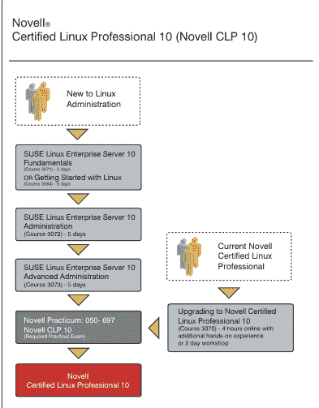

有关 Novell 认证计划以及参加 Novell CLP 10 和 CLE 10 实操考试的更多信息，请参阅

http://www.novell.com/training/certification/, http://www.novell.com/training/certification/clp10, 和 http://www.novell.com/training/certification/cle10。

在参加本课程之前，您应该具备以下课程中涵盖的一般 Linux 知识（即非 SUSE Linux Enterprise Server 10 特有的主题）：

- SUSE Linux Enterprise Server 10 基础（课程 3071）
- SUSE Linux Enterprise Server 管理（课程 3072）
- SUSE Linux Enterprise Server 高级管理（课程 3073）

## SUSE Linux Enterprise Server 10 支持和维护

您在学生包中收到的 SUSE Linux Enterprise Server 10 副本是 SUSE Linux Enterprise Server 10 产品的完整功能副本。

但是，要获得官方支持和维护更新，您需要执行以下任一操作：

- 注册免费的注册/序列号，以提供 30 天的支持和维护。
- 从 Novell（或授权经销商）购买一份 SUSE Linux Enterprise Server 10。

您可以在以下地址获取免费的 30 天支持和维护代码

http://www.novell.com/products/server/eval.html。

您需要拥有或创建一个 Novell 登录账户才能访问 60 天评估版。

## Novell 客户中心

Novell 客户中心是一个直观的基于 Web 的界面，可帮助您管理与 Novell 的业务和技术互动。Novell 客户中心整合了对信息、工具和服务的访问，例如：

- 新的 SUSE Linux Enterprise 产品的自动注册
- Novell 所有发行版 Linux 产品的补丁和更新
- 所有 Novell 产品、订阅和服务的订单历史
- 新的 SUSE Linux Enterprise 产品的授权可见性
- Linux 订阅续约状态
- 通过合作伙伴或 Novell 进行订阅续约

例如，公司可能有一位需要下载 SUSE Linux Enterprise 软件更新的系统管理员，一位想要查看订单历史的采购人员，以及一位需要对许可进行协调的 IT 经理。借助 Novell 客户中心，公司可以在一个位置满足所有这些需求，并为每个用户提供与其角色相符的访问权限。

您可以通过 http://www.novell.com/center/ 访问 Novell 客户中心。

## SUSE Linux Enterprise Server 10 在线资源

Novell 提供了多种在线资源，以帮助您配置和实施 SUSE Linux Enterprise Server 10。

这些资源包括以下内容：

- http://www.novell.com/products/server/

  - 这是 SUSE Linux Enterprise Server 的 Novell 主页。
- http://www.novell.com/documentation/sles10/index.html

  - 这是 SLES 10 的 Novell 文档网站。
- http://support.novell.com/linux/

  - 这是所有 Novell Linux 支持的主页，包含指向知识库、下载和常见问题解答（FAQ）等支持选项的链接。
- http://www.novell.com/coolsolutions/

  - 此 Novell 网站提供了 Novell 针对包括 SUSE Linux 在内的多种产品的最新实施指南和建议。

## 议程

以下是本为期 3 天的课程的议程：


| 部分 | 时长 |
|---|---|
| **第 1 天** | |
| **简介** | 00:30 |
| **第 1 部分：** 安装 SUSE Linux Enterprise Server 10 | 02:00 |
| **第 2 部分：** YaST | 02:00 |


| **第 3 部分：** 网络配置 | 01:00 |
| **第 2 天** | |
| **第 4 部分：** 管理 Linux 文件系统 | 01:30 |
| **第 5 部分：** 管理系统初始化 | 01:30 |
| **第 6 部分：** 配置 Web 和邮件服务 | 01:30 |
| **第 7 部分：** AppArmor | 02:00 |
| **第 3 天** | |
| **第 8 部分：** 使用 Xen 管理虚拟化 | 03:00 |
| **第 9 部分：** iSCSI | 01:45 |
| **第 10 部分：** 集群文件系统 | 01:45 |

## 练习

本课程的练习由练习描述和逐步完成任务的说明组成。
您应首先尝试自行完成描述中的任务，依据相应部分手册中涵盖的内容。只有当您觉得无法完成任务或无法确认所做操作是否正确时，才参考逐步说明。
练习包含在单独的工作手册中。

## 练习约定

在进行练习时，您会看到指示需要输入特定于您的服务器信息的相关约定。
以下描述了最常见的约定：

- *斜体/粗体* 文本。这是指您的独特情况，例如您的服务器的主机名。
  - 例如，如果您的服务器的主机名是 da10，并且您看到以下内容：
    *hostname.digitalairlines.com*
  - 您应输入
    **da10.digitalairlines.com**

- **10.0.0.xx**。这是分配给您的 SLES 10 服务器的 IP 地址。
  - 例如，如果您的 IP 地址是 10.0.0.10，并且您看到以下内容：
    **10.0.0.xx**
  - 您应输入
    **10.0.0.10**

- **Select**。在练习步骤中使用单词 *select* 来表示各种操作，包括点击界面上的按钮和选择菜单项。

- **Enter and Type**。单词 *enter* 和 *type* 具有不同的含义。
  - 单词 *enter* 是指在字段或命令行中输入文本，并在必要时按 Enter 键。单词 *type* 是指输入文本但不按 Enter 键。
  - 如果您被指示输入一个值，请确保不要按 Enter 键，否则您可能会激活一个您尚未准备好开始的过程。

## 第 1 部分 安装 SUSE Linux Enterprise Server 10

YaST（Yet another Setup Tool，又一个设置工具）提供了使安装变得简单快捷的选项。
然而，您也需要了解可用的更高级的安装选项。通过更改安装模式、分区、软件选择、身份验证方法或硬件设置，您可以安装满足各种需求的服务器。
在本部分中，您将安装 SUSE Linux Enterprise Server 10 (SLES 10)。您还将学习如何使用高级安装选项以及如何排除安装过程中的故障。

### 目标

1. 执行 SLES 10 安装
2. 配置 SLES 10 安装
3. 排除安装过程的故障

### 目标 1 执行 SLES 10 安装

安装 SLES 10 包括基本安装阶段和配置阶段。
要执行基本安装，请执行以下操作：
- 从安装介质启动
- 选择系统语言
- 选择安装模式
- 设置时钟和时区
- 了解并更改安装设置
- 验证分区
- 选择软件
- 启动安装过程

#### 从安装介质启动

要开始安装过程，请将 *SUSE Linux Enterprise Server 10* 产品 DVD 插入 DVD 驱动器，然后重新启动计算机以启动安装程序。

> 要启动安装程序，您的计算机必须配置为从 DVD 驱动器启动。您可能需要更改系统 BIOS 设置中的启动驱动器顺序，以便从该驱动器启动。
> 
> 请参阅随您的硬件附带的手册以获取更多信息。

当您的系统从安装 CD 启动后，将出现以下内容：

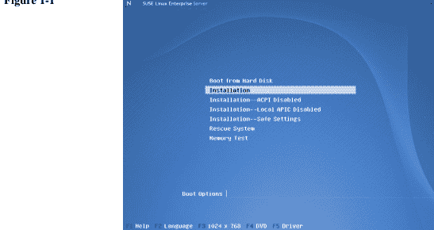

您可以使用箭头键选择以下选项之一：
- **Boot from Hard Disk（从硬盘启动）**。启动安装在硬盘上的系统（机器启动时通常启动的系统）。这是默认选项。
- **Installation（安装）**。启动正常的安装过程。所有现代硬件功能均已启用。
- **Installation - ACPI Disabled（安装 - 禁用 ACPI）**。启动安装过程，但禁用 ACPI（高级配置和电源接口）。如果正常安装失败，原因可能是系统硬件不支持 ACPI。在这种情况下，您可以使用此选项在不支持 ACPI 的情况下进行安装。
- **Installation - Local APIC Disabled.（安装 - 禁用本地 APIC.）**。启动安装过程，但禁用本地 APIC（高级可编程中断控制器）。
- **Installation - Safe Settings.（安装 - 安全设置.）**。启动安装过程，但禁用 DMA（直接内存访问）模式以及任何干扰的电源管理功能。如果使用其他选项安装失败，请使用此选项。
- **Rescue System.（救援系统.）**。启动 SLES 10 救援系统。如果您无法启动已安装的 Linux 系统，可以从 DVD 启动计算机（如果使用 CD 套装，则从第一张 CD 启动）并选择此选项。这将启动一个没有图形用户界面的最小 Linux 系统，以便专家访问磁盘分区，以排除和修复已安装系统的故障。
- **Memory Test.（内存测试.）**。启动内存测试程序，该程序通过使用重复的读写周期来测试系统 RAM。这是在无限循环中进行的，因为内存损坏通常表现为 sporadically（间歇性），可能需要许多读写周期才能检测到。

如果您怀疑您的 RAM 可能损坏，请启动此测试并让它运行几个小时。如果没有检测到错误，您可以假设内存是完好的。通过重新启动系统来终止测试。

使用屏幕底部栏中指示的功能键来更改多个安装设置：
- **F1**。打开当前选定的启动屏幕选项的上下文敏感帮助。
- **F2**。选择安装语言。
- **F3**。选择安装的图形显示模式（例如 640x480 或 1024X768）。您可以选择这些模式之一，或者选择文本模式，这在图形模式导致显示问题时很有用。
- **F4**。选择安装介质类型。通常您从插入的安装磁盘进行安装，但在某些情况下，您可能希望选择其他源，例如 FTP 或 NFS。
- **F5**。将驱动更新 CD 添加到安装过程中。在安装过程的适当时点，系统会要求您插入更新磁盘。

选择 **Installation（安装）** 选项以启动安装过程。如果安装因某种原因失败，请尝试使用选项 **Installation - ACPI Disabled、Installation - Local APIC Disabled 或 Installation - Safe Settings（安装 - 禁用 ACPI、安装 - 禁用本地 APIC 或 安装 - 安全设置）** 进行安装。
选择安装选项后，将加载一个最小 Linux 系统以运行 YaST 安装程序。

#### 选择系统语言

YaST 启动后，将出现以下内容：

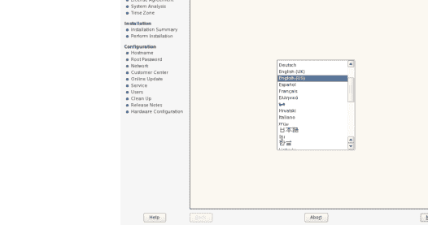

### 几乎所有 YaST 安装对话框都使用相同的格式：

- 左侧显示安装状态的概览。
- 在左下角，您可以选择一个帮助按钮以获取关于当前安装步骤的信息。
- 右侧显示当前的安装步骤。
- 右下角提供按钮，用于导航到上一个或下一个安装步骤，或者中止安装。


如果安装程序未检测到您的鼠标，您可以使用 Tab 键在对话框元素之间导航，使用方向键在列表中滚动，并使用 Enter 键选择按钮。您可以在安装过程中稍后更改鼠标设置。
在语言对话框中，选择您所需的语言，然后选择**下一步**以继续下一步，即**许可协议**。
您必须选择**是，我同意许可协议**，然后通过选择**下一步**进入下一步。

#### 选择安装模式

如果您的计算机上没有安装操作系统，安装模式对话框仅提供**新安装**。（在这种情况下，无法选择“更新”和“其他”。）
如果 YaST 检测到另一个 SUSE Linux 安装，您将获得更多选项，其中一些选项只有在选择了**其他**之后才可用，如下例所示：

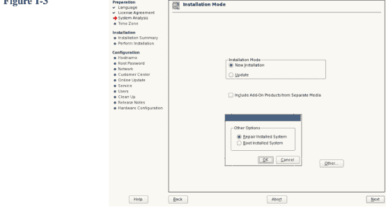

- **新安装。** 执行 SLES 10 的常规新安装。这是默认选项。
- **更新。** 更新先前安装的 SLES 9。
- **其他。** 提供另外两个选项：
  - **修复已安装系统。** 修复先前安装的 SLES 10。
  - **启动已安装系统。** 启动先前安装的 Linux 系统。
- **中止安装。** 终止安装过程。

对于常规安装，选择**新安装**，然后选择**下一步**以进入下一步。

#### 设置时钟和时区

YaST 根据您的语言选择为已安装系统选择时区。如果您位于不同的时区，请更改时区。


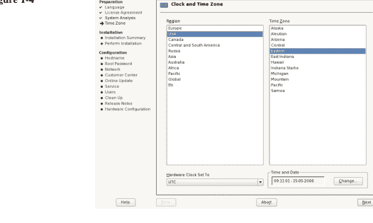

如果您的硬件时钟设置为 UTC（协调世界时），则系统时间会根据您的时区设置并自动调整至夏令时。如果您的硬件时钟设置为本地时间，请在下拉菜单中选择本地时间而不是 UTC。

## 理解并更改安装设置

YaST 分析系统并创建安装建议。建议在两个选项卡中显示，如下所示；**概述**显示主要类别：

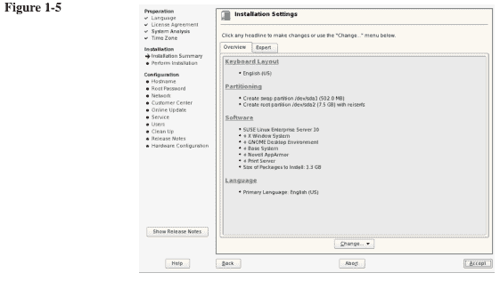

建议显示基础安装所需的设置。您可以通过选择以下标题来更改这些设置：

- **键盘布局。** 更改键盘布局。YaST 根据您的语言设置选择键盘布局。如果您偏好不同的布局，请更改键盘设置。
- **分区。** 更改硬盘分区。如果自动生成的分区方案不符合您的需求，您可以通过选择此标题来更改它。
- **软件。** 更改软件选择。您可以选择或取消选择软件。

专家选项卡显示上述选项，以及以下内容：

- **系统。** 重新启动硬件检测过程并显示所有可用硬件组件的列表。您可以更改 PCI-ID 设置，选择单个组件并查看详细信息，或将列表保存到文件。
- **附加产品。** 选择此选项以包含任何附加产品。
- **启动。** 如果您想更改任何启动加载器设置，或使用 Lilo (Linux Loader) 代替 GRUB (Grand Unified Bootloader) 作为启动加载器，请选择此项。
- **时区。** 打开之前描述的时钟和时区对话框。
- **默认运行级别。** 更改运行级别。如果安装了图形环境，默认为运行级别 5，否则为 3。

在以上设置的设置中，分区和软件将更详细地讨论。

## 验证分区

在大多数情况下，YaST 会建议一个合理的分区方案，您可以直接接受而无需更改。但是，如果需要手动更改分区，可能需要以下情况：

- 您想要优化分区方案以用于特定用途服务器（如文件服务器）。
- 您想要配置 LVM (逻辑卷管理器)。
- 您拥有多于一块硬盘并希望配置 RAID (独立磁盘冗余阵列)。
- 您想要删除现有的操作系统，以便为您的 SLES 10 安装腾出更多空间。

要手动分区硬盘，您需要知道以下事项：

- 硬盘分区基础
- 基本 Linux 分区方案
- 更改 YaST 的分区建议
- 使用 YaST 专家分区器

### 硬盘分区基础

分区将硬盘的可用空间划分为更小的部分。这使您能够在硬盘上安装多个操作系统，或为程序和数据使用不同的区域。

每个硬盘（在 Intel 平台上）都有一个分区表，其中包含四个条目的空间。分区表中的条目可以对应主分区或扩展分区。但是，只允许一个扩展分区条目。

*主分区*由分配给特定文件系统的连续圆柱体（物理磁盘区域）范围组成。如果您只使用主分区，则每块硬盘最多限制为四个分区（因为分区表只能容纳四个主分区）。

这就是为什么使用扩展分区的原因。*扩展分区*也是磁盘圆柱体的连续范围，但可以细分为逻辑分区。*逻辑分区*不需要在主分区表中拥有条目。换句话说，扩展分区是逻辑分区的容器。

如果您需要四个以上的分区，请创建一个扩展分区而不是第四个主分区。此扩展分区应包含整个剩余的空闲圆柱体范围。然后在扩展分区内创建多个逻辑分区。SCSI 磁盘上的最大分区数为 15，(E)IDE 磁盘上的最大分区数为 63。

在 Linux 系统上使用哪种类型的分区并不重要；主分区和逻辑分区都运行良好。

### 基本 Linux 分区方案

服务器的最佳分区方案取决于服务器的用途。

SLES 10 安装至少需要两个分区：

- **交换分区。** 此分区用于 Linux 将未使用的数据从主内存移动到硬盘，从而释放主内存，使其可用于其他进程。
- **根分区。** 这是持有文件系统层级的顶部 `/`，即所谓的根目录的分区。

无论您选择哪种分区方案，您始终至少需要一个交换分区和一个根分区。

以下指南帮助您根据文件系统中可用的空间确定可以安装的内容：

- **800 MB。** 这允许进行没有图形界面的最小安装。在此配置下，您只能使用控制台应用程序。
- **1300 MB。** 这允许进行带有最小图形界面的安装。这包括 X Window 系统和几个图形应用程序。
- **2 GB。** 这容纳了 YaST 建议的默认安装。此配置包括现代桌面环境（如 KDE 或 GNOME），并提供足够的空间用于几个附加应用程序。
- **4 GB。** 这允许进行完整安装，包括随 SLES 10 附带的所有软件包。

您可以将某些目录放在单独的分区上。如果这样做，您的根分区可以比上述更小。任何数据所需的空间需要添加到上述空间中。

> 鉴于当今的计算机配备容量为 100 GB 及更大的硬盘，仍有很大的空间用于数据。考虑到在已安装系统中更改分区的困难以及当前硬盘的大小，因此在决定硬盘布局时，您应该分配比上述最小值多得多的空间。

## 更改 YaST 分区建议

若要使用 YaST 更改分区方案，请在安装建议中选中**分区**标题。此时将显示以下内容：

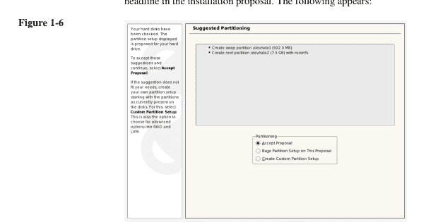

在对话框的上部，YaST 显示自动生成的分区建议。对话框的下部提供以下选项：

- **接受建议。** 接受分区方案并返回到主安装建议。
- **基于此建议创建基础分区设置。** 启动 YaST 专家分区器，并使用该分区建议作为基础设置。
- **创建自定义分区设置。** 显示以下内容：

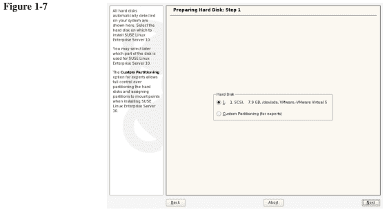

在此对话框中，您可以选择：

- 一个硬盘；选择“下一步”将打开一个对话框，您可以在其中选择使用整个硬盘或某些现有分区来安装 SLES 10。
- **自定义分区**；选择“下一步”将打开 YaST 专家分区器，显示现有的分区布局。

## 使用 YaST 专家分区器

当启动 YaST 专家分区器时，将显示以下内容：

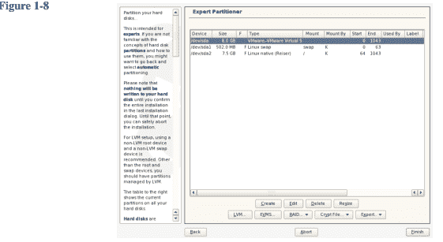

在对话框的上部，YaST 列出当前分区设置的详细信息。根据您之前的选择，列表中包含由 YaST 创建的分区建议或当前的物理磁盘设置。

对话框下部的按钮用于创建、编辑、删除和调整分区大小，以及管理 LVM（逻辑卷管理器）、EVMS（企业卷管理系统）和 RAID（独立磁盘冗余阵列）。

> 使用 YaST 专家分区器所做的更改不会写入磁盘，直到安装过程开始。您可以随时通过选择**后退**来丢弃您的更改，或者重新启动专家分区器以进行更多更改。

系统中每个硬盘都显示以下条目：

- 硬盘本身的一个条目，在设备列中显示相应的设备名称（例如 `/dev/sda`）。
- 硬盘上每个分区的一个条目，在设备列中显示相应的设备名称和分区编号（例如 `/dev/sda1`）。

列表中的每个条目包含以下列中的信息：

- **设备。** 显示硬盘或分区的设备名称。
- **大小。** 显示硬盘或分区的大小。
- **F。** 当此列中显示字符“F”时，将在安装过程中格式化该分区。
- **类型。** 显示分区或硬盘的类型。根据操作系统和架构的不同，分区可以有各种类型，如 Linux 原生、Linux 交换、Win95 FAT 32、NTFS 等。
- **挂载。** 显示分区的挂载点。对于交换分区，使用关键词 `swap` 代替。
- **挂载方式。** 指示文件系统如何挂载：K—内核名称，L—标签，U—UUID，I—设备 ID，P—设备路径。
- **起始。** 显示硬盘或分区的起始磁道。硬盘条目始终从 0 开始。
- **结束。** 显示硬盘或分区的结束磁道。
- **使用方。** 此列包含关于使用此分区的系统信息，如 LVM-system。
- **标签、设备 ID、设备路径。** 这些列列出相应的信息。

对话框下部的按钮允许您：

- 创建新分区
- 编辑现有分区
- 删除现有分区
- 调整现有分区大小
- 执行专家任务

下面将更详细地介绍这些管理任务。本课程不涵盖 EVMS（[http://evms.sourceforge.net/](http://evms.sourceforge.net/)）和加密文件分区。

### 创建新分区

通过选择**创建**来创建新分区。将出现一个包含以下任一选项的对话框（您看到的选项取决于您的硬盘设置）：

- 如果您的系统中有多于一块硬盘，系统将首先要求您为新分区选择一个硬盘。
- 如果您没有扩展分区，系统将询问您是否要创建主分区还是扩展分区。
- 如果您有一个扩展分区，且硬盘在扩展分区之外有空间用于额外的主分区，系统将询问您是否要创建主分区还是逻辑分区。
- 如果您有 3 个主分区和一个扩展分区，您只能创建逻辑分区。

您需要足够的硬盘空间来创建新分区。您将在本节稍后学习如何删除现有分区以释放已使用的磁盘空间。

如果您选择创建主分区或逻辑分区，将显示以下内容：


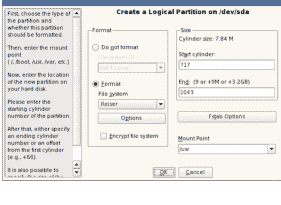


此对话框提供以下选项：

### 格式化
这允许您选择以下选项之一：

- **不格式化。** 不格式化新创建的分区。不会在此新分区上创建文件系统。您可以在下拉列表中选择分区类型。
- **格式化。** 使用从文件系统下拉列表中选择的文件系统格式化新分区。您可以从以下文件系统中选择：
  - **Ext2。** 使用 Ext2 文件系统格式化分区。Ext2 是一种老旧且经过验证的文件系统，但它不包含日志功能。
  - **Ext3。** 使用 Ext3 文件系统格式化分区。Ext3 是 Ext2 的继任者，并提供日志功能。
  - **Reiser。** 使用 ReiserFS 格式化分区，这是一种现代的日志文件系统。（这是默认选项。）
  - **FAT。** 使用 FAT 文件系统格式化分区。FAT 是 DOS 和 Windows 中使用的较旧的文件系统。您可以使用此选项创建可从 Windows 和 Linux 访问的数据分区。切勿使用此文件系统创建根分区。
  - **XFS。** 使用 XFS 格式化分区，这是一种由 SGI 最初开发的日志文件系统。
  - **Swap。** 将分区的格式化为交换分区。

  如果您不确定选择哪种文件系统，请为根分区和数据分区选择 Reiser，为交换分区选择 Swap。

### 选项
通过选择选项，您可以更改所选文件的参数。在大多数情况下，您可以使用默认参数。

### 加密文件系统
如果您选择此选项，包含文件系统的分区将被加密。加密文件系统仅能防止未授权的挂载；一旦挂载，文件就像系统中的任何其他文件一样可访问。

您应该仅将此选项用于非系统分区，例如用户主目录。

### 大小
允许您使用以下内容配置新分区的大小：

- **起始磁道。** 确定新分区的第一个磁道。YaST 通常预选硬盘的第一个可用空闲磁道。
- **结束。** 确定新分区的大小。YaST 通常预选最后一个可用空闲磁道。

要配置结束磁道，请执行以下操作之一：
- 输入磁道编号。
- 输入加号 `+` 后跟新分区的磁盘空间量。使用 `M` 表示 MB，使用 `G` 表示 GB。YaST 会计算最后一个磁道编号。例如，对于 5 GB 的分区大小，请输入 `+5G`。

### Fstab 选项
选择此选项以编辑此分区的 fstab 条目。默认设置应在大多数情况下起作用。

### 挂载点
从此下拉列表中选择新分区的挂载点。如果列表中不可用，您也可以手动输入挂载点。挂载点将在安装过程中自动创建。

更改参数后，选择**确定**以将新分区添加到分区列表中。

如果您选择创建扩展分区，将显示以下内容：

#### 图 1-10

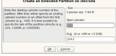

您可以输入以下内容：

- **起始磁道。** 起始磁道确定新分区的第一个磁道。YaST 通常预选硬盘的第一个可用空闲磁道。
- **结束。** 结束磁道确定新分区的大小。YaST 通常预选硬盘的最后一个可用磁道。

要配置结束磁道，请执行以下操作之一：
- 输入磁道编号。
- 输入加号 `+`，后跟新分区所需的磁盘空间大小。使用 `M` 代表 MB（兆字节），使用 `G` 代表 GB（吉字节）。YaST 将计算最后一个柱面的编号。

例如，要创建一个 5 GB 大小的分区，请输入 `+5G`。

输入大小后，选择 **确定** 将新的扩展分区添加到分区列表中。

### 编辑现有分区

从列表中选择一个分区，然后选择 **编辑**。你可以使用专家分区工具仅编辑主分区和逻辑分区。无法编辑扩展分区或整个硬盘的条目。

如果你编辑主分区或逻辑分区，将会出现一个与上文描述的创建分区对话框非常相似的对话框。除了分区大小外，你可以更改所有其他选项。

更改分区参数后，选择 **确定** 将更改保存到分区列表中。

### 删除现有分区

要删除分区，从列表中选择一个分区，选择 **删除**，然后在确认对话框中选择 **是**。该分区将从分区列表中删除。

请记住，当你删除扩展分区时，其中所有的逻辑分区也会被删除。

如果你选择整个硬盘的条目并选择 **删除**，磁盘上的所有分区都将被删除。

### 调整现有分区大小

从列表中选择一个分区，然后选择 **调整大小**。

> 尽管你可以通过缩小分区大小（而不删除它）来增加硬盘上的可用空间，但你始终应在调整大小之前备份分区上的数据。
> 如果所选分区格式化为 FAT 或 NTFS 文件系统，你在调整大小前应在 Windows 中采取某些步骤（如 scandisk 和 defrag）。详细信息请参阅《*SUSE Linux Enterprise Server 10 管理手册*》中关于安装的部分（*usr/share/doc/manuals/sles-admin_en/*，软件包 `sles-admin_en`）。

选择 **调整大小** 后，将出现以下内容：

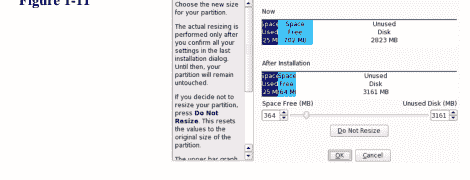

此对话框包含以下内容：

- 两个条状图，分别代表分区调整大小前和调整大小后的状态
  - **当前**。已用空间由深蓝色标示，可用空间由浅蓝色标示。如果有未分配给任何分区空间，则由白色标示。
  - **安装完成后**。已用空间由深蓝色标示，空闲空间由浅蓝色标示。可用于新分区的空间由白色标示。
- 一个用于更改分区大小的滑块
- 两个文本字段，分别显示正在调整大小的分区的可用空间量，以及调整大小后可用于新分区的空间量
- 一个“不调整大小”按钮，用于将分区重置为原始大小

要调整分区大小，移动滑块直到有足够未使用的磁盘空间用于新分区。当你选择 **确定** 时，分区大小将在分区列表中变更。

## 执行专家任务

当你选择 **专家** 时，可用以下选项：

- **重建分区表**。将分区列表重置为当前物理磁盘配置。所有更改都将丢失。
- **从现有 /etc/fstab 导入挂载点**。扫描硬盘查找 `/etc/fstab` 文件。你可以加载此文件并相应设置挂载点。
- **删除分区表和磁盘标签**。删除所选硬盘的分区表和磁盘标签。*该磁盘上的所有数据都将丢失。*

当你在专家分区工具中完成设置配置后，通过选择 **完成** 返回安装建议界面。

## 选择软件

SLES 10 包含许多用于不同应用目的的软件包。除了逐一选择所需的软件包外，你还可以选择各种软件类别。

根据可用磁盘空间，YaST 会预选择其中几个类别。在安装概览中选择 **软件** 将打开以下对话框：

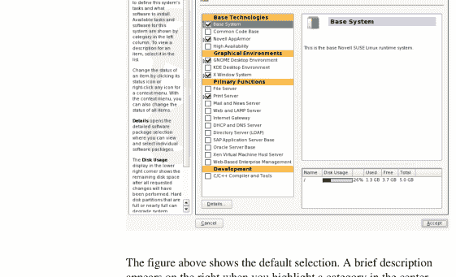

上图显示了默认选择。当你在中间列高亮显示某个类别时，右侧会出现简要描述。

要了解各个类别包含哪些软件包，请选择“详细信息”，这将打开以下对话框：


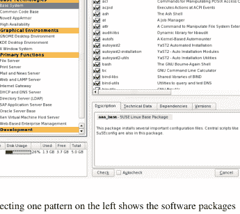

在左侧选择某一种模式（pattern），右侧将显示该类别中包含的软件包。选择模式左侧的方框可将其选中以便安装或取消选中。

软件包通常包含应用程序和使用该软件所需的所有其他文件。有时，较大的应用程序可以拆分为多个软件包，而几个小型应用程序则可以合并为一个软件包。SUSE Linux Enterprise Software 使用 RPM 包管理器进行软件管理。

有时一个软件包需要另一个软件包才能运行。有关这些依赖关系的信息存储在 RPM 软件包中。当其他软件包需要它们时，YaST 可以自动选择软件包。

你可以通过选择右侧 **软件包列表** 中该 **软件包** 的复选框来安装软件包。

要查看软件包的详细信息，请在软件包列表中高亮显示其条目。当前选中软件包的详细信息将显示在软件包列表下方。

“过滤器”下拉菜单提供有关可用软件包以及计划安装软件的几种不同视图。

**图 1-14**

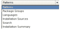

- **模式**。这将打开如图 1-13 所示的对话框。
- **软件包组**。以层次树状视图显示软件包。主要有生产力、编程、系统、硬件等类别以及子类别。在左侧选择一个类别，右侧将显示属于该类别的软件包。
- **语言**。你可以选择对额外语言的支持。
- **安装源**。显示已配置的安装源。
- **搜索**。显示搜索对话框以搜索软件包。
- **安装摘要**。显示所选待安装软件的摘要。

所选待安装软件包的磁盘使用情况显示在对话框的左下角。

选择选项 **检查** 以检查所选软件包的依赖关系。当你确认软件包选择对话框时，也会执行此检查。

如果选中复选框 **自动检查**，则每次你选择或取消选择软件包时，都会检查依赖关系。

选择 **接受** 以确认你的软件包选择并返回安装建议界面。

## 开始安装过程


自定义安装建议后，选择 `接受`。将出现一个对话框询问你是否确认该建议。选择 `安装` 开始安装过程；选择 `后退` 返回安装建议界面。

在安装软件包之前，YaST 会修改硬盘分区。

根据你的软件选择及系统性能，安装过程需要 15–45 分钟。

如果你使用的是产品 CD 套装而不是 DVD，YaST 会提示你更换安装 CD。插入所需的 CD，并通过选择 `确定` 继续安装。

在所有软件包安装完成后，YaST 将重启计算机，并提示你输入主机名、root 密码、网络配置详情等，以进一步自定义你的安装。

## 目标 2：配置 SLES 10 安装

在安装过程的这部分中，你将使用 YaST 执行以下配置任务：

- 设置主机名
- 设置 root 密码
- 配置网络
- 测试互联网连接
- Novell 客户中心配置和在线更新
- 管理用户
- 配置网络服务
- 配置硬件
- 完成安装过程

### 设置主机名

YaST 建议一个主机名 `liux-xxxx`，其中 xxxx 由随机字符组成。域名默认为 `site`。将主机和域名更改为计算机的正确值，并去掉 `通过 DHCP 更改主机名` 前面的勾选标记。

如果计算机通过 DHCP 获取主机名和域名，则你无需在此对话框中更改任何内容。

### 设置 Root 密码

Root 是系统管理员的名称。与可能没有权限在系统中执行某些操作的普通用户不同，root 拥有无限的权力，可以执行任何操作，包括以下内容：

- 访问系统中的每个文件和设备。
- 更改系统配置。
- 安装软件。
- 设置硬件。

root 账户仅应用于系统管理、维护和修复。以 root 身份登录进行日常工作风险很大：一个错误可能导致许多系统文件不可恢复地丢失。

为了让你在安装过程中设置 root 密码，YaST 显示以下内容：

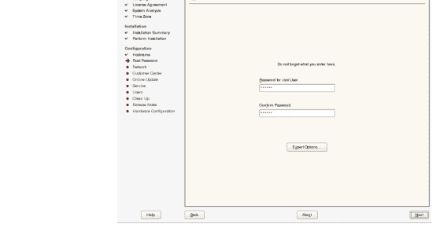

在对话框的两个文本框中输入相同的密码。

你应该选择一个不容易被猜到的密码。使用数字、小写和大写字母来避免字典攻击。

通过选择 `专家选项`，你可以选择密码加密算法。在大多数情况下，你可以使用默认设置，即 `Blowfish`。

输入 root 密码后，通过选择 `下一步` 继续到下一个配置步骤。如果密码过于简单或较弱，你会看到一个警告。返回以输入更好的密码，或者接受该弱点并继续。

### 配置网络

为了让你的系统配置网络连接，YaST 显示以下内容：

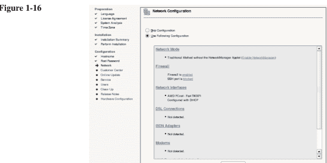

在对话框的上半部分，你可以选择以下选项之一：

- `跳过配置`。暂时跳过网络配置。你稍后可在安装好的系统中配置网络连接。
- `使用以下配置`。使用在下方面板中显示的网络配置建议。

网络配置建议类似于基础安装开始时的安装建议，包含可被选中以查看和配置更多细节的标题，并包括以下条目：

- `网络模式`。在传统网络管理方法和网络管理器之间切换。在服务器上，使用传统方法。网络管理器更适合笔记本电脑，使用户可以轻松地在以太网和无线接入之间切换。
- `防火墙`。如果你想通过 SSH 管理计算机，通过点击 `blocked` 将 `SSH 端口被阻止` 切换为 `SSH 端口开放`。你可以通过点击 `enabled` 来禁用防火墙。当防火墙被禁用时，SSH 也是可访问的。选择 `防火墙` 本身会打开一个允许详细配置防火墙设置的对话框。
- `网络接口`。显示找到的网络接口（如以太网或无线局域网适配器）及其配置（如 DHCP）。
- `DSL 连接`。显示 DSL 设备的配置。这些可以是连接以太网适配器的 DSL 调制解调器或内部 DSL 调制解调器。
- `ISDN 适配器`。显示 ISDN 设备的配置。
- `调制解调器`。显示模拟调制解调器的配置。
- `VNC 远程管理`。显示使用 VNC 进行远程管理的配置。
- `代理`。显示 HTTP 和 FTP 代理设置。

你可以通过选择条目标题或从 `更改` 下拉列表中选择条目来更改配置。此菜单还允许你将所有设置重置为 YaST 生成的默认值。

如果你不确定使用哪些设置，请保持 YaST 生成的默认值。

#### 配置网络接口

开始网络接口配置后，YaST 会显示 `网卡配置概览`。它列出了所有网卡，包括已配置的以及尚未配置的网卡：

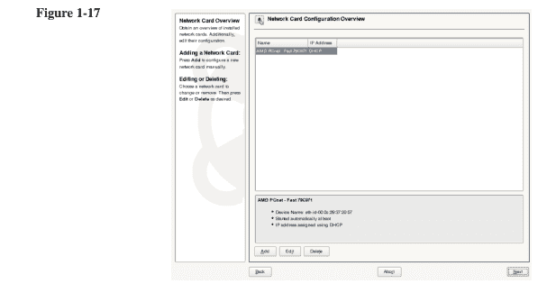

上半部分列出了找到的网卡，下半部分显示在上半部分中高亮的网卡的详细信息。

此时，你可以执行以下操作之一：

- 手动添加网卡
- 编辑现有配置
- 删除现有配置

##### 手动添加网卡

如果你想配置一块未被自动检测到的网卡，选择 `添加` 以显示以下内容：

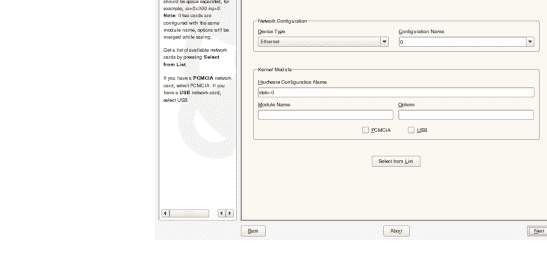

在此对话框中，你可以配置以下内容：

- `网络配置`。指定网络 `设备类型`（以太网、蓝牙、无线等）和设备编号。
- `内核模块`。如果网卡是 PCMCIA 或 USB 设备，请选中相应的复选框，并选择 `下一步` 确认。
- 否则，选择 `从列表中选择` 并从列表中选取你的网卡。YaST 会自动为选中的网卡加载相应的驱动程序。通过选择 `确定` 进行确认。
- 如果你为 WLAN 卡选择了 `无线` 作为设备类型，`下一步` 会带你进入网络地址对话框。默认选项 DHCP 通常是正确的选择。再次选择 `下一步` 会打开一个对话框，你可以在其中输入 WLAN 特定的配置参数，如 `运行模式`、`网络名称`（ESSID）、`认证模式` 以及加密密钥。选择 `WEP 密钥` 后，WEP 密钥在单独的对话框中输入。专家设置涉及诸如比特率等参数。

完成此对话框后，选择 `下一步`，这将带你返回到网卡配置概览。

##### 编辑现有配置

要编辑网卡配置，请在 `网卡配置概览` 的上半部分高亮显示其条目，然后选择 `编辑`。

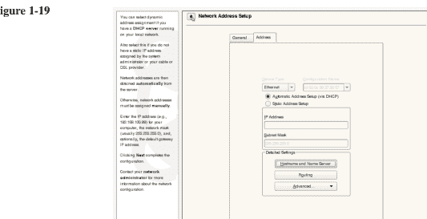

`地址` 选项卡提供以下配置选项：

- `自动地址设置（通过 DHCP）`。如果你的网络有 DHCP 服务器，你可以自动设置网络地址。如果你使用的是 ISP 未分配静态 IP 地址的 DSL 线路，你也应该使用此选项。
- 如果你决定使用 DHCP，你可以选择从 `高级` 下拉列表中选择的 `DHCP 选项` 来配置详细信息。指定 DHCP 服务器是否应始终广播其响应（在此情况下选择 `请求广播响应`）以及要使用的任何标识符。

默认情况下，DHCP 服务器使用网卡的硬件地址来标识接口。如果你有虚拟主机设置，不同的主机通过同一接口通信，则需要标识符来区分它们。

- `静态地址设置`。如果你有静态地址，请选中相应的复选框。然后输入你的网络地址和子网掩码。预设的子网掩码应符合典型家庭网络的要求。
- `主机名和名称服务器`。选择此选项以手动设置主机名和名称服务器。
- `路由`。选择此选项以手动配置路由。

`常规` 选项卡提供以下配置选项：

- `防火墙区域`。决定此接口属于内部、外部或非军事化区域，或者是否应阻止所有流量（无区域）。
- `设备激活`。选择启动时、连接电缆时、热插拔时、手动或从不。
- `详细网络接口设置`。指定最大传输单元（MTU），这有时可以改善某些 DSL（数字用户线路）连接的性能。对于 PPPoE（基于以太网的点对点协议），常见值在 1400 和 1492 之间；这些值因你的 ISP（互联网服务提供商）而异。

确认网络地址设置并通过选择 `下一步` 返回到网卡配置概览。

##### 删除现有配置

要删除现有配置，请在网卡配置概览的上半部分高亮显示它，然后选择 `删除`。

完成添加、编辑或删除网卡配置后，通过选择 `下一步` 保存网络设备配置并返回到网络配置建议。

完成网络配置后，选择 `下一步`。

#### 测试互联网连接

然后，YaST 会要求你测试你的互联网连接。选择以下选项之一：

- `是，测试互联网连接`。YaST 尝试通过下载最新的发布说明并检查可用更新来测试互联网连接。

    - 如果你选择此选项，结果将显示在下一个对话框中。
- `否，跳过此测试`。跳过连接测试。如果你跳过测试，在安装期间无法更新系统。

选择一个选项并选择 `下一步`。

如果测试失败，你可以查看日志以查明发生了什么错误。选择 `下一步` 继续。

### Novell 客户中心配置与在线更新

如果 Internet 连接测试成功，您可以配置 Novell 客户中心，这是执行在线更新所必需的。如果 SUSE 更新服务器上有可用的更新包，您可以下载并安装它们，以修复已知的 bug 或安全漏洞。

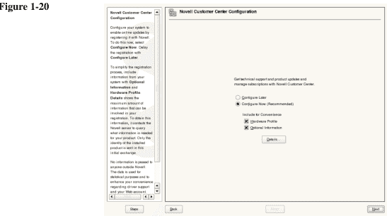


选择 **Next**（下一步）将启动浏览器并连接到 Novell 网站，在那里您只需输入您的电子邮件地址，以及激活代码（如果有）。

### 图 1-21

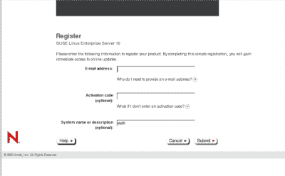

注册成功后，在线更新对话框将打开。您可以选择 **Run Update**（运行更新）和 **Next**（下一步）来开始在线更新。（您也可以稍后在已安装的系统中选择 **Skip Update**（跳过更新）来执行更新。）

YaST 的在线更新对话框将打开，并显示可用的补丁列表（如有）。

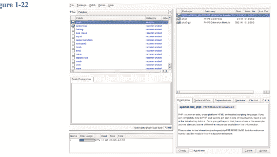

选择您要安装的补丁，然后选择 **Accept**（接受）开始更新过程。

安装完成后，请访问 `http://www.novell.com/center/` 处的 Novell 客户中心，以管理您的 Novell 产品和订阅。

## 配置网络服务

在下一个安装步骤中，YaST 将显示服务安装设置对话框。

在对话框的上半部分，您可以选择以下选项之一：

- **Skip Configuration**（跳过配置）。跳过此配置步骤。您可以稍后在已安装的系统启用这些服务。
- **Use Following Configuration**（使用以下配置）。使用显示在此选项下方的自动生成的配置，或者选择以下标题之一以更改配置：
    - **CA Management**（CA 管理）。CA（认证机构或证书机构）的目的是保证相互通信的所有网络服务之间的信任关系。
        - 如果您决定不建立本地 CA，则必须使用来自其他 CA 的证书，通过 SSL（安全套接字层）和 TLS（传输层安全）来保护服务器通信。
        - 默认情况下，安装过程中会创建并启用一个 CA。
        - 为了创建正确的证书，主机名必须在之前的网络接口配置中正确设置；否则生成的证书将包含错误的主机名。
    - **LDAP Server**（LDAP 服务器）。您可以在主机上运行 LDAP（轻量级目录访问协议）服务器，以拥有一个管理各种配置设置的中心服务。通常，LDAP 服务器处理用户账户数据，但从 SLES 9 开始，您也可以在 SUSE Linux Enterprise Server 上使用 LDAP 来处理与邮件、DHCP 和 DNS 相关的数据。默认情况下，安装过程中不会设置 LDAP 服务器。

如果您不确定正确的设置，请保留 YaST 生成的默认设置。您可以稍后在已安装的系统更改配置。

完成后，选择 **Next**（下一步）。

## 用户管理

要在本次配置步骤中管理用户，请执行以下操作：

- 选择认证方法
- 配置认证方法

### 选择认证方法

认证方法对话框提供四种方法。您可以选择以下选项之一：

- **Local**（本地） (`/etc/passwd`)。选择此选项以配置系统使用传统的基于文件的认证方法。
- **LDAP**。如果您的网络中有 LDAP 服务器，您可以将系统配置为 LDAP 客户端。
- **NIS**。如果您的网络中有 NIS 服务器，您可以将系统配置为 NIS 客户端。
- **Windows Domain**（Windows 域）。如果您希望针对 Windows 服务器进行认证，请选择此项。

如果您不确定要选择哪种方法，请保持使用 **Local**（本地），这是 SLES 10 的默认选项。

选择认证方法后，选择 **Next**（下一步）。

### 配置认证方法

下一个对话框会因您的选择而不同。我们将在这里介绍：

- 添加本地用户
- 将系统配置为 LDAP 客户端

NIS 和 Windows 域的对话框以类似的方式使用，以获取启用相应认证方法所需的信息。

#### 添加本地用户

如果选择 Local（本地）作为认证方法，将显示以下内容：

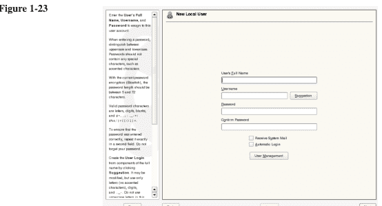

在此对话框中，您可以使用以下选项向系统添加本地用户（账户信息存储在文件 **`/etc/passwd`** 和 **`/etc/shadow`** 中）：

- **User Data**（用户数据）。输入完整用户姓名、登录名和密码。
    - 为了提供有效的安全性，密码长度应为 8 个字符或更多。密码的最大长度范围从 8 到 128 个字符不等，具体取决于用于对密码进行哈希处理的算法。过去常用的 Crypt 算法仅使用密码的前八个字符，而较新的算法允许更长的密码。
    - 密码区分大小写。允许使用特殊字符，但根据键盘布局不同，输入起来可能比较困难。
- **Password Settings**（密码设置）。选择此选项以更改高级密码设置（例如密码过期时间）。默认设置在大多数情况下都是合适的。
- **Details**（详细信息）。选择此选项以编辑用户账户的详细信息。默认设置在大多数情况下都是合适的。
- **Receive System Mail**（接收系统邮件）。选择此选项以将所有发给 root 的邮件转发给该用户。
- **Automatic Login**（自动登录）。选择此选项以启用该用户的自动登录。系统启动时，此选项将自动登录用户（无需请求密码）。
    - 您不应该在生产系统上启用此功能。
- **User Management**（用户管理）。选择此选项以添加更多用户（使用 YaST 用户管理模块）。

> 您可以稍后添加其他用户（安装后），但您必须在安装期间至少创建一个用户，这样系统在配置完成后您就不必以 root 用户身份工作。

输入所有所需信息后，选择 **Next**（下一步）。

#### 将系统配置为 LDAP 客户端

如果选择 LDAP 作为认证方法，将显示以下内容：


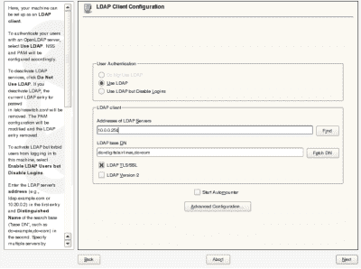

从此对话框中，您可以将系统配置为 LDAP 客户端。默认配置建议使用本地安装的 LDAP 服务器。

您可以使用以下选项更改配置：

- **LDAP client**（LDAP 客户端）。您可以配置以下内容：
    - **Addresses of LDAP Servers**（LDAP 服务器地址）。输入 LDAP 服务器的地址。
    - **LDAP base DN**（LDAP 基础 DN）。输入服务器上的搜索基础。
- **LDAP TLS/SSL**。选择此选项以加密与 LDAP 服务器的通信。
- **LDAP Version 2**（LDAP 版本 2）。如果您的 LDAP 服务器仅支持 LDAP 版本 2，请选择此选项。默认使用 LDAP 版本 3。
- **Start Automounter**（启动自动挂载器）。如果您的 LDAP 服务器提供关于文件系统自动挂载（例如主目录）的信息，您可以启动自动挂载器并使用来自 LDAP 服务器的自动挂载信息。
- **Advanced Configuration**（高级配置）。选择此选项以更改高级 LDAP 设置。

完成 LDAP 配置后，选择 **Next**（下一步）。

将显示版本说明。您应该阅读这些说明，以确保了解最新更改。

## 配置硬件

选择 **Next**（下一步）将打开硬件配置对话框。

配置提案包含以下项：

- **Graphics Cards**（显卡）。显示显卡和监视器设置。
- **Printers**（打印机）。显示打印机和打印服务器设置。
- **Sound**（声音）。显示声卡配置。

要更改自动生成的配置，请选择您要更改的项的标题，或者在下拉列表中选择的相应条目。

你还可以使用 **Change** 下拉列表将所有设置重置为自动生成的配置建议。

### 图 1-25

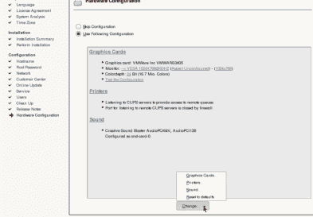

此时你可以跳过硬件配置，并稍后在安装好的系统中配置你的设备。但是，如果配置建议中显卡的设置不正确，你应该现在更改它们，以避免首次启动系统时出现问题。

这是通过选择相应的下划线条目并根据需要调整值来实现的。

### 完成安装过程

通过选择 **Next** 确认你的硬件设置，然后选择 **Finish**。除非你去除 **Clone This System for Autoyast** 前面的复选标记，否则将生成一个 autoyast 文件并保存为 `/root/autoinst.xml`，你可以使用它来设置一个相同的系统。

系统将启动图形登录界面，你可以使用之前创建的用户账号登录。SLES 10 现已在你的系统中安装完毕。

### **目标 3**

### **排除安装过程中的故障**

SUSE Linux Enterprise Server 10 已在许多不同的机器和硬件平台上进行了安装和测试。然而，有时可能会出现问题。

下表概述了最常见的安装问题、可能的原因及解决方案：

**表 1-1**


| 问题 | 可能原因 | 解决方案 |
| :------------- | :--------------------------------------------------- | :---------------------------------------------------------- |
| 系统未能从安装介质启动。 | 系统未配置为从 CD 或 DVD 驱动器启动。 | 进入系统的 BIOS 设置，并选择 CD 或 DVD 驱动器作为第一启动驱动器。请参阅系统手册了解关于 BIOS 设置的详细信息。 |
| | CD 或 DVD 驱动器损坏。 | 尝试用 *SLES 10 CD 1* 启动另一个系统。如果成功，实际系统的 CD 或 DVD 驱动器可能已损坏。 |
| | 安装 CD 或 DVD 损坏。 | 如果安装 CD 在另一个系统上无法启动，则 CD 或 DVD 本身可能已损坏。联系你的经销商更换 SLES 10 CD 或 DVD 套装。 |
| 安装程序未能启动。 | 你的系统未能正确支持较新的硬件功能。 | 选择 `Installation – ACPI Disabled`。如果这未解决该问题，请从 CD 或 DVD 的 Boot 菜单中选择 `Installation – Save Settings`。 |
| | 你的系统主内存少于 256 MB。 | 安装至少 256 MB 的主内存并重新启动安装。 |
| 安装过程停止。 | 你的系统未能正确支持较新的硬件功能。 | 选择 `Installation – ACPI Disabled`。如果这未解决该问题，请从 CD 或 DVD 的 Boot 菜单中选择 `Installation – Save Settings`。 |
| | 安装 CD 或 DVD 损坏。 | 如果安装过程在另一个系统上也停止，则 CD 或 DVD 可能已损坏。联系你的经销商更换 SLES 10 CD 或 DVD 套装。 |

从 RedHat 迁移到 SUSE Linux Enterprise Server 10

**表 1-1** (*续*)

| 问题 | 可能原因 | 解决方案 |
| :--- | :--- | :--- |
| 网络连接测试或在线更新失败。 | 网络中没有 DHCP 服务器。 | 如果你将网卡配置为使用 DHCP，请分配一个静态 IP 地址并手动配置路由和 DNS 设置。 |
| | 没有通往互联网的路由。 | 正确设置默认网关。 |
| | 没有直接的互联网连接，但系统未使用或使用了错误的代理设置。 | 在网络配置对话框中设置正确的代理配置。 |
| | | 你还可以跳过连接测试和在线更新，并在已安装的系统中进行在线更新。 |
| 安装完成后未出现图形登录界面。 | 你使用了错误的 X11 配置。 | 切换到文本控制台并输入 `init 3`。从命令行启动 `sax2` 并修正 X11 配置。输入 `init 5` 以获取图形登录界面。 |

### 练习 1-1 安装 SUSE Linux Enterprise Server 10

在本练习中，你将安装 SUSE Linux Enterprise Server 10。

你可以在工作簿中找到此练习。

**(练习结束)**

### 总结

| **目标** | **总结** |
| :--- | :--- |
| 1. 执行 SLES 10 安装 | 在安装过程中，硬盘会被准备就绪，并且软件包会被安装。以下任务属于安装范围： 
- 从安装介质启动。 
- 选择语言。 
- 选择安装模式。 
- 理解并更改安装建议。 
- 执行硬盘分区。 
- 更改软件选择。 
- 启动安装过程。 |
| 2. 配置 SLES 10 安装 | 在配置步骤中，你自定义并配置已安装的系统。以下任务属于配置步骤： 
- 设置 root 密码。 
- 配置网络。 
- 配置网络服务。 
- 管理用户。 
- 配置硬件。 
- 完成安装过程。 |

### 目标

### 总结

3. 排除安装过程中的故障

SLES 10 已在许多不同的机器和硬件平台上进行了安装和测试。然而，有时可能会发生安装问题。

需要查找的一些问题包括：

- 系统未配置为从 CD 或 DVD 驱动器启动。
- CD 或 DVD 驱动器损坏。
- 安装 CD 或 DVD 损坏。
- 系统未能正确支持较新的硬件功能 (ACPI)。
- 网络中没有 DHCP 服务器。
- 没有通往互联网的路由。
- 你使用了错误的代理设置。
- 你使用了错误的 X11 配置。

# 第 2 部分 YaST

YaST (*Yet Another Setup Tool*) 不仅用于安装期间，还用于常规系统管理中的许多不同任务。

在 RHEL 中，独立的工具 (system-config-*) 用于特定目的。在 SUSE Linux Enterprise Server 中，YaST 是中央系统管理工具。所有 YaST 模块都可以通过 YaST 控制中心访问。但是，也可以单独启动 YaST 模块。

本节涵盖 YaST 的目的及其关键模块。其他模块将在本课程的剩余部分中介绍。

### 目标

1. 熟悉 YaST
2. YaST 软件管理
3. 使用 YaST 管理用户和组账号
4. 找到你所需的 YaST 模块

### 目标 1 熟悉 YaST

要理解 YaST，你应该熟悉以下知识：

- YaST 用户界面
- SuSEconfig 的角色

#### YaST 用户界面

YaST 用户界面有两种形式：

- `ncurses`。文本模式
- `QT`。完全图形模式

用户界面的外观取决于你使用哪个命令启动 YaST，以及你是使用图形系统还是命令行，如下所示：

**表 2-1**

| 命令 | X Window 终端 | 命令行 |
| :------ | :------------------- | :----------- |
| yaST2 | Qt | ncurses |
| yaST | ncurses | ncurses |

在图形界面中，你可以使用鼠标控制 YaST。要启动它，请从主菜单（应用程序组：`System`）中选择 `YaST`。系统会提示你输入 root 密码。

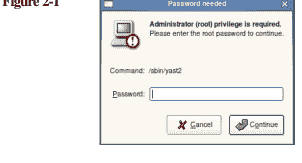

YaST 对话框会出现。

**图 2-2**

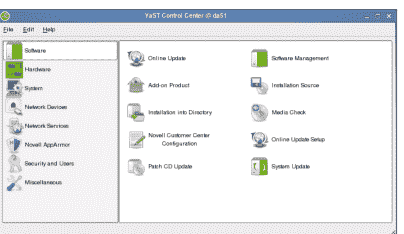

您可以使用键盘控制 ncurses 界面。若要启动 YaST 的 ncurses 界面，您可以从 GNOME 桌面通过从主菜单（应用程序组：`系统`）中选择 `Gnome Terminal` 来启动终端仿真。

输入 `su -` 以获取 root 权限。在输入 root 密码后，通过输入 `yast` 启动 YaST。

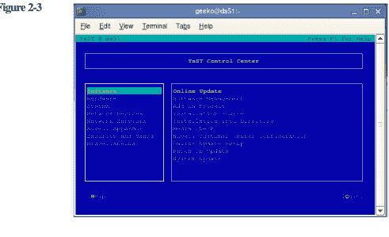

按 **Tab** 键在一个框与另一个框之间移动，或移动到文本按钮。若要返回到上一个框，请按 `Shift+Tab`。使用箭头键在框内进行导航。按 `空格键` 标记高亮的菜单项。

要选择某个菜单项，请按 `Enter`。通常，您可以按 `Alt` 键加上高亮的字母直接访问某项。

除了控制和外观之外，YaST 的图形模式和文本模式是完全相同的。

您可以使用命令 `yast -l` 或 `yast --list` 列出可用的 YaST 模块。若要启动单独的模块，请指定其名称。例如，您可以输入以下内容来启动软件安装模块：

```
yast sw_single
```

您可以使用命令 `yast` 或 `yast2` 输入软件模块名称，如下所示：

- `yast` sw_single (文本模式)
- `yast2` sw_single (图形模式)

> 若要安装软件包，您也可以输入 `yast -i *package.rpm*`。软件包将直接安装，不会显示任何对话框。

要显示 YaST 选项列表，请输入以下其中一项：

- `yast --help`
- `yast -h`

YaST 的主对话框称为 *YaST 控制中心*。

在此，您可以在左侧选择类别（例如软件或系统）并在右侧选择模块（例如在线更新）来配置和管理您的系统。

当您完成使用 YaST 模块进行更改后，YaST 会使用 SuSEconfig 等后端服务。

#### SuSEconfig 的角色

您可以将 YaST 视为其他各种程序的前端，例如作为 RPM（RPM 包管理器）软件管理的前端、用户管理的前端，或各种服务（如邮件或 Web 服务器）不同配置文件的​​前端。


通常，YaST 直接将您的配置更改写入最终配置文件。在极少数情况下，会有一个额外的中间步骤，您输入的信息首先写入 `/etc/sysconfig/` 目录中的文件，然后才写入最终配置文件。

**SuSEconfig** 程序在此处变得重要。

SuSEconfig 是在 SUSE Linux Enterprise Server 中用于根据 `/etc/sysconfig/` 及其子目录中各种文件里设置的变量来配置系统的工具。

这些文件包含诸如 `/etc/sysconfig/syslog` 中的 `SYSLOGD_PARAMS=""` 和 `/etc/sysconfig/mail` 中的 `SMTPD_LISTEN_REMOTE="no"` 之类的变量。

这些变量中的一部分被直接使用（例如在一些启动脚本中）。例如，如果 `SYSLOGD_PARAMS` 设置为 “-r”，则记录系统消息的守护进程将被指示监听端口 514，以接收来自其他主机的系统消息。

其他变量用于修改其他文件。例如，如果 `SMTPD_LISTEN_REMOTE` 设置为 “yes”，则 `/etc/postfix/main.cf` 中的变量 `INET_INTERFACES` 将由脚本 `/sbin/SuSEconfig` 和 `/sbin/conf.d` 中的脚本设置为 “all”。

SuSEconfig 充当 YaST 的后端，并在您使用 YaST 模块时激活您所做的配置更改。

如果您使用编辑器修改 `/etc/sysconfig/` 中的文件，您可能需要做的只是重新启动服务以使更改生效。但是，您可能还需要运行 SuSEconfig。

因此，我们建议在对 `/etc/sysconfig/` 中的文件进行手动编辑后运行 SuSEconfig。

SuSEconfig 使用 `/sbin/conf.d/` 中的子系统特定脚本来配置各个子系统。例如，`/etc/sysconfig/postfix` 中的变量由脚本 `/sbin/conf.d/SuSEconfig.postfix` 评估。

## 练习 2-1 熟悉 YaST

在本练习中，您将学习如何使用 YaST 的不同用户界面以及如何启动一些 YaST 模块。

您可以在工作手册中找到此练习。

(练习结束)

## 目标 2

### YaST 软件管理

软件管理具有不同的方面：

- 管理安装源
- 安装软件包
- 应用安全更新

#### 管理安装源

软件安装对话框仅列出当前安装介质上的软件包。

如果要添加更多安装源，请从 YaST 控制中心选择 **软件 > 安装源**。将出现以下内容：

图 2-4

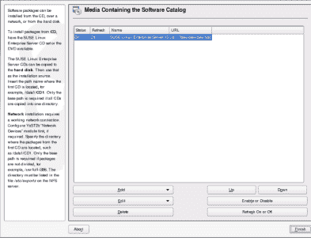

HARDCOPY PERMITTED–NO DISTRIBUTION ALLOWED

要添加新源，请选择 **Add** 下拉列表并选择安装源的 *类型*。根据源的类型，您可能需要提供附加信息（例如安装服务器的 IP 地址）。

要编辑现有安装源的配置，请在列表中选中该源并选择 **Edit**。

如果要暂时禁用安装源，请在列表中选中该源并选择 **Enable or Disable**。

若要永久删除安装源，请从列表中选中该源并选择 **Delete**。

YaST 使用列表中第一个包含您想要安装的软件包的​​安装源。要更改列表中源的位置，请选中该源并选择 **Up** 或 **Down**。

#### 安装软件包

在执行标准 SUSE Linux Enterprise Server 10 安装之后，您通常可能需要安装额外的软件。为此，请启动 YaST 模块 **软件 > 软件管理**。

系统将分析已安装的软件包以及安装介质上可用的软件包，并检查软件包之间的依赖关系。

检查完成后，将出现以下用于搜索软件包的对话框：


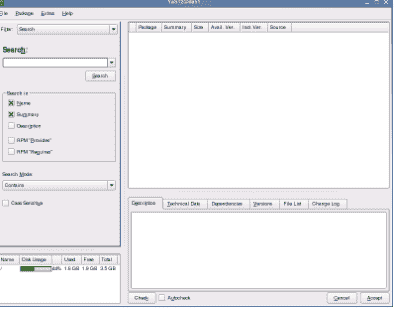

为了帮助您找到想要安装的软件，您可以从窗口左上角标记为 Filter 的下拉列表中列出的不同过滤器中进行选择。可用的过滤器如下：

- **Patterns.** 显示已知安装介质上可用的所有软件。它按逻辑上相互关联的预定义软件包集合进行分组。
- **Package Groups.** 显示已知安装介质上可用的所有软件。它按类别进行分组。
- **Languages.** 显示所有语言相关文件（例如，拼写检查器、帮助）。
- **Installation Sources.** 列出所有已注册的安装源并显示该源可用的软件包。
- **Search**. 允许您输入搜索词以及您希望 YaST 搜索软件包的位置。
- **Installation Summary**. 显示所有带有标记状态的软件包。

要查找软件包，请选择 Search 过滤器，在 Search 字段中输入软件包名称、软件包名称的一部分或某些关键词；然后选择 **Search**。

匹配的软件包将列在右侧区域中。安装状态由软件包名称前的小符号显示。最常显示的符号包括以下各项：

**图 2-6**

| 符号 | 描述 |
|---|---|
| Do not install | 此软件包未安装，且不会被安装 |
| ☑ Install | 此软件包将被安装。它尚未安装 |
| ☑ Keep | 此软件包已安装。保持其不变 |
| ↻ Update | 此软件包已安装。更新它或重新安装它（如果版本相同）。 |
| 🗑 Delete | 此软件包已安装。删除它 |
| ⚠ Taboo | 此软件包未安装，且在任何情况下都不应安装，特别是由于其他软件包可能具有或产生的未解决依赖关系。设置为"taboo"的软件包被视为在任何安装介质上都不存在。 |
| 🔒 Protected | 此软件包已安装且不应被修改，特别是由于其他软件包可能具有或产生的未解决依赖关系。对于不应被可能随发行版提供的较新版本覆盖的第三方软件包，请使用此状态。 |
| ☑ Autoinstall | 此软件包将被自动安装，因为某些其他软件包需要它 **提示**：您可能需要使用"taboo"来摆脱此类软件包。 |

要查看所有可能符号的列表，请选择 **Help > Symbols**。

多次选择您要安装的包的符号，直到出现安装符号；然后选择**接受**。

您可能会看到一个对话框，提示包之间的依赖关系无法解决，并且还需要安装其他一些包。在大多数情况下，您只需确认此对话框即可。

如果光驱中插入的是错误的 CD 或 DVD，会出现警告。

#### 应用安全更新

SUSE Linux Enterprise Server 10 随系统维护一起销售。此系统维护包括更新和安全补丁。

可以使用 YaST 在线更新（YOU）模块管理软件更新。此 YaST 模块用于下载并安装软件更新和安全补丁。

要应用安全更新，您需要执行以下操作：

- 配置 Novell 客户中心
- 使用 YaST 在线更新

##### 配置 Novell 客户中心

要访问 Novell 客户中心的配置，请启动 YaST 控制中心，并选择**软件 > Novell 客户中心配置**。您也可以在终端窗口中以 root 身份输入 `yast2 inst_suse_register` 直接启动对话框。该对话框与安装过程中为此目的提供的对话框相同：

### 图 2-7

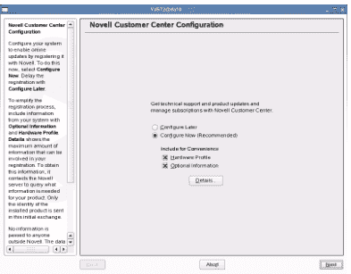

选择“详细信息”可显示正在收集和发送的信息。

通过浏览器，可以访问 http://www.novell.com/center/ 处的 Novell 客户中心。创建 Novell 账户后，您需要使用随 SUSE Linux Enterprise Server 10 产品提供的注册代码注册您的产品。

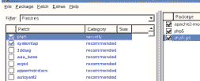

图 2-8

您作为学生套件一部分收到的 SUSE Linux Enterprise Server 10 DVD 不包含维护服务。请访问 Novell 客户中心，了解如何参与 SUSE Linux Enterprise Server 10 维护计划。

只有具有有效维护合同的已注册产品才能使用 YOU 模块进行更新。

##### 使用 YaST 在线更新

以下是使用 YOU 应用软件更新的快速指南。

通过选择**软件 > 在线更新**，从 YaST 控制中心启动 YOU 模块。

将出现以下内容：

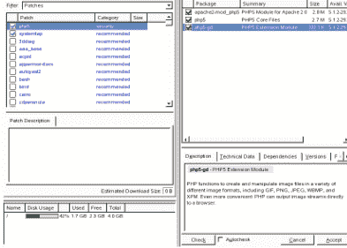

在对话框的左上角，显示了所有可用的补丁。选择一个条目，即可在对话框的右侧查看更新的详细信息。若要在下一步中安装某个更新，请选择相应条目旁边的复选框。

选择**接受**以开始更新过程。

根据您选择的情况，将显示一个**自动更改**对话框：

### 图 2-9


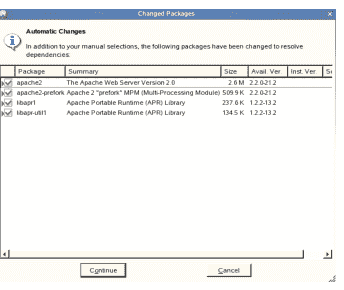

选择**继续**接受更改；补丁将从更新服务器传输并安装。

在安装过程中，YOU 将显示以下对话框：

### 图 2-10

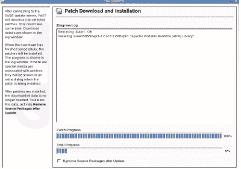

有时，某些更新会显示额外信息。需要确认这些对话框才能安装相应的软件包。

一旦所有更新都下载并安装完毕，请选择**完成**以关闭对话框。

## 练习 2-2 安装新软件

在本练习中，您将安装 SUSE Linux Enterprise Server 10 安装介质上可用的另一个软件包。

您可以在工作簿中找到此练习。

**(练习结束)**

### 目标 3

### 使用 YaST 管理用户和组账户

使用 YaST，您可以管理用户和组。为此，您需要理解以下内容：

- 用户和组的基础知识
- 使用 YaST 进行用户和组管理

#### 用户和组基础知识

Linux 操作系统的主要特征之一是其能够同时处理多个用户（多用户），并允许这些用户在同一台计算机上同时执行多个任务（多任务）。

因此，系统必须能够唯一标识所有用户。为此，每个用户登录时必须提供以下内容：

- 用户名
- 密码

由于操作系统处理数字的能力远强于字符串，用户在内部是以数字形式处理的。用户获得的这个数字称为 `UID`（用户 ID）。

每个 Linux 系统都有一个特权用户，即 *root* 用户。该用户的 `UID` 始终为 0。此人是系统的管理员。

可以根据共同特征或活动将用户分组。例如：

- 在 SUSE Linux Enterprise Server 10 中，用户默认以 `users` 组作为其主要组。（这与 RHEL 不同，在 RHEL 中，每个用户都有自己的组作为其主组。）
- 所有打算创建网页的用户都可以放入 `webedit` 组。
- 当然，必须设置存放网页的目录的文件权限，以便 `webedit` 组能够在该目录中写入（保存文件）。

与用户一样，每个组在内部也被分配一个称为 `GID`（组 ID）的数字，它可以是以下类型之一：

- 常规组
- 系统使用的组
- `root` 组（`GID` = 0）

#### 使用 YaST 进行用户和组管理

您可以通过以下方式访问 YaST 用户和组账户管理：

- **用户管理**

  从 YaST 控制中心，选择“安全和用户 > 用户管理”，或在终端窗口中键入 `yast2 users`。
- **组管理**

  从 YaST 控制中心，选择“安全和用户 > 组管理”，或在终端窗口中键入 `yast2 groups`。

如果在安装 SUSE Linux Enterprise Server 期间选择了 LDAP 进行身份验证，系统将提示输入 LDAP 服务器管理员密码。

您可以通过选择模块窗口顶部的“用户和组”单选按钮，在用户管理和组管理之间来回切换。

##### 从 RedHat 迁移到 SUSE Linux Enterprise Server 10

### 用户管理

用户账户管理窗口列出了现有的用户账户（如下所示）：

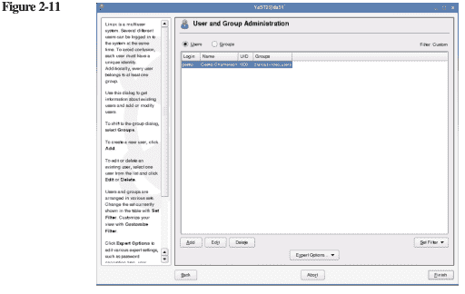

将显示用户（服务器上的账户）列表，其中包含每个用户的登录名、全名、`UID` 以及关联组等信息。

选择**设置筛选器**；然后选择以下任一选项以更改列出的用户：

- **本地用户**。您在本地服务器上创建用于登录服务器的用户账户。
- **系统用户**。由系统创建的用于服务和应用程序的用户账户。
- **自定义**。基于通过**自定义筛选器**设置的配置，提供用户的自定义视图。
- **自定义筛选器**。此选项允许您将列出的用户集（例如**本地用户**和**系统用户**）组合在一起，以显示用户的自定义视图（通过**自定义**）。

随着您在服务器上配置和启动服务，其他用户集（例如**LDAP 用户**）将被添加到**设置筛选器**下拉列表中。

您可以选择**添加**或**编辑**来创建新用户账户或编辑现有账户。

将出现以下内容：

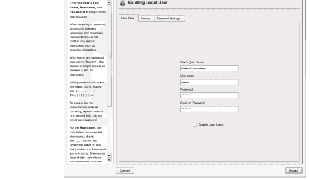

在以下字段中填写或编辑信息：

- **用户全名**。输入真实用户姓名（例如**Geeko Chameleon**）
- **用户名**。输入用于登录系统的用户名（例如**geeko**）。
- **密码和确认密码**。输入并重新输入用户账户的密码。

输入密码时，请注意区分大写字母和小写字母。

有效的密码字符包括字母、数字、空格以及 # * , ; : _ . + ! $ % & / ? ! { } ( ) [ ] = .

密码不应包含任何特殊字符（例如重音字符），因为当您在另一个国家登录时，可能会发现在不同的键盘布局上输入这些字符很困难。

使用当前的密码加密方式（Blowfish），密码长度应在 5 到 72 个字符之间。

若要设置用户的属性（例如 `UID`、主目录、登录 shell、所属组以及额外的用户账户注释），请选择**详细信息**选项卡。此时将显示以下内容：


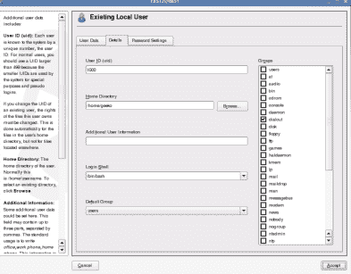

在以下字段中输入或编辑信息：

- **用户 ID (uid)**。对于普通用户，您应该使用大于 99 的 `UID`，因为较小的 `UID` 由系统用于特殊用途和伪登录。

  - 如果您更改现有用户的 `UID`，则必须更改该用户拥有的文件的权限。用户主目录中的文件会自动完成此操作，但其他位置的文件则不会。


如果未自动发生此操作，您可以输入 `chown -R username /home/username`（作为 `root` 用户）来更改主目录中用户文件的权限。

- **主目录**。用户的主目录。通常这是 `/home/username`。

  - 您可以通过选择**浏览**来选择现有目录。
- **附加用户信息**。此字段最多可以包含由逗号分隔的 3 个部分。它通常用于输入 `办公室,工作电话,家庭电话`。

  - 当您在此用户上使用 `finger` 命令时，此信息将显示出来。
- **登录 Shell**。从下拉列表中，从系统上安装的 shell 中为该用户选择默认登录 shell。
- **默认组**。这是用户所属的组。从系统上配置的所有组列表中选择一个组。
- **组**。从列表中选择您想要分配给用户的所有额外成员资格。

若要设置各种密码参数（例如密码的有效期），请选择**密码设置**选项卡。此时将显示以下内容：

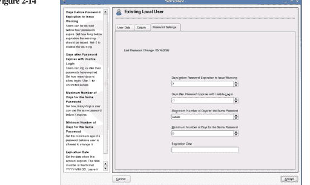

在以下字段中输入或编辑信息：

- **密码过期前发出警告的天数**。输入在密码过期前多少天向用户发出警告。

  - 输入 -1 以禁用警告。
- **密码过期后可用登录的天数**。输入密码过期后用户可继续登录的天数。

  - 输入 -1 表示无限访问权限。
- **相同密码的最大天数**。输入用户在密码过期前可以使用相同密码的天数。
- **相同密码的最小天数**。输入用户更改密码前密码的最小年龄。
- **过期日期**。输入账户过期的日期。日期必须采用 YYYY-MM-DD 格式。

  - 如果账户永不过期，请保留该字段为空。

通过选择**接受**来保存新用户或编辑用户的设置。

新用户将显示在列表中。

通过选择**完成**来使用新设置配置您的服务器。

### 组管理

您可以在以下窗口中管理组：

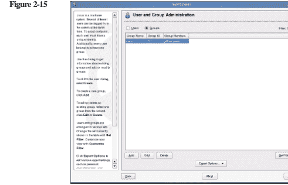

将显示一个组列表，其中包含组名、组 ID（*GID*）和组成员等信息。

选择**设置过滤器**；然后选择以下其中一项以更改列出的组：

- **本地组**。在您的本地服务器上创建的组，用于为分配给该组的成员提供权限。
- **系统组**。由系统创建用于服务和应用的组。
- **自定义**。基于通过**自定义过滤器**配置的设置，对组的自定义视图。
- **自定义过滤器**。此选项允许您组合列出的组集（例如本地组和系统组），以显示组列表的自定义视图（使用“自定义”）。

随着您在服务器上配置和启动服务，额外的组集将被添加到“设置过滤器”下拉列表中（例如 LDAP）。

您可以通过选择添加或编辑来创建新组或编辑现有组。选择编辑时，将显示以下内容：

#### 图 2-16

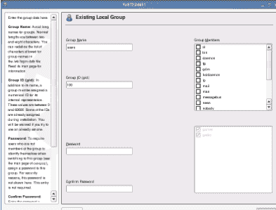

在以下字段中输入或编辑信息：

- **组名**。组的名称。避免使用长名称。正常的名称长度在两个到八个字符之间。


- **组 ID (`gid`)**。分配给组的 GID 编号。该编号必须是 0 到 60000 之间的值。小于 99 的 GID 代表系统组。99 以上的 GID 可用于普通用户。如果您尝试使用已在使用中的 GID，YaST 会发出警告。
- **密码**（可选）。要求组成员在切换到该组时进行身份验证（参见 `man newgrp`）。为此，请分配一个密码。
  - 出于安全原因，密码用星号（`***`）表示。
- **确认密码**。第二次输入密码以避免打字错误。
- **组成员**。选择哪些用户应为该组的成员。
  - 将出现第二个列表（当您选择编辑时），显示该组为默认组的用户。此列表无法从 YaST 中编辑。

完成组信息的输入或编辑后，选择**下一步**。您将返回到组管理对话框。通过选择**完成**来保存配置设置。

使用 YaST 创建或编辑用户和组时输入的信息将保存到以下用户管理文件中：
- `/etc/passwd`
- `/etc/shadow`
- `/etc/group`

## 为新用户账户设置默认值

您可以使用 YaST 选择应用于新用户账户的默认设置。

从 Gnome 桌面，按 `Alt+F2`，输入 `yast2`，并在提示时输入 root 密码。选择**安全和用户 > 用户管理**。您也可以作为 root 用户直接在终端窗口中通过输入 `yast2 users` 来启动用户管理模块。

选择**专家选项 > 新用户默认值**。此时将显示以下内容：

### 图 2-17

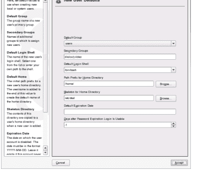

您可以在以下字段中输入或编辑信息：
- **默认组**。从下拉列表中选择主要（默认）组。
- **辅助组**。输入辅助组列表（用逗号分隔）以分配给用户。
- **默认登录 Shell**。从下拉列表中，从系统上安装的 shell 中选择默认登录 shell（命令解释器）。
- **默认主目录**。输入或浏览到新用户主目录的初始路径前缀。将把用户名附加到此值的末尾，以创建用户主目录的默认名称。
- **骨架目录**。输入或浏览到骨架目录。当您添加新用户时，此目录的内容将复制到用户的主目录。
- **默认过期日期**。输入用户账户被禁用的日期。日期必须采用 `YYYY-MM-DD` 格式。
  - 如果此账户永不过期，请保留该字段为空。
- **密码过期后可登录的天数**。此设置允许用户在密码过期后登录。设置密码过期后允许登录的天数。
  - 输入 `-1` 表示无限访问权限。

通过选择**下一步 > 完成**来保存配置设置。这些值将写入文件 `/etc/default/useradd`。

```
dal0:~ # cat /etc/default/useradd
GROUP=100
HOME=/home
INACTIVE=-1
EXPIRE=
SHELL=/bin/bash
SKEL=/etc/skel
GROUPS=video,dialout
CREATE_MAIL_SPOOL=no
```

您还可以使用命令行程序 `useradd` 来查看或更改默认设置。`--show-defaults` 选项显示与上述 `cat` 命令相同的内容。`--save-defaults` 选项后跟一个带有值的选项可对其进行更改：

```
dal0:~ # useradd --save-defaults -d /export/home
dal0:~ # useradd --show-defaults
GROUP=100
HOME=/export/home
INACTIVE=-1
EXPIRE=
SHELL=/bin/bash
SKEL=/etc/skel
GROUPS=video,dialout
CREATE_MAIL_SPOOL=no
```

`useradd` 的手册页列出了可能的选项。

> 在 SUSE Linux Enterprise Server 10 上，`useradd` 默认不为新用户创建主目录；在创建新用户时，请使用选项 `-m` 来创建主目录。

## 配置安全设置

YaST 提供了一个本地安全模块，可用于为 SUSE Linux Enterprise Server 配置以下本地安全设置：
- 密码设置
- 引导配置
- 登录设置
- 用户创建设置
- 文件权限

您可以从三种预设的安全级别中进行选择（或进行修改），也可以创建自定义的安全设置，以满足企业安全策略和流程的要求。

您可以通过在 YaST 控制中心中选择**安全和用户 > 本地安全**，或在终端窗口中以 root 身份输入 `yast2 security` 来访问安全设置模块。

此时将显示以下内容：

### 图 2-18

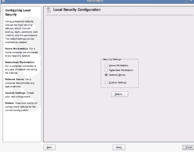

在此对话框中，您可以选择以下预设配置之一：
- **家用工作站。** 选择此选项适用于未连接到任何类型网络的家用计算机。此选项代表最低的本地安全级别。
- **网络工作站。** 选择此选项适用于连接到任何类型网络或互联网的计算机。此选项提供中等水平的本地安全。
- **网络服务器。** 选择此选项适用于提供某种服务（网络或其他）的计算机。此选项启用高水平的本地安全。
- 您也可以选择**详细信息**或**自定义设置**来修改现有的安全级别或创建自己的配置。

通过选择三个预定义安全级别之一并选择**下一步**，将应用所选的安全级别。通过选择**详细信息**，您可以更改所选安全级别的设置。

如果您选择**自定义设置**，然后选择**下一步**，您可以直接修改安全配置的详细信息。

对于每个安全级别，详细设置的对话框外观相同，但预选的选项不同。在以下对话框中，您看到的是级别 3（网络服务器）的设置。

在第一个对话框中，您可以更改系统接受的默认密码要求：

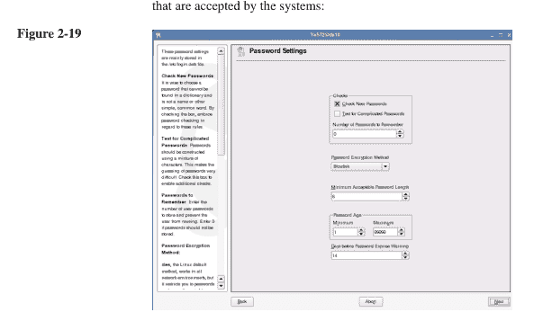

在此对话框中，您可以选择或输入以下密码设置（主要存储在 `/etc/login.defs` 中，某些值也存储在 `/etc/default/passwd` 和 `/etc/security/pam_pwcheck.conf` 中）：
- **检查新密码**。选择一个不在字典中且不是姓名或其他简单常见单词的密码非常重要。通过选择此选项，您可以根据这些规则强制执行密码检查。
- **测试复杂密码**。密码应由大写字母、小写字母以及数字的混合组成。也可以使用 `:`、`=` 等特殊字符，但在不同的键盘布局上可能很难输入。这使得猜出密码变得非常困难。选择此选项以启用额外的检查。
- **密码加密方法**。从下拉列表中，选择以下加密方法之一：
  - **DES**。这是最低公分母。它适用于所有网络环境，但将密码限制在八个字符以内。如果需要与其他系统兼容，请选择此方法。
  - **MD5**。此加密方法允许更长的密码，并受到所有当前 Linux 发行版的支持，但不受其他系统或较旧软件的支持。
  - **Blowfish**。此加密方法使用 Blowfish 算法来加密密码。目前许多系统尚不支持它。计算哈希值需要大量的 CPU 功率，这使得利用字典破解密码变得困难。它被用作 SLES 10 中的默认加密方法。
- **最小可接受密码长度**。输入可接受密码的最小字符数。如果用户输入的字符较少，则密码会被拒绝。输入 `0` 可禁用此检查。
- **密码有效期**。最小值指密码可以再次更改之前必须经过的天数。最大值指密码过期并必须更改后的天数。
- **密码过期警告天数**。在密码过期前该天数之前，向用户发出警告。

虽然 root 在设置密码时会收到警告，但她仍然可以无视上述设置输入一个糟糕的密码。

完成密码设置配置后，选择**下一步**继续。此时将显示以下内容：

### 图 2-20

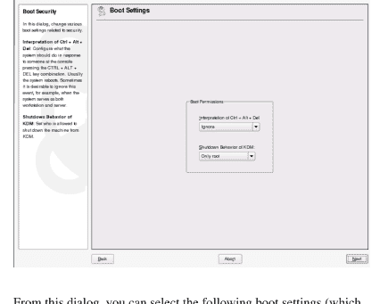

在此对话框中，您可以选择以下引导设置（将更新文件 `/etc/inittab`）：
- **Ctrl + Alt + Del 的解析方式**。当有人在控制台上按下**Ctrl+Alt+Del**按键组合时，系统通常会重新启动。
  - **忽略**。有时您希望系统忽略此按键组合，特别是当系统既作为工作站又作为服务器时。按下**Ctrl+Alt+Del**按键组合时不会发生任何事情。
  - **重启**。按下**Ctrl+Alt+Del**按键组合时，系统重启。
  - **停止**。按下**Ctrl+Alt+Del**按键组合时，系统关机。
- **KDM 的关机行为**。使用此选项设置谁被允许从 KDM 关闭计算机。
  - **仅限 Root**。要停止系统，必须输入 root 密码。
  - **所有用户**。即使是远程连接的用户，也可以使用 KDM 停止系统。
  - **无用户**。没有任何用户可以使用 KDM 停止系统。
  - **本地用户**。只有本地连接的用户可以使用 KDM 停止系统。
  - **自动**。注销后自动停止系统。


对于服务器系统，您应该使用`仅限 Root`或`无用户`，以防止普通用户甚至远程用户停止系统。

完成引导设置配置后，选择**下一步**继续。此时将显示以下内容：

### 图 2-21

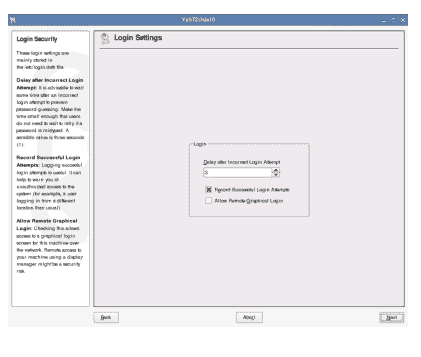

在此对话框中，您可以输入并选择以下登录设置（主要存储在 `/etc/login.defs` 中）：

- **错误登录尝试后的延迟。** 在登录尝试失败后，通常会有几秒钟的等待期，之后才能进行另一次登录。这使得密码破解者更难登录。此选项允许您调整另一次登录尝试前的时间延迟。默认值为 3 秒，这是一个合理的值。
- **记录成功登录尝试。** 记录成功的登录尝试可能很有用，尤其是在警告您系统遭受未授权访问时（例如，用户从与平时不同的位置登录）。选择此选项以在文件 `/var/log/wtmp` 中记录成功的登录尝试。您可以使用命令 `last` 查看谁在什么时间登录。
- **允许远程图形登录。** 您可以选择此选项以允许其他用户通过网络访问您的图形登录屏幕。由于这种类型的访问代表潜在的安全风险，因此默认处于非活动状态。

完成登录设置配置后，选择**下一步**继续。此时将显示以下内容：

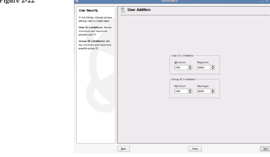

在此对话框中，您可以输入以下 ID 设置（存储在 `/etc/login.defs` 中）：

- **用户 ID 限制。** 输入最小值和最大值以配置可能的用户 ID 号范围。新用户将获取此范围内的 UID。
- **组 ID 限制。** 输入最小值和最大值以配置可能的组 ID 号范围。

完成用户和组 ID 限制配置后，选择**下一步**继续。安全配置的最后页面将显示：

### 图 2-23

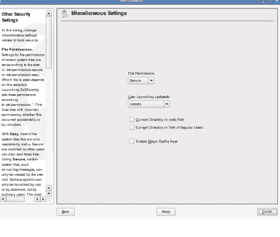

在此对话框中，您可以选择以下杂项全局设置：

- **文件权限。** 某些系统文件的权限设置配置在 `/etc/permissions.easy`、`/etc/permissions.secure` 或 `/etc/permissions.paranoid` 中。您还可以将自己的规则添加到文件 `/etc/permissions.local`。每个文件都包含预设的文件语法和用途说明。位于目录 `/etc/permissions.d/` 中的文件内的设置也会被包含进来。此目录由携带自身权限文件的软件包使用。

从下拉列表中选择以下其中一项：

- **简易（Easy）。** 选择此选项可允许除 root 以外的用户读取大多数系统文件。
- **安全（Secure）。** 选择此选项可确保某些配置文件（例如 `/etc/ssh/sshd_config`）只能由 root 用户查看。某些程序只能由 root 或守护进程启动，普通用户无法启动。
- **偏执（Paranoid）。** 选择一个极其安全的系统。所有程序上的所有 SID/SID 位已被清除。请记住，由于用户不再拥有访问某些文件的权限，因此某些程序可能无法正常工作。

运行 `SuSEconfig` 会根据相应 `/etc/permissions.*` 文件中的设置设置这些权限。这可以修复权限不正确的文件，无论是由于意外还是入侵者造成的。

- **用户启动 updatedb。** 如果安装了程序 `updatedb`，它会自动在每天或启动后运行。它生成一个数据库（`locatedb`），其中存储了计算机上每个文件的位置。

您可以使用工具 `locate` 搜索此数据库（输入 `man locate` 了解详细信息）。

从下拉列表中选择以下其中一项：

- **无权限（nobody）。** 任何用户只能找到数据库中其他（非特权）用户可见的路径。
- **root。** 系统中的所有文件都被添加到数据库中。

1. **root 的路径中的当前目录和普通用户路径中的当前目录。**

如果您取消选中这些选项（默认设置），用户必须始终通过在当前目录中添加“`.`”来启动程序（例如 `./**configure**`）。

如果您选中这些选项，点（“`.`”）将被追加到 root 和用户的搜索路径末尾，允许他们在当前目录中输入命令而无需追加“../”。

选中这些选项可能非常危险，因为用户可能会意外地在当前目录中启动未知程序，而不是通常的全系统范围文件。

此配置写入 `/etc/sysconfig/suseconfig`。

2. **启用 Magic SysRq 键。** 选择此选项即使系统崩溃（例如在内核调试期间）也能为您提供对系统的一定控制。有关详情，请参阅 `/usr/src/linux/Documentation/sysrq.txt`。

此配置写入 `/etc/sysconfig/sysctl`。

完成杂项设置配置后，通过选择 **完成** 来保存设置并运行 `SuSEconfig`。

## **练习 2-3 使用 YaST 管理用户账户**

在这个练习中，您将使用 YaST 用户管理模块创建和删除一个用户账户。

您可以在练习手册中找到此练习。

*（练习结束）*

## **练习 2-4 配置密码安全设置**

在这个练习中，您将练习更改不同的安全设置。

您可以在练习手册中找到此练习。

*（练习结束）*

### 目标 4：找到您需要的 YaST 模块

如果您熟悉 RHEL 的 `system-config-*` 工具，您可能会寻找 SUSE Linux Enterprise Server 10 中对应的工具。

我们编制了一个表格，左侧列出了 `system-config-*` 命令，右侧列出了可比较的 YaST 模块。您可以通过 YaST 控制中心访问该模块，或者在控制台窗口中输入右列中给出的命令。

YaST 模块与相应的 `system-config-*` 工具不完全匹配，但您很可能会发现它们很好地覆盖了功能，并且通常提供更多配置选项。

YaST 模块远不止这里列出的那些。要查看完整列表，请在控制台窗口中输入 `yast -l`。

### 表 2-2

| RHEL | SLES 10 |
| :--- | :--- |
| `system-config-authentication` | `yast2 nis`<br>`yast2 ldap`<br>`yast2 kerberos-client`<br>`yast2 samba-client` |
| `system-config-date` | `yast2 timezone` |
| `system-config-time` (both are links to `/usr/bin/consolehelper`) | `yast2 ntp-server` |
| `system-config-display` | `yast2 x11`<br>`sax2` |
| `system-config-httpd` | `yast2 http-server` |
| `system-config-keyboard` | `yast2 keyboard` |
| `system-config-language` | `yast2 language` |
| `system-config-lvm` | `yast2 lvm_config` |
| `system-config-printer` | `yast2 printer` |
| `system-config-printer-gui` | `yast2 printer` |
| `system-config-printer-tui` | `yast2 printer` |
| `system-config-nfs` | `yast2 nfs_server` |
| `system-config-packages` | `yast2 sw_single` |
| `system-install-packages package.rpm` | `yast2 -i package` |
| `system-config-mouse` | `yast2 mouse` |
| `system-config-network-druid` | Start YaST Control Center and on the left select Network Devices |
| `system-config-network` `system-config-network-gui` `system-config-network-tui` | `yast2 lan` `yast lan` |
| `system-config-network-cmd` | `hwinfo --network --netcard` |
| `system-config-rootpassword` | `yast2 users`, select system users in the Filter drop-down menu, then select root and change the password |
| `system-config-samba` | `yast2 samba-server` |
| `system-config-soundcard` | `yast2 sound` |


| `system-config-securitylevel` `system-config-securitylevel-tui` | `yast2` `firewall` |

| `system-config-services` | `yast2` `runlevel` |

| `system-config-users` | `yast2` `users` |

| | `yast2` `groups` |

### 摘要

| 目标 | 摘要 |

| :--- | :--- |

| **1. 了解 YaST** | YaST 用户界面的外观取决于用于启动的命令：<br>- 在图形界面中，YaST 可以通过鼠标直观地控制。<br>- ncurses 界面仅通过键盘控制。<br>还可以直接启动单个模块。可以使用命令 **`yast -i`** 或 **`yast –list`** 列出可用模块。<br>SuSEconfig 是 SUSE Linux Enterprise Server 中用于根据 `/etc/sysconfig/` 及其子目录中各种文件中设置的变量配置系统的工具。 |

| **2. YaST 软件管理** | 要添加新的安装源，请启动 YaST 模块 **软件 > 安装源**。<br>要安装新的软件包，请使用 YaST 模块 **软件 > 软件管理**。<br>软件包的安装状态由一个符号指示。可以通过 **帮助 > 符号** 菜单获取有关所有可能符号的概述。<br>YaST 在线更新和 Novell 客户中心提供了一种简单的方法来保持软件最新。 |

| **3. 使用 YaST 管理用户和组账户** | 每个用户账户都被分配一个唯一的内部编号：`UID`（用户 ID）。<br>每个 Linux 系统都有一个特权用户，即 root 用户。此用户的 `UID` 始终为 `0`。<br>与用户一样，组也在内部分配了一个编号：`GID`（组 ID）。<br>您可以通过在 YaST 控制中心中选择 **安全与用户 > 用户管理** 和 **安全与用户 > 组管理** 来管理用户和组账户。 |

| **4. 找到您需要的 YaST 模块** | YaST 提供了涵盖 RHEL `system-config-*` 工具功能的模块。除了这些模块外，还有许多用于各种系统管理任务的 YaST 模块。**`yast -l`** 列出了可用模块。 |

## 第 3 部分 网络配置

在 RHEL 中，`system-config-network*` 工具用于配置网络。在 SUSE Linux Enterprise Server 10 中，对应的工具集可在 YaST 的网络设备部分找到。在这两个操作系统中，都可以通过命令行进行网络配置，且命令大体相同。

RHEL 和 SLES 10 中用于存储网络配置的文件有所不同；本节将介绍这些差异。

### 目标

- 使用 YaST 管理网络
- 手动配置网络
- 配置主机名和名称解析
- 使用 NetworkManager 配置网络

### 目标 1 使用 YaST 管理网络

YaST 中用于配置网卡和网络连接的模块可以通过 YaST 控制中心访问。

要激活网络配置模块，请选择“网络设备”>“网卡”。

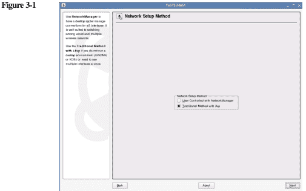

YaST 需要知道网络配置方法：

- **使用 NetworkManager 进行用户控制。** 使用桌面小工具来管理所有网络接口的连接。（这主要在移动计算机上有用。）
- **使用 ifup 的传统方法。** 传统方法使用 `ifup` 命令。（我们建议服务器使用此配置方法。）

如果使用传统方法，下一个对话框将显示检测到的网卡。


选择要配置的网卡，然后选择*编辑*。

通常，YaST 会自动检测网卡，并使用正确的内核模块。

如果 YaST 无法识别该网卡，则必须在 YaST 中手动输入所需的模块。选择**添加**。将出现一个手动网卡设置对话框：

**图 3-3**


在此对话框中，输入要配置接口的详细信息，例如网络设备类型（**以太网**）和配置名称（**0**）。在**内核模块**下，输入要加载的模块名称。你可以从网卡列表中选择网卡型号。

某些内核模块可以通过为内核添加选项或参数来进行更精确的配置。有关特定模块参数的详细信息可以在内核文档中找到。

**1 允许复印，禁止分发**

选择**下一步**后，将显示以下对话框：

**图 3-4**


在此对话框中，输入以下信息以将网络设备集成到现有网络中：

- **自动地址设置（通过 DHCP）**。如果网卡应从 DHCP 服务器接收 IP 地址，请选择此选项。
- **静态地址设置**。如果选择此选项，你需要在**IP 地址**下输入网络接口或网络中计算机的 IP 地址。

网络中的每台计算机对于每个网络接口至少有一个地址，该地址在整个网络中必须是唯一的。根据当前有效的标准（IPv4），该地址由四个字节序列组成，以点分隔（例如 `10.10.0.69`）。

选择 IP 地址时，需要知道计算机是否将直接连接到互联网。如果是，请使用分配的官方 IP 地址。否则，请使用私有地址空间中的地址。

- **子网掩码**。网络掩码（在 YaST 中称为子网掩码）决定了 IP 地址位于哪个网络。
    - 掩码将 IP 地址划分为网络段和主机段，从而定义网络的大小。网络中的所有计算机都可以在没有路由器介入的情况下直接相互访问。

- **主机名和名称服务器**。网络中的计算机可以直接使用其 IP 地址或通过唯一名称进行寻址。必须存在一个名称服务器（DNS）以将名称解析为 IP 地址，反之亦然。

选择**主机名和名称服务器**后，如果使用的是 DHCP，将出现以下界面：

图 3-5


如果你希望更改由 DHCP 提供的数据（例如 IP 号），请选择**修改**。如果你只想更改其他信息，可以在此处选择**接受**。

图 3-6


此对话框允许你输入以下内容：

1. **主机名**。输入一个可用于寻址该计算机的名称。该名称应在网络内是唯一的。
2. **域名**。这是计算机所属的 DNS 域的名称。域有助于划分网络。在定义的组织区域内的所有计算机通常属于同一个域。

通过给出其 FQDN（完全限定域名），可以唯一地寻址一台计算机。FQDN 由主机名和域名组成，例如 **`da51.digitalairlines.com`**。在这种情况下，域名为 `digitalairlines.com`。

- **名称服务器列表**。为了使用主机名寻址网络中的其他计算机，需要标识名称服务器，它保证将计算机名称转换为 IP 地址，反之亦然。
    - 你最多可以指定三个名称服务器。

- **域搜索列表**。在本地网络中，使用主机名而非 FQDN 来寻址其他主机更为合适。域搜索列表指定了系统可以将主机名扩展为 FQDN 的域。
    - 然后将此完整名称传递给名称服务器进行解析。例如，`da51` 使用搜索列表 `digitalairlines.com` 扩展为 FQDN `da51.digitalairlines.com`。然后该名称被传递给名称服务器进行解析。
    - 如果搜索列表包含多个域，则按顺序逐一完成补全，并将生成的 FQDN 传递给名称服务器，直到某项条目返回相关联的 IP 地址为止。
    - 使用逗号或空白字符分隔域名。

- **路由**。如果计算机仅用于访问同一子网中的其他计算机，则无需输入任何路由。

但是，如果你需要输入默认网关或创建路由表，请从网络地址设置对话框中选择**路由**。将出现以下界面：


你可以定义以下内容：

- 默认网关。如果网络有一个网关（将信息从一个网络转发到其他网络的计算机），可以在网络配置中指定其地址。
    - 所有未寻址到本地网络的数据都会直接转发到网关。

- 路由表。选择**专家配置**后，你可以创建系统路由表中的条目。

- 启用 IP 转发。如果选择此选项，将路由不专门针对你的计算机的 IP 数据包。

现在所有必要的信息都可用于激活网卡。

在“网络地址设置”对话框的“常规”选项卡中，你还可以设置一些其他选项。


- **防火墙区域。** 为接口（禁用或）启用防火墙。如果启用，你可以指定将接口放入的区域。有三个区域：
    - 内部区域
    - 非军事区域
    - 外部区域

- **设备激活。** 选择何时应设置接口。可能的值包括：
    - **启动时。** 在系统启动期间


- 有线连接时。如果有物理网络连接。
- 热插拔时。当硬件插入时。
- 手动。
- 从不。

通常，只有 `root` 用户被允许激活和停用网络接口。要允许普通用户执行此操作，请激活**用户控制**选项。

- **MTU。**（最大传输单元）IP 数据包的最大尺寸。尺寸取决于硬件（以太网：最大 1,500 字节）。

使用 YaST 保存配置后，以太网卡应在计算机中可用。你可以使用 `ip` 命令进行验证，如下所示：

```
dxf1:~ # ip address show
 1: lo: <LOOPBACK,UP> mtu 16436 qdisc noqueue
    link/loopback 00:00:00:00:00:00 brd 00:00:00:00:00:00
    inet 127.0.0.1/8 brd 127.255.255.255 scope host lo
    inet6 ::1/128 scope host
 2: eth0: <BROADCAST,MULTICAST,UP> mtu 1500 qdisc pfifo_fast qlen 100
    link/ether 00:e0:7d:9e:02:e8 brd ff:ff:ff:ff:ff:ff
    inet 10.0.0.51/24 brd 10.0.0.255 scope global eth0
    inet6 fec0::1:200:1cff:feb5:6516/64 scope site dynamic valid_lft 2591994sec preferred_lft 604794sec
    inet6 fe80::200:1cff:feb5:6516/10 scope link
 3: sit0@NONE: <NOARP> mtu 1480 qdisc noop
    link/sit 0.0.0.0 brd 0.0.0.0
```

在此示例中，配置了接口 `eth0`。

默认总是设置两个网络设备——回环设备（`lo`）和设备 `sit0@NONE`，后者是集成在支持 IPv6 的网络中的卡片所必需的。

如果您以 `root` 以外的用户身份运行此命令，则必须输入该命令的绝对路径（`sbin/ip`）。

3-12 严禁复制本手册的全部或部分内容，或分发此类副本。如需报告涉嫌复制行为，请致电 1-800-PIRATES。第 1 版

### 练习 3-1 通过 YaST 管理网络配置信息

到目前为止，您的系统已通过 DHCP 获取了所有网络配置信息。在此练习中，您将把所有重要信息更改为静态值。

您可以在练习册中找到此练习。

*（练习结束）*

虽然使用 YaST 时，网络配置的几乎所有步骤都会自动为您完成，但手动配置网络设置有时仍很有用。对于测试和故障排除而言，从命令行更改网络设置往往速度更快。

在本节中，您将学习如何手动配置网络设备。您还将学习如何使用命令行工具配置路由，以及如何将网络设置保存到配置文件中。

- 使用 `ip` 工具设置网络接口
- 使用 `ip` 工具设置路由

## 使用 ip 工具设置网络接口

通常，您在安装期间或安装后使用 YaST 配置网卡。您可以使用工具 **ip** 从命令行快速更改网络接口配置。

命令 **ip** 在 RHEL 以及 SUSE Linux Enterprise Server 10 上均可用。

在命令行更改网络接口配置对于测试目的特别有用；如果您希望配置永久生效，必须将其保存在配置文件中。当您使用 YaST 设置网卡时，这些配置文件会自动生成。

您可以使用 **ip** 执行以下任务：

- 显示当前网络配置
- 更改当前网络配置

> 您可以以普通用户身份输入 `/sbin/ip` 来仅显示当前网络设置。若要更改网络设置，必须以 `root` 身份登录。

由于通过 `ip` 所做的更改会在下次重启时丢失，因此您还必须了解如何：

- 将设备设置保存到配置文件

## 显示当前网络配置

使用 `ip` 工具，您可以显示以下信息：

- IP 地址设置
- 设备属性
- 设备统计信息

### IP 地址设置

要显示所有接口的 IP 地址设置，请输入 `ip address show`。根据您的网络设置，您可能会看到类似以下信息：

```
da2:~ # ip address show
1: lo: <LOOPBACK,UP> mtu 16436 qdisc noqueue
    link/loopback 00:00:00:00:00:00 brd 00:00:00:00:00:00
    inet 127.0.0.1/8 brd 127.255.255.255 scope host lo
    inet6 ::1/128 scope host
       valid_lft forever preferred_lft forever
2: eth0: <BROADCAST,MULTICAST,NOARP> mtu 1500 qdisc pfifo_fast qlen 1000
    link/ether 00:30:05:4b:98:85 brd ff:ff:ff:ff:ff:ff
    inet 10.0.0.2/24 brd 10.0.0.255 scope global eth0
    inet6 fe80::230:5ff:fe4b:9885/64 scope link
       valid_lft forever preferred_lft forever
3: sit0: <NOARP> mtu 1480 qdisc noqueue
    link/sit 0.0.0.0 brd 0.0.0.0
```

信息按网络接口分组。每个接口条目以数字开头，称为*接口索引*，接口名称显示在接口索引之后。

在上面的示例中，有 3 个接口：

- **lo.** 回环设备，在每个 Linux 系统上都可用，即使没有安装网络适配器也是如此。（如前所述，在网络配置的上下文中，“设备”和“接口”通常互换使用。）使用此虚拟设备，同一机器上的应用程序可以通过网络相互通信。

  - 例如，您可以通过在网页浏览器的地址栏中输入 [http://127.0.0.1](http://127.0.0.1) 来访问本地安装的 web 服务器，使用回环设备的 IP 地址。

- **eth0.** 此示例中计算机的第一个以太网适配器。以太网设备通常命名为 `eth0`、`eth1`、`eth2`，依此类推。

- **sit0.** 这是一种特殊的虚拟设备，可用于将 IPv4 封装到 IPv6 数据包中。在普通的 IPv4 网络中不使用此设备。

回环设备和 `sit` 设备的条目始终存在。根据您的硬件设置，`ip` 输出中可能有更多的以太网设备。

每个网络接口都会显示多行信息，例如前一个示例中的 `eth0`：

```
2: eth0: <BROADCAST,MULTICAST,NOTRAILERS,UP> mtu 1500 qdisc pfifo_fast qlen 1000
```

本示例中行中最重要的信息是接口索引（2）和接口名称（`eth0`）。

其他信息显示为该设备设置的其他属性，例如以太网适配器的硬件地址（00:30:05:4b:98:85）：

```
link/ether 00:30:05:4b:98:85 brd ff:ff:ff:ff:ff:ff
```

在下一行中，显示该设备的 IPv4 设置：

```
inet 10.0.0.2/24 brd 10.0.0.255 scope global eth0
```

IP 地址（10.0.0.2）跟在 `inet` 之后，广播地址（10.0.0.255）跟在 `brd` 之后。网络掩码的长度显示在 IP 地址之后，由 `/` 分隔。长度以位为单位显示（24）。

接下来的几行显示该设备的 IPv6 配置：

```
inet6 fe80::230:5ff:fe4b:9885/64 scope link
   valid_lft forever preferred_lft forever
```

此处显示的地址是自动分配的，即使与设备连接的网络不使用 IPv6。该地址是根据设备的硬件地址生成的。

根据设备类型的不同，信息可能会有所不同。但是，最重要的信息（如已分配的 IP 地址）始终会显示。

### 设备属性

如果您只对设备属性感兴趣，而对 IP 地址设置不感兴趣，您可以输入 `ip link show`：


```
da2:~ # ip link show
1: lo: <LOOPBACK,UP> mtu 16436 qdisc noqueue
   link/loopback 00:00:00:00:00:00 brd 00:00:00:00:00:00
2: eth0: <BROADCAST,MULTICAST,NOTRAILERS,UP> mtu 1500 qdisc pfifo_fast qlen 1000
   link/ether 00:30:05:4b:98:85 brd ff:ff:ff:ff:ff:ff
3: sit0: <NOARP> mtu 1480 qdisc noqueue
   link/sit 0.0.0.0 brd 0.0.0.0
```

信息与输入 `ip address show` 时所见的类似，但缺少关于地址设置的信息。设备属性显示在设备名称后的括号内。

以下是可能的属性及其含义的列表：

- `UP`。设备已开启。它已准备好接收数据包进行传输，并准备从网络接收数据包。
- `LOOPBACK`。设备是回环设备。
- `BROADCAST`。设备可以发送数据包到共享同一网络的所有主机。
- `POINTTOPOINT`。设备仅连接到另一个设备。所有数据包都发送给另一个设备并从其接收。
- `MULTICAST`。设备可以同时发送数据包到一组其他系统。
- `PROMISC`。设备监听网络上的所有数据包，而不仅仅是发送到该设备硬件地址的数据包。这通常用于网络监控。

### 设备统计信息

您可以使用选项 `-s` 与命令 `ip` 一起使用，以显示有关设备的额外统计信息。命令如下所示：

```
ip -s link show eth0
```

通过在命令行末尾给出设备名称，输出限制为特定的一个设备。这也可以用于显示地址设置或设备属性。

以下是针对设备 `eth0` 显示的信息示例：

```
da2: # ip -s link show eth0
2: eth0: <BROADCAST,MULTICAST,NOTRAILERS,UP> mtu 1500 qdisc pfifo_fast qlen 1000
    link/ether 00:30:05:4b:98:85 brd ff:ff:ff:ff:ff:ff
RX:  bytes packets errors dropped overrun mcast
     849172787 9304150 0 0 0 0
TX:  bytes packets errors dropped carrier collisions
     875278145 1125639 0 0 0 0
```

每个设备都会显示两个包含信息的额外部分。每个部分都有一个标题，描述所显示的信息。

以 `RX` 开头的部分显示关于接收到的数据包的信息，以 `TX` 开头的部分显示关于发送的数据包的信息。

这些部分显示以下信息：

- `Bytes`（字节数）。设备接收或传输的字节总数。
- `Packets`（数据包数）。设备接收或传输的数据包总数。
- `Errors`（错误）。接收器或发送器的错误总数。
- `Dropped`（丢弃）。因资源不足而丢弃的数据包总数。
- `Overrun`（溢出）。导致数据包丢弃的接收器溢出总数。
  - 通常，如果设备溢出，意味着 Linux 内核存在严重问题，或者您的计算机对于该设备来说太慢了。
- `Mcast`（组播）。接收到的组播数据包的总数。此选项仅被少数设备支持。
- `Carrier`。由于丢失载波信号而导致的链路介质故障总数。
- `Collsns`。类以太网介质上的冲突事件总数。
- `Compressed`。压缩数据包总数。

## 更改当前网络配置

你还可以使用 `ip` 工具通过执行以下任务来更改网络配置：

- 为设备分配 IP 地址
- 从设备删除 IP 地址
- 更改设备属性

### 为设备分配 IP 地址

要为设备分配地址，请使用类似于以下的命令：

```
Ga2:~ # ip address add 10.0.0.2/24 brd + dev eth0
```

在此示例中，该命令为设备 `eth0` 分配 IP 地址 `10.0.0.2`。网络掩码长度为 24 位，由 IP 地址后的 `/24` 确定。`brd +` 选项会根据网络掩码自动设置广播地址。

你可以输入 `ip address show dev eth0` 来验证已分配的 IP 地址。已分配的 IP 地址将显示在命令行的输出中。

你可以为设备分配多个 IP 地址。

### 从设备删除 IP 地址

要从设备删除 IP 地址，请使用类似于以下的命令：

```
da2:~ # ip address del 10.0.0.2 dev eth0
```

在此示例中，该命令从设备 `eth0` 删除 IP 地址 `10.0.0.2`。

使用 `ip address show eth0` 来验证该地址是否已删除。

### 更改设备属性

你还可以使用 `ip` 工具更改设备属性。以下是设置设备属性的基本命令：

```
ip link set device attribute
```

可能的属性在第 3-17 页的“设备属性”中进行了描述。最重要的属性是 `up` 和 `down`。通过设置这些属性，你可以启用或禁用网络设备。

要启用网络设备（例如 `eth0`），请输入以下命令：

```
da2:~ # ip link set eth0 up
```

要禁用网络设备（例如 `eth0`），请输入以下命令：

```
da2:~ # ip link set eth0 down
```

### 将设备设置保存到配置文件

使用 `ip` 做出的所有设备配置更改都会在系统重启时丢失。为了在系统启动时自动恢复设备配置，需要将设置保存在配置文件中。

网络设备的配置文件位于 `/etc/sysconfig/network/` 目录中。

如果使用 YaST 设置网络设备，则为每个设备创建一个配置文件。

对于以太网设备，文件名由 `ifcfg-eth-id-` 和设备的硬件地址组成。对于硬件地址为 `00:30:05:4b:98:85` 的设备，文件名将是 `ifcfg-eth-id-00:30:05:4b:98:85`。

我们建议你先使用 YaST 设置设备，然后在配置文件中进行修改。从零开始设置设备是一项复杂的任务，因为还需要手动配置硬件驱动程序。

如果你的系统中有多于一块的网络适配器，可能很难找到设备对应的配置文件。

你可以使用命令 `ip link show` 来显示每个以太网设备的硬件地址。由于硬件地址是文件名的一部分，你可以据此识别正确的配置文件。

配置文件的内容取决于设备的配置。若要修改配置文件，你需要知道如何执行以下操作：

- 静态配置设备
- 使用 DHCP 动态配置设备
- 启动和停止已配置的接口

#### 静态配置设备

静态配置设备的配置文件内容类似于以下所示：

```
BOOTPROTO='static'
BROADCAST=''
ETHTOOL_OPTIONS=''
IPADDR='10.0.0.2'
MTU=''
NAME='Digital DDCchip 21142/43'
NETMASK='255.255.255.0'
NETWORK=''
REMOTE_IPADDR=''
STARTMODE='auto'
UNIQUE='r8UF,+x0L8Z5CAQC'
USERCONTROL='no'
_rm_name='bus-pci-0000:00:0b.0'
ETHTOOL_OPTIONS=''
```

配置文件包含若干行。每一行都有一个选项以及分配给该选项的值，解释如下：

- `BOOTPROTO='static'`：选项 `BOOTPROTO` 确定设备的配置方式。有 2 种可能的值：
  - `Static`（静态）。使用静态 IP 地址配置设备。
  - `DHCP`。使用 DHCP 服务器自动配置设备。
- `REMOTE_IPADDR=''`：只有在设置点对点连接时才需要设置 `REMOTE_IPADDR` 选项的值。
- `STARTMODE='onboot'`：`STARTMODE` 选项确定设备的启动方式。该选项可以包含以下值：
  - `auto`。在启动时或运行时初始化时启动设备。
  - `manual`。必须使用 `ifup` 手动启动设备。
  - `ifplugd`。接口由 `ifplugd` 控制。如果你希望使用互斥的接口，也请设置 `IFPLUGD_PRIORITY`
- `UNIQUE='rBUF.+xOLBZCSAOQ'` 和 `_nm_name='bus-pci-0000:00:0b.0'`：这 2 行包含 YaST 在配置设备时添加的选项。它们不影响网络配置本身。
- `BROADCAST=''`、`IPADDR='10.0.0.2'`、`NETMASK='255.255.255.0'`、`NETWORK=''`：这 4 行包含网络地址配置的选项。这些选项的含义如下：


- `BROADCAST`。网络的广播地址。如果为空，则根据 `/etc/sysconfig/network/config` 中的配置，从 IP 地址和子网掩码推导广播地址。

- `IPADDR`。设备的 IP 地址。

- `NETMASK`。网络掩码。

- `NETWORK`。网络本身的地址。

- `MTU="..."`：你可以使用 `MTU` 选项来指定 MTU（最大传输单元）的值。如果你未指定值，则使用默认值。对于以太网设备，默认值为 1500 字节。

- `ETHTOOL_OPTIONS="..."`：`ethtool` 用于查询以太网设备的设置并更改它们，例如设置速度或半双工/全双工模式。`ethtool` 的手册页列出了可用的选项。

如果你希望 `ethtool` 修改任何设置，请在此处列出选项；如果没有列出任何选项，则不会调用 `ethtool`。

文件 `/etc/sysconfig/network/ifcfg.template` 包含一个模板，你可以将其用作设备配置文件的基础。它还有注释解释各种选项。

## 使用 DHCP 动态配置设备

如果你想使用 DHCP 服务器配置设备，请将 `BOOTPROTO` 选项设置为 `dhcp`，如下所示：

```
BOOTPROTO='dhcp'
```

如果使用 DHCP 配置设备，则无需在文件中设置任何网络地址配置选项。如果有设置，它们将被 DHCP 服务器的设置覆盖。

## 启动和停止已配置的接口

要对配置文件应用更改，你需要停止并重启相应的接口。你可以使用命令 `ifdown` 和 `ifup` 来完成此操作。

例如，输入 `ifdown eth0` 会禁用设备 `eth0`。`ifup eth0` 会重新启用 `eth0`。

当设备重启时，将从配置文件中读取新配置。

> 使用 `ip` 工具配置接口的 IP 地址、路由等需要现有的设备设置，包括正确加载的内核模块。这通常由 `/sbin/hwup` 在启动时完成，使用 `/etc/sysconfig/hardware/` 目录中文件包含的配置。有关信息可在 `hwup` 的手册页中找到。

在某些情况下，物理网络设备可能会更改接口名称，例如原本称为 `eth0` 的接口现在变为 `eth1`，反之亦然。有时这种情况会在一次启动到下一次启动之间发生，即使硬件没有任何物理变化。关于如何实现持久接口名称的信息包含在文件 `/usr/share/doc/packages/sysconfig/README.Persistent_Interface_Names` 中。

## 使用 ip 工具设置路由

你可以使用 `ip` 工具来配置 Linux 内核的路由表。路由表确定 IP 数据包到达目标系统所走的路径。

由于路由是一个非常复杂的主题，本主题仅涵盖最常见的路由场景。

你可以使用 `ip` 工具执行以下任务：

- 查看路由表

- 向路由表添加路由

- 从路由表删除路由

由于使用 `ip` 所做的更改会在下次重启时丢失，你还必须知道如何：

- 将路由设置保存到配置文件

### 查看路由表

要查看当前路由表，请输入 `ip route show`。对于大多数系统，输出类似于以下内容：

```
da2:~ # ip route show
10.0.0.0/24 dev eth0 proto kernel scope link src 10.0.0.2
169.254.0.0/16 dev eth0 scope link
127.0.0.0/8 dev lo scope link
Default via 10.0.0.254 dev eth0
```

每一行代表路由表中的一个条目。示例中每一行的显示和解释如下：

- `10.0.0.0/24 dev eth0 proto kernel scope link src 10.0.0.2`

  此行代表本地网络的路由。发往同一网络中系统的所有网络数据包都直接通过设备 `eth0` 发送。

- `169.254.0.0/16 dev eth0 scope link`

  此行显示了 `169.254.0.0` 网络的网络路由。主机可以使用此网络进行地址自动配置。SLES 10 在没有其他设备配置时，会自动从此网络中分配一个可用的 IP 地址。只要系统本身没有从该网络分配 IP 地址，到该网络的路由始终会被设置。

- `127.0.0.0/8 dev lo scope link`

  这是环回设备的路由。

- `default via 10.0.0.254 dev eth0`

  此行是 `default`（默认）路由的条目。无法根据路由表前面的条目发送的所有网络数据包都将通过此条目中定义的网关发送。

根据您的机器配置不同，路由表的内容也会有所不同。在大多数情况下，路由表中至少有两个条目：

- 一条到系统所连接本地网络的路由

- 一条到默认网关的路由，用于处理其他所有数据包

### 向路由表添加路由

以下是在添加路由时最常执行的操作：

- 设置到本地连接网络的路由

- 设置到不同网络的路由

- 设置默认路由

> 在生产环境中使用以下示例时，请记住替换为您自己的网络和网关地址。

#### 设置到本地连接网络的路由

以下命令设置到本地连接网络的路由：

```
da2:~ # ip route add 10.0.0.0/24 dev eth0
```

此示例中的系统位于 `10.0.0.0` 网络中。网络掩码长度为 `24` 位（255.255.255.0）。发往本地网络的所有数据包都直接通过设备 `eth0` 发送。

#### 设置到不同网络的路由

以下命令设置到不同网络的路由：

```
da2:~ # ip route add 192.168.1.0/24 via 10.0.0.100
```

发往 `192.168.1.0` 网络的所有数据包都通过网关 `10.0.0.100` 发送。

#### 设置默认路由

以下命令设置默认路由：

```
da2:~ # ip route add default via 10.0.0.254
```

无法根据路由表中前面的条目发送的数据包将通过网关 `10.0.0.254` 发送。

#### 从路由表中删除路由

要从路由表中删除一个条目，请使用类似以下的命令：

```
da2:~ # ip route delete 192.168.1.0/24 dev eth0
```

此命令删除了分配给设备 `eth0` 的到 `192.168.1.0` 网络的路由。

#### 将路由设置保存到配置文件

使用 `ip` 工具所做的路由设置在系统重启后会丢失。为了在启动时恢复设置，必须将设置写入配置文件。

到直接连接网络的路由在设备启动时会自动设置。所有其他路由都保存在配置文件 `/etc/sysconfig/network/routes` 中。

以下内容展示了典型配置文件的内容：

```
192.168.1.0 10.0.0.100 255.255.255.0 eth-id-00:30:05:4b:98:85
default 10.0.0.254 - -
```

配置文件的每一行代表路由表中的一个条目。每行的显示和解释如下：

- `192.168.1.0 10.0.0.100 255.255.255.0 eth-id-00:30:05:4b:98:85`

  发送到网络 `192.168.1.0`（网络掩码为 `255.255.255.0`）的所有数据包都通过具有 id 为 `eth-id-00:30:05:4b:98:85` 的设备发送到网关 `10.0.0.100`。该 id 与用于设备配置文件的 id 相同。

- `default 10.0.0.254 - -`

  此条目代表默认路由。不受路由表前面条目影响的所有数据包都发送到网关 `10.0.0.254`。对于默认路由，没有必要填写该行的最后两列。

要应用路由配置文件的更改，您需要使用命令 `ifdown` 和 `ifup` 重启受影响的网络设备。

## 练习 3-2：手动配置网络连接

在此练习中，您将学习如何手动配置网络。

您可以在练习手册中找到此练习。

（练习结束）

### 目标 3：配置主机名和名称解析

主机名和名称解析也可以手动设置。在本目标中，您将学习如何执行以下操作：

- 设置主机名和域名

- 配置名称解析

- 保存网络配置的文件

#### 设置主机名和域名

主机名在文件 `/etc/HOSTNAME` 中配置。

文件内容类似于以下内容：

```
da2.digitalairlines.com
```

文件包含系统的全限定域名，在此情况下为 `da2.digitalairlines.com`。

#### 配置名称解析

名称解析在文件 `/etc/resolv.conf` 中配置。

文件内容类似于以下内容：

```
search digitalairlines.com
nameserver 10.0.0.254
nameserver 10.10.0.1
nameserver 10.0.10.1
```

该文件包含两种类型的条目：


- `search`。此选项中的域名用于补全不完整的主机名。例如，如果您查找主机名 da3，该名称将自动补全为全限定域名 da3.digitalairlines.com。

- `nameserver`。每个以 `nameserver` 开头的条目后跟一个名称服务器的 IP 地址。您可以配置最多 3 个名称服务器。如果第一个名称服务器失败，则将使用下一个。

### 保存网络配置的文件

下表列出了在 RHEL 和 SUSE Linux Enterprise Server 10 上用于存储网络配置的文件。这些文件的内容并不完全相同，但该表仍应帮助您找到所需的信息。

| RHEL | SLES 10 |
| :--- | :--- |
| `/etc/sysconfig/networking/devices/ifcfg-ethx`，硬链接到 `/etc/sysconfig/networking/profiles/default/ifcfg-ethx`，以及 `/etc/sysconfig/network-scripts/ifcfg-ethx`。 | `/etc/sysconfig/network/ifcfg-eth*-id-macaddress` |
| `/etc/sysconfig/networking/profiles/default/hosts`，硬链接到 `/etc/hosts` | `/etc/hosts` |
| `/etc/sysconfig/networking/profiles/default/resolv.conf`，硬链接到 `/etc/resolv.conf` | `/etc/resolv.conf` |
| `/etc/nsswitch.conf` | `/etc/nsswitch.conf` |
| `/etc/sysconfig/network` | `/etc/HOSTNAME` |
| `/etc/sysconfig/network-scripts/` | `/etc/sysconfig/network/scripts/` |
| `/etc/sysconfig/networking/devices/route-ethx`，硬链接到 `/etc/sysconfig/networking/profiles/default/route-ethx`，以及 `/etc/sysconfig/network-scripts/route-ethx` | `/etc/sysconfig/network/routes` |

### 目标 4：使用 NetworkManager 配置网络

如果您在笔记本电脑上使用 SUSE Linux Enterprise Server 10，您可能需要根据所在位置使用不同类型的 Internet 访问——也许是办公室中的 LAN 和客户场所的无线连接。

传统的网络设置要求您切换到 root 账户来更改网络配置。`NetworkManager`（软件包 `NetworkManager`）的目的是允许用户根据需求更改网络配置，而无需切换到 root 账户。

`NetworkManager` 作为 root 用户级别系统守护程序运行，因为直接操作硬件需要 root 权限。用于此目的的程序是 `/usr/sbin/NetworkManager` 和 `/usr/bin/NetworkManagerDispatcher`。可以使用 `nm-tools` 来列出有关 `NetworkManager`、设备和无线网络的信息。

从系统当前安装的所有适配器列表中，`NetworkManager` 将首先尝试有线适配器，然后尝试无线适配器。支持无线扫描的无线适配器优先于不支持的。`NetworkManager` 并不试图尽可能长时间地保持连接，这意味着插入有线网络会将连接切换到有线网络，从而离开无线网络。

为了支持无线联网，`NetworkManager` 维护两个无线网络列表：*Trusted list*（受信任列表）和 *Preferred list*（首选列表）。受信任列表包含用户专门添加到的网络，而首选列表包含用户强制 `NetworkManager` 连接到的网络。

由于受信任和首选网络是用户特定的，因此必须有一种机制来获取并按用户存储这些信息。这是通过桌面级按用户进程 `nm-applet` 或 KDE 中的 `KNetworkManager` 实现的。`NetworkManager` 通过这些用户级进程使用 `DBUS` 进行通信。

切换到 `NetworkManager` 的方法是启动 YaST 并选择 **网络设备 > 网卡**。在网络设置方法对话框中，您选择使用 `NetworkManager` 的 **用户控制**：

### 图 3-9


该模块的以下对话框对两种设置方法都是相同的。

当选择 **用户控制配合 NetworkManager** 时，YaST 会将 `/etc/sysconfig/network/config` 中的变量 `NETWORKMANAGER` 设置为“yes”。

在 YaST 中选择 `NetworkManager` 还会在用户登录时自动启动 Network Applet。使用桌面小工具，用户可以轻松更改网络配置：


注意：由于拍摄上述截图的计算机未内置无线网卡，因此此截图中没有切换网络的选项。

**1 份硬拷贝允许-禁止分发**

*严禁复制本手册的全部或部分，或分发此类副本。如需报告疑似侵权行为，请致电 1-800-PIRATES。*

### 摘要

| 目标 | 摘要 |
| :--- | :--- |
| 1. 使用 YaST 管理网络 | 用于配置网卡和网络连接的 YaST 模块位于 **网络设备 > 网卡** 中。<br>将网络设备集成到现有网络需要以下详细信息：<br>- 网络设置方法<br>- 静态 IP 地址<br>- 网络掩码<br>- 主机名<br>- 名称服务器<br>- 路由 (网关) |

| 目标 | 摘要 |
| :--- | :--- |
| 2. 手动配置网络 | 您可以使用 `ip` 工具执行以下任务：<br>- 显示 IP 地址设置：`ip address show`<br>- 显示设备属性：`ip link show`<br>- 显示设备统计信息：`ip -s link show`<br>- 分配 IP 地址：`ip address add IP_address/netmaskbrd + dev device_name`<br>- 删除 IP 地址：`ip address del IP_addressdev device_name` |

在 SLES 10 中，网络设备的配置文件位于 `/etc/sysconfig/network/`。

已配置的设备可以使用 `ifup device_name` 启用，并使用 `ifdown device_name` 禁用。

| 目标 | 摘要 |
| :--- | :--- |
| 3. 使用 ip 工具设置路由 | 您可以使用 `ip` 工具执行以下任务：<br>- 查看路由表：`ip route show`<br>- 向路由表添加路由：`ip route add network/netmask dev device_name`<br>- 从路由表删除路由：`ip route del network/netmask dev device_name` |

路由表的配置文件位于文件 `/etc/sysconfig/network/routes` 中。

| 目标 | 摘要 |
| :--- | :--- |
| 4. 配置主机名和名称解析 | 主机名在文件 `/etc/HOSTNAME` 中配置。<br><br>名称解析在文件 `/etc/resolv.conf` 中配置。<br><br>其中一行指定搜索域；其他行最多列出三个可用的名称服务器。 |

| 目标 | 摘要 |
| :--- | :--- |
| 5. 使用 NetworkManager 配置网络 | `NetworkManager` 允许用户更改网络配置，而无需获取 root 权限。<br><br>`NetworkManager` 主要用于笔记本电脑。 |

## 第 4 节 管理 Linux 文件系统

在本节中，您将学习如何通过实施分区、创建文件系统、检查文件系统错误以及设置 LVM 和软件 RAID 来管理您的 SUSE Linux Enterprise Server 10 文件系统。

SLES 10 的分区和文件系统的默认安装建议与 RHEL 不同。SLES 10 的默认设置不包含 LVM，且建议的文件系统为 ReiserFS。与 RHEL 不同，SLES 10 还支持 XFS。

### 目标

- 选择 Linux 文件系统
- 配置 Linux 文件系统分区
- 管理 Linux 文件系统
- 配置逻辑卷管理器 (LVM) 和软件 RAID

### 目标 1 选择 Linux 文件系统

Linux 操作系统执行的关键角色之一是提供存储服务，即创建和管理文件系统。


为了成功选择满足服务器要求的文件系统，您需要了解以下关于 Linux 可用文件系统的信息：

- Linux 文件系统
- Linux 文件系统内部结构
- 文件系统日志
- 附加文件系统文档

重要的是要牢记，可能不存在适合所有类型应用的“最佳”文件系统。每个文件系统都有其特定的优缺点，必须予以考虑。

永远要记住，即使是最先进的文件系统也不能取代合理的备份策略。

> 有关特定文件系统（如 ext3 和 ReiserFS）的更多详细信息，请参阅 **SLES 10 安装和管理手册** (`/usr/share/doc/manual/sles-admin_en/`, 包 `sles-admin_en`) 中的第 18.2 节。

> 另请参阅本目标末尾第 4-12 页的“附加文件系统文档”。

### Linux 文件系统

您选择的文件系统类型取决于几个因素（包括速度和日志功能）。虽然 Linux 支持几种文件系统，但对于服务器而言，选择通常在三者之间。

- **ext2/ext3.** `ext2` 文件系统基于 `inode`，专为速度设计，效率高且不易碎片化。

  由于这些特性，即使 `ext2` 不提供日志功能，许多管理员仍在使用它。

  `ext2` 文件系统已存在多年，并且可以轻松地转换为 `ext3` 文件系统。

- **ext3.** `ext3` 是支持日志功能的 `ext2` 文件系统版本。

- **ReiserFS.** 最初由 Hans Reiser 设计，`ReiserFS` 将整个磁盘分区视为单个数据库表，不仅存储文件元数据，还存储文件本身。

  目录、文件和文件元数据组织在一个称为“平衡树”的高效数据结构中，它为许多应用（特别是使用大量小文件的应用）提供了显著的速度提升。

- **XFS.** `XFS` 是来自 SGI 的高性能日志文件系统。它提供快速崩溃恢复、快速事务、高可扩展性以及出色的带宽。

  `XFS` 将先进的日志技术与完整的 64 位寻址以及可扩展的结构和算法相结合。

有关 `XFS` 的详细信息，请参阅 http://oss.sgi.com/projects/xfs/。

**1 份硬拷贝允许-禁止分发**

### Linux 文件系统内部结构

Linux 中文件系统的特征是数据和的管理信息是分开存储的。每个文件由一个 `inode`（索引节点或信息节点）描述。

这些 `inode` 中的每一个大小为 128 字节，包含除文件名外关于该文件的所有信息。这些信息包括所有者、访问权限、大小、各种时间详情（修改时间、最后访问时间以及 `inode` 的修改时间）以及指向文件数据块的链接。

数据组织方式因文件系统格式而异。为了理解 Linux 上文件系统数据组织的基础，您需要了解以下内容：

- `ext2fs` 文件格式
- `ReiserFS` 格式
- 目录
- 网络文件系统格式

### ext2fs 文件格式

`ext2` 文件格式在许多方面与传统 UNIX 文件格式相同。`inode`、块和目录的概念是相同的。

当创建文件系统时（相当于其他操作系统中的格式化），指定了可以创建的最大文件数。`inode` 密度（连同分区容量）决定了可以创建多少个 `inode`。

请记住，以后不可能生成额外的 `inode`。您只能在创建文件系统时指定 `inode` 密度。

分区上的每个文件或目录都必须存在一个 `inode`。`inode` 的数量也决定了可能的最大文件数。通常，每 4096 字节的容量生成一个 `inode`。

平均而言，为了使分区的容量得到最优化使用，每个文件的大小应为 4 KB。如果大量文件小于 4 KB，与容量相比，使用的 `inode` 数量会更多。

这可能导致系统无法再创建任何文件，即使分区上仍有空间。

对于创建大量非常小文件的应用程序，应通过将对相应的容量设置为较小的值（如 2048 甚至 1024）来提高 `inode` 密度。然而，文件系统检查所需的时间将大幅增加。

分区上的空间被划分为 `块`。这些块具有固定大小，为 1024、2048 或 4096 字节。在创建文件系统时指定块大小；之后无法更改。

块大小决定了为文件保留多少空间。该值越大，文件消耗的空间就越多，即使实际数据量较小也是如此。

在经典文件系统格式（`ext2` 也属于此类）中，数据存储在一串大小相等的块中。特定数量的块被组合成一个块组（如下所示），每个块组由 32768 个块组成：


引导扇区位于该链的开头，包含关于文件系统的静态信息，包括要加载的内核所在位置。

每个块组包含以下组件：

- **超级块。** 超级块在文件系统挂载时被读取，包含以下关于文件系统信息：

  - 空闲和已占用块及 `inode` 的数量。
  - 每个块的块数和 `inode` 数。
  - 文件系统使用情况的信息，例如上次挂载时间、上次写入访问时间以及自上次文件系统检查以来的挂载次数。
  - 一个有效位，当文件系统挂载时设置为 **0**，卸载时重新设置为 **1**。

计算机启动时，会检查有效位。如果它被设置为 0（断电或重置），则启动自动文件系统检查。

无法再重建的文件残留在 `lost+found` 目录（在 `ext2`/`ext3` 文件系统中）中存储。

出于安全原因，超级块有备份。因此，即使第一个超级块已被破坏，也可以修复文件系统。

- **组描述符。** 这里存储其他区域（如块位图和 `inode` 位图）位置的信息。出于数据安全原因，该信息存储在文件系统中的多个位置。

- **块位图。** 这里存储的信息表明该组中哪些块是空闲或占用的。

- **inode 位图。** 这里存储的信息表明哪些 `inode` 是空闲或占用的。

- **inode 表。** 文件信息存储在该表中，包括所有者、访问权限、时间戳以及指向数据块中数据位置的链接。

- **数据块。** 实际数据位于此处。

`ext2` 文件系统格式可以处理长度最多为 255 个字符的文件名。加上路径，名称最多可为 4096 个字符长（包括斜杠）。

对于 1024 字节的块大小，文件最大可为 16 GB；对于 4096 字节的块大小，最大可为 2 TB。最大文件系统大小为 2 TB（1024 字节块大小）或 16 TB（4096 字节块大小）。


> `ext2` 文件系统仍然存在文件大小限制。然而，内核现在可以处理几乎任意大小的文件。

### ReiserFS 格式

在块大小为 1024 字节的 `ext2` 文件系统中，8195 字节大小的文件完全占用 8 个块，并占用第九个块中的三个字节。

尽管只占用了三个字节，但块不再可用。这意味着约 11% 的可用空间被浪费。

如果文件大小为 1025 字节，则需要两个块，其中一个几乎完全为空。几乎 50% 的空间被浪费。

最坏的情况发生在文件非常小时：即使文件只有 50 字节，也使用整个块（95% 被浪费）。

`ReiserFS` 格式为此问题提供了解决方案，它以不同的方式组织数据。该文件系统格式目前具有固定的 4096 字节块大小。

然而，小文件存储得更有效率。仅保留实际所需的那么多空间——而不是整个块。小文件或文件末尾在同一块中一起存储。

所需的 `inode` 不是在创建文件系统时生成的，而是在实际需要时生成。这允许对存储需求提供更灵活的解决方案，提高了硬盘空间使用的效率。

`ReiserFS` 的另一个优点是文件访问速度更快。这是通过使用平衡二叉树来组织数据块实现的。

然而，平衡树需要更多的处理能力，因为在每个文件写入后，整个树必须重新平衡。

自版本 2.4.x 以来内核中包含的当前版本 `ReiserFS`（3.6）允许最大分区大小为 16 TB。文件最大尺寸也为 16 TB。

文件名存在与 `ext2` 文件系统格式相同的限制。

### 目录

`Inode` 包含文件的所有管理信息，但不包含文件名。文件名存储在目录中。

就像目录一样，目录包含有关其他文件的信息。这些信息包括文件的 `inode` 编号及其名称。

目录充当一张表，其中 `inode` 编号逐行分配给文件名。可以使用 `ls -i` 命令查看分配给文件名的 `inode`，如下所示：

```
dal0:~ # ls -i /
104002    .
99068     ..
104004    bin
95722     boot
104081    cdr0m
95657     dev
95718     etc
102562    home
81598     lib
102562    media
103782    mnt
4         proc
81652     opt
104005    root
80044     sbin
80045     tmp
80046     usr
```

每个文件名前都有 `inode` 编号。

在这个特定的 SUSE Linux 服务器上有 2 个分区：一个保存根目录 `/`，另一个保存目录 `/boot/`。

因为 `inode` 始终仅在单个分区上唯一定义，所以每个分区上可以存在相同的 `inode` 编号。


在示例中，两个条目`"."`（指向当前目录的链接——这里是根目录）和`boot`（第二个分区挂载在此目录上）具有相同的 inode 编号（`2`），但它们位于不同的分区上。

如果卸载`/boot`分区，`ls -i`将显示不同的 inode 编号，即根分区上目录`/boot`（挂载点）的编号。`/proc`也是如此。

文件`".."`实际上是指向根目录方向上一层的链接，其 inode 编号也为`2`。由于您已经处于根目录，此链接指向自身。它是 inode 编号的另一个名称条目。

根目录的表（目录文件）可以表示为以下示例：

**表 4-1**

| Inode 编号 | 文件名 |
|---|---|
| 2 | . |
| 2 | .. |
| 4 | usr |
| 5 | proc |
| 18426 | boot |
| 80044 | tmp |
| 80045 | floppy |
| 80046 | var |
| ... | ... |

## 网络文件系统格式

除了本地计算机上提到的文件系统格式外，Linux 还支持各种网络文件系统格式。其中最重要的是网络文件系统（NFS），它是 UNIX 世界的标准。

使用 NFS 时，本地单个分区使用哪种文件系统格式并不重要。一旦计算机作为 NFS 服务器运行，它就以 NFS 客户端可以访问的定格式提供其文件系统。

使用 SUSE Linux Enterprise Server 中包含的附加服务，Linux 还可以与其他操作系统的网络文件系统格式配合使用。

这些包括 Windows 使用的服务器消息块（SMB）格式和 Novell 的 Netware 核心协议（NCP）。

SMB 允许 Linux 挂载 Windows 9x/NT/XP 网络共享。

文件类型（如目录、FIFO、套接字）以及文件系统树的结构在 *SUSE Linux Enterprise Server 10 Fundamentals*（课程 3071）中有所介绍。

## 文件系统日志记录

文件系统基本上是一种数据库，用于存储文件并使用文件信息（如文件名和*时间戳*（称为*元数据*））来组织和定位磁盘上的文件。

当你修改文件时，文件系统会执行以下事务：

- 更新文件（数据）
- 更新文件元数据

由于存在两个独立的事务，当仅更新了文件数据（但未更新元数据），或反之，可能会导致数据损坏，从而导致数据和元数据之间出现差异。

这种情况可能由断电等原因引起。数据可能已经写入，但元数据可能尚未更新。

当数据和元数据之间存在差异时，文件系统处于不一致状态，需要进行检查，并可能需要修复。对于 ext2，这包括遍历整个文件系统，这在当今拥有数百 GB 容量的硬盘上非常耗时。

在基于日志的文件系统中，日志会记录所有当前事务，并在事务完成时更新日志。检查文件系统（例如在断电后）主要在于重放日志，比检查整个文件系统快得多。

例如，当你首次开始从网络服务器将文件复制到你的工作站时，带日志的文件系统会向日志提交一个条目，指示正在工作站上创建新文件。

在文件数据和元数据复制到工作站后，会创建一个条目，指示文件已成功创建。

虽然记录日志条目会为创建文件增加额外时间，但它使得恢复不完整的事务变得容易，因为可以使用日志来修复文件系统。

### 附加文件系统文档

每个 Linux 文件系统都维护自己的主页，你可以在其中找到邮件列表信息、更多文档和常见问题解答。这些包括以下内容：

| 文件系统 | URL |
|---|---|
| ext2 | http://e2fsprogs.sourceforge.net/ |
| ReiserFS 和 Reiser4 | http://www.namesys.com/ |
| SGI 的 XFS | http://oss.sgi.com/projects/xfs/ |

在 IBM developerWorks 上可以找到关于 Linux 文件系统的综合多部分教程，网址如下：

http://www-106.ibm.com/developerworks/library/l-fs.html

如果你对各种文件系统的限制（文件和文件系统大小）感兴趣，请访问 http://www.novell.com/products/linuxenterpriseserver/kernel_limits.html。

Linux 文件系统层次结构标准（FHS）可在以下网址找到：http://www.pathname.com/fhs/

## 目标 2 配置 Linux 文件系统分区

维护文件系统布局是所有系统管理员的一项基本任务。作为谨慎提示，在使用更改分区表或文件系统的工具之前，你应始终备份数据。

在大多数情况下，YaST 在安装过程中会建议一个合理的分区方案，可以直接接受而无需更改。然而，你也可以在安装后使用 YaST 自定义分区。

在命令行中，你首先要使用 `fdisk` 来管理分区，然后使用 `mkfs` 在该分区上创建文件系统。

要在你的 SUSE Linux Enterprise Server 上实现分区，你需要知道以下内容：

- Linux 设备和分区名称
- 实现分区的设计指南
- 使用 YaST 管理分区
- 使用 `fdisk` 管理分区

### Linux 设备和分区名称

下表显示了用于硬盘的 Linux 设备名称：

**表 4-3**

| 设备 | Linux 名称 |
| :--- | :--- |
| 主 IDE 主硬盘 | `/dev/hda` |
| 主 IDE 从硬盘 | `/dev/hdb` |
| 副 IDE 主硬盘 | `/dev/hdc` |
| 副 IDE 从硬盘 | `/dev/hdd` |
| 第一个 SCSI 硬盘 | `/dev/sda` |
| 第二个 SCSI 硬盘 | `/dev/sdb` |

分区遵循设备名称和分区编号的命名约定。

例如，第一个 IDE 驱动器上的第一个分区将是 `/dev/hda1`（dev/hda + 1 作为第一个分区）。在 IDE 硬盘上定义的第一个逻辑分区始终是编号 5。

下表显示了与定义分区的设备对应的分区名称：

**表 4-4**

| 分区 | Linux 名称 |
| :--- | :--- |
| 第一个 IDE 硬盘上的第一个分区 | `/dev/hda1` |
| 第一个 IDE 硬盘上的第二个分区 | `/dev/hda2` |
| 第三个 SCSI 硬盘上的第一个分区 | `/dev/sdc1` |
| 第一个 IDE 硬盘上的第一个逻辑分区 | `/dev/hda5` |
| 第一个 IDE 硬盘上的第二个逻辑分区 | `/dev/hda6` |

例如，如果你在一个拥有 2 个 IDE 驱动器的系统上安装新的 SUSE Linux，你可能希望第一个驱动器包含一个用于交换空间和 `/` 的分区。你可能希望将所有日志、邮件和主目录放在第二个硬盘上。

以下是如何对磁盘进行分区的示例（假设 CD-ROM 驱动器是第一个 IDE 控制器上的从盘）：

**表 4-5**

| 分区 | Linux 名称 |
| :--- | :--- |
| 交换分区 | `/dev/hda1` |
| `/` 分区 | `/dev/hda2` |
| 第二个磁盘上的扩展分区 | `/dev/hdc1` |
| 第二个磁盘上的 `/var` 逻辑分区 | `/dev/hdc5` |
| 第二个磁盘上的 `/home` 逻辑分区 | `/dev/hdc6` |
| 第二个磁盘上的 `/app1` 逻辑分区 | `/dev/hdc7` |

在较旧的安装中，你经常发现有一个小的 `/boot/` 分区。这是因为引导加载程序 LILO 需要在硬盘的前 1024 个柱面内核中才能引导机器。

### 实现分区的设计指南

YaST 通常会建议一个具有足够磁盘空间的合理分区方案。这通常是一个交换分区（在 256 到 500 MB 之间），其余磁盘空间保留给 `/` 分区。

此外，如果硬盘上已有现有分区，YaST 会尝试保留该分区。

如果你想实施自己的分区方案，请考虑以下建议：

#### 磁盘空间分配

根据空间量和计算机的使用方式，调整可用磁盘空间的分配。以下是一些基本指南：

**4 GB 以下**

一个用于交换空间的分区和一个根分区（`/`）。在这种情况下，根分区必须为那些在空间充足时通常位于独立分区上的目录留出空间。

**4 GB 或更多**

一个交换分区，一个根分区（1 GB），以及根据需要为以下每个目录创建一个分区：

- **`/boot/`**。根据硬件情况，创建一个用于存放引导机制和 Linux 内核的引导分区（`/boot`）也可能很有用。

此分区应位于磁盘的起始位置，且大小至少为 20 MB 或 1 个柱面。

作为一个经验法则，如果 YaST 的原始建议中包含了此类分区，则始终创建它。如果对此不确定，为了安全起见，创建一个引导分区。

- **`/opt/`**。一些（主要是商业）程序将其数据安装在 `/opt/` 中。在这种情况下，你可能希望为 `/opt/`（4 GB 或更多）创建一个独立分区。例如，KDE 和 GNOME 安装在 `/opt/` 中。


## `/usr/`

除了存放用户数据的目录外，`/usr/`通常是 Linux 安装中最大的目录。将其放在独立分区上允许使用特殊的挂载选项（如只读），以防止对程序的更改。不过，软件更新需要重新以读写模式挂载该分区。

## `/var/`

如果计算机用作邮件服务器，最好将`/var/`放在单独的分区上。虽然过多的邮件仍可能导致邮件服务无法使用，但它们只会填满包含`/var`目录的分区，而不会填满根文件系统。管理员仍然可以管理服务器并纠正该问题。

## `/srv/`

当机器作为 Web 或 FTP 服务器时，提供给用户的数据可以放在单独的分区上。

## `/home/`

将`/home/`放在单独的分区上可以防止用户用完所有磁盘空间，并方便更新。如果需要重新安装操作系统，你可以通过不触动该分区来保留`/home`中的数据。

## `/tmp/`

将`/tmp/`放在单独的分区上，允许你使用特殊选项（如`noexec`）将其挂载，并且可以防止进程通过`/tmp/`中的文件填满磁盘。

## 其他分区

如果分区是由 YaST 执行的，并且检测到系统中的其他分区，这些分区也会进入`/etc/fstab`文件，以便轻松访问这些数据。

以下是一个示例：

```
dev/sda8  /data2  auto  noauto,user  0  0
```

这些分区（无论是 Linux 还是 FAT）都由 YaST 指定为选项`noauto`和`user`。这允许任何用户根据需要挂载或卸载这些分区。

出于安全原因，YaST 不会自动输入`exec`选项，而执行相应位置的程序需要该选项。但是，你可以手动输入此选项。

如果你遇到诸如“bad interpreter”（错误解释器）或“Permission denied”（权限被拒绝）等系统消息，则必须输入`exec`选项。

### 使用 YaST 管理分区

你可以在安装期间或之后使用 YaST 专家分区编辑器来自定义默认或现有的分区配置。

安装后的专家分区编辑器界面与安装时使用的界面没有区别。

要启动专家分区编辑器，请按`Alt+F2`，输入`yast2`，并在提示时输入 root 密码。然后选择 系统 > 分区编辑器。将出现以下警告：


选择**是**后，将显示专家分区编辑器：


专家分区编辑器允许你修改硬盘的分区。你可以通过添加（**创建**）、编辑（**编辑**）、删除（**删除**）或调整大小（**调整大小**）分区来管理分区列表。

整个硬盘被列示为不带数字的设备（例如`/dev/hda`或`/dev/sda`）。分区被列示为这些设备的一部分（例如`/dev/hda1`或`/dev/sda1`）。

硬盘及其分区的大小、类型、文件系统和挂载点也会显示出来。挂载点描述了分区在 Linux 文件系统树中挂载的位置。

### 使用 fdisk 管理分区

程序`fdisk`用于从命令行对硬盘进行分区。程序`partprobe`用于让内核使用新的分区表。由于这些工具在 RHEL 和 SLES 10 上是相同的，因此此处不再赘述。

### 目标 3 管理 Linux 文件系统

要在 SUSE Linux Enterprise Server 中执行基本的 Linux 文件系统管理任务，你需要知道如何执行以下操作：

- 使用 YaST 创建文件系统
- 使用命令行工具创建文件系统
- 挂载文件系统
- 检查文件系统

### 使用 YaST 创建文件系统

你可以使用 YaST 在分区上创建文件系统（如`ext3`或`ReiserFS`）。这是通过以 root 身份在控制台窗口中输入`yast2 disk`来启动专家分区编辑器完成的。确认警告消息后，专家分区编辑器就会打开。

要在分区上创建文件系统，选择该分区，然后选择**编辑**；将出现以下内容：


要使用文件系统格式化分区，请选择**格式化**。从**文件系统**下拉列表中，从可用文件系统列表（如**Reiser**或**Ext3**）中选择一个文件系统。

要查看可用的格式化选项，请选择**选项**；显示的选项取决于你从下拉菜单中选择的文件系统。对于大多数实现，我们建议保留默认设置。要返回主格式化菜单，请选择**确定**。

如果你想加密保存到分区的所有数据，请选择**加密文件系统**。加密文件系统仅能防止未授权的挂载；一旦挂载，文件就可以像系统上的其他文件一样访问。你应仅将此选项用于非系统分区，例如用户主目录。

选择**Fstab 选项**以编辑此分区的 fstab 条目。


这些选项保存在`/etc/fstab`中，并在挂载文件系统时使用。在大多数情况下，提供的默认值不需要更改。

**Fstab 选项**对话框左侧框架中包含了每个选项的说明。

完成配置 fstab 选项后，请选择**确定**。

在**挂载点**字段中，输入分区应在文件系统树中挂载的*目录*。如果该目录尚不存在，YaST 会自动创建它。

完成配置文件系统和挂载参数后，在专家分区编辑器对话框中选择**确定**，然后选择**应用**。

将出现一条警告消息，提醒你关于提交所做的更改。选择**应用**会将更改提交到磁盘并返回专家分区编辑器，而选择**完成**则会提交更改并关闭专家分区编辑器。

### 使用命令行工具创建文件系统

有多种命令可以创建文件系统，包括`mk2fs`、`mkfs.ext3`和`mkreiserfs`。你可以使用这些命令创建`ext2`、`ext3`和`ReiserFS`等文件系统。

替代方案是命令`mkfs`，它是实际创建文件系统的命令（如`mkfs.ext2`、`mkfs.ext3`或`mkfs.msdos`）的前端。

使用`mkfs`时，你需要使用选项`-t`来指示你要创建的文件系统类型。如果你没有指定文件系统类型，`mkfs`会自动创建一个`ext2`文件系统。

你需要知道如何：

- 创建`ext2`或`ext3`文件系统
- 创建 Reiser 文件系统

#### 创建 ext2 或 ext3 文件系统

在 SUSE Linux Enterprise Server 10 上使用`mkfs`创建`ext2`或`ext3`文件系统，与在 RHEL 上使用的流程没有区别。

#### 创建 Reiser 文件系统

你可以使用命令`mkreiserfs`或`mkfs -t reiserfs`来创建 Reiser 文件系统：

```
dal0:~ # mkfs -t reiserfs /dev/sda6
mkfs.reiserfs 3.6.19 (2003 www.namesys.com)
A pair of credits:
Yury Umansets (aka Umka) developed libreiser4, userspace plugins,
...
Guessing about desired format.. Kernel 2.6.16,14-6-smp is running.
Format 3.6 with standard journal
Count of blocks on the device: 62240
Number of blocks consumed by mkreiserfs formatting process: 8213
Blocksize: 4096
Hash function used to sort names: "r5"
Journal Size 8193 blocks (first block 18)
Journal Max transaction length 1024
Inode generation number: 0
UUID: 73abdf80-2b72-4844-9967-74e99813d056
ATTENTION: YOU SHOULD REBOOT AFTER FDISK!
   ALL DATA WILL BE LOST ON `/dev/sda6`!
Continue (y/n): y
Initializing journal - 0%...20%...40%...60%...80%...100%
Syncing...ok
ReiserFS is successfully created on /dev/sda6.
```

要了解可用的选项，请查看`man mkreiserfs`。通常不需要使用与默认值不同的值。

### 挂载文件系统

在 Windows 系统中，独立的驱动器盘符代表不同的分区。Linux 不使用字母来指定分区，而是将分区挂载到文件系统中的目录。用于挂载的目录也称为*挂载点*。


例如，要向 Linux 系统添加新硬盘，首先对驱动器进行分区和格式化。然后使用文件系统中的一个目录（如 `/data/`）并使用命令 `mount` 将分区挂载到该目录。

要卸载（分离）文件系统，你使用 `umount` 命令（详情请输入 `man umount`）。


你还可以将通过网络文件系统（NFS）共享的远程文件系统挂载到你创建的文件系统目录中。

目录 `/mnt/` 默认用于临时挂载本地和远程文件系统。所有可移动设备默认挂载到 `/media/`，例如以下情况：

- `/dev/cdrom` 上的 CD-ROM 默认挂载到 `/media/cdrom`。
- `/dev/floppy` 上的软盘默认挂载到 `/media/floppy`。

上述内容与在 RHEL 上使用的方案相同。

当在桌面环境（如 GNOME 或 KDE）中使用 SLES 10 时，软盘和 CD 等媒体会自动挂载和卸载。如果 CD-ROM 有标签，它将挂载到 `/media/label`。

要管理文件系统的挂载（和卸载），你需要了解以下内容：

- 挂载文件系统的配置文件：`/etc/fstab`
- 查看当前已挂载的文件系统
- 挂载文件系统
- 卸载文件系统

### 挂载文件系统的配置文件：`/etc/fstab`

目录树中的文件系统及其挂载点配置在 `/etc/fstab` 文件中。该文件中每个已挂载的文件系统包含 1 行 6 个字段的行。

这些行的格式类似于以下示例：

| 字段 1 | 字段 2 | 字段 3 | 字段 4 | 字段 5 | 字段 6 |
| :--- | :--- | :--- | :--- | :--- | :--- |
| `/dev/hda2` | `/` | reiserfs | acl, user, xattr | 1 | 1 |
| `/dev/hda1` | swap | swap | defaults | 0 | 0 |
| proc | `/proc` | proc | defaults | 0 | 0 |
| sysfs | `/sys` | sysfs | noauto | 0 | 0 |
| debugfs | `/sys/kernel/debug` | debugfs | noauto | 0 | 0 |
| usbfs | `/proc/bus/usb` | usbfs | noauto | 0 | 0 |
| devpts | `/dev/pts` | devpts | mode=0620, gid=5 | 0 | 0 |
| `/dev/fd0` | `/media/floppy` | auto | noauto, user, sync | 0 | 0 |

每个字段为挂载文件系统提供以下信息：

- `字段 1`。列出设备文件的名称，或文件系统标签，或 UUID（通用唯一标识符）。使用 `LABEL=标签` 或 `UUID=uuid` 的好处在于，即使使用的设备文件发生变化（例如在 IDE 控制器上交换了硬盘），分区也能正确挂载。
- `字段 2`。列出挂载点——即应挂载文件系统的目录。这里指定的目录必须已经存在。你可以通过切换到相应目录来访问媒体上的内容。
- `字段 3`。列出文件系统类型（如 ext2、reiserfs）。
- `字段 4`。显示挂载选项。多个挂载选项由逗号分隔（如 `noauto`、`user`、`sync`）。
- `字段 5`。指示是否使用备份实用工具 `dump` 来备份该文件系统。`0` 表示不备份。
- `字段 6`。指示系统启动时文件系统检查的顺序（使用 `fsck` 实用工具）：
  - `0`：不进行检査的文件系统
  - `1`：根目录
  - `2`：所有其他可修改的文件系统；不同驱动器上的文件系统会并行检查

虽然 `/etc/fstab` 列出了文件系统及其在启动时应挂载到目录树的哪些位置，但它并不包含关于实际当前挂载的信息。

`/etc/mtab` 文件列出了当前已挂载的文件系统及其挂载点。`mount` 和 `umount` 命令会影响已挂载文件系统的状态并修改 `/etc/mtab` 文件。

内核还为 `/proc/mounts` 保存信息，其中列出了所有当前已挂载的分区。

出于故障排除的目的，如果 `/proc/mounts` 和 `/etc/mtab` 的信息之间存在冲突，`/proc/mounts` 的数据总是比 `/etc/mtab` 更及时、更可靠。

### 查看当前已挂载的文件系统

你可以通过输入命令 `mount` 来查看当前已挂载的文件系统。会出现类似以下内容的信息：

```
da10:~ # mount
/dev/sda2 on / type reiserfs (rw,acl,user_xattr)
proc on /proc type proc (rw)
sysfs on /sys type sysfs (rw)
debugfs on /sys/kernel/debug type debugfs (rw)
udev on /dev type tmpfs (rw)
devpts on /dev/pts type devpts (rw,mode=0620,gid=5)
securityfs on /sys/kernel/security type securityfs (rw)
```

你也可以在 `/proc/mounts` 文件中查看这些信息。

### 挂载文件系统

你可以使用命令 `mount` 手动挂载文件系统。使用 `mount` 挂载文件系统的一般语法为：

```
mount [-t file_system_type] [-o mount_options] device mount_point_directory
```

通过使用 `mount`，你可以覆盖 `/etc/fstab` 中的默认设置。例如，输入以下内容会将分区 `/dev/hda9` 挂载到目录 `/space/`：

```
mount /dev/hda9 /space
```

通常你不需要指定文件系统类型，因为它会自动识别（使用超级块中的魔数，或者简单地尝试不同的文件系统类型；详见 `man mount`）。

以下是在使用命令 `mount` 挂载文件系统或在 `/etc/fstab` 中输入时可以使用的一些选项：

- `remount`。此选项导致已经挂载的文件系统重新挂载。当你对 `/etc/fstab` 中的选项进行更改时，可以使用 `remount` 来应用这些更改。
- `rw`, `ro`。这些选项指示文件系统是否可写（`rw`）或只读（`ro`）。
- `sync`, `async`。这些选项设置文件系统同步（`sync`）或异步（`async`）输入和输出。默认设置是 `async`。
- `atime`, `noatime`。这些选项设置文件的访问时间是否在 inode 中更新（`atime`）或不更新（`noatime`）。`noatime` 选项应能提高性能。
- `nodev`, `dev`。`nodev` 选项阻止在文件系统中将设备文件作为此类解释。
- `noexec`, `exec`。你可以使用选项 `noexec` 禁止在文件系统中执行程序。
- `nosuid`, `suid`。`nosuid` 选项确保忽略文件系统中的 suid 和 sgid 位。

某些选项仅在 `/etc/fstab` 文件中有意义。这些选项包括：

- `auto`, `noauto`。在 `/etc/fstab` 文件中设置为 `noauto` 选项的文件系统不会在系统启动时自动挂载。
- `user`, `nouser`。此选项允许用户挂载文件系统。通常，这是用户 root 的特权。
- `defaults`。此选项导致使用默认选项 `rw`、`suid`、`dev`、`exec`、`auto`、`nouser` 和 `async`。

选项 `noauto` 和 `user` 通常结合用于软盘或 CD-ROM 驱动器等可移动媒体。

### 卸载文件系统

一旦文件系统被挂载，你可以使用 `umount` 命令（不带 “-n”）来卸载文件系统。

你可以使用 `umount` 配合设备或挂载点来卸载文件系统。

例如，要卸载挂载在 `/media/cdrecorder` 的 CD 文件系统，你可以输入以下其中一项：

- `umount /media/cdrecorder`
- 或
- `umount /dev/hdb`

为了卸载文件系统，不得有任何应用程序或用户使用该文件系统。如果它正在被使用，Linux 会认为该文件系统处于“忙”状态，并拒绝卸载该文件系统。

> 为了帮助确定正在操作文件或目录的进程，你可以使用 `fuser` 实用工具。

确保文件系统不处于忙状态的一种方法是在使用 `umount` 命令之前，在 shell 提示符下输入 `cd /`。此命令会带你到文件系统根目录。

然而，可能会遇到无论你怎么尝试，系统（内核）仍将文件系统视为忙的情况。

在这些情况下，你可以输入 `umount -f` 强制卸载文件系统。但是，我们建议仅将其作为最后手段使用，因为内核认为文件系统仍然挂载可能有一个原因。

### 练习 4-1 配置硬盘上的分区


在这个练习中，你将使用 YaST 和 `fdisk` 练习创建分区以及在它们上创建文件系统。你还使用命令行工具来创建文件系统。

你可以在练习手册中找到此练习。

（练习结束）

### 检查文件系统

一旦你设置并开始使用 Linux 文件系统，你可以通过从命令行执行以下操作来监控系统状态和健康状况：

- 检查 `lost+found`（仅限 `ext2` 和 `ext3`）

- 检查和修复文件系统（`fsck`）

- 检查和修复 `ext2`/`ext3` 和 `ReiserFS`（`e2fsck` 和 `reiserfsck`）

- 使用其他工具管理文件系统

#### 检查 lost+found（仅限 ext2 和 ext3）

目录 `lost+found` 是 `ext2` 和 `ext3` 文件系统格式的一个特殊功能。系统崩溃后，Linux 会自动执行对整个文件系统的检查。无法分配名称的文件或文件片段不会被简单地删除，而是存储在此目录中。

通过查看此目录的内容，你可以尝试重建文件的原始名称和用途。

#### 检查和修复文件系统（fsck）

命令 `fsck` 让你检查并可选地修复一个或多个 Linux 文件系统。通常，`fsck` 试图并行运行不同物理磁盘驱动器上的文件系统，以减少检查所有文件系统的总时间。

如果你没有在命令行指定文件系统，并且没有指定选项 `-A`，`fsck` 默认串行检查 `/etc/fstab` 中的文件系统。

`fsck` 是系统中可用的各种文件系统检查器（`fsck_fstype`）的前端。`fsck` 实用程序首先在 `/sbin/` 中查找系统特定的检查器，然后在 `/etc/fs/` 和 `/etc/` 中查找，最后在该 `PATH` 环境变量中列出的目录中查找。

要检查特定的文件系统，请使用以下语法：

```
`fsck device`
```

例如，如果你想检查 `/dev/hda2` 上的文件系统，你需要输入 `fsck /dev/hda2`。

`fsck` 可用的一些选项包括 `-A`（遍历 `/etc/fstab` 文件并尝试在一次通过中检查所有文件系统）、`-N`（不执行，仅显示将要执行的操作）和 `-V`（详细输出）。

### 检查和修复 ext2/ext3 以及 ReiserFS (e2fsck 和 reiserfsck)

在未卸载分区的情况下关闭 Linux 系统（例如，当发生停电时）会导致文件系统中的错误。

下次启动系统时，系统会检测到计算机未正确关机，并执行文件系统检查。如果在文件系统中发现错误，尽可能进行修复。如果无法修复，计算机将无法正常启动，你会被提示输入 `root` 密码，并附带如何解决问题的提示。在文件系统严重损坏的情况下，你甚至可能需要求助于救援系统来修复系统。

根据文件系统类型的不同，你使用 `/sbin/e2fsck` 或 `/sbin/reiserfsck`。这些工具检查文件系统中的损坏超级块（包含文件系统结构信息的分区起始块）、故障数据块或数据块分配故障。

`ext2`（或 `ext3`）文件系统中可能出现的问题是超级块损坏。你可以首先使用 `dumpext2fs` 查看文件系统中所有超级块副本的位置。

然后，使用 `e2fsck`，你可以使用其中一个备份副本，如下所示：

```
e2fsck -f -b 32768 /dev/hda1
```

在此示例中，使用 `/dev/hda1` 分区的 `ext2` 文件系统中位于数据块 `32768` 的超级块，并且在文件系统检查完成后适当更新主要超级块。

> 在块大小为 `4k` 的情况下，每 `32768` 个块存储一个超级块备份副本。

使用 `reiserfsck`，文件系统将接受一致性检查。检查日志以确定是否需要重复某些事务。使用 `--fix-fixable` 选项，诸如文件大小错误之类的错误会在检查文件系统时立即修复。

如果在二叉树中出现错误，可以通过输入 `reiserfsck --rebuild-tree` 来重建该树。

### 使用额外工具管理文件系统

还有额外的工具用于管理文件系统的各个方面。

`tune2fs` 用于调整 `ext2`/`ext3` 文件系统中可调的文件系统参数。其中包括执行文件系统检查的天数或挂载次数。它还用于为文件系统添加标签，或为 `ext2` 文件系统添加日志，使其变为 `ext3` 文件系统。

`reiserfstune` 是 `ReiserFS` 的对应工具。有关此工具的选项和用法，请参阅 `reiserfstune` 手册页。

`resize2fs` 和 `resize_reiserfs` 分别用于缩小或扩大 `ext2/3` 和 `ReiserFS`。`resize_reiserfs` 可以在线扩大 `ReiserFS`。缩小文件系统以及扩大 `ext2/3` 只能在文件系统卸载时进行。

> 如前所述，在计划操作分区和文件系统之前，请先备份你的数据！

**练习 4-2 从命令行管理文件系统**

在这个练习中，你将练习从命令行管理文件系统。

你将在工作手册中找到此练习。

（练习结束）

## 目标 4

## 配置逻辑卷管理器 (LVM) 和软件 RAID

逻辑卷管理器 (`LVM`) 提供了比传统的磁盘和分区视图更高层的磁盘存储视图。这使你在为应用程序和用户分配存储空间时拥有更大的灵活性。

使用 `LVM` 创建逻辑卷后，你可以在（某些限制内）在逻辑卷仍挂载和运行时调整其大小并移动它们。

你还可以使用 `LVM` 来管理具有有意义名称的逻辑卷（例如“development”和“sales”），而不是使用如“sda”和“sdb”这样的物理磁盘名称。

要使用 `LVM` 配置文件系统，你需要了解以下内容：

- 使用 `LVM` 组件

- 使用 `LVM` 功能

- 使用 YaST 配置逻辑卷

- 使用命令行工具配置 `LVM`

Linux 内核能够通过 RAID 级别 `0`、`1`、`5` 和 `6` 将硬盘组合成阵列。软件 RAID 在以下部分中涵盖：

- 管理软件 RAID

### 使用 LVM 组件

传统上，Linux 文件系统中的硬盘分区基本上缺乏灵活性。当分区已满时，你通常必须先将数据移动到另一种介质，然后才能调整分区大小，创建新文件系统，并将文件复制回来。

通常，这些更改无法在不改变相邻分区的情况下实施，而这些相邻分区的内容也需要备份到其他介质上，并在重新分区后写回其原始位置。

由于在运行中的系统上修改分区非常困难，`LVM` 应运而生。它提供了一个虚拟内存空间池（称为卷组），如果需要，可以从中生成逻辑卷。操作系统访问这些逻辑卷的方式与访问传统物理分区的方式相同。

这种方法让你可以在操作过程中调整物理介质的大小，而不影响应用程序。

`LVM` 的基本结构包括以下组件：

**图 4-6**


- **物理卷**。物理卷可以是分区或整个硬盘。

- **卷组**。卷组由一组或多个物理卷组成。物理分区可以分布在不同的硬盘上。你可以在操作过程中随时向卷组添加硬盘或分区。

  - 可以通过移除物理卷（硬盘或分区）来缩小卷组的大小。

- **逻辑卷**。逻辑卷是卷组的一部分。逻辑卷可以像物理分区一样进行格式化和挂载。

你可以将卷组视为硬盘，将逻辑卷视为这些硬盘上的分区。卷组可以分割成多个逻辑卷，这些逻辑卷可以用它们的设备名称（如 `/dev/system/usr`）来寻址，就像传统分区用它们的（`/dev/hda1`）来寻址一样。

> 与其他直接操作文件系统一样，在配置 `LVM` 之前应进行数据备份。

### 使用 LVM 功能

`LVM` 对于任何计算机都有用，因为当需要对存储空间的改变需求做出适应时，它非常灵活。

以下是 `LVM` 的功能，可帮助你实现存储解决方案：

- 你可以将多个硬盘或分区组合成一个大的卷组。

- 只要卷组中有未分配的空间，你就可以在逻辑卷内的可用空间耗尽时扩大逻辑卷。调整逻辑卷的大小比调整物理分区的大小更容易。

- 你可以创建非常大的逻辑卷（TB 级别）。

- 你可以通过热插拔硬件在运行中的系统上向卷组添加硬盘，前提是硬件支持此类操作。

- 只要卷组中有空闲空间，你就可以在运行中的系统上添加逻辑卷。

- 你可以使用多个硬盘，在 RAID 0（条带化）模式下提高性能。

- 逻辑卷的数量没有实际相关的限制（`LVM` 版本 1 的限制为 256）。

- 快照功能可在运行中的系统实现一致性备份。

### 使用 YaST 配置逻辑卷

使用 YaST 配置逻辑卷 (`LVM`) 的基本步骤如下：

- 在硬盘上定义 `LVM` 分区（物理卷）

- 创建卷组和逻辑卷

- 访问 YaST 模块 `lvm_config`

#### 在硬盘上定义 LVM 分区（物理卷）

在安装 SUSE Linux Enterprise Server 期间（或之后），你需要在硬盘上配置 `LVM` 分区。

你可以使用 YaST 或 `fdisk` 执行此任务，如第 4-13 页的“配置 Linux 文件系统分区”中所述。

对于文件系统 ID，请选择 `0x8E Linux LVM`。请勿在该分区上创建文件系统。

### 创建卷组和逻辑卷

在 YaST 专家分区器中，选择 `LVM`。此时将出现以下界面：


使用此对话框，通过输入以下内容来创建一个新的逻辑卷组：

1. **卷组名称**。输入卷组的名称。
2. **物理扩展区大小**。物理扩展区大小定义了逻辑卷组的最小单元。

   - 在 LVM 版本 1 中，它还定义了逻辑卷的最大大小。输入值 4 MB 允许逻辑卷大小为 256 GB。在 LVM2 中，此限制已不再存在。
   - 如果您不确定应输入哪些值，请使用默认设置。

选择 **确定** 后，将出现以下界面：

### 图 4-8


在此处可以配置物理卷。

- **卷组**。让您可以从下拉列表中选择要添加分区的卷组。
- **大小**。显示所选逻辑卷组的当前大小。
- **移除组**。删除当前选中的卷组。只能删除空的组。
- **添加组**。添加一个逻辑卷组。
- **分区列表**。让您选择要添加到卷组的分区。
- **添加卷**。将所选分区添加到卷组。
- **移除卷**。从卷组中移除所选分区。

将物理卷（通常是硬盘上的分区）添加到您的卷组，然后选择 **下一步** 以继续。此时将出现以下界面：


您可以使用以下选项在卷组中创建逻辑卷：

- **卷组**。允许您选择要创建分区的卷组。
- **已用/可用空间条**。显示所选卷组内的可用空间。
- **卷列表**。显示系统中的物理分区和逻辑卷。
- **显示所有挂载点，而不仅仅是当前卷组**。选择此选项时，所有在 `/etc/fstab` 中有条目的分区和卷都将显示。否则，仅显示所选卷组中的卷。
- **添加**。将新的逻辑卷添加到卷组。选择 **添加** 时，将出现以下界面：

### 图 4-10


此对话框允许您使用与创建文件系统时相同的选项来配置逻辑卷（参见第 4-21 页的“使用 YaST 创建文件系统”）。

此外，您还可以输入逻辑卷名称、可用的最大空间量（通过选择 **max**）、条带数（小于或等于磁盘数）以及条带大小（如果您配置了多于一个条带）。

只有拥有两个或更多磁盘时，条带化才起作用。它可以通过允许并行的文件系统读写来提高性能，但也增加了数据丢失的风险。一个磁盘故障可能导致整个卷组中的数据损坏。

- **编辑**。允许您更改所选卷的参数。

编辑卷的对话框与创建卷的对话框具有相同的选项（已在前述内容中描述）。您也可以直接从专家分区器中的分区列表编辑逻辑卷。

- **移除**。移除所选卷。您也可以直接从专家分区器中的分区列表移除逻辑卷。

完成逻辑卷配置后，选择 **下一步** 以保存设置并返回到专家分区器。

## 访问 YaST 模块 lvm_config

要管理现有的 LVM 设置，您可以（以 root 身份）直接使用 `yast2 lvm_config` 访问 YaST LVM 配置。它将 LVM 的配置选项整合在一个对话框中：


配置选项与在 YaST 专家分区器中选择 LVM 时访问的选项相同。

> 有关配置 LVM 的更多信息，请参阅 http://tldp.org/HOWTO/LVM-HOWTO/ 上的 LVM HOWTO。

## 使用命令行工具配置 LVM

设置 LVM 由几个步骤组成，每个步骤都有专用的工具：

- 管理物理卷的工具
- 管理卷组的工具
- 管理逻辑卷的工具

这只是一个简要概述，并非涵盖了所有可用的 LVM 工具。要查看随 LVM 提供的工具，请在命令行中输入  
`rpm -ql vm2 | less`，并查阅相应的手册页以获取每个工具的详细信息。

### 管理物理卷的工具

分区或整个磁盘都可以用作 LVM 的物理卷。

用作 LVM 一部分的分区 ID 应为 `Linux LVM, 0x8e`。然而，ID `0x83, Linux` 也可以正常工作。

要将整个磁盘用作物理卷，该磁盘不能包含分区表。使用 `dd` 覆盖任何现有的分区表：

```
da10:~ # dd if=/dev/zero of=/dev/hdd bs=512 count=1
```

下一步是为 LVM 初始化分区。要使用的工具是 `pvcreate`：

```
dalo:~ # pvcreate /dev/hda9
Physical volume "/dev/hda9" successfully created
```

`pvscan` 显示物理卷及其使用情况：

```
dalo:~ # pvscan
PV /dev/hda9 lvm2 [242,95 MB]
Total: 1 [242,95 MB] / in use: 0 [0 ] / in no VG: 1 [242,95 MB]
```

工具 `pvmove` 用于将数据从一个物理卷移动到另一个物理卷（前提是有足够的空间），以便将物理卷从 LVM 中移除。

### 管理卷组的工具

工具 `vgcreate` 用于创建新的卷组。要创建卷组 *system* 并将物理卷 `/dev/hda9` 添加到其中，请输入：

```
dalo:~ # vgcreate system /dev/hda9
Volume group "system" successfully created
dalo:~ # pvscan
PV /dev/hda9 VG system lvm2 [240,00 MB / 240,00 MB free]
Total: 1 [240,00 MB] / in use: 1 [240,00 MB] / in no VG: 0 [0 ]
```

`pvscan` 显示了新的状况。要将更多的物理卷添加到组中，请使用 `vgexpand`。移除未使用的物理卷是通过使用 `pvmove` 将计划移除的物理卷中的数据转移到其他物理卷后，使用 `vgreduce` 完成的。`vgremove` 移除一个卷组，前提是该组中没有任何逻辑卷。

### 管理逻辑卷的工具

要创建逻辑卷，请使用 `lvcreate`，指定大小、逻辑卷名称以及卷组：

```
da10:~ # lvcreate -L 100M -n data system
Logical volume "data" created
```

下一步是在逻辑卷内创建文件系统并挂载它：

```
da10:~ # lvscan
  ACTIVE          '/dev/system/data' [100.00 MB] inherit
da10:~ # mkreiserfs /dev/system/data
mkreiserfs 3.6.19 (2003 www.namesys.com)
...
ReiserFS is successfully created on /dev/system/data.
da10:~ # mount /dev/system/data /data
```

如上所示，使用 `lvscan` 来查看逻辑卷。它显示用于格式化和挂载的设备。

`lvextend` 用于增加逻辑卷的大小。之后，您可以增加该逻辑卷上文件系统的大小，以便利用额外的空间。

在使用 `lvreduce` 减小逻辑卷的大小之前，必须先减小文件系统的大小。只有在那之后才减小逻辑卷的大小。如果首先不缩小文件系统，而是通过简单地减小逻辑卷的大小来切断文件系统的部分，您将丢失数据。

## 管理软件 RAID

要管理软件 RAID（独立或廉价磁盘冗余阵列），请在 YaST 专家分区器中选择 **RAID**。

RAID 的目的是将多个硬盘分区合并为一个大的虚拟硬盘，以优化性能并提高数据安全性。

有两种类型的 RAID 配置：

- **硬件 RAID**。硬盘连接到一个单独的 RAID 控制器。操作系统将组合的硬盘视为一个设备。在操作系统层面不需要额外的 RAID 配置。
- **软件 RAID**。硬盘由操作系统组合。操作系统看到每一个单独的磁盘，并且需要配置以将其用作 RAID 系统。

过去，硬件 RAID 在性能和数据安全性方面优于软件 RAID。然而，随着 Linux 内核中软件 RAID 的成熟，软件 RAID 提供了可比的性能和数据安全性。

在本节中，您将学习如何设置软件 RAID。

您根据 RAID 级别组合硬盘：

- **RAID 0**。此级别提高了数据访问的性能，但是 RAID 0 中没有冗余。在 RAID 0 中，两个或更多硬盘被池化在一起（条带化）。磁盘性能非常好，但 RAID 系统容易受到单点故障的影响。如果其中一个磁盘故障，所有数据都会丢失。


### RAID 1
此级别通过数据复制到一个或多个硬盘来为数据提供增强的安全性。这也称为 *硬盘镜像*。如果一个磁盘被破坏，其内容的副本可用于其他磁盘。RAID 1 所需的最小磁盘（或分区）数量为两个。

### RAID 5
RAID 5 是性能和冗余之间在 RAID 0 和 RAID 1 之间的一种优化折衷。数据和校验和分布在各个硬盘上。RAID 5 所需的最少磁盘（或分区）数量为三。

如果一块硬盘发生故障，必须尽快替换，以避免数据丢失的风险。故障磁盘上的数据将通过剩余磁盘上的数据和校验和在其替换盘上重建。如果同时有一块以上硬盘发生故障，磁盘上的数据将会丢失。

### RAID 6
RAID 6 与 RAID 5 类似；不同之处在于允许 2 块磁盘失效而不丢失数据。RAID 6 所需的最少磁盘（或分区）数量为四。

使用 `YaST`，您可以设置 RAID 级别 0、1 和 5（软件 RAID 不支持 RAID 级别 2、3 和 4）。要使用 `YaST` 创建软件 RAID，请执行以下操作：

- 对您的硬盘进行分区。对于 RAID 0 和 RAID 1，至少需要在不同磁盘上拥有 2 个分区。RAID 5 至少需要 3 个分区。建议您仅使用相同大小的分区。
- 设置 RAID。在 `YaST` 专家分区器中选中 RAID，以打开一个对话框，用于在 RAID 级别 0、1 和 5 之间进行选择，然后将分区添加到新的 RAID 中。

为您的 RAID 选择一个文件系统和挂载点。通过改变块大小（在图 4-12 的帮助文本中有解释），您可以对 RAID 性能进行微调。

#### 图 4-12


完成配置后，RAID 分区将出现在专家分区器的分区列表中。

为了测试目的，分区可以位于单个磁盘上。然而，这并不会提高任何性能或数据安全性。

RAID 不能替代数据备份。例如，RAID 并不保护文件免受意外删除。

## 练习 4-3 创建逻辑卷

在本练习中，您将学习如何使用 `YaST` 管理 `LVM`。

您可以在练习手册中找到本练习。

（练习结束）

### 摘要

| 目标 | 摘要 |
| :--- | :--- |
| 1. 选择 Linux 文件系统 | Linux 支持多种文件系统。每种文件系统都有其特定的优势和劣势，必须予以考虑。保持事务日志的文件系统在系统崩溃或电源故障后恢复得更快。 |
| 2. 配置 Linux 文件系统分区 | 维护文件系统布局是所有系统管理员的一项基本任务。在 Linux 下，新分区可以使用 `mount` 命令透明地嫁接到现有的文件系统结构中。在大多数情况下，`YaST` 在安装期间会建议合理的分区方案。但是，您可以使用 `YaST` 在安装期间和安装后自定义分区。为了在您的 SUSE Linux Enterprise Server 上实施分区，您学习了实施分区的设计指南以及如何使用 `YaST` 或命令行工具管理分区。 |
| 3. 管理 Linux 文件系统 | 为了在 SUSE Linux Enterprise Server 中执行基本的 Linux 文件系统管理任务，您学习了如何使用 `YaST` 和命令行工具在分区上创建文件系统。`/etc/fstab` 是包含每个分区应挂载在哪里信息的配置文件。`mount` 是将分区上的文件系统附加到文件系统树的命令；`umount` 则将其分离。存在各种工具来监视、修复和调整文件系统。 |
| 4. 配置逻辑卷管理器 (LVM) 和软件 RAID | 逻辑卷管理 (`LVM`) 比传统的磁盘和分区视图提供了对计算机系统磁盘存储的更高层视图。当您使用 `LVM` 创建逻辑卷时，您可以在分区仍然挂载和运行的情况下调整逻辑卷的大小并移动它们。`YaST` 可用于创建、编辑或删除 `LVM` 组件。软件 RAID 允许您组合多个磁盘以提供增强的性能和冗余。 |

# 第 5 部分 管理系统初始化

在本部分中，您将学习 SUSE Linux Enterprise Server 10 如何启动以及如何通过设置内核参数、引导加载器选项、运行级别和其他系统配置来管理该过程。

SLES 10 与 RHEL 不同，主要在于某些启动脚本，且脚本存储在不同的目录中。

### 目标
- 1. 描述 Linux 加载过程
- 2. `GRUB` (Grand Unified Bootloader)
- 3. 管理运行级别

## 目标 1 描述 Linux 加载过程

以下表示在安装了 Linux 系统的计算机上进行启动的基本步骤：


以下描述该过程：

- BIOS 和引导管理器
- 内核
- `initramfs` (Initial RAM File System)
- `init`

### BIOS 和引导管理器

`BIOS` (Basic Input Output System) 执行的任务包括执行加电自检、进行硬件的初始检测和设置，以及访问可启动设备（如 CD 或硬盘驱动器）。

如果可启动设备是硬盘驱动器，`BIOS` 还将读取 `MBR` (master boot record)。使用 `MBR` 中的代码，`BIOS` 启动引导管理器。

引导管理器（如 `GRUB`）将内核和 `initrd` 加载到内存中并启动内核。

### 内核

内核 (`/boot/vmlinuz`，这是一个指向 `/boot/vmlinuz-kernelversion` 的链接) 进行自解压，然后组织并控制系统的后续启动过程。

内核检查和设置控制台（显卡的 BIOS 寄存器及屏幕输出格式），读取 BIOS 设置，并初始化基本硬件接口。

接下来，作为内核一部分的驱动程序探测现有硬件并相应地进行初始化。

内核控制整个系统，管理硬件访问，并为程序分配 CPU 时间和内存。

### initramfs (Initial RAM File System)

`initramfs` 是一个 `cpio` 存档，内核可以将其加载到 RAM 磁盘。它提供了一个最小化的 Linux 环境，使得在挂载实际根文件系统之前可以执行程序。`initramfs` 必须始终提供一个名为 `init` 的可执行文件，该文件应在根文件系统上执行实际的 `init` 程序，以便启动过程继续进行。

以前的 SUSE Linux 版本使用的是初始 RAM 磁盘，`initrd`。尽管格式发生了变化，但文件名仍然是 `/boot/initrd`。`/boot/initrd` 是一个指向 `/boot/initrd-kernelversion` 的链接，该文件持有压缩的 `cpio` 存档。

内核启动包含在 `initramfs` 中的 `init` 程序。这是一个 shell 脚本，它除了其他功能外，还加载挂载实际根文件系统所需的内核模块，挂载根文件系统，并最终从根文件系统启动 `/sbin/init`。

要查看 `initramfs` 中的 `init` 脚本，请解包 `cpio` 存档：

```
da10:~ # mkdir /tmp/initramfs
da10:~ # cd /tmp/initramfs
da10:/tmp/initramfs # gunzip -c /boot/initrd-2.6.14-6-smp | cpio -i
12765 blocks
da10:/tmp/initramfs # ls
bin boot sbin dev etc init lib proc root sys tmp
da10:/tmp/initramfs # less init
```

### initramfs

在系统安装过程中，会创建一个包含适当模块的 `initramfs`，例如访问文件系统所需的模块。需要包含的模块列在 `/etc/sysconfig/kernel` 文件中的变量 `INITRD_MODULES=` 中。如果需要额外或不同的模块（例如由于硬件变更），您需要编辑模块列表，然后重新构建 `initramfs`。该命令与构建 `initrd` 的命令相同，即 `mkinitrd`：


```
dai10:~ # mkinitrd
Root device: /dev/sda2 (mounted on / as reiserfs)
Module list: piix aic7xxx sym53c8xx processor thermal
fan reiserfs edd (xennet xenblk)

Kernel image: /boot/vmlinuz-2.6.16.14-6-smp
Initrd image: /boot/initrd-2.6.16.14-6-smp
Shared libs: lib/ld-2.4.so lib/libacl.so.1.1.0
lib/libattr.so.1.1.0 lib/libc-2.4.so lib/libdl-2.4.so
lib/libhistory.so.5.1 lib/libncurses.so.5.5
lib/libpthread-2.4.so lib/libreadline.so.5.1
lib/librt-2.4.so lib/libuuid.so.1.2

Driver modules: ide-core ide-disk scsi_mod sd_mod piix
scsi_transport_spi aic7xxx sym53c8xx processor thermal fan
edd

Filesystem modules: reiserfs
Including: initramfs fsck.reiserfs
BootSplash: SuSE-SLES (1024x768)
12765 blocks
```

> `mkinitrd` 的手册页列出了可以通过内核命令行传递给 initramfs 中 init 程序的参数。

## init

在检查分区并挂载根文件系统后，位于 initramfs 中的 init 程序将启动 `/sbin/init`，进而启动系统及其所有程序和配置。

`init` 进程始终被分配进程 ID 号 1，并依赖 `/etc/inittab` 文件获取关于如何运行初始化过程的配置信息。

一旦 `init` 进程启动，它首先访问 `/etc/init.d/boot` 脚本。`/etc/init.d/boot` 脚本控制服务（如初始化磁盘配额和挂载本地文件系统）的启动，并执行 `/etc/init.d/boot.d/` 中的 `Sxx` 脚本。

当 boot 脚本执行完成后，`init` 启动 `/etc/init.d/rc` 脚本，该脚本使用配置的运行级别来启动服务和守护进程。

每个运行级别都有自己的服务集合。例如，运行级别 5 包括运行 Linux 桌面的 X Window 组件。


> 有关 init 的更多详细信息，请参见第 5-23 页的“管理运行级别”。

### 目标 2

### GRUB (Grand Unified Bootloader)

RHEL 和 SLES 10 都将 GRUB 作为其默认引导加载程序。

要管理 GRUB（Grand Unified Bootloader），您需要了解以下内容：

- 什么是引导管理器
- SUSE Linux 中的引导管理器
- 启动 GRUB Shell
- 修改 GRUB 配置文件
- 使用 YaST 配置 GRUB
- 直接以 Shell 模式启动系统

#### 什么是引导管理器

要启动系统，您需要一个能够加载相应操作系统到内存中的程序。这个被称为 *引导加载程序* 的程序负责加载操作系统内核，然后由内核加载系统。

在执行加电自检（POST）之后，PC BIOS 会在 BIOS 中配置的各种介质中搜索引导加载程序。如果找到引导加载程序，BIOS 会将引导过程的控制权移交给引导加载程序。

引导加载程序随后会在硬盘上定位操作系统文件并启动操作系统。

*引导管理器* 不仅是一个引导加载程序，还可以处理多个操作系统。如果存在多个操作系统，引导管理器将显示一个菜单，允许您选择要加载的具体操作系统。

Linux 引导管理器可用于加载 Linux 或其他操作系统，例如 Microsoft Windows。

GRUB 采用以下两阶段架构设计：

- **阶段 1。** 引导加载程序的第一阶段通常安装在硬盘的主引导记录（MBR）中（第一阶段引导加载程序）。
  - 由于 MBR 的空间限制在 446 字节，因此这段程序代码仅包含加载下一阶段的信息。
  - 阶段 1 可以安装在 MBR、分区引导扇区或软盘中。
- **阶段 2。** 这个阶段通常包含实际的引导加载程序。第二阶段引导加载程序的文件位于 `/boot/` 目录中。

#### SUSE Linux 中的引导管理器

SUSE Linux Enterprise Server 为 Linux 环境提供 2 个引导管理器：GRUB（Grand Unified Bootloader）和 LILO（Linux LOader）。

为了更好地理解这些引导管理器，您需要了解以下内容：

- GRUB 引导管理器
- LILO 引导管理器
- 映射文件、GRUB 和 LILO

#### GRUB 引导管理器

GRUB 是 SUSE Linux Enterprise Server 的标准引导管理器。GRUB 的一些特殊功能如下：

- 文件系统支持。阶段 2 包含 ReiserFS、ext2、ext3、Minix、JFS、XFS、FAT 和 FFS（BSD）的文件系统驱动程序。因此，即使操作系统尚未加载，引导管理器也可以通过文件名访问文件。
  当引导管理器配置出现故障且您需要搜索并加载内核时，此功能非常有用。
- 交互式控制。GRUB 拥有自己的 shell，允许交互式控制引导管理器。

#### LILO 引导管理器

由于 LILO 不是 SUSE Linux Enterprise Server 的默认引导管理器，因此本节仅简要介绍。

LILO 配置文件是 `/etc/lilo.conf`。其结构与 GRUB 配置文件相似。

> 修改配置文件 `/etc/lilo.conf` 后，您需要输入命令 `lilo` 才能使更改生效。
>
> 在移动硬盘上的内核或 initrd 时，也需要使用 `lilo` 命令。

#### 映射文件、GRUB 和 LILO

启动操作系统的主要障碍在于，内核通常是磁盘上某个分区文件系统中的文件。BIOS 并不了解这些概念。为了解决这个问题，引入了映射和映射文件。

这些映射简单地记录了组成逻辑文件的物理块号。当处理此类映射时，BIOS 会按映射中记录的顺序加载所有物理块，从而在内存中构建逻辑文件。

与完全依赖映射的 LILO 不同，GRUB 试图在早期阶段摆脱对固定映射的依赖。GRUB 通过文件系统代码实现这一点，从而可以使用路径规范而不是块号来访问文件。


有关 GRUB 和 LILO 的更多信息，可以在各自的手册页、info 页以及 `/usr/share/doc/packages/grub` 和 `/usr/share/doc/packages/lilo` 中找到。

#### 启动 GRUB Shell

由于 GRUB 拥有自己的 shell，如果 Linux 系统因引导管理器中的错误而无法启动，您可以手动启动系统。

启动 GRUB shell 有两种方法：

- 在运行中的系统中启动 GRUB Shell
- 在启动提示符处启动 GRUB Shell

##### 在运行中的系统中启动 GRUB Shell

要在系统运行期间启动 GRUB shell，请以 root 身份输入命令 `grub`。随后将显示以下内容：

```
GNU GRUB version 0.94 (640K lower / 3072K upper memory)

[ Minimal BASH-like line editing is supported. For the first word, TAB
lists possible command completions. Anywhere else TAB lists the
possible completions of a device/filename. ]
grub>
```

与 bash shell 一样，您可以使用 Tab 键补全 GRUB shell 命令。若要查看哪个分区包含内核，请输入命令 `find`，如下所示：

```
grub> find /boot/vmlinuz
(hd0,2)
grub>
```

在此示例中，内核（`/boot/vmlinuz`）位于第一块硬盘的第三个分区（hd0,2）中。

输入 `quit` 即可关闭 GRUB shell。

##### 在启动提示符处启动 GRUB Shell

请按照以下步骤在启动提示符处启动 GRUB shell：

1. 在图形化引导选择菜单中，按 Esc。
   将出现文本菜单。
2. 输入 c（美式键盘布局）以启动 GRUB shell。

## 修改 GRUB 配置文件

通过编辑文件 `/boot/grub/menu.lst` 来配置 GRUB。该文件的一般结构如下：


## 一般选项

首先，有一般选项：

- `color` `white/blue black/light-gray`。启动管理器菜单的颜色。
- `default` `0`。第一个条目（编号从 0 开始）是默认启动条目，如果在键盘上没有选择其他条目，则会自动启动该条目。
- `timeout` `8`。默认启动条目在 8 秒后自动启动。
- `gfxmenu` `(hd0,0)/boot/message`。此定义图形菜单的存储位置。

## 操作系统相关选项

一般选项之后，是可用于 GRUB 启动的各种操作系统的相关选项。

- `title` `title`。每个操作系统的条目都以 `title` 开头。
- `root` `(hd0,0)`。随后的条目相对于采用 GRUB 语法给出的此硬盘分区（在此示例中为第一个硬盘上的第一个分区）。使用此条目后，在后续的如 `kernel` 等条目中，无需指定分区。

关于硬盘和分区的指定，请注意以下几点：

GRUB 不区分 IDE 和 SCSI 硬盘。被 BIOS 识别为第一块硬盘的硬盘被指定为 `hd0`，第二块硬盘为 `hd1`，依此类推。

第一块硬盘上的第一个分区称为 `hd0,0`，第二个分区为 `hd0,1`，依此类推。

- `kernel` `/boot/vmlinuz`。此条目描述了内核的位置，相对于上面指定的分区。其后跟随内核参数，如 `root=/dev/hda1`、`vga=normal` 等。
- `initrd` `/boot/initrd`。此条目设置初始 RAM 磁盘（在 SLES 10 中为 `initramfs`）的位置，相对于上面指定的 `root (hd0,0)`。`initrd` 包含在内核访问硬盘之前所需的硬件驱动程序（例如 IDE 或 SCSI 控制器的驱动程序）。

以下是配置文件 `/boot/grub/menu.lst` 的一个示例：

```
# Modified by YaST2. Last modification on Mon May 15 08:38:29 UTC 2006

# color white/blue black/light-gray
# default 0
# timeout 8
gfxmenu (hd0,1)/boot/message

###Don't change this comment - YaST2 identifier: Original name: linux###
title SUSE Linux Enterprise Server 10
root (hd0,1)
kernel /boot/vmlinuz root=/dev/sda2 vga=0x317 resume=/dev/sda1
	splash=silent showopts
initrd /boot/initrd

###Don't change this comment - YaST2 identifier: Original name: floppy###
title Floppy
chainloader (fd0)+1

###Don't change this comment - YaST2 identifier: Original name: failSafe###
title FailSafe -- SUSE Linux Enterprise Server 10
root (hd0,1)
kernel /boot/vmlinuz root=/dev/sda2 vga=normal showopts ide=nodma
	apm=off acpi=off noresume noemp noapic maxcpus=0 edd=off 3
initrd /boot/initrd
```

## 使用 YaST 配置 GRUB

虽然您可以使用 YaST（引导加载程序配置模块）来简化引导加载程序的配置，但除非您理解其背后的概念，否则不应尝试使用该模块。

若要启动 YaST 引导加载程序模块，请启动 YaST，输入 root 密码，然后选择 **System > Boot Loader**（系统 > 引导加载程序），或者在终端窗口中通过 root 用户输入 `yast2 bootloader` 直接启动引导加载程序模块。

将显示以下内容：


当选择 **Section Management**（部分管理）选项卡时，您将看到系统的当前 GRUB 设置。有一个 **Def**（默认）列，指示在启动系统时哪个条目被选为默认。

当您选择 Add（添加）时，您会获得四个选择：


四个 **Section Types**（部分类型）都在左侧的帮助文本中进行了说明。

当您选择 **Clone Selected Section**（克隆选定的部分）并单击 **Next**（下一步）时，对话框中会填充所选部分中的值。对于接下来的两个选项，对话框相同，但行为空：

### 图 5-4


最后一个选项 Other System (Chainloader)（其他系统（链式加载器））的对话框提供了一个用于部分名称的字段，以及一个用于加载另一个引导加载程序的设备。

当您在引导加载程序设置对话框（图 5-2）中选择 **Edit**（编辑）时，会打开相同的对话框，您可以在其中更改现有设置。

若要删除条目，请选中该条目，然后单击 **Delete**（删除）。

### 图 5-5

当您选择 **Boot Loader Installation**（引导加载程序安装）选项卡时，您将看到以下对话框：


- **Boot Loader Type**（引导加载程序类型）。您可以使用此选项在 GRUB 和 LILO 之间切换。一个对话框允许您指定执行此更改的方式。
- **Boot Loader Location**（引导加载程序位置）。您可以使用此选项定义是将引导加载程序安装在 MBR 中，还是在引导扇区中（如果可用），或者在软盘上。使用 Others（其他）来指定不同的位置。
- **Boot Loader Installation Details**（引导加载程序安装详情）。此选项提供了专门的配置选项，如激活特定分区或更改磁盘顺序以对应 BIOS 中的序列。
- **Other**（其他）。当您选择此项时，会打开一个包含以下额外选择的下拉菜单：
  - **Edit Configuration Files**（编辑配置文件）。显示并编辑配置文件（`/boot/grub/device.map`、`/boot/grub/menu.lst` 或 `/etc/grub.conf`）。
    - 注意：SLES 10 上的 `/etc/grub.conf` 包含安装引导加载程序所需的信息（`grub --batch < /etc/grub.conf`），而 RHEL 上的相同文件内容与 `/boot/grub/menu.lst` 相同。
  - **Propose New Configuration**（建议新配置）。此选项会生成一个新的配置建议。在其他分区上找到的旧版 Linux 版本或其他操作系统将包含在启动菜单中，使您可以启动 Linux 或其旧引导加载程序。后者会带您进入第二个启动菜单。
  - **Start from Scratch**（从头开始）。此选项允许您从头开始创建整个配置。不会生成任何建议。
  - **Reread Configuration from Disk**（从磁盘重新读取配置）。如果您已经进行了一些更改并对结果不满意，可以使用此选项重新加载当前配置。
  - **Propose and Merge with Existing GRUB Menus**（建议并与现有 GRUB 菜单合并）。如果其他分区中安装了其他操作系统和旧版 Linux，则菜单将从新 SUSE Linux 的条目、其他系统的条目以及旧引导加载程序菜单的所有条目生成。此过程可能需要一些时间，并且仅适用于 GRUB。
  - **Restore MBR from Hard Disk**（从硬盘恢复 MBR）。将恢复保存在硬盘上的 MBR。

配置引导加载程序完成后，通过选择 **Finish**（完成）保存配置更改。

## 直接引导系统进入 Shell

GRUB 引导加载程序的启动屏幕允许您传递修改 Linux 内核的参数，以便在内核实际加载之前进行修改。

GRUB 启动屏幕底部有一个 Boot Options（启动选项）字段。若要添加启动选项，请选择一个操作系统，并在 Boot Options 字段中输入额外的启动选项。


访问不再启动的系统的一种方法是为 `init` 进程设置不同的程序。通常，Linux 内核会尝试查找名为 `init` 的程序并将其作为第一个进程启动。然后，`init` 启动所有其他进程。

使用启动参数 `init=new_init_program`，您可以更改内核加载的第一个程序。例如，通过输入启动参数 `init=/bin/bash`，系统会直接启动到 `bash` shell。您无需输入密码即可直接以 `root` 身份登录。

> 可以将其视为类似于 RHEL 的运行级别 1，在该级别下，在获取 shell 之前不会询问 `root` 密码。

您可以使用此 `bash` 文件访问文件系统并修复配置错误。

> 引导进入 shell 后，文件系统以只读方式挂载。要更改配置文件，您需要使用以下命令重新挂载文件系统：
>
> `mount -o remount,rw,sync -t filesystem_type device_name mount_point`
>
> 在 `bash` 提示符下输入 `exec /sbin/init` 将用 `init` 程序替换 shell 并继续启动过程，直到达到默认运行级别。

如果您想要防止如上所述访问该机器，可以更改启动配置，要求在编辑内核命令行之前需要输入密码。

在文件 `/boot/grub/menu.lst` 中，通用选项中的这一行：

`password` *secret*

确保文件中进一步定义的选择（例如 `title SUSE SLES 10` 等）只能以未修改的形式被选中。使用额外的内核参数需要密码 *`secret`*。

由于图形启动菜单可能被用来绕过密码功能，因此它会自动被禁用。

`GRUB` 也可以处理 MD5 加密密码，其生成方式如下：

```bash
gal0:~ # grub-md5-crypt
Password:
Retype password:
$1$FtTeKl$qaV.tOrzbg3EYAgVfNup40
```

可以将此字符串复制到文件 `/boot/grub/menu.lst` 中，语法如下：

`password` -md5 $1$FtTeKl$qaVtOrzbg3EYAgVfNup40

标题部分中的参数 `lock` 可用于在选中这些标题条目之前强制要求输入密码。

```
title Floppy
lock
chainloader (fd0)+1
```

现在，只有在输入密码后才能在启动菜单中选择 `Floppy`。

参数 `password` 也可用于单独的标题条目中，以定义这些标题条目的专用密码。

请注意，密码功能仅适度提高安全性，因为它不能防止通过另一种介质（如 SLES 10 救援系统）启动计算机并访问硬盘上的文件。

> 如果您想要决定在启动时是否启动每个服务（`postfix`、`sshd` 等），请在启动提示符处使用参数“`confirm`”。

# 练习 5-1

## 管理启动加载器

在本练习中，您将练习启动到 shell 并修改 `/boot/grub/menu.lst`。

您可以在工作手册中找到此练习。

（练习结束）

# 目标 3

## 管理运行级别

管理运行级别是 Linux 系统管理的重要组成部分。在本目标中，您将了解什么是运行级别、`init` 程序的作用，以及如何配置和更改运行级别：

- The init Program and Linux Runlevels（`init` 程序与 Linux 运行级别）
- init Scripts and Runlevel Directories（`init` 脚本和运行级别目录）
- Change the Runlevel（更改运行级别）
- Compare Start Scripts between RHEL and SLES 10（比较 RHEL 和 SLES 10 之间的启动脚本）

### The init Program and Linux Runlevels（`init` 程序与 Linux 运行级别）

#### The init Program（`init` 程序）

#### The Runlevels（运行级别）

#### init Configuration File (/etc/inittab)（`init` 配置文件（`/etc/inittab`））

### The init Program（`init` 程序）

系统通过 `sbin/init` 进行初始化，它由内核作为系统的第一进程启动。

该进程或其子进程之一会启动所有其他额外进程。此外，由于 `init` 是最后运行的进程，它确保所有其他进程都正确结束。这意味着 `init` 控制着整个系统的启动和关闭。

由于其优先地位，通常用于结束所有进程的信号 9（`SIGKILL`）对 `init` 无效。

`init` 的主要配置文件是 `/etc/inittab`。`init` 根据该文件中的条目启动各种脚本。所有这些脚本都位于目录 `/etc/init.d/` 中。

`/etc/inittab` 中的配置的一部分是系统在启动后使用的运行级别。

### The Runlevels（运行级别）

在 Linux 中，各种运行级别定义了系统的状态。以下是可用的运行级别：

表 5-1

| 命令 | 描述 |
| --- | --- |
| 0 | 停机 |
| S | 用于启动到单用户模式（US 键盘布局） |
| 1 | 单用户模式 |
| 2 | 多用户模式，无网络服务器服务 |
| 3 | 多用户模式，有网络 |
| 4 | 未使用 |
| 5 | 多用户模式，有网络和显示管理器 |
| 6 | 重启 |

命令 `runlevel` 显示你当前所在的运行级别（第二个数字）和之前的运行级别（第一个数字），如下所示：

```sh
da10:~ # runlevel
N 5
da10:~ #
```

### init Configuration File (/etc/inittab)（`init` 配置文件（`/etc/inittab`））

要了解文件 `/etc/inittab` 的内容，你需要知道以下内容：

- inittab 语法
- inittab 标准条目

#### inittab Syntax（inittab 语法）

以下是文件 `/etc/inittab` 中每行的语法：

*id*:*rl*:*action*:*process*

以下描述了各参数：

- *id*。`/etc/inittab` 中条目的唯一名称。它可以长至四个字符。
- *rl*。指应评估此条目适用的一个或多个运行级别。
- *action*。描述 `init` 应执行的操作。
- *process*。与此条目相关的进程。

#### inittab Standard Entries（inittab 标准条目）

文件 `/etc/inittab` 中的第一个条目包含以下参数：

```
id:5:initdefault:
```

参数 `initdefault` 向 `init` 进程指示它应将系统带到哪个级别。标准默认运行级别通常为 3 或 5。

`/etc/inittab` 中的下一个条目如下所示：

```
si::bootwait:/etc/init.d/boot
```

参数 `bootwait` 表示在启动期间执行此命令，并等待其完成。

接下来的几个条目描述了运行级别 0 到 6 的操作：

```
10:0:wait:/etc/init.d/rc 0
11:1:wait:/etc/init.d/rc 1
12:2:wait:/etc/init.d/rc 2
13:3:wait:/etc/init.d/rc 3
#14:4:wait:/etc/init.d/rc 4
15:5:wait:/etc/init.d/rc 5
16:6:wait:/etc/init.d/rc 6

1s:S:wait:/etc/init.d/rc S
---:S:respawn:/sbin/sulogin
```

参数 `wait` 意味着当系统切换到指示的级别时，将执行相应的命令，并且 `init` 会等待其完成。该参数还意味着，只有在此进程完成后，才会执行该级别的后续条目。

单用户模式 `S` 是一个特殊情况，即使文件 `/etc/inittab` 缺失，它也能正常工作。在这种情况下，在计算机启动时在启动提示符处输入 `S`。将启动命令 `sulogin`，它只允许系统管理员登录。参数 `respawn` 指示 `init` 等待进程结束，然后重新启动该进程。

`/etc/inittab` 还定义了用于重启的 Ctrl+Alt+Del 按键组合：

```
ca::ctrlaltdel:/sbin/shutdown -r -t 4 now
```

只有按下这些按键时，`init` 进程才会执行 `ctrlaltdel` 操作。如果你不允许此操作，请注释（`#`）或删除该行。

最后一大块条目描述了在哪些运行级别中启动 `getty` 进程（登录进程）：


```
1:2345:respawn:/sbin/mingetty --noclear tty1
2:2345:respawn:/sbin/mingetty tty2
3:2345:respawn:/sbin/mingetty tty3
4:2345:respawn:/sbin/mingetty tty4
5:2345:respawn:/sbin/mingetty tty5
6:2345:respawn:/sbin/mingetty tty6
```

`getty`进程提供登录提示，并期望用户名作为输入。它们在运行级别 2、3 和 5 中启动。

> 上述例子中的运行级别 4 被忽略，因为定义该运行级别操作的文件前几行已注释掉：`#4:4:wait:/etc/init.d/rc 4`。

如果会话结束，`init`会再次启动进程。如果此处禁用了某一行，则在对应的虚拟控制台上无法再进行登录。

> 在对文件`/etc/inittab`进行更改时，你应该非常小心。如果文件损坏，系统将无法正确启动。

如果确实发生错误，首先尝试在 GRUB 启动菜单的内核命令行中输入 `S`。如果无效，仍有可能启动系统。在 GRUB 启动菜单的内核命令行中输入 `init=/bin/bash`。

这样，`init`进程就被 shell 替换（因此不会读取 `inittab`），然后你可以手动修复系统。

当你修改了`/etc/inittab`后，使用`init q`让`init`重新加载其配置。

### init Scripts and Runlevel Directories（init 脚本和运行级别目录）

`/etc/inittab`定义了启动完成后系统所使用的运行级别。需要在特定运行级别中启动的服务不在`/etc/inittab`中定义。这些通过位于目录`/etc/init.d/rcx.d/`中指向`/etc/init.d/`中脚本的符号链接进行配置。为了能够管理运行级别，你需要理解以下内容：

- init Scripts（init 脚本）
  - Runlevel Symbolic Links（运行级别符号链接）
- How init Determines which Services to Start and Stop（init 如何确定要启动和停止的服务）
- Activate and Deactivate Services for a Runlevel（为运行级别激活和停用服务）
- Activate and Deactivate Services for a Runlevel with YaST（使用 YaST 为运行级别激活和停用服务）

## init 脚本

目录`/etc/init.d/`中包含用于在系统启动时执行特定任务以及在运行系统中启动和停止服务的 shell 脚本。以下展示了`/etc/init.d/`中的一些文件。

```
halo:~ # ls -al /etc/init.d/
total 635
drwxr-x--- 11 root root   3336 May 24 13:40 .
drwxr-x---  77 root root   6712 May 25 13:19 ..
-rw-r-----  1 root root   1393 May 24 13:40 .depend.boot
-rw-r-----  1 root root   3465 May 24 13:40 .depend.start
-rw-f-----  1 root root   3002 May 24 13:40 .depend.stop
-rw-f-----  1 root root     482 Aug  25  2004 Makefile
-rw-f-----  1 root root    7827 May 10 18:17 README
-rwxr-xr-x  1 root root    1257 May  8 20:09 SuSEfirewall2_init
-rwxr-xr-x  1 root root    1650 May  8 20:09 SuSEfirewall2_setup
-rwxr-xr-x  1 root root    2696 May  8 20:29 aacagentd
-rwxr-x---  1 root root     5729 May  8 20:15 acpid
-rwxr-xr-x  1 root root    5265 May  8 21:01 alsaasound
-rwxr-xr-x  1 root root    3689 May  9 14:49 atd
-rwxr-xr-x  1 root root    6691 May  9 15:03 audtd
-rwxr-xr-x  1 root root    9234 May  9 15:01 autofs
-rwxr-xr-x  1 root root    2967 Mar 14 13:40 autovast
-rwxr-xr-x  1 root root     7072 Apr 20 15:02 boot
-rwxr-xr-x  1 root root    2792 May  8 20:29 boot.apparmor
...
```

文件`.depend.[boot,start,stop]`由`insserv`创建，包含用于确定当`/etc/sysconfig/boot`中的`RUN_PARALLELL`设置为`yes`时启动服务的正确顺序的依赖关系。

shell 脚本可以通过以下方式调用：

- 系统启动、系统关闭或用户通过 Ctrl+Alt+Del 停止系统时，由`init`直接调用。这些脚本的示例包括`/etc/init.d/boot`或`/etc/init.d/rc`。
- 更改运行级别时，由`init`间接调用。在这种情况下，脚本`/etc/init.d/rc`会在运行级别变更期间以正确的顺序和参数调用必要的脚本。
- 通过`/etc/init.d/script parameter`直接调用。

如果`/sbin/`或`/usr/sbin/`中设置了相应的链接，你也可以输入`rcs* script parameter`。

可以使用以下参数：

表 5-2

| 参数 | 描述 |
|-----------|-------------|
| start | 启动未运行的服务。 |
| restart | 停止正在运行的服务并重新启动它。 |
| stop | 停止正在运行的服务。 |
| reload | 重新读取服务的配置，而不停止和重新启动服务本身。 |
| force-reload | 如果服务支持此功能，则重新加载配置。否则，执行与 restart 相同的操作。 |
| status | 显示服务的当前状态。 |

如果在没有参数的情况下调用脚本，一条消息会告知你可能的参数。

存储在`/etc/init.d/`中的一些重要脚本包括：

- `boot.` 此脚本在系统启动时由`init`直接启动。它只运行一次且仅一次。它评估目录`/etc/init.d/boot.d/`并启动所有文件名以“S”开头的脚本（参见第 5-31 页的“运行级别符号链接”）。

这些脚本执行例如以下任务：

- 检查文件系统
- 配置 LVM
- 删除`/var/lock/`中不必要的文件
- 设置系统时间
- 使用`isapnp`工具配置 PnP 硬件
- `boot.local.` 此脚本包含在切换到运行级别之前启动时执行的附加命令。你可以向此脚本添加你自己的系统扩展。
- `halt.` 如果输入运行级别 0 或 6，则运行此脚本。它要么通过`halt`命令调用（系统完全关闭），要么通过`reboot`命令调用（系统关闭然后重新启动）。
- `rc.` 此脚本负责从一个运行级别正确切换到另一个运行级别。它运行当前运行级别的停止脚本，然后运行新运行级别的启动脚本。
- `service.` 每个服务（如`cron`、`apache2`、`cups`）都附带一个脚本，允许你启动和停止服务、重新加载其配置或查看其状态。要创建自己的脚本，你可以将文件`/etc/init.d/skeleton`用作模板。

### 运行级别符号链接

要进入特定的运行级别，`init`调用脚本`/etc/init.d/rc`，并将运行级别作为参数。此脚本检查相应的运行级别目录`/etc/init.d/rc*.d/`，并根据该目录中的链接启动和停止服务。

对于每个运行级别，`/etc/init.d/`中都有一个对应的子目录。对于运行级别 1，它是`/etc/init.d/rc1.d/`；对于运行级别 2，它是`/etc/init.d/rc2.d/`，以此类推。

当你查看`/etc/init.d/rc3.d/`等目录中的文件时，你会看到两种类型的文件——以“K”开头的和以“S”开头的：


```
gal0:~ # ls /etc/init.d/rc3.d/
K10cron K1network S07auditd
K10smbfs K2haldaemon S07portmap
K1nscd K21acpid S07splash_early
K1postfix K21dbus S08 nfs
K12alsasound K21fbset S08nfsboot
K12boot.apparmor K21irq_balancer S10alsasound
K12 cups K21random S10boot.apparmor
K12microcode K21resmgr S10cups
K12powersaved S01acpid S10kbd
K12splash S01dbus S10microcode
K12shd S01fbset S10powersaved
K14 nfs S01irq_balancer S10splash
K14nfsboot S01random S10sshd
K15auditd S01resmgr S11ncsd
K15portmap S02haldaemon S11postfix
K15splash_early S05network S12cron
K6novell-zmd S06novell-zmd S12smbfs
K16s1pd S06s1pd
K16syslog S06syslog
```

第一个字母后面总是跟随两位数字和服务的名称。某个服务在特定运行级别中是否被启动，取决于 `/etc/init.d/rc*.d/` 目录中是否存在 `S*service` 和 `K*service` 文件。

在 `/etc/init.d/rcX.d/` 目录中输入 `ls -l` 表明这些文件实际上是指向 `/etc/init.d/` 中服务脚本的符号链接（如下所示）：

```
dallo:~ # ls -l /etc/init.d/rc3.d/
total 0
lrwxrwxrwx 1 root root  7 May 15 10:32 K10cron   -> ../cron
lrwxrwxrwx 1 root root  8 May 15 10:48 K10mbfs -> ../mbfs
lrwxrwxrwx 1 root root  7 May 15 10:32 K1nscd  -> ../nscd
lrwxrwxrwx 1 root root 10 May 15 10:32 K1postfix -> ../postfix
lrwxrwxrwx 1 root root 12 May 15 10:26 K12alsaasound -> ../alsaasound
...
lrwxrwxrwx 1 root root  7 May 15 10:31 S10sshd -> ../sshd
lrwxrwxrwx 1 root root  7 May 15 10:32 S1nscd  -> ../nscd
lrwxrwxrwx 1 root root 10 May 15 10:32 S11postfix -> ../postfix
lrwxrwxrwx 1 root root  7 May 15 10:32 S12cron -> ../cron
lrwxrwxrwx 1 root root  8 May 15 10:48 S12mbfs -> ../mbfs
```

通过仅在子目录中使用符号链接，如果脚本需要必要的更改，则只需修改 `/etc/init.d/` 中的版本即可。

通常，运行级别目录中的两个链接指向同一个脚本。例如，如果在 `/etc/init.d/rc3.d/` 目录中输入 `ls -l *network`，你会看到两个网络链接都指向脚本 `/etc/init.d/network`：

```
dallo:~ # ls -l /etc/init.d/rc3.d/*network
lrwxrwxrwx 1 root root 10 May 15 10:23 /etc/init.d/rc3.d/K17network -> ../network
lrwxrwxrwx 1 root root 10 May 15 10:23 /etc/init.d/rc3.d/S05network -> ../network
```

> 有时 `K/x` 链接被称为 *kill scripts*（终止脚本），而 `S/x` 链接被称为 *start scripts*（启动脚本）。实际上，启动和停止服务有单独的脚本，但脚本是根据参数 `stop` 或参数 `start` 调用的。

## init 如何确定要启动和停止哪些服务

你已经知道服务是通过参数 `start` 启动的，通过参数 `stop` 停止的。在从一个运行级别切换到另一个运行级别时，也使用相同的参数。

当运行级别更改时，`init` 调用带有新运行级别作为参数的脚本 `rc`，例如 `/etc/init.d/rc 3`。脚本 `/etc/init.d/rc` 检查目录 `/etc/init.d/currrent rl .d` 和 `/etc/init.d/rcnewrl.d/`，并确定要执行的操作。

假设我们从当前的运行级别 5 更改为新的运行级别 3。有三种可能性：

- 在 `/etc/init.d/rc5.d/` 中某服务有 `Kxx` 链接，而在 `/etc/init.d/rc3.d/` 中同一服务有 `Sxx` 链接。
  - 在这种情况下，服务既不会启动也不会停止；`/etc/init.d/` 中相应的脚本根本不会被调用。
- 在 `/etc/init.d/rc5.d/` 中某服务有 `Kxx` 链接，而在 `/etc/init.d/rc3.d/` 中没有对应的 `Sxx` 链接。
  - 在这种情况下，`/etc/init.d/service` 中的脚本以参数 `stop` 调用，服务被停止。
- 在 `/etc/init.d/rc3.d/` 中有 `Sxx` 链接，而在 `/etc/init.d/rc5.d/` 中该服务没有对应的 `Kxx` 链接。
  - 在这种情况下，`/etc/init.d/service` 中的脚本以参数 `start` 调用，服务被启动。

`K` 或 `S` 后面的数字决定了脚本被调用的顺序。

因此，脚本 `K10cron` 在脚本 `K20haldaemon` 之前被调用，这意味着 `cron` 在 `haldaemon` 之前关闭。

脚本 `S05network` 在 `S11postfix` 之前被调用，这意味着服务 `network` 在 `postfix` 之前启动。如果 `postfix` 依赖于正在运行的 `network` 服务，这一点很重要。

例如，当你从运行级别 3 切换到运行级别 5 时，会发生以下情况：

1. 你通过输入 `init 5`（以 root 身份）告知 `init` 切换到另一个运行级别。
2. `init` 检查其配置文件（`/etc/inittab`）并确定应使用新的运行级别（`5`）作为参数启动 `/etc/init.d/rc`。
3. `rc` 调用当前运行级别中那些在新运行级别中没有启动脚本（`Sxx`）的服务的停止脚本（`Kxx`）。
4. 新运行级别中那些在旧运行级别中没有终止脚本的服务的启动脚本将被启动。

当切换到与当前运行级别相同的运行级别时，`init` 仅检查 `/etc/inittab` 中的更改，并启动相应的步骤（例如在另一个接口上启动 `getty`）。

## 激活和停用运行级别的服务

通过添加或删除运行级别目录 `/etc/init.d`/`rc.d` 中相应的 `K*`/`*service` 和 `S*`/`*service` 链接，可以在运行级别中激活或停用服务。

虽然你可以自己在运行级别子目录中创建符号链接来修改服务，但更简单的方法是编辑脚本的头部，然后调用 `inserv`。

服务脚本开头的 `INIT INFO` 块描述了该服务应在哪个运行级别启动或停止，以及哪些服务应作为先决条件运行：

```
### BEGIN INIT INFO
# Provides:     syslog
# Required-Start: network
# Should-Start:   earlysyslog
# Required-Stop:  network
# Default-Start:  2 3 5
# Default-Stop:
# Description:    Start the system logging daemons
### END INIT INFO
```

`INIT INFO` 块由 `insserv` 程序使用，以确定需要在哪些运行级别子目录中放置链接，以及需要在 `K` 和 `S` 后面放置哪些数字。

> 有关 `insserv` 程序的详细信息，请输入 `man 8 insserv`。

`Default-Start` 条目决定了链接应放置在哪个运行级别目录中。`Required-Start` 条目决定了哪些服务必须在当前考虑的服务之前启动。

编辑 `INIT INFO` 块后，输入 `insserv -d service`（默认值）以创建所需的链接，并根据需要重新编号现有的链接。


要删除某个服务的所有链接（停用该服务），请通过输入 `/etc/init.d/service stop` 停止该服务（如果正在运行），然后输入 `insserv -r service`（移除）。

在 `INIT INFO` 块中，可以使用某些变量。这些变量在 `/etc/insserv.conf` 中解释和定义。

一个功能相似的工具是 `chkconfig`。它可以用来禁用或启用服务，也可以用来列出在哪些运行级别中启用了哪些服务。以下简要介绍了如何使用 `chkconfig`：

```
dal0:~ # chkconfig cron
cron on
dal0:~ # chkconfig cron -l
cron          0:off 1:off 2:on 3:on 4:off 5:on 6:off
dal0:~ # chkconfig cron off
dal0:~ # chkconfig cron -l
cron          0:off 1:off 2:off 3:off 4:off 5:off 6:off
dal0:~ # chkconfig cron on
dal0:~ # chkconfig -l
Makefile      0:off 1:off 2:off 3:off 4:off 5:off 6:off
SUSEfirewall2_init  0:off 1:off 2:off 3:off 4:off 5:off 6:off
SUSEfirewall2_setup 0:off 1:off 2:off 3:off 4:off 5:off 6:off
aeeventd    0:off 1:off 2:off 3:off 4:off 5:off 6:off
acpid       0:off 1:off 2:on 3:on 4:off 5:on 6:off
alsasound   0:off 1:off 2:on 3:on 4:off 5:on 6:off
atd         0:off 1:off 2:off 3:off 4:off 5:off 6:off
auditd      0:off 1:off 2:on 3:on 4:off 5:on 6:off
...
```

您也可以使用 YaST 运行级别编辑器来设置这些链接。我们建议您使用 `inserv`/`chkconfig` 或 YaST。在方法之间切换可能会导致错误。

### 使用 YaST 激活和停用运行级别的服务

要使用 YaST 配置运行级别，请启动 YaST，然后选择 系统 > 系统服务（运行级别）来启动 YaST 运行级别编辑器模块，或者打开一个终端窗口并以 root 身份输入 `yast2 runlevel`。

出现以下内容：

图 5-6


从此对话框中，您可以选择以下模式：

- 简单模式。 此模式显示所有可用服务的列表以及每个服务的当前状态。

    - 您可以选择一个服务，然后选择启用或禁用。

        - 选择启用将启动该服务（及其依赖的服务）并允许它们在系统启动时启动。选择禁用将停止依赖的服务以及该服务本身，并禁用在系统启动时启动它们。

- 专家模式。 此模式允许您控制服务在哪些运行级别中启动或停止，并允许您更改默认运行级别。

专家模式如下所示：

图 5-7


在此模式下，对话框在顶部显示当前默认运行级别。您可以从下拉菜单中选择新的默认运行级别。

通常，SUSE Linux 系统的默认运行级别是运行级别 5（具有网络和图形环境的全功能多用户模式）。合适的替代方案可能是运行级别 3（具有网络的全功能多用户模式）。运行级别 4 最初是未定义的，以便创建自定义运行级别。

对默认运行级别的更改将在您下次启动计算机时生效。

要配置服务，请从列表中选择一个服务，然后从列表下方的选项中，选择您希望与该服务关联的运行级别。

该列表包括可用的服务和守护进程，指示它们当前是否在您的系统上已启用，并列出当前分配的运行级别。

如果您希望在编辑运行级别后激活服务，请从下拉列表中选择 立即启动、立即停止 或 刷新状态。

您可以使用 刷新状态 来检查当前状态（如果尚未自动执行此操作）。

从 设置/重置 下拉列表中，选择以下一项：

- 启用服务：在标准运行级别中激活该服务。

- 禁用服务：停用该服务。

- 启用所有服务：在标准运行级别中激活所有服务。

完成运行级别的配置后，通过选择 完成 来保存配置。

请记住，错误的运行级别设置可能会使系统无法使用。在应用更改之前，请绝对确保您了解更改的影响。

## 更改运行级别

在启动系统时，您可以选择与 `/etc/inittab` 中定义的默认运行级别不同的运行级别。也可以在正在运行的系统中更改运行级别。

要更改运行级别，您需要了解：

- 在启动时更改运行级别

- 从命令行管理运行级别

### 在启动时更改运行级别

标准运行级别是 3 或 5，由文件 `/etc/inittab` 中的条目 `initdefault` 定义。然而，也可以通过在 GRUB 的内核命令行上指定运行级别来启动到另一个运行级别。

内核本身不评估的任何参数都由内核作为参数传递给 `init`。所需的运行级别只需附加到 GRUB 中已指定的启动选项（在文件 `/boot/grub/menu.lst` 中），如下面的示例所示：

```
root=/dev/hda1 vga=0x317 resume=/dev/hda2 splash=silent showopts 1
```

作为 root 分区 `/dev/hda1` 被传输到内核，设置了包括帧缓冲在内的各种参数，并且系统启动到运行级别 1（用于管理的单用户模式）。

### 从命令行管理运行级别

一旦系统正在运行，您可以通过使用命令 `init` 切换到另一个运行级别。例如，您可以通过在命令行中输入 `init 1` 切换到运行级别 1。

以同样的方式，您可以切换回标准运行级别，在该级别下运行所有操作所需的程序，并且个别用户可以登录到系统。

例如，您可以通过输入 `init 5` 返回到完整的 GUI 桌面和网络接口（运行级别 5）。


> 如果系统的 `/usr` 分区是通过 NFS 挂载的，您不应使用运行级别 2，因为 NFS 文件系统在此运行级别中不可用。

与大多数现代操作系统一样，Linux 对在没有警告的情况下关机反应敏感。如果发生这种情况，在系统可以再次使用之前，需要对文件系统进行检查和修正。

因此，系统应始终正确关机。对于适当的硬件，Linux 也可以作为关机的最后阶段关闭机器。

您通过输入 `init 0` 停止系统；通过输入 `init 6` 重启系统。命令 `halt` 和 `poweroff` 等效于 `init 0`；命令 `reboot` 等效于 `init 6`。

命令 `shutdown` 在指定时间后关闭系统（`+m`：从现在起的分钟数；`hh:mm`：Linux 应关闭的时间，以小时:分钟表示；`now`：立即停止系统）。选项 `-h` 导致系统停机，如果使用选项 `-r` 代替，则系统重启。如果没有选项，它会切换到运行级别 1（单用户模式）。

与其他停止命令相比，命令 `shutdown` 以特殊方式控制系统的关机。该命令通知所有用户系统将关闭，并在关闭之前不允许其他用户登录。

`shutdown` 命令还可以附带一条警告消息，例如：

```
shutdown +5 "The new hard drive has arrived"
```

如果原本计划稍后执行的关机操作最终决定不执行，可以通过输入 `shutdown -c` 来撤销该关机操作。

### 对比 RHEL 和 SLES 10 的启动脚本

下表列出了具有相似功能的文件和目录：

表 5-3

| RHEL 4 | SLES 10 |
| :--- | :--- |
| /etc/rc.d/init.d/ | /etc/init.d/ |
| /etc/rc.d/rcX.d/ | /etc/init.d/rcX.d/ |
| /etc/rc.d/init.d/service | /etc/init.d/service |
| /etc/rc.d/rc.sysinit | /etc/init.d/boot |
| /etc/rc.d/rc | /etc/init.d/rc |

在 SUSE Linux Enterprise Server 10 中，`/etc/rc.d/` 目录下存在一个指向 `/etc/init.d/` 的符号链接，而在 RHEL 中则存在一个从 `/etc/init.d/` 指向 `/etc/rc.d/` 的符号链接。因此，熟悉其中一种系统的管理员可以很容易地在另一种系统中找到他们所需的文件。

练习 5-2

### 管理运行级别


在本练习中，您将练习配置运行级别。

您可以在练习手册中找到此练习。

**(练习结束)**

### 摘要

| 目标 | 摘要 |
|---|---|

| 1. 描述 Linux 加载过程 | 在本目标中，您学习了使用 Linux 系统启动计算机的基本步骤：<br>- BIOS 和引导管理器<br>- 内核<br>- initramfs (初始 RAM 文件系统)<br>- init |

| 2. GRUB (Grand Unified Bootloader) | SLES 10 的默认引导管理器是 GRUB。它负责加载操作系统。<br>其配置文件为 `/boot/grub/menu.lst`。<br>GRUB shell 允许在操作系统运行之前执行其他操作，例如搜索和查看文件内容。 |

| 3. 管理运行级别 | 系统的初始化由 `/sbin/init` 完成，它作为系统的第一进程由内核启动。<br><br>init 的中心配置文件是 `/etc/inittab`。<br><br>init 启动各种脚本。这些脚本位于目录 `/etc/init.d/` 中。<br><br>在 Linux 中，不同的运行级别定义了系统的状态。<br><br>系统管理员可以使用 `init` 命令切换到另一个运行级别。<br><br>命令 `runlevel` 显示前一个和当前的运行级别。 |

# 第 6 节 配置邮件和网络服务

本节介绍两种常用服务。

由于 Postfix 是 SLES 10 的默认邮件服务器（RHEL 4 默认使用 Sendmail），因此将更详细地介绍 Postfix。

### 目标

- 1. Postfix
- 2. Apache 网络服务器

## 目标 1 Postfix

RHEL 4 和 SUSE Linux Enterprise Server 10 均允许选择 Sendmail 或 Postfix 作为邮件服务器。虽然 Sendmail 是 Red Hat 的默认邮件服务器，但 SUSE Linux Enterprise Server 10 的默认邮件服务器是 Postfix。

Postfix 由 Wietse Venema 编写，作为对广为人知的邮件传输代理 (MTA) Sendmail 的替代方案，其设计目标如下：

- 它应该是一个快速的邮件系统。
- 它应该易于管理。
- 它应该是安全的。
- 它应该与 Sendmail 兼容。

本目标涵盖以下主题：

- 理解 Postfix 的架构和组件
- 配置 Postfix
- 使用 Postfix 工具

### 理解 Postfix 的架构和组件

Wietse Venema 通过使用一系列模块化功能单元实现了他的 Postfix 设计目标。

与 Sendmail 不同，Postfix 不是一个巨大的单体程序块。相反，它由许多小程序组成，每个程序都分配了特定的任务（例如，接收电子邮件）。

这种模块化使系统更加透明。

各个组件更易于管理，从而促进了 Postfix 的进一步发展。

下图摘自 Postfix 原始文档，简要概述了 Postfix 的模块化结构。

此阶段未涵盖的模块位于 `/usr/share/doc/packages/postfix/html/OVERVIEW.html` 中。


图中的单个 Postfix 进程由椭圆表示。深色方块代表查找表，浅色方块代表邮件队列或邮箱。

出于安全原因，Postfix 使用四个邮件队列。每个邮件队列在 `/var/spool/postfix/` 目录下都有一个同名的目录。

队列的功能和 Postfix 文件描述如下：

- 入站邮件的处理
- 出站邮件的处理
- Postfix 程序包的组件

### 入站邮件的处理

下图显示了电子邮件如何到达 Postfix 以及它是如何被处理的。


以下描述了这些过程：

- 本地接收的邮件
- 通过网络接收的邮件

#### 本地接收的邮件

Postfix 使用 `postdrop` 命令将本地发送的电子邮件放入 maildrop 队列，然后由 `pickup` 守护进程拾取。

`pickup` 守护进程根据规则检查其内容、大小和其他因素；然后它将电子邮件传递给 `cleanup` 守护进程。

`cleanup` 守护进程执行以下操作：

- 在电子邮件中插入缺失的信头行（Resent、From、To、Message-ID、Date:）（如果邮件是用 telnet 编写的）
- 删除重复的收件人地址
- 使用 `trivial-rewrite` 守护进程 (`/usr/lib/postfix/trivial-rewrite`) 将信头中的电子邮件地址转换为 user@fully-qualified-domain 约定
- 根据查找表 `/etc/postfix/canonical` 和 `/etc/postfix/virtual` 中的规则在信头中写入数据

之后，电子邮件被复制到 incoming 队列，并且队列管理器 `/usr/lib/postfix/qmgr` 会收到关于该电子邮件到达的通知。

#### 通过网络接收的邮件

通过互联网或局域网接收的电子邮件由 `smtpd` 守护进程接收。`smtpd` 在将电子邮件传递给 `cleanup` 守护进程之前，会检查电子邮件的内容、大小和其他因素。

`cleanup` 守护进程执行以下操作：

- 替换电子邮件中缺失的信头行（Recent:, From:, To:, Message-ID:, Date:）
- 删除重复的收件人地址
- 使用 `trivial-rewrite` (`/usr/lib/postfix/trivial-rewrite`) 守护进程将信头中的电子邮件地址转换为 user@fully-qualified-domain 约定
- 根据查找表 `/etc/postfix/canonical` 和 `/etc/postfix/virtual` 中的规则在信头中写入数据

然后，电子邮件被复制到 incoming 队列，并且队列管理器 `/usr/lib/postfix/qmgr` 会收到关于该电子邮件到达的通知。

### 出站邮件的处理

下图显示了电子邮件在离开系统以发送到目的地之前是如何由 Postfix 处理的：


以下主题描述了此过程：

- 向本地用户投递邮件
- 向远程系统上的用户投递邮件
- 处理无法投递的邮件

#### 向本地用户投递邮件

队列管理器从 incoming 队列获取电子邮件，并尽快将其复制到 active 队列，前提是 active 队列中不包含其他电子邮件。

`trivial-rewrite` 守护进程根据查找表 `/etc/postfix/transport` 接管检查过程，以确定邮件的收件人是位于本地系统还是远程系统。

如果该守护进程决定邮件应在本地投递，队列管理器将命令 local delivery 服务 (`/usr/lib/postfix/local`) 将邮件投递到收件人的邮箱，同时考虑别名数据库 (`/etc/aliases`) 以及用户的任何转发文件 (`~/forward`)。

`local` 守护进程也可以配置为由外部程序（例如 Procmail）进行邮件投递。

#### 向远程系统上的用户投递邮件

队列管理器从 incoming 队列获取电子邮件，并尽快将其复制到 active 队列，一旦 active 队列为空即可执行。

`trivial-rewrite` 守护进程使用 `/etc/postfix/transport` 查找表来确定邮件的收件人是位于本地系统还是远程系统。

如果守护进程决定应将邮件投递到远程系统，队列管理器将激活 SMTP 服务来投递邮件。

SMTP 服务尝试查找为目标主机指定的邮件交换器；然后将邮件投递到收件人主机的邮件交换器。

#### 处理无法投递的邮件

无法投递的邮件由队列管理器从 active 队列中移除，并复制到 deferred 队列。

然后，队列管理器定期从 deferred 队列将该邮件复制回 active 队列，并再次尝试投递邮件。

### Postfix 程序包的组件

在 Postfix 安装过程中，文件被保存到 SUSE Linux Enterprise Server 10 系统上的各个位置。这些位置可以根据以下标准进行分组：

- `/etc/aliases`。这是 `/etc/` 目录中唯一的文件。其格式与 MTA Sendmail 的别名文件相同，并包含本地地址别名。
- `/etc/postfix/`。所有定义 Postfix 邮件处理的配置文件都位于此目录中。
  - 通常，只有 Postfix 管理员可以修改这些文件。
- `/usr/lib/postfix/`。此目录包含 Postfix 直接需要的所有程序。更准确地说，这些是 Postfix 的二进制文件。
  - 系统管理员不直接访问这些程序。


### `/usr/sbin/`
此目录包含用于维护和手动控制 Postfix 的管理程序。
管理员在维护工作中使用这些程序。

### `/usr/bin/`
此目录包含名为 `mailq` 和 `newaliases` 的符号链接。
这两个链接都指向 `/usr/bin/sendmail` 程序，该程序为 Postfix 提供兼容 Sendmail 的管理接口。

### `/var/spool/postfix/`
此目录包含 Postfix 的队列目录，以及在 `chroot` 环境中运行的 Postfix 进程的 `etc/` 和 `lib/` 目录。
如果 `/etc/sysconfig/postfix` 中的变量 `POSTFIX_CHROOT` 和 `POSTFIX_UPDATE_CHROOT_JAIL` 被设置为 `yes`，则这两个目录将由以下工具设置

`SuSEconfig --module postfix`

### `/usr/share/man/man[1|5|8]/`
这些目录包含 Postfix 二进制文件、配置文件和管理程序的手册页。

### `/usr/share/doc/packages/postfix/`
此处包含 Postfix 的文档。
子目录 `html/` 包含 Postfix 的详细 HTML 描述以及一个非常实用的 FAQ。

## 配置 Postfix

本目标涵盖以下主题：
- 配置 Postfix 主守护进程
- 配置全局设置
- 配置常规场景
- 配置查找表

## 配置 Postfix 主守护进程

Postfix 主守护进程 `/usr/lib/postfix/master` 在系统启动时由 Postfix 直接启动，并且仅在系统关闭或 Postfix 终止时才停止。
Postfix 主守护进程通常在设置电子邮件系统时仅配置一次，且通常不再更改。

主守护进程监视整个邮件系统，并：
- 控制并监视单独的 Postfix 进程。
- 遵守在文件 `master.cf` 中定义的已配置资源限制。
- 重启被终止的 Postfix 进程。

Postfix 主守护进程在文件 `/etc/postfix/master.cf` 中进行配置。文件中的每一行包含一个 Postfix 进程的条目。
每个进程的行为由其所在行中的配置定义：

```
#
#
#
# service type private unpriv chroot wakeup maxproc command + args
# (yes) (yes) (yes) (never) (100)
#
#
#===============================================================
#
smtp inet n - n - - smtpd
#smtps inet n - - - - smtpd
# -o smtpd_tls_w r appermode=yes -o smtpd_sasl_auth_enable=yes
#submission inet n - n - - smtpd
# -o smtpd_enf orce_tls=yes -o smtpd_sasl_auth_enable=yes -o
smtpd_et rn_rest rict
ions=reject
#628 inet n - n - - qm qpd
pickup fifo n - n 60 1 pickup
cleanup unix n - n - 0 cleanup
qmgr fifo n - n 300 1 qmgr
#tlsmgr unix n - n 300 1 tlsmgr
re write unix - - n - - trivial-rewrite
bounce unix - - n - 0 bounce
defer unix - - n - 0 bounce
trace unix - - n - 0 bounce
verify unix - - n - 1 verify
flush unix n - n - 1000? 0 flush
proxymap unix n - n - - proxymap
smtp unix - - n - - smtp
relay unix - - n - - smtp
#
# -o smt p_helo_t imeout=5 -o smt p_connect_t imeout=5
showq unix n - n - - showq
error unix - - n - - error
local unix - n n - - local
virtual unix - n n - - virtual
imap unix - - n - - imap
anvil unix - - n - 1 anvil
#localhost:10025 inet n - n - - smtpd -o
content_filter=
...
```

```
...
 
# Interfaces to non-Postfix software.  Be sure to examine the manual
# pages of the non-Postfix software to find out what options it wants.
#
# maildrop.  See the Postfix MAILDROP_README file for details.
#
maildrop unix - n n - - pipe
  flags=DRhu user=vmail argv=/usr/local/bin/maildrop -d ${recipient}
cyrus  unix - n n - - pipe
  user=cyrus argv=/usr/lib/cyrus/bin/deliver -e -r ${sender} -m
${extension} ${user}
uucp   unix - n n - - pipe
  flags=Fqhu user=uucp argv=uux -r -n -${S} - $u$sender
 $nexthop![rmail]
 ${recipient}
ifmail unix - n n - - pipe
  flags=F user=ftn argv=/usr/lib/iftmail/ifmail -r $nexthop ${recipient}
bsmtp  unix - n n - - pipe
  flags=Fq. user=foo argv=/usr/local/sbin/bsmtp -f $sender $nexthop
 $recipient
vscan  unix - n n - 10 pipe
  user=vscan argv=/usr/bin/amavis ${sender} ${recipient}
procmail unix - n n - - pipe
  flags=R user=nobody argv=/usr/bin/procmail -t -m /etc/procmailrc
${sender} ${recipient}
```

如果文件中的条目对于特定服务过长，可以通过在下一行开头添加一个空格来继续该条目；例如：

```
procmail unix - n n - - pipe
  flags=R user=nobody argv=/usr/bin/procmail -t -m /etc/procmailrc
${sender} ${recipient}
```

配置行中各个字段的含义及其可能的值列在下表中。
默认值（如果存在）列在描述中。如果条目设置为`"--"`，则使用默认值。

- **service**。Postfix 进程的名称。
  - 由 `inet` 守护进程控制的服务条目可以以 `host:port` 的形式指定。
  - `inet` 是控制谁可以连接到您的计算机以及他们可以使用哪些服务的部分。
  - SMTP 服务的条目可以是 `localhost:smtp`
  - 此条目将以特定方式启动 Postfix 进程 `/usr/lib/postfix/smtpd`，使其仅接收回环接口上端口 25 的邮件消息（如果该端口在文件 `/etc/services` 中正确输入）。
  - 主机前缀及其后的冒号是可选的。

- **type**。允许指定连接类型。
  - 可能的条目包括
    - `inet` 用于 Internet 套接字 (TCP/UDP)
    - `unix` 用于 UNIX 域套接字（仅用于本地通信）
    - `fifo` (先进先出) 用于命名管道

- **private**。配置对服务的访问权限。
  - 值 `y` (`yes`) 仅定义来自邮件系统的对此服务的访问。


- 条目 `n` (no) 也允许邮件系统之外的组件访问此服务。对于 `inet` 类型的服务，值 `n` 必须始终设置。

- 默认值为 `y`。

- **`unpriv.`** 配置该服务运行的 UID。

当值为 `y` (yes) 时，配置的服务在 `/etc/postfix/main.cf` 文件中通过变量 `mail_owner` 配置的无特权用户下运行（通常为用户 `postfix`）。

如果此值设置为 `n` (no)，则该服务以 root 权限 - 即 UID 0 - 运行。

默认值为 `y`。

- **`chroot.`** 指定服务的 chroot 行为。

值为 `y` (yes) 时，服务将在 chroot 环境中启动。

此环境的根路径在文件 `/etc/postfix/main.cf` 中的变量 `queue_directory` 中定义（通常这是目录 `/var/spool/postfix/`）。

默认值为 `y`。

- **`wakeup.`** 在给定的秒数过后再次运行该服务。

默认值 `0` 会禁用该服务的此功能。

目前仅 `pickup` 守护进程和队列管理器使用此功能。

默认值为 `0` (从不)。

- **`maxproc.`** 定义可以同时运行的最大进程数。

默认值在文件 `/etc/postfix/main.cf` 中的变量 `default_process_limit` 中定义。

默认值为 `100`。

- **`command + args.`** 配置要运行的命令，包括必需的参数。

要运行的命令的路径名是相对于通过 `/etc/postfix/main.cf` 文件中的变量 `daemon_directory` 定义的目录（这通常是目录 `/usr/lib/postfix/`）。

如果提供了 `-v` 参数，将提高给定命令的调试级别。

指定 `-D` 参数允许通过使用在 `/etc/postfix/main.cf` 文件中由变量 `debugger_command` 指定的调试命令来进行调试。

## 配置全局设置

除查找表中处理规则的配置外，所有其他配置定义都在以下文件中设置：

`/etc/postfix/main.cf`

在 SUSE Linux Enterprise Server 10 中，可以使用以下文件中的变量来修改该文件中最常见的参数：

- `/etc/sysconfig/mail`

- `/etc/sysconfig/postfix`

Postfix 是最后需要运行 `SuSEconfig` 才能从 `/etc/sysconfig/` 目录下的文件生成实际配置文件的少数服务之一。

`/etc/sysconfig/mail` 文件用于一般配置，这些配置不仅针对 Postfix，也适用于 Sendmail。 为了使 MTA 正确运行，您必须在 `/etc/sysconfig/mail` 文件中执行以下操作：

1. 必须在 `FROM_HEADER` 变量中输入完全限定域名 (FQDN)。

   如果未设置此变量，将使用主机名 (FQDN)。

2. 应将 `SMTPD_LISTEN_REMOTE` 变量设置为 `yes`，Postfix 将监听端口 25 以接收传入的邮件。

   否则，将仅接受来自本地主机的电子邮件。

通过 `/sbin/SuSEconfig` 脚本，这两个设置以及 `/etc/sysconfig/postfix` 文件中的条目将转换为 `/etc/postfix/main.cf` 文件中的相应参数。

如果不想让 SuSEconfig 生成此配置文件，请将 `/etc/sysconfig/mail` 文件中的变量 `MAIL_CREATE_CONFIG` 设置为 `no`。

要配置 Postfix，您需要知道如何执行以下操作：

- 使用 `/etc/sysconfig/postfix` 配置 Postfix

- 使用 `/etc/postfix/main.cf` 配置 Postfix

### 使用 /etc/sysconfig/postfix 配置 Postfix

对 `/etc/sysconfig/postfix` 文件的修改仅在 `/etc/postfix/main.cf` 文件中采纳，在某些情况下也在 `/etc/postfix/master.cf` 文件中采纳，前提是执行了 `/sbin/SuSEconfig` 或 Postfix 的 SuSEconfig 模块：

- `/sbin/conf.d/SuSEconfig.postfix`

- 或 `/sbin/SuSEconfig --module postfix`

配置文件中简要注释了变量的含义。

以下提供了更详细的说明。

- **`POSTFIX_RELAYHOST。`** 如果本地电子邮件服务器应使用中继主机来投递无法本地投递的电子邮件，则此处必须给出中继主机本身或中继主机的域名。如果提供了域名，Postfix 通过 MX 查找确定该域名的中继主机。如果 Postfix 应在不执行 MX 查找的情况下将所有无法本地投递的电子邮件转发到中继主机，则必须在方括号中给出中继主机的名称（例如，`[mailrelay.digitalairlines.com]`）。也可以以这种形式给出 IP 地址。可选地，可以使用端口号扩展域或主机（例如，`digitalairlines.com:1025`）。如果您留此条目为空，Postfix 将所有无法本地投递的邮件投递到邮件交换器。文件 `/etc/postfix/transport` 中的任何条目优先于中继主机。如果为该变量赋值，运行 `SuSEconfig` 将修改文件 `/etc/postfix/main.cf` 中的变量 `relayhost`。

- **`POSTFIX_MASQUERADE_DOMAIN。`** 如果配置了此变量的自有 DNS 域（例如，digitalairlines.com），则包含主机前缀的所有电子邮件地址将通过该主机前缀缩短。例如，geeko@da2.digitalairlines.com 变成 geeko@digitalairlines.com。如果为该变量赋值，运行 `SuSEconfig` 将修改文件 `/etc/postfix/main.cf` 中的变量 `masquerade_domains`。此外，将设置变量 `masquerade_exceptions` = root。

- **`POSTFIX_LOCALDOMAINS。`** 包含一个逗号分隔的域名列表，Postfix 应接受这些域名的电子邮件。运行 `SuSEconfig` 时，这些值将写入文件 `/etc/postfix/main.cf` 中的变量 `mydestination`。如果 `POSTFIX_LOCALDOMAINS` 为空，`SUSEconfig` 会将变量设置为 `$my*hostname*, localhost.$my*domain*`。

- **`POSTFIX_NULLCLIENT。`** 无客户端是一个只能通过网络发送邮件、不通过网络接收邮件且不在本地投递任何邮件的主机。如果您输入 `yes`，运行 `SuSEconfig` 后，`/etc/postfix/main.cf` 文件中的变量 `mydestination` 将保持为空。默认条目为 `no`。

- **`POSTFIX_DIALUP。`** 如果将此值设置为 `yes`，无法本地投递的电子邮件不会在运行 `sendmail -q` 命令之前发送到其目标。该设置对拨号系统有用；否则，如果系统不在线，发送邮件时会出现错误消息，或者如果使用拨号即连，每个电子邮件消息都会建立连接。值为 `no` 会导致立即尝试投递任何等待投递的电子邮件。如果为该变量赋值 `yes`，运行 `SuSEconfig` 将在 `/etc/postfix/main.cf` 文件中添加行 `defer_transports = smtp`。

- **`POSTFIX_NODNS:`** 如果将此变量设置为 `yes`，Postfix 在处理电子邮件时将不会为发件人和收件人域执行任何 DNS 查找。如果为该变量赋值 `yes`，运行 `SuSEconfig` 将激活 `/etc/postfix/main.cf` 文件中的变量 `disable_dns_lookups = yes`。

- **`POSTFIX_CHROOT。`** 如果将此变量设置为 `yes`，服务将在可能的情况下在 chroot 环境中运行。您可以在 `/var/spool/postfix` 中找到 chroot 环境。如果将变量设置为 `no`（默认），所有 Postfix 进程将在正常环境中运行。

- **`POSTFIX_UPDATE_CHROOT_JAIL。`** 如果 SuSEconfig 需要设置 chroot 环境，此值应设置为 yes。默认情况下，该变量设置为 no。

- **`POSTFIX_LAPTOP。`** 某些 Postfix 服务频繁访问 FIFO，从而阻止硬盘停止旋转。然而，如果希望在笔记本电脑上出于省电目的这样做，可以将该变量设置为 yes。


## Postfix 配置变量

- `POSTFIX_UPDATE_MAPS`。如果 SuSEconfig 需要从相应的查找表创建数据库文件，则应将该变量设置为 yes（默认）。

- `POSTFIX_MAP_LIST`。如果 `POSTFIX_UPDATE_MAPS` 设置为 yes，您可以在此选择 Postfix 应支持的列表。

- `POSTFIX_RBL_HOSTS`。您可以在此指定一个逗号分隔的主机名列表，RBL（实时黑洞列表）可以从这些主机获取。不接受来自这些列表的客户端的邮件。仅当 `POSTFIX_BASIC_SPAM_PREVENTION` 未设置为 off 时，此条目才有意义。

- `POSTFIX_BASIC_SPAM_PREVENTION`。此处，指定如何配置针对 UCE（未经请求的商业电子邮件）的严格过滤规则。可能的级别为 off、medium 和 hard。更多详细信息请参见 http://www.postfix.org/uce.html。

- `POSTFIX_MDA`。此处，指定 Postfix 应配合使用的 MDA。条目如下：

  - procmail. 使用 Procmail 在本地投递邮件。
  - cyrus. 使用 lmtp 投递到 cyrus-imapd。
  - local. 使用 Postfix 本地 MDA。

- `POSTFIX_SMTP_AUTH_*`。这些变量控制 Postfix 在身份验证方面的行为：如果 Postfix 接受邮件以及如果 Postfix 将邮件投递到其他邮件服务器。

- `POSTFIX_SMTP_TLS_SERVER`, `POSTFIX_SMTP_TLS_CLIENT`。如果将这些变量设置为 `yes`, 在配置了以下变量的情况下，Postfix 可以在发送和接收邮件时加密与另一方的通信。

- `POSTFIX_SSL_*`, `POSTFIX_TLS *`。这些变量控制加密所需的证书和密钥管理的各个方面。本课程不涵盖加密连接；此手册不提供关于各个变量的任何详细信息。

- `POSTFIX_ADD_*`：这些变量可用于设置 Postfix 变量。必须将该变量转换为大写字母并附加到 `POSTFIX_ADD_`。例如，要将 Postfix 变量 `message_size_limit` 设置为 100000，请在 `/etc/sysconfig/postfix` 中输入 `POSTFIX_ADD_MESSAGE_SIZE_LIMIT=100000`。随后，SuSEconfig 将在 `/etc/postfix/main.cf` 中生成相应的条目 `message_size_limit`=100000。可以使用 `postconf` 列出所有可用的 Postfix 变量。

- `POSTFIX_REGISTER_SLP`。如果设置为 `yes`, Postfix 将自动向 SLP 注册。

除了这种方法之外，还可以直接在具有非常详细注释的文件 `/etc/postfix/main.cf` 中进行更多设置。在手动修改文件 `/etc/postfix/main.cf` 之后，修改 `/etc/sysconfig/postfix` 并随后运行 `/sbin/SuSEconfig` 将不会影响文件 `/etc/postfix/main.cf`。

相反，系统将创建文件 `/etc/postfix/main.cf.SuSEconfig`，如有必要，可以将其重命名为 `/etc/postfix/main.cf`。

## 通过 /etc/postfix/main.cf 配置 Postfix

Postfix 的主配置文件为

`/etc/postfix/main.cf`

该文件文档完善，包含详细的注释。

如果你决定通过直接编辑配置文件 `/etc/postfix/main.cf` 来配置 Postfix，请将 `/etc/sysconfig/mail` 中的变量 `MAIL_CREATE_CONFIG` 设置为 `no`。

这样可以防止 SuSEconfig 覆盖配置文件。

> 如果有多行包含变量设置，将使用最后一个定义的设置。这使得你可以将所有配置行放在配置文件的末尾。

一些重要的变量如下：

- `queue_directory`。邮件队列所在的目录。默认条目为 `/var/spool/postfix`。
- `command_directory`。Postfix 管理工具所在的目录。默认条目为 `/usr/sbin`。
- `daemon_directory`。Postfix 守护进程所在的目录。默认条目为 `/usr/lib/postfix`。
- `mail_owner`。描述邮件队列的所有者。默认设置为 `postfix`。
- `myhostname`。定义计算机的主机名。该值稍后作为其他参数的默认值。默认情况下，此处给出的是 FQDN（完全限定域名）。
- `mydomain`。计算机的域名。该值稍后作为其他参数的默认值。
- `myorigin`。本地发送的电子邮件中显示的发件人域名。默认值为 FQDN。
- `mydestination`。描述计算机应接受电子邮件的域名列表。
- `masquerade_domains`。对于指定域名的发件人地址，将移除主机部分。例如，geeko@da2.digitalairlines.com 变为 geeko@digitalairlines.com。
- `masquerade_exceptions`。指定不应进行变名处理的用户。默认此处填入 root。
- `relayhost`。所有无法在本地处理的电子邮件都将发送到此处指定的计算机。
- `inet_interfaces`。指定 Postfix 等待传入邮件的网络地址。默认值为 127.0.0.1。若要启用 Postfix 从其他主机接收邮件，请填入网卡的 IP 地址或 all。
- `mynetworks`。列出属于你网络的 IP 范围。可以配置 Postfix 以转发来自这些网络中的主机的邮件。

如果你不想手动指定网络的 IP 范围，可以使用选项 `mynetworks_style`，它允许三个值：

- `class`。Postfix 信任同一 IP 类（A/B/C）中的所有 SMTP 客户端。
- `subnet`。Postfix 信任同一 IP 子网中的所有 SMTP 客户端。
- `host`。Postfix 仅信任本地主机。

- `smtpd_recipient_restrictions`、`smtpd_helo_restrictions`、`smtpd_client_restrictions`、`smtpd_sender_restrictions`。控制谁被允许通过邮件服务器转发电子邮件。

适用于大多数部署场景的变量位于文件

```
/etc/postfix/main.cf
```

在此未定义的变量将被分配默认值或保持为空。

要列出 Postfix 使用的所有变量及其相应值，请输入

```
postconf
```

## 配置通用场景

以下场景假设文件 `/etc/sysconfig/mail` 中的变量 `MAIL_CREATE_CONFIG` 已设置为 `no`。

如果是这样，执行 `SuSEconfig` 时将不会更改文件 `/etc/postfix/main.cf`，也不会生成文件 `/etc/postfix/main.cf.SuSEconfig`。

由于这些文件通常包含有用的设置，因此某些部署场景只需要少量修改。

但是，请记住文件 `/etc/postfix/main.cf` 中变量的最后一个条目是有效的。

如果更改了某个条目，而在文件后面又分配了不同的值，则该更改不会生效。

下面描述的主题包括：

- 将邮件转发到服务商的邮件服务器
- 通过互联网接收邮件

### 将邮件转发到服务商的邮件服务器

如果所有邮件流量都运行于 ISP 的邮件服务器，那么小型网络只需要一个接受来自客户端邮件并将其传递给 ISP 邮件服务器的邮件服务器。

由于本地邮件服务器不作为来自互联网的公司域名的邮件服务器，因此配置相当简单。

此类邮件服务器必须

- 接受来自内网客户端的邮件。
- 拒绝其他客户端投递的邮件。
- 可能会重写发件人地址。
- 将所有邮件提交到服务商的邮件服务器。

文件 `/etc/postfix/main.cf` 中只需进行少量更改。

以下条目仅确保 Postfix 仅接受来自本地网络中客户端的邮件：

```
# 10.0.0.51 is the IP in the LAN
inet_interfaces = 10.0.0.51, 127.0.0.1
mynetworks = 10.0.0.0/24, 127.0.0.0/8
smtpd_recipient_restrictions = permit_mynetworks, reject
```


需要重写地址，以确保发件人不以如下形式出现

geeko@da51.digitalairlines.com

而是以通用形式出现

geeko@digitalairlines.com

另一方面，对于发送给 root 的消息，主机名很重要。因此，发送给 root 的邮件不应被重写。

对于这种简单场景，文件 `/etc/postfix/main.cf` 中的两个条目就足够了：

```
masquerade_exceptions = root
masquerade_domains = digitalairlines.com
```

此外，必须通知 Postfix 它应该将邮件投递到哪个邮件服务器。

`relayhost` 条目还确保 Postfix 不会尝试与收件人的相应邮件服务器建立直接联系。

```
relayhost = dal.digitalairlines.com
```

### 练习 6-1 在本地网络发送邮件

在这个练习中，你在本地网络发送邮件。你配置 Postfix 并测试你的配置。

你可以在练习手册中找到这个练习。

**(练习结束)**

### 通过互联网接收邮件

如果邮件服务器不仅配置为发送本地网络中用户的电子邮件消息，还配置为接收来自互联网且寻址到该域名的邮件，那么配置会稍微复杂一些。

重要的是防止邮件服务器被垃圾邮件发送者滥用作开放中继。

无论 Postfix 的具体配置如何，必须通过 MX 记录将服务器作为负责的邮件服务器引入 DNS。

除了上一部分的要求外，邮件服务器还必须

- 接受来自互联网且寻址到你域名的邮件

- 拒绝来自互联网且未寻址到你域名的邮件

- 拒绝来自已知垃圾邮件来源的邮件

相应地，需要添加若干额外条目。

由于邮件理论上可以接收于所有接口，因此 `inet_interfaces` 需要不同的值。`mynetworks_style` 可以保持不变：

```
inet_interfaces = all
mynetworks_style = subnet
```

Postfix 必须知道它可以接受哪些域名的邮件：

```
myhostname = da51.digitalairlines.com
mydomain = digitalairlines.com
mydestination = $myhostname, localhost.$mydomain, $mydomain
```

如果 Postfix 不仅负责你域名的邮件，还负责其他域名的邮件（如网络主机提供商通常情况那样），则这些域名不在 `mydestination` 下输入，而是在查找表 `virtual` 中，这在下一节中介绍。

接受或不接受邮件的决定由以下变量控制，这些变量包含各种标准。

- `smtpd_helo_restrictions`

- `smtpd_sender_restrictions`

- `smtpd_recipient_restrictions`

- `smtpd_client_restrictions`

只有当消息通过所有标准且未被拒绝时，才会被投递。

例如，`smtpd_sender_restrictions` 可用于防止已知垃圾邮件发送者投递邮件。

如果发件人列在 RBL（实时黑名单）中，系统可以在检查该邮件是否寻址给本地用户之前拒绝该消息：

```
maps_rbl_domains = rbl-domains.digitalairlines.com
smtpd_sender_restrictions = reject_maps_rbl
```

以下条目确保接受 `$mynetworks` 中指定范围的电子邮件以及 Postfix 根据 `$mydomain` 中的规范而负责的其他电子邮件——所有其他邮件因 `reject_unauth_destination` 而被拒绝：

```
smtpd_recipient_restrictions = permit_mynetworks, reject_unauth_destination
```


对 `restrictions` 变量所有可能性的解释超出了本课程的范围。

### 练习 6-2 使用 Postfix 连接互联网

在本练习中，您将配置 Postfix 以向互联网发送电子邮件。

您可以在工作簿中找到此练习。

（练习结束）

## 配置查找表

查找表包含了用于处理 Postfix 系统内电子邮件的规则。

这些表由 `/etc/postfix/main.cf` 文件中的变量激活。

然后，这些表被定义为 `/etc/postfix/lookup-table`。

一旦查找表被定义，就需要使用 `postmap` 命令将其转换为所需的格式（通常形式为哈希表）。

通过输入以下内容来执行此操作：

```bash
postmap hash:/etc/postfix/lookup-table
```

查找表的结构遵循以下通用规则：

- 空白行或以 # 开头的行不被解释为命令行。

- 以空格开头的行被视为上一行的延续。

也可以使用正则表达式。除了域名，您也可以使用 IP 地址。

> 每个查找表都有一个 man 页面：`man 5 lookup-table`。

以下查找表被描述：

- `access` 查找表

- `canonical` 查找表

- `recipient_canonical` 查找表

- `sender_canonical` 查找表

- `relocated` 查找表

- `transport` 查找表

- `virtual` 查找表

- `aliases` 查找表

### access 查找表

您可以使用 `/etc/postfix/access` 查找表来拒绝或允许来自指定发件人的电子邮件。

`smtpd` 守护进程在电子邮件到达时评估此表。

描述以下主题：

- 激活查找表

- `access` 查找表格式

#### 激活查找表

此功能在文件 `/etc/postfix/main.cf` 中激活：

```text
smtpd_sender_restrictions = hash:/etc/postfix/access
```

### access 查找表格式

每一行定义了一条规则，当电子邮件到达时由 `smtpd` 评估。

规则按从上到下的顺序处理，当出现第一个匹配项时，规则匹配结束。

每行由第一列中电子邮件地址的定义和第二列中定义的动作组成。

电子邮件地址模式的可能值包括

- `user@domain`。定义针对指定电子邮件地址的过滤器。

- `domain.name`。定义针对指定 DNS 域中所有电子邮件地址的过滤器。

- `user@`。定义针对具有相同用户部分的所有电子邮件地址的过滤器。

动作的可能值包括

- `4xx 文本, 5xx 文本`。使用指定的数字代码（参见 RFC821）和定义的文本来拒绝电子邮件。

- `REJECT`。使用通用错误消息拒绝电子邮件。

- `OK`。接受电子邮件。

- `DISCARD` *可选文本*。确保电子邮件在没有向发件人发送错误消息的情况下被丢弃。

  - *可选文本* 出现在日志文件中。如果未指定文本，则日志中显示通用消息。

示例：

```text
postmaster@digitalairlines.com      OK
spam@hahaha.net                    550 We're fighting against spam!
194.95.93.10                       REJECT
```

其他可能的动作请参阅 man 页面（`man 5 access`）。

### canonical 查找表

您可以使用 `/etc/postfix/canonical` 查找表来重写传入和传出电子邮件的发件人和收件人地址。

报头和信封均会被重写。

`cleanup` 守护进程在电子邮件到达时读取此表。

描述以下内容：

- 激活查找表

- `canonical` 查找表格式

#### 激活查找表

此功能在文件 `/etc/postfix/main.cf` 中激活：

```text
canonical_maps = hash:/etc/postfix/canonical
```

#### canonical 查找表格式

每一行定义了一条规则，当电子邮件到达时由 `smtpd` 评估。

规则按从上到下的顺序处理，当出现第一个匹配项时，规则匹配结束。

每行由第一列中电子邮件地址的定义和第二列中定义的动作组成。

电子邮件地址模式的可能值包括

- `user@domain`。定义针对指定电子邮件地址的过滤器。

- `user`。定义针对具有相同用户部分的所有电子邮件地址的过滤器，前提是电子邮件的域部分列在 `/etc/postfix/main.cf` 文件中的变量 `$myorigin`、`$mydestination`、`$inet_interfaces` 或 `$proxy_interfaces` 之一中。

- `@domain`。定义针对指定域中所有电子邮件地址的过滤器。


动作的可能值包括

- `user@domain`。将电子邮件地址重写为此处定义的值。

示例：

```text
training@digitalairlines.com    geeko@digitalairlines.com
@sdc.digitalairlines.com        sdc@digitalairlines.com
```

如果您希望以不同方式转换发件人地址和收件人地址，请使用

- `recipient_canonical` 来转换收件人地址
- `sender_canonical` 来转换发件人地址

### recipient_canonical 查找表

您可以使用 `/etc/postfix/recipient_canonical` 查找表来转换传入和传出电子邮件的收件人地址。

`cleanup` 守护进程在电子邮件到达时评估此表，且在此评估之前先评估通用查找表 `/etc/postfix/canonical`。

描述以下主题：

- 激活查找表
- recipient_canonical 查找表格式

#### 激活查找表

此功能通过条目在文件 `/etc/postfix/main.cf` 中激活：

```text
recipient_canonical_maps = hash:/etc/postfix/recipient_canonical
```

#### recipient_canonical 查找表格式

每一行定义了一条规则，当电子邮件到达时由 `smtpd` 评估。

规则按从上到下的顺序处理，当出现第一个匹配项时，规则匹配结束。

每行由第一列中电子邮件地址的定义和第二列中定义的动作组成。

电子邮件地址模式的可能值包括

- `user@domain`。定义针对指定电子邮件地址的过滤器。
- `user`。定义针对具有相同用户部分的所有电子邮件地址的过滤器，前提是电子邮件的域部分列在文件 `/etc/postfix/main.cf` 中的变量 `$myorigin`、`$mydestination`、`$inet_interfaces` 或 `$proxy_interfaces` 之一中。
- `@domain`。定义针对指定域中所有电子邮件地址的过滤器。

动作的可能值包括

- `user@domain`。将电子邮件地址重写为此处定义的值。

示例：

```text
geeko@digitalairlines.com    training@digitalairlines.com
@s1c.digitalairlines.com     s1c@digitalairlines.com
```

### sender_canonical 查找表

您可以使用 `/etc/postfix/sender_canonical` 查找表来重写传入和传出电子邮件的发件人地址（对于传出电子邮件：从 login@host_internal.com 到 firstname.surname@mycompany.com）。

`cleanup` 守护进程在电子邮件到达时读取此表，且在此读取之前先读取通用查找表 `/etc/postfix/canonical`。

描述以下主题：

- 激活查找表
- sender_canonical 查找表格式

#### 激活查找表

此功能通过条目在文件 `/etc/postfix/main.cf` 中激活：

```text
sender_canonical_maps = hash:/etc/postfix/sender_canonical
```

#### sender_canonical 查找表格式

每一行定义了一条规则，当电子邮件到达时由 `smtpd` 评估。

规则按从上到下的顺序处理，当出现第一个匹配项时，规则匹配结束。

每行由第一列中电子邮件地址的定义和第二列中定义的动作组成。

电子邮件地址模式的可能值包括

- `user@domain`。定义针对指定电子邮件地址的过滤器。
- `user`。定义针对具有相同用户部分的所有电子邮件地址的过滤器，前提是电子邮件的域部分列在文件 `/etc/postfix/main.cf` 中的变量 `$myorigin`、`$mydestination`、`$inet_interfaces` 或 `$proxy_interfaces` 之一中。
- `@domain`。定义针对指定域中所有电子邮件地址的过滤器。

动作的可能值包括

- `user@domain`。将电子邮件地址重写为此处定义的值。

示例：

```text
training@digitalairlines.com    geeko@digitalairlines.com
@sdc.digitalairlines.com        s1c@digitalairlines.com
```

### relocated 查找表

您可以使用 `/etc/postfix/relocated` 查找表来将相应的退回电子邮件（包含目标收件人新地址的备注）返回给那些向在本系统中已不存在的用户发送电子邮件的发件人。

描述以下主题：

- 激活查找表
- relocated 查找表格式

#### 激活查找表

此功能通过条目在文件 `/etc/postfix/main.cf` 中激活：

```text
relocated_maps = hash:/etc/postfix/relocated
```

### 重定位查找表格式

每一行都定义一条规则，当邮件到达时，由 `smtpd` 对其进行评估。

规则按从上到下的顺序处理，一旦找到第一个匹配项，规则匹配即结束。

每一行由第一列中的键字段组成，该字段指向原收件人的电子邮件地址，或通过正则表达式定义；以及第二列中的联系信息，可能包含收件人的新电子邮件地址或其他联系方式。

键字段的可能值包括：

- `user@domain`。为指定的电子邮件地址定义过滤器。
- `user`。为具有相同用户部分的所有电子邮件地址定义过滤器，前提是电子邮件的域名部分列在 `/etc/postfix/main.cf` 文件中的 `$mymorigin`、`$mydestination`、`$inet_interfaces` 或 `$proxy_interfaces` 变量之一中。
- `@domain`。为指定域名的所有电子邮件地址定义过滤器。

联系信息的可能值包括任何有助于联系邮件收件人的信息（如电子邮件地址或电话号码）。该信息用于“用户已移至新位置”的退信消息中。

示例：

```
geeko@digitalairlines.com geeko@novell.com
tux@digitalairlines.com Please call 1-800-PIRATES
```

邮件服务器的通知通过电子邮件发送给发件人：

```
<geeko@digitalairlines.com>: host da51.digitalairlines.com[10.0.0.51]
   said: 550
   <geeko@digitalairlines.com>: Recipient address rejected: User has
   moved to
   geecko@novell.com (in reply to RCPT TO command)
<tux@digitalairlines.com>: host da51.digitalairlines.com[10.0.0.51]
   said: 550
   <tux@digitalairlines.com>: Recipient address rejected: User has moved
   to
   Please call 1-800-PIRATES (in reply to RCPT TO command)
```

### 传输查找表

你可以使用 `/etc/postfix/transport` 查找表来为特殊的电子邮件地址范围定义邮件路由。

以下内容将进行描述：

- 激活查找表
- 传输查找表格式

#### 激活查找表

此功能通过在 `/etc/postfix/main.cf` 文件中添加以下条目来激活：

```
transport_maps = hash:/etc/postfix/transport
```

#### 传输查找表格式

每一行都定义一条规则，在发送邮件之前，通过 `qmgr` 或 `trivial-rewrite` 守护进程对其进行评估。

规则按从上到下的顺序处理，一旦找到第一个匹配项，规则匹配即结束。

每一行由第一列中的域名模式定义和第二列中定义好的传输路径组成。

域名模式的可能值包括：

- `user@domain`。发往指定用户的邮件将通过定义的传输路由进行转发。
- `domain`。发往指定域名的所有邮件都通过定义的传输路径进行转发。


### `.domain`

发往指定域下子域名的所有邮件都通过定义的传输路径进行转发。只有当 `parent_domain_matches_subdomain` 变量中未列出 `transport_maps` 时，这才有意义；否则，`domain` 也包含 `.domain`。

传输路径的可能值包括：

#### `transport:next hop`

可以为 `transport` 分配不同的值，例如 `local`、`smtp` 或 `uucp`。还可以为 `transport` 分配任何传输路径，包括自定义路径（如 Cyrus 和 Procmail）。

- **`local`**。定义通过 Postfix 进程 `local` 交付电子邮件，该进程在本地系统中交付邮件。对于此指定项，`next hop` 的值保持空白。

- **`smtp`**。定义通过 Postfix 进程 `smtp` 交付电子邮件，该进程通过 SMTP 协议将邮件交付给远程邮件交换器。

- **`host` 或 `host:port`**。如果远程主机上的邮件交换器不接受端口 `25/TCP` 上的邮件，则可以将主机或 `host:port` 配置为下一跳。为防止对 MX 条目进行 DNS 查找，下一跳条目应使用 `[host]` 或 `[host]:port` 的形式。

- **`uucp`**。定义通过 Postfix 进程 `pipe` 交付电子邮件，该进程通过 `/etc/postfix/master.cf` 文件配置，用于通过 UUCP 交付邮件。收件人主机指定为 `next hop`。

示例：

| 模式 | 传输路径 |
| :--- | :--- |
| `digitalairlines.com` | `smtp:da51.digitalairlines.com:10025` |
| `suse.com` | `uucp:da150` |

## 虚拟查找表

你可以使用 `/etc/postfix/virtual` 查找表为多个具有不同用户名的域名设置电子邮件。

以下主题将进行描述：

- 激活查找表
- 虚拟查找表格式

### 激活查找表

此功能通过在 `/etc/postfix/main.cf` 文件中添加以下条目来激活：

```
virtual_maps = hash:/etc/postfix/virtual
```

### 虚拟查找表格式

每一行都定义一条规则，当邮件到达时，通过 `smtpd` 对其进行评估。

规则按从上到下的顺序处理，一旦找到第一个匹配项，规则匹配即结束。

使用虚拟域需要先定义虚拟域。这是通过将虚拟域名放在第一列，任意文本放在第二列来实现的。该文本仅用于保持文件结构，没有实际意义。

其他描述此域名收件人地址的行包含：

- 第一列：收件人地址。
- 第二列：
  - 应向其交付 `incoming` 邮件的本地电子邮件用户的用户名。
  - 或
  - 应向其交付 `incoming` 邮件的所有本地电子邮件用户的逗号分隔列表。

当你指定虚拟域时，只有包含此虚拟域的电子邮件地址会被修改。具有子域名或主机名的地址不会被修改。你需要先将其指定为虚拟域。

示例：


## 别名查找表

`/etc/aliases` 查找表用于定义别名。你不能将邮件重定向到其他主机或域上的邮件箱。

以下主题将进行描述：

- 激活查找表
- 别名查找表格式

### 激活查找表

此功能通过在 `/etc/postfix/main.cf` 文件中添加以下条目来激活：

```
alias_maps = hash:/etc/aliases
```

### 别名查找表格式

每一行都定义一条规则，当邮件到达时，由 `smtpd` 对其进行评估。

规则按从上到下的顺序处理，一旦找到第一个匹配项，规则匹配即结束。

每一行包含：

- 第一列：后跟冒号的本地收件人地址。
- 第二列：过滤后的邮件随后会被重定向到另一个电子邮件用户或另一个电子邮件别名。
  - 第二列中目标收件人的详细信息也可以使用逗号分隔列表扩展到多个收件人。
  - 如果第二列中的收件人地址以 `\` 开头，则邮件会显式交付给本地用户。
  - 以下是一个示例：

```
root: 		\root, geeko
mailer-daemon:	root
postmaster:	mailer-daemon
daemon:		root
webmaster:		tux@digitalairlines.com
wwwrun:		webmaster
```

如果 `/etc/aliases` 文件已修改，必须通过输入以下命令将其转换为哈希表 `/etc/aliases.db`：

```
da51:~ # postalias /etc/aliases
```

或

```
da51:~ # newaliases
```

## 练习 6-3 使用查找表

在本练习中，你将使用 Postfix 查找表。

你可以在工作簿中找到此练习。

**(练习结束)**

### 使用 Postfix 工具

除了前面提到的工具外，Postfix 还有一系列其他有用的管理工具，可以大大简化邮件管理员的工作。

本节简要介绍 Postfix 的管理工具：

- **`newaliases`**。将 ASCII 文件 `/etc/aliases` 转换为哈希表 `/etc/aliases.db`。
- **`mailq`**。列出邮件队列中尚未发送的所有邮件。
- **`postalias`**。将 ASCII 文件 `/etc/aliases` 转换为哈希表 `/etc/aliases.db`。与 **`newaliases`** 相同。
- **`postcat`**。以可读形式显示队列目录中文件的内容。
- **`postconf`**。不带任何参数时，此工具显示文件 `/etc/postfix/main.cf` 中定义的所有变量的值，以及标准变量使用的值。要直接修改变量，请输入 `postconf -e key=value`。这些更改会自动集成到文件 `main.cf` 中。
- **`postdrop`**。如果 `sendmail` 无法将任何文件写入 `maildrop` 目录（因为缺少全局可写权限），则通过运行 `sendmail` 命令自动执行此操作。它以 `sgid maildrop` 身份保存转发的邮件。
- **`postfix`**。用于查找配置错误（`postfix check`），强制立即交付延迟队列中的邮件（`postfix flush`），或重新读取 Postfix 配置文件（`postfix reload`）。
- **`postmap`**。为目录 `/etc/postfix/` 中的查找表生成哈希表。

`postsuper` 检查队列目录中的文件结构，并删除不必要的文件和目录（`postsuper -s`），或者删除系统崩溃后遗留且无用的文件和目录（`postsuper -p`）。可以使用 `postsuper -d ID` 从邮件队列中移除单个电子邮件消息。通常，`postsuper` 会移除所有非普通文件（例如，除了常规文件或目录之外的内容，如符号链接）。

> 在启动 Postfix 系统之前立即运行命令 `postsuper -s`。

> 关于这些工具的更多信息，请参阅手册页 `man 1 Postfix-Tool`。

## 目标 2 Apache Web 服务器

要在 SUSE Linux Enterprise Server 上配置 Apache Web 服务器，您需要了解以下内容：

- 配置基本 Web 服务器
- 配置虚拟主机

其他配置任务，例如使用 `.htaccess` 文件限制对 Web 服务器的访问、使用 PHP 等，是 Apache 特有的功能，并且在 RHEL 4 和 SLES 10 之间没有实质性差异。

### 配置基本 Web 服务器

- 基本 Web 服务器功能
- 安装基本 Apache Web 服务器
- 理解 Apache 配置文件的结构和基本元素
- 理解默认的 Apache 配置

### Web 服务器的基本功能

Web 服务器提供由 Web 浏览器请求的数据。数据可以有不同的格式，例如 HTML 文件、图像文件、Flash 动画或音频文件。

Web 浏览器和 Web 服务器使用 HTTP（超文本传输协议）进行通信。

除了向 Web 浏览器提供数据外，Web 服务器还可以执行其他任务，例如限制对特定 Web 页面的访问、将访问记录到文件以及对服务器和浏览器之间的连接进行加密。

### 安装基本 Apache Web 服务器

要配置基本 Apache Web 服务器，您需要执行以下操作：

- 安装所需的软件包
- 启动并测试 Web 服务器
- 定位 Web 服务器的 DocumentRoot

#### 安装所需的软件包

要运行基本的 Apache Web 服务器，您需要使用 YaST 安装以下软件包：

- **`apache2`**。基本 Web 服务器软件。


- `apache2-prefork`。一个额外的 Apache 软件包，影响 Web 服务器的多进程行为。

- `apache2-example-pages`。示例 HTML 页面。

安装上述列出的软件包时，YaST 会提示您同时安装一个或多个 Apache 所需的额外软件包。通过选择 `OK` 确认安装额外软件包，以解决 Apache 软件包的所有依赖关系。

#### 启动并测试 Web 服务器

安装完所需软件后，您需要启动 Web 服务器。作为 root 用户，输入以下命令来执行此操作：

```
rcapache2 start
```

与所有服务一样，输入以下命令以停止 Web 服务器：

```
rcapache2 stop
```

如果希望 Web 服务器在启动时自动运行，您需要输入以下命令：

```
insserv apache2
```

要测试 Web 服务器是否正确安装，请打开 Web 浏览器并输入以下地址：

```
http://localhost/
```

浏览器将显示以下页面：


如果您的 SUSE Linux Enterprise Server 10 已连接到网络，您（以及网络上的其他主机）可以通过输入以下内容远程访问 Web 服务器：

```
http://your_system_IP_address/
```

如果您的网络提供 DNS 服务器，您可以使用主机名代替 IP 地址。

### 定位 Web 服务器的 DocumentRoot

Apache 提供数据的默认目录是 `/srv/www/htdocs/`。

此目录也称为 Web 服务器的 DocumentRoot。安装后，它包含上面显示的 Apache 示例页面。

您可以替换 DocumentRoot 目录中的数据以显示您自己的 Web 服务器内容。由于 Web 服务器以用户 ID `wwwrun` 运行，因此您必须确保该用户对 DocumentRoot 目录中的文件具有读取访问权限。

如果您在 DocumentRoot 中创建子目录，可以使用以下 Web 地址方案访问这些子目录：

`http://your_server/name_of_subdirectory`

如果地址中未请求特定文件，Apache 会查找名为 `index.html` 的文件。您可以在 Apache 配置文件中更改此默认文件的名称。

### 练习 6-4

### 安装 Apache

在这个练习中，您将安装系统中的 apache 组件。

您可以在工作簿中找到该练习。

> （练习结束）

### 练习 6-5

### 测试 Apache 安装

在这个练习中，您将检查 apache 的安装是否成功。

您可以在工作簿中找到该练习。

> （练习结束）

### 理解 Apache 配置文件的结构和基本元素

要配置 Apache Web 服务器，您需要执行以下操作：

- 定位 Apache 配置文件

- 理解配置文件的基本规则

#### 定位 Apache 配置文件

Apache Web 服务器的配置分布在 `/etc/apache2/` 目录中的多个配置文件中。

以下是最重要的 Apache 配置文件的列表：

- `httpd.conf.` 这是主要的 Apache 配置文件。

- `default-server.conf.` 此文件包含基本 Web 服务器设置。但是，在此文件中设置的所有选项都可以被其他配置文件覆盖。

- `vhost.d/.` 这是一个包含虚拟主机设置配置文件的目录。您将在本节的后面部分更多地了解虚拟主机。

- `uid.conf.` 此配置文件设置 Apache 的用户和组 ID。默认情况下，Apache 使用用户 ID `wwwrun` 和组 ID `www`。

- `listen.conf.` 在此配置文件中，您可以指定 Apache 监听的 IP 地址和 TCP/IP 端口。默认情况下，Apache 监听所有分配接口的端口 80。

- `server-tuning.conf.` 您可以使用此配置文件微调 Apache 的性能。除非您要运行需要同时处理大量请求的 Web 服务器，否则默认值应该没有太大问题。

- `error.conf.` 在此文件中，您配置当请求无法正确执行时 Apache 的行为。

- `ssl-global.conf.` 在此配置文件中配置 SSL 连接加密。

#### 理解配置文件的基本规则

Apache 配置文件的选项称为*指令*。指令区分大小写，这意味着诸如“include”这样的词与“Include”不同。

指令可以分组，以便它们不适用于全局服务器配置。在下面的示例中，指令仅适用于目录 `/srv/www/htdocs`：

```
<Directory "/srv/www/htdocs">

  Options None
  AllowOverride None
  Order allow,deny
  Allow from all
</Directory>
```

指令由 `<Directory "/srv/www/htdocs">` 和 `</Directory>` 分组，这将其有效性限制为仅 `/srv/www/htdocs` 目录。

您可以使用 `#` 字符指示配置文件中的注释。以 `#` 开头的所有行都会被 Apache 服务器忽略。

每当编辑 Apache 配置文件时，您需要输入以下命令重新加载 Web 服务器：

```
rcapache2 reload
```

在某些情况下，重新加载 Apache 是不够的。您需要输入以下命令停止并重新启动 Web 服务器：

```
rcapache2 restart
```

如果您不确定您的更改是否使用了正确的语法，您可以通过输入以下命令验证配置文件的语法：

```
apache2ctl configtest
```

如果语法正确，命令将显示以下消息：

```
Syntax OK
```

### 理解默认的 Apache 配置

主要的 Apache Web 服务器配置在文件 `/etc/apache2/default-server.conf` 中定义。以下是该文件中使用的主要重要指令概览：

| 指令 | 描述 |

| :--- | :--- |

| DocumentRoot | 指定 Web 服务器的 DocumentRoot。 |

| `<Directory "dir name">` | 在此块内使用的所有指令仅适用于指定的目录。 |

| `</Directory>` | |

| Options | 使用此指令，可以应用于逻辑块（如目录）的额外选项。 |

| AllowOverride | 确定是否允许被在目录中的 .htaccess 文件中找到的配置覆盖指令。 |

| Alias “fakename” “realname” | 允许您创建目录的别名。 |

## 配置虚拟主机

要使用 Apache 的虚拟主机功能，你需要了解以下内容：

- 虚拟主机的概念

- 配置虚拟主机

### 虚拟主机的概念

在默认配置下，你可以使用浏览器通过以下网络地址（URL）访问 Apache 服务器：

- `http://localhost`（从运行 Web 服务器的计算机访问）

- `http://web_server_IP_address`

- `http://web_server_hostname`

对于所有这些地址，Apache 都提供位于 DocumentRoot 目录中的相同文件。

使用这种配置，互联网上的每个域名都需要一台专用计算机。为避免这种情况，可以配置 Apache 在一台物理系统上托管多个虚拟 Web 服务器。这些虚拟 Web 服务器称为虚拟主机。

要访问虚拟主机，Apache Web 服务器的每个虚拟主机都需要一个 DNS 条目。

以下概述了向虚拟主机 `www.example.com` 发送请求的步骤：

1. Web 浏览器请求主机 `www.example.com` 的 IP 地址。

2. 浏览器使用该 IP 地址向监听该 IP 地址的 Apache Web 服务器请求文件。

3. 在 HTTP 请求中，浏览器包含它想要访问的服务器的 hostname。

4. Apache 使用该 hostname 确定对应的虚拟主机，并从该主机提供请求的数据。

### 配置虚拟主机

下图说明了这一过程：

#### 图 6-5


对于每个虚拟主机，你需要在目录 `/etc/apache2/vhosts.d/` 中创建一个配置文件。配置文件的名称必须以 `.conf` 结尾。

你可以在目录 `/etc/apache2/vhosts.d/` 中找到一个模板文件 `vhost.template`，将其作为你配置文件的基准。

你需要编辑模板中的以下指令：

#### 表 6-2

| 指令 | 描述 |

| :--- | :--- |

| ServerAdmin | 在此处输入虚拟主机管理员的电子邮件地址。 |


| `ServerName` | 输入虚拟主机在 DNS 中配置的 hostname。 |
| `DocumentRoot` | 设置虚拟主机的 DocumentRoot。该目录及目录中的文件必须对用户 wwwrun 可读。 |
| `ErrorLog` | 输入错误日志的文件名。该文件必须对用户 wwwrun 可写。 |
| `CustomLog` | 输入通用日志文件的文件名。该文件必须对用户 wwwrun 可写。 |
| `ScriptAlias` | 将 ScriptAlias 设置为你选择的目录。该目录不得位于虚拟主机的 DocumentRoot 之下。如果你不需要脚本进行动态内容创建，请删除此指令。 |
| `<Directory "script_dir">` | 如果你之前设置了 ScriptAlias，则必须配置包含脚本文件的目录。如果你不使用 ScriptAlias，请删除此目录块。 |
| `<Directory "document_root">` | 你需要将此目录指令的路径名调整为你的 DocumentRoot 的路径。 |

定制模板文件后，你需要重新加载 Apache Web 服务器。你还需要确保 DNS 中的设置已更新，以便虚拟主机的 `hostname` 能够正确解析。

### 练习 6-6

#### 配置虚拟主机

在此练习中，你将为会计部门配置一个虚拟主机。

你可以在工作手册中找到此练习。

（练习结束）

### 总结

| 目标 | 摘要 |
| :--- | :--- |
| **1. Postfix** | Postfix 邮件传输代理由多个模块组成，这些模块处理设计用于接收和发送邮件的不同队列。<br><br>Postfix master 守护进程通过文件 `/etc/postfix/master.cf` 进行配置<br><br>除查找表外的所有其他配置参数都包含在 `/etc/postfix/main.cf` 中。<br><br>在 SUSE Linux Enterprise Server 10 中，该文件中最常见的参数可以通过文件 `/etc/sysconfig/mail` 和 `/etc/sysconfig/postfix` 中的变量进行修改<br><br>文件 `/etc/sysconfig/postfix` 中的修改只有在执行 `/sbin/SuSEconfig` 后，才会被采纳到文件 `/etc/postfix/main.cf` 中，在某些情况下，也会被采纳到文件 `/etc/postfix/master.cf` 中。<br><br>查找表包含在整体 Postfix 系统内处理电子邮件的规则。 |
| **2. Apache Web 服务器** | Apache 是领先的 Web 服务器软件。<br><br>对于基本 Web 服务器，你需要安装以下软件包：<br>- apache2<br>- apache2-prefork<br>- apache2-exemple-pages<br><br>本地运行的 Web 服务器可以使用地址 `http://localhost/` 访问。<br><br>Web 服务器的默认文档根目录是 `/etc/www/htdocs`。<br><br>Apache 配置文件位于目录 `/etc/apache2` 中。<br><br>Apache 配置文件的选项称为指令。<br><br>你可以使用命令 `apache2ctl configtest` 检查配置文件的语法。<br><br>通过配置虚拟主机，你可以在一台物理机器上托管多个域名。<br><br>对于每个虚拟主机，你需要在目录 `/etc/apache2/vhosts.d/` 中创建一个配置文件。 |

### Postfix（续）

以下是 Postfix 工具：

- `newaliases.` 将 ASCII 文件 `/etc/aliases` 转换为哈希表 `/etc/aliases.db`。
- `mailq.` 列出邮件队列中尚未发送的所有电子邮件。
- `postalias.` 将 ASCII 文件 `/etc/aliases` 转换为哈希表 `/etc/aliases.db`。与 `newaliases` 相同。
- `postcat.` 以可读形式显示队列目录中文件的内容。
- `postconf.` 显示所有变量的值。
  - 输入 `postconf -e key=value` 以直接修改变量。
  - 这些更改会自动集成到文件 main.cf 中。
- `postdrop.` 此命令由 sendmail 命令自动执行。
- `postfix.` 用于发现配置错误，强制递送延迟队列中的电子邮件，或重新读取 Postfix 配置文件。
- `postmap.` 为目录 `/etc/postfix/` 中的查找表生成哈希表。
- `postsuper.` 删除所有非常规文件或目录。

## 第 7 部分 AppArmor

RHEL 4 和 SUSE Linux Enterprise Server 10 都提供实施强制访问控制（MAC）的工具。RHEL 4 使用 SELinux，而 SUSE Linux Enterprise Server 10 使用 AppArmor。SELinux 和 AppArmor 具有相似的目的，并且都使用 Linux 安全模块（Linux Security Modules）来实施 MAC。然而，除此之外它们截然不同，没有工具可以将 SELinux 配置转换为 AppArmor 配置。

在本部分中，你将学习配置 AppArmor 以保护运行在 SUSE Linux Enterprise Server 10 上的服务。

### 目标

1. 理解 SELinux 和 AppArmor 之间的区别
2. 创建和管理 AppArmor 配置文件
3. 控制 AppArmor
4. 监控 AppArmor

## 目标 1：理解 SELinux 和 AppArmor 之间的区别

- 自由访问控制
- Linux 安全模块
- 强制访问控制

### 自由访问控制

通过自由访问控制（DAC），用户（主体）对其拥有的文件（客体）或其执行的程序拥有完全控制权。

DAC 根据进程的 UID 描述进程可以访问哪些文件。通常，进程的 UID 与启动该进程的用户 UID 相同。例外是设置了 SUID 位的二进制文件。

DAC 进程安全的主要问题是，如果某个进程被入侵或由于某种原因失控，该进程可以访问所有由该进程 UID 拥有的文件，以及根据文件权限设置它可以访问的其他 UID 拥有的文件。

命令 `chroot` 是一种限制进程访问选定文件的方法。然而，`chroot` 命令以其局限性和限制而闻名。

*复制本手册的全部或部分，或分发此类副本，是严格禁止的。*

*若要报告疑似复制行为，请拨打 1-800-PIRATES。*

## Linux 安全模块

为了解决此问题，Linux 安全模块（LSM）应运而生。在启用 LSM 的系统中，进程（Subject）仅能访问策略中定义的文件（Objects）。此策略由系统管理员设置并由操作系统内核强制执行；文件访问不再由用户自行决定。

根据内核文档，LSM 内核补丁提供了一个支持安全模块的通用内核框架。具体来说，LSM 框架主要专注于支持访问控制模块，尽管未来的开发可能会解决其他安全需求，例如审计。该框架本身并不提供任何额外的安全性；它仅仅是提供支持安全模块的基础设施。

最著名的基于 LSM 的 Linux 工具是 Security Enhanced Linux（SELinux，用于 RHEL）和 AppArmor（用于 SLES）。使用这些工具，你可以以高粒度定义哪个进程可以以何种权限访问哪个文件。这些规则由内核强制执行，并且独立于进程的 UID 和文件系统中设置的权限。

要定义这些策略，你必须对相关应用程序及其工作方式有透彻的理解。

这种访问控制也被称为强制访问控制（MAC）。

## 强制访问控制

与自由访问控制（Discretionary Access Control）相反，在自由访问控制中，用户决定授予其创建的对象何种权限；而在强制访问控制中，权限是根据策略由管理员设置的。

以下内容将描述：

- SELinux
- AppArmor

## SELinux

SELinux 中的强制访问控制可以通过两种方式实现：*类型强制（Type Enforcement, TE）* 和 *基于角色的访问控制（Role Based Access Control, RBAC）*。要了解有关这些的更多信息，我们推荐访问美国国家安全局的网站 <http://www.nsa.gov/selinux/>。NSA 发起了 SELinux 项目。

在 RHEL 系统上，SELinux 的主要配置文件存储在目录 `/etc/selinux/` 中。

SELinux 通常由 init 进程在启动时激活。可以通过输入启动参数 `selinux=0` 或将 `/etc/selinux/config` 中的 SELINUX 参数设置为 `disabled` 来禁用启动时的激活。


有两种类型的 SELinux 策略：`targeted`（仅保护特定的网络守护进程）和 `strict`（完整的 SELinux 保护）。内核中同一时间只能激活一种类型的策略。激活 SELinux 时使用哪种策略由文件 `/etc/selinux/config` 中的参数 `SELINUXTYPE` 定义。

策略是使用 `m4` 宏语言创建的。源代码保存在 `/etc/selinux/<POLICY-NAME>/src/policy/` 中，而二进制文件可以在 `/etc/selinux/<POLICY-NAME>/policy/` 中找到。

策略由 Security-Server 管理，Security-Server 是 SELinux 的核心组件。来自 Security-Server 的消息存储在 `/var/log/messages` 中。

使用命令 `ls -Z` 可以查看用于某个文件的安全上下文。将 `-Z` 选项与 `ps` 命令结合使用可以显示运行中进程的安全上下文。

命令 `setenforce` 用于将 SELinux 从“开启”切换到“仅警告”以及反向操作。`system-config-securitylevel` 是一个允许更改 SELinux 配置参数的工具。命令 `selinuxenabed` 可用于检查运行中系统上 SELinux 的状态。返回代码 `0` 表示 SELinux 已启用。

## AppArmor

AppArmor 内核模块（`apparmor` 和 `aamatch_pctre`）挂钩到内核的 Linux 安全模块框架中。

`/etc/apparmor.d/` 中的**配置文件（Profiles）**用于配置哪个应用程序可以访问和执行哪些文件。

AppArmor 必须在受其控制的启动之前激活。在 AppArmor 激活时已经运行的应用程序不受 AppArmor 控制，即使为它们创建了配置文件。因此，AppArmor 由 `/etc/init.d/boot.apparmor` 在启动过程的早期被激活。

在 SUSE Linux Enterprise Server 10 的默认安装中，AppArmor 正在使用 Novell 提供的一组配置文件积极保护多个服务。使用提供的 YaST 模块或命令行工具，你可以轻松地将这些配置调整以满足你的需求，并为你想要保护的额外应用程序创建新的配置文件。

作为一个一般规则，你应该限制授予特权的程序，即，访问使用者不具备权限的资源的程序：
- 网络代理——具有开放网络端口的程序
- Cron 作业
- Web 应用程序

> 在 AppArmor 文档的某些部分，你会找到 AppArmor 的前身名称，Subdomain。

可以使用命令 `rcapparmor start` 和 `stop` 分别开启和关闭 AppArmor 保护。单个应用程序可以使用同名命令在 `enforce`（AppArmor 限制应用程序可以做什么）和 `complain`（仅创建日志条目）模式之间切换。

## 目标 2 创建和管理 AppArmor 配置文件

SUSE Linux Enterprise Server 10 附带了针对各种应用程序（如 `named`, `ntpd`, `nscd` 等）的 AppArmor 配置文件。

配置文件包含在 `/etc/apparmor.d/` 中。配置文件的文件名代表应用程序的文件名（包括路径），其中“/”被替换为“:”。`/usr/sbin/squid` 的配置文件将包含在 `/etc/apparmor.d/usr.sbin.squid` 中。

一个配置文件可以使用 `#include` 语句包含其他文件。目录 `/etc/apparmor/abstractions/` 包含几个旨在根据由 AppArmor 保护的程序类型而被包含在配置文件中的文件。有针对所有程序都应可读或可写的文件（`base`）、与名称服务相关的文件（如 `/etc/passwd`）（`nameservice`）、与控制台操作相关的文件（`console`）等的抽象定义。

配置文件是纯文本文件，因此可以使用任何文本编辑器创建和修改它们。然而，命令行工具以及 YaST 模块大大简化了创建配置文件的过程。

除了 `/etc/apparmor.d/` 中的活动配置文件外，在 `/etc/apparmor/profiles/extras/` 中已经预先准备了几个配置文件，你可以根据你的需求进行定制，并将它们复制到 `/etc/apparmor.d/` 中以激活它们。

为了成功管理 AppArmor，你需要：
- 理解配置文件和规则
- 使用 YaST 管理 AppArmor 配置文件
- 使用命令行工具管理 AppArmor 配置文件

### 理解配置文件和规则

Novell AppArmor 配置文件包含两种类型的 AppArmor 规则：路径条目和权限条目。路径条目指定进程可以在文件系统中访问什么。默认情况下，AppArmor 限制授予进程的权限（参见 `man apparmor`）。权限条目用于指定授予进程的特定 POSIX 权限（`man 7 capabilities`），覆盖默认限制。

其他包含 AppArmor 规则的文件可以通过 `#include` 语句引入。

作为例子，让我们看一下 `/sbin/klogd`（内核日志守护进程）的配置文件（`/etc/apparmor.d/sbin.klogd`）：

```python
# Profile for /sbin/klogd

#include <tunables/global>

/sbin/klogd {
#include <abstractions/base>

capability sys_admin,

/boot/System.map*     r,
/proc/kmsg           r,
/sbin/klogd          rmx,
/var/log/boot.msg    rwl,
/run/klogd.pid       rwl,
}
```

注释（如第 1 行所示）以 `#` 号开始。

`#include`（如第 3 行和第 6 行所示）不被解释为注释，而是用于从其他文件中包含规则。如上所示，路径是相对于 `/etc/apparmor.d/` 的。

`/etc/apparmor.d/tunables/global`（第 3 行）用于包含应在每个配置文件中可用的定义。默认情况下，它仅包含 `/etc/apparmor.d/tunables/home`，其中定义了变量 `@{HOMEDIRS}` 和 `@{HOME}`。这些变量在许多配置文件中被使用。

目录 `/etc/apparmor.d/abstractions/` 包含按常见应用程序任务分组的通用规则文件。这些包括，例如，所有应用程序所需的文件访问（`base`）、认证机制访问（`authentication`）、图形环境（`kde`, `gnome`）、名称解析（`nameservice`）等。为了避免在多个配置文件中冗余指定，它们在单点定义并包含在需要它们的配置文件中。

上述示例中的第 5 行给出了由 AppArmor 限制的程序的路径。规则以及任何包含项都跟随在大括号 `{}` 内。

第 8 行为此程序启用 `sys_admin` 权限。其他所需的权限将列在以 `capability` 开头的单独行中。

剩余的行列出文件和目录，以及授予的访问权限。

在列出文件和目录的行中，可以使用以下通配符：
- `*` 替代任意数量的字符，但不包括 `/`。
- `**` 替代任意数量的字符，包括 `/`。使用 `**` 来包含子目录。
- `?` 替代任意单个字符，但不包括 `/`。
- `[abc]` 替代 `a`, `b` 或 `c`。
- `[a-d]` 替代 `a`, `b`, `c` 或 `d`。
- `{ab,cd}` 替代 `ab` 或 `cd`。

授予的权限可以是
- `r.` 允许程序对资源具有读取权限。脚本需要此读取权限，并且正在运行的进程需要此权限以允许其转储核心文件或使用 `ptrace` 附加。
- `w.` 允许程序对资源具有写入权限。如果要取消链接（删除）文件，则必须具有此权限。
- `l.` 链接模式调节对符号链接和硬链接的访问，并授予取消链接（删除）文件的特权。
- `m.` 允许可执行映射。此模式允许使用 `mmap(2)` 的 `PROT_EXEC` 标志将文件映射到内存中。该标志将页标记为可执行；在某些架构上，它用于提供不可执行的数据页，这可能会使利用尝试变得更加复杂。AppArmor 使用此模式来限制行为良好的程序（或在强制执行不可执行内存访问控制的架构上的所有程序）可以用作库的文件，以限制传递给 `ld(1)` 的无效 `-L` 标志以及传递给 `ld.so(8)` 的 `LD_PRELOAD`、`LD_LIBRARY_PATH` 的影响。
- `ix.` 继承执行模式。执行的资源继承当前配置文件。
- `px.` 离散配置文件执行模式。此模式要求为要执行的资源定义配置文件。如果没有定义配置文件，则拒绝访问。


### AppArmor 执行模式

- `Px`。离散配置文件执行模式 -- 清除环境。`Px` 允许命名程序在 `px` 模式下运行，但 AppArmor 将调用 Linux 内核的 `unsafe_exec` 例程来清除环境，类似于设置程序。（请参阅 `man 8 ld.so` 以获取有关 setuid/setgid 环境清除的一些信息。）

- `ux`。不受约束执行模式。允许程序在没有应用任何 Novell AppArmor 配置文件的情况下执行资源。这应仅用于罕见的例外情况。

- `Ux`。不受约束执行 -- 清除环境。与 `ux` 相同，仅应将其用于罕见的例外情况。

最后五个，`ix`、`px`、`Px`、`ux` 和 `Ux`，不能组合使用。

涵盖配置文件语法的手册页是 `man 5 apparmor.d`。

## 使用 YaST 管理 AppArmor 配置文件

上面示例中给出的 `/sbin/klogd` 配置文件相对较短。当您浏览 `/etc/apparmor.d/` 或 `/etc/apparmor/profiles/extras/` 中的配置文件时，您会发现这些配置文件要复杂得多。

AppArmor 附带了几个帮助创建和维护 AppArmor 配置文件的工具。存在提供这些工具图形界面的 YaST 模块。

您可以使用 YaST 完成各种任务：

- 创建新配置文件
- 更新配置文件
- 删除配置文件

### 创建新配置文件

要创建新的配置文件，您可以：

- 使用新配置文件向导
- 手动创建新配置文件

#### 使用新配置文件向导

有一个向导用于创建新的配置文件。在调用向导对应用程序进行配置之前，第一步是停止您想要为其创建配置文件的应用程序。

要访问添加配置文件向导，请启动 YaST 并选择 Novell AppArmor：


然后选择添加配置文件向导。第一步是输入您想要配置的应用程序：


如果未提供路径，向导将在搜索路径（变量 `$PATH`）中查找二进制文件。

下一个对话框要求您启动并使用您想要配置的应用程序。请以您预期其在生产环境中使用的方式使用该应用程序。例如，如果您正在为 Web 服务器配置，请以您预期其在正常运行期间被访问的方式访问它。对于 Web 浏览器，请以您预期用户访问 Web 内容的方式使用它。

在此学习阶段，应用程序所需对文件或功能的任何访问都会被授予并记录在日志文件 `/var/log/audit/audit.log` 中。由于任何访问都会被授予，您必须确保在此配置文件创建阶段不会发生任何攻击。AppArmor 尚未保护您的应用程序。

一旦您觉得已经通过应用程序的所有预期用途，请在 YaST AppArmor 配置文件向导对话框中选择**扫描系统日志以查找 AppArmor 事件**。

对于每个事件，您都会看到一个对话框，您可以在其中决定将来发生此事件时应执行的操作。根据事件的不同，对话框提供不同的选项。

在访问程序的情况下，对话框类似于以下内容：


- **继承（Inherit）。** 执行的资源继承当前（父级）配置文件。
- **配置文件（Profile）。** 要求针对要执行的程序存在特定的配置文件。
- **不受约束（Unconfined）。** 在没有安全配置文件的情况下执行程序。除非绝对必要，否则不要运行不受约束的程序。
- **拒绝（Deny）。** 将拒绝该程序的执行。

在文件访问的情况下，对话框提供不同的选项：


添加配置文件向导建议一种访问模式（r、w、l 或它们的组合）。如果文件、目录或 `#includes` 列表中出现多个条目，请选择合适条目前面的单选按钮，然后选择以下按钮之一：

- **允许（Allow）。** 授予程序对指定目录路径的访问权限。
- **拒绝（Deny）。** 防止程序访问指定的文件或目录。

有时建议的文件或目录不符合您的需求。在这种情况下，您可以修改它们：

- **通配符（Glob）**。选择**通配符（Glob）**一次会用星号替换文件名，包括目录中的所有文件。选择**通配符（Glob）**两次会用 `**` 替换文件及其所在的目录，包括目录树中该级别的所有目录和文件。再次选择**通配符（Glob）**会在路径中向上提升一级。
- **通配符含扩展名（Glob w/Ext.）**。选择**通配符含扩展名（Glob w/Ext.）**一次会用 `*` 替换文件名，但保留文件扩展名：`text.txt` 变为 `*.txt`。选择**通配符含扩展名（Glob w/Ext.）**两次会用 `**` 替换文件及其所在的目录，保留文件扩展名：`/a/b/c/text.txt` 变为 `/a/b/**.txt`。
- **编辑（Edit）**。启用对高亮显示行的编辑。新（编辑后的）行出现在列表底部。

修改行后，选择允许或拒绝。以此方式逐一处理每个学习模式条目。

一旦处理完所有条目，您将返回到要求您运行应用程序的 AppArmor 配置文件向导对话框。您可以再次运行应用程序，然后处理由此产生的任何额外条目。

当您认为已完成时，请选择**完成**。配置文件将被写入并激活。

如果您想丢弃您的选择，请选择**取消**。

#### 手动创建新配置文件

当选择**YaST > Novell AppArmor > 手动添加配置文件**时，系统会提示您选择要为其创建配置文件的文件。随后打开**AppArmor 配置文件对话框**。在那里，您可以通过选择相应的按钮来添加、编辑和删除配置文件条目。


YaST 模块的优势在于其语法检查。但是，您也可以使用任何文本编辑器（如 `vi`）来创建和编辑配置文件。

### 更新配置文件

要更新配置文件，您有两个选择：

- 再次运行添加配置文件向导
- 运行更新配置文件向导

#### 再次运行添加配置文件向导

当您对已有配置文件的程序运行添加配置文件向导时，配置过程不会从头开始，而是使用现有配置文件作为基础。

您将执行与生成新配置文件相同的步骤，但很可能需要回答较少的问题。

此方法适合更新特定配置文件，特别是针对运行有限时间的客户端应用程序。

#### 运行更新配置文件向导

当您要更新多个配置文件，或针对运行时间较长的应用程序的配置文件时，使用更新配置文件向导是更好的选择。

尽管更新配置文件向导是一个 YaST 模块，但您可能需要使用命令行工具采取一些准备工作。

第一步是确定您想要更新哪些应用程序配置文件，并将 AppArmor 置于抱怨（也称为学习）模式，针对这些应用程序。（如果您想要配置的应用程序尚未有配置文件，您必须先使用 `autodep` 程序创建一个。）

命令 `complain` 用于激活学习模式或投诉模式。您可以使用程序或配置文件作为参数：例如，`complain firefox` 和 `complain /etc/apparmor.d/usr.lib.firefox.firefox.sh` 都可以将 Firefox 的 AppArmor 更改为学习模式。

如果希望将所有受 AppArmor 限制的应用程序都设置为学习模式，请使用 `complain /etc/apparmor.d/*`。

在处于投诉模式的配置文件中，被限制应用程序的路径后面会跟随 `flags=(complain)`：

```
# Profile for /sbin/klogd
#include <tunables/global>
/sbin/klogd flags=(complain) {
...
}
```

然后，实际使用您的应用程序以在日志文件中创建事件。

下一步是通过启动 YaST 并选择 **Novell AppArmor > Update Profile Wizard** 来启动配置文件更新向导：

### 图 7-6


该界面与“添加配置文件向导”的界面几乎相同；所呈现的选项也没有区别。

但是，由于您正在更新不同的配置文件，您必须特别注意第一行中的配置文件，以确保您的允许或拒绝决定符合相应的配置文件。

处理完日志文件后，选择 **Finish**。配置文件将被重新加载，但 AppArmor 仍处于投诉模式。

如果要让 AppArmor 再次执行规则，请使用命令 `enforce`，其语法与 `complain` 相同：

`enforce /etc/apparmor.d/*` 将所有配置文件置于执行模式。

### 删除配置文件


要删除配置文件，请启动 YaST 并选择 Novell AppArmor > Delete Profile。选择要删除的配置文件；然后选择 Next。在确认对话框中选择 Yes 后，配置文件将被删除，应用程序不再受 AppArmor 限制。

### 使用命令行工具管理 AppArmor 配置文件

有多种工具可用于创建和维护 AppArmor 配置文件。包括：

- `autodep`
- `genprof`
- `logprof`
- `vim`

## `autodep`

`autodep` 为程序生成配置文件骨架，并以投诉模式将其加载到 Novell AppArmor 模块中。

语法是 `autodep program1 program2 ...`

## `genprof`

`genprof` (Generate Profile) 用于为应用程序创建配置文件。在运行 `genprof` 之前，请停止您要为其创建配置文件的应用程序。

如果尚未存在配置文件，`genprof` 将对指定程序运行 `autodep`，将新建或已有的配置文件置于投诉模式，标记日志文件，并提示用户启动待分析配置的程序并测试其功能。

```
dai0:~ # genprof firefox
Setting /usr/lib/firefox/firefox.sh to complain mode.

Please start the application to be profiled in another window and exercise its functionality now.

Once completed, select the "Scan" button below in order to scan the system logs for AppArmor events.

For each AppArmor event, you will be given the opportunity to choose whether the access should be allowed or denied.

Profiling: /usr/lib/firefox/firefox.sh

[(S)can system log for SubDomain events] / (P)inish
```

一旦用户完成操作并在运行 `genprof` 的终端窗口中按下 s，`genprof` 就会调用 `logprof` 针对其启动时标记的系统日志位置运行。

如果是访问程序，对话框类似于以下内容：

```
Reading log entries from /var/log/audit/audit.log.
Updating subdomain profiles in /etc/apparmor.d.

Profile: /usr/lib/firefox/firefox.sh
Program: firefox
Execute: /bin/basename
Severity: unknown

[(I)nherit] / (P)rofile / (U)nconfined / (D)eny / Abo(r)t / (P)inish
```

如果是访问文件或目录，对话框类似于以下内容：

```
Complain-mode changes:

Profile:  /usr/lib/firefox/firefox.sh
Path:     /dev/tty
Mode:     rw
Severity: 9

1 - #include <abstractions/consols>
[2 - /dev/tty]

[(A)llow] / [D]eny / (G)lob w/(E)xt / (N)ew /
Abo(r)t / (F)inish
```

按数字切换适用的行，然后按括号内对应的字母执行您想要的操作。提供的选项与 YaST 中的选项相同。New 在很大程度上相当于 YaST 中的 edit。

处理完所有日志条目后，您将返回到 `genprof`，在那里您可以启动新的扫描或完成配置文件生成。

```
Writing updated profile for /usr/lib/firefox/firefox.sh.

Profiling: /usr/lib/firefox/firefox.sh

[(S)can system log for SubDomain events] / (F)inish
```

## `logprof`

`logprof` 是一个用于扫描日志 `/var/log/audit/audit.log` 中由 AppArmor 为学习模式配置文件创建的条目，并交互式创建新配置文件条目的工具。

您拥有的选项与 7-21 页“genprof”部分描述的选项相同。

如果希望 `logprof` 从日志文件的某个特定点开始扫描，您可以传递一个描述该点的字符串。以下是日志文件中的一个条目：

```
type=APPARMOR msg=audit(852099290.789:1103): PERMITTING w
access to /root/.mozilla/firefox/uwgxf7zy.default/prefs.js
(firefox-bin(8770) profile /usr/lib/firefox/firefox.sh
active /usr/lib/firefox/firefox.sh)
```

使用选项 `-m`：`logprof -m "852099290.789:1103"`，您可以从该点开始扫描日志文件，忽略更早的条目。

## `vim`

可以使用任何文本编辑器修改配置文件。

与其他编辑器相比，`vim` 的优势在于 AppArmor 包含一个语法高亮描述，使 `vim` 能够对配置文件中的语法元素进行高亮显示。


> 在限制 Apache2 时，您可以创建使用不同安全上下文的子配置文件（也称为 hats），例如用于使用 mod_php5 的页面。要利用此类子配置文件，应用程序必须被制成“hat-aware”。对于 Apache2，这是通过随 SLES10 AppArmor 提供的模块 mod_change_hat 实现的。有关 hats 的详细信息，请参阅 `man change_hat` 以及 `/usr/share/doc/manual/apparmor-admin_en/apparmor-admin_en.pdf` 中 *Administration Guide* 的第 5 章。子配置文件是应用程序本身配置文件的一部分，并使用相同的工具（`genprof`、`logprof`）进行管理。

### 练习 7-1 AppArmor

在这个练习中，您将创建、测试并改进 Firefox 浏览器的配置文件。

您将在练习手册中找到此练习。

（练习结束）

### 目标 3

### 控制 AppArmor

可以使用脚本 `/etc/init.d/boot.apparmor` 或指向该脚本的链接 `/sbin/rcapparmor` 来控制 AppArmor。该脚本接受常规的参数 start、stop 等，但由于 AppArmor 不是一个守护进程，这些参数的意义略有不同。

要控制 AppArmor，您必须知道如何：

- 启动和停止 AppArmor
- 查看 AppArmor 的状态
- 重新加载配置文件

## 启动和停止 AppArmor

要限制应用程序，必须在应用程序启动之前激活 AppArmor。因此，AppArmor 通常在启动过程的早期阶段被激活。

如果您不想再让 AppArmor 限制您的应用程序，请使用 `rcapparmor stop`。这将卸载配置文件，但 AppArmor 内核模块 `apparmor` 和 `appnatch_pcre` 仍保持加载状态。`rcapparmor kill` 也会卸载内核模块。在这两种情况下，应用程序都不再受限制。

`rcapparmor start` 激活 AppArmor。但是，只有 AppArmor 激活后启动的应用程序才会被限制。例如，即使存在 Squid 的配置文件，如果在启动 AppArmor 之前 Squid 已经在运行，那么 Squid 将不会被限制。要将 Squid 纳入 AppArmor 的保护范围，您需要在激活 AppArmor 后重启 Squid。

## 查看 AppArmor 的状态

`rcapparmor status` 为您提供配置文件和进程的总体概览：


```
da10:~ # rcapparmor status
apparmor module is loaded.
50 profiles are loaded.
49 profiles are in enforce mode.
1 profiles are in complain mode.
Out of 69 processes running:
5 processes have profiles defined.
5 processes have profiles in enforce mode.
0 processes have profiles in complain mode.
```

为了强调在重启 AppArmor 后，进程需要重新启动才能再次受到限制，请查看以下内容：

```
da10:~ # rcapparmor stop
Unloading AppArmor profiles                                  done
da10:~ # rcapparmor start
Loading AppArmor profiles                                    done
da10:~ # rcapparmor status
apparmor module is loaded.
50 profiles are loaded.
49 profiles are in enforce mode.
1 profiles are in complain mode.
Out of 62 processes running:
0 processes have profiles defined.
0 processes have profiles in enforce mode.
0 processes have profiles in complain mode.
```

重启已加载配置文件之一的进程会改变 `rcapparmor status` 的输出：

```
dal10:- # rcs nsc restart
Shutting down Name Service Cache Daemon        done
Starting Name Service Cache Daemon             done
dal10:- # rcapparmor status
apparmor module is loaded.
50 profiles are loaded.
49 profiles are in enforce mode.
1 profiles are in complain mode.
Out of 62 processes running:
1 processes have profiles defined.
1 processes have profiles in enforce mode.
0 processes have profiles in complain mode.
```

AppArmor 的输出不包含关于已加载配置文件或被限制进程的具体数据。

已加载配置文件列表保存在 `/sys/kernel/security/apparmor/profiles` 中。它可能如下所示：

```
dal10:- # cat /sys/kernel/security/apparmor/profiles
/usr/sbin/traceroute (enforce)
/usr/sbin/squid (enforce)
/usr/sbin/sendmail (enforce)
/usr/sbin/postqueue (enforce)
...
/usr/lib/postfix/bounce (enforce)
/usr/lib/firefox/firefox.sh (complain)
/usr/bin/ldd (enforce)
...
```

命令 `unconfined` 列出了具有绑定套接字但未加载任何配置文件的进程：

```
da10:~ # unconfined
2659 /sbin/portmap not confined
2659 /sbin/portmap not confined
2694 /usr/lib/zmd/zmd not confined
2756 /usr/sbin/slpd not confined
2756 /usr/sbin/slpd not confined
2756 /usr/sbin/slpd not confined
2756 /usr/sbin/slpd not confined
2756 /usr/sbin/slpd not confined
2756 /usr/sbin/slpd not confined
2831 /usr/sbin/cupsd not confined
2831 /usr/sbin/cupsd not confined
2874 /usr/sbin/sshd not confined
2905 /usr/sbin/sshd not confined
2905 /usr/sbin/sshd not confined
3040 /usr/lib/postfix/master not confined
3040 /usr/lib/postfix/master not confined
```

此命令不会提供有关因在启用 AppArmor 时已经在运行而未受限的已加载配置文件的进程的信息。为了找出这些进程，请查看 `ps -Z` 并将其输出与 `/sys/kernel/security/profiles` 的内容进行比较；重启那些本应受限的进程。

## 重新加载配置文件

如果您使用编辑器手动修改了 `/etc/apparmor.d/` 中的配置文件（而不是使用 `logprof` 等 AppArmor 工具），则必须重新加载相关的配置文件。应使用的命令是 `rcapparmor reload`。`rcapparmor restart` 等效于重新加载；它不会停止然后启动 AppArmor，但会重新加载配置文件。在发出 `rcapparmor reload` 之前已受限的进程将保持受限状态（除非您删除了它们的配置文件或将它们的模式从 `enforce` 更改为 `complain`）。

命令 `enforce` 和 `complain` 在 `enforce` 和 `complain` 模式之间切换，并重新加载相关的配置文件。

## 目标 4 监控 AppArmor

监控 AppArmor 有两种方法：

- 安全事件报告
- 安全事件通知

### 安全事件报告

用于配置和查看 AppArmor 安全事件报告的 YaST 模块可以通过启动 YaST 并选择 `Novell AppArmor > AppArmor Reports` 来启动。也可以在控制台窗口中以 root 身份直接输入 `yast2 SD_Report` 启动。

打开的对话框显示了生成安全事件报告的时间：


默认情况下，这些报告每天午夜生成一次。

使用按钮 `Add`、`Edit` 或 `Delete`，您可以计划新的安全事件报告，编辑现有报告（例如，设置接收报告的电子邮件地址），或删除事件报告。

选择一个报告，然后选择 `Run Now`，将直接显示结果，或者在安全事件报告的情况下，首先打开一个对话框，您可以在其中微调结果报告的内容：


左侧的帮助文本解释了可用选项。配置完您希望在报告中包含的内容后，选择 `Next`。报告显示了安全事件：


根据您在前面对话框中的配置，报告也会保存到磁盘，默认情况下保存在目录 `/var/log/apparmor/reports-exported/` 中。

### 安全事件通知

要配置安全事件通知，请启动 YaST 并选择 `Novell AppArmor > AppArmor Control Panel`，或者在控制台窗口中以 root 身份直接输入 `yast2 subdomain` 启动该模块。

打开以下对话框：


在 `Enable Security Event Notification` 框中选择 `Configure`。将打开一个对话框，您可以在其中配置通知频率、电子邮件地址以及报告应涵盖的严重级别：

#### 图 7-11


选择 `Ok` 以保存您的配置。选择 `Done` 以关闭 `AppArmor` 配置窗口。

### 摘要

| 目标 | 摘要 |
| :--- | :--- |


## 1. 理解 SELinux 和 AppArmor 之间的区别

SELinux 和 AppArmor 根据策略和配置文件中设置的规则对进程施加限制。

即使被入侵，程序在允许其读取、写入和执行的操作方面也受到限制。即使对于以 root 权限运行的程序也是如此。

虽然 SELinux 和 AppArmor 具有共同的目标，但技术实现完全不同。

## 2. 创建和管理 AppArmor 配置文件

有 YaST 模块和命令行工具用于创建和管理 AppArmor 配置文件。

主要的 YaST 模块是“添加配置文件向导”和“更新配置文件向导”。

相应的命令行工具是 `autodep`、`genprof` 和 `logprof`。

配置文件是位于 `/etc/apparmor.d/` 中的文本文件，可以使用任何文本编辑器进行维护。

## 3. 控制 AppArmor

AppArmor 在启动过程早期启动。

`/etc/init.d/boot.apparmor` 是用于控制 AppArmor 的脚本。

`/sbin/rcapparmor` 是到它的链接。

参数 `stop` 和 `kill` 结束 AppArmor 对进程的限制。`start` 用于激活进程限制——但只有 AppArmor 激活后启动的具有配置文件的进程才会被限制。`reload` 或 `restart` 重新加载配置文件。

`enforce` 和 `complain` 切换 enforce 和 complain 模式。

`unconfined` 列出具有绑定套接字但没有配置文件的进程。

`ps -Z` 列出与相关的安全信息。

## 4. 监控 AppArmor

可以通过 YaST 配置 AppArmor 以创建安全事件报告并发送电子邮件消息以通知安全事件。

# 第 8 章 使用 Xen 管理虚拟化

虚拟化目前是业界最热门的话题之一。然而，虚拟化的想法并不新。像 IBM 的 pSeries 或 zSeries 这样的硬件平台长期以来就支持虚拟化，而像 VMware Workstation 这样适用于基于 x86 系统的软件已经存在多年。

现在虚拟化正在走向主流，因为可负担得起的基于 Intel 或 AMD 的 x86 系统提供了足够的资源来同时运行多台虚拟机。

SUSE Linux Enterprise Server 10 是第一个通过 Xen 虚拟机监视器提供内置虚拟化支持的企业级 Linux 产品。在接下来的部分中，您将学习如何使用这一强大功能。

## 目标

- 1. 理解虚拟化概念
- 2. 理解 Xen 的工作原理
- 3. 安装 Xen
- 4. 使用 YaST 管理 Xen 域
- 5. 在命令行管理 Xen 域
- 6. 理解 Xen 网络
- 7. 迁移来宾域

*严禁复制本手册的全部或部分，或分发此类副本。如怀疑有复制行为，请致电 1-800-PIRATES。*

## 目标 1 理解虚拟化概念

虚拟化技术将运行中的操作系统实例与物理硬件隔离开。操作系统不再运行在物理机上，而是运行在一个所谓的虚拟机中。多个虚拟机共享底层硬件资源。

虚拟化允许你在一台物理机上运行多个虚拟系统。


与非虚拟化的物理硬件相比，虚拟化的主要优势如下：

- **高效的硬件利用率。** 通常系统并未完全发挥其硬件的全部潜力。通过在同一硬件上运行多个虚拟机，资源的使用效率得以提高。
- **减少停机时间。** 虚拟机可以轻松地迁移到新的物理宿主系统。这在发生硬件故障时能减少停机时间。
- **灵活的资源分配。** 硬件资源可以按需分配。当虚拟机的资源需求发生变化时，可以调整资源分配，或者将该虚拟机迁移到另一个物理宿主上。

## 目标 2 了解 Xen 的工作原理

虚拟化的概念并不新鲜。像 IBM zSeries 或 pSeries 这样的平台提供内置的虚拟化功能，而基于 Intel x86 的系统可以使用 VMware 等第三方软件进行虚拟化。

SUSE Linux Enterprise Server 10 附带了一种名为 Xen 的虚拟化技术，它允许你在一台基于 Intel x86 的硬件上运行多个虚拟机。

目前，运行在 Xen 虚拟机中的操作系统需要经过修改。因此，只能安装 Linux 或 BSD 等开源操作系统。Novell 对 Netware 进行了调整，使其能够在 Xen 虚拟机中运行，这是一个例外。

Intel 和 AMD 正在开发 x86 标准的扩展（Intel Vanderpool 和 AMD Pacifica）以支持虚拟化。一旦这些扩展可用，Xen 将能够运行包括 Microsoft Windows 在内的未修改的操作系统。

> 你可以在 OpenSUSE 的 Xen 页面上找到有关 Xen 的最新信息，包括如何在 OpenSUSE Xen 页面运行未修改的操作系统：[http://en.opensuse.org/Xen](http://en.opensuse.org/Xen)

要了解 Xen 的工作原理，你需要执行以下操作：

- 理解虚拟化方法
- 理解 Xen 架构

### 理解虚拟化方法

在详细讨论 Xen 技术之前，你应该理解以下两种不同的虚拟化方法。

- **全虚拟化。** 在这种情况下，虚拟化软件模拟完整的虚拟机，包括所有硬件资源。运行在虚拟机中的操作系统（客户操作系统）与这些资源的交互方式如同它们是物理硬件一样。VMware Workstation 是一款流行的全虚拟化软件。


- **半虚拟化**。不同于模拟完整的虚拟机，半虚拟化软件提供应用程序接口（API），客户操作系统使用这些 API 来访问硬件资源。这要求客户操作系统意识到自己运行在虚拟机中，并且需要知道如何访问该 API。Xen 是一种半虚拟化软件。


半虚拟化提供了更好的性能，因为它不模拟所有硬件细节。缺点是，客户操作系统需要修改以配合半虚拟化运行。全虚拟化可以运行未经修改的客户操作系统，但会产生更多的开销，导致性能较弱。

半虚拟化的另一个优势是灵活的资源分配。由于客户操作系统意识到虚拟环境的存在，Xen 例如可以在不重启的情况下动态更改虚拟机的内存分配。

### 理解 Xen 架构

Xen 由以下两个主要组件组成：

- **虚拟机监视器（Virtual Machine Monitor）。** 虚拟机监视器构成了物理硬件和虚拟机之间的一层。通常这种软件被称为**管理程序（Hypervisor）**。
- **Xen 工具。** Xen 工具是一组用于管理虚拟机的命令行应用程序。

虚拟机监视器必须在任何虚拟机启动之前加载。在使用 Xen 时，虚拟机被称为**域（domains）**。

Xen 虚拟机监视器既不包含访问宿主机的物理硬件的驱动程序，也不包含直接与管理员通信的接口。这些任务由运行在特权 `domain0` 中的操作系统执行。

以下是具有三个域的 Xen 系统的概览。


一个名为 `xend` 的进程运行在 `domain0` 的 Linux 安装中。该进程用于管理系统上运行的所有 Xen 域，并提供访问其控制台的权限。

非特权域在 Xen 术语中也被称为 `domainU`。

SUSE Linux Enterprise Server 10 可用于特权（`domain0`）和非特权（`domainU`）Xen 域。

## 目标 3 安装 Xen

要设置 Xen 系统，你从一个正常的 SUSE Linux Enterprise 10 安装开始，该安装将在 `domain0` 中运行。

其他的 Xen 域稍后可以安装在物理分区或文件系统映像中。如果你计划使用物理分区，必须确保初始的 SUSE Linux Enterprise Server 10 安装没有使用所有可用的磁盘空间。

为了获得最大的灵活性，对于 Xen 系统，使用逻辑卷管理器 LVM 或 EVMS 是有意义的。

初始的 SUSE Linux Enterprise Server 10 安装必须安装以下软件包：

- `xen`。该软件包包含 Xen 虚拟机监视器（管理程序）。
- `xen-tools`。包含 `xend` 以及用于管理 Xen 系统的命令行工具集。
- `kernel-xen`。该软件包包含在 Xen 域中运行的经过修改的 Linux 内核。
- `xen-doc-*`（可选）。各种格式的 Xen 文档。


安装 Xen 软件包会自动在引导加载程序配置文件 `/boot/grub/menu.lst` 中添加一条类似于下面的条目：

```text
title Xen
root (hd0,3)
kernel /boot/xen.gz
module /boot/vmlinuz-Xen root=/dev/hda3 selinux=0
module /boot/initrd-Xen
```


在某些 Xen 系统中，你可能会在内核模块行中看到参数 `dom0_mem`。此参数在启动时将一定数量的初始主内存分配给 domain0。然而，在 Xen 3 版本中，此参数不再需要。

最初，所有可用内存都由 domain0 使用。当你启动额外的 domainU 时，domain0 中所需的内存量会减少，并被用于新的 domainU。

`menu.lst` 中的条目为你的系统引导菜单添加了一个新选项。选择此条目时，会加载 Xen 虚拟机监视器（`kernel/boot/xen.gz`），从而在 domain0 中启动 SUSE Linux Enterprise Server 10（参见以 `module` 开头的行）。

在使用 Xen 选项重启系统之前，你应该检查自动生成的条目是否正确。确保：

- `root (hd0,3)` 这一行指向包含 Xen 虚拟机监视器和 domain0 的 Linux 安装内核的文件系统。在我们的示例中，`hd0,3` 指的是系统中第一块硬盘上的第四个分区。还请检查第一行 `module` 中的参数 `root` 是否指向 domain0 安装程序根分区。
- 在 `module` 行中加载了 Xen 版本的 Linux 内核和 initrd。映像文件的名称应以 `-xen` 结尾。

检查引导加载程序配置文件后，你可以重启系统并在引导加载程序菜单中选择 Xen 选项。在启动过程的早期阶段，你会在屏幕上看到 Xen 虚拟机监视器的一些消息。然后启动 domain0 的 Linux 安装。

如果系统无法正确启动，你可以通过选择常规 SUSE Linux Enterprise Server 10 启动选项来切换回非虚拟化系统。

运行 Xen 时，网络设置由 `xend` 管理进程完成。这可能会干扰域自身的网络配置脚本。特别是 SuSEfirewall2 已知会引发问题。因此，建议使用 `rcSuSEfirewall2` 停止 SuSEfirewall2，并从初始化进程中移除防火墙脚本：

```
insserv -r SuSEfirewall2_setup
insserv -r SuSEfirewall2_init
insserv -r SuSEfirewall2_final (conditional)
```

## 练习 8-1

### 安装 Xen

在本练习中，你将学习如何安装 Xen 并配置 domain0。

你可以在工作手册中找到此练习。

> （练习结束）

## 目标 4

### 使用 YaST 管理 Xen 域

安装 Xen 和 Xen 工具后，你就可以开始创建更多的 Xen 域。在深入了解域配置细节之前，我们将介绍 YaST 模块 `虚拟机管理 (Xen)`。

该模块提供了一种便捷的方式来创建和控制你系统上的 Xen 域。该模块可以从 YaST 控制中心的 `系统` 部分启动，并且必须在运行 domain0 的 Linux 系统上运行。


此处不会描述 Xen 域配置的每一个细节。更深层的信息将在下一个目标中介绍。

以下是使用此 YaST 模块创建并启动新 Xen 域的分步说明。

启动模块后，屏幕上将出现以下对话框：


在我们的示例中，系统中已经有一个正在运行的来宾域，它列在对话框的上半部分。表格的列显示有关域的各种信息，包括名称、状态和内存分配。

对话框的下半部分包含以下按钮：

- `添加`。选择此按钮以创建新域。
- `刷新`。此按钮刷新有关域的信息。
- `删除`。完全删除一个域。
- `启动`。启动一个域。
- `查看`。打开终端窗口以访问域的命令行界面。
- `关机`。执行来宾操作系统的正常关机。
- `终止`。立即终止该域，而不等待来宾操作系统关机。

选择 `添加` 后，出现以下对话框：


该对话框提供两个选项：

- `运行操作系统安装程序`。这允许你从系统中注册的安裝源运行 SUSE Linux Enterprise Server 安装。
- `使用包含操作系统启动文件的磁盘镜像或物理磁盘`。此选项允许你根据物理磁盘或磁盘镜像中的现有安装创建 Xen 域。

对于接下来的示例，我们选择 `运行操作系统安装程序` 选项。出现以下对话框：


可以通过选择标题来调整以下选项：

- `AutoYaST`。在此选项中，你可以指定用于安装的 AutoYaST 配置文件。如果没有 AutoYaST 配置文件，则开始手动安装。
- `虚拟化`。你可以在半虚拟化和全虚拟化之间切换。全虚拟化仅在支持 Intel 或 AMD 虚拟化扩展的硬件上可用。
- `虚拟机属性`。在此处你可以更改新域的名称。
- `硬件`。在此选项中，你可以配置域的硬件设置。（内存、CPU 数量、...）
- `磁盘`。在此处配置磁盘。这些可以是物理块设备或文件系统/磁盘镜像。
- `网络`。此选项允许你向域添加额外的网络适配器。
- `操作系统安装`。在此处你可以配置安装源和额外的安装选项。

在我们的示例中，我们保持默认设置并选择 `下一步`。现在，域环境和安装过程将启动。


安装本身是标准的 SUSE Linux Enterprise Server 安装，除了它以文本模式运行外。安装包安装完成后，出现以下对话框：


选择 `继续`。

`仅限一份硬拷贝-禁止分发`

以下对话框提供域配置的摘要。通常这里没有什么需要做的。在此对话框和域概览中选择 `下一步`。

打开一个终端窗口，你可以在其中使用 YaST 完成操作系统安装的剩余步骤。

## 练习 8-2

### 安装来宾域

在接下来的内容中，你可以练习如何使用 YaST 安装 Xen 来宾域。开始此练习之前，你必须在系统上安装 Xen。

你可以在工作手册中找到此练习。

**（练习结束）**

## 目标 5

### 在命令行管理 Xen 域

在接下来的内容中，你将学习如何在命令行管理 Xen 域。这包括：

- 理解域配置文件
- 使用 `xm` 工具
- 自动化域启动和关机

#### 理解域配置文件

每个 Xen 域都需要一个配置文件。对于使用 YaST 创建的域，配置文件通常位于 `/etc/xen/vm/` 目录下。

在 `/etc/xen/examples` 目录下，你会找到两个示例文件，如果你希望从头开始创建配置，可以使用这些文件。

- `xmexample1`。这是单个域模板配置文件。
- `xmexample2`。这是一个在单个文件中有多个域配置示例。

起初，`xmexample1` 是更好的选择。

配置文件包含几个关键字，用于配置 Xen 域的不同方面。以下是一个使用最常见选项的示例配置文件。`#` 字符用于注释。请阅读示例中的注释以了解配置选项的详细信息。


```
# Unique name of the domain
name = "SLES10-WebServer"
# The following lines point to the kernel and initrd file
# on the filesystem of the domain. The filesystem itself is
# defined later.
kernel = "/boot/vmlinuz-Xen"
ramdisk = "/boot/initrd-Xen"
# The amount of memory that is initially assigned to the
# domain. This can be changed at runtime.
memory = 256
# The next line defines a some details about the network
# configuration. When left blank, defaults are used,
# which work fine in most cases.
vif = [ '' ]
# This defines the disc of the domain. "phy" means that the
# physical device /dev/hda1 is mapped to the virtual device
# /dev/hda1 in the domain. "w" indicates, that the disc is
# writable.
disk = [ 'phy:hda1,hda1,w' ]
# The following is an example for a file based filesystem
# image. In this case the "file:" keyword is used.
# disk = [ 'file:/data/vm/SLES10-disc.img,hda1,w' ]
# Sets the device for the Linux kernel
root = "/dev/hda1 ro"
```

> 关于 Xen 和域配置文件的详细文档和教程的一个良好来源是位于 http://wiki.xensource.com/xenwiki/ 的 Xen wiki。

### 使用 xm 工具

`xm` 是用于 Xen 域的管理工具。`xm` 与运行在 domain0 Linux 安装上的 `xend` 管理进程进行通信。

以下是 `xm` 命令行的通用格式：

```
xm command [options] [arguments] [variables]
```

通过输入 `xm help`，你可以获取最常用 `xm` 命令的完整列表。可以通过 `xm help --long` 查看完整列表。也可以通过 `xm help [command_name]` 显示有关特定命令的具体信息。

要启动虚拟机，使用 `create` 命令：

```
xm create -c -f /data/xen/SLES10-WebServer.conf
```

`-c` 选项让 `xm` 连接到启动的域的终端，以便你可以与系统交互。要断开与终端的连接并返回到原始命令行，请按下 Ctrl-I 组合键。

`-f` 选项指定要启动的域的配置文件。

命令列表显示当前正在运行的 Xen 域的信息：

```
xm list
```

列表命令的输出包含以下字段：

- **名称**。在配置文件中指定的域名称。

**仅限一份硬拷贝-禁止分发**

- **domid**。一个数字型的连续域 ID，在域启动时自动分配。

- **memory**。分配给该域的内存量。

- **vcpus**。该域使用的虚拟 CPU 数量。

- **state**。该域的当前状态。可能是以下之一：

    - **r**。域正在运行。

    - **b**。域已创建，但当前处于阻塞状态。当域等待 I/O 或没有任务可执行时，可能会发生这种情况。

    - **p**。域已暂停。域的状态已被保存，并且可以恢复。

    - **s**。域正在关机过程中。

    - **c**。由于错误或配置不当，域已崩溃。

除了 `list`，还可以使用 **top** 命令作为替代，它实时显示域信息。

**console** 命令使你能够连接到正在运行的域的终端：

```
xm console <domain_id>
```

该命令将域 ID 作为参数，可以通过 **list** 命令（domid 字段）确定。如前所述，使用 **Ctrl-J** 组合键来断开终端连接。

可以使用 **pause** 命令临时中断域的执行：

```
xm pause <domain_id>
```

暂停的域并未完全关闭。当前状态已保存，并且可以使用 **unpause** 命令继续执行域：

```
xm unpause <domain_id>
```

若要关闭域，请使用 **shutdown** 命令：

```
xm shutdown <domain_id>
```

如果域不再响应，可以使用 **destroy** 命令强制关闭该域：

```
xm destroy <domain_id>
```

若要较长时间保存域的状态（例如在 domain0 重启期间），可以使用 **save** 命令：

```
xm save <domain_id> <filename>
```

可以使用 **restore** 命令从生成的文件中恢复域：

```
xm restore <filename>
```

另一个常用命令是 **mem-set**，它允许你更改域的内存分配：

```
xm mem_set <domain_id> <amount_of_memory>
```

内存量以兆字节为单位指定。

> 在所有 `xm` 命令中，你不仅可以使用域 ID `<domain_id>`，还可以使用域名称。

### 练习 8-3

### 更改客户域内存分配

在以下部分中，你将学习如何通过更改域配置文件来更改客户域的内存分配。

你可以在练习册中找到此练习。

（练习结束）

## 自动启动和关闭域

当启动、关闭或重启 Xen 系统的 domain0 时，这也会影响其他正在运行的 Xen 域。如果没有正在运行的 domain0，其他 Xen 域无法操作。

SUSE Linux Enterprise Server 10 附带一个名为 **xendomains** 的启动脚本，它包含在 **xen-tools** 软件包中。

该脚本应安装在 domain0 上，并执行以下操作：

- 当 domain0 启动时，所有位于 `/etc/xen/auto/` 下具有配置文件的域都会启动。

- 当 domain0 关闭或重启时，正在运行的 Xen 域会自动关闭。

该脚本有一些配置选项，可以在 `/etc/sysconfig/xendomains` 文件中进行调整。此文件中的配置变量都有良好的文档说明。

一个有趣的选项是当 domain0 关闭时自动将域迁移到不同的主机。这可以通过在变量 **XENDOMAINS_MIGRATE** 中进行配置。该变量必须设置为目标机器的 IP 地址。如果该变量为空，则不执行迁移。

## 使用 Xen 管理虚拟化

### 练习 8-4

### 自动启动域

在此练习中，你将学习如何在系统启动时自动启动域。

你可以在练习册中找到此练习。

（练习结束）

## 目标 6：理解 Xen 网络

通常 Xen 域的网络连接可以开箱即用。但是，如果你想要更改配置，使用 Xen 进行网络设置可能有点棘手。以下内容将为你提供一个概览，介绍 Xen 域是如何连接到物理网络的。

为了更好地理解 Xen 网络的概念，请执行以下操作：

- 理解基本网络概念

- 理解网桥

- 理解 domain0 中的网络接口

### 理解基本网络概念

在 Xen 配置中，domain0 控制宿主系统的物理网络接口。非特权域通过虚拟以太网适配器连接到 domain0。

非特权域中的一个虚拟适配器连接到 domain0 中的一个虚拟适配器。

在 domain0 中，使用标准的 Linux 网络机制（如网桥或路由）将虚拟适配器通过物理适配器连接到网络。

以下是这一基本概念的图示：

#### 图 8-10


### 理解网桥

在 SUSE Linux Enterprise Server 10 中，连接 domain0 中虚拟接口和物理接口的默认机制是网桥。其他机制（如使用或不使用网络地址转换（NAT）的路由）不在本课程范围内。

网桥基本上意味着将多个网络接口合并为一个。传统上，这种技术用于连接两个物理网络接口或网络段。

在 Xen 系统中，网桥用于连接 domain0 中的虚拟和物理网络适配器。在 Xen 系统中，你可以将网桥视为一种虚拟交换机，所有虚拟和物理接口都连接到它。

网桥的配置由 `xend` 管理进程完成。当创建新域时，会对网络配置进行以下更改（简化版）：

1. Xen 为新域提供虚拟接口。


2. `xend` 在 `domain0` 中创建新的虚拟接口。

3. 两个虚拟接口通过虚拟点对点连接连接。

4. `domain0` 中的虚拟接口与物理接口一起添加到网桥中。

这些步骤仅影响一般的网络连通性。Xen 域中的 IP 配置必须单独通过 DHCP 或静态网络配置完成。

`xend` 借助位于 `/etc/xen/scripts/` 的脚本来执行这些网络更改。以下脚本用于网桥网络：

- `network-bridge`。此脚本在启动 `xend` 时最初被调用。它设置网桥 `xenbr0` 并将物理接口移动到该网桥上。
- `vif-bridge`。此脚本在每次启动域时被调用，并将虚拟接口添加到网桥中。

在 `/etc/xen/xend-config.sxp` 文件中，你可以配置 `xend` 使用哪些网络脚本。

### 理解 domain0 中的网络接口

当使用命令 `ip a` 查看 `domain0` 中的网络接口时，你会发现接口比常规 Linux 安装中的多得多。

以下是 `domain0` 上 `ip a` 的示例输出（简化版）：

```
linux-3rsm:~ # ip a
1: lo: <LOOPBACK,UP> mtu 16436 qdisc noqueue
    link/loopback 00:00:00:00:00:00 brd 00:00:00:00:00:00
    inet 127.0.0.1/8 scope host lo
    inet6 ::1/128 scope host
    valid_lft forever preferred_lft forever
2: peth0: <BROADCAST,MULTICAST,NOARP,UP> mtu 1500 qdisc pfifo_fast qlen 100
    link/ether fe:ff:ff:ff:fe:ff brd ff:ff:ff:ff:ff:ff
    inet6 fe80::fcff:feff:feff:64 scope link
    valid_lft forever preferred_lft forever
4: vif0.0: <BROADCAST,MULTICAST,UP> mtu 1500 qdisc noqueue
    link/ether fe:ff:ff:fe:ff brd ff:ff:ff:ff:ff:ff
    inet6 fe80::fcff:feff:feff:64 scope link
    valid_lft forever preferred_lft forever
5: eth0: <BROADCAST,MULTICAST,NOTRAILERS,UP> mtu 1500 qdisc noqueue
    link/ether 00:11:25:81:4c:5b brd ff:ff:ff:ff:ff:ff
    inet 149.44.171.67/23 brd 149.44.171.255 scope global eth0
    inet6 2001:780:101:aa00:211:25e5:fe81:4c5b/64 scope global dynamic
    valid_lft 29998sec preferred_lft 9998sec
    inet6 fe80::211:25e5:fe81:4c5b/64 scope link
    valid_lft forever preferred_lft forever
6: vif0.1: <BROADCAST,MULTICAST> mtu 1500 qdisc noop
    link/ether fe:ff:ff:fe:ff brd ff:ff:ff:ff:ff:ff
7: veth1: <BROADCAST,MULTICAST> mtu 1500 qdisc noop
    link/ether 00:00:00:00:00:00 brd ff:ff:ff:ff:ff:ff
    [...]
19: veth7: <BROADCAST,MULTICAST> mtu 1500 qdisc noop
    link/ether 00:00:00:00:00:00 brd ff:ff:ff:ff:ff:ff
20: xenbr0: <BROADCAST,MULTICAST,UP> mtu 1500 qdisc noqueue
    link/ether fe:ff:ff:fe:ff brd ff:ff:ff:ff:ff:ff
    inet6 2001:780:101:aa00:fcff:feff:feff:feff/64 scope global dynamic
    valid_lft 29998sec preferred_lft 9998sec
    inet6 fe80::200:fe:fe00:0/64 scope link
    valid_lft forever preferred_lft forever
23: vif3.0: <BROADCAST,MULTICAST,UP> mtu 1500 qdisc noqueue
    link/ether fe:ff:ff:fe:ff brd ff:ff:ff:ff:ff:ff
    inet6 fe80:::c:fcff:feff:feff:64 scope link
    valid_lft forever preferred_lft forever
```

## 域 0 中使用的接口命名方案如下：

- `peth.` 这些是域 0 中的物理接口。`peth` 设备连接到网络网桥。
- `vif.` 这些是作为网桥一部分的虚拟接口。`vif` 接口的名称指明了该接口连接到的域。例如：`vif6.0` 连接到域 6 中的第一个虚拟接口。
- `veth.` 这些虚拟接口连接到域 0 的 `vif` 接口（`vif0.x`）。默认情况下会创建 7 对 `vif` <-> `veth`。`veth` 接口可用于更复杂的网络配置。
- `eth0.` 第一个 `veth` 接口命名为 `eth0`，并连接到 `vif0.0`。这是域 0 的“默认”网络接口。
- `xenbr0.` 这是连接虚拟接口和物理接口的默认网桥。

下面的图示展示了域 0 中接口的概览。


你可以在域 0 中使用 `brelt show` 命令来查看哪些接口已添加到网络网桥中。

由于 Xen 网络设置的复杂性，默认防火墙（SuSEFirewall2）在域 0 中无法正确工作。因此，建议禁用 SuSEFirewall2，并在需要时设置自定义防火墙。

### 练习 8-5

### 检查网络配置

此练习假设你有一个正在运行的 Xen 系统，其中包含域 0 和一个额外的 Xen 域。

你可以在练习手册中找到此练习。

（练习结束）

1 HARDCOPY PERMITTED-NO DISTRIBUTION ALLOWED

### 目标 7

### 迁移来宾域

虚拟化的一个优势是域可以轻松地从一个物理系统移动到另一个物理系统。在 Xen 中，此过程称为域迁移。

域迁移是通过复制当前的内存内容来完成的。在迁移域之前，请注意以下几点：

- 没有自动方式将域的块存储设备复制到另一个系统。你必须确保文件系统（文件系统映像或物理分区）在当前主机和新主机系统上均可用。这可以通过手动复制数据或使用分布式文件系统（如 NFS 或 SAN/NAS 存储解决方案）来完成。
- 迁移域时，网络设置不会自动调整。因此，当前主机和新主机系统必须位于同一子网中，或者必须在迁移后手动调整网络设置。

你有以下两种迁移 Xen 域的选择：

- 使用域保存和恢复（Domain Save and Restore）
- 使用迁移和实时迁移（Migration and Live Migration）

### 使用域保存和恢复

迁移域的一种非常简单的方法是使用 `xm` 工具的保存和恢复功能。

使用命令 `xm save <domain_id> <filename>`，你可以挂起指定的域并将状态保存到给定的文件名中。

然后可以将此文件复制到新主机系统上。要恢复域，请使用命令 `xm restore <filename>`。

如上所述，除了 `xm` 创建的文件外，你可能还需要将文件系统复制到新主机系统。

### 使用迁移和实时迁移

除了使用 `xm` 的保存和恢复命令外，你还可以使用命令 `xm migrate <domain_id> <target_host>`。此命令直接将域迁移到新主机。在这种情况下，无需手动复制内存状态文件。

为了使此功能正常工作，当前主机和新主机必须正在运行 Xen 和 `xend`。

通过在迁移命令行中添加选项 `-live`，可以将迁移期间的停机时间减少到通常的 60-300ms。在迁移开始时，Xen 会尝试保持域继续运行，而不是关闭域。

`xend` 配置文件 `/etc/xen/xend-config.sxp` 包含两个与域迁移相关的选项：

```
(xend-relocation-server yes)
```


此选项启用 `xend` 中的迁移功能。

`(xend-relocation-hosts-allow '^(localhost)$')`

此选项控制哪些主机被允许连接到 `xend` 以进行域迁移。默认情况下，只允许 `localhost` 连接。该选项以正则表达式作为参数。请查看配置文件以获取示例。

> 请注意，域迁移涉及两个 `xend`（当前主机和新主机）。你可能需要在两个系统上调整 `xend-config.sxp` 文件。

### 摘要

| 目标 | 摘要 |
| :--- | :--- |
| 1. 理解虚拟化概念 | 虚拟化技术将操作系统的运行实例与物理硬件分离。操作系统不再运行在物理机器上，而是运行在所谓的虚拟机中。多个虚拟机共享底层硬件的资源。<br>虚拟化允许你在单台物理机器上运行多个虚拟系统。 |
| 2. 理解 Xen 的工作方式 | 有两种不同类型的虚拟化：<br>- 完全虚拟化 (`Full-Virtualization`)<br>- 半虚拟化 (`Para-Virtualization`)<br>`Xen` 使用半虚拟化。它通过 API 提供对物理硬件的访问。 |
| 3. 安装 Xen | 在初始 SUSE Linux Enterprise Server 10 安装中，必须安装以下软件包：<br>- `xen`。此软件包包含 Xen 虚拟机监视器（Hypervisor）。<br>- `xen-tools`。包含 `xend` 和一组用于管理 Xen 系统的命令行工具。<br>- `kernel-xen`。此软件包包含一个修改后的 Linux 内核，该内核在 Xen 域中运行。<br>- `xen-doc-*`（可选）。各种格式的 Xen 文档。<br>安装 `xen` 会在 `grub` 配置文件中添加一个条目。 |
| 4. 使用 YaST 管理 Xen 域 | YaST 提供了一个模块，可用于创建和管理 Xen 域。该模块名为：`虚拟机管理 (Xen)`。<br>此模块提供了一种便捷的方式来创建和控制你系统上的 Xen 域。该模块可以从 YaST 控制中心的 `System` 部分启动，并且必须在运行于域 0 的 Linux 系统上运行。 |
| 5. 在命令行管理 Xen 域 | 每个 Xen 域都需要一个配置文件。通常位于 `/etc/xen/vm/`。<br>`xm` 是 Xen 域的核心管理工具。<br>要启动虚拟机，使用 `create` 命令。例如：<br>`xm create -c f SLES10.conf`<br>某些服务在 Xen 环境中不是必需的，可以删除。<br>- `insserv -r earlykbd`<br>- `insserv -r kbd`<br>- `insserv -r irq_balancer`<br>在 Xen 下，所有域都通过域 0 连接到物理网络。 |
| 6. 理解 Xen 网络 | 域 0 是在 Xen 系统上配置网络连接的中心点。<br>域 0 中的网络网桥用作虚拟交换机。<br>此网桥由 `xend` 设置和控制。 |
| 7. 迁移来宾域 | 虚拟化的一个优势是域可以轻松地从一个物理系统移动到另一个物理系统。在 Xen 中，此过程称为`域迁移`。可以使用 `xm` 的 `save` 和 `restore` 命令或 `migrate` 命令来迁移域。 |

## 第 9 节 iSCSI

Internet 小型计算机系统接口（iSCSI）是常规 SCSI 命令在 IP 上的实现。SUSE Linux Enterprise Server 10 允许作为 iSCSI 发起者（initiator）连接到 iSCSI 目标（target），或者作为 iSCSI 目标向其他 iSCSI 发起者提供存储空间。

### 目标

1. iSCSI 背景
2. iSCSI 配置

### 目标 1

### iSCSI 背景

SCSI 命令用于使系统与 I/O 设备（特别是存储设备）进行通信。Internet 小型计算机系统接口在 IP 上实现了常规 SCSI 命令。

使用 iSCSI 时，操作系统（iSCSI 发起者）不直接将 SCSI 命令发送到设备，而是发送到通过网络连接的另一个系统（iSCSI 目标）；然后该系统将 SCSI 命令重定向到实际的存储设备——例如分区、逻辑卷或文件。

这基本上就是 iSCSI 发起者（客户端）和 iSCSI 目标（服务器）之间的客户端/服务器连接。然而，与通常的客户端/服务器连接不同，通常只允许一个客户端连接到服务器。iSCSI 协议在 RFC3720 中进行了标准化。

使用 iSCSI 可以连接到远程存储，它可以是磁盘、逻辑卷或文件，它对于系统而言表现为一个本地磁盘。这也称为 SAN（存储区域网络）。与其他 SAN 解决方案相比，iSCSI 的优势主要在于成本方面。常见的 SAN 解决方案使用相对昂贵的 FC（光纤通道）硬件，而 iSCSI 可以利用现有的以太网网络。此外，许多 SAN 解决方案也提供 iSCSI 接口。

考虑到通过网络传输的数据量，确保有足够的带宽很重要，例如千兆以太网。通常为 iSCSI 连接设置专用网络是有意义的。

远程设备在 Linux 中作为常规 SCSI (`/dev/sdX`) 设备可用，并且应该使用 `ntdev` 选项进行挂载。你可以配置 iSCSI 目标，要求 iSCSI 发起者在连接时提供用户名和密码。

Linux 上拥有多种 iSCSI 解决方案，但它们默认均使用 3260 端口进行 iSCSI 连接。

## 目标 2：iSCSI 配置

RHEL4 和 SUSE Linux Enterprise Server 10 的 iSCSI 配置与维护在某些方面有所不同。

- Red Hat Enterprise Linux 4
- SUSE Linux Enterprise Server 10

### Red Hat Enterprise Linux 4

在 RHEL 中，从 Service Pack 2 开始支持 iSCSI。它由两个模块 `iscsi` 和 `scsi_transport_iscsi` 以及软件包 `iscsi-initiator-utils` 实现。

若要查看当前是否正在使用任何 iSCSI 设备，请使用命令 `iscsiadm -m session -I` 或类似的列表命令。

如果列出了任何设备，您应当分析并保存用于 iSCSI 连接的配置文件：`/etc/ietd.conf`、`/etc/icsi.conf` 和 `/etc/initiatorname.iscsi`。本节稍后将会详细描述这些文件的作用。

在迁移到 SUSE Linux Enterprise Server 10 之前，您应当使用命令 `service iscsi stop` 停止 iSCSI 守护进程。

您还应检查 `/etc/fstab` 中是否配置了任何 iSCSI 设备。

### SUSE Linux Enterprise Server 10

SUSE Linux Enterprise Server 10 可以配置为 iSCSI 目标（Target）和 iSCSI 发起端（Initiator）。您可以通过配置工具 YaST 或手动操作来完成此设置。

- 设置 iSCSI 目标
- 设置 iSCSI 发起端
- 在启动时自动挂载 iSCSI 目标

#### 设置 iSCSI 目标

您可以启动 YaST 并选择 **网络服务 > iSCSI 目标**，或者在控制台中以 root 身份输入 `yast2 iscsi-server` 直接启动 iSCSI 目标模块。

如果未安装 `iscsitarget` 软件包，YaST 将提示您安装：


在 iSCSI 目标配置的主菜单中，有 3 个标签页可用。`服务` 是第一个；在这里您可以配置 iSCSI 的启动方式。对于大多数用户而言，`在启动时` 是正确的选择。


如果启用了 SuSE 防火墙，您应选择 `在防火墙中开放端口` 以便访问 iSCSI 所需的端口。如果未启用防火墙，则无法选择该选项，如上图中所示。

在 `全局` 标签页上，您可以配置 iSCSI 目标与发起端在发现过程中的身份验证。


默认情况下选中 `无身份验证`。这意味着任何 iSCSI 客户端都可以发现此目标。

`传入身份验证` 和 `传出身份验证` 之间的区别如下：

传入身份验证意味着 iSCSI 发起端负责身份验证。如果使用 `传出身份验证`，则 iSCSI 目标负责。使用挑战-握手身份验证协议（CHAP）进行身份验证。

在此定义的密码将以明文形式存储在配置文件中。

您也可以设置不使用身份验证（默认）的 iSCSI 环境。

在第三个标签页上，您可以配置您的 iSCSI 目标：


默认情况下已定义了一个 iSCSI 目标，但由于未配置后端，因此无法直接使用。您可以编辑此目标，也可以将其删除并创建一个新目标。

在添加 iSCSI 目标之前，您应当决定要使用的后端设备。您可以使用常规磁盘、逻辑卷或文件作为后端设备。为了演示配置，我们将使用一个大小为 1 GB 的文件，可以使用以下命令创建：

```bash
mkdir /srv/iscsi
dd if=/dev/zero of=/srv/iscsi/first-device bs=1M count=1024
```

选择 **添加** 按钮将打开以下对话框：


在此对话框中，您可以定义 iSCSI 设备的名称和要使用的后端。若要在一台 iSCSI 目标上使用多个 LUN（逻辑单元号），您必须手动编辑文件 `/etc/ietd.conf`。

目标名称应在全球范围内具有唯一性。默认情况下，使用以下语法：

`iqn.YYYY-MM.reverse-domain-name:identifier`

`iqn`（iSCSI 限定名称）通常后跟设备创建日期和公司域名的反转顺序。标识符是可选的，可用于基于名称的识别，例如 “iscsi-database-target”。

在 **路径** 框中，您定义后端设备；在我们的案例中，这将是 `/srv/iscsi/first-device`。

选择 **下一步** 将打开下一个对话框，您可以在此配置此目标的身份验证。


默认情况下不使用身份验证。如果您为 **传入身份验证** 添加用户名和密码，则必须在 iSCSI 发起端设置中记住该用户名和密码。

选择 **下一步** 后，您可以查看新的 iSCSI 目标：


选择 **完成** 后，设置将写入系统。

命令 `iscsitarget status`（或 `/etc/init.d/iscsitarget status`）显示 iSCSI 目标守护进程是否正在运行。如果正在运行，`cat /proc/net/iet/volume` 将显示您配置的 iSCSI 目标。

iSCSI 目标配置存储在 `/etc/ietd.conf` 中，并由 `iscsitarget-daemon`（`IETd`：iSCSI Enterprise Target Daemon）服务管理。

以下列表展示了一个包含两个目标的 `/etc/ietd.conf` 文件；其中一个使用设备 `/dev/sda6` 作为物理存储，另一个使用文件。注释解释了您可能希望为每个目标定义的进一步参数：

```
Target iqn.2006-10.com.digitalairlines:87813d1d-d58f ...
Lun 0 Path=/dev/sda6,Type=fileio
Target iqn.2006-10.com.digitalairlines:14736b2d-f00e ...
Lun 1 Path=/srv/iscsi/second-device,Type=fileio
# 可以访问此目标的用户。此处适用与发现用户相同的规则。
# 如果不想使用身份验证，请保持原样。
#IncomingUser joe secret
#OutgoingUser jim 12charpawswd
# 逻辑单元定义
# 至少必须定义一个逻辑单元。
# 块设备、常规文件、LVM 和 RAID 可以作为块设备
# 提供给发起端。
#Lun 0 Path=/dev/sdc,Type=fileio
# 此目标的别名
# Alias Test
# 各种 iSCSI 参数
# （目前并非所有参数都使用中，详情请参见 iSCSI 规范）
#MaxConnections	1
#InitialR2T		Yes
#ImmediateData	No
#MaxRecvDataSegmentLength 8192
#MaxXmitDataSegmentLength 8192
#MaxBurstLength	262144
#FirstBurstLength	65536
#DefaultTime2Wait	2
#DefaultTime2Retain	20
#MaxOutstandingR2T	8
#DataPDUInOrder	Yes
#DataSequenceInOrder Yes
#errorRecoveryLevel	0
#HeaderDigest	CRCS32,None
#DataDigest	CRCS32,None
# 各种目标参数
#WThreads	8
```

## 设置 iSCSI 发起端

您可以启动 YaST 并选择 **网络服务 > iSCSI 发起端**，或者在控制台中以 root 身份输入 `yast2 iscsi-client` 直接启动 iSCSI 发起端模块。

如果未安装 `open-iscsi` 软件包，YaST 将提示您安装。


安装完成后，将打开以下对话框：


在 **服务** 标签页中，您可以配置 iSCSI 客户端是在启动时自动启动还是手动启动。

**已连接的目标** 标签页显示活动连接。但首先，您需要发现并配置一个 iSCSI 目标设备。为此，请选择 **已发现的目标** 标签页：


目前未发现任何目标设备。使用 **发现** 按钮，您可以开始在特定 IP 地址上进行搜索。


输入要扫描 iSCSI 目标设备的 IP 地址。如果发现过程需要用户名和密码，请在此处输入。默认情况下，无需使用任何身份验证。

你可以通过输入 IP 地址 127.0.0.1 来扫描本系统。如果受测系统上有一个可用的 iSCSI 目标设备，将会打开一个类似于下面的对话框：


如果有多个可用的 iSCSI 目标设备，它们将全部被列出。`iqn`（iSCSI 限定名称）用于标识目标。

从列表中选定 iSCSI 目标后，你必须使用 **登录** 按钮进行登录。

随后出现以下对话框：


默认情况下不需要认证。然而，如果你已经为 iSCSI 目标设备配置了传入认证（例如），则你需要在此对话框中选中 **传出认证**，并输入用于 iSCSI 目标配置的相同用户名和密码。

选中 **下一步** 后，**已连接目标** 选项卡将显示你已配置的 iSCSI 设备。

使用 **切换启动** 按钮，你可以在 **自动** 和 **手动** 之间切换，这定义了设备激活的方式。

选择 **完成** 以将设置写入系统。

客户端配置存储在文件 `/etc/iscsi.conf` 以及目录 `/var/lib/open-iscsi/` 中的数据库文件 `discovery.db` 和 `node.db` 中。用于手动配置这些文件的工具是 `iscsiadm`。


iSCSI 发起方名称包含在文件 `/etc/initiatorname.iscsi` 中。

```
da3:~$ cat /etc/initiatorname.iscsi

# DO NOT EDIT OR REMOVE THIS FILE!

# If you remove this file, the iSCSI daemon will not start.

# If you change the InitiatorName, existing access control lists

# may reject this initiator. The initiatorName must be unique

# for each iSCSI initiator. Do NOT duplicate iSCSI InitiatorNames.

InitiatorName=iqn.1996-04.de.suse:01.42:0cb385f5
```


关于 `iscsid`、`iscsiadm` 和配置文件如何协同工作的描述包含在 `/usr/share/doc/packages/open-iscsi/README` 中。

在文件 `/var/log/messages` 中，你应该看到类似于以下的条目：

```
Oct 4 11:55:56 da3 kernel: scsi3 : iSCSI Initiator over TCP/IP, v1.0-595

Oct 4 11:55:56 da3 kernel: sess_param (173) 1 1 1 8192 8192 262144 65536 2 0 1 1 1 0 1 1

Oct 4 11:55:56 da3 kernel: Vendor: IET Model: VIRTUAL-DISK

Rev: 0

Oct 4 11:55:56 da3 kernel: Type: Direct-Access

ANSI SCSI revision: 04

Oct 4 11:55:56 da3 kernel: SCSI device sdb: 2097152 512-byte hdwr sectors (1074 MB)

Oct 4 11:55:56 da3 kernel: sdb: Write Protect is off

Oct 4 11:55:56 da3 kernel: sdb: Mode Sense: 77 00 00 08

Oct 4 11:55:56 da3 kernel: SCSI device sdb: drive cache: write through

Oct 4 11:55:56 da3 kernel: SCSI device sdb: 2097152 512-byte hdwr sectors (1074 MB)

Oct 4 11:55:56 da3 kernel: sdb: Write Protect is off

Oct 4 11:55:56 da3 kernel: sdb: Mode Sense: 77 00 00 08

Oct 4 11:55:56 da3 kernel: SCSI device sdb: drive cache: write through

Oct 4 11:55:56 da3 kernel: sdb: unknown partition table

Oct 4 11:55:56 da3 kernel: sd 3:0:0:0: Attached scsi disk sdb

Oct 4 11:55:56 da3 kernel: sd 3:0:0:0: Attached scsi generic sg2 type 0

Oct 4 11:55:56 da3 iscsid: version 1.0-064

Oct 4 11:55:56 da3 iscsid: iSCSI daemon with pid=6172 started!

Oct 4 11:55:56 da3 iscsid: iSCSI sync pid=6173 started

Oct 4 11:55:56 da3 iscsid: connection:0 is operational now
```

你可以看到一个新的 SCSI 设备可用（`/dev/sdb`）。你可以使用 `fdisk` 创建分区，在分区上创建文件系统并将其挂载。

使用 `lsscsi` 命令，你可以查看所有可用的 SCSI 设备。

如果你想查看是否存在活动的 iSCSI 连接，请在托管目标的服务器上使用 `cat` 命令查看文件 `/proc/net/iet/session`。你可以看到该主机的所有到目标的 iSCSI 连接，如下例所示：

```
da3:~ # cat /proc/net/iet/session
tid:1
name:iqn.2006-10.com.digitalairlines:d3d43303-8b2c-43df-83ea-6721942677e2
sid:281474980708864 initiator:iqn.1996-04.de.ruse:01.427f8cb385f5
cid:0 ip:127.0.0.1 state:active hd:none dd:none
```

你可以看到来自 IP 地址 `127.0.0.1` 的连接已建立到 id 为 `1`（`tid`）的目标。

虽然可以同时存在多个连接，但请记住，未采取预防措施（例如在 iSCSI 目标上使用集群文件系统）的情况下，不建议多次挂载同一个 iSCSI 目标。

## 在启动时自动挂载 iSCSI 目标

在服务器端（iSCSI 目标），你必须确保 `iscsi` 目标服务在重启后会自动启动。使用命令 `chkconfig iscsitarget on`（或 `inserv iscsitarget`）来执行此操作。

在客户端（iSCSI 发起方）端，`open-iscsi` 守护进程必须在启动时自动启动。这是通过使用命令 `chkconfig open-iscsi on` 实现的。

如果你已经在相应的 YaST 对话框中选中了 **启动时** 按钮，则不需要发出上述 `chkconfig` 命令。

一般来说，所有应在启动时自动挂载的设备都会输入到文件 `/etc/fstab` 中。iSCSI 设备面临的一个问题是在读取 `/etc/fstab` 文件的启动过程中，网络尚不可用。另一个问题是你不确定使用哪个本地 SCSI 设备作为 iSCSI 目标。

这两个问题都有解决方案。为了确保 iSCSI 设备每次都能挂载到相同的目录，你必须使用分区的 UUID（通用唯一标识符）。使用以下命令来建立设备的 UUID：

```
da3:~ # udevinfo -q symlink -n /dev/sdb1
disk/by-id/iscsi-149454000000000000000001000005d9a01000 200800-part1
disk/by-path/ip-127.0.0.1:3260-iscsi-ign.2006-10.com.digit alairlines:d3d4303-8b2c-43df-83ea-6721942677e2-part1
disk/by-uuid/8b4dcb80-372d-44ba-a35b-96b5619b8237
```

在此示例中，最后一行包含设备 `/dev/sdb1` 的 UUID。现在你可以在 `/etc/fstab` 中创建一个如下条目，以将此 iSCSI 设备挂载到 `/iscsi` 目录：

```
/dev/disk/by-uuid/8b4dcb80-372d-44ba-a35b-96b5619b8237
/iscsi auto hotplug,defaults 0 0
```

使用挂载选项 `hotplug`，第一个问题也解决了。此选项表示，在网络之后启动的热插拔守护进程将负责此挂载。

## 练习 9-1

### 设置 iSCSI 目标和 iSCSI 发起方

在这个练习中，你将学习如何设置 iSCSI 目标以及如何使用 iSCSI 发起方访问该目标。

你可以在练习手册中找到此练习。

（练习结束）

### 摘要

| 目标 | 摘要 |

| :--- | :--- |

| **1.** iSCSI 背景 | Internet 小型计算机系统接口（iSCSI）在 IP 上实现标准的 SCSI 命令。提供存储的服务器称为 iSCSI 目标，使用该存储的客户端称为 iSCSI 发起方。 |

| **2.** iSCSI 配置 | iSCSI 目标和发起方都可以使用相应的 YaST 模块轻松配置。iSCSI 目标配置存储在 `/etc/ietd.conf`。iSCSI 发起方配置存储在 `/etc/iscsi.conf`、`/etc/initiatorname.iscsi`，以及 `/var/lib/open-iscsi` 中的文件 `discovery.db` 和 `node.db`。 |

# 第 10 部分 集群文件系统

使用集群文件系统可以在系统之间共享文件系统。在集群术语中，这些系统被称为节点。集群文件系统也称为“共享磁盘文件系统”。这些文件系统的好处是，如果一个节点失效，数据对剩余节点仍然可用。集群文件系统常用于高可用性环境。

Linux 上有多种集群文件系统，其中最著名的是：

- `OCFS`（Oracle 集群文件系统）

- `GPFS`（通用并行文件系统）

- `GFS`（全局文件系统）

- `LUSTRE`

### 目标

- 1. 全局文件系统（GFS）

- 2. Oracle 集群文件系统 2（OCFS2）

## 全局文件系统 (GFS)

在 RHEL 中，主要使用 GFS 作为集群文件系统。GFS 是一个最初由明尼苏达大学开发的集群文件系统，后来由 Sistina Software 进行分发。Red Hat 于 2003 年底收购了 Sistina Software，并于 2004 年将其集群文件系统作为 GPL 许可下的开源软件发布。

用于 RHEL4 的 Red Hat 集群套件利用 GFS 6.1 作为共享存储，得益于其高吞吐量和高可用性特性，但它也可用于 Oracle Real Application Cluster (RAC) 并得到支持。


直到当前迭代版本 6.1 的所有版本在磁盘上是兼容的，并运行在 GFS 标签下。后继版本 GFS2 目前正在开发中，它将不再与 GFS(1) 在磁盘上兼容，但将消除其当前的一些注意事项。GFS2 最近已包含在 Linux 内核 2.6.19 的开发版本中；GFS1 是在树外开发的。

可以将 GFS 用作简单的本地文件系统，无需任何集群锁定机制，但通常它以集群模式运行，此时需要由 SAN 环境来补充。

SUSE Linux Enterprise Server 10 中不可用 GFS。

## Oracle 集群文件系统 2 (OCFS2)

本目标涵盖

- OCFS2 背景
- OCFS2 配置
- 从 OCFS 到 OCFS2 的迁移
- GFS - OCFS2 对比表

### OCFS2 背景

OCFS2 是一个由 Oracle 于 2005 年作为 GPL 许可下的开源软件发布的集群文件系统。与其 2002 年发布的前身 OCFS 相反，它现在是一个通用集群文件系统，适合作为比仅部署 Oracle Real Application Cluster (RAC) 更广泛的场景的存储基础。

在 SUSE Linux Enterprise Server 10 中，例如，它可以用于让多个主机访问 XenVM 回环磁盘映像。得益于 OCFS2，虚拟机可以从一个主机迁移到另一个主机。

Novell 将 OCFS2 版本 1.0.8 集成到 SLES 9 SP2，将版本 1.2.1 集成到 SP3 和 SLES 10。由于 OCFS2 从 2.6.16 版本开始已包含在主 Linux 内核中，因此将来可能会有更多的 Linux 发行版集成 OCFS2。

所有 OCFS2 版本——从版本 1.0 开始——在磁盘上是兼容的，但相应的工具不兼容。因此，请注意将它们一起升级，并仅使用与内核驱动处于同一级别的管理工具来访问集群文件系统。

在 SLES10 上，可以通过命令行或使用随附的 OCFS 控制台（提供图形界面）来设置 OCFS2。

OCFS2 具有以下特性：

- 符合 POSIX 标准
- 支持多种 CPU 架构，因为它是字节序安全的。
- 线程安全，异步 I/O，元数据和数据缓存提供高性能。
- 无锁的节点本地分配区域使新文件的创建速度更快。
- 基于区段；自动分配元数据组，没有固定的 inode 限制。
- 直接 I/O 以绕过本地操作系统缓存。
- 与 SUSE Linux Enterprise Server 10 中的 Heartbeat 2 集群解决方案完全集成。
- OCFS2 已在 RHEL4、SLES 9 SP3 和 SLES 10 上通过 Oracle 9iR2、10g、10gR2 RAC 认证。

### OCFS2 配置

以下示例配置假设 OCFS2 位于设备 `sda` 上。为了能够在节点之间共享此设备，可以使用第 9-1 页 `iSCSI` 一节中介绍的 iSCSI 使该设备可用。

> 为了避免存储设备成为潜在的单点故障，这会使 HA 集群的目的落空，存储设备也应包含 HA 特性。DRBD（分布式复制块设备）和 Heartbeat 可用于此目的；然而，DRBD 和 Heartbeat 的配置超出了本课程的范围。

配置 OCFS2 的以下步骤中，大多数需要在每个节点上执行：

1. 为图形化 OCFS2 前端 `ocfs2console` 创建 SSH 密钥。

   为了方便在不同节点上进行配置，通常使用 ssh 密钥。

   密钥由命令 `ssh-keygen` 生成。选项 `-N ""` 创建一个没有密码短语的密钥。`ssh-copy-id` 是一个脚本，它将公钥添加到目标计算机上的 `.ssh/authorized_keys` 文件中。

   ```
   dal0:~ $ ssh-keygen -t rsa -N ""
   Generating public/private rsa key pair.
   Enter file in which to save the key (/root/.ssh/id_rsa): <ENTER>
   Created directory '/root/.ssh'.
   Your identification has been saved in /root/.ssh/id_rsa.
   Your public key has been saved in /root/.ssh/id_rsa.pub.
   The key fingerprint is:
   cb:1e:a9:7b:08:a7:82:d5:24:fc:90:49:cc:84:d6:a7 root@dal0

   dal0:~ $ ssh-copy-id -i ~/.ssh/id_rsa.pub root@dal1;
   dal0:~ $ ssh-copy-id -i ~/.ssh/id_rsa.pub root@dal2;
   ...
   ```

2. 安装 OCFS2 软件包。

   使用 YaST 软件管理模块或命令 `yast -i ocfs2-tools ocfs2console`。

3. 创建 `/etc/ocfs2/cluster.conf`

   以下是一个具有两个节点的示例，如果增加更多节点，请相应地调整 `node_count`。

   ```
   cluster:
       name = mycluster
       node_count = 2
   node:
       name = da10
       cluster = mycluster
       number = 0
       ip_address = 10.0.0.10
       ip_port = 7777
   node:
       name = da11
       cluster = mycluster
       number = 1
       ip_address = 10.0.0.11
       ip_port = 7777
   ```

   除了主机名外，`name` 也可以是完全限定域名；名称解析必须有效。

4. 在共享块设备上创建 OCFS2。

   这仅在一个节点上执行。

   请注意使用与集群配置文件中相同的标签（上述示例中为 `mycluster`）。

   创建 OCFS2 文件系统的命令是 `mkfs.ocfs2`。

   不带选项输入命令将给出简明的语法概览：

   ```
   da3:~ # mkfs.ocfs2
   Usage: mkfs.ocfs2 [-b block-size] [-C cluster-size]
   [-N number-of-node-slots] [-T filesystem-type]
   [-L volume-label] [-J journal-options] [-H%q\v] device [blocks-count]
   ```

   手册页解释了可用的选项。

   以下命令在 `/dev/sda` 上创建一个 OCFS2 文件系统：

   ```
   dal0:~ # mkfs.ocfs2 -b 4k -C 128k -N 4 -L mycluster /dev/sda
   mkfs.ocfs2 1.2.1
   Filesystem label=mycluster
   Block size=4096 (bits=12)
   Cluster size=131072 (bits=17)
   Volume size=8595308544 (65577 clusters) (2098464 blocks)
   3 cluster groups (tail covers 1065 clusters, rest cover 32256 clusters)
   Journal size=67108864
   Initial number of node slots: 4
   Creating bitmaps: done
   Initializing superblock: done
   Writing system files: done
   Writing superblock: done
   Formatting Journals: done
   Writing lost+found: done
   mkfs.ocfs2 successful
   ```

5. 在 `/etc/fstab` 中添加一个条目。

   以下步骤在所有节点上执行，并假设设备（本例中为 `/dev/sda`）在所有节点上相同

   ```
   dal0:~ # echo '/dev/sda /mnt ocfs2 defaults 0 0' >> /etc/fstab
   ```

6. 配置 OCFS2 集群服务。

   确保 `Cluster to start on boot` 与 `/etc/ocfs2/cluster.conf` 中的条目相同


```bash
da10:~ # /etc/init.d/o2cb configure
Configuring the O2CB driver.
This will configure the on-boot properties of the O2CB driver.
...
Load O2CB driver on boot (y/n) [y]: <ENTER>
Cluster to start on boot (Enter "none" to clear) [mycluster]: <ENTER>
Use user-space driven heartbeat? (y/n) [n]: <ENTER>
Writing O2CB configuration: OK
```

## 7. 自动启动存储集群服务

以下命令在 `/etc/init.d/rc*.d/` 中创建链接，以便在启动时启动服务。

```bash
da10:~ # chkconfig -a o2cb
da10:~ # chkconfig -a ocfs2
```

## 8. 手动启动 OCFS2 集群服务并挂载 OCFS2

以下命令启动 `ocfs2` 所需的服务：

```
dal0:~ # /etc/init.d/o2cb start;
Loading module "configfs": OK
Mounting configfs filesystem at /sys/kernel/config: OK
Loading module "ocfs2_nodemanager": OK
Loading module "ocfs2_dlm": OK
Loading module "ocfs2_dlmfs": OK
Mounting ocfs2_dlmfs filesystem at /dlm: OK
Starting cluster mycluster: OK
dal0:~ # /etc/init.d/ocfs2 start
Starting Oracle Cluster File System (OCFS2)     done
```

第二个命令挂载文件系统。使用命令 `mount` 查看结果。

## 9. 检查集群文件系统是否正常工作

```
dal0:~ # cat
/sys/kernel/config/cluster/mycluster/heartbeat/dead_threshold
7
```

## 10. 手动停止 OCFS2 集群服务并卸载 OCFS2

以下命令停止 OCFS2 集群服务：

```
dal0:~ # /etc/init.d/ocfs2 stop;
Stopping Oracle Cluster File System (OCFS2)     done
dal0:~ # /etc/init.d/o2cb stop;
Cleaning heartbeat on mycluster: OK
Stopping cluster mycluster: OK
Unloading module "ocfs2": OK
Unmounting ocfs2_dlmfs filesystem: OK
Unloading module "ocfs2_dlmfs": OK
Unmounting configfs filesystem: OK
Unloading module "configfs": OK
```

你还应熟悉图形化的 OCFS2 前端 `ocfs2 console`，它允许管理 OCFS2 的各个方面。


# OCFS 到 OCFS2 的迁移

OCFS 和 OCFS2 的磁盘布局不兼容。由于 OCFS 的驱动仅适用于 2.4.x Linux 内核，而 OCFS2 的驱动仅适用于 2.6.x Linux 内核，因此你无法在同一台机器上同时使用两者。

有两种可能性可以迁移到新的 OCFS2：

- 如果旧的集群文件系统仍然在线，你可以通过网络将其复制到新系统。你必须确保在最后一次复制之后，旧的 OCFS 存储集群没有任何更改；在迁移期间你需要双倍的 SAN 容量。

- Oracle 提供了 FSCat 工具，可以在用户空间读取 OCFS 磁盘镜像。使用这些工具在 OCFS2 集群节点上，你可以将 OCFS 备份提取到 OCFS2 挂载点。

## GFS - OCFS2 对比表

| 特性 | GFSv1 6.1 | OCFS2 1.2.3 |
|---|---|---|
| 发布日期 | 2006-08 (v1.0 1996) | 2006-07 (v1.0 2005) |
| Linux 内核包含情况 | 内核树外 | 2.6.16 |
| CPU 架构 | x86, x64, ia64 | x86, x64, ia64, ppc, ppc64 |
| 最大支持节点数 | 256 | 255 |
| 最大文件名长度 | 255 | 255 |
| 最大路径长度 | 无限制 | 无限制 |
| 块大小 | 512 B - 4 KB | 512 B - 4 KB |
| 集群大小 | - | 4 KB - 1 MB |
| 最大文件大小 | 2 TB / 16 TB / 8 EB | 4 TB / 16 TB / 4 PB |
| 最大文件系统大小 | 2 TB / 16 TB / 8 EB | 4 TB / 16 TB / 4 PB |
| 卷管理器 | LVM2 + CLVM | LVM2, EVMS |
| 锁管理器 | GULM, 内核 DLM | OCFS2 DLM |
| 集群管理器 | CMAN | O2CB (NM+HB+TCP) |
| 共享块设备 | GNBD, FC, iSCSI | FC, iSCSI |
| 在线/离线调整大小 | 增长/- | -/- |
| 用户/组配额 | 是/是 | -/- |
| 多路径 | 是 | 是 |
| 直接 I/O | 是 | 是 |

### 练习 10-1

## 设置 OCFS2

本练习的目的是让你熟悉 OCFS2。

本练习基于上一练习“设置 iSCSI 目标和 iSCSI 启动器”（第 9-23 页）。

你可以在练习册中找到本练习。

*(练习结束)*

### 总结

| **目标** | **总结** |
| --- | --- |
| 1. | 全局文件系统 (GFS)<br>在 RHEL 下，主要使用 GFS（全局文件系统）作为集群文件系统。 |
| 2. | Oracle 集群文件系统 2 (OCFS2)<br>OCFS2 是 SUSE Linux Enterprise Server 10 下使用的集群文件系统。<br>配置包含在 `/etc/ocfs2/cluster.conf` 中；创建文件系统的程序是 `mkfs.ocfs2`。<br>集群功能由服务 `o2cb` 和 `ocfs2` 提供。 |

# 第 A 部分

## 附录：AutoYaST

本节说明了如何使用 SUSE Linux Enterprise Server 10 的 AutoYaST 功能执行自动安装。

AutoYaST 便于大量机器的部署。安装由一个 XML 文件控制，该文件包含特定于机器的信息，例如 IP 地址、主机名、分区等。安装过程中无需手动干预。

安装通过 CD、启动软盘或支持 PXE 的网络网卡启动。

安装源可以是 CD 集合，也可以是网络中的安装服务器。访问安装服务器上的存储库所支持的协议为 NFS、HTTP 和 FTP。

### 目标

- 自动安装基础知识
- 设置安装服务器
- 为 AutoYaST 创建配置文件
- 启动安装

### 目标 1

## 自动安装基础知识

Red Hat 和 SUSE Linux Enterprise Server 10 都提供了一种自动化的安装方式：

- RHEL4 上的 Kickstart
- SUSE Linux Enterprise Server 10 上的 AutoYaST

### RHEL4 上的 Kickstart

Red Hat 使用 anaconda 工具进行安装。如果你自动设置安装，这被称为 kickstart 环境。

kickstart 配置文件是一个常规文本文件，其中包含对安装问题的回答，每行一条。

安装 Red Hat 系统时，会在 root 用户的 home 目录 (`/root`) 中创建一个 kickstart 配置文件 `anaconda-ks.cfg`。此文件包含你在安装期间输入的设置。在使用它之前，你必须取消包含分区设置的那些行的注释。


要从头创建一个 kickstart 文件，你需要使用工具 `system-config-kickstart`。如果你想设置软件 raid 或 LVM，则需要手动编辑该文件。

### SUSE Linux Enterprise Server 10 上的 AutoYaST

AutoYaST 是 SUSE Linux Enterprise Server 10 上用于自动安装的工具。安装期间所需的所有信息（例如分区或软件选择）都由一个 XML 格式的控制文件提供。安装过程中无需手动干预。

如果你必须安装多个具有相同配置的系统，通过自动化安装可以节省时间。根据你的需求，你可以确保所有系统都设置为相同的配置，或者使用特定的控制文件对系统进行单独配置。

你不应该将自动安装与克隆或镜像混淆。自动安装是一种常规安装，其中对安装过程中提出问题的回答包含在控制文件中。仍然会进行硬件检测，因此相同的控制文件可用于不同的硬件。镜像或克隆要求源和目标具有相同的硬件。

AutoYaST 最好与同时提供 TFTP 和 DHCP 服务器的安装服务器一起使用。其优点是：

- 启动安装时，你只需插入合适的启动盘。
- 计算机通过网络接收安装所需的所有信息。
- 结合使用 wake-on-lan 和/或支持 PXE 启动的网络网卡，甚至不需要启动盘。
- 安装甚至不需要管理员现场值守。

安装服务器可以通过 NFS、HTTP 和 FTP 协议访问。

这使得大量单独配置的计算机的安装大大简化。

AutoYaST 还可以用于将额外的文件复制到已安装系统中，以及在安装结束时执行的脚本。

还可以在安装时创建控制文件。在安装过程的最后一个菜单中，你可以勾选 `Clone This System`（克隆此系统）。这将在 root 用户的 home 目录 (`/root`) 中创建一个 `autoinst.xml` 文件。使用 YaST AutoYaST 模块创建 AutoYaST 控制文件将在本节后面介绍。


在本节中，我们不会介绍完全自动化的安装。相反，我们将使用 CD 1 作为启动介质，并通过 NFS 访问安装存储库。控制文件将通过软盘提供。

## 目标 2

### 设置安装服务器

AutoYaST 需要安装服务器上具有特定的目录和文件布局。

该布局描述在 `http://www.suse.com/~ug/AutoYaST_FAQ.html` 中。

YaST 模块“Installation Server”（安装服务器）的目的是创建一个适合使用 AutoYaST 进行自动安装的存储库。

它将所需的文件复制到其适当的位置，并创建某些链接和文件。

要设置安装服务器，请启动 YaST 模块“Installation Server”（安装服务器）。

1. 选择 `yast2 > Miscellaneous > Installation Server`


或输入

`yast2 instserver`

#### 2. 在下一个对话框中，选择访问安装服务器的协议以及将包含安装仓库的目录：

##### 图 A-2


在此处我们选择 NFS 作为协议。

## 附录：AutoYaST

3. 根据所选协议，您需要配置服务器。对于 NFS，您需要输入将写入文件 `/etc/exports` 的值：


建议在此处接受默认值。

> 要获取有关其他选项的信息，请在终端窗口中输入 `man 5 exports`。

4. 配置完服务后，会出现以下对话框：

##### 图 A-4


这是在任何后续运行 YaST 模块“安装服务器”时显示的第一个对话框。

5. 要向安装仓库填入安装所需的信息，请选择 `Add`。

6. 现在您需要定义源名称。此名称将用于创建一个目录，该目录包含安装服务器的所有数据：


默认情况下，使用安装 CD 将所有文件复制到仓库中。如果选择 `Use ISO Images instead of CDs`，您必须提供一个包含 ISO 映像的目录名称。

您还可以通过网络中的 SLP（服务位置协议）通告安装服务器。

7. 要开始创建安装仓库，请选择 `Next`。

CD 的内容将被复制到单独的目录中。

> 安装服务器大约需要 `4 GB` 的磁盘空间。

8. 将数据复制到仓库后，将显示以下对话框：

##### 图 A-6


9. 要保存配置，请选择 `Finish`。

## 目标 3 为 AutoYaST 创建配置文件

为 AutoYaST 创建配置文件的最简单方法是使用 YaST 自动安装模块。输入

```bash
yast2 > Miscellaneous > Autoinstallation
```

或者

```bash
yast2 autoyast
```

该模块启动后显示以下对话框：


左侧窗口以树状结构包含所有可配置的参数。

通过选择一个主要条目，主窗口将显示该条目所有可用的模块。

要选择某个模块，可以在主窗口中选择链接，或者在左侧窗口中选择模块名称。


没有必要配置待安装机器的每一个方面，因为自动化安装利用了 YaST 的硬件检测功能。例如，无需提供网络卡的类型，硬件检测功能会处理此事。

主窗口显示左侧窗口中选定的条目。此外，此窗口顶部还有一个菜单栏。

在 `File` 菜单中，您可以打开现有的 AutoYaST 配置文件，或者将您的设置保存到文件。

也可以导入 Redhat Kickstart 配置文件：

##### 图 A-8


`Tools` 菜单允许您使用当前机器作为模板。选择 `Create Reference Profile`：

##### 图 A-9


将显示以下对话框：


参考配置文件是通过从该系统读取信息创建的。默认情况下，会为所有基本资源创建配置的精确副本。

使用主窗口中的复选框添加机器所需的其他信息。

> 务必仔细检查生成的控制文件，然后再将其用于自动安装新系统。

要查看已创建的配置，请选择 `View > Source`：


完成配置后，通过选择 `File > Save as` 进行保存。

将显示一个对话框，其中包含 AutoYaST 配置文件的默认目录 `/var/lib/autoinstall/repository/`。为文件输入一个名称，例如 `hostname.xml`。

您可以通过 Preferences 菜单更改此设置。

## 目标 4 启动安装

要启动自动化安装，您需要将生成的 XML 文件复制到包含 FAT 文件系统格式的软盘中。


> 不要使用带有 Ext2 文件系统格式的软盘。

最简单的安装方式是在软盘上使用文件名 `autoinst.xml`。如果您将控制文件保存为 `da4.xml`，请通过输入以下命令将其复制到软盘：

```bash
cp /var/lib/autoinstall/repository/da4.xml /media/floppy/autoinst.xml
```

或者，您也可以输入

```bash
mcopy /var/lib/autoinstall/repository/da4.xml a:autoinst.xml
```

最简单的安装方式是运行一个 DHCP 服务器，该服务器在安装期间提供所有网络信息。

- 1. 将 CD 1 和软盘插入机器并启动引导过程。
- 2. 在第一个引导屏幕上，按 `Tab` 键停止引导过程。
- 3. 选择 `Installation`。


### 4. 现在您必须提供您想使用 AutoYaST 的信息。

在引导提示符下，输入以下参数（假设安装仓库可通过 `10.0.0.3/data/SL_ES10/` 通过 NFS 访问）：

```bash
autoyast=floppy:///autoinst.xml install=nfs://10.0.0.3/data/SL_ES10/ splash=verbose
```

最后一个参数会在引导过程中切换到详细显示，以便您可以轻松查看引导消息。经过短暂时间后，YaST 启动。安装以 Novell 软件许可协议开始（该协议将被自动接受）。经过一些检查后，软件包将从 NFS 服务器复制。系统在安装过程结束时重新启动。重新启动后，如果 AutoYaST 配置文件中未设置密码，您可以无需密码以 root 身份登录。您应立即为 root 设置密码。

### 总结

| 目标 | 摘要 |
| :--- | :--- |
| 1. 自动安装基础 | AutoYaST 是一个用于自动化安装的工具。<br><br>安装由一个 XML 文件控制，该文件包含特定于机器的信息。<br><br>AutoYaST 最佳使用时需配合也运行 TFTP 和 DHCP 服务器的安装服务器。<br><br>安装服务器可通过 NFS、HTTP 和 FTP 协议访问。 |
| 2. 设置安装服务器 | 要设置安装服务器，请使用 YaST 模块`安装服务器`：<br>`yast2 > Miscellaneous > Installation Server`<br>或<br>`yast2 instserver` |
| 3. 为 AutoYaST 创建配置文件 | 要为 AutoYaST 创建配置文件，请使用 YaST 模块`自动安装`：<br>`yast2 > Miscellaneous > Autoinstallation`<br>或<br>`yast2 autoyast`<br>AutoYaST 配置文件的默认目录是<br>`/var/lib/autoinstall/repository/`。 |
| 4. 启动安装 | 要启动自动化安装，请将 XML 文件复制到包含 FAT 文件系统格式的软盘中。<br><br>提供所有网络信息的 DHCP 服务器和安装服务器可以简化安装。<br><br>在启动引导过程之前，将 CD 1 和软盘插入机器。<br><br>您还可以通过网络分发 XML 文件。 |

# 附录：将服务从 RedHat 迁移到 SUSE Linux Enterprise Server 10

以下各页的幻灯片来自 Brainshare 06 上的一次演示，涵盖了从 RedHat 迁移到 SUSE Linux Enterprise Server 10 时需要关注的不同要点。

这些幻灯片是在 SLES 10 发布之前制作的。虽然其中一些信息可能已过时，但它们仍包含许多您可能会觉得有用的技巧。

### 目标

1. 服务迁移

## 目标 1：服务迁移

### 图 B-1


### 图 B-4


### 图 B-5


允许硬拷贝 - 禁止分发

### 图 B-6


### 图 B-7


允许硬拷贝 - 禁止分发

### 图 B-8

### SLE 10 特性（续）

- 用于虚拟化配置的 YaST 模块

- 用于虚拟机（资源监控和管理）的 CIM 提供程序

- NFS 4.x 客户端和服务器

- AppArmor

- 改进的扩展性（1024 个 CPU、>10TB RAM、12000 个 LUN 等）

- Novell Linux 内核调试器（带 GUI）

- 适用于所有产品的统一 SDK

- Mono 2.x 和 Java 1.5 运行时环境


### 图 B-9

### 新的服务器特性

- 增强的数据中心部署和管理

    - Xen 3 虚拟化

    - 对 Intel Vanderpool 和 AMD Pacifica 的支持极大地提高了系统利用率以及多核处理器的优化

    - 改进的性能和 SMP 扩展性

    - 先进的管理、仪表化和监控工具

- 扩展的硬件支持

    - 支持最新硬件：存储、网络、平台管理、图形、音频、蓝牙和 USB 设备

    - 增强的存储能力：集成 Oracle 集群文件系统 (OCFS)、EVMS 和 Heartbeat 的 HA 集群存储基础；NFS v4, iSCSI

> SUSE Linux Enterprise Server 是工程化做得最好的 Linux 服务器。是任务关键型工作负载的最佳选择。


- 新的最终用户生产力水平

- 强大的桌面生产力工具：电子邮件、桌面搜索、Firefox Web 浏览器、即时通讯、多媒体

- OpenOffice.org 2.0 办公套件和 Visual Basic 宏转换

- 易于学习的桌面环境，具有高级动画和渲染

- 与企业系统的无缝集成

- 对 USB 和蓝牙设备的硬件支持增强

- 与混合网络的无缝连接，包括 Novell eDirectory 和 Active Directory

- 打印机支持，包括自动驱动下载和安装，M5 打印机支持

- 灵活的部署选项

- 瘦客户端和胖客户端点击部署

- 轻松部署和桌面锁定


- 订阅和更新服务

- 一个工具管理购买、续订、到期

- 轻松报告合规性并预测未来购买需求

- 集成的补丁管理和更新服务，由 ZENworks 提供支持

- 访问 Novell 支持

- 易于使用的支持门户

- 一个位置访问知识库、电子支持请求和下载

- 直观的管理控制台

- 一个控制台发现、更新和管理 Linux 系统

允许硬拷贝 - 禁止分发

### 图 B-12


### 图 B-13


### 图 B-14

### 一些差异（续）

- 应用程序安全（SELinux 和 AppArmor）

    - AppArmor 开销更低，不需要程序修改，且易于使用。

- 管理工具

    - `system-config-*` 对比 `yast`

- 更新方法


### 图 B-15

### 一些相似之处

- 实际上技术上更相似而非不同

- 共享大量相同的代码...

- 都是基于 RPM 的发行版

- LSB/FSH 在此派上用场...了解 LSB 吗？

    - `http://www.linuxbase.org` - 去看看！

- 使用 `chkconfig`（用于设置每个运行级别的服务）并在 `/etc/init.d/*` 中有启动脚本

- 相同的 init 进程，两者都使用 `grub`


允许硬拷贝 - 禁止分发

### 图 B-16

### 一些想法...

- 考虑多发行版环境，但可以自由标准化到一个

- 选择允许您在需要/想要时进行更改的基础设施部分/应用程序

- 竞争和灵活性是关键

- 没有它就无法避免供应商锁定


### 图 B-17


允许硬拷贝 - 禁止分发

### 图 B-18

### 迁移什么？


- 首先瞄准容易摘取的果实...将任何困难的项目留到以后

- 一些服务可能无法优雅迁移，特别是

    - 如果您并不完全了解当前的服务器/服务

    - 当某些依赖项或服务可能不存在于 Linux 或特定发行版中时。

- 对于某些服务，暂时或永久保留在原处可能是最好的

- 不要试图一口吃成胖子...记住，目标是保留服务和可靠性

### 图 B-19

### 迁移计划概述

- 规划

- 准备

- 实施/迁移

- 迁移后

### 图 B-20


### 图 B-21


允许硬拷贝 - 禁止分发

### 图 B-24


### 图 B-25


### 图 B-26


### 图 B-27


### 图 B-28


### 图 B-29


### 图 B-32


### 图 B-33


### 图 B-34


### 图 B-35


允许硬拷贝 - 禁止分发

### 图 B-36


### 图 B-37


允许硬拷贝 - 禁止分发

### 附录：将服务从 RedHat 迁移到 SUSE Linux Enterprise Server 10


允许硬拷贝 - 禁止分发

### 图 B-40

### 打印服务

文件/文件位置：

- **启动脚本** `/etc/init.d/cups`

- **配置文件** `/etc/cups/*`

配置（GUI/CUI）：

- **RH/EL/Fedora:** system-config-printer

- **SLES/SUSE:** `yast (硬件 → 打印机)`

    `yast printer`

备注：

- *两个发行版都使用 cups；如有需要可加载 LPing*

- *较旧版本的 RH 可能正在使用 LPRng*

### 图 B-41

### 电子邮件（postfix/sendmail）

文件/文件位置：

- **启动脚本** `/etc/init.d/postfix`

- **配置文件** `/etc/postfix/*`

- **邮件队列** `/var/spool/postfix`

配置（GUI/CUI）：

- **RH/EL/Fedora:** system-config-mail

- **SLES/SUSE:** `yast (网络服务 → 邮件传输代理)`

    `yast mail`

备注：

- *SUSE 默认运行 postfix；如有需要可加载 sendmail*

- *测试，测试，测试（特别是如果从 sendmail 更改为 postfix）*

## 图 B-42


## 图 B-43


## 图 B-44


## 图 B-45


# 第 C 部分 附录：Red Hat 用户使用 SUSE Linux Enterprise Server 指南

本指南撰写于 2005 年，重点介绍 SUSE Linux Enterprise Server 9。本指南中的某些信息不适用于 SUSE Linux Enterprise Server 10，但大部分内容仍然有效。

1 允许硬拷贝 - 禁止分发

## 图 C-1


## 图 C-2


1 允许硬拷贝 - 禁止分发

## 图 C-3

概览...5  
受众...5  
Red Hat Enterprise Linux...5  
Novell Enterprise Linux...5  
涵盖的主题...6  
安装...6  
自动安装概览...6  
安装模式...9  
引导过程与运行级别...11  
引导加载器差异...11  
Init 脚本...11  
SUSE Linux Enterprise Server 引导过程...12  
Init 和运行级别...13  
SUSE Linux Enterprise Server 引导选项...13  
服务与守护进程...15  
网络配置...18  
用户管理和环境...18  
命令行用户管理...18  
图形化用户管理...19  
用户环境...20  
系统管理...21  
SuSEconfig——规范化工具...21  
YaST：图形界面版本...21  
YaST——文本模式版本...22  
YaST——文本模式版本...23  
比较系统管理工具...23  
服务与支持包 vs. Red Hat 更新...24  
启用 Red Hat Network 支持...25  
启用 SUSE Linux Enterprise Server 支持...25

## 图 C-4


1 允许硬拷贝 - 禁止分发

## 图 C-5

## 概览

本白皮书旨在协助那些需要用 SUSE™ Linux Enterprise Server 替换其 Red Hat® Enterprise Linux 服务器的 IT 管理员。由 Novell® 分发的 SUSE Linux Enterprise Server 通过提供可扩展、高性能的基础设施，帮助企业利用 IT 和开源技术，实现安全的计算环境。本白皮书涵盖了将 SUSE Linux Enterprise Server 集成到现有 IT 环境中的技术需求，特别强调了用 SUSE Linux Enterprise Server 系统替换遗留的 Red Hat Linux 系统。

Red Hat 和 SUSE Linux 发行版在重点和范围上相似。然而，两者之间存在足够的差异，除非成功建立映射关系，以便系统管理员了解两个发行版将相同的配置文件存储在何处或如何执行相同的任务，否则任何集成或迁移都会令人感到沮丧。

## 受众


本白皮书面向当前运行 Red Hat 5.x-9.x 或 Red Hat Enterprise Linux 3 版本及更高版本的专业系统管理员。其格式旨在帮助 Red Hat 系统管理员找到相应的 SUSE Linux Enterprise Server 主题，并提供并排比较以及配置 SUSE Linux Enterprise Server 系统的步骤集。

## Red Hat Enterprise Linux

Red Hat Enterprise Linux 4 是一个 Linux 服务器和桌面操作系统系列。于 2005 年初推向市场，Red Hat Enterprise Linux 4 采用了最新的 Linux 内核 2.6 技术及其优势：更好的性能、可扩展性、安全性和硬件支持。

购买 Red Hat Enterprise Linux 4 的客户将获得 Red Hat Network 的访问权限，这是一个订阅服务捆绑包，可保持软件最新并提供 Red Hat 技术支持。Red Hat Enterprise Linux 4 产品系列包括用于高级服务器的 AS 版本、用于中型服务器的 ES 版本以及用于桌面用户的 WS 版本。

Red Hat 单独提供集群软件，并计划提供新的目录服务器和 Java™ 2 Enterprise (J2EE™) 应用服务器。更多信息，请访问：www.redhat.com

## Novell Enterprise Linux

Novell 提供基于最新内核 2.6 的企业级 Linux 服务器和桌面。自 2004 年 8 月起发货的 SUSE LINUX Enterprise Server 9 支持原生内核 2.6 功能，非常适合应用程序托管、高性能计算和 Web 基础设施负载。

## 图 C-6


## 涵盖的主题

本白皮书的其余部分介绍了 Red Hat Enterprise Linux 和 SUSE Linux Enterprise Server 之间的技术差异，包括：

- 安装
- 引导过程和运行级别
- 服务和守护进程
- 用户管理和环境
- 系统管理
- 服务和支持包与 Red Hat 更新的对比
- 文件系统层次结构
- 文档和帮助资源

## 安装

虽然 Red Hat Enterprise Linux 4 和 SUSE Linux Enterprise Server 9 都具备图形界面和基于文本的手动安装方法以及自动安装方法，但它们采用的方式略有不同。Red Hat Enterprise Linux 使用 `Anaconda` 程序引导安装；SUSE Linux Enterprise Server 使用 `YaST`。两者都使用各种子模块来执行分区和配置 X 等任务。

此外，两者都包含以完全无人值守模式安装系统的方法；Red Hat 的方法称为 `Kickstart`，而 Novell 提供 `AutoYAST`。访问网络或自动安装的概念对系统管理员来说并不新鲜，尽管系统的方法略有不同，但它们都需要安装源（包和文件）、一个提供目标安装配置的答案文件以及让目标机器启动并与所需资源建立联系的各种方法。

### 自动安装概览

在以下各部分中，我们比较了两个安装过程中的任务：左侧为 Red Hat Enterprise Linux，右侧为 SUSE Linux Enterprise Server。在任务不一致的情况下，提供了链接。

**注意：** 在比较这两个系统时，Red Hat 的 `Kickstart` 可能因为操作步骤较少而显得更简单，但 `AutoYAST` 以其众多选项和极高的灵活性弥补了稍显复杂的设置。

## 图 C-7

| 步骤 1<br>自动安装步骤（两种发行版通用）： |
|---|
| 1. 创建安装答案文件 |
| 2. 使安装源可用 |
| 3. 使安装答案文件可用（CD 或网络） |
| 4. 启动并开始安装 |
| 步骤 2<br>使安装源可用 | |
|---|---|
| | Red Hat Enterprise Linux | SUSE Linux Enterprise Server |
| 1. 创建一个目录来存储安装源。例如 `/export/install` | 1. 作为 root 用户，创建目录 `/export/iselnfs` |
| 2. 将 Red Hat Enterprise Linux CD-ROM 复制为一组目录，或者作为更简单的选项，将 CD-ROM 作为 ISO 文件复制到 install 目录 | 2. 从桌面选择 N -> System -> YAST -> Misc -> Installation Server |
| | 3. 在接下来的屏幕上勾选 Configure as NFS Source 旁边的复选框 |
| 3. 通过编辑 `/etc/exports` 文件并添加类似下面的一行来通过 NFS 导出目录 `/export/install` * (ro) | 4. 在 Directory to contain sources 文本框中输入 `/export/iselnfs`，然后点击 Next |
| | 5. 系统将提示输入 Host Wild Card 和 Options for NFS。保留默认值，只需点击 Next |
| 4. 通过 `service` 命令重启 NFS 服务器：`service nfs restart` | 6. 接下来将显示 Source Configuration 屏幕 |
| | 7. 点击 Configure 按钮 |
| 5. 使用命令 `showmount -e localhost` 验证共享是否正确显示在网络上 | 8. 在 Source Name 文本字段中输入 `/export/iselnfs` |
| | 9. 勾选 Use ISO Images Instead of CDs 旁边的复选框 |
| 6. 服务器已准备好作为安装服务器运行 | 10. 在 Directory with CD Images 文本框中，输入包含 ISO 的目录路径 |
| 注意：创建 Red Hat NFS 安装服务器所需的步骤数少于 SUSE 的相应设置，但 SUSE 进程具有使用支持包和额外产品 CD 更新安装服务器文件的选项，这是 | |

## 附录：面向 Red Hat 用户的 SUSE Linux Enterprise Server 指南

### 图 C-8

**使安装源可用**

在 Red Hat 系统上，这一过程更为复杂且引导性较差。

- 复制文件并点击**下一步**。
- 将显示文件选择对话框，其中包含您的 ISO 目录内容。点击第一个 ISO 文件并点击**打开**。
- 重复此过程，直到所有六个 ISO 都被读取。
- 当再次出现**源配置**屏幕时，点击**完成**。

**步骤 3：使安装应答文件可用**

| | Red Hat Enterprise Linux | SUSE Linux Enterprise Server |
| :--- | :--- | :--- |
| 1. | 从 Red Hat Enterprise Linux CD #1 中复制 `isoinlux` 目录到 `/tmp/CDROOT` | 从 SUSE Linux Enterprise Server 9 CD1 光盘光盘中复制 `isoinlux` 目录到 `/tmp/CDROOT` |
| 2. | 更改到 `/tmp/CDROOT` 目录 | 更改到 `/tmp/CDROOT` 目录 |
| 3. | 更改 `/tmp/CDROOT/isoinlux` 中文件的权限，使其对用户所有者可写 | 更改 `isoinlux.cfg` 文件的权限，使其对用户所有者可写 |
| 4. | 将控制文件（必须命名为 `ks.cfg`）复制到 `/tmp/CDROOT/isoinlux` 目录 | 将控制文件（必须命名为 `autoinst.xml`）复制到 `/tmp/CDROOT/boot` 目录 |
| 5. | 从 `/tmp/CDROOT` 目录，使用以下命令创建可启动 CD：<br> `mkisofs -o booted.iso -b isolinux.bin -c boot.cat -no-emul-boot -boot-load-size 4 -boot-info-table -R -J -T isolinux` | 从 `/tmp/CDROOT` 目录，发出以下命令：使用以下命令创建可启动 CD：<br> `mkisofs -o booted.iso -b isolinux.bin -c boot.cat -no-emul-boot -boot-load-size 4 -boot-info-table -R /tmp/CDROOT` |
| 6. | 将生成的 `booted.iso` 烧录到空白 CD-ROM 并进行测试 | 将生成的 `booted.iso` 烧录到空白 CD-ROM 并进行测试 |

**允许一份硬拷贝--禁止分发**

### 图 C-9

**步骤 4：启动并安装**


| | Red Hat Enterprise Linux | SUSE Linux Enterprise Server |
| :--- | :--- | :--- |
| 1. | 使用 CD # 1 启动 | 使用 CD # 1 启动，当 CD 菜单显示时，选择 `安装` 选项 |
| | 如果 `ks.cfg` 文件在软盘上，在启动提示符处输入以下内容：<br> `linux ks=floppy` | 2. 按 `F3` 并选择合适的安装源，然后填写服务器 IP 地址和目录文本框 |
| | 2. 使用定制 CD 启动 <br> 如果 `ks.cfg` 文件在定制启动 CD 上，在启动提示符处输入以下内容：<br> `linux ks=cdrom:/ks.cfg` | `注意：` 或者，您可以输入 <br> `install=proto://server/dlr` <br> 其中 `proto` 是 NFS\|HTTP\|FTP 协议，`server` 是服务器的 IP 地址，`dlr` 是软件包所在的目录 |
| 3. | 对于 NFS 安装，在启动提示符处输入以下内容：<br> `ks=nfs:server:/dlr/ks.cfg` | 3. 按 `F5` 并选择 `详细` 选项，以便在安装过程中显示所有消息以用于故障排除 |
| 4. | 对于 HTTP 安装，在启动提示符处输入以下内容：<br> `ks=http://server/dlr/ks.cfg` | 4. 在 `GRUB` `启动` `选项` 文本框中，输入以下内容之一：<br> - 对于 NFS 安装：<br> `autoinst=nfs://server/dlr/autoinst.xml` <br> - 对于 HTTP 安装：<br> `autoinst=http://server/dlr/autoinst.xml` <br> - 对于基于磁盘的安装：<br> `autoinst=device:/fsid1/autoinst.xml` |
| 5. | 一旦按下 `Enter`，安装应当开始并结束，无需任何交互 | 6. 按 `Enter` 执行安装；不应该需要进一步的交互 |


### 安装模式

Red Hat Enterprise Linux 和 SUSE Linux Enterprise Server 不仅提供了使用不同类型安装介质作为安装源的能力，还提供了几种不同的安装模式（执行安装的方式）。

通常，Linux 安装是通过本地连接的键盘、显示器和鼠标直接执行的。然而，在某些情况下（例如在大型机或无头服务器上），这可能无法实现。SUSE Linux Enterprise Server 捆绑了远程安装方法，如 VNC（基于 Web 或客户端的）、SSH，甚至 telnet，而不是依赖昂贵的第三方组件，如 IP KVM 或硬件远程访问卡。虽然 Red Hat Enterprise Linux 也支持这些选项，但启动这些方法比在 SUSE Linux Enterprise Server 中更复杂，且清晰度低得多。在启动提示符处，可以在安装前指定这些远程访问方法中的任意一种。

### 使用 VNC

要在 SUSE Linux Enterprise Server 上启用基于 VNC 的安装，只需在启动安装时将以下内容添加到启动选项：

```
vnc=1 vncpassword=password
```

一个典型的远程安装启动选项行如果使用 VNC，将使用类似以下的启动选项行：

```
inromd=pcrel32 vnc=1 vncpassword=mowill dhcp=1
install-http://10.0.0.254/ sle9/sledinst
```

注意：上述命令行选项应在启动选项对话框中作为一行输入。

系统将启动安装，启用 VNC 服务器，并为 VNC 服务器提供正确的密码。然后，它将在屏幕上显示 IP 地址和服务器实例，供您使用启用 Java 的浏览器或任何平台上的 VNC 客户端连接。

### 使用 SSH

类似的步骤用于 SSH 安装。您可以使用与上述相同的启动选项行，将 VNC 相关信息替换为 SSH 设置信息：

```
inromd=pcrel32 usessh=1 password=mowill dhcp=1
install-http://10.0.0.254/sles9/sledinst
```

注意：上述命令行选项应在启动选项对话框中作为一行输入。

在启动安装二进制文件后，屏幕将显示一个 IP 地址，您可以使用 SSH 客户端作为 root 用户连接该地址。这将使 YaST 安装程序显示在您的本地机器上。

注意：当使用 SSH 连接并重定向 X 应用程序时，请使用 -X 参数。例如，如果被安装系统的 IP 地址是 10.0.0.144，您将使用以下 SSH 命令正确连接：

```
ssh root@10.0.0.144 yast
```

**允许一份硬拷贝--禁止分发**

版本 1

禁止复制或分发本手册的全部或部分内容。如要报告疑似复制行为，请致电 1-800-PIRATES。

C-11

### 图 C-11


您可能必须使用的另一个参数是强制以文本模式进行安装的参数。如果可能，安装例程默认使用基于 GUI X 的 YaST 显示，因此要以文本模式运行，请在启动选项对话框条目中添加“textmode=1”参数。

注意：SUSE Linux Enterprise Server 启动选项的完整布局包含在后续章节中。

## 启动过程和运行级别

### 启动加载程序差异

SUSE Linux Enterprise Server 的默认启动加载程序是 grub，所有相关启动文件的文件系统布局通常与 Red Hat Enterprise Linux 相同。一个显著的例外是，Red Hat Enterprise Linux 维护从 `/boot/grub/menu.lst` 到 `/etc/grub.conf` 的链接，而 `/etc/grub.conf` 又是指回 `/boot/grub/grub.conf` 的链接，但在 SUSE Linux Enterprise Server 中不存在这样的链接。在 SUSE Linux Enterprise Server 中，`/boot/grub/menu.lst` 是一个普通文件，包含所有 grub 启动菜单设置，而 `/etc/grub.conf` 包含 grub 命令将其自身安装到 MBR 所需的信息。

**注意**：您将在 SUSE Linux Enterprise Server 系统中看到这种两阶段过程，其中服务或命令的环境配置与其面向服务的配置分离：这比将所有配置混在一个文件中更有条理。这在排查具有复杂配置的过程时特别有帮助。

### Init 脚本

Red Hat Enterprise Linux 和 SUSE Linux Enterprise Server 都使用类似的 init 脚本结构，例如将 `/sbin/init` 作为第一个进程，分配 PID 1。此外，两者都使用 `/etc/inittab` 文件来定义运行级别并处理启动期间在各个运行级别和系统事件期间启动什么的一般事务。

下表比较了这两个系统的启动过程布局：

| | Red Hat Enterprise Linux | SUSE Linux Enterprise Server |
| :--- | :--- | :--- |
| 内核 | /boot/vmlinuz-<version> | /boot/vmlinux (符号链接) |
| Initrd | /boot/initrd-<version> | /boot/initrd (符号链接) |
| Grub | 使用 /initrd 目录<br><br>/boot/grub/menu.lst 是链接到<br>/boot/grub/grub.conf<br><br>/etc/grub.conf 是指向<br>/boot/grub/grub.conf 的符号链接 | /boot/grub/menu.lst<br>/etc/grub.conf (仅用于<br>安装目的) |

## 图 C-12

| | 红帽企业版 Linux (Red Hat Enterprise Linux) | SUSE Linux 企业服务器版 |
| :--- | :--- | :--- |
| **Sysinit 脚本** | `/etc/rc.d/rc.sysinit` | `/etc/init.d/boot` |
| | `/etc/rc.d/rc.local` | `/etc/hot.d/boot.*` |
| | | `/etc/init.d/boot.local` |
| **模块** | `/etc/modprobe.conf` 仅列出引导时加载的别名 | `/etc/modprobe.conf` 列出所有可加载的模块 |


`/etc/modprobe.d/`（modprobe 的包含目录）

`/etc/modprobe.conf.dist` 列出所有可加载的模块 | `/etc/modprobe.conf.local`

注意：SUSE Linux 企业服务器版对许多项目使用 `/filename.local` 文件。使用 _local 文件可以确保当安全补丁或错误修复发布并应用更新包到系统时，与配置文件匹配的 _local 文件不会受到影响；它完全是系统管理员的领域。

## SUSE Linux 企业服务器版引导过程

SUSE Linux 企业服务器版使用的引导过程在许多方面与红帽企业版 Linux 采用的过程相似，但红帽企业版 Linux 使用 `kudzu` 工具，而 SUSE Linux 企业服务器版使用 `linuxrc` 脚本来执行系统初始化任务。

以下列表详细说明了 SUSE Linux 企业服务器版的引导过程：

1. 上电自检
2. 初始检测并设置硬件（例如 PNP）
3. 在可引导设备上定位 MBR
4. 从可引导设备读取 MBR
5. BIOS 启动引导管理器
6. 引导管理器（如 `GRUB`）加载内核和初始（初始 RAM 磁盘）
7. 引导管理器启动内核
8. 内核解压自身，然后接管系统的引导控制
9. 注意：如果使用初始根 ext3，则将其挂载为系统根目录。然后 `linuxrc` 脚本加载访问真实系统根所需的驱动程序，并卸载 `initrd`。
10. 内核挂载真实系统根
11. 内核检查并设置控制台，读取 RDS 设置并初始化基本硬件接口
12. 驱动程序探测并初始化现有硬件
13. 内核现在控制系统，包括硬件访问以及 CPU 时间和内存的分配
14. 内核加载 `init` 程序，该程序成为 `PID 1`
15. 然后 `init` 调用 `/etc/init.d/boot` 来激活 swap、磁盘配额、逻辑卷和软件 RAID，最后挂载 `/etc/fstab` 中的本地文件系统
16. 接下来 `init` 调用 `/etc/init.d/rc` 脚本，该脚本将系统切换到 `/etc/inittab` 中定义的默认运行级别
17. 初始化运行级别脚本，如果默认运行级别包含多用户特性，则初始化 Getty 进程，然后用户可以登录

## Init 和运行级别

本节提供了红帽和 SUSE 引导过程及运行级别之间不同的路径和方法的布局与比较。

红帽和 SUSE Linux 企业服务器版存储和管理守护进程的方式略有不同。主要的路径区别在于，红帽在 `/etc/rc.d` 树中使用的并记录其服务和运行级别根目录，而 SUSE Linux 企业服务器版使用更传统的 `/etc/init.d` 树。

SUSE Linux 企业服务器版提供了一个名为 `/etc/rc.d` 的符号链接，指向 `/etc/init.d` 目录以兼容红帽。经过检查，你会发现红帽系统包含一个名为 `/etc/init.d` 的符号链接，它实际指向目录 `/etc/rc.d/init.d`。

| | 红帽企业版 Linux (Red Hat Enterprise Linux) | SUSE Linux 企业服务器版 |
| :--- | :--- | :--- |
| Init 文件根目录 | `/etc/rc.d/init.d` | `/etc/init.d` |
| 运行级别目录 | `/etc/rc.d/rcXd` | `/etc/init.d/rcXd` |
| 服务脚本 | `/etc/init.d/service start/stop` | `/etc/init.d/service start/stop` |
| | `service <name> start/stop` | `rc <name> start/stop` |
| | `(执行 /sbin/service 脚本)` | |
| 服务命令 | `chkconfig <name> on/off` | `chkconfig <name> on/off` |
| | | `insserv <name>` |

## SUSE Linux 企业服务器版引导选项

本节的目的是为可在 SUSE Linux 企业服务器版系统的引导提示符上指定的众多选项提供快速参考。在大多数情况下，选项文本后跟一个 " = " 符号，然后是值，例如 `Language=en`。

| 选项名称 | 描述 | 示例 |
| :--- | :--- | :--- |
| Language | 设置语言 | `de_DE` |
| Keyboard | 加载此键盘 | `de-latin1` |
| Display | 设置菜单颜色方案 | `Color/Mode/Alt` |
| Install | 安装源介质的 URL | `http://Server/path/to/source` |
| Instmode | 安装模式 | `cd/dnf/dns/nbd/http/https` |
| HostIP | 客户端 IP 地址 | 10.0.0.1 |
| Netmask | 客户端子网掩码 | 255.0.0.0 |
| Gateway | 客户端网关 | 10.0.0.254 |
| Server | 安装服务器地址（已弃用，请使用 install- 代替） | 10.0.0.2 |
| Nameserver | DNS 服务器 | 10.0.0.3 |
| Proxy | FTP 或 HTTP 代理服务器 | 10.0.0.4 |
| Proxy port | 代理服务器端口 | 8000 |
| Partition | 本地安装源的路径 | /Partitions=hda1 |
| Server dir | 相对于 “Server” 参数的路径（已弃用，请使用 install- 代替） | /path/to/source |
| Netdevice | 安装期间要使用的网络接口 | eth0 |
| BOOTPWait | 在激活网络和启动 bootp 之间休眠 x 秒 | 5 |
| BOOTPTimeout | BOOTP 请求的 x 秒超时 | 10 |
| DHCPTimeout | DHCP 请求的 x 秒超时 | 60 |
| TFTPTimeout | TFTP 连接的 x 秒超时 | 10 |
| ForceRootImage | 将安装系统加载到 RAM 磁盘 | 0 或 1 |
| Textmode | 以文本模式启动 YaST（适用于 VMware、旧式显示器等） | 0 或 1 |
| Username | 安装服务器的用户名（例如 tftp） | User |
| Password | 安装服务器的密码（例如，TFTP） | Password=newell |
| WorkDomain | Samba 安装的域/工作组名称 | Workgroup=TUMNET |
| ForceInismod | 让 inismod 以 -f 运行 | 0 或 1 |
| DHCP | 现在启动 DHCP 守护进程，但使用 UseDHCP | 0 或 1 |
| UseDHCP | 使用 DHCP 代替 BOOTP（DHCP 是默认的） | 0 或 1 |
| MemLimit | 如果空闲内存低于 xxx kB，请求 swap | 1000 |
| Manual | 以手动模式启动 Isuarc | 0 或 1 |
| NoPCIModule | 不要启动 PCMCIA | 0 或 1 |
| AutoYaST | AY 控制文件的路径 | autoyast=http://server/control.xml |
| Vnc | 通过 VNC 进行安装而不是本地控制台 | 0 或 1 |
| vnc_password | 设置 VNC 密码（最少 5 个字符） | vnc_password=novell |
| UseSSH | 通过 SSH 进行安装而不是本地控制台 | 0 或 1 |
| SSHPassword | 设置 SSH 密码 | SSHPassword=novell |
| insmod | 加载 xz2 内核模块 | insmod=pcent32 |
| brokenmodules | 要忽略或不加载的模块 | brokenmodules=agp |
| acpi | 打开/关闭 ACPI 选项 | acpi=off |
| apic | i64 的集群模式支持 | apic=noapic |
| apm | 高级电源管理 | apm=off |
| barrier | 用于事务性写入的日志文件系统支持 | barrier=flush (for reiserfs) <br> barrier=1 (for ext3) |
| netwait | 使网络等待 N 秒（用于其他模块） | netwait=10 |
| LogHost | 除了 /var/log/YaST2/y2log 之外，将安装消息记录到远程 syslog 服务器 | LogHost=10.0.0.1 (记录服务器的 IP 地址) |

## 服务和守护进程


虽然并不包含所有情况，但下表列出了红帽和 SUSE Linux 企业服务器版存在差异的大多数情况。

| | 红帽企业版 Linux (Red Hat Enterprise Linux) | SUSE Linux 企业服务器版 |
| :--- | :--- | :--- |
| Apache | | |
| 配置文件 | `/etc/httpd/conf/httpd.conf` | `/etc/apache2/httpd.conf` |
| 包含文件和/或目录 | `/etc/httpd/conf.d/*`<br>... | `/etc/apache2/conf.d`<br>`/etc/apache2/sysconfig.d`<br>`/etc/apache2/vhosts.d` |
| 日志文件 | `/var/log/httpd/*` | `/var/log/apache2` |
| WebRoot | `/var/www/html` | `/srv/www/htdocs` |
| CGI-BIN 目录 | `/var/www/cgi-bin` | `/srv/www/cgi-bin` |
| 命令 | `/etc/init.d/httpd` | `/etc/init.d/apache2` |

### 图 C-16

| | Red Hat Enterprise Linux | SUSE Linux Enterprise Server |
| :--- | :--- | :--- |
| **BIND/DNS** | | |
| Chrooted 目录 | `/var/named/chroot` | `/var/lib/named` |
| 文件 | `/etc/named.conf`（符号链接到 `/var/named/chroot/etc/named.conf`） | `/etc/named.conf`（每次启动 named 时从 `/var/lib/named/etc` 复制） |
| | `/etc/named.custom` | `/var/lib/named/etc/named.conf.incl`（从 `/etc/named.conf.incl` 复制） |
| | `/etc/rndc.key`（符号链接到 `/var/named/chroot/etc/rndc.key`） | `/etc/rndc.conf.incl`（从 `/var/lib/named/etc` 复制） <br> `/var/lib/named/*`（从 `/var/lib/named/*` 复制） <br> `/var/lib/named/etc/named.d` <br> `/var/lib/named/etc/rndc.key` |
| 区域文件 | `/var/named/chroot/var/named/**` | `/var/lib/named/master` <br> `/var/lib/named/slave` |
| 配置文件 | `/etc/nisypd.conf`（默认未 chroot） | `/etc/nisypd.conf`（从 `/var/lib/nisypd/etc/nisypd.conf` 复制） <br> （chroot 到 `/var/lib/nisypd`） |
| **DHCPD** | | |
| 配置文件 | `/etc/dhcpd.conf` | `/var/lib/dhcp/etc/dhcpd.conf`（每次启动 dhcpd 时从 `/etc/dhcpd.conf` 复制） |
| 客户端 | `dhclient` | `dhclient` |

### 图 C-17

| | Red Hat Enterprise Linux | SUSE Linux Enterprise Server |
| :--- | :--- | :--- |
| **OpenLDAP** | | |
| 架构文件 | `Nis.schema`（objectClass posixAccount 是结构性的） | `/etc/2307bis.schema` <br> 用户组：objectClass posixAccount 是辅助性的 <br> ObjectClass namedObject 是结构性的 |
| **Samba** | | |
| 用户数据库 | `/etc/samba/smbpasswd` | `/etc/samba/smbpasswd`（即使 OpenLDAP 是用户数据库也是默认项） <br> 可以将 samba 数据存储在 OpenLDAP 目录中 |
| **电子邮件** | | |
| 默认 MTA | Sendmail | Postfix |
| 默认 IMAP | Dovecot（可选 Cyrus） | Cyrus IMAPd |
| 默认 POP3 | Dovecot | Qpopper |
| **SendMail** | | |
| 软件包 | `sendmail` 和 `sendmail-cf` | `Sendmail` |
| 配置文件 | `/etc/mail` | `/etc/mail` |
| 二进制文件 | `/usr/sbin` | `/usr/sbin` |
| **NFS** | | |
| 服务器 | NFS V4（仅限 Red Hat Enterprise Linux 4） <br>（与 NFS V3 完全向后兼容） | NFS V3 |
| 客户端 | NFS V4（仅限 Red Hat Enterprise Linux 4） <br>（与 NFS V3 完全向后兼容） | NFS V3 |
| **OpenSLP** | | |
| 可用性 | N/A | 是 |

### 图 C-18

这两种发行版之间的网络配置文件差异相当显著。最明显的是，Red Hat 有一个名为 `network` 的 sysconfig 文件，而在 SUSE Linux Enterprise Server 中没有等效项。Red Hat 的 `network` 文件中的设置分布在 SUSE Linux Enterprise Server 的 `network` 目录中的多个文件里。

| | Red Hat Enterprise Linux | SUSE Linux Enterprise Server |
| :--- | :--- | :--- |
| **网络配置** | | |
| Sysconfig 文件 | `/etc/sysconfig/network` | `/etc/sysconfig/network/*` |
| 文件根目录 | `/etc/sysconfig/network-scripts` | `/etc/sysconfig/network/*` |
| 接口文件 | `/etc/sysconfig/network-scripts/ifcfg-eth0` | `/etc/sysconfig/network-scripts/ifcfg-eth-CA-CO-RE:SS` |
| 命令 | `ifconfig` | `ifconfig` |
| | `route` | `route` |
| | `ifup` | `ifup` |
| | `ifdown` | `ifdown` |
| | | `ifstatus` |
| 守护进程 | `/etc/init.d/network` | `/etc/init.d/network` |

涉及用户管理的大部分文件和命令都相似；主要区别在于可用的 GUI/TUI 和命令行工具。

命令行工具最为相似；唯一值得注意的区别是 SUSE Linux Enterprise Server 包含了 `sux` 命令，以及发行版创建用户主目录和默认组的方式不同。

| | Red Hat Enterprise Linux | SUSE Linux Enterprise Server |
| :--- | :--- | :--- |
| **用户管理（命令行）** | | |
| 添加用户 | `useradd` | `useradd` |
| | - 默认创建主目录 | - 必须使用 -m 来创建主目录 |
| | - 默认创建私有组 | - 默认使用公共组 "users" |

### 图 C-19

| | Red Hat Enterprise Linux | SUSE Linux Enterprise Server |
| :--- | :--- | :--- |
| **权限提升** | `su` | `su \| sux*` |
| | `su -<CR>`（非登录 root） | `su -<CR>`（非登录 root） |
| **注意：** `sux` 命令与 su 命令共享相同的语法，并在提升到 root 权限时导出 `$HOST` 和 `$DISPLAY` 选项。 | `su -<CR>`（登录 root） | `su -<CR>`（登录 root） |
| | `su -c "cmd to run"` | `su -c "cmd to run"` |


| **数据库文件（及权限）** | `/etc/passwd` 644 <br> `/etc/shadow` 400 <br> `/etc/group` 644 | `/etc/passwd` 644 <br> `/etc/shadow` 640 <br> `/etc/group` 644 |

| **加密** | MD5（默认） | DES\|MD5\|Blowfish |

| **额外身份验证支持** | Kerberos\|SMB\|LDAP\|WinBInd\|NIS\|HESIOD | Kerberos\|SMB\|LDAP\|WinBInd\|NIS |

### 图形用户管理

Red Hat 和 SUSE Linux Enterprise Server 在用于用户管理的 GUI 和 TUI 工具方面的差异不仅仅是轻微的分歧。虽然两者都有创建用户和组的单一门户点，但 Red Hat 使用单个应用程序，而 SUSE Linux Enterprise Server 使用的是 YaST 管理系统的一部分，即一个模块。

| **操作** | **Red Hat Enterprise Linux** | **SUSE Linux Enterprise Server** |

| :--------- | :----------------------------- | :------------------------------- |

| | **用户管理（GUI）** | |

| **添加用户** | `system-config-users` | YaST -> 安全与用户 -> 编辑和创建用户 |

| | 1. 单击“添加用户” | 1. 单击“添加”按钮 |

| | 2. 填写“创建新用户”对话框中的文本框 | 2. 填写“用户数据”选项卡中的文本框 |

| | （限于：用户名、全名、密码、Shell、创建主目录、私有组、手动 UID） | 选项卡 # 1 包括：用户全名、用户名、密码、禁用用户登录 |

### 图 C-20

| 操作 | Red Hat Enterprise Linux | SUSE Linux Enterprise Server |

|---|---|---|

| 权限提升 | N/A | `kdesu` <br> - 以 root 用户身份运行目标命令 <br> - 导出 xhost 和 DISPLAY 设置 <br> - 在 X 下以非 root 用户身份运行 |

| 数据库文件 | `/etc/passwd` 644 <br> `/etc/shadow` 400 <br> `/etc/group` 644 | `/etc/passwd` 644 <br> `/etc/shadow` 640 <br> `/etc/group` 644 |

| 加密 | MD5（默认） | DES\|MD5\|Blowfish |

| 额外身份验证支持 | Kerberos\|SMB\|LDAP\|WinBnd\|NIS\|HESIOD | Kerberos\|SMB\|LDAP\|WinBnd\|NIS |

构成用户环境的文件在两个系统上大致相似，尽管 Red Hat Enterprise Linux 默认拥有更多文件，如下所示。此外，SUSE Linux Enterprise Server 使用了一些在 Red Hat 系统上通常不使用的本地文件。

| 文件 | Red Hat Enterprise Linux | SUSE Linux Enterprise Server |

|---|---|---|

| 全局 Profile | `/etc/profile` | `/etc/profile` |

| 本地 Profile | `~/.bash_profile` | |

| 全局 Bash | `/etc/bashrc` | `/etc/bash.bashrc` |

| 本地 Bash | `~/.bashrc` | |

| 历史记录 | `~/.bash_history` | `~/.bash_history` |

| 退出 | `~/.bash_logout` | |

### 图 C-21

SUSE Linux Enterprise Server 并不包含 Red Hat Enterprise Linux 所拥有的所有文件，但如果存在，文件会按预期顺序读取。务必使用各种 .local 文件——通常用于用户主目录中（例如 `~/.bashrc` 本地文件，它不会通过任何安全软件包进行更新）——来存储用户别名、函数以及您可能需要的其他内容。

## 系统管理

两个系统上的系统管理工具大相径庭。如果您习惯了 Red Hat 中多种多样的工具，您会喜欢 SUSE Linux Enterprise Server 的通用管理接口，称为 YaST，即“又一个安装工具”（Yet Another Setup Tool）的缩写。

YaST 不需要管理员安装和使用许多不同的界面来管理应用程序，它是一个“一站式”商店，允许通过文本菜单或全图形界面来管理 SUSE Linux Enterprise Server。以下是可以通过 YaST 管理的一些常见任务/服务：

- 添加、删除或更新软件
- 管理用户、组和安全设置
- 管理已安装的服务（Apache、DNS、DHCP、TFTP 等）
- 提供部署服务
- 通过 AutoYaST 进行配置和构建管理
- 自动安装服务器的设置和配置
- 安装和配置硬件
- 管理磁盘和卷

### SuSEconfig——规范化器

虽然每个 YaST 模块/组件根据所管理的应用程序或服务执行略有不同的任务，但它通常会修改应用程序配置文件（例如 `/etc/rcidap.conf`）以及 `/etc/sysconfig` 中的任何相关文件（例如 `/etc/sysconfig/idapd`）。在做出必要的更改后，YaST 运行一个名为 `SuSEconfig`（位于 `/sbin`）的 bash shell 脚本，该脚本执行几项关键任务。`SuSEconfig` 根据通过 YaST 或手动在 `/etc/sysconfig/*` 各种文件中设置的变量来配置系统。它使用 `/sbin/conf.d/` 中的子系统特定脚本来配置各个子系统。例如，`/etc/sysconfig/postfix` 中的变量由脚本 `/sbin/conf.d/SuSEconfig postfix` 进行评估。

> **注意：** `SuSEconfig` 是管理较大系统集群的出色工具，因为它规范了对系统正在运行的服务进行更改的方式，并有助于减少因不当应用的更改或复杂配置更改中遗漏步骤而导致的停机时间。

### YaST GUI 版本

虽然命令行具有某种知性魅力或“极客时尚感”，但大多数日常操作都是由依赖 GUI 工具菜单和向导进行系统

### 图 C-22

大多数经验丰富的系统管理员都曾因为未修改重要文件或忘记执行辅助任务而错误配置服务，这会导致关键服务出现故障。使用 YaST（而不是命令行）和文件编辑器来配置服务，可以将所有必要的文件组织起来，并通过一系列类似向导的界面步骤呈现出来。这大大降低了错误配置的可能性。

要运行 YaST 的 GUI 版本，请选中 KDE 桌面任务栏上的 YaST 图标，在 KDE 或 GNOME 中按 Alt-F2 并输入“`yast2`”，或者点击 GNOME 任务栏上的“系统工具 -> 系统配置”菜单项。进入 YaST 后，左侧有一个作用域窗格，其中包含模块的主要分组。当你选中左侧的一个图标时，该区域或类别中包含的模块会显示在右侧。选中一个模块将启动该模块的界面，配置工作在该界面中完成。这通常会整合多个文本配置文件的更改，并且经常这样做。


### YaST：文本模式版本

YaST 的 GUI 版本（`/sbin/yast2`）有一个完整的影子 TUI 版本（`/sbin/yast`）作为补充，使用相同的界面风格和分组。字面意义上，一切都一样，只是通过 Ncurses 库例程渲染，类似于旧的 NetWare 系统管理实用程序。使用键盘箭头来选择项目，并使用 Enter 键来执行选择，而不是使用鼠标点击来选中项目并配置文本框。

### 图 C-23


**YaST——文本模式版本**

虽然模块主要作为 YaST TUI 版本的参数使用，但它们也能与 GUI 版本配合工作，例如当你通过运行对话框执行 `/sbin/yast2` 时。YaST TUI 模块列表是一个方便的参考，特别是如果你花大量时间通过 ssh 进行远程控制台工作时。输入 `yast2 -f` 可以获得完整列表，输出内容较长。使用 `yast` 或 `yast2` 命令指定模块的正确语法是 `sbin/yast module`。

下面“比较系统管理工具”一节并没有解释每个模块，而是将各种 `/sbin/yast` 模块及其 GUI YaST 对应项映射到 Red Hat 的各种 `system-config-` 配置工具套件。

**比较系统管理工具**


Red Hat 使用大量轻量级命名的工具，而 SUSE Linux Enterprise Server 使用 YaST——无论是 TUI 版本（`/sbin/yast`）还是 GUI 版本（`/sbin/yast2-gtk`）——作为单一的管理门户。下表比较了 GUI 和 TUI 模式下 Red Hat 工具与其 YaST 模块对应项。

| **Red Hat Enterprise Linux 实用程序** | **SUSE Linux Enterprise Server YaST 模块** |
| :--- | :--- |
| `system-config-authentication` | YaST -> Security Settings |
| | `/sbin/hsystem security` |
| `system-config-boot` | YaST -> System -> Boot Loader Configuration |
| | `/sbin/yast bootloader` |
| `system-config-date` | YaST -> System -> Date and Time |
| `system-config-display` | SaX2 |
| | YaST -> Hardware -> Graphics Card and Monitor |
| `system-config-htpd` | YaST -> Network Services -> Web Server |

### 图 C-24

| Red Hat Enterprise Linux 实用程序 | SUSE Linux Enterprise Server YaST 模块 |
| :--- | :--- |
| `system-config-keyboard` | YaST :: Hardware :: Keyboard Layout |
| `system-config-kickstart` | YaST :: Software :: Installation Server |
| `system-config-language` | YaST :: System :: Language Selection |
| `system-config-lvm` | YaST :: System :: LVM |
| `system-config-mouse` | YaST :: Hardware :: Mouse Model |
| `system-config-netboot` | N/A |
| `system-config-network` | YaST :: Network Devices |
| `system-config-network-gui` | YaST :: Network Devices |
| `system-config-network-tui` | `/sbin/yast lan` |
| `system-config-nfs` | YaST :: Network Services :: NFS Server |
| | YaST :: Network Services :: NFS Client |
| `system-config-packages` | YaST :: Software :: Install and Remove Software |
| `system-config-printer` | YaST :: Hardware :: Printer |
| `system-config-printer-gui` | YaST :: Hardware :: Printer |
| `system-config-printer-tui` | `/sbin/yast printer` |
| `system-config-rootpassword` | `passwd root` |
| `system-config-samba` | YaST :: Network Services :: Samba Server |
| `system-config-securitylevel` | YaST :: Security and Users :: Firewall |
| `system-config-securitylevel-tui` | `/sbin/yast security` |
| `system-config-services` | YaST :: System :: System Services (Runlevel) |
| `system-config-soundcard` | YaST :: Hardware :: Sound |
| `system-config-time` | YaST :: System :: Date and Time |
| | （与 `system-config-date` 相同） |
| `system-config-users` | YaST :: Users and Groups |

> **SUSE 与 RED HAT 更新中的服务和支持包**
>
> Red Hat Enterprise Linux 和 SUSE Linux Enterprise Server 都使用在线更新机制，分别使用 Red Hat Network 用于内部软件分发的 YaST Online Update (`YOU`)，或用于从 Novell 获取更新的 ZENworks Linux Management。

### 图 C-25


**启用 Red Hat Network 支持**

通常，系统管理员会安排从 Red Hat 获得支持订阅，通过 `rhn_register` 命令注册受支持的系统，然后使用 `up2date` 或 `rhn-applet-gui`/`rhn-applet-tui` 工具进行连接。然后一个向导将概述剩余的过程。如果注册过程不成功，通常需要访问 `rhn.redhat.com` 站点以启用支持订阅。

启用支持后，系统可以手动更新，可以使用 `up2date` 命令行工具，或者使用 GUI 桌面上的 Red Hat Network 通知工具。

**启用 SUSE Linux Enterprise Server 支持**

`YOU` (YaST Online Update) 服务器 GUI/TUI 客户端非常容易使用，root 用户只需选择 `YaST -> Software -> Online Update` 即可。系统将获取更新服务器列表，并显示一个对话框，让系统管理员配置如何执行更新。

YaST Online Update 客户端允许按计划进行自动更新；只需点击 `Configure Fully Automatic Update` 按钮，并配置在特定时间进行更新。你还可以配置它仅下载补丁，而不是其他项目。

SUSE Linux Enterprise Server 还提供 `online_update` 命令行工具来自动化系统更新。

关于内核更新的说明：Red Hat Enterprise Linux 传统上使用新内核更新系统，并在引导菜单（GRUB 或 LILO）中添加条目，而 SUSE Linux Enterprise Server 传统上是用新内核条目替换当前内核条目。在应用支持包 2 后，SUSE Linux Enterprise Server 将允许在应用后保留条目。

## 文件系统层次结构

SUSE Linux Enterprise Server 和 Red Hat Enterprise Linux 均符合 Linux 标准基础（LSB）规范，该规范现在包括文件系统层次结构标准（FHS）。Red Hat Enterprise Linux 3 符合 LSB 1.3，而 SUSE Linux Enterprise Server 9 符合 LSB 2.0。支持 LSB 最大限度地减少两个发行版文件系统布局之间的差异，系统管理员通常可以依赖配置和文件位于常见的目录位置。

你可以在 Free Standards 网站 `http://freestandards.org/` 找到 LSB 和 FHS 规范以及其他许多免费标准。

早期版本的主要差异之一是，Red Hat Enterprise Linux 使用 `/mnt` 目录来挂载所有文件系统、软盘和 CD-ROM，包括 USB 闪存盘和网络文件系统。SUSE Linux Enterprise Server 长期以来一直将 `/mnt` 目录用作基于网络的文件系统的容器，而 `/media` 目录用于任何已连接但未集成的媒体对象。例如，如果你将 USB 闪存盘连接到 SUSE Linux Enterprise Server 系统，系统会自动创建目录并将该 USB 闪存盘挂载到该目录中。

## 图 C-26

位于 `/media` 目录中的系统，例如对于 SanDisk Cruzer 1 GB USB 驱动器，该路径为 `/media/CRUZZER`。

在红帽企业版 Linux 4 中，两者同样都使用 `/mnt` 和 `/media` 目录，从而减少了可能引起混淆的一个点。


| | **红帽企业版 Linux** | **SUSE Linux 企业服务器版** |
|---|---|---|
| | 文件系统和卷 | |
| 挂载可移动媒体 | • udev (红帽企业版 Linux 4) | • submount2=suufs |
| | • hotplug+udfsd/ud (红帽企业版 Linux 3) | • `/dev/cdrom` 和 `/media/cdrom` 由 suufs 管理 |
| 目录 | `/mnt` `/media` | `/media` |
| 权限 | | 默认启用 POSIX ACLs |
| 默认文件系统 | Ext3 | Reiser |
| 不支持的文件系统 | Reiser\* JFS 和 XFS 在内核或作为模块均不受支持 | 不适用 |
| **注意：** | \*Reiser 在红帽企业版 Linux 4 中需要特殊的驱动支持。请使用“linux reiserfs”加载时选项来启用。 | |

## 文档和帮助资源

SUSE Linux 企业服务器版的文档存储在 `/usr/share/doc/` 文件夹中。软件包目录包含针对该软件包的特定文档。SUSE Linux 企业服务器版管理指南（PDF 和 HTML 格式）位于 `/manual/sles-admin_en` 下，而发行说明则包含在 `release-notes/` 目录中。

**man 手册页：** 根据 FHS (www.pathshare.com/Thu/pub/Thu-2.2.html#OSSHSHEADMINMANPAGES) 中指定的默认 man 手册页目录，额外的 man 手册页搜索目录会被添加到 `MANPATH` 环境变量中。这当然取决于已安装的软件，但最常见的添加项包括：

## 图 C-27

- `/usr/local/man` - 为方便起见而添加。通常，自定义构建的 OSS 软件包会使用 `/usr/local` 作为安装路径，在这种情况下，man 手册页将出现在 `/usr/local/man` 而不是 `/usr/share/man` 中。
- `/usr/X11R6/man` - X 窗口。
- `/opt/gnome/share/man` - （部分）gnome man 手册页的存放位置。

## 索引

### 符号

- `#include` 7-7
- `/etc/aliases` 6-8, 6-42
- `/etc/apache2/` 6-53
- `/etc/apache2/default-server.conf` 6-55
- `/etc/apache2/vhosts.d/` 6-58
- `/etc/apparmor.d/` 7-5, 7-11
- `/etc/apparmor.d/abstractions/` 7-9
- `/etc/apparmor.d/tunables/` 7-9
- `/etc/apparmor/abstractions/` 7-7
- `/etc/apparmor/profiles/extras/` 7-11
- `/etc/default/passwd` 2-35
- `/etc/default/useradd` 2-32
- `/etc/fstab` 4-17, 4-26
- `/etc/fstab and iSCSI` 9-22
- `/etc/fstab, options` 4-29
- `/etc/group` 2-29
- `/etc/grub.conf` 5-18
- `/etc/HOSTNAME` 3-32
- `/etc/if.d.conf` 9-11
- `/etc/init.d/` 5-29
- `/etc/init.d/boot` 5-6
- `/etc/init.d/boot.apparmor` 7-5, 7-26
- `/etc/init.d/rc` 5-29
- `/etc/init.d/rc.d/` 5-28
- `/etc/initiatorname.conf` 9-20
- `/etc/inittab` 5-6, 5-23, 5-25
- `/etc/insserv.conf` 5-36
- `/etc/iscsi.conf` 9-19
- `/etc/login.defs` 2-35
- `/etc/ofs2/cluster.conf` 10-6
- `/etc/postfix/access` 6-15
- `/etc/passwd` 1-45, 2-29
- `/etc/permissions.*` 2-42
- `/etc/postfix/` 6-8
- `/etc/postfix/access` 6-31
- `/etc/postfix/main.cf` 6-15, 6-21
- `/etc/postfix/master.cf` 6-10
- `/etc/resolv.conf` 3-32
- `/etc/security/pam_pwcheck.conf` 2-35
- `/etc/shadow` 1-45, 2-29
- `/etc/sysconfig/hardware/` 3-25
- `/etc/sysconfig/kernel` 5-5
- `/etc/sysconfig/mail` 6-15
- `/etc/sysconfig/network/` 3-22
- `/etc/sysconfig/network/config` 3-24
- `/etc/sysconfig/network/ifcfg.template` 3-25
- `/etc/sysconfig/network/routes` 3-29
- `/etc/sysconfig/postfix` 6-15
- `/etc/sysconfig/xend/` 8-26
- `/etc/xen/` 8-19
- `/etc/xen/auto/` 8-26
- `/root/autotest.xml` 1-49
- `/sbin/htmp` 3-25
- `/sbin/init` 5-4~5-5, 5-23
- `/sbin/capcapman` 7-26
- `/srv/www/htdocs/` 6-51
- `/sys/kernel/security/apparmor/profiles` 7-28
- `/var/lib/libc/iscsic/` 9-19
- `/var/log/audit/audit.log` 7-13
- `/var/log/wtmp` 2-40
- `/var/spool/postfix/` 6-8
- 位图块 4-6
- 块组 4-5
- 吹鱼算法 (Blowfish) 1-31, 2-36
- 引导加载程序 5-7
- 引导加载程序，第一阶段 5-8
- 引导加载程序，第二阶段 5-8
- 引导管理器 5-7
- `brectl` 8-33
- 网桥 8-29
- 广播地址 3-17
- 浏览器 6-48

### A

- aarchpc 内核模块 7-5
- 访问查找表 6-31
- ACPI 1-3
- 添加配置文件向导 7-18
- 别名查找表 6-42
- 允许 7-15
- AMD Pacifica 8-3
- `anaconda` A-2
- Apache 6-48
- Apache 配置 6-53
- Apache，安装 6-49
- APIC 1-4
- AppArmor 7-1, 7-5
- `apparmor` 内核模块 7-5
- AppArmor 配置文件 7-7-7-8
- AppArmor 配置文件，管理 7-11
- AppArmor 配置文件，权限 7-10
- AppArmor 规则 7-8
- AppArmor，监控 7-31
- AppArmor，启动和停止 7-26
- AppArmor，状态 7-27
- `autodep` 7-18, 7-21
- 自动化安装 A-1, A-16
- 自动挂载器 1-47
- AutoYaST A-1
- Autoyoast 1-49

### B

- 备份策略 4-2
- BIOS 设置 1-2

### C

- CA 1-42
- CA 管理 1-42
- 规范查找表 6-33
- 能力，POSIX 7-8
- 认证 Intro-3
- 认证机构 1-42
- `chdkconfig` 5-37
- CLE 10 Intro-1
- 集群文件系统 10-1
- 抱怨模式 7-6, 7-19
- 配置，网络 1-33
- Ctrl+Alt+Del 2-37

### D

- `dd` 4-46
- 默认网关 3-9
- 默认路由 3-27, 3-29
- 删除配置文件 7-21
- 非军事区 3-10
- 拒绝 7-15
- 依赖关系 2-12

### E

- `e2fsck` 4-33
- 编辑 7-16
- 强制模式 7-6, 7-20
- `error.conf` 6-53
- `eth0` 3-16
- `etherent` 3-4
- 以太网适配器 3-16
- 以太网设备 3-16


- `ethtool` 3-24

- `exec` 4-17

- 演练约定 Intro-9

- `ext2` 4-3

- `ext3` 4-3

- 扩展分区 1-11, 1-21

### F

- `fdisk` 4-13, 4-20

- 文件系统 4-2

- 文件系统检查 4-27

- 文件系统类型 4-27

- 文件系统，创建 4-21

- 文件系统，加密 4-22

- 文件系统，文档 4-12

- 文件系统，内部结构 4-4

- 文件，网络配置 3-22

- 防火墙 1-32, 3-10

- 防火墙区域 3-10

- 防火墙，接口 3-10

- 格式化分区 4-21

- FQDN 3-7

- `fsck` 4-32

- `fuser` 4-30

- 外部区域 3-10

### G

- 网关 3-9

- `genprof` 7-21

- GFS 10-1~10-2

- GID 2-19

- Glob 7-16

- Glob w/Ext. 7-16

- 全局文件系统 10-2

- 通用引导加载程序 5-7

- 显卡 1-47

- 组账户 2-18

- 组管理 2-19

- 组描述符 4-6

- 组 ID 2-19

- 组，默认 2-31

- 组，编辑 2-28

- 组，新建 2-28

- 组，次要 2-31

- `GRUB` 5-7

- `GRUB` shell 5-10

- `grub-md5-crypt` 5-20

### H

- `halt` 5-31, 5-42

- 硬件地址 3-16

- 硬件时钟 1-8

- 硬件 RAID 4-49

- 主目录 2-23

- 主机 3-8

- 主机名配置 3-32

- `hostname` 1-29, 3-6~3-7

- 热插拔 3-11, 9-22

- HTTP 6-48

- `http.conf` 6-53

- `hwup` 3-25

- 超文本传输协议 6-48

- Hypervisor 8-6

### I

- IDE 控制器 4-14

- `ietd` 9-11

- `ifdown` 3-25

- `ifup` 3-2, 3-25

- 继承 7-14

- `init` 5-23, 5-41

- `init 0` 5-42

- `init 6` 5-42

- `init q` 5-27

- `init=/bin/bash` 5-19

- `initramfs` 5-4

- `initrd` 5-4

- inode 位图 4-6

- inode 表 4-7

- `inssv` 5-35

- 安装 1-2

- 安装提案 1-9

- 安装服务器 A-5

- 安装设置 1-9

- 安装源，管理 2-8

- 安装，自动化 A-1

- 安装，配置 1-29

- 安装，网络 1-31

- 安装，分区 1-10

- 安装，开始 1-28

- 安装，故障排除 1-50

- Intel Vanderpool 8-3

- 接口 3-2, 3-4

- 内部区域 3-10

- 互联网连接，测试 1-38

- 互联网小型计算机系统接口 9-1

- `ip` 3-11, 3-14

- IP 地址 3-6

- `ip address add` 3-20

- IP 地址自动配置 3-27

- `ip address del` 3-21

- `ip address show` 3-15

- IP 地址，动态 3-5

- IP 地址，静态 3-5

- IP 转发 3-9

- `ip link set` 3-21

- `ip link show` 3-17

- `ip route add` 3-28

- `ip route delete` 3-29

- `ip route show` 3-27

- `insnsv` 5-35

## 索引

### I

- IPv4 3-5, 3-16

- IPv6 3-17

- `iqn` 9-9

- iSCSI 9-1

- iSCSI 身份验证 9-7

- iSCSI 配置 9-4

- iSCSI 企业目标守护程序 9-11

- iSCSI 发起方 9-2

- iSCSI 限定名称 9-9

- iSCSI 目标 9-2

- `iscsiadm` 9-19

- `iscsid` 9-20

### J

- 日志记录 4-11

### K

- 内核模块 3-3–3-4

- `kickstart` A-2

### L

- LABEL 4-26

- 语言 1-5

- `last` 2-40

- LDAP 1-42

- LDAP 客户端 1-46

- LDAP 服务器地址 1-46

- `LILO` 4-15, 5-9

- LILO（Linux LOader） 5-8

- `listen.conf` 6-53

- 本地时间 1-8

- 本地用户 1-45

- `locate` 2-42

- `locatedb` 2-42

- 逻辑分区 1-11, 1-19

- 逻辑卷 4-38

- 登录 shell 2-23

- 登录，延迟 2-39

- `logprof` 7-23

- 查找表 6-30

- 环回设备 3-11, 3-16

- lost+found 4-32

- `lsscsi` 9-21

- `lvcreate` 4-48

- `lvextend` 4-48

- LVM 4-1, 4-37

- LVM，功能 4-39

- `lvreduce` 4-48

- `lvscan` 4-48

### M

- MAC 7-1

- 邮件信封 6-33

- 邮件头 6-33

- 邮件，转发 6-24

- `mailq` 6-46

- 维护 Intro-5

- 强制访问控制 7-1

- 手动添加配置文件 7-17

- 主守护程序 6-9

- 最大传输单元 3-11

- MD5 2-36

- 内存测试 1-4

- 元数据 4-21

- `mke2fs` 4-23

- `mkfs` 4-13, 4-23

- `mkfs.ext3` 4-23

- `mknintrd` 5-5

- `mkreiserfs` 4-23~4-24

- 挂载 4-25, 4-28

- 挂载选项 4-27

- 挂载点 4-23, 4-27

- MTU 3-11, 3-24

- 多任务处理 2-18

- 多用户 2-18

### N

- 名称解析 3-32

- 名称服务器 3-6

- ncurses，YaST 2-2

- 网络 3-7

- 网卡 3-3~3-4

- 网络配置 3-1

- 网络配置，手动 3-14

- 网络文件系统 4-10

- 网络接口 1-33, 3-2

- 网络接口，设置 3-14

- 网络掩码 3-6, 3-17

- 网络，配置 1-31

- NetworkManager 3-2, 3-35

- 新配置文件向导 7-12

- `newaliases` 6-44, 6-46

- `nm-applet` 3-36

- `nm-tools` 3-35

- `noauto` 4-17

- `node.db` 9-19

- Novell CLE 10 Intro-1

- Novell 客户中心 Intro-6, 1-39, 1-41, 2-13

### O

- `o2cb` 10-8

- `o2cb configure` 10-8

- OCFS 10-1

- OCFS2 10-3

- `oefs2` 10-8

- `ocfs2console` 10-10

- OCFS2 配置 10-4

- 在线资源 Intro-7

- 在线更新 1-40

- 在线更新 2-14

- 开放中继 6-27

- Oracle Cluster File System 2 10-3

### P

- 软件包组 2-10

- 半虚拟化 8-5

- 分区表 4-13

- 分区，删除 1-22

- 分区，编辑 1-22

- 分区，新建 1-18

- 分区，调整大小 1-23

- 分区 4-19

- 分区方案 4-15

- 分区 1-11, 4-13

- 分区，命名约定 4-14

- `partprobe` 4-20

- 密码 2-18

- 密码年龄 2-36

- 密码检查 2-36

- 密码加密 2-36

- 密码过期 2-25, 2-37

- 密码，root 1-30

- 模式 1-26

- 模式 2-10

- 权限 2-42

- `peth` 8-32

- 物理扩展 4-41

- 物理卷 4-38

- POSIX 能力 7-8

- `postalias` 6-44, 6-46

- `postcat` 6-46

- `postconf` 6-23, 6-46

- `postdrop` 6-4, 6-46

- Postfix 6-2

- `postfix` 6-46

- Postfix 主守护程序 6-9

- Postfix 工具 6-46

- Postfix，模块化 6-3

- `postmap` 6-30, 6-46

- `postsuper` 6-47

- `poweroff` 5-42

- 加电自检 (POST)，5-7

- 主分区 1-11

- 打印机 1-47

- 配置文件 7-14

- 配置文件，删除 7-21

- 配置文件，新建 7-12


- 配置文件，更新 7-18

- 配置文件，重新加载 7-29

- 混杂模式 3-18

- `pvcreate` 4-47

- `pvmove` 4-47

- `pvscan` 4-47

- PXE A-1

### Q

- `QT`，`YaST` 2-2

- 队列管理器 6-6

### R

- `RAID` 4-49

- `RAID` 0 4-49

- `RAID` 1 4-49

- `RAID` 5 4-50

- `RAID` 6 4-50

- `RBL` 6-19

- `rc` 5-31

- `recapmaror` 7-26

- 实时黑洞列表 6-19

- 重启 5-31, 5-42

- `recipient_canonical` 查找表 6-34

- `ReiserFS` 4-3, 4-7

- `ReiserFS` 格式 4-8

- `reiserfsck` 4-33

- `reiserfstune` 4-35

- `relayhost` 6-25

- 重定位查找表 6-37

- 救援系统 1-4

- `resize_reisefs` 4-35

- `resize2fs` 4-35

- 根分区 1-12

- `root` 密码 1-30

- 路由 3-6

- 路由 3-8, 3-26

- 路由表 3-9, 3-26

- `RPM` 1-26

- `RPM` 软件包 1-26

- 运行级别 5-23

- 运行级别（命令） 5-24

- 运行级别，更改 5-41

### S

- `SCSI` 4-13, 9-2

- 安全补丁 2-12

- 安全设置，本地 2-33

- `SELinux` 7-1

- `sender_canonical` 查找表 6-36

- `Sendmail` 6-2

- `server-tuning.conf` 6-53

- `sito` 3-16

- 骨架目录 2-31

- `smtpd` 6-5

- 软件管理 2-8

- 软件 RAID 4-1, 4-49

- 软件更新 2-12

- 软件，安装 2-9

- 软件，搜索 2-11

- 声音 1-47

- `SSH` 1-32

- `ssh-copy-id` 10-5

- `ssh-keygen` 10-5

- `SSL` 1-42

- `ssl_global.conf` 6-54

- 子域 7-6

- 子网掩码 3-6

- 超级块 4-6

- 支持 Intro-5

- `SuSEconfig` 2-5

- 交换分区 1-12

- `SysRq` 键 2-43

### T

- 时区 1-8

- `TLS` 1-42

- 传输查找表 6-39

- `tune2fs` 4-34

### U

- `UCE` 6-19

- `UID` 2-18

- `UID` 0 2-18

- `uid.conf` 6-53

- `umount` 4-30

- 未受限 7-14, 7-29

- 唯一通用标识符 9-22

- 非精明的商业电子邮件 6-19

- 更新 2-12

- 更新配置文件向导 7-18

- `updatedb` 2-42

- 用户账户 2-18

- 用户管理 2-19

- 用户身份验证 1-43

- 用户标识符 2-18

- 用户 `root` 2-18

- 用户，编辑 2-21

- 用户，本地 2-20

- 用户，新建 2-21

- 用户，系统 2-20

- `useradd` 2-32

- 用户名 2-18

- `UTC` 1-8

- `UUID` 4-26, 9-22

### V

- `veth` 8-32

- `vgcreate` 4-47

- `vgsexpand` 4-47

- `vgreduce` 4-47

- `vgremove` 4-47

- `vhost.d` 6-53

- `vhost.template` 6-58

- `vif` 8-32

- `vim` 7-24

- 虚拟主机 6-57

- 虚拟查找表 6-41

- 虚拟机监视器 8-1, 8-6

- 虚拟化 8-2

- 虚拟化，全 8-4

- 虚拟化，半 8-5

- `VMware` 8-1

- 卷组 4-38

- 卷组，名称 4-41

### W

- Web 浏览器 6-48

- Web 服务器 6-48

- Web 服务器，启动 6-49

### X

- `Xen` 8-1

- `Xen` 架构 8-6

- `Xen` 配置 8-19

- `Xen` 网络 8-28

- `Xen` 虚拟机监视器 8-9

- `xenbr0` 8-32

- `xend` 8-7

- `XFS` 4-3

- `xm` 8-21

### Y

- `YaST` 2-1

- `YaST` 自动安装模块 A-11

- `YaST` 引导加载器模块 5-13

- `YaST` 控制中心 2-5

- `YaST` 专家分区器 1-16, 4-18

- `YaST` iSCSI 发起方模块 9-13

- `YaST` iSCSI 目标模块 9-5

- `YaST` 模块 2-45

- `YaST` 在线更新 2-12

- `YaST` 在线更新 1-41

- `YaST` 运行级别编辑器 5-37

- `YaST` Xen 模块 8-12

- `YaST`，安装 1-1

- `YaST`，ncurses 界面 2-3

- `YaST`，网络配置 3-2

- `YaST`，软件 1-25

- `yast2 lvm_config` 4-45

- `YOU` 2-12

1 允许复印 - 禁止分发
