# 移动电子商务：基础、发展与应用（工业与系统工程系列）

> 献给我亲爱的丈夫 Hongbin，感谢他永恒的支持。

# 序言

移动电子商务技术和解决方案已经影响了许多领域和人们的生活质量。本书旨在探讨工业与系统工程以及信息通信技术（如系统集成、过程模拟、移动协作、无线技术和人机界面等）如何解决并加速社会、经济、组织和政府面临的电子商务挑战。这激发了新的概念、理论、模型、工具和方法来进一步提高人们的生活质量。移动电子商务技术和系统对尖端解决方案和新兴系统创新的影响是一个跨学科话题。本书汇集了学术界和工业界的跨学科研究人员，为移动电子商务领域的专业人士、学者、研究人员和经理整合了相关角色。本书还包含了多学科专家撰写的章节，以理解移动电子商务系统和技术如何影响移动电子商务的创新和解决方案。本书旨在激发移动技术开发应用的新思维，帮助移动电子商务领域的专业人士、学术教育者和政策制定者传播尖端知识。在全书中，特别强调了整合新兴的研究开发与应用前沿，提供了对移动电子商务做出了广阔的贡献。这些包括新理论、最先进的移动电子商务创新、尖端的移动信息与通信技术基础设施，以及新兴的移动电子系统。

为了平衡学术界和工业界的代表性作者及研究人员，以及全球范围内的作者，本书旨在克服文化障碍，以加速全球经济中移动技术和移动商务系统的变革。它还涵盖了不同文化下商业系统和服务的全方位领域。最后，它总结了亮点，并讨论了新兴的前沿领域，例如移动电子商务技术、系统和创新面临的挑战以及未来的研究机会。

## 编者

魏月（音译，June Wei）博士是西佛罗里达州立大学管理系与管理信息系统的教授。她在普渡渡大学获得博士学位，在佐治亚理工学院获得硕士学位，并在浙江大学获得了另一个硕士学位。她的研究兴趣涵盖电子供应链管理、移动电子商务中的信息安全与隐私，以及移动电子商务系统开发。她是三本同行评审信息系统期刊的主编：《国际移动通信杂志》(International Journal of Mobile Communications)、《电子政府杂志》(Electronic Government, an International Journal) 和《电子金融国际杂志》(International Journal of Electronic Finance)。她还是三本同行评审期刊的副主编：《电子商务研究杂志》(Journal of Electronic Commerce Research)、《信息隐私与安全杂志》(Journal of Information Privacy and Security) 以及《电子创业与创新国际杂志》(International Journal of E-Entrepreneurship and Innovation)。她教授业务信息系统开发、系统设计与分析、运营管理问题和电子基础等课程。她发表了超过120篇同行评审论文、55篇同行评审期刊文章和三个书籍章节。魏博士的研究获得了许多奖项，包括信息技术教育基金会信息技术人员协会教育特别小组的卓越写作奖（2004年和2005年），以及由Emerald出版商赞助的会计、商业、领导力和信息管理国际会议（2010年）颁出的最佳论文奖（2010年）。她在佛罗里达州信托委员会会议上荣获卓越研究与创意活动奖（2010年）和卓越教学奖（2012年），以及商学院颁发的戴森卓越研究奖（2005年、2007年、2009年、2011年和2013年）。她还收到了马可尼通讯公司（Marconi Communications, Inc.）和宝视（Bausch & Lomb）的教育奖和资金支持。她目前担任西南决策科学协会主席。

## 贡献者

- Preeti Aggarwal

Ansal大学

哈里亚纳，印度

- Manmohan Chaturvedi

Ansal大学

哈里亚纳，印度

- Shilpa Bahl

Ansal大学

哈里亚纳，印度

- 陈德福（Te Fu Chen）

工商管理系

隆华科技大学

中国台湾省贵山乡县

- Raffael Balocca

管理、经济与工业工程系

米兰理工学院

意大利，米兰

- Edward T. Chen

运营与信息系统系

马萨诸塞大学洛厄尔分校

马萨诸塞州洛塞尔，洛厄尔

- Richard Boateng

运营与管理信息系统系

加纳大学商学院

阿克拉，加纳

- Inés Küster Bulolda

营销系

瓦伦西亚大学

瓦伦西亚，西班牙

- Kasun De Zoys

科伦坡大学计算学院

科伦坡，斯里兰卡

- Joseph Budu

运营与管理信息系统系

加纳大学商学院

阿克拉，加纳

- Abel E. Ezeohael

银行与金融系

埃贡比州大学

阿巴拉基，尼日利亚

- Mariana Florea

决策与信息科学系

斯泰森大学

佛罗里达州德兰兰

- Sathiadev Mahesh

管理系

新奥尔良大学

路易斯安那州新奥尔良

- Christian Damián García（音译）

- Sapna Malik

营销系

瓦伦西亚大学

瓦伦西亚，西班牙

- Ansal大学

哈里亚纳，印度

- Antonio Ghezzi

- Sanjay S. Mehta

管理、经济与工业工程系

米兰理工学院

意大利，米兰

管理与营销系

休斯斯州密顿州立大学

德克萨斯州休斯斯维尔

- Harsh Mishra

- Sam S. Gill

新闻学与创意写作系

喜马恰尔普拉德邦中央大学

喜马恰尔普拉德邦，印度

旧金山州立大学

加利福尼亚州旧金山

- Carlos F. Gomes

- Pradeep Nair

经济学院

系统与机器人研究所

科布拉大学

葡萄牙，科布拉

大众传播与电子媒体系

喜马恰尔普拉德邦中央大学

喜马恰尔普拉德邦，印度

- Amila Karunanayake

- 魏宁

科伦坡大学

计算学院学生

科伦坡，斯里兰卡

国际商务与技术研究部

桑切斯商学院

德克萨斯州国际大学

德克萨斯州拉雷尔多

- Mark R. Leibnik

地理与地质系

休斯斯州密顿州立大学

德克萨斯州休斯斯维尔

- James Scott Magrader

- Anselm Nkalemu

金融、州法与商法系

密西西比南部大学

密西西比州哈蒂斯堡

银行与金融系

埃贡比州大学

阿巴拉基，尼日利亚

- Vijayaprabha Rajendran

地理与地质系

休斯斯州密顿州立大学

德克萨斯州休斯斯维尔

- Norbayah Mohd Suki

计算与信息学院

沙巴马来西亚大学，拉巴丹

国际校园，沙巴马来西亚大学

马来西亚，拉巴丹

- Andrea Rangone

管理、经济与工业工程系

米兰理工学院

意大利，米兰

- Pedro M. Torres

经济学院

科布拉大学

葡萄牙，科布拉

- Carla Ruiz-Mafe

营销系

瓦伦西亚大学

瓦伦西亚，西班牙

- Rakhi Tripathi

Ansal大学

哈里亚纳，印度

- Electra Safari

产品与系统工程系

爱琴琴岛大学

希腊，西罗斯

- Nils Walravens

媒体、信息与电信研究中心

布鲁塞尔大学

布鲁塞尔，比利时

- Cezar Scarlat

管理系

创业与管理博士学校

布加勒斯特理工大学

布加勒斯特，罗马尼亚

- Haibo Wang

国际商务与技术研究部

桑切斯商学院

德克萨斯州国际大学

德克萨斯州拉雷尔多

- Norariah Mohd Suki

沙巴马来西亚大学，拉巴丹国际校园

马来西亚，拉巴丹

- Wei Wang

国际商务与技术研究部

桑切斯商学院

德克萨斯州国际大学

德克萨斯州拉雷尔多

- Joseph M. Woodside

决策与信息科学系

斯泰森大学

佛罗里达州德兰兰

- Mahmoud M. Yasin

管理与营销系

东田纳西州立大学

田纳西那州约翰逊城

- Raluca-Andrea Wurster

创业与管理博士学校

布加勒斯特理工大学

布加勒斯特，罗马尼亚

以及

FOM应用科学大学国际管理专业

德国，埃森

- Dimitrios Zissus

产品与系统工程系

爱琴琴岛大学

希腊，西罗斯

# 学习目标

完成本章后，学生应该能够理解以下内容：

- 1. 移动电子商务竞争环境中新兴的机遇
- 2. 业务组织作为开放系统的本质，以及其实施和有效利用移动电子商务的原因
- 3. 有效实施移动电子商务过程所需的组织架构调整
- 4. 绩效管理在提高移动电子商务环境下组织绩效中的作用作用
- 5. 移动电子商务环境中客户导向的重要性
- 6. 移动电子商务在实现客户导向和获得组织战略优势方面的运营和战略成果

## 1.1 引言

近年来，竞争环境的格局被一系列基于数字的技术、策略和竞争方法所改变，这些手段旨在增强客户导向、运营效率和战略竞争力。在这种背景下，移动电子商务（m-commerce）和电子商务（e-commerce）等正成为日益增长且即将到来的数字竞争战略浪潮中非常重要的组成部分。

作为对明显且日益增长的数字竞争压力的应对，今天的开放系统组织发现，加入数字战略潮流已成为一种必然而非仅仅是奢侈。在这种情况下，许多组织不希望被时代淘汰。近年来，运营在电子商务文化中的组织以及运营在更传统业务文化中的组织，都试图通过采用某种数字方法来增强其客户导向。这种方法包括移动电子商务、电子商务以及其他面向客户的电子技术的应用。

虽然设计良好的基于数字的战略方法（如移动电子商务和电子商务）的潜在收益不容置疑，但实现这些收益已成为实践管理人员和学者共同关注的话题。在加入电子大群的热潮中，许多组织在实施过程中采用了“随风式”（me-too）的方法，即第一章：移动电子商务m-commerce和电子商务的客户导向方法。这些组织缺乏战略性实现数字技术潜在收益所需的系统性和整合性战略。本质上，这些组织没有一个完整的、整合良好的数字战略。在这种背景下，碎片化的方法加之随风式的导向，很可能导致电子解决方案（如移动电子商务和电子商务）的实施失效。这导致了投资了具有吸引力的技术，却没有良好定义的策略来战略性地使用这些技术。这种实施基于数字的技术（如移动电子商务、电子商务等）的方法注定失败，因为它缺乏支持客户导向的战略重点。为了浪费资源和精力，组织必须以战略和系统化的方式处理这些技术的实施和利用过程。这一过程必须由良好定义的、系统且整合的战略引导。为了促进这种导向，组织在数字化之前必须解决以下问题和关注：

- 1. 我们为什么要实施基于数字的战略，例如移动电子商务或电子商务战略？
- 2. 在实施阶段之前，哪些现有系统、流程、文化元素以及与供应商的关系必须进行重新工程或修改？
- 3. 在实施过程中必须考虑的重要因素、方法和手段有哪些？
- 4. 我们如何评估和管理已实施的移动电子商务和电子商务战略计划的绩效？我们的绩效管理系统应该建立什么样的衡量标准和衡量方法？
- 5. 我们如何衡量、监控并持续改进利用实施战略所产生的客户导向以及其他运营战略目标？

图1.1中的概念框架将用于指导本章涵盖的内容。需要注意的是，本章介绍的内容基于研究发现，这些研究包括了如美国等电子商务文化，以及如阿拉伯湾国家和印度等传统业务文化。还包括葡萄牙业务文化，它可以被认为介于电子商务文化和传统业务文化之间。本章试图加强我们对有关数字战略有效实施理论与实践的相关问题的理解。读者请参考作者在本章中进行并利用的研究（Czuchry and Yasin 2000, 2001, 2003, 2007; Czuchry et al. 2001, 2002; Sallmann et al. 2004; 6 移动电子商务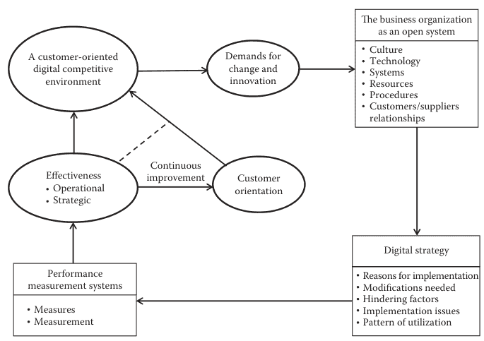 图1.1 电子战略实施的系统方法。Yasin et al. 2006, 2007, 2010, 2011, 2014; Ashrafi et al. 2007; Yasin and Yavas 2007; Torres et al. 2011）。本章中使用的其他学者的作品也引用并包含在参考文献列表中。

## 1.2 数字竞争环境

### 1.2.1 背景

数字技术在不同组织文化中的应用是一个不断演变和动态的过程。互联网及相关网页技术的启动了此类术语不断变化的应用。虽然与应用和技术相关的术语丛林日益增多，但这些数字技术的潜在收益是深远的。如果这些技术被整合到设计良好的数字战略中，这一点尤为如此。

移动商务（m-commerce）通常被认为是电子商务的一个集，而电子商务又被视为电子业务的一个集（Jelassi and Enders 2005; Ngai and Gunasekaran 2007）。因此，从角度来看，移动商务是电子商务的延伸，与后者相似，区别在于交易是通过移动设备进行的。因此，移动商务是指“通过移动设备进行的任何具有货币价值的交易”（Clarke 2001, p. 133）。第一章：移动电子商务的客户导向方法7 然而，一些研究人员认为移动电子商务不仅仅是电子商务的延伸（Chong 2013a），因为不同类型的用户交互、使用模式和价值链为定位营销等新业务模式提供了可能。

### 1.2.2 增长与潜力

尽管移动电子商务定义定义，但有一点是肯定的：近年来全球无线网络的使用大幅增加。安卓和iOS设备的普及导致了新的移动习惯，智能手机的拥有率在近年来扩散并增长，特别是在年轻消费者群体。此外，在亚洲和非洲等传统业务文化中，在线移动使用爆炸式增长，主要是由于经济原因，因为移动访问以更有效的方式了需求。事实上，移动设备现在是许多人的主要上网设备，尤其是年轻人。在这种背景下，技术趋势的融合和全球互联网的普及正在改变营销格局。这是许多公司应该考虑以提高其竞争地位的商业机会。

此外，网页技术的全球范围为触达新市场、吸引新客户以及交付产品和服务提供了成本效益的方法（Chatjee et al. 2002）；通过互联网进行的业务改变了组织与其客户及合作伙伴互动的方式（2005）。因此，互联网加速了速度、便利、个性化和价格等服务领域的价值创新，从而改变了客户价值主张（Kalakota and Robinson 2000）。随着数字技术的日益普及，客户的权力往往会增加，因为转换成本降低且对技术的熟悉程度提高（Porter 2001），而移动设备使他们在时间和空间上获得了更大的灵活性（Balasubramanian et al. 2002）。

# 8 移动电子商务

为什么以及何时灵活性对客户具有价值（Mahatanankoon 等人，2005）。然而，在移动电子商务中，对便利性的感知可能因性别而存在差异。例如，界面设计与易用性之间的联系对女性而言可能具有特殊性（Okazaki 和 Mendez，2013）。此外，需要注意的是，移动电子商务的用户通常是年轻用户，在设计应用程序和策略时应当考虑这一因素（Chong 2013b）。

反之，对于企业而言，使用移动网络可以访问巨大的客户数据库，并能够在无论客户身处何地、何时选择时，与他们进行通信。结果是，企业管理人员可以增强对消费者偏好的了解，并提高其对新型产品及其营销方式的价值定位。例如，零售商有能力投放对时间和位置敏感的价格广告。

尽管如此，尽管具有即时访问的可能性，公司仍应提供真正的价值和实用性，并清晰地将数字噪音与吸引有意义的注意力隔离开，以便在移动电子商务领域取得成功。因此，除了现有的电子商务模型复制到移动应用程序之外，开发植根于无处不在、便利、位置和个性化维度的独特移动电子商务价值主张，可以使公司获得竞争优势（Clarke 2001）。

然而，尽管消费者对使用 App 的偏好日益增加，大多数应用程序在下载后从未被再次使用，其中某些使用次数甚至不超过一次。因此，考虑到移动技术对业务和社会日益增长的重要性，了解哪些移动电子商务用户需求以及探索消费者对移动应用程序的感知，区分并比较采用移动电子商务的意图与持续使用意图非常重要。

此外，尽管对移动广告的响应取决于基于技术的评估（实用性考量）和基于情感的评估（享乐考量），但需要注意的是，移动广告受到广告通信特征以及用户对移动技术的自愿选择的影响（Yang 等人，2013）。此外，之前的研究证实，激励和事先许可会影响对移动广告的响应，从而影响活动的结果（Varnalli 等人，2012）。

最终分析认为，移动电子商务正在改变商业格局，在制定业务策略时必须考虑这一点。考虑到其潜力以及消费者和用户行为向移动设备（如智能手机和平板电脑）利用的转变，无论是在进行业务、发送电子邮件、搜索位置或信息或娱乐等活动中，情况都是如此。

# 第一章：以客户为导向的移动电子商务方法 9

## 1.3 作为开放系统的业务组织

近期，业务组织正向运营和策略的开放系统靠拢。在此过程中，这些组织越来越接近其客户、供应商以及竞争环境中的其他实体。在此过程中，这些组织承担了重大的电子工程工作，重点关注流程、程序、技术和策略等组织方面。当今的开放系统组织试图通过实施和利用移动电子商务和电子商务等基于数字的策略来增强其客户导向。在这种背景下，创新的电信技术对打破组织与其环境之间的障碍做出了巨大贡献。

尽管开放系统组织能够感知竞争环境的变化、威胁和机会，但它们必须相应地进行自我重构。在这种背景下，开放组织必须具有有机结构，这有利于创新和学习。有效采用基于数字的策略和应用需要此类组织特征。在这种组织中，文化、系统、程序以及与客户和供应商的链接相对容易修改和重构，为新技术成为业务数字战略的不可组成部分做好准备。最终分析认为，这是传递有效策略所需的。

## 1.4 数字策略

### 1.4.1 实施移动电子商务背后的

研究表明，高管理层通常倾向于倡导移动电子商务工作的启动。然而，其他实体如客户、供应商和组织内部部门也可能是移动电子商务背后的发起代理。还发现这些实体在移动电子商务实施计划的规划中也十分活跃。

具体而言，在实施努力背后的方面，组织的电子商务工作原因中，主要提到了与行业、竞争、供应商和客户相关的几个原因。需要注意的是，无论盛行的业务文化如何，这些原因往往是相似的。实施电子商务背后的动力是战略性的。其目标是提高客户导向，这对于实现和维持竞争优势至关重要。此外，实施背后的原因还有运营效率、供需关系、员工发展以及有效的内外部通信。

### 1.4.2 实施移动电子商务所需的修改


在实施过程之前的组织修改工作倾向于强调对组织不同层面的重构。这些重构工作包括与内部运营和人力资源培训相关的系统、程序、政策、流程，以及与客户和供应商的合作关系和协议。为了促进这种新导向，组织必须进行技术相关的投资。同样，在大多数情况下，无论涉及的业务文化如何，这些修改似乎都是相似的。有一个例外脱颖而出。在传统业务中运营的组织倾向于在员工培训、升级整合以及或替换现有技术上投入更多。也许这反映了在不同技术和业务文化下，组织在电子准备方面的差异。另一方面，美国组织更关注不同技术的整合以及与客户供应商建立更强的联系。在这种背景下，美国组织强调更集成的系统和解决方案，而其传统文化的对手则以增量和零散的方式推进电子商务工作。

最近的研究表明，尽管业务智能（BI）和信息系统（IS）应用可以使移动电子商务更强大，但用户对于将 BI 和 IS 集成移动电子商务实现的预期与实际情况之间存在明显差距（Xu 和 Yang，2012）。

### 1.4.3 移动电子商务实施的阻碍因素

阻碍电子商务实施过程的因素在性质上既是技术性的也是非技术性的。在大多数情况下，这些因素与组织本身有关。它们包括缺乏合格员工、推进实施过程以及技术资源等因素。此外，供应商和客户缺乏合作是实施工作的主要阻碍因素。此外，缺乏计划和高层支持似乎都是有效实施的重要阻碍因素。

## 第一章：面向客户的移动电子商务方法 11

电子商务实施过程。与美国同行者相比，传统业务文化组织中缺乏合格的员工和技术资源往往是更显著的阻碍因素。

### 1.4.4 实施问题

一旦制定了数字化战略，就必须实施。有些组织发现自上而下的方法更为有效，而另一些组织则利用自下而上的方法更有效地实施。无论采用哪种方式，代表不同部门的跨职能团队必须参与实际实施。在某些情况下，组织诉诸顾问来管理实施过程。通常利用项目管理工具来确保准时实施。此外，组织必须决定在旧系统转向新系统时遵循何种变更策略。在这种背景下，某些组织采用切换策略（cutover strategy），而另一些则选择分阶段策略。需要注意的是，虽然高层的支持对于推动数字化战略至关重要，但高层不应参与具体的实施细节，这应该留给专家。

### 1.4.5 移动电子商务的利用模式

研究发现实施后的电子商务实际利用与多个因素有关。这些因素倾向于强调组织利用电子商务来加强内外部通信。此外，电子商务的使用有助于组织接触新的客户和新市场。在此过程中，它促进了采购活动的管理。内外部通信的改进似乎是电子商务实施的一个重要副产品。这增加了组织在内部和外部的连通性。增强的连通性促进了在新市场和新客户方面的战略收益。此外，电子商务经常被用于加强与供应商的战略联盟。同样，电子商务的应用往往通过提高客户服务和满意度来提升客户导向性。

电子商务实施带来的收益或结果在性质上既具有战略性也具有操作性。总的来说，组织报告由于电子商务实施改善了客户/供应商以及员工关系。总体而言，电子商务理念和相关技术对于运营电子商务文化的组织以及传统业务文化的组织来说，似乎呈现出类似的机遇和挑战。因此，运营传统业务文化的组织在启动电子商务模型之前，可以从其电子商务业务企业有组织和系统化的标准管理中获益。运营传统业务文化的组织缺乏适当的技术和合格的人力资源似乎面临严峻的挑战。在这种背景下，员工培训应该有所帮助。然而，适当的技术硬件和软件的缺乏代表了一个长期问题。此类问题的解决需要立即和长期的投资。

对发展中国家的电子商务实践进行标准管理，可以减少运营传统业务文化的组织的学习周期。这种标准努力应该消除在电子商务实施和利用过程中与碎片化和试错法方法相关的浪费。

然而，如果没有一个包含影响客户在线购买行为因素的实施框架（Ghasmaghaei et al. 2009），业务利益将难以获得。目前对电子商务收益的缺乏理解在传统业务文化中是显而易见的，例如伊朗的情况，这是由于对客户（特别是农村地区）缺乏适当教育（Jalali et al. 2011）。

在传统业务文化中部署改进的电子商务战略时，教育组成可能会产生显著益处。教育方法与技术创新相结合往往会创造无形价值。Huarning和Yu（2011）断言，这种方法可以促进整个价值链的协作与合作，并说服中小企业（SMEs）追求电子商务。最后，电子商务战略应该强调消除基础设施障碍，这些障碍导致了中小企业电子商务战略实施乏力（Sarklan and Hastiani 2008）。

为了完善改进电子商务部署的框架，还需要额外的努力。这种框架将促进通往有效电子商务实施道路上的系统化标准。本章提出的框架是朝着这一方向迈出的的一一步。其他学者，包括Fathian等人（2008）、Bagherinejad（2006）以及Amiri和Salarahi（2010），尝试提供他们对此框架的观点。本章提供的两个概念框架具有吸引力，因为它们在本质上逻辑性、简单且实用。

## 1.5 性能测量系统

性能测量系统（PMS）的设计旨在管理组织绩效的多方面方面。在这种背景下，它应该是整合且平衡的。这种系统必须能够衡量、跟踪、监控和改进特定的操作指标和结果。通常，为了拥有有效且动态的PMS，需要两种组织性能平台，它对性能具有更广泛的组织视角，应该包含并整合组织中所有关键绩效领域的特定性质（Gomes et al. 2004, 2007, 2011；Gomes and Yasin 2013）。

平台A旨在衡量组织应对市场趋势的竞争努力。另一方面，平台B与组织结构联系得更密切，以支持和维持运营文化（Gomes and Yasin 2011）。

第一个评估平台A具有更全球性的、企业管理的导向。因此，该平台主要关注反映关键组织绩效维度的性能指标。该平台的重点是产品/服务向市场的有效流动。该平台使用的指标必须与组织的战略目标直接相关。该平台应该整合并支持组织有效性测量和竞争竞争标准工作。

第二个评估平台B保持了特定指标的视角。该平台定义了特定指标与组织单元之间的关系。在这种背景下，可以使用个人指标来评估效率、可靠性和质量。为了实现这一点，应该单独或分组使用多种指标。绩效改进的关键在于员工培训和开发。移动电子商务的性能衡量应该是战略努力不可或缺的一部分。作为这样，它是整合的、灵活的且实用的。

在分析与用户交互相关的文献时，网站设计、履行/可靠性、隐私/安全、客户服务和商品营销等因素被认为具有预测性（Szymanski and Hise 2000；Wolfbinger and Gilly 2003；Tro et al. 2006）。在其他市场中，便利性和网站设计是最重要的因素（Evanschitzky et al. 2004）。在这种背景下，业务组织通过让网站更有用、更有趣，而不是花钱增加熟悉度和风格，会变得更好（van derijden and Verhagen 2004）。因此，另一个重要的电子商务维度是易用性（Agarwal and Venkatesh 2002）。这一性能维度被发现是服务质量的因素之一（Yang et al. 2005）。

客户服务已被识别为一项重要的电子商务因素（Huang et al. 2009）。然而，由于电子商务竞争的节奏，赢得服务的特征似乎变成了准入标准（Trobald et al. 2006）。

尽管已有研究尝试从实证角度阐明电子商务绩效的不同方面，但考虑到近年来虚拟市场的演变以及对电子商务缺乏稳健且整合的衡量，仍然非常需要进一步的研究。事实上，开发满足电子商务通用要求的理论模型构成了一项研究挑战（Fink 2006）。文献也强调了确定电子商务供应链衡量和指标的重要性（Sambasivan et al. 2009）。因此，考虑到为了评估电子商务计划的成功，经理至少应该收集用户使用和交易统计信息（Sammon and Hanley 2007），开发一个与客户最需求匹配的测量配置文件可能是一个良好的起点。

## 第一章：以客户为导的移动电子商务方法

以及使用、定价信息、客户兴趣、整体质量，以及服务的便利性和创新（Torres 等人，2013）。

### 1.6 结论

本章基于对移动电子商务策略不同方面的研究。这些研究分别在美国、葡萄牙、阿拉伯海湾国家和伊朗进行。本章强调了移动电子商务（m-commerce）实施的集成性和系统化方法。

总体而言，传统的商业文化研究缺乏有效数字战略所需的培训和诀窍。在这种背景下，对标其电子商务文化对手在改进、规划和实施方面的努力可以提供有用的参考。

如今开放系统组织的竞争环境已由动态、创新、运营和战略性技术（如电子通信技术）所塑造。这些技术的增长加上客户日益增长的需求，正给开放系统组织带来一些严峻的挑战和许多机会。

为了应对这些挑战并利用充满前景的机遇，今天的开放系统组织正试图通过部署运营和电信技术来采用电子解决方案，以便更加高效、有效并以客户为导向。随着互联网应用程序的增长，如移动电子商务等数字战略倡议正在塑造当今组织的竞争格局。近年来，通往竞争战略优势的道路似乎是由数字化选择铺就的。

本章从运营、战略和以客户为导向的角度探讨了如移动电子商务等数字应用的有效性。在这种背景下，数字战略必须系统地与定义良好的战略性客户关注相结合。在过程中，实施的原因、所需的改进以及实施中的问题必须从战略眼光来处理。在这种背景下，碎片化和“自我中心”的方法会导致组织失去对移动电子商务战略的战略控制。性能管理系统的作用在确保组织衡量并持续改进移动性能的所有关键要素方面至关重要。

经理们在努力以战略方式处理电子倡议时，面临着许多问题，而答案寥少。在下一节中，将提供一个概念性路线图，以促进实现全方位数字战略的目标，这与当今开放系统组织面临的需求相一致。

### 1.7 启示

在当今资源紧缺的经济中，经理们被要求以少办成事。在这种背景下，完整的战略规划过程既耗时又昂贵。快速评估方法法（RAM）已应用于不同的运营背景中，作为一种快速且成本较低的方法，用于评估组织在不同情况下的劣势、优势和潜在差距（Yasin 等人，1999；Czuchry 和 Yasin 2000,2001,2003）。RAM 可用于评估组织有效实施数字战略的战略就绪状态。该方法试图捕捉小组执行和或管理者的选择。在这种背景下，RAM 使用 1 到 5 之间的量表。每个参与者使用该量表回答问题（项目）。例如，我们为什么需要采用数字电子战略？选项可能包括提高客户导向、提高运营效率或提高市场份额等。这一过程揭示了实施的原因，这些原因可以归类为运营、供应相关、客户相关、效率、创新等。其他问题（项目）可能识别出以下内容：我们目前的劣势和优势是什么？我们能弥补差距吗？这一过程在有效移动电子商务实施周期的各个方面重复。

图 1.2 中的阶梯图试图说明实施过程，并与有效识别数字战略所需的评估相联系。在这种背景下，它可以作为整个原本成本高昂的战略规划过程的起点。所提倡的过程在某种程度上介于“直接跳进去”和“等待我们出一个完整且昂贵的详细计划”之间。高层管理在 RAM 方法中的支持，以及对发起移动电子商务战略的推动至关重要。

## 参考文献

- Agarwal, R. and Venkatesh, V. 2002. 企业数字存在：一种启发式评估。Information Systems 13(2): 168–186.
- Amir, Y. and Salaz, H. 2010. 影响伊朗消费者在线购物的有效因素。Expert Systems with Applications 3(4): 172–180.
- Ashrafi, M., Yasin, A. and Czuchry, J. 2007. 阿拉伯海湾国家的电子商务实践。International Business 13(4): 351–361.
- Bagherak, M., Yasin, S. 2006. 以中小型企业的技术应用。The Service Industries Journal 33(1): 73–97.
- Balasubramanian, S., Grewal, D. and Peterson, L. 2001. 移动电子商务的价值主张。Journal of Business 28(4): 448–463.
- Chatterjee, D., Grewal, S. and Robertson, L. 2003. 改进电子商务的快速评估。Information Systems Management 20(3): 29–38.
- Chong, A.Y. 2013a. 用于预测移动电子商务的双阶段模糊网络。Expert Systems with Applications 40(4): 1240–1247.
- Chong, A.Y. 2013b. 移动电子商务对市场的影响。Technological Forecasting and Social Change 80(7): 1350–1359.
- Clark, J. 2002. 电子商务性能的价值分解。Benchmarking: An International Journal 13(1): 81–92.
- Czuchry, A. and Yasin, M.M. 2000. 实现全球竞争力的快速评估。Journal of Global Competitiveness 3(1): 21–27.
- Czuchry, A. and Yasin, M.M. 2001. 快速评估方法改进全球中小型企业。Advances in Competitive Research 9(1): 87–99.
- Czuchry, A. and Yasin, M.M. 2003. 基于方法的电子商务改进。Information Systems Management 20(3): 29–38.
- Evansitsky, H., Iyer, J. and Ahlest, D. 2004. 电子满意度：重新检查。Journal of Retailing 80(3): 239–247.
- Fathian, M., Akhavan, P. and Hoor, M. 2008. 发展中国家利润 ICT 的评估：以伊朗为例。Innovation 28(9): 575–590.
- Fink, D. 2006. 电子商务性能的价值分解。Benchmarking: An International Journal 13(1): 5–12.
- Ghasemaghei, M., Monademi, S.A. and Ranjbarian, B. 2009. 影响伊朗消费者在线购物的有效因素：软计算方法。Journal of Computer Science 5(3): 172–176.
- Ghabakoo, M., Arjanda, D. and Benitez, J. 2011. 中小型企业电子商务应用的采用。Industrial Management & Data Systems 111(8): 1238–1269.
- Gomes, C.F. and Yasin, M.M. 2011. 全球中小型组织性能管理的系统性基准视角：基于实施的方法。Benchmarking: An International Journal 18(4): 5.
- Gomes, C.F. and Yasin, M.M. 2013. 服务运营衡量相关实践的评估：衡量与利用模式。The Service Industries Journal 33(1): 73–97.
- Agarwal, R. and Venkatesh, V. 2002. 企业数字存在：一种启发式评估。Information Systems 13(2): 168–186.

## 第一章：移动电子商务的客户运营方法

Gomes, C.F., M.M. Yasin, and J.V. Lisboa. 2004. 制造业组织绩效评估研究：分析、分析与未来研究框架。Journal of Operations & Production Management 24(5): 488–513.

Gomes, C.F., M.M. Yasin, and J.V. Lisboa. 2007. 制造业绩效利用的实证调查：高管与财务分析师的视角。International Journal of Productivity and Performance Management 56(3): 187–204.

Gomes, C.F., M. Yasin, and J.V. Lisboa. 2011. 重新审视制造业测量实践。International Journal of Operations & Production Management 31(1): 5–30.

Huang, J. X., and Q. Tang. 2009. 电子商务绩效评估模型：对中国零售领域电子商务应用的开发与初步测试。Information & Management 46(2): 100–108.

Huang, J., and T. Yu. 2011. 非中小企业的创业、流程创新与价值创造。Management Decision 49(22): 284–296.

Jali, A.R. Okhovat, and M. Okhovat. 2011. 农村电子商务发展的新适用模型。Procedia Computer Science 9: 1157–1163.

Jelassi, T and A. Anders. 2005. 电子商务策略：通过电子和移动商务创造价值。Publisher Hull, Essex.

Kalakota, R. and M. Robinson. 2000. 电子商务 II：成功路线图。Addison-Wesley, Upper Supply River, NJ.

Mahatannookoo, P. H. Wen, and B. Lim. 2005. 基于消费者的移动商务：探索消费者对移动应用的感知。Computer Standards & Interfaces 27(4): 347–357.

Ngai, E.W. and A. Gunasekaran. 2007. 移动商务研究与应用综述。Decision Support Systems 43(1): 3–15.

Okazaki, S. and F. Mendez. 2013. 探索移动商务中的便利性：性别的调节作用。Computers in Human Behavior 29(3): 1234–1242.

Porter, M.E., A. Cuchry, and M.M. Yasin. 2004. 再保险服务的应用电子商务方法。Harvard Business Review 79(3): 63–78.


Sallmann, F., A. Czuchry. 2004. 再保险服务的评估。Marketing Intelligence and Planning 22(7): 716–731.

Sivambasan, M., Z.A. Mohamed, and T. Nandan. 2009. 电子供应链的绩效衡量标准与指标。Journal of Enterprise Management 22(3): 346–360.

Samon, S., and D. P. Huang. 2007. 成为部分电子公司：电子供应链策略的益处。Supply Chain Management 12(4): 297–303.

Sarkla, M.A. and A. Hastiani. 2008. 伊朗自由贸易区的电子商务障碍。Journal of Social Sciences 4(4): 329–333.

Szymanski, D.M. and R.T. Hise. 2000. 电子满意度：初步研究。Journal of Retailing 76(3): 309–322.

Torres, P. Lisboa, and M. Yasin. 2011. 葡萄牙电子商务企业采用策略：实证调查。Portuguese Journal of Management Studies 16(1): 43–56.

Torres, P.M., C.F. Gomes, and M.M. Yasin. 2013. 电子满意度的决定因素：实证研究。在第22届国际业务研究会议论文集中，页码1–11。马德里，西班牙。

# 移动电子商务

Trabold, L.M., G.R. Heim, and J.M. Field. 2006. 跨行业的服务绩效：在线零售总体满意度的驱动因素。International journal of Retail & Distribution Management 34(4): 240–257.

van der Heijden, H. and T. Verhagen. 2004. 在线商店形象：概念基础与实证测量。Information & Management 41(5): 609–617.

Varnaki, C. Yilmaz, and A. Toker. 2012. 移动广告中态度和行为结果预测：现场实验。Electronic Commerce Research and Applications 11(6): 570–581.

Wolfberger, M. and M.C. Gilly. 2003. eTailQ：零售质量的维度化、测量与预测。Journal of Retailing 79(3): 183–198.

多项此类综述（例如，Fouskas et al., 2005；Scornavacca et al., 2006；Ngai and Gunasekaran, 2007；Ladd et al., 2010）。Scornavacca 等（2006）对 2000 年至2004 年间的 235 篇期刊和会议文章进行了分类分析，并提出了未来的研究方向：（1) 商业与组织应用，(2) 实证研究，以及(3) 理论开发。同样，Fouskas 等（2005）在对移动业务维度进行深度回顾后，得出了一个研究路线图。该路线图提出了短中长期研究方向，包括但不限于在工作文化和业务过程中整合移动应用程序和移动服务（m-services）的组织能力、成本定价和互操作性。此外，最近的一项综述已缩小到特定的移动应用（m-applications）和移动电子商务（m-commerce）研究与应用（Ngai and Gunasekaran, 2007）。此外，还有一份涵盖 800 多篇文章的综合性综述指出，在更广泛的移动购买领域，“人们最初对技术感兴趣，随后是业务应用、用户关注点，最后是与该技术的商业应用相关的研究”（Ladd et al., 2010）。

Ladd 的综述表明，尽管存在上述这些有价值的综述，但没有哪一个能满足理解移动业务研究理论和概念方法的需求。此外，考虑到移动业务领域极具动态性，仍有空间通过对该现状进行综述做出贡献。本章的目的是理解 2005 年至 2013 年间移动业务研究的主要问题和概念方法，以识别差距并提出未来的研究方向。本章分为七部分。第 2.1 节提供了本章的背景和目的；第 2.2 节讨论了移动业务定义，以提出更全面的概念化；第 2.3 节描述了综述的方法。第 2.4 节根据移动业务研究主题介绍了综述结果。第 2.5 节讨论了以往研究的理论和概念框架。第 2.6 节总结了问题和概念方法方面的空白，以提供一些未来的研究方向。

## 2.2 移动业务研究的框架

Balasubramanian 等（2002）观察到，“移动业务”这一术语缺乏正式的概念化。这种空白导致文献中对该术语出现了似乎是随意的定义。例如，Fouskas 等（2005）将其定义为“……在移动或无线网络上进行的通信、信息交换和交易”，而 Hiagis（2006）将其定义为“……应用通信技术来满足移动用户需求的方法，这些用户需要通过无线访问设备访问各种和服务”。这些定义（如表 2.1 所示）将移动业务概念化为服务（例如，Muller-Verse, 1999；Clarke, 2001 以及 Barnes, 2002，引自 Woolfall, 2006）、技术（例如，Fouskas et al., 2005；Giaglis, 2006）或产品（例如，Lehner, 2003 和 Zobel, 2001，引自 Schierholz et al., 2007）。Woolfall（2006）提供了一个描述技术、产品和服务相互动的定义，将移动业务定义为“……多个参与者通过无线网络进行经济或社会价值的离散或关系交换的方式”。基于上述定义（Fouskas et al., 2005；Giaglis, 2006；Woolfall, 2006；Schierholz et al., 2007）并旨在推进和发展移动业务理论，我们将移动业务概念化为利用移动设备执行公司内部功能以及处理外部利益相关者（即合作伙伴、供应商和客户）的应用。这尝试结合了 Giaglis（使用移动设备满足用户需求）、Woolfall（多个参与者进行交换）以及 Fouskas 等（移动网络上的信息交换）的定义。在这里，用户或多个参与者可以是个人也可以是公司；交换可以在个人和公司之间进行，但仍然是通过移动或无线技术（例如手机和平板电脑）完成的。

### 表 2.1 移动业务的定义（作者构建）

| 作者 | 定义/概念化 |
|---|---|
| Muller-Verse (1999), Clarke (2001), 和 Barnes (2002)，引自 Woolfall (2006, p. 266) | 通过移动电信网络直接或间接进行的任何货币交易 |
| Lehner (2003) 和 Zobel (2001)，引自 Schierholz et al. (2007) | 应用移动技术以改进和扩展业务流程并开拓新的市场领域 |
| Fouskas et al. (2005) | 在移动或无线网络上进行的通信、交换和交易 |
| Giaglis (2006) | 应用通信技术来满足移动用户需求的方法，这些用户需要通过无线访问设备访问各种和服务 |
| Woolfall (2006) | 多个参与者通过无线网络进行经济或社会价值离散交换的方式 |

## 2.3 方法论

本综述仅包含同行评审的期刊文章。从 Emerald FullText、Science Direct 和 Wiley Online 收集文章。搜索词为 mobile、mobile business。最终结果为 2005 年至 2013 年间发表的文章。第一作者筛选了论文，第二作者对移动业务主题执行了相同的操作。

此外，作者在 6 月举行的第 12 次移动业务国际会议上提交了报告（参见 Boateng, 2013）。

## 2.4 移动业务研究：问题与证据

对移动技术的广泛研究导致了对现有综述中提出的若干主题的识别。检查表 2.2 列出的四篇综述的覆盖范围表明，Ladd 等（2010）涵盖了综述中提出的所有主题。因此，我们采用 R4（即 Ladd 等，2010）作为对论文进行分类的依据。

### 表 2.2 以前综述的主题（作者构建）

| 综述编号 | 参考文献 | 综述主题/分类 |
|---|---|---|
| R1 | Fouskas et al. (2005) | 技术、价值、服务、因素 |
| R2 | Scornavacca et al. (2006) | 消费者、业务、技术、通用、行业 |
| R3 | Ngai and Gunasekaran (2007) | 案例与应用、无线网络基础设施、中间件、无线用户基础设施、移动电子商务与研究 |
| R4 | Ladd et al. (2010) | 移动理论与研究、移动用户、移动业务、移动案例与应用、移动技术 |

讨论涉及以往移动业务研究中的主要问题。由于长度限制，我们从行业角度关注移动业务类别。该类别包含七个子类别，包括 (1) 移动业务应用/服务，(2) 经济、战略和商业模式，(3) 消费者接受/采用，(4) 宏观经济周期，(5) 政企互动，(6) 组织间工作以及 (7) 基础设施。具体而言，本章仅关注子类别 (1)、2) 和 (3)。其余部分是因为 (1) 对这些主题讨论有限 (2) 作者希望通过所选子类别实现讨论的保真度（Ladd et al., 2010）。

#### 2.4.1 移动业务应用/服务

移动业务应用/服务子类别与采用和使用的特定移动应用程序有关。该子类下的研究关注公司层面对移动业务的应用，分为两个视角：强制采用——公司根据业务协会或政府法规要求使用移动技术（参见 Lee and Park, 2008），以及围绕自愿采用的问题（参见 Liang et al., 2007; Balocco et al., 2009）。每种形式的采用预计都会产生某些收益。

减少了输入错误和行政工作量，并实现了单一文档流（Rossi et al., 2007）。尽管有这些优势，但在使用移动技术时也发现了一些挑战。这些挑战包括但不限于高昂的订阅费用、客户对面对交易的坚持以及网内和网外通话的成本（Chiwara and Dick, 2008; Frempeng, 2009）。为了应对这些挑战，研究提出了一个框架，为企业实施移动倡议提供指导原则（Sen Sinisalo et al., 2007）。讨论的主要应用包括移动图书馆服务（Cummings et al., 2010; Canon and Cricht, 2011; Johnstone, 2011; Barnard and Blaine, 2013; Lo et al., 2013;）、移动客户关系管理（Schierholz et al., 2007）以及移动供应链系统（Pan et al., 2013）。关于移动业务应用的一个趋势趋势是，将移动应用作为一种服务的可能性日益增加，即移动应用即服务（MaaS）（Jaramillo and Harting, 2013）。因此，企业可能不再需要开发或获取自己的移动应用服务器；他们可以外包开发和或使用已构建的移动应用平台。

#### 2.4.2 经济、战略与商业模式

这一子类别与作为企业战略和商业模式的移动产品的生产和分配有关。在该子类的三个维度上，研究分布似乎相当均衡。一些研究提供了框架以获得对移动解决方案成本和效益的预测（Gruhn et al., 2007），而另一些研究则对移动设备的经济影响存在争议（Rohman, 2012）。另一方面，许多研究证明了移动设备在经济、社会和发展方面的影响（Cassidy, 2006; Gani and Clemens, 2006; Horst, 2006; Ishii, 2006; Mutula, 2008; Dunn, 2009; Best et al., 2010; Ndung’u and Waema, 2011; Hamade; 2012; Ilahiane and Sherry, 2012）。相反，某些发现的移动技术负面结果包括犯罪分子的利用、对隐私权的侵犯以及不实社会的产生，这可能会影响采用移动设备的经济效益（Cassidy, 2006; Ndung’u and Waema, 2011）。

此外，一些研究关注采用移动设备的战略意义，例如改进工作流程、增加内部沟通和知识共享，以及增强销售和营销效能（Sheng et al., 2005）。其他研究为移动业务生态系统内的企业提供了克服竞争的指导原则，例如通过与网络提供商合作、快速发布新产品（Chang et al., 2009），并具有市场导向以以为中心（Kristesson et al., 2008; Bose and Chen, 2010; Isoheranen and Kess, 2011; Rahman and Azhar, 2011; J and Bailey, 2012; Kuriyan et al., 2012）。一些研究捕捉了企业如何解释和应对技术格局的变化，例如无线局域网（W-LAN）对移动网络运营商（MNOs）活动的影响（Madji and Husig, 2011）。Peppard 和 Rylander（2006）还勾定了在移动领域中设计新战略时需要解决的问题。

由于客户可能会影响企业战略，一些研究专门探讨企业如何响应客户需求（Aydin et al., 2005; Jayawardena et al., 2009; Yeh and Li, 2009; Santouridis and Trivellos, 2014; Aleke et al., 2011; Srinuan et al., 2011; Zhou, 2011; Awwad, 2012; Hung et al., 2012; Tobbin, 2012; Wang and Lin, 2012）。关于移动服务的业务价值（Methlie and Pederson, 2007）；商业模式的可行性、重构和可持续性（de Reuer and Haaker, 2009; Gezzi, 2012; Johansson et al., 2012）；寻找额外收入消费者（Gonçalves and Ballon, 2011）以及如何获取低收入消费者（Anderson and Kopp, 2008）。

#### 2.4.3 消费者接受/采用

消费者的重要性体现在支持客户参与移动服务交付论点中（Martin et al., 2012）。这一论点可以解释消费者研究在移动业务中的主导地位。该子类的研究主要关注影响消费者采用移动设备和移动服务的因素（例如，Shim et al., 2006; Laukkanen, 2007; Laukkanen et al., 2007; Bouwman et al., 2008; Kumar and Lim, 2008; Mannukka, 2008; Salmi and Sharafutdinova, 2008; Yang and Jolly, 2008; De et al., 2010; Kim et al., 2010; Riquelme and Rios, 2010; Wessels and Drenn, 2010; De et al., 2010; Gomez, 2010; Riquelme-Rios, 2010; Lu and Su, 2010; De et al., 2012; Kim et al., 2012; Lu and Su, 2012; De et al., 2012; Lee et al., 2012; Park et al., 2012; Wang and Lin, 2012; Riquelme-Rios, 2012; Srinuan and Park, 2013; Lee et al., 2013; Chakraborty and Sengupta, 2013）。

正如前述综述提到的，在概念方法方面仍然存在空白。了解这一点有助于未来的研究通过提出可能的应用来扩展现有知识。下一节将实现这一目标。

## 2.5 移动业务研究：概念方法

本节讨论了基于理论和框架的移动业务研究方法，旨在为未来研究提出概念空白。由理论方法引导的移动业务研究往往以消费者接受/采用为主题。所采用的理论包括原始形式的技术接受模型（TAM）（Amin, 2008; Yang and Jolly, 2008; Zhou, 2011; Tobbin, 2012），或通过添加某些构要素的扩展形式（Okazaki et al., 2008; Wessels and Drenn, 2010; Akturan and Teczan, 2012; Lee et al., 2012）。TAM 有时与理性理论（Lee et al., 2007; Kim et al., 2009; Lu and Su, 2009; Koenig-Lelie, 2010; Liu and Li, 2010; Riquelme-Rios, 2010）以及任务技术适配模型（Pagani, 2006）相结合以形成理论基础。

另一方面，一些研究简单地修改原始理论以探索其研究目标。例如，基于意志的论点对于强制性技术的使用显得不足。因此，TAM 被修改以创建技术满意模型（Lee and Park, 2008）。其他显而易见的理论包括统一接受与使用理论（Yang, 2010）、博弈论（Woolfack, 2006）、颠覆性竞争与创新理论（Gillward and Mureithi, 2011）、经济理论（Au and Kaufmann, 2008）、期望确认模型（Hu et al., 2012）以及媒体丰富性理论（Lee et al., 2007）。技术采用模型中的局限性也体现在无法解释技术的持续使用和有效使用，因此增加了宏观环境因素以及个人技能、知识和经验，以研究各种社会背景下的技术采用（De et al., 2013）。

基于框架的方法包括为组织选择合适的商业模式提供方向（Gruhn et al., 2007）、分析移动/无线技术的业务（Kang et al., 2011）、开发可行的商业模式（De Reuer and Haaker, 2009）以及确保移动业务生态系统参与者之间的协作（Jing and Xiang-Jian, 2011）。其他（流行的）框架包括战略导向框架（Isoheranen and Kess, 2011）和业务适配-可行性模型的开发（Liang et al., 2007）。表 2.3 展示了移动业务子类别、研究问题及其相关的概念方法。


## 第二章：移动业务问题与概念方法

## 表 2.3 移动业务研究的概念性方法（作者构架）

| 移动业务子类 | 研究问题 | 概念性方法分类 | 参考文献 |
|---|---|---|---|
| 移动业务应用服务 | 移动业务流程的建模与分析 | 框架 | Gruhn et al. (2007) |
| | 移动设备应用于客户关系管理的框架 | 框架 | Schierholz et al. (2007) Sinisalo et al. (2007) |
| | 将感知控制丧失与用户满意度及技术接受模型（TAM）结合以解释 B2B 市场表现 | 理论 | Lee and Park (2008) |
| | 考察关系冲突与合作对合伙企业业务流程影响的概念性框架 | 理论 | Woolfalla (2006) |
| | 与移动社交媒体相关的安全风险 | 否 | He (2013) |
| | 供应链管理中移动设备的采用模型 | 理论 | Pan et al. (2013) |
| 经济、战略与商业模式 | 商业模式技术与分析 | 框架 | Johansson et al. (2012) Methlie and Peterson (2007) Ballon (2007a) de Reuer and Haaker (2009) Braet and Ballon (2008) Anderson and Kopp (2008) Ghezzi (2012) Hawkins and Ballon (2007) (续) |
| 消费者接受/采用 | 使用技术-组织-环境框架确定影响企业对移动商务感知性能的因素 | 理论 | Martin et al. (2012) |
| | 从价值链角度对移动手机行业进行战略分析 | 框架 | Chang et al. (2009) |
| | 移动银行采用中初始信任的考察 | 理论 | Zhou (2011) |
| | TAM 的三个要素用于识别两个年龄段在移动数据服务采用上的差异 | 理论 | Yang and Jolly (2008) |
| | 时尚商品中移动技术的采用 | 理论 | Kim et al. (2009) |
| | 影响客户信任的质量因素 | 理论 | Yeh and Li (2009) |
| | 消费者移动技术采用和或使用的决定因素与动机 | 理论 | Yang (2010) Püchel et al. (2010) Liu and Li (2010) Akturan and Tezcan (2012) Tobbin (2012) Amin (2008) Hung et al. (2012) Okazaki et al. (2008) Wessels and Drennan (2010) Jayawardhenena et al. (2009) |
| | 服务质量对客户满意度和客户忠诚度的影响 | 框架 | Santouridis and Trivellas (2010) Chakraborty and Sengupta (2013) |
| | 电信发展对生活质量的影响 | 理论 | Rohman (2012) |

## 2.6 讨论

正如 Scornavacca 等人 (2006) 所观察到的且本文所示的，移动业务研究由消费者问题主导。然而，令人鼓舞的是业务端也存在一些研究。本综述的贡献在于尝试提供移动业务的整体视图，并强调 2005 年至 2013 年移动业务研究面临的主要挑战和概念性方法。综述中提出的证据表明：首先，在基础设施、宏观经济周期、政府与行业互动以及组织间网络子类中可能被忽视的之外，由于经济、战略和商业模式子类在移动理论和研究类别中具有高度动态，需要进行持续研究，通过在移动业务研究中采用和/适应更具理论基础的方法，来填补 (Ladd et al., 2010) 下讨论子类中本质上的匮乏。其次，在第 2.4.1 和 2.4.2 节讨论的通用移动理论和研究类别仍有贡献空间。此外，后续章节将讨论相关证据并建议进一步的研究领域。

### 2.6.1 问题与证据的讨论

首先，关于移动业务应用/服务，企业在将移动技术用于业务活动时面临着许多不确定性和挑战。研究克服此类挑战的可能方法对企业有帮助，也是移动业务转型的一种 (Tsai and Guraraj, 2007)。详细记录企业如何克服此类挑战的案例研究将为寻求实施移动技术的其他人提供有用见解和路线图。另一个可以研究领域是移动技术对企业管理功能的影响。总体，之前综述中的这些提示和讨论表明，当前和未来的研究仍集中在移动业务生态系统中非核心成员对移动应用的采用（见 Liang et al., 2007; Chiwara and Dick, 2008; Lee and Park, 2008）。研究自然会研究采用的相关影响。同时，Weeks (2006) 建议生命周期内有四个阶段：开发、采用、使用和影响。目前的研究似乎集中在采用、使用和影响上，因此在开发阶段——移动业务应用是如何创建的还有研究空间。此外，移动技术目前的趋势表明，企业正在鼓励员工将移动设备带入办公室 (Miller et al., 2012)。这些趋势的优点虽然被提到，但尚未经过实证研究。研究此类问题的必要性是因为人们对移动技术的潜在用途表示担忧，例如用于访问社交媒体并影响组织安全 (He, 2013)。由于移动技术已经并持续创建现有计算机应用程序的移动版本，因此需要研究由这种移动化产生的问题。

其次，在经济、战略和商业模式方面，以往的研究关注于采用的经济影响、战略意义、如何应对技术变化以及响应客户需求。然而，在移动业务组织 (MBOs) 内部，需要加强其整合内外资源以创建新资源组合的能力 (Koruna, 2004)。关于企业如何整合资源的实证研究看似匮乏，这在《电信政策、监管与战略杂志》的移动业务专题中证实 (Ballon, 2007a)。有必要超越当前前沿，研究 MBO 内部的管理流程，特别是由于增值服务的部署和管理方面存在许多未解决的业务挑战 (Giaglis, 2006)。

第三，消费者接受/采用方面的研究需要倡导让客户参与移动服务的交付 (Martin et al., 2012)。进一步的研究可以探索 MBO 如何作为价值创造过程的一部分处理客户感知。此外，为了吸引低收入消费者，建议公司根据其业务模式类型的战略模式重新配置其价值链 (Ghezzi, 2012)。这引发了实证研究的需求，以研究如何进行这种重新配置以及可以遵循哪些最佳实践。此类研究将为任何在重新配置努力中成功或失败的公司提供知识。

总的来说，企业级移动业务研究似乎由针对移动网络运营商 (MNOs) 的研究为主（见 Ballon, 2007b; Anderson and Kopp, 2008;

# 第二章：移动业务（M-business）问题与概念方法

Chang et al., 2009; Gonçalves and Ballon, 2011; Sriniv et al., 2011）。为了对移动业务有全面的洞察，需要研究生态系统内的其他企业。这种需求得到了一种观察的支持，即重点已从移动网络运营商转向移动生态系统中的其他参与者，转向价值创造和内容创作（Peppard and Rylander, 2006）。此外，由于第三方应用程序的前景良好（Methlie and Pederson, 2007; Verkasalo and Hämminen, 2007），内容提供商等企业也是需要研究的移动生态的重要成员。其他企业包括服务提供商、服务创造者、移动运营商和手机制造商（Smura et al., 2009）。移动业务运营（MBOs）中的价值创造是一个极具前景的研究领域，特别是关于业务模型选择对感知的影响，以及价值创造的实际过程。

### 2.6.2 概念方法的讨论

第2节所讨论的问题焦点，反映了在研究消费者应用及其感知方面概念方法的高度集中。移动技术在人类活动许多领域的可用性和可适用性，导致了各种尚未被研究的应用。尽管如此，跟踪此类应用并将现有研究扩展到此类单个移动应用（m-applications）的一个良好起点，可能是创建一个为移动业务应用/服务提供整体分类的框架。

目前，移动设备用于业务活动的一个重要且不断增长的领域是移动电子商务（m-commerce）。由于企业及其活动性质的不同，不同企业在实施移动电子商务方面可能存在不同的速率或出于不同的目的。为了向寻求实施的企业提供知识，研究可以探讨移动设备在商业活动中的使用。然而，由于企业层面因素（如资源、能力和就绪性）以及其他外部因素的差异，这种移动应用并不能保证所有企业获得相同水平的收益。例如，不同水平的电子商务能力的存在，使我们论证了实现移动电子商务及更广泛的移动业务方面可能存在不同水平的差异（Boateng et al., 2008）。未来的研究可以借鉴电子商务能力框架，以理解企业中移动业务的水平。

此外，正如2.6.1节中提到的空白，有必要理解企业如何开发和部署其资源以创建产品（移动业务应用）并获得收益（对企业而言）。本综述中规定的任何概念方法都没有提供获取这些知识的路径，因此有必要引入一种能够简明捕捉这一空白的方法。这种性质的概念方法可能并不专门适用于移动业务领域。然而，源自更广泛的战略管理领域，可以为创建特定移动业务的框架提供信息和指南。本综述建议使用已建立的框架来研究企业如何配置资源以创造价值并实现企业收益，例如，基于资源的理论（Teece et al., 1997），以及其后的扩展——（Teece et al., 1997）。

同样，我们有一些关于公司涉及客户创造价值的证据（Kristenson et al., 2008），我们应该考虑客户是否是（外部）资源，以及它们在多大程度上影响价值创造过程。显然，必须捕获客户反馈以告知价值创造过程；从移动业务的角度来看，专门用于此目的移动技术是什么——称之为知识管理（KM）。哪些KM框架可以帮助理解这一点？同样，科学研究需要评估通过客户投入创造的价值产物的适用性和匹配性。在这方面，设计科学理论提供了一些实用的指南。

此外，还需要能够捕捉各行业企业移动设备使用和收益的框架。到目前为止，人们努力从个人角度理解这一维度（例如，Boateng, 2021）。需要类似的扩展来理解移动设备采用对企业层的影响。根据所呈现的证据，目前的研究借用并扩展了商业或贸易中使用信息和通信技术（ICTs）的收益（Amit and Zott, 2001; Boateng et al., 2008）到移动等效领域。例如，“发展性移动”视角定位了移动设备对接受者的三种影响，即：增量性的、变革性和生产性的（Batcher and Scott, 2004; Heeks and Jagun, 2007）。增量性效应是指使用手机来改进企业已经在做的事情的收益，例如，与客户和合作伙伴沟通。变革性效应是指使用手机来创造新事物或访问新服务的收益，例如，移动银行。生产性效应是指交易或销售手机及相关服务的收益。目前研究捕获了增量和变革效应的收益；然而，移动设备的生产性效应仍有空间，例如，移动应用是如何创建并销售给客户（包括个人和企业）的。

前几节提供的证据表明，技术接受框架和理论在移动业务研究中非常丰富。然而，由于移动业务关注移动技术的组织或工业方面，这些理论被认为不足以处理可能影响企业对移动技术采用意图和行为的组织间因素（Pan et al., 2013）。因此，在转向以组织为中心的研究时，研究人员应该超越此类理论的边界，通过在特定的移动语境下将其构思操作化，或开发最适合研究特定背景的新框架（见2.5中的示例）。

## 2.7 结论与未来研究方向

通过对显著移动业务文献的分类和讨论，我们试图提供过去和目前移动业务研究的总体描述，涵盖业务应用/服务；经济、战略和业务模型；以及消费者接受/采用。本综述的主要动机是：首先，移动业务是一个动态领域，需要持续的研究（Ladd et al., 2010）。因此，此类综述对于识别和缩小过度研究的领域同时发现新领域至关重要。其次，尽管移动业务研究被批评为基于直觉的推理和概念分析而非实证（Scornavacca et al., 2006），过去的综述并没有分析所使用的概念方法和方法论方法。这在了解哪些理论是丰富的、哪些需要关注方面造成了空白。第三，本综述探讨了关于移动业务研究集中于消费者应用的断言（Ancker et al., 2003，引自Scornavacca et al., 2006）。

本综述的发现表明最初的感知是。然而，正如Scornavacca等人（2006）所预测，移动业务研究领域的转型无法保证。尽管如此，为未来的研究者提供一个清晰的焦点有助于该领域。具体而言，由此处讨论的研究、证据和过去的理论方法启发的两个主要焦点对于移动业务研究似乎是肥沃的。第一个是对移动业务业务维度的研究：目前的研究倾向于采用——包括个人和企业消费者。有必要理解开发企业资源以实现消费者的过程（如业务模型论点所提）。也可以探索促进该过程的内部外部条件及因素/资源，以对价值创造过程进行整体理解。第二个是理论开发。尽管信息系统（IS）学科拥有关键理论（例如TAM），但需要专门为移动业务开发关键理论以发展该领域。这可以通过适配和/或测试IS理论于移动业务或移动计算子学科来实现。

## 参考文献

- Akturan, U. and Tezcan, N. (2012). 青年市场的移动银行采纳：感知与意。Marketing Intelligence and Planning, 30(4), 444–459.

- Aleke, B., Ojajako, O., and Wainwright, D. W. (2011). 决策中的ICT采纳：小规模农业企业的视角。Journal of Enterprise Information Management, 24(1), 68–84.

- Amin, H. (2008). 影响马来西亚消费者使用手机信用卡意愿的因素。Management Research News, 31(7), 493–503.

- Amit, R. and Zott, C. (2001). 电子商务中的价值创造。Strategic Management Journal, 22, 493–520.

- Anckson, R., Carlson, C., and Walden, P. (2003). 影响移动商务中消费者去选择和决策的因素：第16届布莱德电子商务会议的新兴前景，斯洛文尼亚布莱德。

- Anderson, J. and Kopp, M. (2008). 服务于穷人：移动业务模式创新的驱动因素。Info, 10(1), 5–12.

- Au, Y. A. and Kaufman, R. J. (2008). 移动支付的经济学：新兴金融技术应用的利益者意愿。Electronic Commerce Research and Applications, 7, 141–164.

- Awwad, M. S. (2012). 客户满意度指数(ACSI) 在约旦手机领域的应用。The TOM journal, 24(6), 529–541.

- Aydin, S., Gizer, and Arasil, O. (2005). 消费者忠诚度和作为调节变量的转换成本：土耳其手机市场案例。Marketing Intelligence and Planning, 23(1), 89–103.

- Balasubramanian, S., Peterson, R. A., and Arvenpa, S. L. (2002). 探索移动商务对市场和营销的影响。Journal of the Academy of Marketing, 30(4), 348–361.

- Ballard, T. and Blaine, A. (2013). 手掌中的图书馆。New Library, 114(6), 255–258.

- Ballon, F. (2007). 移动业务的设计。Info, 9(5), 6–9.

- Ballon, F. (2007b). 欧洲电信行业不断变化的业务模式：替代无线技术的影响。Telematics and Informatics, 24, 192–205.

- Balocco, R., Morgan, R., and Tolletti, G. (2009). 移动互联网与中小企业：一个采纳案例研究。International Information Management and Data Systems, 109(2), 245–261.

- Barnes, S. (2002). 移动业务价值链：分析与未来发展。International Journal of Information Management, 22(2), 91–108.

- Batlor, S. and Scott, N. (May 2014). ICT在可持续生计发展中的作用，一组表格。2012年7月30日检索自 Gamos Ltd. 网站：https://gamos.org.uk/sustainability/lifelikihoods.html。

- Best, M. L., Smyth, T. N., Sutton, J., and Wem, W. (2000). 冲突后利比亚的手机使用。Information Technologies and International Development, 6(2), 91–108.

- Boating, R. (2011). 手机与微型交易活动——概念化联系。Info, 13(5), 48–62.

- Boating, R., Heeks, R., Molla, A., and Hinton, R. (2008). 电子商务与社会经济发展：概念化联系。Internet Research, 18(5), 35–46.

- Bose, I. and Chen, X. (2010). 探索客户移动服务数据的业务机会：一种聚类分析方法。Electronic Commerce Research and Applications, 9, 197–208.

## M章：业务问题与概念方法

- Bouwman, H., Carlsson, C., Walden, P., and Molina-Castillo, F. J. (2008). 2004–2006年芬兰移动服务的趋势：从彩铃到移动互联网。Info 10(2), 75–93.

- Braet, O. and Ballon, P. (2008). 欧洲移动电话合作模式。Telematics and Informatics, 25, 215–226.


- Budu, J. and Baeng, R. (2013). 2005–2012年移动商务研究的国内问题与概念方法，2013年国际移动商务会议会议论文，论文4。可用于 `http://aisel.aisnet.org/icmb2013/4`。

- Cuel, R. and Crichton, C. (2011). 加拿大学术图书馆与移动网络。New Library, 112(3), 107–120.

- Cassidy, S. (2006). 利用社会身份探索成人吸烟与手机使用之间的联系。Health Education 106(3), 238–250.

- Chakraborty, S. and Sengupta, K. (2013). 印度加尔各答客户满意度的因素探索性研究。Journal of Advances in Management Research, (2), 279–298.

- Chang, C.-Y., Wang, F., and Fu, H.-P. (2009). 中国大陆移动电话行业的战略分析。Journal of Manufacturing Technology, 20(4), 489–499.

- Chiare, E. R. and Dick, A. (2008). 纳米比亚中小企业获取服务的ICT使用。The Electronic Library, 26(2), 145–157.

- Clarke, I. (2001). 移动商务的新兴价值主张。Journal of Mobile Business, 18(2), 133–148.

- Cummings, J., Merrill, A., and Borrelli, S. (2010). 手持设备的使用：对服务的影响。Library-Tech., 21–24.

- de Angola, R. and Ramirez, F. (2009). 金字塔底层移动电话的战略性使用：墨西哥案例。Information Technologies and International Development, 5(3), 35–53.

- de Reuer, M. and Haaker, T. (2008). 设计感知服务的可行模型。Telematics and Informatics, 26, 240–248.

- Deng, Z., Lu, K., and Zhang, J. (2010). 理解客户满意度和忠诚度：移动信息的实证研究。Journal of Information Management, 30, 289–300.

- Dey, B., Newman, D., and Prendergast, R. (2011). 生活个性化与社会效用：孟加拉国手机的使用。Information Technology and People, 24(1), 46–63.

- De, B., Binsardi, B., and Prendergast, R. (2014). 金字塔底层移动电话采纳的质性调查。International Marketing Review, 30(4), 297–332.

- Donner, J. (2008). 信仰的规则：通过手机“未接来电”交换信息。Journal of Computer-Mediated Communication, 13, 1–22.

- Dunn, H. S. (2009). 从语音到移动宽带：低收入加美人的技术转型挑战。Info, 11(2), 95–111.

- Fouskas, K., Giaglis, G. M., Krouthan, P., Sitsilled, A., and Stylian, M. (2005). 移动业务路线图。International Journal of Mobile Communications, 3(4), 350–373.

Frempeng, G. (2009). 手机机会：微型和小型企业的案例。Info, 11(2), 79–94.

## 移动电子商务

- Gani, A. and Clemes, M. (2006). 影响与通信技术：对经济的非影响。International Journal of Social Economics, 33(9), 649–663.

- Ghezzi, A. (2012). 移动平台供应商的新兴模型和策略：参考框架。Info 14(5), 36–56.

- Glags, G. M. (2006). 移动业务研究：近期进展与未来前景。Business Process Management, 12(3), 261–264.

- Gillward, A. and Murethi, M. (2011). 监管影响还是破坏性竞争？东非关于移动漫游费结束的教训。Info 13(3), 32–46.

- Gomez-Barroz, J. L., Bacigalpo, M., Nikolv, S. G., Camargo, and Feijoo, C. (2012). 移动搜索走向主流的因素。Online Information Research, 846–857.

- Gonçalves, V. and Ballon, P. (2011). 为网络增值：移动运营商对软件即服务（SaaS）和平台即服务（PaaS）模式的实验。Telematics and Informatics, 28, 12–21.

- Gruhn, V., Kohler, A., and Kraus, R. (2007). 移动业务流程的建模与分析。Journal of Enterprise Management, 20(6), 657–676.

- Hamade, S. (2012). 移动技术对黎巴在线社区的影响。Digest of Mobile East Studies, 21(1), 24–38.

- Hawkins, R. and Paul, R. (2007). 当标准成为业务模式时：重新解释“标准化范式”。Info 9(5), 20–30.

- He, W. (2013). 通过挖掘和广泛文献检索对社交媒体移动博客进行调查。Information Management and Computer Security, 25(5), 1–6.

- Heeks, R. (2006). ICT4D研究。Information Technologies and International Development, 3(4), 1.

- Heeks, R. and Rajun, A. (2007). 手机与发展：新土地的未来？Id21 Insights, 6–9.

- Horst, A. (2006). 通信的祝福与负担：加美洲的手机。Global Networks, 6(2), 143–159.

- Hiao, K. (2013). 安卓手机采纳与移动互联网支付意愿。手机 Hi, 3(2), 216–235.

- Hung, M.-C and Wang, S.-T., and Hsieh, T.-C. (2012). 移动购物因素研究。International Journal of Electronic Management, 10(1), 29–37.

- Ilahiane, H. and Sherry, J. W. (2012). “金字塔底层”方法在国际发展中的困境：摩洛哥微型企业手机使用的案例。Information Technologies & International Development, 8(1), 13–26.

- Ishii, K. (2006). 移动性的意义：日常生活中个人通信媒体的使用。Journal of Communication, 56, 346–365.

- Isoheranen, V. and Kerr, P. (2011). 战略关注与市场份额分析：手机业务案例。Technology and Investment, 2, 134–141.

- Jaramillo, S. and Harting, D. C. (2013). 移动应用即服务(MaaS)的效用：BlueDigital案例研究。Journal of Technology Management in China, 8(1), 34–43.

- Jayawardhena, C., Kuckertz, A., Kaljalueto, H., and Kautonen, T. (2009). 许可性移动营销的前因因素：初步调查。European Journal of Marketing, 43(3), 473–499.

## 第二章：M-业务问题与概念方法

Jeng, D. J.-F and Bailey, T. (2012). 移动电信领域客户留存策略的评估：混合MCDM方法。Management Decision, 50(9), 1570–1595.

Jing, Z. and Xiang-Jian, L. (2011). 3G时代移动网络运营商的业务生态策略：以中国移动为例。Telecommunications Policy, 35, 165–171.

Johansson, J., Malstrom, M., Chroneer, D., Styven, M., Engstrom, A., and Byregvall-Kareborn, B. (2012). 移动服务部门的商业模式。Business, 4, 84–92.

Johnstone, B. T. (2011). Boopie与图书员：连接移动学习者与图书馆。Library Tech News, 28(4), 18–21.

Kim, J.-S, Lee, H.-Y., and Tsai, J. (2011). 移动通信技术的相互依赖性分析：WiMAX案例与市场评估模型的开发。Technology in Society, 33, 284–293.

Karin, N. S., Oyesebi, I. O., and Mahmud, M. (2010). 高等教育机构师生对手机的采用情况。Campus-Wide Information Systems, 27(4), 263–276.

Kim, J., Ma, Y. Y., and Park, J. (2009). 美国消费者准备好在时尚领域采用移动技术了吗？一种整合方法。Journal of Fashion Marketing and Management, 13(2), 215–230.

Kimiloglu, H., Nasir, A., and Nasir, S. (2010). 发现手机市场中的行为策略。Journal of Consumer Marketing, 27(5), 401–413.

Koenig-Levis, N., Palmer, A., and Moll, A. (2010). 预测年轻消费者对移动银行服务的接受。International journal of Bank Marketing, 28(5), 410–432.

Koruna, S. (2004). 知识资产利用：竞争能力——理论与实践。R&D Management, 34(5), 506–516.

Kristen, P., Matthing, J., and Johansson, N. (2008). 客户成功参与基于新技术的服务共创的关键策略。International Journal of Service Industry Management, 19(4), 474–491.

Kumar, A., and Lim, H. (2008). 移动服务感知中的年龄差异：Y世代与婴儿潮一代的比较。Journal of Services Marketing, 22(7), 568–577.

Kuriyan, R., Nafus, D., and Mainwaring, S. (2012). 消费、技术与发展：作为“消费者”的“穷”。Information Technologies and International Development, 8(1), 1–12.

Ladd, J. D., Datta, A., Sarker, S., and Yuk, Y. (2010). 移动通信趋势：鸿沟何：十年回顾。Communications of the Association for Information Systems, 27(Article 17), 285–306.

Laukanen, T. (2007). 互联网与移动银行：客户价值偏好比较。Business Process Management, 13(6), 768–797.

Laukanen, T., Sinkonen, S., Kivijärvi, M., and Laukkanen, P. (2007). 成熟消费者中的创新。Journal of Consumer Marketing, 24(7), 419–427.

Lee, M. K., Cheung, C. M., and Chen, Z. (2007). 理解用户对多媒体消息服务的接受：实证研究。Journal of the American Society for Information Science and Technology, 58(7), 2066–2077.

Lee, S.-G., Yu, M., Yang, C., and Kim, C. (2011). 饱和市场流失效应分析的模型。Industrial Management and Data Systems, 117(7), 1024–1038.

## 40

## 移动电子商务

Lee, T. M. and Park, C. (2008). 强制采用下的移动技术与B2B市场性能。Industrial Marketing Management, 37, 833–840.

Lehner, F. (2003). 移动与无线信息系统：技术、应用，柏林，柏林：Springer。

Liang, T-P, Huang, C-W, Yeh, Y-H., and Lin, B. (2007). 业务中移动技术的采用：适配效用模型。Industrial Management and Data Systems, 107(8), 1154–1169.

Liu, Y. and Li, H. (2010). 中国移动互联网的扩散：实证研究。Industrial Management and Data Systems, 110(3), 309–324.

Lo, L., Coleman, J., and Theiss, D. (2013). 二维测试。New Library World, 114(2), 41–47.

Lu, H-P. and Shu, Y. (2009). 影响移动购物的因素。Internet Research, 19(4), 442–458.

Li, O., Omwwa, K., and Waema, M. (2012). 肯尼亚移动银行的技术接受模型（TAM）。International Journal of Computing and ICT Research, 6(1), 23.

Majdi, F. and Husig, S. (2011). 现有员工对WLAN破坏潜力的反应。Telecommunications Policy, 35, 555–567.

Mannukka, J. (2008). 购买意愿作为判断。Journal of Brand Management, 17(3), 188–196.

Martin, S., Lopez-Catalan, B., and Ramon-Jeronimo, M. (2012). 决定电子商务性能的因素。Industrial Management and Data Systems, 116, 946–963.

Methlie, L. B. and Peterson, P. E. (2007). 移动服务的价值创造业务模型。Info, 9(5), 75–80.

Miller, K., Voss, J., and Hurlbert, G. (2012). BYOD（自带设备办公）：考虑。IT Professional, 14(5), 53–55.

Mokhlis, S. and Yaokop, A. (2012). 手机选择标准：马来西亚学生的调查。International Review of Social Sciences and Humanities, 2(2), 203–212.

Müller-Vrees, F. (1999). 电子商务研究，Durlacher Research，伦敦。

Mutua, S. (2008). 数字鸿沟与经济发展：撒哈拉以南非洲案例研究。The Electronic Library, 26(4), 468–489.

Ndugu, N. M. and Waema, M. (2011). 互联网和手机的使用结果：家庭视角。Info, 13(3), 110–124.

Ngai, E. and Gasekaran, A. (2007). 电子商务研究与应用综述。Decision Support Systems, 43, 3–15.

Nikbin, D., Ismail, I., Rimathuth, M., and Armesh, H. (2012). 服务恢复中的感知公正性。Management Research, 35(3), 309–325.

Okazaki, S., Skapa, R., and Grande, I. (2008). 捕捉全球青少年：捷克共和国的移动游戏。Journal of Computer-Mediated Communication, 13, 827–855.

Pagani, M. (2006). 业务市场高速数据服务的因素：技术接受模型与任务适配模型。Information and Management, 43, 87–860.

## 第二章：M-业务问题与概念方法

Pan, Y., Nam, T., Ogara, S., and Lee, S. (2013). 供应链中移动启用系统的模型。Industrial Management and Data Systems, 113(2), 171–189.


Parreño, J. M., Sanz-Blas, S., Ruiz-Mafe, C., and Aldas-Manzano, J. (2013). 青少年对移动广告接受的关键因素。Industrial Management and Data Systems, 113(5), 732–749.

Peggard, J. and Rylander, A. (2006). 从价值链到价值网络：移动运营商的洞察。European Management Journal, 24(2–3), 128–141.

Petruzzelli, L. (2010). 手机：技术对比营销。意大利市场的品牌效应。European Journal of Marketing, 44(5), 610–634.

Püschel, J., Janssen, J. A., and Hernandez, J. M. (2010). 移动银行：整合意向框架的位置。International Journal of Bank Marketing, 28(5), 389.

Rahman, S. and Azhar, S. (2011). 世代表达：巴基斯坦手机服务行业的感知。Asia Pacific Journal of Marketing and Logistics, 23(1), 91–107.

Riiquel, H. E. and Rios, R. E. (2010). 性别在移动银行采用中的调节作用。International Journal of Bank Marketing, 28(5), 328–341.

Rohkan, I. (2012). 通信发展将提高非洲国家的生活质量吗？Info, 14(4), 36–51.

Rossi, M., Tuomainen, V. K., and Pesonen, M. (2007). 客户服务中的移动技术：小改变大改进。Business Process Management, 13(6), 853–865.

Salmi, A. and Sharafutova, E. (2008). 新兴市场的文化与设计：俄罗斯的手机案例。Journal of Business and Marketing, 26(3), 384–394.

Santouridis, I. and Trivellas, P. (2010). 调查移动电话质量与满意度对忠诚度的影响。TOM Journal, 22(3), 330–340.

Schierholz, R., Kolbe, I., and Bremner, W. (2007). 移动客户关系管理：从策略到系统设计。Business Process Management, 13(6), 830–852.

Scornacca, E., Barnes, J., and Huff, L. (2006). 2000-2004年发布的移动业务研究：出现、现状与未来机会。Communications of Information Systems, 17(1), 19.

Sey, A. (2009). 探索加纳的手机使用。Info, 11(2), 66–78.

Sheng, H., Han, F., and Liao, K. (2005). 移动技术的战略意义：基于聚焦思维的案例。Journal of Strategic Information Systems, 14, 269–290.

Shim, J. P., Ahn, K., and Shim, J. M. (2006). 对数字多媒体广播手机使用的实证发现。Industrial Management and Data Systems, 106(2), 155–171.

Shin, D. H. and Kim, W. Y. (2007). 手机号码流行度与客户行为：韩国手机市场案例。Info, 9(4), 38–54.

Sinisalo, J., Salo, J., Karjalutto, H., and Leppiainen, M. (2007). 移动客户关系管理：底层问题与挑战。Business Process Management, 13(6), 771–787.

Smura, T., Kivi, A., and Toyli, J. (2009). 移动服务分析框架。Info, 11(4), 53–67.

# 42

## 移动电子商务

Srinuan, P., Annafari, M. T., and Bohlin, E. (2011). 泰国移动市场切换行为分析。Info 13(4), 61–74.

Teece, D. J., Pisano, G., and Shuen, E. (1997). 动态能力与战略管理。Strategic Management journal, 18(7), 509–533.

Tobbin, P. (2012). 未经银行人群对移动银行的采用模型：一项定性研究。Info 14(5), 74–88.

Tsai, H-S. and Gururajan, R. (2007). 移动业务转型的挑战与动机：多案例研究。Journal of Theoretical and Applied Electronic Commerce, 2(2), 19–33.

Verkasalo, H. and Hämannen, H. (2007). 基于手机的移动服务使用平台。Info, 9(1), 80–96.

Wang, K. and Lin, C-L. (2012). 移动增值服务的采用：信息系统质量与感知趣味性的影响。Managing Service Quality, 23(2), 184–209.

Weber, B. and Watson, R. T. (2002). 回顾过去以准备未来：文献综述写作。MIS Quarterly, 26(2), 13–23.

Wessels, L. and Drenn, J. (2010). 消费者对移动银行接受度的调查。移动业务伙伴关系中的游戏与网络视角。Journal of Bank Marketing, 28(7), 547–568.

Woolfall, D. (2006). 美国移动购物服务的采用决定因素：对移动购物服务设计的意义。Business Process Management journal, 13(3), 265–280.

Yang, K. (2010). 移动购物服务设计的决定因素。Journal of Consumer Marketing, 27(3), 262–270.

Yang, K. and Jolly, L. D. (2008). 移动数据服务采用中的年龄层分析：X世代对比婴儿潮一代。Journal of Consumer Marketing, 25(5), 272–280.

Yeh, Y. S. and Li, Y.-M. (2009). 构建移动电子商务的信任：质量与满意度的贡献。Online Information Review, 33(6), 1066–1086.

Zhou, T. (2011). 移动银行初始信任的实证研究。Internet Research, 21(5), 527–540.

Zobel, J. (2001). 移动业务与移动电子商务 - 未来的品牌。德国：Hansen。

## 第二部分

## 移动电子商务技术

## 第三章

## 移动电子商务的关键基础设施管理

### 移动自接网络的安全与可靠性问题

王海波，宁宁，王伟

| 目录 | 页码 |
| :--- | :--- |
| 3.1 引言 | 46 |
| 3.2 移动电子商务与基础设施 | 46 |
| 3.2.1 `MANET` 的发展及其特性 | 46 |
| 3.2.2 `MANET` 在移动商业中日益普及 | 48 |
| 3.2.3 通过移动网络创造价值 | 49 |
| 3.3 `MANET` 的安全问题 | 52 |
| 3.3.1 迫切需要更好的 `MANET` 安全解决方案 | 52 |
| 3.3.2 利用 `MANET` 固有弱点的攻击 | 52 |
| 3.3.3 路由协议的改进 | 53 |
| 3.3.4 信息保障的关注与策略 | 56 |
| 3.3.5 无线传感器网络及其安全问题 | 57 |
| 3.3.6 集成性安全框架 | 58 |
| 3.4 可靠性问题 | 58 |
| 3.4.1 维护可靠移动网络的困难 | 58 |
| 3.4.2 `MANET` 可靠性问题的最新研究 | 59 |
| 3.5 学术研究与行业解决方案 | 63 |
| 3.6 挑战与未来研究 | 66 |
| 参考文献 | 67 |

## 引言

## 移动电子商务

### 3.1 第五代 `WiFi` 和新的电信协议标准使得零售业中大规模实施移动自接网络（`MANET`）成为可能，尽管零售业已开始接受这一新技术，且主要通过在商店和购物购物车中安装 `WiFi` 热点来实现，但安全和可靠性问题已成为公共和私立组织的共同关注。

关于电信系统关键基础设施有大量文献；然而，关于移动电子商务（特别是 `MANET`）的话题仍为研究人员提供了数据传输新思想和设计的巨大机会。本章将对 `MANET` 的文献进行系统性综述，目标是通过研究 `MANET` 研究与应用的现状来解决安全和可靠性问题。作者试图识别差距和未来的研究方向。收集了 80 篇文章，并将文献产出分为安全、可靠性以及学术研究与行业解决方案。我们希望这些发现能提供良好的参考。

## 3.2 移动电子商务与基础设施

### 3.2.1 `MANET` 的发展及其特性

电信新技术使其具备了在大范围内传播的能力。`MANET` 的发展引起了学术界和工业界的关注。`MANET` 正在成为一种标准，移动电子商务的一些潜在应用将给客户关系和供应链管理带来变革。因此，移动电子商务的安全和可靠性正受到公共和私立组织的密切关注。移动电子商务的潜在应用包括：
- 与线下共享信息（`O2O`）
- 客户监控
- 实现体验

# 第三章：关键基础设施管理

在电信网络无法运行的环境中，`MANET` 自组织能力是关键，它可以有效动员资源并共享信息。然而，`MANET` 也容易受到破坏和攻击。`MANET` 中的每个设备（节点）都可以充当路由器，向其他设备转发数据包，并形成一个非常动态且不可预测的网络。`MANET` 的连接性取决于许多内部和外部因素，如节点密度、节点数量以及节点的寿命。`MANET` 不同层的数据包路由协议总是受到破坏和攻击。在考虑 `MANET` 的安全和可靠性时，研究人员经常提出两个问题：破坏与影响。例如，在 `MANET` 中，攻击者可以通过虫洞攻击通过短路和接管多个节点来破坏数据包路由。为了防止此类攻击，可以通过流量分析和构建更好的数据包路由协议来识别网络的关键组件。在影响情况下，如果目标是提高 `MANET` 的安全可靠性，可以部署中继节点来提高网络稳定性并减少能量消耗，这应该带来更好的数据包路由和改进的关键组件负载均衡方案。然而，这两个问题仍然存在，例如为了防止 `MANET` 中的黑洞攻击（攻击者伪装成授权节点（当授权节点因断电或电池寿命暂时关闭时），并响应错误路由的数据包以破坏网络），在这种情况下，任务是识别关键组件以提高授权节点的高可用性和最小停机时间（更低的能耗带来更长的寿命和更少的停机），并通过创建有用的冗余（中继节点）减少网络受损的可能性。

48 移动电子商务

其行为具有高度非线性。目前，关键基础设施管理的巨大精力集中在开发模拟关键基础设施系统行为的模型，并发现关键基础设施系统之间的依赖关系和脆弱性。

### 3.2.2 `MANET` 在移动商务中日益普及

移动商务的概念起源于移动技术的早期，当时提出了许多业务模型，旨在不受时间和限制向客户提供产品和服务。Tsalgatidou 和 Pitoura (2001) 讨论了移动电子商务中使用手持终端的业务模型，并根据移动终端和无线网络的特殊特征，定义了这些业务模型的交易问题。然而，这些业务模型过于强调语音和文本数据，由于带宽瓶颈，给客户带来了有限的体验，且交易成本高昂。

第三代及以后网络技术的突破打破了开发移动商务的带宽限制，允许企业以更低的交易成本和更高的传输速率促进复杂的电子商务交互。客户与零售商之间丰富的媒体和多维交互为移动平台增加了巨大的价值，并促进了电子商务的发展。移动平台上社交网络的发展促使零售商创造创新的业务模型。一些研究人员（Kuo and Yu 2006, Hwang et al. 2007）研究了 `3G` 和 `4G` 服务提供者的核心业务模型。最近的调查显示，`4G` 网络的快速连接可以加速移动商务，并让客户通过扫描代码在国内外商店定位更便宜的产品（eDigitalResearch 2013）。基于云的 `4G` 技术可以为信息和共享提供全面的平台。此外，语音服务过时的收入产生模式以及由于服务提供者激烈竞争导致的收入下降，为基于下一代网络（`NGN`）通信平台构建的新型增值服务创造了机会。客户对丰富内容和多媒体体验的需求使服务提供者不断增强网络带宽和传输速率，以提高移动商务的通信效率。这些增值服务不仅为服务提供者创造了新收入，还帮助零售商制定新的业务策略。例如，智能手机中的标准组件如摄像头和 `GPS` 帮助零售商随时随地向客户交付产品和服务；客户之间的信息共享也表明社交群体会影响个人的购买决策。`MANET` 基础设施的可用性是提供这些服务以及实时形成社交群的关键。

### 3.2.3 通过移动网络创造价值

为了理解新增值服务与相关业务策略之间的联系，Chen 和 Cheng (2010) 报告了一项研究，从 35 位行业和研究直觉专家及学者处收集反馈，使用分析网络过程评估了基于 `NGN` 的移动服务策略。作者提出了一个业务策略评估框架，并讨论了他们的研究结果如何作为 `NGN` 服务提供者的指南，用以评估、重新定位和改进其服务与策略。同时，移动网络提供了基于技术的自助服务，包括电子政府服务和客户关系管理。Kuo 和 Chen (2006) 提出了一种使用模糊系统评估法的分析工具，用以选择和评估客户满意度最高的最佳移动增值服务提供商。这项研究的结果不仅帮助消费者从其他人的意见中选择合适的提供商，还帮助提供商根据盛行的消费者模式捕捉移动增值服务的潜在市场趋势。Venkatesw 等人 (2012) 最近一项对 2465 名公民进行的网络调查研究显示了影响影响电子政府服务采纳和使用的四个关键属性。其中一个关键属性是安全保障。

最具吸引力的增值服务之一是电子商务中的移动银行。移动银行打破了商务活动的时空限制，且与传统银行相比降低了交易成本。许多零售商已经采用了移动银行技术并增强了他们的客户服务。例如，星巴克的客户可以使用手机支付他们的咖啡。在许多国家，客户可以简单地使用手机支付自动售卖机里的饮料、从电影院票务等产品和服务，且先进的授权方法可以提高在线支付的安全性，给客户带来便利。手机中新的指纹和人脸识别技术可以降低与使用移动银行相关的风险，并消除某些业务环境中信用卡购买的复杂性。客户丢失或错放信用卡的损失，以及零售商被盗取的信用卡数据每年给企业造成数百万美元的损失。在某些非洲国家，由于缺乏基础设施，传统的网银服务无法使用。在这种情况下，移动银行现在可以为此类条件下的客户和企业提供低成本且高效的银行服务。Google 发起的空白频谱项目通过改善生活质量为居住在孤立社区的人创造了机会；在印度和中国等拥有先进有线互联网基础设施的国家，该技术为移动工作基础设施奠定了基础；传统的汇票服务对客户来说效率低下且不方便。客户在排队中花费大量时间并承担高昂的交易成本。这两个国家都有大量的弱势工人群体，由于缺乏计算机和互联网服务，客户必须访问邮局或邮政局向家里汇款。因此，移动汇款的需求为银行和移动服务提供者创造了机会。Singh (2012) 报告了一项研究，检查移动银行的可行业务模型，在移动通信平台上将印度邮政与银行业整合，为海外劳工提供高效且低成本的汇款服务。作者识别了证明移动汇款需求的因素，并分析了移动银行采纳缓慢的问题。在许多国家，消费者对移动平台安全性和可靠性的缺乏信任是阻碍移动银行作为主要银行服务被缓慢采纳的主要原因。银行业对安全可靠性策略的实施缓慢，跟不上移动商务的发展。此外，移动商务的增长始终与移动支付市场的发展相关，由于移动基础设施潜在的新技术创新（如 `MANET`），该市场仍处于转型阶段。另一个广泛开发的增值服务是基于位置的移动服务。基于位置的移动应用和密集计算的潜力引起了学术界和工业界的关注。硬件软件开发者提出了不同的机制来处理依赖位置的查询。基于位置的服务质量取决于查询效率和计算结果的精确性。与有线互联网平台上的静态协调在线服务不同，基于位置

# 第三章：关键基础设施管理

由于客户坐标不断变化，移动服务需要密集的计算和持续的处理。例如，为了收集零售店内的客户购买行为数据，基于位置的服务需要高精度的定位客户的移动，并记录客户在特定商品或货架上花费的时间。该应用中的位置数据将以细细的粒度和精度进行收集。为了根据客户在类环境中的位置向其提供产品或服务信息，位置数据需要在客户在商店内移动时自动刷新。在不消耗客户移动设备电量的情况下提供高质量的服务是一项极具挑战性的任务。移动自组织网络（`MANET`）可以提供一种良好的分布式系统来处理查询，无需复杂的计算过程。它不仅增加了网络通信的灵活性并显著降低了位置查询的能耗，还能高效地执行基于位置的服务。Veijainen 等人（2006）提出基于事务管理器（`TM`）架构的图形模型，对基于位置的电子商务交易进行了需求分析，以保护电子商务流程免受通信链路、应用程序或崩溃的影响。该系统可监控网络中关键组件安全性和可靠性相关的约束。


为了给客户提供增值服务，研究人员提出了许多创新的移动业务模式。Figge（2004）引入了一种基于客户和服务提供者的空间、个人时间和维度的情境相关服务模型，根据情境描述视为情境提供者。作者还讨论了移动电子商务中情境依赖的组织、技术和安全问题。Huang 等人（2009）提出了一种分层移动代理框架，用于处理移动代理与主机之间的密钥管理和访问控制问题。该方法通过访问移动代理与主机之间的关系，可以提高密钥管理和移动访问控制的安全性，并在分布式环境中高效运行存储空间，这对于像 `MANET` 这样的非扩展网络至关重要。Jiang 等人（2010）针对门户访问服务提供商（`PASP`）、产品服务提供商（`PSP`）和移动服务提供商提出了一种具有最优利润的移动业务协作业务模型。为了实现利润最优，作者提出了一种代理演化算法进行计算，并使用模拟实验展示了决策者如何选择以利润为导向的策略。研究结果表明，协作机制可以帮助玩家以低风险获得更好的性能。Esparza 等人（2006）讨论了在经纪系统中使用移动代理技术来加速移动电子商务应用的大规模开发，并指出了阻碍其使用的安全问题。在下一节中，我们将讨论移动电子商务中 `MANET` 基础设施相关的安全问题。

## 3.3 MANET 的安全问题

### 3.3.1 对更佳 MANET 安全解决方案的紧需求

`MANET` 基础设施的自组织特性导致其容易受到安全威胁，并且比传统的有线网络更容易受到各种攻击。此外，由于能量供应和拓扑结构的不断变化，`MANET` 内部节点之间的链接不可靠。所有这些特征使得 `MANET` 极易受到利用其固有弱点的攻击，并导致了专门为 `MANET` 设计的攻击的泛滥。因此，随着其应用的日益普及，`MANET` 的安全问题变得愈突出。Park 等人（2011）对 `MANET` 安全问题的最新研究进行了简要概述。Datta 和 Marchang（2012）讨论了多种具有特殊重要性的攻击。在他们的研究中，这些攻击根据其行为模式分为两类：主动攻击和被动攻击，即取决于它们是会给网络功能带来干扰，还是仅仅从系统中拦截关键信息。他们顺序介绍了几种用于保护 `MANET` 免受此类攻击的基本技术，其中大多数具有研究价值。

### 3.3.2 利用 MANET 固有弱点的攻击

在节点之间移动的数据包由路由协议控制，且未包含许多安全特性。`MANET` 的特点通常是缺乏安全边界、受损节点的拜庭故障、缺乏中心化管理设施、电力受限以及可扩展性差。例如，电力受限可能导致拒绝服务（`DoS`）攻击。研究人员根据来源对 `MANET` 基础设施的攻击分为内部和外部，根据行为分为主动和被动。在本节中，我们根据文献讨论了 `MANET` 基础设施中的各种安全问题。

首先，`DoS` 是针对无线和有线网络的常见外部攻击。例如，`Ack-storm DoS` 攻击利用传输控制协议（`TCP`）规范中的缺陷对网络构成了新的威胁。从理论上讲，这种攻击可以被无限放大，并易在大规模范围内发起，通过一个非常弱的中间人攻击者（`MitM`）对抗接入网络或阻塞 Web 服务器。Abramov 和 Herzog（2013）发现了两种防止 `Ack-storm` 攻击的简单方法——一种是客户端-服务器中的简单方法，另一种是通过数据包过滤防火墙。为了防止 `DoS` 攻击，Agah 等人（2006）从拍卖理论的角度展示了关于安全执行机制设计的研究。在新协议中，节点根据拍卖理论相互竞争。“转发入站数据包并在网络中获得声誉”的最大竞价基于节点的效用值；因此，不诚实竞价的节点将被识别并隔离，以防止 `DoS` 攻击；这种新协议被称为基于安全拍卖的路由。此外，作者根据博弈论讨论了防御策略。他们最终发现在攻击者与无线传感器网络（`WSN`）之间的非合作双人非零和博弈中，游戏会向均衡点移动，从而产生两种新策略。一种是优化数据包中所有沿途节点的整体效用，“其中效用是每个节点的收益与成本之差”，另一种是评分系统，无线节点从相邻节点接收评分。所提出的基于博弈论的框架得到了模拟结果在改进 `WSN` 防御策略方面的支持。

### 3.3.3 路由协议的改进

Jia 等人（2013）近期尝试防止 `MANET` 受到 `DoS` 攻击，提出了一种基于参与节点能力的安全机制 `CapMan`。根据其设计，`CapMan` 能够监控节点的能力限制和实时流量。每个节点的流量状况都在整个网络内定位和交换。由于由于，节点能够做出明智决策并更好地调节流量。`CapMan` 通过模拟进行了广泛实施，结果显示 `CapMan` 可以有效阻止即使复杂的 `DoS` 攻击。

网络层，并关注了这两个层在安全设计中的安全需求。Kominos 等人（2007）结合多种认证协议进一步研究了移动自组织体系网络（`MANET`）的设计需求，并报告了一项专注于分层方法中认证过程的研究。他们还进行了仿真以测试此类协议，并建议采取多条防御线来提高 `MANET` 基础设施的安全性。此外，Shim 和 Lee（2005）识别了身份认证和密钥建立协议的安全性缺陷。他们的研究揭示了一种新型攻击类型：当 `MANET` 中的通信协议未能通过认证时的密钥共享攻击（key-share attack）。此外，Karyotis 和 Papavasiliou（2007）研究了一种基于概率模型的攻击策略，以最大化这些攻击造成的破坏。考虑到 `MANET` 的动态拓扑结构，所提出的模型使用拓扑控制算法，能够评估目标网络的能力、资源和特征。通过这种方式，预计会对目标 `MANET` 产生更大的影响。测试结果表明，所提算法比任何其他平化和基于阈值的方法都有效。Adnane 等人（2013）对基于测试的路由协议优化链路状态路由协议（`OLSR`）进行了全面分析，详细审查了节点在 `OLSR` 协议下形成树值的推理过程，并对现行的 `OLSR` 协议提出了他们的修改建议。Garcia-Morchon 等人（2013）还检查了执行信任管理的路由协议机制。基于他们独特的视角，本研究提出了一种改进的基于信任的协议，该协议强调了两个投票程序：用于节点准入，另一个用于节点消除。更常见的是，在建立且性能良好的协议基础上对其进行增量改进是一种具有实际应用意义的方法。Von Mulert 等人（2012）提出了他们的安全按需距离矢量（Secure `AODV`）协议，该协议建立在已有的 `AODV` 协议之上。他们新提出的协议结合了加密机制，以确保网络内传输的消息不被伪造或篡改。

由于移动网络中节点的不稳定特性，还有一些协议旨在解决 `MANET` 的安全问题。Malavenda 等人（2012）在彻底检查此类协议的最先进技术后，提出了一种新型的延迟容忍且节能的协议。实验结果表明，他们提出的协议被认为是良好的，甚至优于最主流的机制。

由于有许多可用于改进安全性的路由协议，因此衡量这些建议协议的有效性同样重要，以便具有更好安全参数的协议脱颖而出。有一些标准规定了相关需求，包括：

`X.800` 和 `X.805`。Almonani 等人（2013）基于这些标准提出了他们的逻辑安全架构，该架构系统地分析了协议可以实现的安全需求并给出了数学证明。基于他们提出的架构，他们给出了许多主流协议的分析结果。

`MANET` 被认为是一种泛在且无处不在的网络，容易受到内部攻击，例如由受损节点引起的拜斯庭故障（Byzantine failure）。在泛在的环境中，特别是在新技术出现后，传统的访问控制和认证变得力不从心。为了构建可靠的泛在网络，Boukarcher 和 Ren（2008）提出了一种“基于声誉的信任系统，通过为节点分配凭据、更新密钥、管理信任并做出决策”。该系统的测试表明，它可以有效识别恶意节点并采取适当行动来保护泛在网络。对于泛在网络，泛洪路由是安全路由应用的一种有效方法。它也存在一些缺陷，例如极度冗余，这经常会导致由于冲突数量过多引发广播风暴甚至系统故障。

`Gossip`（杂传）算法是一种通过计算重传概率来减少重传次数的概率算法。Burmeister 等人（2007）报告了一项研究，通过提出“几种利用局部性来自适应纠正传播故障并防止拜斯庭攻击的 gossip 协议”，尽可能减少重传问题。由于 `MANET` 中没有基础设施，节点之间的通信由节点自身进行。因此，节点之间的协作对于建立通信路由至关重要。由于容量和电池等各种原因，某些节点可能会异常，这些节点通常会使路由过程复杂。Rhymend Uthariaraj（2012）提出了一种解决方案，通过引入基于协作轮的路由方案来缓解异常节点的影响，该方案在检测和隔离异常节点方面有效。这种方法旨在减少误报。测试结果显示丢包率和恶意丢包有所降低。随着我们进入无处不在的计算环境，由于连接的复杂性，风险管理变得越来越关键。Hayat 等人（2007）试图找出传统的信息安全需求将受到什么影响。特别关注了风险管理、基于上下文的访问控制以及主动威胁评估技术的需求。`MANET` 中的聚类是指将节点分组到不同簇的方法。通常，每个簇中有一个管理节点，也称为簇头（clusterhead）。在目前的知识体系中，对于簇头选择过程中针对内部攻击的移动电子商业节点信任水平，关注较少。Elhdhili 等人（2008）提出了一种用于 `MANET` 安全的聚类算法，称为 `CASAN`，它关注潜在节点的信誉、稳定性和能量。作者还通过仿真以及与其他聚类技术的对比测试了该算法，所有这些测试都显示了 `CASAN` 的积极证据。这种方法可以用于识别 `MANET` 中的关键基础设施。

### 3.3.4 信息保障的关注点与策略

为了保护敏感信息和网络，通常以服务质量（`QoS`）为代价解决此类安全问题，特别是对于像 `MANET` 这样具有强约束的网络。Aiache 等人（2008）为 `MANET` 提出了一种解决方案，在不损害 `QoS` 的情况下更有效地对抗病毒攻击，并提供了其有效性的证据。当该方法作为路由发现阶段的自动化过程时，它更为有效，因为它使用模型检查来评估协议抽象。当攻击者试图破坏路由发现过程时，它将评估 `MANET` 的安全属性。Andel 等人（2011）开发了一种新的拓扑削减技术以降低计算需求。Ben Ohman 和 Mokdad（2010）的研究侧重于通过多路径提高传输机密性。具体而言，在所提出的方法中，原始消息被分成不同的部分，然后加密并通过不同的路径传输到接收者。安全性得到了提高，因为攻击者很难拦截所有部分，作者还将该方法与其他多路径解决方案进行了比较，并提供了性能评估。

密码认证是确保网络安全最广泛的方法之一。它在 `MANET` 等新型网络系统中的应用未能提供相同的安全性，因为可用性和针对线下猜测攻击的强保护在传统密码认证设计并未未被。Chai 等人（2007）提出了一种阈值密码认证方案，可以解决上述提出的问题。在所提出的方案中，只需两轮消息交换即可完成多个服务器节点的联合认证过程。这种新方案具有潜在人气，因为服务器节点中不需要存储密码表。其他研究人员提出了通过模仿军事结构来改进 `MANET` 安全性的方案，不同级别的人员可以访问不同的资源，并在 `MANET` 中建立多级结构，以限制不同节点对关键信息的访问（Changda and Shiguang 2008）。

# 第三章：关键基础设施管理

### 3.3.5 无线传感器网络及其安全问题

随着更多无线传感器或传感设备部署到移动自组织网络（`MANET`），无线传感器网络（`WSN`）的安全问题给业务带来了挑战。由于传感器系统始终运行在高风险环境中，且传感器的安全性一直是关注焦点，Bialas (2010) 报告了一项研究，探讨维护传感器保障的一种广泛使用方法，即通用标准（`ISO/IEC 15408`）。该研究的结果通过提供与通用标准（`CC`）相关的安全设计模式，对现有知识做出了贡献，并提高了传感器开发过程的有效性。在移动 `WSN` 带来的安全挑战中，克隆攻击尤为可怕，因为它使攻击者能够利用几个先前受攻击传感器的副本来颠覆网络行为。Conti 等人 (2013) 引入了两种新型对手模型：消失性对手和持续性对手，其特征是具有不同的渗透能力。随后，作者提出了两种分布式、高效且协作的协议来检测副本：历史信息交换协议（`HIP`）及其优化版本（`HOP`）。`HIP` 和 `HOP` 均利用本地（单跳）通信和节点移动性，区别在于所需的计算量。分析和仿真均表明，它们的解决方案是有效且高效的，能够在有限的开销下提供高检测率。基于这些令人鼓舞的结果，作者提出了两种用于检测移动 `WSN` 攻击的分布式协议，即使网络中仅存在单个克隆节点也能提供快速检测。当执行器被用于物理环境时，它对传感器网络的安全构成了新威胁。Czarlinska 和 Kundur (2007) 检查了一种新型执行器攻击，该攻击关注于传感器网络的保真度和可靠性；他们进一步提出了一种基于受控水平随机移动的策略来保护传感器网络免受此类攻击。他们进一步提供了证据，表明该建议方案能够随着时间的推移减少受影响的节点，并提高网络的韧性和故障容错能力。为了满足特殊类型的无线传感器与执行器网络（`WSANs`）对数据传输和网络约束的不同需求，Hu 等人 (2007) 提出了一种基于涟波区（`RZ`）的路由方案，该方案以可扩展性和能量效率为特征，以实现更好的信息安全。在这种新方案中，还提出了一种双级密钥更新/重路由方案；该新方案能够适应动态拓扑，并为每个数据传输会话安全地更新密钥。该方案已通过大量的仿真和实验通过测试，并证明在 `WSANs` 信息安全方面是有效的。

## 集成化安全框架

到目前为止，我们讨论了可以用于加强 `MANET` 安全性的各种技术。由于这些技术的侧重点往往不同、基于不同的理论基础，并且可以应用于不同的场景，许多研究人员正致力于构建一个集成化框架，整合来自不同安全策略的元素，以建立一个全面的防御系统。这种努力可以用 Lacey 等人 (2012) 提出的框架来阐明。在这项研究中，作者提出了一种基于声誉的互联网协议安全（`RIPsec`）框架，在该框架下，链路和节点被加密，节点行为在声誉系统下受到监控和评分，且消息交换通过证书保护确保安全。该框架整合了现有技术并形成了一个全面的安全解决方案；仿真结果也证明了它对现有攻击更具有效性。Bankovic 等人 (2011) 将网络路由协议和入侵检测系统（`IDS`）结合起来形成了一种新的安全解决方案。这种新方案利用基于声誉的方案来消除内部威胁，并利用无监督算法分析异常行为，最重要的是能够识别可能预先未知的攻击。还有一些专门为特殊情况设计的框架和解决方案。Cionca 等人 (2012) 提出的安全解决方案为大多数用于敌对环境的传感器网络提供了保护。

## 3.4 可靠性问题

### 3.4.1 维护可靠移动通信的困难

高度移动化社区中关键移动通信基础设施对极端事件的脆弱性是当今社会面临的挑战之一。`MANET` 与一组独立的移动设备（节点）连接，这些节点以去中心化的方式相互通信。其拓扑通常是高度动态的，因为节点移动会改变链路的存在和质量，从而对网络的可靠性产生显著影响。鉴于链路质量的重要性，有必要将路径生命周期纳入路由策略。然而，路径生命周期是不可用的，因此在 Yuste 等人 (2013) 中，建议了一种基于模糊逻辑的算法，试图在考虑路径生命周期后更准确地估计链路的可靠性和质量。事实证明，成功地整合该算法可以提高路由效率并降低能耗。

`MANET` 的高度动态特性使其可靠性分析变得困难。在 Zhao 等人 (2013) 最近的一篇论文中，提出了一种将节点移动影响和节点可靠性考虑其中的新型可靠性分析模型。结果显示，节点移动对终端可靠性的影响大于链路质量的影响。

`MANET` 配置的稳健性给传统的可靠性方法（例如可靠性框图）带来了困难性，因为没有标准的结构或配置来定义所有类型的 `MANET`。因此，设计了许多新方法，通过考虑差异化配置或移动模型来提高 `MANET` 的可靠性。Wang (2014) 所示，具有良好设计和配置或改进的性和可靠性的 `MANET` 设计了两个层级的结构：基于簇的 `MANET` 配置。第一层由头节点和关联节点组成，第二层级有一个头节点和多个成员节点。头节点之间的通信仅通过一个关联节点进行；还提供了合并簇的算法。这种建议的配置在关键性能参数上表现出显著改进。基于此配置，Xiaonan 和 Huanayan (2013) 进行了后续研究，表明 IP 地址可以在结构下进行更好的配置，因为每个簇可以单独执行此过程。在同一问题上，Wang 和 Qian (2013) 建议了一种基于树的配置和地址分配算法。在这种建议的配置中，IP 资源由代理节点分配，这些代理节点之间的通信在单跳内，最小化了通信成本且地址可以自动检索，进一步减少了资源浪费。

### 3.4.2 MANET 可靠性问题的前沿研究

# 60

# 移动电子商务

一种提高未来移动自组织网络（`MANET`）韧性的策略方法。尽管 `MANET` 等电信技术可用且易于获取，但采用 `MANET` 的主要挑战在于客户由于对该技术缺乏经验，导致用户之间缺乏信任。`MANET` 内部误导性或不准确信息的传播在实际情况下也可能导致不利后果。因此，为了促进 `MANET` 的协作，客户需要具备评估其他客户传播信息的信任度的能力。研究人员提出了一些去中心化的信任模型，以增强可靠信息的传播（Qureshi 等人 2010, 2012, Zyba 等人 2011）。这些模型包含了去中心化推荐方案。该方案被构建到 `MANET` 的去中心化成员服务中。此外，信任传播机制基于一种受启发的扩散模型，该模型可以通过 `MANET` 中多跳路由的信息洪泛特征在节点之间建立快速且稳健的信任。Wang 等人（2011）提出了一种考虑通信可靠性和路径长度的信任路由，以便在 `MANET` 中实现可靠且可行的数据包传输。该研究将安全性视为 `MANET` 路由方案中路由协议的组成部分，而不是在基础路由上应用额外的层。`MANET` 节点使用一组属性根据属性间的相似性来计算其他节点的信任级别，并采用新的转发路由进行信息传播。这种信任路由协议根据节点账户、范围和传输速度等路由性能参数，在防止针对动态源路由（`DSR`）协议的黑洞攻击方面产生了更好的结果。对 `DSR` 的另一项更新是 Mohanapriya 和 Krishnamurthi（2013）提出的改进型动态源路由协议（`MDSR`）。在 `MDSR` 下，在检测到恶意节点之前，入侵检测系统（`IDS`）不会被激活，这将显著降低能量消耗。这是通过配置一个检测异常数据包转发的 `IDS` 系统实现的。一旦检测到异常，附近的 `IDS` 就会转到激活模式，并向与恶意节点有接触的节点广播阻塞消息，从而隔离这些节点。发现，与 `DSR` 相比，这种改进后的协议数据丢包率降低了 64%，且能量消耗更低。除了传统手段更新的机制外，有效反入侵方案的研究也借鉴了不同的视角。Sundarajan 等人（2014）建议了一种名为基于生物的人工入侵检测系统（`BAIDS`）的新型 `IDS` 系统。`BAIDS` 与混合负选择算法相结合，能够以更高的准确率区分正常行为节点和恶意节点，它也被设计用于对抗 `MANET` 中的虫洞攻击。

# 第三章：关键基础设施管理 61


# 第三章：关键基础设施管理

由于 `MANET` 通常部署在恶意攻击环境中，实施入侵检测技术以防止内部和外部攻击并提高系统可靠性至关重要。Jin-Hee 等人（2010）报告了一项关于分析 `IDS` 技术对 `MANET` 可靠性影响的研究。与传统的有线网络 `IDS` 不同，`MANET` `IDS` 应该根据运行条件和攻击者行为进行，以便以最佳率使系统故障时间最大化。Padmavmathi 和 Chaturvedi（2013）建议使用基于传播的、已知分布下节点失效的链路可靠性模型，通过蒙特卡洛模拟来研究可靠性问题。他们通过一个应用说明了该方法，并给出了一些重要的结论。Ramirez-Marquez（2008）提出了基于网络资源（如带宽和能量）的 `MANET` 适用可靠性指标。Chen 等人（2012）开发了随机路点（`RWP`）移动模型来研究 `MANET` 的两端可靠性，并使用该模型描述了 `MANET` 中移动用户的移动模式。作者实现了分析法，给出了单跳和双跳连接的表达式，以衡量两端可靠性。`RWP` 模型中的中心趋势使其能够评估节点密度和网络拓扑对 `MANET` 可靠性的影响，其中由于节点的渐近空间分布，该模型被构建为一个源位置函数。Zhao 等人（2013）报告了一项使用蒙特卡洛方法进行两端可靠性的研究，并对节点的可靠性和移动性影响进行了建模和分析。

路由协议对 `MANET` 的可靠性具有关键影响。Xie 等人（2008）提出了一种名为 `LRHR` 的混合路由协议。在多路径路由策略下，`LRHR` 可以在对源—目的节点之间建立多条路径，这与传统的单路径路由和多路径路由策略不同。由于资源或可用性等某些情况，传统的多路径路由可能会降级为单路径，并丢失多路径机制的优势。在新的 `LRHR` 路由策略中，网络拓扑的变化率可以提供一种在表驱动和按需模式之间动态切换的路由策略。为了提高源—目的路径的可靠性，作者提出了一种带有路径段的自适应多路径路由机制，其中多路径可以作为端到端路径的一部分建立。因此，通过将端到端路径分为若干短段，可以提高 `MANET` 的可靠性。Zhen 等人（2010）提出了一种并行转发机制，使用相同的策略保证 `MANET` 上多媒体服务的服务质量（`QoS`）。此外，还提出了其他 `MANET` 路由协议以提高带宽和能量利用率。例如，Chang 等人（2009）引入了多播自组织按需距离向量（`MAODV`）路由协议，以实现 `MANET` 中的多播。众所周知，`MANET` 中通过组播树传输的数据包由于移动性或缺乏能量供应会经过不可靠链路，这可能会显著降低 `MANET` 的性能。`MAODV` 使用广播类型的本地修复机制在链路丢失时定位备用树。所提出的 `MANET` 的单播型多跳本地修复协议可以快速恢复丢失的链路，以提高网络可靠性。此外，它还可以提高数据包交付率，减少控制消息数量，并修复延迟。组播树的构建基于基础设施中关键组件的最优移动性。与使用 `MAODV` 的组播方法相反，Liang 等人（2012）引入了跨层单播本地修复机制，试图避免链路断开时 `MAODV` 引起的大消息过载和高能量消耗等不利结果。他们新提出的机制被证明能够通过通知发送者这种情况来缓解断路引起的拥塞；还能识别最优路径。

其他广播方法，如基于杂言（gossip）的广播，对于 `MANET` 分布式环境下大规模应用中的高效信息传播具有前景。为了提高应对节点失效的可靠性，Tsuchiya 等人（2006）开发了一个基于杂言广播的计数器。关键设计是，节点在收到几次消息副本后重新广播该消息。通过这种方式，节点可以确认消息传播的状态并在适当的时间复制给其他节点。

自愈路由协议对于处理 `MANET` 等动态网络中由于节点移动导致的拓扑变化是不可或缺的。此外，许多新兴的能量时间 `MANET` 应用（例如灾害响应、救援任务和战场行动）能够在高效能量消耗下支持实时、可靠的数据流。目前大多数高效能协议依赖于部署阶段必须获取的配置参数。Mukherjee 等人（2009）设计了一套基于自稳定范式的自管理、高效多播路由协议套件。该套件包括

- (i) `WECM`：一种为高效路由选择设计的浪费能量成本指标；
- (ii) `SS-SPST-E`：一种基于 `WECM` 的高效自稳定最短路径生成树协议，用于维护高效、自愈的路由结构；
- (iii) `SS-SPST-E fc`：一种改进的 `SS-SPST-E`，带有故障遏制以降低稳定延迟；
- (iv) `AMO`，一种优化的分析模型框架，用于减少路由维护机制的能量开销；以及
- (v) 观察和传播优化参数的自适应配置机制。

所提出的套件可以解决诸如开销能量浪费、稳定延迟下路由和链路选择的变化率，以及应用数据传输和交付的需求强度等问题。健壮的路由协议还应该考虑电池耗尽问题。Takeuchi 等人（2013）的研究是这方面的最佳示例。作者提供了其路由协议的更新版本，名为路由分割路由（Route-Split Routing, `RSR`），该协议基于他们之前提出的协议，在节点电量耗尽时对路由进行拆分。

## 3.5 学术研究与行业解决方案

在移动自传感器网络（`MANET`）中，每个节点在网络中随机移动时都可以充当路由器功能，形成动态链路。在动态变化的环境实现安全性和提高可靠性是极具挑战性的。学术界和工业界的研究人员应在高效的解决方案中考虑 `MANET` 的特性，以解决这两个问题。近期，一些学术和行业解决方案被提出，从节点认证与可用性、信息机密性、路由安全以及检测恶意入侵方面解决 `MANET` 的安全可靠性问题。

首先，`MANET` 基础设施中的节点之间存在多条路径。数据传输由多路径路由协议控制。原始数据可以通过加密和组合方法将其拆分为数据包来确保安全。然后，利用源和目的地之间的多种不相交路径进行数据包传输。即使攻击者重组原始消息的概率非常低。Ottoman 和 Mokdad（2010）为 `MANET` 提出了一种基于安全的多路径路由协议。

其次，`MANET` 节点之间的基础路由协议基于信任级别。每个节点都将计算其所有邻居节点的信任值和关联状态。Bhajaj 和 Shanmugam（2012）开发了一种基于信任的 `DSR` 协议，以识别和隔离灰洞节点（grayhole nodes）。Hadchicristofi 等人（2011）引入了一种新的 `MANET` 路由协议，该协议可以利用连接性、路由和链路质量或任何其他信息来改进路由决策。新协议利用结合路由、安全和监控的多种机制，支持 `IPv6` 和 `IPv4` 地址的并发路由，并根据路由提供的连接性信息设计低能耗、低干扰的网络拓扑。它可以使用集成信任组件在 `MANET` 节点之间建立信任，以支持 `IPsec` 部署并建立安全路径。Lacey 等人（2012）提出了基于声誉的网际安全（`RIPSec`）框架，从加密、`IPsec` 传输模式、行为评分和多级多路径路由方面为 `MANET` 提供安全。它使用加密链路和加密封装节点保护 `MANET` 免受外部威胁，并通过行为评分根据节点参与路由协议的情况来定义节点声誉，保护其免受内部威胁。Pai 和 Wei（2011）设计了一种基于加密的方法，用于消除电子商务 `MANET` 中遭受的虫洞攻击（wormhole attacks）。该方法可以从外部未经授权的入侵者和内部授权攻击者两个方面检测到攻击。

第三，由于 `MANET` 具有动态拓扑结构和易受攻击的特性，实施了强认证方案以满足其需求。在 `MANET` 中，某些节点可以结合，基于消息交换机制提供相互认证。一些提供者正在移动设备上实施这种解决方案，这不需要在节点中存储密码表。这种方法可以防止节点被破坏时的离线猜测攻击。其他方案在电子商务交易的移动代理和代理人（broker）之间使用公钥证书管理。例如，Esparza 等人（2006）描述了如何使用水印技术检测操纵攻击并使用代理人惩罚恶意主机。Lieherr 和 Dong（2007）讨论了 `MANET` 应用层节点的密钥管理和加密方案，其中每个节点都可以与经过认证的邻居节点共享密钥，以避免全局重密钥操作。Workman 等人（2008）开发了一种基于结构理论的、社会生物学启发的方法，用于在移动代理之间强制执行安全。Feng 等人（2009）讨论了 `MANET` 中使用哈希函数的密钥预留机制的安全引导模型，以防止密钥暴露。该机制在检测和阻止 `DoS` 攻击和其他恶意攻击方面是有效的。

为了防止 `MANET` 各种攻击，入侵检测系统（`IDS`）非常有效。然而，`MANET` 为传统的 `IDS` 了一个了一个充满挑战的环境。以最佳速率执行任务对于节约能源非常重要。Jin-Hee 等人（2010）提出了随机性特里网模型，以确定最佳速率，这些速率由运行条件、系统故障定义、攻击者行为以及使用的 `IDS` 技术决定。Chizari 等人（2012）讨论了他们新开发的泛洪算法，称为能效多点中继（`EF-MPR`），设计用于网络中进行有效的消息广播。基于他们大量的仿真，`EF-MPR` 被证明在减少能量消耗、最小化数据包冲突和传播时间方面是有效的。

特别是，`MANET` 具有动态拓扑结构、不可靠的连接、有限的节点能量供应以及可能的节点留留成本。为了克服这些挑战，研究人员开发了各种基于代理的 `IDS`。Straface 和 Antonopoulos（2010）设计了一个结合军事指挥结构和代理行为模型的框架，用于 `MANET` 的 `IDS`。该框架通过基于风险的方法（与路由的风险因素成正比），可以在不消耗过多资源的情况下提高 `IDS` 的效率。这种方法的有效性通过仿真来衡量，使用 `AODV` 作为路由协议来检测并从 `MANET` 中的汇洞攻击（Sinkhole attack）中恢复。结果以检测精度、数据丢失和通信开销的形式报告。Von Mulert 等人（2012）提出了安全 `AODV` 协议，使用加密机制保护路由控制消息免受介质访问层异常、资源耗尽、阻塞虫、水母和加速攻击；`AODV` 提供了多种安全方案，如多路径路由、激励方案、定向天线、数据包残留、路由请求、局部自愈社区和响应式入侵检测节点阻塞。Venkatraman 和 Agrawal（2003）报告了 `AODV` 在基于节点行为模式的安全路由方案下的网络性能研究。他们提出了认证技术来隔离 `MANET` 中的受损节点。

Lieherr 和 Dong (2007) 了一种基于应用层覆盖协议的密钥管理和加密方案，以维护移动自组织网络（`MANET`）中应用数据的完整性和机密性。该方法允许节点仅与经过认证的邻居共享密钥，以避免全局重操作并降低全局合谋的风险。Komminos 等 (2006) 讨论了从数据链路和网络层的多层防御解决方案，以防止各种攻击。Joshi (2011) 识别了 `MANET` 网络层中的多种攻击，以理解攻击者如何吸收网络流量并控制网络流量流。设计新协议不仅为了在节点之间建立最优高效的路由，还为了防止攻击者将自己注入节点间不可靠的链路中。然而，由于 `MANET` 自组织、自配置的特性，`MANET` 中节点的角色根据通信需求的类型而变化，这为 `MANET` 基础设施创建了动态且去中心化的结构。这种特性给 `MANET` 网络基础设施的安全性和可靠性带来了许多挑战。

## 3.6 挑战与未来研究

在 `MANET` 中，移动设备（节点）通过无线链路连接。在这样的网络中，节点经常改变位置，给路由算法处理不断变化的拓扑结构带来了困难。鉴于有各种协议可用，且每种协议都适用于特定的场景，使得在应用中选择使用哪种协议变得困难，因此开发一套框架来从安全策略执行和数据高效传输的方面评估这些协议至关重要。

此外，移动技术允许企业和客户在大规模上建立连接，不受时间和空间的限制。移动商务的能力将影响业务发生的方式，例如，移动技术已经将基于活动的消费者营销策略转变为使用社交网络的、基于对话的消费者市场，并鼓励消费者分享信息。正如我们之前讨论的那样，信任关系不仅对于 `MANET` 基础设施中节点的安全性和可靠性至关重要，而且对于企业与客户之间移动商务应用的发展也同样重要。移动通信面向连接的特性有助于建立一个比电子邮件或博客等其他无连接通信更深层次的信任通道。然而，在恶意攻击日益增加的前线如何开发和维护信任，对于应用程序开发者和服务服务提供商来说是一项具有挑战性的任务。

# 第三章：关键基础设施管理

## 参考文献

- Abramov, R. and A. Herzberg (2013). TCP Ack storm DoS attacks. Computers & Security: 33:12–27.
- Adname, A. et al. (2013). Trust-based security for the OLSR routing protocol. Computer Communications 36(10–11): 1159–1171.
- Agah, A. et al. (2006). Security efficiency in wireless sensor networks: A framework based on non-cooperative games. Pervasive and Mobile Computing 2(2):137–158.
- Aiachi, H. et al. (2008). Improving security and performance of an ad hoc network through a multipath routing strategy. Journal in Computer Virology 4(4):267–278.
- Allomani, I. et al. (2013). Logic-based security architecture for systems providing multih communication. International Journal of Distributed Sensor Networks 2013:1–17.
- Andel, T. R. et al. (2011). Automating the security analysis of process of ad hoc routing protocols. Simulation Practice and Theory 19(9): 2032–2049.
- Bankovic, Z. et al. (2011). Improving security in WMNs with reputation systems and self-organizing maps. Journal of Network and Computer Applications 34(2): 455–463.
- Bar, R. K. et al. (2013). QoS of MANET through based AODV routing protocol by exclusion of black hole attack. Procedia Technology 10: 530–537.
- Bethman, J. and L. Mokdad (2010). Enhancing data security in ad hoc networks based on multipath routing. Journal of Parallel and Distributed Computing 70(3):309–316.
- Bhalaji, N. and A. Shammug (2012). Dynamic trust-based method to mitigate greyhole attack in mobile ad hoc networks. Procedia Engineering 30: 881–888.
- Biais, A. (2010). Common criteria related security design patterns validation on the intelligent sensor example designed for mine environment. Sensors (Basel, Switzerland) 10(5): 4456–4496.
- Boukheva, A. and Y. Ren (2008). A trust-based security system for ubiquitous and pervasive computing environments. Computer Communications 31(18):4334–4351.
- Burmester, M. et al. (2007). Adaptive gossip protocols: Managing security and redundancy in ad hoc networks. Ad Hoc Networks 5(3): 313–323.
- Chai, Z. et al. (2007). Threshold password authentication against gathering attacks in ad hoc networks. Ad Hoc Networks 5: 1046–1054.
- Chang, B-J. et al. (2009). Distributed route repair for increasing reliability and reducing overhead for multicast in wireless MANET. Information Sciences 179(1): 1705–1723.
- Changda, W. and J. Cheng (2008). Multilevel security model for increasing reliability and reducing overhead for multicast in wireless MANET. Information Sciences 179(1): 1705–1723. (注：原文此处内容重复，已按要求翻译)
- Changda, W. and J. Cheng (2008). Multilevel security model for increasing reliability and reducing overhead for multicast in wireless MANET. Information Sciences 179(1): 1705–1723. (注：原文此处内容重复，已按要求翻译)


- Changda, W. and J. Cheng (2008). Multilevel security model for increasing reliability and reducing overhead for multicast in wireless MANET. Information Sciences 179(1): 1705–1723. (注：原文此处内容重复，已按要求翻译)

- Changda, W. and J. Cheng (2008). Multilevel security model for increasing reliability and reducing overhead for multicast in wireless MANET. Information Sciences 179(1): 1705–1723. (注：原文此处内容重复，已按要求翻译)

- Changda, W. and J. Cheng (2008). Multilevel security model for increasing reliability and reducing overhead for multicast in wireless MANET. Information Sciences 179(1): 1705–1723. (注：原文此处内容重复，已按要求翻译)

- Changda, W. and J. Cheng (2008). Multilevel security model for increasing reliability and reducing overhead for multicast in wireless MANET. Information Sciences 179(1): 1705–1723. (注：原文此处内容重复，已按要求翻译)

- Changda, W. and J. Cheng (2008). Multilevel security model for increasing reliability and reducing overhead for multicast in wireless MANET. Information Sciences 179(1): 1705–1723. (注：原文此处内容重复，已按要求翻译)

- Chen, B. et al. (2012). Two-terminal reliability of ad hoc network. Reliability Engineering of ad hoc network. Reliability Engineering & Safety 106: 72–79.

- Chen, P.-T. and J. Cheng (2010). Two-terminal reliability of ad hoc network. Reliability Engineering & Safety 106: 72–79.

- Chen, B. et al. (2012). Unlocking the potential of value-added services. Technological Forecasting and Social Change 77(4): 678–693.

- Chizari, H. et al. (2012). Scalable security for ubiquitous computing. Mobile Networks and Applications 18(5): 666–777.

- Cionca, V. et al. (2012). Scalable security in distributed networks.

- Conti, M. et al. (2013). Trust-based routing mechanism in mobile networks. Computer Communications 36(12): 1284–1297.

- Cook, J. L. and V. Kandur (2011). Trust-based routing in ad hoc networks. Computer Networks 55(1): 282–290.

- Dahlberg, T. et al. (2009). Situation-dependent services for mobile network operators. Journal of Business Research 57(11): 1416–1422.

- Eldhili, M. et al. (2008). Scalable security for ubiquitous computing. Information Security Technical Report 12(3): 172–178.

- Eissa, T. et al. (2013). Secure bootstrap protocol for mobile key. Computer Communications 36(1): 828.

- Esparza, O. et al. (2006). Secure brokerage mechanisms for mobile commerce. Computer Communications 29(12): 2308–2321.

- Feng, L. et al. (2009). JME application-layer-end-to-end security for m-commerce. Journal of Network and Computer Applications 27(1): 13–32.

- Garcia-Morion, O. et al. (2013). Cooperative security in distributed networks.

- Hadicheikh, G. C. et al. (2011). Routing, resource management, and monitoring in ad hoc networks: Integration-key with routing.- Routing, resource management, and monitoring in ad hoc networks: Integration-key with routing. Computer Networks 55(1): 282–290.

- Hayat, Z. et al. (2007). Scalable security for ubiquitous computing. Information Security Technical Report 12(3): 172–178.

- Hu, F. et al. (2007). Scalable security in wireless sensor and actuator networks (WSANs): Integration-key with routing. Computer Networks 51(1): 285–308.

- Huang, K.-H. et al. (2009). Efficient migration for mobile computing in distributed networks. Computer Standards & Interfaces 31(1): 40–47.

- Hwang, J-S. et al. (2007). 4G mobile networks Beyond 2G and 3G. PTC (Telecommunications Council) Proceedings, Honolulu, HI.

- Itani, W. and A. Kayssi (2004). JME application-layer-end-to-end security for m-commerce. Journal of Network and Computer Applications 27(1): 13–32.

- Jia, Q. et al. (2013). Capability-based defenses against DoS attacks in multi-path MANET networks. Wireless Personal Communications 73(1): 127–148.

## 移动商务

# 第三章：关键基础设施管理

Jiang, G. et al. (2010). 软件链竞争与协作机制的基于代理的仿真。*Information Sciences* 180(2): 225–240.

Jin-Hee, C. et al. (2010). 入侵检测对移动自 hoc网络中任务导向移动分组系统可靠性的影响。*IEEE Transactions on Reliability 59(1): 231–241.

Joshi, P. (2011). 网络层中 MANET 路由协议的安全问题。*Procedia Computer Science* 3(0): 954–960.

Karyotis, W. and S. Pavasiliou (2007). 基于概率建模框架的移动自 hoc网络基于风险的攻击策略。*Computer Networks* 51(9): 2397–2410.

Kominnos, N. et al. (2006). 移动自 hoc网络的分层安全设计。*Computers & Security* 25(2): 121–130.

Kominnos, N. et al. (2007). 移动自 hoc网络分层安全方法中的认证。*Computers & Security* 26(5): 373–380.

Kuo, Y-F and P-C. Chen (2006). 使用模糊评估的系统运营商移动增值服务选择。*Expert Systems with Applications* 30(4): 612–620.

Kuo, Y-F. and C.-W. Yu (2006). 电信运营商的挑战与角色：移动商业价值链视角。*Tetrahedron* 26(12): 1347–1356.

Lacey, T. H et al. (2012). 使用基于声誉的多层安全保护 MANET 的 RIPsec。*Computers & Security* 31(1): 122–136.

Liang, Y-H. et al. (2012). 多播 MANET 中最大化良好度和最小化控制消息的跨层本地修复。*Wireless Personal Communications* 66(1): 1–23.

Liebergh, J. and J. Dong (2007). 自 hoc 网络数据安全方法。*Ad Hoc Networks* 8(7): 1055–1072.

Malavenda, C. S. et al (2012). 用于安全关键型无线传感网络的延迟容、低功耗协议。*Journal of Computer Networks and Communications* 2012: 1–10.

Mohanapriya, M. and I. Krishnamarthi (2013). 用于 MANET 检测和消除选择性黑洞攻击的改进 DSR 协议。*Computers & Electrical Engineering* 40(2): 530–538.

Mukherjee, T. et al. (2009). 端到端可靠性约束下 MANET 的自管理能效型多播支持。*Computer Networks* 53(10): 1603–1627.

Padmadathy, N. and S. K. Chaturvedi (2013). 基于链路的可靠性模型评估自 hoc 网络的工作性。*Reliability Engineering & Systems Safety* 15: 1–9.

Pai, H.-T. and F. Wu (2011). 基于非基础设施无线网络的移动商业蠕虫洞攻击预防。*Electronic Commerce Research and Applications* 10(4): 384–397.

Park, J. H et al. (2011). 关于信息和未来通信安全的通信特刊。*Computer Communications* 34(3): 223–225.

Qureshi, B. et al. (2010). 用于断连 MANET 的基于机会信任的 P2P 服务框架。*Autonomic and Trusted Computing*, Xie, B., Branke, J., Sadjadi, S. M., Zhang, D., Zhou, X., (Eds.). Springer, Berlin, Heidelberg, pp. 154–167.

Qureshi, B. et al. (2012). 点对点移动社交网络中的可信信息交换。*Connectivity and Computation: Practice and Experience* 24(17): 2055–2068.

## 移动电子电子商务

Shim, K. and Y-R. Lee (2005). 移动通信认证和密钥建立协议的安全缺陷。*Applied Mathematics and Computation* 169(1): 62–74.

Singh, A. B. (2012). 印度邮政的基于移动银行汇票：可行模型和需求潜力评估。*Procedia–Social and Behavioral Sciences* 37: 466–481.

Straface, S. K. and N. Antonopoulos (2010). 无线自 hoc 网络基于代理的空洞检测中的军事战术。*Computer Communications* 33(5): 619–638.

Sundarajan, T. V. P. et al. (2014). MANET 中蠕虫洞攻击的生物启发人工检测系统。*Wireless Networks* 20(4): 563–578.

Takeuchi, M. et al. (2013). 通过适应电池耗尽来改进可持续路由分裂 MANET 路由的保证。*Telecommunication Systems* 54(1): 35–45.

Stalgadou, A. and E. Pitoura (2001). 移动电子商务中的业务模型和交易：需求与属性。*Computer Networks* 37(2): 221–236.

Tsuchiya, T. et al. (2006). 移动广播的基于计数的可靠性优化。*Computer Communications* 29(9): 1516–1521.

Veijalainen, J. et al. (2006). 移动终端移动电子商务的交易管理。*Electronic Commerce Research and Applications* 5(3): 229–245.

Venkatesh, V. et al. (2012). 设计电子政府服务：属性与结构。*Journal of Operations Management* 30(1–2): 116–133.

Vekatraman, L. and D. Agrawal (2003). 增强移动自 hoc 网络安全的策略。*Journal of Parallel and Distributed Computing* 63(2): 214–227.

von Mulet, J. et al. (2012). MANET 中的安全威胁与解决方案：使用 AODV 和 SAODV 的案例研究。*Journal of Network and Computer Applications* 35: 1249–1259.

Wang, J. et al. (2014). 路由的 MANET。*Journal of Network and Computer Applications* 34(2): 138–149.

Wang, X. and H. (2013). 分类 MANET。*Journal of Systems and Electronics* 19(2): 259–267.

Welch, C. (2013). 基于自 hoc 网络可靠性。*Reliability Engineering & Systems Safety* 94(10): 1685–1693.

Workman, M. et al. (2013). 移动自 hoc 网络中的分发。*Wireless Personal Communications* 71(4): 313–356.

Xia, W. (2010). 路由的 MANET。*Journal of China Universities of Posts and Telecommunications* 17(1): 93–100.

Zhen, Y. et al. (2012). 终端到端可靠性分析。*Journal of Applied Mathematics* 21: 1–9.

Zyba, G. et al. (2011). 机会性移动自 hoc 网络中的分发。*Proceedings of IEEE INFOCOM Mini Conference, San Diego, CA*。

# 第四章

无线自 hoc 网络安全

Manmohan Chaturvedi, Preeti Aggarwal, Shilpa Bahl, and Sapna Malik

### 目录

- 4.1 引言与背景............................................... 74
  - 4.1.1 网络....................................................... 74
  - 4.1.2 网络拓扑........................................................... 78
  - 4.1.3 网络类型........................................................... 78


- 4.1.3.1 有线网络............................................................... 78
- 4.1.3.2 无线网络....................................................... 78
- 4.1.3.3 自 hoc 无线网络............................................... 78
- 4.1.4 无线网络与有线网络的比较...................... 79
- 4.1.5 无线网络标准................................................ 80
- 4.2 无线网络安全问题...................................... 80
    - 4.2.1 安全问题.................................................................. 81
        - 4.2.1.1 缺乏安全边界................................................ 81
        - 4.2.1.2 内部受损节点的威胁.................................. 81
        - 4.2.1.3 缺乏集中化管理设施............................... 81
        - 4.2.1.4 电力供应限制............................................... 82
        - 4.2.1.5 扩展性.................................................................. 82
    - 4.2.2 攻击类型.............................................................. 83
    - 4.2.3 协议栈中的安全问题..................................... 84
        - 4.2.3.1 措施...................................................................... 84
        - 4.2.3.2 针对蠕虫洞攻击的防御方法...... 85
        - 4.2.3.3 监听狗和旁听者........................................ 85

总线型（Bus）：这种网络在20世纪80年代曾被广泛使用。在这种配置中，每台计算机（节点）都处理网络的总总线容量。此外，增加计算机会降低网络上的访问速度。每台计算机都与网络上的其他计算机通信。这被称为点对点网络（见图 4.4）。

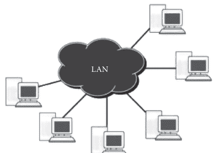

图 4.1 局域网。

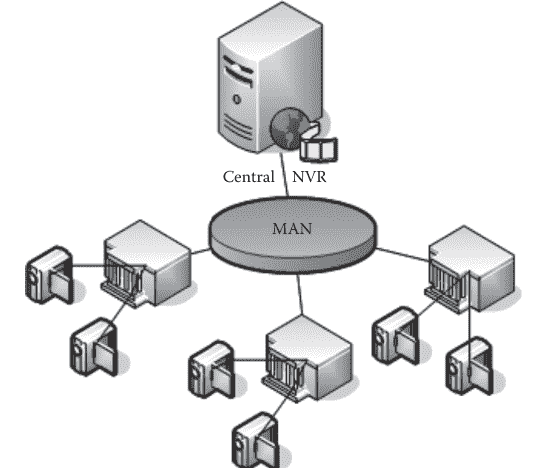

图 4.2 市域网。

环形（Ring）：在这种拓扑结构中，每个节点都连接到最近的两个节点，因此整个网络形成一个圆。数据在该网络上仅一个方向传输。环形拓扑中没有中央服务器，它基于令牌机制工作（见图 4.5）。

星型（Star）：在这种拓扑结构中，每个节点都通过集线器、交换机或路由器等中央设备连接。与环形和总线拓扑相比，星型拓扑在设置时需要投入更多的精力（见图 4.6）。

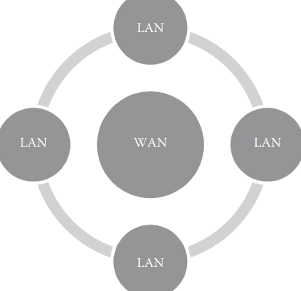

图 4.3 广域网。

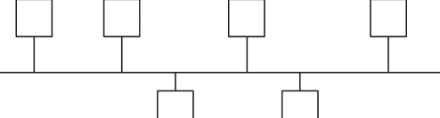

图 4.4 总线拓扑。

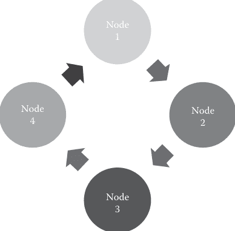

图 4.5 环形拓扑。

# 第四章：无线自组织网络安全

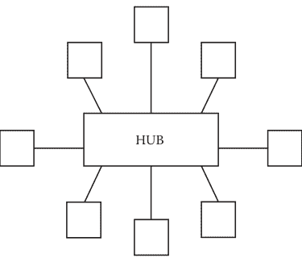

图 4.6 星型拓扑。

树型（Tree）：它是总线拓扑的变体。这种网络的形状是树形，具有中心根分支和子分支到网络的末端。当信号到达介质末端时，不需要从介质中移除数据包，它由终止器终止（见图 4.7）。

网状（Mesh）：每个节点都连接到多个节点，以便在主机宕机或过忙时提供替代路由。这种拓扑结构非常适合距离网络，并用于每个节点连接了星型、环型和总线的大型互联环境（见图 4.8）。

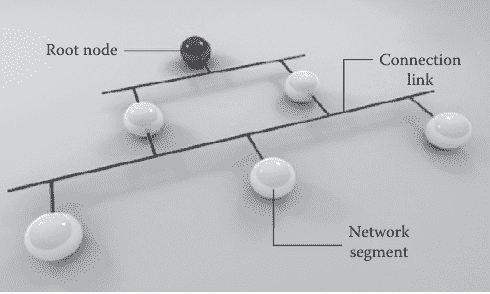

图 4.7 树型拓扑。

移动电子商业

78

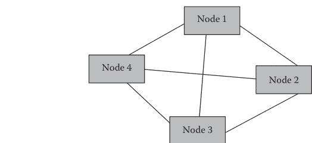

图 4.8 网状拓扑。

## 4.1.3 网络类型

### 4.1.3.1 有线网络

有线网络简单来说是通过以太网线连接的二台或多台计算机、打印机和其他设备的集合。有线网络也可以用作其他有线和无线网络的一部分。以太网是最快的有线网络协议，每秒连接速度（Mbps）达到100 Mbps或更高。通常，有线网络的范围在半径2000英尺以内。

### 4.1.3.2 无线网络

无线网络使用高频无线电波而非电线进行节点间的通信，是家庭或业务网络的另一种选择。个人和组织可以使用此选项扩展现有的有线网络或完全无线化。无线允许在没有网络电缆的情况下共享设备，这增加了移动性但缩短了范围。无线网络主要有两种类型：点对点或自组织以及基础设施。

### 4.1.3.3 自组织或点对点无线网络

自组织或点对点无线网络由若干台配备有无线网络网卡的计算机组成。每台计算机都可以直接与所有其他启用无线功能的计算机通信。它们可以通过这种方式共享文件和打印机，但除非一台计算机使用特殊软件充当有线LAN的桥接，否则可能无法访问有线LAN资源。移动自组织网络（MANETs）是一种自组织无线网络，通常在链路层自组织网络之上具有可路由的网络环境（Hu et al., 2003）。

第四章：无线自组织网络安全

79

## 4.1.4 无线网络与有线网络的比较

无线网络相对于有线网络的关键优势在于两者之间的主要差异；即一个使用网络电缆，而另一个使用无线频率（见图 4.9）。

- 尽管无线网络比有线网络移动得多，但网络范围通常在室内为150–300英尺，户外取决于地形可达1000英尺，但有线网络比无线网络安全得多。
- 尽管无线网络比有线网络移动得多，但网络范围通常在室内为150–300英尺，户外取决于地形可达1000英尺，但有线网络比无线网络安全得多。
- 尽管无线网络比有线网络移动得多，但网络范围通常在室内为150–300英尺，户外取决于地形可达1000英尺，但有线网络比无线网络安全得多。
- 尽管无线网络比有线网络移动得多，但网络范围通常在室内为150–300英尺，户外取决于地形可达1000英尺，但有线网络比无线网络安全得多。
- * 尽管无线网络比有线网络移动得多，但网络范围通常在室内为150–300英尺，户外取决于地形可达1000英尺，但有线网络比无线网络安全得多。
- * 尽管无线网络比有线网络移动得多，但网络范围通常在室内为150–300英尺，户外取决于地形可达1000英尺，但有线网络比无线网络安全得多。
- * 尽管无线网络比有线网络移动得多，但网络范围通常在室内为150–300英尺，户外取决于地形可达1000英尺，但有线网络比无线网络安全得多。
- * 尽管无线网络比有线网络移动得多，但网络范围通常在室内为150–300英尺，户外取决于地形可达1000英尺，但有线网络比无线网络安全得多。
- 尽管无线网络比有线网络移动得多，但网络范围通常在室内为150–300英尺，户外取决于地形可达1000英尺，但有线网络比无线网络安全得多。
- 尽管无线网络比有线网络移动得多，但网络范围通常在室内为150–300英尺，户外取决于地形可达1000英尺，但有线网络比无线网络安全得多。
- 尽管无线网络比有线网络移动得多，但网络范围通常在室内为150–300英尺，户外取决于地形可达1000英尺，但有线网络比无线网络安全得多。
- 尽管无线网络比有线网络移动得多，但网络范围通常在室内为150–300英尺，户外取决于地形可达1000英尺，但有线网络比无线网络安全得多。
- 尽管无线网络比有线网络移动得多，但网络范围通常在室内为150–300英尺，户外取决于地形可达1000英尺，但有线网络比无线网络安全得多。
- 尽管无线网络比有线网络移动得多，但网络范围通常在室内为150–300英尺，户外取决于地形可达1000英尺，但有线网络比无线网络安全得多。
- 尽管无线网络比有线网络移动得多，但网络范围通常在室内为150–300英尺，户外取决于地形可达1000英尺，但有线网络比无线网络安全得多。
- 尽管无线网络比有线网络移动得多，但网络范围通常在室内为150–300英尺，户外取决于地形可达1000英尺，但有线网络比无线网络安全得多。
- 尽管无线网络比有线网络移动得多，但网络范围通常在室内为150–300英尺，户外取决于地形可达1000英尺，但有线网络比无线网络安全得多。
- 尽管无线网络比有线网络移动得多，但网络范围通常在室内为150–300英尺，户外取决于地形可达1000英尺，但有线网络比无线网络安全得多。
- 尽管无线网络比有线网络移动得多，但网络范围通常在室内为150–300英尺，户外取决于地形可达1000英尺，但有线网络比无线网络安全得多。
- 尽管无线网络比有线网络移动得多，但网络范围通常在室内为150–300英尺，户外取决于地形可达1000英尺，但有线网络比无线网络安全得多。


图 4.9 无线频率分布。

## 无线网络标准

传输标准共有四种基本类型。由电气电子工程师学会（IEEE）（Hubaux et al., 2011）。它们定义了无线频率的所有方面：`802.11`、`802.11a`、`802.11b`和`802.11g`。

这些类型之间的基本区别是连接速度和无线频率。传输标准 `802.11` 和 `802.11b`速度最慢，分别为 1 或 2 Mbps 以及5.5 和 11 Mbps。两者都在 2.4 GHz 范围内工作。标准 `802.11a` 工作在 5 GHz 频率范围内，传输速度高达 54 Mbps；`802.11g` 工作在 2.4 GHz 范围内，传输速度高达 54 Mbps。实际传输速度取决于多种因素，如网络内物理障碍的数量以及无线传输中的任何干扰。

## 无线网络安全问题

在技术进步领域，确保计算机实体或网络上硬件、软件和数据的安全与可靠是当务之急。

安全的三个关键组件可以定义为定义、检测和响应（Hu et al., 2003）。

安全针对完整性、可用性、真实性、机密性和不可否赖性（Nogueira et al., 2009），而安全（Safety）确保物理安全和系统的平稳降。这些安全特征被建模用于设计信息安全策略（Yang et al., 2004）。

完整性：信息的完整性确保信息是准确且可靠的。

可用性：可用性确保授权人员可以随时访问信息。

真实性：真实性涉及双方：发送方和接收方。发送方应该是真实的，且只有当接收方是预期接收者时才是授权的。例如，数字签名是验证用户的一种机制。

机密性：机密性确保信息不会向未经授权或非预期的用户披露。

不可否赖性：不可否赖性意味着发送方和接收方在稍后的阶段都不能否认发送或接收过信息。

# 第四章：无线自组织网络安全

### 4.2.1 安全问题

### 4.2.1.1 缺乏安全边界

移动网络通常比固定电缆网络更容易受到物理安全威胁。它们没有定义的安全边界，这无法与传统有线网络中清晰的防线相提。由于移动自组织网络具有在网络内部自由加入、离开和移动的特性，它们面临着这些威胁。在这些网络中，欺骗和拒绝服务（DoS）攻击的可能性有所增加。

在移动自组织网络中，攻击者不需要获得物理访问来访问网络：一旦攻击者进入移动自组织网络中任何其他节点的无线电范围，它就可以与其半径内的节点进行通信，从而自动加入网络。因此，移动自组织网络没有提供所谓的安全边界来保护网络免受某些潜在危险的网络访问的影响。

### 4.2.1.2 来自网络内部受损节点的威胁

由于移动自组织网络中没有定义安全边界，这导致了各种链路攻击的发生。这些链路攻击聚焦于节点之间的链路，并试图通过恶意行为来破坏链路。由于某些攻击，它们试图通过某些不正当手段获取节点自身的控制权，并利用受损节点执行其恶意操作。

由于节点可以自由离开和加入，由于不同节点的行为多样性，它们对自身没有严格的策略来防止与其通信的所有节点可能产生的恶意行为。受损节点可以频繁更改攻击目标；因此，跟踪受损节点的恶意行为非常困难，特别在大规模自组织网络中。因此，来自网络内部受损节点的威胁比来自外部的攻击危险得多，而且这些攻击更难检测，因为它们来自受损节点，而这些节点在受损之前表现良好。

### 4.2.1.3 缺乏集中化管理设施

移动自组织网络中没有集中化的管理系统来检测攻击并控制进出流量，因为它具有高度的动态性。在移动自组织网络中，路径中断、传输受损和数据包丢失等异常故障频繁发生。因此，恶意故障将更难以检测，特别是当攻击者在不同时期改变其攻击模式和攻击目标时。

缺乏集中化管理机制也影响了自组织网络节点的信任管理，因为所有节点都必须协作进行网络操作，因此很难判断信任节点和不可信节点。

关于缺乏集中化管理的另一个重要视角是，移动自组织网络中的某些算法依赖于所有节点和基础设施的协作参与。由于没有中央权威，且移动自组织网络的决策有时是去中心化的，攻击者可以利用这种漏洞并执行某些可以破坏协作的攻击。

### 4.2.1.4 限制的电源供应

在自组织网络中，由于其移动性，节点通常依赖电池作为主要动力源。

由于这一局限性，攻击者知道目标节点受到电池限制；它既可以持续向目标发送额外的数据包并要求其路由这些额外数据包，也可以诱导目标陷入某种耗时的计算中。

有时，由于由于某种局限性，移动自组织网络中的节点在发现电力供应有限，且需要与其他节点协作以支持网络中的某些功能时，可能会表现出自私的行为。某些节点确实耗尽了电力，但可能有另一些节点故意声称电池电量已尽，并在某些协作操作中拒绝与其他节点协作，而实际上该节点仍足够的电池电量支持该协作操作。

### 4.2.1.5 可扩展性

移动自组织网络中的“可扩展性”术语一直在不断变化：由于移动自组织网络中节点的移动性，你很难预测未来网络中会有多少节点，因此，路由协议和密钥管理服务必须与移动自组织网络不断变化的规模保持兼容，因为有成千上万节点参与网络（见图 4.10）。

# 第四章：无线自组织网络安全

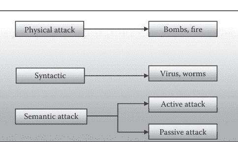

**图 4.10** 攻击类型。

## 4.2.2 攻击类型

攻击可以分为内部攻击和外部攻击。攻击的另一种分类方式是主动攻击和被动攻击。

- *病毒（Viruses）：* 这是一种恶意代码，要求你在它感染你的计算机之前执行某些操作，例如打开邮件附件或访问特定的网页（Nogueira et al., 2009）。
- *蠕虫（Worms）：* 蠕虫在没有用户干预的情况下传播，并从利用软件漏洞开始开始。与病毒类似，蠕虫可以通过电子邮件、网站或基于网络的软件传播。蠕虫的自动自我传播是它们区别于病毒的（Nogueira et al., 2009）。
- *特洛伊木（Trojan horses）：* 特洛伊程序是不让用户知道其实际后果的软件。例如，声称能加速计算机运行的程序实际上可能向远程入侵者发送机密信息（Nogueira et al., 2009）。
- *黑客、入侵者（Hacker, intruder）：* 这些术语用于寻求利用软件和计算机系统缺陷以获取私利的人。虽然很难评价他们此事的意图，因为他们可能可能不会给终端用户造成直接伤害，但 DoS 会拒绝终端用户获得正常的服务（Lavania et al., 2011）。
- *窃听（Eavesdropping）：* 这是一种在发送者和接收者不知情的情况下，秘密获取两端之间交换信息的非道德行为。
- *DoS（拒绝服务）：* 它与针对网络层数据包转发的攻击有关。此类攻击破坏路由协议并毒化每个节点的路由状态。相反，它们导致数据包以一种故意与路由状态不的方式交付。例如，已建立路径上的攻击者可能会丢弃数据包、修改数据包内容或复制其已转发的数据包。另一种类型的数据包转发攻击是通过网络层数据包泛洪进行的 DoS 攻击，攻击者向网络注入大量垃圾数据包。这些数据包浪费了大量的网络资源，并导致了严重的无线信道竞争和网络拥塞（表 4.1）。

### | 不同网络层的攻击

| 层 | 攻击 | 安全措施 |
| :--- | :--- | :--- |
| 应用层 | 病毒、蠕虫、恶意代码 | 检测并防止应用级滥用 |
| 传输层 | SYN 泛洪 | 验证并保护端到端通信 |
| 网络层 | 路由协议、转发协议、虫洞、黑洞、汇洞、泛洪、选择性转发、抢路、女巫攻击 | 保护路由和转发协议 |
| 数据链路层 | 耗尽碰撞 | 保护无线 MAC 层 |
| 物理层 | 信号干扰 | 避免 DoS 攻击 |

## 4.2.3 协议栈中的安全问题

### 4.2.3.1 措施

保护自组织网络基本上有两种方法：主动和响应。主动防御试图在攻击发生之前阻止攻击者发起攻击，通常通过加密技术（Hu et al., 2003）。

相比之下，响应防御寻求事后检测安全威胁并做出相应反应。由于缺乏清晰的防线，此类网络的完整安全解决方案应该整合这两种方法，并涵盖所有三个部分：预防、检测和响应。例如，主动防御可以用于确保正确性

## 第四章：无线自组网安全性 85


路由状态，而响应式方法可用于保护数据包转发操作。通过加密技术，信息通过将其转换为不可读的格式（密文）来受到保护。只有拥有密钥的人才能解密信息（Nogueira 等人，2009年）。基于此类网络层漏洞，根据攻击的目标操作，通常分为两类——路由攻击和数据包转发攻击（Lavania 等人，2011年）。一些常见的加密算法包括 `RSA`、`DES` 和 `AES`，它们非常流行。

通过攻击路由协议，攻击者可以将流量引向其控制节点中的某些特定地点，并导致数据包沿非优路由（甚至根本不存在的路由）进行转发。攻击者可以在网络中创建路由循环，并在某些区域引发严重的网络拥塞和信道竞争。各种安全的自组网路由协议包括源路由、距离向量路由和链路路由（Li and Joshi，2008年）。

### 4.2.3.2 针对虫洞攻击的防御方法

在虫洞攻击中，攻击者在网络的一个位置记录数据包（或位），将其（选择性地）隧道到另一个位置，然后将其重放回网络中。信息的重放将产生幻觉，因为节点无法将重放的数据包与真实数据包区分来。由于这一点，移动自组网的功能将受到虫洞攻击的严重干扰（Lavania 等人，2011年）。

Sunaina 和 Kumar（2013年）提出了一种检测和防御针对虫洞攻击的机制。在这种机制中，有两种束缚（添加到数据包中的额外信息，用于限制数据包允许的最大传输距离）：地理束缚和时间束缚。地理束缚确保数据包的接收者在发送者的一定距离内。时间束缚确保数据包具有寿命上限，因为数据包可以以光速传输。任何类型的束缚都可以防止虫洞攻击，因为它允许数据包接收者检测传输距离是否超过了束缚允许的范围。

### 4.2.3.3 看门狗（Watchdog）和路径评分器（Pathrater）

看门狗和路径评分器顾其实名，用于在存在破坏性节点的情况下增强无线自组网的性能。看门狗的工作是通过将数据包复制到缓冲区并监控这些数据包的相邻节点的行为，来确定任何参与节点的异常行为。看门狗通过嗅探来判断相邻节点是否在不修改的情况下转发了数据包。

如果在观察节点的缓冲区中，则它们被丢弃；而留在缓冲区中超过超时时间且没有任何成功匹配的数据包，则被标记为已丢失或被修改。负责转发数据包的节点将被标记为可疑。如果违规次数超过某个预设阈值，违规节点将被标记为恶意节点。关于恶意节点的信息将传递给路径评分器组件执行相应的工作，即执行路径评分评估。

路径评分器的作用是对看门狗标记为违规的节点进行可靠性评分。节点最初被赋予中性评分，而被识别为行为异常的节点被立即赋予 -100 的评分。需要区分的是，异常行为被检测为数据包处理错误/修改，而不可靠行为被检测为链路断开。

# 安全措施

- 加密技术
- 访问控制
- 数字签名
- 防火墙

## 参考文献

Hu, Y., Perrig, A., Johnson, D., and Leashes, P. (2003). A defense against wormhole attacks in wireless ad hoc networks. *Proceedings of IEEE INFOCOM'03*, San Francisco, CA.

Hubaux, J.P., Buttyn, L., and Capkun, S. (2011). The fest for security in mobile ad hoc networks. *Proceedings of ACM Symposium on Mobile ad hoc Networking and Computing*, Paris, France.

Lavania, K.K., Sains, G.L., Koothari Rishabh, H., and Harshraj Yagnik, A. (2011). Privacy anxiety and challenges in mobile ad hoc networks and its solution. *International Journal of Scientific & Engineering Research*, 2(9), 173–177.

Li, W., and Joshi, A. (2008). Security issues in mobile ad hoc networks—A survey. Department of Computer Science and Electrical Engineering, University of Maryland, Baltimore County.

Nogueira, L.M., dos Santos, A.L., and Pujolle, G.A. (2009). Survey of survivability in mobile ad hoc network, supported by CAPES/Brazil, Grant 4253-05-1.

Sunaina, D. and Kumar, S. (2013). Survey on security threats of wireless and mobile ad hoc network. *International Journal of Data and Network Security*, 2(2), 4–8.

Yang, H., Luo, H.Y., Fe, L., S.W., and Liang, L. (2004). Security in mobile ad hoc networks: Challenges and solutions. *IEEE Wireless Communications*, 11(1), 38–47.

# 第三节

# 移动电子商务系统与人类视角

# 第五章

# 移动社交网络服务用户的信任与忠诚度

# 结构方法

Norazah Mohd Suki 和 Norbayah Mohd Suki

# 目录

- 5.1 引言：背景与驱动力.................................................... 89
- 5.2 影响用户信任与忠诚度的因素...............................................................
- 5.2.1 感知信息质量与用户信任........................................... 90
- 5.2.2 感知信息质量与感知流体验........................................... 91
- 5.2.3 感知系统质量与用户信任............................................... 91
- 5.2.4 感知系统质量与感知流体验........................................... 92
- 5.2.5 感知用户信任与感知流体验................................................ 92
- 5.2.6 感知用户信任与忠诚度........................................................... 92
- 5.2.7 感知流体验与忠诚度................................................................ 93
- 5.3 方法论................................................................................ 93
- 5.4 数据分析................................................................................ 94
- 5.4.1 因素分析........................................................................... 94
- 5.4.2 结构方程模型........................................................... 96
- 5.4.2.1 测量模型................................................................... 96
- 5.4.2.2 结构模型....................................................................... 97
- 5.5 讨论................................................................................ 100
- 5.6 结论与展望................................................................................ 101
- 5.A 附录.................................................................. 102
- 参考文献................................................................................ 103

## 5.1 引言：背景与驱动力

社交网络网站允许个人创建简介并与他人建立连接，分享文本、图像和照片，以形成个人网络和小组（Boyd and Ellison, 2008）。社交网络网站也可以通过手机访问，因为它们具有便携性，且社交服务带来的连接正在迅速改变人类互动（Counts and Fisher, 2010; Zhong 等人，2011）。全球数百万人在 Facebook、MySpace、Twitter 和 LinkedIn 等社交网络上生活。Facebook 用户数在全球持续增长，已成为社交娱乐最流行的工具之一。2013年，它在美国拥有 167,431,700 个活跃用户，在马来西亚拥有 13,577,760 个用户（Socialbakers，2013年）。每月分享超过 300 亿份内容（网页链接、新闻故事、博客文章、笔记、相册等）。每月互动对象超过亿（页面、小组、活动和社区页面）。Facebook 介绍了墙、点赞、状态、照片、消息动态、标签、市场、即时消息和视频。本研究对移动 SNS 提供商有帮助，因为它讨论了感知信任和感知流体验对用户忠诚度的影响。移动 SNS 提供商希望留住并增加客户，需要特别关注信息和系统质量。本研究旨在通过结构方程模型（SEM）方法检验 (1) 感知信息质量和感知系统质量对感知用户信任的影响，(2) 感知用户信任对感知流的影响，以及 (3) 感知用户信任和感知流对移动 SNS 用户忠诚度。

本章结构如下：下一节回顾关于感知系统质量、感知信息质量以及感知用户信任和用户忠诚度的文献，并提出假设。第 5.3 节描述方法论，第 5.4 节报告研究结果。本章以结论和未来研究方向结束。

### 5.2.1 感知信息质量与用户信任

信息的持续交换以及对信息的获取和理解是建立学习过程的必要条件。

# 第五章：移动社交网络服务用户的信任与忠诚度

用户关注信息质量、内容丰富性以及导航（Ilsever et al., 2007）。研究发现，信息质量是一项重要的信任建立机制（Fung and Lee, 1999; Keen et al., 2000）。信息交换的可靠性、相关性和个性化促进了基于信任的关系的建立（Yvette and Karine, 2001）。信息质量也是用户整体满意度的前因因素（Aggelidis and Chatzoglou, 2012; Chang et al., 2012），满意度会影响电子商务系统的感知价值（Wang, 2008）。相反，Zhiou (2013) 发现信息质量与用户满意度之间没有显著关系。因此，提出假设：

H1. 移动社交网络（SNS）的感知信息质量显著影响感知用户信任。

### 5.2.2 感知信息质量与感知流体验

互联网上呈现的信息质量对用户流体验具有显著影响（Chau et al., 2000），具体体现在用户在浏览互联网获取信息或娱乐时完成多项任务的移动SNS愉悦感。例如，如果移动服务提供商无法向用户提供准确、有竞争力且及时的信息，用户很可能对移动SNS平台的信息质量产生负面感知。因此，假设：

H2. 移动社交网络的感知信息质量显著影响感知流体验。

### 5.2.3 感知系统质量与感知用户信任

系统质量（如导航结构和视觉吸引力）会影响用户对移动商务技术的信任（Vance et al., 2008）。网站质量往往是信任信念更有力的预测因子（McKnight et al., 2002）。例如，IT的各个方面会影响用户的信任意愿（Gefen et al., 2006）。此前的研究发现，系统质量影响用户满意度（Aggelidis and Chatzoglou, 2012; Zhou, 2013）和感知易用性（Chen and Hsiao, 2012）。缺乏高效的系统质量将难以提供高质量的服务，从而削弱流体验（Aladwani and Palvia, 2002）。因此，提出以下假设：

H3. 移动社交网络的感知系统质量显著影响感知用户信任。

### 5.2.4 感知系统质量与感知流体验

系统质量与导航时是否存在快速、可靠的连接有关（Hsu and Lu, 2004; Nelson and Todd, 2005）。系统与用户之间的交互作用，如用户界面、导航结构等设计因素，系统处理请求所需的时间（Garrett, Chiou, 2005），会影响用户的累积满意度。Deighton and Grayson (1995) 证实，在网站执行特定任务期间产生的流体验被认为能加强这种关系。最佳体验显著影响用户再次访问网站的意愿。因此，提出假设：

- H4. 移动社交网络的感知系统质量显著影响感知流体验。

### 5.2.5 感知用户信任与感知流体验

信任，即相信移动服务将没有安全和隐私威胁（Doney and Cannon 1997; Wang et al., 2003），会减少感知的不确定性和风险，从而减少在监控服务提供商上投入的精力，随后增强用户的感知控制感（Pavlou et al., 2007）并提升他们的体验。如果用户信任移动服务提供商，他们会期待未来的积极体验（Kim et al., 2009）。信任影响在线社区用户的流体验（Wu and Chang, 2005）。因此，提出：

- H5. 感知用户信任显著影响感知流体验。

### 5.2.6 感知用户信任与忠诚度

信任是关键因素之一，即相信移动服务将没有安全和隐私威胁（Doney and Cannon 1997; Wang et al., 2003）。研究发现，信任和满意度会影响用户的忠诚度（Cyr et al., 2006）。Norazah (2012) 指出对商的信任影响忠诚度（Coritt et al., 2003）。因此，提出假设：

- H6. 感知用户信任显著影响忠诚度。**图**

### 5.2.7 感知流体验与忠诚度

在研究中，感知流体验决定了用户的持续使用（Gupta and Kabadayi, 2010）。因此，假设：

H7. 感知流体验显著影响忠诚度。图5.1展示了理论框架。

## 5.3 方法论

问卷分发给沙巴拉比大学（Universiti Sabah Labuan）的200名学生，采用方便抽样法，回收率为80%。问卷包含三个部分：A部分为人口统计特征；B部分为有关SNS体验的问题；C部分考察流的影响。

### 表 5.1 变量测量

| 变量 |  |
| :--- | :--- |
| 感知信息质量 | DeLone and McLean (1992) |
| 感知系统质量 | Nelson and Todd (2005); Armstrong and Hagel (1996); Chiou (2005) |
| 感知愉悦 | Davis (1992); Koufaris (2002) |
| 感知控制 | Macan et al. (1990) |
| 注意力 | Intriligator and Cavanagh (2001); Pylyyn and Storm (1988) |
| 感知用户信任 | Berry and Parasuraman (1991) |
| 忠诚度 | Lin and Wang (2006); Cyr et al. (2006) |

问卷项目见附录5.A，根据表5.1所示来源改编，并采用五点李克特量表进行测量，范围从1（不同意）到5（非常同意）。使用AMOS 20版本计算机软件通过SEM实地检验并估计假设的关系，该软件能够确保模型与数据的一致性并估计构造之间的效应。

## 5.4 数据分析

表5.2描述了受访者人口统计特征的频率分析，男性占49%，女性占51%。超过四分之一的受访者年龄在21-25岁之间，每月收入低于RM300。在SNS体验方面，18%的样本群体使用移动SNS，超过四分之一的受访者使用时间超过6个月。与Twitter和MySpace相比，Facebook是访问频率最高的。

### 5.4.1 因子分析

感知流结合了感知愉悦、感知控制和注意力三个维度，通过方差旋转因子分析开发。这些维度之间存在显著相关性（Koufaris, 2002; Huang, 2006），并由相同的底层构造驱动，因为它们具有相同的感知流的决定因素和结果（Siekke, 2005; Wang et al., 2007）。表5.3显示项目载荷范围从0.685起

## 第章：移动社交网络服务用户的信任与忠诚度

## 表 5.2 受访者人口统计特征

| 性别 | 频率 | 百比 |
|---|---|---|
| 男性 | 98 | 49.0 |
| 女士 | 102 | 51.0 |
| 年龄（岁） | | |
| <20 | 26 | 13.0 |
| 21–25 | 168 | 84.0 |
| 26–30 | 4 | 2.0 |
| >31 | 2 | 1.0 |
| 每月生活 allowance | | |
| <RM 300 | 160 | 80.0 |
| RM 301–400 | 13 | 6.5 |
| RM 401–500 | 7 | 3.5 |
| >500 | 20 | 10.0 |
| 每周使用移动 SNS 的时长 | | |


| 1–5 次 | 125 | 62.5 |

| 6–10 次 | 32 | 16.0 |

| 11–15 次 | 7 | 3.5 |

| >15 次 | 36 | 18.0 |

| 使用移动 SNS 的经验 | | |

| 0–2 个月 | 97 | 48.5 |

| 2–4 个月 | 34 | 17.0 |

| 4–6 个月 | 14 | 7.0 |

| >6 个月 | 55 | 27.5 |

| 最常访问移动 SNS | | |

| Facebook | 147 | 73.5 |

| MySpace | 2 | 1.0 |

| Twitter | 5 | 2.5 |

| MSN | 9 | 4.5 |

| Yahoo messenger | 10 | 5.0 |

| 其他 | 27 | 13.5 |

“我觉得使用这个移动 SNS 有趣”这一项在感知流上的载荷相对最高，为0.848，Kaiser-Meyer-Olkin 抽样效能测量值为0.896。结果删除了绝对值小于0.50的小系数，并删除了“当使用这个移动 SNS 时，我感到困惑”这一项，因为它不符合此要求。

移动电子商务

## 表 5.3 因子分析

| 项目 | 感知流 |
|---|---|
| 我觉得使用这个移动 SNS 有趣 | 0.848 |
| 我觉得使用这个移动 SNS 是享受的 | 0.841 |
| 我觉得使用这个移动 SNS 非常兴奋 | 0.822 |
| 使用这个移动 SNS 时，我全神贯浸在活动中 | 0.815 |
| 我觉得使用这个移动 SNS 好玩 | 0.810 |
| 使用这个移动 SNS 时，我全神贯注活动 | 0.782 |
| 使用这个移动 SNS 时，我的注意力集中在活动上 | 0.781 |
| 使用这个移动 SNS 时，我感到很平静 | 0.721 |
| 使用这个移动 SNS 时，我深浸在活动中 | 0.719 |
| 使用这个移动 SNS 时，我感到很有控 | 0.685 |
| 方差解释总量 | 6.275 |
| 方差解释百分比 | 57.043 |
| Kaiser-Meyer-Olkin 抽样效能测量 | 0.896 |

### 5.4.2 结构方程模型

SEM 通过两步 SEM 方法进行：测量模型和结构模型。

#### 5.4.2.1 测量模型

通过检查项目载荷、构因信度和平均方差提取（AVE）对测量模型进行了检查，如表 5.4 所示。所有变量的 Cronbach's alpha 值和组合信度值超过了 0.70 的可接受水平，这意味着所有变量都是可靠的并具有高度内部一致性。此外，每个标准化载荷项在其预期因子上的载荷均大于 0.50，PC2、PC3、AF4 除外，表明构因效度是可以接受的。由于所有 AVE 值均大于截断值 0.50，收敛效度也是可以接受的。

区分效度通过比较因子间的共享方差与每个构因 AVE 的平方根来检查。表 5.5 的结果显示，构因与其他构因的方差低于单个因子的 AVE 平方根，证实了区分效度。因此，每个构因在统计上都与彼此不同。变量之间的相关性在 0.01 水平上显著相关，并发现它们都相关。接下来，感知流的平均值为 4.608，而忠诚度的标准差最高，为 1.459。

## 第章：移动社交网络服务用户的信任与忠诚度

## 表 5.4 项目载荷与效度

| | Cronbach's alpha | 组合信度 | 平均方差提取 |
|--- | --- | --- | --- |
| 感知信息质量 | 0.962 | 0.915 | 0.729 |
| PIQ1 | 0.804 | | |
| PIQ2 | 0.838 | | |
| PIQ3 | 0.869 | | |
| PIQ4 | 0.902 | | |
| 感知系统质量 | 0.824 | 0.870 | 0.728 |
| PSQ1 | 0.691 | | |
| PSQ2 | 0.737 | | |
| PSQ3 | 0.846 | | |
| PSQ4 | 0.881 | | |
| 感知流 | 0.926 | 0.920 | 0.601 |
| PE1 | 0.920 | | |
| PE2 | 0.916 | | |
| PE3 | 0.927 | | |
| PE4 | 0.910 | | |
| PC1 | 0.603 | | |
| AF1 | 0.635 | | |
| AF2 | 0.610 | | |
| AF3 | 0.544 | | |
| 感知用户信任 | 0.865 | 0.812 | 0.590 |
| TR1 | 0.791 | | |
| TR2 | 0.756 | | |
| TR3 | 0.756 | | |
| 忠诚度 | 0.853 | 0.894 | 0.737 |
| LO1 | 0.863 | | |
| LO2 | 0.871 | | |
| LO3 | 0.841 | | |

#### 5.4.2.2 结构模型

通过检查拟合指数和解释方差对结构模型进行了评估。测试模型的拟合度是通过检查拟合指数（表 5.6）完成的。结果显示模型的 $\chi^2$ 为 493.859，自由度为 187（$\chi^2/df = 2.641$）。比较拟合指数 (CFI)、拟合优指数 (GFI) 和规范化拟合指数 (NFI) 均高于 0.90，均方根误差 (RMSE) 低于 0.08，表明拟合良好。

移动电子商务

## 表 5.5 构因相关性

| | 1 | 2 | 3 | 4 | 5 |
|--- | --- | --- | --- | --- | --- |
| 1. 感知信息质量 | 0.854 | | | | |
| 2. 感知系统质量 | 0.756(**) | 0.792 | | | |
| 3. 感知流 | 0.564(**) | 0.750(**) | 0.775 | | |
| 4. 感知用户信任 | 0.625(**) | 0.608(**) | 0.643(**) | 0.768 | | |
| 5. 忠诚度 | 0.628(**) | 0.705(**) | 0.701(**) | 0.662(**) | 0.858 |
| 平均 | 4.465 | 1.175 | 4.608 | 4.287 | 4.430 |
| 标准差 | 1.250 | 1.175 | 1.382 | 1.417 | 1.459 |
| 偏度 | -0.483 | -0.591 | -0.339 | -0.219 | -0.463 |
| 峰度 | 0.357 | 0.761 | 0.023 | 0.846 | 0.047 |

> **相关性在 0.01 水平上显著（双尾）。**

对角线代表 AVE 的平方根。

## 表 5.6 结构模型拟合指数

| | χ² | df | χ²/df | CFI | NFI | RMSE | PNFI | PCFI |
|--- | --- | --- | --- | --- | --- | --- | --- | --- |
| 建议 | N/A | N/0.3 | >0.9 | >0.9 | >0.9 | >0.5 | >0.5 | |
| 假设 | 493.859 | 187 | 2.641 | 0.982 | 0.982 | 0.068 | 0.746 | 0.714 |

图 5.2 的结果列出，感知信息质量和感知质量占感知用户信任总方差的 44% (R² = 0.437) 以及感知流的 75% (R² = 0.751)。移动 SNS 用户的忠诚有 76% 的方差由感知信任和感知流解释 (R² = 0.759)。总体而言，结果表明建议的研究模型与实证数据之间具有良好的模型拟度。

假设检验的标准化路径系数汇总于表 5.7。

## 第章：移动社交网络服务用户的信任与忠诚度

![图 5.2]

## 表 5.7 假设检验结果汇总

| 因果路径 | 估计值 | t 值 | p 值 | 假设 |
|---|---|---|---|---|
| 感知信息质量 → 感知用户信任 | 0.507* | 6.623 | 0.000 | H1 支持 |
| 感知信息质量 → 感知流 | -0.141* | -2.397 | 0.017 | H2 支持 |
| 感知系统质量 → 感知用户信任 | 0.424* | 5.389 | 0.000 | H3 支持 |
| 感知系统质量 → 感知流 | 0.685* | 8.720 | 0.000 | H4 支持 |
| 感知用户信任 → 忠诚度 | 0.338* | 4.620 | 0.000 | H5 支持 |
| 感知用户信任 → 忠诚度 | 0.281* | 4.384 | 0.000 | H6 支持 |
| 感知流 → 忠诚度 | 0.683* | 10.533 | 0.000 | H7 支持 |

> *p < 0.05

受感知用户信任 (`beta_6 = 0.281, p < 0.05`) 和感知流 (`beta_7 = 0.683, p < 0.05`) 的显著影响，表明 H6 和 H7 得到支持。

变量对模型因变量的总效应是指直接效应和间接效应之和。表 5.8 表明构因间关系中存在一些较强的间接效应。

## 表 5.8 直接效应与间接效应

| 自变量 | 中介变量 | 因因变量 | 直接效应 | 间接效应 | 总效应 |
| --- | --- | --- | --- | --- | --- |
| 感知信息质量 | — | 感知用户信任 | 0.507 | 0.000 | 0.507 |
| 感知信息质量 | 感知用户信任 | 感知流体验 | -0.141 | 0.171 | 0.030 |
| 感知系统质量 | — | 感知用户信任 | 0.424 | 0.000 | 0.424 |
| 感知系统质量 | 感知用户信任 | 感知流体验 | 0.685 | 0.143 | 0.828 |
| 感知用户信任 | — | 感知流体验 | 0.338 | 0.000 | 0.338 |
| 感知用户信任 | 感知用户信任 | 忠诚度 | 0.281 | 0.231 | 0.512 |
| 感知流体验 | — | 忠诚度 | 0.683 | 0.000 | 0.683 |

## 5.5 讨论

本研究探讨了感知信息质量、感知系统质量、感知用户信任以及感知流体验之间的结构关系，并同时分析了 (1) 感知信息质量和感知系统质量对感知用户信任和感知流体验的影响，(2) 感知用户信任对感知流体验的影响，以及 (3) 感知用户信任和感知流体验对移动 SNS 用户忠诚度的影响。研究采用了结构方程模型（SEM），并使用极大似然法作为估计方法，因为该方法为解决各种参数估计问题提供了一种一致性方法。实证结果为调查研究假设提供了必要信息。标准化路径系数被评估为在 0.05 水平上显著，且整体模型被认为拟合数据。感知信息质量通过感知系统质量高度影响感知用户信任，满足了 H1 和 H3。这一结果与 Wong 和 Hsu (2008) 的结果相似，即在公司网站或移动门户上发布的信息质量对潜在客户对其产品和服务的感知与信任有直接影响。Slediankowski 和 Kulviwat (2009) 以及 Davis (1998) 发现，用户对系统实用性的思考对信息技术的采用有很大影响，并呈正相关，从而对移动 SNS 平台产生了更高的信任。

感知流体验受到移动 SNS 感知信息质量和感知系统质量的显著影响；因此 H2 和 H4 得到了支持。此前的研究（Pilke, 2004）发现，参与者频繁提到信息和愉悦的视觉化是促进“流（flow）”体验的要素。如果通过移动 SNS 提供的信息准确且质量高，用户将拥有更好的感知流体验。Zhou 等人 (2010) 指出，移动 SNS 平台不可靠、响应缓慢或服务突然中断将严重影响用户的体验，包括享受感、注意力集中和控制感，这是流体验的三个维度。研究的进一步调查发现，当用户信任移动 SNS 提供者并与那些怀疑的人相比具有更好的感知流体验时，H5 假设得以维持。用户报告说保持信心很重要，并强调了在在线环境中探索新事物的价值（Hassanane 和 Head, 2007）。

与 H6 对应，Gupta 和 Kabadayi (2010) 发现信任影响用户对网站的忠诚度。那么可以说，对某个移动 SNS 平台的高感知信任会增加客户忠诚度。与感知用户信任的影响相比，感知流体验的影响更大，表明感知流体验是用户忠诚度的最决定因素。与 H7 的显著发现一致，Palka 等人 (2009) 为为用户提供良好的体验将促进他们的持续使用并产生正口碑。Kim 和 Son (2009) 揭示了网络收益（包括感知有用性和满意度）对在线服务用户忠诚度的显著影响。此外，正如 Zhou 等人 (2010) 所提出的，提高用户体验是增强用户对移动 SNS 忠诚度的途径之一。因此，如果用户发现移动 SNS 提供者的感知流体验高于满意水平，用户留下的可能性就很大。

## 5.6 结论与展望

通过 SEM 的实证结果显示，感知信息质量和感知系统质量都会影响感知流体验和感知用户信任，进而影响移动 SNS 用户的忠诚度。感知用户信任影响感知流体验，这两个因素都会影响忠诚度。事实上，感知流体验被认为是显著影响移动 SNS 用户忠诚度的最强因素。移动 SNS 提供者需要考虑感知流体验以增强用户的忠诚度。因此，移动 SNS 提供者应该采取措施增加感知信息质量和感知系统质量，以建立并增强用户的信任水平，并为用户提供迷人的体验。他们可能需要强调忠诚度计划，以在竞争激烈的电信市场中留住客户。

认为进一步扩大样本量并考虑马来西亚以外的社会群体（如其他亚洲国家、欧洲和美国）在不同地理位置进行调查对于提高至关重要，因为目前大多数样本来自同一所大学的学生，且研究倾向于学生而非大众或成年人，不同职业群体使用移动 SNS 的方式不同会引入巨大的偏差。然而，本研究提供了重要的理论贡献，因为目前大多数研究仅关注了用户接受度的问题。

## 5.A 附录：工具测量

### 感知信息质量

- 移动 SNS 提供的信息是我需要的。
- 移动 SNS 提供的信息是准确的。
- 移动 SNS 提供的信息是及时的。
- 移动 SNS 提供的信息是全面的。

### 感知系统质量

- 移动 SNS 是可靠的。
- 移动 SNS 响应很快。
- 移动 SNS 易于使用。
- 移动 SNS 的功能良好。

### 感知愉悦感

- 使用移动 SNS 是很有趣的。
- 使用移动 SNS 令人很兴奋。
- 使用移动 SNS 是很愉快的。
- 使用移动 SNS 是很有有趣的。

#### 感知控制感

- 使用移动 SNS 时我感到很平静。
- 使用移动 SNS 时我感到很有掌控感。
- 使用移动 SNS 时我感到困惑。

#### 注意力集中

- 使用移动 SNS 时我完全沉浸其中。
- 使用移动 SNS 时我的注意力很集中。
- 使用移动 SNS 时我很专注。
- 使用移动 SNS 时我深度沉浸其中。

### 信任

- 移动 SNS 有完成任务所需的知识和能力。
- 移动 SNS 会遵守承诺。
- 移动 SNS 关注利益。

### 忠诚度

- 我会继续使用这个移动 SNS。
- 我会向其他用户推荐这个移动 SNS。
- 使用这个移动 SNS 时，它是我的首选。

## 参考文献

- Aggelidis, V.P. and P.D. Chatzoglou. 2012. Hospital information systems: Measuring user satisfaction (EUCS). Journal of Biomedical Informatics 45 (2012): 566–579.
- Alwadani, A. and C.P. Palva. 2002. Developing and validating an instrument measuring user-perceived web quality. Information & Management 39 (6): 467–476.
- Armstrong, A.G. and J. Hagel. 1996. The real value of online communities. Harvard Business Review 73 (3): 134–141.
- Berry, L. and A. Parasuraman. 1991. Marketing Services: Competing through Quality. The Free Press.
- Boyd, D.M. and N.B. Ellison. 2008. Social network sites: Definition, history and ship. Journal of Computer-Mediated Communication 13 (1): 210–230.
- Chang, I.C., Y.Li, T. Yu, and D.C. Yen. 2012. Electronic medical record quality-it its impact on user satisfaction—Healthcare providers' view of. Government Information Quarterly 29 (2012): 235–242.
- Chen, R.F, and J.L Hsiao. 2012. An investigation on physicians' acceptance of hospital information systems: A case study. International journal of Medical Informatics 81 (2012): 810–820.
- Chau, P.K., G. Au, and K.Y. Tam. 2000. Impact of information presentation modes on online shopping: An empirical evaluation of a broadband interactive shopping service. Journal of Organizational Computing Electronic Commerce 10 (1): 1–22.


# 104 移动电子商务

Chiou, J.S. 2005. 消费者对互联网服务提供商忠诚度的先驱。Information & Management 41 (6): 685–695.

Corbitt, B.J., T. Tanasankit, and H. Yi. 2003. 信任与电子商务：消费者感知研究。Electronic Commerce Research and Applications 2 (6): 737–758.

Counts, S. and K.E. Fisher. 2010. 移动社交网络作为信息基地：案例研究。Library & Information Science Research 32 (2): 98–115.

Cyr, D., M. Head, and A. Ivanoc. 2006. 设计美学导致移动商务中的移动忠诚。Information & Management 43 (8): 950–963.

Davis, F.D. 1989. 感知有用性、感知易用性以及信息技术的接受。MIS Quarterly 13 (3): 319–340.

Davis, F.D., P.R. Bagozzi, and P.R. Warsaw. 职场中使用计算机的内在和外动机。Journal of Applied Social Psychology 24 (1): 111–112.

Deight, J. and K. Grayson. 1995. 营销与选择：通过管理社会消费者建立交换关系。Journal of Consumer Research 21 (4): 660–676.

DeLone, W.H. and E.R. McLean. 1999. 信息系统：因变量的追求。Information Systems 3 (1): 154–171.

Deng, L., D.E. Turner, R. Geling, and B. Prince. 2010. 用户体验、满意度与持续使用意图。European Journal of Information Systems 19 (1): 60–75.

Doney, P.M. and P.J. Cannon. 1997. 买卖关系中信任性质的考察。Journal of Marketing 61 (2): 35–51.

Fung, R.K.K. and M.A. Lee. 1999. EC-信任（电子商务中的信任）：探索前因因素。在 Haseman, W.D. and Nazareth, D.L. 编，第五次信息系统会议论文集，8月13–15日，威斯康星州密尔沃基，页 517–519。

Garrett, J. 2003. 用户体验要素：以用户为中心的Web设计。Indianapolis, IN: New Rivers.

Gefen, D., P. Pavlou, I. Benbasat, D.H. Knight, K. Stewart, and D.W. Straub. 2006. 信息系统研究中制度信任重要吗？Communications 19 (7): 205–222.

Gupta, S. and K. Kalabadi, 2010. 信任信念与网站忠诚度的关系：消费者动机和流体验的激励作用。Psychology & Marketing 27 (2): 165–185.

Hassein, K. and M. Maad. 2007. 通过网页界面操纵社会存在及其对消费者在线购物态度的影响。International Journal of Human Computer Studies 65 (8): 689–708.

Hausman, A.V. and J.S. Siekep. 2009. 网页特征对消费者在线购买意图的影响。Journal of Business Research 62 (1): 5–13.

Hsu, C.L. and H.P. Lu. 2004. 人为什么要玩游戏？带有社交影响和流体验的扩展TAM模型。Information & Management 41 (7): 853–868.

Huang, M.H. 2006. Web环境中的流、持久和情境卷入：三要素二阶检验。Psychology & Marketing 23 (5): 383–411.

Ilsever, J., D. Cyr, and M. Parent. 2007. 流与电子忠诚度方法的扩展。Journal of Information Science and Technology 4 (2): 10–13.

## 第五章：移动网络服务用户的信任与忠诚

Intrigator, J. and P. Cavanagh. 2001. 视觉注意的空间解析率。Consumer Psychology 43 (3): 171–216.

Keen, P., C. Ballance, S. Chan, and S. Schrump. 2000. 电子商务关系：设计性信任。Upper River, NJ: Prentice Hall.

Kim, G., B. Shin, and H.G. Lee. 2009. 理解移动银行信任与使用意图之间的动态关系。Information Systems 19 (3): 283–311.

Kim, S. and J.Y. Son. 2009. 源于奉献还是约束？采纳后现象的双重模型及其在在线服务背景下的实证检验。MIS Quarterly 33 (1): 49–70.

Koufaris, M. 2002. 将技术接受和流理论应用于在线消费者行为。Information Systems Research 13 (2): 205–223.

Lin, H. and Y. Wang. 2006. 移动商务背景下客户忠诚度的考察。Information & Management 43 (3): 271–282.

Macan, T.H., C. Shahani, R.L. Dipoye, and A.P. Phillips. 大学生的时间管理：与学术表现的相关。Journal of Educational Psychology 82 (4): 760–768.

McKnight, D.H., V. Choudhary, and C. Kamcar. 2002. 与网站交互的初始意图：信任构建模型。Journal of Strategic Information Systems 11 (4): 297–323.

Nelson, R.R. and P.A. Todd. 2005. 信息和质量的前因：数据仓库背景下的实证检验。Journal of Management Information Systems 21 (4): 199–225.

随时随地的终端（Ngai and Gunasekaran 2005）。由于其特性（其他如无处不在、个性化和灵活性），移动商务为企业带来了前所未有的市场潜力、极大的生产力和高利润率（Siau et al. 2003）。随着移动技术和便利性市场展现出广阔前景，手机用户数量正在持续增长。目前，全球网站访问量总计有10%来自移动设备（智能手机和平板电脑）。2012年圣诞节当天，超过50%的在线活动来自移动设备（Mixpanel 2012）。日本的移动技术目前已占所有电子商务交易的35%。在未来5年内，超过50%的交易将通过智能手机完成（IPC 2012）。

由于这些进步，各种类型的移动应用应运而生并渗透到我们的日常生活，改变了人类行为，并产生了重要的社会和经济影响（Xu et al. 2008）。在这些努力中，购物移动应用处于泛在计算与电子商务的交汇点，正受到这两个社区的关注（Xu et al. 2008）。先前的工作主要关注手机的交易功能和移动过程中的信息消费，而较少关注购物的实验性以及如何通过使用无线设备来改进（Xu et al. 2008）。如今，在线购物与线下购物之间的边界已发生根本性的模糊（Gish 2012）。智能手机正在从根本上改变人们购物、使用优惠券、寻找位置以及进入本地和近场促销的方式。购物行为正在发生变化，“展柜购物”（showrooming）和“五分钟快闪购物”（snacking）正在日益增加（Gish 2012）。现实世界与虚拟世界正汇聚成一个完整的购物体验。消费者在商店里已成为一种典型的用户行为，即拿起手持设备搜索额外的产品信息、更好的价格和位置信息，试图加速整个购物过程并获得更好的购物体验。

渠道正在融合，消费者可以随随地、随时地、以他们想要的方式进行购物。根据 Forrester 的数据，50%的零售销售受到在线影响（IPC 2012）。作为其“移动购买路径”研究的一部分，Nielsen 和 Telmetrics 报告称，46%的移动用户在商店进行零售回购时完全依赖他们的移动设备，有趣的是，一半的观众在购买前不需要进行 PC 调研（Sterling 2013）。

然而，目前的零售商似乎未能成功地顺应这一新趋势。在有线环境中，我们已经积累了有效设计和开发商业系统的必要知识，而移动商务领域不仅带来了独特的机遇，也带来了挑战。它面临着许多与传统电子商务不同的业务、技术和法律挑战，特别是在与位置相关的服务方面（Tsalgatidou et al. 2000）。

## 第六章：店内移动商务应用的比较研究

对店内购物的设计空间进行彻底分析是必要的，此外还需要如何将移动设备交互嵌入购物体验中以造福客户（Xu et al. 2008）。此外，必须详细检查影响移动购物应用采纳的因素，如价值创造、用户接受度和娱乐性，以便我们对移动客户的需求了理解。

在本章中，我们关注消费者在大型零售店或购物中心购物时所使用的移动商业应用，以加速购物过程并获得理想的购物体验。具体而言，我们关注可以在购物过程中提供便利和乐趣的商业应用的非交易功能。本章的结构如下：首先尝试通过准确定义问题空间来界定我们研究的边界，不仅评估优缺点，还评估了设计和开发此类应用的固有的复杂性。在此范围内，我们进行了文献综述，旨在引出移动商务应用的需求。需求引取被认为是软件开发中最关键、知识密集型的活动之一；需求引取的执行不当几乎注定了最终项目的完全失败（Gotesseiner 2002, Hickey and Davis 2003）。需求获取的过程可以分为发现（引取）、分析、建模和文档化、沟通和验证（Schedbauer 2011）。由于移动商务需求的易变性，我们需要对收集的需求进行验证；我们采用访谈、问卷调查和现场互动等方法来有效验证需求。我们在情境设置下对现有的店内商业应用进行比较研究，并根据用户接受度进行分类，试图识别此类应用的特征和设计特点。据此得出了设计框架，其包含指南和建议，可以帮助移动现场购物应用的设计师和开发者考虑事项，最终目标是设计出更好的整体购物体验。

### 6.2 购物领域的移动商务

移动电子商务（Tsalgatidou et al. 2000）近期成为电子商务的一个子集，以及那些完全或部分依赖电子商务交易的活动。它运行在与电子商务不同的环境中，电子商务可以被认为是在固定的桌面式互联网隐喻中进行的，这主要是由于移动设备的不同特性和限制、无线网络的限制，以及人们使用其手持终端的最终语境、情况和环境。

过去十年电信技术的进步使移动商务成为购买产品的主要渠道之一。它的特征如无处不在、可触达、本地化和传播（Siau et al. 2003），结合移动设备近期先进的性能，为消费者提供了一个极好的决策工具。由于此，我们正在见证从电子购物和店内购物向包含使用移动设备的混合购物体验的转变。

购物行为正在改变。渠道正在融合，消费者可以随随地、随时地、以他们想要的方式购物（Gish 2012）。对于 Forrester 来说，50%的零售销售受到在线影响（IPC 2012）。消费者在移动商务中找到了一种更方便、省时且愉的购物方式，同时受益于更个性化的服务。但移动商务的利益并不完全由消费者驱动。通过明智管理这一趋势，企业可以增加市场潜力和生产力和利润（Siau et al. 2003）。零售商现在有机会以更直接的方式影响消费者，识别移动购物空间并对其调整其服务。通过利用移动商务能力，他们能够追踪客户的位置并推送特别优惠、电子券和信息，识别他们的特殊需求并引导他们进入店内购买点。

尽管移动商务对消费者和零售商都有益处，但由于无线通信、设备以及移动本身的特性，引发了许多限制（Tsalgatidou et al. 2000）。无线通信限制归因于由各种无线网络（局域网、广域网、卫星服务等）以及其他协议、标准和技术组成的网络基础设施。这个复杂的网络负责移动商务活动的效率，设计移动商务系统时必须考虑到，以消除频繁断开、数据丢失、下载速度慢等问题。

# 第六章：店内移动商务应用的比较研究 111

平台包括基于手势的、与数字内容的多点交互；位置感知以及随后的服务与适应；高级传感能力（带有陀螺仪、GPS 和摄像头等嵌入设备）；多媒体（照片、声音和视频）的捕捉与共享（Corey 2010, Reddy et al. 2010, Ferreira et al. 2012）。因此，移动应用开发在交互设计、人机（HCI）以及软件开发方面需要全新的思维方式。设备的限制增强主要是由于设备本身的性质，特别是它们的便携性。为了便于携带，移动设备具有较小的屏幕、键盘、内存、磁盘容量和处理能力，并伴随着高能耗。移动性限制与移动用户位置的持续切换以及他们可能连接的各种带宽规模有关。由于移动和网络不可用，用户位置跟踪经常会被中断。移动性还带来了复杂的安全和认证问题（Tsalgatidus et al. 2000）。

在移动商务中，我们还识别出几项传统商业不具备的需求，在开发移动商务系统和应用时应当考虑这些需求。根据 Varshney 和 Vetter (2002) 提出的移动商务应用实施框架，我们从衍生出的若干需求中识别了移动商务应用的三个重要关注领域。如下：

- 1. 软件（移动界面和移动中间件）
- 2. 硬件（移动手持设备，如 PDA 和移动/手机/智能手机）
- 3. 无线网络（无线移动网络基础设施）

我们开发了一个图表，总结了上述每项产生的最重要需求和限制（图 6.1）。软件需求可以根据软件产品的分配属性和固有属性（现有的或永久的特性或功能）进行分类（ISO/IEC JTC1/SC7 N4098）。此外，固有属性可以分类为功能属性或质量属性。功能属性决定了软件能够做什么。在我们案例中，这些领域特定的功能属性基本上包括我们想要研究的移动商务系统功能（例如定位物品和搜索价格）。质量属性决定了软件的性能优劣。换句话说，质量属性指示了软件提供和维护指定服务的程度。硬件需求源于移动设备的性质及其能力。

## 移动商务需求

| 硬件需求 | 软件需求 | 网络需求 |
| :--- | :--- | :--- |
| - 稳定性 | - 服务质量 | - 网络可靠性 |
| - 兼容性（根据尺寸设计接口） | - 位置管理支持 | - 多任务支持 |
| - 最小化内存负载 | - 跨无线网络漫游 | - 分配属性 |
| - 最小化处理能力 | | |
| - 最小化能耗 | | |

| 固有属性 | 分配属性 |
| :--- | :--- |
| 质量需求 | 领域特定功能需求 |
| | - 价格 |
| | - 交付日期 |
| | - 产品特性 |
| | - 产品供应商 |
| | - 其他管理需求 |
| | - 功能稳定性 |
| | - 可靠性 |
| | - 性能效率 |
| | - 安全性 |
| | - 兼容性 |
| | - 可维护性 |
| | - 可迁移性 |
| | - 位置跟踪 |
| | - 店内导航系统 |
| | - 产品代码扫描 |
| | - 产品信息许可 |
| | - 产品价格和特性比较 |
| | - 折扣检测 |
| | - 库存可用检测 |
| | - 购物列表创建与管理 |
| | - 总成本估计 |
| | - 结算方法 |

**图 6.1** 移动商务需求。

网络需求主要与连接和带宽问题相关的限制和挑战（Varshney and Vetter 2002）。Varshney 和 Vetter (2022) 将移动商务应用的需求分为五类，如位置管理、多任务支持、网络可靠性、服务质量和跨网络漫游。

可以识别出若干类移动商务应用，包括移动金融应用、移动广告、库存管理、产品定位与购物、主动服务管理、无线重构、移动拍卖或反向拍卖、移动娱乐服务和游戏、移动办公、移动远程教育和有线数据中心。

在研究中，我们关注“产品定位与购物”类，其中包括在特定区域或位置定位的应用。这还涉及寻找具有特定规格的物品及其跨商店的可用性（Varshney and Vetter 2002）。虽然移动商务活动包括经济价值商品和服务的交易，但这并不严格限制；因此，我们的研究不涉及移动购物的交易方面。我们更关注通过手持移动设备购物以简化消费者任务的本质方面。在此背景下，我们试图识别在设计移动商务应用时应满足的需求集；这组需求将引导旨在提高购物体验的移动商务应用的特定（设计）原则。在相关的文献综述步骤中，我们尝试指定与我们所属一类应用相关的设计需求。

# 第六章：店内移动商务应用的比较研究 113

## 6.3 消费者行为

如今的购物者通常认为现有零售店在便利性、提供的价值和产品选择等方面的购物体验是满意的。然而，他们对购物速度、服务水平、可用产品信息、购物乐趣以及安全和隐私表示不满意见（Burke 2002）。在过去的十年里，技术已作为许多以往需求的切实解决方案出现。手机倾向于成为一个日益增长的购物渠道，填补了购物体验的空白，同时提供了更好、更方便且高效的购物方式。

目前，消费者搜索多家商店以寻找符合其偏好、品牌、尺寸和特征的物品。使用手持设备和在线产品信息服务，用户能够导航到商店或特定位置（Varshney and Vetter 2002）。在大型商店和商场的情况下，消费者尝试在店内使用移动设备（使用室内地图进行跟踪和导航）加快购物进程，以便获得愉快、方便且高效的购物体验并避免销售压力。

Mobile Future Institute 的 CEO Chuck Martin 最近表示，移动正在彻底颠覆“购买路径”（2013）。购物正在变成一个迭代过程而非串行过程。“消费者不再是购物，他们一直在购物，”他继续道。Hackbert (2012) 指出这种现象在智能手机用户中日益增长，他称他们为“应用迷”。在他的研究中，他发现 56% 的智能手机用户至少安装了一个与购物相关的应用，15% 的手机目前有六个应用。

## 6.4 比较研究和环境的选择


为了给移动店内购物应用创建一个实用的设计框架，我们进行了三层级的研究，包括文献综述、在线调查和现场比较研究。研究组织如下：

首先，我们开展了扩展的文献综述，目的是获取移动商务应用的需求。需求获取被认为是软件开发中最关键、知识密集的活动之一；糟糕的需求获取几乎注定会导致最终项目的完全失败（Gottesbauer 2002, Hickey and Davis 2003）。需求过程可以分为发现、分析、建模与文档、沟通和验证（Schedlbauer 2011）。移动商务的易变性质要求我们对收集的需求进行验证。

114 移动电子商务

其次，我们采用了访谈、问卷调查和与客户现场互动等方法来有效验证需求集。我们开展了在线读者调查，以确认之前识别的需求是真实的消费者需求，还是可以被视为限制，并识别新需求。

我们工作的第三部分包括对现有移动应用程序中若干功能的比较，以及在实时条件下对第二步收集的需求进行评估。为了做到这一点，我们选择了现场实地研究，以识别额外的易用性和交互问题，并衡量整个购物过程中的用户满意度。我们在希腊雅典市中心的一家商店进行了研究。该商店结构为一个大型展厅，按产品类别分为多个楼层。其目的是鼓励人们进入、体验各种产品并提问。我们选择了几个现有的移动购物应用程序，以及涵盖不同年龄段和性别的合适用户。这些应用程序支持的店内购物活动包括如下：

- 创建和管理购物清单
- 查看产品价格和折扣
- 在附近的商店定位产品
- 通过扫描（条形码、二维码和图像识别）查找产品信息和客户评论
- 比较产品功能
- 与朋友分享产品

其中一些应用程序包含了交易功能，如在线购买产品或通过信用卡移动支付。然而，我们从研究中排除了这些功能，因为可能会引发安全和隐私问题。

### 6.4.1 需求获取

在设计有助于消费者购物过程便利性的移动应用程序时，有许多特定的需求需要考虑，因为购物体验与满足消费者需求和给客户带来快乐有关。系统和应用程序设计都应该从娱乐服务提供的角度出发（Roussos et al. 2003）。Russos 等人（2003）通过开发一个杂货购物系统，研究了移动电子商务中的零售娱乐或留存方面。在他们研究的第一步中，他们对目标受众进行了实地研究，选取了若干用户需求。该研究揭示了许多所需功能，包括支持对总购物成本持续意识的功能、访问完整且准确的产品描述、比较相似产品的价值、个性化和针对性的促销、店内导航以及智能结账。在研究的第二阶段，他们进行了实时用户场景测试以评估该系统。参与者声称该系统将购物体验转变为了一种压力较小的体验。然而，也发现了一些隐私担忧。参与者对个人数据的收集和存储特别担心，尽管已经确认了数据保护政策。

当在大型商店、购物中心或超市时，随着客户人数的增加，用户需求会被放大。相应的应用程序预计提供额外功能，可以将不舒适和迷失方向的购物中心体验转变为愉悦、便利和友好的访问。其中一些额外需求与客户引导和产品引导等功能有关。在此背景下，Asthana 等人（1994）根据客户无线通信设备的能力开发了一种无线个人购物助手。在他们的工作中，他们支持这种个性化的服务性质不仅增加了客户的便利性，还成为购物中心直接和间接收入的来源。系统必须简单，并帮助客户在店内导航和咨询物品。在某些情况下，它可以跟踪客户的购物历史，以便向他们提供相关信息。Asthana 等人与 Rousseau 等人一样，识别了遵循该系统及其功能的若干限制因素，例如手持设备的尺寸、重量、功耗和频率带宽问题。

Xu 等人（2008）在他们基于视觉的店内购物移动界面设计方法中，也试图探索移动购物的体验方面。在进行为期一个月的日记研究后，他们制定了一份移动购物应用程序的设计原则。首先，他们认为这些应用程序不应该要求高且持续的注意力水平，以免干扰购物体验本身。其次，移动平台及其与其他资源的连接需要支持更长时间、跨不同位置的购物活动。此外，移动购物应用程序需要简化对产品信息的访问（与桌面端使用相比），并提供与位置、时间和个性化机会高度相关的内容。移动购物应用程序还需要关注支持组织和通信功能，因为这些功能被消费者认为是重要的。最后，他们提到在线和店内购物体验需要通过用户对购物任务的认知负载来桥接，当从一个环境切换到另一个环境时，负载应降到最低。有趣的是，在通过多个用户实时场景检查他们的应用程序后，他们还发现参与者对分享和保存功能感兴趣，例如“将产品添加到愿望清单”和“发送给朋友”。

Adelmann (2007) 在关于手机与日常用品交互的研究中声称，良好的中间件的存在是手持设备与产品之间快速方便交互的解决方案。他支持“当在旅途中时，简单快速的用户交互是关重要的。为了实现这一点，他指出应用程序必须提供良好的识别率。在大多数情况下，识别条件很差是因为光线限制、摄像头分辨率问题、扫描时可能的手部移动，甚至是图像质量。当在购物领域时，用户可以方便地扫描产品，系统将返回相关信息，而无需手动将数据输入手机。因此，移动购物应用程序将简化并加速交互，尽可能依靠基于标签的交互，并使用能够处理复杂光照条件的良好识别算法（Adelmann 2007）。

在相关关系中，美学在移动商务应用使用中的作用受关注较少。Cyr 等人（2006）试图探索视觉设计美学导致用户移动忠诚度的可能性。他们发现，美的设计可以显著影响感知有用性、易用性和趣味性，所有因素都会影响用户对移动服务的忠诚度。用户对新型设计良好的技术和界面的接受对于移动商务系统的至关重要。根据对相关文章的综述，我们列出了移动购物应用程序的具体设计需求，如下：

- 不应要求高且持续的注意力水平
- 应降低购物任务的认知负载
- 具有简单快速的交互、无手操作，尽可能减少数据输入
- 具有美感的设计
- 支持组织和通信功能（创建列表、分享功能）
- 具有准确的物品识别和交互功能
- 持续计算总购物成本
- 提供访问产品信息和描述的
- 定位产品的具体位置
- 在店内引导客户

## 第六章：店内移动商务应用的比较研究 117

- 比较相似产品的价值
- 提供个性化和有针对性的产品促销
- 提供智能结账方法

相关研究中发现的许多限制和约束不仅与隐私和安全问题有关（这表明了缺失），而且与客户与商业机构之间信任信任有关。此外，还提到了由手持设备和无线通信本质引起的问题，例如尺寸、重量、功耗、频率带宽、覆盖范围和连接性。

## 6.4.2 通信与需求验证

我确定了购物类移动商务的需求，并在此背景下，我们通过在线问卷和现场访谈进行了调查，以验证这些需求并识别任何额外的独特需求。调查采用的方法包括功能测试、问卷以及对希腊雅典购物商场客户的总结访谈。

问卷共包含 13 个问题：前 5 个是人口统计学问题，其余侧重于需求的识别和验证。我们对 158 名年龄在 10 至 70 岁之间的人进行了在线问卷，询问他们对设备的使用经验、是否使用电子或移动商务、在商店购物时是否尝试过移动商务应用，并要求参与者提出任何他们认为可以改进购物体验的功能，以及识别可能阻碍这种体验的因素。

共有 158 名参与者参加了这项调查；他们年龄在 10 到 70 岁之间：66.46% 的用户在 16 至 24 岁之间，29.75% 的用户在 25 至 45 岁之间，3.80% 在 46 至 70 岁之间。如预期，大部分观众（75.95%）是智能手机用户，15.19% 也使用平板设备（图 6.2）。我们统计了设备拥有情况并尝试识别市场形成（图 6.3 和 6.4）。有趣的是，在整体市场的一个小部分中，设备碎片化的百分比似乎与其他报告相似（Android 领先，随后是 Apple 和 Windows）。

为了检查他们的电子商务历史，我们询问他们是否曾在互联网上购买过物品（图 6.5）。很大比例的人表示肯定，曾偶尔在热门商业网站上购买过，如 eBay.com (52.90%)、Skroutz.gr (31.16%)、Amazon.com 和 E-shop.gr (39.13%) 以及其他。有趣的是，158 人中仅有 40 人使用过他们的移动设备进行电子购物，无论是通过访问相关网站、下载移动购物应用还是两者兼有（图 6.6）。

我们询问他们是否使用过移动购物应用来简化他们的购物体验，如果没有用，原因是什么（图 6.7）。25.95% 的人声称在商店内使用过购物应用，以比较价格或具有相似功能的产品 (65.96%)、检查产品列表 (42.55%)、计算购物总成本 (27.66%)、检查商店库存中的产品可用性 (25.53%)、寻找折扣 (25.53%) 以及在附近的商店搜索产品 (23.40%)（图 6.8）。然而，在在上一个问题中回答否定的观众中，很大一部分人声称在访问传统商店之前会使用互联网研究某些产品，或者不知道可以这样做。一些受访者的意见与以下事实有关：大多数应用非常耗时，并且可能因为网络不断断开而令人沮丧；因此他们于在访问商店之前使用桌面电脑或笔记本电脑。当然还有其他。

图 6.2 用户年龄组。

图 6.3 用户偏好的设备。

图 6.4 移动设备操作系统碎片化。

图 6.5 电子购买。

图 6.6 曾使用手机/平板电脑进行电子商务相关交互的客户百分比。

## 移动电子商务

你是否曾在商店里使用过移动应用来简化你的购物体验？

图 6.7 在商店内使用应用的百分比。

如果是，你使用该应用执行过哪些活动：

| 比较价格或功能 | 跟踪产品在商店内的位置 | 在附近的商店搜索产品 | 通过信用卡检查产品可用性 | 购买折扣产品 | 计算总成本 | 通过地图跟踪位置 | 创建购物列表 | 通过电子邮件、Facebook 与朋友分享产品， | |

图 6.8 移动商务应用中最重要的功能。

我们还让观众确定他们认为对移动应用最重要的功能是什么（图 6.9）。如比较价格和功能、检查库存可用性、在附近的商店搜索产品、寻找折扣和计算总成本等功能评分最高。有趣的是，诸如定位产品和在商店内导航、购买产品并与朋友分享列表，或创建一个

## 第六章：店内移动商务应用的比较研究 121

如果你决定使用移动购物应用，在购物时你认为以下哪些功能对你很有用？

图 6.9 店内移动商务应用中期望的用户功能。购物列表并没有引起太大兴趣。一些受访者还建议系统应该提供客户评论和有关原产国的信息、购买保证、店内购买历史，甚至推荐与他们正在搜索的产品可以以相同方式使用的相关产品。观察移动商务中最常用功能和需求功能之间的差异是很有趣的。虽然比较产品特征仍然是两种情况下的首选，但寻找折扣和在其他商店寻找产品是需求的需求。

在询问客户认为与移动购物相关的功能更重要时，受访者倾向于简单易用的交互、结果的准确性和速度、良好的视觉设计，以及消除或增加步骤（提供广泛的搜索功能、接受语音输入而非数据输入、不要超过四步，否则很累）。他们还认为不需要下载另一个应用很重要，以便第一个应用能够运行（这通常是应用使用外部库进行二维码或其他图像识别功能所需的）。一些受访者评论说，应用应该保存他们的偏好，这样他们下次不需要重复，并在商店不提供免费 WiFi 的情况下明智使用他们的 3G 连接。我们最后询问观众是什么阻止了他们使用移动应用。大多数受访者同意，等待的时间以及获取结果之前所需的步骤（交互）

# 122

# 移动电子商务

在移动途中，无法获得所需的结果是一个重要障碍，而应用程序的价格（如果不是免费的话）、功耗、屏幕尺寸、键盘尺寸、安全和隐私问题仍然是重要因素。较少比例的响应者提到了此类问题，如网络能力限制和频繁断开，或者在地点之间移动时必须切换网络所带来的挫败感。一些受访者还补充说，花费的时间、系统的复杂性和内存消耗在大多数情况下都不值得使用此类应用程序。

将调查结果与我们研究第一阶段收集的需求和限制进行比较，我们制定了一份包含移动购物系统最重要的功能、质量和网络目标的新列表：

功能目标：

- 检查产品价格/折扣
- 查找产品的其他信息（特性、产地数量和保修）
- 比较相似产品的价值（提供产品并建议相似产品）
- 计算购物总费用
- 检查商店库存是否有某件产品
- 在附近的商店搜索相同产品
- 在商店内定位产品
- 购买产品（提供结算方式）
- 创建和管理购物清单（创建列表、将物品保存到愿望清单）

质量目标：

- 简单快速的交互、易于使用和搜索、自动化或消除任务
- 与无线设备尺寸和能力兼容的界面设计
- 信息准确性（高识别率、更广泛的数据库搜索）
- 提供结果的速度（高识别算法、快速数据库搜索）
- 不需要安装另一个应用程序即可操作
- 美学界面设计
- 个人数据的安全和隐私
- 最小化功耗
- 最小化内存消耗
- 支持组织和通信功能（创建列表、保存产品和过去的发现、共享信息）

# 第六章：店店移动电子商务应用的比较研究 123

# **表 6.1** 功能需求与设计特征的映射

| 功能需求 | 特性 |
|---|---|
| 检查产品价格/折扣 | 扫描条形码或整个产品/说出或输入产品名称/代码 |
| 查找更多产品信息 | 通过自动数据库搜索扫描或输入产品以查找有关其特性、保修、产地数量等的信息 |
| 比较相似产品的价值 | 将产品与相似产品列表进行比较/提供消费者评论/建议相似产品 |
| 计算购物总费用 | 自动计算所选产品的成本，例如，扫描产品以添加价格/计算现有价格折扣 |
| 在附近的商店搜索产品 | 在地图位置上跟踪以不同价格出售相同产品的附近商店 |
| 检查商店库存是否有某件产品 | 扫描、说出或输入产品以检查商店数据库其是否在商店库存中可用 |
| 在商店内定位产品 | 室内可搜索的忠诚卡，创建一个收集过去购买数据的账户 |
| 创建和管理购物清单 | 提供诸如“创建新列表”、“编辑当前列表”、“添加到愿望清单”等功能 |

网络目标：

- 最大连接性
- 最大频率带宽
- 最大覆盖区域
- 高效的基于位置的服务
- 移动设备中提供的资源的可用性

根据上述目标，可以制定一个设计框架（表 6.1），展示旨在尝试解决预定义用户需求的的特征。这将在现场评估期间进行评估。

# 6.4.3 现场评估与比较研究

为了评估现有高排名移动购物应用中先实现的目标，并识别额外的特性和设计特征，我们在情境设置下对此类应用程序功能进行了现场评估。为此，我们选择在位于*雅典购物》（The Mall Athens，希腊雅典的一处大型购物中心）的*公共商店*进行现场研究。

移动电子商务

我们根据用户评分、可用性和功能选择了一些应用程序，以尽可能涵盖之前识别出的应用（表 6.2）。我们访谈了一些客户（20 名客户），并为他们提供了用于与所选应用程序功能交互的设备。商店提供免费上网。

起，我们要求客户将特定的应用程序下载到他们的手机上，并花一些时间使用“加入购物车”或“购买产品”等每个功能。在整个过程中，我们与用户互动，询问各种问题并观察用户模式。收集到的答案与问卷大致相符。参与者对某些功能感兴趣，例如查看在线产品价格、寻找折扣和评论，或购物场内销售相同产品的本地商店，因为这些功能支持了员工实际上无法回答的问题。对于必须扫描产品代码或产品本身，识别在大多数情况下是准确且快速的，他们感到同样满意。然而，他们对某些应用程序仍需要手动输入产品名称（例如书名）发表了负面评价。查找产品细节是不太受关注的特征之一，参与者声称展厅里对每件产品都有非常好的描述。

当被问及“创建列表”功能时，大多数参与者回答说这非常有用，因为他们倾向于把购物笔记忘在家里或丢失。他们还发现将某些产品保存在新列表中很有用，稍后可以进行整理。一位参与者评论说：“我会在为圣诞礼物逛橱窗时使用它，以便制作一个以后购买的提醒列表。”可能，此功能以后可以用于在个人电脑上查看产品信息并寻找便宜货。

然而，大多数参与者发现“分享给朋友”功能并不那么有趣，他们表示不想在 Facebook 或其他社交网站上分享有关个人购买的信息，但他们更愿意与特定的朋友分享产品以听取他们的意见（可能通过电子邮件）。他们似乎不会使用总费用计算，因为他们认为完成需要太多步骤。

所选应用程序都没有给我们测试“检查产品可用性”和“产品跟踪”等功能的机会，因此我们询问参与者是否可能使用这些功能之一。有趣的是，一位参与者回答说：“如果有机会发现产品是否有货，我会非常惊讶，因为员工有时会对打折或优惠撒谎。”大多数参与者认为位置跟踪是一个有趣的功能，只要它是用于寻找购物中心内的产品即可。

# 表 6.2 现场研究的功能测试

| 特性 | APP 1 | APP 2 | APP 3 | APP 4 | APP 5 | APP 6 |
|---|---|---|---|---|---|---|
| 检查产品价格/折扣 | 条形码扫描/手动输入搜索 | 条形码扫描/手动输入搜索 | 图像识别 | | 手动数据搜索 | |
| 提供更多产品信息（尺寸、重量、颜色等） | 数据库搜索 | 数据库搜索 | Google 搜索 | | 搜索 | |
| 与朋友分享购买 | 通过 Facebook 分 | 通过电子邮件、Facebook、Dropbox 等分享 | | | 通过 Facebook、Twitter 或电子邮件 | |
| 比较产品特性（获取客户评论、建议相似产品） | | | | | 通过相似物品数据库搜索进行比较 | |
| 计算总费用购买产品 | | 扫描并存储忠诚卡 | | 信用卡账户或礼品卡 | 计算器功能（添加物品价格） | |
| 在附近的商店定位产品 | 附近商店地图位置购物清单（添加到愿望清单、创建新列表） | 附近商店地图位置购物清单（添加到愿望清单、创建新列表） | | 购物清单功能（命名新列表/添加物品） | | |
| 创建和管理购物清单 | | | | | | |

## 移动电子商务

由于我们没有要求他们执行交易功能，我们只是征求了他们对移动商务交易的意见。我们询问他们是否信任一个可以提供其银行账户或信用卡详情的应用程序来电子购买商品。回答同样均衡。一些参与者回答说，只要应用程序经过商店的认证，他们就没有问题，否则他们愿意使用专门为此目的从商店购买的优惠券或代币（token）。另一些人虽然持怀疑态度，但支持无需排队等待是一种优势。


在访谈过程中，我们注意到许多参与者倾向于那些功能最少甚至只有一个特定功能的应用程序，因为它们使用起来更简单。我们询问了每个应用程序的信息架构，这是否能更好地引导他们，以及他们是否能够理解需要按哪里。大多数人对现有应用程序的通用界面设计感到失望。他们认为某些应用程序在提供信息方面做得，但外观和感觉像传统的网站，因为需要很多步骤才能得到结果。应用程序界面设计与美学与商店及品牌的一致性密切相关。跨渠道的功能、信息和可视化的一致性对客户非常重要（Song 等人，2013），但细致的信息设计是必要的，“对于几乎所有购物相关的任务，三次点击（交互）应该足够获得结果了，因为之后我就觉得无聊了。”相反，他们喜欢那些只有一个清晰功能的应用程序，结果就是屏幕不那么拥挤。他们评论说某些应用程序在使用之前需要具备经验，因为在第一次操作应用程序时，其基本功能无法被轻易发现。一位参与者在被问及某个应用程序后报告说，“应用程序必须让你的生活变得轻松，而不是变得复杂。”我们询问视觉设计在比其他应用上花费更多时间方面是否起到了什么作用。大多数参与者评论说，美感的设计无疑促使他们尝试该应用程序（一个支持在应用程序中使用颜色的人非常有帮助），但再次强调，功能和准确性是最重要的因素。

## 6.5 结论

在本章中，我们展示了对店内商务应用程序和功能选择的研究，最终目标是设计出更好的购物体验。我们尝试识别设计移动商务应用程序时应满足的一整套需求；这组需求将引导旨在提高整体购物体验的移动商务应用程序特定（设计）原则。

考虑到移动购物领域尚处于早期阶段以及所面临的挑战，我们进行了三级研究，旨在评估和发现独特的需求。通过文献综述，我们成功收集了许多用户需求以及源自移动购物领域相关研究的若干限制。我们进行了在线调查，根据受众的偏好和需求验证了我们的发现，结果产生了一份功能、质量和网络需求列表。为了确保我们收集的目标存在现有的移动购物应用程序中，并识别解决这些需求的设计特征，我们在情境设置下对此类应用程序功能进行了现场评估。

除了功能属性外，我们的研究还探索了中间件质量的方面。在现场对比研究中表明了良好的视觉界面和高效的信息架构的重要性，消费者必须与多个应用程序功能进行交互。在实地研究中，强调了简单性和响应能力的重要性。用户需要应用程序能够在没有复杂的情况下返回准确的结果。他们也偏于功能定义明确且界面提供直接导航的应用程序。正如 Alqahtani 和 Goodwin (2012) 所述，设计移动应用程序时最重要的是设计这种方式，使其不会使用户离开应用程序的主要目的。用户也同意，美学视觉设计（涉及颜色、形状、字体类型等）实际上影响他们选择某一个应用程序而不是另一个，也可以用于导航。然而，最终他们认为移动购物应用程序的价值在于根据请求提供所需结果的能力。

## 参考文献

- Adelmann, R 2007. Mobile Phone Based Interaction with Everyday Products—On the Go. Zurich, Switzerland: ETH Zurich, Institute Pervasive Computing.

- Qahtani, A. S. and Goodwin, R. 2012. E-commerce Smartphone Application. International Journal of Advanced Computer Science and Applications (IJACSA), 3(8), 1–6.

- Astana, A., Cravatts, M., and Kryzanowski, P. 1994. An Indoor Wireless System for Personalized Shopping Assistance. Murray Hill, NJ: AT&T Bell Laboratories.

- Burke, R. R. 2002. The customer and the customer interface: What consumer want in the physical and virtual store. Journal of the Academy of Marketing Science, 30(4), 411–432.

- Charland, A. and Leroux, B. 2011. Mobile application development: Web vs. native. Communications of the ACM, 5(54), 49–53.

- Corey, G. 2010. Name ways to murder your beauty (these are some of the (ways). In Batcon'10, Hollywood, FL.

- Cyr, D., Head, M. M., and Ivanov, A. 2006. Design aesthetics elicitation to m-loyalty in mobile commerce.

- Ferreira, D., Kostakos, V., and Dey, A. K. 2012. Lessons learned from large-scale user students: Using android as a source of data. IJMHCI(4).

- Forman, G. H. 1998. Wanted: Programming for ensuring despite resource volatility, HP reports. Available at http://www.hpl.com/tech/98-15.

- Gish, C. 2012. Enabling commerce: Social, local, mobile. In eBay.

- Hackerberg, P. 2012. Requirements by Collaboration.

- Hickey, A. and Davis, A. 2003. Requirements elicitation and selection: Model for two-intensive software processes. Proceedings of the 36th Hawaii International Conference on Systems, Honolulu, Hawaii, January 6-9, doi: 10.1109/HICUSS.2003.11749.

- Martin, C. June 2013. The mobile shopping cycle. Retrieved from Harvard: Business Review Blog: http://blog.hbr.org/cs/2013/06/the/mobile_shopping_cycle.

- MixPanel (2012). Celebrating Christmas with Data, https://mixpanel.com/blog/2012/12/27-celebrating-christmas-with-data/.

- Ng, E. W. T. and Gunasek, A. 2007. A review of mobile commerce research decision. Decision Support Systems, 43(1), 3–15.

- Reddy, M., Mun, S., Burke, E., Hansen, J., and Srivastava, M., 2010. Using mobile phones to determine transportation modes. ACM Transactions on Sensor Networks (6).

- Roussos, G., Kourthanasis, P., and Moussoudi, T. 2003. Designing applications im mobile commerce and retainment. Birkbeck College, Leicester-Athens University of Economics and Business, Leicester, U. K.

- Schelbauer, J. 2011. For the group requirements, Corporate Education Group, http://www.corpedgroup.com/resources/ba/TheQuestGoodReqs.asp. Accessed February 2, 2014.

- Song, J., Kim, E–P., and Shen, Z. 2003. Mobile: Current states and trends. In Mobile E-Commerce on Mobile Phones Do Thanh (Ed.), p. 1–17, IGL Global, Hershey, PA.

- Song, J., Kim, M., Baker, J., and Kim, J. 2013. Fostering a seamless customer experience in cross-channel electronic commerce. In 2013 SIGEPS Workshop on Business Processes and Service, Milan, Italy.

# 第六章：店内移动电子商务应用的比较研究 129

Tsalgatididou, A., Veijalainen, J., and Pitoura, E. 2000. 移动电子贸易的挑战。收于第三次电子商务创新的国际会议，英国曼彻斯特，第 1–12 页。

Varshney, U. and Vetter, R. 2002. 移动电子商务：框架、应用与网络支持。荷兰德德勒赫特：Klu Academic Publishers。

Xu, Y., Spasojevic, M., Gao, J., and Jacob, M. 2008. 为店内购物设计一种基于视觉的移动界面。收于第五届北欧人机交互会议：构建桥梁，瑞典隆南德，第 393–402 页。纽约：ACM。

## 第七章

## 向 www.india.gov.in 的移动网站迈进

Rakhi Tripathi

目录

- 7.1 引言............................................................................... 131

- 7.2 文献综述.............................................................................. 132

- 7.3 移动政府与印度.................................................................... 134

- 7.4 研究方法....................................................................................... 136

- 7.5 门户网站模型.................................................................................. 136

- 7.6 移动网站：特征、与桌面网站的区别、印度的移动网站？............................................................................... 137

- 7.7 使政府网站符合移动端规范................................ 142

- 7.8 分析........................................................................................... 143

- 7.9 结论与未来工作........................................................... 144

- 参考文献......................................................................................... 144

## 7.1 引言

印度正在部署电子治理解决方案，以提供在线公共服务和记录，包括在线账单支付、税收、土地记录、收入证明、贷款、驾驶执照、出生和死亡证明以及各种政府福利计划。

India.gov.in 是印度公民的网门户网站。它提供了来自政府来源的信息资源和在线服务，可以通过单点访问。它也被称为印度国家门户。其目标是为印度政府为公民和其他利益相关者提供的护照、驾驶执照、公司注册等信息和服务提供单一窗口的访问。

许多城市中心已经建立了门户网站，以促进支持服务交付所需的公民与政府接口。电子界面作为一个一站式目的地，方便公众访问政府职能各个方面的信息，同时也作为交付政府服务的单一窗口。然而，某些中心地区（如农村地区和缺乏每个公民都能接入网络所需基础设施的城市）处于劣势地位，因为在没有网络连接的情况下，政府服务的提供是靠人工完成的。在没有互联网接入的地区，公民被迫为每项服务或信息请求排长队。

相反，印度正见睹移动设备上通过蜂窝网络网络访问政府信息的互联网的指数级增长。根据埃森哲的一项研究，印度农村地区的人花费的时间比城市地区更多。

上述问题和近期发展表明，印度正在向移动政府（m-government）转型。移动政府涉及许多功能，例如短信服务（SMS）、应用程序和移动网站。本研究关注印度国家门户的移动版本。目前，印度国家门户还没有移动版本；因此，在移动设备上访问印度国家门户及其服务受到限制。本章试图分析涉及 India.gov 移动网站的因素，以及移动网站的水平划分。

## 7.2 文献综述

自从移动计算出现以来，一些发展的政府机构已开始向移动政府转型。不同的作者以自己的方式定义了移动政府。表 7.1 展示了十年来不同研究人员对移动政府的定义。从表 7.1 可以看出，随着时间的推移，定义也在演变。早期移动政府更多是电子政府的子集，而现在是一个独立的身份。根据 Kailasam (2012)，移动政府并不是电子治理的替代品，而是完善了电子政府。

十年来，人们对移动政府进行了广泛的研究。Appolis 等人 (2012) 调查了移动政府服务和适应障碍。通过调查确定了公民如何通过手机手机交互并访问政府服务及信息。最初，有关于移动政府相关问题和挑战的研究。Rossel 等人 (2006) 通过分析其历史演变探索了移动电子政府问题。Carroll (2005) 关注可能会促进或延迟公共部门组织用户广泛接受移动政府服务的问题。大约，Kumar 和 Prasad (2007) 讨论了电子政府背景下移动技术（可以更好地称为移动政府）的一些技术和政策考量。Antovsky 和 Gusev (2005) 不仅讨论了与移动政府相关的问题，

### 表 7.1 移动政府的定义

| 作者 | 年份 | 定义 |

| --- | --- | --- |

| Kushchu | 2003 | 策略及其实施，涉及利用各种无线和移动技术、服务、应用程序和设备，以提高电子政府相关方（包括公民、企业和所有政府部门）的利益。 |

| Arazyan Carroll | 2002 2005 | 全方位电子政府的功能子集。移动政府在很大程度上是关于公共部门 IT 与公民移动服务互操作性的问题。 |

| El-Kiki 等人和 Ntaliani 等 | 2005 | 移动政府被认为是电子政府的一个子集，由提供政府信息的另一个渠道。 |

| Sheng 和 Trimi | 2008 | 移动政府定义为在提供政府服务中使用移动和无线通信技术。 |

| Ntaliani 等 | 2007 | 移动政府（m-government）是指政府机构利用移动技术通过信息通信技术（ICT）交付电子服务。这一定义源自电子政府的定义，因为移动政府是电子政府的子集。 |

| Wang | 2010 | 移动政府关注于由完美的移动政府项目支持的完整政府系统。它不仅包括使用移动工具提供公共服务，还是战略实施的复杂工具。 |

| Signo | 2012 | 移动政府通过有效使用无线设备提供多优势。 |

研究人员认为移动政府的原则是互操作性、安全性、开放性和可扩展性。

在问题和挑战之后，从文献中可以看出移动政府的研究转向了框架和实施。Sheng 和 Trimi (2008) 提出了基于任务技术适配理论的框架，以理解移动技术（MT）及其对移动政府应用的影响。Maailef 和 Lu (2008) 提出了一个基于移动的应急响应框架，具有五个主要组件（注册、监控、分析、决策支持和警告），旨在为移动政府提供新功能和服务。实施期间的法律和监管考量

McMillan (2010) 对移动政府倡议的实施以及任何实施后阶段都进行了研究。Rannu 等人 (2010) 尝试将手机手机视为政府服务中的一种增值设备。2009年，Fasanghari 和 Samimi 开发了一个包含六个阶段（五个阶段）的移动政府模型。在该模型中，考虑了在向公民交付政府服务时实施移动技术所需的所有阶段。El-Kiki 和 Lawrence (2007) 强调并定义了影响移动政府服务项目成功的障碍。

在过去的几年里，研究问题已从问题和框架转向了移动政府的采纳。Appolis 等人 (2012) 研究了移动政府服务的可用性，并调查了移动政府面临的障碍。Abdelghaffar 和 Magdy (2012) 为发展中国家青年采纳移动政府服务引入了一个概念模型。Zamzani 和 Mahmud (2012) 考察了三个领域的移动政府服务：来自不同政府部门的移动界面设计、应用程序的信息质量，以及这些服务是否满足了用户满意度。

## 7.3 移动政府与印度


印度正积极向移动政府转型，尽管仍处于起步阶段。在其他移动政府设施中，短信处于领先地位，其原因是印度人（尤其是农村地区的人）使用的是具有短信、通话、看电视、音乐等基本功能的普通功能手机，而不是可以使用网站或移动应用程序的智能手机。以下是移动政府已成为印度公民不可或缺的一部分的一些成功案例：

- 哈里亚纳邦（Haryana）的农民可以使用短信解决农业问题。由哈里亚纳邦农业部于2007推出的用于立即解决当地农民农业相关问题的短信服务已取得成功，农民们向专家咨询了广泛的问题。这项免费服务于2007年2月2日启动，农民可以发送短信获得其疑问的即时解答。相关的专家和官员会通过该服务在24-48小时内通过电话回答该部门提出的问题。

- 喀拉拉姆邦（Kerala）的渔民已使用手机十年。渔业是印度西南部的一个支柱产业，雇佣了超过一百万人。哈佛大学经济学家罗伯特·詹森（Robert Jensen）研究了移动通信普及对渔民生计的影响。手机进入该地区意味着渔民可以比较不同地区的鱼价和需求。这导致喀拉拉姆沿岸的丁鱼设定了统一价格，消除了所有的捕捞浪费，并使消费者价格下降。这种更高效的市场惠及所有人。消费者价格平均下降了4%，平均渔民利润增长了8%，这意味着手机通常在两个月内就能收回成本。

- “Dr. SMS”是喀拉拉姆邦IT使命（Kerala State IT Mission）的一个创新项目——该机构是印度喀拉拉姆邦政府的技术实施部门，项目于2008年5月29日启动，旨在通过简单且创新的移动电话使用，增加普通民众获得医疗服务的机会。该项目旨在通过以下方式改善喀拉拉姆邦公民的健康：

  - 通过提供真实信息来改善对医疗资源的获取
  - 提供医疗和诊断设施的及时信息
  - 提供有关新发疾病的信息警报

该项目背后的核心思想是让人们使用手机接收健康资源信息。该项目旨在为用户提供特定地区可用医疗设施的完整列表，包括在各种医学专业（心脏病学、妇科等）方面基础设施和专业知识的医院、当地的专家医生，所有这些通过简单的短信功能实现。短信用于获取医疗服务信息，该项目被命名为“Dr. SMS”。

- 印度教育部门：在教育领域通过短信使用移动技术最流行的方式。这被用于开展英语培训、进行考试、发送考试日期和结果等提醒。也使用了多媒体信息服务（MMS），但限于开展培训和发送教育信息。

- 多年来，银行业已从传统的砖瓦模式转变为随处可获得银行服务的模式；手机的便携性使银行服务成为银行和客户都非常渴望的现象。查询账户余额是印度人最常用的银行服务，拥有近4000万用户，其次是查询最后三笔交易（有2800万用户），以及支票状态（有2100万用户）。

Bhatnagar (2009) 探讨了能够促进通过手机成功向印度“金字塔底端”人群提供政府服务的条件。D.C. Misra 博士（I.A.S. 退役）于2010年表示，到目前为止印度在移动政府方面的努力是零星且碎片的。由于移动政府巨大的潜力尚未得到实现，目前尚未形成移动政府的整体观。

## 7.4 研究方法

在查阅文献并调查印度移动政府的增长后，可以注意到，移动政府主要局限于短信。根据印度电信监管管理局（TRAI）2013年11月5日的报告（`http://www.trai.gov.in/`）：

- 印度的手机总用户数为8.7058亿，每月平均新增用户约为2000万。
- 印度城市手机用户为52亿。
- 印度农村手机用户为3.5亿。
- 这表明在2012年，15至18岁的年幼群体占总人口的43%。
- 通过手机访问互联网的用户为1.43亿。
- 现有的门户网站没有移动版本。

## 7.5 门户阶段模型

门户在成为一站式服务之前会经历不同的阶段。已经开发了超过十年的电子政府模型。Lee (2010) 对此进行了全面研究，比较并分析了各个阶段。在规划移动网站之前，分析`india.gov.in`的门户至关重要。政府门户目前处于交易层面，可以进行某些交易。此外后台也有整合，尽管尚未完全水平化。

现在，识别`india.gov.in`移动网站的阶段变得至关重要。移动网站需要实现所有阶段以让用户满意。Maranny (2011) 提出并验证了移动政府实施的阶段模型。移动政府阶段模型旨在衡量实施绩效，并为未来方向提供路线建议。

Tripathi等人 (2011）提出了五个增长阶段。这些阶段也适用于移动网站：

- 阶段政府关注建立政府的在线形象，主要限于政府信息的在线展示。
- 互动：通过电子邮件和“评论”区域促进公民与服务提供者之间更高级别的正式互动。
- 交易：使用户能够随时与政府处理业务。
- 整合：垂直整合是指地方、州和联邦政府连接不同的功能或服务。在第三阶段，预计联邦、州和地方对应的系统将连接或至少相互通信。水平整合阶段不同功能区域的数据库相互通信并在理想情况下共享信息，一个部门获得的信息将传播到所有政府职能。
- 转型：`India.gov.in`的一站式移动门户。

到目前，最好从第一阶段开始，即公民可以轻松获取政府服务的知识。例如，公民可以获得有关护照办理、招标、最新活动等信息。

## 7.6 移动网站：特征与桌面网站有何不同，印度的网站？

已确定提供信息的移动网站在目前是合适的。与桌面网站相比，移动网站必须具备某些特定特征。表7.2突出了移动网站与普通网站之间的主要差异。

### 表 7.2 移动网站与桌面端网站的特征对比

| 维度 | 移动网站与桌面网站的对比 |
| :--- | :--- |
| 内容优先级 | 与桌面电脑网站的设计（通常为 1024 × 768 屏幕分辨率）相比，为屏幕分辨率为 320 × 480 的智能手机设计网站时，最大的挑战是在不牺牲用户体验的情况下处理这种屏幕尺寸差异。桌面网站通常包含丰富的内容，而移动网站通常只包含关键的功能和特性——特别是那些利用时间和地理位置的功能。移动网站的设计应优先考虑用户在使用移动设备浏览网站时最可能需要的功能和内容。 |
| 垂直导航而非水平导航 | 水平导航是移动网站中结构化和呈现内容的一种广泛接受的方式。用户从左到右扫描导航栏，然后点击链接跳转到网站的不同部分。当导航栏位于页面顶部时，用户通常可以轻松地关注页面内容，而不是被侧边的导航栏吸引视觉注意力。然而，在所分析的 90% 以上的移动网站中，垂直导航已取代了水平导航。 |
| 栏、标签页和超文本 | 超文本是互联网和网络的标志性组件。在移动页面上，我们看到的超文本少得多，这并不是因为页面不再链接，而是因为链接改为以栏、标签页和按钮的形式出现。其在于针对用户用手指操作移动设备的习惯进行移动设计优化。当用户在电脑上使用鼠标点击时，超文本是理想的，但在触摸屏移动设备上用手指点击链接并不容易。用户很容易激活他们无意中点击的链接，并意外落入不想要的页面。这可能导致糟糕的用户体验。费费茨定律（Fitts's law）告诉我们，获取目标区域所需的时间是目标距离和大小的函数。像栏、标签页或按钮这样较大的物体允许用户更精确地点击。将移动网站上的可操作对象做得大且易于观察是至关重要的。 |
| 文本与图形 | 在网页上，我们可以将图形用于许多用途，如推广、营销或导航。然而，设计师通常会从移动网站的设计中移除促销或营销图形。公司 Logo 保留用于导航之目的，用户可以通过它回到首页。这种从多到少的图形转变有几个原因：其一是某些移动设备不支持我们传统上用于桌面网站设计的软件；其他原因包括移动设备屏幕尺寸较小、显示内容的屏幕空间有限以及移动设备下载速度较慢。 |
| 上下文与全局导航 | 桌面网站通常使用各种形式的导航。某些是全局的，在整个网站中保持一致；而另一些是上下文的，根据用户在网站所在的位置而变化。然而，全局导航在移动网站上很常见，但上下文导航并不常见。移动网站减少全局和上下文导航的主要原因是移动设备屏幕空间有限。然而，缺乏上下文导航可能导致用户发现自己身处荒野，不知道自己在哪里。因此，在组织移动网站内容时，减少层级至关重要，这样用户不需要深挖就能完成任务。他们应该在迷失之前实现他们想要的目标。在桌面网站上，面包屑导航（breadcrumbs）是确保用户处于正确页面并允许他们在导航路径上回溯的有效方法。对于具有多层级不同内容的大型层次化网站来说是有意义的。然而，面包屑在移动网站上很少出现，通常也没有必要。空间有限是面包屑在移动网站上不常见的原因之一。主要因素是移动网站的设计防止了用户必须进入层级太深处才能找到他们正在寻找的内容。同样，用户应该在开始感到迷失之前在网站上实现他们的目标。 |
| 进度指示器 | 在桌面网站上，当用户必须通过多个步骤完成一个过程时（无论是购买还是填写注册表单），页面顶部通常有一个进度指示器来引导用户完成过程。移动网站上不出现进度指示器。同样，空间有限是主要原因。使用替代方法让用户在没有进度指示器的情况下感知自己的进度。例如，不要使用“下一步”或“继续”等带有隐含动作的按钮，而是使用带有显式标签的按钮，告知用户下一步具体是什么——例如“前往结算”或“指定配送与支付”。用户仍然会收到关于他们在流程中的位置以及下一步预期内容的信息。 |
| 与手机功能的集成 | 连接互联网的智能手机或移动设备是通信设备，拨打电话是最基本的功能。虽然移动平台对设计和内容有限制，但它们开启了传统网站无法提供的新机会。例如，与直接拨号和短信等手机功能的集成更好，让移动网站能够通过电话下单或发送促销短信。通常，移动网站允许用户选择手机号码，然后拨打或向该号码发送短信——而无需输入号码。 |
| 页脚 | 桌面网站上常用两种类型的页脚。一类页脚提供用户可能希望在网站首页看到的内容链接，但其优先级低于网站上的主要内容。另一类页脚提供用户通常需要的内容的快捷链接。这些快捷链接通常在网站上以列表分组。移动网站可以在整个网站范围内访问这些内容，但它们极限度地使用包含快捷链接的页脚。 |
| 本地化与个性化搜索 | 移动网站特有的另一个机会领域是使用地理定位服务。虽然这项技术已存在一段时间，但在过去的 5 年里，它在消费市场中获得了关注。现在，移动应用程序和网站利用此功能整合增值服务已成为常态。许多移动设备可以自动检测用户并提供本地搜索结果。这种能力为企业根据人们与其实地的距离和直接意图来推广产品和服务提供了强大的机会。 |
| 屏幕分辨率 | 可能最明显的是，浏览器的分辨率与普通的 PC/Mac 浏览器差异巨大。移动设备的典型分辨率在 120 像素宽左右，而普通显示器的分辨率至少为 104 像素宽。为普通浏览器设计的内容在移动浏览器中无法正常显示。如果想要获得良好的浏览体验，必须进行更改。 |
| 导航 | 在 PC/Mac 浏览器上查看网站时，导航链接通常局限于屏幕左侧垂直区域。在移动网页浏览中并非如此——做法是将页面导航放在每个页面顶部或正上方，以便于移动浏览器导航。由于页面宽度限制，在移动浏览器上查看页面内容的关键在于垂直轴——一切都是垂直流动的。 |
| 带宽 | 图像和其他页面元素可能会导致页面总体大小不必要的增加。这在当今高带宽的世界中似乎不是大问题，但对于移动网页浏览器来说这是一个真正的问题，特别是考虑到许多移动用户为数据传输支付额外费用。每个字节都很重要，因此确保移动网站妥善处理图像等元素可以产生巨大影响。 |

### 移动电子商务

### 表 7.2（续）移动网站与桌面网站的特征对比

| 依据 | 移动网站与网站的对比 |
| :--- | :--- |
| 图像尺寸 | 设计用于大显示器查看的图像在移动设备上自然会显得异常巨大。尽管某些现代网络浏览器可以（在尺寸上）对图像尺寸进行动态调整，但这通常会导致图像失真，再次导致糟糕的浏览体验。 |
| 对比和色彩方案 | 使用大型、光线充足且高质量的 LCD 屏幕查看普通网站时，可以欣赏网站中使用的所有细微差别和色调。相反，当在繁忙的街道上穿行，手里拿着手机，眼睛眯着看小屏幕时，突然出现的元素变得不再重要——信息的清晰度变成了首要任务（仅仅是为了能读到它）。 |
| 触摸与点击 | 手指点击的精度低于点击。与桌面电脑上精确的鼠标指针不同，人的手指是一个块状物体，手指点击需要在屏幕上有有较大的目标。预计在移动页面上会看到更大的目标（磁贴块）。此外，菜单通常会被大按钮取代，以适应手指操作的不精确性。 |

## 7.7 让政府网站实现移动化

印度政府将支持政府网站的“单一网络”方案。“在合理范围内实现单一网络，即无论用户使用何种设备或浏览器，都提供相同的信息和服务，，”这也证实了印度政府《信息权利法》（RTI）中列出的指南。这意味着应该确保所有政府网站的移动兼容性。据估计，2015 年印度的移动用户将达到 10 亿。虽然公民使用的所有设备可能未启用完全的网络访问功能，但这强调了移动设备上网络内容的重要性。通过这项建议，建议建立中央和州政府网站的移动访问标准，并可能采纳以下指南：

- 中央和州政府网站在实施新网站时应保持设计的一致性。可以参考万维网联盟（W3C）在 `http://www.w3.org/TR/2008/REC-mobile` 发布的《移动 Web 最佳实践 1.0》。
- 所有政府机构都应以移动优化后的内容作为主要方法，并根据需要使用设备特定的样式样式表。需要注意的是，在某些智能手机设备上（例如 iPhone、Windows Mobile、Palm 等），在设备上渲染可用的网站并不需要太多精力。
- 应通过 CSS 支持主流智能手机设备的移动访问，并使用多种设备检测方法（如位于 `http://wurfl.sourceforge.net` 的通用资源文件 (WURF））来重定向到特定的实现方案。当检测到其他类型的网络功能设备时，应优雅地降级为基于文本的 CSS 实现。
- 应避免为移动网站设置专门地址，而是优先使用标准的网络地址。例如，单一 URL `www.india.gov.in` 应该通过一个能够检测所用设备的脚本，在计算机或移动设备上渲染网站，并重定向到相应的内容结构。
- 政府网站应避免使用大型图形、图像按钮或丰富的图形元素，并考虑到移动设备特有的带宽、屏幕尺寸、颜色和分辨率等资源限制。政府网站在供公民使用之前，应在尽可能多的设备和模拟器上进行移动端测试。

## 7.8 分析

考虑到印度大量手机的采纳等事实；移动网站的不同阶段；移动网站与桌面网站的不同特征以及“单一网络”的理念，可以突出一些实用的见解：

- 印度正处于移动政府（m-government）的萌芽阶段。然而，印度手机用户数呈指数级增长。不仅是城市，农村印度也在向手机转型，从而为移动政府奠定了基础。
- 印度无线设备互联网用户数量正正增长。这表明除了短信和通话之外，政府网站对公民来说非常有用。
- 政府的移动网站必须经历不同的阶段，作为公民的一站式目的地提供基本信息。可以注意到，印度正处于移动政府的早期阶段，并正积极向移动政府发展，政府网站必须向公民提供信息。
- 当规划移动端信息网站时，网站内容成为重中之重。由于屏幕尺寸有限，移动网站的内容必须清晰，以便公民轻松理解。
- 印度的带宽与发达国家相比仍然较低。因此，移动网站的尺寸应该较小。在 (`india.gov.in`) 中对图片和视频的使用应降至最低。

## 7.9 结论与未来工作

多年来印度在电子政府方面展现了显著的发展。`www.india.gov.in` 已从仅有网络存在转向集成水平。同时，印度不仅见证了互联网用户和移动用户的显著增长，还见证了通过手机访问互联网的用户增长。这一群体的出现引发了对印度移动版政府不可灭的渴望。移动网站不仅是一个轻量化版本，还将在一个地方为公民提供重要信息。

本章分析了构成 `www.india.gov.in` 移动版本基础的现状。在制定移动版本的最终设计之前，检查当前状态并预测城市及农村移动用户的增长至关重要。在这项研究中，规划移动网站的水平是至关重要的。我们发现，信息层级是最合适的起点。

这项研究可以作为未来工作应用于不同的政府机构。此外，还可以对商业网站进行类似的研究。可以开发出 `www.india.gov.in` 的完整移动网站设计，其中将涵盖技术和管理问题。

## 参考文献

- Abdelghaffer, H. and Magdy, Y. (2012). The adoption of mobile-government in developing countries: The case of Egypt. *Journal of Enterprise Information*.
- Misra, D.C. (2010). Make m-government an integral part of E-Government: An agenda for action, compound, National Forum on Mobile Applications for Inclusive Growth and Sustainable Development, New Delhi, India, April 7-8, 2010, pp. 78–88.
- Rannu, R., Saksings, S., and Mahlaköiv, M. (2010). Mobile government: 2010 and beyond. Mobil Solutions Ltd., Electronic references retrieved from: August 2013, `http://www.mobisolutions.com`.
Rissel, P, Finger, M., and Misuraca, G. (2006). 移动电子政府方案：技术驱动与以用户为中心之间。The Electronic Journal of e-Government, 4(2), 79–86.
Sheng, H. and Trimi, S. (2008). 移动政府的新兴趋势。Communications of the ACM, 51(5), 53–58.
Signo, C.M. (2012). PNP text 2920 服务：从通信角度看移动政府：菲律宾背景。检索于：2013年9月，`http://www.cprouth.com/wp-content/uploads/drupal/Cristina_Signo.pdf`.
Tripathi, R., Gupta, M.P., and Bhattacharya, J. (2011). 互操作性政府门户的集成因素识别：印度背景的研究。International journal of Electronic Government Research, 7(1), 64–88.
Wang, C. (2010). 中国电子政府发展年度报告。社会科学出版社，中国北京，第 231–233 页。


Zamami, I. and Mahmud, M. (2012). 移动政府服务的移动界面：信息质量评估框架。International Journal of Scientific & Engineering Research, 3(8), 39–43.

# 第八章 移动电子商务中的安全

James Scott Magruder

## 目录
- 8.1 移动电子商务 ................................................................................ 147
- 8.2 商业模式的转变 ............................................................ 149
- 8.3 安全 ..................................................................................... 151
- 8.4 监控 .............................................................................. 154
- 8.5 结论 ................................................................................ 155
- 参考文献 ........................................................................................ 156

## 8.1 移动电子商务

通过计算机网络（包括互联网）购买产品或服务被称为电子商务（维基百科，自由的百科全书 2013 年，第 1 页）。起初，这种活动是在独立的、有线 PC 上进行的。随后，这些无线系统被开发出来。这使得用于电子商务的设备可以移动。这催生了移动电子商务。移动电子商务确保无论客户地理位置在何处，都能使用移动设备进行电子交易（假设移动设备可以连接到适当的网络）。“移动商务”一词最初是指“通过无线技术，在任何时间、任何地点将电子商务能力直接交付到消费者手中”（Morris 1997)（维基百科，自由的百科全书 2013 年，第 2 页）。

> “随着过去几年智能手机的普及，人们很容易忘记移动电子商务（m-commerce）始于 1997 年，当时在芬兰赫尔辛基安装了前两台支持手机功能的可乐水自动售卖机。这些机器通过短信消息接受支付”（Sahota 2011）。

移动电子商务作为一个术语具有双重含义，既描述通过移动设备进行在线支付或购买（移动电子商务），也描述使用移动设备在实体商店终端进行支付”（Roggio 2013）。“超过十亿人使用 PC 平台与互联网交互，但对于这项显然已‘成熟’的技术来说，安全漏洞仍然是一个问题”（Staff Writer 2011）。mobithing 数据显示移动市场有 53 亿用户（该网页日期为 2011 年）（Staff Writer 2011）。PC 平台的用户数量可能会下降（或许被移动市场取代），但移动市场的人数将继续增长。随着移动市场的持续增长，试图入侵移动设备的人也会增加（Staff Writer 2011）。

这意味着用于移动电子商务的移动设备安全性必须大幅提高。身份验证在网络连接中一段时间内一直是主要问题。连接的双方都必须验证其身份确实为其所称的身份。网站必须表明其真实价值（通常通过数字证书（赛门信 Symantec））。客户也必须验证他们的凭据。这通常由客户登录网站完成。在设置账户后，登录程序可以通过软件（App）自动化，这样当客户使用（移动）设备访问网站时，用户名和密码组合会自动设置到网站。显然，如果移动设备丢失，这种便利性可能会成为问题。

> “移动设备已成为独立的计算机，拥有大量的应用程序、显著的处理能力以及处理高带宽连接的能力。这些是个人和业务用途的主要通信设备”（Silva 2012）。计算机的优缺点现在也适用于移动设备。

通常，在电子商务/移动电子商务中，（移动）设备会与网络（互联网）上的网站通信并在网站上搜索所需的产品。目录通过组织的产品数据库提供。一旦选择了产品（产品），客户就会登录网站（如果之前未登录过）并填写表单，然后产品将发送给客户。产品可以是某种服务、软件或实体产品。服务或软件可能会以电子方式发送给客户。实体产品将进行邮寄。客户在目录中查看的产品可以保存为该网站客户账户的一部分。

Cookies 可用于在 Web 服务器和浏览器之间传递信息，并用于识别用户。一个或多个数据库包含网站和客户的信息。Cookies 可用于向用户发送定制化页面。欧盟使用的 Cookie 法律“涵盖了企业对存储在用户终端设备上的信息的使用，这也涵盖了移动网站”（Charlton 2012）。在移动应用和其他其他技术渠道中也必须考虑这些。由于屏幕较小，当用户在线查看产品或进行购买时，让他们同意使用 Cookie 可能会更加棘手。这还可能导致用户停止当前流程并转到另一个网站（Charlton 2012）。第八章：移动电子商务中的安全（Charlton 2012）。

## 8.2 商业模式的转变

移动电子商务的商业模式会改变吗？既是又不是。可以将常规业务世界中使用的商业模式并（以网站的形式）实施，使得非移动设备和移动设备都可以访问该网站。通过移动设备访问网站对客户来说要方便得多。然而，这对客户或组织来说可能并不是最好的。当客户使用移动设备访问网站时，安全问题就会介入其中。

Rappa (2010) 在一个网页上给出了一些基本的商业模式分类：

- 经纪业务
- 广告
- 信息中介
- 商户
- 制造商（直销）
- 联盟营销
- 社区
- 订阅
- 公用事业

值得注意的是，大多数这些商业模式已经在常规业务世界中实施。大多数这些商业模式将信息放入数据库中，并允许客户远程访问该数据库。

Joseph 列出了电子商务的其他类型商业模式（Joseph 2014）：

- 品牌模式
- 店铺模式
- 订阅模式
- 企业对企业（B2B）
- 联盟营销

品牌模式允许开发者通过博客发表观点，并通过放置在网站上的广告赚取收入（Joseph 2014）。联盟营销允许一个组织销售另一个机构的产品并为他们的努力获得佣金。再次，大多数这些商业模式已在常规业务世界中实施。这些商业模式与其常规对应物的主要区别在于，前者是通过移动设备进行访问的。

许多常规业务模式被扩展到在线环境。这可能会带来更便利且（在网站设计正确的情况下）更令客户满意的体验。满意的客户通常是那些再次访问网站的人。

商业模式至少在一个领域发生了变化（或正在发生变化）：移动环境下的支付（Tode-de 2013）。“根据 Forrester 的一份新报告，今年几大趋势有望颠覆支付领域，其中移动支付作为关键参与者发挥着重要作用，为商户和客户提供更大的价值”（Tode 2013）。移动支付环境中的竞争可能会为该行业产生新的商业模式。其中一些正在测试中（Tode 2013）。

例如，LevelUP 正在将响应（QR）码与信用卡/借记卡关联。这是为了让交易免费、快速且简单（Tode 2013）。LevelUp “利用营销来取代交换手续费，商户向 LevelUp 为其带来了新客户和回头客支付费用”（Tode 2013）。

“二维码（Quick Response Code 的缩写）是一种最初为日本汽车行业设计的矩阵条形码（或二维条形码）的商标。条形码是一种光学机器可读的标签，附在物品上并记录与该物品相关的信息”（Wikipedia 2013, 3）。人类无法读取二维码，必须通过二维码读取器进行读取。然而，二维码读取器应始终在沙箱中读取二维码的内容，因为在二维码信息中可能潜藏着恶意软件。二维码信息可能包含 URL 信息，并在（某些情况下）自动将智能手机引导至恶意网页（Mazhar 2011）。互联网上有许多可用的二维码生成器（搜索‘QR code generators’）。因此，个人可能开发出恶意二维码并通过打印机将其打印。如果一个疏加防备的个人扫描了这个恶意二维码，其移动设备可能会被恶意软件感染。

“配备指纹扫描仪的下一代智能手机或平板电脑可以为购物者提供更高的安全性以及在线和店内的购物体验”（Roggio 2013）。关于生物识别安全——即利用人类特征进行识别——将影响移动商务的论点包括：生物识别技术（如指纹扫描仪）将比有的移动支付安全方法更安全、更容易使用（Roggio 2013）。这种指纹扫描仪将使登录移动设备变得更容易，移动商务购物（远程或在实体店）变得更简单且更安全（Roggio 2013）。然而，的一份报告表明这种安全技术可能已被破解。他们使用了一种简单的程序来击败这种安全装置（Finkle 2013）。

移动设备往往更小、更具移动性。屏幕尺寸可能会给常规网站带来问题程。由于此原因，移动商务（m-commerce）网站可能需要针对移动设备较小的屏幕进行调整。这可能意味着图形更少且字体利用更好（Jansson 2010–2014）。某些组织可能有一个用于常规查看的网站，同时也有一个用于移动设备查看的网站（Butkovich 2013）。当客户访问网站时，服务器可以感知用户是否正在使用移动设备，并将请求重定向到相应的站点（两者都可以在同一台服务器上）。

在实体店内部追踪客户是某些零售商正在进行的一种实验。如果客户选择了一个产品，那么该客户可能会收到一条描述相关产品的消息（Brandon 2013）。“基于位置的追踪变得越来越精确。诸如磁场检测、低功耗蓝牙、声脉冲和店内灯光发射等新技术可以告诉我们何时进入商店、去了哪里以及如何购物”（Brandon 2013）。这种追踪可能在不允许客户退出的情况下进行。许多优惠可能正以我们的隐私为代价（Brandon 2013）。

## 8.3 安全

这可能是移动电子商务中最重要的方面。如果没有适当的安全措施，组织可能无法长期经营下去。针对组织网络和数据库的安全攻击可能会导致该组织名誉受损，并可能引发针对该组织的诉讼。安全贯穿于移动电子商务的开发和使用的整个过程中。之前提到了一些安全考虑因素，说明了安全是如何成为这一过程中如此重要部分的。

应该记住，即使是移动（无线）设备也必须通过网络发送信息。如果这些网络的部分部分（路由器、服务器等）被攻破，发送的信息也可能被泄露。加密应该解决这个问题，即使信息被黑客（嗅探器）截获，它也无法被读取。这并不像过去那样真实。还应该记住，移动设备通过无线电波传输信息。任何拥有正确设备的人都可以拦截信号。至于是否可以被解密则是另一个问题。

自带设备（BYOD）带来了额外的安全问题。当个人数据和公司数据保存在移动设备上时，存在潜在问题。这两组数据应该在移动设备上进行分离。公司网络端点必须受到适当的安全保护。来自公司网络外部未经授权的访问应被防火墙阻止。允许移动设备访问公司网络可能会绕过网络安全。如果移动设备上带有恶意软件，公司网络可能会被该恶意软件感染（Kaspersky 1997–2013）。

移动设备与电子商务网站之间的连接应始终保持安全。当客户填写表单、提供信用卡号或不确定时，尤为如此。通常，移动设备上有一个图标指示连接是安全的还是不安全的。在输入敏感信息之前，由客户来判断连接是否安全。如果连接不安全，则不应通过移动设备发送信息（Butkovich 2013）。网络上的安全连接需要对话双方都使用安全软件。浏览器可以使用安全软件，但如果电子商务网站不使用安全软件，那么连接就不安全的。

“对于任何在 Web 上传输敏感数据的公司来说，赢得在线客户的信任至关重要”（VeriSign 2010）。如果没有这种信任，客户可能不愿意使用公司的网站进行移动商务。恶意软件可能位于组织的网站上，并被下载到客户的移动设备中。

当然，信任是双向的。组织必须信任登录其移动商务网站的客户是他们所称的，并且能够合法地支付产品/服务。

网络钓鱼（FBI 2009）是一种已经很长时间的攻击，并适用于移动和非移动环境。这种攻击是指要求用户提供敏感信息（登录信息、社会安全号码等）。这些信息并不是由用户主动提供的。请求通常通过电话或电子邮件提出的。Rashid (2011) 给出了一些示例，并指示了如何识别它们。网络钓鱼攻击可以在不同的操作系统和硬件上进行。这是网络钓鱼攻击中一个阴险的方面。

一种新的针对性攻击被称为“水洞攻击”（WEBBROOT 2013）。攻击者确定目标群体经常访问的网站。他们试图用恶意软件入侵这些网站，并从该网站创建“路过式下载”（WEBBROOT 2013）。当目标群体访问这些网站时，他们可能会无意中下载恶意软件（WEBBROOT 2013）。

某些恶意软件攻击需要用户执行某些操作。用户必须点击 URL、打开电子邮件附件、填写表单等。其他恶意软件攻击是自动的，不需要用户采取任何行动。通常，这些类型的恶意软件对操作系统和硬件更具针对性。它们还必须被下载到目标设备，然后单独执行。用户通常必须被骗去执行恶意软件。

移动环境中使用的硬件运行方式与非移动网络环境类似。这些硬件具有为了正常运行所需的操作系统或其他软件。操作系统和应用程序（apps）可能会受到攻击。作为移动环境对客户/用户变得越来越危险的范例子，有报告称，首个针对 Firefox 操作系统的恶意软件将在今年新德里举行的一个会议上展示（Kumar 2013, 1）。“Firefox 是一个基于 Linux 和 Mozilla 的 Gecko 移动操作系统，其环境专门用于仅用 HTML、CSS 和 JavaScript 创建的应用程序”（Kumar 2013, 1）。该操作系统中的所有应用程序都是 Web 应用程序。该操作系统有两种类型的应用程序：一种被下载到移动设备上，另一种位于网站上（Kumar 2013, 1）。哪种类型更好？“这取决于情况。”这取决于组织、应用程序以及该组织想要服务的客户。Robles (2011) 试图回答这个问题。对于同一个应用程序，两者可能都是适的（Robles 2011）。哪一个更安全？这个问题还没有标准答案。这个答案也可能取决于具体情况。

在网络的服务器端，最近的一个例子是关于 Oracle 的。“Oracle 在周二修复了 Java、其数据库和其他产品中的 127 安全安全问题，修补了某些可能让攻击者接管系统的漏洞”（Constantin 2013）。系统变得如此复杂，以至于上述数量的安全问题的出现并不一定不寻常。这仅仅是危险网络环境的两个近期例子。还有许多其他例子，不应通过使用这些公司作为例子来得出结论。重点是，有个人（和群体）会尝试利用复杂系统的漏洞来达到自己的目的。这使得互联网变成了一个危险的地方。当用户/客户使用互联网访问资源时，必须恰善管理其风险。

此外，用户/客户期望组织能够尽可能让他们的网站保持安全。

赛门星（Symantec）指出，数字证书是用户和设备认证的答案。这些证书具有高度安全性、稳定性和可扩展性。它们可以用于在网络（包括互联网和移动网络）上安全地传输数据。它们还可以用于验证设备和用户确实是他们所称的（Symantec）。

## 8.4 监控

除了移动环境中的安全问题外，移动设备可能受到监控。Spiegel 拥有一些分类文件，这些文件表明国家安全局（NSA）已经成立了小组，以确定访问三个非常流行的移动平台的程序。NSA 想要访问用户的位置、联系人列表和短信（短消息服务）（Musil 2013）。其中一个设备 BlackBerry（手机）被认为是非常安全的。另外两个流行的设备是 Android 和 iPhone（Rosenbach 等. 2013）。

在 2010 年到 2011 年之间，NSA 在一个当时保密的试点项目中追踪了美国的手机。收集了手机手机位置数据。基本上，这是一个测试，看看这些信息是否可以被捕获并存储在同一处（Gallagher 2011）。

NSA 领导人 Keith Alexander 将军表示，目前没有理由此时捕获移动设备的位置。然而，他也表示，未来可能会有收集此类数据的理由（Serwer 2013）。

据报道，NSA 收集了数亿账户的即时消息和电子邮件联系人列表。这可能也包括美国人。目前，NSA 从美国境内的设备获取联系人列表是非法的。然而，他们可以从全球其他地区收集这些信息（Homeland Security FoxNews.com）。

在互联网上保持匿名的一种方法是使用 Tor。Tor 中继位于互联网内部的分布式网络。志愿者运行这些中继。这些中继遍布全球。用户访问的网站将无法确定用户的位置。此外，没有人能确定用户访问的网站（Tor Project: Anonymity Online）。Android 使用名为 Orbot 的包访问 Tor 网络（Tor Project: Android Instructions）。它可能很快就会出现在其他移动设备上（如果尚未可用的话）。

由于 Tor 基本上是互联网内部的一个（分布式）网络，它在互联网中有入口和出口点。因此，用户可能在 Tor 网络内部无法被追踪，但在这些入口和出口点可能会被追踪。NSA 使用过 Google Ads（Rosenblatt 2013）和浏览器 Cookie（Kumar 2013, 2）来跟踪用户进入和退出网络的位置。NSA 还利用了 Firefox 浏览器的漏洞来尝试跟踪用户。他们还运行自己的节点（Kumar 2013, 2）。使用浏览器 Cookie 跟踪用户可能并没有看起来那么简单。Goodin 讨论了这一过程并指出，这类攻击是可能的，但仅限于特定情况（Goodin 2013）。

据报道，NSA 正在监控数百万美国人的互联网习惯（历史记录），尽管这些美国人并未被怀疑参与了活动。Marina 是 NSA 使用的一项计划代号。这些数据可能会保留一年（RT2013）。他们可能监控移动设备（以及非移动设备）中的联系列表。（FoxNews.com, Politics 2013）这是移动和非移动环境政府监控的另一个方面。这些习惯可能包括使用信用卡进行的国际交易。NSA 可能有一个专门的部门来跟踪这些交易（Butcher 2013）。当然，对于 NSA 来说，追踪某些交易可能非常重要，因为它们可能涉及国际阴谋。问题在于哪些交易可能涉及这类阴谋，哪些没有。

假设你是美国一家制造移动设备和/或移动软件的技术公司的负责人。你的公司想在美国和其他其他国家销售这些产品。最近的 NSA 披露会导致国际客户在购买你的产品之前犹豫吗？这会影响你们公司与国际社会的公共关系吗？有可能会（Ingersoll 2013）。

## 8.5 结论


应该注意到，所有这些技术都是双刃剑。它们可以用于良好的目的，也可以用于邪恶的目的。这项技术被用于良好的目的。明天，同样的技术可能被用于邪恶的目的。正是这种后续情况应该让我们警惕。移动技术的益处超过了其邪恶成本吗？拭目以待。

从移动电子商务的安全方面到移动设备上可能发生的监控来看，很显然，消费者（移动设备和互联网用户）在使用这些技术时必须小心。祝大家安全。

## 参考文献

Brandon, J. 2013. 零售店计划追踪你的方式，Smarter America, FoxNews.com. 访问2013年7月26日。

Butcher, M. 2013. 美国国家安全局（NSA）据称监视国际信用卡交易，TechCrunch, `http://techcrunch.com/2013/09/15/ns-allegedly-spies-on-international-credit-card-transactions/` 访问2013年9月16日。

Butkov, S. 2013. 移动电子商务中要避免的 5 个大错误，SLI Systems Search, Learn & `http://www.sli-systems.com/blog/2013/06/5-mistakes-to-avoid-in-mobile-ecommerce`. 访问2013年10月2日。

Charles, G. 2012. 欧盟 Cookie 法律会影响移动营销吗？`http://ecosultancy.com/us/blog/973-how-will-the-cookie-law-affect-mobile`. 访问2013年10月18日。

Constantin, L. 2013. IDS 新与安全，甲骨文修复了使系统面临劫持风险的严重漏洞，InfoWorld, `http://www.infoworld.com/d/security/oracle-plugs-severe-security-holes-that-put-hijack-risk-228874`. 访问2013年10月17日。

FBI. 2009. 鱼叉式攻击者窃取你的财务信息，`http://www.fbi.gov/news/stories/2009/april/spearpishing_040109`. 访问2013年10月20日。

Finkle, J. 2013. 某团体声称已破解了 Apple iPhone 指纹扫描器，`http://www.reuters.com/article/2013/09/23/us-iphone-hackers-idUSBRE88M0X20130923`. 访问2013年10月19日。

FoxNews.com, 2013. 据报道美国国家安全局（NSA）在全球范围内收集数百万在线联系列表，美联社参与了此报告，`http://www.foxnews.com/politics/2013/10/14/ns-reportedly-collecting-millions-personal-online-contact-lists-worldwide/`. 访问2013年10月15日。

Gallagher, R. 2013. 美国国家安全局（NSA）承认追踪美国手机手机，Theage.com, `http://www.theage.com/security/2013/10/how-the-nsa-use-mobile-phones-2013103-h1vzl.html`. 访问2013年10月3日。

Good, D. 2013. 美国国家安全局（NSA）可能如何使用 Hotmail、Yahoo 或其他 cookie 来识别 Tor 用户，`http://artstechnica.com/security/2013/10/how-the-nsa-use-hotmail-or-yahoo-cookies-to-identify-tor-users/`. 访问2013年10月24日。

Homeland Security FoxNews.com, 2013. 据报道美国国家安全局（NSA）在全球范围内收集数百万在线联系列表，`http://www.foxnews.com/politics/2013/10/14/ns-reportedly-collecting-millions-personal-online-contact-lists-worldwide/`. 访问2013年10月15日。

Ingolls, S. 2013. 美国国家安全局（NSA）的移动攻击是美国科技的另一一次灾难，Business Insider Military & Defense, `http://www.businessinsider.com/the-nsa-is-a-huge-disaster-for-tech-2013-9`. 访问2013年10月19日。

Jansen, C. 2010. 移动电子商务 (M-Commerce),techopedia, `http://www.techopedia.com/definition/1540/mobile-e-commerce-m-commerce`. 访问2013年10月2日。

Kaspersky. 1997-2013. 移动和 BYOD 的安全技术，`www.kaspersky.com/business-security/securing-mobile-endpoints` 第3页 2.1 和 2.2。访问2013年10月21日。

# 第八章：移动电子贸易安全

Kumar, M. 2013. 1. Reaser 开发的针对 Firefox 移动系统的首个恶意软件，`http://thehackernews.com/2013/10/exclusive-security-researcher-developed.html`. 访问2013年10月19日。

Kumar, M. 2013. 2. 美国国家安全局（NSA）使用浏览器 cookie 追踪 Tor 用户，严肃对待的 Hacker News，`http://thehackernews.com/2013/10/nsa-using-browser-cookies-to-track-tor.html`, 访问2013年10月7日。

Mazhar, A. 2011. 最糟糕的！感染的 QR 码带来了安全威胁，`http://www.worststech.com/security/infected-qr-codes-breeds-security-threats-1109213.html`. 访问2013年10月19日。

Morris, C. 1997. 引用自维基百科，自由百科全书 Mobile_commerce，`http://cryptome.org/ya/glom`.

Suli, S. 2013. 美国国家安全局（NSA）据报道可以监听手机数据。政治与法律——CNET，`http://www.cnet.com/8301-1358-5760183-nsa-reported-tap-data/`. 访问2013年10月10日。

Rappa, M. 2010. 管理数字企业。网络业务模式，`http://digitalenterprise.org/models/text`.

Rashid, F. 2011. IT 安全与安全网络审查及钓鱼攻击：如何识别它们，`http://eweek.com/c/a/Phishing-Attacks-Prolific-How-to-Recognize-The`.

Roblin, P. 2015. 原生应用与移动设备：三个简单规则，`http://consultancy.com/us/blog/8178-native-apps-mobile-websites`. 访问2013年10月17日。

Roggio, A. 2013. Apple 指纹扫描器可以促进移动商业，商户实用见解，`http://www.practicalcommerce.com/articles/58192-Apple-Fingerprint-Scanner-Boost-Mobile`.

Rosenbach, M., Laura, P., and Holger, S. 2013. 间谍：美国国家安全局（NSA）如何访问数据，`http://www.spiegel.de/international/world/how-the-nsa-spies-on-smartphones-including-the-blackberry-a2161`. 访问2013年9月10日。

Rosenblatt, S. 2013. 美国国家安全局（NSA）通过 Google 广告寻找 Tor 用户，CNET 新闻与隐私，`http://www.cnet.com/8301-1009_5760187-nsa-tracks-google-ads-to-tor`. 7.

RT.com. 2013. 斯诺登泄密：美国国家安全局（NSA）监控数百万美国互联网历史。编辑：2013年10月1日，`http://rt.com/usa/nsa-leak-internet-history-549/`. 访问2013年10月3日。

Sahota, D. 2011. 移动商业：为什么 IT 必须数字化，`http://www.computing.com/uk/ctg/207819/mobile-commerce-drivers`. 访问2013年10月11日。

Serwer, A. 2013. 美国国家安全局（NSA）想要你的位置数据，`http://www.msnbc.com/msnbc/nsa-does-want-your-location-data`. 访问2013年10月19日。

Silva, P. 2012. 技术简报：安全访问企业应用程序，技术经理，安全，`http://resources.digitalenterprise.org/original/009437-mobile-access-to-applications-tb.pdf`. 访问2013年10月17日。

Staff Writer. 2011. 移动电子商务的发展，transactionage，`http://www.transactionage.com/2011/04/13/security-developments-for-mobile-e-commerce/`. 访问2013年10月2日。

Symantec. 使用数字证书管理移动和 BYOD 安全，`http://www.cio.com/white-paper/741092/Meeting_Mobile_and_BYOD_Security_Challenges_With_Digital_Certificates`, 第1页。访问2022年。

Tode, C. 2013. 待定的移动支付业务模式：Forrester，`http://www.mobilecommercedaily.com/the-business-model-for-mobile-payments-to-be-determined-forrester.html.en`. 访问2013年10月18日。

Tor Project: Android 指南。针对安卓，`https://www.torproject.org/docs/android.html.en`. 访问2013年10月8日。

Tor Project Anonymity Online. 在线匿名，`https://www.torproject.org/`. 访问2013年12月23日。

VeriSign. 2010. 安全与信任：互联网业务的骨干，`https://www.mercurymagazines.com/pdf/VERISIGN3.pdf`. 访问2013年10月22日。

Webopedia. cookie-Cookies，“什么是 cookie？”——来自 Webopedia 的单词定义，`http://www.webopedia.com/TERM/C/cookie.html`. 访问2013年10月18日。

WEBROOT. 2013. 钓鱼攻击 2.0 为什么钓鱼攻击再次成为号威胁，以及网络安全如何保护你的公司，`http://www.webroot.com/shared/pdf/Phishing_and_Web_Security_WP_Mar13.pdf`. 访问2013年10月7日。

移动应用程序在过去的二十年里一直有望成为最具影响力的创新软件技术。除微软 Windows 之外，没有其他软件创新获得过移动应用近期所经历的关注、成功和资金支持。对于组织而言，应对移动应用格局是具有挑战性的（Gavalas et al., 2011; Ko, 2013; Nicolaou, 2013）。虽然许多组织可能仍在努力识别移动应用的全部潜力，但许多组织已经意识到，移动应用程序是一种“不可不可缺的恶”，并且已成为一种预期（Deng et al., 2010; Li and Yeh, 2010）。

与任何新技术一样，它也经历着增长阵痛，组织必须适应快速变化的格局。今天有效的方法不能保证明天依然有效。这一准则在移动应用领域处处适用。作为一个行业的移动应用开发目前仍处于起步阶段。随着新的设备操作系统和软件软件包上市，移动应用程序以及相关组织都在努力跟上设备激增、向后兼容应用增加以及消费者需求的增长（Mahatanatoon et al., 2005）。尽管面临广泛的挑战和增长阵痛，移动应用领域目前仍是当今最具创新且最令人兴奋时代（Nicolaou, 2013; Serrano, 2013）。

随着这一批移动应用程序，我们正在见证第一代移动应用的结束。这第一代应用由于硬件、软件和供应商的限制，只能运行在单一操作系统上。例如，Instagram 只能安装在运行 Apple iOS 的设备上。这组移动应用被归类为原生应用。它们是基于该设备的原生代码构建的（Charland and Lerouix, 2011; Serrano et al., 2013）。

第一代移动应用是电子商务的重要一步，并从中汲取了许多教训。然而，通常情况下，组织并不希望为当今市场上存在的每个移动平台为同一个应用程序开发不同的实例（Hassa et al., 2007）。每个移动平台都有自己的开发语言、人员投入和硬件要求（Zheng and Ni, 2005）。无论应用程序是内部开发还是外包，这通常都是一项代价昂贵的尝试。结合维护成本、短短的应用生命周期以及其他杂费，一些组织开始质疑原生移动应用是否是适用于它们的正确选择（Charland and Lerouix, 2011; Serrano et al., 2013）。

混合应用将基于 Web 的应用的开发速度、灵活性与原生应用才能提供的丰富环境和性能相结合。这种第二代应用架构定位为成为移动应用开发领域的下一个重大创新（Fu et al., 2013）。混合应用使用标准的 Web 技术编写，如 `HTML5`、`CSS` 和 `JavaScript`（Nixon, 2011; Ko, 2013; Nenava and Chaudhary, 2013）。这些代码与第三方移动开发框架打包，然后封装以运行在各种移动设备操作系统上。核心应用程序代码使用 Web 技术编写。因此，它可以模块化并嵌入到任何移动设备上运行，例如运行 Apple iOS、Google Android 或 Microsoft Windows Phone 的设备。

它包含了一层薄薄的代码，使得基于 Web 的能够访问移动设备上的原生设备功能，如地理位置服务、相机功能、联系人列表和通知功能（Haklay et al., 2008; Nguyen-Vuyen et al., 2008; Soutcheks, 2010）。

与任何新技术一样，存在必须克服的挑战。混合应用也不例外。本章将探讨混合应用的优缺点，以及它们独特的特征如何影响组织决策。本章还将涵盖一些更流行的开发框架、环境，以及它们如何使混合移动开发更加精高效。最后，本章将探索混合移动应用的未来，以及 `HTML5` 采用的进展和经济现实如何影响混合开发（Unhelkar and Murugesan, 2010; Nixon, 2011; Nenava and Chaudhary, 2013）。

# 第九章：增强电子商务

## 9.2 什么是混合移动应用架构？

目前的移动应用格局包含三种架构：原生、混合和 Web。为了完全理解什么是混合应用，对另外两种应用架构有一个通用知识将会有帮助。每种移动架构都有其自己的优缺点。对于组织和 IT 专业人员来说，理解每种架构的最适用场景是非常关重要的（Fu et al., 2013; Ko, 2013）。

原生应用是目前应用最广泛架构。“原生”一词源于每个应用程序都是使用运行所需的特定操作系统的原生应用代码编写的。例如，为 Apple 设备运行编写的应用程序将使用 `C` 语言编码。编码为在 Google Android 上运行的应用程序将用 `Java` 编写，而 Microsoft Windows Phone 应用程序使用 `C#` 编码。原生代码通常被编译成优化后的代码，使其运行速度比 `JavaScript` 等解释型语言快（Charland and Leroux, 2011; Newton and Dell, 2021）。每个原生应用都需要针对其运行时环境进行独特编码的要求，这使应用程序开发者和业务规划都陷入了困境。每个移动应用程序实例通常都需要资源、开发软件、规划和测试。许多组织已经意识到，原生应用开发和维护相关的总成本超过了应用提供的任何积极影响（Nicolaou, 2013）。

性能是原生应用真正大放异彩的地方，它们访问的功能集也是如此。使用与操作系统相同的语言编写为原生应用提供了访问更多编程接口（APIs）的机会。大多数移动操作系统禁止非原生应用访问 API。这为原生应用开发者和设计人员在设计和开发应用程序时提供了更大的功能池。与其他应用架构相比，应用的性能也是原生应用的一个独特优势。原生应用代码在运行时需要额外的步骤进行翻译，以便在特定设备上运行。在大多数情况下，这种代码翻译会导致性能下降（Google Developer, 2012; et al., 2013）。


下一种移动应用架构是 Web 应用。移动 Web 应用是严格在浏览器中运行且不需要任何原生代码即可运行的应用。这类应用使用许多网站使用的相同语言进行编码，如 HTML、CSS 和 JavaScript。移动 Web 应用与传统网站的区别在于，它们针对屏幕较小的设备进行了优化，并且其代码通常经过精简，以适应无线数据传输的限制和速度（Charland and Leroux, 2011; Serrano et al., 2013）。

大多数情况下，移动 Web 应用未安装在用户设备上。相反，应用程序在客户端移动浏览器中运行。流行的网络浏览器包括 Apple 设备上的 Safari、Android 版 Firefox 和 Opera Mobile。除了 Cookie，安全参数和设置限制了应用在用户设备上存储代码和信息（Nixon, 2011; Nicolaou, 2013）。

移动 Web 应用的编写方式使其不依赖于任何特定的操作系统或运行时环境。无论制造商、设备或操作系统如何，它们都提供相同或非常相似的应用代码。移动 Web 应用的“一次编写，到处部署”理念使其与高度聚焦且独特的应用开发相比，成为一个非常廉且高效的选择。移动 Web 应用在设计上是未规范的。它们很少能够利用原生设备 API。

# 第九章：增强电子商务

因此，它们无法提供全功能应用程序可能提供的同等易用性。移动 Web 应用利用原生功能的这一特性，迫使移动 Web 应用很大程度上由简单且基础的功能组成。移动 Web 应用必须在浏览器中运行这一事实限制了其原生功能的利用。这种局限性使得许多组织在移动应用架构讨论中将它们排除在可行的应用程序开发选项之外（Fu et al., 2013）。

组织和开发者在选择高成本且不连续的原生应用开发之间挣扎。他们有时会对发现“最有效但能力较弱的移动 Web 应用开发”感到困惑。组织和开发者在一点上达了共识：他们都希望拥有一个良好且健壮的应用程序。运行良好的应用程序应该是稳定、可靠，且可用性问题较少的。在混合移动应用诞生之前，这些需求一直促使组织选择原生应用开发（Newton and Dell, 2011）。混合移动应用为开发者和组织提供了两全兼得的解决方案。混合移动应用包含三个核心部分：基于 Web 的应用程序代码、混合应用框架和原生应用外壳。

混合应用代码使用移动应用可能使用的相同传统 Web 语言编写，如 HTML、CSS 和 JavaScript。这使得应用程序只需编写一次，然后就可以极少甚至不需要代码就部署到不同的操作系统和设备上。为了利用原生设备的特性和功能，基于 Web 的应用程序代码随后与混合应用框架相结合。该框架是一个薄层原生代码，它将 JavaScript 函数映射到原生 API，并允许基于 Web 的调用设备上的原生函数。例如，框架可以暴露摄像头和地理定位 API，允许开发者将原生功能集成到他们的应用中。如果没有混合框架，混合应用的行为将仅仅像一个移动 Web 应用。

开发混合移动应用的最后一步涉及将应用程序封装在原生外壳中。外壳只是一个包含混合应用框架和应用程序的 Web 代码的基础外壳。原生应用外壳允许开发者和组织在各种应用商店和市场中提供他们的应用程序。例如，一个 iPhone 混合移动应用必须封装在原生 iOS 应用中，以便在 Apple AppStore 中提供下载。如果一个组织和一个开发者想在 Android 设备上提供相同的 iPhone 应用，他们只需要将基于 Web 的应用程序代码和混合框架复制到原生 Android 应用程序中。一旦打包并部署到设备上，Android 应用和 iPhone 应用都将使用相同的 Web 应用程序代码。混合应用框架将处理各种设备上的原生功能集成（Unhelkar and Murugesen, 2010; West and Mace, 2010）。应用在两个设备上都将按照设计运行，只需极少的定制。这就是混合移动应用提供的额外价值。许多混合框架支持为 iOS、Android、Windows Phone、Blackberry 和 WebOS 封装应用程序。混合框架将在本章后部分详细介绍。

## 9.3 混合移动应用的优缺点

混合移动应用看起来可能是组织开发新移动应用的简单选择，但它们并不是每种情况的正确选择。选择移动应用架构并不是一项简单的任务。目前没有一种广泛接受的方法来选择正确的移动应用架构。本节将概述组织在确定混合架构是否适合自己时应该考虑的几个因素。

组织在很大程度上努力跟上其竞争对手的步伐。当一个组织试图与竞争对手进行差异化竞争时，竞争对手会注意到该组织正在尝试创新和不同的做法。他们很可能会尝试这些创新的方法。这种“追随者”的心态在移动应用领域尤为明显，因为自从竞争对手开发了移动应用以来，许多组织都开发了移动应用。在过去，这种方法可能奏效，但如今的移动应用开发瞬息万变。尽管移动应用具有潜力和前景，但需要向利益相关者证明其可行性、用性和价值（Keeney, 1999; Nah et al., 2005; Kuo et al., 2009）。一些组织发现，移动应用的总拥有成本（TCO）超过了拥有移动应用可能带来的任何优势。相反，组织应该考虑混合移动应用，并研究如何利用它们来降低移动应用的 TCO。

混合移动应用的主要优势之一是代码共享和重用。混合应用使用可移植的 Web 技术编写。它们在不同的操作系统和设备之间很容易传输。混合应用开发的这种特性允许组织拥有更小的移动开发团队。这个特殊任务团队可以专注于标准的 Web 代码语言和流程。

它还允许开发者将精力放在其他挑战上，包括操作系统碎片化、数据管理和网络连接（Gavalas et al., 2011）。在当今的市场中，拥有 Web 开发技能的开发者更容易找到也更有效。相比之下，为了完成原生应用，公司必须聘用更多具有利基技能的开发者、聘请承包商，或者被迫外包给第三方供应商来完成工作。从组织的角度来看，所有这些选项都不理想，可能导致人员过剩、失去项目控制、丧失核心竞争力、高维护成本和应用程序碎片（Ko, 2013）。

混合移动应用的另一个优势是它们使用标准的 Web 技术开发，这些技术不需要设备连接到外部数据源即可运行。与移动应用需要 Internet 连接来下载所需的应用程序代码一样，混合移动应用被封装在原生外壳中并安装在用户的设备上。这使得应用程序可以访问其所有功能，无论外部连接如何或设备速度如何。

如所述，混合移动应用并不是每个应用程序的完美选择。对于性能对应用成功至关重要的情况，在组织选择混合作为其移动开发架构之前必须完成仔细的考虑和性能测试。混合应用必须完成原生应用不需要完成的额外代码插值。这一额外步骤会导致应用程序性能的轻微下降。在许多组织中，开发者和产品所有对应用性能的损失非常敏感。与混合移动应用的收益相比，这种损失是微不足道的。因此，性能损失被认为是可以接受的（Williams et al., 2011）。

开发者在开发混合移动应用时必须考虑的另一个领域是应用程序安全。与公众认知相反，移动设备是非常安全的，软件公司可以做许多事情来增强设备本身内置的基本安全功能（Dwivedi et al., 2010）。程序员和开发者需要意识到内置的安全功能，以及混合应用特有的特定安全漏洞。其中一些问题围绕本地存储考量、跨域策略更改和错误的 iframe 实现。这些漏洞并不局限于混合移动应用，而是通用的 HTML5 安全漏洞。随着 HTML5 采纳率的增加，对这些漏洞的关注也将随之增加（Nixon, 2011）。

应用程序安全已如密码保护和身份验证一样简单，它已集成到几乎所有新的移动设备中且易于实现

实施。这种安全机制的分层和鼓励，虽然与移动应用程序没有直接关联，但可以显著提高组织应用程序的整体安全性，以及用户移动设备的整体安全性（Dwivedi et al., 2010）。

## 9.4 混合应用开发的实践

### 9.4.1 Cambridge iReport

剑桥市希望开发一种移动应用程序，允许市民对他们认为被城市服务忽视的城市状况进行报告。参与其中的剑桥市民现在有了一个可以下载到 iOS 或 Android 设备上的应用程序，使他们能够方便快捷地报告未清雪的街道、溢出的垃圾桶、难看的涂鸦或在剑桥市范围内发现的任何其他问题（Angel, 2011）。

iReport 是一个混合移动应用如何在保持低总拥有成本（TCO）的同时兼顾功能性、实用性和成功的绝佳示例。为剑桥市开发该应用的 Isite 公司利用了流行的移动应用框架 PhoneGap（Wargo, 2012）。Isite 能够通过代码复用控制成本，同时提供一种可以在 iOS 和 Android 平台上均运行的应用程序。该应用程序与城市的在线解决系统集成，允许用户无缝上传特定问题的照片和描述，同时与用户设备的原生地理位置功能集成。总体而言，该应用程序广受好评，在 Apple iTunes 上获得了 5 分 4.5 星。

### 9.4.2 Dolphin Tale

华纳兄弟影业为他们最新的长篇电影《海豚故事》（Dolphin Tale）的上映做准备，正在寻找一种创新方式向潜在观众介绍这部电影。该组织决定，开发移动游戏是一种巧妙且具有病毒式的推广方式。华纳兄弟影业选择了好莱坞娱乐营销公司 Trailer Park 进行开发。在紧迫的时间和预算下运营，Trailer Park 知晓他们必须利用混合移动框架来交付一个可以部署在 iOS 和 Android 上的应用程序。

Trailer Park 选择 Corona 软件开发包（SDK）作为《海豚故事》项目的混合框架。Trailer Park 表示，这是他们能够按时按预算构建并发布应用的唯一方法。除了混合应用提供的优势（如快速上市和标准化技术）外，组织还利用像 Corona SDK 这样的混合框架。Corona SDK 允许他们在受控且受支持的环境中构建混合移动应用。Corona SDK 为使用其软件的组织提供了支持选项。开发者在开发期间可以访问 Corona 的支持网络以进行故障排除和寻求解决方案。这种服务水平影响了组织选择何种框架或架构来开发移动应用的决策（Fu et al., 2013）。

### 9.4.3 Lotte Awards

乐天信用卡（Lotte Card）混合移动应用的开发和实施强调了组织选择混合开发而非原生开发的一些主要原因。Lotte Awards 应用是一个复杂且多样化的信用卡监控应用，包含超过 100 个屏幕，为用户提供基本的持卡人信息，并具有增强现实（AR）和可扫描的移动优惠券等独特功能。

乐天与位于韩国和日本的 IT 解决方案提供商 FAS 合作开发该混合应用。整个开发项目仅花费了两个月。通过利用 IBM WorkLight 移动平台（WorkLight, 2011），该集团的加速交付计划得以实现。与其他混合应用框架和平台类似，WorkLight 为开发者提供了一系列功能丰富的工具和特性，辅助移动应用开发以及将原生代码与 Web 代码相结合的进程。通过使用 WorkLight 平台以及围绕混合移动应用的 Web 技术所获得的上市速度，凸显了混合移动开发所提供的效率。Lotte Awards 应用程序在 iPhone 和 Android 市场的成功，使乐天信用卡考虑投入新的针对平板电脑的应用业务中（IBM, 2012）。

## 9.5 移动应用开发的框架与工具

混合移动应用领域充满了许多新兴团体和组织，他们试图在混合开发的未来留下印记。本章本节将概述混合移动应用的一些重要参与者以及他们的工具或框架。

### 9.5.1 PhoneGap

PhoneGap 最初是 Nitobi 的产品，于 2009 年启动，是早期混合移动开发框架之一。它的创新特性、开源可用性、在线社区以及移动开发者的高度早期采用，为 PhoneGap 赢得了巨大的成功和关注。人们认为 PhoneGap 在移动应用开发具有巨大潜力。Adobe 公司于 2011 年收购了 PhoneGap 的母公司 Nitobi。

Adobe 对 PhoneGap 的计划最近在 PhoneGap 网站的一篇博客中发布。PhoneGap 社区担心 Adobe 会开始改变软件的通用用途。Adobe 已传达其意图，通过开源版本向公众免费提供 PhoneGap。Apache Cordova 将成为 PhoneGap 开源免费版的新名称。PhoneGap 将保留作为 Adobe 版本软件的名称。通过收购 PhoneGap，Adobe 可能会将其整合到其其他某些软件包中，作为对其已成功软件包的增强。

PhoneGap 目前支持 iOS、Google Android、HP Windows Phone、Nokia Symbian OS 和 RIM BlackBerry 操作系统。PhoneGap 支持的一些功能包括摄像头操作、通知、设备存储、网络状态、地理位置定位和联系人。PhoneGap 保持着快速的发布计划，几乎每月发布一次版本。这允许他们快速为客户提供错误修复和功能增强（Wargo, 2012）。

PhoneGap 最近还引入了构建服务，允许开发者上传基于 Web 的代码，并接收准备好加载到特定设备上的包。对于那些可能需要为每个特定设备操作系统维护开发环境的开发者来说，PhoneGap Build 可能会节省大量时间（Wargo, 2012; Piao and Kim, 2013）。

### 9.5.2 Corona SDK

以“编写一次，同时构建 iOS 和 Android”为口号，很容易理解为什么 Corona 在移动应用开发领域取得了巨大的成功。虽然 Corona 似乎变得越来越流行，但它是否能与竞争对手产生足够的差异化仍有待观察。Corona 脱颖而出的方式之一是拥有自己的脚本语言 Lua。Lua 建立在原生 C++/Objective C 代码之上，充当快速翻译语言，声称允许 Corona 开发者更快地编码和更容易地调试。拥有专用语言的缺点是，在某些情况下，该语言限制了开发者可以为其应用程序引入的自定义行为。由于由于原因，一些机构和开发者决定选择其他标准的混合框架而非 Corona SDK。

Corona SDK 是一个营利性项目，框架用户需要支付年度订阅费。该费用涵盖了用户在 iOS 和 Android 上开发和部署移动应用。对任何人来说，免费软件并不是阻碍，因为许可费用通常包含某种产品支持。大型组织和新开发者都青睐 SDK 的支持。在开发过程中出现问题时，它为他们提供了联系点。Corona SDK 提供了丰富的设备和软件 API，为开发者提供了几乎所有的功能选项。某些 API 包括原生设备功能、Facebook 集成、广告网络集成、地图功能、应用内购买等。

### 9.5.3 WorkLight

组织正在寻找一种具有直接能力和推送通知的混合移动应用开发全解决方案。WorkLight 这一类。WorkLight 的客户列表跨越了旅行、零售、金融服务、技术和工具等广泛领域。通过使用行业认可的技术，WorkLight 允许开发者和组织编写混合、移动 Web 和原生移动应用。

WorkLight 的技术不仅是一个框架，还包括一个集成开发环境（IDE）和一个由服务器硬件和软件组成的专有中间件，允许组织管理其移动应用。WorkLight 一直处于正确的道路上，因此 IBM 宣布已达成收购 WorkLight 的协议（IBM Communications, 2011）。

WorkLight 处理混合移动应用的方法，将其分为两类：混合 Web 和混合混合。混合 Web 是本章讨论的应用程序。混合混合仅仅是混合 Web 应用的扩展。它们还包含额外的原生代码。例如，一个组织可能决定其混合移动应用应该允许近场通信（NFC）。当他们尝试整合该功能时，发现他们的混合框架并不

……但支持 NFC。该机构并没有依赖框架，而是通过手写定制了一个原生解决方案，然后将其集成到他们的混合应用程序中，从而创建了一个混合混合应用程序。由于新功能是用原生代码编写的，导致生成的应用程序的可移植性降低，如果需要移植到所有操作系统上运行，则需要额外的开发时间。

WorkLight 明白不同的移动应用需求是独特的。他们的产品为每种移动应用架构都提供了开发环境，包括移动 Web 开发和全原生开发。这种开发灵活性，结合他们的 IBM 支持模型，应该使 WorkLight 成为任何进入移动应用开发领域的组织认真考虑的工具。

### 9.5.4 Appcelerator

Appcelerator 成立于 2006 年，是一家专注于通过工具为客户提供支持的公司，编写创新且直观的移动应用程序，这些应用可以从单一代码库部署到多个设备。他们的客户列表令人印象深刻，包括 NBC、eBay、CISCO、ING 和 Reuters 等机构。作为一家全服务的移动应用机构，Appcelerator 提供了广泛的产品，如其旗舰产品 Titanium Mobile、Titanium Analytics 和 Titanium Desktop。

与其他混合移动应用框架一样，Appcelerator 允许使用其软件工具的开发者使用标准的基于 Web 的语言编写应用程序代码。完成后，应用程序将被打包并部署到各种移动设备平台。。潜在客户和开发者也提出了一些担忧，认为 Appcelerator 软件的用户除了要学习一套独特的 Appcelerator 流程外，还必须学习 Titanium API。

## 9.6 混合移动应用的未来

混合移动应用的未来是光明的。各机构很快认识到，原生开发是耗时、高度碎片化且成本昂贵的。严格的原生应用开发在沉浸式移动游戏应用和需要敏锐图形界面的应用等性能方面可能仍然具有重要意义。与此同时，高度依赖标准化 Web 技术、原生集成和可移植性的混合移动应用将获得组织决策者和开发者的更多关注（Ko, 2013; Nenava and Chaudhary, 2013）。

混合应用的未来并不仅取决于技术的采用和功能开发。移动应用开发整体在很大程度上也受到经济因素的影响。付费应用和广告收入是移动应用背后的驱动力。混合应用在应用领域的出现无疑会引起关注。Apple 以其革命性的应用开发平台和渠道率先登场（West and Mace, 2010）。Google 随后推出了他们的 Apps 商店。Apple 和 Google 都证明了移动领域有丰厚的利润，并且不太可能将经济因素交给天由。混合应用的一个关键特征是其对 HTML5 技术的使用。因此，混合应用的成功与 HTML5 的过度采用和成功是松耦合的。所有迹象表明，HTML5 将成为未来 Web 开发中一个更加重要的参与者（Nixon, 2011; Ko, 2013）。


一些技术专家认为，HTML5 Web 应用最终将取代原生和混合应用架构（Gavalas et al., 2011; Fu et al., 2013; Ko, 2013）。无论是移动还是桌面浏览器，都必须为标准化方式创建 API。这样，Web 页面就可以与其运行的设备进行通信以获取特定信息。例如，运行在移动设备上的 Web 页面可能访问设备的相机并在站点中包含照片。我们已经看到这种技术转变在浏览器中发生。许多浏览器已开始提供地理位置服务和 API，前提是应用用户必须知情并允许此类信息的共享（Haklay et al., 2008; Soutschek, 2010）。

Google Chrome 等领先浏览器开始向用户和开发者提供设备 API 可能只是时间问题（Charland and Leroy, 2011）。随着可用 API 列表的增长，预计某些开发者将减少对原生和混合依赖的依赖，并能够完全为浏览器进行开发。事实上，浏览器技术以对新兴技术的反应缓慢而闻名。随着设备功能的新进展进入市场，它们被原生和混合应用获得的时间早于浏览器开发者实现其 API 的。。由于原因，预计混合移动架构在可见的未来对电子商务的移动应用开发仍然具有相关性。

## 9.7 结论

在研究了关于混合移动架构的研究以及混合移动应用开发的增长后，我们立即归纳了两个显而易见的特定发现。第一个发现是，除了（Edoh-Alove et al., 2013）之外，混合移动架构可能是大多数移动应用项目的正确移动应用架构。机构可能包含的大多数移动应用需求都可以通过使用混合架构来实现。这些混合移动应用开发更快、可以部署到多个平台、具有较低的总拥有成本（TCO）和更多的人员选择，并提供相当的性能。第一个发现指出，混合架构正成为组织开发移动应用的明智选择。

第二个发现集中在这样一个观点上：虽然混合移动架构目前被视为一种创新且进步的技术，但它仅仅是移动应用演变的必然进展。混合移动应用在设计上是两个成熟技术平台的结合。混合架构是强耦合的，并依赖于其控制之外的外部技术。这使得架构具有不稳定性，并在移动应用格局发生变化以确定其技术赢家和输家时，它可能会经历重大变化。

当移动市场、开发者和组织选择驱动电子商务的行业平台时，混合移动应用开发架构为下一代提供了一个平台。

# 176

# 移动电子商务

Li, Y.M. 和 葉, Y.S. (2010). 通过设计美学提升移动商务增长率。《人类行为中的计算机》 26(4), 673–684.

Mahatankaran, P., Wen, H.J., 和 Lim, B. (2005). 基于消费者的移动商务：探索消费者对移动应用程序的感知。《计算机标准与接口》, 27(4), 347–357.

Nah, F., Siao, C., 和 Sheng, H. (2005). 移动应用程序的价值：一家公用事业公司的研究。《ACM 通报》, 48(2), 85–90.

Nava, S. 和 Chaudhary, V. (2013). 移动电子商务的隐藏个性化推荐方法。《国际计算机科学与工程技术期刊》(IJSET), 45(5), 546–552.

Newton, D. 和 Dell, A. (2011). 评估移动设备应用程序的有效性。《特殊教育技术期刊》, 24(6), 59–63.

Nguyen-Vuong, T.C., Aguouline, N., 和 Ghami-Doudane, Y. (2008). 一种用于异构无线环境下管理和访问网络选择的以用户为中心的环境感知的服务。《计算机网络》, 52(18), 3358–3372.

Nicolaau, A. (2013). 移动最佳实践：为移动设备构建 Web 应用。《ACM 通报》, 56(8), 45–51.

Nixon, R. (2011). iOS 和 Android 的 HTML5。加利福尼亚州旧金山：McGraw-Hill。

Piao, G. 和 Kim, W. (2013). 使用 PhoneGap 进行 iPad 开发介绍。《创新、管理与技术国际期刊》, 4(1), 47–57.

Serrano, N., Hernantes, J., 和 Gallardo, G. (2013). 移动 Web 应用。《IEEE 软件》, 30(5), 22–27.

Smith, P.R 和 Chaffey, D. (2005). 卓越电子营销：电子商务的核心。英国牛津：Butterworth-Hein。

Soutschek, M. (2010). 旅游业中地理技术的使用。《HMD：经济信息学实践》, 47(276), 77–87.

Unhelkar, B. 和 Murugan, S. (2010). 企业移动应用程序开发框架。《移动计算》, 12(3), 33–39.

Wargo, J. (2012). PhoneGap 基础：构建跨平台移动应用。新泽西州上普德河：Addison-Wesley Professional。

West, J. 和 Mace (2010). 浏览作为杀手级应用：解释 Apple 应用的快速成功。《电信政策》, 34(5-6), 270–286.

Williams, A., Ekins, S., Clark, A., Jack, J., 和 Apolaca, R. (2011). 药物发现世界中的化学移动应用。《今日发现》, 16(21–22), 928–939.

WorkLight, Inc. (2011). Lotto 信用卡发布其首款带有增强现实功能的 iPhone 和 Android 设备金融移动应用（新闻稿）。获取于：2013年9月10日，http://www.prweb.com/releases/worklight/mobile-platform/prweb5210334.htm (prweb5210334.htm)。

Zheng, P. 和 Ni, L. (2005). 智能手机与下一代移动计算。（Adams, R., 编辑）加利福尼亚州旧金山：Morgan Kaufmann。

# 第十章

# 使用 Apache Cordova 开源平台开发原生移动应用程序

Sam S. Gill

## 目录

- 10.1 引言：背景与驱动力....................................................... 177
- 10.2 Nitobi.................................................................................................................................... 178
- 10.3 Apache Cordova......................................................................................................... 179
- 10.4 PhoneGap............................................................................................................................... 180
- 10.5 状态检查........................................................................................................................... 180
- 10.6 用户界面库............................................................................................... 181
- 10.6.1 jQuery Mobile.......................................................................................................... 182
- 10.6.2 KendoUI............................................................................................................... 184
- 10.6.3 Sencha Touch........................................................................................................... 185
- 10.7 额外考虑............................................................................................... 186
- 10.8 结语.................................................................................................... 186
- 参考文献........................................................................................................ 187

## 10.1 引言：背景与驱动力

在 2013 年 6 月，一位朋友找到我，请求我帮助为他的业务开发一个移动应用程序。他指定希望这个业务应用程序能够运行在多个平台上：Android*（手机和平板电脑）、iOS†（iPhone、iPad），以及当时可能还有 Windows 8‡。思考我朋友的要求，我意识到我一直在教学生的内容是。

* Android。
iOS。
Windows 8。

## 178 移动电子商务

在 2013 年 6 月，一位朋友找到我，请求我帮助为他的业务开发一个移动应用程序。他指定希望这个业务应用程序能够运行在多个平台上：Android*（手机和平板电脑）、iOS†（iPhone、iPad），以及当时可能还有 Windows 8‡。思考我朋友的要求，我意识到我一直在教学生的内容是。

* Android。
iOS。
Windows 8。

## 195 移动电子商务

在 2013 年 6 月，一位朋友找到我，请求我帮助为他的业务开发一个移动应用程序。他指定希望这个业务应用程序能够运行在多个平台上：Android*（手机和平板电脑）、iOS†（iPhone、iPad），以及当时可能还有 Windows 8‡。思考我朋友的要求，我意识到我一直在教学生的内容是。

* Android。
iOS。
Windows 8。

## 10.2 Nitobi

在 2009 年 4 月，一家名为 Nitobi 的初创公司成立，使用 HTML5 和 JavaScript 创建移动应用程序。在 2011 年 10 月，Adobe 收了 Nitobi，PhoneGap 从其底层框架中分离。在 2012 年，Apache Cordova 成为 Apache Foundation 的一个顶级项目。

在 2009 年 4 月，一家名为 Nitobi 的初创公司成立，使用 HTML5 和 JavaScript 创建移动应用程序。在 2011 年 10 月，Adobe 收了 Nitobi，PhoneGap 从其底层框架中分离。在 2012 年，Apache Cordova 成为 Apache Foundation 的一个顶级项目。

> PhoneGap 是 Apache Cordova 的发行。你可以将 Apache Cordova 视为支持 PhoneGap 的引擎，就像 WebKit 是 Apple 的 Safari 和 Google 的 Chrome 的引擎一样。

* * http://phonegap.com/2012/03/19/phonegap-cordova-and-what%E280%99s-in-a-name/
+ http://en.wikipedia.org/wiki/Eclipse_(software).
† http://en.wikipedia.org/wiki/Visual_Studio.
‡ http://en.wikipedia.org/wiki/Cocoa_Touch.
§ http://www.crunchbase.com/company/nitobi.
¶ http://techcrunch.com/2011/10/03/adobe-acquires-developer-phonegap/
† http://en.wikipedia.org/wiki/Cordova.
¹¹ cordova.apache.org/about.

## 179 第十章 使用 Apache Cordova 开源平台

随着时间的推移，PhoneGap 发行版可能会包含一些连接 Adobe 服务的工具，对于项目是不需要的。例如，PhoneGap Build 和 Adobe 很有战略意义。PhoneGap 将始终保持免费、开源，并一直是 Apache Cordova 的发行版。

## 10.3 Apache Cordova

Apache Cordova 是一个使用 HTML 5、CSS 3 和 JavaScript 构建原生跨平台移动应用程序的开源平台，从而避免了每个平台的原生语言。Apache Cordova 促进了在目标平台上部署应用程序。在每个目标平台上，移动应用程序在包装器中执行，并依赖符合标准的应用程序接口（API）绑定来访问设备的传感器、数据和状态。移动应用程序由目标机器的 Web 引擎渲染：WebKit 用于 Apple 的 Safari 和 Google 的 Chrome，Trident 用于 Internet Explorer。

Cordova 文档有关 API 及其如何使用它们的详细信息。Apache Cordova 为大多数设备功能的支持，包括加速度计、摄像头、捕捉、指南针、连接、联系人、设备、事件、文件、地理位置、全球化、内置浏览器、媒体、通知、启动屏幕和存储。

Apache Cordova 对不同平台提供不同级别的支持：

- 完全支持 iOS、Android、BlackBerry、Windows Phone 和 Windows 8。支持包括标准的低级原生插件桥（以及相关工具）。
- 目前 Apache Cordova 项目部分支持的平台（可能在以后升级为支持）有 Tizen、Firefox OS、Ubuntu Mobile (Qt) 和 Windows (Win32)。
- Apache Cordova 项目停止支持的平台有 Symbian、webOS 和 Bada。

## 10.4 PhoneGap

PhoneGap 是 Apache Cordova 的开源免费发行版。由于 PhoneGap 是免费的，开发者和公司可以使用 PhoneGap 开发免费、商业性、开源或上述者的任何组合移动应用程序。PhoneGap 的实现了一套与 Apache Cordova 支持的 API不同的 API：加速度计、摄像头、指南针、联系人、文件、地理位置、多媒体、网络、通知（警报）、通知（声音）、通知（振动）和存储。通常情况下，PhoneGap 通过提供更详细的通知功能扩展了 Apache Cordova API。

PhoneGap 是一个 HTML 5 应用程序，允许开发者使用 Web 技术编写原生应用程序，并访问 API 和应用商店。应用程序作为普通的 HTML 页面构建，并封装在 WebView 或 WebView（无界面浏览器，下简称 webview）中作为原生应用程序。

## 10.5 状态检查

Apache Cordova 和 PhoneGap 的发现使我们更接近了目标，即创建一个基于开放标准的平台无关原生移动应用程序。表 10.1 显示，Apache Cordova 或其实现版本 PhoneGap 已经解决了创建可以在任何平台上运行的原生移动应用程序框架的部分问题。

表 10.1 还显示，选择 Apache Cordova 或 PhoneGap 仍然留下了两个未解决的问题：统一的用户界面库和开发环境。

如果能够识别出一个满足若干要求的用户界面库，就可以促进无处原生移动应用程序的构建：

- 该库应该构建在 JavaScript 之上。
- 该库应该支持在所有 iOS、Android 和 Windows 8 平台上渲染。

表 10.1 创建原生无关移动应用程序的框架

| 用户界面 | 开发环境 |
| --- | --- |
| 用户界面库 | Apache Cordova 或 PhoneGap |
| | HTML 5, CSS 3, JavaScript |
| | WebKit 或 Trident |
| | 移动设备 | |

* http://phonegap.com/about/faq/.

第十章：使用 Apache Cordova 开源平台

| Default.html | Default.html |
|--- |--- |
| Home.html | Page2.html |

**图 10.1** SPA 导航。

- 该库应该提供一个单页应用 (SPA) 框架。SPA 是一种适应缩放视图的移动应用程序，目标是提供流畅的用户体验。在 SPA 中，要么通过单页加载获取所有必要的代码——HTML、JavaScript 和 CSS，要么如图 10.1 所示，根据需要动态加载并将相应的视图添加到页面。

- 由于开发无处不在移动应用程序的基础框架基于 HTML 5、CSS 3 和 JavaScript，因此将图形用户界面（View）的开发与业务逻辑后端逻辑（Model）以及在 View 和 Model 之间调的组件（View–Model）的开发分开来至关重要。View–ViewModel (MVVM) 是一种设计模式，通过创建可维护的应用程序来增强开发体验。


移动开发框架中缺失的第二个组件是，`Apache Cordova` 和 `PhoneGap` 利用命令行界面 (`CLI`) 来创建移动应用程序并将其部署到各种原生移动平台。`CLI` 允许开发者创建新项目、在不同平台上构建它们，并在模拟器中运行它们。从开发者生产力的角度来看，`CLI` 是不够的。此外，开发环境必须为所有移动平台提供仿真能力，以便在各种移动平台上测试无处不在的原生移动应用程序。

## 10.6 用户界面库

在整个研究过程中，重点一直是建立一个用于开发无处不在移动应用程序的开源框架。接下来描述了可以在多个原生平台上运行的日期开源库列表。

* http://en.wikipedia.org/wiki/Single_page_application.

¹ http://en.wikipedia.org/wiki/Model_View_ViewModel.

### 10.6.1 jQuery Mobile

`jQuery Mobile` 基于 `jQuery`，`jQuery` 是一个多浏览器 JavaScript 库，旨在简化 HTML 的客户端脚本编写 * `jQuery` 是一个免费开源软件，通过 `jQuery` 的选择器引擎促进文档对象模型 (`DOM`) 元素的选择及其操作。`jQuery` 的开发工作由非营利组织 `jQuery Foundation` 组织。¹`jQuery Foundation` 还负责协调 `jQueryUI` 和 `jQuery Mobile` 开发之前的协调工作。

`jQuery Mobile` 是一个针对所有流行移动设备的无薪基于 HTML5 的用户界面系统，构建在 `jQuery` 和 foundation 之上²`jQuery Mobile` 支持所有主要的移动、平板、电子阅读器和桌面桌面平台——iOS、Android、Blackberry、Palm WebOS、Nokia/Symbian、Windows Phone 7、MeGo、Opera Mobile/Mini、Firefox Mobile、Kindle、Nook 以及所有具有分类支持的现代浏览器。

`jQuery` 的页面结构经过优化，支持单页或页面内的本地链接页面，这满足了之前指定的项。此外，`jQuery Mobile` 支持使用 `Apache Cordova` 的 `PhoneGap` 实现构建原生移动平台。

最后，移动应用程序可以根据 UI 设计（View）、与后端交互的代码（Model）以及 View 与 Model 之间的交互（View–Model）进行合理的分离。

表 10.2 显示了用于构建无处不在移动 Web 应用程序的开源框架。

最后一个问题是开发者友好开发环境。虽然 `jQuery Mobile` 不提供开发环境，但它提供了一个名为 `builder` 的工具，允许开发者创建

### 表 10.2 修改后创建原生无关移动应用程序的框架

| 用户界面 | 开发环境 |
| --- | --- |
| `jQuery Mobile` | `Apache Cordova` 或 `PhoneGap` |
| | HTML 5, CSS 3, JavaScript WebKit 或 Trident 移动设备 |

* http://en.wikipedia.org/wiki/jQuery.

¹ https://jquery.org/

² http://jqueryymobile.com/

第十章：使用 Apache Cordova 开源平台 183

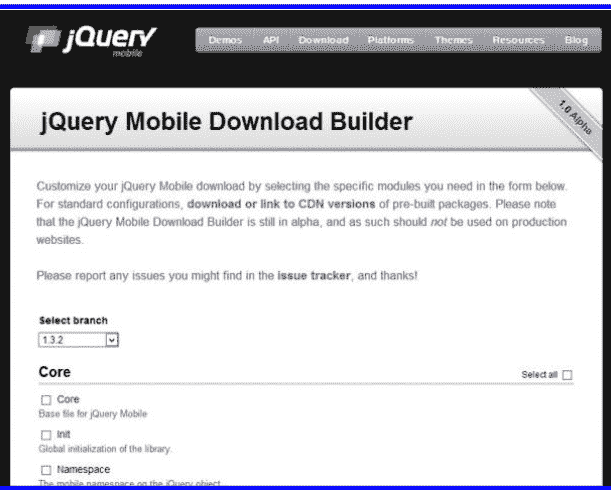

图 10.2 `jQuery Mobile` 下载构建器，包含了如图 10.2 所示正在设计的移动应用程序所需的所有组件

`jQuery Mobile` 可以与 `Eclipse` 开发平台一起使用.* `Eclipse` 是一个开源语言集成开发环境 (`IDE`)，由工作区和用于自定义环境的可扩展插件组成。特别是，`Eclipse` 可以用 JavaScript 开发工具 (`JSDT`) 进行自定义，`JSDT` 提供了实现用于存储 JavaScript 应用程序开发的 IDE 的插件¹`JSDT` 为 `Eclipse` 工作区添加了 JavaScript 项目类型和视角，以及许多工具、编辑器和构建器。此外，`JSDT` 还有一个一个新插件添加了 `jQuery` 自动补全支持³。然而，`Eclipse` 不包含移动平台的模拟器。可以通过安装 Android 软件开发工具包 (`SDK`) 添加某些模拟器（如 Android），但不存在完整的仿真能力。

有两个具有相似能力、软件环境和更多仿真能力的知名库（见表 10.3）。

* *

¹ http://en.wikipedia.org/wiki/Eclipse_(software)

² http://eclipse.org/webtools/jsdt/

³ http://marketplace.eclipse.org/content/jsdt-jquery#Ulcgh1AgR.

### 表 10.3 限制仿真能力的原生无关移动应用程序框架

| 用户界面 | `jQuery Mobile` | `Apache Cordova` 或 `PhoneGap` | HTML 5, CSS 3, JavaScript | WebKit 或 Trident | 移动设备 |

### 10.6.2 KendoUI

`KendoUI` JavaScript 库允许开发者创建为终端用户自动提供原生体验的移动应用程序，而无需额外代码*`KendoUI` 支持以下移动平台的开发：Windows 8、iOS、Android 和 Blackberry。此外，`KendoUI` 与 `Apache Cordova` 集成，提供向各种设备的原生应用程序打包和部署。`KendoUI` 被用于 `Icenium` IDE 以促进跨平台移动开发和仿真*`Icenium` 提供对 `Apache Cordova` 的完整支持，以便创建移动应用程序包并部署。`Icenium` 有两个版本：Graphite（独立 Windows 桌面版本）和 Mist（基于 Web 的开发环境）。图 10.3 显示了带有示例项目——计算器的 Graphite 开发环境。

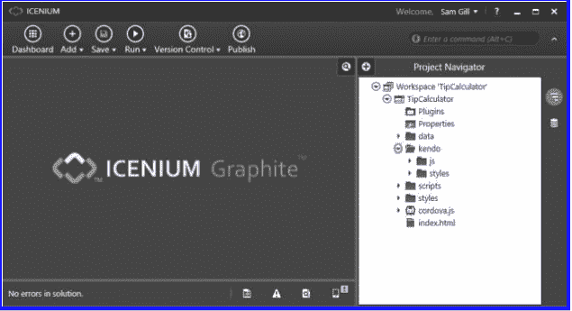

图 10.3 `Icenium` graphite 集成开发环境

* http://www.kendoui.com/mobile.aspx.

* http://www.icenium.com/

## 第十章：使用 Apache Cordova 开源平台

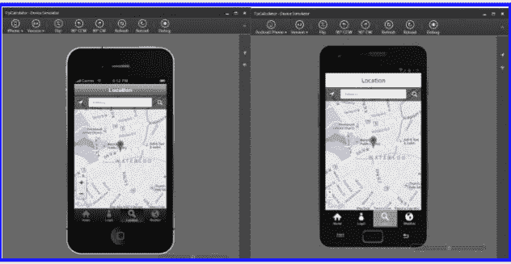

图 10.4 `Icenium` iPhone 和 Android 模拟。

### 表 10.4 Icenium/KendoUI 堆栈

| 用户界面 |
| :--- | :--- |
| `Icenium` | `KendoUI`<br>`Apache Cordova`<br>HTML 5, CSS 3, JavaScript<br>WebKit or Trident<br>移动设备 |

`Icenium` 包含了大多数移动平台的仿真器。由于图 10.4 显示了 `Icenium` 分别针对 iPhone 和 Android 移动设备的并排模拟效果。

表 10.4 显示了带有 `Icenium` IDE 和 `KendoUI` API 的开发框架。`Icenium/KendoUI` 解决方案有两个主要缺点：它是昂收费的，而且它不是开源的，这降低了它未来成为某种标准的可能性。

### 10.6.3 Sencha Touch

`Sencha Touch` 是另一种用于构建移动 Web 应用程序的框架（API）。* `Sencha Touch` 与 `Apache Cordova` 或 `PhoneGap` 集成，提供移动应用程序的打包和部署。`Eclipse` 是 `Sencha Touch` 使用的 IDE，而 `Eclipse` 插件为大多数移动设备平台提供了仿真器。表 10.5 显示了带有 `Eclipse` IDE 和 `Sencha Touch` 的开发框架。

* http://www.sencha.com/products/touch/

### 表 10.5 Sencha Touch 堆栈

| | | 用户界面 |
| :--- | :--- | :--- |
| `Eclipse` | `Sencha Touch` | `Apache Cordova` or `PhoneGap`<br>HTML 5, CSS 3, JavaScript<br>WebKit or Trident<br>移动设备 |

与 `KendoUI` 解决方案一样，`Sencha Touch` 也有同样的两个缺点：价格和私有的 API/框架。其他许多移动 UI 库，但它们都必须集成到第三方 IDE 中，并且不提供完整的模拟/仿真能力。选择是显而易见的：开发者可以选择一个具有有限仿真/模拟能力的免费开源解决方案，也可以选择一个具有全仿真/模拟能力的私有解决方案。

## 10.7 额外考虑因素

经验表明，开发一个通用的原生移动应用程序通常需要一个能够访问相同功能的用户。我们提出的三个解决方案都是基于 HTML 5、CSS 3 和 JavaScript 组件的，这三个解决方案都可以用于创建具有相同功能的 Web 应用程序。最后，大多数业务移动应用程序都需要访问数据。后端可以通过私有 Web 服务（私有云）或公有云实现来访问。提出的三个解决方案中，`Icenium/KendoUI` 解决方案与其自己的云存储集成。* 图 10.5 显示了修订后的 `Icenium/KendoUI` 堆栈。最后一个考虑因素是：设置软件环境有多困难？这是一个主观标准，在设置了所有三个解决方案后，根据作者的经验，从易到难的排名如下：`Icenium`、`Sencha Touch` 和 `jQuery Mobile`。

## 10.8 结语

所有三个堆栈在各自的栈中都使用了 `Apache Cordova` 或 `PhoneGap` 组件，因此所有三个解决方案都能产生可以通过相应的供应商商店进行打包和部署的原生移动应用程序。三个解决方案还将产生相似的视觉效果和感受。

> * http://www.icenium.com/product/

### 表 10.5 修订后的 Icenium/KendoUI 堆栈

| 用户界面 |
| :--- | :--- |
| `Icenium` | `KendoUI` |
| | `Apache Cordova` |
| | HTML 5, CSS 3, JavaScript |
| | Webkit or Trident |
| | 移动设备 |

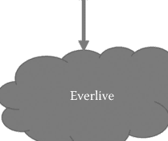

图 10.5 修订后的 `Icenium/KendoUI` 堆栈。

为了帮助我的朋友，选择 `Icenium/KendoUI` 堆栈是因为它是最容易安装的开发平台，而且提供了方便访问云存储来存储应用程序数据。这些挑战需要解决。其中一个挑战是管理移动应用程序的状态，以便当用户从一个移动设备切换到运行在不同平台的另一个设备时，用户可以无缝地继续工作。开源解决方案的仿真能力将低于两个私有解决方案。在使用过所有三个解决方案后，发现它们都有 Bug，并且尚未成熟到能够产生无懈击的移动应用程序。

## 参考文献

- http://cordova.apache.org/about

- http://cordova.apache.org/docs/en/3.0/guide_overview.md

- http://eclipse.org/

- http://eclipse.org/webtools/

- http://jquerymobile.com/

- http://marketplace.eclipse.org/content/jquery

- http://phonegap.com/

- http://phonegap.com/2012/03/phonegap-cordova-and

- http://phonegap.com/about/faq/

- http://techcrunch.com/2011/10/03/adobe-acquires-developer-of-html5-mobile-app-framework-phonegap

- http://wiki.apache.org/cordova/PlatformSupport

- http://www.crunchbase.com/company/mobile-software

- http://www.icenium.com/

- http://www.kendoui.com/mobile.aspx

- http://www.sencha.com/products/touch/

- https://jquery.org/

# 第十一章：MobiCash 智能系统

Amila Karunanayake 和 Kasun Zoysa

### 目录

- 11.1 引言 .................................................................... 190
- 11.1.1 相关工作 .......................................................... 190
- 11.1.2 问题描述 ........................................................ 191
- 11.1.3 为什么我们提出另一个系统？...................................... 192
- 11.2 MobiCash ................................................................ 193
- 11.2.1 移动支付 .......................................................... 193
- 11.2.2 优点与缺点 ....................................................... 193
- 11.2.3 公钥基础设施 (PKI) ......................................... 195
- 11.2.4 数字证书 .......................................................... 195
- 11.2.5 系统设计 ......................................................... 196
- 11.2.5.1 用户注册 ........................................................ 196
- 11.2.5.2 证书颁发过程 .......................................................... 196
- 11.3 现金取现 .............................................................. 198
- 11.3.1 系统角色 .......................................................... 199
- 11.3.2 系统部署 ........................................................ 199
- 11.4 安全架构 .............................................................. 200
- 11.4.1 客户端安全 ...................................................... 200
- 11.4.2 代理端安全 ...................................................... 202
- 11.4.3 不可否认性 ...................................................... 203
- 11.4.4 隐私 ................................................................ 203
- 11.5 评估 ................................................................. 203
- 11.6 讨论 ................................................................. 206
- 11.7 结论 ................................................................. 207
- 参考文献 ................................................................. 207

## 引言

## 11.1 引言

在现代世界，人们试图寻找更舒适的方式来满足日常需求。银行正在竞争性地引入新技术，以使这些金融交易变得无障碍且用户友好。今天，大多数金融机构都提供服务以满足客户需求，并不断引入新服务。

因此，信息通信技术在金融和银行业起着至关重要的作用。在过去的二十年里，研究人员和开发人员应用信息通信技术概念为银行业引入了智能解决方案。电子商务概念已被引入作为传统方法的替代方案。此类解决方案的示例包括自动取款机（ATM）服务、信用卡/借记卡服务和在线支付系统。

第十一章：MobiCash - 智能支付系统

# 第十一章：MobiCash 191

该原型通过短距离红外链路直接与符合标准的收银机或计算机网络（如互联网）、商户的收银台以及银行提供的服务点进行交易。他们提此作为一种离线电子钱包。将 Café 定义为离线的理由是因为当时的移动设备缺乏移动数据通信的嵌入功能。该系统可以使用手机存储的电子货币在指定的商户处购买。2003年，Café 被修改为在线钱包[3]。该钱包由多个现代通信通道组成，用于与商户通信支付详情。


2000年，`SMART`（基于手机的支付系统）[3] 被引入，`SMART Money` 将客户的手机与其银行账户关联[3]。它方便了银行账户的存款、取款、预付手机充值、其他移动账户间的转账以及账单支付流程。尽管 `SMART` 提供了多种移动银行功能，但它仍使用手机中存储的电子现金作为交易媒介。

此外，近场通信（`NFC`）已用于移动支付系统[4]。该系统相比其他系统的优势在于，它不需要高成本的数据保护安全协议。在支付交易路径中，个人手机被视为一个单一的、用户信任的点。与其他现有解决方案相比，这种方法提供了对交易的更好的用户控制，并支持近距离交易[4]。

`VTBN` [5] 是移动电子商务的另一个例子，它利用现有的移动基础设施来安全地执行信用卡交易。用户可以使用手机作为信用卡。手机与银行维护的信用卡账户进行同步。从数据安全的角度来看，传统信用卡的要缺点之一是重复使用同一个信用卡号。`VTBN` 系统旨在减少固定信用卡号的重复使用。

此外，我们研究了与我们开发的系统类似的移动电子商务系统。大多数系统提供了相似的功能。由于空间限制，我们在此不再讨论这些系统。

### 11.1.2 问题描述

目前已有许多商业系统可以在移动设备上实现银行服务。这些系统中的大多数基于全球移动通信系统（`GSM`）网络基础设施，并利用 `GSM` 网络提供的安全特性[6,7]。

`GSM` 系统竭力提供提供安全服务，但其安全性仍存在局限性。之前的的研究[8] 指出 `GSM` 网络缺乏数据完整性和机密性。

`GSM` 服务提供商对网络数据流具有控制权。这是在 `GSM` 网络上部署移动银行应用最关键的问题。一个高安全的移动银行应用需要端到端安全通道进行数据通信。

此外，这些移动电子商务系统仅使用电子金融材料（如电子货币）进行交易[9]。在发展中国家，大多数日常交易仍通过交换实物货币进行[10]，而非电子支付。即使在发达国家，人们在日常交易也使用硬币和纸币。

因此，本研究重点在于提出一种低成本的移动电子商务解决方案，从客户的银行账户中提取资金（实物货币）。我们提议了一种取存款系统（`ATM` 系统），它允许人们基于移动技术并结合额外的安全功能执行银行交易。

### 11.1.3 为什么我们要提议另一种 ATM 系统？

`ATM` 在许多人的生活方式中扮演着日益重要的角色。尽管它有几个缺点……

尽管 `ATM` 是一种极其流行的电子交易系统，但它仍有几个缺点。

`ATM` 机并非均匀地分布在不同地区。因此，一些用户必须长途跋涉才能 `ATM` 设施。在农村地区，情况更加糟糕。

安装 `ATM` 的初始成本极高。此外，`ATM` 通常连接到 `ATM` 交易处理中心，通过公共电话线路上的拨号调制解调器或直接通过租用线路连接，这非常昂贵。此外，银行机构需要经过培训的人员来维护 `ATM`。结果是 `ATM` 的维护成本并不经济。

与 `ATM` 相关的安全性有多个维度。有报告显示 `ATM` 已成为破坏的目标。有时小偷会试图偷走整台 `ATM`。窥视攻击[12]（即小偷从用户肩膀后面查看识别 `PIN` 码的情况）是另一个与 `ATM` 相关的著名安全威胁。为了保护 `ATM` 免受这些威胁，每台 `ATM` 都需要雇用保安。银行和 `ATM` 客户都面临许多与使用 `ATM` 相关的问题。

所提系统的设计旨在解决大部分此类问题并增强交易安全性。此外，所提系统将减少使用 `ATM` 网络的某些障碍（如长队、`ATM` 机并非无处不在），并提高与 `ATM` 交易相关的安全性。

## 11.2 MobiCash

`MobiCash` 是一种移动电子商务应用，提供 `ATM` 服务。换句话说，`MobiCash` 是 `ATM` 的替代方案。传统的 `ATM` 网络[11] 可以被 `MobiCash` 系统取代。同时，`MobiCash` 使手机可以用作借记卡，允许访问客户的银行账户进行购买。

下一节将讨论促使我们设计 `MobiCash` 系统的关键考虑点。

### 11.2.1 移动电子商务

说互联网及相关技术正在改变人们的生活方式已越来越像是一个保守的说法了。最显著的变化有望将出现在业务运营方面。移动电子商务是这些利用移动互联网的相对新的技术之一。移动电子商务有望彻底改变在线金融交易，并比早期普通互联网提供的功能更强大。

### 11.2.2 优点与缺点

移动电子商务应用在多个方面都极其有用[13]。通过对数据机密性的保障，客户可以确保敏感数据未被第三方篡改。

然而，移动设备存在局限性，因为大多数设备配备的内存、显示和处理能力非常有限。此外，通过开放空气链路进行通信引入了额外的安全威胁（例如窃听）。

与移动电子商务相关的安全变化不仅限于移动设备，还与无线接口、网络运营商以及移动应用的性质相互相连[17]。

第十一章：`MobiCash` 195

### 11.2.3 公钥基础基础设施 (`PKI`)

公钥加密系统设计用于在双方之间没有预先约定共享密钥的情况下进行安全通信。双方在开始通信之前不需要具备密钥密钥交换机制。

公钥加密系统的设置是由一组用户 `$u_1,...,u_n$` 组成的网络，而不是单一的用户对。

网络中的每个用户 `$u$` 都拥有一对密钥 `$P_u, S_u$`，其中公钥 `$P_u$` 发布在所有人都可以读取的公共目录中，而私钥 `$S_u$` 则由 `$u$` 本人绝对知晓。

设 `$A$` 和 `$B$` 为两个用户，`$A$` 需要向 `$B$` 安全地发送消息 `$m$`。为了向 `$B$` 发送消息“`$m$`”，`$A$` 使用完全相同的方法，包括查找 `$P_w$` 并计算 `$E(P_w, m)$`（其中 `$E$` 是公钥加密算法），并将生成的密文“`$c$`” 发送给 `$B$`。

接收到密文 `$c$` 后，用户 `$B$` 可以通过查找自己的私钥 `$S_u$` 并计算 `$D(S_u, c)$` 来解密（其中 `$D$` 是公钥解密算法）。

每个密钥的操作都是单向操作：密钥无法用于反转其操作。此外，两个密钥使用的算法设计使得一个密钥无法确定同对中的另一个密钥。因此，无法从公钥推导出私钥。

### 11.2.4 数字证书

数字证书允许某人将其数字签名与公钥以及标识其身份的信息（例如其真实姓名）相结合。这种证书用于允许计算机/移动用户证明他们确实拥有其声称的公钥 [18]。换句话之，它是公钥的一种安全机制。

如前所述，`PKI` 需要数字签名。该签名可以由分配证书的机构、被确认身份的人、甚至是公钥的背书人签署。

以便其他方和个人验证某人确实是其声称公钥的所有者。此外，`PKI` 允许其他人验证他们确实正在与正确的人通信并使用了正确的公钥。

在所提的系统中，我们利用 `PKI` 证书的属性为电子金融交易提供基本的安全特性。

移动电子商务

### 11.2.5 系统设计

预期系统的关键组件是银行、客户和 `MobiCash` 代理。这些组件的角色将在本章稍后部分讨论。`MobiCash` 代理和客户都应该拥有手机手机，并经过适当修改以执行 `MobiCash` 功能。在使用借记卡的情况下，商户将取代 `MobiCash` 代理的角色。银行拥有一个 `MobiCash` 服务器作为前端，连接到银行的后端交易管理系统。

所提系统基于 `PKI` 加密构建。因此，在订阅系统之前，所有参与者都应完成以下两个步骤的用户验证过程：

- 1. 用户注册过程
- 2. 证书颁发过程

`MobiCash` 系统的所有功能都基于上述步骤收集的信息运行。接下来将定义这两个过程的细节。

#### 11.2.5.1 用户注册

注册过程是为了收集和验证与 `MobiCash` 系统相关的用户信息，例如银行账户详情。此注册过程应以面对面的形式完成。每个用户都应在注册台参加这一一次性流程。

注册过程应由受信任的注册代理执行。这种受信任的注册过程可以由银行或其他独立的身份提供者执行。我们建议由独立的身份提供者承担此任务。如果所有银行都信任该第三方身份提供者，则该系统可用于跨银行交易。因此，我们建议中央银行或其他政府机构执行注册过程。图 11.1

注册过程中收集的所有信息都安全地存储在数据库中，用于用户认证。

#### 11.2.5.2 证书颁发过程

所提的 `MobiCash` 系统使用 `PKI` 来确保交易安全。因此，所有参与特定交易的参与者都拥有 `PKI` 证书。证书权威机构有权根据从用户注册过程中收集的信息颁发这些证书。证书颁发机构与注册机构协作获取用户信息。银行可以充当证书权威机构。如果任命外部受信的第三方证书权威机构颁发证书，则系统可以扩展到跨银行 `ATM` 交易。该证书包括用户的私钥、公钥、数字签名和个人身份信息。图 11.2 展示了证书颁发过程。

第十一章：`MobiCash`

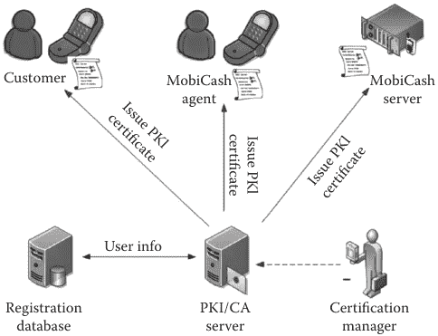

图 11.1 用户注册过程。

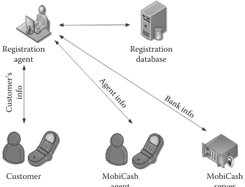

图 11.2 证书颁发过程。

由证书权威机构 (`CA`) 服务器提供的证书存储在用户和 `MobiCash` 代理的手机中 [19]。因此，所有交易的安全性取决于公钥加密。

在可靠且可验证的注册和证书颁发后，`MobiCash` 实例即可就绪。

所提的 `MobiCash` 系统交易的安全性依赖于公钥加密。取现功能通过 `MobiCash` 代理对客户实现。我们将在 11.4 节讨论与其相关的安全特性。图 11.3 展示了系统架构。

- 1. 客户前往 `MobiCash` 代理处，向银行发送提取请求，包括手机号和请求金额。
- 2. 银行使用 `PKI` 证书验证用户，支持 `CA` 服务器和注册服务器。
- 3. `MobiCash` 服务器向客户发送授权短信（一个随机码）。
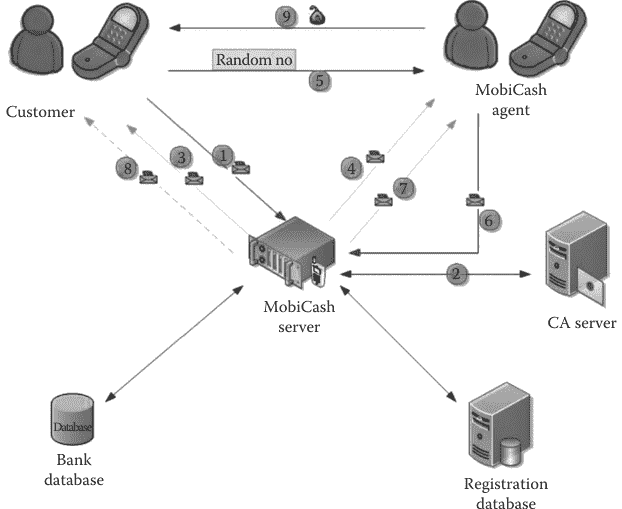

图 11.3 系统架构。

第十一章：`MobiCash` 199

- 4. 与此同时，银行向 `MobiCash` 代理发送支付授权短信（交易码不同于确认码，但两者在数学上是相关的）。
- 5. 客户向 `MobiCash` 代理出示确认码。
- 6. `MobiCash` 代理向银行发送确认短信。
- 7. 银行从客户账户转账至 `MobiCash` 代理账户，并向 `MobiCash` 代理发送交易确认短信。
- 8. 银行也向客户发送交易确认短信。
- 9. `MobiCash` 代理向客户提供现金。

### 11.3.1 系统角色

系统的操作根据参与者分为三部分：

客户：需要执行 `ATM` 交易的人。其手机上应安装特殊程序以运行 `MobiCash` 功能。

`MobiCash` 代理：与客户一样，`MobiCash` 代理（移动 `ATM` 代理）必须银行账户和手机。该手机也经过了修改，以便以安全的方式执行 `MobiCash`。他被银行授权执行 `MobiCash` 交易。当有此类服务请求时，`MobiCash` 代理持有现金以给客户。

银行组织：银行应拥有 `MobiCash` 服务器来处理客户与 `MobiCash` 代理之间的交易。`MobiCash` 服务器应直接连接到银行数据库。此外，银行维护客户和代理的账户。此外，银行服务器拥有撤销证书或验证信息的连接。

### 11.3.2 系统部署

所有参与交易的组件都必须提前注册。注册过程完成后，每个参与者将获得一个 `PKI` `X.509` 证书。客户端有一个特殊的移动应用程序，适用于运行 `MobiCash` 功能。客户证书也存储在客户的手机中。

200 移动电子商务

该应用程序需要客户的 `PIN` 码（在注册过程中获取）来用于身份验证。此外，该应用程序还需要 `MobiCash` 代理的手机号码和要提取的金额。最后，客户端应用程序向银行发送一条安全短信（该短信由银行的公钥和客户的私钥共同加密），内容包含 `MobiCash` 代理的手机号码、要提取的金额以及客户的账户号码。

在 `MobiCash` 代理端，应该有一个能够接收来自银行的安全短信的移动应用程序。代理的手机中存储着一个证书，该证书能够安全地向银行发送交易完成通知和客户的手机号。该应用程序还需要代理的 `PIN` 码来用于身份验证。此外，`MobiCash` 代理会为了审计目的生成一个跟踪编号，识别交易完成，并将信息发送到 `MobiCash` 服务器。

`MobiCash` 服务器提供了核心银行系统与用户之间的接口。同时，它利用注册信息来验证订阅者的身份。`MobiCash` 服务器负责解密客户/代理的消息，并将消息重定向到核心银行系统。`MobiCash` 服务器使用自己的私钥和接收者的公钥对发出的消息进行加密。`MobiCash` 服务器负责每笔交易生成两个随机数（确认码和交易号）。确认码和交易号之间存在算法关系。随机数生成程序不会为另一笔交易生成相同的数字。在第六步之后，`MobiCash` 服务器能够识别出属于同一笔交易的两个数字。

## 11.4 安全架构

我们强烈假设银行对于如何在内部处理对数据库中如 `PIN` 等客户详细信息的访问拥有具体的安全策略 [17]。在这里，我们从客户的角度和 `MobiCash` 代理的角度讨论系统的安全架构。

### 11.4.1 客户端安全

客户端安全基于非对称密钥加密，假设银行是一个可信实体。回想我们之前的示例，用户 `$A$` 想要从他的账户中提取款项。为了取款，他选择了代理 `$B$`。

# 第十一章：`MobiCash` 201

客户必须向客户端应用程序输入其 `PIN` 码 (`α`)，应用程序本身获取客户手机号 (`β`) 和应用 `ID` (`γ`) 来生成一个安全的哈希值（Hash Code）。令 `H` 为哈希字符串，

```
H = h(α + β + γ)
```

`h` 是哈希函数算法。

另一个哈希值 (`H'`) 使用上述三个参数生成，并在移动应用程序首次运行时存储在手机的 `SIM` 卡中。当客户尝试登录系统时，系统会匹配两个哈希值。如果 `H = H'`，则客户可以登录系统 [20]。这种哈希匹配的目的是保护用户免于因手机被盗而丢失个人信息。

让我们考虑在本文其余部分使用的符号。

- 银行公钥 `Pb` 和私钥 `Sb`
- 代理公钥 `Pa` 和私钥 `Sa`
- 客户公钥 `Pc` 和私钥 `Sc`

取款请求包括 `MobiCash` 代理的手机号码、客户的手机号码和要提取的金额。这条消息 (`Wr`) 首先使用银行的公钥加密，然后使用客户的私钥加密。

```
EWr = E(Sc,E(Pb,Wr))
```

接下来，将加密后的信息 (`Wr`) 发送给相关银行 [21]。根据之前的假设概念，银行首先尝试使用银行私钥解密数据。我们将此中间消息命名为 `DWr'`。

```
DWr' = D (Sb,EWr)
```

`DWr'` 已成功提取，银行知道该消息是由客户发送的且未被篡改 [19]，因为用 `Pb` 加密的 (`Wr'`) 只有银行已知。然后，银行获取属于客户的证书，获取客户的公钥 `Sc`，并使用客户的公钥 (`Pc`) 解密中间消息 (`DWr'`)。

```
Wr = D (Pc,DWr')
```

如果成功，解密过程返回。因此，银行知道消息来自真实的客户，该客户需要从其账户提取款项。接下来，银行生成客户 `PIN` 码和手机号码的哈希值，并与注册数据库中存储的哈希值进行匹配。存储的哈希值等于哈希字符串 `H`。这种哈希匹配背后的思想是保护客户防止手机号被滥用。银行可以确保是正确的人在使用该移动应用程序，因为只有真实用户才知道自己的 `PIN` 码。该系统的设计使得来自被盗手机的交易无效，以便银行能够验证客户。此外，客户消息的加密版本提供了客户信息的完整性和机密性。

银行向客户发送两条回复：交易授权消息 (`TA`) 和交易完成消息 (`Tc`)。这两条消息都使用银行私钥和客户的公钥进行加密。

```
ETA = E(Pc,E (SB,TA))
ETc = E(Pc,E (SB,TC))
```

因此，客户可以确保信息的完整性和机密性 [22]。

### 11.4.2 代理端安全

`MobiCash` 代理是银行授权的人员。这里采用了上一节描述的安全架构。

在图 11.3 的第 6 步中，`MobiCash` 代理对从客户处获取的确认码 (`c`) 和接收到的交易号 (`t`) 进行加密。来自银行的哈希值 (`h`)、代理的 `PIN` 码、手机号码和应用 `ID` 也包含在消息中。

令 `A` 为代理的取款请求。当 `MobiCash` 代理首次注册时，银行中存储了类似于 `H` 的哈希值。然后银行可以验证代理。存储的预计算的哈希值用于防止手机号伪造攻击，

```
Ar = h(c+ t)
```

其中 `Ar` 是代理的支付请求。

```
EAr = E(Sa,E (Pb,Ar))
```

这条消息还提供了完整性和机密性。

# 第十一章：`MobiCash` 203

在图 11.3 的第 7 和 8 步中，银行发送指示交易完成或拒绝的通知。这两条消息（`Ma` = 给代理的消息和 `Mc` = 给客户的消息）由银行加密。首先使用银行的私钥加密，然后使用代理/客户的公钥加密。

```
EMa = E(Pa,E (SB,Ma))
EMc = E(Pc,E (SB,Mc))
```

如果这些消息在接收端成功解密，客户和 `MobiCash` 代理就可以验证消息来自银行。

11.5 评估

到目前为止，我们讨论了 `MobiCash` 系统的技术方面/设计以及特定问题。本节介绍了详细的技术评估和小型用户研究评估。`MobiCash` 是一个基于社区的应用程序。因此，社区对系统的接受

## 204 移动电子商务

这是一个重要因素。我们认为必须通过真实世界的评估来评价该系统，而不是在实验室环境中进行评估。为了进行评估，我们在一家银行部署了 `MobiCash` 系统，该银行拥有一个涵盖城市和农村的客户群体。

我们使用了 40 个用户样本进行评估。

技术评估侧重于评估系统的性能和可扩展性。部署的 `MobiCash` 系统的性能通过完成交易所需的时间来衡量。交易的完成时间由向应用程序输入数据所需的时间、`SMS` 发送吞吐量时间以及核心银行系统完成交易的时间组成。因此，向应用程序输入数据的时间也取决于用户的操作熟练程度。因此，我们剔除了该因素，以提取关于系统性能的精确测量值。对于一次交易，用户通常有两种向应用程序输入数据的情况：取款请求和代理人请求。因此，我们必须将时间测量分为两个部分：

- 1. 从客户发送取款请求到接收确认短信和交易短信的时间段 (`T1`)
- 2. 从代理人发送确认码和交易号到接收交易完成短信的时间段 (`T2`)

根据表 11.1 所示，与平均值相比，`T1`、`T2` 和总时间的标准差较小。例如，`T1`、`T2` 和总时间的范围在一个很短的区间内。交易总完成时间大部分在 84 到 104 之间。从此得出，系统对于大多数交易都是稳定的。


此外，我们使用 40 个用户样本对系统进行了评估。该用户样本被分为两组，每组 20 人。第一组的每个用户在 GSM 信号极低的地方（距离基站约 7 公里）完成了一次 MobiCash 交易。第二组的另外 20 观测结果是在 GSM 信号极高的地方处（距离基站约 250 米）测量的。根据这些观测结果（如图 11.4 所示），前 20 次测量和后 20 次测量之间的总时间没有显著差异。我们观察到 GSM 信号强度在很大程度上并不影响系统性能。基于这一发现，该系统适用于 GSM 信号强度远低于农村地区。

由于 GSM 信号强度没有影响，所有 40 个用户都被要求在传统 ATM 机上进行交易。测量了每笔交易的时间。图 11.5 展示了这些测量结果。

根据图 11.5，移动 ATM 完成交易所需的时间更短。然而，前往传统 ATM 机和等待 ATM 机排队使得其完成时间高于 MobiCash 的交易完成时间。尽管 MobiCash 完成交易所需的时间比传统 ATM 长，但考虑到访问 ATM 机的便利性问题，MobiCash 有潜力被社区接受为某些金融交易中更高效的流程。

此外，我们在 MobiCash 上执行了 120 笔交易，所有交易都通过系统的成功响应完成。我们对 MobiCash 系统的稳定性充满信心。

### 表 11.1 网络内性能

| | T1 (s) | T2 (s) | 总计 (s) |
| :--- | :--- | :--- | :--- |
| 平均值 | 49.677 | 44.34 | 94.021 |
| 标准差 | 8.216 | 7.311 | 10.534 |

`图 11.4` 交易完成时间。（前 20 笔交易在信号强度低的地方完成。后 20 笔交易在信号强度高的地方完成。）

`图 11.5` 交易完成时间比较（MobiCash 与 ATM）。

## 11.6 讨论

MobiCash 网络中的所有参与者通过第三方注册代理人的面对面程序注册。因此，所有身份都经过严格验证。身份、财务和授权数据以加密形式存储在数据库中。未经授权的无法非法访问数据。

系统中的所有参与者都有个人安全凭证：密钥对、证书和其他安全令牌。对于客户来说，这些凭证安全地存储在手机中，加密并在个人身份验证后才可以访问。

哈希值根据订阅者的 PIN 码、应用程序 ID 和手机号码生成，并与注册服务器存储的哈希值进行匹配。这一功能确保了手机号码和克隆移动应用程序的安全。此外，由于哈希值中包含了 PIN 码，它保证了使用应用程序的人员身份。

所有消息都针对特定交易进行了数字签名、加密和封装 [25]。对于电子交易，具有不可否赖性也是非常方便的。如图 11.3 所示，银行生成并发送两个随机数：发送给客户的确认码和发送给 MobiCash 代理的交易号。为了完成交易，系统设计要求客户向代理人提供此确认码。

## 11.7 结论

提出的系统旨在解决访问 ATM 服务的困难。MobiCash 系统与其他任何系统不同的独特特征之一是其安全性。MobiSys 系统提供了机密性、完整性、真实性和不可否赖性，这些在金融交易中至关重要。它实现了与 ATM 相关的更多安全功能。所提出的 MobiCash 系统还提供了关于交易的可接受证据。

在不增加任何基础设施额外成本的情况下，现有的移动网络可以平滑扩展以部署该系统。

系统可以平滑扩展到银行间水平，进一步扩展到国际水平。它与现有的安全和通信协议兼容，因此系统的进一步扩展是可行的。

总之，MobiCash 系统解决了银行业的服务空白，并为农村地区的人们解决了他们的问题，这对他们的社会经济发展至关重要。

在未来的研究中，我们将调查社区对系统的接受程度。对系统安全和隐私问题的感知仍需识别。

## 208

## 移动电子商务

- 4. Kadambi, K., Li, J., and Karp, A. 基于近场通信的移动支付服务。Proceedings of IIith International Conference on Electronic Commerce, ACM Press, 2009, pp. 142–151.
- 5. Vishwas, P and Shamasander, R.K. 一种高效、安全且可委托的微支付系统。IEEE Conference on Technology, e-Commerce and e-Service, 2004, pp. 394–404.
- 6. Lukkari, K., Koronen, J., and Ojala, T. 智能餐厅：情境感知环境下的移动支付。Proceedings of Sixth International Conference on Electronic Commerce, ACM Press, 2004, pp. 575–582.
- 7. Bouska, P and Drahansky, M. GSM网络中的通信安全。IEEE International Conference Security Technology, 2008, pp. 248–251.
- 8. Taasenem, G.B and Paul, C. 用于移动计算和无线通信的双向认证、机密性及密钥管理（MACKMAN）系统。Proceedings of 14th International Computer Application Conference, 1998, pp. 308–317.
- 9. Min, Q., Meng, D., and Zheng, Q. 移动商务适应性的实证研究。Proceedings of IEEE Conference Service Operations and Logistics, 2008, vol. 1, pp. 659–664.
- 10. Karunanayake, A., Zoysa, K., and Mrific, S. 用于开发的移动ATM。Proceedings of Third International Workshop on Mobility in the Evolving Internet Architecture, ACM Press, 2008, pp. 25–30.
- 11. Kumar, P., Shailaj, G., Kavitha, A., and Saxena, A. GSM的双向认证与密钥协商协议。Proceedings of IEEE International Conference on Business. IEEE Press, 2006, pp. 25–27.
- 12. Li, Z., Sun, Q., Yuan, and D. 一种用于抵抗窥视攻击的基于关联密码设计。Proceedings of IEEE International Conference on Multimedia and Expo. IEEE Press, 2005, pp. 245–248.
- 13. Goyal, S. 移动与泛在计算的识别。Proceedings of Persuasive Computing, 4(2), 88–90.
- 14. Wang, Z., Guo, Z., and Wang, Y. 基于J2ME移动支付的安全研究。Proceedings of ISES Colloquium on Computing, Control, and Management. IEEE Press, vol. 2, pp. 644–648.
- 15. Boudriga, N. 移动通信安全。IEEE International Signal Processing and Conference, 2007, pp. 24–27.
- 16. Li, X. and Autran, G. 为电子商务实现的移动代理平台。Third International Computer Software and Applications Conference, 2009, vol. 2, pp. 40–45.
- 17. Thanh, D.V. 移动商务中的问题。Proceedings of First IEEE International Conference Electronic Commerce and Web Technologies.
- 18. Lin, Y., Studer, A., Chen, Y., Hsiao, L., Lee, J., McCune, J. 基于信任的密钥建立。IEEE Transactions on Mobile Computing, 9(12), 1666–1681.
- 19. Chen, C. and Jensen, N. 用于移动系统的异步密钥建立。IEEE Transactions on Mobile Computing, 10(2), 205–211.
- 20. Taasenem, G.B and Paul, C. 用于移动电子商务的对称加密算法。IEEE, 2003, pp. 244–250.

## 第十一章

- 21. Islam, S. and Ajmal, F. 移动商务中的安全性研究。IEEE International on Communications, 2009, pp. 358–361.
- 22. Shibli, M., Matyas, D., Johnson, J., Wilkins, V. 移动代理的安全性研究。IEEE Transactions on Mobile Computing, 6(7), 448–464.
- 23. Ahlualia, P. and Varashney, O. 移动商务的实证研究。Proceedings of 12th International on Design, 2010, pp. 1567–1573.
- 24. Li, H. and Wang, K. 移动支付中的安全性。Springer-Verlag, Global Technologies, 2009, pp. 495–504.
- 25. Le, V., Matyas, D., Johnson, J. 移动电子商务的安全性。Springer-Verlag, 2003, pp. 39–70.
- 26. 移动计算中的安全性。IBM journal, 32(3), 461–485.

## 第十二章

## 移动电子商务开发

Sathi Mahesh

目录 ................................................................ 212

- 12.1 引言................................................................................... 217
- 12.2 开发方法.................................................................. 214
- 12.2.1 原生应用............................................................................... 214
- 12.2.2 Web应用............................................................................... 215
- 12.2.3 混合应用........................................................................... 216
- 12.3 移动应用平台................................................................... 216
- 12.3.1 集成环境....................................................................... 216
- 12.3.2 云端平台..................................................................... 217
- 12.3.3 平台比较...................................................................... 218
- 12.3.4 厂商商店....................................................................... 218
- 12.4 移动应用技术........................................................... 221
- 12.4.1 硬件交互....................................................................... 221
- 12.4.2 API 间层.................................................................. 222
- 12.4.3 模块化与硬件............................................................... 222
- 12.4.4 版本控制........................................................................... 223
- 12.5 移动用户体验................................................................ 224
- 12.5.1 Web 页面............................................................................... 224
- 12.5.2 设备负载............................................................................... 225
- 12.5.3 触摸与触觉技术....................................................... 225
- 12.5.4 语音输入与输出................................................................ 226
- 12.5.5 手势与动作....................................................... 227
- 12.5.6 视觉与增强现实................................................... 228
- 12.5.7 用户注意力跨度........................................................ 228
- 12.5.8 安全性.................................................................. 229
- 12.6 移动应用测试....................................................... 230
- 12.7 移动 Web 技术.................................................... 232
- 12.7.1 HTML5............................................................................... 232
- 12.7.2 JQuery..................................................................... 233
- 12.7.3 JavaScript 模块....................................................... 234
- 12.7.4 课程............................................................................... 234
- 12.8 总结....................................................................... 235
- 参考文献...................................................................... 235

# 第十二章：移动电子商务发展

开发工具，由于许多移动硬件提供商提供的工具套件旨在为他们的硬件开发优化的应用程序。因此，移动开发的一个大要问题是：是开发针对某类硬件优化的原生应用程序，还是开发基于 Web 的应用程序（在后者，移动设备仅作为用户界面并执行极少的数据代码开发，应用程序的大部分代码放置在移动设备上）。因此，对于每个使用该应用程序的移动设备，都需要开发和维护不同版本的代码。从开发者的角度来看，基于 Web 的方法最有益，因为它可以从现有的桌面/笔记本电脑浏览器版本迁移过来，其主要的报酬仅限于适应小型移动设备的屏幕尺寸变化。然而，移动硬件的许多特殊功能只能通过专门为设备设计的代码才能访问，而且具有丰富用户体验的应用程序需要设计以优化移动设备上相对稀缺的资源。


电子商务应用程序受益于网络效应，当有许多其他人使用它们时，应用程序的价值就会变得更高。移动应用程序具有丰富的交互性，支持与用户之间以及用户之间的交互。因此，它们从网络效应中获益更多。开发过程需要考虑这一点，并以一种便于许多用户通过网络效应快速接受和采用的方式进行。结果，移动开发者倾向于使用模块化的、预构建的小部件和快速应用程序开发（RAD）方法来快速组合原型应用程序，这些程序可以被快速部署。移动开发的一个挑战是移动应用程序寿命较短，需要不断修改以保持竞争力。虽然系统维护一直比新系统的开发昂贵，但在移动电子商务市场中，这个问题要严重得多，因为需要不断适应新的市场压力和技术变化。移动电子商务开发者需要持续监控其应用程序使用设备资源的情况（例如电池电和网络带宽），并确保它们不会占用设备。不进行维护的移动应用程序将迅速失去市场份额，并被许多灵活的竞争对手取代（ABI Research, 2013）。

移动设备上的接口使用了来自用户的各种方便输入，从当前硬件中常见的触摸输入到手势（摇晃、指向）以及视觉输入。此外，设备还可以从内置传感器自动捕获用户的位置、加速度和环境数据。移动电子商务应用程序需要设计以满足这些来自这些源的丰富输入的需求和能力。移动应用程序的用户界面需要在竞争异常激烈的市场中考虑整体用户体验。

# 第十二章：移动电子商务发展

## 移动电子商务

### 12.2 开发方法

系统开发方法涵盖从软件开发生命周期（SDLC）的传统瀑布模型到如 `Scrum` 和极端编程（Extreme Programming）等敏捷技术。移动应用程序的设计旨在响应快速演变的市场，重点是丰富的客户交互、位置感知以及有效处理微交易的能力。由于时间压力和市场适应需求，敏捷方法在移动应用程序开发中被广泛使用。2004 年提出的 `D-mobile` 模型包含五个阶段，每个阶段有 3 天的开发时间，分别用于规划、工作和发布产品。这提供了一个快速的 15 工作日开发周期，并使用户与开发者之间有紧密的接触和互动（Abrahansson et al., 2004）。该过程适用于移动项目。而提出的螺旋模型基于多个循环，可以确保应用程序接口的可用性，更适用于规模更大、风险更高的项目，这些项目支持与移动应用程序进行复杂的用户交互（Nousseir et al., 2012）。

#### 12.2.1 Web 应用程序

移动电子商务应用程序可以开发为运行在浏览器中的基于 Web 的应用程序，也可以开发为运行在移动设备上的原生应用程序。移动计算的尝试是将标准屏幕设计移植到小型移动设备。这些从桌面浏览器设计的 Web 页面渲染效果很差，且下拉列表和按钮等界面元素对移动用户来说是不方便的。由 Wap Forum 推广的无线接入协议（WAP）被开发出来是为了让为大屏幕设计的电子商务 Web 页面和脚本能够在小屏幕和小设备上有效渲染，特别是那些通过低带宽连接的设备。该协议使用中间服务器以移动格式存储和保存大型 Web 页面。由于缺乏对 Wap 标准的广泛共识，以及不同移动网络提供商实现中间服务器的成本问题，该技术未能获得市场认可。现代移动设备具有足够的带宽来交付电子商务的 Web 内容，并且在大多数情况下，它们拥有可以处理 HTML、CSS 和 JavaScript 的浏览器，这些都是基于 Web 的应用程序的底层技术。某些特殊的 Web 技术出现过问题，例如 Apple 设备上的 Flash。通常，这些问题是供应商之间冲突的结果。移动设备的小屏幕使得 Web 应用程序开发者有必要重新设计 Web 页面格式。此外，移动商务是在更短的会话和各种环境条件（如光线街道噪音）下进行的，这使得应用程序开发者在设计界面时考虑使用条件。

#### 12.2.2 原生应用程序

原生应用程序提供更低的延迟，能够处理传输过程中的连接丢失，并可以针对特定硬件进行优化。在 Web 应用程序中，用户交互在远程服务器上处理，导致用户反馈存在延迟。JavaScript 代码在浏览器上运行，消除了许多简单交互的往返次数。虽然 JavaScript 的改进使其在电子商务环境中具有竞争力，但目前该语言无法提供原生代码在硬件上所提供的响应速度。什么时候构建原生应用程序是有意义的？

这种选择类似于客户端-服务器应用时代常见的“瘦客户端-胖客户端”决策。胖软件在设备上执行大部分工作并提供快速的交互响应，而瘦客户端在远程服务器上执行大部分工作，并受到网络延迟的限制。系统管理员倾向于应用程序的瘦客户端，而大多数客户端由于低延迟和资源使用的整体效率以及集中化控制，倾向于胖客户端。移动设备硬件已变得强大，内存和处理能力超过了早期桌面电脑。这使得在移动设备上运行胖客户端应用程序变得可行。然而，移动设备在硬件容量、有线网络带宽和电池功率限制仍然落后于远程笔记本电脑和桌面硬件。移动应用程序需要优化以便在硬件、带宽和电池限制下有效运行。这表明需要构建特定硬件的自定义移动应用程序版本。早期对移动开发的建议侧重于资源限制（Tarasevich, 2003）。应用程序开发框架根据媒体分发（广播）、实时位置敏感数据、业务交易完成以及每类应用程序的协作和维护方法提供了一种移动应用程序的分类法（Unhekar et al., 2010）。

然而，如果开发了原生应用程序，它们也需要维护。当发布新版本的手机操作系统（OS）或引入新手机硬件时，原生应用程序需要的更改比 Web 应用程序多得多。除非底层硬件发生重大变化，即使是那些调用摄像头图像或 GPS 读等硬件功能的 Web 应用程序也将继续

移动电子商务

另一方面，运行效率更高的原生应用程序会进行特定硬件的调用，这些调用可能需要根据新硬件进行更新。这为开发者增加了构建和维护工作的复杂性，因为他们需要构建和维护多个版本的产品。

#### 12.2.3 混合模式

许多移动应用是以混合格式开发的，其核心是 Web 应用程序，并增强了原生功能以丰富交互。混合应用通常构建在移动开发工具集上，这些工具集允许开发者在开发中使用标准的 JavaScript，并针对特定功能调用自定义的应用程序编程接口（API）。在应用程序编译期间，工具集会向交付的应用程序添加特定硬件的代码，并针对每种类型的硬件进行定制。最后，许多移动应用依赖云服务来实现数据、通知和用户交互。因此，这些应用程序可以在基于云的工具集上高效构建，这些工具集通过方便的 API 访问云服务，实现了自定义应用的即插用开发。

### 12.3 移动应用开发平台

#### 12.3.1 集成开发环境

集成开发环境（IDE）为开发者构建和部署多个应用程序提供了平台。Eclipse 是一个知名的开源 IDE，支持多种语言的开发。开发工具包可以插入到 Eclipse 中，以促进不同语言和不同平台的开发。例如，Android 开发者工具（ADT）软件开发包（SDK）可以插入到开源 Eclipse IDE 中用于开发 Android 应用，这些应用将运行在使用 Android 操作系统的移动设备上。供应商支持专有开发，他们将该平台推广为为其设备开发应用程序的便捷方式。许多专有平台拥有精细的界面、减少程序员重复性工作的自定义插件，并支持针对其设备的代码优化。关注特定平台（例如 iPhone）的开发者更倾向于使用 Xcode IDE，并使用 Objective-C 语言进行编程，开发针对 Apple iOS 优化的应用。微软的 Visual Studio 是一种广泛使用的多语言 IDE，非常适合使用 C Sharp 编程语言开发 Windows 手机应用。Visual Studio 插件可开发 Android 应用以及在其他平台上运行的应用。Google 提供了 Android Studio IDE，它是 IntelliJ IDEA IDE 的定制版本。

集成开发环境提供的功能包括：(1) 具有拖拽功能的布局编辑器，用于定位和调整用户界面组件的大小；(2) 基于模板的向导，用于创建通用设计；(3) 用于记录应用程序在硬件上性能的工具；以及 (4) 在不同版本的操作系统上快速构建应用的能力。供应商提供的 IDE 具有特定于移动设备操作系统的功能，并通常带有高度优化的预构建功能插件。许多应用开发 IDE 还支持云端应用支持，例如云数据库、处理业务流程的服务器组件以及消息传递等功能。

用于移动端的应用程序与许多其他 Web 应用程序一样，使用模型-控制器（MVC）方法。这种方法将应用程序分为三大类。第一类是模型（model），用于存储存储的数据；控制器（controller）指的是管理业务过程的代码，即用户与业务系统之间的连接。数据存储在云存储中，控制器很大程度上运行在服务器上，尽管部分可能运行在用户设备上。视图（view）是应用程序的一部分，负责呈现用户界面、显示数据并与用户交互。构建跨多个硬件设备和操作系统的共享模型和控制器很容易。主要的变化发生在视图组件，该组件需要针对设备进行定制和优化。

#### 12.3.2 云端开发平台

许多移动应用是为云开发的。虽然云应用程序可以使用独立的 IDE 从零开始构建，但使用针对云移动服务的开发平台更为理想。原因是新移动应用的半衰期很短。许多移动应用满足短期需求，未来需要更新。完善的开发过程将耗费长时间，而且应用设计师很难为尚未开发的应用程序找到进行测试的专业用户。开发云端移动应用的平台为最常见的功能提供了工具集，能够快速通过拖拽方式开发应用原型。除了 Beta 测试之外，云应用还可以进行扩展以适应增长。因此，它们可以被来增加市场份额，在理解增长模式并建立盈利模式后，再启动完善的开发。许多云端移动应用开发平台本身就运行在云端，使开发团队能够快速访问并构建原型系统。

许多移动应用使用了移动计算的常用功能，如社交网络、用于客户数据和业务数据的云数据存储，以及提供以客户为中心的更新的推送通知服务。微服务（Microservices）提供了极小的内容块，可能来自一个源或多个个人/社区源（Christophe et al., 2011）。移动后端即服务（BaaS）模型将这些服务作为易于访问的 API 提供。使用云端 BaaS 的开发者可以快速访问这些资源并构建他们的应用程序。目前，许多 BaaS 供应商提供一种“免费模式”，以鼓励应用开发使用他们的平台进行开发。免费模式仅在需求超过预设水平时收取服务费。因此，可以低成本构建并推出原型模型，在业务起色后产生费用。

### 12.3 平台比较

有许多基于 HTML5 和 JavaScript 创建移动 Web 应用的框架。这些框架提供了自定义脚本模块，以便快速开发稳健的 Web 应用程序。Apache Cordova 可包括 Windows 在内的许多设备（Eberhart, 2012）。对摩托罗拉的 Rhodes、基于 Apache Cordova 的 Adobe PhoneGap、Sereg 的 Dragon Rad 以及开源解决方案 MoSync 的对比表格总结了它们在开发、架构、首选软件模型和移动操作系统支持方面的特性（Palmieri et al., 2012）。另一项研究比较了使用不同跨平台工具 Phone Gap 和 Titanium 开发的简单测试应用版本（Dalmaso et al., 2013）。

各种供应商提供了促进移动开发的工具集。它们的工具集运行在现有的开发平台上，这些可以是通用 IDE，也可以是专门移动开发平台。需要注意的是，所有工具都在持续开发中，研究中提出的任何功能集都需要根据现状进行适当修订。表 12.1 列出了目前可用的移动电子商务开发工具。

#### 12.3.4 供应商支持/供应商赞助的应用商店

许多移动设备供应商和移动通信网络提供访问权限，并对其在其平台上许可和支持的应用程序保持控制。这种控制主要通过硬件上原生应用的许可和审批过程来实现。这与桌面和基于 Web 计算的情况形成对比，在后者情况下，开发者可以开发和营销应用程序，而无需硬件、操作系统或网络提供商的干扰、审批需要或许可费用。对于使用原生代码的移动应用，供应商通常会从收入中抽成。

分成比例高达苹果的 30%。此外，苹果、微软、谷歌或黑莓等许多平台所有者都维护着应用商店，在这些商店中销售产品。这些应用商店是专有的商场，除了强制收入分成外，平台所有者还限制应用程序的功能和内容。对代码功能的限制重点主要是为了确保安全并控制加载在硬件上的应用程序之间的交互。这些限制筛选并阻止了包含违反市场规则代码的应用程序，这些规则由平台所有者执行。此外，应用程序会经过测试，以确保它们不会占用过多资源或阻止其他应用程序执行操作。虽然大多数对代码操作的限制是为了防止行为不当的应用程序导致硬件冲突和系统崩溃，但审批过程需要时间并会推迟部署。移动系统开发者在规划产品发布计划时需要考虑部署延迟。通常情况下，使用平台所有者指定的开发平台、遵循既定指南，并将代码限制在仅使用授权功能上，将足以满足审批要求。另一个变量因素是应用程序的内容。如果应用程序违反了平台所有者设定的作为审批决条件的内容指南，可能会面临审批延迟和拒绝。请注意，未经授权的应用程序无法安装在设备上，许多平台会锁定设备。违反设备锁定规则等同于对《数字千年版权法》（DMCA）的民事和刑事违反。

移动开发者的另一个担忧是运行在移动网络上的应用所受的限制。线路互联网的网络中立已经讨论了很久。关于网络中立的唯一确定性在于对其含义存在很大分歧。移动网络提供商对宽带流量的控制比提供有线接入的 ISP 多得多。因此，移动供应商可以通过与移动设备制造商的合作协议或通过对数据包整形和带宽限制任何他们认为不合适的应用程序来关闭应用程序。这可能包括与其其他业务需求冲突的应用程序，例如在移动系统上使用 VoIP 应用这会减少语音通信的使用。

### 12.4 移动应用技术

#### 12.4.1 硬件交互

开发者更倾向于使用允许他们专注于业务流程代码的编程工具/语言，而将硬件交互留给操作系统。在移动开发中，有许多不同类型的硬件和操作系统。这些平台迅速获得或失去市场份额和相关性。真正的跨平台开发工具应该支持应用程序的开发。在实践中，由于技术的不断变化，必须对每个设备进行细微（有时是重大）的修改。除了多个硬件供应商外，还存在新接口问题，涉及从单点到多点、加速度计和手势识别的变化。当可以为许多设备开发通用代码，且仅对特殊功能进行细微调整时，代码维护的任务就简化了。

硬件抽象层（HAL）是将应用程序的指令翻译为特定于硬件指令的代码。对于每一类设备硬件，HAL 为该设备提供了一个通用的 API。开发者将编写代码与模拟屏幕进行交互。开发工具使用其自己的工具，将其请求翻译为特定的硬件。虽然这种方法为开发者提供了便利，但这些应用程序比原生应用慢且响应差。此外，开发工具需要针对新硬件和引入的特定操作系统 API 进行持续更新。为了创建与设备无关的应用程序，已经提出了中间件 API 标准。MODIF 框架提了一种用户界面（UI）标记语言、设备接口的统一 API 以及连接通用 API 到特定调用的转换模型（Cimino and Marcelloni, 2012）。

新硬件功能的快速涌入（如摄像头、GPS 系统、检测速度和方向的加速度计以及近场通信 NFC 等新技术）对开发者来说变得必要。不同供应商提供的产品也存在差异。Android 设备通常使用 Google Android API 用于接口，苹果设备使用 CocoaTouch，Windows手机使用 Silverlight，而使用移动浏览器的 Web 应用使用 HTML5/JavaScript 框架。偶然的是，虽然网页 HTML5 是 W3C 标准，但脚本开发有多个移动框架。标准包括用于脚本的开源 jQuery 以及用于快速开发移动应用的专有框架。

#### 12.4.2 API 中间层

## 表格 12.1 移动电子商务开发

| 工具 | 描述 |
| :--- | :--- |
| Appcelerator/titanium | Titanium 是一种基于 JavaScript 的开发工具，具有许多用于 RAD（快速应用开发）的 UI 组件。可以打包到常用移动平台的原生模式。`http://www.appcelerator.com/` |
| AppMobi | 一种基于云的服务，提供身份验证和数据库等后端系统。`http://www.appmob.com/` |
| 云端开发工具 | 用于启用推送、内购、广告和分析。使用 AppMobi API 构建，以开发多个平台。 |
| Appery | Appery 是一种基于云的工具，用于快速构建 Web 应用和混合应用，带有 PhoneGap 插件。它使用拖放式视觉化工具构建应用。`http://appery.io/` |
| BuzzTouch | 用于构建 Android 和 iOS 应用的 Web软件，支持在线开发和创建应用代码。`http://www.buzztouch.com/` |
| Conduit | 具有常用移动应用预制模板的 Web 开发工具。`http://mobile.conduit.com/` |
| Dragon | 用于多平台开发的开发工具。输出包括原生模块拖放，并可选的 Lua 脚本语言。`http://www.seregon.com/` |
| Each Scape | 在云端操作上构建常用应用。`http://www.eachscape.com/` |
| NetBiscuits | 用于移动开发的 SaaS 平台。拥有 6000 个设备的库，每个设备都有许多功能。它包含一个监控应用程序的分析工具。`http://www.netbiscuits.com/` |
| PhoneGap | PhoneGap 由 Apache Cordova 开源引擎驱动。作为 IDE 的插件可用。`http://phonegap.com/` |
| PhoneGap | 一种基于云的工具，用于构建 AppGyver Steroids 等工具，封装在 PhoneGap 中开发的 HTML5 代码，以创建更快且可针对硬件定制的应用程序。 |
| Pub Nub | 用于向移动设备提供实时流的开发平台，侧于移动设备上的良好加密和低功耗。`http://www.pubnub.com/` |
| Rho Studio | Eclipse 插件。它使用 Rhodes 和 RhoElements API 库，结合 JavaScript 模块和 Ruby 语言编码。`http://www.rhomobile.com` |
| Sencha Architect | Sencha Touch 提供布局和事件的组件和框架。Architect 是一个管理组件和编码的工具。输出可以通过其他工具转换为应用。`http://www.sencha.com/` |
| Xamarin | 以原生代码形式提供常用的 UI 和移动应用工具。这些代码模块被封装以连接到应用。作为 IDE 插件可用。Mono 是其开源版本。`http://xamarin.com/` |


# 第十二章：移动电子商务发展

## 12.4.3 模块化与硬件依赖

移动应用开发者面临的另一个挑战是移动设备硬件和操作系统的广泛。特别是移动设备具有许多随设备而变化的硬件特征。在桌面领域，企业计算采用了 Intel 芯片指令集上的微软操作系统，Windows、图标、鼠标、指针（WIMPy）界面已获得广泛接受，为企业应用开发者提供了一个通用的 GUI。虽然苹果和 Linux 开源操作系统也被广泛使用，但产品对开发者而言变成了小众市场。

应用程序最初是针对主流平台开发的，而其他平台的版本要么不可用，要么运行性能不佳。在移动系统中，硬件和软件市场都高度碎片化，更糟糕的是，由于技术的快速发展，每个平台都有多个版本。因此，移动业务系统的开发与游戏开发有更多共同点，即存在具有不同硬件、操作系统和接口的多个平台。这种程度的硬件依赖使得为许多设备开发一个应用程序变得具有挑战性。一种解决方案是设计一个仅包含所有常用平台均具备的功能接口。这可以缩小为专注于 Web 应用程序，将界面限制为能够在所有系统上运行的网页浏览器，即“公约数方法”。然而，这种方法会导致界面非常保守，无法利用新技术，并且无法满足那些在学习边缘技术上投入了大量资金的用户，特别是在企业 IT 消费化的情况下，用户会自带设备进行使用。精明的用户期望他们的 App 能够利用他们自己花钱购买的高端移动设备。

移动应用程序需要采用模块化的构建，面向用户的模块应独立于系统的其他部分进行开发。这将允许轻松地替换此移动应用，以适应新的硬件和操作系统。这尤其有用，因为移动设备技术处于生命周期的增长阶段，而且移动设备操作系统的更新频率高于处于更稳定的、后期成熟阶段的桌面环境。

## 12.4.4 版本控制

硬件和操作系统的多样性，以及该领域的高水平创新，使得移动系统开发者有必要构建和维护应用程序的不同版本。系统开发中的分支（Branching）是对通用系统进行定制以便在特定类型的硬件/操作系统上有效运行的过程。由于存在多个最终版本，会对一个通用系统进行开发、测试和归档。有一个归档的代码库，针对每个平台进行定制。这些定制版本被称为“分支”（branches）。每个分支可能为了新的硬件/软件版本进行进一步的分叉（forked）。在任何时候，如果市场上引入了新版本的硬件/操作系统，开发者需要回到归档基础并从该点开始构建，以获得新硬件/操作系统的可用版本。通过合并（merging）过程来重新组合多个分支，特别是当分支过多且代码维护变得不可持续时。

## 12.5 移动端用户体验

### 12.5.1 网页

Web 应用程序的设计旨在通过互联网交付。Web 应用程序使用的 MVC 设计通过视图组件（view component）来交付用户界面。传统的 Web 应用程序设计专注于桌面和笔记本电脑屏幕，通过浏览器交付内容。当用户通过移动设备连接 Web 应用程序时，他们使用的查看页面屏幕要小得多。过去，移动设备的屏幕分辨率远低于桌面设备，但这种差异随着较新移动设备的出现几乎被消除。这导致了欠佳的用户体验。(1) 用户可能会发现难以辨别屏幕元素，(2) 屏幕可能需要多次交互步骤才能完全渲染，(3) 屏幕的部分可能会被用户忽略。由于移动设备使用触摸界面，屏幕图标的尺寸需要设计得很小以适应指尖触摸。此外，移动设备的延迟通常更大，导致内容丰富的网站页面加载时间更长。响应式 Web 设计（Marcotte, 2011）通过缩放网页元素并根据设备能力重新组织内容，确保无论屏幕大小如何都能提供适宜的用户体验。许多行业在设计响应式网站方面面临着挑战，例如银行业（Croman, 2013）、医疗服务（Beil, 2012）、报纸（Serm et al., 2006）和教育（Fisher and Baird, 2006）。Denise 和 Peter（2012）介绍了 50 多种帮助构建响应式网站的工具。

层叠样式表（CSS）用于更改 HTML 页面的显示格式。这些变化可以从基于用户和设备偏好的普通颜色和字体变化，到页面元素复杂的格式变化不等。正是 CSS 改变页面元素格式的能力开启了响应式 Web 设计（Frederick, 2013）。

虽然移动设备的界面已快速发展到全触摸屏，且桌面设备与移动 UI 设计之间的主要区别是屏幕空间有限，但移动设备被用于各种环境，而桌面设备是在受控的工作环境使用的。由于噪声、光照条件和交通危害，用户对移动设备的使用环境缺乏控制。由于移动设备使用背景的差异，移动 UI 设计师需要开发出能够在各种环境条件下有效的健性设计。2007 年进行的一项受控实验（当时移动设备的 UI 受到高度限制）讨论了需要考虑这样一个事实：由于环境因素，移动 UI 不能像桌面 UI 那样沉浸（Isomorsu et al., 2008）。该研究展示了许多对比移动和桌面上网的有趣比喻。移动 UI 需要针对标准化使用进行优化，即用户多次执行标准操作，而不是非标准的、高度定制的、渐进式开发的交互。例如，在一个披萨店应用中，移动用户可能会多次订购相同的披萨，他们需要一个针对这种重复任务优化的界面。

### 12.5.2 设备负载管理

除了屏幕大小外，较窄的带宽和移动连接的中断对移动 Web 应用程序设计实施了限制。对移动设备资源施加重负载的应用程序将影响用户体验。消耗电量（移动环境中最弱且最稀缺的资源）的应用程序很快就会不受欢迎。建议应用程序减少 HTTP 请求次数，使用压缩后的内容，预加载必要的交互组件并规划缓存的使用以优化移动 Web 应用性能（Matsudaira, 2013; Nicolaau, 2013）。这与带宽资源稀缺时使用的 Web 应用程序指南没有显著区别。这一切意味着开发者需要回归关注设计上的简洁性（parsimony），这是早期软件工程的标志。移动应用程序的性能需要进行实时监控，以确保用户获得应用程序承诺的服务质量（QoS）。

研究描述了一种网络觅食（cyber foraging）方法，即根据考虑移动设备能力和云服务器可用性的决策模型，将应用程序的操作卸载到远程服务器，适用于照片处理和游戏应用（Verbelen et al., 2012）。另一种用于移动设备维护持续数据流的方法，通过分析细节的差异来处理资源感知，而不是卸处理（Haghi et al., 2013）。将卸载构建到移动应用程序中以实现整体有效性。使用标准的虚拟图像对设备的负担太大，无法提供显著的计算优势（Shiraz et al., 2013）。

被应用于工作环境中。在过去，计算设备价格昂贵，由企业购买并分配给员工用于工作。企业 IT 部门规定并控制工作设备的采购，并在大多数情况下，通过严格的规则对其进行管理。移动设备成本的快速下降，加之其丰富的接口和连接性，产生了一代倾向于在工作中使用个人设备的用户。这些用户通过使用偏好的个人设备快速提升了他们的技能，并在学习如何有效使用工具方面投入了大量的人力资本。移动设备支持连接，并提供了比 IT 部门提供的办公计算机丰富多的界面。此外，由于移动设备通常由用户持有并保持密切的物理接触，它们利用了创造性的方法来警提醒和与设备交互。移动应用程序开发者需要在其应用程序视图组件中加入触摸功能。虽然这通常意味着移动设备在 UI 开发上出现了一个独立的分支，但触控平板电脑的涌入以及触控笔记本电脑的引入，正走向一个所有电子商务应用程序都将使用触控界面的未来。

触摸是交互的主要组成部分，供应商正转向通过改变压力来多样化输入。压力敏感触摸已通过专用的绘图板（Wacom, 2013）实现，但对于无法在屏幕上用户（Greene, 2009）来说尚不可。已经开发出使用压力敏感触笔（Steele, 2013）的变通方案，但这影响了设备的移动性。

触觉技术提供了一种使用触感（如振动）的反馈方法。触觉技术已从早期的整个设备振动发展为集中在表面区域一小部分的振动，从而为设备的特定区域提供定制的反馈。这项技术的改进将使移动设备能够实现有效的盲文响应，从而改善与残障人士的通信。一种正在开发中的电振技术利用电荷来模拟振动（Liszewski, 2013）。尽管处于实验阶段，但其中某些技术很可能在未来成为主流。

### 12.5.4 语音输入和输出

语音输入对于用于高度变化环境中的移动设备有用，在这些环境中，用户完全沉浸在设备中既不可也不建议。语音识别（和文本转语音）通常由独立的应用程序执行，并将数据传输到移动应用程序。W3C 的 HTML 语音孵化小组开发了一份关于 HTML 如何扩展到语音输入的报告（W3C, 2011）。目前，供应商使用不同的方法来编码和向应用程序传递语音输出。Nuance 的 SpeechAnywhere、iSpeech 和 ATT Watson 是基于云的服务，可以由客户端脚本调用解密并返回文本。这些服务的软件开发包允许开发者在他们的应用程序代码中调用云服务。对少数单词、命令需要语音识别的应用程序可以使用 OpenE 的客户端模块。这遵循免费免费（freemium）定价模型，付费版本提供更好的识别，包括实时识别。其他客户端语音识别模块包括 CMU Sphinx（一个可以链接到 python 语言 Web 应用的开源产品）和基于 Nuance 引擎的 SpeakEasy。

移动应用的语音输出对于工业工作场所和路上的无手持移动计算至关重要。一个提供文本转语音的程序是 VoiceOver，它是一个屏幕阅读器，用于读取语音元素。在为电子商务开发 Web 应用时，开发者必须确保他们遵循移动设备可用页面的阅读指南（Ragin and Hahn, 2011）。指南包括确保交互图标被清晰陈述。例如，如果点击图标将打开新窗口，屏幕阅读器将默认说明这是一个可点击的图标，并读取图标的文本说明。支持移动的应用程序应清晰解释点击图标后将发生的操作。另一条指南涉及易于搜索的长下拉列表，例如 50 个州的列表，但事实对屏幕阅读器来说极其不便。此外，多媒体链接必须是可用的；例如，音频轨道应该有转录。

### 12.5.5 手势与动作

手势输入主要识别手部或面部。手势识别可以延伸到身体姿态和动作。手势识别和反馈可以基于侵入性设备（如传感器手套和紧身服）以及最小侵入性设备（如移动设备中的多个摄像头、立体视觉和运动传感器）。真正的手势识别不应涉及触摸，设备应该识别三维空间中的位置和移动。用于通过连续触摸动作识别文本的 Swype 技术并不是真正的手势识别。目前的手部、面部或身体手势识别技术需要大型传感器，尚不适用于小型移动设备。然而，嵌入移动设备中的运动传感器可以专门识别手部身体动作，例如用于近场数据传输的抖。Ruiz 等人（2011）提出了一组用于移动交互的用户自定义运动手势。使用多个运动传感器和数字硬件进行数据分析的技术进展为有效的手势识别提供了可能（Zhu et al., 2013）。加速度计和罗盘提供运动和方向信息。某些智能手机中的陀螺仪已被证明可以提供准确的方向信息，可用于封闭区域内准确步行指南的应用程序（Barthold et al., 2011）。

### 12.5.6 视觉与增强现实

大多数移动设备都有摄像头，通常有两个（一个面向用户，另一个面向外）。摄像头质量在像素分辨率和图像数字信号处理方面都得到了提高，提高了图像质量。虽然移动设备的物理尺寸限制了内置摄像头的质量，但光学传感器和数字信号处理的快速进步使得更高质量图像成为可能。移动应用程序经常记录并发布摄像头图像到用户的社交网络。高级功能包括识别个人的脸脸能力以增强交互。

增强现实为真实世界增加了功能，增强了用户体验。这从为摄像头添加描述性数据（建筑地址、名称和特征）到显示由手机摄像头扫描的产品规格。移动应用程序需要感知 GPS 位置数据和来自加速度计的移动，并与云信息相结合，在屏幕上或通过音频输出创建增强现实视图。

### 12.5.7 用户注意力跨度

移动应用程序开发者需要考虑移动设备上的注意力跨度。除了移动设备的小屏幕尺寸以及我们在前一节中讨论的移动环境中的多种干扰因素外，用户倾向于与移动设备进行多次短时间的交互。互联网流量通常由不对称的突发组成，来自用户的短突发随后是服务的较长突发，并在扩展的会话中进行。相比之下，移动设备的交互通常是一系列短突发（Oulasvasirtta et al., 2005），其穿插着其他不相关的活动。短信和推特交互有效地捕捉了这种动态。因此，移动应用程序需要针对这种用户交互方式进行开发。长 Web 页面需要被分成更短的片段，并配备有效的搜索工具以提供必要的信息。

## 12.5.8 安全

密码自主机时代以来一直被用作身份验证工具。这种方法已经过了黄金时代，需要更新以适应当前的需求。基于密码的单因素身份验证被认为不适用于桌面电脑的内部访问，业务已转向使用访问卡和其他技术的双因子身份验证。密码身份验证方法确保了工作场所的安全，并在会话开始时登录，会话会不间断地持续几小时。对于移动设备，用户交互模式非常不同，表现为从许多地点短时间内微爆发式地重复访问。“工作会话”概念（具有明确定义的开始和停止身份验证事件）取而代之的是一个经过授权进行多次独立交互的已验证的设备。在许多移动应用程序中，密码方法被移植到移动版本，即在设备首次访问时输入密码，随后设备在很长时间内处于通过状态。这创建了一个安全漏洞，因为通过后的设备可能被他人使用。许多移动设备具有第二层防护，即设备访问密码，在在使用短暂中断、设备进入休眠状态时需要该密码。这至关重要，通常是屏幕上的几个数字或一个图案。

移动设备上的多因素身份验证应当是生物识别，例如最近引入的指纹扫描，或与智能卡等其他物品靠近。无论如何，由于访问方式的原因，移动应用程序开发者在身份验证方面面临着明显的挑战。用户以多次短爆发连接，并从广泛的非安全环境访问。设备传感器需要检测多种生物识别模式（最好是自动检测），并在用户与设备之间的分离超过阈值后强制重新输入完整的身份验证参数，身份验证才能变得真正可靠。

系统和数据安全通过身份验证、授权和安全监控相结合来确保。用户通过身份验证后，计算机系统利用访问控制列表授权这些用户访问允许的资源。同样，这种方法在传统的办公环境中是有意义的，因为用户从办公室机器访问网络。当用户从移动设备访问资源时，引入位置感知授权的概念至关重要。例如，如果访问公司数据来自业务办公室，销售人员可以获得访问所有销售数据的授权。然而，如果访问来自客户现场，授权应自动扩展到仅限该客户及相关产品的记录。在没有指定理由和额外批准的情况下，不应提供从不良位置对所有客户记录的自动访问。更严格的访问控制过程将防止被盗或遗失的设备被用于访问大量的价值公司数据。

许多电子商务应用将数据存储在移动设备上，以便在没有连接时支持客户使用。必须对设备上存储的数据进行严格限制，并在移动应用程序中执行保留规则，特别是对于可以在内部存储数据的原生应用程序。此外，移动应用程序与其他许多应用程序共享硬件空间，而这些程序通常是用户随手下载的。应用程序确保自身及其数据免受设备上其他已授权应用程序的影响是非常重要的 (Floyd, 2026)。

## 12.6 移动应用程序测试

移动应用程序具有使其易受到许多现场问题的特征。首先，原生移动应用程序旨在利用特殊的硬件功能。如果这些功能是新引入且非标准的，应用程序在现场部署时将面临问题。其次，尽管移动硬件能力在过去几年中有了巨大提高，但它们的电池功率仍然有限，依赖于提供不同水平连接性的移动网络，并与移动设备上表现不佳的应用程序共享资源。第三，许多移动应用程序基于云，云资源的配置问题可能会影响用户体验。使移动测试与传统软件测试不同的某些问题包括：为触摸界面设置测试台的困难，以及在各种移动网络和安全环境中测试移动应用的需求 (Muccini et al., 2012)。

**硬件测试：** 对移动应用程序的测试应该在指定的硬件类别上进行，包括硬件的新和旧版本。应用程序可能会在实验室使用的硬件版本上运行，而该版本可能与现实世界中各种硬件配置有所不同。我们还需要考虑用户对硬件的规避方法，包括使用非标准操作系统的“越狱”硬件，以及在修改过的硬件上运行应用程序的函数。特别是，开发者需要确保应用程序在修改过的设备上保持安全。移动应用测试人员人员需要确定潜在市场使用的硬件配置，测试床应包含所有这些配置的硬件。由于获取所有版本的硬件成本高昂，大多数初始测试在仿真器（模拟硬件的软件）上完成。虽然这些仿真器可以识别系统漏洞、处理步骤、数据传输和处理延迟，但设备的实际手感以及用户界面对事件的影响，例如点错按钮的概率或在明亮的公共空间内屏幕显示的可见性 (Keynote, 2013)。此外，大多数测试台使用自动输入用户响应进行测试的程序。此类程序对于基于 Web 的表单输入非常完美，用户通常在字段中输入字母数字数据，并随后通过回车键或按按钮提交数据。移动设备使用触摸和语音输入进行手势和摄像头扫描。测试台必须能够有效模拟所有形式的数据输入。

**安装测试：** 移动应用通常由用户在一个集成过程中完成下载、安装和执行。测试必须包括下载过程时间、在托管其他常用应用程序的设备上的成功率，以及与应用首次交互的质量。由于移动应用安装的环境，用户没有时间解决冲突，也不会通过长时间的培训和学习过程来使用应用。

**连接性测试：** 移动应用的性能取决于网络连接性。良好的测试应该模拟你的应用程序在市场环境中实际的连接。此外，测试应该使用你的应用程序在真实网络上的带宽、延迟、抖动和丢包率。测试移动应用的另一个关键问题是真实用户与你的服务之间防火墙和数据包整形的影响。

**负载测试：** 由于移动应用是从个人设备访问的，它们将被来自不同地点的许多用户使用。连接性测试应包括来自地理和访问位置符合预期客户特征的登录影响。此外，由于个人的连接将遵循具有不同负载的队列模式，应该进行模拟研究以确定对服务的峰值和持续需求的影响。

**安全测试：** 移动应用面临来自针对性黑客和随机攻击的广泛威胁。许多移动应用从个人设备访问，设计标准是要求用户输入身份验证信息并保留这些数据供以后使用。被盗设备已被用于访问安全应用，在生物识别工具整合到这些设备之前，移动应用开发者需要考虑替代的安全手段。移动应用的安全测试应该考虑应用程序应对社会工程、侵入性攻击和随机攻击的鲁棒性。

**众包测试：** 一种移动应用模型基于众包的方法，并由新创企业 Testlio 推广。

移动电子商务

该业务模式提供了一组经过验证的测试人员，他们通过了筛选过程并完成了培训。这些测试人员将遵循标准协议从全球分布的基础进行访问，并对移动应用进行一系列测试。该公司声称可以访问近 10,000 种类型的移动硬件配置。公司会向开发者提交一份关于应用功能和健壮性的报告。

## 12.7 移动网络应用技术

### 12.7.1 HTML5


超文本标记语言（HTML）用于标记网页使其能够在浏览器中渲染。曾在瑞士日内瓦核子研究中心（CERN）担任独立承包员的蒂姆·伯纳斯李（Tim Berners-Lee）于1989年提出了一种基于超文本并使用网络技术连接的交织文档系统。超文本是链接到其他文本文件的文本，由内瓦·布什（Vannevar Bush）于1945年提出，而道格拉斯·恩格尔伯特（Douglas Engelbert）于1968年演示了超文本的版本。伯纳斯李将这些概念结合并结合为标准通用标记语言（SGML）概述的基本方法，创建了一个可以独立创建文本文件，并通过超链接链接到其他文档的系统，从而产生了“冲浪”信息的需求，同时消除了对中心化管理分级文档结构的需求。HTML首次于1991年提出，互联网工程任务组（IETF）标准于1995年发布了2.0版本。HTML的最新版本是第5版，它包含了许多用于高度交互网站的特性。在考虑 HTML 的价值时，我们应该理解第一版本的 HTML 并没有在文档中引入图像的标准方法，即使在今天，它们与 HTML 标记页面也是分开的。HTML5 包含了对文档对象模型（DOM）良好设计且完整的支持，该模型将浏览器中呈现的文档分割若干独立的单元，以便于在浏览器沙箱内进行处理。结果是浏览器沙箱中的代码（例如 JavaScript）可以根据用户操作可靠地与页面元素进行交互。虽然这在早期版本中就可以设计，但当时没有建立的标准，开发者永远无法确定他们的代码是否会在所有浏览器上运行，甚至不知道浏览器更新是否会破坏代码并导致网站失效。HTML5 中标准化的另一个特性是拖放，即用户取屏幕上显示的对象并将其移动并释放到屏幕另一部分的能力。这一特性在支持触摸的界面中特别有用。

## 第十二章：移动电子商业开发

### 12.7.2 jQuery

JavaScript 用于编写可以在浏览器内执行的过程。它们支持能够进行丰富用户交互的动态网页。包含 JavaScript 的页面可以在用户的浏览器内完成业务数据处理步骤，清理并简化传输到应用程序服务器的数据传输。通过在网络浏览器上提供快速响应、高度交互的界面，用户体验得到了增强。由于数据传输仅在系列交互步骤后才进行，网络应用程序固有的延迟降低了。JavaScript 由 Netscape 在1995年首次引入，曾是 Netscape 浏览器的一项功能。它是一种脚本语言，与多平台编程语言 Java 几乎没有任何共同之处。JavaScript 代码在用户的浏览器中被解释，即按顺序翻译为代码。结果是，早期版本运行速度缓慢，除了在网页上添加一些交互特性（如下拉列表）之外，无法用于许多用途。随着时间的推移，JavaScript 的处理得到了改进，并开发了丰富的界面。这些界面在 Web 浏览器的 JavaScript 沙箱中运行。JavaScript 也用于 Web 服务端，使用服务器端编写简单的业务流程。

通过互联网访问网络应用程序，用户更倾向于提供丰富交互且没有网络数据传输延迟的应用程序。语言的增强，特别是 JavaScript 在浏览器上处理速度的提高，使得开发在用户设备上呈现高度交互界面的网络应用程序成为可能。JavaScript 编码在在高度动态电子商务环境中工作并开发不断调优系统的 Web 开发者中非常流行。虽然传统的程序员认为这种语言设计不当且不可靠，但这种语言成为了为网站提供交互性的主要手段。在行业中，使用脚本模块来自动化常用功能已成为常态。一个例子是 jQuery 库，它最初提供块可重用代码来为网页添加特殊特效。最初的使用限于网页增强，JavaScript 也因其安全漏洞而受到一些批评，特别是因为某些漏洞可以使其被用于跳出浏览器沙箱并感染宿主机。

随着异步 JavaScript 和 XML（AJAX）的流行，它重新回回了重要地位，网页的片段可以在用户的浏览器中进行本地处理。AJAX 创建了诸如 Google Maps 应用这样的网络应用程序的丰富界面。新的库被开发出来，通过添加预包代码模块为网站添加额外功能。

### 12.7.3 JavaScript 模块

jQuery 是一个流行的用于文档导航和事件处理的 JavaScript 库。其中一个特性——遍历（traversal），使得编写遍历页面中元素的代码变得简单。该特性的用途之一是遍历表单中的所有字段，并确保字段输入的数据符合标准。由于代码在浏览器上运行，测试在输入数据时执行，没有延迟或流量，且仅将清洁的数据发送到业务服务器。另一个特性——操作（manipulation），允许代码替换或更改页面不同元素中的数据。jQuery 架构还支持为新功能开发插件，这些插件可以轻松地添加到网站中。有一个庞大的 jQuery 插件库，这使得开发具有丰富元素（如交互式日历、计算器或图像库）的网站变得非常容易。通过编写一次并重复使用代码，提高了编码生产力和可靠性，并降低了控制维护成本。在 jQuery 中，这种方法比编写代码更容易，即使用预构建组件并将它们补凑成网站，而不是直接编写代码。这种方法使用了经过测试的代码模块，不仅缩短了代码开发时间，而且证明比自编写的代码更可靠。一项比较移动课堂互动有效性的有趣研究显示，移动应用带来了显著改进，顺便提到该应用是使用 jQuery 框架构建的（Kert, 2013）。

### 12.7.4 课程

MIT App Inventor 是一个基于 Web 的平台，提供拖放界面来设计移动设备应用程序。它旨在向正在学习第一门编程课程的学生（尤其是高中生）教授应用开发的基础。界面有限，但易于学习。斯坦福 iPhone 开发课程是一门完整的 iPhone 应用编程本科课程（CS193P），使用 Objective C（一种用于 Mac OS/X 和 iOS 开发的语言），专注于为 iPhone 开发移动应用程序。这是一门高强度课程，要求预先具备过程化编程语言的计算机编程知识。斯坦福几门先修课程也通过 iTunes University 提供。该课程自 2009 年冬季以来以学期形式在线提供。虽然该课程为斯坦福学生提供积分，但讲座已发布在 iTunes University 上供公众访问。另一门课程认可了移动应用使用的多学科性质，侧重于聚集来自不同背景的学生来构建移动应用（Massey et al., 2006）。

第十二章：移动电子商务开发 235

## 12.8 总结

开发移动电子商务应用程序在许多方面与其它应用程序相似。电子商务应用程序倾向于拥有许多云端组件，并依赖于与其他企业的有效交互。移动应用需要考虑位置、交互和界面的使用语境差异。根据原则，由于移动应用的生命周期短，且需要满足快速变化的喜好，移动应用通常使用快速应用开发技术，利用预构建的插件模块和云服务来构建。移动电子商务开发者面临的另一个挑战是需要使用自定义程序来增强不同类型硬件上的应用性能。

移动应用开发者可以选择构建一种基于 Web 的应用程序，并针对移动设备、屏幕尺寸和触摸输入进行定制。由于许多笔记本电脑正在被使用，大平板电脑网页浏览正变得流行，生成的 Web 应用可以实现真正的跨平台。另一种方法是构建原生应用，利用特定的硬件功能并获得高度交互的性能。这种方法对于游戏、沉浸式应用以及经济效益合理的业务应用程序是必需的。在许多电子商务场景中，可以使用混合方法，即开发 Web 应用，并结合较小的原生应用来丰富部分模型，使用自定义功能来改进交互。

## 参考文献

ABI Research. (2013). 企业与移动应用——如何做到正确，2013 年 10 月 15 日，https://www.abiresearch.com/webinars/enterprises-and-mobile-apps-how-get-it/

Abrahamson, P., Hanhineva, A., Hutko, H., Ihne, T., Jäälino, J., Korkala, M., Koskela, J., Kyönen, P., and Palo, O. (2004). Mobile-D: 一种移动应用开发的敏捷方法。ACM 19th Annual ACM Conference on Object-Oriented Programming, Languages, and Applications (OOPSLA), Vancouver, British Columbia, Canada, 2004.

Barthold, C., Kubbu, K.P., and Dantu, R. (2011). 嵌入陀螺仪的手机评估。2011 IEEE International Conference on Systems, Man. and Computing (ICSMC), Anchorage, AC, 2011 年 10 月 9–12 日，p. 1632–1638. doi: 10.1109/ICSMC.2011.6083905.

Christophe, B., Narganes, M., Antila, V., and Maknicius, L. (2011). 非间歇性内容分发的移动执行。Bell Labs Journal, 15(4), 117–134.

Cimino, M.A. and Marcelloni, F. (2012). 一种开发设备无关移动应用的高效模型方法。Journal of Architecture, 58(8), 286–304. doi:10.1016/j.jsysarc.2012.06.001.

## 移动电子商务

Crosman, P. (2013). 移动银行响应式设计的争论。American Banker, 178(318), 18.

Dalmaso, I., Datta, S.K., Bonnet, C., and Nikaein, N. (2013). 跨平台移动应用开发工具的调查、比较与评估。第九届国际无线通信与移动计算会议 (IWCMC), Sardinia, Italy, 2013 年 7 月 1-5 日，pp. 323–328. doi: 10.1109/IWCMC.2013.6583580.

Denis, J. and Peter, G. (2012). 五十 fantastic响应式设计工具，Creative Bloq。2012 年 4 月 24 日，http://www.creativebloq.com/css/responsive-web-5132270.

Everhardt, C. (2012). 使用 apache cordova 开发 HTML5 Windows 应用。MDS, 27(5), 28–42.

Fisher, M. and Bauer, D. E. (2006). 构建移动学习：利用技术实现高等教育中的主动教育、探索、协作、评估和反思。Journal of Educational Technology Systems, 35(1), 3–30.

Floyd, D. (2006). 移动应用系统规模 (MASS)。Bell Labs Technical Journal, 21(3), 191–198.

Frederick, K. S. (2013). 响应式 Web 设计 101。Computers in Libraries, 33(6), 11–24.

Greene, K. (2009). 交互的性。Review Technology, 112(5), 112–114.

Haghihi, P., Krishnaswamy, S., Zaslavsky, A., Gaber, M., Sinha, A., and Gillick, B. (2013). Open mobile miner：用于构建情境感知数据挖掘的工具包。Journal of Organizational Computing & Electronic Commerce, 23(3), 224–248. doi:10.1080/10939522013.80713

nisomuru, P., Finnman, R., Isomuru, M., and Spasevic, M. (2008). 移动互联网的方法。Knowledge, Technology & Policy, 24(4), 259–268.

Kert, S. (2013). 使用移动技术支持教学课程。Journal of Educational Research, 48(4), 431–445. doi:10.2190/ECR.48.4.

Keynote.(2013a). 移动应用的策略与策略，白皮书。2013 年 10 月 15 日，http://www.keynote.com/whitepapers/WP_Strategies.

Keynote.(2013b). 2013 年 11 月 1 日，http://keynote.com/support/usecases.

Liszewski, A. (2013). 触摸让触摸屏功能。Gizmo。http://gizmo.com/44125694/design-lets-you-features-on-touchscreen-by-tapping.

Marotte, E. (2011). 。

Massey, A., Ramesh, R., and Khatri, V. (2006). 移动应用的设计、开发与评估：基于问题的学习。IEEE Transactions on Education, 49(2), 183–192. doi:10.1109/TE.2006.87500.

Matsakura, K. (2013). 让移动 Web 快起来。Communications of ACM, 57(6), 56–61. doi:10.1145/242856.242857.

Mucci, H., Di Francesco, A., and Esposito, P. (2012). 移动应用软件测试：挑战与方向。第七届软件测试研讨会 (AST), Zurich, Switzerland, 2012 年 6 月 2–3 日，pp. 29–35. doi:10.1109/IWAST.2012.622887.

Nicolaou, A. (2013). 。Communications of ACM, 56(8), 45–51. doi:10.1145/249207.249203.

第十二章：Flood, D., 移动电子商务

Nosseir, A., Flood, R., Ibrahim, O. (2012). 移动开发。第七届计算机工程与系统会议 (ICCES), Cairo, Egypt, 2012 年 11 月 27–29 日，pp. 281–286.

Oulsavirta, A., Tamminen, S., Roto, V., and Kuorelahhti, J. (2005). 4秒爆发交互：移动 HCI 中注意力资源的碎片化。Proceedings of the SIGCHI on Human Factors in Computing Systems, Portland, OR, 2005 年 4 月，pp. 919–928.

Palmersi, M., Singh, I., and Cchetti, A. (2012). 跨平台移动开发工具。下一代网络智能会议 (ICIN), Berlin, Germany 2012 年 8–11 日，pp. 179–186. doi: 10.1109/ICIN.2012.637023.

Rin, H. and Hahn, J. (2011). 移动无障碍性、挑战与最佳实践。第14届 Accessibility Higher Ground Media, Web and Technology Conference, Boulder, CO, 2011 年 11 月 14–18 日。

Ruiz, J., Li, Y., and Link, E. (2021). 移动交互的用户自定义手势。CHI Proceedings, Vancouver, Canada, 2021 年 5 月 7–11 日，pp. 197–206.

Serm, T., Blanchfield, P., and Su, K.S. (2006). 移动报开发框架：部署移动网站创建指南。ICOOC '06 国际计算与信息会议，Kuala Lumpur, Malaysia, 2006 年 6 月 6–8 日，pp. 1–8. doi: 10.1109/ICOOC2006.527643.

Shiraz, M., Abfolazli, S., Saneei, Z., and Gani, A. (2013). 移动云计算中应用外包的移动交互研究。Journal of Supercomputing, 63(3), 946–964. doi: 10.1007/s11227-012-0846-y.

Steele, B. (2003). 绘制出来，http://www.gadget.com/2003/08/26/wacom-intuos-creative-stylus-hands-on/。访问于2013 年 10 月 15 日。

Tarasewich, P. (2003). 设计移动电子商务应用。Communications of ACM, 46(12), 57–60.

Unhelkar, B. and Murugesan, S. (2010年5-6月)。企业级移动应用开发框架。IT Professional, 12(3), 33–39. doi: 10.1109/TIP.2010.45

Vervelen, T., Simoens, P., De Turck, F., and Dhoedt, B. (2012). AIOLOS：通过网络觅寻提升移动应用性能的移动应用开发框架。Journal of Systems, 85(11), 2629–2639. doi:10.1016/j.jss.2012.06.011.

Wacom. (2013). HTML语音器小组最终报告，2011 年 12 月 6 日，http://www.wacom.com/2005/Incubator/htmlpeech/XGRhtmlpeech-201106/

Zhu, W., Liu, L., Yin, S., Hu, H., Tang, E., and Wei, S. (2013). 基于运动传感器融合的手势识别及其用于移动设备的 VLSI 架构。International Journal of Electronics, 101(5), 621–635. 10.1080/00207217.2013.794822.

# 移动电子商务应用与移动业务

# 第十三章


# 移动广告：印度视角

**作者：** Pradeep Nair 和 Harsh Mishra

## 目录

- 13.1 引言 ................................................................................ 241
- 13.2 移动广告——概念框架 ................................................ 243
- 13.3 印度市场与行业动态 ........................................ 246
- 13.4 印度移动广告的主要趋势 ................................................. 248
- 13.5 移动广告策略 ................................................... 251
- 13.6 移动互联网的高效益连接解决方案......................... 256
- 13.7 结论 ................................................................................ 258

参考文献 ....................................................................................... 260

## 13.1 引言

目前，印度 60% 的移动广告以短信的形式存在，并在创意方面正发生显著演变。在移动端传输的富媒体广告允许消费者以非侵入性的方式与广告进行互动（Barnes, 2002: pp. 399–419）。例如，用户可以点击观看视频、获取产品的 360° 视图、定位商店、拨打经销商电话，并优雅地返回内容。更快的互联网速度提升了用户体验，但富媒体技术已经发展到即使在较低数据速度下也能实现沉浸式用户体验的程度。此外，大多数手机对多媒体短信服务（MMS）的支持，为现代广告商触达消费者提供了良好机会，因为这些内容存储在手机内存中，不依赖于数据下载速度。

> * 我们拥有本章节标题《移动广告：印度视角》的版权。该章节未向任何地方提交过出版，我们对该版权拥有合法权利，即其免于所有留置、负担或任何已知的针对版权的索赔，且未侵犯或被该版权侵犯。由 June Wei 教授编辑的即将出版的《电子商务：基础、发展与应用》也将由 Taylor & Francis 集团出版，他们可以使用任何形式的章节进行出版，并保留该章节的所有附属权利。

印度的企业品牌正在利用手机的功能为消费者提供参与感强的体验（Sharma et al., 2008）。

手机的使用数量增长也比电脑数量快得多。根据印度电信监管管理局（TRAI）于 2013 年 8 月发布的《印度电信服务性能指标，2013 年 1 月至3 月》报告，印度拥有超过 8,670 万手机用户，其中城市用户占比 60.11%，农村占比 39.89%。这对于该国来说，渗透率超过了 70%。印度互联网与移动协会（IAMAI）报告（2013）称，印度有 4,600 万活跃的移动互联网用户，这一数据表明移动互联网用户已经大幅超过了桌面互联网用户。根据印度商会联合会（ASOCHAM）于 2012 年 12 月发表的报告，截至 2012 年 6 月底，印度仅有 2,310 万 PC 互联网用户（Broadband for India, 2012）。尽管研究机构 Ju 给出了一份相互矛盾的报告，称印度仅有 2,380 万活跃的移动互联网用户（Juxt, 2013）。

目前，印度有约 13 家网络运营商提供通信服务，包括两家公有部门（PSU）：BSNL 和 MTNL。私营运营商占据了无线市场的 87.78%（基于用户量），而公有部门运营商仅占 12.22% 的份额。预付费用户占印度移动总用户的 96%。在印度 1.5 亿互联网用户中，截至 2012 年 12 月有约 8,710 万移动互联网用户，预计这一数字将在 2014 年 3 月达到 1.30 亿，并在 2015 年 3 月达到 1.64 亿（《印度媒体与娱乐行业报告》，2012）。

使用无线设备访问互联网的普通移动用户平均每月消费约为 198 卢比。根据 Gartner 于 2012 年 11 月发布的题为《预测：全球移动广告，2009–2016》的报告，印度有望到 2017 年成为全球最大的智能手机市场，不仅仅于中国和美国。此外，目前印度约 6% 的总手机用户（6,700 万）使用智能手机接入无线通信服务，预计这一数字在未来几年将以 52% 的惊人速度增长（Gartner, 2012）。

移动用户随身携带设备去往每一个地方，这使得他们比电视或个人电脑等传统设备具有优势。移动广告根据广告与目标受众的相关性来开发其卖点。Park 认为，在传统广告中，广告商的浪费超过了支出的一半，因为无法触达目标受众（Park, 2005: pp. 63–80）。

### 第十三章：移动广告

在线广告在投入和金钱方面的问题在于，几乎一半的在线广告是按点击付费出售的，这意味着广告商只有在消费者点击广告时才支付费用；然而，这并不是一种有效的格式，因为其可衡量性微乎其微。通过移动平台使用短信进行广告更具针对性，如果营销人员智能地利用移动用户的画像，就可以量身定制他们的广告（Hackley, 2010: pp. 29–33）。此外，当用户通过网站或移动应用程序在移动互联网上消费内容时，为广告商提供了触达受众的机会（Tahtinen, 2006: pp. 152–164）。

作为一种通信媒介，移动端在所有对广告重要的方面都与其它媒体有本质区别且更具互动性（Bulander et al., 2005）。

移动设备是极其私人的设备，我们大多数人在清醒时倾向于使用它。移动端让广告商几乎 24/7 接触受众。移动端比其他媒体提供了更好的定位。广告商可以根据用户使用的设备类型（基础手机/功能手机/智能手机）、运行的操作系统，以及其他媒体中常用的定位和细分变量来定位定位（Harte, 2008: pp. 43–49）。

移动设备还拥有巨大的计算能力、4.3 英屏幕、触摸屏功能、加速度计、陀螺仪等传感器，以及 GPS 等技术。所有这些元素都允许创新的格式和沉浸式的参与。与其他媒体相比，由于移动设备核心是通信设备，参与与行动号召之间的摩擦几乎不存在。与传统媒体相比，移动端实现了更高水平的追踪和衡量。广告商可以轻松追踪消费者观看视频的秒数，或者选择特定产品或服务的百分比（Leppaniemi 和 Karjaluito, 2005: pp. 197–213）。

## 13.2 移动广告——概念框架

移动是指任何向终端用户传递多样化信息的便携式无线通信设备。通信可以是单向或双向的，涉及两个或两个以上的人。信息范围从基础的文本和语音到丰富的多媒体信息不等。

过去几年见证的技术进步将手机推向了一个完全不同的领域（Noam, 2001）。现代手机已从简单的通信设备演变为先进的设备，用于访问互联网、阅读书籍、电话会议、视频聊天等多种功能。在全球，手机用户数量正以惊人的速度增长，甚至超过了个人电脑用户数量的增长速度。根据互联网广告局（IAB）（2013）公布的《2013年互联网广告展望报告》，2012年全球个人电脑用户数量比2011年减少了4%。该报告还声称，总网络流量的15%来自手机。在印度等发展中国家，手机已成为常态，这些设备成功地填补了通信鸿沟，并证明了在弥合数字鸿沟方面很有帮助。手机现在已成为普通大众的必需品（Clay and Zainubhai, 2013: pp. 84-87）。根据印度新闻网站online.in.com于2013年9月8日发布的一份报告，印度目前的实际手机用户数量为5.58亿（just, 2013）。这意味着接近一半的印度人口可以使用手机，使其成为大众最青睐的通信方式。该网站提到的一个有趣数据是，移动订阅用户多于城市用户。也就是说，约54%或2.98亿用户来自农村印度。此前讨论的因素共同作用，为企业提供了一个机会，能够以成本效益的方式通过移动广告触及广泛的客户。

移动广告是指任何由可识别的广告商向终端用户发送的合法的付费个人信息或非促销性信息。垃圾信息的概念与移动广告的概念紧密相，因为手机是极具个人色彩的设备，客户会将不希望收到的促销信息视为是对其隐私的侵犯。它是通过手机和设备向一个或多个现有的潜在客户分发多样的文本、语音或多媒体信息。基本上，移动广告是指利用无线网络向移动设备投递广告的广告和营销活动、解决商品和服务销售问题的广告解决方案，以及建立品牌意识的营销策略。移动广告创造了一个新的媒体渠道，通过手机、个人数字助理（PDA）以及平板电脑/口袋电脑等移动设备进行产品广告和业务广告及营销（Lawrence, 2008）。移动广告包括通过移动互联网进行的广告、移动横幅广告、移动搜索引擎广告、移动门户网站、移动应用内广告、富媒体移动广告、多媒体广告信息、通过移动广播/电视广播进行的广告，以及溢出的互联网/纸质广告，即最初为桌面电脑或印刷媒体设计但通过移动端访问的广告。

### 第十三章：移动广告

移动广告为企业提供了一个机会，能够以成本效益的方式，通过高度的个性化和定制，来推广或强化其企业及产品品牌（Denk and Hackl, 2004: pp. 460–470）。

移动广告已成为发达国家增长最快的广告形式之一。根据IAB的《2010–2012年互联网广告收入报告》，到2012年中，美国移动广告总支出已达12亿美元，同比增长95%。移动广告具有几个显著的特征，使其在与其他用于广告的媒体相比时具有巨大优势。它为广告商提供的最重要的特征是，它是可行的，而且**始终不同于电视或广播等其他广告媒体**（Tsang et al., 2004: pp. 65–78）。与其他媒体相比，信息因设备关闭而丢失的概率要少得多。手机或设备本质上是个人化的，带有用户的身份，这使得追踪用户的个人特征成为可能。这意味着可以将定制的营销信息投送给现有或潜在客户（Dholakia and Dholakia, 2004: pp. 1391–1396）。这还为推广禁忌商品提供了机会，如避孕药、个人卫生产品，并且在像印度这样文化敏感的社会中（Terence et al., 2013: pp. 46–49）。现代追踪技术为实时跟踪用户位置铺平了道路，使以用户为中心的广告和定制广告信息成为现实。例如，如果用户使用手机的GPS服务搜索书店，那么她可能会收到书店的广告，并且由于她正在搜索，广告可能会产生实际销售。移动广告的另一个重要属性是，许多不同的移动广告可以舒适地存储在设备内存中，用户在经过很长时间后，仍可以在合适的时刻进行访问。例如，用户可能会保存几条由不同提供商提供的与旅游相关的短信，并在计划假期时使用它们（Kalakota and Robinson, 2002）。

然而，尽管拥有长长的优势列表，移动广告对广告商来说也面临一些挑战。首要问题是不同客户所使用的手机质量存在。也就是说，取决于购买能力，客户可能会购买基础功能手机，而另一个客户可能拥有一部装满应用程序的设备。不同的屏幕、处理器速度的差异以及不同的连接方案等因素，使得广告商难以制作适用于各种设备的通用适配方案。由于其面积远小于报纸和电视等传统广告媒体，创意空间受到限制。同样，由于相同的原因，提供的信息也没有其他媒体那样全面。尽管如此，对于品牌强化和客户留存，它是一种极佳的媒介，因为可以向大量客户发送有关其偏好品牌和各种促销方案的信息（Yuan and Tsao, 2003: pp. 399–414）。

### 13.3 印度市场与行业动态

根据普华永道（PWC）和印度工业联合联合会（CII）于2012年联合发布的一份报告，与印度相比，移动广告市场在发达市场处于更成熟的阶段。美国、英国、日本和中国等国家通常领先于印度。在许多发达国家，移动广告市场的规模与电视广告市场相当。这归功于高移动互联网渗透率和使用率。

几乎所有主要市场如美国、英国、日本和中国预计将表现出强劲增长，因为消费者继续在移动端在线花费大量时间。至于印度，目前处于萌芽阶段，当前支出为3300万美元。随着智能手机日益成为常态，3G和4G的普及预计进一步增加，移动广告市场预计到2014年底将以40%的速度持续增长。尽管该国拥有1.2亿移动互联网用户，但大多数广告商完全没有开发这一市场，导致印度整体数字支出仅占整体广告的5%–7%，后者估计为50亿至51亿美元（PWC and CII, 2012）。

移动广告是一个令人兴奋、增长快速的类别，但其在整体广告中的份额仍然极低。目前，它正以惊人的速度增长，预计在未来几年其增长速度将超过许多同类产品。驱动因素包括从低基数开始移动互联网普及和使用，以及广告商兴趣的提高。随着全球智能手机普及趋势的增加，印度的移动互联网广告市场预计增长得更加迅速。

### 第十三章：移动广告

印度也见证了移动数据访问的增长，这将使广告商能够在在该平台上追踪目标受众。

移动广告专家经常认为，移动广告在成为营销媒介方面所面临的挑战之一，是缺乏一种广泛接受的指标，能够为那些投入该媒体的人衡量该媒体所交付的价值，并使其成为一种货币。增值服务、移动端促销、新移动应用程序、显示广告、搜索以及短信/MMS 是构成印度移动广告支出的关键驱动力，预计到 2013 年底将帮助市场从 50 亿美元推升至 75-80 亿美元（《2012年印度移动广告支出报告》）。

印度媒体和娱乐业在 2011 年实现了 12.6% 的显著增长，从 2011 年的 119 亿美元增长到 2012 年的 134.2 亿美元。2012 年媒体总广告支出增长了 9%，达到 536 亿美元。印刷广告占据总广告份额的 46%，金额为 245 亿美元。传统广告新闻和电视覆盖了印度近 80% 的广告市场，是广告商的首选媒体，尽管互联网广告在 2012 年占总广告支出的比例达到 7%，并显示出大幅增长（PWC 和 CII, 2012）。

在 2012 年总广告支出中，仅搜索广告就占了约 38%，即 1.39 亿美元，而显示广告占据了相当比例的 29%（1.0834 亿美元）。在手机和平板电脑上投放的广告市场已增长到 10%，在 2012-2013 财年，印度在线广告市场的支出金额约为 3760 万美元，较上一财年 2011-2012 财年增长了 3%。其他广告格式如社交媒体在在线广告市场中占 13% 的份额，而电子邮件广告占 3%。视频会议广告分别占了 7% 的份额（《2013年全球移动广告支出》）。

印度移动广告市场增长背后的原因是移动手机变得越来越廉价，导致大众更容易获取。另一个原因是新型移动数据套餐的推出，这使得能够以相对低廉的价格随地访问互联网，起步仅每天 10 卢比。由于上述因素，移动设备现在已从仅仅的通信设备演变为一种更先进的媒介，能够传递各种丰富的多媒体信息（Okazaki, 2005: pp. 160–180）。

除了消费者侧发生的外部变化外，广告商也意识到移动设备作为有效广告平台的效用。五年前，尽管对这种媒介感到兴奋，但渠道并不像现在这么多。消费者端和广告商端的原因共同汇聚，使得移动设备对广告商和消费者来说都是一种“致命的组合”。随着 2012 年 3G 的引入以及现在的 4G 引入，市场增长得更加显著，因为用户现在正接触到具有更好连接性的服务。

移动广告市场已从通信阶段演变为娱乐阶段。现在它已成为即时获取内容的首选工具。印度与其他国家的区别在于，它是一个移动优先的市场。在印度，对于许多人来说，第一次互联网体验是在手机上，这使其成为内容消费的主要模式。这与其他发达国家形成对比，在那些国家，第一次互联网体验是在电脑上（Yunos and Jerry, 2008）。

印度移动广告公司的游戏计划很简单：通过围绕移动广告市场创建技术和产品，并与出版商合作投放广告。因此，这些公司为广告商和品牌提供端到端的整体广告活动，通过在一方创造巨大的供应，在另一端创造巨大的需求（Pura, 2002: pp. 62–71）。

移动广告最大的部门之一是汽车行业——马鲁蒂（Maruti）、本田和雅马哈（Yamaha）等品牌正参与移动广告。利华、百事达和可口可乐等快消品品牌，以及诺基亚、三星、Karbonn 和 Micromax 等电信广告商紧随汽车行业之后。2012 年印度移动广告行业支出前五个品牌是马鲁蒂铃、诺基亚、百事达、可口可乐和利华（On Device and Decision Fuel, 2012）。

## 13.4 印度移动广告的主要趋势

移动广告预计在全球范围内将爆发性增长。印度的移动用户数仅次于中国，且远超大多数发达国家，并具有民主、人类消费市场和经济快速增长等内在特征，这将成为移动广告商最关键、最令人兴奋的乐场之一（Lee, 2013: pp. 231–247）。印度具有与其他发展中国家区分的独特特征。这是一个复杂的市场，交织着发达国家的特征、发展中国特征，有时甚至是欠发达国家的特征。这种现象的一个例子是，根据路透社的一份报告，印度的百万富翁人数将在 2015 年突破 400 万，但另一方面，如果印度下一次规划委员会认为 27% 的人口（约 3.2 亿）生活在贫困线以下，那么印度的贫困人口也非常高（路透社, 2012）。然而，根据 TRAI 的数据，几乎 75%（约 9 亿）印度可以使用手机。根据一家印度新闻网站发布的一份引用 PTI 的报告，印度的活跃用户数约为 6 亿。其中，约有 2300 万消费者通过手机接入互联网。印度市场的巨大是不容否认的；它仍处于处于阶段，为了充分探索这一市场并实现其真正潜力，我们需要理解塑造移动广告未来的关键趋势。

印度的用户基础——更重要的是活跃用户基础——在未来十年内将迅速增长，且不会出现下降趋势。这是由于多种因素的结合，如智能手机的普及、接入成本的下降、替代通信模式的缺乏，以及中央和州政府增加手机渗透率的推动。与个人电脑和笔记本相比，手机具有便携性和廉价优势（Basu, 2000: pp. 83–99）。此外，几乎所有基础功能智能手机都支持互联网，为任何投资能力低至 2000 卢比购买手机的人提供了机会，每月花费约 100 卢比即可通过互联网接入世界。考虑到廉价的

与笔记本电脑或个人电脑相比，联网智能手机的数量必将增加，数据流量提供者只需付出微小的努力，就可能将这一数字推向完全不同的轨道（Juxt, 2013）。


印度互联网用户的一个显著特征是，通过手机首次访问互联网的人数多于通过电脑访问的人数。这是由于负担得起、可及性和可用性这三个因素共同导致的。印度的移动用户基数仅次于中国，而且这一数字还将进一步增加，因为为了提高行政系统的透明度，印度政府正在推动电子治理倡议和创新；一旦其雄心勃勃的计划（`Aadhaar`计划）完成，大多数政府服务将转移到在线平台。这将使得互联网访问从一种奢侈品变为必需品，而移动互联网的可负担性将成为决定大众接入互联网媒介的重要因素。这笔为农村市场注入动力。农村市场的出现和成熟将迫使地区语言内容的发展。

地区语言内容将为广告商提供触达大众的机会。特定区域的投放将成为可能，因为用马拉雅拉姆语设计的广告不太可能被说马拉地语的人看到。此外，由于广告将仅发送给属于喀拉拉邦消费者（其母语是马拉雅拉姆语）的手机号码，这将最大限度地减少浪费。印度消费者非常敏感，其母语内容比任何其他语言对他们来说都具情感吸引力。

基于移动的电子商务在未来几十年内也将获得动力。根据万事达移动支付准备就指数（`MPRI`），印度在34个国家中排名第21位，满100分得31.5分。该指数还指出，只有14%的消费者熟悉`P2P`和移动商务交易，只有寥寥的10%的人熟悉`POS`交易。然而，由于手机普及率的提高、互联网素养的提升以及政府的推动，这些百分比必将增加。印度财政部已指示公共银行关注移动和网上银行，以尽可能减少现金交易，从而应对假币问题，减少黑市交易，并使金融交易变得更具透明度（`MPRI, 2012`）。像 `clipart.com`、`jabong.com`等印度电子商务网站的收入每天都在增长。手机充值、`DTH`服务充值和旅游预订日益流行，并成为印度增长最快的电子商务交易之一（`ERNST and YOUNG, 2012`）。

## 第十三章：移动广告

价格敏感性也是移动广告背景下的关键因素，价格即使发生最小的变化也可能导致消费者流失，这意味着增值服务和免费应用程序将成为常态。一个新趋势是移动广告与移动应用程序边界的模糊。例如，如果汽车广告商想在年轻人中建立并加强其品牌，该广告商可能会设计针对目标受众的游戏。这样做的好处是，如果游戏流行起来，它不会侵犯客户的隐私，这将在现有及潜在客户的心心中为公司建立良好的品牌形象（`Tao et al., 2013: 2536–2544`）。

隐私是消费者非常关心的问题，侵犯其隐私的广告信息可能会让他们离开，甚至让他们对品牌产生反感。移动服务提供商和广告商都有责任尊重消费者的隐私，并在向其投放广告之前获得消费者的同意（`Hyunsoon, 2012`）。在印度，电信监管管理局（`TRAI`）已经针对垃圾信息制定了严格的规定，忽视这些规定的公司可能会面临巨额罚款，并可能向客户赔偿损失。这对于公司来说可能是毁灭性的，因为它不仅会导致经济损失，其声誉还会受到严重损害。解决消费者隐私担忧的一种方法是效仿印度保险公司（`Insurance Corporation of India`）等公司，他们在联系消费者之前会征得事先许可。这不仅在消费者中建立了好感，还将品牌树立为关注消费者隐私顾虑的形象（`Barwise and Strong, 2002: pp. 14–24`）。

这些是塑造印度移动广告未来的关键趋势。

### 13.5 移动广告策略

印度是一个移动广告的巨大市场。印度移动广告浪潮的关键原因之一是几乎87%的互联网用户通过手机接入互联网。印度的移动互联网用户每天都在增长，到2016年底将快速接近2亿大关（`Page, 2013`）。印度约40%的移动互联网用户将手机作为唯一的互联网接入点。他们的首次互联网体验是在手机上完成的，截至2012年12月，移动互联网占印度总互联网使用量的59.36%，而桌面互联网占印度总使用量的40.64%。这场革命是由移动应用程序的激增驱动的，就像当年网站推动桌面互联网的方式一样（`KPCB, 2012`）。

驱动印度移动广告的市场趋势涉及智能移动广告。广告商正投入更多时间评估受众的移动使用习惯和心理特征，以产生精妙的广告活动，这些活动可以毫不费力地与客户建立联系。消费者并非仅在智能手机上使用应用程序，而且来自印度和中国等新兴市场的移动应用需求日益增加，在2010年其下载市场份额已达36%。在庞大的6.8亿美元全球应用市场中，这是第二大市场份额（《2010–2015世界应用市场报告》）。因此，开发者正在启动相关策略，通过将应用程序与电信账单集成进行微交易，从其用户群中产生收入，并坦诚地使用强大的移动广告策略。

消费者的移动生活方式允许品牌在多个交付平台上整合广告、分销和交易（`Grunewald, 2013`）。今天，品牌有机会利用移动端进行营销的全部4P，即移动优惠券（`m-coupons`）。结合移动端的微交易能力，正通过超细分的优惠改变范式。`m-`优惠券是一种移动解决方案，使客户能够在手机上接收、保存和兑换优惠券。`m-`优惠券应用程序通常与其他移动应用程序以及`foursquare`和场地等社交媒体网站集成。`m-`优惠券是一种忠诚度解决方案，通过降低优惠券交付成本和提高兑换效率来帮助触达广泛消费者。`m-`优惠券可以快速访问，并通过品牌营销和推广增强新的收入流。这模糊了广告、分销和交易之间的界限。

阻止了他们分享这些内容。在个性化与消费者控制之间存在着进一步的权衡。收集为定制信息所需的数据引发了隐私考量。企业的移动广告策略和政策应考虑法律问题，例如电子签名、电子合同以及发送 `SMS/MMS` 的条件。根据移动广告专家的意见，广告商在发送广告之前应该获得许可，并说服消费者加入（`opt-in`）。简单的注册可以确保向感兴趣的受众发送相关信息。广告商、移动运营商和中间人尚未就此类信息的共享格式达成共识，也没有制定出如何共享这些信息可能产生的收益。

未经自愿的广告信息（通常被称为垃圾信息）会损害用户的接受度，特别是因为手机无法自动区分垃圾信息和普通广告。移动广告的一个重要问题是，消费者习惯了电视和广播广告，但他们认为手机是一个更私人的设备。大量的移动广告可能会侵犯观众，并损害其自身的价值。对广告的容度在不同市场之间也存在差异（`De Moij, 1998`）。在中东，未经自愿的短信很常见，不会引起许多投诉，但欧洲或美国的订阅者可能更倾向于保持开放的心态。

消费者的文化和个人心态是制定移动广告策略的一个关注领域。印度的消费者，尤其是农村消费者，在使用移动银行、移动支付和移动电子商务（`m-commerce`）方面仍然犹豫。需要一种积极的转变来让他们适应基于移动的电子交易。为此，需要一种以消费者为中心的解决方案。交易应保持最高水平的性能安全性。支付网关应整合专门设计的功能，使参与移动应用程序发布到手机的各方能够安全地提供这些应用程序。如使用 `NFC` 的非接触式支付卡应用、点对点支付应用等支付选项的设计，应符合新兴的行业指令和关怀标准，以便在消费者的心中注入安全感。

移动广告的设计应具有创新性，并卓越地利用音频和视频，使其成为富媒体营销活动的一部分。世界银行的数据显示，在中低收入经济体中，每 100 人的移动用户数量是互联网接入人数的三倍（`ITU` 和世界银行，《`ICT` 统计与数据》，2012年，2013年版）。此外，两家数字营销研究公司 `Insight Express` 和 `Dynamic Logic` 在 2012 年进行的研究也显示，在无辅助认知、信息关联甚至购买意向等标准品牌指标方面，移动营销活动的有效性比 PC 互联网活动高五倍（`Insight Express and Dynamic Logic, 2012`）。

对于像印度这样发展中市场中的消费者，有效的移动广告策略需要通过引人入胜的富媒体内容针对智能手机和平板电脑。这需要在富媒体内容和可用带宽之间取得良好平衡，以便广告能够快速加载。同样，为了触达大众，在移动网站上吸引消费者至关重要，但只有当广告在网站上快速加载时，广告商才能更积极地吸引消费者。这里需要注意的重要点是，如果没有负担起的连接，移动广告在印度无法实现其真实潜力。

任何移动广告策略的关键在于确保广告单元是为移动用户设计的，而不是为电视或印刷等其他媒体设计然后将其应用于移动平台。这些策略应该由创新的受众触达方式提供良好支持，同时还应注意不断分析和优化移动端的广告活动。经常刷新内容也有助于广告商对抗广告疲劳（`Bansal et al., 2009`）。

由移动客户参与平台 `In Mobi` 最近进行的一项消费者研究显示，新加坡、印度尼西亚和马来西亚等亚洲市场的网络用户越来越习惯于使用移动设备而非台式电脑或笔记本电脑访问互联网。这种增长很大程度上是由社交媒体的使用驱动的。平均这些关键亚洲市场消费者 21% 的移动网络使用时间在社交媒体上。社交媒体的使用也是这些关键市场超过 50% 的移动网络用户预计在未来 12 个月内增加时间的移动活动。这里值得注意的点是，社交媒体消费很大程度上归类为娱乐，因此与更放松、更容易接受的消费者心态相关。因此，用户更愿意探索与他们相关且有吸引的内容（`In Mobi, 2012`）。

因此，利用社交媒体及其关键元素可以为移动广告活动带来优势。使用 `Facebook` 或 `Twitter` 按钮分享出色的促销和有趣的网站，可以在消费者对此类内容最接受的时候触达他们，增加巨大的价值。此外，如果用户喜欢该活动，他还有可能将其推荐给他的朋友，而这些朋友可能会将其转发给自己的联系人（`Tuten, 2008`）。

在设计移动广告策略时，跟踪活动也是一个需要考虑的重要点。随着移动通信的进步，移动广告活动也可以被跟踪、衡量和优化（`Martin, 2011`）。关键工作应该是清晰地定义广告目标，并识别相关指标，以衡量在投放活动后这些目标实现了多大。这些指标也将有助于分析性能和认知相关的点击、潜在客户生成以及应用程序下载或广告展示，以跟踪观看视频的时间和其他参与度衡量。移动广告策略还需要清晰、强有力的活动信息，以及精心设计的面向移动平台的创意，以确保消费者参与到活动中（`Feldmann, 2005`）。

各移动广告公司正在制定新的标准指南，以将“移动优先”的理念带入广告商思维，并确定移动广告对消费者可能有多有效。随着 `3G` 和 `5G` 设施，广告商可以使用视频、动画、画廊和交互元素，这使得移动广告更类似于电视广告或时尚杂志。移动浏览器公司 `Opera` 在 2012 年 7 月报告说，点击广告的用户平均花费 52 秒观看视频，1 分钟 25 秒交互照片（《移动网络状态》，2012）。`Opera` 还指出，广告商已开始频繁地使用富媒体和视频广告，而非传统的横幅广告。

移动广告的另一个承诺是通过地理围栏或接近性投放基于位置的产品和服务信息。这些广告大多在人们想要行动的时刻捕捉他们，而不是考虑人的偏好。现在的广告策略大多设计在基于位置和搜索广告的周围（`Trimonpias et al., 2013`）。基于原生内容的广告在广告商中日益流行。广告商正越来越感兴趣于创建融入投放平台流的信息内容。通过使用 `Facebook` 和 `Twitter` 等社交网络平台，广告商将他们的活动与现有内容单元（如推文或更新）相结合。这是一种有机且独特的移动广告方式，难以被忽视。

移动广告策略并不意味着仅仅将广告放在应用程序中或

### 移动电子商务

...不仅要恰当地使用网站，还要在应用程序和网站内部创意活动旁边投放广告。像 `Pontflix` 和 `Tapjoy` 这样的广告商帮助人们通过观看视频、安装应用程序或订阅服务来获得应用内奖励。广告商正在为 `Android` 设备创建锁屏，这些锁屏可以品牌化，并可能带有广告。智能手机用户每天合计数百万次滑动来解锁他们的 `Android` 手机。锁屏承诺通过让用户在查看手机之前观看广告来支付报，使解锁这一行为更具回报性。当手机开启时，用户可以向左滑动查看照片或观看电影预告片。如果用户对查看广告不感兴趣，则可以向右滑动。

这些是触达印度等新兴市场消费者的的一些有效移动广告策略。

### 13.6 移动互联网的成本效益连接解决方案

超过 37 亿的人口加上全球最大的互联网用户群，使得亚洲堪称是在线广告商（包括移动广告商）最丰利的目的地。根据互联网统计数据，2012年亚洲拥有超过 6.5 亿宽带用户，这一数字自2000年以来增长了469%。这种指数级增长的主要驱动力是低成本、低带宽解决方案可用性的增加，特别是在业务领域。根据 trait `TRA Report` 2013年8月的报告，印度约有 9 亿移动订阅用户。这意味着，至少有 75% 的印度人口可以使用手机。然而，只有约 1.45 亿印度人使用互联网；虽然这个数字本身是巨大的，但与该国的总移动订阅用户基数相比，它是微不足道的。要让移动广告在印度成为一个成熟的行业，在人们中普及移动互联网是关重要的。对于像印度这样对价格敏感的市场，这并非易事，因此，低成本的连接解决方案将被开发并供用户使用。

毫无疑问，互联网时代已经改变了世界的运作方式。印度的电子商务市场在 2012 年增长到 95 亿美元，预计将达到 126 亿美元——自 2009 年以来增长了 34%（`IAMAI, 2012`）。这些数据为印度移动广告行业的潜力提供了视角。它所提供的机会和切身利益正被量化。世界银行最近开展的研究显示，宽带普及率每增加 10%，发达国家的人均 GDP 增长将增加 1.21%，发展中国家增加 1.38%。这表明各国政府也必须考虑为其公民提供低成本的连接解决方案，在线营销和广告行业必须与政府合作，以获得负担得起的连接解决方案。

亚洲处于宽带创新的前沿，印度在城市和农村地区也见证了显著的宽带普及。电信运营商提供的新无线技术为越来越多寻求实施成本效益连接解决方案的企业和政府机构带来了互联网的力量。这些技术将下一代宽带网络带到了其他无法获得服务的发展中国家的农村地区（`Ahonen, 2008`）。低成本无线宽带解决方案为将网络连接扩展到印度缺乏服务的农村地区提供了极佳途径，从而在很大程度上促进了移动广告。

如全球微波接入互操作（`WiMax`）等技术现在正在印度迅速扩展，并以负担得起的价格提供成熟的 `3G` 和 `4G` 技术。单一 `WiMax`平台可以支持5 到 20 MHz 可扩展信道带宽的固定、便携和移动频段，并通过设备/用户身份验证、灵活的密钥管理协议、强加密以及用于快速切换的安全协议优化来支持安全功能（`The State of Broadband, 2012`）。`WiMax` 每兆比特的部署成本低于其他蜂技术。这是密集城市、郊区、农村和偏远地区部署的关键。该技术还实现了更高的网络容量，以支持新的增值移动广告服务，从而增加运营商收入。

由于这些宽带革命，印度等新兴经济体正在向无线化转型——速度更快，范围更广。这正在推动融合，并改变着广告和通信行业。`Wi-Fi`、`WiMax`、`3G`、`4G` 和超宽带等无线通信技术在 PC、笔记本电脑和平板电脑等所有平台上均运行良好。这些技术针对移动广告应用进行了良好优化，从而将广告解决方案和服务推向了“最后一公里”。所有这些新的无线通信技术为印度城市和农村的人们提供了各种连接解决方案，允许他们随时随地访问广告和促销活动（`Online Advertising Performance Outlook, 2012`）。

### 13.7 结论

移动广告现象将长期存在下去。无线通信技术在像印度这样的发展中国家的日益增长的重要性不言而喻。凭借近 9 亿亿移动订阅用户、约 1.44 亿的互联网用户以及约 2300 万移动互联网用户，手机预计在不遥远的未来将成为最大的个人、群体以及大众通信媒介。便携性和易用性加上硬件成本的降低、更便宜的数据和语音接入计划，使得手机比其他通信媒体更具优势。易访问性和负担性使得手机能够渗透到印度最偏远的角落，使其几乎无处不在。

移动广告是指通过无线移动设备（如移动手机、功能手机、智能手机或其他任何设备）传递给观众的广告。与传统广告相比，移动广告具有许多优势，例如个性化、普及性、更佳的观众追踪机制、改进的反馈机制、基于地理位置、使用情况、在线购物偏好等因素的受众细分，以及一种相对非侵入性的触达目标观众的方式。这些移动广告的优势可以度地减少所谓的“浪费”，即由于信息未能触达目标观众而导致的广告支出。此外，与传统广告相比，移动广告成本更低，且传递的广告信息具有更高的可追踪性。尽管具有这些明显的优势，移动广告仍处于起步阶段，必须解决许多问题才能在印度市场实现其潜力。

移动广告涉及的主要问题之一是隐私。移动设备其本质上是个私性的。任何违反用户隐私的传递或机制都可能引起观众的负面反应。地理追踪等问题非常复杂，需要广告者敏感地处理。从广告者的角度来看，在投放广告信息之前获得用户的许可是明智的（`Hyunsock, 2012`）。他们必须开发相关机制，使移动广告成为一种低侵入性且更具回报的现象。广告者必须面对的另一个问题是在移动设备的限制环境（小屏幕尺寸、屏幕尺寸差异巨大、连接速度不同等）中开发创新的广告创意。他们还需要应对连接性较低的问题，这意味着他们将无法传递丰富的多媒体信息，而必须与吸引力较小的纯文本广告信息作斗。这些都是需要尽快解决的问题，以为印度移动行业提供动力。

印度的移动广告商似乎有一个令人兴奋的未来。移动广告者面临的机会是无尽的，但也存在一些威胁，如隐私相关问题、地理位置追踪等伦理问题、较低的连接速度等，这些将影响对独特机会的利用，例如更好的受众细分、更快的反馈以及进入印度最偏远的市场。对上述问题进行正确的理解和处理，将确保移动广告在印度生根并并迈向其真正的目的地。

## 参考文献

`Ahonen, T. (2008). Mobile as 7th of the Mass Media: Cellphone, Cameraphone, iPhone, Smartphone. London, U.K.: Futuresect.`

`Bansal, A., Phatak, Y., Gupta, I.C., and Jain, R. (Eds.). (2009). Transcending Horizons through Innovative Global Practices. New Delhi, India: Excel Book.`

`Banes, S.J. (2002). Wireless digital advertising: Nature and implications. International Journal of Advertising, 21(3), 399–499.`

`Barwise, P. and Strong, P. (2002). Permission based mobile advertising. Journal of Interactive Marketing, (16), 14–24.`

`Basu, S. (2000). Advertising trend in India. Scandinavian Journal of Management, 3(4), 83–94.`


Broadband for India. (2012). A report by associated chambers of commerce and industry of India (ASOCHAM) released in December, 2012. Available at `http://ccao.in/ui/links/fsearch/BROADBAND%20FOR%20INIA.pdf`. Accessed on October 1, 2013.

Bulander, R., Decker, M., Schiefer, G., and Kolmel, B. (2005). Comparison of difference aches for mobile advertising. Proceedings of the Second IEEE International Workshop on Mobile Commerce and Services. July 19, 2005, Munich, Germany.

Clay, C. and Zainulhabi, A. (2013). Reimagining India: locking the Potential of Asia’s Superpower. New York: Simon & Schuster, pp. 84–87.

De Moij, M. (1998). Global Marketing and Advertising: Understanding Cultural Paradoxes. New York: Sage, pp. 39–42.

Denk, M. and Hackl, M. (2004). What does mobile business go? International Journal of Electronic Business. 2(5), 460–470.

Dholakia, R. and Dholakia, N. (2004). Mobility and markets: Emerging outlines. Journal of Business, 57, 129–136.

Er and Young. (2012). Rebirth of e-Commerce in India. Available at `http://www.ey.com/..Rebirth_of_India.pdf`. Accessed on September 17, 2013.

Feldman, V. (2005). Leveraging Mobile Media: Strategy and Innovation. Heidelberg, Germany: Springer.

Gartner. (2012). Forecast: Mobile advertising. Available at `http://www.gartner.com/`. Accessed on September 20, 2013.

Global Advertising Spend. (2012). Report published by emarker. Available at `http://www.emarketer.com/`. Accessed on September 21, 2013.

Grunewald, A. (2013). How effective are mobile ads? Available at `http://www.google.com/mobile-ads/`. Accessed on September 13, 2013.

Hackley, C. (2010). The Third Screen: Integrated Marketing Approach. New York: Sage.

Harte, L. (2008). Introduction to Mobile Advertising. New York: Althus Publishing, pp. 43–49.

Hyunsock, K. (2012). Protection in Mobile Advertising. Baltimore, MD: University Press.

Federation of Indian Chambers of Commerce (FICCI). (2012). A report by KPMG. Available at `http://www.kpm.com/FICCI-Report.pdf`. Accessed on September 19, 2013.

InMoBi's Consumer Research. (2012). A study by decision Logic. Available at `http://www.immobi.com/`. Accessed on September 25, 2013.

IAB. (2012). Internet year-end update. Available at `http://www.iab.net/`. Accessed on September 22, 2013.

Internet Mobile Association of India (IMA). (2012). Report. Available at `http://www.imai.org/`. Accessed on September 25, 2013.

Press Trust of India (PTI). (2013). India has 55.48 crore mobile users, 13.7 crore internet users. Available at `http://www.ibline.com/news/india-has-5548-crore-mobile-users-137-crore-internet-users.html`. Accessed on September 8, 2013.

Kalakota, R. and Robinson, M. (2002). The Race to Mobility. New York: McGraw-Hill.

Kleiner Perkins Caulfield & Byers (KBCB). (2012). India has 137 internet users, 44 million smartphone subscribers. Available at `http://www.mediana.com/`. Accessed on September 20, 2013.

Lee, M. (2013). Mobile Applications and Knowledge Advances in E-Business. Global, pp. 231–238. (Note: Fixed from context)

Lepani, M. and Karjulunto, H. (2005). Influencing consumers' willingness to accept mobile advertising: A conceptual model. International Journal of Mobile Communication, 3(19), 197–213.

Martin, C. (2011). The Third Screen: Marketing to Your Customers in a World Gone Mobile. London, U.K.: Beasley Publishing.

Master Card Payments Readiness Index (MPRI). Available at `http://www.nextbigwhat.com/is-india-ready-for-mobile-297/`. Accessed on September 19, 2013.

Mobile Advertising Spend Report for India. (2012). A study conducted by mobile marketing association and exchangedia. Available at `http://www.mmaglobal.com/news/mma-reports-mobile-ad-spend-india`. Accessed on September 28, 2013.

Noonan, M.K. (2001). Wireless advertising: Where are we today? Available at `http://www.waagal.org.WAAWirelessAdvPres`. Accessed on September 19, 2013.

# 262

# 移动电子商务

Okazaki, S. (2005). 跨国公司移动广告的采用。Internet Research, 15(2), 160–180.

《2012年在线广告业绩展望》(2012)。一项由 vizu（尼森旗下公司）与 CMO 委员会合作的研究。可用于 `http://brand-lift.vizu.com/knowledge-resources/research/2012-industry-outlook/`。访问于 2013年9月21日。

Page, M. (2013). 《2013年移动经济》。A.T. Kearney。可用于 `http://www.atkearny.com/documents/10192/76089/The_Mobile_Economy_2013/ac61cc70-s526-4ef8-80bd-87ab832220`。访问于 2013年9月22日。

Park, J.S. (2005). 走向机会识别与发展的模型。收于 W. Durbin, R. Oakey, 和 S. Kaus (编)，《新媒体中的新技术型企业》(pp. 63–80)。英国牛津：Elsevier。

Pricehouse Coopers 与印度工业联合会报告。(2012)。《2012年互联网广告与媒体展望》。可用于 `http://www.cii.in/WebCMS/Upload/em%20Q2%20low-ores.PDF` `http://www.pwc.com`。访问于 2013年9月20日。

Mura, M. (2002). 移动广告在品牌建设中的作用。收于 B.E. Mennecke 和 J.T. Stader (编)，《移动商务：技术、理论与应用》(pp. 62–71)。美国宾夕法尼亚州宾夕法尼亚：Ideal Group Publishing。

路透社报告。(2012年6月)。印度百万美元企业数量到2015 年将超过 400 万。可用于 `http://in.reuters.com/article/2016/06/19/wealth-report-capgemini-indDEE8510AJ2012069`。访问于 2013年8月14日。

Sharma, C., Hernandez, J., 和 Melfi, V. (2008)。《移动广告：在爆发式无线市场中为您的品牌充电》。美国新泽西州霍霍肯：Wiley。

《移动网络状态》(2012)。一份报告摘要。可用于 `http://media.opera.com/media/smw07012.pdf`。访问于 2013年9月14日。

Tahtinen, J. (2006)。 移动广告还是移动营销：需要一个新中心。收于《商业研究前沿2005，eBRF 会议论文集》。可用于 `http://academia.edu/249032/Mobile_Advertising_or_Mobile_Marketing_A_Need_for_a_Concept`。访问于 2013年9月15日。

Tao, C., Robb, A.J., Sultan, F., 和 Pagani, M. (2013)。被释放束的消费者：消费者移动营销准确性的三市场实证研究。《业务研究杂志》，66(12), 2536–2544。

印度电信管理局。(2013)。《印度电信服务性能指标报告，2013年1月-3月》，发布于 2013年8月。可用于 `http://www.trai.gov`。访问于 2013年8月21日。

Terence, A., Shim, J., 和 Andrews, C. (2013)。《整合营销传播的推广及其他方面》。美国俄亥俄州马森：South-Western Cengage Learning，页码第 46–49 页。

《全球媒体智力报告：亚太地区》(2013)。由 EMarket 报告。可用于 `http://www.emarketer.com/corporate/reports`。访问于 2013年9月20日。

《2012年宽带状况：为所有人实现数字包容》(2012年9月)。由宽带委员会报告，并由国际电信联盟 (ITU) 和联合国教科文组织 (UNESCO) 发布。可用于 `http://www.broadbandcommission.org/documents/bb-annualreport2012.pdf`。访问于 2013年9月26日。

## 第十三章：移动广告

《2013年世界，ICT 事实与数据》(2012)。由国际电信联盟和世界银行的报告。可用于 `http://www.itu.net/en/Pages/default.aspx` `http://www.gmanetwork.com/news/story/32976/scitech/technology/5-1billion-mobile-phone-users-by-2017-mostly-in-asia-report`。访问于 2013年9月11日。

Triponias, G., Bartolini, I., 和 Papadias, D. (2013年8月21-23日)。基于位置的赞助搜索广告。收于 M.A. Sellis, T. Cheng, R. Sander, J. Zheng, Y. Kriegel, H.P. Lenz 和 C. Sengstock (编)，《时空广告进展》。第 13 届国际研讨会论文，SSSD 2013，德国慕尼黑。

Tsang, M., Ho, S., 和 Liang, T.P. (2004)。消费者对移动广告的态度：实证研究。《国际电子商业杂志》，8((3): 55–78.

Tuten, L.T. (2008)。《广告 2.0：Web 2.0 世界中的社交媒体营销》。英国牛：Greenwood Publishing Group。

《2010–2015年世界移动应用报告》(2012)。由 Markets and Markets 发布。可用于 `http://www.prweb.com/releases/mobile-applications/prweb11197451.html`。访问于 2013年8月29日。

Yuan, S/T. 和 Tsao, Y.W. (2003)。情境化移动广告的推荐机制。《专家系统与应用》，24, 399–414。

Yunos, H.M. 和 Jerry, G. (2008)。无线广告。可用于 `http://www.engr.sjsdu.edu/gaojerry/report/wireless-add-paper2.pdf`。访问于 2013年8月29日。

## 第四章：移动广告管理

- 目录................................................................................................................... 266

- 14.1 引言................................................................................................... 266

- 14.1.1 背景................................................................................... 266

- 14.1.2 目标................................................................................... 268

- 14.2 文献综述................................................................................... 269


# 第十四章：e-CRM、m-CRM 以及 ICT 的采用

- 14.2.1 移动广告的采用................................................................... 269
- 14.2.2 逐步实施................................................................................... 270
- 14.2.3 整合营销................................................................................... 271
- 14.2.4 整合................................................................................... 273
- 14.2.5 营销策略................................................................................... 274
- 14.2.6 发展................................................................................... 275
- 14.2.7 行业................................................................................... 276
- 14.2.8 客户满意度................................................................... 277
- 14.2.9 移动设备................................................................... 279
- 14.2.10 移动技术................................................................... 280
- 14.2.11.1 发现客户................................................................................... 281
- 14.2.11.2 留住............................................................................... 282
- 14.2.11.3 提供选项................................................................................... 283
- 14.2.11.4 关注................................................................................... 284
- 14.2.11.5 照顾................................................................................... 285
- 14.2.11.6 概念模型................................................................... 287
- 14.2.11.7 移动广告 2.0............................................................... 289
- 14.3 移动 CRM 和移动 CRM 模型................................................... 291
- 14.4 移动网络和移动营销的案例............................................... 292
- 14.4.1 旅行社................................................................... 292
- 14.4.2 使用移动技术................................................................ 293
- 14.4.3 移动平台（移动网络）....................................................... 294
- 14.4.4 慕尼黑案例............................................................... 295
- 14.4.5 狮子航空案例............................................................... 296
- 14.5 结论与未来研究............................................................... 297
- 参考文献................................................................................ 299

在新这一框架下重新表述 e-CRM 问题，可以产生更强大的分析方法。

e-CRM 从简单的面对面握手演变为一门科学，通常需要在人力和技术上投入巨额资金。在以人为导向的服务业中，e-CRM 已成为任何旅游和酒店行业的必需品。然而，根据 IBM 咨询服务发布的一项名为《做对 e-CRM：成功的关键》的研究显示，e-CRM 计划实施的结果往往令人如意。研究发现，在调查的公司（无论大小）中，只有 15% 的公司认为 CRM 项目是完全成功的。仅占 15%！事实上，e-CRM 对不同的人意味着不同的含义，特别是在旅游和旅行垂直领域。从工作定义及其在线应用来看，e-CRM 是一种旨在与客户建立互利合作关系的业务战略。在此背景下，对任何旅游供应商或中介 e-CRM 的最佳描述是：在旅游垂直领域的互联网分和营销背景下，e-CRM 是一种由网络技术支持的业务战略，允许旅游服务供应商与客户建立强大、个性化且互利的互动关系，并能够更有效地销售。

随着信息和互联网技术的快速发展，旅游、酒店和娱乐业不断引入体验经济的内容（Cooper, 2003）。Velocity、Expedia、Yahoo Online 等网站的旅游渠道内容变得丰富得多。基于电子商务和在线旅游购买的虚拟旅游市场正推动美国旅游业的发展，其经济规模从 2002 年的 1800 亿美元增长到 2007 年的 6400 亿美元（Law and Cheung, 2005）。

e-CRM 和 m-CRM 可以定义为在电子环境中寻找客户现有技术的转化。它提供了根据客户需求定制的产品和服务。它有助于保持客户忠诚度，并满足客户在使用 e-CRM 和 m-CRM 技术时对信息和支持的需求；使用非电子方法的企业已经采用了这些技术。智能代理技术、呼叫中心与网站的链接以及使用数据仓储技术对客户需求进行详细分析，都是互联网和更先进 ICT 提供的新机会。e-CRM 和 m-CRM 不仅仅是客户服务、自助 Web 应用程序、销售自动化工具，或对互联网和无线世界中客户购买行为的分析。e-CRM 和 m-CRM 是所有这些举措共同作用，使组织能够更有效地响应客户需求，并以一对一的方式对他们进行市场营销。

移动电子商务

旅游业被认为与其他电子商务和移动商务领域非常不同，因为消费者是去生产地（即目的地）并收集产品的。因此，旅游业避免了在全球范围内交付产品的需求。之前讨论的因素导致电子商务和移动商务在全球范围内占有越来越大的份额。因此，互联网和无线技术可以认为是旅游信息分销和销售领域的最后一次革命。互联网和移动电子商务甚至成为企业对企业（B2B）通信的主要渠道。它为供应商提供了跳过价值链中中介的潜力，从而增加了他们的收入基础。

旅游业是世界上增长最快的行业之一。为了在利用 ICT 向客户交付产品和服务方面更加高效、有效，旅游组织必须通过启动 e-CRM 和 m-CRM 项目来重新思考他们建立关系的方式。不恰的 e-CRM 和 m-CRM 决策和实施可能会导致数百万美元的损失，这将转化为竞争力的丧失。因此，本研究旨在（1）识别涉及一般的 e-CRM 和 m-CRM 计划的关键成功因素（CSFs），以及（2）识别并检查旅游业实施 e-CRM 和 m-CRM 的关键问题。

电子旅游和移动旅游具有以较低成本为大量客户提供信息和预订设施的潜力。它使旅游业在印刷分发以及呼叫中心和信息中心等其他传统活动方面实现大规模节省。它还提供了与终端客户以及旅游供应商和市场中介进行沟通和关系发展的工具。

## 14.1.2 研究目标

本章涉及与电子旅游和移动旅游行业中 e-CRM、m-CRM 和 ICT 采用相关的问题。本研究旨在系统地探讨旅游业中 e-CRM 和 m-CRM 实施的现状，以及影响 e-CRM 和 m-CRM 系统达到预期水平或增长的 CSFs。在此，本研究将调查实施了 e-CRM 和 m-CRM 的旅游业组织。研究将试图弥补理论、e-CRM、m-CRM 与其在旅游业中应用之间的理论鸿沟。为了实现这一目标，研究将考察 e-CRM 和 m-CRM 的益处、其潜力和识别出的障碍，找出 e-CRM 和 m-CRM 策略的关键成功因素，并通过文献综述和相关理论构建一个集成 e-CRM 和 m-CRM 模型。最后，研究将通过一些案例研究对该模型进行检验。

## 14.2 文献综述

### 14.2.1 e-CRM 解决方案的采用

e-CRM（电子客户关系管理）可以定义为在电子环境中寻找客户现有技术的转化。它提供了根据客户需求定制的产品和服务。它有助于保持客户忠诚度并满足在使用旅游产品时对信息和支持的需求（Lidija, 2008）。使用电子方法的企业已经采用了许多 CRM 技术。智能代理技术、手机中心与网站的链接以及使用数据仓储技术对客户需求进行详细分析是互联网和其他先进 ICT 提供的新机会（Constantelou, 2002）。

根据 Constantelou 的观点，采用 e-CRM 解决方案的主要障碍是市场成熟度、财务资源以及组织的结构和模式。考虑到旅游业的低利润运营，引入 e-CRM 解决方案的重要财务投资是采用这些系统的障碍。对于某些公司来说，投资必须向股东证明合理性并在合理时间内获得补偿。旅游组织的文化和组织结构是采用 e-CRM 解决方案的其他障碍。组织并不总是准备好采用这些解决方案，因为某些部门抵抗变化并减慢了采用速度。这就是为什么必须建立共同愿景以消除新旧销售方法之间冲突的原因（Lidija, 2008）。

旅游产品的复杂性和消费者口味行为的周期性变化被认为是采用 CRM 电子商务方法的额外障碍。事实上，某些目的地在一段时间内变得流行，而旅行者的口味和需求随着时间不断演变。因此，旅游产品的工业化是一项困难的任务（Lidija, 2008）。KPMG 的调查显示，旅游业的 CRM 采用主要由三个关键因素驱动：

- (1) 行业对 CRM 带来的业务效益的理解不断深入。
- (2) 旅游公司在价格方面的竞争能力日益下降，因为行业利润率已经很低。短期内，公司的关键差异化或独特销售点将源于客户而非价格的战略。
- (3) 客户留存是旅游公司议程中的优先事项（KPMG, 2001）。

### 14.2.2 电子商务方法的逐步实施

考虑到前述描述的所有障碍，旅游组织在实施电子商务方法时仍然保持谨慎态度。逐步就班的方法旨在考虑公司与客户之间的身份认同和形象（Constantoulou, 2022）。尽管电子商务意味着成本的节约以及与老客户之间关系的加深，但一些公司认为，他们对 e-CRM 解决方案的采用是遵循市场和行业情况的，而这些情况受到不可预见事件（如恐怖袭击、海啸、SARS）的巨大影响。

尽管如此，绝大多数旅游组织仍然愿意在其组织内扩展电子商务。他们相信，随着客户对互联网变得越来越熟悉和充满信心，他们将扩大电子商务解决方案的实施。一些公司认为，扩展电子商务是一项战略性选择，这将帮助他们成为在线市场上的领导者。显然，市场成熟度的不断提高和经验丰富的客户的充足，是使所有行业参与者将互联网渠道视为有意义投资的必要（Lidija, 2008）。

这就是为什么对于在不太成熟和较小市场运营的公司，CRM 策略被视为外围活动。对 e-CRM 解决方案的投资并不是他们的首要任务，因为他们不预期会有大量用户，因此投资回报率非常不尽人。尽管客户对浏览互联网感兴趣，但绝大多数电子版客户仍然更倾向于旅行社提供的个性化服务。客户主要依赖于与旅行社的人机互动。如果我们考虑商务客户，人机互动似乎不会被在线服务取代，因为他们的旅行安排非常复杂，而且通常需要经验丰富的旅行社提供的*人情味*（Constantoulou, 2022）。然而，一种新的*精通网络*（web-savvy）客户正在出现。这种*精通网络*的客户将互联网作为丰富的信息媒介。他们寻求旅游信息，比较价格，然后在线购买旅游产品。这就是为什么包括航空公司和旅游经营者在内的领先者越来越多地开始在线上提供各种客户服务，而且他们在吸引这群*精通网络*的客户方面确实取得了非常大的成功（Lidija, 2008）。

我们可以评估，电子商务技术促进了公司重心从供应侧向需求侧的转变，同时结果显示由于公司在线的存在，客户留存和满意度也得到了提高。为了实现生产力的提升，旅游组织必须提高其后台运营的效率。事实上，CRM 倡议的价值取决于后台流程以及公司前、后台之间包含重要客户数据的信息流。这种策略是合理的，因为它允许公司专注于那些可以产生额外利润的关键客户群体。对于旅游业而言，电子商务方法有助于将现有技术转化到更廉价的分销渠道，从而挖掘销售潜力。然而，e-CRM 解决方案和信息通信技术（ITCs）必须为供应驱动的市场带来利益，这意味着它必须管理员工人数的增长和稳定，自动化后台和履行操作，并使产品和服务标准化（Lidia, 2008）。

e-CRM 的支持者会意识到，对客户活动、个性化、相关性、许可和跨时代指标的全面理解是优化的基础（Milovic, 2011）。在酒店业互联网分和营销的背景下，e-CRM 是一种由网络技术支持的业务战略，允许酒店与客人建立强大、个性化且互利的互动关系，从而提高盈利能力和销售效率。e-CRM 是公司用来增加和提高其营销技巧和能力的最新技术。通过整合技术和营销元素，e-CRM 涵盖了整个交易周期中的所有在线用户体验：购买前、购买中和购买后（Alhaiou et al., 2009）。

酒店业的 ICT 趋势每天都在改进。信息的发展改变了客户互动和寻求信息的方式以及购买服务的方式（Ip et al., 2010）。这代表了一个展示酒店大堂、走廊和房间的视频。ICT 为酒店人提供了一个收集客人信息的平台。许多酒店网站邀请客户注册并识别他们的兴趣，酒店经理借此创建个性化产品并增加客户对服务的感性投入。由于告知客人至关重要，酒店的责任是确保信息的安全（Luck and Lancaster, 2003）。

### 14.2.3 e-CRM 模型

e-CRM 意味着额外的沟通手段和与客户互动的水平，其技术差异允许客户实现自助服务。研究在表 14.1 中总结了各种学者的 e-CRM 模型。

### 表 14.1 e-CRM 模型

| 学者 | e-CRM 模型 |
| :--- | :--- |
| Rowley (2002) | 识别了以下电子商务实践的功能，但这些实践非常广泛，没有关注特定的组织流程或客户价值：电子商务、渠道自动化软件、协作商务软件、在线商店、多渠道客户管理、电子服务、电子邮件响应管理、引导销售和购买、产品配置、订单管理、电子代理、目录管理、内容管理、电子履行、自助。 |
| Anton and Postmus (1999); Feinberg and Kadam (2002) | 通过识别提供客户价值的长长 e-CRM 功能开发了一个更以客户为中心的 e-CRM 模型。承认他们的 42 个 e-CRM 项目可能无法定义 e-CRM，因为 e-CRM 是一个动态变化的过程。除了包容性受到批评外，他们的 e-CRM 功能列表缺乏进一步开发增加客户价值功能的系统方法。 |
| Sigala (2005a) | 开发了一个更全面的业务集成 CRM 实现模型，但其价值有限，因为它关注的是战略层面而非运营层面。 |
| Kotorov (2002); Singh (2002) | e-CRM 还定义为应用 ICT 来扩大客户服务的规模和范围。在线建立和维护客户关系取决于有效的客户服务。因此，e-CRM 以客户为中心的实施和模型与电子服务的提供密切联系。 |
| Riel et al. (2001) | 将电子服务定义为“一种交互、以内容为中心并基于互联网的客户服务，由客户驱动并与相关的组织客户支持流程和技术集成，目标是加强客户服务关系。事实上，除非维护服务，否则客户流失会导致巨大的效率低下和成本。此外，电子商务中的关系很大程度上取决于在线购买过程中的信息交换。反之，在每个功能中都有许多机会收集信息，并通过改进服务、节省客户时间并缓解挫败感来提高继续维持盈利客户关系的可能性。” |

# 第十四章：e-CRM、m-CRM 与 ICT 的采用

# 表 14.1（续）e-CRM 模型

| 学者 | e-CRM 模型 |
| :--- | :--- |
| Otto and Chung (2000); Voss (2000); Riel 等人 (2001) | e-服务功能：在线购物者被广泛归类为以下消费者购买行为阶段：问题识别、信息搜索、替代方案评估、选择、交易、邮寄服务 |
| Voss (2000); Sigala (2004) | 他们的使用 e-CRM 分类对 e-CRM 实践进行建模，原因如下：(1) 根据这些类别开发的网站设计和功能被证明能显著影响在线消费者行为和忠诚度；(2) 这是一种支持网络商店消费者的系统性客户价值为导向的方法；(3) 通过使用该框架，可以轻松识别并进一步开发增加价值的额外 e-CRM 特性；(4) 在一个或多个阶段未能开发 e-CRM 特性可能会破坏客户与提供者的关系；(5) 将 e-CRM 特性与组织功能和流程联系起来的分类，使得经理能够更好地分配资源，并为监控和衡量成败制定更合适的指标 |


| Feinberg and Kadam (2002) | 他们的研究说明了如何通过分类和进一步扩展 e-CRM 特性，将消费者购买行为阶段用于建模和衡量 e-CRM 实践 |

## 14.2.4 强化旅游和酒店业 e-CRM 的客户服务

互联网是发明以来最好的互动营销渠道。因此，它是接触客户并与他们建立互动关系的理想媒介。重要的是要理解，客户服务只是 e-CRM 的一个方面，是一种旨在提高性能和效率的反应性功能，而 e-CRM 整体是一个主动的长期战略。另一方面，e-CRM 不仅仅是实现和增强客户满意度的工具。旅游业传统的 CRM 关注点一直是客户满意度。这种假设非常简单：客户会非常感激良好的服务，至于不会去你的竞争对手那里。换句话说：客户满意度 + 服务质量 = 客户忠诚度。

事实是，客户满意度并不等同于客户忠诚度。40% 的满意客户会毫不犹豫地更换供应商（Forum Corp）；65% 选择新供应商的客户声称对前供应商表示满意和非常满意（《哈佛商业评论》）；85% 的客户声称表示满意，但愿意转向其他供应商（德克萨斯大学）。

康奈尔大学的一项研究也质疑了广泛认为的客人满意度意味着重复业务的观点。该研究结果挑战了住宿业中满意度产生重复业务的理论。分析显示，满意度与忠诚度之间仅存在弱联系，而后者是重复业务的前兆。在旅游业，互联网赋予了酒店业主前所未有的客户互动能力：电子邮箱、在线促销和抽奖、预订确认邮件、带有增值服务和网站引导的预审邮件、结账后的“感谢”邮件以及意见卡。

酒店网站上的互动式 Web 2.0 应用以及照片共享、由客户生成的目的地最酷酒吧、博物馆、必做的事项等 Top 10 列表等。通过最新的技术应用在您的网站上为客户提供创新的客户服务至关重要。航空公司在这方面已经完善了一些非常精妙的工具。但再次强调，这只是 e-CRM 的客户服务。与客户建立互利互的互动关系是任何 e-CRM 计划的终极目标。

## 14.2.5 旅游组织集成电子营销战略中的 e-CRM

多年来，CRM 一直是旅游业的热词。然而，观察其公司间的扩散情况，甚至观察营销和销售经理的投入程度。根据《电子商务观察报告》（2006），CRM 对旅游业从业者来说并不是一个大问题。虽然欧洲 36% 的旅游公司（捷克为 38%）使用在线预订设施，但只有 11%（捷克为 8%）使用了 CRM 系统。这无疑可能源于旅游业本身的结构，即由中小企业主导。其他原因可能是管理层尚未完全相信 CRM 的潜力，因为其收益并非立而易见。对组织内部实施 CRM 带来的变革也可能是 CRM 实施的障碍。然而，Maurer (2007) 指，“e-CRM 利用互联网及其服务来支持和增强与客户的沟通，并激发和提炼有关客户的信息。在竞争对手日益激烈、众多且产品和服务不断增加的旅游业，关于市场、客户细分及其需求的知识已成为一项决定性优势。”

从以客户为导向向以客户为驱动的业务流程转变，伴随着消费者成熟度的提高，导致了满足客户需求方面面临的新挑战。游客已经成熟为“产销消费者”（即专业消费者），他们希望以最优惠的价格获得个性化的产品和服务。

上述变化要求一种互动且集成的营销战略，互联网作为一对一营销核心（使用来自消费者的信息而非关于消费者的信息）以及旅游产品分发的中间介网络。因此，成功的电子营销需要所有业务部门和业务流程的整合。可持续的电子营销战略的开发和实施基于对目标群体、竞争对手和市场状况的信息（Maurer, 2007）。

## 14.2.6 集成电子营销战略的开发

根据 Maurer (2007) 的观点，电子营销战略旨在吸引访问公司网站、产生收入（即通过在线预订）并提高供应商的形象和品牌知名度。这可以通过持续增强三个战略过程——客户分析、竞争对手分析和业务流程效率来实现，这些过程被应用于维护网站的运营流程，网站作为面向 B2C 和 B2B 的电子市场。除了吸引的设计和易用性外，良好的旅游网站的基础是根据目标客户细分市场的需求和欲望生成的有趣且相关的内容。留下电子足迹（即日志文件和配置文件）的网站访问者可以完善内容，并结合来自其他接触点（如登录数据、在线调查、在线竞赛、小册订单、反馈表单等）的客户信息进行丰富。然而，发布吸引人的内容只是故事的一部分。

在虚拟现实中被发现以及网站推广已成为重要问题，特别是对于无法从成熟品牌中获利的供应商而言。根据各种市场研究人员（如 Forrester、Nielsen Net Ratings），约 80% 的旅游网站访问者在寻找旅游产品信息时会使用搜索引擎，大约 60% 的搜索是通过 Google 完成的。对于一个高效且有效的网站推广策略来说，分析目标用户的信息来源至关重要

移动电子商务

群体的使用习惯，以及他们用于搜索信息时使用的关键词。此外，通过关注竞争对手的营销活动，可以增强自身的网站推广活动，以发现他们成功的因素。寻求战略联盟并建立电子商务伙伴可能大有益。重要的是，所有的努力都经过彻底的监控和评估，以获得必要的反馈，而这些反馈反过来又用于提升绩效。

成功且可持续的电子营销战略只有通过参与和协调所有相关的业务部门来实现，以确保整合来自客户及其周边竞争对手的信息，并最终为其增加价值。互联网显著改变了旅游业的商业模式。电子-CRM 可以支持旅游供应商预测旅游趋势和消费者需求，促进客户的获取和留存，提供个性化的产品和服务，识别需求，并与伙伴联系以主动这些需求（Maurer, 2007）。

### 14.2.7 互联网在电子旅游中的应用

根据 Leiper (2000)、Tribe (1997) 和 Tremblay (1999) 的观点，旅游并不遵循经济理论或任何其他理论的常规；此外，许多作者经常引用旅游的跨学科性。事实上，旅游聚集了所有致力于满足游客需求的活动，并借用了许多其他活动的资源。旅游产品是复杂且异质的产，是时间和空间上分离的元素组合（Cacco and Solonandrasana, 2001），通常是预先定义的包裹，将相关的产品和（（交通、住宿服务、休闲服务……）组合在一起。这种包装、整合的概念是活动的核心。与传统的商品部门（资源经过转化后交付给客户）不同，游客必须前往资源所在地：无论其内在质量如何，活动的旅行和发展取决于（Spizzicho, 1991）。旅游产品和服务通常是体验商品，消费者并不知质量或效用；因此，需要一套建议和评论系统来使选择正式化（Gensollen, 2003）。

### 14.2.8 客户满意的 m-CRM 策略

根据 Newell 和 Newell Lemon (2001)，m-CRM 意味着使用移动渠道进行客户关系营销或管理。任何品牌建设努力的关键在于了解客户与品牌之间存在的关系。客户获得了更多选择如何与公司互动的权力；因此，需要新的客户沟通工具。客户希望被个体化对待并获得个性化的价值。营销人员需要开发替代方法，用及时、相关且高度个性化的高价值信息来接触客户，他们还需要为客户提供一种及时反馈的手段（Newell and Newell Lemon, 2001）。

手机可以用于此目的。如果 m-CRM 要对品牌忠诚度产生影响，营销人员需要与客户进行对话，并个性化他们的品牌沟通信息。例如，比利时家居装潢商店 Brico 通过邀请“其折扣俱乐部成员加入持续的短信 对话”来收集有关客户的关键信息（The Forrester Report, 2001）。注册者将收到改进，通过回答问题，他们获得折扣券或设备演示的邀请。m-CRM 的一个富有意义性目标是赋能客户，让他们负责品牌沟通和互动（Newell and Newell Lemon, 2001）。

当希望与客户进行高度个性化的对话，以及当他们想要通过创新的互动方法差异化客户服务或产品供应时，营销人员应该考虑使用 m-CRM。然而，营销人员应该保持谨慎，因为与客户建立长期对话具有挑战性。它可能只会吸引那些对产品或公司高度参与的客户。此外，营销人员应该密切关注消费者隐私问题，并处理客户关于其个人信息如何使用的担忧（Phelps et al., 2000）。

近年来，使用手机的客户对增值服务的需求快速增长，例如游戏、铃声、股票、全球定位系统（GPS）、MSN 手机和信息服务（Hsu and Lin, 2008）。这为企业提供了一个机会，让移动端为消费者提供更完整的服务，提升企业形象并补充客户产品（Sideo, 2011）。文献中关于 m-CRM 中客户满意度的研究较少（Facchetti et al., 2005; Hsu and Lin, 2008）。通过移动媒介接入来管理客户关系，不仅带来了交易的可能性，也带来了新的挑战。要运营成功的 m-CRM，稳定的技术基础设施是必要的。因此，m-CRM 被集成到现有的客户和 CRM 活动中，使其获得移动介质系统技术基础设施的支持（Hsu and Lin, 2008）。

随着手机用户的不断增加，有一种结构化方法可以将移动业务引入 CRM 领域。这使得 m-CRM 受到了严肃的关注（Schierolz et al., 2006; Hsu and Lin, 2008）。m-CRM 将无线技术整合到现有的客户运营和策略中。因此，m-CRM 是一种通过移动设备（如手机或 PDA）实现的企业战略性和系统性方法。通过移动增值，通过加强长期客户关系来提升对客户满意度的感知（Hsu and Lin, 2008）。

客户满意度的概念与技术深度交织，正如 m-CRM 一样，客户满意有助于企业通过移动介质建立新关系、获取或维护客户，并且企业通过无线网络将其信息传递给客户。此外，m-CRM 还通过理解客户需求支持企业的营销策略，并通过满意客户的反馈改进服务流程（Hsu and Lin, 2008）。m-CRM 不仅是建立关系的关键沟通，还旨在通过移动通信维护盈利且满意的客户关系。因此，移动通信在提高 m-CRM 客户满意度方面处于非常重要的位置（Hsu and Lin, 2008）。m-CRM 通过移动媒介以单向或互动的方式促进客户满意，这与开展的销售、营销和客户服务有关（Palen et al., 2001; Camponovo et al., 2005）。移动介质提供的功能与 CRM 系统中的任何其他媒介本质相同。m-CRM 的区别在于企业和客户通过移动介质连接，并且通过移动介质提升客户满意度（Hsu and Lin, 2008）。这也表明个性化在提升满意度和推高客户关系方面起着非常重要的作用。为了通过移动介质提供个性化服务，企业向目标客户发送相关信息，这通常比目标定位不准的客户产生更高的满意度（Camponovo et al., 2005; Nveen et al., 2005）。

m-CRM 的挑战在于确保以正确的方式向对客户满意度有积极感知的正确人员发送信息。然而，传统的 CRM 可能会在错误的时间通过错误的媒介错过或重复发送信息（PocketGear Mobile Application Store, 2011; Thomas and Sullivan, 2005）。客户根据其偏好许可通过移动介质接收信息，而移动介质的利用必须克服这些问题。根据案例研究，本文表明 m-CRM 基于多项技术和营销

# 第十四章：e-CRM、m-CRM 与 ICT 的采用 279

与策略相关的问题旨在提高他们的客户满意度（Hsu and Lin, 2008）。随着消费者意识的提高，客户拥有越来越多的渠道来与公司进行沟通。这一渠道是企业通过有效利用移动媒体创建 m-CRM 以提高客户满意度的新型且重大的机遇（Hsu and Lin, 2008）。

### 14.2.9 旅游业的移动化变革

学者和行业代表正将转向电子无线媒体的前景，预计电子商务增长的下一个——或真实阶段将出现在移动商务领域（Hampe et al., 2000）。Keen 和 Mackintosh (2001) 强调，问题在于移动商务（m-commerce）正标志着业务创新另一个纪元的开始，且移动商务将继续扩展公司、客户、供应商和合作伙伴之间的关系（Keen and Mackintosh, 2001）。移动性意味着自由——正如 Keen 和 Mackintosh 所说——而自由创造了选择和价值，这远比便利意义重大，因为它可能会改变公司工作、购买、销售和协作的方式。

尽管移动互联网似乎已成为一种商业工具，但对于消费者采用无线电子媒体的意愿，以及影响其采用决策和对移动商务价值感知的因素，人们所知有限（Petersen et al., 2002）。正当我们逐渐开始理解互联网的独特特征时，一种新的媒介——无线互联网出现了，它在新的语境下引发了许多相同的问题（Guerley, 2000）。为移动市场制定成功的策略，首先要识别出驱动移动商务兴起的独特力量（Senn, 2000）。在互联网上，企业可以以一种不同于传统业务实现的方式为客户创造价值（Han and Han, 2001）。相应地，与传统的（即固定的）电子商务相比，移动商务拥有独特的特征——Keen 和 Mackintosh (2001) 称为“知识的动员”，而且许多关于即将到来的移动革命的言论实际上是由一种假设触发的：移动商务的潜力将包括（与固定电子商务和传统商业相比的）(1) 更低的门槛和 (2) 更大的收益。鉴于此，商业领域的关键问题是找到某种评估移动应用对潜在用户价值的方法（Carlsson and Walden, 2002），并了解可能推缓移动互联网更大规模渗透的因素（Lee et al., 2001）。

280 移动电子商务

关于什么才是全球移动商务领域参与者的关键成功因素，存在着许多观点。这一领域已经变得日益多样化，拥有许多应用领域，这些领域正以不同的方向和不同的速度增长。旅游业作为全球最大且增长最快的行业之一，也是其运营中信息通信技术（ICT）的重要用户之一，无疑将成为全球移动商务领域具有增值移动应用的先驱。可以假设，旅行者和游客的生活将通过随时随地通过移动设备访问的智能服务得到增强。智能软件技术允许移动服务实现个性化和感知感知，以提高旅行者和游客的体验。感知移动服务将产生影响，因为服务和内容会适应环境和个人兴趣。

因此，假设旅游组织和目的地的竞争力将越来越依赖于他们使用创新移动技术来促进位置感知服务并为移动中的客户提供服务，这并不现实。小组讨论要解决的关键问题是：

- 1. 哪些是关键的增值移动服务（预计每位小组成员提出并说明一项服务）？
- 2. 我们对消费者采用 m-服务的意愿了解多少（每位发言者将识别一到两个影响拟议 m-服务采用过程的因素）？
- 3. 这些服务将如何改变移动旅行者和移动游客的生活？
- 4. 移动技术将如何改变旅游业？

## 14.2.10 移动产业与旅游业

现代技术不断改变着人类生活不同领域的交流和互动方式。电子元件的微型化和无线传输速度的提高将移动设备的使用推向了人类生活的几乎每一个领域（Kumar and Zahn, 2003）。基于社交网络用户交互的 Web 技术（被称为 Web 2.0）其产生的核心理念是：媒体的消费者不应该被动地吸收可用内容，而应该是活跃的贡献者和开发者（O'Reilly, 2011）。使用新一代移动设备，可以在不同的地点和设备消费并改变网络上的可用内容。硬件组件正变得越来越强大，但功耗需求越来越小，几年后，281 第十四章：e-CRM、m-CRM 与 ICT 的采用 移动设备可能主要用于阅读、网页浏览、多媒体和通用信息处理等日常应用（Palen et al., 2001）。

通过普及社交互动和位置感知等技术，现代业务中一个相对较新的时代变得日益明显。这些领域围绕客户的位置以及所有可以收集的其它信息展开，用于分析和提供服务（Abowd, 1997; Maervoet et al., 2008; Chiu et al., 2009）。这些策略已被 Google (2010) 等大型广告公司使用，它们为客户提供基于位置的广告（Camponovo et al., 2005）。随着移动网络和移动设备的剧性影响，这种服务提供在未来将变得更加明显。新兴技术可以用于金融、营销、销售、交通和旅游等各种不同领域。本文的重点将放在交通和旅游两个领域，因为该技术的潜力是巨大的，并有望为目前利润正不断下降的部门开启新的可能性。最近的研究表明，尽管经济处于衰退时期，潜在客户将收入花在家庭娱乐系统以及笔记本电脑和手机等其他电子设备上，而不是用于假期规划和旅行（Facchetti et al., 2005）。这种行为为整个旅行或旅游行业造成了巨额损失。该问题的潜在解决方案是将移动产业与旅游业连接起来，以一种激励客户更多旅行并利用互动或有用的内容享受时间的方式。

## 14.2.11 移动技术服务在旅游业中的应用

### 14.2.11.1 寻找客户

首先，技术必须激发客户去旅行（Buhalis and Law, 2008）。如今，仅通过图片、纪念品、自然和文化之美的故事以及美味食谱来激励潜在客户已经不够了。互联网带来的之一是卓越的多媒体和用户交互，这使用户能够在舒适的家中体验任何事物。在线活动。对于许多消费者来说，在线购物比线下的相同活动更具娱乐性。他们对互联网广告持积极态度，认为其信息丰富且实时的（Dobre and Constantin, 2010）。

移动电子商务

有趣的知识、问卷调查、游戏和病毒式广告是营销活动的一个良好起点。在过去的几年里，游戏和病毒式广告——一种专门设计的商业概念，依赖于社交网络进行快速、指数级的信息共享（因此得名“病毒式”）——是促使潜在客户将其收入投入广告产品或服务的最成功工具（Helm, 2000; Larsen et al., 2007; Porter and Galan, 2011）。

通常情况下，问卷调查比游戏或病毒式广告包含更多信息，但它们可能会导致客户迅速失去兴趣，因此这类广告必须经过深思熟虑、短小、且针对特定客户（Kotler and Armstrong, 2010）。这可以通过在游戏内部或多媒体内容之间嵌入调查来实现，这样客户就不会忽视问卷的内容。在分析和评估期间，这些问卷调查的结果不应被认为是完全可靠，尽管它们可以提供来自潜在客户的信息，并随后被作为产品或服务提供的动力衡量标准。

## 14.2.11.2 给出一个他们无法拒绝的提议

如今移动设备是通往客户的最佳门户，因为它们是最受欢迎的通信手段（The Nielsen Company, 2011; Sideco, 2011），并且让客户随时随地可用（Nysveen et al., 2005）。根据Gartner2009年的市场研究，向终端用户的智能手机数量持续增长。2009年向终端用户的智能手机销售额占当年的72.1%，并占2010年移动通信设备总销售额的19%。


不同的操作系统在此期间改变了其市场地位，但总记录销售额一直在稳定增长。前一年智能手机市场的赢者是基于`Android (2011)`操作系统的手机，它在2010年增长了888.8%，并进入智能手机列表的第二位（Pettey and Goadsuffy, 2011）。许多移动应用程序和游戏是免费的，用户可以通过网络商店和市场访问。目前流行的移动应用商店是苹果的`App Store (2011)`、`BlackBerry App World (BlackBerry App World, 2011)`、谷歌的`Android Market (2011)`、微软的`Store (2011)`以及`Pocket Gear (Pocket Gear Mobile Application Store, 2011)`。它们向开发者开放，从而在客户和内容提供者之间建立了桥梁，并以此方式帮助传播有关潜在产品的信息。

客户也可以通过获取知识而受到激励。专为移动设备设计的电子紧凑格式的有趣文献可以引起某些用户群的兴趣，并将信息传播给许多潜在客户。与互联网新闻门户和博客等主流媒体联系对于广告产品的成功可能很有价值。投资于专为社交互动和内容共享设计的应用程序对于产品或服务的潜在成功也至关重要，这允许其被讨论和评分，这对未来的营销活动和产品植入是有利的（Riegner, 2007）。

还必须考虑客户的年龄组和性别。过时或复杂的应用程序可能会一小部分人产生巨大影响，但无法对更大范围的客户产生预期效果（Tarasewich, 2003）。应用程序或游戏必须相对简单，考虑到老年群体在在使用上可能会遇到问题。如果认为触达更多老年客户的概率很重要，那么应该避免游戏和复杂的应用程序（Conci et al., 2009）。还应该避免暴力、不恰当的语言和其他引起怀疑的内容。移动应用程序的人体工程学必须像内容一样重要。小屏幕可能很难处理，因此正如 Brunner and Kumar (2003), (Cyr et al., 2006) 所述，设计必须符合人体工程学且清晰。

### 14.2.11.3 向潜在客户提供选择

当客户处于清醒状态时，是开始概念第二阶段的时机，即采取所有必要的准备，为用户提供优的选择，让他们花费空闲时间或假期。当潜在客户已经与上述客户共处了一段时间后，可以采取行动并分析从用户行为中收集的数据。解决方案之一是基于商业智能和数据挖掘概念创建必要的骨干系统（Cech and Bures, 2009; Liu et al., 2010），它将产生足够的信息，以决定向客户提供哪些类别的服务。

如果从潜在客户那里收集到的数据不足，可以使用常用信息（如用户的来源、语言、临近位置或网络使用模式）来引导可能提供的服务列表。某些数据可以从大型互联网搜索引擎或其他提供此类信息的服务中获得。通过分析居住在附近的其他客户的数据，也可以获得客户的局部偏好（Finn et al., 2000）。

最后两个选项为潜在客户提供了部分参考数据，但效果差得多且缺乏个性化，只有在没有其他方法直接从目标人物收集信息时才使用。此外，这些解决方案的成本效益较低，因为从大型广告机构获得的每条信息价格都会随时间推移而增长，并在预算中产生重大问题（Antonio et al., 2011）。

移动电子商务

信息处理后，必须以一种能够提高感兴趣方成功接收产品的方式进行交付和展示。这也可以通过游戏、多媒体或其他社交网络等互动媒介来实现。客户希望花钱买更多价值，这必须被考虑到。由于今天的生活方式使得近十亿人拥有连接互联网的移动设备（ITU, 2011），必须在互联网提供商、媒体服务和旅行社之间建立更紧密、更透明的联系。

互联网和媒体供应商拥有对通过旅行社旅行的客户非常有吸引力的内容。链中第一个也是最重要的部分是互联网连接，它必须是普通客户可以负担的。如果没有这种连接，其他过程都无法被考虑。旅行时，大多数用户可以选择使用漫游连接，但那对大多数用户来说极其昂贵且无法负担。其他选择包括使用广域WiFi连接，如法国巴黎或德国柏林这样的大大城市。此外，旅行社和移动运营商之间可以协商合同，使得使用移动运营商网络旅行的乘客在连接时无需漫游即可享受优惠，或者以特殊的、降低的每单位数据单价进行漫游（Antonio et al., 2011）。

### 14.2.11.4 跟踪客户

如果客户选择购买所展示的提议，旅行社中央服务器与客户移动设备之间的交互可以通过多种不同方式帮助或娱乐客户。如果客户购买了完整的旅游套餐，包括飞机运输、从目的地机场到酒店或公寓的接送以及观光游，可以实时提供最新的天气预报、航班延误信息、公交站和其他重要信息。客户可以从离开家的那一刻直到旅行或假期结束的那一刻得到引导（Antonio et al., 2011）。

在城市地区，基于位置的数据可以扩展移动设备服务。基于位置的服务利用设备集成的`GPS`组件获取用户的当前位置。客户/设备的经纬度通常使用某种定位服务确定，例如基于卫星的`GPS`——目前唯一具有商业功能的`GPS`（Virrantaus et al., 2001）。未来，设备可能使用另一种类型的`GPS`，例如全球导航卫星系统（`GLONASS`）——前军事系统，但目前已向公众开放（Russian Institute of Space Device Engineering, 2011）。

# 第十四章：e-CRM、m-CRM 与 ICT 的采用

导航系统（Gibbons, 2011; Grelier, 2011）以及欧盟的伽利略全球定位系统（Issler et al., 2011）。像博通（`Broadcom, 2011`）或高通（2011）这样的芯片制造商，在其芯片架构中实现了对多个定位系统的支持，以便在全球市场中获得更大的灵活性，特别是在俄罗斯，那里政府确认了一项计划，到 2012 年前对所有不支持 `GLONASS` 的 `GPS` 设备征收 25% 的进口关税，作为鼓励该技术广泛采用努力的一部分（Bachman, 2011）。

集成在现代处理器中的当前 `GPS` 模块提供了足够的精度，可用于移动应用程序的交互，使客户在几乎任何情况下都能处于领先地位。`GPS` 定位在城市地区并不适用，因为信号丢失，这归因于高层建筑墙壁的信号反射（多径传播），这会导致定位结果不准确。天气天气也会导致信号衰减。弱信号会导致精确信号获取的延迟。计算移动设备位置的更好解决方案是借助网络定位法（Antonio et al., 2011）。这种概念也称为辅助 `GPS`，或 `A-GPS`（Jarvinen et al., 2011），已集成到大多数移动设备中，利用移动网络基站小区帮助更快、更准确地计算地理位置。蜂窝网络塔可以为用户的设备提供额外的辅助参数，如：

1. 带有当前卫星位置的轨道数据
2. 从客户端接收的 `GPS` 数据快照重新计算位置
3. 使用网络多测确定客户的大致位置，将 `GPS` 位置缩小到较小的地理区域

如果没有 `GPS` 信号来准确确定用户的位置，最常见的解决方案是基于在三个或更多移动基站接收到的信号的网络多测法（Wong and Choi, 2007）。根据网络基站的数量和地形结构，这种概念可以将客户的大致位置半径缩小到 50–70 米。

### 14.2.11.5 关注客户需求

如果发生行程延迟，可以为客户提供购买某种互动或多媒体娱乐的选择，如移动 `IP TV` 或点播视频。但如果航班将取消或延迟不确定的时间，应该提醒客户并提供一系列选择，如预订酒店/公寓或联系出租服务（Antonio et al., 2011）。在某些航班上，客户提供在飞行期间购买 `WI-FI` 连接的选择，旅行社可以与航空公司合作创建特价优惠，这些优惠也可以是旅游套餐的一部分（Bahn et al., 2003）。如果客户乘坐飞机旅行，从目的地机场的交通时间不包含在购买的套餐中。在这种情况下，使用移动应用程序的客户可以联系出租服务，或者他/她可以获得如何到达目的地的详细信息。还可以提供巴士、火车或地铁交通的时间表，以及票务的价格和类别。如果客户具有设备位置感知（使用支持 `GPS` 的设备），可以提供引导其穿越各个兴趣点的详细说明。移动应用开发中一个相对较新的概念是增强现实，类似于战斗机的头平视显示器（Antonio et al., 2011）。在这个概念中，移动设备、电子罗指南和 `GPS` 设备通过软件连接在一起，创造出先进的虚拟体验（Feiner et al., 1993）。在移动设备上，用设备摄像头捕捉的实际图像、通过电子罗指南和 `GPS` 坐标分析的设备当前方向和位置数据，与从互联网收集的环境和周围信息混合在一起。

这一切都以紧凑格式显示在设备的屏幕上，允许客户获得合成信息。

移动电子商务

全球网络。该架构的核心是携带有能够连接到无线网络的移动设备的用户。通过为该设备开发的应用程序，用户可以与网络运营商、旅行社或其他企业行业实体拥有或租赁的云端架构进行通信。用户也可以作为信息源，通过移动应用程序本身，或者通过博客、网络播客、评论、社交网络或其他 `Web 2.0` 通信工具提供反馈。所描述的系统将不是基于单个用户的反馈，而是基于从网络上收集的海量数据（Antonio et al., 2011）。这些数据可能来自博客、论坛、评论、频繁搜索、新闻门户、社交网络等。由于连接到互联网的用户数量每年呈线性增长（Internet World Stats, 2011），今天已有近二十亿人可以访问网络（ITU, 2011）。`Web`上的数据量每年约增长10%（Wilhelm, 2011），在2011年已接近5000万个独特的网页，而且从`Web`中心提取精确的信息是非常困难的。这些统计数据仅代表了从在线页面数量收集的数据，但`Web`连接的是不断变化的信息源，或者是无法描述为网页的格式，例如包含互联网用户行为价值信息的社交内容和多媒体（Antonio et al., 2011）。

为了能够分析这些数据，必须对其进行考虑。一次性详细分析数据将是非常耗时、耗资源，且几乎是不可能的。提供内容合成的技术是基于模糊语言代理、语义内容和神经网络（Bigus, 1996; Herrera-Viedma et al., 2005）。从互联网上收集感兴趣数据的过程被称为内容获取。为了在少量感兴趣的数据和大量可能无趣的数据之间区分开来，必须应用选择机制。数据选择通过客户画像数据库协助实施。该数据库可以通过从上述问卷收集的客户兴趣创建，也可以通过从社交工作网站收集的数据来创建（Antonio et al., 2011）。

这一过程导致了知识创造，据此可以创建一套相对严格的内容过滤规则，并将其插入客户画像数据库中，以便在内容获取阶段过滤内容（Srivastava and Cooley, 2003）。该技术的实施将根据一组规则提供精确信息，并产生合成形式的近似值，将大量数据压缩为仅供客户或服务提供商拥有的企业软件使用的关键信息（Antonio et al., 2011）。

## 第十四章：e-CRM、m-CRM 和 ICT 的采用

合成信息可以通过被称为数据清洗和预处理的过程（Bigus, 1996）进行进一步处理，在此过程中，错误的数据被忽略，正确的数据被保存到数据仓库中进行进一步分析。这一步获得的数据可以与服务或应用供应商合作伙伴的广告商优惠联系起来，用户将获得带有业务合作伙伴最新优惠的详细信息和有用提示。最结果的排名也必须被作为一个重要问题来考虑。尽管最终结果是合成的，但可能存在大量符合用户兴趣定义规则的信息。位置可以帮助对结果进行排名，距离用户位置较近的优惠位于显示结果的最顶部。用户可以被交互地强制在两个或更多额外选项之间进行选择，选项的结果可以用于缩小搜索和结果显示（Antonio et al., 2011）。

例如，如果用户想要预订酒店或私人住宿，她可能会面对大量的的结果集，尽管数据已经经过了清洗和处理。为了将搜索缩小到较小的数据集，可以向用户提供住宿优惠、类别和类型、相对于用户当前位置的距离等选择集……如果从广告中收集了大量的财务资源，应考虑结果的商业价值。付费广告可以放置在显示结果的顶部或标记为具有更高的可见性。`Google`提出了付费广告排名概念，商业公司通过竞标和竞争过程来预留搜索结果中更好的排名（Antonio et al., 2011）。

用户收到的信息可以分为两类：

- 1. 关于地点、旅游景点、交通工具等的通用性有用信息，这对于用户享受旅行至关重要。
- 2. 特别优惠，例如合作伙伴和广告商提供的当前业务和服务优惠，使用户的体验可能更加愉快。

## 14.2.13 从 m-Tourism 到 m-Tourism 2.0

什么是 `m-Tourism`？`m-Tourism` 代表移动旅游。一年复一年，手机的日常使用不断演变。`m-Tourism` 考虑了手机的所有旅游用途。旅游目的地、旅游组织或任何与移动电子商务领域相关的公司

**图 14.1** `m-Tourism 2.0`。（来自 Beça, P. and Raposo, R., `m-Tourism 2.0: Comunicação e Arte`, University of Aveiro, Portugal 以及 e-Review of Tourism）

移动电子商务

![img/08201174f9d04f1080b2a45afc4d0b9f_307_0.png]

**图 14.1** `m-Tourism 2.0`。（来自 Beça, P. and Raposo, R., `m-Tourism 2.0: Comunicação e Arte`, University of Aveiro, Portugal 以及 e-Review of Tourism）

移动电子商务


| 平衡 e-CRM 内的人机交互客户需求 | 数据与知识的系统集成：业务与信息技术之间的对齐。 | 硬件、软件、流程和管理投入的结合。 |
| :--- | :--- | :--- |
| 服务的外部：1. 基础服务 2. 以客户为中心的服务 3. 增值服务 4. 自服务 | 整合外部和内部方面以适应客户特定需求 | 内部方面：关系型数据库 数据挖掘 客户电话集成 |

- 移动应用程序。
- 由云 SaaS（软件服务）组成的企业架构，是应用程序中面向业务的部分。
- 用于业务智能和信息收集的决策支持。信息通过多个源生成，主要与互联网相关。
- 1. 与客户建立虚拟互动关系
- 2. 提供独特的客户价值
- 3. 建立客户忠诚度：触点应用是重复购买意愿的关键和忠诚度的驱动因素
- 4. 了解你的客户
- 5. 服务客户
- 6. 个性化
- 7. 更高效的营销
- 8. 建立客户忠诚度
- 9. 寻找客户
- 10. 给他们一个无法拒绝的报价
- 11. 向潜在客户提供选项
- 12. 跟踪客户
- 13. 照顾客户需求

合成信息可以通过被称为数据清洗和预处理的过程（Bigus, 1996）进行进一步处理，在此过程中，错误的数据被忽略，正确的数据被保存到数据仓库中进行进一步分析。这一步获得的数据可以与服务或应用供应商合作伙伴的广告商优惠联系起来，用户将获得带有业务合作伙伴最新优惠的详细信息和有用提示。最结果的排名也必须被作为一个重要问题来考虑。尽管最终结果是合成的，但可能存在大量符合用户兴趣定义规则的信息。位置可以帮助对结果进行排名，距离用户位置较近的优惠位于显示结果的最顶部。用户可以被交互地强制在两个或更多额外选项之间进行选择，选项的结果可以用于缩小搜索和结果显示（Antonio et al., 2011）。

例如，如果用户想要预订酒店或私人住宿，她可能会面对大量的的结果集，尽管数据已经经过了清洗和处理。为了将搜索缩小到较小的数据集，可以向用户提供住宿优惠、类别和类型、相对于用户当前位置的距离等选择集……如果从广告中收集了大量的财务资源，应考虑结果的商业价值。付费广告可以放置在显示结果的顶部或标记为具有更高的可见性。Google提出了付费广告排名概念，商业公司通过竞标和竞争过程来预留搜索结果中更好的排名（Antonio et al., 2011）。

用户收到的信息可以分为两类：
- 1. 关于地点、旅游景点、交通工具等的通用性有用信息，这对于用户享受旅行至关重要。
- 2. 特别优惠，例如合作伙伴和广告商提供的当前业务和服务优惠，使用户的体验可能更加愉快。

什么是 m-Tourism？m-Tourism 代表移动旅游。一年复一年，手机的日常使用不断演变。m-Tourism 考虑了手机的所有旅游用途。旅游目的地、旅游组织或任何与移动电子商务领域相关的公司

m-Tourism 2.0，在 14.1 中所示的概念，是游客的关注之一（m-Tourism 2.0: Comunicação e Arte, University of Aveiro, Portugal 以及 e-Review of Tourism）

-establ 是游客的关注之一（m-Tourism 2.0: Comunicação e Arte, University of Aveiro, Portugal 以及 e-Review of Tourism）

m-Tourism 2.0。（来自 Beça, P. and Raposo, R., m-Tourism 2.0: Comunicação e Arte, University of Aveiro, Portugal 以及 e-Review of Tourism）

m-Tourism 2.0。（来自 Beça, P. and Raposo, R., m-Tourism 2.0: Comunicação e Arte, University of Aveiro, Portugal 以及 e-Review of Tourism）

m-Tourism 2.0。（来自 Beça, P. and Raposo, R., m-Tourism 2.0: Comunicação e Arte, University of Aveiro, Portugal 以及 e-Review of Tourism）

m-Tourism 2.0。（来自 Beça, P. and Raposo, R., m-Tourism 2.0: Comunicação e Arte, University of Aveiro, Portugal 以及 e-Review of Tourism）

m-Tourism 2.0。（来自 Beça, P. and Raposo, R., m-Tourism 2.0: Comunicação e Arte, University of Aveiro, Portugal 以及 e-Review of Tourism）

m-Tourism 2.0。（来自 Beça, P. and Raposo, R., m-Tourism 2.0: Comunicação e Arte, University of Aveiro, Portugal 以及 e-Review of Tourism）

m-Tourism 2.0。（来自 Beça, P. and Raposo, R., m-Tourism 2.0: Comunicação e Arte, University of Aveiro, Portugal 以及 e-Review of Tourism）

m-Tourism 2.0。（来自 Beça, P. and Raposo, R., m-Tourism 2.0: Comunicação e Arte, University of Aveiro, Portugal 以及 e-Review of Tourism）

m-Tourism 2.0。（来自 Beça, P. and Raposo, R., m-Tourism 2.0: Comunicação e Arte, University of Aveiro, Portugal 以及 e-Review of Tourism）

m-Tourism 2.0。（来自 Beça, P. and Raposo, R., m-Tourism 2.0: Comunicação e Arte, University of Aveiro, Portugal 以及 e-Review of Tourism）

m-Tourism 2.0。（来自 Beça, P. and Raposo, R., m-Tourism 2.0: Comunicação e Arte, University of Aveiro, Portugal 以及 e-Review of Tourism）

m-Tourism 2.0。（来自 Beça, P. and Raposo, R., m-Tourism 2.0: Comunicação e Arte, University of Aveiro, Portugal 以及 e-Review of Tourism）

m-Tourism 2.0。（来自 Beça, P. and Raposo, R., m-Tourism 2.0: Comunicação e Arte, University of Aveiro, Portugal 以及 e-Review of Tourism）

m-Tourism 2.0。（来自 Beça, P. and Raposo, R., m-Tourism 2.0: Comunicação e Arte, University of Aveiro, Portugal 以及 e-Review of Tourism）

m-Tourism 2.0。（来自 Beça, P. and Raposo, R., m-Tourism 2.0: Comunicação e Arte, University of Aveiro, Portugal 以及 e-Review of Tourism）

m-Tourism 2.0。（来自 Beça, P. and Raposo, R., m-Tourism 2.0: Comunicação e Arte, University of Aveiro, Portugal 以及 e-Review of Tourism）

m-Tourism 2.0。（来自 Beça, P. and Raposo, R., m-Tourism 2.0: Comunicação e Arte, University of Aveiro, Portugal 以及 e-Review of Tourism）

m-Tourism 2.0。（来自 Beça, P. and Raposo, R., m-Tourism 2.0: Comunicação e Arte, University of Aveiro, Portugal 以及 e-Review of Tourism）

m-Tourism 2.0。（来自 Beça, P. and Raposo, R., m-Tourism 2.0: Comunicação e Arte, University of Aveiro, Portugal 以及 e-Review of Tourism）

m-Tourism 2.0。（来自 Beça, P. and Raposo, R., m-Tourism 2.0: Comunicação e Arte, University of Aveiro, Portugal 以及 e-Review of Tourism）

m-Tourism 2.0。（来自 Beça, P. and Raposo, R., m-Tourism 2.0: Comunicação e Arte, University of Aveiro, Portugal 以及 e-Review of Tourism）

m-Tourism 2.0。（来自 Beça, P. and Raposo, R., m-Tourism 2.0: Comunicação e Arte, University of Aveiro, Portugal 以及 e-Review of Tourism）

m-Tourism 2.0。（来自 Beça, P. and Raposo, R., m-Tourism 2.0: Comunicação e Arte, University of Aveiro, Portugal 以及 e-Review of Tourism）

m-Tourism 2.0. 代表移动旅游。

电子服务包括 (1) 基础服务、(2) 以客户为中心的服务、(3) 增值服务以及 (4) 自服务。电子服务是一种“交互式的以内容为中心且基于互联网的客户服务，由客户驱动并与相关的组织客户支持流程和技术相结合，目标是加强客户与供应商之间的关系（Ryter 等人，2001）。”其内部方面包括现代信息技术——从关系型数据库、数据仓库、数据挖掘、客户电话集成到互联网交付渠道——以释放客户的盈利能力。

电子客户关系管理（e-CRM）整合了销售、营销和服务策略，将为客户创造更多价值主主张。它使企业能够在向数百万客户销售的同时，通过规模效应建立传统的一对一客户关系——这就是移动定制化（m-customization）的力量。e-CRM 整合了与客户建立互动关系和虚拟关系的外部与内部方面，提供独特的客户价值，建立客户电子忠诚度。触点应用对于重复购买意愿和发送个性化信息至关重要，它们涵盖了规划、购买、服务消费和离后的每一个触点，并提供能够提高客户忠诚度的独特价值主张。

旅游业中 e-CRM 和 m-CRM 策略的主要组成部分：
- 1. 了解你的客户
- 2. 客户服务
- 3. 个性化
- 4. 更高效的营销
- 5. 建立客户忠诚度
- 6. 寻找客户
- 7. 给他们无法拒绝的报价
- 8. 为潜在客户提供选择
- 9. 跟踪客户
- 10. 照顾客户需求

## 14.4 电子旅游与移动旅游案例研究

### 14.4.1 旅行社

随着新技术不可避免地融合为完全数字化的旅游，人们越来越多地倾向于讨论电子旅游。因此，电子旅游包括旅游部门内的互联网活动。对于用户来说，电子旅游提供了通过互联网准备、组织和预订旅行的方法：识别目的地、购买交通、制定行程、预住宿以及与其他冲浪者进行信息交换。自1998年出现以来，电子旅游是旅游和旅行行业中推广和预订必需品的一种。电子旅游的用户和消费者被营销界定义为游客或在线游客。移动旅游（m-tourism）是手机催生的电子旅游。现在有许多专门针对电子旅游的展览和会议，例如在波的电子旅游会议、在圣拉斐尔的多媒体旅游（MEC）、在瓦莱州西埃尔的旅游专业人士会议。（SEOzoic, 2012）。

电子旅游领域汇聚了旅游利益者以及纯在线运营者（SEOzoic, 2012）：
- 1. 旅游企业：旅行社服务、酒店、航空、铁路或航运。
- 2. 编辑与出版：旅游指南、杂志、旅游博客（“信息中介”）、专门从事旅游信息的网站。
- 3. 技术：价格比较、聚合器、搜索引擎和专门从事旅游的元搜索。
- 4. 机构参与者：旅游局、CRT、CDT、部部长、观测站。

### 14.4.2 使用移动技术进行电子旅游

- 1. 移动旅游指南系统具有在数据库中输入和组织旅游对象的功能，并使其通过旅游管理信息系统（TMIS）门户供游客和管理员使用，在这些门户中旅游流程及其活动是结构化的。
- 2. 移动旅游对象管理系统现在已兼容所有用户设备，传统的台式电脑，以及移动设备笔记本电脑、PDA 和手机手机（Samir and Hosam, 2010）。

Samir 和 Hosam (2010) 指出移动旅游意味着在无线设备上提供旅游服务：便携式计算机、PDA、手机手机和平板电脑。在移动旅游领域，我们注意到旅游服务必须满足特定条件。我们必须克服技术限制，以便创建良好的旅游服务。视频、音频、清晰界面和分化的旅游服务的使用对此有所贡献。此外，我们必须适应移动用户的需求。因为用户的时间表是碎片化的，我们必须确保旅游对象不会过长。将知识分成较小的模块提供了一个解决方案。

## 移动电子商务

移动旅游的优势、困难和局限性如下（Samir and Hosam, 2010）：
- 1. 移动旅游的优势主要针对移动用户：极大的灵活性、可能改进旅游行程、在碎片时间内提高生产力以及即时旅游。
- 2. 困难和局限性：尽管如此，它们的屏幕很小、内存容量有限，且移动设备的多样化阻碍了良好的旅游体验。

### 14.4.3 旅游业中移动平台技术的使用（移动旅游）

observatory.gr (2007) 指出旅游业中最重要的技术发展之一以及提供个性化服务的根本范式是在旅游业中使用移动平台技术，无论从用户角度还是供应侧：
- 1. 在替代旅游的推广和管理以及城市游中，以便携指南的形式存在。移动平台应用中多媒体和基于位置的服务值得关注。
- 2. 同样注意的是便携指南的特殊。
- 3. 最广泛的是荷兰。
- 4. 移动平台应用包括荷兰、法国、芬兰。
- 5. 移动平台技术在荷兰。
- 6. 移动平台技术在德国、波兰、捷克和奥地利。
- 7. 意大利的一个案例，特别是山地自行车应用。

### 14.4.4 移动旅游：巴黎交通案例

地铁的应用如下：

增强现实：Your New Eye 是一项增强现实功能，使旅行者能够通过 iPhone 摄像头定位最近的地铁站。该程序显示距离人所在最多 1 公里外的元素。iPhone 用户可以将手机水平显示以获取最近站点的列表。当选择一个站点时，会显示一个红色箭头（指南针）指示指向该点的方向和距离。他也可以垂直放置手机获取附近所有站在 360 度视图，并随步行实时更新。

二维码：RATP（巴黎交通公司）在过去的几个月里在整个电车和公交网络上显示了超过 20000 个二维码，这些是二维条码。使用智能手机扫描此条码可以获取有关网络的实时信息。然而，不便之处在于：该程序兼容手机。

POI（兴趣点数据库）：此程序可以添加到地铁中（接收实时地铁警报）。它允许旅行者在整个法国激活餐饮 POI、餐厅 POI、咖啡点心冰淇淋 POI、休闲 POI 和住宿 POI。它能够在 Google 地图上定位所有附近的 POI。

296

移动旅游：狮旅行的案例

### 14.4.5 狮旅行的网络化时期

狮旅行的十年度网络化时期在2000–2009年间迅速扩大了规模，不仅通过虚拟和实体渠道相结合的策略与消费者建立了通道，还作为旅游业首创呼叫中心服务为消费者提供24小时服务，并鼓励狮旅行的高级管理人员进入EMBA课程。此外，自2010年以来，面对使用率的提高，狮旅行也开始引入移动商务（Mobile Commerce），促进了受众碎片化，针对不同的目标客户推出不同主题的产品，主要推动力是商品定制，甚至将文化创意注入旅游业，促进了精细旅游的发展。狮旅行的企业文化是与消费者最重要的对话，从领先行业探索新趋势，到以消费者满意度为概念进行多元化发展。为了确保市场领先地位，狮旅行还积极参与培养新人才以应对未来的知识经济时代；随着组织的扩张，人才的重要性也将不断增加。

为了进入直销市场，狮旅行也引入了互联网，开启了电子商务模式，使消费者能够24小时零距离获取信息并购买产品。随着移动设备和近年来移动技术的兴起，狮旅行也引入了移动定位和实时服务的开发。1990年是电子奉诚，2000年是网络化，2010年投入云端，经过10年的努力整顿，ICT应用技术已成为狮旅行的竞争力。

一方面，狮旅行在虚拟渠道获得了优势；另一方面也没有忽视实体渠道的实际情况，在策略和应对企业全球化方面，逐渐在美国、香港、新西兰、澳大利亚、泰国、日本和中国大陆等地设立了当地子公司。2006年，它开设了第一家旗舰店，为消费者和中小企业提供24小时旅游服务。目前，它在全球范围内拥有77个网点，成为台湾最大的旅行社渠道，为消费者提供最全的服务。旅行社提供了文化空间、咖啡馆、商务社交媒体和内容开发重点。狮旅行在过去几年甚至生活中，经营了文化创意产业，结合旅游网点“狮狮讲堂”、“狮狮咖啡文化空间”；塑造了复杂的文创空间生活方式，讲堂内容不仅限于旅游，还延伸到建筑、文化、音乐、美食等领域，旨在建立一种文化创意体验和审美生活区。狮旅董事长王文杰说：“旅游进入现代旅游学校已成为一种生活方式！”因此，旅游业不再仅仅是价值的增加，而是台湾文化的助力，坚持“旅游即生活”的哲学，将旅游业变成了生活资产。


狮旅行自2010年进入移动化时期，面对手机应用程序的兴起，狮旅行没有落队，努力引入更多移动商务，进一步在全聚合中积累焦点商品，针对不同族群推出了定制化产品、主题旅游，并由专业人士领路，注入文创旅游产品的活力，面向精细化旅游的发展，以提高台湾旅游质量。在社区经济中，如何团结分裂的群体、交流与分享，让旅游融入生活，是狮旅行努力的方向。王文杰引导着公司健康稳壮增长，坚持从消费者角度出发，深度整合和文化传承内容（Content）。关注社区管理公式（Community），在所有小众市场中创造无限商机，如实体“狮狮讲堂”、虚拟“快乐媒体”、“狮狮旅游”以及社区Facebook。通过实际操作将呈现出显著的学习社区概念，通过聚集和聚焦为旅行者提供一个分享和交换的平台。从全球视角来看，旅游业的发展、旅行社和生活将呈现与时尚行业相结合的趋势，例如日本最大的旅行社JTB（日本旅行社），将把“您的全球生活方式伙伴”的企业理念和“生活方式”的信息与旅游理念相结合。

## 14.5 结论与进一步研究

在当今旅游业，如果企业与客户的沟通仅发生在互联网上，拥有稳健的e-CRM和m-CRM策略比以往任何时候都重要。企业不需要花费巨资就可以为旅游和酒店需求启动e-CRM和m-CRM计划。解决企业e-CRM和m-CRM计划的主要方面：更好地了解过去和现在的客户，增强客户服务的各个方面（在线和线下），并用与公司客户相关的定制个性化企业的营销信息，这将为公司的旅游酒店产品带来更多溢价驱动的忠诚度。研究证明了影响旅游旅游业采用e-CRM和m-CRM策略的因素，但行业仍需根据不同背景的情况进行调整，以确保最佳表现。

旅游旅游业是劳动密集型行业之一，如果采用e-CRM和m-CRM策略，研究认为无论是在技术上还是与客户的互动上，都会比以前好。研究还认为其他行业也将遵循这一e-CRM和m-CRM的趋势并加入行列。旅游业中的e-CRM和m-CRM是数据库管理还是吸引客户的业务策略？行业中最常见的误解是旅游和酒店的CRM等同于数据库管理。许多酒店/旅行公司、作者和会议演讲者都将CRM视为某种技术应用。事实上，旅游业的CRM远不止技术或数据库管理。CRM及其在线应用，e-CRM和m-CRM，是旨在让客户参与互利共赢关系的业务策略。

在此背景下，这里是对任何旅游公司、旅游供应商或在线旅行社的e-CRM和m-CRM最佳且通用的描述：e-CRM和m-CRM在旅游垂直领域互联网分销和营销的背景下，是一种由网络技术支持的业务策略。它允许旅游公司（旅游供应商和在线旅行社——OTA）与客户建立强大的、个性化的且互利的互动关系，提高转化率并更高效地销售。

旅游酒店业e-CRM和m-CRM策略的关键成功因素（CSFs）如下：

- 1. 开发以客户为中心的策略
- 2. 重新设计工作流管理系统
- 3. 重组工作流程
- 4. 用正确的技术支持
- 5. 了解你的客户
- 6. 客户服务
- 7. 个性化
- 8. 更高效的忠诚度
- 9. 建立客户忠诚度
- 10. 寻找客户
- 11. 给他们一个无法拒绝的报价
- 12. 为潜在客户提供选择
- 13. 跟踪客户
- 14. 照顾客户需求

与客户建立互利的互动关系是任何e-CRM和m-CRM计划的最终目标。成果来自

## 第十四章：e-CRM、m-CRM 与 ICT 的采用

本研究将表明公司实施 e-CRM 和 m-CRM 的原因各异，且 e-CRM 和 m-CRM 的实施为公司带来了有形无形的利益。

移动服务和应用世界正在飞速发展，在几年后，它们在市场份额上具有巨大的价值，甚至可能超过桌面应用程序的使用。这将对经济、技术和服务业的每个领域产生巨大影响。能够适应快速增长的移动市场的公司将比那些未能迅速行动和快速适应的公司具有显著优势。许多已经意识到移动服务和网络连接力量的公司已经创建了先进的市场，增加了它们的市场份额。所有这一切也适用于旅游和旅游业，使其更加现代化且更具盈利能力。

真正的挑战不在于基于技术的 e-CRM 和 m-CRM 解决方案本身，而在于公司内部对必要的、高昂的组织和文化变革的采用。e-CRM 和 m-CRM 的采用必须与客户智能系统相结合。考虑到组织本身，它们必须实现数据集成、部门间沟通以及与分销商和转售商的联系。在企业文化方面，组织必须以客户为中心，以便提供最好的服务。所有要素将使 e-CRM 和 m-CRM 为旅游组织的生产力和盈利能力做出贡献。

## 参考文献

- Abow, G.D. (1997). Cyberguide: A mobile context-aware tour guide, [ACM Wireless Networks](https://dl.acm.org/journal/mobiw), 3, 421–433.
- Alhaaiou, T., Irani, Z., and Ali, M. (2009). The relationship between e-CRM implementation and elation at different stages of transaction cycle: A conceptual framework and hypothesis. *Proceedings of the European and Mediterranean Conference on Information Systems*. Izmir, Turkey: EMCIS.
- Android. (2011). Android developers, [http://developer.android.com](http://developer.android.com) (accessed on January 24, 2003).
- Anton, I., and Postmus, R. (1999). The CRM performance index for Web based user services. Available: [http://benchmarkportal.com](http://benchmarkportal.com)
- Antonio, P., Krunoslov, Z., and Mario, M. (2011). Conceptual model of mobile services in the travel and tourism industry. *International Journal of Computers*, 5(3), 314–321.
- Apple App Store. (2011). Apple's App store downloads top 10 billion. [http://www.apple.com/library/2011/01/22/Apps-App-Store-Downloads-Top-10-Billion.html](http://www.apple.com/library/2011/01/22/Apps-App-Store-Downloads-Top-10-Billion.html) (accessed on December 2011).
- Bachman, J. (March 21, 2011). Russia eyes import for phones without GLONASS, Reuters, [Online]. Available: [http://www.reuters.com/article/2010/10/27/tech-russia-dutiesUSLDE69QKX20101027](http://www.reuters.com/article/2010/10/27/tech-russia-dutiesUSLDE69QKX20101027) (accessed on October 27, 2010).

## 移动电子电子商务

- Beça, P. and Raposo, R. (2013), m-Tourism 2.0: A concept where mobile tourism meets participatory culture. Dep. Comunicação e Arte, University of Aveiro, Portugal e-Review of Tourism Research (eRTR), Aveiro, Portugal, 7/02/2013.
- Bigus, J.P. (1996). Data Mining With Neural Networks: Solving Business Problems from Application Development to Decision Support. McGraw-Hill, New York. Blackberry App World. (2011) Blackberry App World v2.1.1.2 now available for download, http://blackberry.com/blackberry-app-world-v2-1-1-now-available-download (accessed on December 2011).
- Bortenschlager, M., Häusel, E., Schwaiger, W., Egger, R., and Jo, M. (2010). Evaluation of the acceptance tests for tourism mobile applications. Information and Communication Technologies in Tourism, 2010, 149–158. Broadcom. (2011) Annual report, https://materials.proxyvote.com/113320/2013019/AR-121321/HTML2.pdf (accessed on February 2012).
- Brunze, S. and Kumar, A. (2003). Explaining acceptance of handheld Internet. Journal of Business Research, 58, 115–120.
- Buhalis, D. (2003). e-Tourism: Information Technology for Strategic Management. Essex, U.K.: Person Education Limited.
- Buhalis, D. and Law, R. (2008). Progress in information technology and tourism management: 20 years since 1990 and the years ahead—The e-Tourism State, 29, 60.
- Cacmo, J.-L. and Sonor, A. (2001). L’innovation dans l’industrie: stratégiques, 21.
- Campovo, G., Pigneur, Y., and Fuchs, M. (2005). Mobile management: An investigation of customer market. Proceedings of 4th International Conference, Sydney, South Wales, July 11–13.
- Canon, M., Hopopen, W., and Fuchs, M. (2010). Application of QR codes in Travel,, 15.
- Carlson, C. and Walden, P. (2002). Emerging technologies of e-CRM. Proceedings of the 5th International Conference, Moscow, 15.
- Chiu, D. et al. (2009). Ubiquitous customer. Journal of Information Frontiers, 11.
- Conci, M., Fanesi, F., and Mario, M. (2009). Useful e-CRM: A report. STAR, 22.
- Diez, F., and,,., and and.,00000000..,, 1..
-,,, F. (2006). A- of-....,,,,,,,, 13.
- Dobre, C. and Romano, N. (2005). Consensus support system model for group-making. Proceedings of the 5th International Conference, Timisoara, Romania, 19–21.
- Herrera-Viedma, E., Martinez, L., Mata, and Chilana, F. (2005). A consensus support system model for group decision-making problems with granular linguistic preference relations. IEEE Transaction on Fuzzy Systems, 13(5), 644–668.
- Greiler, T. (2007). Compass. Inside GNS, 39–43.
- Guerley, W. (2000). Making sense of the wireless web. Fortune.
- Hampe, J.F., Swanman, P.M.C., and Swanman, P.A. (2000). Mobile commerce: Reintermediation in the payment system. Proceedings of the 13th Bled International Electronic Conference, Bled, Slovenia, 19–21, 2000, pp. 693–706.
- Han, J. and Han, D. (2001). A framework for analyzing customer value of internet business. Journal of Information Technology Theory and Application, 3(5), 25–38.
- Helm, S. (2000). Viral marketing–Establishing customer relationships by word-of-mouth. Electronic Markets, 10(3), 158–161.

# 302

## 移动电子商务

Herrera-Viedma, E., Pais, E., and Morales-de-Castillo, J.M. (2005). 使用模糊语言代理和语义网技术在网络上收集信息。第欧洲模糊逻辑与技术学会第7届会议集 (USFLAT–LFA), 1243–1247。

Hsu, C.-L and Lin, J.-C. (2008). 博客使用的接受度：技术接受、社会影响和知识共享动机的作用。《信息与管理》(Information & Management), 45(1), 65–74。

Iansiti, M. and Kim, B.C. (1994). 交互与动态能力：汽车和大型机计算机开发的证据。《工业与企业变革》(Industrial and Corporate Change), 3(3), 557–605。

Internet World Stats. (2011). 互联网使用统计、互联网大世界用户及人口统计（2011年10月访问）。http://www.internetworldstats.com/stats.htm

Ip, C., Wang, R., and Law, R. (2002). 酒店业信息与通信技术的进展与发展。《当代管理杂志》(International journal of Contemporary Management), 24(3), 533–551。

Issler, J et al (2001年3月11日). 格列利奥频率与信号设计。《GPS世界》，[在线]。获取自：https://www.gpsworld.com/gnss-system/galilerequency-signal-design-810 (2003年6月14日访问), 第 30–37 页。

ITU. (2011). 2010年的世界：ICT与服务统计。《ITU统计》，[在线]。获取自：http://www.itu.com/ITU-D/it/material/Figures2010.pdf。

Jahn, A. et. (2003). 个人及多媒体服务航空通信的演变。《IEEE通信杂志》(IEEE Communications Magazine), 41(7), 36–43。

Jarvinen, J., Desalas, J., and LaMance, J. (2021年3月20日). 辅助GPS：一种低基础设施方法。《GPS世界》，[在线]。获取自：https://www.gpsworld.com/assisted-gps-a-low-infrastructure-approach-734 (2002年3月访问)。

Julier, S., Lancaster, Bailot, Y., and Brown, D. (2002). 移动增强现实的信息过滤。第3届混合与增强现实国际研讨会议。Let's Go：户外混合与增强现实工作坊。

Keen, J. and Mackintosh, R. (2001). 《自由经济：在互联网时代赋予移动商务优势》。Osbourne-McGraw-Hill, 加利福尼亚州伯克利。

Kimber, J., Georgeovski, M., and Sharma, N. (2005). 为移动旅游服务开发可用性测试系统和程序。酒店业信息技术年度会议，HITA 2005，6月19日和20日，酒店信息技术协会，加利福尼亚州洛杉矶，第 12–23 页。


Kotler, P. and Armstrong, G. (2010). 《营销学原理》，第13版。Pearson Education, 英国哈洛。

Kotorov, R. (2002). CRM的组织设计。《业务流程管理》(Business Process Management), 8, 218–232。

KPMG. (2001). 客户关系管理 (CRM) 与全球旅游业。http://www.kpmg.com/db/dbfetch/5261e664f6fd49560d9130babbd6899d05863724/crm.and.the.global.industry, 2008 (2012年访问)。

Kumar, S. and Zahn, C. (2003). 移动通信：对业务运营的影响。《技术创新》(Technovation), 23(6), 515–520。

Larsen, J., Urry, J., and Axausen, K. (2007). 网络与旅游：移动生活。《旅游研究年鉴》(Annals of Tourism Research), 34(1), 244–262。

# 第十四章：e-CRM, m-CRM 以及ICT的应用

Law, R. and Cheng, C. (2005). 酒店整体网站质量感知性能研究。《酒店管理》(Hospitality Management), 25, 551–531。

Lee, D., Park, J., and Ahn, J. (2001). 电子商务接受的因素解释。第22届信息系统国际会议，路易斯安那州新奥尔良，12月16–19日，第 109–120。

Leeper, N. (2004). 目的地是旅游的核心吗？替代描述。《旅游当前问题》(Current Issues in Tourism), 3(4), 364–368。

Lidija, P. (2008). 旅游业的e-CRM。《旅游杂志》(Journal of Tourism), 5, 14–19。

Liu, J. (2010). 基于网络系统的旅游应急管理与智能预测。网络、感知与控制国际会议 (ICNS)，伊利诺伊州芝加哥，4月8–10日。

Luck, D. and Lancaster, C. (2003). e-CRM：酒店业的客户关系营销。(Journal of Hospitality Marketing), 18(3), 217–231。

Maerij, J. (2008). 旅游决策支持与移动导航系统：演示。《人工智能》(Artificial Intelligence), 22(10), 964–985。

Maurer, C. (2007). e-CRM在集成旅游营销策略中的作用。《旅游评论在线杂志》，22(2), 47–63。

Microsoft Store. (2011). 销售与支持，http://www.microsoft.com/store/ms_en/DisplayHelpContactUs (2011年12月访问)。

Milovic, B. (2011). CRM e-CRM业务策略。萨拉热窝，波斯尼亚黑塞哥哥，第 720–724。

Newell, F. and Lennon, K. N. (2001). 《无线规则》。纽约：McGraw-Hill Companies, Inc.。

Nguyen, H., Pedersen, E., Thorborn, H., and Berton, P. (2005). 品牌移动：移动服务对市场渠道的影响。《服务研究》(Journal of Service Research), 7(3), 257–276。

Observatory. (2007). 旅游业使用ICT的评估与综合。ICAP S.A. 分包商：ITMC S.A., TAYLOR NELSON 大学学院。

O'Reilly, T. (2007年2月). 什么是Web 2.0——下一代软件的设计模式和商业模式。获取自：http://orel.com/pub/a2/archive/what-is-web-20 (2005年9月30日访问)。

Otto, J. and Chung, B. (2000). 网络零售框架：将电子商务与实体零售相结合。《电子指标》(Electronic Metrics), 10, 185–191。

Pael, V. and Sester, M. (2010). 增强纸质地图：探索混合现实空间。《摄影测量与遥感杂志》(Journal of Photogrammetry and Remote Sensing), 65(3), 256–265。

Palen, L., Salman, M., and Young, E. (2001). 日常生活中移动通信的发现。《个人普及计算》(Personal Ubitous Computing), 5(2), 109–122。

Pedersen, P., Mithylie, L., and Thorborn, H. (2002). 理解移动商务终端接受：三角测量法与探索性框架的建议。第35届夏威夷系统科学会议，夏威夷大岛；加利福尼亚州洛斯阿米托斯；IEEE学会出版社，1月7–10日。

# 304

## 移动电子商务

Petey, C. and Go, L. (2011年3月). Gartner预计2010年全球移动设备销量达16亿部；智能手机销量增长72%。新闻稿，[在线]。获取自：http://www.gartner.com/it/page.jsp?id=154014 (2011年2月9日访问)。

Helps, E., O'Connor, J., Kunning, W., Gatenby, J., and Banaji, M. (2000). 回忆间接测量性能预测杏仁核激活。《神经科学杂志》(Journal of Neuroscience), 22, 729–738。

Pocket Gear Application Store. (2011). 移动应用商店重装。http://readwrite.com/mobile-app-store-pocketgear-goes-label (2011年12月访问)。

Porter, L. and Gan, J. (2012). 从从性的鸡群到勇敢的人：网页广告对电视广告的影响。《交互广告》(jiad), 2。

Qualcomm. (2011). 截至2009年12月31日的Qualcomm财报。[在线]。获取自：http://shareholder.com/db/dbfetch/5261e664f6fd49560d9130babbd6899d05863724/crm.and.the.global.industry, 2008 (2011年访问)。

Rajany, J. et. (2007). 基于WLAN环境的室内导航服务。第6届WSEAS国际电子、硬件与通信会议，希腊圣兰伯托岛，2007年，第 96–101 页。

## 第十四章：e-CRM、m-CRM 与 ICT 的采用

Sideo, F. (2011年1月21日). 移动通信设备市场规模达数千亿美元。市场研究新闻稿，2010年12月22日. [在线]. 可访问：http://www.issuppli.com/Mobile-and-Wireless-Communications/News/Pages/Marketor-Mobile-Communications-Gears-Near-Trillion-Dollar.mark.

Singh, M. (2002), 电子服务及其在 B2C 中的作用。《服务质量管理》, 12, 434–446。

Sigala, M. (2004). 旅游与旅行中的网站设计：一种以客户为中心的价值方法。

Sigala, M. (2005). ASP-Qual 模型：衡量希腊的 ASP 服务质量。《服务质量管理》, 14(1), 103–114。

Sigala, M. (2008). 在酒店运营中整合客户关系管理：管理与运营影响。《国际旅游管理杂志》, 24(3), 391–413。

Spizzano, F. (1991). 流程中的顺序老化测试。《统计规划与推理杂志》, 29, 187–197。

Srivastava, J. and Cooley, R. (2003). 网页业务智能：挖掘网络以获取可操作的知识。《INFORMS 计算机杂志》, 15, 191–207。

Stevens, H. and Petty, C. (2011年3月). Gartner 表示，智能手机广泛销量在去年第四季度达到最低增长率，增长仅为3%。新闻稿，[在线]. 可访问：http://www.gartner.com/it/page.jsp?id=190112 (访问于2009年11月)。

Suy, H., Chen, C., Woo, W., S., and Maycentry, B. (2011). 应用于文化遗产的手机指南如何增强和评估用户服务。《个人与泛在计算》, 15, 649–665。

Takada, D., Ogawa, T., Kiyokawa, K., and Takemura, H. (2009). 使用可穿戴传感器的上下文感知 AR 导航系统。载于：第13届国际人机交互会议论文，第1–10页。德国柏林：Springer-Verlag。

Terasweich, P. (2003). 设计移动商业应用。《ACM 通报》，马萨诸塞州剑桥市：Forrester, Inc.。

尼森公司 (2011年1月21日). 全球移动青少年。《尼森市场报告》，[在线]. 可访问：http://www.nielsen.com/content/corporate/us/en/reportsdownloads/2010/20-Reports/Nielsen-Mobile-Youth-Around-The-Dec-2010.pdf (访问于2010年12月)。

Thomas, J.S. and Sullivan, U.Y. (2005). 与多渠道客户管理营销沟通。《营销杂志》, 69(4), 239–251。

Tremblay, R. E. (1999). 儿童时期攻击性行为的发展：我们在过去一个世纪中学了什么？《国际行为杂志》, 24(2), 129–141。

Tribe, J. (1997). 旅游的无纪律，《旅游研究杂志》, 24, 638–657。

Twitter. (2010). Twitter：2010年回顾，https://2010.twitter.com/ (访问于2010年12月)。

Virrantaus, K. et al. (2001). 开发支持 GIS 的位置服务。《WGIS2001 第一届网络信息系统国际研讨会议论文》，日本京都，第 422–433页。

移动电子商务

Virtanen, A. (2001). 为盲人设计的导航与引导系统。《Interactive Future and Man'01 论文集》，芬兰坦帕莱，2001年11月。

Virtanen, A. and Koskinen, S. (2004). 为盲人设计的 NOPPA 导航与引导系统。《第11届世界智能交通系统国际大会及展览论文集》，日本名古屋，2004年10月。

Voss, C. (2000). 开发电子服务策略。《商业战略评论》, 11, 21-33。

Wilhelm, A. (2011年1月17日). 互联网有多大。[在线]. 可访问：http://thenextweb.com/shareables/2011/01/11/infographchow-big-is-the-internet.

Wong, K. and Choi, Y. (2007). 城市区域简单的基于位置的服务。《国际计算机杂志》, 4(1), 291–295。

## 第十五章

## 医疗保健安全智能

移动电子商务

Joseph M. Woodside 和 Mariana Florea

## 目录

- 15.1 移动医疗保健环境.................................................. 307
- 15.2 移动安全............................................................................... 308
- 15.3 安全方法............................................................................... 309
- 15.3.1 身份验证与授权.............................................................. 309
- 15.3.2 预防与抵御..................................................... 310
- 15.3.3 检测与响应....................................................... 311
- 15.4 安全防护............................................................... 312
- 参考文献........................................................................... 313

## 15.1 移动医疗保健环境

在当今的医疗保健环境中，个人越来越多地连接平板等设备（Camlek, 2011）。随着移动技术的发展，临床医生需要随时获取信息以节省时间并改善结果。

使用信息技术和移动设备的主要问题之一是数据丢失的高风险，这让医疗人员和患者担忧。根据美国卫生与公众部对个人健康数据获取、使用或披露的权利，健康信息隐私是一个重要方面。

虽然这些方法存在并可以减少被盗的风险，但尼森2012年的一份关于患者隐私与数据的第三份年度基准研究显示，“81% 的医疗机构允许员工使用自己的设备连接到组织的网络或系统”，且 54% 的这些人表示他们对自己所使用的设备并不安全（Kruger and Ansatz, 2013）。

移动电子商务

安全是医疗机构的首要任务，因为患者将详细信息委托给机构。当安全监控系统运行时，这些信息并不总是最新的，会产生误报，且结果之间存在差异。本章概述了安全智能、移动安全、安全方法以及安全防护的应用。

## 15.2 移动安全

随着电子处方、电子健康记录（EHR）、个人健康记录（PHR）、社交网络、健康信息交换以及移动设备的使用增加，数据或信息丢失的风险正在增加（Keck, 2011）。具体而言，随着移动技术的发展，2012年针对卫生与公众部响应《保险健康流通责任法案》（HIPAA）指令的违规审查显示，超过 60% 的违规是由于设备丢失或被盗导致的（Kruger and Ansatz, 2013）。

与此同时，66% 的护士声称他们使用过智能手机

## 第十五章：安全智能

用于临床通信，而 95% 的人表示医院 IT 部门因为“担心安全风险”不支持他们的设备（Kruger and Ansatz, 2013）。

尽管最初存在安全风险和对使用个人设备的担忧，但“自备设备”（BYOD）和“自备技术”（BYOT）的增长日益增加，这主要受成本降低、生产力提高以及允许使用个人智能手机设备带来的员工满意度的驱动。此外，移动设备可以访问云平台来存储信息，并用于日常运营项目，包括笔记、文档、消息以及在医疗环境中通常包含受健康信息（PHI）的其他信息；在环境中，临床人员可能会对患者做记录，或发布临床文档供临床审查和监控（Trend Micro, 2012）。

## 15.3 安全方法

为了确保医疗保健领域移动设备用户的安全，必须采用安全方法。安全方法（或用于防止安全问题的工具和技术）主要分为三大类：(1) 身份验证与授权，(2) 预防与防御，以及 (3) 检测与响应（Baltzan and Phillips, 2012）。

### 15.3.1 身份验证与授权

身份验证与授权主要涉及人，人通常是安全漏洞最大的来源。这包括可能滥用或分发其访问权限的组织内部人员，以及可能通过社会工程学获取信息的组织外部人员（Baltzan and Phillips, 2012）。危险是多样的，可能来自未经授权获取信息的其他用户、来自获得授权的内部人员，甚至可能来自患者本人对技术的滥用。2011 年的一份报告显示，“71% 的医疗机构在一年内遭受过一次或多次电子健康保护信息（ePHI）泄露——其中大多数源于各种形式的内部人员”（Kruger and Ansatz, 2013）。

可能的威胁包括盗取患者身份、未经授权访问系统或泄露具有负面影响的信息。通过用于验证患者或请求访问访问的设备机制，可以减少身份欺诈。在健康相关案例中，正确的身份验证尤为重要，因为“在其他临床场景中，患者可能会因将传感器连接到更健康的朋友或亲属身上而产生欺诈动机”（Avancha et al., 2012）。

访问威胁涉及不恰当的访问，还涉及可能出于非法、错误或恶意目的而对健康记录的修改。访问主题有两个主要视角：一个关于患者的角色，另一个关于允许访问记录的设备，因为这两个方面都具有重要影响。泄露威胁（包括静态数据和传输中数据）可能导致由于允许“超出共享行为意图之外的数据泄露”，或出于“财务利益或为了让患者难堪”而导致的信息发布（Kruger and Ansatz, 2013）。

总结来说，“任何潜在访问 ePHI 权限的人都可能对信息安全构成潜在威胁”（Kruger and Ansatz, 2013）。强有力的信息安全策略和安全计划（如密码和登录要求）有助于防止此类类型的使用。身份验证确认用户的身份，而授权则为用户提供访问环境的权限。使用密码、智能卡、令牌和生物识别操作的设备被用于用户的身份验证（Baltzan and Phillips, 2012）。

### 15.3.2 预防与防御

信息技术为医疗系统带来的所有优势都伴随着关于数据安全和隐私的多重挑战。传统的数据保护方法——边界方法（即将组织的内部网络描述为边界定义的网络）如今由于移动设备的广泛使用而已过时。不仅如此，“仅边界安全忽略了内部威胁，即医院自己的员工或其他有访问组织 ePHI 权限的人恶意或异常地访问或泄露受保护的健康信息”（Kruger and Ansatz, 2013）。


预防与防御主要涉及数据，包括加密、内容过滤和防火墙。防火墙是分析信息以检测未经授权使用的硬件或软件设备。内容过滤防止接收或传输电子邮件和垃圾邮件。加密需要特殊的密钥来解码信息使其可见；这用于保持财务相关信息的安全（Baltzan and Phillips, 2012）。

加密是维护许多医疗提供者使用的数据安全和隐私的一种有效方法。这是一种低成本的数据保护方法，每台电脑平均约为 55 美元。根据医疗信息管理系统协会 2012 年进行的一项调查显示，只有 64% 的医疗机构在传输数据时使用了加密。其余 36% 未使用加密，尽管自 2005 年以来，所有数据处理人员都被要求遵循 HIPAA 安全标准（Kruger and Ansatz, 2003; Conn, 2013）。

传输或存储未加密数据的风险很高。一个例子是 2012 年 7 月位于伊利诺伊州帕克里奇奇的 Advocate Medical 被盗了四台电脑，随后在 2009 年 11 月发生了另一起类似案件，影响了 Advocate 812 名患者的医疗记录。尽管被盗电脑中包含的数据种类多样且并非高度私密，“但我们并不是想说这些信息不会被不当用，”位于伊利诺伊州道纳斯的 Advocate Health Care 副总裁兼首席营销官 Kelly Golson 说。现有方法可以实现“仅当已知设备上的合法用户使用批准的软件打开时才解密”，这可以显著降低数据被取的风险（Kruger and Ansatz, 2013）。

### 15.3.3 检测与响应

检测与响应主要通过分析异常活动（如密码尝试或文件访问）来处理攻击。入侵检测软件将在检测到模式时进行监控并报警，并根据需要关闭网络部分（Baltzan and Phillips, 2012）。组织用户需要与恶意用户用于破坏系统的工具类似的先进工具。安全智能和事件监控系统分析网络、用户、应用程序和数据集，以识别趋势、行为和事件（LogRhythm, 2012）。

对于数据集输入，这些防火墙、网络、系统、应用程序、规则和其他事件日志。这些日志被归一化为标准格式以便审查。一旦标准化，就会对数据进行模式分析并生成报警供用户审查。分析示例包括日志和事件的聚合与分类、事件时间和方向、源和主机信息以及各个类别中的热门项目，以便进行进一步的详细钻取和分析。分析输出包括检测异常应用程序行为、异常网络连接、用户行为、基准偏差和凭据泄露的能力。其他方法分析历史数据以创建审计场景，并生成详细和摘要报告供安全专业人员、合规官员或其他终端用户审查。组织开始建立一个进行监控和调查的安全中心（LogRhythm, 2012）。

312

移动电子商务

## 15.4 安全防护

医疗安全泄露已成为一种常见的灾难。在最近的一项研究中，94%的医疗机构在过去2年内遭受了数据泄露，近一半的机构在过去2年内经历过五以上的数据泄露。2010年，一个包含28万成员个人健康信息（PHI）的优盘从一家医疗计划机构被盗。2006年，一名员工家中被盗了一台包含2650万名退伍军人健康信息的笔记本电脑和磁盘。自《医疗健康保险与责任法》（HIPAA）实施以来，已审查了超过11000起违反HIPAA的行为，影响了700万患者（Keckley, 2011）。

尽管存在安全风险，医疗移动设备也有许多好处。在首尔的ASAN医疗中心，员工正在使用智能手机和笔记本电脑，通过在移动设备上直接输入和访问信息，将生产力、诊断和解决问题的速度提高了多几倍（HP, 2012）。2009年，《恢复与再投资法》（ARRA）实施，其中也包含了《经济与临床健康信息技术法》（HITECH）的内容。这些法律改进了HIPAA在隐私和安全保障方面的执行，并增加了罚款和问责制（Keckley, 2011）。

由于电气化的提高以及法律的强制，医疗机构必须实施保护措施以应对新的安全担忧（CMS, 2007）。安全防护的主要组成部分包括物理、技术和组织保护。

技术保护包括唯一用户身份识别、自动注销、加密、由专人授权并验证密码、使用强密码并在无效登录后锁定账户，以及在员工离职后停用其账户。从移动角度来看，还应对端点访问进行验证，并允许或阻止其访问网络，包括对未经授权设备的监控和通知。应通过安全策略和位置跟踪检测并防止无线威胁。管理员应保持安全合规性，验证个人拥有和操作的设备以确保合规（Iron Mountain, 2010; HP, 2012; Thrasher and Reels, 2012）。

物理保护包括防止未经授权的进入，以及对安全工作站、传输以及媒体和信息的存储进行保护。然而，物理保护也同样适用于组织内部范围。斯坦福大学的Lucie Packard医院宣布，由于医生车辆内的一台笔记本电脑，导致57,000名患者的信息泄露。印第安纳州的吉布森医院报告称，由于员工家中的笔记本电脑被盗，导致了29,000名患者的信息泄露。

## 第十五章：安全智能

组织保护包括业务伙伴协议（BAAs）、客户需求、政策和程序。应当更新BAAs以消除泄露并执行法律可能未涵盖的责任。业务伙伴是指任何代表医疗实体工作或使用健康信息的人员（Keckley, 2011）。

## 参考文献

- Avancha, S., Baxi, A., and Kotz, D. (November, 2012) 个人医疗移动技术中的隐私. ACM Computing Surveys, 45(1): 1–54. 检索 Business Source Complete, EBSCO. 自 http://ehis.ebschost.com.proxy.tetston.edu

- Baltzan, P. and Phillips, A. (2012) 业务驱动技术, 第5版. McGraw-Hill Irwin, New York, 2012.

- Camlek, V. (2011) 医疗移动信息形式. Information Services and Use, 31(1-2): 23–30.

- CMS. (2007) 安全标准.

- Conn, J. (September, 2009) 未受保护的数据. Modern Healthcare, 43(36): 16–28. 检索 Business Source Complete, EBSCO. 自 http://ehis.ebscost.com.proxy.tetston.edu.

- Hewlett-Packard Development Company. (2012) 医疗保健中的自自带设备（BYOD）. Palo Alto, CA.

- IDExperts. (December, 2012) Ponemon研究显示受调查的医院中有94%遭受了数据泄露。

- Iron Mountain. (2011) HIPAA最佳实践检查清单：超越合规以降低风险的最佳实践. 白皮书, Boston, MA.

- Keckley, P.H. (2011) 医疗保健中的隐私与安全：新视角. Deloitte, Washington, DC.

- Kruger, D. and Anschutz, T. (February, 2013) IT安全的新方法. Healthcare Financial Management, 67(2): 104–108. 检索 Business Source Complete, EBSCO.

- LogR. (December, 2012) 安全智能：“大数据”分析能克服我们的盲点吗？ 白皮书, Boulder, CO.

- Thrasher, E. and Revels, M. (2012) 信息技术作为医疗一体化交付系统中互补资源的作用. Hospital Topics, 90(2): 23–32.

- Trend Micro Incorporated. (2012) 拥抱BYOD：你正在暴露关键数据吗？

## 开发中银行系统中的自动取款机与手机接口

Abel E. Ezeohua 和 Anselm Nkalemu

## 目录

- 16.1 引言：手机和自动取款机在非洲的出现与增长 315

- 16.2 ATM与手机接口的性质与优势 318

- 16.2.1 多元主义论证 319

- 16.2.2 效率论证 320

- 16.2.3 经济论证 320

- 16.3 尼日利亚银行业的兴起 322

- 16.4 尼日利亚的运营环境 326

- 16.5 尼日利亚的ATM环境 331

- 16.6 统计检验 335

- 16.7 结论 339

- 参考文献 340

## 16.1 引言：手机和自动取款机在非洲的出现与增长

极大改变非洲业务进行方式的两个大革命是手机和ATM机的增长与普及。值得注意的是，在2000年之前，撒哈拉以南非洲（SSA）的大部分地区根本ATM终端。当时，1985年的平均渗透率仅为每100人0.86，而2000年和2005年分别增长到每100人1.48和1.57（根据世界发展指标）。因此，过去限制电话拥有和访问的障碍随之被消除——这使得手机的出现成为富人和穷人的有效工具（Helton, 2012）。

毫无疑问，支付革命的价值和重要性持续存在。有许多实证研究将此者与经济增长联系起来。Abraham（2007）利用印度案例描述了手机如何改善供应链并提高印度人的生活水平。GSM协会和德勤的另一研究显示，手机使用量的翻倍使所选14个国家的人均GDP增长增加了0.5个百分点，而随着3G连接使用水平的提高，人均GDP增长超过了1百分点（GSM Association, 2012）。关于ATM的影响，穆迪（2013）对一项关于56国电子支付对经济增长影响的研究进行的摘要显示：(1) 电子支付产品使用量的增加为研究国家的GDP增加了9830亿美元的实际美元；(2) 卡片使用使56个国家的平均消费增长了0.7%；(3) 这导致该组国家GDP每年额外增长0.17个百分点。该研究发现，在此期间这些国家的全球实际GDP平均增长了1.8%；额外的GDP增长完全是通过卡片使用量的增加实现的，渗透率的提高等同于研究期间创造了190万个岗位；“未来这些国家卡片使用量每增加1%，将每年增长0.056%”。

除了这一启示外，行业从业者和政策制定者一直在寻找能够确保更具包容性的金融经济系统以及高效业务运营的最优策略。

## 第十六章：自动取款机

尽管在非洲的一些国家，电信技术的采用仍处于实验阶段，但在许多其他国家，移动电话已完全整合到主流银行和业务运营中。尼日利亚是 ATM 和移动手机界面不断演变的国家之一，两者的历史都非常短。该国第一台 ATM 是于1989年为已倒闭的 Switchite Generale Bank 高净值客户引入的。然而，2003年 InterSwitch ATM系统的引入使其在主流银行业中的数量和使用率均有所增加。从那时起，ATM 的数量和使用量大幅增加，这在很大程度上归于监管改革和市场活力。根据该国主要的全球卡片运营商 InterSwitch（其他还有 QuickCash、ETranz 和 VPay）的一份报告，ATM 卡的数量从2010年的700万张增长到2011年的1100万张，并于2012年达到2600万张（Oketela, 2012）。

同样，移动（GSM）手机系统于2000年引入该国，从那时起日益被作为业务运营的支持工具。银行也利用移动电话作为基本业务支持工具日益普及的趋势，开发了新的移动银行产品。随后，正如大多数其他发展中国家一样，移动银行服务的繁荣与移动渗透率不断提高浪潮相契合。

如今，客户的手机号码已与其个人银行账户有效关联。这为客户提供了在办公室和家中通过指定线路接入银行服务、查询账户余额、授权跨行转账以及获取交易警报的机会。通过移动银行，客户可以在其账户发生每笔交易时通过短信（SMS）或电子邮件立即收到通知。

具体而言，本章讨论了 ATM 与移动手机渗透率之间关系的问题；有效的 ATM-移动电话界面的益处；以及尼日利亚等新兴金融系统中此类技术界面的监管和政策框架。为此，本文对 ICT 创新与银行发展之间的联系进行了广泛的理论和实证研究。随后回顾了电子银行、银行监管以及尼日利亚电信发展的主流出版物，并对一组撒哈拉以南非洲（SSA）国家的 ATM 和移动手机渗透率数据进行了统计分析。广泛来说，本章从关于包容性银行系统、电子银行、信息和通信技术采用与渗透的现有文献中得出推论并在此基础上构建，同时也探讨了技术引发的银行业新兴挑战。

## 16.2 ATM 和移动手机界面的性质与益处

有充分的实证和理论证明，有效的 ICT 部署促进并便利了业务增长（Parent and Crickshank, 2009; Byrne et al., 2011; Vu, 2011; Bilbao-Osorio et al., 2012; Sassi and Goaid, 2013）。可以认为，近期显著影响经济和金融系统发展的 ICT 协议是互联网和移动手机。此外，互联网专门通过降低信息成本以及扩大业务机会和平台来协助企业（Comroller's Handbook, 1999; Calisir and Gumussoy, 2008; Ezoea, 2010; Alonso et al., 2013）。关于手机对经济影响的证据也记录充分（例如，Michaleklis et al., 2008; Singh, 2008; Funk, 2009; Porter et al., 2012; Asongu, 2013; Qureshi, 2013）。还有观点认为移动银行和手机之间存在显著的互动特性，特别是在发展中经济体中。例如，Beshouri 和 Gravrâ（2010）指出，新兴的移动手机渗透率以及商业银行和微型机构有限的网点网络，能够推动中东、亚洲和非洲新兴市场移动货币的增长；在移动手机渗透率合理的范围内，预计其用户将增长到 10 亿，特别是在非洲，估计到 2015 年全非将成为一个规模达 220 亿美元的产业。

已证明，在移动手机渗透率合理的环境下，移动银行能提供更具可行性的益处。Rajnish 和 Stephan（2007）强调，基于电信的分支行移动银行的运营范围可以涵盖银行账户系统管理、客户服务，甚至是股票市场运营。具体而言，Poustchli 和 Schurig（2004）认为，全球范围内移动银行业务的扩张与移动手机的出现相契合。这种巧合彻底改变了不同发展中国家移动银行服务和支付系统的平台（Sullivan, 2007）。此的一个独特结果是移动银行的复杂性增加，以及从更多信息化的用途向更多互动性的应用转变。这种发展对整个银行系统的健康具有一些积极影响，特别是关于：

- 交易成本降低——这创建了一个平台，以缓解与传统银行技术相关的高成本特征。这种界面能够降低基础银行服务的成本，并让客户负担得起（Datta et al., 2001）。

- 信息传播通道——为更广泛有效的信息、意识和推广提供了媒介。

- 安全通道——这是因为此类界面弥合了通信差距。

具体到用户的益处，Goswami 和 Raghavendran（2009）识别出移动银行的优点包括：(1) 安全认证、交易和数据传输，以及在手机丢失时方便删除内容；(2) 图标驱动、用户友界面；(3) 无接触支付提供了更快的结账体验并取代了现有的支付系统；(4) 动态信贷便利以及 (5) 动态账户监控和全天候提醒；(6) 微支付的便利（停车计时、自动售卖机）；(7) 实时访问账户信息、未还债务和账单支付；(8) 无处不在的银行服务（个人 ATM）。

从现有文献中可以得出三个关键论点，证明 ATM 和移动手机之间的联系如何为增强非洲包容性银行提供机会。这些包括多元化、业务效率和经济发展论点。

### 16.2.1 多元化论点

手机的使用迅速成为大多数社会日常生活的重要部分，即使在贫困家庭也是如此（Porter et al., 2012）。这意味着基于手机通道的银行服务交付协议能够鼓励更高比例的可入银行人口纳入体系（Mishra and Bisht, 2013）。

320

移动商务电子商务

### 16.2.2 业务效率论点

手机的使用显著降低了业务运营和交易成本（Aker and Mbiti, 2010; Qureshi, 2013）。这一益处为银行对移动手机平台的接受度，以及客户获取和使用的持续性提供了强有力的支持（Cupta, 2013）。此外，人们认为 ATM 技术的采用通过提高服务交付质量和增强客户提供的增值服务，提高了社区效率（Kamel, 2005）。因此，日益增长的移动技术创新浪潮有助于缓解传统银行业挑战带来的影响。对于那些难以通过传统渠道向少数客户提供盈利服务的银行来说，这本身蕴含着巨大的机遇（Mishra and Bish, 2013）。然而，银行利用电信创新潜力的能力取决于银监管的质量和稳定性、整体金融部门的实力、基础设施的发展状况以及相关国家信息通信技术（ICT）知识的水平（Sarokolaei et al., 2012）。

### 16.2.3 经济发展论点

有实证表明，手机的采用和普及促进了非洲高收入国家和低收入国家的增长（Chavula, 2013）。手机还可以作为中长期促进经济活动和增长的工具。由于几乎所有撒哈拉以南非洲（SSA）国家都存在庞且活跃的非正式现金经济，且经济很大程度上由没有银行的小微企业主导，广泛的业务平台（如移动银行和电信）为包容性经济实践提供了磁性的框架。因此，通过正式银行系统向非正式现金部门引导资金能够促进经济发展（《全球金融发展报告》，2014）。总之，Aker 和 Mbiti (2010) 识别了手机帮助发展的五种机制，即：

- 1. 手机提高信息获取和利用的能力

- 2. 通过增强供应链提供业务效率机会的能力

- 3. 为农村和城市人口提供创收机会的能力

- 4. 促进信息共享和减少家庭风险敞口的可能性

- 5. 促进基本服务交付的可能性，特别是医疗、教育和农业领域

本质上，移动银行分为基于交易和非基于交易两种类型。基于交易的包括资金转账/汇款和通过移动设备支付。然而，由于其性质，基于交易的服务需要更先进的 ICT 设施，如智能手机、iPad 和 Blackberry。这些先进的手机可以提供两项基础客户服务：即时访问账户，以及远程进行支付和转账的能力。更广泛地说，手机设备和有线连接将互联网终端交到了原本没有银行服务的客户手中。另一方面，非基于交易的移动银行在性质上很大程度上是信息性的，专门用于余额查询、开具短期银行账单、交易提醒、产品沟通、贷款账户跟进以及银行与客户之间的其他信息共享活动。图16.1 展示了这一趋势，并揭示了手机设备在不同发展阶段的交互能力。

图 16.1 手机银行发展的阶段。

## 16.3 尼日利亚的电子银行环境


从历史上看，银业务于1892年在尼日利亚开始，作为一种普通的商业活动，政府对监管或控制没有特别强调。另一方面，现代银行系统在1952年《1952年银行条例》颁布后在该国开始发展。该条例本身是政府监管该国银行业务的主要尝试，旨在为颁发银行许可证提供法律依据，制定银行业务的规则和程序，以及银行的最低资本和准备金（Ezeoha, 2007）。

直到20世纪90年代，尼日利亚银行运行的是纸质系统，可以被描述为“沙发银行”。当时在提供银行服务和管理银行运营方面，计算机和其他电子平台的使用完全缺失的。在本文的背景下，那个时代被归类为前电力银行历史，其基本特征是一系列监管和结构性问题。首先，尼日利亚政府于1986年采用的结构调整计划（`SAP`）是该国金融体系发展中最激进的监管事件之一。积极方面，`SAP`通过增加国内外银行的参与程度扩大了金融体系格局，并为金融产品和增长提供了巨大的激励。消极方面，该计划带来了尼日利亚经济的高度去监管，创造了完全规避国内银行和金融法律的机会，使得一些新银行能够主要通过买卖外汇生存并繁荣（Uche, 2000）。一项由`SAP`驱动的注入系统不稳定的改革是放宽新银行的准入条件。通过放宽授予银行许可证的监管要求，发起人通过短期贷款创办银行，结果这些新银行在获得许可证后不久就被剥夺了资本（尼日利亚中央银行，2001）。显而易见的后果是此类银行早期崩溃以及系统内不断的财务困境，这最终导致尼日利亚中央银行在1991年对银行执照实施禁令（一直持续到1998年）。由于这一发展，`SAP`于1996年被终止，作为恢复金融体系秩序的策略的一部分，但取得的成功并不多，考虑到在1998年，有多达26家银行（总共115家）被中央银行清算（Ezeoha, 2007）。

具体而言，为了抑制金融体系的持续困境并减少日益上升的自动取款机操作尝试导致了中央银行在2001年规定并采纳了通用银行模式。

## 第十六章：自动取款机

这种模式的许多结果包括消除了该国投资银行和商业银行之间通常的监管和运营差异；由于监管能力薄弱和脆弱性，增加了灵活性和僵化性（Uche, 2001）。由此推断，通用银行实践未能解决预期的持续困境问题。相反，正如Ezeoha (2010, 2007)所言，它带来了更长期的挑战，如：

- 1. 银行所有权结构僵化，为私人和密集持有，并有深厚的家族和个人联系
- 2. 银行业与资本市场之间明显脱节——导致无法进入资本市场、极度不对称、过度依赖公共部门存款、由于非法和不专业的资金竞争，以及缺乏足够的公众信任来实现高效运行
- 3. 行业规模和结构分布不均——导致出现过多既没有资金充足也不管理良好的小银行，并导致89家银行中的仅5家主导了行业
- 4. 中间过程的缺陷——这主要体现在短期贷款和存款的主导地位上，以及经济货币化的增加
- 5. 监管不一致和欺诈案件增加，特别是在资金欺诈转账和取款、伪支票、授予授权信贷、入虚假贷、支票和现金挪用、直接盗窃和银行抢劫领域

### 移动电子商务

银行效率未能达到预期水平，在很大程度上是因为改革未能考虑到系统性挑战，例如治理与运营协议之间的整合不力、全国范围内基础设施的缺陷以及监管执行文化的薄弱。

继2007/2008年全球经济和金融危机之后，尼日利亚中央银行（`CBN`）于2009年警告称，银行业充斥着系统性的困扰和风险。监管机构指出，在2004/2005年行业整合中生存下来的25家银行中，有8家在技术上处于困境。受影响银行的财务状况极其糟糕，中央银行花费了高达620亿尼日利亚纳拉（40亿美元）对其进行救助。

在上述提到的银行业结构性改革时期中，一个保持相对不变的主要监管目标是使行业更具竞争力并对投资者更具吸引力。此外，某些行业改革的时机恰与该国信息通信技术（`ICT`）革命时期重合。例如，20世纪90年代银行流程和运营的大规模计算机化是因为从20世纪80年代后期开始，银行的运营效率水平开始严重恶化，导致运营成本超过了运营收入（Zeeoha, 2010）。因此，为了生存，利用了日益增长的电子银行协议，这些协议能够提供降低成本的机会。同时，对廉价运营媒介的寻求也促成了尼日利亚银行在同一时期对`ATM`的采用和数字化。然而，与采用成本和所需专业知识的问题构成了银行在20世纪90年代充分现代化运营能力的主要制约。这一点体现在，截至2004年6月，当时运营的89家银行中只有约7家提供了此类服务。除了成本和技术专业知识问题外，欺诈也是该国电子银行服务的关键限制因素。例如，“419诈骗”位列世界顶级诈骗之列，并且仍然是全球范围内与尼日利亚相关的最流行的网络诈骗，对公众对电子业务交易的信心构严重的负面威胁（Zeeoha, 2010）。情况如此严重，以至于尼日利亚政府于2006年颁布了《预付诈骗法（419法）》，专门应对此类经济犯罪。由于此类平台极易受到欺诈和技术故障的影响，银行公众对通过电子媒体进行业务交易持怀疑态度。尼日利亚中央银行考虑到国内卡片欺诈的高发性，在2011年2月的一个关于“打击信用卡欺诈的必要性”的通知中指示银行等机构在发放现金卡时应用适当的`KYC`（了解您的客户）；对卡卡转账、`POS`（销售终端）和网络支付设置限额并确保二级身份验证；给予持卡人选择卡片应用通道的选项；限制使用现金支付服务，仅限于约定的协议。

尽管尼日利亚这种特殊的电子业务构成了威胁，但还有其他系统性的发展使得这种业务变得不可或缺且具有吸引力，特别是在银行业并存。其中一项发展是2001年`GSM`的出现，这与该国后期引入通用银行正巧合。`GSM`的出现本身促进了信息的流动和触达，同时也减少了针对金融中介的地理障碍。利用电信发展提供的机会，其本身也受到了2004/2005年银行业整体改革的推动。改革为幸存的银行提供了全面的`ICT`重新部署所需的巨大资金资源。正如Ezeoha (2010)所言的，整合活动提供了增加资本基础并能够更新其技术基础设施的机会。随着技术意识的提高和电信系统的改进，尼日利亚银行继续安装了许多电子银行协议和服务交付平台，能够更有效地将他们与客户连接起来。例如，随着手机的引入，`ATM`作为服务交付渠道的部署已从关注特权客户转向实现包容性金融体系的政策目标。

尼日利亚银行系统中促进从传统银行向现代基于技术的银行转变的某些其他特征，源于系统固有的结构性僵性。行业本身的特点是排他性做法，这是由于该国普遍的低银行密度导致更大比例的经济主体被排除在系统之外；高刚性挑战，包括由于人工系统故障导致的关键服务交付延迟、政策传导和对全球动态的反应滞后，以及包容性满足公民银行需求的能力。在电子支付引入系统之前，客户必须走进银行大厅，花费数小时与柜台员和其他工作人员交谈以完成交易。因此，任何承诺解决这些背景问题的政策预计将获得良好的公众认知。

`ATM`通道的内在特征和优势因此促进了银行客户的接受和同化。广泛而言，`ATM`的功能主要是作为缓解银行大厅的人流量的方式，并作为对现代银行运营本质变化的响应。它还为客户提供了高度的灵活性和便利。此外，尼日利亚中央银行的一些监管推动同样有助于提高国内`ATM`的渗透率。例如，目前有一项政策指令要求银行限制对客户的柜台现金支付金额，并要求提取超过阈值金额的客户通过`ATM`进行或在银行大厅取款支付费用。尽管`ATM`操作具有优势和政策激励，但仍有人继续避免使用此类电子模式，很大程度上是因为欺诈和技术故障的持续发生。

## 16.4 尼日利亚基于ICT的银行体制的出现

在交付银行服务中使用`ICT`通常被称为电子银行（e-banking）。将其概念、技术、政策和实施策略应用于银行服务已成为所有银行关注的具有基础意义的话题。它也成为当地和全球银行竞争力的先决条件。

在尼日利亚，主要的信息通信技术（`ICT`）革命直到20世纪90年代后期才发生。事实上，`ICT`作为补充业务模式的使用从2004年起变得更加明显。2000年早期对`GSM`运营商的许可以及随后在2001年向公众发放`GSM`线路使这一点变得更加突出。到2011年，`GSM`协会关于非洲的一份报告显示，尼日利亚拥有非洲最多的手机订户量——超过9300万，占该大陆移动订户总数的16%（Saliu, 2011）。

2002年1月《信息与技术国家政策》的出台进一步推动了该国的手机业务发展。该政策的目标之一是强调在技术推广中有效部署技术，以促进和支持尼日利亚私营部门工业增长的必要性。与这一关键任务一致，该政策的第8.2节专门明确了该国`IT`发展的目标，包括：

- 开发一个透明、稳定且有效的法律运行环境，促进私营部门在`IT`领域的业务和投资
- 培养一种电子商务文化，使国内和国际交易都变得简单、快速且具有成本效益

## 第六章：自动取款机

- 3. 积极提高尼日利亚企业在本地和国际的知名度
- 4. 鼓励国内外私营部门投资建设基础设施及相关资产，并开发后续的下游市场活动
- 5. 刺激由私营部门领导的信息技术服务的普及，从而为尼日利亚人创造有意义的就业机会

该期间的另一个重大进展是2003年尼日利亚通信委员会（`NCC`）的成立。该委员会根据议会法案（2003年尼日利亚通信委员会法案）设立，其核心使命是为尼日利亚电信业建立监管框架，并为此创建一个具有影响力且独立的监管机构；旨在促进在尼日利亚提供现代、通用、高效、可靠、廉价且易于获取的通信服务，并涵盖尽可能广泛（《2003年尼日利亚通信法》第1章第1）。具体而言，该法案第4章第1条规定`NCC`负责履行以下职能：

- 1. 通信服务、设备和设施的促进、提供和供应
- 2. 保护和促进消费者利益免受不公平行为的影响，包括但不限于有关通信服务、设备和设施的资费、收费以及可用性和质量的问题
- 3. 促进电信业的公平竞争，保护通信服务和提供者免受其他服务或设施供应商或设备供应商滥用市场力量或反竞争及不公平行为的影响
- 4. 授予和续签通信许可（无论许可本身是否根据本法规定可以续签），并监控和强制持许可者对许可条款和条件的遵守
- 5. 确定并收取授予通信许可以及委员会提供的其他监管服务的费用
- 6. 开发和监控针对尼日利亚消费者的电话和其他通信服务及设施质量的性能标准和指数，参考国际最佳性能指标
- 7. 根据本法制定并执行可能必要的任何此类法规，以使本法规定充分发挥作用
- 8. 通信部门频谱的管理和行政，并协助国家频率管理（`NFM`）委员会制定国家频率计划
- 9. 通信部门频谱的管理和行政，并协助国家频率管理（`NFM`）委员会制定国家频率计划
- 10. 鼓励并促进持许可者之间的基础设施共享，并提供相应的监管指南
- 11. 审查和解决由持许可运营商、用户或电信行业涉及任何其他人员提交的投诉和异议，使用委员会不时决定的纠纷解决方法，如调解和仲裁

根据尼日利亚通信委员会的数据，`ICT`领域上述进展的结果是电话密度水平显著提高，从2000年的0.51上升到2010年的63.11，以及2012年的80.85——这一趋势导致每`GSM`线的订阅成本从2001年的约95美元急剧下降到2009年的约1美元（Ezeoha, 2010）。尼日利亚人对其他`ICT`协议使用的增长也支持了这一点，特别是互联网，其渗透率从2000年的0.10%上升到2011年3月的28.3%。

图16.2和16.6显示了尼日利亚在过去十年内电信领域取得的进展。如图16.2和图16.4所示，除了1993/1994年外，尼日利亚显然处于缺位状态。

图16.2 尼日利亚与撒哈拉以南非洲（`SSA`）国家移动手机用户数对比。

非洲手机市场直到2001年`GSM`才在该范围内全面爆发。从2005年开始，尼日利亚的移动手机渗透率继续超过`SSA`平均水平。同样，该国互联网渗透率的增长率从2005年起保持了比`SSA`平均水平更高的趋势。在同期，该国`ATM`渗透率的记录也更高。尼日利亚和其他`SSA`国家在移动手机、互联网和`ATM`渗透率方面的增长模式呈现出一致性。

图16.5 尼日利亚与撒哈拉以南非洲互联网渗透率对比（注：纵轴数字为百分比）。

图16.6 尼日利亚与撒哈拉以南非洲`ATM`渗透率对比（注：纵轴数字为百分比）。Okehi和Keghom（2013）对尼日利亚客户使用电子银行的实证评估结果同样表明，在所有电子银行系统中，`ATM`水平最高。

## 第六章：自动取款机

通过使用`ICT`，银行现在采用互联网、移动电话、`ATM`和`WAP`技术等不同渠道。Ayo等人（2010）的现有统计记录显示，`ATM`仍然是最广泛使用的工具，占比96.4%。其次是移动支付（占比1.3%）和`POS`终端（占比1.2%）。网页（网上银行）的普及程度最低，仅占1.1%。

`ATM`使用率的增长也反映了银行持有多个账户的原则。因此，在两或多家银行拥有账户的银行客户可能会意意外地拥有相应数量的`ATM`卡。这意味着在某些情况下，流通`ATM`卡的数量可能无法有效代表银行密度或普惠性。

### 16.5 尼日利亚ATM运营环境

`ATM`应用主导了当今尼日利亚银行体系。通用银行（`SGBN`，现遗产银行）最早于1989年在拉格斯的宽街街和阿帕帕分行引入了`ATM`（`NCR`机器）。`SGBN`的`ATM`贸易名称为“Cash Point”。尼日利亚第一银行（First Bank of Nigeria Plc）于1991年12月推出了了自己的`ATM`，比`SGBN`早一年。它还将其`ATM`命名为“FIRST CASH”。在1989年`ATM`引入时，这些机器看起来很复杂，是高端银行客户的青睐。如今，尼日利亚所有的银行都采用了这项技术，并投入了巨资部署`ATM`并发行`ATM`借记卡。Adesina和Ayo（2012）的一项研究发现，尼日利亚银行业的所有成员已参与利用信息技术（`ICT`）作为高效进行金融交易的平台。目前，核心`ATM`供应商有`InterSwitch`、`VPay`、`ETransect`和`QuickCash`。`InterSwitch`已将该国所有银行连接到其网络。这实际上使得可以在全国所有的银行分支机构和几乎所有的机器上使用卡片。

`ATM`机，反之亦然。根据2010年`InterSwitch`的统计，尼日利亚有3000万名`ATM`持卡者，他们每月在机器上进行超过1亿次的交易。截至2013年第二季度，尼日利亚的24家银行在全国36个州和联邦首都区运营着超过11,000台`ATM`机。

尽管存在上述情况，但随着时间的推移，尼日利亚中央银行对`ATM`业务的灵活性和政策支持已使更多人能够接受。这导致了其交易便利性方面的扩展，从取现、账户余额查询到存款、账户对账单，以及手机充值和票务购买。然而，在电子银行发展方面，手机银行平台的出现似乎受到了系统中高水平欺诈的限制（Ezeoha，2010）。具体而言，尼日利亚的情况反映了薄弱的机构和监管能力如何削弱电子银行和`ICT`创新的经济增长与发展。例如，上升的手机银行欺诈被认为是导致电子商务利用机会的原因。

## 第十六章：自动取款机

该国`ATM`欺诈率的上升同样削弱了使用率的增长和扩展。渗透`ATM`平台的关键欺诈行为包括盗卡、侧录攻击（card skimming）、密码泄露、拦截卡和交易撤回。渗透该国的其他`ATM`欺诈类型包括窥视偷（shoulder surfing）、循环攻击、盗卡、封卡、使用假卡、重复`ATM`和换卡（Adeoti，2011）。还存在银行操作扭曲和用户滥用系统的情况。`ATM`欺诈的威胁例如被归咎于银行在不考虑客户识字水平的情况下无差别地发放`ATM`卡（Obiano，2009；Adeoti，2011）。根据Online，频繁的欺诈案例包括客户对`ATM`卡的处理疏忽，以及对邮件和短信的响应。停电是尼日利亚`ATM`用户面临的另一个挑战。由于银行之间缺乏合作，特别是在共享`ATM`使用的关键信息和数据方面，操作扭曲和欺诈使得遏制变得非常困难。

尼日利亚拥有庞大人口和高手机普及率的事标志着移动银行系统的缺陷。尽管该国拥有非洲领先移动货币市场的潜力，但目前并非如此。Barton（2013）报告称，尼日利亚有近1.1亿移动用户，但只有5600万人拥有银行账户。根据金融创新与获取（`EFinA`）的报告，作为一个致力于深化该国金融普惠的组织，每五个尼日利亚成年人中只有一个拥有银行账户（Beshouri，2010）。`CBN`2012年的报告显示，`SSA`地区共有3920万成年人（占8470万成年人口的46.3%）被排除在金融服务之外（尼日利亚中央银行，2012）。平均，`SSA`地区少于25%的成年人拥有银行账户（Ondie，2012）。目前，`CBN`正通过移动电信渠道鼓励金融创新。这项政策预计将无银行人口的金融普惠，特别是农村和城市贫困人口。

此前提到的`CBN`的刻意努力解释了为什么`ATM`部署的模式和深度很大程度上受到监管政策的影响。例如，`CBN`在2010年发布了尼日利亚`ATM`服务的标准和指南。该政策文件主要旨在确保尼日利亚`ATM`服务的效率，并在尼日利亚`ATM`操作中保护客户（尼日利亚中央银行，2010）。指南中解决的关键政策问题包括`ATM`技术和规格标准、`ATM`部署（包括所有权、许可、地点、安全和隐私）、操作、维护、安全、争议解决程序、责任转移、监管以及违约处罚（尼日利亚中央银行，2010）。

同样，由于银行无法解决客户对`ATM`终端安全get担忧，`CBN`于2011年发布了一份通知，强制银行和其他金融机构采取适当有效的措施来处理大量投诉、增强公众信心并确保客户满意度。在通知发布之前，银行被指控利用`ATM`设施剥削客户，从事过度收费、未经授权的扣款、营业额额外佣金和无理收费行为。2011年2月7日名为《关于不遵守尼日利亚`ATM`操作`CBN`通知和指南的处罚》的通知主要旨在为高效的`ATM`系统创造必要环境，并使该平台对普通公众更有吸引力。其核心规定包括列出若干项旨在强制银行促进`ATM`部署和安全的处罚措施。其中一些处罚措施预计将作为严厉手段：

- 自2008年7月31日起，在柜台提取少于60,000纳拉的存款者需支付100纳拉的附加费，无论金额多少；
- `ATM`最高取款额从2008年的4,000纳拉增加到截至目前的220,000纳拉；
- 对于未能建立`ATM`帮助以处理客户投诉的银行，每日处以50,000纳拉罚款；
- 对于在收到投诉72小时后未回复的银行，每日处以50,000纳拉罚款；
- 对于不遵守支付卡行业数据安全标准（`PCI DSS`）的银行，每周处以50,000纳拉罚款，直至合；
- 对于银行未能提供`ATM`交易轨迹和日志，每周处以50,000纳拉罚款；
- 如果未向客户披露附加费，则向客户退还`ATM`附加费；
- 对于未安装摄像头的`ATM`，每日处以50,000纳拉罚款，直到安装；
- 否则将停用该`ATM`；
- 任何`ATM`争议在14天内未解决的，部署方需退还涉及的金额


另一项有助于提高ATM接受度的积极进展是银行委员会于2012年11月取消了100纳拉的跨行费用。在此之前，一些银行引入了每月100纳拉的卡维护费，这并不符合监管机构，并于2013年3月被废除。早先编号为`BOD/DIR/CIR/2009/GEN/10`、日期为2009年12月18日的通知也要求货币银行协助处理投诉。尽管后期通知在解决客户提出的许多问题方面作用有限，但CBN在编号为`FPR/DIR/CIR/2011/01/02`、日期为2011年8月16日的通知中注意到，过度收费、未经授权扣款、营业额额外佣金、无理收费和欺诈的投诉数量呈上升趋势。

### 16.6 ATM与手机普及率之间关系的统计检验

为了给ATM与手机界面提供实证依据，我们汇总了27个非洲国家在004年至2011年间的数据，并构建了两个替代方程——ATM和手机普及率方程。第一个方程理论认为ATM的采用取决于手机、互联网接入、银行发展、经济增长和电信投资。即：

```
ATM = α₀ + f(MobilePhone, InternetAccess, Banking, Investments) + μᵢ
Grow thᵢ, Investmentsᵢ + μᵢ (16.1)
```

第二个方程替代性地认为，手机普及率是ATM普及率的函数。

## 移动电子商务

接入能力、银行发展、经济增长以及在电信领域的投资，可以表示如下：

```
MobilePhone_t = \alpha_0 + f(ATM_t, InternetA_t, Banking_t) + Row_{t}, Investments_{t} + \mu_t \quad (16.2)
```

方程 16.1 和 16.2 采用混合回归、固定效应回归和随机效应回归技术进行估计。通过对模型效率进行 Hausman 检验，稳健性显示固定效应模型比其他两个模型更具稳健性。变量的定义和数据来源包含表 16.1 中。

统计估计值报告在表 16.2 至表 16.4 中。具体而言，表 16.2 显示 ATM 渗透率呈正相关，且

# 表 16.1 变量定义与衡量

| 变量 | 衡量标准 | 定义 | 来源 |
|---|---|---|---|
| ATM | 自动取款机 (ATMs) (每 10 万人) | 自动取款机是计算机化的电信设备，为金融机构的客户提供在公共场所进行金融交易的服务。 | 世界发展指标 |
| 手机 | 移动移动订阅量 (每 100 人) | 移动移动订阅是指使用蜂窝技术的公共移动电话服务的订阅，可接入公共交换电话网。 | 世界发展指标 |
| 互联网订购 | 互联网用户 (每 100 人) | 互联网用户是指能够访问全球网络的人员。 | 世界发展指标 |
| 银行发展 | 货币和准货币 (M2) 占 GDP 的百分比 | 衡量一个国家货币系统规模和深度的指标。 | 世界发展指标 |
| 经济增长 | GDP 增长率（年增长） | 衡量国家整体经济年增长率的指标。 | 世界发展指标 |
| 电信投资 | 电信投资（当前美元）按 GDP 缩放 | 私人参与的电信投资（当前美元） | 世界发展指标 |

## 第十六章：自动取款机 337

**表 16.2** ATM、手机渗透率及控制变量的描述性统计

| | 移动 | 互联网 | 银行 | 经济 | 电信 |
|---|---|---|---|---|---|
| ATM | 手机订阅 | 增长 | 投资 | | |
| 平均值 | 10.176 | 38.867 | 7.621 | 37.821 | 5.44 | 0.01 |
| 标准 | 13.514 | 32.804 | 8.649 | 23.315 | 4.44 | 0.013 |
| 差 | | | | | | |
| ATM | 1 | | | | | |
| 手机 | 0.7153a | 1 | | | | |
| 互联网订购 | 0.6683a | 0.6758a | 1 | | | |
| 银行发展 | 0.8112a | 0.4631a | 0.6170a | 1 | | | |
| 经济增长 | -0.1885a | -0.132 | -0.1027 | -0.1057 | -0.0152 | -0.0152 | 1 |
| 电信投资 | -0.2941a | -0.1411a | -0.0941 | -0.2091a | | | |

*注：^a 表示在 5%、10% 和 1% 水平上显著*

# **表 16.3** ATM 方程的回归结果

| | 混合 | 固定效应 | 随机效应 |
|---|---|---|---|
| 变量 | 回归 | 回归 | 回归 |
| 手机 | 0.179* (0.023) | 0.063* (0.020) | 0.077* (0.020) |
| 互联网 | 0.050 (0.081) | 0.463* (0.074) | 0.432* (0.076) |
| 银行偏差 | 0.310* (0.027) | 0.042 (0.046) | 0.160* (0.036) |
| 经济增长 | -0.112 (0.127) | -0.127 (0.088) | -0.085 (0.095) |
| 电信投资 | -183.69 (49.965) | 32.265 (36.295) | -9.588 (38.431) |
| 常数 | -6.293* (1.397) | 3.539* (1.996) | -1.585 (2.019) |
| R 方值 | 0.808 | 0.630 | 0.743 |
| F 统计量/Wald 检验 (概率) | 139.96* | 37.56* | 234.07* |
| Hausman 检验 (概率) | N.A. | | 16.07* |
| 样本量 | 165 | | 165 |
| 年份 | 2004–2011 | 2004–2011 | 2004–2011 |
| SSA 国家数 | 27 | | 27 |

** 表 16.4** ATM 方程的回归结果

| | 混合 | 固定效应 | 随机效应 |
|---|---|---|---|
| 变量 | 回归 | 回归 | 回归 |
| 手机 | 0.179* (0.023) | 0.063* (0.020) | 0.077* (0.020) |
| 互联网 | 0.050 (0.081) | 0.463* (0.074) | 0.432* (0.076) |
| 银行偏差 | 0.310* (0.027) | 0.042 (0.046) | 0.160* (0.036) |
| 经济增长 | -0.112 (0.127) | -0.127 (0.088) | -0.085 (0.095) |
| 电信投资 | -183.69 (49.965) | 32.265 (36.295) | -9.588 (38.431) |
| 常数 | -6.293* (1.397) | 3.539* (1.996) | -1.585 (2.019) |
| R 方值 | 0.808 | 0.630 | 0.743 |
| F 统计量/Wald 检验 (概率) | 139.96* | 37.56* | 234.07* |
| Hausman 检验 (概率) | N.A. | | 16.07* |
| 样本量 | 165 | | 165 |
| 年份 | 2004–2011 | 2004–2011 | 2004–2011 |
| SSA 国家数 | 27 | | 27 |

*注：括号内为稳健标准误。* 表示在 5%、10% 和 1% 水平上显著；c 表示在 10%、5% 和 1% 水平上显著。*

# 表 16.4** ATM 方程的回归结果

| | 混合 | 固定效应 | 随机效应 |
|---|---|---|---|
| 手机 | 0.179* (0.023) | 0.063* (0.020) | 0.077* (0.020) |
| 互联网 | 0.050 (0.081) | 0.463* (0.074) | 0.432* (0.076) |
| 银行偏差 | 0.310* (0.027) | 0.042 (0.046) | 0.160* (0.036) |
| 经济增长 | -0.112 (0.127) | -0.127 (0.088) | -0.085 (0.095) |
| 电信投资 | -183.69 (49.965) | 32.265 (36.295) | -9.588 (38.431) |
| 常数 | -6.293* (1.397) | 3.539* (1.996) | -1.585 (2.019) |
| R 方值 | 0.808 | 0.630 | 0.743 |
| F 统计量/Wald 检验 (概率) | 139.96* | 37.56* | 234.07* |
| Hausman 检验 (概率) | N.A. | | 16.07* |
| 样本量 | 165 | | 165 |
| 年份 | 2004–2011 | 2004–2011 | 2004–2011 |
| SSA 国家数 | 27 | | 27 |

*注：括号内为稳健标准误。* 表示在 5%、10% 和 1% 水平上显著；c 表示在 10%、5% 和 1% 水平上显著。*

报告在表 16.2 至表 16.4 中。具体而言，表 16.2 显示 ATM 渗透率呈正相关，且

# 表 16.1 变量定义与衡量

| 变量 | 衡量标准 | 定义 | 来源 |
|---|---|---|---|
| ATM | 自动取款机 (ATMs) (每 10 万人) | 自动取款机是计算机化的电信设备，为金融机构的客户提供在公共场所进行金融交易的服务。 | 世界发展指标 |
| 手机 | 移动移动订阅量 (每 100 人) | 移动移动订阅是指使用蜂窝技术的公共移动电话服务的订阅，可接入公共交换电话网。 | 世界发展指标 |
| 互联网订购 | 互联网用户 (每 100 人) | 互联网用户是指能够访问全球网络的人员。 | 世界发展指标 |
| 银行发展 | 货币和准货币 (M2) 占 GDP 的百分比 | 衡量一个国家货币系统规模和深度的指标。 | 世界发展指标 |
| 经济增长 | GDP 增长率（年增长） | 衡量国家整体经济年增长率的指标。 | 世界发展指标 |
| 电信投资 | 电信投资（当前美元）按 GDP 缩放 | 私人参与的电信投资（当前美元） | 世界发展指标 |

## 第十六章：自动取款机 337

**表 16.2** ATM、手机渗透率及控制变量的描述性统计

| | 移动 | 互联网 | 银行 | 经济 | 电信 |
|---|---|---|---|---|---|
| ATM | 手机订阅 | 增长 | 投资 | | |
| 平均值 | 10.176 | 38.867 | 7.621 | 37.821 | 5.44 | 0.01 |
| 标准 | 13.514 | 32.804 | 8.649 | 23.315 | 4.44 | 0.013 |
| 差 | | | | | | |
| ATM | 1 | | | | | |
| 手机 | 0.7153a | 1 | | | | |
| 互联网订购 | 0.6683a | 0.6758a | 1 | | | |
| 银行发展 | 0.8112a | 0.4631a | 0.6170a | 1 | | | |
| 经济增长 | -0.1885a | -0.132 | -0.1027 | -0.1057 | -0.0152 | -0.0152 | 1 |
| 电信投资 | -0.2941a | -0.1411a | -0.0941 | -0.2091a | | | |

*注：^a 表示在 5%、10% 和 1% 水平上显著*

# **表 16.3** ATM 方程的回归结果

| | 混合 | 固定效应 | 随机效应 |
|---|---|---|---|
| 变量 | 回归 | 回归 | 回归 |
| 手机 | 0.179* (0.023) | 0.063* (0.020) | 0.077* (0.020) |
| 互联网 | 0.050 (0.081) | 0.463* (0.074) | 0.432* (0.076) |
| 银行偏差 | 0.310* (0.027) | 0.042 (0.046) | 0.160* (0.036) |
| 经济增长 | -0.112 (0.127) | -0.127 (0.088) | -0.085 (0.095) |
| 电信投资 | -183.69 (49.965) | 32.265 (36.295) | -9.588 (38.431) |
| 常数 | -6.293* (1.397) | 3.539* (1.996) | -1.585 (2.019) |
| R 方值 | 0.808 | 0.630 | 0.743 |
| F 统计量/Wald 检验 (概率) | 139.96* | 37.56* | 234.07* |
| Hausman 检验 (概率) | N.A. | | 16.07* |
| 样本量 | 165 | | 165 |
| 年份 | 2004–2011 | 2004–2011 | 2004–2011 |
| SSA 国家数 | 27 | | 27 |

## 参考文献

Abraham, R. 2007. 手机与经济发展：来自印度渔鱼业的证据。《信息技术与国际发展》, 4(1): 5–17。

Adeoti, J.I. 2011. 尼日利亚的自动取款机（ATM）诈骗：出路。《社会科学杂志》, 27(1): 53–58。

Adesina, A.A. and Ayo, C.K. 2010. 尼日利亚电子银行水平的实证研究。《互联网银行与商业杂志》, 15(1):1–13。

Aker, J.C. and Mbiti, M. 2010. 非洲的手机与经济发展。《经济展望杂志》, 24(3): 207–232。

Alonso, J., de Lis, S.F., Hoyo, C., López-Mozcuela, C., and Cervantes, D. 2013. 作为金融普惠机制的墨西哥移动银行：近期进展及对潜在市场的深入观察，BBVA工作报告No. 13/20，墨西哥城，墨西哥。

Asongu, S.A. 2013. 手机如何刺激非洲的金融发展。《非洲商业杂志》, 14(1): 7–18。

Ayo, C., Adeoye, J.O., and Oni, A. 2010. 尼日利亚安全电子支付的设计：案例研究。《工商管理杂志》, 4(9): 1753–1760。

Jordan, B. 2013. 提高移动货币意识将在尼日利亚取得结果，http://www.developingtelecoms.com/raising-mobile-money-awareness-will-bear-fruit-in-nigeria. 访问于2013年9月。

Beshour, C. and Gravrák, J. 2010. 捕捉新兴市场移动服务银行的机遇。麦肯锡报告，http://www.mckinsey.com/uploads/tx_jdownloads/McKinsey_Article_on_Mobile_Phones.pdf. 访问于2013年9月。

Bilbao-Osorio, B., Dutta, S., and Lavin, B. 2012. 全球信息技术增长报告与千年发展目标。世界经济论坛，日内瓦。

Byrne, J., Nicholson, B., and Salem, F. 2011. 信息通信技术与千年发展目标。《发展中的信息技术》, 17(1): 1–3。

Calis, F. and Gussmay, C. 2008. 互联网银行与其他银行渠道对比：年轻消费者的观点。《信息管理杂志》, 28(3): 215–225。

尼日利亚银行。 2001. 金融行业经济改革的影响。《尼日利亚银行银监管报告》，第 55–63 页。尼日利亚银行。 2010. 尼日利亚自动取款机（ATM）操作的标准与指南。尼日利亚银行，阿比贾，尼日利亚。尼日利亚银行。 2012. 国家金融普惠战略报告：阿比贾。

罗兰·贝杰战略咨询公司 (Roland Berger Strategy Consultant)。

Chavula, H. 2013. 非洲的电信发展与经济增长。《发展中的信息技术》, 19: 1。

《司库手册》(Comptroller’s Handbook)。 1999. 互联网银行。货币司理长。国家银行管理员。

Datta, A., Pase, M., and Schnitzer, T. 2001. 移动银行能走向全球吗？《麦肯锡季刊》, 4: 71–80。

Ezeoha, A.E. 2007. 尼日利亚银行业整合的结构性影响：回顾。《银行监管杂志》, 8(2): 159–176。

## 第六章：自动取款机

Ezeoha, A.E. 2010. 高波动业务环境下的互联网银行——尼日利亚案例，收于《电子银行与新兴多学科流程：社会、经济与组织模型》，Sarlak, M.A. (编辑)，宾夕法尼亚州赫西西：IGI Publishing，第 64–99 页。

Ezeoha, A.E. and Amaechi, S. 2010. 尼日利亚的银行发展、小企业和少数群体贷款。《金融服务管理国际杂志》, 4(4):281–297。

Funk, J.L. 2009. 手机行业中新兴的网络价值：日本案例及其对世界其他地区的影响电信政策》, 33(1)–2–18。

2014年全球金融发展。金融普惠，华盛顿特区：国际重建与发展银行。

Goswami, D. and Raghavhavan, S. 2009. 移动银行：大象和手机能跳探尔戈吗？《商业战略杂志》, 30(1):14–40。

GSM协会 (GSM Association)。 2012. 手机对经济增长有什么影响？GSM协会报告，http://www.gsma.com/publicpolicy/wp-content/uploads/2012/gsma-deoitte-impact-mobile-telephony-economic-growth.pdf. 访问于2013年9月25日。


Gupta, S. 2013. 移动银行与手机革命。《欧洲评论》, 20, http://www.europeanreview.com/?p=6199。

Helton, D. 2012. 弥合数字鸿沟。《信息技术》, 17–19。

Kamel, S. 2005. 信息技术的应用。 11(4)。

Karjucho, H. 2002. 信贷选择标准。《国际零售与分》, 30(6):331–339。

Michalak, C., Varoutas, D., and Siphopoulos, T. 2008. 发展经济体的移动银行。《电信政策》, 37(3):235–245。

穆迪分析师 (Moody's Analyst)。 2013. 电子支付对增长的影响。穆迪白皮书。

Sarokolai, M., Rahimoor, A., Adimi, S., and Taheri, M. 2012. 农村银行发展的障碍调查。《Procedia - 社会与行为科学》, 62:1100–1106。

Sassi, S. and Goaisi, M. 2013. 金融发展、ICT扩散：来自中东地区的经验。《电信政策》, 37(4–5):252–261。

Singh, S.K. 2008. 印度手机普及。《电信政策》。

Sullivan, N.P. 2007. 你能听见我的吗：微贷款和手机如何连接世界。加州旧金山：约翰与书。

Uche,C.U. 2000. 结构调整时期的银行监管。《金融监管与合规杂志》, 1(2): 157–169。

Uche,C.U. 2001. 尼日利亚通用银行的采用。《国际银行与金融法杂志》, 16(9): 421–428。

Vu, K.M. 2011. 信息时代作为经济增长的来源：1996–2005年的实证证据。《电信政策》, 35(4): 357–372。

## 移动电子商务

Poustacchi, K. and Schurig, M. 2004. 今日评估：从客户需求看移动应用。MPRA论文编号. 2913。

Qureshi, S. 2013. 手机对促进增长有什么作用？信息技术技术, 19(1):1–4。

Rajnish, T. and Stephan, B. 2007. 移动商务前景：银行业机遇的战略分析。德国汉堡：大学出版社。

Saliu, Y. 2011. 手机：一项有利的生意，http://observer.gm/africa/article/mobile-phone-a-lucrative-business. 访问于2013年8月6日。

# 第六节

## 移动电子商务的社会、经济和环境方面

# 第十七章

# 移动内容与应用的价值网络

来自意大利移动电信市场的证据

Antonio Ghezzi, Raffaaello Balocco, 和 Andrea Rangone

## 目录

- 17.1 引言 ............................................................................ 345
- 17.2 价值网络与战略网络文献综述...... 347
- 17.3 研究方法....................................................................................... 349
- 17.4 移动内容与应用的增值活动 ............... 351
- 17.5 移动内容与应用价值网络的替代配置........................................................................................... 353
- 17.5.1 全封闭围花园式配置....................................................... 354
- 17.5.2 中间化内容交付配置................................ 355
- 17.5.3 全开放花园式配置...................................................... 357
- 17.5.4 技术与服务提供商配置.............................. 359
- 17.5.5 设备制造商驱动型配置.................................. 362
- 17.6 结论与未来工作........................................................... 363
- 参考文献.................................................................................................. 364

### 17.1 引言

电信业的历史虽然较短，但无疑非常激烈，在基础设施和业务层面都取得了重大的进展。在网络标准层面，该行业通过一个精心策划的多步过渡，从全球移动通信系统（GSM）演进到通用分组数据无线电业务（GPRS），再到通用移动电信系统（UMTS），目前正引领 4G 的发展——即所谓的长期演进（Barnes, 2002; Li and Whalley, 2002; Ballon, Ibrus, 2013）。

同时，在服务层面，移动网络运营商（MNOs）、设备制造商（DMs）以及日益增多的第三方的创新倡议，催生了广泛且具有吸引力的增值非语音移动数字媒体服务发展——这些服务包括手手机浏览、移动社交网络、移动应用程序、移动游戏、移动音乐、移动视频、移动电视、铃声、壁纸以及信息服务提醒——属于所谓的移动内容与应用市场细分领域（Pe and Rylander, 2006; Kuo and Yu, June et al., 2013）。

移动内容与应用在整个移动电信格局中的地位正在迅速上升，分析师预计其全球价值尽管部分受到持续衰退的影响，到 2014 年将超过 1400 亿美元（Idate, 2012）。

在全球移动电信领域，意大利占据着关键地位，拥有全球最高的服务渗透率和普及率；在全球行业创新中处于领先地位；且其关键参与者具有强大的国际影响力（Idate, 2012; Informa, 2012）。

随着市场的增长和结构的演变，涉及了更多异质化企业（以企业所执行的特定活动为特征），并在它们之间产生了一系列复杂的关系，严谨识别并分析其构成价值创造或价值价值活动的需求应运而生，并引起了研究人员和从业人员的关注。特别是鉴于上述中间环节的复杂性以及由此产生的贯值系统结构，本研究声称活动过程受益于价值网络角的采用，该视角通过重新关注组织间、非顺序和多层关系，扩展了传统的价值链模型。

因此，本研究旨在识别构成移动内容与应用市场的核心活动，它们是如何相互关联的，以及不同的市场参与者如何通过内部化组合这些活动来定义并共享它们的价值领域。

从概念上讲，这是通过将价值网络和战略网络框架应用于意大利移动内容与应用市场来实现。由于在给定关键参与者的范围内可能会出现不同的活动组合，本研究提供了五种移动内容价值网络的替代配置——其特征是涉及参与者在涵盖活动方面具有不同角色，这些配置代表了通过文献综述和基于多案例研究的实证分析从收集的信息中出现并可以推断出的重要情况。作为研究的最后一步，与所采取的观点一致，参考根据价值网络和战略网络理论得的一系列关键变量或驱动因素对所提的配置进行评估，以描绘并比较它们的特征。

第十七章：移动内容与应用的价值网络

### 17.2 价值网络与战略网络文献综述

自从 Michael Porter（1985）引入著名的价值链模型以来，聚焦于分析企业内部活动及其外部关系的研究流在很大程度上受限于价值链（Normann and Ramirez, 1994）：在试图个体化和解释企业绩效差异时，这些企业通常被视为独立的、原子化的实体进行研究。

在移动内容与应用市场中，将价值创造视为一个定义良好的增值活动线性序列的观点，推动了旨在获取链条垂直控制的市场策略的采用：移动门户网站的“围花园”解决方案可以是移动网络运营商（MNOs）应用此类方法的例子（Peppard and Rylander, 2006）。

然而，多位作者对传统价值链模型的适用性表示怀疑（Hakaksson and Snehota, 1989; Normann and Ramirez, 1994; Anderson, 1995; Gulati, 1995; Campbell and Wilson, 1996; Tapascott et al., 2000; Stabell and Fjellstad, 2002; Alle, 2003; Fjellestad et al., 2004; Schieffer; Huemer, 2006; Peppard and Rylander, Pil and Holweg, 2006），它强调了竞争概念，并没有考虑到企业之间更复杂的横向和纵向关系。

现在在许多行业中——包括移动内容与应用市场——产品和服务是虚拟的，且活动不再仅仅以物理维度为特征，旨在捕捉价值创造驱动因素模型的关键要素不是企业在价值系统中的位置，而应被构建整个关系网络的依赖关系概念所取代（Huemer, 2006）。此外，这些依赖关系往往远非单一，并且可以构建在多个层次上：构成价值创造过程的活动序列本质上不是单向的——横向、对角、纵向、追溯、并行和同步（Pil and Holweg, 2006）。

所谓的价值网络模型涵盖了所有类型的持久且具有战略意义的依赖关系，它扩展了价值链模型，通过强调企业在其边界内（通过横向流程）和外部建立的关系网络，并声称价值是通过组织间的活动流创造的。

价值网络和战略网络文献聚焦于识别能够支持对网络进行彻底描述的变量或驱动因素，既从静态视角（即从其结构特征来看），也从动态视角考虑其作为一个不断演化的系统，它受到决定时间变化的内生力和外生力的的影响（Egger et al., 2005）。

通过广泛的文献综述（Jarrillo, 1988; Hakansson and Snehota, 1983; Burt, 1992; Hinteruber and Levin, 1994; Hobday, 1994; Normann and Ramirez, 1994; Anderson, 1995; Anderson et al., 1995; Gulati, 1995; Campbell and Wilson, 1996; Keil et al., 1997; Parolini, 1999; Gulati et al., 2000; Tapascott et al., 2000; Li and Whalley, 2002; Stabell and Fjelstad, 2002; Alle, 2003; Antoniou and Ansoff, 2004; Chiesa and Toletti, 2004; Fjelstad et al., 2004; Eggert et al., 2005; Schieffer, 2005; Hagedorn et al., 2006; Huemer, 2006; Okamura and Vonortas, 2006; Peppard and Rylander, 2006; Pil and Holweg, 2006; Schoemakers and Duysters, 2006; Gulati et al., 2007; Marjolein et al., 2008; Ahuja et al., 2009; Desarlo et al., 2009; Funk, 2009; Gulati et al., 2009; Lin et al., 2009），确定了一组描述价值网络的七个变量。这五个静态或结构性变量如下：

- 网络核心——指在网络中心形成的位置，控制价值的原始源，并连接边缘企业。
- 关键网络影响——指企业之间最显著的价值创造关系。
- 结构性等效性——指两个或多个成员在网络中处于相似位置的情况。
- 结构性空洞——指网络中两个或多个企业仅通过核心企业相连的情况。
- 收入流——指网络成员之间的直接或间接交换。

关于动态变量，模型侧重于纠缠内生力而非外生力——后者主要与环境变化有关，如前提到的 IT、电信和媒体行业的融合（Gulati et al., 2000; Wirtz, 2001; Li and Whalley, 2002），并考虑了两个主要现象：

- 锁定与排斥——指与特定企业建立关系会限制与其他企业建立进一步关系的情况。
- 学习竞速——指参与某项关系的企业在离开联盟之前，发现自己正处于一种内部化合作伙伴资产和资源的竞争中。当任何一个合作伙伴在从另一方那里学习后获得的私人利益超过了联盟的共同利益时，这种情况最容易发生（Hamel et al., 1989; Wirtz, 2001）。

这些关键变量被用于描述后续提出的价值网络配置。

## 第十七章：移动内容与应用价值网络 349

### 17.3 研究方法

本研究基于对战略网络和价值网络理论的广泛文献分析，并结合了采用定性访谈的研究方法（Rubin and Rubin, 1995; Yin, 2003）。

定性研究方法被认为特别适用于实现研究目标，这些目标旨在理解特定行业内（即移动内容与应用）价值网络定义的复杂现象，并以此构建新理论或扩展现有理论。

首先，文献综述确定了用于价值网络模型的变量，并从静态和动态的角度对它们的特征进行了评估。此外，从 2012 年 1 月到 2012 年 9 月，[文本根据 OCR 流跳过/重建]（注：OCR 文本中间部分包含碎片数据/页码；遵循逻辑流处理）。

与研究方法一致（Yin, 2003），样本并非随机选择，而是选择了符合要求的企业。识别出的主要类别如下：

- 移动网络运营商 (MNOs)
- 移动服务提供商 (MSPs)
- 移动技术提供商 (MTPs)
- 数字分销商 (DMS)
- 广告商

在可能的情况下，对每家公司都访谈了以下受访者：

- 首席执行官 (CEO)
- 首席信息官 (CIO)
- 移动内容业务经理；增值服务经理；移动门户经理
- 产品经理

访谈的结构化性质使得从通过文献综述识别出的关键问题开始，同时也让任何创新问题显现出来。总体方案围绕四个调查构建块建立。

首先，要求每位受访者识别移动内容与应用市场中需要开展的最重要活动，涵盖从服务连接到交付。得益于第一轮问题，在随后的分析和阐述阶段，能够识别出在所研究市场内产生价值的最重要活动。

其次，要求受访者描述其公司依赖移动内容与应用的角色，从其涵盖的关键活动来看（问题如：“您如何描述贵公司的核心业务？”“贵公司执行哪些活动？”“在所执行的活动中，贵公司哪些方面表现优并获得了竞争优势？”）。在分析和阐述阶段，这些信息的收集允许识别每个参与者涵盖的活动范围；同时，它发现了样本中同一参与者类别内的任何战略错位或非常规定位。

第三，要求受访者提供有关其公司与市场中其他参与者之间现有关系的信息（问题如：“直接影响您核心业务的哪些活动是外包或依赖其他的？”“您与业务合作伙伴共享/交换哪些无形资源和资产？”“您与他们建立了什么样的合同协议和收益模式？”）。通过这一轮问题收集的数据有助于理解不同参与者在价值系统中的相对定位，突出了最显著的业务关联和价值-战略网络连接。

最后一个调查领域涉及公司的未来战略和业务计划，涵盖目标、角色、预期市场趋势等（问题如：“贵公司的短期中期长期目标是什么？”“您的战略预计将引导公司走向何方？”您是否渴望加强或修改目前的战略定位和角色，为什么？”您是否感知到其他参与者（无论是合作伙伴还是竞争对手）也试图修改定位，您如何解读他们的行动？”）。

## 第十七章：移动内容与应用价值网络 351

“根据您的观点，您预计在短期内将巩固的市场演变趋势有哪些？” 这一系列问题能够将分析与动态视角相结合，同时对那些颠覆传统价值系统配置的、最相关的替代性价值战略网络进行具有洞察力的推断。

多案例研究法增强了结果的普适性（Meredith, 1998），并允许对从文献中抽取的相关变量进行交叉分析，以突出它们在组合方面的任何差异——观察从一个网络配置模型到另一个模型时，哪些变量发生了变化，哪些又保持不变——这是由于理论样本中存在极端情况、极化类型或利基市场导致的（Meredith, 1998）。每个案例研究的分析单位是于市场中运营的企业。

由于案例研究的有效性和可靠性在很大程度上取决于受访者所提供信息的准确性，并且可以通过多种来源或“从多个角度观察数据”来确保（Eisenhardt, 1989; Yin, 2003），因此研究采用了多种证据来源或研究方法：直接访谈、内部文档分析、对次级来源的研究——研究报告、网站、时通讯、白皮书、数据库和国际会议论文。这些来源的结合使得数据三角化成为可能，这对于确保定性研究结果的严谨性至关重要（Bonoma, 1985）。

过程中，理论（由文献综述和提出的原始模型代表）作为数据收集和分析迭代过程的一部分（Eisenhardt, 1989），这意味着它被用作设计研究和数据收集过程的初始指南，但从未打算限制来自定性分析的突发问题，以保持对领域数据建议的相当大的开放性（Walsham, 1995; Yin, 2003）。

### 17.4 移动内容与应用的增值活动

移动数字内容市场正经历着价值系统重构的过程（Gulati et al., 2000; Li and Whalley, 2002; Stabell and Fjellstad, 2002; Fjellstad et al., 2004; Huemer, 2006; Peppard and Rylander, 2006; Funk, 2009; Ibrus, 2013）。

整体价值网络是不同价值链并置的结果（Wirtz, 2001）：

- 移动电信
- 信息技术
- 媒体
- 电子商务

352 移动电子商务

这一过程由第一阶段的解组组成，即每个价值链被分为其基础活动，随后是反弹阶段，这些活动被重新组合以创建一个新的结构。来自不同活动组合的价值配置（Stabell and Fjelstad, 2002）将不仅从长度而且从深度上对其进行分析：价值是通过位于不同层级的、并行且现有的活动之间的垂直交互创造的，此时，Huemer (2006) 定义了跨越循环活动和递归活动之上的分层架构。

结合上述概念，此处提出的移动内容与应用价值系统与移动数字内容的创建、管理和交付过程相关，由四个并行互连的层组成：


## 内容与服务层
涵盖与移动数字内容和服务的生命周期管理相关的活动——内容创建、内容包装、内容发布、内容管理、门户提供、广告组合、内容交付和市场构建、内容收费、内容计费和会计、客户关系管理

## 设备层
涵盖与设备设计、制造和内容融合相关的活动——设备设计、设备制造和设备提供

## 平台层
作为前一层的底层，包括用于移动内容管理和交付的中间件平台的设计、生产和运营——平台设计、平台制造、平台提供、平台运营、平台管理（`Firtman 2013`）

## 网络层
涵盖与移动网络基础设施安装和运行相关的跨活动

前两之间的连接在中间件平台上进行“内容发布”活动时变得显而易见。内容与服务层可以进一步分为上游链（涵盖从内容创建到交付准备的活动）和下游链（考虑内容商业化之后的阶段，见图 17.1）。

识别出的增值活动可以由属于网络的几类参与者类型来执行：由于所涵盖的活动归属不同可能会导致具有特定战略含义的替代网络配置，本研究为移动内容与应用市场提出了五种可能的价值网络配置。因此，根据价值网络和战略网络现有理论中抽取的关键变量对这些模型进行分析和评估。

第十七章：移动内容与应用价值网络 353

设备层

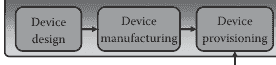

内容与服务层

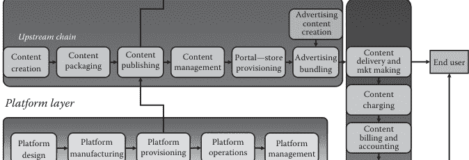

平台层

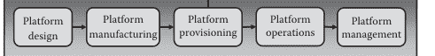

网络层


图 17.1 移动内容与应用的增值活动

## 17.5 移动内容与应用的价值网络

为了实现研究的主要目标，即能够描绘价值网络模型，核心增值活动分配给以下主体：

1. `MNO`（移动网络运营商——拥有网络并负责其功能。
2. `MSP`（移动服务提供商——主要活跃于内容管理）。
3. `MCP`（内容提供商或开发者——专注于内容创建）。
4. `MTP`（移动技术平台——专注于平台）。
5. `DM`（设备制造商——制造手机、智能手机和个人数字助理/`PDA`）。
6. 广告商——任何希望利用移动渠道推广其产品/服务的公司。
7. 终端用户——内容的最终客户。

由于参与者领域内的活动分配和组合可能会导致不同的整体网络，本研究提出了五种可能的配置，并通过源自文献的静态和动态变量对其特征进行进一步研究。

### 17.5.1 全封闭花园配置

在全封闭花园配置中，`MNO` 代表网络核心，受益于中心化定位和对网络的深度嵌入。在这种情况下，`MNO` 承担了普遍的角色，整合了属于内容与服务层的大部分活动——从内容聚合到内容交付和市场构建；它还负责收费-计费-会计（`CBA`）流程以及客户关系管理（`CRM`），此外还有网络层的天然优势（`Whalley and Curwen, 2013`）。

`MNO` 的网络影响或价值纽带是与 `MCP` 建立的，以填充值服务（`VAS`）组合，并与一个或多个 `MTP` 建立，通过这些平台提供的 `CSDP` 向终端客户交付一系列增值功能——例如，个性化、互动性、内容感知、定位等。

在收入方面（通过图 7.2 中连接参与者领域的箭头进行识别），`MNO` 向 `CP` 支付基于内容或基于传输的费用作为原始提供，并从他们那里收取利用其平台的费用；它还从广告商处收取提供服务的费用。由于是内容交付和市场构建的唯一负责人，`MNO` 留存了向终端客户收费的内容成本和传输成本，并向负责运营的 `MTP` 支付分成。

第十七章：移动内容与应用价值网络 355

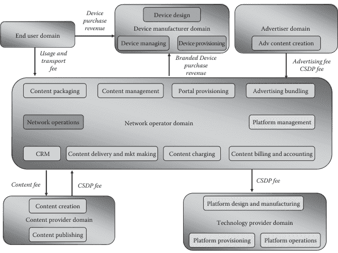

图 17.2 全封闭围花园配置。

并以某种方式发现自己正在竞争与核心点建立强有力关系可能。从动态角度来看，可能会出现锁定（`lock-in`）和排除（`lock-out`）效应，因为移动运营商（`MNO`）与移动平台供应商（`MTP`）之间关于平台提供的合同可能是排他性的：这些异常的联盟塑造了网络结构，并可能在中长期内将给定网络图中的某些参与者排除在外。

整体而言，这种全封闭围花园配置仅在基础服务方面是可行的，似乎无法满足运营商当前的需求。运营商倾向于利用第三方的方案来开发移动内容和应用领域，如图 17.3 所示。

这种考虑产生了第二种可能的配置，其中移动服务供应商（`MSP`）作为中间人的角色开始出现。

### 17.5.2 中介式内容交付配置

中介式内容交付配置看到了另一种参与者类型——`MSP` 的兴起，它控制了某些此前由 `MNO` 执行的下游活动，如内容交付和市场营造。

#### 静态或结构性评估

#### 动态评估

+ - 网络核心
  - `MNO`
- 关键网络影响
  - `MNO–MTP`
  - `MNO–MCP`
  - `MNO–DM`
- 结构等效性
  - `MCP`； `DM`；广告商
- 结构空洞
  - `MTP–MCP`； `MTP–广告商`
  - `MCP–终端用户`
  - `DM–MCP`； `DM–TP`
  - `DM–终端用户`（用于内容提供）
+ - 锁定和排除效应
关系于：
  - `MTP–MNO`
  - `MCP–MNO`
  - `DM–MNO`
- 学习率
  - 由于 `MNO` 的过度控制定位而而缺失
+ - 收益流
  - `MNO`、`DM` 的直接收入（用于设备提供）
  - `MCP`、`MTP` 的间接收入

图 17.3 全封闭围花园配置：静态和动态评估。

`MSP` 作为中间人，与终端用户建立了直接接触，增强了它们在网络中的角色和议价能力。`MNO` 保持对主要上游活动的覆盖，如内容聚合与管理、门户提供等。它继续管理与多个 `MSP` 以及一个或多个 `MTP` 的关系，将 `MSP` 也加入到这一联盟组合中，并从中获得来自增值服务商业化的持续收益份额。

`MTP` 将属于平台层的活动集中在自己的边界内，并可以向 `MNO` 和 `MSP` 提供其 `CSD`（内容服务交付）产品。后者的关系甚至可能导致学习率，即服务供应商试图窃取技术资源和能力，以便在内部设计和运营平台。

`DM` 继续保持与 `MNO` 和终端用户的关系，尽管它们从后者那里收到的收益流与设备销售有关，而非内容和服务的商业化。

核心参与者仍然是 `MNO`，但由于 `MSP` 的存在，结构变得不再集中，第一种配置中的某些结构空洞被填满了——例如 `MSP` 与广告商之间、`MSP` 与 `MTP` 之间以及 `MSP` 与终端用户之间的空洞。

注意到的主要结构等效性与 `MSP`、`CP` 和广告商的角色有关——这种因素增加了相应涵盖活动的竞争水平——而运营商在价值创造中最重要的网络影响是与 `MCP` 的关系，用于扩大内容和服务组合，而 `MSP` 则为了利用其资产和资源更好地服务更大部分客户群体，`MTP` 则提供可能影响内容管理和交付性能的顶级平台解决方案。

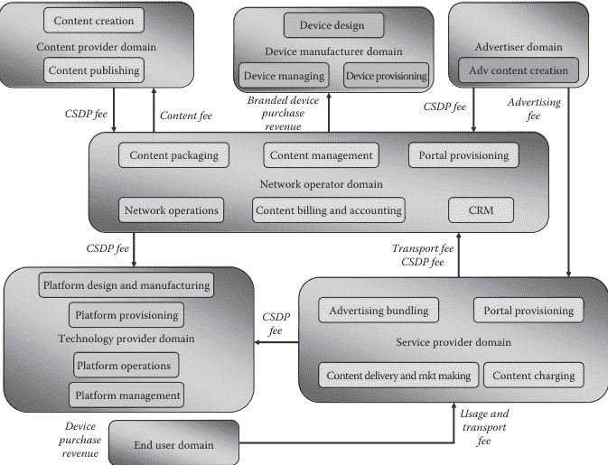

**图 17.4** 中介式内容交付配置。

此外，即使在这种配置中，外围参与者也可能发现自己被锁定在 `MNO` 的战略组之内或之外，这对盈利能力以及成功或生存的机会产生巨大影响（见图 17.4）。

总之，这种配置与在门户发布的大多数内容和服务（例如信息娱乐）有关：`MNO` 通过一种对外围参与者更高开放性的模型，将市场营造的下游活动扩展到 `MSP`，为第三方驱动的移动内容和应用铺平了道路（见图 17.5）。

### 17.5.3 全开放花园配置

开放花园配置代表了第二种替代方案可能的进展和退化，其中服务供应商取代运营商成为网络核心，实质上将后者降级为运营商和网络管理者的角色。

358

移动电子商务

#### 静态或结构性评估

#### 动态评估

+ > 网络核心
> `MNO`
> 关键网络影响
> `MNO–MTP`
> `MNO–MCP`
> `MNO–MSP`
> 结构等效性
> `MCP`； `MSP`；广告商
> 结构空洞
> `MTP–MCP`； `MTP–MSP`；广告商
> `MCP–终端用户`
> `DM–MCP`； `DM–MTP`； `DM–终端用户`
> （用于内容提供）
+ > 锁定和排除效应
关系于：
> `MTP–MNO`
> `MCP–MNO`
> `DM–MNO`
> 学习率
> `MSP–TTP`
+ > 收益流
> `MNO`、`DM` 的直接收入（用于设备提供）
> `MCP`、`MTP` 的间接收入

图 17.5 中介式内容交付配置：静态和动态评估。

`MSP` 作为中间人，与终端用户建立了直接接触，增强了它们在网络中的角色和议价能力。`MNO` 保持对主要上游活动的覆盖，如内容聚合与管理、门户提供等。它继续管理与多个 `MSP` 以及一个或多个 `MTP` 的关系，将 `MSP` 也加入到这一联盟组合中，并从中获得来自增值服务商业化的持续收益份额。

`MTP` 将属于平台层的活动集中在自己的边界内，并可以向 `MNO` 和 `MSP` 提供其 `CSD` 产品。后者的关系甚至可能导致学习率，即服务供应商试图窃取技术资源和能力，以便在内部设计和运营平台。

`DM` 继续保持与 `MNO` 和终端用户的关系，尽管它们从后者那里收到的收益流与设备销售有关，而非内容和服务的商业化。

核心参与者仍然是 `MNO`，但由于 `MSP` 的存在，结构变得不再集中，第一种配置中的某些结构空洞被填满了——例如 `MSP` 与广告商之间、`MSP` 与 `MTP` 之间以及 `MSP` 与终端用户之间的空洞。

注意到的主要结构等效性与 `MSP`、`CP` 和广告商的角色有关——这种因素增加了相应涵盖活动的竞争水平——而运营商在价值创造中最重要的网络影响是与 `MCP` 的关系，用于

第十七章：移动内容与应用价值网络 359

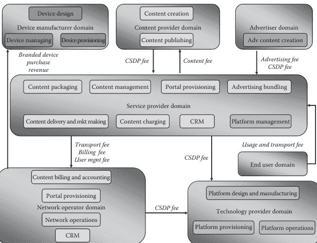

图 17.6 全开放花园配置。

`MSP` 和 `MTP`，其中服务供应商可能希望窃取设计和运营中间件平台所需的知识，以便为了自己的专属利益利用它，随后破除联盟，见图 17.6。

此处建模的配置在很大程度上具有颠覆性，因为它将向第三方的开放趋势推向了极端，重塑了网络结构，以至于发生了对 `MNO` 的替代，见图 17.7。

### 17.5.4 技术与服务供应商配置

技术与服务供应商配置是前一种配置的替代方案，因为它看到了 `MTP` 作为网络领先参与者的兴起；`MSP` 不再存在，因为其活动由技术供应商承担。这种配置可能具有同等的颠覆性，因为它减少了 `MNO` 对价值系统的控制，并扩展了 `MTP` 对非核心业务纠缠活动的覆盖范围——即属于平台层的活动。

`MTP` 获得直接收益

## 静态或结构评估

## 动态评估

- 网络核心
  - `MSP`
- 关键网络影响
  - `MSP--MNO`
  - `MSP--MTP`
  - `MSP--MCP`
- 结构等效性
  - `MCP`; `MTP`; 广告商
- 结构洞
  - `MNO--CP`; `MTP--Advertiser`
  - `MTP--CP`; `MNO--Advertiser`
  - `DM--MCP`; `DM--MTP`; `DM--End User`（针对内容提供）
- 锁定与排斥效应
关系于：
- `MSP--MNO`
- `MSP--MTP`
- `DM--MNO`
- 学习竞赛
  - `MSP--MTP` 针对技术能力
  - `MSP--CP` 针对内容创作
- 收入流
  - `MSP`、`DM` 的直接收入（针对设备提供）
  - `MNO`、`MCP`、`MTP` 的间接收入

图 17.7 全全开放式花园配置：静态与动态评估。

来自客户的资金流，部分将这些资金流重定向到 `MNO`，作为对传输、`CBA` 和用户管理服务的报酬。出于各种原因，显而易见的是该参与者整合 `MSP` 执行的活动，成为了一个技术和服务提供商。

在这一参与者兴起的网络中，竞争性消耗体现在以 `MTP--MNO` 二元组为中心的不同图中，边缘企业连接到这些二元组：这种关系空间创造了企业的表现和行为。

正如配置 3 所示，网络的结构缺口是那些 `MNO` 与边缘企业隔离开的部分——即广告商和 `MCP`。关键网络影响是 `MTP` 与 `MNO` 之间的关系，这对于将富媒体内容和服务实际部署给终端用户至关重要，如图 17.8 所示。

`MTP` 和 `MNO` 对终端客户的共同所有可能导致一场关于用户画像和使用报告数据信息的内部学习竞赛。

作为结论，在最终配置中，`MTP` 的范围扩大到对数字内容和底层平台的整体管理，在 `MTP` 和 `MSP` 之间创造了竞争动态，这可能导致后者参与者从价值生态系统中消失。然而，案例研究的指示表明，这种配置最不可能在大规模范围内出现，因为 `TTP` 作为嵌入最深实公司的现有网络部分大多源于市场异常——例如，技术供应商利用短期到中期获利的偶然机会或长期合作伙伴关系，而不是源于清晰的长期战略规划。

图 17.9 阐并描述了技术和服务提供商配置的静态和动态特征。

第十七章：移动内容与应用价值网络

静态结构评估

动态评估

- 网络核心
  - `MTP`
- 关键网络影响
  - `MTP–MNO`
  - `MTP–MCP`
- 结构证据
  - `MCP`; 广告商
- 结构洞
  - `MNO–MCP`; `MNO–Advertiser`
  - `DM–MCP`; `DM–MTP`; `DM–End User`（针对内容提供）
- 收入流
  - `MTP`、`DM` 的直接收入（针对设备提供）
  - `MNO`、`MCP` 的间接收入
- 锁定与排斥效应
- 关系：
  - `MTP–MNO`
  - `DM–MNO`
- 学习竞赛
  - `MTP–MNO` 针对用户画像

图 17.9 技术和服务提供商配置：静态与动态评估。

### 17.5.5 DM 驱动型配置

`DM` 驱动型配置是一种非常新的替代方案，与近期及新兴的应用商店现象（例如 `Apple Store`、`Vodafone 360°`）有关，`DM` 利用移动设备挑战现有者的领导地位，绕过了其昂贵的门户和 `CBA` 系统（`Bergväll–Kåbornn and Howcroft, 2013`）。

通过颠覆性的替代方案，`DM` 承担了内容和服务管理的网络核心角色，而 `MNO` 从直接内容管理缩回到某些与客户相关的活动，然而，由于 `DM` 拥有的替代方案（例如：`CBA` 提供；直接计费；门户提供对比 商店提供），其价值正在被竞争掉（见图 17.10）。

从结构角度来看，该配置的关键网络影响是 `DM` 与 `MNO`、`MCP` 和 `MTP` 之间的关系（因为 `MSP` 不再处于价值网络中，被 `DM` 本身取代）；结构涌性与 `MCP`、`MSP` 和广告商的角色有关；结构洞出现在 `MNO`、`MCP` 和广告商之间；收入流对于 `DM` 来说是直接的（设备提供和内容提供），而对于 `MNO`、`MTP` 和 `MCP` 来说是间接的。

静态或结构评估 动态评估

- 网络核心
  - `DM`
- 关键网络影响
  - `DM-MNO`
  - `DM-MCP`
  - `DM-MTP`
- 结构等效性
  - `MCP`; `MTP`; 广告商
- 结构洞
  - `MNO--MCP`; `MNO--Advertiser`
- 锁定与排斥效应
- 关系：
  - `MTP–MNO`
  - `DM–MNO`
- 学习竞赛
  - `MTP–MNO` 针对用户画像
- 收入流
  - `MTP`、`DM` 的直接收入（针对设备提供）
  - `MNO`、`MCP` 的间接收入

图 17.9 `DM` 驱动型配置：静态与动态评估。

## 17.6 结论与未来

`MTP` 的范围扩大到对数字内容和底层平台的整体管理，在 `MTP` 和 `MSP` 之间创造了竞争动态，这可能导致后者参与者从价值生态系统中消失。然而，案例研究的指示表明，这种配置最不可能在大规模范围内出现，因为 `TTP` 作为嵌入最深实公司的现有网络部分大多源于市场异常——例如，技术供应商利用短期到中期获利的偶然机会或长期合作伙伴关系，而不是源于清晰的长期战略规划。

图 17.8 技术和服务提供商配置。

# 第七章：移动内容与应用网络 365

`Desporto, W.S., Gral, R., and Wang, R. 2009.` 动态战略群体：推导空间演化路径。战略营销管理 30(3), 1420–1439.

`Eggert, A., Ulaga, W., and Schultz, F. 2005.` 关系循环中的价值创造：准纵向分析。工业营销管理 35, 20–27.

`Eisenhardt, K.M. 1998.` 从案例研究构建理论。管理学评论 14(4), 532–550.

`Firtman, M. 2013.` 移动Web编程，O'Reilly Media, Sebastopol, CA.

`Fjellstad, O.D., Becerra, M., and Narayanan, S. 2004.` 网络中的战略行动：手机行业的实证分析。斯堪的的纳维亚管理杂志 20,173–196.

`Funk, J.L. 2009.` 手机行业价值网络的发展：日本案例及其对其他地区的启示。电信政策 35, 4–18.

`Gilson, Y., Clemens, E.A., and Duysters, G. 2007.` 战略联盟与创新：决定论与意志性视角。技术分析与战略管理 19(2), 227–249.

`Gulati, R. 1995.` 社会结构与联盟形成模式：纵向分析。美国社会学杂志 91, 481–510.

`Gulati, R., Lavie, D., and Singh, H. 2009.` 伙伴经验的本质与联盟收益。战略管理杂志 30(11), 1213–1233.

`Gulati, R., Nohria, N., and Zaeer, A. 2000.` 战略网络：战略管理杂志 21,203–215.

`Hagedorn, J., Roijakkers, N., and Van Kranenberg, H. 2006.` 企业间研发网络：战略网络对高科技伙伴关系的重要性。英国管理杂志 17(1), 39–53.

`Hakansson, H. and Snehota, I. 1989.` 没有任何业务是孤岛：业务战略的网络概念。斯堪的纳维亚管理杂志 5(3), 187–230.

`Hamer, G., Zhou, L., and Prahad, C.K. 1998.` 与竞争对手合作并获胜。哈佛商业评论 67(1), 113–139.

`Hinterburg, H.H. and Levin, B.M. 1994.` 战略网络——未来的组织。长远规划 27(3), 43–53.

`Hobday, M. 1994.` 硅谷的局限性：对网络理论的批判。技术分析与战略管理 16(2), 232–245.


Huerner, J. 2006. 供应关系中的价值创造、协调与定位。长远规划 39, 133–155.

Ibrus, J. 2013. 媒体融合的演化动力学：与W3C的早期概述。电信与信息 30(2), 66–73.

Idate. 2012. 数字世界：数字世界的挑战。市场研究报告，Idate, Montpellier, France。访问地址：http://www.idata.org/en/DigiWorld-store/Collection/DigiWorld_9/DigiWorld-year-2012_730。访问日期：2014年1月20日。

Informa. 2012. 移动内容与服务（第10版）。市场展望、收入机会与商业模式。市场研究报告。

Jarrillo, J.C. 1988. 战略网络。战略管理杂志 9(1), 31–41.

Jung, H., Kim, E., S., and Hwang, J. 2013. 多元化如何影响一家韩国手机公司的创新。国际移动通信杂志 10(5), 521–535.

Kell, T., Autio, E., and Robertson, P. 1997. 电信部门的嵌入性、权力、控制与创新。技术分析与战略管理 9(3), 299–316.

移动电子商务

Kuo, Y. and Yu, C. 2006. 3G电信运营商的挑战与角色：移动商务价值链的影响。技术创新 26(12), 1347–1356.

Li, F. and Whalley, J. 2002. 电信行业的解构：从价值到价值网络。电信政策 26, 451–472.

Lin, Z., Yang, H., and Arya, B. 2009. 联盟伙伴与企业绩效：资源互补与地位评估。战略管理杂志 30(9), 921–940.

Marjolein, C., Cajiels, A., Henny, A., and Romij, B. 2008. 战略管理：从价值到价值网络。欧洲管理杂志 20,245–266.

Merdith, J. 1998. 通过案例研究进行运营管理。运营杂志 16,441–454.

Norman, R. and Rylander, R. 1994. 为竞争优势设计战略。John Wiley & Sons, Chichester.

Okun, K. and Vastner, N. 2006. 战略联盟的演变。战略管理杂志 18(5), 535–560.

Parolini, C. 1999. 价值网：一种可持续发展的工具。John Wiley & Sons, Chester.

Pepper, J. and Holweg, M. 2006. 揭示移动运营商之间的复杂结构。信息管理 42, 74–81.

Porter, M. 1985. 竞争优势：创造与维持。Free Press, New York.

Rubin, H. and Rubin, I. 1995. 定性访谈：数据的艺术。Sage Publishing, Thousand Oaks.

Schiefer, C. and Duysters, G. 2005. 战略联盟中的配置。知识管理与政策 2,194–199.

Stabell, C. and Fieldstads, Ø. 2002. 为竞争优势配置价值链。战略管理 19,413–437.

Tapascott, T., Codill, D., and Lowe, A. 2009. 数字赋能：商业的力量。Business School Press, Boston.

Wahab, G. 1995. 信息系统的解释性案例研究。Info 15(4), 3–22.

Wirtz, B.W. 2001. 融合媒体市场的价值链重构。长远规划 34,489–506.

Yin, R. 2003. 案例研究：设计与方法。Sage, CA.

# 第十八章

# 支付服务的细分、目标与定位

Raluca-Andreea Wurster 与 Cezar Scarlat

+ **目录**

18.1 引言 ................................................................................ 367

18.2 背景与问题描述 ............................................................ 369

18.3 研究目标与相关性 ................................................. 372

18.4 战略管理流综述 ................................................. 372

18.5 移动支付服务接受的先决条件、驱动因素与障碍 ............ 377

18.6 支付服务细分、目标选择与定位的战略管理方案 .................... 380

18.6.1 正确细分市场 ................................................................. 381

18.6.2 精准选择目标消费者 ....................................................... 383

18.6.3 竞争管理 ................................................................ 384

18.6.4 支付服务的定位 ................................................................. 386

18.6.5 总结 ................................................................... 387

18.7 结论 .............................................................................. 388

参考文献.................................................................... 389

## 18.1 引言

只有当创新被大多数消费者接纳时，技术领域的公司才能保持领先地位。由于今天社会流动性的增强以及技术基础设施的进步，移动电话技术已在全球范围内被快速采用。

从用户的角度来看，NFC 交易之所以流行是因为它们缩短了用户完成交易所需。相反，Alimi 等人（2013）研究了商户端 NFC 交易的使用，并提出了“为了将手机用作销售点而采用不同的架构”。出于安全考虑，用户通过其智能手机的触摸屏进行生物识别认证。

由于支持 NFC 的移动手机在某些情况下可能被用作手机克隆和侧读平台（攻击者可以利用现有的安全控制系统，将 NFC 移动手机作为此类攻击平台），Francis 等人（2010）也关注了这些方面，并为支持 NFC 的手机开发了适当的安全防御措施。另一方面，来自接触式系统的合法交易信息可用于营销目的。

总的来说，许多研究人员解决了移动支付系统（MPS）的安全问题（Lu et al., 2009; Francis et al., 2010; Vesal and Fathian, 2012）；然而，生物识别方法似乎占据主导地位。

2009 年，全球超过三分之二的人口配备了手机。在移动电话市场已成熟的发展中国家，移动支付是移动运营商寻求收入的潜在来源，他们正试图实现服务的多元化。在移动电话广泛普及的发展中国家，政府将移动支付视为改善无银行账户人群获得银行服务机会。MPS 的概念是指在独立银行网站连接的情况下，通过移动设备发起并实现对商品、服务和账单的授权支付（Schierz et al., 2009）。移动设备可以是手机、电脑、个人数字助理（PDA）或可以贴在任何物体上（如戒指或钥匙）的无线贴片。交易可以是远程的（例如基于短信），也可以通过近场通信（NFC）或射频识别（RFID）等接触式技术在本地处理。移动货币转账可以是远程、店内、预付或通过反向计费后付费。总的来说，根据 Little（2012）的一项研究，所谓的移动支付在2012 年的交易额达到了 2500 亿美元。

基于新技术，MPS 目前正在向多样化发展，甚至将两者混合。例如，移动旅行支票（MTC）是一种新的支付工具，结合了电子支票（安全性）和电子现金（免费使用）的优点。Ahamad 等人（2012）为 MTC 开发了一种移动支付协议，该协议使用复杂的算法生成和验证数字签名（如椭圆曲线数字签名算法），并对适合手机的消息进行加密和解密。

然而，尽管移动支付引起了广泛关注，除了少数国家外，它们的发展一直缓慢。虽然诸如“App”的服务迅速成为消费者日常生活的一部分，但 MPS 的增长率仍低于总体预期，这导致 O2 Telefon 等电信公司退出了其移动支付活动。NTT DoCoMo 在日本推出的接触式支付解决方案的成功，经常被认为是移动手机为发达国家支付格局可能带来的巨大变革的典范。沃丰在肯尼亚启动的 M-Pesa 服务在 2009 年已达到 750 万订阅用户，这也引发了减少发展中国家金融排斥的希望（Bourreau and Verdier, 2014）。

正如 Venkataraman（2008）所示，并非所有的移动支付实施都是成功的：移动商务业务增长缓慢的背后之一是缺乏成功采用移动支付的合适指导或规划。Venkataraman 从技术和业务角度解决了这一问题，为移动支付的实施提出了一个参考框架（路线图）。

从法律角度来看，责任问题随之产生（例如，在发生欺诈性交易的情况下，应由支付服务用户还是支付服务提供者承担财务后果）（Steonant, 2011）。Edlund（2011）认为，MPS “可能会在执行支付指令方面承担严格责任，在某些情况下，它们将承担支付人无偿能力的风险。”

然而，对这些案例的密切分析表明，成功案例不能轻易概括，并证明移动支付的成功需要若干标准（Bourreau and Verdier, 2014）。在本章中，作者将分析消费者采用或拒绝 MPS 的主要标准是什么，以及 MPS 市场的参与者如何定位自己以获得收入和市场份额。

## 18.2 背景与问题描述

摆脱通用维度并识别公司特定主题的内容至关重要，以便关注那些对其特定情况特别重要的元素和对齐。

> Fuchs 等人（2000, p. 135）

这句引用有力地反映了当今高层管理面临的挑战，比以往任何时候都更加严峻。一方面，经理必须开发和保护公司的核心业务；另一方面，他们必须为公司探索新产品和新市场（Kuratko et al., 1990）。

这种平衡行为给经理带来了巨大挑战，因为随着与新竞争对手相关的激进技术变革，保护核心业务变得越来越困难。带着既有产品或新产品进入新市场同样困难，因为这意味着经理必须应对他们并不完全熟悉的行业动态，这显著增加了不确定性水平（Langlois and Steinmueller, 2000）。

尽管如此，大多数公司都为了确保未来而趋于创新（Nelson and Winter, 1977）。特别是在电信行业，公司不断寻找新的收入来源，这意味着他们必须像提到的那样推出新产品或开发新市场。这一策略背后的逻辑是他们有的业务模式面临着巨大压力（Illinitic et al., 1996, 1998）。D'Aveni 创造了“超竞争”一词，指一组基于价格-质量定位的快速升级的竞争，以及对技术诀和建立先发优势的竞争（D'Aveni, 1994, 1996）。

特别地，先发优势通常被认为是新增长和高利润的关键（Dos Santos and Peppers, 1995）。这一陈述否定了成功的发布发布是其原因。如果只有经理们能够开发并推出与开发的细分市场相匹配的吸引产品，公司将产生先发优势（Dosi, 1982）。提供发达国家支付卡系统发展的简要历史视角有助于更好地理解成功因素并采用电子支付系统。支付卡最早于 20 世纪 50 年代由封闭平台（如 Diners Club 或个人银行）引入，他们成功地为客户开发了重要的接受网络。之后，一些银行决定建立银行合资企业，使他们能够就共同标准达成一致并扩大接受网络。最重要的合资企业后来变成了 Visa（1975）和 MasterCard（1979），具有全球影响力，现在在世界上许多地区被使用和接受。2006 年，这些公司改变了组织结构以成为上市公司。支付卡系统的案例表明，对于大众市场电子支付系统的发展，至少有两个标准至关重要。第一，参与者必须合作开发共同标准，或规定互操作性的条件。建立合资企业可以显著减少不同标准之间不兼容的成本。然而，开发 MPS 的合作似乎比开发支付卡要复杂得多。第二，参与者必须开发一种

## 第十八章：移动支付的细分、目标与定位

重要的受理网络。消费者越是采用某种支付工具，商户就越愿意接受它，反之亦然。然而，应该注意的是，参与者在采用移动支付（MPS）方面面临的问题，与发达国家支付卡的普及情况非常不同。移动支付在德国等欧洲国家尚未被完全采纳的原因在于支付市场本身（TNS Institut, 2012）：

- 现金支付是受最青睐的支付方式，超过 50% 的消费者青睐此项。
- 德国卡片市场竞争激烈且去中心化严重，拥有超过 30 家发行机构、16 家收机构和 8 个卡片处理器。
- 卡片渗透率很高，达到 156%，尽管卡支付仅占所有无现金支付的 15%（Dahlberg, 2007）。
- 记卡是首选的卡支付方式（80%）；信用卡支付很少见（3%）。
- 四分之三的卡片由公共和合作社发行，与客户保持着紧密的关系。

通过对德国 347 名家用手机用户进行调查，Gerpott 和 Kornmeier (2009) 发现，移动支付的风险评估以及社会参考群体对移动支付的评估是决定未来采用移动支付行为意图的重要（间接）决定因素。

总而言之，移动支付的支付市场是竞争激烈且去中心化的。发达国家的消费者和商户已经配备了支付卡，这是一种被广泛使用和接受的电子支付解决方案。因此，如果他们要取代支付卡的使用，移动支付就必须提供足够的额外价值才能被消费者和商户所纳。在消费者方面，手机可能比支付卡具有竞争优势，因为它们可以作为交互式设备使用，消费者可以在其中存储信息。消费者通常习惯了免费获得支付工具，要么与银行账户绑定提供，要么由试图增加用户粘性的商户提供。因此，如果服务由非营利机构提供，提供者将找到一种收回其在基础设施和安全投资成本的方法，而低成本服务的存在缓解了这种成本。移动支付提供者的另一个选项是针对那些缺乏支付卡的市场。此类市场可能包括为没有银行账户或银行不足的人群提供低成本或低风险的个人间转账和支付服务。某些人不用电子支付工具的原因是多样的；例如，如果消费者看重隐私，他并不一定会比支付卡更容易接受移动支付（Bourreau 和 Verdier, 2014）。

电信公司能够成功进入基础设施高度发达且消费者偏好保守支付方式的支付市场的唯一机会窗口，就是将他们的手机专业知识与结合新技术而产生的新支付产品结合起来。随着作为首批零售商和如 PayPal 这样的在线支付提供商推出了移动支付，在未来几年内，它将成为消费者面临的另一种成熟的支付替代方案。

管理问题的核心在于一个问题：“参与支付市场的公司如何确保新推出的支付产品能够被客户的接受和使用？”对这个问题的回答理想情况下将为提供者带来先发优势，并随之产生新的、稳定的收入流。

## 18.3 研究目标与相关性

本章的目标是根据与移动支付相关的实证研究中确定的移动支付驱动因素和障碍，为移动支付的细分、目标和定位提供战略管理建议。

作者将首先对战略管理理论中的领先概念进行简要回顾，即基于竞争的观点（CBV）、基于市场的观点（MBV）和基于资源的观点（RBV），然后对移动支付实证研究中确定的影响移动支付消费者接受和采用的最重要变量进行概述和分类。作者随后将遵循细分、目标和定位（STP）范式的原则得出管理建议。

在理论层面，对领先研究流及其对 STP 范式影响的分析，将带来新的见解，并在理论维度上呈现出截然不同的图景。

在实证层面，影响移动支付采用的变量将得到验证，从而清晰地展示什么因素推动或阻碍对移动支付的接受。

在管理层面，作者将帮助经理结构化并专注于他们的行动，特别是在新市场推出新产品时，从长远来看这将导致更好的管理决策。

## 18.4 战略管理流的回顾

在本节中将对三个领先的研究流（观点）进行回顾和批判性分析，即 RBV、CBV 和 MBV。这种方法的理由有两点：一方面，必须确定一般的理论基准；另一方面，STP 范式必须在理论上扎根。所有观点的共同点是寻找和/或解释公司为了在市场取得成功而努力追求的持续竞争优势。本章的核心问题是，每种观点对于推出新支付产品意味着什么，以及所回顾的每个观点是否有在理论上丰富 STP 范式的潜力。

源于结构-性能假设（Bain, 1986），意味着行业环境（结构）是公司战略行动（行为）的主要驱动力，从而影响公司的盈利能力（性能）。波特开发了 CBV，并以他的五力模型为特征（Porter, 1980, 1981）。该模型的目标首先是识别出行业内部导致其吸引力的竞争力量。其次，可以从模型中推导出规范性行动，即高层管理人员如何影响行业结构以有利于自己的利益。四分之三的卡片由公共和合作社发行，与客户保持着紧密的关系。

## 第十八章：移动支付的细分、目标与定位 373

## 移动商务

374

寻找和/或解释公司为了在市场取得成功而努力追求的持续竞争优势。本章的核心问题是，每种观点对于推出新支付产品意味着什么，以及所回顾的每个观点是否有在理论上丰富 STP 范式的潜力。

源于结构-性能假设（Bain, 1986），意味着行业环境（结构）是公司战略行动（行为）的主要驱动力，从而影响公司的盈利能力（性能）。波特开发了 CBV，并以他的五力模型为特征（Porter, 1980, 1981）。该模型的目标首先是识别出行业内部导致其吸引力的竞争力量。其次，可以从模型中推导出规范性行动，即高层管理人员如何影响行业结构以有利于自己的利益。

通过对德国 347 名家用手机用户进行调查，Gerpott 和 Kornmeier (2009) 发现，移动支付的风险评估以及社会参考群体对移动支付的评估是决定未来采用移动支付行为意图的重要（间接）决定因素。


总而言，移动支付的支付市场是竞争激烈且去中心化的。发达国家的消费者和商户已经配备了支付卡，这是一种被广泛使用和接受的电子支付解决方案。因此，如果他们要取代支付卡的使用，移动支付就必须提供足够的额外价值才能被消费者和商户所纳。在消费者方面，手机可能比支付卡具有竞争优势，因为它们可以作为交互式设备使用，消费者可以在其中存储信息。消费者通常习惯了免费获得支付工具，要么与银行账户绑定提供，要么由试图增加用户粘性的商户提供。因此，如果服务由非营利机构提供，提供者将找到一种收回其在基础设施和安全投资成本的方法，而低成本的存在缓解了这种成本。移动支付提供者的另一个选项是针对那些缺乏支付卡的市场。此类市场可能包括为没有银行账户或银行不足的人群提供低成本或低风险的个人间转账和支付服务。某些人不用电子支付工具的原因是多样的；例如，如果消费者看重隐私，他并不一定会比支付卡更容易接受移动支付（Bourreau 和 Verdier, 2014）。

电信公司能够成功进入基础设施高度发达且消费者偏好保守支付方式的支付市场的唯一机会窗口，就是将他们的手机专业知识与结合新技术而产生的新支付产品结合起来。随着首批零售商和如 PayPal 这样的在线支付提供商推出了移动支付，在未来几年内，它将成为消费者面临的另一种成熟的支付替代方案。

管理问题的核心在于一个问题：“参与支付市场的公司如何确保新推出的支付产品能够被客户的接受和使用？”对这个问题的回答理想情况下将为提供者带来先发优势，并随之产生新的、稳定的收入流。

## 18.3 研究目标与相关性

本章的目标是根据与移动支付相关的实证研究中确定的移动支付驱动因素和障碍，为移动支付的细分、目标和定位提供战略管理建议。

作者将首先对战略管理理论中的领先概念进行简要回顾，即基于竞争的观点（CBV）、基于市场的观点（MBV）和基于资源的观点（RBV），然后对移动支付实证研究中确定的影响移动支付消费者接受和采用的最重要变量进行概述和分类。作者随后将遵循细分、目标和定位（STP）范式的原则得出管理建议。

在理论层面，对领先研究流及其对 STP 范式影响的分析，将带来新的见解，并在理论维度上呈现出截然不同的图景。

在实证层面，影响移动支付采用的变量将得到验证，从而清晰地展示什么因素推动或阻碍对移动支付的接受。

在管理层面，作者将帮助经理结构化并专注于他们的行动，特别是在新市场推出新产品时，从长远来看这将导致更好的管理决策。

## 18.4 战略管理流的回顾

在本节中将对三个领先的研究流（观点）进行回顾和批判性分析，即 RBV、CBV 和 MBV。这种方法的理由有两点：一方面，必须确定一般的理论基准；另一方面，STP 范式必须在理论上扎根。所有观点的共同点是寻找和/或解释公司为了在市场取得成功而努力追求的持续竞争优势。本章的核心问题是，每种观点对于推出新支付产品意味着什么，以及所回顾的每个观点是否有在理论上丰富 STP 范式的潜力。

源于结构-性能假设（Bain, 1986），意味着行业环境（结构）是公司战略行动（行为）的主要驱动力，从而影响公司的盈利能力（性能）。波特开发了 CBV，并以他的五力模型为特征（Porter, 1980, 1981）。该模型的目标首先是识别出行业内部导致其吸引力的竞争力量。其次，可以从模型中推导出规范性行动，即高层管理人员如何影响行业结构以有利于自己的利益。

根据波特的逻辑，行业是有吸引力的，当行业内部的公司能够抵御新进入者、避免替代品的威胁、中和供应商的议价能力、降低客户的议价能力并保持竞争者之间的低竞争（Porter, 1980, 1981, 1985）。

以下是模型的批判性摘录，由波特总结：

> 该范式的核心逻辑是，企业的绩效主要取决于其所竞争的行业环境，环境进而决定了行为。

尽管存在批评，五力模型因其简单性和广泛的应用已成为最受欢迎和应用的管理工具之一（Hoskinson et al., 2000）。模型的改进基于战略群体的概念（Brush et al., 1999）。在战略群体内部，公司的盈利能力可以追溯到规模经济和范围经济（Hatten 和 Schend, 1977）。公司应该关注行业水平而非战略群体的暗示是不够的（Cool 和 Schend, 1987）。

到目前为止，以激烈竞争（D'Aveni, 1994, 1996）为特征的行业水平（如移动电信），过去的竞争对手被迫结盟以增加用户群。合作是一种结合了合作与竞争的商业战略，源于对竞争对手也可以受益的理解（Brandenburg 和 Nalebuff, 1996）。竞合模式基于博弈论，这是一种在二期间开发的用于理解各种策略和结果的科学方法。传统的哲学转化为博弈论中的*零和游戏*，即赢者通得所有，输者空手而归；而合作支持者声称它可以导致*正和游戏*，即所有人的收益总和大于他们进入游戏时的投入总和。

(...) 我们对进入壁垒是如何构建的了解要少得多：为什么是这家公司而非其他公司开发了构成优势的基础，以及竞争优势产生并随时间侵蚀的动态过程。

Cockburn 等人 (2000, p. 1123)

在发展的早期阶段，资源基础观（RBV）主要是产业组织（I/O）研究流主流思维的反映，体现在上一章分析的能力基础观（CBV）中（Wernerfelt, 1984; Barney, 1991）。领先的研究人员（Dierckx and Cool, 1989, 1991a,b; Conner, 1991; Castanias and Helfat, 1991）批评了对行业/战略群体层面的单方面关注，以及对公司层级资源（管理、财务等）和过程的忽视。今天，人们广泛认为 CBV 和 RBV 是互补的，因为像行业和战略群体等外部因素（RBV 的关注点）正是公司的内部因素（Rasche, 2000）。在过去几年，研究界建立了三个描述成功资源的标准，即不可模仿性（nonitability）、锁定性（lock-in）和不可替代性（nonsubstitutability）。在描述这些标准之前，必须指出这是一个理想化的概念，正如 Montgomery (1995, p. 257) 所指出的那样：

就像柏拉图式的理想型一样，这种对资源完美形式的表描述从理论和实践标准来看都非常有用。同时，了解理想化形式与现实情况之间差距的大小也是重要的。这正是资源基础文献显得非常短缺的地方。

不可模仿性（Nonitability）是指公司的竞争优势所依赖的资源具有不可模仿性的这一概念。这意味着资源越被竞争对手模仿/复制的能力就越低，该资源对公司而言的价值就越高（Rouse and Daellenbach, 1999）。在理论层面，这一观点得到了市场可竞争性理论的支持，这意味着公司可以通过大规模的不可逆转投资来保护自己，以威慑对手（Schmalenees and Willig, 1989）。

锁定性（Lock-in）指的是资源植根于公司内部的深度与其成功之间存在强有的关系。换句话说，当资源深度植根于企业文化时，它们反过来对竞争对手来说变得极不透明，这反过来使得他们很难获取关键资源来显著削弱竞争优势（Peteraf, 1993）。由于高层知道哪些资源是关键的，他们必须找到将这些资源尽可能深度地嵌入企业文化的方法（Peteraf, 1990; Peteraf and Shannon, 1997）。

不可替代性（Nonsubstitutability）与前两个标准相比，是备受质疑的，“……替代的威胁无处不在……”（Collis, 1991a, p. 7）。Collis 在他的引用中正确地指出，在当今这个高度技术的世界中，替代是无处不在且非常难以评估的，通常替代会随着新技术的出现。特别有趣的是，在新兴的移动支付行业中，扮演关键角色的不是银行而是像德国电信（Deutsche Telekom）和沃丰（Vodafone）这样的公司，它们来自行业之外，但拥有技术接入能力。

“当公司控制的资源与其持续竞争优势之间的联系不被理解，或仅被非常不完美理解时，就存在因果模糊性”（Barney, 1991）。因果模糊概念在 RBV 中起着关键作用。它指的是资源与公司所处竞争地位之间的某些关系变得模糊了。这意味着公司成功的某些部分是无法解释的。一个很好的例子是苹果公司的成功。如果要求研究人员解释苹果的成功，答案从创始人史蒂夫·乔布斯（Steve Jobs）的个性到其通过 iTunes 和 Apple Store 分销策略下的产品设计不等。因果模糊概念背的核心论点是：公司资源与其竞争优势之间的关系越不为人知，竞争对手的模仿障碍就越高：

当优势基于具有因果模糊特征的能力时，那么公司将很难通过模仿来克服这些优势。因果模糊本身并不保证公司能够维持竞争优势，但它确实创造了非常有效的模仿屏障。

Reed and Delfilippi (1990, p. 94)

像 Collis 这样的批评者正确地指出，如果一家公司并不确切知道自己做得对（意味着他们的竞争优势取决于什么），那么他们采取的任何行动都可能加强其竞争优势，也可能破坏它（Collis, 1991a, p. 11）。

在目前分析的所有观点中，营销基础观（MBV）在新型支付产品的推出中发挥了作用，正如所示。正如这个名称

## 第十八章：移动支付的细分、目标与定位 377

### MBV 的核心逻辑

| 消费者 | + | 产品/营销经理 |
| :--- | :--- | :--- |
| • 能清晰表达愿望和需求<br>• 确切知道哪些产品特征对他们重要 | | 理解消费者<br>转化愿望和需求 |
| 表达 | | 转化 (082011_394.png) |

MBV 背后的逻辑是——细分、目标和定位——以识别消费者的需求（Kotler, 1989）。该策略的总目标是细分市场、针对细分市场并定位产品（Wernerfelt, 1984; Barney, 1991）。MBV的核心逻辑是将产品与目标细分的需求相结合（Rasche, 2000）。在过去几年，研究界建立了三个描述成功资源的标准，即不可模仿性、锁定性和不可替代性。在描述这些标准之前，必须指出这是一个理想化的概念，正如 Montgomery (1995, p. 257) 所指出的那样：

就像柏拉图式的理想型一样，这种对资源完美形式的描述从理论和实践标准来看都非常有用。同时，了解理想化形式与现实情况之间差距的大小也是重要的。这正是资源基础文献显得非常短缺的地方。

## 18.5 MPS 的前提、驱动因素和障碍

移动支付服务（MPS）的采用取决于多种因素，从技术基础设施到消费者感知不等。MPS 技术在亚洲已经建立，而西欧的商户采纳率仍然较低。然而，这一方向的首次尝试已经在地铁、公交站或停车场票务处有所开展。仍然缺乏的是消费者和商户的信任，导致他们在采用这种不同方式时产生犹豫（Kremer and Roddenkirchen, 2010）。移动支付服务（MPS）的采用取决于多种因素，从技术基础设施到消费者感知不等。MPS 技术在亚洲已经建立，而西欧的商户采纳率仍然较低。

为了识别消费者接受 MPS 的驱动因素和障碍，作者选择了若干实证探索，每个研究的侧重点不同，但都贡献了独特的见解。Schierz 等人（2009）的研究探讨了 MPS 的接受决定因素。Mallat（2006）识别了消费者采纳的驱动因素和障碍，并与 Tuunainen（Mallat and Tuunainen, 2008）共同提出了商户采纳的障碍。Yang 等（2012）对中国的探索不仅限于使用意图，还包含了 MPS 使用后阶段的结果。电子商务中消费者接受（Pavlou, 2003）和移动电子商务（San-Martin and Lopez-Catalan, 2012；另见 Bauer, 2012）的研究结果被纳入，以考察信任对采纳的作用。样本在年龄、性别以及教育和职业背景方面具有异质性。

Bamasak（2011）显示阿拉伯人愿意接受 MPS；然而，移动支付交易的安全以及未经授权使用手机支付是人们极大的担忧。在这方面，一些作者（Daskapan 等，2010）更倾向于短程 MPS，认为其更可靠。

Poustchi 和 Hufenbach（2013）提出的移动支付模型为创新的影响变量提供了基础理解。Tornatzky 和 Klein 关于创新采纳的元研究（1982）为创新的影响变量提供了基础理解。

在对亚洲快速扩张市场中潜在 MPS 用户的调查中，Liu 等（2011）识别了五种支付界面

## 第十八章：移动支付的细分、目标与定位

可用性因素（内容、易用性、促销、媒介适应性和情感）对交互行为和移动支付的意意愿具有积极影响。

作者们根据实证研究，将驱动移动支付系统（MPS）接受和采纳的变量重构为以下几类：(1) 使用MPS意图的临床前驱动因素，2) 使用MPS意图的影响因素，3) 实际使用MPS的驱动因素。阻碍MPS采纳的变量总结在第4部分的障碍中（Wurster, 2013）。

- 接受和使用MPS意图的先决驱动因素（Wurster, 2013）如下：
  - 对系统及提供者的信任（Pavlov, 2002; Mallat, 2006; Mallat and Tuunainen, 2009; Bauer 2012; San-Martin and Lopez-Catalan, 2012; Fingerhut, 2014）
  - 系统的兼容性（Tornatzky and Klein, 1982; Mallat, 2006）
  - 系统的可访问性（Wurster, 2013; Fingerhut, 2014）

- 以下因素会影响使用MPS的意图，但取决于消费者的性格和社会背景，因此根据 Wurster (2013) 的观点，不能归类为通用驱动因素：
  - 同伴群体或社交社区的社交影响（Tornatzky and Klein, 1982; Schierz et al., 2009; Yang et al., 2012）
  - 对创新和个人流动性的积极态度（Schierz et al., 2009）
  - 作为个人风险或控制感知的主观规范（Yang Schierz et al., 2012）

- 提供者可以通过提供比替代支付方案更便利的条件（Wurster, 2013）或“增值服务”（Fingerhut, 2014）来驱动MPS的采纳率和实际使用，这意味着提供者应该扩展其服务以与刷卡支付区分开来（Fingerhut, 2014）。

- 在作者看来，MPS消费者采纳的障碍如下：
  - 缺乏支付系统安全维度的信任。大多数作者和研究人员都同意安全问题在在线和MPS接受中的完全作用（Pavlov 2003; Bauer, 2012; Wurster, 2013; Fingerhut, 2014）。
  - 复杂性是便利（或简单）的对立面，指的是过多的不同且持久的注册程序。如果所有提供者都同意相同且简单的技术，并遵循能够实现透明程序并控制资金传输的“触碰即”逻辑，消费者的恐惧和风险感知将降低（Undrus and Pigneur, 2009; GfK, 2011; Wurster, 2013）。

- 所有阻碍商户采用移动支付系统并导致消费者无法获得服务的因素（商户采纳障碍请参见 Mallat and Tuunainen, 2008）。

## 18.6 MPS细分、目标与定位的战略管理方案

为了在战略上将某项产品定位为MPS，作者选择了STP范式，因为它在移动商务价值（MBV）和战略管理流中起着核心作用，这些流重点关注竞争环境下的消费者需求和接受度。图18.2所示的流程总结了整体框架。

市场细分的底层逻辑基于客户在产品偏好和购买行为上表现出异质性（Green, 1977; Wind, 1978）。这应该也是推出新型MPS产品战略建议的起点。

| 细分 (Segmenting) | 目标选择 (Targeting) | 定位 (Positioning) |
| :--- | :--- | :--- |
| 核心内容 | • 相关市场的定义 | • 对现有目标群体的收割 | • 定义整体营销策略 |
| | • 市场容量/潜力的估计 | • 识别新的目标群体 | • 对选定的细分和目标群体进行最终评估 |
| | • 确定关键细分标准 | • 评估/选择关键目标群体 | • 使选定的细分和目标群体与策略对齐 |
| | • 识别吸引人的细分 | • 目标群体的渗透 | 启动市场活动 |
| | • 其他 | • 构想新的目标群体 | 我们是否与营销策略正确对齐 |
| | | • 其他 | • 其他 |
| 关键问题 | • 我们在哪个市场？市场吸引力如何？ | • 我们现有的目标群体是谁？他们如何运作？ | 我们是否被选定的细分和目标群体说服 |
| | • 该市场中的关键细分是什么？ | • 目标群体内部是否存在细微变化？ | |
| | • 细分之间是否相互独立？ | • 其他 | |
| | • 其他 | | | |

图18.2 MBV 框架。

### 18.6.1 正确进行市场细分

对于本文，市场细分的定义采用了美国营销协会的定义，其指出“市场细分涉及对客户和消费进行分类，这种细分通常是为了满足客户需求”（American Marketing Association, 2014）。该定义可以补充为：“它是一个创造性过程，其后续是”（Marketing Association, 2014）。

在这种情况下，市场细分基于以下内容：

（注：原文大量重复了2012年至1977年的年份定义，其核心含义均为：市场细分涉及对客户和消费进行分类，这种细分通常是为了满足客户需求。）

# 第八章：移动支付383的细分、定位与定位

在过去的2年里，大多数数字局外人士拒绝使用手机进行通话以外的任何通信，因为他们认为屏幕对他们来说太小了，这降低了便利性；而且他们的技能太差，无法通过手机上网，即使是智能手机如此（MCR, 2013）。

性别细分或根据消费者个人风险倾向的细分将是移动支付解决方案（MPS）的额外细分策略，根据 Mallat 的论证（2006），这意味着将潜在用户划分为风险规避型和风险友好型用户，并对他们进行个体化定位。特别是在支付领域，MPS提供商需要确保提高风险规避型用户的信息透明度，并针对他们制定专门的计划，以消除他们的恐惧。

### 18.6.2 准确定目标消费者

通常，文献将“定位”（targeting）一词涵盖营销部门对目标的完整管理（Kahn, 2000）；与整体目标管理紧密相关有两个基本问题：

- 1. 我们是否充分利用了目标群的潜力，还是还有改进空间？
- 2. 我们如何根据细分分析识别新的目标群体，并据此获取他们具有吸引力的特征？

具体来说，第二个问题是移动支付市场提供商活跃行为的主要驱动因素之一，因为管理层希望进入这一迷人的市场。


来自第5章实证研究的大多数研究（例如 Mallat, 2006; Mallat and Tuunainen, 2008; Schierz et al., 2009; Yang et al., 2012）建议，公司应该根据个人的行为模式和先前的经验，对其 MPS 解决方案进行针对性的目标和定位。

创新者和早期采用者对使用 MPS 意愿的积极影响，以及将他们作为更多怀疑的消费者群体的倍增器，可能会更快地攻占大众市场。

然而，管理上的意义在于利用社会影响效应来扩大用户基础和收入来源。88%的人使用手机收集有关产品、服务及其益处的信息，或搜索特定的品牌和优惠。男性（78%）和30岁以下的消费者（89%）是移动网络服务的深度用户。精细的细分显示，数字原住民和数字移民可能是 MPS 战略营销活动中最相关的目标群体，因为他们占了用户的88%（MCR, 2013），正如第1.6.1节所述。这些消费者具有高度吸引力的原因是，他们每天上网，并且比访问频率较低的人更信任移动支付。但在频繁使用互联网的用户中，也有30%的移动购物者认为移动商务不够安全。对于19%的人来说，购买仍然太复杂；对于13%的人来说，支付过程不够方便。56%的人从 App Store 下载了 App 并关注该 App 拥有哪些访问权限（MCR, 2013）。

大幅提高定位活动效率的一种可能性是实施和部署客户关系软件工具，因为这些系统的核心价值之一是集中化，而且当客户行为模式作为分析基础时，可以更容易地识别出新的目标群体（Sheeth and Sisodia, 1999）。

### 18.6.3 管理竞争

理想情况下，公司的（竞争性）定位是成功的 STP 活动的结果。

如果公司想取得成功，高层管理人员必须确保所有资源已到位且没有短缺。其次，必须识别关键资源（即技术特征等），这些资源对于市场成功极可能重要。但同样重要的是，管理层必须确保专业知识将共享并嵌入到移动支付部门中，并对关键资源（如果可以识别它们的话）进行相应的锁定。

但对于希望参与新兴移动支付市场的公司来说，不断跟踪市场事实至关重要，例如现有产品、平台以及服务（如 Google Wallet 或 PayPass 等竞争对手）的技术发展，以及 PayPal 等主要参与者在这个动态市场环境中的所有竞争优势。对可能的战略路径有坚实的理论理解，并从竞争活动（包括网上银行和电子商务）中学习，将支持那些旨在在该领域获得或维持竞争优势的支持者。

关于新支付产品的发布，CBV 在三个三个上都提供了成果果累的理论见解和规范性建议。例如，关键在于不要高估行业水平；因为像移动支付这样的行业很有吸引力，并不意味着该行业内的公司能够获得其潜在利润。在战略群体层面，管理层必须聚焦于提高流动性障碍以阻挡潜在的竞争者。考虑到过去几年巨大的技术进步，这将很难实现。

根据领先研究人员（Karnani and Wernerfelt, 1985; Barnett, 1993; Barnett et al., 1994; Grimm and Smith, 1997），一家公司采取的策略对其竞争对手的策略和行动产生连锁反应（Geno and Woo, 1999）。移动支付市场大巨头最有前景的层面是根据竞争对手的“行动-反应”层面来推导出自己的战略行动。有两个因素决定了竞争的幅度以及对行动-反应的评估。这意味着，竞争越激烈，管理层在发起战略进攻时就会越谨慎、周全。因此，公司层面的行动-反应模式是竞争动态概念的核心元素。其结果可能是采取“竞合”策略（Brandenburger and Nalebuff, 1996）。

竞争对手之间这种合作的处在于分分成本和利用不同参与者之间的互补性。银行在运营大众支付系统方面积累了大量经验，这对于移动支付解决方案的广泛采用可能是关键的。他们在风险和欺诈管理方面的经验是其他参与者等不具备的。相反，提供商与手机制造商有强大的合作伙伴关系，这可能有助于开发支持功能的手机。合作的成本是双方面的。首先，合作伙伴不仅要分成本，还要分收益。例如，在银行和提供商合作的情况下，如果移动支付相对于现有支付解决方案（例如刷卡支付）增加了价值，这可能会阻碍伙伴关系的建立。其次，像任何创业项目一样，存在协调成本。由于他们在开发移动支付上有不同的目标和利益，可以认为银行和提供商之间的合作成本可能很高。最后，不同参与者开发移动支付的动机不同。最后，开发移动支付的合作模式可能会受到非银行监管的影响。移动支付解决方案的提供可能会增加非银行在零售支付系统中的存在，从而可能需要监管干预以限制涉及经济的潜在风险。目前为止，在发达国家，监管机构允许使用手机进行小额交易而不需要任何银行执照。然而，如果移动支付量变得非常重要，这种情况可能会受到质疑。

## 18.6.4 移动支付（MPS）的定位

“那些能够为客户提供最高程度‘便利性与价值定位’的供应商将成功。”（M-Payment专家 A.M. Bajora，引自 Hecking, 2012）。

因此，为了成功实现 MPS 的大众营销，Yang 等人（2012）建议服务提供商增加个人感知的便利性，并降低他们对服务的感知风险和成本。因此，服务提供商需要扩展其服务，除了方便快捷的支付外，还要提供如节省票务、价格比较或寻找最近且价格最低商店的搜索功能（例如，Fingerhout, 2014）。他们需要开发广告来强调 MPS 服务相对于替代支付方式的价值（例如在速度方面），并展示该方法与日常生活场景的兼容性，因为服务在消费者所处的任何都是可获得的。

Schierz 等人（2009）根据这一结果认为，为了采纳 MPS，人们必须发现其与自己的行为模式相协调。选择从事 MPS 的企业应当履行其承诺，表现出伦理行为，并在考虑目标群体个人需求和偏好的情况下告知消费者，以实现信任（San-Martin and Lopez-Catan, 2012）。

PayPal 证明了建立在信任上的策略长期来看是成功的，研究人员在发现信任对消费者满意度的影响时证明了这一点。

机密性、数据完整性、身份验证和不可否认性是电子商务和移动支付交易建立风险回避型消费者信任最重要的要求（Mallat, 2006）。Mallat（2006）的研究发现其他对建立信任具有重要性的方面是匿名性和隐私，消费者更倾向于将其与银行而非电信运营商联系在一起（Kreimer and Rodenkirchen, 2010）。实际意义在于：

- 软件和硬件中的安全因素
- 服务策略技术构建中的技术安全标准
- 通讯策略中品牌优势的可靠性

在采纳阶段，朋友和社交网络的影响很大，但“这在中国的等高度集体文化国家尤为如此，在这些国家，个人更容易受到他人意见的影响，而不是美国、英国、澳大利亚等低集体文化国家的人”（Yang et al. 2012, p. 137）。移动服务提供商近期尝试针对数字原住民推广特价和固定费率，要求他们参与并为新合同安装奖励系统（Base/Eplus 的‘带新获友’计划正朝着这一方向发展）。

MPS 供应商可以消费者感知产生积极影响：

- 提高零售商认为 MPS 具有足够吸引力以采纳它的条件
- 在传播执行中展示 MPS 的不同使用场景，以影响对 MPS 价值的感知，使其比替代支付更便利且更具价值
- 将单次购买支付金额降至最高 50 欧元

理想情况下，MPS 供应商根据消费者的需求和愿望，在关键因素所在地提供 NFC 技术，例如机场、火车站或公交/电车停站、出租车、员工食堂、公共图书馆和大学食堂。

但节省时间也意味着期望支付过程越短越好。消费者不愿意在超市排队，因为移动支付的程序比卡片支付耗长（Hecking, 2013）。为了克服负面感知，服务提供商需要：

- 设计各种保证程序
- 在 FC 交易期间创建易于理解的验证过程设计
- 提供长期用户优惠计划
- 提供包装成本方案

San-Martin 和 Lopez-Catalan（2012）质疑了移动服务提供商通过促销等手段鼓励冲动购买是否会有益处，因为他们发现：

- 可能会降低满意度
- 可能导致更多的投诉、退款和退货
- 可能引起有关提供商以及整个移动商务的负面口碑

在采纳后阶段，对 MPS 的“满意度”因素可能起更主导的作用，而在提供商方面，则是处理系统错误的能力（Yang et al., 2012）。

### 18.6.5 总结

下表（表 18.1）概述了作者对新支付产品进行细分、目标和定位的管理建议。

## 表 18.1 MPS 的 STP 方案概述

| 细分 (Segmenting) | 目标选择 (Targeting) | 定位 (Positioning) |
| :--- | :--- | :--- |
| 根据个人特征对潜在用户进行细分，特别是根据他们接受创新程度和个人移动性。 | 优先考虑数字原住民和高移动性的人群 | 情感利益和便利性沟通；展示 MPS 使用场景：节省时间、避免排队/随处可达 |
| 识别 MPS 的早期采用者，因为他们很可能接受创新。 | 优先考虑早期采用者和创新者 | 沟通重点放在高科技趋势和形象因素 |
| 根据消费者的个人风险进行细分。 | 分别针对低风险倾向和有控制需求的客户 | 传达程序的透明度、安全问题和数据安全以建立信任 |
| 性别细分。 |具有高移动性的男性；女性 | 男性：理性利益沟通与执行；女性：通过情感利益以建立信任 |
| 根据其习惯性的银行/支付/移动商务行为（卡片/现金/网上银行等）进行细分 | 优先考虑信用卡客户；优先考虑网上银行用户；优先考虑移动商务用户 | 提供最便利的…… |

## 18.7 结论

根据从实证研究得出管理建议的总体目标，以下参数具有：

- 持续的能力
- 可靠的基础设施

如果分析移动支付的成功，以下重要参数正在共同发挥作用：

然而，几乎可以肯定，只有少数主导性平台和技术将会出现，从长期来看提供比信用卡和现金更便利的服务。

# 390

# 移动电子商务

Brandenburger, A. M. 和 Nalebuff, B. J. 1996. 协同竞争（Co-opition）。Cambridge, MA/New Haven, CT: Harvard大学/Yale大学出版社。

Brush, L. D., Bromley, D. A., 以及 Hendricks, P. 1999. 行业和公司对业务部门绩效的相对影响：一种替代估计。《战略管理期刊》， 20(6), 519–547。

Castanias, R. P. 和 Helselt, C. 1991. 资源与回报的管理。《管理杂志》， 17(1), 155–177。

Cockburn, I. M., Henderson, R. M., 以及 Stern, S. 2000. 竞争优势的起源。《战略管理期刊》， 21(10–11), 1123–1146。

Collins, J. 1991a. 运营能力作为利润来源。讨论论文 91–046. 波士顿，MA，哈佛业务商学院。

Collins, J. 1991b. 全球竞争的基于资源的分析：轴承行业的成本。《战略管理期刊》， 12(特刊), 49–68。

Conner, K. R. 1991. 资源理论与五大流派的历史比较：我们有新的企业理论吗？《管理杂志》， 17(1), 121–154。

Cool, K. 和 Schendel, E. D. 1987. 战略群的形成与绩效：1963–1982年美国制行业的案例。《管理科学》， 33(9), 1102–1124。

Dahlberg, T., Mall, N., Ondrus, 以及 Zmijewska, A. 2007. 移动市场研究的现状与未来：文献综述。《电子研究与应用》， 7(2), 165–181。

Daskapan, V. van den Berg, J., 以及 Ali-Edin, A. 2010. 迈向可靠的移动支付系统。《国际信息技术与管理杂志》， 9(3), 317–336。

D'ven, R. A. 1994. 超级竞争：战略制造的动态管理。纽约：Free Press出版社。

D'ven, R. A. 1996. 战略战略：行业领导者如何通过影响力创造增长、财富和权力。纽约：Free Press出版社。

Day, G. S. 和 Montgomery, D. B. 1999. 为营销设定新方向。《营销杂志》， 63(特刊), 3–13。

Dierck, I. 和 Cool, K. 2008. 资产积累与竞争优势的持续性。《管理科学》， 35(12), 1504–1510。

Dos Santos, B. L. 和 Biffer, P. K. 1995. 创新技术应用中投资者的回报：ATM中的先驱者和早期追随者。《组织科学》， 6(3), 241–259。

Dosi, G. 1982. 技术范式与技术轨迹——对技术变革决定因素和变化的建议解释。《研究政策》， 11(3), 147–162。

Edmann, H. E. 2011. 通过手机手机进行的支付。《国际私法杂志》， 4(2), 266–273。

Hinhauer, C. 2014. 手机代替钱包和钥匙！—ECC 科隆和 goetzpartners 调查了德国消费者对移动钱包的需求。http://www.eockeln.de/News/Handy-statt-Geldbeutel-und-Schlüssel%C1%C3%BCsel%3F%E2%80%93-ECC-K%C3%B6l-n-und-goetzpartners-untersuchen-die-Anforderungen-deutscher-Konsumenten-an-Mobile-Wallets（访问于2014年1月28日）。

# 第八章：移动细分、目标与定位

Francis, L., Hancke, G., May, K., 以及 Markantonakis, K. 2010. 支持 NFC 的移动设备的安全性。《国际互联网技术与安全交易杂志》， 2(3/4), 336–356。

Fuchs, P., Mflin, K., Miller, D., 以及 Whitney, J. 2000. 战略整合：在能力时代竞争。《加利福尼亚管理评论》， 42(3), 118–147。

Gerpott, T. J. 和 Knormeier, K. 2009. 客户对移动支付系统的接受决定因素。《国际电子金融杂志》， 3(1), 1–30。

GFK. 2011. 移动支付。2011年全球报告。http://www.gfk.com/group/press_information/press_releases/007888/index.en（访问于2014年1月31日）。

Gimeno, J. 和 Woo, C. Y. 1999. 市场竞争力和公司绩效。《管理学会杂志》， 43(3), 239–259。

Green, P. E. 1997. 一种新的营销方法。《业务视线》， 20(1), 61。

Grim, C. M. 和 Smith, K. G. 1997. 作为行动的战略：行业竞争与协调。第11版。辛辛那提，IL：SouthWest出版社。

Hatten, K. J. 和 Schendel, D. E. 1977. 行业内的异质性。《工业经济杂志》， 26(2), 97–113。

Hecking, M. 2012. http://www.manager-magazin.de/unternehmen/it/0282594-200（2012年访问）。

Hecking, M. 2013. http://www.manager-magazin.de/unternehmen/handel/0228073-200（2013年访问）。

Hosslein, R. E., Hitt, M. E., Wan, P. W., 以及 Yu, J. 1999. 战略管理中的理论与研究：一个时期。《管理杂志》， 25(3), 417–456。

Ilinitch, A. D., Deveni, R. A., 以及 Lewin, A. Y. 1996. 超级竞争环境下的新组织形态。《组织科学》， 7(3), 211–220。

Ilinitch, A. D., Deveni, R. A., 以及 Lewin, A. Y. 1998. 混乱时代的管理：超级竞争。伦敦：Sage出版社。

Kahn, B. 2000. 将你的客户变为支持者。《金融时报管理》，第二部分，2000年10月9日，14–15。

Karnaru, A. 和 Wernerfeldt, B. 1985. 礼貌竞争。《战略管理期刊》， 6(1), 87–96。

Kotler, P. 1989. 营销管理：分析、计划与控制。第4版。斯图加特。

Kotler, P. 1997. 营销管理：分析、计划与实施。第9版。纽约：Prentice Hall。

Kotler, P., Kartaja, H., 以及 Setiawan, J. 2010. 营销的新维度。法兰克福：Campus-Verlag出版社。

Kreiner, T. 和 Rodenstein, S. 2010. 电子商务中的需求、障碍与机会。

Kuratko, D. F., Montagno, J. S., 以及 Hornby, R. 1990. 有效竞争环境的企业评估工具。《战略管理期刊》， 11, 49–58。

Langlois, R. N. 和 Steinmueller, W. E. 2000. 战略与环境：美国企业对半导体的反应。《战略管理期刊》， 21(10–11), 1163–1173。

# 392

# 移动电子商务

Little, A. D. 2012. 全球支付报告（2009年报告的更新）。http://www.little.com/reports.view（访问于2014年1月31日）。

Liu, Y., Wang, S., 以及 Wang, X. 2011. 以可用性为中心的移动支付意图。《国际通信杂志》， 9(6), 541–562。

Lu, H., Claret, F., Chatwin, C. R., 以及 Young, R. D. 2009. 使用生物识别的代理型移动支付系统。《代理导向软件工程国际杂志》， 3(2/3), 163–187。

MacDonald, M. 和 Dunbar, I. 2012. 市场细分：如何做，如何获利。牛津：Elsevier-Butterworth。

Mallat, N. 2006. 探索消费者对移动支付的接受——一项定性研究。《战略信息系统杂志》， 16(4), 413–432。


Mallat, N. 和 Tuunainen, V. 2008. 探索移动支付系统的采用。《电子服务》， 6(2), 25–54. 印第纳州大学，IN。

McBurnury, T. 和 Clutterbuck, D. 2008. 营销时代。伦敦：Penguin出版社。

MCR. 2013. 2013移动通信报告。http://www.mmaustria.org/news-data/3571（访问于2014年1月27日）。

Montgomery, C. A. 2005. 钻石与宝石：资源的新视角。收于：Montgomery, C. A.（编辑）企业资源理论与演化理论：走向综合。诺瓦克，MA：Kluwer出版社，251–268。

Nelson, R. R. 和 Winter, S. G. 1977. 动态竞争与技术进步。收于：Nelson, R. 和 Balasa, R.（编辑）经济进步、私人价值与公共政策：纪念 William Felner 的论文，阿姆斯特丹，荷兰：North-Holland，57–101。

# 第八章：移动设备的细分、目标与定位

Rasche, C. 2000. 混合竞争背景下的资源基础视角。收录：Die Ressourcen-und Kompetenzperspektive des Strategischen Management. Gemünden. H. G., Hamann, P., Hinterhub, P., Specht, G., and Zahn, E. (编). 德国威斯巴登: Deutscher-verlag, p. 69–75。

Reed, R. and DeFilli, R. J. 1990. 因果模糊性导致模仿和可持续性竞争优势。Academy of Management Review 15(1), 88–102。

Rogers, E. M. 1983. 创新扩散，第3版。新纽约: The Free Press. Rose, M. 2005. 竞争。http://strategic.target.com/definition/cooperation（访问于1月28日）。

Rose, M. J. and Dallenbach, U. 1999. 重新思考资源基础视角的研究方法：识别可持续竞争优势的来源。Strategic Management Journal, 20(5), 487–494。

San-Martin, J. and Lopez-Capilla, B. 2012. 移动设备商如何获取消费者？Industrial Management and Data Systems, 113(2), 156–170。

Schierz, P. G., Schalke, O., and Wiertz, B. 2009. 了解消费者对移动支付服务的接受：一项实证分析。Electronic Commerce Research and Applications, 9(3), 209–216。

Schmannlee, R. and Willig, R. D. 1989. 工业管理手册，第1卷。荷兰姆斯特丹: North-Holland。

Sheth, J. M. and Sidosia R. S. 1999. 重新审视营销的规律概括。Journal of Marketing Science 27(1), 71–87。

Steennoit, R. 2011. 电子支付工具欺诈使用时的责任分配以及比利时移动支付工具 Ping。International journal of Private Law 4(2), 274–289。

TNS Informat. 2012 (2013). 在线银行。安全第一！Initiative 21 与华为技术关于移动互联网使用的研究，再版，2013年4月。

Tonatzky, L. and Klein, K. 2008. 重新审视营销的规律概括。Journal of Marketing Science 27(1), 71–87。

Venkataraman, S. 2008. 重新思考资源基础视角的研究方法：识别可持续竞争优势的来源。Strategic Management Journal, 20(5), 487–494。

Vesal, J. and Mathias, M. 2012. 移动设备商如何获取消费者？Industrial Management and Data Systems, 113(2), 156–170。

Wernerfelt, B. 1984. 资源基础视角。Strategic Management Journal, 5(2), 171–180。

Wind, Y. 1978. 因果模糊性导致模仿和可持续性竞争优势。Academy of Management Review 15(1), 88–102。

Wurster, R. 2011. 电子支付工具欺诈使用时的责任分配以及比利时移动支付工具 Ping。International journal of Private Law 4(2), 274–289。

Yang, S., Lu, Y., Cao, Y., and Zhang, R. 2013. 了解消费者对移动支付服务的接受：一项实证分析。Electronic Commerce Research and Applications, 9(3), 209–216。

# 第十九章：影响消费者购买移动广告的因素

Carla Ruiz-Mafe, Inés Küster, Damián García 影响消费者购买移动广告的因素成功因素

## 第19章 影响消费者购买移动广告的因素

### 目录

- 19.1 引言 ............................................................ 395
- 19.2 影响消费者购买移动广告的因素 ............................ 397
- 19.2.1 实用性因素 ................................................ 398
- 19.2.1.2 信息内容 ................................................. 398
- 19.2.1.3 可信度 ................................................... 399
- 19.2.2 享乐性因素 ................................................ 400
- 19.2.2.1 对移动广告的态度 ....................................... 400
- 19.2.2.2 娱乐性 ................................................... 400
- 19.3 移动广告案例研究 ............................................ 401
- 19.3.1 方法论 .................................................... 401
- 19.3.2 结果 ...................................................... 403
- 19.4 结论与启示 ................................................ 406
- 参考文献 ............................................................ 407

## 19.1 引言

移动手机在全球范围内的快速扩散正在改变人们的生活、工作和互动（Leong et al. 2013）。事实上，社交网络应用的普及使移动手机与平板电脑和笔记本电脑实现了集成。根据国际电信联盟的数据，到2013年全球普及率已达96%，移动手机的快速普及以及技术的发展了一个新的渠道（Saadeghvaz and Seyjavad 2011）。

移动手机作为通信渠道的使用改变了消费者处理广告的方式。在正确的时间地点接收移动广告可以提高消费者的接受度（Google 2012）。由于营销者的兴趣，预计到2015年每年在移动广告上的投入将达到260亿美元（Gartner）。2011年，欧洲的移动广告支出增长了38%，西班牙增长了72%（Inmobili 2012）。IAB Europe在欧洲开展的移动媒体：消费者洞察研究显示，每三个移动互联网用户中就对这种媒体格式感兴趣。随着展示广告、定位营销和优惠券的普及，移动广告正成为欧洲市场一种有效的渠道（IAB Europe 2011）。

移动广告允许消费者方便地获取广告。当接收到移动广告信息时，消费者可以阅读、删除或购买所广告的品牌。导致移动广告接受的因素被认为是移动成功的关键（Marti et al. 2013）。

## 第十九章：影响消费者购买意愿的成功因素 397

广告沟通以及用户对移动技术的自愿选择。因此，为了更好地理解移动广告的运作并提高其有效性，共同探索移动广告信息的实用特性和享乐特性至关重要。

本章旨在通过分析五种信息特征，对消费者购买通过手机广告的品牌的积极意愿进行深入研究：(1) 直接折扣 (2) 信息量、(3) 可信度、(4) 对移动广告的态度以及 (5) 娱乐性。

本章的具体目标是：

- 1. 识别更有可能购买通过手机广告品牌的消费者细分群体
- 2. 分析实用性因素（直接折扣、信息量和可信度）和享乐性因素（对移动广告的态度）对消费者移动购买行为的影响
- 3. 针对西班牙市场提供实证研究，并为广告者提供管理启示，说明如何在营销传播中最大化移动广告的效率

本章分为三个部分。在第一部分中，我们包含了对消费者采用移动广告的关键驱动因素文献综述，并提出了一个关注所用构念原理的概念模型。在第二部分，展示并验证了方法设计、样本和衡量标准。最后，展示了研究结果并讨论了管理启示。

## 19.2 影响消费者购买通过手机广告品牌意愿的因素

移动广告被概念化为“使企业能够通过任何移动设备或网络以互动方式与其受众进行通信并建立联系的动作”（MMA 2010:7）。这一系列动作包括发送短信、使用图形或显示格式、通过移动互联网使用搜索引擎、蓝牙技术、优惠券或使用应用程序，以及包括移动广告游戏在内的娱乐内容（MMA 2010）。

移动性非常特殊之处在于，通过这种媒介进行的广告可以传递与传统广告截然不同的广告信息（Salo and Tähtinen 2005）。移动媒介的主要优点包括高渗透率（覆盖社会所有领域）、互联网连接（具有在线和离线格式）、媒介自身的屏幕、低成本（Anckar and D'Inau 2002, Facchetti et al. 2005）、快速响应（Jelassi and Enders 2004）、可衡量的响应、关于成本、响应和转化成本的快速且具体的信息，以及易于携带，因此移动广告信息是无处不在的，接收者可以在任何地方被联系（Jelassi and Enders 2004）。

手机广告活动的成功在很大程度上取决于信息的实用性和享乐特性，因此，广告需要开发以适应这种语境（Haghrian et al. 2005, Yang et al. 2012）。以往的研究已经确定了与广告信息相关的若干因素预决定了消费者对移动广告的采用。本节描述了实用性因素（直接折扣、信息量和可信度）和享乐性因素（对移动广告的态度和娱乐性）对消费者购买通过手机广告品牌意愿的影响。

### 19.2.1 实用性前因

#### 19.2.1.1 直接折扣

货币折扣是指广告商和电信运营商向消费者提供的经济刺激或激励（或其他货币形式），以获得他们向其移动终端发送广告的许可。这些激励措施通常以折扣、促销或礼物的形式出现。

之前的研究在不同类型激励的有效性方面提供了引人注目的见解。Varnali 等人（2012）认为，消费者人格特质比许可和激励是移动广告活动反应的强有决定因素。另一方面，通过调查如果提供某些奖励（如免费时间）作为交换，消费者是否愿意接收移动广告，Tsang 等人（2004）显示，给予激励对消费者是有益的，并有利于广告信息的有效性（Newell and Meier 2007）。在此范围内，Pavlou 和 Stewart（2000）声称，在互动语境下，广告对消费者的益处可以至少直接影响广告有效性的衡量。Barbutç（2007）发现，价格敏感型客户由于电子折扣优惠券等激励措施，对移动广告具有更积极的态度。简而言之，文献表明接收者对激励广告的反应非常积极（Varshney 2003），因此直接折扣对消费者意愿有积极影响。

#### 19.2.1.2 信息内容

信息量被定义为广告媒介为用户提供资源丰富且有用的信息的程度（Chen and Wells 1999, DuCoe 1996），并与传统媒体媒介中的广告价值密切相关（DuCoe 1995）。Bauer 等人（2005）发现，传递高信息价值的移动广告会导致对移动广告产生积极态度，进而导致使用移动广告服务的行为意图。Tsang 等人（2004）发现信息量与对移动广告的总体态度正相关，娱乐性和可信度也是如此。

信息量与广告价值密切相关（DuCoe 1995）。已证明，公司网站上信息的质量直接影响客户对公司及其产品的感知（Siao and Shen 2003）。此外，通过移动设备传递给客户的信息还必须显示定性特征，如准确性、及时性和对者的实用性（Siao and Shen 2003）。此外，用户要求快速获取信息。

#### 19.2.1.3 可信度

McKenzie 和 Lutz（1989）将可信度定义为“广告的真实性”。根据 Tsang 等人（2004），可信度是塑造态度的因素之一。Hagirian 等人（2005）的研究显示可信度对消费者意愿有积极影响。

## 19.2.2 享乐性前因

#### 19.2.2.1 对移动广告的态度

态度是个人对给定对象的正面或负面评价（Fishben and Ajzen 1975），包括感受和情感反应。它指的是个人参与某种行为的意愿。社会心理学文献清楚地表明态度具有情感和认知成分（Bagozzi and Burnkrant 1985）。

#### 19.2.2.2 娱乐

娱乐指的是满足消费者“逃避现实、乐趣、审美享受或情感释放”需求的全部能力（Mcqual 1983）。移动娱乐服务无疑是移动营销中最重要的驱动因素之一（Barutçu 2007）。

## 第十九章：影响消费者意愿的成功因素

| 信息量 | | 对...的态度 |
| :--- | :--- | :--- |
| 可信度 | 对通过手机广告的品牌的购买意愿 | 移动广告 |
| 直接折扣 | | 娱乐 |

**图 19.1** 概念模型。

通过让消费者深度参与，并使其对广告的服务和产品感到熟悉。在互动过程中，高水平的愉悦感和参与度会导致消费者对广告参与者产生主观上的喜爱感和积极心理状态（Hoffman and Novak 1996）。与广告活动相关的享受感在形成对广告的总体态度中起着最重要的作用（Shavitt et al. 1998）。

娱乐已被确定为一种导致消费者对广告态度形成的情感因素（Wang et al. 2002）。愉悦的语境——如娱乐支持的语境——以及由这些语境创造的语境，对广告的态度具有积极影响（Moorman et al. 2002），并对广告的效果（Sull 1983, Goldberg and Horn 1987）产生影响。还发现，消费者与广告相关的享受感在解释他们对广告的总体态度方面起最大的作用（Shavitt et al. 1998）。娱乐被发现会影响移动服务（Leong et al. 2013）以及消费者对移动广告的态度（Tsang et al. 2004, Saadeghvaziri and Seyedjavadain 2011, Marti et al. 2013）。

因此，我们可以说，感知娱乐将对移动广告中宣传品牌的购买意愿产生良好影响。将在西班牙市场对比移动电子商务采纳的概念模型（见图 19.1），这是前述文献综述的结果。

## 19.3 案例研究：西班牙移动用户对移动广告的采用

### 19.3.1 方法论

在讨论了移动广告采纳的实用和享乐方面后，本节将介绍一项针对西班牙市场的实证研究。

对接收移动广告的手机用户进行了一项实地调查。目标群体是年轻人，主要是处于学位课程末期的大学生。

### 移动电子商务

用于获取信息的调研工具是带有闭口问题的调查问。调查问卷具有方便和快速收集数据的优点（Soro-Koury and Yang 2010），并能够对特定人群的消费者行为进行推断（Babbie 1990）。该问卷通过五个焦点小组进行了开发和测试——包括博士生（3人）、瓦伦西亚大学的市场学教授（1人）以及营销和信息系统活动领域的专业人士（1人）——以检查具有不同经验水平和对移动广告格式熟悉程度的移动用户的动态情况。预测试要求受访者填写问卷并报告反馈。作为预测试的结果，删除了一些冗余问题，并对某些量表进行了调整，以便于理解并避免错误解释。

样本选择程序采用的是便利非概率抽样。这种抽样方法已用于移动广告领域的许多早期研究，其中包含大量的年轻学生（例如，Yang 2007, Jayawardhena et al. 2009, Soro-Koury and Yang 2010）。因为30岁以下的成年人是移动服务的首批采用者，且其使用比例高于总人口（Wilska 2003, Karjaluoto et al. 2005）。

问卷分发给了15岁以上的志愿者并回收了结果。调查期间共联系了250名消费者；219人同意参加这项研究。在问卷中，有208份被完成并进行了分析。样本中只有34%的人没有智能手机。

人口统计学特征如图19.2至19.4所示（见下文）。

该样本的平均年龄为32岁，男性占43%，女性占57%。在所考虑的样本中，78%的人完成了大学教育，24.4%完成了中学教育。此外，27%的参与者有职业，49%是学生。不到50%的样本收入低于平均水平。

| 年龄 | 性别 |
| :--- | :--- |
| 14–24岁 25% | 女性 57% |
| 25–34岁 40% | 男性 43% |
| 35–49岁 9% | |
| 50岁及以上 3% | |

**图 19.2** 样本人口统计特征：年龄与性别。

| 职业 | 教育程度 | |
| :--- | :--- | :--- |


| 就业 27% | 小学 4% | 研究生 37% |

| 学生 49% | 中学 18% | |

| 自主创业 18% | 大学毕业 41% | |

| 家政 1% | | |

| 失业 5% | | |

**图 19.3** 样本人口统计特征：职业与教育。

**图 19.4** 样本人口统计特征：收入。

### 19.3.2 结果

概念模型通过结构方程模型进行了测试。在对比模型之前，通过验证性因子分析对量表进行了分析，以确定信度和效度并与其他变量高度相关。拟合结果良好：NFI = 0.912, NNFI = 0.959, CFI = 0.963, SRMR = 0.079。

| 变量 | 来源 |
| :--- | :--- |
| 娱乐 | Tsang et al. 2004, Yang 2007 |
| 可信度 | Xu (2002) |
| 信息量 | Xu (2006) |
| 直接折扣 | Xu (2009) |
| 对...的态度 | Xu (2010) |
| 购买意愿 | Gardner (1983), Goldberg and Horn (1987), Fornell and Larcker (1981), Hair et al. (1998), Hu et al. (1998), Anderson and Gerbing (1988), Hoffman and Novak (1996), Leong et al. (2013), Moorman et al. 2002), Wilska (2003), Saadeghvaziri and Seyedjavadain (2011), Shavitt et al. (1998), Marti et al. (2013), Karjaluoto et al. (2005), Babbie (1990), Soro-Koury and Yang (2010), Jayawardhena (2009), Wang (2002), Sull (1983), Yang (2007) |

**表 19.1** 测量变量

| 概念 | 题目 | 载荷 | 标准化载荷 | Cronbach alpha | AVE |
| :--- | :--- | :--- | :--- | :--- | :--- |
| 娱乐 | EN1 | 1.707 | 0.963 | 0.968 | 0.911 |
| | EN2 | 1.675 | 0.936 | | |
| | EN3 | 1.595 | | | |
| 可信度 | CR1 | 1.762 | 0.963 | 0.926 | 0.928 |
| | CR2 | 1.623 | 0.896 | | |
| 信息量 | CI1 | 1.629 | 0.874 | 0.913 | 0.767 |
| | CI2 | 1.654 | 0.892 | | |
| | CI3 | 1.609 | 0.886 | | |
| | CI4 | 1.649 | | | |
| | CI5 | 1.612 | | | |
| 直接折扣 | IN1 | 1.843 | 0.947 | 0.954 | 0.934 |
| | IN2 | 1.717 | 0.917 | | |
| | IN3 | 1.681 | 0.915 | | |
| 对...的态度 | PM1 | 1.736 | 0.927 | 0.974 | 0.903 |
| | PM2 | 1.862 | 0.937 | | |
| | PM3 | 1.815 | 0.941 | | |
| | PM4 | 1.924 | | | |
| 购买意愿 | IC1 | 1.943 | 0.980 | 0.974 | 0.973 |
| | IC2 | 1.862 | 0.937 | | |
| | IC3 | 1.815 | 0.942 | | |
| | IC4 | 1.924 | | | |

**表 19.2** 模型信度与收敛效度

一个模型如果其预期测量的变量是有效的，则被认为是有效的。Hair 等人（1998）建议，除了显著外，每个因子的平均载荷应高于 0.7。区分效度通过置信区间检验（Anderson and Gerbing 1988）进行评估，如果该区间不包含数值 1 和 2，则认为有效；并通过方差检验（Fornell and Larcker 1981）确认每个因子的方差均小于其提取的方差。两种方法都证实了有效性（见表 19.3）。

406

移动电子商务

## 表格 19.3 区分效度

| F1 | F2 | F3 | F4 | F5 | F6 |
|---|---|---|---|---|---|
| F1. 激励机制 | 0.883 | (0.837; 0.709) | (0.878; 0.766) | (0.861; 0.737) | (0.877; 0.769) | (0.779; 0.623) |
| F2. 移动广告态度 | 0.773 | 0.91 | (0.831; 0.707) | (0.806; 0.662) | (0.857; 0.749) | (0.751; 0.591) |
| F3. 信息量 | 0.822 | 0.769 | 0.876 | (0.905; 0.809) | 0.740 | 0.519 |
| F4. 可信度 | 0.799 | 0.734 | 0.857 | 0.93 | (0.860; 0.748) | (0.730; 0.642) |
| F5. 娱乐性 | 0.823 | 0.803 | 0.798 | 0.804 | 0.954 | (0.773; 0.625) |
| F6. 购买意愿 | 0.701 | 0.671 | 0.611 | 0.642 | 0.699 | 0.949 |

注：对角线上：因子间相关性的置信区间；对角线：提取方差的平方；对角线下方：因子间的估计相关性。

## 表格 19.4 结果

| | 载荷 | T 值 |
|---|---|---|
| 直接折扣 -> 购买意愿 | 0.337 | 2.799 |
| 信息量 -> 购买意愿 | n.s. | -1.356 |
| 可信度 -> 购买意愿 | n.s. | 1.189 |
| 娱乐性 -> 购买意愿 | 0.263 | 2.343 |
| 移动广告态度 -> 购买意愿 | 0.228 | 2.43 |

## 关系

使用 Windows 下的极大似然法对结构模型进行了评估。拟合优统计数据表明结构模型具有良好拟合：NFI = 0.912, CFI = 0.959, IFI = 0.964, SRMR = 0.079 且 RMSE = 0.056。

结果显示（表 19.4），直接折扣和娱乐态度显著影响消费者的品牌意愿，而信息内容和可信度没有显著影响。直接折扣是影响通过移动渠道广告的品牌购买意愿的主要变量。

## 19.4 结论与启示

移动广告的近期发展为传播过程带来了巨大变化，反过来也改变了数字消费者行为。如今，新终端为消费者提供了更多的娱乐性、信息内容和移动通信激励，这需要进一步研究移动广告的有效性（Shankar et al. 2010）。

## 第十九章：影响消费者购买意愿的成功因素 407

本章不仅对移动商务的学术知识体系做出了贡献，还为有效管理移动广告活动提供了建议。首先，研究证实了移动广告态度、激励机制和娱乐性对购买意愿具有显著重要性，这表明移动媒介的重要性不仅在于传播特定的促销，还在于通过娱乐与消费者建立情感纽带来创建和管理品牌形象。鉴于移动广告态度的重要性，企业应系统地分析能够改变该态度的因素。其次，移动广告活动管理者发布的娱乐信息利用了移动终端上日益增多的多媒体工具，因为比信息内容更受青睐。用户希望在手机上获得娱乐，并且在寻找产品、服务或品牌时倾向于使用更传统的手段。另一个结论是，证明了手机通过这一媒介进行优惠券营销潜力。广告商和广告专业人士应利用这一点，利用手机的无处不在在适当的时间为其产品进行推广，并在购买时刻说服消费者选择所广告品牌。广告商和广告专业人士应注意这一点。一个成功的信息活动必须通过娱乐来进行，例如，通过教育性的广告游戏或既具信息量的视频，或者在提供信息的同时包含直接折扣。

鉴于本研究的局限性，这些结论不应被泛化。第一个局限源于较小的便利样本，部分参与者是大学生。Bamba 和 Barnes (2007) 认为学生群体是移动运营商和广告商的核心目标市场。另一个局限是研究侧重于衡量态度，而态度并不总是转化为行为。

考虑到上述讨论的内容，我们建议未来的研究方向：将代表性样本与提出的模型进行对比，根据人口统计学分类建立比较对结果进行评估，并进行实验以评估真实的购买行为。

## 参考文献

Ajzen, L 1991. Belief, Attitude, Intention: An Introduction to Theory.

Anderson, J. 1988. Structural equation modelling in practice.

Babbie, E. 1990. Survey Research.

Bamba, F. and S. 2007. Mobile marketing: An analysis of key factors.

Barut, S. 2007. Key drivers of mobile adoption.

Batra, R. and M.L. 1986. Effective responses.

Bauer, H. S. and N. Neuman, 2005. Driving acceptance of mobile.

Bigné, C. Ruiz, and S. 2007. An exploratory study of Spanish users.

Brown, M. and R. Cudeck. 1989. Single sample class-validation indices.

Chiken, and S. Chang. 1987. Attitudes and attitude change.

Chen, Q. and W.D. 1999. Attitude to use the site.

Ducoffe, R.H. 1995. How consumers assess the value of advertising.

Ducoffe, R.H. 1996. Assessing advertising and value on the web.

Facchetti, A., A. Rangone, F. Menga, and A. Savodelli, 2005. The European consumer chain.

Fishbein, M. and J. Ajzen. 1975. Belief, Attitude, Intention and Behavior.

Fornell, C. and D. Larker. 1981. Evaluating structural equation models with observable variables and measurement error.

Gardner, M.P. 1983. Evaluating effects on attributes recalled and criteria used for brand evaluations.

Gartner. 2011. Gartner sees worldwide mobile advertising revenue to reach $3.3 billion in 2011, Press Release, June 16.

Goldberg, M.E. and G.J. Gorb. 1987. Happy and sad TV programs: How they affect reactions to commercials.

## 第九章：影响消费者意愿的成功因素

Google. 2012. 我们的移动星球。http://services.google.com/fh/files/blogs/our_mobile_planet_es.pdf (访问于2013年6月10日)。

Hagharian, P. and A. Inoue. 2007. 消费者对移动互联网广告态度的高级模型。《国际移动通信杂志》(International Journal of Mobile Communications) (5): 48-67。

Hair, J., R. Anderson, R. Ratham, and W. Black. 1988. 多变量数据分析，第4版。Englewood Cliffs, NJ: Prentice Hall。

Hoffman, D.L. and T.P. Novak. 1996. 超级介介环境中的营销：概念基础。《营销学杂志》(Journal of Marketing) 60: 50-68。

Hu, L., and P. Bentler. 1999. 协方差结构分析中拟合指数的截断标准。《结构方程模型》(Structural Equation Modeling) (24): 1–55。

Iab. 2011. 移动媒体：跨欧洲的消费者洞察。http://www.abspain.net (访问于2012年10月12日)。

InMobi. 2012. 移动视角。http://www.innobi.com/insights/consumersearch (访问于2012年10月22日)。

国际电信联盟. 2013. 世界2013：ICT事实与数据。http://www.itu.int/en/statistics/documents/facts/ictfactsfigures2013.pdf (访问于2013年4月10日)。

Jayawardena, C., A. Kuckertertz, H. Karaluoto, and T. Kautenen. 2009. 对基于许可的移动营销的态度：初步研究。《欧洲营销杂志》(European Journal of Marketing) 43(3): 473–499。

Jelsey, T. and A. Anders. 2004. 利用技术进行移动广告。第12次欧洲信息系统会议论文集，芬兰图尔库。

Jin, H. and S. An. 1998. 名人代言对广告喜好和购买意图的影响。美国广告学院会议论文集，日本东京。

Karaluoto, H., I. Karvonen, M. Kesti, T. Kouimaki, M. Manninen, J. Pakola, A. Ristola, and J. Samo. 2005. 影响手机手机选择的因素：来自芬兰的两项研究。《欧洲营销杂志》(Journal of Euro-Marketing) 14(3): 59–82。

Karaluoto, H., H. Lehto, M. Leppiänni, and C. Jayawardena. 2008. 探索性别对消费者参与基于许可的移动营销意愿的影响。《电子市场》(Electronic Markets) 18(3): 242–259。

Kempf, D.S. and R.E. Smith. 1998. 消费者对产品试用的感知以及定价的影响：一种结构建模方法。《营销研究杂志》(Journal of Marketing Research) (8月): 325–338。

Kesti, M., A. Ristola, H. Karaluoto, and T. Kouimaki. 2004. 追踪客户使用移动服务：来自芬兰实地调查的经验证据。《电子业务评论》(E-Business Review) 24: 76–80。

Long, L., K.B. Ooi, A.Y.L. Chong, and B. Lin. 2013. 使用移动娱乐行为意图的刺激因素建模：性别真的重要吗？《人类行为中的计算机》(Computers in Human Behavior), 29(5): 2109–2121。

Lutz, R.J. 1985. 广告的情性和认知态度：一个概念框架。收录 Alwitt, L. and A.A. Mitchell (编)，《心理过程与广告效应：理论、研究与应用》。Hillsdale; NJ: L. Erbaum。

## 410

## 移动电子商务

Lutz, R.J., S.B. Mackenzie, and G.E. Belch. 1983. 广告态度作为广告有效性的中介：决定因素与结果。收录 Bagozzi, R.P. and A.M. Tybout (编)，《消费者研究进展》(Advances in Consumer Research)，第10卷，第532–539页。Ann Arbor, MI: Association for Consumer Research。

Mackenzie, S.B. and R.J. Lutz. 1998. 广告预测试背景下广告态度结构性前因的实证分析。《营销研究杂志》(Journal of Marketing Research) 35(2):48–65。

Mackenzie, S.B., R.J. Lutz, and G.E. Belch. 1986. 广告态度作为广告有效性中介的作用：一项解释性测试。《营销研究杂志》(Journal of Marketing Research) 23(2): 130–143。

Mackenzie, S.B. and R.A. Sprang. 1992. 动机如何调节核心和边缘品牌属性及意图的影响？《消费者研究杂志》(Journal of Consumer Research) 18(4): 519–529。

Marshall, M.H., and N. Woomboldt. 2001. 品牌强度在传播媒介与信息可信度关系中作用的实验研究。《互动广告杂志》(Journal of Interactive Advertising) 17(3): 75–79。

Marti, J., S. Sanz, C. Ruiz, and J. Aldeás. 2013. 青少年接受移动广告的关键因素。《工业管理与数据系统》(Industrial Management & Data Systems) 115(5): 732–749。


McGu, W.J. 1985. 态度与态度变化。收录 Lindzey, G. and E. Aronson (编)，《社会心理学手册》(Handbook of Social Psychology)，第233–246页。纽约：Random House。

McQuill, D. 1983. 大众传播：导论。伦敦, U.K.: Sage Publications。

Mitchell, A.A. and J.C. Olson. 1981. 哪篇文章更相信广告效应对品牌态度的中介作用？《营销研究杂志》(Journal of Marketing Research) 18(3): 318–332。

移动营销协会. 2010. 西班牙营销与移动广告投资第三次研究。`http://recursos.anuncios.com/files/387/64.pdf` (访问于2011年3月12日)。

Moorman, P. and E.G. Smith. 2002. 短信的感知有效性。《广告》(Journal of Advertising) 31(4): 27–40。

Neal, C., P. Quester, and D. Hawkins. 2004. 消费者行为，第4版。Boston, MA: McGraw-Hill。

Newell, J. and M. Meyer. 2007. 影响使用手机意愿的因素。《国际营销杂志》(International of Marketing) 2(2): 53–57。

Pavlou, P.A. and D.W. Stewart. 2000. 测量广告的影响。《互动广告杂志》(Journal of Interactive Advertising) 1(1): 61–77。

Quah, J. and S. Sey. 2011. 个性化影响中国移动广告态度的因素。《电子商务研究与应用》(Electronic Research and Applications) 11(4): 235–246。

Salehan, M. and A. Negah. 2013. 手机社交网络成瘾。《人类行为中的计算机》(Computers in Human Behavior) 29(6): 2632–2639。

# 第九章：影响消费者意愿的成功因素

Varnali, K., C. Yilmaz, and A. Toker. 2012. 移动广告行为结果的预测因素。《电子商务研究与应用》(Electronic and Applications) 11(4): 570–581。

Wang, C., P. Zhang, and R. Choi. 2002. 理解移动广告态度：于第8次美洲信息系统会议，德克萨斯州，9–11页。`http://method.sy.edu/iwang.pdf`。

Wansink, B., M.L. Ray, and R. Batra. 1994. 增加认知敏感性。《广告杂志》(Journal of Advertising) 23(Spring): 65–75。

Wei, R. 2008. 大众通信中的手机偏好。《电信与信息学》(Telematics and Informatics) 25(1): 36–46。

Weiss, H.M. and R. Cropano. 1996. 有效理论：工作有效结构、原因和结果的理论讨论。收录 Staw, B.M. and L.C. Cummings (编)，《组织行为研究》(Research in Organizational Behaviour)，第1–74页。Greenwich, U.K.: Jai Jai Press。

Wilska, T.A. 2003. 手机作为年轻人风格的一部分。《消费者政策杂志》(Journal of Consumer Policy) 26(4): 441–463。

# 第七章

# 新兴前沿

## 第二十章

# 作为服务平台的智能城市

移动服务提供中城市平台角色的识别与验证

Nils Walravens

## 目录

- 20.1 引言 ................................................ 416
- 20.2 框架 ....................................................... 416
- 20.3 城市背景 ...................................................... 419
- 20.4 迈城市平台分类学迈进 ............... 420
- 20.5 赋能型城市平台 ........................................ 423
    - 20.5.1 案例：伦敦数据门户与伦敦自行车 App .... 424
    - 20.5.1.1 控制与治理问题 ................ 424
    - 20.5.1.2 价值与公共价值问题 ................... 426
    - 20.5.1.3 讨论 ...................................... 428
- 20.6 集成型城市平台 ........................................ 429
    - 20.6.1 案例：NYC 311 ................................................ 429
    - 20.6.1.1 控制与治理问题 ................ 430
    - 20.6.1.2 价值与公共价值问题 ................... 433
    - 20.6.1.3 讨论 ...................................... 435
- 20.7 中立型城市平台 ........................................ 435
    - 20.7.1 案例：Open 311 ................................................ 436
    - 20.7.1.1 讨论 ...................................... 437
- 20.8 经纪人型城市平台 ........................................ 437
    - 20.8.1 案例：阿姆斯特丹 QR 点与阿姆斯特丹合作伙伴 .... 437
    - 20.8.1.1 控制与治理问题 ................ 438
    - 20.8.1.2 价值与公共价值问题 ................... 440
    - 20.8.1.3 讨论 ...................................... 442
- 20.9 城市平台分类学 ........................................ 442
- 20.10 结论 ................................................... 443
- 致谢 .................................................... 444
- 参考文献 ................................................................... 444

## 20.1 引言

在不到十年的时间里，移动电信行业经历了一些巨大的变化。像苹果和谷歌这样的新兴参与者进入了市场，引发了整个行业的创新浪潮。在经历了几次失败尝试（例如欧洲的 WAP 和 i-Mode）之后，一个具有吸引力的移动服务市场应运而生并不断增长。这一不断变化的竞争格局对所有相关参与者产生了极其多样的影响，并在价值网络中占据了新的位置：新参与者进入领域，角色和关系发生了变化——包括它们的业务模式——正在被重绘（例如 Basole, 2009）。这些转变似乎与平台化的趋势相辅得彰，即不同的公司在争夺移动服务提供中的主导地位时，纷纷采用平台策略。我们在该领域可以识别出的不同类型的平台最近才得到明确和验证（参见例如 Ballon et al., 2009）。

这些战略性的业务模式变化发生的同时，移动服务提供者的主要目标受众——消费者——背景也发生了变化。尽管这是一个更加缓慢的过程，但现在人们公认，城市化程度的增加将是未来主要的社会趋势之一（Brand, 2006）。自2007年以来，世界上一半的人口住在城市里，联合国预测这一数字将继续增长，预计到2050年将达到70%（UN HABITAT, 2010）。随着越来越多的公民（以及消费者）迁入城市地区，来自 ICT 和移动电信领域的参与者自然对提供为城市环境量身定制的服务越来越感兴趣。与此同时，城市和地方政府也在探索新的 ICT 服务和产品在提高公民生活质量方面可以扮演的角色。近年来，这种追求通常体现在“智能城市”概念中，我们将在稍后提到这一点。

目前，城市正努力在瞬息万变的移动服务格局中占据一席。本章的目标是将通用的移动服务分类学应用于特定的城市背景，创建一个城市可以用来考虑其在价值网络位置的框架。我们将通过对几个国际案例的深入分析，将通用的移动服务平台分类学应用并适应这一背景，探索市政府在支持、促进和/或为公民和游客提供移动服务方面可以承担的不同平台角色。

## 20.2 框架

作为本章的第一步，我们将要概述平台化的概念。尽管有人尝试将 ICT 平台概念化（Schiff, 2003; Evans et al., 2005; Eisenmann, 2007），并且 Gawer 和 Cusmano (2002) 关于平台领导策略的开创性工作，但这些运作并未完全涵盖目前移动服务行业中活跃的平台类型。Evans 等 (2005) 在他们所谓的“基于计算机的行业”中对不同平台进行了概述，讨论了 Symbian 移动平台的细节，但没有对特定部门（在本例中为移动通信）内的不同平台类型提供分析。此外，他们还区分了四种功能（媒合者、观众制造者、交易制造者和共享平台），这些功能并不是互斥的。而 Eisenmann (2007) 也区分了四种功能（媒合者、观众制造者、交易制造者和共享平台），它们也不是互斥的。

区分不同平台类型取决于对资产的控制是否与控制客户相关（Ballon, 2009）。正如一些移动服务的示例所示，对资产的控制并不意味着平台所有者也控制客户。在这里使用“平台”一词时，我们指的是多边市场的概念（Rochet and Tirole, 2003）。

### 表 20.1 移动服务分类学

| | 对客户无控制 | 对客户有控制 |
|---|---|---|
| **控制资产** | **赋能型平台**：平台所有者控制许多资产以确保价值主张，但不控制客户关系。例如：Google Android（Google Play 之前） | **集成型平台**：平台所有者控制许多资产以确保价值主张，并与用户建立关系。鼓励第三方提供者进入。例如：带有 iOS 和 iTunes App Store 的 iPhone、诺基亚 Ovi |
| **无控制** | **中立型平台**：平台所有者高度依赖其他参与者的资产来创建价值主张，不控制客户关系。例如：LiMo、Dondi、WAC | **经纪人型平台**：平台所有者高度依赖其他参与者的资产来创建价值主张，但控制客户关系。例如：GetJar、Appia、ando |

来源：Ball, P., Platforms and gatekeepers: Proceedings of Druid Conference, June 17-19, 2009, 可访问 `http://www.2druid.dk/conferences/viewpaper.php?id=5952&cf=52`

在此背景下，平台应被视为一种在至少两个市场侧（例如开发者、广告商和终端用户）之间调节的实体，其存在为价值网络创造了新价值。在实践和城市政府的背景下，这可能固化为一种技术方法，但也可能变成一种更虚拟的方法，例如多个城市机构的若干小型倡议相结合。因此，在这个案例中，我们认为平台不是城市的整个地理区域，而是政府机构为公民提供移动服务所付出的共同努力。这种观点也被 O’Reilly (2010) 称为“政府即平台”，他认为“政府 2.0”应该利用技术——特别是 web 2.0 核心的协作技术——解决城市、州和国家层面的集体问题。

本章将遵循上述分类学，应用于城市倡议，以评估是否存在以及哪些平台动态在城市中发挥作用。为了实现这一点，我们首先需要更清楚地勾勒城市的背景。我们将简要研究定义智能城市概念的尝试，并探索移动服务和平台策略如何融入其中。

## 第二十章章：作为服务平台的智能城市 419

## 20.3 城市背景

“智能城市”一词曾以不同的方式使用：描述区域内创新组织的集群、重点关注信息通信技术（ICT）的产业存在、商务园区、特定城市居民的实际受教育水平、城市背景下对现代技术的使用，以及提高政府效率和效能的技术手段等（例如 Kominos, 2009）。Giffinger 等人（2007）定义了欧洲中型智能城市，并利用六个特征定义了智能城市，这些特征使城市能够以前瞻性的方式运行：智慧经济、智慧民、智慧治理、智慧出行、智慧环境和智慧生活。Caragliu 等人（2009）基于上述观点提出了一个定义：“我们认为，当对人力资本和社会资本的投资以及对传统（交通）和现代（ICT）通信基础设施的投资实现了可持续的经济增长和高质量的生活，并对自然资源进行明智管理和参与治理时，该城市就是智能的。”

这种观点得到了某种具有技术决定论色彩的城市控制室或仪表板的支持，它为城市的所有活动提供了架构和基于 ICT 的视角，并提供了（自动）与基础设施交互或优化地调整参数的工具（IBM, 2009）。这些架构或基础设施视角与一种更具实验性的、自下而上的智能城市观点形成对比。在这种观点下，创新源于使用城市的人，或者至少是由公民创造的，这一过程可以受到政府的刺激（Camponeschi, 2011）。这种例子可以在基于城市数据库的开放数据倡议日益增长的趋势中找到，这激励了开发者创建基于城市的应用程序；或者利用社交媒体组织临时或更具结构性的活动和抗议，将城市的所有权决策与其用户联系起来（de Lange and Waal, 2012）。小公民小组对公共空间的干预也可以被纳入这一背景下，并被称为“微型改变”或“战术城市主义”（Hamdi, 2004）。这意味着公民采取主动，成为他们所在城市或社区变革的活跃推动者。在这种视角下，定义智能城市的不是它提供的基础设施或架构，而是其公民与这些系统以及相互之间互动的方式。在对智能城市的自上而下或自下而上的观点之间，可以设想城市扮演了一个平台的角色，介于两者之间，将市政府、私人利益者和公民聚集在一起。任何智能城市概念都可以包含许多差异化的定义，这些定义都以某种方式被其所涵盖。城市背景、移动性、信息和可访问性对居民来说都是非常的，移动服务可以成为使上述许多领域取得进展的众多工具之一（Greenfield, 2013; Townsend, 2013）。显然，很大程度上取决于城市政府制定的政策重点，而且不同城市之间对某些主题的强调可能会有所不同。

智能城市概念也遭到了批评，其中之一是其潜在的自鸣自得语调，以及对 ICT 的关注以及可能加剧数字鸿沟的潜在后果（Hollands, 2008）。如果对这项政策关注不足，可能会担心智能城市话语中对信息技术的高度关注会给数字鸿沟带来剧的负面影响，从而在城市中制造出更大的不平等和社会分化（Graham, 2002），这与所谓的“智能”大相径远。这是每位政策制定者在开展智能城市倡议时应该牢记在脑中的考量。关于本章的主题，很明显智能城市概念具有相关性，特别是在考虑到将城市视为平台所产生的影响时，但不应将其过度夸大，而应被视为政策制定领域移动服务背景的一个背景元素：移动服务可以像许多其他工具一样，提高公民的生活质量，但其应用在很大程度上仍取决于地方政策决策。

在下文中，我们将重新审视平台分类学，并阐明其在城市背景下的构成要素。接下来，将其应用于我们的国际案例，揭示城市可以采取的不同平台策略。

## 20.4 迈向城市平台分类学

鉴于应用领域更具体的性质以及前节详述的元素，我们可以以更细细的方式勾勒出平台分类学的组成部分。与平台分类学的通用性相关的重要方面在于两个控制参数的定义：资产和客户。这些参数需要有良好的定义和相关性，以便使分类学能够应用于移动城市服务这一较不同的领域。本节将详细阐述这个问题。

在城市背景下，我们可以从更清楚地定义第一个控制参数——对资产的控制。对于我们的目的而言，对构成价值主张的增值、形和无形资产的控制，意味着城市控制了服务的创建方式。例如，这可以意味着为开发者构建城市服务建立支持机制，并对这些服务进行某种质量检查。或者，城市可以采取更积极的角色，提供一个开发和发布环境（例如通过 `API` 或 `SDK`），开发者可以在那里创建并传播带有特定城市品牌的服务，构建更以技术为中心的解决方案。另一个例子可以是开放关于城市环境的数据和统计信息。在后一种情况下，城市并没有直接控制开发的服务，但仍然利用了对资产的某种控制，即它选择选取的数据，更重要的是它没有选择的数据。此外，城市还可以提供使某些服务成为可能的基础设施（例如传感器、二维码、固定和无线网络等）。因此，在城市背景下，我们倾向于将此参数称为对数据和基础设施的控制。该参数由以下问题引导：

- 数据/基础设施的所有权在多大程度上留在城市？
- 城市提供的许可（如果有）是否禁止对数据/基础设施的某些用途？
- 城市是否提供访问数据的 `API`？
- 政策计划中是否提到或考虑了与移动服务相关的计划、计划或行动？

至于对客户的控制，该参数指的是终端用户（在这种情况下为公民）直接交互的对象。在我们的案例中，提供给公民的移动服务是地方政府接触公众的媒介。因此，该参数被重新定义为地方市政府是否对服务提供具有控制权。这意味着城市以某种身份参与了或对服务的实际创建以及最终提供给终端用户的最终产品或价值主张具有控制权。在这种情况下，服务的品牌化方式可以作为一个指标，正如上述的引导性问题也是如此：

- 服务是由城市内部开发的（或至少是由直接签约的开发者开发，执行明确的任务），还是开发者完全属于城市组织之外？
- 在创建过程中，城市是否对服务内容有控制权或影响？


- 城市是否可以获取服务终端用户的个人资料/身份信息，或者以任何方式收集终端用户的数据或统计数据（例如与使用情况或流行程度相关的）？
- 在应用程序发布之前之后是否执行了某种形式的质量控制？

在这些参数定义得更清晰之后，我们可以探索不同的城市平台类型是什么样的。接下来的章节将

# 移动电子商务

在城市的特定框架下描述平台类型，并为每种平台提供至少一个案例研究。为了结构化案例研究，我们使用了 Walravens (2012) 中详细描述的框架，该框架描述了当公共实体（在本例中为市政府）成为价值网络中的参与者时，涉及的业务模式参数。该框架一方面描述了与治理和控制相关的参数，另一方面描述了价值和公共价值。从这个意义上说，这些参数与平台分类学中的资产（或数据和基础设施）以及客户（或服务提供）问题直接相关。该框架的参数如图 20.1 所示。

矩阵左侧的列代表与控制和治理相关的公共和业务模式参数，说明了城市对数据和基础设施的控制程度。右侧列讨论了价值网络内创造价值的相关参数，并对我们案例中向公民提供的服务提供提供了更深入的洞察。该框架有助于以更结构化的方法进行案例研究，并提供指南，使我们能够以比较的方式描述案例，一方面建立关于数据和基础设施控制水平的更多，另一方面关于服务提供的信息。

| 价值网络 | 技术架构 | 财务架构 | 价值主张 |
| :--- | :--- | :--- | :--- |
| 业务设计参数 | 控制参数 | | 价值参数 |
| | 资产控制 | 模块化 | 投资结构 | 用户参与 |
| | 集中 vs 分布 | 模块化 vs 集成 | 集中 vs 分布 | 启用、鼓励、消散或阻止 |
| | 垂直整合 | 智能分布 | 收入模式 | 意图价值 |
| | 集成 vs 整合 | 中心化 vs 分布式 | 直接 vs 间接 | 价格/质量锁定效应 |
| | 客户控制 | 互操作性 | 收益共享 | 定位 |
| | 直接 vs 中介的个人资料和身份管理 | 启用、鼓励或阻止 | 是或否 | 补充替代品品牌化 |
| 公共设计参数 | 公共治理参数 | | 公共价值 |
| 政策目标 | 良好治理 | 技术治理 | 公共创造 |
| | 协调政策目标、问责制与信任 | 包容性 vs 开放封闭 | 对财务回报的预期倍数效应 | 公共价值正当性市场失败动机 |
| | 利益相关者管理 | 公共数据所有权 | 公共伙伴关系模型 | 公共评估 |
| 组织 | （公共）利益相关者参与的选择 | 定义数据共享的条件和向谁共享 | PPP, PCI... | 是或否 公共价值测试 |

图 20.1 业务和公共参数矩阵。（来自 Walravens, N., The public enemy? A business model for mobile city services, Proceedings of the 11th International Conference on Mobile Business, Delft, the Netherlands, June 21–22, 2012。）

# 第二十章：作为服务化平台的智慧城市 423

以及另一方面。这里呈现的所有信息都是通过案头研究收集的，来自官方政策文件、学术案例研究以及专业媒体的分析。在城市背景下研究的第一类平台是“赋能型平台”（Enabler Platform）。

## 2.5 赋能型城市平台

考虑到前面提到的控制参数的定义，我们看到很少可以标记为赋能型平台的潜在模型。其中之一是城市向感兴趣的开发者提供开放数据和统计信息。城市并不控制服务提供，因为服务是由三方开发的，但它在资产方面具有控制权，因为它决定了提供哪些内容以及在什么条件下提供。开放数据有几种可能的方法：城市可以创建一个开放平台，任何人都可以下载有关城市的信息并在其上创建服务。一种稍微闭合的模型则要求感兴趣的开发者根据其构思的服务向城市申请，在获得数据访问权限之前。虽然有些城市采取谨慎态度，没有通过放置大量或有趣类型的数据来在支持可能感兴趣的开发者社区方面走得太远，但另一些城市则更进一步，通过刺激并通常是创建一个开发者社区。

在美国和欧洲，向开发者开放数据集的城市数量稳步增长，案例多不胜数。取决于倡议的实施和投入的资源，某些城市比其他城市更成功，激励了开发者创建创新的应用程序或可视化。在欧洲，城市被迫在欧盟委员会的推动下开放数据集。由欧盟委员会创建的《公共部门信息重用指令》（`Re-use of Public Sector Information Directive`）是向公民开放公共部门数据的第一步。2003 年的指令已在 2008 年 5 月之前转化为 27 个成员国的国家法律，并“鼓励欧盟成员为私营和公共组织以及公民提供公共部门信息”（EC，2011）。然而，该指令仅产生了结果，因为文本对于成员国需要开放哪些类型的数据集以及何种格式仍然保持模糊。2011 年 12 月，欧盟委员会再次强调了开放数据的重要性，通过发布“开放数据战略”将其描述为“新黄金”，该战略建立在 2003 年 PSI 指令工作的基础上（EC，2011）。从这个角度来看，城市真正充当了赋能者的角色，为开发者提供相关信息并激励他们创造新价值。刺激开发者社区创建高质量应用程序的另一种方法是组织与开放数据使用相关的竞赛，通常被称为“`Apps for X`”。这些黑客松正在世界各地举办，包括纽约、华盛顿特区（首批建立竞赛的城市之一）、阿姆斯特丹、柏林、巴黎、伦敦等。这类倡议可以以一种对市政府来说相对容易实施且成本效益的方式，鼓励城市服务的开发和部署。

### 20.5.1 案例：伦敦开放数据门户和伦敦自行车应用

我们选择的案例是伦敦市通过创建向开发者提供的开放数据门户来充当赋能型平台角色。作为一个示例，我们包含了使用了伦敦交通局（`TfL`）发布数据的伦敦自行车应用。该应用程序仅适用于 `iOS`，价格为 0.79 英镑或 0.69 英镑。它是由名为 Big Ted, Ltd. 的独立开发者开发的，该公司利用伦敦的开放数据倡议创建了该服务并保持信息的实时更新。

#### 20.5.1.1 控制与治理问题

创建该服务提供的最重要的资产之一是实际实时数据，数据由 `TfL` 和城市控制并提供。2009 年 1 月，`TfL` 在其网站上启动了所谓的“开发者区域”，提供了数据集以及实时交通和公共信息的访问。`TfL` 的开发者区域提供了约 30 个数据馈，可以在提供有关如何和何地使用以及目标受众和预计受众信息后访问（伦敦交通局，2012a）。价值网络具有某种程度的整合，因为数据是被控制的，可用性选择是由 `TfL` 决定的，但相对容易。对客户的控制并不属于 `TfL`，也不属于伦敦市，而是属于应用程序及其开发者，`TfL` 明确禁止使用实时数据的应用程序使用 `TfL` 的品牌、模板或视觉风格（见下文）。尽管城市并未直接参与

## 第二十章章：作为服务平台的智能城市 425

在该自行车应用程序的创建或分发过程中，它与其并没有官方联系，之所以之所以被开发，是城市开放数据政策的直接结果，该政策符合某些良好的治理原则。在2010年1月伦敦数据存储（`London Data Store`）启动时，市长鲍里斯·约翰逊（Boris Johnson）强调了政府透明的重要性，并表示“阳光是最好的消毒剂”（`London Data Store`, 2010）。作为第一步，市长让大伦敦当局（`GLA`）超过100,000英镑的所有支出透明化并在网上公布，努力让公民对政府支出有深入了解，并同时减少支出。这促成了伦敦数据存储的启动，这是`GLA`的一项尽可能开放数据的倡议。在伦敦数据存储启动的一次辩论中，已故的西蒙·米尔顿爵士（Simon Milton，时任伦敦政策与规划副市长）强调了与其他良好治理相关的元素，表示开放数据倡议旨在带来重大的公共利益并提高生活质量（`London Data Store`, 2010）。他谈到了一个“后官僚时代，在这个时代，决策权重新回到公众手中，他们可以基于关于政府的正确且开放的信息”（`London Data Store`, 2010）。此外，刺激当地经济的重要性也被强调为开放数据的潜在收益，通过鼓励开发者和创意人员探索商业机会来实现。这些原则在《2000年信息自由法》中得到了规定，该法律由信息专专员执行，旨在确保政府开放。该立法针对公共机构，并对其施加了两项职责：“采纳并维护一项出版计划，列出该机构发布信息的类别以及其拟如何发布这些信息；从2005年1月起，根据一般的信息访问权对个人的信息请求做出响应”（`London Data Store`, 2012a）。该法赋予个人请求任何政府数据的权利，除非这些数据是敏感的或涉及国家安全。`GLA`旨在让尽可能多的公共利益相关者参与到数据存储倡议中，并明确表示“致力于影响并劝说公共部门机构在此处发布其数据”（`London Data Store`, 2012b）。当伦敦交通局（`TfL`）在伦敦数据存储开放的一年前开始发布其部分数据馈时，它是一个逻辑上的合作伙伴，伦敦数据存储中也提供了指向`TfL`开发者区域的链接。

尽管`TfL`努力发布至少易于机器读取的数据，但互操作标准的使用取决于数据的类型。在巴克莱斯自行车租赁（`Barclays Bicycle Hire`）的案例中，信息自2011年6月起已以`XML`馈流的形式提供。该馈流允许开发者相对容易地访问来自自行车共享点的实时可用性数据，并包括所有运营对接点的名称、位置、坐标、最大对接点数量，以及可用自行车数量和可用空对接点数量。在馈流发布之前，伦敦自行车应用（`London Bike App`）的开发者使用`Google App Engine`从`TfL`网站抓取了数据（Wise, 2010）。今天的馈流每3分钟更新一次，允许捕捉和显示馈流之间的时间间隔最大30分钟（Transport for London, 2012）。这些信息是免费的、可扩展且稳健的，同时也是`TfL`官方网站的数据源。它附带了一个字典，解释了`XML`馈流中使用的术语，使开发过程变得更容易（Transport for London, 2011）。通过利用`XML`标准并为开发者提供文档，`TfL`在开放数据的方法上通过相对的包容性来实现治理：具有某些轻微经验的开发者应该能够利用这些数据。这当然并不意味着可用数据对普通公众来说容易获取或理解。这取决于开发者或网页设计师如何获取数据并使其对公众易于解释，而这正是包容性问题出现的地方：尽管开放馈流是公开且免费提供的，但开发者可以自由使用它们创建商业应用程序。`TfL`明确表示：“我可以对我使用你们的馈流开发的应用程序向用户收费吗？——是的，欢迎你对使用`TfL`同步数据制作的应用向公众收费”（Transport for London, 2012c）。鉴于这一（可以理解的）政策，开发者可能倾向于只为最大的平台开发程序，因为可能有收入可赚，或者仅仅是因为他们更擅长为这些平台创建软件。伦敦自行车应用就是如此的情况，它仅在`iOS`上可用，这是由于开发者对该平台的开发经验（Wise, 2012）。尽管`GLA`没有针对多平台开发提供任何建议或指导，但它有一项内部的《无障碍交流政策》，通过提供文档翻译、协助解读文档以及确保所有`GLA`网站在所有浏览器中可用并与所有系统兼容，旨在对抗种族主义、社会排斥并消除完全参与社会的所有歧视障碍（`GLA`, 2012）。伦敦自行车应用的开发者鼓励为其他平台或城市创建应用程序，并向任何感兴趣的人开放了该服务的源代码（Wise, 2011）。

#### 20.5.1.2 价值与公共价值问题

伦敦数据门户的投资由`GLA`承担，该平台没有直接的收益模式，而是旨在刺激城市的开发者经济。最初，`GLA`还与Channel 4的`4ip`投资基金合作，该基金提供了100,000英镑用于利用公共数据的创新应用。然而，在Channel 4于2010年年底重组后，该计划停止了（Channel 4, 2010）。`GLA`对其开放数据倡议预期的公共投资回报此前已被强调，主要关注于间接财务回报，形式为活跃的伦敦本地开发者社区，该社区试图利用开放数据集所创造的商业机会。除了这种倍数效应外，修辞中还关注提高公众生活质量和增加政府透明度（见前文）。伦敦自行车应用可以被视为这两个目标的成功产品。数据是许可并提供给任何感兴趣的人，并没有建立特定的公私合作模式。

用户参与的潜力取决于他们的应用程序开发技能水平，或者在理解和解释政府所提供数据方面的教育程度。否则，这一方面在开放数据倡议或特定的应用程序中体现得较少。这款廉价应用程序的预期价值在于（除了提供免费应用外，0欧元意味着提供了对巴克莱租赁系统的更好的访问，该系统由伦敦市中心周围400个对接点的6,000辆自行车组成）（Transport for London, 2012b）。该应用可以提供用户位置附近的20个对接站的自行车可用列表，以及一个提供实时概览的地图视图。巴克莱系统使用基于一天中时间的变动定价方案，该应用还提供了一个计时器，向用户显示价格何时会增加，并对用户当前的行程进行价格估算。`TfL`在其材料中非常明确，开发者不能将其开发的服务和应用程序定位为获得该运输公司的官方认可或附属。`TfL`为开发者提供了关于使用`TfL`标志、品牌或视觉风格的清晰详细指南（例如 Transport for London, 2012e）。这些指南涉及标志、字体、字母和颜色的使用，不仅在开发者的促销材料中，而且在应用程序的用户界面中（Transport for London, 2012b）。

前面的段落概述了城市希望通过这项倡议创造的公共价值类型。伦敦自行车应用是一个例子，说明了如何通过开放数据倡议和伦敦市扮演的“赋能平台”角色，实现刺激开发者创建创新应用以及提高公共服务易用性的这两个目标。鉴于这一

鉴于数据已经是公开的，实际上并不需要或预期有此类动机。开发者没有提供足够的数据来判断该应用是否成功，也不清楚大伦敦市政府（`GLA`）或伦敦数据存储中心（`London Data Store`）制定了哪些指标和关键绩效指标（KPI）来识别该计划是否成功或充分地实现了目标。

#### 20.5.1.3 讨论

显而易见，城市扮演着平台角色，因为它在生态系统的至少两个方面之间进行调解：一方面是持有数据的交通公司，另一方面是寻求创建创新服务的开发者。正如前文介绍的问题所示，城市仍然对创建价值主张所需的数据或基础设施保持控制。它仍然是开放数据的所有者；为开发者提供指南，规定允许哪些数据使用方式，并详细说明图形用户界面（GUI）的元素直观；而且数据倡议和开放显然是更广泛方法的一部分，并得到了大伦敦市政府的支持。

然而，城市并不控制开放数据后产生的服务提供：开发者完全属于该组织之外；除了开发者指南中提到的内容外，城市对服务最终内容的控制非常有限；城市无法访问用户的简介或身份信息；在应用程序发布之前，城市没有进行特定的质量控制。对数据和基础设施拥有控制权但不控制服务提供，使我们将其称为“赋能型城市平台”（Enabler City Platform）。该案例证明了城市如何发挥促进作用，试图确保开发者创建对公民有用并能提高其生活质量的应用，即通过增加公共交通信息的可用性。

尽管如此，这种平台角色仍然面临一个重要问题：城市自身的回报是什么？除了无形影响，仅仅开放数据的财务回报可能低，除非能与私营伙伴紧密合作。因此，另一种方法可以是采取外包模式，城市通过与私营伙伴的紧密合作控制并提供相关资产，但不提供服务本身。此类合作的示例可以在 Google Transit 服务中找到，该服务可在全球多个主要城市的固定和移动设备上使用。服务为用户提供了多种公共交通选项，这些选项实时更新并位于 Google Maps 界面上。只有当城市的公共交通组织与 Google 密切合作，整合通常不同的技术后端并以具有吸引力的方式提供给终端用户时，这种服务才成为可能。这种更封闭的、直接的服务创建和提供的外包模式（提供必要的原始数据）也可能构成一个赋能型城市平台。

## 20.6 集成型城市平台 (Integrator city platform)

在集成型城市平台中，城市对数据和基础设施都保持控制，并提供服务内容。在某种程度上，这是一种更封闭的方法，城市对服务的开发和分发拥有最高形式的控制。在对此类平台的通用描述中提到，鼓励吸引第三方作为开发者，这在城市服务的情况下也不应该不同。

然而，当涉及到个人数据时，预计市政府在与第三方共享这些数据时会更加谨慎。这意味着集成型城市平台可能会以比通用拓扑结构更封闭的形式结晶化。这也意味着集成型城市平台承担了比赋能模型更多的角色：它必须管理与终端用户的关系，并根据具体情况结果也创建并/或为公民提供服务。这带来了成本的增加和资源的使用，这些需要由市政府来承担。然而，作为回报，城市洞察了居民的生活和关注的问题，并可以对其通过集成服务收集的数据进行聚合统计分析，以处理其可能想要解决的政策问题。

### 20.6.1 案例：纽约 311

一个有趣的、对公民门槛非常低的案例可以在纽约市的“`311`”中找到。`NYC 311` 由布鲁明政府于 2003 年启动，作为一个集中的呼叫中心，任务是统一由 120 个市机构和组织提供的近 4000 项服务（Accenture, 2011）。该服务是城市政府处理非紧急情况所有问题和事项的首要接触点（紧急情况应拨打 `911` 服务），并迅速取得了成功。

这导致了多个接入 `311` 通道的启动，即在线门户网站、短信服务、`Skype` 账户、`Twitter` 账户、博客和 `iPhone` 应用程序（Chaudhry, 2011），所有均由城市直接分配开发。今天，该服务每天接收约 50,000 次通话，为 800 万公民提供服务，并在 2010 年 5 月达到了处理1 亿次的里程碑（Johnson, 2010）。虽然它不仅仅是移动端产品，`NYC 311` 还提供了若干与公民位置或居住环境相关的功能和服务。对短信服务的投资、移动应用程序的开发以及与社交媒体和基于数据的通信服务（如 `Skype`、`Facebook` 和 `Twitter`）的集成，强调了这一点。

#### 20.6.1.1 控制与治理问题

市长办公室在 `311` 服务的组织结构中采用了层级方法和集成价值网络，其中对服务资产的控制是集中的。该服务是信息技术与通信部（`DoITT`）的一个业务部门，该部门由市长任命的专员领导。日常运营由 `311` 呼叫中心主任管理，其负责监督各级员工。

服务成功的主要贡献似乎在于市长在统一 45 多个呼叫中心方面发挥的作用。他为服务的发布设定了严格的一年期限，并强制要求所有机构的专员参与该倡议。个人机构无法退出让其服务或信息由 `311` 处理（DiGiulio, 2008）。由于完整且强制的利益相关者选择可能是该服务成功的主要因素之一。


住房保护与发展部（`HPD`）的服务于 2003 年率先通过 `311` 系统上线，该服务迅速扩展到涵盖来自 30 多个机构的信息和服务。`311` 与公共利益相关者工作的另一个重要特征是，它与 59 个名为社区委员会的当地代表机构直接互动，这些机构代表城市的特定地理区域。这些委员会在土地利用和分区、当地服务以及社区的福利方面起着重要作用。纽约市 `311` 与这些社区委员会频繁联系，确保特定的局部问题和投诉到达市机构（DiGiulio, 2008）。

`311` 与纽约市的 `HHS-Connect` 倡议密切合作，该计划整合了城市各种健康和社会服务的信息系统，并一直引入指向州和联邦服务的链接和导航（例如，当公民想要申请驾照时，会被转引至交通管理局 `DMV`，这是一个属于州管辖的部门）（DiGiulio, 2008）。

良好治理相关的方面似乎是纽约 `311` 服务不可或缺的一部分，因为它们出现在呼叫中心和在线服务的任务声明中。布鲁明市长的政府将市政府及其服务的可用性、问责制透明度列为开放政府的核心原则（DiGiulio, 2008）。

# 第二十章：作为服务平台的智能城市

这些公共治理文献中经常使用的概念。市政府对这些原则的描述如下：

- 可访问性（Accessibility）——`311` 客服中心为纽约市的居民、游客和居民提供了一个号码，即可访问纽约市政府的所有信息和服务，同时提供更优水平的客户服务。`311` 服务全年每天 24 小时提供服务，并支持 179 种语言中的任何一种，它将选民与其所需的信息连接起来——他们不需要知道哪个机构处理他们的请求——只需要知道自己有什么问题或疑问，`311` 就会将他们的查询或请求转给相应的部门进行回复。

- 问责制（Accountability）——`311` 客服通过处理服务流程中的客户和呼叫中心功能，帮助改进服务的交付。通过这样，每个机构都能专注于其核心使命和责任领域，并高效地管理工作量。

- 透明度（Transparency）——通过对服务交付进行准确且一致的测量和分析，`311` 客服中心为市政府如何改进和提高效率提供了见解。市政府利用来自 `311` 客服中心的数据结合商业智能工具，提高了其运营的可见性。无论是指示机构性能的分数，还是通过 `311` 中心提交的服务请求的易获取信息，这些信息对所有选民都是方便获取的（DiGiulio, 2008）。

不仅通过全天候的 `311` 电话号码，还通过社交媒体和在线工具等多种其他用途，市政府致力于做到尽可能的可访问性。当然，这种可用性需要时间并投入成本，导致联系 `311` 的方式逐渐增加（例如，像 `Android` 这样的某些移动平台尚未拥有官方移动应用程序）。关于问责制的要点强调了其他政府机构如何通过 `311` 服务可能受益，因为它们能够更多地关注自己的核心职责，但这种作用是双向的：从汇入 `311` 的来电和请求中收集的数据可能会揭示某些市机构或组织在核心任务上的表现不佳，并且他们可能会抵制这种服务的理念。此外，服务收集的客户信息（如人们的电话号码和位置）也将公民与 `311` 建立了一了一种联系关系。

## 移动电子商务

该服务的重点之一是其自成立以来一直致力于提供的高水平客户服务。在上述三个原则的基础上，很明显，市政府的目标是实现一个具体的政策目标（整合和改进分散的城市信息组织和服务），同时遵循了良好治理中至关重要的某些原则，并在选择和管理相关利益相关者时遵循了整合方法。

- 在技术治理方面，纽约市似乎努力对其公民尽可能具有包容性。`311` 服务起源于一个电话号码，可以 24/7 免费免费拨打，现在还提供短信服务、各种社交媒体账户、一个 `iPhone` 应用程序，并通过 `TTY` 或文字电话（一种供听障人士使用的设备）连接（Chaudhry, 2011）。就纽约市开发的应用程序而言，在写作时似乎侧重于 `iOS` 开发，10 个官方应用中仅有 2 个同时适用于 `Android` 和 `iOS`（NYC Digital, 2012）。市长本人似乎也对 `311` `iOS` 应用程序的稳定性和使用情况提出了一些批评，因为自 2009 年发布以来，该应用被下载了 23,000 次，但通过该应用提出的请求仅约 4,000 个（Tiku, 2012; Weber, 2012）。

- 对前面讨论的核心原则最受批评之一是透明度，以及通过 `311` 收集的数据只有一小部分向开发者和公众开放。虽然纽约市开放了数据门户 `NYC DataMine`，但在很长一段时间内，那里可用数据中只有少量来自 `311`。虽然信息技术与数字化局（`DoITT`）有权向市议和当地社区以及公众发布月报告，但数据是经过聚合的，例如，不可机器读取，导致无法进行进一步的分析或开发新服务或可视化。当该市于 2011 年 2 月发布 `311` 请求地图时，这种批评再次出现，但它没有提供数据的访问权限，也没有提供能够洞察请求和投诉演变的系列数据（Judd, 2011）。尽管内部组织 `NYCSTAT` 正在追求一种数据驱动的方法（例如，共享数据并将结果输入市用于跟踪和衡量数据的工具中（Beck, 2011），至少关注市服务内部的互操作性，或者开发一个内部工具来汇总收接到的电话、选定的请求、开启的工单和请求状态），但这些原始信息并没有流向公众（DiGiulio, 2008）。

- 2011 年底，该市开始提供 `NYC 311` 应用程序接口（`API`），以便开发者以 `JSON` 和 `XML` 格式更快速、方便地访问 `311` 生成的数据（DuVander, 2011）。这说明在对开放特定数据集的犹豫一段时间之后，随着公众的某些需求变得显而易见以及国际开放数据趋势的发展，

## 第二十章：作为服务平台的智能城市 433

（由于原文衔接）纽约市已缓慢开始采用开放数据方法。

### 20.6.1.2 价值与公共价值

就财务方面和公共投资的预期回报而言，`311` 项目的主要重点似乎在于客户满意度和提供高质量的服务，而不是期望特定的财务回报。通过整合先前的呼叫中心，它能够更有效地运营，因为它有了更好的视角（DiGiulio, 2008）。在减少成本的另一个努力中，选择了多渠道方法，这需要一些初始投资，但从长期来看可能会节省大量资金。例如，通过提供在线 `311` 系统让公民自己提交请求，随着请求的增加，呼叫中心不需要雇佣更多员工来控制成本（DiGiulio, 2008）。就投资结构而言，市的运营成本由 `DoITT` 承担，这是一个市机构——由市预算资助（DiGiulio, 2008）。

市政府最主要的（某种无形的）回报是从汇入 `311` 的电话和请求中收集的大量数据。通过记录、映射和标记通过各种渠道进入服务的全部请求，市政府积累了丰富的信息，从中可以提取出趋势或特定社区的结构性问题（Johnson, 2010）。当识别出趋势时，政策可以快速调整或针对该地区的需求进行定制。市政府没有在官方政策文件中列出特定的倍数效应，但考虑到服务的广泛性，可能预计由于政府处理请求和关注事项效率的提高产生一些收益。例如，估计由于 `311`，在 2003 年到 2009 年之间减少了 400 万次通话，使这些中心能够更高效地运行并更多地关注核心任务（Accenture, 2010）。`311` 还解决了一些现有服务的重复问题（Accenture, 2010）。因此，该服务的任何财务收益（其收益模式）预计都是间接的，是效率提高的结果。

为了开发和交付 `311` 服务，市政府与各种私营实体建立了合作伙伴关系。在首次开发呼叫中心、随后在后期开发在线门户的最大合作伙伴之一是管理咨询和技术服务提供商埃森。该公司由 `DoITT` 承包提供技术

# 434

# 移动电子商务

架构、测试和部署能力、在线门户的设计、构建与实现，以及服务的大规模集成。公司与信息技术部（`DoITT`）共同建立了一个涵盖城市、州和联邦服务的可检索知识库和分类法；建立了一个全新的集成呼叫中心运营；并使用 `Oracle` 系统技术（如 `Siebel` 客户关系管理应用和来自 `Interwoven` 的内容管理工具引入了多种运营流程（Accenture, 2010）。额外的合作伙伴还包括：一个外包供应商，负责处理 `311` 服务出现电话高峰时的溢出（例如天气或酷热等极端天气导致的繁忙日子）；一个与 `Language Line` 的合同，其提供翻译和口译服务，以便提供 179 种语言的 `311` 服务；与纽约市立大学的密切合作，为 130 多名学生提供兼职和实习机会（DiGiulio, 2008）。

在开放数据的理念框架下（简要提到开源运动），人们对政府与私营公司之间的这种合同存在一些批评，特别是涉及到数据重用时。当私营公司控制特定服务产生的数据时，他们更不倾向于自由开放，而是倾向于将其出售（Farley, 2012）。另一个特定的关注点是收益分成合同，这在城市技术服务中非常流行，城市为某种产品或服务支付固定金额，再加上在较长时期内城市收入的百分比。当芝加哥市在 2008 年将其停车表私有化作为应对衰退的快速手段时，它根据收益分成合同从摩根士丹获得了 10 亿美元。然而，该公司估计根据分成在更长的时期内将获得约 1100 亿美元（Farley, 2012）。至于纽约，从 1996 年至今，私有合同的支出几乎增加了一倍，从 570 万美元增加到 1050 万美元，对科技公司的关注增加，且对这些合同如何形成的透明度有限（Farley, 2012）。

自 2008 年以来，`311` 对其服务组织公众评估。第一次调查显示，公民对服务表示满意，其得分与排名最高的私人呼叫中心相当，远高于其他政府呼叫中心（Chaudry, 2011）。2011 年底的一项调查显示，客户满意度多年来一直在增加，但备注称在确保所有人的可访问性方面还可以做更多工作（Chaudry, 2011）。`311` 还以关键绩效指标（`KPI`）的形式组织内部评估，这些指标需要被满足。这些主要与接听速度有关：90% 的电话应在 30 秒内接听，最大响应延迟为 3 分钟（Beck, 2011; DiGiulio, 2008）。除了一般的满意度调查和内部 `KPI` 之外，对所产生的公共价值还没有更广泛的评估。

## 第二章：作为服务平台的智能城市

由服务产生，而且政府显然没有组织公众咨询或对潜在新服务进行测试传统。

## 20.6.1.3 讨论

纽约市扮演着平台的角色，因为它调解了公民、各种内部组织与服务以及城市其他参与者之间的关系。在将 `311` 案例中的城市视为一个平台时，很明显，城市控制着创建价值主张和提供服务所需的数据以及基础设施，这意味着我们将其归类为集成型城市平台（Integrator City Platform）。城市与大公司（如埃森哲和 `IBM`）签订某些技术合同，并大部分保留通过服务收集的数据，以便对输入的信息进行结构分析以调整政策。不同呼叫中心的合并和多次提高效率的练习降低了成本，支持这种广泛提供的服务对市政府来说是成本密集型的。此外，城市创建了一个 `API` 来开放部分通过 `311` 收集的数据，但这意味着城市控制着数据如何开放、在什么情况下开放以及具有哪些限制。设立 `311` 是提高公民服务质量（`QoS`）长期路线图的一部分，意味着它不是临时计划。

服务提供由城市控制，因为 `311` 被明确品牌化并营销为政府服务，且由于服务是免费的，没有收费或账单关系。通用身份信息也由城市使用和控制，作为改进服务的手段。在 `311` 名下提供的许多服务是由城市内部开发或通过直接承包完成的。城市控制应用程序的内容，当内容不理想时，会要求开发者增强服务，如前所示（Tiku, 2012）。`NYC311` 采取了集成方法，产生了质量较高的服务——根据前述调查，这种服务受到了公民的青睐。

## 20.7 中立城市平台

在这种平台类型中，城市不控制数据或基础设施资产，也不控制服务提供。在现实生活中，这将体现为城市不对部署移动服务采取任何特定倡议，而是让私人项目为公民提供可用工具（此类倡议在许多情况下假设了商业逻辑），或者由热情的个人或非营利组织自组织的自下而上项目。当然，也存在一种可能性，即在被快速节奏和技术挑战瘫痪的大都市区政策层面，对建立服务完全没有兴趣。这种中立平台的一个例子是 `311` 工具集，它自 2010 年以来一直在开发，并受到美国首席信息官 Vivek Kundra 的支持。由于没有城市直接参与 `Open311` 的创建，因此讨论我们框架的所有参数意义不大，因此，我们提供对该标准各个方面以及相关利益相关者的描述。

移动电子商务

### 20.7.1 案例：Open311

`Open311` 旨在提供一种通用且开放的规范，用于构建允许公民报告非紧急问题的服务。`Open311` 背后的想法不是开发单一的 `API` 或技术，而是提供一个开放平台（Ashlock, 2009），允许不同城市的问题报告服务在进入城市自己的问题跟踪后端之前使用相同的中间件。通过使用 `Open311` 规范，城市可以允许第三方开发者创建与城市官方应用程序不同的方法、图形用户界面或视觉风格。它还允许开发者为尚未存在的移动平台（在许多情况下，例如黑莓或 Windows 手机）创建服务，当为许多移动操作系统开发官方应用程序的成本变得过大时，这对城市来说是很有用的。由于更多美国和欧洲城市在问题报告服务中使用了 Open 311，这意味着这些由第三方开发者创建的应用程序不必链接到任何特定城市：当使用 Open 311 时，这些服务对于所有使用这套标准的城市都起作用（mySociety, 2013）。

该该规范的想法最早源于 `OpenPlans` 组织，这是一个由几位开发者和战略规划师组成的非营利组织，其目标是支持城市通过技术改进与公民的沟通和关系方面的计划（OpenPlans, 2013）。这一想法被迅速采纳，服务的进一步开发还得到了 `Code for America` 的支持，这是一项由几家公司、城市、基金会捐赠者资助的非营利组织。`Code for America` 将开发者、城市专家和爱好者聚集在一起，支持城市为其公民思考创新服务（Code for America, 2012）。该组织成立于 2010 年，为热情的个人（开发者、设计师、规划师、战略家等）提供奖学金计划，让他们有机会与城市合作一年，开发一个由他们开发的、可以帮助城市创新、更加开放、提高效率并对社会产生影响的项目。Ashlock (2009) 直接参与了 Open 311 的开发。

## 第二十章：作为服务平台的智慧城市

作为一名总统研究员，他继续推动在尽可能多的城市和问题报告服务中实施该规范。在写本文时，已有超过 30 座城市——包括旧金山、波士顿、巴尔的摩、华盛顿特区和芝加哥——支持了 `Open 311` 标准（Open 311, 2013），其中许多鼓励开发者为这些城市的 `311` 服务创建新的应用程序。在欧洲，`Open 311` 得到了 `mySociety` 的支持，它是 `FixMyStreet` 背后的慈善团体，`FixMyStreet`是一项问题报告服务，已在越来越多的市中心及周边城市可用（mySociety, 2013）。

### 20.7.1.1 讨论

参与创建、支持和开发 `Open 311` 平台的主要方在本质上是中立且非营利的，由城市直接参与其运营。然而，`Open 311` 对个人市民有直接影响，通过新渠道使提供的 `311` 服务让市民更易获取。`Open 311` 并不控制向个人市民提供的服务，因为许多人并不知道该平台的存在，且工具和资源由各种非营利组织提供。由于 `Open 311` 与市民没有直接关系，并且通过收集不同的 `API` 和工具使问题报告服务具有互操作性，而不是直接管理任何数据或基础设施，因此它可以被归类为中立城市平台（Neutral City Platform）。

### 20.8 经纪人城市平台（Broker city platform）

经纪人城市平台意味着城市对服务拥有所有权，但无法控制组装价值主张所需的资产，即数据和基础设施。在现实场景中，例如，城市参与了某些有限的服务或应用程序开发，但对于整合该服务所需的数据或基础设施没有控制权。

### 20.8.1 案例：1 阿姆斯特丹 QR 帖子与阿姆斯特丹合作伙伴

包括创建移动服务的城市营销活动可以作为城市所扮演的经纪人角色的说明。这种策略在阿姆斯特丹市非常明显，一组组织在“阿姆斯特丹”的标签下汇聚在一起以推广该市。该小组自称为阿姆斯特丹合作伙伴（Amsterdam Partners, 2011），由政府、地区、行业和商业组织组成，负责阿姆斯特丹的推广和城市营销。这些组织在“I Amsterdam”的名义下提供创建网站、移动应用程序、组织活动、广告等所需的数据和工具，目标是在本地和国际范围内推广该市。例如，阿姆斯特丹合作伙伴为 `iOS` 创建了 `I Amsterdam QR` 扫描点。它于 2012 年 1 月推出，提供了一份相当完整的旅游和历史指南、`WiFi` 热点位置，以及一个 `QR` 扫描器，允许用户扫描在城市各处重要地点张贴的 `QR` 码。然而，城市本身并没有直接访问或控制创建实际服务所需的各种数据集和信息碎片，因为这些内容分布在阿姆斯特丹合作伙伴的网络中。

### 20.8.1.1 控制与治理问题

创建价值主张的数据控制权在阿姆斯特丹合作伙伴手中，这是一个大型利益相关者群体，需要通过管理委员会对日常活动进行相对较强的整合。一个由阿姆斯特丹市长代表的监事委员会监督这些活动。尽管这种方法是整合的，但所有的决策并非由市政府做出，而是侧重于清晰的规则和合作。这在详细说明城市营销方法的政策文件中有所描述：

我们的起点是，城市不需要管理整个计划，但应该明确引导有限数量的关键问题。城市还承担着协助明确划分任务和职责的任务，以为新问题以及他人遗忘的领域提供助力。参与的组织应该获得鼓励和机会来采取自己的主动，但也应该清楚地知道城市的去向以及游戏规则是什么。这些规则将通过与公司、中间机构、地区和合作伙伴共同制定。

阿姆斯特丹市（2004, p. 28）

与良好治理（good governance）参数相关的，阿姆斯特丹合作伙伴在言辞中的主要重点似乎是城市营销以及吸引新企业和游客进入城市，以及比居民更多地推广某些活动或事件。该应用是实现财团年度报告中所列目标的工具之一（阿姆斯特丹合作伙伴, 2012）：

- 优化阿姆斯特丹品牌和阿姆斯特丹网络的潜力

- 确保“I Amsterdam”口号获得最佳可见度

- 确保“I Amsterdam”口号获得最佳意义

| 地区 | |
| :--- | :--- |
| Almere | Haarlem |
| Amstelve | Zaanstad |
| 地方政府服务 | 方便合作伙伴 |
| :--- | :--- |
| 通讯 | 阿姆斯特丹建筑中心 |
| 经济事务 | 阿姆斯特丹邮轮港 |
| 阿姆斯特丹市长监事委员会（主席） | 阿姆斯特丹文化机构 |
| 基础设施和交通 | 阿姆斯特丹文化票中心 |
| 阿姆斯特丹港 | 阿姆斯特丹知识网络基金会 |
| 实际发展 | 阿姆斯特丹港口协会 |


| 社会发展 | 阿姆斯特丹旅游和会议中心 |
| 城市发展 | |

图 20 阿姆斯特丹合作伙伴概述

阿姆斯特丹合作伙伴的重点似乎是城市营销以及吸引新企业和游客进入城市，以及比居民更多地推广某些活动或事件。

| 阿姆斯特丹 | |

[457]

移动电子商务

2013 年 1 月 1 日起（阿姆斯特丹合作伙伴, 2012）。目前没有更多细节可用，尚不清楚开发应用程序和在城市张贴 QR 码需要多少资金。该应用程序本身没有盈利模式，因为它由阿姆斯特丹市免费提供给终端用户。虽然预期的回报不是直接的，但它们确实被定义为间接的商业或经济指标，主要与游客和居民对城市产品和服务的使用增加有关。这在阿姆斯特丹合作伙伴年度报告中所列出的目标得到了体现。阿姆斯特丹合作伙伴自述为一个公私合营基金会，其法律地位、合作细节和资金

# 第二十章：作为服务平台的智能城市

在撰本文时，合作伙伴之间的确切流程尚不明确，需要在未来的研究中进行详细说明。该服务的定位基于“我爱阿姆斯特丹”（I amsterdam）计划的理念，其目标在年度报告中总结为：

- 国际商务界（决策者）
- 游客（游客客和商务人士）
- 居民（口号的承载者和阿姆斯特丹大都市区的大使）(Amsterdam Partners, 2012)

该应用中用户参与的程度非常有限，因为终端用户可以通过扫描二维码来接收有关特定位置的额外信息。然而，该应用程序是可用的，并且在不使用此功能的情况下也能提供相同的信息。因此，这部分服务功能更像是一个噱头，尽管二维码在城市基础设施中的存在，可能会激励游客和市民更多地使用该应用程序。该服务的预期价值明确侧重于揭示城市某些区域和特定地标的历史背景，以及关于终端用户所在区域的餐厅、酒吧或其他体验的建议：

> 带有智能手机的游客可以扫描二维码以获取有关每个地点的额外信息，包括背景故事、鲜为人知的秘密、历史照片或内部环境图片。根据您当前的位置，您还可以获得有关该社区其他景点的提示。这里没有固定的路线——相反，您可以根据自己的兴趣按照自己的节奏探索城市的区域。

I amsterdam (2012)

衡量“我爱阿姆斯特丹景点”（I amsterdam Spots）应用程序的流行程度很难，考虑到其相对较年轻，且 iTunes App Store 不向公众提供衡量数据。此前为阿姆斯特丹开发的两个应用程序（一个包含类似信息的完整游客指南，和一个数据消耗较少的轻量级版本）已包含在 Amsterdam Partners 的 2011 年年度报告中，并分别被下载了 120,000 次和 60,000 次 (Amsterdam Partners, 2012)。尽管 Amsterdam Partners 的年度报告对这些服务进行了简要评估，但预期的回报和所产生的公共价值似乎相当模糊，并被描述为增加城市的知名度和进行推广。因此，很难判断这些移动应用程序是否对此做出了贡献，以及这种贡献达到了何种程度。

### 20.8.1.3 讨论

鉴于对城市营销的高度关注，Amsterdam Partners（以及该市）提出的城市所扮演的平台角色是经纪人。构成价值主张所需的资产分布在城市的许多合作伙伴之间，并汇聚在阿姆斯特丹联盟中，该联盟的长期利益在性质上是商业性的。实施服务所需的数据依赖于这些合作伙伴……（注：此处原文逻辑似乎不完整，翻译保留了原文断裂的结构）。

## 第二十章章：作为服务平台的智慧城市

Ashlock, P. 2009. Open 311 是一种开放平台的规范，Open 311 博客。2009年9月25日，在线获取：`http://open311.org/2009/09/open311-is-a-specification-for-an-open-platform/`。访问于2013年9月。

Ballon, P. 2009a. 平台类型与看门人角色：移动通信行业案例，Druid 会议论文集，2009年6月17-19日，丹麦哥本哈根，在线获取：`http://www.2.druid.dk/conferences/view.php?id=5952&c=32`。访问于2013年9月。

Ballon, P. 2009b. 移动通信中的控制与价值：欧洲移动行业业务模式重构的政治经济学。博士论文，布鲁塞尔自由大学，比利布鲁塞尔，在线获取：`http://papers.ssrn.com/papers/133139`。访问于2013年9月。

Ballon, P., Wairrais, N., and Delaunay, S. 2009. 移动服务平台业务模型的类型学，全球移动，埃及开罗，2009年11月1-3日。

Basole, R. 2010. 融合移动生态系统中的干预视觉化，《信息技术杂志》 24(2): 144-159，在线获取：`http://ti.gate.edu/docs/Basole.VisualizationConvergingEcosystem.J.2009`。访问于2013年9月。

Beck, K. 2011. 从不睡觉的机构，《CRM 管理》，在线获取：`http://www.destincam.com/articles/Features/Agency-That-Never-Sleeps.html`。访问于2013年9月。

Brand, S. 2006. 城市规划，策略，在线获取：`https://gbn.com/articles/City-Plan.pdf`。访问于2013年9月。

Camponchi, C. 2011. 赋能城市，加拿大多伦多，在线获取：`http://enabling.com/`。访问于2013年9月。

Caragiu, A., Del, C., and Nijkamp, P. 2009. 欧洲智慧城市，第三届欧洲区域科学会议 (CERS) 论文集，斯洛伐克科斯蒂察，在线获取：`http://www.cers.sk/cers/2009/PDF/01_Nijkamp.pdf`。访问于2013年9月。

Channel 4. 2010. iP4，Channel 4，2011年9月27日，在线获取：`http://www.channel4.com/programs/4ip`。访问于2013年9月。

Chaudhry, S. 2011. 变革时代的客户服务，叫中心主管演讲，2011年9月27日，在线获取：`http://www.https/Telecommunications/Saadia_Chaudhry_NYC_311-call-center.pdf`。访问于2013年9月。

City of Amsterdam. 2004. 城市营销的制定，阿姆斯特丹市，在线获取：`http://www.amsterdam.com/~media/PDF/the-making-of-city-marketing-definitive.pdf`。访问于2013年9月。

Code for America. 2012. 访问员，Code for America，在线获取：`http://code-america.org/fellows/`。访问于2013年9月。

De Lange, M. and De Waal, W. 2012. 在混合城市中，虚拟平台，在线获取：`http://virtualplatform.org/english/news/ownership-in-the-city/`。访问于2013年9月。

DiGiulio, T. 2008. 集成交付服务：纽约市 311，以公民为中心的服务 (ICCS)，加拿大多伦多，在线获取：`http://www.icacs-is.org/ed/cs_new_york_311.htm`。访问于2013年9月。

DuVander, A. 2011. 35 个新 API：纽约与移动联系人同步，编程 Web，2011年10月2日，在线获取：`http://blog.programmableweb.com/2011/10/02/35-new-apis-medicare-nyc-311-and-mobile-contact-syncing/`。访问于2013年9月。

## 移动电子商务

EC. 2011. 新闻稿：数字议程。将政府数据转化为黄金，欧盟委员会，2011年12月，在线获取：`http://eua.eu/rapid/pressReleasesAction.do?aged=0&format=HTML&guiLanguage=en&language=EN&reference=IP%2F11%2F1524`。访问于2013年9月。

Eisenmann, T. 2007. 管理专有和共享平台：生命周期视角，商学院技术与运营管理部门，研究论文编号 07-105，2007年6月，哈佛商学院，马萨诸州波士顿。


Evans, D., Hagiu, A., and Schmalensee, R. 2005. 计算机化行业中软件平台的经济作用，《经济研究》 51(2-3)。

Farmer, J. 2012. 开放纽约的内部运作，MetroFocus，2012年4月16日，在线获取：`http://www.thirteen.com/metrofocus/2012/`。

Gaver, A. and Cusamano, M. 2002. 平台领导力，马萨诸州波士顿：哈佛商学院。

Giffinger, R., Kramer, K., Kalasek, R., Pichler-Milanic, N., and Meijers, E. 2007. 智慧城市——欧洲中型城市排名，研究报告，奥地利维也纳科技大学，在线获取：`http://www.smart-cities.com/download/smart_cities_final_report`。

GLA. 2012. 无障碍政策，伦敦当局，在线获取：`http://legal.london.gov.uk/gla/accessible_comms_policy/docs/access_policy.pdf`。访问于2013年9月。

Graham, S. 2002. 构建城市鸿沟：极化与技术，《城市研究》 39(1), 12(3),303。

Greenfield, A. 2013. 城市在这里供你使用，在线获取：`http://wired.com/bending_the_beyond/2013/02/greenfield-the-city-is-here-to-use/`。访问于2013年9月。

Hamdi, N. 2004. 智慧变革：实践的艺术与局限，英国伦敦：Routledge。

Hollands, R. 2008. 真正的智慧城市请起，12(3),303。

Amsterdam. 2012. 组织，阿姆斯特丹，在线获取：`http://www.amsterdam.com/en-GB/Amsterdam/About-us/`。

IBM. 2009. 你的城市有多智能，《业务价值》，执行报告，在线获取：`http://public.ibm.com/common/scm/en/be0324.pdf`。访问于2013年9月。

Johnson, S. 2010. 移动通话揭秘纽约，《Wired》，2010年11月，在线获取：`http://www.wired.com/magazine/2010/11/f_311_new_york/all/1`。访问于2013年9月。

Judd, N. 2011. 纽约市发布311 地图，TechPreacher，2011年2月16日，在线获取：`http://techpreacher.com/blog-new-york-city-releases-311-map-says`。访问于2013年9月。

Kominos, N. 2009. 智能城市：迈向交互与全球环境，《创新与发展国际期刊》1(4), 337–355。

London Data Store. 2010. 波里斯·约翰逊启动伦敦数据商店，伦敦数据商店，在线获取：`http://www.youtube.com/watch?feature=player_embedded&v=Njc0fd`。访问于2013年9月。

London Data Store. 2012a. 信息自由，伦敦数据商店，在线获取：`http://data.london.gov.uk/datastore/freedom-information`。访问于2013年9月。

London Data Store. 2012b. 欢迎来到伦敦数据商店，伦敦数据商店，在线获取：`http://data.london.gov.uk/`。访问于2013年9月。

mySociety. 2013. Open 311。它是什么，为什么对政府和公民是好消息？mySociety 博客，2013年1月10日，在线获取：`http://www.mysociety.org/tag/open311/`。访问于2013年9月。

NYC Digital. 2012. NYC 应用，在线获取：`http://www.nyc.gov/mobile/digital/apps.shtml`。访问于2013年9月。

OpenPlans. 2013. 关于 OpenPlans，OpenPlans，在线获取：`http://openplans.about/`。访问于2013年9月。

Open 311. GeoReport V2，服务，在线获取：`http://wiki.open311.org/GeoReport_V2/Services`。访问于2013年9月。

O'Reilly. 2010. 作为平台的政府，见 Lathrop, D. 和 Ruma, L.（编），O'Reilly Media，加萨诸州塞斯托波尔，在线获取：`http://chimera.labs.oreilly.com/books/12340000074/ch01#government_as_a_platform`。访问于2013年9月。

Rochet, J. and Tirole, J. 2003. 双边市场的平台竞争，《欧洲经济协会杂志》1(4), 990-1029。

Schiff, A. 2003. 开放与封闭的系统，《信息经济与政策》15(12),42-45。

Townsend, A. 2013. 智慧城市。纽约：Norton & Company。

Tiku, N. 2012. 布鲁明顿认为城市的 311 应用，Better，2012年4月17日，在线获取：`http://www.betbeat.com/2014/07/gov-2-fail-elblomington-new-cities-new-311-app-bites/`。

UN HABITAT. 2010. 世界城市状况报告 2010/2011，UN HABITAT 在线获取：`http://www.unhabitat.org/pmss/listItemsDetails.aspx?publicationID=2917`。访问于2013年9月。

Van Dijk, E. 2011. 探索不同的阿姆斯特丹，Edenspiekermann 博客，12月2日，在线获取：`http://edenspiekermann.com/en/blog/explore-a-different-amsterdam`。访问于2013年9月。

Walravens, N. 2012. 公共之敌？移动城市服务的业务模型框架，第11次国际移动商务会议集，荷兰代尔夫特，2010年6月21-22日。

Weber, H. 2012. 纽约市长对失败的 311 应用感到愤怒，The Next Web，2012年4月17日，在线获取：`http://thenextweb.com/us/2012/04/17/new-york-mayor-fumes-over-the-governments-latest-failure`。访问于2013年9月。

Wise, N. 2010. XKCD 与伦敦自行车应用，Fast Chicken，在线获取：`http://www.fastchicken.co.nz/2010/09/13/xkcd-and-london-bike-app/`。访问于2013年9月。

Wise, N. 2011. 伦敦自行车应用源代码现已可用，Fast Chicken，在线获取：`http://www.fastchicken.co.nz/2011/11/02/london-bike-app-source-code-now-available/`。访问于2013年9月。

Wise, N. 2012. 关于 Nic wise，Fast Chicken，在线获取：`http://www.fast-chicken.co.nz/about/`。访问于2013年9月。

# 移动电子商务

# 第二十一章

## 苹果移动地图的战略与战术问题

Mark R. Leipnik, Sanjay Mehta, 和 Vijayaprabha Rajendran

- 目录 ..................................................................................... 449
- 21.1 Apple 地图的问题 ................................................................ 451
- 21.2 错误类型 ........................................................................ 457
- 21.3 苦难的世界 ................................................................... 460
- 21.4 消费者和竞争者的反应 ................................ 465
- 21.5 企业应对 ................................................................ 467
- 21.6 结论 ............................................................................. 470
- 参考文献 ................................................................................... 470

### 21.1 引言

2012年9月19日，苹果公司隆重地推出了 iOS 6 和 iPhone 5（《时代杂志》，2013）。新款 iPhone 和操作系统（OS）最广受关注的功能是苹果地图（AM）。苹果长期以来一直担心大多数 iPhone 和 iPad 用户习惯性且排他性使用谷歌地图（GM）来生成地图、查看图像、搜索兴趣点 (POI) 以及在日常生活中进行导航。失去关于位置搜索的数据（例如，最近的咖啡馆在哪里）以及失去对空间内容（例如，特定城镇加油站的位置和属性）和广告收入的控制权，这被视为一种战略性危险。苹果对 Tom Tom、Intermap、Digital Globe、Urban Mapping、Waze 数据以及 Yelp、Placebase、Location 和 C3 Technologies 股权的收购，为挑战 GM 铺平了道路（《福布》，2012）。为了阻止 iPhone 用户使用 GM，苹果用 AM 取代了它（针对升级了 iPhone 或操作系统的用户），试图参与基于位置的服务，或简单地查看和查询位置。尽管 AM 提供逐段导航，但其效果并不优于车载导航系统。

新的 3D 功能由于对许多标志性桥梁（如布鲁克林桥）和纪念碑（如埃菲尔铁塔）的扭曲而成为了衍生评论的来源。最明显的扭曲是该功能似乎正在融化到海拔较低的环境（如河流）中。在其他情况下，汽车正沿着建筑侧面行驶，船只正沿着桥梁侧面行驶。这些问题的原因是 C3 Technologies 开发的覆盖算法存在问题（Schmidt，2012）。

AM 的发布引发了网络空间中的即刻嘲讽、主流媒体的负面评论、专家的批判性评论以及金融分析师对苹果前景的下调（CNN，2012a,b）。在功能的名称和位置上存在大量错误，报道最突出的错误涉及公共设施，如火车站、机场、地铁站入口、公园和动物园。这些设施被放置在错误的位置或命名错误。这在很大程度上是因为 Yelp 数据侧重于商业 POI 评分数据（即餐厅），而 Tom Tom 数据最初是用于导航系统，并主要面向可以行驶的线性特征（街道）。当苹果将 AM 与 GM 以及微软的 Bing 地图（BM）并用对比时，AM 在准确性上通常尚可。导航功能（基本上是 Tom Tom的数据和算法）在许多地方都逊于（Navteq，2013）。3D 功能的设计目标是比竞争对手（如具有“谷歌地球”、“鸟瞰视图”和“街景”的 GM 或 BM）更令人印象。

尽管在 AM 全球数据集中数十亿个准确特征中，无疑有数千个功能和错误的关联属性是微不足道的（例如将“低车道”称为“低矮道路”），但某些错误更为严重，并吸引了网络空间用户的多次转发，并在在线和广播媒体中播放。单一最突出的错误类型是“融化的桥梁”。这种错误与将图像覆盖在 3D 地形模型上有关。瑞典 C3 Technologies 现在已被苹果收购。它是覆盖算法中使用的网格表面，因此从技术上讲，它不是真正的 3D 模型，而是3D 表面和地形上的2.5维。根据 Ryan Schmidt 的说法，“底层算法产生了一组 3D 点，你看到的表面是通过这些 3D 点的平滑插值表面。”如果产生的点不够，结果就是……算法在具有 3D 特征的许多视角的高分辨率照片时效果更好。”有些东西天生就很难通过这种方式重建，因为图像中微小的重复细节会混淆图像-特征匹配过程。”特别是桥梁导致了融化桥和其他异常的产生，3D 地图必须经过仔细编辑。谷歌已经做了许多这类枯燥的工作，但也存在一些与 AM 类似的问题，例如桥梁接线匝道（Schmidt，2013）。

融化的桥梁迅速成为 AM 问题的标志。尽管纽约的布鲁克林桥是最著名的，但狮子

位于不列颠省省哥华的门桥（Gate Bridge）遭受了更严重的扭曲。它不仅看起来在融化，而且一艘驳船正沿着一个三角形面的一侧向上行驶，而汽车在另一个侧面上以一种不可能的角度行驶。这座桥在几十年前还被错误地标记为旧公路编号。其他存在问题的桥梁还包括塔科马海峡大桥、麦基纳大桥，位于美加边境尼亚加拉瀑布下的大桥，以及魁北克、英国、德国和澳大利亚的ر要融化到下方的水中的桥梁。

这种融化现象是如何漏掉开发者的 Beta 测试的？胡佛水坝本身有清晰图像，但胡佛水坝上的桥并不在那里。C3 技术曾在 2009 年的一个产品演示视频中出现过。因此，C3 技术在测试中没有更新图像，在没有足够质量控制的情况下运行了垂落的大桥模型（C3 Technologies, 2011）。这一理由无法解释融化的布鲁克林大桥，因为它自 1883 年以来就在那里了。另一个解释来自 C3 技术的运营历史。它是瑞典 SAAB 的一个部门，其所有者急于拆分这家子公司，因为母公司通用汽车（General Motors）已申请破产。据报道，苹果公司支付了相当于 7 亿美元的价格购买 C3 技术（《华尔街日报》，2009）。事实上，3D 地图在改进理解或体验方面并没有比普通航空图像提供显著的价值。这部分是因为世界通常相当平坦（参见 2D 视图）。在“惊艳效应”消失后，在城市区域的建筑侧面覆盖图像对改善环境导航并没有太大帮助（Paar, 2006）。用户并不需要看到覆盖在地形上的图像来对旅程中在哪里转弯或在哪里购买产品做出明智决策。事实上，该应用程序往往会导致用户因眩晕而感到身体不适（《卫报》，2013）。奇怪的是，苹果大本地的湾桥和门桥中并非所有桥都融化了，瑞典的相当数量的桥也是如此。开发者可能想确保 3D 应用在他们往返加州库比蒂的日常通勤中运行良好（YouTube, 2011）。苹果高管可能真的没有意识到融化桥的问题，或者该问题并不普遍。覆盖算法也存在故障，例如在有可用图像的地方出现黑洞，或者底层的地形从缝隙中露出来。频繁地，数字高程模型与图像不同步，这创建了异常的尖峰岛屿。

事实上，图像永远无法完全保持最新。收集图像的卫星系统每 16 到 21 天才能经过地球上的某个定点一次。根据系统的不同，图像处理需要正射校正（即对经过几何校正和缩放的航空照片）和地理配准（即使用坐标系建立位置）（Rees, 2001）。尽管如此，用于支持 AM（苹果地图）上线的图像未能达到 BM（博世梅德地图）和 GM（谷歌地图）在用户心中建立的高标准。具体而言，用于瑞士达沃斯（世界经济论坛所在地）的图像不仅过时且分辨率低，而且在同一个图像中同时代表了三个不同的场景。

某些图像的分辨率低到只能看到非常普通的建筑。相比之下，GM 访问的分辨率为 0.41 米的 Digital Globe 图像，其信息量是 AM 中某些地区使用的 30 米图像的 5300 多倍。低分辨率图像对移动电子商务的影响也很重要。使用 30 米分辨率的图像，个体企业即使是大型箱零售商也很难以识别。AM 中有多个具有低分辨率图像的地区，包括英国、澳大利亚、意大利和古巴。

AM 的某些图像仅以黑色形式出现，出现在澳大利亚、阿尔巴尼亚、德国、意大利和克罗地亚的地区。看来苹果获取了彩色图像，但由于处理错误，只使用了单波段光谱图像。这是图像处理初手的典型错误，而且是显而易见且易修复的（Lemsowsky, 2004）。

由于另一个原因，英国科尔彻斯特（人口 104,390）出现了一张仅有灰度的图像。一个巨大的积雨云位于正确的位置，但 AM 中的整个图像都处于一层乳白色的云层下。作为一个实际问题，用户仍然可以找到科尔彻斯特，并在放大图像时看到街道，但整个区域是白色的（云顶）。在新几内亚高地或哥斯达黎加的云层中寻找一个无云天是一项挑战；在世界许多地方，每年某些时间可以轻松获得。这张图像没有达到像英国这样发达地区所可以接受的标准。类似的问题也影响了莫斯科的红场、德国以及苏格兰高地的许多地区（尽管那里确实很少）。

一种对移动电子商务具有重要影响的图像相关错误出现在了洛杉矶圣塔莫尼卡大道上的“Yum Foods 商店”案例中。这家天然食品商店在 AM 中的位置是正确的；它的条目有许多 Yelp 评论，通往它的实时导航也是正确的，但图像显示该位置没有商店，而是一个地上的大洞。尽管图像是彩色的，且分辨率足以显示出一辆手推车，但当地市政政府的航空摄影已过时多年。这凸显了另一个重大问题。即近期的金融危机影响了许多地方政府像某些用户希望的那样频繁在其地区进行航空摄影的能力（《哈灵顿邮报》，2013）。对于涉及不仅是现有建筑还包括拆除的工程来说，这种错误总是可能的。它也可能发生在火灾或自然灾害之后。由于桑迪飓风等自然灾害会触发航空摄影工作，地图应用中所使用的图像开发者必须谨慎，不能总是因为新图像分辨率更高就将其替换，因此业务的 POI（兴趣点）可能位于被烧毁的建筑或地上的洞上。


更新 POI 数据的流程不仅依赖于地理空间公司的外外团队，还取决于其单位所属的公司（Tom Tom, 2013）。例如，英国皇家壳牌、Best Western 酒店和 Ace Hardware 都有内部团队在构建地理数据，拥有较少单位的小型公司也是如此。遗憾的是，并不是所有公司在技术上都足够精通将其位置数据放入所有正在构建的地理数据库中。我们至少包括了英国的 Apple、Google、Bing、Yahoo Maps 以及 Multimap，以及关联公司 Navtech 和 Tom Tom。

虽然现有企业对更新 POI 数据有真正的兴趣，但对于已停止运营的企业来说就不能这样说。这一事实反映在 AM 中，英国所有的“Woolworths”门店总共有 800 个 POI，尽管这些商店已在 2002 年停停了所有营业。更令人惊讶的是，AM 竟然有约 200 个“Our Price”连锁店的 POI。这家公司在 1989 年就停止了运营，比 Tom Tom 开始运营还早了 3 年。从营销角度来看，拥有现有单位的数据损害更大，但将已失效的业务保留在地图上仍然是一个错误，而且是一个无法通过上述事实解决的问题。

德克萨斯州圣安东尼奥的辣椒学校（Pepper School）案例说明了 AM 一个更严重的缺陷。自从 AM 取代 GM 以后，这家小企业的所有者就开始接到客户的电话，说他们无法在苹果设备上找到学校。他发现在 AM 中，学校的位置偏了大约 10 个街，位于居民区中间，而不是他经营的干道道上。他不得不口头向客户解释如何从错综复杂的死胡同网中挣脱出来。雪上加霜的是，他的位置在 GM、BM 和 MapQuest 中都是正确的。Pepper 先生重复道

# 第二十一章：战略与战术问题

纠正其位置的尝试包括联系 Apple，后者将他推荐给了 Tom Tom，而后者又建议了 Yelp。他还尝试过 Locationary（Apple 拥有的地图数据公司），但无无果。近期，Apple 试图通过收购 HotSpot 来改进其 POI（兴趣点）数据，并开始征求小企业主的意见。

在最初发布时，缺乏一种报告和纠正 AM（Apple Maps）数据错误的机制，可能是 Apple 犯的第二个深层错误（仅次于 3D 地图错误）。这是因为 Apple 在 2011 年获得了使用所有 Tom Tom 数据的权利，但直到 2013 年 9 月底仍在就收购该公司进行谈判（福布斯，2012）。每家公司似乎都在互相指责，而 Apple 零售副总裁 Jerry McDougal 最初对要求 Apple 为错误数据负责的呼吁不予回应。他表示 AM 是“好的，会变得更好”。在没有持续客户反馈机制的情况下，什么机制可以改进 AM 尚不清楚。值得注意的是，Google 长期一直鼓励对其地理空间数据中的错误提供反馈，并向尝试编辑、更新地图并提交结果以供可能纳入修订后的产品中的用户提供一个简单的 GIS 程序 Mapmaker 供其免费使用（Google, 2013）。

iPhone 使用 GPS、手机基站三角定位和 Wi-Fi 来确定位置。在某些情况下（例如设备位于建筑内部时），GPS 无法工作，因为信号被结构组件阻挡。某些情况下，Wi-Fi 路由器的 IP 地址与路由器的历史位置不同。这导致一些使用 iOS 6 和 iOS 7 设备的用户在家里显示的位置与其实际位置相距甚。这使得他们无法从家里使用导航功能。在许多情况下，当他们手动输入家庭地址时，发现该位置也是错误的。在地址为邮政邮箱或农村递送路线的情况下，它没有任何对应的物理位置。此问题存在于所有移动设备，不仅仅是 iPhone，但 AM 中使用的 Tom Tom 数据比 GM 的 BM 数据更容易出现问题，至少在美国是如此。

AM 的 Tom Tom 数据辅以 Yelp 数据来创建 POI 信息非常有限。例如，Yelp 使用分层算法，因此它将餐厅列在第 1 位，公共设施列在第 6 位，学校列在第 12 位。（作者们）对德克萨斯州汉斯维尔的 Yelp 列表进行了测试。结果显示，那里只有一家酒吧（有一条评论），而实际上有十多家酒吧。搜索“斯科特·约翰逊小学”（自 1962 年以来一直在同一地点运营）返回的是“Specs 酒水仓库”。“萨姆·休斯顿大学（SHSU）；招生人数 20,000；始于1879 年”完全没有列出，Yelp 建议了德克萨斯州休斯顿的孤星学院和 Sam's Deli（距离此处有 80 英里远）作为可能的替代方案。相反，Tom 数据将 SHSU 放置在正确的位置，但其属性数据（用 GIS 程序访问时）显示它位于德克萨斯州的菲尔普斯（一个位于汉斯维尔东南方向 20 多英之外、只有 100 人的小镇）。这是 AM 数据在大学和其他公共非营利实体方面缺陷的典型。。因为它们不是典型的企业，没有像 Tom Tom 那样的一套属性集，也没有带有数据的联系表单。即使大学在 AM 中被正确绘制，校园内的建筑在 AM 上也显示为空地。例如，路易斯安纳州立大学相比之下，GM 通常会识别出校园内的建筑。由于很大比例的大学生是智能手机用户，且使用 Apple 设备的人数占比例过高，忽视这一群体在校园内的发现需求是很难解释或理解的。Yelp 对公共设施的覆盖范围也很贫乏，特别是对公共交通路线（如站点）的覆盖基本上是空白。

Yelp 的评分也存在问题。Zagat 或米其林评分是由神秘购物者（即真实的食客和买家）生成的，是 Navtech 产品之一的一部分，并可在 Garmin GPS 上使用。相比之下，在 Apple 设备上，来自 Yelp 的评分依赖于用户社区（即任何愿意加入该网站的人）。很少有餐厅获得超过 20 个评分，而且任何餐厅老板的直系亲属和朋友都可以加入 Yelp 并轮流提交高度好的评分。18 个虚假评分和 2 个 1 分的算术平均值仍是一个高分。事实上，AM 中大多数餐厅的评分都非常高。这一事实违背了评分的初衷（Main Street, 2011）。

尽管 Yelp 数据在加州和纽约市比德克萨斯州更完整，但它是过时且具有误导性的。例如，橙县健康部门在 2012 年定位的四家餐厅中，有两家在 2013 年 9 月在 Yelp 上列出，且均为五星中的四星评分。在一家关闭餐厅的情况下，Yelp 在附近的城市找到了一个同名的牙科医生作为没有帮助的替代方案。Yelp 取决于业务持续运营或被运营中的业务取代。新店、酒吧和餐厅依赖活跃的 Yelp 用户为它们评分。虽然美国某些地区的人群渴望给出评分，但许多人并不愿意，美国外的少数企业甚至没有评分。从更根本上说，许多拥有可支配收入的顾客可能忙于职业和个人兴趣，而没有时间发布评分。

Apple 在其官方网上将 AM 描述为一个新的转折；不幸的是，他们经常给用户一个错误的转折（Apple, 2013）。Tom 数据对于美国、加拿大、墨西哥和欧盟（EU）声称完整率达到 99%。但它不包括克罗地亚，而克罗地亚现在是欧盟成员。此外，日本被排除在车牌数据之外，还有两个最大的欧洲国家——俄罗斯和乌克兰。所有这些在 Tom 数据中充其量绘制得很差，推此在 AM 中很可能绘制得很糟糕。有些数据大部分缺失，如白俄罗斯和格林纳达。对于许多国家，AM 中的所有数据基本上是国防制图局在 20 世纪 80 年代绘制的（矢量数据，免费下载）。这是一个高度通化的 1:1 比例世界数字地图数据集（现在称为 VMAP0），由主要道路和代表地点的点组成。在许多国家，特别是非洲，除了图像外，这是 AM 拥有的就只有这些了。实际上，它是国际地理空间数据的最小公分数（NGA, 2013）。

## 21.3 错误类型

AM 中可用的 Tom 数据面临各种错误。最常见的是边界定义错误、与道路相关的速度不准确、道路类型错误、未包含具有多个名称和编号的道路的正确名称、未能显示道路，以及将互不连接的道路连接在一起。颠倒路名是一种罕见但非常令用户困惑且难以解决的错误类型。更常见的错误是将街道（street）称为大道（avenue）、驱动路（drive）或路（road）。更严重的是用错误的街道名称映射公路段。例如，德克萨斯州汉斯维尔的 45 号州际公路部分被错误命名为 Green Briar Drive（真实的“Greenbrier Drive”在 2 英里外）。

AM 中一个惊人常见的错误是描绘了一条并不存在的道路。这种错误主要有三个来源：一个是显示曾经存在但现在已遗弃的道路；另一个是描绘曾在地图上规划并布局但从未建设的道路；另一个由于将公用地界、小径或防火带误认为是道路。相关问题是农场和牧场上的长私人车道被误认为是公共道路。它们可能或未被大门关闭，在上面行驶属于侵入且很可能是非法的。最容易辩护的错误类型是道路正在施工或重建并显示为通车的情况。这种错误是暂时的，尽管地图上显示的线形可能不是最终的线形。

### 移动电子商务

AM 数据的一个方面是提供实时交通更新的选项。这有助于处理绕道和道路施工问题，尽管它无法解决 AM 街道数据中无数其他错误和问题。通常情况下，只有通过大量数据采集车辆进行活跃路采集、勤奋的数字化、频繁参考航空影像进行持续编辑，并对用户评论做出响应，才能解决这些问题并更新街道数据以反映不断的变化。

存在一大类街道名称错误的错误；这可能包括拼写错误，例如将“Werner Road”错写为“Werner Drive”，或将“Lowry Road”错写为“Lowry Lane”，或者将“Palisade Circle”写成“Palisade Circle”（均遍布德克萨斯州沃县）。还有一些灾难性的例子，例如佛尔蒙特州的“Carse Road”变成了“Curse Road”，或者马里兰州的“Satinwood Drive”被错误地修改，且地址和限速等信息往往也是错误的。如果限速错误，那么确定通过几条潜在路线最短旅行时间的算法就会产生错误。通常情况下，拼写错误发生在名称越靠后的位置，其影响就越小。错误地将英国的一个中型城镇 SLAWAIT 命名为“Blaithwaite”，比拼错街道的姓氏是一个更严重的错误。在首字母处拼写错误，将“Slaithwaite”命名为“Blaithwaite”，比拼成“Slaithwait”或“Slaithwaite”要严重得多。而英国还有另一个名为“Braithwaite”的城镇，这一事实进一步加剧了混乱。这一错误出现在 2012 年的 GM 数据中。值得赞的是，Google 在几周内就纠正了这一错误。

对于企业来说，如果位置的所有部分都正确唯独门牌号错误，后果可能是毁灭性的。这种错误将导致依赖智能手机或移动地图的潜在客户前往另一个街区，甚至可能在城市的另一侧。这个错误的街区可能也在同一条购物街上，并且可能是竞争对手。因此，搜索餐厅时可能会很容易找到另一家餐厅并转而就那那里。此外，POI 数据中特征的分类错误可能导致客户访问错误的地点（例如，德克萨斯州汉斯维尔的 Voodoo Tattoo 被 Tom 分类为餐厅）。

一个有趣的分类错误涉及加利福尼亚州 Lindora 镇的数据，影响了电子商务和当地企业，那里的一家减肥店被识别为“Lindora 医学中心”。AM 中的这一特征用粉色的医院颜色和红十字标志覆盖了整个城市街区。事实上，这个并不存在的医院占据了购物中心的所有空间，而该中心实际上有一个麦当劳和一个雪佛龙加油站，但这两者都没有被标出来。相反，贝塞斯达海军医院和国立卫生研究院

# 第二二十章：战略与战术问题

马里兰州复杂的建筑群在 AM 上完全没有显示。由于该建筑群在 300 英亩的校园内拥有 4 医院医院、27 个研究机构和 75 栋建筑，这是一个重大的遗漏。涉及医院的错误可能导致灾难性的后果。可以想象，一台 iPhone 拼命寻找最近的医院，并驶向伤势严重的乘客。在这种情况下，AM 的潜在法律责任尚待定，地图仅供参考的免责声明可能会免除开发者的法律责任（Sovocol, 2008）。

另一种类型的错误涉及俄勒冈州波特兰的鲍威尔自然公园（Powell Nature Park），它被描绘成可能是真实尺寸的 50 倍，占据了这座重要城市东部的大部分地区。芬兰赫辛基的主火车站也被标记为公园，纽约市的麦迪逊广场也是如此。对于数据构建者来说，一种启发式的方法是：“如果不确定，就当成公园。”

存在许多由于命名歧义导致的搜索问题。例如，美国至少有 11 个名为“Riverside”的地方。GM 的搜索算法优于竞争对手 AM 的一大优势领域，以及 Google 在为用户提供选项方面是无与伦比的。对于“Riverside”，它会提供“Riverside 市”（人口 525）以及“加利福尼亚州 Riverside”（人口 1,000,000）和圣安东尼奥一个名为“Riverside”的社区（人口约 5,000）的选项，但没有新泽西州的 Riverside（人口约 8,700）。同样，在纽约发起的搜索会省略德克萨斯州的两个名为“Riverside”的地点，但会加上加利福尼亚州的一个，并提供纽约的“Riverside Drive”作为替代选择。在德克萨斯州 Riverside 的 iPhone 上，搜索“Riverside”将仅产生利福尼亚州的 Riverside。要找到显示德克萨斯州 Riverside 市的地图，需要指定“Riverside Walker County, Texas”。这类问题影响了英国的用户，他们搜索“London”时，默认选项给出的是安大略伦敦（London, Ontario）的地图。2012 年 10 月，CNN 在一份关于 AM 问题的报告中在伦敦街采访了一位 Apple 用户，他表示感到很困扰，因为他“喜欢加拿大和加拿人”。

另一个标志性的 AM 错误是海洋标签被偏移了数千英里，且同时出现在海上和陆地中心。“北冰洋”以蓝色字体出现在泰米尔纳德邦的南岸上方；印度洋出现在格陵兰岛北部；北太平洋位于非洲中部。其他距离其真实位置极其遥远的标签还包括出现在南极的“柏林”，以及出现在爱尔兰海曼恩岛的“开曼群岛”。标签语言和字母表错误的问题，则与 AM 标签中出现在波兰克拉科夫的中文标签有关。

位置错误的机场是给旅行者不便的主要根源源。一位匆忙的旅行者在伦敦搜索“希思罗机场”时，发现定位落针位于伦敦豪恩斯洛（Hounslow）社区附近的 Bath Street，距离所在地有几英里。一位澳大利亚作家错过了航班，因为墨尔本国际机场（该国第二大机场）的定位落针位于街道另一侧的一个死胡同里。人们需要知道航站楼的正确街道地址，或者在影像上识别航站楼并手动输入终点，AM 才能提供正确的逐段导航。AM 中的逐段导航功能经常引导用户进入地图和路线中被描绘为道路的死胡同。其他路由还包括让汽车跨越开放水域，而那里没有桥梁，或者本应沿着沿海公路行驶的路线转向了无法到达的离岛。

## 21.4 苦难世界

地球上每个国家即使是最小的国家，其 AM 数据中可能存在错误，因为梵蒂冈、摩纳哥、圣马力诺、安多拉和列支敦登的准确边界错误在 AM 以及 GM 数据中都已识别出来。然而，为了感受

# 第二十一章：战略与战术问题

由于AM（Apple Maps）数据中存在的错误范围之大且问题种类之杂，以下列出了一些具有代表性或异常错误的国家列表。这有助于读者理解非洲空间问题的全球性严重程度。

在阿尔巴尼亚，由于未能替换可用图像的波段，该国许多地区仅有黑白图像。此外，同一区域以不同的分辨率和不同的季节显示。图像与与图像之间的色调差异巨大且令人不安。

在阿根廷，小波尼群岛（Bonin Islands）被描绘成几乎垂直于水面升起。普埃尔托马德罗港（Puerto Madero）的港口复合体不仅被标记了一个大头针，六个独立的替代大头针散落在市内的若干位置。

在澳大利亚，维多利亚州的米尔杜拉（Mildura，人口 35,000）距离其真实位置偏了 384 公里。维多利亚州的大多数城市只有在搜索时为名称补充州名后才能被找到。悉尼歌剧院（世界上最具标志性的建筑之一）缺失，且该区域被标识为“本尼龙角（Bennelong Point）”。澳大利亚凯恩斯（Cairns）被描绘在正确位置 100 多公里外，且没有道路通往。在许多情况下，澳大利亚的城镇被位于同一城市的商业场所取代。因此，维多利亚州的塔图拉（Tatura）被“塔图拉商业酒店（Commercial Hotel (Tatura))”取代。布里斯班的耶龙加医院（Yeronga Hospital）被识别为酒店。布里斯班的另一个错误是对零售业务的识别，尽管其名称为“基督兄弟会教堂（Christian Brethren Church）”。澳大利亚的一些错误可能由于原住民地点对制作地图的人员来说不熟悉且难以区分或进入。因此，“米尔杜拉”（一个城市）与“曼杜拉”（Mandurah，地图上缺失的大城市）以及“墨雷地区自然公园（Murray Regional Nature Park）”混淆。所有这些地方都包含 M、U 和 A 字母，其中一个错误就会导致误识别的连锁反应。几位前往米尔杜拉的游客在墨雷自然公园过夜时没有任何设施服务，这导致维多利亚州警方召开新闻发布会，提醒司机不要依靠 AM 进行导航（ABC 新闻，2012）。

AM 中几乎没有关于白俄罗斯的数据。与 BM（Bing Maps）和 GM（Google Maps）详细的数据相比，AM 在某些国家的数据匮乏表明要获得真正全球性的地理空间数据需要跨越巨大的距离。例如，在首都明斯克，AM 中仅描绘了一条路（外环路）。这是三中心环线公路之一，也是仅明斯克就描绘的八条高速公路数百条主干道之一。

几个拉丁美洲国家也存在问题。在巴西，里约热内卢的一些建筑和树木在 3D 视图中“融化”了。巴西圣保罗的一个足球场仅用日语文字标记。

在智利，普恩塔阿雷纳斯（Punta Arenas）街道网络的部分被描绘为位于太平洋太平洋中。超过 50 条街道显示在海中，距离地图上的海岸线多达 1000 米。墨西哥坎昆（Cancun）的街道也有类似问题，似乎在海上，但在那种情况下是在另一个海洋。

中国在标签上存在问题，仅以翻译糟糕的英文出现。BM 在北京和上海都用汉字或拼音标注标记了更多街道（可能是由于与中国政府合作的结果）。中国高德地图信息（China Nav Info，50% 股属于 Navtech，后者已被诺基亚收购，现在是微软的一部分）由中国政府设计，作为中国车辆导航系统数据的唯一开发者。因此，微软在中国的竞争对手中具有日益增长的优势（Leipnik et al., 2012）。大河是中国的一个共同主题。例如，长江（中国最大的河流）在重庆（一个拥有 2000 万人口的中国第四大城市）中完全缺失。而在人口最多的城市上海，珠江在上海浦东新区也缺失了。完全遗漏这些划分并定义这些城市的河流，是一个不可原谅的隐秘性疏忽。


其他国家也有特定的问题。克罗地亚沿岸的大片地区仅以黑白图像描绘。在捷克共和国，官方的斯斯拉夫化地名被统一被 1945 年以前未再使用的早期德语地名取代（同样，柏林的一个广场被标记为“阿道尔夫广场（Adolf Platz）”）。福克兰群岛布满了尖刺，可能是由于该地区是英国和阿根廷之间的争议地区。同样的错误出现在塔希提，那里是法国无可争议的领土。在芬兰，赫尔辛基的主火车站及周边区域未被识别为车站，而是一个带有均匀绿地和树木标记符号的公园。在法国，埃菲尔铁塔的图像在 3D 视图中侧面出现令人震惊，但并没有扭曲，因为米约高大桥（Millau Viaduct Bridge）由八个独立的三角形组成。此外，卡代永（Cadeillon，人口 74 人）村出现在距离其位置几公里处的未开发开放空间中间，没有任何道路通往。在德国，温宁桥（Winninger Bridge）正在融化。科隆大教堂被标记为一个火车站。丹麦哥本哈根的路德大教堂被标记为一家汉堡王餐厅。在爱尔兰，都柏林的“艾尔菲尔德（Airfield）”城市农场被描绘为机场符号。由于受误导的飞行员可能尝试在带有飞机符号的大农场落地，这导致爱尔兰总检察官在爱尔兰电视上发表了公告，认为这对公共安全构成威胁。都柏林园也缺失了。在意大利，米兰的中心广场看起来像发生了核爆炸（有许多变形的建筑）。

在印度，瓦拉西（Varanasi）缺少恒恒河。对于印度教徒来说，这是最美城市中最神圣的河流。这是一个 AM 中未描绘的大特征，尽管跨越它的桥被显示并标记为桥。在加尔各答，霍格利河（Hooghly River）被描绘，但其位置向东偏移了 1000 米，以至于它位于密集的网络下方，跨越它的桥没有任何河流。可能是洪水期间的图像导致了这种错误。

在日本，世界上最繁忙的车站新宿（Shinjuku）没有显示在正确位置，而是在同一个名称的地方，多个火车站和地铁站显示在水域（如海湾和河流）中心。这些特征被误标为北太平洋。许多 POI（兴趣点）缺失，场所被遗漏。AM 无法找到东京银座的 Apple 商店。值得注意的是，日本面临制图挑战，因为街道很少命名，且房屋是按建筑日期顺序编号的，而非空间顺序。这些挑战在过去十年中被本土开发者 Increment Corporation 和 Mapion 克服了。苹果最初没有购买他们的数据。AM 在日本的问题导致其发布了计划中的 6.1.3 更新，使用了基于本土开发的数据（Nine-FiveMap, 2013）。AM 在日本的问题被归咎于 2012 年那里 iPhone 销量不佳，《纽约时报》的一篇文章强调了竞争对手本土地图 Mapion 的成功，后者的网站访问量在 2012 年底达到了每月 8600 万次（Tabuchi, 2012）。

在新西兰，奥克兰主火车站的大头针和标签被描绘在港口的海水中。在挪威，由于航空成像平台镜头的边缘光光问题，伦维克（Lenvik）镇上方出现了白色调变为紫色和绿色的色带。在俄罗斯，俄罗斯的大部分地区覆盖了红广场的部分。在莫斯科，事实上仅描绘了主要的连接道路（即莫斯科与圣彼得堡之间的道路）。在塞尔维亚，多瑙河从其首都贝尔尔格德缺失了。由于这是该地区最大的河流并构成了该国的边界，因此这是一个重大的疏忽。

南非开普敦的大片地区处于云层覆盖下。开普敦位于技术最先进的非洲国家，一个拥有相当良好的地理空间数据和网站地图的国家。在 Tom Tom 最大胆的声称中，该公司从 2011 年声称拥有少数非洲国家的地理空间数据，转变为 2013 年声称非洲大部分地区至少在某种程度上已完成绘制。这些数据的真实质量和数量非常可疑。

瑞典第二大城市哥德哥堡（人口超过 504,000）在任何比例尺下都没有标记。这一错误可能是由于该城市有多种拼写方式，负责地图的人员推迟了对该地区的标记，直到名称得到解决。ChatGPT 中的大落钉出现在一个农场和一条跑道上，由于日期算法的错误，那里有几座山丘。

在乌克兰，俄罗斯位于塞瓦斯托波尔的黑海舰队基地在 AM（Apple Maps）中完全缺失了，这显然是因为该地是一个高安保区域。基辅（乌克兰语拼写为 Kyiv）在 AM 中被标记为“Kliv”。人们可以看到使用乌克兰语拼写加上将“I”误读为“L”会导致这种错误，但认为漏掉一个人口 600 万且在俄罗斯正教宗教中最为神圣的城市名称是一个巨大的错误，尤其是考虑到它的名字如此短。乌克兰只有 10% 的道路在 AM 中有所描绘，许多城镇也缺失了。

在英国，一系列复杂的错误导致历史城市斯特拉特福德上埃河河（这里是旅游胜地，也是莎士比亚的出生地）。这些错误同时将斯特拉特福德上埃河市排除在地图和城镇列表之外，并将定义城市区域的多边形替换为粉色填充和红十字符号，并将该地标记为“斯特拉特福德上埃河市医院”。搜索斯特拉特福德上埃河市没有找到该城镇，而是缩放到了伯明翰并定位了斯特拉特福德上埃河市电视有限公司（一家电视维修服务）。英国有许多带连字符的地名，这使得提出挑战变得困难。一个标志性的错误涉及曼彻斯特足球俱乐部未链接到任何地方，尽管它拥有一个巨大的体育场并在欧洲最重要的体育特许经营。相反，曼彻斯特的 Sale United 足球俱乐部在搜索“曼彻斯特足球俱乐部”时被映射出来。Sale United 是一家业余俱乐部，只有几个青少年队和梯队。这一错误在网站上被疯狂转发，因为它混淆了可能重要性光谱上处于相反的条款。其他错误还包括将布莱克普移动到康沃尔郡海岸，将唐卡卡斯特拼写为“Duncaster”，将威斯敏斯特和托基拼写为“Torbay”。伦敦的帕丁顿站被识别为公园，而已经关闭多年的阿尔德维奇地铁站被描绘为开放状态。涉及伦敦公共交通网络的错误导致为了 iPhone 用户的利益在地铁站的官方纸质地图上张贴告示。

委内瑞拉瓦伦西亚市的一个部分缺失了，该市西侧的许多区域名称错误。正如常一样，应该被街道填充的空间被填充了街道，并用绿色表示它是绿地或开放空间。缺乏这些信息的可能原因包括当地当局缺乏合作。

# 第二一章：战略与战术问题

一个混乱的国家、茂密的树冠，以及可能对在几个地方具有相似名称的地区的正确名称感到困惑（例如西班牙和加利福尼亚）。

虽然之前提到的许多错误针对特定国家，但 AM 中的某些错误确实具有国际范围。因此，人们不知道将搜索“罗马”得到的朝鲜地图，或将搜索“伦敦”得到的加拿大安大略省地图，应该归类于哪个国家。AM 还出于政治原因将台湾识别为中国的一个省。某些错误涉及多个国家，例如法国边界被描绘为跨越日内瓦湖进入瑞士领土，并在吞没瑞士的一个城镇后重新跨过湖进入法国领土。另一个领土错误涉及立陶宛和白俄罗斯的边界，一个小小的立陶宛飞地被包含在白俄罗斯境内。有争议的千岳岛（也称为钓鱼岛）在中国海地图上出现了两次，之间有很小的间隔。如果这个无人之地在现实中是两个相同的岛，那么中日两国关于岛屿主权的持续争议可以很容易解决。

为了维护 Apple 和 Tom，AM 在荷兰以及更广泛的比卢国家错误极少。Tom Tom 总部位于荷兰阿姆斯特丹，其前身 Teatlas 在二十多年为荷兰、比利时和卢森堡生产了高质量的数据。然而，GM 显示一辆停在加利福尼亚墙边的汽车。位于加利福尼亚的雪佛龙公司也有高质量的 AM 数据。但 AM 对于全球壳牌加油站的数据相当好，因为这两家公司总部都位于荷兰。Tom Tom 基于 POI 的数据对于位于德克萨斯州的 Valero 和埃克森美孚来说也很差。人们可能认为距离的消失会让地理数据很容易从德克萨斯州发送到库比蒂诺或阿姆斯特丹，正如荷兰或加利福尼亚的数据那样，但让数据共享更具可行性的人员接触可能存在于位于荷兰和加利福尼亚的荷兰或加利福尼亚 GIS 分析师群体中，而不是位于其他国家或大都市地区的分析师（Caincross, 2006）。虽然这可能被解释为带有赞美的批评，但 Apple 在朝鲜方面的地图也比 Bing 或 Google 优得多。

## 21.5 消费者和竞争者的反应

尽管 EM 的麻烦在网络上的许多视频中引发了消费者从愤怒、喜悦到自得意的微笑的反应，但大多数竞争者的反应是沉默的。尽管如此，仍有一些反应，例如三星在澳大利亚在纸质和广告牌媒体上发起的广告活动，并在互联网上频繁发布。维多利亚州警方在电视新闻发布会上对司机发出正式警告，由于米尔德拉等其他错误，使用 iPhone 可能导致更多旅行者在内陆地区任何服务设施几公里之外被困。这为 AM 相对于 Google 提供的低质量提供了官方认可。一部三星 Galaxy Sii 手机出现在印有维多利亚州地图的广告中，字幕是“噢……应该用三星的……获取你可以信赖的导航。”微软后来也加入了进来，引用了围绕炒作的 Apple 产品发布周围的“现实扭曲”，并推销其 Surface 平板和 BM 工具（Keizer, 2013）。

对 AM 的批评以 YouTube 上大量模仿视频的形式变成了病毒式传播。讽刺的是，除了失去访问 GM 的权限，iOS 视频也失去了在 YouTube 上的权限（在那里可以观看嘲 AM 的视频）。最频繁的模仿是希特勒先在地下堡里看柏林地图，对 AM 及其错误发表满口脏话的抱怨，缺乏获取 GM 的能力以及缺乏产生其他机制。其他模仿还包括《蝙蝠：黑暗骑士》反复使用 iPhone 迷路，以及《闪魂》中杰克·尼尔森饰演的角色听到声音后在冰冻的户外迷宫中追逐丹尼，然后越来越多是声音引导他走向冰冻的死亡。模仿 AM 广告的视频展示了 iPhone 用户站在披萨店前却无法在 Yelp 上找到地方。有一段有趣的英国式模仿，其中一位名为 Nigel Seeps 的所谓 Apple 高管用着流利的英国口音说，如果 iPhone 5 以特定角度持有，手机量子处理器将访问一个平行宇宙，该宇宙的特征是缺少辐条的伦敦眼摩天轮，以及贝辛斯托被尴尬地插在农田中间。这个模仿还强调了 iPhone 4S 的天线问题（纽约时报, 2010）。最初对 AM 的否认预示着损害性的严重缺陷。这些模仿视频足够流行，在创建不到一年的时间内吸引了 200 万次观看。当然，由于网络的许多方面，其热度迅速消失了。但由于美国消费者平均每两年就会做一次购买移动设备的决策，这些视频对许多消费者的购买决策产生了潜在的影响力（Phone Arena, 2011）。特别是，它们影响了在 2012 年底下载 GM 变得容易时，选择将其作为默认地图选择的一群 Apple 用户。

## 第二十一章：战略与战术性问题

## 21.6 公司应对

Apple Maps (AM) 出现众多问题的解释，不仅仅是因为在发布前未能进行充分的质量控制和 Beta 测试。这也不是因为发布目标过于激进，甚至不是因为负责 AM 的高管领导层失败——这些高管在 AM 首次发布后的 3 个月内均被解雇。这些高管包括斯科特·福斯塔尔（Scott Forstall），他于 2012 年 9 月亲自发布了 AM，并担任 Apple 所有移动应用的经理。他于 2012 年 10 月底被解雇。据报道，福斯塔尔先生拒绝道歉，而 Apple 的蒂姆姆·库克（Timothy Cook）随后对此了道歉。与此同时，Apple 零售主管约翰·布维特（John Browett）也被解雇。他与 AM 的关系没有福斯塔尔先生那么直接。由于缺乏让消费者报告问题或纠正 AM 错误的机制（这也是他的职责之一），这可能导致了他的被解雇（Wingfield and Bilton, 2012）。一个月后，直接负责 AM 实现的经理理查德·威廉森（Richard Williamson）也被解雇（Chen and Wingfield, 2012）。这些变动可能只是表面上的，因为 AM 的问题是 Apple 更深层次的战略缺陷，公司似乎倾向于通过收购其他公司或权利来解决开发互联网专业知识的需求。微软曾拥有自己的 GIS 软件（MapPoint），并在 TerraServer 和其自身的 BM 上拥有近二十年的影像经验（其现在拥有 Navtex）。Apple 在地理空间技术方面从未积累经验，而是依赖竞争对手 Google Earth、Bird's Eye View 和 Streetview，后者是在线地图和图像领域的全球领导者，并在地理空间技术领域领先十年。Apple 无法通过收购 Yelp、Localize 以及提议购买 Tom Tom 并许可他们所有的地图和其他数据来简单复制这种专业知识。

AM 的错误对 Apple 的估值和股价产生了巨大影响。虽然股价下跌不能完全归因于 AM 争议，但无疑它在影响股票分析师方面发挥了重要作用，并降低了消费者对 Apple 产品的信心。如果 Apple 能解决 AM 的问题，消费者会在几年后忘记它。到 2013 年，很明显绝大多数 iPhone 用户已采用新的操作系统和手机，约三分之一的人正在使用 AM，而不是花时间去 Apple iTunes 商店下载 Maps。图 21.1 描述了 Apple 股价从每股超过 700 美元的历史高点跌至（道歉、解雇高管以及 1 月初恢复访问 Maps 之后）每股低于 400 美元的低点。剧剧下跌的开始与 2012 年 9 月 19 日 iOS 6 和 AM 的发布相吻。

图 21.1 Apple 股价。(a) x 轴：2012 年和 2013 年与 AM 相关的重要日期。(b) y 轴：Apple 股票每股价格。（源自 http://finance.yahoo.com；访问时间为 2014 年 3 月 10 日）

## 21.7 结论

Apple 在 AM 方面所犯的错误，并不在于尝试直接接手 Maps 和 BM。如果 Apple 没有推出 AM，它将继续失去广告收入、POI（兴趣点）和搜索结果。位居第三，且没有提到在印度和中国落后于新地图，并不是一个好的策略。Apple 在公司历史上犯的最严重错误是试图在几年内完成竞争对手花费十多年才完成的工作。AM 也被低估和抛售了。收购 Tom 数据权利和 Yelp、C3 Technologies 等并不是一个充分的策略。Apple 需要投入数十亿美元和数百万工时来收集地理空间数据。它需要从 SPOT 或 Digital Globe 购买更多高分辨率影像。它需要购买像日本 Mapion 或 P Corporation 这样的顶级商业数据，或者是英国的（尽管是免费的）英国 Ordnance Survey 数据，新加坡和台湾的政府数据。Apple 还需要理解地理空间数据容易出错，与其推出无偏见的枢纽，它本应该预见到错误报告的洪流，并建立一种让用户报告并获得奖励的机制（就像 Google 做的那样）。对于位置错误或分类错误的业务来说尤为真实。相反，Apple 先指责 Tom 和 Yelp 等供应商，而供应商又将责任推回了 Apple。适当的 Beta 测试也应该揭示渗透 AM 的大量标志性错误，其中许多错误本可以轻易修正。

## 参考文献

- ABC News (2012), Apple maps strands motorists looking for Mildura, http://www.abc.net.au/2012-12-10/apple-maps-strands-motorists-looking-for-mildura/4418400. Accessed March 14, 2014.

- Apple (2013), Apple maps home page, http://www.apple.com/ios/maps/. Accessed March 15, 2014.

- Cairncross (2006), The Depth of Distance: How the Communications Revolution Is Changing Our Lives, Harvard University Business Press, Boston. Chen, B. and N. Wingfield (2012), Apple fires a manager over maps, New York Times, November 29, 2012.

- C3 Technology (2011), Background on C3 technologies, http://ytomscale.com/2011/10/29/apple-acquired-mind-blowing-3d-mapping-c3-technologies-looking-to-take-ios-maps-to-the-level/). Accessed March 12, 2014.

- CNN (2012a), Initial reaction to AM, http://www.cnn.com/2012/09/tech/mobile/Apple-maps-complaints.html. Accessed March 10, 2014.

- CNN (2012b), Forstall leaving Apple, http://www.cnn.com/2012/10/29/tech/mobile/forstall-leaving/index.html. Accessed March 15, 2014.

- Forbes (2012), Apple acquisition of Tom, http://www.forbes.com/sites/timworst/2012/12/12/is-Apple-going-to-buy-tom-to-sort-out-maps/. Accessed March 14, 2014.

- Google (2013), Google mapmaker, http://www.google.com/mapmaker. Accessed March 15, 2014.

- Huffington Post (2013), Cuts hit golden standard, February 25, 2013, http://www.huffingtonpost.com/2013/02/25/california-cuts_n_27628. Accessed March 12, 2014.

- Huffington Post (2013), Wall street 24/7: The new worst products of 2012, http://www.huffingtonpost.com/2012/12/23/worst-product-flops_n_23744. Accessed March 10, 2014.

- Isaacson (2011), Steve Jobs, Simon & Schuster, New York, pp. 21-26.


- Keizer (2013), Microsoft apps at Computer, October 23, 2013, pp. 3-5. http://www.computerworld.com/article/529912/microsoft_exec_scoffs_talk_free_office/. Accessed March 8, 2014.

- Leipnik, M. & S. Mehta (2004). Geographic information systems in electronic marketing, Advances in Electronic Marketing, T.B. Flaherty and I. Clive Clarke (Eds), India.

- Leipnik, M. Y., and Gong (2011), Geo-spatial technologies and policy issues in status, Regional Science and,, 3(4), 33––5

6.

- G.,. (P.04), Visual enhancement of multispectral imagery, Proceedings of the International Society for Optical Engineering, San Diego, http://,.ieee.gov/publication/700254.

- Main (2011), The real value of a yield, http://www.mainstreet.com/article/lifestyle-drink/real-value.

- Navteq (2013), Navteq maps, http://www.navteq.com/company.html.

- NGA (2013), Apple updates updates to maps of Japan with 6.1.3, http://info.nga.mil/apt/apt. Accessed March March 8, 2014.

- New York Times (2010), leaders after iPhone, by Miguel Heft, August 7, 2010, http://www...com/2010/08/08/apple/technology... Accessed March 13, 2014.

- Nine-to Maps (2013), Apple releases updates to maps of Japan with 6.1.3-maps-in-japan-with-6-1-3-update/. Accessed March 16, 2014.

- Parr, N. (2001), Landscape visualizations: Applications and requirements for 3D visualization software for engineering platforms, Computers and Environment, 30(6), 815–839.

- Phone Area (2011), Americans replace their phones every 2 years, Fins—Every six, a study, by Victor H, July 11, 2011, http://www.phonearea.com/news/americans-replaces-their-phones-every-2-years—Fins–every-six-a-study-claims.id20255. Accessed March 17, 2014.

- Rees, W.G. (2001), Physical Principles of Sensing, 2nd ed., Cambridge University Press, U.K., p. 33.

- Schmidt, R. (2012), Interactive modeling with mesh surfaces, SIGGRAPH On-Line Conference Proceedings, Los Angeles, CA, http://s2012.sigraph.org/attend/sessions/100-152. Accessed February 6, 2014.

- Schmidt, R. (2013), Personal communication from Autodesk, Inc. Senior Scientist Ryan Schmidt commenting on the cause of dropping frames in “3D” maps.

# 472

## 移动电子商务

Sovocool, D. (2008), GPS: Charting new terrain: Legal issues to GPS-based navigation and location systems, Reuters Findlaw, http://corporate.findlaw.com/litigation-disputes/gps-charting-new-terrain-legal-issues-related-to-gps-based.html#stash.TY6wZChTdpuf. 访问 March 8, 2014.

Tabuchi, H. (2012), Apple maps errors send Japan sick to homeless app, New York Times, November 24, 2012, p. B1.

The卫报 (2013), Apple makes users sick, September 27, 2013, p. C1, http://www.theguardian.com/technology/2013/sep/27/ios-7-motion sickness-nausea. 访问 March 14, 2014.

《时代杂志》(2013), Apple earnings may disappoint everybody today, October 28, 2013, p. 37–38, http://business.time.com/2013/10/28/apple-earnings-disappoint-everybody-today/. 访问 March 14, 2014. en_us/privacy-policy

Tom Tom (2013), The process of collecting POI data, http://www.tomtom.com/

华尔街日报 (2009), GM ready to sell bankrupt unit, October 12, 2009, p. B3, http://www.marketwatch.com/story/gm-reportedly-nears-to-sell-saab.

Wingfield, N. and N. Bilton (2011), In shake-up, Apple's mobile software and retail chiefs to depart, New York Times, October 29, 2012, p. B1.

YouTube (2011), Comparison of Apple and Google image rendering capabilities, http://www.youtube.com/watch?v=MyU0L6E8. 访问 March 12, 2014.

## 索引

### A

- 学术研究与行业, MANET
- AODV SAV 协议, 65
- 应用层覆盖协议, 66
- 传统 IDS, 64
- 电子商务节点, 64
- 加密封装节点, 64
- 能量高效多点中继 (EF-MPR), 64–65
- 黑洞节点, 64
- IPsec 部署, 64
- 研究人员与应用开发者, 63
- 安全与可靠性, 63
- 广告（移动）,印度
- 进展, 259
- 区域特定, 250
- 计算能力, 243
- 消费者生活方式, 252
- 成本效益连接, 256–257
- 文化与心态, 253
- 定制化营销, 245
- 营销人员, 255
- 在 Mobi 中, 254
- 互联网基础, 251
- 本地时间与偏好, 252
- 移动用户, 242
- 多媒体消息服务 (SMS), 241
- 报纸与电视, 246
- 付费/非个人化消息, 244
- 按点击付费基础, 243
- Pontfilex 与 Tapjoy, 256
- 贫困线, 248–249
- 价格敏感性, 251
- 隐私, 251
- 产品与业务, 244
- 丰富媒体, 241
- 智能手机与平板电脑, 254
- 社交网络平台，Facebook 和 Twitter, 255
- 垃圾邮件, 253
- 订阅基础, 249
- 技术进展, 243–244
- 印度电信监管局 (TRA)报告, 242
- 3G 和 5G 设施, 255
- 3G 许可证与 4G 服务, 249
- 跟踪, 254–255
- 无线通信服务, 242
- 世界银行数据, 253
- 代理端安全, 202–203
- 美国复苏与投资法 (ARRA), 312
- Android 开发工具 (ADT), 216
- Apache Cordova；另见 PhoneGap
- 应用程序接口 (API), 179
- 移动设备功能, 179
- 原生跨, 179
- 包装与交付, 184
- PhoneGap（新名称）, 170
- iCloud/KendoUI/Everline 栈, 186–187
- 支持级别, 179
- 用户界面（另见界面库）
- Windows Phones, 218
- Appcelerator（公司）
- 客户列表, 172
- 创新与直观应用, 172
- 移动电子商务发展, 219–220
- 基于 Web 的语言, 172
- 苹果地图 (AM), 战略与战术问题
- 收购, 449
- 公司响应
- 消费者信心, 467
- 高管离职, 467
- 苹果的估值与股价, 467–469
- 批评, 450–451
- C3 技术, 450
- 错误类型
- 机场, 错误,460
- 案例标签, 错误,459
- 道路, 457
- 路由错误, 460
- 街道名称与数字，错误,458
- Tom Dom, 457
- 地理编码, 453
- Google Maps (GM), 449
- 仅灰度图像, 453
- 成像, 453
- HotSpot, 455
- iOS 6, 449
- iPhone 导航, 455
- 温哥华的 Lions Gate Bridge, 451–452
- 低分辨率图像, 453
- 地图制作, 455
- 熔融大桥, 451–552
- 射正法, 453
- 德克萨斯音乐学院, 454–455
- 兴趣点 (POI), 449, 454
- 报告错误, 450
- 通信，消费者与竞争对手
- 苹果广告, 466
- 视频，YouTube, 466
- 尖峰岛, 452
- Tom Tom, 454–455
- 独特 3D 功能, 450
- 苹果面临的问题
- 其他国家，特定问题, 462
- 阿尔尼亚, 461
- 阿根廷, 461
- 澳大利亚, 461
- 白俄罗斯，无数据, 461
- “Bennelong Point”, 461
- 智利, 462
- 中国, 462
- 印度, 463
- 国际, 465
- 日本, 463
- 拉美国家, 461
- 荷兰, 465
- 南非, 463
- 瑞典, 464
- 乌克兰, 464
- 英国, 464
- 委内瑞拉, 464
- Yelp 评分, 455
- 应用程序接口 (API)
- Apache Cordova（另见 Apache Cordova）
- Apache 处理器, 172
- 中间层, 222
- KendouUI, 185
- ARRA，另见美国复苏与投资法 (ARRA)
- 辅助 GPS (A-GPS), 285
- 异步 JavaScript 和 XML (AJAX), 178, 233
- 自动取款机 (ATM);另见 MobiCash
- 银行间交易, 197
- 以及手机界面
- 业务效率论证, 320
- 相关性分析, 338
- 描述性统计, 336–337
- 经济发展论证, 320–321–322
- 经济影响, 318
- 固定效应回归模型, 338
- 手机普及率方程, 335
- 多元化结果，方程, 337–338
- 阶段，手机银行发展, 320–321
- 变量定义与测量, 336
- 货币取款/存款系统, 192
- 在尼日利亚
- 无现金支付政策

# 476

# 索引

- 高效益的连接，移动互联网宽带革命, 257
- 电子商务市场, 256
- TRAI (印度电信监管局), 257
- 客户关系管理 (CRM), 266；另参见电子客户关系管理 (e-CRM);移动客户关系管理 (m-CRM)
- 客户服务，e-CRM互联网, 273，满意度, 272，Web 2.0 应用, 274
- 客户端安全, 200–202
- 实现问题, 11
- 位置营销, 6–7
- 移动与电子商务, 4–5
- 移动与用户位置, 7–8
- 一对一数据库营销, 8
- 性能测量系统 (PMS), 13–15
- 子集，电子业务, 6
- 基于技术的评估, 8
- 使用模式, 11–13
- 数字证书
- MobiCash, 195
- 赛门信克 (Symantec), 148
- 世界数字地图数据集 (Digital Chart of the World), 457
- 千千年数字版权法 (DCMA), 220

## D

- 信息技术与通信部 (DoIT), 430
- 设备（移动）应用；另参见混合移动应用
- Appceler, 172
- 手机, 161
- Corona SDK, 170–171
- 电子商务/移动商务, 118
- 全球网, 108
- 高层级储蓄估算, 174
- HTML5 采用与经济现实, 163
- 混合应用（参见混合移动应用）
- 市场、开发者与组织, 174
- 移动端网页应用, 164–165
- 移动服务 (m-services), 27
- 原生应用, 163–164
- 操作系统框架, 118
- 组织, 162
- PhoneGap, 170
- 主要互联网接入设备, 7
- 单一操作系统, 162
- WorkLight Mobile, 171–172
- 基于数字的技术
- Android 和 iOS 设备, 7
- 业务组织, 9
- 高效益手段, 7
- 数字竞争策略, 4
- 电子商务实施阻碍因素, 10–11
- 修改, 10
- 动机, 9–10

## E

- 电子客户关系管理 (e-CRM)
- 通信技术, 270
- 数据仓库存储技术, 269
- 电子营销策略, 274–276
- 酒店住宿业, 270
- 服务强度, 274
- 旅游组织, 269
- 精通网络的客户, 269
- 电子营销, CRM
- 客户驱动型业务, 275
- 客户服务, 14, 275
- 实现, 274
- 销售经理, 274
- 目标客户群体, 275
- 网站推广, 276
- 赋能城市平台 (Enabler-city platform)
- X平台应用, 423–424
- 伦敦数据港与伦敦单车应用
- 可访问通信政策, 426
- 巴克莱斯自行车租赁系统, 427
- 自行车系统，赞助商, 424
- 商业应用，创建, 426
- 控制与治理问题, 424–426
- 开发者区域 (Developer Area), 424
- 2000年信息自由法, 200, 425
- Google App Engine 应用, 426
- 大伦敦地区管理局 (GLA), 425
- 伦敦数据存储 (London Data Store), 425
- 市场证明动机, 227
- TIL 日志，品牌风格, 227
- 伦敦交通 (TFL)，努力, 225–226
- 价值与公共价值问题, 226–228
- “开放数据策略”, 223
- 公共部门信息指令, 223
- 节能型多点中继 (EF-MPR), 64–65
- 电子旅游管理系统 (TMIS), 293
- 地理围栏 (Geofencing), 453
- 数据丢失风险, 308
- 电子健康记录 (EHRs), 308
- 电子处方, 308
- 微软健康库 (Microsoft Health Vault), 308
- 组织保护, 313
- 个人设备使用, 309
- 个人健康记录 (PHRs), 308
- 物理保护, 312
- 信息威胁检测, 312
- 无线线程，检测, 312
- 经济与临床健康技术法 (HITECH), 312
- 全球导航卫星系统 (GLONASS), 284–285
- 全球定位系统 (GPS), 221
- 位置搜索, 284
- 室外导航系统, 286
- 全球移动通信系统 (GSM), 292
- 数据流, 292
- 通用无线服务 (GPRS), 345
- 手机终端, 332
- 基础设施与安全特性, 191
- 安全服务, 191–192
- 信号强度, 204–205
- 电话线路, 319
- Google Maps, 428
- Google 翻译服务, 428
- 政府网站合规, 142–143
- 大伦敦地区管理局 (GLA), 425


- 健康保险流通与责任法 (HIPAA), 308
- 混合移动应用；参见设备（移动）应用
- 优点与缺点, 166–168
- Apple iPhone, 165
- 基于 Web 的代码, 165–166
- 爱尔兰剑, 168
- CSS, HTML 和 JavaScript, 165
- 海豚故事, 168–169
- 游戏与图形界面, 172–173
- HTML5 移动网页应用, 173
- 创新与进步技术, 174
- 尖端浏览器, 173
- Lotte 奖, 169
- 标准 Web 技术, 163
- 黑客马拉松 (Hackathons), 419
- 移动应用接口, 221–222
- 医疗电子商务漏洞风险, 307
- 数据与身份盗窃, 307
- 监控系统, 308
- 安全机制优点, 312
- 业务伙伴协议 (BAAs), 313
- IAB，参见互联网广告局
- 尼日利亚 ATM 渗透率, 328, 330
- 电话订阅, 328
- 通信行业, 327
- 互联网渗透率, 328, 330
- 移动蜂渗透率, 328–329
- 手机操作, 327
- 移动蜂趋势, 328–329
- ICTs，参见信息与通信技术
- 欧洲 J-模式, 416
- 智能手机采用, 246–247
- 移动优先市场, 248
- 电子邮件与视频会议, 247
- 合作伙伴关系, 248
- 电视广播, 246
- 信息与通信技术 (ICTs)
- 电子旅游与移动旅游行业, 268
- 经济与金融系统开发, 318
- 财务交易, 331, 339
- 店内移动商务应用, 108
- 优点, 110
- 设备, 111
- 电子商务交易, 108
- 硬件需求, 111–112
- HCI 与交互设计, 111
- 高速连接, 107
- 交互事务, 110–111
- 交易功能, 109
- 基于位置, 108–109
- 在线与离线购物, 108
- 产品定位与购物, 111
- 要求与约束, 111–112
- 911 紧急呼叫中心, 433
- HIS-Connect 倡议, 430
- 高水平客户服务, 332
- 集成网络, 430
- IIAS 应用, 432
- 关键性能指标 (KPIs), 332
- 多渠道启动, 229
- 运营成本, 433
- 合作伙伴关系，私有伙伴, 333–434
- 开放政府原则, 430–431
- 公共服务, 434
- 收入分成合同, 434
- 社交媒体与在线工具, 331
- 技术, 432
- 服务提供, 429
- 互联网广告局 (IAB)
- 2010–2012 年收入报告, 245
- 互联网用户
- 印度移动协会 (IAM)
- JavaScript 模块, 234
- 异步与 JavaScript (AJAX), 233
- DOM 元素, 182
- 原生应用, 182
- 脚本框架, 222
- (SDK), 183
- 用户体验, 233
- Web 应用, 233
- 集成开发环境 (IDEs), 221–222
- 集成平台, 429
- 数据与基础设施控制, 429
- 多渠道启动, 229
- 纽约“311”服务 (NYC, case)
- 安勤, 430
- 可访问性, 431
- 社区板块, 430
- JSON 与 XML 格式, 432
- 信息技术与通信部 (DoIT), 432
- KendoUI 库, 184
- iPhone 和 Android 模拟, 185
- KendoUI 栈, 186–187
- 局域网 (LAN), 74–75, 110
- 安全架构（参见 MobiCash 安全架构）
- 短信服务 (SMS), 207
- 优点与缺点, 193–194
- 系统设计

# 480

# 索引

移动业务 (m-business) 研究应用/服务子类别（参见 M-applications）分类与分析，21–22 概念性方法（参见技术接受模型 (TAM)）消费者接受/采纳，27–28, 22–24，经济学，战略和商业模式，23–27

信息化的生活 (Informatics Life)，32 《电信政策、监管与策略杂志》，32 基于个人电脑的应用，32 综述方法论，24 子分类，24 主题，之前的移动相关综述，24–25

移动电子商务 (m-commerce) 广告活动，40 关注度技术 API 中间层，222 硬件接口，221–222 模块化与硬件依赖，222–223 版本控制，223 受众留存（香味），296 定义，132–133 数字竞争环境（参见基于数字技术）HTML 和 JavaScript，216 在线支付/购买，147 多平台，212–213 原生应用，215–216 网络提供商，212 在线和店内，150 支付服务市场，50 平台，云端，217–218 比较，218–220 集成开发环境 (IDEs)，216–217 供应商支持/赞助，218, 220–221

测试应用（参见测试移动应用）用户界面，213 Web 应用技术课程，234 HTML5，232 JavaScript 模块，234 查询，233

移动客户关系管理 (m-CRM) 客户沟通，277 营销人员，279 大规模转化，292 移动无线技术，278 移动支付系统 (MPS) 接受度决定因素，378 生物识别方法，368 基于竞争对手的观点 (CBV)，372 消费者接受和采纳，372 电子支付解决方案，371 椭曲线数字算法，368 实证研究，379

基于市场的观点 (MBV)，272 移动旅行支票 (MTC)，368 NFC 交易，368 在线支付提供商，PayPal，372 O2 Telefono，369 个人数字助理 (PDA)，386 价格-质量定位，370 参考模型，377 基于资源的观点 (RBV)，372 STP（参见细分、目标选择和定位 (STP)）

移动网站分析，143–144 移动运营商网络，132 India.gov，131 模型-视图-控制器 (MVC) 方法，217 多播 移动支付服务 (MPS) 多播 hoc 需需距离矢量协议 (MAODV), 61–62 多媒体短信服务 (MMS)，241

# N

原生应用 Apache Cordova（参见 Apache Cordova）包和部署，184 PhoneGap 实现，182 WorkLight，171

快速应用开发 (RAD) 方法，213 子集，电子商务，6 迈安信，148

# 481

# 索引

# 网络

- 总线拓扑，74, 76
- 局域网 (LAN)，74–75
- 网状拓扑，77–78
- 城域网 (MAN)，74–75
- 射频分布，79
- 环形拓扑，75–76
- 星型拓扑，75, 77
- 广域网 (WAN)，74, 76
- 有线网络，78–79
- 无线
  - ad hoc/点对点，78
  - 优势，79
  - 基础设施，78
  - 标准，80
- HTML5
  - 应用平台，180
  - 和 JavaScript，178
  - 混合移动应用框架，168
  - iOS 和 Android 平台，168
  - 基于 Web 的代码，170
- PKI, 公钥基础设施 (PKI)
- PMS, 性能测量系统 (PMS)
- 门户模型，136–137
- 电子商务环境，尼日利亚
  - 优势和政策激励，326
  - 财务系统，326
  - 地理障碍，325
  - 行业改革，224
  - 现代银行系统，222
  - 监管执行，224
  - 结构调整计划 (SAP)，222
  - 全局发展，325
- 公钥基础设施 (PKI)
  - 认证，194
  - 加密系统，195
  - MobiCash 系统，196
  - 安全证书，196

# 中立城市平台

- Open 311
- 美国，436
- 欧洲，437
- OpenPlans 组织，436
- 针对第三方开发者，436
- 政策制定层面，435–436
- 尼日利亚银行系统

# Nitobi 软件—

- 孵化项目，178
- PhoneGap（参见 PhoneGap）
- Web 应用和开发者工具包，178

# R

- 频率识别 (RIDF)，368
- 环形拓扑，75–76
- 路由协议，MANET
  - 拜占庭故障，55
  - 协作轮询路由方案，55
  - 数据链路和网络层，53–54
  - 内部攻击，55
  - 密钥共享攻击，54
  - 概率算法，55
  - 安全设计，53
  - 先进协议，54–55

# O

- 优化链路状态路由 (OLSR)，54
- 修正，453

# P

- 性能测量系统 (PMS)
  - 客户服务，14
  - 电子商务性能，14–15
  - 供应链，14
  - 市场趋势，组织竞争努力，13
  - 特定视角，13
  - 在线用户交互，14
  - 组织性能，13
  - 平台 A 和 B，13
- PhoneGap；参见 Apache Cordova
- Adobe Inc.,170
- Apache Cordova，170, 180
- 命令行界面 (CLI)，181

# S

- 安全 ad hoc 需需矢量 (SAODV)，54, 65
- 安全架构，MobiCash
  - 客户端安全，200–203
  - 非否认性，203
  - 隐私，203

# 482

# 索引

- 安全方法
  - 认证和授权，121
  - 功能性识别能力
    -- 身份欺诈，309
  - 需求，123
  - 密码和登录需求，310
  - 移动电子商务应用，119–121
  - 内存消耗，122
- 自带设备 (BYOD)，151
- 商业模式，149–151
- 3G 连接，121
- 聚合与分类，311
- 审美设计，126
- 检查产品可用性，124
- 功能测试，124–125
- 免费接入接入，124
- 交易功能，114
- 网站，数据保护政策，115
- 移动忠诚度，116
- 细分、目标选择和定位 (STP)
- 管理，384–385
- 行为，382
- 系统和应用设计，383
- 基于标签的交互，114–115
- 数字移民，382
性别，49
- 堆栈，186
- 平台类型学，222
- 业务和公共参数，矩阵，222
- 通信和需求，验证

# 483

# 索引

- 社交网络，Facebook 用户，90
- 手机手机，89–90
- 网络收益，101
- 社会人口统计特征，受访者，94–95
- 年龄和性别，402–403
- 影响，206
- 野外调查，409
- 焦点小组，402
- 模型可靠性和收敛效度，405
- 职业和教育，402–403
- 问卷，402
- 样本选择程序，402
- 调查，402
- 变量测量，404
- 星型拓扑，75, 77
- 命令行界面 (CLI)，181
- 原生移动应用，180
- 单页应用 (SPA) 导航，181
- 用户界面，180
- STP，参见细分、目标选择和定位 (STP)

# 战略管理

- 应用频谱，373
- 游戏理论，374
- 行业结构，373–374
- 锁定，375–376
- 非优化性，375
- 非不可用性，376
- 规范性行为，373
- 结构性能假设，373
- 零和博弈，374

# 结构方程模型 (SEM)

- 直接影响和间接影响，99–100
- 假设检验，98–99
- 测量模型，96–97
- 研究模型，98–99
- 结构模型，96

# T

- 战术城市主义，419
- 技术接受模型 (TAM)
  - 概念性方法，移动业务，29–31
  - 基于框架的方法，28
  - 理性理论，28
- 移动技术服务
  - Android 操作系统，282
  - 骨干系统，285
  - 蜂基站，285
  - 电子复合，282
  - 人机工程，283
- 全球导航卫星系统 (GLONAS)，284
- 全球定位系统 (GPS)，284
- 互联网连接，284
- 营销活动，282
- 移动政府应用，133
- 导航系统，286
- 网络多接入，285
- 社交网络，287
- 旅行社，287
- Wi-Fi 连接，286
- 微波互操作性
- 通信行业
  - 通用分组数据无线业务 (GPRS)，345
  - 全球移动通信系统 (GSM)，354
  - 服务渗透和扩散率，346
  - 通用移动电信系统 (UMTS)，345
  - 价值结构，346
- 印度电信监管局 (TRAI) 报告，242
- 测试移动应用
  - 连接性和负载，231
  - 众包，231–232
  - 硬件，230–231
  - 安装，231
  - 安全，231
  - 触控和触觉技术，225–226

# 484

# 索引

## 旅游业

- 广告公司, 281
- 消费者意愿, 279
- 内容获取, 288
- 关键成功因素 (CSFs), 268
- 数据清洗与预处理, 266
- 电子商务与移动电子商务, 268
- 电子环境, 267
- 旅游管理信息系统 (TMIS), 293
- 全球移动电子商务, 280
- ICT 触发, 296
- 互联网业务模式, 266
- 狮子公司结构, 296
- 移动客户关系管理 (m-CRM), 276–279
- 移动平台技术, 294–295
- 巴黎交通应用, 295
- 兴趣点 (POI), 280
- 排名, 289
- 旅行社, 292–293
- 仓储技术, 267
- Web 2.0, 280
- 无线技术, 268

## V

增值服务

- 经纪系统, 51–52
- 内容商业化, 352–353
- 设备层, 351
- 电子政府, 49
- 全开放式花园配置, 357–359
- 全封闭式花园配置, 354–355
- 创新密集型行业, 364
- 分层架构, 352
- 基于位置的移动服务, 50–51
- 制造商驱动配置, 362–363
- 以及市场营造, 355
- 移动银行, 49
- 移动货币转账, 50
- 网络基础设施, 550
- 网络层, 352
- 下一代网络 (NGN), 49
- 平台层, 352
- 树拓扑, 377

## U

移动电子商务用户体验

- 注意跨度, 228
- 设备负载管理, 225
- 手势与动作, 227–228
- 安全性, 229–230
- 触摸与触摸界面, 225–226
- 视觉与增强现实, 228
- 语音输入与输出, 226–227
- 网页, 224–225

用户界面 (UI) 库

- 图形, 212, 436
- iQuery Mobile, 182–184
- KendoUI, 184–185
- 标记语言, 222
- 移动应用程序, 213–214
- Soncha Tech, 185–186

移动系统的用户信任与忠诚度

网络服务

- 流体验与忠诚度, 923
- 信息质量, 90–91
- 以及感知流, 92
- 系统质量, 91
- 理论框架, 93
- 变量测量, 93

门户访问服务提供商 (PASP), 51

定性研究方法论

- 数据收集与分析, 351
- 市场演变趋势, 351
- 网络理论评估变量, 350
- 价值网络定义, 349
- 重建阶段, 352
- 服务层, 352
- 情境依赖模型, 51
- 静态与动态评估, 355–356
- 技术与服务提供商配置, 359–361
- 价值系统重构, 351
- 空白频谱项目, 50

价值与战略网络

- 内部活动, 347
- 网络焦点, 348
- 收入流, 348
- 静态/结构变量, 348
- 结构等效性, 347
- 传统链模型, 347

供应商支持/赞助商店

- 代码功能, 220
- 桌面端与 Web 计算, 218
- 网络中立, 220
- 流量整形与带宽, 221
- BTN 系统, 191

# 485

# 索引

## W

广域网 (WAN), 74, 76

有线网络, 52, 78–79, 81, 215

无线接入协议 (WAP), 416

无线网络

- 现需/点对点，78
- 基础设施，78
- 在协议栈中
- 加密技术，84
- 防御虫洞攻击，85
- 主动方法，84–85
- 响应性方法，84–85
- 看门狗与特定，85–86
- 安全问题
- 真实性，80
- 可用性，80
- 集中式管理系统缺失，81–82
- 机密性，80
- 信息完整性，80
- 链路攻击，81
- 非复制，80
- 受限电源供应，82
- 可扩展性，82–83
- 安全边界锁，80
- 攻击类型，83–84
- 与有线网络，79

无线传感器网络 (WSN), 53, 57

IBM WorkLight 移动平台

- 能力与推送通知，171
- 集成开发环境 (IDE)，171
- 近场通信 (NFC)，171–172
- 工具与功能，169
- 基于 Web 技术，169

全球微波接入互操作性 (WiMAX), 257
