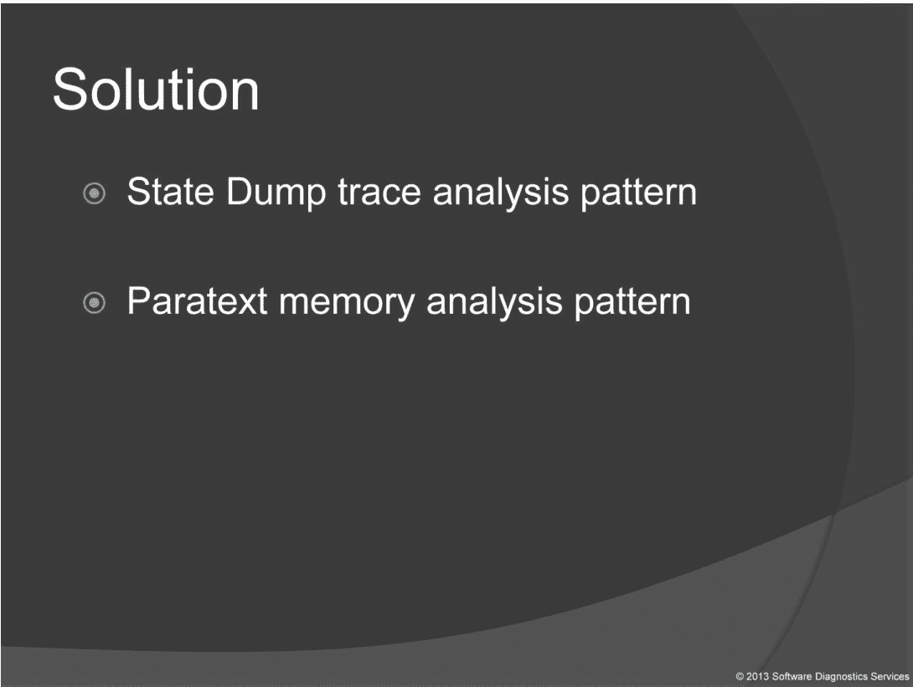
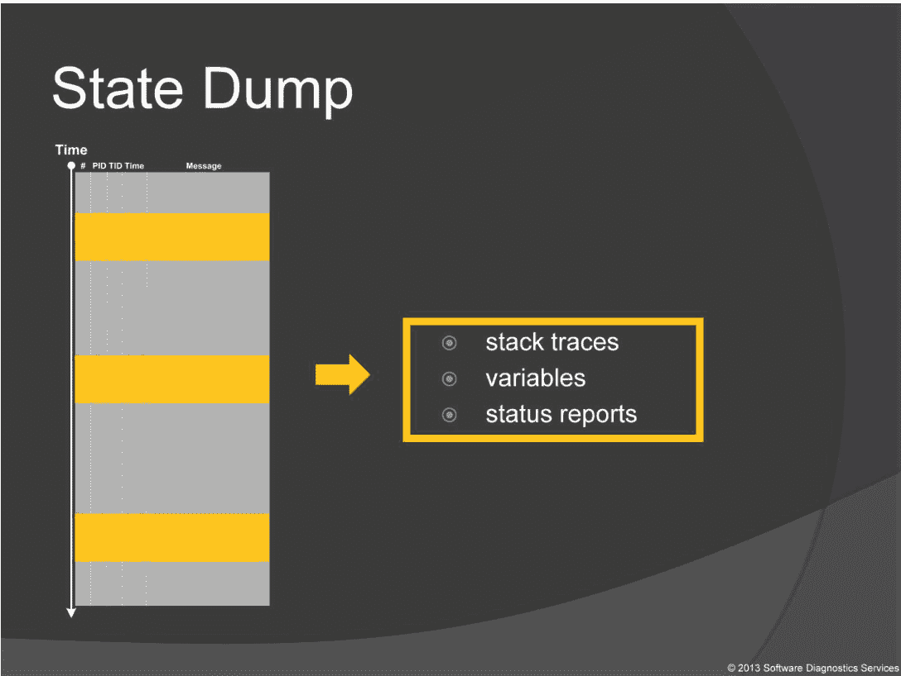
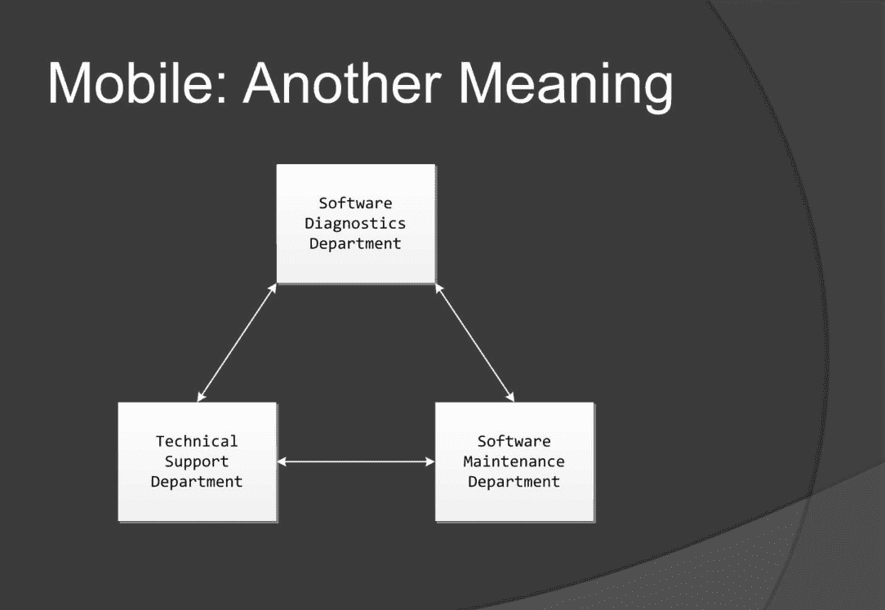
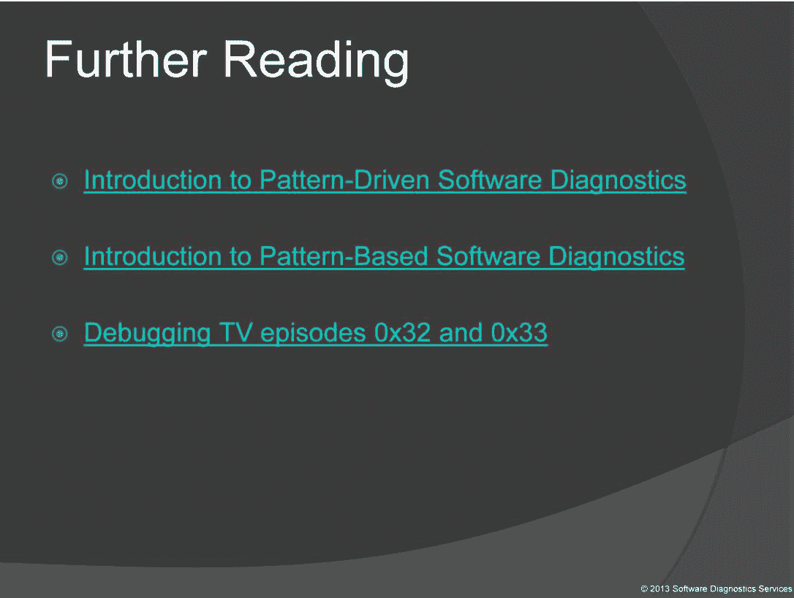

# 移动软件诊断入门指南

## 移动软件诊断 前言

大家好，我是德米特里·沃斯托科夫，今天我将为大家介绍面向模式的移动软件诊断技术。

我决定本次分享尽可能简短通俗。

若未来有需要新增或修改的内容，我会另行发布新版本。

- 脸书：<http://www.facebook.com/SoftwareDiagnosticsServices>
- 领英：<http://www.linkedin.com/company/software-diagnostics-services>
- 推特：<http://twitter.com/DumpAnalysis>

## 前置要求

对软件诊断、故障排查与调试感兴趣

这些前置要求非常简单，我想各位都和我一样热衷于诊断软件问题、排查故障与调试。

## 受众

- 桌面/服务器开发与支持人员
- 移动开发与支持人员

本次入门分享既适合转向移动开发与支持领域、希望在此复用面向模式软件诊断技术的桌面及服务器开发与支持工程师，也适合希望了解面向模式软件诊断方法论最新进展的移动开发与支持人员，该方法论最初源于复杂服务器环境。

## 现状

### 20年前的诊断技术

部分平台（例如内存转储分析）上的移动软件诊断技术现状，相当于几十年前的桌面诊断水平。

然而这一切都在快速变化，如今移动设备的硬件性能已达到不久之前难以想象的水平。

这类设备甚至可能完全取代桌面设备用于传统应用场景，因为可以将移动设备连接到大屏可视化设备，完成编辑、设计等传统桌面端工作。

随着硬件性能提升，传统的桌面与服务器诊断能力也开始向移动端迁移。

例如，在部分移动平台上，内存分析的作用将进一步凸显，跟踪分析也将更加精细。

例如，过去通过弹窗跟踪变量值的方法正逐渐被淘汰，因为`JavaScript`已有控制台日志和跟踪`API`可用。

## 愿景

- 面向模式的诊断技术
- 统一的模式目录

因此我们的愿景是复用传统的桌面/服务器诊断方法与工具，同时引入模式导向理念，实现模式目录与语言的统一。

接下来我将展示部分过往分享的幻灯片，主要面向不熟悉面向模式软件诊断技术的听众。

首先，我想和大家回顾一下面向模式软件诊断的定义：它分为模式驱动型和模式基础型两种。

### 模式驱动型：[模式驱动型材料](http://www.patterndiagnostics.com/Introduction-Software-Diagnostics-materials)

### 模式基础型：[模式基础型材料](http://www.patterndiagnostics.com/pattern-based-diagnostics-materials)

## 诊断模式

在特定场景下可识别的、反复出现的常见问题，以及**一套可实施的建议**和**可能的解决方案**。

© 2013 软件诊断服务公司

接下来，我想和大家回顾一下软件诊断模式的定义。

## 模式导向

### 模式驱动型软件诊断流程

### 模式基础型软件诊断演进

面向模式软件诊断方法论

官网：`www.DumpAnalysis.org` + `www.TraceAnalysis.org`

由此可见，软件诊断的核心就是模式。模式驱动型部分关注诊断模式的识别，模式基础型部分关注模式与模式目录的生命周期。

再重复一遍，模式驱动型指的是在软件执行产物（如内存转储、软件日志、网络跟踪数据）中寻找异常结构与行为的模式。

为辅助完成这一过程，有对应的检查清单、模式目录与工具可供使用。

## 模式基础型

- 模式演进
- 目录演进
- 目录分发

模式基础型部分关注的是模式的演进与分发。

新模式会持续新增，旧模式会被逐步优化，不同平台的新模式描述（我们后续称之为模式实现）也会被补充进来。

该技术的使用者需要了解所有的变更信息。

## 经济效益

- 使用统一的模式语言优化诊断报告沟通效率
- 通过系统化使用模式提升生产力
- 依托现有专业知识提升质量
- 为全球团队提供支持
- 可量化分析

因此，复用面向模式的软件诊断技术可带来切实的经济效益，包括可量化分析指标，如检索的模式总数、已识别的模式数量等。

## 原生/混合/Web应用

从主流移动平台的统一架构图中，我们可以看到面向模式诊断技术的主要优势。

这类现代平台基于传统桌面操作系统，因此已经可以在其上复用跟踪技术。

统一的模式目录甚至支持模式预测：如果某个模式在某平台缺失实现，但在另一平台已有对应实现，即可实现预测。

## 堆栈跟踪收集

```
09-08 22:38:11.569: V/AudioHardwareMSM7XXX(94): count : count : 4800
09-08 22:38:11.739: W/AudioFlinger(94): write blocked for 169 msecs, 1549 delayed writes, thread 0xccd0
09-08 22:38:14.309: I/System.out(21804): --- Stack Trace Collection ---
09-08 22:38:14.309: I/System.out(21804): --- Stack Trace Collection ---
09-08 22:38:14.309: I/System.out(21804): Thread[JDWP,5,system]:
09-08 22:38:14.309: I/System.out(21804): dalvik.system.NativeStart.run(Native Method)
09-08 22:38:14.309: I/System.out(21804): Thread[GC,5,system]:
09-08 22:38:14.309: I/System.out(21804): dalvik.system.NativeStart.run(Native Method)
09-08 22:38:14.319: I/System.out(21804): Thread[Signal Catcher,5,system]:
09-08 22:38:14.319: I/System.out(21804): dalvik.system.NativeStart.run(Native Method)
09-08 22:38:14.319: I/System.out(21804): Thread[main,5,main]:
09-08 22:38:14.319: I/System.out(21804): android.os.MessageQueue.nativePollOnce(Native Method)
09-08 22:38:14.319: I/System.out(21804): android.os.MessageQueue.next(MessageQueue.java:119)
09-08 22:38:14.319: I/System.out(21804): android.os.Looper.loop(Looper.java:117)
09-08 22:38:14.319: I/System.out(21804): android.app.ActivityThread.main(ActivityThread.java:3687)
09-08 22:38:14.319: I/System.out(21804): java.lang.reflect.Method.invoke(Native Method)
09-08 22:38:14.319: I/System.out(21804): java.lang.reflect.Method.invoke(Method.java:507)
09-08 22:38:14.319: I/System.out(21804): com.android.internal.os.ZygoteInit$MethodAndArgsCaller.run(ZygoteInit.java:867)
09-08 22:38:14.319: I/System.out(21804): com.android.internal.os.ZygoteInit.main(ZygoteInit.java:625)
09-08 22:38:14.319: I/System.out(21804): dalvik.system.NativeStart.main(Native Method)
09-08 22:38:14.319: I/System.out(21804): Thread[HeapWorker,5,system]:
09-08 22:38:14.319: I/System.out(21804): dalvik.system.NativeStart.run(Native Method)
09-08 22:38:14.319: I/System.out(21804): Thread[Compiler,5,system]:
09-08 22:38:14.319: I/System.out(21804): dalvik.system.NativeStart.run(Native Method)
09-08 22:38:14.319: I/System.out(21804): Thread[Binder Thread #1,5,main]:
09-08 22:38:14.319: I/System.out(21804): dalvik.system.NativeStart.run(Native Method)
09-08 22:38:14.319: I/System.out(21804): dalvik.system.VMStack.getStackTrace(Native Method)
09-08 22:38:14.319: I/System.out(21804): lang.Thread.getStackTrace(Thread.java:737)
09-08 22:38:14.329: I/System.out(21804): lang.Thread.getAllStackTraces(Thread.java:630)
09-08 22:38:14.329: I/System.out(21804): com.example.deadlock.FullscreenActivity$3.run(FullscreenActivity.java:67)
09-08 22:38:14.329: I/System.out(21804): java.lang.Thread.run(Thread.java:1019)
09-08 22:38:14.329: I/System.out(21804): Thread[Binder Thread #2,5,main]:
09-08 22:38:14.329: I/System.out(21804): dalvik.system.NativeStart.run(Native Method)
09-08 22:38:14.329: I/System.out(21804): --- end ---
```

这里可以举的一个例子是**堆栈跟踪收集**内存分析模式。

该模式最初在`Windows`平台上被识别，适用于`Windows`调试工具中的`WinDbg`调试器，可获取特定进程或系统的所有线程的堆栈跟踪集合，包含受管`.NET`堆栈跟踪。

之后为`Mac OS X` / `GDB`开发了另一套实现，在某种程度上也可复用于`Linux GDB`调试器及其他支持`GDB`的平台。

以下是`Android`/`Java`平台上的示例输出，也可复用于其他`Java`实现版本。

你可以在某一期《调试电视》节目中看到这套`Java`实现，包含建模源代码，相关链接我会放在“延伸阅读”幻灯片中。

## 内存分析模式

- 不仅限于内存转储
- 可应用于跟踪/日志


我们在上一页幻灯片中看到，堆栈跟踪收集是从日志文件中获取的。与普遍认知相反，内存分析并不局限于内存转储或实时调试。在复杂环境中对工件进行软件诊断时，将内存转储处理成日志文件然后在其中识别模式是很常见的做法。

## 问题

- 无/有限的内存转储分析
- 有限的操作系统调试器支持

接下来用几张幻灯片介绍我们在当前移动软件诊断领域中发现的一个问题。在某些平台上，内存转储分析能力非常有限，即使可以进行，平台调试器用于事后分析的操作系统支持也很有限。

## 解决方案



- 状态转储跟踪分析模式
- 副文本内存分析模式

我们为有限内存分析找到的解决方案是引入另一种跟踪分析模式，以便复用一些内存分析模式。它被称为**状态转储**模式，你将在下一张幻灯片中看到解释它的图表。对于有限的操作系统调试器支持，我们复用了所谓的**副文本**模式，稍后会进一步解释。

## 状态转储



- 堆栈跟踪
- 变量
- 状态报告

状态转储是指定期记录堆栈跟踪、重要变量和状态报告。

## 副文本 Android / Java 示例


| USER | PID | PPID | VSIZE | RSS | WCHAN | PC | NAME |
| --- | --- | --- | --- | --- | --- | --- | --- |
| app_42 | 24101 | 24100 | 137696 | 15756 | ffffffff | 00000000 | HeapWorker |
| app_42 | 24102 | 24100 | 137696 | 15756 | ffffffff | 00000000 | GC |
| app_42 | 24103 | 24100 | 137696 | 15756 | ffffffff | 00000000 | Signal Catcher |
| app_42 | 24104 | 24100 | 137696 | 15756 | ffffffff | 00000000 | Compiler |
| app_42 | 24105 | 24100 | 137696 | 15756 | ffffffff | 00000000 | Binder Thread # |
| app_42 | 24106 | 24100 | 137696 | 15756 | ffffffff | 00000000 | Binder Thread # |
| app_42 | 24107 | 24100 | 137696 | 15756 | ffffffff | 00000000 | Binder Thread # |
| app_57 | 24109 | 93 | 146876 | 19268 | ffffffff | 00000000 | com.example.spikingthread |
| app_57 | 24110 | 24109 | 146876 | 19268 | ffffffff | 00000000 | HeapWorker |
| app_57 | 24111 | 24109 | 146876 | 19268 | ffffffff | 00000000 | GC |
| app_57 | 24112 | 24109 | 146876 | 19268 | ffffffff | 00000000 | Signal Catcher |
| app_57 | 24113 | 24109 | 146876 | 19268 | ffffffff | 00000000 | JDWP |
| app_57 | 24114 | 24109 | 146876 | 19268 | ffffffff | 00000000 | Compiler |
| app_57 | 24115 | 24109 | 146876 | 19268 | ffffffff | 00000000 | Binder Thread # |
| app_57 | 24116 | 24109 | 146876 | 19268 | ffffffff | 00000000 | Binder Thread # |
| app_57 | 24117 | 24109 | 146876 | 19268 | ffffffff | 00000000 | Thread-10 |
| app_57 | 24122 | 24109 | 146876 | 19268 | ffffffff | 00000000 | Thread-11 |
| shell | 24123 | 143 | 800 | 336 | c00a6fc8 | afd0c3bc | /system/bin/sh |
| root | 24125 | 2 | 0 | 0 | ffffffff | 00000000 | flush-138:14 |
| root | 24126 | 2 | 0 | 0 | ffffffff | 00000000 | flush-179:0 |

© 2013 Software Diagnostics Services **副文本**一词最初来自叙事学，指的是补充文本叙事的额外信息，例如注释和文字描述。在此处，操作系统工具从系统中收集的信息可以辅助内存分析。在这张幻灯片中，我们看到一个正在运行的线程的指示，这有助于诊断**尖峰线程**内存分析模式。

## 移动 DA+TA

- 转储分析
- 内存分析模式
- 跟踪分析
- 跟踪分析模式

总结一下，复用转储分析和跟踪分析模式目录是可行的：这就是我们所说的移动 DA+TA。



我们还想在本次演讲结束时讨论“移动”的另一层含义。它指的是独立于支持和工程组织结构及交互的灵活软件诊断。这主要适用于大型公司。



在这张幻灯片中，我包含了相关过往演讲的链接，这些演讲侧重于模式驱动和基于模式的部分，你可以在其中找到更多参考资料，例如关于软件叙事学的内容。还有最近的 Debugging TV 集数，提供了我之前提到的 Android/Java 平台模式复用示例。


- **模式驱动软件诊断简介：** `http://www.patterndiagnostics.com/Introduction-Software-Diagnostics-materials`

- **基于模式的软件诊断简介：** `http://www.patterndiagnostics.com/pattern-based-diagnostics-materials`

- **Debugging TV 第 0x32 和 0x33 集：** `http://www.debugging.tv/`
