# 现代操作系统，第 4 版，全球版

# 在线访问

感谢购买新版《现代操作系统》全球版。您的教科书包含为期十二个月的准备配套网站访问权限。此预付费订阅将为您提供对以下学生区域的完全访问：

- 在线章节
- 实验项目
- 在线练习
- 模拟练习

使用硬币刮开涂层以显示您的学生访问代码。请勿使用刀或其他尖利物体，否则可能会损坏代码。

要首次访问《现代操作系统》第四版全球版配套网站，您需要使用连接到互联网并带有浏览器的计算机进行在线注册。该过程仅需几分钟，只需完成一次：

1. 访问 `www.pearsonglobalitions.com/Tanenbaum`
2. 点击您的书籍。
3. 点击 Companion Website。
4. 点击 Register（注册）按钮。
5. 在注册页面上，在刮板下方输入您的学生访问代码*。不要输入连字符。您可以使用小写或大写。
6. 按照屏幕上的说明操作。如果在在线注册过程中任何时候需要帮助，只需点击 Need Help?（需要帮助？）图标。
7. 一旦确认了您的个人用户名和密码，您就可以开始使用《现代操作系统》配套网站了！

注册后如何登录：

您只需为此配套网站注册一次。此后，您可以随时通过 `www.pearsonglobalitions.com/Tanenbaum` 登录，并在提示时提供您的用户名和密码。

*重要：访问代码只能使用一次。此订阅自激活起有效期为十二个月，且不可转。如果此访问代码已被开启，则可能已失效。如果是如此，您可以访问 `www.pearsonglobalitions.com/Tanenbaum` 并按照屏幕上的说明购买订阅。


全球版

ANDREW S. TANENBAUM

HERBERT BOS

Vrije Universiteit

荷兰


波士顿、哥伦比比亚、纽约、旧金山河、阿姆斯特丹、开敦、伦敦、米兰、巴黎、蒙特利尔、德里、墨西哥城、悉尼、香港、新加坡、台北

副总裁兼编辑总：Marcia Horton

执行董事：Tracy Johnson

项目管理团队负责人：Scott Snyder

项目经理：Carole Trent

运营专家：Linda Sager

学习资源获取（全球版）：Laura Dent

助理编辑（全球版）：Amrita Naskar

项目编辑（全球版）：Vikram Kumar

高级制造控制（全球版）：Trudy Kimber

封面设计：Pavel K

媒体经理：Renata Butera

Pearson Education Limited

爱丁堡、哈洛

英国

全球各地公司

访问我们的网站：`www.pearsonglobalcom`

英国图书馆目录数据

本书的目录可从英国图书馆获取

由 Ashford Colour Press 在大不伦。

致 Suzanne、Barbara、Aron、Nathan、Marvin、Matilde 和 Olivia。

名单仍在增长。(AST)

致 Marieke、Duko、Jip 和 Spot。所有的。(HB)


`https://archive.org/details/modernoperat000tane`

# 前言 xxiii

# 1 引言 1

### 1.1 什么是操作系统？ 3

#### 1.1.1 作为扩展机器的操作系统 4

#### 1.1.2 作为资源管理器的操作系统 5

### 1.2 操作系统的历史 6

#### 1.2.1 第一代（1945–55）：真空管 7

#### 1.2.2 第二代（1955–65）：晶体管和批处理系统 8

#### 1.2.3 第三代（1965–80）：集成电路和多程序设计 9

#### 1.2.4 第四代（1980至今）：个人电脑 14

#### 1.2.5 第五代（1990至今）：移动计算机 19

### 1.3 计算机硬件回顾 20

#### 1.3.1 处理器 21

#### 1.3.2 内存 24

#### 1.3.3 磁盘 27

#### 1.3.4 I/O 设备 28

#### 1.3.5 总线 31

#### 1.3.6 启动计算机 34

### 1.4 操作系统动物园 35

#### 1.4.1 主机操作系统 35

#### 1.4.2 服务器操作系统 35

#### 1.4.3 多处理器操作系统 36

#### 1.4.4 个人电脑操作系统 36

#### 1.4.5 手持式计算机操作系统 36

#### 1.4.6 嵌入式操作系统 36

#### 1.4.7 传感器节点操作系统 37

#### 1.4.8 实时操作系统 37

#### 1.4.9 智能卡操作系统 38

### 1.5 操作系统概念 38

#### 1.5.1 进程 39

#### 1.5.2 地址空间 41

#### 1.5.3 文件 45

#### 1.5.4 输入/输出 45

#### 1.5.5 保护 45

#### 1.5.6 Shell 45

#### 1.5.7 胚胎发生发育 69

### 1.6 系统调用 50

#### 1.6.1 进程管理的系统调用 53

#### 1.6.2 文件管理的系统调用 56

#### 1.6.3 目录管理的系统调用 71

#### 1.6.4 杂项系统调用 59

#### 1.6.5 Windows Win32 API 60

### 1.7 操作系统结构 62

#### 1.7.1 单体内核系统 62

#### 1.7.2 分层系统 63

#### 1.7.3 微内核 65

#### 1.7.4 客户端/服务器模型 68

#### 1.7.5 虚拟机 68

#### 1.7.6 暴露内核 72

### 1.8 C 语言视角的世界 73

#### 1.8.1 C 语言 73

#### 1.8.2 头文件 74

#### 1.8.3 大型编程项目 75

#### 1.8.4 运行时间模型 76

### 1.9 操作系统研究 77

### 1.10 本书其他内容的大纲 78

### 1.11 计量单位 79

### 1.12 总结 80

# 2 进程与线程 85

- 2.1 进程 85

2.1.1 进程模型 86

2.1.2 进程创建 88

2.1.3 进程终止 90

2.1.4 进程层次结构 91

2.1.5 进程状态 92

2.1.6 进程的实现 94

2.1.7 多道程序建模 95

- 2.2 线程 97

2.2.1 线程的使用 97

2.2.2 经典线程模型 102

2.2.3 POSIX 线程 106

2.2.4 在用户空间实现线程 108

2.2.5 在内核中实现线程 111

2.2.6 混合实现 112

2.2.7 调度器激活 113

2.2.8 弹出线程 114

2.2.9 使单线程代码多线程化 115

- 2.3 进程间通信 119

2.3.1 竞态条件 119

2.3.2 临界区 121

2.3.3 忙等的互斥 121

2.3.4 睡眠与唤醒 127

2.3.5 信号量 130

2.3.6 互斥锁 132

2.3.7 监器 137

2.3.8 消息传递 144

2.3.9 屏障 146

2.3.10 避免锁：读-拷贝更新 (RCU) 148

- 2.4 调度 148

2.4.1 调度简介 149

2.4.2 批处理系统中的调度 156

2.4.3 交互式系统中的调度 158

2.4.4 实时系统中的调度 164

2.4.5 策略与机制 165

2.4.6 线程调度 165

- 2.5 经典 IPC 问题 167

2.5.1 哲学家就问题 167

2.5.2 读者/写者问题 169

- 2.6 进程与线程研究 172

- 2.7 总结 173

# 3 内存管理 181

- 3.1 无内存抽象 182

- 3.2 内存抽象：地址空间 185

3.2.1 地址空间的概念 185

3.2.2 交换 187

3.2.3 管理空闲内存 190

- 3.3 虚拟内存 194

3.3.1 分页 195

3.3.2 页表 198

3.3.3 加速分页 201

3.3.4 针对大内存的页表 205

- 3.4 页置换算法 209

3.4.1 最佳置换算法 209

3.4.2 最近未使用置换算法 210

3.4.3 先进先出 (FIFO) 置换算法 211

3.4.4 第二次机会置换算法 211

3.4.5 时钟置换算法 212

3.4.6 最久未使用 (LRU) 置换算法 213

3.4.7 软件中模拟 LRU 214

3.4.8 工作集置换算法 215

3.4.9 WSClock 置换算法 219

3.4.10 页置换算法总结 221

- 3.5 分页系统的设计问题 222

3.5.1 地局与全局分配策略 222

3.5.2 负载控制 225

3.5.3 页大小 225

3.5.4 独立的指令空间和数据空间 227

3.5.5 共享页 228

3.5.6 共享库 229

3.5.7 映射文件 231

3.5.8 清理策略 232

3.5.9 虚拟内存接口 233

- 3.6 实现问题 233

3.6.1 操作系统对分页的参与 233

3.6.2 页异常处理 234

3.6.3 指令备份 235

3.6.4 内存中的页面锁定 236

3.6.5 备存储 237

3.6.6 策略与机制的分离 239

- 3.7 分段 240

3.7.1 纯分段实现 243

3.7.2 结合分页的分段：MULTICS 243

3.7.3 结合分页的分段：Intel x86 247

- 3.8 内存管理研究 252

- 3.9 总结 253

- 4.1 文件 265

4.1.1 命名 265

4.1.2 结构 267

4.1.3 类型 268

4.1.4 访问 269

4.1.5 属性 271

4.1.6 操作 271

4.1.7 文件系统调用示例 273

- 4.2 目录 276

4.2.1 单级目录系统 276

4.2.2 层级目录系统 276

4.2.3 路径名 277

4.2.4 目录操作 280

- 4.3 文件系统实现 281

4.3.1 文件系统布局 281

4.3.2 实现文件 282

4.3.3 实现目录 287

4.3.4 共享文件 290

4.3.5 日志结构文件系统 293

4.3.6 日志文件系统 294

4.3.7 虚拟文件系统 296

- 4.4 文件系统管理与优化 299

4.4.1 磁盘空间管理 299

4.4.2 文件系统备份 306

4.4.3 文件系统一致性 312

4.4.4 文件系统性能 314

4.4.5 磁盘碎片整理 319

- 4.5 示例文件系统 320

4.5.1 MS-DOS 文件系统 320

4.5.2 UNIX 文件系统 323

4.5.3 CD-ROM 文件系统 325

- 4.6 文件系统研究 331

- 4.7 总结 332

# 5 输入输出 337

- 5.1 I/O 硬件原理 337

5.1.1 I/O 设备 338

5.1.2 设备控制器 339

5.1.3 内存映射 I/O 340

5.1.4 直接内存访问 (DMA) 344

5.1.5 重温中断 347

- 5.2 I/O 软件原理 351

5.2.1 I/O 软件目标 352

5.2.2 程序控制 I/O 352

5.2.3 中断驱动 I/O 354

5.2.4 使用 DMA 的 I/O 355

- 5.3 I/O 层 356

5.3.1 中断处理程序 356

5.3.2 设备驱动程序 357

5.3.3 设备无关 I/O 软件 361

5.3.4 用户空间 I/O 软件 367

- 5.4 磁盘 369

5.4.1 磁盘硬件 369

5.4.2 磁盘格式化 375

5.4.3 磁盘臂调度算法 379

5.4.4 错误处理 382

5.4.5 稳定存储 385

- 5.5 时钟 388

5.5.1 时钟硬件 388

5.5.2 时钟软件 389

5.5.3 软定时器 392

- 5.6 用户界面：键盘、鼠标、显示器 394

5.6.1 输入软件 394

5.6.2 输出软件 399

- 5.7 瘦客户端 416

- 5.8 电源管理 417

5.8.1 硬件问题 418

5.8.2 操作系统问题 419

5.8.3 程序问题 425

- 5.9 输入输出研究 426

- 5.10 总结 428

- 6.1 资源 436

6.1.1 可抢占资源与不可抢占资源 436

6.1.2 资源获取 437

- 6.2 死锁简介 438

6.2.1 资源死锁条件 439

6.2.2 死锁建模 440

- 6.3 鸵鸟算法 443

- 6.4 死锁检测与恢复 443

6.4.1 每种资源一个死锁检测 444

6.4.2 每种资源多个的死锁检测 446

6.4.3 从死锁中恢复 448

- 6.5 死锁避免 450

6.5.1 资源轨迹 450

6.5.2 安全状态与不安全状态 452

6.5.3 单一资源的银行家算法 453

6.5.4 多资源的银行家算法 454

- 6.6 死锁预防 456

6.6.1 破坏互斥性 456

6.6.2 破坏请求与等待 457

6.6.3 破坏不可抢占 457

6.6.4 破坏循环等待 458

- 6.7 其他问题 458

6.7.1 两相锁 458

6.7.2 活锁 459

6.7.3 饥饿 461

- 6.8 死锁研究 464

- 6.9 总结 464

# 7 虚拟化与云 471

- 7.1 历史 473

- 7.2 虚拟化要求 474

- 7.3 类型 1 和类型 2 虚拟机程序 477

- 7.4 高效虚拟化技术 478

7.4.1 可虚拟化 479

7.4.2 虚拟化的代价 482

- 7.5 虚拟机程序是微内核吗？ 483

- 7.6 内存虚拟化 486

- 7.7 I/O 虚拟化 490

- 7.8 多核 CPU 虚拟机 493

- 7.9 云 495

7.9.1 云服务化 496

7.9.2 虚拟机迁移 496

7.9.3 检查点 497

- 7.10 案例研究：VMware 498

7.10.1 VMware 的早期历史 498

7.10.2 VMware Workstation 499

7.10.3 为 x86 虚拟化的挑战 500

7.10.4 VMware Workstation：解决方案概览 502

7.10.5 VMware Workstation 的演进 511

7.10.6 ESX 服务器：VMware 类型 1 虚拟机程序 512

- 7.11 虚拟化与云研究 514

# 9 安全

- 9.1 安全环境 595

- 9.1.1 威胁 596

- 9.1.2 攻击者 598

- 9.2 操作系统安全 599

- 9.2.1 我们能构建出安全的系统吗？ 600

- 9.2.2 可信计算基础 601

- 9.3 资源的受控访问 602

- 9.3.1 保护域 602

- 9.3.2 访问列表 605

- 9.3.3 权限控制 608

- 9.4 安全系统的形式模型 611

- 9.4.1 多级安全 612

- 9.4.2 隐蔽道 615

- 9.5 密码学基础 619

- 9.5.1 密钥加密 620

- 9.5.2 公钥加密 621

- 9.5.3 单向函数 622

- 9.5.4 数字签名 622

- 9.5.5 可信平台模块 624

- 9.6 身份验证 626

- 9.6.1 使用物理对象的身份验证 633

- 9.6.2 使用生物识别的身份验证 636

- 9.7 漏洞利用 639

- 9.7.1 缓冲区溢出攻击 640

- 9.7.2 格式字符串攻击 649

- 9.7.3 悬指针 652

- 9.7.4 空指针引用攻击 653

- 9.7.5 整数溢出攻击 654

- 9.7.6 命令注入攻击 655

- 9.7.7 检查时间到使用时间（TOCTOU）攻击 656

- 9.8 内部攻击 657

- 9.8.1 逻辑炸弹 657

- 9.8.2 后门 658

- 9.8.3 登录欺骗 659

- 9.9 恶意软件 660

- 9.9.1 特洛马 662

- 9.9.2 病毒 664

- 9.9.3 蠕虫 674

- 9.9.4 间谍软件 676

- 9.9.5 根内核程序 680

- 9.10 防御 684

- 9.10.1 防火墙 685

- 9.10.2 反病毒与反反病毒技术 687

- 9.10.3 代码签名 693

- 9.10.4 禁箱化 694

- 9.10.5 基于模型的入侵检测 695

- 9.10.6 封装移动代码 695

- 9.10.7 Java 安全 701

- 9.11 安全研究 703

- 9.12 总结 704

## 10 案例研究 1：UNIX, LINUX 和 ANDROID 713

- 10.1 UNIX 和 LINUX 的历史 714

- 10.1.1 UNICS 714

- 10.1.2 PDP-11 UNIX 715

- 10.1.3 可移植 UNIX 716

- 10.1.4 Berkeley 717

- 10.1.5 标准 UNIX 718

- 10.1.6 MINIX 719

- 10.1.7 Linux 720

- 10.2 LINUX 概述 723

- 10.2.1 Linux 目标 723

- 10.2.2 Linux 接口 724

- 10.2.3 Shell 725

- 10.2.4 Linux 工具程序 728

- 10.2.5 内核结构 730

- 10.3 LINUX 中的进程 733

- 10.3.1 基础概念 733

- 10.3.2 Linux 中的进程管理系统调用 735

- 10.3.3 Linux 中进程和线程的实现 739

- 10.3.4 Linux 中的调度 746


## 10.3.5 启动 Linux 751
## 10.4 LINUX 中的内存管理 753
### 10.4.1 基础概念 753
### 10.4.2 Linux 中的内存管理系统调用 756
### 10.4.3 Linux 中内存管理的实现 758
### 10.4.4 Linux 中的分页 764
## 10.5 LINUX 中的输入/输出 767
### 10.5.1 基础概念 767
### 10.5.2 网络 769
### 10.5.3 Linux 中的输入/输出系统调用 770
### 10.5.4 Linux 中输入/输出的实现 771
### 10.5.5 Linux 中的模块 774
## 10.6 LINUX 文件系统 775
### 10.6.1 基础概念 775
### 10.6.2 Linux 文件系统调用 780
### 10.6.3 Linux 文件系统的实现 783
### 10.6.4 NFS: 网络文件系统 792
## 10.7 LINUX 中的安全 798
### 10.7.1 基础概念 798
### 10.7.2 Linux 中的安全系统调用 800
### 10.7.3 Linux 中安全的实现 801
## 10.8 ANDROID 802
### 10.8.1 Android 和 Google 803
### 10.8.2 Android 历史 803
### 10.8.3 设计目标 807
### 10.8.4 Android 架构 809
### 10.8.5 Linux 扩展 810
### 10.8.6 Dalvik 814
### 10.8.7 Binder (进程间通信) 815
### 10.8.8 Android 应用 824
### 10.8.9 Intents 836
### 10.8.10 应用沙盒 836
### 10.8.11 安全 838
### 10.8.12 进程 844
## 10.9 总结 848
## 11.1 Windows WINDOWS 的历史 857
### 11.1.1 1980 年代：MS-DOS 857
### 11.1.2 1990 年代：基于 MS-DOS 的 Windows 859
### 11.1.3 2000 年代：基于 NT 的 Windows 859
### 11.1.4 Windows Vista 862
### 11.1.5 2010 年代：现代 Windows 863
## 11.2 Windows 编程 864
### 11.2.1 原生 NT 接口 864
### 11.2.2 Win32 接口 871
### 11.2.3 Windows 注册表 875
## 11.3 系统结构 877
### 11.3.1 操作系统结构 877
### 11.3.2 启动 Windows 893
### 11.3.3 对象管理器实现 894
### 11.3.4 子系统、DLL 和用户态服务 895
## 11.4 WINDOWS 中的进程和线程 908
### 11.4.1 基础概念 908
### 11.4.2 Job、进程和 Fiber 管理 API 914
### 11.4.3 进程和线程的实现 919
## 11.5 内存管理 927
### 11.5.1 基础概念 927
### 11.5.2 内存管理系统调用 931
### 11.5.3 内存管理的实现 932
## 11.6 Windows 缓存 942
## 11.7 Windows 中的输入/输出 943
### 11.7.1 基础概念 944
### 11.7.2 输入/输出 API 调用 945
### 11.7.3 I/O 的实现 948
## 11.8 Windows NT 文件系统 952
### 11.8.1 基础概念 953
### 11.8.2 NT 文件系统的实现 954
## 11.9 Windows 电源管理 964
## 11.10 WINDOWS 中的安全 966
### 11.10.1 基础概念 967
### 11.10.2 安全 API 调用 969
### 11.10.3 安全的实现 970
### 11.10.4 安全缓解 972
## 11.11 总结 975

# 12 操作系统设计 981

## 12.1 设计问题的本质 982
### 12.1.1 目标 982
### 12.1.2 为什么设计操作系统很难？ 983
## 12.2 接口设计 985
### 12.2.1 指导原则 985
### 12.2.2 范式 987
### 12.2.3 系统调用接口 991
## 12.3 实现 993
### 12.3.1 系统结构 993
### 12.3.2 机制 vs 策略 997
### 12.3.3 正交性 998
### 12.3.4 命名 999
### 12.3.5 绑定时间 1001
### 12.3.6 静态与动态结构 1001
### 12.3.7 自顶向下与自底向上的实现 1003
### 12.3.8 同步与异步通信 1004
### 12.3.9 有用技术 1005
## 12.4 性能 1010
### 12.4.1 为什么操作系统慢？ 1010
### 12.4.2 空间时间权衡 1011
### 12.4.3 缓存 1012
### 12.4.4 局部性 1015
### 12.4.5 嵌入访问 1016
### 12.4.6 常见情况 1017
## 12.5 项目管理 1018
### 12.5.1 《人人月神》1018
### 12.5.2 团队结构 1019
### 12.5.3 经验的角色 1021
### 12.5.4 万无银弹 1021
## 12.6 操作系统的趋势 1022
### 12.6.1 虚拟化与云 1023
### 12.6.2 多核芯片 1023
### 12.6.3 大地址空间 1024
### 12.6.4 无缝数据访问 1025
### 12.6.5 电池供电计算机 1025
### 12.6.6 嵌入式系统 1026
## 12.7 总结 1027

# 前言

第 5 章发生了巨大变化。旧的设备如 CRT（阴极射线显示器）和 CD-ROM 已被移除，新增了如触摸屏等新技术技术。

第 6 章几乎没有变化。死锁的主题相当稳定，很少有新结果。

第 7 章是完全全新的。它涵盖了虚拟化和云计算等重要主题。作为一个案例研究，书中增加了一个关于 VMware 的章节。

第 8 章是之前一个多处理器系统的更新版本。现在更强调多核和许多核系统，这些系统在过去几年里变得越来越重要。缓存一致性最近已变成了一个更大的问题，且现在已在本章中进行了阐述。

第 9 章经过了大幅的修订和重组，包含了大量关于利用代码漏洞、恶意软件和攻击防御的内容。例如，空指针解引用和缓冲区溢出等问题得到了更详细的处理。现在还详细介绍了包括金丝雀程序（canaries）、NX 位和地址空间随机化在内的防御机制，以及攻击者试图破解这些机制的方法。

第 10 章发生了重大变化。关于 UNIX 和 Linux 的材料已更新，但此处最大的增加是一个关于 Android 操作系统的全新且冗长的章节，它在智能手机和平板电脑上非常常见。

第 12 章是上一版第 13 章的修订版。

第 13 章是一份彻底更新的建议阅读列表。此外，参考文献列表也已更新，增加了自本书第三版出版后发布的 223 部新作品。

上一版的第 7 章已移动到书籍的网站，以保持其尺寸在可控范围内。

此外，书中所有关于研究的章节都已从头开始编写，以反映操作系统的最新研究成果。此外，所有章节都新增了习题。

本书提供了许多教学辅助工具。可以在 www.pearsonglobaleducational.com/Tanenbaum 找到教师辅助材料；它们包括 PowerPoint 幻灯片、用于学习操作系统的软件工具、针对学生的实验项目、模拟器以及更多用于操作系统课程的材料。在课程中使用本书的老师绝对应该看一看。本书的配套网站也位于 www.pearsonglobalitions.com/Tanenbaum。该特定网站受密码保护。要使用该网站，请按照随书附赠的学生访问卡上的说明创建用户账户并登录。学生资源包括：

- 关于多媒体操作系统的在线章节
- 实验项目
- 在线练习题
- 模拟练习题

许多人参与了第四版的编写。首先，阿姆斯特丹自由大学的赫尔伯特·博斯（Herbert Bos）教授被增加为合著者。他是一位安全、UNIX 和全方位的系统专家，他的加入非常棒。除了下文注出的的内容外，他编写了大部分新材料。

我们的编辑 Tracy Johnson 像往常一样出色了出色的工作：协调所有的“猫咪”（各种复杂事务）、整合素材、处理突发状况并保持项目按计划进行。我们也很幸运能请回长期合作的制作团队 Camille Trentacoste。她在许多领域的技能在多次情况下挽救了局面。我们很高兴在缺席几年后能再次与她合作。Carole Snyder 在协调参与书籍的各种人员方面表现得很好。

第 7 章关于 VMware 的材料（第 7.12 节）由瑞士洛桑联邦理工学院（EPFL）的 Edouard Bugion 编写。Ed 是 VMware 公司的创始人之一，他对这些材料的了解超过世界上任何人。我们非常感谢他为我们提供这些内容。

佐治亚理工学院的 Ada Gavrilska 是 Linux 内部专家，她更新了第三版的第 10 章，该章节也是由她撰写的。第 10 章中 Android 的材料由 Google 的 Diane Hackback 编写，她是 Android 系统的关键开发者之一。Android 是智能手机上领先的操作系统，我们非常感谢 Diane 为我们的帮助。第 10 章现在非常长且详尽，UNIX、Linux 和 Android 粉丝可以从中学到很多知识。值得注意的是，书中最长且技术性最强的章节是由两位女性编写的。而我们只做了简单的部分。

由于我们忽略了 Windows，微软的 Dave Probert 更新了第 11 章，详细涵盖了 Windows 8。Dave 对 Windows 拥有丰富的知识，并有足够的洞察力看出微软在哪些地方做得好，哪些地方错了。Windows 粉丝一定会喜欢这一章。

得益于所有专家贡献者的工作，本书变得好得多。再次，我们感谢他们无价的帮助。

我们还幸运地有几位审稿员，他们阅读了手稿并建议了新的章末习题。他们是 Trudy Levine、Shivakant Mishra、Krishna Sivalaming 和 Ken Wong。Steve Armstrong 为使用本书教学的老师制作了 PowerPoint 幻灯片。

通常校对和校样人员不会获得致谢，Bob Lentz（校对）和 Joe Ruddick（校样）的工作做得极其详尽。特别是 Joe，他能察觉到细微差别。最后，最重要的是，我想感谢 Marieke、Duko 和 Jip。Barbara 和 Nathan 依然是很棒的。在这一点上，我想感谢 Marieke、Duko 和 Jip，它们让我脱离了官僚主义。 (HB)

安德鲁·S·坦南鲍姆 (Andrew S. Tanenbaum)

赫尔伯特·博 (Herbert Bos)

# 关于作者

Andrew S. Tanenbaum 在麻省理工学院（MIT）获得学士学位，在加州大学伯克利分校获得博士学位。他是阿姆斯特丹自由大学（Vrije Universität）的计算机科学教授。他曾担任高级计算与成像学院（ASCI）的院长，这是一个专注于并行、分布式系统的跨大学学院。他还是荷兰皇家艺术与科学学院的院士，这使他免于成为一名官僚。在过去，他在编译器、操作系统、网络和分布式系统方面进行过研究。他现在的主要研究重点是可靠和安全的操作系统。他的研究项目产生了超过 175 篇发表在期刊和会议上的论文。Tanenbaum 教授编写或合著了五本书，这些书在全球大学都有。总之，他的书有 163 个版本（语言组合）。

Tanenbaum 教授还产生了大量的软件，特别是 MINIX，一个小型 UNIX 克隆系统。它是 Linux 的直接灵感来源，也是最初开发 Linux 的平台。目前的 MINIX 版本称为 MINIX 3，专注于成为一个极其可靠且安全的操作系统。当没有用户提出建议时，Tanenbaum 认为他的工作完成了。访问 www.minix.org 下载免费的 MINIX 3 并尝试一下。提供 x86 和 ARM 版本。

Tanenbaum 的博士生毕业后都取得了辉煌成就。他为他们感到非常自豪。在这一点上，他记得母亲。

Tanenbaum 教授是 ACM 会员、IEEE 会员以及荷兰皇家艺术与科学学院的成员。他获得了来自 ACM、IEEE 和 USENIX 的众多科学奖项。如果你对他好奇，可以查看他的维基百科页面。他还有两个博士学位。

Herbert Bos 从特温特大学（Twente University）获得硕士学位，从剑桥大学实验室获得博士学位。从那以后，他致力于 Linux 等操作系统的可靠且高效的 I/O 架构，但也研究了基于 MINIX 3 的系统。他是阿姆斯特丹自由大学系统与安全计算机科学教授。他的主要研究领域是系统安全。他与学生一起致力于开发新方法来检测和阻止攻击、分析和逆向工程恶意软件，以及僵尸网络（可能跨数百万计算机的恶意基础设施）。2011 年，他因逆向工程的研究获得了欧洲研究委员会资助金。他的三位学生曾获得欧洲系统领域最佳博士论文奖（Roger Needham Award）。

# 绪言

一台现代计算机由一个或多个处理器、一些主内存、磁盘、打印机、键盘、鼠标、显示器、网络接口以及各种输入/输出设备组成。总而言之，这是一个复杂的系统。如果每个应用程序程序员都必须详细了解所有这些东西的工作原理，那么将永远没有任何代码被写出来。此外，管理所有这些组件并优化地使用它们是一项极具挑战性的工作。因此，计算机配备了一层被称为“操作系统”的软件，它的工作是为用户程序提供一个更美好、更简单、更整洁的计算机模型，并处理上述所有的资源。操作系统是本书的主题。

大多数读者可能对 Windows、Linux、FreeBSD 或 OS X 等操作系统具有一定经验，但外表往往具有欺骗性。用户交互的程序——当基于文本时通常称为 shell（外壳），当使用图标时称为 GUI（图形用户界面，发音为“gooey”）——实际上并并不是操作系统的一部分，尽管它利用操作系统来完成工作。

1-1. 图 1-1 给出了这里将讨论的主要组件的简单概述。在这里我们看到底部是硬件。硬件由芯片、电路板、磁盘、键盘、显示器和类似的物理对象组成。硬件之上是软件。大多数计算机有两种运行模式：内核态和用户态。操作系统作为最基础的软件，运行在内核态（也称为监视模式）。在这种模式下，它拥有

# 绪言

# 第 1 章

对所有硬件的完全访问权限，并可以执行机器能够执行的任何指令。其余软件运行在用户态，在用户态下，只有部分机器指令是可用的。特别是那些影响机器控制或执行 I/O（输入/输出）的指令，是禁止用户态程序执行的。在本书的贯穿学习中，我们将反复谈到内核态和用户态之间的差异。它在操作系统的工作中起着至关重要的作用。

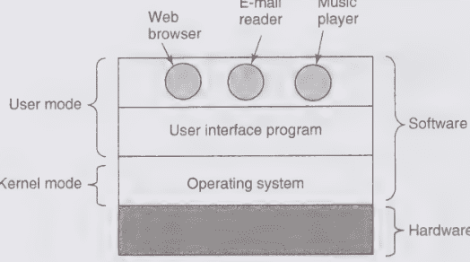

图 1-1. 操作系统所在的位置。

用户界面程序（shell 或 GUI）允许用户启动其他程序，例如 Web 浏览器、邮件阅读器或音乐播放器。这些程序也大量使用了操作系统。

操作系统的位置如图 1-1 所示。它运行在裸硬件上，为所有其他软件提供基础。

操作系统与普通（用户态）软件之间的一个重要区别是：如果用户不喜欢某个特定的邮件阅读器，可以自由选择另一个，或者在需要时编写自己的；但他无权自由编写自己的时钟中断处理程序，因为那是操作系统的一部分，并受硬件保护以防止用户对其进行修改。

然而，这种区别在嵌入式系统（可能没有内核态）或解释型系统（例如基于 Java 的系统，它们使用解释而非硬件来分离组件）中有时会变得模糊。

此外，在许多系统中，存在运行在用户态但能帮助操作系统或执行特权函数的程序。例如，通常有一个程序允许用户更改密码。它不是操作系统的一部分，也不运行在内核态，但它显然执行了敏感功能，并且必须以特殊方式受到保护。在某些系统中，这种想法被推到了极端，传统上被认为是操作系统的部分

> † 本书中所有的“He”应读作“他或她”。

# 第 1.1 节 什么是操作系统？

系统（如文件系统）运行在用户空间。在系统中，很难画出一个清晰的边界。所有在内核态运行的内容明确是操作系统的一部分，但某些运行在它之外的程序也可以被认为是它的一部分，或者至少与之相关。

操作系统与用户程序（即应用程序）的区别除了所在的位置外还存在于其他方面。特别是，它们是庞大、复杂且长寿的。Linux 或 Windows 等操作系统的核心源码规模在五百万行代码或以上。为了理解这意味着，请想象将这五百万行代码以书的形式打印出来，每页 50 行，每卷 1000 页（比本书还要大）。需要 1000 卷书才能列出一个这种规模的操作系统——本质上是一整排书架。你能想象一份维护操作系统的工作吗？在第一天你的老板带你来到一个放满代码的书架说：“去学那个吧。”而这仅仅是运行在内核的部分。当包含必要的共享库时，Windows 的代码量远超 7000 万行，相当于 10 到 20 个书架。这还不包括基础应用程序软件（如 Windows 资源管理器、Windows 媒体播放器等）。

现在应该清楚为什么操作系统能运行很长时间——它们非常难写，而且一旦写好了一个，所有者就不愿将其抛弃重新开始。相反，这类系统在很的时间内演化。Windows 95/98/Me 基本上是一个操作系统，而 Windows NT/2000/XP/Vista/Windows 7 是另一个。它们在用户看起来很相似，是因为微软确保了 Windows 2000/XP/Vista/Windows 7 的用户界面与其被取代的系统（主要是 Windows 98）非常相似。尽管如此，微软弃用 Windows 98 有非常充分的理由。我们将在第 11 章学习 Windows 时讨论这些问题。

除了 Windows 之外，书中使用的其他主要示例是 UNIX 及其变体。它也随着时间的推移而演化，如 Linux、Solaris 和 FreeBSD，这些源自 UNIX 并与其紧密兼容。我们将在第 10 章详细介绍 UNIX。

在本章中，我们将简要接触操作系统的几个方面，它们是什么、历史、种类、基本概念和结构。我们将在后续详细讨论这些重要话题。

## 1.1 什么是操作系统？


很难定义什么是操作系统，除非说它是运行在内核态的软件——即使这也不总是正确的。操作系统的部分在于它们为应用程序程序员（自然也包括应用程序程序）提供一套整洁的抽象资源，而不是混乱的硬件资源，并执行以下两个不相关的函数：让我们现在来看两者。

# 1.1.1 操作系统作为扩展机器

大多数计算机的架构（指令集、内存组织、I/O 和总线结构）在机器语言层面是原始且笨拙的，特别是对于输入/输出。为了使这一点更具体，请考虑大多数计算机使用的现代 `SATA`（串行 ATA）磁盘。一本描述早期磁盘接口的书（2007）有 450 页。从那时起，接口经过了多次修订，比那时更复杂。显然，任何理智的程序员都不想在硬件级别处理这些。相反，一种被称为磁盘驱动程序的软件会处理硬件，并提供一个读写磁盘的接口，而不涉及细节。操作系统包含许多控制 I/O 设备的驱动程序。

但对于大多数应用程序来说，这也太底层了。因此，操作系统通过磁盘提供了另一种层级的抽象。使用这种抽象，程序可以创建、写入和读取文件，而无需处理硬件实际是如何工作的细节。

这种抽象是管理所有复杂性的关键。良好的抽象将几乎不可能的任务转化为两个可管理的任务。第一个是定义并实现这些抽象；第二个是使用这些抽象解决当前问题。每个用户理解的一种抽象是文件，如上所述。它是一个有用信息，例如数字照片、保存的电子邮件、歌曲或网页。处理电子邮件、歌曲和网页比处理 `SATA`（或其他磁盘）的细节容易得多。操作系统的工作是创建良好的抽象，然后实现并管理创建的抽象对象。在书中，我们将大量讨论抽象。

这一点如此重要，值得重复。尽管感谢仔细设计 `Macintosh` 的工业工程师，硬件是丑陋的。真实的处理器、内存、磁盘和其他设备非常复杂，并为必须编写软件来使用它们的人们提供了困难、笨拙、特异且不一致的接口。有时是因为需要与旧硬件的向后兼容性。有时是为了省钱。通常，硬件设计者并没有意识到（或不在乎）他们给软件人员带来了多少麻烦。操作系统的主要任务之一就是隐藏硬件，为程序（以及它们的程序员）提供优美、优雅、一致的抽象供其工作。操作系统将丑陋变为美丽，如图 1-2 所示。

## SEC. 1.1 什么是操作系统

| 应用程序 | |
| :--- | :--- |
| [image] | 美观的界面 |
| 操作系统 | |
| [image] | 丑陋的界面 |
| 硬件 | |

**图 1-2.** 操作系统将丑陋的硬件转化为优美的抽象。

需要注意的是，操作系统的真正客户是应用程序（当然，是通过应用程序程序员）。它们是那些直接与操作系统及其抽象打交道的人。相比之下，用户处理的是用户界面提供的抽象，无论是命令行壳（`shell`）还是图形界面。虽然用户界面的抽象可能与操作系统提供的抽象相似，但情况并非总是如此。为了让这一点更清楚，请考虑普通的 `Windows` 桌面和面向行的命令提示符。它们都是运行在 `Windows` 操作系统上的程序，并使用 `Windows` 的抽象层，但它们提供了非常不同的用户界面。同样，运行 `Gnome` 或 `KDE` 的 `Linux` 看到的界面，与直接在底层 `X Window` 系统之上工作的 `Linux` 用户看到的界面截然不同，但在在这两种情况下，底层的操作系统抽象是相同的。

在书中，我们将详细研究提供给应用程序的抽象，但对用户界面着墨较少。这是一个庞大且重要的课题，但与操作系统的关系仅处于边缘。

### 1.1.2 作为资源管理器的操作系统

将操作系统主要视为为应用程序提供抽象的观点是一种自上而下的视角。另一种自下而上的视角认为，操作系统的存在是为了管理一个复杂系统的所有部分。现代计算机由处理器、内存、定时器、磁盘、鼠标、网络接口、打印机以及许多其他设备组成。在自下而上的视角中，操作系统的任务是为想要这些资源的程序提供处理器、内存和 I/O 设备有序且受控的分配。

现代操作系统允许多个程序同时存在内存中并运行。想象一下，如果运行某台计算机上的三个程序都试图同时在同一台打印机上打印输出，会发生什么。打印输出的前几行可能来自程序 1。

当一台计算机（或网络）有多个用户时，管理和保护内存、I/O 设备和其他资源的需求变得更加严峻，因为用户可能会相互干扰。此外，用户不仅需要共享硬件，还需要共享信息（文件、数据库等）。简而言之，这种操作系统观点认为，它的首要任务是跟踪哪些程序正在使用哪些资源、授予资源请求、记录使用情况并管理来自不同程序和用户的冲突请求。

资源管理包括以两种不同方式对资源进行复用（共享）：在时间和空间上。当资源被进行时间复用时，不同的程序或用户轮流使用它。第一个程序获得资源，然后是另一个，以此此类推。例如，对于一个 `CPU` 和多个想要在其上面运行的程序，操作系统首先将 `CPU` 分配给一个程序，然后当它运行足够长时间后，另一个程序可以使用 `CPU`，然后是另一个，最后又回到了第一个。决定如何对资源进行时间复用——谁下一个获得、以及使用多久——是操作系统的任务。复用的另一个例子是共享打印机。当有多个打印作业在单台打印机上排好队等待打印时，必须决定打印哪一个。

另一种类型的复用是空间复用。不是让客户轮流使用，而是每个人都获得资源的一部分。内存通常被分配给几个运行中的程序，以便每个程序都能同时驻留内存（例如，为了轮流使用 `CPU`）。假设有足够的内存来存放多个程序，那么一次在内存中保留多个程序比将全部交给一个程序更高效，特别是当它只需要总量的一小部分时。当然，这引发了公平性、保护等问题，这些由操作系统来解决。另一个被进行空间复用的资源是磁盘。在许多系统中，单块磁盘可以同时存放许多用户的文件。分配磁盘空间并跟踪谁在使用哪些磁盘块是操作系统的典型工作。

## 1.2 操作系统的历史

操作系统多年来一直在演进。在接下来的章节中，我们将简要回顾几个亮点。由于操作系统在历史上一直与其运行的计算机架构紧密相关，我们将观察连续几代的计算机，看看它们的操作系统是什么样的。这种将操作系统代与计算机代相对应的映射是粗略的，但它在原本没有结构的地方提供了一些框架。

下面给出的进展基本上是按时间顺序的，但过程充满了波折。每一项开发并没有等前一项完成后才开始。它们之间存在大量的重叠，更说还有许多错误的尝试和死胡同。这是一种引导，但不是最终。

第一台真正的数字计算机是由英国数学家查尔斯·巴别尔（`Charles Babbage`，1792–1871）设计的。尽管巴别尔花费了大部分寿命和财富试图建造他的“分析机”，但他从未让它正常工作，因为它是纯机械的，而当时的技术无法生产出所需的高精度的轮子、齿轮和凸轮。不言而喻，分析机没有操作系统。

作为一个有趣的历史轶事，巴别尔意识到他的分析机需要软件，因此他雇佣了名叫阿达·洛夫莱斯（`Ada Lovelace`）的年轻女性，她是英国诗人拜伦勋爵的女儿，被认为是世界上第一位程序员。编程语言 `Ada®` 以她的名字命名。

### 1.2.1 第一代（1945–55）：真空管

在巴别尔失败之前，由于缺乏数字计算机的软件，在计算机科学的领域，被认为是第一台数字计算机的是 `ENIAC`，它使用真空管。随后，二战期间刺激了数字计算机的爆发，约翰·阿塔纳索夫（`John Atanasoff`）在爱荷华州立大学工作；康拉德·齐泽（`Konrad Zuse`）在柏林建造了 `Z3`；1944年，图灵（`Alan Turing`）在布莱奇丘建造了巨人；霍华德·艾肯（`Howard Aiken`）在哈佛大学建造了马克一（`Mark I`），而普斯珀·埃克特（`Presper Eckert`）和莫里斯·豪奇利（`Maurice Mauchly`）在宾夕法尼亚大学建造了分析机。

在这些早期，由一组人（通常是工程师）设计、建造、编程和维护每个机器。所有的编程都是用机器语言完成的，或者更糟，通过布线。到1950年代，随着孔卡的引入，例程得到了改进。现在可以在孔卡上编写程序。在1950年代，晶体管出现改变了局面。计算机变得足够可靠，可以制造并销售给客户。第一次，设计者、建造者、操作员和程序员之间有了明确的分离。这些现在被称为大型机的机器被关在专门的房间里，由专业操作员运行。

当计算机完成任何任务时，操作员会去打印机取出输出并带到输出室，以便程序员可以收集。如果需要 `FORTRAN` 编译器，操作员必须从文件柜中获取。计算机时间在操作员走动时被浪费了。

在收集了一小时的一批作业后，卡片读入磁带，磁带被带进机室安装在带驱动器上。操作员加载一个特殊程序（操作系统的祖先），该程序从磁带读取第一个作业并运行。输出被写入另一条磁带，而不是打印出来。当每个作业完成后，操作系统会自动从磁带读取下一个作业并开始运行。

### 1.2.2 第二代（1955–65）：晶体管与批处理系统

在这些早期，由一组人（通常是工程师）设计、建造、编程和维护每个机器。所有的编程都是用机器语言完成的，或者更糟，通过布线。到1950年代，随着孔卡的引入，例程得到了改进。现在可以在孔卡上编写程序。在1950年代，晶体管出现改变了局面。计算机变得足够可靠，可以制造并销售给客户。第一次，设计者、建造者、操作员和程序员之间有了明确的分离。

# 9

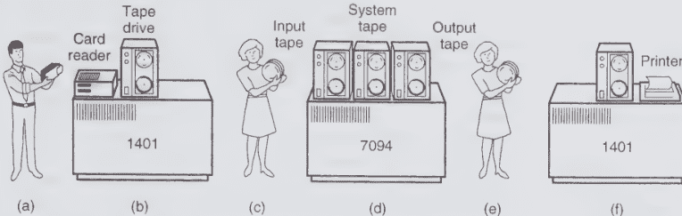

**图 1-3.** 早期的批处理系统。(a) 程序员将卡片带到 `1401` 机。(b) `1401` 将批处理作业读取到磁带上。(c) 操作员将输入磁带带到 `7094` 机。(d) `7094` 进行计算。(e) 操作员将输出磁带带到 `1401` 机。(f) `1401` 打印输出。

当整批作业完成后完成后，操作员移除输入和输出磁带，用下一批磁带替换输入磁带，并将输出磁带带到 `1401` 机进行离线打印（即不连接到主计算机）。它首先从一张 `JOB` 卡片开始，指定运行时间（以分钟为单位）、计费账户号码和程序员的名字。接着是一张 `$FORTRAN` 卡片，告诉操作系统从系统磁带中加载 `FORTRAN` 编译器。紧随其后的是要编译的程序，然后是一张 `$LOAD` 卡片，指导操作系统加载刚刚编译的目标程序。（编译后的程序通常写在擦写磁带上，必须显式加载。）接下来是 `$END` 卡片，告诉操作系统使用随其后的数据运行程序。最后，`$END` 卡片标记了作业的结束。这些原始的控制卡片是现代 `shell`（壳）和命令行解释器的先驱。

大型第二代计算机主要用于科学和工程计算，例如解决物理和工程中出现的偏微分方程。它们主要用 `FORTRAN` 和汇编语言编程。典型的操作系统有 `FMS`（Fortran 监控系统）和 `IBSYS`（`IBM` 为 `7094` 设计的操作系统）。

## 1.2.3 第三代计算机（1965–1980）：集成电路与多道程序

到 20 世纪 60 年代初，计算机制造商有两个截然不同且不兼容的产品线。一方面，是面向字的大型科学计算机，如 `7094`，它们用于科学和工程中的工业级数值计算。另一方面，是面向字符的商业计算机，如 `1401`，广泛被银行和保险公司用于磁带排序和打印。

# 引言

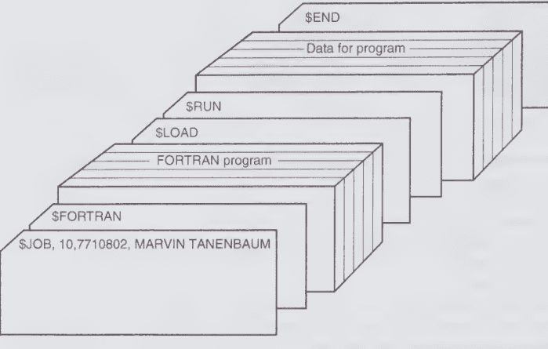

图 1-4。典型的 `FMS` 作业结构。

开发和维护完全不同的产品线对制造商来说是一项昂贵的支出。此外，许多新计算机客户最初需要一台小型机器，但随着规模扩大，他们想要一台能够更快地运行他们所有旧程序的更大的机器。

`IBM` 试图通过引入 `System/360` 一次性解决这两个问题。`360` 是一系列软件兼容的机器，范围从 `1401` 尺寸的模型到比强大的 `7094` 更大、更强大的机型。这些机器之间的区别仅在于价格和性能（最大内存、处理器速度、允许的 I/O 设备数量等）。它们都具有相同的架构和指令集，为其中一台机器编写的程序可以在所有其他机器上运行——至少在理论上如此。（但正如约基·贝拉所说：“在理论上，理论和实践是一样的；在实践中，它们并不是。”）`360` 的设计旨在同时处理科学（即数值）和商业计算，单一系列机器可以满足所有客户的需求。在随后的几年里，`IBM` 推出了 `360` 系列的后兼容型号，使用了更现代的技术，被称为 `370`、`4300`、`3080` 和 `3090`。`Z` 系列是该系列最近的后代，尽管它已经偏离了原始设计很多。

`IBM 360` 是第一条使用（小型）集成电路（`IC`）的主要计算机线，与由单晶体管构建的第二代机器相比，它提供了巨大的价格/性能优势。它取得了巨大的成功，兼容计算机家族的想法很快被所有其他主要制造商所采用。这些机器的后代今天仍在计算机中心使用。如今，它们通常被用于管理巨大的数据库（例如航空公司订位系统），或作为必须每秒处理数千次请求的 网站服务器。

“单一家族”理念最大的优势也是它最大的缺点。最初的意图是所有软件（包括操作系统 `OS/360`）都运行在所有系统上，这些系统通常只是取代了 `1401` 用于复制卡片，而在非常大的系统中通常取代了 `7094` 用于气象预报和其他重型计算。它必须在外设设备少的系统上良好，在外设设备多的系统上同样良好。它必须在商业环境和科学环境中运行。最重要的是，它对所有这些不同的用途都必须是的。

`IBM`（甚至是任何公司）根本无法写出一部分满足所有这些冲突要求的软件。结果是一个庞大且异常复杂的操作系统，规模可能比 `FBS` 大两个数量级。它由数千名程序员编写的数行汇编语言组成，包含了数千个 `bug`，这导致不断发布新版本以试图纠正它们。每个版本修复了一些 `bug` 并引入了新的，因此 `bug` 的数量随时间推移不变。

`OS/360` 的设计者之一弗雷德·布鲁克斯（`Fred Brooks`）写了一本幽默的书描述了他在 `OS/360` 的经历（`Brooks, 1995`）。

# 9


**图 1-3.** 早期的批处理系统。(a) 程序员将卡片带到 `1401` 机。(b) `1401` 将批处理作业读取到磁带上。(c) 操作员将输入磁带带到 `7094` 机。(d) `7094` 进行计算。(e) 操作员将输出磁带带到 `1401` 机。(f) `1401` 打印输出。


当整批作业完成后，操作员移除输入和输出磁带，用下一批磁带替换输入磁带，并将输出磁带带到 `1401` 机进行离线打印（即不连接到主计算机）。它首先从一张 `JOB` 卡片开始，指定运行时间（以分钟为单位）、计费账户号码和程序员的名字。接着是一张 `$FORTRAN` 卡片，告诉操作系统从系统磁带中加载 `FORTRAN` 编译器。紧随其后的是要编译的程序，然后是一张 `$LOAD` 卡片，指导操作系统加载刚刚编译的目标程序。（编译后的程序通常写在擦写磁带上，必须显式加载）。接下来是 `$END` 卡片，告诉操作系统使用随其后的数据运行程序。最后，`$END` 卡片标记了作业的结束。这些原始的控制卡片是现代 `shell`（壳）和命令行解释器的先驱。

大型第二代计算机主要用于科学和工程计算，例如解决物理和工程中出现的偏微分方程。它们主要用 `FORTRAN` 和汇编语言编程。典型的操作系统有 `FMS`（`Fortran` 监控系统）和 `IBSYS`（`IBM` 为 `7094` 设计的操作系统）。

## 1.2.3 第三代计算机（1965–1980）：集成电路与多道程序

到 20 世纪 60 年代初，计算机制造商有两个截然不同且不兼容的产品线。一方面，是面向字的大型科学计算机，如 `7094`，它们用于科学和工程中的工业级数值计算。另一方面，是面向字符的商业计算机，如 `1401`，广泛被银行和保险公司用于磁带排序和打印。

### 引言


图 1-4。典型的 `FMS` 作业结构。

开发和维护完全不同的产品线对制造商来说是一项昂贵的支出。此外，许多新计算机客户最初需要一台小型机器，但随着规模扩大，他们想要一台能够更快地运行他们所有旧程序的更大的机器。

`IBM` 试图通过引入 `System/360` 一次性解决这两个问题。`360` 是一系列软件兼容的机器，范围从 `1401` 尺寸的模型到比强大的 `7094` 更大、更强大的机型。这些机器之间的区别仅在于价格和性能（最大内存、处理器速度、允许的 `I/O` 设备数量等）。它们都具有相同的架构和指令集，为其中一台机器编写的程序可以在所有其他机器上运行——至少在理论上如此。（但正如约基·贝拉所说：“在理论上，理论和实践是一样的；在实践中，它们并不是。”）`360` 的设计旨在同时处理科学（即数值）和商业计算，单一系列机器可以满足所有客户的需求。在随后的几年里，`IBM` 推出了 `360` 系列的后兼容型号，使用了更现代的技术，被称为 `370`、`4300`、`3080` 和 `3090`。`Z` 系列是该系列最近的后代，尽管它已经偏离了原始设计很多。

`IBM 360` 是第一条使用（小型）集成电路（`IC`）的主要计算机线，与由单晶体管构建的第二代机器相比，它提供了巨大的价格/性能优势。它取得了巨大的成功，兼容计算机家族的想法很快被所有其他主要制造商所采用。这些机器的后代今天仍在计算机中心使用。如今，它们通常被用于管理巨大的数据库（例如航空公司订位系统），或作为必须每秒处理数千次请求的 网站服务器。

“单一家族”理念最大的优势也是它最大的缺点。最初的意图是所有软件（包括操作系统 `OS/360`）都运行在所有系统上，这些系统通常只是取代了 `1401` 用于复制卡片，而在非常大的系统中通常取代了 `7094` 用于进行气象预报和其他重型计算。它必须在外设设备少的系统上良好，在外设设备多的系统上同样良好。它必须在商业环境和科学环境中运行。最重要的是，它对所有这些不同的用途都必须是高效的。

`IBM`（甚至是任何公司）根本无法写出一部分满足所有这些冲突要求的软件。结果是一个庞大且异常复杂的操作系统，规模可能比 `FBS` 大两个数量级。它由数千名程序员编写的数行汇编语言组成，包含了数千个 `bug`，这导致不断发布新版本以试图纠正它们。每个版本修复了一些 `bug` 并引入了新的，因此 `bug` 的数量随时间推移不变。

`OS/360` 的设计者之一弗雷德·布鲁克斯（`Fred Brooks`）写了一本幽默的书描述了他在 `OS/360` 的经历（`Brooks, 1995`）。

（注：原文中存在大量重复段落，此处译文已根据逻辑结构进行了去重处理。）

## 1.2 操作系统历史

同时时分用户的模型。他们的模型就像电力系统——当你需要用电时，只需将插头插入墙上的电源，在合理范围内，你需要的电力随处可用。该系统的设计者被称为 `MULTICS`（多路信息与计算服务），他们构想了一台巨大的机器，为波士顿地区的所有人提供动力。在短短40年后，比 `GE-645` 主机快10,000倍的机器将以远低于1000美元的价格售出数百万台，这种想法纯粹是科幻小说。就像现在的超音速跨西洋海底火车一样。

`MULTICS` 的成功参差不齐。它的设计目标是在一台仅比基于 `Intel 386` 的 `PC` 强的机器上支持数百个用户，尽管它拥有更强的 `I/O` 能力。这听起来并不那么疯狂，因为在那个时代人们知道如何编写高效程序，而这种技能在后来完全失传了。有很多原因导致 `MULTICS` 没有席卷世界，其中微不足道的是它是用 `PL/I` 编程语言编写的，而 `PL/I` 编译器在最后交付时已经迟到且几乎无法运行。

简而言之，`MULTICS` 向计算机文献中引入了许多开创性的思想，但将其转化为产品并取得巨大的商业成功比任何人预期的都要困难得多。贝尔实验室退出了项目，通用电气彻底放弃了计算机业务。然而，麻省理工学院（`M.I.T.`）坚持了下来并最终让 `MULTICS` 运行。它最终由收购通用计算机业务的公司（霍尼韦尔）作为产品出售，并在全球约 80 家公司和大学安装。虽然数量较少，但 `MULTICS` 用户非常忠诚。例如，通用汽车、福特和美国国家安全局在多年尝试让霍尼韦尔更新硬件后，直到 `MULTICS` 发布 30 年后的 20 世纪 90 年代末才关闭了他们的 `MULTICS` 系统。

到 20 世纪末，计算机公用事业的概念已经消退，但它可能会以云计算的形式回归。云计算将小型计算机（包括智能手机、平板电脑等）连接到位于庞大且遥远的数据中心中的服务器，所有的计算都在数据中心完成，而本地计算机负责处理用户界面。这里的动机是，大多数人不想管理日益复杂且挑剔的计算机系统，更倾向于让专业团队（例如该公司的员工）来完成。电子商务已经在朝着这个方向演进，各种公司在多处理器服务器上运行电子邮件，简单的客户端连接到上面，这非常符合 `MULTICS` 的设计精神。

尽管缺乏商业成功，`MULTICS` 对后来的操作系统产生了巨大影响（尤其是 `UNIX` 及其派生版本，`FreeBSD`、`Linux`、`iOS` 和 `Android`）。它在几篇论文和一本书中被描述过（`Corbató et al., 1972`；`Corbató and Vyssotky, 1965`；`Daley and Denny, 1968`；`Organick, 1972` 以及 `Saltzer, 1974`）。它还有一个活跃的网站，地址为 `www.multicians.org`，上面有许多关于该系统、其设计者及其用户的信息。

### 引言 第一章

第三代期间的另一个发展是微型计算机的现象增长，从 1961 年的 `DEC PDP-1` 开始。`PDP-1` 拥有 `4K` 的 `18` 位字，每台价格为 `120,000` 美元（不足 `7094` 价格的 `5%`），非常火热。对于某些类型的非数值工作，它的速度与 `7094` 一样，并催生了一个全新的行业。随后出现了一系列 `PDP`（与 `IBM` 的不同，所有版本都互不兼容），并在 `PDP-11` 达到顶峰。

贝尔实验室参与 `MULTICS` 项目的科学家之一肯·汤普森（`Ken Thompson`）随后发现了一台无人使用的小型 `PDP-7` 微型计算机，并开始编写一个精简的单用户版本 `MULTICS`。这项工作后来发展成了 `UNIX` 操作系统，它在学术界、政府机构以及许多公司中流行起来。

`UNIX` 的历史在其他地方介绍过（例如 `Salus, 1994`）。该故事的将将在第 10 章给出。目前，只需说明源代码是广泛提供的，各种组织都开发了自己的（不兼容的）版本，这导致了混乱。开发出了两个主要版本：来自 `AT&T` 的 `System V` 和来自加利福尼亚大学伯克利分区的 `BSD`（伯克利软件发行）。这些是不同的变体。为了让在任何 `UNIX` 系统上运行程序成为可能，`IEEE` 开发了一个名为 `POSIX` 的 `UNIX` 标准，大多数 `UNIX` 版本现在都支持它。`POSIX` 定义了 `UNIX` 系统必须支持的最小系统调用接口。事实上，其他操作系统现在也支持 `POSIX` 接口。

顺带一下，值得提到 1987 年，作者发布了一个 `UNIX` 的小型克隆版本，称为...（*注：此处提供的翻译原文似乎在此处中断或直接进入了第四代讨论，我将根据您提供的后续文本继续进行翻译*）

## 1.2.4 第四代（1980 年至今）：个人电脑

随着 `LSI`（大规模集成）电路的发展——即包含成千上万晶体管芯片——个人电脑的时代开启了。在架构上，个人电脑（最初是微型计算机）与微型计算机不同。在 1980 年，`IBM` 设计了 `PC` 并寻找运行在其上面的软件。人们联系了比尔·盖茨（`Bill Gates`）许可他的 `BASIC` 解释器。他们还询问是否知道什么样的操作系统。`IBM` 建议联系 `Digital Research`，当时领先的操作系统公司。为了能够测试，`IBM` 询问了其顾问加里·基尔达尔（`Gary Kildall`）编写一个。基尔达和一个朋友创建了 `80` 英寸软盘，英特尔将软盘连接到 `8080`，英特尔询问基尔达尔编写一个。基尔达尔意识到 `Seattle Computer Products` 有一个合适的操作系统，他请求购买（据称为 `75,000` 美元），他们接受了。盖茨随后向 `IBM` 提供了一个 `DOS/BASIC` 程序包，`IBM` 接受了。基尔达尔随后编写了基于磁盘的操作系统 `CP/M`（微机控制程序）。由于英特尔不认为基于磁盘的微型计算机很有前景，当基尔达尔请求 `CP/M` 的权利时，英特尔批准了他的请求。基尔达尔随后成立了公司 `Digital Research` 来开发和销售 `CP/M`。

1977 年，`Digital Research` 重写了 `CP/M`，使其适用于 `8080` 以及其他 `CPU` 芯片。许多应用程序是为 `CP/M` 编写的，这使其在 5 年内完全主导了微机世界。

20 世纪 80 年代初，`IBM` 设计了 `PC` 并寻找软件。`IBM` 的人员联系了比尔·盖茨许可他的 `BASIC` 解释器。他们还询问他是否知道什么样的操作系统。盖茨建议 `IBM` 联系 `Digital Research`，当时领先的操作系统公司。做出了历史上最错误的决定，基尔达尔拒绝与 `IBM` 会面，而是派了一个下属。更糟糕的是，他的律师拒绝签署 `IBM` 关于尚未发布的 `PC` 的保密协议。因此，`IBM` 回到盖茨处询问是否可以为他们提供操作系统。

当 `IBM` 回来时，盖茨意识到一家本地计算机制造商 `Seattle Computer Products` 有一个合适的操作系统 `DOS`（磁盘操作系统）。他接触他们并请求购买（据称为 `75,000` 美元），他们接受了。盖茨随后向 `IBM` 提供了一个 `DOS/BASIC` 程序包，`IBM` 接受了。`IBM` 需要某些修改，于是盖茨聘佣了蒂姆·帕特森（`Tim Paterson`），作为盖茨初创公司的一名员工来实现。修改后的系统被命名为 `MS-DOS`（微软操作系统），并迅速主导了 `IBM PC` 市场。这里的关键因素是盖茨的（事后来看是非常英明的）决定，将 `MS-DOS` 卖给计算机公司并与硬件捆绑，相比之下基尔达尔的

尝试向终端用户逐一销售 `CP/M`（至少最初如此）。在这一切发生后，`Kildall` 意外且突然地去世，原因尚未完全公开。

当 `IBM PC` 的继任者 `IBM PC/AT` 于 1983 年搭载 `Intel 80286 CPU` 发布时，`MS-DOS` 已经稳 foothold跟，而 `CP/M` 则已处于末路。`MS-DOS` 随后被广泛应用于 `80386` 和 `80486`。尽管 `MS-DOS` 的初始版本相当原始，但随后的版本包含了更先进的功能，其中许多源自 `UNIX`。（微软公司非常了解 `UNIX`，在公司早期甚至使用过一种名为 `XENIX` 的微型计算机版本。）

`CP/M`、`MS-DOS` 以及其他早期微型计算机操作系统都是基于用户从键盘输入命令的。这由于 `John Engelbert` 在 20 世纪 60 年代斯坦福研究院的研究发生了改变。`Engelbert` 发明了图形用户界面（`GUI`），包含了窗口、图标、菜单和鼠标。这些思想被施罗克斯帕克中心的研究人员采纳，并被整合到他们构建的机器中。

一天，共同发明 `Apple` 电脑的 `Steve Jobs` 看到一个 `GUI` 并立即意识到它的潜力，而施罗克斯管理层却做出了著名的忽视。这种具有战略规模意义的行为导致了一本名为《错失未来》（`Fumbling the Future, Smith and Alexander, 1988`）的书。`Jobs` 随后开始构建带有 `GUI` 的 `Apple`。这个项目导致了 `Lisa`，但它过于昂贵且在商业上失败了。`Jobs` 的第二次尝试 `Macintosh` 获得了巨大的成功，不仅是因为它比 `Lisa` 便宜得多，而且因为它对用户友好，这意味着它是为那些不仅了解计算机，而且完全不需要任何学习的用户设计的。在图形设计、专业数字摄影和专业视频制作的创意领域，`Macintosh` 非常流行，其用户对其也充满热情。1999 年，`Apple` 采用了来自卡内基·梅隆大学的 `Mach` 微内核内核，该内核最初是为取代 `BSD UNIX` 内核而开发的。`Mac OS X` 是一个基于 `UNIX` 的操作系统，具有非常独特的界面。

当微软决定构建 `MS-DOS` 的继任者时，深受 `Macintosh` 成功的强烈影响。它产生了一个名为 `Windows` 的 `GUI` 系统，该系统最初运行在 `MS-DOS` 之上（即它更像是一个壳，而不是真正的操作系统）。在 1985 年到 1995 年的约10 年里，`Windows` 只是 `MS-DOS` 之上的一个图形环境。然而，从 1995 年开始，发布了一个独立的版本 `Windows 95`，它将许多操作系统功能整合其中，仅将底层 `MS-DOS` 系统用于启动和运行旧的 `MS-DOS` 程序。1998 年，发布了该系统的稍微修改版本 `Windows 98`。尽管如此，`Windows 95` 和 `Windows 98` 包含大量的 `16` 位 `Intel` 汇编语言。

微软的另一个操作系统 `Windows NT`（`NT` 代表新 `Technology`）在某种程度上与 `Windows 95` 兼容，但它是内部从零开始的完全重写。它是一个全 `32` 位系统。`Windows NT` 的首席设计师是 `David Cutter`，他也是 `VAX MS` 操作系统的设计师之一，因此 `VMS` 的一些思想出现在 `NT` 中。事实上，其中包含了太多的 `VMS` 思想，以至于 `VMS` 的所有者 `DEC` 提起了诉讼，并在庭外达成和解，金额是一个用许多数字才能的数字。微软预计 `NT` 的第一个版本将杀死 `MS-DOS` 和所有其他版本的 `Windows`，因为它是一个优越得系统，但它失败了。直到 `Windows NT 4.0`，它才真正大流行，特别是在企业网络中。`Windows NT 5` 版在 1999 年初更名为 `Windows 2000`。它旨在成为 `Windows 98` 和 `Windows NT 4.0` 的继任者。

结果也没有成功，于是微软又推出了一个版本的 `Windows Me`（千世纪版）。2001 年，发布了 `Windows 2000` 的稍微升级版本 `Windows XP`。它的运行时间要长得多（6 年），基本上取代了之前所有的 `Windows` 版本。

尽管如此，`Windows` 的衍生并没有停止。在 `Windows 2000` 之后，微软将 `Windows` 家族分为客户端和服务器线。客户端线基于 `XP` 及其继任者，而服务器线是 `Windows 2003` 和 `Windows 2008`。第三条针对嵌入式世界的线稍后出现。这些 `Windows` 版本都以服务包的形式衍生出变体。这足以让一些管理员（以及操作系统教科书的作者们）抓狂。

接着在 2007 年 1 月，微软终于发布了 `Windows XP` 的继任者 `Vista`。它带有新的图形界面、改进的安全性以及许多新的或升级过的用户程序。微软希望它能完全取代 `Windows XP`，但它收到了许多批评和负面报道，主要是由于高系统系统要求、限制性的许可条款以及对数字版权管理（`DRM`）的支持，这些技术让用户难以复制受保护的内容。

随着 `Windows 7` 的到来，一个新的且更消耗资源的操作系统版本出现了，它没有引入太多功能，但相对较小且相当稳定。在短短三周内，`Windows 7` 获得的市场份额就比 `Vista` 在七个月内的还要多。2012 年，微软推出了它的继任者 `Windows 8`，这是一个具有完全全新外观和体验的操作系统。

个人电脑世界的另一个主要竞争对手是 `UNIX`（及其各种变体）。`UNIX` 在高性能 `RISC` 芯片的工作站上是标准。它的变体被广泛用于移动设备，如运行 `iOS` 或 `Android`。

## 1.2 操作系统的历史

作为一个旁插，在本书中我们将使用 `x86` 来指代所有基于 70 年代`806` 指令集架构的现代处理器。尽管如此，对于程序员来说，它们看起来非常相似——我们将使用 `x86-32` 和 `x86-64` 来指示 `32` 位和 `64` 位变体。

`BSD` 是一个流行的 `UNIX` 变体，源自伯克利的 `BSD` 项目。所有 `Macintosh` 计算机运行修改过的 `FreeBSD`。

许多用户，特别是经验丰富的程序员更喜欢命令行界面而不是 `GUI`，因为几乎所有的 `UNIX` 系统都支持 `MIT` 的窗口系统（也称为 `X11`）。该系统处理基本的窗口管理，允许用户使用鼠标创建、删除、移动和调整窗口大小。当完整的 `GUI`（如 `Gnome` 或 `KDE`）运行在 `X11` 之上后，`UNIX` 看起来就像 `Macintosh` 或微软 `Windows` 一。

20 世纪 80 年代中期开始的一个有趣发展是个人电脑网络操作系统和分布式操作系统的增长（`Tanenbaum van Steen, 2007`）。在网络操作系统中，用户感知多台计算机的存在，可以登录远程机器并将文件从一台机器复制到另一台。每台机器运行自己的操作系统并拥有本地用户（或用户）。

网络操作系统与单处理器操作系统在本质上没有区别。它们显然需要网络接口适配器和一些驱动它的底层软件，以及实现远程登录和远程文件访问的程序，但这些添加并没有改变操作系统的基本结构。

相比之下，分布式操作系统在用户用户看起来像是一个传统的单处理器系统，尽管它实际上是由多个处理器组成的。用户不应该感知到他们的程序运行在哪里或他们的文件存储在哪里；这些应该由操作系统自动且高效地处理。


真正的分布式操作系统需要的不仅仅是在单处理器操作系统中添加一些代码，因为分布式系统和集中式系统

## 1.2 操作系统历史

它们在关键方面上有所不同。例如，分布式系统通常允许应用程序在多个处理器上同时运行，这需要更复杂的处理器调度算法来优化并行度。

网络内部的延迟意味着这些（以及其他）算法必须在不完整、过时甚至是错误信息的情况下运行。这种情况与单处理器系统有根本区别，因为在单处理器系统中，操作系统对系统状态拥有完整的信息。

### 1.2.5 第五代（1990年至今）：移动计算机

自从迪克·追踪（Dick Tracy）在20世纪40年代的漫画中使用他的“双向无线电手表”以来，人们一直渴望有一种可以随身携带的通信设备。第一部手机出现于1946年，重量约40公斤。只要你有车来载它，你就可以带它去任何地方。

第一部真正的手手机出现于20世纪70年代，重量大约1公斤，非常轻便。它被亲切地称为“大砖”。很快，大家都想要它。如今，手机手机的普及率已达全球人口的90%。我们可以用便携手机和手表通话，但有了眼镜和其他可穿戴设备，手机部分已不再有趣了。我们接收邮件、浏览网页、给朋友发短信、玩游戏、在拥堵交通中导航——对此不再深思。

虽然在手机类设备中结合电话和计算功能的想法自20世纪70年代就有了，但第一部真正的智能手机直到20世纪90年代中期才出现，当时诺基亚发布了N9000，它字面上结合了两个独立的设备：手机和PDA（个人数字助理）。1997年，爱立信为其GS88“Penelope”创造了 *smartphone*（智能手机）一词。

现在智能手机已无处不在，各种操作系统之间的竞争异常激烈，其结果比PC世界更难以预测。在写作时，谷歌的Android是主导操作系统，苹果的iOS位居第二，但情况并非一直如此，几年后一切都可能完全不同。如果说智能手机领域有什么是明确的，那就是想要长期称霸并不容易。

毕竟，智能手机在诞生后的第一个十年里运行的是*Symbian OS*（赛博恩系统）。它是三星、索尼爱信、摩托罗拉，尤其是诺基亚等热门品牌的首选操作系统。然而，其他操作系统如*RIM的 BlackBerry OS*（2002年引入智能手机）和苹果的*iOS*（2007年随第一款*iPhone*发布）开始侵蚕赛博恩的市场份额。许多人预计RIM将主导商务市场，而iOS将成为消费设备之王。赛博恩的市场份额暴跌。2011年，诺基亚放弃了赛博恩，并宣布将Windows Phone作为其主要平台。在一段时间内，苹果和RIM曾是瞩目的焦点（尽管没有像赛博恩那样占据主导地位），但Android这一谷歌于2008年发布的基于Linux的操作系统花费了很长的时间才赶上所有竞争对手。

对于手机制造商来说，Android的优势在于它是基于宽松许可的开源软件。因此，他们可以轻松地对其进行修改并适应自己的硬件。此外，它还有一个庞大的开发者社区，使用熟悉的Java编程语言编写应用程序。尽管如此，过去几年的经验表明主导地位可能不会持续，Android的竞争对手正渴望夺回部分市场份额。我们将在第10.8节详细介绍Android。

## 1.3 计算机硬件回顾

操作系统与其运行的计算机硬件紧密相关。它扩展了计算机的指令集并管理其资源。为了工作，它必须对硬件有深入了解，至少了解硬件在程序员面前的状态。出于此考虑，让我们简要回顾一下现代个人电脑中的硬件。之后，我们可以开始进入操作系统做什么以及它们如何工作的细节。

从概念上讲，一台简单的个人计算机可以抽象为类似于图1-6所示的模型。CPU、内存和I/O设备都通过系统总线连接并在其上相互通信。现代个人电脑具有更复杂的结构，涉及多个总线，我们将对其进行检查。在接下来的章节中，我们将回顾这些组件。关于计算机组织的主已经写了许多书籍。其中两本著名的著作是Tanenbaum (2012)以及Patterson and Hennessy (2013)。


### 1.3.1 处理器

计算机的“大脑”是CPU。每个CPU的基本周期是从内存中提取第一条指令，对其解码以确定其类型和操作数，执行它，然后提取后续指令。该周期重复直到程序结束。每个CPU都有一组可以执行的特定指令。因此，x86处理器无法执行ARM程序，而ARM处理器无法执行x86程序。访问内存获取指令或数据所需的时间比执行指令要长得多。指令集通常包含从内存加载一个字（word）到寄存器的指令，以及从寄存器存储一个字到内存的指令。其他指令将来自寄存器的两个操作数合并或生成结果。

除了用于存储变量和临时结果的通用寄存器外，大多数计算机都有程序员可见的特殊寄存器。其中之一是程序计数器（program counter），它包含要提取的下一条指令的内存地址。提取该指令后，程序计数器更新为后续。

另一个寄存器是栈指针（stack pointer），它指向内存中的栈顶。栈包含每个已进入但尚未退出的过程的帧（frame）。过程的栈帧持有输入参数、局部变量以及未保存在寄存器中的临时变量。

另一个寄存器是PSW（程序状态字）。该寄存器包含由比较指令设置的状态位、CPU优先级、模式（用户态或内核态）以及其他控制位。用户程序通常可以读取整个PSW，但通常只能写入其某些字段。PSW在系统调用和I/O中起着重要作用。

操作系统必须完全感知所有寄存器。在复用CPU时，操作系统经常会停止运行的程序以启动另一个。每当启动一个运行程序时，操作系统必须保存所有寄存器，以便以后运行时恢复它们。

为了提高性能，设计者早已放弃了一次取指、解码和执行一条指令的简单方法。许多现代CPU具有同时执行多条指令的设施。例如，CPU可能有单独的提取、解码和执行单元，因此在执行指令$n$时，它可以解码指令$n+1$并取指指令$n+2$。这种结构被称为流水线（pipeline），如图1-7(a)中三级流水线所示。更长的流水线设计特点是，一旦指令被取入流水线，它就必须执行，即使之前的指令是已跳转的条件分支。

## 22 引言 第1章

流水线（Pipelines）给编译器编写者和操作系统编写者带来了巨大的麻烦，因为它们将底层机器的复杂性暴露给他们，他们必须处理这些复杂性。

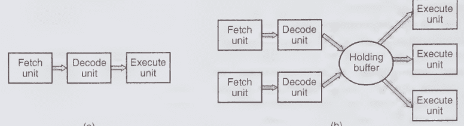

图 1-7。(a) 三级流水线。(b) 超标 CPU。

比流水线设计更先进的是超标 CPU，如图 1-7(b) 所示。在这种设计中，存在多个执行单元，例如，一个用于整数算术，一个用于浮点算术，一个用于布尔运算。一次取回两个或更多指令，进行解码并放入一个保持缓冲区（holding buffer）中，直到它们可以执行。一旦某个执行单元可用，它就会查看保持缓冲区，看是否有它可以处理的指令，将其从缓冲区中移除并执行。这种设计的一个影响是，程序指令往往是无序执行的。在大多数情况下，由硬件来确保产生的结果与我们顺序实现的实现相同，但正如我们将要看到的，这给操作系统带来了令人烦恼的复杂性。

大多数 CPU（早期使用的型号除外）如前所述有两种模式：内核态和用户态。通常，PSW（状态寄存器）中的一个位控制模式。在内核态下运行时，CPU 可以执行其指令集中的每条指令并使用硬件的每个功能。在桌面级计算机和服务器机器上，操作系统通常在内核态下运行，使其能够访问完整的硬件。大多数嵌入式系统只有一小部分在内核态运行，操作系统的其余部分在用户态运行。

用户程序始终在用户态下运行，这只允许执行部分指令并访问部分功能。通常，在用户态下，所有涉及 I/O 和内存保护的指令都是被禁止的。当然，禁止设置 PSW 模式进入内核态。

为了从操作系统获取服务，用户程序必须发出系统调用（system call），这会陷阱（trap）进入内核并调用操作系统。TRAP 指令从用户态切换到内核态并启动操作系统。工作完成后，控制将返回到系统调用后续指令处的用户程序。我们将在本章的晚些时候解释系统调用机制的细节。目前，将其看作是一个特殊的

### 1.3 计算机硬件复习

过程调用，它具有从用户态切换到内核态的额外属性。关于排版说明，我们将在正文中使用小写 Helvetica 字体来表示系统调用，如下：read。

值得注意的是，计算机除了执行系统调用的指令外，还有其他类型的陷阱（traps）。大多数陷阱是由硬件引起的，用于警告异常情况，例如尝试除以 0 或浮点下溢。在所有情况下，操作系统都进行控制并必须决定如何处理。有时必须带错误终止程序。最后，当程序预先声明它想要处理某些类型的情况时，控制可以传回程序，让它来处理问题。

### 多线程和多核芯片

摩尔定律指出，芯片上的晶体管数量每 18 个月就会一倍。这个“定律”并不是某种物理定律（如动量守恒定律），而是英特尔创始人戈登·摩尔（Gordon Moore）的一种观察，描述了半导体行业的工艺工程师缩小晶体管的速度有多快。摩尔定律已经维持了三十年，预计还将维持至少。此之后，每个晶体管的原子数量将变得太小，量子力学将开始发挥重要作用，阻止晶体管尺寸的进一步缩小。

晶体管的丰富带来了一个问题：如何处理所有的晶体管？我们在上面看到了一种方法：超标架构，具有多个功能单元。但随着晶体管数量的增加，更有可能在 CPU 芯片上放置更大的缓存。这确实正在发生，但最终将达到收益递减点。

下一步不仅复制功能单元，还复制一些控制逻辑。英特尔奔腾 4 为 x86 处理器引入了这种特性，称为多线程或超线程（hyperthreading，英特尔的称呼），其他几个 CPU 芯片也具有这一特性——包括 SPARC、Power5、英特尔 Xeon 和英特尔 Core。简单来说，它允许 CPU 保持两个线程的状态，并在纳秒尺度上来回切换。（线程是一种轻量级进程，而进程反而是运行中的程序；我们将在第 2 章讨论细节。）例如，如果其中一个进程需要从内存中读取一个字（这需要许多周期），多线程 CPU 可以直接切换到另一个线程。多线程并不提供真正的并行性。一次只有一个进程在运行，但线程切换时间缩短到了纳秒级。

多线程对操作系统有影响，因为每个线程在操作系统看来都是一个独立的 CPU。考虑一个具有两个实际 CPU 的系统，每个 CPU 有两个线程。操作系统会将此视为四个 CPU。如果在某个时间点，工作仅足以让两个 CPU 忙碌，它可能会无意中将两个线程调度到同一个 CPU 上，导致 CPU 完全空闲。这种选择的效率远低于在每个 CPU 上使用一个。

除了多线程之外，许多 CPU 现在有四个、八个或更多完整的核心。操作系统会将此视为四个 CPU。

### 1.3.2 内存

接下来是缓存内存，它主要由硬件控制。主内存被划分为行（cache lines）。当程序需要读取一个字时，缓存硬件会检查该行是否在缓存中。如果是缓存命中，从缓存中满足，无需向主内存发送请求。

| 典型访问时间 | 典型组件 | 典型容量 |
|---|---|---|
| 1 nsec | 寄存器 | <1 KB |
| 2 nsec | 缓存 | 4 MB |
| 10 nsec | 主内存 | 8 GB |
| 10 msec | 磁磁盘 | 4 TB |

图 1-9。典型的存储层次结构。这些数字是非常粗略的估计。通常在 32 位 CPU 上为 32 × 32 位，在 64 位 CPU 上为 64 × 64 位。两种情况下均小于 1 KB。

# 引言

# 第1章

并不是每个问题都与每个缓存相关。对于 CPU 缓存中的主内存缓存行，每次发生缓存缺失（cache miss）通常都会进入一个新条目。要使用的缓存行通常是通过使用所引用内存地址的高位位生成的。例如，对于 4096 个大小为 64 字节的缓存行和 32 位地址，第 6 到第 17 位可能用于指定缓存行，而第 0 到第 5 位位于缓存行内。在这种情况下，要移除的条目与新进入的数据相同，但在其他系统中可能不同。最后，当缓存行重写回主内存时（如果它自缓存以来已被修改过），内存中重写的位置由涉及的地址唯一确定。

缓存是一个如此好的主意，以至于现代 CPU 拥有两个缓存。一级缓存或 L1 缓存始终位于 CPU 内部，通常将解码后的指令馈送 CPU 的执行引擎。大多数芯片具有第二个 L1 缓存，用于频繁使用的数据字。L1 缓存每个通常为 16 KB。此外，通常还有第二个缓存，称为 L2 缓存，它保存了几兆字节最近使用的内存。L1 和 L2 缓存的区别在于时序。访问 L1 缓存不需要任何延迟，而访问 L2 缓存则涉及一或两个时钟周期的延迟。

在多核芯片上，设计人员必须决定放置缓存的位置。在图1-8(a) 中，单个 L2 缓存由所有核心共享。这种方法用于 Intel 多核芯片。相比之下，在图1-8(b) 中，每个核心都有自己的 L2 缓存。AMD 使用了这种方法。每种策略都有优缺点。例如，Intel 的共享 L2 缓存需要更复杂的缓存控制器，但 AMD 则让保持 L2 缓存一致性变得更加困难。

主内存是图1-9 层次结构中的下一个。它是内存系统的中坚力量。主内存通常称为 RAM（随机访问存储）。老辈们称之为核心存储（core memory），因为 1950 年代和 1960 年代的计算机使用极微的磁性铁氧体作为主内存。它们已经消失了几十年，但这个名称一直保留了下来。目前，内存从几百 MB 到几个 GB 不等并正在快速增长。所有无法被缓存满足的 CPU 请求都会去主内存。

除了主内存，许多计算机还有少量的易失性随机访问存储。与 RAM 不同，非易失性内存在断电时不会丢失内容。ROM（只读存储）在工厂时编程，之后无法更改。它快速且廉价。在某些计算机中，启动计算机的自举加载器包含在 ROM 中。此外，一些 I/O 卡使用 ROM 处理低级设备控制。

EEPROM（电可擦除可读存储）和闪存也是非易失性的，但与 ROM 不同，它们可以被擦除和重写。然而，它们的时间比写入 RAM 多几个数量级，因此它们的使用方式与 ROM 相同，额外的功能是现在可以通过在现场重写它们所持有的程序来修复程序中的错误。

## 1.3 计算机硬件回顾

闪存也常用作便携电子设备的存储介质。它作为数码相机中的胶片以及作为便携音乐播放器的磁盘，这仅列出了两个用途。闪存的速度介于 RAM 和磁盘之间。此外，与磁盘不同，如果擦除次数过多，它就会磨损。

另一种内存是 CMOS，它是易失性的。许多计算机使用 CMOS 来保存当前的时间和日期。小电池供电时，CMOS 电路会增加时间，因此即使计算机拔掉电源，时间也能正确更新。CMOS 内存还可以保存持续几年的配置参数。然而，当它开始故障时，计算机似乎患了阿尔茨海默症，忘记了它已经知道多年的事情。

### 1.3.3 磁盘

层次结构中的下一个是磁磁盘（硬盘）。磁盘存储的成本比 RAM 便宜两个数量级，容量通常也大几个数量级。唯一的问题是其随机访问数据的时间要慢近三个数量级。原因是磁盘是一种机械设备，如图 1-10 所示。

图 1-10。磁盘驱动器的结构。磁盘由一个或多个盘片组成，盘片以 5400、7200、10800 RPM 或更快的速度旋转。机械臂在盘片上从角到边缘枢动，类似于播放黑胶唱片。

信息信息以一系列同心圆的形式写入磁盘。在任何给定的位置，每个磁头都可以读取一个称为“道”（track）的环形区域。给定机械臂的所有道共同形成一个柱体。


每道被划分为若干`sectors`，每个`sectors`通常为 512 字节。在现代磁盘上，外层柱包含包含扇区比内层多。从一个臂移动到下一个大约需要 1 毫秒。移动到随机柱体通常需要 5 到 10 毫秒，取决于驱动器。一旦臂到达正确的道，驱动器必须等待所需的扇区旋转到磁头下方，根据驱动器的 RPM，会有 5 毫秒到 10 毫秒的额外延迟。一旦扇区位于头下方，低端磁盘的读取或写入速度为 50 MB/sec，较快的磁盘为 160 MB/sec。

有时你会听到人们谈论不是磁盘的磁盘，例如`SSD`（固态硬盘）。`SSD`没有移动部件，不包含盘片，并将数据存储在（闪存）内存中。我们记得磁盘是因为它们在掉电时也不会丢失大量数据。

许多计算机支持一种称为虚拟内存的方案，我们将在第 3 章中讨论。这种方案通过将比物理内存更大的程序放在磁盘上，并使用主内存作为其缓存，使得运行这些程序成为可能。这种映射由`CPU`中一个称为`MMU`（内存管理单元）的部分完成，如图 1-6 所示。

缓存和`MMU`的存在会对性能产生重大影响。在多处理系统中，当从一个程序切换到另一个程序时（有时称为上下文切换），可能需要刷新缓存并更改`MMU`中的映射寄存器。这些都是昂贵的操作，程序员会努力避免它们。我们稍后看到这些影响。

### 1.3.4 I/O 设备

`CPU`和内存不是操作系统必须管理的唯一资源。`I/O`设备也与操作系统有大量的交互。正如我们在图1-6 中所示，`I/O`设备通常由两部分组成：控制器和设备本身。控制器是一个芯片或一组芯片，用于物理控制设备。它接受操作系统的命令，例如从设备读取数据，并执行它们。

在许多情况下，设备的实际控制是非常复杂且具体的，因此控制器的工作是为操作系统提供一个简单（但仍然非常复杂）的接口。例如，磁盘控制器可能会接受从磁盘 2 读取第 11206 扇区的命令。控制器随后将此线性扇区号转换为道、扇区和磁头。由于外层柱的扇区比内层多且某些扇区被重映射到其他扇区，这种转换可能会变得复杂。然后控制器可以确定磁盘臂所在的道，并给它移动到所需柱体的命令。它必须等待正确的扇区旋转到头下方，并开始读取和存储从驱动器传出的位，移除引导码并计算校验和。最后，它必须将传入的位组装成字并存储在内存中。为了完成所有这些工作，控制器通常配备经过编程的小型嵌入式计算机来执行工作。

## 30 引言 第 1 章

在运行驱动程序并在无需重启的情况下即时安装它们。这种方法在以前很罕见，但现在变得越来越普遍。热插拔设备（如`USB`和`IEEE 1394`设备，下文将讨论）总是需要加载驱动。

每个控制器都有少量的寄存器，用于与其进行通信。例如，一个简易的磁盘控制器可能会有用于指定磁盘地址、内存地址、扇区计数和方向（读或写）的寄存器。为了激活控制器，驱动程序从操作系统获取一个命令，并将其翻译成适当的值存到设备寄存器中。所有设备寄存器的集合构成了`I/O`端口空间，我们将在第 5 章重新回到这个主题。

在某些计算机上，设备寄存器被映射到系统的地址空间（计算机可以使用该空间），因此它们可以像普通的内存字一样被读写。在这样的计算机上，需要特殊的`I/O`指令，并且可以通过不使用其范围内的内存地址（例如通过使用基址和限寄存器）来防止用户访问硬件。在某些计算机上，设备寄存器被放在特殊的`I/O`端口空间中，每个寄存器都有一个端口地址。在这些机器上，内核模式下提供了特殊的`IN`和`OUT`指令，允许驱动程序读写寄存器。前者消除了对特殊`I/O`指令的需求，但使用了一些地址空间。后者不使用地址空间，但需要特殊指令。两种系统都被广泛使用。

输入和输出有三种不同的方式。在最简单的方法中，用户程序发出系统调用，内核将其翻译为一个过程，以调用相应的驱动程序。驱动程序启动`I/O`并在紧密循环中不断轮询设备以检查其是否完成（通常会有某个位指示设备仍在忙碌）。当`I/O`完成后，驱动程序将数据（如果有）拉到需要的地方并返回。操作系统随后返回给调用者。这种方法被称为**忙等待**（busy waiting），其缺点是占用`CPU`进行轮询直到完成。

第二种方法是让驱动程序启动设备，并要求它在完成后给出一个中断。此时，驱动程序返回。如果操作系统需要且有其他工作要做，它会阻塞调用者。当控制器检测到传输结束时，它会产生一个中断以表示完成。

中断在操作系统中非常重要，因此让我们更仔细地检查这个概念。在图 1-11(a) 中，我们看到一个三步`I/O`过程。在步骤 1 中，驱动程序通过向设备寄存器写入内容来告诉控制器做什么。控制器启动设备。当控制器完成指定字节数的写入后，它在步骤 2 中通过总线向中断控制器发出信号。如果中断控制器准备好接受中断（如果正在处理更高优先级的中断，则可能无法接受），它就会触发`CPU`一个引脚来通知它；在步骤 4 中，中断控制器将设备号放在总线上，以便`CPU`可以读取中断并知道是哪个设备刚刚完成（许多设备可能同时运行）。

图 1-11。(a) 启动`I/O`设备并获取中断的步骤。(b) 中断处理：获取中断、运行中断处理程序并返回用户程序。

一旦`CPU`决定处理中断，程序计数器（`PC`）和处理器状态字（`PSW`）通常会被推入当前栈中，并将`CPU`切换到内核模式。设备号可以作为内存某部分的索引，以找到该设备中断处理程序的地址。这部分内存被称为**中断向量**。一旦中断处理程序（中断设备驱动程序的一部分）启动，它会恢复栈中的程序计数器和`PSW`并保存它们，然后查询设备以了解其状态。当处理程序全部完成后，它返回到之前运行的程序或执行尚未执行的第一条指令。这些步骤如图 1-11(b) 所示。

第三种执行`I/O`方法利用了特殊的硬件：`DMA`（直接内存访问）芯片，它可以控制内存与某些设备之间的位流，而不需要`CPU`持续干预。`CPU`设置`DMA`芯片，告诉它要传输多少字节、涉及的设备和内存地址以及方向，然后让运行。当`DMA`完成时，它产生一个中断，按上述方式进行处理。`DMA`和`I/O`硬件将在第 5 章详细讨论。

中断可能会（而且经常）发生在非常不利的时刻，例如当另一个中断处理程序运行时。由于由于原因，`CPU`有方法禁用并在以后重新启用中断。在禁用中断期间，任何完成的设备都会继续断言其中断信号，但在再次启用中断之前，`CPU`不会被中断。如果在禁用中断期间有多个设备完成，中断控制器将决定先通过哪一个，通常基于分配给每个设备的静态优先级。优先级最高的设备胜并首先获得服务。其他设备必须等待。

### 1.3.5 总线

图 1-6 的结构在微型计算机上使用了多年，也用于最初的`IBM PC`。然而，随着处理器和内存变得越来越快，单条总线（无疑`IBM PC`总线）处理所有流量的能力已达到崩溃边缘。必须做出改变。增加了额外的总线，为了更快速且（注：原文此处存在大量重复异常文本，已根据逻辑清理）。

## 1.3 COMPUTER 硬件 回顾

图 1-6 的结构在微型计算机上使用了多年，也用于最初的`IBM PC`。然而，随着处理器和内存变得越来越快，单条总线（无疑`IBM PC`总线）处理所有流量的能力已达到崩溃边缘。必须做出改变。增加了额外的总线，为了更快速且（注：原文此处存在大量重复异常文本，已根据逻辑清理）。

# 34

# 引言

# 第 1 章

`I/O`地址`0x60`到`0x64`用于软磁盘控制器中断 6，使用`I/O`地址`0x3F0`到`0x3F7`用于打印机中断 7，使用`I/O`地址`0x378`到`0x37A`，以此此类推。

到目前为止，一切良好。问题出现在用户购买了声卡和调制解器卡时，而两者恰好使用了（例如）中断 4。它们会产生冲突且无法共同工作。解决方案是在每块`I/O`卡上包含`DIP`开关或跳线帽，并指示用户通过选择它们来选取一个与用户系统中任何其他设备不冲突的中断级别和`I/O`设备地址。

那些毕生致力于`PC`硬件细节的青少年有时可以不犯错地完成这一切。遗憾的是，没有人能做到这一点，导致了混乱。

即插即用（Plug and play）让系统自动收集`I/O`设备的信息，集中分配中断级别和`I/O`地址，然后告诉每块卡对应的编号。这项工作与计算机启动密切相关，所以让我们来看这一部分。它并不完全易事。

### 1.3.6 启动计算机

简而言之，启动过程如下。每台`PC`都包含一块主板（在政治正确性影响计算机行业之前，被称为 parentboard）。主板上运行着名为`BIOS`（基本输入输出系统）的程序。`BIOS`包含低级`I/O`软件，包括读取键盘、向屏幕写入以及执行`I/O`操作等过程。现在，它存储在闪存`RAM`（flash `RAM`）中，它是非易失的，当发现`BIOS`漏洞时，可以通过操作系统对其进行更新。

当计算机启动时，`BIOS`会启动。它首先检查安装了多少`RAM`，以及键盘和其他基本设备是否已安装并响应正常。它从扫描`PCIe`和`PCI`总线开始检测所有连接到其上的设备。如果设备与系统启动时不同，则会对新设备进行配置。

然后，`BIOS`通过尝试存储在`CMOS`内存中的设备列表来确定启动设备。用户可以在启动后立即进入`BIOS`配置程序来更改此列表。通常，如果存在`CD-ROM`（有时是`USB`）驱动器，系统会尝试从其启动。如果失败，系统将从硬盘启动。从启动设备读取第一个扇区到内存中并执行。该部分包含一个程序，该程序通常检查启动扇区的头的分区表，以确定哪个分区是活动分区。从该分区读取一个二级启动加载器。该加载器从活动分区读取操作系统并启动它。

随后，操作系统查询`BIOS`以获取配置信息。对于每个设备，它会检查是否有相应的设备驱动程序。如果没有，它会要求用户插入包含驱动程序（由设备制造商提供）的`CD-ROM`，或从互联网下载。一旦获取了所有设备，操作系统就会将其加载到内核中。然后它初始化表，创建任何所需的后台进程，并启动登录程序或`GUI`。

## 1.3 计算机硬件复习 35

## 1.4 操作系统“动物园”

操作系统已经存在半个多世纪了。在此期间，开发出了许多不同的操作系统，但并非所有都广为人知。在本节中，我们将简要介绍其中九种。我们将在书的后后部分回到这些不同类型的系统。

### 1.4.1 大型机操作系统

高端是用于大型机的操作系统，即那些在大型企业数据中心仍然可见的、房间大小的计算机。这些计算机在`I/O`能力方面与个人电脑不同。一台拥有 1000 块磁盘和数百万 GB 数据的大型机并不稀奇；而一台拥有这些规格的个人电脑将是其朋友的羡慕对象。大型机也作为高端 Web 服务器、大型电子商务网站服务器以及企业对企业（B2B）交易服务器正经历着某种程度的复兴。

大型机操作系统高度侧重于同时处理许多任务，其中大多数任务需要海量的`I/O`。它们通常提供三类服务：批处理（batch）、事务处理（transaction processing）和分时共享（timesharing）。批处理系统在没有任何交互式用户的情况下处理例行作业。保险公司的理赔处理或连锁店的销售报告通常以批处理模式进行。事务处理系统处理大量的微小请求，例如银行的支票处理或航空公司的预订查询。每个工作单元都很小，系统每秒必须处理数十万。分时共享系统允许远程用户同时在计算机上运行作业，例如查询大型数据库。这些功能密切相关；大型机操作系统经常同时执行所有这些功能。例如是`OS/390`，它是`OS/360`的后代。然而，大型机操作系统正在被`Linux`等`UNIX`变取代。

### 1.4.2 服务器操作系统

再下一级是服务器操作系统。它们运行在服务器上，服务器可以是巨大的个人电脑、工作站甚至是大型机。它们通过网络同时为多个用户服务，并允许用户共享硬件和软件资源。服务器可以提供服务、文件服务或 Web 服务。运营商运行许多服务器来支持其客户，网站使用服务器存储网页并处理传入的请求。典型的服务器操作系统有`Solaris`、`FreeBSD`、`Linux`和`Windows Server 201x`。

# 36 引言 第 1 章

### 1.4.3 多处理器操作系统

获取大规模计算能力日益常见的方法是将`CPU`连接到单一系统中。根据具体的连接方式和共享内容，这些系统被称为并行计算机、多主机或多处理器。它们需要特殊的操作系统，但这些通常是服务器操作系统的变体，具有通信、连接和一致性的特殊功能。

随着近期个人电脑多核芯片的出现，即使是传统的桌面和笔记本操作系统开始处理小规模的多处理器，且核心数量可能会随着时间的推移而增长。幸运的是，通过多年的研究，人们对多处理器操作系统非常了解，因此在多核系统中使用这些知识并不困难。困难的部分将是让应用程序利用所有这些计算能力。许多流行的操作系统（包括`Windows`和`Linux`）都在多处理器上运行。

### 1.4.4 个人电脑操作系统

下一类是个人电脑操作系统。现代操作系统都支持多程序，通常在启动时启动几十个程序。它们的工作是为单个用户提供良好的支持。它们被广泛用于文字处理、电子表格、游戏和接入互联网。常见示例有`Linux`、`FreeBSD`、`Windows 7`、`Windows 8`和 Apple 的`OS X`。个人电脑操作系统广为人知，可能不需要什么介绍。事实上，许多人甚至不知道其他操作系统的存在。

### 1.4.5 手持计算机操作系统

继续向更小的系统发展，我们来到了平板电脑、智能手机和其他手持计算机。手持计算机最初被称为`PDA`（个人数字助理），是一种操作时可以握在手里的小型计算机。智能手机和平板是最广为人知的例子。市场由 Google 的`Android`和 Apple 主导，它们也有许多竞争对手。这些设备大部分配备了多核`CPU`、`GPS`、摄像头和其他传感器、海量的内存以及复杂的操作系统。此外，它们拥有的第三方应用程序（App）多到让你数不过来。

### 1.4.6 嵌入式操作系统

嵌入式系统运行在控制设备的计算机上，这些设备通常不被认为是计算机，也不接受用户安装的软件。典型的例子包括微波炉、电视、汽车、`DVD`录影机、电话和`MP`播放器。嵌入式系统与处理器的主要区别在于可以确保没有不受信的软件运行在其上。你无法向你的微波炉下载新应用程序——所有软件都在只读存储器（`ROM`）中。这意味着应用程序之间不需要保护，从而简化了设计。嵌入`Linux`、`QNX`和`VxWorks`等系统在该领域非常流行。

### 1.4.7 传感器节点操作系统

小型传感器节点网络正被用于许多目的。这些节点是微型计算机，通过无线通信与彼此以及基站进行通信。传感器网络用于保护建筑周边界、守卫国境、探测森林火灾、测量天气预报的温度和降水量、收集战场上敌方的动向信息等。传感器是内置电台的电池供电计算机。它们功率有限，需要在无人状态下运行很长时间，且经常处于恶劣的环境中。网络必须足够健壮，以容忍单个节点的故障，而随着电池耗尽，这种故障发生的频率越来越增加。

每个传感器节点都是一台真正的计算机，拥有`CPU`、`RAM`、`ROM`和一个或多个环境传感器。它运行一个虽小但真实的操作系统，通常是事件驱动的，对外部事件做出响应或根据内部时钟定期进行测量。操作系统必须小而简单，因为节点的`RAM`很少，且电池寿命是一个大问题。此外，与嵌入式系统一样，所有程序都是预先加载的；用户不会启动从互联网下载的程序，这使得设计变得简单得多。`TinyOS`是一种著名的传感器节点操作系统。

### 1.4.8 实时操作系统

另一种类型的操作系统是实时系统。这些系统的特征是将时间作为一个关键参数。例如，在工业过程控制系统内部，实时计算机必须收集有关生产过程的数据，并用这些数据控制工厂的机器。通常有必须满足的**硬截止日期**（hard deadlines）。例如，如果一辆汽车正在装配线上移动，某些动作必须在特定的时刻发生。例如，如果焊接机器人焊接得太早或太晚，汽车就会报废。

如果必须在特定时刻（或在特定范围内）发生，我们就拥有硬实时系统。这类系统多见于工业过程控制、航空航空、军事和类似的应用领域。这些系统必须提供绝对保证，确保某个动作在特定时间内发生。

软实时系统是指那些偶尔错过截止日期虽然不理想，但可以接受且不会造成任何永久性损害的系统。数字音频或多媒体系统属于这一类。智能手机也是软实时系统。

由于满足截止日期在（硬）实时系统中至关重要，有时操作系统仅仅是与应用程序链接的库，系统部分之间紧密耦合且没有保护。这种实时系统的一个示例是`eCos`。

手持设备、嵌入式系统和实时系统的类别之间存在大量重叠。几乎所有它们都至少有一些实时特性。嵌入式系统和实时系统只运行系统设计师放置的软件；用户无法运行自己的软件，这使得保护变得更容易。手持设备和嵌入式系统面向消费者，而实时系统更多地用于工业领域。尽管如此，它们具有某些共同点。

## 1.4.9 智能操作系统

最小的操作系统运行在智能卡上，智能卡是包含`CPU`芯片的信用卡大小的设备。它们的处理能力和内存限制非常严格。有些智能卡通过插入读卡器的触点供电，非接触式智能卡则通过感应供电，这极大地限制了它们能做什么。其中一些只能处理单一功能（如电子支付），但另一些可以处理多种功能。这些通常是专有系统。

某些智能卡是面向`Java`的。这意味着智能卡上的`ROM`存着一个`Java`虚拟机（`JVM`）的解释器。`Java` Applet（小型程序）被下载到卡上，并由`JVM`解释器进行解释。其中一些可以同时处理多个`Java` Applet，导致多程序运行并需要对它们进行调度。当两个或多个进程同时存在时，资源管理和保护也会变成一个问题。这些问题必须由卡上（通常是非常原始的）操作系统来处理。

## 1.5 操作系统概念

大多数操作系统都提供某些基本概念和抽象，如进程、地址空间和文件，这些是理解操作系统的核心。在接下来的章节中，我们将非常简要地介绍这些基本概念的一部分，作为引言。我们将在书的后部分详细地讨论每一个概念。为了说明这些概念，我们会不时使用示例，这些示例通常源自`UNIX`。然而，其他系统中通常也存在示例，我们将学习其中一些。

### 1.5.1 进程

所有操作系统中的一个核心概念是进程。进程基本上是执行中的程序。与每个进程关联的是它的地址空间，这是一组从 0 到某个最大值的内存位置列表，进程可以对其进行读写操作。地址空间包含可执行程序、程序数据和它的栈。与每个进程关联的还有一组资源，包括寄存器（包括程序计数器和栈指针）、打开的文件列表、启动闹钟、相关进程列表以及运行该进程所需的所有其他信息。进程从根本上是一个容器，保存了运行程序所需的所有信息。


我们将在第 2 章以更详细的内容重新回到进程概念。在目前，对进程产生直观感受最简单的方法是考虑多程序运行。用户可能启动了一个视频编辑程序，并中断它来将一段一小时的视频转换为特定格式（这可能需要几个小时），然后去上网。与此同时，一个定期唤醒检查收到的邮件的后台进程可能已经开始运行。这样我们就有（至少）三个活动进程：视频编辑器、浏览器和邮件接收器。周期地，操作系统决定停止运行一个进程并启动另一个，可能是第一个进程在过去的一秒或两秒内使用的 CPU 时间超过了它的份额。

当进程像这样临时挂起时，它在以后必须以停止时的完全相同的状态重启。这意味着在挂起期间，关于进程的所有信息必须显式地保存在某处。例如，进程可能同时打开了几个文件。每个文件都关联着一个指针，给出当前位置（即下一个要读取的字节或记录编号）。当进程临时挂起时，必须保存所有指针，以便在进程重启后执行的读取调用能读取正确的数据。在许多操作系统中，关于每个进程的信息（其地址空间）都存储在一个名为进程表的操作系统中，该表是当前存在的每个进程结构的数组。

因此，一个（挂起的）进程由它的地址空间（通常称为核心映像，以纪念过去使用的核心存储）和它的进程条目组成，后者包含了其寄存器的内容以及稍后重启该进程所需的许多其他项目。

关键的进程管理系统调用是处理创建和终止进程的调用。考虑一个典型的例子。一个名为命令行解释器或 shell 的进程，来自终端。用户已经

# 40 导言 第1章

输入一个请求编译程序的命令。此时，shell 必须创建一个新进程来运行编译器。当该进程完成编译后，它会执行一个系统调用来终止自身。

如果一个进程可以创建一个或多个进程（称为进程），而这些进程反过来又能创建子进程，我们很快就会得到图 1-13 所示的进程树结构。为了完成某些任务而协作的相关进程需要相互通信并同步它们的活动。这种通信被称为进程间通信（interprocess communication），将在第 2 章中详细介绍。

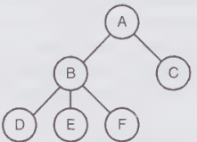

图 1-13. 进程树。进程 A 创建了两个子进程 B 和 C。进程 B 创建了三个子进程 D、E 和 F。

其他可用的系统调用用于请求更多内存（或释放未使用的内存）、等待子进程终止，以及用不同的程序覆盖其程序。

有时，需要向一个正在运行且并非在等待该信息的进程传递信息。例如，与另一台计算机上的进程通信的进程，是通过网络向远程进程发送消息来实现的。为了防止消息或其回复丢失，发送者可以请求系统在指定的秒数后通知它，或者在尚未收到确认的情况下重新重发消息。在设置了此计时器后，该进程可以继续执行其他工作。

当指定的秒数过去后，操作系统会向进程发送一个告警信号。该信号会导致进程临时挂起正在执行的操作，将其寄存器保存到栈中，并开始运行信号处理程序（例如，重发可能丢失的消息）。当信号处理程序执行完成后，进程将以在信号发生之前的状态重启。信号是硬件中断的软件模拟，除了定时器超时外，还可以由多种原因产生。硬件检测到的许多陷阱（trap），例如执行非法指令或使用无效地址，也会转换为发送给故障进程的信号。

每个被授权使用系统的用户都由系统管理员分配一个 `UID`（用户标识）。每个进程都拥有启动它的运行者的 `UID`。子进程与其父进程具有相同的 `UID`。用户可以是组的成员，每个组都有一个 `GID`（组标识）。

其中一个 `UID`（在 `UNIX` 中称为超级用户，在 `Windows` 中称为管理员）拥有特殊权限，并可能覆盖任何保护规则。在大型安装环境中，只有系统管理员知道成为超级用户所需的密码，但许多普通用户（尤其是学生）会花费大量时间寻找系统漏洞，以便他们能够在没有密码的情况下成为超级用户。

我们将在第 2 章学习进程和进程间通信。

### 1.5.2 地址空间

每台计算机都有一部分主内存，用于存放执行中的程序。在非常简单的操作系统中，内存中同时只有一个程序。要运行第二个进程，必须移除第一个程序，并将第二个程序放入内存中。

更复杂的操作系统允许多个程序同时存在内存中。为了防止它们之间相互干扰（以及与操作系统干扰），需要某种保护机制。虽然这种机制存在于硬件中，但它由操作系统控制。

上述观点关注的是计算机主内存的管理和保护。另一个不同但同样重要的内存相关问题是进程地址空间的管理。通常，每个进程都拥有一部分可以使用的地址，通常从 0 运行到某个最大值。在最简单的情况下，进程拥有的最大地址空间少于主内存。通过这种方式，进程可以填满其地址空间，而主内存中有足够的空间来容纳所有内容。

然而，在许多计算机上，地址是 32 位或 64 位，分别提供 2³² 或 2⁶⁴ 字节的地址空间。如果进程拥有的地址空间大于计算机的主内存且进程想要使用所有空间会发生什么？在早期的计算机中，这种进程只能运气不佳。现在存在一种如之前提到的虚拟内存技术，操作系统将部分地址空间保留在内存和磁盘中，并在需要时在它们之间切换。本质上，操作系统创建了地址空间的抽象，即进程可以引用的地址集。地址空间与机器的物理内存解耦，可能比物理内存大，也比其小。地址空间和物理内存的管理是操作系统功能的重要部分，因此第 3 章都将致力于这个主题。

### 1.5.3 文件

几乎所有操作系统支持的另一个关键概念是文件系统。如前所述，操作系统的主要功能是隐藏磁盘和其他 I/O 设备的特殊性，并为程序员提供一个良好的、整洁的设备无关文件的抽象模型。创建文件、删除文件、读取文件写入文件显然需要系统调用。在读取文件之前，必须在磁盘上找到它并打开它，在读取之后应该关闭它，因此提供了执行这些操作的调用。

为了提供存放文件的地方，大多数 PC 操作系统都有目录的概念，作为文件分组的一种。例如，学生可能为每个所修的课程设置一个目录（用于课程所需的程序），另一个目录用于电子邮件，另一个目录用于主页。为了提供一种处理可移动介质的优雅方法，`UNIX` 允许将光盘上的文件系统挂载到主树上。考虑图 1-15(a) 的情况。在挂载之前，硬盘上的根文件系统和光盘上的文件系统是分离且互不相关的。

然而，无法使用光盘上的文件系统，因为没有方法为路径指定驱动器名称或编号；这会产生操作系统试图避免的设备依赖性。相反，挂载系统允许将光盘上的文件系统挂载到程序想要的地方。在图 1-15(b) 中，光盘上的文件系统已挂载到目录 `b`，从而允许访问文件 `/b/x` 和 `/b/y`。如果目录 `b` 包含任何文件，在光盘挂载期间它们将无法访问（无法访问这些文件并不像严重：文件系统几乎总是挂载在空目录上的）。如果系统包含多个硬盘，它们也可以挂载到同一个树中。

如果允许访问，系统会返回一个小整数作为描述符，用于后续操作。如果访问被拒绝，则返回一个错误代码。

`UNIX` 中的另一个重要概念是挂载文件系统。大多数计算机有一个或多个光驱驱动器，可以插入光盘、DVD 和蓝光。它们始终有 USB 端口，可以插入 USB 闪存器（即固态硬盘驱动器），某些计算机还有软盘或外部硬盘。

在任何时刻，每个进程都有一个工作目录，不以斜杠开头的路径将在其中进行查找。例如，在图 1-14 中，如果 `/Faculty/Brown` 是工作目录，那么 `Courses/CS01` 将产生与上述绝对路径名相同的文件。开头的斜杠表示路径是绝对的，即从根目录开始。顺带一下，在 `Windows` 中使用反斜杠（\）代替斜杠（/）（由于历史原因），因此上面的路径将写为 `\Faculty\Brown\CS01`。在本书中我们通常使用 `UNIX` 的路径规范。进程可以通过发出指定新目录的系统调用来更改其工作目录。

## Root CD-ROM

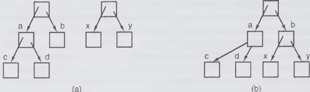

**图 1-15.** (a) 在挂载之前，CD-ROM 上的文件无法访问。(b) 挂载后，它们成为文件层次的一部分。

`UNIX` 中的另一个重要概念是**特殊文件**（special file）。提供特殊文件是为了让 I/O 设备看起来像文件。这样，就可以使用与读写文件相同的系统调用进行读写。特殊文件有两种类型：**块特殊文件**（block special files）和**字符特殊文件**（character special files）。块特殊文件用于建模由随机寻址块组成的设备，例如磁盘。通过打开块特殊文件并读取第 4 块，程序可以直接访问设备上的第四块，而不必考虑其上包含的文件系统结构。同样，字符特殊文件用于建模打印机、调制解器和其他接受或输出字符流的设备。按照惯例，特殊文件存放在 `/dev` 目录下。例如，`/dev/lp0` 可能是打印机（曾被称为行打印机）。

我们在概述中将讨论的最后一个特征与进程和文件都有：管道（pipes）。**管道**是一种伪文件，可以用于连接两个进程，如图 1-16 所示。如果进程 *A* 和 *B* 希望通过管道进行通信，它们必须提前设置好。当进程 *A* 向进程 *B* 发送数据时，它向管道写入数据就像向输出文件写入一样。事实上，管道的实现与文件非常相似。进程 *B* 可以从管道读取数据，就像读取输入文件一样。因此，`UNIX` 中进程间的通信看起来非常像普通的文件读写。进程发现其正在写入的输出不是文件而是管道的唯一方法是通过特殊的系统调用。文件系统非常重要。我们将在第 4 章以及第 10、和 11 章中对它们进行详细介绍。

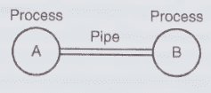

**图 1-16.** 由管道连接的两个进程。

### 1.5.4 输入/输出

所有计算机都有用于获取输入和产生输出的物理设备。毕竟，如果用户不能告诉计算机要做什么并获得结果，计算机又有什么用呢？存在许多种输入和输出设备，包括键盘、显示器等。管理这些设备是操作的任务的任务。因此每个操作系统都有一个 I/O 子系统来管理其 I/O 设备。部分 I/O 软件是与设备无关的，也就是说它们同样适用于所有 I/O 设备。它的其他部分（如设备驱动程序）专门针对特定的 I/O 设备。我们将在第 5 章查看。

### 1.5.5 保护

计算机包含大量用户想要保护和保密的信息。这些信息可能包括业务计划、纳税申报等。管理这些文件由操作系统负责，例如，它们仅供授权用户访问。作为一个简单的例子，为了直观理解安全是如何工作的，请考虑 `UNIX`。`UNIX` 中的文件通过为每个文件分配一个保护代码来保护。保护代码由 3 位组成：一位给所有者，一位给组内其他成员，一位给其他所有人。这 3 位被称为 rwx 位。例如，保护代码 `rwxr-xr-x` 意味着所有者可以读取、写入或执行该文件，组成员可以读取或执行（但不能写入）该文件，而其他人可以执行（但不能读取或写入）该文件。对于目录，x 表示搜索权限。连字符表示权限不存在。

除了文件保护外，还有许多安全问题。保护系统免受不受意入侵者（包括人类和非人类，例如病毒）是其中之一。我们将在第 9 章查看各种安全问题。

### 1.5.6 Shell（壳）

操作系统是执行系统调用的代码。编辑器、编译器、链接器、实用程序和命令解释器不是操作系统的一部分，尽管它们非常重要且有用。为了避免引起某种程度混淆，在本节中我们将简要查看 `UNIX` 命令解释器——shell。虽然它不是操作系统的一部分，但它大量使用了许多操作系统的功能，并作为坐在终端前的用户与操作系统之间的主要接口，除非用户使用的是图形界面。存在许多 shell，包括 `sh`、`csh`、`ksh` 和 `bash`。它们都支持下面描述的功能，这些功能源自原始的 shell (`sh`)。

当任何用户登录时，都会启动一个 shell。shell 有标准输入和输出。它首先输入**提示符**（prompt），一个如美元符号之类的字符，这告诉用户 shell 正在等待接受命令。如果用户现在输入 `date`（例如），shell 会创建一个子进程并运行 `date` 程序作为子进程。在进程运行期间，shell 等待其终止。当子进程完成后，shell 再次输入提示符，并尝试读取下一行输入。

用户可以指定将标准输出重定向到文件，例如 `>file`。同样，标准输入也可以被重定向，如 `sort <file1 >file2`，这调用 `sort` 程序并处理 `file1`，输出到 `file2`。

并不总是至关重要的，因为网络延迟太大，以至于往往占据主导地位。因此，摆钟在直接执行和解释之间已经摆动了几个周期，未来可能还会再次摆动。

## 大内存

## 保护硬件

当第一批微型计算机制造时，它们使用的是 Intel 8080 CPU 芯片，该芯片没有硬件保护，因此我们回到了多程序时代——内存中一次只运行一个程序。直到 Intel 80286 芯片出现，才增加了硬件保护，多程序才成为可能。直到今天，许多嵌入式系统还没有硬件保护，并且只运行单个程序。

让我们看看操作系统。最早的大型机最初没有硬件保护，也不支持多程序，它们只是一次一次处理一个手动加载的程序的简单操作系统。后来，它们获得了硬件和操作系统的支持，可以同时处理多个程序，然后就有了完全的时间分共享能力。

当小型计算机首次出现时，它们同样没有硬件保护，并且一次只运行一个手动加载的程序，尽管当时大型机世界的多程序技术已经非常成熟。它们逐渐获得了保护机制以及同时运行两个或多个程序的能力。第一批微型计算机也只能一次运行一个程序，但后来获得了多程序的能力。手持计算机和智能卡也遵循同样的路径。

在所有情况下，软件开发都受技术的限制。例如，第一批微型计算机拥有大约 4 KB 的内存且没有保护。高阶语言和多程序对于这样的系统来说太复杂了。随着微型计算机演变为现代个人电脑，它们获得了必要的硬件，然后是必要的软件来处理更高级的功能。这种发展可能会在未来几年继续持续。其他领域可能也有这种轮回，但在计算机行业，它似乎转得更快。

## 磁盘

早期的大型机很大程度上基于磁带。它们会从磁带中读取程序，进行编译、运行，然后将结果写回另一盘磁带。当时没有磁盘，也没有文件系统的概念。当 IBM 在 1956 年引入第一块硬盘——RAMAC（随机访问）时，情况发生了变化。它占据了大约 4 平方英寸的空间，可以存储 500 万个 7 位字符，足够存储一张中等分辨率的数字照片。由于每年 35,000 美元的租赁费用，组装足够多的硬盘来存储相当于一卷胶片的内容变得非常昂贵。但最终价格下降了，原始的文件系统也随之发展。

这些发展的典型代表是 CDC 660，它于 1964 年引入，并在多年后一直是世界上最快的计算机。用户可以通过给文件命名来创建所谓的“永久文件”，并希望没有其他用户决定（例如）将“data”作为某个文件的合适名称。这是一个单级目录。最终，大型机开发了复杂的层次级文件系统，可能在 MULTICS 文件系统中达到了顶峰。

随着小型计算机的使用，它们最终也拥有了硬盘。1970 年引入的 PDP-11 的标准磁盘是 RK05，容量为 2.5 MB，大约是 IBM RAMAC 的一半，但它的直径仅为 40 厘米，高 5 厘米。不过它最初也有单级目录。当微型计算机问世时，CP/M 最初是主导地位的操作系统，它也只在（软））磁盘上支持一个目录。

## 虚拟内存

虚拟内存（在第 3 章中讨论）通过在 RAM 和磁盘之间快速移动数据块，提供了运行比机器物理内存更大的程序的能力。它经历了类似的发展，首先出现在大型机上，然后移动到小型机和微型机。虚拟内存还允许程序在运行时动态链接库，而不是将其编译在内部。MULTICS 是第一个允许此点的系统。最终，这个理念一直向下传播，现在广泛应用于大多数 UNIX 和 Windows 系统。

虚拟内存通过在 RAM 和 磁盘之间快速移动数据块，提供了运行比机器物理内存更大的程序的能力。它经历了类似的发展，首先出现在大型机上，然后移动到小型机和微型机。虚拟内存还允许程序在运行时动态链接库，而不是将其编译在内部。MULTICS 是第一个允许此点的系统。最终，这个理念一直向下传播，现在广泛应用于大多数 UNIX 和 Windows 系统。


# 虚拟内存

虚拟内存通过在 RAM 和磁盘之间快速移动数据块，提供了运行比机器物理内存更大的程序的能力。它经历了类似的发展，首先出现在大型机上，然后移动到小型机和微型机。虚拟内存还允许程序在运行时动态链接库，而不是将其编译在内部。`MULTICS` 是第一个允许此点的系统。最终，这个理念一直向下传播，现在广泛应用于大多数 `UNIX` 和 `Windows` 系统。

## 1.6 系统调用

虚拟内存通过在 RAM 和磁盘之间快速移动数据块，提供了运行比机器物理内存更大的程序的能力。它经历了类似的发展，首先出现在大型机上，然后移动到小型机和微型机。虚拟内存还允许程序在运行时动态链接库，而不是将其编译在内部。`MULTICS` 是第一个允许此点的系统。最终，这个理念一直向下传播，现在广泛应用于大多数 `UNIX` 和 `Windows` 系统。

# 52 引言 第1章

## 地址

`0xFFFFFFFF`

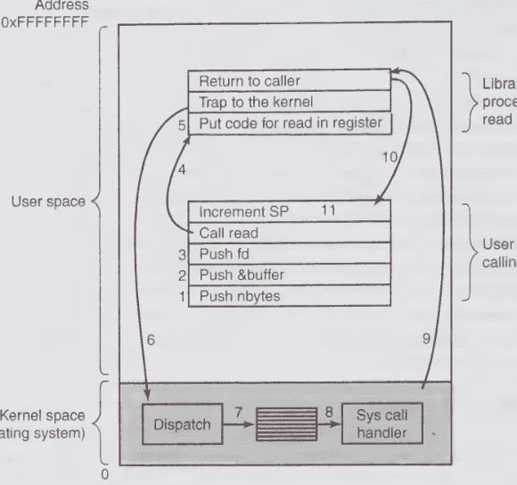

**图 1-17.** 执行系统调用 `read(fd, buffer, nbytes)` 的 11 个步骤。

感觉到紧随其后的指令是从某个远处的位置获取的，并且返回地址被保存在栈中以供以后使用。

尽管如此，`TRAP` 指令与过程调用（procedure-call）指令在两个根本方面不同。首先，作为副作用，它会切换到内核模式。过程调用指令不改变模式。其次，`TRAP` 指令无法跳转到任意地址，而不是提供过程所在位置相对地址或绝对地址。根据架构的不同，它要么跳转到一个单一的固定位置，要么在指令中包含一个 8 位的字段，指向内存中包含跳转地址的表的索引（或等效）。

内核代码在系统调用号后启动，然后分发到正确的系统调用处理程序，通常通过根据系统调用号索引的指针表实现（第 7 步）。此时，系统调用处理程序运行（第 8 步）。在完成工作后，控制可能会返回到 `TRAP` 指令后续指令处的用户空间库过程（第 9 步）。该过程将以过程调用通常的方式返回到用户程序（第 10 步）。

为了完成任务，用户程序必须清理栈，就像执行完任何过程调用后那样（第 11 步）。假设栈是向下增长的（这通常如此），编译后的代码增加栈指针，正好足够移除调用 `read` 之前推送的参数。现在程序可以自由执行任何想做的事。

在上面的第 9 步中，我们说“可能会返回到用户空间库过程”是有根据的。系统可能会阻塞调用者，阻止其继续。例如，如果它尝试从键盘读取但尚未输入任何内容，调用者必须被阻塞。在这种情况下，操作系统将查看是否有其他进程可以运行。稍后当所需的输入可用，该进程将获得系统的关注并执行第 9-11 步。

在接下来的章节中，我们将检查一些常用的 `POSIX` 系统调用，或者更具体地说，实现这些系统调用的库过程。`POSIX` 有大约 100 个过程调用。其中最重要的调用列在图 1-18 中，为了方便起见分为四类。文中将简要检查每个调用以查看其功能。

在很大程度上，这些调用所提供的服务决定了操作系统必须做什么，因为个人计算机上的资源管理是极少的（至少与具有多个用户的大型机相比是如此）。服务包括创建和终止进程、创建、删除和写入文件、管理目录以及执行输入输出等。

顺带提一下，值得注意的是 `POSIX` 过程系统调用的映射并不是一对一的。`POSIX` 标准规定了合规系统可能支持的若干过程，但没有规定它们是系统调用、库调用还是其他。如果一个过程在没有调用系统调用的情况下执行（即没有陷阱到内核），那么出于性能考虑，它通常会在用户空间中运行。然而，大多数 `POSIX` 过程确实调用了系统调用，通常是一个过程直接映射到一个系统调用。在少数情况下，当多个所需的过程是彼此的细微变体时，一个系统调用会处理多个库调用。

### 1.6.1 进程管理的系统调用

图 1-18 中的第一组调用处理进程管理。`Fork` 是讨论此问题的良好起点。`Fork` 是 `POSIX` 中创建新进程的唯一方式。它创建一个原始进程的精确副本，包括所有文件描述符、寄存器——一切。`fork` 之后，原始进程和副本（父进程和子进程）各自走自己的路。在 `fork` 时，所有变量都具有相同的值，因为父进程的数据被复制以创建子进程，其中一个变量的后续变化不会影响另一个。（程序文本是不变的，在父进程和子进程之间共享。）`fork` 调用返回一个值，在子进程中为 0，在父进程中等于子进程的 `PID`（进程标识符）。使用返回的 `PID`，两个进程可以判断哪一个是是

# 进程管理

| 调用 | 描述 |
| --- | --- |
| `pid = fork()` | 创建一个与父进程完全相同的子进程 |
| `pid = waitpid(pid, &statloc, options)` | 等待子进程终止 |
| `s = execve(name, argv, environp)` | 替换进程的核心映像 |
| `exit(status)` | 终止进程执行并返回状态 |

# 文件管理

| 调用 | 描述 |
| --- | --- |
| `fd = open(file, how, ...)` | 打开文件进行读取、写入或两者结合 |
| `s = close(fd)` | 关闭打开的文件 |
| `n = read(fd, buffer, nbytes)` | 从文件读取数据到缓冲区 |
| `s = write(fd, buffer, nbytes)` | 从缓冲区将数据写入文件 |
| `position = lseek(fd, offset, whence)` | 移动指针 |

# 目录和文件系统管理

| 调用 | 描述 |
| --- | --- |
| `s = mkdir(name, mode)` | 创建新目录 |
| `s = rmdir(name)` | 删除目录 |
| `s = link(name1, name2)` | 创建链接 |
| `s = unlink(name)` | 删除链接 |
| `s = mount(special, flag)` | 挂载文件系统 |
| `s = umount(special)` | 卸载文件系统 |

# 其他

| 调用 | 描述 |
| --- | --- |
| `s = chdir(dirname)` | 工作目录 |
| `s = chmod(name, mode)` | 修改文件权限位 |
| `s = kill(pid, signal)` | 向进程发送信号 |
| `s = time(&seconds)` | 获取自 1970 年 1 月 1 日起的时间 |

# 文件状态

| 调用 | 描述 |
| --- | --- |
| `s = stat(name, buf)` | 获取文件状态 |

## 系统调用

父进程执行 `waitpid` 调用，它只需等待子进程退出（多个）。`Waitpid` 可以等待特定的进程，也可以通过将第一个参数设置为 `-1` 等待任何进程。当 `waitpid` 完成时，指向第二个参数的地址将被设置为退出状态（正常或异常）。第三个参数提供了各种选项，例如，如果没有子进程退出则立即返回。

现在考虑 `shell` 如何使用 `fork`。当输入命令时，`shell` `fork` 出新进程。这个子进程必须执行该命令。它通过使用 `exec` 调用来实现，使其整个核心映像被替换为第一个参数指定的文件。（实际上系统本身是 `exec`，但多个库过程以不同的参数调用它。在这里我们将这些视为系统调用。）图 1-19 展示了一个使用 `fork`、`waitpid` 和 `exec` 的高度简化 `shell`。

```
#define TRUE 1
```

```
while (TRUE) {
/* 永远循环 */
    type_prompt(
    /* 在屏幕上显示提示符 */
    read_command(command, parameters);
    /* 从终端读取输入 */

    if (fork() != 0) {
        /* fork 出子进程 */
        /* 父进程代码 */
        waitpid(-1,&status, 0);
        /* 等待子进程退出 */
    } else {
        /* 子进程代码 */
        execve(command, parameters, 0);
        /* 执行命令 */
    }
}
```

> **图 1-19.** 一个简化的 shell。在本书中，假设 `TRUE` 定义为 1。

在最通用的情况下，`execve` 有三个参数：要执行的文件名、环境数组的指针。这些很快就会被描述。提供了各种库程序，包括 `execl`、`execvp` 和 `execve`，允许以各种方式省略或指定参数。在本书中我们将使用 `exec` 名称表示所有这些程序调用的系统调用。

让我们考虑这样的命令的情况：

```
cp file1 file2
```

用于将 `file1` 复制到 `file2`。在 `shell` `fork` 之后，子进程定位并执行 `cp` 文件，并向其传递源文件和目标文件名。

# 56 引言 第1章

`cp` 的主程序（以及大多数其他 C 程序的主程序）包含声明：

```c
main(argc, argv, envp)
```

其中 `argc` 是命令行上项数的计数，包括程序名。对于上面的示例，`argc` 为 3。

第二个参数 `argv` 是指向数组的指针。数组的第 $i$ 个元素是指向命令行上第 $i$ 个字符串的指针。在我们的示例中，`argv[0]` 指向字符串 `"cp"`，`argv[1]` 指向字符串 `"file1"`，`argv[2]` 指向字符串 `"file2"`。

`main` 的第三个参数 `envp` 是指向环境的指针，这是一个包含 `name = value` 格式字符串数组，用于将终端和主目录名称等信息传递给程序。程序可以通过库过程获取环境变量，这些变量通常用于自定义用户想要执行任务的方式（例如，使用的默认参数）。在图 1-20 中，没有向子进程传递环境，因此 `exec` 的第三个参数为 0。

如果 `exec` 看起来是 `POSIX` 系统调用，请不要绝望；它（在语义上）是所有调用中最复杂的。其他的都要简单得多。作为一个简单调用的例子，考虑 `exit`，进程在执行结束时应该使用它。它有一个参数，退出状态（0 到 255），该状态通过 `waitpid` 系统中的 `statloc` 返回给父进程。

`UNIX` 进程的内存分为三个段：文本段（即程序代码）、数据段（即变量）和栈段。数据段向上增长，栈向下增长，如图 1-20 所示。它们之间存在着一段未使用的地址空间间隙。栈会根据需要自动向该间隙增长，但数据段的扩展是显式通过使用系统调用 `brk` 完成的，该调用指定了数据段所在的新地址。然而，此调用并没有被 `POSIX` 标准定义，因为鼓励程序员使用 `malloc` 库过程来动态分配存储空间，而 `malloc` 的底层实现未被认为是适合标准化的对象，因为很少程序员直接使用它，而且怀疑是否有人会使用 `brk`，且它并不在 `POSIX` 中。

## 1.6.2 文件管理系统调用

许多调用与文件系统有关。在本节中，我们将查看操作单个文件的调用；在下一节中，我们将检查涉及目录或整个文件系统的调用。

要读取或写入文件，必须首先打开它。该调用指定了要打开的文件名，可以是绝对路径名或相对于工作目录的相对路径，以及 `O_RDONLY`、`O_WRONLY` 或 `O_RDWR` 代码，意味着以读取、写入或读写的方式打开。要创建一个新文件，使用 `O_CREAT` 参数。

1.6 节 系统调用 57

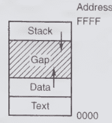

**图 1-20.** 进程有三个段：文本、数据和栈。

返回的文件描述符随后可以用于读取或写入。之后，可以通过 `close` 关闭文件，这使得文件描述符可以在随后的 `open` 中重用。

使用最频繁的调用无疑是 `read` 和 `write`。我们之前看过 `read`。`write` 具有相同的参数。

尽管大多数程序顺序读写文件，但对于某些应用程序需要随机访问文件的任何部分。每个文件都关联着一个指针，指示文件中的当前位置。在顺序读取（写入）时，它通常指向下一个要读取（写入）的字节。`lseek` 改变了位置指针的值，因此，随后的 `read` 或 `write` 调用可以从文件的任何位置开始。

`lseek` 有三个参数：第一个是文件的文件描述符，第二个是文件位置，第三个告诉文件是相对于文件开头、当前位置还是文件末尾。`lseek` 返回的值是更改指针后在文件中的绝对位置（以字节计）。

对于每个文件，`UNIX` 都会跟踪文件模式（普通文件、特殊文件、目录等）、大小、最后修改时间和其他信息。程序可以通过 `stat` 系统调用请求查看这些信息。第一个参数指定要检查的文件；第二个参数是指向用于存放信息的结构体的指针。`stat` 调用对打开的文件执行相同的操作。

## 1.6.3 目录管理系统调用

在本节中，我们将查看一些与目录或整个文件系统相关的系统调用，而不是像上一节那样仅针对一个特定的文件。前两个调用 `mkdir` 和 `rmdir` 分别创建和删除空目录。下一个调用是 `link`。它的目的是允许同一个文件出现在两个或多个名称下，通常是不同目录下的名称。一个典型的用法是允许同一编程团队的多个成员共享一个公共文件，他们每个人都让文件出现在自己的目录中，可能具有不同的名称。共享文件并不等同于给每个团队成员一个私有副本；

一个共享文件意味着团队中任何成员的更改对其他成员都是即时可见的——只有一个文件。当创建文件的副本时，对其中一个副本的后续更改不会影响其他副本。

为了查看 `link` 如何工作，考虑图 1-21(a) 的情况。这里有两个用户 `ast` 和 `jim`，他们各有一个目录和一些文件。……（此处原文存在大量重复和OCR错误，已按要求清理翻译）

# 引言

# 第 1 章

运行。如果进程没有准备好处理某个信号，那么该信号的到达将被处理（这就是该调用命名的由来）。

`POSIX` 定义了许多处理时间相关的程序。例如，`time` 仅返回当前的秒数，其中 0 对应于 1970 年 1 月 1 日午夜（正是一一天的开始，而不是结束）。在 32 位的计算机上，`time` 能返回的最大值是 $2^{31}-1$ 秒（假设使用了无符号整数）。这个值对应于略多 136 年。因此，在 2106 年，32 位的 `UNIX` 系统将会崩溃，这与著名的 Y2K 问题不同——如果不是因为 IT 行业投入了巨大的精力来解决该问题，Y2K 问题本会在 2000 年对全球计算机造成灾难性的影响。如果你目前有一台 32 位的 `UNIX` 系统，建议在 2106 年之前将其更换为 64 位的。

### 1.6.5 Windows Win32 API

到目前为止，我们主要关注的是 `UNIX`。现在是简要查看 `Windows` 了。`Windows` 和 `UNIX` 在各自的编程模型上存在根本性的区别。`UNIX` 程序由执行某些操作的代码组成，通过系统调用来执行某些服务。相比之下，`Windows` 程序通常是事件驱动的。主程序等待某个事件发生，然后调用一个程序来处理它。典型的事件包括按下按键、移动鼠标、按下鼠标按钮或插入 `USB` 驱动器。然后调用处理程序来处理该事件、更新屏幕并更新程序的内部状态。总而言之，这导致了与 `UNIX` 有为不同的编程风格，但由于本书的重点是其操作系统的功能和结构，这些不同的编程模型不会引起我们的过多关注。

当然，`Windows` 也有系统调用。在 `UNIX` 中，系统调用（例如 `read`）与用于调用它们的库程序（例如 `read`）之间几乎存在有一一一的关系。换句话说，对于每个系统调用，大约都有一个库程序被调用来触发它，如图 1-17 所示。此外，`POSIX` 只有大约 100 个系统调用。


而 Windows 的情况则截然不同。首先，库调用与实际的系统调用之间是高度解耦的。微软定义了一组被称为 `Win32 API`（应用程序编程接口）的程序，预计程序员使用这些程序来获取操作系统服务。该接口受 Windows 95 以来的所有版本的 Windows 支持。通过将 API 接口与实际系统调用解耦，微软保留了随时更改实际系统调的能力（即使在每个版本之间），而不会使现有程序失效。在本节中，`Win32` 提供了 Windows 版本之间的兼容性，尽管最近版本具有许多以前不可用的新调用。

## 系统调用

`Win32 API` 用的数量极其巨大，数以千计。此外，其中许多调用完全在用户空间中执行。因此，在 Windows 中，无法区分哪些是系统调用（即由内核执行），哪些仅仅是用户空间操作，反之亦然。当我们在这书中讨论 `Win32` 系统调用时，我们将使用 `Win32` 程序（在适当），因为微软保证这些程序随着时间的推移将保持稳定。但值得记住，并不是所有程序都是系统调用（陷内核的陷阱）。对 `Win32 API` 感感兴趣的应该决定不感兴趣，尽管它们可能与操作系统的功能密切相关（例如 Hart, 1997; Rector, 1997）。

现在让我们来看图 1-23 的列表。`CreateProcess` 创建一个新进程，它是 UNIX 中 `fork` 和 `execute` 的组合工作，指定了新创建进程的许多属性。Windows 没有像 UNIX 那样的进程层次结构，因此没有父进程和子进程的概念。在进程创建并启动后，使用 `WaitSingleObject` 等待事件。可以等待许多可能的事件。如果参数指定了一个进程，则调用者将等待该进程。

接下来的调用操作文件，功能上与其 UNIX 对应程序相似；不同在于参数和细节。尽管如此，文件可以像在 UNIX 中一样被打开、关闭、读取和写入。`SetFilePointer` 设置文件位置和大小属性。

Windows 拥有目录，分别通过 `CreateDirectory` 和 `RemoveDirectory` API 创建。还有一个当前目录的概念，由 `SetCurrentDirectory` 设置。当天的时间通过 `GetLocalTime` 获取。

`Win32` 接口没有对应挂载文件系统、安全或信号的链接（对应 UNIX 的那些链接）。当然，`Win32` 拥有许多 UNIX 不具备的其他调用，特别是用于管理 GUI 的调用。Windows Vista 拥有复杂的安全系统并支持文件链接。Windows 7 和 8 增加了更多功能和系统调用。

| UNIX | Win32 | 描述 |
| :--- | :--- | :--- |
| fork | CreateProcess | 创建新进程 |
| waitpid | WaitForSingleObject | 可以等待进程退出 |
| execve | (none) | CreateProcess = fork + execve |
| exit | ExitProcess | 终止执行 |
| open | CreateFile | 创建文件或打开现有文件 |
| close | CloseHandle | 关闭文件 |
| read | ReadFile | 从文件读取数据 |
| write | WriteFile | 向文件写入数据 |
| seek | SetFilePointer | 移动文件指针 |
| stat | GetFileAttributes | 获取各种文件属性 |
| mkdir | CreateDirectory | 创建新目录 |
| rmdir | RemoveDirectory | 删除空目录 |
| link | (none) | Win32 不支持链接 |
| unlink | DeleteFile | 销现有文件 |
| mount | (none) | Win32 不支持挂载 |
| ummount | (none) | Win32 不支持挂载，因此没有卸载 |
| chdir | SetCurrentDirectory | 更改当前工作目录 |
| chmod | (none) | Win32 不支持安全（尽管 NT 支持） |
| kill | (none) | Win32 不支持信号 |
| time | GetLocalTime | 获取当前时间 |

> **图 1-23.** 与图 1-18 中的 UNIX 调用大致对应的 Win32 API 调用。

## 1.7 操作系统结构

现在，既然我们已经看到了操作系统的外部看起来什么样（即程序员界面），现在是时候查看其内部了。在接下来的章节中，我们将检查已经尝试过的六种不同的结构，以了解可能性的范围。这些并非详尽的，但它们提供了一些在实践中尝试过的设计思路。我们在这里讨论的六种设计是单体系统、分层系统、微内核、客户端-服务器系统、虚拟机和外壳内核。

### 1.7.1 单体系统

这是目前最常见的组织方式，在单体方法中，整个操作系统作为一个单一程序在内核模式下运行。操作系统被写成一组过程的集合，这些过程被链接成一个大型的可执行程序。当使用这种技术时，系统中的每个过程都可以自由地调用任何其他过程，只要后者提供了前者所需的某些有用计算。能够调用任何需要的过程是非常高效的，但拥有数千个可以无限制地相互调用的过程也可能导致系统变得臃肿且难以理解。此外，这些过程中的任何一个崩溃都会导致整个操作系统的崩溃。

当使用这种方法构建操作系统的实际对象时，首先编译所有的单独过程（或包含过程的文件），并使用系统链接器将它们全部绑定成一个单一的可执行文件。在信息处理方面，本质上没有处理——每个过程对其他所有过程都是可见的（与包含模块或包的结构不同，在那种结构中，许多信息隐藏在模块内部，只有官方指定的入口点可以从模块外部调用）。

然而，即使在单体系统中，也可能具有某种结构。操作系统提供的服务（系统调用）是通过将参数放在定义良好的位置（例如栈上）并执行陷（trap）指令来请求的。这会将机器从用户模式切换到内核模式，并将控制权交给操作系统，如图 1-17 中的步骤 6 所示。操作系统获取参数并确定执行哪个系统调用。之后，它进入一个表，表中第 k 个槽位包含指向执行系统调用过程的指针。

这种组织使用了操作系统的基本结构：

- 1. 一个调用请求的服务过程的主程序。
- 2. 一组执行系统调用的服务过程。
- 3. 一组帮助服务过程的工具过程。

在模型模型中，每个系统调用都有一个服务过程负责处理并执行它。工具过程执行多个服务过程需要的任务，例如从用户程序中获取数据。这种将过程分为三层的结构如图 1-24 所示。

除了计算机启动时加载的核心操作系统外，许多操作系统还支持可加载的扩展，如 I/O 设备驱动程序和文件系统。这些组件是按需加载。在 UNIX 中，它们被称为共享库。在 Windows 中，它们被称为 `DLL`（动态链接库）。它们的文件扩展名为 `.dll`，Windows 系统上的 `C:\Windows\system32` 目录中有 1000 多个。

图 1-24。单体系统的简单结构模型。

### 1.7.2 分层系统

图 1-24 方法的推广是将操作系统组织为层次分明的结构，每一层都构建在下一层之上。第一个这种方式构建的系统是 `THE` 系统，由荷兰埃因霍夫科技学院（Technische Hogeschool Eindhoven）的 E. W. Dijkstra（1968）及其学生构建。`THE` 系统是一个用于荷兰计算机 Electrologica X8 的简单批处理系统，它具有 32K 的 27 位字（在那个时代位是非常昂贵的）。

该系统有六层，如图 1-25 所示。层 0 处理处理器的分配，在发生中断或过期时在进程之间切换。在层 0 之上，系统由顺序过程组成，每个过程的编程都不需要担心多个进程运行在单个处理器上的事实。换句话说，层 0 提供了 CPU 的基本多道处理。

| 层级 | 功能 |
| :--- | :--- |
| 5 | 操作员 |
| 4 | 用户程序 |
| 3 | 输入/输出管理 |
| 2 | 操作员-进程通信 |
| 1 | 内存和鼓机管理 |
| 0 | 处理器分配和多道处理 |

图 1-25。`THE` 操作系统的结构。

层 1 负责内存管理。它在主内存和 512K 字鼓机上为进程分配空间，该鼓机用于存储主内存中没有空间的进程部分（页）。在层 1 之上，进程不需要担心它们是在内存中还是在鼓机上；层 1 软件负责确保页面在需要时被带入内存，在不需要时被移除。

层 2 处理每个进程与操作员控制台（即用户）之间的通信。在此基础上，每个进程实际上都有了自己的操作员控制台。层 3 负责管理 I/O 设备并对进出这些设备的信息流进行缓冲处理。在层 3 之上，每个进程都可以处理具有良好属性的抽象 I/O 设备，而不是具有许多特殊性的真实设备。层 4 是用户程序所在的地方。它们不需要担心进程、内存、控制台或 I/O 管理。系统操作员进程位于层 5。

分层概念的进一步推广体现在 `MULTICS` 环中，`MULTICS` 不是分层，而是被描述为有一系列同心环，内层比外层具有更高的特权（这实际上是同一件事）。当外层中的过程想要调用内层中的过程时，它必须发出系统调用，并由内层对内容的有效性进行检查。尽管分层方案实际上只是一种设计辅助，但 `THE` 系统的优势在于可以以模块化的设计操作系统，并且每个模块都可以独立进行调试测试。

### 1.7.3 微内核

在单体方法中，操作系统是一个大型复杂的程序。在微内核方法中，内核保持绝对最小，操作系统的其余部分移动到用户模式进程。必须留在内核的函数是最底层的，例如 CPU 调度、内存管理和进程间通信。所有其他服务（如文件系统、设备驱动程序和网络栈）作为用户模式进程运行。这意味着如果服务崩溃，不会导致整个操作系统崩溃；它可以重启。

许多内核已经实现并部署了几十年（Accetta et al., 1986; Haertig et al., 1997; Heiser et al., 2006; Kirsch et al., 2005; Liedtke, 1993,1996; Pike et al., 1992; Zuberi et al., 1999）。除了基于 Mach 内核的 OS X 之外，常见的操作系统不使用微内核。然而，在实时、工业和军事应用中占据主导地位，这些应用是任务关键且有高可靠性要求。一些著名的微内核包括 Integrity、K4、L4、PikeOS、QNX、Symbian 和 `MINIX 3`。我们将模块化理念，，操作系统的大部分拆分为许多独立的用户模式进程。`MINIX 3` 是一个符合 POSIX 标准的开源系统，可以在 `www.minix3.org` 免费获取（Guifrado et al., 2012; Guifford et al., 2013; Herder et al., 2006,2009; Hruby et al., 2013）。

`MINIX 3` 微内核只有大约 12,000 行 C 代码和大约 1400 行汇编语言，用于极低级函数，如捕获中断和切换进程。C 代码管理并调度进程，处理通信（通过在进程间传递消息），并提供一组约 40 个内核调用以允许操作系统的其余部分执行工作。这些调用执行如挂钩中断处理程序、移动数据以及为进程安装内存映射等功能。`MINIX 3` 的进程结构如图 1-26 所示，内核调用处理器为 `Sys`。时钟设备驱动程序也在内核中，因为调度器与其紧密交互。其他设备驱动程序作为单独的进程运行。

在内核外部，系统结构为三层进程，全部在用户模式下运行。

## 1.7 操作系统结构

67

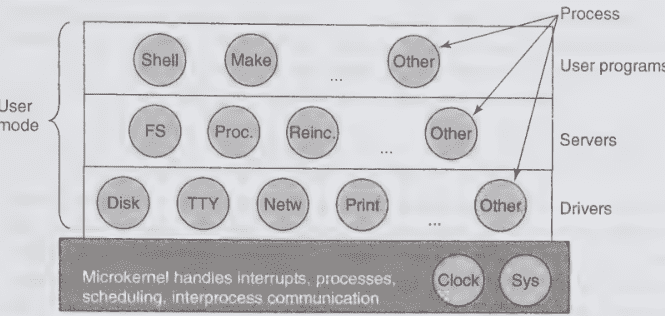

图 1-26. `MINIX` 系统的简化结构。

由内核执行写入操作。这种方法意味着内核可以检查驱动程序是否正在其被授权使用的 I/O 设备进行写入（或读取）。因此（与单体设计不同），有缺陷的音频驱动程序不会意外地写入磁盘。

驱动程序之上是另一个用户层，其中包含服务器，它们承担了操作系统的大部分工作。一个或多个文件服务器管理文件系统，进程管理器创建、销毁和管理进程，等等。用户程序通过向服务器发送短消息（请求 POSIX 系统调用）来获取操作系统服务。例如，一个需要执行读取操作的进程会向一个文件服务器发送消息，告诉它需要执行什么。

一个有趣的服务器是“重生服务器”（reincarnation server），它的工作是检查其他服务器和驱动程序是否运行正常。一旦检测到故障组件，它会自动进行替换，无需任何用户干预。通过这种方式，系统实现了自愈，并能够实现高可靠性。

系统有许多限制来限制每个进程的权限。如所述，驱动程序只能接触授权的 I/O 端口，但对内核调用的访问以及向其他进程发送消息也是按进程控制的。进程还可以授予其他进程访问特定地址空间的有限权限。例如，文件系统可以授予驱动程序权限，允许内核将新读取的磁盘块放在文件系统地址空间内的特定地址。所有这些限制的总和是：每个驱动程序和服务器恰好拥有执行其工作的能力，而没有更多，这极大地限制了缺陷组件可能造成的破坏。

一个与微内核并不相关的想法是将执行某些操作的机制放在内核中，但不将策略放在其中。为了更好地说明这一点，考虑进程的调度。一种相对简单的调度算法是给每个进程分配一个数字优先级，然后让内核运行

68

引言

第 1 章

优先级最高的运行进程。机制——在内核中——是寻找优先级最高的进程并运行它。策略——为进程分配优先级——可以通过用户态进程完成。通过这种方式，策略和机制可以从内核中解耦，使其变得更小。

### 1.7.4 客户端-服务器模型

微内核思想的一种稍微变体是将进程分为两类：服务器（每个服务器都提供某些服务）以及使用这些服务的客户端。这种模型被称为客户端-服务器模型。通常底层是微内核，但并非强制要求。其本质在于客户端进程和服务器进程的存在。

客户端和服务器之间的通信通常通过消息传递来实现。为了获取服务，客户端构建一个消息说明其想要什么，并将其发送给相应的服务。服务器随后执行工作并返回答案。如果客户端和服务器运行在同一台机器上，可以进行某些优化，但从概念上说，我们在这里仍然是在讨论消息传递。

该想法的一个显而易见的泛化是让客户端和服务器运行在不同的计算机上，通过局域网或广域网连接，如图1-27 所示。由于客户端通过发送消息与服务器连接，客户端不需要知道消息是在自己的本地机器上处理，还是通过网络发送到远程机器上的服务器。对于客户端而言，两种情况发生的是同样的事情：发送请求并收回回复。因此，客户端-服务器模型是一种抽象，可以用于单机，也可以用于机器网络。

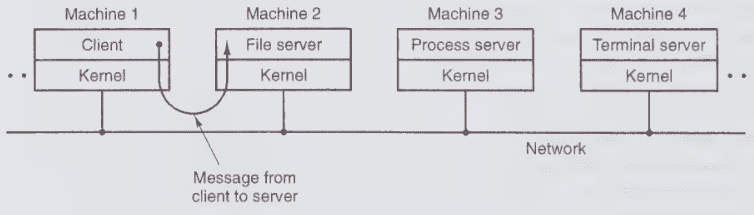

**图 1-27.** 网络上的客户端-服务器模型。

越来越多的系统涉及用户家中的 PC 作为客户端，以及在其他地方的大型机器作为服务器。事实上，Web 的大部分运作是以这种方式运行的。PC 向服务器发送网页请求，网页随之返回。这是网络中客户端-服务器模型的一个典型用途。

### 1.7.5 虚拟机

`OS/360` 的最初版本是严格的批处理系统。尽管如此，许多 360 用户都希望在终端上进行交互式工作，因此 IBM 内部及外的多个小组决定为其编写分时共享系统。IBM 的官方分时共享系统 `TSS/360` 交付得很晚，当它终于到达时，由于过于庞大且缓慢，很少有站点转换到它。它在开发完成后最终被遗弃，在其开发期间消耗了约 5000 万美元（Graham, 1970）。但马萨诸塞州剑桥市科学中心的一个小组产生了一个完全不同的系统，IBM 最终将其作为产品接受。它的一个直系后代称为 `z/VM`，现在被广泛用于 IBM 目前的主机 zSeries 上，这些主机在大型数据中心被大量使用，例如作为每秒处理数百或数千次交易的电子商务服务器，并使用大小达数百万 GB 的数据库。

#### VM/370

该系统最初称为 `CP/CMS`，后来重命名为 `VM/370`（Seawright and MacKinnon, 1979），基于一个敏锐的观察：分时共享系统提供了 (1) 多程序设计和 (2) 交互式用户。`VM/370` 的本质是完全分离这些功能。系统的核心被称为虚拟机监视器（virtual machine monitor），运行在裸机上，每个虚拟机看起来都像一台完整的机器

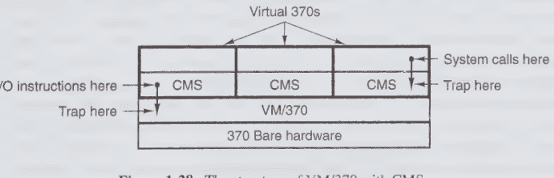

由于每个虚拟机等同于裸机，每个都可以运行任何操作系统。在最初的 `VM/370` 中，有些运行事务处理，而另一些运行单用户系统，称为 `CMS`（对话监控系统）。

70

引言

第 1 章

当 `CMS` 程序执行系统调用时，该调用被捕获到它自己的虚拟机，而不是裸机。这些读取磁盘或所需的 I/O 指令被 VM 捕获并执行。通过完全分离多程序设计的功能并提供交互式用户环境，每个部分都可以变得更简单、更灵活且更容易维护。在其现代形式中，`z/VM` 通常用于运行多个完整的操作系统，而不是精简单用户系统。

### 重新发现虚拟机

虽然 IBM 几十年来一直提供虚拟机产品，包括 Oracle 和惠尔公司封装在内的少数其他公司最近也为其高端企业服务器添加了虚拟机支持，但直到最近，虚拟化的概念在 PC 世界很大程度上被忽视了。但在过去的几年里，新需求、新软件和新技术的结合使其成为热门话题。

首先是需求。许多公司传统上将邮件服务器、Web 服务器、FTP 服务器和其他服务器运行在不同的计算机上，有时使用不同的操作系统。他们将虚拟化视为一种将它们都运行在同一台机器上的方法，而不会导致一个崩溃影响其他。

虚拟化在 Web 托管中也很流行。没有虚拟化，Web 托管客户被迫在共享托管（他们在 Web 服务器上有一个登录账户，但无法控制服务器软件）和专用托管（他们拥有自己的机器，非常灵活，但对于中小型网站来说不划效益）之间做出选择。当 Web 托管公司出租虚拟机时，单台物理机器可以运行许多虚拟机，每个虚拟机看起来都是一个完整的客户。租用虚拟机的客户可以运行他们想要的任何操作系统和软件，但成本只有专用服务器的一小部分（因为同一台物理机器同时支持许多虚拟机）。

虚拟化的另一个用途是那些希望同时运行两个或多个操作系统的终端用户，因为他们的一些喜欢的应用程序运行在一个上，另一些运行在另一个。这种情况如图1-29(a) 所示，其中“虚拟机监视器”术语已重命名为 1 型 Hypervisor（type 1 hypervisor），它现在被常用是因为

# 操作系统结构


“虚拟机监视器”所需的按键次数超过了人们愿意承受的程度。需要注意的是，许多作者实际上交替使用这些术语。

Excel Word Mplayer Apollo

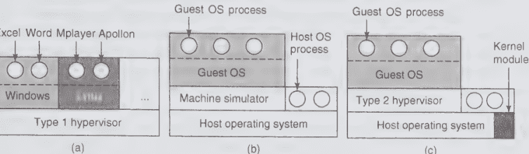

**图 1-29.** (a) 第 1 型虚拟化程序。(b) 纯第 2 型虚拟化程序。(c) 实际的第 2 型虚拟化程序。

虽然现在没有人对虚拟机的吸引力产生异议，但当时的问题在于实现。为了在计算机上运行虚拟机软件，其 CPU 必须是可虚拟化的（`Popek and Goldberg, 1974`）。简而言之，问题在于：当运行在虚拟机（用户模式）上的操作系统执行特权指令时（如修改 `PSW` 或进行 I/O 操作），硬件必须通过陷阱（`trap`）到虚拟机监视器，以便在软件中模拟该指令。在某些 CPU 上——特别是 Pentium 及其处理器和克隆版本——在用户模式下尝试执行特权指令的操作会被忽略。这从根本上使得在该硬件上运行虚拟机变得不可能，这也解释了 x86 世界缺乏兴趣的原因。当然，Pentium 也有解释器，例如 `Bochs`，但由于性能损失了一到两个数量级，它们对于正式工作并没有用。

这种局面由于 20 世纪 90 年代和世纪初的几个学术研究项目而发生了改变，这些项目被 `Disco`（`Bunignon et al., 1997`）和剑桥大学的 `Xen`（`Barham et al., 2003`）所关注。这些研究论文催生了几种商业产品（例如 `VMware Workstation` 和 `Xen`），并重新引发了人们对虚拟机的兴趣。除了 `VMware` 和 `Xen` 之外，今天流行的虚拟化程序还包括 `KVM`（用于 Linux 内内核）、`VirtualBox`（Oracle 提供）和 `Hyper-V`（微软提供）。

这些早期研究项目中的一些通过翻译文件的代码块、将其存储在间隙缓存（`intercal cache`）中，然后在再次执行时重用它们，改进了像 `Bochs` 等解释器的性能。这显著提升了性能，达到了我们所谓的机器模拟器的水平，如图 1-29(b) 所示。然而，尽管这种被称为二进制翻译（`binary translation`）的技术有助于改善局面，但生成的系统虽然足够发表学术会议论文，但运行速度仍然不够快，无法在性能要求很高的商业环境中使用。

提高性能的下一步是添加一个内核模块来完成部分繁重工作，如图 1-29(c) 所示。在实践中，所有商用的虚拟化程序（如 `VMware Workstation`）都使用这种混合策略（并带有许多其他改进）。大家称它们为第 2 型虚拟化程序，我们也有些不情愿地接受并在书中其他部分使用这个名称，尽管我们更倾向于称它们为第一型虚拟化程序，以反映它们并非完全的用户模式程序的这一。在第 7 章中，我们将描述 `VMware Workstation` 的工作原理以及各个部分的功能。

在实践中，第一型和第二型虚拟化程序之间的真实区别在于，第二型程序利用主机操作系统及其文件系统来创建进程、存储文件等。而第一型虚拟化程序没有底层支持，必须自己执行所有功能。

第2 型虚拟化程序启动后，它会读取所选客户操作系统的安装 CD-ROM（或 CD-ROM 镜像文件），并将客户操作系统安装在虚拟磁盘上，而虚拟磁盘只是主机操作系统文件系统中的一个大文件。第一型虚拟化程序无法做到这一点，因为没有主机操作系统来存储文件。它们必须在原始分区（`raw partition`）上管理自己的存储空间。

当客户操作系统启动时，它会执行与在实际硬件上相同的操作，通常是启动一些后台进程，然后是图形界面（`GUI`）。对于用户来说，这种行为与在实际硬件上运行时是一致的。处理指令的另一种方法是修改内核，这种方法不是虚拟化，而是半虚拟化（`paravirtualization`）。我们将在第 7 章中详细讨论。

# 虚拟机

Java、Python 和 C 都是命令式语言，具有数据类型、变量和控制语句。C 语言原始数据类型包括整数（包括短型和长型）、字符和浮点数。复合数据类型可以使用数组、结构体和联合来构建。C 的控制语句与 Java 相似，包括 `if`、`switch`、`for` 和 `while` 语句。函数和参数在两种语言中大致相同。Java 的优势在于，如果解释器实现得当，Java 程序可以在安全环境中运行。

# 操作系统结构

## 微内核

与其克隆实际机器（如虚拟机所做的），另一种策略是将其分区，换句话说，给用户分配资源子集。一个虚拟机可能获得 0 到 1023 的块，下一个可能获得 1024 到 2047 的块，以此此类推。

在内核模式运行的底层程序被称为微内核（`Engler et al., 1995`）。它的工作是为虚拟机分配资源，并检查它们的使用，以防止机器尝试使用别人的资源。微内核方案的优势在于它节省了一层映射。在其他设计中，每个虚拟机都认为有自己的磁盘，块从 0 到最大，因此虚拟机监视器必须维护表来重映射磁盘地址（以及所有其他资源）。而在微内核中不需要重映射。微内核只跟踪哪个虚拟机拥有哪个资源。这种方法仍然是将多程序（在微内核中）与操作系统（在用户空间）分开，但开销更小，因为微内核必须防止虚拟机之间互相干扰。

# 引言

C 语言的一个 Java 和 Python 不具备的特性是指针。指针是一个指向（即包含）变量或数据结构地址的变量。考虑以下语句

```c
char c1, c2, *p;
c1 = 'c';
p = &c1;
c2 = *p;
```

这些语句将 `c1` 和 `c2` 声明为字符变量，将 `p` 声明为指向字符（即包含字符地址）的变量。第一次赋值将字符“c”的 ASCII 码存储在变量 `c1` 中。第二次赋值将 `c1` 的地址分配给指针变量 `p`。第三次赋值通过变量 `c2` 将变量的内容赋值给 `p`，因此在执行这些语句后，`c2` 也包含了“c”的 ASCII 码。从理论上讲，指针是有类型的，因此你不应该将浮点数的地址赋值给字符指针，但在实践中，编译器会接受此类赋值，尽管会发出警告。指针是一种非常强大的结构，但如果使用不当，它也是错误的巨大根源。

C 语言不具备的一些特性包括内置字符串、线程、包、类、对象、类型安全和垃圾收集。后者对于操作系统来说是致命的。C 中的所有存储要么是静态的，要么由程序员显式地分配和释放（通常使用库函数 `malloc` 和 `free`）。正是这种特性——程序员对内存的完全控制——结合显式指针，使得 C 在编写操作系统方面非常有吸引力。操作系统在某种程度上基本上是实时系统，即使是通用操作系统也是如此。当发生中断时，操作系统可能只有几毫秒的时间执行某些操作，否则就会丢失关键信息。垃圾收集器在任意时刻介入是不可的。

### 1.8.2 头文件

操作系统通常由若干目录组成，每个目录包含许多 `.c` 文件（包含系统的部分代码）以及一些 `.h` 头文件（头文件包含一个或多个代码文件使用的声明和定义）。头文件还可以包含简单的宏，例如

```c
#define BUFFER_SIZE 4096
```

这允许程序员为常量命名，这样当代码中使用 `BUFFER_SIZE` 时，它会在编译期间被替换为数字 4096。良好的编程习惯是为 0、1 和 -1 以外的每个常量命名，有时甚至包括它们。宏可以带有参数，例如

```c
#define max(a, b) (a > b ? a : b)
```

这允许程序员编写

```c
i = max(j, k+1)
```

并得到

`i = (j > k+1) ? j : k+1`

将 `j` 和 `k+1` 中较大的值存储在 `i` 中。头文件还可以包含条件编译，例如

```c
#ifdef X86
intel_int_ack();
#endif
```

如果定义了宏 `X86`，它将编译为对函数 `intel_int_ack` 的调用，否则什么都不编译。条件编译被广泛用于隔离依赖架构的代码，使得只有在系统于 `X86` 上编译时才插入某些代码，只有在系统于 `SPARC` 上编译时才插入其他代码，依此类推。一个 `.c` 文件可以使用 `#include` 指令大胆地包含零或多个头文件。还有许多几乎每个 `.c` 文件都通用的头文件，它们存储在一个中央目录中。

### 1.8.3 大型编程项目

为了构建操作系统，每个 `.c` 文件都会由 C 编译器编译成对象文件。后缀为 `.o` 的对象文件包含目标机器的二进制指令。它们稍后将由 CPU 直接执行。在 C 世界中，没有类似于 Java 字节码或 Python 字节码的东西。

C 编译器的第一阶段是 C 处理器。当它读取每个 `.c` 文件并遇到 `#include` 指令时，它会获取命名的头文件并进行处理，展开宏、处理条件编译（以及其他事情），并将结果传递给编译器的下一个阶段，就像它们被物理包含了一样。

由于操作系统非常大（五百万行代码并不罕见），每更改一个文件就要重新编译整个项目将是无法忍的。另一方面，更改一个被数千个其他文件包含的关键头文件会导致重新编译这些文件。如果没有帮助，跟踪哪些对象文件依赖于头文件是完全无法管理的。

幸运的是，计算机非常擅长这类事情。在 UNIX 系统上，有一个名为 `make` 的程序（有许多变体，如 `pmake` 等），它读取 `Makefile`，该文件告诉它哪些文件依赖于其他文件。`make` 的作用是查看构建操作系统二进制文件需要哪些对象文件，并对于每个对象文件，检查其依赖的（代码和头文件）中一个文件是否在该对象文件上次创建之后被修改过。如果是，则对象文件必须重新编译。当 `make` 确定了哪些 `.c` 文件需要重新编译后，它会调用 C 编译器重新编译它们，从而将编译次数减少到最低。在大型项目中，创建 `Makefile` 容易出错，因此有工具可以自动完成工作。

一旦所有 `.o` 文件准备就绪，它们会被传递给一个名为链接器（`linker`）的程序，将所有文件合并成一个可执行的二进制文件。调用的任何库函数也会在此处被包含，函数引用被解析，并根据需要对机器地址进行定位。当链接器完成后，结果是一个可执行程序，在 UNIX 系统上传统上称为 `a.out`。此过程的各个组件如图 1-30 所示。


## 1.8.4 运行时模型

一旦操作系统二进制文件链接完成，它可能由多个段组成：文本段（代码）、数据段和栈。文本段通常是不可变的，在执行期间不会改变。数据段从特定大小开始并初始化某些值，但它可以改变和增长。栈最初为空，随着函数的调用和返回而增长和缩小。在所有情况下，操作系统代码直接由硬件执行，没有解释器和即时编译，这些是常态。

## 1.9 操作系统研究

计算机科学是一个快速发展的领域，很难预测它将走向何方。大学和工业实验室的研究人员不断提出新想法，其中一些无疾于终，另一些则成为未来产品的基石并产生巨大影响。判断哪些想法可行在事后容易得多。

例如，当艾森豪总统在 1958 年设立国防部高级计划署（`ARPA`）时，他试图防止陆海军和空军争夺五角楼的研究预算。他并不是为了发明互联网。但 `ARPA` 所做的事情之一资助了大学对当时模糊的包交换概念的研究，这导致了第一个实验包交换网络——`ARPANET`。它诞生于 1969 年。不久，其他 `ARPA` 资助的网络连接到了 `ARPANET`，互联网诞生了。互联网在随后被学术人员用于相互发送电子邮件 20 年。在 20 世纪 90 年代初，蒂姆·伯纳斯·李在日内瓦的 CERN 实验室发明了万维网（World Web），马克·安德森在伊利诺伊大学为它编写了图形浏览器。操作系统的研究也导致了实际系统的巨大变化。

在本节以及书中的类似章节中，我们将简要回顾这段期间发生的一些操作系统研究

# 引言

# 第 1 章

在过去的 5 到 10 年里，为了让大家对未来的趋势有一个大致了解——本引言并不详尽。它很大程度上基于发表在顶级研究会议上的论文；这些思想为了能够发表，至少通过了严谨的同行评审过程。请注意，在计算机科学中——与其他科学领域不同——大多数研究发表在会议上而非期刊上。研究章节引用的大多数论文都是由 ACM、IEEE 学会或 USENIX 发表的，这些组织的（学生）成员可以在互联网上获取。有关这些组织及其数字库的更多信息，请访问

```
ACM http://www.acm.org
IEEE Computer Society http://www.computer.org
USENIX http://www.usenix.org own
```

几乎所有的操作系统研究人员都意识到，当前的操作系统是庞大、缺乏活性、不可靠、不安全且充满了漏洞的，某些甚至比其他更为严重（此处隐去了名称以防罪人指责）。因此，关于如何构建更好的操作系统有大量的研究。近期发表了关于漏洞和调试的工作（`Renzelman et al., 2012`; 以及 `Zhou et al., 2012`）、崩溃恢复（`Correira et al., 2012`; `Ma et al., 2013`; `Ongaro et al., 2011`; 以及 `Yeh and Chang, 2012`）、能量管理（`Pathak et al., 2012`; `Petucci and Loques, 2012`; 以及 `Shen et al., 2013`）、文件和存储系统（`Elnaby and Wang, 2012`; `Nightingale et al., 2012`; 以及 `Zhang et al., 2013a`）、高性能 I/O（`De Bruijn et al., Liu et al., 2013a`; 以及 `Rizzo, 2012`）、超线程和多线程（`Liu et al., 2011`）、热更新（`Giuffrada et al., 2013`）、GPU 管理（`Roshbach et al., 2011`）、内存管理（`Jantz et al., 2013`; 以及 `Jeong et al., 2013`）、多核操作系统（`Baumann et al., 2009`; `Kaprits, 2012`; `Lachaize et al., 2012`; 以及 `Wentzlaff et al., 2012`）、操作系统正确性（`Elphstone et al., 2007`; `Yang et al., 2006`; 以及 `Klein et al., 2009`）、操作系统可靠性（`Hruby et al., 2012`; `Ryzhuk et al., 2009, 2011` 以及 `Zheng et al., 2019`）以及隐私与安全（`Dann et al., 2012`; `Giuffrada et al., 2012`; `Li et al., 2013b`; `Lorch et al., 2013`; `Ortolani and Crispo, 2012`; `Slowinska et al., 2012`; 以及 `Ravindranath et al., 2012`）、使用情况和性能监控（`Harter et al., 2012`; `Ben-Yehduda et al., 2010`; `Colp et al., 2011`; `Dai et al., 2013`; `Tarasov et al., 2013`; 以及 `Williams et al., 2012`）等许多其他主题。

## 1.10 本书后续内容大纲

我们已经完成了引言和对操作系统的概览。现在是时候进入细节了。正如前面提到的，从语法的角度来看，操作系统的主要目的是提供一些关键抽象，其中最重要的的是进程和线程、地址空间和文件。因此，接下来的三章将致力于这些关键过程。

第 2 章关于进程和线程。它讨论了它们的属性以及它们如何相互通信。它还提供了许多关于进程间通信如何工作以及如何规避某些陷阱的详细示例。

在第 3 章中，我们将详细学习地址空间及其附属——内存管理。将探讨虚拟内存这一重要主题，以及与分页、分段等密切相关的概念。

然后，在第 4 章中，我们来到至关重要的文件系统主题。在很大程度上，用户看到的很大程度上就是文件系统。我们将查看文件系统接口和文件系统实现。

第 5 章涵盖了输入/输出。我们将研究设备独立性和设备依赖性等概念。将以磁盘、键盘和显示器等几个重要设备作为示例。

第 6 章关于死锁。我们简要展示了本章将涉及死锁，但有很多话要说。书中讨论了预防或避免死锁的方法。

到这里，我们完成了对单 CPU 操作系统基本原理的研究。然而，还有很多要说的，特别是关于高级主题。在第 7 章中，我们研究虚拟化。我们详细讨论了原理以及一些现有的虚拟化解决方案。由于虚拟化在云计算中被广泛使用，我们还将介绍现有的云。另一个高级主题是多处理器系统，包括多核、并行计算机和分布式系统。这些主题将在第 8 章介绍。

一个极其重要的课题是操作系统安全，位于第 9 章。在本章讨论的主题包括威胁（例如病毒和蠕虫）、保护机制和安全模型。

接下来是真实操作系统的案例研究。这些是 UNIX、Linux 和 Android（第 10 章），以及 Windows（第 11 章）。本文以第 12 章中关于操作系统设计的见解和思考结束。

## 1.11 公制单位

为了避免混淆，值得明确说明，在书中正如在整个计算机科学中，使用的是公制单位而非传统的英制单位（英制系统）。主要的公制前缀列于图 1-31。前缀通常用字母缩写，大于 1 的单位大写。一个 1-TB 数据库占用 10¹² 字节存储，时钟每 10⁻¹⁰ 秒（或 100 皮秒）跳动一次。由于 milli 和 micro 都以字母“m”开头，因此必须做出选择。通常，“m”代表 milli，“μ”（希腊字母）代表 micro。

| 指数 | 前缀 | 指数 | 前缀 |
| :--- | :--- | :--- | :--- |
| $10^{-3}$ | 0.001 | milli | $10^3$ |
| $10^{-6}$ | 0.000001 | micro | $10^6$ |
| $10^{-9}$ | 0.000000001 | nano | $10^9$ |
| $10^{-12}$ | 0.000000000001 | pico | $10^{12}$ |
| $10^{-15}$ | 0.000000000000001 | femto | $10^{15}$ |
| $10^{-18}$ | 0.000000000000000001 | atto | $10^{18}$ |
| $10^{-21}$ | 0.000000000000000000001 | zepto | $10^{21}$ |
| $10^{-24}$ | 0.000000000000000000000001 | yocto | $10^{24}$ |


任何操作系统的核心都是它能够处理的一组系统调用。这些调用揭示了操作系统实际上在做什么。对于 UNIX，我们查看了四组系统调用。第一组与进程的创建和终止有关。第二组用于读写文件。第三组用于目录管理。第四组包含杂项调用。

操作系统可以通过多种方式构建结构。最常见的结构有单内核系统、分层结构、微内核、客户端-服务器模型、虚拟机或外内核。

## PROBLEMS

- 1. 操作系统的两个主要功能是什么？
- 2. 什么是多道程序？
- 3. 在第 1.4 节中，描述了九种不同类型的操作系统。请为这些系统中的每一个系统列出一个应用程序列表（每个系统一个）。
- 4. 为了使用缓存内存，主内存被分为缓存行，通常长度为 32 或 64 字节。整个缓存行会被一次性缓存。一次性缓存一整行而不是一次只缓存一个字节或字有什么好处？
- 5. 什么是假性打印（spooling）？你认为个人电脑在未来会将假性打印作为标准功能吗？
- 6. 在早期的计算机上，读取或写入的每一位数据都由 CPU 处理（即没有 DMA）。这对多道程序有什么影响？
- 7. 为什么分时复用在二代计算机上并不流行？
- 8. 与访问 I/O 设备相关的指令通常是特权指令，这意味着它们可以在内核态下执行但不能在用户态下执行。给出这些指令具有特权的一个原因。
- 9. 图形用户界面（GUI）最初采用较慢的原因之一是支持它们所需的硬件成本。支持一个 25 行 × 80 列的单色显示屏需要多少 RAM？一个 1024 × 768 像素的 24 位彩色位图需要多少？这种 RAM 在 1980 年的价格是多少（5 美元/KB）？现在又是多少钱？
- 10. 构建操作系统时有几个设计目标，例如资源利用率、及时性、健壮性等。给出两个可能相互矛盾的设计目标的示例。
- 11. 内核态和用户态之间的区别是什么？解释拥有两个不同的模式如何有助于设计操作系统。
- 12. 一个 255 GB 的磁盘有 65,536 个柱道，每个轨道有 255 个扇区，每个扇区 512 字节。该磁盘有多少个盘片和磁头？假设平均柱道寻道时间为 11 毫秒，平均旋转延迟为 7 毫秒，读取速率为 100 MB/秒，计算从一个扇区读取 100 KB 平均需要的时间。
- 13. 考虑一个有两个 CPU 的系统，每个 CPU 有两个线程（超线程）。假设启动三个程序 P0、P1 和 P2，运行时间分别为 5、10 和 20 毫秒。完成这些程序的执行需要多久？假设这三个程序都是 100% CPU 密集型的，在执行期间不会阻塞，且不会改变个人状态。
- 14. 列出个人电脑操作系统和大型机操作系统之间的一些区别。
- 15. 一台计算机具有四个阶段的流水线。每个阶段完成工作的时间相同，接近 1 纳秒。该机器每秒可以执行多少条指令？
- 17. 当用户程序通过系统调用读取或写入磁盘文件时，它会提供一个所需文件的指示、指向数据缓冲区的指针，并将控制权交给操作系统，由操作系统调用相应的驱动程序。假设驱动程序启动磁盘并终止，直到发生中断。在从磁盘读取的情况下，调用者显然必须被阻塞（因为没有数据可供其）。写入磁盘的情况呢？调用者需要被阻塞等待磁盘传输完成吗？
- 18. 陷阱（trap）和中断（interrupt）的主要区别是什么？
- 19. 是否有任何你可能想在非空目录上挂载文件系统？如果是，原因是什么？
- 20. 操作系统系统调用的目的是什么？
- 21. 给出理由，说明为什么挂载文件系统比在路径名前加上驱动器名称或编号更好的设计方案。解释为什么文件系统几乎总是挂载在目录上。
- 22. 对于以下每个系统调用，给出一个导致其失败的条件：`open`、`close` 和 `lseek`。
- 23. 哪种类型的复用（时间、空间或两者）可以用于共享以下资源：CPU、内存、磁盘、网卡、打印机、键盘和显示器？
- 24. 能否（此处不完整）
- 25. 描述符为 `fd` 的文件包含以下字节序列：3, 1, 4, 1, 5, 9, 2, 6, 5, 3, 5。执行以下系统调用：

```
lseek(fd, 3, SEEK_SET);
read(fd, &buffer, 4);
```

其中 `seek` 调用将文件偏移了 3 字节。在读取完成后，`buffer` 包含什么？
- 26. 假设一个 10 MB 的文件存储在磁盘同一条轨道（50 号轨道）的连续扇区上。磁盘臂目前位于第 100 号轨道。检索此文件需要多久？假设移动臂到下一个柱道需要 1 毫秒，启动磁头需要 5 毫秒。此外，假设读取速率为 100 MB/s。
- 27. 文件（block file）和字符文件（character file）之间的本质区别是什么？
- 28. 在 1-17 给出的示例中，库过程被调用为 `read`，系统调用本身也是 `read`。它们具有相同的名称是必须的？如果不是，哪一个更重要？
- 29. 客户端-服务器模型在分布式系统中非常流行。它也可以用于单机系统吗？
- 30. 对程序员来说，系统调用看起来就像调用任何其他库过程一样。让程序员知道哪些库过程会导致系统调用重要吗？在什么情况下重要？为什么重要？
- 31. 图 1-23 显示许多系统调用没有 Win32 等效项。对于每个列出的没有 Win32 等效项的调用，将 UNIX 程序转换为在 Windows 下运行会有什么后果？
- 32. 可移植操作系统是可以从一种体系架构移植到另一种无需修改的操作系统。解释为什么构建完全可移植的操作系统是不可行的。描述在设计高度可移植的操作系统时你将具有哪些高级层。
- 33. 解释策略与机制的分离有助于构建基于微内核的操作系统。
- 34. 虚拟机由于各种原因变得非常流行。然而，它们也有一些缺点。请举出一个。
- 35. 这里有一些练习单位换算的问题：
  (a) 一微年（microyear）是多少秒？
  (b) 微米通常称为 microns。一个吉年（gigachron）有多长？
  (c) 1 TB 内存中有多少字节？
  (d) 地球的质量为 6000 兆克（yottagrams）。是多少克？
- 36. 编写一个类似于 1-19 的 shell，但包含足够可以实际运行并测试的代码。你可能还会添加一些功能，如输入输出重定向、管道和后台作业。
- 37. 如果你有一个可以轻松崩溃和重启的个人 UNIX 类系统（Linux, MINIX 3, FreeBSD 等）可用，编写一个 shell 脚本尝试创建无限子进程并观察发生了什么。在运行实验之前，在 shell 中输入 `sync` 以将文件系统缓冲区刷新磁盘，以避免损坏文件系统。你也可以在虚拟机中安全地进行实验。
- 38. 使用 UNIX `od` 程序等工具查看并尝试解释 UNIX 类或 Windows 目录的内容。（提示：如何做这取决于操作系统允许的操作。一种可能可行的方法是在一个操作系统在 USB 闪存上创建目录，然后使用允许此类访问的另一个操作系统读取原始设备数据。）

# 2

# 进程与线程

我们现在将开始详细学习操作系统的设计和构建。任何操作系统中最核心的概念就是**进程**：它是运行中程序的抽象。其他所有内容都依赖于这一概念，因此操作系统设计者（以及学生）应该尽早透彻理解什么是进程。

进程是操作系统提供的最古老且最重要的抽象之一。它们支持在即使只有一个 CPU 可用的情况下，也能进行（伪）并发操作的能力。它们将单个 CPU 转换为多个虚拟 CPU。没有进程抽象，现代计算将不复存在。在本章中，我们将对进程以及它们的“表兄弟”——线程进行相当详细的介绍。

## 2.1 进程

所有现代计算机通常会同时执行几件事。习惯于使用计算机的人可能没有完全意识到这一事实，因此几个例子可能会让这一点变得更清晰。首先考虑一个 Web 服务器。来自各地的请求不断索取 Web 页面。当请求进来时，服务器会检查所需的页面是否在缓存中。如果是，则发送回去；如果不是，则启动磁盘请求来获取它。然而，从 CPU 的角度来看，磁盘请求耗时是极其漫长的。在等待磁盘请求完成期间，可能会有更多请求进来。如果存在多个磁盘，在第一个请求满足很久之前，较新的部分或全部请求可能被发送到其他磁盘。显然，需要某种方式来建模和控制这种并发性。进程（尤其是线程）可以在此提供帮助。

现在考虑一台用户 PC。当系统启动时，许多进程会秘密启动，用户通常一无所知。例如，一个进程可能会启动以等待传入的电子邮件。另一个进程可能代表防病毒软件运行，定期检查是否定义了任何新病毒。此外，显式的用户进程可能正在运行，打印文件并把用户的照片备份到 USB 闪存上，而此时用户正在浏览网页。所有这些活动都必须被管理，而一个支持多个进程的多道程序系统就变得非常有用。

在多道程序系统中，CPU 快速地在进程之间切换，运行几十或数百毫秒。虽然严格来说，在任何一个瞬时，CPU 只运行一个进程，但在几秒钟内，它可能处理其中的几个进程，从而产生并行的幻象。有时人们在这种语境下谈论*伪并行*，以与**多处理器**系统（具有两个或多个共享相同内存的 CPU）的真实并行进行对比。对于人类来说，跟踪多个并行活动是困难的。因此，多年来，操作系统设计者演化出了一种概念模型（顺序进程），使得并行变得更容易处理。该模型、它的用途以及一些结果构成了本章的主题。

### 2.1.1 进程模型

在这一模型中，计算机上所有可运行的软件（有时包括操作系统）被组织成若干个**顺序进程**，或简称为进程。进程是执行进程的实例，包括程序计数器、寄存器和变量的当前值。从概念上说，每个进程都有自己的虚拟 CPU。在现实中，真实的 CPU 在进程之间来回切换，但为了理解系统，思考一组以（伪）并行运行的进程，要比跟踪 CPU 如何在程序之间切换要容易得多。这种快速的来回切换被称为**多道程序设计**，正如我们在第 1 章中看到的。

在图 2-1(a) 中，我们看到一台计算机在内存中多道地运行四个程序。在图 2-1(b) 中，我们看到四个进程，每个进程都有自己的控制流（即它自己的逻辑程序计数器），并且每个进程都独立于其他进程运行。当然，只有一个物理程序计数器，因此当每个进程运行时，它的逻辑程序计数器会被加载到真实的程序计数器中。当它完成（暂时）时，物理程序计数器会被保存在进程内存中的存储逻辑程序计数器中。在图 2-1(c) 中我们看到，从足够的时间间隔来看，所有进程都取得了进展，但在任何给定的瞬时，只有一个进程在实际运行。

**图 2-1.** (a) 多道运行四个程序。(b) 四个独立顺序进程的概念模型。(c) 一次只有一个程序处于激活状态。

在本章中，我们假设只有一个 CPU。然而，这个假设并不成立，因为新芯片通常是多核的，双核、四核等。我们将在第 8 章通查看多核芯片和多处理器，但目前，一次考虑一个 CPU 会更简单。如果有核心（或 CPU），每个核心每次只能运行一个进程；如果一个 CPU 在进程之间来回切换，那么进程执行计算的速率将是不均匀的，如果再次运行相同的进程，结果可能无法重现。因此，编写进程时不能包含关于时机的内置假设。例如，考虑一个播放音乐的音频进程，为另一个设备运行的高质量视频播放。因为音频应该比视频稍晚启动，它信号视频开始播放，然后运行一个空循环。

核心思想是，进程是某种活动。它有程序、输入、输出和状态。单个进程可能在多个进程之间共享，某些调度算法用于决定何时停止处理一个进程并服务另一个。相比之下，程序是存储在磁盘上的东西，而不是任何东西。

值得注意的是，如果一个程序运行两次，它被视为两个进程。例如，如果打印机可用，通常可以启动两次文字处理器或同时打印两个文件。两个进程恰好运行相同程序这一事实并不重要；它们是不同的进程。操作系统可能共享它们之间的代码，使得内存中只有一个副本，但那是技术细节，不会改变两个进程的概念性状况。

### 2.1.2 进程创建

操作系统需要某种方式来创建进程。在简单系统或，或为运行单个应用程序设计的系统（例如，微波炉的控制器），可能在系统启动时所有未来可能需要的进程都存在了。然而，在通用系统中，需要某种方式在运行期间根据需要创建和终止进程。现在我们来看一些问题。

导致进程创建的四个主要事件：

- 系统初始化。
- 正在运行的进程执行进程创建系统调用。
- 用户创建新进程的请求。
- 批处理作业的启动。

当操作系统启动时，通常会创建许多进程。其中一些是前台进程，即与（人类）用户交互并为他们执行工作的进程。另一些在后台运行，不与特定用户关联，而是具有某些特定功能。对于

## 2.1 进程

例如，一个后台进程可能被设计为接收传入的电子邮件，在一天中的大部分时间里处于睡眠状态，并在邮件到达时突然激活。另一个后台进程可能被设计为接收托管在该机器上的 Web 页面的请求，当请求到达时唤醒并提供服务。在后台运行并处理电子邮件、Web 页面、新闻、打印等活动的进程统称为守护进程（daemons）。大型系统通常有几十个这样的进程。在 UNIX 中，可以使用 `ps` 程序来列出运行中的进程。在 Windows 中，可以类似地使用任务管理器。

除了启动时创建的进程外，之后还可以创建新的进程。通常情况下，一个运行中的进程会发出系统调用来创建一个或多个进程以完成它的工作。当需要执行的工作可以表述为几个相关但相互独立的交互式进程时，创建新进程变得尤为有用。例如，如果通过网络获取了大量数据进行后续处理，那么创建一个进程来获取数据并将其放入共享缓冲区，而另一个进程移除数据并进行处理，这样可能会非常方便。在多处理器系统中，允许每个进程运行在不同的 CPU 上也可以让工作速度更快。

在交互式系统中，用户可以通过输入命令（或双击图标）来启动程序。采取这些操作之一都会启动一个新进程并在其中运行选定的程序。在运行 X 的基于命令的 UNIX 系统中，新进程将接管它启动时的窗口。在 Windows 中，如果一个进程启动且没有窗口，它可以创建一个（或多个）窗口并管理它们。在两个系统中，用户都会同时打开多个窗口，每个窗口都运行着某些进程。通过鼠标，用户可以选择一个窗口并与进程进行交互，例如在需要时提供输入。

最后一种创建进程的情况仅适用于大型大型机上的批处理系统。考虑连锁店在一天结束时的存货库存管理。在这里，用户向系统提交批处理作业（可能是远程提交）。当操作系统判断它有资源运行另一个作业时，它会创建一个进程，并在其中运行来自输入队列的下一个作业。

从技术上讲，在所有这些情况下，新进程的创建都是通过让现有进程执行进程创建系统来实现的。该进程可能是一个运行的用户进程、一个从键盘或鼠标调用的系统，或者是一个批处理管理器进程。该进程执行的是创建一个新进程的系统调用，并直接或间接地指示要在其中运行哪个程序。

在 UNIX 中，只有一个创建新进程的系统调用：`fork`。该调用创建了进程的精确克隆。在 `fork` 之后，两个进程（父进程和子进程）具有相同的内存映像、相同的环境变量和相同的打开文件。仅此而已。通常，子进程随后执行 `execve` 或类似的系统调用来更改其内存映像并运行新程序。

> † 在本书中，UNIX 应被解释为包括所有基于 POSIX 的系统，包括 Linux、FreeBSD、OS X、Solaris 等，在某种程度上也包括 Android 和 iOS。

例如，当用户输入一个命令（例如 `sort`）时，shell `fork` 出一个子进程，由子进程执行 `sort`。这种双进程模型的原因是允许子进程在 `fork` 之后 `exec` 之前操作其文件描述符，以便实现标准输入、标准输出和标准错误的重定向。

在 Windows 中，单个 Win32 函数调用 `CreateProcess` 同时处理进程的创建和将正确的程序加载到新进程中。它有 10 个参数，包括要执行的程序、传递给该程序的命令行参数、各种安全属性、控制是否继承已打开文件的位、优先级信息、为进程创建窗口的规范（如果有），以及一个指向结构的指针，该结构向调用者返回新创建进程的信息。除了 `CreateProcess`，Win32 还有约 100 个函数用于管理和同步进程以及相关主题。

在 UNIX 和 Windows 系统中，进程创建后，父进程和子进程拥有自己独立的地址空间。如果其中一个进程更改了其地址空间中的字，该更改对另一个进程是不可见的。在 UNIX 中，子进程的初始地址空间是父进程的副本，但确实涉及两个不同的地址空间；没有共享的可写内存。某些实现会在两者之间共享程序文本，因为文本是不可修改的。或者，子进程可能会共享父进程的所有内存，但在这种情况下内存是写时复制（copy-on-write）共享，这意味着每当两个进程中的任何一个修改内存时，该内存块会被显式地复制，以确保修改发生在私有内存区域。再次，没有共享的可写内存。在 Windows 中，父进程的地址空间从开始就是不同的。

### 2.1.3 进程终止

进程创建后，它会开始运行并执行其任何任务。然而，没有任何事情是永恒的。早晚新进程将会终止，通常是由于以下条件之一：

- 正常退出（自愿）
- 错误退出（自愿）
- 致命错误（非自愿）
- 被另一个进程杀死（非自愿）

大多数进程的终止是因为它们已经完成了工作。当编译器编译完程序，并在移除其已打开的任何临时文件后终止时，它会执行系统调用告诉操作系统它已完成。该调用在 UNIX 中是 `exit`，在 Windows 中是 `ExitProcess`。面向屏幕的程序也支持自愿终止。

终止的第二个原因是进程发现了致命错误。例如，如果用户输入：

```
cc foo.c
```

且不存在该文件，编译器只会通告这一点并退出。面向屏幕的交互式进程在接收到错误参数时通常不会退出。它们会弹出一个对话框让用户重试。

终止的第三原因是由进程引起的错误，通常由于程序漏洞。示例包括执行非法指令、引用不存在的内存或除以零。在某些系统中（例如 UNIX），进程可以告诉操作系统它将处理错误，以便在发生错误之一时进程是被信号（中断）而不是终止。

进程终止的第四个原因是进程执行系统调用让操作系统杀死另一个进程。在 UNIX 中此调用是 `kill`。对应的 Win32 函数是 `TerminateProcess`。在两种情况下，杀死者都必须拥有相应的权限。在某些系统中，当一个进程终止时（无论是自愿还是其他原因），它创建的所有进程也会被立即杀死。UNIX 和 Windows 并不是这样工作的。

### 2.1.4 进程层次结构

在某些系统中，当进程创建另一个进程时，父进程和子进程继续以某些方式关联。子进程本身可以创建更多进程，形成进程层次结构。与通过有性生的植物动物不同，进程只有一个父进程（但有零、一个、二或多个孩子）。所以进程像水龙头而不是牛。


进入 `/path/to/xxx` 目录，找到 `xxx.json`。

在表达式 `cvar = avar + bvar` 中，加法运算符（`+`）将 `avar` 与 `bvar` 相加，得到它们的和 `cvar`

在 `List.of(arg0, arg1, arg2)` 中，`List` 接口的工厂方法 `of()` 接受一系列的元素，返回包含它们的只读列表。

之后我们这样调用 `cmd` 命令：`cmd arg0 arg1 arg2`。

```
if (condVar > someVal) {console.log("xxx")}
```

在 UNIX 中，一个进程及其所有的孩子和后代组成一个进程组。当用户从键盘发送信号时，信号将传递给与键盘关联的所有进程组成员（通常是当前窗口中创建的所有活动进程）。每个进程可以单独捕获信号、忽略信号或采取默认操作（即被信号杀死）。

作为进程层次结构起关键作用的另一个例子，让我们看看 UNIX 在计算机启动启动后是如何初始化自身的。一个名为 `init` 的特殊进程存在于镜像中。当它开始运行时，它会读取一个告知有多少终端的文件。然后它 `fork` 出一个新的

# 92 进程与线程 第 2 章

每个终端。这些进程在等待有人登录。如果登录成功，登录进程将执行一个 shell（外壳程序）来接受命令。这些命令可能会启动更多进程，以此此类推。因此，系统中的所有进程都属于一棵树，以 `init` 为根节点。

相比之下，Windows 没有进程层次结构的概念。所有进程都是平等的。进程层次结构的唯一线索是，当一个进程被创建时，父进程会被赋予一个特殊的令牌（称为句柄），它可以使用该令牌来控制子进程。然而，它可以自由地将此令牌传递给其他进程，从而使层次结构失效。UNIX 中的进程无法放弃其子进程关系。

## 2.1.5 进程状态

尽管每个进程都是一个独立的实体，拥有自己的程序计数器和内部状态，但进程通常需要与其他进程进行交互。一个进程可能会产生输出，另一个进程将其作为输入。在 shell 命令中

```
cat chapter1 chapter2 chapter3 | grep tree
```

第一个运行 `cat` 的进程会合并并输出三个文件。第二个运行 `grep` 的进程会选择所有包含单词“tree”的行。取决于两个进程的相对速度（这取决于每个进程拥有的 CPU 时间），可能会出现 `grep` 准备好运行，但没有输入在等待它的情况。它必须阻塞直到某些输入可用。

当进程阻塞时，它是因为逻辑上它无法继续执行了，通常是因为它正在等待尚未提供的输入。一个在概念上已就绪并能够运行的进程也可能被操作系统停止，因为操作系统决定暂时将 CPU 分配给另一个进程。这两种情况是完全不同的。在第一种情况下，暂停是问题固有的（在用户输入完之前，你无法处理其命令行）。在第二种情况下，这是系统的技术性问题（CPU 不足以给每个进程分配一个私有的处理器）。在图 2-2 中，我们看到一个显示进程可能处于的三种状态的状态图：

1. 运行（Running，瞬间正在使用 CPU）。
2. 就绪（Ready，可运行的；暂时停止以让另一个进程运行）。
3. 阻塞（Blocked，在外部事件发生前无法运行）。

从逻辑上讲，这两个状态是相似的。在两种情况下，进程都愿意运行，只是在第二种情况下，暂时没有可供其使用的 CPU。第三种状态与前两个有本质区别，因为即使 CPU 是空闲的且无事可做，进程也无法运行。

## SEC. 2.1 进程 93

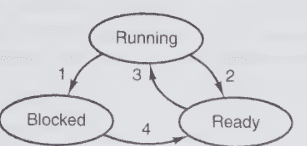

**2-2. 进程可以处于运行、阻塞或就绪状态。这些状态之间的转换所示。**

1. 进程因输入而阻塞
2. 调度程序选择另一个进程
3. 调度程序选择此进程
4. 输入可用

这三个状态之间可能发生四种转换，如所示。当操作系统发现进程现在无法继续执行时，会发生转换 1。在某些系统中，进程可以执行系统调用（如 `pause`）来进入阻塞状态。在其他系统（包括 UNIX）中，当进程从管道（pipe）或特殊文件（例如终端）读取内容且没有可用输入时，进程会自动阻塞。

转换 2 和 3 是由进程调度程序（操作系统的一部分）引起的，而进程对此毫无感知。当调度程序认为运行中的进程已运行足够的时间，是时候让另一个进程获得其 CPU 时间时，发生转换 2。当所有其他进程都获得了公平的份额，轮到第一个进程再次获取 CPU 运行时，发生转换 3。调优的主题，即决定哪个进程应该运行以及运行多久，是一个重要课题；我们将在本章后后部分讨论。人们已经设计了许多算法来平衡系统效率与单个进程公平性之间的竞争需求。我们将在本章晚些时候研究其中一些。

转换 4 发生在进程正在等待的外部事件（例如某些输入的到达）发生时。如果那个时刻没有其他进程在运行，将触发转换 3，进程开始运行。否则，它可能必须在就绪状态等待一会，直到 CPU 可用并轮到它的次数。

使用进程模型，思考系统内部发生了什么会变得容易得多。一些进程根据用户输入的命令运行。其他进程是系统的一部分，处理各种任务，如执行文件服务请求或管理磁盘或磁带驱动器的运行细节。当发生磁盘中断时，系统会决定停止运行当前进程并运行之前等待该中断而阻塞的磁盘进程。因此，与其考虑中断，不如考虑用户进程、磁盘进程、终端进程等，它们在等待某些内容时会阻塞。磁盘被读取或字符被输入后，等待它的进程被解阻塞并有资格再次运行。

这种视图导致了图 2-3 所示的模型。在这里，操作系统的最底层是调度器，在其上方有各种进程。所有的中断处理以及实际启动和停止进程的细节都隐藏在在此被称为“调度器”的部分中，这实际上并没有多少代码。操作系统的其余部分以进程的形式良好地组织。然而，很少有罕见系统像这样结构如此良好。

进程

| 0 | 1 | n-2 | n-1 |

|---|---|---|---|

| | | ... | |

| 调度器 | | | |

**图 2-3. 调度器是操作系统的底层，其上方是各种进程。**

## 2.1.6 进程的实现

为了实现进程模型，操作系统维护一个表格（一个数组），称为进程表，每个进程有一个条目。该条目包含了进程的状态，包括程序计数器、栈指针、内存分配、打开的文件、统计和调度信息。当进程从运行切换到阻塞时，必须保存这些信息。这发生在操作系统发现进程现在无法继续执行时。在某些系统中，进程可以执行系统调用（如 `pause`）来进入阻塞状态。在其他系统（包括 UNIX）中，当进程从管道或特殊文件（例如终端）读取内容且没有可用输入时，进程会自动阻塞。

2.2.1 进程 95

| 进程管理 | 内存管理 | 文件管理 |

| --- | --- | --- |

| 寄存器 | 段信息指针 | 根目录 |

| 程序计数器 | 数据段信息指针 | 工作目录 |

| 进程状态字 | 栈信息指针 | 文件描述符 |

| 栈指针 | | 用户 ID |

| 进程状态 | | 组 ID |

| 调度参数 | | |

| 进程 ID | | |

| 父进程 | | |

| 进程组 | | |

| 信号 | | |

| 进程启动时间 | | |

| 已用 CPU 时间 | | |

| 子进程的 CPU 时间 | | |

| 下次闹钟时间 | | |

**图 2-4. 典型进程表条目的某些字段。**

转换 2 和 3 是由进程调度程序（操作系统的一部分）引起的，而进程对此毫无感知。当调度程序认为运行中的进程已运行足够的时间，是时候让另一个进程获得其 CPU 时间时，发生转换 2。当所有其他进程都获得了公平的份额，轮到第一个进程再次获取 CPU 运行时，发生转换 3。调优的主题，即决定哪个进程应该运行以及运行多久，是一个重要课题；我们将在本章后部分讨论。人们已经设计了许多算法来平衡系统效率与单个进程公平性之间的竞争需求。我们将在本章晚些时候研究其中一些。

转换 4 发生在进程正在等待的外部事件（例如某些输入的到达）发生时。如果那个时刻没有其他进程在运行，将触发转换 3，进程开始运行。否则，它可能必须在就绪状态等待一会，直到 CPU 可用并轮到它的次数。

使用进程模型，思考系统内部发生了什么会变得容易得多。一些进程根据用户输入的命令运行。其他进程是系统的一部分，处理各种任务，如执行文件服务请求或管理磁盘或磁带驱动器的运行细节。当发生磁盘中断时，系统会决定停止运行当前进程并运行之前等待该中断而阻塞的磁盘进程。因此，与其考虑中断，不如考虑用户进程、磁盘进程、终端进程等，它们在等待某些内容时会阻塞。磁盘被读取或字符被输入后，等待它的进程被解阻塞并有资格再次运行。

这种视图导致了图 2-3 所示的模型。在这里，操作系统的最底层是调度器，在其上方有各种进程。所有的中断处理以及实际启动和停止进程的细节都隐藏在在此被称为“调度器”的部分中，这实际上并没有多少代码。操作系统的其余部分以进程的形式良好地组织。然而，很少有罕见系统像这样结构如此良好。

## 2.1.7 多程序处理建模

当使用多程序处理时，CPU 的利用率可以提高。简单来说，如果平均进程只消耗其在内存中停留时间的 20%，那么当内存中同时有五个进程时，CPU 应该一直是忙碌的。然而，这种模型是不切实际的乐观，因为它隐式地假设所有进程永远不会同时等待 I/O。

1. 硬件将程序计数器等信息压栈。
2. 硬件从中断向量加载新的程序计数器。
3. 汇编语言程序保存寄存器。
4. 汇编语言程序设置新栈。
5. 运行 C 中断服务（通常读取并缓冲输入）。
6. 调度程序决定下一个运行哪个进程。
7. C 过程返回到汇编代码。
8. 汇编语言程序启动新的当前进程。

**图 2-5.** 发生中断时操作系统最底层的骨架图。

更好的模型是从概率的角度来看 CPU 的使用率。假设一个进程有比例为 $p$ 的时间在等待 I/O 完成。如果内存中同时有 $n$ 个进程，那么这 $n$ 个进程都在等待 I/O（在这种情况下 CPU 将处于空闲状态）的概率为 $p^n$。CPU 的利用率由公式给出：

$CPU utilization = 1 - p^n$

**图 2-6** 显示了 CPU 利用率随 $n$变化的函数，这被称为**多道程序并发**。

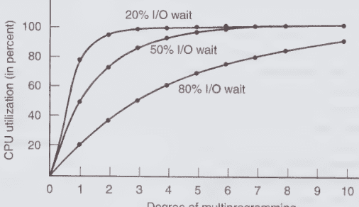

**图 2-6.** CPU 利用率随内存中进程数量变化的函数。

从图中可以看出，如果进程有80% 的时间在等待 I/O，那么内存中必须同时有至少 10 个进程才能让 CPU 利用率降到 10% 以下。当你意识到等待用户在终端上执行操作（或点击图标）的交互式进程处于 I/O 等待状态时，80% 或更长的 I/O 等待时间并不罕见。即使在服务器上，进行大量磁盘 I/O 的进程通常也会达到这个比例或更高。

## 2.1 进程

为了准确起见，应该指出上述的概率模型只是一个近似值。它隐含地假设所有 $n$ 个进程都是独立的，这意味着一个内存中有五个进程的系统，有三个在运行、两个在等待是可以完全接受的。但在单 CPU 上，我们无法让三个进程同时运行，因此当 CPU 忙碌时进程变为就绪将必须等待。因此，进程并不是独立的。可以使用队列论构建更准确的模型，但我们想要说明的观点——多道程序并发在 CPU 会空闲时使用 CPU——显然仍然有效，即使图 2-6 中的真实情况与图中所示的略有不同。

尽管图 2-6 的模型是简单化的，但它仍然可以用于对 CPU 性能做出具体的（尽管是近似的）预测。例如，假设计算机有 8 GB 内存，操作系统及其数据表占用 2 GB，每个用户程序也占用 2 GB。这些尺寸允许三个进程同时存在内存中。在 80% 的平均 I/O 等待下，我们的 CPU 利用率（忽略系统开销）为 1–0.8，约约 49%。再增加 8 GB 内存允许系统从三道多道并发变为七道多道并发，从而将 CPU 利用率提高到 79%。换句话说，额外的 8 GB 内存将使吞吐量提高 30%。

再增加 8 GB 内存将把 CPU 利用率从 79% 提高到 91%，从而使吞吐量再增加 12%。使用这个模型，计算机所有者可能会认为第一次增加是很好的投资，但第二次不是。

## 2.2 线程

在传统的操作系统中，每个进程都有一个地址空间和一个单一的控制线程。事实上，这几乎就是进程的定义。尽管如此，在许多情况下，希望在同一个地址空间内有多个控制线程以准并行的方式运行，就好像它们（几乎）是独立的进程（共享地址空间除外）。在接下来的章节中，我们将讨论这些情况及其影响。

### 2.2.1 线程的使用

为什么有人想在进程内部创建一个进程呢？事实证明，拥有被称为“线程”的多进程结构有几个原因。让我们现在检查其中一些。拥有线程的主要原因是在许多应用程序中，多个活动正在同时进行。其中某些活动可能会时时阻塞。通过将此类应用程序分解为在准并行状态运行的多个顺序线程，编程将变得更简单。

我们以前见过一次这种论点。这正是支持使用进程的论点。与其考虑中断、定时器和上下文切换，我们不如考虑并行进程。现在有了线程，我们拥有了一个新元素：并行实体共享同一个地址空间及其其中所有数据的能力。这种能力对于某些应用程序至关重要，而具有多个独立地址空间的进程是无法解决问题的。

拥有线程的第二个理由是，由于它们比进程轻量，因此创建和销毁进程更容易（即速度更快）。在许多系统中，创建一个线程的速度比创建一个进程快 10–100 倍。当所需的线程数量动态且快速变化时，这一属性非常有用。

拥有线程的第三个原因也是性能考虑。当所有线程都是 CPU 密集型时，线程不会产生性能提升；但当存在大量的计算和大量的 I/O 时，线程允许这些活动重叠，从而加速应用程序。

最后，线程在具有多个 CPU 的系统中是有用的。通过观察一些具体的例子可以很容易地看到线程为什么有用。例如，考虑一个文字处理器。假设该程序是双线程的。一个线程与用户交互，另一个线程处理格式化。一旦删除了一个句子，交互线程就会要求另一个线程重新格式化整本书。与此同时，交互线程继续监听键盘和鼠标。如果运气好，格式化会在用户请求查看页面之前完成，这样就可以立即显示。既然已经这样了，为什么不再增加第三个线程呢？许多文字处理器都有每隔几分钟自动保存整个文件的功能，以防止用户在程序崩溃、系统崩溃或断电故障时丢失一天的工作。第三个线程可以处理磁盘备份，而不会干扰另外两个。三个线程的情况如图 2-7 所示。

如果程序是单线程的，那么当开始磁盘备份时，键盘和鼠标的命令就会被忽略，直到备份完成。用户无疑会认为这种性能很缓慢。或者，键盘和鼠标事件可以中断磁盘备份，从而允许良好的性能，但会导致复杂的中断驱动型编程模型。使用三个线程，编程模型要简单得多。第一个线程只与用户交互。第二个线程在接到指令时重新格式化文档。第三个线程定期将内存内容写入磁盘。

显而易见，在此处使用三个独立的进程是不可行的，因为所有三个线程都需要操作文档。通过使用三个线程而不是三个进程，它们共享公共内存，因此都都可以访问正在编辑的文档。对于三个进程来说，这是可能的。

# 100

# 进程与线程

## 第2章

许多其他交互式程序中也存在类似的情况。例如，电子表格是一个允许用户维护矩阵的程序，矩阵中的某些元素是由用户提供的数据，其他元素是根据输入数据使用可能复杂的公式计算得出的。当用户更改其中一个元素时，许多其他元素可能需要重新计算。通过设立一个后台线程来执行重新计算，交互线程可以在计算进行时允许用户进行额外的更改。同样，第三个线程可以处理定期的磁盘备份工作。

现在考虑另一个线程很有用的用例：网站服务器。页面请求不断入入，请求的页面被发送给客户端。对于大多数网站，某些页面的访问频率高于其他页面。例如，索尼（Sony）首页的访问量远高于包含 Web 的树结构深处的任何页面。多线程服务器利用这一事实来提高性能：在主内存中维护一个频繁使用页面的集合，从而消除访问磁盘获取它们的需求。这样的集合被称为缓存（cache），也用于许多其他语境。例如，我们在第 1 章中见过的 CPU 缓存。

组织 Web 服务器的一种方式如图 2-8(a) 所示。这里，有一个线程（调度器）从网络读取入站的工作请求。在检查请求后，它选择一个空闲的（即阻塞状态的）工作线程，并将请求交给它，可能通过向与每个线程关联的特殊字中写入消息指针来实现。调度器随后唤醒睡眠中的工作线程，将其从阻塞状态移动到就绪状态。

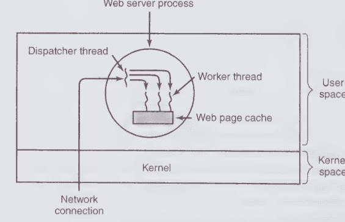

图 2-8. 多线程 Web 服务器。

当工作线程唤醒时，它检查请求是否在 Web 页面缓存中（所有线程都可以访问缓存）。如果没有，它将启动读取操作从磁盘获取页面，并阻塞直到磁盘操作完成。

## 2.2 线程基础 (101)

当线程阻塞磁盘操作时，会选择另一个线程进行运行，可能是调度器，以便获取更多工作；也可能是另一个现在已就绪运行的工作线程。

这种模型允许服务器被写成一组顺序线程。调度器的程序由一个无限循环组成，用于获取工作请求并将其交给工作线程。每个工作线程的代码由一个无限循环组成，负责接收来自调度器的请求并检查 Web 缓存查看页面是否存在。如果是，则将其返回给客户端，工作线程阻塞等待新请求。如果不是，它将从磁盘获取页面，将其返回给客户端，并阻塞等待新请求。

代码的大致轮纲如图 2-9 所示。在这里，在本书的其余部分，TRUE 被假设为常量 1。此外，`buff` 和 `page` 结构分别适用于工作请求和 Web 页面。

```
while (TRUE) {
    get_next_request(&buf);
    wait_for_work(&buf);
    handoff_work(&buf);
    look_for_in_cache(&buf, &page);
    if (page_not_in_cache(&page))
        read_page_from_disk(&buf, &page);
    return_page(&page);
}
```


考虑一下在没有线程的情况下Web 服务器将如何编写。它可能以单线程的方式运行。Web 服务器的主循环获取一个请求，检查它，并在获取下一个请求之前将其执行完毕。在等待磁盘时，服务器处于空闲状态，不处理任何其他入站请求。如果 Web 服务器运行在专用机器上（这通常如此），那么当 Web 服务器等待磁盘时，CPU 理想情况下是空闲的。结果是每秒可以处理的请求数少得多。因此，线程获得了巨大的性能提升，但每个线程都是按照通常的方式顺序编程的。

到目前为止，我们看到了两种可能的设计：多线程 Web 服务器和单线程服务器。假设没有可用，但系统设计人员发现单线程带来的性能损失不可接受的。如果可以使用系统调用的非阻塞读取，则存在第三种方法。当请求进来时，它只对请求进行检查。如果可以从缓存中满足，但不能，则启动一个非阻塞磁盘操作。

服务器在表中记录当前请求的状态，然后去获取下一个事件。下一个事件可能是对新工作的请求，也可能是磁盘对之前操作的回复。如果是新工作，则启动该工作。如果是来自磁盘的回复，则从表中提取相关信息并处理回复。使用非阻塞磁盘 I/O 时，回复可能必须采取信号或中断的形式。


在这种设计中，我们在前两种情况下拥有的“顺序进程”模型丢失了。每当服务器从处理一个请求切换到另一个请求时，必须在表中显式地保存和恢复计算状态。实际上，我们正在以困难的方式模拟线程。这种设计——即每个计算都有保存的状态，并且存在一组可以发生改变状态的事件——被称为*有限状态机*（`finite-state machine`）。这个概念在整个计算机科学中被广泛使用。

现在应该清楚线程提供了什么了。它们使得保持顺序编程的简单性成为可能。这个概念在整个计算机科学中被广泛使用。

| 模型 | 特性 |
| :--- | :--- |
| 线程 | 并行，阻塞调用 |
| 单线程 | 无并行，阻塞调用 |
| 有限状态机 | 并行，非阻塞调用 |

图 2-10. 三种处理方式。

现在我们已经了解了线程为什么有用以及如何使用它们，让我们深入调查一下这个想法。首先我们查看经典的线程模型；之后我们将检查 Linux 模型，那是线程所在的地方。

# 进程与线程 第2章

**图 2-11.** (a) 三个各带有一个线程的进程。(b) 一个带有三个线程的进程。

相同的全局变量。由于每个线程都可以访问进程地址空间内的每个内存地址，因此一个线程可以读取、写入，甚至擦除另一个线程的栈。线程之间没有保护机制，因为 (1) 这是可能的，而且 (2) 也是没有必要的。与不同的进程不同（不同进程可能来自不同的用户，并且可能相互敌对），一个进程始终由单个用户拥有，该用户可能创建了多个线程以便它们能够合作而不是竞争。除了共享地址空间外，所有线程还共享相同的打开文件集、子进程、闹钟和信号等，如图 2-12 所示。因此，图 2-11(a) 的组织形式将适用于三个进程本质上互不相关的情况，而图 2-11(b) 适用于三个线程实际上是同一个作业的一部分并正在积极协作的情况。

| 进程级项 | 线程级项 |
| --- | --- |
| 地址空间 | 程序计数器 |
| 全局变量 | 寄存器 |
| 打开的文件 | 栈 |
| 子进程 | 状态 |
| 等待的闹钟 | |
| 信号和信号处理程序 | |
| 统计信息 | |

**图 2-12.** 第一列列出了进程中所有线程共享的某些项。第二列列出了每个线程私有的某些项。

第一列中的项是进程属性，而不是线程属性。例如，如果一个线程打开了一个文件，该文件对进程中的其他线程可见，它们可以对其进行读写。这是合逻辑的，因为进程是资源管理的单位，而不是线程。

## 2.2 线程

如果每个线程都有自己的地址空间、打开的文件、待处理的闹钟等，那么它将是一个独立的进程。我们试图通过线程概念实现的能力是让多个线程共享一组资源，以便它们能够紧密工作以完成某些任务。

与传统进程（即只有一个线程的进程）一样，线程可以处于几种状态中的任何一种：运行、阻塞、就绪或终止。运行线程当前拥有 CPU 并处于活跃状态。相比之下，阻塞线程正在等待某些事件发生。例如，当线程执行系统调用从键盘读取数据时，它会被阻塞，直到输入内容被输入。就绪线程一旦轮到它就会被调度运行。线程状态之间的转换与进程状态之间的转换相同，如图 2-2 所示。重要的是要意识到每个线程都有它自己的栈，如图 2-3 所示。每个线程为每个被调用但尚未返回的程序过程包含一个帧（frame）。该帧包含程序过程的局部变量，以及在程序过程调用完成后要使用的返回地址。例如，如果 X 调用 Y，Y 调用 Z，当 Z 正在执行时，X、Y 和 Z 的帧将全都在栈上。每个线程通常会有不同的执行历史。这就是为什么线程需要它自己的栈。

当存在多线程时，进程通常从单个线程开始。该线程具有通过调用库过程（如 `thread_create`）来创建新线程的能力。`thread_create` 的参数指定了要运行的新线程的名称。没有必要（甚至不可能）指定关于新线程地址空间的任何内容，因为它自动在创建它的线程的地址空间中运行。线程有时是分层级的，具有父子关系，但通常并不存在这种关系，所有线程都是平等的。无论是否存在层级关系，创建线程通常都会返回一个命名该线程的线程标识符。

当线程完成工作后，它可以通过调用库过程（例如 `thread_exit`）来退出。它随后消失且不再可被调度。

## 108 进程与线程 第2章

在每次迭代中，宣布其意图后创建一个线程。如果线程创建失败，它会打印错误消息然后退出。在创建所有线程后，主程序退出。

```c
#include <pthread.h>
#include <stdio.h>
#include <stdlib.h>

#define NUMBER_OF_THREADS 10

void *print_hello_world(void *tid)
{
    /* 此函数打印线程的标识并退出。 */
    printf("Hello World. Greetings from thread %d\n", tid);
    pthread_exit(NULL);
}

int main(int argc, char *argv[])
{
    /* 主程序创建线程后退出。 */
    pthread_t threads[NUMBER_OF_THREADS];
    int status;

    for(i=0; i < NUMBER_OF_THREADS; i++) {
        printf("Main here. Creating %d\n", i);
        status = pthread_create(&threads[i], NULL, print_hello_world, (void *)i);
    }

    if (status != 0) {
        printf("Oops. pthread_create returned error code %d\n", status);
        exit(-1);
    }
    exit(NULL);
}
```

当线程被创建时，它会打印一条消息宣布自己的身份，然后退出。各种消息交错出现的顺序是不确定的，并且在程序的连续运行时可能会有所不同。

上述描述的 Pthreads 并不是唯一的。在讨论了进程和线程同步之后，我们将检查其他一些实现。

## 2.2.4 在用户空间实现线程

实现线程主要有两个地方：用户空间和内核。这种选择具有一定的争议性，而且混合实现也是可能的。现在我们来描述这些方法以及它们的优缺点。

## 2.2 线程

第一种方法是将线程包完全放在用户空间中。内核对它们一无所知。对于内核来说，它管理的是普通的单线程进程。第一个也是最显而易见的优势是，可以在不支持线程的操作系统上实现用户级线程包。过去使用的所有操作系统以前都属于这一类，直到现在仍然如此。通过这种方法，线程是由库实现的。

所有这些实现都具有相同的总体结构，如图 2-16(a) 所示。线程运行在运行时系统之上，运行时系统是一组管理线程的程序集合。我们已经见过了四种：`pthread_create`、`pthread_exit`、`pthread_join` 和 `pthread_yield`，但通常会有更多。

当在用户空间中管理线程时，每个进程都需要一个私有的线程表来跟踪该进程中的线程。该表类似于内核的进程表，不同之处在于只跟踪每个线程的属性，例如每个线程的程序计数器、栈指针、寄存器等。线程表由运行时系统管理。当线程被移动到就绪状态或阻塞状态时，重新启动它所需的信息存储在线程表中，这与内核在进程表中存储进程信息的方式完全相同。

当线程执行可能导致其在本地阻塞的操作（例如，等待进程中的另一个线程完成某些工作）时，它会调用运行时系统程序。该程序会检查线程是否必须被放入阻塞状态。如果是，它会将线程的寄存器（即它自身的寄存器）存储在线程表中，在表中查找可以运行的就绪线程，并用新线程保存的值重新加载机器寄存器。一旦栈指针和程序计数器切换，新线程就会自动恢复运行。如果机器恰好有存储所有寄存器的指令和加载所有寄存器的指令，那么整个线程切换只需要几条指令即可完成。像这样进行切换至少比转换到内核快一个数量级——可能更多，这是支持用户级线程包的一个强有力理由。

然而，它与进程之间有一个关键区别。当一个线程暂时停止运行时（例如当它调用 `thread_yield` 时），`thread_yield` 的代码可以将信息保存在线程自身中。此外，它可以调用线程调度器来选择另一个线程运行。保存线程状态的程序和调度器只是局部程序，因此调用它们的效率比进行内核调用高得多。在其他问题中，它不需要陷阱（trap），不需要上下文切换，内存缓存不需要刷新等等。这使得线程调度变得非常非常、非常快。

用户级线程还有其他优势。它们允许每个进程拥有自己的自定义的调度算法。对于某些应用程序（例如，那些带有垃圾回收器线程的程序），不需要担心在不方便的时刻被停止是一个加分。它们的可扩展性也更好，因为内核线程不可避免地需要在内核中占用一些表空间和栈空间，如果线程非常多，这可能会成为一个问题。

尽管性能更好，用户级线程包仍存在一些重大问题。其中首要问题是如何处理阻塞。线程的主要目标之一是允许一个线程阻塞而不停止整个进程。在用户级线程的实现中，如果一个线程执行了导致阻塞的系统调用，整个进程都会被阻塞，即使其他线程可能是可运行的。

另一种替代方案是让内核感知线程，但在这种实现中，编程是非常粗略且混乱的。解决线程无限运行问题的一个可能方案是让时钟信号（中断）运行以获取控制权，但这在每个实现中都是粗略且混乱的。高的周期性时钟中断并不总是可能的，即使可能，开销可能是巨大的。此外，线程可能也需要时钟中断，这会干扰运行时系统对时钟的使用。

另一个，也是最有破坏性的反对用户级线程的论点是：程序员通常在线程频繁阻塞的应用程序中使用线程，例如多线程 Web 服务器。这些线程不断地发出系统调用。一旦为了执行系统调用进入内核发生陷阱，内核切换已阻塞的旧线程几乎没有更多额外工作，而且内核这样做消除了不断检查系统调用是否安全的需要。对于那些完全是 CPU 密集型且很少阻塞的应用程序，使用线程的意义何在？没有人会认真地使用线程计算前 n 个质数或下国际象棋，因为这样做没有任何益处。

## 2.2.5 在内核中实现线程

现在让我们考虑让内核感知并管理线程。每个实现中不需要运行时系统，如图 2-16(b) 所示。此外，每个进程中也没有线程表。相反，内核有一个线程表来跟踪系统中所有的线程。当一个线程想要创建一个新线程或销毁现有线程时，它发出内核调用，然后内核通过更新内核线程表来完成创建或销毁。

# 112 进程与线程 第 2 章

内核线程表存储了每个线程的寄存器、状态和其他信息。这些信息与用户级线程相同，但现在保存在内核中，而不是用户空间（运行时系统内部）。这些信息是传统内核维护其单线程进程时维护信息的子集，即进程状态。此外，内核还维护着传统的进程表以跟踪进程。

所有可能阻塞线程的调用都实现为系统调用，其开销比调用运行时系统过程更大。当线程阻塞时，内核可以根据自己的选择，运行同一进程的另一个线程（如果该线程已就绪）或来自另一个进程的线程。对于用户级线程，运行时系统会继续运行其所属进程的线程，直到内核夺走其 CPU 控制权（或者没有剩余可运行的线程了）。

由于在内核中创建和销毁线程的开销相对较大，某些系统使用了符合环境逻辑的方法并回收线程。当一个线程被销毁时，它被标记为不可运行，但内核数据结构不受影响。稍后，当创建一个新线程时，旧线程会被重新激活，从而节省了一些开销。用户级线程也可以进行线程回收，但由于线程管理的开销要小得多，因此这样做的动力并不大。

内核线程不需要任何新的非阻塞系统调用。此外，如果进程中的一个线程导致了页异常，内核可以很容易地检查该进程是否有其他可运行的线程，如果有，则运行其中一个线程，同时等待所需的进程从磁盘调入。它们的主要缺点是系统调用的开销很大，因此如果线程操作（创建、终止等）非常频繁，将会产生大量的开销。

虽然内核线程解决了一些问题，但它们并不能解决所有问题。例如，当多线程进程进行 `fork`（分叉）时会发生什么？新进程拥有和旧进程一样多的线程，还是说只有一个线程？在很多情况下，最佳选择取决于进程计划做什么。如果它将要调用 `exec` 来启动一个新程序，可能一个线程就是正确选择；但如果它继续执行，那么产生所有线程可能是最好的。

另一个问题是信号。记住，至少在经典模型中，信号是发送给进程而不是线程的。当信号发送进来时，应该由哪个线程来处理它？线程可能会注册它们对某些信号的兴趣，或者当信号到达时，将其交给表示想要该信号的线程。但如果两个或多个线程注册了同一个信号会怎样？这些只是线程引入的问题中的两个，还有更多问题。

## 2.2.6 混合实现

研究人员已经探索了多种结合用户级线程和内核级线程优势的方法。一种方法是使用内核级线程，然后将用户级线程复用到某些或全部内核线程上，如图 2-17 所示。

使用这种方法时，程序员可以决定使用多少个内核线程，以及在每个内核线程上复用多少个用户级线程。这种模型提供了极大的灵活性。

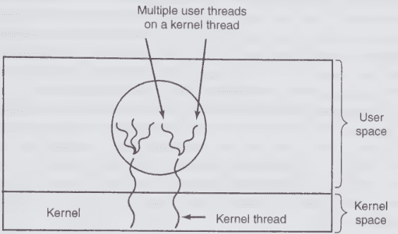

图 2-17. 将用户级线程复用到内核级线程。

通过这种方法，内核只感知内核级线程并对它们进行调度。这些线程中的某些可能有多个用户级线程复用在其上方。这些用户级线程的创建、销毁和调度方式与运行在具有多线程能力的操作系统上的进程中的用户级线程完全相同。在这种模型中，每个内核级线程都有一组用户级线程轮流使用它。

## 2.2.7 调度器激活 (Scheduler Activations)

虽然内核在某些关键方面优于用户级线程，但它们的速度无疑更慢。因此，研究人员一直在寻找在不放弃其良好特性的情况下改进现状。我们将描述一种由 Anderson 等人（1992）开发的方法，称为调度器激活（`scheduler activations`）。该工作由 Dekker 等人（1988）和 Scott 等人（1990）进行了描述。

调度器激活工作的目标是模拟内核线程的功能，但具有通常与用户空间实现的线程相关的更好的性能和更大的灵活性。特别是，用户线程不需要执行特殊的非阻塞系统调用，也不需要预先检查系统调用是否安全。尽管如此，当线程在系统调用或页异常上阻塞时，如果同一进程内有其他就绪线程，仍然是可以运行它们的的。

通过避免用户空间和内核空间之间不必要的切换来实现效率。如果一个线程阻塞等待另一个线程执行某些操作（例如），没有理由引入内核，从而节省了内核切换的开销。用户空间的运行时系统可以阻塞同步线程并自己调度一个新线程。

当调度器激活时，内核为每个进程分配一定数量的虚拟处理器，并将（用户空间）运行时线程分配到处理器上。这种机制也可以用于多处理器系统，其中虚拟处理器可以是真实的 CPU。分配给进程的虚拟处理器数量初始为一个，但进程可以请求更多，也可以返回它不再需要的处理器。内核也可以收回已分配的处理器，以便将它们分配给更多的需求。

使该方案起的基本思想是：当内核知道一个线程已阻塞时（例如通过执行阻塞性系统调用或发生页异常），内核通知进程运行时系统，并在相关线程的栈上传递参数以及发生事件的描述。这种通知通过让内核在一个起始地址激活运行时系统来实现，类似于 UNIX 中的信号。这种机制被称为**向上调用 (upcall)**。

一旦激活，运行时系统就可以重新调度线程，通常是将当前线程标记为阻塞并激活就绪列表中的另一个线程。稍后当内核得知原始线程可以再次运行时（例如等待读取的管道现在有了数据，或者它异常的页已从磁盘调入），它会再次通过向上调用通知它。运行时系统可以立即重启阻塞的线程，也可以将其放入就绪列表稍后运行。

当用户线程运行时发生硬件中断时，被中断的 CPU 切换到内核模式。如果中断是由与被中断进程相关的事件引起的（例如另一个进程的 I/O 完成），当中断处理程序完成后，它会将被中断线程恢复到中断之前的状态。然而，如果进程对中断感兴趣（例如某个线程需要的页面到达了），则不会重启被中断线程。相反，它被挂起，并在虚拟 CPU 上启动运行时系统，将被中断线程的状态放在栈上。由运行时系统来决定在 CPU 上调度哪个线程：被中断的、新就绪的还是第三种选择。

## 2.2.8 弹出线程 (Pop-Up Threads)

线程在分布式系统中通常非常有用。一个重要的例子是如何处理传入的消息（例如服务请求）。传统方法是让一个阻塞在接收系统调用上的进程或线程

## 第 2.2 节 线程

等待传入的消息。当消息到达时，它会接收消息、解包、检查内容并进行处理。

然而，也可以采用一种完全不同的方法，即消息的到达会导致系统创建一个新线程来处理该消息。这种线程被称为“弹出线程”（`pop-up thread`），如图 2-18 所示。弹出线程的一个关键优势是，由于它们是全新的，因此没有任何任何需要恢复的历史记录——如寄存器、栈等。每个线程都从零开始，且每个线程都与其他所有线程是一致相同的。这使得快速创建此类线程成为可能。新线程会被分配到待处理的消息进行处理。使用弹出线程的结果是，从消息到达到开始处理之间的延迟可以变得非常短。

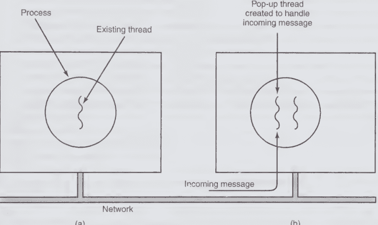

图 2-18. 消息到达时创建新线程。(a) 消息到达之前。(b) 消息到达之后。

使用弹出线程时，需要一些先进的规划。例如，线程在哪个进程中运行？如果系统支持在内核上下文中运行线程，则线程可以在那里运行（这就是为什么我们没有在图 2-18 中显示内核）。让弹出线程运行在内核空间通常比将其放在用户空间更容易、更快。运行在内核空间的弹出线程可以轻松访问内核的所有数据表和 I/O 设备，这些设备可能是中断处理所需要的。另一方面，有缺陷的内核线程造成的破坏比有缺陷的用户线程更大。例如，如果它运行时间过长且没有方法对其抢占，传入的数据可能会永久丢失。

### 2.2.9 将单线程代码转为多线程

许多现有程序是为单线程进程编写的。将它们转换为多线程比初看起来看起来要复杂得多。下面我们只检查其中的一些陷阱。

首先，线程的代码通常由多个过程，就像进程一样。这些过程可能拥有局部变量、全局变量和参数。局部变量不会引起任何问题，但对于线程是全局的但对于整个程序不是全局的变量就是一个问题。这些变量在全局范围内是全局，因为线程内的许多过程都会使用它们（就像使用任何全局变量一样），但其他线程在逻辑上应该忽略它们。


例如，考虑由 UNIX 维护的 `errno` 变量。当进程（或线程）执行失败的系统调用时，错误代码被放入 `errno` 中。在图 2-19 中，线程 1 执行系统调用 `access` 以查找它是否有权限访问某个文件。操作系统在全局变量 `errno` 中返回答案。在控制权返回 1 之后，但在它有机会读取 `errno` 之前，调度程序认为线程 1 目前已经有足够的 CPU 时间，并决定切换到线程 2。线程 2 执行了一个失败的 `open` 调用，导致 `errno` 被覆盖，导致线程 1 对代码的访问永久丢失。当线程 1 再次启动时，它将读取到错误的值并表现异常。

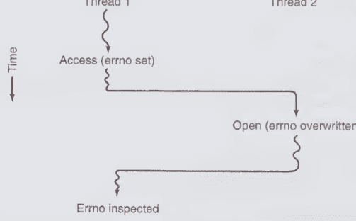

图 2-19. 线程之间对全局变量使用的的冲突。

该问题有多种解决方案。一种方法是完全禁止全局变量。无论这种理想有多值得追求，它与许多现有软件相冲突。另一种方法是为每个线程分配自己的私有全局变量，如图 2-20 所示。通过这样，每个线程都有自己的 `errno` 和其他全局变量的私有副本，从而避免了冲突。实际上，这个决策创建了一个新的作用域级——对线程的所有过程可见（但对其他线程可见）的变量，除了现有的仅对一个过程可见以及程序随处可见变量的作用域级之外。

| 线程 1 的代码 | 线程 2 的代码 |

| :--- | :--- |

| 线程 1 的栈 | 线程 2 的栈 |

| 线程 1 的全局变量 | 线程 2 的全局变量 |

图 2-20. 线程可以拥有私有全局变量。

然而，由于大多数编程语言有表示局部变量和全局变量的方法，但没有中间形式。可以为全局变量分配一块内存并将其作为额外参数传递给线程中的每个过程。虽然这算不上优雅的解决方案，但它是有效的。

或者，可以引入新的库过程来创建、设置和读取这些线程范围内的全局变量。第一次调用可能像这样：

```
create_global("bufptr");
```

它在堆上或为调用线程预留的特殊存储区中为一个名为 `bufptr` 的指针分配存储空间。无论存储分配在哪里，只有调用线程可以访问该全局变量。如果另一个线程创建了同名的全局变量，它将获得一个与现有存储不冲突的另一个存储位置。

访问全局变量需要两次调用：一个用于写入，另一个用于读取。写入时，类似于：

```
set_global("bufptr", &bufptr);
```

读取全局变量是可能的，类似于：

```
bufptr = read_global("bufptr");
```

## 进程与线程

将单线程程序转换为多线程程序的下一个问题是，许多库过程不是重入的（reentrant）。也就是说，它们的设计并没有考虑过在上一个调用完成时发生第二次调用。例如，通过网络发送消息可能会阻塞库。

同样，像 `malloc` 内存分配过程维护着内存使用表，例如空闲块链表。当 `malloc` 忙于更新这些列表时，它们可能会处于不一致的状态。如果在表不一致时发生了线程切换，程序可能会崩溃。有效地解决所有这些问题意味着这是一项非同寻常的活动，并且可能引入微妙的错误。

另一种解决方案是为每个过程提供一个锁。当上一个调用被阻塞时，另一个线程尝试使用该库将被阻止。这种方法可以运行，但消除了潜在的并行性。

接下来考虑信号（signals）。所有信号在逻辑上都是特定的，而其他信号不是。例如，如果一个线程调用 `alarm`，让信号发送到调用它的线程是合理的。然而，当线程在用户空间实现时，内核甚至不知道线程的存在，无法将信号引导到正确的线程。如果一个进程一次只能挂起一个闹，且多个线程独立调用 `alarm`，就会出现额外的复杂性。

其他信号（如键盘中断）不是线程特定的。谁应该捕获它们？一个指定的线程？所有线程？新创建的弹出线程？此外，如果一个线程想要捕获特定信号（例如用户按下 CTRL-C），而另一个线程希望该信号终止进程，会发生什么？如果一个或线程运行标准库过程而其他线程是用户编写的，就会出现这种情况。通常，单线程环境中管理信号已经足够困难。多线程环境并没有让它们更容易处理。

线程引入的最后一个问题是栈管理。在许多系统中，当进程栈溢出时，内核会自动为该进程提供更多栈空间。当一个进程有多个线程时，它也必须有多个栈。如果内核感知不到所有这些栈，就无法在发生栈错误时自动扩展它们。事实上，它可能无法意识到内存错误与某个线程栈的增长有关。

## 2.2 线程 119

这些问题并非不可逾越，但它们确实表明，如果不对现有系统进行相当大幅的系统重新设计，仅仅引入线程是完全行不通的。系统调用的语义可能需要重新定义和重写。所有这些操作必须以与现有程序后兼容的方式进行，以考虑到只有一个线程的进程这一限制情况。关于线程的更多信息，请参阅 Hauser 等人 (1993)、Marsh 等人 (1991) 以及 Rodrigues 等人 (2010)。

## 2.3 进程间通信

进程经常需要与其他进程进行通信。例如，在 shell 管道中，第一个进程的输出必须传递给第二个进程，并以此类推。因此，进程之间需要通信，且最好是以一种不使用中断的良好结构的方式进行。在接下来的章节中，我们将介绍一些与进程间通信（IPC）相关的问题。

简而言之，这里有三个问题：第一个上面提到过：一个进程如何向另一个进程传递信息。第二个是如何在让两个或多个进程互不干扰，例如，在航空订票系统中，两个进程都试图为不同的客户抢购飞机上的座位。第三个涉及存在依赖关系时的进程排序：如果进程 A 生成数据而进程 B 打印这些数据，则 B 必须等待 A 生成一些数据后才能开始打印。我们从下一节开始检查这三个问题。

同样重要的是提到，这些问题中的两个同样适用于线程。第一个问题——传递信息——对线程来说很容易，因为它们共享一个公共地址空间（在不同地址空间中需要通信的线程属于进程间通信的范畴）。然而，另外两个问题——互不干扰和正确的排序——同样适用于线程。同样的问题存在，同样的解决方案也适用。下面我们将在进程的背景下讨论这些问题，但请记住，相同的问题和解决方案也适用于线程。

## 2.3 竞态条件

在某些操作系统中，协同工作的进程可能会共享一些公共存储，每个进程都可以对其进行读取和写入（可能在内核数据结构中），或者可能是一个共享文件；共享内存的位置不会改变通信的本质或产生的问题。为了看到进程间通信在实践中如何工作，让我们现在考虑一个简单但常见的例子：打印池化程序（print spooler）。当一个进程想要打印文件时，它会将名称输入到一个特殊的池化目录。另一个进程（打印守护进程）会定期检查是否有文件需要打印，如果有，它就会打印它们并从目录中删除它们的名称。

假设我们的池化目录有大量的槽位，编号为 0, 1, 2, ..., 每个槽位都能容纳一个文件名。还假设有两个共享变量 `out` 和 `in`：`out` 指向下一个要打印的文件，`in` 指向目录中槽位中的下一个文件。这两个变量可以很好地保存在一个所有进程可访问的双字文件中。在某一时刻，槽位 0 到 3 是空的（文件已经打印完毕），槽位 4 到 6 是满的（存有排队等待打印的文件名）。几乎同时，进程 A 和 B 决定要提交一个文件进行打印。这种情况如图 2-21 所示。

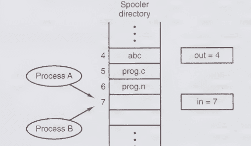

图 2-21。两个进程同时想要访问共享内存。

在适用墨菲定律（Murphy's law）的管辖区内，可能会发生以下情况：进程 A 读取 `in` 并将值 7 存储在名为 `next_free_slot` 的局部变量中。就在此时发生了时钟中断，CPU 认为进程 A 运行时间足够长，因此切换到进程 B。进程 B 也读取了 `in` 并得到了 7。它也将其存储在自己的局部变量 `next_free_slot` 中。在这一刻，两个进程都认为下一个可用槽位是 7。

进程 B 继续运行。它将自己的文件名存储在槽位 7 中，并将其更新为 8。然后它去处理其他事情了。

最终，进程 A 再次运行，从它离开的地方开始。它发现 `next_free_slot` 是 7，并将它的文件名写入槽位 7，从而删除了进程 B 刚刚放在那里的名称。然后它计算 `next_free_slot + 1`，结果为 8，并将 `in` 设置为 8。现在池化目录在内部是一是一致的，因此打印守护进程不会发现任何异常，但进程 B 将永远接收不到任何输出。用户 B 将在打印机旁守候多年，心心念念地期待着永远不会出现的输出。

† 如果事情可能出错，它就一定会出错。

这种两个或多个进程读取或共享共享数据，且最终结果取决于谁确切运行的情况被称为竞态条件（race conditions）。调试包含竞态条件的程序一点趣味性也没有。大多数运行的结果都是正常的，但偶尔（极少数地）会发生一些奇怪且无法解释的事情。不幸的是，由于核心数量增加导致并行性提高，竞态条件正变得越来越常见。

### 2.3.2 临界区

我们如何避免竞态条件？在这里以及在其他涉及共享内存、共享文件和所有其他共享内容的情况下，防止故障的关键是找到某种方法禁止一个进程访问共享数据。换句话说，我们需要的是互斥（mutual exclusion），这样当一个进程在其临界区内使用共享内存时，没有其他进程进入其临界区并引起麻烦。

程序中访问共享内存的部分被称为临界区（critical region）或临界段（critical section）。如果我们能够安排使得没有两个进程同时处于临界区内，我们就可以避免竞态。虽然这个要求避免了竞态条件，但它对于一个良好的解决方案来说是不够的。我们需要满足以下四个条件：

- 不有进程同时位于临界区内。

- 对速度或 CPU 的数量不做任何假设。

- 在临界区之外运行的进程不会阻塞任何进程。

- 进程都不应该永远等待进入其区域。

在抽象意义上，行为如图 2-22 所示。在这里，进程 A 在 $T_1$ 进入临界区。稍后，在 $T_2$ 进程 B 尝试进入临界区，但由于另一个进程已经在区域内而失败。因此，B 被挂起直到 $T_3$，A 离开临界区，允许 B 立即进入。最终 B 在 $T_4$ 离开，我们回到了没有进程处于临界的原始状态。

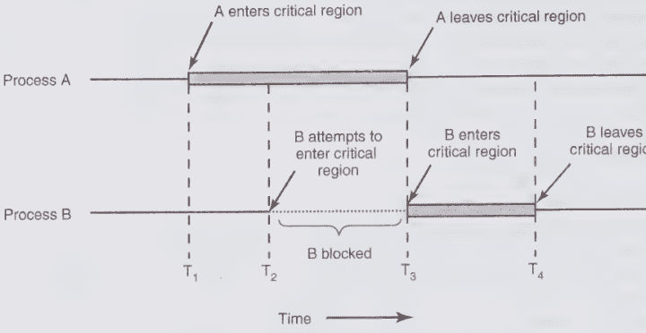

### 2.3.3 忙等待的互斥

在本节中，我们将检查各种互斥方案，以便当一个进程在其临界区内忙于更新共享内存时，没有其他进程进入其临界区并引起麻烦。

#### 禁用中断

在单处理器系统中，最简单的方案是让每个进程在进入临界区后立即禁用所有中断，并在离开之前重新启用。在禁用中断的情况下，时钟中断不会发生。毕竟，CPU 在进程之间的切换都是由于时钟或其他中断，而在中断关闭的情况下，CPU 不切换到另一个进程。因此，一旦进程禁用了中断，它就可以检查并更新共享内存而不必担心任何其他进程的干扰。

方法通常不受欢迎，因为赋予用户关闭中断的权力是不明智的。如果他们中的某人这样做且不再开启呢？那难道不是系统的结束吗？此外，如果系统是多处理器（具有两个或多个 CPU），禁用中断只会影响执行禁用指令的 CPU。其他 CPU 将继续运行并访问共享内存。

另一方面

## 2.3 进程间通信

这通常是操作系统内部的一种有用技术，但并不适合作为用户进程的通用互斥机制。

由于低端 PC 中多核芯片数量不断增加，通过禁用中断来实现互斥的可能性（即使在内核内部）正变得一天不如一天。双核已经很常见，许多机器已经配备了四核，而 8 核、16 核或 32 核也並非遥远。在多核（即多处理器系统）中，禁用一个 CPU 的中断并不能防止其他 CPU 干扰第一个 CPU 正在执行的操作。因此，需要更复杂的方案。

## 锁变量

作为第二次尝试，让我们寻找一种软件解决方案。考虑设置一个初始为 0 的共享（锁）变量。当进程进入其临界区时，它测试该锁。如果锁为 0，进程将其设置为 1 并进入临界区。如果锁已经是 1，进程将等待直到它变为 0。因此，0 表示没有进程处于临界区，11 表示某些进程正处于临界区。

遗憾的是，这个想法包含了我们在打印作业目录中看到的完全相同的致命缺陷。假设一个进程读取锁并发现它为 0。在它将锁设置为 1 之前，另一个进程被调度并运行并将锁设置为 1。当第一个进程再次运行时，它也会将锁设置为 1，导致两个进程同时进入它们的临界区。

现在你可能认为我们可以通过先读取锁值、在存储之前再次检查它来规避这个问题，但这并没有帮助。如果第二个进程在第一个进程完成第二次检查后修改了锁，那么现在就会发生竞态条件。

## 严格交替

互斥问题的第三种方法如图 2-23 所示。这段程序片段与书中几乎所有其他代码一样，是用 C 语言编写的。在这里选择 C 是因为真实的操作系统几乎总是用 C（或偶尔用 C++）编写，而很少使用 Java、Python 或 Haskell 等语言。C 具有强大、高效和可预测，这些都是编写操作系统的特性。Java 可能会在关键时刻耗尽存储空间并调用垃圾回收器在最糟糕的时机回收内存。这在 C 中不会发生，因为 C 中没有垃圾回收。Prechtel (2000) 对 C、C++、Java 和其他四种语言进行了定量比较。

在图 2-23 中，整数变量 `turn` 初始为 0，记录该谁进入临界区检查或更新共享内存。最初，进程 0 检查 `turn`，发现它为 0，然后进入临界区。进程 1 也发现它为 0，因此在一个紧密循环中不断测试 `turn`，看它何时变为 1。

```c
while (TRUE) {
    while (turn != 0) /* loop */;
    critical_region();
    turn = 1;
    noncritical_region();
}
```

```c
while (TRUE) {
    while (turn != 1) /* loop */;
    critical_region();
    turn = 0;
    noncritical_region();
}
```

**图 2-23.** 一种提出的临界区问题解决方案。(a) 进程 0。(b) 进程 1。在两种情况下，请务必注意结束 while 语句的分号。

连续设置一个变量直到某个值出现的过程被称为**忙等待**（busy waiting）。它应该被避免，因为它浪费了 CPU 时间。只有在合理预期等待时间很短时，才会使用忙等待。使用忙等待的锁被称为**自旋锁**（spin lock）。

当进程 0 突然离开临界区时，进程 0 完成其非临界区并回到循环顶部。遗憾的是，它现在不允许进入临界区，因为 `turn` 为 1 且进程 1 正忙于它的非临界区。它在循环中挂起，直到进程 1 将 `turn` 设置为 0。可以说，当一个进程比另一个慢得多时，轮流并不是好主意。

这种情况违反了上述规定的条件 3：进程 0 被一个不在其临界区的进程阻塞。回到上面提到的打印作业目录，如果我们现在将临界区与读写打印作业目录相关，那么进程 0 将不允许打印另一个文件，因为进程 1 正在做其他事情。

事实上，这种解决方案要求两个进程在进入临界区时严格交替，例如在轮打印文件时。任何一个都不允许连续打印两个文件。虽然该算法避免了所有的竞态条件，但它并不是一个真正的候选方案，因为它违反了条件 3。

## 彼得森算法

通过将轮流执行的想法与锁变量和变量的想法相结合，荷兰数学家 T. Dekker 首次设计出了一种不需要严格交替的互斥问题软件解决方案。关于 Dekker 算法的讨论，参见 Dijkstra (1965)。

1981 年，G. L. Peterson 发现了一种实现互斥的简单得的方法，使得 Dekker 的解决方案变得过时。彼得森算法如图 2-24 所示。该算法由 ANSI C 语言中的两个过程组成，这意味着将为所有定义和使用的函数提供函数原型。然而，为了节省空间，我们在此处或稍后将不会显示原型。

```c
#define FALSE 0
#define TRUE 1
#define N 2

/* 进程数量 */
int turn;
int interested[N];
/* 该轮到谁了？ */
/* 所有值初始为 0 (FALSE) */

void enter_region(int process) {
    /* 进程为 0 或 1 */
    int other;
    /* 另一个进程 */
    other = 1 - process;
    /* 显示你感兴趣 */
    interested[process] = TRUE;
    /* 设置标记 */
    turn = process;
    /* 设置标志 */
    while (turn == process && interested[other] == TRUE); /* 空语句 */
}

void leave_region(int process) {
    /* 进程：离开 */
    interested[process] = FALSE; /* 表示离开临界区 */
}
```

> 图 2-24. 实现互斥的彼得森解决方案。

在使用共享变量（即在进入其临界区之前），每个进程都以自己的进程编号（0 或 1）作为参数调用 `enter_region`。这将导致它等待，如果...

```
TSL REGISTER,LOCK
CMP REGISTER,#0
JNE enter_region
RET
```

```
将锁复制到寄存器并将锁设置为 1
锁之前是 0 吗？
如果不是 0，说明锁已设置，所以循环
返回调用者；已进入临界区
```

```
MOVE LOCK,#0
RET
```

```
在 lock 中存储 0
返回调用者
```

图 2-25。使用 `TSL` 指令进入和离开临界区。

`TSL` 的一种替代指令是 `XCHG`，它能够原子地交换两个位置的内容，例如一个寄存器和一个内存字。代码如图 2-26 所示，如所见，它与 `TSL` 的解决方案本质上相同。所有的 Intel x86 CPU 都使用 `XCHG` 指令进行低级同步。

```
MOVE REGISTER,#1
XCHG REGISTER,LOCK
CMP REGISTER,#0
JNE enter_region
RET
```

```
在寄存器中放入 1
交换寄存器和锁变量的内容
锁之前是 0 吗？
如果不是 0，说明锁已设置，所以循环
返回调用者；已进入临界区
```

```
MOVE LOCK,#0
RET
```

```
在 lock 中存储 0
返回调用者
```

图 2-26。使用 `XCHG` 指令进入和离开临界区。


## 2.3.4 睡眠与唤醒

Peterson 解决方案以及使用 `TSL` 或 `XCHG` 的解决方案都是正确的，但它们都有一个需要忙等待（busy waiting）的缺陷。本质上讲，这些解决方案的操作是：当一个进程想要进入其临界区时，它会检查是否允许进入。如果不允许，进程就会在一个紧循环中等待，直到允许为止。

这种方法不仅浪费 CPU 时间，还可能产生意想不到的影响。考虑一个拥有两个进程的计算机：高优先级的 `H` 和低优先级的 `L`。调度规则规定，只要 `H` 处于就绪状态，它就会运行。在某一时刻，当 `L` 处于其临界区时，`H` 变为就绪状态（例如，某个 I/O 操作完成了）。`H` 现在开始忙等待，但由于 `H` 运行期间 `L` 永远无法获得调度，导致 `L` 永远没有机会离开其临界区，因此 `H` 会无限循环。这种情况有时被称为优先级反转问题。

现在让我们来看一些通信原语，它们在不被进入临界区时不会浪费 CPU 时间。最简单的之一是 `sleep`（睡眠）和 `wakeup`（唤醒）对。`sleep` 是一种导致调用者阻塞的系统，即挂起，直到另一个进程唤醒它。`wakeup` 调用有一个参数，即要被唤醒的进程。另一种，`sleep` 和 `wakeup` 都有一个参数，一个用于匹配唤醒信号的内存地址。

## 生产者-消费者问题

作为这些原语如何使用的示例，让我们考虑生产者-消费者问题（也称为有界缓冲区问题）。两个进程共享一个固定大小的公共缓冲区。其中一个生产者将信息放入缓冲区，另一个消费者则将其取出。也可以将该问题推广为有 `m` 个生产者和 `n` 个消费者，但我们只考虑一个生产者和一个消费者的情况，因为这个假设简化了解决方案。

当生产者想要向缓冲区放入一个新项目但缓冲区已满时，就会出现问题。解决方案是让生产者睡眠，当消费者移除一个或多个项目时再唤醒它。同样，如果消费者想从缓冲区移除一个项目但缓冲区为空，它就会睡眠，直到生产者向缓冲区放入东西并唤醒它。

这种方法听起来足够简单，但它导致了我们在之前在打印机目录中看到的竞态条件。为了跟踪缓冲区中项目的数量，我们需要一个变量 `count`。如果缓冲区能容的最大项目数是 `N`，生产者的代码将首先测试 `count` 是否为 `N`。如果是，生产者将睡眠；如果不是，生产者将添加一个项目并增加 `count`。

消费者的代码也类似：首先测试 `count` 是否为 `0`。如果是，则进入睡眠；如果不为 `0`，则移除一个项目并递减计数器。每个进程还会测试自己是否应该被唤醒，如果是，则唤醒它。生产者和消费者的代码如图 2-27 所示。

为了在 C 语言中表示如 `sleep` 和 `wakeup` 这样的系统调用，我们将它们显示为库例程。它们不是标准 C 库的一部分，但推测在任何实际上拥有这些系统调用的系统上都是提供的。`insert_item` 和 `remove_item` 过程（未显示）处理向缓冲区放入项目和取出项目的账记录工作。

现在让我们回到竞态条件。它的发生是因为对 `count` 的访问不受限制。结果，可能会发生以下情况：缓冲区是空的，消费者刚刚读取了 `count` 以检查是否为 `0`。在那个

## SEC. 2.3 进程间通信 129

```c
#define N 100
int count = 0;
```

```c
void producer(void) {
    int item;
    while (TRUE) {
        item = produce_item();
        if (count == N) sleep();
        insert_item(item);
        count = count + 1;
        if (count == 1) wakeup(consumer);
    }
}
```

> /* 缓冲区中的槽数 */
> /* 缓冲区中的项目数 */
> /* 如果不是 0，说明锁已设置，所以循环 */
> /* 返回调用者；已进入临界区 */

## 2.3.5 信号量 (Semaphores)

这是 1965 年的情况，当时 E. W. Dijkstra (1965) 建议使用整数变量计算唤醒次数。在他的建议中，引入了一种新的变量类型，他称之为信号量。信号量可以持有值 `0`，表示没有保存的唤醒；或者持有某个正值，表示有一个或多个待处理的唤醒。

Dijkstra 提出了信号量的两种操作，现在通常称为 `down` 和 `up`（分别是 `sleep` 和 `wakeup` 的泛化）。信号量上的 `down` 操作检查值是否大于 `0`。如果是，则递减该值（即使用一个唤醒）并继续。如果值为 `0`，则进程进入睡眠而不完成 `down`。检查值、改变值以及可能的进入睡眠都是单一、不可分割的原子操作完成的。可以保证一旦信号量操作开始，其他进程在操作完成或阻塞之前无法访问该信号量。这种原子性对于解决同步问题和避免竞态条件至关重要。原子操作在计算机科学的许多其他领域都极其重要。如果有多个进程在信号量上等待以完成之前的 `down` 操作，系统将选择其中一个（例如随机）并允许其完成操作。因此，在有睡眠进程的信号量上执行 `up` 后，信号量将变为 `0`，但睡眠进程减少一个。增加信号量并唤醒进程的操作也是不可分割的。没有进程会阻塞 `up`，正如在之前的模型中没有进程会阻塞 `wakeup` 一样。

顺带一提，在 Dijkstra 的原始建议中，他使用 `P` 和 `V` 代替 `down` 和 `up`。由于这些词对于不会说荷兰语的人没有记忆意义，对说荷兰语的人来说只有细微的意义（Proberen，意为尝试、提高），我们使用了 `down` 和 `up`。这些术语最早在 Algol 68 编程语言中引入。

## 使用信号量解决生产者-消费者问题

信号量解决了丢失唤醒问题，如图 2-28 所示。为了让它们正常工作，必须以不可分割的方式实现它们。通常的方法是将 `up` 和 `down` 实现为系统调用，由操作系统

系统在测试信号量、更新信号量以及必要时将进程置睡期间，会短暂禁用中断。由于所有这些操作仅需几条指令，因此禁用中断不会造成危害。由于使用了多个 CPU，每个信号量都应该由一个锁变量保护，并使用 `TSL` 或 `XCHG` 指令来确保同一只有一个 CPU 执行该信号量操作。

请务必理解，使用 `TSL` 或 `XCHG` 防止多个 CPU 同时访问信号量，与生产者-消费者等待对方清空或填满缓冲区是完全不同的。信号量操作只需要几微秒，而生产者或消费者的运行时间可能可能是任意长的。

```c
#define N 100
typedef int semaphore;
semaphore mutex = 1;
semaphore empty = N;
semaphore full = 0;

/* 缓冲区槽位数量 */
/* 信号量是一种特殊的 int 类型 */
/* 控制对临界区域的访问 */
/* 计数空闲槽数 */
/* 计数满槽数 */
```

```c
void producer(void) {
    int item;

    while (TRUE) { /* TRUE 是常量 1 */
        item = produce_item(); /* 生成要放入缓冲器的东西 */
        down(&empty); /* 减少空闲计数 */
        down(&mutex); /* 进入临界区域 */
        insert_item(item); /* 将新项放入缓冲区 */
        up(&mutex); /* 离开临界区域 */
        up(&full); /* 增加满槽计数 */
    }
}
```

```c
void consumer(void) {
    int item;

    while (TRUE) { /* 无限循环 */
        down(&full); /* 减少满槽计数 */
        down(&mutex); /* 进入临界区域 */
        item = remove_item(); /* 从缓冲区取出项 */
        up(&mutex); /* 离开临界区域 */
        up(&empty); /* 增加空闲计数 */
        consume_item(item); /* 对项进行处理 */
    }
}
```

图 2-28. 使用信号量的生产者-消费者问题。

该解决方案三个信号量：一个名为 `full`，用于计数满槽数量；一个名为 `empty`，用于计数空槽数量；一个名为 `mutex`，用于确保生产者和消费者不会同时访问缓冲区。`full` 初始化为 `0`，`empty` 初始化为缓冲区中的槽位数量，而 `mutex` 初始化为 `1`。初始化为 `1` 并被两个或多个进程使用以确保同时只有一个进程能进入其临界区域的信号量被称为二进制信号量。如果每个进程在进入临界区域前执行 `down`，离开后执行 `up`，则可以保证互斥性。

现在我们有了一个良好的进程间通信原语，让我们回头查看图 2-5 中的中断序列。在信号信号量的系统中，隐藏中断的自然方法是为每个 I/O 设备关联一个初始化为 `0` 的信号量。在启动 I/O 设备后，管理进程对关联的信号量执行 `down`，从而立即阻塞。当中断发生时，中断处理程序对关联的信号量执行 `up`，这使得相关进程再次就绪。在这种方法中，图 2-5 的步骤 5 包含对设备信号量执行 `up`，这样在步骤 6 中，调度器就可以运行设备管理器。当然，如果现在有多个进程就绪，调度器可能会选择下一个运行一个更重要的进程。我们将在本章稍后介绍一些用于调度的算法。

在图 2-28 的示例中，我们实际上以两种不同的方式使用了信号量。这种差异足以需要显式说明。`mutex` 信号量用于互斥。它的设计是为了确保同一时间只有一个进程读取或写入缓冲区及相关变量。这种互斥是防止混乱所必需的。我们将在下一节学习互斥以及如何实现它。

信号量的另一个用途是同步。`full` 和 `empty` 信号量用于确保某些事件序列发生或不发生。在这种情况下，它们确保生产者在缓冲区满时停止运行，并确保消费者在缓冲区空时停止运行。这种用法与互斥不同。

## 2.3.6 互斥锁 (Mutexes)

当不需要信号量的计数能力时，有时使用信号量的简化版本，称为互斥锁（mutex）。互斥锁仅用于管理某些共享资源或代码段的互斥。它们实现简单且高效，使得它们在完全在用户空间实现的线程包中特别有用。

互斥锁是一个共享变量，可以处于两种状态之一：未锁定（unlocked）或锁定（locked）。因此，只需要 1 位来表示它，但在实践中它通常这样使用：`0` 表示未锁定，所有其他值均表示锁定。

互斥锁使用两个过程。当线程（或进程）需要访问临界区域时，它调用 `mutex_lock`。如果互斥锁当前处于未锁定状态（意味着临界区域可用），则调用成功，调用线程就可以进入临界区域。

另一方面，如果互斥锁已锁定，调用线程将被阻塞，直到临界区域操作完成并调用 `mutex_unlock`。如果有多个线程在互斥锁上被阻塞，将随机选择其中一个并允许其获取锁。

由于互斥锁非常简单，只要有 `TSL` 或 `XCHG` 指令，就可以在用户空间中轻松实现。用于用户级线程包的 `mutex_lock` 和 `mutex_unlock` 代码如图 2-29 所示。使用 `XCHG` 的解决方案基本上相同。

`mutex_lock`:

```assembly
TSL lock, mutex
CMP lock, 0
JNZ mutex_lock
```

`mutex_unlock`:

```assembly
MOV mutex, 0
```

图 2-29. 使用 `TSL` 实现的 `mutex_lock` 和 `mutex_unlock`。

或者，使用 `XCHG`：

```assembly
XCHG lock, mutex
CMP lock, 0
JNZ mutex_lock
```

`mutex_unlock`:

```assembly
MOV mutex, 0
```

（注：提供的 OCR 文本代码块存在乱码，我将根据标准操作系统教材和提供的上下文进行重构）：

`mutex_lock`:

```assembly
TSL lock, mutex
CMP lock, 0
JNZ mutex_lock
```

`mutex_unlock`:

```assembly
MOV mutex, 0
```

## 2.3 进程间通信 135

确实如此。由于切换到内核和返回内核的开销相当大，这样做可以显著提高性能。`futex`（快速用户空间锁）由两部分组成：内核服务和一个用户库。内核服务提供了一个“等待队列”，允许多个进程在锁上等待。除非内核显式地阻塞它们，否则它们不会运行。将进程放入等待队列需要一次（昂昂的）系统调用，因此应该尽量避免。在没有竞争的情况下，`futex` 完全在用户空间中工作。具体来说，进程共享一个通用的锁变量——这是一个用于对齐的 32 位整数的华丽名称，用作锁。假设锁的初始状态为 `1`——这意味着锁是空闲的。线程通过在 Linux 内核中执行原子的“减并测试”（原子函数）来获取锁，这些函数是封装在 C 函数中的内联汇编代码，并定义在头文件中。接下来，线程检查结果以查看锁是否为空闲。如果它没有处于被锁定状态，那么一切正常，我们的线程成功地获取了锁。然而，如果锁被另一个线程持有，我们的线程就必须等待。在这种情况下，`futex` 库不会自旋，而是使用系统调用将线程放入内核的等待队列中。希望现在切换到内核的成本是合理的，因为线程已经被阻塞了。当线程完成对锁的操作后，它通过原子的“递增”释放锁，并检查结果以查看是否还有进程仍在内核等待队列上阻塞。如果没有竞争，内核完全不会参与其中。

## Pthreads 中的互斥锁

Pthreads 提供了许多用于同步线程的函数。基本机制使用互斥锁变量（mutex），可以锁定或解锁，以保护每个临界区域。想要进入临界区域的线程首先尝试锁定相关的互斥锁。如果互斥锁未锁定，线程可以立即进入，并以原子方式设置锁，防止其他线程进入。如果互斥锁已锁定，调用线程将被阻塞，直到它被解锁。如果有多个线程在等待互斥锁，当它被解锁时，只允许其中一个继续并重新加载它。这些锁不是强制性的。确保线程正确使用它们是程序员的任务。

与互斥锁相关的主要调用如图 2-30 所示。如所预期，互斥锁会被创建和销毁。执行这些操作的调用分别是 `pthread_mutex_init` 和 `pthread_mutex_destroy`。它们还可以通过 `pthread_mutex_lock` 锁定——该函数尝试获取锁，如果已锁定则阻塞。还有一种选项尝试锁定互斥锁，如果它已阻塞，则返回错误代码而不是阻塞。此调用是 `pthread_mutex_trylock`。这允许线程在确实需要时有效地执行忙等。最后，`pthread_mutex_unlock` 解锁互斥锁，并且如果有一个或多个线程在等待它，则释放释放一个线程。互斥锁也可以有属性，但这些仅用于特殊目的。

| 线程调用 | 描述 |
| :--- | :--- |
| Pthread_mutex_init | 创建互斥锁 |
| Pthread_mutex_destroy | 销毁现有互斥锁 |
| Pthread_mutex_lock | 获取锁或阻塞 |
| Pthread_mutex_trylock | 获取锁或失败 |
| Pthread_mutex_unlock | 释放锁 |

**图 2-30.** 与互斥锁相关的一些 Pthreads 调用。

除了互斥锁外，Pthreads 还提供了第二种同步机制：**条件变量**。互斥锁适用于允许或阻塞访问临界区域。条件变量允许线程阻塞，直到某些条件被满足。几乎总是这两种方法是一起使用的。让我们更详细地观察线程、互斥锁和条件变量之间的交互。

作为一个简单的例子，考虑生产者-消费者场景：一个线程将数据放入缓冲区，另一个线程将它们取出。如果生产者发现缓冲区中没有更多空闲槽位，它必须阻塞，直到有可用槽位为止。互斥锁使得在不受其他线程干扰的情况下以原子方式检查成为可能，但在发现缓冲区已满后，生产者需要一种方法来阻塞并在稍后唤醒。这正是条件变量允许的。

与条件变量相关的最重要的类如图 2-31 所示。正如你可能预期的那样，有创建和销毁条件变量的调用。它们可以拥有属性以及各种管理调用（未显示）。条件变量上的主要操作是 `pthread_cond_wait` 和 `pthread_cond_signal`。前者阻塞调用线程，直到另一个线程向它发送信号（使用后者调用）。当然，阻塞和等待的原因不是等待和信号协议的一部分。阻塞通常是为了等待信号线程执行某些工作、释放资源或执行其他活动。只有这样，条件变量才允许这种等待和阻塞以原子方式完成。当有多个线程可能阻塞并等待同一个信号时，使用 `pthread_cond_broadcast` 调用。

条件变量和互斥锁结合使用。这种模式是：一个线程锁定互斥锁，当它无法获得所需时在条件变量上等待。最终另一个线程将对其发送信号，它就可以继续。`pthread_cond_wait` 调用会原子地解锁它持有的互斥锁。由于这个原因，互斥锁是参数之一。

还需要注意的是，条件变量（与信号量不同）没有内存。如果向没有线程在等待的条件变量发送信号，信号将丢失。程序员必须小心不要丢失信号。

## 2.3 进程间通信 137

| 线程调用 | 描述 |
| :--- | :--- |
| Pthread_cond_init | 创建条件变量 |
| Pthread_cond_destroy | 销毁条件变量 |
| Pthread_cond_wait | 等待信号阻塞 |
| Pthread_cond_signal | 信号其他线程并唤醒 |
| Pthread_cond_broadcast | 信号多个线程并唤醒所有它们 |

**图 2-31.** 与条件变量相关的一些 Pthreads 调用。

作为互斥锁和条件变量使用的示例，图 2-32 显示了一个带单缓冲区的简单生产者-消费者问题。生产者填充缓冲区，它必须等待消费者清空缓冲区后再产生下一个项目。同样，当消费者移除一个项目时，它必须等待生产者产生另一个。虽然非常简单，但这说明了基本机制。让线程睡眠的语句在继续之前总是检查条件是否满足，线程可能会被 UNIX 信号或其他原因唤醒。

## 2.3.7 监视器


有了信号量和互斥锁，进程间通信看起来很容易对吧？忘了。仔细观察图 2-28 中插入或移除缓冲区之前的减操作。假设生产者代码中的减操作顺序反转了，使得 `mutex` 在 `empty` 之后而不是之前递减。如果缓冲区完全满，生产者将阻塞，此时 `mutex` 设置为 0。一致地，当消费者下次尝试访问缓冲区时，它会对现在为 0 的 `mutex` 执行减操作并阻塞。两个进程将永远阻塞，不再有任何工作完成。这种不幸的情况被称为死锁。我们将在第 6 章详细研究死锁。

这个问题指出了在使用信号量时必须非常小心。一个微小的错误就会让一切停滞。这就像用汇编语言编程，只是这里的错误是竞态条件、死锁和其他不可预测且不可逆的形式。

为了更容易编写正确的程序，Brch Hansen (1973) 和 Hoare (1974) 提出了一种更的同步原语，称为监视器（monitor）。监视器是过程、变量和数据结构的集合，它们都被组合在一个特殊的模块或包中。进程可以随时调用监视器中的过程，但它们不能从监视器外部声明的程序直接访问监视器的内部数据结构。图 2-33 展示了一个用虚构语言 Pidgin Pascal 编写的监视器。这里不能使用 C，因为监视器是一种 `language` 概念，而 C 并没有它们。

```c
#include <stdio.h>
#include <pthread.h>

#define MAX 1000000000
/* how many numbers to produce */
thread_mutex_t the_mutex;
/* used for signaling */
thread_cond_t condc, condp;
/* buffer used between producer and consumer */
int buffer = 0;

void producer(void *ptr) /* produce data */
{
    int i;
    for (i = 1; i <= MAX; i++) {
        thread_mutex_lock(&the_mutex); /* get exclusive access to buffer */
        while (buffer != 0 ) thread_cond_wait(&condc, &the_mutex);
        buffer = i; /* put item in buffer */
        thread_cond_signal(&condc); /* wake up consumer */
        thread_mutex_unlock(&the_mutex); /* release access to buffer */
    }
    thread_exit(0);
}

void consumer(void *ptr) /* consume data */
{
    int i;
    for (i = 1; i <= MAX; i++) {
        thread_mutex_lock(&the_mutex); /* get exclusive access to buffer */
        while (buffer == 0 ) thread_cond_wait(&condc, &the_mutex);
        buffer = 0; /* take item out of buffer */
        thread_cond_signal(&condp); /* wake up producer */
        thread_mutex_unlock(&the_mutex); /* release access to buffer */
    }
    thread_exit(0);
}

int main(int argc, char **argv)
{
    pthread_t pro, con;
    pthread_mutex_init(&the_mutex, 0);
    pthread_cond_init(&condc, 0);
    pthread_cond_init(&condp, 0);
    pthread_create(&pro, 0, producer, 0);
    pthread_create(&con, 0, consumer, 0);
    pthread_join(pro, 0);
    pthread_join(con, 0);
    pthread_cond_destroy(&condc);
    pthread_cond_destroy(&condp);
    pthread_mutex_destroy(&the_mutex);
}
```

**图 2-32.** 使用线程解决生产者-消费者问题。

## 2.3 进程间通信 139

监控器（Monitors）有一个重要的属性，使其对于实现互斥非常有用：在任何时刻，只有一个进程可以在监控器中处于活跃。监控器是编程语言的构造结构，因此编译器知道它们是特殊的，可以以不同于其他过程调用的方式处理这些调用。通常，当进程调用监控器程序时，该程序的前几条指令将继续检查是否有其他进程当前在监控器内活跃。如果是的话，调用进程将被挂起，直到另一个进程离开监控器。如果没有其他进程正在使用该监控器，调用进程即可进入。

在监控器入口处实现互斥是由编译器来完成的，或者使用互斥锁（mutex）或二进制信号量（binary semaphore）。由于是编译器（即程序员）在安排互斥，因此出现问题的概率会大大降低。在任何情况下，编写监控器的人不需要知道编译器是如何安排互斥的。只需要知道通过将所有临界区域转换为监控器程序，就不会有两个进程会同时执行它们的临界区域。

尽管如我们上面所见，提供了一种实现互斥的简单方法，但这是不够的。我们还需要一种让进程在无法继续时阻塞的方法。在生产者-消费者问题中，很容易将所有缓冲区满和缓冲区空的测试放在监控器程序中，但当生产者发现缓冲区满时，它应该如何阻塞呢？

解决方案在于引入条件变量（condition variables），以及对它们进行的两个操作：等待（wait）和信号（signal）。当监控器程序发现它无法继续时（例如发现缓冲区满），它会在某个条件变量上等待。此操作会导致调用进程阻塞。它允许之前被禁止进入监控器的另一个进程进入。我们之前在 Pthreads 上文中见过条件变量和这些操作。

另一个进程，例如消费者，可以通过在它正在等待的条件变量上执行信号来唤醒它的伙伴。为了避免监控器中同时有两个活跃的进程，我们需要一条规则告诉我们信号之后发生了什么。霍尔（Hoare）建议让新唤醒的进程运行，挂起另一个。汉森（Hansen）建议进程必须立即退出监控器。也就是说，信号语句可能只出现在监控器程序的最后语句。我们将使用汉森的建议，因为它在概念上更简单，也更容易实现。如果对一个有多个进程等待的条件变量执行信号，将由系统调度器决定哪一个被恢复。

```java
monitor example
integer i;
condition c;

procedure producer-consumer();
.;

end;

procedure consumer();
.;

end;

end monitor;
```

图 2-33. 一个监控器。

```java
monitor example
integer i;
condition c;

procedure producer-consumer();
.;

end;

procedure consumer();
.;

end;

end monitor;
```

你可能认为等待和信号看起来像睡眠和唤醒。确实，它们非常相似，但有一个关键区别：我们之前看到当一个进程试图睡眠时，另一个试图唤醒。使用监控器，监控器程序上的自动互斥使得跟踪变量变得简单得多。

尽管 Pascal 是一种虚构语言，但一些真实的编程语言也支持监控器，尽管不是霍尔和汉森设计的格式。其中一种语言是 Java。Java 是一种面向对象的语言，支持将用户级线程和方法（过程）组合成类。通过在方法声明中添加 `synchronized` 关键字，Java 保证一旦任何线程开始执行该方法，就不允许其他线程启动该对象的任何方法。如果没有 `synchronized`，则无法保证线程的交替执行。

```java
monitor example
integer i;
condition c;

procedure producer-consumer();
.;

end;

procedure consumer();
.;

end;

end monitor;
```

也就是说，等待必须在信号之前。

[第 172 页]

# SEC 2.3 进程间通信 141

```java
monitor ProducerConsumer
condition full, empty;
integer count;
```

```java
procedure insert(item: integer);
begin
    if count = N then wait(full);
    insert_item(item);
    count := count + 1;
    if count = 1 then signal(empty)
end;
```

```java
function remove: integer;
begin
    if count = 0 then wait(empty);
    remove := remove_item;
    count := count - 1;
    if count = N - 1 then signal(full)
end;
```

count := 0;
end monitor;

```java
procedure producer;
begin
    while true do
    begin
        item = produce_item;
        ProducerConsumer.insert(item)
    end
end;
```

```java
procedure consumer;
begin
    while true do
    begin
        item = ProducerConsumer.remove;
        consume_item(item)
    end
end;
```

> 图 2-34. 使用监控器解决生产者-消费者问题的大纲。在同一时刻只有一个程序处于活跃状态。缓冲区有 N 个槽位。

使用 Java 监控器解决生产者-消费者问题的解决方案如图 2-35 所示。我们的解决方案包含四个类。外部类 `ProducerConsumer` 创建并启动两个线程 `p` 和 `c`。第二和第三类分别是 `producer` 和 `consumer`，包含了生产者和消费者的代码。最后，`our_monitor` 类是监控器。它包含两个同步线程，用于实际上在共享缓冲区中插入和取出项。与之前的示例不同，这里我们有 `insert` 和 `remove` 的完整代码。

```java
public class ProducerConsumer {
    static final int N = 100; // constant giving the buffer size
    static Producer p = new Producer(); // instantiate a new producer thread
    static Consumer c = new Consumer(); // instantiate a new consumer thread
    static Monitor mon = new Monitor(); // instantiate a new monitor thread
}
```

```java
public static void main(String[] args) {
    p.start(); // start the producer thread
    c.start(); // start the consumer thread
}
```

```java
static class Consumer extends Thread {
    public void run() { // run method contains the thread code
        int item;
        while (true) { // consumer loop
            item = mon.remove();
            consume_item(item);
        }
        private void consume_item(int item) { ... } // actually consume
    }
}
```

```java
static class monitor {
    private int buffer[] = new int[N];
    private int count = 0, lo = 0, hi = 0; // counters and indices
    public synchronized void insert(int val) {
        if (count == N) go_to_sleep(); // if the buffer is full, go to sleep
        buffer[hi] = val; // insert an item into the buffer
        hi = (hi + 1) % N; // slot to place next item in
        count = count + 1; // one more item in the buffer now
        if (count == 1) notify(); // if consumer was sleeping, wake it up
    }
    public synchronized int remove() {
        int val;
        if (count == 0) go_to_sleep(); // if the buffer is empty, go to sleep
        val = buffer[lo]; // fetch an item from the buffer
        lo = (lo + 1) % N; // slot to fetch next item from
        count = count - 1; // one fewer items in the buffer
        if (count == N - 1) notify(); // if producer was sleeping, wake it up
        return val;
    }
    private void go_to_sleep() { try{wait();} catch(InterruptedException exc) {}} }
}
```


**图 2-35.** Java 中生产者-消费者问题的一个简单解决方案。

## 2.3 进程间通信 143

生产者和消费者线程在功能上与之前示例中的对应部分完全相同。生产者拥有一个无限循环，用于生成数据并将其放入公共缓冲区。消费者也有同样的无限循环，从公共缓冲区中取出数据并对其进行处理。

该程序中有趣的部分在于 *monitor* 类，它持有了缓冲区、管理变量以及两个同步方法。当生产者处于活跃的 *insert* 方法时，它确定消费者无法处于活跃的 *remove* 方法，这使得安全地更新变量和缓冲区，而无需担心竞态条件。变量 `count` 用于跟踪缓冲区中的项目数量。它可以取值从 0 到包含 `$N-1$` 在内的任何值。变量 *lo* 是缓冲区中准备获取下一个项的槽位索引。同样，*hi* 是缓冲区中准备放置下一个项的槽位索引。$lo = hi$ 是允许的，这意味着缓冲区中有 0 个项目或 $N$ 个项目。`count` 的值告诉我们处于哪种情况。

Java 中的同步方法与经典监视器有一个本质上的区别：Java 的 *wait* 和 *notify* 相当于 *sleep* 和唤醒，但由于它们是在同步方法内部使用的，不受竞态条件的影响。理论上，*wait* 方法可以被中断，这正是其周围代码所关注的。Java 要求显式地进行异常处理。对于我们的目的来说，只需想象 `go_to_sleep` 是进入睡眠的方式即可。

通过使区域的互斥自动化，监视器使得并行编程比使用信号量更不容易出错。然而，它们也有一些缺点。我们之前的两个监视器示例使用 Pidgin Pascal 而不是 C 并非没有理由，正如我们早之前提到的，监视器是一种编程语言概念。编译器会识别它们并以某种方式安排互斥。C、Pascal 和大多数语言都不具备监视器，因此期望它们的编译器能强制执行任何互斥规则是不现实的。事实上，编译器如何知道哪些过程在监视器中，而哪些不在呢？

这些语言没有信号量，但要添加信号量只需要在库中添加两个短的汇编代码例程来发布 up 和 down 系统调用即可。编译器甚至不需要知道它们的存在。当然，操作系统必须知道信号量，但至少如果你有一个基于信号量的操作系统，你仍然可以使用 C 或 C++ 编写用户程序（如果你足够自虐，甚至可以使用汇编语言）。有了监视器，

监视器的另一个问题，信号量也是如此，是它们是为了解决在一个或多个共享公共内存的 CPU 上的互斥问题。通过将信号量放在共享内存中并使用 TSL 或 XCHG 指令保护，我们可以避免竞态。当我们移动到由多个 CPU 组成的分布式系统时，每个 CPU 都有自己的私有内存并通过局域网连接，这些原语就变得

### 2.3.8 消息传递

不可用了。结论是信号量太底层了，而监视器在少数编程语言之外均不可用。此外，没有任何原语允许机器之间交换信息。需要其他东西。

那种其他东西就是消息传递。这种进程间通信方法使用两个原语：发送和接收，它们像信号量一样不像监视器，是系统调用而非语言结构。因此，它们可以很容易地放入库例程中，例如

```
send(destination, &message);
```

和

```
receive(source, &message);
```

前者调用向给定的目的地发送消息，后者从给定的源（如果接收者不在乎则从任何地方）接收消息。如果没有可用消息，接收者可以阻塞直到有消息到达。或者，它可以立即返回一个错误代码。

## 消息传递系统的设计问题

消息传递系统有很多问题和设计问题，这些问题在信号量或监视器中不会出现，特别是当通信进程位于通过网络连接的不同机器上时。例如，消息可能会被网络丢失。为了防止消息丢失，发送者和接收者可以约定，一旦收到消息，接收者将在特定时间间隔内回传特殊的确认，否则将重传消息。

现在如果消息被正确接收，但返回给发送者的确认丢失了怎么办？发送者将重传消息。

```c
#define 100

/* number of slots in the buffer */
void producer(void)
{
    int item;
    message m;
    /* message buffer */
    while (TRUE) {
        item = produce_item();    /* generate something to put in buffer */
        receive(consumer, &m);   /* wait for an item to arrive */
        build_message(&m, item);  /* construct a message to send */
        send(consumer, &m);      /* send item to consumer */
    }
}
```

```c
void consumer(void)
{
    int item, i;
    message m;
    for (i = 0; i < N; i++) send(producer, &m); /* send N empties */
    while (TRUE) {
        receive(producer, &m);   /* get message containing item */
        item = extract_item(&m);  /* extract item from message */
        send(producer, &m);      /* send empty reply */
        consume_item(item);      /* do something with the item */
    }
}
```


**图 2-36.** 具有 N 个消息的生产者-消费者问题。

消息传递在并行编程系统中非常常见。例如，一个著名的消息传递系统是 **MPI（消息传递接口）**。它被广泛用于科学计算。关于它的更多信息，请参见 Gropp 等人 (1994) 以及 Snir 等人 (1996)。

## 2.3.9 屏障 (Barriers)

我们最后一种同步机制是为进程组设计的，而不是两个进程的生产者-消费者类型的情况。某些应用程序被分为不同的阶段，规则是：在所有进程都准备好进入下一个阶段之前，任何进程都可以进入该阶段。这种行为可以通过在每个阶段的末尾放置一个**屏障（barrier）**来实现。当一个进程到达屏障时，它会被阻塞，直到所有进程都到达屏障。这允许进程组进行同步。屏障操作如图 2-37 所示。

## 2.3 进程间通信 147

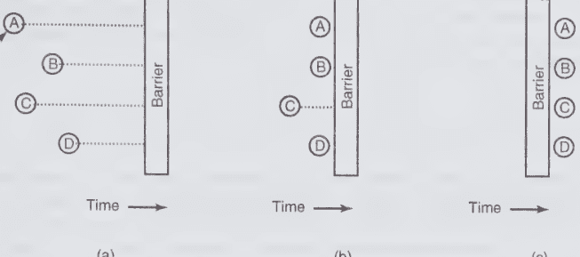

**图 2-37.** 屏障的使用。(a) 进程接近屏障。(b) 除了一个进程外，所有进程在屏障处被阻塞。(c) 当最后一个进程到达屏障时，所有进程都被允许通过。

在图 2-37(a) 中，我们看到四个进程正在接近屏障。这意味着它们正在进行计算，尚未到达当前阶段的结束。过了一段时间，第一个进程完成了第一阶段所需的所有计算。然后它执行了屏障原语，通常是通过调用库过程实现的。该进程随后挂起。稍后，第二个和第三个进程完成了第一阶段并执行了屏障原语。这种情况如图 2-37(b) 所示。最后，当最后一个进程 C 碰到屏障时，所有进程都释放了，如图 2-37(c) 所示。

作为一个需要屏障问题的例子，考虑物理学或工程学中常见的松弛问题。通常有一个包含某些初始值的矩阵。这些值可能代表金属片上不同点的温度。该想法可能是计算放置在某个角落的火焰的影响传播到整个金属片需要多长时间。

从当前值开始，对矩阵进行变换以获得矩阵的第二个版本，例如通过应用热力学定律来查看 `ΔT` 之后的所有温度变化。然后反复重复该过程，给出样本点温度随金属片加热而变化的时间函数。该算法随时间产生了一系列矩阵，每个矩阵对应于特定的时间点。

现在想象矩阵非常大（例如 100 万行乘以 100 万列），因此需要并行进程（可能在多处理器处理器上）来加速计算。不同的进程处理矩阵的不同部分，根据物理定律从旧元素计算新矩阵元素。然而，在迭代 `n` 完成之前，任何进程都不能开始迭代 `n+1`，也就是说，在所有进程都完成其当前工作之前。实现这一目标的方法是

## 2.3.10 避免锁：读-复制-更新 (Read-Copy-Update)

是程序每个进程在完成当前迭代的部分后执行屏障操作。当所有它们都完成时，新矩阵（下一次迭代的输入）将完成，所有进程将同时释放并开始下一次迭代。

最快的锁就是根本没有锁。问题是我们是否可以在不加锁的情况下允许对共享数据结构进行并发读写访问。在通常情况下，答案显然否。想象进程 A 正在对一个数字数组排序，而进程 B 正在计算数组往复的值。因为 A 移动了多次值，而其他进程完全没有移动。结果可能是任何的，但几乎肯定是错误的。

但在某些情况下，我们可以允许写入者在其他进程仍在使用数据结构时更新它。技巧是确保每个读取者读取的是数据的旧版本，或者是新版本，但不会是旧新版本的混合体。作为说明，考虑图 2-38 所示的树。读取者从根到叶子遍历这棵树。在树的上半部分，添加了一个新节点 X。为了这样做，我们在将它在树中可见之前让节点变得“恰到好”；我们初始化节点 X 中的所有值，包括它的值。

## 2.4.1 调度简介

在早期的以磁带上打卡片图像作为输入形式的批处理系统时代，调度算法非常简单：只需运行磁带上的下一个作业即可。随着多道程序系统的出现，调度算法变得复杂起来，因为有多个用户在等待服务。某些大型机结合了批处理和时分服务，这要求调度器决定是该执行批处理作业还是来自终端的交互式用户。顺带提一下，批处理作业可能是连续运行多个程序的请求，但在这节中，我们仅假设它是一个运行单个程序的请求。在这些机器上，CPU 时间是一项稀缺资源；一个良好的调度器可以极大地提升感知性能和用户满意度。因此，人们投入了大量工作在设计设计巧妙且高效的调度算法上。

随着个人电脑的出现，情况发生了两个变化。首先，大多数时间里只有一个活跃进程。用户在文字处理器中输入文档时，可能同时在后台编译一个程序。当用户向文字处理器输入命令时，调度器不需要做太多就能确定要运行哪个进程——因为文字处理器是唯一的候选者。

其次，多年来计算机的发展速度极快，CPU 已不再是稀缺资源。大多数个人电脑程序的限制因素是用户的输入速度（通过输入或点击），而不是 CPU 的处理速度。即使是过去消耗大量 CPU 周期的编译任务，在如今的大多数情况下也只需要几秒钟。即使当两个程序实际上同时运行时（例如文字处理器和一个电子表格），先运行哪一个也无关紧要，因为用户可能在等待它们都完成。因此，调度在简单的 PC 上并不重要。当然，也有某些应用程序实际上会把 CPU “活吞吃掉”。例如，一个帧率达到每秒 107,892 帧 (NTSC) 或 90,000 帧 (PAL) 的高分辨率视频需要工业级的计算能力。然而，类似的应用是例外，而非常态。

当我们转向网络服务器时，情况发生了相应的变化。在这里，多个进程经常竞争 CPU，因此调度再次变得重要。例如，当 CPU 必须在运行一个收集每日统计进程和一个为用户服务的进程之间做出选择时，如果后者先获得 CPU 使用权，用户会开心得多。

“资源丰富”在许多移动设备上也不适用，例如智能手机（可能最强大的型号除外）和传感器网络中的节点。在这里，CPU 可能仍然很弱，且内存很小。此外，由于电池寿命是这些设备最重要的限制条件之一，某些调度器会尝试优化功耗。

除了选择正确的进程运行外，调度器还必须担心高效利用 CPU，因为进程切换的开销很大。首先，必须发生从用户模式到内核模式的切换。必须保存当前进程的状态，包括将其寄存器存储在进程表中以便以后重新加载。在某些系统中，还必须保存内存映射（例如页表中的引用位）。调度算法必须选择一个新进程。之后，内存管理单元 (MMU) 必须加载该进程的内存映射。必须启动新进程。除此之外，进程切换可能会使内存缓存和相关表失效，强制其从主内存中动态重新加载两次（在进入内核和离开内核时）。总而言之，每秒执行过多的进程切换会消耗大量的 CPU 时间，因此建议谨慎。

## 进程行为

几乎所有的进程都会在计算突发阶段与（磁盘或网络）I/O 请求之间交替进行，如图 2-39 所示。通常，CPU 运行一段时间而不停止，然后通过系统调用从文件读取或向文件写入。当系统完成后，CPU 再次计算，直到需要更多数据或必须写入更多数据，以此此类推。注意，某些 I/O 活动被算作计算。例如，当 CPU 将位拷贝到视频 RAM 以更新屏幕时，它是在计算而不是执行 I/O，因为 CPU 正在被使用。从这个意义上说，I/O 是进程进入阻塞状态等待外部设备完成其工作的过程。

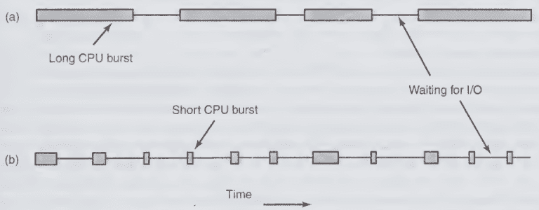

**图 2-39.** CPU 使用突发期与等待 I/O 的周期交替出现。
(a) CPU 密集型进程。(b) I/O 密集型进程。

图 2-39 需要注意的重要点是，某些进程（如图 2-39(a) 中的进程）大部分时间花在计算上，而其他进程（如图 2-39(b) 所示）则大部分时间花在等待 I/O 上。

前者被称为计算密集型 (compute-bound) 或 CPU 密集型 (CPU-bound)；后者是 I/O 密集型 (I-bound)。计算密集型进程通常具有长的 CPU 突发和频繁的 I/O 等待，而 I/O 密集型进程具有短 CPU 突发，因此有频繁的 I/O 等待。注意关键因素是 CPU 突发的长度，而不是 I/O 突发的长度。I/O 密集型进程之所以是 I/O 密集型，是因为它们在 I/O 请求之间计算得不多，因为它们有特别长的 I/O 请求。无论 CPU 工作多还是工作少，发出读取磁盘块的硬件请求所需的时间是相同的。值得注意的是，随着 CPU 变得越来越快，计算密集与 I/O 密集型进程的比例会增加，因为 CPU 花更多时间在等待 I/O。

## 何时调度

调度的关键问题在于何时做出决策。首先，当创建一个进程时，调度器必须决定是运行新进程还是继续当前进程。如果新进程优先级更高，它可能会抢占当前进程。其次，当进程阻塞时，调度器必须选择另一个进程运行。这是一个常见现象，因为进程经常在等待 I/O 时阻塞。第三，当 I/O 操作完成时，调度器必须决定是运行唤醒进程还是继续当前进程。如果唤醒进程优先级更高，它可能会被调度。第四，当定时器中断发生时，调度器可能决定是否切换到另一个进程。这是确保每个进程获得公平 CPU 份额的机制。调度算法根据如何处理时钟中断分为两类：

- 非抢占式调度：选择一个进程，然后让它运行直到阻塞（在等待 I/O 或主动释放 CPU）。即使它本质上无限运行，也不会被强制挂起。实际上，在时钟中断期间不做调度决策。
- 抢占式调度：选择一个进程并让其运行固定时间。如果在间隔结束时它仍在运行，则会被挂起，调度器选择另一个进程（如果有）。执行抢占式调度需要在间隔结束时通过时钟中断，将 CPU 控制权还给调度器。

## 调度算法分类

意不意外，不同的环境需要不同的调度算法。这种情况是因为不同的应用领域（以及不同的操作系统）有不同的目标。换句话说，调度器优化的目标在所有系统中都不一样的。三种值得区分的环境：

- 批处理。
- 交互式。
- 实时。

批处理系统在业务领域仍被广泛用于工资、库存、应收账款、应付账款、利计算（银行）、理赔处理（保险公司）以及其他定期任务。在批处理系统中，没有用户在终端等待短请求的快速响应。因此，非抢占式算法或每个进程周期较长的抢占式算法是可以接受的。这种方法减少了进程切换，从而提高了性能。批处理算法实际上是通用的，适用于其他情况，使得即使是非企业大型机计算的人也值得学习。

在具有交互式用户的环境中，抢占是至关重要的，以防止一个进程占用 CPU 并拒绝其他进程的服务。即使没有本质无限运行，一个进程也可能由于程序错误无限地阻塞其他进程。需要抢占来防止这种行为。服务器也属于这一类，因为它们通常为多个（远程）用户提供服务，所有用户都很急。计算机用户总是很急的。

# 154
# 进程与线程
# 第 2 章

在具有实时限制的系统中，抢占（preemption）是非常奇特的，有时并不需要，因为进程知道自己可能运行很长时间，而且通常会完成工作并结束。与交互式系统的区别在于，实时系统只运行旨在推进当前应用程序的程序。交互式系统是通用的，可能会运行任意的非协作甚至是可能的恶意的程序。

## 调度算法目标

为了设计调度算法，必须对一个良好的算法应该做什么有一个基本的认识。某些目标取决于环境（批处理、交互式或实时），但某些目标在所有情况下都是理想的。某些目标列在图 2-40 中。我们将在下面逐一讨论这些目标。

- *所有系统*
  - 公平性 - 给每个进程公平的 CPU 分配
  - 策略执行 - 确保规定的策略得到执行
  - 平衡 - 保持系统所有部分忙碌状态
- *批处理系统*
  - 吞吐量 - 每小时完成作业数最大化
  - 周转时间 - 最小从提交到终止的时间
  - CPU 利用率 - 保持 CPU 一直忙碌
- *交互式系统*
  - 响应时间 - 快速响应请求
  - 比例 - 满足用户的预期
- *实时系统*
  - 满足截止日期 - 避免数据丢失
  - 可预测性 - 避免多媒体系统中的质量下降

> 图 2-40. 不同情况下调度算法的某些目标。

在所有情况下，公平性都是重要的。相似的进程应该获得相似的服务。给一个进程提供比同等进程更多的 CPU 时间是不公平的。当然，不同类别的进程可能会被区别对待。考虑一下核反应堆堆计算机的控制控制和工资单控制。

与公平性有一定关系的是执行系统的策略。如果本地策略是安全控制只要想运行就可以一直运行，即使这意味着工资单推迟了 30 秒，调度器也必须确保该策略得到执行。

另一个通用目标是尽可能保持系统所有部分忙碌。如果 CPU 和所有 I/O 设备可以一直保持运行，那么每秒完成的工作将比某些组件空闲时要多。在批处理系统中，调度器控制哪些作业被调入内存运行。在内存中同时一些 CPU 密集型进程和一些 I/O 密集型进程比先加载并运行所有 CPU 密集型作业，然后在它们完成后加载并运行所有 I/O 密集型作业是更好的主意。如果使用该策略，CPU 密集型进程将竞争 CPU，而磁盘将空闲。稍后，当 I/O 作业进入时，它们将竞争磁盘，而 CPU 将空闲。更好的方法是通过进程的仔细混合来让系统同时运行。

运行许多批处理作业的大型计算机中心管理员通常查看三个指标来衡量其系统性能：吞吐量、周转时间和 CPU 利用率。**吞吐量**是每小时完成的作业数；每小时完成 50 个作业比每小时完成 40 个作业好。**周转时间**是从作业提交时刻到其完成时刻的统计平均时间。我们衡量平均用户等待输出需要多久。这里有一条规则：越小越好。

试图最大化吞吐量的调度算法可能不会最小化周转时间。例如，对于短作业和长作业的混合，一个总是运行短作业而从不运行长作业的调度器可能会获得极佳的吞吐量（每小时运行许多短作业），但代价是长作业极其糟糕的周转时间。如果短作业以相当稳定的速度不断到达，长作业可能永远不会运行，在实现高吞吐量的同时使平均周转时间变为无限。

CPU 利用率被用作批处理系统的指标。但实际上，它并不是一个好的指标。真正重要的是每小时离开系统的作业数（吞吐量）以及取回作业需要多久。

## 2.4 调度

该算法的巨大优势在于易于理解且同样容易实现。它在某种意义上也是公平的，就像将稀缺的音乐会门票或全新的 iPhone 分给那些愿意从凌晨 2 点开始排队的人是公平的一样。使用该算法，用一个单链表来跟踪所有的就绪进程。选择一个进程运行需要从队列头部移除一个。添加一个新作业或被解锁的进程则需要将其附加到队列末尾。没有比这更易于理解和实现的了呢？

遗憾的是，先来先服务（first-come, first-served）也有一个巨大的缺点。假设有一些计算密集型进程，每个运行 1 秒，同时有许多 I/O 密集型进程，它们每个只需要极少的 CPU 时间，但需要执行 1000 次磁盘读取才能完成。现在所有 I/O 进程都在运行并开始磁盘读取。当计算密集型进程获得它的磁盘块时，它会再次运行 1 秒，接着是所有 I/O 密集型进程连续运行。

结果是，每个 I/O 密集型进程每秒只能读取 1 个块，将需要 1000 秒才能完成。如果使用每 10 毫秒抢占一次计算密集型进程的调度算法，I/O 密集型进程将在 10 秒内完成，而不是 1000 秒，而且不会显著减慢计算密集型进程的速度。

### 短作业优先（Shortest Job First）

现在让我们来看另一种非抢占式作业算法，它假设运行时间是预先知的。例如，在保险公司，人们可以准确预测运行一组 1000 个理赔案件需要多长时间，因为每天都会做类似的工作。当几个同等重要的作业在输入队列中等待启动时，调度器会选择**最短作业优先**执行。看图 2-41。在这里我们找到四个作业 `A, B, C` 和 `D`，它们的运行时间分别为 8、4、4 和 4 分钟。按此顺序运行它们，`A` 的周转时间为 8 分钟，`B` 为 12 分钟，`C` 为 16 分钟，`D` 为 20 分钟，平均时间为 14 分钟。

| 8 | | 4 | 4 | | 4 | 4 | 8 |
|---|---|---|---|---|---|---|---|
| | A | B | C | | D | A | B |

> **图 2-41.** 最短作业优先调度的示例。(a) 按原始顺序运行四个作业。(b) 按最短作业优先顺序运行。

现在考虑使用最短作业优先运行这四个作业，如图 2-41(b) 所示。现在的周转时间分别为 4、8、12 和 20 分钟，平均时间为 11 分钟。最短作业优先被证明是最优的。考虑四个作业的情况，其执行时间分别为 `a, b, c` 和 `d`。第一个作业在时间 `a` 完成，第二个作业在时间 `a+b` 完成，依此类推。平均周转时间为 `(a+3b+2c+d)/4`。显然，`a` 对平均值的贡献比其他时间大，因此它应该是最短的作业，其次是 `b`，然后是 `c`，最后 `d` 是最长的，因为它只影响它自己的周转时间。同样的理由也适用于任意数量的作业。

值得注意的是，当所有作业同时可用时，最短作业优先是最优的。作为一个反例，考虑五个作业，时间分别为 2, 4, 1, 1 和 1。它们的到达时间为 0, 0, 3, 3 和 3。起初，只能选择 A 或 B，因为其他三个作业尚未到达。使用最短作业优先，我们将按 A, B, C, D, E 的顺序运行作业，平均等待时间为 4.6。然而，按 B, C, D, E 的顺序运行平均等待时间为 4.4。

### 下一个剩余时间最小（Shortest Remaining Time Next）

最短作业优先的抢占版本是下一个剩余时间最小。通过这种算法，调度器总是选择剩余时间最短的进程。同样，这里的运行时间必须预先已知。当新作业到达时，将它的总时间与当前进程的剩余时间进行比较。如果新作业完成当前进程所需的时间更短，则挂起当前进程并启动新作业。这种方案允许新的短作业获得良好的服务。

### 2.4.3 交互式系统中的调度

现在我们来看一些可以用于交互式系统的算法。这些算法在个人电脑、服务器和其他类型的系统中也很常见。

### 轮调度（Round-Robin Scheduling）

最古老、简单、公平且应用最广泛的算法之一是轮调度。每个进程被分配一个时间间隔，称为其量子（quantum），它被允许在此期间运行。如果进程在量子结束时仍在运行，CPU 将被抢占并交给另一个进程。如果进程被阻塞，或者在量子耗尽之前被阻塞，当然，CPU 的切换会在进程阻塞时完成。轮调度需要维护一个可运行进程的列表，如图 2-42(a) 所示。当进程用完时间时，它被放在列表末尾，如图 2-42(b) 所示。

轮调度唯一真正有趣的问题是量子的长度。从一个进程切换到另一个进程需要一定的时间来完成所有的管理——保存和加载内存映射、更新各种表、刷新缓存等。假设**进程切换**（有时称为**上下文切换**）需要 1 毫秒，而量子设置为 4 毫秒。在这些参数下，4 毫秒的有效工作后，CPU 必须花费 1 毫秒进行进程切换。显然，20% 的 CPU 时间被浪费在了进程切换上。为了提高效率，我们可以将量子设置为 100 毫秒。如果量子太大，交互式用户的响应时间将很差。10-50 毫秒的量子是一个合理的折中方案。

### 优先级调度（Priority Scheduling）

轮调度假设所有进程都是同等重要的。然而，事实并非如此。每个进程被分配一个优先级，调度器选择优先级最高的进程。如果多个进程具有相同的优先级，则使用轮调度进行调度。

优先级可以静态或动态地分配。在军事计算机上，将启动的进程优先级可能从 100 开始，上校为 90，少校为 70，中尉为 60，依此类推。或者，在商业计算机上，高优先级作业每小时 100 美元，中等优先级 75 美元，低优先级 50 美元。Unix 系统有一个命令 `nice`，允许用户自愿降低其进程的优先级，以便其他用户。

优先级也可以由系统动态分配以实现系统目标。例如，某些进程是高度 I/O 密集型的，大部分时间都在等待 I/O 完成。每当进程需要 CPU 时，应该立即赋予它 CPU 以启动下一次 I/O 请求，该请求可以与另一个计算进程并行进行。让 I/O 密集型进程长时间等待 CPU 只意味着不必要地占用内存。一种为 I/O 密集型进程提供良好服务的简单算法是将最后一个量子的优先级设置为 `1/f`，其中 `f` 是所用量子的比例。一个使用了 50 毫秒量子中 1 毫秒的进程将获得优先级 50，而在阻塞前运行了 25 毫秒的进程将获得优先级 2，用完整个量子的进程将获得优先级 1。

将进程分组为优先级类并在类内使用优先级轮调度是方便的。图 2-43 显示了一个具有四个优先级类的系统。调度算法如下：只要优先级类 4 中有可运行进程，就按轮调度方式运行每个一个量子，且不考虑低优先级类。如果优先级第 4 类空，则轮调度第 3 类进程。如果第 4 类和第 3 类都为空，则轮调度第 2 类，依此类推。如果偶尔调整优先级，低优先级类可能会全部饿死。

## 2.2.4 调度

## 161

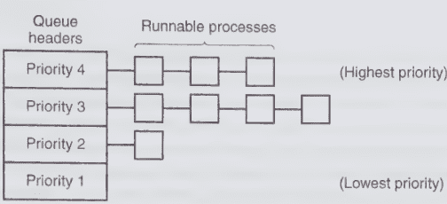

图 2-43。一种具有四个优先级的调度算法。

### 多队列

最早的优先级调度器之一是 CTSS，这是运行在 IBM 7094 上的 MIT 兼容分时系统（Corbató et al., 1962）。CTSS 的问题是进程切换很慢，因为 7094 内存中只能存放一个进程。每次切换都需要将当前进程交换到磁盘，并从磁盘读取一个新进程。CTSS 的设计者很快意识到，与其频繁地给 CPU 密集型进程分配小时间片（以减少交换），不如每一段时间给它们分配一个大时间片效率更高。另一方面，正如我们所所的，给所有进程分配大时间片会导致响应时间很差。他们的解决方案是设置优先级类。最高优先级的进程运行两个时间片。下一优先级的进程运行四个时间片，以此此类推。当一个进程用尽了分配给它的所有时间片时，它就会下降一个优先级。

例如，考虑一个需要连续运行 100 个时间片的进程。它最初会被赋予一个时间片，然后被交换出。下次它将在被交换出之前获得两个时间片。在随后的运行中，它将获得 4、8、16、32 和 64 个时间片，尽管它只用了了最后 64 个时间片中的 37 个来完成工作。这只需要 7 次交换（初始加载），而使用纯轮询算法则需要 100 次。此外，随着进程进入优先级队列越深，它运行的频率会越来越低，从而为短的交互式进程节省出 CPU。

采用了以下策略，以避免惩罚那些开始时需要很长时间但后来变得不活跃的进程。每当在终端上输入回车（Enter 键）时，该终端的进程就会移动到最高优先级类，假设它即将变为交互式状态。某一天，某个运行严重 CPU 密集型进程的用户发现，坐在终端前每隔几秒随机敲击回车时，他的响应时间变了。他告诉了所有的朋友。朋友们又告诉了他们的朋友。这个故事的寓意是：在实践中做到比在原理上做到要困难得多。

### 最短作业优先

由于最短作业总是能批处理系统产生最小的平均响应时间，如果它也能用于交互式进程就太好了。在某种程度上，它是可以的。交互式进程通常遵循等待命令、执行命令、等待命令、执行命令等模式。如果我们认为每个命令的执行都是一个独立的“作业”，那么我们就可以通过运行最短的任务来最小化整体响应时间。问题在于确定当前运行的进程中哪个是最短的。一种方法是根据过去的行为进行估计，并运行估计时间最短的进程。假设某个进程的估计时间为 `T0`。现在假设测量其运行时间为 `T1`，我们通过这两个数字的加权和来更新估计值，即 `aT0+(1-a)T1`。通过选择 `a`，我们可以决定让估计过程快速忘记旧的运行情况，或记住它们很一段时间。当 `a=1/2` 时，我们得到估计值：

`T0, T0/2+T1/2, T0/4+T1/4+T2/2, T0/8+T1/8+T2/4+T3/2`

在新运行之后，`T0` 的权重已经下降到 1/8。
通过取当前测量值和之前估计值的加权平均值来估计序列中的下一个值的技术有时被称为“老化”（aging）。它适用于许多必须基于以前值的预测情况。当 `a=1/2` 时，老化算法 特别容易实现。只需要将新值加到当前估计值上，并将和除以 2（右移 1 位）。

### 保证调度

另一种完全不同的调度方法是向用户对性能做出真实的承诺，然后履行这些承诺。其中一个现实且容易履行的承诺是：如果你在你工作时有 `n` 个用户登录，你将获得 `1/n` 的 CPU 功率。同样，在一个运行着 `n` 个进程的单用户系统中，在所有条件相等的情况下，一个人应该获得 `1/n` 的 CPU 周期。这看起来足够公平。

为了履行这一承诺，系统必须跟踪每个进程自创建以来占用了多少 CPU。它计算每个进程应有的 CPU 量，即创建时间除以 `n`。由于每个进程实际拥有的 CPU 时间也是已知的，因此计算实际消耗 CPU 时间与应得 CPU 时间的比例是非常直接的。比例为 0.5 意味着进程只拥有它应得的一半，比例为 2.0 意味着进程拥有的是它应得的两倍。算法随后是运行比例最低的进程，直到其比例超过其最接近的竞争对手。然后选择另一个进程继续运行。

### 彩票调度

虽然向用户做出承诺并履行这些承诺是一个好主意，但很难实现。然而，可以使用另一种算法以更简单的实现提供类似的可预测结果。这被称为彩票调度（Waldspurger and Weihl, 1994）。

其基本思想是为各种系统资源（如 CPU 时间）提供彩票。每当需要做出调度决策时，随机选择一张彩票，持有该票的进程获得资源。当应用于 CPU 调度时，系统持有彩票，每个中奖者获得若干秒 CPU 作为奖品。换句话说：“所有进程都是平等的，但某些进程更平等。”重要的进程可以获得更多的彩票，以增加它们中奖的概率。如果有 100 张彩票，一个进程持有其中一个就有 20% 的中奖率。从长远来看，它将获得大约 20% 的 CPU。与优先级 40 的含义不同，这里的规则是：持有 `f` 比例彩票的进程将获得比例 `f` 的资源。

### 调度

到为止，我们假设每个用户都拥有某些份额。为了防止这种情况，某些系统会考虑进程的所有者。

从长远来看，它将获得大约 20% 的 CPU。与优先级 40 的含义不同，这里的规则是：持有 `f` 比例彩票的进程将获得比例 `f` 的资源。

### 2.4.4 实时系统中的调度

实时系统是指时间起着至关作用的系统。通常，计算机外部或多个物理设备产生刺激，计算机必须在固定的时间内对它们做出适当反应。例如，光光播放器中的计算机从驱动器获取位，并必须在严格的时间间隔内将其转换为音乐。如果计算花费太长时间，音乐听起来就会很奇怪。其他实时系统包括医院重症监室的患者监测、飞机的自动飞行系统以及自动化工厂的机器人控制。在所有这些情况下，得到正确答案但太晚了往往等同于没有答案。

实时系统通常分为硬实时（意味着必须满足绝对截止日期——否则后果！）和软实时（意味着偶尔错过截止日期是不理想的，但仍然可以接受）。在这两种情况下，实时行为都是通过将程序分解若干进程来实现，每个进程的行为都是可预测且预先知的。这些进程通常是短寿命的，并运行完成。一旦检测到事件，调度的工作就是处理进程以满足所有截止日期。

实时系统可能需要响应的事件可以进一步分类为周期性（意味着定期间隔发生）或异步性（意味着不可预测地发生）。系统可能需要响应多个周期性事件。取决于每个事件处理需要多少时间，处理所有事件甚至可能是不可能的。例如，如果有 `m` 个事件，事件 `i` 以周期 `P_i` 发生，处理每个事件需要 `C_i` 的 CPU 时间，那么只有在以下情况下才能处理负载：

## 2.4.2 调度 165

$$\sum \frac{m_i}{P_i} \le 1$$

满足此准标准的实时系统被称为**可调度的**（schedulable）。这意味着它是可以实现的。未能通过此测试的进程无法被调度，因为进程请求的 CPU 时间总和超过了 CPU 能够提供的总量。

例如，考虑一个具有三个周期性事件的软实时系统，周期分别为 100、200 和 500 毫秒。如果这些事件每个分别需要 50、30 和 100 毫秒的 CPU 时间，那么该系统是可调度的，因为 `0.5 + 0.15 + 0.2 < 1`。如果增加一个周期为 1 秒的第四个事件，只要该事件每个周期不需要超过 150 毫秒的 CPU 时间，系统将仍然保持可调度状态。这种计算隐含了一个假设：上下文切换开销小到可以忽略不计。

实时调度算法可以是静态的也可以是动态的。前者在运行时（执行开始后）做出调度决策。静态调度仅在预先拥有关于工作量和必须满足的截止期的完美信息时有效。动态调度算法没有这些限制。

## 2.4.5 策略与机制

到为止，我们假设系统中的所有进程都属于不同的用户，因此它们在竞争 CPU。虽然这通常是成立的，但有时会出现一个进程拥有许多在其控制下运行的子进程的情况。例如，一个数据库管理系统进程可能有许多子进程。每个子进程可能在处理不同的请求，或者每个进程都有某些需要执行的特定功能（查询解析、磁盘访问等）。主进程完全可能清楚它的哪些子进程最重要（或对时间最敏感），而上述所讨论的任何调度器都不接受来自用户进程关于调度决策的输入。结果是调度器很少能做出最佳选择。

解决这个问题的方法是将**调度机制**（scheduling mechanism）与**调度策略**（scheduling policy）分离，这是一项长期建立的原则（[Levin et al., 1975](https://example.org) *注：此处原文引用仅为Levin et al., 1975）。这种方式意味着调度算法以某种方式进行参数化，但参数由用户进程填充。让我们考虑数据库的例子，内核使用优先级调度算法，但提供了一个系统调用，进程可以通过它可以获取并更改子进程的优先级。通过这种方式，父进程可以控制其子进程如何被调度，尽管它本身并不负责调度。在这里，机制在内核中，但策略由用户进程设置。策略与机制分离是一个核心思想。

## 2.4.6 线程调度

当多个进程拥有多个线程时，我们有两个层面的并行性：进程和线程。此类系统的调度取决于是否支持用户级线程或内核级线程（或两者都）。

让我们先考虑用户级线程。由于内核感知不到它们的存在，它会像既往一样运行，选择一个进程（假设为 A）并赋予其时间片。A 内部的调度器决定运行哪个线程（例如 A1）。由于没有时钟中断来中断多程序线程，该线程可以随其意愿继续运行。如果它使用了进程的整个时间片，内核将选择另一个进程运行。

当进程最终再次运行时运行时，A1 将恢复运行。它将继续消耗 A 的所有时间直到执行完毕。然而，它的反社会行为不会影响其他进程。无论进程 A 内部如何，其他进程都会得到调度器认为适当它们的资源。

现在考虑另一种情况：A 的线程在 CPU 爆发之前需要的工作相对较少，例如在 50 毫秒的时间片内仅需 5 毫秒的工作。因此，每个线程运行一段时间，然后中断 CPU 回到线程调度器。这可能导致 A1, A2, A3, A1, A2, A3, A1, A2, A1 的序列，然后内核才切换到进程 B。这种情况在图 2-44(a) 所示。

运行系统使用的调度算法可以是上述的任何一种。在实践中，轮询调度和优先级调度最常见。唯一的限制是缺乏一个中断运行时间过长的线程的时钟。由于线程之间相互协作，这通常不是问题。

现在考虑内核级线程的情况。在这里，内核选择一个特定的线程运行。它不需要考虑该线程属于哪个进程，但如果需要，也可以这样做。线程被赋予一个时间片，如果超过时间片则会被强制挂起。对于 50 毫秒的时间片，线程在 5 毫秒后阻塞，那么在 30 毫秒的一段时间内，线程可能是 A1, B1, A2, B2, A3, B3，这在使用这些参数和用户级线程时是不可能实现的。这种情况在图 2-44b 中部分描述。

用户级线程和内核级线程的一个主要区别是性能。使用用户级线程进行线程切换只需要几条机器指令，而更改内存映射和使缓存失效要慢几个数量级。另一方面，对于内核级线程，线程在 I/O 上阻塞不会挂起整个进程。

由于线程之间相互协作，这通常不是问题。另一个重要因素是用户级线程可以调整应用程序。例如，考虑图 2-8 中的 Web 服务器。假设该线程被阻塞而有两个线程就绪。运行时由于知道所有线程，可以轻松选择下一个运行的分发器。通常情况下，特定应用程序的调度器表现更好。

## 2.5 经典问题

操作系统文献充满了被广泛讨论和分析过的有趣问题。在接下来的章节中，我们将检查三个较著名的问题。

### 2.5.1 哲师问题

1965 年，Dijkstra 提出并解决了进餐哲师问题。从那时起，每个发明新同步原语的人都觉得有义务通过展示新原语如何优雅地解决问题来证明其优越性，这可以简单地表述为：五位哲师坐在一张圆桌旁。每个哲师有一盘面条。面条非常滑，以至于哲师需要两把叉子才能吃。每两盘面条之间有一把叉子。桌子的布局如图 2-45 所示。

哲师的生活由交替的吃饭和思考时期组成。（这对于哲师来说也是某种抽象，但其他活动在这里无关的。）当一个哲师感到足够饥饿时，她尝试获取她的左侧和右侧叉子，顺序不限。如果成功获取了两把叉子，她就吃一段时间，放下叉子并继续思考。关键问题是：你能否为每个哲师编写一个执行其应该做的事情且永不阻塞的程序？有人指出，两把叉子的要求是人为的；也许我们应该从意大利菜换成中国菜，用米代替面条，用筷子代替叉子。

图 2-46 显示了显而见的解决方案。`take_fork` 程序等待指定的叉子可用并获取它。不幸的是，这个显而见的解决方案是错误的。假设五位哲师同时拿了他们的左叉子。他们都无法拿到右叉子，这将导致死锁。

我们可以很容易地修改程序，让哲师在拿起左叉子后放下左叉子，等待一段时间，然后重复整个过程。这个提议也失败了，尽管原因不同。如果运气不好，哲师们可能同时启动算法，拿起左叉子，发现右叉子不可用，然后放下左叉子，

## 经典的 IPC 问题

#define N 5
/* 哲学家的数量 */
/* i: 哲学家编号，从 0 到 4 */

```c


```c
void philosopher(int i) {

    while (TRUE) {

        think();

        /* 哲学家正在思考 */

        take_fork(i);

        /* 拿起左叉子 */

        take_fork((i+1) % N);

        /* 拿起右叉子；% 是取模运算符 */

        eat();

        /* 唔吃，面条 */

        put_fork(i);

        /* 将左叉子放回桌上 */

        put_fork((i+1) % N);

        /* 将右叉子放回桌上 */

    }

}
```

**图 2-46. 哲师问题的非解决方案。**

等待，同时再次拿起左叉子，以此类推，循环下去。这种所有程序都在无限运行但无法取得任何进展的情况被称为“饥饿”（starvation）。（即使问题没有在意大利或中国的餐厅发生，它也被称为饥饿。）

现在你可能会想，如果哲学家在获取右叉子失败后等待随机的时间而不是相同的时间，那么一切持续保持步调运行一小时的概率将非常小。这种观察是正确的，在几乎所有的应用中，重试都不是问题。例如，在流行的以太网局域网中，如果两台计算机同时发送数据包，每台计算机都会等待随机时间并重试；在实践中，这种解决方案运行良好。然而，在少数应用中，你需要一个既有效又不会因为一组低概率的随机数而失败的解决方案。考虑一下核电站的安全控制。

对图 2-46 的一种改进方法是为了避免死锁和饥饿，即使用二值信号量保护调用 `think` 后的五条语句。在开始获取叉子之前，哲学家需要对 `mutex` 执行 `down` 操作。在替换完叉子后，他/她需要对 `mutex` 执行 `up` 操作。从理论角度来看，这个解决方案是充分的。但从实践角度来看，它有一个性能缺陷：任何时刻都只有一个哲学家可以进。在五个叉子可用的情况下，我们应该能够允许两个哲学家同时进。

图 2-7 中提出的解决方案是无死锁的，并且允许任意数量哲学家的最大并行性。它使用一个数组 `state` 来跟踪哲学家是在进食、思考还是饥饿（尝试获取叉子）。只有当左右邻居都没有进食时，哲学家才能进入进食状态。哲学家 `i` 的邻居由宏 `LEFT` 和 `RIGHT` 定义。换句话说，如果 `i` 是 2，那么 `LEFT` 是 1，`RIGHT` 是 3。

该程序使用信号量数组，每个哲学家一个，这样饥饿的哲学家如果所需的叉子被占用就可以被阻塞。注意，每个进程运行 `philosopher` 程序作为其主代码，但其他程序 `take_forks`、`put_fork` 和 `test` 是普通过程，而不是独立的进程。

## 进程与线程

```c
#define N               5      /* 哲学家的数量 */

#define LEFT          (i+N-1)%N  /* i 的左邻居 */

#define RIGHT         (i+1)%N    /* i 的右邻居 */

#define THINKING       0      /* 哲学家正在思考 */

#define HUNGRY         1      /* 哲学家试图获取叉子 */

#define EATING         2      /* 哲学家正在进食 */
```

```c
typedef int semaphore;

int state[N];

semaphore mutex = 1;

semaphore s[N];
```

```c
void philosopher(int i) {
    while (TRUE) {
        think();
        take_forks(i);
        eat();
        put_forks(i);
    }
}
```

```c
void take_forks(int i) {
    down(&mutex);
    state[i] = HUNGRY;
    test(i);
    up(&mutex);
    down(&s[i]);
}
```

```c
void put_forks(int i) {
    down(&mutex);
    state[i] = THINKING;
    test(LEFT);
    test(RIGHT);
    up(&mutex);
}
```

```c
void test(int i) {
    if (state[i] == HUNGRY && state[LEFT] != EATING && state[RIGHT] != EATING) {
        state[i] = EATING;
        up(&s[i]);
    }
}
```

图 2-47. 哲师问题的解决方案。

### 2.5.2 读者-写者问题

哲师问题有助于对竞争有限资源的进程建模，例如对 I/O 设备的独占访问。另一个著名问题是读者-写者问题（Courtois et al., 1971），它模拟了对数据库的访问。例如，想象一下一个航空公司订票系统，有许多竞争的进程想要读取和写入它。多个进程同时读取数据库是可以接受的，但如果有一个进程正在更新（写入）数据库，其他任何进程都不能访问数据库，即使是读者也不行。问题在于编程读者和写者？图 2-48 所示了一种解决方案。

```c
typedef int semaphore;      /* 使用你的想象力 */
semaphore mutex = 1;               /* 控制对 rc 的访问 */
semaphore db = 1;                   /* 控制对数据库的访问 */
int rc = 0;                         /* 读取的进程数量 */
```

```c
void reader(void) {
    while (TRUE) {
        down(&mutex);
        rc++;
        if (rc == 1) down(&db);
        up(&mutex);
        read();
        down(&mutex);
        rc--;
        if (rc == 0) up(&db);
        up(&mutex);
        think();
    }
}
```

```c
void writer(void) {
    while (TRUE) {
        down(&db);
        write();
        up(&db);
        think();
    }
}
```

图 2-48. 读者-写者问题的解决方案。

在这个解决方案中，第一个访问数据库的读者对信号量执行 `down`。后续读者只需增加计数器。只要有一个读者活跃，写者就会被挂起。最后一个离开的读者释放计数器。

## 2.6 进程与线程的研究

在第 1 章中，我们查看了操作系统结构的一些当前研究。在本及后续章节中，我们将关注更具体的研究，从进程开始。随着时间的推移，某些主题比其他主题更成熟。大多数研究倾向于新话题，而不是已经存在几十年的课题。

进程的概念是一个相当成熟的主题示例。几乎每个系统都有进程的概念，将其视为对地址空间、线程、打开文件、保护权限等资源的分组容器。不同的系统分组方式不同，但这些只是工程上的差异。基本想法不再具有争议。

线程比进程的概念要新，但它们也被讨论过。尽管如此，关于线程的论文偶尔会出现，例如关于多处理器上的线程聚类（Tam et al., 2007），或者现代操作系统（如 Linux）在多线程多核下的扩展性。

一个特别活跃的研究领域是记录和重放进程的执行（Vnot et al., 2013）。重放有助于开发者追踪难以发现的错误，并帮助安全专家调查事件。

# 进程与线程研究

同样，操作系统社区的许多研究也聚焦于安全问题。许多事件表明，用户需要受到更好的保护以免受攻击者的侵害（有时也免受他们自身的伤害）。一种方法是仔细地跟踪和限制操作系统中的信息流（Giffin，单处理器与多处理器，2012）。

调度（包括单处理器和多处理器调度）仍然是某些研究人员核心关注的话题之一。目前正在研究的话题包括移动设备上的低能耗调度（Yuan and Nachtstedt, 2006）、超线程感知型调度（Bulpin and Pratt, 2005）以及偏好感知型调度（Koufyaty, 2010）。随着性能受限、电池受限的智能手机计算任务的增加，一些研究人员建议在需要时将进程迁移到云端更强大的服务器上，并在有用的时（Gordon et al., 2012）。然而，很少有实际的系统设计者由于缺乏良好的线程调度算法而束手无策，因此这类研究似乎更多是“研究者驱动”而非“需求驱动”。总而言之，进程、线程和调度不再像过去那样是研究的热点。研究重点已转向电源管理、虚拟化、云计算和安全等领域。

## 2.7 总结

为了隐藏中断的影响，操作系统提供了一个由并行运行的顺序进程组成的概念模型。进程可以动态地创建和终止。每个进程都有自己的地址空间。

对于某些应用程序，在单个进程内拥有多个控制线程是有用的。这些线程被独立调度，且每个线程都有自己的栈，但进程中的所有线程共享同一个公共地址空间。线程可以在用户空间实现，也可以在内核中实现。

进程之间可以使用进程间通信（IPC），例如信号量、监器或消息来相互通信。这些原语用于确保没有两个进程同时处于它们的临界区域，因为这种情况会导致混乱。进程可以处于运行、就绪或阻塞状态，并且当它或另一个进程执行其中一个进程间通信原语时，状态会发生变化。线程间通信也是类似的。

进程间通信原语可以解决如生产者-消费者、哲学家晚餐和写者等问题。即使使用了这些原语，也必须小心以避免错误和死锁。

人们已经研究了大量的调度算法。其中一些广泛用于批处理系统，例如短作业优先调度。另一些在批处理系统和交互式系统中都很常见。这些算法包括轮询优先级调度、多级队列、保证调度、彩票调度和公平份额调度。某些系统在调度机制和调度策略之间进行了清晰的分离，这允许用户控制调度算法。

## 问题

- 1. 在图 2-2 中，显示了三种进程状态。理论上，三个状态可能会有六种转换，每个状态各两种转换。然而，图中只显示了四种转换。在什么情况下，缺失的转换中的某一个或两个都可能发生？
- 2. 假设你正在设计一种先进的计算机架构，在硬件中实现进程切换而不是使用中断。CPU 需要哪些信息？请描述硬件进程切换可能是如何工作的。
- 3. 在所有当前的计算机上，至少部分中断处理程序是用汇编编写的。为什么？
- 4. 当中断或系统调用将控制权移交给操作系统时，通常会使用一个与被中断进程栈分开的内核栈区域。为什么？
- 5. 一台计算机有足够的内存在其主内存中存放四个程序。这些程序有一半的时间在空闲等待 I/O。浪费了多少比例的 CPU 时间？
- 6. 一台计算机有 2 GB RAM，其中操作系统占了 256 MB。这些进程具有相同的特征。如果目标是 99% 的 CPU 利用率，可以承受的最大 I/O 等待是多少？
- 7. 多个作业可以并行运行，速度比顺序执行更快。假设两个作业都需要 10 分钟的 CPU 时间，同时启动。如果它们顺序执行，最后一个完成的任务需要多久？如果它们并行运行需要多久？假设 I/O 等待时间为 50%。
- 8. 考虑一个并发数为 5 的多程序系统（即内存中同时有五个程序）。假设每个进程有 40% 的时间在等待 I/O。CPU 利用率将会是多少？
- 9. 解释 Web 浏览器如何利用线程的概念来提高性能。
- 10. 假设你正尝试从互联网下载一个 2 GB 的大文件。该文件可以通过一组镜像服务器提供，每个服务器可以交付文件字节的一个集；假设请求指定了文件的起始字节和结束字节。解释你如何使用线程来缩短下载时间。
- 11. 文中提到图 2-11(a) 的模型不适合使用内存缓存的文件服务器。为什么？每个进程可以有自己的缓存吗？
- 12. 在图 2-8 中，使用了多线程 Web 服务器。如果从文件读取的唯一方法是普通的读取系统调用，你认为 Web 服务器使用的是用户级线程还是内核级线程？为什么？
- 13. 在文中，我们描述了一个多线程 Web 服务器，并展示了为什么它比单线程服务器和有限状态机服务器更好。是否存在在种情况下，单线程服务器可能更好？请举例。
- 14. 在图 2-8 中，使用了多线程 Web 服务器。如果从文件读取的唯一方法是普通的读取系统调用，你认为 Web 服务器使用的是用户级线程还是内核级线程？为什么？（注：原文此题与第12题重复，已按要求翻译）
- 13. 在文中，我们描述了一个多线程 Web 服务器，并展示了为什么它比单线程服务器和有限状态机服务器更好。是否存在在种情况下，单线程服务器可能更好？请举例。（注：原文此题与第13题重复，已按要求翻译）
- 14. 在图 2-8 中，使用了多线程 Web 服务器。如果从文件读取的唯一方法是普通的读取系统调用，你认为 Web 服务器使用的是用户级线程还是内核级线程？为什么？（注：原文此题与第12/14题重复，已按要求翻译）
- 15. 为什么线程会主动放弃 CPU？毕竟，由于没有周期性中断，它可能永远无法再次获得 CPU。
- 16. 在图 2-15 中，线程打印的消息是随机交织的。是否存在方法强制顺序为 thread1 创建、thread1 信息、thread1 存在、thread2 创建、thread2 信息……以此类推？如果是，如何实现？如果不是，为什么？
- 17. 在用户空间实现线程最大的优势是什么？最大的缺点是什么？
- 18. 在讨论线程全局变量时，我们使用一个过程为指针分配空间，而不是变量本身。这是必要的吗，还是说该过程处理值同样可行？
- 19. 考虑一个完全在用户空间实现的线程系统，运行时获取一次时钟中断。假设在某个线程执行运行时发生了时钟中断。可能会出现什么问题？你能建议一种解决方法吗？
- 20. 假设操作系统无法提前判断从文件、管道或设备读取是安全的，但它允许闹钟设置被中断的系统调用。在这种情况下，可以在用户空间实现线程包吗？请讨论。
- 21. 图 2-24 所示的 Peterson 互斥解在进程调度为抢占式的情况下有效吗？非抢占式情况下呢？
- 22. 第 2.3.4 节中描述的优先级反转问题会在用户级线程中发生吗？为什么？
- 23. 在第 2.3.4 节中，描述了一种高优先级进程 H 和低优先级进程 L 的情况，这导致 H 无限循环。如果使用轮询调度代替优先级调度，还会出现同样的问题吗？请讨论。
- 24. 在线程系统中，使用用户级线程时是每个线程一个栈还是每个进程一个栈？使用内核级线程时呢？请解释。

生产者和消费者分别在各自的线程中运行。图 2-28 中提出的使用信号量的解决方案是否适用于该系统？

- 29. 考虑以下解决涉及两个进程 P0 和 P1 的互斥问题的解决方案。假设变量 `turn` 被初始化为 0。进程 P0 的代码如下：

```
/* 其他代码 */
```

```
while (turn != 0) { } /* 什么都不做并等待。 */
临界区 /* ... */
turn = 0;
```

```
/* 其他代码 */
```

对于进程 P1，将上述代码中的 0 替换为 1。确定该解决方案是否满足正确互斥解决方案的所有要求条件。

- 30. 演示如何使用二值信号量和普通机器指令来实现计数信号量（即：可以持有任意值整数的信号量）。
- 31. 如果一个系统只有两个进程，使用屏障（barrier）来同步它们有意义吗？为什么有意义或为什么没意义？
- 32. 如果线程是由内核实现的，那么同一个进程中的两个线程可以使用内核信号量进行同步吗？如果它们是在用户空间中实现的呢？假设没有其他进程中的线程可以访问该信号量。讨论你的答案。
- 33. 假设我们有一个使用邮箱（mailboxes）的消息传递系统。当向满邮箱发送或尝试从空邮箱接收时，进程不会阻塞，而是获得一个错误代码。进程通过不断重试来响应错误代码，直到成功。这种方案会导致竞态条件吗？
- 34. CDC 6600 进程可以使用一种被称为“处理器共享”（processor sharing）的有趣轮调度形式同时处理多达10 个 I/O 进程。进程在每条指令后进行切换，指令 1 来自进程 1，指令 2 来自进程 2，此类此类。进程切换是由特殊硬件完成的。如果对 n 个进程使用处理器共享，需要多长时间？
- 35. 考虑以下 C 代码段：

```c
void main() {
    fork();
    fork();
    exit();
}
```


执行此程序时会创建多少个子进程？

## 第 2 章
## 习题

- 36. 轮调度器通常维护一个可运行进程列表，每个进程在列表中恰好出现一次。如果一个进程在列表中出现两次会发生什么？你能想到允许这种情况的任何理由吗？

- 37. 能通过分析源代码来确定一个进程可能可能是 CPU 密集型还是 I/O 密集型吗？在运行时如何确定？

- 38. 在“何时调度”节中提到，有时如果一个重要进程在阻塞时能在选择下一个运行进程的过程中发挥作用，那么调度就可以得到改进。给出一个可以使用这种情况的情况，并说明如何操作。

- 39. 解释在轮调度算法中，时间片（time quantum）和上下文切换（context switching）是如何相互影响的。

- 40. 对某系统的测量显示，进程在阻塞 I/O 之前平均运行时间为 T。进程切换需要时间 S，这部分实际上被浪费了（开销）。对于时间片为 Q 的轮调度，给出以下各情况的 CPU 效率公式：

  (a) $Q=\infty$
  (b) $Q>T$
  (c) $S<Q<T$
  (d) $Q=S$
  (e) $Q$ 接近 0

- 41. 有五个作业正在等待运行。预计运行时间分别为 9, 6, 3, 5 和 X。应该以什么顺序运行它们以使平均响应时间最小？（你的答案将取决于 X。）

- 42. 五个批处理作业 A 到 E 几乎在同一时间到达计算机中心。它们的估算运行时间为 10, 6, 2, 4 和 8。它们的（外部确定的）优先级分别为 3, 5, 2, 1 和 4，其中 5 优先级最高。对于每种调度算法，确定平均进程周转时间。忽略进程切换开销。

  (a) 轮调度。
  (b) 优先级调度。
  (c) 先来先服务（按 10, 6, 2, 4, 8 的顺序运行）。
  (d) 最短作业优先。

  对于 (a)，假设系统是多程序的，且每个作业都获得 CPU 的公平份额。对于 (b) 到 (d)，假设一次只有一个作业运行，直到它完成。所有作业都是完全 CPU 密集型的。

- 43. 一个在 CTSS 上运行的进程需要 30 个时间片才能完成。它必须换入多少次，包括第一次（在完全未运行之前）？

- 44. 你能想到一种防止 CTSS 优先级系统被随机回车欺骗的方法？

- 45. 考虑一个实时系统，有两个周期为 5 msec 的语音通话（每次通话 CPU 时间为 1 msec）和一个周期为 33 msec 的视频流（11 msec）。该系统是可调度的吗？

- 46. 对于上述问题，再添加一个视频流，系统是可调度的吗？

- 47. 正在使用 $a=1/2$ 的衰减算法来预测运行时间。之前的四次运行（从旧到新）分别为 40, 20, 40 和 15 msec。预测的时间是多少？

- 48. 一个软实时系统有四个周期 50、100、200 和 250 msec 的周期性事件。假设四个事件分别需要 35、20、10 和 $x$ msec 的 CPU 时间。系统可调度的 $x$ 最大值是多少？

- 49. 解释为什么要使用两级调度。它与单级调度相比有什么优势？

- 50. 一个实时系统需要处理每 5 msec 运行一次、每次 1 msec CPU 时间的语音通话，以及每秒 25 帧、每帧 20 msec 的视频。该系统可调度吗？

- 51. 考虑一个希望分离调度策略与机制的系统。提出一种实现方法。

- 52. 在哲学家问题的解决方案（图 2-7）中，为什么在 `take_forks` 过程中将 `state` 设置为 `HUNGRY`？

- 53. 考虑图 2-7 中的 `put_forks` 过程。假设 `state[i]` 在两次调用之后设置。这会产生什么影响？

- 54. 读者/写者问题可以用多种方式表述，取决于启动哪类进程。描述三种不同的变体，每种变体倾向于某一类。对于每种变体，当读者或写者准备好访问数据库以及当进程结束时会发生什么？

- 55. 编写一个生成顺序文件的脚本，通过读取文件中的最后一个数字并加 1 然后追加到文件中。在后台和前台运行该脚本需要多长时间？竞态条件如何体现？修改脚本以防止竞态。（提示：使用 `file.lock`）

- 56. 假设你有一个提供信号量的操作系统。实现一个消息系统。编写发送和接收消息的过程。

- 57. 使用监控器代替信号量来解决哲学家问题。

- 58. 假设某大学想通过将美国法院的“分开即等同实则不平等”原则应用于性别来展示政治正确，并结束其长期来的性别隔离厕所传统。然而，作为对传统的让，规定当女性在厕所时，其他女性可以进入但男性不能，反之亦然。每个厕所门上的滑动标记指示其处于三种可能状态之一：

  * 空
  * 女性在
  * 男性在

  在任何喜欢的编程语言中，编写以下过程：`woman_wants_to_enter`、`man_wants_to_enter`、`woman_leaves`、`man_leaves`。你可以使用任何计数器和同步技术。

- 59. 重写图 2-3 的方法以处理两个以上的进程。

- 60. 编写一个使用线程并共享缓冲区的生产者-消费者问题。但不要使用信号量或其他同步原语来保护共享数据结构。让每个线程在到达时访问。使用 `sleep` 和 `wakeup` 处理满空情况。观察发生竞态需要多久。例如，你可以让生产者偶尔打印一个数字。不要每分钟打印多个数字，因为 I/O 可能会影响竞态。

- 61. 进程可以多次进入轮队列以赋予其更高的优先级。运行处理数据池不同部分的程序实例产生相同的效果。首先编写一个测试数字列表质数的程序。设计一种方法允许程序的实例同时运行，且没有两个实例处理同一个数字。通过运行程序的多个副本，你实际上更快地完成了列表？注意，结果将取决于电脑的操作；在有其他进程的系统中仅运行此程序的个人电脑上，你应该能够获取更大的 CPU 份额。

- 62. 本练习的目标是实现一个多线程解决方案，以找到给定数是否为完美数。如果一个数的所有因子（不包括自身）之和等于该数，则它为完美数；例如 6 和 28。输出是一个整数。如果 $N$ 是完美数则输出 true，否则输出 false。主程序从命令行读取数字 $N$ 和 $P$。主进程产生一组 $P$ 个线程。1 到 N 的数字将被分配给这些线程。线程确定集合中的每个数字是否为 $N$ 的因子。如果是，将该数字添加到存储 $N$ 因子的共享缓冲区。父进程等待所有线程完成。使用适当的同步原语。父进程随后判断输入数字是否为完美数，即 $N$ 是否等于所有因子的和，并进行报告。（注：你可以通过将搜索范围限制在 1 到 $\sqrt{N}$ 来加快计算。）

- 63. 实现一个统计文本文件中单词频率的程序。文本文件被划分为 $N$ 个段。每个段由一个单独的线程处理，输出该段的中间频率。主进程等待所有线程完成；然后它根据各个线程的输出计算合并的词频数据。

# 3 内存管理

主内存（RAM）是一项必须仔细管理的的重要资源。虽然如今普通家用电脑的内存已经是 20 世纪 60 年代世界最大的计算机 IBM 7094 的 10,000 倍，但程序的增长速度已经超过了内存。。用帕金森律的话来说：“程序会不断扩张以占满容纳它的可用内存。”在本章中，我们将学习操作系统如何从内存中创建抽象，以及它们如何管理这些抽象。

每个程序员都希望拥有一个私有的、无限大的、无限快速的内存，而且这种内存还是易失性的——即在断电时不会丢失内容。既然如此，为什么不干脆让它变得廉价呢？遗憾的是，目前技术无法提供这样的内存。我们将发现如何实现它。

第二种选择是什么？多年来，人们发现了**存储层次结构**（memory hierarchy）的概念，在这种结构中，计算机拥有几兆的快速易失性缓存内存、几 GB 的中速中等价易失性主内存，更不用说还有数 TB 的低速廉价非易失性磁或固态磁盘存储（如 DVD 和 USB 闪盘）。操作系统的任务是将这种层次结构抽象为一个实用的模型并管理这一抽象。

负责管理（部分）存储层次结构的操作系统部分被称为**内存管理器**（memory manager）。它的工作是高效管理内存：跟踪内存的哪些部分在使用中，在进程需要时为其分配内存，并在它们完成后释放内存。

在本章中，我们将探调查几种不同的内存管理模型，从非常简单到高度复杂不等。由于低层缓存内存的管理通常由硬件完成，本章的重点将放在程序员的内存模型以及如何管理它上。永久存储设备——磁盘——的抽象和管理是下一章的主题。我们将首先查看最简单的方案，然后逐渐转向越来越复杂的方案。

### 3.1 无内存抽象

最简单的内存抽象就是完全没有抽象。早期的大型机（1960 年以前）、早期的微型计算机（1970 年以前）和早期的个人电脑（1980 年以前）都没有内存抽象。每个程序都简单地看到物理内存。当一个程序执行类似下面的指令时：

```
MOV REGISTER1,1000
```

计算机会将物理内存位置 1000 的内容移动到 REGISTER1。因此，呈现给程序员的内存模型仅仅是物理的，无法在内存中同时运行两个程序。如果第一个程序向某个位置（例如 2000 号位置）写入一个新值，这将擦掉第二个程序正在存储的任何内容。任何操作都无法进行，两个程序都会几乎立即崩溃。

即使内存模型仅仅是物理内存，仍有几种可能。图 3-1 显示了三种变体。操作系统位于 RAM（随机存取存储器）内存的底部，如图 3-1(a) 所示；或者位于内存顶部的 ROM（只读存储器），如图 3-1(b) 所示；或者设备驱动程序位于内存顶部的 ROM 中，而系统的其余部分位于位于 RAM，如图 3-1(c) 所示。第一种模型曾用于大型机和微型计算机，但已很少使用。第二种模型用于手持计算机和嵌入系统。第三种模型用于早期的个人电脑（例如运行 DOS），其中内存部分被称为 BIOS（基本输入输出系统）。模型 (a) 和 (c) 的缺点是，程序中的错误可能会抹掉操作系统，可能导致灾难性的结果。

当系统以此方式组织时，通常一次只能运行一个进程。用户一输入命令，操作系统就会将请求的程序从磁盘复制到内存并执行。当进程结束时，操作系统显示提示符并等待新命令。当操作系统接收到命令时，它会将新程序加载到内存中，覆盖第一个程序。

图 3-1. 使用操作系统和一个用户进程组织内存的三种简单方法。也存在其他可能性。

在没有内存抽象的系统中获得某些并行性的一种方法是使用多线程进行编程。由于进程中的所有线程都应该看到相同的内存映像，因此它们被迫无法看到这一点是一个问题。虽然这个主意有效，但它的用途有限，因为人们通常希望不相关的程序能同时运行，而线程抽象无法提供这一点。此外，任何原始化到无法提供内存抽象的系统都不可能提供线程抽象。

### 在没有内存抽象的情况下运行多个程序

然而，即使没有内存抽象，也可以同时运行多个程序。操作系统需要做的是将内存的所有内容保存到磁盘文件中，然后载入并运行下一个程序。只要内存中一次只有一个程序，就不会有冲突。这个概念（交换，swapping）将在下文中讨论。

通过增加一些特殊硬件，即使不需要交换也可以并发运行多个程序。360 以如下方式解决了该问题：内存被分为若干块，并分配一个在 PSW（程序状态字）中持有的保护密钥。由于只有操作系统可以更改保护密钥，用户进程被防止相互干扰以及与系统本身干扰。尽管如此，这个解决方案有一个缺点，如图 3-2 所示。对于此示例，我们假设操作系统位于内存，因此未显示。

当第一个程序启动时，它执行 JMP 24 指令，跳转到目标位置。该程序运行正常。然而，当第一个程序运行足够后，操作系统可能会决定运行第二个程序，它被加载在第一个程序上方，地址为 16384。执行的第一条指令是 JMP 28，它跳转到了第一个程序的 ADD 指令，而不是它应该跳转到的 CMP 指令。程序可能会在 1 秒内崩溃。

这里的核心问题是两者都引用了绝对物理内存。这完全我们想要的。我们想要的是每个程序

图 3-2. 重定位问题说明。(a) 一个 16-KB 程序。(b) 另一个 16-KB 程序。(c) 连续加载的两个程序。

| ADD | 28 | CMP | 28 | ADD | 28 |
|---|---|---|---|---|---|
| MOV | 24 | | 24 | MOV | 24 |
| | 20 | | 20 | | 20 |
| | 16 | | 16 | | 16 |
| | 12 | | 12 | | 12 |
| | 8 | | 8 | | 8 |
| | 4 | | 4 | | 4 |
| JMP | 24 | 0 | JMP | 28 | 0 | JMP | 24 | 0 |

| | 32764 |
|---|---|
| CMP | 16412 |
| | 16408 |
| | 16404 |
| | 16400 |
| | 16396 |
| | 16392 |
| | 16388 |
| JMP | 28 | 16384 |
| 0 | 16380 |

## 3.1 无内存抽象

它可以引用一组其局部的私有地址集。我们很快将展示如何实现这一点。IBM 360 采用了一种临时解决方案，在程序加载到内存时，使用一种名为**静态重定位**（static relocation）的技术对第二个程序进行即时修改。其工作原理如下：当程序被加载到地址 16,384 处，在加载过程中，常量 16,384 被加到每个程序地址上（“JMP 28” 变为 “JMP 16,412”，等）。虽然这种方法在可行的情况下有效，但并不是一个通用的解决方案，并且会减慢加载速度。此外，它要求所有可执行程序都包含额外信息，以指示哪些字包含（可重定位的）地址，哪些不包含。毕竟，图 3-2(b) 中的“28”必须由类似下面的指令进行重定位：

```
MOV REGISTER,1
```

将数字 28 移动到 REGISTER 中不应重定位。加载器需要某种方法来区分哪些是地址，哪些是常量。

最后，正如我们在第 1 章中指出的，计算机世界往往会重演历史。虽然物理内存寻址对于大型机、微型计算机、台式电脑、笔记本电脑和智能手机已经是过去，但缺乏内存抽象在嵌入式和智能卡系统中仍然常见。如今，收音机、洗衣机和微波炉等设备都满了软件（ROM），在大多数情况下，软件使用的是绝对内存地址。之所以这样做是因为所有程序都是预先知的，且用户可以在自己的面包机上运行自己的程序。

虽然高端嵌入式系统（如智能手机）拥有复杂的操作系统，但简单的则没有。在某些情况下，有一个操作系统，但它只是一个与应用程序链接的库，并为执行 I/O 和其他常见任务提供系统调用。e-Cos 操作系统就是作为库的操作系统的常见示例。

## 3.2 内存抽象：地址空间

总而言之，将物理内存暴露给进程有几个主要缺点。首先，如果用户程序可以访问内存的每一个字节，它们就可以很容易地（故意或无意）破坏操作系统，导致系统陷入停滞（除非有像 IBM 360 的锁钥方案这样的特殊硬件）。即使只运行一个用户程序（应用程序），这个问题也存在。其次，这使得很难同时运行多个程序（如果只有一个 CPU，则轮流运行）。在个人电脑上，同时打开几个程序（一个文字处理器、一个电子邮件程序、一个 Web 浏览器）很常见，其中一个具有当前焦点，而其他的在点击鼠标时做出响应。由于在没有物理内存抽象的情况下很难实现这种情况，因此必须采取某些措施。

### 3.2.1 地址空间的概念

为了允许多个应用程序同时存在内存中且互不干扰，必须解决两个问题：**保护**和**重定位**。我们查看了 IBM 360 上使用的针对前者的原始解决方案：用保护键对内存块进行标记，并将执行进程的密钥与所提取的每个内存字对应的密钥进行比较。然而，这种方法本身不能解决后一个问题，尽管可以通过在程序加载时进行重定位来解决，但这是一种缓慢且复杂的解决方案。

更好的解决方案是为内存发明一种新的抽象：**地址空间**。就像进程概念是一种抽象的 CPU 用来运行程序一样，地址空间为程序创建了一种抽象的内存。每个进程都有自己的地址空间，独立于其他进程的地址空间（某些进程想要共享地址空间的特殊情况除外）。

### 地址空间的概念非常通用，出现在许多语境中。考虑电话号码。在美国和许多其他国家，本地电话号码通常是 7 位数。电话号码的地址空间从 0,000,000 到 9,999,999，尽管某些数字（如以 000 开头的）是不被使用的。随着手机、调制解调器和传真机的增长，这个地址空间变得太小了，在这种情况下必须使用更多数字。x86 I/O 端口的地址空间从 0 到 16383。IPv4 地址是 32 位数，因此它们的地址空间从 0 到 2³² - 1（带有一些保留数字）。

地址空间不必是数字的。.com 域名集也是一个地址空间。这个地址空间由所有使用字母、数字和连字符组成的长度为 2 到 63 个字符的字符串后加上 .com 组成。到目前你应该理解这个概念了。它非常简单。

稍微困难一点的是给每个程序分配它自己的地址空间，以便一个程序中的地址 28 与另一个程序中的 28 意味着不同的物理位置。下面我们将讨论一种曾经很常见但现在由于现代 CPU 芯片能够实现更复杂（且更好）的方案而被废弃的方法。

### 基寄存器和限高寄存器

这种解决方案使用了特别简单的动态重定位版本。它以一种简单的方式将每个进程的地址空间映射到物理内存的不同部分。经典的解决方案（用于从 CDC 6600（世界上第一台超级计算机）到 Intel 8088（原始 IBM PC 的核心）的机器）是为每个 CPU 配备两个特殊的硬件寄存器，通常称为基寄存器（base register）和限高寄存器（limit register）。当使用这些寄存器时，程序被加载到任何有空间的连续内存位置，且在加载期间不进行重定位，如图 3 所示。当程序加载到地址 16,384 处时，在加载过程中，常量 16,384 被加到每个程序地址上（“JMP 28” 变为 “JMP 16,412”，等）。虽然这种方法在可行的情况下有效，但并不是一个通用的解决方案，并且会减慢加载速度。此外，它要求所有可执行程序都包含额外信息，以指示哪些字包含（可重定位的）地址，哪些不包含。毕竟，图 3-2(b)中的“28”必须由类似下面的指令进行重定位：

```
MOV REGISTER,1
```


将数字 `28` 移动到 `REGISTER` 中不应重定位。加载器需要某种方法来区分哪些是地址，哪些是常量。

最后，正如我们在第 1 章中指出的，计算机世界往往会重演历史。虽然物理内存寻址对于大型机、微型计算机、台式电脑、笔记本电脑和智能手机已经是过去，但缺乏内存抽象在嵌入式和智能卡系统中仍然常见。如今，收音机、洗衣机和微波炉等设备都满了软件（ROM），在大多数情况下，软件使用的是绝对内存地址。之所以这样做是因为所有程序都是预先知的，且用户可以在自己的面包机上运行自己的程序。

虽然高端嵌入式系统（如智能手机）拥有复杂的操作系统，但简单的则没有。在某些情况下，有一个操作系统，但它只是一个与应用程序链接的库，并为执行 I/O 和其他常见任务提供系统调用。`e-Cos` 操作系统就是作为库的操作系统的常见示例。

## 3.2 内存抽象：地址空间

总而言之，将物理内存暴露给进程有几个主要缺点。首先，如果用户程序可以访问内存的每一个字节，它们就可以很容易地（故意或无意）破坏操作系统，导致系统陷入停滞（除非有像 `IBM 360` 的锁钥方案这样的特殊硬件）。即使只运行一个用户程序（应用程序），这个问题也存在。其次，这使得很难同时运行多个程序（如果只有一个 CPU，则轮流运行）。在个人电脑上，同时打开几个程序（一个文字处理器、一个电子邮件程序、一个 Web 浏览器）很常见，其中一个具有当前焦点，而其他的在点击鼠标时做出响应。由于在没有物理内存抽象的情况下很难实现这种情况，因此必须采取某些措施。

### 3.2.1 地址空间的概念

为了允许多个应用程序同时存在内存中且互不干扰，必须解决两个问题：保护和重定位。我们查看了 `IBM 360` 上使用的针对前者的原始解决方案：用保护键对内存块进行标记，并将执行进程的密钥与所提取的每个内存字对应的密钥进行比较。然而，这种方法本身不能解决后一个问题，尽管可以通过在程序加载时进行重定位来解决，但这是一种缓慢且复杂的解决方案。

更好的解决方案是为内存发明一种新的抽象：地址空间。就像进程概念是一种抽象的 CPU 用来运行程序一样，地址空间为程序创建了一种抽象的内存供其栖息。每个进程都有自己的地址空间，独立于其他进程的地址空间（某些进程想要共享地址空间的特殊情况除外）。

地址空间的概念非常通用，出现在许多语境中。考虑电话号码。在美国和许多其他国家，本地电话号码通常是 7 位数。电话号码的地址空间从 `0,000,000` 到 `9,999,999`，尽管某些数字（如以 `000` 开头的）是不被使用的。随着手机、调制解调器和传真机的增长，这个地址空间变得太小了，在这种情况下必须使用更多数字。`x86` I/O 端口的地址空间从 `0` 到 `16383`。`IPv4` 地址是 32 位数，因此它们的地址空间从 `0` 到 `2³² - 1`（带有一些保留数字）。

地址空间不必是数字的。`.com` 域名集也是一个地址空间。这个地址空间由所有使用字母、数字和连字符组成的长度为 2 到 63 个字符的字符串后加上 `.com` 组成。到目前你应该理解这个概念了。它非常简单。

稍微困难一点的是给每个程序分配它自己的地址空间，以便一个程序中的地址 `28` 与另一个程序中的 `28` 意味着不同的物理位置。下面我们将讨论一种曾经很常见但现在由于现代 CPU 芯片能够实现更复杂（且更好）的方案而被废弃的方法。

### 基寄存器和限高寄存器

这种解决方案使用了特别简单的动态重定位版本。它以一种简单的方式将每个进程的地址空间映射到物理内存的不同部分。经典的解决方案（用于从 `CDC 6600`（世界上第一台超级计算机）到 `Intel 8088`（原始 `IBM PC` 的核心）的机器）是为每个 CPU 配备两个特殊的硬件寄存器，通常称为基寄存器（`base register`）和限高寄存器（`limit register`）。当使用这些寄存器时，程序被加载到任何有空间的连续内存位置，且在加载期间不进行重定位，如图 3 所示。当程序加载到地址 `16,384` 处时，在加载过程中，常量 `16,384` 被加到每个程序地址上（“`JMP 28`” 变为 “`JMP 16,412`”，等）。虽然这种方法在可行的情况下有效，但并不是一个通用的解决方案，并且会减慢加载速度。此外，它要求所有可执行程序都包含额外信息，以指示哪些字包含（可重定位的）地址，哪些不包含。毕竟，图 3-2(b)中的“`28`”必须由类似下面的指令进行重定位：

```
MOV REGISTER,1
```

将数字 `28` 移动到 `REGISTER` 中不应重定位。加载器需要某种方法来区分哪些是地址，哪些是常量。

每当进程引用内存（无论是获取指令还是写入数据字），CPU 硬件都会在将地址发送到内存总线之前加上基值。同时，它会检查地址是否大于限高寄存器中的值，在这种情况下会产生故障并中止访问。因此，在图 3-2(c)第二个程序的第一条指令的情况下，进程执行了

```
JMP 28
```

但硬件将其处理为

```
JMP 16412
```


# 内存管理
# 第 3 章

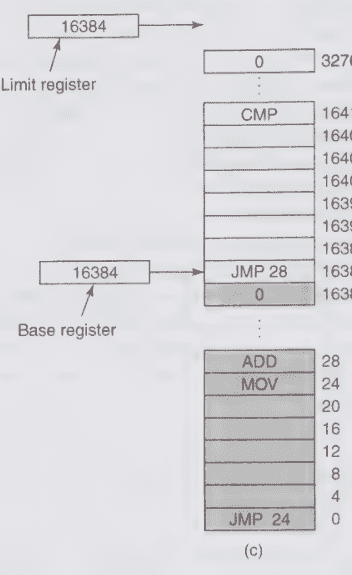

图 3-3. 基址寄存器和限界寄存器可以为每个进程提供独立的地址空间。

计算机启动后，可能会立即启动一个或多个进程。例如，当安装一个 Windows 应用时，它通常会发出命令，以便在随后的系统启动时，启动一个除了检查应用程序更新外什么都不做的进程。这样一个进程可以轻松地占用 5–10 MB 的内存。其他后台进程会检查收邮件、保持网络连接以及许多其他事项。而这一切在第一个用户程序启动之前就已经完成了。如今，重要的应用程序（如 Photoshop）启动时可能轻松需要 500 MB 内存，而在开始处理数据时则需要数 GB 内存。因此，始终将所有进程保留在内存中需要巨大的内存，如果内存不足则无法实现。

多年来，发展出了两种处理内存开销的通用方法。最简单的策略被称为**交换（swapping）**，它由将每个进程完整地调入内存、运行一段时间然后将其回磁盘组成。空闲进程大部分存储在磁盘上，因此它们在不运行时不占用任何内存（尽管某些进程会定期唤醒执行工作，然后再次进入睡眠）。另一种策略被称为**虚拟内存（virtual memory）**，它允许程序即使只有部分在主内存中也可以运行。下面我们将学习交换技术；在第 3.3 节中我们将研究虚拟内存。

交换系统的操作如图 3-4 所示。初始时，只有进程 $A$ 在内存中。然后，进程 $B$ 和 $C$ 被创建或从磁盘交换入。在图 3-4(d) 中，$A$ 被交换到磁盘中。然后 $D$ 进来而 $B$ 出出去。最后，$A$ 再次进来。由于 $A$ 现在位于不同的位置，它所包含的地址必须进行重定位，要么是在交换入内存时通过软件完成，要么（更可能）是在程序执行期间通过硬件完成。例如，基址寄存器和限界寄存器在这里就能很好工作。

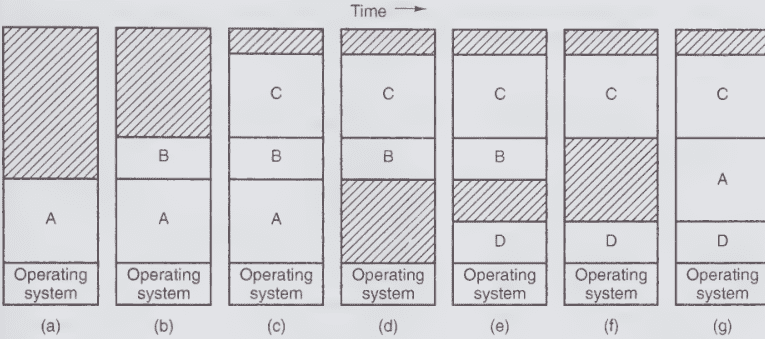

**图 3-4.** 随着进程进入和离开内存，内存分配发生了变化。阴影区域是未使用内存。

当交换在内存中产生多个空洞时，可以通过将所有进程尽可能向下移动将它们合并为一个大空洞。这种技术被称为**内存压缩（memory compaction）**。通常不这样做，因为需要大量的 CPU 时间。例如，在一个可以在 8 nsec 内复制 8 字节的 16 GB 机器上，复制所有内存大约需要 16 秒。

一个值得注意的问题是，在进程创建或交换入时，应该为其分配多少内存。如果进程是用不变化的固定大小创建的，那么分配就很简单：操作系统只分配所需的内存，不多也不少。

如果进程的数据段可以增长（例如像许多编程语言那样从堆中动态分配内存），那么每当进程尝试增长时就会出现问题。如果空洞紧邻进程，就可以分配它并允许进程增长到该空洞中。相反，如果进程紧邻另一个进程，则增长的进程将不得不移动到内存中足够容纳它的空洞，或者必须交换出一个或多个进程以创建一个足够大的空洞。如果进程无法内存中增长且磁盘上的交换区域已满，则该进程必须挂起直到释放某些空间（或者可以被杀死）。

如果预计大多数进程在运行时会增长，那么每当进程交换入或移动时都分配一点额外的内存可能是一个好主意，以减少与不再适应其分配内存的进程进行移动或交换而相关的开销。然而，在将进程交换到磁盘时，应只交换实际使用的额外内存；否则，交换额外内存也是浪费的。在图 3-5(a) 中，我们看到一种内存配置，为两个进程分配了增长空间。

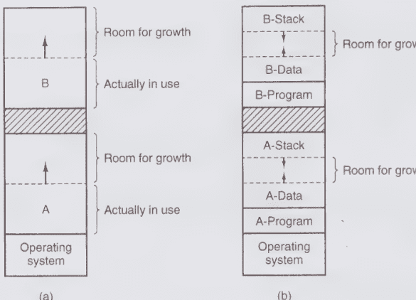

**图 3-5.** (a) 为增长的数据段分配空间。(b) 为增长的栈和增长的数据段分配空间。

如果进程可以有两个增长的段——例如，数据段被用作动态分配和释放变量的堆，以及用于普通局部变量和返回地址的栈段——那么另一种安排便随之浮现，即图 3-5(b) 所示。在图中，我们看到每个进程在分配的内存顶部都有一个向向下增长的栈，在程序正文之后有一个向向上增长的数据段。它们之间的内存可以用于任何一个段。如果内存耗尽，进程将不得不移动到具有足够空间的空洞中，从内存交换出直到能够创建一个足够大的空洞，或者被杀死。

## 3.2.3 管理空闲内存

当内存被动态分配时，操作系统必须对其进行管理。通常来说，有两种跟踪内存使用情况的方法：位图（bitmaps）和空闲列表（free lists）。在本节和下一节中我们将介绍这两种方法。

## 内存抽象：地址空间

### 使用位图管理

使用位图，内存被划分为从几字节到几千字节不等的单元。位图中的每个单元由一个位表示，0 表示该单元空闲，1 表示已被占用。在图 3-6(a) 中，我们看到内存的一部分。

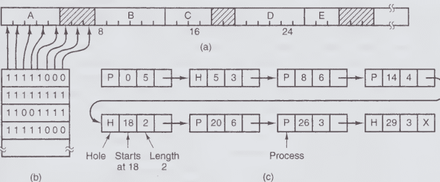

**图 3-6.** (a) 一部分内存。阴影区域是未使用的。

主要问题是，当寻找给定长度的连续区域时，内存管理器必须搜索位图。在位图中搜索连续区域是很慢的（因为连续区域可能会跨越字边界）。

### 使用空闲列表管理

跟踪内存的另一种方法是维护一个段的链表。每个条目指定一个空洞 (H) 或进程 (P)、其起始地址、长度以及指向下一个项的指针。在这个示例中，列表按地址排序。这种排序方式的好处是，当进程终止或被交换时，更新列表是直观的。终止的进程通常有两个邻居（除非它位于内存的最顶部或底部）。这些邻居可能是进程也可能是空洞，导致了图 3-7 中的四种组合。

| X 终止前 | | | X 终止后 | | |
|---|---|---|---|---|---|
| (a) | A | X | 变成 | A | B |
| (b) | A | X | 变成 | | |
| (c) | | B | 变成 | | B |
| (d) | | X | 变成 | | |

**图 3-7.** 终止进程 X 的四种邻居组合。

## 3.2 内存抽象：地址空间 193

另一种广为人知的广泛使用的算法是**最佳适应（best fit）**。最佳适应从头到尾搜索整个列表，并找到一个合适的最小空洞。最佳适应并不使用以后可能需要的大空洞，而是尝试找到与实际所需大小接近的空洞，以匹配请求和可用空洞。

以首次适应（first fit）和最佳适应为例，再次考虑图 3-6。如果需要一个大小为 2 的块，首次适应将分配位于 5 处的空洞，而最佳适应将分配位于 18 处的空洞。

最佳适应比首次适应慢，因为它在每次被调用时都必须搜索整个列表。惊讶的是，它导致比首次适应或下次适应（next fit）更内存内存浪费，因为它在内存中充满了微小且无用的空洞。首次适应平均上生成的空洞较大。

为了解决将几乎完全匹配的项拆分为进程和一个微小空洞的问题，可以考虑**最坏适应（worst fit）**，即始终选择最大的可用空洞，这样新空洞就会足够大而有用。仿真表明最坏适应并不是一个非常好的主意。

所有四种算法都可以通过为进程而非空洞维护单独列表来加速。这样一来，所有算法都将全部精力用于检查分配。不可避免的代价是释放内存时额外的复杂性和速度变慢，因为需要从进程列表中移除空闲段并将其插入到空洞列表中。

如果为进程和空洞维护不同的列表，则空洞列表可以按大小排序，以使最佳适应更快。当最佳适应从最小到最大搜索空洞列表时，一旦找到一个匹配的空洞，它就知道该空洞是胜任工作所需的最小空洞，即最佳适应。不再需要进一步搜索，这与单列表方案不同。如果空洞按大小排序，首次适应和最佳适应一样一样快，而下次适应则变得毫无意义。

当空洞与进程保持在分离的列表中时，可以进行小幅优化。不需要像图 3-6(c) 那样使用一套独立的数据结构来维护空洞列表，而是可以将信息存储在空洞中。每个条目的第一个字可以是空洞大小，第二个字是指向下一个条目的指针。不再需要 3-6(c) 列表中的节点，这些节点需要三个字和一个位（P/H）。

另一种分配算法是**快速适应（quick fit）**，它为某些常见的请求大小维护单独的列表。例如，它可能有一个包含 $n$ 个条目的表格，其中第一个条目指向 4-KB 空洞列表的头部，第二个条目指向 8-KB 空洞列表的指针，第三个条目指向 12-KB 空洞的指针，以此此类推。例如，21 KB 的空洞可以位于 20-KB 列表，也可以位于奇数大小空洞的特殊列表中。使用快速适应寻找所需大小的空洞极快，但它与所有按空洞大小排序的方案具有相同的缺点，即当进程终止或被换出时，如果可以与其邻居合并，寻找这些邻居将非常昂贵。如果不进行合并，内存将迅速碎片成大量小空洞，没有任何进程可以放入其中。

## 3.3 虚拟内存

虽然基寄存器和限寄存器可以创建地址空间的抽象，但还有另一个问题需要解决：管理臃肿软件（bloatware）。虽然内存容量正在迅速增长，但软件大小的增长速度要快得多。在 20 世纪 80 代，许多大学使用时分系统，在 4 MB 的 VAX 上同时运行几十个（大致满意）的用户。现在微软建议 64 位 Windows 8 至少需要 2 GB 内存。多媒体趋势对内存提出了更高的要求。

由于这些发展，需要运行无法放入内存的大型程序，而且确实需要支持同时运行多个程序的系统，每个程序都能放入内存中，但它们的总和超过了内存。交换（Swapping）并不是一个吸引人的选项，因为典型的 SATA 磁盘峰值传输率为几百 MB/秒，这意味着换出一个 1 GB 程序和换入一个 1 GB 程序需要几秒钟。

程序大于内存的问题自计算之初就一直存在，尽管是在有限领域，例如科学和工程（模拟宇宙的产生或模拟新飞机需要大量内存）。20 世纪 60 代采用的一种解决方案是将程序分成小块，称为**覆盖（overlays）**。当程序启动时，加载到内存中的只有覆盖管理器，它会立即加载并运行覆盖 0。当完成后，它告诉覆盖管理器加载覆盖 1，要么在内存中覆盖 0 之上（如果有空间），要么在覆盖 0 之上（如果没有空间）。某些覆盖系统非常复杂，允许内存中同时存在多个覆盖。覆盖保留在磁盘上，并由覆盖管理器在内存和磁盘之间交换。

虽然交换覆盖的实际工作是由操作系统完成的，但将程序拆分成份的工作必须由程序员手动完成。将大型程序拆分成细小的、模块化的部分是耗时、无聊且容易出错的。很少有程序员擅长此。没过多久，有人就想出了一个方法将整个工作交给计算机。

这种被发明的方法（Feigenbaum 1961）被称为**虚拟内存**。虚拟内存背后的基本思想是每个程序都有自己的地址空间，该空间被拆分成页（pages）。虚拟内存由固定大小的单元组成。物理内存中相应的单元称为页帧（page frames）。页和帧的大小通常相同。在示例中，它们是 4 KB。对于 64 KB 的地址空间和 32 KB 的物理内存，我们有 16 个虚拟页和 8 个页帧。

虚拟内存通过将虚拟地址映射到物理地址来工作。这是由一个称为 MMU 的硬件组件完成的。当程序产生虚拟地址时，MMU 将其翻译为物理地址。如果物理页不在内存中，就会发生缺页错误（page fault），操作系统从磁盘上获取该页。这允许运行比可用物理内存更大的程序。

## SEC. 3.3 虚拟内存

197

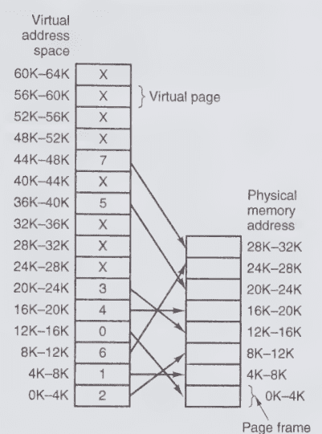

**图 3-9.** 虚拟地址与物理内存地址之间的关系由页表给出。每个页从 4096 的倍数开始，并在 4095 个地址后结束。4K–8K意味着 4096–8191，8K 到 12K意味着 8192–12287。

因为虚拟 8192（在虚拟页 2 中）被映射到 24576（在物理页帧 6 中）。第三个例子是，虚拟地址 20500 距离虚拟页 5（虚拟地址 20480 到 24575） 20 字节，映射到物理地址 12288 + 20 = 12308。

单靠这种通过恰当设置 MMU 映射将 16 个虚拟页映射到 8 个页帧中任何一个的能力，并解决虚拟地址空间大于物理内存的问题。由于我们只有八个物理页帧，因此图 3-9 中的虚拟页只有八个映射到了物理内存。其他的（在图中用“叉”表示）未映射。在实际硬件中，一个**存在/不存在位（Present/absent bit）**用于跟踪哪些页物理上存在于内存中。

如果程序引用未映射的地址会发生什么？例如，使用指令

```
MOV REG,32780
```


该地址是虚拟页 8（起始于 32768）内的第 12 字节。MMU 注意到该页未映射（如图所示）并导致 CPU

198 内存管理 第 3 章

陷阱（trap）到操作系统。这种陷阱被称为页异常（page fault）。操作系统选择一个不常使用的页帧，并将其内容写入磁盘（如果尚未写入的话）。它（同样从磁盘）将刚刚引用的页获取到刚刚释放的页帧中，更改映射并重新启动指令。

例如，如果操作系统决定换出页帧 1，它会将虚拟页 8 加载到物理地址 4096 并对 MMU 映射进行两次更改。首先，它会将虚拟页 1 的条目映射为未映射，以拦截后续对虚拟地址 4096 和 8191 的访问。然后，它会将虚拟页 8 条目中的“叉”替换为 1，这样当执行陷阱时，它将映射到物理地址 32780 (4096 + 12)。

现在，让我们看看 MMU 内部，了解它是如何工作的，以及为什么我们选择使用 2 的幂作为页大小。在图 3-10 中，我们看到一个虚拟地址 8196（二进制为 0010000000000010）使用图 3-9 中的 MMU 映射进行映射的示例。输入的 16 位虚拟地址被分为 4 位页号和 12 位偏移量。使用 4 位页号，我们可以拥有 16 个页；使用 12 位偏移量，我们可以寻址页内的所有 4096 个字节。

页号被用作页表的索引，产生与该虚拟页对应的页帧。如果存在/不存在位为 0，则调用到操作系统的陷阱。在页表中找到的页帧被复制到输出寄存器的高位，连同 12 位偏移量（该偏移量与输入的虚拟地址保持不变）。它们构成了物理地址。然后将输出寄存器置于内存总线上。

### 3.3.2 页表

在简单的实现中，虚拟地址到物理地址的映射可以总结如下：虚拟地址被分为页号（高位字节）和偏移量（低位字节）。例如，对于 16 位地址和 4 KB 的页大小，高 4 位指定 16 个虚拟页之一，低 12 位则指定所选页内的偏移量（0 到 4095）。虚拟页号被用作页表的索引，以找到该虚拟页的条目。从页表条目中找到页帧号（如果有）。将页帧号附加在偏移量的高端，替换虚拟页号，形成可以发送到内存的物理地址。

因此，页表的目的是将虚拟页映射到页帧上。从数学上说，页表是一个函数，以虚拟页号为参数，以物理帧号为结果。使用该函数的结果，虚拟地址中的虚拟页字段可以替换为页帧，从而形成物理地址。在本章中，我们只关心虚拟内存而不关心虚拟化。

**图 3-10.** 使用 4-KB 页的 MMU 内部操作。

换句话说：我们将在第 7 章中看到，每个进程都需要自己的虚拟内存，结果页表的组织变得复杂得多——涉及影子页表或嵌套页表等。即使没有这些配置，分页和虚拟内存也相当复杂，正如我们将会看到的那样。

页表条目的结构

现在让我们从宏观的页表结构转向单个页表条目的细节。页表中条目的确切布局高度依赖于机器，但存在的信息类型在不同机器之间大致相同。在图 3-11 中，我们展示了一个示例页表条目。大小随计算机而异，但 32 位是一个常见的大小。最重要的字段是页帧号（Page frame number）。毕竟，映射的目标就是输出这个值。紧挨旁边是存在/不存在位。如果该位为 1，则该条目是有效的并可以使用。如果它为 0，则该条目所属的虚拟页当前不在内存中。访问此位为 0 的页表条目会导致页异常。

图 3-11. 一个典型的页表条目。

保护位（Protection bits）告知允许何种访问。在最简单的形式下，该字段包含 1 位，0 表示读/写，1 表示只读。更复杂的排列有 3 位，分别用于启用读取、写入和执行该页。

修改位（Modified bits）和引用位（Referenced bits）跟踪页的使用情况。当页被写入时，硬件会标记修改位。当页被引用时，硬件会自动设置引用位。如果页被修改过（即“脏”页），必须写回磁盘。如果它未被修改（即“干净”页），则可以丢弃。引用位有助于操作系统在发生页异常时选择换出的页。

最后，该位允许禁用缓存。这对于映射到页至关重要。

3.3 虚拟内存

信息保保在操作系统中。

### 3.3.3 加速分页

我们刚刚学习了虚拟内存和分页的基础。现在是时候详细讨论可能的实现了。在任何分页系统中，必须面对两个主要问题：

- 1. 从虚拟地址到物理地址的映射必须快速。
- 2. 如果虚拟地址空间很大，页表也将很大。

第一点是由于虚拟到物理映射必须在每次内存访问时完成。所有指令最终都来自内存，许多指令在内存中操作。因此，每条指令需要一次、两次或多次页表引用。如果一条指令的执行时间为 1 ns，那么页表查找必须在 0.2 ns 内完成，以避免映射成为瓶颈。

第二点由于所有现代计算机使用至少 32 位的虚拟地址，64 位已成为桌面和笔记本电脑的常态。对于 4 KB 的页大小，32 位地址空间有一百万页，而 64 位地址空间远超想象。如果虚拟地址空间有一百万页，页表必须有一百万个条目。请记住每个进程都有自己的页表（因为它们有自己的虚拟地址空间）。

对大型快速分页的需求是对计算机构建方式的一个非常重大的限制。简单的设计（至少在概念上）是有一个由硬件寄存器数组组成的单个页表，每个进程一个条目，通过虚拟页号索引，如图 3-10 所示。当进程启动时，操作系统将保存在主内存中的该进程页表副本加载到寄存器中。在执行期间，页表不再需要内存访问。这种方法的优点是直观，且在映射期间不需要内存访问。缺点是如果页表很大，代价将难以承受。

非常大；在大多数情况下它是不实用的。另一个问题是，每次上下文切换时都必须加载整个页表会完全破坏性能。

在另一个极端，页表可以完全位于主内存中。此时，硬件只需要一个指向页表起始位置的寄存器。这种设计允许在上下文切换时通过重新加载一个寄存器来改变虚拟到物理的映射。当然，它的缺点是在执行每条指令期间，需要一次或多次内存引用来访问页表项，这导致速度非常缓慢。

## 转换旁备缓冲区 (Translation Lookaside Buffers)

让我们来看看用于加速分页和处理大型虚拟地址空间的广泛实现方案，从前者开始。大多数优化技术的起点是页表位于内存这一事实。潜在地，这种设计对性能有巨大影响。例如，考虑一个 1 字节的指令，将一个寄存器复制到另一个寄存器。在没有分页的情况下，这条指令只需要一次内存引用来取取指令；而在分页的情况下，至少还需要额外一次内存引用来访问页表。由于执行速度通常受限于 CPU 从内存获取指令和数据的速率，因此每一次内存引用增加两次内存引用将使性能减半。在这种情况下，没有人会使用分页。

计算机设计人员多年来一直知道这个问题，并提出了一种解决方案。他们的解决方案基于一种观察：大多数程序倾向于对少数页面进行大量引用，而不是反之。因此，只有一小部分页表项被频繁读取；其余部分完全不被使用。

所制出的解决方案是为计算机配备一个小型硬件设备，用于在不通过页表的情况下将虚拟地址映射到物理地址。该设备被称为 **TLB (Translation Lookaside Buffer，转换旁备缓冲区)**，有时也称为**关联存储器**，如图 3-12 所示。它通常位于 MMU 内部，由少数几个项组成（在本例中为 8 个），但很少超过 256 个。每个项包含关于一个页的信息，包括代码（读/写/执行权限）以及该页所在的物理页帧。这些字段与页表中的字段有一一对应的关系，但虚拟页号除外，因为页表中不需要它。另一个位表示该项是否有效。

一个可能生成图 3-12 所示 TLB 的示例是一个循环中的进程，该循环跨越虚拟页 19、20 和 21，因此这些 TLB 项具有读取和执行的保护代码。当前使用的主数据（例如一个数组）位于页 129 和 130 上。页 140 包含数组计算使用的索引。最后，栈位于页 860 和 861 上。

| 有效 | 虚拟页 | 保护 | 页帧 |
|---|---|---|---|
| 1 | 140 | RW | 31 |
| 1 | 20 | R X | 38 |
| 1 | 130 | RW | 29 |
| 1 | 129 | RW | 62 |
| 1 | 19 | R X | 50 |
| 1 | 21 | R X | 45 |
| 1 | 860 | RW | 14 |
| 1 | 861 | RW | 75 |

图 3-12 用于加速分页的 TLB。

让我们看看 TLB 是如何工作的。当一个虚拟地址提交给 MMU 进行转换时，硬件首先通过与所有项同时比较（即并行比较）来检查其页号是否存在于 TLB 中。这需要特殊的硬件，所有带有 TLB 的 MMU 都具有这种硬件。如果找到有效匹配且访问没有违反保护位，则直接从 TLB 获取页帧，而无需访问页表。如果虚拟页号存在于 TLB 中，但指令尝试写入只读页，则会产生保护异常。

有趣的情况是当虚拟页号不在 TLB 中时会发生什么。MMU 检测到缺失（miss）并执行普通的页表查找。它会从 TLB 中驱逐一个项，并用刚刚查到的页表项替换它。因此，如果很快再次使用该页，那么第二次访问将导致 TLB 命中而不是缺失。当一个项从 TLB 中清除时，修改位会被写回内存中的页表项中。其他值已经那里那里了，所有字段都是从内存中获取的。

## 软件 TLB 管理

到目前为止，我们假设每台带有分页虚拟内存的机器都有由硬件识别的页表，外加一个 TLB。在这种设计中，TLB 管理和处理 TLB 异常完全由 MMU 硬件完成。只有当页不在内存中时，才会发生到操作系统的中断。

在过去，这个假设是正确的。然而，许多 RISC 机器（包括 SPARC、MIPS 和 HP PA）几乎所有的页管理都是在软件中完成的。在这些机器上，TLB 是由操作系统式加载的。当发生 TLB 缺失时，MMU 并不去页表查找并获取所需的页，而是只产生一个 TLB 异常，并将问题交给操作系统。系统必须找到该页，从 TLB 中移除一个项，进入新项，并重新启动发生异常的指令。当然，这一切都必须在少数指令内完成，因为 TLB 缺失的发生频率远高于缺页异常。

令人惊讶的是，如果 TLB 足够大（例如 64 个项）以降低缺失率，软件管理 TLB 证明是相当高效的。这里的主要收益是 MMU 变得简单得多，这为 CPU 芯片上腾出了大量空间用于缓存和其他可以提高性能的其他功能。Uhlig 等人 (1994) 讨论了软件 TLB 管理。

很久以前就开发了各种策略，以提高在软件中进行 TLB 管理的机器的性能。一种方法同时捕获 TLB 缺失并在发生缺失时降低其成本 (Bala et al., 1994)。为了减少 TLB 缺失，操作系统有时可以利用其直觉来判断哪些页可能被下次使用，并在 TLB 中预加载这些页的项。例如，当客户端进程向同一台机器上的服务器进程发送消息时，服务器很可能会运行。知此如此，在处理任务的同时，系统还可以检查服务器的代码、数据和栈页在哪里，并在它们有机会产生缓存异常之前对其进行映射。

处理 TLB 缺失的正常方法（无论是在硬件中还是软件中）是访问页表并定位所引用的页。在软件中执行此操作的问题是，存放页表的页可能不在 TLB 中，这会在过程中产生额外的 TLB 异常。通过在固定位置维护一个大型（例如 4KB）的 TLB 项软件缓存（该缓存的页始终位于 TLB 中），可以减少这些异常。通过首先检查缓存，操作系统可以大幅减少 TLB 缺失。

在使用 TLB 管理时，理解不同类型缺失的区别是至关重要的。当引用的页不在 TLB 中但在内存中时，就会发生软缺失（soft miss）。此处只需要更新 TLB。不需要磁盘 I/O。通常，处理一个软缺失需要 10-20 条指令，并可以在几纳秒内完成。相比之下，硬缺失（hard miss）发生在页本身不在内存中时（当然也不在 TLB 中）。需要访问磁盘来引入该页，这取决于所使用的磁盘，可能需要几毫秒。硬缺失比软缺失慢百万倍。在页表层次结构中查找映射被称为**页表遍历 (page walk)**。

实际上，值得注意的是，缺失不仅仅分软和硬。某些缺失比其他缺失要软（或稍硬）。例如，假设页表遍历没有在进程的页表中找到该页，然后程序引发了缺页异常。有三种可能性。第一，该页实际上在内存中，但在该进程不在。例如，该页可能已被另一个进程从磁盘调入。在这种情况下，我们不需要再次磁盘，只需在页表中适当映射该页即可。这是一种非常软的缺失，被称为**缺页异常 (minor page fault)**。第二，主缺页异常

## 3.3 虚拟内存 205

当需要从磁盘调入页面时会发生。第三，程序可能仅仅访问了一个无效地址，此时不需要在 TLB 中添加任何映射。在这种情况下，操作系统通常会因段错误（segmentation fault）终止程序。只有在这种情况下，程序才算错了。所有其他情况都由硬件和或操作系统自动修复——代价是牺牲一些性能。

### 3.3.4 针对大内存的页表

TLB 可用于在原始内存页表方案加速虚拟到物理地址的翻译。但这并不是我们需要解决的唯一问题。另一个问题是如何处理巨大的虚拟地址空间。下面我们将讨论处理它们的两种方法。

## 多级页表

作为一种方法，考虑使用多级页表。图 3-13 显示了一个简单的示例。在图 3-13(a) 中，我们有一个 32 位虚拟地址，它被分为 10 位的 PTI 字段、10 位的 PT2 字段和 12 位的 Offset（偏移量）字段。由于偏移量为 12 字节（注：原文误为 megabytes），页面大小为 4 KB，总计有 2^20 个。

多级页表方法的秘密在于避免始终将所有页面都保留在内存中。特别是那些不需要的页面应该被移除。例如，假设一个进程需要 4 MB 的内存用于程序文本，接下来的 4 MB 用于数据，顶部的 4 MB 用于栈。在数据的顶部和栈的底部存在一个巨大的未使用的空隙。

在图 3-13(b) 中，我们看到了两级页表的工作原理。左侧是顶层页表，具有 1024 个条目，对应于 10 位的 PTI 字段。当虚拟地址呈现给 MMU 时，它首先提取 PTI 字段，并将此值作为索引在顶层页表中查找。顶层页表中的这 1024 个条目中的每一个都代表 4M，因为整个 4GB（即 32 位）虚拟地址空间被切分成了 4096 个页面。

通过索引顶层页表获取条目可以得到第二级页表的地址或页帧号。顶层页表的第 0 个条目指向程序文本的页表，第 1 个条目指向数据的页表，第 1023 个条目指向栈的页表。其他（阴影部分）条目未使用。PT2 字段被用作索引第二级页表，以找到页面本身的页帧号。

例如，考虑 32 位虚拟地址 0x00403004（十进制 4,206,596），位于数据部分的第 12,292 字节处。该虚拟地址对应于 PTI = 1，PT2 = 3，Offset = 4。MMU 首先使用 PTI 索引顶层页表并获取第 1 个条目，它对应于地址 4M 到 8M-1。然后它使用 *PT2* 索引找到的第二级页表并提取第 3 个条目，该条目对应于其 4M 块中的地址 12288 到 16383（即绝对地址 4,206,592 到 4,210,687）。该条目包含包含虚拟地址 0x00403004 的页面页帧号。如果该页面不在内存中，页表条目中的 *Present/abs*（存在/不存在）位值为零，导致缺页异常。如果页面在内存中，则从第二级页表中获取的页帧号与偏移量 (4) 结合构造出物理地址。该地址被放在总线上并发送到内存。

图 3-13 中值得注意的是的是，尽管地址空间包含数百万个页面，但只需要四个表：顶层表，以及用于 0 到 4M（程序文本）、4M 到 8M（数据）和顶部 4M（栈）的第二级表。顶层页表剩余 1021 个条目中的 *Present/abs* 位被设置为 0，一旦超出就会强制触发缺页异常。如果发生这种情况，操作系统会注意到进程正尝试引用它不应访问的内存，并采取适当行动，例如发送信号或将其杀死。在这个示例中，我们为各种尺寸选择了整数值，并选取了 *PT1* 到 *PT2*，但在实际操作中，当然其他值也是可能的。

3-13 的两级页表系统可以扩展为三级、四级或更多级。额外的级别提供了更大的灵活性。例如，TLB 可用于在原始内存页表方案加速虚拟到物理地址的翻译。但这并不是我们需要解决的唯一问题。另一个问题是如何处理处理巨大的虚拟地址空间。下面我们将讨论处理它们的两种方法。

**图 3-13。** (a) 带有两个页字段的32位地址。(b) 两级页表。

## 3.3 虚拟内存 207

## 反向页表

一种避免不断增加层级的替代方案被称为反向页表。它们最早被 PowerPC、UltraSPARC 和 Itanium 等处理器使用。在 във设计中，内存中的每个页帧有一个条目，而不是每个虚拟地址一个条目。例如，对于 64 位虚拟地址、4 KB 页面大小和 4 GB 内存，反向页表需要 1,048,576 个条目。该条目记录了哪个（进程，虚拟页面）位于该页帧。

尽管反向页表节省了空间（至少当虚拟地址远大于物理地址时），但它们有一个严重的缺点：虚拟到物理的翻译变得更加困难。当进程 n 引用虚拟页面 p 时，硬件不再通过索引页表来查找物理页面。相反，它必须搜索整个反向页表寻找 (n, p)。此外，这种搜索必须每次引用时进行，而不仅仅是在缺页时。

解决这个困境的方法是利用 TLB。如果 TLB 能缓存频繁使用的页面，翻译速度就可以像普通页表一样快。然而，在 TLB 缺失时，必须在软件中对反向页表进行哈希。实现这种搜索的一种可行方法是建立虚拟地址哈希表。内存中所有的虚拟页面具有相同的哈希值并链在一起，如图 3-14 所示。如果哈希表的槽数与物理页数量一样多，平均链将只有一个条目，从而极大加速了映射。一旦找到了页帧号，新的（虚拟，物理）对就会被输入 TLB。

**图 3-14。** 传统页表与反向页表的对比。

## 3.4 页面替换算法

当发生页缺异常时，操作系统必须选择一个页面进行换出（从内存中移除），为新入的页面腾出空间。如果被移除的页面在内存中时被修改过，则必须将其写回磁盘，以确保磁盘上的副本是最新的。然而，如果页面没有发生变化（例如它包含程序文本），则磁盘上的副本已经是新的，因此不需要重写。要读入的页面将覆盖被换出的页面。

虽然在每次页缺异常时随机选择一个页面进行换出是可能的，但如果选择一个使用频率频繁的页面，系统性能会好得多。如果移除一个频繁使用的页面，它可能很快就会被调回，从而导致额外的开销。关于页面替换算法的主题，人们已经在理论和实验方面作了大量工作。下面我们将描述一些最重要的算法。

值得注意的是，“页面替换”问题也出现在计算机设计的其他领域。例如，大多数计算机都拥有一个或多个缓存，它们由最近使用的 32 字节或 64 字节块组成。当缓存满时，必须选择某些数据块进行移除。这个问题与更短时间尺度上的页面替换完全相同（它必须在几纳秒内完成，而不是像页面替换那样几毫秒）。时间尺度更短的原因是缓存块缺失是从主内存满足的，而主内存没有寻道时间，也没有旋转延迟。

另一个例子是 Web 服务器。服务器可以在其内存缓存中保留一定数量的频繁使用的 Web 页面。当内存缓存满且引用了新页面时，必须决定换出哪一个 Web 页面。其考虑因素与虚拟内存相似，不同之处是页面在缓存中从不被修改，因此“磁盘”上总有一份新鲜的副本。在虚拟内存系统中，主内存中的页面可以是“干净的”（clean）也可以是“脏的”（dirty）。

在要研究的页面替换算法中，出现了一个特定问题：当一个页面要从内存中换出时，它必须是发生异常进程自身的页面吗，还是可以是属于另一个进程的页面？在前一种情况下，我们实际上限制了每个进程拥有固定数量的页面；在后一种情况下，我们没有限制。这两种都是可能的。我们将在第 3.5.1 节回到这一点。

### 3.4.1 最佳页面替换算法

最好的页面替换算法很容易描述，但无法实现。它的逻辑如下：在发生页缺异常的瞬间，内存中有一组页面。这些页面中的一个将在下一条指令中被引用（包含该指令的页面）。其他页面可能在 10、100 或可能的 1000 条指令后才被引用。每个页面都可以标记为在该页面首次被引用之前将执行的指令数。

最佳页面替换算法认为，应该移除标记最高的页面。如果一个页面在 800 万条指令内不会被使用，而另一个页面在 600 万条指令内不会被使用，移除前者会将获取该页面的页缺异常推得尽可能远。计算机像人一样，喜欢尽可能地推迟不愉快的事件。

该算法唯一的问题是它是不现实的。操作系统无法知道这些页面中的哪一个下次会被引用。（我们之前在最短作业优先调度算法中看到过类似的情况——系统如何知道哪个作业是最短的呢？）尽管如此，通过在模拟器上运行程序并跟踪所有的页面引用，可以通过在第一次运行期间收集的页面引用信息，在第二次运行时实现最佳页面替换。

通过这种方式，可以将现实算法的性能与最佳算法进行比较。如果一个操作系统的性能仅比最佳算法差 1%，那么花费精力寻找更好的算法的努力最多只能带来 1% 的改进。

为了避免任何混淆，必须明确，这种页面引用日志仅指被测量的那个程序，且仅针对一个特定的输入。因此，从此得出的页面替换算法是针对特定程序和输入数据的。尽管这种方法对于评估页面替换算法有用，但在实际系统中没有用处。下面我们将研究在真实系统中实用的算法。

### 3.4.2 最近未使用（NRU）页面替换算法

为了让操作系统能够收集页面使用统计信息，大多数带有虚拟内存的计算机为每个页面关联了两个状态位：R 和 M。每当页面被引用（读或写）时，R 位被设置。当页面被写入时（即被修改时），M 位被设置。这些位包含在每个页表项中，如图 3-11 所示。重要的是，这些位必须在每次内存引用时进行更新，因此由硬件设置它们是关重要的。一旦某个位被设置为 1，它就会保持为 1，直到操作系统将其重置。

如果硬件没有这些位，可以使用操作系统的页缺异常和时钟中断机制来模拟它们。当进程启动时，它所有的页表项都被标记为不在内存中。一旦任何页面被引用，就会发生页缺异常。操作系统设置 R 位（在其内部表中），将页表项更改为正确的页面并设置为只读（READ ONLY）模式，然后重启指令。如果页面随后被修改，会发生另一个页缺异常，允许操作系统设置 M 位并将页面的模式改为读写写（READ/WRITE）。

R 和 M 位可以用于构建如下的简单分页算法。当进程启动时，它所有的位都被设置为 0。定期（例如，在每次时钟中断时），R 位会被清零。操作系统检查所有页面并根据它们的 R 和 M 位将它们分为四类：

- 类 0：未引用，未修改
- 类 1：未引用，已修改
- 类 2：已引用，未修改
- 类 3：已引用，已修改

尽管类 1 页面看起来是不可能的，但它们会在类 3 页面被时钟中断清除 R 位后出现。时钟中断不会清除 M 位，因为需要该信息来判断是否需要将页面写回磁盘。NRU（最近未使用）算法从非空类中随机移除一个页面。该算法的隐含意思是，移除一个至少在一个周期（通常为 20 ms）内未被引用的页面。NRU 的主要优势在于易于理解、实现效率中等，且性能虽非最优但足够。

### 3.4.3 先进出（FIFO）页面替换算法

另一种低开销的分页算法是 FIFO（先进先出）算法。为了说明它是如何工作的，考虑一个有足够展示 k 个不同产品的超市。一天，某公司推出了一种新型方便食品——冷冻有机酸奶，可以在微波炉中重组。它立即取得了成功，因此我们有限的超市必须移除一个旧产品来陈列它。一种可能性是找到上架时间最长的产品（例如，120 年前就开始提供的产品），并在现在没人感兴趣了之后将其丢弃。实际上，超市按引入的顺序维护着所有产品的链表。新产品放在列表末尾；列表开头的产品被丢弃。

作为一种替换算法，同样的想法同样适用。操作系统维护一个当前内存中所有页面的列表，最近到达的位于尾部。发生页缺异常时，移除该页面并将新页面添加到列表尾部。当应用于商店时，FIFO 可能会移除芥末蜡，但也可能移除面粉、盐或黄油。当应用于计算机时，出现了同样的问题：旧页面可能仍然有用。因此，纯形式的 FIFO 很少被使用。

### 3.4.4 第二次机会页面替换算法

对 FIFO 的一个简单修改是为了避免丢弃频繁使用页的问题，其方法是检查旧页的 R 位（引用位）。如果 R 位为 0，则该页既是旧又未被使用，因此立即替换。如果 R 位为 1，则清零该位，将该页放在页面列表的末尾，并更新其加载时间，就好像它刚刚进入内存一样。然后继续搜索。

这种算法被称为“第二次机会”，其操作如图 3-15 所示。在图 3-15(a) 中，我们通过一个链表维护 H 个物理页框，并按照它们进入内存的顺序进行排序。

最先加载的页面
最近加载的页面

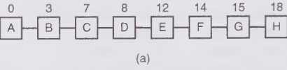
(a)

A 被视为新加载的页面

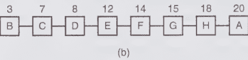
(b)

**图 3-15.** 第二次机会的操作。(a) 按 FIFO 顺序排序的页面。(b) 如果在时间 20 发生缺页异常且 A 的 R 位被置，则它被从内存中驱出，上方的页面按其加载时间排序。

假设在时间 20 发生缺页异常。最旧的页面是 A，它在时间 0 程序启动时到达。如果 A 的 R 位被清零，则将其从内存中驱出，写入磁盘（如果它是脏页）或直接放弃（如果它是洁页）。另一方面，如果 R 位被置，则将 A 置于列表末尾并将其“加载时间”重置为当前时间（20）。同时 R 位也被清零。继续从 B 开始寻找合适的页面。

第二次机会寻找的是在最近一个时钟间隔内未被引用过的旧页。如果所有页面都曾引用过，第二次机会就会退化为纯 FIFO。具体来说，想象所有页面都移动到列表末尾，每当操作系统将页面附加到列表末尾时，都会清空一次 R 位。最终，它会回到页面 A，此时 A 的 R 位已被清零。在这一点上，A 被驱出。于是，算法终止。

## 3.4.5 时钟页面替换算法

虽然第二次机会是一种合理的算法，但它的效率并不必要的低，因为它不断地在列表中移动页面。更好的方法是将所有页框保持在一个呈时钟形状的环形列表中，如图 3-16 所示。指针指向最旧的页面。

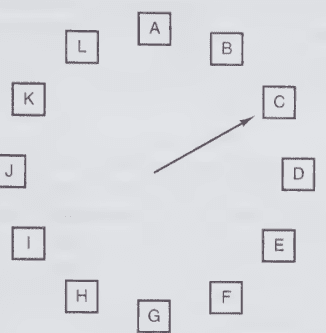
图 3-16. 时钟替换算法。

当发生缺页异常时，会检查指针指向的页面。如果它的 $R$ 位为 0，则驱出该页面，将新页面插入到时钟的原位置，并将指针移动一位。如果 $R$ 为 1，则将其清零并将指针移动到下一个页面。这个过程不断重复，直到找到一个 $R=0$ 的页面。意不意外，这种算法被称为*时钟*（clock）。

## 3.4.6 最近最少使用 (LRU) 页面替换算法

最优算法的一种良好近似是基于以下观察：在最近几条指令中被频繁使用的页面，很快可能再次被频繁使用。反之，已经很久未使用的页面可能在很长一段时间内保持不使用状态。这个想法建议了一个可实现的算法：当发生页缺异常时，丢弃最久未使用的页面。这种策略被称为 **LRU (最近最少使用)** 分页。

虽然 LRU 在理论上是可行的，但它的实现远非廉价。要完全实现 LRU，必须维护一个包含内存中所有页面的链表，其中最近使用的页面位于头部，最久未使用的页面位于尾部。困难在于，这个列表必须在每次内存引用时更新。在列表中找到页面、删除它并将其移动到头部是一项非常耗时的操作，即使在硬件中也是（假设可以构建这样的硬件）。

然而，还有其他方法通过特殊硬件来实现 LRU。让我们考虑最简单的方法。这种方法要求硬件配备一个 64 位的计数器 C，它在每条指令后自动递增。此外，每个页表条目还必须有一个足够容纳该计数器的字段。在每次内存引用后，C 的当前值被存储在所引用页面的页表条目中。当发生页缺异常时，操作系统会检查页表中的所有计数器以找到最小的一个。那个页面就是最近最少使用的页面。

## 3.4.7 在软件中模拟 LRU

虽然之前的 LRU 算法（原则上）是可以行的，但很少（如果有的）机器具有所需的硬件。相反，需要一种可以在软件中实现的解决方案。一种可能性是 NFU（非频繁使用）算法。它要求每个页面关联一个软件计数器，初始值为 0。在每个时钟中断时，操作系统扫描内存中的所有页面。对于每个页面，将位值为 0 或 1 的 R 位加到计数器中。计数器大致地记录了每个页面被引用的频率。当发生缺页异常时，选择计数器最小的页面进行替换。

## 内存管理
## 第 3 章

有足够的内存来容纳所有进程。幸运的是，大多数进程并非这样运行的。它们表现出*引用局部性*（locality of reference），这意味着在执行的任何阶段，进程只引用其页内存中较小的一部分。例如，多遍扫描编译器的每次扫描只引用所有页的一部分，而且每次的比例都不同。

进程当前正在使用的页集合是它的**工作集**（working set）（Denning, 1968; Denning, 1980）。如果整个工作集都在内存中，进程将运行而不会产生许多缺页，直到它移动到另一个执行阶段（例如，编译器的下一次扫描）。如果可用内存太小无法容纳整个工作集，进程将导致许多缺页并运行缓慢，因为执行一条指令只需要几纳秒，而从磁盘读取数据通常需要 10 毫秒。按照每 10 毫秒执行一或两条指令的速度，完成将需要很长时间。每隔几条指令就分页一次的程序被称为*抖动*（thrashing）（1968b）。

在多程序系统中，进程经常被移动到磁盘（即将其所有页从内存中移除），以便让其他进程使用 CPU。问题在于当进程被带回时该怎么办。从技术上讲，不需要做任何事情。进程将一直缺页，直到它的工作集被加载。

因此，许多分页系统尝试跟踪每个进程的工作集，并确保在允许进程运行之前它已在内存中。这种方法被称为**工作集模型**（Denning, 1970）。它的设计目的是大幅降低缺页率。*在让进程运行之前加载页也称为预存页*（prepaging）。注意，工作集会随时间而变化。

长期以来已知，程序很少均匀地引用其地址空间，而是这些引用倾向于聚集在少数几个页上。内存引用可能会获取指令或数据，也可能存储数据。在任何时刻 $t$，都存在一个集合，该集合由最近的 $k$ 次内存引用所使用的所有页组成。$w(k, t)$ 为工作集。当 $k=1$ 时，最近的引用使用了 $k > 1$ 最近引用所使用的所有页以及其他页，$w(k, t)$ 是关于 $k$ 的单调不减函数。当 $k$ 变得很大时，$w(k, t)$ 的极限是有限的，因为程序页数不能超过其地址空间，而且很少程序会使用每一个页。图 3-18 描述了工作集的大小随 $k$变化的函数。

大多数程序随机访问少数页，但该集合随时间变化缓慢，这一事实解释了曲线最初的快速上升以及随后在大 $k$ 值时增长要缓慢得多。例如，一个执行循环的程序占据了两个页，每 1000 条指令使用位于四个页上的数据，但对某些其他页的最近引用可能是一百万条指令之前的，即更早的初始化阶段。由于这种渐近行为，工作集的内容对所选的 $k$ 值并不敏感。换句话说，存在很广泛的 $k$ 值范围，使得工作集保持不变。由于工作集随时间变化缓慢，因此可以根据程序上次停止时的工作集，对程序重启时将需要哪些页做出合理的猜测。在恢复进程之前预存这些页。

为了实现工作集模型，操作系统有必要跟踪哪些页在工作集中。拥有这些信息，可以立即引出一种可能的页面替换算法：当发生缺页时，找到一个不在工作集中的页并将其换出。为了实现这种算法，我们需要一种精确的方法来确定哪些页在工作集中。根据定义，工作集是最近 $k$ 次内存引用中使用的页集合（有些使用最近的 $k$ 次页面引用，但选择是任意的）。要实现任何工作集算法，必须预先选择 $k$ 的值。然后，在每次内存引用之后，最近 $k$ 次内存引用所使用的页集合就会被唯一确定。

当然，拥有工作集的运行性定义并不意味着在程序执行期间有一种高效的方法来计算它。可以想象一个长度为 $k$ 的寄存器，每次内存引用都会将寄存器向左移动一位，并在右侧插入最近引用的页号。移位寄存器中所有 $k$ 个页的集合就是工作集。理论上，在缺页时，可以读取并排序移位寄存器的内容。然后移除重复的页。结果就是工作集。然而，维护移位寄存器并在缺页时对其处理的代价都太高，因此这种技术从未被使用。

相反，人们使用的是近似方法。一种常用的近似方法是放弃回溯 $k$ 次内存引用的想法，而改用执行时间。例如，不再将工作集定义为过去 1000 万次内存引用期间页，而是将其定义为过去 100 毫秒执行时间内使用的页集合。在实践中，这种定义同样良好，且更容易处理。注意，对于每个进程，只有它的执行时间是有效的。因此，如果一个进程在时间 T 开始，在时间 T + 100 毫秒时具有 40 毫秒的 CPU 时间，该进程自启动以来实际使用的 CPU 量通常称为其虚拟时间。通过这种近似方法，进程的工作集是它在过去 $\tau$ 虚拟时间内引用过的页集合。

现在让我们来看一种基于工作集的置换页面替换算法。在图 3-19 中，我们看到了某些机器的部分页表。因为只对位于内存中的页考虑换出，所以内存中不存在的页会被该算法忽略。每个条目包含（至少）两项信息：页最后一次使用的（近似）时间和 R（引用）位。空矩形表示该算法不需要的其他字段，例如页框号、保护位和 M（修改）位。

| R (Referenced) bit | |
| :--- | :--- |
| if R = 1 | 将最后使用时间设为当前虚拟时间 |
| if R = 0 and age > $\tau$ | 移除此页 |
| if R = 0 and age $\le \tau$ | 记住最小时间 |

**图 3-19.** 工作集算法。该算法工作原理如下：假设硬件如前所述设置了 R 和 M 位。同样，假设周期性时钟中断会导致软件运行，并在每个滴答期间清除引用位。在每个缺页期间，扫描页表以寻找一个合适的页进行换出。

## 3.4.9 WSClock 页面替换算法

基础工作集算法是笨重的，因为每次缺页都必须扫描整个页表直到找到合适的候选。一种改进的算法基于算法并使用了工作集信息，被称为 *WSClock*（Carr and Hennessy, 1981）。由于其实现简单且性能良好，它在实践中被广泛使用。

使用的数据结构是页框的循环列表，与算法算法，如图 3-20(a) 所示。最初，此列表是空的。当第一个页加载时，它被加入。随着更多页的添加，它们进入列表。每个条目包含基础工作集算法的*最后使用时间*字段，以及 R 位（显示）和 M 位（未显示）。

对于时钟算法，在每次缺页时首先检查指针指向的页。如果 R 位设置为 1，则该页在当前滴答期间被使用过，因此不是理想的候选者。然后将 R 位设置为 0，指针移动到下一页，并对该页重复算法。这一系列事件后的状态如图 3-20(b) 所示。

现在考虑如果指针指向的页 R=0，会发生什么，如图 3-20(c) 所示。如果年龄大于 $\tau$ 且该页是干净的，则它不在工作集中，且磁盘上存在有效副本。页框只需简单清除并放入新页，如图 3-20(d) 所示。另一方面，如果该页是脏的，则无法立即回收，因为磁盘上没有有效副本。调度了磁盘写入，但指针继续移动，算法继续处理下一页。毕竟，后面可能会有一个旧的干净页可以立即使用。

原则上来说，所有页面都必须在一个时钟周期内被调度进行磁盘 I/O。为了减少磁盘流量，可以设置一个限制，允许最多 $n$ 个页面写回。一旦达到该限制，将不再调度新的写操作。

如果指针转完一圈回到起点，会发生什么呢？我们需要考虑两种情况：

- 1. 至少调度了一个写回操作。
- 2. 还没有调度任何写操作。

在第一种情况下，指针继续移动，寻找空页。由于已经调度了一个或多个写操作，最终某个写操作将完成，其对应的页面将被标记为脏页。遇到的第一个空页将被驱出。这个页面并不一定是第一个调度的写操作，因为磁盘驱动程序可能会重新排序写操作以优化磁盘性能。

在第二种情况下，所有页面都在工作集中，否则至少会调度一个写回操作。在缺乏额外信息的情况下，最简单的方法是占用用任何空页并使用它。空页的位置可以在扫描过程中进行跟踪。如果没有空页，则选择当前页面作为“牺牲者”并将其写回磁盘。

### 3.4.10 页面替换算法总结

我们现在查看了各种页面替换算法。我们将对它们进行简要总结。讨论的算法列表见图 3-21。

| 算法 | 注释 |
|---|---|
| 最佳页面算法 (Optimal) | 不可实现，但可以作为基准有用 |
| NRU (最近未使用) | 对 LRU 的非常粗略近似 |
| FIFO (先进先出) | 可能会丢弃重要页面 |
| 第二机会 (Second chance) | 对 FIFO 的巨大改进 |
| 时钟算法 (Clock) | 具有可行性 |
| LRU (最久未使用) | 非常优秀，但难以精确实现 |
| NFU (最近未使用) | 对 LRU 的相当粗糙的近似 |
| 老龄算法 (Aging) | 一种很好近似 LRU 的高效算法 |
| 工作集 (Working set) | 实现开销略大 |
| WSClock | 一种良好的高效算法 |

**图 3-21.** 文中讨论的页面替换算法。

最佳算法驱逐未来被引用时间最远的页面。遗憾的是，没有办法确定是哪一个页面，因此在实践中无法使用。然而，它可以作为一个基准，用来衡量其他算法的优劣。

LRU 算法根据 $R$ 位和 $M$ 位的状态将页面分为四类。从编号最低的一类中随机选择一个页面。该算法容易实现，但非常粗糙。存在更好的算法。

FIFO 通过将页面保存在链表中来跟踪加载到内存的顺序。移除最旧的页面变得轻而易举，但该页面可能在使用中，因此 FIFO 是一个糟糕的选择。

第二机会是对 FIFO 的一种改进，在移除页面之前检查该页面是否在内存中。如果是，则免除该页面。这种改进极大提升了性能。时钟算法是第二机会的另一种实现。它具有相同的性能特性，但执行算法所需的时间稍短。

LRU 是一项优秀的算法，但如果没有特殊的硬件是无法实现的。如果没有这些硬件，就无法使用。NFU 是近似 LRU 的一种粗糙尝试。它并不好。然而，老龄算法是 LRU 的好得多的近似，可以高效地实现。

最后两个算法使用了工作集。工作集算法提供了合理的性能，但实现开销略大。WSClock 是一种变体，它不仅提供了良好的性能，而且实现高效。

总之，最好的两种算法是老龄算法和 WSClock。它们分别基于 LRU 和工作集。两者都能提供良好的分页性能并可以高效实现。虽然还存在其他良好的算法，但这些可能是分页中最重要的。

# 3.5 分页系统的设计问题

在之前的节节中，我们解释了分页是如何运作的，并给出了一些基本的页面替换算法。但仅仅了解机制是不够的。要设计一个系统并让它良好运行，你需要了解更多。这就像比知道如何移动象棋中的车、马、主教和其他棋子，与成为一名优秀高手之间的区别。在接下来的章节中，我们将查看操作系统设计者必须仔细考虑的其他问题，以便从分页系统中获得良好的性能。

### 3.5.1 局部与全局分配策略

在前面的节中，我们讨论了在发生故障时选择页面以进行替换的几种算法。与此选择相关的一个主要问题（到目前为止我们一直刻意回避它）是，如何在竞争的运行进程之间分配内存。

看看图 3-22(a)。在图中，三个进程 A、B 和 C 组成了可运行进程的集合。假设 A 发生了页面缺页中断。页面替换算法应该尝试只考虑当前分配给 A 的六个页面来寻找最少使用的页面，还是应该考虑内存中的所有页面？如果它只看 A 的页面，年龄值最低的页面是 A5，因此我们得到了图 3-22(b) 中的情况。

另一方面，如果不考虑属于谁而选择年龄值最低的页面，则会选中 B3，我们得到图 3-22(c) 中的情况。图 3-22(b) 的算法被称为局部页面替换

| A0 | 10 | A0 | |
|---|---|---|---|
| A1 | 7 | A1 | |
| A2 | 5 | A2 | |
| A3 | 4 | A3 | |
| A4 | 6 | A4 | |
| A5 | | A6 | |
| B0 | 9 | B0 | |
| B1 | | B1 | |
| B2 | | B2 | |
| B3 | 2 | B3 | |
| B4 | 5 | B4 | |
| B5 | | B5 | |
| B6 | 12 | B6 | |
| C1 | | C1 | |
| C2 | | C2 | |
| C3 | 6 | C3 | |

**图 3-22.** 局部与全局替换。(a) 原始配置。(b) 局部替换。(c) 全局替换。

算法，而图 3-22(c) 的被称为**全局**算法。全局算法实际上是分配固定比例的内存。因此，分配给每个进程的帧数随时间变化，特别是当工作集变化很大时。

总的来说，全局算法在工作集随进程生命周期变化时效果更好。如果使用局部算法且工作集增大，会导致抖动，即使有足够的空闲帧。如果工作集缩小，局部算法会浪费内存。如果使用全局算法，系统必须不断决定为每个进程分配多少帧。一种方法是监控年龄位指示的工作集大小，这种方法并不一定能防止抖动。工作集的变化以毫秒计，而年龄位是对多个时钟周期的非常粗略的度量。

另一种方法是有一种向进程分配帧的算法。一种方法是给每个进程分配相同的份额。因此，对于 1246 个可用（非操作系统）帧和十个进程，每个进程获得 121 个帧。剩余的六个进入池中在发生缺页时使用。

## 224 内存管理 第3章

例如，机器上的单条双操作数指令可能需要高达六个页，因为指令本身、源操作数和目的操作数都可能跨越页边界。如果只分配了五个页，包含此类指令的程序将无法执行。

如果使用全局算法，可能可以在启动每个进程时分配与进程大小成正比的若干个页，但必须随着进程的运行动态更新分配。管理分配的一种方法是使用 PPF（缺页频率）算法。它能告诉我们何时增加或减少进程的页分配，但没有说明在发生缺页时应该替换哪个页。它控制的是分配集的大小。

对于包括 LRU 在内的一类页替换算法，众周知正如我们上面讨论的，随着分配的页数增加，缺页率会降低。这就是 PFF 的背后的假设。这一特性在图 3-23 中所示。

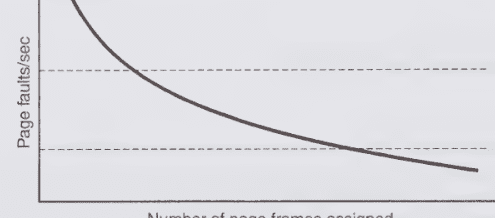

图 3-23. 缺页率随分配页框数量变化的函数。

测量缺页率非常简单：只需统计每秒的缺页次数，可能还会取过去几秒的移动平均值。实现此的一种简单方法是将紧前一个进程期间的缺页次数加到当前的运行平均值中并除以二。虚线 A 对应于一个无法接受的高缺页率；此时给缺页进程分配更多的页以降低缺页率。虚线 B 对应的缺页率极低，我们可以假设该进程拥有过多的内存。在这种情况下，可能会从那里取回空闲页。因此，PFF 试图将每个进程的分页率保持在可接受范围内。

需要注意的是，某些页替换算法既可以使用局部替换策略，也可以使用全局策略。例如，FIFO 可以替换整个内存中最旧的页（全局算法），也可以替换当前进程所拥的最旧页（局部算法）。同样，LRU 或其近似算法可以替换整个内存中最近未使用的页（全局算法），也可以替换当前进程所拥有的最近未使用的页（局部算法）。在某些情况下，局部与全局的选择与算法无关。

## 3.5 分页系统的设计问题 225

另一方面，对于其他页替换算法，只有局部策略才有意义。特别是工作集（working set）和 WClock 算法涉及到特定的进程，必须在特定语文中应用。机器本身并没有所谓的全局工作集，尝试使用所有工作集的并集将丢失局部性且效果不佳。

### 3.5.2 负载控制

即使采用最好的页替换算法和对进程页框的最优全局分配，系统也可能发生抖动（thrashing）。事实上，当所有进程的工作集总和超过内存容量时，就会出现抖动。这种情况的一个症状是 PFF 算法指示某些进程需要更多内存，但进程需要的内存却很少。在这种情况下，无法在不影响其他进程的情况下为这些需要内存的进程提供更多内存。唯一的解决方案是暂时移除某些进程。

减少竞争内存的进程数量良好方法是将某些进程交换到磁盘，并释放它们所持有的页。例如，可以将一个进程交换到磁盘，并将其页框分配给其他正在抖动的进程。如果抖动停止，系统就可以运行一段时间。如果抖动没有停止，则必须交换出另一个进程，以此此类推，直到抖动停止。即使使用分页，可能仍需要交换，只是现在交换是为了减少对内存的潜在需求，而不是为了回收页。

将进程交换出以减轻内存负载，使人们想起两级调度，其中某些进程被放在磁盘上，并使用短调度调度器来调度剩余进程。显然，这两个思想可以结合，交换出足够的进程以使缺页率达到可接受范围。定期地，从磁盘调入某些进程，并将其他进程交换出。

然而，另一个需要考虑的因素是多程序设计的程度。当主内存中的进程数量过低时，CPU 可能会长时间处于空闲状态。这一考虑认为，在决定交换出哪个进程时，不仅要考虑进程大小和分页率，还要考虑其特征（是 CPU 密集型还是 I/O 密集型）以及剩余进程具有什么特征。

### 3.5.3 页大小

页大小是可以由操作系统选择的参数。即使硬件设计为例如 4096 字节的页，操作系统也可以轻松地将页对 0 和 1、2、3、4 和 5 等视为 8-KB 的页，这通过始终为它们分配两个连续的 8192 字节页框来实现。

确定最佳页大小需要平衡多个相互竞争的因素。因此，没有统一的最优解。首先，有两个因素支持较小的页大小。随机选择的文本、数据或栈段不会填满整数数量的页。平均而言，最后一个页的一半被浪费了。该页中的额外空间是浪费的内部碎片。如果内存中有 $n$ 个段且页大小为 $p$ 字节，则会有 $np/2$ 字节浪费在内部碎片中。这一论据支持了较小的页大小。

如果我们考虑到页表，页大小的另一个理由变得更加明显。在某些机器上，每当 CPU 从一个进程切换到另一个进程时，必须由操作系统将页表加载到硬件寄存器中。在这些机器上，页大小越小，加载页寄存的时间越长。此外，页表占据的空间随页大小减小而增加。

最后一点可以通过数学进行分析。假设平均进程大小为 $s$ 字节，页大小为 $p$ 字节。此外，假设每个页条目为 $e$ 字节。每个进程所需的页数约为 $s/p$，占用 $se/p$ 字节的页表空间。由于内部碎片，进程最后一个页浪费的内存为 $p/2$。因此，由于页表和内部碎片引起的总开销由这些项之和给出：

overhead = se/p + p/2

第一项（页表大小）在页大小较小时很大。第二项（内部碎片）在页大小很大时很大。通常情况下，大页大小会导致内存中浪费的空间比小页大小更多。

此外，较小的页会消耗 TLB 中大量宝贵的空间。假设你的程序使用 1 MB 内存，工作集为 64 KB。使用 4-KB 页，该程序将占用 TLB 中的 16 条目。使用 2-MB 页，单个 TLB 条目就足够了（理论上，你可能希望分离数据和指令）。由于 TLB 条目非常稀缺且对性能至关重要，尽可能使用大页是有益的。为了平衡所有这些权衡，操作系统有时会对系统的不同部分使用不同的页大小。例如，内核使用大页，而用户进程使用较小的页。

必须位于两者之间。通过对 $p$ 求一阶导数并将其置于零，我们得到方程

$-se/p^2 + 1/2 = 0$

从这个方程中我们可以推导出一个给出页大小的公式（仅考虑分段浪费的内存和页表大小）。结果为：

$p = \sqrt{2se}$

当 $s=1$MB 且每个页项 $e=8$ 字节时，最佳页大小为 4 KB。市售计算机使用的页大小从 512 字节到 64 KB 不等。典型值曾是 1 KB，但现在 4 KB 更常见。

## 3.5.4 指令空间与数据空间的分离

大多数计算机拥有单一地址空间，其中同时存储程序和数据，如图 3-24(a) 所示。如果这个地址空间足够大，一切运行良好。然而，如果它太小，就会迫使程序员“倒立着走路”才能将所有内容放入地址空间中。

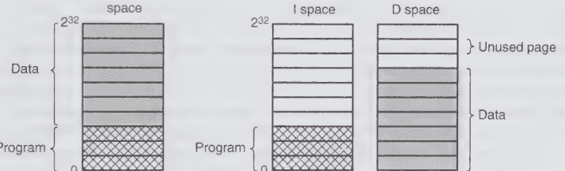

**图 3-24.** (a) 单一地址空间。(b) 分离的 I 和 D 空间。

一种在（16 位）PDP-11 上开创的解决方案是为指令（程序正文）和数据分别设置分离的地址空间，如图 3-24(b) 所示。每个地址空间都从 0 运行到某个最大值，通常为 $2^{16}-1$ 或 $2^{32}-1$。链接器必须知道何时在使用分离的 I 空间和 D 空间；当使用它们时，数据被重定位到虚拟地址 0，而不是从程序之后开始。

在具有这种设计的设计的计算机中，两个地址空间都可以独立进行分页。每个空间都有自己的页表，存储其从虚拟页到物理页帧的映射。当硬件需要提取指令时，必须使用 I 空间和 I 空间页表。同样，数据必须通过 D 空间页表。除了这种区别外，分离的 I 和 D 空间不会给操作系统引入任何特殊的复杂性，并且使可用地址空间翻了一倍。

虽然这些地址空间很大，但它们的尺寸曾是一个严重的问题。即使在今天，分离的 I 和 D 空间仍然很常见。然而，它们现在用于划分 L1 缓存，而不是普通的地址空间。毕竟在 L1 缓存中，内存仍然非常稀缺。

## 3.5.5 共享页

另一个设计问题是共享。在大型多程序系统中，用户同时运行同一个程序是常见的。即使是单个用户也可能运行多个使用相同库的程序。共享这些页显然更高效，可以避免内存中同时存在同一页的副本。一个问题是并不是所有页都是可的。特别是作为程序正文的只读页可以共享，但数据页的同步共享要复杂得多。

如果支持分离的 I 和 D 空间，通过让两个或多个进程使用相同的 I 空间页表但不同的 D 空间页表来共享程序是相对简单的。通常在支持这种共享方式的实现中，页表是独立于进程表的数据结构。每个进程的进程表中有两个指针：一个指向 I 空间页表，一个指向 D 空间页表，如图 3-25 所示。当调度器选择一个进程运行时，它使用这些指针来定位适当的页表并使用它们设置 MMU。即使没有分离的 I 和 D 空间，进程也可以共享程序（或子集、库），但机制更为复杂。

当两个或多个进程共享某些代码时，共享页就会出现问题。假设进程 A 和 B 都在运行编辑器并共享它的页。如果调度器决定将 A 从内存移除，用其他程序填充空页会导致 B产生大量的页错误以将它们换回。

同样，当 A 终止时，能够发现所有页仍在未使用是非常关重要的，这样它们的磁盘空间就不会意外释放。搜索一个页是否被共享通常太昂贵；需要特殊的数据结构来跟踪共享页，特别是当共享的单元是单个页（或一组页）而不是整个页表时。

共享数据比共享代码困难，但并非不可能。特别是在 UNIX 中，在 `fork` 系统调用之后，父进程和子进程被要求共享程序和数据。在分页系统中，通常的做法是给这些进程各提供自己的页表，并让它们都指向同一组页。因此，在 `fork` 时不进行页复制。然而，所有的数据页都被映射到两个进程中并设为只读。

只要两个进程只读取其数据而不进行修改，这种情况就可以持续。一旦任何进程更新了内存字，违反只读保护就会导致指向操作系统的陷阱（trap）。然后会对违规的页创建一个

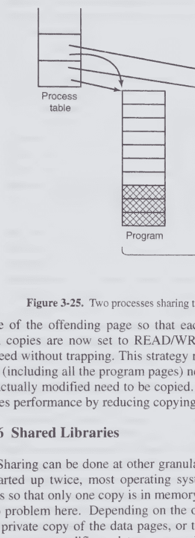

**图 3-25.** 两个进程共享同一个程序并共享其页表。

违规页的副本，以便每个进程现在都有自己的私有副本。两个副本都——等等，原文说是“两个副本随后都是写时复制”——是违规页的副本，以便每个进程现在都有自己的私有副本。

进程 2 从于 12K 开始。假设库中的函数首先需要跳转到库中的地址 16。如果该库不是共享的，它可以像被加载时那样被动态重新加载，这样（进程 1 中的）跳转就可以指向虚拟地址 36K + 16。注意，RAM 中该库所在的物理地址并不重要，因为所有的页面都由 MMU 硬件从虚拟地址映射到物理地址。

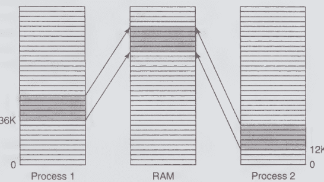

图 3-26。两个进程使用的共享库。

然而，由于该库是共享的，动态重定位将无法起作用。毕竟，当进程 2 调用第一个函数（在地址 12K）时，跳转指令必须指向 12K + 16，而不是 36K + 16。这是一个小问题。解决这个问题的方法是使用写时复制（copy on write）并为共享该库的每个进程创建新页，在创建时对其进行动态重定位，但显然，这种方案违背了共享库的初衷。

更好的解决方案是使用特殊的编译器标志编译共享库，告诉编译器不要产生任何使用绝对地址的指令。相反，只使用使用相对地址的指令。例如，几乎总有一条指令表示向前（或向后）跳转 n 字节，而不是某种特定的指令。无论共享库被放置在虚拟地址空间的什么位置，这条指令都能正常工作。通过避免绝对地址，可以解决这个问题。只使用相对偏移的代码被称为位置无关代码（position-independent code）。

## 3.5.7 映射文件

共享库实际上是更通用的机制——映射文件（mapped files）的一个特殊用例。这里的思想是，进程可以发出系统调用将一个文件映射到其虚拟地址空间的一部分。在大多数实现中，在映射时不会引入任何页面，但当页面被访问时，它们会按页一页地按需调入，并使用磁盘文件作为备份存储。当进程退出或显式地取消映射该文件时，所有修改过的页面都会写回磁盘上的文件。

映射文件为 I/O 提供了一种替代模型。与其执行读写操作，文件可以作为内存中的一个大字符数组被访问。在某些情况下，程序员发现这种模型更方便。

如果两个或多个进程同时映射同一个文件，它们可以通过共享内存进行通信。一个进程对共享内存进行的写入，当另一个进程从其映射到该文件的虚拟地址空间部分进行读取时，是立即不可见的。因此，这种机制在进程之间提供了一个高带宽通道，并经常被用为此（甚至用于映射一个临时文件）。现在应该很清楚，内存映射文件是可用的，共享库可以使用这种机制。

## 3.5.8 清理策略

当有充足的空闲页框可供在页异常发生时被使用时，分页的效果最好。如果每个页框都是满的，而且在新的页面被调入之前已经被修改过，则必须将一个旧页面写入磁盘。为了确保空闲页框的充足供应，分页系统通常有一个后台进程，称为分页守护进程（paging daemon），它在大部分时间内处于睡眠状态，定期唤醒以检查内存状态。如果空闲页框太少，它就会开始使用某些页面替换算法选择要驱出的页面。如果这些页面自加载以来已被修改过，它们会被写入磁盘。

在任何情况下，页面的之前内容都会被记住。如果在一个被驱出的页面在页框被覆盖之前再次被需要，则通过从空闲页框池中移除它来回收。保持页框的供应比使用所有内存并在需要时尝试寻找页框的性能要好。至少，分页守护进程确保了所有空闲页框都是干净的，因此在被需要时，不需要急忙写入磁盘。

实现这种清理策略的一种方法是使用双手时钟（two-handed clock）。前手由分页守护进程控制。当它指向一个脏页时，该页面被写回磁盘，前手移动。当它指向一个干净页时，仅进行调整。后手用于页面替换，就像标准的时钟算法一样。现在，由于分页守护进程的工作，后手击中干净页面的概率增加了。

## 3.5.9 虚拟内存接口

到目前为止，我们的整个讨论都假设虚拟内存对进程和程序员是透明的，也就是说，他们看到的只是具有较小（更小）物理内存的计算机上的一个巨大的虚拟地址空间。在许多系统中，情况确实如此，但在一些高级系统中，程序员对内存映射具有某些控制权，并可以用非传统方式使用它来增强程序行为。在本节中，我们将简要查看这些内容。

赋予程序员对其内存映射控制权的原因之一是允许两个或多个进程共享相同的内存，有时是以复杂的方式。如果程序员可以为他们的内存区域命名，那么一个进程可能会给另一个进程内存区域的名称，以便该进程也能映射它。通过两个（或更多）进程共享相同的页面，高带宽共享就变得可能的——一个进程向共享内存写入，另一个进程从从中读取。这种通信的一个复杂示例是 De Bruijn (2011)。另外一种技术是共享内存 (Feely et al., 1995)。这里的想法是允许多个进程共享，这由 (1986) 描述。当发生页异常时，页面被映射进来。页异常处理程序找到页面并将其发送。当页面到达时，指令重启。我们将检查一些常见问题 (1994)。

## 3.6 实现问题

虚拟内存系统的实现者必须在局部分配与全局分配、以及按需分页与预取分页之间做出选择。但他们还需要意识到许多实际问题。在本节中，我们将查看。

### 3.6.1 操作系统与分页的参与

在四个时刻，操作系统需要执行工作：进程创建、进程执行、页异常时间和进程终止。我们现在将检查每一个，看看需要做什么。

当创建新进程时，操作系统必须确定程序的大小（初始）并创建页表。需要在内存中为其分配空间并进行初始化。页表在交换出时不驻留，但在运行时必须在内存中。此外，需要在交换区域分配空间，以便在交换出时有可去。某些系统直接从可执行文件分页程序，从而节省磁盘空间和初始化时间。最后，必须记录页表和交换区域的信息。

当进程被调度执行时，必须重置 MMU 并刷新 TLB，以消除之前执行进程的痕迹。新进程的页表必须变为当前，通常通过复制它或指向某个寄存器来实现。可选，可以将进程的部分或全部页面调入内存，以减少初始页异常（例如，程序计数器指向的）。当进程页异常时，分页系统调入页面。

当发生页异常时，操作系统必须读取硬件寄存器以确定引起异常的虚拟地址。根据这些信息，它必须计算需要哪个页面并在磁盘上定位。它必须找到一个可用的页框来放置新页面，必要时驱逐某些旧页面。然后它必须将所需的页面读入页框。最后，它必须回滚程序计数器使其指向故障指令并让指令再次执行。

当进程退出时，操作系统必须释放它的页表、页面以及页面在磁盘上占用的磁盘空间。如果某些页面与其他进程共享，则只有在最后一个使用它们的进程终止时，才能释放内存和磁盘上的页面。

### 3.6.2 页异常处理

我们终于可以详细描述页异常发生时发生的情况。事件序列如下：

- 硬件陷阱到内核，将程序计数器保存在栈上。在大多数机器上，当前指令状态的一些信息会保存在特殊的 CPU 寄存器中。
- 启动一个汇编例程来保存通用寄存器和其他易变信息，防止操作系统破坏它们。该例程作为过程调用操作系统。
- 操作系统发现发生了页异常，并尝试发现需要哪个虚拟页面。通常一个硬件寄存器会包含此信息。如果不是，操作系统

必须检索程序计数器、取指指令并在软件中对其解析，以确定在发生故障时程序正在执行。

- 4. 一旦确定了导致故障的虚拟地址，系统将检查该地址是否有效，以及保护机制是否与访问操作一致。如果不一致，则向该进程发送信号或将其杀死。如果地址有效且没有发生保护故障，系统将检查是否有空闲的页帧。如果没有空闲帧，则运行页面替换算法来选择一个“牺牲者”（victim）。

- 5. 如果选择了某个页帧，该页面将被调度传输到磁盘，并发生上下文切换，挂起故障进程并让另一个进程运行，直到磁盘传输完成。在任何情况下，该帧都被标记为忙忙，以防止其被用于其他用途。

- 6. 只要页帧变为干净（无论是立即变干净还是在写入磁盘后），操作系统就会查找所需页面所在的磁盘地址，并调度磁盘操作将其读入。在页面加载期间，故障的进程仍处于挂起状态，如果有可用的用户进程，则运行它。

- 7. 当磁盘中断指示页面已到达时，将更新页表以反映其位置，并将该帧标记为处于正常状态。

- 8. 故障指令被恢复到其开始执行时的状态，程序计数器被重置指向该指令。

- 9. 调度故障的进程，操作系统返回到调用它的（汇编语言）例程。

- 10. 该例程加载寄存器和其他状态信息，并返回用户空间继续执行，就好像没有发生过故障一样。

## 3.6.3 指令备份

当程序引用一个不在内存中的页面时，导致故障的指令会部分执行并跳转到操作系统。在操作系统获取了所需的页面后，它必须重新启动导致陷阱的指令。这比想象的要容易。

为了了解这个问题在最情况下的本质，请考虑一种具有双地址指令的 CPU，例如广泛用于嵌入式系统的 Motorola 680x0。该指令

```


```
MOV.L #6(A1),2(A0)
```


例如，该指令长度为 6 字节（参见图 3-27）。为了重新启动指令，操作系统必须确定指令第一个字节的位置。陷阱发生时程序计数器的值取决于哪个操作数发生了故障，以及 CPU 的微代码是如何实现的。

`MOVE.L #6(A1), 2(AO)`

|  | Opcode | operand |
|---|---|---|
| 1000 | MOVE | 第一个操作数 |
| 1002 | 6 | 第二个操作数 |
| 1004 | 2 | 第二个操作数 |

**图 3-27.** 导致页故障的指令。

在图 3-27 中，有一个从地址 1000 开始的指令，它进行了三次内存引用：指令字和两个操作数的偏移量。取决于这三次内存引用中的哪一个导致了页故障，故障发生时的程序计数器可能是 1000、1002 或 1004。操作系统通常能够明确地确定指令从哪里开始的。如果故障发生时程序计数器为 1002，操作系统无法判断 1002 处的字是与 1000 处指令相关的内存地址（例如操作数的地址），还是一个操作码。

尽管这个问题已经很糟糕，但本可以更糟。某些寻址模式使用了自动递增，这意味着执行指令的副作用是增加一个（或多个）寄存器。使用自动递增模式的指令也会发生故障。根据微代码的细节，递增可能在内存引用之前完成，在这种情况下，操作系统必须在重新启动指令之前减少寄存器。或者，自动递增可能在内存引用之后完成，在这种情况下它在陷阱发生时尚未完成，且不能由操作系统撤销。自动递减也存在并会导致类似的问题。自动递增和自动递减在相应的内存引用之前是否已完成的细节可能因指令而异，也因 CPU 模型而异。

幸运的是，在某些机器上，CPU 设计者提供了一种解决方案，通常是隐藏寄存器的形式，在每条指令执行之前将程序计数器复制到其中。这些机器可能还有第二个寄存器，用于指示哪些寄存器已经自动递增或递减，以及增了多少。有了这些信息，操作系统就可以明确地撤销故障指令的所有影响，以便其重新启动。如果没有这些信息，操作系统就必须费尽周章来弄清楚发生了什么以及如何修复。这好像是硬件设计者无法解决这个问题，所以他们摊摊手让操作系统编写者自己去处理。真是群“好人”。

## 3.6.4 内存页面锁定

虽然我们在本章中没有讨论很多 I/O，计算机具有虚拟内存并不意味着没有 I/O。虚拟内存和 I/O 以微妙的方式相互作用。考虑一个刚刚发出系统调用从某个文件或设备读取数据到其地址空间内缓冲区的进程。如果分页算法是全局的，那么有极小但非零的概率包含 I/O 缓冲区的页面会被选中移除。如果某个 I/O 设备正在向该页面进行 DMA 传输，移除它会导致数据被覆盖。解决此问题的方案是将页面锁定在内存中使其不被移除。锁定页面通常被称为固定（pinning）。另一种方案是将所有 I/O 执行到内核缓冲区，然后再拷贝数据。

## 3.6.5 交换存储

在页面替换算法的讨论中，我们看到了如何选择要移除的页面。我们还没有讨论页面被换出时位于磁盘的哪里。让我们描述一些与磁盘管理相关的问题。

磁盘上分配空间的简单算法是在磁盘上设置一个交换分区，或者最好在与文件系统独立的磁盘上（以平衡 I/O 负载）。大多数 UNIX 系统都是这样工作的。该分区没有普通文件系统，这消除了将偏移量转换为块地址的开销。相反，使用相对于分区起始位置的块。

系统启动时，此交换分区是空的，在内存中用一个给出起始和大小的条目表示。在简单的方案中，当第一个进程启动时，保留一个与第一个进程大小相同的分区区域，并减少剩余区域。随着新进程的启动，它们将被分配与其核心镜像大小相同的交换分区块。当它们结束时，其磁盘空间会被释放。交换分区通过空闲块列表进行管理。

然而，这种简单的模型存在一个问题：进程在启动后可能会增大。虽然程序文本通常是固定的，但数据区域有时会增长，而栈始终可能增长。因此，更好的做法可能是为文本、数据栈栈留交换区域，并允许这些区域中的每个在磁盘上由多个块（chunk）组成。

另一个极端是不预先分配空间，而是在每个页面换出内存时为其分配磁盘空间，并在换回内存时释放该空间。通过这种方式，内存中的进程不会占用任何交换空间。缺点是内存中需要一个磁盘地址来跟踪磁盘上的每个页面。换句话说，每个页面都必须有一个表来告知它在磁盘上的位置。这两种替代方案如图 3-28 所示。

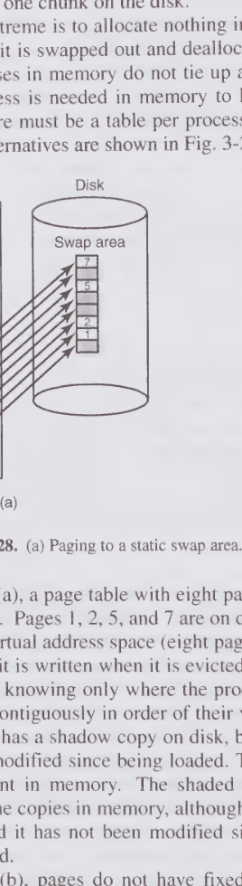

在图 3-28(a) 中，显示了一个包含 8 页的页表。页面 0, 3, 4 和 6 在主内存中。页面 1, 2, 5 和 7 在磁盘上。交换区域的大小与进程虚拟地址空间相同（8 页），每个页面都有一个固定的位置，当它从主内存中驱除时，会被写入该位置。计算此地址只需要知道进程分页区域的起始位置，因为页面是按照虚拟页号的顺序连续存储的。内存中的页面在磁盘上总有一个影子副本，但如果该页面自加载以来已被修改过，则该副本可能是过时的。内存中的阴影页面表示不在主内存中的页面。磁盘上的阴影页面（在原则上）会被内存中的副本取代，尽管如果一个内存页面必须换回磁盘，且它自加载以来未被修改过，则将使用该（阴影）磁盘副本。

在图 3-28(b) 中，页面在磁盘上没有固定的地址。当一个页面被换出时，会动态选择一个空磁盘页面，并相应地更新磁盘映射（每个虚拟页面可以容纳一个磁盘地址）。内存中的页面在磁盘上没有副本。磁盘映射中的页面条目包含一个无效的磁盘地址或标记其为未使用的位。

固定交换分区并不总是可行的。例如，可能没有可用的分区。在这种情况下，可以使用普通文件系统内的一个或多个预分配文件。Windows 使用了这种方法，但此处可以使用优化来减少所需的磁盘空间。由于每个进程的程序文本都来自文件系统中的某个（可执行）文件，因此可以使用可执行文件作为交换区域。更好的是，由于程序文本通常是只读的，当内存紧张且程序页面必须从内存中驱除时，它们只需被丢弃，并在需要时重新从可执行文件读入。共享库也可以这样工作。

## 3.6 策略与机制的分离

管理任何系统复杂性的重要工具是将策略（policy）与机制（mechanism）分离。这一原理可以应用于内存管理，让内存管理器的大部分代码作为用户级进程运行。这种分离首次在 Mach 系统（Young et al., 1987）中实现，下文的讨论基于此。

策略与机制如何分离的一个简单示例如图 3-29 所示。在这里，内存管理系统被分为三个部分：

- MMU 如何工作的所有细节都封装在 MMU 处理程序中，这是依赖于机器的代码，对于操作系统移植的每个新平台都必须重写。页异常处理程序是与机器无关的代码，包含了分页的大部分机制。策略在很大程度上由外部分页器决定，外部分页器作为用户进程运行。
- 当进程启动时，会通知外部分页器设置设置进程的页映射，并在需要时在磁盘上分配必要的备份存储。随着进程运行，它可能会将新对象映射到其地址空间，因此会再次通知外部分页器。
- 一旦进程开始运行，它可能会发生页异常。异常处理程序确定需要哪个虚拟页面，并向外部分页器发送消息告知其问题。外部分页器随后从磁盘读取所需的页面并将其复制到自己地址空间的一部分。它告诉异常处理程序页面所在的位置。异常处理程序从外部分页器的地址空间取消映射该页面，并请求 MMU 处理程序将其放在用户地址空间的正确位置。然后用户进程就可以重启。

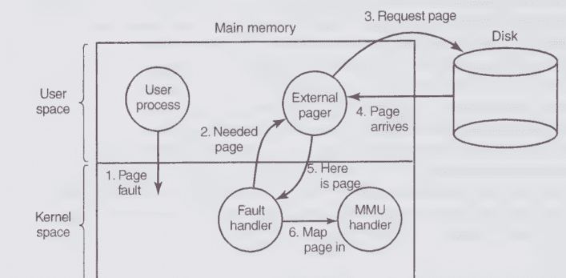

这种实现为页面替换算法的放置位置留了余地。最干净的方法是将其放在外部分页器中，但这种方法存在一些问题。主要问题是外部分页器无法访问所有页面的 R 和 M 位。这些位在许多分页算法中起着作用。因此，要么需要某些机制将此信息传递给外部分页器，要么页面替换算法必须放在内核中。在后一种情况下，异常处理程序告诉外部分页器它选择了哪一个页面进行驱逐，并提供数据（通过将其映射到外部分页器的地址空间或将其包含在消息中）。无论何种方式，外部分页器都会将数据写入磁盘。

这种实现的主要优点是代码更模块化，灵活性更大。主要的缺点是跨越用户-内核边界的额外开销以及它们之间发送消息的开销。

## 3.7 分段 (SEGMENTATION)

到目前讨论的虚拟内存是一维的，因为我们需要让程序员无需管理扩张和收缩的表。例如，如果一个程序的变量数量比通常多得多，拥有两个独立的地址空间可能会好得多。一种直接且通用的解决方案是为机器提供许多独立的地址空间，称为段（segments）。每个段由一个线性地址序列组成，从 0 开始到某个最大值。

由于每个段都构成一个独立的地址空间，不同的段增长或收缩而不会相互影响。如果某个段中的栈需要更多的地址空间来增长，它可以获得，因为其地址空间中没有其他东西会发生碰撞。当然，段可能会填满，但段通常非常大，因此这种情况很少发生。为了在这种分段内存或双维内存中指定地址，程序必须提供一个双部分地址：段号和段内地址。

| 段 | 描述 |
| :--- | :--- |
| 1 | 正在保存列出的源文本 |
| 2 | 符号表，包含名称和属性 |
| 3 | 包含浮点常数 |
| 4 | 解析树，包含句法分析 |
| 5 | 用于过程调用的栈 |

**图 3-30。** 在一维内存中，一个表可能会与另一个表发生碰撞。

段是一个逻辑实体，程序员感知它并将其作为逻辑实体使用。段可能包含一个过程、一个数组、一个栈或一组标量变量，但通常它不包含多种不同类型的混合。

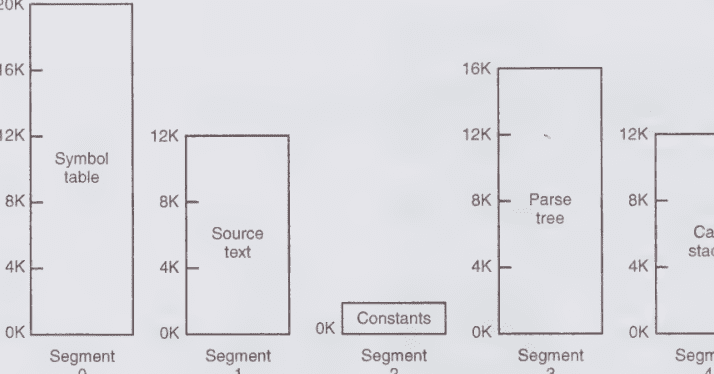

**图 3-31。** 分段内存允许每个表独立于其他表进行增长或收缩。

## 3.7 分段 (SEGMENTATION)

如果段 n 中的程序随后被修改并重新编译，则不需要更改其他程序（因为起始地址没有修改），即使新版本比旧版本大也是如此。在一维内存中，程序紧密地排列在一起，之间没有地址空间。因此，更改一个程序的大小可能会影响该段中所有其他（不相关的）程序的起始地址。这反过来又需要修改所有调用了任何被移动程序的程序，以包含它们新的起始地址。如果一个程序包含数百个程序，这个过程可能是昂昂的。

分段还便于在多个进程之间共享程序或数据。一个常见的例子是共享库。运行先进系统的现代工作站拥有极其巨大的库，它们被编译到几乎每个程序中。在分段系统中，图形库可以放在一个段中并供多个进程共享，从而消除了在每个进程的地址空间中都包含它的需求。虽然分页系统中也可以实现共享库，但实现起来更复杂。实际上，这些系统是通过分段来实现的。

每个段都有程序员感知的逻辑实体，例如程序或数组，不同的段具有不同类型的保护。程序段可以被指定为仅可执行，禁止尝试从中读取或向其存储内容。浮点数组可以被指定为可读写但不可执行，尝试跳转到它的操作将被捕获。这种保护有助于发现错误。分页和分段的比较见图 3-32。

### 3.7.1 纯分段的实现

分段的实现与分页在本质上有所不同：页是固定大小的，而段不是。图 3-33(a) 显示了物理内存最初包含五个段的示例。现在考虑如果段 1 被换出，而较小的段 7 取代了它的位置会发生什么。我们得到了图 3-33(b) 中的内存配置。在段 7 和段 2 之间有一个未使用的区域——即空洞。然后段 4 被段 5 替换（如图 3-33(c) 所示），段 3 被段 6 替换（如图 3-33(d) 所示）。系统运行一段时间后，内存将分为若干块，包含一些段和一些空洞。这种现象被称为棋盘化或外部碎片，浪费了空洞中的内存。可以通过压缩来处理，如图 3-33(e) 所示。

### 3.7.2 分页分段：MULTICS

如果段很大，将它们完整保留在主内存中可能是不方便甚至是不可能的。这导致了对它们进行分页的想法，使得段中实际需要的页才留在内存中。

# 244 内存管理 第 3 章

## 考虑因素 | 分页 (Paging) | 分段 (Segmentation) |
| --- | --- | --- |
| 是否需要程序员意识到正在使用该技术？ | 否 | 是 |
| 有多少线性地址空间？ | | 多个 |
| 总地址空间可以超过物理内存的大小吗？ | 是 | 是 |
| 程序和数据可以区分并单独保护吗？ | 否 | 是 |
| 容易容纳大小变化的表格？ | 否 | 是 |
| 是否便于用户之间的程序共享？ | 否 | 是 |
| 为什么要发明这项技术？ | 为了在不购买更多物理内存的情况下获得大型线性地址空间 | 为了允许程序和数据分成逻辑独立的地址空间，并辅助共享和保护 |

图 3-32。分页与分段的比较。

多个系统支持分段。在本节中，我们将描述第一个系统：MULTICS。在下一个部分，我们将讨论一个更近的系统：Intel x86 直到 x86-64。

MULTICS 操作系统对 UNIX、x86 内存架构、TLB 和云计算等分散主题产生了重大影响。它最初作为 M.I.T. 的一个研究项目启动，并于 1969 年上线。最后一个 MULTICS 系统于 2000 年关闭，运行了 31 年。其他操作系统在存在如此久的时间内，多或少保持着未修改的状态。虽然名为 Windows 的操作系统也存在了那么久，但 Windows 8 与 Windows 1.0 之间除了名字和由微软编写之外，没有任何共同点。更值得指出的是，MULTICS 中开发的思想在 1965 年发表第一篇论文时与现在一样有效且有用（Corbató and Vysotsky, 1965）。由于这个原因，我们现在将花一点时间观察 MULTICS 最新的方面——虚拟内存架构。关于 MULTICS 的更多信息可以在 www.multicians.org 找到。

MULTICS 运行在 Honeywell 6000 机器及其后代上，并为每个程序提供高达 2¹⁸ 段的虚拟内存，每个段长度可达 65,536 (36-位) 字。

# 段 3.7

# 分段 (SEGMENTATION)

# 245

| 段 4 (7K) | 段 4 (7K) | (3K) 段 5 (4K) | (3K) 段 5 (4K) | (10K) 段 5 (4K) |
|---|---|---|---|--|
| 段 3 (8K) | 段 3 (8K) | 段 3 (8K) | 段 6 (4K) | 段 6 (4K) |
| 段 2 (5K) | 段 2 (5K) | 段 2 (5K) | 段 2 (5K) | 段 2 (5K) |
| 段 1 (8K) | 段 7 (5K) | 段 7 (5K) | 段 7 (5K) | 段 7 (5K) |
| 段 0 (4K) | 段 0 (4K) | 段 0 (4K) | 段 0 (4K) | 段 0 (4K) |

**图 3-33.** (a)-(d) 棋盘化的演变。(e) 通过压缩消除棋盘化。

每个段都是一个普通的虚拟地址空间，其分页方式与本章之前描述的非分段分页相同。为了实现，MULTICS 设计者选择将每个段视为虚拟内存并对其进行分页，结合了分页的优点（页大小统一，当只使用部分段时无需将整个段保留在内存中）与分段的优点（便于编程、模块化、保护、共享）。

每个 MULTICS 程序都有一个段表，每个段有一个描述符。由于表中可能超过 25 万个条目，表本身是一个段并经过了分页。段描述符包含一个指示段是否在主内存中的指示。如果段的任何部分在内存中，则该段被认为在内存中，其页表也在内存中。如果段在内存中，其描述符包含一个指向其页表的 18 位指针，如图 3-4(a) 所示。因为物理地址是 24 位，且页按 64 字节边界对齐（这意味着页地址的低 6 位为 000000），描述符仅需 18 位即可存储页表。描述符还包含段大小、保护位和其他项目。图 3-4(b) 展示了一个段描述符。段在辅助内存中的地址不在段描述符中，而是在另一个由段故障处理程序使用的表中。

每个段都是一个普通的虚拟地址空间，其分页方式与本章之前描述的非分段分页相同。正常的页大小为 1024（尽管某些小段本身没有进行分页，或者以 64 字为单位进行分页，以节省物理内存）。

MULTICS 中的地址由两部分组成：段，而段内的地址进一步划分为页号和页内的字，如图 3-35 所示。当发生内存引用时，会执行以下算法：

1. 使用段号找到段描述符。
2. 检查段的页表是否在内存中。如果是，则定位它。如果不是，则发生段故障。如果发生保护违规，则发生故障（陷阱）。

## SEG. 3.7 分段

- 3. 检查所请求虚拟页的页表项。如果页本身不在内存中，则会触发页异常。如果它在内存中，则从页表项中提取出页起始位置的主内存地址。
- 4. 将偏移量加到页起始地址，得到该字所在的主内存地址。
- 5. 最后执行读或存操作。

| 段号 | 页号 | 页内偏移量 |
| --- | --- | --- |
| 18 | 6 | 10 |

图 3-35。一个 34 位的 MULTICS 虚拟地址。

这一过程在图 3-36 中所示。为了简单起见，省略了描述符段本身也是分页的这一。实际发生的情况是使用一个寄存器（描述符基寄存器）加载描述符段的页表，而该页表又指向描述符段的页。一旦找到了所需段的描述符，寻址过程如图 3-36 所示。

正如你现在猜到的那样，如果上述算法实际上由操作系统执行，程序的运行速度将不会快。实际上，MULTICS 硬件包含一个 16 字的高速 TLB（转换检测缓冲区），它可以针对给定的键并行搜索所有条目。这是第一个拥有 TLB 的系统，该技术在所有现代架构中都有广泛使用。如图 3-37 所示。当一个地址提交给计算机时，寻址硬件首先检查虚拟地址是否在 TLB 中。如果是，它将直接从 TLB 获取页帧号，并形成所引用字的实际地址，而无需查找描述符段或页表。

最近被引用的 16 个页的地址保留在 TLB 中。工作集小于 TLB 大小的程序，其整个工作集的地址都能在 TLB 中达到平衡，从而运行高效；否则，就会发生 TLB 异常。

### 3.7.3 分段与分页：Intel x86

在 x86-64 之前，x86 的虚拟内存系统在许多方面与 MULTICS 相似，包括同时存在分段和分页。MULTICS 拥有 256K 个36 位字，而 x86 拥有 16K 个独立的段，每个段最多可容纳 10 亿 32 位字。虽然段的数量较少，但更大的段尺寸重要得多，因为很少有程序需要超过 1000 段，但许多程序需要大段。到 x86-64 时代，分段被认为过时且不再被支持（遗留模式除外）。尽管在 x86-64 的原生模式下仍然存在旧分段机制的一些遗迹（主要是为了兼容性），但它们不再起相同的作用，也无法提供真正的分段。然而，x86-32 仍然配备了整套功能，这也是我们在本节中讨论的 CPU。

x86 虚拟内存的核心由两个表组成，称为 LDT（本地描述符表）和 GDT（全局描述符表）。每个程序都有自己的 LDT，但系统中只有一个 GDT，供计算机上的所有程序共享。LDT 描述每个程序局部的段，包括其代码、数据、栈等；而 GDT 描述系统段，包括操作系统本身。

要访问一个段，x86 程序首先将该段的段选择（selector）加载到机器的六个段寄存器之一。在执行期间，CS 寄存器持有代码段的选择，DS 寄存器持有数据段的选择。其他段寄存器则没那么重要。每个选择符都是一个 16 位数字，如图 3-38 所示。

图 3-38。一个 x86 选择。

选择位中的一个告知该段是局部的还是全局的（即是在 LDT 中还是 GDT 中）。十三个位指定 LDT 或 GDT 条目，这些表被限制持有 8K 个段描述符。另外 2 位与保护有关，稍后会描述。描述符 0 被禁止表示该段寄存器当前不可用。当选择被加载到段寄存器时，会从 LDT 或 GDT 获取相应的描述符，以便快速访问。如图 3-39 所示，一个描述符由 8 字节组成，包括段的基地址、大小和其他信息。选择的格式经过了巧妙设计，以便易于定位描述符。根据选择位 2，将选择复制到内部临时寄存器中，并将低位置为 0。最后，将 LDT 或 GDT 的地址加其中，得到指向描述符的直接指针。例如，选择符 7 指向 GDT 中的第 9 个条目，位于地址 GDT + 7。

现在让我们跟踪将 (选择, 偏移) 转换为物理地址的步骤。一旦微程序知道使用了哪个段，它就可以在其内部寄存器中找到完整的描述符。如果段不存在（选择为 0）或当前被分页换，则会发生陷阱（trap）。硬件随后使用 Limit* 字段检查偏移是否超过了段的末尾，在这种情况下也会发生陷阱。逻辑上讲，描述符中应该有一个 32 位的字段给出段的大小，但只有 20 位可用，因此使用了不同的分段方案。

| 特权级 (0-3) | 系统 | 应用 |
| --- | --- | --- |
| 段类型 | 0 | 1 |
| 存在 (P) | 0 | 1 |
| 粒度 (G) | 0 | 1 |
| 描述符特权级 (DPL) | 0-3 | |
| 基 24-31 | | |
| 基 16-23 | | |
| 基 8-15 | | |
| 基 0-7 | | |

图 3-39。x86 代码描述符。

| 段号 | 虚拟页 | 页帧 | 保护 | 条目 |
| --- | --- | --- | --- | --- |
| 4 | 1 | | 读写 | 13 | 1 |
| 6 | 0 | | 只读 | 10 | 1 |
| 12 | 3 | | 读写 | 2 | 1 |
| | | | | 0 |
| 2 | 1 | | 只读 | 7 | 1 |
| 2 | 2 | | 只读 | 9 | 1 |

图 3-37。简化版的 MULTICS TLB。页大小的存在使得 TLB 变得复杂。

| 段号 | 页号 | 偏移量 |
| --- | --- | --- |
| 18 | 6 | 10 |

图 3-36。将两部分的 MULTICS 地址转换为主内存地址。

如果禁用分页（全局控制寄存器中的一个位），则线性地址被解释为物理地址并发送到内存进行读写。因此在禁用分页的情况下，我们拥有纯分段方案，每个段的基地址由描述符给出。并没有防止段重叠，可能是因为验证它们互不重叠会花费太多精力和时间。

另一方面，如果启用分页，线性地址被解释为虚拟地址并使用页表映射到物理地址，与我们之前的示例基本相同。唯一的复杂之处在于，对于 32 位虚拟地址和 4KB 页，一个段可能包含一百万页，因此使用了两级映射来减小段的页表大小。

每个运行的程序都有一个由 1024 个 32 位条目组成的页目录。它位于全局寄存器指向的地址。每个条目指向一个包含 1024 个 32 位条目的页表。页表项指向页帧。该方案如图 3-41 所示。

| 线性地址 | 10 | | 12 |
|---|---|---|
| Dir | Page | 偏移 |

(a)

图 3-41。线性地址到物理地址的映射。

在图 3-41(a)中，我们看到线性地址被分为三个字段：*Dir*、*Page* 和 *Offset*。*Dir* 字段用于索引页目录以定位指向相应页表的指针。然后 *Page* 字段被用作页表的索引查找页帧的物理地址。最后，将 *Offset* 加到页帧地址上得到所需字节或字的物理地址。

每个页表都包含 1024 个 4-KB 页帧的条目，这意味着单个页表可以处理 4MB 的内存。针对 4M 内存的段排序器将具有一个仅有一个条目的目录和一个页表。通过这种方式，短段的开销仅为两个页，而不是单级页表可能需要的数百万个页。

为了避免重复引用内存，x86 架构像 MULTICS 一样，拥有一个小的 TLB（转换检测备缓冲器），它可以将最近使用的“目录-页”（Dir-Page）组合映射到页帧的物理地址。只有当当前组合不在 TLB 中时，才会实际执行图 3-41 所示的机制并更新 TLB。当 TLB 缺失较少发生时，性能就会良好。

同样值得注意的是，某些应用程序不需要分段，而仅仅满足于单一的 32 位地址空间，这种模型是可行的。所有的段寄存器都可以用选择器进行设置，其描述符的基地址（Base）为 0 且限制（Limit）为最大值。指令偏移量将成为线性地址，且仅使用单个地址空间——实际上等同于普通分页。事实上，目前所有 x86 操作系统都是这样工作的，只有 OS/2 充分利用了 Intel MMU 架构的所有功能。

那么，为什么 Intel 要杀掉一个它支持了近三十年的完美 MULTICS 模型的变体呢？可能主要原因是 Unix 或 Windows 都不曾使用过它，尽管它非常高效，因为它消除了系统调用，将其转变为指向受保护操作系统段内相关地址的闪电般过程调用。任何 Unix 或 Windows 系统的开发者都不希望将他们的内存模型更改为其他形式，由于软件本身没有使用该功能，Intel 厌倦了浪费芯片面积来支持它，并最终将其从 64 位 CPU 中移除了。

总而言之，人们必须向 x86 的设计者致敬。在实现分页、纯分段和 p 段的冲突目标之间，同时保持与 286 的兼容性并高效地完成这一切，最终产生的设计惊奇地简单且整洁。

## 3.8 内存管理研究

传统的内存管理，特别是针对单处理器 CPU 的分页算法，曾是一个成果丰硕的研究领域，但大部分内容似乎已经基本消失，至少对于通用系统而言如此，尽管仍有一些人永不放弃（Moruz et al., 2012），或者专注于某些具有特殊要求的应用，例如在线事务处理（Stoica and Ailamaki, 2013）。即使在多处理器上，将内存分页到 SSD 而不是硬盘也引发了新问题，并需要新的算法（Chen et al., 2012）。分页页到新兴的非易失性相变内存也需要从性能角度重新思考分页机制（Lee et al., 2013），以及由于延迟原因（Saito and Oikawa, 2012），并且因为如果使用过多，它们的性能会发生变化（Bheda et al., 2011, 2012）。

更广泛地说，对分页的研究仍在进行，但重点转向了更新型的系统。例如，虚拟机重新引发了人们对内存管理的兴趣（Bugnius et al., 2012）。在同一领域，Jantz 等人（2013）的工作为系统提供了如何决定哪个物理页来支持虚拟页的指导。云端服务器合并影响分页的一个方面是，虚拟机可用的物理内存量会随时间变化，这需要新的算法（Perico, 2013）。

多核系统中的分页已成为一个热门的新领域（BoydWicker et al., 2008, Baumann et al., 2009）。一个影响因素是多核系统往往以复杂的方式共享大量缓存（Lopez-Ortiz and Salinger, 2012）。与此多核工作密切相关的是 NUMA 系统中的分页研究，其中不同的内存页可能有不同的访问时间（Dashti et al., 2013; 以及 Landes et al., 2012）。

此外，智能手机和平板电脑也是小型 PC，其中许多设备会将 RAM 分页到“磁盘”，而智能手机上的磁盘是闪存。Joo 等人（2012）报告了最近的一些工作。

最后，对实时系统内存管理的兴趣依然持续存在（Kato et al., 2011）。

## 3.9 总结

在本章中，我们研究了内存管理。我们看到最简单的系统完全不进行交换或分页。一旦程序加载到内存中，它就会留在那里直到结束。某些操作系统允许内存中同时只运行一个进程，而另一些支持多程序处理。这种模型在小型嵌入式实时系统中很常见。

下一步是交换。当使用交换时，系统可以处理比其内存容量更多的进程。没有内存空间的进程会被交换到磁盘中。内存和磁盘上的空闲可以使用位图或空闲列表（hole list）进行跟踪。

现代计算机具有某种形式的虚拟内存。在简单的形式中，每个进程的地址空间被分为均匀大小的块，称为页，它们可以放入内存中任何可用的页帧。有很多页替换算法；其中较好的两种算法是 aging 和 WSClock。

为了让分页系统运行良好，仅选择算法是不够的；还需要关注如确定工作集（working set）、内存分配策略和页大小等问题。

分段有助于处理执行过程中大小可能变化的数据结构，并简化链接和共享。它还便于对不同段进行保护。有时分段和分页结合起来提供双重保护。在实现分页、纯分段和 p 段，同时保持与 286 兼容并高效地完成这一切的情况下，最终产生的设计惊奇地简单且整洁。

## 练习

- x86 内存模型中，页表包含 1024 个 4-KB 页帧的条目，单个页表可以处理 4MB 的内存。针对 4M 内存的段排序器将具有一个只有一个条目的目录和一个页表。通过这种方式，短段的开销仅为两个页，而不是单级页表可能需要的数百万个页。

- 为了避免重复引用内存，x86 架构像 MULTICS 一样，拥有一个小的 TLB，它可以将最近使用的“目录-页”（Dir-Page）组合映射到页帧的物理地址。只有当当前组合不在 TLB 中时，才会实际执行图 3-41 所示的机制并更新 TLB。当 TLB 缺失较少发生时，性能就会良好。

- 同样值得注意的是，某些应用程序不需要分段，而仅仅满足于单一的 32 位地址空间，这种模型是可行的。所有的段寄存器都可以用选择器进行设置，其描述符的基地址（Base）为 0 且限制（Limit）为最大值。指令偏移量将成为线性地址，且仅使用单一地址空间——实际上等同于普通分页。事实上，目前所有 x86 操作系统都是这样工作的，只有 OS/2 充分利用了 Intel MMU 架构的所有功能。

- 那么，为什么 Intel 要杀掉一个它支持了近三十年的完美 MULTICS 模型的变体呢？可能主要原因是 Unix 或 Windows 都不曾使用过它，尽管它非常高效，因为它消除了系统调用，将其转变为指向受保护操作系统段内相关地址的闪电般过程调用。任何 Unix 或 Windows 系统的开发者都不希望将他们的内存模型更改为其他形式，由于软件本身没有使用该功能，Intel 厌倦了浪费芯片面积来支持它，并最终将其从 64 位 CPU 中移除了。

- 总而言，人们必须向 x86 的设计者致敬。在实现分页、纯分段和 p 段的冲突目标之间，同时保持与 286 的兼容性并高效地完成这一切，最终产生的设计惊奇地简单且整洁。

## 3.8 内存管理研究

- 传统的内存管理，特别是针对单处理器 CPU 的分页算法，曾是一个成果丰硕的研究领域，但大部分内容似乎已经基本消失，至少对于通用系统而言如此，尽管仍有一些人永不放弃（Moruz et al., 2012），或者专注于某些具有特殊要求的应用，例如在线事务处理（Stoica and Ailamaki, 2013）。即使在多处理器上，将内存分页到 SSD 而不是硬盘也引发了新问题，并需要新的算法（Chen et al., 2012）。分页页到新兴的非易失性相变内存也需要从性能角度重新思考分页机制（Lee et al., 2013），以及由于延迟原因（Saito and Oikawa, 2012），并且因为如果使用过多，它们的性能会发生变化（Bheda et al., 2011, 2012）。

- 更广泛地说，对分页的研究仍在进行，但重点转向了更新型的系统。例如，虚拟机重新引发了人们对内存管理的兴趣（Bugnius et al., 2012）。在同一领域，Jantz 等人（2013）的工作为系统提供了如何决定哪个物理页来支持虚拟页的指导。云端服务器合并影响分页的一个方面是，虚拟机可用的物理内存量会随时间变化，这需要新的算法（Perico, 2013）。

- 多核系统中的分页已成为一个热门的新领域（BoydWicker et al., 2008, Baumann et al., 2009）。一个影响因素是多核系统往往以复杂的方式共享大量缓存（Lopez-Ortiz and Salinger, 2012）。与此多核工作密切相关的是 NUMA 系统中的分页研究，其中不同的内存页可能有不同的访问时间（Dashti et al., 2013; 以及 Landes et al., 2012）。

- 此外，智能手机和和平板电脑也是小型 PC，其中许多设备会将 RAM 分页到“磁盘”，而智能手机上的磁盘是闪存。Joo 等人（2012）报告了最近的一些工作。

- 最后，对实时系统内存管理的兴趣依然持续存在（Kato et al., 2011）。

## 3.9 总结

- 在本章中，我们研究了内存管理。我们看到最简单的系统完全不进行交换或分页。一旦程序加载到内存中，它就会留在那里直到结束。某些操作系统允许内存中同时只运行一个进程，而另一些支持多程序处理。这种模型在小型嵌入式实时系统中很常见。

- 下一步是交换。当使用交换时，系统可以处理比其内存容量更多的进程。没有内存空间的进程会被交换到磁盘中。内存和磁盘上的空闲可以使用位图或空闲列表进行跟踪。

- 现代计算机具有某种形式的虚拟内存。在简单的形式中，每个进程的地址空间被分为均匀大小的块，称为页，它们可以放入内存中任何可用的页帧。有很多页替换算法；其中较好的两种算法是 aging 和 WSClock。

- 为了让分页系统运行良好，仅选择算法是不够的；还需要关注如确定工作集、内存分配策略和页大小等问题。

- 分段有助于处理执行过程中大小可能变化的数据结构，并简化链接和共享。它还便于对不同段进行保护。有时分段和分页结合起来提供双重保护。在实现分页、纯分段和 p 段，同时保持与 286 的兼容性并高效地完成这一切的情况下，最终产生的设计惊奇地简单且整洁。

## 练习

- x86 内存模型中，页表包含 1024 个 4-KB 页帧的条目，单个页表可以处理 4MB 的内存。针对 4M 内存的段排序器将具有一个只有一个条目的目录和一个页表。通过这种方式，短段的开销仅为两个页，而不是单级页表可能需要的数百万个页。

- 为了避免重复引用内存，x86 架构像 MULTICS 一样，拥有一个小的 TLB，它可以将最近使用的“目录-页”（Dir-Page）组合映射到页帧的物理地址。只有当当前组合不在 TLB 中时，才会实际执行图 3-41 所示的机制并更新 TLB。当 TLB 缺失较少发生时，性能就会良好。

- 同样值得注意的是，某些应用程序不需要分段，而仅仅满足于单一的 32 位地址空间，这种模型是可行的。所有的段寄存器都可以用选择器进行设置，其描述符的基地址（Base）为 0 且限制（Limit）为最大值。指令偏移量将成为线性地址，且仅使用单一地址空间——实际上等同于普通分页。事实上，目前所有 x86 操作系统都是这样工作的，只有 OS/2 充分利用了 Intel MMU 架构的所有功能。

- 那么，为什么 Intel 要杀掉一个它支持了近三十年的完美 MULTICS 模型的变体呢？可能主要原因是 Unix 或 Windows 都不曾使用过它，尽管它非常高效，因为它消除了系统调用，将其转变为指向受保护操作系统段内相关地址的闪电般过程调用。任何 Unix 或 Windows 系统的开发者都不希望将他们的内存模型更改为其他形式，由于软件本身没有使用该功能，Intel 厌倦了浪费芯片面积来支持它，并最终将其从 64 位 CPU 中移除了。

- 总而言之，人们必须向 x86 的设计者致敬。在实现分页、纯分段和 p 段的冲突目标之间，同时保持与 286 的兼容性并高效地完成这一切，最终产生的设计惊奇地简单且整洁。

指令占用 4 字节（1 个字），包括立即常数。指令和数据引用都计入引用字符串中。

- 将字 6144 载入寄存器 0
- 将寄存器 0 推入栈
- 调用位于 5120 处的程序，并堆栈返回地址
- 从栈指针中减去立即常数 16
- 将实际参数与立即常数 4 进行比较
- 如果则跳转到 5152

+ 18. 一台计算机的地址空间内有 1024 个页进程，其页表保存在内存中。从页中读取一个字所需的开销为 5 nsec。为了减少这种开销，该计算机配备了 TLB（转换检测备器），它持有 32 个（虚拟，物理页帧）对，并可以在 1 nsec 内完成查找。需要多大的命中率才能将开销降低到 2 nsec？

+ 19. VAX 是 20 世纪 80 年代大多数大学科学系的主流计算机。VA 上的 TLB 不包含 R 位（引用位）。尽管如此，这些自认为聪明的人继续购买 VAX。这仅仅是因为他们对 VAX 的前身 PDP-11 的忠诚，还是由于其他某些原因他们多年来一直在忍？

+ 20. 一台机器具有 48 位虚拟地址和 32 位物理地址。页大小为 8 KB。单级页表需要多少个条目？

+ 21. 一台具有 8-KB 页、256-KB 主内存和 64-GB 虚拟地址空间的计算机使用反向页表来实现其虚拟内存。哈希表应该多大才能确保平均链长度小于 1？假设哈希表的大小为 2 的幂幂。

+ 22. 一个编译器设计课程的学生向教授提议一个项目：编写一个产生页引用列表的编译器，该列表可以用于实现最优页置换算法。这是可能的吗？为什么可以或不可以？是否有什么可以做来提高运行时的分页效率？

+ 23. 假设页引用流包含长序列页引用的重复，随后偶尔跟一个随机页引用。例如，序列：0, 1, ..., 511, 431, 0, 1, ..., 511, 332, 0, ..., 包含序列 0, 1, ..., 511 的重复，随后跟上随机页引用 431 和 332。

+ (a) 为什么标准置换算法（LRU, FIFO, clock）在处理这种页分配数量小于序列长度的负载时是有效的？

+ (b) 如果给该程序分配 500 个页帧，请描述一种性能优于 LRU、FIFO 或 clock 算法的页置换方法。

+ 24. 如果使用四个页和八个帧的 FIFO 页置换算法，当引用字符串为 0172327103 且四个帧初始为空时，会发生多少次缺页？现在对 LRU 重复此问题。

+ 25. 考虑图 3-15(b) 中的页序列。假设从页 B 到页 A 的 R 位位为 11011011。机会算法（second chance）将移除哪一个页？

# 第 3 章 题 257

26. 智能卡上的小型计算机有四个页帧。在第一个时钟周期内，$R$ 位为 0111（页 0 为 0，其余为 1）。在随后的时钟周期内，值分别为 1011, 1010, 1101, 1110, 1100 和 0001。如果使用 8 位计数器的老化算法，给出最后一次周期后计数器的值。

27. 给出一个简单的页引用序列示例，使得 clock 算法和 LRU 页置换算法选择的第一个置换页不同。假设一个进程分配了集合 0, 3=三个帧，且引用字符串包含来自 0, 1, 2, 3 的页号。

28. 一个学生声称“在抽象上，基本的页置换算法（FIFO, LRU, 最优）除了用于选择被置换页的属性外，都是相同的。”

+ (a) FIFO 算法的属性是什么？LRU 算法是什么？最优算法是什么？
(b) 给出每种页置换算法的通用算法。

29. 从一个平均寻道时间为 5 msec、旋转时间为 5 msec、磁道容纳 1 MB 的磁盘加载一个 64-KB 程序需要多长时间？

+ (a) 对于 2-KB 页大小？
(b) 对于 4-KB 页大小？

页随机分布在磁盘上，圆道数量非常大，以至于两个页位于同一圆道的概率可以忽略不计。

30. 考虑 FIFO 页置换算法和以下引用字符串：
1 2 3 4 2 5 1 2 3 4 5

当页帧数量从三个增加到四个时，缺页次数是减少、保持不变还是增加？解释你的答案。

31. 一台计算机有四个页帧。每个页的加载时间、最后访问时间以及 $R$ 和 $M$ 位所示（时间单位为时钟周期）：

| 页 | 加载 | 最后访问 | R | M |
| :--- | :--- | :--- | :--- | :--- |
| 0 | 126 | 280 | 1 | 0 |
| 1 | 230 | 265 | 0 | 1 |
| 2 | 140 | 270 | 0 | 0 |
| 3 | 110 | 285 | 1 | 1 |

+ (a) NRU 会置换哪个页？
(b) FIFO 会置换哪个页？
(c) LRU 会置换哪个页？
(d) 机会算法会置换哪个页？

32. 假设进程 $A$ 和 $B$ 共享一个不在内存中的页。如果 $A$ 缺页，必须更新 $A$ 的页表。在什么情况下应该延迟 $B$ 的页表更新？(b) 延迟更新的成本是多少？

33. 考虑二维数组：
`int X[64][64];`

假设系统有四个页帧，每个帧为 128 字。数据按行优先存储（即 `X[0][1]` 位于 `X[0][0]` 之后）。哪个代码片段产生的缺页最少？解释并计算总缺页数。

# 代码段 A
```c
```


```
for (int j = 0; j < 64; j++)
    for (int i = 0; i < 64; i++)
        X[i][j] = 0;
```

# 代码段 B
```c
for (int i = 0; i < 64; i++)
    for (int j = 0; j < 64; j++)
        X[i][j] = 0;
```


### 34.
在最早的分时机器中，`PDP-1` 具有 `4K` 字内存。内存一次存放一个页。当调度程序决定运行另一个进程时，内存中的进程被写入周长为 `4K` 字的磁盘。磁盘可以从任何字开始写入（或读取），而不是限于 `0`。为什么选择这种磁盘？

### 35.
一台计算机为每个进程提供 `65536` 字节的地址空间，分为 `4096` 字节页。一个特定程序的文本大小为 `32768` 字，数据大小为 `16386` 字节，栈大小为 `15870` 字节。该程序能放入机器的地址空间吗？如果页大小不是 `4096` 字节而是 `512` 字，能放入吗？每个页必须包含文本、数据或栈，不能混合二或三者。

### 36.
一个页可以同时存在两个工作集中吗？解释。

### 37.
如果一个页在两个进程之间共享，是否存在该页对一个进程是只读而对另一个是可读写的？为什么？

### 38.
观察到缺页之间执行的指令数与分配给进程的页帧数量成正比。如果可用内存翻倍，缺页之间的间隔也会翻倍。假设普通指令需要 `1` 微秒，但如果发生缺页，处理故障需要 `2000` 微秒（即 `2` 毫秒）。如果一个程序运行 `60` 秒，在此期间发生 `15000` 次缺页，那么内存翻倍后运行需要多长时间？

### 39.
节约计算机公司的操作系统设计师正在思考减少他们新操作系统所需的备用存储的方法。首席导师建议没必要将程序文本保存在

## 第 3 章 问题 259

完全不使用交换区域，而是在需要时直接从二进制文件中分页。在什么情况下（如果有的话），这种想法对于程序文本有效？在什么情况下，这种想法对于数据有效？

- 40. 一条机器语言指令，用于将一个 `32` 位字加载到寄存器，该寄存器包含要加载字的 `32` 位地址。该指令最多可能引起多少次页缺？
- 41. 解释内部碎片和外部碎片之间的区别。在采用纯分段的分页系统中，哪种碎片化会发生？
- 42. 当同时使用分段和分页时（如在 `MULTICS` 中），必须首先查找第一个段描述符，然后是页描述符。`TLB` 也是这样工作的吗？具有两级查找？
- 43. 考虑一个程序，它包含以下两个段：段 `0` 包含指令，段 `1` 包含读/写数据。段 `0` 具有读/执行保护，段 `1` 具有读/写保护。内存系统是请求分页虚拟内存系统，虚拟地址具有 `4` 位页号和 `10` 位偏移量。页表和保护情况如下（表中的所有数字均为十进制）：

| 段 0 | 段 1 |
| :--- | :--- |
| 读/执行 | 读/写 |
| 页号 # | 页帧 # | 页号 # | 页帧 # |
| 0 | 2 | 0 | 在磁盘上 |
| 1 | 在磁盘上 | 1 | 14 |
| 2 | 11 | 2 | 9 |
| 3 | 5 | 3 | 6 |
| 4 | 在磁盘上 | 4 | 在磁盘上 |
| 5 | 在磁盘上 | 6 | 13 |
| 6 | 4 | 6 | 8 |
| 7 | 3 | 7 | 12 |

对于以下每个情况，给出动态地址转换生成的真实（实际）内存地址，或识别发生的故障类型（页缺异常或保护异常）。
- (a) 从段 `1`、页 `1`、偏移量 `3` 取值
- (b) 存储到段 `0`、页 `0`、偏移量 `16`
- (c) 从段 `1`、页 `4`、偏移量 `28` 取值
- (d) 跳转到段 `1`、页 `3`、偏移量 `32` 的位置

- 44. 你能想到任何情况下支持虚拟内存是一个坏主意吗？如果不支持虚拟内存可以获得什么？请解释原因。
- 45. 虚拟内存提供了一种进程间隔离的机制。允许两个操作系统并发运行会涉及哪些内存管理困难？可能会如何解决这些困难？

- 1. 在你可以访问的计算机上绘制可执行二进制文件大小的直方图，并计算平均值和位数。在 Windows 系统中，查看 `.exe` 和 `.dll` 文件；在 UNIX 系统中，查看 `/bin`、`/usr/bin` 和 `/local/bin` 中所有不是脚本的可执行文件（或使用 `file` 工具查找所有可执行文件）。仅考虑代码（不考虑数据），为该计算机确定最佳的页大小。考虑内部碎片和页表大小，并对页表项的大小做出某些合理假设。假设所有程序运行的概率相等，且应赋予相同的权重。

- 2. 编写一个程序来模拟使用 `WSClock` 算法的分页系统。该系统是一个玩具，因为我们假设没有写引用（这不符合现实），并且忽略了进程的终止和创建（永生）。输入将是：
  - 回收年龄阈值
  - 以内存引用次数表示的时钟中断间隔
  - 一个包含页引用序列的文件
  (a) 描述你实现中的基础数据结构和算法。
  (b) 证明你的仿真对于一个简单的（非平凡）输入示例行为符合预期。等一下，原文说是对于某些实际的虚拟内存架构下行为符合预期。
  (c) 绘制每 `1000` 次内存引用的页缺次数和工作集大小图。
  (d) 解释扩展程序以处理也包含写操作页引用流需要什么。

- 3. 编写一个程序，通过测量遍历大数组时每次访问所需的时间，演示 `TLB` 缺失对有效内存访问时间的影响。
  (a) 解释该程序背后的核心概念，并描述你预期某些实际虚拟内存架构的输出会显示什么。
  (b) 在某些计算机上运行该程序，并解释数据与你预期的符合程度如何。
  (c) 重复部分 (b)，但针对具有不同架构的旧式计算机，并解释输出中的任何主要差异。

- 4. 编写一个程序，将在两个进程的单一情况下演示使用本地页替换策略和全局策略的区别。你需要一个可以根据统计模型生成页引用字符串的例程。该模型有从 `0` 到 `N-1` 的 `N` 个数字，代表每个可能的页引用，以及与每个状态 `$i$` 关联的概率 `$p$`，代表下一次引用同一页的概率。否则，下一页将以等概率指向其他页之一。
  (a) 演示页引用字符串生成例程在较小 `N` 的情况下运行正常。
  (b) 为只有一个进程和固定数量页帧的小示例计算页缺率。解释解释为什么该行为是正确的。
  (c) 重复部分 (b)，使用两个具有独立页引用序列的进程，且页帧数量是部分 (b) 的倍。

- 50. (d) 重复部分 (b)，使用两个具有独立页引用序列的进程，且页帧数量是部分 (b) 的倍。（注：原文此处似乎存在编号错误或重叠）。

- 50. (a) 演示页引用字符串生成例程在较小 `N` 的情况下运行正常。
  (b) 为只有一个进程和固定数量页帧的小示例计算页缺率。解释为什么该行为是正确的。
  (c) 重复部分 (b)，使用两个具有独立页引用序列的进程，且页帧数量是部分 (b) 的倍。

## 4.1 文件

位图或位映射被用于跟踪空闲存储以及逻辑磁盘块中包含多少个扇区，尽管它们对文件系统设计者来说具有至关重要的意义。由于原因，我们将本章分为了几个节。前两节分别涉及文件和目录的用户界面。然后将详细讨论文件系统的实现和管理。最后，我们给出了一些真实文件系统的示例。

在接下来的几页中，我们将从用户的角度来看文件，以及它们是如何被使用的以及它们具有哪些属性。

### 4.1.1 文件命名

文件是一种抽象机制。它提供了一种在磁盘上存储信息并在稍后读取的方法。这必须以这种方式进行，以使用户不受信息存储方式、位置的细节，以及磁盘实际是如何工作的干扰。

任何抽象机制最重要的特征可能就是被管理对象的命名方式，因此我们将从文件命名这一主题开始对文件系统的研究。当一个进程创建一个文件时，它会赋予文件名。当进程终止时，文件继续存在，其他进程可以通过它的名称访问它。

文件命名的精确规则在不同系统之间有所不同，但目前所有的操作系统都允许 `1` 到 `8` 个字母的字符串作为合法文件名。`*andrea, bruce, and cathy*` 是可能的文件名。通常也允许数字和特殊字符，因此像 `*2*`、` *urgent!*` 和 `*Fig.2-14*` 等名称通常也是有效的。许多文件系统支持长 `255` 个字符的名字。

某些文件系统区分大写和小写字母，另一些则不区分。第一类是 UNIX 文件；第二类是旧 `MS-DOS`（尽管它很古老，但在嵌入系统中仍在使用，绝非过时）。因此，一个 UNIX 系统可以拥有以下所有不同的名称：`*maria, Maria,* *MARIA*`。在 `MS-DOS` 中，所有名称都指向同一个文件。

在这里讨论文件系统是恰当的。`Windows 95` 和 `Windows 98` 都使用了名为 `FAT-16` 的 `MS-DOS` 文件系统，因此继承了它的许多属性，例如文件名的构造方式。`Windows 98` 为 `FAT-32` 引入了一些扩展，但这两者非常相似。此外，`Windows NT`、`Windows 2000`、`Windows XP`、`Windows Vista`、`Windows 7` 和 `Windows 8` 都支持 `FAT` 文件系统，这些现在实际上已经过时了。然而，这些较新的操作系统还拥有更先进的原生文件系统 (`NTFS`)，它具有不同的属性（如 Unicode 字符文件名）。事实上，`Windows 8` 还有第二个文件系统，被称为 `ReFS`（弹性文件系统），但它是针对 `Windows 8` 服务器版本的。在本章中，我们指的是 `MS-DOS` 或 `FAT` 文件系统，除非另有说明，否则我们提到的 `FAT-16` 和 `FAT-32` 是在 `Windows` 上使用的。我们将在本章稍后讨论 Fat 文件系统，并在第 `12` 章讨论 `NTFS`，届时我们将详细检查 `Windows 8`。顺便提到，还有一种新的类 `FAT` 文件系统，被称为 `exFAT` 文件系统，它是微软对 `FAT-32` 的扩展，针对闪存驱动器和大文件系统进行了优化。它是 `OS X` 能够读写的唯一现代文件系统。

许多操作系统支持两个文件名，两个部分之间用句点隔开，如 `prog.c`。点之后的部分被称为文件扩展名，它通常表示关于文件的某些信息。在 `MS-DOS` 中，示例文件名为 `1` 到 `8` 个字符，加上 `1` 到 `3` 个字符的可选扩展名。在 UNIX 中，扩展的大小由用户决定，一个文件可以有两个或多个扩展，例如 `homepage.html.zip`，其中 `.html` 表示这是一个 HTML 格式网页，而 `.zip` 表示该文件（`homepage.html`）已使用 `zip` 程序进行了压缩。一些常见的文件扩展名及其含义如图 `4-1` 所示。

| 扩展名 | 含义 |
|---|---|
| `.bak` | 备份文件 |
| `.c` | 源程序 |
| `.gif` | 压缩的图形交换格式图像 |
| `.hlp` | 帮助文件 |
| `.html` | 广域网超文本标记语言文档 |
| `.jpg` | 使用 `JPEG` 系统编码的静态图像，标准 |
| `.mp3` | `MPEG` 层 `3` 音频格式编码的音乐 |
| `.mpg` | 使用 `MPEG` 标准编码的电影 |
| `.o` | 对象文件（编译器输出，尚未链接） |
| `.pdf` | 便携文档格式文件 |
| `.ps` | `PostScript` 文件 |
| `.tex` | `TEX` 格式化程序的输入 |
| `.txt` | 通用文本文件 |
| `.zip` | 压缩存档 |

图 `4-1`. 一些典型的文件扩展名。

在某些系统（例如，所有版本的 UNIX）中，文件扩展名只是约定，并不由操作系统强制。一个名为 `file.txt` 的文件可能是某种文本文件，但这个名字更多是为了提醒所有者，而不是向计算机传递任何信息。另一方面，`C` 编译器可能会实际上要求它要编译的文件必须以 `.c` 结尾，如果不符合，它可能会拒绝编译它们。然而，操作系统并不在乎。

当同一个程序可以处理不同类型的文件时，这种约定 特别有用。

### 4.1.2 文件结构

在某些系统（例如，所有版本的 UNIX）中，文件扩展名只是约定，并不由操作系统强制。一个名为 `file.txt` 的文件可能是某种文本文件，但这个名字更多是为了提醒所有者，而不是向计算机传递任何信息。另一方面，`C` 编译器可能会实际上要求它要编译的文件必须以 `.c` 结尾，如果不符合，它可能会拒绝编译它们。然而，操作系统并不在乎。

当同一个程序可以处理不同类型的文件时，这种约定 特别有用。

### 4.1.3 文件类型

许多操作系统支持多种类型的文件。例如，UNIX（包括 `OS X`）和 `Windows` 都有普通文件和目录。UNIX 还有字符文件和特殊文件。普通文件是包含用户信息的文件。图 `4-2` 中的文件都是普通文件。目录用于维护文件系统的结构。字符特殊文件与输入输出设备（如终端、打印机和网络）相关。块文件用于模拟磁盘。在本章中，我们主要关注普通文件。普通文件通常是 `ASCII` 文件或二进制文件。`ASCII` 文件由行组成。在某些系统中，每行由换行符终止。在另一些系统中，则使用换行符。

## 4.1 文件 269

`ASCII` 文件的巨大优势在于它们可以按原样显示和打印，并可以使用任何文本编辑器进行编辑。此外，如果有大量程序使用 `ASCII` 文件进行输入输出，那么很容易将一个程序的输出连接到另一个程序的输入，就像 shell 管道中那样。（进程间的“管道接接”并不那么容易，但解释这些信息显然是一种标准约定，正如 `ASCII` 是为了表达信息的标准一样。）

其他文件是二进制的，这意味着它们不是 `ASCII` 文件。在打印机上列出它们会得到一堆无法理解的随机乱码。通常，它们具有使用它们的程序所知的某种内部结构。

例如，在 `4-3(a)` 中，我们看到了一个早期 UNIX 的可执行二进制文件。虽然从技术上讲，该文件只是字节序列，但操作系统只有在格式正确的情况下才会执行它。它包含五个部分：头部、文本段、数据段、重定位位和符号表。头部以所谓的*魔数（*magic number*）开头，用于标识该文件为可执行文件（以防止意外执行此类格式的文件）。接着是执行起始地址的各个部分的大小，以及一些标志位。头部之后是程序本身的文本和数据段。它们被加载到内存并使用重定位位进行重定位。符号表用于调试。

我们的第二个二进制文件示例是存档文件，同样来自 UNIX。它由一组已编译但未链接的二进制文件（模块）组成。每个模块开头都有一个头部，告知其名称、创建日期、所有者、保护代码和大小。与可执行文件一样，模块头部充满了二进制数字。将它们复制到打印机上将产生完全的乱码。

每个操作系统都至少必须识别一种文件类型：它自己的可执行文件；某些系统能识别更多。`TOPS-20` 系统（用于 `DECsys 20`）甚至会检查任何要执行的文件的创建时间。它会查看自二进制文件生成以来源代码是否被修改过。如果修改过，它会自动重新编译源码。在 UNIX 术语中，*make* 程序被内置到 shell 中了。文件扩展名是强制性的，因此它可以判断哪个二进制程序派自哪种源码。

当用户没有预料系统设计者预期的内容时，使用这种强类型文件就会导致问题。例如，考虑一个程序文件扩展名为 `*.dat`（数据文件）的系统。如果用户编写了一个读取 `*.c` 文件（`C` 程序）、对其进行转换（例如通过转换为标准缩进布局）、然后将转换后的文件作为输出的程序，那么该文件的类型将是 `*.dat`。如果用户尝试将此交给 `C` 编译器编译，系统将拒绝它，因为其扩展名错误。尝试将 `file.dat` 复制为 `file.c` 将被系统视为无效（以保护用户免犯错误）。

虽然这种“用户友好性”可能有助于新手，但它会让老练的用户抓狂，因为他们必须花费大量的精力来绕过操作系统关于什么是合理的、什么是不合理的观念。

### 4.1.4 文件访问

早期操作系统仅提供一种文件访问方式：**顺序访问（sequential access*）**。在这些系统中，进程可以从头按顺序读取文件中的所有字节或记录，但不能跳跃并无序读取它们。然而，顺序文件可以回滚，因此可以根据需要反复读取。当存储介质是磁带而非磁盘时，顺序文件非常方便。

当磁盘开始用于存储文件时，就可以无序读取文件的字节或记录，或者通过键值而非位置来访问记录。字节或记录可以按任何顺序读取的文件被称为**随机访问文件（random-access files*）**。许多应用程序都需要它们。

随机访问文件对于许多应用程序至关重要，例如数据库系统。如果航空公司客户来电想预订特定航班的座位，预订程序必须能够访问该航班的记录，而无需读取数千其他航班的记录。

可以使用两种方法指定从哪里开始读取。在第一方法中，每次读取操作都会给出文件中开始读取的位置。在第二种方法中，提供了一个特殊操作 `seek` 来设置当前位置。在执行 `seek` 之后，可以从现在的当前位置开始顺序读取文件。后一种方法用于 UNIX 和 `Windows`。

### 4.1.5 文件属性

每个文件都有名称和数据。此外，所有操作系统都会与每个文件关联其他信息，例如文件最后修改的时间和文件的大小。我们将这些项目称为文件的**属性（attributes*）**。有些人称其为*元数据（*metadata*）。）。属性列表在不同系统之间差异很大。图 `4-4` 的表格显示了一些可能性，但也存在其他属性。目前没有任何系统拥有所有这些属性，但每种在系统中都存在。

第一个属性与文件的保护有关，告知谁可以访问，谁不能访问。所有方案都是可能的，其中一些我们稍后学习。在某些系统中，用户必须提供密码才能访问文件，在这种情况下，密码必须是属性之一。

标志位是位字段或短整数字段，用于控制或启用某些特定属性。例如，隐藏文件不会出现在所有文件的列表中。存档文件是一个位，用于跟踪文件是否已备份。

| 属性 | 含义 |
|---|---|
| 保护 | 谁可以访问，谁不能访问 |
| 密码 | 访问文件所需的 |
| 创建者 | 创建文件的人员 ID |
| 所有者 | 当前所有者 |
| 只读标志 | `0` 为可读写，`1` 为只读 |
| 隐藏标志 | `0` 为普通，`1` 为不在列表中显示 |
| 系统标志 | `0` 为普通，`1` 为系统文件 |
| 存档标志 | `0` 为已备份，`1` 为需要备份 |
| `ASCII`/二进制标志 | `0` 为 `ASCII` 文件，`1` 为二进制文件 |
| 随机访问标志 | `0` 为仅顺序访问，`1` 为随机访问 |
| 临时标志 | `0` 为普通，`1` 为退出时删除 |
| 锁定标志 | `0` 为未锁定，非零为锁定 |
| 记录长度 | 每条记录的字节数 |
| 键位置 | 记录内键的偏移量 |
| 键长度 | 键的字节数 |
| 创建时间 | 文件创建的时间 |
| 最后访问 | 文件最后访问的时间 |
| 最后修改时间 | 文件最后修改的时间 |
| 当前大小 | 字节数 |
| 最大大小 | 文件可能增长到的字节数 |

图 `4-4` 可能的文件属性。

### 4.1.6 文件操作

文件的存在是为了存储信息以便以后检索。不同的系统提供不同的操作来实现存储和检索。以下是对与文件相关的常用系统调用讨论。

- 1. 创建。创建一个不含数据的文件。该调用的目的是宣布文件的到来并设置某些属性。
- 2. 删除。当文件不再需要时，必须删除它以释放磁盘空间。总有一个为此目的设计的系统调用。
- 3. 打开。在运行文件之前，进程必须打开它。打开调用的目的是允许系统将属性和磁盘地址列表获取到主内存中，以便后续调用的快速访问。
- 4. 关闭。当所有访问完成后，属性和磁盘地址就不再需要了，因此应该关闭文件以释放内部表空间。许多系统通过施加 - 限制来鼓励这样做。

## 4.1 文件 273

进程允许的最大打开文件数。磁盘以块为单位写入，关闭文件会强制写入文件的最后一个块，即使该块可能没有完全满。

- 5. 读取（Read）。从文件中读取数据。通常，字节流来自当前位置。调用者必须指定需要多少数据，并必须提供一个缓冲区来存放这些数据。
- 6. 写入（Write）。数据再次写入文件，通常在当前位置。如果当前位置是文件末尾，则文件大小会增加。如果当前位置在文件中间，现有数据将被覆盖并永久丢失。
- 7. 追加（Append）。此调用是写操作的一种受限形式。它只允许向文件末尾添加数据。提供最小系统调用集的系统很少使用追加操作，但许多系统提供了多种实现相同功能的方法，这些系统有时会使用追加。
- 8. 寻道（Seek）。对于随机访问文件，需要一种方法来指定读取数据的位置。一种常用方法是系统调用 `seek`，它将文件指针重新定位到文件的特定位置。调用完成后，可以从该位置读取或写入数据。
- 9. 获取属性（Get attributes）。进程经常需要读取文件属性来完成工作。例如，Unix `make` 程序用于管理由许多源文件组成的项目。调用 `make` 时，它检查所有源文件和对象的修改时间，以确保一切都是最新的。
- 10. 设置属性（Set attributes）。某些属性是可以设置的，并在文件创建后进行更改。此系统调用实现了这一点。权限信息就是一个明显的例子。许多标志也属于此类。
- 11. 重命名（Rename）。用户经常需要更改现有文件的名称。此系统调用实现了这一点。这并不是绝对必要的，因为文件可以复制到一个新文件名，然后删除旧文件。

### 4.1.7 使用系统调用的示例程序

在本节中，我们将检查一个简单的 UNIX 程序，它将文件从源文件复制到目标文件。如图 `4-5` 所示。程序功能简单，错误报告也简陋，但它展示了与文件相关的系统调用是如何工作的。

```c
```


```c
#include <sys/types.h>               /* 包含头文件 */

#include <fcntl.h>

#include <stdlib.h>

#include <unistd.h>

/* ANSI原型 */

int main(int argc, char *argv[]) {

    #define BUF_SIZE 4096                        /* 使用4096字节的缓冲区 */

    #define OUTPUT_MODE 0700                    /* 输出文件的权限位 */

    int in_fd, out_fd, rd_count, wt_count;

    char buffer[BUF_SIZE];

    if (argc != 3) exit(1);                 /* 如果 argc不是3，语法错误 */

    /* 打开输入文件并创建输出文件 */

    in_fd = open(argv[1], O_RDONLY);       /* 打开源文件 */

    if (in_fd < 0) exit(2);                 /* 如果无法打开，退出 */

    out_fd = create(argv[2], OUTPUT_MODE);  /* 创建目标文件 */

    if (out_fd < 0) exit(3);                /* 如果无法创建，退出 */

    /* 复制循环 */

    while (TRUE) {

        rd_count = read(in_fd, buffer, BUF_SIZE); /* 读取一块数据 */

        if (rd_count <= 0) break;           /* 如果文件结束或出错，退出循环 */

        wt_count = write(out_fd, buffer, rd_count); /* 写入数据 */

        if (wt_count <= 0) exit(4);         /* 如果 wt_count <= 0，则错误 */

    }

    /* 关闭文件 */

    close(in_fd);

    close(out_fd);

    if (rd_count == out_count)               /* 最后读取无错误 */

        exit(0);

    else

        exit(5);                         /* 最后读取出错 */

}
```

**图 4-5。** 一个复制文件的简单程序。

程序 `copyfile` 可以可以通过命令行这样调用：
`copyfile abc xyz`
将文件 `abc` 复制到 `xyz`。如果 `abc` 已存在，它将被覆盖。否则，将创建它。该程序必须带两个参数调用，两个都是合法名称。第一个是源文件；第二个是输出文件。

程序顶部的四个 `#include` 语句导致大量的定义和函数原型包含在程序中。这些是为了使程序符合相关的国际标准，我们未来将不会关注这些。下一行是 `main` 的函数原型，这是 ANSI C要求的，但对我们的目的并不重要。

第一个 `#define` 语句是一个宏，它将字符 `BUF_SIZE` 定义为展开为数字 4096。程序将以 4096 字节为块进行读写。给此类常量命名并使用名称而非常量被认为良好的编程习惯。这种约定不仅让程序更易读，还让它们更容易维护。第二个 `#define` 语句决定了输出文件的访问权限。

主程序名为 `main`，它有两个参数 `argc` 和 `argv`。这些在程序调用时由操作系统提供。第一个告诉调用程序的命令行设置了多少字符串，包括程序名。它应该是 3。第二个是指向参数的指针数组。在上面的示例调用中，该数组元素包含以下值的指针：

```
argv[0] = "copyfile"
argv[1] = "abc"
argv[2] = "xyz"
```

程序通过该数组访问其参数。声明了五个变量。前两个 `in_fd` 和 `out_fd` 将持有文件描述符（打开文件时返回的小整数）。接下来的两个 `rd_count` 和 `wt_count` 持有读取和写入的字节数。最后一个 `buffer` 用于存储正在传输的数据。

复制循环从源文件读取数据块并写入目标文件，直到文件结束或出错。如果 `rd_count <= 0`，则退出循环。如果 `wt_count <= 0`，则报错退出。最后，关闭文件。如果读取的字节数等于写入的字节数，程序成功退出；否则，报错退出。

## 4.1 文件

## 4.2 目录

为了跟踪文件，文件系统通常拥有目录或文件夹，它们本身也是文件。在本节中，我们将讨论目录、其组织方式、其属性以及可以在它们上执行的操作。

### 4.2.1 单级目录系统

目录系统最简单的形式是拥有包含所有文件的单一目录。它有时被称为根目录，但由于它是唯一的，所以这个名称并不重要。在早期的个人计算机上，这种系统很常见，部分原因是因为只有一个目录。有趣的是，世界上第一台超级计算机 CDC 6600 也对所有文件只有一个单一目录，尽管它同时被许多用户使用。这一决定无疑是为了保持软件设计的简单。

单目录系统的示例如图 4-6 所示。在这里，目录包含了四个文件。这种方案的优点是简单性，并且可以快速定位文件——毕竟只有一个地方可以查找。它有时被用于简单的嵌入式设备，如数码相机和一些便携式播放器。

### 4.2.2 分层目录系统

单级目录系统对于非常简单的专用应用程序是足够的（并用于第一代个人计算机），但对于拥有成千上万文件的现代用户来说，如果所有文件都在一个目录中，将无法找到任何东西。

## SEC. 4.2 目录

## 277


图 4-6. 包含四个文件的单级目录系统。

因此，需要一种方法将相关文件分组在一起。例如，一位教授可能有一组文件构成了他正在写的一本书；第二组包含学生提交给另一门课程的程序；第三组包含他正在构建的一个高级级编译器编写系统的代码；第四组包含资助建议书，以及其他用于电子邮件、他正在撰写的会议纪要、游戏等文件。

我们需要的是一个层次级结构（即目录树）。通过这种方法，可以根据需要创建任意数量的目录来以自然的方式分组。此外，如果多个用户共享一个公共文件服务器（如许多公司网络中的情况），每个用户都有一个私有的根目录，用于自己的层级结构。这种方法如图 4-7 所示。在这里，根目录下的 A、B 和 C 目录属于不同的用户，其中两个用户为他们正在进行的项目创建了子目录。

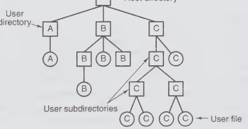

图 4-7. 层次级目录系统。

用户创建任意数量子目录的能力为用户组织工作提供了一个强大的结构化工具。正由于这个原因，几乎所有现代文件系统都是以这种方式组织的。

### 4.2.3 路径名

当文件系统被组织为目录树时，需要一种方法来指定文件名。通常使用两种不同的方法。在第一方法中，每个文件都被赋予一个绝对路径名，由从根目录到文件的路径组成。例如，路径 `/usr/ast/mailbox` 意味着根目录包含一个名为 `usr` 的子目录，该目录又包含一个名为 `ast` 的子目录，后者包含 `mailbox`。绝对路径名从根目录开始是唯一的。在 UNIX 中，路径组件由 `/` 分隔。在 Windows 中，分隔符是 `\`。在 MULTICS 中曾是 `>`。因此，同一个路径名在这些三个系统中的写法如下：

| 系统 | 路径 |
| :--- | :--- |
| Windows | \usr\ast\mailbox |
| UNIX | /usr/ast/mailbox |
| MULTICS | >usr>mailbox |

无论使用什么字符，只要路径名的第一个字符是分隔符，那么该路径就是绝对路径。

另一种名称是相对路径名。它与工作目录（也称为当前目录）的概念结合使用。用户可以指定一个目录作为当前工作目录，在这种情况下，所有不以根目录开头的路径都是相对于工作目录选取的。例如，如果当前目录是 `/usr/ast`，那么绝对路径为 `/usr/ast/mailbox` 的文件可以简单地引用为 `mailbox`。换句话说，UNIX 命令

```
cp /usr/ast/mailbox /usr/ast/mailbox.bak
```

和命令

```
cp mailbox mailbox.bak
```

当工作目录为 `/usr/ast` 时，这两个命令执行的是完全相同的操作。相对形式通常更方便，但它的作用与绝对形式相同。

某些程序需要访问特定文件，而不考虑当前工作目录是什么。在这种情况下，它们应该始终使用绝对路径名。例如，拼写检查器可能需要读取 `/usr/lib/dictionary` 来完成工作。在这种情况下，它应该使用完整的绝对路径名，因为它不知道在执行操作时工作目录在哪里。无论工作目录是什么，绝对路径名都始终有效。

当然，拼写检查器需要来自 `/usr/lib` 的大量文件，另一种方法是使用系统调用将其工作目录更改为 `/usr/lib`，然后将 `dictionary` 作为第一个参数传递给 `open` 函数。通过显式地更改工作目录，它知道自己在目录树中的什么位置，因此可以使用相对路径。

每个进程都有自己的工作目录，因此当它更改工作目录并在稍后退出时，不会影响其他进程，文件系统中也不会留下任何更改的痕迹。通过这种方式，进程在任何认为方便的时候更改工作目录都是完全安全的。另一方面，如果一个库过程更改了工作目录并在结束时没有恢复到原处，程序的其余部分可能无法工作，因为它们对当前位置的假设突然失效了。由于这个原因，库过程很少更改工作目录，当它们必须这样做时，它们总会在返回之前恢复原状。

大多数支持层次级目录系统的操作系统在每个目录都有两个特殊条目，`..` 和 `..`，通常读作 "dot" 和 "dotdot"。dot 指当前目录；dotdot 指其父目录（根目录除外，它指向自身）。为了查看这些是如何使用的，请考虑图 4-8 所示的 UNIX 文件树。某个进程将 `/usr/ast` 作为其工作目录。它可以使用 `..` 升树的更高处。例如，它可以使用以下命令将 `/usr/lib/dictionary` 文件复制到自己的目录中：

```
cp ../lib/dictionary .
```


进入`/path/to/xxx`目录，找到`xxx.json`。

在表达式`cvar = avar + bvar`中，加法运算符（`+`）将`avar`与`bvar`相加，得到它们的和`cvar`

在`List.of(arg0, arg1, arg2)`中，`List`接口的工厂方法`of()`接受一系列的元素，返回包含它们的只读列表。

之后我们这样调用`cmd`命令：`cmd arg0 arg1 arg2`。

```
if (condVar > someVal) {console.log("xxx")}
```

第一个路径指示系统向上移动（到 `usr` 目录），然后进入该目录。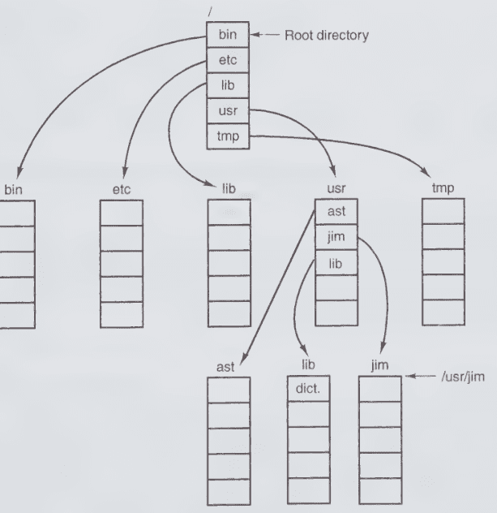

图 4-8. 目录树。

第一个路径指示系统向上移动（到 `usr` 目录），然后进入该目录。

### 4.2.4 目录操作

上面的列表给出了最重要的调用，但还有其他一些，例如用于管理：

- Create: 创建目录。
- Delete: 删除目录。
- Opendir: 打开目录。
- Closedir: 关闭目录。
- readdir: 此调用返回下一个条目。
- Rename: 重命名目录。
- Link: 允许文件出现在多个目录中。
- Unlink: 移除目录条目。如果被删除的文件仅存在于目录，则将其从文件系统中移除。如果存在于多个目录，则仅移除指定的路径。

## 4.3 文件系统实现

现在是把用户的文件系统视图转向实现者的视图了。用户关心如何命名文件、它们允许哪些操作、目录树的结构以及类似的接口。实现者关心文件和目录如何存储、磁盘空间如何管理，以及如何使其高效可靠地运行。在接下来的章节中，我们将检查许多领域，以了解问题和权衡。

### 4.3.1 文件系统布局

文件系统存储在磁盘上。大多数磁盘可以划分为一个或多个分区，每个分区都有独立的文件系统。磁盘的 0 扇区被称为 **MBR（主引导记录）**，用于启动计算机。MBR 的末包含分区表。该表给出了分区的起始和结束地址。分区表中的一个分区被标记为活动。当计算机启动时，BIOS 读取并执行 MBR。MBR 程序的第一项工作是定位活动分区，读取其第一个块（该块被称为**引导块**）并执行它。引导块中的程序加载该分区中的操作系统。为了统一，每个

# 282
# 文件系统
# 第 4 章

分区从引导块（`boot block`）开始，即使它不包含可引导的操作系统。此外，它在未来可能会包含。

除了从引导块开始外，磁盘分区的布局在不同文件系统之间存在很大。通常文件系统会包含图 4-9 所示的某些项。第一个是超级块（`superblock`）。它包含了关于文件系统的所有关键参数，并在计算机启动或首次访问文件系统时被读入内存。超级块中的典型信息包括用于识别文件系统类型的魔数数字（`magic number`）、文件系统中的块数以及其他关键管理信息。

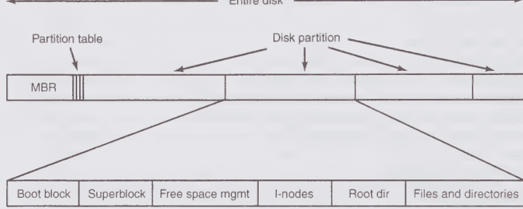

图 4-9。一种可能的的文件系统布局。

接下来可能是关于文件系统中空闲块的信息，例如以位图（`bitmap`）或指针列表的形式存在。之后可能是索引节点（`i-nodes`），这是一个数据结构数组，每个文件一个，描述了关于文件的所有信息。之后可能是根目录（`root directory`），它包含了文件系统树的顶部。最后，磁盘的剩余部分包含了所有的目录和文件。

## 4.3.2 实现文件

在实现文件存储时，最重要的问题可能是跟踪哪些磁盘块属于哪个文件。不同的操作系统使用了各种方法。在本节中，我们将检查其中几种。

## 连续分配

最简单的分配方案是将每个文件存储为一组连续的磁盘块。因此，在块大小为 1-KB 的磁盘上，50-KB 的文件将分配 50 个连续块。对于 2-KB 的块，它将分配 25 个连续块。

我们在图 4-10(a) 中看到了连续存储分配的示例。这里显示了前 40 个磁盘块，从左侧的块 0 开始。初始时，磁盘是空的。然后将一个长度为 4 个块的文件 A 从磁盘开头（块 0）写入磁盘。之后，一个长度为 6 个块的文件 B 从文件 A 的结束之后开始写入。

注意，每个文件都从新块的开头开始，因此如果文件 A 实际上是 3½ 个块，那么最后一个块的末尾就会浪费一些空间。图中总共显示了五个文件，每个从上一个文件结束后的块开始。阴影部分只是为了方便区分文件，在存储方面没有实际意义。

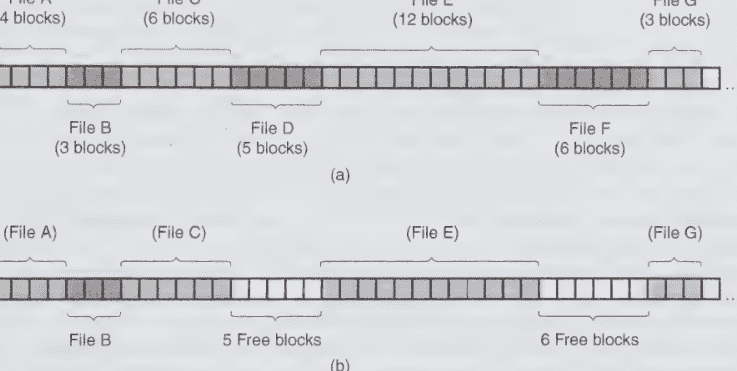

**图 4-10。** (a) 七个文件磁盘空间的连续分配。(b) 删除文件 D 和 F 后的磁盘状态。

连续磁盘空间分配有两个显著优点。首先，它实现起来简单，因为跟踪文件块的位置被简化为记住两个数字：第一个块的磁盘地址和文件中的块数。给定第一个块的编号，可以通过简单的加法找到任何其他块的编号。

其次，读取性能极佳，因为可以通过单次操作从磁盘上读取整个文件。只需要一次寻道（寻到第一个块）。之后，不需要任何寻道或旋转延迟，因此数据以磁盘的全带宽进入。因此，连续分配实现简单且性能很高。

不幸的是，连续分配也有一个严重的缺点：随着时间的推移，磁盘会产生碎片。要了解这是如何发生的，请看 4-10(b)。这里删除了两个文件 D 和 F。当移动一个文件时，它的块自然会被释放，在磁盘上留下一段连续的空闲块。磁盘不会现场压缩以消除洞，因为这将涉及到复制洞之后的所有块（可能多达百万块），在大磁盘上这需要花费数小时甚至几天。结果是磁盘最终由文件和空洞组成，如图所示。

最初，这种碎片并不是问题，因为每个新文件都可以写在磁盘末尾，紧接上一个文件。然而，磁盘最终会填满，必须压缩磁盘（这极其昂贵）或重用空洞中的自由空间。重用空间需要维护空洞列表，这是可行的。但是，当要创建一个新文件时，必须知道它的最终大小，以便选择正确大小的空洞来放置。

想象一下这种设计的后果。用户启动文字处理器来创建一个文档。程序提出的第一个问题是最终文档将有多少字节。必须回答这个问题，否则如果数字证明太小，程序将由于磁盘已满且没有地方存放剩余文件而提前终止。如果用户尝试通过给出一个不实际的大数字（如 1 GB）作为最终大小来避免这个问题，编辑器可能找不到如此大的空洞并宣布无法创建文件。用户可以自由地启动程序并说 500 MB，以此类推，直到找到合适的空洞。尽管如此，这种方案不太可能导致——

## 4.3 文件系统实现 283

## 284 文件系统 第 4 章

文件系统
第 4 章

| 物理块 | | |
|---|---|
| 0 | |
| 1 | |
| 2 | 10 |
| 3 | 11 |
| 4 | 7 | 文件 A 从这里开始 |
| 5 | |
| 6 | 3 | 文件 B 从这里开始 |
| 7 | 2 |
| 8 | |
| 9 | |
| 10 | 12 |
| 11 | 14 |
| 12 | |
| 13 | |
| 14 | -1 |
| 15 | 未用块 |

**图 4-12。** 在主内存中使用文件分配表进行链表分配。

使用这种组织结构，整个块都可以用于数据。此外，随机访问变得容易得多。尽管查找文件内的给定偏移量时仍必须遵循链链，但链链完全在内存中，因此可以在不产生任何磁盘引用的情况下跟踪。与之前的方法一样，目录项只需包含一个整数（起始块号）并能够定位所有块，无论文件有多大）都是足够的。

这种方法的主要缺点是整个表必须一直留在内存中才能工作。对于 1-TB 的磁盘和 1-KB 的块大小，该表需要 10 亿个条目，每个 10 亿个磁盘块各占一个。每个条目至少需要 3 个字节。为了查找速度，它应该是 4 个字节。因此，该表将一直占用 3 GB 或 2.4 GB 的主内存，取决于系统是针对空间还是时间进行优化的。并不具有广泛实用性。显然，FAT 的思想在大磁盘上的扩展性并不良好。尽管它是原始的 MS-DOS 文件系统，但仍受所有版本的 Windows 完全支持。

## 节点 (I-nodes)

我们跟踪哪些块属于哪个文件的最后方法是为每个文件关联一个名为 `i-node`（**索引节点**）的数据结构，它列出了文件块的属性和磁盘地址。图 4-13 描述了一个简单的示例，即 `i-node`，这样就可以找到文件的所有块。

## 第 4.3 节 文件系统实现

该方案相对于使用内存表进行链式文件的巨大优势在于，只有在打开相应文件时 `i-node` 才需要留在内存中。如果每个 `i-node` 占用 $n$ 字节，且同时最多打开 $k$ 个文件，则持有打开文件的 `i-node` 数组所占用的总内存仅为 $kn$ 字节。只需要提前留留这么多空间。

**图 4-13。** 一个 `i-node` 示例。

此数组远小于上一节中描述的文件表所占用的空间。原因很简单。保存所有磁盘块链表的表大小与磁盘本身成正比。如果磁盘有 $n$ 个块，该表就需要 $n$ 个条目。随着磁盘越来越大，该表也随之线性增长。相比之下，`i-node` 方案需要在内存中一个数组，其大小与同时可能打开的最大文件数成比例。磁盘是 100 GB、1000 GB 还是 10000 GB 并不重要。

`i-node` 的一个问题是，如果每个节点都有存储固定数量磁盘地址的空间，当文件增长超过此限制时会发生什么？一种解决方案是将最后一个磁盘地址不用于数据块，而是用于指向包含更多磁盘块地址的块的地址，如图 4-13 所示。更先进的方法是两个或多个此类包含磁盘地址的块，甚至是指向充满地址的其他磁盘块的磁盘块。我们将在第 10 章学习 UNIX 时回到 `i-node` 上。同样，Windows NTFS 文件系统使用了类似的思想，只是 `i-node` 更大，并且还可以包含小文件。

### 4.3.3 实现目录

在读取文件之前，必须先打开它。当文件被打开时，操作系统使用用户提供的路径名在磁盘上定位目录项。目录项提供了找到磁盘块所需的信息。根据系统的不同，这些信息可能是整个文件的磁盘地址（对于连续分配）、第一个块的编号（对于链表方案）或 `i-node` 编号。在所有情况下，目录系统的主要功能是将文件的 ASCII 名称映射到定位数据所需的信息上。

另一个密切相关的问题是属性应该存储在何处。每个文件系统维护各种属性，例如每个文件的所有者和创建时间，它们必须存储在某处。一个明显的可能性是将它们直接存储在目录项中。某些系统恰恰这样做。这种选项如图 4-14(a) 所示。在这种简单设计中，目录由一组固定大小的条目组成，每个文件一个，包含一个（固定长度）文件名、一个文件属性结构以及一个或多个磁盘地址（最多到某个最大值），告知磁盘块的位置。

| games | 属性 | games |
|---|---|---|
| mail | 属性 | mail |
| news | 属性 | news |
| work | 属性 | work |

图 4-14. (a) 包含固定大小条目的简单目录，目录项中包含磁盘地址和属性。(b) 每个条目引用一个 `i-node` 的目录。

对于使用 `i-node` 的系统，存储属性的另一种可能性是（此处此处对应原文逻辑）。保存所有磁盘块链表的表大小与磁盘本身成正比。如果磁盘有 $n$ 个块，该表就需要 $n$ 个条目。随着磁盘越来越大，该表也随之线性增长。相比之下，`i-node` 方案需要在内存中一个数组，其大小与同时可能打开的最大文件数成比例。磁盘是 100 GB、1000 GB 还是 10000 GB 并不重要。

`i-node` 的一个问题是，如果每个节点都有存储固定数量磁盘地址的空间，当文件增长超过此限制时会发生什么？一种解决方案是将最后一个磁盘地址不用于数据块，而是用于指向包含更多磁盘块地址的块的地址，如图 4-13 所示。更先进的方法是两个或多个此类包含磁盘地址的块，甚至是指向充满地址的其他磁盘块的磁盘块。我们将在第 10 章学习 UNIX 时回到 `i-node` 上。同样，Windows NTFS 文件系统使用了类似的思想，只是 `i-node` 更大，并且还可以包含小文件。

### 4.3.3 实现目录

在读取文件之前，必须先打开它。当文件被打开时，操作系统使用用户提供的路径名在磁盘上定位目录项。目录项提供了找到磁盘块所需的信息。根据系统的不同，这些信息可能是整个文件的磁盘地址（对于连续分配）、第一个块的编号（对于链表方案）或 `i-node` 编号。在所有情况下，目录系统的主要功能是将文件的 ASCII 名称映射到定位数据所需的信息上。

另一个密切相关的问题是属性应该存储在何处。每个文件系统维护各种属性，例如每个文件的所有者和创建时间，它们必须存储在某处。一个明显的可能性是将它们直接存储在目录项中。某些系统恰恰这样做。这种选项如图 4-14(a) 所示。在这种简单设计中，目录由一组固定大小的条目组成，每个文件一个，包含一个（固定长度）文件名、一个文件属性结构以及一个或多个磁盘地址（最多到某个最大值），告知磁盘块的位置。

| games | 属性 | games |
|---|---|---|
| mail | 属性 | mail |
| news | 属性 | news |
| work | 属性 | work |

图 4-14. (a) 包含固定大小条目的简单目录，目录项中包含磁盘地址和属性。(b) 每个条目引用一个 `i-node` 的目录。

对于使用 `i-node` 的系统，存储属性的另一种可能性是（此处此处对应原文逻辑）。...（注：由于提供的原文后半部分存在重复和逻辑混乱，此处译文已根据指令要求进行去重和翻译）

## SEC. 4.3 文件系统实现 291

链接。文件系统本身现在是一个有向无环图（DAG），而不是树结构。让文件系统成为 DAG 增加了维护的复杂度，但生活就是如此。

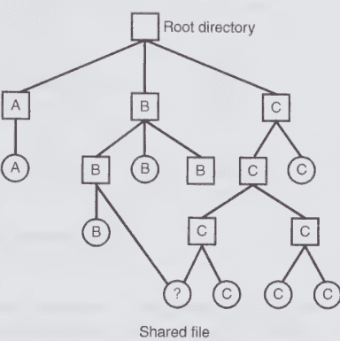

图 4-16. 包含共享文件的文件系统。

共享虽然方便，但也引入了一些问题。首先，如果目录真的包含磁盘地址，那么当文件被链接时，必须在 B 的目录中创建一份磁盘地址的副本。如果随后 B 或 C 向该文件追加内容，新的数据块将只会列在执行追加操作的用户目录中。这些更改对另一个用户是不可见的，这违背了共享的初衷。

这个问题可以通过两种方法解决。在第一种解决方案中，磁盘块并不列在目录中，而是列在文件本身关联的一个小型数据结构中。这样目录只需指向这个小型数据结构即可。这是 UNIX 采用的方法（其中数据结构就是 `i-node`）。

在第二种解决方案中，B以下方式链接到 C 的文件之一：让系统创建一个类型为 `LINK` 的新文件，并将该文件放入 B 的目录中。新文件包含其所链接的文件的路径名。当 B 从链接文件读取内容时，操作系统发现正在读取的文件类型为 `LINK`，于是查找文件名并读取该文件。这种方法被称为符号链接（`symbolic linking`），以区别于传统的（硬）链接（`hard linking`）。

每种方法都有它们的缺点。在第一种方法，从 B 链接到共享文件的一刻起，`i-node` 记录的所有者为 C。创建链接不会改变所有权（见图 4-17），但它会增加 `i-node` 中的链接计数，因此系统知道当前有多少个条目指向该文件。

如果 C 随后尝试删除文件，系统将面临问题。如果它删除了文件并清空了 `i-node`，B 的目录条目将指向一个无效的 `i-node`。如果该 `i-node` 稍后被重新分配给另一个文件，*B* 的链接将指向错误的文件。系统可以从 `i-node` 中的计数知道该文件仍在在使用，但没有简单的方法可以找到该 `i-node` 的所有目录条目。指向目录的指针无法存储在 `i-node` 中，因为目录的数量可能是无限的。

唯一的办法是删除 *C* 的目录条目，但保留 `i-node` 完整，并将计数设置为 1。我们现在处于一种情况：*B* 是唯一拥有由 *C* 拥的文件目录条目的的用户。如果系统计有配额，*C* 将继续为该文件付费，直到 *B* 决定删除它，此时计数变为 0，文件被删除。

使用符号链接时这个问题就不会出现，因为真正的所有者拥有指向 `i-node` 的指针。链接到文件的用户只有路径名，没有 `i-node` 指针。当*所有者*删除文件时，文件会被销毁。随后通过符号链接使用该文件的尝试将由于系统无法找到文件而失败。删除符号链接完全不会影响文件本身。

符号链接的问题在于额外的开销。必须读取包含路径的文件，然后必须逐分组件解析并跟踪该路径，直到到达 `i-node` 为止。所有这些活动可能需要大量的额外磁盘访问。此外，每个符号链接都需要一个额外的 `i-node` 以及一个用于存储路径的额外磁盘块，尽管如果路径名很短，系统可以将其存储在 `i-node` 内部作为一种优化。符号链接的优势在于，它们可以用于链接到世界上任何机器上的文件，只需提供文件所在机器的网络地址以及在该机器上的路径即可。

链接（无论是符号链接或其他）还引入了另一个问题。当允许链接时，文件可以拥有两个或多个路径。从给定目录开始并查找该目录及其子目录下所有文件的程序将多次定位同一个文件。例如，将目录及其子目录下所有文件转储到磁带上的程序可能会对链接文件创建多个副本。此外，如果随后将磁带读入另一台机器，除非转储程序足够智能，否则链接将被复制两次到磁盘上，而不是链接。

## 4.3 文件系统实现 293

### 4.3.5 日志结构文件系统

技术的进步正给文件系统带来压力。特别是 CPU 变得越来越快，磁盘变得越来越廉，内存容量不断增大。这些因素结合寻道时间正在成为瓶颈的事实，导致了一种新方法：日志结构文件系统（Log-Structured File Systems, LFS）。在本节中，我们将简要描述 LFS 的工作原理。

LFS 的思想是在内存中缓冲所有写操作，并定期将它们作为日志末尾的单个段（`segment`）写入磁盘。打开文件包括使用 `map` 来定位 `i-node`。一旦找到 `i-node`，就可以从中找到数据块的地址。所有数据块本身将位于日志中的某个段内。

如果磁盘是无限大的，上述就是全部了。然而，真实的磁盘是有限的，因此日志最终将占据整个磁盘，届时无法写入新段。幸运的是，许多现有的段包含不再使用的块。例如，如果一个文件被覆盖，它的 `i-node` 将指向新的块，但旧块仍然占据着之前写入的段。

为了解决这个问题，LFS 有一个清理线程（`cleaner`），它花时间循环扫描日志以进行压缩。它从读取日志第一个段的摘要开始，查看是否存在 `i-node` 和文件。它检查当前的 `i-node map` 以判断 `i-node` 是否仍然有效以及文件块是否在使用。如果不是，则丢弃这些信息。仍在使用的 `i-node` 和块将进入内存，以便写入下一个段。通过这种方式，清理线程沿日志移动，移除尾部的旧段，并将任何数据放入内存以便写入下一个段。因此，磁盘是一个巨大的循环缓冲区，写入线程在前端添加新段，而清理线程在尾部移除旧段。

簿记工作并不简单，因为当文件块被写回新段时，该文件的 `i-node`（位于日志某处）必须被定位、更新并放入内存以写入下一个段。然后，必须更新 `i-node map` 以指向新副本。尽管如此，性能结果表明这种复杂性都是值得的。上述引用论文给出的测量结果显示，LFS 在小写操作上比 UNIX 高出一个数量级，而在读写方面的性能与 UNIX 持平甚至更好。

图 4-17. (a) 链接前的情况。(b) 创建链接后的情况。(c) 原始所有者删除文件后的情况。

| B 的目录 | C 的目录 |
| :--- | :--- |
| | C 的目录 |
| B 的目录 | |

## 4.3.6 日志文件系统

虽然日志结构文件系统是一个有趣的想法，但它们并没有被广泛使用，部分原因在于它们与现有的文件系统极不兼容。尽管如此，它们固有的一个思想——在面对故障时的健壮性——可以很容易应用到更传统的文件系统中。其基本思想是在文件系统执行操作之前，记录一份它将要执行的操作日志，这样如果系统在完成计划工作之前崩溃，在重启后，系统可以查看日志查看崩溃时发生了什么，并完成该工作。这种文件系统，即日志文件系统，实际上正在使用。微软的 NTFS 文件系统以及 Linux 的 ext3 和 ReiserFS 文件系统都使用了日志功能。OS X 提供文件系统日志作为一个选项。下面我们将对对这一主题进行简要介绍。

为了了解问题的本质，考虑一个经常发生的简单操作：删除文件。该操作（UNIX）需要三个步骤：

- 从目录中删除文件。
- 将 `i-node` 释放到空闲 `i-node` 池。
- 将所有磁盘块返回空闲磁盘块池。

在 Windows 中需要类似的步骤。在没有崩溃的情况下，这些步骤的执行顺序并不重要；但在发生崩溃的情况下，顺序就很重要。假设第一步已完成，然后系统崩溃。`i-node` 和文件块将无法从任何文件访问，但也无法被重新分配；它们就那样悬在某处的中间状态，减少了可用资源。如果崩溃发生在第二步之后，则只丢失了块。

如果改变了操作顺序并先释放 `i-node`，那么在重启后，旧目录将继续指向它，从而指向错误的文件。如果先释放块，那么在第二步之后发生崩溃，只丢失块将意味着一个有效的目录项指向一个 `i-node`，而其列出的块现在位于空闲存储池中并可能很快被重用，导致两个或多个文件随机地共享相同的块。这些结果没有没有是好的。

日志文件系统做的是首先写入一条日志项，列出要完成的三个操作。日志项被写入磁盘（为了保险起见，可能还会从磁盘读回以验证其是否已正确写入）。只有在写入日志项后，各种操作才开始。在操作成功完成后，日志会被擦除。如果系统此时崩溃，在恢复时，文件系统可以检查日志查看是否有任何挂起的操作。如果有，所有操作都可以重新运行（在反复崩溃的情况下可能会运行多次），直到文件被删除。

为了使日志生效，记录的操作必须是**等等的**（`idempotent`），这意味着它们可以根据需要重复多次而不产生危害。像“更新位图将 `i-node` k 或块 n 标记为空”这样的操作可以重复直到成功而没有危险。搜索目录并删除任何 `foobar` 条目也是等等的。另一方面，将 `i-node` k 的新空闲块添加到空闲列表的末尾不是等等的，因为它们可能已经在那里了。代价销的操作“搜索空闲块列表，如果不存在则将块 n 添加其中”是等等的。日志文件系统必须安排其数据结构和可记录的操作，以便它们都是等等的。在这些条件下，崩溃恢复可以既快速又安全。

为了增加可靠性，文件系统可以引入原子事务。当使用此概念时，一组操作可以被“开始事务”和“结束事务”操作括起来。文件系统随后知道它必须完成所有封装的操作，要么都不完成，而不有其他组合。

NTFS 拥有一个广泛的日志系统，其结构很少被系统崩溃损坏。它自 1993 年随 Windows NT 首次发布以来一直在开发。第一个使用日志的 Linux 文件系统是 ReFS，但它的流行程度受到了其与当时标准的 ext2 文件系统不兼容的影响。相比之下，ext3 是一个比 ReFS 野心较低的项目，它在保持与之前的 ext2 系统兼容的同时也使用了日志。

## 4.3.7 虚拟文件系统

许多不同的文件系统正在被使用——通常在同一台计算机上——即使对于同一个操作系统。Windows 系统可能有一个主 NTFS 文件系统，还有一个旧的 FAT-32 或 FAT-16 驱动器或分区，其中包含旧但仍需要的数据，以及偶尔使用的闪存驱动、旧 CD-ROM 或 DVD。VFS（虚拟文件系统）是一个抽象这些异构文件系统的层。从用户的角度来看，存在单一的文件系统层次结构。

虽然 VFS 下的大多数文件系统代表本地磁盘上的分区，但情况并非如此。事实上，Sun 构建 VFS 的原始动力是支持使用 **NFS（网络文件系统）** 协议的远程文件系统。VFS 的设计使得只要具体的文件系统提供了 VFS 所需的功能，VFS 就不知道数据存储在哪里，也不确定底层文件系统是什么样的。

所有与文件相关的系统调用都直向虚拟文件系统进行初始处理。这些来自用户进程的调用是标准的 POSIX 调用，例如 `open`、`read`、`write`、`lseek` 等。VFS 有一个指向用户进程的“上”接口，这就是著名的 POSIX 接口。

VFS 还有一个指向具体文件系统的“下”接口，在图 4-18 中标记为 VFS 接口。该接口由几十个函数组成，VFS 可以对每个文件系统调用这些函数来完成工作。要创建一个与 VFS 工作的新文件系统，新文件系统的设计者必须确保它提供了 VFS 所需的功能。此类函数的一个显而见的例子是从磁盘读取特定块，将其放入文件系统的缓冲区缓存中并返回指向它的指针的函数。

在内部，大多数 VFS 实现本质上是面向对象的，即使它们是用 C 而不是 C++ 编写的。有几个关键的对象类型是

通常会被支持。这些包括超级块（描述文件系统）、`v-node`（描述文件）和目录（描述文件系统）。这些中的每项都拥有文件系统必须支持的关联操作（方法）。此外，VFS（虚拟文件系统）还包含一些供其自身使用的内部数据结构，包括挂载点和一个用于跟踪用户进程中所有打开文件的文件描述符数组。

为了理解 VFS 是如何工作的，让我们按时间顺序运行一个示例。当系统启动时，根文件系统会向 VFS 注册。此外，当其他文件系统被挂载时（无论是在启动时还是运行期间），它们也必须向 VFS 注册。当一个文件系统注册时，它基本上提供的是 VFS 所需的函数列表，可以作为一个长长的调用向量（表）提供，也可以根据 VFS 的需求提供多个表（每个表对应一个 VFS 对象）。因此，一旦文件系统在 VFS 中注册完成，VFS 就知道如何例如从其读取一个块——它只需调用由文件系统提供的向量中的第四个（或任意一个）函数即可。同样，VFS 也知道如何执行具体文件系统必须提供的每个函数：它只需调用文件系统注册时提供的函数地址即可。

文件系统被挂载后，就可以使用了。例如，如果一个文件系统被挂载在 `/usr/unistd.h`，并且一个进程进行了调用


```
open("/usr/unistd.h", O_RDONLY)
```


在解析路径时，VFS 发现 `/usr` 上挂载了一个新的文件系统，并通过通过搜索已挂载文件系统的超级块列表来定位其超级块。完成此操作后，它可以找到挂载文件系统的根目录，并查找路径中的 `include/unistd.h`。然后，VFS 创建一个 v-node 并调用具体文件系统以返回文件 inode 中的所有信息。这些信息被复制到 v-node（内存中）中，同时还有其他信息，最重要的是一个指向用于对 v-node 进行操作（如读、写等）的调用的函数表的指针。

在创建 v-node 之后，VFS 在调用进程的文件描述符表中创建一个条目，并将其指向新的 v-node。（对于纯粹主义者来说，文件描述符实际上指向另一个包含当前文件位置和指向 v-node 指针的数据结构，但这一细节对我们的目的并不重要。）最后，VFS 将文件描述符返回给调用者，使其可以使用它来读取、写入和关闭文件。

当进程使用文件描述符表进行读取并遵循指针指向函数表时，所有这些地址都是请求文件所在具体文件系统中的地址。处理读取的函数现在被调用，具体文件系统中的代码将运行并获取请求的块。VFS 并不知道数据是来自本地磁盘、通过网络的远程文件系统、USB 闪盘还是其他东西。涉及的数据结构如图 4-19 所示。从调用者的进程数和文件描述符开始，依次定位到 v-node、读取函数指针以及具体文件系统内的访问函数。

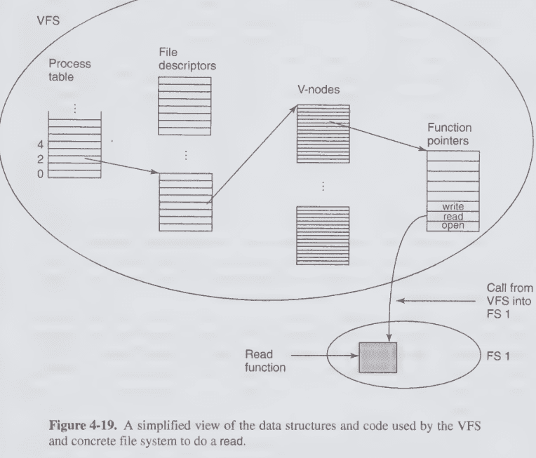

通过这种方式，添加新的文件系统变得相对简单。要创建一个新文件系统，设计者首先获取 VFS 预期的函数调用列表，然后编写他们的文件系统来提供所有这些函数。或者，如果文件系统已经存在，他们就必须提供封装函数来完成 VFS 的需求，通常是通过向具体文件系统发出一次或多次原生调用来实现。

## 4.4 文件系统管理与优化

让文件系统工作是一回事；让它在现实生活中高效且稳定运行是另一回事。在接下来的章节中，我们将查看管理磁盘的一些问题。

### 4.4.1 磁盘空间管理

文件通常存储在磁盘上，因此磁盘空间管理是文件系统设计者关注的问题。存储一个 $n$ old的文件有两种通用策略：分配 $n$ 个连续的磁盘空间，或者将文件分成若干（不一定连续）的块。内存管理系统中的纯分段和分页之间也存在同样的权衡。

正如我们所看到的，将文件存储为连续的字节序列有一个明显的问题：如果文件增大，它可能必须在磁盘上移动。内存中的段也存在相同的问题，但在内存中移动段与将文件从一个磁盘位置移动到另一个位置相比是相对快速的操作。由于这个原因，几乎所有的文件系统将文件分成不需要相邻的固定大小块。

#### 块大小

一旦决定使用固定大小块存储文件，问题就变成了块应该有多大。考虑到磁盘的组织方式，扇区、轨道和磁柱是分配单位的明显候选者（尽管这些都取决于设备，这是一个缺点）。在分页系统中，页大小也是一个主要的竞争者。

从这些数据中可以得出什么结论？首先，当块大小为 1 KB 时，只有 30–50% 的文件适合单个块，而对于 4-KB 的块，适合单个块的文件百分比增加到 60–70% 的范围。论文中的其他数据表明，使用 4-KB 块，93% 的块被使用了。这意味着在每个文件末尾浪费一些空间是重要的，因为磁盘会被少数大文件占据。

## 4.4 文件系统管理与优化

| 长度 | VU 1984 | VU 2005 | Web |
| :--- | :--- | :--- | :--- |
| 1 KB | 48.05 | 30.91 | 47.82 |
| 2 KB | 60.87 | 46.09 | 59.44 |
| 4 KB | 75.31 | 59.13 | 70.64 |
| 8 KB | 84.97 | 69.96 | 79.69 |
| 16 KB | 91.93 | 78.92 | 86.79 |
| 32 KB | 96.12 | 85.57 | 91.65 |
| 64 KB | 98.48 | 92.21 | 96.73 |
| 128 KB | 99.62 | 97.73 | 98.89 |
| 256 KB | 99.87 | 99.41 | 99.44 |
| 512 KB | 99.94 | 99.62 | 99.86 |
| 1 MB | 99.97 | 99.87 | 99.94 |
| 2 MB | 99.99 | 99.96 | 99.97 |
| 4 MB | 99.99 | 99.99 | 99.99 |
| 8 MB | 99.99 | 99.99 | 99.99 |

> 图 4-20. 小于给定大小（字节为单位）的文件百分比。

数据传输率几乎随块大小线性增长（直到传输所需时间过长，以至于传输时间开始变得重要）。

现在考虑空间效率。对于 4-KB 文件和 1-KB、2-KB 以及 8-KB 块，文件分别使用 4、2 和 1 个块，没有浪费。当使用 8-KB 块处理 4-KB 文件时，空间效率下降到 50%，而使用 16-KB 块时下降到 25%。在现实中，很少有文件的大小是块大小的整数倍，因此文件的末尾总是会浪费空间。

这些曲线显示，性能和空间利用率本质上是相互冲突的。小块对性能不利，但有利于磁盘空间利用率。对于这些数据，目前没有合理的折中方案。最接近两条曲线交点的大小是 64 KB，但数据传输率仅为 6.6 MB/sec，空间效率约为 7%，两者都不理想。从历史角度来看，文件系统一直选择在 1-KB 到 4-KB 之间，但现在磁盘已超过 1 TB，将块大小增加到 64 KB 并接受浪费的磁盘空间可能是更好的选择。磁盘空间已不再是稀缺资源。

为了实验 Windows NT 文件使用情况与 UNIX 相比是否有显著差异，Vogels 在康奈尔大学对文件进行了测量（Vogels, 1999）。他观察到 NT 的的使用比 UNIX 更复杂。他写道：

> 当我们在记事本编辑器中输入几个字符时，将其保存到文件将触发 26 次系统调用，包括 3 次失败的打开尝试、1 次文件覆盖以及 4 次额外的打开和关闭序列。

尽管如此，Vogels 观察到按使用情况加权的文件中位数大小仅为 1 KB，刚写入的文件为 2.3 KB，而读写过的文件为 4.2 KB。考虑到不同的数据集、测量技术和年份，这些结果与 VU 的结果是兼容的。

### 跟踪空闲块

一旦确定了块大小，下一个问题就是如何跟踪空闲块。有两种广泛使用的方法，如图 4-22 所示。第一种方法由磁盘块的链表组成，每个块尽可能包含多个空闲磁盘块。对于 1-KB 的块和 32 位的磁盘块号，空闲列表上的每个块持有 255 个空闲块（需要一个槽位指向下一个块）。考虑一个 1-TB 的磁盘，它有约 10 亿个磁盘块。每块存储 255 个地址总共需要大约 400 万个块。通常，空闲块用于存储空闲列表，因此这种存储本质上是免费的。

图 4-22。(a) 在链表上存储空闲列表。(b) 位图。

另一种空闲空间管理技术是位图。映射表需要一个具有 $n$ 位的位图。空闲块用映射中的 1 表示，分配块用 0 表示（或反之亦然）。对于我们的 1-TB 磁盘示例，我们需要 10 亿个位来存储它。位图所需的空间更少这并不意外，因为它每个块只使用 1 位，而链表模型中则使用 32 位。只有当磁盘几乎全满（即空闲块很少）时，链表方案需要的块才会比位图少。

如果空闲块倾向于以长距离连续块的形式出现，可以修改空闲列表系统，以跟踪连续块组而不是单个块。可以为每个块关联一个 8 位、16 位或 32 位的计数器，给出连续空闲块的数量。在理想情况下，一个基本为空的磁盘可以用两个数字表示：第一个空闲块的地址，后跟空闲块的。另一方面，如果磁盘严重碎片化，跟踪块组的效率就低于跟踪单个块，因为不仅必须存储地址，还需要存储计数。

解决问题可以使用多种数据结构和算法，选择最理想的方案需要设计者目前没有、且在系统部署和使用之前无法获得的数据。即便如此，我们在 1984 年和 1995 年在 VU 对文件大小的测量、网站数据以及 Carla 只有四个文件。虽然这比没有要好得多，但我们几乎不清楚它们是否也能代表家用电脑、公司计算机、政府计算机等等。通过某些努力，我们可能能够从其他类型的计算机中获得几个样本，但即使如此，将结果外推到所有所测量类型的计算机也是愚蠢的。

回到空闲列表方法，主内存中只保留一个指针块。当创建文件时，所需的块从指针块中获取。同样，当删除文件时，它的块被释放并添加到主内存中的指针块中。当该块填满时，它会被写到磁盘。

在某些情况下，这种方法会导致不必要的磁盘 I/O。考虑图 23(a) 的情况，内存中的指针块仅能容纳两个条目。如果释放一个三块的文件，指针块就会溢出并必须写入磁盘，导致图 23(b) 的结果。现在写入一个三块的文件，必须重新读取整个指针块，这使我们回到了图 23(a)。如果刚刚写入的三个块文件是临时文件，当它被释放时，需要另一个磁盘将整个指针块写回磁盘。当指针块几乎空空时，一系列临时文件会导致大量的磁盘 I/O。

一种可以避免这种磁盘 I/O 的替代方案是拆分指针块。与其从图 23(a) 到图 23(b)，我们在释放三块块时从图 23(a) 到图 23(c)。系统可以处理一系列临时文件而无需任何磁盘 I/O。这里的想法是让磁盘上的大多数指针块保持满（以减少使用），但让内存中的保持半空。这种方法的额外益处是，通过从位图中进行所有分配，磁盘块将聚集在一起，从而减少磁头移动。

图 23。(a) 内存中和磁盘上空闲块的几乎满指针块。(b) 释放三块文件的结果。(c) 处理三块块的替代策略。

### 磁盘配额

为了防止人们占用过多磁盘空间，多用户操作系统通常提供一种强制执行磁盘配额的机制。想法是系统管理员为每个用户分配文件和块的最大限额，操作系统确保用户不超过这些配额。下面描述了一种典型的机制。

当用户打开文件时，属性和磁盘地址会被定位并放入主内存中的打开文件表中。属性中有一个指示所有者的条目。文件大小的任何增加将计入所有者。

第二个表包含每个打开文件的用户的配额记录，即使该文件是由他人打开的。该表如图 4-24 所示。它是磁盘上当前打开文件的用户的配额文件的提取。当所有文件关闭时，记录会被写回配额文件。

当打开文件表中创建新条目时，会将所有者的配额指针键入其中，以便查找各种限制。每当向文件添加块时，计入所有者的块总数就会增加，并对硬限制和软限制进行检查。可以超过软限制，但不能超过硬限制。在达到硬块限制时尝试附加文件将导致错误。对于文件数量也存在类似的检查，以防止用户占用所有的 i 节点。

当用户尝试登录时，系统会检查配额文件，查看用户是否超过了文件数量或磁盘块数量的任一软限制。

# 打开文件表

# 配额表

| 属性 | 软块限制 |
| :--- | :--- |
| 磁盘地址 | 硬块限制 |
| 用户 = 8 | 当前块数 |
| 配额指针 | 剩余块警告次数 |
| 用户 8 的配额记录 | 软文件限制 |
| 硬文件限制 | 当前文件数 | 剩余文件警告次数 |

如果违反了任何一个限制，系统都会显示警告，并且剩余警告计数将减一。如果计数变为零，说明用户忽略警告的次数过多，他们将不被允许登录。要获得登录权限，需要与系统管理员进行沟通。

这种方法的特性是：用户在登录会话期间可能会超过其软限制，只要他们在注销前删除多余部分即可。但硬限制是绝对不能超过的。

### 4.4.2 文件系统备份

文件系统的损坏往往比计算机的损毁是更得大的灾难。如果计算机因火灾、雷电浪涌或洒在键盘上的咖啡而毁坏，这虽然令人恼恼且会产生费用，但通常可以少费麻烦地购买一台备用。廉价的个人电脑只需去电脑商店，小时内即可更换（大学除外，在那里发布采购单需要三个委员会、五个签名和 90 天的时间）。

如果计算机的文件系统由于硬件或软件原因发生不可挽回的丢失，那么恢复所有信息将变得困难、耗时，且在许多情况下是不可能的。对于那些由于程序、文档、税收记录、客户文件、数据库、营销计划或其他数据永久消失的人来说，其后果可能是灾难性的。虽然文件系统无法提供对设备和介质物理损坏的任何保护，但它可以帮助保护信息。这非常直观：制作备份。但这并不像听起来那么简单。让我们来看一下。

## 4.4 文件系统管理与优化

大多数人并不认为备份文件值得花费时间和精力的——直到某天他们的磁盘突然故障，那时他们中的大多数人都会经历一场可怕的转变。然而，公司（通常）非常清楚地理解其数据的价值，并通常每天至少备份一次到磁带上。磁带可以存储数百 GB 的数据，且每 GB 的成本仅需几分。尽管如此，制作备份并不如听起来那么简单，因此我们将在下面检查一些相关问题。

到磁带的备份通常是为了处理两类潜在问题：

- 1. 从灾难中恢复。
- 2. 从愚蠢行为中恢复。

第一点涵盖了磁盘崩溃、火灾或其他自然灾害后让计算机运行。在实践中，这些事情发生并不频繁，这就是为什么许多人不屑于备份。这些人出于同样的原因，往往也不为自己的房屋购买火险。

第二个原因是用户不小心删除了他们以后需要的文件。这个问题发生得如此频繁，以至于当文件在 Windows 中被“删除”时，它并没有被删除，而是被移动到了特殊的目录——回收站，以便可以轻松地完成和恢复。备份进一步强化了这一原则，允许将几天甚至几周前删除的文件从旧的备份磁带中恢复。

制作备份需要很长时间并占用大量空间，因此高效且方便地进行备份至关重要。这些考虑引发了以下问题。首先，是应该备份整个文件系统，还是只备份部分？在许多安装中，可执行（二进制）程序被保留在文件系统树的受限部分。它是网站或安装 DVD 盘。此外，大多数系统都有一个临时文件目录。通常没有理由备份它。在 UNIX 中，所有特殊文件（I/O 设备）都保留在 `/dev` 中。备份这个目录不仅是必要的，而且是非常危险的，因为如果备份程序尝试完整读取其中的每一个文件，它将永远挂起。简而言之，备份特定的目录及其内部所有内容比备份整个文件系统要理想得。

其次，备份自上次备份以来没有变化的文件是浪费的，这引出了增量备份（incremental dumps）的想法。增量备份最简单的形式是定期（每周或每月）制作一次完整的（备份），并仅对那些自上次转储以来发生变化的文件进行每日转储。更好的方法是只转储自上次转储以来发生变化的文件。虽然这最小化了转储时间，但它让恢复变得更加复杂，因为必须首先恢复最近的一次完整备份，然后按照反序恢复所有的增量备份。为了简化恢复，通常会使用更复杂的增量备份方案。

第三，由于通常会转储大量数据，在将数据写入磁带之前对数据进行压缩可能是理想的。然而，对于许多压缩算法，备份磁带上的单个坏点就会导致解压缩算法失败，并使整个文件甚至整条磁带变得不可读。必须仔细考虑压缩备份流的决策。

第四，在活动的文件系统上执行备份是困难的。如果在转储过程中正在添加、删除和修改文件及目录，生成的转储可能是不一致的。然而，由于制作转储可能需要几个小时，可能必须在晚上的大部分时间将系统离线以进行备份，这并不是总是可以接受的。出于某些原因，人们设计了通过复制关键数据结构对文件系统进行快速快照的算法，然后要求未来对文件和目录的更改复制块而不是原地更新（Hutchinson et al., 1999）。通过这种方式，文件系统在快照瞬间被有效地冻结，因此可以从容地进行备份。

第五也是最后，制作备份为组织引入了许多非技术问题。如果系统管理员将所有磁盘或磁带放在办公室里，并在去走廊买咖啡时无人看管，那么世界上最好的在线安全系统也可能毫无用处。间谍只需要进来一秒钟，把一个小磁盘或磁带放进兜里然后离开。安全不复。此外，如果烧毁计算机的火灾也烧掉了所有的备份磁带，那么每天备份也意义不大。目前，备份磁盘应该存放在异地，但这引入了更多的安全风险（因为现在必须保护两个地点）。关于这些和其他实际管理问题的详尽讨论，请参见 Nemeth et al. (2013)。下面我们将只讨论制作文件系统备份涉及的技术问题。

转储到备份磁盘有两种策略：物理转储（physical dump）或逻辑转储（logical dump）。物理转储从磁盘的0 块开始，按顺序将所有磁盘块写入输出转储中，并在复制最后一个块时停止。这样的程序非常简单，可能可以做到 100% 无 Bug，这对于任何其他程序可能都是不可能。

然而，关于物理转储值得进行几点说明。首先，备份未使用的磁盘块没有价值。如果转储程序可以访问空闲块数据结构，就可以避免备份未使用的块。然而，跳过空闲块需要在块的开头（或等效位置）写入每个块的编号，因为备份上的第 k 块不再是磁盘上的 k 块。

第二个担心是转储坏块。制造没有任何缺陷的大型磁盘几乎是不可能的。某些坏块总是存在的。在进行低级格式化时，坏块会被检测到、标记为坏块，并被磁道末端预留的备用块替换。在许多情况下，磁盘控制器会透明地处理坏块替换，操作系统完全感知不到。

带有分页文件和休眠文件的 Windows 系统在恢复发生时是不需要的，而且最初就不应该被备份。特定系统可能有其他不应备份的内部文件，因此转储程序需要感知这些文件。

物理转储的主要优点是简单和速度极快（基本上，它可以以磁盘的速度运行）。主要的缺点是无法跳过选定的目录、制作转储以及根据请求恢复单个文件。由于这些原因，大多数安装程序采用逻辑转储。

逻辑转储从一个或多个指定的目录开始，递归地转储自基准日期以来发生变化的文件和目录（例如，增量转储的上次备份或全量转储的系统安装）。因此，在逻辑转储中，转储获得一组仔细识别的目录和文件，这使得在请求时恢复特定的文件或目录变得容易。

由于逻辑转储是最常见的形式，让我们以图 4-25 为例详细检查一种常用算法。大多数 UNIX 系统都使用这种算法。在图中，我们看到一个包含目录（正方形）和文件（圆圈）的树。阴影部分自基准日期以来已修改过，因此需要转储。未阴影的部分不需要转储。

该算法会转储所有位于已修改文件或目录路径上的目录（即使是未修改的目录），原因有两个。第一个原因是为了能够将转储的文件和目录恢复到另一台计算机上的全新文件系统中。通过这种方式，转储和恢复程序可以支持计算机之间的整个文件系统。

对修改目录上方的未修改目录的第二个原因是为了能够增量恢复单个文件（可能是为了处理误操作导致的恢复）。假设在周日晚上进行了全文件系统转储，`/usr/fs/proj/nr3` 被删除，连同其下的所有目录和文件一起。在周三早晨，假设用户想要恢复文件 `/usr/fs/proj/nr3/plans/summary`。然而，无法恢复文件 summary 文件，因为没有地方放置它。必须先恢复 `nr3` 和 `plans` 目录。为了确保它们的所有者、模式等任何信息正确，这些目录必须存在于转储磁盘上，即使它们本身自上次转储以来未被修改。

图 4-25。一个待转储的文件系统。阴影部分自上次转储以来已修改。每个目录和文件都用其 i-node 号标记。

转储算法维护一个以 i-node 号为索引的位图，每个 i-node 有多个位。随着算法的进行，此位图中的位将被设置和清除。该算法分为四个阶段。阶段 1 从起始目录（本例中为根目录）开始并检查其中的所有条目。对于每个修改的文件，其 i-node 会在位图中被标记。每个目录也被标记（无论其是否被修改），然后进行递归检查。

在阶段 1 结束时，所有修改的文件和所有目录都在位图中被标记，如图 4-26(a) 所示（通过阴影表示）。阶段 2 再次递归遍历树，标记任何内部或下方没有修改的文件或目录的目录。这使得位图如图 4-26(b) 所示。注意，目录 10、11、14、27、29 和 30 现在未标记标记，因为它们不包含任何已修改的内容。它们将不会被转储。相比之下，目录 5 和 6 即使本身未被修改也会被转储，因为在将今天的更改恢复到新机器时将需要它们。为了效率起见，阶段 1 和阶段 2 可以合并在一次树遍历中。

此时，已知哪些目录和文件必须转储。这些是图 4-26(b) 中标记的。阶段 3 包括按数字顺序扫描 i-node 并转储所有标记为转储的目录。

**图 4-26。** 逻辑转储算法使用的位图。

| | (a) | (b) | (c) | (d) |
| :--- | :--- | :--- | :--- | :--- |
| **索引 (Index)** | 1 2 3 4 5 6 7 8 9 10 11 12 13 14 15 16 17 18 19 20 21 22 23 24 25 26 27 28 29 30 31 32 | 1 2 3 4 5 6 7 8 9 10 11 12 13 14 15 16 17 18 19 20 21 22 23 24 25 26 27 28 29 30 31 32 | 1 2 3 4 5 6 7 8 9 10 11 12 13 14 15 16 17 18 19 20 21 22 23 24 25 26 27 28 29 30 31 32 | 1 2 3 4 5 6 7 8 9 10 11 12 13 14 15 16 17 18 19 20 21 22 23 24 25 26 27 28 29 30 31 32 |
| **描述 (Description)** | 4-26(a) | 4-26(b) | 4-26(c) | 4-26(d) |

## 4.4.3 文件系统一致性

另一个出现可靠性区域是文件系统一致性。许多文件系统会读取块、修改它们。如果系统在写入所有块之前崩溃，文件系统可能会处于不一致状态。为了处理不一致性，大多数计算机都有检查文件系统一致性的程序。例如，UNIX 有 `fsck`；Windows 有 `chkdsk`。这种工具可以在系统启动时运行，特别是在崩溃后。下面的描述说明了 `fsck` 如何工作。有些可能不同，因为它们独立处理每个文件系统（磁盘分区），但使用文件系统冗余性的通用原则仍然有效。块一致性检查文件。为了检查块一致性，程序构建两个表，每个块都有一个计数器。第一个表跟踪块出现在文件中的次数；第二个表记录块在空闲列表中出现的次数。

然后，程序使用原始设备读取所有的 i-node，该设备忽略文件结构并返回所有磁盘块。从一个节点开始，可以构建对应文件的块号列表。每读取一个块号，第一个表中的计数器就会加1。程序然后检查空闲列表或位图以找到所有未使用的块。空闲列表中块每次出现都会导致第二个表的计数器加1。

如果文件系统是一致的，每个块在第一个表或第二个表中都应该有一个 1，如图 4-27(a) 所示。然而，作为崩溃的结果，表可能像图 4-27(b) 所示，其中块 2 在任何表中都没有出现。它将被报告为丢失块。虽然丢失块没有危害，但它们浪费空间，从而减少了磁盘容量。丢失块的解决方案是直接的：文件系统检查器将其添加到空闲列表中。

另一种出现的情况如图 4-27(c) 所示。在这里我们看到一个块（编号 4）在空闲列表中出现了。（只有当空闲列表真的是列表时才可能重复；使用位图是不可能的。）解决方案同样简单：重建空闲列表。

# 文件系统管理与优化

| 块编号 | 块编号 |
| 0 1 2 3 4 5 6 7 8 9 10 11 12 13 14 | 0 1 2 3 4 5 6 7 8 9 10 11 12 13 14 |
| 1 1 0 1 1 0 1 1 0 0 0  1  1  1  0  0 | 1 1 0 0 0 0 1 1 0 0 0  0  1  1  0  0 |
| 0 0 1 0 0 0 1 0 0 0 0  1  1  0  0  0 | 0 0 0 0 0 0 1 1 0 0 0  0  1  1  0  0 |
| (a) 已使用的块 | (b) 已使用的块 |

| 块编号 | 块编号 |
| 0 1 2 3 4 5 6 7 8 9 10 11 12 13 14 | 0 1 2 3 4 5 6 7 8 9 10 11 12 13 14 |
| 1 1 0 1 1 0 1 1 1 0 0  1  1  1  1  0 | 1 1 0 1 0 2 1 1 0 0 0  1  1  0  0  1 |
| 0 0 1 0 0 2 0 0 0 0 1  1  0  0  0  0 | 0 0 0 1 0 1 0 0 0 0 1  1  0  0  0  1 |
| (c) 已使用的块 | (d) 已使用的块 |

**图 4-27.** 文件系统状态。(a) 一致性。(b) 缺失块，(c) 空闲列表中的重复块。(d) 重复的数据块。

文件系统检查器的适当操作是分配一个空闲块，将块 5 的内容复制到其中，并将副本插入其中一个空闲文件中。通过这种方式，文件信息保持不变（尽管几乎可以确定该块是乱码的），但文件系统结构至少恢复了一致性。应该报告此错误，以便用户检查损坏情况。

除了检查每个块是否被正确记录外，文件系统检查器还会检查目录系统。它也使用计数统计，但这些计数是针对每个文件的，而不是每个块的。它从根目录开始向下遍历树，检查文件系统中的每个目录。对于每个目录中的每个 i-node，它会将该文件的使用次数计数器加1。请记住，由于硬链接，一个链接可能会出现在两个或多个目录中。符号链接不计入，也不会导致目标文件的计数器加1。

当检查器完成后，它有一个按 i-node 索引的列表，说明每个文件包含多少个目录。然后它将这些数字与存储在 i-node 自身的链接计数进行比较。这些计数在文件创建时从 1 开始，并在每次创建（硬）链接时递增。在一致的文件系统中，这两个计数将保持一致。然而，可能会发生两种错误：i-node 中的链接计数可能过高，也可能过低。

如果链接计数大于目录条目的数量，即使文件已从目录中删除，计数仍然不为零，且 i-node 不会被删除。这种错误并不严重，但它会浪费磁盘空间，产生一些不存在于任何目录中的文件。这应该通过将 i-node 中的链接计数设置为正确值来修复。

另一个错误可能是潜在的灾难性的。如果两个目录条目链接到一个文件，但 i-node 显示只有一个，那么只要删除任何一个目录条目，i-node 的计数就会变为零。当 i-node 计数变为零时，文件系统会将其标记为未使用并释放其所有块。此操作将导致其中一个目录现在指向一个 i-node，而它的块可能很快被分配给其他文件。再次，解决方案是强制将 i-node 中的链接计数设置为目录条目的实际数量。

这两项操作（检查块和检查目录）通常会出于效率考虑而整合在一起（即只需要对 i-node 进行一次扫描）。其他检查也是可能的。例如，目录具有确定的格式，包含 i-node 编号和 ASCII 名称。如果 i-node 编号大于磁盘上 i-node 的数量，则目录已损坏。

此外，每个 i-node 都有一个模式（mode），其中某些是合法的但很奇怪，例如 007，它允许所有者及其组完全无法访问，但允许外部人员读取、写入和执行文件。报告那些赋予外部人员比所有者更多权利的文件可能是很有用的。条目多于（例如 100 个）的目录也是可疑的。位于用户目录中的、由超级用户所有并开启了 SETUID 位的文件是潜在的安全问题，因为此类文件在被任何用户执行时会获得超级用户的权限。只要花一点精力，就可以列出一份相当长的、技术上合法但仍然异常的情况列表，这些情况可能值得报告。之前的段落讨论了保护用户的问题。

### 4.4 文件系统性能

访问磁盘比访问内存慢得多。在一致的文件系统中，两个计数都将一致。然而，可能会发生两种错误：i-node 中的链接计数可能过高，也可能过低。

### 缓存

访问磁盘比访问内存慢得多。

## 4.4 文件系统管理与优化

所有修改过的块都立即写回磁盘的缓存被称为**写回缓存**（write-through caches）。它们比非写回缓存需要更多的磁盘 I/O。

当程序每次一个字符地写入一个完整的 1-KB 块时，这两种方法之间的区别就体现出来了。UNIX 会收集缓存中的所有字符，并每 30 秒写入一次块，或者在块块从缓存中移除时写入。而使用写回缓存，每个字符的写入都会触发一次磁盘访问。当然，程序内部会进行缓冲，它们通常在每次写入调用时写入的不是缓存，而是行或一个更大的单元。

缓存策略的这种差异导致的结果是：在 UNIX 系统中，如果不进行同步（`sync`）直接移除磁盘，始终会导致数据丢失，并且经常导致文件系统损坏。而使用写回缓存则不会出现此类问题。选择这些不同的策略是因为 UNIX 开发时的环境所有磁盘都是硬性的且不可拆卸的，而第一个 Windows 文件系统则继承自从软盘时代起家的 MS-DOS。随着硬盘的普及，UNIX 这种效率更高（但可靠性较低）的方法成为了常态，现在也用于 Windows 的硬盘。NTFS 采取了其他措施（例如日志记录）来提高可靠性，如前文所述。

某些操作系统将缓冲区缓存（buffer cache）与页缓存（page cache）集成。当文件映射到内存时，这特别有吸引力，某些页面可能因为分页而已经在内存中。这些页面与缓冲区缓存中的文件块大不同。在这种情况下，可以以相同的方式处理它们，使用单一缓存同时处理文件块和页。

## 块预读（Block Read Ahead）

提高文件系统感知性能的第二技术是尝试在需要之前将块读入缓存，以提高命中率。特别是许多文件是顺序读取的。当文件系统被要求生成文件中的块 k 时，它会执行；但在完成后，它会在缓存中“悄悄检查”块 k+1 是否已经在那儿了。如果不在，它会为块 k+1 调度一次读取，希望在它被需要时已经到达缓存。至少起码，它也已经在路上了。

当然，这种预读策略只对实际上正在被读取的文件有效。如果文件是随机访问的，预读没有任何帮助。事实上，它还会通过在无用块上占用磁盘带宽，并从缓存中移除潜在有用的块（如果它们是脏块，可能还会占用更多的磁盘写回操作）来损害性能。为了判断预读是否值得，文件系统可以跟踪每个打开文件的访问模式。例如，与每个文件关联的一个位（bit）可以跟踪该文件是处于“顺序访问模式”还是“随机访问模式”。最初，文件会被赋予疑疑并置于顺序访问模式。然而，每当执行寻址（`seek`），该位就会被清零。如果再次开始顺序读取，该位会被再次设置。通过这种方式，文件系统可以对是否应该预读做出合理的猜测。即使偶尔出错，也不会造成什么灾难，只是浪费了一点点磁盘带宽。

## 减少磁盘磁头运动

缓存和预读并不是增加文件系统性能的唯一方法。另一种重要技术是，将可能按顺序访问的块放置在彼此附近，最好在同一个磁道内，从而减少磁盘磁头运动的跨度。在写入输出文件时，文件系统必须根据需要逐个分配块。如果空闲块记录在位图（bitmap）中，且整个位图都在主内存中，那么很容易选择一个距离前一个块尽可能的空闲块。如果使用空闲列表，且部分列表不在磁盘上，则很难分配相邻的块。

然而，即使使用空闲列表，也可以进行一些块聚类（clustering）。技巧是按连续块的组而不是按单个块来跟踪磁盘存储。如果所有扇区都为 512 字节，系统可以使用 1-KB 块（2 个扇区），但以 2 个块（4 个扇区）为单位分配磁盘存储。这与拥有 2-KB 硬盘不同，因为每个硬盘仍然使用 1-KB 块，磁盘传输仍然是 1 KB；在原本空闲的系统上顺序读取文件可以将寻道次数减少一半，从而显著提高性能。该主题的变体是考虑旋转位置（rotational positioning）。在分配块时，系统尝试将文件中的连续块放在同一个磁道内。

在使用 i-node 或类似结构的系统中，另一个性能瓶颈是读取短文件需要两次磁盘访问：一次用于 i-node，一次用于数据。通常的 i-node 布局如图 4-29(a) 所示。这里所有的 i-node 都在磁盘开头，i-node 与其块之间的平均距离将是磁道数的一半，需要长距离寻道。

一种性能改进方法是将 i-node 放在磁盘的中间而不是开头，从而将 i-node 与第一个块之间的平均寻道距离减少一半。另一种主意（如图 4-29(b) 所示）是将磁盘划分为磁道组（cylinder groups），每个组有自己的 i-node 和空闲列表（McUsick et al., 1984）。在创建新文件时，可以选择任何 i-node，并尝试在与 i-node 相同的磁道组中寻找一个块。如果有可用的块，则使用附近磁道组中的块。

当然，磁盘磁头的运动和旋转只有在磁盘具有运动部件时才有意义。对于配备没有任何运动部件的固态硬盘（SSD）的计算机，对于这些基于闪存技术的磁盘，随机访问和顺序访问一样快，许多传统磁盘的问题消失了。然而，新的问题出现了。


图 4-29。(a) i-node 位于磁盘开头。(b) 磁盘划分为磁道组，每个组有自己的块和 i-node。

例如，SSD 在读取、写入和删除方面特殊的属性。特别是每个块的写入次数有限，因此为了均匀分摊磁盘磨损，采取了大量的措施。

## 4.4.5 磁盘碎片

当最初安装操作系统时，它需要的程序和文件从磁盘开始连续排列，一个接一个。所有的空闲磁盘空间都位于位于安装文件之后的单个连续单元。然而，随着时间的推移，文件被创建和删除，磁盘通常变得碎片化，到处都是文件和空洞。结果是创建新文件时使用的块可能分散在整个磁盘，导致性能低下。

可以通过移动文件使其连续，并将所有（或大部分）空闲空间放在磁盘上的一个或多个连续区域来恢复性能。Windows 有一个名为 `defrag` 的程序可以完全实现这一点。Windows 用户应该定期运行它。

在分区末尾有大量连续空闲空间的文件系统中，碎片效果更好。这种空间允许碎片程序选择分区开头的碎片化文件，并将它们的所有块复制到空闲空间中。这样做在分区开头释放出一块连续的块空间，可以将原始文件或其他文件连续地放置其中。然后可以对下一块磁盘空间重复此过程等。

某些文件无法移动，包括分页文件、休眠文件和日志记录，因为执行这些操作所需的管理是

# 320
# 文件系统
# 第 4 章

其成本超过了价值。在某些系统中，这些本身就是固定大小的连续区域，因此不需要进行碎片整理。它们缺乏移动性成为问题的唯一情况，是当它们恰好位于分区末尾，且用户想要缩小分区大小时。解决此问题的唯一方法是完全删除它们，调整分区大小，然后重新创建它们。

Linux 文件系统（尤其是 ext2 和 ext3）由于磁盘块的选择方式，受碎片化的影响通常比 Windows 系统少，因此很少需要手动碎片整理。此外，SSD 根本不会受到碎片化的影响。事实上，对 SSD 进行碎片整理是适得其反的。这不仅不会提升性能，还会加速 SSD 的磨损，从而缩短其使用寿命。

## 4.5 示例文件系统

在接下来的章节中，我们将讨论几个示例文件系统，范围从简单到复杂。由于现代 UNIX 文件系统和 Windows 8 的原生文件系统已在 UNIX 章（第 10 章）和 Windows 8 章（第 11 章）中介绍，我们在这里不再涵盖这些系统。然而，我们将在下文中检查它们的前身系统。

### 4.5.1 MS-DOS 文件系统

MS-DOS 文件系统是第一代 IBM PC 配备的文件系统。它是直到 Windows 98 和 Windows ME 之前的主要文件系统。它在 Windows 2000、Windows XP 和 Windows Vista 上仍然受到支持，尽管软磁盘外，它已不再是新 PC 的标准。然而，它及其扩展版本（FAT-32）已广泛应用于许多嵌入式系统。大多数数码相机使用它。许多 MP3 播放器专门使用它。流行的 Apple iPod 使用其作为默认文件系统，尽管精通黑客已经破解了 iPod 并安装了不同的文件系统。因此，使用 MS-DOS 文件系统的电子设备数量远大于过去的任何时候，而且显然多于使用更现代的 NTFS 文件系统的数量。仅凭这一点，它就值得查看一些细节。

要读取一个文件，MS-DOS 程序必须首先发出 `open` 系统调用以获取其句柄（handle）。`open` 系统调用指定一个路径，该路径可以是绝对路径，也可以是当前工作目录的相对路径。系统会逐组件查找路径，直到最终目录被加载到内存中，然后在其中搜索要打开的文件。

尽管 MS-DOS 目录的大小是变化的，但它们使用固定大小的 32 字节目录项。MS-DOS 目录项的格式如图 4-30 所示。它包含文件名、属性、创建日期和时间、起始块以及精确的文件大小。短于 8 + 3 个字符的文件左对齐，并在每个字段右侧用空格填充。属性（Attributes）字段是新的，包含位位以指示文件是否为只读、必须归档、隐藏或系统文件。只读文件无法写入。这样做是为了防止意外损坏。归档位（archived bit）没有实际的操作系统功能（即 MS-DOS 不检查或设置它）。其意图是允许用户归档程序在归档文件时清除该位，而备份程序可以仅检查每个文件的此位位来查看需要备份哪些文件。隐藏位（hidden bit）可以设置以防止文件出现在目录列表中。它的主要用途是避免让新手对他们可能不理解的文件感到困惑。最后，系统还会隐藏文件。此外，系统文件无法使用 `del` 命令意外删除。MS-DOS 的主要组件具有此位位。

| 字节 | 8 | 3 | 10 | 2 | 2 | 4 |
| :--- | :--- | :--- | :--- | :--- | :--- | :--- |
| | 文件名 | | 扩展名 | 属性 预留 日期 | 起始块号 |

图 4-30. MS-DOS 目录项。

目录项还包含创建或最后修改的日期和时间。时间的精度为 ±2 秒，因为它存储在一个 2 字节的字段中，该字段只能存储 65,536 个唯一值（一天包含 86,400 秒）。时间字段被细分为秒（5 位）、分钟（6 位）和小时（5 位）。日期使用三个子字段按天计算：天（5 位）、月（4 位）和年份-1980（7 位）。由于年份为 7 位数且从 1980 年开始，最高可能的年份是 2107 年。因此，MS-DOS 存在一个内置的 Y2108 问题。为了避免灾难，MS-DOS 用户应该尽早开始遵循 Y2108 标准。如果 MS-DOS 使用合并的日期时间作为 32 位计数器，它就可以精确地表示每一秒并将灾难推迟到 2116 年。

MS-DOS 将文件大小存储为 32 位数，因此从理论上讲，文件可以达到 4 GB。然而，其他限制（下文描述）将最大文件大小限制在 2 GB 或更小。目录中很大一部分（10 字节）是未使用的。

MS-DOS 通过主内存中的文件分配表（FAT）跟踪文件块。目录项包含第一个块的编号。该编号被用作主内存中 64K 条目中的索引。通过遵循链，可以找到所有块。FAT 的操作如图 4-12 所示。

FAT 文件系统有三个版本：FAT-12、FAT-16、FAT-32...

## 4.5 示例文件系统

| 块大小 | FAT-12 | FAT-16 | FAT-32 |
|---|---|---|---|
| 0.5 KB | 2 MB | | |
| 1 KB | 4 MB | | |
| 2 KB | 8 MB | 128 MB | | |
| 4 KB | 16 MB | 256 MB | 1 TB |
| 8 KB | | 512 MB | 2 TB |
| 16 KB | | 1024 MB | 2 TB |
| 32 KB | | 2048 MB | 2 TB |

图 4-31. 不同块大小下的最大分区尺寸。空框表示不允许的组合。

除了支持更大的磁盘，FAT-32 文件系统相对于 FAT-16 两个优势。首先，使用 FAT-32 的 8-GB 磁盘可以是一个分区。如果使用 FAT-16，它必须分成四个分区，在 Windows 用户看来显示为 C:、D:、E: 和 F: 逻辑驱动器。将哪个文件放在哪个磁盘上并跟踪其位置，由用户自行决定。

FAT-32 优于 FAT-16 的另一个优势是，对于给定的磁盘分区，可以使用更小的块大小。例如，对于 2-GB 的磁盘分区，FAT-16 必须使用 32-KB 块；否则，由于只有 64KB 的可用地址空间，它无法覆盖整个分区。相比之下，FAT-32 对于 2-GB 的磁盘分区可以使用 4-KB 块。较小块大小的优势在于大多数文件都远小于 32 KB。如果块大小是 32 KB，那么一个 10 字节的文件将占用 32 KB 的磁盘空间。如果平均文件大小是 8 KB，那么对于使用 8-KB 块或 4-KB 块的磁盘，就不会有磁盘浪费，但这并不是极其高效的磁盘使用方法。付出的代价是 FAT 消耗了更多的内存。对于 4-KB 块和 2-GB 的磁盘分区，FAT 在内存中必须有 512K 个条目（占用 2 MB 内存）。

MS-DOS 使用 FAT 来跟踪空磁盘块。任何当前未分配的块都被标记为一个特殊代码。当 MS-DOS 需要新磁盘块时，它会在 FAT 中搜索包含该代码的条目。因此，不需要位图或空闲列表。

### 4.5.2 UNIX V7 文件系统

即使是早期的 UNIX 版本也拥有相当复杂的多用户文件系统，因为它源自 MULTICS。下面我们将讨论 V7 文件系统，即那个在 PDP-11 上让 UNIX 闻名的系统。我们将在第 10 章中结合 Linux 的背景研究现代的 UNIX 文件系统。

文件系统以树的形式存在，从根目录开始，并添加了链接（一种有向无环图）。文件名长度可达 32 个字符，可以包含除 / 以外的任意 ASCII 字符（它是路径中组件的分隔符）和 NUL（因为它用于填充短于 14 个字符的名字）。NUL 的数值为 0。

目录条目包含该目录中每个文件的一个条目。每个条目都极其简单，因为 UNIX 使用图 4-13 所示的索引（i-node）方案。目录条目仅包含两个字段：文件名（14 字节）和该文件的 i-node （2 字节），如图 4-32 所示。这些参数限制了每个文件系统的文件数量为 64K。

图 4-32. UNIX V7 目录条目。

与图 4-13 中的 i-node 一，UNIX i-node 包含了一些属性。这些属性包含文件大小（三次：创建、最后访问和最后修改）、所有者、组、保护信息以及指向该 i-node 的条目计数。后者是因为链接的存在而需要记录。每当向 i-node 添加新链接时，i-node 中的计数就会加 1。当删除链接时，计数器减 1。当计数器变为 0 时，该 i-node 被回收，磁盘块被放回空闲列表。

跟踪磁盘块使用了图 4-13 的泛化以便处理非常大的文件。前 10 个磁盘地址存储在 i-node 本身，对于小文件，所有必要信息都在 i-node 中，当文件被打开时，它会从磁盘调取到主内存。对于较大的文件，i-node 中的一个地址是被称为“单间接块”的磁盘地址。该块包含额外的磁盘地址。如果还不够，i-node 中的另一个地址（称为“双间接块”）将包含一个包含单间接块列表的块的地址。每个单间接块指向几百个数据块。如果还不够，还可以使用“三间接块”。完整图示见图 4-33。

当文件被打开时，文件系统必须根据提供的文件名定位其磁盘块。让我们考虑路径 `/usr/bin/test` 是如何被查找的。系统从根目录开始，搜索 usr 的条目，得到 usr 目录的 i-node。然后在该目录中搜索 bin 的条目，得到 bin 目录的 i-node。最后，它在 bin 目录中搜索 test 的条目，得到该文件的 i-node。随后，i-node 提供了文件的磁盘块。

相对路径的查找方式相同，但从当前目录而不是根目录开始。当前目录由每个目录中的特殊条目 `.` 表示。父目录由特殊条目 `..` 表示。例如，要查找 `../test`，系统会在当前目录中查找 `..` 条目以找到父目录的 i-node，然后在该目录中搜索 test 的条目。

### 4.5.3 CD-ROM 文件系统

作为文件系统的最后一个示例，让我们考虑 CD-ROM 的文件系统。由于 CD-ROM 的文件在制造后无法释放或添加，这些系统特别简单。它们是只读的。

#### ISO 9660 文件系统

最常用的 CD-ROM 文件系统标准在 1988 年以 ISO 9660 的名称被采用为国际标准。市面上几乎每张 CD-ROM 都兼容该标准，有时带有下文讨论的扩展。该标准的一个目标是让每个 CD-ROM 在每个计算机上都可用，而不取决于字节顺序和操作系统。结果是文件系统受到了一些限制，以便当时使用的最弱操作系统（如 MS-DOS）能够读取它。

在 CD-ROM 出世多年后，CD-R（可刻光）问世。与 CD-ROM 不同，可以在初始刻录后添加文件，但这些文件只是追加到 CD-R 的末尾。文件永远被删除（尽管可以更新目录来隐藏现有文件）。由于这种“仅追加型”文件系统的特性，基本属性并没有改变。特别是，所有空闲空间都在磁盘末尾的一块连续区域中。

每张 CD-ROM 都以 16 个块开始，其功能未由 ISO 9660 标准定义。CD-ROM 制造商可以使用该区域提供引导程序以允许从 CD-ROM 启动，或者将其用于某些不法目的。接下来是一个包含主卷描述符的块，它包含了关于 CD-ROM 的通用信息。这些信息包括系统标识符（32 字节）、卷标识符（32 字节）、发布者标识符（128 字节）和数据准备者（128 字节）。制造商可以按所需的内容填充这些字段，但为了确保跨平台兼容性，仅可以使用大写字母、数字和极少数标点符号。

主卷描述符还包含三个文件的名称，这些文件分别可能包含摘要、版权声明和书目信息。此外，还存在某些关键数字，包括逻辑块大小（正常为 2048、4096、8192，在某些情况下允许 2 的更高幂次）、CD-ROM 上的块数量，以及 CD-ROM 的创建日期和过期日期。最后，主卷描述符还包含一个根目录的目录条目，告知在 CD-ROM 上何处可以它（即从哪个块开始）。从该目录，可以找到文件系统的其余部分。

除了主卷描述符外，CD-ROM 可能还包含一个辅助卷描述符。它包含与主描述符类似的信息，但这里我们不涉及它。

根目录以及其他任何目录都由数量数量的条目组成，最后一个包含一个标记其为末尾的位。目录条目本身也是变长的的。每个目录条目由 10 到 12 个字段组成，其中一些是 ASCII 格式，另一些是二进制数值字段。二进制字段被编码了两次：一次是小端格式（例如用于 Pentium 处理器），一次是大端格式（例如用于 SPARC 处理器）。因此，一个 16 位数使用 4 字节，一个 32 位数使用 8 字节。

使用这种冗余编码是为了在制定标准时避免伤到任何人的感情。如果标准规定了字节序，

# 328
# 文件系统
# 第 4 章

那些产品采用大端字节的公司的人员会觉得自己像二等公民，并且不会接受该标准。CD-ROM 的情感内容可以通过浪费空间的千字节/字节进行精确的量化和测量。

ISO 9660 目录条目的格式如图 4-35 所示。由于目录条目的长度是变长的，因此第一个字段是一个指示条目长度的字节。该字节定义为高位在左侧，以避免歧义。

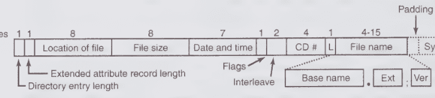

目录条目可以可选地具有扩展属性。如果使用了此功能，第二个字节将告知扩展属性的长度。

接下来是文件本身的起始块。文件存储为连续的块序列，因此文件的位置完全由起始块和大小（包含在下一个字段中）决定。

记录 CD-ROM 的日期和时间存储在下一个字段中，其中年、月、日、时、分和时区分别有单独的字节。年份从 1900 年开始计算，这意味着 CD-ROM 将面临 Y2156 问题，因为 2155 年之后的一年将是 1900 年。通过将时间起点定义为 1988 年（该标准已被采用）可以推迟这个问题。如果当时的话，问题将推迟到 2244 年。每多 88 年都有帮助。

标志字段（Flags）包含几个杂项位，包括一个用于在列表中隐藏条目的位（从 MS-DOS 复制的功能）、一个用于区分文件条目和目录条目的位、一个用于启用扩展属性的位，以及一个标记目录最后一个条目的位。该字段还存在几个位，但我们不涉及。下一个字段处理文件片段的交织，这在 ISO 9660 的简单版本中并不使用，因此我们不会考虑它。

下一个字段告知文件位于哪张 CD-ROM 上。它允许一个目录条目指向集合中另一张 CD-ROM 上的文件。通过这种方式，可以在第一个 CD-ROM 上构建一个主目录，列出完整集合中所有 CD-ROM 上的文件。

图 4-35 中标记为 L 的字段给出文件名的长度。

# 360
# 4.5 文件系统

图 4-35 中标记为 L 的字段给出文件名的长度。

# 329
# 4.5 文件系统

图 4-35 中标记为 L 的字段给出文件名的长度。

# 328
# 4.5 文件系统

图 4-35 中标记为 L 的字段给出文件名的长度。

# 327
# 4.5 文件系统

图 4-35 中标记为 L 的字段给出文件名的长度。

## 4.5 示例文件系统

微软发明了一些被称为 Joliet 的扩展。这些扩展的设计目的是允许 Windows 文件系统被复制到 CD-ROM（光盘）并进行还原，这与 Rock Ridge 为 UNIX 设计的原理完全相同。几乎所有在 Windows 下运行并使用 CD-ROM 的程序都支持 Joliet，包括刻录可写光盘的程序。通常，这些程序会在各种 ISO 9660 级别和 Joliet 之间提供选择。

Joliet 提供的主要扩展包括：

- 1. 长文件名。
- 2. Unicode 字符集。
- 3. 嵌套深度超过八级的目录。
- 4. 带有扩展名的目录名。

第一个扩展允许文件名长达 64 个字符。第二个扩展允许对文件名使用 Unicode 字符集。该扩展对于打算在不使用拉丁字母的国家（如日本、以色列和希腊）使用的软件至关重要。由于 Unicode 字符占 2 个字节，因此 Joliet 中的最大文件名占用 128 字节。

与像 Rock Ridge 一样，目录嵌套的限制是根据需要深度嵌套。最后，目录名可以带有扩展名。还不清楚为什么要包含这个扩展，因为 Windows 目录几乎从不使用扩展名，但也许某天会用。

## 4.6 文件系统研究

文件系统一直以来比操作系统的其他部分吸引更多的研究，现在也是如此。如 FAST、MSST 和 NAS 等整个会议很大程度上都致力于文件和存储系统。虽然 Windows 文件系统已经相当容易理解，但关于备份（Smaldone et al., 2013; 以及 Wallace et al., 2012）、缓存（Koller et al.; Oh, 2012; 以及 Zhang et al., 2013）、安全擦除数据（Wei et al., 2011）、压缩（Harnik et al., 2013）、闪存文件系统（No, 2012; Park and Shen, 2012; 以及 Narayanan, 2009）、性能（Leventhal, 2013; 以及 Schindler et al., 2011）、RAID（Moon and Reddy, 2013）、可靠性与错误恢复（Chidambaram et al., 2013; Ma et al., 2013; McKusick, 2012; 以及 Van Moolbeek et al., 2012）、用户级文件系统（Rajgarhia and Gehani, 2010）、一致性校验（Fryer et al., 2012）以及版本化文件系统（Mashtizadeh et al., 2013）。仅仅测量实际进入文件系统的内容也是一个研究课题（Harter et al., 2012）。

安全性是一个永恒的话题（Botelho et al., 2013; Li et al., 2013c; 以及 Lor et al., 2013）。相比之下，云文件系统是一个热点话题（Mazurek et al., 2012; 以及 Vrable et al., 2012）。另一个最近受到关注的领域是溯源（Provenance）——跟踪数据历史，包括它们来自哪里、谁拥有它们以及它们是如何被转换的（Ghoshal and Plale, 2013; 以及 Sultana and Bertino, 2013）。对于有法律要求的公司来说，保持数据在几十年内安全且可用也具有意义（Baker et al., 2006）。最后，其他研究人员正在重新思考文件系统栈（Appuswamy et al., 2011）。

## 4.7 总结

从外部看，文件系统是文件和目录的集合以及对它们的操作。文件可以被读取和写入，目录可以创建和销毁，文件可以从一个目录移动到另一个目录。大多数现代文件系统支持层次目录系统，其中目录可以有子目录，而这些子目录可以无限地拥有子目录。

从内部看，文件系统看起来完全不同。文件系统设计人员必须考虑如何分配存储，以及系统如何跟踪哪个块属于哪个文件。可能性包括连续文件、链表、文件分配表和 i-节点。不同的系统有不同的目录结构。属性可以放在目录中，也可以放在其他地方（例如 i-节点）。磁盘空间可以使用空闲列表或位图管理。通过制作增量转储和能够修复文件系统的程序可以增强文件系统的可靠性。文件系统性能非常重要，可以通过缓存、预读和仔细地将文件的块放置在一起来增强。日志结构文件系统还通过大单位进行写入来提高性能。

文件系统的示例包括 ISO 9660、DOS 和 UNIX。它们在许多方面都不同，包括它们如何跟踪哪个块属于哪个文件、目录结构以及空闲磁盘空间的管理。

## 4. 习

- 1. 在 Windows 中，当用户双击 Windows 资源管理器列出的文件时，会运行一个程序并将该文件作为参数传递。列出操作系统知道应该运行哪个程序的两种不同方法。
- 2. 在早期的 UNIX 系统中，可执行文件（a.out 文件）以一个特定的魔数（magic number）开头，而不是随机选择的。这些文件以头开头，随后是文本段和数据段。你认为为什么可执行文件选择非常特定的数字，而其他类型文件的第一个词是随机性较低的魔数？
- 3. 在图 4-4 中，属性之一是记录长度。操作系统为什么关心这个？
- 4. UNIX 中的 `open` 系统调用是绝对必需的吗？如果没有它会有什么后果？
- 5. 支持顺序文件的系统总有一个回退操作。支持随机访问文件的系统需要这个吗？
- 6. 某些操作系统提供了一个系统调用来给文件重命名。使用此调用重命名文件与仅将文件复制为新名称然后删除旧文件之间有区别吗？
- 7. 简单的操作系统只支持单个目录，但允许它拥有许多任意长度的文件。可以模拟类似于层次文件系统的东西吗？如何实现
- 8. 在 UNIX 和 Windows 中，随机访问是通过一个特殊的系统调用实现的，该调用将与文件相关的“当前位置”指针移动到文件的给定字节处。提出一种不使用此调用的随机访问的替代方法。
- 9. 考虑图 4-8 中的目录树。如果 `/usr/bin` 是工作目录，那么相对路径为 ... 的文件的绝对路径是什么？
- 10. 文件的连续分配会导致磁盘碎片，如文所述，由于磁盘空闲的 F 不是整数，这属于内部碎片还是外部碎片？
- 11. 假设磁盘空闲的 F 块，由于读取文件需要 5 msec，写入文件需要 4 msec，传输速度为 8 MB/sec，文件大小为 KB，将文件读入内存需要多长时间？写回需要多长时间？在磁盘空闲 F 的情况下，由于是 F，需要。
- 12. 在磁盘空闲 F 的情况下，使用空闲列表或位图来跟踪磁盘空间是否有意义？
- 13. 空闲位图的开头如下，磁盘分区首次格式化为：1000 0000 0000 0000（第一个块由根目录使用）。系统总是搜索最小的空闲块，所以在写入使用六个块的文件 A 后，位图如下：1111 1110 0000 0000。显示执行以下后续操作后的映射：
  (a) 写入文件 B，使用五个块。
  (b) 删除文件 A。
  (c) 写入文件 C，使用八个块。
  (d) 删除文件 B。
- 14. 如果包含空闲块信息的位图或空闲列表因崩溃而完全丢失会发生什么？有什么方法可以从这种灾难中恢复，还是说彻底完了？分别讨论 UNIX 和 FAT-16 文件系统。
- 15. Oliver Owl 在大学计算中心的夜间工作是更换用于夜间数据备份的磁带。等待每个磁带完成时，他正在撰写论文，证明莎士比亚的剧作是外星人写的。他的文本处理器运行在被备份的系统上。这种安排有什么问题吗？
- 26. 我们在文中详细讨论了增量转储。在 Windows 中，很容易判断何时转储文件，因为每个文件都有一个归档位。这个位是

## 4. 习题 335

缺失于 UNIX。UNIX 备份程序如何知道哪些文件需要转储？

- 27. 假设图 4-25 中的第 21 个文件自上次转储以来没有被修改。图 4-26 中的位图会有什么种不同？

- 28. 有人建议将每个 UNIX 文件的第一部分与其 i-node 保留在同一个磁盘块中。这样做有什么好处？

- 29. 考虑图 4-27。是否可能某个特定的块号在两个列表中的计数器值都为 2？应该如何纠正这个问题？

- 30. 文件系统的性能取决于缓存命中率（在缓存中找到块的比例）。如果从缓存满足请求需要 1 msec，而如果需要读取磁盘则满足请求需要 40 msec，请在命中率为 h 的情况下，为满足请求所需的平均时间给出一个公式。绘制该函数在 h 从 0 到 1.0 变化时的图表。

- 31. 对于连接到计算机的外部 USB 硬盘，哪种更合适：写回缓存（write-through cache）还是块缓存（block cache）？

- 32. 考虑一个应用程序，其中学生记录存储在一个文件中。该程序接受学生 ID 作为输入，随后读取、更新并写入相应的记录；重复此过程直到程序退出。在这里使用“块预读”（block readahead）技术有用吗？

- 33. 讨论为文件系统选择合适的块大小所涉及的设计问题。

- 34. 考虑一个从块 14 到 23 拥有 10 个数据块的磁盘。磁盘上有两个文件：f1 和 f2。目录结构列出 f1 和 f2 的第一个数据块分别为 22 和 16。根据如下 FAT 表条目，分配给 f1 和 f2 的数据块有哪些？

| 条目 | 指针 |
| :--- | :--- |
| 14 | 18 |
| 15 | 17 |
| 16 | 23 |
| 17 | 21 |
| 18 | 20 |
| 19 | 15 |
| 20 | -1 |
| 21 | -1 |
| 22 | 19 |
| 23 | 14 |

在上述符号中，(x, y) 表示存储在条目 x 中的值指向数据块 y。

- 35. 考虑图 4-21 背后的思想，但现在针对一个平均寻道时间为 8 msec、旋转速度为 15,000 rpm、每道 262,144 字节的磁盘。块大小分别为 1 KB、2 KB 和 4 KB 的数据传输是多少？

- 36. 某个文件系统使用 2-KB 磁盘块。中位数文件大小为 1 KB。如果所有文件恰好为 1 KB，磁盘空间的浪费比例是多少？你认为真实文件系统的浪费会比这个数字高还是低？解释你的答案。

- 37. 给定磁盘块大小为 4 KB，块指针地址值为 4 字节，使用 11 个地址和一个间接块，可以访问的最大文件大小（字节）是多少？

- 38. MS-DOS FAT-16 表包含 64K 个条目。假设其中一个位被用于其他用途，而表恰好包含 32,768 个条目。在没有其他更改的情况下，在这种情况下最大的 MS-DOS 文件有多大？

- 39. MS-DOS 中的文件必须竞争 FAT-16 内存中的空间。如果一个文件使用 k 个条目，而这 k 个条目对任何其他文件可用，这会对所有文件的总长度限制产生什么约束？

- 40. 获取路径名为 `/usr/fast/courses/os/handler.out` 的文件的文件的 i-node 需要多少次操作？假设根目录的 i-node 在内存中，但路径上的任何内容都不在内存中。还假设所有目录都适合一个磁盘。

- 41. 在 UNIX 系统中，i-nodes 保留在磁盘开头。另一种设计是在创建文件时分配 i-node，并将 i-node 放在该文件第一个块的开头。讨论这种备选方案的优缺点。

- 42. 编写一个程序来反转文件的字节，使得最后一个字节变成第一个字节，第一个字节变成最后一个。它必须能够处理任意长度的文件，但尽量使其具有合理的效率。

- 43. 编写一个程序，从指定的目录开始并从该点向下遍历文件树，记录其中所有文件的大小。完成后，它应该使用参数指定的箱宽打印文件大小的直方图（例如，使用 1024 时，0 到 1023 的文件大小进入一个桶，1024 到 2047 的进入下一个桶，依此类推）。

- 44. 编写一个程序，扫描 UNIX 文件系统中的所有目录，并找到所有硬链接计数为二或更多的 i-nodes。对于每个这样的文件，列出到该点为止的所有文件名。

- 45. 编写一个新版本的 UNIX ls 程序。该版本接受一个或多个目录名称作为参数，并为每个目录列出该目录中的所有文件，每个文件一行。根据其类型，每个字段应以合理的方式格式化。仅列第一个地址（如果有）。

- 46. 实现一个程序来测量应用程序级缓冲区大小对读取时间的影响。这涉及向一个大文件（例如 2 GB）写入和读取。改变应用程序缓冲区大小（例如从 6 字节到 4 KB）。使用计时测量（如 UNIX 上的 getofday 和 gettimimer）测量不同缓冲区大小所需的时间。分析结果并报告你的发现：缓冲区大小是否对总写入时间和单次写入时间产生？

- 47. 实现一个模拟文件系统，完全包含在磁盘上的单个普通文件中。该文件将包含目录、i-nodes、空块信息、文件数据块等。选择合适的算法来维护空块信息并分配数据块（连续、索引、链式）。你的程序将接受用户的系统命令，以创建/删除目录，创建/删除/打开文件，读取/写入选定文件。

# 5 输入输出

除了提供进程、地址空间和文件之外，操作系统还必须管理输入输出（Input/Output）。尽可能，接口对于所有设备应该是相同的。本章的组织如下：我们将首先查看 I/O 的一般背景，然后它们如何结合。接下来我们将详细查看 I/O 设备：磁盘、键盘和显示器。最后我们将考虑电源。

### 5.1 I/O 硬件原理

不同的人以不同的方式看待 I/O。电气工程师从芯片、导线、电源的角度来看待。程序员则从接口的角度来看待，即硬件接受的命令、执行的功能以及可以报告的错误。在书中我们关注编程 I/O，而不是设计、构建或维护它们。

### 5.1.1 I/O 设备

I/O 设备可以大致分为两类：块设备和字符设备。块设备在固定大小块中存储信息，每个块都有自己的地址。常见的块大小从 512 到 65536 字节不等。所有传输以一个或多个（连续）块为单位。块设备的本质属性是可以独立地读取或写入每个块。硬盘、蓝光光和 USB 盘是常见的块设备。

如果你仔细观察，块寻址设备之间的边界并不明确。现在考虑一种有时用于备份磁盘的老磁带（因为磁带便宜）。磁带包含一系列块。如果给磁带读取块的命令，它可以始终反向寻道，只是这需要长得多。这种操作类似于磁盘执行寻道，只是可能可以在磁带中间重写一个块。

其他 I/O 设备是字符设备。字符设备交付或接受字符流，而不考虑任何块结构。它是不可寻址的，也没有寻道。打印机、网络接口、鼠标（用于指向）、大鼠（用于心理学实验）以及大多数非磁盘设备都可以被视为字符设备。

| 设备 | 数据传输率 |
| :--- | :--- |
| 键盘 | 10 bytes/sec |
| 鼠标 | 100 bytes/sec |
| 56K 调制解器 | 7 KB/sec |
| 300 dpi 扫描仪 | 1 MB/sec |
| 数字摄像机 | 3.5 MB/sec |
| 4倍速蓝光盘 | 18 MB/sec |
| 802.11 无线 | 37.5 MB/sec |
| USB 2.0 | 60 MB/sec |
| FireWire 800 | 100 MB/sec |
| 千兆以太网 | 125 MB/sec |
| SATA 3 硬盘 | 600 MB/sec |
| USB 3.0 | 625 MB/sec |
| SCSI Ultra 5 总线 | 640 MB/sec |
| 单道 PCIe 3.0 总线 | 985 MB/sec |
| 雷电 2 总线 | 2.5 GB/sec |
| SONET OCT-768 网络 | 5 GB/sec |

**图 5-1.** 一些典型的设备、网络和总线数据速率。

## 5.1.2 设备控制器

I/O 通常由一个机械部件和一个电子部件组成。可以将这两个部分分离开，以提供更具模块化且更通用的设计。电子部分被称为**设备控制器**或**适配器**。在个人计算机上，它通常表现为主板上的芯片，或者是可以插入 (PCIe) 扩展槽的打印电路卡。机械部件是设备本身。这种结构如图 1-6 所示。

控制器上通常有一个连接器，将连接到设备本身的电缆插在其中。许多控制器可以处理两个、四个甚至八个相同的设备。控制器与设备之间的接口可以是一个标准接口（无论是官方的 ANSI、IEEE 或 ISO 标准，还是事实上的标准）——如果是这样，公司就可以制造符合该接口的控制器或设备。例如，许多公司制造匹配 SATA、SCSI、USB、Thunderbolt 或 FireWire (IEEE 1394) 接口的磁盘驱动器。

控制器与设备之间的接口通常是非常底层的。例如，磁盘可能被格式化为每磁道 2,000,000 个每个 512 字节的扇区。然而实际上从磁盘输出的是串行比特流，以前导（preamble）开始，是一个扇区的 4096 位，最后是校验和或 ECC（纠错码）。前导在磁盘格式化时写入，包含磁道和扇区编号、扇区大小等数据，以及同步信息。

控制器的工作是将比特流转换为字节块并执行任何必要的纠错。字节块首先在控制器内部的缓冲区中逐位组装。在验证了校验和并声明该块无错误后，就可以将其复制到主内存。

LCD 显示器的控制器同样在同样的底层上作为串行设备工作。它从内存中读取包含要显示字符的字节，并生成修改相应像素背光极化的信号，以便将它们写入屏幕。如果没有显示控制器，操作系统将不得不显式地为所有像素的电场编程。有了控制器，操作系统只需用几个参数对其初始化（例如每行的字符或像素数以及每个屏幕的行数），然后让控制器负责主动驱动电场。

在很短时间内，LCD 屏幕完全取代了 CRT（阴极射线管）显示器。CRT 显示器将电子束射到荧光屏上。利用磁场，系统能够在屏幕上弯曲并绘制像素。与 LCD 屏幕相比，CRT 显示器笨重、耗电且易碎。此外，如今的（视网膜）LCD 屏幕的分分辨率非常好，人肉眼无法区分单个像素。很难想象过去的笔记本电脑配备有一个小的 CRT 屏幕，导致其深度超过 20 厘米，重量达到 12 公斤左右。

## 5.1.3 内存映射 I/O

每个控制器都有几个与 CPU 通信的寄存器。通过写入这些寄存器，操作系统可以命令设备交付数据、接收数据、开启或关闭或执行某些操作。通过读取这些寄存器，操作系统可以了解设备的状态、它是否准备好接受新命令等。

除了控制寄存器外，许多设备具有操作系统可以读写的缓冲区。例如，计算机在屏幕上显示像素的常用方法是使用视频 RAM，这本质上就是一个数据缓冲区，供程序或操作系统写入。

因此出现了 CPU 如何与控制寄存器以及设备数据缓冲区通信的问题。存在两种替代方案。在第一种方法，每个控制寄存器被分配一个 I/O 端口号（8 位或 16 位整数）。所有 I/O 端口集合形成 I/O 端口空间，该空间受到保护，以至于用户程序无法访问（只有操作系统可以）。使用特殊的 I/O 指令，例如：


进入`/path/to/xxx`目录，找到`xxx.json`。

在表达式`cvar = avar + bvar`中，加法运算符（`+`）将`avar`与`bvar`相加，得到它们的和`cvar`

在`List.of(arg0, arg1, arg2)`中，`List`接口的工厂方法`of()`接受一系列的元素，返回包含它们的只读列表。

之后我们这样调用`cmd`命令：`cmd arg0 arg1 arg2`。

```
if (condVar > someVal) {console.log("xxx")}
```
[/content]

Wait that's example. Need actual text.

Let's redo properly.

[content]
`IN REG,PORT,`

```
CPU 可以读取。同样，使用
```

`OUT PORT,REG,`

```
CPU 可以写入。在第二种方法，每个控制寄存器被分配一个内存地址。CPU 使用标准的内存引用指令来访问这些寄存器。这被称为内存映射 I/O。

# I/O 硬件原理

在上述循环中，增加了第四条指令，这略微减慢了检测空闲设备的响应速度。

在计算机设计中，几乎所有内容都涉及权衡，这里也是如此。内存映射 I/O（Memory-mapped I/O）也有其缺点。首先，如今大多数计算机都具有某种形式的内存写入缓存。缓存设备控制寄存器将是灾难性的。考虑在存在缓存的情况下上述汇编代码循环。对 `PORT-4` 的第一次引用将直接从缓存中取值，而不会询问设备。当设备最终准备就绪时，软件将无法得知。相反，循环将永远持续下去。

为了防止内存映射 I/O 出现这种问题，硬件必须能够选择性地禁用缓存，例如按页（page）禁用。这一功能增加了硬件和操作系统的复杂性，因为操作系统必须管理这种选择性缓存。

其次，如果只有一个地址空间，那么所有内存模块和 I/O 设备都必须检查所有的内存引用，以确定对哪些引用做出响应。如果计算机具有单总线（如图 5-3(a) 所示），让每个人查看每个地址是直接的。

CPU 内存的读写通过这条高带宽总线

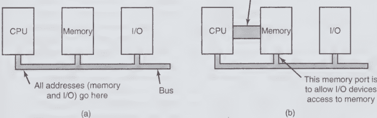

图 5-3. (a) 单总线架构。(b) 双总线内存架构。

然而，现代个人电脑的趋势是拥有专用的高速内存总线，如图 5-3(b) 所示。该总线为优化内存性能而定制，而不为了 I/O 设备做出妥协。x86 系统可以拥有多个总线（内存、PCIe、SCSI 和 USB），如图 1-12 所示。

在内存映射机器上使用独立总线的问题是，I/O 设备无法在地址通过内存总线时看到内存地址，因此无法对这些地址做出响应。同样，必须采取特殊措施才能使多总线系统上的内存映射 I/O 工作。一种可能性是先将所有内存引用发送到内存。如果内存没有响应，则 CPU 尝试其他总线。这种设计可以实现，但需要额外的硬件复杂性。

另一种可能的设计是在内存总线上放置一个嗅听设备（snooping device），将所有呈现的地址传递给可能感兴趣的 I/O 设备。这里的问题是，I/O 设备可能无法以内存处理的速度处理请求。

第三种可能的设计（且与图 1-12 中草拟的设计非常匹配）是在内存控制器中对地址进行过滤。在这种情况下，内存控制器包含在启动时预加载的范围寄存器。例如，640K 到 1M 可以被标记为非内存范围。落在任何被标记为非内存的范围内的地址将转发到设备而不是内存。该方案的缺点是需要在启动时确定哪些内存地址不是真实的内存地址。因此，每种方案都有其优劣之争，所以妥协和权衡是不可避免的。

## 5.1.4 直接存储器访问（DMA）

无论 CPU 是否具有内存映射 I/O，它都需要寻址设备控制器以与其交换数据。CPU 可以一个字节一个字节地请求 I/O 控制器的数据，但这样做浪费 CPU 的时间，因此通常使用另一种名为 DMA（Direct Memory Access，直接存储器访问）的方案。为了方便解释，我们假设 CPU 通过连接 CPU、内存和 I/O 设备的单一系统总线访问所有设备和内存，如图 5-4 所示。我们已经知道现代系统的实际结构更为复杂，但所有原理都是相同的。只有当硬件具有 DMA 控制器时，操作系统才能使用 DMA，大多数系统都具有它。有时此控制器集成在磁盘控制器和其他控制器中，但这种设计需要每个设备都有一个独立的 DMA 控制器。通常，有一个的 DMA 控制器（例如在主板上）用于调节到多个设备的传输，且通常是并发的。

无论 DMA 控制器物理上位于何，它都可以独立于 CPU 访问系统总线，如图 5-4 所示。它包含几个可以由 CPU 读写的寄存器。这些包括地址寄存器、字节计数寄存器以及一个或多个控制寄存器。控制寄存器指定了要使用的 I/O 端口、传输方向（从 I/O 设备读取或写入 I/O 设备）、传输单元（一次一个字节或一次一个字）以及一次突发传输中传输的字节数。

为了解释 DMA 如何工作，让我们先看看不使用 DMA 的情况。第一个磁盘控制器从驱动器串行读取块（一个或多个扇区），逐位读取，直到整个块位于控制器的内部缓冲区中。接下来，它计算校验和以验证没有发生读取错误。

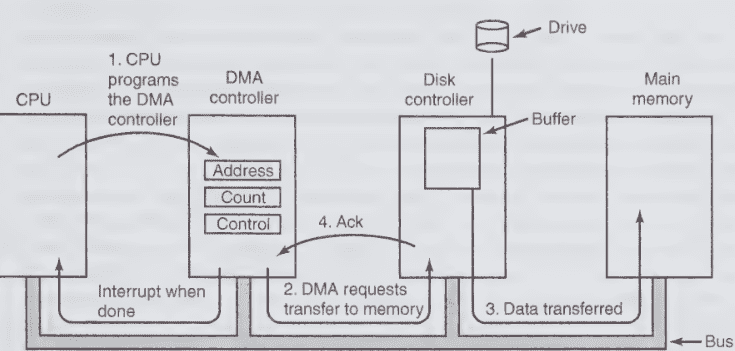

**图 5-4.** DMA 传输的操作。

然后控制器产生中断。当操作系统运行时，它可以通过执行循环一个字节或一个字地从控制器的缓冲区读取磁盘块，每次迭代从控制器设备读取一个字节或一个字并存储在主内存中。

当使用 DMA 时，过程就不同了：首先，CPU 通过设置寄存器让 DMA 控制器启动传输，使其知道数据从哪里获取（图5-4）。DMA 控制器通过总线向磁盘控制器请求数据（step 1）。磁盘控制器在总线上的地址看起来像其他请求，它并不知道数据来自 CPU 还是 DMA 控制器（step 2）。DMA 控制器从内部缓冲区获取下一个字，并知道将其写入哪里。写入内存是另一个总线周期（step 3）。写入完成后，磁盘控制器向 DMA 控制器发送确认信号（step 4）。DMA 控制器增加地址并减少计数。如果计数仍大于 0，则重复步骤 2 到 4。当传输完成后，控制器中断 CPU 以告知结果。

DMA 控制器的复杂程度差异很大。最简单的是一次处理一个字，如上述。更复杂的通过为每个通道设置一组寄存器来一次处理多次传输。许多控制器以两种模式工作：字模式和块模式。在字模式中，操作如下：DMA 控制器请求并获取传输。如果 CPU 也想要总线，它必须等待。这种机制被称为周期窃（cycle stealing），因为设备偷取了总线。在块模式下，DMA 控制器告诉设备获取总线，执行一系列传输，然后释放总线。这种操作形式被称为突发模式（burst mode）。它比周期窃更有效，因为获取总线需要时间。

在我们讨论的模型中（有时称为旁路模式 flyby mode），DMA 控制器告诉磁盘控制器将数据直接传输到内存。某些 DMA 控制器使用的另一种方法是让设备将字发送到 DMA 控制器，由其发出写入请求。这种方案每个字都需要额外的总线周期，但更加灵活，它可以执行设备到设备甚至内存到内存的复制。

## 5.1 I/O 硬件原理

如果控制器需要将数据直接写入内存，那么每个传输的字字都必须经过系统总线。如果总线正被其他设备占用（例如，在突发模式下），控制器将必须等待。如果下一个磁盘在在上一个磁盘存储之前就到达，控制器将必须将其存储在某处。如果总线非常忙，控制器最终可能只存储几个字，并且还要处理大量的管理工作。当控制器的设计得非常简单时，到内存的 DMA 传输对时间并不敏感。（事实上，某些旧的控制器直接访问内存，仅有极少的内部缓冲区，但当总线非常忙时，传输可能会因为溢出错误（overrun error）而终止。）

并不是所有计算机都使用 DMA。反对 DMA 的理由是，主 CPU 通常比 DMA 控制器快，并且能够更快完成任务（当限制因素不是 I/O 设备的速度时）。如果 CPU 没有其他工作要做要做，那么让（快的）CPU 等待（慢的）DMA 控制器完成是没有意义的。此外，取消 DMA 控制器并让 CPU 在软件中完成所有工作可以节省成本，这对于低端（嵌入式）计算机非常重要。

### 5.1.5 重新回顾中断

我们在第 1.3.4 节中简要介绍了中断，但还有更多内容要说。在典型的计算机系统中，中断结构如图 5-5 所示。在硬件层面，中断的工作原理如下：当 I/O 设备完成给它的任务时，它会产生中断（假设操作系统已启用中断）。它通过在分配的总线线上发送信号来实现。该信号由主板上的中断控制器芯片检测，然后由该芯片决定如何处理。

**图 5-5.** 中断发生的机制。设备与控制器之间的连接实际上使用中断线而不是专用导线。

如果没有其他挂起的中断，中断控制器将立即处理该中断。然而，如果另一个中断正在进行中，或者另一个设备在总线上的高优先级中断请求线上同时发出了请求，则该设备暂时会被忽略。在这种情况下，它将继续在总线上断言中断信号，直到被 CPU 处理。

为了处理中断，控制器会在地址线上放置一个数字，指明哪个设备需要关注，并发出一个信号来打断 CPU。

中断信号导致 CPU 停止正在执行的操作并开始其他操作。地址线上的数字被用作一个名为*中断向量*（interrupt vector）的表的索引，以获取新的程序计数器。该程序计数器指向相应的中断服务程序的开头。通常情况下，从这一点起，陷阱（traps）和中断使用相同的机制，通常共享相同的中断向量。中断向量的位置可以硬编码在操作系统中，指向它的起源。

中断服务程序开始运行后不久，会通过向中断控制器的一个 I/O 端口写入特定值来确认中断。这种确认告诉控制器，它可以发布另一个中断了。

通过让 CPU 推迟这种确认，直到它准备好处理中断，可以避免涉及多个（几乎同时发生的）中断的竞态条件。顺带提，某些（旧的）计算机没有集中式中断控制器，因此每个设备都请求自己的中断。

硬件在启动服务之前总是会保存某些信息。保存的信息以及保存的位置在不同 CPU 之间差异很大。作为最低要求，必须保存程序计数器，以便被中断的进程可以重启。在另一个极端，所有可见的寄存器和大量的中断寄存器也可能被保存。

一个问题是将这些信息保存在哪里。一种方案将其放在操作系统可以读取的内部寄存器中。这种方法的的问题是，在所有可能相关的信息被读取之前，中断控制器无法被确认，否则第二个中断会覆盖保存状态的内部寄存器。这种策略会导致中断禁用期间出现死时间，并可能导致中断丢失和数据丢失。

因此，大多数 CPU 将信息保存在栈（stack）上。然而，这种方法存在问题。首先：谁的栈？如果使用当前栈，它可能是一个用户进程栈。栈指针甚至可能是非法的，当硬件尝试向所指向的地址写入某些字时，会导致致命错误；它可能指向页的末尾。在几次内存写入之后，可能会超出页边界并产生页错误（page fault）。在硬件中断处理期间发生页错误将产生一个更大的问题：将状态保存在哪里来处理页错误呢？

如果使用内核栈，那么栈指针合法并指向一个固定页（pinned page）的可能性要大得多。切换到内核模式可能需要更改 MMU 上文，并可能会使大部分或全部缓存和 TLB失效。静态或动态地重新加载这些内容都会增加处理中断的时间，并浪费 CPU 时间。

## I/O 硬件原理

### 精确中断与不精确中断

另一个问题是由大多数 CPU 都是高度流水线（内部并行）引起的。在旧的系统中，在每条指令执行完毕后，微程序或硬件会检查是否有挂起的中断。如果是，程序计数器和 PSW 将被压栈，然后开始中断序列。相反的过程也会发生，从栈中弹出旧的 PSW 和程序计数器，上一个进程继续。

这种模型包含一个隐含假设：如果中断在某条指令之后立即发生，直到该指令及其之前的所有指令都已完全执行，且该指令之后的所有指令都没有执行完。在较旧的机器上，这个假设始终成立。在现代机器上，它可能并不成立。

首先，考虑图 1-7(a) 的流水线模型。如果在流水线满的情况下（这是通常情况）发生中断会发生什么？许多指令处于不同的执行阶段。当中断发生时，程序计数器的值可能无法反映已执行指令和未执行指令之间的界限。事实上，许多指令已经部分执行，完成程度各不相同。在这种情况下，程序计数器最反映的是要提取并推入流水线的下一个指令地址，而不是由执行单元处理的指令地址。

在超标机器上，例如图 1-7(b) 所示，情况更加糟糕。指令可能被分解为微操作，微操作可以根据功能单元和寄存器等内部资源的可用性乱序执行。在发生中断时，某些很久以前的指令可能还没有开始，而最近开始的指令可能已经大部分完成。在信号中断的时间点，可能有许多指令处于不同的完成状态，它们与程序计数器的关系较小。

让机器处于良好定义状态的中称为精确中断（precise interrupt）（Walker and Cragon, 1995）。这种精确中断具有四个属性：

- PC（程序计数器）保存在已知位置。
- PC 指向的指令之前指令都已完成。
- PC 指向的指令之后的指令都没有完成。
- PC 指向的指令的执行状态是知的。

注意，并不禁止 PC 指向的指令之后的指令开始。只是它们对寄存器或内存所做的任何更改必须在中断发生之前撤销。同时也允许 PC 指向的指令已经执行过。

然而，必须明确适用的是哪种情况。通常，如果中断是 I/O 中断，指令尚未开始。然而，如果中断确实是一个陷阱（trap）或页错误（page fault），那么 PC（计数器）通常指向导致故障的中断指令，以便能够重新执行。5-6(a)的情况说明了精确中断。直到程序计数器（316）为止的所有指令已完成，而之后的所有指令均未执行（或其影响已回滚）。

| 未执行 | 332 | 未执行 | 332 |
|---|---|---|---|
| 未执行 | 328 | 执行了 10% | 328 |
| 未执行 | 324 | 执行了 40% | 324 |
| 未执行 | 320 | 执行了 35% | 320 |
| 未执行 | 316 | PC | 执行了 20% | 316 |
| 完全执行 | 312 | 执行了 60% | 312 |
| 完全执行 | 308 | 执行了 80% | 308 |
| 完全执行 | 304 | | |
| 完全执行 | 300 | | |

图 5-6. (a) 精确中断。(b) 不精确中断。

不满足这些要求的异常被称为不精确中断，它让操作系统的工作变得非常痛苦，因为操作系统必须弄清楚发生了什么以及还有什么需要发生。5-6(b)展示了一个不精确中断，其中程序计数器附近的不同指令处于不同的完成阶段，且较旧的指令并不一定比较新的指令更早完成。具有不精确中断的机器会将大量的内部状态“吐”到栈上，以便操作系统能够可能查清发生的情况。重启机器的代码通常极其复杂。此外，在中断时将大量信息保存到内存中会导致中断变慢，并让恢复变得更加糟糕。这导致了一种讽刺的局面：拥有快速的超标量 CPU 却因为中断缓慢而无法适用于实时工作。

某些计算机的设计使得某些类型的中断和陷阱是精确的，而其他一些不是。例如，由于致命编程错误导致 I/O 中断变为陷阱是不精确的，以至于在进程发生除以零错误后，完全不需要尝试重启运行中的进程。某些机器有一个位可以设置以强制所有中断都是精确的。设置此位位的缺点是，它迫使 CPU 仔细记录它所做的每件事，并维护寄存器的影子拷贝，以便在任何时刻产生精确中断。所有这些开销对性能都有巨大影响。

某些超标量机器（如 X86 系列）具有精确中断，以允许旧程序正常工作。为了与精确中断后兼容而付出的代价是 CPU 内部极其复杂的逻辑，以确保当中断控制器信号想要引起中断时，直到某一点为止的所有指令都允许完成，而该之后的任何指令都不会对机器状态产生任何可见的影响。这里的代价体现在时间上，还现在芯片面积和设计的复杂性上。如果为了为了兼容而需要精确中断，这部分芯片区域就可以用于更大的片上缓存，使 CPU 更快。另一方面，不精确中断会让操作系统变得复杂得多且运行更慢，因此很难判断哪种方法真正更好。

## 5.1 I/O 硬件原理

## 5.2 I/O 软件原理

现在让我们离开 I/O 硬件，来看 I/O 软件。首先我们将查看它的目标，然后从操作系统的角度查看 I/O 的不同实现方式。

### 5.2.1 I/O 软件的目标

I/O 软件设计中的一个关键概念是设备独立（device independence）。这意味着我们应该能够编写可以访问任何 I/O 设备的程序，而无需预先指定设备。例如，一个读取文件作为输入的程序应该能够读取硬盘、DVD 或 USB 闪存上的文件，而不需要为每种不同的设备都进行修改。同样，人们应该能够输入类似这样的命令：

```
sort <input >output
```


并让它处理来自任何类型磁盘或键盘的输入，以及输出到任何类型磁盘或屏幕。由于这些设备实际上非常不同，且读取或写入需要完全不同的命令序列，处理这些引起的问题由操作系统来负责。

与设备独立性紧密相关的是统一命名（uniform naming）的目标。文件或设备的名称应该是字符串或整数，而不应以任何方式依赖于设备。在 UNIX 中，所有磁盘都可以以任意方式集成到文件系统层次中，因此用户无需感知哪个名称对应哪个设备。例如，USB 闪存可以挂载在目录 `/usr/backup` 之上，这样将文件拷贝到 `/usr/backup/monday` 就会将文件拷贝到 USB 闪存。通过这种方式，所有文件和设备以相同的方式寻址：通过路径名。

I/O 软件的另一个重要问题是错误处理。通常，应该尽可能在处理错误。如果控制器发现读取错误，它应该尝试纠正该错误。如果不能，则应由设备驱动程序处理，也许只是再次尝试读取该块。许多错误是瞬态的，例如由读头上的灰尘引起的读取错误，如果重复操作通常就会消失。只有当底层无法处理该问题时，才会通知上层。在许多情况下，错误恢复可以在底层透明地完成，而上层无需感知。

另一个重要问题是同步（阻塞）与异步（中断驱动）传输。大多数 I/O 是异步的——CPU 启动传输后去执行其他事情，直到中断到达。如果 I/O 操作是阻塞的，用户程序会更容易编写——在数据在缓冲区可用之前程序会自动挂起。操作系统负责将实际上中断驱动的操作变为阻塞。然而，某些高性能应用程序需要控制所有的 I/O 细节，因此某些操作系统为它们提供异步 I/O。

I/O 软件的另一个问题是缓冲（buffering）。通常从设备获取的数据无法直接存储在最终位置。例如，当数据包进入时，操作系统在存储和检查它之前不知道将其放在哪里。此外，某些设备具有实时限制（例如数字音频设备），因此数据必须放入输出缓冲区，以解耦填充速率和提取速率，避免缓冲区欠空（underruns）。缓冲涉及大量的拷贝，对 I/O 性能有巨大影响。

我们在这里提到的最后一个概念是共享与专用设备。某些 I/O 设备（如磁盘）可以许多用户同时使用。多个用户同时在同一磁盘上打开文件不会产生问题。其他设备（如打印机）必须专用一个用户直到其完成。然后另一个用户可以使用打印机。让两个或多个用户在同一页上随机混合字符显然不可行。引入专用（不共享）设备也引入了各种问题，如死锁。再次，操作系统必须能够以问题的方式处理共享和专用设备。

### 5.2.2 程序控制 I/O

I/O 有三种根本上不同的执行方式。在本节中，我们将查看第一种（程序控制 I/O）。在接下来的两个节中，我们将研究其他的（中断驱动 I/O 和使用 DMA 的 I/O）。I/O 最简单的形式是让 CPU 完成所有工作。这种方法被称为程序控制 I/O。

通过示例来说明程序控制 I/O 如何工作是最简单的。考虑一个想要通过串行接口在打印机上打印字符字符串“ABCDEFGH”的进程。软件首先在用户空间的缓冲区中组装该字符串，如图 5-7(a) 所示。

## SEC. 5.2

## I/O 软件原理

353

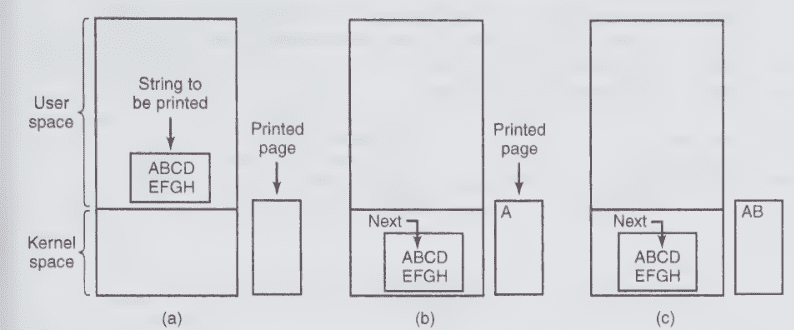

图 5-7。打印字符串的步骤。

用户进程通过调用 `open` 系统调用来获取打印机进行写入。如果打印机当前被另一个进程占用，此调用将失败并返回错误代码，或者阻塞直到打印机可用，这取决于操作系统和调用的参数。一旦获取了打印机，用户进程就会调用系统调用，告诉操作系统在打印机上打印该字符串。

操作系统（通常）会将带有字符串的缓冲区拷贝到内核空间的一个数组中（例如 `p`），在其中更容易被访问（因为内核可能需要修改内存映射才能在用户空间获取它）。然后它会检查打印机当前是否可用。如果不可用，它会等待直到变为可用。一旦打印机可用，操作系统会将第一个字符拷贝到打印机的数据寄存器中，在本例中使用了内存映射 I/O。此操作激活了打印机。字符可能还不会出现，因为某些打印机在打印任何内容之前会缓存一行或一页。但在图 5-7(b) 中，我们看到第一个字符已经打印，系统已标记“B”为下一个要打印的字符。

操作系统一旦将第一个字符拷贝到打印机，就会检查打印机是否已准备好接收下一个字符。通常，打印机有一个第二个寄存器用于提供其状态。向数据寄存器写入的操作会导致状态变为“未就绪”。当打印机控制器处理完当前字符后，它会通过设置状态寄存器中的某个位位或向其中写入某个值来指示其可用性。

此时，操作系统等待打印机再次准备就绪。当情况发生时，它会打印下一个字符，如图 5-7(c) 所示。这个循环一直持续直到整个字符串打印完毕。然后控制权返回给用户进程。

操作系统所执行的操作简要总结在图 5-8 中。首先，数据被拷贝到内核。然后操作系统进入一个紧密循环，一次输出一个字符。程序控制 I/O 的核心方面在图中清楚地所示：在输出一个字符后，CPU 会不断轮询设备以查看其是否准备好接收另一个字符。这种行为通常被称为轮询或忙等待。

```c
copy_from_user(buffer, p, count);

for (i = 0; i < count; i++) {
    while (*printer_status_reg != READY) {
        *printer_data_register = p[i];
    }
}
return_to_user(user);

/* p 是内核缓冲区 */
/* 对每个字符循环 */
/* 循环直到就绪 */
/* 输出一个字符 */
```

**图 5-8**。使用程序控制 I/O 向打印机写入字符串。

程序控制 I/O 虽然简单，但缺点是会一直完全占用 CPU 直到 I/O 完成。如果“打印”一个字符的时间非常短（因为打印机所做的只是将新字符拷贝到内部缓冲区），那么忙等待是可以接受的。此外，在 CPU 无其他事可做的嵌入式系统中，忙等待是可以接受的。然而，在 CPU 有其他工作要做的更复杂的系统中，忙等待是低效的。需要更好的 I/O 方法。

### 5.2.3 中断驱动型 I/O

现在让我们考虑在一个不缓存字符而是一个到达就打印一个打印机上打印的情况。如果打印机的速度是每秒 100 个字符，那么每个字符的打印需要 10 毫秒。这意味着在每个字符被写入打印机的数据寄存器后，CPU 将在空闲循环中等待 10 毫秒，等待允许输出下一个字符。这段时间足够进行上下文切换，并在本该浪费的 10 毫秒内运行另一个进程了。

在等待打印机准备就绪期间允许 CPU 执行某些其他操作的方法是使用中断。当调用打印字符串的系统调用时，正如我们之前展示的那样，缓冲区被拷贝到内核空间，并且一旦打印机愿意接收字符，第一个字符就会被拷贝到打印机上。此时，CPU 调用调度程序，并运行另一个进程。请求打印字符串的进程被阻塞，直到整个字符串打印完成。在系统调用上完成的工作如图 5-9(a) 所示。

当打印机打印完字符并准备好接收下一个字符时，它会产生一个中断。该中断会停止当前进程并保存其状态。然后运行中断服务程序。该代码的粗略版本如图 5-9(b) 所示。如果没有更多字符需要打印，中断处理程序将采取某些操作来解锁用户。否则，它会输出下一个字符，确认中断，并返回到中断发生前运行的进程，该进程从离开的地方继续执行。

```c
copy_from_user(buffer, p, count);
enable_interrupts();
while (*printer_status_reg != READY )
    *printer_data_register = p[0];
scheduler();
```

```c
if (count == 0) {
    unblock_user();
} else {
    *printer_data_register = p[i];
    count = count - 1;
    i = i + 1;
}
acknowledge_interrupt();
return_to_process();
```


图 5-9。使用中断驱动 I/O 向打印机写入字符串。(a) 调用系统调用时执行的代码。(b) 中断服务程序。

### 5.2.4 使用 DMA 的 I/O

现在考虑在不缓存字符而是一个到达就打印的打印机上打印的情况。中断驱动 I/O 的一个明显缺点是每个字符都会产生中断。中断需要时间，因此这种方案浪费了某些 CPU 时间。解决方案是使用 DMA。这里的想法是让 DMA 控制器逐个喂送字符，而无需打扰 CPU。本质上，DMA 是程序控制 I/O，只是通过特殊的硬件（DMA 控制器）释放了 CPU 在 I/O 期间的占用。

```c
copy_from_user(buffer, p, count);
set_up_DMA();
```

```c
/* DMA 控制器处理工作 */
/*  own释放 CPU */
scheduler();
```

```c
acknowledge_interrupt();
return_to_user();
```


图 5-10。使用 DMA 打印字符串。(a) 调用系统调用时执行的代码。(b) 中断服务程序。

DMA 的巨大优势在于减少了中断次数。如果字符很多且中断很慢，这可能是一个巨大的改进。另一方面，DMA 控制器通常比 CPU 慢。如果 DMA 控制器无法以全速驱动设备，或者 CPU 通常无事可做，那么 DMA 可能更好。

## 5.3 层结构

I/O 软件通常组织成四层，如图 5-11 所示。每一层都有定义良好的功能以及与相邻层定义的接口。功能和接口随系统而异，因此从底部开始的后续讨论并不适用于特定机器。

| 层级 | 描述 |
| :--- | :--- |
| 用户级 I/O 软件 | |
| 设备无关操作系统软件 | |
| 设备驱动程序 | |
| 中断处理程序 | |
| 硬件 | |

图 5-11。

### 5.3.1 中断处理程序

虽然程序控制 I/O 有时有用，但对于大多数 I/O，中断是生活中无法避免的事实。它们应该被隐藏在系统的深处，让尽可能少知道它们。隐藏它们的最好方法是让启动 I/O 操作的驱动程序阻塞，直到 I/O 完成并发生中断。驱动程序可以阻塞自己，例如通过对信号量执行 `down` 操作、对条件变量执行 `wait` 操作、对消息执行 `receive` 操作或类似的操作。当中断发生时，中断程序执行处理该中断所需的任何工作。然后它可以解阻塞等待它的驱动程序。在某些情况下，它只是完成信号量的操作。在其他情况下，它会向监视器中的条件变量发送信号。此外，它会向阻塞的驱动程序发送消息。在所有情况下，中断的最终效果都是之前阻塞的驱动程序现在可以运行了。

当然，现实并非如此简单。处理中断是对某些信号量执行 `up` 操作，然后执行 `IRET` 指令从中断返回之前的进程。操作系统还涉及大量工作。现在我们将给出这些工作的概述，作为硬件中断完成后必须在软件中执行的一系列步骤。需要注意的是，细节取决于

## 5.3 I/O 软件层

这些操作取决于系统，因此下面列出的某些步骤在特定机器上可能不需要，而未列出的步骤可能是需要的。此外，某些执行的步骤在某些机器上的顺序也可能不同。

1. 保存任何尚未被中断处理程序保存的寄存器（包括 `PSW`）。
2. 为中断服务程序（`ISP`）设置上下文。这可能涉及设置 `TLB`、`MMU` 和页表。
3. 为中断服务程序设置栈（`stack`）。
4. 确认中断控制器。如果没有集中中断控制器，则重新启用中断。
5. 将寄存器从保存位置（可能在某个栈上）复制到进程表。
6. 运行中断服务程序。它将从被中断的设备控制器的寄存器中提取信息。
7. 选择下一个运行的进程。如果中断导致某个被阻塞的高优先级进程变为就绪，则它现在可能被选中运行。
8. 为下一个运行的进程设置 `MMU` 上下文。可能还需要设置某些 `TLB`。
9. 加载新进程的寄存器，包括其 `PSW`。
10. 启动新进程。

如所示，中断处理远非易事。它还会消耗大量的 CPU 指令，特别是在存在虚拟内存且必须设置页表或存储 `MMU` 状态（例如 `R` 位和 `M` 位）的机器上。在某些机器上，在用户模式和内核模式之间切换时可能还需要管理 `TLB` 和 CPU 缓存，这会消耗额外的机器周期。

### 5.3.2 设备驱动程序

在本章较早之前，我们查看了设备控制器的功能。我们看到每个控制器都有一些设备寄存器来接收命令，或者有一些用于读取其状态的设备寄存器，或者两者兼有。设备寄存器的数量和命令的性质在设备之间存在巨大差异。例如，鼠标驱动程序必须接受来自鼠标的信息，告诉它移动了多远以及哪些按钮当前被按下。相比之下，磁盘驱动程序可能需要了解所有扇区、道、柱面、磁头、臂运动、电机驱动、磁头设置时间以及让磁盘正常工作的所有其他机械原理。显然，这些驱动程序会大不相同。

因此，连接到计算机的每个 I/O 设备都需要某些特定的设备代码来控制它。这些代码（即设备驱动程序）通常由设备制造商编写并随设备一起交付。由于每个操作系统都需要自己的驱动程序，设备制造商通常会为几种流行的操作系统提供驱动程序。

每个驱动程序通常处理一种设备类型，或者至多处理一类紧密相关的设备。例如，`SCSI` 驱动程序可以处理多个不同尺寸和速度的 `SCSI` 磁盘，可能还可以处理一个 `SCSI` 蓝光光盘。另一方面，鼠标和摇杆的差异太大，通常需要不同的驱动程序。然而，对于一个设备驱动程序控制多个不相关的设备，在技术上并没有限制。而且在大多数情况下，这也是个好主意。

有时，完全不同的驱动程序基于同一种底层技术。最为人知的例子可能是 `USB`，这是一种总线技术之所以被称为“通用（universal）”并非没有理由。`USB` 设备包括磁盘、优存盘、相机、鼠标、小风扇、无线网卡、机器人、信用卡读卡器、充电剃须刀、碎纸机、条形码扫描器、迪斯科球和便携式温度计。它们都使用 `USB`，但做的事情非常不同。

秘诀在于 `USB` 驱动程序通常是堆叠的，类似于 `TCP/IP` 层（串行 I/O），它处理信号传输和将信号流解码为 `USB` 数据包等工作。它由更高层使用，这些层处理数据包以及大多数设备共享的 `USB` 通用功能。在此基础上，我们最终发现了高层 API，例如大规模存储、相机等的接口。因此，尽管它们共享部分协议栈，但我们仍然拥有单独的设备驱动程序。

实际上，为了访问设备的硬件（即控制器的寄存器），设备驱动程序通常必须是操作系统内核的一部分，至少在目前的架构中是这样。实际上，可以构建运行在用户空间中的驱动程序，并使用系统调用来读取和写入设备寄存器。这种设计将内核与驱动程序隔离开，并将驱动程序相互隔离开，消除了系统崩溃的主要来源——即以各种方式干扰内核的带有 Bug 的驱动程序。设备驱动程序作为用户进程运行的系统示例是 `MINIX 3` (`www.minix3.org`)。然而，由于大多数其他桌面操作系统期望驱动程序运行在内核中，因此这就是我们在此考虑的模型。

设备驱动程序通常位于操作系统其余部分之下，如图 5-12 所示。

**图 5-12.** 设备驱动程序的逻辑位置。在现实中，驱动程序与设备控制器之间的所有通信都通过总线进行。

操作系统通常将驱动程序分为少数几类之一。最常见的类别是**块设备（block devices）**（如磁盘，包含多个可以独立寻址的数据块）和**字符设备（character devices）**（如键盘和打印机，它们产生或接受字符流）。

大多数操作系统定义了块驱动程序必须支持的标准接口，以及字符驱动程序必须支持的第二个接口。这些接口由操作系统其余部分可以调用的许多过程组成。典型的过程是读取块（块设备）或写入字符（字符设备）的过程。在前一种情况下，驱动程序将由中断唤醒；在后一种情况下，它永远不会睡眠。无论哪种情况，操作完成后，驱动程序必须检查错误。

这种简单的模型只是对现实的粗略近似。许多因素使得代码更加复杂。其之一是 I/O 设备可能在驱动程序运行时完成操作，从而中断驱动程序。中断可能会导致设备驱动程序运行。事实上，它可能会导致当前驱动程序运行。例如，当网络驱动程序处理传入的数据包时，另一个数据包到达了。因此，驱动程序必须是重入的（reentrant），这意味着在第一次调用完成之前，正在运行的驱动程序可能会被再次调用。

在热插拔系统中，设备可以在计算机运行时添加或删除。结果是，当驱动程序忙于从某个设备读取时，系统可能会通知它用户突然从系统中删除了该设备。不仅当前的 I/O 传输被中止且不会损坏任何内核结构，任何针对消失设备的挂起请求也必须从系统中优雅地移除，并给调用者坏消息。此外，新设备的意外添加会导致内核调整资源（例如中断请求线），从驱动程序处夺走旧的线并给它新的线。

驱动程序不允许执行系统调用，但它们通常需要与内核的其他部分交互。对内核过程的调用是允许的。例如，通常有调用来分配和释放硬连内存页作为缓冲区。还需要管理 `MMU`、定时器、`DMA` 控制器、中断控制器等有用调用。

### 5.3.3 设备无关 I/O 软件

虽然 I/O 软件的一部分是设备特定的，但它的其他部分是设备无关的。驱动程序与设备无关软件之间的准确边界取决于系统（和设备），因为某些本可以用设备无关的方式执行的功能实际上由于效率或其他原因，可能会在驱动程序中执行。图 5-13 所示的功能通常在设备无关软件中完成。

| 为设备驱动程序的统一接口 |
| 缓冲 |
| 错误报告 |
| 分配和释放专用设备 |
| 提供设备无关的块大小 |

> **图 5-13.** 设备无关 I/O 软件的功能。

# 362 输入/输出 第 5 章

设备无关软件的基本功能是执行所有设备通用的 I/O 功能，并为用户级软件提供统一的接口。现在我们来更详细地讨论上述问题。

## 设备驱动程序的统一接口化

操作系统中的一个主要问题是如何让所有 I/O 设备和驱动程序看起来尽可能相同。如果磁盘、打印机、键盘等都以不同的方式进行接口，那么每当有新设备出现时，操作系统都必须为新设备进行修改。为每个新设备都对操作系统进行“打补（hack）”并不是一个好主意。

这个问题的一个方面是设备驱动程序与操作系统其余部分之间的接口。在图 5-14(a) 中，我们展示了每个设备驱动程序与操作系统具有不同接口的情况。这意味着系统可用的驱动程序函数在驱动程序之间存在差异。它可能意味着驱动程序所需的内核函数在驱动程序之间也存在差异。总之，这意味着为每个新驱动程序建立接口需要大量的额外编程工作。

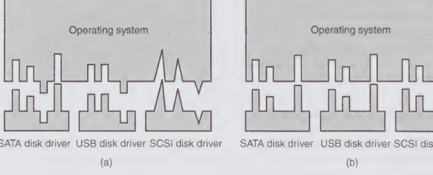

图 5-14. (a) 无标准驱动程序接口。(b) 有标准驱动程序接口。

相比之下，在图 5-14(b) 中，我们展示了一种不同的设计，所有驱动程序都具有相同的接口。现在，只要符合驱动程序接口，接入新驱动程序就变得容易得多。这也意味着驱动程序编写者知道对他们的要求。在实践中，并非所有设备都完全相同，但通常只有少数设备类型，而且这些类型通常也几乎相同。

其工作原理如下：对于每一类设备（如磁盘或打印机），操作系统定义了一组驱动程序必须提供的函数。对于磁盘，这自然包括读和写，还包括开启和关闭电源、格式化以及其他棘手的磁盘操作。通常，驱动程序持有一个表，该表包含指向这些函数的内部指针。当驱动程序加载时，操作系统会记录该函数指针表的地址，因此当它需要调用其中一个函数时，可以通过该表进行间接调用。这组函数指针定义了驱动程序与操作系统其余部分之间的接口。给定类别的所有设备（磁盘、打印机等）必须遵守该接口。

拥有统一接口的另一个方面是 I/O 设备的命名。设备标识符（device-identifier）负责将设备名称映射到相应的驱动程序。例如，在 `UNIX` 中，设备名称（如 `/dev/disk0`）唯一地指定特殊设备的 i-node，该 i-node 包含主号，用于定位相应的驱动程序。i-node 还包含设备号，该号作为参数传递给驱动程序，以指定要读取或写入的单元。所有设备都有主号和设备号，所有设备都使用主设备号选择驱动程序。

与命名密切相关的是保护。系统如何防止用户访问他们无权访问的设备？在 `UNIX` 和 `Windows` 中，设备以命名对象的形式出现在文件系统中，这意味着适用于文件的常规保护规则也适用于 I/O 设备。系统管理员随后可以为每个设备设置适当的权限。

## 缓冲

由于各种原因，缓冲对于块设备和字符设备来说也是一个问题。为了其中之一，考虑一个想要从 `ADSL`（非对称数字用户线路）调制解调器读取数据的进程，许多人在家里用它连接互联网。处理输入字符的一种可能策略是让用户进程执行读系统调用并阻塞等待一个字符。每个到达的字符都会导致一次中断。中断服务程序处理该字符并交给用户进程，将其解除阻塞。在将字符放在某处后，进程读取另一个字符并再次阻塞。这种模型如图 5-15(a) 所示。

这种处理方式的麻烦在于，每个到达的字符都需要启动用户进程。允许进程多次运行短时间是低效的，因此这种设计并不好。

图 5-15(b) 显示了一种改进方法。用户进程在用户空间提供一个 $n$ 个字符的缓冲区并读取 $n$ 个字符。中断服务程序将进入的字符放入此缓冲区，直到其完全填满。只有这时才会唤醒用户进程。这种方案比上一个高效得多，但它也有一个缺点：如果字符到达时缓冲区被换出页了怎么办？缓冲区可以锁定在内存中，但如果许多进程开始随意地锁定内存中的页面，可用页面池将缩小，性能将下降。


另一种方法是在内核内部创建一个缓冲区，并让中断处理程序将字符拉取到那里，如图 5-15(c) 所示。当此缓冲区满时，如果需要，会将用户缓冲区调入，并在一次操作将缓冲区拷贝到那里。这种方案高效得多。

然而，即使是这种改进方案也面临一个问题：当用户缓冲区被调入时，到达的字符会怎样？缓冲区可以锁定在内存中，但如果许多进程开始随意地锁定内存中的页面，可用页面池将缩小，性能将下降。

# 错误报告

在 I/O 语文中，错误比在其他语文中常见得多。当错误发生时，操作系统必须尽所能处理它们。许多错误是特定于设备的，必须由相应的驱动程序处理，但错误处理的框架是设备无关的。

I/O 错误的一大类是编程错误。这些错误发生在进程请求不可能的操作时，例如向输入设备（键盘、扫描仪、鼠标等）写入数据或从输出设备（打印机、绘图仪等）读取数据。其他错误提供了无效的缓冲区地址或其他参数，或者指定了无效的设备（例如在系统只有两个磁盘时指定了第 3 个磁盘）等。处理这些错误时采取的操作非常简单：只需向调用者报告一个错误代码即可。

另一类错误是实际 I/O 错误，例如尝试向已损坏的磁盘块写入数据或从已关闭的摄像机读取数据。在这些情况下，由驱动程序决定该做什么。如果驱动程序不知道该做什么，它可能会将问题传回给设备无关的软件。

这取决于环境和错误的性质。如果是一个简单的读取错误且有交互式用户可用，可能会显示一个对话框询问用户该怎么办。选项可能包括重试几次、忽略错误或杀死调用进程。如果没有用户可用，唯一的实际选择就是让系统带错误代码失败。

然而，某些错误无法通过这种方式处理。例如，关键数据结构（如根目录或空闲块列表）可能已被破坏。在这种情况下，系统可能不得不显示错误消息并终止。它无能为的事情不多。

# 分配和释放专用设备

某些设备（如打印机）在任何时刻只能被单个进程使用。操作系统负责检查设备使用请求并决定接受或拒绝它们，取决于所请求的设备是否可用。处理这些请求的一种简单方法是要求进程直接对设备的特殊文件执行 `open` 操作。如果设备不可用，`open` 就会失败。关闭此类专用设备将释放它。

另一种方法是使用特殊的机制来请求和释放专用设备。尝试获取不可用的设备会阻塞调用者而不是失败。被阻塞的进程被放入队列中。不久之后，请求的设备将变得可用，队列中的第一个进程被允许获取它并继续执行。

# 设备无关的块大小

不同的磁盘可能有不同的扇区大小。由设备无关的软件来隐藏这一事实并为上层提供统一的块大小，例如通过将几个扇区视为单个逻辑块。通过这种方式，上层只处理所有使用相同块大小的抽象设备，而独立于物理扇区大小。同样，某些字符设备一次交付一个字节（例如鼠标），而其他设备则以较大的单位交付（例如以太网接口）。这些差异也可以被隐藏。

### 5.3.4 用户空间 I/O 软件

大部分 I/O 软件位于操作系统内部，一小部分由与用户程序链接的库组成，甚至包括运行在内核之外的程序。系统调用（包括 I/O 系统调用）通常由库过程完成。当一个 C 程序包含：

```c
count = write(fd, buffer, nbytes);
```

`write` 过程可能与程序链接，并在运行时包含在内存中的二进制程序中。在其他系统中，库可以在程序执行期间加载。无论何种方式，所有这些库过程的集合显然是 I/O 系统的一部分。

虽然这些过程所做的无非仅仅是将它们的参数放在系统调用的合适位置，但其他 I/O 过程实际上在执行真正的工作。特别是输入和输出的格式化是由库过程完成的。C 中的一个例子是 `printf`，它接受格式化字符串和某些变量作为输入，构建一个 ASCII 字符串，然后调用 `write` 输出该字符串。作为 `printf` 的示例，考虑语句：

```c
printf("The square of %3d is %6d\n", i, i*i);
```


进入`/path/to/xxx`目录，找到`xxx.json`。

它格式化了一个字符串，由 14 个字符字符串“The square of ”后面跟着值 `$i$` 的 3 个字符字符串，然后是 4 个字符字符串“ is ”，然后 `$i^2$` 的 6 个字符，最后是一个换行符。

类似的输入过程示例是 `scanf`，它读取输入并将其存储在用与 `printf` 相同的语法描述变量中。标准 I/O 库包含许多实现 I/O 并作为用户程序运行的过程。并不是所有用户级 I/O 软件都由库过程组成。另一类是打印系统（spooling system）。打印系统是多程序系统中处理专用 I/O 设备的一种方式：一个典型的打印设备：打印机。虽然在技术上让任何用户进程打开打印机的字符特殊文件很容易的，但假设一个进程打开了它然后几个小时无所事事。其他过程无法打印任何内容。

相反，做法是创建一个称为守护进程（daemon）的特殊进程和一个称为打印目录（spooling directory）的特殊目录。要打印文件，进程首先生成整个要打印的文件并放入打印目录。由守护进程（唯一有权限使用打印机特殊文件的进程）来打印目录中的文件。通过保护特殊文件免受用户直接使用，消除了某人无长时间占用它的问题。

打印系统仅用于多程序系统中的专用 I/O 设备：一个典型的打印设备：打印机。虽然在技术上让任何用户进程打开打印机的字符特殊文件很容易的，但假设一个进程打开了它然后几个小时无所事事。其他过程无法打印任何。这取决于环境和错误的性质。如果是一个简单的读取错误且有交互式用户可用，可能会显示一个对话框询问用户该怎么办。选项可能包括重试几次、忽略错误或杀死调用进程。如果没有用户可用，唯一的实际选择就是让系统带错误代码失败。然而，某些错误无法通过这种方式处理。例如，关键数据结构（如根目录或空闲块列表）可能已被破坏。在这种情况下，系统可能不得不显示错误消息并终止。它无能为的事情不多。

同上。（在微秒级尺度上读取或写入控制器以移动比特位，因此每次传输都会用掉其大部分的计算能力）。这种情况与带有集成控制器的硬盘不同，在一个具有多个此类硬盘的系统中，它们可以同时运行，至少在磁盘与控制器缓冲区内存之间进行传输的程度是如此。然而，一次只能在控制器和主内存之间进行一次传输，但同时执行两个或多个操作的能力可以显著缩短平均访问时间。

图 18 比较了 IBM PC 标准存储介质的参数与三十后制造的磁盘的参数，以展示磁盘在在这段时间内发生了多大的变化。有趣的是，并非所有参数都得到了改进。平均寻道率几乎是其的 9 倍，传输率快了 16,000 倍，而容量则增加了 800,000 倍。这种模式与运动部件相对缓慢的改进，但记录表面极高的位密度大幅增加有关。

| 参数 | IBM 360-KB 软盘 | WD 3000 HLFS 硬盘 |
|---|---|---|
| 柱体数 | 40 | 36,481 |
| 每个柱体的磁道 | 2 | 255 |
| 每个磁道的扇区 | 9 | 63 (平均) |
| 每个磁盘的扇区 | 720 | 586,072 |
| 每个扇区的字节 | 512 | 512 |
| 磁盘容量 | 360 KB | 300 GB |
| 寻道时间（相邻柱体） | 6 msec | 0.7 msec |
| 寻道时间（平均情况） | 77 msec | 4.2 msec |
| 旋转时间 | 200 msec | 6 msec |
| 传输 1 个扇区的时间 | 22 msec | 1.4 μsec |

> 图 18。原始 IBM PC 360-KB 软盘和西部数据 WD 3000 HLFS（“Velociraptor”）硬盘的参数。

在查看现代硬盘的规格时，需要注意的一点是，驱动程序软件指定并使用的几何结构与物理格式总是不同。在旧磁盘上，所有柱道的扇区数量是相同的。现代磁盘被分为若干区域，外层磁道的扇区比内层磁道的多。图 5-19(a) 展示了一个具有两个区域的小磁盘。外部区域每个磁道有 32 个扇区；内部区域有 16 个扇区。真实的磁盘（如 WD 3000 HLFS）通常有 16 或更多扇区，随着从最内区域向最外区域移动，扇区数量每区域区域增加约 4%。

为了隐藏每个磁道有多少个扇区的细节，大多数现代硬盘都有一个呈现给系统的虚拟几何结构。软件被指示假装存在 `$x$` 个柱体、 `$y$` 个磁头和每个磁道 `$z$` 个扇区。

# 5.4 磁盘


**图 5-19。** (a) 具有两个区域的磁盘物理几何结构。(b) 该磁盘可能的虚拟几何结构。

控制器将对 `$(x, y, z)$` 的请求映射到真实的柱体、磁头和扇区。图 5-19(a) 中物理磁盘的一种可能的虚拟几何结构如图5-19(b) 所示。在两种情况下，磁盘都有 192 个扇区，只是公布的排列与真实的不同。

对于 PC 而言，这三个参数的最大值通常为 `(65535, 16 和 63)`，因为需要与原始 IBM PC 的限制向下兼容。在这些机器上，使用 16 位、4 位和 6 位字段来指定这些数字，柱体和扇区从 1 开始编号，磁头从 0 开始编号。使用这些参数和每个扇区 512 字节，最大的磁盘是 31.5 GB。为了绕过这个限制，所有现代磁盘现在支持一种名为*逻辑块寻址*（logical block addressing）的系统，其中磁盘扇区仅从 0 开始连续编号，而不考虑磁盘几何结构。

# RAID

CPU 性能在过去十年中呈指数级增长，大约每 18 个月翻一倍。磁盘性能并非如此。在 20 世纪 70 代，微机磁盘的平均寻道时间为 50 到 100 毫秒。寻道时间现在仍然几毫秒。在大多数技术行业（例如汽车或航空）中，二十年性能提升 5 到 10 倍将是重大新闻（想象一下 300MPG 的汽车），但在计算机行业，这是一种羞辱。因此，CPU 性能与（硬盘）性能之间的差距随着时间的推移变得大得多。有什么办法吗？

是的！正如我们所看到的，并行处理正越来越多地用于加速 CPU 。多年来，人们认为并行 I/O 可能也是一个好主意。在 1988 年的论文中，Patterson 等人提出了特定的磁盘组织形式，可以提高性能、可靠性或两者（Patterson et al., 1988）。这些想法被业界迅速采用，并导致了名为 RAID 的新型 I/O 设备。Patterson 等人将 RAID 定义为磁盘阵列（Redundant Array of Disks），但将其重新定义为“独立”（Independent）。Patterson 等人定义 RAID 为冗余磁盘阵，但将其重新定义为“独立”磁盘阵。


图 5-20。RAID 0 到 6。阴影部分表示备份盘和校验盘。

## 5.4 磁盘

崩溃时，控制器只需假装所有的位都是 0。如果一个字字出现校验错误，则来自故障硬盘的位必然是 1，因此它会被修正。虽然 RAID 级别 2 和 3 都提供了极高的数据传输率，但它们能够处理的独立 I/O 请求数并不比单个硬盘更好。RAID 级别 4 和同步驱动器。RAID 级别 4 [见图 5-20(e)] 类似于 RAID 级别 0，但在额外的硬盘上写入了逐条带的校验。例如，如果每个条带的长度为 k 字节，则对所有条带进行异或（EXCLUSIVE OR）运算，产生一个长度为 k 字节的校验带。如果某个硬盘崩溃，可以通过读取整组硬盘从校验盘重新计算丢失的字节。

这种设计可以防止硬盘丢失，但在处理小范围更新时性能较差。如果一个扇区发生变化，必须读取所有硬盘以重新计算校验，然后必须重写。或者，它可以读取旧的用户数据和旧的校验数据，并据此重新计算新的校验。即使有这种优化，小范围更新也需要两次读取和两次写入。

由于校验盘的负载沉重，它可能会成为瓶颈。在 RAID 级别 5 中，通过将校验以轮询方式均匀地分布在所有硬盘上（如图 5-20(f) 所示），消除了这一瓶颈。然而，在硬盘崩溃的情况下，重建故障硬盘的内容是一个复杂的过程。

RAID 6 与 RAID 级别 5 类似，不同之处在于使用了额外的校验块而不是一个。换句话说，数据跨硬盘进行条带化时，带有两个校验块而不是一个。因此，写入不会产生性能损失。它确实提供了更高的可靠性（如果 RAID 级别 5 在重建阵列时遇到坏块，会发生什么）。

### 5.4.2 磁盘格式化

硬盘由一叠铝制、合金或玻璃盘片组成，直径通常为 3.5 英寸（笔记本电脑上为 2.5 英寸）。每个盘片上沉积有一层薄薄的磁性金属氧化物。制造完成后，磁盘上没有任何信息。

在磁盘可以使用之前，每个盘片都必须通过软件进行低级格式化。格式化由一系列同心磁道组成，每个磁道包含一定数量的扇区，扇区之间有短的间隙。扇区的格式如图 5-21 所示。

| 前导码 | 数据 | ECC |
| :--- | :--- | :--- |

图 5-21。磁盘扇区。

前导码以特定的位模式开始，允许硬件识别扇区的起始。它还包含柱面号、扇区号以及其他其他信息。数据部分的大小由低级格式化程序决定。大多数磁盘使用 512 字节扇区。ECC 字段包含冗余信息，可用于恢复读取错误。该字段的大小和内容随制造商而异，取决于设计师愿意放弃多少磁盘空间来获得更高的可靠性，以及控制器能够处理多复杂的 ECC 码。16 字节的 ECC 字段并不罕见。此外，硬盘分配了若干个备用扇区，用于替换具有制造缺陷的扇区。

在进行低级格式化时，每个磁道的扇区 0 相对于上一个磁道存在偏移。这种偏移称为柱斜（cylinder skew），是为了提高性能。其思想是允许磁盘在一次连续操作中读取多个磁道而不丢失数据。可以通过图 5-19(a) 看到问题的本质。假设一个请求需要 18 个扇区并旋转一圈，磁头寻道向外移动一个磁道以获取第 17 个扇区。当磁头移动一个磁道时，扇区 0 已经过了磁头，因此需要旋转一整圈才能再次到达。这个问题通过如图 5-22 所示的扇区偏移来消除。

柱面偏斜量取决于驱动器的几何结构。例如，一个 10,000 RPM（每分钟转数）驱动器在 6 毫秒内旋转。每 20 `μsec` 有一个新扇区经过磁头。如果磁道间的寻道时间为 800 `μsec`，则在寻道期间会有 40 个扇区经过，因此柱面偏斜至少应为 40 个扇区，而不是图 5-2 所示的三个扇区。值得提到的是，磁头之间的切换也需要有限的时间，因此既有头斜（head skew）也有柱面偏斜，但头斜并不大，通常小于一个扇区的时间。

由于低级格式化的影响，磁盘容量会减少，取决于前导、扇区间隙和 ECC的大小以及预留备用扇区的数量。格式化后的容量比未格式化容量低 20%。备用扇区不计入格式化容量，因此所有相同类型的硬盘在出厂时容量完全相同，无论它们实际上有多少个坏扇区（如果坏扇区数量超过备用扇区数量，它们将被拒绝且不出货）。

关于磁盘容量存在很大困惑，因为许多制造商宣称未格式化容量，使他们的硬盘看起来比实际更大。例如，让我们考虑一个未格式化容量为 `$20 × 10^9$` 的驱动器。

## 5.4 磁盘

准备磁盘使用的最后一步是对每个分区（分别地）进行高级格式化。此操作会建立启动块、空闲存储管理（空闲列表或位图）、根目录和一个空文件系统。它还会在分区表项中写入一段代码，告知该分区使用的是何种文件系统，因为由于历史原因，许多操作系统支持多个不兼容的文件系统。此时，系统就可以启动了。

当接通电源时，BIOS 首先运行，读取主引导记录并与其跳转。该启动程序随后会检查哪个分区是激活分区。然后它它从该分区读取启动区并运行它。启动区包含一个很小的程序，该程序通常会加载一个更大的引导加载程序，该加载程序会搜索文件系统以找到操作系统内核。该程序被加载到内存并执行。

## 5.4.3 磁盘调度算法

在本节中，我们将介绍与磁盘驱动程序相关的一些问题。首先，考虑读取或写入磁盘块所需的时间。所需时间由三个因素决定：

- 1. 寻道时间（磁臂移动到相应磁柱的时间）。
- 2. 旋转延迟（正确的扇区出现在读取头下方所需的时间）。
- 3. 实际数据传输时间。

对于大多数磁盘来说，寻道时间占据了另外两个时间的主导，减少平均寻道时间可以显著提高系统性能。

如果磁盘一次接受一个请求并按该顺序执行，即 FCFS（先来先服务），那么对优化寻道时间的改进非常有限。然而，当磁盘负载很重时，可以采取另一种策略。磁臂可能正在为一个请求进行寻道，而其他磁盘请求可能由其他进程产生。许多磁盘驱动程序维护一个以磁柱编号为索引的表，每个磁柱的所有待处理请求都通过表项中的链表连接在一起。

鉴于这种数据结构，我们可以改进先来先服务的调度算法。为了了解如何实现，考虑一个具有 40 个磁柱的虚拟磁盘。来了一个读取磁柱 11 上块的请求。在向磁柱 11 寻道的过程中，新请求按顺序在磁柱 1、36、16、34、9 和 12 产生。它们被输入待处理请求表，每个磁柱都有一个独立的链表。请求如图 5-24 所示。

当当前请求（磁柱 11）完成后，磁盘驱动程序可以选择下一个处理哪一个请求。如果使用 FCFS，它将去磁柱 1，然后是 36，依此类推。该算法将需要磁臂移动距离分别为 10、35、20、18、25 和 3 个磁柱，总计 111 个磁柱。

**图 5-24.** 最短寻道优先（SSF）磁盘调度算法。

或者，它可以始终处理最近的下一个请求，以最小化寻道时间。根据图 5-24 中的请求，序列为 12, 9, 16, 1, 34 和 36，如图 5-24 底部的锯齿线所示。按照此序列，磁臂移动距离为 1、3、7、15、33 和 2，磁臂总移动了 61 个磁柱。这种算法被称为 SSF（最短寻道优先），与 FCFS 相比，它将总磁臂移动减少了近一半。

不幸的是，SSF 有一个问题。假设在处理图 5-24 中的请求时，不断有更多请求进入。例如，如果在到达磁柱 16 后，存在一个磁柱 8 的新请求，磁臂将停留在磁柱 1 上。如果来了一个磁柱 13 的请求，磁臂下一步将去 13 而不是 1。在磁盘负载很重的情况下，磁臂大部分时间将留在磁盘的中间，因此两端的请求将必须等待负载出现统计学波动，导致中间附近没有请求。远离中间的请求可能会获得较差的服务。在这里，最小响应时间与公平性的目标是相互冲突的。

高层建筑也必须处理这种权衡。高层建筑中调度电梯的问题与调度磁臂的问题相似。请求不断地来，随机呼叫电梯到各个楼层（磁柱）。运行电梯的计算机可以轻松跟踪客户按下呼叫按钮的顺序，并使用 FCFS 或 SSF 为他们提供服务。

然而，大多数电梯使用不同的算法来协调效率与公平性这两个冲突的目标。它们一直朝着同一个方向移动，直到该方向没有更多待处理的请求，它们就会切换方向。这种算法在磁盘领域和电梯领域被称为*电梯算法*（elevator algorithm），它要求软件维护 L 位：当前方向位。当一个请求完成后，磁盘或电梯驱动程序会检查该位。如果是 UP（向上），磁臂或轿厢移动到下一个最高的待处理请求。如果较高位置没有待处理请求，则反转方向位。当位被设置为 DOWN（向下）时，移动到下一个最低的请求位置（如果有）。如果没有待处理请求，它就停止并等待。

图 5-25 显示了电梯算法，使用了与图 5-24 相同的七个请求，假设初始方向为向上。被服务的磁柱顺序为 12, 16, 34, 36, 9 和 1，产生的磁臂移动距离为 1, 4, 18, 2, 27 和 8 个磁柱，总计 60 个磁柱。在这种情况下，电梯算法比 SSF 好一点，尽管通常更差。

## 5.4.4 错误处理

磁盘制造商通过增加线密度不断推向技术极限。5.25 英寸磁盘中间的磁道周长约为 300 毫米。磁道容纳 300 个 512 字节的扇区，考虑到前导、ECC 和扇区间隙浪费了一些空间，线性记录密度约为 500 位/毫米。记录 5000 位/毫米需要极其均匀的基底和非常细的光涂层。不幸的是，无法按照这些规格制造出没有缺陷的磁盘。一旦制造技术进步到可以在此类密度下无缝运行的程度，磁盘设计师就会转向更高的密度以增加容量。这样做可能会再次引入缺陷。制造缺陷会导致坏扇区，即无法正确读回刚刚写入的值的扇区。如果缺陷非常小，例如，

# SEC 5.4 磁盘 383

对于少数比特，可以使用坏道并仅让 ECC 每次都纠正错误。如果缺陷较大，错误将无法被掩盖。

处理坏块有两种通用方法：在控制器中处理或在操作系统中处理。在前一种方法中，磁盘从工厂出厂时经过测试，并将坏道列表写入磁盘。对于每个坏道，都用其中一个备用扇区替换它。

这种替换有两种方法。在图 5-26(a) 中，我们看到一个包含 30 个数据扇区和 2 个备用扇区的磁盘轨道。7号扇区是有缺陷。另一种方法是将所有扇区向上移动，如图 5-26(b) 所示。在这两种情况下，控制器都必须知道哪个扇区损坏了。它可以通过内部表（每个轨道一个）或通过重写写入的前导码（preambles）来跟踪这些信息。如果重写了前导，图 5-26(c) 所示的方法工作量更大（因为重写了 23 个前导），但最终性能更好，因为整个轨道可以在一次旋转中被读取。


驱动器安装后的正常运行期间也可能产生错误。遇到 ECC 无法处理的错误，第一道防线是尝试重新读取。某些读取错误是瞬时的，是由磁头下的灰尘引起的，会在第二次尝试时消失。如果控制器注意到它可以在坏道完全删除之前切换到另一个扇区。通过这种方式，数据不会丢失，操作系统和用户甚至不会察觉到问题。通常情况下，必须使用图 5-26(b) 的方法，因为其他扇区现在可能包含数据。使用图 5-26(c) 的方法不仅需要重写前导，还需要复制所有数据。

我们之前提到过处理错误有两种通用方法：在控制器中处理或在操作系统中处理。如果控制器不具备我们讨论过的那种透明重映射扇区的能力，则操作系统必须在软件中执行相同的操作。这意味着它必须首先获取坏道列表，可以通过从磁盘读取它们，或者简单地自己测试整个磁盘。一旦知道哪些扇区是坏的，它就可以重建重映射表。如果操作系统想使用图 5-26(c) 的方法，它必须将扇区 7 到 29 的数据向上移动一个扇区。

如果由处理，它必须确保坏道不会出现在任何文件中，并且不占用空闲列表或位图。做到此点的一种方法是创建一个包含所有坏道的秘密文件。如果此文件没有被输入文件系统，用户就不会意外读取它（更糟糕的是，释放它）。

然而，还有另一个问题：备份。如果磁盘按文件进行备份的，那么确保备份工具不要尝试复制坏块文件至关重要。为了防止这一点，操作系统会隐藏坏块文件，即使是备份工具也找不到它。如果磁盘是按扇区而不是文件备份的，要防止备份期间出现读取错误将是非常困难甚至是不可能的。唯一的希望是备份程序足够智能，在10次读取失败后放弃并继续下一个扇区。

坏道并不是错误的唯一来源。磁臂机械问题引起的寻道错误也是。控制器在内部跟踪磁臂的位置。执行寻道时，它向磁臂电机发出命令，将磁臂移动到新的柱体。当磁臂到达目的地时，控制器从下一个扇区的前导码中读取实际柱体号。如果磁臂处于错误位置，则发生了寻道错误。

大多数硬盘控制器会自动纠正寻道错误，但20世纪80年代和90年代使用的大多数旧软盘控制器只设置一个错误位，并将剩下的交给驱动程序。驱动程序通过发出重新校准（calibrate）命令来处理此错误，将磁臂移动到最远端并重置控制器对当前柱体的内部设为 0。通常这解决了问题。如果没有解决，驱动器就必须维修。

正如我们刚刚看到的，控制器是一个专门的微型计算机，配备了软件、变量、缓冲区，偶尔还有漏洞（bugs）。有时，不寻常事件序列（例如一个驱动器的中断与另一个驱动器的重新校准命令同时发生）会触发漏洞，导致控制器进入循环或丢失正在操作的状态。控制器设计人员通常会在芯片上规划一个引脚，当它被触发时，会强制控制器忘记正在做的任何事情并重置。如果其他方法都失败了，磁盘驱动程序可以设置位来调用此信号并重置控制器。如果这没有帮助，驱动程序可以打印消息并放弃。

对磁盘进行重新校准会产生奇怪的噪音，但在其他情况下通常不会干扰。然而，有一种情况重新校准是一个问题：具有实时限制的系统。当从硬盘播放（或从硬盘提供）视频，或将来自硬盘的文件刻录到蓝光光上时，比特以恒定的速率从硬盘到达至关重要。在这种情况下，

# 5.5.4 磁盘 385

重新校准会在比特流中插入间隙，这是不可接受的。对于此类应用，可以使用从重新校准的特殊驱动器（统称为 AV 磁盘，即音频视频磁盘）。高级磁盘控制器的极说演示是由荷兰黑客 Jeroen Domburg 给出的，他破解了现代磁盘以运行自定义代码。或者，你可以从当地回收中心收集堆坏硬盘并免费构建自己的集群。这是一个相当强大的多核处理器，资源足以运行 Linux 传输数据。

# 5.4.5 稳定存储

正如我们所知，磁盘有时会产生错误。良好的扇区可能会突然损坏。虽然 RAID 可以防止少数扇区损坏或驱动器掉线。然而，它们不能防止写入错误产生错误数据。它们还可以防止写入期间的崩溃损坏原始数据。

对于某些应用程序，确保数据永远不会丢失或损坏至关重要，即使面临磁盘和 CPU 错误。理想情况下，磁盘应该一直运行没有任何错误。遗憾的是，这是可能的。可以实现的是具有以下属性的磁盘子系统：当写入时，要么正确写入数据，要么什么都不做，保持数据完整。这样的系统被称为稳定存储，并通过软件实现（Lampson and Sturgis, 1979）。目标是始终保持磁盘一致。

在描述算法之前，对可能的错误有一个清晰的模型是非常重要的。模型假设当磁盘写入块（一个或多个扇区）时，要么写入正确，要么错误且可以在随后的读取中通过检查 ECC 字段的值检测到此错误。从原理上讲，使用 16 字节 ECC 字段保护 512 字节扇区是不可能的，有 `$2^{4096}$` 个数据值而只有 `$2^{64}$` 个 ECC 值。如果块在写入期间损坏但 ECC 未变，则会有数以十亿的错误组合产生相同的 ECC。如果发生了其中任何一种，错误将无法被检测。总的来说，随机数据产生正确的 16 字节 ECC 的概率约为 `$2^{-144}$`，这个概率小到我们可以称其为零，尽管实际上并不是。

该模型还假设正确写入的扇区可能会自发损坏并变得无法访问。然而，假设是此类事件是

# 386 输入/输出 第5章

在合理的时间间隔内（例如 1 天），第二个（独立）驱动器上出现相同扇区损坏的情况非常罕见，小到可以忽略不计。

该模型还假设 CPU 可能会故障，在这种情况下它会停止。故障发生时正在进行的任何磁盘写入也会停止，导致一个扇区中的数据错误以及一个可以被检测到的错误 ECC。在所有这些条件下，稳定存储在意义上是 100% 可靠的，即写入要么正确工作，要么将旧数据留在原处。当然，它无法防止物理灾难，例如地震发生、电脑掉入 100 米深的裂缝并掉入沸腾的岩浆中。在软件中很难从这种状态中恢复。

稳定存储使用一对相同的磁盘，其相应的块共同工作以形成一个无错误的块。在没有错误的情况下，两个驱动器上相应的块是相同的。读取其中任何一个一个都可以得到相同的结果。为了实现这一目标，定义了以下三种操作：

- 1. **稳定写入。** 稳定写入包括首先在驱动器 1 上写入块，然后将其读取回来以验证写入是否正确。如果没有正确写入，则重复执行写入和重新读取，最多执行 `$n$` 次，直到成功。在连续失败 `$n$` 次后，该块被重映射到备用块，并重复该操作直到成功，无论需要使用多少备用块。在驱动器 1 的写入成功后，对驱动器 2 上相应的块进行写入和读取，如果需要则重复，直到最终也成功。在没有 CPU 崩溃的情况下，稳定写入完成，块已正确写入到两个驱动器上，并对每个块都进行了验证。

- 2. **稳定读取。** 稳定读取首先从驱动器 1 读取块。如果这产生了错误的 ECC，则再次尝试读取，最多尝试 `$n$` 次。如果这些坏 ECC 都存在，则从驱动器 2 读取相应的块。鉴于成功的稳定写入留下了两个块的副本，而且我们的假设在合理的时间间隔内，同一个块在两个驱动器上自发发生损坏的概率是微乎其微的，因此稳定读取总是成功的。

- 3. **崩溃恢复。** 崩溃后，恢复程序扫描两个磁盘并比较相应的块。如果一对块都是完好的且相同的，则什么都不做。如果其中一个有一个 ECC 错误，则用相应的好块覆盖坏块。如果一对块都是完好的但不同，则将来自驱动器 1 的块写入到驱动器 2 上。

在没有 CPU 崩溃的情况下，该方案始终有效，因为稳定写入始终会为每个块写入有效副本，并且假设自发性错误永远不会在两个块上同时发生。如果在稳定写入期间发生 CPU 崩溃会怎样？这取决于崩溃发生的精确时刻。共有五种可能性，如图 5-27 所示。


**图 5-27。** 崩溃对稳定写入的影响分析。

在图 5-27(a) 中，CPU 崩溃发生在块的任何一个副本被写入之前。在恢复期间，两者都不会被更改，旧值将继续存在，这是允许的。

在图 5-27(b) 中，CPU 在写入驱动器 1 期间崩溃，破坏了块的内容。然而恢复程序检测到了这次崩溃并从驱动器 2 恢复驱动器 1 上的块。因此，这次崩溃的影响被除了，旧状态被完全恢复。

在图 5-27(c) 中，CPU 崩溃发生在驱动器 1 写入之后驱动器 2 写入之前。恢复程序将块从驱动器 1 复制到驱动器 2。写入成功。

在图 5-27(d) 中，情况类似于图 5-27(b)：在恢复期间，好块覆盖了坏块。再次，两个块的最终值都是新的。

最后，在图 5-27(e) 中，恢复程序看到两个块是相同的，两者都没有被更改，写入在这里也成功了。

该方案可以进行各种优化和改进。首先，在崩溃后对所有块进行两对比较是可行的，但开销很大。一个巨大的改进是跟踪在稳定写入期间正在写入哪个块，这样在恢复期间只需要检查一个块。某些计算机具有少量的非易性 RAM，这是一种由锂电池供电的特殊 CMOS。这些电池可以使用多年，甚至可能持续计算机的整个寿命。与崩溃后会丢失的主内存不同，易失性 RAM 在崩溃后不会丢失。时间通常保留在这里（并由特殊电路增加），这就是为什么电脑在拔掉电源后仍然知道时间。

假设有一些用于操作的非易性 RAM。在成功完成稳定写入后，非易性 RAM 中的块号将被覆盖为一个无效的块号，例如 `-1`。在这些条件下，崩溃后恢复程序可以检查非易性 RAM，查看稳定写入恰好发生在崩溃期间，如果是，则崩溃发生时正在写入哪个块。然后可以检查块的两个副本的正确性和一致性。

## 5.5 时钟

时钟（也称为定时器）对任何操作系统都至关重要。常用的钟有两种：硬件时钟和软件时钟。硬件时钟使用产生中断的特殊电路实现。软件时钟由操作系统用来跟踪时间。

硬件时钟通常由振荡器、计数器和寄存器组成。振荡器产生固定频率的脉冲。计数器随脉冲增加或减少。寄存器存储计数器的值。当计数器归零时，它产生中断。操作系统处理处理中断以更新软件时钟。

软件时钟通过维护一个存储时间的变量来实现。每当硬件时钟中断发生时，操作系统就会更新该变量。获取当前时间，操作系统只需读取该变量。

### 5.5.1 时钟硬件

硬件时钟由三个组件构建：振荡器、计数器和寄存器。振荡器产生固定频率的脉冲。计数器随脉冲增加或减少。寄存器存储计数器的值。当计数器归零时，它产生中断。操作系统处理处理中断以更新软件时钟。


**图 5-28。** 可编程时钟。

硬件时钟通常是可编程的，这意味着操作系统可以设置振荡器的频率或寄存器的值。这对于各种用途非常有用，例如调度任务或测量经过的时间。可编程时钟的优势在于其频率可以调整以满足操作系统的需求。例如，如果系统需要更频繁地调度任务，可以将时钟设置为较高的频率。如果系统只需要不频繁地调度任务，可以将时钟设置为较低频率。

## 5.5.2 软件时钟

时钟硬件会在已知间隔内产生中断。所有涉及时间的操作必须由软件完成；时钟驱动程序在不同的操作系统之间有所不同，但通常必须包含大部分内容：

1. 维护当天时间。
2. 防止进程运行时间超过其允许范围。
3. 统计 CPU 使用情况。
4. 处理用户进程发出的闹钟系统调用。
5. 防止系统某些部分的看门狗定时器触发。
6. 进行性能分析、监控和统计采集。

第一个时钟功能——维护当天时间（也称为实时）并不困难。如前所述，它要求在每个时钟滴答（clock tick）时增加计数器的值。唯一需要注意的是当天时间计数器的位数。在 60 Hz 的时钟频率下，32 位计数器在 2 年后就会溢出。显然，系统无法用 32 位来存储自 1970 年 1 月 1 日以来的滴答数（即实时时间）。

可以通过三种方法来解决这个问题。第一种是使用 64 位计数器，尽管由于需要每秒执行多次，这使得维护秒为单位的当天成本更高。第二种方法是维护秒为单位的时间，而不是滴答数，使用一个辅助计数器来计算滴答，直到累积一个整秒。由于 `$2^{32}$` 秒超过 136 年，这种方法可以一直运行到 22 世纪。

第三种方法是按滴答计数，但是相对于系统启动的时间，而不是相对于固定的外部监控器。当读取上电时钟或用户输入实时时间时，系统根据当前的当天时间值计算系统启动时间，并以任何方便的格式存储在内存中。稍后当请求当天时间时，将存储的长时间加上计数器即可得到当前的当天时间。这三种方法如图 5-29 所示。

第二个时钟功能是防止进程运行过久。每当进程启动时，调度器都会初始化一个计数器，其值为该进程量子态（quantum）对应的滴答数。在每个时钟中断时，时钟驱动程序会将量子计数器减 1。当它变为 0 时，时钟驱动程序调用调度器设置另一个进程。

第三个时钟功能是进行 CPU 统计。最准确的方法是在每当进程启动时启动一个与主系统计时器不同的第二个定时器。当该进程停止时，可以读取定时器以告知进程运行了多久。为了确保正确操作，在发生中断时应保存第二个定时器，并在之后恢复。

图 5-29。维护当天时间的三种方法。

一种较不准确但更简单的统计方法是在全局变量中维护一个指向当前运行进程的进程表条目的指针。在每个时钟滴答时，将当前进程条目中的一个字段加 1。通过这种方式，每个时钟滴答都“计费”在在该滴答时刻运行的进程上。这种策略的一个小问题是，如果在一个进程运行期间发生了多次中断，它仍然会被收取一个完整滴答的费用，尽管它并没有完成多少工作。在中断期间正确地统计 CPU 的开销太大了，而且很少这样做。

在许多系统中，进程可以请求操作系统在一定间隔后向其发出警告。该警告通常是一个信号、中断、消息或类似物。一个需要此类警告的应用是网络，其中如果数据包在一定间隔内未被确认，必须重传。另一个应用是计算机辅助教学，如果学生在规定时间内未提供响应，则告知其答案。

如果时钟驱动程序有足够的时钟，它可以为每个请求模拟一个独立的时钟。由于并非如此，它必须用单个物理时钟模拟多个虚拟时钟。一种方法是维护一个表，其中保存所有待处理定时器的信号，并将下一个定时器的时间作为一个变量。当当天时间更新时，驱动程序检查是否发生了最接近的信号。如果发生了，则在表中查找要发生的信号。

如果预计会有许多信号，通过将待处理的时钟请求按时间排序并链接在链表（linked list）中来模拟多个时钟更高效，如图 5-30 所示。列表上的每个条目都告诉在前一个信号之后需要等待多少个时钟滴答才会触发信号。在这个示例中，信号 `$t_1, t_2, t_3, t_4$` 和 `$t_5$` 处于待处理状态。在图 5-30 中，发生中断时，Next signal（下一个信号）会减 1。当它变为 0 时，触发列表第一项对应的信号，并将该项从列表中移除。然后，将 Next signal 设置为现在列表头部条目中的值。

图 5-30。用单个时钟模拟多个定时器。注意，在时钟中断期间，时钟驱动程序有几件事要做——增加实时、减少量子、检查 CPU 统计以及减少闹钟计数器。然而，这些操作每一个都经过了仔细安排以确保快速，因为它们每秒要重复多次。操作系统也需要设置定时器。这些被称为看门狗定时器（watchdog timers），经常用于（特别是嵌入式设备）检测挂起等问题。例如，看门狗定时器可能会重置停止的系统。在系统运行时，它定期重置定时器使其永不过期。一旦定时器过期，说明系统长时间未运行，会导致纠正措施——例如全系统重位。时钟驱动程序处理看门狗定时器的机制与处理用户信号相同。区别在于，当定时器触发时，时钟驱动程序调用调用者提供的过程而不是调用信号。该过程是调用者代码的一部分，可以执行任何必要的操作，甚至导致中断，尽管值得注意的是，看门狗机制只有当时钟驱动程序和要调用的过程位于同一个地址空间时才有效。

我们列表中的最后一项是性能分析（profiling）。某些操作系统提供了一种机制，用户程序可以通过此建立其程序计数器的直方图，以便查看时间消耗在何处。当可能进行性能分析时，在每个滴答驱动程序都会检查当前进程是否正在被性能分析，如果是，则计算与程序计数器对应的箱号（一个地址范围）。然后它将该箱号加 1。这种机制也可以用于对系统本身进行分析。

## 5.5.3 软定时器

大多数计算机都有第二个可编程时钟，可以设置为按程序所需的任何频率产生中断。这是在上述描述的功能的主系统计时器之外的。只要中断频率较低，使用这个第二个定时器处理特定应用程序就没有问题。当特定定时器的频率非常高时，就会出现问题。下面简要描述一种在许多情况下都有效的软件计时方案，其想法见 Aron 和 Druschel (1999)。

偶尔错过截止日期是可以接受的。偶尔时间延迟 10 `μsec` 通常比让中断占用高达 35% 的 CPU 要好。

当然，总会有某些时期没有系统调用、TLB 缺失或页错误，在这些情况下，没有定时器会触发。为了给这些间隔设定一个上限，可以将第二个硬件定时器设置为每隔 1 msec 触发一次。如果应用程序可以接受每秒仅 1000 次激活来应对偶发性间隔，那么软定时器与低频硬件定时器的结合可能比纯中断驱动的 I/O 或轮询更好。

## 5.6 用户界面：键盘、鼠标、显示器

每台通用计算机都配有一个键盘和一个显示器（有时还有鼠标），以便人们与它进行交互。尽管键盘和显示器在技术上是两个独立的设备，但它们工作得非常紧密。在大型机上，有很多远程用户，每个用户都有一个包含键盘和附加显示器的设备作为一个单元。这些设备在历史上被称为终端（terminal）。人们经常使用这个术语，即使在讨论个人电脑键盘和显示器时也是如此（主要是因为缺乏更好的术语）。

### 5.6.1 输入软件

用户输入主要来自键盘和鼠标（有时是触摸），所以让我们来看看这些设备。在个人电脑上，键盘包含一个嵌入式微处理器，它通常通过特殊的串行端口与主板上的控制器芯片通信（尽管键盘越来越多地连接到 USB 端口）。每当按下按键时就会产生一个中断，每当释放按键时就会产生另一个中断。在每个键盘中断中，键盘驱动程序都会从键盘关联的 I/O 端口提取发生发生的信息。在软件中发生的其他一切都与硬件无关。

本节其余的大部分内容通过通过向 shell 窗口（命令行界面）输入命令来更好地理解。这是程序员通常的工作方式。我们将在下讨论图形界面。某些设备，特别是触摸屏，用于输入和输出。我们做出（主观）选择在输出设备章节中讨论它们。我们将在本章稍后讨论图形界面。

### 键盘软件

I/O 寄存器中的数字是键码，称为扫描码（scan code），而不是 ASCII 码。普通键盘有少于 128 个键，因此只需要 7 位来表示键码。在按键时，第八位被设置为 0；在释放按键时被设置为 1。跟踪每个键的状态（按下或松开）是驱动程序的职责。因此，所有硬件都提供按下和释放中断。其余工作由软件完成。

当按下按键时，例如，扫描码 `(30)` 被放入 I/O 寄存器中。由驱动程序来判断它是小写、大写、CTRL-A、ALT-A、CTRL-ALT-A 还是其他组合。由于驱动程序可以知道哪些按键被按下但尚未释放（例如 SHIFT），因此它有足够的信息来完成工作。

例如，按键序列：


进入`/path/to/xxx`目录，找到`xxx.json`。

在表达式`cvar = avar + bvar`中，加法运算符（`+`）将`avar`与`bvar`相加，得到它们的和`cvar`

在`List.of(arg0, arg1, arg2)`中，`List`接口的工厂方法`of()`接受一系列的元素，返回包含它们的只读列表。

之后我们这样调用`cmd`命令：`cmd arg0 arg1 arg2`。

```
if (condVar > someVal) {console.log("xxx")}
```

DEPRESS SHIFT, DEPRESS A, RELEASE A, RELEASE A

```
表示一个大写的 A。然而，按键序列：
```
DEPRESS SHIFT, DEPRESS A, RELEASE SHIFT, RELEASE A
```
同样表示一个大写的 A。这种键盘接口将全部负担留给了软件，它是极其灵活的。例如，用户程序可能感兴趣刚刚输入的数字是从顶部的键位输入的还是侧边的数字键盘输入的。原则上讲，驱动程序可以提供这种信息。

驱动程序可以采用两种哲学。在第一种哲学中，驱动程序的工作是接受输入并将其原封不动地向上推送。从键盘读取的程序获得一个原始的 ASCII 码序列。（给用户程序提供扫描码太原始了，而且具有高度依赖性）。

这种哲学非常适合复杂的屏幕编辑器的特性，这类编辑器允许用户将任意操作绑定到任何字符或字符序列。然而，这意味着如果用户输入了 `deste` 而不是 `date`，并通过输入三个退格键（backspace）然后输入 `ate` 和回车来纠正错误，用户程序将获得输入的全部 11 个 ASCII 码，如下所示：

```
dete←←ate
```

并不是所有程序都会介意这些细节。它们只需要修正后的输入，而不是产生的精确序列。这一观察引出了第二种哲学：驱动程序处理所有的行内编辑，并直接将行传递给用户程序。第一种哲学是面向字符的；第二种哲学是面向行的。最初它们被称为原始模式（raw mode）和代码模式（coded mode），POSIX 标准使用较不那么直观的“规范模式”（canonical mode）来描述面向行的模式。“非规范模式”（noncanonical mode）等同于原始模式，尽管行为的许多细节可以更改。POSIX 兼容系统提供了几个库函数，支持选择任意模式并更改许多参数。

如果键盘处于规范（代码）模式，字符必须存储起来，直到积满了一整行，因为用户随后可能会决定删除它的部分内容。即使键盘处于原始模式，程序可能尚未请求输入，因此字符必须被缓冲以允许预打（type ahead）。可以使用专用的缓冲区，也可以从池中分配缓冲区。前者对预打设置了固定限制；后者则没有。这个问题出现在用户向 shell 窗口（Windows 中的命令行窗口）输入，并且刚刚发布了一个尚未完成的命令（如编译）时。后续输入的字符必须被缓冲，因为 shell 还没有准备好接收它们。

尽管键盘和显示器在逻辑上是独立的设备，但许多用户已经习惯了在屏幕上看到刚刚输入的字符。这个过程被称为**回显（echoing）**。

回显的复杂之处在于，在用户打字时程序可能会写入屏幕（再次，考虑向 shell 窗口输入的情况）。至少，键盘驱动程序必须弄清楚在哪里放置新输入，而不会被程序输出覆盖。

当超过 80 个字符需要显示在具有 80 字符行的窗口中时，回显变得复杂。取决于应用程序，换行到下一行可能是合适的。某些驱动程序通过丢弃第 80 列之后的字符来截断行。

另一个问题是制表符（tab）的处理。通常由驱动程序来计算光标当前所在的位置，考虑到程序的输出和回显，并计算出回显所需的空格数。

现在我们遇到了设备等效性问题。逻辑上，在行尾，人们想要一个回车（carriage return）将光标移回第 1 列，以及一个换行符（line feed）移动到下一行。要求用户在行尾输入这两个键并不理想。由设备驱动程序来将输入的内容转换为操作系统使用的格式。在 UNIX 中，*回车键*被转换为换行符进行内部存储；在 Windows 中，它被转换为回车符加换行符。

如果标准格式是仅存储换行符（UNIX 约定），那么回车（回车键创建）应该转换为换行符。如果内部格式是存储两者（Windows 约定），那么驱动程序在获取回车时生成换行符，在获取换行符和回车时生成回车。无论内部约定如何，显示器可能都需要同时回显换行符和回车，以便正确更新屏幕。在大型机等多用户系统上，不同的用户可能要求将所有不同的回车/换行组合转换为内部系统标准，并确保所有回显正确完成。

在规范模式下运行时，某些输入字符具有特殊含义。图 5-31 显示了 POSIX 需要的所有特殊字符。

标准。默认值均为控制字符，不应与文本输入或程序使用的代码冲突；除最后两个外，所有可以在程序控制下进行更改。

| 字符 | POSIX 名称 | 注释 |
|---|---|---|
| CTRL-H | ERASE | 退格删除一个字符 |
| CTRL-U | KILL | 除正在输入的行 |
| CTRL-V | LNEXT | 字面量解释下一个字符 |
| CTRL-S | STOP | 停止输出 |
| CTRL-Q | START | 开始输出 |
| DEL | INTR | 中断进程 (SIGINT) |
| CTRL-\ | QUIT | 强制产生核心转储 (SIGQUIT) |
| CTRL-D | EOF | 文件结束 |
| CTRL-M | CR | 回车（不可更改） |
| CTRL-J | NL | 换行（不可更改） |

图 5-31. 在规范模式下特殊处理的字符。

ERASE 字符允许用户擦掉刚刚输入的字符。它通常是退格键（CTRL-H）。它不会被添加到字符队列中，而是从队列中删除上一个字符。为了从屏幕上删除上一个字符，它应该以三个字符序列——空格、空格和退格——的形式被删除。如果上一个字符的删除取决于输入时的处理方式，如果上一个字符是制表符，在将其立即扩展为空格时删除它，需要额外的信息来确定回退多远。如果制表符本身存储在输入队列中，则可以将其删除并重新输出整行。在大多数系统中，退格只会删除当前行上的字符。它不会删除回车并回退到上一行。

当用户注意到正在输入的行开头有错误时，擦除整行并重新开始通常很方便。KILL 字符会擦除整行。大多数系统会让被擦除的行从屏幕上消失，但少数旧系统会回显该行以及回车和换行，因为某些用户喜欢看到旧行。因此，如何 KILL 取决于喜好。与 ERASE 不同，通常无法回退当前行更远的地方。当杀死一个字符块时，如果使用了缓冲区，驱动程序将缓冲区返回池可能值得这样做做，也可能不值得。

有时必须作为普通数据输入 ERASE 或 KILL 字符。LNEXT 字符充当转义字符。UNIX 系统通常使用 @ 符号作为 KILL，但互联网邮件系统使用如 linda@c.washington.edu 格式的地址。习惯于旧惯的人可能会将 KILL 重新定义为 @，但这样在地址电子邮件时就需要字面量输入 @ 符号。这可以通过输入 CTRL-V @ 来实现。连续输入两次 CTRL-V 可以字面量输入 CTRL-V 本身。看到 CTRL-V 后，驱动程序会设置一个标志，表示下一个字符免受特殊处理。LNEXT 字符本身不会进入字符队列。

为了允许用户停止屏幕图像滚动出视线，提供了冻结屏幕和重新启动屏幕的代码。在 UNIX 中，它们分别是 STOP (CTRL-S) 和 START (CTRL-Q)。它们本身不被存储，而是用于清除键盘数据结构中的标志。每当尝试输出时，都会检查该标志。如果标志被设置，则不发生输出。通常情况下，输出也会随程序输出而进行。

经常需要杀死一个正在调试的失控程序。INTR (DEL) 和 QUIT (CTRL\^) 字符可以用于此目的。在 UNIX 中，DEL 会向从该键盘启动的所有进程发送 SIGINT 信号。实现 DEL 可能相当棘手，因为 UNIX 设计时是为了同时处理多个用户。因此，在通常情况下，可能有许多进程代表许多用户运行，而 DEL 键只向用户的进程发送信号。困难的部分是从驱动程序获取信息到处理信号的系统部分，毕竟该部分并没有请求过这些信息。

CTRL-\ 与 DEL 类似，但它发送 SIGQUIT 信号，如果不被捕获或忽略，该信号将强制产生核心转储。当按下这两个键之一时，驱动程序应该回显回车和换行，并丢弃所有累积的输入，以便重新开始。INTR 的默认值通常是 CTRL-C 而不是 DEL，因为许多程序在编辑时将 DEL 与退格键通用。

另一个特殊字符是 EOF (CTRL-D)，在 UNIX 中，它允许对终端的任何读取请求通过缓冲区中的任何可用内容满足，即使缓冲区是空的。在行开头输入 CTRL-D 会导致程序读取 0 字节，这在习惯上解释为文件结束，并导致大多数程序的行为与在输入文件中看到文件结束时一样。

# 鼠标软件

大多数 PC 都有鼠标，有时是滚鼠，它只是一个背部朝地的鼠标。一种常见的鼠标类型内部有一个橡胶球，它通过底部的孔伸出，并在鼠标在粗糙表面移动时旋转。随着球的旋转，它会与放置在正交轴上的辊子摩擦。东西方向的运动会导致平行于 y 轴的轴旋转；南北方向的运动会导致平行于 x 轴的轴旋转。

另一种流行类型是光电鼠标，底部配备了一个或多个发光二极管和光电探测器。早期的光电鼠标必须在特殊的鼠标垫上操作，垫子上刻有矩形线条，以便鼠标可以计算跨过的线条。现代光电鼠标内部有一个图像处理芯片

# 用户界面：键盘、鼠标、显示器

# 399

并继续获取其下方表面的低分辨率照片，寻找图像与图像之间的变化。每当鼠标移动一定距离或按钮按下或释放时，就会向计算机发送消息。该距离约为 0.1 毫米（尽管可以在软件中设置）。某些鼠标（或质量）可以有一个、两个或三个按钮，取决于设计者对用户跟踪多个按钮能力的估计。无线鼠标与有线鼠标相同，只是不通过电线向计算机传输数据，而是使用低功电电，例如使用蓝牙标准。

给计算机的消息包含三个项目：Ax，Ay，按钮。第一项是自上次消息以来的 x 位置。然后是自上次消息以来 y 位置的变化。最后包含了按钮状态。消息的格式取决于系统以及鼠标按钮的数量。通常占用 3 字节。大多数鼠标每秒报告 40 次，因此鼠标自上次报告以来可能移动了多个像素。

注意鼠标仅指示位置的变化，而不是位置本身。如果拿起并放下鼠标而不导致球旋转，则不会发送任何消息。

许多 GUI 区分鼠标按钮的单击和双击。如果两次点击在空间（像素）上足够近，在时间（毫秒）上也足够近，就会信号双击。“足够近”的标准取决于软件，两个参数均可由设置。

# 5.6.2 输出软件

现在让我们考虑输出软件。首先我们查看到文本窗口的简单输出，这是程序员通常倾向于使用的。然后我们将考虑图形界面，其他用户通常更喜欢。

## 文本窗口

当输出以单一字体、大小和颜色顺序排列时，输出比输入简单。大部分情况下，程序将字符发送到当前窗口，并在在那里显示。通常，一个字符块（例如一行）通过一次系统调用完成写入。

屏幕编辑器和许多其他复杂的程序需要以复杂的方式更新屏幕，例如替换屏幕中间的一行。为了适应这一点，输出驱动程序支持移动光标、在光标处插入和删除字符或行等命令。这些命令通常被称为转义序列。在哑 25 × 80 ASCII 终端的黄金时代，有数百终端类型，每种都有其

## 400 输入/输出 第 5 章

它们拥有自己的转义序列。因此，编写可以在多种终端类型上运行的软件是非常困难的。

一种在 Berkeley UNIX 中引入的解决方案是基于终端数据的 `termcap`。该软件包包定义了一系列基本操作，例如将光标移动到（行，列）。为了将光标移动到特定位置，作为编辑器的软件使用针对终端的通用转义序列，然后将该序列转换为写入到目标终端的实际转义序列。通过这种方式，编辑器使用了 termcap 数据库。许多 UNIX 软件在今天仍在运行，即使在个人电脑上也是如此。

最终，行业看到了标准化转义序列的需求，并开发了 ANSI 标准。图 5-32 显示了其中一些值。

| 转义序列 | 含义 |
| --- | --- |
| ESC [nA] | 向上移动 n 行 |
| ESC [nB] | 向下移动 n 行 |
| ESC [nC] | 向右移动 n 空格 |
| ESC [nD] | 向左移动 n 空格 |
| ESC [m; nH] | 将光标移动到 (m,n) |
| ESC [sJ] | 从光标开始清除屏幕（0到结束，1从开始，2全部） |
| ESC [sK] | 从光标开始清除该行（0到结束，1从开始，2全部） |
| ESC [nL] | 在光标处插入 n 行 |
| ESC [nM] | 在光标处删除 n 行 |
| ESC [nP] | 在光标处插入 n 个字符 |
| ESC [nm] | 启用 n（0=正常，4=加粗，5=闪烁，7=反转） |
| ESC M | 如果光标在第一行，则将屏幕向上滚动 |

> **图 5-32.** 终端驱动程序在输出时接受的 ANSI 转义序列。ESC 表示 ASCII 转义字符 (0x1B)，*n* 和 *s* 是可选的数值参数。

考虑一下这些转义序列如何被文本编辑器使用。假设用户输入了一个命令，告诉编辑器删除第 3 行的所有内容并关闭第 2 行和第 4 行之间的间隙。编辑器可能会通过串口向终端发送以下转义序列：

```
ESC [3;1 H ESC [0 K ESC [1 M
```

（其中上面的符号仅用于区分符号；它们不会被传输。）此序列将光标移动到第 3 行的开头，擦除整行，然后删除该非空行，导致从第 5 行开始的所有行向上移动一行。然后，原来的第 4 行变成了第 3 行；原来的第 5 行变成了第 4 行，依此类推。类似的转义序列可以用于在显示器中间添加文本。单词也可以以类似的方式添加或删除。

## X 窗口系统

几乎所有的 UNIX 系统都基于 X 窗口系统（通常称为 X）作为用户界面，该系统是 20 世纪 80 年代麻理工 Athena 项目开发的。它具有非常强的移植性，并且完全运行在用户空间中。它最初的目的是通过中央服务器连接大量的远程用户，因此它在逻辑上被分为客户端软件和主机软件，它们可能运行在不同的计算机上。在现代个人电脑上，这两个部分都可以在同一台机器上运行。在 Linux 系统上，流行的 Gnome 和 KDE 桌面环境运行在 X 之上。

当 X 在机器上运行时，负责从键盘和鼠标收集输入并向屏幕写入输出的软件是 X 服务器。它必须跟踪哪个窗口当前被选中（鼠标指针所在位置），以便知道向哪个客户端发送新的键盘输入。它与运行中的程序（可以通过网络进行）通信，这些程序被称为 X 客户端。它发送键盘和鼠标输入并接收它们的命令。

X 服务器似乎一直位于用户的计算机内部，这仅仅是因为 X 服务器的主要工作是在屏幕上显示位图，因此它靠近用户是有意义的。从程序的角度来看，它是一个告诉服务器执行操作的客户端，例如显示文本和几何图形。服务器（在本地 PC 中）只是像服务器那样执行它被告知的任务。

图 5-33 显示了 X 客户端和 X 服务器位于不同机器时客户端和服务器的布局。但当单台机器上运行 Gnome 或 KDE 时，客户端只是某个使用 X 库的应用程序，它正与同一台机器上的 X 服务器进行通信（通过套接字使用 TCP 连接，就像在远程机器上执行一样）。

之所以能够在单台机器或通过网络在 UNIX（或其他操作系统）之上运行 X 窗口系统，这才是真正定义了客户端与 X 服务器之间协议的原因，如图 5-33 所示。无论客户端和服务器是在同一台机器上，还是通过局域网隔着 100 米，或是跨越数千公互联网连接，系统的协议和操作在所有情况下都是相同的。

X 是一个窗口系统。它并不是一个完整的 GUI。其他层的软件运行在它之上。其中一层是 Xlib，它是一组访问 X 功能的库过程。这些过程构成了 X 窗口系统的基础，也是我们将在下面检查的内容，但对于大多数用户程序直接访问来说，它们太过于原始了。例如，每次鼠标点击都是单独报告的，因此确定两次点击是否真的构成双击必须在 Xlib 之上处理。

为了让 X 编程变得更容易，X 还提供了一个由内部组件（Intrinsics）组成的工具包。

# 404 输入/输出 第 5 章

```c
#include <X11/Xlib.h>
#include <X11/XUtil.h>
main(int argc, char *argv[])
{
  Display *disp;
  Window win;
  GC gc;
  XEvent event;
  int running = 1;
  disp = XOpenDisplay("display_name");
  win = XCreateSimpleWindow(disp, ...);
  XSetStandardProperties(disp, ...);
  gc = XCreateGC(disp, win, 0);
  XSelectInput(disp, win, ButtonMask | KeyPressMask | ExposureMask);
  XMapRaised(disp, win);
  while (running) {
    XNextEvent(disp, &event);
    switch (event.type) {
      case Expose: break; /* 重绘窗口 */
      case ButtonPress: break; /* 处理鼠标点击 */
      case KeyPress: break; /* 处理键盘输入 */
    }
  }
  XFreeGC(disp, gc);
  XDestroyWindow(disp, win);
  XCloseDisplay(disp);
}
```


图 5-34. 一个 X Window 程序的骨架。

调用 `XCreateGC` 创建了一个图形上下文，其中存储了窗口的属性。在更完整的程序中，这些属性可能会在此处初始化。下一条语句调用 `XSelectInput`，它告诉 X 服务器程序准备好处理哪些事件。在这种情况下，它对鼠标点击、按键和以及窗口被取消遮盖感兴趣。在实践中，真正的程序还会对其他事件感兴趣。最后，调用 `XMapRaised` 将新窗口映射到屏幕上，并作为最顶层窗口。此时，窗口在屏幕上变得可见。

主循环由两个语句组成，在逻辑上比 Windows 中相应的循环要简单得多。第一条语句获取事件，第二个语句分发事件类型以进行处理。当某个事件指示程序已结束时，`running` 被设置为 0，循环终止。在退出之前，程序会释放图形上下文、窗口和连接。

## 用户界面：键盘、鼠标、监视器

值得注意的是，并不是每个人都喜欢 GUI。许多程序员更倾向于第 5.6.1 节讨论的传统命令行界面。这种界面通过一个名为 `xterm` 的客户端程序来处理。该程序模拟了一个老式的 VT102 智能终端，包含了所有的转义序列。像 `vi` 和 `emacs` 等编辑器和其他软件在不经修改的情况下使用 `termcap`。

## 图形用户界面

大多数个人电脑都提供 GUI（图形用户界面）。GUI 的缩写读音为“goofy”。

GUI 由 Douglas Engelbart 和他在斯坦福研究所的研究小组发明。它随后被 Xerox PARC 的研究人员复制。一天，Apple 创始人斯蒂夫·乔布斯参观 PARC，在 Xerox 电脑上看到了 GUI，并说了类似“天哪”的话。GUI 给了他开发新电脑的灵感，这变成了 Apple Lisa。Lisa 太贵了，在商业上是失败的。

当微软获得一台 Macintosh 原型以便在其开发 Microsoft Office 时，他恳求 Apple 将界面授权给所有人，使其成为新的行业标准。（微软从 Office 中赚的钱比 MS-DOS 多，因此它愿意放弃 MS-DOS 以为 Office 获得一个更好的平台。）负责 Macintosh 的 Apple 高管 Jean-Louis Gassée 拒绝了斯蒂夫·乔布斯，不再让他推翻。最终，微软获得了界面部分元素的授权。这构成了 Windows 的基础。当 Windows 开始流行时，Apple 起诉微软，声称微软超出了授权范围，但法官不同意。如果 Gassée 同意 Apple 内部许多也希望将 Macintosh 软件授权给所有人的，Apple 将因授权费变得极其富有，而 Windows 现在将不复存在。

暂不考虑触控界面，GUI 有四个基本元素，用字符 WIMP 表示。这些字母分别代表窗口（Windows）、图标（Icons）、菜单（Menus）和指针设备（Pointing device）。窗口是屏幕上运行程序的矩形屏幕区域。图标是可以点击并触发某些操作的小型符号。菜单是供人选择的操作列表。最后，指针设备是鼠标、触控板或其他硬件设备，用于在屏幕上移动光标以选择项目。

GUI 软件既可以在用户级代码中实现（如 UNIX 系统），也可以在操作系统本身中实现（如 Windows）。

GUI 系统的输入仍使用键盘和鼠标，但输出几乎都指向一种称为图形适配器的特殊硬件。图形适配器包含一种称为视频 RAM 的特殊内存，它存储了显示在屏幕上的图像。

# 406 输入/输出 第 5 章

图形适配器通常具有强大的 32 位或 64 位 CPU，以及高达 4 GB 的专用内存，与计算机的主内存分离。

每个图形适配器支持若干种屏幕尺寸。常见尺寸（像素水平×垂直）有 1280×960、1600×1200、1920×1080、2560×1600 和 3840×2160。许多分辨率的比例为 4:3，这符合 NTSC 电视的宽高比，因此在与电视相同的监视器上产生正方形像素。更高的分辨率……在 1920×1080 分辨率（全高清视频尺寸）下，彩色显示器 1920×1080（全高清视频尺寸），每像素 24 位颜色。显示器必须随时刷新。

为了让这种编程模型更清晰，考虑示例 5-36。在这里我们看到了 Windows 主程序的骨架。它并不完整，且没有进行错误检查，但对于我们的目的来说提供了足够的细节。它首先包含一个头文件 `windows.h`，该文件包含了 Windows 程序所需要的许多宏、数据类型、常量、函数原型和其他信息。

主程序从一个给出名称和参数的声明开始。`WINAPI` 宏是指示编译器使用特定参数传递约定的指令，我们以后不再关注它。第一个参数 `h` 是实例句柄，用于向系统的其他部分标识程序。在某种程度上，Win32 是面向对象的的，这意味着系统对象（例如程序、文件和窗口）具有某些状态以及操作该状态的关联代码（称为方法）。对象通过句柄进行引用，在这种情况下，`h` 标识程序。第二个参数的存在仅是为了向后兼容。它已不再被实际使用。第三个参数 `cmd` 是一个零终止字符串，包含启动程序的命令行，即使该程序不是从命令行启动的。第四个参数，

```
#include <windows.h>
```

```
int WINAPI WinMain(HINSTANCE hInstance, HINSTANCE hprev, char *szCmdLine, int iCmdShow)
{
    WNDCLASS wndclass; /* 此窗口的类对象 */
    MSG msg; /* 传入的消息存储在此 */
    HWND hwnd; /* 窗口对象的指针 */
    /* 初始化 wndclass */
    wndclass.lpfnWndProc = WndProcProc; /* 告知调用的过程 */
    wndclass.lpszClassName = "Program name"; /* 标题栏文本 */
    wndclass.hIcon = LoadIcon(NULL, ID_APPLICATION); /* 加载程序图标 */
    wndclass.hCursor = LoadCursor(NULL, IDC_ARROW); /* 加载鼠标指针 */
    RegisterClass(&wndclass); /* 向 Windows 注册类 */
    hwnd = CreateWindow(...); /* 为窗口分配空间 */
    ShowWindow(hwnd, iCmdShow); /* 在屏幕上显示窗口 */
    UpdateWindow(hwnd); /* 告诉窗口重绘 */
    while (GetMessage(&msg, NULL, 0, 0)) { /* 从队列获取消息 */
        TranslateMessage(&msg); /* 翻译消息 */
        DispatchMessage(&msg); /* 将消息发送给相应的过程 */
    }
    return(msg.wParam);
}
long CALLBACK WndProcProc(HWND hwnd, UINT message, UINT wParam, long iParam)
{
    /* 声明在此处 */
    switch (message) {
        case WM_CREATE:      return ... /* 创建窗口 */
        case WM_PAINT:      return ... /* 重绘窗口内容 */
        case WM_DESTROY:    return ... /* 销毁窗口 */
    }
    return DefWindowProc(hwnd, message, wParam, iParam); /* 默认 */
}
```

**图 5-36.** 一个 Windows 主程序的骨架。

`iCmdShow`，指示程序的初始窗口应该占据整个屏幕、部分屏幕还是不占据任何屏幕（仅限任务栏）。

这种声明说明了一种广泛使用的习惯，被称为**匈牙利记法**（Hungarian notation）。它是一种不带括号的波兰表示法，是波波兰逻辑学家 J. Lukasiewicz 发明的后缀系统，用于在不使用优先级或括号的情况下表示代数公式。匈牙利记法由微软的匈牙利程序员 Charles Simonyi 发明，它使用标识符的前几个字符来指定类型。允许的字母和类型包括 c（字符）、w（字，现在指无符号 16 位整数）、i（32 位有符号整数）、l（长，也是 32 位有符号整数）、s（字符串）、sg（零字节终止字符串）、p（指针）、fn（函数）和 h（句柄）。`szcm` 是一个零终止字符串，而 `cmShow` 是，例如，许多程序员认为在类型名称中编码的价值很小，并且会让 Windows 代码变得难以阅读。UNIX 中没有与此约定类似的规定。

每个窗口都有一个关联的类对象，它定义了窗口的属性。在 5-36 中，该类是 `wndclass`。`WNDCLASS` 的对象有 10 个字段，其中四个 个在 5-36 中进行了初始化。在实际程序中，其他六个字段也会初始化。最重要的字段是 `lfnWndProc`，它是一个长（即 32 位）指针，指向处理指向此窗口的消息的。这里初始的其他字段将检查用于工具栏的名称和图标，以及用于鼠标指针的符号。

在 `wndclass` 初始化后，会调用 `RegisterClass` 将其传递给 Windows。特别是，在此调用之后，当发生不通过消息队列的事件时，Windows 知道应该调用哪个过程。下次调用 `CreateWindow` 为窗口的数据结构分配空间，并返回一个引用它的句柄。程序接着连续进行两次调用，将窗口的轮廓显示在屏幕上，最后将其完全绘制。

此时，我们到了程序的主循环，它包括获取消息、执行某些翻译，然后将其传回 Windows 以调用 `WndProc` 来处理它。对于这种机制是否可以变得更简单的问题，答案是肯定的，但由于历史原因它是这样的，而我们现在受困于此。

紧随主程序的是过程 过程，它处理可以发送到窗口的各种消息。在这里使用 `CALLBACK`（就像 `WINAPI` 一样）指定了用于参数的调用序列。第一个参数是窗口的句柄。第二个参数是消息类型。第三和第四个参数可以在需要时提供额外信息。

消息类型 `WM_CREATE` 和 `WM_DESTROY` 分别在程序的开始和结束设置。它们为程序提供了机会，例如为数据结构分配内存并返回它。

第三种消息类型 `WM_PAINT` 是程序填充窗口的指令。它不仅在窗口首次绘制时发生，通常在程序执行期间也会发生。与文本系统不同，在 Windows 中，程序不能假设它在屏幕上绘制的任何内容在被移除之前保持在那里。其他窗口可以拖到它上面，菜单可以覆盖它，对话框和工具提示可以覆盖它的部分，等等。当这些项目被移除时，窗口必须重绘。Windows 告诉程序重绘窗口的方法是告诉它 `WM_PAINT` 消息。作为一种友好的做法，它还提供了关于窗口哪些部分被覆盖的信息，以防重新生成该窗口部分比从头开始绘制整个窗口更容易或更快。

Windows 有两种方法让程序执行某事。一种方法是向其消息队列发送消息。这种方法用于键盘输入、鼠标输入和过期的计时器。另一种方法是向窗口发送消息，涉及 Windows 直接调用 `WndProc` 本身。这种方法用于所有其他事件。由于 Windows 在消息被完全处理后才会通知，它可以从上一个调用完成之前进行新的调用。通过这种方式避免了竞态条件。

有很多类型的消息。为了避免在收到意外消息时出现异常行为，程序应该在 `WndProc` 的末尾调用 `DefWndProc`，让默认处理程序处理其他情况。

总结来说，Windows 程序通常会创建一个或多个窗口，每个窗口对应一个类对象。每个程序都关联一个消息队列和一组处理过程。最终，程序的行为是由传入的事件驱动的，这些由处理过程处理。这与 UNIX 采用的世界模型完全不同。

对 GDI（图形设备接口）进行彻底讨论是不可能的。感兴趣的读者，上述引用提供了额外信息。尽管如此，考虑到它的重要性，对 GDI 简单介绍几句可能是值得的。GDI 有各种过程调用，用于获取和释放设备上下文、获取设备上下文信息以及设置设备上下文属性（例如背景颜色）、操作画笔、画刷和字体等 GDI 对象（每种对象都有自己的属性）。最后，当然还有大量的 GDI 调用用于实际在屏幕上绘图。

绘图过程分为四类：绘制线条和曲线、绘制填充区域、管理位图和显示文本。我们在上面看到了绘制文本的示例，让我们快速看看其他之一。调用 `Rectangle(hdc, xleft, ytop, xright, ybottom);` 会绘制一个填充矩形，其顶点为 `(xleft, ytop)` 和 `(xright, ybottom)`。例如，

- `Rectangle(hdc, 2, 1, 6, 4);`

将画出如图 5-37 所示的矩形。线宽、颜色和填充颜色取自设备上下文。其他的 GDI 调用也类似。


> **图 5-37.** 使用 *Rectangle* 绘制的矩形示例。每个框代表一个像素。

## 位图

GDI 过程是矢量图形的示例。它们用于在屏幕上放置几何图形和文本。它们可以很容易缩放到更大或更小的屏幕（只要屏幕上的像素数相同）。它们也是相对与设备无关的。一组 GDI 过程调用可以组合在一个文件中，描述复杂的绘图。这种文件被称为 Windows 元文件（Windows metafile），广泛用于将绘图从一个 Windows 程序传输到另一个程序。此类文件的扩展名为 `.wmf`。

许多 Windows 程序允许用户复制（部分）绘图并将其放入 Windows 剪贴板。用户随后可以进入另一个程序并将剪贴板的内容粘贴到另一个文档中。实现这一点的方法是让第一个程序将绘图表示为 Windows 元文件并以 `.wmf` 格式放在剪贴板上。也存在其他方法。

计算机处理的所有图像并非都能用矢量图形生成。例如，照片和视频就不使用矢量图形。相反，这些图像是通过在图像上叠加网格来扫描的。每个网格单元的红、绿、蓝平均值被采样并保存为一个像素的值。这样的文件被称为位图（bitmap）。Windows 提供了大量处理位图的设施。

位图的另一个用途是文本。在某些字体中表示特定字符的方法是将其表示为小的位图。那么在屏幕上添加文本就变成了移动位图的问题。

使用位图的一种方法是通过一个名为 `BitBlt` 的过程。其调用方式如下：

```
BitBlt(dstcdc, dx, dy, wh, hrdc, cx, sy, rasterop);
```

在最简单的形式下，它将位图从一个窗口复制到另一个窗口（或同一个）。前三个参数指定目标窗口和位置。然后是宽度和高度。接下来是源窗口和位置。注意，每个窗口都有自己的坐标系，`(0, 0)` 位于窗口的左上角。最后一个参数将在下文中描述。

```
BitBlt(hdc2, 1, 2, 5, 7, hdc1, 2, 2, SRCCPY);
```


的效果如图 5-38 所示。仔细注意，字母 A 的整个 5 × 7 区域已被复制，包括背景颜色。

`BitBlt` 不仅仅可以复制位图。最后一个参数提供了执行布尔操作以组合源位图和目标位图的可能性。例如，源与目标进行或（OR）操作以进行合并。它也可以与目标进行异或（EX OR）操作，从而保留源和目的的特征。

位图的问题是它们无法缩放。在 640 × 480 的显示器上，8 × 12 像素框中的字符看起来很正常。然而，如果将此位图复制到 1200 点/英寸的打印页（即 10,200 位 × 13,200 位），字符宽度（8 像素）将是 8/1200 英寸或 0.17 毫米。此外，在不同颜色属性的设备之间或单色与彩色之间复制效果并不理想。

因此，Windows 还支持一种名为 DIB（设备无关位图）的数据结构。使用这种格式的文件扩展名为 `.bmp`。这些文件在像素之前具有文件头、信息头和颜色表。这些信息使得在不同设备之间移动位图变得更加容易。

## 用户界面：键盘、鼠标、显示器

### 413


图 5-38. 使用 `BitBlt` 复制位图。(a) 之前。(b) 之后。

### 字体

在 Windows 3.1 之前的版本中，字符被表示为位图并使用 `BitBlt` 复制到屏幕或打印机上。这样做的问题是，正如我们刚刚看到的，不可缩放的位图并不是理想的。解决方案是引入 TrueType 字体，它们不是位图而是轮廓。每个 TrueType 字符由外周的一系列点定义。使用该系统，可以很容易地放大或缩小到任何尺寸。一旦达到合适尺寸，可以使用著名的样条算法连接点（注意现代字体使用样条以获得更平滑的结果）。在轮廓完成后，可以填充字符。

一旦填充的字符以数学形式可用，就可以对其进行栅格化，即转换为所需的分辨率的位图。通过先缩放后栅格化，我们可以确保屏幕上显示或打印的字符尽可能接近，仅存在量化差异。

| 文本 | 尺寸 |
| :--- | :--- |
| abcdefgh | 20 pt |
| abcdefgh | 53 pt |
| abcdefgh | 81 pt |

图 5-39 不同尺寸的字符轮廓示例。为了进一步提高质量，可以在每个字符中嵌入提示说明如何进行栅格化。例如，字母 T 顶部的两个衬应该是相同的，否则可能会因为量化问题而不如此。提示提高了最终外观。

### 触摸屏

屏幕越来越多地作为输入设备。特别是智能手机、平板电脑和其他超便携设备上，用手指（或触摸笔）在屏幕点击和滑动非常方便。用户体验与鼠标类设备不同且更直观，用户直接与屏幕上的对象交互。研究表明，即使是猩猩和其他灵长类以及小孩也能操作触摸设备。

触摸设备并不总是准确。触摸设备分为两类：不透明和透明。典型的不透明触摸设备是笔记本电脑上的触控板。透明设备的示例是智能手机或平板电脑上的触摸屏。然而，在这一节中，我们限制在触摸屏上。

正如计算机行业中许多流行的事物一样，触摸屏并不新鲜。早在 1965 年，英国皇家雷达局的 E.A. Johnson 就描述了一种（电容式）触摸显示器，虽然粗糙，但它是我们今天看到的显示器的前身。大多数现代触摸屏是电阻式或电容式的。

电阻屏顶部有一个柔韧的塑料表面。塑料本身没什么特别的，只是它比普通塑料更耐划伤。

## 5.5.6 用户界面：键盘、鼠标、显示器 415

塑料；然而，一层薄薄的 ITO（氧化锡）或类似的导电材料被以细线的形式印刷在表面的底部。在它的下方（但并未完全接触）是另一个涂有 ITO 层的第二个表面。在顶层，电荷沿垂直方向流动，并在顶部和底部有导电连接。在底层，电荷沿水平方向流动，并在左右有连接。当你触摸屏幕时，你会压到塑料，从而使得顶层的 ITO 接触到底层。为了找到手指或触写笔触摸屏幕的精确位置，你只需要测量底层所有水平位置和顶层所有垂直位置的电阻即可。

电容式屏幕有两个表面（通常是玻璃），每个表面都涂有了 ITO。一种典型的配置是在每个表面上以平行线的形式添加 ITO，其中顶层的线条与底层的线条垂直。例如，顶层可能涂有垂直方向的细线，而底层则在水平方向上具有类似的条纹图案。两个带电的表面之间被空气隔开，形成了一个极小电容器网格。电压交替地施加在水平和垂直线上，而受每个交叉点电容影响的电压值在另一侧被读出。当你把手指放在屏幕上时，你改变了局部电容。通过精确地测量各处微小的电压变化，就可以发现手指在屏幕上的位置。这种操作每秒重复多次，坐标作为 `(x, y)` 点流传输给设备驱动程序。进一步的处理（如判断是否正在点击、捏缩、扩展或滑动）由操作系统完成。

电阻屏的不同之处在于压力决定了测量值。换句话说，即使你在冷天气里戴着手套也可以。电容屏并非如此，除非你戴着特殊的手套。例如，你可以在手套指尖穿过导电线，或者剪掉手套指尖，10秒就能搞定。

电阻屏的另一个问题是它们通常不支持多点触（multitouch），这是一种同时检测多个触摸的技术。它允许你与一个人或多人一起操作屏幕上的物体。（而且类猩猩也喜欢多点触，因为这让它们能够用手指进行捏缩和扩展的手势，来放大或缩小图片或文档。想象两个手指位于 `(3, 3)` 和 `(8, 8)`。结果是，电阻屏可能会注意到 `x =3` 和 `x = 8` 垂直线以及 `y = 3` 和 `y = 8` 水平线上的电阻变化。现在考虑另一种情况，手指位于 `(3, 8)` 和 `(8, 3)`，它们是矩形角 `(3, 3)`, `(8, 3)`, `(8, 8)` 和 `(3, 8)` 的对角线。完全相同线条上的电阻发生了变化，因此软件无法判断是哪种情况。这个问题被称为“鬼影”（ghosting）。因为电容屏发送的是 `(x, y)` 坐标流，它们更擅长支持多点触。

仅用单指操作触摸屏仍然相当原始——你只是用触写笔或食指代替了鼠标指针。多点触要复杂得多。用五个手指触摸屏幕就像同时在屏幕上移动五个鼠标指针，这显然改变了窗口管理器的情况。多点触屏已无处不在，并且变得越来越敏感和准确。尽管如此，还不清楚“五指掌爆炸术”对 CPU 是否有任何影响。

## 5.2 客户端

多年年来，主要的计算范式在集中式计算和去中心化计算之间震荡。第一批计算机（如 ENIAC）实际上是个人计算机，尽管体型巨大，因为一次只能由一个人使用。然后是时分系统，许多在简单终端上的远端用户共享一台大型中央计算机。接接着是 PC 时代，用户再次拥有了他们自己的个人设备。

虽然去中心化的 PC 模型具有优点，但它也有一些严重的缺点，这些缺点才刚刚开始被重视。可能最大的问题是，每台 PC 都有一个大磁盘和必须维护的复杂软件。例如，当操作系统发布新版本时，必须花费大量工作在每台机器上单独进行升级。在大多数公司中，进行这种软件维护的人力成本远超实际的硬件和软件成本。对于家庭用户来说，这种劳动在技术上是免费的，但很少有人能正确地完成，享受其中的乐趣更少。在集中系统中，只需要更新一台或几台机器，而且这些机器有专家团队来完成工作。

另一个相关问题是，用户应该对他们的 GB 级文件系统定期备份，但很少有人这样做。当灾难来临时，往往会伴随着大量的遗憾和手忙脚乱。在集中系统中，每天都可以由自动磁带机器人进行备份。

另一个优点是集中系统更容易共享资源。一个拥有 256 个远端用户、每个用户拥有 256 MB RAM 的系统，大部分 RAM 在大部分时间都是空闲的。在一个拥有 64 GB RAM 的集中系统中，不会出现某个用户临时使用大量 RAM 但因为其在别人的 PC 上而无法获取的情况。磁盘空间和其他资源也是同样的道理。

最后，我们开始看到从以 PC 为中心的计算向以 Web 为中心的计算的转变。最终人们运行的是 Web 浏览器，这种转变远未结束。下一步是让人们通过 Web 浏览器来处理电子邮件、电子表格和其他原本需要 PC 的东西。可以得出一个合理的结论，最终人们运行的软件只有 Web 浏览器。终极目标是一个完全不需要软件的高性能计算系统。有趣的是，这个目标通过使用“哑终端”（现在被礼貌地称为客户端）是可以实现的。

最好的客户端之一是 Chromebook。它由 Google 积极推动，许多制造商提供了型号。笔记本运行 ChromeOS，它是基于 Linux 的，并且假设一直在线。大多数其他软件以 Web App 的形式托管在 Web 上，使得 Chromebook 的软件栈比传统笔记本要薄得多。相比之下，运行完整 Linux 栈和 Chrome 浏览器的系统并不算节能。

## 5.8 电源管理

第一台通用计算机 ENIAC 拥有 18,000 个真空管，消耗 140,000 瓦功率。结果是它产生了昂贵的电费。在晶体管发明后，功率消耗大幅下降，计算机行业对功率需求失去了兴趣。如今，由于几个原因，电源管理再次受到关注，操作系统在这里发挥了作用。

让我们看看桌面级 PC。一台 200 瓦的电源（其效率通常为 85%，会将 15% 的输入能量损失为热量）。如果全球有 1 亿台这样的机器同时开启，它们将消耗 20,000 兆瓦电力。这相当于 20 台中型核电站的总输出。如果功率需求能减少一半，我们就可以关掉 10 台核电站。从环保角度来看，关掉 10 台核电站（或等数量的化石燃料发电厂）是一个巨大的胜利，非常值得追求。

# 418 输入/输出 第5章

在一个性能每 18 个月翻一倍（摩尔定律）的行业中，完全没有进展似乎违反了物理定律，但这正是目前的现状。因此，让计算机使用更少的能量以延长现有电池的寿命是每个人的首要任务。正如我们在下文中看到的，操作系统在其中起着至关重要的作用。

在最底层，硬件供应商正试图提高其电子设备的能效。所使用的技术包括减小晶体管尺寸、采用动态电压调节、使用低摆幅和绝热总线以及类似的技术。这些超出了本书的范围，感兴趣的读者可以在 Venkatachalam 和 Franz (2005) 的一篇论文中找到很好的综述。

减少能量消耗有两种通用方法。第一种是操作系统在计算机不使用时关闭部分组件（主要是 I/O 设备），因为不使用的设备消耗能量很少或不消耗能量。第二种是应用程序使用更少的能量，这可能会牺牲用户体验质量，以延长电池使用时间。我们将顺序研究这些方法，但首先我们将简要介绍一下与功耗相关的硬件设计。

### 5.8.1 硬件问题

电池通分为两类：一次性和可充电。一次性电池（最常见的是 AAA、AA 和 D 电池）可运行手持设备，但没有足够的能量为带大屏笔记本电脑供电。相比之下，充电电池可以存储足够的能量让笔记本电脑运行几小时。镍镉电池曾主导这里，但它们被镍氢电池取代了，后者寿命更长，而且最终丢弃时对环境的污染也没有那么严重。锂离子电池更好，可以在不先完全放电的情况下重复充电，而且它们的容量也受到严格限制。

大多数计算机供应商采取的电池节能通用方法是让 CPU、内存和 I/O 设备设计成多种状态：开启、睡眠、休眠和关闭。要使用设备，它必须处于开启状态。当短时间内需要设备时，可以将其置于睡眠，从而减少能量消耗。当预计在较长时间间隔后需要时，可以使其进入休眠，这会进一步减少能量消耗。这里的权衡是，退出睡眠状态所需的时间和能量通常比退出休眠状态更多。最后，当设备关闭时，它什么都不做，也不消耗任何功率。并非所有设备都拥有所有状态，但当它们具备这些状态时，就由操作系统在正确的时刻管理状态转换。

有些计算机有两个或三个电源按钮。其中一个可以将整个计算机置于睡眠状态，通过输入字符或移动鼠标可以快速唤醒。另一个可以使计算机进入休眠，唤醒需要更长的时间。在这两种情况下，这些按钮通常除了向操作系统发送信号外什么都不做，其余部分由软件完成。在某些国家，出于安全考虑，法律规定电气设备必须有一个机械电源开关，可以切断电路并移除设备电源。为了遵守这一法律，可能还需要另一个开关。

电源管理引发了许多操作系统处理过的问题。其中许多与资源休眠有关——选择性且临时地关闭设备，或者在设备空闲时减少其功耗。必须回答的问题包括：哪些设备可以被控制？它们是开启/关闭状态，还是有中间状态？在低功耗状态节省了多少功率？重启设备是否需要消耗能量？进入低功耗状态时会浪费某些上下文信息吗？恢复全功率需要多久？当然，这些问题的答案因设备而异，因此操作系统必须能够处理各种可能性。

各种研究人员检查了笔记本电脑以查看能量流向了哪里。Li 等人 (1994) 测量了各种负载并得出图 5-40 所示的结论。Lorch 和 Smith (1998) 在其他机器上进行了测量并得出图 5-40 所示的结论。Weiser 等人 (1994) 也进行了测量但没有发布数值。他们只是指出三个能耗大户是显示器、硬盘和 CPU，按顺序排列。虽然这些数字并不完全一致，可能是因为不同种的计算机确实有不同的能量需求，但显然显示器、硬盘和 CPU 是节能的明显目标。在智能手机等设备上，可能还有其他的耗电源，如无线电和 GPS。尽管我们在本节关注显示器、磁盘、CPU 和内存，但其他外设备的原理是相同的。

| 设备 | Li 等人 (1994) | Lorch 和 Smith (1998) |
|---|---|---|
| 显示器 | 68% | 39% |
| CPU | 12% | 12% |
| 硬盘 | 20% | 12% |
| 调制解调器 | | 6% |
| 音频 | | 2% |
| 内存 | 0.5% | 1% |
| 其他 | | 22% |

**图 5-40.** 笔记本电脑各个部分的功耗。

### 5.8.2 操作系统问题

操作系统在能量管理中起着关键作用。它控制所有设备以及重启时令人烦的延迟。另一方面，如果它等待太久才关闭设备，能量就会浪费。诀窍在于找到算法和启发式方法，让操作系统对关闭哪些设备以及何时关闭做出良好的决策。麻烦在于“良好”具有高度的主观性。一个用户可能认为不使用计算机 30 秒后是可以接受的；另一个用户可能认为在相同条件下需要 2 秒才能对击键做出响应。

#### 显示器

现在让我们看看预算中的大户，看看对每一项能做什么。每个人能量预算中最大的项目之一是显示器。为了获得明亮的图像，屏幕必须背光，这消耗大量的能量。许多操作系统尝试在几分钟内没有活动后关闭显示器来节省能量。通常用户可以决定关闭间隔，从而在频繁黑屏和耗尽电池之间进行权衡。

Flynn 和 Satnarayanan (2004) 提出了一种可能的改进。他们建议显示器由若干区域组成，这些区域可以独立供电或关闭。在图 5-41 中，我们描述了 16 个区域，用虚线将它们分开。当光标在窗口 2 中时（如图 5-41(a) 所示），只有右下角的区域需要点亮。其他 12 个区域可以黑暗，节省四之三的屏幕功率。当当用户光标移动到窗口 1 时，窗口 2 的区域可以变暗，窗口 1 背后的区域可以开启。然而由于窗口 1 跨越了 9 个区域，窗口管理器可以感知正在发生的情况，它可以自动移动窗口 1 以适应四个区域，类似于“吸附区域”的操作，如图 5-41(b) 所示。为了实现从 9/16 全功率到 4/16 全功率的缩减，窗口管理器必须理解电源管理，或者能够接受来自系统其他其他部件的指令。

#### 硬盘

另一个大反派是硬盘。保持它高速旋转需要大量的能量，即使没有访问操作。许多计算机，尤其是笔记本电脑，在空闲几分钟后会停止硬盘旋转。

## SEC. 5.8 电源管理 421


图 5-41 显示器的背光区域。(a) 当窗口 2 被选中时，它不会移动。(b) 当窗口 1 被选中时，它会移动以减少点亮区域的数量。

当需要时，它会再次旋转。遗憾的是，停止的磁盘处于“休眠”（hibernating）而非“睡眠”（sleeping）——再次旋转需要几秒钟，这给用户带来了明显的延迟。

此外，重启磁盘会消耗大量的能量。因此，每块磁盘都有一个特征时间 `T_d`，作为其收支点，范围在 5 到 15 秒之间。假设下一次访问将在未来的某个时间 `t` 发生。如果 `t < T_d`，那么保持磁盘旋转比停止再重新旋转消耗的能量更少。如果 `t > T_d`，节省的能量使得停止磁盘并在以后再次旋转是值得的。如果能做出良好的预测（例如，基于过去的访问模式），操作系统就可以做出良好的关机预测并节省能量。在实践中，大多数系统都是保守的，只有在磁盘闲置几分钟后才停止。

另一种节省磁盘能量的方法是在 RAM 中设置一个足够大的磁盘缓存。如果需要的块在缓存中，空闲的磁盘就不需要重启即可满足读取请求。同样，如果写入磁盘的操作可以在缓存中缓冲，停止的磁盘就不需要为了处理写入而重启。磁盘可以保持关闭状态，直到缓存填满或发生读取缺失。

避免不必要的启动的另一种方法是让操作系统通过发送消息或信号，让运行中的程序了解磁盘状态。某些程序具有酌情写入功能，例如文字处理器可以被设置为每隔几分钟跳过或延迟对正在编辑的文件进行写入。如果在通常要写入文件的时刻，文字处理器知道磁盘是关闭的，它就可以推迟这种写入，直到磁盘开启。

#### CPU

也可以通过管理 CPU 来节省能量。笔记本电脑的 CPU可以通过软件进入睡眠状态，将功耗降低到几乎为零。它在这种状态下唯一能做的事情是在发生中断时唤醒。因此，每当 CPU 空闲时（等待 I/O 或因为没有工作要做），它就会进入睡眠。

## 422 输入/输出 第 5 章

在许多计算机上，CPU 电压、时钟周期和功耗之间存在关系。可以通过软件降低 CPU 电压，这节省了能量但也减少了时钟周期（近似线性关系）。由于消耗的功率与电压的规模成正比，将电压减半会使 CPU 功率变为原来的一半速度，而功耗仅为原来的 1/4。

这种特性可以用于具有明确截止日的程序，例如多媒体播放器每隔 40 msec 解压并显示一帧，但如果它们运行得更快，就会进入空闲状态。假设一个 CPU 在全速运行 40 msec 时使用 `x` 焦耳，在半速运行时使用 `x/4` 焦耳。如果一个多媒体播放器可以在 20 msec 内解压并显示一帧，操作系统就可以以半功耗运行 20 msec，然后关机，总能量消耗为 `x/2` 焦耳。或者，它可以以半功耗运行并满足截止日期，但仅使用 `x/4` 焦耳。在某个时间间隔内以全速全功耗运行，以及以半速四分之一功耗运行两倍长时间的对比如图 5-42 所示。在两种情况下，完成的工作是相同的，但在图 5-42(b) 中，只消耗了一半的能量。


**图 5-42**。(a) 以全时钟速度运行。(b) 电压减半，导致时钟速度减半，功耗降低四分之一。

类似地，如果用户以每秒 1 个字符的速度打字，处理该字符所需的时间为 100 msec，操作系统检测到长时间的闲置并将 CPU 减慢 10 倍会更好。简而言之，慢运行比快运行更有效。

有趣的是，缩减 CPU 核心并不总是意味着性能的下降。Hruby 等人 (2013) 显示，网络栈会随着核心变慢而提高。解释是，核心过快对它本身反而可能没有好处。例如，想象一个拥有多个快速核心的 CPU，其中一个核心负责代表在另一个核心上运行的生产者传输网络包。生产者和网络栈通过共享内存直接通信，并且都运行在专用核心上。生产者执行了大量的计算，无法跟上网络栈的核心。在典型运行中，网络将传输它所有需要传输的内容，并轮询共享内存一段时间查看是否真的没有更多要传输。最后，它将放弃并进入睡眠，因为持续轮询对功耗非常不利。不久后，生产者提供了数据，但此时网络栈处于快速睡眠状态。唤醒栈需要时间，这会降低吞吐量。一种可能的解决方案是永远不睡眠，但这也不具有吸引力，因为这样做会增加功耗——与我们试图实现的目标完全相反。操作系统可以使用网络栈来减慢 CPU，这对功耗要好得多。

#### 内存

节省能量有两种可能的选择。首先，操作系统可以在不使用无线电时将其。这是可能的，因为只有在有数据传输或接收时才需要无线电。如果无线电关闭，移动计算机无法与网络通信，但仍然可以执行本地任务。第二种选择是在不使用 CPU 时关闭。这是可能的，因为 CPU 只需要处理数据。如果 CPU 关闭，移动计算机无法执行任何任务，但仍然可以将数据保留在内存中。

操作系统也可以在不使用磁盘时关闭。这是可能的，因为只有在有数据读取或写入时才需要磁盘。如果磁盘关闭，移动计算机无法访问数据，但仍然可以执行本地任务。第二种选择是在不使用 CPU 时关闭。这是可能的，因为 CPU 只需要处理数据。如果 CPU 关闭，移动计算机无法执行任何任务，但仍然可以将数据保留在内存中。

操作系统也可以在不使用无线电时关闭。这是可能的，因为只有在有数据传输或接收时才需要无线电。如果无线电关闭，移动计算机无法与网络通信，但仍然可以执行本地任务。第二种选择是在不使用 CPU 时关闭。这是可能的，因为 CPU 只需要处理数据。如果 CPU 关闭，移动计算机无法执行任何任务，但仍然可以将数据保留在内存中。

#### 无线通信

支持电源管理的技术的示例可以在 802.11 ("WiFi")中找到。在 802.11 中，移动计算机可以通知访问点它将进入睡眠，但在基站发送下一帧之前唤醒。访问点定期发送这些帧。在那个时刻，访问点可以告诉移动计算机有待处理的数据。如果没有数据，移动计算机可以睡眠到下一帧。

#### 热管理

一个虽然较小但与能量相关的问题是热管理。现代 CPU 由于其高速度变得非常热。台式机通常有一个内部风扇将热空气吹出机箱。由于降低功耗通常不是台式机的驱动问题，风扇通常一直开启。

对于笔记本电脑，情况不同。操作系统必须持续监控温度。当温度接近允许的最大值，操作系统有一个选择。它可以开启风扇，这会产生噪音并消耗能量。或者，它可以通过降低屏幕背光、减慢 CPU、更激进地停止磁盘等来降低能量。

来自用户的某些输入可以作为有效的指导。例如，用户可以预先指定风扇噪音是不可接受的，因此操作系统将改为降低能量。

#### 电池管理

在过去，电池一直放电直到完全耗尽，此时停止。不再如此。现在的移动设备使用智能电池，它们可以与操作系统通信。根据操作系统的请求，它们可以报告诸如最大电压、当前电压、最大电量、当前电量、最大放电率、当前放电率以及更多。大多数移动设备都拥有可以查询并显示所有参数的程序。智能电池也可以被指令在操作系统的控制下更改各种运行参数。

某些笔记本电脑拥有多个电池。当操作系统检测到某块电池即将耗尽时，它必须安排平滑地切换到另一块电池，而不会在转换过程中引起任何故障。当最后一块电池也力不从心时，就由操作系统警告用户并执行有序关机，例如确保文件系统不被损坏。

#### 驱动程序接口

多个操作系统都有一套名为 ACPI（高级配置与电源接口）的复杂机制用于进行电源管理。操作系统可以发送任何符合规范的命令，要求其报告设备的功能及其当前状态。当在系统启动后立即进行“即插即用”操作时，这一功能尤为重要，因为此时操作系统甚至不知道存在哪些设备，更不用说它们在能耗或电源可管理性方面的属性了。

它还可以发送指令让它们降低功耗水平（当然，是基于它之前学到的能力）。同时也存在反向的通信。特别是，当键盘或鼠标等设备在空闲一段时间后检测到活动时，这是一个让系统恢复到（近乎）正常运行的信号。

### 5.8.3 应用程序问题

到目前为止，我们已经看了操作系统如何通过各种设备减少能量消耗。但还有另一种方法：告诉程序使用更少的能量，即使这意味着提供较差的用户体验（比起电池耗尽灯光熄灭时没有任何体验，这已经很好多了）。通常，当电池电量低于某些阈值时会传递此类信息。是降低性能以延长电池寿命，还是保持性能并承担能量耗尽的风险，取决于程序自身的决定。

这里出现的一个问题是程序如何通过降低性能来节省能量。Flinn 和 Satyanarayanan (2004) 研究了这个问题。他们提供了四个关于降低性能如何节省能量的示例。我们现在来看 true 这些示例。

在这项研究中，信息以各种形式呈现给用户。当性能下降时，会呈现尽可能好的信息。当性能下降时，呈现给用户的信息的保真度（准确性）比本可以达差。我们很快就会看到相关的例子。

# 输入/输出
# 第 5 章

为了测量能量消耗，Flinn 和 Satyanarayayanan 开发了一个名为 PowerScope 的软件工具。它提供的是程序的功耗分析。要使用它，计算机必须通过软件控制的数字万用表连接到外部电源。使用万用表，软件能够读取电源输入的毫安数，从而确定计算机正在消耗的瞬时功率。PowerScope 的作用是定期对程序计数器和功耗进行采样，并将这些数据写入文件。程序结束后，通过对文件进行分析，给出每个过程的能量消耗。这些测量结果构成了他们观察的基础。还使用了硬件节电措施，并将其作为衡量性能下降的基准。

第一个被测量的程序是视频播放器。在下降模式下，它以全分辨率和彩色以每秒 30 帧的速度播放。一种下降形式是舍弃颜色信息并以黑白显示视频。另一种下降形式是降低帧率，这会导致画面闪烁并使电影看起来很卡顿。另一种下降形式是通过降低空间分辨率或缩小显示图像尺寸来减少两个方向上的像素数量。此类测量措施节省了约 30% 的能量。

第二个程序是语音识别器。它采样麦克风以构建波形。该波形既可以在笔记本电脑上进行分析，也可以通过无线链路发送到固定计算机进行分析。这节省了 CPU 能量，并将能量用于无线电。性能下降是通过使用较小的词汇表和简单的声学模型实现的。这里的收益是 35%。

下一个示例是通过无线链路获取地图的地图查看器。下降措施包括将地图裁剪为更小的尺寸，或者告诉远程服务器忽略较小的道路，从而减少需要传输的比特。在这里再次实现了约 35% 的收益。

第四次实验是向网络浏览器传输 JPEG 图像。JPEG 标准允许各种算法，在图像质量和文件大小之间进行权衡。这里的收益仅为 9%。但总之，实验表明，通过接受某些质量下降，用户可以在给电池上运行得更久。

## 5.9 输入/输出研究

关于输入/输出有大量的研究。其中一些关注特定设备，而不是通用的 I/O。其他工作关注整个 I/O 基础设施。例如，Streamline 架构旨在提供应用程序定制的 I/O，以尽可能的减少由于拷贝、上下文切换、信号传递以及缓存和 TLB 使用不当带来的开销（DeBruijn 等，2011）。它建立在带状缓冲区（Beltway Buffers）的概念之上，这是一种比现有的缓冲系统更高效的高级循环缓冲区（DeBruijn 和 Bos，2008）。Streamline 对于高负载的网络应用特别有用。Megapipe（Han 等，2012）是另一种用于面向消息的工作负载的网络 I/O 架构。它在内核和用户空间之间创建了单向通道，类似于轻量级套接字的系统抽象。这些套接字并不完全符合 POSIX 标准，因此应用程序需要适配以受益于更高效的 I/O。

通常，研究的目标是改进特定设备的能量消耗。磁盘调度是一个一直受欢迎的领域。重点是性能（Gonzalez-Ferrez 等，2012），但有时是低能耗（2013；Ling 等，2013）。随着虚拟机的普及，虚拟化系统的磁盘调度已成为一个课题（Jin 等，2013）。

并非所有课题都是新的。例如 RAID 仍然受到广泛关注（Chen 等，2003；Moon 和 Reddy，2013），以及 SSD 固态硬盘（2013）（Dayan 等，2013；Kim 等，2013；Luo 等，2012）。在理论方面，一些研究人员正在对磁盘系统进行建模，以便更好地理解在不同工作负载下的性能（Li 等，2013；Shen 和 Qi，2013）。

磁盘并不是焦点唯一的 I/O 设备。另一个关键领域是 I/O 网络。涉及能量消耗（Heweage 和 Voit，2013；Hoque 等，2013）、数据中心网络（Haitjama，2013；Liu 等，2013；Sun 等，2013）、服务质量（Gupta，2013；Hemkumar 和 Vinayakumar，2012；Lai 和 Tang，2013）以及性能（Han 等，2012；Soorty，2012）。

考虑到大量的计算机科学家使用笔记本电脑，且大多数设备的电池寿命很短，利用软件技术降低功耗产生巨大兴趣并不意外。正在研究的专门课题包括平衡不同核心的时钟频率以获得足够的性能而不浪费功率（Hruby，2013）、能量消耗与服务质量（Holback 等，2013）、实时估计能量消耗（Dutta 等，2013）、提供管理能量消耗的操作系统服务（Weiss，2012）、估计服务成本（Kabri 和 Seret，2009）以及多媒体调度（Wei 等，2010）。

并不是所有人对笔记本电脑感兴趣。有些计算机科学家希望为数据中心节省数兆瓦的电力（Fetzer 和 Knauth，2012；Schwartz 等，2012；Wang 等，2013b；Yuan 等，2012）。

在光谱的另一端，传感器网络的能量消耗是一个非常热门的话题（Albath 等，2013；Mikhailov 和 Tervonen，2013；Rasaneh 和 Banirostam，2013；Severini 等，2012）。

令人惊讶的是，低频率频率仍然是一个研究课题。为了提供良好的分辨率，某些操作系统以 1000 Hz 的频率运行时钟，这导致了巨大的开销。消除这种开销正是研究的关注点（Tsafir et al., 2005）。

同样，中断延迟仍然是研究小组关注的问题，特别是在实时操作系统领域。由于这些系统通常嵌入在关键系统中（如刹车和转向系统的控制），仅允许在非常特定的抢占点处发生中断，这可以实现可能的任务交错执行，并允许使用形式化验证来提高系统的可靠性（Blackham et al., 2012）。

设备驱动程序仍然是一个非常活跃的研究领域。许多操作系统崩溃是由于存在 Bug 的设备驱动程序引起的。在 Sysdrive 中，作者提出了一个框架，可以在不实际与设备通信的情况下测试设备驱动程序（Renzmann et al., 2012）。作为另一种方法，Rhyzik 等人（2009）展示了如何从规范中自动构建设备驱动程序，从而减少 Bug 的概率。

瘦客户端也是一个备感兴趣的话题，特别是连接到云的移动设备（Hocking, 2011；以及 Tuan-Anh 等人，2013）。最后，还有一些关于不寻常主题论文，例如构建 I/O 设备（Dawson-Haggerty et al., 2013）。

## 5.10 总结

输入/输出是一个经常被忽视但非常重要的主题。任何操作系统的很大一部分都涉及 I/O。I/O 可以通过三种方式之一完成。第一是程序控制式 I/O，其中主 CPU 按字节或按字输入或输出，并在紧凑循环中等待，直到可以获取或发送下一个单元。第二是中断驱动 I/O，其中 CPU 启动一个字符的 I/O 传输，然后去处理其他事情，直到收到中断表示 I/O 完成。第三是 DMA（直接存储器访问），由一个独立的芯片管理整个块数据的传输，仅在整个块数据传输完成后才发出中断。

IO 中断服务程序、设备驱动程序、设备无关 I/O 软件，以及在用户空间运行的 I/O 库和池化程序。设备驱动程序处理运行设备的细节，并为操作系统的运行提供统一接口。设备无关 I/O 软件负责缓冲和错误报告等工作。

磁盘有多种类型，包括磁磁盘、RAID、闪存驱动器和光盘。在旋转磁盘上，通常可以使用磁盘臂调度算法来提高磁盘性能，但虚拟几何结构增加了复杂性。通过将两个磁盘配对，可以构建具有某些有用属性的稳定存储介质。

时钟用于跟踪实时、限制进程的运行时间、处理看门狗定时器以及进行计数。

面向字符的终端在可以输入的特殊字符和可以输出的特殊转义序列方面存在各种问题。输入可以是原始模式或编码模式，取决于程序对输入的控制需求程度。输出上的转义序列可以控制光标移动，并允许在屏幕上插入和删除文本。

大多数 UNIX 系统使用 X Window 系统作为接口基础。它由绑定到发布绘制命令的特殊库的程序以及一个在显示器上写入内容的 X 服务器组成。

许多个人电脑使用 GUI（图形用户界面）作为输出。这些界面基于 WIMP 范式：窗口、图标、菜单和指针设备。基于 GUI 的程序通常是事件驱动的，键盘、鼠标和其他事件会在发生时发送到程序进行处理。在 UNIX 系统中，GUI 始终运行在 X 之上。

瘦客户端相比标准 PC 具有一些优势，特别是对于用户来说更加简单且维护更少。

最后，电源管理是手机、平板电脑和笔记本电脑的主要问题，因为电池寿命有限；而台式机和服务器的电源管理受组织电费的影响。操作系统可以采用各种技术来降低功耗。程序也可以通过牺牲一些质量来换更长的电池寿命提供帮助。

## 问题

- 1. 芯片技术的进步使得将整个控制器（包括所有总线访问逻辑）放在廉价芯片上成为可能。这如何影响图 1-6 中的模型？
- 2. 给于图 5-1 中列出的速度，是否可能从扫描仪扫描文档并通过 802.11 网络以全速传输？请为你的答案辩护。
- 3. 图 5-3(b) 显示了在存在内存和 I/O 设备独立总线的情况下实现内存映射 I/O 的方法：首先尝试内存总线，如果失败则尝试 I/O 总线。一个聪明的学生想了一种改进：并行尝试，以加快访问 I/O 设备的过程。你认为这个想法怎么样？
- 4. DMA 控制器有四个通道。该控制器能够每 100 nsec 请求一个 32 位字。响应需要同样的时间。总线速度必须多快才能避免成为瓶颈？
- 5. 假设一个系统使用 DMA 从磁盘控制器到主内存。假设获取总线平均需要 `t1` nsec，通过总线传输一个字需要 `t2` nsec（`t1 >> t2`）。在 CPU 程序了 DMA 控制器后，如果使用（a）逐字模式和（b）突发模式，从磁盘控制器到主内存传输 1000 个字需要多久？假设命令磁盘控制器需要获取总线发送一个字，确认传输也需要获取总线发送一个字。
- 6. 使用 DMA 的方法是让设备控制器将字发送到 DMA 控制器，然后向内存发出请求。如何利用这种方法执行内存拷贝？讨论一下使用这种方法的优缺点。
- 7. 假设计算机读写内存字需要 10 nsec。还假设当中断发生时，32 个寄存器、程序计数器和 PSW 被推入栈。该机器最多能处理多少中断？
- 8. 在 5-9(b) 中，中断在字符输出后才被确认。可以在开始时就确认吗？如果是，请给出一个在最后确认的原因。如果不是，为什么不是？
- 9. 一台计算机具有 7(a) 所示的三级流水线。从 PC 指向的内存提取新指令并放入流水线，然后推进 PC。每条指令执行一个内存字。流水线中的指令推进一个阶段。当中断发生时，PC 被推入栈，PC 设置为中断处理程序的地址。然后流水线右移一个阶段。这样做精确？
- 10. 对于某些应用程序，典型的页面包含 45 行，每行 80 个字符。假设某种打印机每分钟打印 6 页，且写入打印机输出寄存器的时间短到可以忽略。如果每个字符都需要 50 μsec 的中断，使用中断驱动 I/O 运行这种打印机是否合理？

## 第 5 章 习 431

其相关的处理需要 1 msec，数据包大小为 1024 字节（忽略标头），拷贝一个字节需要 1 μsec，那么一个进程向另一个进程发送数据的最大速率是多少？假设发送端会一直阻塞，直到接收端完成工作并返回确认信号。为了简单起见，假设获取确认信号并存入磁盘的时间非常短，可以忽略不计。

- 15. 为什么输出文件在打印之前要存储在磁盘上？
- 16. 对于一个转速为 7200 RPM、道间寻道时间为 1 msec 的磁盘，需要多大的柱体偏移（cylinder skew）？该磁盘每条道有 1000 个每个 512 字节的扇。
- 17. 磁盘以 7200 RPM 的速度旋转。其外柱面有 200 个每个 512 字节的扇。读取一个扇需要多长时间？
- 18. 计算上一个问题中描述磁盘的最大数据传输（字节/秒）。
- 19. RAID 3 同样仅使用一个校验驱动器来纠正单比特错误。那么 RAID 2 级的意义何在？毕竟它只能纠正一个错误，而且需要更多的驱动器。
- 20. 如果 RAID 的两个或多个驱动器在短时间内崩溃，RAID 就会失效。假设在给定小时内发生一次崩溃的概率为 p。那么一个 k 驱动器 RAID 在给定小时内失效的概率几几？
- 21. 从读取性能、写入性能、空间开销和可靠性方面比较 RAID 0 级到 5 级。
- 22. 一个 zebibyte（ZiB）中包含多少 pebibytes（PiB）？
- 23. 为什么光电设备天生比磁存储设备具有更高的数据密度？注意：此题需要一些高中物理知识以及磁场产生原理的了解。
- 24. 光盘与磁盘相比的优缺点是什么？
- 25. 如果磁盘控制器以接收到磁盘字节的速度将接收到的字节写入内存，且不进行缓冲，那么交错存储（interleaving）有用吗？请讨论你的答案。
- 26. 如果磁盘执行交错存储，它是否也需要柱体偏移以避免在进行道间寻道时丢失数据？请讨论你的答案。
- 27. 考虑一个由 16 个磁头和 400 个柱体组成的磁磁盘。该磁盘每 100 个柱体为一个区域，不同区域的柱体分别包含 160、200、240 和 280 个扇。假设每个扇包含 512 字节，相邻柱体之间的平均寻道时间为 1 msec，磁盘以 7200 RPM 的速度旋转。计算 (a) 磁盘容量，(b) 最佳偏移和 (c) 最大数据传输率。
- 28. 一个磁盘制造商拥有两块 3.5 英的磁盘，每个磁盘有 15,000 个柱体。较新的磁盘线性记录密度与旧的相同。新驱动器的哪些属性更好，哪些属性是相同的？
- 29. 一家计算机制造商决定重新设计 Pentium 硬盘的分区表，以提供四个以上的分区。这种变化会带来什么后果？

## 输入/输出 第 5 章

30. 磁盘请求按顺序到达磁盘驱动器的柱体 10, 22, 20, 2, 40, 6 和 38。每个柱体的寻道需要 6 msec。完成以下操作需要需要：
(a) 先来先服务。
(b) 最近柱体优先。
(c) 电梯算法（初始方向向上移动）。

在所有情况下，磁头初始位于柱体 20。

31. 调度磁盘请求的电梯算法的一种微调是始终在相同方向扫描。这种改进算法在哪个方面比电梯算法更好？

32. 讨论可编程时钟操作的单冲模式（on-shot mode）和方波模式之间的权衡。

33. 一位访问阿姆斯特丹西南大学的电脑销售在推销时提到他付出了大量精力让他的 UNIX 版本非常快。作为一个例子，他提到他的磁盘驱动器使用了梯算法，并且在一个柱体内按扇顺序队列了多个请求。一个名叫 Harry Hacker 的学生被迷住了并买了一台。他带回到家里写了一个程序，随机读取整个磁盘上的 10000 块。令他惊讶的是，测量的性能符合先来先服务的预期。销售员在撒谎吗？

34. 在使用非易失性 RAM 进行稳定存储的讨论中，这一点被忽略了。如果稳定写入完成，但在操作系统向非易失性 RAM 写入无效块号之前发生了崩溃，会发生什么？这种竞态条件会破坏稳定存储的抽象性吗？解释你的答案。

35. 在关于稳定存储的讨论中，已经表明如果在写入期间发生 CPU 崩溃，磁盘可以恢复到一致状态（写入要么完成，完全不发生）。如果 CPU 在恢复过程中再次崩溃，该属性还成立吗？解释你的答案。

36. 在稳定存储中，一个关键假设是 CPU 崩溃导致的扇区损坏，从而产生错误的 ECC。如果这个假设不成立，在图 5-27 所示的五种崩溃场景中可能会出现什么问题？

38. 一台计算机使用方波模式的可编程时钟。如果使用 1 GHz 晶振，那么 (a) 毫秒的值是多少，(b) 每 100 微秒

39. 系统通过链式模拟多个时钟，如图 5-30 所示。当前时间是自原点的

40. 许多 UNIX 版本使用 32 位无符号整数来跟踪秒。这些系统何时会溢出？你认为这会发生吗？

41. 考虑 56-Kbps 调制器的性能。驱动器输出一个字符并阻塞。当字符打印时，会发生中断。如果一个字符需要几微秒，CPU 占用的比例是多少？

42. 位图终端为了滚动，CPU 必须将所有文本行从一部分移动到另一部分。如果一个特定窗口高 60 行，80 个字符（总共 5280 个字符），且每个字符宽 8 像素高 16 像素，以每比特 50 nsec 的速率，滚动整个窗口需要多长时间？每秒可以显示多少行？

43. 接收到 DEL 字符后，驱动器显示所有队列输出。为什么？

44. 终端用户向编辑器发出删除第 5 行第 7 到 12 个字的命令。假设给出命令时光标不在第 5 行，编辑器应该发出什么 ANSI 序列来删除该字？

45. 在原始 PC 的彩色显示器上，在 CRT 光束垂直扫描的任何时间写入 RAM 都会导致屏幕出现斑点。一个屏幕图像是。每行 640 像素通过光束的水平扫描绘制，这需要 63.6 μsec，包括水平扫描。屏幕每秒重绘 60 次，这需要一个垂直周期使光束回到顶部。视频 RAM 可用于的时间比例是多少？

46. 计算机系统设计使得鼠标最大移动速度为 20 cm/sec。如果鼠标为 0.1 mm，每个鼠标消息为 3 字节，假设每个都是单独报告的，鼠标的最大数据速率是多少？

47. 原加色是红、绿、蓝，这意味着任何颜色都可以通过这些颜色的线性叠加构造。是否可能拥有一张无法用全 24 位色彩的彩色照片？

48. 将字符放置在位图屏幕上的一种方法是使用字体库进行 BitBlt。假设字体字符为 16 × 24 像素，采用真 RGB 色彩。

(a) 每个字符占用字体库空间多少？

(b) 如果拷贝一个字节需要 100 nsec（包括开销），到屏幕的输出速率（字符/秒）是多少？

# 434

# 输入/输出

# 第 5 章

49. 假设复制一个字节需要 10 nsec，那么完全重写一个 80 字符 × 25行的文本模式映射屏幕需要多长时间？对于一个 1024 × 768 的 24 位色彩图形屏幕，情况又是怎样的？

50. 在图 5-36 中，有一个 `RegisterClass` 类。在图 5-34 对应的 X Window 代码中，并没有这样的调用或类似的操作。这是为什么？

51. 在下面这个事件中，我们给出了如何使用 Windows GDI 在屏幕上画一个矩形的例子：
```


`Rectangle(hdc, xleft, ytop, xright, ybottom);`

第一个参数 (`hdc`) 是否真的必要？如果是的话，在矩形的所有坐标都显式指定为参数后，它的作用是什么？

52. 一个客户端系统用于显示一个 Web 页面，页面包含一个大小为 400 像素 × 160 像素、运行速度为 10 帧/秒的动画片。显示该动画片消耗了 100-Mbps 快速太网的多少比例？

53. 观察发现，一个客户端系统在 1-Mbps 网络下运行良好。在多用户情况下是否存在问题？（提示：考虑一组用户正在看计划电视节目，以及相同数量的用户正在浏览广域网。）

54. 描述瘦终端计算（thin computing）的两个优点和缺点。

55. 如果 CPU 的最大电压 `V` 降低到 `V/n`，其功耗将下降到原始值的 `1/n²`。如果用户以每秒 1 个字符的速度打字，但时钟频率下降到 `1/n`，且处理每个字符所需的 CPU 时间为 100 msec，会发生什么？`n` 的最佳值是多少？如果不降低电压，相应的能量节省百分比是多少？假设空闲 CPU 完全不消耗能量。

56. 一台笔记本电脑被设置为最大化地利用节电功能，包括在活动一段时间后关闭显示器和硬盘。该用户在文本模式下运行 UNIX 程序，其他时间使用 X Window 系统。她惊讶地发现，当她使用纯文本程序时，电池续航时间好得多。这是为什么？

57. 编写一个模拟稳定存储（stable storage）的程序。使用磁盘上两个固定长度的文件来模拟两个磁盘。

58. 编写一个程序实现三种磁盘臂调度算法。编写一个驱动程序，随机生成一组柱体编号（0–999），针对该序列编写三种算法，并打印出这三种算法中磁盘臂需要跨越的总距离（柱体数）。

59. 编写一个程序，使用单个时钟实现多个定时器。该程序的输入由四个命令的序列（`S <int>`, `T`, `E <int>`, `P`）组成：`S <int>` 将当前时间设置为 `<int>`；`T` 是一个时钟滴答（tick）；`E <int>` 调度一个在时间 `<int>` 发生的信号；`P` 输出当前时间、下一次信号和时钟头部的值。你的程序在每次要发出信号时也应该打印一条语句。

# 6
# 死锁
# 第6章

计算机系统充满了各种资源，这些资源一次只能由一个进程使用。常见的例子包括打印机、用于备份公司数据的带带以及系统内部表中的槽位。两个进程同时向打印机写入数据会导致乱码。两个进程使用同一个文件系统表槽位会导致文件系统损坏。同时，所有操作系统都有能力（临时地）授予某个进程对某些资源的独占访问权限。

对于许多应用程序，进程需要的对一个资源进行独占访问，而是多个资源。例如，假设两个进程都想在蓝光光上记录一份扫描文档。进程 A 请求使用扫描器的权限并获得。进程 B 的程序设计不同，首先请求蓝光录像机并也获得。现在 A 请求蓝光录像机，但请求被挂起直到 B 释放它。遗憾的是，B 没有释放蓝光录像机，而是请求了扫描仪。此时，两个进程都被阻塞了并将永远持续下去。这种情况被称为死锁。

死锁可能跨越机器发生。例如，许多办公室都有一个连接了许多计算机的本地网络。通常，扫描仪、蓝光/DVD 录影机、打印机和磁带作为共享资源连接到网络，供任何机器上的任何用户使用。如果这些设备可以被远程预留（即从用户主机），就会发生上述同类的死锁。更复杂的情况可能会导致涉及三个、四个或更多设备和用户的死锁。

死锁也可能发生在各种其他地方。例如，在数据库系统中，程序可能会锁定它正在使用的若干记录以避免竞态条件。如果进程 A 锁定 `R1`，而进程 B 锁定 `R2`，然后每个进程都尝试锁定对方的记录，我们也会遇到死锁。因此，死锁可以发生在硬件资源上，也可以发生在软件资源上。

在本章中，我们将观察死锁的种类，它们是如何产生的，并研究预防或避免它们的方法。尽管这些死锁发生在操作系统的背景下，它们也出现在数据库系统和计算机科学的许多其他语文中，因此这些材料实际上适用于各种并发系统。

关于死锁已有大量论述。《操作系统综述》中出现了两本关于该主题的参考文献。尽管这些死锁发生在操作系统的背景下，它们也出现在数据库系统和计算机科学的许多其他语文中，因此这些材料实际上适用于各种并发系统。

在计算机系统中，资源是有限的，且一次只能由一个进程使用。常见的例子包括打印机、用于备份公司数据的磁带以及系统内部表中的槽位。两个进程同时向打印机写入数据会导致乱码。两个进程使用同一个文件系统表槽位会导致文件系统损坏。同时，所有操作系统都有能力（临时地）授予某个进程对某些资源的独占访问权限。

对于许多应用程序，进程需要的对一个资源进行独占访问，而是多个资源。例如，假设两个进程都想在蓝光光上记录一份扫描文档。进程 A 请求使用扫描器的权限并获得。进程 B 的程序设计不同，首先请求蓝光录像机并也获得。现在 A 请求蓝光录像机，但请求被挂起直到 B 释放它。遗憾的是，B 没有释放蓝光录像机，而是请求了扫描仪。此时，两个进程都被阻塞了并将永远持续下去。这种情况被称为死锁。

死锁可能跨越机器发生。例如，许多办公室都有一个连接了许多计算机的本地网络。通常，扫描仪、蓝光/DVD 录影机、打印机和磁带作为共享资源连接到网络，供任何机器上的任何用户使用。如果这些设备可以被远程预留（即从用户主机），就会发生上述同类的死锁。更复杂的情况可能会导致涉及三个、四个或更多设备和用户的死锁。

死锁也可能发生在各种其他地方。例如，在数据库系统中，程序可能会锁定它正在使用的若干记录以避免竞态条件。如果进程 A 锁定 `R1`，而进程 B 锁定 `R2`，然后每个进程都尝试锁定对方的记录，我们也会遇到死锁。因此，死锁可以发生在硬件资源上，也可以发生在软件资源上。

在本章中，我们将观察死锁的种类，它们是如何产生的，并研究预防或避免它们的方法。尽管这些死锁发生在操作系统的背景下，它们也出现在数据库系统和计算机科学的许多其他语文中，因此这些材料实际上适用于各种并发系统。

## 6.1 资源

通常，死锁涉及非抢占资源。涉及抢占资源的潜在死锁通常可以通过从一个进程重新分配资源来解决。因此，我们的处理将关注非抢占资源。

对于某些类型的资源，例如数据库中的记录，是由用户进程而不是系统来管理资源使用的。允许这种的一种方法是每个资源关联一个信号量。

### 6.1.1 抢占与非抢占

资源分为两种类型：抢占和非抢占。抢占资源是指可以在不引起潜在失败的情况下从所有者处夺取的资源。内存就是抢占资源的示例。在标准 PC 上，页面总是可以交换出的。然而，在不支持交换或分页的手机上，无法通过仅仅交换来避免死锁。

相比之下，非抢占资源是指在不引起失败的情况下从当前所有者处夺取的资源。如果一个进程开始使用它，突然夺取会导致失败。

使用资源所需的抽象序列如下：

- 1. 请求资源。
- 2. 使用资源。
- 3. 释放资源。

如果请求时资源不可用，请求进程将被等待。在某些操作系统中，进程请求失败时会被阻塞，并在可用时唤醒。在其他系统中，请求返回错误代码，由调用进程等待一段时间并重试。

资源请求刚被拒绝的进程通常会在紧循环中请求资源、睡眠、再次尝试。尽管这个进程没有被阻塞，但从任何意义上，它和阻塞没有区别，因为它无法进行任何有用工作。在随后的处理中，我们将假设当进程被拒绝请求时，它会被睡眠。

### 6.1.2 资源获取

# 438
# 死锁
# 第6章

信号量（semaphores）均初始化为1。互斥锁（Mutexes）同样可以使用。上述列出的三个步骤实现为：对信号量执行 `down` 操作以获取资源、使用资源，以及最后对资源执行 `up` 操作以释放它。
这些步骤在图 6-1(a) 所示。

```c
typedef int semaphore;
semaphore resource_1;
```

```c
typedef int semaphore;
semaphore resource_1;
semaphore resource_2;
```

```c
void process_A(void) {
    down(&resource_1);
    use_resource_1();
    up(&resource_1);
}
```

```c
void process_A(void) {
    down(&resource_1);
    down(&resource_2);
    use_both_resources();
    up(&resource_1);
    up(&resource_2);
}
```

**图 6-1.** 使用信号量保护资源。(a) 一个资源。(b) 两个资源。

有时进程需要两个或多个资源。它们可以按顺序获取，如图 6-1(b) 所示。如果需要两个以上的资源，只需一个接一个地获取即可。

到目前为止，一切正常。只要只涉及一个进程，一切运行运行良好。当然，如果只有一个进程，就不需要获取资源，因为不存在资源竞争。

现在让我们考虑一个有两个进程（A 和 B）和两个资源的情况。图 6-2 展示了两种情景。在图 6-2(a) 中，两个进程都以相同的顺序请求资源。在图 6-2(b) 中，它们以不同的顺序请求。这种差异看起来可能微不足道，但事实如此。

在图 6-2(a) 中，其中一个进程将在另一个进程之前获取第一个资源。然后它将成功获取第二个资源并完成它的工作。如果另一个进程在资源 1 被释放之前尝试获取它，它将简单地阻塞，直到该资源可用。

在图 6-2(b) 中，情况则有所不同。可能会发生一个进程获取了两个资源，并有效地阻塞了另一个进程，直到它完成。然而，也可能发生进程 A 获取了资源 1，而进程 B 获取了资源 2。现在它们在尝试获取另一个资源时都会阻塞。它们都不会再运行了。坏消息是：这种情况就是死锁。

在这里我们看到，看似编码风格上的微小差异——先获取哪种资源——结果导致了程序正常运行与程序以一种难以检测的方式失败之间的区别。因为死锁很容易发生，许多研究已经投入到处理死锁的方法中。本章将详细讨论死锁以及我们可以如何处理它们。

# 死锁简介

```c
typedef int semaphore;
semaphore resource_1;
semaphore resource_2;
```

```c
void process_A(void) {
    down(&resource_1);
    down(&resource_2);
    use_both_resources();
    up(&resource_2);
    up(&resource_1);
}
```

```c
void process_A(void) {
    down(&resource_1);
    down(&resource_2);
    use_both_resources();
    up(&resource_2);
    up(&resource_1);
}
```

```c
void process_B(void) {
    down(&resource_1);
    down(&resource_2);
    use_both_resources();
    up(&resource_2);
    up(&resource_1);
}
```

```c
void process_B(void) {
    down(&resource_2);
    down(&resource_1);
    use_both_resources();
    up(&resource_1);
    up(&resource_2);
}
```


**图 6-2.** (a) 无死锁代码。(b) 存在潜在死锁的代码。

# 6.2 死锁简介

死锁可以正式地定义如下：

> *如果一组进程中的每个进程都在等待一个只有由该集合中的另一个进程才能引发的事件，则该进程集处于死锁状态。*

由于所有进程都在等待，其中没有任何一个进程会引发任何可以唤醒集合中其他成员的事件，且所有进程将永远等待下去。对于这种模型，我们假设进程是单线程的，且无法通过中断来唤醒阻塞的进程。无中断条件是为了防止处于死锁状态的进程被闹钟唤醒，从而导致集合中的其他进程。

在大多数情况下，每个进程都在等待集合中另一个成员所拥有的资源的释放。换句话说，死锁进程集中的每个成员都在等待由死锁进程持有的资源。没有任何进程可以运行，没有任何进程可以释放任何资源，也没有进程可以被唤醒。进程的数量以及所拥有和请求的资源数量和种类并不重要。这一结果适用于任何资源，无论是硬件还是软件。这种死锁被称为资源死锁。它可能是最常见的一种，但不是唯一的。我们首先详细研究资源死锁，然后在章节最后回到其他类型的死锁。

## 6.2.1 死锁发生的条件

`Coffman` 等人 (`1971`) 表明，要发生（资源）死锁必须满足以下四个条件：

- 互斥条件（Mutual exclusion condition）：资源必须是互斥的。
- 持有等待条件（Hold-and-wait condition）：进程持有至少一个资源的同时在等待由其他进程持有的资源。
- 不可剥夺条件（No-preemption condition）：资源不能被强制剥夺。
- 循环等待条件（Circular wait condition）：存在一个环路，环中的每个进程都在等待环中下一个进程持有的资源。

这四个条件必须同时满足才会发生死锁。

## 6.2.2 死锁建模

`Holt` (`1972`) 展示了如何使用有向图来建模这些条件。图中包含两种节点：进程（用圆形表示）和资源（用正方形表示）。从进程到资源的箭头表示进程请求了资源；从资源到进程的箭头表示该资源已分配给该进程。如果图中存在环，则存在死锁。

现在让我们来看一个使用资源图的例子。假设我们有三个进程 `A`、`B`、`C` 和三个资源 `R`、`S`、`T`。

**图 6-3.** 资源分配图。(a) 持有资源。(b) 请求资源。(c) 死锁。

进程的请求和释放在图 6-4(a)-(c) 所示。操作系统可以自由运行任何未阻塞的进程，因此它可以决定运行 `A` 直到其完成工作，然后运行 `B`，最后运行 `C`。这种顺序不会导致死锁（因为不存在资源竞争），但完全没有并行性。此外，在请求和释放资源的同时，进程会进行 I/O。当进程按顺序运行时，一个进程在等待 I/O 时，另一个可以使用 CPU。因此，按顺序运行进程可能不是最优的。相反，如果没有任何进程进行任何 I/O，那么短作业优先会更好，在某些情况下，按顺序运行进程可能是最好的方法。

现在让我们假设进程同时进行 I/O 和计算，因此轮询是一种合理的调度算法。资源请求按照图 6-4(d) 的顺序发生。如果按照该顺序执行六次请求，生成的资源图如图 6-4(e)-(j) 所示。在执行第四次请求后，`A` 等待 `S` 而阻塞，如图 6-4(h) 所示。在接下来，`B` 和 `C` 也都被阻塞，最终导致图 6-4(j) 中的环和死锁。

然而，正如我们提到的，操作系统并不要求按照任何特殊顺序运行进程。特别是，如果授予某个特定请求会导致死锁，操作系统可以简单地挂起该进程而不授予请求（即不调度该进程），直到安全为止。在图 6-4 中，如果操作系统知道即将发生的死锁，它可以挂起 `B` 而不是授予 `S`。通过只运行 `A` 和 `C`，我们将得到它们的请求和释放。从图 6-4(k) 而不是图 6-4(d)。这一序列导致了图 6-4(i)-(q) 所示的资源图，这些图不会导致死锁。在步骤 (q) 之后，可以启动 `B`，因为 `A` 已经完成且 `C` 拥有所需的一切。即使 `B` 在请求 `T` 时阻塞，也不会发生死锁。`B` 只将等待 `C` 完成。

在本章的晚些部分，我们将学习一种用于避免死锁的分配决策详细算法。目前，要理解的点是资源图是一种工具，可以让我们查看一个请求/释放序列是否

## 442 死锁 第 6 章

| A | B | C |
|---|---|---|
| 请求 R | 请求 S | 请求 T |
| 请求 S | 请求 T | 请求 R |
| 释放 R | 释放 S | 释放 T |
| 释放 S | 释放 T | 释放 R |

- 1. `A` 请求 `R`
2. `B` 请求 `S`
3. `C` 请求 `T`
4. `A` 请求 `S`
5. `B` 请求 `S`
6. `C` 请求 `R`
死锁


- 1. `A` 请求 `R`
2. `C` 请求 `T`
3. `A` 请求 `S`
4. `C` 请求 `R`
5. `A` 释放 `R`
6. `A` 释放 `S`
死锁


图 6-4. 死锁发生以及如何避免的示例。

## 6.2 死锁引论 443

会导致死锁。我们只需逐步执行请求和释放，并在每一步之后检查图表是否包含任何环。如果是，则存在死锁；如果没有，则没有死锁。尽管我们对资源图的处理是针对每种类型只有一个资源的情况，但资源图也可以推广到处理同类型的多个资源 (`Holt`, `1972`)。

通常，使用四种策略来处理死锁。

- 1. 直接忽略该问题。也许如果你忽略它，它也会忽略你。
2. 检测与恢复。让它们发生，检测它们，并采取行动。
3. 通过细致的资源分配进行动态规避。
4. 通过从结构上否定这四个条件中的每一个来预防。

在接下来的四个章节中，我们将依次检查这些这些方法。

## 6.3 鸵鸟算法

简单的方法是鸵鸟算法：把头埋进沙子里，假装没有问题。† 人们对此的反应不同。数学家们认为这是不可接受的，并说必须不惜代价地防止死锁。工程师们询问问题预期发生的频率是多少、系统因其他原因崩溃的频率是多少，以及死锁有多严重。如果死锁平均每五年发生一次，但由于硬件故障和操作系统漏洞导致的系统崩溃每周发生一次，大多数工程师就不会愿意在性能或便利性上付出巨大的代价来消除死锁。

为了使这种对比更具体，考虑一种操作系统，当对物理设备（如蓝光驱动器或打印机）的打开系统调用因设备忙而无法执行时，它会阻塞调用者。通常，由设备驱动程序决定在这种种情况下采取什么行动。阻塞或返回错误代码是两种明显的可能性。如果一个进程成功打开了蓝光驱动器，另一个进程成功打开了打印机，然后每个进程都尝试打开另一个并在尝试时阻塞，我们就有了死锁。目前很少有系统能检测到这一点。

## 6.4 死锁检测与恢复

第二技术是检测与恢复。当使用这种技术时，系统不会尝试防止死锁的发生。相反，它让死锁发生，尝试检测何时发生这种情况，然后采取一些行动来

> † 实际上，这种传说是毫无意义的。鸵鸟可以以每小时 60 公里的速度奔跑，它们的踢击足以杀死任何幻想着吃大鸡肉晚餐的狮子，而狮子知道

## 444 死锁 第 6 章

事后进行恢复。在本节中，我们将查看检测死锁的一些方法以及处理其恢复的一些方法。

### 6.4.1 每种类型单一资源的死锁检测

让我们从最简单的情况开始：每种类型只有一个资源。这种系统可能有一个扫描仪、一个蓝光录影机、一个绘图和一个磁带驱动器，但每类都不超过一个。也就是说，暂时排除具有两个打印机的系统。对于这种系统，我们可以构造一个如图 6-3 所示的资源图。如果该图包含一个或多个环，则存在死锁。如果没有环，则没有死锁。作为一个比之前更复杂的示例，考虑一个具有七个进程（`A` 到 `G`）和六种资源（`R` 到 `W`）的系统。进程持有和请求的状态如下：

- `A` 持 `R` 并请求 `S`。
- `B` 什么都不持有但请求 `T`。
- `C` 什么都不持有但请求 `S`。
- `D` 持 `U` 并请求 `S` 和 `T`。
- `E` 持 `T` 并请求 `V`。
- `F` 持 `W` 并请求 `S`。
- `G` 持 `V` 并请求 `U`。

问题是：“这个系统死锁了吗？如果是，哪些进程参与了？”为了回答这个问题，我们可以构造图 6-5 的资源图。该图如图 6-5(b) 所示。从图中可以看到 `D`、`E` 和 `G` 都死锁了。进程 `A`、`C` 和 `F` 没有死锁，因为 `S` 可以分配给它们中的任何一个（注意为了让这个例子有趣，我们允许进程一次请求两个资源）。虽然通过简单图进行视觉检查选出死锁进程是相对简单的，但对于实际系统，我们需要一种检测死锁的正式算法。已知许多有向图中检测环的算法。我们将提供一个简单的算法，它在发现环或证明不存在时终止。

445 死锁检测与恢复 使用了一个动态数据结构 `L`，一个节点列表，以及边列表。在算法期间，为了防止重复检查，会将边标记为已检查。该算法的操作步骤如下：

1. 对于图中的每个节点 `N`，以 `N` 为起始节点执行以下步骤：
2 将 `L` 初始化为空列表，并将所有边标记为未标记。
3 将当前节点添加到 `L` 的末尾，检查该节点是否两次出现在 `L` 中。如果是，图包含环（列在 `L` 中），算法终止。
4 从给定节点查看是否有输出边。如果有，跳转到步骤 5；如果否，跳转到步骤 6。
5 随机选择一条未标记的边并标记它。然后跟随到达新的当前节点并跳转到步骤 3。
6 如果该节点是初始节点，图不包含任何环，算法终止。否则，我们到了死胡同。删除它并返回上一个节点，即在此之前的节点，将其作为当前节点，并跳转到步骤 3。

该算法所做的是每个节点轮流作为它希望树的根，并对其进行深度优先搜索。如果它返回到一个已经遇到过的节点，就发现了一个环。如果它耗尽了给定节点的所有边，则回溯到上一个节点。如果它回溯到根且无法继续，则从当前节点可到达的子图不包含任何环。如果该属性适用于所有节点，则整个图没有环，系统没有死锁。

446 死锁 第 6 章

为了看到算法如何在实践中工作，让我们图 6-5(a) 上使用它。节点的顺序是任意的，所以让我们从左上到下检查它们，首先从 `R` 开始运行算法，依次是 `A`、`B`、`C`、`S`、`D`、`T`、`E`、`F` 等。如果我们遇到环，算法停止。

我们从 `R` 开始，并将 `L` 初始化为空列表。然后将 `R` 添加到列表中并移动到唯一的可能性 `A`，并将其加入 `L`，得到 `L = [R, A]`。从 `A` 到 `S`，得到 `L = [R, A, S]`。由于没有输出边，这是一个死胡同，我们回溯到 `A`。由于 `A` 没有未标记的输出边，我们回溯到 `R`，完成对 `R` 的检查。

现在我们在 `A` 处重启算法，将 `L` 重置为空列表。这次搜索很快停止，所以我们再次从 `B` 开始。从 `B` 继续跟随输出边，直到到达 `D`，此时 `L = [B, T, E, V, G, U, D]`。现在我们必须做出（随机）选择。如果我们选择 `S`，我们就到了一个死胡同并回溯；第二次我们选择 `T` 并更新 `L` 为 `[B, T, E, V, G, U, D]`，此时我们发现了环并停止算法。

### 6.4.2 每种类型多个资源的死锁检测

当某些资源存在多个副本时，需要不同的方法来检测死锁。我们现在将介绍一种基于矩阵的算法，用于检测 `n` 个进程（`P₁` 到 `Pn`）之间的死锁。设资源类数量为 `m`，第1 类有 `E₁` 个资源，第2 类有 `E₂` 个资源，通常第 `i` 类有 `Ei` 个资源 (`1 ≤ i ≤ m`)。`E` 是现有资源向量。它给出了每种资源的总实例数。

## 死锁的检测与恢复

现有资源
(`E_1, E_2, E_3, \dots, E_m`)

可用资源
(`A_1, A_2, A_3, \dots, A_m`)

当前分配矩阵

请求矩阵


**图 6-6.** 死锁检测算法所需的四种数据结构。

换句话说，如果我们将所有已分配资源 `j` 的实例相加，加上所有可用的实例，结果就是该类资源存在的实例数量。

死锁检测算法基于向量的比较。让我们在两个向量 `A` 和 `B` 上定义关系 `A ≤ B`，意味着 `A` 的每个元素都小于或等于 `B` 对应的元素。从数学角度讲，`A ≤ B` 当且仅当对于 `1 ≤ i ≤ m`，有 `A_i ≤ B_i`。

每个进程最初被设置为未标记状态，表示它们能够完成，因此没有处于死锁。当算法终止时，任何未标记的进程都被认为处于死锁。该算法假设了最坏情况：所有进程都保留获取的所有资源直到它们退出。

死锁检测算法可以描述如下：

- 1. 寻找一个未标记的进程 `P_i`，其 `R` 的第 `i` 行小于或等于 `A`。
- 2. 如果存在这样的进程，将 `C` 的第 `i` 行加到 `A` 中，标记该进程并返回步骤 1。
- 3. 如果不存在这样的进程，算法终止。

当算法完成后，所有未标记的进程（如果有）都处于死锁状态。

算法在步骤 1 中所做的是寻找一个可以运行到完成的进程。这种进程的特征是：其需求可以由当前可用资源满足。然后运行选定的进程直到其结束，此时它将将其持有的资源返回可用资源池。随后，它被标记为已完成。如果所有进程最终都能够运行完成，则它们中没有一个处于死锁。如果其中某些永远无法完成，它们就处于死锁状态。尽管该算法是非确定性的（因为它可以按任何可行的顺序运行进程），但结果始终相同。

关于死锁检测算法如何运作的示例，请参见图 6-7。这里有三个进程和四个资源类，我们将其任意标记为磁带驱动、绘仪、扫描仪和蓝光驱动。进程 1 拥有扫描仪，进程 2 拥有两个磁带和一个蓝光驱动。进程 3 拥有一个绘仪和两个扫描仪。每个进程都需要额外的资源，如 `R` 矩阵所示。


**图 6-7.** 死锁检测算法的一个示例。

为了运行死锁检测算法，我们寻找一个资源请求可以被满足的进程。第一个无法满足，因为没有可用的蓝光驱动。第二个无法满足，因为没有空闲扫描仪。幸运的是，第三个可以满足，因此进程 3 运行并返回其所有资源，得到：

```
A = (2 2 2 0)
```

此时，进程 2 可以运行并返回其资源，得到：

```
A = (4 2 2 1)
```


现在剩余的进程可以运行。系统中没有死锁。现在考虑图 6-7 情况的细微变化。假设进程 3 也需要一个蓝光驱动以及两个磁带和一个绘仪。所有请求都无法被满足，因此整个系统最终将陷入死锁。即使我们处理进程 3 它的两个磁带和一个绘仪，系统在它请求蓝光驱动时也会发生死锁。

现在我们已经知道如何检测死锁（至少在资源预知的情况下），那么去哪里寻找死锁的问题出现了。一种可能性是在每次发出资源请求时进行检查。这在 CPU 时间上可能是昂贵的。另一种策略是每隔 k 分钟检查一次，或者可能仅在 CPU 利用率下降到某些值值时检查。考虑 CPU 利用率的原因是，如果有足够的进程死锁，可运行的进程就会很少，CPU 通常会处于空闲。

## 6.4.3 从死锁中恢复

假设我们的死锁检测算法成功并检测到了死锁。接下来怎么办？需要某种方法来恢复并让系统重新运行。在本节中，我们将讨论从死锁中恢复的各种方法。然而，它们没有是特别吸引人的。

### 通过抢占恢复

在某些情况下，可能暂时从当前所有者处夺取资源并将其交给另一个进程。在许多情况下，可能需要人工干预，特别是运行在大型机上的批处理操作系统中。

例如，为了从所有者那里夺回激光打印机，操作员可以收集所有已打印的纸并将它们堆成一堆。然后可以挂起该进程（标记为不可运行）。此时，打印机可以分配给另一个进程。当该进程完成后，可以将打印好的纸堆放回打印机的输出槽中并重启原始进程。

从所有者处夺取资源并将其交给另一个进程的能力是很的。在许多情况下，可能需要人工干预，特别是运行在大型机上的批处理操作系统中。

例如例，为了从所有者那里夺回激光打印机，操作员可以收集所有已打印的纸并将它们堆成一堆。然后可以挂起该进程（标记为不可运行）。此时，打印机可以分配给另一个进程。当该进程完成后，可以将打印好的纸堆放回打印机的输出槽中并重启原始进程。

从所有者处夺取资源并将其交给另一个进程的能力是很的。在许多情况下，可能需要人工干预，特别是运行在大型机上的批处理操作系统中。

### 通过回滚恢复

如果检测到死锁，可以将一个进程回滚到之前的状态。为了做到这一点，系统必须定期对进程进行检查点（`checkpoint`）。当死锁发生时，进程将回滚到上一个检查点并重启。问题是自检查点以来完成的工作丢失了。如果再次发生死锁，进程必须回滚到更早的检查点。在某些情况下，如果没有可用的检查点，进程必须回滚到原始状态。这个过程不断重复直到避免死锁。

### 通过杀死进程恢复

打破死锁最粗暴、简单的方法是杀死一个或多个进程。一种可能性是杀死循环中的进程。如果运气好，其他进程将能够继续。如果这没有帮助，可以重复此操作直到打破循环。

或者，可以选择不在循环中的进程作为受害者。在这种方法中，被杀死的进程经过仔细选择，因为它持有循环中某些进程所需的资源。例如，一个进程可能持有一个打印机和一个绘仪，另一个进程持有一个绘仪和一个写入机。这两个进程处于死锁状态。第三个进程可能持有另一个打印机和一个绘仪并快乐运行。杀死第三个进程将释放这些资源并打破涉及第一个进程的死锁。

## 6.5 死锁避免

避免死锁的主要算法基于安全状态的概念。在描述它们之前，我们将稍作离题，以一种图形化且易于理解的方式观察安全性概念。虽然图形方法没有直接转化为可用的算法，但它对问题的本质提供了良好的直观感受。

### 6.5.1 资源轨迹

在图 6-8 中，我们看到了一个处理两个进程和两个资源（例如打印机和绘图仪）的模型。横轴代表进程 `$A$` 执行的指令数。纵轴代表进程 `$B$` 执行的指令数。在 `$I_1$` 时，`$A$` 请求打印机；在 `$I_2$` 时，它需要一台绘图仪。打印机和绘图仪分别在 `$I_3$` 和 `$I_4$` 释放。进程 `$B$` 从 `$I_1$` 到 `$I_7$` 需要绘图仪，从 `$I_0$` 到 `$I_8$` 需要打印机。


**图 6-8.** 两个进程的资源轨迹图。

图中的每一个点都代表两个进程的联合状态。初始状态位于 `p`，两个进程都没有任何指令。如果调度程序选择先运行 `$A$`，我们就到达了点 `q`，此时 `$A$` 执行了若干指令，但 `$B$` 尚未执行任何指令。在点 `q` 处，轨迹变为垂直，表示调度程序选择了运行 `$B$`。对于单处理器，所有路径必须是水平或垂直的，而不能是斜的。运动始终向北或向东，绝不向南或向西（因为进程显然不能在倒倒运行）。

当 `$A$` 在从 `r` 到 `s` 的路径上穿越 `$I_1$` 线时，它请求并获得了打印机。当 `$B$` 到达点 `t` 时，它请求绘图仪。

从西南到东北的阴影区域表示两个进程都拥有打印机。互斥规则使得进入该区域是不可能的。同样，另一个方向的阴影区域表示两个进程都拥有绘图仪，同样是不可能的。

如果系统进入了由 `$I_1$` 和 `$I_2$` 为侧边界、 `$I_5$` 和 `$I_6$` 为上下边界的围成区域，它在到达 `$I_2$` 和 `$I_6$` 的交点时最终将死锁。此时，`$A$` 正在请求绘图仪，`$B$` 正在请求打印机，且两者都已被分配。整个方框都是不安全的，不能进入。在点 `t` 处，唯一的安全操作是运行进程 `$A$` 直到到达 `$I_4$`。之后，任何到 `u` 的轨迹都是可以的。

这里看到的重点是，在点 `t` 处，`$B$` 正在请求资源。系统必须决定是否授予。如果授予，系统将进入不安全区域并最终导致死锁。为了避免死锁，`$B$` 应该挂起，直到 `$A$` 请求并释放绘图仪。

### 6.5.2 安全状态与不安全状态

我们将学习的死锁避免算法将使用图 6-6 中的信息。在任何时刻，都存在一个由 `$E, A, C$` 和 `$R$` 组成的当前状态。如果存在某种调度顺序，使得所有进程在突然请求其最大数量的资源时都能运行到完成，则称该状态是安全的。通过一个资源的例子来解释这一概念是最容易的。在图 6-9(a) 中，我们处于这样一个状态：`$A$` 拥有三个实例的资源，但可能需要两个，且总共可能需要四个。同样，`$C$` 也拥有两个，但可能额外需要五个。总共存在 10 个资源实例，其中 7 个已经分配，仍有 3 个空闲。

| 拥有最大 | 拥有最大 | 拥有最大 | 拥有最大 | 拥有最大 |
|---|---|---|---|---|---|---|---|---|---|---|
| A | 3 | 9 | A | 3 | 9 | A | 3 | 9 | A | 3 | 9 |
| B | 2 | 4 | B | 4 | 4 | B | 0 | - | B | 0 | - |
| C | 2 | 7 | C | 2 | 7 | C | 7 | 7 | C | 0 | 7 |
| 空闲: 3 | 空闲: 1 | 空闲: 5 | 空闲: 0 | 空闲: 7 |
| (a) | (b) | (c) | (d) | (e) |

**图 6-9.** 证明 (a) 中的状态是安全的。

图 6-9(a) 的状态是安全的，因为存在一种分配序列，允许所有进程完成。也就是说，调度程序可以专门运行 `$B$`，直到 `$A$` 请求并获得了更多资源实例，从而导致图 6-9(b) 的状态。当 `$B$` 完成时，我们得到了图 6-9(c) 的状态。当 `$C$` 完成时，我们得到了图 6-9(e)。现在 `$A$` 可以获得它需要的资源实例并同样完成。因此，图 6-9(a) 的状态是安全的，因为系统通过细致的调度可以避免死锁。

现在假设我们处于如图 6-10(a) 所示的初始状态，但这次 `$A$` 请求并获得了另一个资源，如图 6-10(b) 所示。我们能找到一个保证可行的序列吗？让我们尝试。调度程序可以运行 `$B$`，直到它请求了所有资源，如图 6-10(c) 所示。

最终，`$B$` 完成了，我们得到了图 6-10(d) 的状态。此时我们被住了。我们只有 4 个空闲资源实例，而每个活跃进程都需要它们。

| 拥有最大 | 拥有最大 | 拥有最大 | 拥有最大 |
|---|---|---|---|
| A | 3 | 9 | A | 4 | 9 | A | 4 | 9 |
| B | 2 | 4 | B | 2 | 4 | B | 4 | 4 |
| C | 2 | 7 | C | 2 | 7 | C | 2 | 7 |
| 空闲: 3 | 空闲: 2 | 空闲: 0 | 空闲: 4 |
| (a) | (b) | (c) | (d) |

**图 6-10.** 证明 (b) 中的状态是不安全的。

不存在可以保证完成的序列。因此，将系统从 6-10(a) 移动到 6-10(b) 的分配是从安全状态移到了不安全状态。回顾来说，不安全状态并不是默认的。从图 6-10(b) 开始，系统可以运行一段时间。事实上，`$A$` 可能会在请求任何资源之前释放资源，从而允许 `$C$` 完成并完全避免死锁。因此，安全状态与不安全状态的区别在于，从安全状态可以保证所有进程结束；而从不安全状态不能。

### 6.5.3 单资源银行算法

一种避免死锁的调度算法归功于 Dijkstra (1965)它被称为银行算法，是第 3.4 节死锁检测算法的扩展。该算法所在于检查请求是否会导致不安全状态。如果是，则拒绝请求。如果请求导致安全状态，则执行该请求。在图 6-11(a) 中，我们看到四个客户 `$A, B, C$` 和 `$D$`，它们都已被授予了一定数量的单位（在这个类比中，客户是进程，单位是资源，就像驱动器一样，银行是操作系统）。

客户进行各自的业务，随时提出贷款（即请求资源）。在某一时刻，如图 6-11(b) 所示。该状态在有两个单位的情况下是安全的，银行可以延迟除 `$C$` 之外的所有请求。手握四个单位时，银行可以让 `$D$` 或 `$B$` 拥有必要的单位，以此类推。

考虑如果在图 6-11(b) 中授予了 `$B$` 请求一个额外的单位会发生什么。我们将得到图 6-11(c) 的情况，这是不安全的。

| 拥有最大 | 拥有最大 | 拥有最大 |
|---|---|---|
| A | 0 | 6 | A | 1 | 6 | A | 1 | 6 |
| B | 0 | 5 | B | 1 | 5 | B | 2 | 5 |
| C | 0 | 4 | C | 2 | 4 | C | 2 | 5 |
| D | 0 | 7 | D | 2 | 7 | D | 2 | 7 |
| 空闲: 10 (a) | 空闲: 2 (b) | 空闲: 1 (c) |

**图 6-11.** 三种资源分配状态：(a) 安全。(b) 安全。(c) 不安全。

如果客户突然请求它们的最大负载，银行无法满足任何一个，我们就会死锁。不安全状态并不一定导致死锁，因为客户可能不需要整个信用额度，但银行不能寄希望于此。

银行算法在每个请求发生时考虑它，查看授予它是否会导致安全状态。如果是，则授予请求；否则将其推迟到以后。为了判断一个状态是否安全，银行检查自己是否有足够的资源来满足某个客户。如果是，假设这些贷款将被归还，然后检查现在最接近限制的客户，以此此类推。如果所有贷款最终都能归还，则该状态是安全的，初始

### 6.5.4 多资源银行算法

银行算法可以推广到处理多种资源。图 6-12 显示了它是如何工作的。

| 进程 磁带驱动器 绘图仪 打印机 光驱 | 进程 磁带驱动器 绘图仪 打印机 光驱 | |
|---|---|---|---|---|---|---|---|---|
| A | 3 0 1 1 | A | 1 1 0 0 | E = (6342) |
| B | 0 1 0 0 | B | 0 1 1 2 | P = (5322) |
| C | 1 1 1 0 | C | 3 1 0 0 | A = (1020) |
| D | 1 1 0 1 | D | 0 0 1 0 | |
| E | 0 0 0 0 | E | 2 1 1 0 | |

已分配的资源 仍分配的资源

**图 6-12.** 多资源银行算法。

在图 6-12 中，我们看到了两个矩阵。左侧的显示了每个资源当前分配给五个进程的数量。右侧的矩阵显示了每个进程完成还需要多少资源。

# 避免死锁

455

这些矩阵是图 6-6 中的 C 和 R。与单资源情况一样，进程在执行之前必须声明它们的总资源需求，以便系统可以在每个时刻计算出右侧的矩阵。

图中右侧的向量分别表示现有资源 E、拥有的资源 P 和可用资源。从 E 可以看出，系统有六台磁带驱动器、三个盘片、四台打印机和两台蓝光驱动器。其中，有五台磁带驱动器、三个盘片、两台打印机和两台蓝光驱动器已分配。这一事实可以通过相加左侧矩阵中四个资源列的条目得到。可用资源向量就是系统所拥有的与当前正在使用的之间的差值。

现在检查状态是否安全的算法可以表述为：

- 1. 寻找某行 R，其未满足的资源需求均小于或等于 A。如果不存在这样的行，系统最终将死锁，因为没有一个进程可以运行完成（假设进程在退出前会一直持有所有资源）。
- 2. 假设所选行的进程请求了所有资源（这保证是可能的）并完成运行。将该进程标记为终止，并将其所有资源归还 A 向量。
- 3. 重复步骤 1 和 2，直到所有进程都被标记为终止（此时初始状态是安全的），或没有剩余进程的资源需求被满足（此时系统是不安全的）。

如果在步骤 1 中有多个进程符合被选择的条件，选择哪一个并不重要：可用资源池会变大，或者最坏的情况下保持不变。

现在让我们回到图 6-12 的示例。当前状态是安全的。假设进程 B 请求打印机。该请求可以被，因为结果状态仍然是（进程 D 可以完成，然后是进程 A 或 E，最后是其余进程）。

现在想象一下，在给 B 其中一台剩余打印机后，E 想要减少可用资源向量 (1 0 0 0)，这会导致死锁，因此 E 的请求必须延迟一段时间。

银行家算法由 Dijkstra 在 1965 年提出。从那时起，几乎每个关于操作系统的书都对其进行了详细描述。关于它的各个方面的论文数不胜数。遗憾的是，很少有作者胆于指出，尽管该算法在理论上是完美的，但在实践中它基本上是无用的，因为进程很少预知它们的最大资源需求是多少。此外，进程的数量不是固定的，而是随着新用户的登录和注销动态变化。此外，认为可用的资源可能会突然消失（磁带驱动器可能会损坏）。因此，在实践中，如果有的话，现有系统使用银行家算法来避免死锁。然而，某些系统使用类似于银行家算法的启发式方法来防止死锁。例如，当缓冲区利用率达到高于 70% 时，网络可能会限制流量——估计剩余的 30% 将足够当前用户完成服务并返回资源。

## 6.6 防止死锁

既然已经看到避免死锁本质上是不可能的，因为这需要未知的未来请求信息，那么真实系统是如何避免死锁的？答案是回到 Coffman 等人 (1971) 指出的四个条件，看看它们是否能提供线索。如果我们能确保这些条件中至少有一个从不被满足，那么死锁在结构上就不可能可能了（Havender, 1968）。

### 6.6.1 攻击互斥条件

首先让我们攻击互斥条件。如果没有资源被独占地分配给单个进程，我们就永远不会发生死锁。对于数据，简单的方法是使数据为只读，以便进程可以正确地使用数据。然而同样明显，允许两个进程同时向打印机写入会导致混乱。通过对打印机输出进行外置（spooling），多个进程可以同时生成输出。在这种模型中，唯一请求打印机的进程是打印机守护进程。由于守护进程从不请求任何其他资源，我们可以消除打印机的死锁。

如果守护进程被程序设定在所有输出外置之前就开始打印，那么如果一个输出进程决定在第一批输出后等待几小时，打印机可能会处于空闲状态。由于这个原因，守护进程通常被设计在完整输出文件可用后才打印。然而，这个决定可能导致死锁。如果两个进程用输出占满了可用置置空间的一半，且两者都没有完成全部输出怎么办？在这种情况下，我们有两个都完成了一部分但不是全部的进程，并且它们无法继续。它们都永远不会完成，因此我们将在磁盘上发生死锁。

尽管如此，有一个经常适用的想法萌芽：除非绝对必要，否则避免使用资源，并确保尽可能少的进程实际占用该资源。

### 6.6.2 攻击持有并等待条件

Coffman 等人指出的第二个条件看起来稍微更有前景。如果我们能防止持有资源的进程等待更多资源，我们就可以消除死锁。实现这一目标的一种方法是要求所有进程在执行之前请求它们所有的资源。如果一切都可用，进程将获得分配它需要的任何资源并运行完成。如果一个或多个资源处于忙状态，则什么都不会被分配，进程将一直等待。

这种方法的一个而而的问题是，许多进程在运行之前不知道自己需要多少资源。事实上，如果它们知道，可以使用银行家算法。另一个问题是，这种方法资源利用不是最优的。举例例，一个进程从输入磁带读取数据，分析一小时，然后写入输出磁带并绘制结果。如果所有资源都必须提前请求，该进程将占用输出磁带和绘图仪一小时。

尽管如此，某些大型机批系统要求用户在每个作业的第一行列出所有资源。系统立即预分配所有资源，直到需要它们（在最简单的情况下，直到作业完成）。虽然这种方法给程序员增加了负担并浪费了资源，但它防止了死锁。

另一种稍微不同的打破持有等待条件的方法是，要求请求资源的进程临时释放它持有的所有资源。然后它尝试一次获取所有资源。

### 6.6.3 攻击非剥夺条件

攻击第三个条件（非剥夺）也是一种可能性。如果一个进程被分配了打印机并正在打印输出，由于打印机不可用而强行夺走所需的打印机在最好的情况下也是棘手的，在最坏的情况下是不可能的。然而，某些资源可以被虚拟化以避免这种情况。将打印机输出外置到磁盘并只允许打印机守护进程访问真实的打印机消除了涉及打印机的死锁，尽管这产生了磁盘空间的潜在死锁。但由于磁盘很大，耗尽磁盘空间是不可能的。

然而，并不是所有资源都可以这样虚拟化。例如，数据库中的记录或操作系统内部的表必须锁定才能使用，这其中就存在死锁的可能。

### 6.6.4 攻击循环等待条件

只剩下最后一个条件了。循环等待可以通过几种方式消除。一种方法是规定进程在任何时候只属于一个资源。如果它需要第二个，它必须释放第一个。对于一个需要从磁带向打印机拷贝大文件的进程来说，这种限制是不可接受的。

另一种避免循环等待的方法是为所有资源提供全局编号，如图 6-13(a) 所示。现在规则是：进程可以请求

# 458 死锁 第 6 章

进程可以随时根据需要请求资源，但所有请求必须按照数字顺序进行。一个进程可以先请求打印机，然后请求带驱动器，但不能先请求绘图仪再请求打印机。

1. 字字打印机
2. 打印机
3. 绘图仪
4. 带驱动器
5. 蓝驱动器


**图 6-13.** (a) 按数字排序的资源。(b) 资源图。

有了这条规则，资源分配图永远不会出现循环。让我们看看为什么在图 6-13(b) 的两个进程的情况下这是成立的。只有当 A 请求资源 *j* 且 B 请求资源 *i* 时，我们才可能发生死锁。假设 *i* 和 *j* 是不同的资源，它们会有不同的编号。如果 *i > j*，则 A 不被允许请求 *j*，因为那比它已经拥有的资源编号低。如果 *i < j*，则 B 不被允许请求 *i*，因为那比它已经拥有的资源编号低。无论哪种情况，死锁都是可能的。

两个以上进程的情况下，逻辑依然成立。在任何时刻，分配的资源中总有一个编号最高。持有该资源的进程要么完成，或者在最坏的情况下，获取编号更高的资源，而所有这些资源都是可用的。最终，它将完成并释放其资源。此时，另一个进程将持有最高资源并也可以完成。简而言之，存在一种让所有进程都完成的场景，因此不存在死锁。

该算法的一个微小变体是取消必须按严格递增顺序获取资源的要求，而仅坚持进程不请求低于其已持有资源。如果一个进程最初请求了 9 和 10，并释放了两者，它实际上是重新开始了一遍，因此没有理由禁止它请求资源 1。

尽管对资源进行数字排序消除了死锁问题，但要找到一个满足所有人的排序是不可能的。当资源是进程表槽位、磁盘打印程序空间、锁定的数据库记录和其他抽象资源时，潜在资源的数量和不同的用途可能多到没有任何排序能够奏效。

防止死锁的各种方法总结在图 6-14 中。

# 6.7 其他问题

在本节中，我们将讨论与死锁相关的若干杂问题。这些包括两相锁、非资源死锁和饥饿。

# SEC 6.7 其他问题

# 459

| 条件 | 方法 |
|---|---|
| 互斥 | 所有的内容池化 |
| 持有并等待 | 初始请求所有资源 |
| 不抢占 | 收回资源 |
| 循环等待 | 按数字排序资源 |

**6-14.** 防止死锁的方法总结。

## 6.7.1 两相锁

尽管避免和预防在通用情况下都不太有前景，但对于特定的应用，已经知道许多优秀的特殊用途算法。例如，在数据库系统中，经常发生的操作是请求几条记录的锁，然后更新所有锁定的记录。当多个进程同时运行时，存在真实的死锁危险。

通常使用的方法是**两相锁**。在第一阶段，进程尝试一个接一个锁定它需要的所有记录。如果成功，它开始第二阶段，执行更新并释放锁。第一阶段不进行任何实际工作。

如果在第一阶段需要某个已锁定的记录，进程将释放其所有的所有锁并重新开始第一阶段。在某种意义上，这种方法类似于预先请求所有需要的资源，或者至少在完成不可逆的工作之前请求。在两相锁的某些版本中，如果在第一阶段遇到已锁记录，则不会释放和重启。在这些版本中，可能会发生死锁。

然而，这种策略并不通用。在实时系统和进程控制系统中，在资源可用时中途终止进程并从头开始是不可接受的。如果进程已经向网络读取或写入了消息、更新了文件或任何其他无法安全重复的内容，重新开始也是不可接受的。该算法仅适用于程序员已经非常仔细地安排好，使得程序可以在第一阶段的任何点停止并重启的情况。许多应用程序无法以这种结构组织。

## 6.7.2 通信死锁

我们目前为止的所有工作都集中在资源死锁上。一个进程想要另一个进程拥有的东西，必须等待直到第一个放弃它。有时资源是硬件或软件对象，例如蓝驱动器或数据库记录，但有时它们更抽象。资源死锁是一个竞争-同步问题。如果独立进程的执行不是与竞争进程交替，它们将完成服务。进程锁定资源是为了防止交替访问资源导致的资源状态不一致。然而，对锁定的资源的交替访问会导致资源死锁。在图 6-2 中，我们看到了一个资源为信号量的资源死锁。信号量比蓝驱动器更抽象，但在本示例中，每个进程都成功获取了一个资源（其中一个信号量），并在尝试获取另一个资源（另一个信号量）时陷入了死锁。这种情况是经典的资源死锁。

然而，正如我们在章节开头提到的，虽然资源死锁是最常见的类型，但它们不是唯一的类型。另一种死锁可能发生在通信系统（例如网络）中，其中两个或多个进程通过发送消息进行通信。常见的安排是进程 A 向进程 B 发送请求，然后阻塞直到 B 发回回复。假设请求消息丢失了。A 阻塞在等待回复上。我们发生了死锁。这不是经典的资源死锁。死锁中 A 拥有 B 想要的资源，反之亦然。事实上，根本没有任何资源。根据我们的正式定义，死锁是一组（两个）进程，每个进程都在等待一个只有另一个进程才能引发事件。这种情况被称为通信死锁，以区别于常见的资源死锁。通信死锁无法通过对资源排序来防止（因为没有资源），也无法通过仔细的调度来避免（因为没有可以延迟请求的时刻）。幸运的是，还有另一种通常用于打破通信死锁的技术：超时。在大多数网络通信系统中，每当发送消息等待回复时，都会启动一个计时器。如果计时器在回复到达之前触发，发送者假设消息已丢失并再次发送（如果需要再次发送）。通过这种方式，死锁被打破了。换说法，超时是检测死锁的启发式方法，并允许恢复。这种启发式方法也适用于资源死锁，并且被具有缺陷或可能导致死锁并冻结系统的设备驱动程序的用户所依赖。

对网络协议感兴趣的读者可能会对该作者之一的另一本书感兴趣，《计算机网络》（Tanenbaum and Wetherall, 2010）。

通信系统或网络中并非所有的死锁都是通信截止锁。资源死锁也可能发生。例如，考虑图 6-15 中的网络是互联网的简化视图。非常简化地，互联网连接了两类计算机：主机和路由器。主机是用户计算机，比如家里某人的平板电脑或 PC、公司的 PC 或企业服务器。路由器是一种特用的计算机，用于将数据包从源地移动到目的地。每个主机都通过 DSL 线、有线电视连接、局域网（LAN）、拨号线路、无线网络、光纤或其他方式连接到一个或多个路由器。


**图 6-15.** 网络中的资源死锁。

当数据包从其中一个主机进入路由器时，它会被放入缓冲区中，以便后续传输到另一个路由器，然后是另一个一个，直到到达目的地。这些缓冲区是资源，且数量是有限的。在图 6-16 中，每个路由器只有八个缓冲区（实践中它们有数百万个，但这并没有改变潜在死锁的本质，只是改变了频率）。假设路由器 A 处的所有数据包都需要去 B，B 和 C 处的所有数据包都需要去 D，而 D 处的所有数据包都需要去 A。没有数据包可以移动，因为另一端没有缓冲区，我们陷入了经典的资源死锁，尽管它发生在通信网络的中间。

## 6.7.3 活锁 (Livelock)

在某些情况下，进程在发现自己无法获取所需的下一个锁时，会尝试通过放弃已获取的锁来表现得“礼貌”。然后它会等待（比如毫秒），然后重试。从原则上说，这是好事，应该有助于检测和避免死锁。然而，如果另一个进程在完全相同的时间做了同样的事情，它们将处于像两个在街上相遇的人一样，双方都礼貌地侧身让，但无法取得进展，因为他们一直同时向同一个方向迈步。

考虑一个原子原语 `try_lock`，调用进程测试互斥锁并对其获取它，或者返回失败。换句话说，它永远不会阻塞。程序员可以结合 `acquire_lock` 使用它，`acquire_lock` 也会尝试获取锁，如果锁不可用则会阻塞。想象有一对并行运行（在不同核心上）的进程，使用两个资源，如图 6-16 所示。每个进程都需要两个资源，并使用 `try_lock` 原语尝试获取必要的锁。如果尝试失败，进程将放弃持有的锁并重试。在图 6-16 中，进程 A 获取了资源 1，而进程 2 获取了资源 2。接下来，它们尝试获取另一个锁并失败了。为了表现礼貌，它们放弃了当前持有的锁并重试。这个过程不断重复，直到一个无聊的用户（或其他实体）将其中一个进程从痛苦中解脱出来。显然，没有进程被阻塞，我们可以说事情正在发生，这不是死锁。尽管如此，无法取得进展，所以我们确实拥有等等的情况：活锁。

```c
```


```c
void process_A(void) {

    acquire_lock(&resource_1);

    while (try_lock(&resource_2) == FAIL) {

        release_lock(&resource_1);

        wait_fixed_time();

        acquire_lock(&resource_1);

    }

    use_both_resources();

    release_lock(&resource_2);

    release_lock(&resource_1);

}
```

```c
void process_B(void) {

    acquire_lock(&resource_2);

    while (try_lock(&resource_1) == FAIL) {

        release_lock(&resource_2);

        wait_fixed_time();

        acquire_lock(&resource_2);

    }

    use_both_resources();

    release_lock(&resource_1);

    release_lock(&resource_2);

}
```


> 图 6-16. 可能发生活锁的礼貌进程。

活锁和死锁可能会以意想不到的方式发生。在某些系统中，允许的进程总数由进程表条目的数量决定。因此，进程表位是有限资源。如果 `fork` 因为表满而失败，执行 `fork` 的程序采取的一种合理方法是等待随机时间并重试。

现在假设一个 UNIX 系统有 100 个进程槽。运行着 10 个程序，每个都需要创建 12 个子进程。在每个进程创建了 9 个进程后，10 个原始进程和 90 个新进程已经耗尽了表。10 个原始进程中的每个现在都处于一个 `fork` 失败的无限循环中——这就是活锁。这种情况发生的概率微乎其微，但可能会发生。那么放弃进程和 `fork` 调用来消除问题吗？

打开文件的最大数量也受到节点表大小的限制，因此当它填满时会出现类似的问题。磁盘上的交换空间是另一个有限资源。事实上，操作系统中的几乎每个文件都代表一个有限资源。

## 6.7.4 饥饿 (Starvation)

一个与死锁密切相关的问题是饥饿。在某些系统中，允许的进程总数由进程表条目的数量决定。因此，进程表位是有限资源。如果 `fork` 因为表满而失败，执行 `fork` 的程序采取的一种合理方法是等待随机时间并重试。

现在假设一个 UNIX 系统有 100 个进程槽。运行着 10 个程序，每个都需要创建 12 个子进程。在每个进程创建了 9 个进程后，10 个原始进程和 90 个新进程已经耗尽了表。10 个原始进程中的每个现在都处于一个 `fork` 失败的无限循环中——这就是活锁。这种情况发生的概率微乎其微，但可能会发生。那么放弃进程和 `fork` 调用来消除问题吗？

打开文件的最大数量也受到节点表大小的限制，因此当它填满时会出现类似的问题。磁盘上的交换空间是另一个有限资源。事实上，操作系统中的几乎每个文件都代表一个有限资源。

值得注意的是，有些人不区分饥饿和死锁，因为在这两种情况下都没有进展。其他人认为它们在本质上是不同的，因为在饥饿情况下某些进程正在取得进展，而另一些没有。

## 6.8 死锁的研究

如果说有一个课题在操作系统早期被无情地过，那就是死锁。因为死锁检测是一个数学倾向的研究生可以钻研多年的理论问题。许多算法被设计出来，每一个都比前一个更奇特、更不实用。大部分已经消失了。尽管如此，仍然有关于死锁的论文在发表。

最近关于死锁的研究包括对死锁免疫的研究（Jula et al., 2011）。这种方法的主要思想是它在死锁发生时进行检测并保存它们的“签名”，以便在未来避免相同的死锁。Marino et al. (2013) 另一方面使用并发控制来确保死锁根本不会发生。

另一个研究方向是尝试检测死锁。Pyla 和 Varadarajan (2012) 展示了死锁检测的研究。Cai 和 Chan (2012）的工作提出了一种新的死锁检测方案，迭代剪掉没有入出边的锁依赖。

死锁问题无处不在。Wu et al. (2013) 描述了一种用于自动化制造系统的死锁控制系统。它使用 Petri 网对这类系统进行建模，以获取许可死锁的充分条件。

还有许多关于分布式死锁检测的研究，特别是在高性能计算领域。例如，有很多关于死锁调度的工作。Wang 和 Lu (2013) 提出了一种存在存储限制的工作流计算调度算法。Hilbrich et al. (2013) 描述了针对 MPI 的运行时死锁检测。最后，关于分布式死锁检测有大量的理论工作。然而，我们在这里不考虑这些，因为 (1) 它们超出了本书的范围，且 (2) 没有任何一个在实际系统中是现实行的。

## 6.9 总结

死锁是任何操作系统中的一个潜在问题。当一组进程的成员被阻塞并等待一个只有该集合内其他成员才能引发事件时，死锁就会发生。这种情况导致所有进程都在等待。

# 摘要

通常，进程正在等待的事件是集合中其他成员持有的某些资源的释放。另一种可能发生死锁的情况是：一组通信进程都在等待消息，而通信通道为空且没有待处理的超时设置。

通过跟踪哪些状态是安全的、哪些状态是不安全的，可以避免资源死锁。安全状态是指存在一个事件序列，能够保证所有进程都能完成的状态。不安全状态则没有这种保证。银行家算法通过拒绝可能将系统引入不安全状态的请求来避免死锁。

通过构建系统使其在设计上永远不会发生，可以从结构上防止资源死锁。例如，通过允许进程在任何时刻只持有一种资源，就打破了死锁所需的循环等待条件。通过对所有资源编号并让进程按照严格递增的顺序请求资源，也可以防止资源死锁。

资源死锁不是唯一一种死锁。通信死锁也是系统中的一个潜在问题，尽管通常可以通过设置合适的超时来处理。

活锁（Livelock）与死锁的相似之处在于它可以停止所有的向前进展，但在技术上是不同的，因为它涉及的进程实际上并没有阻塞。可以通过先来先得的分配策略来避免饥饿。

# 问题

- 1. 举一个政治领域的死锁示例。
- 2. 计算机实验室中在个人电脑上工作的学生将文件发送到服务器打印，服务器在它的硬盘上缓存这些文件。如果打印池的磁盘空间有限，在什么情况下可能会发生死锁？如何避免死锁？
- 3. 在上一个问题中，哪些资源是可抢占的，哪些是不可抢占的？
- 4. 四个条件（互斥、持有并等待、非抢占和循环等待）是资源死锁发生的必要条件。举一例说明这些条件对于资源死锁的发生并不是充分的。这些条件在何时对死锁是充分的？
- 5. 街道容易受到名为“交通堵”（gridlock）的阻塞条件的影响，路口被车辆阻塞，车辆阻塞了后面的车辆，阻塞了试图进入路口的车辆，等等。街区周围所有的路口都满了车辆，以循环的方式阻塞了迎向流量。交通堵是一种资源死锁，也是竞争同步中的一个问题。纽约市预防算法被称为“不要阻塞区域”（don’t block the box），它禁止车辆进入路口，除非该路口之后的空间也是可用的。
  - 这是哪种预防算法？你能提供其他处理交通堵的算法吗？
- 6. 假设四辆车同时从四个不同的方向接近一个路口。路口的每个角都有一个停止标志。假设交通规则规定，当两辆车同时相邻停止标志时，左侧的车必须让给右侧的车。因此，当四辆车分别驶向各自停止标志时，每辆车都在（无限地）等待左侧的车通过。这是通信死锁吗？资源死锁吗？
- 7. 是否可能资源死锁涉及一种类型的多个单元和另一种类型的单个单元？如果是，请举一个例子。
- 8. 图 6-3 显示了资源图的概念。如果存在非法图，是否存在能从结构上使我们所使用的资源使用模型失效的图？如果是，请举一个例子。
- 9. 假设系统中存在资源死锁。举一个例子说明死锁进程集是如何可能包含不在相应资源分配图循环链中的进程的。
- 10. 为了控制流量，网络路由器定期向其邻居 B 发送消息，告诉它增加或减少它可以处理的数据包数量。在某个时刻，路由器 A 被流量淹没并向 B 发送消息告诉它停止发送。它通过将 B 可以使用的字节数（A 的窗口大小）设置为 0 来实现。随着流量高峰减少，A 发送一条新消息告诉 B 重启传输。它通过将窗口大小从 0 增加到正数来实现。正如描述的，双方永远都不会传输。这是哪种类型的死锁？
- 11. 鸵鸟算法（ostrich algorithm）的讨论提到了进程表槽或其他系统表满的可能性。你能建议一种方法让系统管理员从这种情况下恢复吗？
- 12. 考虑一个具有四个进程 P1, P2, P3 和 P4 以及五种资源 RS1, RS2, RS3, RS4 和 RS5 的系统状态：
  使用第 6.4.2 节描述的死锁检测算法，证明存在死锁。
- 13. 如何使用以下方法从死锁中恢复：
  (a) 抢占
  (b) 回滚
  (c) 杀死进程
- 14. 假设在图 6-6 中对于某些 $i$，$C_{ij}>E_j$。这对系统有什么影响？
- 15. 6-8 所示的模型与 6.5 描述的安全和不安全状态之间的区别是什么？
- 16. 6-8 中的所有轨迹都是水平或垂直的。你能想象出可能出现对角轨迹的情况吗？
- 17. 6-8 的资源轨迹方案是否也适用于具有三个进程和三种资源的资源问题？如果是，如何实现？如果不是，为什么？
- 18. 理论上，可以使用资源轨迹图来避免死锁。有可行的方法吗？
- 19. 考虑一个使用银行家算法避免死锁的系统。某时刻进程 $P$ 请求资源 $R$ 但被拒绝了，这是否意味着如果分配了 $R$，系统将会死锁？
- 20. 银行家算法的局限性在于它需要所有进程的最大需求。是否可以设计一种不需要这些信息的死锁避免算法？说明你的答案。
- 21. 仔细观察 6-11(b)。如果 $D$ 请求一个单元，会导致安全状态还是不安全状态？如果请求来自 $C$ 而不是 $D$ 呢？
- 22. 系统有两个进程和三种资源。每个进程最多需要两个资源。可能死锁吗？说明你的答案。
- 23. 再次考虑之前的问题，现在有 $p$ 个进程，每个需要 $m$ 种资源，总共有 $r$ 种资源可用。什么条件可以使系统无死锁？
- 24. 假设图 6-12 中的进程 $A$ 允许最后一个驱动器。此操作会导致死锁吗？
- 25. 计算机有六个驱动器，$n$ 个进程竞争。每个进程可能需要两个驱动器。对于哪些 $n$ 值系统是无死的？
- 26. 银行家算法运行在一个具有 $m$ 个资源类和 $n$ 个进程的系统中。在 $m$ 和 $n$ 很大的情况下，检查状态安全性的操作次数与 $m^a n^b$ 成比例。$a$ 和 $b$ 的值是多少？

# 死锁

使得该状态成为安全状态的 x 的最小值是多少？

28. 消除循环等待的一种方法是制定规则，规定进程在任何时刻只有权占有的一个资源。请举例说明为什么这种限制在许多情况下是不可接受的。
29. 两个进程 A 和 B 都需要数据库中的三条记录 1、2 和 3。如果 A 按照 1, 2, 3 的顺序请求它们，且 B 也按照相同的顺序请求，则不会发生死锁。然而，如果 B 按照 3, 2, 1 的顺序请求，则可能发生死锁。对于三个资源，有 3! 即六种每个进程可以请求它们的可能组合。在所有组合中，有多少比例是能够保证无死锁的？
30. 一个使用邮箱（mailboxes）的分布式系统有两个 IPC（进程间通信）原语：发送（send）和接收（receive）。后者原语规定，如果没有来自某个进程的消息，进程将阻塞等待接收，即使有其他进程的消息在等待中。系统没有共享资源，但进程需要就其他事务进行通信。可能发生死锁吗？请讨论。
31. 在电子资金传输系统中，有数百个完全相同的进程按以下方式工作：每个进程读取一行输入，指定指定的金额、贷方账户和借方账户。它会锁定这两个账户并进行转账，完成后释放锁。由于有许多进程并行运行，存在一个非常真实的危险：一个锁定 x 的进程可能无法锁定 y，而 y 正被另一个一个正在等待 x 的进程锁住。请设计一种避免死锁的方案。在完成事务之前，不要释放账户。（换句话说，解决方案是锁定一个账户，如果另一个账户不允许锁定，则立即释放。）
32. 防止死锁的一种方法是消除“持有并等待”（hold-and-wait）条件。文中提出，在请求新资源之前，进程必须先释放它已持有的任何资源（假设这是可能的）。然而，这样做引入了风险：它可能会获得新资源，但在竞争中丢失某些现有资源。请对该方案提出改进意见。
33. 一位负责死锁研究的计算机学生想了一种消除死锁的妙招：当进程请求资源时，它指定一个时间限制。如果超过了时间限制，该进程将被释放并允许重新运行。如果你是教授，你会给这个建议打几分？为什么？
34. 在交换系统和虚拟内存系统中，主单元会被抢占。在时分环境中，处理器会被抢占。你认为这些抢占方法是为了处理资源死锁开发的，还是为了其他目的？它们的开销有多大？
35. 解释死锁（deadlock）、活锁（livelock）和饥饿（starvation）之间的区别。
36. 假设两个进程正在发出寻道命令以使机械机构能够访问磁盘并启用读取命令。每个进程在执行读取操作之前被中断，并发现对方移动了磁盘臂。它们各自重新发出寻道命令，但再次被对方中断。这一序列不断重复。这是资源死锁还是活锁？你推荐什么方法来处理这种异常？
37. 局域网利用一种名为 CSMA/CD 的介质访问方法，在该方法中，共享总线的站可以感知介质并检测传输以及冲突。在以太网协议中，请求共享信道的站如果感知到介质忙，则不发送帧。当此类传输结束时，等待的站将发送它们的帧。同时传输的两个帧将发生冲突。如果站在检测到冲突后立即重复重传，它们将无限地发生冲突。
  - (a) 这是资源死锁还是活锁？
  - (b) 你能针对这种异常提供解决方案吗？
  - (c) 这种场景下会发生饥饿吗？
38. 程序在阻塞空缓冲区之前，在锁定互斥锁（互斥信号量）的顺序上存在错误。生产者在空缓冲区中放置一个值并唤醒消费者。因此，两个进程都永久阻塞：生产者等待互斥锁被释放，而消费者等待来自生产者的信号。这是资源死锁还是通信死锁？请建议其控制方法。
39. 灰姑娘和王子准备离婚。为了平分财产，他们同意了以下算法：每天早上，一方可以向对方的律师写信请求某件财产物品。由于信件投送需要一天时间，他们约定，如果双方发现在同一天请求了同一物品，则第二天他们将发送一封信取消该请求。他们的财产中包括狗 Woofer、Woofer 的狗 Tweeter 以及 Tweeter 的笼子。动物们约定，任何将动物与其住所分离的财产划分都是无效的，需要整个划分从头开始。灰姑娘和王子都极度想要 Woofer。为了能继续下去（分开），每个配偶都编写了一台个人电脑来处理谈判。当他们从度假回来时，电脑仍在谈判。为什么？可能发生死锁吗？可能发生饥饿吗？请讨论你的答案。
40. 一位主修人类学辅修计算机科学的学生启动了一项研究项目，看看是否可以教非洲狒学习死锁。他找到了一个深峡和一个横跨峡谷的绳子，这样猴子就可以手脚交叉通过。只要它们都朝同一个方向移动，几只猴子就可以同时通过。如果向东移动和向西移动的猴子同时越过绳子，就会导致死锁（猴子将卡在中间），因为悬在峡谷上方时，一只猴子是不可能爬另一只猴子的。如果猴子想跨越峡谷，它必须检查没有其他猴子正在反方向通过。使用信号量编写一个程序避免死锁。不要让向东移动的猴子无限阻塞向西移动的猴子。
41. 重复上述问题，但现在要避免饥饿。当想要向东移动的猴子到达绳子发现有向西移动的猴子时，他等待绳子空出来，直到至少有一只猴子以反方向通过。
42. 编写一个银行算法的仿真。你的程序应该循环处理每个银行客户的请求，并评估其安全或安全。将请求和决策输出到文件中。
43. 编写一个实现具有多种资源的死锁检测算法的程序。你的程序应从包含以下内容的文件中读取：进程数、资源类型数、每种类型的现有数量（向量 E）、当前分配矩阵 C（第一行，第二行依此类推）、请求矩阵 R（第一行，第二行依此类推）。你的程序的输出应指示系统中是否存在死锁。如果是，程序应打印所有死锁进程的标识。
44. 编写一个程序，使用资源分配图检测系统中是否存在死锁。你的程序应从包含以下内容的文件中读取：进程数和资源数。对于每个进程，读取四个数字：它当前持有的资源数量、持有的资源 ID、它当前请求的资源数量、所请求的资源 ID。你的程序的输出应指示系统中是否存在死锁。如果是，程序应打印所有死锁进程的标识。
45. 在某些国家，当两个人相遇时会互相鞠躬。协议是其中一人先鞠躬并保持不动，直到另一个人鞠躬。如果两人同时鞠躬，他们将永远保持鞠躬。编写一个不会产生死锁的程序。

# 7 虚拟化与云

在某些情况下，一个组织拥有一台多机系统但实际上并不需要它。一个常见的例子是，公司拥有一个邮件服务器、一个 Web 服务器、一个 FTP 服务器、一些电子商务服务器等。这些都运行在同一设备机架的不同计算机上，并都通过高速网络连接，换句话说，这是一个多机系统。所有这些服务器运行在独立机器上的原因之一可能是某些机器无法处理负载，但另一个由于是可靠性：管理层简单不信任操作系统能够每天运行 24 小时、每年运行 365 天或 366 天而没有任何故障。通过将每个服务放在一台独立的计算机上，如果其中一台服务器崩溃，至少其他服务器不会受到影响。这也有利于安全。即使某些恶意入侵者成功攻破了 Web 服务器，他也不会立即访问敏感邮件——这种属性有时被称为“沙箱”。虽然同时也实现了隔离和容错性，但这种方案价格昂贵且难以管理，因为涉及了这么多机器。

请注意，这只是保持独立机器的众多原因中的两个。例如，组织在日常运行中通常依赖于多个操作系统：运行在 Linux 上的 Web 服务器、运行在 Windows 上的邮件服务器、运行在 OS X 上的客户电子商务服务器，以及运行在各种版本 UNIX 上的其他服务。这种方案虽然有效，但绝对不廉价。

该怎么办？一种可能的（也是流行的）解决方案是使用虚拟机技术，这听起来非常时髦且现代，但这个想法很老，可以追溯到 20 世纪 60 年代。尽管如此，我们今天使用的方法绝对是新的。核心思想是 VMM（**虚拟机监视器**）在同一块物理硬件上创建多个（虚拟）机器的幻象。VMM 也称为*监视器*（supervisor）。正如第 1.7-5 节讨论的，我们区分了运行在裸机上的 1 型虚拟机管理器和利用底层操作系统提供的所有绝佳服务和抽象的 2 型虚拟机管理器。无论哪种，*虚拟化*都允许单台计算机托管多个虚拟机，每台虚拟机都运行着完全不同的操作系统。

这种方法的优势是，一个虚拟机的故障不会导致其他任何虚拟机崩溃。在虚拟化系统中，不同的服务器可以运行在不同的机器上，维持计算机拥有的部分故障模型，但成本更低且更易于维护。此外，我们现在可以在同一块硬件上运行多个操作系统，在面对攻击时从虚拟机隔离中获益，并享受其他好东西。

当然，整合服务器就像把你所有的鸡蛋放在一个篮子里。如果运行所有虚拟机的服务器发生故障，结果将比单台专用服务器崩溃更加灾难。然而，现实情况是，大多数服务中断并不是由于硬件故障，而是由于设计不当、不可靠、充满 Bug 且配置不当的软件，明确包括操作系统。通过虚拟机技术，最高特权模式下的唯一软件是虚拟机管理器，它的代码行比一个完整的操作系统少几个数量级，Bug 也少两个数量级。虚拟机管理器比操作系统简单，因为它只执行了裸机（最常见的是 Intel x86 架构）的一项任务。

在虚拟机中运行软件除了强隔离外还有其他优势。其中之一是拥有物理机器可以节省硬件和电力费用，并占用机架空间。对于像亚马逊或微软这样的公司，每个数据中心可能有数十万台服务器执行各种各样的任务，减少对数据中心的物理需求代表了巨大的成本节约。事实上，服务器公司经常将数据中心选定在偏远地区——仅仅是为了靠近水电坝（以及廉价能源）。虚拟化也有助于尝试新的有趣想法，然后去买一台服务器来实现它。如果这个想法流行起来，就需要成百上千台服务器，数据中心就会进行扩展。为现有机器编写软件通常是困难的，因为每个应用程序通常需要不同版本的操作系统、自己的库、配置文件等。有了虚拟机，每个应用程序都可以带上它自己的环境。

虚拟机的另一个优势是检查点和迁移虚拟机（例如为了跨多个服务器的负载均衡）比迁移运行在普通操作系统上的进程要容易得多。在后者的情况下，每个进程的大量关键状态信息保存在操作系统表中，包括与打开文件、闹钟、信号处理程序等的信息。在迁移虚拟机时，必须移动的只有内存和磁盘映像，因为所有的操作系统表随之移动。

虚拟机的另一个用途是在不再支持或在当前硬件上无法工作的操作系统（或操作系统版本）上运行遗留应用程序。这些程序可以与当前应用程序同时在同一块硬件上运行。事实上，与使用不同操作系统的应用程序同时运行的能力是支持虚拟机的一个重要论点。

虚拟机的另一个重要用途是软件开发。一个想要确保他的软件在 Windows 7、Windows 8、多个版本的 Linux、FreeBSD、NetBSD 和 OS X 等其他系统上运行的程序员，不再需要获取几十台计算机并在所有计算机上安装不同的操作系统。相反，他在单台计算机上创建了十几个虚拟机，并在每台机器上安装一个不同的操作系统。当然，他可以划分硬盘并在每个分区中安装不同的操作系统，但那种方法更困难。首先，标准 PC 无论磁盘有多大都只支持四个主磁盘。其次，虽然可以在引导加载程序中安装多启动程序，但需要重启计算机才能切换到新的操作系统。有了虚拟机，每个应用程序都可以带上它自己的环境。

### 7.1 历史

随着近期对虚拟化的炒作，我们有时忘记了虚拟机是古老的。早在 20 世纪 60 年代，IBM 就在实验不是一个而是多个监视器：CP-40。虽然 CP-40 是一个研究项目，它被重新实现并发布为 CP/67 以及 VM/70。随后，IBM 在 20 世纪 90 年代重新实现了 System/390。1999 年，VMware 推出了针对 x86 的首个虚拟化解决方案。随其后其他产品相继出现：Xen、KVM、VirtualBox、Hyper-V、Parallels 等。看起来虚拟化的时机已经成熟，尽管理论在 1974 年就已经敲定，而且几十年来 IBM 一直在销售支持并深度使用虚拟化的计算机。1974 年，加州大学洛杉矶山的计算机科学家 Gerald Popek 和 Robert Goldberg 发表了一篇开创性论文（《虚拟生成架构的形式要求》），明确列出了计算机架构为了高效支持虚拟化应该满足的条件（Popek and Goldberg, 1974）。在讨论虚拟化时无法引用他们的工作。著名的是，同样于 20 世纪 70 年代著名的 x86 架构几十年来都没有满足这些要求。自从大型机系列以来，几乎每个架构都没有通过这一测试。20 世纪 70 年是非常丰实的，见证了 Unix、以太网、Cray-1、微软和苹果的诞生——所以，尽管你父母怎么说，20 世纪 70 年不仅仅是迪斯科。

事实上，20 世纪 90 年真正的迪斯科革命是斯坦福大学的研究人员开发了名为该名称的新虚拟机监视器并创立了 VMware，一家提供 1 型和 2 型虚拟机管理器的虚拟化巨头，年收入数十亿美元（Bugion et al., 1997, Bugion et al., 2012）。顺便提到，“1 型”和“2 型”虚拟机管理器的区别也来自 70 年代（Goldberg, 1972）。

### 7.2 虚拟化的要求

虚拟机表现得像真的一样非常重要。特别是，必须像真实机器一样启动它们，并在上面安装任意操作系统，就像在真实硬件上安装一样。任务是

## 7.2 虚拟化的要求 475

监控程序（hypervisor）需要提供这种幻象并高效地实现。事实上，监控程序在三个维度上表现良好：

- 1. 安全性（Safety）：监控程序应该对虚拟化资源具有完全控制权。
- 2. 真实性（Fidelity）：程序在虚拟机上的行为应该与该程序在裸机硬件上运行的行为完全一致。
- 3. 效率（Efficiency）：虚拟机中的大部分代码应该在没有监控程序干预的情况下运行。

执行指令的一种毫无疑问安全的方法是使用解释器（如 Bochs）来考虑每条指令，并仅执行该指令所需的精确操作。某些指令可以直接执行，但数量不能太多。例如，解释器可能能够简单地原样执行 `INC`（递增）指令，但不安全的直接执行的指令必须由解释器进行模拟。例如，我们不能允许客户操作系统禁用整台机器的中断，或修改页表映射。技巧在于让运行在监控程序之上的操作系统认为它已经禁用或更改了机器的页映射。我们将在稍后看到这种实现方法。现在我们想说，解释器可能是安全的，而且如果实现得当，甚至是高保真的（hi-fi），但性能非常糟糕。为了满足性能标准，我们将看到 VMM（虚拟机监控器）尝试执行大部分代码。

现在让我们转向真实性。x86 架构上的虚拟化一直是一个问题，这是由于 Intel 386 架构的缺陷，这些缺陷为了向后兼容，被奴性地带到了后续 20 年的新 CPU 中。简而言之，每个具有内核模式和用户模式的 CPU 都有某些指令在内核模式下执行的行为与在用户模式下执行的行为不同。这些包含了被 Popek 和 Goldberg 称为“敏感指令”的指令。还有一组指令在用户模式下执行时会触发陷阱（trap）。Popek 和 Goldberg 首次提出，只有当敏感指令是特权指令子集时，机器才是可虚拟化的。用更简单的话说，如果你尝试在用户模式下做本不该在那里做的事，硬件应该触发陷阱。与具有这一属性的 IBM/370 不同，Intel 的 386 并不具备。相当数量的敏感 386 指令在用户模式下执行会被忽略，或以不同的行为执行。例如，`POPF` 指令替换标志寄存器，这改变了启用中断的位。在用户模式下，该位不会被改变。由于 386 及其继任者无法被虚拟化，因此无法直接支持监控程序。

实际上，情况比描述的还要糟糕。除了在用户模式下无法触发陷阱的指令问题外，还有某些指令可以在用户模式下读取敏感状态而不会引起陷阱。例如，在 2005 年之前的 x86 处理器上，程序可以通过读取其代码段选择器（code-segment selector）来判断自己是运行在用户模式还是内核模式。这样做并发现自己实际上处于用户模式的操作系统可能会根据这些信息做出错误的决策。

当 Intel 和 AMD 从 2005 年开始在其 CPU 中引入虚拟化技术时（Uhlig.），这个问题终于得到了解决。在 Intel CPU 上，它被称为 VT（**Virtualization Technology**，虚拟化技术）；对于 AMD CPU，它被称为 SVM（**Secure Virtual Machine**，安全虚拟机）。我们在下方泛泛使用 VT。它们的灵感都来自 IBM VM/370 的工作，但它们略有不同。基本思想是创建容器，虚拟机可以在其中运行。当客户操作系统在容器中启动时，它会继续运行，直到导致异常并陷阱到监控程序，例如通过执行一条 I/O 指令。触发陷阱的操作集由监控程序设置的硬件位图（hardware bitmap）控制。有了这些扩展，经典的“陷阱与模拟”（trap-and-emulate）虚拟机方法才成为可能。

敏锐的读者可能注意到目前为止描述中一个明显的不一致之处。一方面，我们说在 2005 年引入架构扩展之前，x86 是不可虚拟化的。另一方面，我们看到 VMware 在 1999 年发布了它的第一个 x86 监控程序。这在当时怎么可能？答案是，2005 年之前的监控程序并没有运行原始的客户操作系统。相反，它们动态地*重写*（rewrite）部分代码，用模拟原始指令的安全代码序列替换问题指令。例如，假设客户操作系统执行了特权 I/O 指令，或修改了 CPU 的特权控制寄存器（如包含页目录指针的 CR3 寄存器）。此类指令的后果限制限于这台虚拟机而不影响其他虚拟机或监控程序本身，是非常重要的。因此，不安全的 I/O 指令被一个陷阱替换，该陷阱在安全检查后执行等效指令并返回结果。由于我们是在重写，我们可以使用这种技巧替换敏感但不特权的指令。其他指令原生执行。这种技术被称为**二进制翻译**（**binary translation**），我们将在第 7.4 节详细讨论。

没有必要重写所有敏感指令。特别是客户机上的用户进程通常在不经修改的情况下运行。如果指令是非特权但敏感的，且在用户进程中的行为与在内核中不同，这是没问题的，反正我们正是在用户态中运行它。对于是特权的敏感指令，我们可以像常一样诉诸经典的陷阱与模拟。

另一种形式的虚拟化被称为**半虚拟化**（**paravirtualization**）。它与**全虚拟化**（**full virtualization**）不同，因为它从未旨在呈现一个看起来像实际硬件的机器。相反，它呈现了一个类似机器的软件接口，显式地暴露了被虚拟化的事实。例如，它提供了一组超调用（hypercalls），允许客户向监控程序请求更新页表特权操作。与全虚拟化相比，半虚拟化的缺点是客户机必须感知监控程序的存在。半虚拟化并不新鲜，IBM 的 VM 操作系统自 1972 年起就提供了这种功能，尽管名称不同。这一想法被 Denahi（Whitaker et al., 2002）和 Xen（Barham et al., 2003）虚拟机监控器复兴。总体上更简单更快速。

## 7.3 1 型和 2 型监控程序

Goldberg（1972）区分了虚拟化的两种方法。一类监控程序被称为 1 型监控程序，如图 7-1(a) 所示。从技术上讲，它类似于操作系统，因为它是运行在特权模式下的唯一程序。它的工作是支持多个实际硬件副本（称为虚拟机），并像普通操作系统一样调度进程。

相比之下，如图 7-1(b) 所示的 2 型监控程序是另一种生物。它是运行在 Windows 或 Linux 之上的程序，用于分配和调度资源，非常像一个普通进程。当然，2 型监控程序仍然假装成一台带有 CPU 和各种设备的完整计算机。这两类监控程序都必须以安全的方式执行机器指令集。

## 虚拟化与云

## 第 7 章

### 客户操作系统进程


第 1 型虚拟机管理器：控制硬件（CPU、磁盘、网络、中断等）


第 2 型虚拟机管理器：宿主操作系统（CPU、磁盘、网络、中断等）

> **图 7-1.** 第 1 型和第 2 型虚拟机管理器的位置。

x86 市场上的代表是 VMware Workstation (Bugion et al., 2012)。在本节中，我们将介绍基本概念。图 7-2 显示了对 VMware 的研究。

第 2 型虚拟机管理器有时称为托管型虚拟机管理器，其大部分功能依赖于如 Windows、Linux 或 OS X 等宿主操作系统。当它首次启动时，它就像一台新启动的计算机，并期望在驱动器中找到包含操作系统的 DVD、USB 驱动器或 CD-ROM。然而，此时驱动器可能是一个虚拟设备。例如，可以将镜像文件作为 ISO 文件存储在宿主硬盘上，并让虚拟机管理器假成正在从真正的 DVD 驱动器读取。然后，它通过运行 DVD 上的安装程序将操作系统安装到其虚拟磁盘中（这实际上是一个 Windows、Linux 或 OS X 文件）。一旦客户操作系统安装在虚拟磁盘上，它就可以启动并运行。

我们讨论过的各种虚拟化类型在图 7-2 的表格中对第 1 型和第 2 型虚拟机管理器进行了总结。对于虚拟机管理器和虚拟化类型的种组合，都了一些示例。

| 虚拟化方法 | 第 1 型虚拟机管理器 | 第 2 型虚拟机管理器 |
| --- | --- | --- |
| 无硬件支持的虚拟化 | ESX Server 1.0 | VMware Workstation 1 |
| 半虚拟化 | Xen 1.0 | |
| 有硬件支持的虚拟化 | vSphere, Xen, Hyper-V | VMware Fusion, Parallels Wine |

> **图 7-2.** 虚拟机管理器的示例。第 1 型虚拟机管理器运行在裸机上，而第 2 型虚拟机管理器使用现有操作系统的服务。

## 7.4 高效虚拟化技术

可虚拟化和性能是重要问题，因此让我们更仔细地检查它们。假设目前我们有一个支持一台虚拟机的第 1 型虚拟机管理器，如图 7-3 所示。与所有第 1 型虚拟机管理器一样，它运行在裸机上。虚拟机作为用户模式下的用户进程运行，因此不被允许执行敏感指令（在 Popek-Goldberg 定义范围内）。然而，虚拟机运行着一个客户操作系统，该系统认为自己处于内核态（尽管，当然，并非如此）。我们将其称为**虚拟内核态**。虚拟机还运行着用户进程，这些进程认为自己处于用户态（并且实际上确实如此）。


**图 7-3.** 当虚拟机中的操作系统执行仅限内核指令时，如果存在虚拟化技术，它将陷获（trap）到虚拟机管理器处。

当客户操作系统（认为自己处于内核态）执行只有在 CPU 真正处于内核态时才允许的指令时，会发生什么？通常，在没有 VT 的 CPU 上，指令会失败并导致操作系统崩溃。在具有 VT 的 CPU 上，当客户操作系统执行敏感指令时，会发生到虚拟机管理器的陷获，如图 7-3 所示。虚拟机管理器随后可以检查该指令，看它是由虚拟机中的客户操作系统发出的，还是由虚拟机中的用户程序发出的。对于前者，它安排执行该指令；对于后者，它会模拟真实硬件在遇到用户态下执行的敏感指令时所执行的操作。

### 7.4.1 虚拟化不可虚拟化的部分

当有 VT 可用时，构建虚拟机系统相对简单，但在那之前人们是如何做的呢？例如，VMware 在 x86 虚拟化扩展出现很久以前就发布了虚拟机管理器。再次，答案是，构建此类系统的软件工程师巧妙地利用了二进制翻译和 x86 上已经存在的硬件特性，例如处理器的保护环。

多年来，x86 支持四种保护模式或环（Rings）。Ring 3 权限最低。这是普通用户进程执行的地方。在这个环中，你不能执行特权指令。Ring 0 是权限最高的环，允许执行任何指令。在正常操作中，内核运行在 0 中。其余两个环没有被任何操作系统使用。换句话说，虚拟机管理器可以随心所欲使用它们。如图 7-4 所示，因此许多虚拟化解决方案将虚拟机管理器保持在内核态（ring 0），将应用程序放在用户态（ring 3），但将客户操作系统放在中间权限层（ring 1）。结果是，内核相对于用户进程具有特权，客户操作系统访问内核内存的任何尝试都是……对于特定情况，这正是发生的情况。


**图 7-4.** 客户操作系统运行在 ring 1，而虚拟机管理器运行在 ring 0。

对于特定情况，当客户作为用户进程运行在普通操作系统时，正是发生这种情况。例如，在 Linux 中，用户进程只能访问 4GB 地址空间中的 3GB，因为剩下的 1GB 留给了内核。对内核内存的任何访问都会导致陷获。从原理上讲，可以获取陷获并模拟相应的操作，但这样做是昂贵的，并且通常需要在宿主内核中安装相应的陷获处理器。另一种（显而易见的）解决双王问题的方法是重新配置宿主操作系统，并赋予客户整个地址空间。然而，从用户空间这样做也是可能的。

同样，虚拟机管理器需要处理中断以执行正确的操作，例如磁盘发送中断或发生页错误时。此外，如果虚拟机管理器想对特权指令使用陷获-模拟，它需要接收陷获。再次，在内核中安装陷获/中断处理器对于用户进程是不可能的。

因此，大多数第 2 型虚拟机管理器都有一个在 ring 0 中运行的内核模块，允许它们使用特权指令操作硬件。当然，在最底层操作硬件并允许客户访问整个地址空间都做得很好，但在某些……虚拟机管理器……

## 虚拟化与云

它需要清理并恢复原始处理器上下文。例如，当来自外部设备的中断到达时，客机正在运行；由于类型 2 虚拟机监控器依赖宿主机的设备驱动程序来处理中断，因此它需要将硬件完全重新配置为宿主机操作系统代码。当设备驱动程序运行时，它发现一切都如它预想的一样。虚拟机监控器的行为就像在父母不在家时举办派对的青少年。完全重新排列家具没有关系，只要在父母回来之前将它们按照原来的样子完全原样放回去即可。从宿主机内核的硬性配置到客机操作系统的配置切换被称为**世界切换**（world switch）。我们将在第 7.12 节讨论 VMware 时详细介绍这一点。

现在应该很清楚为什么虚拟机监控器可以工作了，即使在不可虚拟化的硬件上也是如此：客机内核中的敏感指令被替换为对模拟这些指令的程序调用。客机操作系统发出的任何敏感指令永远不会由真实硬件直接执行。它们被转换为对虚拟机监控器的调用，然后由虚拟机监控器进行模拟。

## 7.42 虚拟化的代价

人们可能会天真地认为，带有 VT 的 CPU 性能将远于采用翻译技术的软件手段，但测量结果显示情况复杂（Adams and Agenes, 2006）。事实证明，VT 使用的**陷获并模拟**（trap-and-emulate）方法产生大量的陷获，而陷获在现代硬件上是非常昂贵的，因为它们会破坏 CPU 内部的缓存、TLB 和分支预测表。相比之下，在执行过程中将敏感指令替换为对虚拟机监控器的调用时，就不会产生这些上下文切换的开销。正如 Adams 和 Agenes 所示，取决于工作负载，有时软件会优于硬件。由于由于原因，某些类型 1（以及类型 2）虚拟机监控器出于性能考虑会进行**二进制翻译**（binary translation），尽管客机在没有它的情况下也能正确执行。

通过二进制翻译，翻译后的代码本身可能比原始代码慢，也可能快。例如，假设客机操作系统使用 `CLI` 指令（“清除中断”）来处理硬件中断。取决于架构，该指令可能非常慢，在某些具有深度流水线和无序执行能力的 CPU 上可能需要几十个时钟周期。现在应该很清楚，客机想要关闭中断并不意味着虚拟机监控器应该真的关闭它们并影响整台机器。因此，虚拟机监控器必须在不真正关闭的情况下为客机关闭它们。为了做到这一点，它可以在为每个客机维护的虚拟 CPU 数据结构中跟踪专用的 IF（中断标志位）（确保虚拟机在中断再次被关闭之前不会接收到任何中断）。客机中每次出现 `CLI` 都会被替换为类似 `VirtualCPU.IF = 0` 的内容，这是一个非常廉价的指令，可能只需要一到三个时钟周期。因此，翻译后的代码更快。尽管如此，在现代 VT 硬件上，通常是硬件优于软件。

另一方面，如果客机操作系统修改其页表，代价将非常高。问题是，虚拟机上的每个客机操作系统都认为它“拥有”这台机器，并可以自由地将任何虚拟页映射到内存中的任何物理页。然而，如果一个虚拟机想要使用已经被另一个虚拟机（或虚拟机监控器）占用的物理页，就必须让出一个位置。我们将在第 7.6 节看到，解决方案是增加额外的页表层，将“客机物理页”映射到宿主机上的实际物理页。令人惊讶的是，摆弄多级页表并不廉价。

## 7.5 虚拟机监控器作为微内核做得对吗？

类型 1 和类型 2 虚拟机监控器都与未修改的客机操作系统工作，但必须经过重重才能获得良好的性能。我们看到**半虚拟化**（paravirtualization）采取了不同的方法，通过修改客机操作系统的源代码。而不是执行敏感指令，半虚拟化的客机执行**超调用**（hypercalls）。实际上，客机就像是在向虚拟机监控器进行系统调用。虚拟机监控器必须定义一套客机操作系统可以使用的接口。由于这种路线，客机实际上就像一个应用程序。

更进一步，通过从操作系统移除所有敏感指令，并让它调用虚拟机监控器来获取 I/O 等服务，我们将虚拟机监控器变成了微内核，如图 7-26 所示。半虚拟化的构想是，模拟硬件指令是一项令人讨厌且耗时的任务。它要求进入虚拟机监控器并模拟指令的精确语义。

事实上，一些研究人员认为虚拟机监控器应该是“正确的微内核”。首先要提到的是，这是一个极具争议的话题，一些研究人员公开反对这一观点，认为两者之间的区别从根本上说不存在。其他人建议，与微内核相比，虚拟机监控器可能并不适用于构建安全系统，并主张扩展消息传递和内存共享等功能。最后，一些研究人员认为，或许虚拟机监控器并不是“正确的操作系统”。但我们认为更多地探索虚拟机监控器与微内核之间的相似性是正确的。

第一代虚拟机监控器模拟整个机器的主要原因是缺乏客机操作系统（例如 Windows）的源代码，或者其变体过多（例如 Linux）。也许未来虚拟机监控器/微内核的 API 将标准化，随后的操作系统将设计为调用它而不是使用敏感指令。这样做将使机器技术更容易支持和使用。

真虚拟化与半虚拟化的区别如图 7-5 所示。左侧是作为客机操作系统的未修改的 Windows 版本。当执行敏感指令时，硬件会导致对虚拟机监控器的陷获，然后由虚拟机监控器进行模拟并返回。右侧是修改过的 Linux 版本，它不再包含任何敏感指令。相反，当它需要执行 I/O 或更改寄存器（例如指向页表的寄存器）时，它调用虚拟机监控器来完成工作，就像标准 Linux 中的应用程序调用系统调用一样。

**图 7-5.** 真虚拟化与半虚拟化

在图 7-5 中，我们显示虚拟机监控器被分为由虚线隔开的两部分。实际上，硬件上只有一个程序在运行。其中一部分解释被陷获的敏感指令，在这种情况下是来自 Windows。另一部分处理超调用。图中后一部分标记为“微内核”。如果虚拟机监控器旨在仅运行半虚拟化的客机操作系统，就不需要模拟敏感指令，我们得到了一个提供进程调度和管理 MMU 等基本服务的微内核。类型 I 虚拟机监控器与微内核之间的边界已经模糊，随着监控器开始获得更多功能和超调用（似乎如此），边界会变得更加清晰。再次，这个主题具有争议性，但越来越易见的是，在裸机上以内核模式运行的程序应该是小而可靠的，由几千行而非百万行代码组成。

对客户操作系统进行半虚拟化会引发许多问题。首先，如果将敏感指令替换为对虚拟机监控程序（hypervisor）的调用，操作系统如何在原生硬件上运行？毕竟，硬件并不理解这些超调用（hypercalls）。而且，如果市场上存在多个虚拟机监控程序，例如 VMware、源自剑桥大学的开源 Xen 以及微软的 Hyper-V，它们的虚拟机监控程序 API 又各不相同，那么该如何修改内核以便在所有这些程序上运行呢？

Amsden 等人（2006）提出了一种解决方案。在这种模型中，内核被修改为每当它需要执行敏感操作时都会调用特殊的程序。这些程序被称为 VMI（虚拟机接口），它们形成了一个与硬件或虚拟机监控程序衔接的低层结构。这些程序的设计是通用的，不绑定到任何特定的硬件平台或任何特定的虚拟机监控程序。

图 7-6 给出了这种技术的示例，展示了一个半虚拟化版本的 Linux，他们将其命名为 VMI Linux (VMIL)。当 VMI Linux 运行在裸机上时，它必须与一个库链接，该库负责执行工作所需的实际（敏感）指令，如图 7-6(a) 所示。当运行在 VMware 或 Xen 等虚拟机监控程序时，客户操作系统与不同的库链接，这些库向底层虚拟机监控程序发出相应的（且不同的）超调用。通过这种方式，操作系统的核心保持了移植性，同时对虚拟机监控程序友好且依然保持高效。

人们还对虚拟机接口提出了其他建议。另一个流行的方案被称为 paravirt ops。其概念与我们上面描述的相似，但在细节上有所不同。本质上，一个包含 IBM、VMware、Xen 和 Red Hat 等公司的 Linux 供应商小组为 Linux 主张一种与监控程序无关的接口。该接口从 2.6.23 版本开始包含在主中，允许内核与管理物理硬件的任何虚拟机监控程序进行通信。

## 7.6 内存虚拟化

到为止，我们已经解决了如何虚拟化 CPU 的。计算机系统不仅仅有 CPU，它还有内存和 I/O 设备。它们也必须被虚拟化。让我们来看看是如何实现的。

现代操作系统几乎支持所有的虚拟内存，这基本上是将虚拟地址空间中的页映射到物理内存的页上。这种映射是由（多级）页表定义的。通常，这种映射是通过操作系统在 CPU 中设置一个控制寄存器启动的，该寄存器指向顶层页表。虚拟化极大地增加了内存管理的复杂性。

例如，假设有一个虚拟机正在运行，客户操作系统决定将其虚拟页 7、4 和 3 映射到物理页 10、11 和 12 上。它构建了包含此映射的页表，并加载了一个硬件寄存器以指向顶层页表。这条指令是敏感的。

在支持 VT 的 CPU 上，它会触发陷阱（trap）；在有动态翻译的情况下，它会生成一个对虚拟机监控程序过程调用；在半虚拟化操作系统上，它会生成一个超调用。为了简单起见，假设它陷入了一个类型 1 的虚拟机监控程序，但问题在所有这些情况下都存在。

现在虚拟机监控程序要做什么？一种解决方案是将实际物理页 10、11 和 12 分配给这个虚拟机，并设置实际页表以将虚拟机的虚拟页 7、4 和 3 映射到它们。到目前为止，一切正常。

现在假设第二个虚拟机启动，并将其虚拟页 4、5 和 6 映射到物理页 10、11 和 12 上，并加载控制寄存器指向其页表。虚拟机监控程序捕到了陷阱，但它应该做什么？它不能使用这种映射，因为物理页 10、11 和 12 已经在使用中。它可以找到空闲页（例如 20、21 和 22）并使用它们，但它必须首先创建新的页表将虚拟机 2 的虚拟页 4、5 和 6 映射到 20、21 和 22。如果另一个虚拟机启动并尝试使用物理页 10、11 和 12，它就必须为它们创建映射。对于每个虚拟机，虚拟机监控程序都需要创建一个影子页表（shadow page table），将虚拟机使用的虚拟页映射到虚拟机监控程序分配给它的实际页上。

更糟糕的是，客户操作系统也会更改其页表。例如，如果客户操作系统将虚拟页 7 重新映射到它认为的物理页 20（而不是 10），那么虚拟机监控程序必须知道这个变化。麻烦之处在于，客户操作系统可以通过写入内存来更改其页表。这不需要敏感操作，因此虚拟机监控程序甚至不知道这种变化，更无法更新实际硬件所使用的影子页表。

一种可能的（但笨拙的）解决方案是虚拟机监控程序跟踪客户虚拟内存中的哪一页包含顶层页表。当客户首次尝试加载指向该表的硬件寄存器时，它可以获取此信息，因为这条指令是敏感的会触发陷阱。此时，虚拟机监控程序创建一个影子页表，并将它指向的顶层页表映射为只读。这种方法并不完美，但可行之。

另一个同样笨拙的解决方案是采取完全相反的方法。在这种情况下，虚拟机监控程序仅允许客户随意向其页表添加新映射。在这一发生过程中，影子页表中没有发生变化。然而，当客户尝试访问任何新页时，会发生异常并将控制权交回虚拟机监控程序。虚拟机监控程序检查页表，查看是否有它应该添加的映射，如果有，则进行添加并重新执行。如果客户从页表中移除映射呢？显然，虚拟机监控程序无法等待异常发生。移除映射是通过 INVLPG 指令（旨在失效 TLB 条目）完成的。虚拟机监控程序拦截该指令并从影子页表中移除映射。再次，不完美，但有效。

这两种技术都会产生许多页异常，而页异常是昂贵的。我们通常将页异常分为：由于客户程序访问调出内存的页引起的“正常”页异常，以及确保影子页表和客户页表同步的页异常。前者被称为**客户引发的页异常**，虽然它们被虚拟机监控程序拦截，但必须重新注入客户操作系统。这一点也不便宜。后者被称为**虚拟机监控程序引发的页异常**，通过更新影子页表来处理。

页异常总是昂贵的，但在虚拟化环境中尤其如此，因为它们会导致所谓的虚拟机退出（VM exits）。**虚拟机退出**是虚拟机监控程序重新获得控制权的情况。考虑 CPU 执行此类虚拟机退出时需要做的工作。首先，它记录虚拟机退出的地址，即导致退出的客户指令。接下来，执行上下文切换，包括所有寄存器。然后，它加载虚拟机监控程序的处理器状态。只有这时，虚拟机监控程序才能开始处理原本就昂贵的页异常。在完成后，它应该反向这些步骤。整个过程可能花费数千个周期，甚至更多。

在半虚拟化操作系统中，情况不同。在这里，客户中的半虚拟化操作系统知道它已经完成了对某个进程页表的修改，最好通知虚拟机监控程序。因此，它首先更改页表，然后发出一个超调用告知对方新的页表。这样，不需要在每次更新页表时都触发保护异常，而是在整个更新完成后调用一次超调用，这显然是一种更高效的方法。

嵌套页表的硬件支持

处理影子页表的代价导致芯片制造商为嵌套页表添加了硬件支持。**嵌套页表**是 AMD 使用的术语。Intel 将其称为 EPT（扩展页表）。它们非常相似，目标都是通过在硬件中处理所有额外的页表操作而不产生任何陷阱（traps），来消除开销。有趣的是，Intel x86 硬件中的第一个虚拟化扩展完全没有包含对内存虚拟化的支持。虽然 VT 扩展处理器消除了许多关于 CPU 虚拟化的瓶颈，但访查页表的代价依然高昂。AMD 和 Intel 花费了几年时间才生产出高效虚拟化内存的硬件。

回想，即使在没有虚拟化的情况下，操作系统也会维护虚拟页与物理页之间的映射。硬件会“遍历”这些页表以找到与虚拟地址对应的物理地址。增加更多的虚拟机仅仅是增加了一个额外的映射。例如，假设我们需要将一个运行在 Xen 或 VMware ESX 等 1 型虚拟机程序上的 Linux 进程的虚拟地址翻译为物理地址。除了客户地址外，我们还有客户物理地址（有时称为机器地址）。我们已经看到，使用 EPT，虚拟机程序负责显式地维护影子页表。有了 EPT，虚拟机程序仍然有一组额外的页表，现在 CPU 能够在硬件中处理大部分中间层。在我们的示例中，硬件遍历“常规”页表将客户虚拟地址翻译为客户物理地址，就像没有虚拟化时一样。区别在于，它还会在没有软件干预的情况下遍历扩展（或嵌套）页表以寻找宿主机物理地址，并且在每次访问客户物理地址时都需要执行此操作。翻译如图 7-7 所示。

的是，硬件遍历嵌套页表的频率可能比你想象的要高。假设客户虚拟地址没有缓存，需要完整的页表查找。层级结构中的每一层都会在嵌套页表中触发一次查找。换句话说，内存引用次数随着层级深度呈平方级增长。尽管如此，EPT 大地减少了 VM 退出（VM exits）的数量。虚拟机程序不再需要将客户页表映射为只读，并且可以放弃影子页表处理。更好的是，当切换虚拟机时，它只需更改这种映射，就像操作系统在切换进程时更改映射一样。

回收内存

让所有虚拟机运行在同一个物理硬件上，拥有自己所有的内存页，并且都认为自己是山之王，这很棒——直到我们需要回内存。这在内存**超量备备**（overcommitment）的情况下尤为重要，在这种情况下，虚拟机程序认为所有虚拟机的内存总和大于系统上存在的物理内存总和。通常情况下，这是一个好主意，因为它允许虚拟机程序同时接纳更多且强大的虚拟机。例如，在一台拥有 32 GB 内存的机器上，它可以运行三台各拥有 16 GB 内存的虚拟机。显然，这并放不下。然而，也许这三个虚拟机并不真的同时需要最大量的物理内存。或者它们在不同的虚拟机之间共享具有相同内容的页（例如 Linux 内核），这种优化方法被称为**去重**（deduplication）。在这种情况下，三台虚拟机使用的内存总量少于 3 倍 16 GB。我们稍后会讨论去重；目前的重点是，现在看起来良好的分布可能会随着工作负载的变化而变成糟糕的分布。也许虚拟机 1 需要更多内存，而虚拟机 2 可能需要的更少。在这种情况下，如果虚拟机程序能够将资源从一个虚拟机转移到另一个并使整个系统受益，那就太好了。问题是，如果内存已经分配给了虚拟机，我们如何安全地夺回内存页呢？

原则上，我们可以使用另一层分页。在内存短缺的情况下，虚拟机程序会将虚拟机的一些页换出（page out），就像操作系统可能会换出应用程序的一些页一样。这种方法的缺点是，应该由虚拟机程序来这样做，而虚拟机程序并不知道哪些页对客户来说是有价值的。它极可能换出错误的页。即使它选择了正确的页进行交换（即客户操作系统会选中的页），前面仍有更多的麻烦在等待。

例如，假设虚拟机程序换出了页 P。稍后，客户也决定将该页换出到磁盘。遗憾的是，虚拟机程序的交换空间和客户的交换空间不是同一个。换句话说，虚拟机程序必须先将内容换回内存，结果却看到客户立即将其写入磁盘。这并不高效。

一种常见的解决方案是使用一种被称为“气球”（ballooning）的技巧，在每个虚拟机中加载一个小型气球模块作为伪设备驱动程序，与虚拟机程序通信。气球模块可以在虚拟机程序的请求通过分配更多页来“膨胀”，通过释放这些页来“收缩”。随着气球膨胀，客户内部的内存稀缺性增加。客户操作系统将通过换出它认为有价值的页来做出响应——这正是我们想要的。相反，气球收缩，客户将获得更多可用内存。换句话说，虚拟机程序替它做出了艰难的决策。在政治学中，这被称为推卸责任（或推欧元、英镑、日元等）。

## 7.7 I/O 虚拟化

在查看 CPU 和内存虚拟化之后，我们接下来检查 I/O 虚拟化。客户操作系统通常会开始轮询硬件以确定连接了哪些类型的 I/O 设备。这些探测会陷阱（trap）到虚拟机程序。虚拟机程序应该怎么做？一种方法是将磁盘、打印机等报告为硬件实际拥有的设备。客户随后为这些设备加载驱动程序并尝试使用它们。当设备驱动程序尝试执行 I/O 时，它们将读写客户的硬件寄存器。这些指令是敏感的，会陷阱到虚拟机程序，虚拟机程序随后可以在硬件寄存器之间复制所需的值。

但在这里我们面临一个问题。每个客户操作系统都认为它拥有自己的磁盘分区，而虚拟机数量（数百个）可能多于实际磁盘分区。通常的解决方案是虚拟机程序为每个虚拟机的物理磁盘在实际磁盘上创建一个文件或区域。由于客户操作系统正在尝试控制真实硬件拥有的磁盘（虚拟机程序也能理解该磁盘），它可以将访问的块号转换为用于存储的文件或区域的偏移量，并执行 I/O。

客户也可以与真实的磁盘不同。例如，如果实际磁盘是某种带有新接口的新型高性能磁盘（或 RAID），虚拟机程序可以向客户操作系统宣称它有一个普通的 IDE 磁盘，并让客户操作系统安装 IDE 磁盘驱动程序。当此驱动程序发出 IDE 命令时，虚拟机程序会将其转换为驱动新磁盘的命令。这种策略可用于在不更改软件的情况下升级硬件。事实上，这种虚拟机重映射的能力

硬件设备是 VM/370 流行的原因之一：公司希望购买新的、更快的硬件，但不想更改其软件。虚拟机技术使得这一切成为可能。

另一个与 I/O 相关的有趣趋势是虚拟机监控程序（hypervisor）充当虚拟交换机的角色。在这种情况下，每个虚拟机都有一个 MAC 地址，监控程序在不同的虚拟机之间切换数据帧——就如同以太网交换机工作的方式一样。虚拟交换机具有多个优势。例如，重新配置它们非常容易。此外，还可以为交换机增加额外功能，例如额外的安全性。

## I/O MMUs

另一个必须解决的 I/O 问题是 DMA（直接内存访问）的使用，它使用绝对内存地址。正如预期的那样，监控程序必须在 DMA 启动之前干预并重新映射地址。然而，已经存在带有 I/O MMU 的硬件，它像 MMU 虚拟化内存一样对 I/O 进行虚拟化。I/O MMU 在不同的处理器架构中以不同的形式和形状存在。即使我们限制在 x86，Intel 和 AMD 的技术也略有不同，但理念是相同的。这种硬件消除了 DMA 问题。

与普通 MMU 一样，I/O MMU 使用页表将设备想要使用的内存地址（设备地址）映射到物理地址。在虚拟环境中，监控程序可以这样设置页表，使得设备 DMA 不会触动不属于其所代表虚拟机的内存。

在虚拟世界中处理设备时，I/O MMU 提供了不同的优势。**设备直通**（Device pass through）允许将物理设备直接分配给特定的虚拟机。通常，如果设备地址空间与客主机的物理地址空间完全相同将是最理想的。然而，这不太可能——除非允许地址被透明地重新映射，设备和虚拟机都完全察觉不到底层发生的地址翻译。

**设备插入**（Device insertion）确保设备可以直接访问虚拟机，而不会危及其他组的完整性。换句话说，I/O-MMU 防止了恶意的 DMA 流量，就像普通 MMU 防止进程的越权内存访问一样——在两种情况下，对未映射页的访问都会导致故障。

遗憾的是，DMA 和地址并不是 I/O 的全部故事。为了完整性，我们还需要可视化中断，以便设备产生的中断能以正确的中断号到达正确的虚拟机。因此，现代 I/O MMU 支持*中断重定向*（interrupt remapping）。假设一个设备发送了一个编号为 1 的信号触发中断。此消息首先命中 I/O MMU，它将使用中断重定向表将其翻译为指向当前运行该虚拟机的 CPU 的新消息，并带有虚拟机预期的向量号（例如 66）。

最后，拥有 I/O MMU 有助于 32 位设备访问 4 GB 以上的内存。通常，此类设备无法访问（例如 DMA 访问）4 GB 以外的地址，但 I/O MMU 可以轻松地将设备的低位地址重新映射到较大地址空间中的任何地址。

## 设备域（Device Domains）

处理 I/O 的另一种方法是专门用一个虚拟机来运行标准操作系统，并将其他虚拟机的所有 I/O 调用反射到这里。当使用半虚拟化（paravirtualization）时，这种方法得到了增强，发送给监控程序的命令说明了客主 OS 想要什么（例如从磁盘 1 读取块 1403），而不是一系列写入设备寄存器的命令；在那种情况下，监控程序必须扮演福尔摩斯侦探并推断出它正尝试做什么。Xen 在 I/O 上使用这种方法，其虚拟机被称为域 0（domain 0）。

I/O 虚拟化是 2 型监控程序优于 1 型具有实际优势的领域：主机操作系统包含了连接到计算机的所有奇形怪状 I/O 设备的驱动程序。当应用程序尝试访问奇特的 I/O 设备时，翻译后的代码可以调用现有的设备驱动程序来完成工作。对于 1 型监控程序，监控程序必须包含驱动程序本身，或者调用域 0 中的驱动程序，随着虚拟技术的成熟，这很可能允许应用程序以安全的方式直接访问硬件，这意味着设备驱动程序可以直接链接到应用程序代码中，或放在单独的用户模式服务器中（如 MINIX3），从而消除了该问题。

## 单根 I/O 虚拟化（Single Root I/O Virtualization）

将设备直接分配给虚拟机的可扩展性并不高。四个物理网络意味着通过这种方式最多只有四个虚拟机。对于八个虚拟机，你需要八张网卡，而要运行 128 个虚拟机——嗯，我们这么说，可能很难在埋在这么多网卡下面的地方找到你的电脑。

在软件中在多个监控程序之间共享设备是可能的，但并非最优的，因为仿真层（或设备域）介入到硬件、驱动程序和客主操作系统之间。仿真的设备通常没有实现硬件支持的所有高级功能。理想情况下，虚拟化技术应该为单个设备向多个监控程序提供等同于设备直通的服务，且没有任何开销。

如果硬件实际上在为你执行虚拟化，那么欺骗每个虚拟机认为它都独占访问其自己的设备将变得容易得多。在 PCIe 上，这被称为单根 I/O 虚拟化（SR-IOV）。单根 I/O 虚拟化允许跳过监控程序直接参与驱动程序与设备之间的通信。支持 SR-IOV 的设备为每个虚拟机提供独立的内存空间、中断和 DMA 流（Intel）。设备显示为多个设备，每个都可以由独立的虚拟机配置。例如，虚拟机会将这些内存区域之一映射到其地址空间。

SR-IOV 以两种形式提供设备访问：PF（物理函数）和 VF（虚拟函数）。PF 是完整的 PCIe 函数，允许管理员以任何想要的方式配置设备。VF 是轻量级 PCIe 函数，不提供此类配置选项，非常适合虚拟机。总之，SR-IOV 允许将设备虚拟化到（数百个）虚拟机中，欺骗虚拟机认为它们是设备的唯一所有者。例如，给定一个 SR-IOV 网络接口，虚拟机能够像处理物理网卡一样处理其虚拟网卡。更好的是，许多现代网卡具有用于这些虚拟机的独立（环形）缓冲区。例如，Intel 1350 系列网卡具有八个发送和接收队列

## 虚拟机设备

虚拟机为长期困扰用户（尤其是开源软件用户）的问题提供了一个有趣的解决方案：如何安装新应用程序。问题在于许多应用程序依赖于大量的应用程序和库，而这些库又依赖于许多软件包，以此类推。此外，可能对特定版本的编译器、脚本语言和操作系统有依赖。现在有了虚拟机，软件开发者可以仔细地构建一个虚拟机，加载所需的操作系统、编译器、库和应用程序，并冻结整个单元即可运行。然后，可以将此虚拟机镜像放在光盘或网站上，供客户安装或下载。这种方法意味着只有软件开发者需要理解所有的依赖关系。客户获得了一个可以运行的完整包，完全不受他们运行的操作系统以及安装了哪些软件和库的影响。这些“胶封装”的虚拟机通常被称为虚拟机设备。例如，亚马逊的 EC2 云为客户提供了许多预装的虚拟机设备，并作为方便的软件服务（SaaS）提供。

## 7.9 多核 CPU 上的虚拟机

虚拟机与多核 CPU 的结合创造了一个全新的世界，在这个世界中，软件可以设置 CPU 的数量。假设如果有四个核心，每个核心例如可以运行八个虚拟机，那么根据需要，单个（桌面级）CPU 就可以被配置为 32 节点的多处理计算机，但也可以根据软件配置为较少的 CPU。应用程序设计人员以前从未能够先选择需要多少个 CPU，然后根据此编写软件的这种可能。这显然是计算领域的一个新阶段。

此外，虚拟机可以共享内存。一个实用的例子是单台服务器托管了多个相同操作系统的实例。需要做的只是将物理页映射到虚拟机的地址空间中。**去重**（Deduplication）的作用正如你所想象的那样：避免重复存储相同的数据。这在存储系统中是一项常见技术，但现在也出现在虚拟化中。在 Disco 中，它被称为透明页面共享（这需要对客机进行修改），而 VMware 则缓存*基于内容的页面共享*（这不需要任何修改）。总来说，该技术围绕着共享主机上每个虚拟机的内存并对内存页进行哈希处理。某些页面会产生相同的哈希值，系统必须检查它们是否相同，如果是，则对其进行去重，创建一个包含实际内容的页面以及它的两个引用。由于虚拟机监控程序（hypervisor）控制着嵌套（或影子）页表，这种映射是直观的。当然，当任何一个客机修改共享页面时，该更改不应在其他虚拟机中可见。诀窍是使用*写时复制*（copy on write）将修改后的页面共享给写入者。

如果虚拟机可以共享内存，单台计算机就变成了一个虚拟多处理器。由于多核芯片中的所有核心共享相同的 RAM，根据需要，单个四核 CPU 就可以被配置为 32 节点的多处理器或 32 节点的多处理计算机。

多核、虚拟机、虚拟机监控程序和微内核的结合将从根本上改变人们思考计算机系统的方式。目前的软件还无法处理程序员决定需要多少个 CPU、它们应该是多核还是多处理器，以及各种类型的极简内核如何融入这一图景。未来的软件将不得不处理这些问题。如果你是计算机科学或工程专业的学生或专业人士，你可能就是解决这些问题的人。去尝试吧！

## 7.10 许可问题

某些软件是按 CPU 授权的，特别是针对企业的软件。换句话说，当他们购买一个程序时，他们有权仅在一个 CPU 上运行它。但到底什么是 CPU 呢？这份合同是否赋予了他们在一个运行在同一台物理机器上的多个虚拟机上运行软件的权利？许多软件供应商对该如何处理有些不确定。

对于那些拥有允许同时运行 n 台机器软件许可的公司来说，问题要糟糕得多，尤其是当虚拟机根据需要随时出现或消失时。

在某些情况下，软件供应商在许可中加入了显式条款，禁止被许可方在虚拟机或未经授权的虚拟机上运行软件。对于那些完全在虚拟机上运行所有软件的公司来说，这可能是一个真实的问题。这些限制中是否有任何一个能在法庭上站得脚，以及用户将如何应对，仍有待观察。

## 7.11 云

虚拟化技术在云计算的惊人崛起中起了至关重要的作用。有很多云。有些云是公有云，任何愿意付费使用资源的人都可以；另一些是组织的私有云。同样，不同的云提供不同的东西。有些提供用户访问物理硬件的权限，但大多数利用的是其环境。有些提供裸机（无论是否虚拟化）而无更多，但另一些提供开箱即用并可以以有趣方式组合的软件，或者让用户易于开发新服务的平台。云提供商通常提供不同类别的资源，例如“大机器”与“小机器”等。

尽管关于云有许多讨论，但很少有人能真正确定它们到底是什么。美国国家标准与技术研究院（NIST）作为一个一直可以信赖的来源，列出了五个基本特征：

-   按需自服务。用户应该能够自动配置资源，而无需人工干预。
-   广域网络访问。所有资源都应该通过标准机制通过网络可用，以便异构设备可以使用它们。
-   资源池化。供应商拥有的计算资源应该池化，以为多个用户服务，并具备动态分配和重新分配资源的能力。用户通常不知道“其”资源的的确切位置，甚至不知道它们位于哪个国家。
-   快速弹性。应该能够弹性地获取和释放资源，甚至是自动地，以根据用户的需求立即扩展。
-   可计量服务。云提供商对使用的资源进行计量，并与约定的服务类型相匹配。

### 7.11.1 各种服务的云

在本节中，我们将关注虚拟化和操作系统的云。具体来说，我们考虑提供虚拟机直接访问的云，用户可以以任何他认为合适的方式使用它。因此，同一云云可以运行不同的操作系统，可能在相同的硬件上。在云术语中，这被称为 IAAS（基础设施即服务），相对于 PAAS（平台即服务，它提供一个包含特定操作系统、数据库、Web 服务器等的环境）以及 SAAS（软件即服务，提供对特定软件的访问，如 Microsoft 365），以及许多其他类型的服务。IAAS 云的一个例子是 Amazon EC2，它运行在 Xen 虚拟机监控程序上，拥有数十万台物理机器。只要你有缓存，就可以拥有任何所需的计算能力。

云可以改变公司计算的方式。总来说，将计算资源集中在少数几个地方（方便靠近电源和廉价冷却源）受益于规模经济。外包你的处理意味着你不再那么担心管理 IT 基础设施、备份、维护、折旧、扩展性、可靠性和安全性。这一切都是在一个地方完成，并且假设云提供商是称职的，做得很好。你可能会认为 IT 经理比几年前更快乐了。然而，随着担忧的消失，新的问题出现了。你真的相信你的云提供商会保护数据安全吗？运行在同一基础设施上的竞争对手是否能推断出你想私密的信息？哪些法律适用于你的数据（例如，如果你的公司在美国，则是《爱国者法案》；如果你的公司在欧洲？）一旦你将所有数据存储在云 X 中，你还能把它们出来吗，还是会永远与该云及其提供商绑定，这被称为供应商锁定？

### 7.11.2 虚拟机迁移

虚拟化技术不仅允许云在同一块硬件上同时运行多个不同的操作系统，它还允许巧妙的管理。我们已经讨论过过度提交资源的能力，特别是与去重结合时。现在我们来看另一个管理问题：如果某台机器在运行许多重要机器时需要维护（甚至是更换）怎么办？如果系统因为云提供商想更换硬盘驱动器而崩溃，客户可能不会高兴。

虚拟机监控程序将虚拟机与物理硬件解耦。换句话说，对于虚拟机来说，运行在这台机器还是那台机器并不重要。因此，管理员可以简单地关闭所有虚拟机并在一台新机器上重新启动它们。这样做，结果

# 云计算

# 497

显著的停机时间。挑战在于将虚拟机从需要维护的硬件移动到新机器，而完全不需要让其关闭。

一种稍微好一点的方法暂停虚拟机，而不是关闭它。在暂停期间，我们尽可能地将虚拟机使用的内存页复制到新硬件上，在虚拟机程序中正确配置各项内容并恢复执行。我们还需要传输存储和网络连接性，但如果机器之间距离很近，这可以相对快速。我们可以从一开始就让文件系统基于网络（例如 NFS，即网络文件系统），这样无论你的虚拟机运行在服务器 1 还是 3 上都不要紧。同样，IP 地址可以在足够可察觉的时间内切换到新位置。时间可能短一些，但仍然是察觉的。

现代虚拟化解决方案提供了被称为**热迁移**（live migration）的技术。换句话说，它们在虚拟机仍在运行时对其进行移动。例如，它们采用了诸如预拷贝内存迁移等技术。这意味着它们在机器仍在处理请求时复制内存页。大多数内存页不会被频繁写入，因此将它们复制过去是安全的。记住，虚拟机仍在运行，因此某个页面在被复制后可能会被修改。当最新版本被复制到目标地时，我们将其标记为“脏”（dirty）。它们稍后会被复制。当大多数内存页复制完成后，我们只剩下少量脏页。现在我们短时间暂停以复制剩余页面，并在新位置恢复虚拟机。虽然仍然有暂停，但由于非常短，应用程序通常不受影响。当停机时间无法察觉时，被称为无缝热迁移。

# 7.11.3 Check点 (Checkpointing)

虚拟机与物理硬件的解耦具有额外的优势。特别是，我们提到可以暂停机器。这本身就是用的。如果暂停机器的使用状态（例如 CPU 状态、内存页和状态）存储在磁盘上，我们就有了一个运行中机器的快照。如果软件对仍在运行的虚拟机搞了一团糟，可以回滚到快照并继续，仿佛什么都没有发生过一样。

创建快照最直接的方法是复制所有内容，包括整个文件系统。然而，复制一个数 TB 的磁盘可能需要一段时间，即使是快速磁盘也是如此。而且不想在执行此操作时暂停很久。解决方案是使用写时复制（copy on write）方案，以便仅在绝对必要时才复制数据。

快照工作得非常出色，但存在问题。如果机器正在与远程计算机交互怎么办？我们可以对系统进行快照并在稍后的阶段重新启动，但通信方可能早已离开了。显然，这是一个无法解决的问题。

# 7.12 案例研究：VMWARE

自 1999 年以来，VMware, Inc 一直是桌面、服务器、云（现在甚至包括手机）的虚拟化解决方案的领先商业提供商。它不仅提供虚拟机程序（hypervisors），还提供了大规模管理虚拟机的软件。

我们将从简述公司的创立历史开始这个案例研究。然后我们将描述 VMware Workstation——这是一种 2 型虚拟机程序，公司的第一款产品，其设计中的挑战以及解决方案的关键要素。随后，我们将描述 VMware Workstation 多年来的演变。最后以对 ESX Server（VMware 的 1 型虚拟机程序）的描述结束。

# 7.12.1 VMware 的早期历史

尽管使用虚拟机的想法在 20 世纪 60 年代和 70 年代的计算工业和学术研究中都很流行，但在 20 世纪 80 年代和个人电脑工业的兴起后，人们对虚拟化的兴趣完全丧失了。只有 IBM 的大型机部门仍然关心虚拟化。事实上，当时设计的计算机架构，特别是 Intel 的 x86 架构，并没有为虚拟化提供架构支持（即它们未能通过 Popek/Goldberg 则）。这是非常遗憾的，因为 386 CPU 是对 286 的完全重新设计，是在 Popek-Goldberg 论文十年后出现的，设计者本应该早知之明。

1997 年，在斯坦福大学，VMware 的三个未来创始人构建了一个名为 Disco 的原型虚拟机程序（Bugnion et al., 1997），其目标是在斯坦福正在开发的超大规模多处理系统——FLASH 机器上以极大规模运行通用操作系统（在 UNIX 体系中）。在那个项目期间，作者们意识到使用虚拟机可以简单而优雅地解决许多困难的系统软件问题；与其试图在现有的操作系统内部解决这些问题，人们可以在现有操作系统之下的层进行创新。Disco 的关键观察是，虽然操作系统的高度复杂性使得创新变得困难，但虚拟机监视器的相对简单性及其在软件栈中的位置为解决操作系统的局限性提供了一个强大的立足点。尽管 Disco 针对的是非常大的服务器以及 MIPS 架构，但作者们意识到相同的方法同样适用于 x86 市场，并且将具有商业价值。

因此，VMware, Inc 于 1998 年成立，目标是将虚拟化引入到 x86 架构和个人电脑行业。VMware 的第一个产品（VMware Workstation）是第一个适用于 32 位 x86 平台的虚拟化解决方案。该产品首次于 1999 年发布，并提供两个变体：适用于 Linux 的 VMware Workstation（运行在 Linux 操作系统之上的 2 型虚拟机程序）和适用于 Windows 的 VMware Workstation（同样运行在 Windows 之上）。两个变体具有相同的功能；用户可以创建多个虚拟机，通过指定虚拟硬件的特征（如给虚拟机多少内存、虚拟磁盘的大小），然后在虚拟机内安装他们选择的操作系统（通常来自虚拟）光盘。

VMware Workstation 主要针对开发者和 IT 专业人员。在引入虚拟化之前，开发者在桌子上通常有两台电脑，一台用于开发，另一台可以根据需要重新安装系统。有了虚拟化后，第二个测试系统变成了虚拟机。

很快，VMware 开始开发第二种更复杂的产品，并于 2001 年发布为 ESX Server。ESX Server 利用与 VMware Workstation 相同的虚拟化技术，将其作为一个 1 型虚拟机程序。换句话说，ESX 直接运行在硬件上，不需要主机操作系统。ESX 虚拟机程序是为密集工作负载合并设计的，包含了许多优化，以确保资源（CPU、内存和 I/O）在虚拟机之间得到有效且公平的分配。例如，它首次引入了内存气球技术来平衡虚拟机之间的内存。

在引入虚拟化之前，IT 管理员通常为数据中心运行每个任务或应用程序购买、安装并配置新服务器。结果是基础设施利用率非常低：当时的服务器利用率通常只有容量的 10%（峰值期间）。有了 ESX Server，IT 管理员可以将许多独立的虚拟机合并到单台服务器中，节省时间、资金、机架空间和电力。

2002 年，VMware 为 ESX Server 推出了第一种管理解决方案，最初称为 Virtual Center，现在称为 vSphere。它为运行虚拟机的服务器集群提供了单一管理点：IT 管理员现在只需登录 Virtual Center 应用程序，即可控制、监控或配置运行在整个企业的数千台虚拟机。随着 Virtual Center 的出现是另一项创新 Motion（Nelson et al., 2005），它允许在网络上对运行中的虚拟机进行热迁移。第一次，IT 管理员可以将运行中的计算机从一个位置移动到另一个位置，而无需重启操作系统、重启应用程序或丢失网络连接。

# 7.12.2 VMware Workstation

VMware Workstation 是第一个用于 32 位 x86 电脑的虚拟化产品。虚拟化的后续采用对工业和计算机科学界产生了深远影响：2009 年，ACM 授予了其

## 云虚拟化

作者因其 VMware Workstation 1.0 for Linux 获得了 ACM 系统奖。原始的 VMware Workstation 在一篇详尽的技术文章中进行了描述（Bugnion 等人，2012）。在这里，我们提供了该论文的摘要。

其核心思想是：在基于 x86 CPU 构建并主要运行微软 Windows 操作系统（又称 WinTel 平台）的通用平台上，一个虚拟化层是非常有用的。虚拟化的益处有助于解决平台问题，例如应用程序的互操作性、操作系统迁移、可靠性和安全性。此外，虚拟化可以轻松实现其他替代操作系统的共存，特别是 Linux。

尽管大型机上的虚拟化技术已经了几年的研究和商业化开发，但 x86 计算环境与之存在显著差异，因此需要新的方法。例如，大型机是垂直集成的，这意味着由单一供应商设计了硬件、虚拟机监控器（hypervisor）、操作系统以及大多数应用程序。

相比之下，x86 行业（过去是，现在也是）分为分为四类：
- (a) 英特尔和 AMD 制造处理器；
- (b) 微软提供 Windows，开源社区提供 Linux；
- (c) 第三类公司构建 I/O 设备和外设以及相应的设备驱动程序；
- (d) 第四类系统集成商（如 HP 和戴尔）组装计算机系统进行零售销售。

对于 x86 平台，虚拟化首先需要在没有任何这些行业参与者支持的情况下被引入。

由于这种离散化是现实事实，VMware Workstation 与经典的虚拟机监控器不同，后者被设计为单一供应商架构的一部分，并对虚拟化提供明确支持。相反，VMware Workstation 是为 x86 架构以及围绕其构建的行业设计的。VMware Workstation 通过将已知的虚拟化技术、其他领域的技术以及新技术整合到一个解决方案中，解决了这些新挑战。

我们现在讨论构建 VMware Workstation 的具体技术挑战。

### 7.12.3 为 x86 引入虚拟化的挑战

回想我们对虚拟机监控器（hypervisors）和虚拟机（virtual machines）的定义：虚拟机监控器应用了在计算机硬件领域增加一层“间层”的周知原理。它们提供了虚拟机的抽象：底层硬件的多个副本，每个副本运行着一个独立的操作系统实例。虚拟机与其他虚拟机隔离，每个虚拟机都是底层硬件的副本，并且理想情况下运行速度与真实机器相同。VMware 如下地将虚拟机的这些核心属性适配到基于 x86 的目标平台：

- 1. **兼容性**。“本质上完全相同的环境”的概念意味着，任何 x86 操作系统及其所有应用程序都能以虚拟机的形式在无需修改的情况下运行。虚拟机监控器需要在硬件层面提供足够的兼容性，使用户户可以在特定机器内运行他们想要安装的任何操作系统（低到特定的更新和补丁版本），而不受任何限制。

- 2. **性能**。虚拟机监控器的开销必须足够低，以便用户可以将虚拟机作为其首要工作环境。作为一个目标，VMware 的设计者旨在以原生速度运行相关工作负载，在最坏的情况下，让它们在当时的处理器上运行，且性能等同于直接在紧邻的第一代处理器上原生运行。这是基于一种观察：大多数 x86 软件并非为仅运行在最新一代 CPU 上设计的。

- 3. **隔离性**。虚拟机监控器必须保证虚拟机的隔离性，而不对内部运行的软件做任何假设。也就是说，虚拟机监控器需要对资源拥有完全控制权。必须防止虚拟机内部运行的软件进行任何允许其子网化（subnet）虚拟机监控器的访问。同样，虚拟机监控器必须确保所有属于虚拟机的数据隐私。虚拟机监控器必须假设客体系统可能会被未知的恶意代码感染（这在今天是一个比大型机时代大得多的担忧）。

这三项要求之间存在不可避免的张力。例如，在某些领域的完全兼容性可能会对性能产生无法忍受的影响，在这种情况下，VMware 的设计者必须做出妥协。然而，他们排除了任何可能损害隔离性或使虚拟机监控器遭受恶意客机攻击的权衡。总的来说，出现了四个主要挑战：

- 1. **x86 架构是不可虚拟化的**。它包含了对虚拟化敏感的特权指令，这违反了严格虚拟化的 Popek 和 Goldberg 原则。例如，POPF 指令根据当前运行的软件是否被允许禁用中断，具有不同的（但不会触发陷获/nontrapping 的）语义。这排除了传统的“捕获并模拟”（trap-and-emulate）虚拟化方法。即使是英特尔公司的工程师也深信他们的处理器在任何实际意义上都无法虚拟化。

- 2. **x86 架构具有惊人的复杂性**。x86 架构是一个著名的复杂的 CISC 架构，包含了对数十向后兼容的遗产支持。多年来，它引入了四种主要的运行模式（实模式、保护模式、v8086 和系统管理模式），每种模式都以不同的方式启用了硬件的分段模型、分页机制、保护环和安全功能（如调用门）。

- 3. **x86 机器具有多样化的外设**。尽管有两个主要的 x86 处理器供应商，但当时的个人电脑可能包含极其多型号的扩展卡和设备，每种设备都有自己的特定厂商设备驱动程序。虚拟化所有这些外设是不可行的。这具有双重影响：它同时适用于外设的前端（虚拟机中暴露的虚拟硬件）和后端（虚拟机监控器需要能够控制的真实硬件）。

- 4. **对简单用户体验的需求**。经典的虚拟机监控器安装在主机操作系统中，但用户希望有一种可以在现有环境中运行的解决方案。（注：原文此处存在大量重复句子，翻译时已根据逻辑去重处理）。

# 虚拟化与云


**图 7-8.** VMware 虚拟机监控器的高级组件（在没有硬件支持的情况下）。

- 1. 虚拟机当前运行在内核模式下（x86 架构中的环 0）。
- 2. 虚拟机可以禁用中断并发出 I/O 指令（在 x86 架构中，当 I/O 特权级别设置为该环级级别时）。
- 3. 虚拟机当前运行在实模式下，这是一种 BIOS 等其他程序使用的 16 位执行模式。

实际的决策算法包含一些额外的条件。细节可以在 Goldberg 等人 (2012) 中找到。有趣的是，该算法并不依赖于存储在内存中可能被执行的指令，而仅取决于几个虚拟寄存器的值；因此，可以通过少数指令高效地完成评估。

第二个关键见解是，通过正确配置硬件（特别是仔细地使用 x86 段保护机制），在动态二进制翻译下的系统代码也可以以接近原生的速度运行。这与机器模拟器通常预期的五倍减慢大不同。

这种差异可以通过比较动态二进制翻译器如何在软件中转换简单指令来解释。一个模拟整个 x86 指令架构的经典二进制翻译器必须验证有效地址是否在数据段范围内，然后将地址转换为物理地址，最后将所引用的字复制到模拟寄存器中。当然，这些各种步骤可以通过缓存进行优化，其方式类似于处理器在转换检测表寄存器（TLB）中缓存页表映射。但即便是进行这样的优化，也会导致单条指令扩展为一条指令序列。

VMware 二进制翻译器在软件中不执行上述任何一个步骤。相反，它配置了硬件，使得这条简单指令可以使用相同的指令重新发射。这之所以可能，是因为 VMware VMM（二进制翻译器是其组件）之前已经配置了硬件以匹配虚拟机的精确规格：(a) VMM 使用影子页（shadow pages），确保了内存管理单元被直接使用（而非模拟），并且 VMM 对段描述符表使用类似的影子方法（这些表对于运行在旧版 x86 操作系统上的 16 位和 32 位软件起了很大作用）。

当然，也存在复杂性和细微之处。设计的一个重要方面是确保虚拟化沙箱的完整性，即确保运行在虚拟机内部的软件（包括恶意软件）无法篡改虚拟机。这个问题通常被称为故障隔离，如果解决方案在软件中实现，则会为每次内存访问增加运行时开销。在这里，VMware VMM 同样使用了不同的、基于硬件的方法。它将地址空间分为两个不相交的区域。VMware 保留了地址空间顶部的 4 MB 供自己使用。这释放了其余部分（即 4 GB – MB，因为我们讨论的是 32 位架构）供虚拟机使用。VMM 然后配置了分段硬件，使得任何虚拟机指令（包括由二进制翻译器生成的指令）都无法访问地址空间的顶部 4 MB 区域。

# 以客体操作系统为中心的策略

理想情况下，VMM 的设计不应考虑运行在虚拟机中的客体操作系统，也不应考虑该客体操作系统如何配置硬件。虚拟化的核心思想是让虚拟机接口与硬件接口相同，以便所有运行在硬件上的软件都能运行在虚拟机中。遗憾的是，这种方法仅在架构可虚拟化且简单时才具有实用性。在 x86 的情况下，架构的复杂性显然是一个问题。

VMware 工程师通过仅关注支持的客体操作系统选择简化了问题。在第一个版本中，VMware Workstation 官方支持 Linux、Windows 3.1、Windows 95/98 和 Windows NT 作为客体操作系统。随着多年的推移，随着软件每次更新，新的操作系统被加入了列表中。尽管如此，仿真已经足够好到可以开箱完美地运行一些意外之外的操作系统，例如 MINIX 3。

这种简化并没有改变整体设计——VMM 仍然提供底层硬件的忠实副本，但它有助于开发过程。特别是工程师只需要担心支持的客体操作系统在实践中所使用的功能组合。

例如，x86 架构在保护模式下包含四个特级环（环 0 到环 3），但实际上没有操作系统在实践中使用环 1 或环 2（IBM 一个早已过世的操作系统 OS/2 除外）。因此，与其研究如何正确虚拟化环 1 和环 2，VMware VMM 仅编写了代码来检测客体是否尝试进入环 1 或环 2，在这种情况下，将终止虚拟机的执行。这不仅消除了不必要的代码，更重要的是它允许 VMware VMM 假设环 1 和环 2 永远不会被虚拟机使用，因此它可以将这些环用于自己的目的。事实上，VMware VMM 的二进制翻译器运行在环 1，以虚拟化环 0 代码。

# 虚拟硬件平台

到目前为止，我们主要讨论了与 x86 计算机虚拟化相关的问题。但一台基于 x86 的计算机不仅仅是它的处理器。它还有芯片组、一些固件以及一组用于控制磁盘、网卡、光驱、键盘等等的 I/O 外设。

x86 个人计算机中 I/O 外设的多样性使得虚拟硬件无法与真实的底层硬件相匹配。市场上只有几种 x86 处理器模型，其指令级能力仅有细微差异，但存在数千种 I/O 设备，其中大多数设备的接口或功能没有任何公开文档。VMware 的关键见解是不尝试让虚拟硬件匹配由选定的标准 I/O 设备组成的配置。客体操作系统随后使用其现有的内置机制来检测和操作这些（虚拟）设备。

虚拟化平台由复用组件和仿真组件组成。复用意味着配置硬件使其被虚拟机直接使用，并在多个虚拟机之间共享（在空间或时间上）。仿真意味着向虚拟机导出所选标准硬件组件的软件模拟。图 7-9 显示了 VMware Workstation 如何对处理器和内存使用复用技术，并对其他所有内容使用仿真。

对于复用硬件，每个虚拟机都幻变为拥有一个专用的 CPU 和一个从物理地址 0 开始的可配置的固定数量连续内存。

在架构上，每个虚拟设备的仿真被分为前端组件（对虚拟机可见）和后端组件（与操作系统交互）（Walspurger 和 Rosenblum, 2012）。前端本质上是硬件设备的软件模型，可以由虚拟机内部运行的未修改设备驱动程序控制。

例如，第一个以太网设备前端是 AMD PCnet “Lance”芯片，该芯片曾是 PC 上流行的 10-Mbps 插卡，而后端提供了

它提供了到主机物理网络的网络连接性。讽刺的是，在物理网卡（Lane Boards）不再可用多年后，VMware仍继续支持 PCNet，并且实际上实现了比 10 Mbps 快几个数量级的 I/O 性能（Sugerman 等人，2001）。对于存储设备，原始前端是 IDE 控制器和 Busologic，而后端通常是主机系统中的文件（如虚拟磁盘或 ISO 9660 镜像），或者是资源（如磁盘分区或物理光驱）。

将前端与后端分离还有另一个好处：VMware 虚拟机可以从一台电脑复制到另一台电脑，而后者可能具有不同的硬件设备。然而，虚拟机不需要安装设备驱动程序，因为它只与前端组件交互。这种属性被称为*硬件无关的封装*（hardware-independent encapsulation），在今天的服务器环境和云计算中具有巨大的优势。它使得随后的创新成为可能，例如挂起/恢复、检查点以及活动虚拟机跨越物理边界的透明迁移（Nelson 等人，2005）。在云计算中，它允许客户在任何可用服务器上部署其虚拟机，而无需担心底层硬件的细节。

## 主机操作系统的角色

VMware Workstation 的最后一个关键设计决策是将其部署在现有操作系统的“之上”。它将其归类为类型2 虚拟机（type 2 hypervisor）。这一选择有两个主要优势。

首先，它解决了外围多样性挑战的第二部分。VMware 实现了各种设备的前端仿真，但在后端依赖主机操作系统的设备程序。例如，VMware Workstation 会通过读取或写入主机文件系统中的文件来仿真虚拟磁盘，或者在主机桌面的窗口中绘图来仿真显卡。只要主机操作系统拥有适当的驱动程序，VMware Workstation 就可以在其之上运行虚拟机。

其次，该产品对用户来说可以安装并感觉像一个普通的应用程序，从而更容易被采用。像任何应用程序一样，VMware 安装程序简单地将其组件写入现有的主机文件系统，而不扰动硬件配置（无需重新格式化磁盘、创建磁盘分区或更改 BIOS 设置）。事实上，VMware Workstation 甚至可以在不重启操作系统的情况下安装并开始运行虚拟机，至少在 Linux 主机上是这样。

然而，普通应用程序并不具备虚拟机监控程序（hypervisor）复用 CPU 和内存资源所需的所需的钩子（hooks）和 API，这对于提供近原生的性能至关重要。特别是，上述描述的核心 x86 虚拟化技术仅在 VMM 运行在内核模式时才有效，并且能够不受任何限制地控制处理器的所有方面。这包括更改地址空间（以创建页表）、更改段表以及更改所有中断和异常处理程序的能力。

设备驱动程序对硬件有更直接的访问，特别是当它运行在内核模式时。尽管它（理论上）可以使用任何特权指令，但在实践中，设备驱动程序预计使用定义良好的 API 与其操作系统进行交互，并且不（也不应该）任意重新配置硬件。由于虚拟机监控程序需要对硬件进行大规模重配置（包括整个地址空间、段表、异常和中断处理程序），将虚拟机监控程序作为设备驱动程序运行也不是一个现实的选项。

由于主机操作系统不支持这些假设，将虚拟机监控程序作为设备驱动程序（内核模式）运行也不是一个选项。

这些严格的要求导致了 VMware 托管架构（VMware Hosted Architecture）的发展。其中，如图 7-10 所示，软件被分为三个独立且不同的组件。


**图 7-10.** VMware 托管架构及其三个组件：VMX、VMM 驱动程序和 VMM。

这些组件具有不同的功能并相互独立运行：

- 1. 一个用户空间程序 (VMX)，用户感知为虚拟机。VMX 执行所有 UI 功能，并向主机操作系统调用系统以处理后端。每个虚拟机通常有一个多线程 VMX。
- 2. 一个小型内核模式设备驱动程序 (VMX 驱动程序)，安装在操作系统内部。它主要用于临时挂起操作系统。启动时主机操作系统中有一个 VMX 驱动程序。
- 3. VMM，包含了复用 CPU 和内存的所有软件，包括异常处理程序。VMM 运行在内核模式。每个虚拟机对应一个 VMM 实例，在虚拟机启动时创建。

## 510 虚拟化与云。7

VMware Workstation 似乎运行在现有操作系统的之上，事实上，VMX 是作为操作系统的一个进程运行的。然而，VMM 运行在系统级，对硬件具有完全控制权，并且没有任何任何方式依赖操作系统。图 7-10 显示了实体之间的关系：这两个上下文（操作系统和 VMM）是彼此对等的，且每个都有用户级和内核级组件。当 VMM 运行运行时（图的右侧），它会重新配置硬件，处理所有 I/O 中断和异常，因此可以临时将操作系统从虚拟内存中移除。例如，通过向 IDTR 分配新地址在 VMX 中设置中断表的位置。相反，当操作系统运行时（图的左侧），VMM 及其虚拟机同样会被从其虚拟内存中移除。

# 案例研究：VMware

细心的读者可能会好奇：客户操作系统的内核地址空间是如何处理的？简单来说，它是虚拟机地址空间的一部分，并且在 VMM 上下文中运行时存在。此外，客户操作系统可以使用整个地址空间，特别是虚拟内存中的位置，就像在宿主机操作系统中一样。当宿主机和客户操作系统是同一种（例如 Linux）时，这种情况尤为具体。当然，得益于独立的上下文以及两者之间的世界切换（world switch），一切都能“开箱即用”。

读者接着会好奇：位于地址空间最顶端的 VMM 区域又是怎样的呢？正如我们上面讨论的，它是为 VMM 本身保留的，这些地址空间中的部分无法被虚拟机直接使用。幸运的是，这 4 MB 的部分并不被客户操作系统频繁使用，因为对该内存部分的每次访问都必须经过单独模拟，并会产生明显的软件开销。

回到图 7-10：它阐述了当 VMM 执行时发生磁盘中断（步骤 i）时发生的各种步骤。除非 VMM 拥有后端设备驱动程序，否则无法处理该中断。在 (ii) 中，VMM 执行世界切换回到宿主机操作系统。具体而言，世界切换代码将控制权交回给 VMware 驱动程序，驱动程序在 (iii) 中模拟磁盘发出的中断。因此在步骤 (iv) 中，宿主机操作系统的中断处理程序运行其逻辑，就像磁盘中断是在 VMware 驱动程序（但不是 VMM！）运行期间发生的一样。最后，在 (v) 中，VMware 驱动程序将控制权交回 VMX 应用程序。此时，宿主机操作系统可能会选择调度另一个进程，或者继续运行 VMX 进程。如果 VMX 进程继续运行，它将通过对设备驱动程序的特殊调用恢复虚拟机的执行，这将产生一个回到 VMX 上下文的世界切换。如你所见，这是一个巧妙的技巧，它向宿主机操作系统隐藏了整个 VMM 和虚拟机。更重要的是，它为 VMM 提供了根据需要对硬件重新编程的完全自由。

## 7.12.5 VMware Workstation 的演进

在最初的 VMware 虚拟机监视器开发后的十年里，技术格局发生了巨大的变化。

托管式架构（hosted architecture）至今仍用于最先进的交互式监视器，如 VMware Workstation、VMware Player 和 VMware Fusion（针对 Apple X 操作系统的产品），甚至用于 VMware 针对手机的产（Barr et al., 2010）。世界切换及其将宿主机操作系统上下文与 VMM 上下文分离的能力，仍然是今天 VMware 托管产品的基础机制。尽管世界切换的实现多年来一直在不断演进（例如支持 64 位系统），但为宿主机操作系统和 VMM 拥有完全地址空间的基本理念在今天仍然有效。

相比之下，随着硬件辅助虚拟化的引入，x86 架构的虚拟化方法发生了剧烈变化。硬件辅助虚拟化（如 Intel VT-x 和 AMD-v）分两个阶段引入。第一阶段始于 2005 年，其设计目的明确是为了消除对虚拟化（或二进制翻译）的需求（Uhlig et al., 2005）。从 2007 年开始，第二阶段以嵌套页表（nested page tables）的形式在 MMU 中提供了硬件支持。这消除了在软件中维护影子页表的需求。如今，每当处理器同时支持虚拟化和嵌套页表时，VMware 的虚拟机监视器大多使用基于硬件的“捕获与模拟”（trap-and-emulate）方法（由 Popek 和 Goldberg 在四十年前正式提出）。

硬件支持化支持的出现对 VMware 以客户操作系统为核心的策略产生了重大影响。在最初的 VMware Workstation 中，该策略以牺牲与完整架构的兼容性为代价，大幅降低复杂度。今天，由于硬件的支持，人们期望完全的架构兼容。目前的 VMware 以客户操作系统为核心的策略侧重于对选定的客户操作系统进行性能优化。

## 7.12.6 ESX Server：VMware 的第1型虚拟机监视器

2001 年，VMware 发布了一款名为 ESX Server 的不同产品，面向服务器市场。在这里，VMware 的工程师采取了不同的方法：而不是创建一个运行在操作系统上的第 2 型解决方案，他们决定构建一个直接运行在硬件上的第 1 型解决方案。

图 7-12 显示了 ESX Server 的高层架构。它将现有组件 VMM 与直接运行在裸机（bare metal）上的真正的虚拟机监视器相结合。VMM 执行的功能与 VMware Workstation 中的相同，即在一个与 x86 架构复制的隔离环境中运行虚拟机。事实上，这两个产品中使用的 VMM 使用相同的代码库，并在很大程度上是相同的。ESX 监视器取代了宿主机操作系统。但它的目标并不是实现操作系统的全部功能，而是运行各种 VMM 实例并高效管理机器的物理资源。ESX Server 包含了操作系统中常见的子系统，例如 CPU 调度器、内存管理器和 I/O 子系统，每个子系统都经过了优化以运行虚拟机。

操作系统的缺失要求 VMware 解决之前述述的外围多样性和用户体验问题。对于外围多样性，VMware 限制 ESX Server 仅运行在它拥有设备驱动程序的已知且经过的平台上。至于用户体验，ESX Server（与 Workstation 不同）要求用户在启动分区上安装新的系统映像。

尽管有这些缺点，但对于数据中心的专用虚拟化部署来说，这种权衡是有意义的，这些部署由成百上千台物理服务器以及通常是数千个虚拟机组成。此类部署有时被称为私有云。在那里，ESX Server 架构在性能、扩展性、管理性和功能方面提供了巨大的优势。对于：

- CPU 调度器确保每个虚拟机获得公平的 CPU 分配（避免饥饿）。它的设计还使得给定多处理器虚拟机的不同虚拟机 CPU 同时被调度。
- 内存管理器针对扩展性进行了优化，特别是在虚拟机需要的内存超过计算机实际可用内存时的效率。为了实现这一结果，ESX Server 首先引入了虚拟机气球（ballooning）和透明页面共享的概念（Walspurger, 2002）。
- I/O 系统针对性能进行了优化。虽然 VMware Workstation 和 ESX Server 共享前端组件，但后端完全不同。在 VMware Workstation 情况中，所有 I/O 都通过宿主机操作系统及其 API，这通常会增加开销。在网络和存储设备的情况下尤为如此。而在 ESX Server 中，这些设备驱动程序直接运行在 ESX hyper器内部，不需要切换。
- 后端通常依赖宿主机操作系统提供的抽象。例如，VMware Workstation 将虚拟机映像存储为宿主机文件系统中普通（但很大）的文件。相比之下，ESX Server 使用 VMFS（Vaghani, 2010），这是一种文件

| VM | VM | VM | VM |
|---|---|---|---|
| VMM | VMM | VMM | VMM |
| ESX hypervisor | | | |
| x86 | | | |

**图 7-12.** ESX Server：VMware 的第1型虚拟机监视器。

专门为存储虚拟机镜像并确保高 I/O 吞吐量优化的系统。这实现了极高的性能。例如，VMware 在 2011 年证明了单个 ESX Server 每秒可以执行 100 万次磁盘操作（VMware, 2011）。

- 5. ESX Server 使引入新功能变得容易，而这需要计算机的多个组件进行紧密协调和特定配置。例如，ESX Server 引入了 vMotion，这是第一个可以在虚拟机运行期间将其从一台运行 ESX Server 的机器迁移到另一台运行 ESX Server 的机器的虚拟解决方案。这一成就需要内存管理器、CPU 调度器和网络栈的协调。

多年来，ESX Server 增加了许多功能。ESX Server 演变为 ESXi，这是一种小型替代方案，其体积足够小，预安装在服务器的固件中。今天，ESXi 是 VMware 最重要的产品，也是 vSphere 套件的基础。

## 7.13 虚拟化与云计算研究

虚拟化技术和云计算都是极其活跃的研究领域。这些领域产生的研究多到无法列举。每个领域都有多个研究会议。例如，虚拟执行环境（VEE）会议侧重于广义上的虚拟化。我们将找到关于迁移去重、横向扩展等论文。同样，ACM 云计算学术会议（SOCC）是云计算领域最著名的会议之一。SOCC 的论文涉及故障恢复性、数据中心工作负载调度、管理和调试等。

旧的话题从未真正消失，正如 Penneman 等人（2013）所做的，该研究从 Popek 和 Goldberg 标准来看待 ARM 的可视化问题。安全永远是一个热门的话题（Beham 等人, 2013；Mao; 2013；以及 Pearce 等人, 2013），降低能源消耗也是如此（Botero 和 Hesselbach, 2013；以及 Yuan 等人, 2013）。随着现在许多数据中心使用虚拟化技术，连接这些机器的网络也是一个主要研究课题（Theodorou 等人, 2013）。无线网络中的虚拟化也是一种新兴趋势（Wang 等人, 2013a）。

一个看到许多有趣研究的有趣领域是嵌套虚拟化（Ben-Yehuda 等人, 2010；以及 Zhang 等人, 2011）。这是指虚拟机本身可以进一步虚拟化为多个更高层次的虚拟机，反之亦如此。这些项目中的一个形象地被称为“乌龟”（Turtles），因为你一旦开始，“层层乌龟！”（It's Turtles all the way down!）。

虚拟化硬件的一个优点是，不可信的代码可以直接安全地访问硬件特性，如页表和带标记的 TLB。考虑到此点，Dune 项目（Belay, 2012）的目的不是提供机器抽象，而是提供一种进程抽象。进程可以进入 Dune 模式，这是一种不可逆的转换，使其获得访问底层硬件的权限。尽管如此，它仍然是一个进程，能够与内核通信并依赖内核。唯一的区别是它使用 `VMCALL` 指令来系统调用。

## 问题

1. 给出一个理由，为什么数据中心对虚拟化感兴趣。
2. 给出一个理由，为什么公司可能在已使用一段时间的机器上运行虚拟机监控器（hypervisor）。
3. 给出一个理由，为什么软件开发人员可能在用于开发的桌面机器上使用虚拟化。
4. 给出一个理由，为什么个人在家可能对虚拟化感兴趣。
5. 你为什么认为虚拟化花了很长时间才变得流行？毕竟，关键技术是在 1974 年编写的，而且 IBM 主机在整个 70 年代及以后一直都拥有必要的硬件和软件。
6. 设计虚拟机监控器的主要要求是什么？
7. 列举两种在 Popek 和 Goldberg 意义上是敏感的指令。
8. 列举三种在 Popek 和 Goldberg 意义上不敏感的机器指令。
9. 如果源代码可用，对操作系统进行半虚拟化（paravirtualize）是否有意义？如果没有怎么办？
10. 考虑一种可以同时支持最多 $n$ 个虚拟机的第一型虚拟机监控器。PC 最多有四个磁盘主分区，$n$ 能大于 4 吗？如果，数据存储在哪里？
11. 简要解释进程级虚拟化的概念。
12. 为什么存在第二型虚拟机监控器？毕竟，它们能做到的没有什么是第一型虚拟机监控器做不到的，而且第一型虚拟机监控器通常效率更高。
13. 为什么发明二进制翻译？你认为它有很大前景吗？解释你的答案。
14. 说明为什么使用支持 VT 的 CPU 的硬件方法与基于翻译的软件方法相比，性能可能很差。
15. 在使用二进制翻译的系统中，给出一个翻译代码可能比原始代码更快的案例。
16. VMware 二进制翻译每次处理一个基本块，它执行该块并开始下一个一个。如果是这样，每种技术的优缺点是什么？
17. 简要解释为什么在实践中内存如此难以可视化（visual）？解释你的答案。
18. 解释内存虚拟化中使用的影子页表（shadow page tables）概念。
19. 一种使用页表处理更改页表的操作系统的方法。
20. 为什么使用气球驱动程序（balloon drivers）？
21. 在高端 x86 系统上，散热器比 CPU 还大。
22. 这会引起任何问题吗？
23. 它是什么？
24. 搜索两个虚拟化的现实实例。
25. Give出云计算优于本地运行的一个优势。
26. 给出一个 IAAS、PAAS 和 SaaS 的例子。
27. 为什么这很重要？
28. 在什么情况下它可能会用？
29. 为什么是？
30. 区别是什么？
31. 设计时考虑的三个主要要求是什么？
32. 当最初引入时，外围设备数量巨大不是问题吗？
33. 多出几兆字节会有什么区别？

## 8 多处理器系统

自诞生以来，计算机行业一直受到对更多计算能力的无尽追求的驱动。ENIAC 每秒可以执行 300 次操作比之前的任何计算器都快 1000 倍，但人们对此并不满意。我们现在拥有比 ENIAC 快数百万倍的，但对更大算力的需求依然存在。天文学家正试图理解宇宙，生物学家正试图理解人类基因组的影响，航空工程师有兴趣建造更安全、更高效的飞机，他们都想要更多的 CPU 周期。无论计算能力有多大，总是不够的。

总而言，从 1 MHz 变为 1 GHz 只需要对芯片制造工艺进行不断工程改进。而从 1 GHz 到 1 THZ 则需要一种完全不同的方法。

提高速度的一种方法是大规模并行计算机。这些机器由许多 CPU 组成，每个 CPU 的运行速度都是“正常”速度（无论在某一年中这意味着什么），但它们总的计算能力远大于单个 CPU。拥有数万个 CPU 的系统现在已经商用。拥有 100 万个 CPU 的系统已经在实验室中建立（Furber 等人，2013）。虽然还有其他提高速度的潜在方法（例如生物计算机），在本章中，我们将重点关注具有多个传统 CPU 的系统。

高度并行计算机经常被用于繁重的数值计算。诸如天气预报、气飞机周围的气流建模、世界模拟，或理解大脑中的药物-受体相互作用等问题都是计算密集型任务。它们的解决方案要求在许多 CPU 上同时长时间运行。本章讨论的多处理器系统被广泛应用于科学、工程等其他领域的这些及类似问题。

另一个相关进展是互联网极其惊人的快速增长。它最初被设计为一种容错军事控制系统的原型，后来在学术计算机科学家之间流行起来，很久以前就有了许多新用途。其中之一就是将全球成千上万台计算机连接起来共同解决大型科学问题。在一个由全球 1000 台计算机组成的系统中，与由一个房间内的 1000 台计算机组成的系统没有区别，尽管延迟和其他技术特性有所不同。我们将在本章也会考虑这些系统。

将 100 万台互不相关的计算机放在一个房间里很容易，只要你有足够的资金和足够大的房间。将 100 万台互不相关的计算机分散到全球甚至更容易，因为它符合第二个问题。麻烦在于当你想让它们相互通信以共同解决一个问题时。因此，人们在互连技术上已经做了大量工作，不同的互连技术导致了性质上不同类型的系统和不同的软件组织。

电子（或光）组件之间的所有通信最终都归于在它们之间发送消息——即定义良好的位流。区别在于涉及的时间尺度、距离尺度和逻辑组织。在极端情况下是共享内存多处理器，其中介于 2 到约 1000 个 CPU 通过共享内存进行通信。在这种模型中，每个 CPU 都能平等访问整个物理内存，并可以使用 `LOAD` 和 `STORE` 指令读写单个字。访问一个内存字通常需要 1–10 纳秒。正如我们将看到的，现在在单个 CPU 芯片上放置多个处理核心已很常见，这些核心共享主内存（有时甚至共享缓存）。换句话说，共享内存多处理器的模型可以使用物理分离的 CPU、单个 CPU 上的多个核心或上述者的组合来实现。虽然这种模型（如图 8-1(a) 所示）听起来很简单，但实际上实现它并不简单，而且通常涉及核心之间大量的消息传递，正如我们稍后解释的那样。然而，这种消息传递对程序员来说是不可见的。


**图 8-1.** (a) 共享内存多处理器。(b) 消息传递多内核处理器。(c) 广域分布式系统。

接下来是图 8-1(b) 所示的系统，其中 CPU-内存对通过高速互连连接。这种系统被称为消息传递多内核处理器。每个内存对于单个 CPU 都是局部的，且只能由该 CPU 访问。CPU 通过在互连上发送多字消息进行通信。有了良好的互连，短消息可以在 10-50 微秒内发送，但仍然远长于图 8-1(a) 中的内存访问时间。这种设计（即消息传递系统）没有共享全局内存，比（共享内存）多处理器更容易构建，但更难编程。因此，每种产生都有其优缺点。

第三种模型（如图 8-1(c) 所示）通过广域网（如互联网）将完整的系统连接起来，形成分布式系统。这些系统中的每一个都有自己的内存，系统通过消息传递进行通信。图 8-1(b) 和图 8-1(c) 之间唯一的真实区别是，后者使用了完整的计算机，且消息时间通常为 10-100 毫秒。这种长时间延迟迫使松耦合系统以与图 8-1(b) 中的紧耦合系统不同的方式被使用。这三种系统的延迟相差三个数量级。也就是说一天和三年的区别。

本章有三个主要部分，对应于图 8-1 中的三个模型。在本章讨论的每种模型中，我们都开始对相关硬件进行简要介绍。然后我们转向软件，特别是针对该类型系统的操作系统问题。正如我们将看到的，每种情况下都存在不同的问题，并且需要不同的方法。

## 8.1 多处理器

共享内存多处理器（此后简称为多处理器）是一种计算机系统，其中两个或多个 CPU 共享完全访问公共 RAM。运行在任何 CPU 上的程序都会看到一个正常的（通常是分页的）虚拟地址空间。唯一不寻的特征是任何 CPU 都可以访问任何内存位置，且任何 CPU 都可以被任何其他 CPU 中断。大部分情况下，CPU 位于同一块芯片上、在同一个主板上，或上述者的组合。由于许多读者现在由本地缓存满足，总线流量将减少，系统可以支持更多 CPU。通常，缓存不是针对单个字，而是针对 32 位或 64 位字。当一个字被引用时，其整个块（称为**缓存行**）会被加载到它的 CPU 的缓存中。每个缓存块被标记为只读（在这种情况下它可以同时存在于多个缓存中）或读写。如果一个 CPU 尝试写入一个或多个远程缓存中的字，总线硬件会检测到写入并在总线上发出信号通知所有其他缓存。如果其他缓存拥有“干净”副本（即内存内容的精确副本），它们可以直接丢弃副本。如果某些缓存拥有“脏”副本（即已修改），它必须先将其写回内存，或者通过总线直接传输给写入者。这套规则被称为**缓存一致性协议**，是许多协议之一。另一种可能性是图 8-2(c) 设计，其中每个 CPU 只有一个缓存，还有一个通过专用（私有）总线访问的本地内存。为了优化使用这种配置，编译器应该放置程序文本、字符串、常量和其他只读数据、栈和局部变量。共享内存仅用于可写变量。大多数情况下，这种仔细的放置将大大减少总线流量，但它需要编译器的积极协作。

### 8.1.1 基于总线的多处理器硬件

最简单的处理器是基于单总线的，如图 8-2(a) 所示。两个或多个 CPU 使用同一条总线。当 CPU 想要读取时，它首先检查总线是否忙。如果总线忙，CPU 断言某些控制信号并等待内存将所需的字放在总线上。如果 CPU 想要写入时总线忙，它会等待总线变得空闲。这就是这种设计的问题所在。对于两个或三个 CPU，总线竞争是可以管理的；对于更多 CPU，则将无法承受。系统将完全受总线的带宽，大多数 CPU 在大部分时间内处于空闲状态。即使有最好的缓存，单总线的使用也将 UMA 多处理器的规模限制在 16 或 32 个 CPU 上。要超过这一点，需要不同的互连网络。连接 $n$ 个 CPU 到

## 使用交叉交换矩阵的 UMA 多处理器


`send(dest, &mptr);`

接收消息的调用可能是：

```
receive(addr, &mptr);
```


前者将 *mptr* 指向的消息发送到由 *dest* 标识的进程，并导致调用阻塞，直到消息发送完毕。后者导致调用阻塞，直到消息到达。当消息到达时，消息被复制到 *mptr* 指向的缓冲区中，并解除阻塞。*addr* 参数指定了接收者监听的地址。这两个过程及其参数可能有许多变体。

一个问题是地址是如何实现的。由于多计算机是静态的，CPU 数量固定，处理地址的最简单方法是将 *addr* 变为一个两部分的地址，由 CPU 编号和目标 CPU 上的进程或端口号组成。这样，每个 CPU 都可以管理自己的地址，而不会产生潜在的冲突。

## 阻塞与非阻塞调用

上述的调用是**阻塞调用**（有时称为同步调用）。当进程调用 *send* 时，它指定了一个目的地和一个要发送到该目的地的缓冲区。在消息发送期间，发送进程被阻塞（即被挂起）。如图 8-19(a) 所示，在消息完全发送之前，调用 *send* 之后的指令不会被执行。同样，对 *receive* 的调用在消息实际接收并放入参数指向的消息缓冲区之前，是不会返回控制权的。在接收消息到达之前，进程在 *receive* 中一直保持挂起状态，即使这需要几个小时。在某些系统中，接收者可以指定想从谁接收，在这种情况下，它将保持阻塞，直到来自该发送者的消息到达。

**图 8-19。** (a) 阻塞发送调用。(b) 非阻塞发送调用。

阻塞调用的替代方案是使用**非阻塞调用**（有时称为*异步调用*）。如果 send 是非阻塞的，它会在消息发送之前立即将控制权返回给被调用者。这种方案的优点是，发送进程可以与消息传输并行操作，而不是让 CPU 处于空闲状态（假设没有其他可运行的进程）。阻塞和非阻塞原语的选择通常由系统设计者做出（即要么提供一种原语，要么提供另一种），尽管在少数系统中，两者都可用，且用户可以选择自己喜欢的。

然而，非阻塞原语所提供的性能优势被一个严重的缺点所抵消了：在消息发送出去之前，发送者无法修改缓冲区。进程在传输过程中覆盖消息的后果严重得不忍设想。糟糕糟糕，发送进程并不知道传输何时完成，因此它永远不知道何时复用缓冲区是安全的。它几乎无法避免一直操作它。

有可能的解决方法。第一种方案是让内核将消息复制到内部内核缓冲区，然后允许进程继续，如图 8-19(b) 所示。从发送者的角度来看，这种方案与阻塞调用相同：只要它拿回控制权，就可以自由地复用缓冲区。当然，消息尚未发送，但发送者没有受到阻碍。

这种方法的缺点是，每条发出的消息都必须从用户空间复制到内核空间。对于许多网络接口，消息最终也必须复制到硬件传输中，因此第一次复制本质上是浪费的。额外的复制会显著降低系统性能。

第二种方案是在消息发送后中断（（信号）发送者，以通知它缓冲区已再次可用。这里不需要复制，节省了时间，但用户级中断使得编程变得复杂、困难，并容易受到竞态条件的影响，这使得它们不可复现且几乎无法调试。

第三种方案是采用“写时复制”（copy on write），即在消息发送之前将其标记为只读。如果缓冲区在消息发送之前被复用，就会创建一个副本。这种方案的问题在于，除非缓冲区被隔离在自己的页上，否则对附近变量的写入也会强制触发复制。此外，还需要额外的管理，因为发送消息的行为现在隐式地影响了页面的读/写状态。最后，页面迟早可能会被再次写入，触发一次可能不再需要的复制。

因此，发送端的选择有：

1. 阻塞发送（消息传输期间 CPU 空闲）。
2. 带复制的非阻塞发送（为了额外的复制浪费了 CPU 时间）。
3. 带中断的非阻塞发送（使编程困难）。
4. 写时复制（最终可能需要额外的复制）。

在正常情况下，第一个选择是最是最方便的，特别是当多个线程可用时，在这种情况下，当一个线程被阻塞尝试发送时，其他线程可以继续工作。它也不需要管理任何内核缓冲区。此外，从比较图 8-19(a) 和图 8-19(b) 可以看出，不需要复制，消息通常会发送得更快。

在此记录，我们想指出某些作者使用不同的标准来区分同步和异步。在实时通信的世界中，同步意味着发送者阻塞直到消息被接收（Andrews, 1991）。正如 send 可以是阻塞或非阻塞的，receive 也是。

## 8.2.4 远程过程调用

尽管消息传递模型为构建多计算机操作系统提供了方便的方法，但它存在一个不可弥救的缺陷：构建通信的基本范式是输入输出。send 和 receive 过程本质上是在执行 I/O，而许多人认为 I/O 是错误的编程模型。

这个问题长期为人所知，但直到 Birrell 和 Nelson (1984) 的论文引入了一种完全不同的解决问题的方法。尽管这个想法是新奇地简单，但其影响往往是微妙的。在本节中，我们将研究该概念、实现及其优缺点。

简而言之，Birrell 和 Nelson 建议允许程序调用位于其他 CPU 上的过程。当机器 1 上的进程调用机器 2 上的过程时，机器 1 上的调用进程被挂起，过程执行在机器 2 上进行。信息可以通过参数从调用者传输到调用者，并通过结果返回。程序员看不到任何消息传递或 I/O。这种技术被称为 RPC（远程过程调用），已成为大量多计算机软件的基础。

RPC 的想法是让远程过程调用尽可能看起来像本地调用。在最简单的形式中，为了调用远程过程，客户端程序必须绑定一个名为客户端存根（client stub）的小库，该存根

代表了客户端地址空间中的服务器过程。同样，服务器也绑定了一个名为服务器存根（server stub）的过程。这些过程隐藏了客户端到服务器的过程调用并非本地调用的事实。

执行 RPC 的实际步骤如图 8-20 所示。第 1 步是客户端调用客户端存根。此调用是一个本地过程调用，参数以正常方式推入栈中。第 2 步是客户端存根将参数封装成消息并进行系统调用发送消息。封装参数称为封化（marshalling）。第 3 步是内核将消息从客户端机器发送到服务器机器。第 4 步是内核将传入的数据包传递给服务器存根（存根通常会调用接收）。最后，第 5 步是服务器存根调用服务器过程。响应沿相反方向沿相同的路径返回。


**图 8-20.** 远程过程调用的步骤。存根部分为阴影。

这里需要注意的关键点是，由用户编写的客户端过程只是对客户端存根进行普通的（即本地的）过程调用，该存根的名字与服务器过程同名。由于客户端过程和客户端存根位于同一个地址空间中，参数按通常的方式传递。同样，服务器过程由其地址空间中的一个过程调用，并带有它预期的参数。对于服务器过程来说，没有任何异常。通过这样，远程通信不是通过 `send` 和 `receive` 进行 I/O，而是通过伪造普通的过程调用来实现的。

## 实现问题

尽管 RPC 在概念上非常优雅，但仍有一些“草丛蛇”。其中一个大问题是指针参数的使用。通常，将指针传递给过程并不是问题。被调用的过程可以像调用者一样使用指针，因为这两个过程位于同一个虚拟地址空间中。在 RPC 中，传递指针是不可能的，因为客户端和服务器位于不同的地址空间。

在某些情况下，可以使用技巧使传递指针可行。假设第一个参数是指向整数 `k` 的指针。客户端存根可以封化 `k` 并将其发送到服务器。服务器存根创建一个指向 `k` 的指针并将其传递给服务器，正如它预期的那样。当服务器过程返回到服务器存根时，后者将 `k` 发回客户端，此时新的 `k` 将覆盖旧的 `k`，以防服务器更改了它。实际上，标准的引用传递（call-by-reference）调用序列被复制-还原（copy-restore）取代了。遗憾的是，这种技巧并不总是有效，例如当指针指向图或其他数据结构时。由于由于，必须对远程过程的参数设置某些限制。

第二个问题是，在弱类型语言（如 C）中，编写一个计算两个向量（数组）内积的过程是完全合法的，而无需指定每个向量的大小。每个向量可以通过一个只有调用过程和被调用过程才知道的特殊值终止。在这种情况下，客户端存根基本上无法封化参数：因为它没有方法确定它们的大小。

第三个问题是，并不总是能推断出参数的类型，无论是通过形式化规范还是代码本身。例如 `print` 函数，它可能有任意数量的参数（至少一个），并且它们可以是整数、短型、长型、字符、浮点数和其他类型的任意度量。尝试将 `print` 作为远程过程调用在实践中几乎是不可能的，因为 C 语言太宽松了。然而，一条规定“只要你不用 C（或 C++）编程就可以使用 RPC”的规则将不会受欢迎。

第四个问题与全局变量的使用有关。通常，调用过程和被调用过程除了通过参数通信外，还可以使用全局变量通信。如果现在将被调用过程移动到远程机器，代码将失败，因为全局变量不再共享了。

这些问题并不是意味着 RPC 是不可救药的。事实上，它被广泛使用，但在实践中需要一些限制和小心才能使其良好工作。

## 8.2.5 分布式共享内存

尽管 RPC 有其吸引力，但所有程序员仍然倾向于共享内存模型并希望即使在多处理器上使用它。惊讶的是，使用一种名为 DSM（分布式共享内存）的技术，可以很好地保留共享内存的幻象（Li, 1986; Li and Hudak, 1989）。尽管这是一个老的话题，但对其的研究仍然非常强劲（Cai and Strazdins, 2012; Choi and Jung, 2013; andishi and Yoshida, 2011）。DSM 是一个值得研究的有用技术，因为它展示了分布式系统中的许多问题和复杂性。此外，该主意本身非常有影响力。通过 DSM，每个页位于图 8 中内存中的一个内存里。每台机器都有自己的虚拟内存和页表。当 CPU 对它不拥有的页执行 `LOAD` 或 `STORE` 操作时，会发生指向操作系统的陷阱（trap）。操作系统定位该页并通过连接网络发送它。当它到达时，操作系统将其映射进来并重启故障指令。实际上，系统看起来就像拥有本地内存一样。

实际共享内存与 DSM 之间的差异如图 8-21 所示。在 8-21(a) 中，我们看到多处理器。在 8-21(b) 中，我们看到 DSM。在 8-21(c) 中，我们看到另一种形式。让我们现在详细查看 DSM 的工作原理。

| 机器 1 | 机器 2 | 机器 1 | 机器 2 |
| :--- | :--- | :--- | :--- |
| 应用程序 | 应用程序 | 应用程序 | 应用程序 |
| 运行时系统 | 运行时系统 | 运行时系统 | 运行时系统 |
| 操作系统 | 操作系统 | 操作系统 | 操作系统 |
| 硬件 | 硬件 | 硬件 | 硬件 |

操作系统定位该页并通过连接网络发送它。当它到达时，操作系统将其映射进来并重启故障指令。实际上，系统看起来就像拥有本地内存。

实际共享内存与 DSM 之间的差异如图 8-21 所示。在 8-21(a) 中，我们看到多处理器。在 8-21(b) 中，我们看到 DSM。在 8-21(c) 中，我们看到另一种形式。让我们现在详细查看 DSM 的工作原理。

## 复制

一种可能性不仅复制只读页，还复制所有页。只要进行读取操作，只读页和读写页就没有区别。然而，如果复制的页被修改，将采取特殊措施来防止不一致。如何防止不一致将在后续节中讨论。

## 伪共享

DSM 系统在某些方面与多处理器相似。在两个系统中，当引用非本地内存时，包含该字的内存块会从当前位置获取并放置在引用的机器上（分别为主内存或缓存）。一个重要的设计问题是块应该有多大？在多处理器中，缓存块大小通常为 32 或 64 字节，会占用总线。在 DSM 系统中，单元必须是页大小的倍数（因为 MMU 按页工作），但它可以是 1、2、4 或更多页。实际上，这模拟了更大的页大小。

对于 DSM 来说，较大的页大小有优缺点。最大的优势是网络传输的启动时间相当长，但传输 4096 字节并不比传输 1024 字节慢得多。通过大单元传输，当大段地址空间被移动后，传输次数通常会减少。这种属性特别重要，因为许多程序表现出局部性，这意味着如果程序引用了某个页上的一个字，它在不久的将来很可能会引用同一页上的其他字。

另一方面，较大的传输会更长时间地占用网络，阻塞其他进程引起的其他故障。此外，过大的有效页大小会引入一个新问题，称为伪共享（false sharing），如图 8-23 所示。这里我们有一个包含两个无关共享变量 A 和 B 的页。处理器 1 频繁使用 A 并对其进行读写。同样，进程 2 频繁使用 B。在这种情况下，包含这两个变量的页会在两台机器之间不断往返。

# 562

# 多处理器系统

# 第 8 章


图 8-23。包含两个无关变量的页面的伪共享。

这里的问题在于，尽管这些变量是彼此无关的，但它们偶然出现在了同一个页面上；当一个进程使用其中一个变量时，它也会获取另一个。有效页面大小越大，伪共享发生的频率就越高；反之，有效页面大小越小，发生的频率就越低。在普通的虚拟内存系统中不存在类似于这种现象的机制。

理解这一问题并相应地在地址空间中放置变量的 C 编译器可以减少伪共享并提高性能。然而，说起来容易做起来难。此外，如果这种伪共享表现为节点 1 使用数组中的一个元素，而节点 2 使用同一数组的另一个元素，那么即使是聪明的编译器也无能为消除这一问题做什么。

# 实现顺序一致性

如果可写页面不进行复制，那么实现一致性就不是问题。每个可写页面恰好有一个副本，并根据需要动态地来回。由于无法总是预见到哪些页面是可写的，在许多 DSM（分布式共享内存）系统中，当进程尝试读取远程页面时，会创建一个本地副本，并将本地和远程副本在各自的 MMU（内存管理单元）中设置为只读。只要所有引用都是读操作，一切都是正常的。

然而，如果任何进程尝试在已复制的页面上进行写入，就会出现潜在的一致性问题，因为更改一个副本而留下其他副本是不可接受的。这种情况类似于多处理器中发生的情况：一个 CPU 尝试修改存在于多个缓存中的字。那里的解决方案是让即将写入的 CPU 先在总线上传发一个信号，告诉所有其他 CPU 丢弃它们的缓存块副本。DSM 系统通常以相同的方式工作。在写入共享页面之前，会向所有持有该页面副本的其它 CPU 发送消息，告诉它们取消映射并丢弃。在所有它们都回复映射已完成后，原始 CPU 就可以执行写入。

在严格限制的条件下，容忍可写页面的多个副本也是可能的。一种方法是允许获取虚拟地址空间部分的锁，然后在锁定的内存上执行多次读写操作。在释放锁时，更改可以传播到其他 CPU。只要同一时刻只有一个 CPU 能锁定一个页面，这种方案就能维持一致性。

或者，当一个潜在可写的页面实际上被第一次写入时，会在执行写入的 CPU 上创建并保存一个干净副本。然后获取页面锁，更新页面并释放锁。稍后，当远程机器上的进程尝试获取该页面锁时，之前写入它的 CPU 将页面的当前状态与干净副本进行比较，并构建一个列出所有更改单词的消息。该列表随后发送到获取锁的CPU以更新其副本，而不是使其失效（Keleher 等人，1994）。

# 8.2.6 多计算机调度

在多处理器上，所有进程都位于相同的内存中。当 CPU 完成当前任务时，它会选择一个页面并运行。从原则上讲，所有进程都是潜在的候选。在多计算机上，情况完全不同。每个节点都有自己的内存和自己的进程。CPU 1 无法突然决定运行一个位于节点 4 上的进程，除非经过相当大量的工作将其传输过去。这种差异意味着多计算机的调度更容易，但将进程分配到节点上更为重要。下面我们将研究这些问题。

多计算机调度与多处理器调度有些相似，但并非所有前者的算法都适用于后者。最简单的多处理器算法——维护一个单一的就绪进程中心列表——在这里行不通，因为每个进程只能在它当前所在的 CPU 上运行。然而，当创建一个新进程时，可以做出选择来放置它，例如为了平衡负载。

由于每个节点都有自己的进程，因此可以使用任何本地调度算法。然而，也可以使用多处理器成组调度（gang scheduling），因为这涉及到决定在何种时间槽中运行哪些进程，并以及某种方式来协调时间槽的启动。

# 8.2.7 负载均衡

关于多计算机调度的内容较少，因为一旦进程被分配到节点，除非使用成组调度，否则任何本地调度算法都可以。正因为在进程分配到节点后控制手段非常少，所以关于哪个进程应该去哪个节点的决策至关重要。这与多处理器系统形成对比，在多处理器系统中，所有进程都位于相同的内存中，并随随地调度到任何 CPU 上。因此，研究如何有效地将进程分配到节点是值得的。用于这种分配的算法和启发式方法被称为处理器分配算法。

多年来已经提出了许多进程（即节点）分配算法。它们的不同之处在于它们的假设和目标。关于进程的已知属性包括 CPU 要求、内存使用情况以及与每个其他进程的通信量。可能的目标包括最小化由于缺乏本地工作而浪费的 CPU 周期、最小化总通信带宽，以及确保用户和进程的公平性。下面我们检查几个算法以给出一个直观概念。

# 图论确定性算法

一类广泛研究的算法针对由 k 个节点组成的系统，具有已知的 CPU 要求和内存使用情况。在数学上，该系统可以表示为一个加权图，每个顶点表示一个进程，每条边表示进程之间的流。目标是找到一种方法将图划分（即切割）为不相交的子图，并满足某些约束条件（例如总 CPU 和内存限制）。完全在子图内部的弧表示机通信，可以忽略。从一个子图到另一个的弧表示网络流量。目标是找到使网络流量最小的划分。作为一个示例，8-24 显示了一个九个进程的系统。

在 8-24(a) 中，我们将进程 A、E 和 G 放在节点 1，B、F 和 H 放在节点 2，C、D 和 I 放在节点 3。网络流量总和为 30 个。在 8-24(b) 中，我们有一个不同的划分，只有 28 个。假设它满足所有约束，这是一个更好的选择。

直观地说，我们正在寻找紧密耦合（高簇内流量）且与其他簇交互少的（低簇间流量）的簇。讨论该问题的早期论文包括 Chow 和 Abraham (1982)、Lo (1984) 以及 Stone 和 Bokhari (1978)。

# 发者引导分布式启发式算法

现在我们来看一些分布式算法。一种算法说，当创建一个进程时，它运行在创建节点上，除非该节点过载。过载的指标可能涉及进程过多、工作集过大或其他指标。如果过载，该节点随机选择另一个节点并询问其负载（使用相同的指标）。被探测节点的负载低于某个阈值，则将新进程发送到那里（Eager 等人，1986）。否则，则选择另一个机器进行探测。探测不会永远进行。如果在 $N$ 次探测内没有找到合适的主机，则算法终止，进程在原始机器上运行。该思想是让高负载节点尝试摆脱多余工作，如图 8-25(a) 所示，它描述了发送者引导的负载均衡。


图 8-24。将九个进程分配到三个节点的两种方式。

图 8-25。(a) 过载节点正在寻找一个轻负载的节点以移交进程。(b) 空节点正在寻找要做的工作。

# 566 多处理器系统 第 8 章

Eager 等人为该算法构建了一个分析性队列模型。利用该模型证明了该算法在广泛的参数范围内表现良好且稳定，这些各种不同的阈值、传输成本和探测限制。

然而，应当观察到，在重负载负载的情况下，所有机器都会不断地向其他机器发送探测，徒劳地尝试寻找一个愿意接受更多工作的机器。很少有进程被卸载，但在尝试卸载的过程中可能会产生巨大的开销。

# 接收者启动的分布式启发式算法

与上述讨论的由过载发送者启动的算法相比，另一种补充算法是由低负载接收者启动的，如图 8-25(b) 所示。使用该算法，每当一个进程完成时，系统都会检查它是否有足够的工作。如果没有，它会随机选择一台机器并向其请求工作。如果该机器没有可提供的，则会请求第二台、然后是第三台机器。如果经过 N 次探测没有找到工作，节点将暂时停止请求，处理其队列中的工作，并在下一个进程完成时再次尝试。如果没有可用工作，机器将处于空闲状态。一段时间后，它将再次开始探测。

这种算法的优点是它在关键时刻不会给系统增加额外负载。发送者启动的算法在系统最无法忍受的时候（即重负载时）会产生大量的探测。接收者启动的算法在系统重负载时，机器出现工作不足的概率很小。然而，当这种情况发生时，很容易找到工作来接管。当然，当没有工作可做时，接收者启动的算法会产生大量的探测流量，因为所有空闲机器都在拼命地寻找工作。但是，在系统低负载时开销增加，比在系统过载时增加要好得多。

还可以结合这两种算法，让机器在工作过多时丢弃工作，在工作不足时获取工作。此外，机器可以通过保存过去探测的历史记录来改进随机轮询，以确定某些机器是否处于长期低负载或过载状态。取决于启动者是试图丢弃工作还是获取工作，可以先尝试其中一种。

# 8.3 分布式系统

现在我们已经完成了对多核、多处理器和多辅助计算机的研究，现在我们准备好转向最后一种多处理器系统——分布式系统——这些系统与多核系统相似，因为每个节点都有自己的私有内存，系统中没有共享的物理内存。然而，分布式系统比多辅助计算机耦合得更松。

首先，多辅助计算机的每个节点通常有一个 CPU、RAM、网络接口，可能 true一个用于分页的磁盘。相比之下，分布式系统中的每个节点都是一台完整的计算机，配备了全外设。其次，多辅助计算机的节点通常位于同一个房间内，因此它们可以通过专用高速网络进行通信，而分布式系统的节点可能遍布于世界。最后，多辅助计算机的所有节点运行相同的操作系统，共享单一文件系统，并在共同的管理下运行；而分布式系统的节点可能各运行不同的操作系统，每个系统都有自己的文件系统，并处于不同的管理下。多辅助计算机的一个典型例子是，某公司或大学内一个房间里的 1024 个节点，用于例如制药建模等工作；而分布式系统由成千上万台在互联网上松散运行的机器组成。图 8-26 从上述点比较了多处理器、多辅助计算机和分布式系统。

| 项目 | 多处理器 | 多辅助计算机 | 分布式系统 |
| :--- | :--- | :--- | :--- |
| 节点配置 | CPU | CPU, RAM, 网络接口 | 完整计算机 |
| 节点外设 | 全部共享 | 共享（磁盘除外） | 每个节点全套 |
| 位置 | 同一机架 | 同一房间 | 可能遍布全球 |
| 节点间通信 | 共享 RAM | 专用互连 | 传统网络 |
| 操作系统 | 一个，共享 | 多个，相同 | 可能全不同 |
| 文件系统 | 一个，共享 | 一个，共享 | 每个节点有自己的 |
| 管理机构 | 一个组织 | 一个组织 | 多个组织 |

> 图 8-26. 三种多 CPU 系统的比较。

从这些指标来看，多辅助计算机显然处于中间。一个有趣的问题是：“多辅助计算机更像多处理器，还是更像分布式系统？”奇怪的是，答案在很大程度上取决于你的视角。从技术角度来看，多处理器具有共享内存，而其他没有。这种差异导致了不同的编程模型和思维方式。然而，从应用的角度来看，多处理器和多辅助计算机只是机房里的大型设备机架。两者都用于解决计算密集型问题，而通过互联网连接所有计算机的分布式系统在通信方面的投入通常比计算投入多，而且方式不同。

在某种程度上，分布式系统中计算机的松散耦合既是优点也是弱点。它是优点，因为计算机可以用于各种应用程序；但它也是弱点，由于缺乏任何底层模型，这些这些应用程序非常困难。

典型的互联网应用程序包括访问远程计算机（使用 telnet、ssh 和 login）、访问远程信息（使用万维网和 FTP）、人与人的通信（使用电子邮件和聊天程序）以及许多新兴应用（例如电子商务、远程医疗和远程学习）。所有应用程序的问题在于，每一个都必须重新发明轮子。分布式系统的意图是将一组松散连接的机器转变为基于一个概念的协调系统。有时范式是简单的，有时是复杂的，但其思想是提供某种能够统一系统的东西。

在不同背景下统一范式的简单示例可以在 UNIX 中找到，其中所有的 I/O 设备都看起来像文件。让键盘、打印机和串口以相同的方式、使用相同的原语进行操作，比让它们在概念上完全不同要容易处理。

分布式系统面对不同的硬件和操作系统来实现某种一致性的一种方法是在操作系统之上建立软件层。这种被称为中间件的层如图 8-27 所示。该层提供了某些数据结构和操作，允许远端机器上的所有进程和用户以一致的方式相互操作。

在某种意义上，中间件就像分布式系统的操作系统。这就是为什么在了一本关于操作系统的书中讨论它。另一方面，它并不是真正的操作系统，因此讨论不会进入细节。关于分布式系统的全面、书籍长度的探讨，请参阅《分布式系统》（Tanenbaum and van Steen, 2007）。在本章的剩余部分，我们将快速查看分布式系统使用的硬件（即底层计算机网络），然后是其通信软件（网络协议）。

# 8.3.1 网络硬件

分布式系统构建在计算机网络之上，因此对该主题进行简要介绍是必要的。网络主要分为两大类：LAN（局域网），覆盖一个建筑或一个校园；以及 WAN（广域网）。

# 分布式系统

应用程序的共同基础

| 应用 | 应用 | 应用 |
| --- | --- | --- |
| 中间件 | 中间件 | 中间件 |
| Windows | Linux | Solaris / Mac OS |
| Pentium | Pentium | SPARC / Macintosh |


**图 8-27.** 中间件在分布式系统中的位置。

（网络），可以是城市、国家或全球。最重要的局域网（LAN）是以太网，因此我们将其作为局域网的示例。作为广域网（WAN）示例，我们将查看互联网，尽管从技术上讲互联网并不是一个网络，而是成千上万独立网络的联邦。但对于我们的目的，将其认为一个广域网就足够了。

# 以太网

IEEE标准 802.3描述的经典以太网由一根同轴电缆组成，许多计算机连接在上面。电缆被称为以太网（Ethernet），参考了曾被认为电磁辐射通过其中的*光太*（luminiferous ether）。（当19世纪的英国物理学家詹姆斯·麦克斯韦发现电磁辐射可以用波方程描述时，科学家们假设空间必须充满了辐射其中传播的以太介质。只有在1887年著名的迈克尔森-莫利实验未能探测到以太之后，物理学家才意识到辐射可以在真空中传播。）

在以太网的最早版本中，计算机通过直接在电缆上钻一个半深孔并拧入一根通向计算机的电线来连接。这被称为*吸血接头*（vampire tap），在图8-28(a)中以符号形式表示。由于这些接头很难连接好，因此很快就使用了合适的连接器。尽管如此，在电气上，所有计算机的连接方式就像它们网络接口卡上的电缆焊接在一起了一样。

# 多处理器系统


**图 8-28.** (a) 经典以太网。(b) 交换式以太网。

当许多计算机连接到同一根电缆时，需要一种协议来防止混乱。在以太网上传送数据包，计算机首先监听电缆，查看当前是否有其他计算机正在传输。如果没有，它就开始传输数据包，该数据包由一个较短的头部和随后的0到1500字节的有效负载组成。如果电缆正在使用中，计算机只需等待当前传输完成，然后开始发送。

如果两台计算机同时开始传输，就会发生冲突，它们都通过终止传输来响应，在0到7微秒之间等待随机长度的时间，然后重新开始。如果再次发生冲突，所有冲突的计算机将随机化0到27微秒的等待间隔，然后再次重试。在随后的每次冲突中，最大等待间隔都会翻倍，以减少更多冲突的概率。这种算法被称为**二进制指数退避**（binary exponential backoff）。我们之前见过它，用于减少锁的开销。

以太网有最大电缆长度和可以连接到上面的最大计算机数量。为了超过任何一个限制，可以在大型建筑或校园内布设多条以太网，这些以太网通过称为**桥接器**（bridges）的设备连接。桥接器是一种设备，当源在一方而目的地在另一方时，允许流量从一条以太网通过另一条以太网。

为了避免冲突问题，现代以太网使用交换机，如图8-28(b)所示。每个交换机都有许多端口，端口可以连接到计算机、以太网或另一个交换机。当数据包成功避开所有冲突并到达交换机时，它会在那里缓冲，并在目标机器所在的端口发送出去。通过为每台计算机提供自己的端口，可以消除冲突，代价是使用更大的交换机。折中方案也是可能的，例如每个端口只有几台计算机。在图8-28(b)中，一个通过吸血接头连接了多台计算机的经典以太网连接到交换机的一个端口上。

# 互联网

互联网演变自ARPANET（阿帕网），这是一种由美国国防部高级研究计划局资助的实验性分组交换网络。它于1969年上线，在加利福尼亚州和犹州有三台计算机。它设计于冷战高峰时期，旨在成为一个高容错网络，即使在网络多个部分遭受直接核打击的情况下，也能通过绕过掉的机器来继续转发军事流量。

ARPANET在20世纪70年代迅速增长，最终包含了数百台计算机。然后，一个分组无线电网络、一个卫星网络以及成千上万个以太网连接到它，导致了我们现在所知的网络联邦。

互联网由两种计算机组成：主机（hosts）和路由器（routers）。主机是PC、笔记本电脑、手持设备、服务器、大型机以及想要连接互联网的个人或公司拥有的计算机。路由器是特殊的交换计算机，接收来自许多输入线路之一的传入数据包，并将它们发送到通许多输出线路之一。路由器类似于图8-28(b)中的交换机，但在我们关心的方面与它不同。路由器连接在大型网络中，每个路由器都有线缆或光纤连接到许多其他路由器和主机。大型国家或全球网络由电信公司和ISP（互联网服务提供商）为其客户运营。

图8-29显示了互联网的一部分。在顶部是骨干网之一，通常由电信公司运营。连接在骨干网中速光纤上的是区域网络和路由器。反过来，每个以太网都有一个路由器，这些路由器连接到ISP的客户。这样，互联网上的每个主机都至少有一条、多条路径通往每个其他主机。

互联网上的所有流量都以数据包的形式发送。每个数据包内部都带有其目的地址，该地址用于路由。当数据包进入路由器时，路由器从表中提取目的地址，以确定发送到哪条线路，从而发送到哪个路由器。此过程重复，直到数据包到达目的地。路由表是高度动态的，随着路由器和链路的故障和恢复不断更新。路由算法多年来经过了深入的研究和修改。


## 网络服务与协议

所有的计算机网络都为其用户（主机和进程）提供某些服务，它们通过关于消息交换的某些规则来实现这些服务。下面我们将简要介绍这些主题。

### 网络服务

计算机网络为使用它们的主和进程提供服务。面向连接的服务以电话系统为模型。要给某人打电话，你拿起电话，拨号，通话，然后挂断。类似于，为了使用面向连接的网络服务，服务用户首先建立连接，使用连接，然后释放连接。连接的关键方面是它像一根管子：发送者从一端推入对象（比特），接收者在另一端顺序取出它们。

相比之下，无连接的服务以邮政系统为模型。每条消息（信件）都带有完整的目的地址，每条消息都独立于其他消息在系统中进行路由。通常情况下，当向同一个目的地发送两条消息时，先发送的消息将先到达。但是，先发送的消息可能会被延迟，导致第二个消息先到达。在面向连接的服务中，这种情况是不可能的。

# 分布式系统

每个服务都可以通过服务质量来表征。某些服务是可靠的，这意味着它们永远丢失数据。通常，可靠服务的实现方式是接收者通过向发送者发送特殊的确认包（acknowledgement）来确认每条消息的收。。这种确认过程会引入开销和延迟，这对于检测数据包丢失是必要的，但会减慢运行速度。

可靠的面向连接的服务适用于文件传输的典型场景。文件所有者希望确保所有位都正确到达，并按照发送时的相同顺序排列。极少有文件传输客户偏好偶尔会打乱或丢失字节的服务，即使那种服务快得多。

可靠的面向连接的服务有两个相对较小的变体：消息序列和字节流。在前者中，消息的边界被保留了。当发送两个 1-KB 的消息时，它们作为两个独立的 1-KB 消息到达，而绝不会合并为一个 2-KB 的消息。在后者中，连接是一个字节流。当 2 KB 到达接收方时，无法判断它们是作为一个 2-KB 消息、两个 1-KB 消息、两个 2048 字节的消息还是其他形式发送的。如果将书的页面作为单独的消息通过网络发送到胶印机，那么保留消息边界可能是重要的。另一方面，对于登录到远程系统的终端，只需要从终端到计算机的字节流就足够了。这里没有消息边界。

对于某些应用，确认机制引入的延迟是不可接受的。其中之一就是数字语音流量。对于电话用户来说，偶尔在线路上听到一点杂音或模糊的词汇，比为了等待确认而引入延迟要好得多。

并不是所有应用都需要连接。例如，为了测试网络，只需要发送一个到达概率高但无保证的单个数据包即可。这种不可靠的（即不经确认的）无连接服务通常称为数据报服务（datagram service），类比于电报服务，后者也不向发送者提供确认。

在其他情况下，人们希望获得无需建立连接即可发送一条短消息的便利性，但同时也需要可靠性。对于这些应用，可以提供经确认的数据报服务。这就像发送挂号信并要求回执一样。当回执返回时，发送者就完全确定信件已送达给预期方，而没有在途中丢失。

另一种服务是请求-响应服务（request-reply service）。在这种服务中，发送者传输一个包含请求的数据报；响应包含答案。例如，向本地图书馆进行查询，询问它是否属于此类。请求-响应通常用于实现客户端-服务器模型中的通信：客户端发布请求，服务器对请求做出响应。图 8-30 总结了上述讨论的服务类型。

# 网络协议

| 服务 | 示例 |
|---|---|---|
| 面向连接 | 可靠的消息流 | 书籍页的序列 |
| | 可靠字节流 | 远程登录 |
| | 不可靠的连接 | 数字语音 |
| 无连接 | 不可靠的数据报 | 网络测试数据包 |
| | 经确认的数据报 | 挂号邮件 |
| | 请求-响应 | 数据库查询 |

**图 8-30.** 六种不同类型的网络服务。

所有网络都有高度专门的规则，规定可以发送哪些消息以及针对这些消息可以返回哪些响应。例如，在某些情况下（例如文件传输），当消息从源端发送到终端时，终端被要求发送一个确认以表示已收到消息。在其他情况下（例如数字电话），则不期望此类确认。特定计算机通信的规则集被称为协议（protocol）。存在许多协议，包括路由器-路由器协议、主机-主机协议等。若要深入研究计算机网络及其协议，请参阅 *Computer Networks, 5e* (Tanenbaum and Wetherall, 2010)。

所有现代网络都使用所谓的“协议栈”（protocol stack），将不同的协议层叠在彼此之上。在每一层中，不同的协议定义了如何指示位流中数据包的开始和结束位置。在更高层次上，协议处理如何将数据包通过复杂网络从源端路由到目的地。在更高的层次上，它们确保多数据包消息中的所有数据包都正确且按正确的顺序到达。

由于大多数系统使用 Internet 作为基础，这些系统使用的关键协议是两个主要协议：IP 和 TCP。**IP（网协议）**是一种数据报协议，发送者向网络注入一个高达 64 KB 的数据报并希望它能到达。它不提供任何保证。数据报在通过 Internet 时可能会被分分成更小的数据包。当所有碎片到达目的地（可能通过不同的路由）时，它们将按正确的顺序进行组装并交付。

目前在使用两个版本的 IP：v4 和 v6。目前 v4 占据主导，因此我们在这里描述它，但 v6 正在崛起。每个 v4 数据包都以一个 40 字节的头部开头，其中包含 32 位源地址和 32 位目的地址等其他字段。这些被称为 IP 地址，是 Internet 路由的基础。它们按照惯例写成四个 0–255 范围内的十进制数字，用点隔开。

# 分布式系统

如 192.31.23.65。当数据包到达路由器时，路由器提取 IP 目的地址并用其进行路由。

由于 IP 数据报不经确认，仅靠 IP 是不够的。为了提供可靠的通信，另一个协议 TCP（传输控制协议）通常层在 IP 之上。为了建立连接，TCP 使用三次握手。一旦连接建立，TCP 提供可靠的字节流。它确保所有字节按正确顺序到达并处理丢失数据包的重传。如图 8-31 所示，TCP 和 IP 共同工作提供可靠通信。

为了使用 Web 需要知道其 IP 地址。由于管理 32 位 IP 地址对人们来说不方便，发明了一种名为 DNS（域名系统）的方案，将 ASCII 名称映射到其 IP 地址。因此，可以使用像 *star.vu.nl* 这样的 DNS 名称代替相应的 IP 地址 130.37.24.6。地址格式为 user-name@DNS-name。这种命名系统允许发送主机的邮件程序查找目的主机的 IP 地址

# 基于文档的中间件

现在我们有了关于网络和协议的背景知识，可以开始研究不同的中间件层，这些层覆盖在基础网络之上为应用和用户产生一致的范式。我们将从一个简单著名的示例开始：万维网（World Wide Web）。Web 由 Tim Berners-Lee 在 1989 年于欧洲核物理研究中心（CERN）发明，从那时起席卷全球。

Web 的原始范式非常简单；每个计算机可以存储一个或多个 Web 页面。每个 Web 页面包含文本、图像、图标、电影等，以及指向其他 Web 页面的超链接。当用户使用称为器的程序请求 Web 页面时，页面将显示在屏幕上。点击链接会导致当前页面被所指向的页面替换。尽管最近 Web 加上了许多华丽的功能，但其底层范式仍然清晰可见：Web 是一个巨大的文档图谱，可以指向其他文档，如图 8-32 所示。

每个页面都有一个唯一的地址，称为 URL（统一资源定位符），格式为 protocol://DNS-name/file-name。协议常用的是 http（超文本传输协议），但也存在 ftp 等其他。然后是包含文件的主机的 DNS 名称。最后是本地文件名，告知需要哪个文件。因此，一个 URL 在全球范围内唯一指定一个文件。

整个系统的运行机制如下。Web 根本上是一个客户端-服务器系统，用户是客户端，网站是服务器。当用户使用浏览器访问 URL（无论是通过输入还是点击当前页面上的超链接）时，浏览器会采取特定步骤获取请求的 Web 页面。举一个简单的例子，假设提供的 URL 为 http://www.minix3.org/getting-started/index.html。浏览器将执行以下步骤来获取页面：

- 1. 浏览器向 DNS 询问 www.minix3.org 的 IP 地址。
- 2. DNS 回复 66.147.238.215。
- 3. 浏览器对 66.147.238.215 的 80 端口建立 TCP 连接。
- 4. 接着发送一个请求，要求获取-started/index.html 文件。
- 5. www.minix3.org 服务器发送 getting-started/index.html 文件。
- 6. 浏览器显示 getting-started/index.html 中的所有文本。
- 7. 与此同时，浏览器获取并显示页面上所有的图像。
- 8. TCP 连接被释放。

在近似范围内，这就是 Web 的基础及其工作原理。自此以后，基础 Web 又增加了许多其他功能，包括样式表、动态生成的动态 Web 页面、包含在客户端机器上执行的小程序或脚本的 Web 页面等，但它们不在本文讨论的范围内。

## 8.3.4 基于文件系统的中间件

Web 背后的基本思想是让分布式系统看起来像一个巨大的超链接文档集合。另一种方法是让分布式系统像一个巨大的文件系统。在本节中，我们将介绍设计全球文件系统时涉及的一些问题。

在分布式系统中使用文件系统模型意味着存在单一的全局文件系统，全球用户都可以读写他们拥有权限的文件。通信通过让一个进程将数据写入文件并让其他进程将其读取来实现。这会产生许多标准的文件系统问题，也会产生一些与分布相关的新问题。

## 传输模型

第一个问题是在上传/下载模型和远程访问模型之间进行选择。在前者（如图 8-33(a) 所示），进程通过首先从文件所在的远程服务器复制文件来访问它。如果文件只需要读取，则在本地读取以获得高性能。如果文件需要写入，则在本地写入。当进程完成操作后，更新后的文件会被放回服务器。在远程访问模型中，文件保留在服务器上，客户端发送命令在服务器端完成工作，如图 8-33(b) 所示。

- 1. 客户端获取文件


**图 8-33.** (a) 上传/下载模型。(b) 远程访问模型。

上传/下载模型的优点是：简单，而且一次性传输整个文件比分段传输更高效。缺点是本地必须有足够的空间存储整个文件；如果只需要部分内容，移动整个文件就是浪费；如果有多个并发用户，就会出现一致性问题。

## 目录层次结构

文件只是故事的一部分。另一部分是目录系统。所有的分布式文件系统都支持包含多个文件的目录。下一个设计问题是所有客户端对目录层次结构是否有相同的视图。为了说明我们的意思，请考虑图 8-34。在图 8-34(a) 中，我们展示了两个服务器，每个都持有三个目录和一些文件。在图 8-34(b) 中，我们拥有一个系统，所有客户端（或其他机器）对分布式文件系统具有相同的视图。如果路径 /D/E/x 在一台机器上有效，那么它在所有机器上都是有效的。

相反，在图 8-34(c) 中，不同的机器对文件系统有不同的视图。重复前面的例子，路径 /D/E/x 可能在客户端 1 上有效，但在客户端 2 上无效。在通过远程管理多个文件系统的系统中，图 8-34(c) 是常态。它灵活且易于实现，但缺点是无法让整个系统表现像一个单一的传统分时系统。在分时系统中，文件系统对任何进程看起来都是那样的，如图 8-34(b) 模型所示。这种属性使得系统更容易编程和理解。


**图 8-34.** (a) 两个文件服务器。方框代表目录，圆圈代表文件。(b) 所有客户端对文件系统具有相同视图的系统。(c) 不同客户端对文件系统具有不同视图的系统。

一个密切相关的问题是是否存在全局根目录，所有机器都识别该全局根目录为根。实现全局根目录的一种方法是让根目录为每个条目包含一个条目。

## 命名透明性

这种命名方式的主要问题是它不透明。在这种背景下，有两种形式的透明性相关的且值得区分。第一种是**位置透明性**，意味着路径不提供服务器位置的信息。然而，假设 x 非常大，且服务器 1 空间很紧张。此外，假设服务器 2 有充足的空间。系统可能会自动将 x 移动到服务器 2。遗憾的是，移动文件会将路径从 /server1/x 变为 /server2/x。编码了前者字符串的程序将停止工作。允许移动文件而不改变其名称的系统被称为位置独立性。基于远程挂载的分布式系统则不是。总结我们之前说的，分布式系统中的文件和目录命名有常用方法：

- 1. 机器+路径命名，例如 /machine/path。
- 2. 将远程文件系统挂载到本地文件层次结构中。
- 3. 在所有机器上看起来相同的名称。

前两种易于实现，特别是作为连接那些并非为分布式而设计的系统的方法。后者非常困难且需要仔细的设计，但能为程序员和用户带来更大的便利。

## 文件共享的语义

当两个或多个用户共享同一个文件时，必须精确定义读取和写入的语义以避免问题。在单处理器系统中，语义通常规定：当读取系统调用跟随写入系统调用时，读取返回刚刚写入的值，如图 8-35(a) 所示。同样，当两个写入连续发生后，紧跟一个读取时，返回的是最后一次写入的值。实际上，系统对所有系统调用强制执行排序，所有处理器都看到相同的顺序。我们将这种模型称为**顺序一致性**。

在分布式系统中，只要只有一个文件服务器且客户端不缓存文件，就可以轻松实现顺序一致性。所有的读取和写入直接发送到文件服务器，由其按顺序处理。

但在实践中，所有文件请求都必须通过单个服务器的分布式系统性能通常很差。这个问题通常通过……

# 8.3 分布式系统 581

客户端 1


单处理器

1. 读取 "ab"
2. 写入 "c"

1. 写入 "c"

原始文件

文件服务器

2. 读取 "abc"

(a)

客户端 2

3. 读取 "ab"

(b)

**图 8-35.** (a) 顺序一致性。(b) 在带有缓存的分布式系统中，读取文件可能会返回过时的值。

这是通过允许客户端在它们的私有缓存中维护频繁使用文件的本地副本来实现的。但然而，如果客户端 1 在本地修改了缓存文件，并在不久后客户端 2 从服务器上读取了该文件，那么第二个客户端将获得一个过时的文件，如图 8-35(b) 所示。

解决这一困难的一种方法是立即将缓存文件的所有更改传回服务器。虽然这在概念上很简单，但这种方法的效率很低。另一种解决方案是放宽文件共享的语义。与其要求规则以看到所有之前规则的影响，不如规定一条新规则，即：“对打开文件的更改最初仅对产生更改的进程可见。只有当文件关闭时，更改才对其他进程可见。”采用这种规则并没有改变所发生的情况，但它确实重新定义了实际行为（即 B 获取文件的原始值）是正确的。当客户端 1 关闭文件时，它会将副本发回服务器，这样随后的读取就能按要求获取新值。有效而言，这就是

# 582
# 多处理器系统
# 第 8 章

图 8-33 所示的上传/下载模型。这种语义规则被广泛实现，并被称为会话语义（session semantics）。

使用会话语义带来了一个问题：如果两个或多个客户端同时缓存并修改同一个文件会发生什么？一种解决方案是将文件发回服务器，因此最终结果取决于谁最后关闭文件。另一种不那么理想但更容易实现的替代方案是说最终结果是候选者之一，但留对选择哪一个不作指定。

会话语义的另一种方法是使用上传/下载模型，但自动锁定已下载的文件。客户端下载文件的尝试将一直保持，直到第一个客户端将其返回。如果对某个文件有很大需求，服务器可以向持有文件的客户端发送消息，要求它快一点，但这可能有用也可能没用。在所有情况下，正确处理共享文件的语义都是一项棘手的任务，且没有优雅且高效的解决方案。

# 8.3.5 基于对象的中间件

现在，让我们来看第三种范式。我们不是说一切都是文档或一切都是文件，而是说一切都是对象，即变量的集合，这些变量与一组访问过程（称为方法）封装在一起。进程不允许直接访问变量。相反，它们被要求调用方法。

某些编程语言（如 C++ 和 Java）是面向对象的，但这些是语言级对象而非运行时对象。一个基于运行时对象的已知系统是 CORBA（通用对象请求架构）（Vinoski, 1997）。CORBA 是一个客户端/服务器系统，其中客户端机器上的客户端进程旨在运行在各种硬件平台和操作系统并使用多种语言编写的异构系统。为了让一个平台上的客户端调用另一个平台上的服务器，在客户端和服务器之间插入了 ORB（对象请求代理），以允许它们进行匹配。ORB 在 CORBA 中起着重要作用，甚至为系统提供了了名称。

每个 CORBA 对象都由一种名为 IDL（接口定义语言）的语言中的接口定义定义，它告诉对象导出哪些方法以及每个方法期望哪些参数。IDL 规范可以编译成客户端存根（client stub）并存储在库中。如果客户端进程预先知道需要访问某个客户端对象，它将与该对象的存根链接。IDL 规范也可以被编译成在服务器端使用的骨架程序（skeleton procedure）。如果预先不知道进程需要使用哪些 CORBA 对象，动态调用也是可能的，但其工作原理超出了我们讨论的范围。

当创建一个 CORBA 对象时，也会创建一个指向该对象的引用并将其返回给创建它的进程。该引用是该进程在后续调用其方法时识别对象的方式。该引用可以传递给其他进程，或存储在对象目录中。

要调用对象上的方法，客户端进程必须首先获取对象的引用。该引用可以直接来自创建进程，或者更有可能是通过在某种目录中按名称或函数查找来获取。一旦对象引用可用，客户端进程将方法调用的参数序列化到一个方便的结构中，并联系客户端 ORB。反过来，客户端 ORB 向服务器 ORB 发送消息，由服务器 ORB 主动调用对象上的方法。整个机制类似于 RPC。

ORB 的功能是隐藏所有的低层分发和通信。特别是，ORB 向客户端隐藏了服务器的位置、服务器是二进制程序还是脚本、服务器运行在何种硬件和操作系统上、该对象是否处于活动状态，以及两个 ORB 如何进行通信（例如，TCP/IP、RPC、共享内存等）。

在 CORBA 的第一个版本中，客户端和服务器之间的协议并没有指定。结果是每个 ORB 厂商都使用不同的协议，且无一能通信。在 2.0 版本中，指定了协议。为了在互联网上进行通信，协议被称为 IIOP（交互 ORB 协议）。为了在分布式系统中使用 CORBA，每个对象都配备了一个适配器。该适配器处理注册对象、生成对象引用和激活对象等任务。基于 CORBA 的分布式系统的主要元素如图 8-36 所示。


图 8-36. 基于 CORBA 的系统的主要元素。CORBA 部分以灰色显示。

# 584
# 多处理器系统

CORBA 的一个严重问题是每个对象都位于一个服务器上，这意味着对于频繁使用的对象性能将非常糟糕。在实践中，CORBA 适用于小规模系统。

# 8.3.6 基于协调的中间件

我们的最后一个范式是基于协调的中间件。我们将通过研究 Linda 系统来讨论它，这是一个由耶鲁大学 David Gelnerter 和他的学生 Nick Carrier 开发的标颖研究项目，开启了整个领域（Carrier and Gelnerter, 19861989; Gelnerter, 1985）。在 Linda 中，独立进程通过抽象元组空间进行通信。元组空间对于整个系统是全局的，任何机器上的进程都可以向元组空间插入或移除元组，而不考虑它们存储在何处。对于用户来说，元组空间就像我们以前在图 8-21(c) 中看到的各种形式的全局共享内存。

元组是一个结构，由一个或多个字段组成，每个字段都是基础语言支持的某种类型（Linda 是通过向现有语言如 C 添加库来实现的）。对于 C-Linda，字段类型包括整数、长整数和浮点数，以及复合类型如数组（包括字符串）和结构（但不包括元组）。与对象不同，元组是纯数据；它们没有关联的方法。图 8-37 显示了三个元组的示例。

```


`("abc", 2, 5)`

`("matrix-1","is-sister","Stephany","Roberta")`


图 8-37 显示了三个元组的示例。

对元组提供了四种操作。第一个操作 `out` 将元组放入元组空间。

```c
out("abc", 2, 5);
```

将元组 `("abc", 2, 5)` 放入元组空间。`out` 的字段通常是常量、变量或表达式，例如

```c
out("matrix-1", i, j, 3:14);
```


输出一个具有四个字段的元组，其第二个和第三个字段由变量 i 和 j 的当前值决定。

# 通过 in 原语操作从元组空间检索的元组。

它们通过内容而非名称或地址进行寻址。`in` 的字段可以表示为形式化参数。例如：

`in("abc", 2, ?);`

此操作会在元组空间中“**搜索”一个由字符串 "abc"、整数 2 和一个包含任意整数的第三字段组成的元组（假设 `i` 是一个整数）。如果找到，该元组将从元组空间中移除，并且变量 `i` 将被赋值第三字段的值。匹配和移除是原子的，因此如果两个进程同时执行相同的操作，它们中只有一个会成功，除非元组空间中存在两个或多个匹配的元组。元组空间甚至可以包含同一个元组的多个副本。

`in` 使用的匹配算法非常直观。`in` 的字段称为模板（template），它们在（概念上）与元组空间中每个元组的相应字段进行比较。如果满足以下三个条件，则发生匹配：

- 1. 模板和元组具有相同数量的字段。
- 2. 相应字段的类型相等。
- 3. 模板中的每个常量或变量都与其元组字段匹配。

形式参数由问号加上变量名称或类型表示，它们不参与匹配（类型检查除外），尽管在匹配成功后包含变量名称的参数会被赋值。

如果没有找到匹配的元组，调用进程将挂起，直到另一个进程插入所需的元组，此时，被调用的进程将自动恢复，并获得该新元组。进程会自动阻塞和取消阻塞的特性意味着，如果一个进程准备输出一个元组，而另一个进程正准备输入它，哪个先后执行并不重要。唯一的区别是，如果 `in` 在 `out` 之前，将会有短暂的延迟，直到元组可以被移除。

当所需的元组不存在时进程会阻塞这一事实可以有许多用途。例如，它可以用于实现信号量。要创建或执行信号量 `S` 的操作，进程可以执行：

`out("semaphore S");`

执行减（down）操作，它执行：

`in("semaphore S");`

信号量 `S` 的状态由元组空间中 ("semaphore S") 元组的数量决定。如果不存在，任何获取它的尝试都将阻塞，直到其他进程提供一个。

除了 `out` 和 `in` 之外，Linda 还有一个原语操作 `read`，它与 `in` 相同在于不会从元组空间中移除元组。还有一个原语 `eval`，它会导致参数被并行求值，并将生成的元组放入元组空间。这种机制可以用于执行任意计算。这就是 Linda 中创建并行进程的方式。

# 发布/订阅

我们下一个受 Linda 启发的基于协调的模型示例被称为发布/订阅（Oki et al., 1993）。它由若干个通过广播网络连接的进程组成。每个进程可以是信息的生产者、信息的消费者或两者兼有。

当信息生产者拥有一个新信息（例如，新的股价）时，它将该信息作为一个元组在网络上广播。这一动作被称为发布（publishing）。每个元组包含一个层次化的主题行，包含多个由点分隔的字段。对某些信息感兴趣的进程可以订阅某些主题，包括在主题行中使用通配符。订阅通过告诉同一机器上监控元组的元组守护进程要查找哪些主题来完成。

发布/订阅的实现如图 8-38 所示。当进程有一个元组要发布时，它将其广播到局域网（LAN）。每台机器上的元组守护进程将所有广播元组复制到内存中。它检查主题行以查看哪些进程对其感兴趣，并将副本转发给每个感兴趣的进程。元组也可以通过广域网或 Internet 广播，让每个局域网的一台机器作为信息路由器，收集所有发布的元组并将其转发到其他局域网进行广播。这种转发也可以智能地进行，只有当远程局域网至少有一个想要该元组的订阅者时，才将元组转发到该远程局域网。这需要交换关于订阅者的信息。

**图 8-38.** 发布/订阅架构。

可以各种语义，包括可靠交付和保证交付，即使在发生崩溃的情况下也是如此。对于后者，有必要存储旧元组以备后用。存储它们的一种方法是在系统中连接一个数据库系统并让它订阅所有元组。这可以通过用适配器封装数据库系统来实现，以便现有的数据库与发布/订阅模型配合。随着元组的到来，适配器捕获所有元组并将它们放入数据库。

发布/订阅模型像 Linda 一样完全解耦了生产者和消费者。然而，有时知道还有谁在那里是有用的。这种信息可以通过发布一个元组来获取，该元组基本上是在问：“谁对 x 感兴趣？”响应以元组的形式返回，显示：“我对 x 感兴趣。”

# 8.4 多处理器系统的研究

在操作系统研究中，很少有主题像多核、多处理器和分布式系统那样受欢迎。除了将操作系统功能映射到由多个核心组成的系统上的直接问题外，还有许多与同步和一致性相关的开放性研究问题，以及如何让此类系统更快速、更可靠的方法。

一些研究工作旨在专门为多核从零设计操作系统。（注：原文此处存在大量重复和 OCR 错误，已根据要求进行清理）。

## 概述

中间件通常位于操作系统之上，为应用程序提供了一个统一的层以与之交互。各种类型包括基于文档的、基于文件的、基于对象的和基于协调的中间件。一些示例包括万维网、CORBA 和 Linda。

## 问题

- 1. USENET 新闻组系统或 SETI@home 项目可以被认为是分布式系统吗？（SETI@home 使用数百万空闲的个人计算机分析射电望远镜数据以寻找外星生命。）如果是的话，它们与图 8-1 中描述的类别有什么关系？
- 2. 如果多处理器中的两个 CPU 尝试在同一时刻访问完全相同的内存字，会发生什么？
- 3. 如果 CPU 为每条指令颁发一个内存请求，且计算机运行速度为 200 MIPS，需要多少个 CPU 才能使 400-MHz 的总线饱和？假设内存引用需要一个总线周期。现在对使用缓存且缓存命中率为 90% 的系统重复此过程。最后，需要多大的缓存命中率才能允许 32 个 CPU 共享总线而不导致过载？
- 4. 假设图 8-5 中 omega 网络中交换机 2A 和交换机 3A 之间的线路断裂。谁与谁隔绝了？
- 5. 在图 8-8 模型中进行调用时，在陷阱（trap）之后必须解决一个问题，而这个问题在图 8-7 模型中并没有。这个问题的本质是什么？可能会如何解决？
- 6. 多核 CPU 开始出现在传统的桌面机和笔记本电脑中。拥有数十或数百个核心的桌面机已不远。利用这种力量的一种可能方法是将标准的桌面应用程序（如文字处理器或网络浏览器）并行化。另一种利用这种可能的可能方法是将操作系统提供的服务——例如 TCP 处理和常用的库服务——例如安全 HTTP 函数并行化。哪种方法看起来最有前景？为什么？
- 7. 在 SMP 操作系统中，代码段上的区域真的是必要的，以避免竞态条件，还是数据结构上的互斥锁也足够？
- 8. 当使用 TSL 指令进行多处理器同步时，如果两个 CPU 都保留该块，包含互斥锁的缓存块将在持有锁的 CPU 和请求锁的 CPU 之间来回传输。为了减少流量，请求的 CPU 每 50 个总线周期执行一次 TSL，但持有锁的 CPU 始终会在 TSL 指令之间访问缓存块。如果一个缓存块由 16 个 32 位字组成，每个字传输需要一个总线周期，且总线频率为 400 MHz，那么来回移动缓存块占用了总线带宽的几几？
- 9. 在文中，建议在多次 TSL 获取锁之间使用指数退避算法。还建议在轮询之间设置一个最大延迟。如果没有最大延迟，算法还能正常工作吗？
- 10. 假设没有可用 TSL 指令来同步多处理器。相反，提供了另一个指令 SWP，它可以原子地交换寄存器内容与内存中的一个字。这可以用于提供多处理器同步吗？如果是的话，如何使用？如果不是，为什么它不起作用？
- 11. 在此问题中，你需要计算自旋锁对总线产生了多大的负载。假设 CPU 执行的每条指令耗时 5 nsec。在指令完成后，将执行任何所需的总线周期（例如为了 TSL）。每个周期在执行时间之外额外需要 10 nsec。如果一个进程尝试使用 TSL 循环进入临界区，它消耗了带宽的几几？假设正常缓存正在工作，因此在循环内部获取指令不消耗周期。
- 12. 图 8-12 被说描绘了一个分时环境。为什么在部分 (b) 中只显示了一个进程 (A)？
- 13. 对于图 8-16 中的每种拓扑结构，互连网络的直径是多少？在这个问题中，对所有主机（主机-路由器和路由器-路由器）计数。
- 14. 考虑图 8-16(d) 中的双环拓扑结构，但将其扩展到 $k \times k$ 大小。网络的直径是多少？（提示：考虑奇数 k 和偶数 k。）
- 15. 互连网络的二分被用作衡量其容量的标准。它是通过移除最少数量的将网络分成两个等大小的单元来计算的。然后将所移除链路的容量相加。划分有很多方法，对于由 $8 \times 8 \times 8$ 立方体组成的互连网络，最小二分是多少？如果 k 是 1 Gbps，二分带宽是多少？
- 16. 考虑一个多处理器，其网络接口处于用户模式，因此只需要从源 RAM 到目标 RAM 的三个副本。假设将 32 位字移动到或离开网络接口板需要 20 nsec，且网络运行速度为 1 Gbps。如果我们能忽略拷贝时间，一个 64 字节数据包从源发送到目的地的延迟是多少？加上拷贝时间后是多少？现在考虑需要两个额外副本的情况（发送端的内核和来自接收侧的副本）。在这种情况下延迟是多少？
- 17. 分别针对三个副本和五个副本的情况重复上一个问题，这次计算带宽而非延迟。
- 18. 在共享内存多处理器系统中，当使用 DMA 移动到另一台机器时如何影响性能？
- 19. 从 RAM 移动数据到网络接口时，可能会出现问题：未知数组大小、未知类型和全局变量。如果使用 DMA 传输，每个数据包需要 20 nsec，这值得吗？
- 20. 在文中，建议在多次 TSL 获取锁之间可以使用二进制指数退避算法。还建议在轮询之间设置一个最大延迟。如果没有最大延迟，算法还能正常工作吗？
- 21. 考虑图 8-24 中的处理器分配。假设进程 H 从节点 2 移动到节点 3。现在总流量是多少？
- 22. 当进程被迁移到另一台机器时，停止进程、冻结其内存并并发送是否足够？为了让其工作需要解决哪些困难问题？
- 23. 以太网上的电缆长度限制是什么？
- 24. 在图 8-27 中，第三层和第四层标记为中间件和应用程序。在哪些方面它们是相同的，在哪些方面又是不同的？
- 25. 图 8-30 列出了六种服务类型。对于以下应用程序，哪种服务类型最合适？(a) 互联网点播视频。(b) 下载网页。
- 26. DNS 命名具有分级结构，例如 sales.general-widget.com 或 cs.uni.edu。将 DNS 维护为一个集中数据库有一种方法，但这样做会产生大量的请求/秒。提出一种在实践中可以维护 DNS 的方法。
- 27. 在关于浏览器处理 URL 的讨论中，提到连接建立在 80 端口。为什么？
- 28. Web 使用的 URL 显示位置透明性吗？解释你的答案。
- 29. 当浏览器获取网页时，它建立 TCP 连接获取页面上的文本（使用 HTML 语言）。然后关闭连接并检查页面。如果有图形或图标，它会为每一个一个建立单独的 TCP 连接。提出两种替代设计方案以提高性能。
- 30. 当使用会话语义（session semantics）时，对文件的更改对执行它的进程总是立即可见的，而对其他机器上的进程不可见。然而，对于是否对同一台机器上的其他进程也立即可见，这是一个开放性问题。给出两种方面的论点。
- 31. 当多个进程需要访问数据时，基于对象的访问在哪些方面比共享内存更好？
- 32. 当 Linda 操作是定位元组时，线性搜索整个元组空间非常无效。设计一种组织元组空间的方法，以加速所有 in 操作。
- 33. 缓冲区拷贝需要时间。编写一个 C 程序，找出在你可以访问的系统上拷贝需要多少时间。使用 `clock` 或 `times` 函数来确定拷贝大数组所需的时间。使用不同的数组大小来分离拷贝时间和开销时间。

# 592
# 多进程系统
# 第 8 章

34. 编写 C 函数，使其作为客户端和服务器存根（stubs），用于对标准 `printf` 函数进行远程过程调用（RPC），并编写一个测试这些函数的主程序。客户端和服务器应通过可以在网络上传输的数据结构进行通信。你可以对字符串格式的长度，以及客户端接受的变量数量、类型和大小设定合理的限制。

35. 编写一个程序，实现第 8.2 节中描述的服务器触发和接收者触发的负载均衡算法。这些算法的输入是一个新创建的任务列表（`creating_processor`, `start_time`, `required_CPU_time`），其中 `creating_processor` 是创建该任务的 CPU 编号，`start_time` 是任务创建的时间，`required_CPU_time` 是完成任务所需的 CPU 时间（以秒为单位）。假设当节点有一个任务且又有第二个任务被创建时，该节点为过载状态。假设当节点没有任务时，该节点为负载不足。打印在重负载和轻负载下，所有其他节点发送的探测消息（probe messages）数量。还要打印任何节点发送和任何主机接收的探测数的最小值和最大值。为了创建负载，请编写两个负载生成器。第一个应模拟重负载，平均每隔 `AJ` 生成 `N` 个任务，其中 `AJ` 是平均任务长度，`N` 是处理器数量。任务长度可以是长任务和短任务的混合，但平均任务长度必须为 `AJ`。任务应在所有处理器上随机创建（放置）。第二个生成器应模拟轻负载，每隔 `AJ` 随机生成 `N/3` 个任务。尝试对负载生成器使用其他参数设置，并观察其如何影响探测消息的数量。

实现发布发布/订阅系统最简单的方法之一是使用中心化的代理（broker），由它创建发布的文章并将其分发给适当的订阅者。编写一个模拟基于代理的发布/订阅系统的多线程应用程序。发布者线程和订阅者线程可以通过（共享）内存与代理进行通信。每条消息应以一个长度字段开头，随后是包含由点号分隔的分级主题行的字符数。订阅者通过一条包含已发布文章的单行向代理发送消息。订阅者发送一条或多行包含由点号分隔的分级兴趣行，用以他们感兴趣的文章。兴趣行可能包含通配符符号“*”。代理必须通过发送（所有）匹配订阅者兴趣的文章来响应。消息中的文章由行“BEGIN NEW ARTICLE.”分隔。订阅者应该打印其接收到的每条消息以及其对应的订阅者身份（即其所在的行）。订阅者应继续接收任何发布的且符合其兴趣的新文章。发布者和订阅者线程可以通过在终端输入“P”或“S”（代表发布者或订阅者）后跟分级主题/兴趣行来动态创建。发布者随后将提示输入文章。输入一条包含“” ”的单行将指示文章的结束。（此项目也可以使用通过 TCP 通信的进程来实现）。

# 9
# 安全

许多公司正变得去物质化，并拥有它们想要严密保护的宝贵信息。在许多事情中，这些信息可以是技术性的（例如，新的芯片设计或软件）、商业性的（例如对竞争对手的研究或营销计划）、财务性的（例如股票发行的计划）或法律性的（例如关于潜在合并或收购的文件）。大多数此类信息都存储在计算机上。家用电脑也越来越多地包含宝贵数据。许多人将他们的财务信息（包括税表和信用卡号）保存在计算机中。情书也已经数字化。如今的硬盘装满了重要的照片、视频和电影。

随着越来越多的此类信息被存储在计算机系统中，保护它们的需求变得越来越困难。因此，未经授权的使用是所有操作系统的主要关注问题。遗憾的是，系统臃肿（以及随之而来的漏洞）也日益被接受为正常现象。在本章中，我们将研究应用于操作系统的计算机安全。

与操作系统安全相关的问题在过去的几十年里发生了根本变化。直到 20 世纪 90 年代初，很少有人家里有电脑，大多数计算是在公司、大学和其他机构通过从大型主机到微型计算机的多用户计算机上完成的。几乎所有这些机器都是孤立的，没有连接到任何网络。因此，安全问题几乎完全集中在如何防止用户之间互相干扰上。

# 594
# 安全
# 第 9 章

如果 Tracy 和 Camille 是同一台计算机的注册用户，那么技巧就是确保双方都不能读取或篡改对方的文件，同时允许他们共享想要的文件。人们开发了详细的模型和机制，以确保没有用户可以获得其无权拥有的访问权限。有时，模型和机制涉及用户类，而不仅仅是个人。例如，在军事计算机上，数据必须被标记为绝密、机密或公开，必须防止下士窥探将官的目录，无论该下士是谁以及将官是谁。所有这些主题在几十年的时间里都经过了彻底的调查、报告和实施。

一个不言而明的假设是，一旦选择了某个模型，它就会执行规则。软件在基本上是正确的，而且模型和软件通常非常简单，因此该假设通常成立。如果理论上讲 Tracy 不被允许查看 Camille 的某个文件，那么在实践中她确实做不到。

随着个人电脑、平板电脑、智能手机和网联的兴起，情况发生了变化。例如，许多设备只有一个用户，因此一个用户窥探另一个用户文件的威胁大部分消失了。当然，这在共享服务器（可能在云端）上并非如此。在这里，人们对严格限制用户有很大兴趣——例如在网络中。如果 Tracy 和 Camille 处于同一个 Wi-Fi 上，她就可以拦截其所有的网络数据。排除 Wi-Fi 的因素，这不是一个新问题。200 年前，尤利乌斯·凯撒也面临同样的问题。凯撒需要向他的军团和盟友发送信息，但总存在信息被敌人拦截的风险。为了确保他的敌人无法读取字母表中向左移动三个位置的字母，因此，“D” 变成了 “A”，而“E” 变成了 “B”，以此此类推。今天的加密技术更加复杂，但原理仍然是：在不知道密钥的情况下，攻击者无法读取消息。

遗憾的是，这并不总是有效，因为网络并不是 Tracy 窥探 Camille 的唯一地方。如果 Tracy 能够入侵 Camille 的计算机，她就可以在加密之前拦截所有发送的消息，并在加密之后拦截所有传入的消息。入侵某人的计算机并不总是容易的，但比应该的容易得多（且通常比破解 2048 位加密密钥要容易得多）。问题是由 Camille 计算机上软件的漏洞引起的。对于 Tracy 来说，日益臃肿的系统和应用程序保证了漏洞无处不在。

## 9.1 安全环境

换句话说：虽然卡米（Camille）可能认为自己是电脑上唯一的用户，但实际上她并不孤单！

攻击者可能会手动或自动通过病毒或蠕虫发动攻击。病毒和蠕虫之间的区别并不总是明确。大多数人认为，病毒需要用户交互才能传播。例如，用户需要点击附件才能被感染。相比之下，蠕虫是自我驱动的。无论用户做什么，它们都会传播。也存在一种用户自愿安装攻击者的代码（如某个游戏或文字处理程序），并在互联网上免费提供。对于用户来说，“免费”是不可抵拒的。然而，安装免费游戏也会安装额外的功能，即那种会将 PC 及其其中所有内容交付给远处的网络犯罪分子的功能。这种软件被称为特洛木马，我们稍后会讨论这个主题。

为了涵盖所有基础，本章分为两个部分。首先详细介绍安全格局。我们将研究威胁和攻击者（第 9.1 节）、安全与攻击的本质（第 9.2 节）、提供访问控制的不同方法（第 9.3 节）以及安全模型（第 9.4 节）。此外，我们将介绍密码学作为帮助安全的核心方法（第 9.5 节）以及执行身份验证的方法（第 9.6 节）。

到目前为止，现实情况良好。接下来的四个章节是日常生活中发生的实际安全问题。我们将讨论攻击者用来控制计算机系统的技巧，以及防止这种情况发生的反制措施。我们还将讨论内部攻击者和各种数字害虫。我们最后通过对计算机安全领域持续研究的简短讨论，并以简要总结结束本章。

同样值得注意的是，虽然这是一本关于操作系统的书，但操作系统和网络安全是紧密结合的，实际上无法将它们分开。例如，病毒通过网络进入但影响操作系统。总的来说，我们倾向于采取谨慎态度，并包含了一些与主题相关但并非严格属于操作系统的材料。

## 9.1 安全环境

让我们通过定义一些术语开始学习安全。有些人交替使用“安全”（security）和“保护”（protection）这两个词。尽管如此，将两者区分开通常是有用的：一方面是确保文件不被未经授权的人读取或修改的通用问题（涉及技术、行政、法律和政治问题），另一方面是提供安全的特定操作系统机制。为了避免混，我们将使用“安全”来指代整体问题，使用“保护机制”来指代用于保护计算机信息的特定操作系统机制。然而，它们之间的界限并不明确。首先，我们将研究安全威胁和攻击者，以了解问题的本质。在章节后面，我们将查看用于帮助实现安全的保护机制和模型。

### 9.1.1 威胁

许多文本将信息系统的安全分解为三个部分：机密性（confidentiality）、完整性（integrity）和可用性（availability）。它们通常统称为“CIA”。它们如图 9-1 所示，构成了我们必须防御攻击者和窃听者的核心安全属性——就像（其他的）CIA 一样。

第一个是机密性，涉及秘密数据保持机密。更具体地说，如果某些数据的所有者决定数据仅供某些人员使用而其他其他人，那么系统应该保证绝不会将数据发布给未经授权的人。在最低限度，所有者应该能够指定谁可以查看什么，并且系统应该执行这些指定，理想情况下是按文件执行。

| 目标 | 威胁 |
| :--- | :--- |
| 机密性 | 数据泄露 |
| 完整性 | 数据篡改 |
| 可用性 | 拒绝服务 |

图 9-1. 安全目标与威胁。

第二个属性是完整性，意味着未经授权的用户在没有所有者许可的情况下修改任何数据。在此背景下，数据修改不仅包括更改数据，还包括删除数据和添加虚假数据。如果一个系统不能保证存储其中的数据在所有者决定更改之前保持不变，那么它对于数据存储来说就没有多少价值。

第三个属性是可用性，意味着没有人可以扰乱系统使其无法使用。当此类拒绝服务攻击变得越来越常见。例如，如果一台计算机是互联网服务器，向它发送大量请求可能会因在检查和丢弃请求时耗尽其所有的 CPU 时间而使其瘫痪。如果处理一个读取 Web 页面的输入请求需要（例如） 100 μsec，那么任何能够每秒发送 10,000 次请求的人都可以将其击垮。目前已有处理针对机密性和完整性攻击的合理模型和技术；但防御拒绝服务攻击要困难得多。

后来，人们认为三个基本属性对于所有可能的场景是不够的，因此添加了额外的属性，例如真实性（authenticity）、可追责性（accountability）、不可否认性（nonrepudiability）、隐私性（privacy）等。显然，这些都是好的。

尽管如此，最初的三个属性在大多数（老牌）安全专家的心中仍占据着特殊地位。

系统受到来自攻击者的持续威胁。例如，攻击者可能会嗅探局域网的流量并破坏信息的机密性，特别是当通信协议没有加密时。同样，入侵者可能会修改数据库系统并删除某些记录，破坏其完整性。最后，一个位置恰当的拒绝服务攻击可能会破坏一个或多个系统的可用性。

外部人员有许多方法攻击系统；我们稍后将查看其中一些。许多攻击都有高科技工具和服务的支持。其中一些工具是由所谓的“黑帽”黑客构建的，另一些由“白帽”构建的。就像在旧西部片一样，数字世界里的坏人戴黑帽子——好人戴白帽子。

顺便提到，大众媒体倾向于将“黑客”（hacker）这一通用术语专门用于黑帽。然而，在计算机世界，“黑客”是一个留给伟大程序员的荣誉称号。虽然在这些恶徒中，但大多数并非如此。与黑客不同，我们将使用原始意义上的术语，并将试图入侵计算机系统的人称为“破解者”（crackers）或“黑帽”。

回到攻击工具，可能会让你惊讶的是，其中许多工具是由白帽开发的。解释是，虽然坏人使用它们，但这些工具主要作为测试计算机系统或网络安全性的便利手段。例如，像 `nmap` 这样的工具可以帮助攻击者通过端口扫描来确定计算机系统提供的网络服务。`nmap` 提供的简单扫描技术之一是尝试对每个可能的端口号建立 TCP 连接，在这些端口上必须有一个服务器在监听。此外，由于许多服务使用已知的端口号，它允许安全测试人员（或攻击者）发现机器上运行着哪些服务。换句话说，`nmap` 对攻击者非常用，对防御者也同样有用，这种属性被称为“双重用途”（dual use）。另一组工具统称为 `dsiff`，提供了多种监控网络流量和重定向数据包的方法。轨道离子炮（LOIC）不仅是一个在遥远星系摧毁敌人的科幻武器，还是一个发动拒绝服务攻击的工具。由于 Metasploit 框架预装了数百种针对各种目标的便捷利用程序，发动攻击变得不再容易了。显然，所有工具都有双重用途问题。

然而，网络犯罪分子也为想要成为网络之王的人提供各种（通常是在线）的服务：传播恶意软件、洗钱、重定向流量、提供不问问题的托管服务以及许多其他实用的东西。大多数基于互联网基础设施的犯罪活动都是机器人

由成千上万（有时是数百万台）受感染的计算机组成——通常是无辜且无知的用户的普通计算机。攻击者有许多种方法可以入侵用户的机器。例如，他们可能提供免费但带有恶意的流行软件版本。悲哀的现实是，免费（“破解版”）昂贵软件的承诺对许多用户来说是不可抵拒的。遗憾的是，安装此类程序会让攻击者获得机器的完全访问权限。这就像是把房子的钥匙交给了一个完全陌生人。当计算机被攻击者控制时，它被称为机器人（bot）或僵尸（zombie）。通常情况下，这些操作对用户来说是不可见的。如今，由数百个僵尸组成的僵尸网络是许多犯罪活动的主力。几十万台 PC 对于伪造银行交易或盗窃来说已经是大量的机器了，而当百万个僵尸将它们的 LOIC 武器对准毫无防备的目标时，可能会产生巨大的混乱。

有时，攻击的影响远超计算机系统本身，直接进入了物理世界。一个例子是针对澳大利亚昆士兰州马鲁奇郡（Maroochy Shire）废物管理系统的攻击——距离布里斯班并不远。一名污水处理公司的离职不满员工在马鲁奇郡议会拒绝了他的工作申请后，决定进行报复，感到非常不悦。他控制了污水系统，导致一百万升原污水泄露到公园、河流和沿海水域（鱼类在此死亡）以及其他地方。

更广泛地说，有些人畏惧某些特定的国家或（种族）群体，或者对整个世界感到愤怒，想要尽可能地破坏基础设施，而不在乎损害的性质或特定受害者是谁。通常，这类人认为攻击敌人的计算机是件好事，但他们进行的攻击可能没有很好的针对性。

处于另一个极端的是网络战争。一种通常被称为“震震网”（Stuxnet）的网络武器在物理上损坏了纳塔兹（Natanz）铀富集设施的离心机，据说这导致了伊朗核计划的严重缓慢。虽然没有人出来声称对这次攻击负责，但如此复杂的攻击可能源于一个或多个敌对伊朗的国家情报机构。

安全问题中与机密性相关的一个重要方面是隐私：保护个人免受有关他们的信息被滥用。这很快就会涉及到许多法律和道德问题。政府是否应该为每个人建立档案以抓捕 X 作弊者，其中 X 根据你的政治立场可能是“福利”或“税务”？警察是否应该能够查阅任何内容以阻止有组织犯罪？美国国家安全局（NSA）每天监控数百万手机以捕获潜在恐怖分子的情况如何？雇主和保险公司拥有权利吗？当这些权利与个人权利冲突时会发生什么？所有这些问题都极其重要，但超出了本书的讨论范围。

## 9.1.2 攻击者

大多数人都非常友好并遵守法律，那么为什么要担心安全呢？因为不幸的是，周围有少数人并不友好，并且想要制造麻烦（可能是为了他们自己的商业利益）。在安全文献中，爱管他人闲事的人被称为攻击者（attackers）、入侵者（intruders），有时称为对手（adversaries）。几十年前，破解计算机系统完全是为了向你的朋友展示你有多聪明，但现在这不再是入侵系统的唯一甚至不是主要的理由。有许多不同类型的攻击者，动机各异：盗窃、黑客主义（hackivism）、破坏破坏、恐怖主义、网络战争、间谍、垃圾邮件、勒索、欺诈——偶尔攻击者仍然仅仅是想炫耀，或者暴露某个组织糟糕的安全性。

攻击者的范围同样很大，从技术不太佳的黑帽初习者（也被称为脚本小子 script-kiddies）到极其高超的攻击者都有。他们可能是为犯罪分子、政府（例如警察、军队或情报机构）或安全公司工作的专业人士，也可以是在业余时间进行黑客活动的爱好者。应该明确的是，试图防止敌对外国政府窃取军事机密与防止学生在系统中插入一条有趣的每日消息是完全不同的事情。为了安全和保护所需的努力程度取决于敌人被认为是谁。

## 9.2 操作系统安全

有许多方法可以破坏计算机系统的安全性。通常它们一点也不复杂。例如，许多人将自己的 PIN 码设置为 0000，或将密码设置为“password”——容易记忆，但不安全。也有人反其道而之。他们选择非常复杂的密码，以至于自己记不住，于是把密码写在便利签纸上并贴在屏幕或键盘上。这样一来，任何可以物理接触到机器的人（包括清洁人员、秘书和所有访客）都可以访问机器上的所有内容。还有许多其他例子，包括带有敏感信息的高级 USB 闪盘、在丢进回收桶之前未妥善擦含有商业机密的硬盘等。

尽管如此，一些最重要的安全事件是由于复杂的网络攻击造成的。在本书中，我们特别关注与操作系统相关的攻击。换句话说，我们不会查看 Web 攻击或针对 SQL 数据库的攻击。相反，我们关注操作系统要么作为攻击目标，要么在执行（或更常见的未能执行）安全策略方面发挥了重要作用的攻击。

## 6 安全第 9 章

通常情况下，我们将攻击分为*被动*尝试窃取信息的攻击和**主动*尝试让计算机程序行为异常的攻击。被动攻击的一个例子是对手嗅探网络流量并尝试破解加密（如果有的话）以获取数据。在主动攻击中，入侵者可能会控制用户的浏览器执行恶意代码以窃取信用卡详情。在类似的情况下，我们区分了加密（cryptography，其目的是对消息或文件进行处理，使得除非有密钥否则无法恢复原始数据）和软件加固（software hardening，通过增加保护机制使攻击者难以行为异常）。操作系统在许多地方使用加密：在网络上安全传输数据、在磁盘上安全存储文件、加密密码文件等。程序加固也被用于防止攻击者向软件注入新代码，每个进程仅拥有其执行所需的权限。

### 9.2.1 我们能构建安全的系统吗？

如今，打开报纸很难不看到攻击者入侵计算机系统、窃取信息或控制数百万计算机的故事。单纯的人可能会对这种局面提出两个逻辑问题：

- 可以构建一个安全的计算机系统吗？
- 如果可以，为什么不这样做呢？

第一个问题的答案是“理论上可以”。原则上，软件可以没有漏洞，且我们可以验证它是安全的——只要它不是太大或太复杂。遗憾的是，如今的计算机系统极其复杂，这与第二个问题很大关系。为什么没有构建安全的系统归结为两个根本原因。首先，目前的系统是不安全的，但用户不愿意放弃它们。如果微软推出了 SecureOS，无法确定每个人每个公司都会抛弃 Windows 并购买新系统。事实上，微软有一个安全的操作系统（Fandrich 等人，2006），但他们并没有推销它。

第二个问题更为微妙。构建安全系统的唯一已知方法是保持简单。功能是安全的敌人。大多数科技公司营销部门的好事们（无论对错）认为用户想要的是更多功能、更大的功能和更好的功能。他们确保设计产品的系统架构师收到了这些信息。然而，这一切意味着更多的复杂性、更多的代码、更多的漏洞和更多的安全错误。

这里有两个相当简单的例子。最早的邮件系统以 ASCII 文本发送消息。它们非常简单，并且可以做到相当安全。除非邮件程序中存在极其愚蠢的漏洞，否则传入的 ASCII 消息几乎无法对计算机系统造成任何伤害（我们在本章稍后的部分将会看到一些可能的攻击）。随后，人们开始将邮件扩展为其他类型的文档，例如 Word 文件，这些文件可以包含宏中的程序。读取此类文档意味着在你的计算机上运行他人的程序，这从本质上比查看 ASCII 文本危险得多。用户是否要求这种将邮件从被动文档变为活动程序的能力？可能没有，但某些人认为这是一个很棒的主意，而完全没有考虑安全影响。

第二个例子是 Web 页面类似的情况。当 Web 由被动的 HTML 页面组成时，它并没有引发重大的安全问题。现在，许多网页包含了程序（Applet 和 JavaScript），用户必须运行这些程序才能查看内容，漏洞接一个又出现。一个被修复后，另一个又随之而来。当 Web 完全是静态时，用户是否曾群起要求动态安全性？作者没有提到这一点，但动态内容的引入带来了一系列安全问题。看起来，那位“说不的副总裁”在值守时睡着了。

实际上，确实有一些组织认为安全比新功能更，军事就是其中的典型例子。在接下来的章节中，我们将探讨涉及的一些问题，但它们可以用一句话总结：为了构建一个安全的系统，要在操作系统的核心建立一个安全模型，该模型要足够简单以便设计者能够理解，并能抵抗增加新功能时偏离该模型的压力。

## 9.2.2 可信计算基 (Trusted Computing Base)

在安全领域，人们经常讨论“信任系统”而非“安全系统”。这些是指具有正式定义的安全要求并满足这些要求的系统。每个信任系统的核心都是最小的 TCB（可信计算基），它由执行所有安全规则所需的硬件和软件组成。如果可信计算基按照规范运行，那么无论发生什么问题，系统安全性都无法被破坏。

TCB 通常包含大部分硬件（除影响安全的 I/O 设备外）、部分操作系统内核，以及大部分或全部具有超级用户权限的用户程序（例如 UNIX 中的 SETUID root 程序）。必须作为 TCB 一的操作系统功能包括进程创建、进程切换、内存管理以及部分文件和 I/O 管理。在安全设计中，TCB 通常会与操作系统的其余部分分离，以减小其规模并验证其正确性。

TCB 的重要部分是引用监器（reference monitor），如图 9-2 所示。引用监器接受所有涉及安全的系统调用（如打开文件），并决定是否应该处理它们。引用监器允许所有的安全决策汇聚在一起，且没有任何绕过它的可能。大多数操作系统并不是这样设计的，这正是它们如此不安全的原因之一。

图 9-2. 引用监器。

当前某些安全研究的目标之一是将可信计算基从数百万行代码减少到仅需几万行。在图 1-26 中，我们看到了 MINIX 3 操作系统的结构，它是一个符合 POSIX 标准的系统，其结构与 Linux 或 FreeBSD 截然不同。在 MINIX 3 中，只有约 10,000 行代码运行内核内核。一切都作为一组用户进程运行。其中某些部分（如文件系统和进程管理器）是可信计算基的一部分，因为它们可以轻易破坏系统安全。但其他部分（如打印机驱动程序和音频驱动程序）并不是可信计算基的一部分，无论它们出现什么问题（即使被病毒接管），它们都无法破坏系统安全。通过将可信计算基降低两个数量级，像 MINIX 3 这样的系统能够提供比传统设计高得安全性。

## 9.3 控制对资源的访问

如果对于要保护的内容以及谁被允许做什么有一个清晰的模型，安全将变得更容易实现。该领域已经做了大量工作，因此在本文简要阐述中只能触及一角。我们将关注几个通用模型以及执行这些模型的机制。

## 9.3.1 保护域

计算机系统包含许多需要保护的资源，或称为“对象”。这些对象可以是硬件（例如 CPU、内存页、磁盘驱动器或打印机），也可以是软件（例如进程、文件、数据库或信号量）。

每个对象都有一个唯一的名称以进行引用，并被允许在其上执行一组有限的操作。读和写操作对于文件来说是合适的；而对于信号量则是增加和释放操作。

显而易见，需要一种方法来阻止进程访问其未经授权访问的对象。此外，这种机制必须能够在需要时将进程限制在合法操作的子集中。例如，进程 A 可能有权读取文件 F，但没有权限写入。

为了讨论不同的保护机制，引入“域”（domain）的概念是有用的。域是一组（对象，操作）对的集合。每个对指定了一个对象和要执行的操作。一个基本概念是 POLA（最小权限原则）。当每个域仅拥有执行任务所需的最小权限时，安全效果最好。

为了让“域”的想法更具体，让我们来看 UNIX。在 UNIX 中，进程的域由其 UID 和 GID 定义。当用户登录时，其 shell 获取 UID，所有的子进程继承该 UID 和 GID。给定任何 (UID, GID) 组合，就可以列出所有可以访问的对象（包括通过特殊文件表示的 I/设备 设备）是可以读取、写入还是执行。

在任何时刻，每个进程运行在某个域中。具有相同 (UID, GID) 组合的进程访问相同的对象。具有不同 (UID, GID) 值的进程访问不同的对象；此外，可能存在巨大的开销。

此外，UNIX 中的每个进程有两个部分：用户部分和内核部分。当进程执行系统调用时，它从用户部分切换到内核部分。内核部分访问的对象与用户部分不同。例如，内核可以访问物理内存中的页、磁盘以及所有受保护资源。这种系统调用会导致域切换。

当进程对带有 SETUID 或 SETGID 位的文件执行 exec 时，它会获得新的有效 UID 或 GID。具有不同的 (UID, GID) 组合，它拥有一组不同的文件和操作。运行带有 SETUID 或 SETGID 的程序也是一种域切换，因为可用权限发生了变化。

一个重要的问题是系统如何跟踪哪个对象属于哪个域。在概念上，至少可以想象一个巨大的矩阵，行表示域，列表示对象。每个单元格列出了该域包含该对象的权限（如果有的话）。图 9-3 的矩阵如图 9-4 所示。给定此矩阵和当前域号，系统可以判断从指定域对给定对象的访问是否允许。

| | File1 | File2 | File3 | File4 | File5 | File6 | Printer1 | Plotter2 |
|---|---|---|---|---|---|---|---|---|
| 域 1 | Read | Read Write | | | | | | |
| 域 2 | | | Read | Read Execute | Read Write | | Write | |
| 域 3 | | | | | | Read Execute | Write | Write |

图 9-4. 保护矩阵。

通过意识到“进入”（enter）操作，域切换本身就可以很容易包含矩阵模型中。图 9-5 再次显示了图 9-4 的矩阵，现在将三个域本身作为对象。域 i 中的进程可以切换到域 j，但一旦进入，就无法返回。

这种情况实际上模拟了在 UNIX 中存储 SETUID 程序的情况。在本示例中，不允许任何其他域切换。

| 域 | File1 | File2 | File3 | File4 | File5 | File6 | 打印机 | 绘图2 | Domain1 | Domain2 | Domain3 |
|---|---|---|---|---|---|---|---|---|---|---|---|
| 1 | 读取 | 读取 | 读写 | | | | | | | 进入 | |
| 2 | | | 读取 | 读取执行 | 读写 | | | | | | |
| 3 | | | | | | 读取执行 | 写入 | 写入 | | |

图 9-5。带有对象的保护矩阵。

## 9.3.2 访问控制列表 (ACL)

在实践中，很少存储图 9-5 所示的矩阵，因为它巨大且稀疏。大多数域对对象完全没有访问权限，因此存储一个巨大的空矩阵是浪费磁盘空间。然而，实用的方法是按行或列存储矩阵，然后只存储非空元素。这两种方法非常出乎意料。在本节中我们将观察按列存储；在下一节中我们将学习按行存储。

第一种技术是与每个对象关联一个（有序）列表，该列表包含所有可能访问该对象的域以及访问方式。此列表被称为 ACL（访问控制列表），如图 9-6 所示。在这里，我们看到三个进程，它们分别属于不同的域 A、B 和 C，以及三个文件 F1、F2 和 F3。为了简单起见，我们假设每个域精确对应一个用户，在本例中为用户 A、B 和 C。在安全文献中，用户通常被称为**主体**subjects）或主体（principals），与拥有的东西——文件等**对象**objects）形成对比。

每个文件都有与其关联的 ACL。文件 F1 有两个条目，用户 A 拥有的进程可以读取和写入该文件。第二个条目表示任何用户 B 拥有的进程都可以读取该文件。这些用户以及其他用户的任何访问都是的。请注意，权限是由用户授予的，而不是由进程。对于保护系统而言，任何用户 A 拥有的进程都可以读取和写入文件 F1。无论有一个这样的进程还是 100 个并不重要。重要的是所有者，而不是进程 ID。

文件 F2 在其 ACL 中有两个条目：A、B 和 C 可以读取该文件，B 也可以写入它。不允许任何其他访问。文件 F3 显然是一个可执行程序，因为 B 和 C 都可以读取和执行它。B 也可以写入它。

**图 9-6.** 使用访问控制列表管理文件访问。

此示例说明了使用 ACL 进行保护的最基本形式。实践中通常使用更复杂的系统。首先，到目前为止我们只展示了三种权限：读取、写入和执行。可能还有额外的权限。其中一些权限可能是通用的（即适用于所有对象），而另一些可能是特定对象的。通用权限的示例包括销毁对象和复制对象。特定对象的权限可能包括针对邮箱箱对象的追加消息，或者针对目录按字母顺序排序，这适用于任何对象，无论其类型如何。

到目前为止，我们的 ACL 条目是针对单个用户的。许多系统支持用户**组**group的概念。组有名称，并可以包含在 ACL 中。组的语义有两种可能。在某些系统中，每个进程都有一个用户 ID (UID) 和组 ID (GID)。在这样的系统中，ACL 条目包含如下形式的条目：

UID1, GID1: 权限1; UID2, GID2: 权限2; ...

在这些条件下，当提出访问请求时，将使用调用者的 UID 和 GID 进行检查。如果它们存在 ACL 中，则列出上述权限。如果 (UID, GID) 组合不在列表中，则不允许访问。

通过这样使用组有效地引入了**角色**role的概念。考虑一个计算机安装，其中 Tana 是系统管理员，因此在 sysadmn 组中。然而，假设公司还有一些员工俱乐部，Tana 是鸽子俱乐部 *pigfan* 的成员。该组的俱乐部成员有权访问公司的计算机以管理他们的鸽子数据库。ACL 的一部分可能如图 9-7 所示。

如果 Tana 尝试访问这些文件之一，结果取决于她当前登录的是哪一个组。当她登录时，系统可能会要求她选择她当前正在使用的组，或者可能会有不同的登录访问和/或密码来将它们隔离开。

| 文件 | 访问控制列表 |
| --- | --- |
| 密码 | tana, sysdam: RW |
| 鸽子数据 | bill, pigfan: RW; tana, pigfan: RW; ... |

**图 9-7.** 两个访问控制列表。

该方案的目的是防止 Tana 在她当前戴着鸽子爱好者帽子时访问密码文件。她只有在以系统管理员身份登录时才能执行操作。

在某些情况下，用户对某些文件的访问权限与她当前登录的哪一个组无关。那种情况可以通过引入**通配符**wildcard的概念来处理，这意味着对于所有人，例如 tana，*：

另一种可能性是用户属于多个组，ACL 在登录时进行检查。这种方法的优点是它提供的封装性较少：Tana 可以指定她属于哪一个组。使用组和通配符引入了选择性地阻止用户访问文件的可能性。例如，条目 virgil, *: RW 允许全世界访问该文件（*注：此处原文表述似乎有误，译文尽量保留原文逻辑*）。

处理组的另一种方法不是让 ACL 条目由 (UID, GID) 对组成，而是让每个条成为 UID 或 GID。例如，文件的条目可以是 debbie: RW; phil: RW; pigfan: RW，这意味着 debbie、phil 以及 pigfan 组的成员都有访问权限。有时用户或组对文件具有某些权限，所有者随后想要撤销。对于访问控制列表，撤销权限相对简单。只需编辑 ACL 做出更改。然而，如果 ACL是在打开文件时检查的，大多数更改将只对未来的调用生效。已经打开的文件将继续保留打开时的权限。

## 9.3.3 能力 (Capabilities)

划分图 9-5 矩阵的另一种方法是按行。当使用这种方法时，与每个进程关联的是可以访问的对象列表，以及每个对象允许的操作指示，即它的域。此列表被称为能力列表 (C-list)，其上的单独项目被称为能力。图 9-8 显示了三个进程及其能力列表。

**图 9-8.** 使用能力时，每个进程都有能力列表。

每个能力赋予所有者对特定对象的某些权利。在图 9-8 中，由 A 拥有的进程可以读取文件 F1 和 F2。通常，能力由文件（或更泛地说的对象）标识符和各种权限的位图组成。在类 UNIX 系统中，文件标识符可能是 inode 号。能力列表本身也是对象，可以被其他能力列表指向，从而促进子域的共享。

显然，能力列表必须保护免受用户篡改。已知三种保护方法。第一种方法需要标记架构设计，其中每个内存字都有额外的（或标记）位，指示该字是否包含能力。该标记位不会被算术、比较或类似的普通指令使用，并且只能由运行在内核模式下（即操作系统）的程序进行修改。标记架构机器已经制造，并且可以运行得良好。IBM AS/400 是一个流行的例子。

第二种方法是将能力列表（C-list）保留在操作系统内部。能力通过其在能力列表中的位置来引用。一个进程可以说：“从能力 2 所向的文件中读取 1 KB 数据。”这种寻址形式类似于 UNIX 中使用文件描述符。Hydra（Wulf 等人，1974）就是以这种方式工作的。

第三种方法是将 C 列表保留在用户空间，但通过密码学对能力进行管理，使使用户无法篡改它们。这种方法特别适用于分布式系统，工作原理如下：当客户端进程向远程服务器（例如文件服务器）发送消息以为其创建一个对象时，服务器创建该对象并生成一个长随机数作为校验字段（check field）与之配对。在一个槽位中，服务器的文件字段被留给该对象，校验字段则与磁盘块地址一起存储在其中。在 UNIX 中，校验字段存储在服务器的节点（i-node）中。它不会被传回用户，也不会被放入网络。然后，服务器生成并返回一个如图 9-9 所示形式的能力给用户。

| 服务器 | 对象 | 权利 | f(对象, 权利, 校验) |
| :--- | :--- | :--- | :--- |

**图 9-9.** 经密码学保护的能力。

返回给用户的能力包含服务器标识符、对象编号（本质上是服务器表格中的 i-node，即 i-node 号）以及以位图形式存储的权利。对于新创建的对象，当然，所有权利都是开启的，因为所有者可以任何操作。最后一个字段是由对象、权利和校验字段拼接后，通过一个密码学安全的单向函数 *f* 得到的。一个密码学安全的单向函数 $y = f(x)$ 具有这样的属性：给定 $x$ 的情况下很容易找到 $y$，但在给定 $y$ 的情况下在计算上是无法找到 $x$ 的。我们将在第 9.5 节详细讨论这一点。目前，只需要知道，有了良好的单向函数，意志坚定的攻击者将无法猜出校验字段，即使他知道能力中的所有其他字段。

当用户想要访问对象时，她会将能力作为请求的一部分发送给服务器。然后，服务器提取对象编号以索引其表格，并计算 *f(对象, 权利, 校验)*，其中前两个参数取自能力本身，第三个参数取自其表格。如果结果与能力中的第四个字段一致，则请求被接受；否则被拒绝。如果用户尝试访问他人的对象，由于他不知道校验字段，将无法正确伪造第四个字段，从而被拒绝。

用户可以请求服务器产生一个更弱的能力，例如用于只读访问。服务器验证该能力是否有效。如果是，它会计算 *f(对象, 新权利, 校验)* 并生成一个新能力，将此值放在第四个字段中。注意，使用了原始的校验值，是因为其他正在生效的能力依赖于它。

这个新能力被发送回给请求进程。用户现在可以通过发送消息将它给给朋友。如果朋友开启了本应关闭的位，服务器在能力被使用时会检测到这一点，因为 $f$ 值将与虚假的权利字段不匹配。由于朋友不知道真实的校验字段，他无法伪造出对应虚假权利位的能力。该方案是为 Amoeba 系统开发的（Tanenbaum 等人，1990）。

除了特定依赖对象的权利（如读取和执行）外，能力（无论是内核管理的还是密码学保护的）通常具有适用于所有对象的通用权利。通用权利的示例包括：

- 1. 复制能力：为同一对象创建一个新的能力。
- 2. 复制对象：使用新能力创建一个对象的副本。
- 3. 移除能力：从 C 列表中删除一个条目；对对象无影响。
- 4. 销毁对象：永久移除一个对象和一个能力。

关于能力系统的最后一点值得说明的是，在内核管理的版本中撤销对对象的访问是非常困难的。系统很难找到任何对象的所有生效能力并收回，因为它们可能存储在整个磁盘的 C 列表中。一种方法是让每个能力指向一个间接对象，而不是对象本身。通过让间接对象指向真实对象，系统可以随时断开该连接，从而使能力失效。（向系统提交间接对象的能力时，用户会发现间接对象现在指向一个空对象。）

在 Amoeba 方案中，撤销是简单的。只需要处理存储在对象中的校验字段即可。操作一次，所有现有能力都会失效。然而，这两种方案都不允许选择性撤销，例如只收回 John 的权限而不收回其他人的。这一缺陷通常被认为是所有能力系统的共同问题。

另一个通用问题是确保有效能力的所有者不会将其副本发给 1000 个好朋友。由内核管理能力（如 Hydra 中）解决了这个问题，但这种解决方案在 Amoeba 这样的分布式系统中效果并不良好。

简而言之，ACL（访问控制列表）和能力具有某种互补的属性。能力非常高效，因为进程说“打开能力 3 所向的文件”不需要任何检查。在 ACL 中，如果不支持组，要为每个人授予文件的读取权限需要列出 ACL 中的所有用户。能力还允许进程轻松地封装，而 ACL 则不能。另一方面，ACL 允许选择性撤销，而能力不能。最后，如果对象被移除而能力没有被移除，就会出现问题。

大多数用户对 ACL 熟悉，因为它们在 Windows 和 UNIX 等操作系统中很常见。然而，能力也并不常见。例如，运行在许多手机制造商设备（通常与 Android 等操作系统并运行）的 L4 内核就是基于能力的。同样，FreeBSD 也采纳了 Capsicum，为这一流行的 UNIX 家族成员带来了能力。

## 9.4 安全系统的形式模型

保护矩阵（如 9-4 节所示）不是静态的。它们随着新对象的创建、旧对象的销毁以及所有者决定增加或限制其对象的用户集合而频繁变化。人们在保护矩阵不断变化的保护系统进行建模上投入了大量关注。我们现在将涉及这一点。

几十年前，Harrison 等人（1976）识别了保护矩阵上的六种原始操作，这些操作可以作为对任何保护系统进行建模的基础。这些原始操作是：创建对象、删除对象、创建域、删除域、插入权利和移除权利。后两种允许从特定的矩阵元素中允许或移除权利，例如授予域 I 读取文件的权限。这些这些原始操作可以组合成保护命令。用户程序可以通过执行这些保护命令来更改矩阵。它们不能直接执行原始操作。例如，系统可能有一个创建新文件的命令，该命令会测试文件是否已存在，如果不存在，则创建一个新对象并将所有权利赋予所有者。可能还有一个命令允许所有者授予系统中的所有人读取该文件的权限，在每个域的新文件条目中插入“读取”权利。

在任何时刻，矩阵决定了任何域中的进程可以做什么，而不是它被授权做什么。矩阵是强制执行的；授权则与管理策略有关。为了说明这种区别，让我们考虑 9-10 节中的简单系统，其中域对应用户。在图 9-10(a) 中，我们看到了预期的保护策略：Henry 可以读写 mailbox7，Robert 可以读写 secret，所有三个用户都可以读取和执行编译器。

现在想象 Robert 非常聪明，并发现了一种向由图 9-10(b) 更改的矩阵发布命令的方法。现在获得了访问 mailbox7 的权限，这是他未被授权的。如果他尝试读取，操作系统将执行他的请求，因为它不知道图 9-10(b) 的状态是未经授权的。

# 612
# 安全
# 第9章
# 对象

| | 编译器 | 邮箱箱 7 | 秘密 |
|---|---|---|---|---|
| Eric | 读取执行 | | | |
| Henry | 读取执行 | 读写 | | |
| Robert | 读取执行 | 读写 | | |

| | 编译器 | 邮箱箱 7 | 秘密 |
|---|---|---|---|---|
| Eric | 读取执行 | | | |
| Henry | 读取执行 | 读写 | | |
| Robert | 读取执行 | 读写 | | |

图 9-10。(a) 授权状态。(b) 未授权状态。

显而，所有可能的矩阵都可以被划分为两个不同的集合：所有授权状态的集合和所有未授权状态的集合。围绕该问题进行大量理论研究的问题是：“给定一个初始的授权状态和一组命令，是否可以证明系统永远不会恢复到未授权状态？”

实际上，我们是在问可用的机制（保护命令）是否足以强制执行保护策略。鉴于该策略、矩阵的某个初始状态以及修改矩阵的命令集，我们想要的是一种证明系统是安全的方法。这种证明非常难以获得；许多通用系统在理论上并不是安全的。Harrison 等人 (1976) 证明了对于任意保护系统的任意配置，安全性在理论上是不可判定的。然而，对于一个特定的系统，可能会证明系统是否曾经会从授权状态移动到未授权状态。欲需更多信息，请参阅 Landwehr (1981)。

## 9.4.1 多级安全

大多数操作系统允许个人决定谁可以读写他们的文件和其他对象。这被称为**自主性访问控制**。在许多环境中，这种模型是有效的，但在其他需要更严格安全性的环境中，例如军事领域、公司内容部门和医院。在后者这些环境中，组织制定了关于谁可以看到什么、以及什么不能由个人士兵、律师或医生修改的规则，至少在没有获得老板特殊许可（可能还需要老板律师的许可）的情况下。这些环境需要强制性访问控制以确保在标准的自主性访问控制之外，系统还能强制执行所陈述的安全策略。这些强制性访问控制的作用是调节信息流，确保信息不会以不被允许的方式泄露。

## Bell-LaPadula 模型

最广泛使用的多级安全模型是 **Bell-LaPadula 模型**，因此我们从这里开始（Bell and LaPadula, 1973）。该模型是为了处理军事安全设计的，但也适用于其他组织。在军事世界中，文档（对象）具有安全级别，例如机密、机密、秘密和特级秘密。人们也会被分配这些级别，取决于他们被允许查看哪些文档。将军可能被允许查看所有文档，而中尉可能被限制为查看标记为机密及更低的文档。代表用户运行的进程会获得用户的安全级别。由于存在多个安全级别，这被称为*多级安全系统*。

Bell-LaPadula 模型关于信息如何流动的有如下规则：

- **简单安全属性：** 运行在安全级别 $k$ 的进程只读取级别 $l$ 或更低级别的对象。例如，将军可以读取中尉的文档，但中尉不能读取将军的文档。

- **\*-属性（星号型属性）：** 运行在安全级别 $k$ 的进程只能写入级别 $l$ 或更高级别的对象。例如，中尉可以向将军的邮箱箱添加一条消息告诉他他所知道的一切，但将军不能向中尉的邮箱箱添加一条消息告诉他所知道的一切，因为将军可能看过不应向中尉披露的特级秘密文档。

概括来说，进程可以“向上”读取和写入，但反之则不行。如果系统严格执行这两种属性，那么就没有信息可以从高安全级别泄露到低安全级别。\*-属性之所以这样命名，是因为在原始报告中，作者们想不出好名字，就用 `\*` 作为占位符，直到他们想出更好的名字为止。他们从未想出来，结果报告打印时就带有这个 `\*`。在这个模型中，进程读写对象，但彼此不直接通信。Bell-LaPadula 模型如图 9-11 所示。

在图中，从对象到进程的（实线）箭头表示该进程正在读取该对象。同样，从进程到对象的（虚线）箭头表示该进程正在向对象写入，即信息正从进程流向对象。所有信息都顺着箭头的方向流动。例如，进程 *B* 可以从对象 *J* 读取，但不能从对象 *3* 读取。

简单安全属性说，所有实线（读）箭头都向侧或向上移动。\*-属性说所有虚线（写）箭头也向侧或向上移动。由于信息只水平水平或向上流动，任何起始于级别 $k$ 的信息永远不会出现在更低级别。换句话说，永远不会

# 614
# 安全
# 第9章
安全级别


**图 9-11.** Bell-La-Padula 多级安全模型。

一条使信息向下移动的路径，从而保证了模型的安全性。
Bell-LaPadula 模型指的是组织结构，但最终必须由系统执行。实现这一点的一种方法是为每个用户分配一个安全级别，与特定的数据如 UID 和 GID 存储在一起。登录时，用户的安全级别将被其子进程继承。如果运行在安全级别 $k$ 的进程尝试打开任何级别大于 $k$ 的对象，系统应该拒绝该尝试。

## Biba 模型

Bell-LaPadula 模型的问题在于它是为了保护秘密设计的，而不是为了保证数据的完整性。对于后者，我们需要恰好相反的东西（Biba, 1977）；现在让我们把同样的模型放在民用术语中。想象一家公司，清洁工的安全级别为 1，程序员的安全级别为 3，公司总裁的安全级别为 5。使用 Biba，程序员可以询问清洁工关于公司的未来计划，然后覆盖总裁包含公司策略的文件。

# 安全系统的形式化模型

- 1. 简单完整性属性： 运行在安全级别 $k$ 的进程只能写入其级别或更低的对象（不能向上）。
- 2. 完整性 \*-属性： 运行在安全级别 $k$ 的进程只能读取其级别或更高级别的对象（不能向下）。

这两个属性共同确保了程序员可以根据从总裁那里获得的信息更新清洁工的文件，但反之则不然。当然，某些组织既想要 Bell-LaPadula 属性和 Biba 属性，但它们是冲突的，因此难以同时实现。

## 9.4.2 隐蔽通道

所有关于形式化模型和证明安全的系统的想法听起来都很棒，但它们真的有效吗？不。即使在一个底层具有适当安全模型并被证明是安全的系统中，仍然可能发生泄漏。在本节中，我们将讨论当信息受到严格保护以至于数学上无法泄漏时，是如何仍然可能的。这些想法归于 Lampson (1973)。

Lampson 的模型最初是针对分时系统表述的，但该系统适用于局域网和其他多用户环境，包括运行在客户端的应用程序。在第一形式中，它涉及保护机器上的三个进程。第一个进程客户端希望第二个进程服务器执行某些工作。客户端和服务器之间并不完全信任。例如，服务器的工作是帮助客户填写税表，例如维护一份谁知道多少的秘密列表，然后出售列表。服务器担心客户会试图窃取价值程序。

第三个进程是共谋，它与服务器串通来窃取客户的机密数据。共谋和服务器通常属于同一个人。这三个进程如图 9-12 所示。练习的目标是设计一个系统，使得服务器无法从客户那里合法获得的信息泄露给共谋。Lampson 将称为限制问题。

从系统设计者的角度来看，目标是封装或限制服务器，使得通过保护矩阵我们可以轻松地保证服务器无法通过写入共谋具有读取访问权限的文件来与共谋通信。我们还可以确保服务器无法使用系统的进程间通信机制与共谋通信。遗憾的是可能存在更微妙的通信通道。例如，服务器可以尝试如下方式通信二进制比特流：为了


**图 12-12.** (a) 客户端、服务器和协作者进程。(b) 封装的服务器仍然可以通过隐蔽信道向协作者泄露信息。

对于 1 位比特，它在固定的时间间隔内尽可能进行计算。要发送 0 位比特，它会睡眠相同的时间。

协作者可以尝试通过仔细监控其响应时间来检测该比特流。通常情况下，当服务器发送 0 时，它获得的响应会比服务器发送 1 时更好。这种通信信道被称为**隐蔽信道**（covert channel），如图 9-12(b) 所示。

当然，隐蔽信道是一个噪声信道，包含大量的无关信息，但可以使用纠错码（例如海明码或更复杂的算法）在噪声信道上可靠地发送信息。使用纠错码会进一步降低隐蔽信道本就很低的带宽，但它可能足够泄露大量信息。显而易见，任何基于对象和域矩阵的保护模型都无法防止这种泄露。

调制 CPU 使用率不仅是一种隐蔽信道。分页速率也可以被调制（1 对应多次页错误，0 对应无页错误）。事实上，任何一种以时钟化的方式降低性能的方法都是候选方案。如果系统提供了锁定文件的方法，服务器可以锁定某些文件来表示 1，解锁它来表示 0。在某些系统中，进程可能即使在它无法访问的文件上也能检测锁的状态。这种隐蔽信道如图 9-13 所示，文件在服务器和协作者皆知的某个时间间隔内被锁定或解锁。在这个示例中，正在传输秘密比特流 10101010。

锁定和解锁一个预设文件 $S$ 并不是一个锁定和解锁一个预设文件 $S$ 并不是一个噪声特别大的信道，但除非比特率非常低，否则它需要精确的计时。使用确认协议可以进一步提高可靠性和性能。该协议使用两个文件 $F1$ 和 $F2$（分别由服务器和协作者锁定）来保持两个进程同步。在服务器锁定或解锁 $S$ 后，它会翻转 $F1$ 的锁定状态以表示一个比特已发送。协作者一读出该比特，它就会翻转 $F2$ 的锁定状态，告诉服务器它已准备好接收另一个比特，随后 $F1$ 被翻转以表示 $S$ 中另一个比特。由于不再涉及计时，该协议在繁忙的系统中是完全可靠的，并且可以按照两个进程调调度的最快速度进行。为了获得更高的带宽，为什么不在每个比特时间使用两个文件，或者将其作为一个具有八个信号文件（SO 到 S7）的字节级信道呢？

获取和释放已释放的资源（磁带机、绘图仪等）也可以用于信号传输。获取资源以发送 1，释放资源以发送 0。在 Unix 中，服务器可以创建一个文件来表示 1，删除它来表示 0；协作者可以使用 `access` 系统调用来查看文件是否存在。即使协作者没有权限使用该文件，这种方法仍然有效。遗憾的是，还存在许多其他隐蔽信道。

Lampson 还提到了一种向服务器进程的（人类）所有者泄露信息的方法。推测服务器进程有权告诉其所有者它代表客户端做了多少工作，客户端将因此付费。如果实际计算账单是 100 美元，而客户端的收入是 53,000 美元，服务器将向其所有者报告账单为 100.53 美元。

仅仅找到隐蔽信道并将其拦截几乎是徒劳的。在实践中，无能为力。引入一个随机产生页错误或通过其他方式消耗系统性能以减少隐蔽信道带宽的进程并不是一个吸引人的想法。

# 信息隐术 (Steganography)

一种稍微不同的隐蔽信道可以用于在进程之间传递秘密信息，即使人类或自动审查人员会检查进程之间的所有消息并否决可疑的消息。例如，考虑一家公司手动检查员工发送的所有外发邮件，以确保他们没有向公司外的同伙或竞争对手泄露秘密。是否有办法能让员工在审查人员的眼皮底下偷运大量的机密信息？事实证明是有的，而且这并不难。

举例来说，考虑图 9-14(a)。这张由作者在肯尼亚拍摄的照片包含了三只正在沉思金合树的斑马。图 9-14(b) 看起来与三只斑马和金合树的图像相同，但它多了一个额外的吸引点。它嵌入了五部莎士比亚剧的完整、未删减的文本：《哈姆莱特》、《李学习王》、《麦白白》、《威尼斯商人》和《朱利叶·凯撒》。这些剧加总共超过 700 KB 的文本。


图 9-13. 使用文件锁定的隐蔽信道。


图 9-14. (a) (b)

这是如何工作的？斑马和金合树在 (a) 中。在 (b) 中，它是相同的，但多了一个额外的吸引点。它嵌入了五部莎士比亚剧的完整、未删减的文本：《哈姆莱特》、《李学习王》、《麦白白》、《威尼斯商人》和《朱利叶·凯撒》。这些剧加总超过 700 KB 的文本。为了更好地感受信息隐术是如何工作的，作者之一 (AST) 为 Windows 系统准备了一个演示。该演示可以在 URL www.cs.nl/~/ 找到。点击标题 STEGAN DEMO 下的覆盖写作链接。然后按照说明下载图像和所使用的信息隐术工具。

# 9.5 密码学基础 (BASICS OF CRYPTOGRAPHY)

密码学在安全中起着重要作用。许多人熟悉报纸加密，这只是一些小谜题，其中每个字母都被系统地替换为另一个字母。这些东西与现代密码学的关系就像热狗与高级菜肴的关系一样。在本节中，我们将正如前面提到的，操作系统在许多地方使用密码学。例如，某些文件系统可以加密磁盘上的所有数据，协议 IPSec 可能会加密或签名所有


## 620 安全第 9 章

网络数据包，大多数操作系统会对密码进行乱码以防止攻击者恢复它们。此外，在第 9.6 节中，我们将讨论加密在安全另一个重要方面：身份验证中的作用。

我们将介绍这些系统使用的原语。然而，对密码学的深入讨论超出了本书的范畴。许多关于计算机安全的优秀书籍都详细讨论了这一主题。感兴趣的读者可以参考这些书籍（例如 Kaufman et al., 2002；以及 Gollman, 2011）。下面我们为不熟悉密码学的读者提供一个关于密码学的非常简短的。

密码学的目的是获取消息或文件，并将其加密为密文，使得只有授权的人知道如何将其转换回明文。对于其他所有人来说，密文只是一堆无法理解的比特位。对于该领域的初学者来说，加密和解密算法（函数）似乎应该是公开的。试图保持它们的秘密是行不通的，并且会给试图保密的人带来一种虚假的安全感。在行业中，这种策略被称为**隐蔽性安全**（security by obscurity），是安全业余者的做法。奇怪的是，该类别也包括许多真正懂行的大型跨国公司。

相反，安全性取决于算法的参数，称为**密钥**。如果 P 是明文，KE 是加密密钥，C 是密文，E 是加密算法（即函数），那么 C = E(P, KE)。这就是加密的定义。它表示密文是通过使用（已知的）加密算法 E，并将明文 P 和（秘密的）加密密钥 KE 作为参数获得的。这种算法都应该是公开的，而秘密应该完全取决于密钥的观点，即为**柯克霍夫斯原则**（Kerckhoffs' principle），由 19 世纪的密码学家奥古斯特·柯克霍夫斯（Auguste Kerckhoffs）提出。所有严肃的密码学家都认同这一观点。

同样，P = D(C, KD)，其中 D 是解密算法，KD 是解密密钥。这意味着为了从密文 C 和解密密钥 KD 获取明文 P，需要以 C 和 KD 为参数运行算法 D。各个部分之间的关系如图 9-15 所示。

## 9.5. 密钥加密

为了更清楚地说明，考虑一种加密算法，其中每个字母都被不同的字母替换，例如，所有的 A 都替换为 Q，所有的 B 都替换为 E，以此此类推：

```


`plaintext`: ABCDEFGHIJKLMNOPQRSTUVWXYZ

`ciphertext`: QWERTYUIOPASDFJKLZXCVBNM


这种通用系统被称为**单字母替换**（monoalphabetic substitution），密钥是与整个字母表对应的 26 字母字符串。在这个例子中，加密密钥是 `QWERTYUIOPASDFJKLZXCVBNM`。对于上述密钥，明文 `ATTACK` 将转换为密文 `QZZQEA`。解密密钥告诉我们如何从密文回到明文。在这个例子中，解密密钥是 `KVVMCNOPQRSYIADJLEGWBUFT`，因为密文中的 `A` 是明文中的 `K`，密文中的 `B` 是明文中的 `X`。

起初这看起来可能是一个安全的系统，尽管密码分析学家知道通用系统（字母替换），但他不知道是 `$26! 4 \times 10^{26}$` 种可能密钥中的哪一个。尽管如此，给定足够数量的密文，密码可以被轻易破解。这种方法利用了自然语言的统计特性。例如，在英语中，`e` 是最常见的字母，后面是 `t, o, a, n, i,` 等。最常见的双字母组合称为**双字母**（digraphs），如 `th, in, er, re` 等。使用这种信息，破解密码很容易。

许多密码系统像这样具有一个特性：即通过加密密钥可以找到解密密钥。这样的系统被称为**密钥加密**（secret-key cryptography）或**对称密钥加密**（symmetric-key cryptography）。虽然单字母替换密码完全没有价值，但只要密钥足够长，其他对称密钥算法是已知且相对安全的。为了安全，应至少使用 256 位密钥，提供 `$2^{256} \approx 1.2 \times 10^{77}$` 个密钥的空间。短密钥可能阻碍业余者，但无法阻主要政府。

## 9.5.2 公钥加密

密钥是高效的，因为加密或解密消息所需的计算量是可以在接受的，但它们有一个缺点：发送者和接收者必须拥有共享密钥。他们甚至可能需要物理见面，以便其中一个人交给另一个。为了解决这个问题，使用了公钥加密（Diffie and Hellman, 1976）。该系统的特性是用于加密和解密使用不同的密钥，并且在给定一个选择良好的加密密钥的情况下，几乎不可能发现相应的解密密钥。在这种情况下，加密密钥可以是公开的，而只有私有的解密密钥保持秘密。

为了对公钥加密有一个初步了解，考虑以下两个问题：

- 问题 1：`314159265358979 × 314159265358979` 等于？
- 问题 2：`314159265358979` 的平方根是多少？

（注：OCR 文本在问题中包含许多乱码数字；它们已根据公钥加密讨论中常用的数学示例上下文进行了清理。）

# 624 安全 第 9 章

公钥加密仅用于相对较小的数据，即哈希值（hash）。请注意，如果对于所有的 `x`，满足以下公式，该方法就是有效的：

`E(D(x)) = x`

先不能保证所有的加密函数都具有这一属性，我们最初的要求仅仅是：

`D(E(x)) = x`

即 `E` 是加密函数，`D` 是解密函数。为了额外获得签名属性，应用的顺序必须无关，也就是说 `D` 和 `E` 必须是可交换函数。幸运的是，`RSA` 算法就具有这一属性。

要使用这种签名方案，接收者必须知道发送者的公钥。一些用户会在 Web 页面上发布他们的公钥。另一些用户则不会，因为他们可能担心入侵者闯入并秘密地修改他们的密钥。对于他们来说，需要另一种机制来分发公钥。一种常见的方法是让发送者为消息附带一个证书，该证书包含用户的名称和公钥，并由第三方进行数字签名。一旦用户获取了可信第三方的公钥，他就可以接受所有信任该第三方生成证书的用户提供的证书。

签署证书的可信第三方被称为 `CA`（证书机构）。然而，为了让用户验证由 `CA` 签署的证书，用户需要 `CA` 的公钥。这从哪里来？用户又如何知道它是真实的？要通用地实现这一点，需要一种管理公钥的方案，称为 `PKI`（公钥基础设施）。对于 Web 浏览器，这个问题通过一种临时方法得到了解决：所有浏览器都预装了大约 40 个流行 `CA` 的公钥。

上面我们描述了如何使用公钥加密进行数字签名。值得提到，也存在不涉及公钥加密的方案。

## 9.5. 可信平台模块 (TPM)

所有的加密都需要密钥。如果密钥被泄露，基于密钥的安全性也会随之崩溃。因此，安全地存储密钥是至关重要的。在一个不安全的系统中如何安全地存储密钥呢？

一种建议是业界提出了一种名为 `TPM`（可信平台模块）的芯片，它是一个协处理器，内部带有用于存储密钥的非易失性存储器。`TPM` 可以执行加密操作，例如加密主内存中的明文块或解密密文块。它还可以验证数字签名。当所有这些操作都在专用硬件中完成时，它们会变得快得多，并可能被更广泛地使用。

许多计算机已经拥有 `TPM` 芯片，未来可能会有计算机拥有它们。

`TPM` 极具争议，因为不同方对于谁将控制 `TPM` 以及它将保护免受什么有不同的观点。微软一直是这一概念的大力支持者，并开发了一系列使用它的技术，包括 `Palladium`、`NGSB` 和 `BitLocker`。在它看来，操作系统控制 `TPM` 并利用它（例如加密硬盘）。然而，它还想使用 `TPM` 防止未经授权的软件运行。“未经授权的软件”可能是盗版软件（即非法复制的软件），或者只是操作系统未授权的软件。如果 `TPM` 参与到启动过程中，它可能只允许由制造商放置在 `TPM` 内部并向操作系统供应商（例如微软）公布的密钥密钥的系统启动。因此，`TPM` 可用于将用户的软件选择限制在计算机制造商批准的软件中。

音乐和电影行业也对 `TPM` 非常感兴趣，因为它可以防止其内容被盗版。它还可以开启新的业务模式，例如通过在到期后拒绝解密，在特定时间段内租赁歌曲或电影。

`TPM` 的一个有趣用途被称为远程证明（remote attestation）。远程证明允许外部实体验证运行 `TPM` 的计算机运行的是它应该运行的软件，而不是某些不可信的东西。其想法是证明方使用 `TPM` 创建“测量值”，这些值由配置的哈希组成。例如，假设外部实体对我们机器上的除 `BIOS` 以外的所有内容都不予信任。如果（外部）挑战方能够验证我们运行的是可信的启动加载器而不是某些恶意软件，这将是一个开始。如果我们能额外证明我们在这个可信的启动加载器上运行了合法的内核，更理想的是，如果我们运行了正确版本的合法应用程序，那么挑战方可能会对我们的可信度感到满意。

让我们考虑一下我们的机器从启动的那一刻起发生了什么。当（可信的）`BIOS` 启动时，它初始化 `TPM`，并使用它在加载启动加载器后创建内存中代码的哈希值。`TPM` 将结果写入一个特殊的寄存器中，被称为 `PCR`（平台配置寄存器）。`PCR` 的特殊之处在于它们不能被直接重写——而只能被“扩展”（extended）。为了扩展 `PCR`，`TPM` 获取输入值与 `PCR` 中之前的值组合的哈希值，并将结果存储在 `PCR` 中。因此，如果我们的启动加载器是无害的，它将为加载的内核进行测量（创建哈希），并扩展之前包含启动加载器本身的 `PCR`。直观地说，我们可以将 `PCR` 中生成的加密哈希视为哈希链，它将内核与启动加载器绑定。现在，内核反过来对应用程序进行测量，并用该测量值扩展 `PCR`。

现在让我们考虑当外部实体想要验证我们运行的是（可信的）软件栈而不是某些其他任意代码时会发生什么。

首先，挑战方创建一个不可预测的值，例如 160 位。这个值被称为*随机数**nonce*），它仅仅是该验证请求的唯一标识符。它的作用是防止攻击者记录某次证明请求的响应，更改证明方的配置，然后对所有证明请求回复之前的响应。通过在协议中引入随机数，这种重放攻击是不可能的。当证明方收到证明请求（带有随机数）时，它使用 `TPM` 为随机数和 `PCR` 的拼接创建一个签名（使用其唯一密钥）。然后，它将此签名、随机数、`PCR` 值以及启动加载器、内核和应用程序的哈希值返回。挑战方首先检查签名和随机数。接下来，它在其可信启动加载器、内核和应用程序的数据库中查找这三个哈希值。如果不在，则证明失败。否则，挑战方创建所有组件的组合哈希，并与从证明方收到的 `PCR` 值进行比较。如果值匹配，挑战方就可以确定证明方使用的是这些组件启动。

`TPM` 还有许多其他用途，我们没有空间详细介绍。有趣的是，`TPM` 并并不能增强计算机免受外部攻击的安全性。它真正关注的是利用加密防止控制 `TPM` 的人直接或间接地执行任何事情。如果你想了解更多关于这个主题的信息，维基百科上的可信计算文章是一个很好的参考。

## 9.6 身份验证

每个安全的计算机系统都必须要求在登录时进行身份验证。毕竟，如果操作系统不能确定用户是谁，就不知道它可以访问哪些文件和其他资源。虽然身份验证听起来是一个简单的话题，但它比你想象的要复杂。请继续下文。

用户身份验证是我们在第 1.5.7 节中提到的“发育反映进化”现象。早期大型机如 `ENIAC` 没有操作系统，更没有登录程序。后来的大型机分时系统通常都有用于验证作业和用户的登录程序。早期的微型计算机（如 `PDP-1` 和 `PDP-8`）没有登录程序，但随着 `UNIX` 在 `PDP-11` 微型计算机上的普及，登录再次变得需要。早期的个人计算机（如 `Apple II` 和原始 `IBM PC`）没有

# 身份验证

现代操作系统都有登录程序，但更复杂的个人电脑操作系统（如 `Linux` 和 `Windows 8`）也是具备的（尽管愚蠢的用户可以将其禁用）。运行在局域网上的机器几乎总是配置了登录程序，以确保用户无法绕过它。最后，现在许多人（间接地）登录到远程计算机进行网上银行业务、电子商务购物、下载音乐和其他商业活动。所有这些活动都需要身份验证，因此用户验证再次是一个重要课题。

在确定身份验证重要性之后，下一步是寻找实现它的良好方法。当用户尝试登录时，验证用户的方法大多基于三个通用原则之一，即识别：

- 1. 用户知道的某种。
- 2. 用户拥有的东西。
- 3. 用户特征。

有时为了额外的安全性，需要这些因素。这些原则导致了具有不同复杂性和安全特性的身份验证方案。在接下来的章节中，我们将逐一检查这些内容。

身份验证身份的形式是要求用户输入用户名和密码。密码保护易于理解且易于实现。最简单的实现只是维护一个（用户名，密码）对的中央列表。在列表中查找输入的用户名，并将输入的密码与存储的密码进行比较。如果匹配，则允许登录；如果不匹配，则拒绝登录。

不言而喻，在输入密码时，计算机不应让显示器附近的窥视者看到它。在 `Windows` 中，每输入一个字符，都会显示一个星号。在 `UNIX` 中，输入密码时什么都不显示。`Windows` 方案可能让粗心的用户容易看到自己已经输入了多少字符，但它向“窃听者”暴露了密码长度（出于某种原因，英语中有一个描述听觉窥探者的单词，但没有描述视觉窥探者的单词，或者可以用 `Peeping Tom`，但这在语境下似乎并不合适）。从安全的角度来看，沉默是金子。

另一个处理不当会导致严重安全影响的领域如图 9-17 所示。在图 9-17(a) 中显示了成功的登录，系统输出为大写，用户输入为小写。在图 9-17(b) 中，显示了破解者尝试登录系统 `A` 失败。在图 9-17(c) 中，显示了破解者尝试登录系统 `B` 失败。

在图 9-17(b) 中，系统一看到无效的登录名就会报错。这是一个错误，因为它允许破解者继续尝试登录名，直到找到有效的为止。在图 9-17(c) 中，破解者始终被要求输入密码，而不会关于用户名本身是否有效的任何反馈。

| 输入 | 输出 |
| :--- | :--- |
| (a) LOGIN: mitch <br> PASSWORD: FooBar-7 | 登录成功 |
| (b) LOGIN: carol | 无效登录名 |
| (c) LOGIN: <br> <br> LOGIN: carol <br> PASSWORD: Idunno | 无效登录 <br> LOGIN: <br> <br> LOGIN: carol |

图 9-17。(a) 成功的登录。(b) 输入名称后拒绝登录。(c) 输入名称和密码后拒绝登录。

她唯一学到的就是这种“用户名+密码”的组合尝试是错误的。

作为登录程序的题外说明，大多数笔记本电脑都配置为需要用户名和密码，以防在丢失时保护其内容。虽然比没有要好，但并不好多少。任何拿到笔记本电脑的人都可以打开它，并在操作系统启动之前按下 `DEL` `F` 或其他 `BIOS` 特定的键（通常显示在屏幕上）立即进入 `BIOS` 设置程序。一旦进入，他就可以更改启动顺序，改为从包含完整操作系统的 `USB` 盘启动或从硬盘启动。运行后，可以挂载硬盘（`UNIX`）或作为 `D:` 盘访问（`Windows`）。为了防止这种情况，`BIOS` 允许用户保护 `BIOS` 设置程序，使得所有者才能更改启动顺序。如果你有一台笔记本电脑，现在停止阅读。去给你的 `BIOS` 设置密码，然后回来。

## 弱密码

破解者通常只需通过连接到目标计算机（例如通过互联网）并尝试许多（用户名，密码）组合，直到找到有效的为止即可入侵。许多人以某种形式使用自己的名字作为用户名。对于“Ellen Ann Smith”这样的人，`ellen`、`smith`、`allen_smith`、`ellen-smith`、`ellen.smith`、`smith`、`easmith` 和 are all 都是合理的候选者。破解者拿着这些书籍之一（如《4096 Names for Your New Baby》）、一本写满姓氏的电话簿，就可以轻松地编制出一份适用于受攻击国家的潜在登录名列表（`ellen-smith` 在美国或英国可能可行，但在日本可能不行）。

当然，仅仅猜用户名是不够的。必须猜密码，这怎么做呢？比你想象的要容易。关于密码安全的经典工作是由 `Morris` 和 `Thompson (1979)` 在 `UNIX` 系统上完成的。他们编制了一份可能的密码列表：名字和姓氏、街名、城市名、中等大小字典中的单词（以及倒过来的单词）、车牌号等。然后，他们将自己的列表与系统密码文件进行比较，看是否有匹配项。超过 86% 的密码都出现在他们的列表中。

别让人认为质量更高的用户会选择质量更好的密码，请放心，他们并没有。当 2012 年 `LinkedIn` 遭受黑客攻击后有640 万密码泄露到网上时，许多人使用的最流行的是“123456”，最流行的是“password”，而“12345678”也排在前 10。并非不可破解。这类似于 `IOActive` 在 2013 年 3 月所做的，查看它们是否存在漏洞。我们尝试了制造商安装的默认密码。研究人员发现成千上万此类设备可能存在漏洞。令人担忧的是，针对伊朗核设施的 `Stuxnet` 攻击利用了控制离心机的默认密码——这种密码已经在互联网上流传多年。

互联网的增长使问题变得更加糟糕。人们不再只有一个密码，而是几十甚至数百个。由于记住所有密码太难，他们倾向于选择简单的弱密码并在多个处使用（Florencio and Hurley, 2007; Taiba Haque et al., 2013）。

密码容易猜真的重要吗？是的，绝对重要。1998 年，《圣何塞新闻报》报道伯克利居民 `Peter Shipley` 设置了几个未使用的密码作为拨号盘，拨打了 10,000 个属于某个交换机的[例如 (415) 770-xxxx]，通常是随机顺序，以欺骗发现这种用途的电话公司并检测它。在拨打了 260 万次电话后，他在湾区地区发现了 20,000 台计算机，其中 200 台完全没有安全性。

# 630

# 安全

# 第 9 章

否则，弱密码将允许攻击者获取大量账户，有时甚至获得完整的管理员权限。

## UNIX 密码安全

某些（旧的）操作系统将密码文件以未加密的形式存储在磁盘上，但受到通常系统保护机制的保护。在磁盘文件中以未加密的形式存储所有密码无异于自找苦吃，因为有太多的个人可以访问它。这些人员可能包括系统管理员、机器操作员、维护人员、程序员、管理人员，甚至可能包括秘书。

在 `UNIX` 系统中，更好的解决方案是这样工作的：登录程序要求用户输入其姓名和密码。密码会立即被用作加密数据块的密钥并对其进行“加密”。实际上，这是在运行一个单向函数，以密码为输入，密码的函数为输出。这个过程并不是真正的加密，但将其称为加密会更方便。随后，登录程序读取密码文件（该文件是一系列 ASCII 文本，每个用户一行），直到找到包含用户名的那行。如果文件中包含的（加密后的）密码与计算出的密码匹配，则允许登录，否则拒绝登录。这种方案的优势是任何人（甚至是超级用户）都无法查询任何密码，因为它们没有以未加密的形式存储在系统中。为了说明起，我们暂假设加密密码存储在密码文件本身。稍后我们将看到，对于现代 `UNIX` 变体，情况已不再如此。

如果攻击者设法获取了加密密码，可以按照以下方式进行攻击。破解者首先像 `Morris` 和 `Thompson` 那样建立一个可能密码的字典。在空闲时，使用已知算法对这些密码进行加密。这个过程花费多长时间并不重要，因为它们在入侵之前就已经提前了。现在，破解者配备了一份（密码, 加密密码）对列表并发起了攻击。他读取（公共可访问的）密码文件并提取出所有加密密码。将这些密码与其列表中的加密密码进行比较。对于每一个匹配项，用户名和未加密的密码现在就已知了。一个简单的 `Shell` 脚本可以自动化此过程，使其在几分之一秒内完成。脚本的典型运行将产生几十个密码。

在意识到这种攻击的可能性后，`Morris` 和 `Thompson` 描述了一种能让这种攻击几乎失效的技术。他们的想法是与每个密码关联一个 `n` 位的随机数，即“盐”（salt）。每当密码更改时，该随机数就会改变。随机数以未加密的形式存储在密码文件中，以便每个人都能读取。不再仅仅在密码文件中存储加密密码，而是先将密码和随机数拼接，然后一起进行加密。这个加密结果随后存储在密码文件中，如图 9-18 所示（这是一个包含五个用户 `Bobbie`、`Tony`、`Laura`、`Mark` 和 `Deborah` 的密码文件）。每个用户在文件中有一行，包含三个用逗号分隔的条目：用户名、盐以及加密密码+盐。符号 `e(Dog, 4238)` 表示 `Bobbie` 的密码 `Dog` 与其随机分配的盐 `4238` 拼接，并通过加密函数 `e` 运行的结果。这个加密结果被作为 `Bobbie` 条目的第三个字段。

| 用户 | 盐 (Salt) | 加密密码 + 盐 |
| :--- | :--- | :--- |
| Bobbie | 4238 | e(Dog, 4238) |
| Tony | 2918 | e(6%%TaFF, 2918) |
| Laura | 6902 | e(Shakespeare, 6902) |
| Mark | 1694 | e(Xa#Bwcz, 1694) |
| Deborah | 10992 | e(LordByron, 10992) |

**图 9-18.** 使用盐（salt）来对抗加密密码的预计算。

现在考虑一个想要建立可能密码列表、对其进行加密并将结果保存在排序文件 `f` 中的破解者，这样就可以轻松地查找任何加密密码。如果入侵者怀疑 `Dog` 可能是一个密码，那么仅仅加密 `Dog` 并结果放入 `f` 就不够了。他必须加密 `$2^n$` 个字符串，如 `Dog0000`、`Dog0001`、`Dog0002` 等，并将它们全部输入 `f`。这种技术使 `f` 的大小增加了 `$2^n$` 倍。`UNIX` 使用这种方法时，`n=12`。

为了额外的安全性，现代版本的 `UNIX` 通常将加密密码存储在独立的“影子”（shadow）文件中，而密码文件只有 `root` 可读取。对密码文件加盐并使其直接（或间接）不可读的结合，通常可以抵御对其的大多数攻击。

## 一次密码

大多数超级用户都敦促普通用户每月更改一次密码。但这些建议往往充耳于耳。更极端的是每次登录都更换密码，从而产生一次性密码。当使用一次性密码时，用户会得到一本包含密码列表的书。每次登录都使用列表中的下一个密码。如果入侵者发现了一个密码，它对他将没有好处，因为下次必须使用不同的密码。建议用户尽量避免丢失密码密码本。

实际上，由于 `Leslie Lamport` 设计的一种优雅方案，不再需要密码，该方案允许用户使用一次性密码在不安全的网络上进行安全登录 (`Lamport, 1981`)。`Lamport` 的方法可用于允许运行在 `PC` 上的用户登录服务器。该方法基于单向函数，即 `y=f(x)` 具有这种属性：给定 `x` 可以找到 `y`，但给定 `y` 则无法找到 `x`。输入和输出长度相同，例如 256 位。用户选择一个整数 `n`，这就是生成一次性密码的方式。在一个示例中，假设 `n=4`，秘密密码为 `s`，第一个密码通过运行单向函数 `n` 次得到的：

`P_1 = f(f(f(s)))`

第二个密码通过运行单向函数 `n-1` 次得到的：

`P_2 = f(f(s)))`

第三个密码运行两次 `f`，第四个运行一次。通常，`P_{i-1}=f(P_i)`。这里需要注意的关键事实是，对于序列中的任何密码，很容易计算其*前一个*，但无法计算其*下一个*。服务器初始化为 `P_0`，即 `f(P_1)`。该值存储在用户的密码条目中，并指示下一个需要 `P_1`。当用户第一次登录时，他将用户名发送给服务器，服务器通过发送密码文件中的整数来响应。用户的机器响应 `P_1`，这可以通过输入的 `s` 计算出来。服务器随后计算 `f(P_1)` 并与存储在密码中的值 `(P_0)` 进行比较。如果值匹配，则允许登录，整数加 1，并且 `P_1` 覆盖密码文件中的 `P_0`。

在下次登录时，服务器向用户发送 2，用户的机器发送 `P_2`。服务器计算 `f(P_2)` 并与密码文件中的条目比较。如果值匹配，则允许登录，整数加 1，并且 `P_2` 覆盖密码文件中的 `P_1`。使这种方案有效的特性是，尽管入侵者可能捕获 `P_i`，但他无法从从中计算出 `P_{i-1}`，后者已经使用且现在毫无价值。当所有 `n` 个密码用完后，服务器将初始化一个新的密钥。

## 挑战-响应认证

密码想法的一种变体是让每个用户提供一份长长的问答列表，这些内容被安全地存储在服务器上（例如以加密形式）。问题的选择应确保用户不需要将它们写下来。可能的问题包括：

- 1. Marjolen 的姐姐是谁？
- 2. 你的小学学校在哪条街上？
- 3. Ellis 女士教的是什么内容？

在登录时，服务器会随机询问其中一个问题并检查答案。然而，为了让这种方案具有实用性，需要许多问答对。

另一种变体是**挑战-响应**（challenge-response）。使用这种机制时，用户在注册用户时会选择一种算法，例如 `x^2`。当用户登录时，服务器向用户发送一个参数 `7`，用户在其中输入 `49`。该算法在早上和下午、在每周的不同天等情况下可以是不同的，依此类类推。

如果用户的设备具有真实的计算能力（例如个人电脑、个人数字助理或手机手机），则可以使用更强大的挑战-响应功能。预先，用户选择一个密钥 `k`，该密钥最初通过手动方式带入服务器系统。用户的计算机上也会保留一份（安全地）副本，然后由该计算机计算 `f(r,k)` 并发送回给用户的计算机，其中 `r` 是一个公开的函数。服务器随后自行计算，并检查返回的结果是否与计算结果一致。这种方案相比密码的优势在于，即使窃听者记录了所有方向的所有流量，他也学不到任何可以帮助他下一次操作的信息。当然，函数 `f` 必须足够复杂，使得即使在有大量观测值的情况下也推断出 `k`。加密哈希函数是很好的选择，参数为 `r` 和 `k`。这些函数已知是难以逆的。

## 9.6.1 使用物理对象进行验证

验证用户的第二种方法是检查他们所拥有的某些**物理对象**，而不是他们知道的东西。金属门钥匙几个以来一直被用于此目的。如今，使用的物理对象通常是插入到计算机读取器中的塑料卡。通常情况下，用户不仅必须插入卡片，还要输入密码，以防止有人使用丢失或被盗的卡片。从这个角度看，使用银行 `ATM`（自动取款机）的第一步是用户通过远程终端（`ATM` 机）使用塑料卡和密码登录银行计算机（目前在大多数国家，密码是 4 位 `PIN` 码，但这只是为了避免在 `ATM` 机上安装完整键盘的费用）。

携带信息的塑料卡有两种类型：磁条卡和芯片卡。磁条卡在粘在卡片背面的磁带上写有约 140 字节的信息。这些信息可以由终端读取，然后发送到中央计算机。通常信息中包含用户的密码（例如 `PIN` 码），这样即使与主计算机的连接中断，终端也可以执行身份检查。通常，密码由只有银行知道的密钥加密。这些卡片的成本在 0.10 美元到 0.50 美元之间，取决于正面是否有全息防伪标签以及产量。作为一种通用的用户识别方法，磁条是有风险的，因为读写磁条的设备廉价且普及。

芯片卡上包含一个微型集成电路（芯片）。这些卡片可以细分为两类：**储值卡**包含一小部分内存（通常小于 1 KB），使用 `ROM` 技术，以便在卡片从读取器中取出并断电后仍能记住该值。如果卡片上没有 `CPU`，则值必须由外部 `CPU`（在读取器中）更改。这些卡片以数百万计的数量生产，价格低于 1 美元，例如用于预付电话卡。拨打电话时，电话会减少卡片中的金额，但实际上并没有资金转移。由于由于原因，这些卡片通常由一家公司发行供其机器（例如电话或自动售货机）使用。它们可以通过在卡片中存储 1-KB 的密码来进行登录验证，读取器会将密码发送到中央计算机，但这种做法很少。

如今，安全工作重点集中在**智能卡**上，智能卡目前拥有类似于 4-MHz 8 位 `CPU`、16 KB `RAM`、4 KB `ROM`、512 字节以及一个到读取器的 9600-bps 通信通道。卡片随着时间的推移变得越来越智能，但受到多种限制，包括芯片深度（因为嵌入卡片中）、卡片宽度（以防用户弯曲卡片时折断）以及成本（通常为 1 美元到 20 美元，取决于 `CPU` 性能、内存大小以及是否存在加密协处理器）。

智能卡可以作为储值卡存储资金，但具有更好的安全性和通用性。用户可以在 `ATM` 或通过电话使用银行提供的特殊读取器为卡片充值资金。当插入商户的读取器时，用户可以授权卡片从卡中扣除特定金额（通过输入 `YES`），使卡片向商户发送一条短小的加密消息。商户随后可以将消息转给银行，以记入支付的金额。

智能卡相比（例如）信用卡或借记卡的巨大优势在于，它们不需要与银行建立在线连接。如果你不认为这是一个优势，请尝试以下实验：尝试在商店买一张卡片并坚持用信用卡支付。如果商户反对，就说你随身没有现金，而且你还需要飞行里程。你会发现商户对这个想法并不热衷，这使得智能卡对于小型商店购物非常有用。它们在欧洲广泛使用，并向其他地区推广。

# 636 安全第 9 章

卡片已被使用，并在上面安装了新软件。这种方法的缺点是它会让原本就缓慢的卡片变得更慢，但随着技术的进步，这种方法非常灵活。智能卡的另一个缺点是，丢失或被盗的卡片可能会受到侧信道攻击。通过观察重复加密操作期间消耗的电能，拥有适当设备的专家可能推断出密钥。测量使用各种特殊选择密钥进行加密所需的时间，也可以提供关于密钥的宝贵信息。

## 9.6.2 使用生物识别进行身份验证

第三种身份验证方法测量用户难以伪造的物理特征。这些特征被称为生物识别（Boulourgis et al., 2010；Campisi，2013）。例如，连接到计算机的指纹读取器或语音读取器可以验证用户的身份。

生物识别系统包含两个部分：注册（enrollment）和识别（identification）。在注册期间，会对用户的特征进行测量并数字化处理。然后，提取显著特征并存储在与用户相关的记录中。该记录可以存储在中央数据库中（例如用于登录远程计算机），也可以存储在用户随身携带并插入远程读取器的智能卡上（例如在 `ATM` 机器上）。

另一部分是识别。用户出现并提供登录名。然后系统再次进行测量。如果新值与注册时采样的值匹配，则接受登录；否则拒绝。之所以需要登录名是因为测量值绝不会完全精确，因此很难对它们进行索引并在索引中进行搜索。此外，两个人可能具有相同的特征，要求测量的特征与特定用户的特征匹配比要求它们与任何用户的特征匹配更严格。

该特征应该具有足够的变异性，以便系统能够准确地区分许多人。例如，发色不是一个良好的指标，因为有太多的人拥有相同的颜色。此外，该特征不会随时间变化，而对于某些人，发色并不具备这一属性。人的声音可能因为感冒而不同，面部可能因为注册时没有留的胡须或妆容而看起来不同。由于样本永远不会与注册值完全匹配，系统设计者必须决定必须以如何接受匹配。特别是，他们必须决定是偶尔拒绝一个合法用户更值得，还是让一个冒充者偶尔进入一次更合适。电子商务网站可能认为，拒绝忠实客户可能比接受小额欺诈更糟糕；而核武器网站可能认为，拒绝真实员工的访问比让陌生人一年进入两次更好。

现在让我们简要查看一些实际使用的生物识别技术。手指长度分析出奇地实用。当使用这种方法时，每台计算机都有一个类似于图 9-20 的所示设备。用户将手插入设备，测量所有手指的长度并与数据库比对。


**图 9-20.** 用于测量手指长度的设备。

然而，手指长度测量并非完美。系统可能会受到石膏或其他材料制成的假手攻击，可能带有可调节的手指以便进行实验。

另一种在广泛商业使用的生物识别技术是虹膜识别。没有两个人的模式相同（即使是同卵双胎），因此虹膜识别与指纹识别一样好，而且更容易自动化（Daugman, 2004）。主体只需看着摄像头（距离达 1 米），摄像头拍摄主体的眼睛，通过执行类似于 Gabor 波的变换（gabor wavelet transformation）提取某些特征，并将结果压缩为 256 字节。此字符串与注册时获得的值进行比较，如果汉明距离低于某个临界阈值，则通过了身份验证。（两个比特字符串之间的汉明距离是将一个字符串转换为另一个所需的最小更改次数。）

任何依赖图像的技术都容易受到伪装。例如，一个人可以戴着贴有他人眼睛照片的眼镜靠近设备（例如 `ATM` 摄像头）。毕竟，`ATM` 摄像头可以在 1 米处拍摄到良好的虹膜照片，其他人也可以这样做，并在更远的地方使用长焦镜头。由于由于原因，可能需要应对措施，例如让摄像头带有闪光灯（不是为了照明），而是为了观察瞳孔是否产生收缩，或者观察业余摄影师害怕的红眼效应是否会在闪光照片中出现但在使用闪光时不出现。阿姆斯特丹机场自 2001 年以来一直使用虹膜识别技术，让频繁旅行者跳过正常的入境队列。

一种相当独特的技术是签名分析。用户使用连接到计算机的特制笔签名，计算机将其与存储在线或智能卡上的已知样本进行比较。更好的方法是不比较签名，而是比较书写签名时的笔画动作和压力。高明的者可能能够复制签名，但将不知道笔画的顺序、速度和压力。

一种依赖于极少硬件的方案是语音生物识别（Kaman et al., 2013）。只需要一个麦克风（甚至是一个电话）；其余全是软件。与语音识别系统不同，这些系统试图通过说话来确定说话者是谁。某些系统只需要用户使用秘密密码，但这些可以被记录密码并在稍后播放的窃听者破解。更先进的系统会对用户说一些话并要求其重复，每次登录使用不同的文本。一些公司开始将语音识别用于应用程序，因为通过电话购物时，语音识别比使用  码进行识别更不容易受到欺诈。语音识别可以通过其他生物识别实现，例如通过面部识别以获得更高的准确性（Tresader et al., 2013）。

## 9.7 软件利用

入侵用户计算机的主要方法之一是利用系统运行的漏洞，使其行为与程序人员的意图不符。例如，一种常见的攻击手段是通过“路过的下载”（drive-by-download）来感染用户的浏览器。在这种攻击中，罪分子通过在 Web 服务器上放置恶意内容来感染用户的浏览器。一旦用户访问该网站，浏览器就会被感染。有时 Web 服务器完全由攻击者控制，在这种种情况下，攻击者应该寻找一种方法诱导用户访问他们的网站（例如通过承诺免费软件或电影下载向人们发送垃圾信息）。然而，攻击者也可能在合法的网站上放置恶意内容（可能在广告中或讨论板上）。不久前，迈阿密密海鱼队的网站就通过这种方式被攻破，就在海鱼队举办超级碗（这一年度最受期待的体育赛事之一）的前几天。在活动开始前几天，该网站非常受欢迎，许多访问该网站的用户被感染了。在路过的下载的初始感染后，运行在浏览器中的攻击者代码会下载僵尸软件（恶意软件）、执行它，并确保它在系统启动时处于激活状态。

由于这是一本关于操作系统的书籍，重点在于如何颠覆操作系统。许多人可以利用软件漏洞来攻击网站和数据库。典型的场景是某人发现了操作系统中的一个漏洞，并找到了一种利用该漏洞来攻破运行缺陷代码的计算机的方法。路过的下载并不是这个图景的真正全部，但我们将看到，用户应用程序中的许多漏洞和利用程序同样适用于内核。

在刘易斯·卡罗尔的名著《爱丽丝镜镜》中，红皇后带着爱丽丝进行了一场疯狂的奔跑。他们尽力地奔跑，但无论跑得有多快，他们总是停在原地。“这很奇怪，爱丽丝，”她说道，“在我们国家，你通常能去到别的地方——如果你像我们现在这样快速奔跑一段时间的话。”。“真是一个慢吞吞的国家！”皇后说，“现在你看，要保持留在原地，你需要付出所能做的一切努力。如果你想去往别的地方，你必须跑得至少比那快倍！”

红皇后效应是进化军备竞赛的典型特征。在数百万年的时间里，斑马和狮子的祖先都共同演化。斑马变得速度更快，视觉、听觉和嗅觉也对捕食者更灵敏——如果你想跑赢狮子，这很有用。但与此同时，狮子也变得更快、更大、更隐蔽且伪装得更好——如果你像斑马的话，这很有用。所以，尽管狮子和斑马都“改进”了它们的设计，但两者都没有在狩猎中击败对方方面变得更成功；它们仍然存在于野外。狮子和斑马陷入了一场军备竞赛。它们正在为了留在原地而奔跑。红皇后效应也适用于程序利用。为了应对日益先进的安全措施，攻击变得愈发复杂。

# 安全

尽管每个利用程序都涉及特定程序中的特定漏洞，但有几类通用漏洞反复出现，值得研究以了解攻击是如何工作的。在接下来的章节中，我们将不仅检查这些方法的许多，还将研究停止这些攻击的反制措施、规避这些措施的反制措施，甚至是一些规避这些技巧的反制措施等。这将让你对攻击者和防御者之间的军备竞赛有一个良好的了解——以及与红皇后一起跑步是什么感觉。

我们将从古老的缓冲区溢出开始讨论，这是计算机安全历史上最重要的利用技术之一。它已经出现在 Robert Morris Jr. 于 1988 年编写的第一个虫中，并且今天仍被广泛使用。尽管有了所有的反制措施，研究人员预测缓冲区溢将在很长一段时间内仍然存在（Van der Been, 2012）。缓冲区溢出非常适合引入现代系统中提供的三个最重要的保护机制：栈金丝雀保护（stack canary）和地址布局随机化（ASLR）。之后，我们将查看其他利用技术，如格式化字符串攻击、整数溢出和悬指针利用。所以，准备好并戴上帽子！

### 9.7.1 缓冲区溢出攻击

攻击的一个来源是由于几乎所有的操作系统和系统程序都是用 `C` 或 `C++` 编程语言编写的（因为程序员喜欢它们，而且它们可以编译成高效的目标代码）。遗憾的是，没有任何 `C` 或 `C++` 编译器进行数组边界检查。例如，`C` 库函数 `gets` 可以将一个（未知大小的）字符串读取到固定大小的缓冲区中，但不检查是否溢出，它因极易受到此类攻击而臭名昭彰（某些编译器会检测到 `gets` 的使用并发出警告）。因此，以下代码序列也没有经过检查：

函数 `A` 代表一个日志程序——经过了某种简化。每当函数执行时，它都会邀请用户输入日志消息，然后使用 `C` 库中的 `gets` 将用户输入的任何内容读取到缓冲区 `B` 中。最后，它调用（自家的）`writeLog` 函数，该函数可能以良好的格式写入日志条目（可能在日志消息中添加日期和时间，以便稍后搜索日志）。假设函数 `A` 是一个特权进程的一部分，该程序是设置了 `SETUID root` 的程序。能够控制此类进程的攻击者本质上自己也拥有了 `root` 权限。

上面的代码有一个严重的漏洞，但它可能不会立而易见。问题的原因是因为 `gets` 从标准输入读取字符，直到遇到换行符为止。它不知道缓冲区 `B` 只能容纳 128 字节。假设用户提供了 256 字节。由于 `gets` 不检查边界，剩余的字节将在栈上。如果用户提供了 128 字节会发生什么？

现在假设这不是一个良好的用户，而是一个提供定制消息以颠覆控制流的攻击者。假设攻击者提供了 128 字节。在大多数情况下，程序会立即崩溃。如果攻击者不知道返回的的确地址怎么办？通常攻击者可以猜到 `shellcode` 大致的位置，而不是精确的位置。在这种情况下，一种典型的解决方案是在 `shellcode` 前面加上一个 `nop` 滑块（`nop sled`）：一系列单字节的无操作指令，这些指令什么都不做。只要攻击者能够成功落在 `nop` 滑块的任何位置，执行流最终就会到达末尾的真实 `shellcode`。`nop` 滑块不仅适用于栈，也适用于堆。在堆上，攻击者通常尝试通过在堆上放置 `nop` 滑块和 `shellcode` 来增加他们的几。例如，在浏览器中，恶意的 `JavaScript` 代码可能会尝试分配尽可能多的内存，并用长 `nop` 滑块和少量的 `shellcode` 填充它。然后，如果攻击者能够转移控制流并指向随机的堆地址，很有可能会击中滑块。这种技术被称为堆喷（heap spraying）。

这种技巧不仅适用于使用 `gets` 的程序（尽管你应该避免使用该函数），还适用于任何不检查边界就将用户提供的数据拷贝到缓冲区的代码。这些用户数据可能包括命令行参数、环境变量、通过网络传输的数据或从文件中读取的数据。有很多函数可以复制或移动文本，如 `strcpy`、`memcpy`、`strcat` 等许多其他。当然，你编写的任何将字节移动缓冲区的旧循环也可能存在漏洞。

# 栈金丝雀

上述攻击的一种常用防御措施是使用栈金丝雀。这个名称源于采矿业。在矿井中工作是一项危险的工作。毒性气体（如氧化碳）可能会聚集并杀死矿工。此外，一氧化碳没有味道，因此矿工可能察觉不到它的存在。

过去，矿工因此会将金丝雀作为预警系统带入矿井。任何毒气的积聚都会在伤害其主人之前杀死金丝雀。如果你的鸟死掉了，那么可能是时候该离开了。

现代计算机系统仍然使用（数字）金丝雀作为预警系统。在程序进行函数调用的地方，编译器会插入代码在栈上保存一个金丝雀值，该值紧跟在返回地址之后。当从函数返回时，编译器会插入代码来检查金丝雀的值。如果值发生了变化，说明出了问题。在这种情况下，按下恐慌按钮并崩溃程序比继续运行要好。

## 避免栈金丝雀 (Stack Canaries)

金丝雀对于防止上述攻击非常有效，但许多溢出仍然可能。例如，考虑图 9-22 中的代码段。它使用了两个新函数：`strcpy` 是一个将字符串拷贝到缓冲区的 `C` 函数，而 `strlen` 用于测量字符串的长度。

```


```c
01. void A(char *date) {
02.   int len;
03.   char B [128];
04.   char logMsg[256];
05.
06.   strcpy(logMsg, date);    /* 首先将带有日期的字符串拷贝到日志消息中 */
07.   len = strlen(date);      /* 确定日期字符串中有多少个字符 */
08.   gets(B);                /* 现在获取实际的消息 */
09.   strcpy(logMsg+len, B);  /* 将其拷贝到日期之后的 logMessage 中 */
10.  writeLog(logMsg);      /* 最后，将日志消息写入磁盘 */
11. }
```

> 图 9-22. 跳过栈金丝雀：通过先修改 `len`，攻击能够绕过金丝雀并直接修改返回地址。

与上一个示例一样，函数 `A` 从标准输入读取日志消息，但这次它显式地在消息前面加上了当前日期（作为字符串参数传递给函数 `A`）。首先，它将日期拷贝到日志消息中（第 6 行）。日期字符串的长度可能根据星期几、月份等而不同。例如，周五有 5 个字母，而周六有 8 个。月份也是如此。它做的第二件事是确定日期字符串中有多少个字符（第 7 行）。然后它获取用户输入（第 8 行）并将其拷贝到日志消息中，紧接在日期字符串之后。它通过指定拷贝的目标为日志消息的起始加上日期字符串的长度来实现这一点（第 9 行）。最后，它像以前一样将日志写入磁盘。

### 64 安全第 9 章

假设系统使用了栈金丝雀。我们还可能改变返回地址吗？诀窍在于，当攻击者溢出缓冲区 `B` 时，他并没有尝试立即命中返回地址。他修改了位于栈上方的变量 `len`。在第 9 行中，`len` 作为一个决定缓冲区 `B` 内容偏移量。程序员的想法只是跳过日期字符串，但由于攻击者控制了 `len`，他可以使用它跳过金丝雀并覆盖返回地址。

此外，溢出缓冲区不仅限于返回地址。任何通过溢出可以到达的函数指针都是目标。函数指针和普通指针一样，区别在于它指向的是函数而不是数据。例如，C 和 C++ 允许程序员声明一个变量 `f` 为指向函数的指针，该函数接受一个字符串参数且不返回任何内容，如下：

```c
void (*f)(char);
```

这种语法有点晦涩，但它实际上只是另一个变量声明。由于上一个示例中的函数 `A` 符合上述签名，我们现在可以写 `f = A` 并在程序中使用 `f` 代替 `A`。本书之后的内容将非常详细地介绍函数指针，但请放心，函数指针在操作系统中非常常见。现在假设攻击者设法覆盖了一个函数指针。那么，当程序使用函数指针调用函数时，它实际上调用的是攻击者注入的代码。为了让利用成功，函数指针甚至不需要在栈上。堆上的函数指针同样有用。只要攻击者能够将指针或返回地址的值更改为包含攻击者代码的缓冲区，他就能改变程序的控制流。

#### 数据执行保护 (Data Execution Prevention)

也许到这里，你可能会感叹：“等一下！问题的真正原因不是攻击者能够覆盖函数指针和返回地址，而是他可以注入代码并让其执行。为什么不让堆和栈上的字节变得不可执行呢？”如果是这样，那你就顿悟了。我们很快就会看到，顿悟并不总是能停止缓冲区攻击。尽管如此，这个主意还是不错的。如果攻击者提供的字节无法作为正规代码执行，代码注入攻击将不再有效。

现代 CPU 有一个被称为“NX 位”的特性，它对于区分数据段（堆、栈和全局变量）与文本段（包含代码的部分）极其有用。具体来说，许多现代操作系统确保数据段是可写但不可执行的，而文本段是可执行的但不可写的。这种策略在 OpenBSD 中被称为 WX（读作“W-Exclusive X”）或“W XOR”。它意味着内存要么是可写的，要么是可执行的，但不可兼得。Mac OS X、Linux 和 Windows 都有类似的保护方案。这种安全措施的通用名称是 DEP（数据执行保护）。某些硬件不支持 NX 位。在这种情况下，DEP 仍然有效，但执行是在软件中完成的。

DEP 阻止了目前为止讨论的所有攻击。攻击者可以将许多 shellcode 注入进程。除非他能够让内存可执行，否则没有办法运行它。

#### 代码重用攻击 (Code Reuse Attacks)

DEP 使得在数据区域执行代码变得。。栈金丝雀覆盖返回地址和函数指针变得困难（但并非不可能）。不幸的是，故事还没有结束，因为在某处，另一个人也顿悟了。这种洞察大致如下：“既然二进制文件中已经有这么多代码，为什么要注入代码呢？”换句话说，攻击者并不是引入新代码，而是利用现有的函数和指令来构建所需的功能。我们将首先查看此类攻击中最简单的——返回库（return to lib），然后是更复杂但流行的技术——面向返回的编程。

假设 9-22 的缓冲区溢出覆盖了当前函数的返回地址，但无法执行栈上的代码。问题是：它可以返回其他地方吗？事实证明，几乎 C 程序都链接了（通常是共享库库包含了大多数 C 程序需要的函数。其中一个函数是 `system`，它接受字符串作为参数并传递给 shell 执行。因此，通过 `system` 函数，攻击者可以运行他想要的任何程序。攻击者不需要执行 shellcode，只需要在栈上放置包含要执行命令的字符串，并通过返回地址将控制转移到 `system` 函数即可。

## 安全第 9 章

由于攻击者对堆栈拥有控制权，他可以再次让代码返回到他想要的任何地方。此外，在执行两次之后，他大可以再执行三次、四次、十次，此类推。

因此，返回定向编程（Return-Oriented Programming，简称 ROP）的技巧是寻找短小的代码序列，这些序列 (a) 执行某些有用的操作，且 (b) 以返回指令结束。攻击者可以通过他放置在堆栈上的返回地址将这些序列串联起来。这些代码片段被称为“getget”（gadgets）。通常，它们的功能非常有限，例如两个两个寄存器的值、从内存加载一个值到寄存器，或将一个值推入堆栈。换句话说，getget 的集合可以看作是一个非常奇怪的指令集，攻击者可以巧妙地操纵堆栈利用它来构建任意的功能。同时，堆栈指针充当了一个略显奇异的程序计数器。


**图 9-23。** 返回定向编程：getgetget。

图 9-23(a) 展示了如何通过堆栈上的返回地址将 gadget 链接在一起的示例。这些 gadget 是返回指令结束的短代码片段。返回指令将从堆栈弹出要返回的地址并继续执行。在这种情况下，攻击者首先在某个函数 *X* 中找到 gadget A，然后到函数 *Y* 中的 gadget *B*，以此此类推。在现有的二进制文件中收集这些 gadget 是攻击者的工作。由于他不是自己创建这些 gadget 的，他有时不得不使用一些可能并不理想但足以胜任任务的 gadget。例如，图 9-23(b) 表明 gadget A 的指令序列中包含一个检查。攻击者可能完全不在乎这个检查，因为既然它在那儿，他就必须接受它。对于大多数用途来说，将任何非负数弹出到寄存器 1 可能已经足够了。下一个 gadget 将堆栈中的任何值弹出到寄存器 2，而第三个 gadget 将其乘以 4，推入堆栈，并加到寄存器 2 中。这三个 gadget 结合起来为攻击者提供了可以用于计算整数数组中元素地址的东西。数组的索引由堆栈上的第一个数据值提供，而数组的基地址应该在第二个数据值中。

返回定向编程看起来非常复杂，也许确实如此。但一如既往，人们已经开发了工具来尽可能实现自动化。示例包括 gadget get器（gadget harvesters）和 ROP 编译器。如今，ROP 是实战中使用的最重要的利用技术之一。

#### 地址空间布局随机化 (ASLR)

这是阻止此类攻击的另一种想法。除了修改返回地址和注入某些 (ROP) 程序外，攻击者应该能够精确返回正确的地址——因为在 ROP 中，无法使用滑块（no-sled）。如果地址是固定的，这很容易，但如果不是固定的呢？ASLR（地址空间布局随机化）允许在程序每次运行时随机化函数和数据的地址。结果是，攻击者利用系统变得困难得多。具体来说，ASLR 经常随机化初始堆栈、堆和库的位置。

与 CAN 和 DEP 一样，许多现代操作系统支持 ASLR，但粒度通常不同。它们大多数为用户应用程序提供该功能，但只有少数几个将其一致地应用于操作系统内核本身（Giuffida 等人，2012）。这三种保护机制的合力显著提高了攻击者的门槛。仅仅跳转到注入的代码甚至在内存中运行已已变成了一项艰巨的工作。它们共同构成了现代操作系统中重要的防线。它们特别棒的一点是，它们以非常合理的性能代价提供了保护。

##### 绕过 ASLR

即使开启了所有的防御，攻击者仍然能够成功利用系统。ASLR 存在几个漏洞，允许入侵者绕过它。第一个漏洞是 ASLR 往往不会在固定位置放置某些代码。此外，即使一个段被随机化了，其随机化也可能很弱，导致攻击者可以对其暴力破解。例如，在 32 位系统上，熵可能有限，因为你无法随机化堆栈的所有位。为了保持堆栈作为一个向下增长的普通堆栈工作，随机化低位字节不是一个选项。

针对 ASLR 的更重要的攻击是由内存泄露（memory disclosures）形成的。在这种情况下，攻击者利用一个漏洞不是直接控制程序，而是为了泄漏有关内存布局的信息，然后他可以使用这些信息来利用第二个漏洞。举一个简单的例子，考虑以下代码：

```c
01. void C() {
02. int index;
03. int prime[16] = {1,2,3,5,7,11,13,17,19,23,29,31,37,41,43,47};
04. printf("Which prime number between would you like to see?");
05. int index = read_user_input();
06. printf("Prime number %d is %d\n", prime[index]);
07. }
```

代码包含了对 `read_user_input` 的调用，它不是标准 C 库的一部分。我们假设它存在并返回用户在命令行输入的整数。我们还假设它不包含任何错误。尽管如此，对于这段代码来说，泄漏信息非常容易。我们只需要提供堆栈上的第一个数据值，而数组的基地址应该在第二个数据值中。（等等，让我重读一遍逻辑：数组的索引由堆栈上的第一个数据值提供，而数组的基地址应该在第二个数据值中。）

返回定向编程看起来非常复杂，也许确实如此。但一如既往，人们已经开发了工具来尽可能实现自动化。示例包括 gadget get器和 ROP 编译器。如今，ROP 是实战中使用的最重要的利用技术之一。

数组的索引由堆栈上的第一个数据值提供，而数组的基地址应该在第二个数据值中。返回定向编程看起来非常复杂，也许确实如此。但一如既往，人们已经开发了工具来尽可能实现自动化。示例包括 gadget get器和 ROP 编译器。如今，ROP 是实战中使用的最重要的利用技术之一。

#### 非控制流攻击 (Non-Flow Diverting Attacks)

针对 ASLR 的更重要的攻击是由内存泄露形成的。在这种情况下，攻击者利用一个漏洞不是直接控制程序，而是为了泄漏有关内存布局的信息，然后他可以使用这些信息来利用第二个漏洞。举一个简单的例子，考虑以下代码：

```c
01. void C() {
02. int index;
03. int prime[16] = {1,2,3,5,7,11,13,17,19,23,29,31,37,41,43,47};
04. printf("Which prime number between would you like to see?");
05. int index = read_user_input();
06. printf("Prime number %d is %d\n", prime[index]);
07. }
```


## 安全第 9 章

由于攻击者对堆栈拥有控制权，他可以再次让代码返回到他想要的任何地方。此外，在执行两次之后，他大可以再执行三次、四次、十次，此类推。

因此，返回定向编程（Return-Oriented Programming，简称 ROP）的技巧是寻找短小的代码序列，这些序列 (a) 执行某些有用的操作，且 (b) 以返回指令结束。攻击者可以通过他放置在堆栈上的返回地址将这些序列串联起来。这些代码片段被称为 `gadget`。通常，它们的功能非常有限，例如两个寄存器的值、从内存加载一个值到寄存器，或将一个值推入堆栈。换句话说，这些的集合可以看作是一个非常奇怪的指令集，攻击者可以巧妙地操纵堆栈利用它来构建任意的功能。同时，堆栈指针充当了一个略显奇异的程序计数器。


**图 9-23。** 返回定向编程：链接 `gadget`。

图 9-23(a) 展示了如何通过堆栈上的返回地址将 `gadget` 链接在一起的示例。这些 `gadget` 是返回指令结束的短代码片段。返回指令将从堆栈弹出要返回的地址并继续执行。在这种情况下，攻击者首先在某个函数 `X` 中找到 `gadget` A，然后到函数 `Y` 中的 `gadget` B，以此此类推。在现有的二进制文件中收集这些 `gadget` 是攻击者的工作。由于他不是自己创建这些 `gadget` 的，他有时不得不使用一些可能并不理想但足以胜任任务的 `gadget`。例如，图 9-23(b) 表明 `gadget` A 的指令序列中包含一个检查。攻击者可能完全不在乎这个检查，因为既然它在那儿，他就必须接受它。对于大多数用途来说，将任何非负数弹出到寄存器 1 可能已经足够了。下一个 `gadget` 将堆栈中的任何值弹出到寄存器 2，而第三个 `gadget` 将其乘以 4，推入堆栈，并加到寄存器 2 中。这三个 `gadget` 结合起来为攻击者提供了可以用于计算整数数组中元素地址的东西。数组的索引由堆栈上的第一个数据值提供，而数组的基地址应该在第二个数据值中。

返回定向编程看起来非常复杂，也许确实如此。但一如既往，人们已经开发了工具来尽可能实现自动化。示例包括 `gadget` 获取器和 ROP 编译器。如今，ROP 是实战中使用的最重要的利用技术之一。

## 地址空间布局随机化 (ASLR)

这是阻止此类攻击的另一种想法。除了修改返回地址和注入某些 (ROP) 程序外，攻击者应该能够精确返回正确的地址——因为在 ROP 中，无法使用滑块。如果地址是固定的，这很容易，但如果不是固定的呢？ASLR（地址空间布局随机化）允许在程序每次运行时随机化函数和数据的地址。结果是，攻击者利用系统变得困难得多。具体来说，ASLR 经常随机化初始堆栈、堆和库的位置。

与 CAN 和 DEP 一样，许多现代操作系统支持 ASLR，但粒度通常不同。它们大多数为用户应用程序提供该功能，但只有少数几个将其一致地应用于操作系统内核本身（Giuffida 等人，2012）。这三种保护机制的合力显著提高了攻击者的门槛。仅仅跳转到注入的代码甚至在内存中运行已变成了一项艰巨的工作。它们共同构成了现代操作系统中重要的防线。它们特别棒的一点是，它们以非常合理的性能代价提供了保护。

## 绕过 ASLR

即使开启了所有的防御，攻击者仍然能够成功利用系统。ASLR 存在几个漏洞，允许入侵者绕过它。第一个漏洞是 ASLR 往往不会在固定位置放置某些代码。此外，即使一个段被随机化了，其随机化也可能很弱，导致攻击者可以对其暴力破解。例如，在 32 位系统上，熵可能有限，因为你无法随机化堆栈的所有位。为了保持堆栈作为一个向下增长的普通堆栈工作，随机化低位字节不是一个选项。

针对 ASLR 的更重要的攻击是由内存泄露（memory disclosures）形成的。在这种情况下，攻击者利用一个漏洞不是直接控制程序，而是为了泄漏有关内存布局的信息，然后他可以使用这些信息来利用第二个漏洞。举一个简单的例子，考虑以下代码：

```c
01. void C() {
02. int index;
03. int prime[16] = {1,2,3,5,7,11,13,17,19,23,29,31,37,41,43,47};
04. printf("Which prime number between would you like to see?");
05. int index = read_user_input();
06. printf("Prime number %d is %d\n", prime[index]);
07. }
```

代码包含了对 `read_user_input` 的调用，它不是标准 C 库的一部分。我们假设它存在并返回用户在命令行输入的整数。我们还假设它不包含任何错误。尽管如此，对于这段代码来说，泄漏信息非常容易。我们只需要提供堆栈上的第一个数据值，而数组的基地址应该在第二个数据值中。

## 非控制流攻击 (Non-Flow Diverting Attacks)

针对 ASLR 的更重要的攻击是由内存泄露形成的。在这种情况下，攻击者利用一个漏洞不是直接控制程序，而是为了泄漏有关内存布局的信息，然后他可以使用这些信息来利用第二个漏洞。举一个简单的例子，考虑以下代码：

```c
01. void C() {
02. int index;
03. int prime[16] = {1,2,3,5,7,11,13,17,19,23,29,31,37,41,43,47};
04. printf("Which prime number between would you like to see?");
05. int index = read_user_input();
06. printf("Prime number %d is %d\n", prime[index]);
07. }
```

代码包含了对 `read_user_input` 的调用，它不是标准 C 库的一部分。我们假设它存在并返回用户在命令行输入的整数。我们还假设它不包含任何错误。尽管如此，对于这段代码来说，泄漏信息非常容易。我们只需要提供堆栈上的第一个数据值，而数组的基地址应该在第二个数据值中。

```c
char *s="Hello World";
printf("%s", s);
```

在程序程序中，字符变量 `s` 被声明并初始化为一个由 "Hello World" 和一个零字节组成的字符串，其中该零字节用于表示字符串的结束。对函数 `printf` 的调用有两个参数：格式化字符串 `"%s"`（它指示打印一个字符串）以及该字符串的地址。执行时，这段代码会在屏幕上（或任何标准输出的地方）打印该字符串。它是正确且无懈可击的。

但假设程序员变得偷懒了，没有使用上述的类型：

```c
char *s="Hello World";
printf(s);
```

这种对 `printf` 的调用是被允许的，因为 `printf` 具有变长参数，其中第一个参数必须是一个不包含任何格式信息的字符串（例如 `"%s"` 是合法的，尽管第二个版本不是良好的编程习惯，但它是被允许的且可以运行）。最好的情况下，省了五个字符的输入，这是一次巨大的胜利。

六个月后，另一个程序员被要求修改代码，首先询问用户，然后根据名字获取用户。在匆忙研究代码后，他稍微做了一些修改，就像它仍然流行一样。

```c
char s[100], g[100] = "Hello "; /* 定义 s 和 g; 初始化 g */
gets(s); /* 从键盘读取一个字符串到 s */
strcat(g, s); /* 将 s 接到 g 的末尾 */
printf(g); /* 打印 g */
```

现在它读取一个字符串到变量 `s`，并将其连接到初始化字符串上以构建 `g`。它仍然有效。到目前为止良好（除了使用了 `gets`，它容易受到缓冲区溢出攻击，但它仍然流行）。

使用这段代码的高级用户会很快意识到，从键盘接受的输入并不是字符串；它是格式化字符串，因此 `printf` 允许的所有格式说明符都可以生效。大多数格式指示符如 `"%s"`（用于打印字符串）和 `"%d"`（用于打印十进制整数）格式输出，有几个是特殊的。特别是 `"%n"` 不打印任何内容。它计算在字符串中出现的位置之前应该输出了多少个字符，并将其存储在 `printf` 的下一个参数中进行处理。这里是一个使用 `"%n"` 的示例程序：

```c
int main(int argc, char *argv[]) {
    int i=0;
    printf("Hello %nworld\n", &i); /* %n 存储 i 中 */
    printf("i=%d\n", i); /* i 现在是 6 */
}
```

当这个程序被编译并运行时，它在屏幕上产生的输出为：

```
Hello world
i=6
```

注意变量 `i` 被 `printf` 的调用修改了，这并不是所有人都能到的。虽然这个功能偶尔有用，但它意味着打印格式化字符串可能会导致一个单词（或多个单词）被存储到内存中。在 `printf` 中包含这个功能是一个好主意吗？绝对不是，但在当时看来它是无害的。很多软件漏洞都是如此。

正如我们在上一个示例中看到的，修改代码的程序员无意允许程序用户（无意中）输入格式化字符串。由于打印格式化字符串可以覆盖内存，我们现在拥有了所需的工具来覆盖栈上 `printf` 函数的返回地址，并跳转到其他地方，例如通过新输入的格式化字符串。这种方法被称为格式化字符串攻击。

执行格式化字符串攻击并不完全易事。函数打印的字符数量会在哪里？嗯，在代码后面参数的地址处，即字符串本身，就像上面的示例所示。但在有漏洞的代码中，攻击者可以只提供一个字符串（不给 `printf` 提供第二个参数）。实际上，发生的情况是 `printf` 函数假设存在第二个参数。它将获取栈上的下一个值并使用它。攻击者还可以让 `printf` 成为栈上的下一个值，例如通过提供以下格式化字符串作为输入：

```
%0x%x
```

`"%0x%x"` 意味着 `printf` 将下一个参数打印为 8 位的十六进制数。如果该值是 1，它将打印 0000001。换句话说，通过这个格式字符串，`printf` 将简单地假设栈上的下一个值是它应该是的 32 位数，而其后的值是它应该存储打印字符数量的位置地址，在这种情况下：十六进制数为 9，空格为 1。假设他提供了格式化字符串

```
%0x %0x
```

在这种情况下，`printf` 将栈上格式化字符串后的第三个值提供的地址处存储值，以此此类推。这是让上述格式化字符串成为攻击者“在任何地方写入任何内容”原语的关键。细节在本书的后面，但核心思想是攻击者确保正确的目标地址在栈上。这比你想象的要简单。例如，在我们上面展示的漏洞代码中，字符串 `g` 本身就在栈上，位于 `printf` 的栈帧中（见图 9-24）。让我们假设字符串如图 9-24 所示，以 "AAAA" 开头，后面跟着一系列 `"%0x"` 并以 `"%0n"` 结束。会发生什么？如果攻击者准确控制了 `"%0x"` 的数量，他就达到了格式

 **图 9-24.** 字符串攻击。

### 9.7.3 悬空指针

一种在世界上非常流行的第三方内存破坏技术被称为悬空指针。这种技术最简单的形式很容易理解，C 和 C++ 允许程序使用 `malloc` 调用在堆上分配内存，该调用返回新分配内存的指针。稍后，当程序不再需要它时，调用 `free` 释放内存。悬空指针发生在程序在释放内存后使用内存时。考虑以下对年龄歧视的代码：

```c
01. int *A = (int *)malloc(128); /*为128个整数分配空间 */
02. int year_of_birth = read_user_input(); /* 从标准输入读取整数 */
03. if (year_of_birth < 1900) {
04.     printf("Error, year of birth should be greater than 1900\n");
05.     free(A);
06. } else {
07.     
08.     /* 对数组A进行有趣的操作 */
09.     ...
10. }
11.     /* 许多包含malloc和的语句 */
12. A[0] = year_of_birth;
```


这段代码是错误的。不是因为年龄歧视，而是因为它在12行在释放内存（5行）后给`A`的元素赋了一个值。指针`A`仍然指向原来的地址，但它不应该再被使用了。事实上，内存可能已经被重用于另一个缓冲区（11行）。问题是：会发生什么？12行的存储尝试更新不再用于`A`的内存，并可能会修改该区域的不同数据结构。通常内存破坏不是好事，但如果攻击者能够操纵程序将特定的堆对象放在内存中，其中该对象的整数包含（例如）权限级别，这并不总是容易，但存在某些技术（被称为堆风水）可以帮助攻击者实现。风水是古代中国调整建筑、坟墓和内存的艺术。如果数字风水成功了，他现在可以将权限级别设置为任何值（嗯，最高到 1900）。

### 9.7.4 空指针引用攻击

几百页之前，在第三章中，我们详细讨论了内存管理。你可能记得现代操作系统如何虚拟内核和用户进程的地址空间。在程序访问内存地址之前，`MMU`通过页表将虚拟地址转换为物理地址。未映射的页面无法访问。假设内核地址空间和用户进程地址空间是完全不同的是逻辑性的，但事实并非如此。例如，在`Linux`中，内核被映射到每个进程的地址空间中，每当内核

开始执行处理系统调用时，它将在进程的地址空间中运行。在32位系统上，用户空间占据地址空间底部的3 GB，而内核占据顶部的1 GB。这种共存是为了是为了效率——地址空间之间的切换是非常昂贵的的。

通常情况下，这种安排不会引起任何问题。但当攻击者能够让内核函数在用户空间执行时，情况发生了变化。内核为什么要这样做呢？显然它不应该这样做。然而，我们必须考虑到漏洞的存在。一个存在漏洞的内核在罕见且不幸的情况下，可能会意外解引用一个`NULL`指针。例如，它可能会调用一个未初始化的函数。近年来，`Linux`内核中就发现了此类漏洞。空指针解引用是一件棘手的事，因为它通常会导致崩溃。在用户空间中，这已经够糟糕了，因为会导致程序崩溃；但在内核中这要糟糕得多，因为它会导致整个系统崩溃。

有时情况更糟，当攻击者能够从用户进程触发空指针解引用时。在这种情况下，他可以随心所欲地让系统崩溃。然而，崩溃系统并换来黑客们的喝彩——他们想看到的是`shell`（壳）。

崩溃之所以发生是因为页0没有映射任何代码。因此，攻击者可以使用特殊的函数`mmap`来修复这个问题。通过`mmap`，用户进程可以请求内核在特定地址映射内存。在地址0处映射一个页后，攻击者可以在该页中运行`shellcode`。最后，触发空指针解引用，导致`shellcode`以内核权限执行。大家随之欢呼。

在现代内核中，已经不再可能在地址0处`mmap`一个页了。尽管如此，世界上仍在使用许多较旧的内核。此外，这种技巧也适用于具有不同值的指针。通过某些漏洞，攻击者可能可以将自己的指针注入内核并让其被解引用。我们从这种利用中中学到的教训是：内核与用户之间的交互可能会在意想不到的地方出现，而为了提高性能进行的优化以后可能会以攻击的形式让你自食其。

## 9.7.5 整数溢出攻击

计算机对固定长度的数字进行整数运算，这些数字通常为8、16、32或64位。如果两个相加或相乘的数字和超过了能表示的最大整数，就会发生溢出。`C`程序不会捕获这种错误；它们只会存储并使用错误的值。特别是，如果变量是有符号整数，那么两个正整数相加或相乘的结果将被存储为负整数。如果变量是无符号的，结果将是正数，但可能会发生回绕。例如，两个无符号的16位整数，每个的值都包含40,000。如果将它们相乘并将结果存储在另一个无符号16位整数中，表面上的乘积将是4096。显然这是错误的，但它不会被检测到。

这种未被检测的数值溢出的能力可以转化为攻击。实现此点的方法是找到一个程序，其中包含两个有效的（但很大的）参数，并且已知这些参数将被相加或相乘并导致溢出。例如，某些图形程序具有命令行参数，给出图像文件的高度和宽度，例如输入图像要转换的尺寸。如果选择的目标宽度和高度会导致溢出，程序将错误地计算存储图像所需的内存，并调用`malloc()`为其分配一个太小的缓冲区。现在情况已为缓冲区溢出攻击提供了成熟的条件。当有符号正整数的和或积返回负整数时，也可以发生类似的利用。

## 9.7.6 命令注入攻击

另一种利用方法涉及让目标程序在自己意识不到的情况下执行命令。考虑一个程序在某时刻需要以不同的名称复制某些用户提供的文件（可能作为备份）。如果程序员太懒而没有写这些代码，他可以使用系统函数，该函数会派生出一个`shell`并将其参数作为`shell`命令执行。例如，`C`代码：

```c
system("ls file-list")
```

会派生出一个`shell`，该`shell`执行命令：

```c
ls file-list
```

列出当前目录下的所有文件并将它们写入名为`file-list`的文件中。懒惰的程序员可能用于复制文件的代码如图9-25所示。

```c
int main(int argc, char *argv[]) {
    char src[100], dst[100], cmd[205] = "cp ";
    printf("Please enter name of source file: ");
    gets(src);
    strcat(cmd, src);
    strcat(cmd, " ");
    printf("Please enter name of destination file: ");
    gets(dst);
    strcat(cmd, dst);
    strcat(cmd, ");
    system(cmd);
}
```

> 图9-25. 可能会导致命令注入攻击的代码。

程序所的是询问源文件和目的文件的名称，使用`cp`构建一条命令行，然后调用`system`执行它。假设用户分别输入了"`abc`"和"`xyz`"，那么`shell`将执行的命令是：

```c
cp abc xyz
```

这确实复制了文件。
不幸的是，这段代码使用一种名为“命令注入”的技术打开了一个巨大的漏洞。假设用户输入了"`abc`"和"`xyz; rm -rf /`"。相反，现在构造并执行的命令是：

```c
cp abc xyz; rm -rf /
```

这确实复制了文件，然后尝试递归删除整个系统中的每一个文件。

## 9.7.7 检查时间与使用时间差的攻击

本节的最后一种攻击性质完全不同。它与内存损坏无关。相反，它利用了竞态条件。正如既往，可以通过示例进行最好的说明。该程序看起来是安全的，但实际上。问题在于检查权限和使用权限的时间不是同一个。假设在检查之后的一分之一秒内，攻击者成功创建了一个符号链接

```c
int fd;
if (access("my_document", O_OK) != 0) {
  exit(1);
}
fd = open("my_document", O_WRONLY);
write(fd, user_input);
```

这种攻击被称为`TOCTU`（检查时间使用时间）攻击。观察这种特定攻击的另一种方法是注意到`access`系统调用根本是不安全的。更好的做法先打开文件，然后使用文件描述符检查权限——使用`fstat`函数。文件描述符是安全的，因为它们在检查和写入之间无法被攻击者更改。这表明为操作系统设计良好的`API`非常重要且相当困难。在这种情况下，设计者搞错了。

## 9.8 内部攻击

另一类完全不同的攻击被称为“内部作业”。它们是由运行受保护计算机的或制作关键软件的公司的程序员和其他员工执行的。这些攻击与外部攻击的区别在于，内部人员拥有外部人员不具备的知识和访问权限。下面我们将给出几个例子；它们在过去都反复发生过。每种情况在谁在攻击、谁被攻击以及攻击者试图实现什么方面都有不同的特征。

### 9.8.1 逻辑炸弹

在这些大规模外包的时代，程序员经常担心自己的工作。有时他们甚至会采取措施，让他们潜在的（非自愿）离开不那么痛苦。对于那些倾向于勒索的人，一种策略是编写逻辑炸弹。这种设备是由公司（目前任职的）程序员编写的一段代码，并秘密插入生产系统。只要程序员向它提供每日密码，它就会很满意且什么都不做。然而，如果程序员突然被解雇并物理移除

# 658 安全 第9章

在没有任何预警的情况下离开前提条件，第二天（或下周）逻辑炸弹没有获取到每日密码，于是它触发了。这种主题还有许多变体。在一个著名的案例中，该逻辑炸弹检查了工资单。如果程序的人员连续两个工资单周期没有出现，它就会触发（`Spafford`等人，1989）。

触发可能涉及清空磁盘、随机删除文件、对关键程序进行难以察觉的修改，或加密文件。在后一种情况下，公司面临着艰难的选择：是几个月后报警（这可能导致也可能导致定罪），还是向勒索者妥协，支付天文数字重新雇佣该前程序员作为“顾问”来解决问题（并希望他在过程中不要植入新的逻辑炸弹）。

已有记录显示，病毒会在受感染的计算机上植入逻辑炸弹。通常，这些炸弹被设定在未来的某个特定时间同时触发。然而，由于程序员预先不知道哪些计算机会被感染，因此逻辑炸弹无法用于职业保护或勒索。它们通常被设定在具有某些政治意义的日期触发。这些有时被称为定时炸弹。

## 9.8.2 后门

由内部人员造成的另一个安全漏洞是后门。这个问题是由程序员插入系统中的代码造成的，用于绕过正常检查。例如，程序员可以向登录程序中添加代码，允许任何人使用登录名“`zzzzz`”登录，无论密码文件中是什么。登录程序中的正常代码可能看起来如图9-26(a)所示。后门则是对9-26(b)的修改。

```
while (TRUE) {
    printf("login: ");
    get_string(name);
    disable_echoing();
    printf("password: ");
    get_string(password);
    enable_echoing();
    v = check_validity(name, password);
    if (v) break;
}
execute_shell(name);
```

```
while (TRUE) {
    printf("login: ");
    get_string(name);
    disable_echoing();
    printf("password: ");
    get_string(password);
    enable_echoing();
    v = check_validity(name, password);
    if (v || strcmp(name, "zzzzz") == 0) break;
}
execute_shell(name);
```

图9-26. (a)正常代码。(b)插入了后门的代码。

`strcmp`调的作用是检查登录名是否为“`zzzzz`”。如果是，则登录成功，无论输入什么密码。如果这个后门是由为计算机制造商工作的合法程序员插入并随计算机出厂的，那么该程序员就可以登录他公司制造的任何计算机，无论所有者是谁或密码文件中有什么内容。这对于为操作系统供应商工作的程序员来说也是如此。后门绕过了整个身份验证过程。

公司防止后门的一种方法是开展代码审查作为标准惯例。通过这种技术，程序员完成一个模块的编写和测试后，将该模块提交到代码数据库中。定期，团队中的所有程序员都会聚在一起，每个人都站在小组面前，逐行解释其代码的功能。这不仅极大地增加了有人发现后门的概率，还增加了程序员的风险，因为被当场抓获可能对他的职业生涯没有好处。如果程序员在提出此建议时抗议过于激烈，让两名同事互相检查代码也是一种可能性。

## 9.8.3 登录欺骗

在这种攻击中，攻击者是一个合法用户，他试图通过一种名为“登录欺骗”的技术收集他人的密码。它通常用于在局域网（`LAN`）上有许多供多个用户使用的公共计算机的组织中。例如，许多大学都有摆满计算机的房间，学生可以登录任何计算机。其工作原理如下：通常，当用户在`UNIX`计算机上登录时，会显示类似于图9-27(a)的屏幕。当用户坐下并输入登录名时，系统会提示密码。如果密码正确，用户就会登录并启动一个`shell`（可能还有图形界面`GUI`）。


图9-27. (a)正确的登录界面。(b)伪造的登录界面。

现在考虑这种场景。恶意用户`Mal`编写了一个程序来显示图9-27(b)所示的屏幕。看起来与图9-27(a)的屏幕惊人地相似，但这不是系统登录程序，而是`Mal`编写的伪造程序。`Mal`现在启动了他的伪造登录程序，然后走到一个安全的距离观察好戏。当用户坐下并输入登录名时，程序通过要求密码并禁用回显做出响应。在收集登录名和密码后，它们被写入一个文件，伪造登录程序发送一个信号杀死它的`shell`。此操作让`Mal`登出，并触发真实的登录程序启动并显示图9-27(a)中的提示符。用户认为自己是打字错误，于是直接重新登录。防止这种现象的唯一方法是采用用户无法察觉的登录序列。`Windows`使用`CTRL-DEL`来实现此目的。

## 9.9 恶意软件

在古代（例如2000年以前），无聊（但聪明）的青少年有时通过编写并发布到世界的恶意软件来消磨打时间。这种软件包括木马程序、病毒和蠕虫，统称为恶意软件，经常在世界上传播。当报道其造成了数百万美元的损失以及许多人失去了宝贵数据时，作者们会对自己的编程技能感到非常深刻。对他们来说，这只是一个玩笑；毕竟他们并没有从中赚到钱。日子已经过去去。现在的恶意软件由有组织的犯罪分子编写，他们不希望自己的作品出现在报纸上。现在的恶意软件设计为在互联网上传播并极其财富的方式感染机器。当机器被感染后，会安装软件将被捕获机器的地址报告给特定的机器。机器还安装了后门，允许发送恶意软件的犯罪分子轻松命令机器执行指令。以这种方式接管的机器被称为“僵尸”，它们的集合被称为“僵尸网络”（`botnet`），是“机器人网络”的缩写。

控制僵尸网络的犯罪分子可以将其租用于各种非法（且总是商业性的）目的。常见的目的是加密受害者硬盘上所有文件的恶意软件，然后显示以下消息：

除了有犯罪用途外，恶意软件也有工业应用。一家公司可以发布一段检查自己正在运行的恶意软件

# 662
# 安全
# 第9章

在竞争对手的工厂里，且没有系统管理员登录的情况下。如果环境安全，它就会干扰生产过程，降低产品质量，从而给竞争对手带来麻烦。在所有其他情况下，它将无所作为，难以被发现。

另一个针对性恶意软件的例子是一个由野心勃勃的副总裁编写并发布到本地局域网（`LAN`）的程序。该病毒会检查自己是否运行在总裁的机器上，如果是，它就会去交换两个随机单元格。迟早，总裁就会根据电子表格的输出做出一个错误的决定，并可能因此脱身，从而为你这个“无名小辈”创造了一个机会。

有些人整天都满怀怨气地处处走去（不要与他们*肩膀里*嵌入的`RFID`芯片混淆）。他们对世界怀有某种真实或想象中的仇恨，并想要报复。恶意软件可以提供帮助。许多现代计算机都辅助闪存存储器中的`BIOS`，该存储器可以在程序控制下重写（以允许制造商电子化分发错误修复）。恶意软件可以在闪存存储器中写入随机垃圾信息，导致计算机无法再次启动。如果闪存存储器芯片是插座式的，修复此问题需要打开电脑并更换芯片。如果闪存存储器芯片焊接在主板上，可能整块主板都得扔掉并买块新的。

我们可以一直说下去，但你可能已经明白了了。如果你想看更多故事，只需在任何搜索引擎中输入*malware*即可。你将获得数百万的命中结果。

很多人问的一个问题是：“为什么恶意软件传播得如此容易？”有几个原因。首先，世界上约90%的个人电脑运行着单一操作系统`Windows`的各种版本，这使其成为一个容易受攻击的目标。如果世界上有10个操作系统，每个占10%的市场份额，那么传播恶意软件将要困难得多。就像生物世界一样，多样性是一种良好的防御。

其次，从微软的早期阶段起，就非常强调让`Windows`对非技术人员易于使用。例如，过去的`Windows`系统通常配置为允许无需密码登录，而`UNIX`系统在历史上一直要求密码（尽管随着`Linux`试图变得更像`Windows`，这种优秀的做法正在被削弱）。在许多其他方面，良好的安全性与易用性之间存在权衡，而微软始终选择易用性作为营销策略。如果你认为安全性比易用性更重要，请现在停止阅读，并配置你的手机在拨号前需要`PIN`码——几乎所有手机都能做到。如果你不知道如何操作，请从制造商的网站下载用户手册。明白意思了吗？

在接下来的几个章节中，我们将查看一些常见的恶意软件形式、它们是如何构建的以及它们是如何传播的。在本章中，我们将研究防御它们的某些方法。

## 9.9.1 特洛木马

编写恶意软件是一回事，你可以在卧室里写。但让数百万人们在你的电脑上安装它则是另一回事了。我们的恶意软件编写`Mal`会如何做这一点呢？一种非常常见的做法是编写一些真正的程序并将恶意软件嵌入其中。游戏、音乐播放器、“特殊”色情查看器以及任何具有华丽特效的程序都是可能的候选者。人们会自愿地下载并安装该应用程序。作为免费赠品，他们还安装了恶意软件。这种方法被称为特洛木马攻击，源自荷马《奥德赛记》中描述的希腊士兵的木马。在计算机安全世界，它指的是任何隐藏在人们自愿下载的软件或网页中的恶意软件。

当免费程序启动时，它会调用一个函数将恶意软件作为可执行程序写入磁盘并启动它。随后恶意软件就可以执行它被设计用于任何任务，例如删除、修改或加密文件。它还可以搜索信用卡号、密码和其他有用数据，并通过互联网传回给`Mal`。更有可能，它会附加到某些`IP`端口并等待指令，使机器变成一台僵尸，准备在机器重启时发送垃圾邮件或任何内容。所有的操作系统都有方法做到。

特洛木马攻击的精妙之处在于，它不需要特洛木马的作者闯入受害者的计算机。受害者承担了所有的工作。还有其他方法可以欺骗受害者执行特洛木马程序。例如，许多`UNIX`用户有一个环境变量`$PATH`，它控制搜索命令时搜索哪些目录。可以通过向外壳（`shell`）输入以下命令来查看：

```bash
echo $PATH
```

特定系统上用户的一项潜在设置可能包含以下目录：

```
/usr/bin:/usr/local/bin:/usr/bin:/usr/bin/X11:/usr/ucb/man
/usr/java/bin:/usr/java/lib:/usr/local/man:/usr/openwin/man
```


进入`/path/to/xxx`目录，找到`xxx.json`。

在表达式`cvar = avar + bvar`中，加法运算符（`+`）将`avar`与`bvar`相加，得到它们的和`cvar`

在`List.of(arg0, arg1, arg2)`中，`List`接口的工厂方法`of()`接受一系列的元素，返回包含它们的只读列表。

之后我们这样调用`cmd`命令：`cmd arg0 arg1 arg2`。

```
if (condVar > someVal) {console.log("xxx")}
```


进入`/path/to/xxx`目录，找到`xxx.json`。

在表达式`cvar = avar + bvar`中，加法运算符（`+`）将`avar`与`bvar`相加，得到它们的和`cvar`

在`List.of(arg0, arg1, arg2)`中，`List`接口的工厂方法`of()`接受一系列的元素，返回包含它们的只读列表。

之后我们这样调用`cmd`命令：`cmd arg0 arg1 arg2`。

```
if (condVar > someVal) {console.log("xxx")}
```

在每个 C 源程序的顶部。只需要插入一次，即 `run_virus();` 这一行来激活病毒。决定将此行放在哪里需要具备解析 C 代码的能力，因为它必须放在语法上允许过程调用的地方，而不是代码死代码的地方（例如，跟在 `return` 语句之后）。将其放在注释中间也是不可行的，或者将其放在循环内部可能有些过头了。假设调用可以恰善放置（例如，恰在 `main` 函数结束之前，或者在存在 `return` 语句之前），当程序被编译时，它现在就包含了来自 `virus.h` 的病毒（尽管有人看到它，`proj.h` 可能不会引起更多关注）。

当程序运行时，病毒会被调用。病毒可以做它任何想做的事，例如寻找其他 C 程序进行感染。如果它找到了一个，它可以仅包含上述两个行代码，但这只在本地机器上有效，因为假设 `virus.h` 已经安装好了。为了让这在远程机器上运行，必须包含病毒的完整源代码。可以通过将病毒源代码作为一个初始化字符字符串包含进来，最好作为一组 32 位十六进制整数列表，以防止任何人破解出它的功能。这个字符串可能会很长，但在今天数百万行的代码量中，它可能很容易地溜过检查。

对于外行读者来说，所有这些方法看起来可能相当复杂。它们在实践中完全可以正常工作。他们相信我们。Virgil 是一个出色的程序员，而且有很多空闲时间。看看你当地的报纸就有证明。

# 病毒如何传播

病毒传播有几种场景。让我们从经典的场景开始。Virgil 编写了他的病毒，将其插入到他编写（或盗取）的一些程序中，并开始传播该程序，例如将其放在共享软件网站上。最终，有人下载并运行了该程序。此时，有几种选择方案。首先，病毒可能会感染磁盘上的更多文件，以防受害者稍后决定将这些文件中的某些分享给朋友。它还可以尝试感染硬盘的引导扇。一旦引导扇被感染，在随后的启动中就可以启动一个内核态内存驻留病毒。

如今，Virgil 还有其他选择。病毒可以被写成去检查被感染的机器是否连接在（无线）局域网（LAN）上，这是非常有可能的。病毒可以开始感染连接到局域网的所有机器上未受保护的文件。这种感染不会扩展到受保护的文件，但可以通过让被感染程序运行来处理。运行程序的用户可能会向系统管理员寻求帮助。管理员随后会亲自尝试该程序以看看发生了什么。如果管理员以超级员身份登录并执行了此操作，病毒现在就可以感染系统二进制文件、设备驱动程序、操作系统和引导扇。只需要一个错误，局域网上的所有机器都会被攻破。

公司局域网上的机器通常有权通过互联网或私有网络登录到远程机器，或者在不登录的情况下远程执行命令。这种能力为病毒传播提供了更多机会。因此，一台无辜的机器就可以感染整个公司。为了防止这种情况发生，所有公司都应该有一个通用政策，告诉管理员永远不要犯错。

另一种传播病毒的方法是将受感染的程序发布到 USENET（即 Google）新闻组或定期发布程序的网站上。同样可行的方法是创建一个需要特殊浏览器插件-查看器插件的 Web 页面，然后确保这些插件被感染。

另一种攻击是感染一份文档并将其发送给很多人，或者将其广播到邮件列表或 USENET 新闻组，通常以附件的形式。即使是那些永远做梦也不会运行陌生人发给他们的程序的人，可能也没有意识到点击打开附件会在他们的机器上释放病毒。为了火上加油，病毒可以寻找用户的地址录，然后将自己邮件给地址录中的每一个人，通常带有一个看起来合情合理或有趣的主题（Subject），例如：

- 主题：计划变动
- 主题：回复：最后那封邮件
- 主题：昨晚狗去世了
- 主题：我重病了
- 主题：我爱你

当邮件到达时，接收者看到发送者是朋友或同事，就不会怀疑有问题。一旦邮件被打开，就太迟了。2000 年 6 月在全球范围内传播的“I LOVE YOU”病毒就是这样运行的，并造成了十亿美元的损失。

与活动病毒的实际传播某种相关的是病毒技术的传播。有一些病毒编写者群体在互联网上积极交流，并帮助互相开发新技术、工具和病毒。他们中的大多数可能只是爱好者，而不是职业犯罪犯，但其影响可能是毁灭性的。另一类病毒编写者是军方，他们将病毒视为战争武器，可能能够禁用敌方的计算机。

另一个与传播病毒相关的问题是避免被发现。监狱的计算设施很糟糕，所以 Virgil 倾向于避开它们。从他家里的机器发布病毒不是一个明智的主意。如果攻击成功，警察可能会通过查看时间戳找到他。为了尽量减少暴露，Virgil 可以从远程 Web 或 FTP 站点获取病毒，或者带上笔记本电脑接入咖啡馆为每天查看邮件的游客提供的以太网端口。

# 9.9.3 蠕虫

第一次互联网计算机安全事件发生在 1988 年 11 月 2 日晚上，当时康尔大学的学生罗伯特·塔潘·莫里斯（Robert Tappan Morris）将一个蠕虫程序发布到了互联网上。这一行动在被追踪并移除之前，导致了全球大学、公司和政府实验室的数台计算机宕机。它还引发了尚未结束的争议。我们将介绍该事件的亮点。

故事始于 1988 年，当时莫里斯发现了 Berkeley UNIX 的两个漏洞，这些漏洞使得未经授权访问互联网上的机器成为可能。正如我们将看到的，其中一个是缓冲区溢出。他独立工作编写了一个自我复制程序，称为蠕虫，它会利用这些错误并在它能够访问的每台机器上几秒钟内复制。他对该程序进行了几个月的开发，仔细进行调优并让它试图隐藏踪迹。

# 恶意软件

# 675

该蠕虫在发布后的几小时内就让互联网陷入瘫痪。莫里斯（Morris）的动机尚不清楚，但他可能只是把这个想法当作一个高科技恶作剧，但由于编程错误导致完全失控。

从技术上讲，该蠕虫由两部分组成：引导程序（bootstrap）和蠕虫本身。引导程序是一个名为 `ll.c` 的99行C代码。它在受攻击的系统上被编译并执行。一旦运行，它就会连接到它的来源机器，上传主蠕虫并执行它。在费尽努力隐藏自己的踪迹后，蠕虫会查看主机的路由表，确定该主机连接了哪些机器，并尝试向这些机器分发引导程序。

它使用了三种方法来感染新机器。方法 1 是尝试使用 `rsh` 命令运行 shell。某些机器信任其他机器，在不进行进一步身份验证的情况下运行 `rsh`。如果这种方法成功，远程 shell 就会上传蠕虫程序并从那里继续感染新机器。

方法 2 使用所有 UNIX 系统中自带的一个名为 `finger` 的程序，该程序允许互联网上任何地方的用户通过

`finger name@`

来显示特定安装点人员的信息。这些信息通常包括该人的真实姓名、登录名、家庭和工作地址及电话号码、秘书的名字和电话、传真号以及类似信息。它是电话簿的电子版。

`finger` 的工作原理如下：在每台 UNIX 机器上，一个名为 `finger daemon` 的后台进程始终运行，接收并回答来自整个互联网的查询。蠕虫的做法是使用一个特意制作的 536 字节字符串作为参数调用 `finger`。这个长字符串溢出了守护进程的缓冲区并覆盖了它的堆栈（stack），如图 9-21(c) 所示。它所利用的漏洞是守护进程没有检查溢出。当守护进程从它请求的机器返回时，它并没有返回到 `main` 函数，而是返回到了栈上 536 字节字符串内部的一个过程。该过程尝试执行 `sh`。如果执行成功，蠕虫现在就在受攻击的机器上运行了一个 shell。

方法 3 依赖于邮件系统 `sendmail` 的一个漏洞，该漏洞允许蠕虫通过邮件发送并获取引导程序的副本。莫里斯不需要做太多研究就能实现这一点。他只需要向他的父亲（美国国家安全局，美国政府破密机构的安全专家）索要一份莫里斯和肯·汤普森（Ken Thompson）十年前在贝尔实验室撰写的关于该主题的经典论文副本（Morris and Thompson, 1979）。每一个被破解的密码都允许蠕虫登录到密码所有者账户任何机器上。

每当蠕虫获得一台新机器的访问时，如果存在新的副本（除非有七分之一的情况下，蠕虫副本已经处于激活状态），那么它就会继续进行，可能是为了尝试即使系统管理员启动另一个版本的蠕虫来欺骗真实的蠕虫，蠕虫也能保持传播。这种七分之一的频率产生了太多的蠕虫，这也是导致所有受感染机器停滞的原因；它们被蠕虫淹满了。如果莫里斯漏掉这一条，那么每当发现另一个蠕虫时（或者每 50 台产生一个），该蠕虫可能不会被发现。

莫里斯被捕是因为他的的一位朋友与《纽约时报》的科学记者约翰·马科夫（John Markoff）交谈，并试图说服马科夫这起事件是一个意外，蠕虫无害的，而且作者深表歉意。他不小心透露了入侵者的登录名是 `rtm`。将 `rtm` 转换为所有者的名字很容易——马科夫只需要运行 `finger` 即可。第二天，这个故事就上了头版，甚至甚至盖过了三天后的总统竞选。

莫里斯在联邦法院受审并被定罪。他被判款 10,000 美元，缓刑 3 年以及 400 小时的社区服务。他的法律费用可能超过了 150,000 美元。这一判引起了巨大的争议。计算机领域的许多人认为他是一个聪明的学生，他的恶剧失去了控制。蠕虫中没有任何迹表明莫里斯试图偷取或破坏任何东西。其他人认为他是一个严重的罪犯，应该进监狱。莫里斯后来在哈佛大学获得了博士学位，现在麻省理工学院（MIT）的教授。

这次事件的一个永久影响是 CERT（计算机应急响应小组）的建立，它提供了一个报告未尝试攻击的中心场所，以及一组分析安全问题和设计修复方案的专家。虽然这一行动是一个进步，但也有它的负面影响。CERT 收集有关可攻击系统漏洞及其修复方法的信息。由于，它会将这些信息广泛向互联网上的成千上万系统管理员。不幸的是，坏人（可能伪装成系统管理员）可能在漏洞关闭前的几小时内（甚至几天）获取漏洞报告并利用这些漏洞。

自从莫里斯蠕虫之后又发布了各种蠕虫。它们的运行原理与莫里斯蠕虫相同，只是利用其他软件中不同的漏洞。它们通常比病毒传播得得多，因为它们会自动移动。

# 9.9.4 间谍软件

一种日益常见的恶意软件是间谍软件。粗略来说，间谍软件是在所有者不知情的情况下秘密加载到 PC 上的软件，并在后台运行，在所有者背后做事情。然而，定义它异常地困难。例如，Windows Update 在所有者不知情的情况下自动为 Windows 下载安全补丁。同样，许多防病毒软件也会在后台静静自动更新。

# 9.9.9 恶意软件 677

这两者都不是被追逐的间谍软件。如果波特（Potter）还活着，他可能会说：“我无法定义间谍软件，但我看到它就知道。”其他人尝试定义它（间谍软件，并非色情内容）。Barwinski 等人（2006）说它具有四个特征。第一，它会隐藏，受害者找不到它。第二，它收集用户数据（访问的网站、信用卡号）。第三，它将收集的信息通信给远程主机。此外，某些间谍软件会更改设置并执行其他恶意活动，如下所示。

Barwinski 等人将间谍软件分为三大类。第一类是营销：间谍软件只需收集信息并传回给主机，以便向特定机器投放广告。第二类是监控，公司故意在员工机器上放置间谍软件，跟踪他们在做什么以及访问哪些网站。第三类接近经典的恶意软件，受感染的机器变成僵尸等待主机命令。

他们引用了 AOL/NCSA 的一项实验，通过查看哪些网站包含间谍软件，访问了5000 个网站。他们观察到间谍软件的主要供应商是成人娱乐、盗版、在线旅游和房地产网站。

更大规模的研究是在华盛顿大学进行的（Moshchuk et al., 2006）。在华盛顿大学的研究中，检查了某些 18 个 URL，发现几乎 6% 包含间谍软件。因此，在他们引用的一项研究中，80% 的家庭电脑被间谍软件感染，每台电脑平均有 93 个间谍软件，这并不意外。华盛顿大学发现成人、名人壁纸网站感染率最高，但他们没有检查旅游和房地产。

# 间谍软件如何传播

明显的问题是：“电脑是如何被间谍软件感染的？”一种方法与任何恶意软件相同：通过特木马。大量的免费软件包含间谍软件，软件作者通过间谍软件盈利。点对文件共享软件（例如 Kazaa）充斥着间谍软件。此外，许多网站显示横幅广告，引导访问者进入受间谍软件感染的网页。

另一个主要途径被称为“路路下载”（drive-by download）。访问受感染的网页就可能获取间谍软件（事实上，是任何恶意软件）。

这会导致浏览器下载并执行该软件。此时，机器就可以随心所欲地想做的任何事情。

第二种常见的途径是受感染的工具栏。Internet Explorer 和 Firefox 都支持第三方工具栏。某些间谍软件会创建一个美观且具有某些实用功能的工具栏，然后将其作为免费插件进行广泛广告。安装了该工具栏的用户就会得到间谍软件。例如，流行的 Alexa 工具栏就包含间谍软件。本质上，这种方案是一个特洛伊木马，只是包装方式不同。

第三种变体则非常阴险。许多网页使用一种名为 ActiveX 控件的微软技术。这些控件是 x86 二进制程序，插入到 Internet Explorer 中并扩展其功能，例如渲染特殊种的媒体、音频或 Web 页面。从原则上说，这种技术是合法的；但在实践中，它是危险的。这种方法针对 IE（Internet Explorer），而从未针对过 Firefox、Safari或其他浏览器。

当访问带有活动控件的页面时，发生什么取决于 IE 的安全设置。如果设置过低，间谍软件就会自动下载并安装。人们将安全级别调低的原因是，当设置过高时，许多网站无法正常显示（或根本无法显示），IE 会不断请求各种权限，而用户对这些请求一无理解。

现在假设用户的安全设置相当高。当访问一个受感染的 Web 页面时，IE 会检测到 ActiveX 控件并弹出一个对话框，其中包含网页提供的消息。它可能会显示：

“您是否想安装并运行一个将加快您的 Internet 访问速度的程序？”

大多数人会认为这是一个好主意并点击“是”。大功告成。他们就这么完蛋了。老练的用户可能会检查对话框的其他部分，在那个地方他们会发现另外两个项目。一个是指向网页证书的链接（在第 9.5 节中讨论），该证书由他们从未听过的 CA（证书颁机构）提供，除了 CA 证明该公司存在且有足够的资金支付证书外，不包含任何有用信息。另一个是由所访问的网页提供的另一个网页的超链接。它确实存在，但实际上，它可以关于任何内容，并通常解释该活动控件有多么完美以及它将如何提高您的上网体验。凭借这些虚假信息，即使是老练的用户也经常点击“是”。

如果他们点击“否”，网页上的脚本会利用 IE 的一个漏洞尝试再次下载间谍软件。如果没有可利用的漏洞，它可能只会反复一次又一次尝试下载活动控件，每次尝试都会导致 IE 显示相同的对话框。大多数人此时不知道该怎么办（进入任务管理器并杀掉 IE），因此他们最终会放弃并点击“是”。见上面的“大功告成”。

通常接下来发生的情况是，间谍软件会显示一份 20–30 页的许可协议，其使用的语言对于杰弗里·乔叟（Geoffrey Chaucer）那个时代的人熟悉，但对于他之后任何法律专业之外的任何人来说都是陌生的。一旦用户接受了许可协议，他可能会失去起诉间谍软件供应商的权利，因为他刚刚同意让间谍软件肆意妄为，尽管有时会有本地法律监管。（如果许可协议写着“被许可人在此不可撤销地授予许可方杀死被许可人母亲并索取其遗产的权利”，尽管被许可人同意了许可协议，许可方在收回权利时可能会遇到一些困难。）

## 间谍软件采取的行动

现在让我们来看看间谍软件通常会做什么。下面列表中的所有项目都是常见的。

- 1. 修改浏览器的主页。
- 2. 修改浏览器的收藏（书签）页面列表。
- 3. 为浏览器添加新的工具栏。
- 4. 更改用户的默认媒体播放器。
- 5. 更改用户的默认搜索引擎。
- 6. 在 Windows 桌面上添加新图标。
- 7. 将网页上的横幅广告替换为间谍软件挑选的广告。
- 8. 在标准的 Windows 对话框中放置广告。
- 9. 生成连续且无法停止的弹窗广告流。

前三项更改了浏览器的行为，通常其方式是即使重新启动系统也无法恢复之前的值。这种攻击被称为轻微浏览器劫持（“轻微”是因为还存在更糟糕的劫持）。后两项更改了 Windows 注册表中的设置，将毫无防备的用户引向不同的媒体播放器（显示间谍软件想要显示的广告）和不同的搜索引擎（返回间谍软件想要的网站）。在桌面上添加图标是试图让用户运行新安装软件的显而易见的企图。替换后续网页上的横幅广告（648 × 60，.gif 图像）使得访问的所有页面看起来都是间谍软件选择的网站的广告。但最烦人的是最后一项：一个可以关闭的弹窗广告，但它会无限地产生另一个弹窗广告，无法停止。此外，间谍软件有时还会禁用防火墙、移除竞争性的间谍软件，并执行其他恶意操作。

许多间谍软件程序带有卸载程序，但它们很少有效，因此缺乏经验的用户没有办法删除间谍软件。幸运的是，一个新的反间谍软件行业正在建立，现有的防病毒软件公司也加入了其中。尽管如此，合法程序与间谍软件之间的界限仍然是模糊的。

间谍软件不应与广告软件（adware）混淆，合法（但规模较小的）软件供应商提供产品的两个版本：一个带广告的免费版和一个不带广告的付费版。这些公司对这两个版本的存在非常明确，并始终提供用户升级到付费版以消除广告的选择。

## 9.9.5 Rootkit（根内核）

Rootkit 是一个或多个程序和文件，试图隐藏自己的存在，即使面对受感染机器所有者竭力定位和移除它也无济。通常，rootkit 包含一些被隐藏的恶意软件。Rootkit 可以通过目前讨论的任何方法安装，包括病毒、蠕虫和间谍软件。

## Rootkit 的类型

现在让我们讨论从底层到顶层的五种可能的 rootkit。在所有情况下，问题都是：rootkit 隐藏在哪里？

- 1. 固件 rootkit（Firmware rootkits）。至少在理论上，rootkit 可以通过重新刷写 BIOS 将自身隐藏在那里。这种 rootkit 在机器启动或调用 BIOS 函数时会获得控制权。如果 rootkit 在每次使用后加密自身并在每次使用前解密，它将很难检测。这种类型尚未在野外观察到。
- 2. 虚拟机管理器 rootkit（Hypervisor rootkits）。极其狡猾的 rootkit 可以在控制下运行整个操作系统及其虚拟机。第一个概念性证明“蓝丸”（源自电影《黑矩阵》）是由波兰黑客 Joanna Rutowska 在 2006 年演示的。这种 rootkit 修改了启动序列，使得机器通电时执行虚拟机管理器，然后由其启动操作系统及其应用程序。
- 3. 内内核 rootkit（Kernel rootkits）。目前最常见的 rootkit 类型是感染操作系统并将其伪装成设备驱动程序或可加载内核模块。rootkit 可以轻松替换大型、复杂且频繁变化的驱动程序为包含旧驱动程序加上 rootkit 的新程序。
- 4. 库 rootkit（Library rootkits）。rootkit 隐藏的另一个地方是系统库，例如 Linux 中的 libc。这个位置为恶意软件提供了检查系统调用参数和返回值的机会，并根据需要对其修改以保持隐藏。
- 5. 应用 rootkit（Application rootkits）。rootkit 隐藏的另一个地方是大型应用程序内部，特别是那些在运行时会创建新文件的程序（用户配置文件、图像预览等）。这些新文件是隐藏东西的好地方，而且没有人会觉得它们的存在很奇怪。

rootkit 隐藏的地方如图 9-31 所示。

TLB，观察性能，并与之前在裸机硬件上的测量性能进行比较。

另一类检测方法与计时有关，特别是虚拟化 I/O 设备。假设在真实机器上读取某些 PCI 设备寄存器需要 100 个时钟周期，且这个时间是高度重复的。在虚拟环境中，该寄存器的值来自内存，其时间取决于它是在 CPU 的一级缓存、二级缓存还是实际内存（RAM）中。检测程序可以轻松地在这些状态之间移动，并测量读取时间的变异性。注意，重要的是变异性，而不是读取时间本身。

另一个可以探测的领域是执行特权指令的时间，特别是那些在真实硬件上只需要几个时钟周期，而在必须模拟时需要数百或数千个时钟周期的指令。例如，读取某些受保护的 CPU 寄存器需要 1 纳秒，而 1 秒内无法完成十亿次跳转和模拟。当然，虚拟机可以通过在所有涉及时间的系统调用中报告模拟时间而非真实时间来欺骗。检测器可以通过连接到提供准确时间基的远程机器或网站来绕过模拟时间。检测器只需要测量时间间隔（例如，执行十亿次受保护寄存器读取需要多久），本地时钟与远程时钟之间的偏差并不重要。

如果没有虚拟机运行在硬件和操作系统之间，那么根内核（rootkit）可能隐藏在操作系统内部。通过启动电脑很难检测到它，因为操作系统是不可信的。例如，根内核可能会安装大量文件，所有文件的名称都以 "$..." 开头，并且当代表用户读取目录时，永远不会报告此类文件的存在。

在这种情况下，检测根内核的一种方法是从受信任的外部介质（如原始 DVD 或 USB 闪盘）启动计算机。然后可以使用反根内核程序对磁盘进行扫描，而不必担心根内核本身会干扰扫描。或者，可以对操作系统中的每个文件制作哈希值（hash），并将其与系统安装时制作的哈希值进行比较，该哈希值存储在系统外部，以防被篡改。或者，如果最初没有制作此类哈希值，现在可以从安装用的 USB 或光盘/DVD 计算哈希值，然后直接对文件本身进行比较。

库和应用程序中的根内核更难隐藏，但如果操作系统是从外部介质加载的并且是可以信任的，那么它们的哈希值也可以与已知的、存储在 USB 或光盘上的良好哈希进行比较。

到目前为止，讨论的都是被动型根内核，它们不会干预根内核检测软件。还有主动型根内核，它们会搜索并销毁根内核检测软件，或者至少修改它使其始终宣布：

# 未发现根内核！

这些需要更复杂的措施，幸运的是，目前野外还没有出现过主动型根内核。

关于在发现根内核后该怎么办，有两种观点。一种观点认为系统管理员应该像对待治疗癌症的外科医生一样：非常小心地切除它。另一种观点则认为，尝试删除根内核太危险了。可能仍然隐藏着某些碎片。在这种观点下，唯一的解决方案是恢复到最后一个已知的干净备份。如果没有可用备份，则需要重新安装。

# 索尼根内核 (Sony Rootkit)

2005 年，索尼 BMG 发布了若干包含根内核的音频 CD。它是被 Mark Russovich（Windows 管理工具网站 www.sysinternals.com 的联合创始人）发现的，他当时正在开发一种根内核检测器，并在自己的系统上发现根内核时感到非常惊讶。他在博客上写了这件事，故事传遍了整个互联网和大众媒体。人们为此撰写了科学论文（Arnab and Hutchison, 2006; Bishop and Fricke, 2006; Felten and Halderman, 2006; Halderman and Felten, 2006; 以及 Levine 等人, 2006）。该根内核花了多年才消失。下面简要描述发生的情况。

当用户在 Windows 电脑上插入 CD 时，Windows 会寻找一个名为 `autorun.inf` 的文件，该文件包含要的操作列表，通常是启动 CD 上的程序（如安装向导）。通常，音频 CD 没有这些文件，因为独立的 CD 播放机如果存在这些文件会忽略它们。显然，索尼的某个天才认为，通过在某些 CD 上插入 `autorun.inf` 文件，根内核可以巧妙地阻止音乐盗版；当 CD 插入计算机时，它会立即静静地安装一个 12 MB 的根内核。然后会显示许可协议，其中完全没有提到任何已安装的软件。在显示许可协议时，索尼的软件会检查 200 个已知程序中是否有任何一个正在运行，如果有，则命令用户停止它们。如果用户同意许可并停止了所有程序，音乐就可以播放；否则无法播放。即使用户拒绝了许可，根内核仍然保持安装状态。

该根内核的工作如下：它在 Windows 内核中插入了若干以 `$$` 开头的文件。其中之一是一个过滤器，它会拦截所有指向 CD-ROM 驱动器的系统调用，并禁止除索尼音乐播放器外的所有程序读取该 CD。此操作使得将 CD 复制到硬盘（这是合法的）变得无可能实现。另一个过滤器会拦截所有读取文件、进程和注册表列出的操作，并删除所有以 `$$` 开头的条目（即使来自与索尼和音乐完全无关的程序），以掩盖根内核。这种方法对于新手根内核设计者来说相当标准。

在 Russovich 发现根内核之前，它已经广泛安装，这并不完全意外，因为涉及了 2000 万张 CD。Dan Kaminsky (2006) 研究了其范围，发现有 50 万个网络被该根内核感染。

当消息传出时，索尼最初的反应是他们有权保护其知识产权。在接受国家公共广播（NPR）采访时，索尼 BMG 全球业务总裁 Thomas Hesse 表示：“大多数人不知道什么是根内核，他们为什么要关心呢？”这种回应引发了舆论风暴，索尼回溯并发布了一个移除 .sys 文件的补丁，但保留了根内核。在压力增大的情况下，索尼最终在其网站发布了卸载程序，但为了获取它，用户必须提供电子邮件地址，以便索尼向他们发送推销材料。

在场前所未有的公关危机中，索尼面临着法律风险，因为它违反了反恶意软件法和欺诈交易法（因为即使拒绝许可，根内核也会安装）。39 个州随后发起了集体诉讼。2006 年12 月，这些诉讼达成和解，索尼同意支付 4250 万，停止在 CD 中包含根内核，并允许每个受害者从有限音乐目录下载三个专辑。2007 年1 月，索尼承认其软件秘密监控用户的收听习惯并报告给索尼，这违反了美国法律。与联邦贸易委员会（FTC）达成和解后，索尼同意向电脑受其软件损坏的用户支付 150 万。

既然根内核无处不在，让系统安全还有希望吗？实际上，有的，在接下来的章节中，我们将研究一些设计和实现系统以增加其安全性的方法。最重要的概念之一是**深度防御（defense in depth）**。基本上，这里的思想是你应该拥有多层安全防护，这样即使其中一层被突破，还有其他层需要克服。

## 9.10 防御

妥善安全的计算机系统就像这栋房子，具有多层安全防护。我们现在来看其中的一些防御层。这些防御并不是真正的层次结构，但我们将大致从更通用的外部防御开始，逐步转向更具体的防御。

### 9.10.1 防火墙

能够将任何地方的任何计算机连接到任何地方的任何计算机，互联网上有大量价值资源，连接互联网会使计算机面临两种危险：入站和出站。入站需求包括黑客试图以病毒、间谍软件和其他恶意软件的形式进入计算机。出站需求包括信用卡号、密码、税表和各种公司信息等机密泄露。

因此，需要某些机制让“好”位进入而“坏”位在外。一种方法是使用防火墙，它是古代中世纪秘密性的现代适应：在你的城堡周围挖掘一条深护城河。这种设计迫使每个进入或离开城堡的人必须通过唯一的吊桥，在那里他们可以接受 I/O 警察的检查。在网络中，这种技巧是可行的：公司可以以任意方式连接许多局域网（LAN），但公司的所有流量都被强制通过一个电子吊桥，即防火墙。

防火墙分为两种基本类型：硬件和软件。需要保护局域网的公司使用硬件防火墙；家庭用户通常选择软件防火墙。让我们先看硬件防火墙。图 9-32 展示了一个通用的防火墙。在这里，来自网络提供者的连接（电缆或光纤）插入防火墙，防火墙连接到局域网。没有防火墙的批准，任何数据包进入或离开局域网。在实践中，防火墙通常与路由器、网络地址盒、入侵检测系统和其他设备结合，但这里的重点将是防火墙的功能。

207.68.160.190:80 207.68.160.191:25 207.68.160.192:21


**图 9-32.** 保护三台计算机的局域网的硬件防火墙简化视图。

防火墙通过规则来配置，描述了哪些允许进入，哪些允许允许。防火墙所有者可以更改规则，通常通过 Web 界面（大多数防火墙内置了微型 Web 服务器以允许操作）。在最简单的防火墙——无状态防火墙中，每个通过的数据包的头部都会经过检查，并仅根据头部中的信息和防火墙规则做出通过或丢弃数据包的决定。数据包头部中的信息包括源和目的 IP 地址、源和目的端口、服务类型和协议。其他字段可用，但很少在规则中出现。

在 9-32 的示例中，我们看到三台服务器，每个都有格式为 207.68.160.x 的唯一 IP 地址，其中 x 分别为 190、191 和 192。这些是到达这些服务器包必须发送的地址。入站数据包还包含一个 16 位的端口号，指定哪个端口机器接收数据包（入站流量端口）。某些端口与标准服务关联。特别是，端口 80 用于 Web，端口 25 用于电子邮件，端口 21 用于 FTP（文件传输）服务，但大多数其他端口可留给用户定义服务。在这些条件下，防火墙可能配置如下：

| IP 地址 | 端口 | 动作 |
|---|---|---|
| 207.68.160.190 | 80 | 接受 |
| 207.68.160.191 | 25 | 接受 |
| 207.68.160.192 | 21 | 接受 |
| * | | 拒绝 |

这些规则允许数据包去往 207.68.160.190，但前提是它们的地址是端口 80；此机器上的所有其他端口均不允许，发送到这些端口的数据包将被防火墙静默丢弃。如果地址分别是端口 25 和 21，包可以去另外两台服务器。所有其他流量都被丢弃。这组规则使得攻击者除了所提供的三个公共服务外，很难获得局域网的任何访问。

尽管有防火墙，仍然可能攻击局域网。例如，如果 Web 服务器是 apache，而黑客发现了 apache 中一个可以利用的漏洞，他可能向端口 80 的 207.68.160.190 发送非常长的 URL 并强制缓冲区溢出，接管防火墙内部的一台机器，然后可以使用该机器对局域网上的其他机器发起攻击。

另一个潜在攻击是编写并发布一款多人游戏并使其被广泛接受。游戏软件需要一些端口来连接其他玩家，因此游戏设计师可能会选择一个（例如 9876），并告诉玩家更改其防火墙设置以允许此端口的入站和出站流量。开启了此端口的人现在受到该端口的攻击，如果游戏包含一个可以接收远程特定命令并盲目执行这些命令的木马，这种情况就越可能发生。但即使游戏是合法的，它也可能包含可利用的漏洞。开放的端口越多，攻击的机会越大。

除了无状态防火墙外，还有状态防火墙，它们会跟踪连接及其状态。这些防火墙更好地防御某些类型的攻击。然而，其他类型的防火墙实现了 IDS（入侵检测系统），不仅检查数据包头，还检查数据包内容。

软件防火墙（有时称为个人防火墙）与硬件防火墙的功能相同，但是在软件中实现的。它们是附加到操作系统内核并以防火墙相同方式过滤数据包的过滤器。

### 9.10.2 反病毒技术

防火墙试图将入侵者排除在计算机之外，但它们可能会各种方式失败，如上所述。在这种情况下，下一道防线由恶意软件组成，通常被称为反病毒程序，尽管它们也对抗蠕虫和间谍软件。病毒试图隐藏并利用病毒来寻找它们，这导致了一场猫鼠游戏。在这方面，病毒类似于根病毒，只是病毒编写者强调病毒的快速传播，而根病毒在杂草中玩躲猫。现在让我们来看反病毒软件使用的一些技术以及病毒如何应对这些技术。

#### 病毒扫描器

显然，普通用户不会发现许多极力隐藏的病毒，因此反病毒软件出现了一个市场。下面我们将讨论反病毒公司如何拥有实验室，专门的科学家在其中长期追踪和理解新病毒。第一步是让病毒感染一个无所事事的程序（通常称为“羊文件”），以获取纯形式的病毒拷贝。下一步是制作病毒代码的精确列表，并将其输入已知病毒数据库。公司之间竞争数据库的大小。发明新病毒来增加你的数据库是不被认为公平体育的。

一旦反病毒程序安装在客户机器上，它执行的第一件事扫描磁盘上的每个可执行文件，寻找已知病毒数据库中的任何病毒。大多数反病毒公司都有网站，客户可以从那里下载新发现病毒的描述到他们的数据库中。如果用户有 10,000 个文件而数据库有 10,000 个病毒，显然需要巧妙的编程使其运行快速。

由于已知病毒的微变体不断出现，需要模糊搜索，以确保病毒的 3 字节变化不会让其逃脱。然而，模糊搜索不仅比精确搜索慢，而且可能导致

## 688 安全
## 第 9 章

...直到产生误报（假阳性），即对合法文件的警告，而这些文件恰好包含了一些与 7 年前在巴基斯坦报告的病毒模糊相似的代码。用户对于这条信息应该该怎么办呢：

警告！文件 xyz.exe 可能包含 laore-9 病毒。删除吗？

数据库中的病毒越多，判定匹配的标准就越宽，误报就会越频繁。如果误报太多，用户就会因为厌恶而放弃。如果病毒扫描程序坚持要求非常精确的匹配，它可能会漏掉一些病毒。做到准确无误是一种微妙的启发式平衡。理想情况下，实验室应该尝试识别病毒中某些可能不会的核心代码，并使用这种病毒特征进行get扫描。

仅仅因为磁盘上周被声明为无病毒，并不意味着它现在仍然如此，由于扫描速度很慢，只检查自上次扫描以来更改过的文件更有效率。问题在于，聪明的病毒会将受感染文件的日期重置为原始日期以规避检测。反病毒程序的应对对策是检查整个目录的最后修改时间。病毒的应对则是同样重置目录的日期。这就是上述猫鼠游戏的开端。

反病毒程序检测文件感染的另一种方法是在磁盘上记录并存储所有文件的长度。如果一个文件自上次检查以来变大了，它可能被感染了，如图 9-33(a-b) 所示。然而，真正聪明的病毒可以通过压缩程序并填充文件到原始长度来混入其中，从而避免检测。为了实现这一点，病毒必须包含压缩和解压缩程序，如图 9-33(c) 所示。病毒逃避检测的另一种方法是使其在磁盘上的表现形式与反病毒软件中的表现形式不同。实现这一目标的方法之一是为每个受感染的文件使用不同的密钥进行加密。在创建新副本之前，病毒会生成一个随机的 32 位加密密钥，例如通过当前日期天数与内存字 72,008 和 319,992 的内容进行异或运算。它按字将此代码与密钥进行异或运算，生成存储在受感染文件中的加密病毒，如图 9-33(d) 所示。密钥存储在文件中。出于保密考虑，将密钥放在文件中并不理想，但目标是挫败病毒扫描器，防止反病毒实验室的专业科学家对代码进行逆向工程。当然，病毒必须首先自己解密，它需要在文件中一个解密函数。

这种方案并不完美，因为压缩、解压缩和解密程序在所有副本中都是相同的，所以反病毒程序可以直接作为病毒特征进行扫描。隐藏压缩、解压缩和加密程序很容易：它们只需与病毒的其他部分一起加密，如图 9-33(e) 所示。然而，解密代码不能加密。它必须在硬件上实际执行以为病毒解密其余部分，因此必须以明文存在。反病毒程序知道这一点，因此它们会寻找解密程序。

然而，Virgil 喜欢掌握最终决定权，因此他采取如下措施：假设解密程序需要执行

X = (A + B + C - 4)

对于通用双操作数计算机，此计算的直接汇编代码如图 9-34(a) 所示。第一个地址是源地址；第二个是目的地，MOV A,R1 将变量 A 移动到寄存器 R1。图 9-34(b) 中的代码执行相同的操作，但由于在真实代码之间穿插了 NOP（无操作）指令，效率较低。

但我们还没有结束。解密代码也可以被伪装。有许多方法表示 NOP，向寄存器加 0、对其自身进行 OR 运算、左移 0 位以及跳转到下一条指令都不起作用。图 9-34(c) 的程序在功能上与图 9-34(a) 。在复制自身时，病毒可以使用图 9-34(c) 代替图 9-34(a)，并在以后执行时仍能工作。每次调用都发生变异的病毒被称为多态病毒。

现在假设在执行这段代码期间，R5 无需用于任何地方。那么图 9-34(d) 也等同于图 9-34(a)。最后，在许多情况下，可以在不改变程序功能的情况下交换指令，我们得到了图 9-34(e)，这是另一个在逻辑上与图 9-34(a) 等价的代码片段。一段可以变异一段机器码

## SEC 9.10 防御 689

| 病毒 | 原始大小 | 原始大小 | 原始大小 |
| :--- | :--- | :--- | :--- |
| 未用 | 加密病毒 解压器 压缩器 | 加密病毒 解压器 压缩器 | 加密 |
| 病毒 | 密钥加密器 | 密钥解密器 | |
| 解压器 压缩器 | 密钥解密器 | 密钥解密器 | |
| 压缩的可执行程序 | 压缩的可执行程序 | 压缩的可执行程序 | |
| 头部 | 头部 | 头部 | 头部 |

**图 9-33.** (a) 一个程序。(b) 一个受感染的程序。(c) 一个压缩程序。(d) 一个加密的病毒。(e) 一个带有加密压缩的病毒。

```


```
MOV A,R1      MOV A,R1      MOV A,R1      MOV A,R1      MOV A,R1

ADD B,R1      NOP           ADD 0,R1      OR R1,R1      TST R1

ADD C,R1      ADD B,R1      ADD B,R1      ADD B,R1      ADD C,R1

SUB 4,R1      NOP           OR R1,R1      MOV R1,R5      MOV R1,R5

MOV R1,X      ADD C,R1      ADD C,R1      SHL R1,0      CMP R2,R5

             NOP           SHL 0,R1     SUB 4,R1      SUB 4,R1

             SUB 4,R1     JMP,+1        ADD 5,R5      JMP,+1

             NOP           MOV R1,X      MOV R1,X      MOV R1,X

             MOV R1,X                      MOV R5,Y      MOV R5,Y

(a)           (b)           (c)           (d)           (e)
```

**图 9-34.** 多态病毒的示例。

指令指令被称为变异引擎，变异引擎本身可以通过加密其负载来隐藏。

让反病毒软件理解 9-34(a) 到 9-34(e) 在功能上等价是一项巨大的任务，特别是当变异引擎拥有许多技巧时。反病毒软件可以分析代码查看其做了什么，甚至可以尝试模拟代码的操作，但记住它有数千个病毒和数千个文件需要分析，因此每个测试的时间不多，否则运行将很缓慢。

顺带提一下，存入 Y 是为了更难检测到与 R5 代码是死代码，即它什么都不做。如果其他代码片段读写 Y，代码将完全合法。一个生成良好的多态代码的优秀的变异引擎会让反病毒软件编写人员噩梦。唯一的亮点是这种引擎很难编写，所以 Virgil 的朋友都使用他的代码，这意味着流通中并没有多少不同的病毒——目前如此。

到为止，我们一直在尝试识别感染的可执行文件中的病毒。此外，病毒扫描器必须检查 MBR、引导扇、坏扇、闪存内存、CMOS 内存等，但如果当前运行着一个内存驻留病毒呢？那不会被检测到。更糟糕，假设反病毒程序正在监控所有的系统调用。它可以很容易检测到反病毒程序正在读取引导扇。为了阻挠反病毒程序，病毒不调用系统调用。它将自己的隐藏位置放在坏块列表中。它还在心里记住在病毒扫描程序完成后重新感染所有文件。

为了防止被病毒欺骗，反病毒程序可以对磁盘进行硬读取，绕过操作系统。然而，这需要拥有

# 9.10 防御 691

针对 SATA、USB、SCSI 和其他磁盘的内置设备驱动程序，使得杀毒程序的可移植性降低，并且在带有不寻磁盘的计算机上容易失败。此外，虽然绕过操作系统读取引导扇是可能的，但绕过它读取所有可执行文件是不可能的；还存在病毒可能产生关于可执行文件的虚假数据的危险。

## 完整性检查器

检测病毒的另一种完全不同的方法是完整性检查。杀毒程序首先扫描硬盘以寻找病毒。一旦它确认磁盘是干净的，就会为每个可执行文件计算校验和。校验和算法可以很简单，例如将程序中的所有单词视为 32 位或 64 位整数并将其相加，也可以是一个几乎无法反转的加密哈希值。它将目录中所有相关文件的校验和列表写入一个名为 `checksum` 的文件中。在下次运行时，它会重新计算校验和，如果重新计算的结果与 `checksum` 文件中的内容匹配，则视为通过。被感染的文件会立即显示出来。

问题在于 Virgil 不会坐以待毙。他可以写一个删除校验和文件的病毒。更糟糕的是，他可以写一个计算被感染文件校验和并替换 `checksum` 文件中旧值的病毒。为了防止这种行为，杀毒程序可以尝试隐藏校验和文件，但这可能不起作用，因为 Virgil 在编写病毒之前可以仔细研究杀毒程序。更好的主意是对其进行数字签名，使篡改易于被发现。理想情况下，数字签名应该涉及使用带有外部存储密钥的智能卡，程序无法获取该密钥。

## 行为检查器

杀毒软件的第三种策略是内存行为检查。通过这种方法，杀毒程序在计算机运行时一直运行，并亲自捕获所有系统调用。其想法是它可以监控所有活动并尝试捕捉任何看起来可疑的内容。例如，没有正常程序应该尝试覆盖引导扇区，因此尝试这样做几乎可以是由病毒引起的。同样，捕获闪存也是高度可疑的。

但也存在一些不那么明确的情况。例如，除非你是一个编译器，否则覆盖可执行文件是一件奇的事。如果杀毒软件检测到此类写入操作并发出警告，希望用户知道在当前工作背景下覆盖可执行文件是否有意义。同样，用新文档写入 `docx` 文件不一定是病毒的作品。在 Windows 中，程序可以从其可执行文件中分离并使用特殊的系统调用变为内存驻。同样，这可能是合法的，但警告可能仍然有用。

病毒不必被动地躺在那里等待杀毒程序杀死它们，就像被赶往宰场的牲口一样。它们可以反击。如果内存驻病毒和内存驻杀毒程序在同一台计算机上相遇，可能会发生一场特别激烈的战斗。几年前有一个名为《核心战争》的游戏，其中两个程序员通过向空地址空间投放一个程序来面对对决。程序轮流探测内存，游戏的目标是在对手擦除你之前定位并擦除他。病毒与杀毒程序的对抗有点像那样，只不过战场是某个并不真的希望事情发生在那的可怜用户。更糟糕的是，病毒具有优势，因为它的作者只需要购买一个副本就能了解杀毒程序。当然，一旦病毒外泄，杀毒团队就可以修改他们的程序，迫使 Virgil 去购买新副本。

## 避免病毒

每个好故事都需要一个寓理。这个故事的寓理是：

**患患于备。**

从源上避免病毒比在它们感染计算机后尝试追踪它们要容易得多。以下是给个人用户的几条指南，也是整个行业可以做的某些显著减少该问题的措施。

用户可以做什么来避免病毒感染？

- 首先，选择一个提供高度安全性的操作系统，具有强大的内核-用户模式边界，并为每个用户和系统管理员设置独立的登录密码。在这些情况下，溜入的病毒无法感染系统二进制文件。此外，确保及时安装制造商的安全补丁。

- 第二，仅安装从可靠制造商购买的封装或下载的软件。即使如此也没有保证，因为出现过不满的员工将病毒植入商业软件产品的案例，但这很有很大帮助。从提供“好得不可信”优惠的业余网站和公告板下载软件是种风险行为。

- 第三，购买一套良好的杀毒软件软件包并按其预期方式使用。务确保从制造商网站获取定期更新。

- 第四，不要点击消息或电子邮件附件中的 URL，并告诉人们不要向你发送这些。以纯 ASCII 格式发送的电子邮件总是安全的，但附件在打开时可能会启动病毒。

- 第五，经常将关键文件备份到外部介质（如 USB 闪存器或 DVD）上。在系列备份介质上保留每个文件的几代。这样，如果你发现了病毒，你可能有机会恢复到文件被感染之前的状态。恢复昨天的被感染文件没有帮助，但恢复上周的版本可能有用。

- 第六，抵制下载并运行来自未知来源的华丽免费软件的诱惑。也许它是免费的某个原因——制者想让你的计算机加入他的僵尸军。不过，如果你有虚拟软件，在虚拟机内部运行未知软件是安全的。

行业应该认真对待病毒威胁并改变通用的做法。功能越多，安全漏洞就越多。这是一个生活事实。

- 第二，忘记活动内容。关闭 JavaScript。从安全的角度来看，这是一场灾难。查看别人发给你的文档不应该需要程序。例如，JPEG 文件不包含程序，因此不会包含病毒。

- 第三，应该有一种选择性保护磁盘的方法以防止病毒感染它们。这种保护可以通过在控制器内部建立保护磁盘映射来实现。该映射只有在切换前面面板上的机械开关时才能更改。

- 第四，将 BIOS 保留在闪存中是一个好主意，但它应该只有在外部拨开关切换时才能修改，这在用户有意识安装 BIOS 更新时才会发生。当然，除非发生重大病毒事件，否则这一切都不会被重视。例如，一个袭击金融界并将所有银行账户重置为 0 的病毒。当然，那时就太晚了。

# 694
# 安全
# 第 9 章

后者。为了对一段软件进行签名，供应商首先对代码进行哈希计算，得到一个 160 位或 256 位的数字，取决于使用的是 SHA-1 还是 SHA-256。它通过自己的私钥对哈希值进行加密（实际上是使用图 9-15 所示的符号对其进行解密）。该签名随软件运行到任何地方。

当用户获取软件时，会对其应用哈希函数并保存结果。然后，它使用供应商的公钥解密随附的签名，并将供应商声称的哈希值与其自己计算的结果进行比较。如果两者一致，则该代码被接受为正品；否则，则会被拒绝为伪造品。其中涉及的数学原理使得任何人极难篡改软件，使其哈希值与解密真实签名后获得的哈希值匹配。在没有私钥的情况下，生成一个匹配的虚假签名同样困难。签名和验证的过程如图 9-35 所示。


**图 9-35。** 代码签名的工作原理。

网页可以包含代码，例如 ActiveX 控制，但也包含各种脚本语言的代码。这些代码通常经过签名，在这种情况下，浏览器会自动检查签名。当然，为了验证签名，浏览器需要软件供应商的公钥，该公钥通常随代码一起提供，并附带由 CA（证书颁发机构）签署的证明公钥真实性的证书。如果浏览器已存储该 CA 的公钥，它就可以自行验证证书。如果证书是由浏览器未知的 CA 签署，它会弹出对话框询问是否接受该证书。

## 9.10.4 监禁 (Jailing)

一句古老的俄罗斯谚语：“信任但要验证。”显然，第一个说出这句话的老俄罗斯人心里想的是软件。尽管一段软件已经了签名，良好的态度仍然是验证其运行行为是否正确，因为签名仅证明了它的来源，而不是它在做什么。实现这一点的点的技术被称为“监禁”（jailed），并如图 9-36 所示。


图 9-36。监禁的操作机制。

新获取的程序作为图中标记为“囚犯”的进程运行。“狱卒”是一个受信任的（系统）进程，负责监控囚犯的行为。当被监禁的进程发出系统调用时，系统调用不会被立即执行，控制权会（通过内核陷阱）转移给狱卒，并将系统调用号和参数传递给它。狱卒决定是否允许该系统调用。例如，如果被监禁的进程尝试对狱卒未知的远程主机建立网络连接，则可以拒绝该调用并杀死囚犯。如果系统调用是可以接受的，狱卒会通知内核，由内核执行执行。通过这种方式，错误行为可以在产生麻烦之前被捕获。

存在多种监禁的实现变体。一种可以在几乎任何 UNIX 系统上运行且无需修改内核的方法，由 Van 't Noordende 等人（2007）描述的。简而言之，该方案使用标准的 UNIX 调试设施，狱卒是调试器，囚犯是被调试对象。在这种情况下，调试器可以指示内核封装被调试对象，并将其所有的系统调用传递给它进行检查。

## 9.10.5 基于模型的入侵检测

防御机器的另一种方法是安装 IDS（入侵检测系统）。IDS 有两种基本类型：一种侧重于检查传入的网络包，另一种侧重于寻找 CPU 上的异常。我们之前在讨论防火墙时简要提到了网络 IDS；现在我们将简单谈谈基于主机的 IDS。由于篇幅限制，我们无法综述各种基于主机的 IDS。相反，我们将简要描述一种类型，以便让了解它们是如何工作的。这被称为基于模型的静态入侵检测（Hua 等人，2009）。它可以使用上述讨论的监禁技术等其他方法实现。

在图 9-37(a) 中，我们看到一个小型程序，它打开一个名为 `data` 的文件并逐字符读取，直到遇到零字节，此时它会打印从文件开始的非零字节数量并退出。在图 9-37(b) 中，我们看到了该程序所调用的系统调用图（其中 print 调用表示写入操作）。

```c
int main(int argc, *char argv[])
{
  int fd, n = 0;
  char buf[1];
  fd = open("data", 0);
  if (fd < 0) {
    printf("Bad data file\n");
    exit(1);
  } else {
    while (1) {
      read(fd, buf, 1);
      if (buf[0] == 0) {
        close(fd);
        printf("n = %d\n", n);
        exit(0);
      }
      n++;
    }
  }
}
```


**图 9-37。** (a) 一个程序。(b) 系统调用图。

这告诉了我们什么？当使用这种基于模型的检测时，狱卒必须知道预期的行为。通过这种方式，任何修改可执行文件的尝试在运行时都会被检测到。遗憾的是，聪明的攻击者可能会发起所谓的“模仿攻击”（mimic attack），即插入的代码执行与原程序相同的系统调用，因此需要比仅仅跟踪调用更复杂的模型。尽管如此，作为深层防御的一，，IDS 可以发挥作用。基于模型的 IDS 可以利用一种被称为“蜜罐”（honeypot）的概念，即为了吸引并捕获黑客和恶意软件的陷阱。它通常是一个防御薄弱、内容看似吸引人且有价值隔离机器。设置蜜罐的人会仔细监控对其任何攻击，以获取更多信息。某些 IDS 使用虚拟机来防止底层系统受到损坏。

## 9.10.6 封装移动代码

病毒和蠕虫是在所有者不知情且违背其意愿的情况下进入计算机的程序。有时，人们会有或无意地在自己的机器上导入并运行外部代码。通常情况如下：在过去（在互联网世界意味着几年前），大多数网页只是静态的 HTML 文件，带有一些关联图片。现在，越来越多的网页包含称为 applet 的小型程序。当下载包含 applet 的网页时，applet 会被获取并执行。例如，一个 applet 可能包含一个需要填写的表单，以及填写表单的交互式帮助。

另一个例子是从一台机器传输到另一台机器并在目标机器上执行的程序称为代理。这些是用户启动以执行某些任务并返回结果的程序。例如，可以要求代理检查一些旅游网站，寻找从阿姆斯特丹到旧金山的最便宜机票。在到达每个网站时，代理会在那里运行，获取所需信息，然后移动下一个网站。完成所有任务后，它可以返回并报告学到的信息。

移动代码的第三个例子是在 PostScript 打印机上打印的 PostScript 文件。PostScript 文件实际上是 PostScript 编程语言的程序，在打印机内部执行。它通常告诉打印机

# 698 安全 第 9 章

它可以绘制某些曲线并进行填充，但也可以执行任何它想做的事情。Applet（小程序）、代理（agents）和 PostScript 文件只是**移动代码**的三个例子，还有许多其他。

鉴于之前对病毒和蠕虫的长期讨论，应该清楚，允许外国代码在你的机器上运行的风险不仅仅是一点点。尽管如此，某些人确实想运行这些外国程序，因此问题随之产生：“移动代码可以安全地运行吗？”简短回答是：“可以，但并不容易。”根本问题在于，当一个进程将 applet或其他移动代码导入到它的地址空间并运行它时，它是作为有效用户进程的一部分运行的，并拥有用户拥的所有权限，包括读取、写入、擦除或加密用户磁盘文件、向遥远国家发送电子邮件数据等许多能力。

很久以前，操作系统就开发出了在用户之间建立围障的进程。这种思想是每个进程都有它自己的受保护的地址空间和自己的 UID，允许它访问属于自己的文件和其他资源，但不能访问其他用户的。对于防止进程某一部分（applet）出现缺陷的保护，进程控制并没有帮助。线程允许进程内存在多个控制线程，但对防止一个线程攻击另一个线程毫无作用。

在理论上，将每个 applet 作为一个独立的进程运行会有帮助，但通常是不可行的。例如，一个 Web 页面可能包含两个或多个 applet，它们之间相互交互并与 Web 页面上的数据交互。浏览器可能还需要与 applet 交互，启动和停止它们，向它们投送数据等。如果将每个 applet 放在它自己的进程中，整个部分都将无法工作。此外，将 applet 放在它自己的地址空间中并不会让 applet 窃取或破坏数据变得更加困难。相反，它变得更容易了，因为里面没有人监视。

已经提出并实施了处理 applet（以及一般的移动代码）的各种方法。下面我们将介绍这些方法中的两种：沙箱（sandboxing）和解释（interpretation）。换句话说，代码签名也可以用于验证 applet 的来源。每种方法都有其自己的优缺点。

### 沙箱

第一种方法是**沙箱**，将每个 applet 限制在运行时强制的有限虚拟地址范围内（Wahbe 等人，1993）。它的工作原理是将虚拟地址空间划分为等大小的区域，我们称之为沙箱。每个沙箱必须具有这样一个属性：它的所有地址都带有某些高位位字符串。对于 32 位地址空间，我们可以按照 16-MB 的边界将其划分为 256 个沙箱，使得沙箱内的所有地址具有共同的 8 位。同样，我们可以在 8-MB 边界上拥有 512 个沙箱，每个沙箱具有 9 位地址前缀。沙箱的大小应该足够大，以容纳最大的 applet 而不浪费过多虚拟地址空间。如果存在需求分页（通常如此），物理内存不是问题。

# 防御

每个 applet 被赋予两个沙箱，一个用于代码，一个用于数据，如图 9-38 (a) 所示。内存被划分为 16-MB 沙箱。(b) 检查指令有效性的的一种方法。沙箱背后的基本思想是保证 applet 不能跳转到其沙箱之外的代码或引用其沙箱之外的数据。通过防止所有向代码沙箱的写入操作，我们消除了自修改代码的危险。只要 applet 这样被限制，它就无法破坏浏览器或其他 applet，或以其他方式破坏内存。

一旦 applet 加载，它会被重定位到它沙箱的开头。然后进行检查，查看代码和数据引用是否限制在相应的沙箱中。在下面的讨论中，我们将只查看代码引用（即 JMP 和 CALL 指令），但数据引用的情况也是一样。使用直接寻的静态 JMP 指令很容易检查：目标地址是否落在代码沙箱的边界内？同样，相对跳转也容易检查。如果 applet 拥有试图离开沙箱的代码，它将被拒绝且不执行。同样，尝试接触数据沙箱的操作也会被拒绝。困难的部分是动态 JMP 指令。大多数机器都有一种指令，其中跳转的地址在运行时计算，然后间接跳转，例如通过 `JMP (R1)` 跳转到寄存器中持有的地址。此类指令的有效性必须在运行时检查。这是通过在间接跳转之前直接插入代码来测试目标地址实现的。此类测试的示例如图 9-38 (b) 所示。记住所有有效地址具有相同的位，因此此前缀可以存储在临时寄存器 `S2` 中。该寄存器不能被 applet 使用，applet 可能需要重写它以避免这种情况。

代码工作如下：首先，将被检查的目标地址复制到临时寄存器 `S1` 中。然后此寄存器向右移位精确的位数，以隔离 `S1` 中的共同前缀。接下来，将隔离出的前缀与加载到 `S2` 中的正确前缀进行比较。如果它们不匹配，就会发生陷阱（trap），applet 被杀死。这段代码序列需要四条指令和两个临时寄存器。在执行期间修补二进制程序需要一些工作，但是可行的。如果 applet 以源码形式呈现，然后使用受信任的编译器进行编译，该编译器会自动检查静态地址并在执行期间插入代码来验证它们，那样会更简单。无论哪种，动态检查都带有运行时开销。Wahbe 等人 (1993) 测量此开销约为 4%，这通常是可以接受的。

必须解决的第二个问题是当 applet 尝试执行系统调用时会发生什么。这里的解决方案是直观的。系统调用被替换为称为引用监控的特殊模块（或者，如果源代码可用，则在运行时插入动态地址检查）。通过在指定的寄存器中写入临时文件，允许调用继续。如果调用是危险的或引用监控无法判断，applet 被杀死。如果引用监控知道是哪个 applet 发起的调用，内存中某处的引用监控可以处理这些请求。引用监控通常从配置文件学习权限。

### 解释

运行不受信任 applet 的第二种方法是以解释的方式运行它们并让它们获得硬件的实际控制权。这是浏览器使用的方法。Web 页面 applet 通常使用 Java（一种正常的编程语言）或高级脚本语言（如 TCL 或 Javascript）。Java applet 首先被编译为面向虚拟机器语言 JVM（Java 虚拟机）。这些 JVM applet 被放在页面上。当它们被下载时，由浏览器插入解释器，如图所示。

运行解释代码优于编译代码的优势是每条指令在执行之前经过解释器的检查。这为解释器提供了检查地址是否有效的机会。此外，系统调用会被捕并解释。如何处理这些调用取决于安全策略。例如，如果 applet 是信任的（例如来自本地磁盘），它的系统调用可以无疑问地执行。然而，如果 applet 是不可信任的（例如来自互联网），它可以被放在一个实际上是沙箱的环境中限制其行为。

高级脚本语言也可以被解释。这里没有使用机器地址，因此不存在脚本尝试以非法方式访问内存的危险。解释的通用缺点是与运行原生编译代码相比它非常慢。

# 9.107 Java 安全

Java 编程语言及相应的运行时系统设计用于允许程序编写和编译一次，然后以二进制格式传输到互联网，并在任何支持 Java 的机器上运行。安全从 Java 设计之初就是一部分。在本节中，我们将描述它是如何工作的。

Java 是一种类型安全的语言，这意味着编译器将拒绝任何与其类型不兼容的变量使用尝试。相比之下，考虑以下 C 代码：

```c
aughty_func()
{
  char *p;
  p = rand();
  *p = 0;
}
```


## 702 安全第 9 章

在 Java 中，语法禁止了像这这样的混合类型的构造函数。此外，Java 没有指针变量、强制类型转换或由用户控制的存储器分配（如 `malloc` 和 `free`），并且所有数组引用都在运行时进行检查。

Java 程序被编译成一种称为 JVM（Java 虚拟机）的中间二进制字节码。JVM 拥有约 100 条指令，其中大多数指令是将特定类型的对象推入栈中、从栈中弹出，或者对栈上的两个项目进行算术组合。这些 JVM 程序通常是解释执行的，尽管在某些情况下，它们可以被编译成机器语言以实现更快执行。在 Java 模型中，通过互联网发送的 applet 运行在 JVM 中。

当 applet 到达时，它会通过一个 JVM 字节码验证器，检查其是否遵守规则。编译良好的 applet 会自动遵守规则，但没有什么能阻止恶意用户用 JVM 汇编语言编写 JVM applet。检查内容包括：

- 1. applet 是否尝试伪造指针？
- 2. 它是否违反了对私有类成员的访问限制？
- 3. 它是否尝试将一种类型的变量当作另一种类型？
- 4. 它是否产生栈溢出或栈下溢？
- 5. 它是否非法地将一种类型的变量转换为另一种类型？

如果 applet 通过了所有测试，就可以安全地运行，无需担心它会访问自身以外的内存。

然而，applet 仍然可以通过调用为此目的提供的 Java 方法（过程）来执行系统调用。Java 处理这种情况的方式随着时间不断演变。在 Java 的第一个版本 JDK（Java 开发工具包）1.0 中，applet 被分为两类：可信的和不可信的。从本地磁盘获取的 applet 是可信的，并允许进行任何所需的调用。相比之下，从互联网获取的 applet 是不可信的。它们处于一个沙箱中（如图 9-39 所示），并且几乎什么都做不了。

在对这种模型有了一些经验后，Sun 决定认为这种限制太严苛了。在 JDK 1.1 中，引入了代码签名。当 applet 通过互联网到达时，会进行检查查看它是否由用户信任的个人或组织（由用户的受信任签名者列表定义）签名。因此，applet 被允许执行任何它想做的事。它不再运行在沙箱中也不受严格限制。

在有了更多经验后，这证明同样不令人满意，安全模型发生了变化。JDK 1.2 引入了可配置的细粒度安全策略，适用于所有本地和远程的 applet。安全模型足够复杂，以至于有一整本书专门描述了它（Gong, 1999），因此我们将简要总结其中的一些亮点。

每个 applet 由两个特征刻画：它来自哪里，以及谁签名了它。它的来源是 URL；谁签名了它取决于使用了哪个私钥进行签名。每个用户都可以创建一个由规则列表组成的安全策略。

每条规则都可能列出一个 URL、一个签名者、一个对象以及一个动作，如果 applet 的 URL 和签名者匹配规则，applet 就可以在该对象执行该动作。从概念上讲，提供的信息如表 9-40 所示，尽管实际格式不同，并与 Java 类层次结构有关。

| URL | 签名者 | 对象 | 动作 |
|---|---|---|---|
| www.taxprep.com | TaxPepr | /usr/susan/1040.xls | 读取 |
| * | | /usr/tmp/* | 读取, 写入 |
| www.microsoft.com | Microsoft | /usr/susan/Office/-- | 读取, 删除 |

**图 9-40.** 使用 JDK 1.2 可以指定的某些保护示例。

一种 applet 允许访问文件。动作可以指定特定的文件或目录、给定目录中所有文件的集合，或者递归包含在给定目录中的所有文件和目录集合。9-40 中的三行对应于这三种情况。在第一行中，用户 Susan 设置了她的权限，使得源自她的报税员机器（名为 `www.taxprep.com`）并由公司签名的 applet 具有对其位于文件 `1040.xls` 中的税务数据进行读取的权限。这是它们可以读取的唯一文件，没有其他 applet 可以读取此文件。此外，来自所有来源的 applet（无论来源如何）都可以读取和写入 `/usr/tmp/` 中的文件。

此外，Susan 还信任 Microsoft，允许源自其站点并由 Microsoft 签名的 applet 读取、写入和删除目录树中 Office 目录下的所有文件，例如修复错误和安装新版本的软件。为了验证签名，Susan 必须在磁盘上拥有必要的公钥，或者动态获取它们，例如以由她信任的公司签名的证书形式获取，且她拥有该公的公钥。

文件不是唯一可以被保护的资源。网络访问也可以被保护。这里的对象是特定计算机上的特定端口。计算机通过 IP 地址或 DNS 名称指定；该机器上的端口由一组数字范围指定。可能的动作包括请求连接到远程计算机以及接受来自远程计算机的连接。通过这种方式，applet 可以获得网络访问，但被限制只能与权限列表中显式命名的计算机进行通信。applet 可能会动态加载额外的代码，用户提供的类加载器可以精确控制这些类可能源自哪些机器。此外还存在许多其他安全特性。

## 9.11 安全研究

计算机安全是一个极其热门的话题。研究正在所有领域进行：密码学、攻击、恶意软件、防御、编译器等。由于学术界和工业界不断出现重大安全事件，在未来几年不太可能减少。

一个重要的课题是二进制程序的保护。控制流完整性（CFI）是一种相当古老的技术，用于阻止控制流偏移，从而防止利用。不幸的是，其开销很高。由于 ASLR、DEP 和哨兵已不够用，许多工作致力于使 CFI 实用。例如，来自 Stony Brook 的 Zhang 和 Sekar (2013) 为 Linux 开发了高效的 CFI 实现。另一个小组为 Windows 开发了不同且更强大的实现。其他研究尝试更早地检测溢出，即在溢出瞬间而不是在尝试控制方向时（Slowinska et al., 2012）。检测溢出本身有一个主要优势：它允许系统检测修改数据的攻击。其他工具在编译时提供类似的保护。一个流行的例子是 Google 的 Address-Sanitizer（Serebryanu, 2013）。如果这些技术中的任何被部署，我们将在溢出部分再增加一段。

密码学中的主题之一是同态加密。同态加密允许在数据加密状态对其进行处理（加法、减法等）。在其他方法中，数据从未被转换为明文。Bogdanov 和 Lee (2013) 对同态加密的可证明安全性限制进行了研究。

能力和访问控制仍然是非常活跃的研究领域。一个支持能力的微内核示例是 seL4 内核（Klein et al., 2009）。顺便说，这也是一个完全验证的内核，提供了额外的安全性。能力现在在 UNIX 中也变得热门。Robert Watson 等（2013）已为 FreeBSD 实现了轻量级能力。

最后，有很多关于利用技术和恶意软件的研究。例如，Hund 等人（2013）展示了一种实用的计时通道攻击来破解 Windows 内核的地址空间随机化。同样，Snow 等人（2013）显示，只要攻击者发现能够泄露单个 gadget 的内存泄露漏洞，浏览器中的 JavaScript 空间随机化就没有任何帮助。关于恶意软件，Rossow 等人（2013）的一项最新研究分析了基于点点通信的僵尸网络韧性的令人担忧的趋势，这在短期内极难拆除。某些僵尸网络已经不间断运行了五年。

## 9.12 总结

计算机经常包含价值贵且机密的数据，包括税单、信用卡号、商业计划、贸易秘密等等。这些计算机的所有者通常非常希望它们保持私密和。

## 9.12 总结 705

……确保不被篡改，这迅速导致了操作系统必须提供良好安全性的需求。总来说，系统的安全性与可信计算基础（TCB）的大小成反比。

操作系统安全性的的一项基本组件涉及对资源的访问。对信息的访问权限可以建模为一个大矩阵，其中行表示域（用户），列表示对象（例如文件）。每个单元格指定了该域对该对象的访问权限。由于矩阵是稀疏的，它可以按行或按列存储；在那种情况下，它变成了一个访问控制列表（ACL），列出了谁可以访问该对象以及如何进行访问。通过使用形式化建模技术，可以对系统中的信息流进行建模和限制。然而，有时信息会通过隐蔽道泄露，例如调制 CPU 使用率。

保持信息机密的一种方法是对进行加密并仔细管理密钥。密码学方案可以分为对称密钥或公钥加密。对称密钥方法要求通信双方通过某种带外机制预先交换密钥。公钥加密不需要预先秘密交换密钥，但在使用时速度要慢得多。有时需要证明数字信息的真实性，可以使用加密哈希、数字签名以及由信任的认证机构签署的证书。

在任何安全系统中，用户必须经过身份验证。这可以通过用户知道的、用户拥有的或用户特征的（生物识别）来实现。双因子身份识别（如虹膜扫描和密码）可以用于增强安全性。

代码中的许多类型漏洞可以被利用来接管程序和系统。这些包括缓冲区溢出、格式字符串攻击、悬挂指针攻击、返回库攻击（return to libre）、空指针攻击、整数溢出攻击、命令注入攻击和 TOCTOU。同样，也有许多措施来防止此类攻击。例如栈金（stack canaries）、执行保护和地址空间布局随机化。

作为公司员工的内部人员可以以各种方式破坏系统安全。这些包括设定在未来某个日期触发的逻辑炸弹、允许内部人员未经授权访问的后门以及登录欺骗。

互联网充满了恶意软件，包括木洛马、病毒、蠕虫、间谍软件和根基程序。其中每一种对数据机密性和完整性都构成威胁。更糟糕，恶意软件攻击可能会接管机器并将其变成僵尸，用于发送垃圾邮件或用于启动其他攻击。互联网上的许多攻击都是由远程虫主控制的僵尸网络完成的。

幸运的是，系统有许多防御方法。最好的策略是深度防御，即使用多种技术。其中包括防火墙、病毒扫描器、代码签名、监禁（jailing）、入侵检测系统以及移动代码封装。

## 问题

1. 机密性、完整性和可用性是安全的三个组成部分。描述一个需要完整性和可用但不需要机密性的应用，一个需要机密性和完整性但不需要（高）可用性的应用，以及一个同时需要机密性、完整性和可用性的应用。

2. 构建安全操作系统的技术之一是最小化 TCB 的大小。以下功能需要在 TCB 内部实现，哪些可以在 TCB 外部实现：(a) 进程上下文切换；(b) 从磁盘读取文件；(c) 添加更多交换空间；(d) 听音乐；(e) 获取手机的 GPS 坐标。

3. 什么是隐蔽道？隐蔽道存在的基本要求是什么？

4. 在全访问控制矩阵中，行是域，列是对象。如果某个对象在两个域中都需要会发生什么？

5. 假设系统在某时刻有 1000 个对象和 100 个域。1% 的对象在所有域中都可以访问（r、w 和 x 的某种组合），10% 的对象在两个域中可以访问，剩余的 89% 只在一个域中可以访问。假设存储一个访问权限（r、w、x 的某种组合）、对象 ID 或域 ID 需要一个单位的空间。存储完整的保护矩阵、作为 ACL 的保护矩阵以及作为能力列表的保护矩阵分别需要多少空间？

6. 解释保护矩阵的哪种实现方式更适用于以下操作：

- (a) 为所有用户授予文件的读取权限。
- (b) 取消所有用户对某个文件的写入权限。
- (c) 为 John、Lisa、Christie 和 Jeff 授予文件的写入权限。
- (d) 为 Jana、Mike、Molly 和 Shane 取消对文件的执行权限。

7. 我们讨论过的两种保护机制是能力列表访问控制列表。对于以下每个保护问题，告诉可以使用哪种机制。

- (a) Ken 希望除了他的办公室同事以外所有人都能读取文件。
- (b) Mitch 和 Steve 希望共享一些秘密文件。
- (c) Linda 希望她的某些文件公开。

8. 将此 UNIX 目录列表所示的所有权和权限表示为保护矩阵。（注意：asw 是两个组——asw 和 devel——的成员；gmw 仅是 users 组的成员。）将这两个用户和两个组均视为域，使得矩阵有四行（每个域）和四列（每个文件）。

| 权限 | 链接 | 所有者 | 组 | 大小 | 日期 | 名称 |
| :--- | :--- | :--- | :--- | :--- | :--- | :--- |
| -rw--r--r-- | 2 | gmw | users | 908 | 5月26日 16:45 | PPP--Notes |
| -rwx f-x f-x | 1 | asw | devel | 432 | 5月13日 12:35 | prog |
| -rw--r---- | 1 | asw | users | | | |

9. 使用访问控制列表（ACL）表示上述所示的权限。

10. 修改访问控制列表以授予访问矩阵无法实现的权限。

11. 假设系统有四个安全级别，1、2 和3。对象 A 和 B 位于 1 级，C 和 D 位于 2 级，E 位于 3 级。进程 1 和 2 位于 1 级。对于以下操作，说明它们适用于 Bell-Laula 模型、Biba 模型还是两者：

- (a) 1 写入 D
- (b) 4 读取 A
- (c) 3 读取 C
- (d) 3 写入 C
- (e) 2 读取 E
- (f) 5 写入 F
- (g) 6 读取 E

12. 在 Amoeba 系统的能力保护方案中，用户可以请求服务器提供更少权限的能力，然后将其交给朋友。如果朋友请求服务器移除更多权限，会发生什么？

13. 在图 9-11 中没有从对象 2 到进程 A 的箭头。这种箭头会被允许吗？如果不，它违反了哪条规则？

14. 如果在图 9-11 中允许进程间的通信，哪些规则将适用？特别是对于进程 B，它可以向哪些进程发送消息，哪些不能？

B[i], A[1] 被复制到 B[j], A[2] 被复制到 B[k]，等等。当所有 n 个字节都复制到 B 数组后，将其写入输出文件，并向 A 读取额外的 n 个字节。此过程一直持续，直到整个文件被加密。注意，这里的加密不是通过将字符替换为其他字符，而是通过改变它们的顺序。是否尝试过许多密钥来穷尽搜索密钥空间？请给出该方案相比于单调替换密码算法的优点。

- 19. 秘密密钥加密比公钥加密更高效，但需要发送者事先约定好密钥。假设发送者和接收者从未见过面，但存在一个受信任的第三方，它与发送者共享一个秘密密钥，与接收者共享另一个（不同的）秘密密钥。在这种情况下，发送者和接收者如何建立一个新的秘密密钥？

- 20. 给出一个简单的数学函数示例，该函数在近似范围内可以作为单向函数使用。

- 21. 假设两个陌生人 A 和 B 想要使用密码学进行通信，但没有共享密钥。假设他们都信任公钥已知的第三方 C。在这种情况下，这两个陌生人如何建立一个新的秘密密钥？

- 22. 随着网吧的日益普及，人们希望有去往世界任何地方并在那里开展业务的方法。描述一种使用智能卡生成数字签名文档的方法（假设所有计算机都配备了智能卡读卡器）。你的方案安全吗？

- 23. ASCII 格式的自然语言文本可以使用各种压缩算法至少压缩 50%。利用这一知识，对于一个使用像素低位存储的 2560×1600 图像，其 ASCII 文本的隐写容量（字节字节）是多少？使用这种技术后图像大小增加了多少（假设没有加密或由于加密导致的扩展）？该方案的效率是多少，即其有效负载（传输的字节数）？

- 24. 假设一个生活在压迫性国家的关系紧密的异见团体正在使用隐写术向世界发送有关其国家状况的消息。政府已意识到此点，并通过发送包含虚假隐写信息的错误图像来反击他们。异见人士如何帮助人们区分真实信息和虚假信息？

- 25. 访问 www.cs.unl/ 并点击 covered writing 链接。按照指令提取剧本。回答以下问题：
- (a) original-zebras 和 zebras 文件的尺寸是多少？
- (b) zebras 文件中秘密存储了哪些剧本？
- (c) zebras 文件中存储了多少字节？

- 26. 不让计算机回显密码比让它在输入字符时回显星号更安全，因为后者会向任何能看到屏幕的人暴露密码长度。假设密码仅由大写字母、小写字母和数字组成，且长度在五到八个字符之间，显示任何内容会安全多少？

## 第 9 章习题 709

27. 毕业后，你申请了一所大型大学计算机中心主任的职位，该中心刚刚停用了其老旧的主机系统，并切换到运行 UNIX 的大型服务器。你得到了这份工作。在你开始工作十五分钟后，你的助手冲进办公室大喊道：“有些学生发现了加密密码的算法，并将其发布到了互联网上。”你该怎么办？

28. 解释 UNIX 密码机制与加密何不同。

29. 假设系统的密码文件可以被破解者获取。如果系统使用带有 n 位盐（salt）的 Morris-Thompson 保护方案，与不使用该方案相比，破解者破解所有密码需要额外花费长时间？

30. 列举三种不适合认证的生物识别特征。

31. 身份验证机制分为三类：用户知道的、用户拥有的和用户特征的。想象一个结合了这三类的身份验证系统。例如，它首先要求用户输入密码，然后插入一张带有磁条的塑料卡并输入 PIN 码，最后提供指纹。你能想出这种设计的两个缺点吗？

32. 计算机科学系在其局域网内拥有一大量的 UNIX 机器。在任何一台机器上，你都可以执行命令：

```
rexec machine4
```


并在 `machine4` 上执行该命令，而无需用户在远程机器上登录。该功能通过让用户的内核将命令及其 UID 发送到远程机器来实现。如果所有内核都是可信的，该方案安全吗？如果某些机器是学生使用的个人电脑，且没有任何保护，情况又如何？假设网络不会被窃听。

33. UNIX 中密码的实现与 Lamport 在不安全网络上登录的方案有什么共同点？

34. 是否存在可行的方法利用 MMU 硬件来防止图 9-21 所示的溢出攻击？请解释原因。

35. 描述堆栈攻击的工作原理的，以及攻击者如何绕过它们。

36. TOCTOU 漏洞利用了攻击者和受害者之间的竞态条件（race condition）。防止竞态条件的一种方法是使文件系统事务原子化。解释这种方法的工作原理以及可能会出现什么问题？

37. 当文件被删除时，其区块通常会被放空闲列表。你认为系统擦除每个块是一个好主意吗？请考虑安全和性能因素。

38. 病毒如何 (a) 确保自己在宿主之前执行，以及 (b) 将控制权交还给宿主？

39. 图 9-28 的程序如何让他们的工作变得困难？

## 安全第 9 章

40. 33(d) 中的病毒是加密的。病毒实验室如何对其进行解密和反向工程？

41. 33(c) 中的病毒有一个压缩程序和一个解压程序。需要解压程序来扩展。压缩程序是什么？

42. 伴生病毒（不修改任何现有文件）在 UNIX 中可能吗？如果可能，如何实现？如果不，为什么？

43. 病毒和蠕虫的区别是什么？它们各自如何繁殖？

44. 自解压存档包含一个多个压缩包和一个提取程序，经常用于交付程序或更新。讨论这种技术的安全性影响。

45. 为什么根内核（rootkits）相对于病毒和蠕虫难以或几乎无法检测？

46. 被根内核感染的机器可以通过将软件回滚到之前的还原点来恢复健康吗？

47. 讨论编写一个以程序作为输入并判断其是否包含病毒的可能性。

48. 9.10.1 节描述了一组限制外部仅访问三个服务的防火墙规则。描述另一组可以添加到防火墙的规则，以限制这些服务。

49. 在某些机器上，用于 38(b) 的 SHR 指令会将空位填充零；或者符号位向右扩展。对于 38(b) 的正确性，使用哪种移位指令重要吗？如果是，哪种更好？

50. 为了验证 applet 是否由受信任的供应商签名，applet 供应商可能会包含一个由受信任第三方签名的证书，其中包含其公钥。然而，为了读取证书，用户需要第三方的公钥。这可以由受信任的第四方提供，但那时用户需要公钥。似乎没有方法可以启动验证系统，但浏览器在使用它。它是如何工作的？

51. 假设你的系统使用 JDK 1.2。显示你使用的规则（类似于图9-40），允许来自 applets.com 的 applet 在你的机器上运行。该 applet 可以从 applets.com 下载附加文件，读写 `/usr/tmp/` 中的文件，还可以读取 `/usr/lib/applet` 中的文件。

52. applet 与程序有什么不同？这种区别与安全有什么关系？

53. 用 C 语言或 脚本编写一个程序，通过 UNIX 系统上的侧信道发送和接收消息。（提示：权限位即使文件不可访问时也是可见的，且 sleep 命令或系统调用保证按其参数延迟固定时间。）测量空闲系统上的数据传输率。

## 第 9 章问题

然后通过启动许多不同的后台进程来创建一个人为的高负载，并再次测量数据率。

- 54. 某些 UNIX 系统使用 DES 算法加密密码。这些系统通常连续使用 25 次 DES 来获取加密后的密码。从网上下载 DES 的实现，并编写一个程序对密码进行加密，并检查密码对于此类系统是否有效。使用 Morris-Thomson 保护方案生成 10 个加密密码列表。为你的程序使用 16 位的盐（salt）。

- 55. 假设系统使用 ACL（访问控制列表）来维护其保护矩阵。编写一组管理函数，在以下情况下管理 ACL：(1) 创建新对象时；(2) 删除对象时；(3) 创建新领域时；(4) 某个领域时；(5) 为某个领域授予新的访问权限（r, w, x 的组合）以访问某个对象；(6) 撤销某个领域访问某个对象的现有权限；(7) 为所有领域授予访问某个对象的新的访问权限；(8) 撤销所有领域对某个对象的访问权限。

- 56. 实现第 9.7.1 节概述的程序代码，观察发生缓冲区溢出时会什么。用不同的字符串大小进行实验。

- 57. 编写一个程序，模拟第 9.9.2 节“可执行程序病毒”标题下概述的覆盖病毒。选择一个你已知可以在无害的情况下的现有可执行文件。对于病毒二进制文件，选择任何无害的可执行二进制文件。

## 10
### 案例研究 1：UNIX、LINUX 和 ANDROID

在之前的章节中，我们详细研究了许多操作系统的原理、抽象、算法和通用技术。现在是时候观察一些具体的系统，看看这些原理在现实世界中是如何应用的。我们将从 Linux 开始，它是 UNIX 的一种流行变体，运行在各种类型的计算机上。它是高端工作站和服务器上主导地位的操作系统之一，也被用于从智能手机（Android 基于 Linux）到超级计算机的各种系统。

我们的讨论将从 UNIX 和 Linux 的历史和演变开始。然后我们将提供 Linux 的概览，让读者了解它是如何使用的。这一概述对于只熟悉 Windows 的读者来说具有特殊价值，因为后者向用户隐藏了系统所有的细节。尽管图形界面对于初学者来说可能很简单，但它们提供的灵活性很少，而且无法洞察系统是如何运作的。

接下来我们进入本章的核心：Linux 中进程、内存管理、I/O、文件系统和安全的检查。对于每个主题，我们将首先讨论基本概念，然后是系统调用，最后是实现。

我们应该直接回答：为什么是 Linux？Linux 是 UNIX 的变体，但还有许多其他 UNIX 版本和变体，包括 AIX、FreeBSD、HP-UX、SCO UNIX、System V、Solaris 等。幸运的是，所有系统的基本原理和系统调用几乎是相同的（出于设计考虑）。此外，通用的实现策略、算法和数据结构是类似的，但存在一些差异。示例是具体的，最好选择其中一个并进行一致的描述。大多数读者遇到 Linux 的概率可能高于其他任何版本，但我们将它作为运行示例，不过再次强调，除了实现方面的信息外，大部分内容都适用于所有的 UNIX 系统。已经有很多关于使用 UNIX 的书，但也有一些关于高级特性和系统内部机制的书（Love, 2013; McKusick and Neville-Neil, 2004; Nemeth et al., 2013; Ostrowski, 2013; Sobell, 2014; Stevens and Rago, 2013; 以及 Vahalia, 2007）。

## 10.1 UNIX 和 LINUX 的历史

UNIX 和 Linux 拥有漫长而有趣的历史，因此我们将开始学习。从一个年轻研究员（Ken Thompson）的业余项目演变成了一个涉及大学、跨国公司、政府和国际标准组织的数十亿美元级产业。在接下来的页面中，我们将讲述这个故事是如何展开的。

### 10.1.1 UNICS

早在 20 世纪 40 年代和 50 年代，计算机都是某种意义上的个人电脑，因为当时使用计算机的标准方式是申请一小时的时间并在段时间内接管整台机器。当然，这些机器在物理上非常巨大，但任何时候只有一个人（程序员）可以使用它们。当 60 年代批处理接管主导权时，程序员通过将打孔卡带机房来提交作业。当聚集了足够的作业后，操作员会将它们作为一个批次全部读入。提交作业后，通常需要一个小时或更长时间才能返回输出。在这种情况下，调试是一个耗时的过程，因为一个错位置的逗号可能导致浪费程序员几个小时的时间。

为了解决大家普遍认为不令人满意、效率低下且令人沮丧的安排，时间共享技术在达茅斯学院（Dartmouth College）和麻省理工学院（M.I.T.）被发明出来。达茅斯系统只运行 BASIC，在消失之前取得了短期的商业成功。M.I.T. 的系统是通用的，并在科学界取得了巨大成功。在短时间内，M.I.T. 的研究人员与贝尔实验室和通用电气（当时的计算机供应商）携手，开始设计第二代系统 MULTICS（多路复信息和服务系统），我们在第 1 章中讨论过它。到那时，人们显然为每台新机器重写整个系统毫无乐趣，因此 Thompson 决定用他设计的高级语言重写 UNIX，称为 B。B 是 BCPL 的简化形式（BCPL 本身是 CPL 的简化形式，而 PL/I 根本没有运行）。由于 B 缺乏结构，这种尝试没有成功。随后，Ritchie 设计了 B 的继任者（自然地）称为 C，并为它编写了出色的编译器。Thompson 和 Ritchie 合作用 C 重写了 UNIX。C 是那个时代正确的语言，并从那时起统治了系统编程。

### 10.1.2 PDP-11

第二个进展涉及编写 UNIX 的语言。Thompson 的工作令他在贝尔实验室的同事们印象深刻，以至于 Dennis Ritchie 很快加入了，随后他的部门也加入了。这一时期发生了两个重大进展。UNIX 从过时的 PDP-7 移动到了更现代的 PDP-11/45 和 PDP-11/70。后两种机器在 20 世纪 70 年代的大部分时间内主导了微机世界。PDP-11/45 和 PDP-11/70 在那个时代拥有巨大的物理内存（分别为 256 KB 和 2 MB）。它们还具有内存保护硬件，使得支持多个用户成为可能。它们都是 16 位机器，将单个进程限制在 64 KB 指令空间和 64 KB 数据空间内，尽管机器可能有多多的物理内存。1974 年，Ritchie 和 Thompson 发表了一篇关于 UNIX 的里程碑式论文（Ritchie and Thompson, 1974）。凭借论文中描述的工作，他们获得了享誉的 ACM 图灵奖（Ritchie, 1984; Thompson, 1984）。该论文的发表刺激了许多大学向贝尔实验室寻求 UNIX 副本。由于贝尔实验室的母公司 AT&T 当时受监管的垄断，不允许经营计算机业务，因此它反对以廉的价格将 UNIX 许可给大学。

在经常塑造历史的巧合中，PDP-11 是几乎所有大学科学系的首选计算机，而随 PDP-11 的操作系统被教授和学生广泛认为非常糟糕。UNIX 迅速填补了这一空白，这至少是因为它提供了完整的源代码，因此人们可以并且不断地对其折腾。围绕 UNIX 组织了许多科学会议，著名的演讲者们走到房间前，讲述他们发现并修复的某个晦涩内核。一位澳大利亚教授约翰·莱昂斯（John Lions）对 UNIX 源代码编写了一本注释，其规格程度通常只保留于乔叟和莎士比亚的作品（重印版见 Lions, 1996）。该书描述了 UNIX 第 6 版，即《UNIX 程序员手册》的第六版。源代码包含 8200 行 C 语言代码和 900 行汇编代码。由于这些活动，新思想使得系统迅速传播。

在几年之后，第 6 版本被第 7 版本取代，这是 UNIX 第一个可移植版本（它运行在 PDP-11 和 Interdata 8/32 上），此时代码已增加到 18,800 行 C 语言和 2100 行汇编代码。整一代学生在第 7 版本的基础上成长，这使得它在他们毕业进入工业界后得以传播。到 20 世纪 80 年代中期，UNIX 已在各种厂商的微型和工程工作站上广泛使用。许多公司许可了源代码以制作自己的 UNIX 版本。其中之一是一家名为微软的初创公司，它以 XENIX 的名称销售了多年第 7 版本，直到其兴趣转向其他领域。

## 10.1.3 可移植的 UNIX

既然 UNIX 已经用 C 语言编写，将它迁移到新机器（称为“移植”，即 porting）比早期用汇编语言编写时要容易得多。移植需要为新机器编写一个 C 语言编译器。然后需要为新机器的 I/O 设备（如显示器、打印机和磁盘）编写驱动程序。尽管驱动代码是用 C 语言编写的，但它们不能被移动到另一台机器上编译并运行，因为没有两个磁盘的工作是相同的。最后，必须重写少量的依赖机器的代码，例如中断处理程序和内存管理例程，通常使用汇编语言。

除 PDP-11 之外的第一个移植是 Interdata 8/32 微处理器。这次练习揭示了 UNIX 对其运行的机器所隐式做出的大量假设，例如假设整数占据 16 位，指针也占据 16 位（意味着最大程序大小为 64 KB），以及机器恰好有三个寄存器用于存放重要变量。这些假设在 Interdata 上一个不成立，因此需要大量工作来清理 UNIX。

另一个问题是，尽管 Ritchie 的编译器很快且能产生良好的代码，但它只产生 PDP-11 的目标代码。与其专门为 Interdata 编写一个新编译器，贝尔实验室的史蒂夫·约翰逊（Steve Johnson）设计并实现了可移植 C 编译器，只需少量的精力即可将其重新定向，为任何合理的机器生成代码。多年来，除 PDP-11 之外几乎所有的机器 C 编译器都基于约翰逊的编译器，这极大地有助于了 UNIX 向新计算机的扩散。

向 Interdata 的移植最初进展很缓慢，因为 PDP-11 的移植必须在唯一一台运行着 UNIX 的机器上完成，而那台机器位于贝尔实验室的五楼。Interdata 位于一楼。生成新版本意味着要在五楼进行编译，然后将磁带带到一楼查看它是否能运行。在经历了几个月的搬运磁带后，一个无名之说：“你知道的，我们是电话公司。难道我们不能在这两台机器之间连一根电线吗？”于是，UNIX 网络诞生了。在 Interdata 移植之后，UNIX 被发布到 VAX，随后发布到其他计算机。

在 AT&T 于 1984 年被美国政府拆分后，该公司允许自由设立计算机子公司，以此类推。不久后，AT&T 发布了其首个商业 UNIX 产品 System III。它反响一般，因此在一年后被改进版 System V 取代。System IV 是否是计算机科学最大的谜团之一尚未知。原始的 System V 已被 System V 第 2、3 和 4 版本所取代，每一个版本都比前一个版本更好且更复杂。在此过程中，UNIX 的原始理念——拥有一个简单、优雅的系统——逐渐淡化。尽管 Ritchie 和 Thompson 的小组编写了 UNIX 的第 8、第 9 和第 10 版，但这些版本从未流传，因为 AT&T 将所有的营销力量都投入了 System V。然而，第 8、第 9 和第 10 版中的某些最终被纳入了 System V。AT&T 决定归根结底还是做一家电话公司而不是计算机公司，并于 1993 年将其 UNIX 业务卖给了 Novell。Novell 随后在 1995 年将其卖给了 Santa Cruz Operation。到那时，所有者是谁已经不再重要，因为所有主要的计算机公司都已经拥有了许可。

## 10.1.4 Berkeley UNIX

早期获取 UNIX 第 6 版的大学之一是加州伯克利分校。由于拥有完整的源代码，伯克利能够对系统进行大幅修改。在美国国防部高级研究计划署（ARPA）资助下，伯克利生产并发布了针对 PDP-11 的改进版本，称为 BSD（第一伯克利软件发行版）。在该磁带之后，很快又另一个，称为 2BSD，也针对 PDP-11。

更重要的是 3BSD 及其继任者针对 VAX 的 4BSD。尽管 AT&T 有一个 VAX 版本的 UNIX，称为 32V，但它本质上是第 7 版本。相比之下，4BSD 包含了大量的改进。其中最重要的是使用了虚拟内存和分页技术，通过将页面换入换出，允许程序规模比物理内存更大。另一个变化允许文件名长度超过 14 个字符。文件系统的实现也发生了变化，使其更加可靠。引入了网络技术，导致所使用的协议 TCP/IP 成为 UNIX 世界以及后来互联网的事实标准。伯克利还在 UNIX 中增加了大量的实用程序，包括一个新的编辑器 vi、一个新的 shell sh 以及 Pascal 和 Lisp 编译器。所有改进使得 Sun Microsystems、DEC 和其他厂商基于 Berkeley UNIX 而非 AT&T 的版本。关于 Berkeley UNIX 的更多信息，请参见 McKusick 等 (1996)。

## 10.1.5 标准 UNIX

到 20 世纪 80 年代末，两种互不兼容的 UNIX 版本广泛使用：4.3BSD 和 System V。此外，几乎每个厂商都增加了非标准扩展。这种 UNIX 世界的分裂，加上二进制程序格式的标准，极大阻碍了 UNIX 的商业成功，因为软件厂商无法编写并打包可以在任何 UNIX 上运行的程序。标准化 UNIX 的尝试最初失败了。例如 AT&T 提出的 SVID（系统接口定义），定义了所有系统调用、格式等。该文档试图约束所有的 System V 厂商，但对敌人（BSD）阵营没有任何影响，他们直接无视了它。

调和这两个 UNIX 版本的首次尝试是在 IEEE 标准委员会的支持下发起的，这是一个受推崇且最中立的机构。来自工业、学术界和政府的数百人参与了这项工作。该项目的集体名称为 POSIX。前三个字母指的是可移植操作系统。加上 IX 是为了组成 UNIX。在经历了大量的争论和反驳后，POSIX 委员会产生了一个名为 1003.1 的标准。它定义了合规 UNIX 系统必须提供的一系列库程序。这些程序中，大部分可以在内核之外实现。典型的程序有 open、read 和 fork。POSIX 的理念是，编写只使用 1003.1 定义的程序的软件厂商可以确定该程序将在每个合规 UNIX 系统上运行。

## 10.1.1 UNIX 和 LINUX 的历史

BSD，即第 7 版。1003.1 文档的编写方式使得操作系统实现者和软件编写者都能理解它，这是标准领域的另一个新颖之处，尽管已经在努力纠正这一问题。

尽管 1003.1 标准仅涵盖了系统调用，但相关文档对线程、实用程序、网络以及 UNIX 的许多其他功能进行了标准化。此外，C 语言也由 ANSI 和 ISO 进行了标准化。

## 10.1.6 MINIX

所有现代 UNIX 系统的一个共同特性是它们庞大且复杂，从某种意义上说，它们是 UNIX 原始理念的对立面。即使源代码是免费的（在大多数情况下并非如此），单个人也已无法完全理解它了。这种情况促使本书书的作者之一（AST）编写了一个新的类 UNIX 系统，该系统小到易于理解，提供所有源代码，并且可以用于教学目的。该系统由 11,800 行 C 语言代码和 800 行汇编代码组成。内核于 1987 年发布，在功能上几乎等于第 7 版 UNIX，那是 PDP-11 时代大多数计算机科学系的主流。

MINIX 是最早基于微内核设计的类 UNIX 系统之一。微内核背后的想法是尽可能减少内核中的功能，使其变得可靠且高效。因此，内存管理和文件系统被推到了用户进程中。内核仅处理进程之间的消息传递，不再处理其他。内核包含 1600 行 C 语言和 800 行汇编代码。由于与 8088 架构的技术原因，I/O 设备驱动程序（额外的 2900 行 C 语言）也在内核中。文件系统（5100 行 C 语言）和内存管理器（2200 行 C 语言）作为两个独立的用户进程运行。

微内核优于单内核系统的优点在于由于其高度模块化的结构，易于理解和维护。此外，将代码从内核移动到用户态使其非常可靠，因为用户态进程的崩溃比内核态组件的崩溃损害要得多。它们的主要缺点是由于用户态和内核态之间额外的切换导致性能略有下降。然而，性能并非一切：所有现代 UNIX 系统都在用户态下运行 X Windows，并简单接受性能损失以获得更大的模块化（相比之下，Windows 甚至 GUI（图形用户界面）都在内核中）。这些著名的微内核设计有 Mach（Accetta et al., 1986）和 Chorus（Rozier et al., 1988）。

MINIX 在出现后几个月内就成了一个小众崇拜的对象，拥有自己的 USENET（现为 Google）新闻组 comp.os.minix，以及超过 40,000 名用户。许多用户贡献了命令和其他用户程序，因此 MINIX 迅速成为互联网上大量用户的集体事业。它是后来其他协作努力的雏形。1997 年，MINIX 2.0 版发布，基础系统（现在包含了网络功能）已增长到 62,200 行代码。

大约 2004 年，MINIX 的开发方向发生了突然变化。重点转向开发一个极其可靠和可靠的系统，该系统能够自动修复自身的故障并自我愈合，即使在反复触发软件 bug 的情况下也能继续运行。结果，第 1 版中存在的模块化思想在 MINIX 3.0 中得到了极大扩展。所有设备驱动程序都移动到了用户空间，每个驱动程序作为一个独立的进程运行。内部内核的大小骤降到 4000 行代码以下，一个程序员就能轻松理解。内部机制被更改，以通过多种方式增强了容错能力。

此外，决定将超过 650 个流行程序移植到 MINIX 3.0，包括 X 窗口系统（有时称为 X）、各种编译器（包括 gcc）、文本处理软件、网络软件、Web 浏览器等。与之前主要以教育为目的的版本不同，从 MINIX 3.0 开始，该系统变得非常实用，重点转向了高独立性。终极目标是：不再需要重启。

《操作系统：设计与实现》一书的第三版出现，描述了这个系统，在附录中提供了其源代码，并对其进行了详细描述（Tanenbaum and Woodhull, 2006）。该系统持续演进，并拥有活跃的用户社区。从此以后已被移植到 ARM 处理器，使其适用于嵌入式系统。有关更多细节并免费获取当前版本，可以访问 minix3.org。

## 10.1.7 Linux

在 MINIX 开发早期和互联网讨论期间，许多人要求（或在很多情况下强制）更多更好的功能，作者经常说“不”（为了保持系统足够小，以便学生在一个大学学期的课程中完全理解）。这种持续的“不”激怒了许多用户。当时 FreeBSD 还不可用，所以这不是一个选择。在这样过了几年之后，一位芬兰学生 Linus Torvalds 决定编写另一个 Linux 克隆版本，这将是一个具有许多 MINIX 最初缺乏的功能的全功能生产系统。Linux 的第一个版本 0.01 于 1991 年发布。它是跨平台的。

Linux 的下一个发布版本 1.0 于 1994 年发布。它由 165,000 行代码组成，包含了新的文件系统、内存映射文件以及带有套接字的 BSD TCP/IP 网络。它还包含了许多设备驱动程序。在接两年里出现了小版本更新。

下一个版本 2.0 于 1996 年发布。它由 470,000 行 C 语言和 8000 行汇编代码组成。它包含了对 64 位架构、对称多任务处理、新网络协议和许多功能的支持。总代码中很大比例被用于不断增长的外设设备驱动程序集合所占据。

Linux 内核的版本号由四个数字组成 A.B.C.D，例如 2.6.9.11。第二个数字表示主修订。在 2.6 内核之前，即使修订也对应于稳定的内核版本，而在 2.6 内核开发期间情况不再如此。第三个数字对应小修订，例如新驱动程序。第四个数字对应微小的错误修复或安全补丁。2011 年，Linus Torvalds 宣布发布 Linux 3.0，并不是为了响应重大技术进展，而是为了纪念内核发布的 20 周年。截至 2013 年，Linux 内核包含超过 1600 万行代码。大量的标准 UNIX 软件已移植到 Linux，包括流行的 X 窗口系统和大量的网络软件。两个相互竞争的 GUI（GNOME 和 KDE）也为 Linux 编写。简而言之，它已经成长为一个全功能的 UNIX 克隆，具备了 UNIX 爱好者可能想要的所有功能。

## 案例研究 1：UNIX、LINUX 和安卓

Linux 的一个特殊之处是它的商业模式：它是免费的。你可以从互联网上的各种网站下载，例如：kernel.org。Linux 带有由自由软件基金会创始人理查德·斯尔曼（Richard Stallman）设计的许可证。尽管 Linux 是免费的，但 GPL（GNU 通用许可证）比微软的 Windows 许可证长，并且规定了你对代码可以做什么和不能做什么。用户可以自由地使用、修改和重新发行源码和二进制文件。主要的限制是，所有衍生自 Linux 内核的作品都不能仅以二进制的形式销售或重新发行；源代码必须随产品一起发布，或者在要求时提供。

虽然瓦尔纳兹（Torvalds）相当公平地主宰着内核，但大量的用户级软件是由许多其他程序员编写的，其中许多人是从 MINIX、BSD 和 GNU 在线社区迁移过来的。随着 Linux 的演进，Linux 社区中想要黑改源码的比例越来越小（看看那数百本讲述如何安装和使用 Linux 的书，只有少数书籍在讨论代码或其工作原理）。此外，许多用户现在放弃了互联网上的免费分发，转而购买许多竞争公司提供的 CD-ROM 发行版之一。一个列出前 100 个 Linux 发行版的流行网站是 www.distrowwatch.org。随着越来越多的软件公司开始销售自己的 Linux 版本，越来越多的硬件公司提供在其出售的计算机上预装 Linux，商业软件与自由软件之间的界限开始变得模糊。

作为 Linux 故事的一个脚注，有趣的是，正当 Linux 浪潮兴起时，它从一个非常意想不到的来源——AT&T 获得了巨大的推动。1992 年，资金枯竭的伯克利大学决定通过发布最后一个版本 4BSD 来终止 BSD 开发（该版本后来成为了 FreeBSD 的基础）。由于该版本几乎不包含 AT&T 代码，伯克利大学以开源许可证（而非 GPL）发布了该软件，允许任何人做他们想做的事，但有一个例外——控加州大学。控制 UNIX 的 AT&T 子公司迅速做出了反应——你猜对了——起诉了加州大学。它还起诉了由 BSD 开发者为了打包系统并销售支持而的 BSD（就像红帽和其他公司为 Linux 所做的那样）。由于几乎不涉及 AT&T 代码，该诉讼基于版权和商标侵权，包括诸如 BSD 的 1-800-ITS UNIX 电话号码等项目。尽管案件最终庭外和解，但它让 FreeBSD 离开市场的时间足够长，让 Linux 站稳脚跟。如果没有发生这场诉讼，从 1993 年左右，两个自由开源 UNIX 系统之间将产生激烈的竞争：现任冠军 BSD 是一个追溯到 1977 年、拥有庞大学术背景的大师且稳定的系统；而充满活力的年轻挑战者 Linux 仅有两年历史，但在个人用户中拥有日益增长的追随者。谁知道这场自由 UNIX 之战会产生何种结果？

## 10.2 LINUX 概述

在本节中，我们将对 Linux 及其使用方法提供通用介绍，以帮助尚未熟悉它的读者。几乎所有的材料都适用于几乎所有的 UNIX 变体，只有细微差异。尽管 Linux 有几种图形界面，但这里的重点是 Linux 在在 X shell 窗口中工作的程序员看来是什么样子的。随后的章节将重点关注系统调用及其内部工作原理。

### 10.2.1 Linux 目标

UNIX 一直是一个交互式系统，旨在同时处理多个进程和多个用户。它是由程序员为程序员设计的，用于一种在该环境中，大多数用户都是相当老练且参与了（相当复杂的）软件开发项目。在许多情况下，大量程序员正在积极生产一个单一系统，UNIX 拥有广泛的设施允许人们以受控的方式协作和共享信息。这种由经验丰富的程序员紧密合作生产先进软件的群体模型，显然与单个初学者独立使用文字处理器的个人电脑模型完全不同，这种差异贯穿于始终，UNIX 继承了许多这些目标，尽管它的第一个版本是为个人计算机设计的。

程序员在系统中真正想要的是什么？首先，大多数人希望他们的系统是简单、优雅且一致的。例如，在最底层，文件应该是字节的集合。为顺序访问、随机访问、键值访问、远程访问等拥有不同类的文件（如大型机所做的那）只会增加阻碍。

- `ls A*`：列出所有以“A”开头的文件
- `rm A*`：应该意味着所有以“A”开头的文件，而不是删除文件名中包含“A”和星号的那个文件。这种特性有时被称为最小惊讶原则。

经验丰富的程序员通常还想要力量和灵活性。这意味着系统应该具有少数基本元素，这些元素可以以无限种方式组合以适应应用程序。Linux 背后的基本指南之一是，每个程序应该只做一件事并把它做好。这些编译器不产生列表，因为其他程序做得更好。

最后，大多数程序员非常讨厌无用的冗余。既然输入 `cp` 已经足够清楚你想做什么了，为什么要输入 `copy` 呢？这是对宝贵黑客技术的完全浪费。要从文件 f 中提取所有包含字符串 "ard" 的行，Linux 程序员只需输入 `grep "ard" f`。

相反的方法是让程序员先选择 grep 程序（不带参数），然后执行 grep announce。这是不有效率的。Linux 的哲学是提供可以通过管道（pipes）集成的微型工具。这允许用户通过组合简单的工具来创建复杂的程序。

### 10.2.2 Linux 接口

Linux 系统可以被视为一个金字塔，如图 10-1 所示。底部是硬件，由 CPU、内存和磁盘组成。硬件之上是内核，它控制设备并为程序提供接口。内核之上是 shell，它提供命令行接口。顶端是用户应用程序，它们为用户提供图形界面。

内核是系统的核心。它管理硬件资源并为程序提供服务。它通过系统调用与硬件交互。例如，当程序想要读取文件时，它向内核发出系统调用。内核随后与磁盘交互并将数据返回给程序。

shell 是一个作为用户和内核接口的程序。它解释用户输入的命令并执行它们。Linux 有许多不同的 shell，如 bash、zsh 和 csh。用户应用程序是用户交互以完成任务的程序，包括文本编辑器、编译器、网络浏览器等。这些程序通过系统调用使用内核服务。

当通过图形界面在 Linux 上工作时，可以使用鼠标点击运行应用程序或打开文件，拖放文件从一个位置移动到另一个位置等。此外，用户可以调用终端模拟器程序 xterm，它为他们提供操作系统的基本命令行接口。其描述将在下一节给出。

## 10.2.3 Shell（壳）

尽管 Linux 系统具有图形用户界面，但大多数程序员和高级用户更倾向于使用命令行界面，称为 shell。他们经常从图形用户界面启动一个或多个 shell 窗口，并在其中工作。shell 命令行界面使用速度更快、功能更强大、易于扩展，而且完全避免了因使用鼠标带来的 RSI（重复性应力损伤）。下面我们将简要描述 bash shell (bash)。它很大程度上基于原始的 UNIX Bourne shell（由 Steve Bourne 编写，当时在贝尔实验室）。它的名字是 Bourne Again Shell 的缩写。系统中也使用许多其他 shell（如 ksh、csh 等），但 bash 是 Linux 系统的默认 shell。

当 shell 启动时，它会进行初始化，然后在屏幕上输入一个提示符字符（通常是百分号 `%` 或美元符号 `$`），并等待用户输入命令行。当用户输入命令行时，shell 会从中提取第一个单词，这里的“单词”是指由空格或制表符分隔的一系列字符。它假设这是要运行的程序名称，并搜索该程序；如果找到了，就会运行该程序。随后 shell 会挂起自身，直到程序终止，此时它会尝试读取下一条命令。这里重要的是，shell 只是一个普通的用户程序。它只需要从键盘读取和向显示器写入的能力，以及执行其他程序的权限。

命令可以带有参数，这些参数作为字符字符串传递给调用的程序。例如，命令行：
```


## 10.2.3 Shell（壳）

尽管 Linux 系统具有图形用户界面，但大多数程序员和高级用户更倾向于使用命令行界面，称为 shell。他们经常从图形用户界面启动一个或多个 shell 窗口，并在其中工作。shell 命令行界面使用速度更快、功能更强大、易于扩展，而且完全避免了因使用鼠标带来的 RSI（重复性应力损伤）。下面我们将简要描述 bash shell (`bash`)。它很大程度上基于原始的 UNIX Bourne shell（由 Steve Bourne 编写，当时在贝尔实验室）。它的名字是 Bourne Again Shell 的缩写。系统中也使用许多其他 shell（如 `ksh`、`csh` 等），但 `bash` 是 Linux 系统的默认 shell。

当 shell 启动时，它会进行初始化，然后在屏幕上输入一个提示符字符（通常是百分号 `%` 或美元符号 `$`），并等待用户输入命令行。当用户输入命令行时，shell 会从中提取第一个单词，这里的“单词”是指由空格或制表符分隔的一系列字符。它假设这是要运行的程序名称，并搜索该程序；如果找到了，就会运行该程序。随后 shell 会挂起自身，直到程序终止，此时它会尝试读取下一条命令。这里重要的是，shell 只是一个普通的用户程序。它只需要从键盘读取和向显示器写入的能力，以及执行其他程序的权限。

命令可以带有参数，这些参数作为字符字符串传递给调用的程序。例如，命令行：

```
cp src dest
```

调用了 `cp` 程序并带有两个参数：`src` 和 `dest`。该程序将第一个参数解释为现有文件的名称。它创建该文件的副本并将其复制 `dest`。

并不是所有参数都是文件名。在

```
head -20 file
```

中第一个参数 `-20` 告诉 `head` 打印文件的前 20 行，而不是默认的 10 行。控制命令操作或指定可选值的参数称为标志（`flags`），按照惯例，它们用短横线 `-` 表示。使用短横线是为了避免歧义，因为命令

```
head 20 file
```

是完全合法的，它告诉 `head` 打印名为 `20` 的文件的前 10 行，然后打印名为 `file` 的第二个文件的前 10 行。大多数命令都接受多个标志和参数。

## 10.2 LINUX 概述

为了方便指定多个文件名，shell 接受魔术字符，有时称为通配符。例如，星号 `*` 可以匹配所有可能的字符串：

```
ls *.c
```

列出所有以 `.c` 结尾的文件。如果存在名为 `x.c`、`y.c` 和 `z.c` 的文件，上述命令等于输入：

```
ls x.c y.c z.c
```

另一个通配符是问号 `?`，它匹配任意一个字符。方括号 `[]` 字符列表可以选择其中的任意一个，所以：

```
ls [ape]*
```

列出所有以 "a","p" 或 "e" 开头的文件。

像 shell 这样的程序不需要打开终端（键盘和显示器）就可以从中读取或写入。相反，当它（或任何其他程序）启动时，它会自动访问一个名为标准输入（`standard input`，用于写入普通输出）的文件和一个标准错误（`standard error`，用于写入错误信息）的文件。通常，所有默认都指向终端，因此从标准输入读取的内容来自键盘，向标准输出或标准错误写入的内容则进入屏幕。许多 Linux 程序默认从标准输入读取并向标准输出写入。例如：

```
sort
```

调用了 `sort` 程序，它从终端读取行（直到用户输入 `CTRL-D` 表示文件结束），按字母顺序进行排序，并将结果写入屏幕。

也可以重定向标准输入和标准输出，因为这通常很有用。重定向标准输入的语法使用小于号 `<` 后跟输入文件名。同样，标准输出使用大于号 `>` 重定向。在同一条命令中重定向两者是允许的。例如：

```
sort < in > out
```

这导致 `sort` 从文件 `in` 获取输入，并将输出写入文件 `out`。由于标准错误没有被重定向，任何错误信息都会发送到屏幕。从标准输入读取输入、对其进行处理并将其输出写入标准输出的程序被称为过滤器（`filter`）。

考虑以下由三个独立命令组成的命令行：

```
sort < in > temp; head -30 < temp; rm temp
```

它首先运行 `sort`，从 `in` 获取输入并将输出写入 `temp`。完成后，shell 运行 `head`，告诉它打印 `temp` 的前 30 行并打印到标准输出（默认为终端）。临时文件被删除。它不会被回收。它将随风而去，永不复存在。

经常一行中的第一个程序产生的输出被用作下一个程序的输入。在上面的示例中，我们使用文件 `temp` 来存储此输出。然而，Linux 提供了一种更简单的结构来实现相同的功能：

```
sort < in | head -30
```

垂直线 `|` 称为管道符号（`pipe symbol`），表示取 `sort` 的输出并将其作为 `head` 的输入，从而消除了创建、使用和删除临时文件的需要。通过管道符号连接的命令集合称为管道（`pipeline`），可以任意运行许多命令。

```
ls [ape]* | head -10
```


垂直线 `|` 称为管道符号（pipe symbol），表示取 `sort` 的输出并将其作为 `head` 的输入，从而消除了创建、使用和删除临时文件的需要。通过管道符号连接的命令集合称为管道（pipeline），可以任意运行许多命令。

## 10.2.4 Linux 实用程序

命令行（shell）用户界面到 Linux 由大量实用程序组成。大致来说，这些程序可以分为六类：

- 文件和目录操作命令。
- 过滤器。
- 程序开发工具，如编辑器和编译器。
- 文本处理。
- 系统管理。
- 杂杂。

POSIX 1003.1-2008 标准规定了其中约150 个程序的语法和语义，主要在前三类。标准化这些程序的目的是让任何人都能编写在所有 Linux 系统上运行的 shell 脚本。

除了这些标准实用工具外，许多许多应用程序如 Web 浏览器、媒体播放器、图像查看器、办公软件、游戏等。

让我们考虑这些程序的某些示例，从文件和目录操作开始。

`cp a b`

将 a 复制到 b，保持原始文件完好。相比之下，

`mv a b`

将 a 复制到 b 但删除原始文件。实际上，它是移动了文件，而不是通常意义上的复制。可以使用 `cat` 合并多个文件，它读取每个输入文件并将它们全部复制到标准输出，一个接一个。可以使用 `rm` 命令删除文件。`chmod` 命令允许所有者修改访问权限。可以使用 `mkdir` 创建目录，使用 `rmdir` 删除目录。使用 `ls` 查看目录下的文件列表。它有许多标志（flags）来控制显示多少量关于每个文件的详细信息（例如：大小、所有者、组、创建日期）、确定排序顺序（例如：字母顺序、按修改时间、反转）、指定屏幕上的布局，以及更多功能。

我们已经见过了一些过滤器：`grep` 从标准输入或一个多个输入文件提取包含给定模式的行；`sort` 对其输入进行排序并写入标准输出；`head` 提取输入的起始行；`tail` 提取输入的末尾行。其他其他由 1003.2 定义的过滤器还有 `cut` 和 `paste`，它们允许

用于剪切并粘贴到文件中的文本列；`*od*`，它将其（通常是二进制的）输入转换为八进制、十进制或十六进制形式的 ASCII 文本；`*tr*`，用于字符转换（例如将小写转为大写），以及 `*pr*`，它为打印机格式化输出，包括包含运行页眉、页码等选项。

编译器和编程工具包括 `*gcc*`（它调用 C 语言编译器）和 `*ar*`（它将库函数/过程收集到归档文件中）。

另一个重要的工具是 `*make*`，它用于维护源代码由多种类型组成的大型程序。其中一些是**头文件**，它们包含了类型、变量、宏和其他声明。源文件通常使用一种`*特殊*`指令来包含这些头文件。通过这种方式，更多的源文件可以共享相同的声明。然而，如果修改了头文件，就需要找到所有依赖于它的源文件并对它们进行重新编译。`*make*` 的功能是跟踪哪些文件依赖于哪个头文件，以及类似的情况，并安排所有必要的编译自动发生。几乎所有的 Linux 程序（即使是最小的）也都配置为使用 `*make*` 进行编译。

图 10-2 列出了一些 POSIX 实用程序，并对每个程序进行了简要描述。所有的 Linux 系统都拥有这些程序，以及更多。

| 程序 | 典型用途 |
|---|---|
| cat | 将多个文件连接到标准输出 |
| chmod | 修改文件保护模式 |
| cp | 复制一个或多个文件 |
| cut | 从文件中剪切文本列 |
| grep | 在文件中搜索模式 |
| head | 提取文件的前几行 |
| ls | 列出目录 |
| make | 编译文件以构建二进制文件 |
| mkdir | 创建目录 |
| od | 对文件进行八进制导出 |
| paste | 将文本列粘贴到文件中 |
| pr | 为打印格式化文件 |
| ps | 列出运行中的进程 |
| rm | 删除一个或多个文件 |
| rmdir | 删除目录 |
| sort | 按字母对文件行排序 |
| tail | 提取文件的最后几行 |
| tr | 在字符集间进行翻译 |

**图 10-2.** POSIX 需要的几个常用 Linux 程序。

## 10.2.5 内核结构

在图 10-1 中我们看到了 Linux 系统的整体结构。现在，在检查进程调度和文件系统等各个部分之前，让我们放大并更仔细地观察整个内核。

| 系统调用 | I/O 组件 | 内存管理组件 | 进程管理组件 |
|---|---|---|---|
| 虚拟文件系统 | 虚拟内存 | 信号处理 | |
| 终端 | 套接字 | 文件系统 | 分页替换 | 进程/线程创建与终止 |
| 行律 | 网络协议 | 通用块层 | I/O 调度器 |
| 字符设备驱动程序 | 网络设备驱动程序 | 块设备驱动程序 | 页面缓存 | CPU 调度 |
| 中断 | 调度器 | | |

Linux 内核结构。

内核直接运行在硬件上，能够与 I/O 设备和内存管理单元进行交互，并控制 CPU 对它们的访问。在最底层，如图 10-3 所示，它包含了中断处理程序（这是与设备交互的主要方式）和低级调度机制。这种调度发生在中断发生时。这里的低级代码会停止运行的进程，将其状态保存在内核进程结构中，并启动适当的驱动程序。进程调度也发生在内核完成某些操作并需要再次启动用户进程时。调度代码是用汇编语言编写的，与调度（scheduling）明显不同。

接下来，我们将各种内核子系统分为三个主要组件。图 10-3 中的 I/O 组件包含了负责与设备交互以及执行网络和存储 I/O 操作的所有内核部分。在最高层，所有的 I/O 操作都集成在 VFS（虚拟文件系统）层之下。也就是说，在顶层，对文件执行读操作（无论它是在内存中还是在磁盘上）与从终端输入检索字符的读操作是等同。在最底层，所有的 I/O 操作都通过某些设备驱动程序。所有的 Linux 驱动程序都被归类为字符驱动或块设备驱动程序，主要区别是块设备允许寻道和随机访问，而字符设备不允许。从技术上讲，网络设备实际上是字符设备，它们的处理方式不同，因此将它们分开（如图所示）要清晰得多。

在设备驱动层之上，内核代码对于每种设备类型不同。字符设备可以使用两种不同的方式。某些程序（如 vi 和 emacs 等可视化编辑器）希望按原样获取每个击键。原始 (tty) I/O 使这成为可能。其他软件（如 shell）是面向行的，允许用户在按下回车键将其发送到程序之前编辑整行。在这种情况下，来自终端设备的字符流会通过一个行律（line-discipline），并应用适当的格式。

网络软件是模块化的，支持不同的设备和协议。网络驱动程序之上的层处理某种路由功能，确保正确的数据包进入正确的设备或协议处理器。大多数 Linux 系统在内核中包含了硬件路由器的完整功能，尽管其性能低于硬件路由器。实际的协议栈（包括 IP 和 TCP，以及许多额外协议）是套接字接口，它允许程序为特定的网络和协议创建套接字，并为每个套接字获取一个文件描述符。

设备层之上是 I/O 调度器，它选择运行哪个进程。为了隐藏磁盘访问的延迟，文件被复制到内存中。

## Linux 概述

在图 10-3 中，三个组件是分开表示的，但它们相互依赖。文件系统通常通过设备访问文件。然而，为了隐藏磁盘访问的延迟，文件被复制到内存中。内存管理系统负责映射新页面。存在许多其他依赖关系。除了静态内核组件外，Linux 支持动态加载模块。这些模块可以用于添加或替换默认驱动程序、文件系统、网络或其他内核代码。模块未在图 10-3 中显示。最后，最顶端是系统调用接口。所有系统调用进入此处，触发陷阱将执行从用户模式切换到受保护的内核模式，并将控制权传递给一个内核组件。

# 734 案例研究 1：UNIX、LINUX、ANDROID 第 10 章

Linux 是一个多程序系统，因此可能有多个独立的进程同时运行。此外，每个用户可能同时拥有几个活动中的进程；在一个大型系统中，可能会有成百或上千个进程正在运行。事实上，大多数单用户工作站在当用户不在时，会运行一些被称为“守护进程”（daemons）的后台进程。这些进程在系统启动时由 shell 脚本启动。（“Daemon”）是“demon”（恶灵）的变体写法，指的是自其利的恶灵。

一个典型的守护进程是 cron 守护进程（cron daemon）。它每分钟唤醒一次，检查是否有工作需要处理。如果有，它就执行工作。然后它进入睡眠状态，直到下一次时间到达。

需要这个守护进程是因为在 Linux 中，可以安排几分钟、几小时、几天甚至几个月后的活动。例如，假设一个用户在周二下午 3 点有牙医预约。他可以在 cron 守护进程的数据库中输入一条记录，告诉守护进程在例如 2:30 提醒他。当约定的日期时间到达时，cron 守护进程发现它有工作要做，并启动蜂鸣器程序作为一个新进程。

cron 守护进程还用于启动周期性活动，例如在每天凌晨 4 点进行每日备份，或者在每年 10 月 31 日提醒有用用户为万圣节准备“糖果或礼物”的礼物。其他守护进程处理入站邮件、管理行打印机队列、检查内存中是否有足够的页面等。守护进程在 Linux 中实现起来简单，因为每个守护进程都是独立的进程，独立于所有其他进程。

Linux 中创建进程的方式特别简单。`fork` 系统调用创建一个原始进程的完全副本。执行 `fork` 的进程称为父进程（parent process），新创建的进程称为子进程（child process）。父进程和子进程各自拥有自己的私有内存映像。如果父进程随后更改它的任何变量，这些更改对子进程不可见，反之亦然。

打开的文件在父子进程之间共享。这意味着，如果某个文件在 fork 之前是打开的，那么在 fork 之后，它在父子进程中将继续保持打开。任何一方对文件进行的修改对另一方都是可见。这种行为是合理的，因为这些更改对任何打开该文件的无关进程也是可见的。

内存映像、变量、寄存器以及其他所有内容与父子进程完全相同的这一事实导致了一个小困难：进程如何知道哪一个应该运行父进程代码，哪一个应该运行进程代码？秘密在于 `fork` 系统调用向父进程返回 0，向子进程返回一个非零值（即子进程的 PID）。两个进程都会获取该返回值并采取相应的行动，如图 10-4 所示。

进程通过其 PID 命名。当进程被创建时，如上所述，父进程会获得子进程的 PID。如果子进程想知道自己的 PID，有一个系统调用 `getpid` 可以提供它。PID 被用于多种方式。例如，当子进程终止时，父进程会获得刚刚完成的子进程的 PID。这可能很重要，因为父进程可能有许多孩子。由于子进程也可以拥有子进程，原始进程可以构建出整个由子进程、孙进程和更远后代组成的树。

## 10.3 LINUX 中的进程

```
pid = fork();

/* 如果 fork 成功，在父进程中 pid > 0 *

if (pid < 0) {

    handle_error();

/* fork 失败（例如，内存或某些表已满） *

} else if (pid > 0) {

    /* 父进程代码在此处。 */

} else {

    /* 子进程代码在此处。 */

}
```

**图 10-4.** Linux 中的进程创建。

Linux 中的进程可以使用一种消息传递的形式进行相互通信。可以在两个进程之间创建一个通道，一个进程可以在其中写入字节流，供另一个进程读取。这些通道被称为**管道（pipes）**。由于同步是可能的，因为当进程尝试从空管道中读取时，它会被阻塞，直到数据可用。当 shell 查找类似下面的行时：

```bash
sort -f | head
```

它会创建两个进程，*sort* 和 *head*，并在它们之间建立一个管道，使得 *sort* 的标准输出连接到 *head* 的标准输入。通过这种方式，*sort* 写入的所有数据都直接进入 *head*，而不是写入文件。如果管道满了，系统将停止运行，**直到** head 从中移除一些数据。

除了管道外，进程可以通过另一种方式进行通信：软件中断。进程可以向另一个进程发送一个被称为**信号（signal）**的消息。进程可以告诉系统在收到传入信号时它们希望发生什么。可选的选择包括忽略它、捕获它，或让信号杀死进程。终止进程是大多数信号的默认操作。如果进程选择捕获信号，它必须指定一个信号处理程序。当信号到达时，控制权将突然切换到处理程序。当处理程序结束并返回时，控制权回到原来的地方，类似于硬件 I/O 中断。进程只能向其**进程组（process group）**的成员发送信号，进程组由父进程（以及更远的祖先）、兄弟进程和孩子（以及更远的后代）组成。进程也可以通过单个系统调用向其进程组的所有成员发送信号。

信号还用于其他目的。例如，如果一个进程正在进行浮点运算，并且无意中除以 0（数学家们经常遇到的问题），它会收到 SIGFPE 信号。POSIX 要求的某些信号见 10-5。

# 案例研究 1：UNIX、LINUX、ANDROID

| 信号 | 原因 |
|---|---|
| SIGABRT | 强制终止进程并核心转储 |
| SIGALRM | 闹钟响了 |
| SIGFPE | 发生了浮点运算错误（例如，除以 0） |
| SIGHUP | 进程使用的线路挂断了 |
| SIGILL | 用户按了键（中断进程） |
| SIGQUIT | 用户按了键请求核心转储 |
| SIGKILL | 发送以杀死进程（无法捕获或忽略） |
| SIGPIPE | 写入了一个没有读取者的管道 |
| SIGSEGV | 进程引用了非法内存地址 |
| SIGTERM | 请求进程终止 |
| SIGUSR1 | 可供应用程序使用 |
| SIGUSR2 | 可供应用程序使用 |

**图 10-5.** POSIX 要求的信号。

### 10.3.2 Linux 中的进程管理系统调用

现在让我们来看处理进程管理的 Linux 系统调用。主要的调用见图 10-6。`fork` 是讨论的好起点。`fork` 系统调用被其他 UNIX 系统支持，是 Linux 创建新进程的主要方法。（我们将在下一节讨论另一种替代方案。）它创建一个原始进程的完全副本，包括所有的文件描述符、寄存器以及其他所有内容。`fork` 之后，原始进程和副本（父进程）各自运行。所有变量在 `fork` 刻的值都是相同的，但由于地址空间被复制以创建子进程，其中一方的后续更改不会影响另一方。`fork` 返回一个值，在子进程中为 0，在父进程中等于子进程的 PID。通过返回的 PID，两个进程可以识别谁是谁是谁。

在大多数情况下，fork 之后，子进程需要执行与父进程不同的代码。以 shell 为例，它从终端读取命令，派生子进程，等待孩子执行命令，并在子进程终止时读取下一个命令。为了等待孩子完成，父进程执行 `waitpid` 系统调用，它会一直等待孩子终止（如果存在多个，则等待任意一个）。`waitpid` 有三个参数。第一个参数允许调用者等待特定的孩子。如果它是 -1，则任何旧孩子（即第一个终止的进程）都可以。第二个参数是一个变量的地址，该变量将被设置为孩子的退出状态（正常终止或异常终止以及退出值）。这使得父进程能够知道孩子的命运。第三个参数决定了如果没有已经终止的孩子，调用者是阻塞还是返回。

## 系统调用

## Description

| | |
|---|---|
| pid = fork() | 创建一个与父进程相同的子进程 |
| pid = waitpid(pid, &statloc, options) | 等待子进程终止 |
| s = execve(name, argv, envp) | 替换进程的核心映像 |
| exit(status) | 终止进程执行并返回状态码 |
| s = signal(sig, &act, &oldact) | 定义处理信号时采取的操作 |
| s = sigreturn(&context) | 从信号返回 |
| s = sigprocmask(how, &set, &oid) | 检查或更改信号掩码 |
| s = sigpending(set) | 获取阻塞信号集 |
| s = sigsuspend(sigmask) | 替换信号掩码并挂起进程 |
| s = kill(pid, sig) | 向进程发送信号 |
| residual = alarm(seconds) | 设置闹钟 |
| s = pause() | 挂起调用者直到接收下一个信号 |

**图 10-6.** 一些与进程相关的系统调用。如果发生错误，返回码 s 为 -1，pid 是进程 ID，residual 是上一个闹钟的剩余时间。参数的含义与其名称一致。

在 shell 的情况下，子进程必须执行用户输入的命令。shell 通过通过使用 `exec` 系统调用来实现这一点，这会导致其整个映像被第一个参数中的文件替换。图 10-7 显示了一个为了说明 `fork`、`waitpid` 和 `exec` 用法的高度简化 shell。

在最通用的情况下，`exec` 有三个参数：要执行的文件名、指向参数数组的指针以及指向环境数组的指针。这些很快就会描述。提供了各种库过程（如 `exec`、`execcl`、`execle` 和 `execve`），允许以各种方式省略或指定参数。所有这些过程都调用相同的底层系统调用。虽然系统调用是 `exec`，但并没有以此命名的库过程；必须使用其他其中一个。

让我们考虑输入到 shell 的命令，例如：

```
cp file1 file2
```

为了将 file1 复制到 file2。在 shell 执行 `fork` 之后，子进程定位并执行该文件，并将关于待拷贝文件的信息传递给它。

`cp` 的主程序（以及许多其他程序）包含函数声明——

```
main(argc, argv, envp)
```

其中 `argc` 是命令行上项目的计数，包括程序名。对于上面的示例，`argc` 为 3。

第二个参数 `argv` 是指向数组的指针。该数组的第 $i$ 个元素是命令行上第 $i$ 个字符串的指针。在我们的示例中，`argv[0]` 将指向双字符字符串 "cp"。同样，`argv[1]` 将指向五字符字符串 "file1"，而 `argv[2]` 将指向五字符字符串 "file2"。

## 案例研究 1：UNIX、LINUX 和 ANDROID

```c
while (TRUE) {
    type_prompt();
    read_command(command);
}
/* 无限循环 */
/* 在屏幕上显示提示符 */
```


/* 从键盘读取输入行 */

/* 派生子进程 */

/* 错误条件 */

/* 重复循环 */

/* 父进程等待子进程 */

/* 子进程执行工作 */

```
**图 10-7.** 一个高度简化的 shell。
```

`main` 的第三参数 `envp` 是指向环境的指针，环境是一个包含 `name = value` 赋值的字符串数组，用于向程序传递终端类型和主目录名称等信息。在图 10-7 中，环境被传递给子进程，因此在这种情况下 `execve` 的第三参数为 0。

如果 `exec` 看起来很复杂，不要绝望；它是最复杂的系统调用。其余的简单得多。作为一个简单调用的例子，考虑 `exit`，所有进程在执行完毕后都应该使用它。它有一个参数退出状态（0 到 255），该状态通过 `wait` 系统调用的变量 `status` 返回给父进程。`status` 的低位字节包含终止状态，0 表示正常终止，其他值表示错误条件。高位字节包含子进程的退出状态（0 到 255），如子进程调用 `exit` 时指定的参数。例如，如果父进程执行语句
`n = waitpid(-1, &status, 0);`

它将一直挂起，直到子进程终止。如果子进程以 4 作为 `exit` 的参数退出，父进程将被唤醒，`n` 为子进程的 PID，且 `status` 设置为 0x0400（C语言中 0x 前缀表示十六进制）。`status` 的低位字节与信号有关；下一个字节是调用 `exit` 时返回的值。

如果一个进程退出且尚未等待它，该进程将进入一种被称为“僵尸状态”的假死状态——活死。当父进程最终等待它时，进程才会终止。

## 10.3 LINUX 中的进程

几个系统调用与信号有关，信号被用于多种方式。例如，如果用户不小心告诉文本编辑器显示一个非常长文件的全部内容，然后意识到错误，就需要某种方法来中断编辑器。通常的选择是用户按下某些特殊键（例如 DEL 或 CTRL-C）。

### 10.3.3 进程和线程的实现

Linux 内核内部将进程表示为任务（tasks）。与区分进程和线程的操作系统方法不同，Linux 使用任务结构来表示任何执行上下文。因此，单线程进程将有一个任务结构，而多线程进程每个线程将有一个任务结构。最后，内核本身是多线程的，且内核级线程不与任何用户相关联。我们将在本文后部分回到多线程进程（以及一般的线程）。

对于每个进程，一个进程描述符或 `task struct` 始终驻留在内存中。它包含了内核管理所有进程所需的信息，包括调度参数、打开文件描述符列表等。在创建时，会创建进程描述符以及进程内核态栈的内存。

为了与其他 UNIX 系统兼容，Linux 通过 PID 标识进程。内核通过任务结构的双向链表组织所有进程。除了通过遍历链表访问进程描述符外，PID 还可以映射到任务结构的地址，从而可以立即访问进程信息。

任务结构包含多种字段。这些字段中的一些指向其他数据结构或段的指针，例如包含打开文件信息的段。这些段某些与进程的用户级结构有关，当用户进程不可运行时，对这些结构是不感兴趣的。因此，可以进行交换或分页，以便不对不需要的信息进行内存管理。例如，虽然进程在被换出时可能接收到信号，但它无法读取文件。由于这个原因，信号信息必须始终在内存中，即使进程不在内存中。

进程描述符中的信息分为若干大类，大致描述如下：

调度参数。进程优先级、近期消耗的 CPU 时间量、最近睡眠的时间。这些参数共同决定了下一个运行哪个进程。

内存映像。指向文本段、数据段和栈段，或页表。如果文本段是共享的，则文本指针指向共享的文本表。当进程不在内存中时，这里也包含了如何在磁盘上找到其各个部分的信息。

信号。掩码显示了哪些信号正在被忽略、哪些正在被捕获、哪些正在被临时阻塞，以及哪些正在交付过程中。

机器寄存器。当发生内核陷（trap）时，机器寄存器（包括浮点寄存器，如果有的话）会被保在这里。

系统调用状态。关于当前系统调的信息，包括参数和结果。

文件描述符表。当调用涉及文件描述符的系统调用时，文件描述符被用作该表的索引，以定位与该文件对应的内存数据结构（i节点）。

计数。指向一个表的指针，用于跟踪进程使用的用户和系统 CPU 时间。某些系统还在此限制进程可以使用的 CPU 时间、栈的最大尺寸、可能消耗的页帧数以及其他项目。

内核栈。供进程内核部分使用的固定栈。

杂项。当前进程状态、等待的事件、是否、闹钟响起的时间、PID、父进程的 PID 以及用户和组标识。

记住这些信息，现在很容易解释 Linux 中是如何创建进程的了。创建新进程的机制实际上非常简单。会为子进程创建一个新的进程描述符和用户区域，并在很大程度上从父进程中填充。设置内存映射，并对其父进程的文件进行共享访问。然后设置其寄存器，它就准备好运行了。

当执行 `fork` 系统调用时，调用进程陷阱到内核，并创建一个任务结构（task structure）以及其他几个伴随的数据结构，例如内核模式栈和 `thread_info` 结构。该结构分配在距离栈末尾的固定偏移量处，包含了少量进程参数，以及进程描述符的地址。通过将进程描述符地址存储在固定位置，Linux 仅需少量操作即可定位运行中进程的任务结构。

进程描述符的大部分内容是根据父进程描述符的值填充的。然后 Linux 寻找一个可用的 PID 哈希表项（即当前未被使用的项），并更新该条目以指向新结构。如果哈希表发生冲突，进程描述符可能会链链。它还会设置 `task_struct` 中的字段，以指向任务数组上对应的上/下一个进程。

原则上，它不应该为子进程的数据段和栈段分配内存，并对父进程的段进行精确拷贝，因为 `fork` 的语义是父子进程之间不共享任何内存。文本段可以是复制或共享的，因为它是只读的。此时，子进程已准备好运行。

然而，复制内存是昂昂的，因此所有现代 Linux 系统都会进行检查。它们给子进程它自己的页表，但让这些页表指向父进程的页面并标记为只读。每当任一进程（子进程或父进程）尝试写入页面时，都会触发保护性异常。内核看到这一点，然后为故障进程分配一个新页面并将其标记为读/写。通过这种方式，只有实际被写入的页面才需要复制。这种机制被称为写时拷贝（copy on write）。它还有一个优点，是不需要在内存中保留程序的两个副本，从而节省了 RAM。

在子进程启动后，运行的代码（我们示例中代码的副本）执行 `exec` 系统调用，并将命令名作为参数传递。内核现在找到并验证可执行文件，将参数环境字符串拷贝到内核，并释放旧的地址空间及其页表。

现在必须创建并填充新的地址空间。如果系统支持映射文件（如 Linux 和几乎所有其他基于 UNIX 的系统那样），则新的页表将被设置为为指示没有页面在内存中（可能的栈页外），但该地址空间由磁盘上的可执行文件支持。当新进程启动时，它会立即产生页异常，这将导致可执行文件的第一页代码被调入。通过这种方式，不需要预加载任何内容，因此程序可以快速启动并按需调入所需的页面。（这种策略实际上就是最纯形式的需求分页，正如我们在第3章讨论的那样。）最后，参数环境字符串被拷贝到新栈中，信号被重置，寄存器初始化为全零。此时，新命令可以开始运行。

示例：用户在终端上输入命令 `ls`，shell 通过派生自己的克隆来创建一个新进程。然后新 shell 调用 `exec`，用可执行文件 `ls` 的内容覆盖其内存。之后，ls 就可以启动了。

## 第 10.3 节 LINUX 中的进程

**图 10-8.** 向 shell 输入命令 `ls` 的执行步骤。

## Linux 中的线程

我们在第 2 章中泛泛地讨论了线程。在这里我们将关注 Linux，特别是线程之间的区别。为了理解 Linux 提供的独特能力，我们从模型开始。从历史上看，进程是资源容器，而线程是执行单元。进程包含一个或多个线程，它们共享地址空间、打开的文件、信号处理程序、闹钟以及其他一切。一切都是清晰且简单的。

2000 年，Linux 引入了一个强大的新系统调用 `clone`，它模糊了进程和线程的区别，并可能反转了这两个概念的私有性。Clone 在其他 UNIX 版本中不存在。传统上，创建新线程时，原始线程和新线程共享寄存器以外的所有内容。特别是打开文件的文件描述符、信号处理程序、闹钟等全局属性是进程级的，而不是线程级的。clone 使得这些及其他属性可以是进程特定或线程特定的的是 `sharing_flags` 参数。它的调用方式如下：

```c
pid = clone(function, stack_ptr, sharing_flags, arg);
```


该调用创建一个新线程，取决于 `sharing_flags`，是在当前进程中还是在新进程中。如果新线程在当前进程中，它与现有线程共享地址空间，随后任何线程对地址空间内任何字节的写入对进程中的所有其他线程都是可见的。相反，如果地址空间不共享，则新线程获得地址空间的精确副本，但新线程的写入对旧线程可见。这种语义与 POSIX `fork` 相同。

在两种情况下，新线程都在 `function` 处开始执行，并以 `arg` 作为其唯一参数。在两种情况下，新线程都会获得自己的私有栈，栈指针初始化为 `stack_ptr`。

`sharing_flags` 参数是一个位掩码，允许比传统 UNIX 系统更细粒度的共享。每个位都可以独立于其他位进行设置，并且每个位都决定了新线程是否获得某些数据

## 10.3 LINUX 中的进程

结构或与调用线程共享。图 10-9 显示了根据 *sharing_flags* 中的位可以共享或复制的某些项。

| 标志 (Flag) | 设置时的含义 | 清空时的含义 |
|---|---|---|
| `CLONE_VM` | 创建新线程 | 创建新进程 |
| `CLONE_FS` | 共享进程掩码、根目录和工作目录 | 不共享这些内容 |
| `CLONE_FILES` | 共享文件描述符 | 复制文件描述符 |
| `CLONE_SIGHAND` | 共享信号处理表 | 复制该表 |
| `CLONE_PARENT` | 新线程与调用者具有相同的父进程 | 新线程的父进程为调用者 |

图 10-9。在此 *sharing_flags* 位图中图中。

`CLONE_VM` 位决定了虚拟内存（即地址空间）是与旧线程共享还是复制。如果是共享，新线程将与现有线程一起移动，因此 `clone` 调用实际上在现有进程中创建了一个新线程。如果该位被清空，新线程将获得自己的地址空间。拥有自己的地址空间意味着进程内的 `STORE` 操作效果对现有线程是不可见的。这种行为类似于我们在上面提到的的 `fork`。创建一个新的地址空间实际上就是一个新进程的定义。

`CLONE_FS` 位控制根目录、工作目录以及 `umask` 标志的共享。即使新线程有自己的地址空间，旧、新线程也共享工作目录。这意味着一个线程的 `chdir` 调用会改变另一个线程的工作目录，尽管另一个线程可能有自己的地址空间。在 UNIX 中，通过 `chdir` 调用会改变其进程中其他线程的工作目录，但永远不会改变另一个进程中线程的。因此，此位实现了传统 UNIX 系统中通常无法实现的共享。

`CLONE_FILES` 位与 `CLONE_FS` 位类似。如果设置，新线程将与旧线程共享文件描述符，因此一个线程执行的 `seek` 对其他线程可见，这同样符合同一进程内线程的常态，但不同进程之间不如此。同样，`CLONE_SIGHAND` 启用或禁用旧新线程之间信号处理表的共享。如果该表是共享的（即使在不同地址空间的线程之间），修改其中一个处理程序就会影响其他线程的处理程序。

最后，每个进程都有一个父进程。`CLONE_PARENT` 位控制新线程的父进程。它可以与调用线程相同（在这种情况下新线程是调用者的兄弟），也可以是调用线程本身（在这种情况下新线程是调用者的子）。还有其他几个位控制其他项，但它们不重要。

这种细粒度的共享之所以可能，是因为 Linux 为第 10.3.3 节列出的各种项（调度参数、内存镜像等）维护了单独的数据结构。`task` 结构指向这些数据结构，因此很容易为每个被克隆的线程创建一个新的 `task` 结构，并使其指向旧线程的调度、内存和其他数据结构，或者指向它们的副本。然而，这种细粒度共享的可能并不意味着它是有用的，特别是因为传统的 UNIX 版本并不提供此功能。利用此特性的 Linux 程序将不再可移植到 UNIX 上。

线程模型引入了另一个困难。UNIX 系统将单个 PID 与进程关联，无论该进程是单线程还是多线程的。为了与其他 UNIX 系统保持兼容，Linux 区分了进程标识符 (PID) 和任务标识符 (TID)。这两个字段都存储在 `task` 结构中。当使用 `clone` 创建与其创建者不共享任何内容的进程时，PID 被设置为新值；否则，任务将获得一个新的 TID，但继承 PID。通过这种方式，进程中的所有线程将接收与进程中第一个线程相同的 PID。

## 10.3.4 Linux 中的调度

我们现在来看 Linux 调度算法。首先，Linux 线程是内核线程，因此调度是基于线程而非进程的。为了调度目的，Linux 将线程分为三类：

- 1. 实时 FIFO (Real-time FIFO)。
- 2. 实时轮转 (Real-time round-robin)。
- 3. 分时调度 (Timesharing)。

实时 FIFO 线程优先级最高，除非有新到达的优先级更高的实时 FIFO 线程，否则它们不会被抢占。实时轮转线程与实时线程相同，但它们关联了时间片，并且可以被时钟抢占。如果有多个实时轮转线程就绪，每个线程将运行其时间片长度，然后回到实时轮转线程列表。这两类线程中的任何一种在任何意义上实际上都不是真正的“实时的”。无法指定截止时间，也不提供保证。这些类仅仅是比分时调度类的线程优先级更高。Linux 将它们称为实时的原因是 Linux 符合 POSIX 1003.4（UNIX 的“实时”扩展），该标准使用了这些名称。实时线程在内部用从 0 到 99 的优先级级别表示，0 为最高，99 为最低实时优先级级别。

传统的非实时线程形成一个单独的类别，并由单独的算法进行调度，因此不会与实时线程竞争。在内部，这些线程与 100 到 139 的优先级级别相关联，也就是说，Linux 内部区分了 140 个优先级级别（用于实时和非实时任务）。对于实时轮转线程，Linux 根据非实时任务的需求和它们的优先级级别来为非实时任务分配 CPU 时间。

在 Linux 中，时间是通过时钟滴答（clock ticks）的数量来量的。在旧版本中，时钟以 1000Hz 的频率运行，每个滴答为 1ms，称为一个 jiffy。在较新版本中，滴答频率可以配置为 500、250 甚至 1Hz。为了避免在处理定时器中断上浪费 CPU 周期，内核可以配置为“无滴答”（tickless）模式。这当系统中只有一个进程在运行，或者 CPU 空闲并需要进入节电模式时非常有用。最后，在较新的系统中，高分辨率定时器允许内核以亚 jiffy 粒度跟踪时间。

与大多数 UNIX 系统一样，Linux 为每个线程关联了一个 nice 值。它们的默认值是 0，但可以使用 `nice(value)` 系统调用进行更改，其中 value 的范围从 -20 到 +19。该值决定了每个线程的静态优先级。只有系统管理员可以请求比普通更好的服务（即从 -20 到 -1 的值）。推断这一规则的原因留给读者自行练习。

接下来，我们将详细描述 Linux 调度算法。它们的内部实现与运行队列（runqueue）的设计密切相关，运行队列是调度器用于跟踪系统系统中所有可运行任务并选择下一个执行任务的数据结构。系统中的每个 CPU 都关联着一个运行队列。

从历史角度看，一种流行的 Linux 调度器是 O(1) 调度器。它之所以得名，是因为它能够在常量时间内执行任务管理操作（例如选择或将任务加入队列），而与系统中的任务总数无关。在 O(1) 调度器中，运行队列分为两个数组：活动（active）和过期（expired）。如图 10-10(a) 所示，每个数组都包含 140 个列表，每个列表对应一个优先级。每个列表头指向一个双链列表。调度器的基本操作描述如下：

调度器从活动数组中优先级最高的列表中选择一个任务。如果它的时间片（量子）过期，它会被移动到过期列表（可能在不同的优先级级别）。如果它阻塞了（例如等待 I/O 事件），在时间片过期之前事件发生且执行可以恢复，它会被放回原始的活动数组，并减少其时间片值以反映其已使用的 CPU 时间。一旦其时间片完全耗尽，它也将被放入过期数组。当活动数组中没有更多任务时，调度器会交换指针，使得过期数组变为活动，反之亦然。这种方法确保了低优先级任务不会饥饿（除非实时 FIFO 线程完全占用了 CPU，但这是不可能的）。

在这里，优先级级别被分配了不同的时间片值，高优先级进程被分配更大的时间片。例如，在优先级为 100 级别运行的任务接收 800 毫秒的时间片，而优先级为 139 的任务接收 5 毫秒。

这种方案的理念是让进程快速离开内核。如果一个进程正尝试读取磁盘文件，让在读取调用之间等待一秒将

# 案例研究 1：UNIX、LINUX 和 ANDROID

| 标志 |
| :--- |
| CPU prio (优先级) |
| Static_prio (静态优先级) |
| <...> |
| Active (活跃) |
| Expired (过期) |
| <...> |
| Next (下一个) |
| Array[0] |
| 优先级 1-9 |
| 优先级 0 |
| Array[1] |
| 优先级 1-9 |


(a) Linux O(1) 调度器的 CPU 运行队列

(b) CFS 调度器的 CPU 红黑树

**图 10.** Linux 运行队列数据结构图，用于 (a) Linux O(1) 调度器和 (b) 完全公平调度器 (CFS)。

极大减慢。让它在每个请求完成后立即运行要得多，这样它可以快速处理下一个请求。同样，如果一个进程阻塞等待键盘输入，它显然是一个交互式进程，一旦准备就绪就应该被赋予高优先级，以确保交互式进程获得良好的服务。从这个角度来看，CPU 密集型进程基本上获得 I/O 密集型和交互式进程阻塞后剩余的所有服务。

由于 Linux（或其他任何操作系统）无法预先知道任务是 I/O 密集型还是 CPU 密集型，它依赖于不断维护交互性启发式算法。通过这种方式，Linux 区分了静态优先级和动态优先级。线程的动态优先级不断重新计算，以 (1) 奖励交互式线程，2) 惩罚长时间运行线程。在 O(1) 调度器中，最大的优先级奖励为 -5，因为较低的值对应于调度器接收到的较高优先级。最大的惩罚为 +5。调度器为每个任务维护一个 `sleep_avg` 变量。每当任务被唤醒时，该变量加1。每当任务被抢占或其时间片耗尽时，该变量按相应的值减1。该值被动态用于任务的奖金，范围从 -5 到 +5。当线程从活跃列表移动到过期列表时，调度器会重新计算新的优先级级别。

O(1) 调度算法指的是在 2.6 内核早期版本中流行的调度器，首次引入不稳定的 2.5 内核。此前的算法在多处理器环境下的性能较差，且无法随着任务数量的增加良好扩展。上述段落的描述表明，可以通过访问适当列表做出调度决策，这可以在常数 O(1) 时间内完成，与系统中进程的数量无关。然而，尽管具有常数时间操作的理想特性，O(1) 调度器存在重大缺陷。大多数用于确定任务交互性（以及其优先级级别）的启发式算法复杂且不完美，导致交互式任务性能糟糕。

为了解决这个问题，Ingo Molnar 还创建了名为完全公平调度器 (CFS) 的 O(1) 调度器。CFS 基于 Con Kolivas 为早期调度器最初开发的思想，首次集成到内核的 2.6.23 版本中。它仍然是非实时任务的默认调度器。

CFS 的核心思想是使用红黑树作为调节数据结构。任务在树中根据它们在 CPU 上运行的时间（称为 `runtime`）进行排序。CFS 以纳秒为粒度计算任务的运行时间。如图 10-1(b)所示，树中的每个内部节点对应一个任务。左侧子节点对应在 CPU 上时间较短的任务，因此会被更早调度；节点右侧子节点是到目前为止消耗了更多 CPU 时间的任务。树中的叶子节点在调度器中不起任何作用。

调度算法可以总结如下：CFS 调度在 CPU 上运行时间最少的任务，通常是树中最左侧的节点。定期，CFS 根据任务已运行的时间增加任务的 `runtime` 值，并将其与树中当前的最左节点进行比较。如果是，它将继续运行；否则，它将被插入红黑树的相应位置，并将 CPU 分给新左侧节点对应的任务。

为了考虑到任务优先级和“友好性 (niceness)”的差异，CFS 改变了任务在 CPU 上运行时虚拟时间流逝的影响率。对于低优先级任务，时间流逝得更快，它们的 `runtime` 值增长得更快，在系统的其他任务中，它们将失去 CPU 并比具有较高优先级值时更早重新插入树中。通过这种方式，CFS 避免了为不同优先级级别使用单独结构。

总结来说，选择运行节点可以在常数时间内完成，而将任务插入运行队列则在 O(log(N)) 时间内完成，其中 N 是系统中的任务数量。考虑到当前系统的负载水平，这仍然是可以接受的，但随着节点计算能力和任务数量的增加（特别是在服务器领域），未来可能需要新的调度算法。

除了基础调度算法外，Linux 调度器还包含特别对多处理器或多内核平台有用的特殊功能。首先，多处理器平台中的每个 CPU 都关联一个运行队列。调度器试图维护亲和性调度 (affinity scheduling) 的益处，并将任务调度到它们之前执行的 CPU 上。提供一组系统调用来进一步指定或修改所选线程的亲和性要求。最后，调度器在不同 CPU 的运行队列之间执行周期性负载均衡，以确保系统负载良好平衡，同时满足性能或亲和性要求。

调度器只考虑可运行的任务，这些任务被放在适当队列（queue）中。不可运行且正在等待各种 I/O 操作或其他内核事件的任务被放在另一个数据结构——等待队列 (waitqueue) 中。每个任务可能等待的事件都关联一个等待队列。等待队列的头部包含一个指向任务链表的指针和一个自旋锁 (spinlock)。自旋锁是必要的，以确保等待队列可以通过主内核代码和中断处理程序或其他异步调用进行并发操作。

# Linux 中的同步

在上一节中，我们提到 Linux 使用自旋锁来防止对等待队列等数据结构的并发修改。事实上，内核代码在许多位置都包含同步变量。接下来我们将简要总结 Linux 中可用的同步构造。

早期的 Linux 内核只有一个大内核锁 (BKL)。这被证明是低效的，特别是在多处理器平台上，因此在更细的粒度上引入了新的同步点。更常用的同步构造是高层的。允许阻塞的线程使用互斥锁 (mutexes) 和信号量 (semaphores)。当前版本实现了基于票的自旋锁 (ticket-based spinlocks)。内核代码在许多位置包含同步变量。

早期的 Linux 内核只有一个大内核锁。这被证明是低效的，特别是在多处理器平台上，因此在更细的粒度上引入了新的同步点。更常用的同步构造是高层的。允许阻塞的线程使用互斥锁和信号量。当前版本实现了基于票的自旋锁。

内核代码在许多位置包含同步变量。接下来我们将简要总结 Linux 中可用的同步构造。

早期的 Linux 内核只有一个大内核锁。这被证明是低效的，特别是在多处理器平台上，因此在更细的粒度上引入了新的同步点。更常用的同步构造是高层的。允许阻塞的线程使用互斥锁和信号量。Linux 提供内存屏障。由于现代硬件会重排内存，Linux 提供了 `rmb` 和 `wmb` 等内存屏障。

# 10.3.5 启动 Linux

细节随平台而异，但通常以下步骤代表启动过程。当计算机启动时，BIOS 执行电源自检 (POST) 以及设备发现和初始化，因为 OS 启动过程可能依赖磁盘、键盘等。接下来，启动磁盘的第一个扇区 MBR（主记录）被读取到固定位置并执行。该扇区包含一个小型（512字节）程序，从启动设备（如 SATA 或 SCSI 磁盘）加载引导程序。引导程序首先将自身复制到固定内存地址，为操作系统释放低内存。

一旦移动，引导程序读取启动设备的根目录。为了做到这一点，对于像 GRUB（统一引导加载器）这样的引导程序是这样的。其他引导程序（如 Intel 的 LILO）不依赖任何特定的文件系统。相反，它们需要块映射和底层地址，描述物理扇区、磁道和柱以找到要加载的相关扇区。

然后引导程序读取操作系统内核并跳转过去。此时，它已完成工作，内核开始运行。

内核启动代码用汇编编写，具有高度机器依赖性。典型工作包括设置内核栈、识别 CPU 类型、校准内存内存、禁用中断、启用 MMU，最后调用 C 语言主程序启动内核的主要部分。

C 代码有大量的初始化工作要做完成，但更多是逻辑上的而非物理上的。它首先分配一个消息缓冲区来调试启动问题。随着初始化的进行，会写入正在发生的消息，以便在启动失败后通过特殊的诊断程序提取。这可以被比作操作系统的驾驶舱飞行记录器（调查人员在飞机事故后查看的黑匣子）。

查看哪些设备实际上存在。如果被探测的设备对探测有响应，它就会被添加到已连接设备表中。如果它未报告，则被认为不存在，并在以后被忽略。与传统的 UNIX 版本不同，Linux 驱动程序不需要静态链接，可以动态加载（顺便提一下，在所有 MS-DOS 和 Windows 版本中都可以这样做）。

支持和反对动态加载驱动程序的论点非常有意思，并且值得明确说明。支持动态加载的主要理由是，单一二进制文件可以发送给具有不同配置的客户，并自动加载其所需的驱动程序，甚至可能通过网络加载。反对动态加载的主要论点是安全性。如果你正在运行一个安全的站点，例如银行数据库或企业 Web 服务器，你可能希望让任何人无法向内核中插入随机代码。系统管理员可以将操作系统源代码和对象文件保留在安全机器上，完成所有系统的构建，然后通过局域网将内核二进制文件发送到其他机器。如果驱动程序无法动态加载，这种场景可以防止操作员和知道管理员密码的人向内核中注入恶意或带有错误的代码。此外，在大型站点，硬件配置在系统编译和链接时是确切的。硬件的变化非常少，因此重新链接添加的新硬件设备并不是问题。

一旦配置了所有硬件，下一步要做的就是小心地处理进程 0，设置它的栈并运行它。进程 0 继续执行初始化，执行诸如编写实时时钟、挂载根文件系统以及创建 init（进程 1）和页守护进程（进程 2）。

init 检查其标志位以判断它是在单用户模式还是多用户模式启动。在前一种情况下，它会派生（fork）一个执行 shell 的进程并等待该进程退出。在另一种情况下，它派生一个执行系统初始化 shell 脚本 `/etc/rc` 的进程，该脚本可以执行文件一致性检查、挂载附加文件系统、启动守护进程等。然后它运行 `/etc/tries`，该文件列出了所有终端及其某些属性。对于每个启用的终端，它都会派生一个自身的副本，执行一些清理工作并执行一个名为 getty 的程序。

getty 获取每行的线路速度和其他属性（例如，某些行可能是调制解调器），并在终端屏幕上显示：


## login

并尝试从键盘读取用户名。当有人坐在终端前提供登录名时，`getty` 通过执行 `/bin/login`（登录程序）来终止。`login` 询问密码，对其进行加密，并与密码文件 `/etc/passwd` 中存储的加密密码进行比对。如果密码正确，`login` 用用户的 `shell` 替换自己，然后该 `shell` 等待第一条命令。如果密码错误，`login` 只会要求另一个用户名。这种机制在图 10-11 中所示，这是一个具有三个终端的系统。

## 10.3 LINUX 中的进程

**图 10-11。** 用于某些系统启动的进程序列。图中，运行在终端 0 的 `getty` 进程仍在等待输入。在终端 1 上，用户已输入登录名，因此 `getty` 用 `login` 覆盖了自己，`login` 正在询问密码。在终端 2 上，用户随后输入了 `cp`，这导致 `shell` 派生了一个子进程并执行 `cp` 程序。`shell` 处于阻塞状态，等待子进程终止。如果终端 2 的用户输入的是 `cc` 而不是 `cp`，则会启动主程序，该程序反过来派生更多进程来运行。

## 10.4 LINUX 中的内存管理

Linux 内存模型非常直观，这使程序具有可移植性，并能够在硬件差异巨大的机器上实现 Linux，范围从无（例如原始 PC）到复杂的分页机制。这一设计领域在几十年来一直运行良好。我们现在将检查该模型及其实现方式。

### 10.4 基础概念

每个 Linux 进程都有一个地址空间，逻辑上由三个段组成：代码段（`text`）、数据段（`data`）和栈段（`stack`）。图 10-12(a) 展示了一个示例进程地址空间。代码段包含程序代码机器指令，由编译器和汇编器产生。代码段通常是只读的，因为自修改程序太难以调试。因此，代码段不增长也不缩小。

数据段包含程序所有变量、字符串、数组的存储空间。它分为两部分：初始化数据和未初始化数据。由于历史原因，后者被称为 `BSS`。数据段的初始化部分包含在程序启动时需要初始值的变量和常量。在 `BSS` 部分的所有变量中，可以同时声明一个字符串并初始化它。为了实现这种结构，编译器将字符串分配给地址空间中的一个位置，并确保在程序启动时该位置包含正确的字符串。从操作系统的角度来看，初始化数据与程序文本没有区别——它们都包含由编译器产生的模式，这些模式在程序启动时必须加载到内存中。

未初始化数据的存在实际上是一种优化。当全局变量没有被显式初始化时，C 语言的语义规定其初始值为 0。在实践中，大多数全局变量都没有显式初始化，因此为 0。这可以通过简单让可执行二进制文件的一个区域等于数据的字节数，并初始化所有内容（包括默认为 0 的内容）来实现。

然而，为了节省可执行文件的空间，并没有这样做。相反，文件在程序文本之后包含所有显式初始化的变量。未初始化变量全部聚集在初始化变量之后，因此编译器需要做的只是在头文件中写一个字，告知分配多少字节。这里程序文本为 8 KB，初始化数据也是 8 KB。未初始化数据数据（`BSS`）为 4 KB。可执行文件只有 16 KB（文本 + 初始化数据），再加上一个简短的头文件，该头文件告诉系统在初始化数据之后分配另一个 4 KB，并在启动程序前将其置零。这避免了在可执行文件中存储 4 KB 的零。

为了避免在初始化期间分配一个满零的页帧，Linux 分配了一个静态零页，即一个充满零的写保护页。当进程加载时，其未初始化数据区域被设置为零页。每当写时复制（`copy-on-write`）机制触发且进程实际尝试写入此区域时，实际的页帧就会分配给该进程。

与不可的代码段不同，数据段是可以变化的。程序一直在修改它们的变量。此外，许多程序在执行期间需要动态分配空间。Linux 通过允许数据段随内存的分配和释放而增长或缩小来实现。系统调用 `brk` 允许程序设置数据段的大小。要分配更多内存，程序可以增加其数据段的大小。

用于分配内存的 `malloc` 大量使用它。进程地址空间描述符包含动态分配内存区域的信息，通常称为堆（`heap`）。

第三个段是栈段。在大多数机器上，它从虚拟地址空间的顶部或附近开始向 0 方向增长。例如，在 32 位 `x86` 平台上，栈从 `0xC0000000` 开始，这是用户模式可见的 3GB 虚拟地址限制。如果栈到达栈段底部，就会发生硬件故障，操作系统会将栈段的底部降低一个页。程序不显式管理栈段的大小。

当程序启动时，它的栈不是空的。相反，它包含了所有的环境（`shell`）变量以及通过 `shell` 调用它的命令行。通过这种方式，程序可以发现其参数。例如，当输入：

```
cp src dest
```


运行 `cp` 程序时，栈上带有 "`cp src dest`" 字符串，因此它可以找到源文件和目的文件的名称。字符串被表示为指向字符串中符号的指针数组，以便于解析。

当两个用户运行同一个程序时，作为编辑器，同时保留两份编辑器程序的文本副本在理论上可行，但效率很低。相反，Linux 系统支持共享文本段（text segments）。在图 10-12(a) 和图 10-12(c) 中，我们看到两个具有相同文本段的进程，A 和 B。在图 10-12(b) 中，我们看到了物理内存的一种可能布局，其中两个进程共享同一段文本。映射是由虚拟内存硬件完成的。

数据段和栈段在 `fork` 之后永远不会被保存，即使如此也只有那些未修改的页面。如果需要增长且有空间，则相邻的虚拟页不需要映射到相邻的物理页，这没有问题。

在某些计算机上，硬件支持指令指令和数据独立的地址空间。当此功能可用时，Linux 可以使用它。例如，一个具有 32 位地址的计算机，如果该功能可用，将拥有 $2^{32}$ 位的地址空间，并为数据段和栈段提供额外的 $2^{32}$ 位地址空间。通过让分支跳转到文本空间的地址 0，而从 0 开始移动则使用数据空间的地址 0。这使得可用空间翻了一倍。

在动态分配内存时，Linux 中的进程可以通过内存映射文件（memory-mapped files）访问文件数据。这一特性使得将文件映射到进程地址空间的一部分成为可能，从而可以像内存中的数组一样对文件进行读写。在内存中映射文件使得随机访问比使用 `read` 和 `write` 等 I/O 系统调用容易得多。共享库是通过使用这种机制映射来访问的。在图 10-13 中，我们看到一个文件同时映射到两个进程中，但位于不同的虚拟地址。

映射文件的额外优点是两个或多个进程可以同时映射到同一个文件。任何一个进程对文件的写入对其他进程都是立即可见的。例如，通过映射一个临时文件（该文件在进程退出后会被丢弃），这种机制为多个进程共享内存提供了高带宽宽度。在最极端的情况下，两个（或多个）进程可以映射一个覆盖整个地址空间的文件，提供一种独立进程和线程之间的共享形式。在这里，地址空间是共享的（类似于线程），但每个进程都维护自己的打开文件和信号（例如），这与线程不同。然而，在实践中，让两个地址空间完全对应是不可能实现的。

## 10.4.2 Linux 中的内存管理系统调用

POSIX 没有规定任何用于内存管理的系统调用。这个主题被认为过分依赖机器，无法进行标准化。相反，这个问题通过一种说法被掩盖了，即需要动态内存管理的程序使用 `malloc` 库函数（由 ANSI C 标准定义）。

### Linux 中的内存管理


图 10-13。两个进程可以共享一个映射的文件。

因此 `malloc` 如何被移出 POSIX 标准范围的。

在实践中，大多数 Linux 系统都有管理内存的系统调用。最常见的列在图 10-14 所示。`brk` 通过提供数据段之外第一个字节的地址来指定数据段的大小。如果新值大于旧值，则数据段变大；否则它会缩小。

| 系统调用 | 说明 |
|---|---|
| s = `brk(addr)` | 改变数据段大小 |
| a = `mmap(addr, len, prot, flags, fd, offset)` | 在内存中映射文件 |
| s = `munmap(addr, len)` | 解映射文件 |

`mmap` 和 `munmap` 系统调用控制内存映射文件。`mmap` 的第一个参数 `addr` 决定了文件（或其部分）映射的地址。它必须是页大小的倍数。如果此参数为 0，系统将自行确定地址并返回在 `a` 中。第二个参数 `len` 告诉要映射多少字节。它也必须是页大小的倍数。第三个参数 `prot` 决定映射文件的保护属性。它可以被标记为可读、可写、可执行，或这些者的组合。第四个参数 `flags` 控制文件是私有的还是共享的，以及 `addr` 是要求还是仅仅是提示。第五个参数 `fd` 是要映射文件的文件描述符。只有打开的文件才能被映射，因此要映射一个文件，必须先打开它。最后，`offset` 告诉从文件的哪个位置开始映射。没不必从 0 字节开始映射；任何页边界都可以。

### 另一个调用 `munmap` 移除已映射的文件。如果文件的任何部分被解映射，其余部分保持映射。

## 10.4.3 Linux 内存管理的实现

32 位机器上的每个 Linux 进程通常为自己获得 3 GB 的虚拟地址空间，剩余的 1 GB 留给其页表和其他内核数据。内核的这 1 GB 在用户模式下运行时是不可见的，但当进程进入内核时变得可访问。内核内存通常位于低物理内存中，但它映射在每个虚拟地址空间的顶部 1 GB ，位于 `0xC0000000` 和 `0xFFFFFFFF`（3–4 GB）之间。在当前的 64 位 x86 机器上，使用了最多 48 位，这意味着可寻内存的理论限制为 256 TB。

### 物理内存管理

由于许多系统的硬件限制，并非所有物理内存都可以被相同对待，特别是在 I/O 方面。Linux 区分了以下区域：

- `ZONE_DMA` 和 `ZONE32`：用于 DMA 的页。
- `ZONE_NORMAL`：常规映射的页。
- `ZONE_HIGHMEM`：高内存地址，未永久映射。

内存区域的精确边界和布局取决于架构。在 x86 硬件上，某些设备只能在地址空间的前 16 MB 执行 DMA 操作，因此 `ZONE_DMA` 位于 0–16 MB 范围。在 64 位机器上，额外支持执行 32 位 DMA 的设备，`ZONE32` 标记了该区域。此外，如果硬件（如旧代 i386）无法直接映射 896 MB 以上内存，`ZONE_HIGHMEM` 对应于此以上。`ZONE_NORMAL` 是两者之间的。因此，在 32 位 x86 平台上，Linux 地址空间的前 896 MB 是映射的，而内核地址空间的剩余 128 MB 用于访问高内存。

Linux 主内存由三部分组成。前两个部分内核和内存映射是固定在内存中的（即不会被换出）。内存其余部分分为页帧，每个页帧可以包含文本、数据或栈页、页表页，或者在空闲列表中。

内核维护一个主内存映射，包含系统中物理内存使用的所有信息，例如它的区域、页帧等。这些信息在图 10-15 中所示，组织如下。

首先，Linux 维护一个页描述符（page descriptors）数组，系统中的每个物理页帧对应一个类型的描述符，称为 `mem_map`。每个页描述符包含一个指向其所属地址空间的指针（当该页未空闲时）、一对指针（这两个指针允许其与其他描述符形成双向链表，例如用于保留所有空闲页帧），以及其他几个字段。在图 10-15 中，页 150 的页描述符包含一个到其所属地址空间的映射。页 70、80 和 200 是空闲的，并且它们被连接在一起。页描述符的大小为 32 字节，因此整个 `mem_map` 消耗可以少于物理内存的 1%（对于 4 KB 的页）。

由于物理内存被划分为区域（zones），Linux 为每个区域维护一个区域描述符（zone descriptor），其中包含该区域内的使用情况信息，例如活动或非活动页的数量，以及用于本章后述页置换算法的高水位（high watermarks），以及许多其他字段。

此外，区域描述符包含一个空闲区域（free areas）数组。该数组中的第 $i$ 个元素标识第一个 $2^i$ 个空闲页的空闲页描述符。由于可能存在多个 $2^i$ 个空闲页块，Linux 使用每个页条目的一对页描述符指针来链接这些结构。这些信息用于内存分配操作。在图 10-15 中，`free_area[0]` 标识了由单个页帧组成的所有内存空闲区域（因为 $2^0$ 是 1），它指向页 70，即三个空闲区域中的第一个。其他大小为一的空闲块可以通过每个页描述符中的链接访问。

最后，由于 Linux 可移植到 NUMA 架构（其中内存地址的访问时间不同），为了区分不同节点上的物理内存（避免跨节点分配结构），节点描述符（node descriptor）包含了关于该特定节点上的内存使用情况和区域的信息。在 UMA 平台上，Linux 通过一个节点描述符来描述所有内存。每个页描述符中的前几位用于标识该页帧所属的节点和区域。

为了使分页机制在 32 位和 64 位架构上高效运行，Linux 使用四级分页方案中的一种。最初为 Alpha 系统引入的三级分页方案，在 Linux 2.6.10 中进行了扩展，从 2.6.11 版本开始使用四级分页方案。每个虚拟地址被分为五个字段，如图 10-16 所示。目录字段被用作相应页目录的索引，每个进程都有一个私有的页目录。找到的值是指向下一层目录之一的指针。中间页目录中的选定条目指向最终的页表，该页表由虚拟地址的页字段进行索引。此处的条目指向所需的页。在使用两级分页的 Pentium 上，每个页的上级目录和中间目录只有一个条目，因此全局目录实际上选定了要使用的页表。同样，在需要时，通过将上级页目录的大小设置为零来使用三级分页。

### 第 10.4 节 Linux 中的内存管理


**图 10-16.** Linux 使用四级页表。

物理内存用于各种目的。内核本身是完全硬连接的；它的任何部分都不会分页输出。内存的其余部分用于用户页、分页缓存（paging cache）和其他目的。页缓存持有包含文件块的页，这些页是最近被读取的，或者为了在将来后换入而预先读取的，亦或是需要写入磁盘的文件块页（例如那些从用户态进程创建并已交换到磁盘的页）。它的大小是动态的，并与用户进程竞争同一页池。分页缓存并不是真正的一个独立缓存，而仅仅是不再需要并等待被换出内存的用户页集合。如果分页缓存中的某个页在从内存中驱除之前被重用，它可以被快速收回。

此外，Linux 支持动态加载的模块，最常见的是设备驱动程序。这些模块的大小可以是任意的，并且必须分配一段连续的内核内存。由于这些要求的直接结果，Linux 管理物理内存的方式使其能够随心所欲获取任意大小的内存。它使用的算法被称为**伙伴算法（buddy algorithm）**，并在下描述。

### 内存分配机制

Linux 支持多种内存分配机制。分配物理内存新页帧的主要机制是**页分配器（page allocator）**，它使用著名的**伙伴算法**运行。

### 案例研究 1：UNIX、LINUX 和 ANDROID

管理一段内存的基本思想如下。最初，在图-10(a)的简单示例中，内存由一个连续的 64 页块组成。当内存请求进来时，首先将其向上舍入到 2 的幂，例如八 页。然后将整个块一分为二，如图 (b) 所示。由于这些部分仍然太大，因此将较低的部分再次对半 (c)，并再次对半 (d)。现在我们有了一个正确大小的块，将其分配给请求，如图 (d) 所示。

| 64 | 32 | 32 | 32 | 32 | 32 | 32 | 32 |
| :--- | :--- | :--- | :--- | :--- | :--- | :--- | :--- |
| 16 | 16 | 16 | 16 | 8 | 8 | 8 | 8 |
| 8 | 8 | 8 | 8 | 4 | 4 | 4 | 4 |
| 4 | 4 | 4 | 4 | 2 | 2 | 2 | 2 |
| (a) | (b) | (c) | (d) | (e) | (f) | (g) | (h) |

**图 10-17.** 伙伴算法的操作

现在假设来了第二个八页的请求。内核寻找一个八页的块。如果没有，它将拆分一个较大的块。在这种情况下，32 页块被拆分为两个 16 页块，其中一个又被拆分为两个 8 页块。然后将其中一个 8 页块分配给该请求。当一个块被释放时，内核会检查其“伙伴块（buddy）”是否也是空闲的。如果是，它们将合并回一个更大的块。这个过程将持续进行，直到形成一个更大的块或无法进一步合并为止。

该算法是高效的，因为它通过始终分配 2 的幂大小的块来最大限度地减少碎片化。然而，如果请求的大小不是 2 的幂，可能会导致内部碎片。Linux 使用了多种技术来缓解这个问题，例如对于较小对象使用 slab 分配器（slab allocator）。

伙伴分配器是管理物理内存页的主要机制。对于较小的分配，使用 slab 分配器，它管理具有相似大小对象的缓存。这通过频繁地分配和释放对象减少了碎片化并提高了性能。

## 764 案例研究 1：UNIX、LINUX、ANDROID 第 10 章

`vm_area_struct` 记录了该区域是否分配了后端存储磁盘；如果是，段使用可执行二进制文件作为后端存储，而内存映射文件使用磁盘作为后端存储。其他区域（如栈）在被换出（paged out）之前没有分配后端存储。

顶层内存描述符 `mm_struct` 收集了属于某个地址空间的所有虚拟内存区域的信息、不同段（文本、数据、栈）的信息以及共享此地址空间的用户等。所有 `vm_area_struct` 元素可以通过两种方式访问。首先，它们被组织在按虚拟内存区域排序的链表中。这种方法在需要访问所有虚拟内存区域或内核正在搜索分配特定大小的虚拟内存区域非常有用。此外，`vm_area_struct` 条目被组织在一个二叉“红黑”树中，这是一种针对快速查找优化的数据结构。这种方法用于需要访问特定虚拟内存的情况。通过这两种方法启用进程空间的元素，Linux 为每个进程使用了更多的状态，但允许内核操作使用对当前任务更高效的访问方法。

### 10.4.4 Linux 中的分页机制

早期的 UNIX 系统依赖交换器进程（swapper process），在所有进程都无法放入物理内存时在内存和磁盘之间移动整个进程。Linux 与其他 UNIX 版本一样不再移动整个进程。主内存管理单元是“页”，几乎所有的内存管理组件都以页为粒度操作。交换子系统以页为粒度操作，并与本节后面描述的页帧回收算法紧密结合。

Linux 分页的基本原理非常简单：进程不需要完全在内存中即可运行。只需要用户结构（user structure）和页表。如果这些被换入，进程被视为“在内存中”并可以被调度运行。文本、数据、栈段的页会在被引用时一个接一个动态调入。如果用户结构和页表不在内存中，则在交换将它们换入之前，进程无法运行。

分页由内核实现，部分由页面守护进程（page daemon）实现。页面守护进程是 2（进程 0 是空闲进程——传统称为 swapper——是 init，如图 10-11 所示）。像守护进程一样，页面守护进程定期运行。一旦唤醒，它会查看是否有工作需要处理。如果它发现空闲页列表上的页数足够低，它就会释放更多页。

Linux 是一个完全的需求分页系统，没有预分页机制也没有工作集（working-set）概念（尽管有一个调用，用户可以提供提示说明某个页面可能很快会被需要，以便在需要时它在那里）。文本段和映射文件被分页到磁盘上各自对应的文件中。其他所有内容都被分页到分区（存在）或其中一个固定长度的分页文件（称为交换区/swap area）。分页文件动态添加和删除，且每个文件都有优先级。分页到独立的分区（以原始设备形式访问）比分页到文件更高效，原因有几点：首先，不需要文件块和磁盘块之间的映射（节省了读取间接数据块的磁盘 I/O）。其次，物理写入可以是任何大小，而不不仅仅是文件块大小。第三，页始终连续写入磁盘；而对于分页文件，可能连续也可能不连续。

在需要之前，页不会在分页设备或分区上分配。每个设备和文件都从一个位图开始，用于指示哪些页是空闲的。当没有后端存储的页必须从内存中剔出时，会选择仍有空间的高优先级分页分区或文件，并在上面分配一个页。通常情况下，如果存在分页分区，其优先级高于任何分页文件。页表会更新以反映该页已不在内存中（例如设置页不存在位 page-not-present bit），并将磁盘位置写入页表条目。

### 页面替换算法

页替换的工作原理如下：Linux 尝试留出一些空闲页，以便在需要时获取它们。当然，这个池必须不断补充。PFRA（页帧回收算法，Page Frame Reclaiming Algorithm）就是实现这一点的机制。

首先，Linux 将页分为四类：不可回收的（unclaimable）、可交换的（swappable）、可同步的（syncable）和可丢弃的（discardable）。不可回收的页包括预留或锁定的页、内核模式栈等，可能无法被换出。可交换页在页回收之前必须写回交换区或分页分区。可同步页如果被标记为脏（dirty），则必须写回磁盘。最后，可丢弃的页可以立即被回收。

启动时，它为每个内存节点启动一个页面守护进程 `kswapd`，并配置它们定期运行。每当 `kswapd` 唤醒，它会检查是否有足够的空闲页，将每个内存节点的当前内存使用情况与低、高水位线（watermarks）进行比较。如果内存足够，它将返回睡眠，尽管如果突然需要页，它可以被提前唤醒。如果可用内存低于阈值，`kswapd` 会启动页帧回收算法。在每次运行期间，只回收特定数量的页，通常最多为 32 个。限制这个数字是为了控制 I/O 压力（PFRA 操作期间产生的磁盘写入次数）。回收页的数量和被扫描页的总数都是可配置的。

### 案例研究 1：UNIX、LINUX、ANDROID

每个 PFRA 执行时，它首先尝试回收容易处理的页，然后处理较难的页。紧急性值作为参数传递，告知过程要花费多少精力。这通常意味着检查多少个页。

在 PFRA 期间，页按照图 10-18 所示的方式在活动列表和活动列表之间移动。为了维持某些启发式并在找到未被引用且未来可能需要的页，PFRA 为每个页维护两个标志：活动/非活动以及已引用/未引用。这两个标志编码了四种状态，如图 10-18 所示。在对一组页进行第一次扫描期间，PFRA 首先清除其引用位。在第二次运行被引用的页时，它会被推进到另一个状态，在该状态下不太被回收。否则，页将移动到一个更容易被剔除的状态。

非活动列表上的自上次检查以来未被引用的页是剔除的最佳候选者。这些页在图 10-18 中的 PG_active 和 PG_referenced 均置为零。然而，必要时，即使页处于其他某些状态，也可以被回收。图 10-18 中的填充箭头说明了这一事实。

PFRA 在页可能被引用的情况下将其维护在非活动列表中是为了防止出现以下情况：考虑一个周期访问不同页的进程，周期为 1 小时。自上次循环以来访问的页其引用标志会被设置。然而，它在下一个一小时内不会再次被需要，没有理由将其作为回收候选对象。

我们尚未提到的内存管理系统之一是第二个守护进程 `pdflush`，实际上是一组后台守护线程。`pdflush` 线程要么（1）定期唤醒，通常每 500 毫秒一次，以写入

# SEC. 10.4 LINUX 中的内存管理 767

（注：第 798 页的文本从前一页的句子中间开始）

将非常脏页写回磁盘，或 (2) 当可用内存水平低于某个阈值时，由内核显式唤醒，将页缓存中的脏页写回磁盘。在笔记本模式下，为了节省电池寿命，每当 `pdflush` 线程唤醒时，脏页都会写入磁盘。还可能通过 `sync`、`fsync` 或 `datasync` 等系统调用的显式同步请求将脏页写入磁盘。旧版本的 Linux 使用了两个独立的守护进程：`kupdate` 用于旧页写回，`bflush` 用于低内存条件下的页写回。在 2.4 内核中，此功能被集成到了 `pdflush` 线程中。选择多个线程是为了掩盖长时间磁盘延迟。

## 10.5 LINUX 中的输入/输出

I/O 系统非常直观，与其他类 UNIX 系统相同。基本上，所有的 I/O 设备都被伪装成文件，并使用与访问所有普通文件的相同读/写系统调用进行访问。在某些情况下，必须设置设备参数，这是通过特殊的系统调用完成的。我们将在后续章节中学习这些问题。

### 10.5.1 基本概念

与所有计算机一样，运行 Linux 的计算机也连接了磁盘、打印机和网络等 I/O 设备。需要某种方法允许程序访问这些设备。虽然有多种解决方案，Linux 的方法是将设备集成到文件系统中，称为“特殊文件”。每个 I/O 设备都被分配了一个路径名称，通常位于 `/dev/` 下。例如，磁盘可能是 `/dev/sda`，打印机可能是 `/dev/lp`，网络可能是 `/dev/net`。没什么特殊。

这些特殊文件可以像访问任何其他文件的方式访问。不需要特殊的命令或系统调用。常用的 `open`、`read` 和 `write` 系统调用即可胜任。例如，命令

```bash


`cp /dev/lp`

将文件复制到打印机，从而使其进行打印（假设用户有访问 `/dev/lp` 的权限）。程序可以像处理普通文件一样完全打开、读取和写入特殊文件。事实上，上述示例中的 `cp` 甚至不知道它正在打印。通过这种方式，设备 I/O 不需要特殊的机制。

特殊文件分为两类：块设备和字符设备。块特殊文件是由一系列编号的块组成的。块特殊文件的关键属性是每个块都可以被单独寻址和访问。换句话说，程序可以打开特殊文件并读取例如第 124 块，而无需读取 0 到 123 块。特殊文件通常用于磁盘。

字符特殊文件通常用于输入或输出字符流的设备。键盘、打印机、网络、鼠标、绘图仪以及许多其他接收或产生数据的 I/O 设备都使用字符特殊文件。鼠标上是不可能（甚至没有意义）阻塞第 124 块的。

每个特殊文件关联一个处理对应设备的设备驱动程序。每个驱动程序处理一个所谓的“主设备号”，用于标识该驱动。如果一个驱动程序支持多个设备（例如两个相同类型的磁盘），则每个磁盘都有一个“次设备号”来唯一指定每个 I/O 设备。在少数情况下，主/次设备号处理两个密切相关的设备。例如，对应于 `/dev/tty` 的驱动程序同时控制键盘和屏幕，它们通常被视为单个设备，即终端。

虽然字符特殊文件不能随机访问，但它们通常需要以特殊文件在屏幕上显示的方式进行控制。例如，考虑在键盘上的类型输入，当用户写错字并想删除最后一个字符时，他按下某个键。有些人倾向于使用退格键，另一些人倾向于使用 DEL。同样，为了删除刚刚输入的行，有很多惯例。传统上使用 `@`，但随着电子邮件（邮件地址内部使用 @）的普及，许多系统采用了 `CTRL-U` 或其他字符。同样，为了中断运行的程序，必须按下某些特殊键。在这里，不同的人有不同的偏好。`CTRL-C` 是一个常见的选择，但并非通用。

Linux 并不是通过做出选择并强制所有人使用，而是允许用户对这些以及许多其他功能进行自定义。通常提供一个特殊的系统调用来设置这些选项。该系统调用还处理制表符扩展、字符回显的开启和禁用、回车与换行符之间的转换以及类似项目。普通文件或块特殊文件不允许使用此系统调用。

### 10.5.2 网络

I/O 的另一个例子是网络，它由 Berkeley UNIX 开创，Linux 几乎原封不动地接过了它。Berkeley 设计中的核心概念是 `socket`（套接字）。`socket` 类似于邮箱箱和电话插座，它们允许用户与网络建立接口，就像邮箱箱允许人们与邮政系统交互、电话插座允许他们插入电话并连接到电话系统一样。`socket` 如图 10-5 所示。

常见的 `socket` 类型有：
- 面向连接的字节流
- 面向连接的数据包
- 不可靠的数据包流

当创建一个 `socket` 时，其中参数之一指定了协议。对于可靠的字节流，最流行的是 `TCP`（传输控制协议）。对于不可靠的面向包的传输，`UDP`（用户数据报协议）是通常的选择。这两种协议都源于美国国防部的 ARPANET，现在构成了互联网的基础。目前还没有用于可靠数据包的通用协议。

在 `socket` 用于网络 之前，必须为它绑定一个地址。该地址可以属于几个命名域之一。最常见的是网域，它在版本 4 中使用 32 位整数，在版本 6 中使用 128 位整数（版本 5 是没有进入主流的实验系统）。

一旦在源和目标计算机上都创建了 `socket`，就可以之间建立连接（对于面向连接的通信）。一方在本地 `socket` 上调用 `listen`，这会创建一个缓冲区并阻塞直到数据到达。另一方调用 `connect` 系统调用，参数给出本地 `socket` 的文件描述符和远程 `socket` 的地址。如果远程方接受了调用，系统会在 `socket` 之间建立连接。

一旦建立了连接，它的功能类似于管道。进程可以使用其本地 `socket` 的文件描述符对其进行读写操作。当连接不再需要时，可以通过通常的方法通过 `close` 系统调用将其关闭。

## 10.5. Linux 中的输入/输出系统调用

Linux 系统中的每个 I/O 设备通常都关联一个特殊文件。大多数 I/O 操作都可以通过适当的文件完成，消除了对特殊系统调用的需求。然而，有时需要某些设备特定的操作。在 POSIX 之前，大多数 UNIX 系统都有一个 `ioctl` 系统调用，用于对特殊文件执行许多设备特定的操作。POSIX 通过拆分其清理

## 10.5 LINUX 中的输入/输出 771

主要针对终端设备将函数拆分为独立的函数调用。在 Linux 和现代 UNIX 系统中，每个调用都是独立的系统调用，或者它们共享同一个系统调用，或者取决于实现方式。

（此处省略关于终端速度的背景描述...）

| 函数调用 | 描述 |
| :--- | :--- |
| `s = cfsetpeed(&termios, speed)` | 设置输出速度 |
| `s = cfsetpeed(&termios, speed)` | 设置输入速度 |
| `s = cfgetpeed(&termios, speed)` | 获取输出速度 |
| `s = cfgetpeed(&termios, speed)` | 获取输入速度 |
| `s = tcsetattr(fd, &termios)` | 设置属性 |
| `s = tcgetattr(fd, &termios)` | 获取属性 |

**图 10-20.** 管理终端的主要 POSIX 调用。

列表中的最后两个调用用于设置和读取用于删除字符和行、中断进程等的所有特殊字符。此外，它们能够启用/禁用回显、处理流控制并执行其他相关功能。还存在其他的 I/O 函数调用，但它们具有特殊性，我们不再进一步讨论。此外，可以使用 `ioctl`。

## 10.5. Linux 中输入/输出的实现

Linux 中的 I/O 通过一组设备驱动程序实现，每种设备类型一个。驱动程序的功能是将系统的其余部分与硬件的特性隔离开。通过在驱动程序与操作系统其余部分之间提供标准接口，大部分 I/O 系统都可以内核的体系无关部分。

当用户访问特殊文件时，文件系统确定属于它的主设备号和次设备号，并判断它是块特殊文件还是字符特殊文件。主设备号用于索引两个内部哈希表之一，这些表包含字符设备或块设备的数据结构。所包含的结构包含指向打开设备、读取设备、写入设备等调用过程的指针。次设备号作为参数传递。

缓存是内核中的一个表，用于保存数千个最近使用的数据块。当由于某种原因（i-node、目录或数据）需要从磁盘读取块时，首先检查它是否在缓存中。如果缓存中存在，则从那里获取块并避免磁盘访问，从而极大提高了系统性能。

**图 10-22.** 显示一个文件系统的详细 Linux I/O 系统。

如果块不在页缓存中，它将从磁盘读取到缓存中，然后从那里复制到需要的地方。由于页缓存只能容纳固定数量的块，将调用上一节描述的页替换算法。

页缓存既适用于写入也适用于读取。当程序写入一个块时，它进入缓存而不是磁盘。如果缓存增长了指定值，`pdfflush` 守护进程会将块刷到磁盘。此外，为了避免块在缓存中停留时间过长，所有脏块每 30 秒写入一次磁盘。

为了减少磁盘头重复移动的延迟，Linux 依赖于 I/O 调度器。它的目的是重新排序或合并对块设备的读/写操作。有许多变体调度器，针对不同类型的的工作负载进行了优化。基础 Linux 调度器基于原始的 Linux 电梯调度器。电梯调度器的操作可以总结如下：磁盘操作在双向链表中排序，按磁盘请求的扇区地址排序。新请求被到双向链表中，按磁盘请求的扇区地址排序。（此处省略大量重复的描述...）

- 5-

（那个时代的磁盘），从 Linux 开发之初，人们对更好的文件系统产生了兴趣，Linux 开发在 MINIX 1 发布 5 年后开始。第一个改进是 `ext` 文件系统，它允许 255 个字符的文件名和 2 GB 的文件，但速度比 MINIX 1 文件系统慢，后者具有更长的名称、文件和更好的性能。最终发明了 `ext2` 文件系统，并成为了主要的文件系统。然而，Linux 通过虚拟文件系统（VFS）层（下一节描述）支持几十个文件系统。在链接 Linux 时，可以选择将哪些文件系统构建到内核中。其他系统可以在执行期间需要作为模块动态加载。

Linux 文件是 0 或多个字节的序列，包含任意信息。系统不对 ASCII 文件、二进制文件或任何类型的文件进行区分。文件中位位的含义完全取决于文件所有者。系统并不关心。文件名限制为 255 个字符，且除 NUL 外的所有 ASCII 字符均被允许，因此由三个回车符组成的文件名是合法的（但并不特别方便）。

按照惯例，许多程序文件由基本名和扩展名组成，`prog.c` 通常是一个 C 程序，`prog.o` 通常是一个对象文件（编译输出）。这些约定并不由操作系统强制执行，但某些编译器和其他程序期望它们。扩展名可以是任何长度，文件可以有多个扩展名，例如 `prog.java.gz`，它可能是一个 gzip 压缩的 Java 程序。

为了方便，可以将文件分组在目录中。目录以文件的形式存储，并在很大程度上可以被视为文件。目录可以包含子目录，形成分层文件系统。根目录称为 `/`，始终包含几个子目录。`/` 字符也用于分隔目录名，因此名称 `/usr/ast/x` 表示 `ast` 目录下的文件 `x`，而 `ast` 又位于目录下。图 10-23 显示了树顶部的一些目录。

| 目录 | 内容 |
|---|---|
| `bin` | 二进制（可执行）程序 |
| `dev` | I/O 设备的特殊文件 |
| `etc` | 杂项系统文件 |
| `lib` | 库 |
| `usr` | 用户目录 |

**图 10-23.** 大多数 Linux 系统中的某些重要目录。

在 Linux 中指定文件名有两种方法，无论是对 shell 还是在程序内部打开文件时。第一种方法是通过绝对路径，这意味着告诉从根目录开始获取文件。绝对路径的示例是 `/usr/ast/books/mos4/chap-10`。这告诉系统在根目录中查找名为 `usr` 的目录，然后在那里查找另一个目录 `ast`。反之，该目录包含目录 `books`，该目录包含目录 `mos4`，该目录包含文件 `chap-10`。

绝对路径通常很长且不方便。出于这个原因，Linux 允许用户和进程将当前工作的目录指定为工作目录。路径名也可以相对于工作目录指定，这就是相对路径。例如，如果 `/usr/ast/books/mos4` 是工作目录，那么 shell 命令

```
cp chap-10 backup-10
```

的效果与较长的命令完全相同
```
\cp /usr/ast/books/mos4/chap-10 /usr/ast/books/mos4/backup-10
```

经常会出现用户需要引用一个属于另一个用户的文件，或者位于文件树其他地方的文件。例如，如果两个用户共享一个文件，它将位于其中一个人的目录中，另一个人将必须使用绝对路径来引用它（或更改工作目录）。如果这足够长，一直输入它可能会令人恼恼。Linux 提供了一种解决方案，允许用户创建一个指向现有文件的新目录项。这种条目被称为链接（link）。

作为一个示例，考虑图 10-24(a) 中的情况。Fred 和 Lisa 正在合作一个项目，他们每个人都需要访问对方的文件。如果 Fred 将 `/usr/fred` 作为他的工作目录，他可以使用 `/usr/lisa/x` 来引用 Lisa 目录中的文件 `x`。或者，Fred 可以在他的目录中创建一个新条目，如图 10-24(b) 所示，之后他可以使用 `x` 来表示 `/usr/lisa/x`。


图 10-24. (a) 链接之前。(b) 链接之后。

在刚刚讨论的示例中，我们建议在链接之前，Fred 引用 Lisa 文件的唯一方法是其绝对路径。实际上，这并不是真的。当目录被创建时，其中会自动创建两个条目：`.` 和 `..`。前者指向工作目录。后者指向目录的父目录，即它本身所在的目录。因此，从 `/usr/home` 到 Lisa 文件的另一个路径是 `/lisa/x`。

除了普通文件外，Linux 还支持用于模拟串行 I/O 设备特殊文件，如键盘和打印机。打开并读取 `/dev/tty` 从键盘读取；打开并写入 `/dev/lp` 向打印机写入。特殊文件（通常具有如 `/dev/hd1` 的名称）可用于读写磁盘分区而不考虑文件系统。因此，通过对应分区上的第 k 个位进行读取，完全忽略节点和文件结构。原始块设备用于分页和交换程序（例如 `mkfs`），以及修复文件系统的程序（例如 `fsck`）。

许多计算机有两个或多个磁盘。例如，在银行的主机上，经常需要在一台机器上有一个或多个磁盘以存储巨大的数据库。个人电脑通常至少有两个磁盘——硬盘和一个光驱（例如 DVD）驱动器。当存在多种磁盘时，就会出现如何处理它们的问题。

一种解决方案是在每个磁盘上放置一个自包含的文件系统，并将它们保持分离。例如，考虑图 10-25(a) 所示的情况。这里有一个硬盘（我们称之为 C）和一个 DVD（我们称之为 D:）。每个磁盘都有自己的根目录和文件。通过这种解决方案，用户必须指定哪个设备和文件，当

```
cp chap-10 backup-10
```

的效果与较长的命令完全相同
```
\cp /usr/ast/books/mos4/chap-10 /usr/ast/books/mos4/backup-10
```

经常会出现用户需要引用一个属于另一个用户的文件，或者位于文件树其他地方的文件。例如，如果两个用户共享一个文件，它将位于其中一个人的目录中，另一个人将必须使用绝对路径来引用它（或更改工作目录）。如果这足够长，一直输入它可能会令人恼恼。Linux 提供了一种解决方案，允许用户创建一个指向现有文件的新目录项。这种条目被称为链接。

作为一个示例，考虑图 10-24(a) 情况。Fred 和 Lisa 正在合作一个项目，他们每个人都需要访问对方的文件。如果 Fred 将 `/usr/fred` 作为他的工作目录，他可以使用 `/usr/lisa/x` 来引用 Lisa 目录中的文件 `x`。或者，Fred 可以在他的目录中创建一个新条目，如图 10-24(b) 所示，之后他可以使用 `x` 来表示 `/usr/lisa/x`。


图 10-24。(a) 链接之前。(b) 链接之后。

在刚刚讨论的示例中，我们建议在链接之前，Fred 引用 Lisa 文件的唯一方法是其绝对路径。实际上，这并不是真的。当目录被创建时，其中会自动创建两个条目：`.` 和 `..`。前者指向工作目录。后者指向目录的父目录，即它本身所在的目录。因此，从 `/usr/home` 到 Lisa 文件的另一个路径是 `/lisa/x`。

除了普通文件，Linux 还支持用于模拟串行 I/O 设备特殊文件，如键盘和打印机。打开并读取 `/dev/tty` 从键盘读取；打开并写入 `/dev/lp` 向打印机写入。特殊文件（通常具有如 `/dev/hd1` 的名称）可用于读写磁盘分区而不考虑文件系统。因此，通过对应分区上的第 k 个位进行读取，完全忽略节点和文件结构。原始块设备用于分页和交换程序（例如 `mkfs`），以及修复文件系统的程序（例如 `fsck`）。

许多计算机有两个或多个磁盘。例如，在银行的主机上，经常需要在一台机器上有一个或多个磁盘以存储巨大的数据库。个人电脑通常至少有两个磁盘——硬盘和一个光驱（例如 DVD）驱动器。当存在多种磁盘时，就会出现如何处理它们的问题。

一种解决方案是在每个磁盘上放置一个自包含的文件系统，并将它们保持分离。例如，考虑图 10-25(a) 所示的情况。这里有一个硬盘（我们称之为 C）和一个 DVD（我们称之为 D:）。每个磁盘都有自己的根目录和文件。通过这种解决方案，用户必须指定哪个设备和文件，当


锁定第 6 到 9 字节，如图 10-26(b) 所示。最后，C 锁定了 2 到 11 字节。只要这些锁都是共享的，它们就可以共存。

进程 A 的共享锁

| 0 | 1 | 2 | 3 | 4 | 5 | 6 | 7 | 8 | 9 | 10 | 11 | 12 | 13 | 14 | 15 |
|---|---|---|---|---|---|---|---|---|---|---|---|---|---|---|---||

(a) A 的共享锁

| 0 | 1 | 2 | 3 | 4 | 5 | 6 | 7 | 8 | 9 | 10 | 11 | 12 | 13 | 14 | 15 |
|---|---|---|---|---|---|---|---|---|---|---|---|---|---|---|---||

(b) B 的共享锁

| 0 | 1 | 2 | 3 | 4 | 5 | 6 | 7 | 8 | 9 | 10 | 11 | 12 | 13 | 14 | 15 |
|---|---|---|---|---|---|---|---|---|---|---|---|---|---|---|---||

(c) C 的共享锁

| 0 | 1 | 2 | 3 | 4 | 5 | 6 | 7 | 8 | 9 | 10 | 11 | 12 | 13 | 14 | 15 |
|---|---|---|---|---|---|---|---|---|---|---|---|---|---|---|---||

A 的共享锁
B 的共享锁
C 的共享锁

**图 10-26.** (a) 带有一个锁的文件。(b) 添加第二个锁。(c) 添加第三个锁。

现在考虑如果一个进程尝试获取排斥锁来阻塞 10(c) 中文件的第 9 字节会发生什么。由于之前的两个锁覆盖了该区块，调用者将被阻塞并一直保持阻塞，直到 B 和 C 都释放它们的锁。

## 10.6 Linux 中的文件系统调用

许多系统调用与文件和文件系统有关。首先，我们将查看操作单个文件的系统调用。稍后，我们将检查涉及目录或整个文件系统的调用。要创建一个新文件，可以使用 `create` 调用。（当 Ken Thompson 曾被问及如果有机会重新发明 UNIX，他会做什么不同的改变时，他回答说这次会这样拼写 create。）参数提供了文件的名称和保护模式。

```
fd = create("abc", mode);
```

这创建一个名为 *abc* 的文件，其保护位取自 *mode*。这些位决定了哪些用户可以访问文件以及如何访问。它们将在稍后进行描述。

`create` 调用不仅创建一个新文件，还会对其打开写。为了允许后续系统调用访问该文件，成功的 `create` 会返回一个小的非负整数，在上面的示例中称为文件描述符 `fd`。如果对现有文件进行执行 `create`，该文件将被截断为长度 0，其内容将被丢弃。也可以使用带有参数的 `open` 调用创建文件。

现在让我们继续查看主要的文件系统调用，它们列在图 10-27 中。要读取或写入现有文件，必须首先通过调用 `open` 或 `create` 打开文件。这指定了要打开的文件名以及打开方式：读取、写入或两者兼有。还可以指定各种选项。像 `create` 一样，`open` 调用返回一个可以用于读取或写入的文件描述符。之后，可以通过 `close` 关闭文件，这使得文件描述符可以在随后的 `create` 或 `open` 中重用。`create` 和 `open` 调用总是总是返回当前未被使用的编号最小的文件描述符。

当程序以标准方式开始执行时，文件描述符 0、1 和 2 分别已为标准输入、标准输出和标准错误打开。通过这种方式，过滤器（例如 `sort` 程序）可以仅从文件描述符 0 读取输入，并将输出写入文件描述符 1，而无需知道它们是哪些文件。这种机制通过 shell 安排使这些值指向所启动的程序。

| 系统调用 | 描述 |
|---|---|
| fd = create(name, mode) | 创建新文件的一种方式 |
| fd = open(file, how, ...) | 打开文件进行读取、写入或两者兼有 |
| s = close(fd) | 关闭打开的文件 |
| n = read(fd, buffer, nbytes) | 从文件读取数据到缓冲区 |
| n = write(fd, buffer, nbytes) | 将数据从缓冲区写入文件 |
| position = lseek(fd, offset, whence) | 移动文件指针 |
| s = stat(name, &buf) | 获取文件的状态信息 |
| s = fstat(fd, &buf) | 获取文件的状态信息 |
| s = pipe(&fd[2], ...) | 创建管道 |
| s = fcntl(fd, cmd, ...) | 文件锁和其他操作 |

> **图 10-27.** 与文件相关的一些系统调用。如果发生错误，返回码 `s` 为 -1；`fd` 是文件描述符，`position` 是偏移量。参数应该是具有解释性的。

使用最频繁的调用无疑是 `read` 和 `write`。每个调用都有三个参数：文件描述符（告诉读取或写入哪个打开的文件）、缓冲区地址（告诉将数据放在哪里或从哪里获取数据）以及计数（告诉传输多少字节）。这就是全部。这是一个非常简单的设计。一个典型的调用是

```
n = read(fd, buffer, nbytes);
```

虽然几乎所有程序按顺序读写文件，但某些程序需要随机访问文件的任何部分。指针指示文件中的当前位置。按顺序读取（写入）时，它通常指向下一个字节。`lseek` 有三个参数：文件描述符、偏移量和 `whence`。`whence` 指定偏移量是相对于起始、当前位置还是末尾。`lseek` 将文件指针移动到指定位置。这用于跳转到文件的任何部分。

（注：原文中存在大量重复的 OCR 错误文本，译文已根据要求清理并提取逻辑内容。）

## 10.6 Linux 文件系统的实现

在本节中，我们首先将查看虚拟文件系统（VFS）层支持的抽象。VFS 为高层进程和应用程序隐藏了 Linux 支持的多种类型文件系统之间的差异，无论这些文件系统是存储在本地设备上，还是存储在远程并通过网络访问。设备和其他特殊文件也通过 VFS 层进行访问。接下来，我们将描述第一个广泛使用的 Linux 文件系统——ext2（或称为第二个扩展文件系统）的实现。之后，我们将讨论 ext4 文件系统的改进。此外，许多其他文件系统也在使用中。所有的 Linux 系统都可以处理多个磁盘分区，每个分区上都有不同的文件系统。

### Linux 虚拟文件系统

为了让应用程序能够与实现在不同类型本地或远程设备上的不同文件系统交互，Linux 采用了与其他 UNIX 系统类似的方法：虚拟文件系统（VFS）。VFS 定义了一组基本的文件系统抽象以及在这些抽象上允许执行的操作。上一节描述的系统调用的调用会访问 VFS 数据结构，确定被访问文件所属的精确文件系统，并通过存储在 VFS 数据结构中的函数指针调用指定文件系统中的相应操作。

图 10-30 汇总了 VFS 支持的四个主要文件系统结构。超级块（superblock）包含关于文件系统布局的关键信息。超级块的损坏将导致文件系统变得不可读。inodes（index-nodes 的缩写，但从未被这样称为，尽管有些懒人去掉了连字符并称它们为 inodes）每个精确描述一个文件。注意，在 Linux 中，目录和设备也被表示为文件，因此它们拥有相应的 i-nodes。超级块和 i-nodes 在文件系统所在的物理磁盘上都有相应的结构。

| 对象 | 描述 | 操作 |
|------|---|---|
| 超级块 (Superblock) | 特定文件系统 | read_inode, sync_fs |
| 目录项 (Dentry) | 目录项，路径的单个组件 | create, link |
| i-node | 特定文件 | d_compare, d_delete |
| 文件 (File) | 与进程关联的文件 | read, write |

**图 10-30.** VFS 支持的文件系统抽象。

为了方便某些目录操作和路径（如 /usr/ast/bin）的遍历，VFS 支持一种表示目录项的 dentry 数据结构。该数据结构由文件系统动态创建。目录项被缓存在称为 dentry_cache 的地方。例如，dentry_cache 会包含 /usr、/var/last 和 mine 的项。如果多个进程通过同一个硬链接（即相同路径）访问同一个文件，它们的文件将指向此缓存中的同一个条目。

最后，文件数据结构是打开文件的内存表示，是响应 `open` 系统调用而创建的。它支持如 `read`、`write`、`sendfile` 以及上一节描述的其他系统调用。VFS 底层实现的实际文件系统在内部的抽象和操作并不完全相同。它们必须实现在语义上与 VFS 对象所指定的操作等效的文件系统操作。这四个 VFS 对象的每个操作数据结构中的元素都是指向底层文件系统中的函数指针。

### Linux Ext2 文件系统

我们描述 Linux 中最受欢迎的磁盘文件系统之一：ext2。第一个 Linux 版本使用 MINIX 1 文件系统，并受到短文件名和 64-MB 文件大小的限制。MINIX 1 文件系统最终被扩展文件系统 ext 取代，它允许了更长的文件名和更大的文件大小。由于性能效率低下，ext 被 ext2 取代，而 ext2 仍在广泛使用。

一个 ext2 磁盘分区包含一个布局如图 10-31 所示的文件系统。块 0 不被 Linux 使用，包含了启动计算机的代码。紧接块 0 之后，磁盘分区被分为块组（block groups），无论磁盘磁道的边界在哪里。每个块组的组织如下。

第一个块是超级块。它包含了关于文件系统布局的信息，包括 i-nodes 的数量、磁盘块的数量以及空闲磁盘块列表的起始（通常有几百条目）。接下来是组描述符（group descriptor），它包含了关于位图（bitmaps）的位置信息、组内空闲块和 i-nodes 的数量，以及该组内目录的数量。这些信息非常重要，因为 ext2 尝试将目录均匀地分布在磁盘上。

| 引导 (Boot) | 块组 0 | 块组 1 | 块组 2 | 块组 3 | 块组 4 | ... |
|---|---|---|---|---|---|---|
| 超级块 (Super-block) | 组描述符 | 块位图 | I-node 位图 | i-nodes | 数据块 | |

图 10-31. Linux ext2 文件系统的磁盘布局。

使用两个位图分别跟踪空闲块和空闲 i-nodes，这是继承自 MINIX 1 文件系统的选择（与大多数 UNIX 文件系统相反，后者使用空闲列表）。每个映射都是一个长块。使用 1-KB 的块，这种设计限制每个块组为 8192 个块和 8192 个 i-nodes。前者是一个限制，但在实践中，后者并不是。使用 4-KB 的块，这些数字是四倍。

紧接超级块之后的是 i-nodes 本身。它们从 1 编号到最大值。每个 i-node 长 128 字节，精确描述一个文件。i-node 包含计数信息（包括 `stat` 返回的所有信息），以及定位存放文件的磁盘块所需的信息。

紧接 i-nodes 之后是数据块。所有的文件和目录都存储在这里。如果一个文件或目录超过一个块，这些块在磁盘上并不需要连续。事实上，一个大文件的块可能会分散在磁盘上。

对应目录的 i-nodes 分散在磁盘块组中。Ext2 尝试将普通文件分配在与父目录相同的块组中，并将数据文件分配在文件 i-node 中，前提是空间足够。这个想法借用自伯利文件系统（McKusik et al., 1984）。位图用于关于分配文件系统数据的决策。在分配新文件时，它还会为该文件预分配八个额外的块，以减少由于未来的写操作导致的文件碎片。这种方案平衡了整个磁盘的文件负载。由于有利于聚集和减少碎片，它的性能良好。

要访问文件，必须首先使用 Linux 系统调用（例如 `open`），这需要解析文件名以提取各个目录。如果指定的相对路径，查找从进程的当前目录开始，否则从根目录开始。在任何情况下，第一个目录的 i-node 都可以轻松定位：进程描述符中有一个它的指针，或者对于根目录，它通常存储在磁盘上的预定义块中。

目录文件允许最多 255 个字符，并如图 10-32 所示。每个目录由若干整数磁盘块组成，因此目录可以包含文件条目，且目录是无序的，每个条目紧随前一个条目之后。条目可能跨越磁盘块，因此每个磁盘块末尾通常有许多未使用的字节。

图 10-32 中的每个目录条目由四个固定长度字段和一个变长字段组成。第一个字段是 i-node 编号，对于文件 colossal 为 19，对于文件 voluminous 为 42，对于目录 bigdir 为 88。接下来是一个 `rec_len` 字段，告知条目的大小（以字节为单位），可能包括名称后的某些填充。需要该字段来找到下一个条目，以防文件

名称由未知长度进行填充。这就是图 10-32 中箭头的含义。紧接着是类型字段：文件、目录等等。最后一个字段是实际文件名的长度（以字节为单位），在本例中分别为 8、10 和 6。最后是文件名本身，它以 0 字节终止，并对齐到 32 位边界。之后可能还会有额外的填充内容。

在图 10-32(b) 中，我们看到在移除 *voluminous* 之后的目录，所做的所有工作只是增加条目 *colossal* 的总条目大小，将原来的属于 *voluminous* 的字段变为第一个条目的填充。该填充可以用于后续的条目，或者当然，

由于目录是线性搜索的，在大型目录的末尾找到条目可能需要很长时间。因此，系统维护了一个最近访问目录的缓存。该缓存使用文件名进行搜索，如果命中，则可以避免昂贵的线性搜索。每个路径组件都会在 dentry 缓存中输入一个 *dentry*（目录条目）对象，其 i-node 是在搜索后续路径元素条目时被查找的，直到到达实际文件的 i-node。

例如，要查找用绝对路径指定的文件（如 `/usr/file`），需要以下步骤。首先，系统定位根目录，它通常使用 i-node 2，特别是当 i-node 1 被留用于坏块处理时。它在 dentry 缓存中放置一个条目，以便日后查找根目录。它在根目录中查找字符串“usr”，获取 `/usr` 目录的 i-node 号，该号也存入 dentry 缓存。然后获取该 i-node，并从中提取磁盘块，以便可以读取 `/usr` 目录并搜索字符串“ast”。一旦找到该条目，就可以获取 /usr/ast 目录的 i-node 号。有了 /usr/ast 目录的 i-number 后，就可以读取该 i-node 并定位目录块。最后，查找“file”并找到其 i-node 号。因此，使用相对路径不仅对用户更方便，也为系统节省了大量工作量。

如果存在，系统会提取 i-node 号并将其作为索引到 i-node 表（在磁盘上），以定位对应的 i-node 并将其调入内存。i-node 被放入 i-node 表中，这是一个内核数据结构，持有所有当前打开的文件和目录的 i-node。i-node 条目的格式至少必须包含系统工作所需的所有字段，以便进行工作（见图 10-28）。在图 10-33 中，我们展示了 Linux 文件系统层支持的 i-node 结构中包含的一些字段。同时也用于表示设备、设备文件和其他特殊文件。i-node 结构还包含了留供未来使用的字段。历史证明，未使用的位并不会留多久。

| 字段 | 字节 | 描述 |
| --- | --- | --- |
| Mode | 2 | 文件类型、保护位、setuid 位、setgid 位 |
| Nlinks | 2 | 指向此 i-node 的目录条目数量 |
| Uid | 2 | 文件所有者的 UID |
| Gid | 2 | 文件所有者的 GID |
| Size | 4 | 以字节为单位的文件大小 |
| Addr | 60 | 前 12 个磁盘块的地址，然后是 3 个间接块 |
| Gen | 1 | 代号（每当重用 i-node 时递增） |
| Atime | 4 | 文件最后被访问的时间 |
| Mtime | 4 | 文件最后被修改的时间 |
| Ctime | 4 | i-node 最后更改的时间（其他时间除外） |

**图 10-33.** Linux 中 i-node 结构中的某些字段。

现在让我们看看系统是如何读取文件的。记住，调用执行 `read` 系统调用的库过程典型看起来如下所示：

```
n = read(fd, buffer, bytes);
```


当内核获得控制权时，它必须从这三个参数以及其内部表中与用户的信息开始。内部表中的项之一是文件描述符数组。它通过文件描述符索引，并为每个打开的文件包含一个条目（最多最大数量，通常默认为 32）。

主意是从此文件描述符开始，最终得到对应的 i-node。让我们考虑一种可能的设计：只需在文件描述符表中放置指向 i-node 的指针。虽然简单简单，但遗憾的是这种方法不起通。

问题如下：每个文件描述符都关联一个文件位置，下一次读取（读或写）将从那里开始。它应该放在哪里？一种可能是将位置放在 i-node 中。然而，如果多个进程共享同一个文件，这就不行了。另一种可能性是将文件位置放在文件描述符表中。这允许每个文件描述符拥有自己的位置。然而，这将使得文件锁定和其他文件操作变得困难。最好的解决方案是将文件位置放在打开文件表项中。这将允许每个进程拥有自己的位置，同时允许多个进程共享同一个文件。

打开文件表是存储所有打开文件信息的内核数据结构。它包含文件的 i-node、文件位置和其他状态信息。当进程打开文件时，内核在打开文件表中创建一个新条目并将文件描述符返回给进程。当进程关闭文件时，内核从打开文件表中移除该条目。当进程读取或写入文件时，内核使用文件描述符在打开文件表中找到对应的条目，然后使用文件位置执行操作。

i-node 表是存储文件系统中所有 i-node 的内核数据结构。它包含每个文件的元数据，如大小、权限和磁盘上的位置。i-node 本身不包含文件名。文件名存储在目录条目，它映射到 i-node 号。


**图 10-34.** 文件描述符表、打开文件表和 i-node 表之间的关系。

即使这样也不够，i-node 还有三级间接块的空间。它的指针指向许多二级间接块。这种方案方案可以处理 $2^{24}$ KB 块的文件（16 GB）。对于 8-KB 的块大小，该方案支持高达 64 TB 的文件。

# Linux Ext4 文件系统

为了防止在系统崩溃和断电后丢失所有数据，ext 文件系统必须在创建每个块时立即将其写入磁盘。所需的磁盘寻道操作引入的延迟将非常高，以至于性能无法忍受。因此，写操作被延迟，更改可能在 30 秒后才提交磁盘，这在现代计算机硬件背景下是非常长的时间间隔。

为了提高 ext 文件系统的健壮性，Linux 依赖日志文件系统。Ext3 是 ext2 文件系统的继任，是日志文件系统的一个示例。Ext4 是 ext3 的后续版本，也是一种日志文件系统，不同

# Linux 文件系统

ext3 更改了其前身所使用的块寻址方案，同时支持更大的文件和更大的整体文件系统大小。接下来，我们将描述它的一些特性。

文件系统日志记录（journaling）的背后思想是维护一个日志，它按顺序描述所有的文件系统操作。通过按顺序写入对文件系统数据或元数据（i-nodes、超级块等）的更改，这些操作就不会受到在随机磁盘访问期间磁盘头移动带来的开销的影响。最终，更改将被写入并提交到适当的磁盘位置，相应的日志条目会被丢弃。如果在更改提交之前发生系统崩溃或断电，重启系统将检测到文件系统未被卸载，它会遍历日志，并应用日志记录中描述的文件系统更改。

Ext4 设计为具有与 ext2 和 ext3 高兼容的兼容性，尽管它的核心数据结构和磁盘布局经过了修改。尽管如此，一个已作为 ext2 系统卸载的文件系统，随后可以被挂载为 ext4 系统，并提供日志记录功能。

日志被管理为一个环形缓冲区。由于日志操作本身并不被“日志记录”，因此这些操作不是由同一个 ext4 文件系统处理的。相反，使用一个独立的 JBD（日志块设备）来执行日志/写操作。

JBD 支持三种数据结构：日志记录、原子操作句柄和事务。日志记录描述了一个底层文件系统操作，导致块内的更改。由于像 `write` 这样的系统调用会更改多个地方——i-nodes、现有文件块、新文件块、空闲块列表等——相关的记录被分组在原子操作中。Ext4 通知 JBD 系统调用处理的开始和结束，以便让 JBD 能够确保原子操作中的日志记录要么全部应用，要么一个都不应用。最后，出于效率考虑，JBD 在一个事务中连续处理原子操作集合。只有在属于某个事务的所有日志记录都安全地提交到磁盘后，JBD 才会允许删除日志文件的一部分。

由于为每个磁盘更改写入日志条目的代价可能很高，ext4 可以配置为保留所有磁盘更改的日志，或者只保留与文件系统元数据（i-nodes、超级块等）相关的更改。仅对元数据进行日志记录的开销较小且性能更好，但无法对文件数据的损坏提供任何保证。其他日志文件系统仅维护元数据操作（例如 SGI 的 XFS）。此外，可以通过校验来提高日志的可靠性。

ext4 与其前身相比的关键修改是使用了范围区（extents）。范围区表示连续的存储块，例如 128 MB 的连续 4-KB 块，而不是 ext2 中引用的单个存储块。与其前身不同，ext4 不需要为每个存储块都进行元数据操作。这种方案还减少了大型文件的碎片。因此，ext4 可以提供更快的系统操作，并支持更大的文件和文件系统大小。例如，块大小为 1 KB 的情况下，ext4 将最大文件大小从 16 GB 增加到 16 TB，最大文件系统大小增加到 1 EB（艾字节）。

# /proc 文件系统

另一个 Linux 文件系统是 `/proc`（进程）文件系统，这个想法最初设计于贝尔实验室的 UNIX 第 8 版，后来被 4.BSD 和 System V 采用。然而，Linux 在几个方面扩展了这一想法。基本概念是，对于系统中的每一个进程，在 `/proc` 中都会创建一个目录。目录的名字是十进制表示的进程 PID。例如，`/proc/619` 是对应 PID 为 619 进程的目录。在这个目录下，文件似乎包含有关进程的信息，如其命令行、环境变量字符串和信号掩码。事实上，这些文件并不存在于磁盘上。当读取它们时，系统从实际进程中检索信息并以标准格式返回。

许多 Linux 扩展与位于 `/proc` 中的其他文件和目录有关。它们包含了关于 CPU、磁盘分区、中断向量、内核计数器、文件系统、加载的模块等大量信息。非特权用户程序可以读取这些信息的很大一部分，以安全的方式了解系统行为。其中某些文件可以被写入，以更改系统参数。

# 10.6.4 NFS: 网络文件系统

从一开始，网络技术在 Linux 以及整个 UNIX 中起着至关重要的作用（第一个 UNIX 网络是为了在处理过程中将新内核从 PDP-11/70 移动到 Interdata 8/32 而构建的）。在本节中，我们将检查 MicroSystem 的 NFS（网络文件系统），它被用于所有现代 Linux 系统，将不同计算机上的文件系统连接成一个逻辑整体。目前，主导的 NFS 实现是版本 3，引入于 1994 年。NFSv4 引入于 2000 年，相比以前的 NFS 架构提供了若干项增强。NFS 的三个方面值得关注：架构、协议和实现。我们现在将依次检查这些，首先在简单的 NFS 版本 3 背景下，然后我们将转向增强-

# NFS 架构

NFS 背后的基本思想是允许任意的客户端和服务器共享同一个文件系统。在许多情况下，所有客户端和服务器都在同一个局域网（LAN）上，但这不是强制要求的。如果服务器很远，也可以在广域网上运行 NFS。为了简单起见，我们将客户端和服务器看作是不同的机器，但实际上它们可以是同一台。（示例 10.35）

**图 10.35: 挂载示例**（注：文本中的描述显示了代表客户端和服务器的方框）。

# NFS 协议

由于 NFS 的目标之一是支持异构系统（即客户端和服务器运行不同的操作系统），因此客户端和服务器之间的接口有良好的定义是至关重要的。只有这样双方才能正常工作，反之亦然。NFS 通过定义两个客户端-服务器协议来实现这一目标。协议是客户端向服务器的一系列请求，以及服务器的响应。

第二个 NFS 协议是用于目录和文件访问。客户端可以向服务器发送消息来操作目录并读写文件。它们可以

还可以访问文件属性，例如文件模式、大小和最后修改时间。
大多数 Linux 系统调用都受 NFS 支持，但 `open` 和 `close` 或可能是例外。

省略 `open` 和 `close` 并非偶然，而是完全故意的。在读取文件之前不需要先打开它，完成后也不需要关闭。相反，为了读取文件，客户端向服务器发送一个包含文件名的查找消息，请求查找它并返回一个文件句柄（file handle）。句柄是一个标识文件的结构（例如包含系统标识符和节点号等数据）。与 `open` 调用不同，这种查找操作不会复制内部系统表中的任何信息。`read` 调用包含要读取文件的句柄、文件中的起始偏移量以及所需的字节数。每个此类消息都是自包含的。这种方案的优点是，服务器不需要记住任何调用之间打开连接的任何信息。因此，如果服务器崩溃并恢复，不会丢失任何打开文件的信息，因为根本没有这些信息。这种不维护打开文件状态信息的服务器被称为无状态服务器。

遗憾的是，NFS 方法使得难以实现精确的 Linux 文件语义。例如，在 Linux 中，文件可以被打开并锁定，以便其他进程访问。当文件被关闭时，锁会被释放。在像 NFS 这样的无状态服务器中，锁无法与打开的文件关联，因为服务器不知道哪些文件是打开的。因此，NFS 需要一个额外的独立机制来处理锁定。

NFS 使用标准的 UNIX 保护机制，带有针对所有者和其他用户的 `rwx` 位（在第 1 章提到并在下文中详细讨论）。最初，每个请求消息仅包含调用者的用户 ID 和组组 ID，NFS 服务器使用这些 ID 来验证访问权限。实际上，它信任客户端不会作弊。多年的经验充分证明，这种假设——我们怎么说呢？——相当天真。目前，使用公钥加密来在每个请求和响应中建立安全密钥，以验证客户端和服务器。当使用此选项时，恶意客户端无法伪装另一个客户端，因为它不知道客户端的秘密密钥。

## NFS 实现

尽管客户端和服务器代码的实现与协议无关，但大多数 Linux 系统使用类似于图 10-36 所示的三层实现。顶层是系统调用层。它处理诸如 `open`、`read` 和 `close` 等调用。在解析调用并检查参数后，它会调用第二层，即虚拟文件系统（VFS）层。

VFS 的任务是维护一个表，每个打开的文件都对应一个条目。VFS 层还为每个打开的文件有一个条目，即虚拟节点（virtual i-node 或 v-node）。v-node 用于指示文件是本地还是远程的。对于远程文件，提供了足够的信息来访问它们。对于本地文件，记录了文件系统和 i-node，因为现代 Linux 系统支持多个文件系统（例如 ext2fs、/proc、FAT 等）。尽管 VFS 的发明是为了支持 NFS，但大多数现代 Linux 系统现在都将其作为操作系统的组成部分，即使不使用 NFS。


**图 10-36.** NFS 层结构

## LINUX 文件系统

当在客户端上打开远程文件时，在解析路径名的某个时刻，内核会遇到挂载远程文件系统的目录。它看到该目录是远程的，并在目录的 v-node 中找到指向 r-node 的指针。然后它请求 NFS 客户端打开文件。NFS 客户端在与挂载目录相关的远程服务器上查找路径名的剩余部分，并获取其文件句柄。它为该文件创建一个 r-node。VFS 层创建一个指向 r-node 的 v-node。在客户端 VFS 层 获取了所请求的 8-KB 块后，它会自动发出下一个块的请求，以便在不久后获取。这种被称为“预读”（read ahead）的特性显著提高了性能。

对于写入，遵循了从客户端到服务器的另一条路径。同样，传输也是以 8-KB 块进行的。如果写入系统提供的数据少于 8 KB，数据将在本地累积。然而，当文件关闭时，其所有数据都会立即发送到服务器。

另一种提高性能的技术是缓存，就像普通的 UNIX 一样。它提供缓存以避免磁盘访问，但这对客户端是不可见的。客户端维护两个缓存，一个用于文件属性（i-node），另一个用于文件数据。当任何 i-node 或文件被阻塞时，都会检查是否可以从缓存中满足。如果是，就可以避免网络流量。

虽然缓存极大地帮助了性能，但也引入了一些棘手的问题。假设两个客户端都在缓存同一个文件块

其中一个修改了它。当另一个读取该块时，它获取的是旧的（过时的）值。缓存是不一致的。

考虑到此问题的潜在严重性，NFS 实现开发了几种措施来缓解这个问题。首先，每个缓存块关联了一个定时器。当定时器超时时，该条目会被丢弃。通常，数据块的定时器为 3 秒，目录块为 30 秒。这样做在某种降低了风险。此外，每当打开文件时，都会向服务器发送消息，查询文件最后修改的时间。如果修改发生在本地副本复制之后，则缓存副本会被丢弃，并从服务器获取新副本。最后，每隔 30 秒缓存定时器过期一次，缓存中所有的脏（即已修改的）块都会发送到服务器。虽然并不完美，但这些补丁使得系统在大多数实际情况下具有高度可用性。

## NFS 第4 版本

网络文件系统（NFS）第 4 版本旨在简化其前版本的某些操作。与上述的 NFSv3 不同，NFSv4 是一个有状态的文件系统。这允许在远程文件上调用打开操作，因为远程服务器将维护所有与文件系统相关的结构，包括文件指针。读取操作不再需要包含绝对范围，而是可以从上一个文件指针位置进行增量应用。这导致了更短的短长度，并且能够在一个网络事务中捆绑多个 NFSv3 操作。

NFSv4 的精妙之处使得它易于将本节之前描述的各种 NFSv3 协议集成到一个一致的协议中。不需要为挂载、缓存、锁定或安全操作支持单独的协议。NFSv4 在配合 Linux（或泛指的 UNIX）和 Windows 文件系统语义时工作得也更好。

## 10.7 LINUX 中的安全

Linux 作为 MINIX 和 UNIX 的克隆版本，几乎从一开始就是一个多用户系统。这段历史意味着信息的安全和控制在很早就已经建立起来了。在接下来的章节中，我们将查看 Linux 的某些安全方面。

### 10.7.1 基本概念

Linux 系统的用户社区由若干注册用户组成，每个用户都有一个唯一的 UID（用户 ID）。UID 是 0 到 65,535 之间的整数。文件（也包括进程和其他资源）标记有它们自己的 UID。默认情况下，文件的所有者是创建文件的人，尽管有一种方法可以更改所有。

用户可以组织成组，组也用 16 位整数编号，称为 GID（组 ID）。将用户分配到组是手动完成的（由系统管理员），包括在系统数据库中创建条目，将用户列在一个多个组中。为了简单起见，我们不再进一步讨论这一特性。

Linux 中的基本安全机制很简单。每个进程都带有其所有者的 UID 和 GID。当创建文件时，它会获得创建进程的 UID 和 GID。文件还指定了所有者、所有者组的其他成员以及其他用户访问文件的权限。对于这三个类别中的每一个，权限分别是读、写和执行，分别由字母 r、w 和 x 表示。执行一个文件的能力仅当该文件是可执行程序或脚本时才有意义。尝试执行一个具有执行权限的文件，如果它不是可执行的（即不以有效头开头），则将失败并报错。由于有三类用户且每类有 3 位，9 位就足够表示访问权限。这些 9 位数字的某些示例及其含义见图 10-37。

| 二进制 | 符号 | 允许的文件访问 |
| :--- | :--- | :--- |
| 11100000 | rwx------ | 所有者可以读、写、执行 |
| 11111100 | rwxrwx--- | 所有者和组可以读、写、执行 |
| 10110000 | rw-r----- | 所有者可以读和写；组可以读 |
| 10100100 | rw-r--r-- | 所有者可以读和写；其他人都可以读 |
| 11101101 | rwx--x-x | 所有者可以做一切，其余可以读和执行 |
| 00000000 | | 没有任何人的访问权限 |
| 00000111 | ------rwx | 只有外部人员有访问权限（奇怪，但合法） |

> 图 10-37. 文件保护模式示例。

## 案例研究 1: UNIX, LINUX

UID 为 0 的用户是特殊的，被称为超级用户（root）。超级用户有读取和写入系统中所有文件的权限，无论它们属于谁。通常，超级用户知道密码，尽管许多学生认为尝试寻找系统的安全漏洞是一项大运动。目录也是文件，具有普通文件相同的保护模式，只是 x 位允许搜索权限而不是执行权限。这种模式为 rwxr-x 的所有所有者读取、修改和搜索，但允许其他人读取和搜索，不能添加或删除文件。对应 I/O 设备的特殊文件与普通文件具有相同的保护位。这种机制可以限制对 I/O 设备的访问。例如，打印机文件 `/dev/lp` 可以由 root 或特殊用户 daemon 所有，并具有 rw 模式，以防止每个人直接访问打印机。毕竟，如果每个人都能打印，将会导致混乱。事实上，这个问题通过在上述讨论的 9 位保护位中增加一个新的保护位来解决。当执行一个带有 SETUID 位程序时，该进程的有效 UID 变为可执行所有者的 UID，而不是调用它的用户的 UID。当进程尝试打开文件时，检查的是有效 UID，而不是底层 UID。通过让程序由 daemon 所有并开启 SETUID 位，任何用户都可以执行它，并获得 daemon 的权限（例如，对 `/dev/lp` 的访问），但仅限于运行该程序（该程序可能会以有序的方式队列打印作业）。许多敏感的 Linux 程序由 root 所有，但开启了 SETUID 位。例如，允许用户更改密码的程序 `passwd` 需要写入密码文件。将密码文件设为公开可写不是一个好主意。相反，有一个程序由 root 所有并开启了 SETUID 位。尽管该程序对密码文件具有完全访问权限，但只会更改调用者的密码，而不会允许对密码文件的任何其他访问。除了 SETUID 位外，还有一个 SETGID 位，其工作方式类似，临时赋予用户程序的有效 GID。在实践中，这个位很少使用。

## 10.2 Linux 中的安全调用

与安全相关的系统调用很少。最重要的调用如图 10-38 所示。使用最频繁的系统调用是 `chmod`。它用于更改保护模式。例如：

```
s = chmod("/usr/newgame", 0755);
```

它将 newgame 设置为 rwxrxr-x，以便所有人都能运行（注意 0755 是一个八进制常量，这很方便，因为保护位是 3 位一组的）。只有文件的所有者超级用户可以更改其保护位。

| 系统调用 | 描述 |
| :--- | :--- |
| s = chmod(path, mode) | 更改文件的保护模式 |
| s = access(path, mode) | 使用真实的 UID 和 GID 检查访问 |
| uid = getuid() | 获取真实的 UID |
| uid = getegid() | 获取有效的 UID |
| gid = getgid() | 获取真实的 GID |
| gid = getegid() | 获取有效的 GID |
| s = own(path, owner, group) | 更改所有者和组 |
| s = setuid(uid) | 设置 UID |
| s = setgid(gid) | 设置 GID |

> 图 10-38. 一些与安全的系统调用。如果发生错误，返回码 s 为 -1；uid 和 gid 分别是 UID 和 GID。参数应具有解释性。

`access` 调用用于测试使用真实的 UID 和 GID 是否允许某种特定的访问。这种系统调用是为了避免在设置了 SETUID 且由 root 拥有的程序中发生安全漏洞。此类程序可以执行任何操作，有时程序需要判断用户是否被允许执行某些访问。程序不能直接尝试，因为访问总是会成功。通过 `access` 调用，程序可以查出根据真实的 UID 和真实的 GID 是否允许该访问。

接下来的四个系统调用返回真实和有效的 UID 和 GID。最后三个仅允许超级用户使用。它们会更改文件的所有者，以及进程的 UID 和 GID。

## 10.7 Linux 安全的实现

当用户登录时，登录程序 `login`（具有 SETUID root 权限）会请求用户名和密码。它对密码进行哈希处理，然后在密码文件 `/etc/passwd` 中查找，查看哈希值是否与文件中的匹配（网络系统的工作方式略有不同）。使用哈希的原因是为了防止密码在系统的任何地方以未加密的格式存储。如果密码正确，登录程序会在 `/etc/passwd` 中查找用户首选 shell 的名称，可能是 bash，也可能是其他 shell（如 csh 或 ksh）。然后，登录程序使用 `unset` 和 `setgid` 为自己赋予用户的 UID 和 GID（记住，它启动时是以 SETUID root 身份运行的）。接着，它打开键盘作为标准输入（文件描述符 0），打开屏幕作为标准输出（文件描述符 1），打开屏幕作为标准错误（文件描述符 2）。最后，它执行首选的 shell 并自终止。

此时，shell 以正确的 UID 和 GID 运行，且标准输入、输出和错误均都已设置为它们的默认设备。所有派生（fork）的进程（即用户输入的命令）会自动继承 shell 的 UID 和 GID，因此它们也将拥有正确的所有者和组。它们创建的所有文件都会获得这些值。

当任何进程尝试打开文件时，系统首先会检查文件 inode 中的保护位与调用者的有效 UID 和有效 GID，以查看是否允许访问。如果是，则打开文件并返回一个文件描述符。如果否，则不打开文件并返回 -1。随后的读或写调用将不再进行检查。因此，如果文件在打开后保护模式发生了变化，新模式将不会影响已经打开该文件的进程。

Linux 安全模型及其实现本质上与所有其他传统 UNIX 系统相同。

## 10.8 ANDROID

Android 是一种相对新的操作系统，专为移动设备设计。它基于 Linux 内核——Android 仅向 Linux 内核本身引入了少数新概念，使用了你已经熟悉的许多功能（如进程、用户 ID、虚拟内存、文件系统、调度等），但使用方式与其最初的设计目的非常不同。

在自发布以来的五年里，Android 已成为最广泛使用的操作系统之一。它的流行随着智能手机的爆炸式增长而提升，并且移动设备制造商可以免费在其产品中使用它。它还是一个开源平台，使其能够针对各种设备进行定制。它不仅在具有第三方应用生态系统优势的消费者型设备中非常流行（如平板电脑、电视、游戏系统和媒体播放器），越来越多地作为需要图形用户界面 (GUI) 的专用设备的嵌入式操作系统，例如 VOIP 电话、智能手表、汽车仪表盘、医疗设备和家用电器。

Android 操作大部分是用高级语言 Java 编程语言编写的。内核和大量的底层库是用 C 和 C++ 编写的。然而，系统的大部分是用 Java 编写的，除了极少数例外外，整个应用 API 也是用 Java 编写的。Android 中用 Java 编写的部分往往遵循非常面向对象的设计。

## 10.8.2 Android 历史

Google 在 21 世纪中期开发了 Android，在此之前它在开发早期作为一家初创公司收购了 Android。如今存在的 Android 平台几乎所有的开发都在 Google 的管理下完成的。

## 早期开发

Android, Inc. 是一家软件公司，旨在通过构建软件来创建更智能的移动设备。最初关注的是相机，但愿景转向了智能手机，因为后者具有更大的潜力市场。这一最初目标演变为解决当时移动设备开发中的困难，通过建立一个构建在 Linux 之上的开放平台，使其能够广泛使用。

在此期间，他们实现了平台用户界面的原型，以展示其背后的理念。平台本身针对三种核心语言：JavaScript、Java 和 C++，以支持丰富的应用程序开发环境。

Google 在 2005 年 7 月收购了 Android，提供了必要的资源和云支持，以作为一个完整产品继续 Android 的开发。在此期间，一组规模较小的工程师紧密合作，开始为该平台开发核心基础设施以及高层应用开发奠定基础。

2006 年，计划发生了重大转变：平台不再支持多种编程语言，而是完全专注于 Java 编程语言进行应用开发。这是一个变化，因为原始的多语言方法在表面上让每个人对“各方之好的结合”感到满意；而对于偏好其他语言的工程师来说，专注于一种语言感觉像是退了一步。

然而，试图让每个人都满意很容易导致没有一个人都不满意。构建三套不同的语言 API 所需的精力比专注于单一语言多得多，这大大降低每种语言的质量。专注于 Java 语言的决定对于平台的最终质量以及开发团队满足重要截止日期的能力至关重要。

随着开发的进行，Android 平台与其最终运行在其之上的应用程序进行了紧密开发。Google 已经拥有多种服务——Gmail、地图、日历、YouTube 和搜索——这些服务运行在 Android 之上。在早期平台上实现这些服务获得的知识被反馈到其设计中。这种与应用程序的迭代过程使得平台的许多设计缺陷在开发早期得到了解决。

早期的大部分应用开发时，开发者实际上无法使用多少底层平台。平台通常运行在一个进程中，通过一个“模拟器”在主机计算机上将整个系统和应用程序作为一个进程运行。事实上，今天仍然存在一些这种旧实现方式的遗迹，例如 SDK（软件开发包）中的 `Application.onTerminate` 方法，Android 程序员用它编写应用程序。

2006 年 6 月，有两个硬件设备被选为软件开发目标。第一个代号为“Sooner”，是基于现有的带有 QWERTY 键盘且无触摸输入的智能手机。该设备的目标是利用硬件尽快推出首个产品。第二个目标设备代号为“Dream”，专为 Android 设计，以完全实现其设想。它包含了一个（在当时而言的）大触摸屏、滑出的 QWERTY 键盘、3G 射电（用于快速浏览）、加速度计、GPS 和指南针（支持 Google 地图）等。

随着软件计划变得更加明确，很明显，这两个硬件时间表是不合理的。等到可以发布 Sooner 时，该硬件已经过时了，而且在 Sooner 上的投入本可以用来推动重要的 Dream 设备。为了解决这个问题，决定放弃 Sooner 这一目标设备（尽管硬件开发持续了一段时间，直到新的硬件就绪），并完全专注于 Dream。

## Android 1.0

Android 平台的首次公开可用是 2007 年 11 月发布的预览版 SDK。它由一个运行完整 Android 设备系统镜像和核心应用程序的硬件设备模拟器、API 文档和开发环境组成。此时，核心设计和实现已经到位，并且在许多方面与我们要讨论的现代 Android 系统架构非常相似。公告还包含了平台在 Sooner 和 Dream 硬件上运行的视频演示。

Android 的早期开发是通过一系列季度里程碑完成的，以推动和展示持续的进展。SDK 的发布是该平台首次较为正式的发布。它要求目前为止为应用开发组合的所有部分整合在一起，对其进行清理，并为第三方开发者创建一个统一的开发环境。

开发沿着两条轨道进行：收集有关 SDK 的反馈，以进一步完善和稳定发布 Dream 设备所需的实现。在此期间，SDK 发生了多次公开更新，并在 2008 年 8 月发布的 0.9 版本中达到顶峰，该版本包含了最终的 API。

平台本身一直在进行快速开发，在 2008 年春天，重点转向了稳定性，以便 Dream 能够发布。此时的 Android 包含了大量从未作为商业产品发布过的代码，从 C 库的部分，到 Dalvik 解释器（运行应用）、系统和应用程序。

Android 还包含相当少以前从未做过的新颖设计理念，目前还不清楚它们将如何发展。这一切需要汇成一个稳定的产品，团队花费了几个心惊如胆的月份，担心这些东西是否真的能正常工作并按预期运行。

最后，在 2008 年 8 月，软件已经稳定并准备好发布。构建版本进入工厂并开始闪存到设备中。9 月，Android 1.0 在 Dream 设备上发布，现在被称为 T-Mobile G1。

## 持续开发

在 Android 1.0 发布后，开发继续以快速速度进行。在随后的 5 年中，该平台经历了约 15 次重大更新，在初始 1.0 版本的基础上增加了大量新功能和改进。

原始的兼容性定义文档基本上只允许类似于 T-Mobile G1 的兼容设备。在随后的几年里，兼容设备的范围大大扩大了。这一过程的关键点包括：

- 2009 年期间，Android 1.5 到 2.0 版本引入了软键盘以取代对物理键盘的需求，为低分辨率 QVGA 设备提供了更广泛的屏幕支持（包括尺寸和像素密度），以及新的更大、更高密度的设备（如 WVGA Motorola 设备），以及一种新的“系统功能”机制，让设备报告支持哪些硬件功能，让应用程序指示需要哪些硬件功能。后者是 Google 用于判断应用程序与特定设备兼容性的机制。

- 2011 年期间，Android 3.0 到 4.0 版本为 10 英寸及更大的平板电脑引入了新的核心支持；核心平台现在完全支持从小型 QVGA 手机、智能手机和更大的大屏手机，到 7 英寸平板、更大的平板电脑以及超过 10 英寸的所有设备尺寸。

- 随着平台对更多多样化的硬件提供内置支持（不仅是更大的屏幕，还有带有或不带鼠标的触摸设备），更多类型的 Android 设备出现了。这包括 Google TV 等设备、游戏设备、笔记本电脑和相机。

大量的开发工作还投入到了不明显的地方：将 Google 的私有服务与 Android 开源平台进行更清晰的隔离。

对于 Android 1.0，在拥有清洁的第三方应用 API 和不依赖私有服务的开源平台方面投入了大量工作。

Google 代码。然而，Google 专有代码的实现往往尚未清理，并且依赖于平台的内部部分。通常，平台甚至不具备 Google 专有代码为了与其良好集成所需的设施。很快就启动了一系列项目来解决这些问题：

- 1. 2009 年，Android 2.0 版本引入了一种架构，允许第三方将他们的同步适配器（sync adapters）挂载到如联系人数据库等平台 API 上。Google 同步各种数据的代码移动到了这个定义良好的 SDK API。

- 2. 2010 年，Android 2.2 版本包含了对 Google 专有代码内部设计和实现的工作。这次“大解耦（great unbundling）”干净地实现了许多 Google 核心服务，从交付云端系统软件更新到“云到设备消息”以及其他后台服务，以便能够独立于平台进行交付和更新。

- 3. 2012 年，一个新的 Google Play 服务应用程序被交付到设备上，包含了 Google 专有非应用程序服务的更新和新功能。这是 2010 年解耦的产物，允许云到设备消息和地图等专有 API 由 Google 完整交付和更新。

## 10.8.3 设计目标

Android 平台在开发过程中演变出了若干个关键设计目标：

- 1. 为移动设备提供一个完整的开源平台。Android 的开源部分是一个自底向上的操作系统栈，带有各种应用程序，可以作为一个完整的产品进行发布。

- 2. 通过健壮且稳定的 API 强力支持专有的第三方应用程序。如前所述的，要维护一个既是真正的开源又稳定到足够专有第三方应用程序运行的平台具有挑战性。Android 结合了技术解决方案（指定一个定义良好的 SDK 以及公共 API 与内部实现之间的划分）和策略要求（通过 CDD）来解决这一问题。

- 3. 允许所有第三方应用程序（包括来自 Google 的程序）在公平的舞台上竞争。Android 开源代码的设计尽可能地对构建在其之上的高层系统功能保持中立，从访问云服务（如数据同步或云到设备消息 API）到程序库（如 Google 的地图库）以及像应用商店这样的丰富服务。

- 4. 提供一种应用程序安全模型，使用户无需深度信任第三方应用程序。操作系统必须保护用户免受应用程序错误行为的影响，不仅是可能导致崩溃的漏洞程序，还包括对设备及其用户数据更细微的误用。用户需要信任的程序越少，他们尝试和安装这些程序的自由度就越高。

- 5. 支持典型的移动用户交互：在许多应用程序中花费短时间。移动端体验倾向于与应用程序进行简短交互：扫一眼新收到的邮件、接收和发送短信或即时消息（IM）、进入联系人列表拨打电话等。系统需要针对这些用例进行优化，实现快速的程序启动和切换时间；Android 的目标通常是启动一个基础应用程序到显示完整交互式 UI 的在 200 毫秒内。

- 6. 为用户管理应用程序进程，简化围绕应用程序的用户体验，使用户在完成程序操作后无需担心关闭它们。移动设备在运行时通常不具备交换空间（swap space），这使得当当前运行程序集所需的 RAM 超过物理可用内存时，操作系统无法更优雅地失败。为了满足这两个需求，系统需要采取更主动的立场来管理进程，并决定何时应该启动和停止它们。

- 7. 鼓励应用程序以丰富且安全的方式运行和协作。移动应用程序在某种程度上是回到了 shell 命令：相比于桌面应用程序日益庞大的单体设计，它们针对特定需求，目标明确且专注。为了帮助支持这一点，操作系统应该为这些应用程序提供新类型的设施，以便它们协作工作以创建一个更大的整体。

- 8. 创建一个完全通用的操作系统。移动设备是通用计算的新表现，而不是比我们传统的桌面操作系统更简单的东西。Android 的设计应该足够丰富，使其能够成长到至少与传统操作系统相当的能力。

## 10.8.4 Android 架构

Android 构建在标准的 Linux 内核之上，仅对内核本身有少量扩展（将在稍后讨论）。然而，在用户空间中，它的实现与传统的 Linux 发行版非常不同，并以不同的方式使用了你已经熟悉的许多 Linux 特性。与传统的 Linux 系统一样，Android 的第一个用户空间进程是 `init`，它是所有其他进程的根。然而，`init` 进程启动的守护进程各不相同，它们更多地关注低层细节（管理文件系统和硬件访问），而不是像调度定时 任务（cron jobs）这样的高层用户设施。Android 还有额外的进程层，即运行在 Dalvik Java 语言环境中的进程，负责执行所有用 Java 实现的系统部分。


Android 的 `init` 不以传统方式运行 shell，因为典型的 Android 设备没有用于 shell 访问的本地控制台。相反，守护进程 `adbd` 负责监听请求 shell 访问的远程连接（如通过 USB），并在需要时为它们派生（fork）shell 进程。

由于 Android 大部分是用 Java 语言编写的，`zygote` 守护进程及其启动的进程对系统至关重要。`zygote` 始终启动的第一个进程被称为 system_server，它包含了所有的核心操作系统服务。其关键部分是电源管理器、包管理器、窗口管理器和活动管理器。

其他进程由 `zygote` 根据需要创建。某些作为基础操作系统一部分的“持久性（persistent）”进程（例如电话进程中的电话栈）必须一直运行。额外的应用程序进程会在系统运行时根据需要创建并启动。

应用程序通过调用其提供的库与操作系统进行交互，这些库共同构成了 Android 框架。其中某些库可以在该进程内执行工作，但许多库需要与其他进程进行进程间通信，通常是 system_server 进程中的服务。


**图 10-40.** 系统服务的发布与交互。

系统在没有外部中断（如按下电源键）的情况下执行。在运行期间，可能会根据需要开启或关闭次要硬件，但 CPU 本身和硬件的核心部分必须保持通电状态，以处理迁入的网络流量和其他此类事件。进入低功耗睡眠状态是极少发生的：要么是通过用户显式地将系统置睡眠，要么由于长时间处于非活动状态而进入睡眠。退出这种睡眠状态需要来自外部源的硬件中断，例如按下键盘上的按钮，此时设备将唤醒并打开屏幕。

移动设备用户有不同的期望。虽然用户可以以类似于让设备进入睡眠的方式关闭屏幕，但实际上并不需要传统的睡眠状态。当设备屏幕关闭时，设备仍然需要能够工作：它需要能够接收电话、接收并处理传入聊天消息的数据，以及许多其他功能。

对于打开和关闭移动设备屏幕的期望也比传统计算机严苛得多。移动交互往往在一天中多次短时间内爆发：你收到一条消息，打开设备查看并可能发送一条简短的回复；你遇到正在散步新狗的朋友，打开设备给她的狗拍张照。在这种典型的移动使用场景下，从拿起设备到准备好使用的之间的任何延迟都会对用户体验产生重大的负面影响。

考虑到这些需求，解决方案之一是在设备屏幕关闭时不让 CPU 进入睡眠状态，这样它就可以随时准备重新开启。众所周知，内核知道何时没有线程需要调度的任务，Linux（以及其他操作系统）在这种情况下会让 CPU 处于空闲状态并消耗更少的功率。

然而，空闲的 CPU并不等同于真正的睡眠。例如：

- 1. 在许多芯片组上，空闲状态使用的电量远高于真实的睡眠状态。
- 2. 如果恰好有工作可用，空闲的 CPU 可以在随时唤醒，即使该工作并不重要。
- 3. 仅仅让 CPU 空闲并不能告诉你你可以关闭其他在真实睡眠中不需要的硬件。

Android 上的唤醒锁（Locks）允许系统进入更深层的睡眠模式，并与关闭屏幕的显式用户操作绑定。带有唤醒锁的系统默认状态是设备处于睡眠。当设备运行时，为了防止它回到睡眠状态，需要持有一个唤醒锁。

当屏幕打开时，系统始终持有一个唤醒锁以防止设备进入睡眠，因此它会如我们预期那样保持运行。

当屏幕关闭时，系统本身通常不持有唤醒锁，因此只有当某些东西持有唤醒锁时它才会保持非睡眠状态。当不再持有任何唤醒锁时，系统进入睡眠，并且只能通过硬件中断退出睡眠。

一旦系统进入睡眠，硬件中断将像传统操作系统一样再次唤醒它。此类中断的源头包括定时闹钟、来自蜂窝无线电的事件（如入电电话）、迁入的网络流量以及硬件按钮的按下（如电源按钮）。这些事件的中断处理程序与标准 Linux 有一处不同：它们需要获取初始唤醒锁，以便在处理中断后保持系统运行。

中断处理程序获取的唤醒锁必须持有足够的时间，以便将控制权传递给栈上内核中的驱动程序，由其继续处理该事件。内核驱动程序负责获取自己的唤醒锁，之后即可安全地释放中断唤醒锁，而无系统会回到睡眠的风险。

如果驱动程序随后将此事件传递到用户空间，则需要类似的握手。驱动程序必须确保它继续持有唤醒锁，直到它将事件传递给等待的用户进程，并确保其有机会获取自己的唤醒锁。这种流程可能会跨用户空间中的子系统持续；只要有东西持有唤醒锁，就继续执行所需的处理以响应该事件。然而，一旦不再持有任何唤醒锁，整个系统将回到睡眠，所有处理都会停止。

## 内存溢出杀手 (Out-Of-Memory Killer)

Linux 包含一个“内存溢出杀手”（out-of-memory killer），在内存极低时尝试恢复。现代操作系统中的内存溢出情况是模糊的。由于分页（paging）和交换（swap），应用程序遇到内存溢出失败是非常罕见的。然而，内核仍然可能需要在时找不到可用的 RAM，不仅是为了新的分配，还为了在换入或分页入某些当前正在使用的范围。

在这样的低内存情况下，标准的 Linux 内存溢出杀手是最后的手段，尝试寻找内核可以继续执行其正在任何工作的 RAM。这是通过为每个进程分配一个“坏度”（badness）级别来实现的，并简单地杀死被认为最坏的进程。进程的坏度基于进程使用的 RAM 数量、其运行的时间以及其他因素；目标是杀死那些希望是关键的进程。

Android 对内存溢出杀手施加了特殊压力。它没有交换空间。Android 的设计并不依赖 Java 语言来实现应用程序与系统之间的隔离，而是采用传统操作系统的进程隔离方法。使用进程进行这种隔离允许 Android 充分利用 Linux 管理进程的所有功能，从内存隔离到在进程结束时清理所有与进程关联的资源。除了进程之外，Android 不使用 Java 的 SecurityManager 架构，而是完全依赖 Linux 的安全特性。

Linux 进程和安全机制的使用极大地简化了 Dalvik 环境，因为它不再需要负责这些关乎系统稳定性和健壮性的方面。这并非巧合，它还允许应用程序在实现中自由使用原生代码，这对于通常基于 C++ 引擎构建的游戏来说尤为重要。

混合编程和 Java 语言引入了一些挑战。即使在现代移动硬件上，启动一个全新的 Java 语言环境也可能需要一秒钟。回想 Android 的设计目标之一：能够快速启动应用程序，目标是 200 毫秒。如果为这个新应用启动全新的 Dalvik 进程，将远超预算。在不需要初始化新的 Java 语言环境的情况下，要在移动硬件上实现 200 毫秒启动是非常困难的。

解决此问题的方案是使用 zygote 进程来启动和初始化 Dalvik，使其准备好运行用 Java 编写的系统或应用代码。所有新的基于 Dalvik 的进程（系统或应用）都从 zygote 派生（fork），允许它们在启动时环境已经准备就绪。

不仅仅是 Dalvik 的启动问题。Zygote 还预加载了 Android 框架中系统和应用常用的许多部分，以及加载了资源和其他经常需要的内容。

请注意，从 zygote 创建新进程涉及 Linux 的 fork 调用，但没有 `exec` 调用。新进程是原始 zygote 进程的副本，所有预初始化的状态已设置好并准备就绪。图 10-41 展示了新的 Java 应用进程与原始 zygote 进程之间的关系。fork 之后，新进程拥有自己相互独立的 Dalvik 环境，尽管它通过写时复制（copy-on-write）页面与 zygote 共享所有预加载和初始化的数据。现在对于运行中的新进程来说，剩下的工作就是赋予其正确的身份（UID），完成任何需要启动线程的 Dalvik 初始化，并加载将要运行的应用或系统代码。

除了启动速度外，zygote 还带来了另一个优势。因为创建进程仅使用 `fork`，所以初始化 Dalvik 以及预加载类和资源所需的大量脏 RAM 页面可以在 zygote 及其所有子进程之间共享。这种共享对于 Android 环境尤为重要，因为该环境不支持交换分区（swap），但支持从“磁盘”（闪存）对干净页（如可执行代码）进行按需分页。然而，任何脏页必须锁定在 RAM 中；不能被分页到“磁盘”。

## 10.8.7 Binder IPC

Android 的系统设计很大程度上围绕进程隔离展开，包括应用程序之间以及系统不同部分之间。这需要不同进程之间进行大量的进程间通信，而实现并完善这些通信可能需要大量工作。

**图 10-41.** 从 zygote 创建新的 Dalvik 进程。

Android 的 *Binder* 进程间通信机制是一种丰富的通用 IPC 设施，Android 系统的大部分构建都构建在其之上。*Binder* 架构分为三层，如图 10-42 所示。栈的底部是一个内核模块，它实现实际的跨进程交互，并通过内核的 `ioctl` 函数将其暴露出来。（`ioctl` 是一种通用的内核调用，用于向内核驱动程序和模块发送自定义命令）。内核模块之上是一个基础的面向对象的用户空间 API，允许应用程序通过 `IBinder` 和 `Binder` 类创建并与 IPC 端点进行交互。顶端是基于接口的编程模型，应用程序在此声明它们的 IPC 接口，而无需担心底层 IPC 发生的具体细节。

## Binder 内核模块

*Binder* 并没有使用管道（pipes）等 Linux IPC 设施，而是包含一个特殊的内核模块来实现它自己的 IPC 机制。*Binder* IPC 模型与传统的 Linux 机制有显著区别，以至于无法纯在用户空间之上对其高效实现。此外，Android 不支持大多数 System V 跨进程交互原语（信号量、共享内存段、消息队列），因为它们无法为从错误或恶意的应用程序中清理资源提供稳健的语义支持。

*Binder* 使用的基础 IPC 模型是 **RPC（远程过程调用）**。也就是说，发送进程向内核提交一个完整的 IPC 操作，该操作在接收进程中执行；发送端在接收端执行时可能会阻塞，从而允许从调用返回结果。（发送端可以指定为非阻塞，以便与接收端并行继续执行。）因此，Binder IPC 是基于消息的，类似于 System V 消息队列，而不是像 Linux 管道那样基于流的。Binder 中的消息被称为“事务”（transaction），在更高层次上可以看作跨进程的函数调用。

**图 10-43.** 基础 Binder IPC 事务。

注意，图 10-43 中的每个进程都是一个“线程池”。内核会将每个入站的事务分发给进程线程池中当前正在等待工作的线程。然而，从发送进程到内核的调用并不一定来自线程池——进程中的任何线程都可以发起事务，例如图 10-43 中的 Ta。

我们已经看到提交给内核的事务识别了一个目标对象；为了实现这一点，内核会跟踪每个进程中的可用对象并将它们映射到其他进程，如图 10-44 所示。我们观察的对象仅仅是该进程地址空间中的位置。内核只跟踪这些对象的地址，而不对其附加任何意义；它们可能是 C 数据结构、C++ 对象或位于该进程地址空间中的任何其他内容。

对远程进程中对象的引用通过整数句柄（handle）来标识，这非常像 Linux 文件描述符。例如，考虑进程 2 中的对象 2a——内核知道它与进程 2 关联，此外，内核在进程 1 中为它分配了句柄 2。随后进程 1 就可以向内核提交一个指向其句柄 2 的事务，内核由此可以判断这是发送到进程 2 的，具体是发送到该进程中的对象 2a。

同样像描述符一样，一个进程中的句柄值并不等同于另一个进程中的句柄值。例如，在图 10-44 中，我们可以看到进程 1 中的句柄 2 标识对象 2a；但在进程 2 中，相同的句柄值 2 标识对象 1a。此外，如果内核没有为某个进程分配句柄，一个进程就无法访问另一个进程中的对象。再次在图 10-44 中，我们可以看到进程 2 的对象 2b 是内核已知的，但没有为进程 1 分配句柄。即使内核为其他进程分配了该句柄，进程 1 也没有路径访问该对象。

这些句柄到对象的关联最初是如何建立的？与 Linux 文件描述符不同，用户并不直接请求句柄。相反，内核根据需要为进程分配句柄。这一过程如图 10-45 所示。在这里我们观察的是之前图中从进程 2 到进程 1 对对象1b 的引用是如何产生的。关键在于事务如何在系统中流动，如底部底部从左到右。

图 10-45 显示的关键点是：

- 进程 1 创建初始事务结构，其中包含本地地址 Object1b。
- 进程 1 将事务提交给内核。
- 内核查看事务数据，找到地址 Object1b，由于之前未知该地址，因此为其创建一个新条目。


图 10-45. 在进程之间传输 Binder 对象。

- 4. 内核使用事务的目标句柄 Handle 2 来确定其目标是位于进程 2 中的 Object2a。
- 5. 内核现在重写事务头以适应进程 2，将其地址更改为 Object2a。
- 6. 内核同样重写了目标进程的事务数据；它发现进程 2 尚未识别 Object1b，因此为其创建了一个新的 Handle 3。
- 7. 重写后的事务被交付给进程 2 执行。
- 8. 进程在接收事务后，发现有一个新的 Handle 3，并将其添加到其可用句柄表中。

如果事务中的某个对象已被接收进程所知，流程是类似的，不同之处现在内核只需要重写事务，使其包含之前分配的句柄或接收进程的本地指针。这意味着多次向一个进程发送同一个对象将始终产生相同的标识，这与 Linux 文件描述符不同，后者多次打开同一个文件每次都会分配一个新的描述符。Binder IPC 系统在对象于进程间移动时维护了唯一的对象标识。

Binder 架构本质上为 Linux 引入了基于能力（capability）的安全模型。每个 Binder 都是一种能力。向另一个进程发送对象就是授予该进程该项能力。接收进程随后可以使用该对象提供的任何功能。进程可以将对象发送到另一个进程，稍后从任何进程接收对象，并识别收到的对象是否与其最初发送的字节完全相同。

## Binder 用户空间 API

大多数用户空间代码并不直接与 Binder 内核模块交互。相反，有一个用户空间面向对象的库提供了更简单的 API。这些用户空间 API 的第一层相当直接地映射到我们目前为止涵盖的内核概念，形式为三个类：

- 1. **Binder** 是 *Binder* 对象的抽象接口。它的核心方法是 `transact`，用于向该对象提交事务。接收事务的实现可以是本地进程中的对象，也可以是另一个进程中的对象；如果是另一个进程中的，它将如前所述通过 *Binder* 内核模块交付。
- 2. **Binder** 是一个具体的 *Binder* 对象。实现 *Binder* 子类可以让你获得一个可以被其他进程调用的类。它的核心方法是 `onTransact`，用于接收发送给它的事务。Binder 子类的主要职责是查看在此接收的事务数据并执行适当的操作。
- 3. **Parcel** 是用于读取和写入 *Binder* 事务中数据的容器。它具有读取和写入类型化数据（字符串、数组）的方法，但它大部分功能可以读取和写入对任何 *IB* 对象的引用，使用适当的数据结构让内核理解并跨进程传输数据。


图 10-46. Binder 用户空间 API。

大部分工作在最后两个步骤中。这是所需的反序列化（unmarshalling）和序列化（marshalling）代码，将我们倾向的编程方式（使用简单的方法调用）转换为执行 IPC 所需的操作。编写这种代码枯燥且容易出错，因此我们希望让计算机为我们处理。

## Binder 接口和 AIDL

Binder IPC 的最后一部分是最常用的，即一种基于接口的高级编程模型。在这里，我们不再需要处理 Binder 对象和 Parcel 数据，而是以接口和方法的角度来思考。

这一层的主要部分是一个名为 AIDL（Android 接口定义语言）的命令行工具。该工具是一个接口编译器，它接收接口描述并生成必要的代码。例如，图 10-50 显示了服务管理的基本 AIDL 描述；它包含了 getService 方法，其他进程使用它来获取类似包管理的系统服务的 IBinder。

```java


package com.example;

interface IExample {

    void print(String msg);

}

```

图 10-47. 在 AIDL 中定义的简单接口。

## ANDROID

大部分工作在最后两个步骤中。这是所需的反序列化和序列化代码，将我们倾向的编程方式（使用简单的方法调用）转换为执行 IPC 所需的操作。编写这种代码枯燥且容易出错，因此我们希望让计算机为我们处理。

```java

package android.os

interface IServiceManager {

    IBinder getService(String name);

    void addService(String name, IBinder binder);

}

```

**图 10-50.** 基础服务管理器 AIDL 接口。

按照惯，Android 应用程序是以 `.apk` 扩展的文件，代表 **Android 包**（Android Package）。该文件实际上是一个标准的 `.zip` 压缩包，包含了关于应用程序的所有内容。apk 文件的重要内容包括：

- 1. 清单文件（Manifest），描述应用程序是什么、它做什么以及如何运行它。清单文件必须为应用程序提供一个包名，这是一个 Java 风格的作用域字符串（例如 `com.android.app.calculator`），它用于唯一标识该程序。
- 2. 应用程序所需的资源，包括显示给用户显示的字符串、布局和其他描述的 XML 数据、图形位图等。
- 3. 代码本身，可以被编码为 Dalvik 字节码也可以以原生库代码（native library code）的形式存在。
- 4. 签名信息，用于安全地标识作者。

对于我们的目的而言，应用程序的关键部分就在清单文件中，它表现为应用 zip 命名空间根目录下名为 `AndroidManifest.xml` 的预编译 XML 文件。一个假设的电子邮件应用程序的完整示例声明如图 10-51 所示：它允许查看和编写电子邮件，还包含了当用户当前不在应用程序中时，将其本地邮件存储与服务器同步所需的各种组件。

Android 应用程序并没有在用户启动时执行执行的简单主入口点。相反，它们在清单的 `<application>` 标签下拥有多种入口点，描述了应用程序可以执行的各种功能。这些入口点被表达为四种不同的类型，定义了应用程序可以提供的核心行为类型：活动（activity）、接收器（receiver）、服务（service）和内容提供者（content provider）。我们展示的示例显示了一些活动以及其他组件类型的声明，但应用程序可以声明零个或多个此类组件。

应用程序可以包含的四种组件类型每种在系统中都具有不同的语义和用途。在所有情况下，`android:name` 属性提供了实现该组件的应用程序代码的 Java 类名，系统会在需要时实例化该类。

```xml

<?xml version="1.0" encoding="utf-8"?>

<manifest xmlns:android="http://schemas.android.com/apk/res"

  package="com.example.email">

  <application>

    <activity android:name="com.example.email.MailMainActivity">

      <intent-filter>

        <action android:name="android.intent.action.MAIN" />

        <category android:name="android.intent.category.LAUNCHER" />

      </intent-filter>

    </activity>

    <activity android:name="com.example.email.ComposeActivity">

      <intent-filter>

        <action android:name="android.intent.action.SEND" />

        <category android:name="android.intent.category.DEFAULT" />

        <data android:name="mimeType" value="*/*" />

      </intent-filter>

    </activity>

    <service android:name="com.example.email.SyncService />

    </service>

    <receiver android:name="com.example.email.SyncControlReceiver">

      <intent-filter>

        <action android:name="android.intent.action.DEVICE_STORAGE_LOW" />

      </intent-filter>

      <intent-filter>

        <action android:name="android.intent.action.DEVICE_STORAGE_OKAY" />

      </intent-filter>

    </receiver>

    <provider android:name="com.example.email.EmailProvider"

      android:authorities="com.example.email.provider">

    </provider>

  </application>

</manifest>

```

图 **10-51**。跟踪所有应用程序包的 Android 基本结构。

**包管理器**（package manager）是 Android 中负责解析每个应用程序清单、收集并索引其发现的信息的部分。通过这些信息，它为客户端提供了设施，以便其查询当前安装的应用程序并检索它们的相关信息。它还负责安装应用程序（为应用程序创建存储空间并确保 apk 的完整性）以及卸载所需的所有内容（清理与之前安装的应用相关的所有内容）。

应用程序在清单中静态地声明它们的入口点，因此它们不需要在安装时执行向系统注册的代码。这种设计在许多方面使系统更加健壮：安装应用程序不需要运行任何应用程序代码；通过查看清单即可确定应用程序的高层功能；不需要维护一个关于应用程序信息的独立数据库（以防止该数据库在更新后与应用程序的实际功能不同步），并且它保证在应用程序卸载后不会留下关于它的任何信息。采用这种去中心化的方法是为了避免 Windows 集中化注册表引起的许多此类类型的问题。

将应用程序拆分为更细粒度的组件也有助于我们支持应用程序之间互操作性和协作的设计。应用程序可以发布它们自身提供特定功能的部分，其他应用程序可以直接或间接地利用这些部分。当我们更详细地查看可以发布的四种组件时，将阐明这一点。

在包管理器之上是另一个重要的系统服务：活动管理器（activity manager）。包管理器负责维护所有已安装应用程序的静态信息，而活动管理器决定这些应用程序应该何时、在何地以及如何运行。尽管名字如此，它实际上负责运行所有四种类型的应用程序组件，并为每种组件实现适当的行为。

# 活动 (Activities)

活动是应用程序的一部分，通过用户界面与用户直接交互。当用户启动应用程序时，这实际上是应用程序内部被指定为此类入口点的活动。图 10-51 所示的示例包含两个活动。第一个是主活动，允许用户查看消息；第二个是用于编写新消息的独立界面。第一个邮件活动被声明为应用程序的主入口点，即用户从主屏幕启动时将启动的活动。

由于第一个活动是主活动，它将作为用户从主屏幕启动的应用程序展示给用户。此时，活动管理器已经启动了电子邮件应用程序以及其 `MailMainActivity` 实例以显示主界面，该实例与相应的 `ActivityRecord` 相关联。此活动处于恢复（resumed）状态。

一个或多个此类活动组织在称为任务（tasks）的容器中，任务大致对应于用户感知应用程序。如果用户离开电子邮件应用程序（而不是退出它）并启动相机应用程序来拍照，我们将处于图 10-53 所示的状态。注意，我们现在有一个新的相机进程运行相机的主活动，在活动管理器中有一个关联的 `ActivityRecord`，并且它现在是恢复的活动。之前的活动也发生了一些有趣的变化：它不再处于恢复状态，而是被停止（stopped），并且 `ActivityRecord` 持有该活动保存的状态。

当活动不再处于前台时，系统会要求它“保存状态”。这涉及到应用程序创建少量的代表用户当前视图的状态信息，并将其返回给活动。

在 `system_server` 进程中的管理器和存储中，位于与该活动关联的 `ActivityRecord` 中。一个活动保存的状态通常很小，例如包含你在邮件消息中滚动到的位置，但不包含消息内容本身，消息本身将由应用程序在其持久化存储中存储在其他地方。

请记住，尽管 Android 确实需要需求分页（它可以调入和清理从磁盘文件映射的 RAM，例如代码），但它并不依赖于交换空间（swap space）。这意味着应用程序进程中的所有脏内存页（dirty RAM pages）必须保留在 RAM 中。将邮件的主活动状态安全地存储在活动管理器中，可以为系统在处理重要内存时找回一些灵活性。

例如，如果相机应用程序开始需要大量 RAM，系统可以简单地丢弃邮件进程，如图 10-54 所示。`ActivityRecord` 及其其宝贵的保存状态仍然由活动管理器安全地收纳在 `system_server` 进程中。由于 `system_server` 进程托管了 Android 的所有核心系统服务，它必须始终保持运行，因此只要我们需要，保存的状态就会一直存在。


**图 10-54.** 移除邮件进程以为相机回收 RAM。

我们的示例邮件应用程序不仅有一个主 UI 的活动，还包含了另一个 `ComposeActivity`。应用程序可以声明它们想要的任意数量的活动。这有助于组织应用程序的实现，但更重要的是，它可以用于实现跨应用程序的交互。例如，这就是 Android 跨应用程序共享系统的基础，此处的 `ComposeActivity` 正在参与该系统。如果用户在相机应用程序中，决定想分享她拍拍的照片，那么我们邮件应用程序的 `ComposeActivity` 就是她可选的共享选项之一。如果被选中，该活动将启动并获得要共享的图片。（稍后我们将看到相机应用程序是如何找到邮件应用程序的 `ComposeActivity` 的。）

在图 10-54 的活动状态下执行该共享选项，将导致图 10-55 所示的新状态。有几件重要的事情需要注意：

- 1. 必须重新启动邮件应用进程以运行其 `ComposeActivity`。
- 2. 然而，此时不会启动旧的 `MailMainActivity`，因为不需要它。这减少了 RAM 的使用。
- 3. 相机的任务现在有两个记录：我们刚刚进入的原始 `CameraMainActivity`，以及现在显示的新的 `ComposeActivity`。对于用户来说，这些仍然是一个统一的任务：是相机正在与用户交互以通过邮件发送照片。
- 4. 新的 `ComposeActivity` 位于顶部，因此它被恢复了；之前的 `CameraMainActivity` 不再位于顶部，因此它的状态已被保存。此时此，如果它的 RAM 被其他地方需要，我们可以安全地退出它的进程。


图 10-55. 通过邮件应用程序分享相机照片。

最后，让我们看看如果用户在最后这种状态下（即正在撰写邮件以分享照片）离开相机任务并返回邮件应用程序会发生什么。图 10-56 显示了系统将处于的新状态。请注意，我们已经将邮件任务及其主活动带回前台。这使得 `MailMainActivity` 成为前台活动，但目前应用程序进程中没有它的运行实例。


**图 10-56.** 返回邮件应用程序。

要返回上一个活动，系统会创建一个新实例，并交回旧实例提供的之前保存的状态。这种从保存状态中恢复活动的操作必须能够将活动带回用户离开时所处的视觉状态。为了实现这一点，应用程序将从其保存的状态中查找来自持久化存储的消息数据，然后应用任何已保存的滚动位置或其他用户界面状态。

# 服务 (Services)

服务具有两个不同的身份：

- 1. 它可以是一个自包含的长时间运行后台操作。这种方式服务的常见示例包括：执行后台音乐播放、在用户处于其他应用程序时保持活跃的网络连接（例如与 IRC 服务器连接）、在后台下载或上传数据等。
- 2. 它可以作为其他应用程序或系统的连接点，以便与该应用程序进行丰富的交互。应用程序可以使用此功能为其他应用程序提供安全的 API，例如执行图像或音频处理、提供文本转语音等。

图 10-51 所示的示例邮件清单包含一个用于同步用户邮箱的服务。一种常见的实现方式是调度服务按固定间隔运行（例如每 15 分钟一次），在运行时间到达时启动并在完成后自行停止。

这是第一种类型服务（长时间运行的后台操作）的典型用法。图中显示了这种情况下的系统状态，非常简单。活动管理器创建一个 `ServiceRecord` 来跟踪该服务，记录它已启动，并在应用程序进程中创建了它的 `Service` 实例。在此状态下，服务是完全活跃的（系统进入睡眠状态除外），并可以自由执行它想做的事。应用程序进程在此状态可能会消失（例如崩溃），此时活动管理器可以决定重启服务。


图 10-57. 服务。

为了查看如何将服务作为与其他应用程序交互的连接点，假设我们想扩展 `SyncService` 以具有一个 API。我们需要为此定义一个 AIDL 接口，如图 10-58 所示。

```

package com.example.email

interface ISyncControl {

    int getSyncInterval();

    void setSyncInterval(int seconds);

};
```


图 10-58. 控制服务的接口。

要使用这一点，另一个进程可以绑定到我们的应用程序，获取其接口。这在 10-59 中创建了应用程序之间的连接。该过程的步骤如下：

1. 客户端应用程序告诉活动管理器它想绑定该服务。
2. 如果服务尚未创建，活动将在服务进程中创建它。
3. 服务将其接口的 `IBinder` 返回给活动管理器，后者将其保存在 `ServiceRecord` 中。
4. 现在活动管理器有了 `IBinder`，可以将其回客户端应用程序。
5. 客户端应用程序现在拥有 `IBinder`，可以对其接口进行任何它想要的直接调用。

`system_server` 进程中的活动管理器

邮件应用进程


# 接收者 (Receivers)

接收者是（通常是外部）事件的接收者，这些事件通常在后台发生且在正常用户交互之外。从概念上讲，接收者与应用程序在有趣事件发生时显式注册回调（闹钟响起、数据连接发生变化等）相同，但它们不需要应用程序在运行中即可接收事件。

图 10-51 所示的示例邮件清单包含一个接收者，供应用程序用于发现设备存储空间变低，以便停止同步邮件（这可能会消耗更多存储）。当设备存储空间变低时，系统将发送一个带有低存储代码的广播，传递给所有对该事件感兴趣的接收者。

图 10-60 展示了活动管理器如何处理此类广播以便将其传递给感兴趣的接收者。它首先询问包管理器

所有对该事件感兴趣的接收器列表，它被放置在一个代表广播的 Broadcast-Record 中。活动管理器将遍历列表中的每个条目，让每个关联应用的进程创建并执行适当的接收器类。

`system_process` 进程中的活动管理器 日历应用进程


图 10-60。向应用程序接收者发送广播。

接收器仅作为一次性操作运行。当事件发生时，系统会找到任何对之感兴趣的接收器，并将事件传递给它们，一旦它们消耗了事件，操作就结束了。没有像我们在其他应用程序组件中看到的那种 ReceiverRecord，因为特定的接收器在广播持续期间是一个瞬态实体。每当向接收器组件发送新的新广播时，都会创建该接收器类的新实例。

## 内容提供者 (Content Providers)

我们的最后一个应用程序组件——内容提供者，是应用程序之间用于交换数据的主要机制。与内容提供者的所有交互都是通过使用 `content:` 方案的 URI 进行的；URI 的权限（authority）被用于找到与之交互的的内容提供者实现。

例如，在图 10-51 所示电子邮件应用程序中，内容提供者指定其权限为 `com.example.email.provider.email`。因此，操作此内容提供者的 URI 将起始于：

`content://com.example.email.provider.email/`

该 URI 的后缀由提供者本身解释，以确定正在访问其中的哪些数据。在例例中，一种惯例是 URI

`content://com.example.email.provider/messages` 表示所有电子邮件消息的列表，而 `content://com.example.email.provider/messages/1` 提供对键为 1 的单个消息的访问。

要与内容提供者交互，应用程序通过一个名为 `ContentResolver` 的系统 API 进行，大多数方法都有一个初始 URI 参数，指示要操作的数据。最常用的 `ContentResolver` 方法之一是 `query`，它在给定的 URI 上执行数据库查询，并返回一个 `Cursor` 用于检索结构化结果。例如，检索所有可用电子邮件消息的摘要看起来如下：

```
query("content://com.example.email.provider/messages")
```


尽管这对应用程序来说看起来并不像，但当我们使用内容提供者时实际发生的情况与绑定服务有许多相似之处。图 10-61 说明了系统如何处理我们的查询示例：

1. 应用程序调用 `ContentResolver.query` 来启动操作。
2. URI 的权限被交给活动管理器，由它（通过包管理器）找到适当的内容提供者。
3. 如果内容提供者尚未运行，则将创建它。
4. 一旦创建，内容提供者向活动管理器返回其实现系统 `IContentProvider` 接口的 `IBinder`。
5. 内容提供者的 `Binder` 被返回给 `ContentResolver`。
6. 内容解析器现在可以通过调用 AIDL 接口上适当的方法来完成初始查询操作，并返回 `Cursor` 结果。

内容提供者是执行跨应用程序交互的关键机制之一。例如，如果我们回到之前在图 10-55 中描述的跨应用程序系统，内容提供者是数据实际传输的途径。该操作的完整流程为：

1. 创建一个包含要共享数据 URI 的共享请求并将其提交给系统。
2. 系统向 `ContentResolver` 请求此 URI 对应数据的 MIME 类型；这与我们刚刚讨论的 `query` 方法非常相似，但它要求内容提供者返回 URI 的 MIME 类型字符串。
3. 系统找到所有可以接收识别出的 MIME 类型数据的活动。
4. 显示用户界面，让用户从一个可能的接收者之一。
5. 当选择其中一个活动时，系统会启动它。
6. 共享处理活动接收要共享数据的 URI，通过 `ContentResolver` 获取其数据，并执行其适当的操作：创建电子邮件、存储它等。

`system_server` 进程中的活动管理器 电子邮件应用进程


图 10-61。与内容提供者交互。

## 10.8.9 意图 (Intents)

我们在图 10-51 所示的应用清单中尚未讨论的一个细节是包含在活动和接收器声明中的 `<intent-filter>` 标签。这是 Android 意图功能的一部分，它是不同应用程序识别彼此以便能够交互和协作的基石。

意图（Intent）是 Android 用于发现和识别活动、接收器和服务的机制。它在某些方面类似于 Linux shell 的搜索路径，shell 使用该路径遍历多个可能的目录，以找到给定的执行命令名称。

意图有两种主要类型：显式意图（explicit）和隐式意图（implicit）。显式意图是直接标识单个特定应用程序组件的意图；在 Linux shell 术语中，它等同于提供命令的绝对路径。此类意图最重要的部分是一对命名该组件的字符串：目标应用程序的包名和该应用程序内组件的类名。显式意图的包名和类名足以唯一标识目标组件，例如图 10-52 中的活动。

隐式意图是描述所需组件的特征而非组件本身的意图；在 Linux shell 中，此术语等同于向 shell 提供单个命令，shell 使用路径查找命令。这种寻找匹配意图的过程被称为意图解析（intent resolution）。

Android 的通用共享功能，正如我们之前在图 10-55 中所示的通过电子邮件应用程序共享照片，是隐式意图的一个很好的示例。在这里，相机活动构建了一个描述要执行操作的意图，系统找到所有可以执行该操作的活动。共享通过意图动作 `android.intent.SEND` 请求，我们从图 10-51 中看到电子邮件应用程序的活动声明它可以执行此操作。

意图解析可能有三种结果：(1) 未找到匹配项，(2) 找到了唯一的匹配，或 (3) 有多个活动可以处理该意图。空匹配将导致空结果或异常，取决于调用者在该点的预期。如果匹配是唯一的，系统可以立即开始启动该意图。如果匹配不唯一，我们需要以另一种方式将其解析为单个结果。

如果意图解析到多个可能的活动，我们无法启动所有它们；我们需要选择一个启动。这是通过包管理器中的一个技巧来实现的。如果包管理器被要求将意图解析为单个活动，但如果它发现了多个匹配，它转而将意图解析到系统内置的一个特殊活动，称为 `ResolverActivity`。该活动在启动时，只需接收原始意图，向包管理器请求所有匹配活动的列表，并显示这些内容供用户选择单一的操作。当选择一个时，它根据原始意图和所选活动创建一个新的显式意图，调用系统启动该活动。

Android 与 Linux shell 的另一个相似之处：Android 的图形界面 shell（启动器）像任何其他应用程序一样运行在用户空间。Android 启动器通过对包管理器执行调用来查找可用活动，并在用户选择时启动它们。

## 10.8.10 应用沙箱

在传统的操作系统中，应用程序被视为代表用户执行的代码。这种行为继承自命令行界面，在命令行中，你运行 `ls` 命令，并期望它以你的身份（UID）运行，并拥有与你在系统上完全同等的访问权限。同样，当你使用图形化用户界面启动你想要玩的游戏时，该游戏实际上会以你的身份运行，并访问你的文件以及许多它可能并不需要的其他内容。

然而，这并不是我们现在使用计算机的方式。我们运行从信誉度较低的第三方源获取的应用程序，这些程序具有广泛的功能，会在我们几乎无法控制的环境中执行各种操作。操作系统所支持的应用程序模型与实际使用的模型之间存在某种脱节。这可以通过某些策略来缓解，例如区分“普通”权限和“管理员”权限，并在首次运行应用程序时发出警告，但这些并不能从根本上解决底层的连接问题。

换句话说，传统的操作系统非常擅长保护用户免受其他用户的伤害，而不是保护用户免受他们自己的伤害。所有程序都以用户的权限运行，如果其中任何一个程序表现异常，它就能造成用户能造成的所有破坏。想一想：在这样的 UNIX 环境中，你能造成多大的破坏？你可以泄露用户可以访问的所有信息。你可以执行 `rm -rf *` 来给自己留一个干净的空家目录。如果该程序不仅有 Bug 还是恶意的，它还可以加密你所有的文件来索要金。以“你的力量”运行一切是非常危险的！

Android 尝试通过一个核心前提来解决这个问题：应用程序实际上是该应用程序的开发者在用户设备上运行运行。因此，除非用户明确批准，否则应用程序不会信任任何敏感内容。

在 Android 的实现中，这种哲学通过用户 ID（UID）直接体现出来。当安装一个应用程序时，会为它创建一个新的 Linux 用户 ID（或 UID），其所有代码都以该“用户”的身份运行。因此，Linux 用户 ID 为每个应用程序创建了一个沙箱，它们拥有文件系统的孤立区域，就像它们为桌面系统上的用户创建沙箱一样。换句话说，Android 使用了 Linux 的现有功能，但方式是新颖的。结果是更好的隔离。

## 10.8.11 安全

Android 的应用安全围绕着 UID 展开。在 Linux 中，每个进程都以特定的 UID 运行，Android 使用 UID 来识别和保护安全屏障。跨进程交互的唯一方式是通过某些 IPC（进程间通信）机制，这些机制通常携有足够的信息来识别调用者的 UID。Binder IPC 在跨进程传递的每条事务中都显式地包含了这些信息，因此 IPC 的接收者可以轻松地请求调用者的 UID。

Android 为系统的低层部分预定义了一系列标准 UID，但大多数应用程序在首次启动或安装时，会从“应用程序 UID”范围内动态分配一个 UID。图 10-62 展示了 UID 值与其含义之间的一些映射关系。1000 以下的 UID 是系统内固定分配的，用于声明的硬件或其他实现的特定部分；这里显示了该范围内的一些典型值。在 10000–19999 范围内，是包管理器在安装时动态分配给应用程序的 UID；这意味着系统上至少可以安装 10,000 个应用程序。此外请注意从 100000 开始的范围，它用于实现 Android 传统的多用户模型：一个被授予 UID 10002 作为其身份的应用程序，在作为第二个用户运行时，将被识别为 110002。

| UID | 目的 |
|---|---|
| 0 | 核心系统 (`system_server` 服务) |
| 1000 | 电话服务 |
| 1013 | 低层媒体进程 |
| 2000 | 命令行 shell 访问 |
| 10000–19999 | 动态分配的应用程序 UID |
| 100000 | 次用户的起始 |

**图 10-62. Android 中常见的 UID 分配**

当应用程序首次被分配 UID 时，会为它创建一个新的存储目录，文件归其 UID 所有。应用程序可以自由访问其私有文件，但无法访问其他应用程序的文件，其他应用程序也无法碰它的文件。这使得内容提供者（如在前面的应用程序章节中讨论过的）变得尤为重要，因为它们是少数可以在应用程序之间传输数据的途径之一。

即使是作为 UID 1000 运行的系统本身也无法碰应用程序的文件。这是因为存在安装守护进程（install daemon）：它以特殊权限运行，以便访问并为其他应用程序创建文件和目录。`install` 为包管理器提供了一个非常有限的 API，以便根据需要创建和管理数据目录。

在基础状态下，Android 的应用程序沙箱必须拒绝任何违反它们之间安全性的跨应用交互。这可能是为了健壮性（防止一个应用导致另一个应用崩溃），但大多数情况下是为了信息访问。

考虑我们的相机应用程序。当用户拍摄照片时，相机应用程序将该照片存储在它的私有数据空间中。没有其他应用程序可以访问数据，这正是我们想要的，因为那里的照片对用户可能是敏感的。

用户拍完照片后，她可能想通过电子邮件发给朋友。电子邮件是一个独立的应用程序，运行在自己的沙箱中，无法访问相机应用程序中的照片。电子邮件应用程序如何访问相机应用程序沙箱中的照片呢？

Android 中最著名的访问控制形式是应用程序权限。权限是在安装时授予应用程序的特定定义的边界。应用程序在清单文件中列出它需要的权限，在安装应用程序前用户告知其被允许做什么。

图 10-63 显示了应用程序如何利用权限访问相机应用程序中的照片。在这种情况下，相机应用程序拥有 `READ_PICTURES` 权限，电子邮件应用程序现在可以访问 `content://pics/1`；当相机应用程序收到此请求时，它会询问包管理器调用者是否持有该权限。如果是，则调用成功并返回相应的数据。


**图 10-63. 请求和使用权限**

权限并不与内容提供者绑定；任何进入系统的 IPC 都通过系统询问包管理器调用者是否持有相应权限来受权限保护。回想一下，应用程序沙箱是基于进程和 UID 的，因此安全屏障总是发生在进程边界，权限本身与 UID 关联。据此，权限检查可以通过获取与 IPC 关联的 UID 并询问包管理器该 UID 是否授予了权限来执行。例如，访问用户位置的权限是由系统位置服务在应用程序调用它时执行的。

图 10-64 展示了当应用程序没有其执行的操作所需的权限时会发生什么。浏览器应用程序尝试直接访问用户的照片，但它持有的权限仅用于网络操作。在这种情况下，`PicturesProvider` 收到包管理器告知调用进程没有 `READ_PICTURES` 权限，并向其抛出 `SecurityException`。


**图 10-64. 无权限访问数据**

权限提供了对某类操作和数据的广泛、无限制的访问。当应用程序的功能围绕这些操作时，权限的效果很好，例如我们的电子邮件应用程序需要 `INTERNET` 权限来发送和接收电子邮件。然而，让电子邮件应用程序持有 `READ_PICTURES` 权限合理吗？电子邮件应用程序中没有任何内容与读取你的照片直接相关，也没有理由让电子邮件应用程序访问你所有的照片。

这种权限的使用方式还有另一个问题，通过返回图 10-55 可以看到这一点。回想我们如何启动电子邮件应用程序的 `ComposeActivity` 来分享相机应用程序中的照片。电子邮件应用程序

接收一个要共享数据的 URI，但不知道它源自何处——在图中它来自摄像头，但任何其他应用程序都可以利用此让用户通过电子邮件发送数据，从音频文件到文字处理文档不等。电子邮件应用程序只需要将 URI 读取为字节流并将其作为附件添加。然而，如果使用权限机制，它还必须提前为所有可能发送邮件的各个应用程序的所有数据指定权限。

我们有两个问题需要解决。首先，我们不希望应用程序访问它们不需要的大范围数据共享。其次，它们需要被赋予访问任何数据源的，即使它们对此没有预知。

这里有一个重要的观察结果：发送照片的行为实际上是一种用户交互，用户表达了使用特定应用程序使用特定照片的明确意图。只要操作系统参与了该交互，它就可以利用此来识别在两个应用程序之间的沙箱中打开一个特定的“洞”，允许数据通过。

Android 通过意图（intents）和内容提供者（content providers）支持这种隐式安全访问。图 10-65 展示了这种情况在我们发送邮件照片示例中是如何工作的。左下角的摄像头应用程序为其其中一张图像 `content://pics/1` 创建了一个共享意图。除了像我们之前看到的那样启动摄像头应用程序外，它还向“允许的 URIs”列表添加了一个条目，说明新的 `ComposeActivity` 现在具有访问该 URI 的权限。当 `ComposeActivity` 尝试打开并读取它获得的 URI 数据时，摄像头的 `PicturesProvider` 拥有 URI 背后的数据，它可以询问活动管理器调用应用程序是否有权访问该数据，由于它有权，于是照片被返回了。

这种细粒度的 URI 访问控制也可以反过来操作。这里有另一个意图动作 `android.intent.action.GET_CONTENT`，应用程序可以使用它来请求用户选择某些数据并返回给它。例如，在我们的电子邮件应用程序中，这可以用于反向操作：用户在电子邮件应用程序中可以添加附件，这将启动摄像头应用程序中的一个活动以供他们选择。

图 10-66 展示了这一新流程。它与图 10-65 几乎相同，唯一的区别在于两个应用程序的活动组合方式，即电子邮件应用程序在摄像头应用程序中启动相应的图片选择活动。当选中图像时，其 URI 会返回给电子邮件应用程序，此时我们的授权将由活动管理器记录下来。

这种方法非常强大，因为它允许系统对每个应用程序的数据保持紧密控制，在需要时授予特定数据的访问权限，而无需用户感知到这些操作。许多其他用户交互也可以从中受益。一个显而易见的例子是通过拖放来创建一个类似的 URI 授权，但 Android 还利用了当前窗口焦点等其他信息来确定应用程序可以进行的交互类型。

## 10.8 ANDROID


图 10-65。使用内容提供者共享照片。

Android 使用的一种常用安全方法是使用显式用户界面来允许/移除特定类型的访问。在这种方法中，应用程序通过某种方式指示它可以可选地提供功能，并由系统提供的用户界面提供对这种访问的控制。

这种方法的一个典型示例是 Android 的输入法架构。输入法是由第三方应用程序提供的特定服务，允许用户向应用程序提供输入，通常以屏幕软键盘的形式呈现。这是系统中的一种高度敏感的交互，因为大量个人数据将通过输入法应用程序传输，包括用户输入的密码。

应用程序通过在它的意图过滤器（intent filter）中声明一个匹配系统输入法协议动作的服务来指示它可以成为输入法。然而，这并不会允许允许成为输入法，除非发生其他情况，否则应用程序的沙箱没有像输入法一样运行的能力。

Android 系统设置包含一个用于选择输入法的用户界面。该界面显示了已安装应用程序的所有可用方法以及它们是否已启用。如果用户在安装应用程序后想使用新的输入法，他们必须进入此系统设置界面并启用它。在这样做时，系统还可以告知用户这将允许应用程序执行哪些操作。

## 案例研究 1：UNIX、LINUX 和 ANDROID


图 10-66。使用内容提供者添加照片附件。

即使应用程序被启用为输入法，Android 也会使用细粒度的访问控制技术来限制其影响。例如，只有被用作当前输入法的应用程序才能进行任何特殊交互；如果用户启用了多个输入法（如软键盘和语音输入），只有当前正在使用的那一个会在沙箱中拥有这些功能。即使是当前的输入法，其功能也受到限制，通过额外的策略，例如只允许它与当前具有输入焦点的窗口进行交互。

### 10.8.12 进程模型

Linux 中传统的进程模型是通过 `fork` 创建新进程，然后通过 `exec` 初始化该进程。shell 负责驱动这种执行，对进程进行 fork 和执行。

Android 的使用方式有不同。正如在之前的应用程序章节中所，活动管理器是 Android 管理应用程序的部分。它协调新应用程序的启动。

### 启动进程

为了启动新进程，活动管理器必须与 `zygote` 通信。当活动管理器首次启动时，它与 `zygote` 创建一个专用 socket，并在需要时通过它发送命令。该命令主要描述了要创建的沙箱：进程应该以什么 UID 运行以及任何限制。因此，`zygote` 必须以 root 身份运行：当它 fork 时，完成了相应的设置。

回顾我们之前关于应用程序的讨论，活动管理器维护关于活动（10-52）、服务（10-57）、广播（10-60）和内容提供者（10-61）执行的动态信息。它利用这些信息驱动活动进程的创建和管理。例如，当活动启动器带有新意图调用系统时（如图 10-52 所示），是活动管理器负责运行该新应用程序。

在新进程中启动活动的流程如图 10-67 所示。插图中每个步骤的细节如下：

- 1. 某个现有进程（如应用启动器）向活动管理器传入一个描述其想要启动的新活动的意图。
- 2. 活动管理器请求包管理器将意图解析为显式组件。
- 3. 活动管理器确定应用程序进程尚未运行，然后请求 `zygote` 创建一个相应 UID 的进程。
- 4. `zygote` 执行 fork，创建一个与自身克隆的新进程，降低权限并为应用程序沙箱相应设置其 UID，然后完成该进程中 Dalvik 的初始化，以便 Java 运行时能够完全执行。例如，它在 fork 后必须启动垃圾回收器等线程。
- 5. 新进程现在是 `zygote` 的克隆且 Java 环境已完全启动，它回调活动管理器，询问“我应该做什么？”
- 6. 活动管理器返回关于其启动的应用程序的完整信息，例如代码的位置。
- 7. 新进程加载正在运行的应用程序的代码。

- 8. 活动管理器向新进程发送任何待处理的操作，在此例中，为“启动活动 X”。
- 9. 新进程接收到启动活动的命令，实例化相应的 Java 类，并执行它。


图 10-67。启动一个新应用程序进程的步骤。

请注意，当我们启动此活动时，应用程序的进程可能已经在运行了。在这种情况下，活动管理器将直接跳到末尾，向该进程发送新命令，让其实例化并运行相应的组件。如果合适，这可能会导致应用程序中运行一个额外的活动实例，正如我们之前在图 10-56 中看到的那样。

## 进程生命周期

活动管理器还负责确定何时不再需要进程。它跟踪进程中运行的所有活动、接收器、服务和内容提供者（content providers）；通过这些，它可以判断该进程有多重要（或不重要）。

回想 Android 内核中的内存溢出杀手（OOM killer）使用进程的 `oom_adj` 作为严格排序，以决定应该先杀死哪些进程。活动管理器负责根据每个进程的状态，通过将其分为几类主要使用类别，相应地设置每个进程的 `oom_adj`。

图 10-68 显示了主要类别，最重要的类别排在第一。最后一列显示了分配给此类类型进程的典型 `oom_adj` 值。

| 类别 | 描述 | oom_adj |
|---|---|---|
| SYSTEM | 系统和守护进程 | -16 |
| PERSISTENT | 始终运行的应用程序进程 | -12 |
| FOREGROUND | 当前与用户交互 | 0 |
| VISIBLE | 用户可见 | 1 |
| PERCEPTIBLE | 用户感知到的某些内容 | 2 |
| SERVICE | 运行的后台服务 | 3 |
| HOME | 主页/启动器进程 | 4 |
| CACHED | 未使用的进程 | 5 |

**图 10-68。**进程重要性分类。

现在，当 RAM 较低时，系统已配置了进程，使得内存溢出杀手会杀死缓存进程（cached processes）以尝试回收所需的 RAM，然后是 home、service，依此类推。在特定的 `oom_adj` 级别内，它会杀死 RAM 占用较大的进程以留给较小的进程。

我们已经看到 Android 如何决定何时启动进程以及如何对这些进程进行重要性分类。现在我们需要决定何时让进程退出，对吧？或者我们真的还需要在这里做更多吗？答案是，我们不需要。在 Android 上，应用程序进程在内核层面干净地退出。系统只是留下无人监管的进程，依靠内核根据需要回收它们。缓存进程在许多方面取代了 Android 缺乏的交换空间（swap space）。当其他地方需要 RAM 时，缓存进程可以从活动 RAM 中丢弃。如果应用程序以后需要再次运行，可以创建一个新进程，恢复返回到用户离开时所需的任何之前的状态。在后台，操作系统启动、杀死并重新启动所需的进程，以确保重要的前景操作继续运行，并且只要它们的 RAM 在其他地方更有用，缓存进程就会被保留。

## 进程依赖关系

到目前，我们对单个 Android 进程如何老化已经有了良好的概述。然而，这还有进一步的复杂性：进程之间的依赖关系。

例如，考虑我们之前的相机应用程序持有已拍摄的照片。这些照片不属于操作系统的一部分；它们是由相机应用程序中的内容提供者实现的。其他应用程序可能想要访问照片数据，成为相机应用程序的客户端。

进程之间的依赖关系可能发生在内容提供者之间（通过对提供者的简单访问）和服务之间（绑定到服务）。在任何情况下，操作系统都必须跟踪这些依赖关系并妥善地管理进程。

依赖关系影响两个关键点：进程何时被创建（以及在内部创建的组件），以及进程的 `oom_adj` 重要性将是多少。回想，进程的重要性取决于它内部最重要的组件的重要性。它的重要性也是它所依赖的最重要进程的持续性。

例如，在相机应用程序的情况下，它的进程和它的内容提供者通常不运行。当某些其他进程需要访问该内容提供者时，它会被创建。当相机内容提供者被访问时，相机进程被认为至少与其正在使用的进程一样重要。

为了计算每个进程的最终重要性，系统需要在这些进程之间维护一个依赖图。每个进程都有一个在其中运行的服务内容提供者列表。每个服务和内容提供者都有一个使用它的进程列表。（这些列表维护在活动管理器的记录中，因此应用程序无法对它们撒谎。）遍历一个进程的依赖图涉及遍历其所有的内容提供者以及使用它们的进程。

图 10-69 展示了在考虑到它们之间依赖关系的情况下，进程可能处于典型状态。这个示例包含了两个依赖关系，基于在图 10-66 中讨论的使用相机-content-provider 为邮件添加照片附件。第一个是前景的电子邮件应用程序，相机进程将被认为至少与其正在使用的进程一样重要。第二个是类似的情况，音乐应用程序正在播放音乐。

考虑如果电子邮件停止使用相机，图 10-69 的状态会发生什么。相机应用程序不再需要，所以它已经退出了前景，到了缓存级别。这两个例子对缓存进程的重要性给出了最后的说明。如果电子邮件应用程序再次使用相机，该进程通常会被留为缓存进程。

# 846 案例研究 1: UNIX, LINUX, ANDROID 第 10 章

## 10.9 总结

| 类别 | 描述 | oom_adj |
|---|---|---|
| SYSTEM | 系统和守护进程 | -16 |
| PERSISTENT | 始终运行的应用程序进程 | -12 |
| FOREGROUND | 当前与用户交互 | 0 |
| VISIBLE | 用户可见 | 1 |
| PERCEPTIBLE | 用户感知到的某些内容 | 2 |
| SERVICE | 运行的后台服务 | 3 |
| HOME | 主页/启动器进程 | 4 |
| CACHED | 未使用的进程 | 5 |

Linux 起始于一个开源的全生产的 UNIX 克隆，现在被用于从智能手机、笔记本电脑到超级计算机的各种机器。存在三种主要的接口：shell、C 库和系统调用。此外，通常使用图形用户界面来简化用户与系统的交互。shell 允许用户输入命令进行执行。这些可以是简单的命令、管道或更复杂的结构。输入输出可以被重定向。C 库包含系统调用，以及许多增强调用，例如向文件写入格式化输出的 *printf*。实际系统调用接口取决于架构，在 x86 平台上由大约 250 个调用组成，每个调用只做它需要的，不做。

Linux 的核心概念包括进程、内存模型、I/O 和文件系统。

Linux 的进程管理与其它 UNIX 系统不同，Linux 将每个执行实体——无论是单线程进程、多线程进程中的每个线程，还是内核——都视为一个可区分的任务（task）。进程（或广义的单个任务）通过两个关键组件来表示：任务结构（task structure）和描述用户地址空间的额外信息。前者始终在内存中，而后者的数据可以被换入或换出。进程的创建通过复制进程结构来完成，然后将内存映像信息指向父进程的内存映像。只有在不允许共享且需要修改内存时，才会创建内存映像页的实际副本。这种机制被称为“写时复制”（copy-on-write）。调度使用加权公平队列算法，该算法使用红黑树进行任务队列管理。

内存模型每个进程包含三个段：正文段（text）、数据段（data）和栈段（stack）。内存管理通过分页机制实现。内存中的映射表跟踪每个页的状态，而页守护进程（page daemon）使用改进的双手算法来保持有足够的空闲页。

I/O 设备通过特殊文件访问，每个文件都有主设备号和从设备号。块 I/O 使用内存来缓存磁盘块以减少访问次数。字符 I/O 可以以原始模式进行，也可以通过行规程（line disciplines）修改字符流。网络设备的处理方式略有不同，通过将入口网络协议模块关联到来自和进入用户进程的网络包流来实现。

文件系统是层次化的，包含文件和目录。所有磁盘都挂载到从唯一根开始的单一目录树中。单个文件可以从文件系统的其他地方链接到目录。要使用文件，必须拥有一个文件描述符用于读写该文件。内部，文件系统使用三个主表：文件描述符表、打开文件描述表和 i-node 表。i-node 表是其中最重要的，包含了关于文件的所有管理信息及其块的位置。目录和设备也与其他特殊文件一起表示为文件。

保护基于对所有者、组和其他和其他的读、写、执行访问的控制。对于目录，执行位意味着搜索权限。

Android 是一个允许应用程序在移动设备上运行的平台。它基于 Linux 内核，但在 Linux 之上由大量软件组成并对 Linux 内核进行了少量修改。Android 的大部分是用 Java 编写的。应用程序也用 Java 编写，然后翻译成 Dalvik 字节码。Android 应用通过一种名为事务（transactions）的保护消息传递形式进行通信。一个名为 Binder 的特殊 Linux 内核模块处理进程间通信（IPC）。

Android 包是自的，并有一个描述包内容的清单（manifest）。包包含活动（activities）、接收器（receivers）、内容提供者（content providers）和意图（intents）。Android 安全模型与 Linux 模型不同，它仔细隔离每个应用，因为所有应用都被视为不可信的。

# 总结问题

1. 解释用 C 语言编写 UNIX 如何使其更容易移植到新机器。

2. 什么是可移植编译器？它如何简化 UNIX 的移植性？

3. POSIX 接口定义了一系列库程序。解释为什么 POSIX 标准化的是库程序而不是系统调用接口。

4. Linux 依赖 gcc 编译器来移植到新架构。描述这种依赖关系的一个优点和一缺点。

5. 当内核捕获到系统调用时，它如何知道要执行的是哪一个系统调用？

6. 一个目录包含以下文件：

| aardark ferret koala porpois unicorn |
| bonefish grunion llama quacker vicuna |
| capybara hyena marmot rabbit weasel |
| dingo ibex nuthatch yak |
| emu jellyfish ostrich tuna zebu |

使用命令将列出哪些文件：

```


`ls [abc]*e*`

## 7. 以下 Linux 管道的作用是什么？

```
grep nd xyz | wc -
```


8. 当 Linux shell 启动一个进程时，它会将其环境变量（如 `HOME`）的副本放在进程栈上，以便进程可以找到自己的主目录。如果该进程随后进行 `fork`，子进程也会自动获得这些变量吗？

9. 在以下条件下，传统的 UNIX 系统 `fork` 子进程需要多长时间：测试大小 = 100 KB，数据大小 = 20 KB，栈大小 = 10 KB，栈结构 = 1 KB，用户结构 = 5 KB。内核捕获和返回花费 1 msec，机器每 50 nsec 可以拷贝一个32 位字。正文段共享，但数据段和栈段不共享。

10. 随着兆字节级程序越来越常见，执行 `fork` 调用以及复制调用进程数据和栈段所花费的时间成比例增长。当在 Linux 中执行 `fork` 时，父进程的地址空间不会像传统 `fork` 那样被复制。Linux 如何防止子进程执行完全改变 `fork` 语义的操作？

11. 为什么 `nice` 值的负参数被专门留给超级用户？

12. 一个非实时性 Linux 进程具有 100 到 139 的优先级级别。默认静态优先级是多少？`nice` 值是如何用于更改此值的？

# 案例研究 1：UNIX、LINUX 和 Android 第10 章

13. 在进程进入僵尸状态（`zombie state`）时夺取其内存有意义吗？为什么或为什么？

14. 信号与何种硬件概念密切相关？给出信号使用的两个例子。

15. 你认为 Linux 的设计者为什么让进程无法向不在其进程组的另一个进程发送信号？

16. 系统调用通常使用软件中断（`trap`）指令实现。在 Pentium 上可以使用普通程序吗？

17. 大多数 UNIX 系统运行着许多守护进程（`daemons`）。识别五个守护进程并提供每个简短描述。（提示：考虑网络。）

18. 当新进程被 `fork` 时，必须分配一个唯一的整数作为 PID。在每次创建进程时增加计数器并将其作为新 PID 是否足够？讨论你的答案。

19. 在每个进程的任务结构中都存储了进程的 PID。为什么？

20. 写时复制机制被用作 `fork` 系统的一种优化，只有当一个进程（父进程或子进程）写入页时才会创建副本。假设 `p1` 连续 `fork` `p2` 和 `p3`。解释在这种情况下如何处理页共享。

21. 两个任务 A 和 B 需要相同的工作量。但任务 A 的优先级更高，需要更多的 CPU 时间。解释在本章描述的 Linux 调度器（O(1) 和 CFS 调度器）中如何实现这一点。

22. Unix 系统是无滴（`tickless`），意味着它们没有周期性的时钟中断。为什么要这样做？此外，对于只运行一个进程的计算机（如嵌入式系统），无滴是否有意义？

23. 启动（或其他操作系统），磁盘扇区 0 的引导加载程序首先加载引导程序，然后加载操作系统。为什么这个额外步骤是必要的？显然让扇区 0 的引导加载程序直接加载操作系统会更简单。

## 第10 章 题 853

28. 使用 `mmap` 系统调用映射了一个文件：`mmap(65536, 32768, READ, FLAGS, fd, 0)`。

页大小为 8 KB。读取内存地址 72,000 处的字节会访问文件中的哪个字节？

29. 在执行完上一个问题的系统调用后，执行了 `munmap(65536, 8192)`。该调用会成功吗？如果成功，文件中哪些字节仍保持映射状态？如果没有，失败的原因是什么？

30. 页面异常（`page fault`）会导致故障的进程被终止吗？如果是，请举一个例子。如果没有，为什么？

31. 在内存管理的伙伴系统中，是否可能出现两个大小相同的相邻空闲内存块共存，且没有合并为一个块的情况？如果是，请解释原因。如果不是，请证明这是不可能的。

32. 文中提到分区（`partitioning`）的表现会比分页文件（`paging file`）更好。这是为什么？

33. 举两个相对路径优于绝对路径的例子。

34. 一组进程执行了以下锁调用。对于每种调用，请说明发生了什么。如果进程未能获取锁，它将阻塞。

- (a) A 想要字节 0 到 10 的共享锁。
- (b) B 想要字节 20 到 30 的独占锁。
- (c) C 想要字节 8 到 40 的共享锁。
- (d) A 想要字节 25 到 35 的共享锁。
- (e) B 想要字节 8 的独占锁。

35. 考虑图 10-26(c) 中的被锁文件。假设一个进程尝试锁定字节 10 和 11 并阻塞了。然后，在 C 释放锁之前，另一个进程也尝试锁定字节 10 和 11，同样阻塞了。这种语义（`semantics`）引入了什么种类的问题？提出并辩护两种解决方案。

36. 解释在什么情况下进程可能会请求共享锁或独占锁。请求独占锁的进程可能会遇到什么问题？

37. 假设一个 `seek` 系统调用尝试跳转到文件的负偏移量。给出两种处理它的可能方法。

38. 如果一个 Linux 文件的保护模式为 755（八进制），所有者、所有者组以及其他人对该文件可以做什么？

39. 某些磁带驱动器具有编号块，并且能够在不干扰其前面或后面块的情况下，原地覆盖特定块的内容。这样的设备可以承载挂载的 Linux 文件系统吗？

40. 在图 10-24 中，Fred 和 Lisa 在链接后在各自的目录下都可以访问文件 `x`。这种访问在某种程度上是完全对称的吗？即他们其中一个可以做的任何事，另一个也能做？

正如我们所看到的，绝对路径是从根目录开始查找的，而相对路径是从工作目录开始查找的。建议一种实现两种搜索的高效方法。

42. 当打开 `/usr/workfile` 文件时，需要多次磁盘访问来读取 i-node 和目录块。假设根目录的 i-node 在内存中，且所有目录都只占一个块，计算所需的磁盘访问次数。

43. 一个 Linux i-node 具有 12 个用于数据块的磁盘地址，以及单间接、双间接和三间接块的地址。如果这 256 个磁盘地址中的每一个都指向 1 KB 的磁盘块，那么可以处理的最大文件大小是多少？

44. 在打开文件的过程中，从磁盘读取 i-node 时，它会被放入内存中的 i-node 表中。该表包含一些磁盘上不存在的字段。其中一个是一个计数器，用于记录 i-node 被打开的次数。为什么需要这个字段？

45. 在多 CPU 平台上，Linux 为每个 CPU 维护一个运行队列（`runqueue`）。这是一个好主意吗？解释你的答案。

46. 可加载模块的概念对于在系统运行时向内核加载新的设备驱动程序是有用的。提供该概念的两个缺点。

47. `Pdflush` 线程可以定期唤醒以向磁盘写非常老的页面——超过 30 秒的页面。为什么这是必要的？

48. 系统崩溃并重启后，通常会运行恢复程序。请提出一种程序，发现磁盘 i-node 中的链接计数为 2，但只有一个目录项引用了该 i-node。它能修复这个问题吗？如果是，如何修复？

49. 请主推判断哪一个 Linux 系统调用是最快的。

50. 根据本章提供的信息，如果将一个 Linux ext2 文件系统放在 1.44-MB 的软盘上，磁盘上最多可以存储多少量的用户文件数据？假设磁盘块为 1 KB。

51. 考虑到学生如果获得超级用户（`superuser`）权限可能会造成的所有麻烦，为什么这个概念最初会存在？

52. 一位教授通过将文件放在计算机科学系 Linux 系统的公共可访问目录中与学生共享文件。某一天，他发现前一天放置的文件被留为了可写状态。他更改了权限并验证该文件与他的主副本一致。第二天，他发现文件被修改了。这可能是如何发生的？又如何能防止这种情况？

还需要编写一个或多个使用你的库的多线程应用程序以进行测试。最后，将简单的调度机制替换为另一种与本章描述的 Linux 2.6 O(1) 调度器行为的机制。比较你的应用程序在使用每个调度器时获得的性能。

- 65. 编写一个 shell 脚本，显示一些重要的系统信息，例如你正在运行的进程、主目录和当前目录、处理器类型、当前 CPU 利用率等。

## 案例研究 2：Windows 8

Windows 是一种现代操作系统，运行在消费级 PC、笔记本电脑、平板电脑和手机，以及业务台式电脑和企业服务器上。Windows 也是微软 Xbox 游戏系统和 Azure 云计算基础设施使用的操作系统。最新版本是 Windows 8.1。在本章中，我们将研究 Windows 8 的各个方面，从简要的历史开始，然后转向其架构。之后，我们将查看进程、内存管理、缓存、I/O、文件系统、电源管理，最后是安全性。

## 11.1 从 Windows 到 Windows 8.1 的历史

微软针对 PC 电脑及服务器开发的 Windows 操作系统可以分为四个时代：MS–DOS、基于 MS–DOS 的 Windows、基于 NT 的 Windows 以及现代 Windows。从技术上讲，这些每一个系统与彼此都有本质区别。它们在个人电脑历史的不同十年中曾处于主导地位。图 11-1 显示了微软桌面电脑主要操作系统的发布日期。在下面，我们将简要描绘表中所示的每个时代。

| 年份 | MS-DOS | 基于 MS-DOS 的 Windows | 基于 NT 的 Windows | 现代 Windows | 备注 |
| :--- | :--- | :--- | :--- | :--- | :--- |
| 1981 | 1.0 | | | | IBM PC 的初始发布 |
| 1983 | 2.0 | | | | 支持 PC/XT |
| 1984 | 3.0 | | | | 支持 PC/AT |
| 1990 | | 3.0 | | | 2 年内销量突破千万份 |
| 1991 | 5.0 | | | | 增加了内存管理 |
| 1992 | | 3.1 | | | 仅运行在 286 及后期机型 |
| 1993 | | | NT 3.1 | | |
| 1995 | 7.0 | 95 | | | Win 95 嵌入了 MS-DOS |
| 1996 | | | NT 4.0 | | |
| 1998 | | 98 | | | |
| 2000 | 8.0 | Me | 2000 | | Win Me 劣于 Win 98 |
| 2001 | | | XP | | 替代了 Win 98 |
| 2006 | | | | Vista | | Vista 无法取代 XP |
| 2009 | | | | 7 | | 在 Vista 基础上显著改进 |
| 2012 | | | | 8 | 第一个现代版本 |
| 2013 | | | | 8.1 | 微软转向快速发布模式 |

图 11-1。微软桌面 PC 操作系统历史上的主要发布。

### 11.1.1 1980 年代：MS-DOS

在 20 世纪 80 年代初，全球最大强大的计算机公司 IBM 正在开发基于 Intel 8088 微处理器的个人电脑。自 70 年代中期以来，微软已成为 8 位微型计算机和 Z-80 器的 BASIC 编程语言的主要供应商。当 IBM 接触微软寻求 IBM PC 的 BASIC 许可时，微软欣然同意，并建议 IBM 联系 Digital Research 寻找其 CP/M 操作系统，因为微软当时并不从事操作系统业务。IBM 确实这样做了，但 Digital Research 的总裁 Gary Kildall 太忙，无法与 IBM 会面。这可能是商业史上最糟糕的失误，因为如果他当时将 CP/M 授权给 IBM，Kildall 可能会成为地球上富有的人。在被 Kildall 拒绝后，IBM 回到微软联合创始人比尔·盖茨（Bill Gates）再次寻求帮助。在短时间内，微软从一家本地公司 Seattle Computer Products 买了一份 CP/M，将其移植到 IBM PC，然后将其命名为 MS-DOS 1.0（微软磁盘操作系统），并于 1981 年随第一台 IBM PC 一起发货。

MS-DOS 是一种 16 位实模式、单用户、以命令行为方向的操作系统，由 8 KB 常驻内存组成。在接下来的十年里，PC 和 MS-DOS 继续演进，增加了更多功能和能力。到 1986 年，IBM 基于 Intel 286 构建了 PC/AT，MS-DOS 已增长到 36 KB，但它仍然是一个以命令行为方向、一次运行一个应用程序的操作系统。

### 11.1.2 1990 年代：基于 MS-DOS 的 Windows

受到斯坦福研究学会 Doug Engel 开发、随后在施罗克斯帕克中心（Xerox PARC）改进的系统的图形用户界面，以及其商业后代 Apple Lisa 和随后的 Macintosh 的启发，微软决定为 MS-DOS 提供一个他们称为 Windows 的图形界面。Windows 的前两个版本（1985 年和 1987 年）由于 PC 的局限性并不十分成功。1990 年，Windows 3.0 发布，2 年内销量突破千万份。1995 年，Windows 95 发布，提供了 32 位软件和应用程序。1998 年，Windows 98 发布。2000 年，Me 发布，但 Win Me 劣于 Win 98。2001 年，XP 发布，替代了 Win 98。2006 年，Vista 发布，但 Vista 无法取代 XP。2009 年，Windows 7 发布，在 Vista 基础上显著改进。2012 年，Windows 8 发布，第一个现代版本。2013 年，Windows 8.1 发布，微软转向快速发布模式。

### 11.1.3 2000 年代：基于 NT 的 Windows

只熟悉 UNIX 的程序人员会发现 NT 的架构截然不同。这不仅是因为 VMS 的影响，还因为设计时常见的计算机系统的差异。NT 设计于 20 世纪 90 年代初，当时多处理器、32 位、多兆级虚拟内存系统是常见的。在 NT 中，读取是并发的单位，动态库是组合的单位，而 fork/exec 通过一个创建新进程的新操作来实现，而不是先进行复制。

基于 NT 的 Windows 第一个版本（Windows 3.1）于 1993 年发布。它命名为 3.1 是为了对应当时的 Windows 3.1。由于与 IBM 的合作项目已经成立，因此支持 OS/2 接口，主要接口是 Windows API 的 32 位扩展，称为 Win32。不出意外，NT 的早期成功是在服务器市场，与 VMS 和 NetWare 竞争。

## 11.1 从 Windows 8.1 看 Windows 历史

NT 实现了了其可移植性目标，并在 1994 年和 1995 年的后续版本中增加了对（小端序）MIPS 和 PowerPC 架构的支持。NT 的首次重大升级是 Windows NT 4.0。该系统拥有 NT 的性能、安全性和可靠性，同时也支持与当时流行的 Windows 95 相同的用户界面。

图 11-3 显示了 Win32 API 与 Windows 的关系。在基于 MS-DOS 和基于 NT 的 Windows 上拥有通用的 API 对于 NT 的成功至关重要。

这种兼容性使得用户从 Windows 95 迁移到 NT 变得容易得多，该操作系统也成为了高端桌面市场以及服务器领域的强有力竞争者。然而，客户并不愿意采用其他处理器架构，在 1996 年支持的四种 Windows NT 4.0（该版本新增了 DEC Alpha）中，到下一次大版本 Windows 2000 发布时，只有 x86（即奔腾家族）仍获得活跃支持。


> **图 11-3.** Win32 API 允许程序在几乎所有版本的 Windows 上运行。

Windows 2000 代表了 NT 的重大演进。新增的关键技术包括即插即用（针对安装新 PCI 卡的消费者，消除了调整跳线的需求）、网络目录服务（针对企业客户）、改进的电源管理（针对笔记本电脑）以及改进的 GUI（针对所有人）。

Windows 2000 的技术成功使微软通过增强下一代 NT 版本 Windows XP 的应用程序和设备兼容性，推动了废弃 Windows 98。Windows XP 在图形界面上包含了更友好的外观，增强了微软留住客户的策略，并在当客户压力其雇主采用他们已经熟悉的系统时，从中获利。这一策略取得了巨大的成功，Windows XP 在发布后的几年内被安装在数亿台 PC 上，使微软实现了有效结束基于 MS-DOS 的 Windows 时代的目标。

## 案例研究 2：Windows 8

微软在 Windows XP 之后启动了一项雄心勃勃的发布，以激发 PC 消费者的兴奋情绪。结果是 Windows Vista 于 2006 年底完成，在 Windows XP 出货五年多之后。Windows Vista 自豪于另一次图形界面的重新设计，以及底层的全新安全功能。大部分变化都在客户可见的体验和功能上。系统所使用的技术得到了增量改进，代码经过大量清理，在性能、可扩展性和可靠性方面有了许多改进。Vista 的服务器版本（Windows Server 2008）在消费者版本约一年后交付。它与 Vista 共享相同的内核系统组件，如内核、驱动程序和底层库。

NT 早期开发的人性故事记录在《Showstopper》（作者：Zachary, 1994）一书中。书中讲述了许多参与的关键人物以及承担这样一个雄心勃勃的软件开发项目的困难。

### 11.1.4 Windows Vista

Windows Vista 的发布是微软迄今为止最广泛的操作系统项目。初始计划是如此雄心勃勃，以至于在开发几年后，Vista 必须以更小的范围重新开始。高度依赖微软的类型安全、带垃圾回收的 .NET 语言 C# 的计划被搁置，以及一些重要功能，例如用于搜索和组织来自许多不同数据的 WinFS 统一系统。整个操作系统的规模大得惊人。原始 NT 版本的300 万行 C/C++ 代码在 NT 4 中增长到 1600 万行，2000 年达到 3000 万行，XP 达到 5000 万行。在 Vista、Windows 7 和 8 中超过 7000 万行。

很大程度上是因为微软强调在每次发布中为其产品添加新功能。在 system32 目录中有 1600 个 DLL（动态链接库）和 400 个 EXE（可执行文件），这还包括包含操作系统随附的无数小程序的目录，这些小程序允许用户浏览网页、播放音乐和视频、发送电子邮件、扫描文档、整理照片，甚至制作电影。由于微软想要切换到新版本，它通过保留之前版本的所有功能、API、小程序（小型应用程序）等来保持兼容性。很少有东西被删除。结果是 Windows 在每个版本之间急剧增长。Windows 的分发媒介从软盘移动到 CD，随着 Windows Vista 移动到了 DVD。然而，技术一直跟得上，更快的处理器和更大的内存使得计算机尽管有这些臃肿，仍然可能变得更快。

对微软来说的是，Windows Vista 发布时，客户正痴迷于廉价的电脑，例如低端笔记本电脑和上网电脑。这些机器使用较慢的处理器以节省成本和电池寿命，并在其早期的版本中内存容量有限。在

## 11.1 从 Windows 8.1 看 Windows 历史 863

与此同时，由于消除不断增加的时钟频率产生的热量存在困难，处理器性能不再以以前的速度提升。摩尔定律继续有效，但新增的晶体管被用于新功能和多处理器，而不是用于单处理器性能的改进。Windows Vista 的所有臃肿意味着它在这些计算机上的性能相对于 Windows XP 较差，且该版本从未被广泛接受。

Windows Vista 的问题在随后的版本 Windows 7 中得到了解决。微软大量投入了测试和性能自动化、新的遥测技术，并极大加强了负责提高性能、可靠性和性的团队。虽然 Windows 7 与 Windows Vista 相比功能变化相对较少，但它的工程设计更好、更高效。Windows 7 迅速取代了 Vista 以及 Windows XP，成为迄今最流行的版本。

### 11.1.5 2010 年代：现代 Windows

当 Windows 7 发布时，计算行业再次开始发生剧变。Apple iPhone 作为便携计算设备的成功，以及 Apple iPad 的出现，预示着一场巨变，导致了 Android 平板和手机的主导地位，正如微软在个人计算的前三十年里主导桌面市场一样。小型、便携但强大的设备以及无处不在的高速网络正在创建一个移动计算和服务正在成为主流范式的世界。旧的便携电脑世界被带有小屏幕、可以从网络下载应用程序的机器所取代。这些应用程序不是传统的类型，如文字处理、电子表格、连接公司服务器。相反，它们提供了网络搜索、社交网络、维基百科、流媒体音乐视频、购物和个人导航等服务。计算的商业模式也在发生，广告机会成为计算背后最大的经济力量。

微软开始重塑自己为设备和服务公司，以便更好地与 Google 和 Apple 竞争。它需要一个可以部署在广泛设备上的操作系统：手机、平板电脑、游戏机、笔记本电脑、桌面电脑和云端。Windows 经历了比 Windows Vista 更大的演进，产生了 Windows 8。然而，这次微软应用了 Windows 7 的教训，创建了一个工程设计良好、高性能且不臃肿的产品。

Windows 8 基于微软在 Windows 7 中使用的模块化 MinWin 方法，产生了一个较小的操作系统内核，该内核可以扩展到不同的设备。目标是通过扩展该内核并添加新的用户界面和功能，构建针对特定设备的操作系统，同时为用户提供尽可能共同的体验。这种方法成功

86 案例研究 2：Windows 8 第11 章

应用于 Windows 8，它与桌面和服务器版 Windows 共享大部分的核心二进制文件。Windows 对手机和平板的支持需要对流行的 ARM 架构的支持，以及针对此类设备的 Intel 处理器支持。让 Windows 8 成为现代 Windows 时代的一部分的是编程模型发生了根本性变化，我们将在下一节中进行探讨。

Windows 8 并没有获得的一致好评。特别是任务栏上缺少开始按钮（及其相关菜单）被许多用户视为一个巨大的错误。另一些人对在带有大显示器的桌面设备上使用类平板的界面表示反对。微软于 2013 年 5 月 14 日通过发布名为 Windows 8.1 的更新回应了这些以及其他批评。该版本在修复这些问题的同时，引入了一系列新功能，例如更好的云集成以及许多新程序。尽管在本章中我们将坚持使用“Windows 8”这一更通用的名称，但事实上，它描述的都是关于 Windows 8.1 工作原理的。

## 11.2 编程 Windows

现在我们开始对 Windows 进行技术研究。然而，在进入内部结构的细节之前，我们将先查看用于系统调用的原生 NT API、作为基于 NT 的 Windows 部分的 Win32 编程子系统，以及随着 Windows 8 引入的现代 WinRT 编程环境。

图 11-4 显示了 Windows 操作系统的层级。在 Windows 的应用和 GUI 层之下是应用程序构建的基础的编程接口。在大多数操作系统，这些接口主要由代码库（DLL）组成，程序动态链接到这些库以访问操作系统功能。Windows 包含许多编程接口，这些接口作为作为独立进程运行的服务实现。应用程序通过 RPC（远程过程调用）（ntkrnl.exe）与用户态服务通信，RPC 提供了构建操作系统其他部分的传统系统调用接口。

NT 操作系统的核心是编写到系统调用层的 NTOS 内核态程序。公开的用户态接口均属于操作系统个性化，这些个性化是通过运行在 NT 层之上的子系统实现的。

最初 NT 支持三种个性化：OS/2、POSIX 和 Win32。OS/2 在 Windows XP 中被废弃。对 POSIX 的支持在 Windows 8.1 中最终被移除。如今，所有的 Windows 应用程序都是使用构建在 Win32 子系统之上的 API 编写的，例如 .NET 编程模型中的 WinFX API。WinFX API 包含了 Win32 的许多功能，事实上，WinFX 基类库中的许多函数只是 Win32 API 的封装器。

| 现代 Windows 应用 | Windows 服务 | Windows 桌面应用 |
| :--- | :--- | :--- |
| 现代应用管理器 | | 桌面管理器(explorer) |
| WinRT: .NET/C++, WAJA/JS | 现代代理进程 | [.NET: 基类, GC |
| COM | NT 服务: smss, lsass, services, winolog | GUI (shell32, user32, gdi32) |
| AppContainer | Win32 子系统进程 (csrss.exe) | 动态链接库 (ole, rpc) |
| 进程生命周期管理器 | 原生 NT API, C++ 运行时 (ntdll.dll) | 子系统 API (kernel32) |
| 用户模式 | | |
| 内核模式 | NTOS 内内核层 (ntoskrnl.exe) | GUI 驱动程序 (Win32k.sys) |
| | 驱动程序: 设备，文件系统，网络 | |
| | 硬件抽象层 (hal.dll) | |
| | 虚拟机管理器 (hvix, hvax) | |

图 11-4. 现代 Windows 中的编程层级。

WinFX 的优势在于其支持的对象类型的丰富性、简化的一致接口以及对 .NET 通用语言运行时（CLR）的使用，包括垃圾回收（GC）。现代 Windows 版本从 Windows 8 开始，它引入了新的 WinRT API 集。Windows 8 弃用了传统的 Win32 桌面体验，转而支持在全屏上一次运行应用程序，并强调触摸而非使用鼠标。微软认为这是向现代操作系统过渡的必要步骤，该系统将能够在手机、平板电脑、游戏机，以及传统的 PC 和服务器上运行。支持这一新模型所需的 GUI 更改要求应用程序重写为新的 API 模型，即**现代软件开发工具包 (MSDK)**，它包含了 WinRT API。WinRT API 经过精心设计，以产生一组更一致的行为和接口。这些 API 为 C++ 和 .NET 程序提供了版本，也适用于托管在类浏览器环境 www.exe（Web 应用程序）中的 JavaScript。

除了 WinRT API 之外，许多包含的 Win32 API 也包含在 **MSDK (微软开发工具包)** 中。最初提供的 WinRT API 不足以编写许多程序。其中包含的某些 Win32 API 被用来限制应用程序的行为。例如，应用程序无法通过 MSDK 直接创建线程，而必须依赖 Win32 线程池在进程内运行并发活动。这是因为现代 Windows 正在引导程序员人员从线程模型转向任务模型，以将资源管理（优先级、处理器亲和性）从编程模型（指定并发活动）分离来。其他省略的 Win32 API 还包括 Win32 虚拟内存 API。预计程序员依赖 Win32 堆管理 API，而不是尝试直接管理资源。在 Win32 中已经废弃的 API 也未从 SDK 中移除，因为所有的 ANSI API 都是 Unicode。

用“现代（Modern）”一词来描述一个产品是令人惊讶的。如果十年后出现新一代 Windows，它将被称为“后现代 Windows”。

与 Win32 进程不同，运行现代应用程序的进程生命周期由操作系统管理。当用户切换应用程序时，系统会给几秒钟保存其状态，然后停止提供资源，直到用户切换回来。如果系统资源不足，操作系统可能会终止应用程序的进程且再不再运行。当用户在未来某时刻切换回应用程序时，它将由操作系统重启。需要在后台运行任务的应用程序必须特别安排使用新的 WinRT API 来实现。后台活动由系统精细管理，以提高电池寿命并减少对用户当前使用的前景应用程序的干扰。这些更改是为了让 Windows 在移动设备上运行得更好。

在 Win32 桌面世界，应用程序通过运行应用程序一部分安装程序来部署。现代应用程序必须使用 Windows 商店程序安装，该程序仅部署开发者上传到微软在线商店的应用程序。微软正在遵循 Apple 引入并 Android 采用的成功模式。除非通过验证（其他检查会确保应用程序只使用沙箱中可用的 API），否则微软不会接受应用程序

当现代应用程序运行时，它在 AppContainer 中执行。沙箱进程执行是一种安全技术，用于隔离受信任代码使其无法篡改系统或用户数据。Windows AppContainer 将每个应用程序保留为单独的用户，并使用 Windows 安全机制限制应用程序访问任意系统资源。当应用程序需要访问系统资源时，有 WinRT API 与具有更多系统访问权限的代理进程（如访问用户文件）通信。

如图 11-5 所示，NT 子系统由四个部分组成：子系统进程、一组库、CreateProcess 中的钩子以及支持内核。子系统进程本质上就是一个服务。其唯一特殊属性是由 smss.exe（会话管理器）程序——NT 启动的初始用户态程序——响应来自 Win32 CreateProcess 或不同子系统中相应 API 的请求而启动的。尽管 Win32 是
子系统进程是原生 NT 程序，它们使用 NT 内核和核心服务提供的原生系统调用，例如 `smss.exe` 和 `lsass.exe`（本地安全管理）。原生系统调用包括跨进程设施，用于管理虚拟地址、线程、句柄和异常，这些存在用于运行为特定子系统编写程序的进程。

## 11.2.1 原生 NT 应用程序接口

与所有操作系统一样，Windows 也拥有一组可以执行的系统调用。在 Windows 中，这些调用实现在运行在内核模式下的 NTOS 执行层中。微软公布的这些原生系统调用细节非常少。它们由作为操作系统一部分分发的低级程序（主要是服务和子系统）以及内核模式设备程序在内部使用。原生 NT 系统调用在不同版本之间并没有太大变化，但微软选择不公开它们，以便 Windows 应用程序能够基于 Win32，从而更有可能在基于 MS-DOS 和基于 NT 的系统中运行，因为 Win32 API 在这些系统中是通用的。

大多数 NT 系统调用在各种内核模式对象上操作，包括文件、进程、线程、管道、信号量等。图 11-6 列出了 Windows 内核支持的一些常见的内核模式对象类别。稍后在我们讨论对象管理器时，我们将提供有关特定对象类型的更多细节。

| 对象类别 | 示例 |
| --- | --- |
| 同步 | 信号量、互斥锁、IPC 端口、I/O 完成队列 |
| I/O | 文件、设备、定时器 |
| 程序 | 作业、进程、线程、节段、令牌 |
| Win32 GUI | 桌面、应用程序回调 |

图 11-6. 常见的内核模式对象类型类别。

有时在描述由操作系统操作的数据结构时使用“对象”一词可能会引起混淆，因为它被误认为是面向对象的。操作系统对象提供了数据隐藏和抽象，但它们缺乏面向对象系统中的一些最基本的属性，如继承和多态。

在原生 API 中，可以使用调用来创建新的内核模式对象或访问现有对象。每个创建或打开对象的调用都会向调用者返回一个称为句柄（handle）的结果。句柄随后特定于创建它的进程。通常，句柄不能直接传递给另一个进程并引用同一个对象。然而，在某些情况下，可以以保护的方式将句柄复制到其他进程的句柄表中，允许进程共享对对象的访问——即使这些对象在命名空间中是不可见的。复制每个句柄的进程本身必须同时拥有源进程和目标进程的句柄。

每个对象都有与其关联的安全描述符，详细说明了根据请求的访问权限，可以和可能不能对对象执行哪些类型的操作。当句柄在进程之间复制时，可以添加针对所复制句柄的特定访问限制。因此，一个进程可以复制一个读写句柄，并在目标进程中将其转换为只读版本。

并不是所有系统创建的数据结构都是对象，也不是所有对象都是内核模式对象。只有真正的内核模式对象是那些需要以某种方式进行命名、保护或共享的对象。通常，它们代表了在内核中实现的某种编程抽象。每个内核模式对象都有系统定义的类型，并对其有定义良好的的操作，且占用内核内存中的存储。虽然用户模式程序可以执行这些操作（通过通过系统调用），但它们无法直接获取数据。

图 17 显示了原生 API 的示例，这些 API 处理内核模式对象，如进程、线程、IPC 端口和用于描述可以映射到地址空间的内存对象的节段。`NtCreateProcess` 返回一个新创建对象的句柄，代表由 `SectionHandle` 所代表的程序的执行实例。`DebugPortHandle` 用于在发生异常（例如除以零或访问无效内存）并将控制权交给调试器后与调试器通信。`ExceptPortHandle` 用于在发生错误且未被附加的调试器处理时与子系统进程通信。

| NtCreateProcess(&ProcHandle, Access, SectionHandle, DebugPortHandle, ExceptPortHandle, ...) |
| NtCreateThread(&ThreadHandle, ProcHandle, Access, ThreadContext, CreateSuspended, ...) |
| NtAllocateVirtualMemory(ProcHandle, Addr, Size, Type, Protection, ...) |
| NtMapViewOfSection(Section, ProcHandle, Addr, Size, Protection, ...) |
| NtReadVirtualMemory(ProcHandle, Addr, Size, ...) |
| NtWriteVirtualMemory(ProcHandle, Addr, Size, ...) |
| NtCreateFile(&FileHandle, NameDescriptor, Access, ... dstProcHandle, ...) |
| NtDuplicateObject(srcObjHandle, dstProcHandle, dstObjHandle, ...) |

**图 17.** 使用句柄跨进程边界操作对象的原生 API 调用示例。

`NtCreateThread` 接收 `ProcHandle`，是因为它可以在任何调用进程拥有句柄（具有足够权限）的进程中创建线程。同样，`NtAllocateVirtualMemory`、`NtMapViewOfSection`、`NtReadVirtualMemory`、`NtWriteVirtualMemory` 允许一个进程不仅操作自己的地址空间，还能在其他进程中分配虚拟地址、映射节段以及读写内存。`NtCreateFile` 是创建新文件或打开现有文件的 API 调用。`NtDuplicateObject` 是将句柄从一个进程复制到另一个进程的 API 调用。

内核模式对象并不是 Windows 特有的。UNIX 系统支持内核模式对象的变体，例如文件、设备、进程以及进程间通信（IPC）设施，如共享内存、消息端口、信号量和 I/O 设备。UNIX 中有多种命名和访问对象的方法，如文件描述符、进程 ID 和设备的整数 ID。每类对象的实现都特定于该类。与 UNIX 将其命名空间的根节点放在文件系统中不同，NT 命名空间的根节点每次系统启动时都维护在内核的虚拟内存中。使用内核虚拟内存允许 NT 在无需先启动文件系统的情况下在命名空间中存储信息。这使得使得 NT 向系统添加新类型的内核模式对象变得容易得多，因为不需要为每种新类型修改文件系统本身的格式。

命名的对象可以被标记为永久，这意味着只要不显式删除或系统重启，它就会持续存在，即使当前没有进程拥有该

对象的句柄。此类对象甚至可以通过提供解析程序扩展 NT 命名空间，允许这些对象的功能类似于 UNIX 中的节点。文件系统和注册表使用此机制将卷（volumes）和配置单元（hives）挂载到 NT 命名空间。访问卷设备对象即可访问原始卷，但设备对象也代表了卷在 NT 命名空间中的隐式挂载。通过将卷相对文件名连接到该卷设备对象的末尾，可以访问卷上的单个文件。

永久对象也用于表示同步对象和共享内存，以便进程可以在不需要不断创建和停止的情况下共享它们。设备对象甚至驱动对象被赋予了持久性名称，这使其具有了类似于 UNIX `/dev` 目录中特殊节点的某些持久性属性。

我们将在下一节中描述更多 NT API 的功能，在该节中我们将讨论对 NT 系统调用封装的 Win32 API。

### 11.2.2 Win32 应用程序接口

Win32 函数调用合称为 Win32 API。这些接口是公开的并有完整的文档。它们以库过程的形式实现，封装了原生 NT 系统调用以完成工作，或者在某些情况下在用户模式下完成工作。原生 NT API 并不发布，但它们提供的功能可以通过 Win32 API 访问。现有的 Win32 API 调用随着 Windows 的新版本很少发生变化，尽管 API 中添加了许多新函数。

图 11-8 显示了各种低级 Win32 API 调用及其封装的原生 API 调用。图中有趣的地方在于这种映射是多么平淡无味。大多数低级 Win32 函数都有对应的原生 NT 等等项，这并不意外，因为 Win32 在设计时就考虑了 NT。在许多情况下，Win32 层必须处理 Win32 参数以将其映射到 NT，例如对路径名进行规范化处理并映射到相应的 NT 路径名，包括特殊的 MS-DOS 设备名称（如 LPT:）。创建进程和线程的 Win32 API 还必须通知 NT 子系统的进程和其中的线程进行监督，正如我们将在第 11.4 节中描述的。

某些 Win32 使用路径名称，而对等的 NT 调用使用句柄。打开文件的封装程序会调用 NT，然后在最后关闭句柄。封装程序还将 Win32 API 从 ANSI 翻译为 Unicode。图 11-8 中使用字符串作为参数的 Win32 函数实际上是两个 API，例如 CreateProcessW 和 CreateProcessA。传递给后者的 API 的字符串在调用底层 NT API 之前必须转换为 Unicode，因为 NT 仅支持 Unicode。

## 案例研究 2：Windows 8

| Win32 调用 | 原生 NT API 调用 |
|---|---|
| CreateProcess | NtCreateProcess |
| CreateThread | NtCreateThread |
| SuspendThread | NtSuspendThread |
| CreateSemaphore | NtCreateSemaphore |
| ReadFile | NtReadFile |
| DeleteFile | NtSetInformationFile |
| CreateFileMapping | NtCreateSection |
| VirtualAlloc | NtAllocateVirtualMemory |
| MapViewFile | NtMapViewOfSection |
| DuplicateHandle | NtDuplicateObject |
| CloseHandle | NtClose |

**图 11-8.** Win32 API 调用及其封装的原生 NT API 用的示例。

由于现有的 Win32 接口很少发生变化，在任何之前的发布版本上正确运行的二进制程序在新版本上将继续正确运行。在实践中，存在许多看似无关紧要的更改导致了应用程序失败。而应用程序本身往往自负有责，因为它们经常对特定的操作系统版本进行显式检查，或者受其自身在新版本上运行时被暴露的潜伏漏洞的影响。尽管如此，微软在每个版本中都会努力测试各种应用程序，以发现不兼容性，并纠正它们或提供特定应用程序的解决方法。

Windows 支持两种特殊的执行环境，均称为 WOW（Windows on Windows）。WOW2 用于在 32 位 x86 系统上，通过映射 16 位和 32 位世界之间的系统调用和参数来运行 16 位 Windows 3.x 应用程序。同样，WOW64 允许 32 位 Windows 应用程序在 x64 系统上运行。

Windows API 的哲学与 UNIX 哲学非常不同。在后者，操作系统功能简单，参数很少，且没有多种方法执行相同的操作。Win32 提供了非常全面的接口，带有许多参数，通常有三或四种实现相同功能的方法，并混合了低级和高级函数，如 CreateFile 和 CopyFile。

这意味着 Win32 提供了一套非常丰富的接口，但由于系统分层不当（在同一个 API 中混合了高级和低级函数），它引入了许多复杂性。对于我们对比系统的研究，只有封装原生 NT API 的 Win32 API 低级函数是相关的，因此这些是我们关注的重点。

Win32 调用用于创建和管理进程以及线程。还有许多与进程间通信相关的调用，例如创建、销毁和使用互斥量、信号量、事件、通信端口和其他 IPC 方法。

尽管内存管理系统的大部分对程序员来说是不可见的，但有一个重要功能是可见的：进程将文件映射到其虚拟内存中的能力。这使得运行在进程中的线程能够使用指针读写文件的部分内容，而无需执行在磁盘和内存之间传输数据的读取和写入操作。通过内存映射文件，内存管理系统会在需要时执行 I/O（按需分页）。

Windows 使用三种完全不同的设施来实现内存映射。首先，它提供了允许进程管理其虚拟地址空间的接口，包括为以后使用预留地址。Win32 支持一种称为文件映射的抽象，用于表示可寻址对象（在 NT 层中称为 section）。大多数情况下，文件映射使用句柄引用文件，但它们也可以引用系统分页文件的私有页。

第三种设施是将文件映射的视图映射到进程地址空间。Win32 仅允许当前进程创建一个视图，但底层的 NT 设施更通用，允许任何拥有相应权限句柄的进程创建视图。将文件映射的创建与文件映射到地址空间的操作分离，这种方法与 UNIX 中使用的 mmap 函数有所不同。

在 Windows 中，文件映射是由句柄表示的内核模式对象。与大多数句柄一样，文件映射可以复制到其他进程。这些进程中的每一个都可以根据情况将文件映射映射到自己的地址空间。这对于在进程之间共享私有内存非常有用，无需创建文件。在 NT 层，文件映射（section）还可以在 NT 命名空间中持久化并通过名称访问。

许多程序的一个领域是 I/O。在基本的 Win32 视图中，文件只是一个字节序列。Win32 提供了 60 多个调用用于创建和销毁文件和目录、打开和关闭文件、读写文件、请求和设置文件属性、锁定字节范围，以及对文件系统组织和单个文件访问许多基本操作。

还有各种管理文件数据的高级设施。除了主数据流外，存储在 NTFS 文件系统上的文件还可以有额外的数据流。文件（甚至整个卷）可以被加密。文件可以被压缩，和/或表示为稀疏字节流，其中中间的缺失区域不占用磁盘存储。文件系统卷可以使用多个磁盘分区通过不同层次

存储。对文件或目录子树的修改可以通过通知机制检测，也可以通过读取 NTFS 为每个卷维护的日志来检测。

根据卷的名称，每个文件系统卷都隐式地挂载在 NT 命名空间中，因此可能需要一个文件路径，例如 `Device\HarddiskVolume\foo`。在每个 NTFS 卷内部，支持挂载点（在 Windows 中称为重解析点）和符号链接，以帮助组织各个卷。

Windows 的低级 I/O 模型本质上是异步的。一旦启动了 I/O 操作，系统就可以返回，并允许启动 I/O 的线程与该操作并行运行。Windows 支持取消，并且有不同的机制让线程在 I/O 操作完成时与它们进行同步。Windows 还允许程序在打开文件时采用同步模式，许多库函数（如 C 语言库和 Win32 调用）为了兼容性或简化编程模型而指定了同步 I/O。在这些情况下，执行内核会在返回用户态之前显式地与 I/O 完成进行同步。

Win32 提供的另一个领域是安全。每个线程都与一个内核模式对象（称为令牌，token）相关，该令牌提供了与线程相关的身份和权限信息。每个对象都可以有一个 ACL（访问控制列表），能够非常详细地说明哪些用户可以访问它，以及它们可以对其执行哪些操作。这种方法提供了细粒度的安全保护，可以允许或拒绝特定用户对每个对象进行特定的访问。该安全模型是可扩展的，允许应用程序添加新的安全规则，例如限制访问的时间段。

Win32 命名空间与前一节描述的原生 NT 命名空间不同。只有 NT 命名空间部分对 Win32 API 可见（尽管可以通过一个带有特殊前缀字符串（如 `\\`）的 Win32 Hack 方法访问整个 NT 命名空间）。在 Win32 中，文件相对于盘器号。NT 目录 \Devices 包含一组从盘器号到实际设备的符号链接。例如，`\Devices\C:` 可能是指向 `\Device\HarddiskVolume1` 的链接。该目录还包含其他 Win32 设备的链接，例如 COM1；LPT；和 NUL（用于串口、打印端口以及至关重要的空设备）。`\Devices` 是指向 `\??` 的符号链接，后者是为了效率而选择的。另一个 NT 目录 `\BaseNamedObjects` 可以通过 Win32 API 访问。这些包含了各种同步对象，如信号量、共享内存、定时器、通信端口和设备名称。

我们描述的底层系统接口外，Win32 API 还支持许多 GUI 操作的函数，包括所有管理系统图形界面的调用。有用于创建、销毁、管理和使用窗口、菜单、工具栏、状态栏、滚动条、对话框、图标以及许多出现在屏幕上的项目的调用。还有绘制几何图形、填充颜色、管理它们使用的调色板、处理字体以及在屏幕上放置图标的调用。最后，还有处理键盘、鼠标和其他人类输入设备，以及音频、打印和其他输出设备的调用。

GUI 操作直接与 win32k.sys 驱动程序协作，使用特殊接口从用户态库在内核模式访问这些函数。由于这些调用不涉及 NTOS 执行内核的核心系统调用，我们不对其做过多介绍。

## 11.2.3 Windows 注册表

NT 命名空间的根维护在内核中。存储内容（如文件系统卷）挂载在 NT 命名空间上。由于 NT 命名空间在每次系统启动时都会重新构建，系统是如何知道系统配置的特定细节的？答案是 Windows 将一种特殊的文件系统（针对小文件进行了优化）挂载到 NT 命名空间上。这个文件系统被称为注册表。注册表被组织成独立的、称为“单元格”（hives）。每个单元格都保留在一个单独的文件中（位于启动卷的 `C:\Windows\system32\config` 目录下）。当 Windows 系统启动时，一个名为 SYSTEM 的特定单元格由加载内核和其他启动文件（如启动驱动程序）的同一个启动程序从启动卷加载到内存中。

Windows 在 SYSTEM 单元格中保留了大量信息，包括哪些设备使用哪些驱动程序、初始运行哪些软件，以及控制系统运行的许多参数。启动程序本身也使用这些信息来确定哪些驱动程序是启动驱动程序（启动时立即需要）。此类驱动程序包括理解文件系统的驱动程序以及包含操作系统的卷的磁盘驱动程序。

其他配置单元格在系统启动后用于描述安装在系统上的软件信息、特定用户以及安装在系统上的用户态 COM（组件对象模型）对象的类别。本地用户的登录信息保留在 SAM（安全访问管理器）单元格中。网络用户的信息由安全单元格中的 LSass 服务维护，并与网络目录服务器协调，以便用户在整个网络中拥有通用的用户名和密码。Windows 中的单元格列表如图 11-9 所示。

在引入注册表之前，Windows 中的配置信息保留在分布磁盘上的数百个 .ini（初始化）文件中。注册表将这些文件收集到一个中心存储中，该存储在系统启动过程的早期即可可用。这对于实现 Windows 即插即用功能非常重要。遗憾的是，随着 Windows 的演进，注册表随着时间的推移变得非常混乱。关于如何约定非常模糊

| 单元格文件 | 挂载名称 | 用途 |
| :--- | :--- | :--- |
| SYSTEM | HKLM\SYSTEM | 由内核维护的 OS 配置信息 |
| HARDWARE | HKLM\HARDWARE | 记录检测到的内存单元格 |
| BCD | HKLM\BCD | 启动配置数据库 |
| SAM | HKLM\SAM | 本地用户信息 |
| SECURITY | HKLM\SECURITY | 账户和其他安全信息 |
| DEFAULT | HKEY_USERS\DEFAULT | 为新用户准备的默认单元格
| NTUSER.DAT | HKEY_USERS\<user id> | 保留在家的用户特定单元格 |
| SOFTWARE | HKLM\SOFTWARE | 由 COM 注册的应用程序 |
| COMPONENTS | HKLM\COMPONENTS | 系统清单和依赖项 |

**图 11-9.** Windows 中的注册表单元格。HKLM 是 HKLM_LOCAL_MACHINE 的缩写。

引入注册表之前，Windows 中的配置信息保留在分布磁盘的数百个 .ini 文件。注册表将这些文件汇集到一个中心存储中，该存储在系统启动过程的早期即可可用。这对于实现 Windows 即插即用功能至关重要。遗憾的是，随着 Windows 的进化，注册表变得非常混乱。关于如何约定非常糟糕，许多应用程序采用了临时方法。

为了探索，Windows 有一个名为 **regedit** 的 GUI 程序，允许用户打开并编辑目录（称为键）和数据项（称为值）。微软的 **PowerShell** 脚本语言也很有用，可以像处理目录和文件一样遍历注册表的键和值。一个非常有趣的工具是 **procmon**，可以从微软工具网站获取：https://www.microsoft.com/technet/sysinternals。

**Procmon** 监控系统中发生的所有注册表访问，非常有启发性。有些程序会访问同一个键成千上万次。

正如名称所示，*regedit* 允许用户编辑注册表——但在你这样做时要务必小心。这很容易导致系统无法启动，或者损坏你在没有向导的情况下无法修复的应用程序安装。

## Win32 API 函数

| Win32 | 说明 |
|---|---|
| RegCreateKeyEx | 创建注册表键 |
| RegDeleteKey | 删除注册表键 |
| RegOpenKeyEx | 打开键以获取其句柄 |
| RegEnumKeyEx | 枚举句柄键下的子键 |
| RegQueryValueEx | 查找键中某个值的数据 |

**图 11-10.** 用于注册表的某些 Win32 API 调用

当系统关闭时，大部分注册表信息存储在磁盘的配置单元（hives）中。由于注册表的完整性对于系统的正确运行至关重要，因此系统会自动对其进行备份，并将元数据写入刷新到磁盘，以防止在系统崩溃时发生损坏。丢失注册表意味着需要重新安装系统上的*所有*软件。

## 11.3 系统结构

在之前的章节中，我们从编写用户态代码的程序员的角度审视了 Windows。现在，我们将进入“引擎盖”内部世界，查看系统内部是如何组织的，各个组件的作用是什么，以及它们相互之间以及与用户程序如何交互。这部分是实现低级用户节点代码（如子系统和原生服务）的程序员所看到的系统，也是为设备驱动程序编写者提供的系统视图。

尽管关于如何使用 Windows 的书籍，但关于其内部工作原理的书要少得多。寻找该主题额外信息的最佳途径之一是《Microsoft Windows Internals》第6版，第1、2部分（Russinovich and Solomon, 2012）。

### 11.3.1 操作系统结构

如前所述，Windows操作系统由许多层组成，如图 11-4 所示。在接下来的章节中，我们将深入操作的最底层：即运行在内核模式下的部分。中心层是 NTOS 内核，它在 Windows 启动时从 *ntoskrnl.exe* 加载。NTOS 本身由两层组成：**执行层（executive）**包含了大部分服务，以及一个较小的称为**内核（kernel）**的层，负责实现底层的线程调度和同步抽象（内核中的内核？），并实现陷阱处理程序、中断以及 CPU 管理的其他方面。

## 案例研究 2：Windows 8 第 11 章

将 NTOS 分为内核和执行层反映了 NT 对 VAX/VMS 起源的继承。VMS 操作系统也由 Cutler 设计，具有四种硬件强制的分层：用户层、监视层（supervisor）、执行层和内核，分别对应 VAX 处理器架构提供的四个保护模式。Intel CPU 也支持四级保护，但某些早期的 NT 处理器并不支持；内核层和执行层代表了一种软件强制的抽象，而 VMS 在监视模式下提供的功能（如打印机池化）由 NT 作为用户态服务提供。

NT 的内核态层如图上图 11-11 所示。NTOS 的内核层显示在执行层之上，因为它实现了从用户态切换到内核态时所需的陷阱和中断机制。

| 用户态 | 系统库内核用户态分发例程 (ntdll.dll) |
|---|---|
| 内核态 | NTOS 内核层 | 陷阱/异常/中断分发 |
| | CPU 调度与同步：ISRs、DPCs、APCs |
| | 驱动程序进程和线程 | 虚拟内存 |
| | 对象管理器 | 配置管理器 |
| 文件系统、卷管理器、TCP/IP 栈、网络接口、图形设备、所有其他设备 | LPC | 缓存管理器 | I/O 管理器 | 安全监控 |
| | | 执行运行时库 |
| | | | NTOS 执行层 |
| 硬件 | | 硬件抽象层 |
| | CPU、MMU、中断控制器、内存、物理设备、BIOS |

图 11-11. Windows 内核态结构。

图 11-11 中的最上层是系统库 (ntdll.dll)，它实际上运行在用户态。系统库包含了一系列用于编译器运行时和低级库的辅助函数，类似于 UNIX 中的内容。ntdll.dll 还包含内核使用的特殊代码入口点，用于内核初始化线程以及分发异常和用户态 APC（异步过程调用）。由于系统库对内核运行至关重要，NT 创建的每个用户态进程都以相同的固定地址映射了 ntdll.dll。当 NTOS 初始化系统时，它会创建一个段对象用于映射 ntdll，还会记录内核使用的 ntdll 入口点地址。

在 NTOS 内核和执行层之下是一层被称为 HAL（硬件抽象层）的软件层，它抽象了低级硬件细节，如访问设备寄存器和 DMA 操作，主板固件表示配置信息以及处理 CPU 支持芯片差异（如各种中断控制）的方式。

最低的软件层是虚拟机管理器（hypervisor），Windows 将其称为 Hyper-V。虚拟机管理器是一个可选功能（未在图 11-11 中显示）。在许多 Windows 版本中均可用——包括特权桌面客户端。虚拟机管理器拦截内核执行的许多特权操作，并以允许多个操作系统同时运行的方式对其进行仿真。每个操作系统都运行在自己的虚拟机中，Windows 将其称为分区（partition）。虚拟机管理器使用硬件架构中的功能来保护物理内存并在分区之间提供隔离。（注：此处原文存在多句重复，翻译已按要求去重）。

我们现在将更详细地检查各个组件。

### 硬件抽象层

Windows 的目标之一是使系统具有跨平台的可移植性。理想情况下，对于新类型的计算机，只需要重新编译操作系统即可。然而，这并非易事。虽然许多组件很大程度上是可以移植的（因为它们主要处理与机器无关的服务），但在不同厂商的产品之间也存在细微差异。CPU 版本的区别会影响自旋锁等同步原语的实现。不同的支持芯片家族会导致硬件中断优先级、I/O 设备寄存器访问、DMA 传输管理、定时器和实时钟控制、多处理器同步以及与 ACPI（高级配置与电源接口）等固件设施的交互方式产生差异。

通过使用 HAL（硬件抽象层）服务而不是直接处理硬件，驱动程序和内核在移植到新处理器时需要的更改就较少——而且在大多数情况下，尽管版本和芯片型号存在差异，它们可以在具有相同处理器架构的系统上无需修改即可运行。

HAL并不为键盘、鼠标、磁盘等特定的 I/O 设备，也不为内存管理单元提供抽象或服务。这些功能分布在整个内核模式组件中，如果没有 HAL，在移植时即使实际硬件差异很小，需要修改的代码量也将是巨大的。HAL 本身非常简单，因为所有依赖于机器的代码都集中在一个地方，且该部分的目标非常明确：实现所有的 HAL 服务。在许多发行版本中，微软支持 HAL 开发工具包，允许系统制造商构建他们自己的 HAL，这使得只要硬件变化不是太大，其他内核组件就可以无需修改地在新的系统上工作。

为了说明硬件抽象层的作用，请考虑内存映射 I/O（memory-mapped I/O）与 I/O 端口（I/O ports）的问题。某些机器具有其中一种，另一些具有另一种。应该如何编写驱动程序来使用或不使用内存映射 I/O 呢？硬件抽象层并没有强制选择（这会导致驱动程序无法移植到使用另一种方式的机器），而是为驱动程序提供了三种读取设备寄存器的过程，以及另外三种过程：


```
uc = READ_PORT_UCHAR(port);          WRITE_PORT_UCHAR(port, uc);

us = READ_PORT_USHORT(port);        WRITE_PORT_USHORT(port, us);

l = READ_PORT_ULONG(port);         WRITE_PORT_LONG(port, ul);
```


这些过程分别向指定的端口读写带符号符号的 8 位、16 位和 32 位整数。此处是否需要内存映射 I/O 由硬件抽象层来决定。通过这种方式，驱动程序可以在设备寄存器实现方式不同的机器之间无需修改地移动。

驱动程序经常需要为了各种目的访问特定的 I/O 设备。在硬件层面，特定总线上的设备具有多个总线（PCI、PCIe、USB、IEEE 1394 等）。可能会出现不同总线上的设备具有相同地址的情况，因此需要某种方法来区分它们。HAL 提供了一种服务，通过将总线相关的设备地址映射到系统范围的地址来识别设备。这样，驱动程序不需要跟踪哪个设备连接到哪条总线。这种机制还保护了层免受总线结构属性和命名约定的影响。

中断也有类似的问题——它们也是有依赖的。在这里，HAL 也提供了以系统方式命名中断的服务，并提供了方法允许驱动程序以可移植的方式将中断服务程序附加到中断上，而无需了解中断向量用于什么。中断请求电平（Interrupt request level）的管理也由 HAL 处理。

HAL 的另一个功能是以与设备无关的方式设置和管理 DMA 传输。系统级 DMA 引擎和特定 I/O 卡上的 DMA 引擎都可以被处理。设备通过其逻辑地址引用。HAL 实现了软件分散/聚集（从非连续物理内存块写入或读取数据）。

HAL 以可移植的方式管理时钟和定时器。时间以 1601 年 1 月 1 日午夜开始的 100 纳秒为单位计算，这是上一个闰期的第一个日期，简化了闰年的计算。（快速问答：1800 年是闰年吗？快速回答：不是。）时间服务将驱动程序与时钟运行的实际频率解耦。

内核组件有时需要在极低的级别进行同步，特别是为了防止多处理器系统中的竞态条件。HAL 提供了管理这种同步的原语，例如自旋锁（spin locks），在那种锁中，一个 CPU 等待另一个 CPU 持有的资源释放，特别是在资源通常只持有几条机器指令的情况下。

最后，在系统启动后，HAL 与计算机的固件（BIOS）通信并检查系统配置，以系统包含哪些总线和 I/O 设备，以及它们是如何配置的。这些信息随后被放入注册表中。图 11-12 给出了 HAL 执行的一些工作摘要。

| 设备寄存器 | 设备地址 | 中断 DMA | 定时器 | 自旋锁 | 固件 |
| :--- | :--- | :--- | :--- | :--- | :--- |
| 1. | | | RAM | | |
| 2. | | | | | |
| 3. | | | Disk | | | |

图 11-12。HAL 管理的一些硬件功能。

## 内核层

在硬件抽象层之上是 NTOS，它由两层组成：内核（kernel）和执行层（executive）。“内核”在 Windows 中是一个令人困惑的术语。它可以指所有在处理器内核模式下运行的代码。它也可以指包含 NTOS 的 `ntoskrnl.exe` 文件，它是 Windows 操作系统的核心。或者它可以指 NTOS 内部的内核层，这也是我们在本节中使用它的方式。它用于命名为原生系统调用提供封装器的用户模式 Win32 库：`kernel32.dll`。

在 Windows 系统中，内核层（在图 11-11 中位于执行层上方）提供了一组用于管理 CPU 的抽象。最核心的抽象是线程（threads），但内核还实现了异常处理、陷阱（traps）和各种中断。创建和销毁支持线程的数据结构在执行层中实现。内核层负责线程的调度和同步。在独立层中提供线程支持允许执行层使用用于调节并发代码的抢式多线程模型来实现，尽管执行层的同步机制要特殊得多。

内核线程调度器负责确定哪个线程在哪个 CPU。每个线程一直执行直到定时器中断指示切换到另一个线程，或者线程需要等待某些事情发生（例如等待 I/O 完成或锁释放，或者高优先级线程需要 CPU）。当从一个线程切换到另一个线程时，调度器在 CPU 上运行并确保寄存器和其他硬件状态已保存。随后调度器选择另一个线程运行并恢复该线程上次运行时保存的状态。

如果下一个线程与切换线程位于不同的地址空间（即进程），调度器还必须更改地址空间。调度算法本身的细节将在本章讨论进程和线程时介绍。除了提供硬件的高级抽象和处理线程外，内核层还有另一个关键功能：为两类同步机制提供低级支持：控制对象（control objects）和调度对象（dispatcher objects）。控制对象是内核层为执行层提供的作为抽象的数据结构。它们由执行层分配，但由内核层提供的程序进行操作。调度对象是使用通用数据结构进行同步的普通执行对象。

## 延迟过程调用

控制对象包括用于线程、中断、定时器的原始对象，以及用于实现 DPC 和 APC 的两个特殊对象。DPC（延迟过程调用）对象用于减少响应特定设备中断时执行 ISR（中断服务程序）所需的时间。限制 ISR 中花费的时间可以减少丢失中断的概率。

系统硬件为中断分配一个硬件优先级级别。CPU 也会为其正在执行的工作关联一个优先级级别。CPU 仅对优先级高于其当前使用级别的中断做出响应。正常优先级级别（包括所有用户模式的优先级级别）为 0。设备中断发生在优先级 3 或更高级别，设备中断的 ISR（中断服务例程序）通常以与中断相同的优先级级别执行，以便在处理更重要的中断时减少更低优先级中断的发生。

如果 ISR 执行时间过长，低优先级中断的服务将延迟延迟或丢失，导致数据延迟或减慢系统的 I/O 吞吐量。任何时候都可能有多个 ISR 正在运行，其中每个后续的 ISR 都是由于优先级越来越高的中断引起的。

为了缩短处理 ISR 所花费的时间，仅执行关键操作，例如捕获 I/O 操作的结果和初始化设备。中断的进一步处理将推迟，直到 CPU 优先级级别降低且不再阻塞其他中断的服务。DPC（延迟过程调用）用于表示需要完成的后续工作，ISR 调用内核层将 DPC 队列化到特定处理器的 DPC 列表中。如果该 DPC 是第一个，内核会在硬件处注册一个特殊请求，以优先级 2 中断 CPU（这将调用 DISPATCH）。当任何正在执行的 ISR 的最后一个完成时，处理器的中断级别将降回 2，这将释放 DPC 处理的中断阻塞。ISR 为内核已队列的 DPC 对象服务。

使用软件中断来推迟中断处理的技术是利用 ISR 延迟的成熟方法。UNIX 等系统从 20 世纪 70 年代开始使用延迟处理来处理缓慢的硬件以及终端串行连接的有限缓冲区。ISR 负责从硬件获取字符并将其队列化。在完成所有高层中断处理后，软件中断将运行一个低优先级的 ISR 来进行字符处理，例如通过向终端发送控制字符来实现退格键功能，以删除显示的最后一个字符并将光标向后移动。

今天 Windows 中类似的例子是键盘设备。按下按键后，键盘 ISR 从寄存器中读取代码，然后重新启用键盘中断，但不会立即对按键进行进一步处理。相反，它使用 DPC 将键码的处理队列化，直到所有待处理的设备中断都处理完毕。

由于 DPC 在第 2 级别运行，它们不会阻止设备 ISR 的执行，但它们会阻止任何线程运行，直到所有队列的 DPC 完成且 CPU 优先级级别降到 2 以下。设备驱动程序和系统本身必须确保 ISR 或 DPC 运行时间不过长。由于线程不允许执行，ISR 和 DPC 会导致系统看起来迟钝，并在播放音乐时通过阻塞向音频设备写入音乐缓冲器的线程产生抖动。DPC 的另一个常见用途是响应定时器中断的路由例程。为了避免阻塞线程，需要长时间运行的定时器事件应将请求放入内核为后台活动维护的工作线程池。

# 异步过程调用

另一个特殊的内核控制对象是 APC（异步过程调用）对象。APC 与 DPC 相似之处在于它们都会推迟系统例程的处理，但与 DPC 在特定 CPU 的上下文中运行不同，APC 在特定线程的上下文中执行。在处理按键时，DPC 在什么上下文中运行并不重要，因为 DPC 只是中断处理的另一个部分，中断只需要管理物理设备和独立线程的操作（例如在内核空间的缓冲区中记录数据）。

DPC 例程运行在中断发生时恰好运行的任何线程的上下文中。它调用 I/O 系统报告 I/O 操作已完成，I/O 系统将队列一个 APC，在发起原始 I/O 请求的线程上下文中运行，在该上下文中，它可以访问将处理输入的线程的用户模式地址空间。

在下一个方便的时间，内核层将 APC 交付给线程并调度其运行。APC 的设计看起来像一个意外的程序调用，在某种程度上类似于 UNIX 中的信号处理程序（handlers）。用于完成 I/O 的内核模式 APC 在发起 I/O 的线程上下文中执行，但处于内核模式下。这使得 APC 能够访问内核模式缓冲区以及包含该线程的进程的所有用户模式地址空间。何时递送 APC 取决于线程已经在做什么，甚至取决于什么种类型的系统。在多处理器器中，接收 APC 的线程可能在 DPC 完成运行之前开始执行。

用户模式 APC 也可以用于在发起 I/O 的用户模式中递送 I/O 完成的通知。用户模式 APC 调用应用程序指定的用户模式例程，但仅当目标线程在内核中阻塞并被标记为愿意接受 APC 时执行。内核中断线程的等待状态并返回用户模式，但修改了用户模式栈和寄存器，以便在 `ntdll.dll` 系统库中运行 APC 分发例程。APC 分发调用应用程序与 I/O 操作关联的用户模式例程。除了使用用户模式 APC 作为 I/O 完成时执行代码的手段，Win32 API UserAPC 还允许 APC 用于任意目的。

执行层（executive layer）将 APC 用于 I/O 完成以外的操作。由于 APC 机制经过仔细设计仅在安全时递送 APC，因此它可以用于安全地终止线程。如果不是终止线程的好时机，线程将声明其进入了关键区域并推迟 APC 的递送，直到其离开。内核线程将自己标记为进入关键区域以推迟 APC。

# 调度对象

另一种同步对象是调度对象（dispatcher object）。调度对象是任何普通的内核对象（用户使用句柄引用的对象），包含一个名为 `dispatcher_header` 的数据结构，如图 11-13 所示。对象包括信号量、互斥、事件、定时器以及线程可以等待以同步执行的其他对象。它们还包括代表打开的文件、进程、线程的对象。

| 执行对象 | 对象头 | | 通知/同步标志 | 信号状态 DISPATCHER_HEADER | 等待线程列表头 | | 对象特定数据 |

**图 11-13.** 嵌入在许多执行对象中的 `dispatcher_header` 数据结构。

同步原语（如信号量）是自然的调度对象。定时器、端口、线程和进程也使用调度对象机制进行通知。当线程触发、文件 I/O、端口有可用数据或线程或进程终止时，相关的调度对象会被信号，唤醒所有等待该事件的线程。

由于 Windows 使用统一的机制与内核对象进行同步，因此不需要像 UNIX 中使用 `wait()` 那种特殊的 API 来等待子进程。线程通常同时等待多个事件。在 UNIX 中，进程可以使用 `select` 调用等待 64 个网络套字中的任何一个可用数据。在 Windows 中，有一个类似的 API `WaitForMultipleObjects`，它允许线程等待其拥有句柄的任何类型的调度对象。`WaitMultipleObjects` 可以指定多达 64 个句柄，以及可选的超时值。当与句柄相关的任何事件被信号或发生超时时，线程就会变为就绪。

实际上，内核有两种不同的过程来让等待调度对象的线程变为就绪。信号通知对象会使每个等待的线程变为就绪。同步对象仅让第一个等待的线程变为就绪，并用于调度对象

## 11.3 系统结构

锁原语，如互斥锁（mutexes）。当等待锁的线程重新运行时，它所做的第一件事就是重试获取锁。如果一次只能有一个线程持有锁，那么所有其他可运行的线程可能立即运行，导致大量不必要的上下文切换。使用同步通知机制的调度器对象之间的区别在于 `dispatcher_header` 结构中的一个标志位。

顺便提一下，Windows 中的互斥锁在代码中被称为“mutants”，这是因为它们需要实现 OS/2 的语义，即当持有锁的线程退出时，不会自动解锁，Cutler 曾考虑过这一点。

## 执行层 (The Executive Layer)

如图 11-11 所示，在 NTOS 的内核层之下是执行层。执行层用 C 语言编写，具有架构无关性（内存管理器是一个显著的例外），并且仅花费了较少的努力就移植到了新的处理器（MIPS, x86, PowerPC, Alpha, IA64, x64 和 ARM）。执行层包含许多不同的组件，所有组件都使用内核层提供的控制抽象运行。

每个组件都分为内部和外部数据结构以及接口。每个组件的内部方面是隐藏的，且仅在组件内部使用，而外部方面对执行层内的所有其他组件可见。外部接口的一个子集从 `nkrnl.exe` 导出，设备驱动可以链接到它们，就像执行层是一个库一样。微软将许多执行层组件称为“管理器”（managers），因为每个管理器都负责管理操作系统服务的某些方面，例如 I/O、内存、进程、对象等。

与大多数操作系统一样，Windows 执行层的大部分功能类似于库代码，不同在于它运行在内核模式下，因此其数据结构可以被共享，并防止来自用户态代码的访问，并且它能够访问内核态状态，例如 MMU 控制寄存器。但除此之外，执行层仅仅是代表其调用者运行的操作系统函数，因此它在被调用线程的线程中运行。

当任何执行层函数阻塞以与其他线程同步时，用户态线程也会被阻塞。这在代表特定的用户态线程工作时是有意义的，但在执行相关的通用后台管理任务时可能是不公平的。为了避免劫持当前线程，系统在确定需要某些后台管理时，会在启动时创建了一些内核态线程，专门用于特定任务，例如确保修改后的页面被写入磁盘。

对于可预测的低频任务，有一个线程每秒运行一次，并有一份待处理事项清单。对于较不可预测的工作，存在之前提到的一个高优先级工作线程池，它们可以通过将请求入队并信号工作线程正在等待的同步事件来运行有界限的任务。

对象管理器（Object manager）管理执行层中大多数有趣的内核态对象。这些包括进程、线程、文件、信号量、I/O 设备和驱动程序以及许多其他对象。如之前所述，内核态对象实际上只是由内核分配和使用的数据结构。在 Windows 中，内核数据结构有许多共同点，因此在一种统一的设施中管理许多此类对象非常有用。

对象管理器提供的设施包括管理对象的内存分配和释放、配额计费、支持使用句柄（handles）访问对象、维护内核态指针引用以及句柄引用的引用计数、为 NT 命名空间中的对象提供命名，并为管理每个对象的生命周期提供可扩展的机制。需要这些某些设施的内核数据结构由对象管理器管理。

对象管理器对象都有每种类型，用于精确指定该类型对象的生命周期如何管理。这些并不是面向对象意义上的类型，而是创建对象类型时指定的参数集合。要创建一个新类型，执行层组件会调用对象管理器 API 来创建一个新类型。这些类型对 Windows 的运行至关重要，因此将在下一节中更详细地讨论对象管理器。

I/O 管理器为实现 I/O 设备驱动程序提供了框架，并提供了若干专门用于配置、访问和在设备上执行操作的执行层服务。在 Windows 中，设备驱动程序不仅管理物理设备，还为操作系统提供扩展性。在其他系统中被编译进内核的许多函数，在 Windows 上通过使用网络协议栈和文件系统由内核动态加载和链接。

较新版本的 Windows 对在用户态下运行设备驱动程序提供了更多的支持，这是新设备驱动程序的首选模型。Windows 有成千上万种不同的设备驱动程序，与一百万多个不同的设备协同工作。这代表了大量的代码需要确保正确。如果 Bug 导致用户态进程崩溃并导致设备无法访问，这比导致系统崩溃要好得多。内核态设备驱动程序中的 Bug 是当 Windows 检测到内核态内的致命错误并关闭或重启系统时，产生可怕的 **BSOD（蓝屏）**的主要原因。BSOD 类似于 UNIX 系统上的内核恐（kernel panics）。

本质上，微软现在已正式承认了 MINIX 3 和 L4 等微内核领域的研究人员多年已知的事实：内核中的代码越多，内核中的 Bug 就越多。由于设备驱动程序占了内核代码的 70% 左右，可以将更多的驱动程序移动到用户态进程中，在那里，Bug 只会触发单个驱动程序的失败（而不是拖垮整个系统），这种从内核向用户态进程移动的趋势预计将在未来几年内加速。

I/O 管理器还包括即插用（plug-and-play）和设备管理设施。当系统检测到新设备时，即插用功能开始运行。首先通知即插用子系统。它与一种用户态即插用管理器服务工作，查找合适的设备驱动程序并加载到系统中。获取正确的驱动程序并不总是容易，有时取决于特定硬件与特定驱动程序的复杂匹配。有时一个设备支持一个由不同公司编写的标准接口。我们将在 11.7 中进一步学习 I/O，并在 11.8 中学习最重要的 NT 文件系统 NTFS。

电源设备管理尽可能地减少功耗，延长笔记本电脑的电池寿命，并为桌面设备和服务器节省能量。正确的电源管理可能是具有挑战性的，因为设备与连接 CPU 和内存的总线之间存在微妙的依赖关系。功耗不仅受开启设备的影响，还受 CPU 时钟频率的影响，由电源管理器控制。我们将在 11.9 中深入查看电源管理。

进程管理器管理进程和线程的创建和终止，包括建立它们的策略和参数。但线程的操作方面由内核层决定，控制线程的调度和同步，以及它们与控制对象（如 APC）的交互。进程包含线程、地址空间和一个包含进程可以引用内核态对象的句柄表。进程还包含调度器切换地址空间和管理进程硬件信息（如段描述符）所需的信息。我们将在 11.4 中学习进程和线程管理。

内存管理器实现分页虚拟架构。虚拟页到物理页帧的映射、可用帧的管理以及用于支持不再加载到内存中的私有虚拟页的磁盘分页文件的管理。内存管理器还为大型应用程序（如数据库）和编程语言运行时（如垃圾回收器）提供特殊设施。我们将在本章后面的 11.5 中学习内存管理器。

缓存管理器通过在内核虚拟地址空间中维护文件系统页缓存来优化文件系统的 I/O 性能。缓存管理器使用虚拟缓存，即组织缓存页


`main()` {

    int ...;

    `init()` ;

    `do_something()` ;

    `read()` ;

    `do_something_else()` ;

    `write()` ;

    `keep_going()` ;

    `exit(0)` ;

}

```c
main() {

    mess_t msg;

    init();

    while (get_message(&msg)) {

        switch (msg.type) {

            case 1: ...;
            case 2: ...;
            case 3: ...;

        }

    }

}
```

**图 12-1.** (a) 算法代码。(b) 事件驱动代码。

另一种执行范式是图 12-1(b) 所示的**事件驱动范式**。在这里，程序执行某种初始化工作（例如显示屏幕），并等待操作系统告诉它第一个事件。该事件通常是按键或或鼠标移动。这种设计对于高度交互的程序非常有用。

这两种业务处理方式的每一种都涉及到特定的编程风格。在算法驱动范式中，算法是核心，操作系统被视为服务提供者。在事件驱动范式中，操作系统也提供服务，但这一角色被其作为用户活动协调者以及进程所消耗的事件生成器的角色所掩盖了。

## 数据范式

执行范式并不是操作系统执行的唯一范式。同样重要的是数据范式。这里的关键问题是：系统结构和设备是如何呈现给程序员的。在早期的 FORTRAN 批处理系统中，一切都被建模为顺序磁带。读入的卡片堆被视为输入磁带，需要打孔的卡片堆被视为输出磁带，打印机的输出被视为输出磁带。文件也被视为磁带。对文件的随机访问只能通过回拨文件对应的磁带并重新读取来实现。

映射是通过使用类似这样的作业控制完成的：

```
COUNT(TAPE08, REEL781)
RUN(INPUT, MYDATA, OUTPUT, PUNCH, TAPE08)
```

第一张卡片指示操作系统从磁带架上获取 781 号磁带并将其装载到 8 号磁带上。第二张卡片指示操作系统运行刚刚编译好的 FORTRAN 程序，将 `INPUT`（意味着读卡器）映射到逻辑磁带 1，磁盘文件 `MYDATA` 映射到逻辑磁带 2，打印机（称为 `OUTPUT`）映射到逻辑磁带 3，打孔机（称为 `PUNCH`）映射到逻辑磁带 4，物理磁带驱动器 8 映射到逻辑磁带 5。

FORTRAN 有良好的读写逻辑磁带。通过从逻辑磁带 1 读取，程序获取卡片输入。通过向逻辑磁带 3 ，输出稍后出现在打印机上。通过从逻辑磁带 5 读取，就可以读取 781 号磁带。注意，这种想法仅仅是一个整合读卡器、打印机、磁盘文件和磁带的范式。在这个示例中，只有逻辑磁带 5 是物理磁带；其余都是普通的（溢出的）磁盘文件。这是一个原始的范式，但它是朝着正确方向的一步。

后来的 UNIX 使用“一切皆文件”的模型走得远得多。使用这种范式，所有的 I/O 设备都被视为文件，并可以像普通文件一样打开和操作。C 语言语句

```c
fd1 = open("file1", O_RDWR);
fd2 = open("/dev/tty", O_RDWR)
```

打开了真正的磁盘文件和用户的终端（键盘+显示器）。后续语句可以使用 `fd1` 和 `fd2` 分别对它们进行读写。从那时起，访问文件和访问终端之间没有区别，只是终端不允许寻址（seek）。

UNIX 不仅统一了文件和 I/O 设备，还允许通过管道（pipes）作为文件来访问其他进程。此外，当提供内存映射文件时，进程可以像访问文件一样访问自己的虚拟内存。最后，在支持 `/proc` 文件系统的 UNIX 版本中，C 语言语句

```c
fd3 = open("/proc/501", O_RDWR)
```


允许进程使用文件描述符 `fd3`（尝试）读写进程 `501` 的内存，这对于调试器等工具非常有用。

当然，仅仅因为有人说一切皆文件，并不意味着对*所有*事情都是正确的。例如，UNIX 网络套字（`sockets`）有点像文件，但它们有自己且相当不同的 `socket` API。另一个操作系统，贝尔实验室的 Plan 9 并没有妥协，没有为网络套字等提供专门的接口。因此，Plan 9 的设计可以说更加简洁。

Windows 试图让一切看起来都像一个对象。相比之下，UNIX 创建进程需要两次调用：`fork` 后紧跟 `exec`。前者没有参数；后者有三个。相比之下，创建进程的 WinAPI 调用 `CreateProcess` 有 10 个参数，其中一个指向包含 18 个参数的结构指针。结果将是一个更简单、更小、更可靠的系统。这种效应可以总结在 Tanenbaum 的软件分层中：

> 增加代码会引入 Bug。

增加功能会增加代码，从而引入更多 Bug。认为增加功能不会引入新 Bug 的程序员要么是不懂计算机，要么是相信仙女在守护他们。很久以前，有人应该问过如果省略了这些功能会发生什么。真实的回答是，某些程序员可能需要做更多工作来实现特定功能，但结果将是一个更简单、更小、更可靠的操作系统。当然，用户可能喜欢占用内存少且不崩溃的系统。以内存为代价增加更多功能的权衡是可见的，并且可以定价（当内存价格已知时）。然而，很难估计每年会增加多少崩溃，以及用户在知道隐藏代价是否还会做出同样的选择。

## 12.3 系统调用接口

在设计系统调用时，简单并不是唯一的问题。一个重要的考虑是 Lampson (1984) 的口号：

> 不要隐藏性能。

如果硬件具有执行某事的极其高效的方法，它应该以简单的方式暴露给程序员，而不是隐藏在其他抽象内部。抽象的目的是隐藏不好的属性，而不是隐藏良好的属性。例如，假设硬件有一种特殊方式可以在屏幕（即视频内存）上高速移动大型位图。那么，拥有一个新的系统调用来获取这种机制是合理的，而不是仅仅将视频读入主内存再写回。新的调用应该只移动位，不做其他操作。如果一个系统速度很快，用户始终可以在其之上构建更方便的接口。如果它很慢，没有人会使用它。

另一个设计问题是面向连接的调用与无连接的调用。Windows 和 UNIX 的读取系统调用是面向连接的，就像使用电话一样。先打开文件，然后读取，最后关闭。某些远程文件访问协议也是面向连接的。例如，为了使用 FTP，用户登录远程机器，读取文件，然后注销。

另一方面，远程文件访问协议是无连接的。Web 协议（HTTP）也是无连接的。要读取 Web 页面，你只需请求它；不需要预先设置（虽然需要 TCP 连接，但那是更低层次的协议。HTTP 本身是无连接的）。

面向连接的机制与无连接机制之间的权衡，在于建立该机制所需的额外工作（例如打开文件），以及通过在后续（可能是多次）调用中无需重复开启/关闭该操作所带来的收益。对于单机机器上的文件 I/O，由于设置成本很低，可能标准的方法（先打开，后使用）就是最好的方法。对于远程文件系统，这两种观点都有其合理性。

另一个与系统调用接口相关的问题是它的可见性。POSIX 强制规定的系统调用列表很容易找到。所有的 UNIX 系统都支持这一点，尽管还包含极少数其他调用，但完整列表始终是公开的。相比之下，微软并没有公开 Windows 系统调用的列表。相反，它公开了 WinAPI 和其他 API，但这些 API 包含了海量的库调用（超过 10,000 个），而只有极少数是真正的系统调用。公开所有系统调用的理由是，这让程序员知道哪些是廉价的（在用户空间执行的函数），哪些是昂贵的（内核调用）。不支持的理由是，这为实现者提供了灵活性，可以更改底层的实际系统调用以改进它们，而不破坏用户程序。正如我们在第 9.7.7 节所看到的，最初的设计者在访问系统调用上确实搞错了，但现在我们受困于此了。

## 12. 实现

我们避开用户界面和系统调用接口，现在让我们来看如何实现操作系统。在接下来的章节中，我们将研究与实现策略相关的一些通用概念问题。之后，我们将查看通常非常有用的低级技术。

### 12.3.1 体系结构

实现者可能必须做的第一个决定是系统结构应该是怎样的。我们在第 1.7 节中检查了主要的可能性，但在这里将进行回顾。无结构的单体内核设计不是一个好主意，除非是像烤面包机之类的微型操作系统，但即使在那里也存在争议。

#### 分层系统

多年来一种公认的合理方法是分层系统。Dijkstra 的 THE 系统（图 1-25）是第一个分层操作系统。UNIX 和 Windows 8 也有分层结构，但它们中的分层更多是试图将分层作为一种构建系统时使用的真实指导原则来描述系统。

对于一个新系统，选择此路线的设计者应该非常仔细地选择各个层并定义每一层的功能。底层应该始终尝试隐藏硬件最糟糕的特异性，就像图 11-4 中的 HAL 那样。可能下一层应该处理中断、上下文切换和 MMU，在此层之上的代码是最与机器无关的。在此之上，不同的设计师将有不同的偏好（和偏见）。一种可能性是让第 3 层管理线程，包括调度和线程间同步，如图 12-2 所示。这里的想法是，从第 4 层开始，我们拥有适当的线程，它们正常调度并使用标准机制（例如互斥锁）进行同步。

| | 系统调用处理器 | | |
| :--- | :--- | :--- | :--- |
| 6 | 文件系统 1 | ... | 文件系统 m |
| 5 | 虚拟内存 | | |
| 4 | 驱动程序 1 | 驱动程序 2 | ... | 驱动程序 n |
| 3 | 线程、线程调度、线程同步 | | |
| 2 | 中断处理、上下文切换、MMU | | |
| 1 | 隐藏底层硬件 | | |

**图 12-2.** 现代分层操作系统的可能设计。

在第 4 层中，我们可能会找到设备驱动程序，每个驱动程序作为一个独立的线程运行，拥有自己的状态、程序计数器、寄存器等。可能（但并不一定）位于内核地址空间内。这种设计可以大大简化中断发生时的 I/O 结构，它可以被转换为对互斥锁的解锁操作，并调用调度器来（可能）调度之前在互斥锁上阻塞的被唤醒线程。MINIX 3 使用这种方法，在 UNIX、Linux 和 Windows 8 中也是如此。中断处理程序运行在一种“无主之地”中，而不是像其他线程那样可以被调度、挂起等。由于任何操作系统的复杂性绝大部分体现在 I/O 中，因此任何使其更易于处理和封装的技术都值得考虑。

在第 4 层之上，我们会找到虚拟内存，或更多的文件系统、系统调用处理器。这些层侧重于为应用程序提供服务。如果虚拟内存的层次低于文件系统，那么块缓存就可以分页输出，允许虚拟内存管理器动态地决定如何在用户页和内核页（包括缓存）之间划分物理内存。Windows 8 就是这样运行的。

#### 外内核

虽然分层法在系统设计师中有一批支持者，但另一派人持有完全相反的观点（Engler et al., 1995）。他们的观点基于端到端论证（Saltzer et al., 1984）。这个概念认为，如果某些工作必须由用户程序本身完成，那么在较低的层也做它就是浪费的。

考虑该原则在远程文件访问中的应用。如果系统担心数据在传输过程中损坏，它应该安排在每个文件写入时进行检查，并存储校验和。当文件通过网络从源传输到目的地时，校验和也会传输，并在接收端重新计算。如果两者不一致，则丢弃文件并重新传输。这种检查比使用可靠网络协议更准确，因为它可以捕捉磁盘错误、内存错误、路由器软件错误以及除了传输之外的其他错误。端到端论证认为，除非端点（接收进程）拥有足够的信息来验证文件的正确性，否则不需要可靠网络协议。在这种观点下，使用可靠网络协议的理由是为了效率，即捕捉和修复长期错误。

端到端论证要求扩展到整个操作系统。它主张不要让操作系统去做用户程序可以完成的工作。例如，为什么要文件系统？只需让用户以受保护的方式读写磁盘的区域即可。当然，大多数用户喜欢文件，但端到端论证认为，文件应该是链接到任何需要使用的程序的库过程。这种方法允许不同的程序拥有不同的文件系统。这种推理认为，整个操作系统应该在竞争用户之间安全地分配资源（例如 CPU 和磁盘）。外内核（Exokernel）是根据端到端论证构建的操作系统（Engler et al., 1995）。

#### 基于微内核的客户端-服务器系统

在操作系统做所有事情和什么都不做之间，一种折中方案是让操作系统做一点。这导致了微内核，操作系统的大部分作为用户级进程运行，如图 12-3 所示。这是所有设计中最具模块化且灵活的。终极灵活性是让每个设备驱动程序也作为用户进程，受到内核和其他驱动程序的完全保护，甚至让设备驱动程序运行在内核中增加了模块化。

当设备驱动程序位于内核中时，它们可以直接访问硬件设备寄存器。当它们不在内核时，就需要某种机制来提供访问。如果硬件允许，可以给每个驱动程序访问它所需的 I/O 设备的权限。例如，通过内存映射 I/O，每个驱动程序

# 996 操作系统设计 第 12 章

| 客户端进程 | 客户端进程 | 客户端进程 | 进程服务器 | ... | 文件服务器 | 内存服务器 |
| --- | --- | --- | --- | --- | --- | --- |
| 拥有 | | | 微内核 | | | |
| | | |

用户态
内核态

客户端通过向服务器进程发送消息来获取服务

**图 12-3.** 基于微内核的客户端-服务器计算。

一个进程可以映射其设备的页，但不能映射其他设备的页表。如果 I/O 端口空间可以被部分保护，则可以将其正确的部分提供给每个驱动程序。

即使没有硬件辅助，这种想法也可以实现。所需要的是一个新的系统调用，该调用仅供设备驱动进程使用，用于提供一个（端口，值）对的列表。内核首先做的是检查该进程是否拥有列表中的所有端口。如果是，它会将相应的值拷贝到端口中以启动 I/O。一个类似的调用也可以用于读取 I/O 端口。

这种方法防止了驱动程序检查（并破坏）内核数据结构，这在（绝大多数情况下）是件好事。可以提供一组类似的调用，允许驱动程序进程读取和写入内核表，但只能以受控的方式并在经过内核批准的情况下进行。

这种方法（以及通用的微内核）的主要问题是所有额外的上下文切换带来的性能影响。然而，几乎所有关于微内核的工作都是多年前完成的，当时的 CPU 速度要慢得多。如今，那些利用每一分 CPU 性能且无法容忍微小性能损失的应用寥寥无几。毕竟，在运行文字处理器或 Web 浏览器时，CPU 可能在 95% 的时间内都是空闲的。如果一个基于微内核的操作系统将一个不可靠的 3.5-GHz 系统变成一个可靠的 3.0-GHz 系统，可能很少用户会抱怨。毕竟，对于大多数人来说，几年前他们以当时惊人的 1 GHz 速度获得电脑时，他们已经非常高兴了。此外，当核心不再是稀缺资源时，尚不清楚进程间通信的成本是否还是问题。每个设备驱动程序和每个操作系统组件都有专用的核心，进程间通信期间没有上下文切换。此外，缓存、分支预测器和 TLB 都将完全预热并准备好全速运行。Hruby 等人（2013）展示了一些关于基于微内核的高性能操作系统的实验工作。

值得注意的是，虽然微内核在桌面端并不流行，但它们广泛应用于手机、工业系统、嵌入式系统和军事系统，在这些系统中，高可靠性是绝对关重要的。此外，苹果运行在所有 Mac 和 Macbook 上的 OS X 由一个修改版的 FreeBSD 在一个修改版的 Mach 微内核之上组成。

# 可扩展系统

通过上述讨论的客户端-服务器系统，其思想是尽可能从内核中移除内容。相反的方法是将更多的模块放入内核，但要采用受保护的方式。这里的关键词当然是“受保护的”。我们在第 9.5.6 节研究了保护机制，这些机制最初是为了通过互联网导入 Applet 而引入的，但同样适用于向内核中插入代码。最重要的机制是沙箱化和代码签名，因为对于内核代码来说，解释执行并不并不实际。

当然，可扩展系统本身并不是一种构建操作系统的方法。然而，通过从一个仅包含保护保护机制的最小系统开始，然后逐个向内核中添加模块，直到达到所需的功能，就可以为当前的应用构建一个最小系统。在这种观点下，可以通过仅包含每个应用所需的部分来为每个应用定制一个新的操作系统。Paramecium 就是此类系统的一个示例（Van Doorn, 2001）。

# 内核线程

无论选择哪种结构化模型，与此相关的另一个问题是系统线程。有时允许内核线程存在并独立于任何用户进程是很有方便的。这些线程可以在后台运行，将脏页写入磁盘，在主内存和磁盘之间交换进程等。事实上，内核本身可以完全由此类线程组成，这样当用户执行系统调用时，不是由用户的线程在内核态下执行，而是用户的线程阻塞并将控制权交给内核线程，由其接管完成工作。

除了后台运行的内核线程外，大多数操作系统会在后台启动一些守护进程。虽然这些进程不是操作系统的一部分，但它们经常执行“系统”类活动。这可能包括获取和发送电子邮件，以及为远程用户提供各种服务，如 FTP 和 Web 页面。

# 12.3.2 机制与策略

另一个有助于架构连贯性并保持保持精简且结构良好的原则是机制与策略分离。通过将机制放在操作系统中而将策略留给用户进程，系统本身可以保持不变，即使需要更改策略也是如此。

即使策略模块必须留在内核中，如果可能，它应该与机制隔离，以便策略模块不会影响机制模块。

为了实现策略与机制的分离，让我们考虑两个现实示例。作为第一个例子，考虑一家拥有薪资部门的大型公司，负责支付员工工资。它拥有软件、空白支票、与银行的协议等实际发放工资的机制。然而，策略——决定谁领薪、领多少——是完全独立的，并由管理层决定。薪资部门只按照指示执行。

作为第二个例子，考虑一家餐厅。它有服务客人的机制，包括桌子、盘子、服务员、装满设备的厨房，以及与食品供应商和信用卡公司的协议等。策略由厨师决定，即其内容。如果厨师定义豆腐不行了而牛排可以，这种新策略可以通过现有的机制处理。

现在让我们考虑一些操作系统的例子。首先，考虑线程调度。内核可以有一个优先级调度器，具有 $k$ 个优先级级别。机制是一个按优先级级别索引的数组，如 UNIX 和 Windows 所示。每个条目都是该优先级级别就绪线程列表的头。调度器从高优先级到低优先级搜索数组，选择遇到的第一个线程。策略是设置优先级。系统可以有不同类别的用户，每个类别有不同的优先级，例如。优先级在完成 I/O 后增加，在使用时间片后减少。还有许多其他策略可以遵循，但这里的思想是设置策略与执行策略的分离。

第二个例子是分页。机制涉及 MMU 管理、占用页和空闲页列表，以及在磁盘之间移动页的代码。策略是决定在发生缺页时做什么。它可以是局部的或全局的，基于 LRU 或基于 FIFO，但这种算法可以（也应该）与管理页的机制完全分离。

第三个例子是加载模块。机制涉及它们如何插入、如何链接、它们可以进行哪些调用，以及对它们可以哪些调用。策略是确定允许向内核加载模块的人以及哪些模块。可能只有超级用户可以加载模块，但也许任何用户都可以加载经过相应机构数字签名的模块。

# 12.3.3 正交性

良好的系统设计由可以独立组合分离的概念组成。例如，在 C 语言中，基本数据类型包括整数、字符和浮点数。还有用于组合的机制

## 12.3 实现

数据类型，包括数组、结构体和联合体。这些概念是可以独立组合的，允许创建整数数组、字符数组以及包含浮点数的联合体成员等。事实上，一旦定义了一个新的数据类型（例如整数数组），就可以像使用基本类型一样来使用它，例如作为结构体或联合体的成员。这种独立组合概念的能力被称为**正交性**（orthogonality）。它是简单性和完备性优势的直接结果。

正交性概念也以各种伪装出现在操作系统中。一个例子是 Linux 的克隆系统（`clone`），它创建一个新线程。该调用将一个位图作为参数，允许对地址空间、工作目录、文件描述符等单独进行共享或复制。如果全都被复制，我们就得到了一个新的进程，与 `fork` 相同；如果没有复制，则在当前进程创建一个新线程。然而，也可以创建传统 UNIX 系统中无法实现的中间共享形式。通过分离各种特性并使它们正交化，可以实现更细粒度的控制。

正交性的另一个用是 Windows 8 中将进程概念与线程概念分离。进程是资源的容器，仅此而已。线程是一个可调度的实体。当一个进程被赋予另一个进程的句柄时，它拥有多少个线程并不重要。当一个线程被调度时，它属于哪个进程并不重要。这些概念是正交的。

我们关于正交性的最后一个例子来自 UNIX。进程的创建分两步完成：`fork-exec`。创建新的地址空间并加载新的内存映像是分开的，这允许在之间执行某些操作（如操作文件描述符）。在 Windows 中，这两个步骤无法分离的，也就是说，创建新地址空间和填充该空间的概念在当地是不正交的。Linux 的 `clone-exec` 系统更加正交，提供了更精细的构建块。作为一条一般规则，拥有少数可以以多种方式组合的正交元素，会导致一个短小、简单且优雅的系统。

### 12.3.4 命名

操作系统使用的长生命周期数据结构具有某种名称或标识符，以便进行引用。显而易见的例子有登录名、文件名、设备名、进程 ID（PID）等。这些名称如何构造和管理是系统设计和实现中的重要问题。

主要为人类设计的名称（使用 ASCII 或 Unicode 字符串）通常是分级的。目录路径，例如 `/usr/ast/books/mos4/chap-12`，显然是分级的，表示从根目录开始搜索的一系列目录。URL 也是分级的。例如，

`cs.vu.nl/~ast/` 表示特定国家（nf）特定大学（vu）特定部门（cs）的某特定机器（www）。斜杠后的部分表示指定机器上的特定文件，在本例中，根据惯例是 `ast/` 目录下的 `www/index.html`。注意，URL（以及一般的 DNS 地址，包括文件名）是“反向”的，从树的底部开始向上，而文件则是从树的顶部开始向下。观察此问题的另一种方式是：该文件是从树的左向右写入，还是从树的右侧向左写入。

命名通常在两个层级进行：外部和内部。例如，文件始终为人类拥有一个 ASCII 或 Unicode 字符串名称。此外，系统几乎总有一个它使用的内部名称。在 UNIX 中，文件的真实名称是它的 i 节点号（i-node number）；ASCII 名称在内部完全不被使用。事实上，它不是唯一的，因为一个文件可能有多个链接。Windows 8 中类似的内部名称是文件在 MFT（主文件表）中的索引。目录的工作是提供外部名称与内部名称之间的映射，如图 12-4 所示。

外部名称：`/usr/ast/books/mos2/Chap-12`


图 12-4。目录用于将外部名称映射到内部名称。

在许多情况下（如上述的文件名示例），内部名称是一个无符号整数，作为内核表中的索引。其他表索引名称的例子还有 UNIX 中的文件描述符和 Windows 8 中的对象句柄。注意，这两者都没有外部表示。它们严格供系统和运行的进程使用。通常，使用表索引作为系统重启时丢失的瞬态名称是一个好主意。

操作系统通常支持多个外部和内部的命名空间。例如，在第 11 章中，我们看了 Windows 8 支持的三个外部命名空间：文件名、对象名称和注册表名称（还有我们没有查看的 Active Directory 命名空间）。此外，还有无数使用无符号整数的内部命名空间，例如对象句柄和 MFT 条目。虽然外部命名空间中的名称都是 Unicode 字符串，但在注册表中查找文件名是不可行的的，就像在对象表中使用 MFT 索引一样。在良好的设计中，会仔细考虑需要多少命名空间、每个命名空间的名称语法是什么、如何区分它们、是否存在绝对和相对名称等。

### 12.3.5 绑定时间

正如我们刚刚看到的，操作系统使用各种名称来引用对象。有时，名称与对象之间的映射是固定的，但有时不是。在后一种情况下，名称绑定到对象的时机可能非常重要。通常情况下，早期绑定简单但不灵活，而晚期绑定更复杂但通常更灵活。

为了澄清绑定时间这一概念，让我们看看现实世界的例子。早期绑定的一个例子是某些大学允许学生在出生时就入学并缴纳学费。当学生在 18 年后出现时，学费已经付清，无论那时学费是多少。

在制造业中，预购零件并维护库存是早期绑定。相比之下，准时制要求供应商能够现场提供零件，无需提前通知。这就是晚绑定。

编程语言通常对变量支持多种绑定时间。全局变量由编译器绑定到特定的虚拟地址。这体现了早期绑定。过程局部变量在过程调用时被分配虚拟地址（在栈上）。这是中间绑定。存储在堆上的变量（通过 C 中的 `malloc` 或 Java 中的 `new` 分配的）仅在实际使用时才分配虚拟地址。这就是晚绑定。

操作系统对大多数数据结构使用早期绑定，但有时使用晚绑定以增加灵活性。内存分配就是一个例子。缺乏地址重定位硬件的机器早期多程序系统必须将程序加载到某个内存地址并重定位到那里。如果它被交换出，必须返回相同的内存地址，否则将失败。相比之下，分页虚拟内存是晚绑定的一种。对应虚拟地址的实际物理地址在页面被访问并实际加载到内存之前未知。

晚绑定的另一个例子是 GUI 中的窗口放置。与早期的图形系统不同（程序员必须为屏幕上所有图像指定绝对屏幕坐标），在现代 GUI 中，软件使用相对于窗口原点的坐标，但这直到窗口显示在屏幕上时才被确定，甚至还可能被更改。

## 12.36 静态结构与动态结构

操作系统设计者被迫在静态和动态数据结构之间进行选择。静态结构总是更容易理解、更易编程且使用速度更快；而动态结构则更灵活。一个显而易见的例子是进程表。早期系统分配一个固定大小的进程结构数组。如果进程表包含 256 个条目，那么在任何时刻只能存在 256 个进程。尝试创建第 257 个进程将因为缺少表空间而失败。类似的考虑也适用于打开文件表（包括用户和系统级）以及许多其他内核表。

另一种策略是将进程表构建为最小表（mintables）的链表，初始时只有一个。如果该表满了，就会从全局存储池中分配另一个表，并将其链接到第一个表。通过这种方式，在所有内核内存耗尽之前，进程表都不会填满。

另一方面，搜索静态表的代码变得更加复杂。例如，图 12-5 输出了在静态进程表中搜索给定 PID（即 `pid`）的代码。它是既简单又高效的。对最小表链表执行相同的操作则需要更多工作。


```
found = 0;

for (p = &proc_table[0]; p < &proc_table[PROC_TABLE_SIZE]; p++) {

    if (p->proc_pid == pid) {

        found = 1;

        break;

    }

}
```

> 图 12-5. 为给定 PID 搜索进程表的代码。

当内存充足或可以相当准确地预测表利用率时，静态表是最好的。例如，在单用户系统中，用户不太可能同时启动超过 128 个进程，如果尝试启动第 129 个进程失败，也不会造成灾难性的后果。

另一种替代方案是使用固定大小的表，但如果它满了，就分配一个新的大小倍倍的固定表。将当前条目复制到新表中，并将旧表返回空闲存储池。通过这种方式，表始终是连续的而不是链式的。这里的缺点是需要存储管理，且表的地址现在变成了变量而不是常量。

内核栈也存在类似的问题。当线程从用户模式切换到内核模式，或者运行内核模式线程时，它需要在内核空间中有一个栈。对于用户线程，栈可以初始化为从虚拟地址空间顶部向下运行，因此不需要预先指定。对于内核线程，必须预先指定，因为栈占用了部分内核虚拟地址空间，并且可能有很多栈。问题是：每个栈应该占用多大空间？这里的权衡与进程的权衡相似。将这些关键数据结构动态化是可能的，但很复杂。

另一个静态动态权衡是进程调度。在某些系统（尤其是实时系统）中，可以提前进行静态调度。航空公司在航班起飞几周前就知道航班何时离开。同样，多媒体系统预先知道何时调度音频、视频和其他进程。对于通用用途，这些考虑并不适用，调度必须是动态的。

另一个静态-动态问题是内核结构。如果内核被构建为一个单一程序并加载到内存中运行，情况会变得简单得多。这种设计的结果是，添加新的 I/O 设备需要将内核与新设备驱动程序进行重新链接。UNIX 的早期版本就是这样运行的，在小型机环境中，由于添加新 I/O 设备是罕见事件，这种方法是相当令人满意的。如今，大多数操作系统允许动态向内核中添加代码，但也带来了随之而来的所有复杂性。

### 12.3.7 自顶向下 vs. 自底向上的实现

虽然从顶向下设计系统更好，但在理论上可以采用自顶向下或自底向上的实现。在自顶向下的实现中，实现者从系统调用处理程序开始，查看支持它们需要哪些机制和数据结构。编写这些程序，依此类推，直到到达硬件。

这种方法的问题是，仅有顶层程序的情况下很难测试任何内容。由于由于原因，许多开发者发现实际上从底向上构建系统更为务实。这种方法要求首先编写隐藏底层硬件的代码，基本上就是图 11-4 中的 HAL（硬件抽象层）。中断处理和时钟驱动程序在早期就需要。

然后就可以处理多进程问题，使用简单的调度器（例如轮询调度）。此时，应该可以测试系统以看它是否能正确运行多个进程。如果运行正常，现在是时候仔细定义整个系统中的各种表和数据结构了，特别是用于进程和线程管理，以及后的内存管理。I/O 和文件系统可以先等待，除了一种用于测试和调试的读取键盘和写入屏幕的基础方法外。在某些情况下，关键的底层数据结构通过只允许通过特定的访问过程进行访问来保护——这实际上就是面向对象的编程，无论使用什么编程语言。随着层的完成，可以对其进行彻底测试。通过这种方式，系统从底向上推进，就像承包商建造高层办公楼一样。

如果有一支大型程序员团队，另一种方法是首先对整个系统进行详细设计，并分配不同的小组编写不同的模块。每个小组孤立地测试自己的工作。当所有部分准备就绪后，对它们进行集成和测试。这种方法的问题是，如果什么都不起作用，可能很难判断是一个或多个模块出现故障。尽管如此，对于大型团队，这种方法通常用于最大化编程工作的并行性。

### 12.3.8 同步 vs. 异步通信

系统设计者对话中经常出现的另一个问题是，系统组件之间的交互应该是同步的还是异步的（以及相关的，哪种事件更好）。我们在第 8.2 节的广义上使用“同步”一词来表示阻塞直到完成的调用。相反，对于“异步”调用，调用者继续运行。两种模型都有优缺点。

某些系统（如 Amoeba）采用同步设计，并通过阻塞客户端服务器调用来实现进程间的通信。进程发送请求并阻塞等待回复。当许多客户端调用服务器时，情况会变得复杂。每个单独的请求都可能等待其他请求完成而阻塞长时间。这可以通过使服务器变为多线程来解决。

其他操作系统使用异步原语构建进程间通信。在某种程度上，异步通信比其同步副本要简单。客户端进程向服务器发送消息，但并不等待消息传递或发回，而是只是继续执行。当然，这意味着它也会异步地接收回复，并在回复到达时应该记住它对应于哪个请求。服务器通常在事件循环中作为单线程处理请求（事件）。

当请求需要服务器连接其他服务器进行进一步处理时，它会发送自己的异步消息，而不是阻塞，而是继续处理下一个请求。这不需要多个线程。由于始终只有一个线程在处理，因此不会出现多个线程访问共享数据结构的问题。另一方面，长时间运行的事件处理程序会让单线程服务器变得迟钝。

线程还是事件是更好的编程模型是一个长久的争议性问题，自约翰·奥斯特霍特（John Ousterhout）的经典论文《为什么线程（对于大多数目的）是个坏主意（1996）》发布以来，这个问题一直激动着双方狂热者的心。奥斯特霍特认为，线程让一切变得没必要地复杂：锁定、调试、回调、性能——凡是你想到的都有。当然，如果大家都意见一致，这就不会有争议了。在奥斯特霍特论文的几年后，Von Behren等人（2003）发表了一篇名为《为什么事件（对于高并发服务器）是个坏主意》的论文。因此，决定正确的编程模型对于系统设计者来说是一个艰难但重要的决定。并没有压倒性的胜者。像 Apache 这样的 Web 服务器采用同步通信和线程，而像 lighttpd 这样的服务器则基于事件驱动范式。两者都非常流行。在我们看来，事件比线程更容易理解和调试。只要不需要每核并发，它们可能都是一个很好的选择。

## 12.3 有用技术

我们刚刚查看了一些系统设计和实现的抽象概念。现在，我们将检查许多用于系统实现的实用具体技术。当然，还有许多其他技术，但空间限制使我们只能介绍少数几个。

### 隐藏硬件

很多硬件是非常丑的。它们必须尽早隐藏（除非它们暴露了电源，但大多数硬件并没有这样）。某些非常底层的细节可以通过图 12-2 所示的第 1 层 HAL 类型层来隐藏。然而，许多硬件细节无法通过这种方式隐藏。

一个值得早期关注的问题点是如何处理中断。它们让编程变得不愉快，但操作系统必须处理它们。一种方法是立即将它们转换为其他形式。例如，每个中断都可以立即转换为一个弹出的线程。在那个点，我们处理的是线程而不是中断。

第二种方法是将每个中断转换为驱动程序正在等待的互斥锁（`mutex`）的解锁操作。这样，中断唯一的影响就是让某个线程变为就绪状态。

第三种方法是立即将中断转换为发送给线程的消息。底层代码构建一条说明中断来源的消息，将其入队，并调用调度器来（可能地）运行处理程序，而该处理程序可能一直在阻塞等待消息。所有这些技术与其一样，都试图将中断转换为线程同步操作。在正确的上下文中由正确的线程处理每个中断，比在中断发生的任意上下文中运行处理程序要容易。当然，这必须高效地完成，但在操作系统的深层，一切都必须高效完成。

大多数操作系统设计为运行在多个硬件平台上。这些平台在 CPU 芯片、MMU、字长、RAM 大小以及无法被 HAL 或等设备轻松屏蔽的特征方面可能存在差异。尽管如此，有一套源文件用于生成所有版本是非常理想的；否则，稍后出现的每个 bug 都必须在多个源代码中被修复多次，并存在源代码偏离的危险。

某些硬件差异（如 RAM 大小）可以通过操作系统在启动时确定该值并将其保存来处理。例如，内存分配器可以使用 `RAM-size` 变量来决定块缓存、页表等的大小。即使是像进程表这样的静态表，也可以根据可用总内存进行调整。

然而，其他差异（例如不同的 CPU 芯片）无法通过让单个二进制文件在运行时确定运行在何种 CPU 上来解决。解决“一源多目标”问题的方法是使用条件编译。在源文件中，为不同的配置定义特定的编译时标志，这些标志被用于括起依赖 CPU、字长、MMU 等代码。例如，想象一个运行在 x86 芯片的 IA32 线路（有时称为 x86-32）或 UltraSPARC 芯片上的操作系统，它们需要不同的初始化代码。初始化过程可以像图 12-6(a) 所示所示编写。这取决于 CPU 的值，CPU 定义在头文件 `config.h` 或其他文件中。由于实际的二进制文件只包含目标机器所需的代码，因此这种方法不会损失效率。

作为第二个例子，需要一种数据类型 `Register`，它在 IA32 上可能是 32 位，在 UltraSPARC 上是 64 位。这可以通过图 12-6(b) 中的条件代码来处理（假设编译器产生 32 位的 `int` 和 64 位的 `long`）。一旦完成了此定义（可能在包含在每个地方的头文件中），程序员就可以声明类型为 `Register` 的变量，并知道它们的长度是正确的。

当然，头文件 `config.h` 必须正确定义。对于 IA32，它可能像这样：

```
#define CPU IA32
#define WORD_LENGTH 32
```

```
#include "config.h"
init()
#if (CPU == IA32)
/*在这里进行 IA32 初始化。 */
#endif
#if (CPU == ULTRSPARC)
/*在这里进行 UltraSPARC 初始化。 */
#endif
```

```
#include "config.h"
#if (WORD_LENGTH == 32)
typedef int Register;
#endif
#if (WORD_LENGTH == 64)
typedef long Register;
#endif
```

`Register` `R0`, `R1`, `R2`, `R3`;

(a) (b)

**图 12-6.** (a) 依赖 CPU 的条件编译。(b) 依赖字长的条件编译。

为 UltraSPARC 编译系统，将使用不同的 `config.h`，带有 UltraSPARC 的正确值，可能如下：

```
#define CPU ULTRSPARC
#define WORD_LENGTH 64
```

一些读者可能会奇怪，为什么 CPU 和 WORD_LENGTH 由不同的宏处理。我们可以轻松地通过对 CPU 进行测试来括起 `Register` 的定义，为 IA32 设置为 32 位，为 UltraSPARC 设置为 64 位。然而，这不是一个好主意。考虑一下我们以后将系统移植到 32 位 ARM 时会发生什么。我们必须为 ARM 在图 12-6(b) 添加第三个条件。通过我们现在的这种做法，我们只需要在为 ARM 的 `config.h` 文件中包含这一行：

```
#define WORD_LENGTH 32
```

这个例子说明了我们之前讨论的正交性原则。依赖于 CPU 的项应该根据 CPU 宏进行条件编译，而依赖于字长的项应该使用 `WORD_LENGTH` 宏。类似的考虑也适用于许多其他参数。

### 间接

人们说，在计算机科学中，没有什么问题是无法通过增加一层间接来解决的。虽然这有些大夸张，但其中确实有真理。让我们考虑一些例子。在基于 x86 的系统上，当按键按下时，硬件会产生一个中断并将按键号而不是 ASCII 字符代码放入设备寄存器中。

此外，当按键稍后释放时，会产生第二个中断，同样带有按键号。这种间接性操作系统操作系统有可能使用按键号索引表来获取 ASCII 字符，这使得处理世界各地不同国家使用的许多键盘变得容易。获取按下和释放的信息使得将任何键作为 Shift 键成为可能，因为操作系统知道按键被按下的精确顺序。

间接也用于输出。程序可以向屏幕写入 ASCII 字符，但这些字符被解释为指向当前输出格式表格的索引。这种间接使得字符与字体分离成为可能。

间接的另一个例子是 UNIX 中主设备号（major device numbers）的使用。在内核中，有一张按主设备号索引的块设备表，以及另一个用于字符设备的表。当进程打开 `/dev/hd0` 等特殊文件时，系统从 i-node 中提取类型（块或字符）以及主、次设备号，并索引相应的表以找到驱动程序。这种间接使得重新配置系统变得容易，因为程序使用的是符号设备名称，而不是驱动程序名称。

另一个间接的例子出现在消息传递系统中，该系统使用邮箱（mailbox）而不是进程作为消息目标。通过间接使用邮箱（而不是将进程命名为目标），可以实现相当大的灵活性（例如，让秘书处理老板的消息）。

在某种意义上，使用宏，例如

```
#define PROC_TABLE_SIZE 256
```

也是一种间接的形式，因为程序员可以在不知道表格实际有多大的情况下编写代码。一个良好的习惯是对所有常量使用符号名称（有时 -1、0 和 1 除外），并将它们放在头文件中，并用注释说明它们的用途。

### 可复用性

经常可以在稍微不同的语文中复用相同的代码。这样做是一个好主意，因为可以减小二进制文件的大小，并意味着代码只需要调试一次。例如，假设使用位图跟踪磁盘上的空块。磁盘管理可以通过由 `alloc` 和 `free` 过程来处理位图。

作为最低要求，这些过程应该适用于任何磁盘。但我们还可以进一步。这些过程同样可以管理内存块、文件系统块缓存中的块以及 i-node。事实上，它们可以分配和释放任何线性编号的资源。

## 12.3 实现

### 重入性 (Reentrancy)

重入性是指代码被同时执行两次或多次的能力。在多处理器系统上，始终存在一种危险：当一个 CPU 执行某个程序时，另一个 CPU 可能在第一个 CPU 完成之前就开始执行它。在这种情况下，其他 CPU 上的一个（或多个）线程可能正在执行同一段代码。必须使用互斥锁（`mutexes`）或其他手段来保护关键区域，以防止这种情况。

然而，这个问题在单处理器系统上同样存在。特别是，大多数操作系统在运行时是禁用中断的。如果不这样做，将会丢失许多中断并导致系统变得不可靠。当操作系统执行某个程序 P 时，完全可能发生中断，且中断处理程序也调用了 P。如果 P 的数据结构在中断发生时处于不一致状态，那么处理程序将看到不一致的状态并导致失败。

这种情况的一个显而易见的例子是 P 是调度器。假设某个进程已经用尽了时间片，操作系统正在将其移动到队列的末尾。在操作列表的中途，发生了中断，使得某个进程准备就绪并运行了调度器。由于队列处于不一致状态，系统可能会崩溃。因此，即使在单处理器上，最好的做法也是让操作系统的大部分支持重入，关键数据结构受互斥锁保护，并在无法容忍的时刻禁用中断。

### 暴力法 (Brute Force)

多年来，使用暴力法解决问题已经得了一个坏名，但从简单性的角度来看，它通常是首选方法。每个操作系统都有许多很少调用的程序，或者它们处理的数据太大，以至于对它们进行优化并不值得。例如，系统经常需要搜索系统内的各种表格和数组。暴力算法的做法就是让表格保持条目创建时的顺序，并在每次需要查找时进行线性搜索。如果条目数量较少（例如小于 100 个），对表格进行排序或哈希处理的收益很小，但代码会变得复杂得多，且更容易出现 bug。对挂载表进行排序或哈希（在 UNIX 系统中跟踪已挂载的文件系统）真的不是一个好主意。

当然，对于关键路径上的函数（例如上下文切换），应该尽一切让它们运行极快，甚至可能（谢天地）将其写成汇编语言。系统的大部分并不在关键路径上。例如，许多系统很少被调用。如果每秒产生一次 `fork`，执行需要 1 毫秒，那么即使将其优化到 0，也只能赢得 0.1%。如果优化后的代码更大、bug 更多，完全可以认为没必要浪费精力优化。

### 先检查错误 (Check for Errors First)

许多系统调用可能因为各种原因失败：要打开的文件属于其他人；因为进程表满导致创建失败；或者因为目标进程不存在而无法发送信号。操作系统在执行调用之前，必须细致地检查每一个可能的错误。

许多系统调用还需要获取资源，例如进程表槽位、i-node 表槽位或文件描述符。一个可以节省很多痛苦的通用建议是：在获取任何资源之前，先检查系统是否真的可以执行。这意味着将所有测试都放在执行系统调用的过程开头。每个测试的形式都应该如下：

```
if (error_condition) return(ERROR_CODE);
```


如果调用通过了这一系列测试，那么可以确定它将成功。在那时就可以获取资源了。

在测试和资源获取之间交替进行，意味着如果过程中某个测试失败，则必须返回到那时为止获取的所有资源。如果在这里犯错且某些资源没有返回，不会立即造成损害。例如，一个进程表条目可能变成永久不可用。没什么大。但随着时间的推移，这个 bug 可能会被触发多次。最终，大部分或所有的进程表条目可能变得不可用，导致系统以一种极不可预测且难以调试的方式崩溃。

许多系统以内存泄漏的形式遭受此问题的影响。通常情况下，程序调用 `malloc` 分配空间但忘记调用 `free` 来释放它。随着时间的推移，所有内存都会逐渐消失，直到系统重启。

Engler 等人 (2000) 提出了一种在编译时检查这些某些错误的方法。他们观察到，程序员知道许多编译器不知道的不不变性（invariants），例如当你锁定一个互斥锁时，从锁开始的所有路径必须包含一个解锁操作，且不再对同一个互斥锁进行加锁。他们设计了一种方法，让程序员告诉编译器，并指示其在编译时检查所有路径是否存在违反不变性的情况。程序员还可以指定分配的内存必须在所有路径上释放，以及许多其他条件。

## 12.4 性能

在其他条件相同的情况下，快速的操作系统比慢的要好。然而，一个快速但不可靠的操作系统不如一个可靠的系统。由于复杂的优化往往会导致 bug，因此谨慎使用它们非常重要。尽管如此，在某些性能至关重要的地方，优化是值得付出的。在接下来的章节中，我们将查看一些可以在需要的地方提高性能的技术。

### 12.4.1 为什么操作系统很慢？

在讨论优化技术之前，值得注意的是，许多操作系统的缓慢在很大程度上是自作福的。例如，旧的操作系统（如 MS-DOS 和 UNIX 第 7 版）在几秒内即可启动。现代 UNIX 系统和 Windows 8 可能需要几分钟时间。尽管如此，尽管无论如何。例如，许多系统很少被调用。如果每秒产生一次 `fork`，执行需要 1 毫秒，那么即使将其优化到 0，也只能赢得 0.1%。如果优化后的代码更大、bug 更多，完全可以认为没必要浪费精力优化。

即插即用（Plug and play makes it somewhat easier to install a new device, but the price paid is that on every boot, the operating system has to go and inspect all the hardware to see if there is anything out there. This bus scan takes times.）这种扫描需要时间。

另一种（且在作者看来更好的）方法是完全取消即插即用，并在屏幕上放置一个标记为“安装新硬件”的图标。安装新设备时，用户点击它来启动扫描，而不是每次启动都这样做。当前系统的设计者很清楚用户太笨，无法正确完成这一点（尽管他们会说得很委婉）。这只是一个例子，但还有很多例子，为了让系统“用户友好”（取决于你的语言偏好，可能是“防呆”），会让所有人的系统一直变慢。

### 12.4.2 应该优化什么？

作为一条一般规则，系统的第一个版本应该尽可能简单。唯一的优化对象应该是那些显然会成为问题且无法避免的因素。为文件系统建立一个块缓存（block cache）就是这样一个例子。一旦系统开始运行，就应该进行仔细的测量，看看时间到底花在了哪里。根据这些数据，应该在对帮助最大的地方进行优化。

# 1012 操作系统设计 第 12 章

这是一个关于适得其反的优化的真实故事。作者之一（AST）曾有一位学生（此处不具名），该学生编写了最初的 MINIX `mkfs` 程序。该程序在新格式化的磁盘上建立一个全新的文件系统。该学生花费了大约 6 个月的时间对其进行优化，包括加入磁盘缓存。当他运行它时，程序无法工作，并且需要额外进行几个月的调试。该程序通常在计算机的生命周期内运行在硬盘上，即在安装系统时。它在每个被格式化的磁盘上运行一次。每次运行大约需要 2 秒。即使是未优化的版本也只需要 1 分钟，花费这么多时间去优化一个如此低频率使用的程序是对资源的极大浪费。

一个对性能优化具有相当适用性的口号是：

**足够就是足够。**

我们的意思是，一旦性能达到了合理的水平，为了挤出最后几个百分点的性能可能就不值得付出精力和增加复杂性。如果调度算法足够公平并且能保持 CPU 在 90% 的时间内处于忙碌状态，它就完成了任务。开发一个复杂得多的但只提升 5% 的算法并不是瓶颈，为了获得最优性能而费尽心机通常是不值得的。避免灾难比获得最优性能更重要，尤其是因为在一种负载下是最优的，在另一种负载下可能就不是了。

另一个问题是要优化什么。某些程序员倾向于在他们开发的东西一旦看起来有效就立即对其进行过度优化。问题在于，优化之后，系统可能会变得不再整洁，使得维护和调试变得困难。此外，它也使得适应变得困难，并且可能影响后续更有收益的优化。这个问题被称为“过早优化”。唐纳德·库斯（Donald Knuth，有时被称为算法分析之父）曾说过：“过早优化是一切恶的根源。”

### 12.4.3 时间空间权衡

提高性能的一种通用方法是权衡时间与空间。在计算机科学中，存在一种选择：是使用少量内存但速度缓慢的算法，还是使用大量内存但速度更快的算法。在进行重要优化时，值得注意那些通过使用更多内存来换速度，或反之通过增加计算来节省珍贵内存的算法。

有时有用的一种技术是替换小宏。使用宏可以消除与过程调用相关的开销。如果调用发生在循环内部，这种收益将尤为显著。例如，假设我们使用位图来跟踪资源，并且经常需要知道位图某些部分有多少个空闲单元。为了这个目的，我们需要一个名为 `bit_count` 的过程，它用于统计一个字节中 1 的个数。

图 12-7(a) 给出了显而易见的过程。它遍历字节中的每一位，逐个计数。它非常简单且直观。

```c
#define BYTE_SIZE 8
/* 一个字节包含 8 位 */
int bit_count(int byte)
{
    int i, count = 0;
    for (i = 0; i < BYTE_SIZE; i++)
        /* 遍历字节中的每一位 */
        if ((byte >> i) & 1) count++;
    /*返回和 */
    return(count);
}
```

```c
/* 用于加字节中所有位并返回和的宏。 */
#define bit_count(b)((b+1) + ((b>>1)+1) + ((b>>2)+1) + ((b>>3)+1) + \
((b>>4)+1) + ((b>>5)+1) + ((b>>6)+1) + ((b>>7)+1)
```

```c
/* 用于在表中查找位的宏。 */
char bits[256] = {0, 1, 1, 2, 1, 2, 2, 3, 1, 2, 2, 3, 2, 3, 4, 1, 2, 2, 3, 3, ...};
#define bit_count(b) bits[b]
```

**图 12-7.** (a) 一个用于计算字节中位的过程。(b) 一个计算位的宏。(c) 一个通过查表计算位数的宏。

这个过程有两个效率低下的来源。首先，它必须被调用，必须为它分配栈空间，并且必须返回。每次调用都有这种开销。其次，它包含一个循环，而循环总是带有相关的开销。

另一种完全不同的方法是使用图 12-7(b) 中的宏。它是一个内联表达式，连续位移参数，掩盖掉低位以外的所有内容，并相加这八项。这种方法很难说是艺术品，但它在代码中只出现一次。当调用宏时，例如：

```c
sum = bit_count(table[i]);
```

宏调用的看起来与过程调用完全相同。因此，除了一个有点凌乱的定义外，宏情况下的代码看起来并不比过程情况更糟，但它效率高得多，因为消除了过程调用开销和循环开销。

我们可以更进一步。为什么要计算位计数呢？为什么不直接从表中查找呢？毕竟，只有 256 种不同的字节，每种字节在 0 到 8 之间有一个独特的值。我们可以声明一个包含 256 条目的表 `bits`，其中每个条目（在编译时）初始化为相应的位计数。

通过这种方法，我们不需要在运行时进行计算，只需要在表中查找。这种方法在性能上是显著提高的，但它消耗了空间。这种方法是时间空间权衡的典型例子。


宏调用的看起来与过程调用完全相同。因此，除了一个有点凌乱的定义外，宏情况下的代码看起来并不比过程情况更糟，但它效率高得多，因为消除了过程调用开销和循环开销。

我们可以更进一步。为什么要计算位计数呢？为什么不直接从表中查找呢？毕竟，只有 256 种不同的字节，每种字节在 0 到 8 之间有一个独特的值。我们可以声明一个包含 256 条目的表 *bits*，其中每个条目（在编译时）初始化为相应的位计数。

通过这种方法，我们不需要在运行时进行计算，只需要在表中查找。这种方法在性能上是显著提高的，但它消耗了空间。这种方法是时间空间权衡的典型例子。

## 12.4.4 缓存

一种广为人知的性能改进技术是缓存。当结果可能被多次使用时即可适用。通用方法是第一次执行完整工作，然后将结果保存在缓存中。在后续尝试中，首先检查缓存。如果结果在那里，就使用它。否则，再次执行完整工作。

我们已经在文件系统内部看到了缓存来持有某些磁盘块，命中时可以节省磁盘读取。然而，缓存也可以用于许多其他目的。例如，解析路径开销很高。考虑图 4-34 中的 UNIX 示例。查找 /usr/ast/mbox 需要以下磁盘访问：

- 读取根目录的节点（i-node）。
- 读取根目录（块 1）。
- 读取 /usr 的节点（i-node 6）。
- 读取 /usr 目录（块 132）。
- 读取 /usr/ast 的节点（i-node 26）。
- 读取 /usr/ast 目录（块 406）。

需要六次磁盘访问才能发现文件的节点 节点。然后，必须重新读取节点本身以发现块号。如果文件小于块大小（例如 1024 字节），则读取数据需要八次磁盘访问。

某些系统通过缓存（路径，节点号）组合来优化路径解析。对于图 4-34 的示例，解析 /usr/ast/mbox 后，缓存将包含图 12-9 的前三个条目。后三个条目来自路径解析。

当必须查找路径时，名称解析器首先咨询缓存，并在缓存中搜索存在的长子串。例如，如果路径

# 1016 操作系统设计 第12章

| 路径 | i-node 节点 |
|---|--|
| /usr | 6 |
| /usr/ast | 26 |
| /usr/ast/mbox | 60 |
| /usr/ast/books | 92 |
| /usr/bal | 45 |
| /usr/bal/paper.ps | 85 |

**图 12-4.** 图 4-34 的 i-node 缓存部分。

当呈现 /usr/ast/grants/erc 时，缓存返回 /usr/ast 的 i-node 为 26，因此搜索可以从那里开始，从而消除了四次磁盘访问。

缓存路径的一个问题在于，文件名与 i-node 编号之间的映射并非永久不变的。假设文件 /usr/ast/mbox 从系统中被删除，且其 i-node 被重用给另一个用户。随后，文件 /usr/ast/mbox 再次被创建，而这次它获得了 i-node 106。如果没有采取措施来防止这种情况，缓存条目将是错误的，且后续查找将返回错误的 i-node 编号。因此，当文件或目录被删除时，其缓存条目以及（如果是目录）其下方的所有条目必须从缓存中清除。

磁盘块和路径名并不是唯一可以缓存的项目。i-node 也可以被缓存。如果使用弹出项（pop-up items）来处理中断，每一个项都需要一个栈和一些额外的机制。这些之前使用过的线程也可以被缓存，因为翻新一个已使用的 i-node 比从零开始创建一个新的要容易（以避免必须分配内存）。几乎任何难以产生的东西都可以被缓存。

## 12.4.5 提示 (Hints)

缓存条目始终是正确的。缓存搜索可能会失败，但如果找到了条目，则保证它是正确的，可以无需多言直接使用。在某些系统中，拥有一个提示表（hints table）非常方便。这些是关于解决方案的建议，但不保证其正确。调用者必须自行验证结果。

提示的一个著名例子是嵌入在网页中的 URL。点击链接并不能保证所指向的页面存在。事实上，所指向的页面可能在 10 年前就被删除了。因此，指向页面上的信息实际上只是一个提示。

提示也用于远程文件。提示中的信息告诉了关于远程文件的某些信息，例如它所在的位置。然而，自记录提示以来，文件可能已经移动或被删除，因此始终需要检查以确认其是否正确。

## 12.6 利用局部性 (Expliting Locality)

进程和程序并不是随机运行的。它们在时间和空间上表现出相当数量的局部性，这些信息可以通过各种方式被利用以提高性能。空间局部性的一个著名例子是，进程不会在其地址空间内来回跳跃。它们倾向于在给定的时间间隔内使用较少的页面。进程正在使用的页面可以标记为它的工作集（working set），操作系统可以确保在进程被允许运行时，其工作集位于内存中，从而减少缺页次数。

局部性原理也适用于文件。当一个进程选择了一个特定的目录时，它未来的许多文件引用很可能是该目录下的文件。通过将每个目录的所有 i-node 和文件一起存放在磁盘上，可以获得性能的提升。这一原理是伯克利快速文件系统（Berkeley Fast File System, McUsick et al., 1984）的基础。

局部性发挥另一个作用的领域是多处理器器的线程调度。正如我们在第 8 章看到的，调度线程的一种方法是在每个线程在它最后使用的 CPU 上运行，希望它的一些内存块仍然留在内存缓存中。

## 12.7 优化常见情况 (Optimize the Common Case)

将最常见的情况和最坏的情况区分开并区别对待，通常是一个好主意。通常，这者的代码非常不同。让常见情况变快非常重要。对于最坏的情况，如果它很少发生，只需使其正确即可。

作为第一个例子，考虑进入关键区域（critical region）。大多数时候，进入将成功，特别是当进程在关键区域内花费的时间不多时。Windows 8 利用了这种预期，提供了一个 WinAPI 调用 `EnterCriticalSection`，它在用户模式下原子地设置一个标记（TLS 或等效项）。如果测试成功，进程直接进入关键区域，不需要内核调用。如果测试失败，库程序会对信号量执行 `down` 操作（下锁）。因此，在正常情况下，不需要内核调用。第 2 章展示了 Linux 中的 futex 是如何针对竞争的常见情况进行优化。

作为第二个例子，考虑设置闹钟（使用 UNIX）。如果当前没有挂起的闹钟，添加条目并将其放入定时器队列是简单的。然而，如果已经有一个挂起的闹钟，必须从定时器队列中找到并移除。由于闹钟调用没有指定是否已经设置了闹钟，系统必须假设最坏的情况，即已经设置。然而，由于大多数时间没有挂起的闹钟，而且移除已有的闹钟是开销的，因此区分这两种情况是一个好主意。

实现此的一种方法是在进程表中保留一个位，用于告知是否有挂起的闹钟。如果位位为关闭，则遵循简单路径（只需添加新的定时器队列）。如果位位为开启，则必须检查该工作。

## 12.5 项目管理 (PROJECT MANAGEMENT)

程序员是永久的乐观主义者。大多数人认为他们需要的是运行，遵循简单路径即可。如果位位为关闭，则遵循简单路径（只需添加新的定时器队列）。如果位位为开启，则必须检查该工作。

## 12.5 人月一个月 (The Mythical Month)

在其经典著作《人月一个月》（The Mythical Month）中，弗雷德·布鲁克斯（Fred Brooks, 1975）讨论了为什么构建是困难的。书名来源于他的断言：人和时间是不可替代的。有三个原因：

- 规划
- 编码
- 系统测试

首先，工作无法完全并行化。在确定需要哪些模块以及它们的接口之前，无法开始编码。对于一个为期两年的项目，仅规划可能就需要几个月。

其次，为了充分利用大量的程序员，必须将工作分为许多模块，以便每个人都有事做。由于每个模块都可能与其他模块发生交互，交互的数量随着模块数量的平方增长，导致复杂性失控。对软件项目的仔细测量证实了人员与项目之间的权衡远不是线性的（Boehm, 1981）。

第三，调试是高度顺序的。让十个调试器处理一个问题并不能快十倍找到错误。事实上，十个调试器可能可能比一个还要慢，因为他们会浪费大量时间交流。

布鲁克斯增加了他在人和时间权衡方面的经验：向延期的软件项目增加人力只会更加延期。增加人员的问题在于他们需要项目的培训，模块需要重新协调调整。Abdel-Hamid 和 Madnick (1991) 通过实验证实了这一点。一种带有幽默的重述是：“无论分配多少个女性，生孩子都需要九个月。”

## 12.5.2 团队结构 (Team Structure)

商业操作系统是大型软件项目，通常需要大型团队。人员的质量至关重要。长期以来，顶尖程序员的效率是糟糕程序员的 10 倍（Sackman et al., 1968）。问题在于，当你需要 200 个程序员时，很难找到 200 个顶尖程序员；你必须接受质量跨度很大的群体。

大型设计项目（无论是软件或其他）中，同样重要的是架构的连贯性。应该有一个大脑来控制设计。布鲁克斯引用了法国的兰斯教堂作为一个例子，该项目耗了数十年才建成，而且后来的建筑师在设计中从

# 1020 操作系统设计 第12章

他们希望在项目上留下自己的印记，以执行最初架构师的计划。结果是产生了其他欧洲教堂所无法比拟的架构协调性。

在20世纪70年代，Harlan Mills 挖掘了“某些程序员的能力远好于其他人”这一观察，并结合对架构协调性的需求，提出了“首席程序员团队范式”（Baker, 1972）。他的想法是将编程团队组织得像手术小组，而不是像宰猪小组。不是让每个人都发疯一样忙碌，而是由一个人掌握手术刀。其他人则负责提供支持。对于一个10人的项目，Mills 建议了图 12-10 所示的团队结构。

| 职位 | 职责 |
| :--- | :--- |
| 首席程序员 | 执行架构设计并编写代码 |
| 副驾驶 (Copilot) | 帮助首席程序员并充当讨论对象 |
| 管理员 | 管理人员、预算、空间、设备、报告等 |
| 编辑员 | 编辑文档，文档必须由首席程序员编写 |
| 秘书 | 管理员和编辑员各需要一名秘书 |
| 程序文员 | 维护代码和文档存档 |
| 工具师 | 提供首席程序员需要的任何工具 |
| 测试员 | 测试首席程序员的代码 |
| 语言律师 | 兼职，可就语言向首席程序员提供建议 |

> 图 12-10. Mills 对组建10人首席程序员团队的建议。

自从这一提法提出并投入生产以来已经过去了三十十年。有些事情发生了变化（例如对语言律师的需求——C语言比 PL/I 更简单），但需要由一个大脑来控制设计的观点仍然适用。而且这个大脑应该将100%的精力花在设计和编程上，因此需要支持人员，尽管在计算机的帮助下，现在较少的员工就足够了。但从本质上说，这个想法仍然有效。

任何大型项目都需要组织成层级结构。每个层级由一个首席程序员领导。在下一层，各小组之间必须由一名经理协调。经验表明，每个人会占用你1的10%，因此每10个小组需要一名全职经理。这些经理也需要被管理，以此此类推。

Brooks 观察到，坏消息在树上传递得并不好。麻理工学院的 Jerry Saltzer 将这种效应称为“坏消息二极管”。没有哪个首席程序员或其经理想告诉大老板项目已经推迟了4个月，而且完全没有机会按时完成，因为这是一项2000年的传统：斩掉带来坏消息的信者。结果是，高层管理对项目状态通常一无所知。当在任何情况下都无法满足截止日期成为不可否认的事实时，高层管理就会恐慌并通过增加人员来应对，这时 Brooks 就会介入了。

在实践中，拥有长期软件生产经验并知道随意生产会导致什么后果的大型公司，倾向于至少尝试这样做。相比之下，那些急于进入市场的规模较小、较新的公司并不总是能细心地生产其的软件。这种匆忙往往导致结果远非理想。

Brooks 还是 Miles 都没有预料到开源运动的增长。虽然许多人表示怀疑（特别是这些领先的闭源软件公司），但开源软件取得了巨大的成功。从大型服务器到嵌入式设备，从工业控制系统到手持智能手机，开源软件无处不在。Google 和 IBM 这样的大型公司现在正在支持 Linux，并继续投入大量代码。值得注意的是，最成功的开源软件项目显然都使用了“首席程序员”模式，即由一个大脑控制架构设计（例如，负责 Linux 内核的 Linus Torvalds 和负责 Gnu C 编译器的 Richard Stallman）。

## 12.5.3 经验的作用

拥有经验丰富的的设计师对任何软件项目来说都是至关重要的。Brooks 指出，大多数错误不在代码中，而是在设计中。程序员正确地执行了被要求做的事，但被要求做的事是错误的。任何测试软件都无法发现糟糕的规范。

Brooks 的解决方案是放弃12-11(a) 中实现的经典开发模型，并使用 12-11(b) 中的模型。这里的想法是先写一个仅调用顶层过程的主程序，后续的程序最初只是占位符。从项目的第一天开始，系统就可以编译并运行，尽管它还没有实际功能。随着时间的推移，真实的模块取代占位符。结果是系统集成测试持续进行，因此设计中的错误会更早出现，由糟糕设计引起的学习过程也更早开始。

由于设计团队生产的首个产品通常是微型的，因为设计者担心它可能完全不起作用。结果是，他们不于加入许多功能。如果项目成功了，他们就会构建一个后续系统。在自己的成功压力下，设计者在第二次会加入第一次刻意留下的所有花哨功能。结果是，第二个系统变得臃肿且性能不佳。第三次，他们被第二个系统的失败清醒了头脑，再次变得谨慎。

CTSS-MULTICS 组合就是一个典型的例子。CTSS 是第一个通用分时共享系统，尽管功能极小，但取得了巨大成功。它的继任者 MULTICS 太野心勃勃，并为此遭受了惨重痛苦。想法是好的，但新事物太多，导致系统多年来表现糟糕，且从未获得商业成功。该系列中的第三个系统 UNIX 要成功得多。

# 1020 操作系统设计 第12章

# 12.5.3 经验的作用

## 12.6 操作系统趋势

### 12.6.1 虚拟化与云

虚拟化是一个时代再次来临的想法。它在 1967 年随着 IBM CP/CMS 系统出现，但现在在 x86 平台上全面复兴。许多计算机现在在裸机上运行虚拟化层，如图 12-12 所示。虚拟化层创建了多个虚拟机，每个虚拟机都有自己的操作系统。这种现象在第 7 章中讨论过，并且似乎是未来的浪潮。现在，许多公司通过虚拟化其他资源进一步扩展这一想法。例如，人们对虚拟化设备控制有很大兴趣，甚至在云端运行其网络控制。此外，供应商和研究人员不断努力让虚拟化层在某些方面变得更好：更小、更快，并且具有可证明的隔离属性。

| 虚拟机 | Windows | Linux | 其他 OS |
| :--- | :--- | :--- | :--- | :--- |
| | | 虚拟化层 | | |
| | | 硬件 | | |

> 图 12-12 运行四个虚拟机的虚拟化层。

### 12.6.2 多核芯片

曾经有一个内存稀缺的年代，程序员熟悉内存每一个字节，并为它过生日。现在，程序员很少担心浪费几个兆字节。对于大多数应用程序来说，内存已不再是稀缺资源。当核心变得丰富时会发生什么？分阶段地，随着制造商在芯片上放置越来越多的核心，当核心多到让程序员不再担心某几个核心时，会发生什么？

多核芯片已经存在了，但适用于它们的操作系统并没有很好地利用它们。事实上，原生操作系统无法扩展到几十个核心以上，开发者一直在努力消除限制可扩展性的瓶颈。

# 1024 操作系统设计 第12 章

有一个问题是：我们要如何处理所有的核心？如果你运行一个每秒处理数千个客户端请求的热门服务器，答案可能相对简单。例如，你可能决定为每个请求分配一个核心。假设你没有遇到太多问题，这种方法可能行得通。但平板电脑上的那些核心又该如何处理呢？

另一个问题是：我们想要什么样的核心？具有深度流水线、高时钟频率、花哨的乱序执行和推测执行的超标量核心，对于顺序代码可能很棒，但对你的电费单来说并不友好。如果你的任务表现出大量的并行性，这些核心也无大帮助。许多应用程序如果能获得更多更小、更简单的核心，反而会得更好。一些专家主张异构多核，但问题仍然存在：多少核心、多少个、以及运行速度是多少？我们甚至还没有开始提到运行操作系统及其所有应用程序的问题。操作系统是运行在所有核心上，还是只运行在某些核心上？会有一个或多个网络任务吗？需要多少程度的共享？我们把核心专门用于特定的系统函数（如网络或存储栈）吗？如果是，我们是否会复制此类函数以获得更好的扩展性？

操作系统目前正在探索许多不同的方向，试图为这些问题制定答案。虽然研究人员对答案可能存在分歧，但大多数人认同一点：这是系统研究极其令人兴奋的时代！

## 12.6 大地址空间操作系统

随着机器从 32 位地址空间迁移到 64 位地址空间，操作系统设计的重大转变变得可能。32 位地址空间并不并不大。如果你尝试通过将 $2^{32}$ 字节平分，给地球上的每一个人分配自己的字节，字节数根本不够分。相比之下，$2^{64}$ 大约是 $2 \times 10^{19}$。每个人都能获得一个 3 GB 的个人内存块。

对于 $2 \times 10^{19}$ 字节的地址空间我们可以做什么？首先，我们可以消除文件系统的概念。相反，所有内容在概念上都可以一直留在（虚拟）内存中。毕竟，那里的空间足够容纳 10 亿部完整的电影，每部压缩为 4 GB。

另一个可能的解决方案是持久化对象。对象可以在地址空间中创建并一直保留，直到对它们的所有引用消失，此时它们会被自动删除。此类对象在地址空间中是持久的，即使在计算机关机和重启之后。有了 64 位地址空间，我们可以以 100 MB/sec 的速度创建对象，持续 5000 年而不会耗尽地址空间。当然，为了实际存储这些数据，需要大量的磁盘存储来处理分页流量，但这是历史上第一次，限制因素将是磁盘存储，而不是地址空间。

随着地址空间中大量对象，允许多个进程同时在同一个地址空间中运行并以通用方式共享对象变得非常有趣。这种设计显然会导致与我们现在拥有的完全不同的操作系统。

另一个需要在使用 64 位地址重新思考的操作系统是虚拟内存。有了 $2^{64}$ 字节的虚拟地址空间和 8-KB 页，我们拥有 $2^{51}$ 个页。传统的页表无法很好地扩展到这种规模，因此需要其他方法。反向页表是一种可能，但也提出了许多其他想法（Tallari et al., 1995）。无论如何，为 64 位操作系统的新研究留下了充足的空间。

## 12.6.4 无缝数据访问

自从计算黎明以来，这台机器和那台机器之间一直存在着强对比。如果数据在这台机器上，你就无法从那台机器访问它，除非你显式地传输它。同样，即使你拥有数据，除非安装了正确的软件，否则你无法使用它。这种模式正在改变。

如今，用户期望随时随地都能访问数据。通常，这是通过将数据存储在 Dropbox、GoogleDrive、iCloud 和 SkyDrive 等云存储服务实现的。存储在那里的所有文件都可以从任何经常位于云端的设备进行访问，因此你不需要安装所有程序。它允许人们在马手间上使用智能手机读取和修改文字处理文件、电子表格和演示文稿。这在事实上被视为进步。

要实现这种无缝衔接是棘手的，并且底层需要许多聪明的系统解决方案。例如，如果没有网络连接该怎么办？显然，你不想阻止人们工作。当然，你可以在本地缓存更改并在重新建立连接时更新主文档，但如果多个设备有冲突的更改怎么办？当多个用户共享数据时，这是一个非常常见的问题，但甚至可能发生在单个用户身上。你不希望等待很长时间才能访问它。缓存、预加载和同步是这里的关键问题。目前的操作系统以无缝的方式合并多台机器（假设“无缝”是“不无缝”的反义词）。我们完全可以做得更好。

## 12.6.5 电池供电的计算机

具有 64 位地址空间、高带宽网络、多处理器以及高质量音视频的强力 PC 现在是桌面级系统的标准配置，并迅速进入笔记本电脑、平板电脑以及越来越多的智能手机。随着这一趋势的持续，它们的操作系统将与目前的有显著不同，以处理所有这些需求。此外，它们必须平衡功率预算并“保持冷却”。散热和功耗即使对于高端计算机来说也是最重要的挑战之一。

然而，市场增长更快速的是电池供电的计算机，包括笔记本电脑、平板电脑、超薄笔记本和智能手机。大多数此类设备与外部世界的无线连接，需要比高端设备更更小、更灵活、更可靠的操作系统。如今许多此类设备基于 Linux、Windows 和 OS X 等传统操作系统，但经过了重大修改。此外，它们经常使用基于微内核/虚拟化程序的解决方案来管理无线栈。

这些操作系统必须比目前的系统更好地处理连接（即有线）、弱连接（即无线）和离线操作，包括离线前的数据囤积和上线后的一致性解决。未来，它们还必须比目前的系统更好地处理移动性问题（例如找到激光打印机、登录并并通过无线发送文件）。电源管理，包括操作系统与应用程序之间关于剩余电池电量及其如何使用的广泛对话，将是至关重要的。应用程序对小屏幕的动态适应可能变得很重要。

## 12.6.6 嵌入式系统

嵌入式系统是新操作系统另一个另一个领域。洗衣机、微波炉、娃娃、收音机、MP3 播放器、摄像机、电梯和起搏器内部的操作系统与上述所有系统都不同，而且可能彼此也不同。每个系统可能都会为其特定应用进行精心定制，因为不太可能有人把 PCIe 卡插入起搏器中将其转变为电梯控制器。

嵌入式系统一个很有前景的想法是可扩展操作系统（例如 Paramecium 和 Exokernel）。它可以根据应用程序的需求变得足够轻量化或重量化，但以一致的方式进行。由于嵌入式系统将以数亿计地生产，这将是新操作系统的一个大市场。

## 12.7 总结

设计操作系统的起点是确定它应该做什么。界面应该是简单、完整且高效的。它应该具有清晰的用户界面范式、执行范式和数据范式。

系统应该具有良好的结构，使用几种已知技术之一，例如分层或客户端-服务器架构。内部组件之间应该是正交的，并清晰地分离策略（policy）与机制（mechanism）。对于静态与动态数据结构、绑定、时间以及模块实现等问题，应该进行深入的思考。

性能固然重要，但应该仔细选择优化方案，以免破坏系统的结构。空间换时间、缓存、提示（hints）、利用局部性以及优化常见情况通常是值得的。

由几个人编写一个系统与由 300 个人生产一个大型系统是不同的。在后一种情况下，团队结构和项目管理对项目的成功或失败起着至关重要的作用。

最后，操作系统正在发生变化以适应新趋势并应对新挑战。这些包括基于虚拟机（hypervisor）的系统、多核系统、64 位地址空间、手持无线计算机和嵌入式系统。无疑，未来几年将是操作系统设计者激心的时刻。

## 问题

1. 摩尔定律描述了一种指数级增长的现象，类似于引入到食物充足且天敌的新环境中的动物物种的人口增长。在自然界中，当食物供应变得有限或捕食者学会了利用新猎物时，指数级增长最终可能会变成具有渐近极限的 S 型曲线（sigmoid curve）。请列举一些可能最终限制计算机硬件改进速度的因素。

2. 在图 12-1 中，展示了两种范式：算法驱动和事件驱动。对于以下几类程序，以下哪种范式最容易使用？
   (a) 编译器。
   (b) 照片编辑程序。
   (c) 工资结算程序。

3. 在一些早期的 Apple Macintosh 上，GUI 代码位于 ROM 中。这是为什么？

4. 分级文件命名从树的顶端开始。例如，考虑文件名 `/usr/ast/books/mos2/chap-12` 而不是 `chap-12/mos2/books/ast/usr`。与此相反，DNS 名称从树的底部开始向上。这种差异有某种根本原因吗？

5. Corbat 的格言是系统应该提供最少的机制。以下是 UNIX 第 7 版中也存在的 POSIX 调用列表。哪些是冗余的，也就是说，可以在不丢失功能的情况下删除——通过其他简单组合就可以以大致的性能完成相同的工作？Access, alarm, chdir, chmod, chown, chroot, close, deat, dup, exec, exit, fcntl, fstat, ioctl, kill, link, seek, mkdir, knod, open, pause, pipe, read, stat, time, times, umask, unlike, wait, and write。

6. 假设图 12-2 中的第 3 层和第 4 层交换了位置。这对系统设计会有什么影响？

7. 在基于微内核的客户端-服务器系统中，微内核只负责消息传递，不做其他任何工作。用户是否可能创建并使用信号量？如果是，如何实现？如果不是，为什么？

8. 细致的优化可以提高系统调用的性能。考虑一个系统每 10 毫秒调用一次的情况。每次调用的平均时间为 2 毫秒。如果系统调用可以加快一倍，那么一个运行需要 10 秒的进程现在需要多久？

9. 结合零售店的背景，简要讨论机制（mechanism）与策略（policy）。

10. 操作系统通常在两个不同级别进行命名：外部和内部。这些名称在以下方面有何区别：
   (a) 长度？
   (b) 唯一性？
   (c) 层次结构？

11. 处理未知大小表格的一种方法是将其固定，但当其填满时，用更大的表替换它，将旧条目复制到新表中，并释放旧表。将新表的大小设为原来的 2 倍，与仅设为 1.5 倍相比，其优缺点是什么？

12. 在图 12-5 中，使用一个标志位 `found` 来指示 PID 是否已找到。是否可以忘记 `found`，只需在循环结束时测试 `p` 以查看是否找到了它？

13. 在[此处缺失]，x86 和 UltraSPARC 之间的差异通过位置编译（positional compilation）隐藏了。这种方法是否可以用于隐藏以 IDE 磁盘作为唯一磁盘的 x86 机器与以 SCSI 磁盘作为唯一磁盘的 x86 机器之间的差异？这会好主意吗？

14. 间接（Indirection）是一种使算法更灵活的方法。它有缺点吗？如果有，是什么？

15. 重入程序（reentrant procedures）可以有静态全局变量吗？讨论你的答案。

16. 图 12-7(b) 的宏显然比图 12-7(a) 的过程更高效。然而，它的缺点是难以阅读。还有其他缺点吗？如果有，是什么？

17. 假设我们需要一种计算 32 位字中位个数是奇数还是偶数的方法。如果需要，你可以可以使用 256 KB 的 RAM。编写一个宏以最快的速度执行。*额外加分*：编写一个通过遍历 32 位来实现此目的的过程。

18. 在图 12-8 中，我们看到 GIF 如何使用 8 位索引到调色板。同样的方法也可用于 16 位宽索引。在什么情况下，24 位调色板可能是个好主意？

19. GIF 的缺点之一是调色板增加了文件大小。对于多大的文件，8 位调色板会达到平衡？对于 16 位重复此问题。

20. 在文中我们展示了缓存路径名称可以显著提高速度。另一种有时使用的技术是让守护进程打开根目录中的所有文件并保持打开，以强制将其 i-node 内存中。固定 i-node 是否能进一步改进？

21. 即使远程文件自记录提示以来一直没有被删除，它可能已经发生了变化。记录哪些其他信息可能有用？但局部性也可以被利用来提高性能。

22. 考虑一个将远程文件作为提示的系统，例如 `(name-host, remote-name)`。远程文件可能很快被删除并替换。提示可能会检索错误的文件。如何减少这种现象发生的概率？

23. 文中提到可以利用局部性来提高性能。但考虑一个从一个源读取并持续输出到两个或多个文件的程序。尝试利用文件系统的局部性是否会导致效率降低？有解决办法吗？

# 1030 操作系统设计 第12章

- 28. 用 C 语言编写一个过程，对两个给定的参数进行双精度加法。使用条件编译编写该过程，使其能够在 16 位机器上运行也能在 32 位机器上运行。

- 29. 编写程序，将随机生成的短字符串输入数组中，然后使用 (a) 简单的线性搜索（暴力破解）和 (b) 你选择的更复杂的方法在数组中搜索给定字符串。重新编译你的程序，使数组大小从从小到你系统所能处理的最大值不等。评估这两种方法的性能。盈平衡点在哪里？

- 30. 编写一个程序来模拟内存文件系统。

# 13
# 阅读列表与参考文献

在之前的 12 章中，我们接触了许多主题。本章旨在帮助想要进一步学习操作系统的读者。第 13.1 节是建议阅读列表。第 13.2 节是书中引的所有书籍和文章按字母顺序排列的参考文献。

# 13.1 进一步阅读建议

在本节中，我们提供了一些进一步阅读的建议。与文中标题为“关于……的研究”章节中引用的论文（这些关于当前的研究）不同，这些参考文献大部分是介绍性或教程性质的。然而，它们可以从不同的视角或不同的侧重点来介绍书中的材料。

### 13.1.1 引言

Silberschatz 等，《操作系统概念》（Operating System Concepts），第 9 版，

一本关于操作系统的通用教材。它涵盖了进程、内存管理、存储管理、保护与安全、分布式系统以及一些特殊目的系统。书中给了两个案例研究：Linux 和 Windows 7。封面充满了恐龙。这些是遗留动物，强调了操作系统也承载了许多遗留。

Stallings，《操作系统》（Operating Systems），第 7 版，

另一本关于操作系统的教科。它涵盖了所有传统主题，还包含少量关于分布式系统的材料。

Stevens 和 Rago，《UNIX 环境高级编程》（Advanced Programming in the UNIX Environment）

这本书介绍了如何编写使用 UNIX 系统调用和标准 C 库的 C 程序。示例基于 System V Release 4 和 4.4BSD 版本的 UNIX。详细描述了这些实现与 POSIX 之间的关系。

Tanenbaum 和 Woodhull，《操作系统设计与实现》（Operating Systems Design and Implementation）

一种学习操作系统的实践方法。这本书讨论了通常的原理，此外还详细讨论了实际操作系统 MINIX 3，并在附录中列出了它的列表。

### 13.1.2 进程与线程

Arpaci-Dusseau 和 Arpaci-Dusseau，《操作系统：三部曲》（Operating Systems: Three Easy Pieces）

书的第一部分完全用于 CPU 虚拟化，以供多个进程共享。这本书的好处（除了有免费在线版本之外）在于，它不仅引入了处理和调度技术的概念，还详细介绍了介绍了 `fork` 和 `exec` 等 API 和系统调用。

Andrews 和 Schneider，“并发编程的概念与符号”（Concepts and Notations for Concurrent Programming），

关于进程和进程间通信的教程和综述，包括忙等、信号量、监视器、消息传递和其他技术。文章还展示了这些概念是如何嵌入各种编程语言中的。文章虽然很老，但它很好地受住了时间的考验。

Ben-Ari，《并发编程原理》（Principles of Concurrent Programming）

这本小书完全致力于进程间通信问题。有关于互斥、信号量、监视器以及哲学家就餐问题等章节。它多年来也表现良好。

Zhuravlev 等，“多核处理器共享资源调度技术综述”（Survey of Scheduling Techniques for Addressing Shared Resources in Multicore Processors）

多核系统开始主导通用计算领域。最重要的挑战之一是共享资源竞争。在综述中，作者介绍了处理此类竞争的不同调度技术。

Silberschatz 等，《操作系统概念》（Operating System Concepts），第 9 版，

第 3 到 6 章涵盖了进程和预处理通信，包括调度、临界区、信号量、监视器和经典的预处理问题。

Stratton 等，“面向大规模线程系统的算法与数据优化技术”（Algorithm and Data Optimization Techniques for Scaling to Massively Threaded Systems）

为具有六个线程的系统已经足够难了。但当你有成千上万个时会怎样？说复杂是轻的说法。这篇文章讨论了正在采取的方法。

### 13.1.3 内存管理

Denning，“虚拟内存”（Virtual Memory）

一篇关于虚拟内存许多方面的经典论文。Peter Denning 是该领域的先驱之一，工作集（working-set）概念的发明者。

Denning，“过去现在的工作集”（Working Sets Past and Present）

对许多内存管理和分页算法的良好概述。包含一份全面的参考文献。尽管许多论文很老了，但原理真的没有改变。

Knuth，《计算机程序设计艺术》（The Art of Computer Programming），第 1 卷书中讨论并比较了首次适应（first fit）、最佳适应（best fit）和其他内存管理算法。

Arpaci-Dusseau 和 Arpaci-Dusseau，“操作系统：三部曲”（Operating Systems: Three Easy Pieces）

这本书在第 12 到 23 章有丰富的虚拟内存章节，并包含了页面替换策略的良好概述。

### 13.1.4 文件系统

Mckusick 等，“UNIX 快速文件系统”（A Fast File System for UNIX）

UNIX 文件系统为 4.2 BSD 完全重新编写。这篇文章描述了新文件系统的设计，重点是其性能。

Silberschatz 等，《操作系统概念》（Operating System Concepts），第 9 版，
第 10 到 12 章涵盖了文件操作、接口、目录等关于文件系统的内容。

Stallings，《操作系统》（Operating Systems），第 7 版，
第 12 章包含了大量关于文件系统的内容。

Cornwell，“固态硬盘的解剖”（Anatomy of Solid state Drive）
如果你对固态设备感兴趣，Cornwell 的介绍是一个很好的起点。文章概述了传统硬盘和 SSD 的区别。

### 13.1.5 输入输出

Geist 和 Daniel，“磁盘调度算法连续”（A Continuum of Disk Scheduling）

了一种泛化的磁盘算法。给出了大量的仿真和实验结果。

Scheible，“存储选项综述”（A Survey of Storage Options）
现在有很多存储方式：DRAM、SRAM、闪存、硬盘、CD-ROM、DVD 和磁带等。文中综述了各种技术。

Stan 和 Skadron，“电源感知计算”（Power-Aware Computing）
能源消耗将是移动设备的主要问题。操作系统对此感知。这篇文章研究了它如何改变系统。

Ion，“从触摸显示到表面：触摸技术简史”（From Touch Displays to the Surface: A Brief History of Touchscreen

触摸屏在短时间内变得无处不在。这篇文章追溯了触摸屏的历史，有易于理解的解释和精美的图片和视频。非常迷人！

Walker 和 Cragon，“并发处理器中的中断处理”（Interrupt Processing in Concurrent Processors）
在超标计算机上实现精确中断是一项挑战性活动。技巧是将状态序列化并快速完成。这里讨论了许多设计问题和权衡。

### 13.1.6 死锁

Coffman 等，“系统死锁”（System Deadlocks）

对死死的简要介绍、产生原因以及如何预防或检测。

Holt，“计算机系统的某些死锁属性”（Some Deadlock Properties of Computer Systems）对死死的讨论。Holt 引入了一个用于分析死锁情况的有图模型。

Is 和 Marsland，“死锁问题：概述”（The Deadlock Problem: An Overview）

关于死死的教程，特别强调数据库系统。涵盖了多种模型和算法。

Levine，“定义死锁”（Defining Deadlock）
在本书的第 6 章中，我们关注资源死锁，很少涉及其他类型。这篇短文指出，文献中使用了不同的定义，在细微处不同。作者随后讨论了通信、调度和交叉死锁，并提出了一个试图涵盖所有问题的新模型。

Shub，“死锁的统一处理”（A Unified Treatment of Deadlock）
这篇短教程总结了死死的产生和解决方案，并建议了向学生教学时强调的重点。

### 13.1.7 虚拟化与云

Portnoy，“虚拟化要要”（Virtualization Essentials）

虚拟化的入门级介绍。它涵盖了背景（包括虚拟化与云的关系），并涵盖了多种解决方案（稍多侧于 VMware）。

Erl 等，《云计算：概念、技术与架构》（Cloud Computing: Concepts, Technology & Architecture）

一本致力于广义云计算的书。作者解释了

## 1036 阅读列表与参考文献 第 13 章

详细介绍 IAAS、PAAS、SAAS 以及类似的“X 即服务”家族成员等缩写词背后的具体含义。

Rosenblum 和 Garfinkel，“虚拟机监视器：当前技术与未来趋势”

本文从虚拟机监视器的历史说起，接着讨论了 CPU、内存和 I/O 虚拟化的现状。特别是，它涵盖了与这三者都相关的问题，以及未来可能如何缓解这些问题。

Whitaker 等人，“重新思考虚拟机监视器的设计”
大多数计算机都具有一些怪异且难以虚拟化的方面。在本文中，Denali 系统的作者主张采用半虚拟化技术，即修改客操作系统以避免那些它们不需要被模拟的怪异特性。

## 13.1.8 多处理器系统

Dubois 等人，“多处理器系统中的同步、一致性与事件排序”

这是一篇关于共享内存多处理器系统中同步机制的教程。然而，其中一些观点同样适用于单处理器和分布式内存系统。

Geer，“对于编程人员而言，多核芯片意味着多重挑战”
多核芯片正在成为现实——无论软件人员是否准备好。事实证明，他们并没有准备好，为这些芯片编程带来了许多挑战，从获取正确的工具、将工作拆分为小块到测试结果，无不有。

Kant 和 Mohapatra，“互联网数据中心”
互联网数据中心是经过“强固”处理的巨型多计算机。它们通常包含数万或数十万台计算机运行同一个应用程序。可扩展性、维护和能耗是这里的主要问题。本文是该主题的介绍，并介绍了另外四篇关于该主题的文章。

## 13.1 进一步阅读建议 1037

Kumar 等人，“异构片上多处理器”
用于桌面级电脑的多核核心是对称的——所有核心都是相同的。然而，对于某些应用，异构 CMP（片上多处理器）非常广泛，包含了用于计算、视频解码、音频解码等的核心。本文讨论了与异构 CMP 相关的某些问题。

Kwok 和 Ahmad，“将定向任务图分配到多处理器的静态调度算法”
当预先知道所有作业的特征时，多计算机或多处理器的最优作业调度是可能的。问题在于，最优调度的计算需要太长时间。在本文中，作者讨论并比较了27 种以不同方式解决此问题的已知算法。

Zhuravlev 等人，“解决多处理器共享资源的调度技术综述”
如前所述，多处理器系统中最重要的挑战之一是共享资源竞争。本综述介绍了了处理此类竞争的各种调度技术。

## 13.1.9 安全

Anderson，《安全工程，第 2 版》
这是一个非常棒的书，由该领域最著名的研究人员之一编写，非常清晰地解释了如何构建可靠且安全的系统。这不仅是对安全许多方面（包括技术、应用和组织问题）的引人入胜的观察，而且在网上免费提供。没有理由不读。

Van der Veen 等人，“内存错误：过去、现在与未来”
这是一个关于内存错误（包括缓冲区溢出、格式化字符串攻击、悬挂指针等许多）的历史性视角，涵盖了攻击与防御、规避这些防御的攻击、阻止规避早期防御的攻击的新防御等等……总之，你明白我的意思。作者表明，尽管内存错误已经历史悠久且其他类型的攻击正在兴起，它们仍然是极其重要的攻击向量。此外，他们认为这种情况短期内不太可能改变。

Bratus，“黑客学到了而我们其他人不知道的知识”
是什么让黑客与众不同？他们在意哪些普通程序员不在乎的事情？他们对 API 有不同的态度吗？边界情况重要吗？好奇吗？读读吧。

Bratus 等人，“从缓冲区溢出到奇异机器与计算理论”
将缓冲区溢出与奇异机器联系起来。作者展示了黑客如何利用各种指令集查看程序。这是一本关于图灵的开创性著作

## Denning，“信息战争与安全”
信息已成为武器，无论是军事还是企业。在这书中，作者涵盖了攻击和防御策略，以及数据嗅探器。对于任何对计算机安全感兴趣的人来说，这都是必读的。

## Ford 和 Allen，“如何不被看见”
病毒、根内核和数字版权管理系统都具有隐藏性。本文介绍了各种形式的隐身。

## Hafner 和 Markoff，“赛博朋克”
三个关于黑客入侵计算机的动人故事，由《纽约时报》的记者讲述。

## Johnson 和 Jajodia，“探索隐写：看见不可见之物”
隐写术有着悠久的历史，可以追溯到那个时代。尽管这些技术通常很复杂，但它们也是数字化的。对于目前实践的主题，这就是这里。

## Ludwig，“病毒黑书”
如果你想编写反病毒软件并需要从位级别理解病毒的工作原理，这本书适合你。每种病毒都得到了详细讨论，并且还提供了许多病毒的实际代码。

## Mead，“谁对不安全的系统负责？”
尽管大多数安全工作是从技术角度进行的，但并不是唯一的角度。假设软件供应商对其软件造成的损害承担法律责任，安全可能会获得比多多的关注。对这个想法感兴趣吗？读这篇文章。

## 13.1 进一步阅读建议 1039

Milojic，“安全与隐私”
安全有许多方面，包括操作系统、网络、对隐私的影响等。在本文，采访了六位安全专家对该主题的看法。

Nachenberg，“计算机病毒与反病毒软件的共同进化”
一旦反病毒开发人员发现检测和消除某类病毒的方法，病毒编写者就会变得更好并改进病毒。这里讨论了双方进行的猫老鼠游戏。作者对反病毒软件赢得战争并不乐观，这对计算机用户来说是个坏消息。

Sasse，“眨眼、扭曲走动与反感：机场生物识别系统的用户体验”
作者讨论了他在大型机场使用的虹膜识别系统的体验。并非所有的都是积极的。

Thibade，“硬盘和其他外围设备的可信计算”
如果你认为硬盘只是存储比特的地方，那就错了。现代硬盘拥有强大的 CPU、数兆字节的内存、多个通信通道以及自己的启动 ROM。简而言之，它是一个易受攻击且需要自身保护系统的完整计算机系统。本文讨论了硬盘的安全。

## 13.1.10 案例研究 1：UNIX、Linux 和 Android

Bovet 和 Cesati，理解 Linux 内核
这本书可能是对 Linux 内核最好的全面讨论。它涵盖了进程、内存管理、文件系统、信号等许多内容。

Fusco，Linux 程序员工具箱
这本书为中间用户描述了如何使用 Linux，即那些了解基础并开始探索许多 Linux 程序如何工作的用户。它是为 C 语言程序员准备的。

# Maxwell, Linux 内核评注

本书的前 400 页包含了 Linux 内核代码的一个子集。最后 150 页由代码注释组成，风格非常类似于 John Lions 的经典著作。如果你想从每一个详尽的细节上理解 Linux 内核，这里是一个很好的起点，但请注意：阅读 40,000 行 C 代码并不是所有人都能做的。

## 13.1.11 案例研究 2：Windows

Cusmano 和 Selby, 《微软如何构建软件》
你是否曾好奇过，人们是如何写出一个 2900 万行的程序（如 Windows 2000）并让它正常运行的？了解微软的构建与测试循环如何用于管理大型软件项目，请看这篇论文。其步骤非常有启发性。

## Rector 和 Newcomer, Win32 编程

如果你正在寻找这类 1500 页、总结了如何编写 Windows 程序的书籍，这不是一个糟糕的开始。它涵盖了窗口、设备、图形输出、键盘和鼠标输入、打印、内存管理、库和同步等许多主题。它要求具备 C 或 C++ 知识。

## Russianovich 和 Solomon, Windows 内部原理，第一部分

如果你想学习如何使用 Windows，市上有数百本书。但如果你想知道 Windows 内部是如何工作的，这是你的最佳选择。它涵盖了大量的内部算法和数据结构，并且细节详尽。没有其他书籍可以与之比拟。

## 13.1.12 操作系统设计

Saltzer 和 Kaashook, 《计算机系统设计原理导论》
这本书关注通用的计算机系统，而不是操作系统本身，但它们确定的原则同样适用于操作系统。这本书的有趣之处在于，它仔细地识别了“有效的思想”，例如命名、文件系统、读写一致性、经过认证的机密消息等。在我们看来，世界上所有的计算机科学家都应该每天在上班前背诵这些原则。

Brooks, 《人月神话：软件工程随笔》
Fred Brooks 是 IBM OS/360 的设计者之一。他通过惨痛的教训学习了哪些方法是有效的，哪些是无效的。在这本幽默、有趣且信息丰富的书中书中建议在二十五年前他首次写下它们时与现在同样有效。

## 13.1 进一步阅读建议

Coke 等人, 《UNIX 及以后：对 Ken Thompson 的采访》

设计操作系统与其说是科学，不如说是艺术。因此，听取领域专家的意见是学习该主题的一种好方法。除了 UNIX、Inferno 和 Plan 9 的共同设计者 Ken Thompson 之外，没有其他人这样了。在这场广泛的采访中，Thompson 对我们在该领域从哪里来以及将去向何处发表了看法。

Corbató, 《论构建将会失败的系统》

在他的图灵奖演讲中，这位分时系统之父提到了与 Brooks 在《人月神话》中许多相同的忧虑。他的结论是，所有复杂系统最终都会失败，为了获得任何成功的可能，避免复杂性并在设计中追求简单和优雅是至关重要的。

Crowley, 《操作系统：一种面向设计的方法》

大多数操作系统教科书只描述了基本概念（进程、虚拟内存等）并给出几个例子，但对如何设计操作系统却一字未提。这本书的独特之处在于它专门为这个主题分配了章节。

Lampson, 《计算机系统设计提示》

Butler 作为世界上最领先的创新操作系统设计者之一，从他多年的经验中收集了许多提示、建议和准则，并将它们整合在这篇有趣且信息丰富的文章中。像 Brooks 的书一样，这是每一个有抱负的操作系统设计者的必读物。

Wirth, 《精简软件诉求》

Niklaus Wirth 是一位著名且丰富的系统设计者，他基于几个简单的概念为精简高效的软件辩护，而不是像大多数商业软件那样臃肿的混乱局面。他通过讨论他的 Oberon 系统来阐述自己的观点，这是一种面向网络、基于 GUI 的操作系统，大小仅为 20 KB，包含了 Oberon 编译器和文本编辑器。

## 字母表参考文献

ABDEL-HAMID, T., and MADNICK, S.: 软件项目动态：一种整合方法, Upper Saddle River, NJ: Prentice Hall, 1991.

ACCETTA, M., BARON, R., GOLUB, D., RASHID, R., TEVIAN, A., and YOUNG, M.: "Mach: 用于 UNIX 开发的新内核基础," Proc. USENIK Summer Conf., USENIK, pp. 93–112, 1986.

## 阅读列表参考文献

ADAMS, G.B. III, AGRAWAL, D.P., and SIEGEL, H.J.: “容错多级互连网络的调查与比较,” Computer, vol. 20, pp. 14–27, 1987年6月.

ADAMS, K., and AGENS, O.: “X86 虚拟化的软硬件比较., Proc. 12th Int. Conf. on Arch. Support for Prog. Lang. and Operating Systems, ACM, pp. 2–13, 2006.

AGESEN, O., MATSON, J., RUGINA, R., and SHELDON, J.: “避免硬件虚拟化的软件技术., Proc. USENIX Ann. Tech., USENIX, 2012.

AHMAD, I.: “巨大的集群在哪里以及它们在做什么?” Conference, vol. 8, pp. 83–85.

AHN, B.-S., SOH, S.-H., KIM, S.-Y., CHA, G.-L., BAEK, Y.-C., JUNG, S., and KIM, M.-J.: “EXT3 系统的实现., Proc. 12th Int. Conf. on Multimedia, ACM, pp. 588–595.

ALBATH, J., THAKUR, M., and MADRIA, S.: “传感网络的能量限制算法., Ad Hoc Networks, vol. 11, pp. 251–25, 2004.

AMDSEN, Z., ARAI, D., HOLLER, A., and SUBRAHIMANY, P.: “VMI: 虚拟化接口,” Proc. 27th Symp. on Mass Storage and Tech., IEEE, pp. 1–14, 2011.

ANDERSON, D.: SATA 技术, Mindshare, 2007.

ANDERSON, R.: 安全工程, 2nd ed., Hoboken, NJ: John Wiley Sons, 2008.

ANDERSON, T.E.: “共享内存处理器的自旋锁性能,” IEEE Trans. on Parallel Systems, vol. 1, pp. 6–16, 1990年1月.

ANDERSON, T.E., BERHARD, B., LAZOWSKA, E.D., and LEVY, H.: “调度器激活：用户级并行性,” ACM Trans. on Computer Systems, vol. 10, pp. 53–79, 1992.

ANDREWS, G.R.: “并发编程——原理与实践,” Redwood City, CA: Benjamin-Cummings, 1991.

ANDREWS, G.R., and SCHNEIDER, F.: “并发编程,” Computing Surveys, vol. 5, pp. 3–43, 1983年3月.

APUSWAMY, R., VAN MOOLBOOK, D., and TANENBAUM, A.: “灵活化虚拟化., Proc. African Telecom. Netw. and Appl. Conf, 2006.

ARNAB, A., and HUTCHISON, A.: “宽带时代的盗版与内容保护,” Proc., 2026.

ARON, M., and DRUSCHEL, P.: “网络高效微秒定时器., Proc. 17th Symp. on Operating Systems Principles, ACM, pp. 223–246, 1999.

ARPACI-DUSSEAU, R., and ARPACI-DUSSEAU, A.: 操作系统：三个简部分, Madison, WI: Aracci-Dusseau, 2013.

## 13.2 字母表参考文献

BAKER, E.T.: “首席程序员管理,” IBM Systems J., vol. 11, pp. 1, 1972.

BAKER, M., SHAH, M., ROSENTHAL, D.S.H., ROUSSPOULOS, M., MANIATIS, P.; GIULI, T.J., and BUNGALE, P.: “长期存储可靠性的新观察,” Proc. First European Conf. on Computer Systems (EUROSYS), ACM, pp. 221–234, 2006.

BALA, K., KAASHOEK, M.F., and WEHL, W.: “用于查找缓冲器的软件预取与缓存,” Proc. Ninth Symp. on Operating Systems Design and Implementation, USENIX, pp. 243–254, 1994.

BARHAM, P., DRAGVIC, B., FRASER, K., HAND, S., HARRIS, T., HO, A., NEUGEBAWER, R., PRATT, I., and WARFIELD, A.: “X 与虚拟化艺术,” Proc. 19th Symp. on Operating Systems Principles, ACM, pp. 164–177, 2003.

BARNI, M.: “处理加密信号：多媒体安全的新边界,” Eighth Workshop on Multimedia and Security, ACM, pp. 1–10, 2006.

BARR, K., BUNGALE, P., DEASY, S., GYURUS, V., HUNG, P., NEWELL, C., TUCH, H., and ZOOPIS, B.: “移动虚拟化平台：你的口袋里有虚拟机吗?” ACM SIGOPS Operating Systems Review. Vol. 44, pp. 124–135, 2010年12月.

BARWISKI, M., IRVINE, C., and LEVIN, T.: “下载式恶意软件的实证研究,” Proc. Int'l Conf. on IWarfare and Security, Academic Confs. Int. 1, 2006.

BASILL, V., and PERRICONE, B.: “软件错误与复杂性：实证研究,” Commun of the ACM, pp. 42–52, 1984年1月.

BAUMANN, A., BARHAM, P., DAGAND, P., HARRIS, T., ISAACS, R., PETER, S., ROSCOE, T., SCHUPBACH, A., and SINGHANIA, A.: “多内核：一种可扩展多核系统的新架构,” Proc. 22nd Symp. on Operating Systems Principles, ACM, pp. 29–44, 2009.

BAYS, C.: “下次适应、首次适应与最佳适应的比较,” Commun. of ACM, vol. 20, pp. 191–192, 1997年3月.

BEHAM, M., VLAD, M., and REISER, H.: “嵌套虚拟化中的入侵检测与蜜罐,” Proc. 43rd Conf. on Dependable Systems and Networks, IEEE, pp. 1–6, 2013.

# 1044
# 阅读列表参考文献
# 第 13 章

- BHEDA, R.A., BEU, J.G., RAILING, B.P., and CONTE, T.: “评估有限持久性内存时的外推陷阱，”第 20 届计算机与电信系统建模、分析与仿真国际会议论文集（IEEE IC&S），IEEE,第 261–268 页，2012.

- BHEDA, R.A., POVEY, J.A., BEU, J.G., and CONTE, T.: “面向未来高性能系统的基于变化存储的高能效主存，”国际绿色计算会议论文集（IEEE Green Computing），IEEE,第 1–8 页，2011.

- BHOEJANG, R.A., RUHL, T., and BAL, H.E.: “用户级网络接口协议，”计算机， 第 31 卷，第 53–60 页，1998.

- BIBA, K.: “安全计算机系统的完整性考量，”技术报告 76–371，美国空军电子系统部，1977.

- BIRRELL, A., and NELSON, J.B.: “实现远程过程调用，”ACM 计算机系统传输（ACM Trans of Computer Systems），第 2 卷，第 39–59 页，1984年2月。

- BISHOP, M., and FRINCKE, D.A.: “谁拥有你的计算机？”IEEE 安全与隐私（IEEE Security and Privacy），第 4 卷，第 66–63 页，2006.

- BLACKHAM, B., SHI, Y and HEISER, G.: “提高可验证微内核的响应时间，”第 7 届欧洲计算机系统会议（EUROSYS），2012年4月。

- BOEHM, M.: 《软件工程经济学》，新泽西州上河市：Prentice Hall，1981.

- BOGANOV, A., and LEE, C.H.: “同态加密可证明安全性的局限，”第 33 届国际密码会议，2013年春季。

- BORN, G: 《深入 Windows 98 注册表》，华盛顿州雷德蒙德：Microsoft Press，1998.

- BORN, G: “内存 - 专用存储系统，”第 11 届 USENIX 文件与存储技术会议论文集，USENIX，第 81–94 页，2013.

- BOTERO, J. F. and HESSELBACH, X.: “网络虚拟化环境下的更绿色网络，”计算机网络（Computer Networks），第 57 卷，第 2021–2039 页，2013年6月。

- BOGOURIS, V.N., PLATANIOTIS, K.N., and MICHELI-TZANAKOV, E.: 《生物识别：方法与应用》，新泽西州霍博肯：John Wiley & Sons，2015.

- BOVET, D.P., and CESATI, M.: 《理解 Linux 内核》，加利福尼亚州塞巴斯托波尔：O’Reilly Associates，2005.

- BOWICKARDER, S., CHEN, H., CHEN, R., MAO, Y., KAASHOEK, E., MORRIS, R., PESTEREV, A., STEIN, L., WU, M., DAI, Y., ZHANG, Y., and ZHANG, Z.: “Corey：一种适用于多核操作系统，”第 8 届操作系统设计与实施会议论文集（USENIX OSDI），第 43–57 页，2008.

 BOWICKARDER, S., CLEMENTS A.T., MAO, Y., PESTEREV, A., KAASHOEK, E.M., MRIS, R., and ZELDOVICH, N.: “Linux 对多核扩展性的分析，”第 9 届操作系统设计与实施会议论文集（USENIX OSDI），2010.

 BRATUS, S.: “黑客学到了我们其他人不知道的知识：黑客课程笔记，”IEEE 安全与隐私（IEEE Security and Privacy），第 5 卷，第 72–75 页，2007年7/8月。

- BRATUS, S., LOCASTO, M.E., PATTERSON, M., SASSAMAN, L., SHUBINA, A.: “从缓冲区溢出到奇异机器与计算理论，”USENIX，第 11–22 页，2011.

- BRINCH HANSEN, P.: “并发语言 Concurrent Pascal，”IEEE 软件工程传输（IEEE Trans. on Software Engineering），第 SE-1 卷，第 199–207 页，1975年6月。

- BOOKS, FP. Jr: “没有银弹——软件工程中的本质与偶然性，”计算机，第 20 卷，第 10–19 页，1987年4月。

- BOOKS, FP. Jr: 《人人月谭：软件工程论文》，第20周年版，波士顿：Addison-Wesley，1995.

- BRUSCHI, D., MARTIGNONI, L., and MONGA, M.: “自变异恶意软件的代码归一化，”IEEE 安全与隐私（IEEE Security and Privacy），第 5 卷，第 46–54 页，2007年3月。

- BUGION, E., DEVINE, S., VOIL, K., and ROSENBL, M.: “Disco：在多处理器上运行操作系统，”ACM 计算机系统传输（ACM Trans. on Computer Systems），第 15 卷，第 412–447 页，1997年11月。

- BUGION, E., DEVINE, S., ROSENBL, M., SUGERMAN, J., and WANG, E.: “将虚拟化引入 x86 架构，”ACM 计算机系统（ACM Computer Systems），第 30 卷，第 121–151 页。

- BULPIN, J.R., and PRATTI, I.: “感知处理器的调度，”USENIX 技术会议，第 399–403 页，2005.

- CAI, J and STRADDINS, P.: “分布式共享内存的准确预取技术，”第 41 届并行处理国际会议，IEEE，第 209–218 页。

- CAI, Y., and CHAN, W.: “Fuz：大规模应用程序的可扩展死锁检测，”第 2012 届软件工程国际会议，IEEE，第 606–616 页。

- CAMPISI, P.: 《安全与隐私》，纽约：Springer，2013.

- CARPENTER, M., LISTON, T., and SKOUDIS, E.: “隐藏攻击和恶意软件的虚拟化，”IEEE 安全与隐私（IEEE Security and Privacy），第 5 卷，第 62–65 页，2007年5/6月。

- CARR, R.W., and HENNESSY, J.: “Clock：简单有效的内存管理算法，”第 8 届操作系统原理会议论文集（ACM），第 87–95 页，1981.

- CARRIERO, N., and GELERNTER, D.: “S/Net 内核，”ACM 计算机系统传输（ACM Trans. Computer Systems），第 4 卷，第 110–129 页，1986.

- CARRIERO, N., and GELERNTER, D.: “上下文中的 Linda，”ACM 通报（Comm. of ACM），第 32 卷，第 444–458 页，1989年4月。

- CERF, C., and NAVASKY, V.: 《专家之声》，纽约：Random House，1984.

- CHEN, M.-S., YANG, B.-Y., and CHENG, C.-M.: “RAID：软件友好的多重校验 RAID，”第 5 届文件与存储热点会议，USENIX，2013.

- CHEN, Z., XIA, N., and LIU, F.: “SAC：基于 SSD 的存储系统的缓存替换策略，”第 5 届国际系统与存储会议，ACM，文章 13，2012.

- CHERVENNAK, A., VELLANKI, V., and KURMAS, Z.: “保护文件系统：备份技术综，”第 15 届 IEEE 存储会议，IEEE，1998.

- CHIDAMBARAM, V., PIALLI, T.S., ARPAC-DUSSEAU, A.C., and ARPAC-DUSSEAU, R.H.: “乐观崩溃一致性，”第 24 届操作系统原理会议论文集（ACM），第 228–243 页，2013.

- CHOI, S., and Jung, S.: “分布式共享内存的局部感知主迁移，”2013 届自适应与收敛系统研究会议，ACM，第 79–81 页，2013.

- CHOW, C.K., and ABRAHAM, J.A.: “分布式系统的负载均衡，”IEEE 软件工程传输（IEEE Trans. on Software Engineering），第 SE-8 卷，第 401–412 页，1992年7月。

- CLEMENT, A.T., KAASHHOEK, M., ZELDOVICH, N., MORRIS, R.T., and KOHLER, E.: “扩展性实用：为多处理器设计可扩展存储，”第 24 届操作系统原理会议论文集（ACM），第 1–17 页，2013.

- COFFMAN, E.G., ELPHICK, M.J., and SHOSHANI, A.: “系统死锁，”计算综述（Computing Surveys），第 3 卷，第 67–78 页，1971年6月。

- COLP, P., NANAVATI, M., ZHU, J., ALLO, W., COKER, G., DEEGAN, T., LOSCOCCO, P., and WARFIELD, A.: “分手是困难的：通用虚拟机的安全性与功能性，”第 23 届操作系统原理会议论文集（ACM），第 189–202 页，2001.

- COOKE, D., UBAN, R., and HAMILTON, S.: “UNIX 及以后：对肯·汤普（Ken Thompson）的采访，”计算机，第 32 卷，第 58–64 页，1999年5月。

- COOPERSTEIN, J.: 《编写 Linux 驱动程序：带练习的指南》，西雅图：Create，2009.

- CORBATO, F.: “论构建会失败的系统，”ACM 通报（Comm. the ACM），第 34 卷，第 72–81 页，1991.

- CORBATO, F., MERWIN-DAGGET, M., and DALEY, R.: “一种实验性的分时系统，”USENIX 技术会议论文集，第 335–344 页。

- CORBATO, F., and GELERNTER, D.: “MULTICS 的解剖，”AFIPS 联合会议，AFIPS，第 10 卷，第 30–37 页。

- CORWELL, M.: “Clock：针对 SSD 存储系统的缓存替换策略重新思考，”AFIPS 联合 传输，第 10 卷，第 81–94 页，2012.

# 1048 阅读列表与参考文献 第 13 章

DIKSTRA, E.W.: “协作顺序进程”，收于 *Programming Languages*, Genuys, F. (编), 伦敦: Academic Press, 1965.

DIKSTRA, E.W.: “THE Multiprogramming系统的结构”, *Commun. of the ACM*, 第11卷, pp. 341–346, 1968年5月.

DUBNO, M., SCHURICH, C., 和 BRIGGS, F.A.: “多处理器中的同步、一致性与事件排序”, *Computer*, 第21卷, pp. 9–21, 1988年2月.

DUNN, A., LEE, M.J., JANA, S., KIM, S., STELSTEIN, M., XU, Y., SHMATIKOV, V., 和 WITCHEL, E.: “无暇机器的瞬即逝阳光：使用隐私瞬态通道进行保护”， *Operating Systems and Implementation*, USENIX, pp. 65–72, 2012.

DUTTA, K., SINGH, V.K., 和 VANDERMEER, D.: “实时估计操作系统的能耗”, *第8届物理与虚拟设计交叉领域设计科学国际会议论文集*, Springer-Verlag, pp. 400–404, 2013.

AGER, D.L., LAZOWSKA, E.D., 和 JAGORHAN, J. E.: “异构分布式系统中的自适应负载共享”, *IEEE Trans. on Software Engineering*, 第 SE-12卷, pp. 662–675, 1989年3月.

EDLER, J., LIPKIS, J., 和 SCHONBERG, E.: “高度并行 UNIX系统的进程管理”, *USENIX UNIX与超级计算机研讨会论文*, USENIX, pp. 1–17, 1988年9月.

EL FORKUSS, O., SNAIKI, I., MOUNAAUH, O., DAHMHOUNI, H., BEN ALI, R., LEMIEUX, Y., 和 OMAR, C.: “用于溢出的100G网络处理器”, *第7届网络服务与管理国际会议论文集*, IFIP, pp. 286–289, 2011.

EL GAMAL, A.: “基于对数的公钥加密系统与签名方案”, *IEEE Trans. on Information Theory*, IT-31, pp. 469–472, 1985年7月.

ELNABY, A., 和 WANG, H.: “多级存储系统的高效QoS”, *第四次UNIX存储与文件系统热点研讨会论文*, USENIX, 2012.

ELPINSTONE, K., KLEIN, G., DERRIN, P., ROSCOE, T., 和 HEISER, G.: “迈向实用的内核”, *第11届操作系统热点研讨会论文*, USENIX, pp. 117–122, 2007.

ENGLER, D.R., CHELF, B., CHOU, A., 和 HALLEM, S.: “使用系统特定的程序员-编译器扩展检查系统规则”, *第4届操作系统与实现对称会议论文集*, USENIX, pp. 1–16, 2000.

ENGLER, D.R., KAASHOEE, M.F., 和 OTOOLE, J. Jr.: “Exokernel：一种用于应用级资源管理的操作系统架构”, *第15届操作系统原理会议论文集*, ACM, pp. 251–266, 1995.

ERL, T., TUTTINI, R., 和 MAHMOD, Z.: “云计算：概念、技术与架构”, NJ, Upper Saddle River: Prentice Hall, 2013.

EVEN, S.: *图算法》(Graph Algorithms), MD, Potomac: Computer Science Press, 1979.

FABRY, R.S.: “基于能力的寻址”, *Commun. of the ACM*, 第17卷, pp. 403–412, 1974年7月.

FANDRICH, M., AIKEN, M., HAVLITZEL, C., HODSON, O., HUNT, G., LARUS, J.R., 和 LEVI, S.: “Singularity OS中快速可靠的消息通信的语言支持”, *第一届欧洲计算机系统会议 (EUROSYS)*, ACM, pp. 177–190, 2006.

FELEY, M., MORGAN, W.E., PIGHIN, F.H., KARLIN, A.R., LEVY, H.M., 和 THEKKATHH, C.A.: “在工作站集群中实现全局内存管理”, *第15届操作系统原理会议论文集*, ACM, pp. 200–292, 1995.

FELTEN, E.W., 和 HALDERMAN, J.A.: “数字权利管理、间谍软件、安全”, *IEEE Security and Privacy*, 第4卷, pp. 18–23, 2006年1/2月.

FETZER, C., 和 KNAUTH, T.: “基础设施云的能源感知调度”, *第四届云计算技术与科学国际会议*, IEEE, pp. 58–62, 2005.

FEUSTAL, A.: “Rice——一种标记架构”(The Rice—A Tagged Architecture), *APIPS*, 1972.

FLINN, J., 和 SATYANAYAN, M.: “能源感知自适应管理电池寿命”, *ACM Trans on Computer Systems*, 第22卷, pp. 137–179, 2004.

FLORENCIO, D., 和 HELBERT, C.: “大规模Web密码习惯研究”, *第17届宽网国际会议*, ACM, pp. 657–666, 2007.

FORD, R., 和 ALLEN, W.: “如何不被看见”(Security and Privacy*, 第5卷, pp. 67–69, 2007年1/2月.

FOTHERHAM, J.: “自动存储中的动态分配”, *Commun. of the ACM*, 第4卷, pp. 435–436, 1961.

FRYER, D., SUN, K., MAHMOOD, R., CHENG, T., BENJAMIN, S., 和 DEMKE, A.: “Recon：运行时验证文件系统一致性”, *USENIX文件与存储会议*, pp. 73–86, 2012.

FUKSIS, R., GREITS, M., 和 HUDZ, M.: “多模态生物识别图像处理”, *COST2011欧洲生物识别会议*, pp. 238–249, 2011.

FURBER, S., LESTER, D., PLANA, L., GARSIDE, J., PANKRAAS, E., TEMPLE, S., 和 BROWN, A.: “Spin架构”, *Trans on Computers*, 第62卷, pp. 2454–2467, 2013年12月.

FUSCO, J.: *Linux程序员工具箱》(The Linux Programmer's Toolbox), NJ, Upper Saddle River: Prentice, 2007.

GARFINKEL, T., AFF, B., CHOW, J., ROSENBLUM, M., 和 BONE, D.: “Terra：基于虚拟机的可信计算平台”, *第19届操作系统原理会议*, ACM, pp. 193–206, 2003.

GAROFALAKIS, J., 和 STERGIOU, E.: “具有优先级的互连网络性能分析模型”, *未来代计算机》(Future Generation Computers), 第29卷, pp. 114–129, 2013年1月.

GEER, D.: “对于程序员，多核芯片意味着挑战”, *Computer*, 第40卷, pp. 17–19, 2007年9月.

GEIST, R., 和 DANIEL, S.: “磁盘调度的连续体”, *Computer Systems*, 第5卷, pp. 77–92, 1987年2月.

GLENERTER, D.: “Linda中的生成式通信”, *ACM on Programming Languages and Systems*, 第7卷, pp. 80–112, 1985年1月.

GHOSHAL, D., 和 PRALE, B.: “来自日志文件的溯源：大数据问题”, *EDBT/ICDT联合会议论文集*, ACM, pp. 290–297, 2013.

GIFFIN, D., LEVY, A., STEFAN, D., TEREI, D., 和 MAZIES, D.: “Hails：保护不可信Web应用程序中的数据”, *第10届操作系统设计与实现会议论文*, USENIX, 2012.

GIFFORDA, C., KUISTEN, A., 和 TANENBAUM, A.S.: “通过高效细粒度地址随机增强操作系统安全性”, *第21届USENIX安全会议*, USENIX, 2012.

GIFFORDA, C., KUISTEN, A., 和 TANENBAUM, A.S.: “操作系统的安全自动实时更新”, *第18届语言与操作系统架构支持国际会议*, ACM, pp. 279–292, 2013.

GOLDBERG, R.P.: *虚拟计算机系统的体系原理》(Architectural Principles for Virtual Computer Systems). 博士论文，哈佛大学, MA, Cambridge, 1972.

GOLLMAN, D.: *计算机安全》(Computer Security), UK, West Sussex: John Wiley & Sons, 2011.

GONG, L.: *深入内核平台安全》(Inside OS2 Platform Security), Boston: Addison-Wesley, 1999.

GONZALEZ-FERREZ, P., PIERNAS, J., 和 CORES, I.: “DADS：动态自动磁盘调度”, *第17届应用计算会议论文集*, ACM, pp. 1759–1764, 2012.

GORDON, M., JAMSHDI, D.A., MAHLKE, M.S., 和 MAO, M.Z.: “COMET：透明迁移执行的代码卸载”, *第10届操作系统设计与实现会议论文集*, USENIX, 2012.

GRAHAM, R.: “使用高级语言进行系统编程”(Use of High-Level Languages for System Programming.), *Project MAC报告 TM-13*, M.I.T., 1970年9月.

GROPP, W., LUSK, E., 和 SKJELLUM, A.: *使用MPI：基于消息接口的可移植并行编程》(Using MPI: Portable Parallel Programming with the Message Interface), MA, Cambridge: M.I.T. Press, 1994.

GUPTA, L.: “下一代互连中的QoS”, *第五届计算智能与通信网络国际会议*, IEEE, pp. 91–96, 2013.

HAERTIG, H., MOHHMUTH, M., LIEDTKE, J. 和 SCHONBERG, S.: “内核系统的性能”, *第16届操作系统原理会议论文集*, ACM, pp. 66–77, 1997.

HAFNER, K., 和 MARKOFF, J.: *网络安全》(Cybersecurity), New York: Simon and Schuster. 1991.

HAITJEMA, M.A.: *多租户数据中心中的恒定网络性能》(Delivering Constant Network Performance in Multi-Tenant Data Centers), 博士论文, 华盛顿大学,2013.

HALDERMAN, J.A., 和 FELTEN, E.W.: “从索尼CD DRM时代的教训”, *第15届USENIX安全会议*, USENIX, pp. 77–92, 2006.

HAN, S., MARSHALL, S., CHUN, B.-G., 和 RATNASAMY, S.: “MegaPipe：一种可扩展网络I/O的新型编程接口”, *USENIX年度技术会议论文集*, USENIX, pp. 135–148, 2012.

# 13.2 字母表参考文献

HAND, S.M., WARFIELD, A., FRASER, K., KOTTOKOVIS, E., and MAGENHEIMER, D.: “虚拟机监视器微内核正确吗？”Proc. 10th Workshop on Topics in Operating Systems, USENIK, pp. 1–6, 2005.

HARNIK, D., KAT, R., MAGALIT, O., SOINIKOV, D., and TRAEGER, A.: “压缩还是不压缩：时间压缩的有效资源使用,”Proc. 11th USENIK Conf. on File and Storage Tech., USENIK, pp. 229–241, 2013.

HARRISON, M.A., RUZZO, W., and ULLMAN, J.D.: “操作系统中的保护,”Commun. of the ACM, vol. 19, pp. 461–471, 1976年8月.

HART, J.M.: Win32 系统编程. 波士: Addison-Wesley, 1997.

HARTER, T., DRAGGA, C., VAUGHIN, C., APRACI-DUSSEAU, A.C., and APACHI-DUSSEAU, R.H.: “文件不是文件:理解苹果桌面应用程序的IO行为.”ACM Trans. Computer Systems, vol. 30, Art. 10, pp. 71–83, 2012年8月.

HAUSER, E., JACOBI, C., THEIMER, M., WELCH, B., and WEISER, M.: “在交互系统中使用线程：案例研究,”Proc. 14th Symp. on Operating Systems Principles, ACM, pp. 94–105, 1993.

HAVENDER, J.W.: “在多任务处理系统中避免死锁,”IBM Systems J., vol. 7, pp. 74–84, 1968.

HEISER, G., UILIG, V., and LEASSEUR, W.: “虚拟机微内核正确吗？”ACM SIGOS Operating Systems Rev., vol. 40, pp. 95–99, 2006.

HEMKUMAR, D., and VINAYKUMAR, K.: “互联网QoS聚合TCP拥塞管理,”Proc. 2012 Intl Conf. on Computing Sciences, IEEE, pp. 375–378, 2012.

HERDER, J.N., BOS, H., GRAS, B., HOMBURG, P., and TANENBAUM, A.S.: “构建高可靠性操作系统,”Proc. Sixth European Demanding Conf., 3–12, 2006.

HERDER, J.N., MOOLENBOEK, D., VAN APUSWAMY, R., WU, B., GRAS, B., and TANENBAUM, A.S.: “处理存储栈中的驱动程序,”Proc. Fourth Latin American Symp. on Distributed Computing, pp. 119–129, 2006.

HEWAGE, K., and VOIGHT, T.: “迈向低无线总线的TCP通信,”Proc. 11th Conf. on Embedded Network Sensor Systems, ACM, Art. 53, 2013.

HILBRICH, T., DE SUPINSKI, R., NAGEL, W., PROTZE, B., BAIER. C., and MILLER, M.: “运行时MPI死锁检测的分布式等待跟踪,”Proc. 2013 Int’ Conf for High Performance Computing, Networking, Storage and Analysis, ACM, New York, NY, 2013.

HILDEBRAND, D.: “QNX的架构概述,”Proc. Workshop on Microkernels and Kernel Arch., ACM, pp. 113–136, 1992.

HIPSON, P.: 精通Windows XP注册表表, 纽约: Sybex, 2002.

HOARE, C.A.R.: “监器，一种操作系统结构化概念,”Commun. of the ACM, vol. 17, pp. 549–557, 1974年10月; Commun. of the ACM中的误, p. 95, 1975年2月。

### 第13章阅读列表与参考文献

HOCKING, M: “专题：云端瘦客户端安全,”J. Network Security, vol. 2011, pp. 17–19, 2011年6月.

HOHMUTH, M., PETER, M., HAERTIG, H., and SHAPIRO, J.: “通过使用不可信组件减少TCB大小:微内核虚拟机监视器,”Proc. 11th ACM SIGOPS European Workshop, ACM, Art. 22, 2004.

HOLMBACKA, S., AGREN, D., LAFOND, S., and LIJUS, J.: “节能型多核操作系统的QoS管理器,”Proc. 21st Euromic Intl Conf. on Parallel-distributed, and Network-based Processing, IEEE, pp. 318–322, 2013.

HOLT, R.C.: “计算机系统的某些致命特性,”Computing Surveys, vol. 4, pp. 179–196, 1972年9月.

HOQUE, M.A., SIEKKINEN, and NURMINEN, J.: “TCP接收感知,多媒体流:一种能量效率方法,”Proc. 23rd Workshop on Operating System Support for Audio and Video, ACM, pp. 13–18.

HOWARD, M., and LEBLANK, D.: 编写安全代码, 红市: Microsoft Press, 2009.

HORRY, T., VOGT, D., BOS, H., and TANENBAUM, A.S.: “保持网络—快速网络,”Proc. 42nd Conf on Dependable Systems and Networks, IEEE, pp. 1–12, 2012.

HUND, R., WILLIAMS, C.: “实用计时通道攻击,内核ASLR,”Proc. IEEE Int. Tech. Conf on Security and Privacy, pp. 191–205.

HORRY, T., D., BOS, H., and TANENBAUM, A.S.: “异构多核何时更快,”Proc. USENIX Ann.,2013.

HUA, J., LI, M., SAKURAI, K., and REN, Y.: “静态分析高效入侵检测,”Proc. Fourth Workshop on Malcode, Springer, pp. 158–173.

IEEE: 信息技术—可移植操作系统接口 (POSIX), 第1部分:应用程序接口 (API) [C语言], 纽约: 电子工程师学会, 1990.

INTEL: “PCI-SIG SR-IOV入门,”Intel 白皮书, 2011.

ION, E.: “从触摸屏到表面:触摸技术简史,”Arica, 2013 (可能基于ArTechnica).

JANTZ, M.R., STRICKLAND, C., KUMAR, K., DIMITROV, M., and DOSHI, K.: “虚拟内存系统的应用引导,”Proc. Ninth Int’l Conf on Virtual Execution, ACM, 155–166, 2013.

JEONG, J., KIM, H., HWANG, J., LEE, J., and MAENG, S.: “嵌入式系统的严谨内存管理,”ACM Trans. on Embedded Computing Systems, vol. 12, Art. 43, pp. 1–21, 2013.

JIANG, X., and Xu, D.: “通过行为特征分析自我传播蠕虫,”Proc. Fourth Workshop on Recurring Malcode, ACM, pp. 17–24, 2006.

JIN, H., LIN, IBRAIM, C., WU, S., and ANTONIUS, G.: “Flutter:虚拟环境下的双层磁盘调度,”Future Generation Systems, vol. 29, pp. 2222–2238, 2013.

JOHNSON, E.A.: “触摸屏—计算机新型输入输出设备,”Electronics Letters, vol. 1, no. 8, pp. 219–220, 1965.

JOHNSON, N.F., and JAGASIA, S.: “解释隐术:视觉不可见,”Computer, vol. 31, pp. 26–34, 1998年2月.

JOO, Y.F.: “F2FS:移动设备闪存文件系统,”Embedded Linux Europe, 巴塞罗那, 2012年11月.

JULA, H., TOZUN, P., and CANDEA, G.: “Communix:协作死锁免疫框架,”Proc. IEEE/IFIP 41st Int. Conf on Dependable Systems and Networks, IEEE, pp. 181–188, 2011.

KABRI, K., and SERET, D.: “WSN中安全协议的成本与能耗评估,”Proc. Third Int’l Conf. on Sensor Tech. and Applications, IEEE, pp. 49–54, 2009.

KAMAN, S., SWATHA, K., AKRAM, S., and VARAPRASAS, G.: “语音系统的远程用户认证,”Inf. J., vol. 22, pp. 117–125, Issue 3, 2013.

KAMINSKY, D.: “命名空间:白帽攻击,”Commun. of the ACM, vol. 49, pp. 62–69, 2006.

KAMINSKY, M., SAVVIDIDES, G., and KAASHOEK, M.: “全球域名的去中心化文件系统,”Proc. 19th Symp. on Operating Systems Principles, pp. 60–73, 2003.

KANETKAR, Y.: “Windows课程笔记,”新德里: BPB Publications, 2008.

KANT, K., and MOHAPATRA, P.: “互联网数据,”IEEE Computer vol. 37, pp. 35–37, 2004.

KAPRITOS, M., WANG, Y., QUEMA, V., CLEMENT, A., and DAHLIN, M.: “多核服务器的除一复制,”Proc. 10th Symp. on Operating Systems Design and Implementation, USENIX, pp. 237–250, 2012.

KASIKI, B., ZAMFIR, C., and CANDEA, G.: “数据竞争:通过可移植性区分,”Proc. 17th Int’l Conf on Security, ACM, pp. 185–198, 2012.

KATO, S., ISHIKAWA, Y., and RAJKUMAR, R.: “应用程序内存管理,”Real-Time Systems, vol. 47, pp. 498–517, 2011.

KAFMAN, C., PERMAN, R., and SPECINER, M.: “网络安全,”第2版, 萨德堡 NJ: Prentice Hall, 2002.

KELE, G., COX, A., and SEWELL, T.: “分布式共享内存,”Proc. USENIX Winter Conf., pp. 115–132, 1994.

KERNIGAN, B.W., and PIKE, R.: “Unix编程,”萨德堡 NJ: Prentice Hall, 1984.

KIM, J., LEE, J., LEE, D., and NOH, S.: “用于可靠系统的可编程微内核,”Proc. 43rd Conf on Dependable Systems, pp. 1–12, 2013.

# 字母顺序参考文献

KUMAR, R., TULLSEN, D., JOUPPI, N.P., and RANGANATHAN, P.: “异构芯片多处理器，”Computer, vol. 38, pp. 32–38, 2005年11月.

KUMAR, V.P., and REDDY, S.M.: “增强型洗交换多级互连网络，”Computer, vol. 20, pp. 30–40, 1987年6月.

KWOOK, Y.-K., AHMAD, I.: “用于多处理器分配定向任务的静态调度算法,”Computing Surveys, vol. 31, pp. 406–471, 1999年12月.

LACHAIZE, R., LEPERS, B., and QUEMA, V.: “MemProf: 针对 NUMA 多核系统的内存分析器，”Proc. USENIX Ann. Tech. Conf., USENIX, 2012.

LAI, W.K., and TANG, C.-L.: “LTE 网络中 QoS 感知的下行数据包调度，”Computer Networks, vol. 57, pp. 1689–1698, 2013年5月.

LAMPSON, B.W.: “关于限制性问题的说明，”Commun. of the ACM, vol. 10, pp. 613–615, 1973年10月.

LAPORT, I.: “不安全通信下的密码认证，”Commun. of the ACM, vol. 24, pp. 770–772, 1981年11月.

LAMPSON, B.W.: “计算机系统设计提示，”IEEE Software, vol. 1, pp. 11–28, 1984年1月.

LAMPSON, B.W., and STURGIS, H.E.: “分布式数据存储系统中的崩溃恢复，”Xerox Palo Alto Research Technical Report, 1999年6月.

LANDWEIR, C.E.: “计算机安全的形式模型，”Computing Surveys, vol. 13, pp. 247–278, 1981年9月.

LANKES, S., REBLE, P., SINN, O., and CLAUSS, C.: “非相干内存耦合核心共享内存系统的重新审视，”Proc. 2012 Int’l Workshop on Programming Models for Applications for Multicores and Manycores, ACM, pp. 45–54, 2012.

LEE, Y., JUNG, T., and SHIN, LL.: “考虑空间局部性的需求型闪存转换层，”Proc. 28th Annual Sym. on Applied Computing, ACM, pp. 1550–1551, 2013.

LEVENTHAL, A.D.: “自有的的文件系统，”Commun. of the ACM, vol. 56, pp. 64–67, 2013年5月.

LEVIN, R., COHEN, E.S., CORWIN, W.M., POLLACK, E.J., and WULF, W.A.: “Hydra 中的策略/机制分离，”Proc. Fifth Symp. on Operating Systems Principles, ACM, pp. 132–140, 1975.

LEVINE, G.N.: “定义死锁，”ACM SIGOPS Operating Systems Rev., vol. 37, pp. 54–64, 2003年1月.

LEVIN, J.G., GRIZZARD, J.B., and OWEN, H.L.: “内核级 Rootkit 的检测与分类以辅助未来检测，”IEEE Security and Privacy, vol. 4, pp. 24–32, 2006年1/2月.

LI, D., JIN, H., LIA, X., ZHANG, Y., and ZHOU, B.: “提升虚拟化系统中的 I/O 性能，”J. Computer and Syst. Sci., vol. 79, pp. 187–200, 2013年3月.

LI, D., LIAO X., JIN, H., ZHOU, B., and ZANG, Q: “虚拟化云环境的新型磁盘 I/O，”IEEE Trans. on Parallel and Distributed Systems, vol. 24, pp. 1129–1138, 2013年6月.

LI, K.: 松散耦合多处理器的共享虚拟内存，Ph.D. Thesis, Yale Univ., 1986.

LI, K., and HUDAK, P.: “共享虚拟内存系统中的内存一致性，”ACM Trans. on Computer Systems, vol. 7, pp. 321–359, 1998.

LI, K., KUMPF, R., HORTON, P., and ANDERSON, T.: “便式计算机磁盘驱动器管理的定量分析，”Proc. USENIX Winter Conf., pp. 279–291, 1994.

LI, Y., SHOTRE, S., OHARA, Y., KOERGER, T.M., MILLER, E.L., and LONG, D.D.E.: “Horus: 大规模存储的细粒度加密安全，”Proc. 11th USENIX Conf. on File and Storage Tech., pp. 14–160, 2013.

LIEDTKE, J.: “通过内核设计改进 IPC，”Proc. 14th Sym. on Operating Systems Principles, ACM, pp. 175–188, 1993.

LIEDTKE, J.: “内核构造，”Proc. 15th Sym. on Operating Systems Principles, ACM, pp. 237–250, 1995.

LIEDTKE, J.: “迈微内核，”Comm. of the ACM, vol. 39, pp. 70–77, 1996.

LING, X., JIN, H., IBRAHIM, S., CAO, W., and WU, S.: “基于 Xen 的高效 I/O 调度，”Proc. 12th Int’l Sym. on Cluster, and Grid Computing, IEEE/ACM, pp. 81–89, 2012.

LIONS, J.: 《Unix 注释》第6版，San Jose, CA: Peer-to-Peer Communications, 1996.

LIU, T., CURTING, C., and BERGER, E.D.: “Dithreads：确定性多线程，”Proc. 23rd Sym. of Operating Systems Principles, ACM, pp. 327–336, 2011.

LIU, Y., MUPALA, J., VEERAGHAVAN, M., LIN, D., and HAMDI, M.: “数据中心网络：拓扑、架构与容错，”Springer, 2013.

LORCH, J.R., PARNO, B., MICKENS, J., and SCHIFFMAN, J.: “确保数据中心的私有访问，”Proc. 11th USENIX Conf on File and Storage Tech., USENIX, pp. 199–213, 2003.

LOPEZ-ORTIZ, A., SALINGER, A.: “多核共享缓存，”Proc. Innovations in Theoretical Computer Science, ACM, pp. 113–127, 2012.

LOR, J.R., and SMITH, A.: “能耗，”IEEE Micro, vol. 18, pp. 54–63, 1998年11月.

LOVE, R.: 《Linux 系统编程：对话内核与库》，Sebastopol, CA: O'Reilly, 2013.

LU, L., PARSEAU, A.C., and PARSEAU, R.H.: “文件系统的故障隔离与快速恢复，”Proc. Fifth USENIX Workshop on Hot Topics in Storage and File Systems, 2013.

LUDWIG, M.: 《病毒手册》，Low, AZ: American Publications, 2002.

LUO, T., S., LEE, R., ZHANG, X., LI, D., and ZHOU, L.: “SSD：提升虚拟机性能的缓存，”Proc. 22nd Int’l Conf. on Parallel Arch and Compilation., IEEE, pp. 103–112, 2013.

MA, A., DRAGGA, C., PARSEAU, A.C., and PARSEAU, R.H.: “fsck: 快速系统检查，”Proc. 11th USENIX Conf. on File and Storage Tech., USENIX, 2013.

MA, W.: “加密在网络虚拟化中的作用和效性：立场论文，”ACM SIGACT. on Information, Computer, and Security, pp. 179–182, 2013.

MARINO, D., HAMMER, C., DOLBY, J., VAZIRI, M., and VITEK, J.: “数据中心同步程序中的死锁检测，”Proc. Int’l Conf on Software Engineering, pp. 322–331, 2013.

MARSH, B.D., SCOTT, M.L., LEBLANC, T., and MARKATOS, E.P.: “第一级用户线程，”Proc. 13th Symp. on Operating Systems Principles, ACM, pp. 110–121, 1991.

MASHITADE, A., BITAY, A., HUANG, Y., and MAZIER, D.: “文件系统中的复制、历史与栅格，”Proc. 24th Symp. on Operating Systems Principles, ACM, pp. 151–166, 2013.

MATTHUR, A., and MUNDUR, P.: “镜像服务器间的动态负载均衡，”Proc. 2003 Int’l Conf. on Multimedia, IEEE, pp. 53–56, 2003.

MAXWELL, S.: 《Linux 内核注释》，Scottsdale, AZ: Coriolis Group Books, 2001.

MAUREK, M.L., THERKA, E., GUNARDENA, E., HARPER, R., and SCOTT, J.: “ZZFS: 针对随机用户的混合设备与云文件系统，”Proc. 10th USENIX Conf. on File and Storage Tech., USENIX, pp. 195–208, 2012.

MCKUSICK, M.K., BOSTIC, K., KARELS, M.J., and QUARTERMAN, J.S.: 《4.4BSD 操作系统的设计与实现》，Boston: Addison-Wesley, 1996.

MCKUSICK, M.K., and NEVILLE-NEIL, G.: 《FreeBSD 的设计与实现》，, 2004.

MCKUSICK, M.: “从文件系统视角看安全性，”Comm. of the ACM, vol. 55, pp. 53–67, 2012.

MEAD, N.: “谁该为不安全？”Computer, vol. 37, pp. 27–34, 2004.

NIST (National Institute of Standards and Technology): FIPS Pub. 180–1, 1995.

NIGHTALE, E.B., ELISON, J., FAN, J., HOGMAN, O., HOWELL, J., and SUUEZ, Y.: “平面数据中心存储，”Proc. 10th Symp. on Operating Systems Design and Implementation, USENIX, pp. 1–15, 2012.

NELSON, M., LIM, B.-H., and HUTCHINS, G.: “虚拟机的快速透明迁移，”Proc. USENIX Ann. Tech., USENIX, pp. 391–394, 2005.

NETH, E., SNYDER, G., HEIN, T.R., and WHALEY, B.: 《UNIX 和 Linux 管理手册》，第4版，Upper Saddle River, NJ: Prentice Hall, 2013.

NEWTON, G.: “死锁预防、检测与解决：一份注释的参考文献，”ACM SIGOPS Operating Systems Review, vol. 13, pp. 33–44, 1979年4月.

NIEH, J. and LAM, M.S.: “用于多媒体应用的 SMART 调度器，”ACM Trans. on Computer Systems, vol. 21, pp. 117–163, 2003年5月.

# 字母排序参考文献

NIST (美国国家标准与技术研究所)：“云计算的 NIST 定义，”特别出版物 800-145，国家标准与技术研究所建议，2011年。

N. O. J.：“基于 NAND 闪存的高 I/O 性能混合文件系统，”J. Parallel and Distributed Computing，第 72 卷，第 1680–1695 页，2012年12月。

OHI, Y., CHOI, J., LEE, D., and SOH, S.H：“为了性能减少缓存平衡混合存储系统中闪存缓存的大小与更新成本，”第 10 届 USENIX 文件和存储技术会议 (FS&ST)，USENIX，第 313–326 页，2012年。

ONISHI, Y., and YOSHIDA, T：“面向特定应用的 PC 系统的分布式内存网络的设计与评估，”国际高级信息网络与分析会议研讨会论文，IEEE，第 63–70 页，2011年。

OKI, B., PLUUEGI, M., SIEGEL, A., and SEDEN, D：“信息总线——扩展分布式系统的架构，”第 14 届操作系统原理对称会议 (SOSP)，ACM，第 58–68 页，1993年。

ONGARO, D., RUMBLE, S.M., STUTMAN, R., OUSTERHOUT, J., and ROSENBLUM, M：“RMCloud 中的快速崩溃恢复，”第 23 届操作系统原理对称会议 (SOSP)，ACM，第 29–41 页，2011年。

ORGANICK, E.L：《Multics 系统》，马萨诸塞州剑桥：M.I.T. 出版社，1972年。

ORTOLANI, S., and CRISPO, B：“NoisyKey：通过按击 H 容忍键盘记录器，”第七届 USENIX 安全热点问题研讨会，USENIX，2012年。

OWRICK, P., and SMITH, G：《使用 Windows 驱动程序框架开发驱动》，华盛顿州里奇蒙德：微软出版社，2007年。

OSTR, T.J., and WEYUKER, E.J：“大型工业软件系统的故障分布，”2002 年 ACM SIG 国际软件测试与分析会议论文，ACM，第 55–64 页，2002年。

OSTROCK, J：《锁定 Linux——Linux 安全简介，”第三届国际计算系统会议论文集，IEEE，第 22–30 页，1982年。

OUSTERHOUT, J.L：“为什么线程是一个坏主意（对于大多数用途而言），”1996 年 USENIX 冬季会议报告。

PARK, S., and SHEN, K：“FIOS：一种公平高效的 I/O 调度器，”第 10 届 USENIX 文件和存储技术会议 (FS&ST)，USENIX，第 155–170 页，2012年。

PATE, S.D：《UNIX 文件系统：演变、设计与实现》，新泽西州霍霍肯：John Wiley & Sons，2003年。

PATHAK, A., HU, Y.C., and ZHANG, M：“能量在我的应用程序内部消耗在哪里？使用 Eprof 在智能手机上进行细粒度能量会计，”第七届欧洲计算机系统会议 (EUROSYS)，ACM，2012年。

PATTERSON, D., and HENNESSY, J：《计算机组成与设计》，第 5 版，马萨诸塞州伯灵顿：Morgan Kaufman，2013年。

PATTERSON, D.A., GIBSON, G., AND KATZ, R：“廉价磁盘冗余阵列 (RAID) 的理由，”ACM SIGMOD 国际数据管理会议论文，ACM，第 109–166 页，1988年。

PEARCE, M., ZEADALLY, S., AND HUNT, R：“虚拟化：问题、威胁与解决方案，”计算综述，ACM，第 45 卷，第 17 号，2016年2月。

PENNEM, N., KUDLINSKAS, D., RAWSTHORNE, A., DE SUTTER, B., AND BOSS-CHERE, K：“ARM 架构的形式化虚拟化需求，”J. System: THE EUROROMIC J.,第 59 卷，第 144–154 页，2013年3月。

PESERICO, E：“任意关联的在线分页，”第 14 届 ACM-SIAM 离散算法对称会议，ACM，第 555–564 页，2003年。

PETERSON, G.L：“神话与互斥问题，”信息处理快报，第 22 卷，第 115–116 页，1981年6月。

PETRUCCI, V., AND LOQUES, O：“用于能效异构多核系统的幸运调度，”USENIX 电源感知与系统研讨会，USENIX，2012年。

PETZOLD, C：《编程 Windows》，第 6 版，华盛顿州雷德蒙德：微软出版社，2013年。

POKE, G.J., AND GOLDBERG, R：“ACM 第三代可虚拟化形式化需求，”第 17 卷，第 412–421 页，1974年。

PRABHAKAR, R., KANDEMIR, M., AND JUNG, M：“感知存储性能的磁盘缓存与并行，”第 27 届并行与分布式计算会议，IEEE，第 357–368 页，2013年。

PRECHELT, L：“七种语言的实证比较，”计算机，第 33 卷，第 23–29 页，2000年。

PYLA, H., AND VARADARAJAN, S：“透明运行时，”第 21 届并行体系与编译技术会议，ACM，第 477–478 页，2012年。

QUIGLEY, E：《UNIX Shells》，第 4 版，新泽西州萨德河：Prentice Hall，2004年。

RAIGARH, A., AND GEHANI, A：“用户空间的性能与执行，”第 10 届应用计算会议，ACM，第 206–213 页，2010年。

RASANEE, S., AND BANIROAST, T：“用于灾害管理的无线传感器网络新结构，”第 4 届智能系统、建模与仿真会议，IEEE，第 481–485 页。

RAVINDRATH, L., PADHYE, J., AGARWAL, S., OBERMILLER, I., and SHAYDEH, S：“野外移动监控，”第 10 届操作系统设计与实现会议，USENIX，第 107–120 页，2012年。

# 13.2 字母顺序参考文献

RECTOR, B.E., AND NEWCOMER, J：《Win32 Programming》，波士顿：Addison-Wesley，1997年。

REEVES, R.D：《Windows 7 Driverless》，波士顿：Addison-Wesley，2010年。

RENZMANN, M.J., KADAV, A., AND SWIFT, M.M：“SymDrive：无设备驱动，”第 10 届操作系统设计与实现会议，USENIX，第 279–292 页，2012年。

RIEBACK, R.M., CRISPO, B., AND TANENBAUM, A：“你的电脑感染病毒了吗？”第四 届泛在计算通信会议，IEEE，第 169–179 页，2006年。

RITCHIE, D. AND THOMPSON, K：“Unix 分时系统，”ACM Communications，第 17 卷，第 365–375 页，1974年7月。

RIVEST, R.L., SHAMIR, A., AND ADLEMAN, L：“数字签名和公钥密钥的方法，”ACM Communications，第 21 卷，第 120–126 页，1978年2月。

RIZZO, L：“Netmap：一种新的包 I/O 框架，”USENIX 年度会议，USENIX，2012年。

ROBBINS, A：《UNIX 详解》，加利福尼亚州塞巴斯托尔：O’Reilly & Associates，2005年。

RODRIGUES, R.E., NAVAUX, P.O., PANETTA, J., AND MENDES, C.L：“用户级线程数据私有化的新技术及其在并行应用中的应用，”第 10 届应用计算会议，ACM，第 2449–2554 页，2010年。

RODRUEZ-LUAN, I., BAILADOR, G., SANCHEZ-AVILA, C., HERRERO, A., and VIDAL-DE-MIGUEL, G：“里程表指标的模式识别与降维分析，”第 52 卷，第 279–289 页，2003年。

ROSCO, T., ELFINSTONE, K., and HEISER, E：“宣传与美德，”第 11 届操作系统热点工作会议，USENIX，第 19–24 页，2007年。

ROSENBLUM, M., BUGNION, E., DEVINE, S., and HERROD, S.A：“使用 SIMOS 仿真研究复杂系统，”ACM Transactions on Modeling Computer Simulation，第 7 卷，第 78–103 页，1997年。

ROSENBLUM, M., and GARFINKEEL, J：“虚拟机监视器：当前技术与未来趋势，”计算机，第 38 卷，第 39–47 页，2005年5月。

ROSENBLUM, M., and OUSTERHOUT, J：“日志结构文件系统的设计与实现，”第 13 届操作系统对称会议，ACM，第 10–15 页，1991年。

ROSSBACH, C., CURREY, J., SILBERSTEN, M., and WITNER, D：“通过激进复制管理存储性能，”第 23 届操作系统对称会议，ACM，第 233–248 页，2011年。

ROSSI, M.E., DISS, D., and SHAYDEH, S：“安全的操作系统抽象，”IEEE Security and Privacy，第 5 卷，第 97–111 页，2007年。

SALUS, P.H：“UNIX 25 周年，”Byte，第 19 卷，第 75–82 页，1994年10月。

SASSE, M.A：“红眼眨眼、灵活移动与年轻因素：生物识别操作系统的用户体验，”IEEE Security and Privacy，第 5 卷，第 78–81 页，2007年5/6月。

SCHEIBLE, J.P：“存储方案综述，”计算机，第 35 卷，第 42–46 页，2002年12月。

SCHINDLER, J., SHETE, S., and SMITH, K.A：“通过近似 I/O 提高小磁盘请求的吞吐量，”第 9 届 USENIX 文件和存储技术会议 (FS&ST)，USENIX，第 133–148 页，2011年。

SCHWARTZ, C., PRIES, R., and TRAN-GIA, P：“数据中心节能机制的队列分析，”2012 年 IEEE 国际网络会议，第 70–75 页。

# 字母排序参考文献

SCOTT, M., LEBLANC, T., and MARSH, B.: “Psy-che 中的多模型并行编程。”Proc. Second ACM Symp. on Principles and Practice of Parallel Programming, ACM, pp. 70–78, 1990.

SEAWRIGHT, L.H., and MACKINNON, R.A.: “VM/370——多重性和实用性研究，”IBM Systems J., vol. 18, pp. 4–17, 1979.

SEREBRANY, K., BRUENING, D., POTAPENKO, A., and YUKOV, D.: “AddressSanitizer: 一种快速地址检查器，”Proc. USENIX Ann. Tech. Conf., USENIX, pp. 28–28, 2013.

SEVERINI, M., QUARTINI, S., and PIAZZA, F.: “一种能量采集传感器节点的能量感知任务调度方法，”Proc. Ninth Int'. Conf. on Advances in Neural Networks, pp. 601–610, 2002.

SHEN, K., SHIRAMAM, A., DWARKADAS, S., ZHANG, X., and CHEN, Z.: “电源容器：一种多核服务器细粒度电源和管理的操作系统设施，”Proc. Fifth Int'. Conf. on Arch. Support for Lang. and Operating Systems, ACM, pp. 65–76, 2013.

SILBERSCHALTER, A., GALVIN, P., and GAGNE, G.: 《操作系统概念》，第 9 版，Hoboken, NJ: Wiley, 2012.

SIMON, R.: 《Windows NT，”Coral Madera, CA: Sams Publishing, 1997.

SITARAM, D., and DAN, A.: 《多媒体，”Burlington, MA: Morgan Kaufmann, 2000.

SLOWSKA, A., STANESCU, T., and HSU, W.: “二进制文件的防装甲：防止缓冲区溢出，”Proc. USENIX Ann. Tech. Conf., USENIX, 2012.

SMALDONE, S., WALLACE, G., and HSU, W.: “高效存储虚拟备份，”Fifth USENIX Conf. on Hot Topics in Storage and File Systems, USENIX, 2012.

SMITH, D.K., and ALEXANDER, R.C.: 《摸索未来：如何发明第一台计算机，”New York: William Morrow, 1988.

SNIR, M., OTTO, S., HUSLEMAN, S., WALKER, D., and DONG, J.: 《MPI：完全参考，”Cambridge, MA: MIT Press, 1996.

SNOW, K., MONROE, F., DMITRIKO, A., LIECHEN, C., and SADEGH, A.: “即时代码重用：细粒度布局随机化的有效性，”Proc. IEEE Symp. on Security and Privacy, pp. 574–588, 2013.

SOBELL, M.: 《Fedora 和 Red Linux Practical指南》，第 7 版，Upper River, NJ: Prentice-Hall, 2014.

SOORT, B.: “使用现代操作系统评估对等以以太网中的 IPv6，”Proc. IEEE Symp. on Computers and Commun., pp. 534–536, 2012.

SPAFFORD, E., HEAPHY, K., and FERBRACHIE, D.: 《计算机病毒，”Arlington, VA: ADAPSO, 1989.

STALLINGS, W.: 《操作系统》，第 7 版，Upper Saddle River, NJ: Prentice Hall, 2011.

STAN, M.R., and SKADRON, K.: “电源感知计算，”Computer, vol. 36, pp. 35–38, Dec. 2003.

STEINMETZ, R., and NAHRSTEDT, K.: 《多媒体：计算、通信与应用，”Upper Saddle River, NJ: Prentice Hall, 1995.

STEVENS, R., and RAGO, S.A.: 《UNIX 环境下的高级编程，”Boston: Addison-Wesley, 2013.

STOICA, R., and ALAMAKI, A.: “为主内存 OLTP 数据库实现高效操作系统分页，”Proc. Ninth Int’l Workshop on Data Management on New Hardware, ACM, Art. 7, 2013.

HONE, H.S., and BOKHARI, S.: “分布式进程控制，”Computer, vol. 11, pp. 97–106, July 1998.

STORER, M.W., GREENKAM, K.M., MILLER, E.I., and VORUGANTI, K.: “POTSHARDS：无需加密的安全长期存储，”USENIX Ann. Conf. Tech., USENIX, pp. 143–156, 2007.

STRATTON, J.A., RODRIGUES, G., SUNG, I.-J., CHANG, L.-W., ANSSARI, N., LIU, G., HW, W.M., and OBEID, N.: “可扩展海量线程的算法与数据优化技术，”Computer, vol. 45, pp. 26–32, Aug. 2012.

SUGERMAN, J., VENKITACHALAM, G., and LIM, B.-H.: “云计算中数据分布和资源分配的厚客户端协作解决方案，”Proc. 2013 Int’l Conf. on Inf. Networking, IEEE, pp. 238–243, 2013.

SULTANA, S., and BERTINO, E.: “文件溯源系统，”Proc. Third Conf. on Data and Appl. Security and Privacy, ACM, pp. 153–156, 2013.

SUN, Y., CHEN, M., LIU, B., and MAO, S.: “具有常规策略的网络故障避免方法，”Proc. Ninth ACM/IEEE Symp. for Arch. for Networking and Commun. Systems, ACM, pp. 181–190, 2013.

SWANSON, S., and CAULFIELD, A.: “改进、减少、回收：为了未来的 I/O 栈，”Computer, vol. 46, pp. 52–59, Aug. 2013.

TAIABUL HAQUE, S.M., WRIGHT, and SCIELZO, S.: “多账户密码策略，”Proc. Third Conf. on Data and Security, ACM, pp. 173–176, 2013.

TALLURI, M., HILL, M., and KHALIDI, Y.: “64 位地址空间的新页表，”Proc. 15th Symp. on Operating Systems, ACM, pp. 184–200, 1999.

TAM, D., AZIMI, R., and STUM, M.: “线程聚类：感知调度，”Proc. Second European Conf. on Computer Systems (EUROSYS), ACM, pp. 47–58, 2007.

TANENBAUM, A., and ASTIN, T.: 《计算机结构》，第 6 版，Upper Saddle River, NJ: Prentice Hall, 2012.

TANENBAUM, A.: 《操作系统修订版》，vol. 40, pp. 100–104, Jan. 2006.

TANENBAUM, A., VAN RENESE, R., STAVEREN, H., MULLENDER, S.J., JANSEN, G., and ROSSUM, G.: “Amoeba 分布式操作系统的经验，”of ACM, vol. 33, pp. 46–63, 1990.

TANENBAUM, A.S., and STEEN, M.R.: 《分布式系统》，第 2 版，Upper Saddle River, NJ: Prentice Hall, 2007.

TANENBAUM, A.S., and WETHERALL, D.: 《计算机网络》，第 5 版，Upper Saddle River, NJ: Prentice Hall, 2010.

TANENBAUM, A.S., and WOODHULL, A.: 《操作系统：设计与实现》，第 3 版，Upper Saddle River, NJ: Prentice Hall, 2006.

TARASOV, V., HILDEBRAND, D., KUENNING, G., and ZADOK, E.: “虚拟机负载：NAS 基准测试，”Proc. 11th Conf. on File and Storage Technologies, USENIX, 2003.

THEORY, T.J.: “多道程序系统中的设计调度策略，”Proc. AFIPS Joint Conf., AFIPS, pp. 1–12, 1992.

THEODOROU, D., MAK, R., KEISER, J., and SUERINK, R.: “NRS：一种用于 IAS 云基础设施的自动化网络虚拟化系统，”Proc. 7th Int’l Workshop on Virtualization Tech., in Distributed Computing, ACM, pp. 25–32, 2013.

THIBADEAU, R.: “磁盘驱动器和其他外围的可信计算，”IEEE Security and Privacy, vol. 4, pp. 26–33, Sept/Oct. 2006.

THOMPSON, K.: “对信任信任的反思，”of ACM, vol. 27, pp. 761–773, Aug. 1984.

TIMCENKO, V., and DJORDJEVIC, B.: “条带磁盘阵列0 的综合性能分析，”Proc. 2013 Int’l Conf. on Inf. Systems and Design of Computing., ACM, pp. 113–116, 2013.

TRESADERN, P., COOT, T., POH, N., METEJKA, P., HADID, A., LEVY, C., McCOOL, C., and MARCEL, S.: “移动生物识别：用于移动平台的人脸和语音验证，”IEEE Predictive Computing, vol. 12, pp. 79–87, Jan. 2013.

TSAFR, D., ETSION, Y., FEITSON, D., and KIRPATRICK, S.: “系统噪声、OS 时钟中断与细粒度并行应用，”Proc. 19th Int’l Conf. on Supercomputing, ACM, pp. 303–312, 2005.

UAN-AH, B., HUNG, P., and HUH, E.-N.: “云计算中数据分布和资源分配的薄厚客户端协作解决方案，”Proc. 2013 Int’l Conf. on Inf. Networking, IEEE, pp. 238–243, 2013.

TUCKER, A., and GUPTA, A.: “共享内存多处理器的进程控制与调度问题，”Proc. 12th Symp. on Operating Systems Principles, ACM, pp. 155–169, 1989.

UHLIG, R., NAGLE, D., STANLEY, T., MUDGE, T., SECREST, S., and BROWN, R.: “软件管理 TLB 的设计权衡，”ACM Trans. on Computer Systems, vol. 12, pp. 175–205, Aug. 1994.

UHLIG, R., NEIGER, G., RODGERS, D., SANTONI, A., MARTINS, E.C., ANDERSON, A., BENNET, S.M., GAGNI, A., LECHEN, L., LEE, D., and ROSSUM, G.: “内存错误：细粒度重编译的有效性，”Computer, vol. 38, pp. 48–56, 2005.

VAN DER VEN, L.: 《Unix 系统中的文件大小分布，”Upper Saddle River, NJ: Prentice Hall, 2011.

VAN DOORN, L.: 《Windows NT 4.0 文件系统，”Upper Saddle River, NJ: Prentice Hall, 2007.

VINOSKI, S.: “CORBA：分布式异构环境中集成不同的应用程序，”IEEE Communications Magazine, vol. 35, pp. 46–56, Feb. 1997.

VMWARE, Inc.: “从 VMware Sphere 5.0主机实现每秒 I/O 操作，”http://www.vmware.com/pdf/im-iops-perf-vsphere5.pdf, 2011.

VOGELS, W.: “Windows NT 4.0 文件系统，”Proc. 17th Symp. on Operating Systems Principles, ACM, pp. 93–109, 1999.

VON BEHREN, R., CONDIT, J., and BREWER, E.: “为什么事件（对于高并发服务器）是个坏主意，”Proc. Ninth Workshop on Hot Topics in Operating Systems, USENIX, pp. 19–24, 2003.

# 字母排序参考文献

- VON EICKEN, T.; CULLER, D.; GOLDSTEIN, S.C., and SCHUSER, K.E.: “活动消息：一种集成式通信与计算的机制，” Proc. 19th Int’l Symp. on Computer Arch., ACM, pp. 256–266, 1992.

- VOSTOKOV, D.; SAVAGE, S., and VOELKER, G.M.: “BlueSky: 一种面向企业级的云端支持文件系统，” Proc. 10th USENIX Conf. on File and Storage Tech., USENIX, pp. 124–250, 2012.

- WAHRE, R.; LUCCO, S., ANDERSON, T., and GRAHAM, S.: “高效基于软件的故障隔离，” Proc. 14th Symp. on Operating Systems Principles, ACM, pp. 203–216, 1999.

- WALSPURGER, C.A.: “VMware ESX Server中的内存资源管理，”ACM SIGOPS Operating System Rev., pp. 36–181, Jan. 2002.

- WALSPURGER, C.A., and ROSENBLUM, M.: “I/O虚拟化，”Comm. of the ACM, pp. 55, 66–73, 2012.

- WALSPURGER, C.A., and WEIH, W.: “彩票调度：灵活的比例共享资源管理，”Proc. First Symp. on Operating Systems Design and Implementation, USENIX, pp. 1–12, 1994.

- WALKER, W., and CRAGON, H.G.: “并发处理器中的中断处理，”Computer, vol.38–46, June 1995.

- WALLACE, G., DOUGLIS, F., QIAN, H., SHILANE, P., SMALDONE, S., CHAMNESS, M., and HSU.: “生产系统中工作负载模式特征，”Proc. 10th USENIX Conf. on File and Storage Tech., USENIX, pp. 33–48, 2012.

- WANG, L., KHAN, S.-U., CHEN, D., KOLODODZIEJ, J., RANJAN, R., X, C.-Z., and ZOMAYA, A.: “集群中的能量感知并行任务调度，”Future Generation Computer Systems, vol. 29, pp. 1661–1670, Sept 2013b.

- WANG, X., TIPPER, D., and KRISHNAMURTHTHI, P.: “无线网络虚拟化，”Proc. 2013 Int’ Conf. on Computing, Networking, and Communication., IEEE, pp. 818–822, 2013a.

- WANG, Y. and Liu, P.: “DDS：一种用于带存储限制HPC系统工作流计算的死锁检测调度算法，”Parallel Comput., vol. 39, pp. 291–305, August 2013.

- WATSON, R., ANDERSON, J., LAURIE, B., and KENNAWAY, K.: “Casium之味：UNIX的实用能力，”Comm. of the ACM, vol. 55, pp. 97–104, March 2013.

- WEI, M., GRUP, L., SPADA, F.E., and SWANSON, S.: “可靠地擦除闪存固态硬盘数据，”Proc. Nthth USENIX Conf. on File and Storage Tech., USENIX, pp. 105–118, 2011.

- WEI, Y.-H., YANG, C.-Y., KUO, T.-W., HUNG, S.-H., and CHU, Y.-H.: “多核处理器上多媒体任务的能效实时调度，”Proc. 2010 Symp. on Applied Computing, ACM, pp. 258–260, 2010.

- WEISER, M., WELCH, B., DEMERS, A., and SHENKER, S.: “降低CPU能量消耗的调度，”Proc. First Symp. on Operating Systems Design and Implementation, USENIX, pp. 13–23, 1994.

- WEISSEL, A.: 特定任务电源管理的操作系统服务：能量感知嵌入式Linux的新方法，VA Akademieverlag, 2012.

- WENTLAF, D., GRUENWALD III, BECKMANN, N., MOZELEWSKI, K., BELAY, A., YOUSELF, L., MILLER, J., and AGARWAL, A.: “面向多核与云的操作系统：机制与实现，”Proc. Cloud Computing, ACM, June 2010.

- WENTLA, D., JACKSON, C.J., GRIFFIN, F., and AGARWAL, A.: “多核处理器虚拟化的可配置细粒度保护，”Proc. 39th Int. Symp. on Computer Arch., ACM, pp. 464–475, 2012.

- WHITAKER, A., COX, R.S., SHAW, M., and GRIBBLE, S.D.: “重新思考虚拟机的设计，”Computer, pp. 57–62, May 2005.

- WHITAKER, A., SHAW, M., and GRIBBLE, S.D.: “内核中的规模与性能，”ACM SIGOPS Operating Systems Rev., vol. 19, pp. 205–209, July 2002.

- WILLIAMS, D., JAMHOOM, H., and WATERS, H.: “Xen地毯：无处不在，”Proc. Seventh European Conf. on Computer Systems (EUROSYS), 2013.

- WIRTH, N.: “精简软件，”Computer, vol. 28, pp. 64–68, Feb. 1995.

- WU, N., ZHOU, M., and HU, Y.: “使用Pet理网的一步领先死锁控制，”ACM Trans. Embed. Comput. Syst., vol. 12, Art. 10, Jan. 2013.

- WULF, W., COHEN, E.S., CORWIN, W.M., JONES, A.K., PIERSON, C., and POLLACK, F.: “HYDRA：多处理器操作系统，”ACM vol. 17, pp. 337–345.

- YANG, J., TOHWEY, P., ENGLER, D., and MUSHAVATH, M.: “使用模型检查发现文件系统错误，”ACM Trans. Computer Systems, vol. 24, pp. 393–423.

- YEH, T., and CHENG, W.: “通过崩溃恢复提高容错，”Proc. 2012 Int’ Symp. on Biometrics and Security Tech., IEEE, pp. 15–22, 2012.

- YOUNG, M., TEVIAN, A., RASHID, R., GOLIB, D., EPPINGER, J., CHEW, J., BLACK, D., and BARON, R.: “内存与通信的二元性，”Proc. 11th Symp. on Operating Systems Principles, ACM, pp. 63–76, 1987.

- YUAN, D., LEWANDOWSKI, C., and CROSS, B.: “构建绿色实验室，”J. Computing Sciences in Colleges, vol. 28, pp. 76–83, 2013.

- YUAN, J., JIANG, X., ZHONG, L., and YU, H.: “基于强化学习的数据中心能量感知资源调度，”Proc. Fifth Int’ Conf. on Intelligent Computation. Automation, IEEE, pp. 435–438, 2012.

## 13.2 字母排序参考文献

- YUAN, W., and NAHRSTEDT, K.: “多媒体系统的能效CPU调度，”ACM Trans. Computer Systems, ACM, vol. 24, pp. 292–331, Aug. 2006.

- ZACHARY, G.P.: Showstopper, New York: Macmillan, 1994.

- ZAHORJAN, J., LAZOWSKA, E.D., and EAGER, D.L.: “调度策略对共享内存系统中自旋开销的影响，”IEEE Trans. on Parallel and Dist Systems, vol. 2, pp. 180–198, April 1991.

- ZEUKAS, M.J., SAWDON, W.A., and BERSHAD, B.N.: “分布式共享内存的软件检测，”Proc. First Symp. on Operating Systems Design and Implementation, USENIX, pp. 77–100, 1994.

- ZHANG, C., WEI, T., CHEN, D., DUAN, I., SZEKERES, L., MCCAMANT, S., SONG, D., and ZOU, W.: “二进制文件的实用控制流完整性与随机化，”Proc. IEEE Symp. on Security and Privacy, IEEE, pp. 559–573, 2013b.

- ZHANG, F. J., CHEN, H., and ZANG, B.: “CloudVision：通过嵌套虚拟化增强多户云虚拟机保护，”Proc. 23rd Symp. on Operating Systems Principles, ACM, 2011.

- ZHANG, M., and SEKAR, R.: “二进制文件的控制流完整性，”Proc. 22nd USENIX Symp., pp. 337–352, 2013.

- ZHANG, X., DAVIS, J., and JIANG, S.: “Transformer：使用SSD改进高性能I/O的磁盘调度，”Proc. 26th Int’l Parallel and Distributed Processing Symp., IEEE, pp. 715–726, 2012b.

- ZHANG, Y., LI, J., and KANDEMIR, M.: “软件引导的数据访问以减少磁盘能耗，”Proc. 32nd Int’l Conf. on Distributed Computer Systems, IEEE, pp. 596–605, 2012a.

- ZHANG, Y., SONARARAAJAN, G., STORER, M., BAIRASUNDAM, L., SUBIAH, S., ARPACI-DUSAU, A.C., and ARPACI-DUSAU, R.H.: “用Bonfire预热存储缓存，”Proc. 11th Conf. on File and Storage Technologies, USENIX, 2013.

- ZHENG, H., ZHANG, X., WANG, E., U, N., and DONG, X.: “实现Linux系统的高可靠性，”Proc. 11th Int’l Conf. on Computer and Information Science, IEEE, pp. 107–112, 2012.

- ZHOU, B., KULKARNI, M., and BAGCHI, S.: “ABHRANTA：定位大规模显现Bug，”Proc. Eighth USENIX Workshop on Hot Topics in System Dependability, USENIX, 2012.

- ZHURAVLEV, S., SAEZ, J.C., BLAGODUROV, V., FEDOROVA, A., and PRIETO, M.: “处理器共享资源调度技术综述，”Computing Surveys, ACM, vol 45, Number 1, Art. 4, 2012.

- ZOBEL, D.: “死锁问题：分类文献目录，”ACM SIGOPS Operating Systems Rev., vol. 17, pp. 6–16, 1983.

- ZUBERI, K.M., PILLAI, P., and SHIN, K.G.: “EMERALDS：一种小型内存实时微内核，”Proc. 17th Symp. on Operating Systems Principles, ACM, pp. 277–299, 1999.

# 索引

## A

绝对路径, 776
绝对路径名, 277
抽象 (Abstraction), 982
访问 (Access), 116, 617, 657, 672, 801
访问控制项 (Access control entry),
Windows, 968
访问控制列表 (Access control list), 605–608, 874
资源访问 (Access to resources), 602–611
访问令牌 (Access token), 967
访问违规 (Access violation), 936
可责性 (Accountability), 596
ACE (参见 Access Control Entry)
确认数据报消息 (Acknowledged datagram message), 573
确认消息 (Acknowledgement message), 144
确认包 (Acknowledgement packet), 573
ACL (参见 Access Control List)
ACM 软件系统奖, 500
ACPI (参见 高级配置与电源接口)
活跃攻击 (Active attack), 600
活动消息 (Active message), 556
ActiveX , 678, 906
活动 (Activity), Android, 827–831
活动管理器 (Activity manager), 827
Ada, 7
I/O 适配器 (Adapter), 339–340
AddAccessAllowedAce, 970
AddAccessDeniedAce, 970
增加间接层 (Adding a level of indirection), 500
地址空间 (Address space), 39, 41, 185–194
地址空间布局随机化 (Address-space layout randomization), 647–648, 973
管理员 (Administrator), 41
ADSL (参见 非对称数字用户线路线)
高级配置与电源接口 (Advanced configuration and power interface), 425, 880
高级 LPC, 890
对手 (Adversary), 599
间谍软件 (Adware), 680
亲和性线程 (Affinitized thread), 908
核心亲和性 (Affinity, core), 551
多处理器亲和性调度 (Affinity scheduling, multiprocessor), 541
代理 (Agent), 697
老化 (Aging), 162, 214
AIDL (参见 Android 接口定义语言)
Aken, Howard, 7
报警 (Alarm), 118, 390, 739
报警信号 (Alarm signal), 40
算法范式 (Algorithmic paradigm), 989
分配设备 (Allocating devices), 366
ALPC (参见 Advanced LPC)
备用数据流 (Alternate data stream), 958
阿米eba (Amoeba), 610
分析引擎 (Analytical engine), 7
Andreesen, Marc, 77
Android, 20, 802–849
历史, 803–807
Android 1.0, 805
Android, 827–831
Android 应用 (Android application), 824–836
Android 应用沙盒 (Android application sandbox), 838
Android 架构 (Android architecture), 809–810
Android binder (Android binder), 816–822
Android binder IPC (Android binder IPC), 815–824
Android 内容提供者 (Android content provider), 834–836
Android Dalvik (Android Dalvik), 814–815
Android 设计 (Android design), 807–808
Android Linux 扩展 (Android extensions to Linux), 810–814
Android 框架 (Android framework), 810
Android init, 809
Android 意 (Android intent), 836–837
Android 接口定义 (Android interface definition), 822
Android 开源项目 (Android open source project), 803
Android 内存杀手 (Android out-of-memory killer), 813–814
Android 包 (Android package), 825
Android 包管理器 (Android package manager), 826
Android 进程生命周期 (Android process lifecycle), 846
Android 进程模型 (Android process model), 844
Android 接收器 (Android receiver), 833–834
Android 安全 (Android security), 838–844
Android 服务 (Android service), 831–833
Android 软件开发包 (Android software development kit), 805
Android 挂起阻塞器 (Android suspend blocker), 810
Android 唤醒锁 (Android wake lock), 810–813, 815–816, 845–846
Android zygote (Android zygote), 809–810
防病毒技术 (Antivirus technique), 687–693
行为检查器 (behavioral checker), 691
完整性检查器 (integrity checker), 691
AOSP (参见 Android开源项目)
APC (参见同步过程调用)
APK (参见 Android 包)
非周期实时系统 (Aperiodic real-time system), 164
API (参见 应用程序编程接口)
应用 (App), 36
AppContainer, 866
Apple Macintosh (参见 Mac)
Applet, 697
应用程序编程接口 (Application programming interface), 60, 483
Windows I/O (I/O in Windows), 945–948
Windows 内存管理 (Memory management in Windows), 931–932
Native NT, 868–881
Windows 进程管理 (Process management in Windows), 914–919
Windows 安全 (Security in Windows), 967–970
Win32, 60, 821–875
应用根 (Application root), 681
Android 应用沙盒 (Application sandbox, Android), 838
应用验证器 (Application verifier), 901
架构一致性 (Architectural coherence), 987–988
计算机架构 (Architecture, computer), 4
存档文件 (Archive file), 269–270
ASLR (参见 地址空间布局随机化)
Atomic, John, 7
原子性用法 (Atomic idiom), 130
原子事务 (Atomic transaction), 296
攻击 (Attack)
缓冲区溢出 (buffer overflow), 640–642, 649
绕过 ASLR (bypassing ASLR), 647–648
命令注入 (command injection), 655–656
悬挂指针 (dangling pointer), 649–652
格式化字符串 (format string), 649–652
整数溢出 (integer overflow), 654–655
非控制流 (noncontrol flow), 648–649
空指针 (null pointer), 653–654
外部 (outside), 639–657
返回导向编程 (return-oriented programming), 645–647
检查到使用时间 (time of check to use (TOCTOU)), 655–657
攻击者 (Attacker), 599
属性 (Attribute), 41
文件属性 (Attribute, file), 271
身份验证 (Authentication), 626–632
消息传递身份验证 (Authentication for message passing), 144
生物识别身份验证 (Authentication using biometrics), 636–638
物理对象身份验证 (Authentication using physical objects), 833–836
真实性 (Authenticity), 596
NFS 计数 (Counting, NFS), 794
可用性 (Availability), 596
可用向量 (Available vector), 446

## B

Babbage, Charles, 7, 13
后门 (Back door), 658–660
分页交换存储 (Backing store for paging), 237–239
Back up file system, 306–311
坏磁盘 (Bad disk), 383
坏扇区 (Bad sector), 669–670
坏消息 (Bad-news deodie), 1020
银行家算法 (Banker's algorithm)
Windows 带宽预留 (Bandwidth reservation, Windows), 945
电池管理 (Battery management), 417–418, 424–425
电池供电计算机 (Battery-powered computer), 102–126
信标 (Beacon), 597–598, 660
自下而上实现 (Bottom-up implementation), 1003–1004
精力, 691
边界缓冲区问题 (Bounded-buffer problem), 128–180
Bell-Padula 模型 (BellLaPadula modul), 613–614 (注：此处原文modul应为model的笔误)
屏障 (Barrier), 146–148
Bridge 局域网桥接 (Bridge, LAN), 570
Berkeley 软件发行 (Berkeley software distribution), 14, 717
Berkeley UNIX (Berkeley UNIX), 717–771
Brinch Hansen, Per, 137
Brk., 556, 755
Berners-Lee, Tim, 7, 576
Berry, Clifford, 7
Broker 进程 (Broker process), 866
Brooks, Fred, 11, 981, 1018–1019
最佳拟合算法 (Best fit algorithm), 193
浏览器劫持 (Browser hijacking), 679
大内核锁 (Big kernel lock, Big.Little 530
二进制指数退避 (Binary exponential backoff), 537, 570
二进制信号量 (Binary semaphore), 132
二进制翻译 (Binary translation), 71, 476, 479
BSS (参见 Block Started By Symbol)
动态 (dynamic), 503
Buddy 算法 (Buddy algorithm, Linux), 761
Binder, 821
缓冲区缓存 (Buffer cache), 315–317
Binder 接口和 AIDL (Binder interfaces and AIDL), 822
缓冲区溢出 (Buffer overflow), 640–642, 649
Binder IPC (Binder IPC), 815–824
缓冲型 I/O (Buffered I/O), 352
Binder 内核模块 (Binder kernel module), 816–820
缓冲 (Buffering), 352
Binder 用户空间 (Binder user-space), 821–822
内存管理位图 (Bitmaps for memory management), 191
位编程 (Bit programming), 715
黑帽 (Black hat), 597
黑莓 (Blackberry), 19
块缓存 (Block cache), 315–317
块设备 (Block device), 338, 359
块预读 (Block read ahead), 317–318
块大小 (Block size), 300–302, 367
特殊块 (Block special), 44, 268, 768
符号启动的块 (Block started by symbol), 754
阻塞进程 (Blocked processes), 92
阻塞调用 (Blocking call), 553–556
阻塞网络 (Blocking network), 524
多资源 (multiple resources), 454–456
单资源 (single resource), 453–454
蓝胶丸 (Blue pill), 680
蓝屏 (Blue screen of death), 888
屏障 (Barrier), 146–148
引导程序 (Bootstrap), 299
引导区病毒 (Boot sector virus), 669–670
启动 Linux (Booting Linux), 751–753
启动 Windows (Booting Windows), 893–894
机器人 (Bot), 598
僵尸网络 (Botnet), 597–598, 660

## C

C 语言简介 (C language, introduction), 73–77
C 预处理器 (C preprocessor), 75
C 编程语言 (C programming language), 715
C 列表 (C-list), 608
CA (参见 证书机构)
缓存 (Cache), 100
Linux, 772
Windows, 942–943
写回 (write-through), 317
缓存 (L1, L2, L3) (Cache (L1, L2, L3)), 527
缓存命中 (Cache hit), 225
缓存行 (Cache line), 25, 521
缓存管理器 (Cache manager), 889
缓存一致性协议 (Cache-coherence protocol), 521
缓存一致性 NUMA (Cache-coherent NUMA), 525
缓存 (Caching), 1015
文件系统 (file system), 315–317
规范模式 (Canonical mode), 395
权限 (Capability), 608–611
阿米eba (Amoeba), 610
加密保护 (cryptographically protected), 609
海德拉 (Hydra), 610
IBM AS/400, 609
内核 (kernel), 609
标记架构 (tagged architecture), 609
权限列表 (Capability list), 608
电容式屏幕 (Capacitive screen), 415
Carrier, Nick, 584
阴射线管 (Cathode ray tube), 340
空腔病毒 (Cavity virus), 666
CC-NUMA (参见 Cache-coherent NUMA)
光盘存储文件系统 (CD-ROM file system), 325–331
CDC, 660, 494
CDD (参见 兼容性检测)
Document, Android
CERT (参见 计算机应急响应小组)
证书 (Certificate), 624
证书机构 (Certification authority), 624
CFS (参见完全公平调度器)
挑战-响应身份验证 (Challenge-response authentication), 632
字符设备 (Character device), 338, 359

## 索引

## 1077

- 代码审查, 659
- 代码签名, 693–694
- 一致性墙, 528
- Colossus, 7
- COM（参见 组件对象模型 COM）
- 命令注入攻击, 655–656
- 命令解释器, 39
- 已提交页, Windows, 929
- 通用标准 (Common criteria), 890
- 通用对象请求代理架构 (CORBA), 582–584
- 通信，同步 vs 异步, 1004–1005
- 通信死锁, 459–461
- 通信软件, 550–556
- 伴随病毒, 665–666
- 兼容性定义文档, Android, 803
- 兼容分时系统 (CTSS), 12
- 竞争同步, 459
- 完全可行的着色器, Linux, 749
- 组件对象模型 (Component object model), 875
- 计算密集型进程, 152
- 计算机应急响应小组 (CERT), 676
- 计算机硬件审查, 20–35
- 条件变量, 136, 139–140
- 资源死锁条件, 440
- 机密性, 596
- 配置管理器, 890
- 限制问题, 615–617
- 连接待机模式 (Connected standby), 965
- 面向连接的服务, 572
- 无连接服务, 572
- 文件系统一致性, 312–314
- 内容提供者, Android, 834–836
- 基于内容的页共享, 494
- Windows 中的内容数据结构, 913
- 上文切换, 28, 159
- 连续性分配, 282–283
- 控制对象, 883
- 微机控制程序, 15–16
- 对话监控系统 (CMS), 70
- 熟模式 (Cooked mode), 395
- 基于协调的中间件, 584–587
- 写时复制 (Copy on write), 90, 229, 494, 497, 931
- CopyFile, 872
- CORBA（参见 通用对象请求代理架构）
- 核心, 24, 527
- 核心图像 (Core image), 39
- 核心内存, 26
- 隐信道, 615–619
- COW（参见 工作站集群 COW）
- CP-40, 474
- CP-67, 474
- CP/CMS, 474
- CP/M, 15
- CPM（参见 微机控制程序）
- CPU 密集型进程, 152
- CR3, 476
- 破解者, 597
- 稳定存储中的崩溃恢复, 386
- 创建, 780, 781, 783
- CreateFile, 872, 903, 969
- CreateMapping, 932
- CreateProcess, 90, 867, 914, 919, 921, 969
- CreateProcessA, 871
- CreateProcessW, 871
- CreateSnapshot, 897, 917
- 关键区域, 121–122
- 临界区, 121–122
- Windows, 918
- 交叉开关, 522
- 交叉点, 522
- CRT（参见 阴射线管）
- 加密哈希函数, 626
- 加密, 600, 619–626
- 公钥, 620–621
- 密钥, 620–621
- CS（参见 连接待机模式 Connected standby）
- CTSS（参见 兼容分时系统 Compatible Time Sharing System）
- 多,计算机 (Cube), 547
- CUDA, 529
- 当前分配矩阵, 446
- 当前目录, 278
- Windows 调度当前优先级, 924
- 当前虚拟时间, 218
- Culter, David, 17, 859, 909
- Cyberaware, 598
- 周期窃取, 346
- 柱道, 28
- 柱道偏斜, 376

## 1078

# 目录

- D-space, 227
- ACL（参见 自主访问控制列表 Discretionary ACL）
- 守护进程, 89, 368, 734
- DAG（参见 有向无环图 Directed Cyclic Graph）

## 1078

- Dalvik, 814–815
- 悬指针攻击, 652–653
- Darwin, Charles, 47
- 数据机密性, 596
- 数据执行保护 (DEP), 644, 645–645
- 数据范式, 989–991
- 设备数据率, 339
- 数据报文服务, 573
- 数据段, 56, 754
- 数据执行保护 (DEP), 644, 645–645
- 数据范式, 989–991
- 设备数据率, 339
- 数据报文服务, 573
- 数据段, 56, 754
