# Python 标准 GUI 工具包现代 Tkinter 开发指南


5

## 简介

本教程旨在帮助人们快速上手使用 Tk（特别是 Tk 8.5）构建主流桌面图形用户界面。Tk 8.5 是一个极其重要的里程碑版本，也是相对于大多数人熟知和喜爱的旧版本 Tk 的重大革新。

缺点在于，除非你了解一两个特定事项，否则它实际上并不是一个多么重大的版本；出于向后兼容性的原因，除非现有程序进行一些简单的更改，否则它们的外观不会有多大不同。因此，虽然本教程肯定会惠及 Tk 的新手，但也会帮助现有的 Tk 开发人员更新他们的知识。这是一句老生常谈，但我无法相信自己编写此教程时学到了多少知识，而我使用 Tk 已经超过十五年了。

目前，Tk 的文档总体状况（Tcl 参考文档除外，那些文档非常优秀）不幸地并未处于高点。对于使用 Tcl 以外语言开发 Tk 以及跨平台开发的开发人员来说，这种情况尤为明显。

因此，本教程将尽可能针对三大主要平台（Windows、Mac、Linux）上的开发人员，并保持语言中立。最初，本教程将涵盖 Tcl、Ruby、Perl 和 Python。随着时间推移，可能会增加更多语言。即使你的编程语言未被包含在内，你也可能从中受益；由于所有语言都使用相同的底层 Tk 库，显然存在大量重叠。

这也不是参考指南，它不会涵盖所有内容，只涵盖 95% 的应用程序所需的 essentials。其余内容你可以在参考文档中找到。

## 本教程适合谁

本教程专为使用 Tk 构建工具和应用程序的开发人员设计。它也关注相当主流的图形用户界面，包括按钮、列表、复选框、富文本编辑、2D 图形等。因此，如果你打算深入研究 Tk 的内部 C 代码，或者构建下一个伟大的 3D 沉浸式游戏界面，这可能不适合你。

本教程也不教授底层编程语言（Tcl、Ruby、Perl、Python 等），因此你应该已经掌握其基础。同样，你应该熟悉桌面应用程序的一般概念。虽然你不必是用户界面设计师，但对 GUI 设计有一些了解总是有帮助的。

## 现代最佳实践

本教程全在于利用 Tk 当前提供的工具构建现代 Tk 用户界面。重点在于你需要知道的最佳实践。

对于大多数工具，你可能认为没必要特意说明这一点，但对 Tk 来说情况并非如此。Tk 经历了漫长的演进过程（参见 Tk 背景介绍），任何演进往往会留下一些陈旧的负担：加上在此过程中图形用户界面平台和标准的演变，你可以看到，将像 GUI 库这样庞大且复杂的库保持更新和向后兼容可能具有挑战性。

近年来，Tk 的名声受到了一些诋毁，轻描淡写了之。其中一些是实至名归的，大多数则不然。像任何 GUI 工具一样，它可以被用来创建外观糟糕且过时的用户界面，但如果有适当的注意和投入，它也可以被用来创建出色的用户界面。大多数人知道那些糟糕的界面；大多数人甚至不知道那些优秀的界面是用 Tk 制作的。在本教程中，我们将专注于构建良好用户界面所需的内容，这比 Tk 8.5 之前要容易得多。

因此，使用现代桌面图形用户界面，采用现代惯例和设计感，利用 Tk 8.5 提供的现代工具。

## Tk 扩展

谈到现代最佳实践，Tk 扩展值得特别一提。多年来，许多组织为 Tk 提供了各种插件，例如添加核心中不可用（或当时不可用）的新部件。一些知名且相当受欢迎的 Tk 扩展包括 BLT、Tix、IWidgets、BWidgets；还有很多其他扩展。

许多扩展是多年前创建的。由于核心 Tk 始终高度向后兼容，这些扩展通常能在新版本中继续工作。然而，许多扩展很久没有更新，或者没有重大更新。它们可能不符合当前的平台惯例或样式，因此虽然它们“能工作”，但可能使你的应用程序显得非常过时或不协调。

如果你决定使用 Tk 扩展，强烈建议你仔细调查和审查你的选择。

## 更好的前进方向

Tk 也给你很多选择。至少有六种不同的方式将部件布局在屏幕上，通常还有多个不同的部件可以实现相同的功能，特别是如果你算上像 Tix、BLT、BWidgets、Itk 等大量 Tk 扩展。这些大部分也是较旧的，大多数未更新，因此外观糟糕，在许多情况下，它们提供的功能已被 Tk 本身最近内置的更新、更现代的功能所取代。但出于向后兼容性的原因，这些旧方法中的大多数多年来仍能工作。这并不一定意味着人们应该继续使用其中一些。

因此，Tk 有很多选择，但坦率地说，所有这些选择反而成了障碍。如果你想学习和使用 Tk，你不需要所有选择，你需要的是正确的选择，这样你就不必进行所有研究和自行做出选择。这就是本教程将提供给你的。可以将其视为观点鲜明的软件的文档等价物。因此，我们通常会以与其他文档或示例不同的方式做事；通常，这是因为在那些文档编写时，更好的方法甚至还不存在。以后，一旦你成为专家，遇到正常选择不符合的怪诞情况时，你可以去寻找替代方案。

## 如何使用

虽然本教程旨在按顺序使用，但你可以随意跳读。我们通常会提供链接，让你可以获取更多信息，无论是指向本站点上的其他文档（如提供每个 Tk 部件使用信息的“部件概览”），还是指向外部文档（如特定命令的完整参考）。

本教程还允许你选择显示的语言（Tcl、Ruby、Perl 或 Python）。你可以通过位于每页侧边栏右上角附近的“显示：”弹出菜单来更改。它还可以让你查看所有不同语言如何使用 Tk，这本身也相当有趣且有用。

7


## 约定

按照惯例，代码列表、解释器或 Shell 命令及其响应将以等宽字体显示。在展示与解释器的交互会话时，用户输入的部分将额外以**粗体等宽字体**显示。

在描述过程或方法调用时，字面部分（例如方法名）将使用普通等宽字体，需要填入实际值的参数将添加*斜体*，可选参数将用“?”包围，例如“set variable ?value?”。

文本左侧会出现一些图标，其含义如下：

- 该段落包含特定于 Python 绑定到 Tk 的材料。
- 该段落将有助于指出人们常犯的错误，或提供与主题相关但并非显而易见但有用的解决方案。
- 这表明在 Tk 8.5 中的一种新做事方式，与之前的做法大相径庭。熟悉旧版本 Tk 的人，或者正在处理用旧版本 Tk 开发的程序的人，应密切关注。
- 该段落提供了一些额外的背景信息，虽然对于理解当前主题并非严格必要，但可能有助于你更多地了解事情为何以这种方式进行。
- 这表明教程本身存在尚未更正的错误，或者某个部分已被删除但尚未替换。
- 这表明 Tk 中的一个领域，用最慈善的话来说，是一个“粗糙的边缘”。它可能指示一个糟糕或缺失的 API，要求你在代码中使用变通方法。由于这些事情往往会随时间得到修复，值得在代码中用“TODO”标记它们，以便你稍后可以返回查看是否有新的 API 能干净地解决这个问题。

## 安装 Tk

在本章中，你将在你的机器上安装 Tk，验证其是否正常工作，然后快速查看一个 Tk 程序的样子。

尽管几乎所有的 Mac OS X 和 Linux 机器都已经预装了 Tk，但通常是旧版本（典型的是 8.4.x）。你需要确保拥有至少 8.5 版本才能使用新的小部件集，因此如果尚未安装，你需要安装较新的版本。

虽然安装 Tk 的方法有很多种，但最简单的是下载并安装 ActiveState (www.activestate.com) 提供的某个版本。

ActiveState 是一家销售动态语言专业开发者工具的公司。他们还提供（免费）经过质量控制的这些语言的分发包，并雇佣了这些语言的一些核心开发人员。

### 在 Mac OS X 上安装 Tk

Tkinter（以及从 Python 3.1 开始的 ttk）包含在所有标准 Python 发行版中。重要的是，你必须使用支持 Tk 8.5 或更高版本以及 ttk 的 Python 版本。我们建议安装来自 ActiveState 的 "ActivePython" 发行版，它包含你所需要的一切。

在你的网络浏览器中，访问 www.activestate.com，并跟随链接下载适用于 Mac OS X 的 ActivePython 社区版，其可用通用二进制文件形式。确保你下载的是 3.1 或更新版本。

运行安装程序并跟随提示操作。最终你将在 /Library/Frameworks 中获得一个全新的 ActivePython 安装，以及放置在 /usr/local/bin 中的版本化 Python 二进制文件的链接（例如，如果你下载的是 ActivePython 3.2.x，则为‘python3.2’）。然后，你应该能够从终端窗口运行 Python shell：

```
% /usr/local/bin/python3.2
```

这应该会给出 Python 命令提示符。从提示符处，输入这两个命令：

```
>>> import tkinter
>>> tkinter._test()
```

这应该会弹出一个小编辑框；窗口顶部的第一行应该显示"This is Tcl/Tk version 8.5"；确保它不是 8.4！

你还可以通过以下方式获取正在使用的 Tcl/Tk 的确切版本：

```
>>> tkinter.Tcl().eval('info patchlevel')
```

它应该返回类似 '8.5.10' 的内容。

*使用 ActivePython 3.2.1.2 在 Mac OS X 10.7.1 上验证安装。*

### 在 Windows 上安装 Tk

Tkinter（以及从 Python 3.1 开始的 ttk）包含在所有标准 Python 发行版中。重要的是，你必须使用支持 Tk 8.5 或更高版本以及 ttk 的 Python 版本。我们建议安装来自 ActiveState 的 "ActivePython" 发行版，它包含你所需要的一切。

在你的网络浏览器中，访问 www.activestate.com，并跟随链接下载适用于 Windows 的 ActivePython 社区版。确保你下载的是 3.1 或更新版本，而不是 2.x 版本。

运行安装程序，并跟随提示操作。最终你将在例如 C:\python32 处获得一个全新的 ActivePython 安装。然后，你应该能够从 Windows 命令提示符，或开始菜单的"运行..."命令，通过以下方式运行 Python shell：

```
% C:\python32\python
```

这应该会给出 Python 命令提示符。从提示符处，输入这两个命令：

```
>>> import tkinter
>>> tkinter._test()
```

这应该会弹出一个小编辑框；窗口顶部的第一行应该显示"This is Tcl/Tk version 8.5"；确保它不是 8.4！

你还可以通过以下方式获取正在使用的 Tcl/Tk 的确切版本：

```
>>> tkinter.Tcl().eval('info patchlevel')
```

它应该返回类似 '8.5.9' 的内容。

*使用 ActivePython 3.2.1.2 在 Windows 7 上验证安装。*

### 在 Linux 上安装 Tk

Tkinter（以及从 Python 3.1 开始的 ttk）包含在所有标准 Python 发行版中。重要的是，你必须使用支持 Tk 8.5 或更高版本以及 ttk 的 Python 版本。我们建议安装来自 ActiveState 的 "ActivePython" 发行版，它包含你所需要的一切。

在你的网络浏览器中，访问 www.activestate.com，并跟随链接下载适用于 Linux 的 ActivePython 社区版。确保你下载的是 3.1 或更新版本。

解压它，运行安装程序（`/install.sh`），并跟随提示操作。最终你将在例如 `/opt/ActivePython-3.2` 处获得一个全新的 ActivePython 安装。然后，你应该能够从终端窗口通过以下方式运行 Python shell：

```
% /opt/ActivePython-3.2/bin/python3.2
```

这应该会给出 Python 命令提示符。从提示符处，输入这两个命令：

```
>>> import tkinter
>>> tkinter._test()
```

这应该会弹出一个小编辑框；窗口顶部的第一行应该显示"This is Tcl/Tk version 8.5"；确保它不是 8.4！

你还可以通过以下方式获取正在使用的 Tcl/Tk 的确切版本：

```
>>> tkinter.Tcl().eval('info patchlevel')
```

它应该返回类似 '8.5.9' 的内容。

*使用 ActivePython 3.2.1.2 在 Ubuntu 11.04 上验证安装。*

### 第一个必备程序

为了确保一切确实正常工作，让我们尝试在 Tk 中运行一个"Hello World"程序。虽然对于如此短的程序，你可以直接在解释器中输入，但最好使用你最喜欢的文本编辑器将其放入文件中。

```python
from tkinter import *
from tkinter import ttk
root = Tk()
ttk.Button(root, text="Hello World").grid()
root.mainloop()
```

将此保存为名为 'hello.py' 的文件。从命令提示符处，输入：

```
% python hello.py
```

找不到 hello.py？你可能在错误的目录中寻找。尝试提供 hello.py 的完整路径。

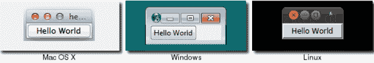

我们的第一个程序。在 IPO 之前还有一些工作要做。

## 第一个（实际）示例

解决了这个问题之后，让我们尝试一个稍有用处的示例，这将让你初步感受 Tk 程序背后的代码是什么样子的。

### 设计

我们将使用的示例是一个简单的 GUI 工具，它将把英尺数转换为等效的米数。如果我们画个草图，它可能看起来像这样：

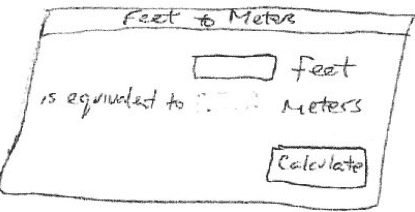

看起来我们有一个简短的文本输入小部件，让我们输入英尺数，以及一个"计算"按钮，该按钮将从输入框中获取值，执行计算，然后将结果米数放在屏幕上输入框下方。我们还有三个静态标签（“英尺”、“等价于”和“米”），帮助用户了解如何使用界面。

就布局而言，事物似乎自然地分为三列和三行：


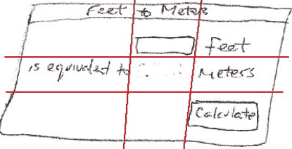

我们的用户界面布局，遵循 3 x 3 网格。

## 代码

下面是创建此程序的 Python 代码。

```python
from tkinter import *
from tkinter import ttk

def calculate(*args):
    try:
        value = float(feet.get())
        meters.set((0.3048 * value * 10000.0 + 0.5)/10000.0)
    except ValueError:
        pass

root = Tk()
root.title("Feet to Meters")

mainframe = ttk.Frame(root, padding="3 3 12 12")
mainframe.grid(column=0, row=0, sticky=(N, W, E, S))
mainframe.columnconfigure(0, weight=1)
mainframe.rowconfigure(0, weight=1)

feet = StringVar()
meters = StringVar()

feet_entry = ttk.Entry(mainframe, width=7, textvariable=feet)
feet_entry.grid(column=2, row=1, sticky=(W, E))

ttk.Label(mainframe, textvariable=meters).grid(column=2, row=2, sticky=(W, E))
ttk.Button(mainframe, text="Calculate", command=calculate).grid(column=3, row=3, sticky=W)

ttk.Label(mainframe, text="feet").grid(column=3, row=1, sticky=W)
ttk.Label(mainframe, text="is equivalent to").grid(column=1, row=2, sticky=E)
ttk.Label(mainframe, text="meters").grid(column=3, row=2, sticky=W)

for child in mainframe.winfo_children(): child.grid_configure(padx=5, pady=5)

feet_entry.focus()
root.bind('<Return>', calculate)

root.mainloop()
```

生成的用户界面如下：

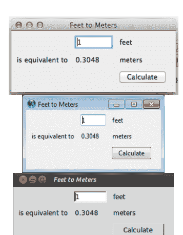

完成的英尺转米用户界面截图（在 Mac OS X、Windows 和 Linux 上）。

# 关于代码风格的说明

本教程中包含的每种语言都有多种可供选择的代码风格和约定，这些约定有助于确定变量和函数命名、过程式、函数式或面向对象风格等规范。

由于本教程的重点是 Tk，因此本教程将尽可能保持简单，通常使用非常直接的代码风格，而不是将大多数代码封装在过程、模块、对象、类等中。在尽可能多的情况下，你还会看到在每个示例中，跨语言使用相同的对象、变量等名称。

# 逐步详解

让我们更仔细地查看那段代码，逐段分析。目前，我们要做的只是获得对创建 Tk 用户界面所需做的事情类型的初步理解，以及大致了解它们的样子。我们稍后会深入细节。

```python
from tkinter import *
from tkinter import ttk
```

这两行告诉 Python，我们的程序需要两个模块。第一个模块 “tkinter” 是 Tk 的标准绑定，加载它时也会加载系统上现有的 Tk 库。第二个模块 “ttk” 是 Python 对 Tk 8.5 中新增的较新 “主题化小部件” 的绑定。

> *注意，我们从 tkinter 模块导入了所有内容，以便我们可以调用 tkinter 函数等而无需添加前缀，这是标准的 Tkinter 实践。然而，由于我们只导入了 “ttk” 本身，这意味着我们需要为该模块内部的所有内容添加前缀。例如，调用 “Entry(...)” 会调用 tkinter 模块内的函数，而我们需要使用 `tk.Entry(...)` 来调用 `tk` 内部的函数。你会看到，两个模块中都定义了几个函数，有时根据上下文，你需要两者都用。显式调用 `tk` 有助于实现这一点，这也是本教程中将采用的风格。*

*如果你正在迁移新代码，你会发现的第一件事之一是，Tkinter 模块的名称现在是小写的，即 `tkinter`，而不是 `Tkinter`。这是从 `Python` 3.0 开始改变的。*

```python
root = Tk()
root.title("Feet to Meters")
mainframe = ttk.Frame(root, padding="3 3 12 12")
mainframe.grid(column=0, row=0, sticky=(N, W, E, S))
mainframe.columnconfigure(0, weight=1)
mainframe.rowconfigure(0, weight=1)
```

*是的，“calculate” 函数出现在这里之前。我们稍后会在下面描述它，但需要将其包含在开头附近，因为我们在程序的其他部分引用了它。*

接下来，上述代码行设置主窗口，并赋予其标题 “Feet to Meters”。然后，我们创建一个框架小部件，它将持有我们用户界面的所有内容，并将其放置在主窗口中。“columnconfigure”/“rowconfigure” 部分只是告诉 Tk，如果主窗口被调整大小，框架应该扩展以占据额外空间。

*严格来说，我们可以直接将界面的其他部分放入主根窗口，而不经过中间的内容框架。然而，主窗口本身并不是 “主题化” 小部件的一部分，因此其背景颜色将与我们要放入其中的主题化小部件不匹配。使用 “主题化” 框架小部件来持有内容可确保背景正确。*

```python
feet = StringVar()
meters = StringVar()
feet_entry = ttk.Entry(mainframe, width=7, textvariable=feet)
feet_entry.grid(column=2, row=1, sticky=(W, E))
ttk.Label(mainframe, textvariable=meters).grid(column=2, row=2, sticky=(W, E))
ttk.Button(mainframe, text="Calculate", command=calculate).grid(column=3, row=3, sticky=W)
```

前面的代码行创建了我们程序中的三个主要小部件：我们输入英尺数的输入框、放置结果的米数的标签，以及我们按下以执行计算的 calculate 按钮。

对于这三个小部件中的每一个，我们需要做两件事：创建小部件本身，然后将其放在屏幕上。这三个作为我们内容窗口 “子元素” 的小部件，都是 Tk 主题化小部件类的实例。在创建它们的同时，我们为它们指定某些选项，例如输入框的宽度、按钮内部的文本等。输入框和标签各自被分配了一个神秘的 “textvariable”；我们很快就会看到它是做什么的。

如果小部件只是被创建，它们不会自动出现在屏幕上，因为 Tk 不知道你希望它们相对于其他小部件如何放置。这就是 “grid” 部分的作用。回忆我们应用程序的布局网格，我们将每个小部件放置在适当的列（1、2 或 3）和行（也是 1、2 或 3）中。“sticky” 选项说明小部件如何在网格单元格内对齐，使用方位。因此 “W”（西）意味着将小部件锚定在单元格左侧，“we”（西-东）意味着将其锚定在左右两侧，等等。

```python
ttk.Label(mainframe, text="feet").grid(column=3, row=1, sticky=W)
ttk.Label(mainframe, text="is equivalent to").grid(column=1, row=2, sticky=E)
ttk.Label(mainframe, text="meters").grid(column=3, row=2, sticky=W)
```

上述三行代码对用户界面中的三个静态文本标签做了完全相同的事情：创建每一个，并将其放置在网格中适当的单元格中。

```python
for child in mainframe.winfo_children(): child.grid_configure(padx=5, pady=5)
```

```python
feet_entry.focus()
root.bind("<Return>", calculate)
```

前面三行代码有助于为我们的用户界面添加一些精美的收尾工作。

第一行遍历内容框架的所有子小部件，并在每个周围添加一点填充，以便它们不会挤在一起。我们在最初将小部件放在屏幕上时可以在每个 “grid” 调用中添加这些选项，但这是一个很好的快捷方式。

第二行告诉 Tk 将焦点放在我们的输入小部件上。这样光标将开始于该字段，用户无需在开始输入前点击它。

第三行告诉 Tk，如果用户在根窗口内任何地方按下 Return 键（Windows 上是 Enter），则应调用我们的 calculate 例程，就像用户按下了 Calculate 按钮一样。

```python
def calculate(*args):
    try:
        value = float(feet.get())
        meters.set((0.3048 * value * 10000.0 + 0.5)/10000.0)
    except ValueError:
        pass
```

这里我们定义了 calculate 过程，它在用户按下 Calculate 按钮或按下 Return 键时被调用。它执行英尺到米的计算，从我们的输入小部件中获取英尺数，并将结果放在我们的标签小部件中。

什么？看起来我们没有对这些小部件做任何事情！这就是我们在创建小部件时指定的魔法 “textvariable” 选项发挥作用的地方。我们将全局变量 “feet” 指定为输入框的 textvariable，这意味着每当输入框改变时，Tk 会自动更新全局变量 feet。类似地，如果我们显式更改与小部件关联的 textvariable 的值（正如我们为关联到标签的 “meters” 所做的），小部件会自动更新为变量的当前内容。很酷。

```python
root.mainloop()
```

最后一行代码告诉 Tk 进入其事件循环，这是使一切运行所必需的。

## 缺少什么

也值得审视一下为了使我们的 Tk 程序正常工作，我们没有必要包含的内容。例如：

- 我们不必担心随着变化重绘屏幕
- 我们不必担心解析和分发事件、命中检测或在每个小部件上处理事件
- 我们在创建小部件时不必提供许多选项；默认值似乎处理了大多数事情，因此我们只需更改按钮显示的文本等
- 我们不必编写复杂的代码来获取和设置简单小部件的值；我们只是将它们附加到变量
- 我们不必担心用户关闭窗口或调整其大小时会发生什么
- 我们不需要编写额外的代码来使这一切跨平台工作

# Tk 概念

有了第一个例子，你应该对 Tk 程序可能看起来的样子以及它需要完成的任务类型有了基本的想法。我们将退后一步，查看三个你需要知道以理解 Tk 的广泛概念：小部件、几何管理和事件处理。


## 小部件

小部件（Widgets）是你在屏幕上看到的所有事物。在我们的示例中，有一个按钮、一个条目框、几个标签和一个框架。其他小部件包括复选框、树视图、滚动条、文本区域等。小部件通常被称为“控件”（controls）；你也会经常看到它们被称为“窗口”（windows），尤其是在 Tk 的文档中，这是源自其 X11 历史的一个遗留习惯（在这种术语下，顶层窗口和像 Button 这样的控件都被称为窗口）。

下面是一个示例，展示了 Tk 的一些小部件，我们稍后将会逐一介绍。

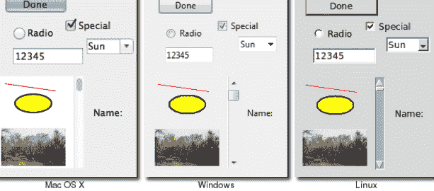

## 小部件类

小部件是对象，是代表按钮、框架等类的实例。因此，你需要做的第一件事是确定你要实例化的小部件的具体类。本教程和小部件综述将帮助你完成这一步。

## 窗口层级

你需要知道的另一件事是你想要创建的小部件实例的父级。在 Tk 中，所有小部件都是窗口层级的一部分，层级的顶部是单一的根节点。这个层级可以任意深；因此，你可能会在根窗口内的一个框架里嵌套另一个框架，而在其中再放置一个按钮。即使是新的顶层窗口也是该层级的一部分，它及其所有内容包括在整体窗口层级中形成一个子树。

在我们的单位换算示例中，我们创建了一个作为根窗口子项的单一框架，而该框架包含了所有其他控件作为其子项。根窗口是框架的容器，因此是框架的父级。该示例的完整层级结构如下所示：

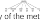

单位换算示例的窗口层级。

### 创建和使用小部件

每个独立的小部件都是一个 Python 对象。在创建小部件时，你必须将其父级作为参数传递给小部件创建函数。唯一的例外是“根”窗口，它是将包含其他所有内容的顶层窗口。根窗口是自动创建的，并且没有父级。示例如下：

```python
root = Tk()
content = tk.Frame(root)
button = tk.Button(content)
```

是否将小部件对象保存在变量中完全取决于你，这当然取决于你之后是否需要引用它。因为对象被插入到小部件层级中，即使你不保留对它的引用，它也不会被垃圾回收。

*如果你偷偷看了一眼 Tcl 是如何管理小部件的，你会发现每个小部件都有一个特定的路径名；你还会在 Tk 参考文档中看到对该路径名的引用。Tkinter 在幕后为你选择和所有管理这些路径名，所以你永远不需要担心它们。不过，如果你确实需要，可以通过调用 `str(widget)` 从小部件获取路径名。*

## 配置选项

所有小部件还有许多不同的配置选项，这些选项通常控制它们的显示方式或行为方式。

可用的选项当然取决于小部件类。不同小部件类之间具有一致性，因此执行类似功能的选项往往具有相同的名称。例如，按钮和标签都有一个"text"选项来调整小部件显示的文本，而例如滚动条就没有"text"选项，因为它不需要。同样，按钮有一个"command"选项，告诉它在被按下时要做什么，而仅持有静态文本的标签则没有该选项。

在小部件首次创建时就可以设置配置选项，方法是将选项的名称和值作为可选参数传递。之后，你可以检查这些选项的值，并在极少数的例外情况下随时修改它们。如果你不确定小部件的所有不同选项是什么，可以要求小部件提供信息。这将给你一个所有选项的长列表，对于每个选项，你可以看到选项的名称及其当前值（以及另外三个你通常不需要担心的属性）。

以下交互式解释器对话最能说明这一切。

```python
% python
>>> from tkinter import *
>>> from tkinter import tk
>>> root = Tk()
# 创建一个按钮，传递两个选项：
>>> button = tk.Button(root, text="Hello", command="buttonpressed")
>>> button.grid()
### 检查 text 选项的当前值：
>>> button["text"]
'Hello'
### 修改 text 选项的值：
>>> button["text"] = 'goodbye'
### 做同样事情的另一方法：
>>> button.configure(text='goodbye')
### 检查 text 选项的当前值：
>>> button["text"]
'goodbye'
### 获取关于 text 选项的所有信息：
>>> button.configure("text")
('text', 'text', 'Text', '', 'goodbye')
### 获取该小部件所有选项的信息：
>>> button.configure()
{'cursor': ('cursor', 'cursor', 'Cursor', '', ''),
 'style': ('style', 'style', 'Style', '', ''),
 'default': ('default', 'default', 'Default', <index object at 0x00DFFD10>, <index object at 0x00DFFD10>),
 'text': ('text', 'text', 'Text', '', 'goodbye'),
 'image': ('image', 'image', 'Image', '', ''),
 'class': ('class', "", "", "", ""),
 'padding': ('padding', 'padding', 'Pad', '', ''),
 'width': ('width', 'width', 'Width', '', ''),
 'state': ('state', 'state', 'State', <index object at 0x0167FA20>, <index object at 0x0167FA20>),
 'command': ('command', 'command', '', 'Command', '', 'buttonpressed'),
 'textvariable': ('textvariable', 'textVariable', '', 'Variable', '', ''),
 'compound': ('compound', 'compound', '', 'Compound', <index object at 0x0167FA08>, <index object at 0x0167FA08>),
 'underline': ('underline', 'underline', 'Underline', '', -1, -1),
 'takefocus': ('takefocus', 'takeFocus', 'TakeFocus', '', 'ttk:takefocus')}
```

## 几何管理

如果你一直在尝试创建小部件，你可能已经注意到，仅仅通过创建它们，它们并不会出现在屏幕上。将实际对象放入屏幕窗口中，以及精确确定它们在窗口中的位置，是一个称为几何管理的独立步骤。

在我们的示例中，这种定位是通过"grid"命令实现的，我们在那里传递了每个小部件所在列和行的编号、网格内物品的对齐方式等。网格是几何管理器（geometry manager）的一个示例（Tk 中有几种几何管理器，网格最为实用）。我们将在后续章节中详细讨论网格，但在这里我们将概述几何管理的一般情况。

几何管理器的任务是确定这些小部件确切的位置。事实证明，这是一个非常困难的优化问题，良好的几何管理器依赖于相当复杂的算法。良好的几何管理器提供了让程序员感到满意、功能强大且易用的灵活性，Tk 的"grid"无疑是绝对最好的之一：糟糕的几何管理器……好吧，所有忍受过"GridBagLayout"的 Java 程序员请举手。

### 问题

对于几何管理器来说，问题是接收程序创建的所有不同小部件，加上程序希望物品在窗口中放置位置的说明（显式的，或更常见的是相对于其他小部件），并将它们实际放入窗口中。

在此过程中，几何管理器必须平衡许多不同的约束：

- 小部件可能有一个“自然”尺寸（例如，标签的自然宽度通常由其中的文本和字体决定），但这些不同小部件试图适应的顶层窗口不够大以容纳它们；几何管理器必须决定缩小哪些小部件以适应、缩小多少等。
- 如果顶层窗口大于所有小部件的自然尺寸，多余的空间如何使用？它是仅用于小部件之间的额外空间，如果是，该空间如何分配？它是用于使某些小部件比它们通常希望的大吗？
- 如果顶层窗口的大小改变，其中小部件的大小和位置如何变化？某些区域（例如文本输入区域）会扩展或缩小，而其他部分保持相同大小，还是区域以不同方式分配？某些小部件是否有你希望避免低于（或高于）的最小（或最大）尺寸？
- 用户界面不同部分的小部件如何相互对齐，以呈现整洁的布局并符合有关小部件间距的平台指南？
- 对于复杂的用户界面，可能包含许多嵌套在其他框架中的框架，嵌套在窗口中（等等），如何实现上述所有目标，同时权衡整个用户界面不同部分的相互冲突的需求？

### 工作原理

Tk 中的几何管理依赖于主小部件（master）和从属小部件（slave）的概念。主小部件是一个小部件，通常是顶层窗口或框架，它将包含其他被称为从属小部件的小部件。你可以认为几何管理器接管了主小部件，并决定在内部显示什么。

几何管理器会向每个从属小部件询问其自然尺寸，或者它理想情况下希望显示的尺寸。然后，它将此信息与程序在要求几何管理器管理该特定从属小部件时提供的任何参数相结合。在我们的示例中，我们向网格传递了每个小部件的"column"和"row"编号，指示了小部件相对于其他小部件的位置，还有一个"sticky"参数来建议小部件应如何对齐或可能的拉伸。我们还使用"columnconfigure"和"rowconfigure"来指示如果我们希望窗口中有可用空间时，哪些列和行应该扩展。当然，所有这些参数都是网格特有的；其他几何管理器会使用不同的参数。


几何管理器获取所有从属部件的信息，以及主部件的尺寸信息，并使用其内部算法来确定分配给每个从属部件的区域（如果有的话！）。之后，从属部件负责在该特定矩形内进行绘制等操作。当然，每当主部件的大小发生变化时（例如，因为顶层窗口被调整大小了），从属部件的自然尺寸会发生变化（例如，因为我们改变了标签中的文本），或者任何几何管理器参数发生变化时（例如 "row"、"column" 或 "sticky"），我们就会重复整个流程。

这一切也是递归工作的。在我们的示例中，顶层窗口内部有一个内容框架，然后内容框架内还有若干其他控件。因此，我们有几何管理器在两个不同的主部件上工作。在外层，顶层窗口是主部件，而内容框架是从属部件。在内层，内容框架是主部件，而其他每个控件都是从属部件。因此，同一个控件既可以是主部件，也可以是从属部件。当然，这种层次结构可以嵌套得更深。

> 虽然每个主部件只能拥有一个几何管理器（例如 grid），但不同的主部件完全可以拥有不同的几何管理器；虽然 grid 通常被使用，但对于用户界面某一部分使用的特定布局，其他几何管理器可能更有意义。此外，我们一直假设从属控件是其在控件层次结构中父主部件的直接子级。虽然这种情况通常如此，而且没有其他好的理由这样做，但在某些限制下，也可以绕过这一规则。

## 事件处理

在 Tk 中，与大多数其他用户界面工具包一样，有一个事件循环，用于接收来自操作系统的事件。这些事件包括按钮按下、按键输入、鼠标移动、窗口调整大小等等。

通常，Tk 会为你管理这个事件循环。它会确定事件适用于哪个控件（用户是否点击了这个按钮？如果按下了键，哪个文本框拥有焦点？），并相应地分发事件。各个控件知道如何响应事件，例如，当鼠标移入按钮时，按钮可能会改变颜色，当鼠标移出时恢复原状。

### 命令回调

不过，你通常希望程序能处理特定事件，例如在按下按钮时执行某些操作。对于那些几乎必须自定义的事件（如果按下按钮时没有任何反应，那按钮有什么用呢？），控件会提供一个作为控件配置选项的回调函数。我们在按钮 "command" 选项的示例中看到过这一点。

Tk 中的回调函数通常比用于编译型语言的工具包中的回调函数更简单（后者的回调函数通常必须指向具有特定参数集的过程或具有特定签名的对象方法）。相反，回调函数只是一段由解释器执行的普通代码。虽然它可以做到你想让它多复杂就多复杂，但大多数时候，你只需要回调函数调用其他某个过程。

### 事件绑定

对于没有关联命令回调函数的事件，你可以使用 Tk 的 "bind" 来捕获任何事件，然后（与回调函数类似）执行任意一段代码。

下面是一个（滑稽的）示例，展示如何为标签设置绑定以响应不同事件，它是通过仅更改标签中显示的内容来实现的。

```python
from tkinter import *
from tkinter import ttk
root = Tk()
    l = ttk.Label(root, text="Starting...")
    l.grid()
    l.bind('<Enter>', lambda e: l.configure(text='Moved mouse inside'))
    l.bind('<Leave>', lambda e: l.configure(text='Moved mouse outside'))
    l.bind('<1>', lambda e: l.configure(text='Clicked left mouse button'))
    l.bind('<Double-1>', lambda e: l.configure(text="Double clicked"))
    l.bind("<B3-Motion>", lambda e: l.configure(text='right button drag to %d,%d' % (e.x, e.y)))
    root.mainloop()
```

前三个事件绑定非常简单，只是查看简单事件。双击绑定引入了事件修饰符的概念；在这种情况下，我们希望在左键单击（"1"）上触发移动，但仅当它是双击（"Double-"）时。

最后一个绑定也使用了修饰符：捕获鼠标移动（"Motion"），但仅当按住鼠标右键（"B3"）时。这个绑定还展示了一个使用事件参数的示例，通过百分号替换实现。许多事件，如鼠标单击或移动，都有额外信息作为参数，例如鼠标当前位置。这些百分号替换允许你捕获这些信息，以便在你的脚本中使用它们。

> *Tkinter 期望你提供一个函数作为事件回调，其第一个参数是代表触发回调的事件的对象。对于本例中这样的一次性回调，通常不值得麻烦去定义常规的命名函数，所以我们使用了 Python 的匿名函数（lambda）。之前的英尺转米示例使用了一个常规的已定义函数（calculate）。*

若要获取所有不同事件名称、修饰符以及每个事件可用的不同事件参数的完整描述，最佳参考资料是 "bind" 命令参考。

## 虚拟事件

除了像鼠标单击和窗口调整大小等低级操作系统事件外，许多控件会生成称为虚拟事件的高级事件。例如，无论是因为用户点击了某项、使用方向键移动到某项，还是其他原因，只要选择发生变化，列表框控件都会生成 "ListboxSelect" 虚拟事件。这避免了设置多个可能具有平台特定性的事件绑定来捕获变化的问题。控件的虚拟事件（如果有）将列在控件的文档中。

## 多个绑定

控件实际上可以有多个不同的事件绑定针对单个事件触发。通常，事件可以设置为：控件本身、某类所有控件（例如按钮）、包含该控件的顶层窗口、以及应用程序中的所有控件。这些绑定将按顺序触发。

我们在示例中看到过这种情况，当时我们为顶层窗口设置了回车键的绑定，该绑定应用于该窗口内的每个控件。

> *Tk 中每个控件类的默认行为本身是通过脚本级事件绑定定义的，因此可以对其进行内省和修改，以改变某类所有控件的行为。你甚至可以完全修改每个控件的这个多事件序列的处理方式；如果你感兴趣，请参见 "bindtags" 命令参考。*

## 基本控件

本章向你介绍 Tk 的基本控件，这些控件几乎在任何用户界面中都会用到：框架、标签、按钮、复选按钮、单选按钮、条目框和组合框。读完本章，你将知道如何使用任何典型的填写表单类型用户界面所需的所有控件。

本章（以及讨论更多控件的后续章节）应按顺序阅读。由于许多控件之间存在大量的共同点，我们会在较早的控件中引入某些概念，这些概念也适用于较后的控件。为了避免多次重复同样的内容，我们只会指回该概念首次被引入的地方。

同时，每个控件也会参考特定控件的控件汇总页面以及参考手册页面，因此你也可以自由地跳跃阅读。

### 框架

- 控件汇总
- 参考手册

**框架**是一种仅显示为简单矩形的控件。框架主要用作其他控件的容器，这些容器由诸如 grid 等几何管理器控制。

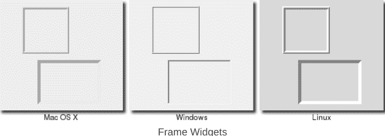

使用 **ttk.Frame** 函数创建框架：
`frame = ttk.Frame(parent)`

框架可以接受多种不同的配置选项，这些选项可以改变其显示方式。

#### 请求尺寸

与其他控件一样，创建后，框架通过（父级）几何管理器添加到用户界面。通常，框架向几何管理器请求的尺寸将由其中包含的控件（受管理框架内容的几何管理器控制）的尺寸和布局决定。

如果出于某种原因，你希望拥有一个不包含其他控件的空框架，你应该显式地使用 "width" 和/或 "height" 配置选项来设置框架向其父几何管理器请求的尺寸（否则你会得到一个确实非常小的框架）。

> *通常，宽度、高度等距离仅以屏幕上的像素数指定。你也可以通过一系列后缀来指定它们。例如，"350" 表示 350 像素，"350c" 表示 350 厘米，"350i" 表示 350 英寸，而 350p 表示 350 打印机点（1/72 英寸）。*

#### 填充

"padding" 配置选项用于请求控件内部周围的额外空间；这样，如果你在框架内放置其他控件，四周就会有一些边距。单个数字指定四周相同的填充，两个数字的列表允许你指定水平填充然后是垂直填充，四个数字的列表允许你指定左、上、右、下填充，按此顺序。
`frame["padding"] = (5,10)`


## 边框

您可以在框架小部件周围显示边框；您会经常看到用户界面的一部分相对于其周围看起来是“凹陷”或“凸起”的。为此，您需要设置 `borderwidth` 配置选项（默认值为 0，即无边框），以及指定边框视觉外观的 `relief` 选项：`flat`（默认）、`raised`、`sunken`、`solid`、`ridge` 或 `groove`。

```python
frame["borderwidth"] = 2
frame["relief"] = 'sunken'
```

## 更改样式

还有一个 `style` 配置选项，它适用于所有主题小部件，您可以用它来控制它们外观或行为的几乎所有方面。这稍微高级一些，所以我们暂不深入讨论。

> *样式标志着与“经典”Tk 小部件中更改小部件视觉外观大部分方面的方式截然不同。在经典 Tk 中，您可以提供大量选项来精细控制行为的每个方面（前景色、背景色、字体、高亮厚度、选中前景色、填充等），而在新的主题小部件中，这些更改是通过更改样式完成的，而不是向每个小部件添加选项。*
>
> *因此，您在某些小部件中熟悉的许多选项在其主题版本中并不存在。鉴于过度使用这些选项是削弱 Tk 应用程序外观的关键因素（尤其是在跨平台移动时），过渡到主题小部件提供了重新审视和优化这些外观更改是否以及如何进行的良机。*

## 标签

- 小部件概览
- 参考手册

标签是一种显示文本或图像的小部件，通常用户只查看而不进行其他交互。标签用于识别控件或用户界面的其他部分、提供文本反馈或结果等。

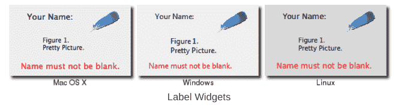

标签使用 `tk.Label` 函数创建，并且通常在小部件创建时同时设置其内容：

```python
label = tk.Label(parent, text="Full name:")
```

与框架一样，标签可以接受多个不同的配置选项，这些选项可以改变它们的显示方式。

## 显示文本

上面创建标签时显示的 “text” 配置选项是最常用的，特别是当标签纯粹是装饰性或说明性时。当然，您可以在任何时间更改此选项，而不仅仅是在最初创建标签时。

您还可以让小部件监控脚本中的变量，这样每当变量改变时，标签将显示变量的新值；这是通过 “textvariable” 选项完成的：

```python
resultsContents = StringVar()
label["textvariable"] = resultsContents
resultsContents.set("New value to display")
```

Tkinter 只允许您附加到 “StringVar” 类的一个实例，该类包含监视变更、在变量和 Tk 之间来回传递信息等所有逻辑。您需要使用 “get” 和 “set” 方法读取或写入当前值。

## 显示图像

您也可以在小部件中显示图像而不是文本；如果您只想在界面中放置一个图像，这通常是实现方式。我们将在后面的章节中详细讨论图像，但现在，假设您想显示一个位于磁盘文件中的 GIF 图像。这是一个两步过程，首先创建一个图像 “object”，然后告诉标签通过其 “image” 配置选项使用该对象：

```python
image = PhotoImage(file="myimage.gif")
label["image"] = image
```

您可以同时使用图像和文本，正如您经常在工具栏按钮中看到的那样，通过 “compound” 配置选项。默认值是 “none”，意味着如果存在图像则只显示图像，否则显示由 “text” 或 “textvariable” 选项指定的文本。其他选项包括 “text”（仅文本）、“image”（仅图像）、“center”（文本位于图像中心）、“top”（图像在文本上方）、“left”、“bottom” 和 “right”。

## 布局

虽然标签的整体布局（即它在用户界面中的位置以及它有多大）由几何管理器决定，但有多个选项可以帮助您控制标签在几何管理器给出的框内的显示方式。

如果分配给标签的框大于标签内容所需的尺寸，您可以使用 “anchor” 选项指定标签应附着的边缘或角落，这会将任何空白留在相对的边缘或角落。可能的值以指南针方向指定：“n”（北，或上边缘）、“ne”（东北，或右上角）、“e”、“se”、“s”、“sw”、“w”、“nw” 或 “center”。

标签可用于显示多行文本。这可以通过在 “text”/“textvariable” 字符串中嵌入换行符（"\n"）来实现。您也可以使用 “wraplength” 选项，让标签将字符串换行显示为不超过给定长度的多行（尺寸以像素、厘米等指定）。

多行标签是经典 Tk 中旧的 “message” 小部件的替代品。

您还可以使用 “justify” 选项来控制文本的对齐方式，该选项可以取值为 “left”、“center” 或 “right”。如果您只有一行文本，这基本上与仅使用 “anchor” 选项相同，但在多行文本时更有用。

# 字体、颜色和其他

与框架一样，通常您不希望直接处理字体和颜色等，但如果需要更改它们（例如创建特殊类型的标签），这通常是通过创建新样式来完成的，然后小部件通过 “style” 选项使用该样式。

与大多数主题小部件不同，标签小部件也提供显式的小部件特定选项作为替代；同样，您只会将其用于特殊的一次性情况，此时使用样式不一定有意义。

您可以使用 “font” 配置选项指定用于显示标签文本的字体。虽然我们将在后面的章节中详细讨论字体，但这里列出了一些您可以使用的前定义字体名称：

- **TkDefaultFont** 所有未另外指定的 GUI 项的默认字体。
- **TkTextFont** 用于输入小部件、列表框等的字体。
- **TkFixedFont** 标准的固定宽度字体。
- **TkMenuFont** 用于菜单项的字体。
- **TkHeadingFont** 通常用于列表和表格列标题的字体。
- **TkCaptionFont** 用于窗口和对话框标题栏的字体。
- **TkSmallCaptionFont** 用于子窗口或工具对话框的较小标题字体。
- **TkIconFont** 用于图标说明文字的字体。
- **TkTooltipFont** 用于工具提示的字体。

> 由于字体选择非常依赖于平台，请注意不要硬编码它们（字体族、大小等）；这是您在许多旧版 Tk 程序中看到的另一个使它们看起来难看的问题。

前景（文本）和背景颜色也可以通过 “foreground” 和 “background” 选项更改。颜色将在后面详细讨论，但您可以将这些指定为颜色名称（例如 “red”）或十六进制 RGB 代码（例如 “#f340a”）。

标签也接受为框架讨论过的 “relief” 选项。

# 按钮

- 小部件概览
- 参考手册

与框架或标签不同，按钮是专门设计供用户交互的，特别是按下以执行某些操作。与标签一样，它们可以显示文本或图像，但还拥有一系列用于控制其行为的新选项。

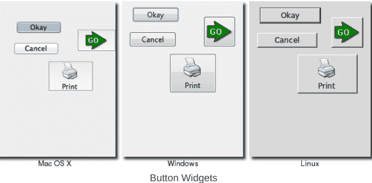

按钮使用 **tk.Button** 函数创建，并且通常其内容和命令回调是在同一时间设置的：

```python
button = tk.Button(parent, text='Okay', command=submiForm)
```

与其他小部件一样，按钮可以接受多个不同的配置选项，这些选项可以改变它们的外观和行为。

## 文本或图像

按钮接受与标签相同的 “text”、“textvariable”（很少使用）、“image” 和 “compound” 配置选项，这些选项控制按钮是否显示文本和/或图像。

按钮有一个 “default” 选项，它告诉 Tk 该按钮是用户界面中的默认按钮（即如果用户按下 Enter 或 Return 键时将被调用的那个）。某些平台和样式会以不同的边框或高亮绘制此按钮。将选项设置为 “active” 以指定这是一个默认按钮；常规状态是 “normal”。请注意，设置此选项不会创建使 Return 或 Enter 键激活按钮的事件绑定；这需要您自己完成。

## 命令回调

“command” 选项用于在按钮的操作和您的应用程序之间提供接口。当用户单击按钮时，该选项提供的脚本将由解释器执行。

您还可以要求按钮从您的应用程序中调用命令回调。这很有用，因为您不需要在程序中重复被调用的命令；这样如果您更改了按钮上的选项，您就不需要在其他地方更改它了。

```python
button.invoke()
```

## 按钮状态

按钮和许多其他小部件可以处于可按压的正常状态，也可以被置于禁用状态，此时按钮变灰且无法按压。这是在按钮的命令在特定时间点不适用时执行的。


所有主题小部件都携带一个内部状态，该状态由一系列二进制标志组成。你可以设置或清除这些不同的标志，并使用 "state" 和 "instate" 方法检查当前的设置。按钮使用 "disabled" 标志来控制用户是否*可以*按下该按钮。例如：

```text
button.state(['disabled']) ;# 设置 disabled 标志，禁用按钮
button.state(['!disabled']) ;# 清除 disabled 标志
button.instate(['disabled']) ;# 如果按钮被禁用，返回 true，否则返回 false
button.instate(['!disabled']) ;# 如果按钮未被禁用，返回 true，否则返回 false
button.instate(['!disabled'], cmd) ;# 如果按钮未被禁用，则执行 'cmd'
```

请注意，这些命令接受一个*数组*作为参数，其中包含状态标志。

使用 "state"/"instate" 取代了旧的 "state" 配置选项（该选项接受 "normal" 或 "disabled" 值）。实际上，这个配置选项在 Tk 8.5 中仍然可用，但它仅是“只写”的，这意味着更改该选项会调用相应的 "state" 命令，但使用 "state" 命令做出的其他更改不会反映在选项中。这只是为了兼容性考虑；你应该修改代码以使用新的状态向量。

主题小部件可用的完整状态标志列表包括："active"（激活）、"disabled"（禁用）、"focus"（焦点）、"pressed"（按下）、"selected"（选中）、"background"（背景）、"readonly"（只读）、"alternate"（替代）和 "invalid"（无效）。这些标志在主题小部件参考手册中有描述；并非所有状态对所有小部件都有意义。你还可以在 "state" 和 "instate" 方法中同时指定多个状态标志，以进行更复杂的操作。

## 复选框

- 小部件概览
- 参考手册

**复选框**（checkbutton）类似于普通按钮，不同之处在于，用户不仅可以按下它以触发命令回调，它还保存某种二进制值（即切换开关）。当用户被要求例如在某个选项的两个不同值之间进行选择时，复选框总是被频繁使用。

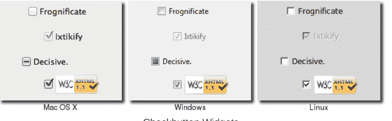

复选框使用 **tk.Checkbutton** 函数创建，通常在同一时间设置：

```python
measureSystem = StringVar()
check = tk.Checkbutton(parent, text='Use Metric',
                       command=metricChanged, variable=measureSystem,
                       onvalue='metric', offvalue='imperial')
```

复选框使用与普通按钮相同的许多选项，但额外添加了一些。"text"（文本）、"textvariable"（文本变量）、"image"（图像）和 "compound"（组合）选项控制标签的显示（位于复选框本身旁边），而 "state" 和 "instate" 方法允许你操作 "disabled" 状态标志以启用或禁用复选框。类似地，"command" 选项让你指定每当用户切换复选框时要调用的脚本，而 "invoke" 方法也会执行相同的回调。

### 小部件值

与按钮不同，复选框还持有一个值。我们之前看到过 "textvariable" 选项如何用于将小部件的标签与程序中的变量关联起来；复选框的 "variable" 选项行为类似，不同之处在于它用于读取或更改小部件的当前值，并在小部件被切换时进行更新。默认情况下，当小部件被选中时，复选框使用值 "1"，未选中时使用 "0"，但可以使用 "onvalue" 和 "offvalue" 选项将这些值更改为几乎任何值。

如果关联的变量既不包含开值也不包含关值（甚至不存在）时会发生什么？在这种情况下，复选框会被置于特殊的 "tristate"（三态）或不确定模式；你会在用户界面中看到这种情况，此时复选框显示一个短横线，而不是空白或勾号。当处于此状态时，状态标志 "alternate" 被设置，因此你可以使用 "instate" 方法检查它：
`check.instate("alternate")`

由于复选框不会自动设置（或创建）关联变量，你的程序需要确保将变量设置为适当的初始值。

## 单选按钮

- 小部件概览
- 参考手册

**单选按钮**（radiobutton）让你在一组互斥选项中进行选择；与复选框不同，它不限于仅两个选项。单选按钮总是成组使用，当选项数量较少时（例如 3-5 个），它们是一个很好的选择。

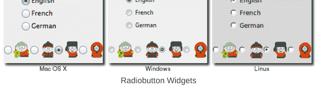

单选按钮使用 **tk.Radiobutton** 函数创建，通常成组设置：
`phone = StringVar()`
`home = tk.Radiobutton(parent, text='Home', variable=phone, value='home')`
`office = tk.Radiobutton(parent, text='Office', variable=phone, value='office')`
`cell = tk.Radiobutton(parent, text='Mobile', variable=phone, value='cell')`

单选按钮共享大多数与复选框相同的配置选项。一个例外是 "onvalue" 和 "offvalue" 选项被单个 "value" 选项取代。该组中的每个单选按钮都将具有相同的关联变量，但值不同；当变量具有给定值时，该单选按钮将被选中，否则未选中。当关联变量不存在时，单选按钮也显示 "tristate"（三态）或不确定状态，这可以通过 "alternate" 状态标志进行检查。

## 输入框

- 小部件概览
- 参考手册

**输入框**（entry）代表用户可以使用单行文本字段输入字符串值。这些可以是几乎任何内容：他们的姓名、城市、密码、社会安全号码等等。

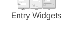

输入框使用 **tk.Entry** 函数创建：

```python
username = StringVar()
name = tk.Entry(parent, textvariable=username)
```

可以指定 "width"（宽度）配置选项以提供输入框应显示字符的数量，这允许你例如为邮政编码提供更短的输入框。

我们已经看到复选框和单选按钮小部件具有与之关联的值。输入框也是如此，该值通常通过 "textvariable" 配置选项指定的关联变量来访问。请注意，与各种按钮不同，输入框旁边没有独立的文本或图像来标识它们；请使用单独的标签小部件来实现此功能。

你 также 可以直接获取或更改输入框小部件的值，而不通过关联变量。"get" 方法返回当前值，而 "delete" 和 "insert" 方法允许你更改内容，例如：

```python
print("current value is %s" % name.get())
name.delete(0, 'end')       # 删除两个索引之间的内容，基于 0
name.insert(0, 'your name') # 在给定索引处插入新文本
```

请注意，输入框小部件没有 "command" 选项在每次输入框更改时触发回调。要监视更改，你应该监视关联变量的更改。另见下文 "验证"。

### 密码

输入框可用于密码，其中实际内容显示为项目符号或其他符号。要做到这一点，将 "show" 配置选项设置为你希望显示的字符，例如 "*"。

### 小部件状态

与各种按钮一样，输入框也可以通过 "state" 命令（并使用 "instate" 查询）置于禁用状态。输入框还可以使用状态标志 "readonly"（只读）；如果设置，用户无法更改输入框的内容，但他们仍然可以选中其中的文本（并将其复制到剪贴板）。还有一个 "invalid"（无效）状态，如果输入框小部件验证失败，则设置此状态，这引出了...

### 验证

- `validate`（控制整体验证行为）- 无（默认）、key（在每次按键时运行，在预验证之前）、focus/focusin/focusout（在重新验证后运行）、all（全部）
- `validatecommand` 脚本（脚本必须返回 1 或 0）
- `invalidcommand` 脚本（当验证命令返回 0 时运行）
- 脚本中的各种替换。最有用的是 %P（输入框的新值）、%s（编辑前输入框的值）
- 回调也可以使用 insert/delete 修改输入框，或修改 textvariable，这意味着正在进行的编辑无论如何都会被拒绝（因为它会覆盖我们刚刚设置的内容）
- `force` validate 强制立即进行验证

## 组合框

- 小部件概览
- 参考手册

**组合框**（combobox）将输入框与用户可用的选项列表结合起来。这让他们既可以选择你提供的一组值（例如典型设置），也可以输入自己的值（例如你不想包含在列表中的较少见情况）。

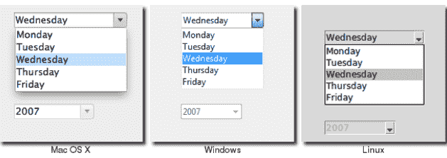

组合框使用 `tk.Combobox` 函数创建：

```python
countryvar = StringVar()
country = tk.Combobox(parent, textvariable=countryvar)
```

与输入框一样，"`textvariable`" 选项将程序中的变量与组合框的当前值关联起来。与其他小部件一样，关联变量不会自动设置。你也可以使用 "`get`" 方法获取当前值，并使用 "`set`" 方法更改当前值（该方法接受单个参数，即新值）。

组合框会生成一个 "`<ComboboxSelected>`" 虚拟事件，你可以在其值更改时将其绑定到回调函数。

```python
country.bind("<ComboboxSelected>", function)
```

### 预定义值

你可以使用 "`values`" 配置选项提供用户可选择的值列表：

```python
country['values'] = ('USA', 'Canada', 'Australia')
```

如果设置，"`readonly`" 状态标志将限制用户只能从预定义值列表中进行选择，而无法输入自己的值（尽管如果组合框的当前值不在列表中，它不会更改）。

作为 "`get`" 和 "`set`" 方法的补充，你还可以使用 "`current`" 方法来确定预定义值列表中选中了哪个项目（无参数调用 "`current`"，它将返回列表的基于 0 的索引，如果当前值不在列表中则返回 -1），或者选择列表中的某个项目（使用单个基于 0 的索引参数调用 "`current`"）。


如果您希望为列表中的每个项目关联其他值，以便您的程序可以引用具有实际意义的值，但在组合框中显示为其他内容？等到我们再过几章讨论列表框（listbox）时，请留意标题为“保留额外项目数据”的章节。

### 网格几何管理器

我们将暂时搁置讨论不同的控件（即在屏幕上放什么），转而关注几何管理（即放在哪里）。我们在“Tk 概念”一章中介绍了几何管理的一般思想；在这里，我们专注于一个特定的几何管理器：网格（grid）。

如您所见，网格允许您按列和行布局控件。如果您熟悉使用 HTML 表格进行布局，那么您会在这里感到非常亲切。本章描述了您可以调整网格的各种方法，从而为您提供控制用户界面所需的所有功能。

网格是 Tk 中可用的几个几何管理器之一，但它的功能强大、灵活易用，以及它与当今布局（依赖控件对齐）的天然契合，使其成为通用场景的最佳选择。还有其他几何管理器：“pack”也非常强大，但更难使用和理解；“place” 允许您对每个元素的位置进行完全控制；我们还会看到，像分窗（paned windows）、笔记本（notebooks）、画布（canvas）和文本（text）这样的控件也可以充当几何管理器。

> 网格于 1996 年首次引入 Tk，那时 Tk 已经流行多年，但它花了相当长的时间才被广泛接受。在此之前，开发人员一直使用 “pack” 来进行基于约束的几何管理。网格发布后，许多开发人员仍在使用 pack，您现在仍然可以在许多 Tk 程序和文档中发现它的使用。虽然这在技术上没有错误，但该算法的行为往往难以理解。更重要的是，由于控件打包的顺序对确定布局至关重要，因此修改现有布局可能会很困难。
>
> 网格具备 pack 的所有功能，通常能产生更漂亮的布局（因为它使水平和垂直对齐控件变得容易），并且更易于学习和使用。因此，我们认为对于大多数开发人员来说，在大多数情况下网格都是正确的选择。在新程序中开始使用网格，并在修改现有用户界面时将旧程序切换为使用网格。

网格的参考文档提供了关于网格、其行为及所有选项的详尽描述。

#### 列和行

使用网格时，控件被分配一个“列”号和一个“行”号，这表明它们相对于彼此的位置。因此，同一列中的所有控件将在彼此的上方或下方，而同一行中的控件将在彼此的左侧或右侧。

列和行号必须是整数，第一列和第一行从 0 开始。您可以在列和行号中留有空隙（例如第 0、1、2、10、11、12、20、21 列），如果您计划稍后在用户界面中间添加更多控件，这将非常有用。

每列的宽度（或每行的高度）取决于该列或行中包含的控件的宽度或高度。这意味着在设计用户界面并将其划分为行和列时，您不必担心每列或每行是否宽度相等。

#### 跨越多格

控件可以占据网格中的多个单元格；为此，在设置控件网格时，您需要使用 “columnspan” 和 “rowspan” 选项。这类似于 HTML 表格中的 “colspan” 和 “rowspan” 属性。

下面是一个创建包含多个控件的用户界面的示例，其中一些控件占据多个单元格。

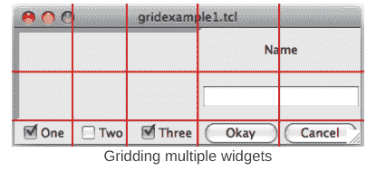

```python
from tkinter import *
from tkinter import ttk

root = Tk()

content = ttk.Frame(root)
frame = ttk.Frame(content, borderwidth=5, relief="sunken", width=200, height=100)
namebl = ttk.Label(content, text="Name")
name = ttk.Entry(content)

onevar = BooleanVar()
twowar = BooleanVar()
threevar = BooleanVar()
onevar.set(True)
twowar.set(False)
threevar.set(True)

one = ttk.Checkbutton(content, text="One", variable=onevar, onvalue=True)
two = ttk.Checkbutton(content, text="Two", variable=twovar, onvalue=True)
three = ttk.Checkbutton(content, text="Three", variable=threevar, onvalue=True)
ok = ttk.Button(content, text="Okay")
cancel = ttk.Button(content, text="Cancel")

content.grid(column=0, row=0)
frame.grid(column=0, row=0, columnspan=3, rowspan=2)
namebl.grid(column=3, row=0, columnspan=2)
name.grid(column=3, row=1, columnspan=2)
one.grid(column=0, row=3)
two.grid(column=1, row=3)
three.grid(column=2, row=3)
ok.grid(column=3, row=3)
cancel.grid(column=4, row=3)

root.mainloop()
```

##### 单元格内的布局

由于列的宽度（和行的高度）取决于已添加到其中的所有控件，因此很可能至少有一些控件的宽度或高度小于为其所在单元格分配的空间。那么问题就变成了，它究竟应该放在单元格内的什么位置？

默认情况下，如果单元格比包含在其内的控件大，控件将在水平和垂直方向上居中显示，其周围的空白区域将显示主容器的背景。“sticky” 选项可用于更改此默认行为。

“sticky” 选项的值是 0 个或多个罗盘方向 “nsew” 的字符串，指定控件应“粘附”到单元格的哪些边缘。例如，值为 “n”（北）会将控件紧靠顶部，多余的垂直空间将在底部；控件在水平方向上仍然居中。值为 “nw”（西北）意味着控件将粘附到左上角，多余的空间在底部和右侧。

> 在 Tkinter 中，您也可以将其指定为一个列表，其中包含 N、S、E 和 W 中的任意值。

指定两个相对边缘，例如 “we”（西、东），意味着控件将被拉伸，在这种情况下，它既粘附到左边缘也粘附到右边缘。因此，控件的宽度将大于其“理想”大小。大多数控件都有选项，可以控制当控件比所需更大时如何显示。例如，标签控件有一个 “anchor” 选项，用于控制标签文本的位置。

如果您希望控件扩展以填满整个单元格，请将其设置为 sticky 值为 "nsew"（北、南、东、西），这意味着它将粘附到每一侧。

##### 处理大小调整

如果您往下看了并给示例添加了额外的 “sticky” 选项，当您尝试运行时，会发现事情看起来还是不太对劲（输入框在屏幕上的位置比预期低），而且如果您尝试调整窗口大小，情况会更糟——根本没有任何移动！

看起来 “sticky” 可能告诉 Tk 如果单元格所在的行或列大小发生变化时该如何反应，但实际上并没有说明如果有多余空间，行或列是否应该调整大小。让我们来解决这个问题。

每个列和行都关联一个 “weight” 网格选项，它告诉当主容器有多余空间需要填充时，该列或行应该增长多少。默认情况下，每列或每行的权重为 0，意味着不扩展以填充空间。

因此，为了使用户界面能够调整大小，我们需要给希望扩展的列赋予正的权重。这是通过使用网格的 “columnconfigure” 和 “rowconfigure” 方法来实现的。如果两列具有相同的权重，它们将以相同的速率扩展；如果一个权重为 1，另一个权重为 3，则后者每增加 1 像素，前者增加 3 像素。

“columnconfigure” 和 “rowconfigure” 还接受一个 “minsize” 网格选项，指定您确实不希望列或行缩小到的最小尺寸。

##### 内边距

通常，每个列或行将直接紧邻下一个，因此控件会紧挨着彼此。有时这是您想要的（想想列表框及其滚动条），但通常您希望控件之间有一些空间。在 Tk 中，这被称为内边距（padding），您可以选择几种方式来添加它。


实际上我们已经见过一种方法，即使用控件自身的选项来添加其周围额外的空间。并非所有控件都支持此功能，但框架（frame）就是一个支持的例子；这非常有用，因为框架通常用作主容器来网格化其他控件。框架的 "padding" 选项允许你指定框架内部的额外内边距，无论是四边相同的量，还是每边不同的量。

第二种方法是在添加控件时，使用 "padx" 和 "pady" 网格选项。正如你所料，"padx" 会在控件的左右两侧添加一点额外空间，而 "pady" 则在上下两侧添加额外空间。如果该选项设为单个值，则左右（或上下）会使用相同的内边距；而如果是两个值的列表，则允许你在左右（或上下）设置不同的量。请注意，这种额外的内边距位于包含该控件的网格单元格内部。

如果你想为整行或整列添加内边距，"columnconfigure" 和 "rowconfigure" 方法接受一个 "pad" 选项，它可以帮你完成这项工作。

让我们在我们的示例中添加额外的粘性、调整大小和内边距行为（新增内容以粗体显示）。

```python
from tkinter import *
from tkinter import ttk

root = Tk()

content = ttk.Frame(root, padding=(3,3,12,12))
frame = tk.Frame(content, borderwidth=5, relief="sunken", width=200, height=100)
namelbl = tk.Label(content, text="Name")
name = tk.Entry(content)

onevar = BooleanVar()
twovar = BooleanVar()
threvar = BooleanVar()

onevar.set(True)
twovar.set(False)
threvar.set(True)

one = tk.Checkbutton(content, text="One", variable=onevar, onvalue=True)
two = tk.Checkbutton(content, text="Two", variable=twovar, onvalue=True)
three = tk.Checkbutton(content, text="Three", variable=threvar, onvalue=True)
ok = tk.Button(content, text="Okay")
cancel = tk.Button(content, text="Cancel")

content.grid(column=0, row=0, sticky=(N, S, E, W))
frame.grid(column=0, row=0, columnspan=3, rowspan=2, sticky=(N, S, E, W))
namelbl.grid(column=3, row=0, columnspan=2, sticky=(N, W), padx=5)
name.grid(column=3, row=1, columnspan=2, sticky=(N, E, W), pady=5, padx=5)
one.grid(column=0, row=3)
two.grid(column=1, row=3)
three.grid(column=2, row=3)
ok.grid(column=3, row=3)
cancel.grid(column=4, row=3)

root.columnconfigure(0, weight=1)
root.rowconfigure(0, weight=1)
content.columnconfigure(0, weight=3)
content.columnconfigure(1, weight=3)
content.columnconfigure(2, weight=3)
content.columnconfigure(3, weight=1)
content.columnconfigure(4, weight=1)
content.rowconfigure(1, weight=1)

root.mainloop()
```

这样看起来更有希望。你可以多玩玩这个示例，感受一下调整大小的行为。

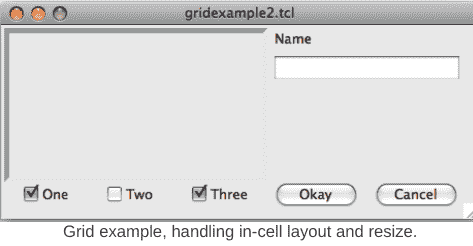

> *你会注意到窗口右下角有一个小的调整大小控件；虽然我们只是走了捷径，通过额外的内边距来避开它，但稍后我们会看到如何更好地使用 "sizergrip" 控件来考虑这一点。*

#### 更多网格功能

正如你在网格参考中看到的那样，网格还有很多其他功能。以下是一些更实用的功能。

##### 查询和修改网格选项

就像控件本身一样，内省各种网格选项以及修改它们都很简单；在最初网格化控件时设置选项只是一种便利，你完全可以随时更改它们。

"slaves" 方法会告诉你所有在主容器内部网格化的控件，或者（可选地）仅位于特定列或行内的控件。"info" 方法会给你一个控件的所有网格选项及其值的列表。最后，"configure" 方法允许你更改控件上的一个或多个网格选项。

这些在一个交互式会话中演示：

```python
>>> **content.grid_slaves()**
<map object at 0x00C3F470>
>>> for w in **content.grid_slaves()**: print(w)
...
.14597008.14622128
.14597008.14622096
.14597008.14622064
.14597008.14622032
.14597008.14622000
.14597008.14621872
.14597008.14621840
.14597008.14621808
>>> for w in **content.grid_slaves(row=3)**: print(w)
...
.14597008.14622128
.14597008.14622096
.14597008.14622064
.14597008.14622032
.14597008.14622000
>>> for w in **content.grid_slaves(column=0)**: print(w)
...
.14597008.14622000
.14597008.14621808
>>> namelbl.grid_info()
{'rowspan': '1', 'column': '3', 'sticky': 'nw', 'ipady': '0', 'ipadx': '0', 'columnspan': '2', 'in': '<tkinter.ttk.Frame object at 0x00DEBB90>', 'padx': '0', 'padx': '5', 'row': '0'}
>>> namelbl.grid_configure(sticky=(E,W))
>>> namelbl.grid_info()
{'rowspan': '1', 'column': '3', 'sticky': 'ew', 'ipady': '0', 'ipadx': '0', 'columnspan': '2', 'in': '<tkinter.ttk.Frame object at 0x00DEBB90>', 'padx': '0', 'padx': '5', 'row': '0'}
```

##### 内部填充

你看到了 "padx" 和 "pady" 网格选项如何在控件外部添加额外空间。还有一种较少使用的填充类型称为 "内部填充"，由网格选项 "ipadx" 和 "ipady" 控制。

区别可能很细微。假设你有一个 20x20 的框架，并为每一侧指定 5 像素的常规（外部）填充。该框架会请求 20x20 的矩形（其自然大小）给布局管理器。通常，这就是它获得的，所以它会获得一个 20x20 的框架矩形，周围环绕着 5 像素的边框。

使用内部填充时，布局管理器在确定控件的自然大小时，实际上会将额外的填充加到控件上，就好像控件请求了 30x30 的矩形一样。如果框架居中，或附着在单侧或角落（使用 "sticky"），你将得到一个 20x20 的框架，周围有额外空间。然而，如果框架设置为拉伸（即 "sticky" 值为 "we"、"ns" 或 "nwes"），它将填满额外空间，结果是 30x30 的框架，没有边框。

##### Forget 和 Remove

网格的 "forget" 方法，接受一个包含一个或多个从属控件的列表作为参数，可用于将从属控件从它们当前所在的网格中移除。这并不会彻底销毁控件，只是将其从屏幕上移除，就好像它一开始就没有被网格化一样。你可以稍后再次网格化它，尽管你最初分配的网格选项将会丢失。

网格的 "remove" 方法工作方式相同，但网格选项会被记住。

##### 嵌套布局

随着你的用户界面变得复杂起来，你用来组织所有控件的网格也会变得越来越复杂，粒度也越来越细。这使得修改和维护你的程序变得非常困难。

幸运的是，你不必用单个网格来管理整个用户界面。如果你的用户界面中有一个区域相对独立于其他区域，创建一个新框架来容纳该区域，并在该框架内部网格化属于该区域的控件。如果你有一个某种图形程序，具有多个调色板、工具栏等，其中每个区域都可能是放入其自身框架的候选者。

从理论上讲，这些具有各自网格的框架可以任意深度嵌套，但在实践中，通常不会超过几层。这对于模块化你的程序可能会有很大帮助。例如，如果你有一个绘图工具调色板，你可以在一个单独的例程中创建整个东西，包括创建所有组件控件、将它们一起网格化、设置事件绑定等。从你的主程序的角度来看，它只需要看到包含所有这些的单个框架控件。

我们的示例仅展示了这一点的一小部分，其中内容框架被网格化到主窗口中，然后其他所有控件被网格化到内容框架中。

# 更多控件

本章继续介绍几个更多的控件：listbox、scrollbar、text、progressbar、scale 和 spinbox。其中一些开始比之前我们看到的基本控件更强大一些。在这里，我们还将看到使用经典 Tk 控件的几个实例，在那些没有（或不需要）主题化对应物的情况下。


## 列表框（Listbox）
+ 小部件综述
+ 参考手册

**列表框（listbox）** 显示单行文本项的列表（通常较长），并允许用户浏览该列表，选择一个或多个项。

列表框是经典 Tk 小部件的一部分；目前，主题化 Tk 小部件集中并没有列表框。

*Tk 的树视图（treeview）小部件（已主题化）也可以用作列表框（即一级深度的树），允许你在列表中使用图标和样式。也很可能在某个时间点，基于现有扩展之一，一个多列（表格）列表小部件将加入 Tk。*

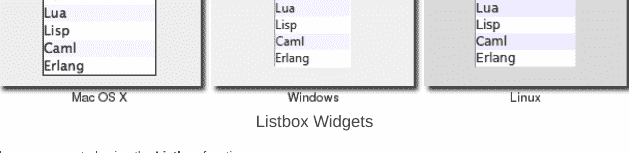

使用 **Listbox** 函数创建列表框：

```python
l = Listbox(parent, height=10)
```

### 填充列表框项

有一种简单的方法，也有一种困难的方法，来填充和管理包含在列表框中的所有项。

这里介绍简单的方法。每个列表框都有一个“listvariable”配置选项，它允许你将一个变量（必须持有列表）与列表框关联。该列表中的每个元素都是表示列表框中一个项的字符串。因此，要向列表框中添加、删除或重新排列项，你只需像操作其他列表一样操作这个变量即可。类似地，要查看列表框第三行显示的是哪个项，只需查看列表变量的第三个元素即可。

*之所以存在困难方法，是因为“listvariable”选项仅在 Tk 8.3 中才引入。在此之前，你不得不使用困难方法。由于使用列表变量可以让你使用所有标准的列表操作，它提供了更简单的 API，如果你正在用较旧的方式处理列表框，这绝对是一个值得考虑的升级。*

较旧、较困难的做法是使用一组属于列表框小部件本身的方法，这些方法操作（内部的）项列表：

-   • “insert idx item ?item... ?” 方法用于向列表中添加一个或多个项；“idx” 是一个基于 0 的索引，指示应在其之前添加项的位置；指定 “end” 可将新项放在列表末尾。
-   • 使用 “delete first ?last?” 方法从列表中删除一个或多个项；“first” 和 “last” 的索引定义如同 “insert” 方法。
-   • 使用 “get first ?last?” 方法返回给定位置的单个项内容，或 “first” 和 “last” 之间项的列表。
-   • “size” 方法返回列表中的项数。

### 选择项

你需要决定的第一件事是，用户是否可以一次只选择一个项，还是可以同时选择多个项。这由 “selectmode” 选项控制：默认情况下只能选择单个项（“browse”），而 “extended” 选择模式允许用户选择多个项。

> *出于向后兼容性的原因，“browse” 和 “extended” 这两个名称确实很差。更糟糕的是，还有另外两种模式 “single” 和 “multiple”，你**不应使用**它们（它们使用与现代表面界面和平台惯例不一致的旧交互样式）。*

要查找用户在列表框中当前选择的项或项，请使用 “curselection” 方法，它将返回当前所有选中项的索引列表；这可能是一个空列表，而对于选择模式为 “browse” 的列表，其长度永远不会超过一项。你还可以使用 “selection includes index” 方法来检查给定索引的项是否当前被选中。

要以编程方式更改选择，你可以使用 “selection clear first ?last?” 方法取消选择单个项或指定索引范围内的任何项。要选择一项或范围内所有项，请使用 “selection set first ?last?” 方法。这两种方法都不会影响指定范围之外项的选择状态。

如果你更改了选择，还应确保新选择的项对用户可见（即未被滚动到视野之外）。为此，请使用 “see index” 方法。

当用户更改选择时，会生成 “<ListboxSelect>” 虚拟事件。你可以绑定此事件以执行所需的任何操作。根据你的应用程序，你可能还希望绑定双击 “Double-1” 事件，并使用它对当前选中的项执行某个动作。

### 样式化列表

与大多数“经典”Tk 小部件一样，你在修改列表框外观方面拥有巨大的灵活性。如参考手册所述，你可以修改列表框项显示所用的字体、正常状态下项的前景色（文本）和背景色、选中时的状态、小部件禁用时的状态等等。还有一个 “itemconfigure” 方法，允许你更改单个项的前景色和背景色。

通常，克制是有用的。一般来说，默认值完全适用，并且与平台惯例良好匹配。在我们即将看到的示例中，我们将展示如何克制地使用这些选项以产生良好效果，在本例中是显示列表框的交替行采用略微不同的颜色。

### 保留额外项数据

“listvariable”（或内部列表，如果你是用旧方法管理的话）包含将在列表框中显示的字符串。然而，很多时候你程序中的每个字符串都关联着其他数据项，你真正关心的不是列表框中显示的字符串，而是关联的数据项。例如，包含姓名的列表框可能是呈现给用户的内容，但你的程序真正关心的是选中的用户对象（或 ID 号），而不是特定的姓名。

我们如何将此值与显示的姓名关联起来？不幸的是，列表框小部件本身不提供任何机制，因此我们必须单独管理。有几种明显的方法。首先，如果显示的字符串保证唯一，你可以使用哈希表将姓名映射到关联对象。因此，给定姓名，你可以轻松获取关联对象。这可能不适用于处理姓名，但例如可用于选择国家。

第二种方法是保留第二个列表，与显示在列表框中的字符串列表平行，用于保存关联对象。因此，字符串列表中的第一项对应对象列表中的第一项，第二项对应第二项，依此类推。你在一个列表中进行的任何更改（插入、删除、重新排序），都需要在另一个列表中进行。然后，你可以基于它们在列表中的位置，轻松地将列表项映射到基础对象。

### 示例

这里有一个展示这些各种列表框技术的滑稽示例。我们将显示一个国家列表。在幕后，我们有一个数据库（一个简单的哈希表），其中包含每个国家的人口，按两字母国家代码索引。我们将一次只能选择一个国家，同时，状态栏将显示该国的人口。双击列表或按 Return 键，将向所选国家元首发送几种礼物之一（好吧，并不是真的，但请发挥你的想象力）。

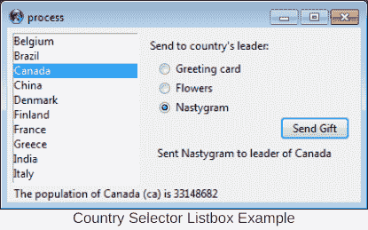

```python
from tkinter import *
from tkinter import ttk
root = Tk()

# Initialize our country "databases":
# - the list of country codes (a subset anyway)
# - a parallel list of country names, in the same order as the country codes
# - a hash table mapping country code to population
countrycodes = ('ar', 'au', 'be', 'br', 'ca', 'cn', 'gr', 'li', 'fr', 'gr', 'in', 'it', 'jp', 'mx', 'nl', 'no', 'se', 'ch')
countrynames = ('Argentina', 'Australia', 'Belgium', 'Brazil', 'Canada', 'China', 'Denmark', 
              'Finland', 'France', 'Greece', 'India', 'Italy', 'Japan', 'Mexico', 'Netherlands', 'Norway', 'Spain', 
              'Sweden', 'Switzerland')
cnames = StringVar(value=countrynames)
populations = {'ar':41000000, 'au':21179211, 'be':10584534, 'br':185971537, 
              'ca':33148682, 'cn':1323128240, 'dk':5457415, 'fi':5302000, 'fr':64102140, 'gr':11147000, 
              'in':1131043000, 'it':59206382, 'jp':127718000, 'mx':106535000, 'nl':16402414, 
              'no':4738085, 'se':45116894, 'ch':7508700}

# Names of the gifts we can send
gifts = ('card': 'Greeting card', 'flowers':'Flowers', 'nastgram':'Nastgram')

# State variables
gift = StringVar()
sentmsg = StringVar()
statusmsg = StringVar()

# Called when the selection in the listbox changes; figure out
# which country is currently selected, and then lookup its country
# code, and from that, its population.  Update the status message
# with the new population.  As well, clear the message about the
# gift being sent, so it doesn't stick around after we start doing
# other things.
def showPopulation(*args):
    idxs = lbox.curselection()
    if len(idxs)==1:
        idx = int(idxs[0])
```


## 滚动条

- 小部件概览
- 参考手册

**滚动条**有助于用户查看另一个小部件的所有部分，该小部件的内容通常远大于可用屏幕空间所能显示的内容。

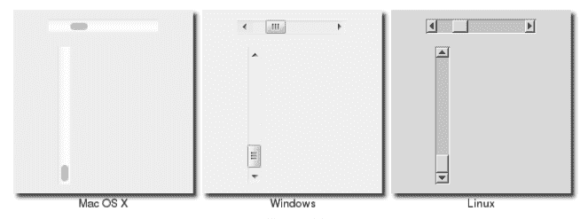

滚动条使用 `ttk.Scrollbar` 命令创建：
```python
s = ttk.Scrollbar( parent, orient=VERTICAL, command=listbox.yview)
listbox.configure(yscrollcommand=s.set)
```

与某些工具包不同，滚动条并不是另一个小部件（例如列表框）的一部分，而是一个完全独立的小部件。相反，滚动条通过调用被滚动小部件上的方法来与之通信；事实证明，被滚动的小部件也需要调用滚动条上的方法。

滚动条的 “orient” 配置选项决定了它是用于 “水平” 还是 “垂直” 方向滚动。然后，你需要设置 “command” 配置选项以与被滚动的小部件进行通信。这必须是被滚动小部件上要调用的方法。

每个可以垂直滚动的小部件都包含一个名为 “yview” 的方法（可以水平滚动的小部件有一个名为 “xview” 的方法）。只要该方法存在，滚动条就不需要了解被滚动小部件的其他任何信息。当操纵滚动条时，它会在方法调用中添加一些参数，指示滚动方式、位置等。

被滚动的小部件也需要向滚动条通信，告知其当前可见的内容区域百分比。除了 yview 和/或 xview 方法外，每个可滚动小部件还具有 “yscrollcommand” 和/或 “xscrollcommand” 配置选项。这用于指定一个方法调用，该方法必须是滚动条的 “set” 方法。同样，方法调用中会自动添加额外的参数。

如果出于某种原因，你希望从程序内部将滚动条移动到特定位置，你可以自己调用 “set” 方法。传递两个 0 到 1 之间的值，指示可见内容区域的起始和结束百分比。

### 示例

列表框是几种可滚动小部件类型之一。在这里，我们将构建一个非常简单的用户界面，仅包含一个占据整个窗口的可垂直滚动的列表框，底部仅有一条状态行。

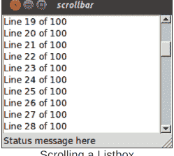

```python
from tkinter import *
from tkinter import ttk

root = Tk()

l = Listbox(root, height=5)
l.grid(column=0, row=0, sticky=(N,W,E,S))
s = ttk.Scrollbar(root, orient=VERTICAL, command=l.yview)
s.grid(column=1, row=0, sticky=(N,S))

l["yscrollcommand"] = s.set

ttk.Sizegrip().grid(column=1, row=1, sticky=(S,E))

root.grid_columnconfigure(0, weight=1)
root.grid_rowconfigure(0, weight=1)

for i in range(1,101):
    l.insert('end', 'Line %d of 100' % i)

root.mainloop()
```

## 大小调节手柄

- 小部件概览
- 参考手册

我们实际上在最后一个示例中偷偷加入了一个新的小部件，即**大小调节手柄**。这是窗口右下角的小方块，允许你调整窗口大小。

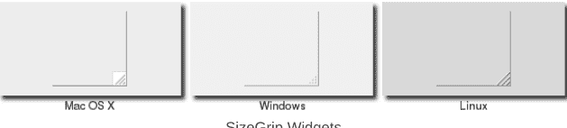

大小调节手柄使用 **ttk.Sizegrip** 函数创建：

```python
ttk.Sizegrip(parent).grid(column=999, row=999, sticky=(S,E))
```

虽然你会发现，在某些平台（例如 Mac OS X）上，Tk 会自动为你放置大小调节手柄，但自己显式添加它也没有坏处。我们将在后续章节中讨论如何改变窗口大小、判断其是否可调整大小等。

## 文本

- 小部件概览
- 参考手册

**文本**小部件为用户提供了一个区域，使他们能够输入多行文本。文本小部件属于经典 Tk 小部件，而非主题化 Tk 小部件。

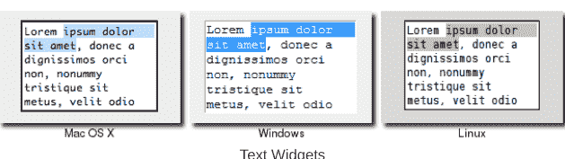

Tk 的文本小部件与画布小部件一样，是两种功能极其强大、功能深奥但易于编程的小部件之一。文本小部件曾是完整文字处理软件、大纲处理软件、网页浏览器的基础，等等。我们将在后续章节中探讨一些高级内容，但在这里，我们只是向你展示如何使用文本小部件来捕获相对简单的多行文本输入。

文本小部件使用 **Text** 函数创建：

```python
t = Text(parent, width=40, height=10)
```

“width” 和 “height” 选项分别指定了文本小部件请求的屏幕大小（以字符和行数为单位）。文本的内容可以任意大。你可以使用 “wrap” 配置选项来控制换行处理：取值可以是 “none”（不换行，文本可以水平滚动）、“char”（在任意字符处换行）和 “word”（仅在单词边界处换行）。

文本小部件可以被禁用，从而不允许任何编辑操作；由于文本小部件不是主题化小部件，通常的 “state” 和 “invalidate” 方法不可用。相反，使用 “state” 配置选项，将其设置为 “disabled” 或 “normal”。


滚动操作与列表框的工作原理相同。可以使用 “xscrollcommand” 和 “yscrollcommand” 配置选项将文本部件附加到水平和/或垂直滚动条上，并且 “xview” 和 “yview” 方法可供滚动条调用。为确保某一行可见（即未被滚动出视野），可以使用 “see index” 方法，其中 index 的格式为“行号.字符号”，例如 “5.0” 表示第 5 行（基于 1 的索引）的第一个（基于 0 的索引）字符。

## 内容

文本部件不像输入框部件那样有关联变量。要获取整个部件的文本内容，请调用 “get 1.0 end” 方法；其中 “1.0” 是文本的索引，表示第一行的第一个字符，而 “end” 是最后字符、最后一行索引的快捷方式。如果需要，可以传入其他索引以获取较小范围的文本。

可以使用 “insert index string” 方法向部件中插入文本；同样，index 的格式为“行.字符”，并标记插入文本的位置（即在该字符之前插入）；使用 “end” 可将在末尾添加文本。可以使用 “delete start end” 方法删除指定范围的文本，其中 start 和 end 均为如上所述的文本索引。

我们将在后续章节中详细介绍文本部件的许多其他高级功能。

## 进度条

- 部件概览
- 参考手册

**进度条** 部件提供了一种向用户反馈长时间操作进度的方法。这可以通过两种形式实现：一种是针对可以估算进度的操作，显示完成百分比；另一种是显示状态变化以表明操作仍在继续，但不提供完成时间估算。

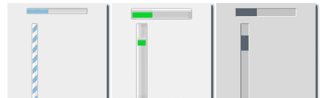

进度条部件使用 **tk.ttk.Progressbar** 类创建：

```python
p = ttk.Progressbar(parent, orient=HORIZONTAL, length=200, mode='determinate')
```

“orient” 选项可以是 “horizontal”（水平）或 “vertical”（垂直）。“length” 选项表示水平或垂直进度条较长轴的指定值，以屏幕单位（如像素）指定。“mode” 配置选项可以设置为 “determinate”（确定型），此时进度条将指示相对于完成状态的相对进度；或者设置为 “indeterminate”（不确定型），此时无法知道任务进行到了哪一步，但希望提供反馈表明程序仍在运行。

### 确定型进度

在确定型模式下，您可以向用户提供较为准确的操作进度反馈。为此，首先需告知进度条该操作将经历多少“步”，然后在操作过程中，持续告知进度条当前操作的进展程度。

可以使用 “maximum” 配置选项向进度条提供总步数；这是一个浮点数，默认值为 100（即每步占 1%）。为了告知进度条当前操作进展，您需要反复修改 “value” 配置选项。该值从 0 开始，然后递增直到您设置的最大值。这里有两种变体方法。首先，可以将进度条的当前值存储在一个通过进度条的 “variable” 配置选项与其关联的变量中；这样，当变量改变时，进度条就会更新。另一种替代方案是调用进度条的 “step amount” 方法，以给定的 “amount”（默认为 1.0）增量增加值。

### 不确定型进度

不确定型模式适用于无法轻松知晓（或估算）长任务进行到多少比例，但仍希望向用户提供反馈，表明操作仍在运行（或程序未崩溃）的情况。在这种情况下，不必提供具体数值来指示进度，而是在操作开始时调用进度条的 “start” 方法，在操作结束时调用其 “stop” 方法。进度条会自动处理其余部分。

### 标尺

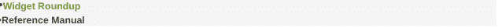

**标尺** 部件提供了一种让用户通过直接操作选择数值的方法。

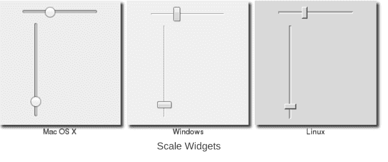

标尺部件使用 **tk.Scale** 函数创建：

```python
s = tk.Scale(parent, orient=HORIZONTAL, length=200, from_=1.0, to=100.0)
```

> *由于 'from' 是保留关键字，因此在使用它作为配置选项时需要在其末尾添加下划线。*

在某些方面，标尺部件类似于进度条，但它们的设计目的是供用户操作。与进度条一样，应使用 "orient" 配置选项为其指定方向（水平或垂直），并可指定可选的 "length"。还应定义标尺允许用户选择的数值范围；为此，需为 "from" 和 "to" 配置选项分别设置一个浮点数。

有几种不同的方法可以设置标尺的当前值（该值必须是 "from" 和 "to" 值之间的浮点数）。您可以设置（或读取以获取当前值）标尺的 "value" 配置选项。您可以使用 "variable" 选项将标尺与变量关联。或者，可以调用标尺的 "set value" 方法来修改值，或调用 "get" 方法来读取当前值。

还有一个 "command" 配置选项，允许您指定在标尺改变时调用的脚本。Tk 每次调用此脚本时都会自动附加标尺的当前值作为参数（我们在滚动条回调中见过类似的情况，其中滚动条被滚动部件也会添加额外参数）。

与其他主题部件一样，如果您希望防止用户修改标尺，可以使用 "state disabled"、"state !disabled" 和 "instate disabled" 方法。

*由于标尺部件不显示实际数值，您可能希望将这些数值添加为标签。*

### 自旋框

- 部件概览
- 参考手册

**自旋框** 部件允许用户选择数字（实际上，也可以是任意列表中的项目）。它通过结合一个显示当前值的类输入框部件和一对用于在可能选项范围内步进的小型上下箭头来实现这一功能。

自旋框属于经典 Tk 部件；目前主题化 Tk 部件集中没有自旋框。

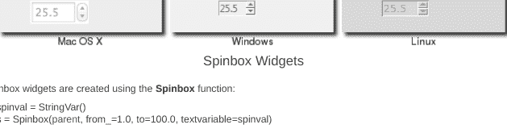

自旋框部件使用 **Spinbox** 函数创建：

```python
spintval = StringVar()
s = Spinbox(parent, from_=1.0, to=100.0, textvariable=spintval)
```

与标尺部件一样，自旋框通常用于让用户在特定范围内选择数字（使用 "from" 和 "to" 配置选项指定），尽管用户界面非常不同。您还可以指定 "increment"，它控制每次单击上或下按钮时值的变更幅度。

与列表框或组合框一样，自旋框也可用于让用户从任意字符串列表中选择项目；这些项目可以使用 "values" 配置选项指定，其工作方式与组合框相同。指定值列表将覆盖 "from" 和 "to" 设置。

*您可能会困惑于何时选择标尺、列表框、组合框、输入框或自旋框，因为通常其中几种部件都可以用于同一类型的数据。答案实际上取决于您希望用户选择的数据类型、平台用户界面惯例以及该值在用户界面中扮演的角色。*

> 例如，组合框和自旋框都具有占用空间较小的优点，这可能适用于较为边缘的设置，而在用户界面的主要选择中，可能需要列表框所占用的额外空间。当项目没有自然且明显的排序时，自旋框不太有意义。对于包含过多项目的组合框和自旋框，您应当谨慎，因为这会使选择项目花费更多时间。

对于数值范围和任意范围，都有一个接受布尔值的 "wrap" 选项，用于确定当值超出起始或结束值时是否应循环。您还可以为容纳自旋框当前值的输入框指定 "width"。

同样，关于如何设置或获取自旋框中的当前值也有多种选择。通常，您会使用 "textvariable" 配置选项指定关联变量；照例，变量的任何更改都会反映在自旋框中，而自旋框中的任何更改也会反映在关联变量中。此外，"setvalue" 和 "get" 方法允许直接设置或获取值。

可以使用 "command" 配置选项安排 whenever 自旋框改变时调用某功能。

> 命令包含几个百分号替换：%s = 当前值，%d = 向上或向下。需要确定在 Ruby 中指定此功能的正确方式。还需要添加关于验证的内容。

由于自旋框不是主题化部件，"state" 和 "instate" 方法不可用。相反，可以使用 "state" 配置选项来更改其状态。这可以是 "normal"（正常）或 "disabled"（禁用）以防止任何更改。

## 菜单

本章介绍如何在 Tk 中处理菜单栏和弹出菜单。对于精细的应用程序，这些是您特别需要关注领域。如果您希望您的应用程序能与用户平台上的其他应用程序协调一致，菜单就需要特别的照顾。

说到这一点，确定您正在运行哪个平台的推荐方式是：

```python
root.tk.call('tk', 'winfo system') # 将返回 x11, win32 或 aqua
```

> 据我所知，Tkinter 没有提供与此调用直接等效的方法。然而，如您从示例中可以看到，可以使用任何 Tkinter 部件上可用的 `.tk.call()` 函数直接执行基于 Tcl 的 Tk 命令。

> 这比检查诸如 `tcl_platform` 或 `RUBY_PLATFORM` 等全局变量以及使用这些方法的旧检查可能更有用。虽然在早期，平台与窗口系统之间有着相当好的相关性，但现在情况已有所不同。例如，如果识别出您的平台为 Unix，这可能意味着 X11 下的 Linux，Aqua 下的 Mac OS X，甚至 X11 下的 Mac OS X。

### 菜单栏

在本节中，我们将探讨菜单栏：如何创建它们、其中包含什么、如何使用它们等等。

合适地设计菜单栏及其菜单集合超出了本教程的范围，但有几条建议。首先，如果您发现自己拥有大量菜单、非常长的菜单或深度嵌套的菜单，您可能需要重新考虑用户界面的组织方式。其次，许多人使用菜单来探索程序的功能，尤其是在初次学习时，因此请尽量确保主要功能可以通过菜单访问。最后，对于每个您支持的


针对目标平台，熟悉应用程序如何使用菜单，并查阅平台的人机界面指南，以获取关于设计、术语、快捷键等更详细的信息。这通常是一个你需要针对每个平台进行自定义的领域。

## 菜单小部件与层级结构

- 小部件综述
- 参考手册

在 Tk 中，菜单和按钮、条目一样，是作为小部件实现的。每个菜单小部件包含菜单中的多个不同项目。项目包括“文件”菜单中的“打开...”命令，但也包括项目之间的分隔符，以及打开其子菜单的项目（即所谓的级联菜单）。这些菜单中的每一项还具有属性，例如要显示的项目文本、键盘加速键以及要调用的命令。

菜单按照层级结构排列。菜单栏本身也是一个菜单小部件。它有多个子菜单（子项），包含诸如“文件”、“编辑”等项目。每一项本身又是一个包含不同项目的菜单，其中一些可能还包含子菜单。正如你在 Tk 中已经看到的其他内容一样，每次有子菜单时，它必须作为其父级菜单的子项创建。

## 开始前须知

在开始创建菜单之前，务必在应用程序中的某处添加以下这一行代码：

```python
root.option_add("*tearOff", FALSE)
```

如果没有这一行，你的每个菜单（在 Windows 和 X11 上）都会以一条看似虚线的线条开始，并允许你“拆卸”菜单，使其出现在独立的窗口中。你确实不希望在菜单中出现这种情况。

> 这是对 Tk 原始外观和风格所基于的 Motif 风格 X11 的一种怀旧。除非你的应用程序旨在运行于那台放在地下室吃灰的旧机器上，否则你确实不想看到这种情况，因为它不属于任何现代用户界面风格。

> 我们都期待着一个不再保留这种向后兼容性、并且默认不提供这种可拆卸菜单的 Tk 版本。

## 创建菜单栏

在 Tk 中，菜单栏与单个窗口相关联；每个顶级窗口最多可以有一个菜单栏。在 Windows 和 X11 上，这在视觉上是显而易见的，因为菜单是每个窗口的一部分，位于顶部标题栏下方。

然而，在 Mac OS X 上，屏幕顶部有一个共享的菜单栏，由每个窗口共同使用。就你的 Tk 程序而言，每个窗口仍然拥有自己的菜单栏；当你在窗口之间切换时，Tk 会自动确保在屏幕顶部显示正确的菜单栏。如果你没有为特定窗口指定菜单栏，Tk 将使用与根窗口相关联的菜单栏；你现在应该已经注意到，当你的 Tk 应用程序启动时，这会自动为你创建。

> 由于在 Mac OS X 上所有窗口都有菜单栏，因此确保你定义了一个菜单栏非常重要，无论是为每个窗口定义，还是为根窗口定义一个后备菜单栏。否则，你将最终使用“内置”菜单栏，其中包含仅用于直接输入解释器命令时使用的菜单。

要为窗口实际创建一个菜单栏，我们首先创建一个菜单小部件，然后使用窗口的“menu”配置选项将菜单小部件附加到窗口。如前所述，菜单小部件必须是顶级窗口的子项。

```python
win = Toplevel(root)  
menubar = Menu(win)  
win['menu'] = menubar
```

> 虽然这是非常古老的历史，但菜单栏过去是通过创建一个包含菜单项目的框架小部件，并将其像其他小部件一样打包到窗口顶部来实现的。希望你的代码或文档中没有仍然采用这种做法的部分。

## 添加菜单

我们现在有了一个菜单栏，但如果没有菜单放进去，它相当没用。因此，我们需要再次为将要放入菜单栏的每个菜单创建一个菜单小部件（每个都是菜单栏的子项），然后将它们全部添加到菜单栏中。

## 添加菜单项

现在我们的菜单栏中已经有了几个菜单，可能是时候往每个菜单中添加一些项目了。请记住，菜单项是菜单本身的一部分，所以幸运的是我们不需要为每一项都去创建另一个菜单小部件。

```python
    menu_file.add_command(label='New', command=newFile)
    menu_file.add_command(label='Open...', command=openFile)
    menu_file.add_command(label='Close', command=closeFile)
```

> 在 Mac OS X 上，省略号（“…””）实际上是一个特殊字符，其间距比三个连续的句点更紧凑。Tk 会自动为你替换这个字符。

因此，向菜单添加菜单项基本上与添加子菜单相同，只不过我们添加的不是类型为 "cascade"（级联）的菜单项，而是类型为 "command"（命令）的菜单项。

每个菜单项都关联着一系列配置选项，与小部件类似，尽管每种菜单项类型有一组不同的相关选项。级联菜单项有一个 "menu" 选项，用于指定子菜单；命令菜单项有一个 "command" 选项，用于指定选中该项时要调用的命令；两者都有一个 "label" 选项，用于指定项目的显示文本。

除了向菜单末尾添加项目外，你还可以通过“insert index type ? option value...?”方法将项目插入到菜单中间；此处“index”是你想要在其之前插入的项目的位置（0...n-1）。你还可以使用“delete index”方法删除一个菜单。

## 菜单项类型

我们已经见过“command”菜单项，这是常见的菜单项，选中时会调用一个命令。

我们也见过“cascade”菜单项的用法，用于向菜单栏添加菜单。不出所料，如果你想向现有菜单添加子菜单，你也以完全相同的方式使用“cascade”菜单项。

第三种类型的菜单项是“separator”（分隔符），它会生成你在不同菜单项组之间经常看到的分隔线。

```python
    menu_file.add_separator()
```

最后，还有“checkbutton”和“radiobutton”菜单项，它们的行为类似于复选框和单选按钮小部件。这些菜单项关联着一个变量，根据该变量的值，会在项目标签旁边显示一个指示器（即对勾或选中的单选按钮）。

```python
    check = StringVar()
    menu_file.add_checkbutton(label='Check', variable=check, onvalue=1, offvalue=0)
    radio = StringVar()
    menu_file.add_radiobutton(label='One', variable=radio, value=1)
    menu_file.add_radiobutton(label='Two', variable=radio, value=2)
```

当用户选中一个尚未勾选的复选框项时，它会将关联变量设置为 "onvalue" 中的值；而选中一个已勾选的项则将其设置为 "offvalue" 中的值。选中单选按钮项会将关联变量设置为 "value" 中的值。这两种类型的项目还会响应程序其他部分对关联变量的更改。

与命令项一样，复选框和单选按钮菜单项也接受一个 "command" 配置选项，当菜单项被选中时将调用该命令；在调用回调之前，关联变量（从而菜单项的状态）会先被更新。

> 单选按钮菜单项不属于 Windows 或 Mac OS X 的人机界面指南，因此在这些平台上，项目标签旁边的指示器是对勾，就像复选框项一样。但语义仍然有效；这是从多个项目中进行选择的好方法，因为显示会表明其中一个项目被选中（勾选）。

## 加速键

"accelerator"（加速键）选项用于指示应与此菜单关联的菜单加速键。这实际上并不创建加速键，只是在其旁边显示该加速键是什么。你仍然需要自己为加速键创建绑定。

> 请记住，事件绑定可以设置在单个小部件上、某种类型的所有小部件上、包含你所关注小部件的顶级窗口上，或者是整个应用程序上。由于菜单栏与单个窗口相关联，通常你创建的事件绑定将与菜单相关联的顶级窗口上。

加速键具有非常强的平台特定性，不仅在于用于特定操作的键，还在于菜单加速键使用的修饰键（例如，在 Mac OS X 上是 "Command" 键，在 Windows 和 X11 上通常是 "Control" 键）。有效的加速键选项示例包括 "Command-N"、"Shift+Ctrl+X" 和 "Command-Option-B"。常用的修饰键包括 "Control"、"Ctr"、"Option"、"Opt"、"Alt"、"Shift"、"Command"、"Cmd" 和 "Meta"。

> 在 Mac OS X 上，这些修饰键会自动映射到菜单中出现的不同修饰图标。

## 关于项目选项的更多说明

菜单项还有几个常见的选项。

### 下划线

虽然所有平台都支持通过箭头键遍历菜单栏，但在 Windows 和 X11 上，你还可以使用其他键跳转到特定的菜单或菜单项。触发这些跳转的键通过菜单项标签中的下划线字母来表示。如果你想在菜单项中添加此类按键，可以使用该项的 "underline" 配置选项。该选项的值应该是你想要下划线的字符的索引（从 0 到字符串长度 - 1）。

### 图像

在菜单项中使用图像也是可能的，既可以放在菜单项标签旁边，也可以完全取代它。为此，你可以使用 "image" 和 "compound" 选项，它们的作用方式与标签小部件中相同。"image" 的值必须是一个 Tk 图像对象，而 "compound" 的值可以是 "bottom"、"center"、"left"、"right"、"top" 或 "none"。

### 状态

也可以禁用菜单，使用户无法选择它。这可以通过 "state" 选项完成，将其值设置为 "disabled"，或设置为 "normal" 以重新启用该项目。

49


## 查询和更改项选项

就像 Tk 中的大多数事物一样，你可以在任何时候查看或更改某一项的选项值。通过索引来引用这些项。通常，这是一个表示菜单中该项位置的数字（0...n-1），但你也可以指定菜单项的标签（或者实际上，使用“通配符”模式来匹配项的标签）。

```python
print( menu_.file.entrycget(0, 'label') )
menu_.file.entryconfigure('Close', state=DISABLED)
print( menu_.file.entryconfigure(0) )
```

## 平台菜单

每个平台都有几个由 Tk 进行特殊处理的菜单。

### Mac OS X

在 Mac OS X 上，有两个菜单会被特殊对待。应用程序菜单是菜单栏中的第二个菜单，其标题为你的应用程序名称。它会包含你添加到其中的任何菜单项，然后，标准的**应用程序菜单项**（**偏好设置**、**服务**、**隐藏/显示**和**退出**）将由 Tk 自动添加。第二个特殊菜单是帮助菜单，它始终被放置在菜单栏的最后一个位置。同样，除了你添加的项之外，Tk 还会添加系统预期的其他项（在 Tiger 上没有任何内容，在 Leopard 上则是一个搜索框）。

```python
apple = Menu(menubar, name='apple')
help = Menu(menubar, name='help')
menubar.add_cascade(menu=apple)
menubar.add_cascade(menu=help)
```

> 通常 Tkinter 会为我们选择部件路径名，但在这里我们需要使用 'name' 选项显式提供一个。将菜单命名为 'apple' 和 'help' 是 Tk 需要识别它们为特殊菜单的线索。

> 我们在此处理的是应用程序菜单，它与苹果菜单（带有苹果图标，位于应用程序菜单左侧的那个）是不同的。尽管我们确实指的是应用程序菜单，但在 Tk 中它仍然被称为“apple”菜单。这是 OS X 之前时代的遗留产物，当时这类项目确实放置在实际的苹果菜单中，且没有单独的应用程序菜单。

常规做法是在应用程序菜单中添加一个“关于 appname”命令项，其后跟随一个分隔符项。触发此操作时应显示你应用程序的关于框。

```python
## Python code placeholder from original OCR error "PYHONTODO"
```

### Windows

在 Windows 上，每个窗口都在窗口边框的左上角有一个“系统”菜单，上面带有你应用程序的小图标。它包含诸如“关闭”、“最小化”等项。在 Tk 中，如果你创建了一个系统菜单，你可以添加新的项，这些项将显示在标准项的下方。

```python
sysmenu = Menu(menubar, name='system')
menubar.add_cascade(menu=sysmenu)
```

> 通常 Tkinter 会为我们选择部件路径名，但在这里我们需要使用名称 'system' 显式提供一个；这是 Tk 需要将其识别为系统菜单的线索。

### X11

在 X11 上，如果你创建了一个帮助菜单，Tk 将确保它始终是菜单栏中的最后一个菜单。

```python
menu_help = Menu(menubar, name='help')
menubar.add_cascade(menu=menu_help, label='Help')
```

> 必须显式提供该菜单的部件路径名，在本例中即为 'help'。创建任何 Tkinter 部件时，都可以通过 'name' 选项来指定这一点。

## 上下文菜单

上下文菜单（“弹出”菜单）通常通过右键点击应用程序中的某个对象来触发。菜单会在鼠标光标的位置弹出，用户可以选取菜单中的某一项（或者点击菜单外部以在不选择任何项的情况下取消它）。

要创建上下文菜单，你要使用与在菜单栏中创建菜单完全相同的命令。通常，你会创建一个包含多个命令项的菜单，并可能包含一些级联菜单项及其相关菜单。

为了激活该菜单，用户会使用上下文菜单点击，你需要对其进行绑定。然而，在不同的平台上，这意味着不同的事情。在 Windows 和 X11 上，这是点击鼠标右键（第三个鼠标按钮）。在 Mac OS X 上，这要么是按住控制键并点击左（或唯一）键，要么是多按钮鼠标的右击。与 Windows 和 X11 不同，Mac OS X 将其称为第二个鼠标按钮，而不是第三个，因此你将在程序中看到相应的事件。

> 许多早期使用弹出菜单的程序假设只需担心“3号按钮”即可。

除了捕获正确的上下文菜单事件外，你还需要捕获鼠标点击的位置。事实证明，你需要相对于整个屏幕（全局坐标）来进行捕获，而不是相对于你点击的窗口或部件（本地坐标）。Tk 事件绑定系统中的 “%X” 和 “%Y” 替换符会为你捕获这些信息。

最后一步只是告诉菜单在特定位置弹出。下面是一个使用应用程序主窗口上的弹出菜单的整个过程的示例。

```python
from tkinter import *
root = Tk()
menu = Menu(root)
for i in ('One', 'Two', "Three"):
    menu.add_command(label=i)
if (root.tk.call('tk', 'windowingsystem')== 'aqua'):
    root.bind('<2>', lambda e: menu.post(e.x_root, e.y_root))
    root.bind('<Control-1>', lambda e: menu.post(e.x_root, e.y_root))
else:
    root.bind('<3>', lambda e: menu.post(e.x_root, e.y_root))
```

## 窗口和对话框

到目前为止，我们做的所有事情都在单一窗口中进行。在本章中，我们将介绍如何使用多个窗口，更改窗口的各种属性，并使用 Tk 中可用的某些标准对话框窗口。

### 创建和销毁窗口

你已经看到，所有 Tk 程序都始于一个根顶层窗口，然后在该根窗口下创建子部件。创建新的顶层窗口的工作方式与创建新部件几乎完全相同。

顶层窗口使用 **Toplevel** 函数创建：

```python
t = Toplevel(parent)
```

与常规部件不同，你不需要对顶层窗口进行“网格布局”就能使其出现在屏幕上。一旦创建了一个新的顶层窗口，你就可以在该顶层窗口下创建其他子部件，并对它们在顶层窗口内部进行网格布局。换句话说，新的顶层窗口表现得与自动创建的根窗口完全相同。

要销毁一个窗口，你可以使用部件上的 **destroy** 方法：

```python
window.destroy()
```

请注意，你可以在任何部件上使用 **destroy**，而不仅仅是顶层窗口。此外，当你销毁一个窗口时，该窗口下的所有子窗口（部件）也会被销毁。因此，如果你碰巧销毁了根窗口（所有其他部件都派生自该窗口），这通常会结束你的应用程序。

### 更改窗口行为和样式

有很多关于窗口行为和外貌的方面都可以更改。

#### 窗口标题

要检查或更改窗口的标题：

```python
oldtitle = window.title()
window.title('New title')
```

#### 大小和位置

在 Tk 中，窗口在屏幕上的位置和尺寸被称为其几何信息（geometry）。完整的几何规格看起来像这样：

```text
widthxheight+x+y
```

宽度和高度（通常以像素为单位）含义自明。“x”（水平位置）使用前导加号或减号指定，因此 “+25” 意味着窗口左边缘应与屏幕左边缘相距 25 像素，而 “-50” 意味着窗口右边缘应与屏幕右边缘相距 50 像素。同样， “y”（垂直位置）为 “+10” 意味着窗口上边缘应位于屏幕上边缘下方 10 像素，而 “-100” 意味着窗口下边缘应位于屏幕下边缘上方 100 像素。

> 请记住，几何信息的位置是屏幕上的实际坐标，不会为具有顶部菜单栏或底部 Dock 区域的系统（如 Mac OS X）做任何调整。因此，指定位置为 “+0+0” 实际上会将窗口顶部放置在系统菜单栏下方。从屏幕边缘留出健康的边距（至少 30 像素）是个好主意。

下面是一个更改大小和位置的示例，将窗口放置在屏幕的右上角附近：

```python
window.geometry('300x200-5+40')
```


## 堆叠顺序

堆叠顺序指的是窗口在屏幕上“放置”的顺序，从底部到顶部。当两个窗口的位置重叠时，堆叠顺序中更靠上的窗口会遮挡或覆盖堆叠顺序中靠下的窗口。

你可以通过以下方式获取当前的堆叠顺序（一个从最低到最高的列表）：

```python
root.tk.eval('wm stackorder ' + str(window))
```

> 此方法似乎并未通过 Tkinter 的 API 清晰暴露。

你 также 可以检查一个窗口是否在另一个窗口之上或之下：

```python
if (root.tk.eval('wm stackorder ' + str(window) + ' isabove ' + str(otherwindow)) == 1):
    ...
if (root.tk.eval('wm stackorder ' + str(window) + ' isbelow ' + str(otherwindow)) == 1):
    ...
```

你还可以提高或降低窗口的堆叠顺序，既可以调整到堆叠顺序的最顶端（最底层），也可以调整到指定窗口的上方（下方）：

```python
window.lift()
window.lift(otherwin)
window.lower()
window.lower(otherwin)
```

> Tkinter 使用名称 'lift'；因为 'raise' 是保留关键字。

想知道为什么需要传递一个窗口来获取当前堆叠顺序吗？事实证明，堆叠顺序、提升和降低等功能不仅适用于顶级窗口，也适用于任何“兄弟”小部件（即具有相同父级的小部件）。因此，如果你有几个通过网格布局排列但相互重叠的小部件，你可以相对于彼此来提升或降低它们的堆叠顺序。例如：

```python
from tkinter import *
from tkinter import ttk

root = Tk()
little = ttk.Label(root, text="Little")
bigger = ttk.Label(root, text='Much bigger label')
little.grid(column=0, row=0)
bigger.grid(column=0, row=0)
root.after(2000, lambda: little.lift())
root.mainloop()
```

> "after" 命令安排脚本在未来一定毫秒数后执行，但在此期间允许事件循环的正常处理继续进行。

## 调整大小行为

通常，顶级窗口（包括根窗口和你创建的其他窗口）都可以被用户调整大小。然而，有时在你的用户界面中，你可能希望阻止用户调整窗口大小。你可以防止窗口被调整大小，实际上可以独立指定窗口的宽度（第一个参数）和高度（第二个参数）是否可变。因此，要禁用所有大小调整：

```python
window.resizable(FALSE, FALSE)
```

请记住，如果你已经在窗口中添加了 ttk::sizegrip 小部件，当你使窗口不可调整大小时，应该移除它。

如果启用了大小调整，你可以指定希望窗口大小受限于最小和/或最大值（参数分别是宽度和高度）：

```python
window.minsize(200, 100)
window.maxsize(500, 500)
```

## 最小化和隐藏

在大多数系统上，你可以通过最小化窗口暂时将其从屏幕上移除。在 Tk 中，窗口是否最小化被称为窗口的状态。窗口的可能状态包括“normal”（正常）和“iconic”（已最小化窗口），以及“withdrawn”（隐藏）、“icon”或“zoomed”（缩放）等几种其他状态。

你可以查询或设置当前窗口状态，还有“iconify”和“deiconify”方法，它们分别是设置“iconic”或“normal”状态的快捷方式。

```python
thestate = window.state()
window.state('normal')
window.iconify()
window.deiconify()
```

## 标准对话框

对话框是一种在应用程序中用于从用户处获取信息、通知用户某些事件已发生、确认操作等的窗口类型。对话框的外观和使用方法通常在平台风格指南中有相当具体的说明。Tk 内置了许多用于常见任务的对话框，并帮助你遵循平台特定的风格指南。

## 选择文件和目录

Tk 提供了几个对话框，让用户选择文件或目录。在 Windows 和 Mac 上，这些直接调用底层操作系统对话框。当你希望用户选择现有文件时（例如在“文件 | 打开...”菜单命令中），使用对话框的“open”变体；而“save”变体用于选择要保存到的文件（通常由“文件 | 另存为...”菜单命令使用）。

```python
from tkinter import filedialog

filename = filedialog.askopenfilename()
filename = filedialog.asksaveasfilename()
dirname = filedialog.askdirectory()
```

所有这些命令都会产生模式对话框，这意味着在用户提交对话框之前，命令（因此你的程序）不会继续运行。这些命令返回用户选择的文件或目录的完整路径名，如果用户取消对话框，则返回空字符串。

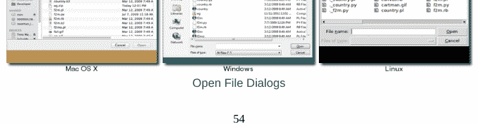

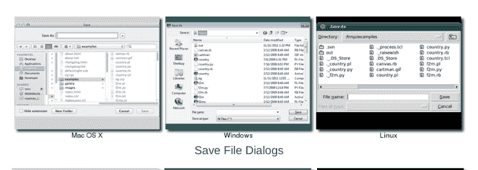

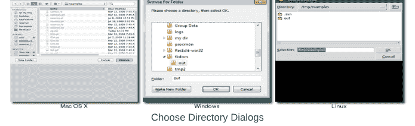

可以传递给这些对话框的各种不同选项允许你设置允许的文件类型、默认文件名等。这些在 getOpenFile/getSaveFile 和 chooseDirectory 参考手册页面中有详细说明。

## 选择颜色

还有一个模式对话框让用户选择颜色。它将返回一个颜色值，例如 “#ff62b8”。该对话框接受一个可选的 “initialcolor” 选项，指定用户可能正在替换的现有颜色。

```python
from tkinter import colorchooser

colorchooser.askcolor(initialcolor='#ff0000')
```

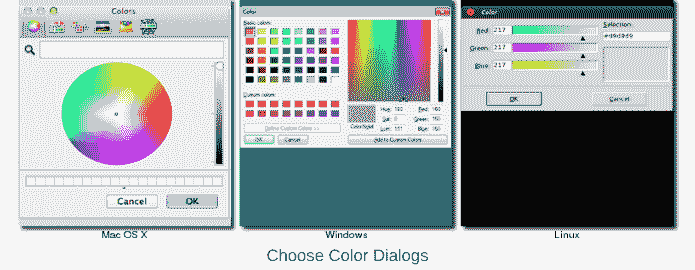

## 警报和确认对话框

许多应用程序使用各种简单的模式警报或对话框来通知用户某个事件、要求用户确认操作，或做出通过点击按钮完成的类似其他选择。Tk 提供了一个多功能的 'message box'（消息框），封装了所有这些不同类型的对话框。

```python
from tkinter import messagebox

messagebox.showinfo(message='Have a good day')
```

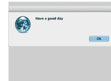

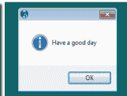

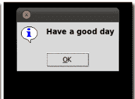

## 简单消息框

```python
messagebox.askyesno(
    message='Are you sure you want to install SuperVirus?',
    icon='question', title='Install')
```

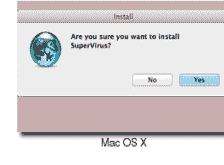

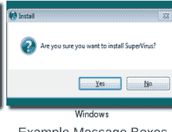

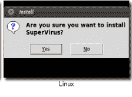

## 示例消息框

与我们之前看到的对话框类似，这些也是模式对话框，并将返回用户操作的结果给调用者。确切的返回值将取决于传递给命令的 "type"（类型）选项，如下所示：

| **类型选项** | **可能的返回值** |
|---|---|
| ok（默认） | "ok" |
| okcancel | "ok" 或 "cancel" |
| yesno | "yes" 或 "no" |
| yesnocancel | "yes"、"no" 或 "cancel" |
| retrycancel | "retry" 或 "cancel" |
| abortretryignore | "abort"、"retry" 或 "ignore" |

Tkinter 不使用 'type' 选项，而是为每种类型的对话框使用不同的方法名。可用的方法有：askokcancel, askquestion, askretrycancel, askyesno, askyesnocancel, showerror, showinfo, showwarning。

所有可能选项的完整列表如下：

| **选项** | **描述** |
|---|---|
| type | 如上所述。 |
| message | 显示在警报内部的主要消息。 |
| detail | 如果需要，次要消息，通常以较小的字体显示在主消息下方。 |
| title | 对话框窗口的标题。在 Mac OS X 上未使用。 |
| icon | 要显示的图标：其一为 "info"（默认）、"error"、"question" 或 "warning"。 |
| default | 指定哪个按钮（例如对于 "okcancel" 类型对话框的 "ok" 或 "cancel"）应为默认按钮。 |
| parent | 指定对话框所属的应用程序窗口；这可能会导致对话框显示在顶层，或者在 Mac OS X 上作为该窗口的面板出现。 |

> 这些新的 messagebox 对话框取代了旧的 “tk_dialog” 命令，后者不符合当前的平台用户界面约定。

## 组织复杂界面

如果你有一个大型用户界面，你需要找到方法将其组织起来，以免复杂性压倒你的用户。有几种不同的方法可以做到这一点；同样，通用的和平台特定的人机交互指南在决策时都是很好的资源。

注意，当我们在本章谈论复杂性时，指的并不是程序如何构建的底层技术复杂性，而是它如何呈现给用户。用户界面可以由许多不同的模块组成，由多个画布小部件和深层嵌套框架构建，但这并不一定意味着用户会感到它很复杂。

## 多窗口

在应用程序中使用多个窗口的好处之一是简化用户界面，使用户一次只需关注一个窗口中的内容（要求用户关注或在几个窗口之间切换也可能产生相反的效果）。类似地，仅显示与当前任务相关的小部件（通过网格布局）有助于简化用户界面。

## 空白

如果你确实需要在屏幕上同时显示大量小部件，你需要思考如何在视觉上组织它们。你已经看到网格如何通过使小部件彼此对齐变得容易来帮助组织。空白是另一个有用的辅助工具。将相关的小部件放置得很近（可以在上方立即加上解释性标签），并通过空白与其他不太相关的小部件分开，有助于用户在他们自己的头脑中组织用户界面。

> 围绕不同小部件、小部件组之间、边框周围等的空白量具有很强的平台特定性。虽然你可以在不担心确切像素数的情况下做不错的功课，但如果你想要高度抛光的用户界面，就需要针对每个平台进行调整。

## 分隔符

- Widget Roundup
- Reference Manual

在一组显示中分组小部件的另一种方法是在小部件组之间放置一条细的水平或垂直线；对于紧凑的显示，这通常比使用空白更节省空间。Tk 为此目的提供了一个非常简单的分隔符小部件。


# 分隔符组件

分隔符使用 `tk.Separator` 函数创建：

```python
s = ttk.Separator(parent, orient=HORIZONTAL)
```

“orient”选项可以指定为“horizontal”（水平）或“vertical”（垂直）。

## 标签框架

- 组件概览
- 参考手册

`labelframe` 组件（通常也称为分组框）提供了另一种将相关组件分组的方式。它就像一个普通的 `tk.Frame`，通常用作容器，将其他组件放置在内部进行网格布局。然而，它的显示方式在视觉上使其与用户界面的其余部分区分开来。你可以选择提供文本标签，显示在标签框架的外部。

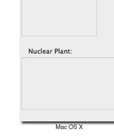

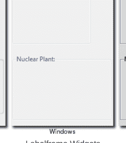

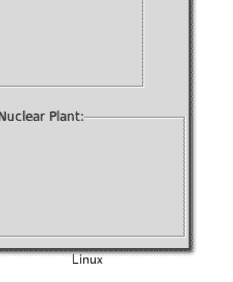

### Labelframe 组件

Labelframe 使用 `ttk.Labelframe` 函数创建：

```python
lf = ttk.Labelframe(parent, text='Label')
```

## 窗格

- 组件概览
- 参考手册

`panedwindow` 组件允许你将两个或更多可调整大小的组件垂直堆叠（或左右排列）。用户通过拖动位于窗格之间的分隔栏（sash）来调整每个窗格的相对高度（或宽度）。通常，添加到窗格中的组件是包含许多其他组件的框架。

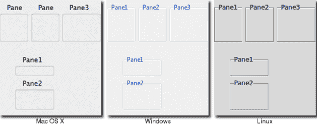

窗格组件（此处显示管理多个标签框架）

窗格使用 `ttk.Panedwindow` 函数创建：

```python
p = ttk.Panedwindow(parent, orient=VERTICAL)
### 第一个窗格，内部将网格布局组件：
f1 = ttk.Labelframe(p, text='Pane1', width=100, height=100)
f2 = ttk.Labelframe(p, text="Pane2", width=100, height=100) # 第二个窗格
p.add(f1)
p.add(f2)
```

窗格可以是“垂直”的（其窗格垂直堆叠在彼此之上），也可以是“水平”的。重要的是，添加到窗格中的所有窗格都必须是该窗格本身的直接子级。

调用“add”方法会在窗格列表的末尾添加一个新窗格。“insert position subwindow”方法允许你将窗格放置在窗格列表中的指定位置（0...n-1）；如果该窗格已由该窗格管理，它将被移动到新的位置。你可以使用“forget(subwindow)”从窗格中移除一个窗格；你也可以传递位置而不是子窗口。

其他选项允许你为每个窗格指定相对权重，以便当整个窗格大小调整时，某些窗格将获得比其他窗格更多的空间。此外，你可以调整窗格中每个分隔栏的位置。有关详细信息，请参阅命令参考。

## 选项卡

- 组件概览
- 参考手册

`notebook` 组件使用选项卡笔记本的比喻，让用户使用索引标签在几个页面之间切换。在这种情况下，与窗格不同，我们只允许用户一次查看单个页面（类似于一个窗格）。

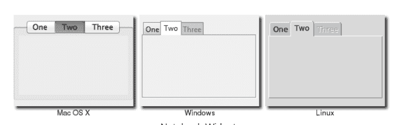

### Notebook 组件

Notebook 使用 `tk.Notebook` 函数创建：

```python
n = tk.Notebook(parent)
f1 = ttk.Frame(n) # 第一页，内部将网格布局组件
f2 = ttk.Frame(n) # 第二页
n.add(f1, text='One')
n.add(f2, text='Two')
```

选项卡笔记本的操作与窗格类似。每个页面通常是一个框架，同样是笔记本本身的直接子级（子窗口）。使用“add subwindow ?option value...?”方法在标签列表的末尾添加新页面及其关联的标签。“text”标签选项用于设置标签上的文本；同样有用的是“state”标签选项，其值可以是“normal”、“disabled”（不可选择）或“hidden”。

要在列表末尾以外的位置插入标签，可以使用“insert position subwindow ?option value...?”，要移除指定标签，请使用“forget”方法，传递位置（0..n-1）或标签的子窗口。你可以通过“tabs”方法获取包含在笔记本中的所有子窗口列表。

要获取当前选中的子窗口，请调用“select”方法；通过传递标签的位置或子窗口本身作为参数来更改选中的标签。

要更改标签选项（如标签上的文本标签或其状态），可以使用“tab(tabid, option=value)”方法（其中“tabid”再次是标签的位置或子窗口）；省略“=value”以返回选项的当前值。

同样，命令参考中详细列出了许多不常用的选项和命令。

## 字体、颜色和图像

本章描述了 Tk 如何处理字体、颜色和图像。我们之前已经接触过这些内容，但这里我们将提供更深入的介绍。

### 字体

几个 Tk 组件，如 label、text 和 canvas，允许你指定用于显示文本的字体，通常通过“font”配置选项。与 Tk 中的许多事物一样，默认字体通常是不错的选择，但如果你确实想要进行修改，本节将描述几种方法。字体是几个高度平台相关的领域之一，因此如何指定它们很重要。

字体命令参考提供了关于指定字体以及其它字体相关操作的完整细节。

大多数显示文本的主题组件没有“font”配置选项，这与经典 Tk 组件不同。与其修改单个组件，在主题组件中正确的做法是指定样式中使用的字体，然后使用该样式为单个组件设置。这类似于在 HTML 页面中硬编码面向显示的标记（如字体标签）与使用 CSS 样式表将所有显示特定信息集中在一处之间的区别。

许多旧的 Tk 程序硬编码了大量字体，使用我们在下面看到的“family size style”格式、X11 字体名称或更旧且更晦涩的 X11 字体规范字符串。在许多情况下，随着平台的发展，这使得这些应用程序看起来过时了。此外，许多程序按单个组件指定字体，导致字体决策分散在整个程序中。使用命名字体以及 Tk 提供的标准字体是更好的解决方案。审查和更新现有应用程序中的字体使用是一个简单且重要的改动。

#### 标准字体

特别是对于或多或少标准的用户界面元素，每个平台都定义了应使用的特定字体。Tk 将其中许多封装在一组始终可用的标准字体中，当然，标准组件使用这些字体。这有助于抽象平台差异。预定义的字体是：

| 字体名称 | 描述 |
|-----------------|-----------------------------------------------------------------------------|
| TkDefaultFont   | 所有未特别指定的 GUI 项目的默认字体。 |
| TkTextFont      | 用于 entry 组件、listbox 等。 |
| TkFixedFont     | 标准固定宽度字体。 |
| TkMenuFont      | 用于菜单项的字体。 |
| TkHeadingFont   | 通常用于列表和表格列标题的字体。 |
| TkCaptionFont   | 用于窗口和对话框标题栏的字体。 |
| TkSmallCaptionFont | 用于子窗口或工具对话框的较小标题字体 |
| TkIconFont      | 用于图标说明的字体。 |
| TkTooltipFont   | 用于工具提示的字体。 |

#### 平台特定字体

还有一些可用的预定义字体，但具体集合取决于平台。显然，如果你使用这些字体，并且你的应用程序在不同平台之间可移植，你需要确保为每个平台单独定义适当的字体。

在 X11 上，可以使用任何有效的 X11 字体名称（参见例如“xlsfonts”命令）。但请记住，没有保证特定字体已在特定机器上安装。

在 Windows 上，可以使用以下映射到“显示”控制面板中可设置的字体的字体名称：`system, ansi, device, systemfixed, ansifixed, oemfixed`。

在 Mac OS X 上，可以使用以下字体（详情参见 Apple HIG）：`systemSystemFont, systemSmallSystemFont, systemApplicationFont, systemViewsFont, systemMenuItemFont, systemMenuItemCmdKeyFont, systemPushButtonFont, systemAlertHeaderFont, systemMiniSystemFont, systemDetailEmphasizedSystemFont, systemEmphasizedSystemFont, systemSmallEmphasizedSystemFont, systemLabelFont, systemMenuTitleFont, systemMenuItemMarkFont, systemWindowTitleFont, systemUtilityWindowTitleFont, systemToolbarFont, systemDetailSystemFont`。

#### 命名字体

你还可以创建自己的字体，其用法与预定义字体完全相同。为此，你需要选择一个名称来引用该字体，然后指定定义字体外观的各种字体属性。通常，你会在不同平台上使用不同的字体属性；这样，你可以在程序中使用字体而无需担心细节，只需在字体实际定义的那个地方处理即可。

这是一个示例：

```python
from tkinter import font
appHighlightFont = font.Font(family='Helvetica', size=12, weight='bold')
ttk.Label(root, text='Attention!', font=appHighlightFont).grid()
```


## 字体描述

“family”（字体族）指定字体名称；Courier、Times 和 Helvetica 的名称保证受支持（并映射到合适的等宽、衬线或无衬线字体），但也可以使用系统中安装的其他字体（同样，务必注意确保该字体存在，否则系统将提供不同的字体，这可能并不一定是最佳匹配）。您可以使用以下命令获取所有可用字体的名称：

font.families()

“size”（字号）选项以磅（points）为单位指定字体大小。“weight”（字重）选项可以是 **bold**（粗体）或 normal（常规）。您可以指定“slant”（倾斜度）为 roman（常规）或 *italic*（斜体）。最后，布尔选项“underline”（下划线）和“overstrike”（删除线）也可用。

可以使用与更改小部件配置选项相同的机制来检查或更改这些选项的当前设置（例如 configure）。

另一种指定字体的方式是使用属性列表，以字体名称开头，然后可选地包含字号，以及可选的一个或多个样式选项。一些示例包括 "Helvetica"、"Helvetica 12"、"Helvetica 12 bold" 和 "Helvetica 12 bold italic"。这些字体描述随后用作“font”配置选项的值，而不是预定义或命名字体。

> 一般来说，建议从字体描述切换到命名字体，以便再次将字体差异隔离在程序中的一个位置。

## 颜色

与字体一样，有各种方式可以指定颜色。完整细节可以在颜色命令参考中找到。

一般来说，系统将为大多数内容提供正确的颜色。与字体类似，Mac 和 Windows 都指定了大量系统特定的颜色名称（参见参考手册），其实际颜色可能取决于系统设置（例如文本高亮颜色、默认背景）。

您也可以通过 RGB 指定颜色，就像在 HTML 中一样，例如 "#3FF" 或 "#FF016A"。最后，Tk 识别 X11 定义的一组颜色名称；通常这些名称不使用，除非是一些非常常见的名称，如 "red"（红色）、"black"（黑色）等。

对于主题化的 Tk 小部件，颜色通常用于定义应用于小部件的样式，而不是直接对应用颜色到小部件上。

可能不用说也明白，在颜色的使用上通常应当有所节制。

## 图像

我们已经看到过使用图像的基本方法，例如在标签或按钮中显示它们。我们创建图像对象，通常是从磁盘上的文件创建。

```python
imgobj = PhotoImage(file="myimage.gif")
label["image"] = imgobj
```

开箱即用，Tk 支持 GIF 和 PPM/PNM 图像。然而，有一个名为 "Img" 的 Tk 扩展库，它为许多其他格式添加了支持：BMP、XBM、XPM、PNG、JPEG、TIFF 等。虽然 Img 没有直接包含在 Tk 核心中，但它通常与其他打包分发版一起包含（例如 ActiveTcl）。

PYTHONTODO

Tk 的图像实际上非常强大且复杂，提供了多种检查和修改图像的方式。您可以从图像命令参考和照片命令参考中了解更多内容。

> *我们在这里看到的这种多色图像类型在 Tk 中被称为照片图像。Tk 还提供了另一种类型的图像，即双位位图图像，它们在 90 年代被广泛使用，当时大多数 Unix 工作站使用相当大的（与个人电脑相比）显示器，但它们的图像只有黑白。不用说，如今彩色是标配，因此强烈建议将图标等更新为全彩图像。*

## 画布

- 小部件概览
- 参考手册

**画布**（canvas）小部件管理一个 2D 图形对象集合——线条、圆形、图像、其他小部件等。Tk 的画布是一个极其强大且灵活的小部件，无疑是 Tk 的亮点之一。它适用于广泛的应用，包括绘图或制图、CAD 工具、显示或监控模拟或实际设备，以及用简单组件构建更复杂的小部件。画布小部件属于经典 Tk 小部件，而非主题化 Tk 小部件。

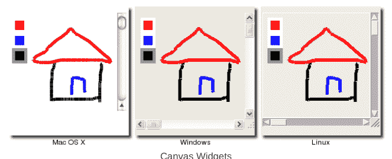

画布小部件使用 **Canvas** 函数创建：

```python
canvas = Canvas(parent)
```

由于画布小部件拥有大量功能，我们无法在此涵盖所有内容。我们将做的是采取一个相当简单的示例（一个自由手绘工具），并逐步添加新的部分，每一部分展示画布小部件的另一个新功能。在章节末尾，我们将介绍示例中未展示的一些其他主要功能。

### 创建项目

当您创建一个新的画布小部件时，它基本上是一个空无一物的大矩形；换句话说，这是一张真正的空白画布。要对它做任何有用的事情，您需要向其中添加项目。如前所述，您可以添加多种不同类型的项目。这里，我们将看看如何向画布添加一条简单的线条项目。

要创建线条，您需要指定的唯一信息是线条的位置。这是通过使用起点和终点的坐标完成的，表示为 x0 y0 x1 y1 形式的列表。原点 (0,0) 位于画布的左上角，x 值向右移动时增加，y 值向下移动时增加。因此，要创建一条从 (10,10) 到 (200,50) 的线，我们将使用以下代码：

```python
canvas.create_line(10, 10, 200, 50)
```

`create_line` 方法将返回一个项目 id（一个整数），可用于唯一地引用此项目；每个创建的项目都会获得自己的 id。虽然通常我们不需要稍后引用该项目，因此会忽略返回的 id，但我们很快就会看到它如何被使用。

让我们开始我们的简单素描板示例。目前，我们希望能够在画布上通过拖动鼠标进行自由绘图。我们将创建一个画布小部件，然后为其附加事件绑定以捕获鼠标点击和拖动。当我们第一次点击鼠标时，我们会将该位置记住为“start”（起始）位置。每次鼠标在保持按钮按下的情况下移动时，我们都会创建一条从该“start”位置到当前鼠标位置的线条项目。当前位置随后将成为下一条线段段的“start”位置。

```python
from tkinter import *
from tkinter import ttk

lastx, lasty = 0, 0

def xy(event):
    global lastx, lasty
    lastx, lasty = event.x, event.y

def addLine(event):
    global lastx, lasty
    canvas.create_line((lastx, lasty, event.x, event.y))
    lastx, lasty = event.x, event.y

root = Tk()
root.columnconfigure(0, weight=1)
root.rowconfigure(0, weight=1)

canvas = Canvas(root)
canvas.grid(column=0, row=0, sticky=(N, W, E, S))
canvas.bind("<Button-1>", xy)
canvas.bind("<B1-Motion>", addLine)

root.mainloop()
```

试一试 - 在画布上拖动鼠标以创建您的杰作。

### 项目属性

在创建项目时，您还可以指定一个或多个项目的属性，这将影响其显示方式。例如，这里我们将指定线条应为红色，且宽度为三个像素。

```python
canvas.create_line(10, 10, 200, 50, fill='red', width=3)
```

确切的属性集将根据项目类型而变化。

与 Tk 小部件一样，在您已经创建画布项目后，也可以更改其属性。

```python
id = canvas.create_line(0, 0, 10, 10, fill='red')
...
canvas.itemconfigure(id, fill='blue', width=2)
```

### 绑定

我们已经看到，画布小部件作为一个整体，就像其他任何 Tk 小部件一样，可以使用“bind”命令捕获事件。

您还可以将绑定附加到画布中的单个项目（或项目组，我们将在下一节中使用标签看到这一点）。因此，如果您想知道某个特定项目是否被点击，您不需要监视整个画布的鼠标点击事件，然后判断该点击是否发生在您的项目上。Tk 会为您处理所有这些。

要捕获这些事件，您使用画布内置的 bind 命令。它的工作方式与普通 bind 命令完全相同，接受事件模式和回调函数。唯一的区别在于您指定该绑定适用的画布项目。

```python
canvas.tag_bind(id, '<1>', ...)
```

> 请注意项目特定的 “tag_bind” 方法与小部件级别的 “bind” 方法之间的区别。

让我们向我们的素描板示例中添加一些代码，以允许更改绘图颜色。我们将首先创建几个不同的矩形项目，每个填充不同的颜色。创建矩形项目就像创建线条项目一样，您只需指定两个对角顶点的坐标。然后我们将为每个矩形附加一个绑定，这样当它们被点击时，会将一个全局变量设置为要使用的颜色。我们的鼠标移动绑定在创建线段时会查看该变量。

```python
color = "black"
def setColor(newcolor):
    global color
    color = newcolor

def addLine(event):
    global lastx, lasty
    canvas.create_line((lastx, lasty, event.x, event.y), fill=color)
    lastx, lasty = event.x, event.y

id = canvas.create_rectangle((10, 10, 30, 30), fill="red")
canvas.tag_bind(id, "<Button-1>", lambda x: setColor("red"))
id = canvas.create_rectangle((10, 35, 30, 55), fill="blue")
canvas.tag_bind(id, "<Button-1>", lambda x: setColor("blue"))
id = canvas.create_rectangle((10, 60, 30, 80), fill="black")
canvas.tag_bind(id, "<Button-1>", lambda x: setColor("black"))
```

### 标签

我们已经看到每个画布项目都有一个唯一的 id 号码，但还有另一种非常有用且强大的方式引用画布上的项目，那就是使用标签（tags）。

标签只是您创建的标识符，对您的程序具有某种意义。您可以将标签附加到画布项目上；每个项目可以有任何数量的标签。与项目 id 号码不同（每个项目都是唯一的），许多项目可以拥有相同的标签。

您可以使用标签做什么？我们看到了可以使用项目 id 来修改画布项目（并且我们很快就会看到还有其他事情可以做，比如移动项目、删除项目等）。在任何可以使用项目 id 的地方，都可以使用标签。因此，例如，您可以更改所有具有特定标签的项目的颜色。

标签是识别画布中特定类型项目的好方法（属于绘制线条的项目、属于调色板的项目等）。您可以使用标签将画布项目与应用程序中的特定对象关联起来（因此


例如，将所有属于 id 为 #37 的机器人的画布项目都标记为 "robot37"。使用标签，你就不必手动记录画布项目的 id 以便后续引用项目组；标签可以让 Tk 帮你完成这件事。

你可以在创建项目时使用 "tags" 项目配置选项来分配标签。你也可以稍后使用 "addtag" 方法添加标签，或使用 "dtag" 方法移除它们。你可以使用 "gettags" 方法获取某个项目的标签列表，或使用 "find" 命令返回具有给定标签的项目 id 号列表。

示例如下：

```python
>>> c = Canvas(root)
>>> c.create_line(10, 10, 20, 20, tags=('firstline', 'drawing'))
>>> c.create_rectangle(30, 30, 40, 40, tags=('drawing'))
>>> c.addtag('rectangle', 'withtag', 2)
>>> c.addtag('polygon', 'withtag', 'rectangle')
>>> c.gettags(2)
('drawing', 'rectangle', 'polygon')
>>> c.dtag(2, 'polygon')
>>> c.gettags(2)
('drawing', 'rectangle')
>>> c.find_withtag('drawing')
(1, 2)
```

正如你所见，像 "withtag" 这样的操作既接受单个项目，也接受标签；在后一种情况下，它们将应用于具有该标签的所有项目（可能是一个都没有）。"addtag" 和 "find" 还有许多其他选项，允许你指定靠近某点的项目、与特定区域重叠的项目等。

让我们首先使用标签，在我们调色板中当前选中的项目周围添加一个边框。

```python
def setColor(newcolor):
    global color
    color = newcolor
    canvas.dtag('all', 'paletteSelected')
    canvas.itemconfigure('palette', outline='white')
    canvas.addtag('paletteSelected', 'withtag', 'palette%s' % color)
    canvas.itemconfigure('paletteSelected', outline='#999999')

id = canvas.create_rectangle(10, 10, 30, 30, fill="red", tags=('palette', 'palettered'))
id = canvas.create_rectangle(10, 35, 30, 55, fill="blue", tags=('palette', 'paletteblue'))
id = canvas.create_rectangle(10, 60, 30, 80, fill="black", tags=('palette', 'paletteblack', 'paletteSelected'))

setColor('black')
canvas.itemconfigure('palette', width=5)
```

让我们也使用标签来使当前正在绘制的笔画更显眼；当我们释放鼠标时，我们会将其恢复为正常状态。

```python
def addLine(event):
    global lastx, lasty
    canvas.create_line(lastx, lasty, event.x, event.y, fill=color, width=5, tags='currentline')
    lastx, lasty = event.x, event.y

def doneStroke(event):
    canvas.itemconfigure('currentline', width=1)

canvas.bind("<B1-ButtonRelease>", doneStroke)
```

## 修改项目

你已经看到了如何修改项目配置选项——比如颜色、宽度等。你还能对项目进行许多其他操作。

要删除项目，请使用 **delete** 方法。要改变项目的大小和位置，你可以使用 **coords** 方法；这允许你提供项目的新坐标，指定方式与最初创建项目时相同。如果不提供新的坐标集就调用此方法，它将返回项目的当前坐标。要将一个或多个项目从其当前位置在水平或垂直方向移动特定距离，你可以使用 **move** 方法。

所有项目都按照从上到下的顺序排列，这被称为堆叠顺序。如果堆叠顺序中较后的项目与下方项目的坐标重叠，上方的项目将绘制在下方项目的上面。**raise** 和 **lower** 方法允许你调整项目在堆叠顺序中的位置。

参考手册页中描述了更多操作，既用于修改项目，也用于检索有关它们的更多信息。

## 滚动

在许多应用中，你希望画布比屏幕上显示的要大。你可以通过 **xview** 和 **yview** 方法，以通常的方式将水平和垂直滚动条附加到画布。

关于画布的大小，你可以指定希望在屏幕上显示多大，以及画布的完整大小是多少（完整大小可能需要滚动才能看到）。画布小工具的 **width** 和 **height** 配置选项会从几何管理器请求给定数量的空间。**scrollregion** 配置选项（例如 "0 0 1000 1000"）告诉 Tk 画布表面的尺寸。

基于你已有的知识，你应该能够修改草图程序以添加滚动功能。试试看。

完成之后，将画布向下滚动一点点，然后尝试绘图。你会发现你画的线条出现在鼠标指向的位置上方！感到惊讶吗？

原因是全局 **bind** 命令不知道画布已经滚动（它不知道任何特定小工具的详细信息）。所以，如果你将画布向下滚动 50 像素，并点击左上角，bind 会报告你点击了 (0,0)。但我们要知道，由于滚动，该位置实际上应该是 (0,50)。

**canvasx** 和 **canvasy** 方法会将屏幕上的位置（即 bind 报告的位置）转换为画布上的实际点，并考虑滚动因素。如果你直接将这些添加到事件绑定中（而不是在事件绑定中调用的过程），请注意引号和替换，以确保在事件触发时执行转换。

以下是我们的完整示例。我们可能不希望调色布在画布滚动时被滚走，但我们将把这个问题留到以后处理。

```python
from tkinter import *
from tkinter import ttk
root = Tk()

h = ttk.Scrollbar(root, orient=HORIZONTAL)
v = ttk.Scrollbar(root, orient=VERTICAL)
canvas = Canvas(root, scrollregion=(0, 0, 1000, 1000), yscrollcommand=v.set, xscrollcommand=h.set)
h['command'] = canvas.xview
v['command'] = canvas.yview
ttk.Sizegrip(root).grid(column=1, row=1, sticky=(S, E))

canvas.grid(column=0, row=0, sticky=(N, W, E, S))
h.grid(column=0, row=1, sticky=(W, E))
v.grid(column=1, row=0, sticky=(N, S))
root.grid_columnconfigure(0, weight=1)
root.grid_rowconfigure(0, weight=1)

lastx, lasty = 0, 0

def xy(event):
    global lastx, lasty
    lastx, lasty = canvas.canvasx(event.x), canvas.canvasy(event.y)

def setColor(newcolor):
    global color
    color = newcolor
    canvas.dtag('all', 'paletteSelected')
    canvas.itemconfigure('palette', outline='white')
    canvas.addtag('paletteSelected', 'withtag', 'palette%s' % color)
    canvas.itemconfigure('paletteSelected', outline='#999999')

def addLine(event):
    global lastx, lasty
    x, y = canvas.canvasx(event.x), canvas.canvasy(event.y)
    canvas.create_line(lastx, lasty, x, y, fill=color, width=5, tags='currentline')
    lastx, lasty = x, y

def doneStroke(event):
    canvas.itemconfigure('currentline', width=1)

canvas.bind("<Button-1>", xy)
canvas.bind("<B1-Motion>", addLine)
canvas.bind("<B1-ButtonRelease>", doneStroke)

id = canvas.create_rectangle(10, 10, 30, 30, fill="red", tags=("palette", 'palettered'))
canvas.tag_bind(id, "<Button-1>", lambda x: setColor("red"))
id = canvas.create_rectangle(10, 35, 30, 55, fill="blue", tags=("palette", 'paletteblue'))
canvas.tag_bind(id, "<Button-1>", lambda x: setColor("blue"))
id = canvas.create_rectangle(10, 60, 30, 80, fill="black", tags=("palette", 'paletteblack', 'paletteSelected'))
canvas.tag_bind(id, "<Button-1>", lambda x: setColor("black"))

setColor('black')
canvas.itemconfigure('palette', width=5)
root.mainloop()
```

## 其他项目类型

除了直线和矩形，画布小工具还支持许多不同类型的项目。请记住，每个类型都有自己的项目配置选项，详见参考手册。

“line”类型的项目实际上可以比我们看到的更花哨。一个直线项目实际上可以是一系列直线段，而不只是一条；在我们的示例中，我们可以选择为每个完整的笔画使用单个直线项目。直线还可以直接从点到点绘制，或者平滑成曲线。

我们已经见过“rectangle”类型的项目。“oval”类型的项目工作原理相同，但绘制为椭圆形。“arc”类型的项目允许你只绘制椭圆的一部分。“polygon”类型的项目允许你绘制任意边数的闭合多边形。

可以使用“bitmap”类型（用于黑白）或“image”类型（用于全彩色）的项目将图片添加到画布小工具中。


你可以通过使用“文本”类型的项向画布添加文本。你可以完全控制字体、大小、颜色等，以及实际显示的文本。

最有趣的是，你可以使用“窗口”类型的项将其他小部件（包括本身包含其他小部件的框架）嵌入到画布中。这样做时，画布实际上充当了这些小部件的几何管理器。这种能力为你的应用程序带来了各种可能性。

关于画布小部件，这里描述的只是冰山一角；请务必查阅参考手册，以及 Tk 发行版中包含的大量示例程序。

## 文本

- 小部件概览
- 参考手册

**文本**小部件管理一个多行文本区域。与画布小部件一样，Tk 的文本小部件是一个极其灵活且强大的工具，可用于各种任务。文本小部件的一些示例用途包括：作为表单的一部分提供简单的多行文本区域、风格化的代码编辑器、大纲视图，甚至网页浏览器。文本小部件属于经典 Tk 小部件，而不是主题化 Tk 小部件。

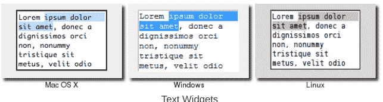

使用 **Text** 函数创建文本小部件：

```python
text = Text(parent, width=40, height=10)
```

虽然我们在前面的章节中简要介绍了文本小部件，但在这里我们将深入更多细节，让你了解它所能达到的复杂程度。不过，对于任何涉及文本小部件的重要工作，参考手册都组织得非常良好且实用。

### 基础概念

如果你只是想使用文本小部件从用户那里获取简单的多行文本作为表单的一部分，你只需要关注以下几点：创建和调整小部件的大小（已勾选）、为表单中的文本提供初始值，以及在用户提交表单后检索小部件中的文本。

### 提供初始内容

当你最初创建它时，文本小部件是空的，所以如果你想提供初始文本，你需要自己添加。与例如条目小部件不同，文本小部件不支持“*textvariable*”配置选项；如我们稍后将看到的，文本小部件可以包含比普通文本更多的内容，因此简单的变量不足以容纳所有内容。

相反，要为小部件设置初始文本，你需要使用小部件的“*insert*”方法：

```python
text.insert("1.0", "here is my text to insert")
```

这里的 "1.0" 代表插入文本的位置，可以读作“第 1 行，第 0 个字符”。这指的是第一行的第一个字符；出于与程序员通常如何引用行和字符相关的历史惯例，行号是从 1 开始计数的，而字符号是从 0 开始计数的。

要插入的文本只是一个字符串。由于小部件可以容纳多行文本，你提供的字符串也可以是多行的。为此，只需在字符串的适当位置嵌入 "\n"（换行符）即可。

### 滚动

水平滚动条和垂直滚动条都可以附加到文本小部件上。其工作原理与其他小部件（如列表框或画布）中使用滚动条完全相同。

你还可以要求小部件确保文本的特定部分可见。例如，如果你向小部件添加的文本超出了屏幕显示范围（因此需要滚动），但希望确保显示的是文本的顶部而不是底部，请调用 "see" 方法，并传入文本位置（例如 "1.0"）。

### 控制换行

如果小部件中某些行文本非常长，长于小部件的宽度怎么办？默认情况下，文本会直接换行到下一行，但是否以及如何换行可以通过 "wrap" 配置选项来控制。默认值是 "char"，意味着在行末的字符处立即换行；其他选项有 "word"，表示仅在单词边界（例如空格）处换行，以及 "none"，表示完全不换行。在后者情况下，除非你为小部件附加一个水平滚动条，否则部分文本将不可见。

### 禁用小部件

某些表单会在满足特定条件前（例如某些其他选项设置为特定值时）暂时禁用特定小部件的编辑功能。为了防止用户对文本小部件进行任何更改，将 "state" 配置选项设置为 "disabled"；通过将此选项设置回 "normal" 来重新启用编辑。

### 检索文本

最后，在用户进行任何更改并提交表单后，你的程序将希望检索小部件的内容，这通过 "get" 方法完成：

```python
texttext = text.get('1.0', 'end')
```

### 在代码中修改文本

虽然用户可以交互式地修改文本小部件中的文本，但你的程序也可以进行修改。添加文本是通过 "insert" 方法完成的，我们在上面用它为文本小部件提供了初始值。

### 文本位置和索引

当我们指定位置 "1.0"（第一行，第一个字符）时，这是索引的一个例子。它告诉 insert 方法在哪里插入新文本（就在第一行、第一个字符之前，即在小部件的最开始处）。有多种方式可以指定这些索引。你还见过另一个： "end"（来自 "get" 示例）意味着在文本结束后的紧接位置（“紧接”是因为文本插入发生在给定索引之前，所以在 "end" 处插入文本将把文本添加到小部件的末尾）。请注意，Tk 始终会在文本小部件的最末尾添加一个换行符。

以下是一些额外的索引示例及其含义：

- `3.end`: 第 3 行末尾的换行符。
- `1.0 + 3 chars`: 第 1 行开头之后 3 个字符的位置。
- `2.end - 1 chars`: 第 2 行中换行符之前的最后一个字符。
- `end - 1 chars`: Tk 始终在文本末尾添加的那个换行符。
- `end - 2 chars`: 文本的实际最后一个字符。
- `end - 1 lines`: 最后一行实际文本的开头。
- `2.2 + 2 lines`: 第 4 行文本的第三个字符（索引 2）。
- `2.5 linestart`: 第 2 行的第一个字符。
- `2.5 lineend`: 第 2 行末尾换行符的位置。
- `2.5 wordstart`: 包含索引 2.5 处字符的那个单词的第一个字符。
- `2.5 wordend`: 包含索引 2.5 处字符的那个单词中，最后一个字符之后的第一个位置。

一些需要注意的额外事项：

- 术语 "chars" 可以缩写为 "c"，"lines" 可以缩写为 "l"。
- 可以省略术语之间的空格，例如 "1.0+1c"。
- 如果你指定的索引超出了小部件的末尾（例如 "end + 100c"），它将被解释为末尾。
- 添加字符时会根据需要换行到下一行，例如在只有五个字符的一行上使用 "1.0 + 10 chars" 最终会位于第二行。
- 使用包含多个单词的索引时，确保正确引用它们，以便 Tk 将整个索引视为单个参数。
- 当向上或向下移动特定行数时，这被解释为逻辑行，其中每行仅由 "\n" 终止。如果行长且启用了换行，这可能在显示上代表多行。如果你想向上或向下移动显示上的单行，可以指定例如 "1.0 + 2 display lines"。
- 要确定索引的实际规范位置，请使用 "index" 方法，传入索引表达式，它将返回形式为 "line.char" 的对应索引。
- 可以使用 "compare" 方法比较两个索引，该方法允许你检查相等性、一个索引是否晚于另一个索引等。

### 删除文本

虽然 "insert" 方法在小部件的任何位置添加新文本，但 "delete" 方法则用于移除文本。你可以指定要删除的单个字符（通过索引），或由起始和结束索引指定的字符范围。在后者情况下，将从起始索引（包括起始索引）到结束索引之前（不包括结束索引）删除字符（因此结束索引处的字符不会被删除）。所以，这将从小部件文本的开头移除一行文本（包括其末尾的换行符）：

```python
text.delete('1.0', '2.0')
```

还有一个 "replace" 方法，接受起始索引、结束索引和一个字符串作为参数。它的效果等同于先执行 delete，然后在相同位置执行 insert。

### 示例：日志窗口

这里有一个简短的示例，展示了如何将文本小部件用作应用程序的 80x24 日志窗口。用户完全不编辑该文本小部件；相反，你的程序将向其写入日志消息。你希望将内容保持在不超过 24 行（因此没有滚动），因此随着你在末尾添加新消息，如果已有 24 行，你就需要从顶部移除旧消息。

```python
from tkinter import *
from tkinter import ttk

root = Tk()
log = Text(root, state='disabled', width=80, height=24, wrap='none')
log.grid()

def writeToLog(msg):
  numlines = log.index('end - 1 line').split('.')[0]
  log['state'] = 'normal'
  if numlines == 24:
    log.delete('1.0', '2.0')
  if log.index('end-1c') != '1.0':
    log.insert('end', '\n')
```


log.insert('end', msg)
log['state'] = 'disabled'

请注意，由于该小部件已被禁用，我们不得不重新启用它才能进行任何更改，即使是来自我们的程序也是如此。

## 使用标签进行格式化

到目前为止，我们只处理了纯文本。现在是时候研究如何添加特殊格式了，例如粗体、*斜体*、**删除线**、背景颜色、字体大小等等。Tk 的文本小部件使用一种称为标签（tags）的功能来实现这些效果。

标签是与文本小部件相关联的对象。每个标签都通过程序员选择的名称来引用。每个标签可以拥有多种不同的配置选项；这些选项包括字体、颜色等，用于格式化文本。虽然标签是具有状态的对象，但它们不需要显式创建；在首次使用标签名称时，它们会自动创建。

### 将标签添加到文本中

标签可以与小部件中的一个或多个文本范围相关联。与之前一样，这些是通过索引指定的；单个索引代表单个字符，而起始索引和结束索引则表示从起始字符到结束字符之前的范围。可以使用 `tag add` 方法将标签添加到文本范围中，例如：

```
text.tag_add('highlightline', '5.0', '6.0')
```

在插入文本时也可以通过添加可选参数来提供标签，该参数包含一个列表，列出要添加到正在插入的文本的一个或多个标签，例如：

```
text.insert('end', 'new material to insert', ('highlightline', 'recent', 'warning'))
```

当小部件中的文本被修改时，无论是用户还是你的程序进行修改，标签都会自动调整。因此，例如，如果你用标签“nounphrase”标记了文本“the quick brown fox”，然后将单词“quick”替换为“speedy”，该标签仍然适用于整个短语。

## 将格式应用到标签

通过配置选项将格式应用到标签；这些选项的工作方式与整个小部件的配置选项类似。举个例子：

```
text.tag_configure('highlightline', background='yellow', font='helvetica 14 bold', relief='raised')
```

当前可用于标签的配置选项包括：“background”（背景色）、“bgstipple”（背景点画）、“borderwidth”（边框宽度）、“elide”（省略）、“fgstipple”（前景点画）、“font”（字体）、“foreground”（前景色）、“justify”（对齐）、“lmargin1”（左边距1）、“lmargin2”（左边距2）、“offset”（偏移量）、“overstrike”（删除线）、“relief”（凹凸效果）、“rmargin”（右边距）、“spacing1”（间距1）、“spacing2”（间距2）、“spacing3”（间距3）、“tabs”（制表位）、“tabstyle”（制表风格）、“underline”（下划线）和“wrap”（换行）。请查阅参考手册了解这些选项的详细说明。`tag cget` 方法允许你查询标签的配置选项。

由于多个标签可以应用于相同的文本范围，因此可能存在冲突（例如，两个标签指定了不同的字体）。使用优先级顺序来解决这些冲突；最近创建的标签具有最高优先级，但可以使用“tag raise”和“tag lower”方法重新排列优先级。

## 更多标签操作

要完全删除一个标签，可以使用“tag delete”方法。这当然也会移除文本中对标签的任何引用。你也可以使用“tag remove”方法将标签从文本范围中移除；即使这导致没有任何文本范围带有该标签，标签对象本身仍然存在。

"tag ranges" 方法将返回该标签已应用于文本中的范围列表。还有 "tag next" 和 "tag prev" 方法，用于从给定位置向前或向后搜索第一个这样的范围。

"tag names" 方法在不传入额外参数的情况下调用，将返回文本小部件中当前定义的所有标签列表（包括那些可能当前未被使用的标签）。如果你向该方法传入一个索引，它将返回仅应用于该索引处字符的标签列表。

最后，你可以使用具有给定标签的文本中的第一个和最后一个字符作为索引，就像你可以使用 "end" 或 "2.5" 一样。为此，只需指定 "tagname.first" 或 "tagname.last"。

## Canvas 和 Text 小部件中标签的差异

虽然 canvas 和 text 小部件都支持 "tags"，可用于应用于多个对象、设置样式等，但这些标签不是同一种东西。有一些重要的差异需要注意。

在 canvas 小部件中，单个 canvas 项目具有控制其外观的配置选项。当你在 canvas 中引用一个标签时，其含义等同于"所有当前具有该标签的 canvas 项目"。标签本身并不作为一个单独的对象存在。因此，在以下代码片段中，最后添加的矩形不会变成红色。

```python
canvas.itemconfigure('important', fill='red')
canvas.create_rectangle(10, 10, 40, 40, tags=('important'))
```

相比之下，在 text 小部件中，保留外观状态信息的不是单个字符，而是标签，标签是它们自身的对象。因此，在这个代码片段中，新添加的文本将变为红色。

```python
text.insert('end', 'first text', ('important'))
text.tag_configure('important', foreground='red')
text.insert('end', 'second text', ('important'))
```

## 事件和绑定

一个很酷的功能是你可以为标签定义事件绑定。这允许你轻松识别仅针对特定文本范围的鼠标点击，并据此弹出菜单或对话框。不同的标签可以拥有不同的绑定，因此你可以省去诸如"这个位置的点击意味着什么？"这类问题的麻烦。标签上的绑定是使用 "tag bind" 方法实现的。

```python
text.tag_bind('important', '<1>', popupImportantMenu)
```

小部件范围的事件绑定工作方式是与其他小部件相同的。除了常规的低层事件外，还有两个会生成的虚拟事件：只要小部件的内容发生更改，就会生成 <Modified>；只要选中的文本发生变化，就会生成 <Selection>。

## 选择文本

你的程序可能想知道用户是否选择了某段文本，如果是，该范围是什么。例如，在编辑器中，你可能有一个工具栏按钮用于加粗选中的文本。虽然你可以通过 <Selection> 虚拟事件得知选择何时发生变化（例如，以更新加粗按钮是否处于激活状态），但这并没有告诉你具体选择了什么。

文本小部件自动维护一个名为 "sel" 的标签，它指的是所选文本。每当选择发生变化时，"sel" 标签都会更新。因此，你可以使用 "tag ranges" 方法来查找选定的文本范围，传入 "sel" 作为要报告的标签。

类似地，你可以使用 "**tag add**" 来设置新的选择，或使用 "**tag remove**" 来移除选择，从而改变选择。当然，你实际上不能删除 "sel" 标签。

> *尽管默认的小部件绑定会防止这种情况发生，但 "sel" 与其他标签一样，它支持多个范围，即不相交的选择。为了防止在代码中更改选择时发生这种情况，请确保在添加新选择之前移除任何旧选择。*

文本小部件将插入光标（新输入的文本将出现的位置）的概念与选择分开管理。它通过使用一种称为标记（mark）的新概念来实现这一点。

## 标记

标记用于指示文本中的特定位置。在这点上，它们类似于索引，不同之处在于随着文本的修改，标记会调整到相同的相对位置。在这方面，它们类似于标签，但标记指的是单个位置，而不是文本范围。实际上，标记并不指代文本中被字符占据的位置，而是指定两个字符之间的位置。

Tk 自动维护两个不同的标记。第一个名为 "insert"，是插入光标的当前位置。当光标移动时（通过鼠标或键盘），标记随之移动。第二个标记名为 "current"，反映当前鼠标位置下方字符的位置。

要创建自己的标记，使用小部件的 "**mark set**" 方法，传入标记的名称和一个索引（标记位于给定索引处的字符之前）。这也用于将现有标记移动到不同位置。可以使用 "**mark unset**" 方法移除标记，传入标记的名称即可。如果你删除了包含标记的一段文本，该标记也会被移除。

标记的名称也可以用作索引（与 "1.0" 或 "end-1c" 是索引的方式相同）。你可以使用 "**mark next**" 或 "**mark previous**" 方法，从给定索引在文本中找到下一个（或前一个）标记。"**mark names**" 方法将返回所有标记名称的列表。

标记还具有重力（gravity），可以通过 "**mark gravity**" 方法进行修改，这会影响在标记处插入文本时发生的事情。假设我们有文本 "ac"，在中间有一个标记，我们用管道符 | 来表示，即 "a|c"。如果该标记的重力是 "right"（默认值），标记将依附于 "c"。如果在标记处插入新文本 "b"，标记将保持依附于 "c"，因此新文本将插入到标记之前，即 "ab|c"。如果重力改为 "left"，标记将依附于 "a"，因此新文本将插入到标记之后，即 "a|bc"。

## 图像和小部件

与 canvas 小部件类似，文本小部件不仅可以包含文本，还可以包含图像和任何其他 Tk 小部件（甚至包括本身包含许多其他小部件的框架）。在某些意义上，这使得文本小部件可以作为一个独立的几何管理器。在文本中添加图像和小部件的功能为你的程序开启了无限可能。

图像在特定索引处添加到文本小部件，图像通常指定为现有的 Tk 图像。还有其他选项允许你微调填充等。


# 更多功能

文本控件可以做更多的事；这里我们简要提及其中几项。关于如何使用这些功能的详细信息，请参阅参考手册。

## 搜索

文本控件包含一个强大的“search”（搜索）方法，允许你在控件中定位特定文本；例如，这对于实现“查找”对话框非常有用。你可以从特定位置向前或向后搜索，或在给定范围内搜索；可以使用精确文本、忽略大小写或正则表达式来指定搜索内容，查找搜索词的一个或所有出现位置，等等。

## 修改、撤销和重做

文本控件会跟踪文本是否已被修改（例如，这有助于知道是否需要保存该文本），你可以使用“edit modified”方法查询（或更改）此状态。此外，还有一个完整的多级撤销/重做机制，当将其“undo”配置选项设置为 true 时，由控件自动管理。调用“edit undo”或“edit redo”后，将使用存储在撤销/重做堆栈中的信息来修改当前文本。

## 省略文本

实际上，你可以在控件中包含一些不显示的文本；这被称为“elided”（省略）文本，通过标签的“elide”配置选项实现。你可以使用此功能来实现例如大纲、“折叠”代码编辑器，或者仅仅将一些额外的元数据嵌入你的文本中。在指定省略文本的位置时，需要更加小心，因此处理位置的命令具有额外选项，用于包括或忽略省略文本。

## 内省

与大多数 Tk 控件一样，文本控件努力暴露其内部状态的信息；关于这些内容，我们在“get”方法、控件配置选项、标签和标记的“names”和“cget”等方面已经见过大部分。还有更多信息可供使用，以满足各种任务需求。请参考手册中的“debug”、“dlineinfo”、“bbox”、“count”和“dump”方法。

## 共享

Tk 文本控件允许在两个或更多不同的文本控件之间共享相同的底层文本数据（包含所有文本、标记、标签、图像等）。这被称为共享（peering），通过“peer”方法控制。

## 树

-   [控件综述](#)
-   [参考手册](#)

**树视图**（treeview）控件可以显示并允许浏览项目层次结构，并可以在树的右侧显示每个项目的一个或多个属性作为列。它允许你构建类似于在 OS X Finder 或 Windows Explorer 等文件管理器中看到的树形显示的用户界面。与大多数 Tk 控件一样，它具有极大的灵活性，使其能够以各种方式适应不同的情况。

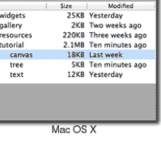
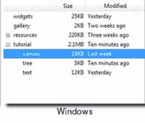
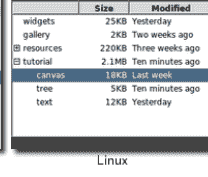

## 树视图控件

树视图控件使用 `ttk.Treeview` 函数创建：

```python
tree = ttk.Treeview(parent)
```

如有需要，可以以常规方式添加水平和垂直滚动条。

## 向树中添加项目

要对树视图做任何有用的事情，你需要向其中添加一个或多个项目。每个项目代表树中的一个单个节点，无论是叶节点还是内部节点。项目通过唯一的 id 来引用；此 id 可以在项目首次创建时由程序员分配，或者由控件自动为项目选择一个 id。

项目通过将其插入树中来创建，使用树视图的“insert”方法。要插入一个项目，你需要知道在树中的哪个位置插入它，这意味着除了指定父项之外，还要指定新项目应插入在父项子项列表中的哪个位置。

树视图控件自动创建一个根节点（不显示），其 id 为“{}”（即空字符串），它可以作为你添加的第一级项目的父节点。父项子项列表内的位置通过索引指定（0 表示第一个，特殊的“end”索引表示在所有现有子项之后插入）。

通常，你还会指定每个项目的名称，该名称显示在树中。还有其他选项用于在名称旁边添加图像，指定节点是打开还是关闭状态等。

```python
### 插入到根节点，由程序选择 id：
tree.insert('', 'end', 'widgets', text='Widget Tour')

### 同样的操作，但插入为第一个子项：
tree.insert('', 0, 'gallery', text='Applications')

### 由树视图选择 id：
id = tree.insert('', 'end', text='Tutorial')

### 插入到现有节点下方：
tree.insert('widgets', 'end', text='Canvas')
tree.insert(id, 'end', text='Tree')
```

插入项目后会返回新创建项目的 id。

## 重新排列项目

可以将节点（如果有任何后代）移动到树中的不同位置；唯一的限制是节点不能移动到其自身的后代下方。目标位置通过父项和子项列表中的索引指定，正如在“insert”中做的那样。

```python
tree.move('widgets', 'gallery', 'end') # 将 widgets 移动到 gallery 下方
```

可以将项目从树中分离，这会从层次结构中移除该项目及其后代，但不会销毁这些项目，允许你稍后使用“move”重新插入它们。

```python
tree.detach('widgets')
```

项目也可以被删除，这会完全移除该项目及其后代。

```python
tree.delete('widgets')
```

如果你希望导航层次结构，有一些方法可以让你查找项目的父项（“parent”），查找项目的下一个或上一个兄弟项（“next”和“prev”），以及返回项目的子项列表（“children”）。

你可以通过修改“open”项配置选项来控制该项目是否打开并显示其子项。

```python
tree.item('widgets', open=TRUE)
isopen = tree.item('widgets', 'open')
```

## 显示每个项目的信息

树视图还可以显示关于每个项目的一个或多个附加信息，它们作为列显示在主树显示的右侧。

同样，每个列通过你分配的符号名称来引用。你可以使用树视图控件的“columns”配置选项指定列列表，既可以在创建控件时指定，也可以在稍后指定。

```python
tree = ttk.Treeview(root, columns=('size', 'modified'))
tree['columns'] = ('size', 'modified', 'owner')
```

你可以指定列的宽度、列中项目信息显示的对齐方式等。你还可以提供关于列标题的信息，例如要显示的文本、可选图像、对齐方式以及点击项时调用的脚本（例如，用于对树进行排序）。

```python
tree.column('size', width=100, anchor='center')
tree.heading('size', text='Size')
```

每个项目中每列的值可以单独指定，也可以通过提供项目的值列表来指定。在后一种情况下，使用“values”项配置选项完成（因此可以在首次插入项目时或稍后使用），该选项接受一个值列表；列表的顺序必须与“columns”控件配置选项中的顺序相同。

```python
tree.set('widgets', 'size', '12KB')
size = tree.set('widgets', 'size')
tree.insert('', 'end', text='Listbox', values=('15KB', 'Yesterday', 'mark'))
```

## 项目外观和事件

与文本和画布控件一样，树视图控件使用标签（tags）来帮助你修改树中项目的外观。你可以使用“tags”项配置选项（同样，在创建项目时或稍后）为每个项目分配一个标签列表。

然后可以指定标签配置选项，这些选项将应用于具有该标签的所有项目。有效的标签选项包括“foreground”（文本颜色）、“background”、“font”和“image”（如果项目指定了自己的图像，则不使用此项）。

你还可以在标签上创建事件绑定，从而捕获鼠标点击、键盘事件等。

```python
tree.insert('', 'end', text='button', tags=('ttk', 'simple'))
tree.tag_configure('ttk', background='yellow')
tree.tag_bind('ttk', '<1>', itemClicked) # 可以点击的项目可以通过 tree.focus() 找到
```

树视图将生成虚拟事件“<TreeviewSelect>”、“<TreeviewOpen>”和“<TreeviewClose>”，允许你监视用户所做的控件更改。你可以使用“selection”方法来确定当前选择（选择也可以通过你的程序更改）。

## 自定义显示

关于树视图控件显示方式的许多方面都是可定制的。我们已经见过其中的一些，例如项目的文本、字体和颜色、列标题的名称等。以下是一些额外的自定义选项。

-   使用“height”控件配置选项指定要显示的行数。
-   使用列的“width”或“minwidth”选项控制每列的宽度。持有树的列可以通过符号名称“#0”访问。控件的总请求宽度基于列宽度之和。
-   使用“displaycolumns”控件配置选项选择要显示的列及其显示顺序。
-   你可以选择隐藏一个或两个列标题或树本身（仅留下列），使用“show”控件配置选项（默认为“tree headings”以同时显示两者）。
-   你可以通过“selectmode”控件配置选项指定用户可以选择单个项目还是多个项目，传入“browse”（单个项目）、“extended”（多个项目，默认值）或“one”。

## 样式和主题

新的 Ttk 控件的“themed”（主题化）方面是新控件集最强大且令人兴奋的特性之一。然而，由于其工作方式与 Tk 传统的运作方式非常不同，并且由于为了保持灵活性做了很多事情，这确实对许多人来说是最令人困惑的部分。

### 定义

我们将首先定义一些 Ttk 主题和样式所依赖的概念和术语。

#### 控件类

控件类用于 Tk 标识特定控件的类型；本质上，它是按钮、标签、画布等。在经典 Tk 中，所有按钮都有相同的类（“Button”），所有标签都有相同的类（“Label”）等。

你可以使用此控件类进行内省，也可以通过选项数据库全局更改选项。例如，这可以让你说所有按钮默认都具有红色背景。


有一些经典的 Tk 小部件，包括框架（frame）和顶层（toplevel）小部件，它们允许你在小部件创建时通过传递一个 "class" 配置选项来更改特定小部件的类。因此，虽然通常框架的类都是 "Frame"，但你可以指定某个特定的框架小部件具有 "SpecialFrame" 这样的类。

正因为如此，你可以使用选项数据库为不同类型的框架小部件定义不同的外观（不仅仅是所有框架小部件，也不仅仅是位于层次结构中特定位置的框架小部件）。

Tk 所做的，就是将这个简单的想法加上火箭推进器，使其威力大增。

## 小部件状态

小部件状态允许单个小部件具有多种外观或行为，这取决于诸如鼠标位置、应用程序设置的不同状态选项等因素。在经典 Tk 中，某些小部件具有 "state" 配置选项，允许你将它们设置为 "normal"（正常）或 "disabled"（禁用）；例如，按钮的 "disabled" 状态会将其标签置灰。有些小部件还使用了额外的状态 "active"（活动），同样代表不同的行为。

小部件本身，或者更常见的是小部件的类绑定，控制了小部件在不同状态下外观的变化方式，通常是通过查询 "foreground"（前景色）、"activeforeground"（活动前景色）和 "disabledforeground"（禁用前景色）等小部件配置选项来实现的。

Tk 再次扩展并泛化了小部件状态这一基本概念，主要体现在两个方面。首先，状态选项不再特定于某种小部件，而是所有 Tk 小部件都具有状态选项，实际上，它们都拥有完全相同的状态选项，并通过 "state" 和 "instat" 小部件命令来访问。

Tk 小部件的状态实际上是一组独立的状态标志，包含以下标志中的零个或多个："active"（活动）、"disabled"（禁用）、"focus"（焦点）、"pressed"（按下）、"selected"（选中）、"background"（背景）、"readonly"（只读）、"alternate"（交替）或 "invalid"（无效）（具体含义请参见参考手册中的小部件页面）。

请注意，虽然所有这些小部件状态标志都可用于每个小部件，但并非每个小部件都会使用它们。例如，标签（label）小部件很可能会忽略 "invalid" 状态标志，因此不会与该标志关联任何特殊的外观。

Tk 所做的第二个重大改变是，它将“当状态调整时改变什么”的决定权从小部件的控制中剥离出来。也就是说，小部件开发者不再需要硬编码像“当状态为禁用时，查询 disabledforeground 配置选项并将其用作前景色”这样的逻辑。硬编码这种逻辑不仅使小部件的代码更长（且更具重复性），还限制了小部件基于其状态可被修改的方式。也就是说，如果小部件开发者没有编写在状态改变时改变字体的逻辑，那么作为小部件的使用者你就无能为力了。

相反，Tk 不再在每个小部件内部硬编码这些决定，而是将它们转移到一个独立的位置：样式（styles）。这意味着小部件开发者不需要为每种可能的外观选项提供代码，这不仅简化了小部件，而且从另一个角度看，它确保了可以设置更广泛的外观，包括那些小部件开发者可能未曾预料到的。

## 样式

由此我们可以定义小部件样式。非常简单地说，样式描述了 Tk 小部件类的外观（或多种外观）。使用该类创建的所有小部件都将具有相同的外观。虽然每个主题小部件都有一个默认类（例如 "ttk.Button" 小部件的类为 "Button"），但你可以不像在经典 Tk 中那样，为你创建的任何主题小部件分配不同的类。这是通过使用 Tk 的 "style" 配置选项完成的，所有主题小部件都支持此选项。

因此，样式定义了某个小部件类的小部件的常规外观，但也可以定义依赖于当前状态标志的外观变体。因此，例如，样式可以指定当设置 "pressed" 状态标志时，外观应以特定方式改变。由于这一特性，样式可以根据状态描述小部件的一种或多种外观方式。

本章其余部分将深入探讨样式的更多细节，但至少现在你已经知道它的职责了。

## 主题

你可以将主题视为一组样式的集合。虽然每个样式都是针对特定小部件的（一个用于按钮，一个用于输入框等），但主题会将许多样式收集在一起。通常，主题会为每种类型的小部件定义一个样式，但这些样式的设计旨在使它们在视觉上相互“契合”——尽管遗憾的是，Tk 在技术上并没有限制糟糕的设计或判断！

在应用程序中使用特定主题，实际上就是表达你希望定义一组样式，使得默认情况下所有不同类型的小部件都具有一些共同的外观，并且彼此搭配良好。

## 使用样式和主题

现在我们知道样式和主题的用途了，但具体如何使用它们呢？为此，我们需要了解如何引用样式和主题，以及如何将它们应用到小部件或用户界面中。

### 样式名称

每个样式都有一个名称。如果你要修改样式、创建新样式或为小部件使用样式，你需要知道它的名称。

如何知道样式的名称？如果你有一个特定的小部件，想知道它当前使用的样式，你可以首先检查其 "style" 配置选项的值。如果该值为空，则表示该小部件使用的是该小部件的默认样式。你可以通过小部件的类来获取该默认样式。例如：

```python
>>> b = ttk.Button()
>>> b['style']
''
>>> b.winfo_class()
'TButton'
```

在这种情况下，正在使用的样式是 "TButton"。其他主题小部件的默认样式命名方式类似，例如 "TEntry"、"TLabel"、"TSizeGrip" 等。不过，检查具体情况总是明智的；例如，树形视图（treeview）小部件的类是 "Ttreeview"，而不是 "TTtreeview"。

除了默认样式外，样式可以命名为几乎任何名字。你可能会创建自己命名的样式（或使用包含该样式的主题），名为 "FunButton"、"NuclearReactorButton"，甚至是 "GuessWhatIAm"（这不是一个明智的选择）。更常见的是，你会看到像 "Fun.TButton" 或 "NuclearReactor.TButton" 这样的名称，它们暗示了基于基础样式的变体；你会发现，这是 Tk 在创建和修改样式时所支持的一种机制。

> 目前不支持获取所有当前可用样式列表的功能。

### 使用样式

使用样式意味着将该样式应用于单个小部件。如果你知道想要使用的样式名称以及要应用样式的小部件，那么操作很简单。在创建时设置样式：

```python
b = ttk.Button(parent, text='Hello', style='Fun.TButton')
```

此外，在创建小部件后的任何时间，你都可以通过 "style" 配置选项更改小部件的样式：

```python
b['style'] = 'NuclearReactor.TButton'
```

### 使用主题

虽然样式控制单个小部件的外观，但主题控制整个用户界面的外观。在主题之间切换是主题小部件的重要功能之一。

与样式类似，主题也是通过名称来识别的。你可以获取所有可用主题的名称：

```python
>>> s = ttk.Style()
>>> s.theme_names()
('aqua', 'step', 'clam', 'alt', 'default', 'classic')
```

任何时刻只能有一个主题处于活动状态。要获取当前使用主题的名称，可以使用以下代码：

> 此 API 最初是为 Tk 8.6 设计的，但已回溯移植到 Tk 8.5.9。如果你使用的是更早版本的 Tk，获取此信息稍微复杂一些。

```python
>>> s.theme_use()
'aqua'
```

切换到新主题可以通过以下方式完成：

```python
s.theme_use('themename')
```

这实际上做了什么？显然，它将当前主题设置为指定的主题。因此，这样做会用主题定义的样式集合替换当前可用的所有样式。最后，它会刷新所有小部件，使它们呈现新主题所描述的外观。

## 样式内部结构

如果你只是想使用样式，那么你现在已经知道所需的一切了。但是，如果你想创建自己的样式或修改现有样式，事情就变得“有趣”了。

## 元素

虽然每个样式代表一个小部件，但每个小部件通常由更小的部分组成，称为元素。样式作者的工作就是利用这些更小的元素构建整个小部件。这些元素是什么取决于小部件。

以下是一个按钮的示例。它可能在外围有一个边框，这是一个元素。紧挨着边框内部可能有一个焦点环，它通常只是背景色，但当事用选项键切换到按钮时可能会高亮显示。这是第二个元素。然后，焦点环和按钮标签之间可能有一些间距，这个间距是第三个元素。最后，按钮自身的标签是第四个元素。

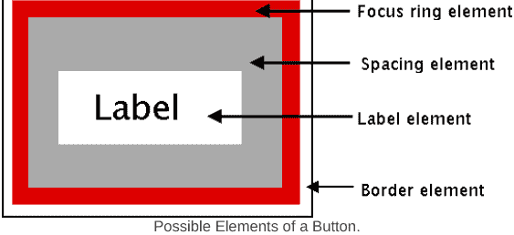


为什么样式作者要这样划分？如果你小部件的一部分可能与另一部分位于不同位置，或者颜色可能与另一部分不同，那么它可能是使用元素的良好候选对象。请注意，这仅仅是构建按钮的一个示例。不同的样式和主题可以（也确实会）以不同的方式实现此目的。

下面是一个垂直滚动条的第二个示例，它包含一个容纳其余部分的“trough”（凹槽）元素，其中包括位于两端的上下箭头元素，以及中间的“thumb”（滑块）元素。

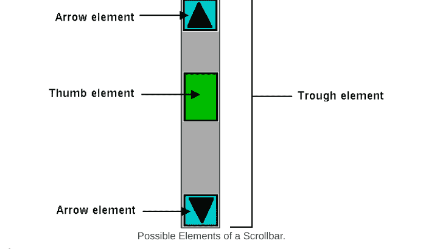

## 布局

除了选择哪些元素属于小部件之外，样式还定义了这些元素在小部件内部的排列方式，换言之，即它们的布局。在按钮示例中，我们有一个标签元素位于间距元素内部，间距元素又位于焦点环元素内部，而焦点环元素则位于边框元素内部。因此，逻辑布局如下所示：

```text
border {
    focus {
        spacing {
            label
        }
    }
}
```

我们可以通过以下方式询问 Tk TButton 样式的布局：

```text
>>> s.layout("TButton")
[{'Button.border', ['children': [['Button.focus', ['children': [['Button.spacing',
['children': [['Button.label', {'sticky': 'nsw'}], 'sticky': 'nsw']],
'sticky': 'nsw']]], 'sticky': 'nsw', 'border': '1']]}
```

如果我们整理并格式化这些内容，就会得到具有以下结构的结果：

```text
Button.border -sticky nsw -border 1 -children {
    Button.focus -sticky nsw -children {
        Button.spacing -sticky nsw -children {
            Button.label -sticky nsw
        }
    }
}
```

这开始变得有意义了；我们有四个元素，命名为 "Button.border"、"Button.focus"、"Button.spacing" 和 "Button.label"。每个元素都有不同的元素选项，例如 "-children"、"-sticky" 和 "-border"，这里用于指定布局或尺寸。暂且不深入细节，我们可以清楚地看到基于 "-children" 和 "-sticky" 属性的嵌套布局；Tk 使用 Tk "pack" 几何管理器的简化版本来指定元素布局。

## 元素选项

这些不同的每个元素可能拥有一系列不同的选项。例如，滚动条的滑块可能有一个选项用于设置其背景颜色，或者另一个选项用于提供边框宽度（如果有）。这些可以进行自定义，以调整小部件内元素的外观。

每个元素有哪些可用选项？下面是一个检查按钮内部标签可用选项的示例（我们知道从 "layout" 命令可知，它被标识为 "Button.label"）：

```python
>>> s.element_options('Button.label')
('-compound', '-space', '-text', '-font', '-foreground', '-underline', '-width', '-anchor', '-justify', '-wraplength', '-embossed', '-image', '-stipple', '-background')
```

显然，这些选项不应该带有前导破折号。

在下一节中，我们将看看一种并非完全直观的方式来处理元素选项。

## 更改样式选项

在本节中，我们将研究如何通过修改样式选项来更改样式的外观。你可以通过修改现有样式，或者更常见的是，通过创建新样式来实现这一点。

### 修改样式选项

修改现有样式的配置选项的方式类似于修改其他任何配置选项，通过指定样式、选项名称和新值：

```python
s.configure('TButton', font='helvetica 24')
```

你很快会了解到哪些是有效选项。

如果你需要检索某个选项的当前值，可以使用 "lookup" 方法。

```python
>>> s.lookup('TButton', 'font')
'helvetica 24'
```

### 创建新的派生样式

如果你修改一个现有样式，例如 "TButton"，该修改将应用于使用该样式的所有小部件（因此默认情况下是所有按钮）。这可能正是你想要做的。

更常见的是，你感兴趣的是创建一个与现有样式相似但在某些方面有所不同的新样式。例如，你希望应用程序中的大多数按钮保持其正常外观，但创建某些特殊的“紧急”按钮，这些按钮将以不同的方式突出显示。在这种情况下，创建一个从基础样式（"TButton"）派生的新样式（例如 "Emergency.TButton"）将是合适的做法。

通过在现有样式名前加上另一个名称（如 "Emergency"）和一个点，你实际上是在隐式创建一个从现有样式派生的新样式。因此，在这个示例中，我们的新样式将拥有与普通按钮完全相同的选项，除了指出的差异外：

```python
s.configure('Emergency.TButton', font='helvetica 24', foreground='red', padding=10)
```

## 特定状态样式选项

除了样式的正常配置选项外，小部件作者可能已指定当小部件处于特定小部件状态时应使用的不同选项。例如，当按钮被禁用时，你希望将按钮标签的颜色变灰。

为此，你可以指定一个 "map"（映射），它允许你为一个或多个样式配置选项指定变体。对于每个配置选项，你可以指定一组小部件状态，以及当小部件处于该状态时该选项应被分配的值。

> 请记住，状态由一个或多个状态标志（或其否定）组成，由小部件的 "state" 方法设置，或通过 "instase" 方法查询。

以下示例提供了按钮从“正常”外观到以下变体的调整：

- 当小部件处于禁用状态时，背景颜色应设置为 "#d9d9d9"
- 当小部件处于活动状态（鼠标悬停时）时，背景颜色应设置为 "#feecec"
- 当小部件处于禁用状态时，前景颜色应设置为 "#3a3a3a"（这是在已注意到的背景颜色更改之外）
- 当小部件处于按钮按下且小部件未禁用的状态时，relief（浮雕）应设置为 "sunken"（凹陷）

请记住，在过去，对于经典 Tk 小部件，当小部件处于每种状态时具体会发生什么变化，完全由小部件作者决定。而对于主题化小部件，是样式本身决定了会发生什么变化，这可能包括原始小部件作者未曾预想到的内容。

> 由于小部件状态可以包含多个标志，因此对于某个选项，可能不止一个状态会匹配（例如，如果设置了小部件的 "pressed" 状态标志，则 "pressed" 和 "pressed !disabled" 都会匹配）。状态列表按照你在 map 命令中提供的顺序进行评估，使用列表中第一个匹配的状态。

## 对你来说很难吗？

因此，你现在知道样式由元素组成，这些元素具有多种选项，并以特定布局组合在一起。你可以更改样式上的各种选项，使使用该样式的所有小部件呈现不同的外观。使用该样式的所有小部件都会呈现出样式定义的外观。主题收集了一整套相关的样式，使得更改整个用户界面变得容易。

那么，在实践中，是什么使样式和主题如此困难呢？三件事。首先：

你只能修改样式的选项，而不能修改元素选项（除了少数情况）。

我们之前讨论了如何通过检查样式的布局来发现样式中使用了哪些元素，以及如何发现每个元素的可用选项。但是，当我们尝试对样式进行修改时，我们似乎是在配置样式的某个选项，而没有指定具体的元素。这是怎么回事？

再次使用我们的按钮示例，我们有一个元素 "Button.label"，除了其他功能外，它还有一个 "font" 配置选项。实际情况是，当 "Button.label" 元素被绘制时，它会查看设置在样式上的 "font" 配置选项，以确定用哪种字体绘制自身。

> *要理解原因，你需要知道，当样式将某个元素作为其一部分包含时，该元素本身不维护任何（特定于元素的）存储。特别是，它本身不存储任何配置选项。当它需要检索选项时，它是通过传入的包含它的样式来完成的。因此，单个元素在 GoF（Gang of Four）模式术语中被称为“轻量级”（flyweight）对象。*

类似地，其他任何元素都将从设置在样式上的选项中查找它们的配置选项。如果两个元素使用相同的配置选项（比如背景颜色）会怎样？因为只有一个存储于样式中的背景配置选项，这意味着两个元素都将使用相同的背景颜色。你不能让一个元素使用一种背景颜色，而另一个元素使用不同的背景颜色。

> *除非你可以。在当前实现中，有少数讨厌的、特定于小部件的东西叫做 "sublayouts"（子布局），有时让你可以通过配置像 "TButton.Label" 这样的选项（而不仅仅是样式名称 "TButton"）来仅修改单个元素。可以这样做的那些情况有文档记录吗？有没有什么方法可以通过内省来确定何时可以这样做？答案是否定的。这是主题化小部件 API 中一个我绝对期待其随时间演变的部分。*

第二个困难也与修改样式选项有关：

**可用选项不一定有效，且修改无效选项不会报错。**

有时你会尝试更改根据元素选项本应存在的选项，但它不会有任何效果。作为一个例子，你无法修改 Mac OS X 使用的 "aqua" 主题中按钮的背景颜色。虽然这些情况有正当理由，但目前很难发现它们，这有时会使得实验变得令人沮丧。

在实验时可能更令人沮丧的是，指定一个“不正确”的样式名称或选项名称不会生成错误。在执行 "configure" 或 "lookup" 时，你实际上可以为样式指定任何名称，并可以为选项指定任何名称。因此，如果你对 "background" 和 "font" 选项感到厌倦，请随意配置一个 "dothwithmean" 选项。它可能不起任何作用，但这不是错误。同样，这可能使你难以知道应该修改什么，不应该修改什么。

> *这是拥有一个非常轻量级和动态系统的一个缺点。你只需在配置样式选项时提供名称即可创建新样式；这意味着你不需要显式创建样式对象。与此同时，这也容易出错。而且，你无法找出当前存在或正在使用哪些样式。并且由于样式选项实际上只是元素选项的前端，而且样式中的元素随时可能发生变化，因此显然选项不一定仅限于当前元素引用的那些，而这些元素本身可能也不都具有内省能力。*

最后，这是使样式和主题如此困难的最后一件事：

**每个主题中可用的元素、这些元素的名称、每个元素可用的或有效的选项，以及特定小部件使用的选项，都可能不同。**

那么呢？请记住，除了其他事项外，每个平台（Windows、Mac OS X 和 Linux）的默认主题都是不同的（这是一件好事）。这带来的一些影响：


1.  如果你希望为应用程序定义一种新的小部件类型（或者更可能地是现有小部件的变体），你需要为应用程序所使用的每种主题单独且以不同的方式进行定义（对于跨平台应用程序，至少需要三种）。

2.  每种主题/平台可用的元素和选项各不相同，这意味着你可能必须为每种主题/平台制定截然不同的自定义方法。

3.  每种主题可用的元素、名称和元素选项通常没有专门的文档记载（除了阅读主题定义文件本身外），但通常可以通过主题内省（introspection）来识别（我们很快就会看到这一点）。由于并非所有主题都能在所有平台上使用（例如，“aqua”主题只能在 Mac OS X 上运行），你需要能够随时访问所有需要运行的平台和主题。

举个例子，以下是“Button”样式在三个不同平台的默认主题上的布局，以及每个元素所声明的选项（并非所有选项都会产生实际效果）：

| 平台 | 布局 | 元素 & 选项 |
| :--- | :--- | :--- |
| Mac OS X | `Button.button -sticky nsw -children {Button.padding -sticky nsw -children {Button.label -sticky nsw}}` | - `Button.button`: (文本中未列出特定选项，默认为空)<br>- `Button.padding`: padding, relief, shifrelief<br>- `Button.label`: compound, space, text, font, foreground, underline, width, anchor, justify, wraplength, embossed, image, stipple, background |
| Windows | `Button.button -sticky nsw -children {Button.focus -sticky nsw -children {Button.padding -sticky nsw -children {Button.label -sticky nsw}}}` | - `Button.button`: (未列出特定选项)<br>- `Button.focus`: (未列出特定选项)<br>- `Button.padding`: padding, relief, shifrelief<br>- `Button.label`: compound, space, text, font, foreground, underline, width, anchor, justify, wraplength, embossed, image, stipple, background |
| Linux | `Button.border -sticky nsw -border 1 -children {Button.focus -sticky nsw -children {Button.padding -sticky nsw -children Button.label -sticky nsw}}` | - `Button.border`: background, borderwidth, relief<br>- `Button.focus`: focusthickness<br>- `Button.padding`: padding, relief, shifrelief<br>- `Button.label`: compound, space, text, font, foreground, underline, width, anchor, justify, wraplength, embossed, image, stipple, background |

简而言之，在经典 Tk 中，你能够修改单个小部件的大量属性集合中的任意一个，这在单一平台上非常容易实现，并且在其他平台上的工作方式也大致相同。而在带主题（Themed）的 Tk 中，便捷的选项并不存在，如果你希望应用程序能在多个主题/平台上正常工作，基本上就被迫采用正确的方式进行处理。这需要预先投入更多的工作量。

## 进阶：关于元素的其他信息

虽然本教程在样式和主题方面的讲解到此为止，但对于好奇的用户以及希望深入探索创建新主题的人来说，我们可以提供一些关于元素的更多有趣细节。

由于元素是样式和主题的构建块，自然会引发“元素从哪里来？”的问题。实际上，我们可以说元素通常是通过 C 代码创建的，并且遵循主题引擎理解的特定 API。

在最低层面上，元素来自所谓的元素工厂（element factory）。目前存在一个“默认”工厂，大多数主题都使用它，并利用 Tk 的绘制例程来创建元素。第二种工厂允许你从图像创建元素，并且实际上可以在脚本层级通过 "ttk::style element create" 方法（源自 Tcl）访问。最后，还有一个针对 Windows 特有的引擎，使用底层的 "Visual Styles" 平台 API。

如果主题使用通过平台原生小部件创建的元素，那么调用这些原生小部件的操作通常出现在该主题的元素规范代码中。当然，依赖原生小部件或 API 调用的主题只能在支持它们的平台上运行。

随后，主题会获取一组元素，并使用这些元素来组装实际由小部件使用的样式。既然主题的核心思想是让多个样式共享相同的外观，不同样式共享相同元素也就不足为奇了。

因此，虽然 "TButton" 样式包含 "Button.padding" 元素，而 "TEntry" 样式包含 "Entry.padding" 元素，但在这些填充元素底层，它们很可能是一模一样的。它们可能看起来不同，但这归因于不同的配置选项，正如我们之前提到的，这些选项存储在使用该元素的样式中。

发现主题可以提供一组通用选项，如果样式未另行指定，这些选项将用作每个样式的默认值，这也并不令人惊讶。这意味着，如果整个主题中几乎所有内容都具有绿色背景，主题无需为每个样式明确说明这一点。这使用了一个名为 "" 的根样式；毕竟，如果 "F.un.TButton" 可以继承自 "TButton"，为什么 "TButton" 不能继承自 "" 呢？

最后，值得看一下现有主题是如何定义的，既要在 Tk C 库中的 C 代码层面，也要通过 Tk "library/ttk" 目录中的 Tk 脚本。在 Tk 的 C 库中搜索 "Tkx_RegisterElementSpec" 以查看元素是如何指定的。

