# 忙碌 Python 开发者的现代 Tkinter：第三版

## 14.4 滚动

# 15. 文本

关于作者

标题页

起始页

# 1. 引言

本书将帮助你快速上手，并使用 Python 3 和 Tkinter 构建主流的桌面图形用户界面。如你所知，Tkinter 是 Python 对一个名为 Tk 的 GUI 库的接口。它最初为 Tcl 语言开发，但被其他动态语言广泛采用，包括 Ruby、Perl 和（当然还有）Python。

本书将教你如何使用 Tkinter 和 Tk，特别是 Tk 8.5，而 Tk 8.5 是一个里程碑式的发布。它标志着与大多数人熟悉并喜爱的旧版本 Tk 相比发生了重大变化。

缺点是，除非你了解其中一两个关键点，否则它实际上*并不是一个一个那么重大的发布。事实上，它看起来似乎什么都没有改变。由于向后兼容性，除非现有程序进行一些简单的更改，否则它们看起来不会有任何不同。（想象一下，如果你刚搬进一栋古老且奇特的历史建筑。你会希望有人指给你看灯开关和电源插座藏在哪里，不是吗？）

如果你是 Tk 的新手或正在编写新程序，本书将确保你以正确的方式开始。如果你以前用过 Tk，它将帮助你使知识与时同步。如果你正在更新几年前编写的代码，你将看到如何一步步将其带入现代。这虽然是个老调调，但我无法相信在写这本书期间我学到了多少，我已经使用 Tk 二五多年了。

遗憾的是，Tk 文档的总体状态（除了以 Tcl 为导向的参考文档，那是非常优秀的）在如今并不处于高水平。这对于使用非 Tcl 语言的 Tk 或在多个平台上工作的开发者来说尤为如此。因此，本书将尽可能针对在三个主要平台（Windows、macOS 和 Linux）上的开发者。

它并不是一份参考指南。它不会涵盖所有内容，只涵盖你在 95% 应用中需要的精要内容。

## 1.1 本书读者

本书将帮助你快速上手，并使用 Python 3 和 Tkinter 构建主流的桌面图形用户界面。如你所知，Tkinter 是 Python 对一个名为 Tk 的 GUI 库的接口。它最初为 Tcl 语言开发，但被其他动态语言广泛采用，包括 Ruby、Perl 和（当然还有）Python。

本书将教你如何使用 Tkinter 和 Tk，特别是 Tk 8.5，而 Tk 8.5 是一个里程碑式的发布。它标志着与大多数人熟悉并喜爱的旧版本 Tk 相比发生了重大变化。

缺点是，除非你了解其中一两个关键点，否则它实际上*并不是一个那么重大的发布。事实上，它看起来似乎什么都没有改变。由于向后兼容性，除非现有程序进行一些简单的更改，否则它们看起来不会有任何不同。（想象一下，如果你刚搬进一栋古老且奇特的历史建筑。你会希望有人指给你看灯开关和电源插座藏在哪里，不是吗？）

如果你是 Tk 的新手或正在编写新程序，本书将确保你以正确的方式开始。如果你以前用过 Tk，它将帮助你使知识与时同步。如果你正在更新几年前编写的代码，你将看到如何一步步将其带入现代。这虽然是个老调调，但我无法相信在写这本书期间我学到了多少，我已经使用 Tk 二五多年了。

遗憾的是，Tk 文档的总体状态（除了以 Tcl 为导向的参考文档，那是非常优秀的）在如今并不处于高水平。这对于使用非 Tcl 语言的 Tk 或在多个平台上工作的开发者来说尤为如此。因此，本书将尽可能针对在三个主要平台（Windows、macOS 和 Linux）上的开发者。

它并不是一份参考指南。它不会涵盖所有内容，只涵盖你在 95% 应用中需要的精要内容。

## 1.2 为什么选择 Tkinter?

如果你是构建桌面用户界面的的新手，为什么要使用 Tkinter？毕竟，有很多选项，包括 PyQt、PySide、WxPython、PySimpleGUI 和 Kivy。每种都有各自的优缺点。

有几个原因人们选择 Tkinter。它是 Python 的默认 GUI 工具包，也是唯一包含在标准库中的。它是跨平台的，因此代码可以跨 Windows、macOS 或 Linux。最重要的是，它易于学习和使用。它将模板代码和开销降到最低。它是 Pythonic 的；感觉很好。与许多作为 C++ 库的前端不同，Tkinter 是为动态语言设计的。

## 1.3 现代最佳实践

本书完全关于使用当前 Tk 提供的工具构建现代用户界面。它完全关于你实现这一点需要了解的最佳实践。

对于大多数工具来说，你不会认为需要说这种话。但对于 Tk，情况并非如此。Tk 经历了非常长的演变，而任何演变都会在那个时代留下痕迹。你可以看到一些心法。结合图形界面平台和标准随时间的演变，你可以看到保持一个庞大且复杂的 GUI 库更新（并保持向后兼容）可能是具有挑战性的。

Tk 在其生命的大部分时间里一直声誉狼藉，委婉地说。其中一些是实之其实的，大部分并非如此。像任何 GUI 工具一样，你可以用它创建极其难看且过时的用户界面。通过适当的关注和投入，它也可以开发出令人惊叹的作品。大多数人知道那些糟糕的界面；大多数优秀的界面甚至不知道是用 Tk 开发的。在本书中，我们将关注构建良好界面所需的内容。坦率地说，这并不像在 Tk 8.5 之前那么困难。

所以，总结一下：现代桌面图形用户界面，使用现代惯例和设计感，使用 Tk 8.5 和 8.6 提供的现代工具。

当涉及到现代最佳实践时，Tk 扩展值得特别关注。多年来，开发者为 Tk 创建了各种插件，例如添加核心库中未包含的（或至少在当时不可用）的新小部件。一些知名且受欢迎的 Tk 扩展包括 BLT、Tix、iWidgets、BWidgets；还有许多其他的。

这些扩展中的许多是几十年前创建的。由于核心 Tk 一直保持高度的向后兼容性，这些扩展通常在较版本中仍然可以运行。然而，它们可能无法反映当前的平台规范或风格。它们可能“可用”，但会让你你的应用程序看起来非常过时或格格协调。在很多情况下，它们提供的功能已被最近构建到 Tk 自身的更新、更现代的功能所取代。

如果你决定使用 Tk 扩展，强烈建议你仔细调查并审查你的选择。

## 1.4. 更好的前进之路

Tk 为你提供了很多选择。在屏幕上布局组件至少有六种不同的方法。可以使用多个组件来实现相同的功能，而这在考虑任何 Tk 扩展之前就已经如此了。Tk 强调向后兼容性，这是一把双刃剑。这些老方法中的大多数仍然年复地保持运行。这并不意味着你应该继续使用其中的某些。

所以 Tk 中有很多方法，但坦率说，所有的选择反而阻碍了进度。如果你想学习并使用 Tk，你不需要知道实现相同功能的不同方法。你不应该需要进行所有的研究、探索所有的选项并自己做决定。你需要知道今天处理事情的正确方法。这正是本书将带给你的。可以将其看作文档版的“带有主张的观点”。

因此，我们经常使用的处理方法与你在其他文档或示例中找到的方法不同。通常，是因为在编写那些内容时，更好的方法甚至不存在。（这里有一个测试 Tk 文档的试金石：它是使用过时的 `pack` 而不是现代的 `grid`。）稍后，一旦你成为了专家并遇到某些典型选择不适用的奇葩情况，你可以去寻找替代方案。

## 1.5. 如何使用

虽然本书的设计是供线性阅读的，但请根据你的需要自由跳转。我们经常提供信息的链接，例如特定命令的完整参考文档。虽然 Tk 原生参考文档是基于 Tcl 的，但它们准确、编写良好，并且通常很容易“翻译”成 Python。遗憾的是，目前还没有任何参考文档能达到其质量或完整性。

你可以通过链接访问一个包含许多大型示例的 GitHub 仓库。你还会在书中代码列表下方找到直接链接。

## 约定

按照惯常做法，代码列表、解释器或 shell 命令行以及响应将用等宽字体标出。在显示解释器的交互会话时，你输入的内容将以**粗体**显示。

在描述过程或方法调用时，字面部分（例如方法名）将使用普通等宽字体。参数（你需要在其中填入实际值）将使用*斜体*，而可选参数将包含在 `?` 之中，例如 `set variable[]?`。

通常情况下，在正文中引用这些过程或方法调用时，我们会省略 Tkinter 所需的标点符号（括号、逗号等）。当然，代码片段会显示完整的语法。

你会看到一些与正文隔离开的段落。这些段落用于几种不同的用途。每个段落都有一个不同的图标标识，如下：

- 此段落提供额外的上下文或背景。
- 此段落突出了常见的错误或陷阱。
- 此段落建议了处理事情的替代方法。

此段落将帮助指出人们常犯的错误。

此段落提供一些额外信息。

此段落强调了 Tk 中的一个新领域。

这表示一个“粗糙边缘”。

## 2.1. 早期时期

Tk 是 1988 年左右由加州大学伯克利分校计算机教授 John Ousterhout 创建的。它的创建是为了提供从他的 Tcl 脚本语言轻松构建 GUI 的方法。Tcl 最初仅限 Unix，因此 Tk 运行在 X11 之下。第一个开源版本大约在 1991 年，并在一年后开始快速采用。你可以在 Tcl/Tk 主站找到 John 对早期时光的回忆。

## 2.2. 中间时期

1994 年，John 搬到了 Sun Labs，在那里组建了一个团队来进一步推进 Tcl/Tk。大部分团队转向了一家名为 Scripts（后改为 Ajuba）的初创公司，并继续演进 Tcl/Tk，直到公司在 2000 年被收购，主要是为了其开发的非 Tcl/Tk 资产。

## 2.3. 无声的革命

Tk 8.5.0 于 2007 年 12 月 20 日发布，它是十多年前 Windows 和 macOS 8.0 版本之后的一个关键进展。核心发行版包含了许多“新”控件，例如树形列表、组合框、标签页笔记本等现在已非常常见的组件。在此之前，这些组件只能通过插件实现（而且插件多到让人选择不过来）。

最重要的是，Tk 8.5 添加了一套新的“主题化”（themed）控件集，它补充但并未取代“经典”控件集。经典控件提供了完全的后兼容性，保留了它们几乎无限的灵活性，但外观通常过时。新的主题控件在各自平台上开箱即用的效果好得多。设计目的是让开发者使用它们处理几乎所有的主流用户界面需求。新控件还支持通过主题更改其外观和感受，使得相应的应用程序和平台能够轻松实现“可皮肤”的用户界面。

为什么我称之为 Tk 的“无声的革命”呢？这一切都发生在它黄金时期大约十年后。当时，Web 开发已经让旧的桌面 GUI 变得边缘化，很少有开发者关注 Tk。如果你不关注，你就不知道发生了任何变化。得益于后兼容性，对大多数人来说，一切确实没有变化。遗憾的是。

## 2.4. 今天的 Tk

本文写于 2020 年 9 月。在 8.5.0 发布后的十二年里，核心 Tcl/Tk 软件包大约发布了 30 个新版本，目前版本为 8.6.10。在此期间，尽管新功能的开发速度有所放缓，但它仍在持续改进。

## 2.5. Tkinter

Python 的 Tkinter 是早期对 Tk 的绑定之一，也无疑是最受欢迎的。Tkinter 最初由 Fredrik Lundh 编写。它的工作方式与大多数 Tk 绑定类似，在 Python 应用程序内部嵌入一个 Tcl 解释器。Tkinter 命令被翻译 Tcl 命令并在该解释器中执行。

2009 年，Guilherme Polo 在 Tkinter 中增加了对 Tk 较新“ttk”主题控件的支持，从 Python 2.7（在 2.x 分支上）和 Python 3.1 开始。这为使用 Tkinter 构建更好的用户界面打开了大门。文档仍然是 Python 程序员学习新主题控件的主要障碍。

# 3. 安装 Tkinter

在本章中，你将在你的机器上安装 Tk 和 Tkinter，验证其是否正常工作，然后快速查看 Tkinter 程序的样貌。

在过去，这是一个多步骤的过程。然而，如果你正在使用 Python 3.7 或更高版本，那么你走运了！在 python.org 上提供的 macOS 和 Windows Python 二进制安装程序包含了使用 Tkinter 所需的所有内容，包括底层的 Tcl/Tk 库。

如果你在 Linux 上运行，所有流行的发行版都有可用的包，可以让你安装 Tkinter 变得轻而易举。

如果你使用的是旧版本的 Python 或从源码编译，你需要在你的系统中安装 Tcl/Tk。如果你处于这种情况下，我们将解释如何使用一种名为 ActiveTcl（由 ActiveState 制作）的免费发行版来完成安装。

> 记住

## 3.1. 在 macOS 上安装 Tk

### 简单方法

如所述，在系统上安装 Tk 和 Tkinter 最简单的方法是使用 python.org 上的 Python 二进制安装程序。感谢 Python 核心开发者 Ned DeWitt 的工作，从 3.7 版本开始的二进制安装程序包含了 Tcl 和 Tk。

> 记住，这里使用的是 Python 3.x，而不是 2.x。截至写作时，最新的 3.9 安装程序 (3.9.orc1) 包含了 Tk 8.6.8。

然而，如果你是自己编译 Python，你将需要更多工作。请继续阅读...

### 安装 Tcl/Tk

Tkinter 模块当然包含在 Python 核心中，但你需要在系统中有一个 Tcl/Tk 版本来对其进行编译。为自己一个大忙，获取最新版本。

无论你做什么，千万不要依赖 macOS 自带的 Tk 版本！旧版本包含 Tk 8.4.x。更新的 macOS 版本包含一个早期的 8.5 版本（8.5.9，于 2010 年发布），它有几个 Tkinter 容易触发的严重 bug。

虽然有多种方法可以将 Tcl 和 Tk 引入你的机器，但最简单且最推荐的方法是使用 ActiveTcl 发行版。

在浏览器中，访问下载 ActiveTcl（截至写作时，版本为 8.6.9）。确保下载 8.6.x 版本，而不是更旧的版本！注意，你需要为 ActiveState 创建一个账户（免费）来下载它。下载完成后，运行安装程序将 Tcl 和 Tk 加载到你的机器上。

如果你是一个受虐狂并想阅读其他 Tcl/Tk 选项、变体以及它们如何与 Python 交互，请查看 Mac Tcl/Tk 页面。如果你想从源码编译 Tcl/Tk，请查看

### 编译 Python

从源码编译 Python 时，你可能需要告诉它去哪里寻找 ActiveTcl（或其他）发行版。否则，它可能找不到任何 Tcl/Tk 发行版（导致 Tkinter 无法工作），或者可能会找到 macOS 自带的（古代且损坏的的版本。

如果你使用的是 Python 3.9 或更高版本，构建系统将找到 Tcl/Tk 发行版。对于 3.9 之前的版本，你需要在初始配置时添加命令行选项：

```bash
./configure --tcl-includes="-I/Frameworks/Tcl.framework/Headers" --with-tcl-libs="/Library/Frameworks/Tk.framework/lib"
```

完成后，务必进行测试。在终端中，输入：

```bash
./configure
make
```

你也可以通过以下命令获取正在使用的 Tcl/Tk 精确版本：

```python
>>> tkinter.Tcl().eval('info patchlevel')
```

它应该返回类似 '8.6.9' 的内容。

在 Windows 10 版本 1809 上使用来自 python.org 的 Python 3.9.0rc1 二进制安装程序（包含 Tcl/Tk 8.6.9）经过验证。

## 3.3. 在 Linux 上安装 Tk

Tkinter（以及从 Python 3.1 开始的 ttk，它是较新主题化小部件的接口）包含在 Python 标准库中。它依赖于系统中安装了 Tcl/Tk。取决于你安装 Python 的方式，这可能不会自动发生。

记住，我们这里使用的是 Python 3.x，而不是 2.x。

你有几种不同的方法可以在你的机器上获取 Python 和 Tkinter。我们将向你展示两种方法：使用你发行版的包管理器，或者从源码编译。

### 选项 1.使用你的 Linux 发行版包管理器

目前支持的 Linux 发行版通常会默认安装较新的 Python 3.x 版本。如果没有，它们会有一个包（.deb, .rpm 等），你可以使用它们的包管理器对其进行安装。这通常是安装 Python 最简单的方法。

然而，在你完成 Python 安装后，你应该验证 Tkinter 是否正常工作。启动一个 Python 壳（例如，`python3`）并验证安装（见下文）。

你可能会发现，当你尝试导入 tkinter 时会遇到错误。有时它会告诉你你需要安装另一个包。如果是这样，请按照说明操作并重试。它可能只是给了你 Python 的标准错误消息：`ModuleNotFoundError: No module named 'tkinter'`。

如果你收到的错误信息是 `No module named tkinter`（模块名称周围没有单引号），你可能正在使用 Python 2。本书假设使用的是 Python 3。

有时 Linux 发行版会将 Tkinter 支持拆分到单独的包中。这为那些使用 Python 但不使用 Tkinter 的人节省了安装 Tcl/Tk 库的。如果是这样，你需要找到并安装此包，这将确保你的系统上安装了适当版本的 Tcl/Tk 库。

例如，运行 Ubuntu 20.04LTS 时，已经安装了 Python 3.8.2。然而，要使用 Tkinter，你需要安装一个单独的包：

```bash
% sudo apt-get install python3-tk
```

### 选项 2. 安装 Tcl/Tk 并编译标准 Python 分发版

如果你想从源码使用标准源码发行版，完全可以这样做。

但为了这样做，你需要先将 Tcl 和 Tk 的头文件和库加载到机器上。再次，虽然有几种方法可以实现，但简单的是下载并安装 ActiveTcl。

另一个选项是安装 Tk 开发包，例如通过你的包管理器。

在你的浏览器中

接下来，下载当前的 Python 3.x 源码发行版并解压。在你的 `configure` 行中，你需要告诉它找到你安装的 Tcl/Tk 版本。然后像常一样构建：

```bash
% ./configure --with-tcltk-includes='-I/opt/ActiveTcl-8.6/include' --with-tcl-lib='/opt/ActiveTcl-8.6/lib'
```

```bash
% make
% make install
```


如果你是通过包管理器安装的 `tk8.6-dev` 而不是使用 ActiveTcl，则头文件应该位于 `/usr/include/` 中，库 `libtcl8.6.so` 和 `libtk8.6.so` 应该位于 `/usr/lib/` 中。

确保验证你的安装（见下文）。

不起？可能编译 Python 的 tkinter 代码时发生了错误。要检查，从 Python 源码根目录尝试 `make Modules/_tkinter.c`（注意下划线），然后通过 make 重新编译。密切观察错误消息。

最常见的情况是你指定 Tcl/Tk 头文件和库的方式需要某种更改。如果你收到某些头文件无法找到的消息（例如，你可能需要在你的 Linux 发行版上安装额外的包（例如 `apt-get install`），一旦你成功无错误编译，不要忘记执行 `make install`。

## 验证你的安装

在 Python 提示符下，输入这两个命令：

```python
>>> import tkinter
>>> tkinter._test()
```

这应该弹出一个小窗口；窗口顶部的第一行应该显示“This is Tcl/Tk version 8.6”；确保它不是 8.4！

如果在尝试导入 tkinter 时出现错误（例如，收到错误 `No module named tkinter? You're probably using Python 2. This book assumes Python 3.`）

你也可以通过以下命令获取正在使用的 Tcl/Tk 精确版本：

```python
>>> tkinter.Tcl().eval('info patchlevel')
```

它应该返回类似 '8.6.9' 的内容。

在 Ubuntu 20.04LTS 上使用 ActiveTcl 8.6.9.8609.2 和来自 python.org 的 Python 3.90rc1 源码验证安装。

### 3.4. 第一个程序

为了确保一切运行正常，让我们尝试在 Tk 中运行一个“Hello World”程序。虽然对于这么短的内容，你可以直接将其输入解释器，但将其写在文件中更好。让我们创建一个名为 `hello.py` 的文件并将内容放入其中：

```python
from tkinter *
from tkinter import ttk

root = Tk()
root.title("Feet to Meters")

mainframe = ttk.Frame(root, padding="3 12")
mainframe.grid(column=0, row=0, sticky=(N, W, E, S))

root.columnconfigure(0, weight=1)
root.rowconfigure(0, weight=1)

feet = StringVar()
feet_entry = ttk.Entry(mainframe, width=7, textvariable=feet)
feet_entry.grid(column=2, row=1, sticky=(W, E))

meters = StringVar()
ttk.Label(mainframe, text="feet").grid(column=3, row=1, sticky=W)
ttk.Label(mainframe, text="is equivalent to").grid(column=1, row=2, sticky=E)
ttk.Label(mainframe, text="meters").grid(column=3, row=2, sticky=W)

def calculate(*args):
    try:
        value = float(feet.get())
        meters.set(int(0.3048 * value * 10000)/10000.0)
    except ValueError:
        pass

ttk.Button(mainframe, text="Calculate", command=calculate).grid(column=3, row=3, sticky=W)

for child in mainframe.winfo_children():
    child.grid_configure(padx=5, pady=5)

feet_entry.focus()
root.bind("<Return>", calculate)

root.mainloop()
```

现在从命令行运行它：

```bash
% python hello.py
```

以及生成的用户界面：

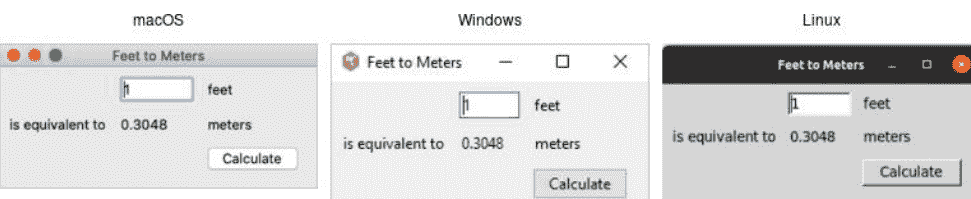

我们完成的英制转米界面。https://tkdocs.com/code/f2m.py

### 4.1. 设计

看起来我们有一个用于转换距离的简单 GUI 工具。接下来我们需要做的是查看布局。我们包含的小部件似乎自然地分为列和行，如下所示：

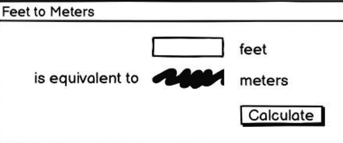

我们用户界面的布局，遵循 3x3 网格。

### 4.2. 代码

这是使用 Tkinter 创建此应用程序所需的 Python 代码。

## 4-3. 逐步拆解

让我们逐行仔细查看这段代码。目前，我们尝试做的只是初步了解在 Tk 中创建用户界面需要完成的操作类型，以及这些操作的大致样貌。我们将在稍后介绍细节。

#### 引入 Tk

我们的程序从引入 Tk 开始。

```python
from tkinter import *
from tkinter import ttk
```

第一行[行]是到 Tk 的标准绑定。导入时，它会加载系统上的 Tk 库。第二行是一个子模块 `ttk`，它实现了 Python 对 Tk 在 8.5 版本中添加的较新“主题控件”的绑定。

注意，我们从 `tkinter` 模块导入了所有内容。这样，我们就可以直接调用 tkinter 函数等，而无需加模块名前缀。这是 Tkinter 的标准做法。

然而，由于我们只导入了 `ttk` 本身，我们需要对该子模块中的任何内容都加上前缀。例如，调用 `Entry(...)` 将指向 `tkinter` 模块中的 `Entry` 类（经典控件）。我们需要使用 `ttk.Entry(...)` 来使用 `ttk` 内部的 `Entry` 类（主题控件）。

正如你所看到的，两个模块中都定义了几个类。根据上下文，你可能需要其中一个。显式地要求 `ttk` 前缀有助于实现这一点，这也是本书将将使用的风格。

如果你正在迁移 Python 2.x 代码，你会发现的第一件事之一是 `Tkinter` 模块的名称现在是小写的，即在 Python 2.x 中，Ttk 也是一个独立的模块，而不是它的子模块。

#### 设置主应用程序窗口

接下来，以下代码设置了主应用程序窗口，并将其标题设置为“英尺转米”。

```python
root = Tk()
root.title("Feet to Meters")
```

是的，`calculate` 函数在此之前出现。我们将在下方描述它，但需要将其包含在开头，因为我们在程序的其他部分引用了它。

#### 创建内容框架

接下来，我们创建一个框架（frame）控件，它将包含我们用户界面的内容。

```python
mainframe = ttk.Frame(root, padding="3 3 12 12")
mainframe.grid(column=0, row=0, sticky=(N, W, E, S))
root.columnconfigure(0, weight=1)
root.rowconfigure(0, weight=1)
```

框架创建后，`grid` 将其直接放置在主应用程序窗口中。`columnconfigure/rowconfigure` 部分告诉 Tk，如果窗口被调整大小，框架应该扩展以填充任何额外空间。

我们为什么要在主窗口中放置一个框架呢？严格来说，我们可以直接将界面中的其他控件置于主应用程序窗口中，而不需要中间的内容框架。你会在旧的 Tk 程序中会到这种做法。

然而，主窗口本身并不是较新“主题”控件的一部分。它的背景颜色与我们放置在内部的主题控件不匹配。使用“主题”框架控件来承载内容可以确保背景颜色是正确的。如下所示。

在这一问题最突出的 macOS 上，你还可以看到窗口的背景颜色（通过其背景配置）显示为预定义的颜色。

#### 创建 Entry 控件

我们将创建的第一个控件是用于输入要转换英尺数的输入框。

```python
feet = StringVar()
```

```python
feet_entry = ttk.Entry(mainframe, width=7, textvariable=feet)
feet_entry.grid(column=2, row=1, sticky=(W, E))
```

我们需要做两件事：创建控件本身，然后将其放置在屏幕上。

当我们创建一个控件时，需要指定它的父级。即新控件将放置在内部的控件。在这种情况下，我们希望将输入框放置在内容框架内部。我们的输入框以及稍后创建的其他控件都是内容框架的子级。父级始终是实例化控件对象时传递的第一个参数。

当我们创建控件时，可以可选地为它提供某些配置。在这里，我们指定了希望输入框显示的宽度，即 7 个字符。我们还为它分配了一个变量，稍后我们就会看到该变量的作用。

当控件被创建时，它们并不会自动出现在屏幕上；Tk 并不知道你想让它们相对于其他控件在什么位置。这就是 `grid` 部分的作用。还记得我们在勾勒应用程序时画的布局网格吗？控件被放置在适当的列（1, 2 或 3）和行（也是 1, 2 或 3）。

`grid` 的 `sticky` 选项描述了控件在网格单元格内的对齐方式，使用了罗盘方向。因此，W（西）意味着将控件锚定在单元格的左侧，(W, E) 意味着将其附加在左侧和右侧，依此类推。

#### 创建剩余控件

然后我们对剩余控件执行完全相同的操作。我们有一个标签（label），将显示我们计算出的米数。我们有一个“Calculate”（计算）按钮，按下它可以执行计算。最后，我们有三个静态文本标签来说说明如何使用该应用程序。对于这些每个控件，我们首先创建它，然后将其放置在网格中适当的单元格内。

```python
meters = StringVar()
tk.Label(mainframe, textvariable=meters).grid(column=2, row=2, sticky=(W, E))

tk.Button(mainframe, text="Calculate", command=calculate).grid(column=3, row=3, sticky=W)

tk.Label(mainframe, text="feet").grid(column=3, row=1, sticky=W)
tk.Label(mainframe, text="is equivalent to").grid(column=1, row=2, sticky=E)
tk.Label(mainframe, text="meters").grid(column=3, row=2, sticky=W)
```

#### 添加一些修饰

然后我们对用户界面进行一些最后的润色。

```python
for child in mainframe.winfo_children():
    child.grid_configure(padx=5, pady=5)
feet_entry.focus()
root.bind("<Return>", calculate)
```

第一部分遍历内容框架中的所有控件，并在它们周围添加一些内边距，以免它们拥挤在一起。（我们可以在将控件放在屏幕时通过每个 grid 调用添加这些，但这是一个很好的快捷。）

第二部分告诉 Tk 将焦点放在我们的输入框上。这样，光标将从该字段开始，用户在开始输入前点击它。

第三行告诉 Tk，如果用户按下回车键（Windows 上为 Enter），它将调用我们的计算程序，就像点击计算按钮一样。

#### 执行计算

说到这里，在这里定义我们的计算过程。当用户按下计算按钮或击回车键时调用它。它执行英尺到米的计算。

```python
def calculate(*args):
    try:
        value = float(feet.get())
        meters.set(int(0.3048 * value * 10000.0 + 0.5)/10000.0)
    except ValueError:
        pass
```

正如你清楚看到的，此程序从我们的输入框中获取英尺数，进行计算，并将结果放置在我们的标签控件中。

乘以并除以 10000.0 是为了避免浮点数学中固有的舍入问题。简单的计算，例如，可能会产生一个显示时既不准确也不好看的数字。你也可以使用 Python 内置的 `round()` 函数。

## 4-4. 缺失了什么

我们现在已经看到了如何创建组件、将它们显示在屏幕上并响应用户对它们的交互。这显然并不华丽，可能通过一些错误检查可以做得更好，但它是一个功能完整的 GUI 应用程序。

我们还检查了为了让 Tk 程序运行，我们*没有*需要包含的内容。例如：

- 我们不需要担心在内容变化时重绘屏幕

- 我们不需要担心在每个组件上进行事件的解析、分发、检测或处理

- 我们在创建组件时不需要提供大量的选项；默认值似乎已经帮我们处理了大部分情况，我们只需要更改诸如按钮显示的文本等内容

- 我们不需要编写复杂的代码来获取和设置简单组件的值；我们只需要将它们绑定到变量上

- 我们不需要担心用户关闭窗口或缩放窗口时会发生什么

- 我们不需要编写额外的代码来让这一切在跨平台下运行

## 还有一件事...

由于本书强调的是 Tkinter，我们的示例使用了独立的脚本代码、全局变量和简单函数。在实践中，你可能会将超出简单脚本的任何内容组织成函数或类。有不同的方法可以做到：使用模块、为用户界面的不同部分创建类、继承 Tkinter 类等。

但通常，你只想通过一些简单操作来封装你的数据，而不是把所有内容都放在全局变量空间。这里是英尺到米的示例，重写为将主代码封装在一个类中。注意回调函数（在全局作用域内执行）上的 self

```python
from tkinter import *
from tkinter import ttk
```

class FeetToMeters:

    def __init__(self, root):

        root.title("Feet to Meters")

        mainframe = ttk.Frame(root, padding="3 3 12 12")

        mainframe.grid(column=0, row=0, sticky=(N, W, E, S)")

        root.columnconfigure(0, weight=1)

        root.rowconfigure(0, weight=1)

        self.feet = StringVar()

        feet_entry = ttk.Entry(mainframe, width=7, variable=self.feet)

        feet_entry.grid(column=2, row=1, sticky=(W, E))

        self.meters = StringVar()

        ttk.Label(mainframe, variable=self.meters).grid(column=2, row=2, sticky=(W, E))

        ttk.Button(mainframe, text="Calculate", command=self.calculate).grid(column=3, row=3, sticky=W)

        ttk.Label(mainframe, text="feet").grid(column=3, row=1, sticky=W)

        ttk.Label(mainframe, text="is equivalent to").grid(column=1, row=2, sticky=E)

        ttk.Label(mainframe, text="meters").grid(column=3, row=2, sticky=W)

        for child in mainframe.winfo_children():

            child.grid_configure(padx=5, pady=5)

        feet_entry.focus()

        root.bind("<Return>", self.calculate)

    def calculate(self, *args):

        try:

            value = float(self.feet.get())

            self.meters.set(int(0.3048 * value * 10000.0 + 0.5)/10000.0)

        except ValueError:

            pass

root = Tk()

FeetToMeters(root)

root.mainloop()


https://tkdocs.com/code/f2mo.py

# 5. Tk 概念

完成第一个示例后，你现在对 Tk 程序的外观以及为了使其运行需要编写什么种类型的代码有了基本的了解。本章将后退，查看理解 Tk 所需的三个大概念：组件、几何管理和事件处理。

## 5.1. 组件 (Widgets)

组件是你在屏幕上看到的所有东西。我们的示例中有一个按钮、一个输入框和一个框架。复选框、树视图、滚动条和文本区域都是其他组件示例。组件通常被称为“控件”（controls）。你也会在 Tk 的文档中看到它们被称为“窗口”（windows），这是其 X 根源的传统（在术语上，你的顶层应用程序窗口和按钮都被称为窗口）。

这里是一个显示某些 Tk 组件的示例，我们很快就会逐一介绍它们。

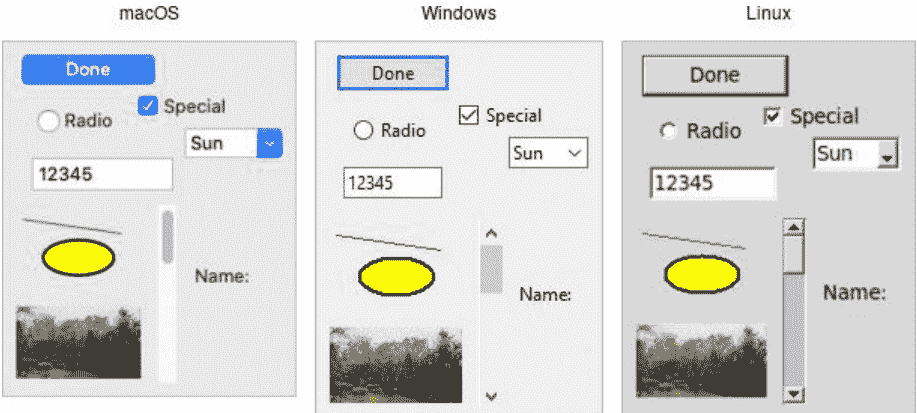

几个 Tk 组件。

### 组件类 (Widget Classes)

组件是对象，是代表按钮、框架等的类的实例。当你想要创建一个组件时，首先需要的是识别你想要实例化的组件的特定类。本书将帮助你完成。

### 组件层次结构 (Widget Hierarchy)

除了组件类，创建它还需要另一个信息：它的父级。组件不会悬浮在空中。相反，它们被包含在其他东西中，例如窗口。在 Tk 中，所有组件都是一个组件（或窗口）的一部分，在层次结构的顶部有一个单一根。

在我们的公制转换示例中，我们创建了一个单一框架作为根窗口的子级，该框架拥有所有其他控件作为子级。根窗口是框架的容器，因此它是框架的父级。根窗口是框架的父级。如下：

层次结构可以任意深，你可能会在窗口中发现框架。

叶子节点（按钮、标签等）省略。

### 创建组件 (Creating Widgets)

每个组件都是 Python 对象。在实例化组件时，必须将其父级作为参数传递的。例如：

```python
root = Tk()

content = ttk.Frame(root)

button = ttk.Button(content, text="Hello")
```

是否将对象保存到变量完全取决于你。如果你保存了变量，稍后将引用它。如果没有，Tkinter 将为你管理这些名称。

### 配置选项 (Configuration Options)

所有组件都有几个控制其显示或行为的选项。组件的可用选项取决于组件类。配置选项可以在创建组件时通过指定名称和值来设置。稍后，你可以获取这些选项的值，并在极少数情况下，可以随时更改它们。

如果你不确定支持哪些配置选项，可以请求组件描述它们。这将为你提供所有选项的列表。这通过以下与解释器的交互对话框来说：

```python
% python
>>> from tkinter import *
>>> from tkinter import ttk
>>> root = Tk() 创建按钮，传递两个选项：
>>> button = ttk.Button(root, text="Hello", command="buttonpressed")
>>> button.grid() 查看文本选项当前的值：
>>> button['text']
'Hello'
>>> 修改文本选项的值：
>>> button['text'] = 'goodbye' 另一种实现相同的方法；
>>> button.configure(text='goodbye') 查看文本选项当前的值：
```

```python
>>> button['text']
```

'goodbye'

获取关于文本选项的所有信息：

```python
>>> button.configure('text')
```

('text', 'text', 'Text', ' ', 'goodbye')

获取关于此组件所有选项的信息：

```python
>>> button.configure()
```

{'cursor': ('cursor', 'cursor', 'Cursor', ' ', ' '), 'style': ('style', 'style', 'Style', ''),

'default': ('default', 'default', 'Default', object at oxooFFD10, object

at oxooFFD10), 'text': ('text', 'text', 'Text', ' ', 'goodbye'), 'image': ('image', 'image',

Image', ' ', ''), 'class': ('class', ' ', ' ', ' ', ' '), 'padding': ('padding', 'padding', 'Pad', ' ', ' '),

'width': ('width', 'width', 'Width', ' ', ' '), 'state': ('state', 'state', 'State', object at ox0167FA20), object at

ox0167FA20),

'command': ('command', 'command', 'Command', ' ', 'buttonpressed'),

'textvariable': ('textvariable', 'textVariable', 'Variable', ' ', ' ')}

'compound': ('compound', 'compound', 'Compound', object at oxo167FAO8>, object at oxo167FAO8>),

'underline': ('underline', 'underline', 'Underline', -1, -1),

'takefocus': ('takefocus', 'takeFocus', 'TakeFocus', '"', 'tk::takefocus')

如你所示，对于每个选项，Tk 都会显示选项的名称及其当前值（以及另外三个通常可以忽略的属性）。

好了，如果你真的想知道，这里是每个配置选项提供的五部分数据的细节。最有用的是第一个，即选项名称，以及第五个，即选项的当前值。第四个是选项的默认值，换句话说，如果你不更改它，它将拥有的值。另外两项与所谓的“选项数据库”（option database）有关。我们会在讨论菜单时提到它，但它在现代应用程序中并不使用。第二项是该选项在数据库中的名称，第三项是它的类名。

### 组件内省 (Widget Introspection)

Tk 为你的应用程序提供了关于每个组件的宝库信息供利用。其中大部分信息可以通过 `winfo` 设施获取；完整细节请参阅 `winfo` 命令参考。

https://tkdocs.com/man/winfo

这个简短的示例遍历了组件层次结构，使用每个组件的 `winfo_children` 方法来识别需要检查的子组件。对于每个组件，我们打印一些基本信息，包括它的类（button、frame 等）、宽度、高度以及相对于父组件的位置。

```python
print_hierarchy(w, depth=0):
    print('*' *depth + w.winfo_class() + ' w=' + str(w.winfo_width())
      + ' h=' + str(w.winfo_height()) + ' x=' + str(w.winfo_x()) + ' y=' +
      + str(w.winfo_y()))
    for i in w.winfo_children():
        print_hierarchy(i, depth+1)

print_hierarchy(root)
```

以下是一些非常有用的方法：

- `winfo_class`：一个用于标识组件类型的类，例如用于主题按钮的 TButton
- `winfo_children`：层次结构中作为某个组件的直接子组件的组件列表
- `winfo_parent`：层次结构中组件的父组件
- `winfo_toplevel`：包含此组件的顶层窗口
- `winfo_width`, `winfo_height`：组件的当前宽度和高度；在出现在屏幕上之前这些是不准确的
- `winfo_reqwidth`, `winfo_reqheight`：组件向几何管理器请求的宽度和高度（稍后会详细介绍）
- `winfo_x`, `winfo_y`：组件相对于父组件的左上角的位置
- `winfo_root`, `winfo_rooty`：组件相对于整个屏幕的左上角的位置
- `winfo_viewable`：组件是显示还是隐藏（其在层次结构中的所有祖先必须都是可见的，它才是可见的）

## 5.2. 几何管理 (Geometry Management)

如果你一直在交互式运行代码，你可能注意到组件仅仅通过创建并出现在屏幕上。将组件放置在屏幕上（以及精确放置的位置）是一个独立的步骤，被称为 _几何布局（geometry）_。

在我们的示例中，每个组件定位是通过 `grid` 命令完成的。我们指定了每个组件要所在的列和行、它们在网格内的对齐方式等。`grid` 是一种 _几何管理器_ 的示例（Tk 中有多个，其中 `grid` 是最有用的）。目前，我们将通查看几何管理；我们将在后面的章节讨论 `grid`。

几何管理器的工作是确切确定这些组件将就放在哪里。事实证明这是一个复杂的优化问题，良好的几何管理器依赖于相当复杂的算法。良好的几何管理器提供了让程序员快乐的灵活性、功能和易用性。它还便于创建吸引人的用户布局，而无需费周章。Tk 的 `grid` 无疑是最好的。一个糟糕的几何管理器……嗯，所有受过 "GridLayout" 苦的 Java 程序员请请举手。

我们将在后面的章节中进行详细介绍，`grid` 是在 Tk 流行几年后引入的。在此之前，一个名为 `pack` 的旧几何管理器被最常用。它同样强大，但要难用得多，这使得创建如今看起来吸引人的布局变得非常费力。遗憾的是，现有很多 Tk 代码和文档使用 `pack` 而不是 `grid`（这是判断其新旧程度的一个良好线索）。`pack` 的广泛使用是导致许多 Tk 用户界面看起来糟糕的主要原因之一。尽可能从新代码开始使用 `grid` 并升级旧代码。

### 问题

几何管理器面临的问题是获取程序创建的所有不同组件，加上程序关于它们应该位于窗口哪个位置的指令（显式的，或者更多是相对于其他组件的），然后实际上在窗口中对它们进行定位。

在执行过程中，几何管理器必须平衡多个约束条件。考虑以下情况：

- 组件可能有自然尺寸，例如，标签（label）的自然宽度取决于它显示的文本和用于显示它的字体。如果包含所有这些不同组件的应用程序窗口不够大以容纳它们怎么办？几何管理器必须决定缩小哪些组件以适应空间、缩小多少等。
- 如果应用程序窗口大于所有组件的自然尺寸，额外的空间如何使用？额外的空间是放在组件之间吗？如果是，它是如何分配的？
- 如果应用程序窗口被调整大小，内部组件的大小和位置如何变化？某些区域（例如输入区域）会扩大而其他区域保持不变吗？组件是否有你不希望低于最小尺寸？最大尺寸？窗口本身是否有最小或最大尺寸？
- 用户界面不同组件如何对齐？它们之间应该留多少空间？这对于呈现整洁的布局并符合平台用户指南是必要的。
- 对于复杂的用户界面（可能包含许多嵌套在其他框架中的框架中的窗口等），如何实现上述操作，以平衡用户界面不同部分的冲突需求？

### 工作原理

Tk 中的几何管理依赖于主组件（master）和从组件（slave）的概念。主组件是一个组件，通常是顶层窗口或框架。它包含了被称为从组件的其他组件。你可以将几何管理器理解为接管主组件并决定所有从组件在其内部如何显示。

计算社区已经接受了关于多样性、敏感性和语言影响更广泛的社会趋势。因此，Tk 核心将逐步采用更具包容性的术语。例如，在合理的情况下，“parent”（父级）和“child”（子级）将优于“master”和“slave”。为了向后兼容，目前的术语不会消失。这是未来需要注意的。更多细节请参阅 TIP #581

你的程序告诉几何管理器要管理主组件内的哪些从组件，即通过调用。你的程序提供了它希望如何显示每个从组件的提示，例如通过 `column-row` 选项。你还可以向几何管理器提供其他内容。例如，我们使用了 `columnconfigure` 和 `rowconfigure` 来指示在有可用空间时我们希望扩展的列和行。值得注意的是，所有这些参数和提示都是特定的（针对 grid），其他几何管理器会使用不同的。

几何管理器收集主组件中从组件的信息以及主组件的总尺寸。它询问每个从组件的自然尺寸，即它理想上显示多大。从组件随后负责在那个特定的矩形内进行渲染。

当然，每当主节点（master）的大小发生变化（例如调整了 tolevel 窗口的大小）、从节点（slave）的自然尺寸发生变化（例如我们更改了标签中的文本），或者任何几何管理器参数发生变化（例如如 或 或）时，我们都会重复整个过程。

这一切同样是递归运行的。在示例中，我们在 tolevel 窗口内部有一个内容框架（content frame），在内容框架内又有若干个其他组件。因此，我们需要管理两个不同主节点的几何结构。在外部层，toplevel 窗口是主节点，而内容框架是它的从节点。在内层，内容框架是主节点，而其他每个组件都是从节点。请注意，同一个组件（例如内容框架）既可以是主节点，也可以是从节点！正如我们之前看到的，这种组件层级结构可以嵌套得非常深。

虽然每个主节点只能由一个几何管理器管理（例如，不同的主节点可以使用不同的几何管理器）。虽然 `grid` 在大多数情况下都是正确的选择，但对于用户界面某部分的特定布局，其他布局可能更合适。其他的 Tk 几何管理器还包括前面提到的，以及它将所有的布局决策完全交给你。像 `canvas` 和 `text` 这样复杂的组件允许你嵌入其他组件，使它们实际上成为了几何管理器。

最后，我们一直假设从节点是组件层级结构中主节点的直接子级。虽然这通常是如此，而且大多数情况下没有理由采用其他方式，但（在某些限制下）也可以绕过这一限制。

## 5.3. 事件处理

与大多数用户界面工具包一样，Tk 运行一个事件循环，接收来自操作系统的事件。这些是诸如按钮按下、击键、鼠标移动、窗口调整大小等事件。

通常，Tk 会替你管理这个事件循环。它会确定事件适用于哪个对象（用户点击了这个按钮吗？如果按了某个键，哪个文本框拥有焦点？）并相应地进行分发。单个组件知道如何响应事件；例如，按钮在鼠标悬过它时可能会改变颜色，并在鼠标离开时恢复。

在事件驱动的应用程序中，确保事件循环不持续运行（通常每秒执行几十个步骤）至关重要。在每一步中，它都会处理一个事件。如果你的程序正在执行耗时操作，可能会阻塞事件循环。在这种情况下，没有任何事件将得到处理，任何绘制操作都无法进行，你的应用程序看起来就像冻住了一样。有很多方法避免这种情况，大部分与你的应用程序结构有关。我们将在后面的章节中详细讨论这一点。

### 命令回调

你通常希望程序以某种特定方式处理某些事件，例如，在按下按钮时执行某些操作。对于那些最频繁自定义的事件（如果按下按钮时什么都不发生，那按钮有什么用呢？），组件将允许你通过组件配置选项指定一个回调（callback）。我们在按钮的 `command` 选项示例中看到了这一点。

```python
def calculate(*args):
    ...
ttk.Button(mainframe, text="Calculate", command=calculate)
```

Tk 中的回调通常比与编译语言一起的用户界面工具包要简单（在编译语言中，回调必须是一个具有特定参数集的过程，或者是具有特定签名的对象方法）。相反，回调仅仅是解释器评估的一段普通代码。虽然它可以变得任何你想要的复杂程度，但在大多数情况下，你只想让回调调用其他其他过程。

### 事件绑定 (Binding to Events)

对于没有关联特定组件命令回调的事件，你可以使用 Tk 的 `bind` 来捕获任何事件，然后（像回调一样）执行任意代码。这里有一个（幼稚的）示例，展示了标签如何响应不同的事件。当事件发生时，标签中会显示事件的描述。

```python
from tkinter import *
from tkinter import ttk
root = Tk()
l = ttk.Label(root, text="Starting...")
l.grid('')
l.bind('<Enter>', lambda e: l.configure(text='Moved mouse inside'))

l.bind('<Leave>', lambda e: l.configure(text='Moved mouse outside'))
l.bind('<Button-1>', lambda e: l.configure(text='Clicked left mouse button'))
l.bind('<Button-3>', lambda e: l.configure(text='Clicked right mouse button'))
l.bind('<Double-1>', lambda e: l.configure(text='Double clicked'))
l.bind('<B1-Motion>', lambda e: l.configure(text='right button drag to %d,%d' % (e.x, e.y)))
root.mainloop()
```

https://tkdocs.com/code/bindings.py

前两个绑定非常直观，只需监听简单事件。事件意味着鼠标移动到了组件上方，而当鼠标从组件移动到另一个组件外部时，会生成事件。

下一个绑定寻找鼠标点击，具体是 `<Button-1>` 事件。在这里，它是实际事件，但 `-1` 是一个事件细节，指定鼠标上的左（主）鼠标键。只有当生成涉及主鼠标键的事件时，绑定才会触发。如果点击了另一个鼠标键，此绑定将忽略它。


下一个绑定寻找 `<Button-3>` 事件。这实际上是 `<Button-3>` 的简写。它将响应点击右鼠标键时生成的事件。下一个绑定（`<Double-1>` 的简写）增加了另一个修饰符，并将响应左鼠标键被双击。

最后一个绑定还使用了一个修饰符：`<B1-Motion>`，捕捉鼠标移动，但仅在左键按下时。此绑定还展示了如何使用 Many 事件携带额外信息，例如，点击时的鼠标位置。Tk 通过 `%` 替换访问这些参数。在上面我们使用了 % 替换来获取位置。我们在另一个上下文中使用了 % 替换。

`lambda` 表达式的作用是什么？Tkinter 期望你提供一个函数作为事件回调，其第一个参数是触发回调的事件对象。对于一次性的琐微回调，有时并不值得定义具名的函数，就像在这个示例中一样。相反，我们刚刚通过 lambda 使用了匿名函数。在实际应用程序中，你几乎总是使用普通函数，例如 `meters`

### 事件的多个绑定

我们刚刚看到了如何为单个组件设置事件绑定。当该组件接收到匹配的事件时，绑定将触发。但这不是你所能做的全部。

你的绑定不仅可以捕捉单个事件，还可以捕捉短时间内的事件序列。绑定在两次鼠标点击在短时间内发生时触发。你可以同样这样做来捕捉连续按下的键，例如，或简单

你还可以为 `tolevel` 窗口设置事件绑定。当窗口内任何地方发生匹配的事件时，绑定将产生触发。在我们的示例中，我们为主应用程序 `tolevel` 窗口设置了 Return 键的绑定。如果在窗口内任何组件拥有焦点时按下 Return 键，该绑定就会触发。

较少的情况下，你可以创建在应用程序任何地方发生匹配事件时触发的绑定，甚至可以针对特定类的任何组件接收的事件，例如，所有按钮。

一个事件可以触发多个绑定。这使得事件处理程序保持简洁且范围有限，意味着代码模块化。例如，Tk 中每个组件类的行为本身是通过脚本级事件绑定定义的。这些绑定与应用程序中的事件绑定保持分离。事件绑定还可以被更改或删除。可以通过修改它们来更改特定类组件或应用程序部分的事件处理。你可以重新排序、扩展、或

更改每个组件将触发的事件绑定的顺序；如果你感兴趣，请查看 `bindtags_command` 参考文档。

https://tkdocs.com/man/bindtags

### 可用事件

下面描述了最常用的事件以及产生这些事件的情况。某些事件在某些平台上会生成，而在另一些平台上则不会。要查看所有不同事件名称、修符以及每个事件支持的各种事件参数的完整描述，最佳查询处是 `bind_command` 参考文档。

https://tkdocs.com/man/bind

- 窗口已激活。
- 窗口已取消激活。
- 鼠标滚轮已移动。
- 键盘上的按键被按下。
- 按键已释放。
- 鼠标按钮被按下。
- 鼠标按钮已释放。
- 鼠标已移动。
- 组件的尺寸或位置发生了变化。
- 组件正在被销毁。
- 组件获得了键盘焦点。
- 组件丢失了键盘焦点。
- 鼠标指针进入组件。
- 鼠标指针离开组件。
- 鼠标事件的事件细节是按下的按钮，例如 1 或 2。对于键盘事件，它是特定的按键，例如 A。完整列表可以在 `keysyms_command` 参考文档中找到。

https://tkdocs.com/man/keysyms

事件修饰符包括，例如，B1 或 Button1 表示按住的主鼠标键，Double 或 Triple 表示相同事件的序列。键修饰符用于键盘上的按键被连续按下的内联以及

### 虚拟事件

我们目前为止看到的事件是低层操作系统事件，如鼠标点击和窗口缩放。许多组件还会生成更高层次的、语义化的事件，称为虚拟事件。这些事件通过事件名称周围的双层角括号表示，例如 `<<Select>>`。

例如，当列表框（listbox）组件的选择发生变化时，就会生成 `<<Select>>` 虚拟事件。无论用户是点击项目、使用方向键移动到项目还是其他方式，都会生成相同的虚拟事件。虚拟事件避免了为了捕获常见变化而设置多个可能特定于平台的事件绑定的问题。组件可用的虚拟事件将列在该组件类的文档中。

Tk 还为常用操作定义了虚拟事件，这些操作在不同平台上以不同方式触发。这些包括 `<<Enter>>` 和 `<<Leave>>`。

你可以定义自己的虚拟事件，这些可以特定于你的应用程序。这是一种很有方法，可以将特定于平台的细节隔离在单个模块中，同时在整个应用程序中使用虚拟事件。自己的代码可以生成虚拟事件，其工作方式与 Tk 生成的虚拟事件完全相同。

## 6. 基础组件

本章介绍了在几乎任何用户界面中都能找到的基础 Tk 组件：框架（frames）、标签（labels）、按钮（buttons）、复选按钮（checkbuttons）、单选按钮（radiobuttons）、输入框（entries）和组合框（comboboxes）。到结束时，你将学会如何使用构建典型表单类型用户界面所需的所有组件。

你会发现按顺序阅读本章（以及后续讨论更多组件的章节）是最容易的。由于许多组件之间有许多共同点，我们在描述一个组件时，会引入某些概念，这些概念也适用于我们稍后描述的组件。与其多次重复相同的内容，我们将在回溯到该概念首次介绍的地方。

在介绍每个组件时，我们都会说明用于创建该组件的 Tkinter 类及其参考手册。尽管该参考文档引用的是 Tk 的 Tcl 接口，但它是对每个 Tk 组件最准确、完整的描述。Python Tkinter 模块的内部直接依赖于此 Tcl 接口。作为提醒，本书强调了 Tk 中最有用的部分以及如何使用它们来构建有效的现代用户界面。参考文档详细说明了在 Tk 中可以做的一切，其用途则完全不同。

### 6.1. 框架 (Frame)

`ttk.Frame`

https://tkdocs.com/man/frame

`frame` 是一个用于组织其他组件的容器组件。它本身通常不显示内容，但可以用于布局其他组件。你可以使用它将相关的组件组合在一起。

#### 尺寸 (Size)

通常，`frame` 的尺寸由其内部的组件决定。`padding` 配置选项用于请求组件内部周围的额外空间。如果你在 `frame` 内部放置其他组件，可以设置不同的内边距。

| macOS | Windows | Linux |
| --- | --- | --- |
| | | |

`frame` 是一个用于组织其他组件的容器组件。它可以显示内容。

Frames 是使用 `ttk.Frame` 类创建的：

```python
frame = ttk.Frame(root)
```

Frames 还可以通过几种不同的选项来设置。

#### 内边距 (Padding)

`padding` 配置选项用于请求组件内部周围的额外空间。如果你在 `frame` 内部放置其他组件，可以设置不同的内边距。你可以为所有侧设置相同的内边距、水平和垂直内边距，或为每个侧单独设置内边距。

```python
f['padding'] = 5    # 所有侧均为 5 像素
```

```python
f['padding'] = (5,10) # 左右为 5，上下为 10
```

```python
f['padding'] = (5,7,10,12) # 左5，上7，右10，下12
```

#### 框 (Borders)

你可以为 `frame` 添加边框以与其环境区分开。你会经常看到这用于使界面的部分看起来凹陷或凸。要实现这一点，你需要设置 `borderwidth` 配置选项（默认值为0，即无边框）以及 `relief` 选项，它指定边框的视觉外观。这可以是 flat（平的），或

```python
frame['borderwidth'] = 2
frame['relief'] = 'sunken'
```

#### 修改样式 (Changing Styles)

Frames 拥有 `style` 配置选项，这是所有主题化组件通用的。这让你能够控制它们外观或行为的许多方面。这有点高级，所以我们现在不会深入讨论。但这里有一个快速示例，创建一个具有红色背景和凸边框的“危险”框架。

```python
s = ttk.Style()
s.configure('Danger.TFrame', background='red', borderwidth=5, relief='raised')
ttk.Frame(root, width=200, height=200, style='Danger.TFrame').grid()
```

样式可以更改哪些元素取决于组件和平台而异。在 Windows 和 Linux 上，它的效果符合预期。在当前的 macOS 上，框架将具有红色的凸边框，但背景将保持默认灰色。关于为什么这样，更多内容将在稍后的章节中介绍。

### 6.2. 标签

`ttk.Label`

https://tkdocs.com/man/ttk_label

标签（Label）是一种显示文本或图像的控件，通常用户只进行查看而不进行其他交互。标签用于标识控件或其他用户界面的部分、提供文本反馈或结果等。

| macOS | Windows | Linux |
| --- | --- | --- |
| Your Name: | Your Name: | Your Name: |
| Figure 1. Pretty Picture. | Figure 1. Pretty Picture. | Figure 1. Pretty Picture. |
| Name must not be blank. | Name must not be blank. | Name must not be blank. |

标签控件。

标签是使用 `ttk.Label` 类创建的。通常创建标签的同时，通过配置选项来指定标签要显示的文本或图像：

```
label = ttk.Label(text='Full name:')
```

像帧一样，标签可以接受多个不同的配置选项，这些选项可以改变它们的显示方式。

显示文本

`text` 配置选项（在创建标签时如上所示）是最常用的，特别是当标签纯粹用于装饰或说明性时。你可以通过修改此配置选项来更改显示的文本。这可以在任何时间完成，而不是在首次创建标签时。

你还可以让控件监控脚本中的一个变量。每当变量变化时，标签都会显示变量的新值。这是通过 `textvariable` 选项实现的：

```
resultsContents = StringVar()
label['textvariable'] = resultsContents
resultsContents.set('New value to display')
```

Tk 只允许你将控件挂载到 `StringVar` 类实例上，而不能挂载任意的 Python 变量。该类包含了监听变化以及在变量与 Tk 之间进行通信的所有逻辑。使用 `get` 和 `set` 方法来读取或写入变量的当前值。

显示图像

标签也可以显示图像而不是文本。如果你只想在用户界面中显示图像，这通常是实现方法。我们将在稍后的章节中详细介绍图像，但现在，假设你想显示一个存储在磁盘文件中的 GIF。这是一个步骤过程：首先，你创建一个图像“对象”。然后，你可以通过它的 `image` 配置选项告诉标签使用该对象：

```
image = Photoimage(file='myimage.gif')
label['image'] = image
```

标签还可以同时显示图像和文本。你经常会在工具栏按钮中看到这种。要这样做，请使用 `compound` 配置选项。默认值为 `'center'`，意味着如果存在图像则只显示图像；如果没有图像，则显示由 `text` 或 `textvariable` 选项指定的文本。`compound` 选项的其他可能值还包括 `text`（仅文本）、`image`（仅图像）、`center`（文本在图像中心）、`top`（图像在文本上方）等。

字体、颜色及更多

像帧一样，你通常不想直接更改字体和颜色等内容。如果你需要更改它们（例如创建一个特殊类型的标签），首选方法是创建一个新样式（style），然后控件通过 `style` 选项使用它。

与大多数主题控件不同，标签控件还提供了显式的、特定的控件配置选项作为替代方案。同样，你应该只在使用样式不一定有意义的特殊一次性情况下才使用这些选项。

你可以使用 `font` 配置选项来指定用于显示标签文本的字体。虽然我们将在稍后的章节中详细介绍字体，但这里是一些你可以使用的预定义字体的名称：

- TkDefaultFont: 所有未另行指定的 GUI 项目的默认字体。
- TkTextFont: 用于输入框控件（entry）、列表框等。
- TkFixedFont: 标准固定宽度字体。
- TkMenuFont: 用于菜单项的字体。
- TkHeadingFont: 列表和表格列头的字体。
- TkCaptionFont: 窗口和对话框标题的字体。
- TkSmallCaptionFont: 子窗口或工具对话框的较小标题。
- TkIconFont: 图标标题的字体。
- TkTooltipFont: 提示框字体。

由于字体选择取决于特定平台，请注意不要硬编码特定内容（字体族、大小等）。这是你在许多旧版 Tk 程序中看到的其他问题，它们会让程序看起来很难看。

标签的前景（文本）和背景颜色可以通过 `foreground` 和 `background` 配置选项更改。颜色将在稍后详细介绍，你可以使用颜色名称（例如 'white'）或十六进制 RGB 代码（例如 '#ffffff'）来指定它们。标签还接受为帧讨论过的 `relief` 配置选项，使其看起来是凹陷或凸起的。

布局

几何管理器（geometry manager）决定标签的整体布局（即它在用户界面中的位置以及大小）。尽管如此，几个选项可以帮助你控制标签在几何管理器提供的矩形区域内的显示方式。

如果给标签的框比标签内容所需的空间大，你可以使用 `anchor` 来指定标签应该附在哪个边缘或角上，这会在相反的边缘或角上留下任何空隙。可能的值以指南针方向指定：`n`（北，或顶部边缘）、`ne`（东北，或右上角）、`nw`（西北角）或 `w`（西）。

东西没有出现在你认为它们应该出现的地方？可能是因为几何管理器没有将标签放在你认为的位置的位置。例如，如果你正在使用 `grid`，你可能需要调整 `sticky` 选项。在调试时，更改每个控件的背景颜色会有帮助，让你确切知道每个控件的位置。

多行标签

标签可以显示多行文本。要这样做，可以在文本（或字符串）中嵌入换车符。标签还可以通过 `wraplength` 选项将你的文本自动换行多行，该选项指定了行的最大长度（像素等）。多行标签是经典 Tk 中旧 `message` 控件的替代品。你还可以通过 `justify` 选项控制文本的对齐方式。如果你只有一行文本，你可能更想要 `anchor`。

### 6.3. 按钮

`ttk.Button`

https://tkdocs.com/man/ttk_button

按钮与帧或标签不同，它是为了交互而。用户按下按钮来执行操作。像标签一样，它们可以显示文本或图像，但接受额外的选项来改变行为。

按钮控件。

按钮是使用 `ttk.Button` 类创建的：

```
button = ttk.Button(text='Okay', command=submitForm)
```

通常，在创建按钮的同时会指定它们的内容和命令回调（`command callback`）。与其他控件一样，按钮接受多个配置选项来改变其外观和行为，包括标准的 `style` 选项。

文本或图像

按钮采用标签相同的 `textvariable`（很少使用）和 `compound` 配置选项。这些选项控制按钮是否显示文本和/图像。

按钮有一个 `default` 配置选项。如果指定为 `true`，则告诉 Tk 该按钮是用户界面中的默认按钮；否则不是。如果用户按下 Return 或 Enter 键，默认按钮会被触发。某些平台和样式会用不同的边框或高亮绘制此默认按钮。注意，设置此选项并不会创建一个让 Return 或 Enter 键激活按钮的事件绑定；你必须自己完成。

命令回调


`command` 选项连接了按钮的操作和你的应用程序。当用户按下按钮时，解释器将评估选项提供的脚本。

你也可以从应用程序请求按钮调用命令回调。这样一来，你就不需要在程序中多次重复要调用的命令。如果你更改了附加到按钮的命令，就不需要在其他地方也进行更改。

```python
action = ttk.Button(root, text="Action", default="active",
command=myaction)
root.bind('<', lambda e: action.invoke())
```

在大多数平台上，对话框和许多其他窗口的标准行为是在窗口上绑定 `Return` 键，或者在存在活动按钮时调用它，正如我们在这里所做的那样。如果存在“关闭”或“取消”按钮，请为 `Escape` 键创建一个绑定。在 macOS 上，你应该额外将键盘上的 `Enter` 键绑定到活动按钮，并将 `Command-period` 键绑定到关闭或取消按钮。

### 按钮状态

按钮和其他许多其他组件处于正常 `normal` 状态。按钮会对鼠标移动做出响应，可以按下，并调用其命令回调函数。按钮还可以被设置为禁用 `disabled` 状态，此时按钮呈灰色，对鼠标移动没有响应，且无法按下。当命令在某个时刻不再适用时，你的程序应该禁用该按钮。

所有主题组件都维护一个内部状态，表示为一系列二进制标志。每个标志可以被设置（开启）或清除（关闭）。你可以设置或清除这些不同的标志，并使用 `state` 和 `instate` 方法检查当前设置。按钮利用 `disabled` 标志来控制用户是否可以按下按钮。例如：

```python
b.state(['disabled']) # 设置禁用标志
b.state(['!disabled']) # 清除禁用标志
b.instate(['disabled']) # 如果禁用为真，否则为假
b.instate(['!disabled']) # 如果未禁用为真，否则为假
b.instate(['disabled'], cmd) # 如果未禁用则执行 'cmd'
```

注意，这些命令接受一个状态标志数组作为参数。

主题组件可用的状态标志完整列表为：`active` 和 `disabled`。这些内容在 `themed_widget` 中有描述。虽然所有组件都具有相同 set 的状态标志，但并不是所有状态对所有组件都有意义。在 `state` 和 `instate` 方法中也可以进行更高级的操作，同时指定多个状态标志。

`https://tkdocs.com/man/ttk_widget`

`state` 和 `instate` 方法替换了旧的 `state` 配置选项（接受接受 `normal` 或 `active` 值）。在 Tk 8.5 中，该配置选项对主题组件仍然可用，但是“只写”的，这意味着更改该选项会调用相应的状态命令。它主要为了方便，以便你可以在第一次创建组件时指定它应该是被禁用的。然而，使用新的 `state` 命令进行的任何更改都不会更新配置选项。为了避免混淆，请更新你的代码对所有主题组件使用状态标志。

## 6.4. 复选框 (Checkbutton)

`ttk.Checkbutton`

`https://tkdocs.com/man/ttk_checkbutton`

复选框组件类似于普通按钮，但它还持有一种某种二值值（即：切换状态）。按下时，复选框会翻转状态并调用其回调函数。复选框经常用于允许用户开启或关闭选项。

| macOS | Windows | Linux |
| --- | --- | --- |
| ☐ Frognificate | ☐ Frognificate | ☐ Frognificate |
| ☑ ixtikify | ☑ ixtikify | ☑ ixtikify |
| ☐ Decisive. | ☐ Decisive. | ☐ Decisive. |
| ☑ W3 HTML 1.1 | ☑ W3 HTML 1.1 | ☑ W3 HTML 1.1 |

复选框组件。

复选框是通过 `ttk.Checkbutton` 类创建的。通常，它们的内容和行为是同时指定的：

```python
measureSystem = StringVar()
check = ttk.Checkbutton(
parent, text='Use Metric',
command=metricChanged, variable=measureSystem,
onvalue='metric', offvalue='imperial')
```

复选框使用了许多与普通按钮相同的选项，但多了一些。`active` 和 `compound` 配置选项控制标签（复选框旁）的显示。同样，`command` 选项允许你指定在用户每次切换复选框时要调用的命令；而 `invoke` 方法也会执行相同的命令。`state` 和 `instate` 方法允许你操作状态。

### 组件值

与普通按钮不同，复选框持有一个值。我们已经看到 `onvalue` 和 `offvalue` 选项用于设置该值。复选框链接到一个变量。当变量持有该值时，复选框被选中。如果不是，它未被选中。如果链接的变量不存在，或者你没有指定一个，复选框将显示为“三态态” `tristate` 或不确定状态。这可以通过交替状态标志来检查。

当复选框为空时会什么？你可以使用 `get` 方法检索其值。你也可以在实例化时提供一个初始值。

```python
s = StringVar("abc") # 默认值
```

```python
b = BooleanVar(True) # 默认
```

```python
i = IntVar(10) # 默认
```

```python
d = DoubleVar(10.5) # 默认
```

## 6.5. 单选按钮 (Radiobutton)

`ttk.Radiobutton`

`https://tkdocs.com/man/ttk_radiobutton`

单选按钮组件允许你在多个选项中选择一个。与复选框不同，它们不受两个选项。单选按钮通常一组使用，选项数量较少。

| macOS | Windows | Linux |
|---|---|---|
| ○ English | ○ English | ○ English |
| ○ French | ○ French | ○ French |
| ○ German | ○ German | ○ German |

单选按钮组件。

通常，你会一起创建并初始化它们：

```python
phone = StringVar()
home = ttk.Radiobutton(
parent, text='Home', variable=phone, value='home')
office = ttk.Radiobutton(
parent, text='Office', variable=phone, value='office')
cell = ttk.Radiobutton(
text='Mobile', variable=phone, value='cell')
```

单选按钮共享许多与复选框相同的选项。例外是 `onvalue` 和 `offvalue` 选项被 `value` 选项替换。集合中的每个单选按钮具有相同的链接变量，但值不同。当变量持有匹配的值时，该单选按钮将视觉上指示其已选中。如果不匹配，单选按钮将未选中。如果链接的变量不存在，或者你没有通过 `variable` 选项指定一个，单选按钮也会显示为“三态”或不确定状态。这可以通过交替状态标志来检查。

## 6.6. 输入框 (Entry)

`ttk.Entry`

`https://tkdocs.com/man/ttk_entry`

输入组件为用户提供了一个单行文本字段，他们可以在其中输入字符串值。这些可以是任何内容：姓名、城市、密码、社会安全号码等。

输入框是通过 `ttk.Entry` 类创建的：

```python
username = StringVar()
name = ttk.Entry(textvariable=username)
```

可以指定 `width` 配置选项来提供输入框应该有的多少个字符宽。这允许你例如为邮政编码显示一个更短的输入框。

### 目录

我们已经看到 `checkbutton` 和 `radiobutton` 控件都有与其关联的值。`Entry` 也是如此，该值通常通过 `textvariable` 配置选项指定的链接变量来访问。

与各种按钮不同，`entry` 旁边没有文本或图像来标识它们。请使用单独的 `label` 组件来实现此功能。

你也可以不通过链接变量来获取或更改 `entry` 组件的值。`get` 方法返回当前值，`delete` 和 `insert` 方法允许你更改内容，例如：

```
print('current value is %s' % name.get())
name.delete(0,'end')
# 删除两个索引之间的内容，基于 0
name.insert(0, 'your name')
# 在指定的索引处插入新文本
```

### 监听变化

`Entry` 组件没有 `command` 选项来在 entry 发生变化时调用回调函数。要监听变化，你应该监控链接变量的变化。另见下文的“验证”。

```python
def it_has_been_written(*args):
    ...
username.trace_add("write", it_has_been_written)
```

如果你坚持像上面那样简单地使用 `trace_add`，那是没问题的。你可能想知道这只是一个更复杂系统的一部分，用于观察变量并在它们被读取、写入或删除时调用回调。你可以触发多个回调、添加或删除回调并对它们进行内省。

这些方法还替换了一组已废弃的旧方法，那些方法不应再使用。

Tkinter 允许你监控 `StringVar`（或其任何子类）的变化。旧的和新的追踪工具都是 Tcl `trace_command` 的非常薄（且并不非常符合 Python 风格）的前端接口。

`https://tkdocs.com/man/trace`

### 密码

`Entries` 可用于密码，其中实际内容将以项目符号或其他符号显示。要此操作，将 `show` 配置选项设置为你想要显示的字符。

```python
passwd = Entry(textvariable=password, show="*")
```

### 控件状态

与各种按钮类似，`entries` 也可以通过 `state` 命令进入禁用状态（并通过 `state` 查询）。如果用户无法更改 entry，`entries` 也可以使用 `state` 标志，尽管他们仍然可以选择其中的文本（并复制到剪贴板）。还有一种 `invalid` 状态，当 entry 组件验证失败时设置，这引我们我们了……

### 验证

用户可以在 `entry` 组件中输入任何他们喜欢的文本。然而，如果你想限制他们在 entry 中输入的内容，可以这样做。例如，一个 `entry` 可能只接受整数或有效的邮政编码编码。

你的程序可以指定什么使得一个 `entry` 有效或无效，以及何时检查其有效性。正如我们很快看到的，这两者是相关的。我们将从一个简单的示例开始，一个只能包含五位整数的 `entry`。

验证标准通过 `entry` 的 `validatecommand` 选项指定。你提供一段代码，其工作是验证 entry。它的功能类似于控件回调或事件绑定，不同之处它会返回一个值（无论 entry 是否有效）。我们将在每次击键时对 entry 进行验证；这是通过向 `validate` 配置选项提供 `key` 的值指定的。

```python
import re
def check_num(newval):
    return re.match('[^0-9]*$', newval) is not None and \
len(newval) <= 5
check_num_wrapper = (root.register(check_num), '%P')
```

```python
num = StringVar()
e = ttk.Entry(root, textvariable=num, validate='key',
             validatecommand=check_num_wrapper)
e.grid(column=0, row=0, sticky='we')
```

`https://tkdocs.com/code/numvalidate.py_*`

有几点值得注意。首先，与事件绑定一样，我们可以通过百分比替换（percent substitutions）访问有关触发验证的条件的更多信息。我们在这里使用了其中一个：`%P` 是验证通过时 entry 的新值。我们使用一个简单的正则表达式和长度检查来确定更改是否有效。为了拒绝更改，我们的验证命令可以返回一个假值，使 entry 保持不变。

利用这些百分比替换需要一些“体操”。你可能记得 Tkinter 在事件绑定回调中抽象化了百分比替换。所有的事件参数都被封装成一个事件对象并传递给回调。验证回调没有同等的的抽象。相反，我们必须选择我们感兴趣的百分比替换。`register` 方法（可以在任何控件上调用，而不仅仅是 entries）创建一个 Tcl 程序，该程序将调用我们的 Python 函数。我们选择的百分比替换将作为参数传递给它。

让我们扩展示例，使 entry 接受格式为 "#####" 或 "#####-####" 的邮政编码（“#” 可以是任何数字）。我们仍然会在每次击键时进行一些验证（只允许输入数字或连字符）。然而，我们不再能够在每次击键时完全验证 entry；如果他们刚刚输入了第一个数字，它还未有效。因此，完全验证只会在 entry 失去焦点时发生（例如，用户 Tab 键离开）。Tk 将此称为“验证” validation，以与对每次击键进行“预验证” prevalidation 更改形成对比。

我们应该如何响应错误？让我们添加一条消息提醒用户格式。如果他们输入了错误的键或在 entry 未包含有效邮政编码时 Tab 离开，消息将会出现。当他们返回 entry 时，我们将移除该消息。当 entry 包含有效的邮政编码时，我们将添加一个（虚拟）按钮来“处理”它。

```python
import re
errmsg = StringVar()
```

```python
formatmsg = "Zip should be ##### or #########"

def check_zip(newval, op):
    errmsg.set('')
    valid = re.match('[0-9]{5}(-[0-9]{4})?', newval) is not None
    btn.state(['disabled'] if not valid else [''])
    if op=='key':
        ok_so_far = re.match('[^0-9\-]*$', newval) is not None and \
                     len(newval) <= 10
        if not ok_so_far:
            errmsg.set(formatmsg)
        return ok_so_far
    elif op=='focusout':
        if not valid:
            errmsg.set(formatmsg)
        return valid
check_zip_wrapper = (root.register(check_zip), '%P', '%V')
```

```python
zip = StringVar()
f = tk.Frame(root)
f.grid(column=0, row=0)
tk.Label(f, text='Name:').grid(column=0, row=0, padx=5, pady=5)
tk.Entry(f).grid(column=1, row=0, padx=5, pady=5)
tk.Label(f, text='Zip:').grid(column=0, row=1, padx=5, pady=5)
e = tk.Entry(f, textvariable=zip, validate='all',
             validatecommand=check_zip_wrapper)
e.grid(column=1, row=1, padx=5, pady=5)

btn = ttk.Button(f, text="Process")
btn.grid(column=2, row=1, padx=5, pady=5)
btn.state(['disabled'])

msg = ttk.Label(f, font='TkSmallCaptionFont', foreground='red',
                 textvariable=errmsg)
msg.grid(column=1, row=2, padx=5, pady=5, sticky='w')
```

注意配置选项已从 `key` 更改为 `all`，这使得 `validatecommand` 回调不仅在击键时还在其他触发器触发。触发器通过 `%V` 百分比替换传递给回调。回调区分了 `key` 和 `focusout` 触发器。

关于验证还有更多需要知道的事。首先，如果 `validatecommand` 生成了错误（或未返回布尔值），则该控件的验证将被禁用。你的回调可以修改 entry，例如，更改其 `textvariable`。你可以通过调用 `validate` 方法随时要求控件进行验证，如果验证通过则返回真（验证是）。

正如之前提到的，entry 的 `invalid` 状态标志会根据验证的成功或失败自动更新。

其他百分比替换允许您在编辑之前获取条目的内容、区分插入和删除、发生插入或删除的位置、插入或删除的内容、验证选项的当前设置以及组件的名称

## 6.7. 下拉框 (Combobox)

`ttk.Combobox`

`https://tkdocs.com/man/ttk_combobox`


Combobox 组件将输入框（`entry`）与一组选项列表相结合。这使得用户既可以从您提供的一组值中进行选择（例如，典型设置），也可以输入自己的值（例如用于不常见的情况）。

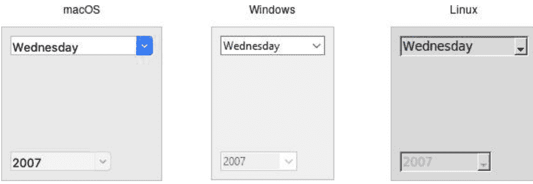

下拉框组件。

```
countryvar = StringVar()
country = ttk.Combobox(
textvariable=countryvar)
```

与 `entry` 类似，`textvariable` 选项将您程序中的变量与下拉框的当前值关联起来。与其他组件一样，您应该在自己的代码中初始化关联的变量。

下拉框会生成一个 `<<>>` 虚拟事件，您可以在其值变化时对其进行绑定。（您也可以像我们在前面几个章节中看到的那样，跟踪 `trace` 的变化。绑定到事件更加直接，因此通常是我们的首选方案。）

```
country.bind('<<>>');
```

### 预定义值

您可以使用 `values` 配置选项为用户提供一组可以选择的值列表：

```
country['values'] = ('USA', 'Canada', 'Australia')
```

如果设置了 `readonly` 状态标志，将限制用户只能从预定义值列表中进行选择，而不能输入自己的值（尽管如果下拉框的当前值不在列表中，它也不会被更改）。

```
country.state(["readonly"]);
```

如果您在只读模式下使用下拉框，我建议在值变化时（即触发 `<<>>` 事件时），调用 `selection_clear` 方法。如果不这样做，视觉上看起来会有点奇怪。

您还可以使用 `get` 方法获取当前值，并使用 `set` 方法更改当前值（该方法接受一个参数，即新值）。

为了补充 `get` 和 `set` 方法，您还可以使用 `current` 方法来确定预定义值列表中选择了哪一项。不带参数调用 `current`；它将返回列表的从0开始的索引，如果当前值不在列表中则返回 -1。您可以通过带一个从0开始的索引参数调用 `current` 来选择列表中的某项。

想为列表中的每项关联某些其他值，以便您的程序在内部使用一个值，但在下拉框中显示为其他内容？当我们在几个章节后讨论 `listbox` 时，将需要查看标题为“保留额外项目数据”的章节。

## 7. 网格几何管理器 (The Grid Geometry Manager)

我们将暂时停止讨论不同的组件（在屏幕上放置什么），转而关注几何管理（将这些组件放置在什么位置）。我们在“`Tk` 概念”章节中引入了几何管理的通用概念。在这里，我们关注一个特定的几何管理器：

正如我们所看到的，`grid` 允许您以列和行来布局组件。如果您熟悉使用 HTML 表格进行布局，在这里您会感到自如。本章将说明调整 `grid` 的各种方式，以让您获得对用户界面所需的所有控制。

`grid` 是 `Tk` 中提供的几种几何管理器之一，它的强大、灵活性和易用性的结合使其成为通用的最佳选择。它的约束模型与当今依赖组件对齐的布局天然契合。`Tk` 中还有其他几何管理器：`pack` 也非常强大但更难使用和理解，而 `place` 则让您对每个元素的定位具有完全控制权。即使是面板窗口（paneled windows）、笔记本（notebooks）、画布（canvas）和文本（text）等我们将探索的组件也充当几何管理器。

值得注意的是，`grid` 在 1996 年引入 `Tk`，这在 `Tk` 流行几年后才被人们接受。在此之前，开发者一直使用 `pack` 进行基于约束的管理。当 `grid` 出现时，许多开发者继续使用，您仍然会在很多 `Tk` 程序和文档中发现它。`grid` 算法本身没有问题，但修改现有布局可能会困难。在用户界面的不同部分对齐组件更加复杂。`grid` 具有 `pack` 的所有功能，产生更好的布局（水平和垂直方向对齐组件），并且更容易学习和使用。正因如此，大多数时候，`grid` 是正确的选择。使用 `grid` 编写新程序，并在修改现有用户界面时切换到 `grid`。`grid` 的参考文档提供了关于 `grid`、其行为以及所有选项的详尽描述。

```
https://tkdocs.com/man/grid
```

### 7.1. 列与行

在 `grid` 中，组件被分配一个列号和一个行号。这些编号指示组件相对于其他组件的位置。同一列的组件位于上下。同一行的组件位于左或或右。

列号和行号必须是正整数（例如 0, 1, 2, ...）。您不必从 0 开始，可以在列和行号上留空隙（例如 1, 2, 10, 11, 12, 20）。如果您计划以后在用户界面中间添加更多组件，这非常有用。每列的宽度取决于其中包含的所有组件。每行也是如此。这意味着当您规划用户界面并将其划分为行列时，不需要担心每列宽度相等。

### 7.2. 跨单元格

组件在 `grid` 中可以占据多个单元格；为了实现这一点，我们在网格组件时使用 `colspan` 和 `rowspan` 选项。这些类似于 HTML 表格的 "colspan" 和 "rowspan" 属性。

这是一个带有多个组件的用户界面示例，其中某些组件占据了超过一个单元格。

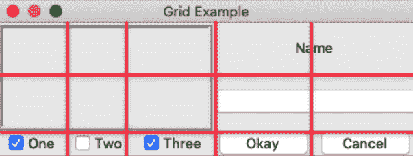

布局多个组件。

```
from tkinter import *

from tkinter import ttk
```

```
root = Tk()
```

```
content = ttk.Frame(root)

frame = ttk.Frame(content, borderWidth=5, relief="ridge", width=200, height=100)

amelbl = ttk.Label(content, text="Name")

name = ttk.Entry(content)
```

```
onevar = BooleanVar(value=True)

twovar = BooleanVar(value=False)
```

```
threevar = BooleanVar(value=True)
```

```
one = ttk.Checkbutton(content, text="One", variable=onevar,

onvalue=True)

two = ttk.Checkbutton(content, text="Two", variable=twovar,

onvalue=True)

three = ttk.Checkbutton(content, text="Three", variable=threevar,

onvalue=True)

ok = ttk.Button(content, text="Ok")

cancel = ttk.Button(content, text="Cancel")
```

```
content.grid(column=0, row=0)

frame.grid(column=0, row=0, columnspan=3, rowspan=2)

namelbl.grid(column=3, row=0, columnspan=2)

name.grid(column=3, row=1, columnspan=2)

one.grid(column=0, row=3)

two.grid(column=1, row=3)

three.grid(column=2, row=3)

ok.grid(column=3, row=3)

cancel.grid(column=4, row=3)
```

```
root.mainloop()
```

`https://tkdocs.com/code/gridexample1.py`

### 7.3. 单元格内的布局

列的宽度（行的高度）取决于其中的所有组件。这意味着某些组件可能比它们所处的单元格小。如果是这样，它们应该放在单元格的的确切位置？

默认情况下，如果单元格大于其中包含的组件，组件将在单元格内水平和垂直方向上居中。容器的背景颜色将显示在组件周围的空白区域中。在下面的图中，右上角的组件比分配给它的单元格小。容器的（白色）背景填充了单元格的其余部分。

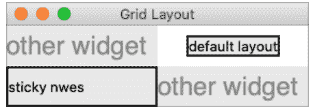

单元格内的布局和 'sticky' 选项。

`sticky` 选项可以改变这种默认行为。它的值是由一个或多个指南方向组成的字符串，指定单元格组件的哪些边缘应该“粘”在上面。例如，`n`（北）的值会将组件推向顶部，底部留出任何额外的垂直空间；组件仍将水平居中。`nw`（西北）的值意味着组件将粘附在左上角，在底部和右侧留出额外空间。

在 `Tkinter` 中，你也可以将其指定为包含 `west` 和 `east` 的列表。
这是一种风格上的选择，我们在书中会倾向于使用列表格式。

指定两个相对的边缘，例如我们使用的 `(west, east)`，意味着组件将被拉伸。在这种情况下，它将紧贴在单元格的左边缘和右边缘。因此，组件的宽度将大于它的“理想”尺寸。

如果你想让组件扩展以填充整个单元格，请在使用 `grid` 时将 `sticky` 值设置为 `nsew`（北、南、东、西），这意味着它将紧贴在每一侧。这在上方图中左下角的组件中所示。

大多数组件都有可以在其大于需要所需的尺寸时控制其显示方式的选项。例如，`label` 组件有一个 `anchor` 选项，用于控制标签文本在组件边界内的位置。上图中左下角的标签使用了默认的 `anchor`，即：左侧、垂直居中。

如果你在尝试让各个元素按照你意图的方式对齐时遇到困难，请先确保你知道组件有多大。正如上一章讨论 `label` 组件时所说，更改组件的背景或边框会有所帮助。

### 7.4. 处理调整大小

如果你尝试过调整示例的大小，你会发现没有任何东西完全没有移动，如下所示。

| | Name | | | |
|---|---|---|---|
| | | | |
| [x] One [ ] Two [x] Three | Okay | Cancel |

*调整窗口大小*

即使你看了下文并为我们的示例添加了额外的 `sticky` 选项，你仍然会看到同样的结果。看起来 `sticky` 只是告诉 `Tk` 如果单元格的行或列调整大小时该如何反应，但它并没有真正告诉 `Tk` 当有任何额外空间可用时，行或列是否应该调整大小。让我们来修复这个问题。

网格中的每一列和每一行都有一个与其关联的 `weight` 选项。此网格决定了当主窗口中有额外空间可填充时，列或行应该增长多少。默认情况下，每列或每行的 `weight` 为 0，这意味着它不会扩展以填充任何额外空间。

为了让用户界面能够调整大小，我们需要为想要扩展的列和行指定一个正 `weight`。你必须为至少一列和一行提供 `weight`。这是通过 `grid` 的 `columnconfigure` 和 `rowconfigure` 方法实现的。这个 `weight` 是相对的。如果两个列具有相同的 `weight`，它们将相同的速率扩展。在我们的示例中，我们将最左侧的三列（包含复选框）的 `weight` 设置为 3，最右侧的两列的 `weight` 设置为 1。右列每增长一个像素，左列就会增长三个像素。因此，随着窗口变大，大部分额外空间将分配到左侧。

`columnconfigure` 和 `rowconfigure` 还接受 `minsize` 网格选项，它指定了你不希望列或行收缩小于某个最小尺寸。

### 7.5. 填充（Padding）

通常情况下，每列或每行都将直接相邻，以便组件彼此相邻。这有时是你所需要的（例如 `listbox` 和滚动条），但通常你希望在组件之间留有一些空间。在 `Tk` 中，这被称为 `padding`（填充），你有几种可以选择的方法来添加它。我们已经看到了一种方法，即使用组件自身的选项在其周围添加额外空间。并不是所有组件都有此选项，但 `frame` 有；这是很有用的，因为 `frame` 通常用作 `grid` 组件的主容器。`frame` 的 `padding` 选项允许你指定框架内部的填充，无论是四个面相同，还是每个面都不同。第二种方法是在添加组件时使用 `padx` 和 `pady` 选项。如你预期的，`padx` 在左右两侧添加一些额外空间，而 `pady` 在顶部和底部添加额外空间。单个值会在左右（或顶部和底部）设置相同的填充，而双值列表则允许你在左右（或顶部和底部）设置不同的值。请注意，这种填充是在包含组件的网格单元格内部的。如果你想在整行或整列周围添加填充，`columnconfigure` 和 `rowconfigure` 方法接受 `padding` 选项，它们将为你完成此操作。让我们为我们的示例添加 `sticky`、调整大小和填充行为（已加粗**）。

```
from tkinter import *

from tkinter import ttk

root = Tk()

content = ttk.Frame(root, padding=(3,3,12,12))

frame = ttk.Frame(content, borderwidth=5, relief="ridge", width=200, height=100)

amelbl = ttk.Label(content, text="Name")

name = ttk.Entry(content)

onevar = BooleanVar()

twovar = BooleanVar()

threevar = BooleanVar()

onevar.set(True)

twovar.set(False)

threevar.set(True)

one = ttk.Checkbutton(content, text="One", variable=onevar, value=True)

two = ttk.Checkbutton(content, text="Two", variable=twovar, value=True)

three = ttk.Checkbutton(content, text="Three", variable=threevar, value=True)

ok = ttk.Button(content, text="Okay")

cancel = ttk.Button(content, text="Cancel")
```

```
content.grid(column=0, row=0, sticky=(N, S, E, W))

frame.grid(column=0, row=0, colspan=3, rowspan=2, sticky=(N, S, E, W))

amelbl.grid(column=3, row=0, colspan=2, sticky=(N, S, E, W))

name.grid(column=3, row=1, colspan=2, sticky=(N, W), pady=5, padx=5)

one.grid(column=0, row=3)

two.grid(column=1, row=3)

three.grid(column=2, row=3)

ok.grid(column=3, row=3)

cancel.grid(column=4, row=3)

root.columnconfigure(0, weight=1) root.rowconfigure(0, weight=1)

content.columnconfigure(0, weight=3) content.columnconfigure(1, weight=3) content.columnconfigure(2, weight=3)

content.columnconfigure(3, weight=1) content.columnconfigure(4, weight=1) content.rowconfigure(1, weight=1)

root.mainloop()
```

这看起来更有前景。操作示例以获得调整大小的感觉。

Grid 示例，处理单元格布局和调整。

### 7.6. 其他网格功能

如果你查看 `grid` 的参考文档，你会看到使用 `grid` 可以做的许多其他事情。这里是其中一些有用的。

`https://tkdocs.com/man/grid`

#### 查询和更改网格选项

就像组件本身一样，检查各种网格选项或更改它们非常简单。在第一次 `grid` 组件时设置选项确实方便，但你可以根据需要随时更改。

`slaves` 方法会告诉你所有在主容器内网格化的组件，或者可选返回特定列或行内的组件。`info` 方法将返回组件的所有网格选项及其取值的列表。最后，`configure` 方法允许你更改组件的一个或多个网格选项。这些在下面的交互会话中所示：

```
>>> content.grid_slaves()

[object .frame.button2, object .frame.button,

object .frame.checkbox3, object .frame.checkbox2,

object .frame.checkbutton, object .frame.entry,

object .frame.label, object .frame]

>>> content.grid_slaves(row=3)

[object .frame.button2, object .frame.button,

object .frame.checkbox3, object .frame.checkbox2,

object .frame.checkbutton, object .frame.entry,

object .frame.label]

>>> content.grid_slaves(column=3)

[object .frame.label, object .frame.entry]

>>> content.grid_slaves(row=3, column=3)

[]
```


#### 内部填充（Internal Padding）

你已经见过 `padx` 和 `pady` 网格选项是如何在组件外部添加额外空间的。还有一种较少使用的填充类型，被称为“内部填充”，由网格选项 `ipadx` 和 `ipady` 控制。

`remove` 方法的工作原理相同，不同在于如果你以后再次对其进行 `grid` 操作，其选项会被保留。

## 7.7. 嵌套布局

随着你的用户界面变得越来越复杂，组织所有组件的 `grid` 也会变得越来越复杂。这会使修改和维护程序变得非常困难。

幸运的是，你不需要用单个 `grid` 来管理整个用户界面。如果用户界面中的某个区域与其他区域相对独立，可以创建一个新的框架（`frame`），并将区域内的组件在该框架内进行 `grid`。例如，如果你正在构建一个带有多个调色板、工具栏等的图形编辑器，这些区域中的每一个都可以作为放入独立 `frame` 的候选对象。

从理论上来说，这些拥有独立 `grid` 的 `frame` 可以任意深度地嵌套，尽管实践中通常不会超过几层。这对于程序的模块化有很大帮助。例如，如果你有一个绘制工具的调色板，可以在单独的函数或类中创建整个部分。它将负责创建所有组件部件、将它们 `grid` 在一起、设置事件绑定等。该调色板内部的工作细节可以包含在这一段代码中。你的主程序只需要知道包含调色板的单个 `frame` 部件。

我们的示例已经展示了这种方法的一角：一个内容 `frame` 被 `grid` 在主窗口中，然后所有其他组件都被 `grid` 在该内容 `frame` 中。

随着你程序的增长，你可能会遇到这样的情况：修改界面某部分的布局需要对另一部分的布局进行代码更改。这可能是一个提示，让你重新考虑如何使用 `grid`，以及将组件拆分到独立的 `frame` 中是否有帮助。

## 8. 更多组件

本章介绍了另外几个组件：`listbox`、`scrollbar`、`text`、`scale`、`spinbox` 和 `progressbar`。其中一些开始比我们之前看到的的基础组件更强大。在这里，我们还会看到在没有主题对应物（或没有需要主题对应物）的情况下，使用经典 Tk 组件的实例。

### 8.1. Listbox

Listbox（列表框）

https://tkdocs.com/man/listbox

`listbox` 组件显示单行文本项列表（通常很长），并允许用户浏览列表并选择一个或多个。

`listbox` 是经典 Tk 组件的一部分；目前主题化的 Tk 组件集中没有 `listbox`。

Tk 的 `treeview` 组件（带主题的）也可以用作 `listbox`（单层深树），允许你在列表中使用图标和样式。多列（表格）列表组件也可能在某个时候加入 Tk，无论是基于 `treeview` 还是现有的扩展功能之一。

| macOS | Windows | Linux |
| --- | --- | --- |
| Tcl | Tcl | Tcl |
| Ruby | Ruby | Ruby |
| Python | Python | Python |
| Perl | Perl | Perl |
| Lua | Lua | Lua |
| Lisp | Lisp | Lisp |
| Caml | Caml | Caml |
| Erlang | Erlang | Erlang |

`listbox` 组件。

`listbox` 是使用 `Listbox` 类创建的。`height` 配置选项可以指定 `listbox` 在不滚动的情况下一次显示的行行数：

```python
I = Listbox(height=10)
```

#### 填充 Listbox 项目

填充和管理 `listbox` 中的所有项有一种简单的方法和一种困难的方法。

这里是简单的方法。每个 `listbox` 都有一个 `listvariable` 配置选项，允许你将一个变量（必须包含列表）链接到 `listbox`。该列表的每个元素都是代表 `listbox` 中其中一个项的字符串。要添加、删除或重新排列 `listbox` 中的项，你只需要像修改其他列表一样修改此变量即可。同样，要查找（例如 `listbox` 的第三行是哪个项，只需查看列表变量的第三个元素即可。

Tkinter 不允许你将普通的 Python 列表链接到 `listvariable` 实际上相当奇怪。正如我们在 `Entry` 等组件中看到的那样，我们需要使用 `StringVar` 作为中间节点。它在 Python 列表和底层 Tk 组件可以使用的字符串表示之间提供了映射。这意味着每当我们更改列表时，都需要更新 `StringVar`。

```python
choices = ["apple", "orange", "banana"]

choicesvar = StringVar(value=choices)

l = Listbox(parent, listvariable=choicesvar)

...

choices.append("peach")

choicesvar.set(choices)
```

较旧且较困难的方法是使用 `listbox` 组件本身包含的一组方法。它们对由组件维护的（内部）项列表操作：

- `insert` 方法用于向列表添加一个或多个项；`idx` 是一个从 0 开始的索引，表示要添加的项(项)之前的位置；指定 `end` 可将新项放在列表末尾。
- 使用 `delete` 方法从列表中删除一个或多个项；`first` 和 `last` 是与 `insert` 方法相同的索引。
- 使用 `get` 方法返回给定位置处单个项的内容，或返回 `first` 和 `last` 之间项的列表。
- `size` 方法返回列表中的项数。

之所以存在这种困难的方法，是因为 `listvariable` 选项直到 Tk 8.5 才被引入。在此之前，你只能使用这种困难的方法。由于使用 `listvariable` 让你拥有了更简单的 API，因此它是值得考虑的。

#### 选择项

你可以选择用户一次只能选择一个项还是可以选择多个项。这由 `selectmode` 选项控制：默认是 `single`，但 `extended` 允许用户在浏览时选择多个项。

要找出 `listbox` 中哪些项被选中了，使用 `selection` 方法。它返回所有选中项的列表。要检查给定索引的项是否被选中，使用 `selectionincludes`。

```python
if l.selection(2):
```

要程序化地更改选择，可以使用 `selectionset`。要取消选择范围内的项，使用 `selectionclear`。要选择范围内的所有项，使用 `selectionrange`。这两种操作都不会影响范围之外项的选择。

当用户更改选择时，会产生 `<<ListboxSelect>>` 事件。你可以绑定此事件以执行任何所需的的操作。根据你的应用程序，你可能还会绑定双击事件并使用它。

```python
l.bind("<Double-1>", ...)
```

#### 设置列表样式

像大多数“经典” Tk 组件一样，你对 `listbox` 的外观具有极大的灵活性。正如参考所示，你可以修改 `listbox` 项显示的字体、在正常状态、选中状态、禁用状态下的前景（文本）颜色和背景颜色。还有一个 `itemconfigure` 方法，允许你更改单个项的前景和背景颜色。

正如通常情况，节制使用是很有用的。通常，默认值将完全适用并符合平台规范。在我们稍后提到的示例中，我们将展示如何节制地使用这些选项可以产生很好的效果，在这种情况下，为 listbox 的交替行显示略不同的颜色。

#### 保留额外的项数据

`listvariable`（如果你使用旧方法，则是内部列表）持有将在 `listbox` 中显示的字符串。然而，在通常情况下，你显示的每个字符串都与另一个数据项相关联。这可能是对你的程序有意义但不面向用户显示的内部对象。换句话说，你真正感兴趣的不是在 `listbox` 中的字符串，而是关联的数据项。例如，`listbox` 可能向用户显示名称列表，但你的程序真正感兴趣的是每个名称对应的用户对象（或 ID 编号），而不是特定的名称。

我们如何将此底层值与显示的名称关联起来？遗憾的是，`listbox` 组件没有提供任何设施，因此这是我们需要单独管理的内容。有两种明显的方法。首先，如果显示的字符串保证唯一，你可以使用哈希表将每个名称映射到其关联的底层对象。这不会

这种方法适用于可能重复的人名，但也适用于唯一的国家。

另一种方法是保持一个与列表框（listbox）中显示的字符串列表并行的第二个列表。这个列表将存储与每个显示项关联的底层对象。因此，显示列表中的第一个项对应于底层对象列表中的第一个项，第二个对应第二个，以此此类推。你对其中一个列表进行的任何更改（插入、删除、重新排序），都必须在另一个列表中进行。这样，你就可以根据它们在列表中的位置，轻松地从显示列表项映射到底层对象。

## 示例

这是一个简单的示例，展示了这些列表框技术中的几种方法。我们将显示一个国家列表。我们每次只能选择一个国家。当我们选择时，状态栏将显示该国家的人口。你可以点击一个按钮向所选国家的国家首脑发送几件礼物之一（其实并非如此，但请发挥你的想象力）。双击列表或按回车键也可以触发发送礼物。

在幕后，我们维护了两个并行的列表。第一个是双字母国家代码列表。另一个是我们将在列表框中显示的每个国家对应的名称。我们还有一个简单的哈希表，包含每个国家的人口，并以双字母国家代码作为索引。

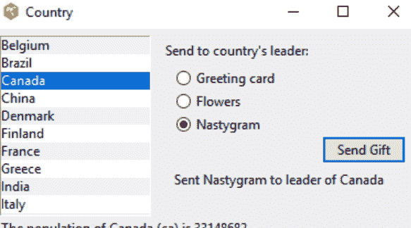

国家选择列表框示例。

```python
from tkinter import *

from tkinter import ttk

root = Tk()
```

# 初始化我们的国家“数据库”：
# - 国家代码列表（至少是一个子集）
# - 与国家代码顺序相同的国家名称并行列表
# - 国家代码到人口的哈希映射

```python
countrycodes = ('ar', 'au', 'be', 'br', 'ca', 'cn', 'fi', 'gr', 'in',
                'it', 'jp', 'nl', 'no', 'es', 'se', 'ch')

countrynames = ('Argentina', 'Australia', 'Belgium', 'Brazil',
                'Canada', 'China', 'Denmark', 'Finland', 'Greece',
                'Italy', 'Japan', 'Mexico', 'Norway', 'Spain', 'Sweden', 'Switzerland')

cnames = StringVar(value=countrynames)

populations = {'ar':4100000, 'au':2179211, 'be':1105853, 'br':2159717,
              'ca':3318682, 'cn':1231840, 'dk':5457415, 'fi':5302000,
              'gr':6410240, 'in':1310430, 'it':5920638, 'jp':2771800,
              'mx':1065350, 'no':4738085, 'es':4516894, 'se':97002}

# 可以发送的礼物名称

gifts = {'card':'Greeting card', 'flowers':'Flowers', 'nastygram':'Nastygram'}

# 状态变量

gift = StringVar()

sentmsg = StringVar()

statusmsg = StringVar()

# 当列表框中的选择发生变化时调用；
# 确定当前选择了哪个国家，然后查找其代码，
# 并根据代码更新状态消息。
# 此外，在我们开始其他操作时清除发送消息。
```

```python
def showPopulation(*args):
    idxs = lbox.curselection()
    if len(idxs) > 0:
        idx = int(idxs[0])
        code = countrycodes[idx]
        name = countrynames[idx]
        popn = populations[code]
        statusmsg.set("The population of %s is %d" % (name, popn))
        sentmsg.set('')
```

当用户双击列表中的项、点击“发送礼物”按钮或按回车键时调用。

# 如果选中项移出了视图，确保它是可见的。
# 确定选择了哪个国家、选了哪种礼物，
# 并提供已发送的反馈。

```python
def sendGift(*args):
    idxs = lbox.selection()
    if len(idxs) == 1:
        idx = int(idxs[0])
        lbox.see(idx)
        name = countrynames[idx]
        # 作为读者的练习，向国家首脑发送
        sentmsg.set("Sent %s to %s" % (gift.get(), name))
```

# 创建并布局外框架

```python
c = ttk.Frame(root, padding=(5, 5, 12, 0))
c.grid(column=0, row=0, sticky=(N,W,S))
root.columnconfigure(0, weight=1)
root.rowconfigure(0, weight=1)
```

# 创建不同的组件；注意许多
# 绑定的变量以及回调函数。我们正在使用

```python
# 'cnames'，从 'countrynames' 构建
lbox = Listbox(c, textvariable=cnames, height=5)
lbl = ttk.Label(c, text="Send to country's leader:\n")
g1 = ttk.Radiobutton(c, text=gifts['card'], variable=gift, value='card')
g2 = ttk.Radiobutton(c, text=gifts['flowers'], variable=gift, value='flowers')
g3 = ttk.Radiobutton(c, text=gifts['nastygram'], variable=gift, value='nastygram')
send = ttk.Button(c, text='Send Gift', command=sendGift, default='active')
sentlbl = ttk.Label(c, textvariable=sentmsg, anchor='center')
status = ttk.Label(c, textvariable=statusmsg, anchor=W)

# 布局所有组件
lbox.grid(column=0, row=0, rowspan=6, sticky=(N,S,E,W))
lbl.grid(column=1, row=0, padx=10, pady=5)
g1.grid(column=1, row=1, sticky=W, padx=20)
g2.grid(column=1, row=2, sticky=W, padx=20)
g3.grid(column=1, row=3, sticky=W, padx=20)
send.grid(column=2, row=4, sticky=E)
sentlbl.grid(column=1, row=5, columnspan=2, sticky=N, pady=5, padx=5)
status.grid(column=0, row=6, columnspan=2, sticky=(W,E))
```

现在可见。除了 `yview` 和/或 `xview` 方法外，每个可滚动的小部件都有一个 `yscrollcommand` 和/或 `xscrollcommand` 配置选项。这用于指定一个方法调用，该方法必须是滚动条的 `set` 方法。再次，额外的参数将自动附加到方法调用上。

如果你想从程序内部将滚动条移动到特定位置，可以自己调用 `set` 方法。传递两个浮点值（介于 0 和 1 之间），表示可见内容区域的起始和结束百分比。

## 示例

列表框（Listboxes）是几种可滚动部件类型之一。在这里，我们将构建一个非常简单的用户界面，由一个占据整个窗口的垂直滚动列表框组成，底部只有一个状态行。

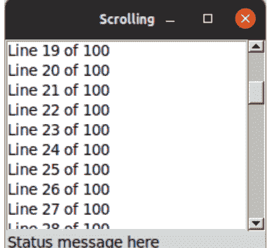

滚动列表框。

```python
from tkinter import *
from tkinter import ttk
root = Tk()
l = Listbox(root, height=5)
l.grid(column=0, row=0, sticky=(N,W,E,S))
s = ttk.Scrollbar(root, orient=VERTICAL,
command=l.yview
)
```

```python
s.grid(column=1, row=0, sticky=(N,S))
l['yscrollcommand'] = s.set
```


```python
ttk.Label(root, text="Status message here", anchor=
(W)).grid(column=0, columnspan=2, row=1, sticky=(W,E))
root.grid_columnconfigure(0, weight=1)
root.grid_rowconfigure(0, weight=1)
for i in range(1,101):
    l.insert('end', 'Line %d of 100' % i)
root.mainloop()
```

https://tkdocs.com/code/scrollbar.py

如果你看过这本书的早期版本，你可能会记得在此时，我们引入了一个 `sizegrip` 部件。它在窗口右下角放置了一个小手柄，允许用户通过拖动手柄来调整窗口大小。这在某些平台上很常见，包括旧版本的 macOS。一些旧版本的 Tk 甚至会自动为你的窗口添加此手柄。

平台规范的演变往往快于长期的开源 GUI 工具包。Mac OS X 10.7 放弃了角落的尺寸手柄，转而允许从任何窗口边缘进行调整，最终与世界其他地区保持了同步。除非有迫切需要与 10 多年前的操作系统视觉兼容，否则如果你的应用程序中有 `sizegrip` 类，可能最好将其移除。

## 8.3. 文本

https://tkdocs.com/man/text

文本部件 `Text widget` 为用户提供了一个输入多行文本的区域。文本部件是经典 Tk 部的一部分，而不是主题 Tk 部。

| macOS | Windows | Linux |
| --- | --- | --- |
| Lorem ipsum dolor sit amet, donec a magnis orci non, nonummy tristique sit metus, velit odio at odio | Lorem ipsum dolor sit amet, donec a magnis orci non, nonummy tristique sit metus, velit odio at odio | Lorem ipsum dolor sit amet, donec a magnis orci non, nonummy tristique sit metus, velit odio at odio |

文本部件。

Tk 的文本部件与 `canvas` 部件一起，是提供惊人深度但易于编程的功能强大部件之一。文本部件构成了全文字处理器、大纲编辑器、网络浏览器等的基础。我们将在后面的章节中介绍一些高级内容。在这里，我们将向你展示如何使用文本部件捕捉相当简单的多行文本输入。

文本部件使用 `Text` 类创建：

```python
t = Text(width=40, height=10)
```

`width` 和 `height` 选项分别指定文本部件请求的屏幕尺寸，以字符和行数为单位。文本的内容可以是任意大的。你可以使用 `wrap` 配置选项来控制换行的处理方式：值有 `none` 不换行，文本可以水平滚动、`char` 在任何字符处换行 和 `word` 仅在单词边界处换行。

可以禁用文本部件以防止任何编辑。由于文本不是主题部件，因此无法通常的 `state` 和 `instate` 方法。相反，请使用配置选项将其设置为 `disabled` 或

```python
txt['state'] = 'disabled'
```

滚动方式与列表框相同。`xscrollcommand` 和 `yscrollcommand` 配置选项将文本部件连接到水平和/或垂直滚动条，并从滚动条调用 `xview` 和 `yview` 方法。要确保某行可见，即未被滚出视图，你可以使用 `see index` 方法，其中 `index` 的格式例如 `5.0` 表示第 5 行 从 1 开始 的第一个字符 从 0 开始。

文本部件没有像例如 `entry` 部件那样的关联变量。要检索整个文本部件的内容，请调用 `get("1.0", "end")` 方法。`1.0` 是文本中的索引，意味着第一行的第一个字符，而 `end` 是该索引的快捷方式。

## 8.4. 刻度

`ttk.Scale`

https://tkdocs.com/man/ttk_scale

刻度部件 `Scale widget` 允许用户选择一个值。它通过提供一个可以在范围内移动的滑块来实现。刻度部件使用 `Scale` 类创建：

```python
s = ttk.Scale(root, from_=0, to=100)
```

`from_` 和 `to` 选项指定刻度的范围。`orient` 选项决定刻度是水平还是垂直的。`command` 选项允许指定一个在刻度改变时调用的脚本，并将刻度的当前值作为参数传递给它。

```python
def update_scale(val):
    print("Scale value:", val)

s = ttk.Scale(root, orient=HORIZONTAL, from_=0, to=100, command=update_scale)
```

你还可以通过 `variable` 选项将刻度连接到变量。这让你能够轻松地获取值。

```python
from tkinter import *
from tkinter import ttk

root = Tk()
num = IntVar(value=50)
scale = ttk.Scale(root, orient=HORIZONTAL, from_=0, to=100, variable=num)
scale.pack()
label = Label(root, textvariable=num)
label.pack()
root.mainloop()
```

由于刻度部件不是主题部件，因此无法通常的 `state` 和 `instate` 方法。相反，使用配置选项将其设置为 `disabled` 或

```python
scale['state'] = 'disabled'
```

滚动方式与列表框相同。`xscrollcommand` 和 `yscrollcommand` 配置选项将文本部件连接到水平和/或垂直滚动条，并从滚动条调用 `xview` 和 `yview` 方法。要确保某行可见，即未被滚出视图，你可以使用 `see index` 方法，其中 `index` 的格式例如 `5.0` 表示第 5 行 从 1 开始 的第一个字符 从 0 开始。

## 8.5. 选择器

`ttk.Spinbox`

https://tkdocs.com/man/ttk_spinbox

选择器部件 `Spinbox widget` 允许用户选择数字 实际上也可以是任意列表中的项目。它通过将一个显示当前值的类似输入的部件与一对向上/向下箭头结合来实现，这些箭头用于在可能的范围内进行切换。

选择器使用 `ttk.Spinbox` 类创建：

```python
s = ttk.Spinbox(root, from_=0, to=10)
```

`from_` 和 `to` 选项指定选择器的范围。`increment` 选项允许指定每次点击箭头时值的变化量。`values` 选项允许你指定一组有效值。

你还可以通过 `variable` 选项将选择器连接到变量。这让你能够轻松地获取值。

```python
from tkinter import *
from tkinter import ttk

root = Tk()
num = IntVar(value=5)
spin = ttk.Spinbox(root, from_=0, to=10, increment=1, variable=num)
spin.pack()
label = Label(root, textvariable=num)
label.pack()
root.mainloop()
```

选择器部件可以禁用以防止任何编辑。由于选择器不是主题部件，因此无法通常的 `state` 和 `instate` 方法。相反，使用配置选项将其设置为 `disabled` 或

```python
spin['state'] = 'disabled'
```

```python
spinval = StringVar()
s = ttk.Spinbox(from_=1.0, to=100.0, textvariable=spinval)
```

与刻度 `scale` 控件类似，数值选择框 `spinboxes` 允许用户在特定范围内选择数字 使用 `from_` 和 `to` 配置选项指定，尽管其用户界面与前者截然不同。你还可以指定每次点击向上或向下按钮时，数值改变的幅度。

与列表框 `listbox` 或组合框框 `combobox` 一样，数值选择框也可以用于让用户从任意字符串列表中选择项目；这些项目可以使用 `values` 配置选项来指定。其工作原理与组合列表框相同：指定一个值列表将覆盖 `from_` 和 `to` 设置。

在默认状态下，数值选择框允许用户通过向上和向下按钮选择值，或者直接在显示当前值的输入区域中输入值。如果你想禁用后一种功能，以便户只使用向上和向下按钮，可以设置 `readonly` 只读 状态标志。

```python
s.state(['readonly'])
```

与其他主题化控件一样，你还可以通过 `disabled` 禁用 状态标志禁用数值选择框，或通过 `instate` 方法检查状态。数值选择框还支持与输入框 `entry` 相同的验证机制，即使用 `validate` 和 `validatecommand` 配置选项。

你可能困惑于何时应该选择刻度、列表框、组合框、输入框或数值选择框。通常情况下，这些控件中的几种可以用于相同类型的数据。答案实际上取决于你想让用户选择什么、平台用户界面规范，以及该值在你的用户界面中扮演的角色。

例如，与列表框相比，组合框和数值选择框占据的空间都相当小。它们可能更适用于外围设置。在用户界面中，一个更主要、显眼的选择可能需要列表框占据的额外空间。数值选择框在某些情况下是有意义的，但当数值超出范围时，它们可能就不符合逻辑。

有一个布尔选项 `wrap` 回绕，决定了值在超出范围时是否循环。你可以通过 `wrap` 选项来设置数值选择框的行为。

在某些情况下，你可以通过 `linked` 变量来设置数值选择框的当前值。再次，通过 `set` 或 `get` 方法可以设置或获取数值选择框的值。通常情况下，数值选择框的变化会反映在 `linked` 变量上。通过 `command` 配置选项可以在值变化时调用回调函数。

数值选择框的 `set` 和 `get` 方法允许你设置或获取当前值。通常情况下，数值选择框的变化会反映在 `linked` 变量上。通过 `command` 配置选项可以在值变化时调用回调函数。

数值选择框在用户点击向上或向下按钮时会通过 `command` 配置选项触发回调函数。这允许你提供操作反馈。

## 8.6. 进度条 Progressbar

#### 进度条 progressbar

https://tkdocs.com/man/ttk/progressbar

进度条控件为用户提供操作的反馈。在无法准确估算操作所需时间的情况下，进度条可以显示正在进行。在这种情况下，它会显示已完成的比例。

| macOS | Windows | Linux |
| --- | --- | --- |
|  |  |  |

使用 `ttk.Progressbar` 创建进度条控件：

```python
p = ttk.Progressbar(root, orient=HORIZONTAL, length=200, mode='determinate')
```

`mode` 选项决定了进度条如何工作。

#### 确定模式 Determinate Mode

当你可以估算操作完成所需的时间时，使用 `determinate` 模式。在这种情况下，你需要手动通过 `value` 属性来更新进度条。`value` 的值通常是 0 到 `maximum` 默认为 100 之间的浮点数。

```python
p['value'] += 10  # 增加10%
```

#### 不确定模式 Indeterminate Mode

当你无法准确估算操作何时完成时，使用 `indeterminate` 模式。此时，进度条会显示循环的动画来告知用户操作正在进行。你可以通过 `start()` 方法启动动画，通过 `stop()` 方法停止动画。

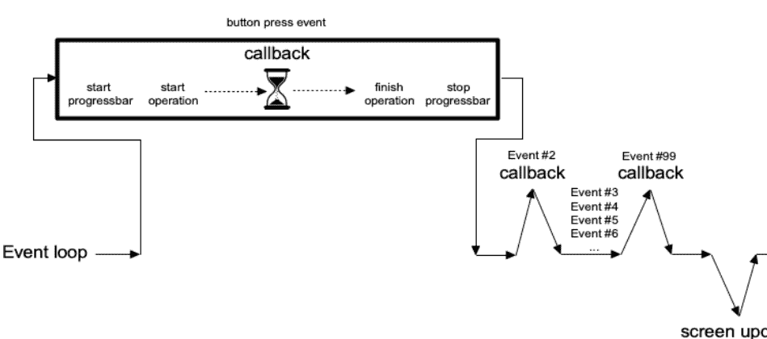

# 阻塞事件循环的耗时回调。

为了防止阻塞事件循环，事件处理器必须快速执行并将控制权交回事件循环。

如果你有一个需要执行的耗时操作，或者任何像网络 I/O 这样可能花费很长时间的任务，你有几种不同的方法可以采用。

对于更倾向于技术的开发者来说，Tk 使用了单线程、事件驱动的编程模型。所有的 GUI 代码、事件循环以及你的应用程序都运行在同一个线程中。正如此，非常不建议进行任何阻塞事件处理器的调用或计算。某些 GUI 工具包使用不同的模型，允许阻塞代码运行，例如将 GUI 和事件处理器运行在与应用程序代码分离的独立线程中等。试图将这些模型强行塞进 Tk 可能会导致挫败感，并产生代码脆弱且充满临时补救 hacky。如果你尊重 Tk 的模型而不是与其抗争，你就不会遇到问题。

## 9.2. 一步为营

如果可能，你能做的最好的事情是将你的操作分解成微小的步骤，每一步都可以快速执行。你让事件循环负责决定何时发生下一步。这样一来，事件循环就能继续运行，处理常规事件、更新屏幕，并在所有这些操作的间隙调用你的代码来执行操作的下一步。

为了实现这一点，我们利用了定时器。我们的程序可以请求事件循环在稍后的某个时间生成这些事件之一。作为其常规工作的一部分，当事件循环到达指定时间时，它将回调我们的代码来处理该事件。我们的代码将执行操作的下一步。然后它为操作的下一个步骤调度另一个事件，并立即将控制权交回事件循环。

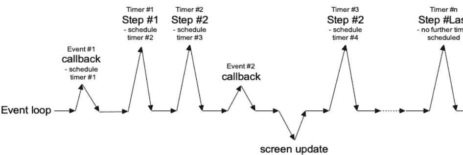

> 将一个大操作分解为多个通过定时事件连接在一起的小型步骤。

Tk 的 `after` 命令可用于生成定时事件。你提供在事件触发前需要等待的毫秒数。如果 Tk 忙于处理其他事件，触发时间可能会比预期晚，但绝不会更早。你还可以请求生成一个空闲事件 idle event；当队列中没有其他事件需要处理时，它就会触发。Tk 的屏幕更新和重绘是在空闲事件的上下文中。你可以在参考文档 https://tkdocs.com/man/after 更多关于 `after` 的详情。

在下面的示例中，我们将执行一个被分解为 20 个小步骤的耗时操作。在操作执行期间，我们将更新进度条并允许用户中断操作。

```python
def start():
    b.configure(text='Stop', command=stop)
    l['text'] = 'Working...'

global interrupt; interrupt = False

root.after(1, step)

def stop():
    global interrupt; interrupt = True

def step(count=0):
    p['value'] = count

if interrupt:
    result(None)
    return

# 操作的下一步；不要太久！

if count == 20: # 完成了！
    result(42)
    return

root.after(1, lambda: step(count+1))

def result(answer):
    p['value'] = 0
    b.configure(text='Start!', command=start)
    l['text'] = "Answer: " + str(answer) if answer else "No Answer"

f = tk.Frame(root); f.grid()
b = tk.Button(f, text="Start!", command=start); b.grid(column=1, row=0, padx=5, pady=5)
l = tk.Label(f, text="No Answer"); l.grid(column=0, row=0, padx=5, pady=5)
p = tk.Progressbar(f, orient="horizontal", mode="determinate", maximum=20)
p.grid(column=0, row=1, padx=5, pady=5)
```

https://tkdocs.com/code/longrunning.py

为了中断进程，我们设置了一个全局变量，并在每次定时事件触发时检查它。另一种选项是取消待处理的定时事件。当我们创建定时事件时，它会返回一个 ID 号来唯一标识该待处理定时器。要取消它，我们可以调用 `after_cancel` 方法并传递该唯一 ID。

你还会注意到，我们使用了 `after` 的阻塞形式来模拟执行操作。这种形式不是调度事件，而是调用会阻塞，等待给定时间后返回。它的工作原理与 `sleep` 系统调用相同。

## 9.3. 异步 I/O

定时事件负责分解耗时计算，在这些情况下，你确定每一步都能保证快速完成，从而使你的处理器能返回事件循环。但如果你有一个操作可能无法快速完成呢？这在你对操作系统进行各种调用时可能会发生。最常见的情况是当我们正在进行某种类型的 I/O，无论是写入文件、与数据库通信，还是从远程网络服务器检索数据。


大多数 I/O 调用都是阻塞的，因此在操作完成（或失败）之前它们不会返回。我们想要用的是非阻塞或异步 I/O 调用。当你执行异步 I/O 调用时，它会在操作完成之前立即返回。你的代码可以继续运行，或者在 I/O 操作完成后得到通知。

在这种情况下，你的程序处理 I/O 操作的结果。如果这听起来像是在处理 I/O 的另一种类型，你是正确的。

在 Python 中，异步 I/O 是由 `asyncio` 模块以及在其之上的模块提供的。

所有的异步应用程序都高度依赖事件循环。这非常方便；`Tkinter` 有自己的事件循环！遗憾的是，`asyncio` 事件循环和 `Tkinter` 事件循环并不是同一个。你不能同时运行它们，至少在同一个线程内不能这样做（好吧，你可以让一个反复调用另一个，但非常糟糕且脆弱）。

我的建议是：将 `Tkinter` 放在主线程，并将你的异步事件循环派到另一个线程。运行在主线程的应用程序代码可能需要与在另一个线程中的事件循环进行协调。要从事件循环调用 `Tkinter`（例如在部件回调中），请使用 `call_soon_threadsafe` 方法。

## 9.4. 线程或进程

有时将耗时计算分解为每个快速运行的片段是不可能的是不现实的。你可能在使用一个不支持异步操作的库。或者，该库与 Tk 的事件循环不兼容。在这些情况下，为了保持 GUI 的响应式，你需要将耗时操作或库调用从事件处理器中移出，并在其他地方运行。线程甚至是进程都可以提供帮助。

在线程中运行任务、与其通信等超出了本书的范围。然而，在使用线程使用 Tk 有一些需要注意的限制。主要规则是你必须在加载 Tk 的线程中进行所有的 Tk 调用。

我强烈建议你所有的 `Tkinter` 调用都在一个线程中完成。如果你需要从另一个线程与运行 `Tkinter` 的线程进行通信，请尽可能简单。使用 `event` 将一个虚拟事件发布到 `Tkinter` 事件队列，然后在你的代码中绑定该事件。

情况可能会更加复杂。Tcl/Tk 库可以在支持线程或不支持线程的情况下进行构建。如果你的应用程序中有多个线程，请确保你运行在支持线程的构建上。如果不确定，可以检查 Tcl 变量：

```python
>>> tkinter.Tcl().eval(' tcl_platform(threaded)')
```

大多数人都应该运行线程线程构建。在 Tcl/Tk 中创建非线程构建的能力未来可能会消失。如果你在非线程构建中使用线程代码，请将其视为你应用程序中的 Bug，而不是一个需要让其运行的挑战。

## 9.5. 嵌套事件处理

之前的三个方法是处理耗时操作并保持 Tk GUI 响应的正确方式。它们的共同点是有一个单一的事件循环，该循环持续处理各种种类的事件。该事件循环会调用你应用程序代码中的事件处理器，这些处理器执行完任务后就会返回。

还有另一种方法。在你的耗时操作中，你可以调用事件循环来处理一组事件。你只需要一个命令即可实现这一点。不需要折腾定时器事件或异步 I/O。相反，你只需要在操作过程中随处添加一些更新调用即可。如果你只想保持屏幕重绘而不处理其他事件，甚至有一个专门的选项。

这种方法简单得令人诱人。如果你运气好，它可能起奏效。至少在短时间内如此。但迟早，你终会在用这种方式做事情时遇到严重的困难。某些东西将不再更新，应该调用的事件处理器没有被调用，事件可能会丢失或乱序触发，甚至更糟。你会把程序的逻辑搞得底朝天错，并为了让它恢复正常而抓狂头发。

当你使用它时，你并没有将控制权还给正在运行的事件循环。你实际上是在现有的事件循环内部启动了一个新的事件循环。记住，事件循环遵循单线程执行：没有线程，没有协程。如果你不小心，你最终会导致从一个事件循环内部调用另一个事件循环，而该事件循环内部又调用了……

好了，你懂我的意思。即使你意识到自己正在这样做，撤销事件循环（每个循环可能有不同的终止条件）也将将是一项有趣的练习。现实情况与你脑海中“简单事件循环逐个分发事件且独立于其他任何事件”的模型是不符的。这是一个对抗 Tk 模型的经典案例。在非常特定的情况下，让它运行是可能的。但在实践中，你是在自找麻烦。别说我没警告过你……

嵌套事件循环……这便是疯狂的源头。

## 10. 菜单

本章描述了如何在 Tk 中处理菜单栏（menbars）和弹出菜单（popup menus）。对于一个精美的应用程序，这些是你特别需要注意的领域。如果你希望你的应用程序与用户平台上的其他应用程序相融合，菜单需要特别照顾。

说到这里，确定你运行在哪个平台上的推荐方法是：

```python
'windowingsystem') # 返回 x11, win32 或 aqua
```

`Tkinter` 没有提供此调用的直接等价项。但是，可以使用 `call()` 方法（适用于任何 `Tkinter` 部件）直接执行任意的基于 Tcl 的 Tk 命令。在这里，我们调用了 Tcl/Tk 命令 `tk`。

这比比检查诸如 `tcl_platform` 等全局变量或使用这些方法的旧版检查更有用，这些方法应该经过审查。虽然以前平台和窗口系统之间存在很强的关联，但今天这种关联已不再那么成立。例如，如果你的平台被识别为 Unix，那可能意味着 X11 下的 Linux、Aqua 下的 macOS，甚至是 X11 下的 macOS。

### 10.1. 菜单栏

在本节中，我们将查看菜单栏：如何创建它们、里面包含什么、如何使用它们等。

正确设计菜单栏及其系列菜单超出了本书的范围。然而，如果你是在为你自己以外的人创建一个应用程序，这里有一些建议。首先，如果你发现自己有许多菜单、非常长的菜单或深度嵌套的菜单，你可能需要重新思考用户界面的组织方式。其次，许多人使用菜单来探索程序的功能，特别是当他们刚学习时，所以尽量确保主要功能可以通过菜单访问。最后，对于你针对的每个平台，熟悉应用程序如何使用菜单。参考该平台的人机界面指南（human interface guidelines）获取有关设计、术语、快捷键等的完整细节。这是一个你可能需要为每个平台进行自定义的领域。

菜单栏。

你会注意到在某些最近的 Linux 发行版中，应用程序在激活时会将菜单显示在屏幕顶部，而不是窗口内部。Tk 尚未支持这种风格的菜单。

#### 菜单部件与层次结构

#### Menu

https://tkdocs.com/man/menu

菜单在 Tk 中是以部件实现的，就像按钮和输入框一样。每个菜单部件由菜单中的若干不同项目组成。项目具有各种属性，例如为项目显示的文本、键盘加速键以及要调用的命令。

菜单按层级结构排列。菜单栏本身就是一个部件。它有若干个项目（“文件”、“编辑”等），每个项目都是一个包含更多项目的子菜单。这些项目可以包括“文件”菜单中的“打开……”命令，也可以是其他项目之间的分隔符。它甚至可以拥有打开其自身子菜单的目（所谓的级联菜单）。正如你从 Tk Tk 中看到的其他内容所预期的那样，只要你有子菜单，它必须作为其父菜单的子被创建。

菜单是经典 Tk 部件的一部分；在主题（themed）Tk 部件集中没有菜单部件。

#### 开始之前

在开始创建菜单之前，在应用程序的某处放置以下行是非常关重要的：

```python
FALSE)
```

没有这一行，你的每个菜单（在 Windows 和 X11 上）都将从一条看起来像虚线的开始，并允许你“拆离”（tear-off）菜单，使其出现在自己的窗口中。你应该从应用程序中消除拆离式菜单，因为它们不是任何现代用户界面样式的一部分。

这是对 Motif 风格 X11 的回顾，除非你的应用程序设计为只运行在那个落灰的旧箱子上。我们期待未来的 Tk 版本移除它。在谈到古代历史时，`option_add` 位通过文本文件自定义 X11 用户界面的某些方面，但它已不再使用。

#### 创建菜单栏

在 Tk 中，菜单栏与单个窗口关联；每个窗口最多有一个菜单栏。这在 Windows 和许多系统中是显而易见的，那里菜单是窗口的一部分，位于标题栏下方。

但在 macOS 上，屏幕顶部有一个单一的菜单栏，由每个窗口共享。对于你的程序而言，每个窗口仍然有自己的菜单栏。如果你没有为特定窗口指定菜单栏，Tk 使用与根窗口关联的菜单栏；否则，你将得到“内置”菜单栏，它包含仅用于向解释器输入命令的菜单。

要为窗口创建菜单栏，首先创建一个菜单部件。然后，使用窗口的菜单配置选项将菜单部件附加到窗口上。

```python
win =
menubar = Menu(win)
win['menu'] = menubar
```

你可以为多个窗口使用同一个菜单栏。换句话说，你可以为多个窗口指定同一个菜单栏作为配置选项。这在 Windows 和 X11 上特别有用，在那里你可能希望窗口包含菜单，但并不需要在应用程序中切换不同的菜单。然而，如果菜单项的内容或状态取决于活动窗口中发生的情况，你必须自己管理这些。

这些是真正的古董，但菜单栏以前是通过创建一个包含菜单项目的框架部件，并像任何其他部件一样将其（pack）到窗口顶部来实现。希望你没有任何仍然这样操作的代码或文档。

#### 添加菜单

我们现在有了一个菜单栏，但如果没有菜单放在里面，它就没什么用处。所以再次，我们为每个菜单创建一个菜单部件，每个部件都是菜单栏的子部件。然后我们将它们全部添加到菜单栏中。

```python
menubar =
)
menu_file = Menu(menubar)
menu_edit = Menu(menubar)
```

```python
menubar.add_cascade(menu=menu_file, label='File')
menubar.add_cascade(menu=menu_edit, label='Edit')
```

`add_cascade` 方法添加一个菜单项，该项本身是一个菜单（子菜单）。

#### 添加菜单项

现在我们已经在菜单栏中有了几个菜单，可以为每个菜单添加一些条目。

#### 命令项

在 Tk 中，普通的菜单项被称为命令项（command items）。我们很快就会看到其他类型的菜单项。请注意，菜单项是菜单本身的一部分；我们不需要为每个菜单项创建一个独立的菜单组件（子菜单除外）。

```python
menu_file.add_command(label='New', command=newFile)
menu_file.add_command(label='Open...', command=openFile)
```

```python
menu_file.add_command(label='Close', command=closeFile)
```

省略号（"..."）是 macOS 上的特殊字符，间距比连续三个句号更紧密。Tk 会自动为你替换这个字符。

每个菜单项都关联有几个配置选项，类似于组件的配置选项。每种菜单项都有一套不同的可用选项。级联菜单项（Cascade menu items）有一个 `menu` 选项用于指定子菜单，命令菜单项有一个 `command` 选项用于指定选择该项时调用的命令。两者都有 `label` 选项用于指定该项显示的文本。

#### 子菜单

我们已经见过如何使用级联菜单项向菜单栏添加菜单。不意外的是，如果你想向现有菜单添加子菜单，也以相同的方式使用级联菜单项。例如，你可以用它构建一个“最近文件”子菜单。

```python
menu_recent = Menu(menu_file)
menu_file.add_cascade(menu=menu_recent, label='Open Recent')
for f in recent_files:
    menu_recent.add_command(label=os.path.basename(f), command=lambda f=f: openFile(f))
```

https://tkdocs.com/code/recentfiles.py

#### 分隔符

第三种菜单项是分隔符（separator），它产生你在不同菜单项之间常见的分割线。

```python
menu_file.add_separator()
```

#### 复选框和单选按钮项

最后还有复选框（checkbutton）和单选按钮（radiobutton）菜单项，它们的行为类似于复选框和单选按钮组件。这些菜单项关联有一个变量。根据该变量的值，标签旁边可能会显示指示器（即勾号或选中的单选按钮）。

```python
check = StringVar()
menu_file.add_checkbutton(label='Check', variable=check, onvalue=1, offvalue=0)
radio = StringVar()
menu_file.add_radiobutton(label='One', variable=radio, value=1)
menu_file.add_radiobutton(label='Two', variable=radio, value=2)
```

当用户选择一个未勾选的复选框项时，会将关联变量设置为 `onvalue`。选择已勾选的项会将其设置为 `offvalue`。选择单选按钮项会将关联变量设置为 `value`。这两类项也会对对关联变量的任何更改做出反应。

像命令项一样，复选框和单选按钮菜单项支持 `command` 配置选项，在选择菜单项时会被调用。在调用回调函数之前，关联变量和菜单项的状态会被更新。

单选按钮菜单项不属于 Windows 或 macOS 的人机界面指南。在这些平台上，该项的指示器是勾号，就像复选框项一样。语义仍然有效。这是在多个项之间进行选择的良好方法，因为它会显示其中一个被选中（已勾选）。

#### 操作菜单项

除了向菜单末尾添加项外，你还可以通过 `insert index ?option=value?...` 方法将它们插入到菜单中间；这里 `index` 是你想要插入的项之前的位置 (0..n-1)。你还可以使用 `delete index ?endidx` 方法删除一个或多个菜单项。

```python
menu_recent.delete(0, 'end')
```

像 Tk 中的大多数东西一样，你可以随时查看或更改项选项的值。项通过索引引用。通常，这是一个指示该项在菜单中位置的数字。你也可以指定菜单项的标签（事实上，可以使用一个用于匹配项标签的“通配符风格”模式）。

```python
print( menu_file.entryget(0, 'label')) # 获取菜单中第一个条目的标签
```

```python
print( menu_file.entryconfigure(0))
# 显示项的所有选项
```

## 状态

你可以禁用菜单项，使用户就无法选择它。这可以通过 `state` 选项实现，将其设置为 `DISABLED` 值。使用 `normal` 值重新启用该项。

菜单应该始终反映应用程序的当前状态。如果菜单项当前不可用（例如，“复制”项仅在应用程序中选中某些内容时才可用），你应该禁用它。当你的应用程序状态变化使得该项可用时，请确保启用它。

```python
menu_file.entryconfigure('Close', state=DISABLED)
```

有时，你可能会拥有名称随应用程序状态变化而变化的菜单项，而不是禁用菜单项。例如，浏览器会在标签页打开时将“关闭”更改为“关闭标签页”。随着应用程序的增长，很难追踪哪些项应该是启用的。一种策略是使用虚拟事件来处理状态变化。

（注：OCR 在第 190、191、192 页末尾有一些破碎的句子。我已根据文本上下文对它们进行了合并。）*

这是一个最小示例，展示了我们如何向“编辑”菜单添加两个项目、标准的“粘贴”项目，以及一个应用程序特定的“查找...”项目（该项目将打开一个对话框来查找或搜索某些内容）。我们将包含一个输入框控件，以便我们可以检查“粘贴”功能是否可用。

```python
from tkinter import *
from tkinter import ttk, messagebox
```

```python
root = Tk()
ttk.Entry(root).grid()
m = Menu(root)
m_edit = Menu(m=m, label="Edit")
m_edit.add_cascade(menu=m_edit, label="Paste", command=lambda: root.focus_get())
```

等一下，在提供的代码逻辑中有一个拼写错误：

m_edit.add_command(label="Find...", command=lambda: root.event_generate("<<Find>>"))

root['menu'] = m

```python
def launchDialog(*args):
    messagebox.showinfo(message="I hope you find what you're looking for!")
```

```python
root.bind("<<Find>>", launchDialog)
root.mainloop()
```

https://tkdocs.com/code/menu.py

当你生成虚拟事件时，需要指定将事件发送到哪个控件。我们希望“粘贴”事件发送到具有焦点的控件（通常由焦点环指示）。你可以使用 `focus` 命令来确定哪个控件具有焦点。`<<Paste>>` 事件被发送到根窗口，这是我们创建事件绑定的地方。如果有多个顶级窗口，我们将将其发送到特定的窗口。尝试一下，当窗口打开并点击它（使其获得焦点）时，控件会自动处理。我们不需要手动创建事件绑定。

### 10.2 菜单

你可能已经注意到 Tk 在 macOS 上提供了默认菜单栏。它包含一个以运行程序命名的菜单（例如“Python”）、以及标准的“文件”、“窗口”和“帮助”菜单。你可以在自己的程序中覆盖此菜单栏，但要获得想要的结果，需要遵循某些步骤（从 Tk 8.5 开始，由于 macOS 对特殊菜单的处理从旧的 API 迁移到了 Cocoa）。如果你看到重复的名称、未添加的项目等，请仔细阅读本节。首先需要知道的是，如果没有为窗口指定菜单栏（或其父窗口），你将得到 Tk 提供的默认菜单栏，除非你只是在折腾，这通常不是你想要的。

#### macOS


每个菜单都以系统苹果图标开头。在其右侧是运行二进制文件命名的菜单。当你将菜单栏附加到窗口时，如果它不包含名为 `apple` 的特殊菜单，Tk 将提供其默认应用程序菜单。它包含一个“About Tcl & Tk”项目，随后是标准菜单项目：偏好设置、服务、隐藏/显示以及退出。同样，你不想要这样。如果你提供了 `apple` 菜单，当菜单栏附加到窗口时，Tk 将标准项目（从偏好设置开始）添加到你添加的项目的末尾。完美！在附加到窗口后添加的项目将出现在退出项目之后，这同样是不想要的。

换句话说，在你的程序中确保：

- 为每个窗口或根窗口创建一个菜单栏。
- 先不要将菜单栏附加到窗口！
- 为菜单栏添加一个名为 `apple` 的菜单作为应用程序菜单。
- 菜单将自动根据应用程序二进制文件命名；如果你想更改，请重命名（或复制）运行脚本的二进制文件。
- 添加你想在应用程序菜单顶部出现的项目，例如“About your”项目，后面跟一个分隔符。

完成所有操作后，你可以通过窗口的菜单配置将菜单栏附加到窗口。

```python
win = Toplevel(root)
menubar = Menu(win)
appmenu = Menu(menubar, name='apple')
menubar.add_cascade(menu=appmenu)
appmenu.add_command(label='About My Application')
appmenu.add_separator()
win['menu'] = menubar
```

虽然 Tkinter 通常为我们选择控件路径，但我们在创建应用程序菜单时必须使用 `name` 选项显式提供。

### 处理偏好设置项目

正如你所看到的，应用程序菜单始终包含一个“Preferences...”项目。如果你的应用程序有一个偏好设置对话框，该项目应该打开它。如果没有，该项目应该是禁用的，默认情况下确实如此。

为了连接你的偏好设置对话框，你需要定义一个名为 Tcl 过程。它会在选择偏好设置项目时被调用；如果未定义过程，该菜单项目将被禁用。

```python
def showMyPreferencesDialog():
    ....
root.createcommand('tk::mac::ShowPreferences', showMyPreferencesDialog)
```

### 提供帮助菜单

与应用程序菜单一样，你添加到自己的菜单栏中的任何帮助菜单在 macOS 上都会被特殊处理。就像需要特殊名称的应用程序菜单一样，该菜单必须命名为 `help`。帮助菜单还应该在菜单栏附加到窗口之前添加。

帮助菜单将包含用于查找帮助的标准 macOS 搜索框，以及一个名为“Help”的项目。与应用程序菜单的名称一样，这来自你程序的可执行文件且无法更改。类似于处理偏好设置对话框的方式，为了响应此帮助项目，你需要定义一个名为 Tcl 的过程。如果未定义此过程，它不会禁用菜单项目。相反，在选择帮助项目时会产生错误。

与 macOS 上 X11 和早期版本的 Tk 不同，帮助菜单不会自动放在菜单栏的末尾。

```python
helpmenu = Menu(menubar, name='help')
menubar.add_cascade(menu=helpmenu, label='Help')
root.createcommand('tk::mac::ShowHelp')
```

### 提供窗口菜单

在 macOS 上，“窗口”菜单包含最小化、全部置顶等项目。它还包含打开的窗口列表。在列表之前，有时会提供应用程序特定的项目。通过提供名为 `window` 的菜单，将添加标准的窗口菜单。Tk 会自动与所有顶级窗口同步，无需编写额外代码。你也可以向此菜单添加应用程序特定的命令。

```python
windowmenu = Menu(menubar, name='window')
menubar.add_cascade(menu=windowmenu, label='Window')
```

### 其他菜单处理器

你已经看到处理标准菜单项目需要定义 Tcl 回调，例如，你可能会拦截退出项目，在退出前提示用户保存更改。以下是完整列表：

- `tk::mac::ShowPreferences`: 选择“Preferences...”项目时调用。
- `tk::mac::ShowHelp`: 用于显示应用程序的主要在线帮助。
- `tk::mac::Quit`: 在选择退出菜单、用户尝试关闭系统时调用。
- `tk::mac::OnHide`: 当应用程序被隐藏时调用。
- `tk::mac::OnShow`: 当应用程序在隐藏后显示时调用。
- `tk::mac::OpenApplication`: 当应用程序首次打开时调用。
- `tk::mac::ReopenApplication`: 当用户重新打开已运行的应用程序时（例如点击 Dock 中的它）调用。
- `tk::mac::OpenDocument`: 当 Finder 希望应用程序打开一个或多个文档时（例如被拖到它上）调用。该过程是一个要打开的文件路径列表。
- `tk::mac::PrintDocument`: 与 `OpenDocument` 类似，但文档应该打印而不是打开。

虽然 Tkinter 通常会为我们选择一个小组件路径，但我们必须显式地提供带有名称的——这是 Tk 识别其为系统菜单的标识。

### X11

在 X11 上，如果你创建一个帮助菜单，Tk 会确保它始终是菜单栏中的最后一个菜单。

```python
menu_help = Menu(menubar, name='help')
```

```python
menubar.add_cascade(menu=menu_help, label='Help')
```

虽然 Tkinter 通常会为我们选择一个小组件路径，但我们必须显式地提供一个带有名称的——这是 Tk 识别其为帮助菜单的标识。

## 10.3. 上下文菜单

上下文菜单（“弹出”菜单）通常通过在应用程序中的对象上点击鼠标右键来触发。菜单会在鼠标光标的位置弹出。用户可以从菜单中选择一个项目（或点击菜单外部以将其关闭，而不选择任何项目）。

要创建一个上下文菜单，我们将使用与创建菜单栏菜单时完全相同的命令。通常，我们会创建一个包含多个命令项的菜单，并可能包含一些级联菜单项及其关联菜单。

要激活菜单，用户将执行上下文菜单点击。我们必须创建一个事件绑定来捕获该点击。然而，这在不同的平台上意味着不同的含义。在 Windows 和 X11 上，这可以是点击鼠标右键（第三个鼠标键）。在 macOS 上，可以是按住控制键点击左键（或唯一按键），或者在多键鼠标上点击右键。与 Windows 和 X11 不同，macOS 将此称为第二个鼠标键而不是第三个，因此这正是我们在程序中看到的事件。

大多数使用过弹出菜单的早期程序都假设它们只需要担心“3 号按钮”。

除了捕获正确的上下文菜单事件外，我们还需要捕获鼠标的位置。事实证明我们需要相对于整个屏幕（全局坐标）执行此操作，而不是相对于你点击的窗口或组件（本地坐标）。Tk 事件绑定系统中的 `%X` 和 `%Y` 替换符会为我们捕捉这些信息。

最后一步是使用 `post` 方法让菜单在特定位置弹出。这是一个完整过程的示例，在应用程序的主窗口上使用弹出菜单。

```python
from tkinter import *
root = Tk()
menu = Menu(root)
for i in ('One', 'Two', 'Three'):
    menu.add_command(label=i)
    if (root.tk.call('tk', 'windowingsystem')=='aqua'):
        root.bind('<2>', lambda e: menu.post(e.x_root, e.y_root))
        root.bind('<', lambda e: menu.post(e.x_root, e.y_root))
    else:
        root.bind('<3>', lambda e: menu.post(e.x_root, e.y_root))
root.mainloop()
```

`https://tkdocs.com/code/contextmenu.py`

## 11. Windows 与对话框

到目前为止所做的一切都在单个窗口中。在本章中，我们将介绍如何使用多个窗口、更改窗口的各种属性以及使用 Tk 中提供的某些标准对话框。

### 11.1. 创建和销毁窗口

顶窗口（Toplevel windows）使用 `Toplevel` 类创建：

```python
t = Toplevel()
```

注意：`Toplevel` 是经典 Tk 组件的一部分，而不是主题组件（themed widgets）。与普通组件不同，我们不需要对顶窗口进行网格布局（`grid`）它就能出现在屏幕上。一旦创建了新的顶窗口，我们就可以创建该顶窗口的子组件并并在内部进行网格布局。

要销毁窗口，请使用其 `destroy` 方法：

注意，你可以在任何组件上使用 `destroy`，不仅仅是顶窗口。当你销毁一个窗口时，该窗口的所有子窗口（组件）也会被销毁。小心！如果你销毁了根窗口（所有其他组件的来源），这将终止你的应用程序。

在典型的文档型应用程序中，我们允许关闭一个窗口同时开启其他窗口。情况下，我们可能希望每个窗口创建一个新的顶窗口，并且不在根窗口中放置任何内容。虽然我们不能直接销毁根窗口，但可以使用它的 `withdraw` 方法将其从屏幕上移除，我们稍后会看到。

### 11.2. 窗口行为与样式

关于窗口的行为和外观有很多可以更改的地方。

#### 窗口标题

检查或更改窗口标题：

```python
oldtitle = root.title()
```

#### 尺寸和位置

在 Tk 中，窗口在屏幕上的位置和大小被称为其几何结构（geometry）。一个完整的几何规范如下所示：

宽度和高度（通常以像素为单位）是非常言而易的。`x`（水平位置）通过前面的加号或减号指定，因此 `+25` 窗口的左边缘距离屏幕左边缘 25 像素，而 `-50` 窗口的右边缘距离屏幕右边缘 50 像素。同样，`y`（垂直）位置 `+10` 表示……

几何字符串遵循 "`widthxheight+x+y`" 的格式。

```python
root.geometry("400x300+100+100")
```

名称略显晦涩的 `WM_DELETE_WINDOW` 源于 X11 窗口管理器协议。

#### 透明度

通过指定 alpha 通道可以使窗口变为部分透明，范围从 0.0（完全透明）到 1.0（完全不透明）。

Tkinter 对底层 `wm attributes` 命令的封装并不解释选项（options）、不处理关键字参数等。

在 macOS 上，你还可以额外指定 `-transparent` 属性（使用与使窗口背景透明并移除阴影相同的机制）。你还应该将窗口以及任何框架（frames）的背景配置选项设置为颜色 0.5。

#### 全屏

你可以让窗口扩展以占据整个屏幕：

#### 其他 macOS 特有属性

除了上述描述的 `-transparent` 属性外，macOS 窗口还具有一些额外的属性。

标题栏中的（红色）关闭按钮表示窗口内的内容已被修改（例如，文件需要保存）。将 `-modified` 属性设置为 1 以表示已修改，或设置为 0 以移除修改指示器。

你可以通过让 macOS dock 栏中的图标跳动来吸引用户注意该窗口。要做到这一点，请设置窗口的 `-notify` 属性。

如果窗口包含文档内容，你可以在标题栏中放置一个指定该文档所指文件的图标。用户可以拖动此图标作为在 Finder 中拖动文件的代理。将窗口的 `-titlepath` 属性设置为文件的完整路径。注意，这不会更改窗口的标题（你需要单独更改），而只是提供图标。

在 macOS 上，窗口还可以根据不同的用途采用各种外观，例如工具窗口（utility windows）、模态对话框（modal dialogs）、浮动窗口等。Tk 中一个不支持的命令 `MacWindowStyle` 让你将这些外观之一分配给窗口。与 Tk 中许多可以以后更改的选项不同，这些外观必须在创建窗口之后但在显示屏幕之前分配。

```python
t = Toplevel(root)
t.tk.call(":tk::unsupported::MacAnimationStyle", "style", t.w, "utility")
```

此外，其他实用的外观样式包括工具型（utility）和模态型（modal）。虽然官方不支持，但此功能在 Tk 中已经可用了很长时间。在将来，它可能会可能会迁移到 `wm attributes` 命令。有关更多信息，包括关于不同外观和可选属性的更多细节，请参阅 MacAnimationStyle wiki 页面（`https://wiki.tcl-lang.org/page/MacAnimationStyle`）。

#### 图标化与隐藏

在大多数系统中，你可以通过图标化（iconifying）将窗口临时从屏幕上移除。在 Tk 中，窗口是否被图标化被称为窗口的可能状态。窗口的状态包括正常（normal）和图标化（iconic，针对图标化窗口），以及其他几种：激活（active）或隐藏（withdrawn）。

你可以直接查询或设置当前窗口状态。还有一些方法，这些是分别设置激活和隐藏状态的快捷方式。

```python
state = t.state()
```

对于以文档为中心的应用程序，如果你希望允许关闭任何窗口而不退出程序（如果销毁根窗口就会发生这种情况），请在根窗口上使用 `withdraw` 将其从屏幕移除，并使用 `Toplevel` 窗口作为你的用户界面。

#### 堆叠顺序

堆叠顺序指的是窗口在屏幕上“放置”的顺序，从下到上。当两个窗口的位置重叠时，堆叠顺序中靠上的窗口将遮挡堆叠顺序中较低的窗口。

你可以确保窗口始终处于堆叠顺序的顶部（或至少在未设置此属性的所有其他窗口之上）：你可以找到当前的堆叠顺序，按从低到高列出：

```python
root.tk.eval('wm stackorder')
```

该方法在 Tkinter 中没有整洁地暴露。它返回每个窗口的内部名称，而不是窗口对象。你也可以直接检查一个窗口是否在另一个窗口之上：

```python
if root.tk.eval('wm stackorderabove window1 window2') == '1': ...
```

你还可以提升或降低窗口，提升到最顶端（lift）或仅位于指定窗口上方（below）：Tkinter 使用 `lift` 是因为 `raise` 是 Python 中的保留关键字。为什么你需要传递一个窗口来获取堆叠顺序？堆叠顺序不仅适用于 Toplevel 窗口，也适用于任何兄弟组件（具有相同父组件的组件）。如果你有几个网格化在一起但重叠的组件，你可以相互之间提升和降低它们。

```python
from tkinter import *
from tkinter import ttk
root = Tk()
little = ttk.Label(root, text="Little")
bigger = ttk.Label(root, text="bigger")
little.grid(column=0,row=0)
bigger.grid(column=0,row=0)
root.after(2000, lambda: little.lift())
root.mainloop()
```

这使用了定时器事件，我们在事件循环中涵盖过它。`after` 命令调度一个脚本在未来指定的毫秒数运行，但让事件循环继续。

#### 屏幕信息

我们之前使用过 `winfo` 命令来查找有关特定组件的信息。它也可以提供关于整个显示器的信息。像往常一样，查看 `winfo` 命令参考以获取完整细节。例如，你可以确定屏幕的颜色深度（每个像素多少位）和颜色模型（现代显示器上通常为真色彩）、其像素密度和分辨率。

```python
print("color depth=" + str(root.winfo_screenepth()) + " (" + root.winfo_screenvisual() + ")")
print("pixels per inch=" + str(root.winfo_pixels()))
print("width=", + str(root.winfo_screenwidth()) + " height=", str(root.winfo_screenheight()))
```

#### 多显示器

通常情况下你不需要关注它，但如果你有多个显示器，Tk 有一些工具可以帮助。首先，多个显示器有两种表示方式。第一种是逻辑分离的显示器。这在 X11 系统上很常见，尽管它可以被更改，例如使用 `xrandr` 工具。这种方式的缺点是，窗口一旦在屏幕上创建就无法移动到另一个屏幕。你可以确定 Tk 运行的屏幕，它看起来像 `:0.0`（X11 格式的显示器名称）。

```python
root.winfo_screen()
```

在创建时，你可以指定它应该在哪个屏幕。不同的显示器可能有不同的分辨率、颜色深度等。你会注意到我们刚刚涵盖的所有屏幕信息调用都是在特定组件上调用的。它们将返回窗口所在屏幕的信息。

或者，多个显示器也可以表示为一个大的虚拟显示器，这在 macOS 和 Windows 上是这种情况。当你询问屏幕信息时，Tk 将返回主显示器信息。例如，如果你有两个并排的全 HD 显示器，屏幕分辨率将被报告为 1920x1080，而不是 3840x1080。这可能是一件好事；意味着当我们定位或调整窗口大小时，不需要考虑多显示器，一切都会正确显示在主显示器上。

如果用户将窗口从主显示器移动到另一个屏幕呢？如果你询问它的位置，它将相对于主显示器。因此在我们并排的 FHD 显示器设置中，如果你对一个位于显示器左边缘的窗口调用 `winfo_x` 方法，它可能会返回 100（如果在主显示器上）、-1820（如果在主显示器左侧的显示器上）或 2020（如果在主显示器右侧的显示器上）。你仍然可以使用之前看到的 `geometry` 方法将窗口放置在另一个屏幕上，尽管几何规格看起来可能有点奇怪，例如：


你可以找到跨越多个显示器的整个屏幕有多大。要做到这一点，检查一个 `tooplevel` 组件的最大尺寸，即用户可以调整到多大（当然，在你更改它之后就无法这样做了）。这可能比显示器的完整尺寸小一点。例如，在 macOS 上，它会被顶部菜单栏的大小所缩小。

```python
root.wm_maxsize()
```

## 11.3. 对话窗口

对话框是应用程序中一种窗口，用于从用户获取信息、通知他们某些事件的发生、确认操作等。对话框的外观和用法通常在平台的样式指南中有非常具体的详细说明。Tk 内置了几个用于常用任务的对话框。这些工具可以帮助你符合特定平台的样式指南。

### 选择文件和目录

Tk 提供了多个对话框让用户选择文件或目录。在 Windows 和 macOS 上，这些对话框会直接调用底层操作系统的对话框。对话框中的“打开”变体用于用户选择现有文件（例如在“文件 | 打开...”菜单命令中），而“保存”变体用于选择一个要保存的文件（通常用于“文件 | 另存为...”菜单命令）。

```python
from tkinter import filedialog
filename = filedialog.askopenfilename()
filename = filedialog.asksavefilename()
dirname = filedialog.askdirectory()
```

所有这些命令都会产生模态对话框。这意味着在用户提交对话框之前，命令不会完成。这些命令将返回用户所选文件或目录的全路径，如果用户取消了对话框，则返回空字符串。

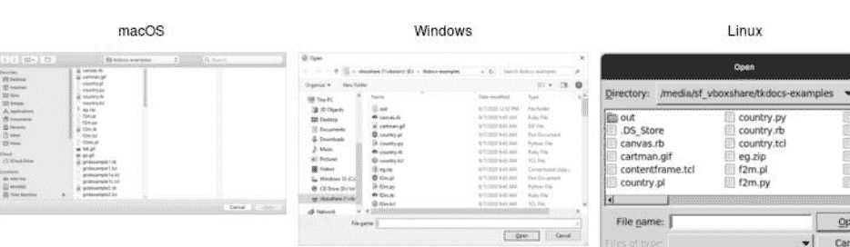

### 打开文件对话框。

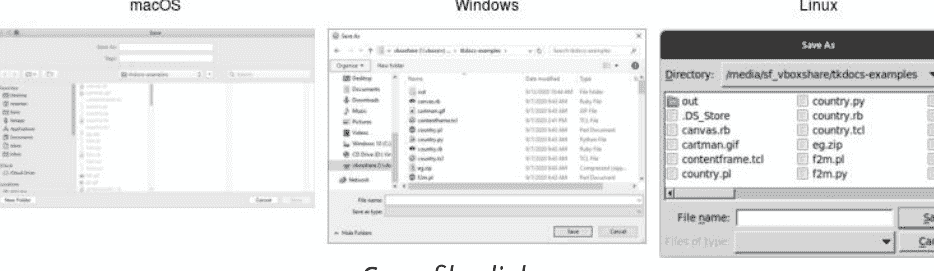

### 保存文件对话框。

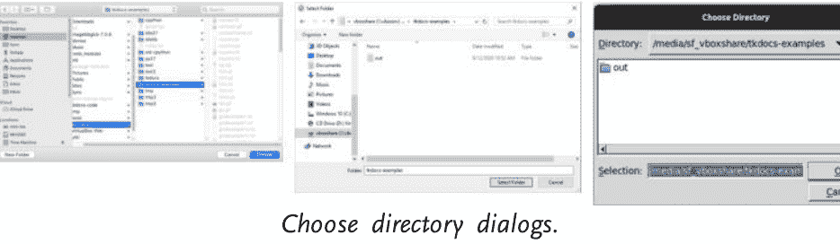

### 选择目录对话框。

可以向这些对话框传递各种选项，允许你设置允许的文件类型、初始目录、默认文件名等更多设置。这些详细信息参见 `getOpenFile__includes` 和 `chooseDirectory__reference` 参考手册页。

https://tkdocs.com/man/getOpenFile

https://tkdocs.com/man/chooseDirectory

### 选择颜色

另一个模态对话框让用户选择颜色。它将返回一个颜色值，例如。对话框接受一个可选的 `initialcolor` 选项来指定现有颜色，即用户可能想要替换的颜色。更多信息可用 `chooseColor__reference` 参考手册页。

https://tkdocs.com/man/chooseColor

```python
from tkinter import colorchooser
colorchooser.askcolor(initialcolor='#ffff00')
```

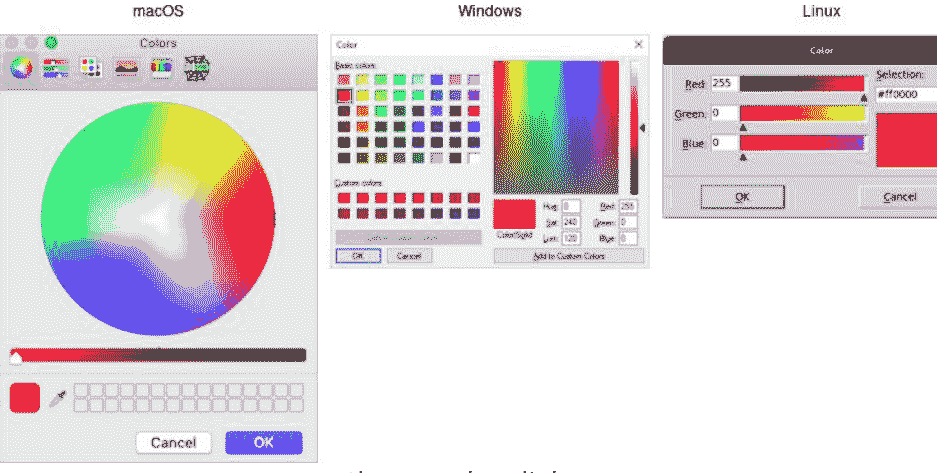

选择颜色对话框。

### 选择字体

Tk 8.6 增加了对另一个系统对话框的支持：字体选择器。文件对话框和颜色选择器是阻塞直到对话框关闭并返回结果的模态对话框，但字体选择器并非如此。

由于 Tk 8.5 中没有字体选择器，如果你的代码需要支持旧版本的 Tk，你需要考虑到这一点。

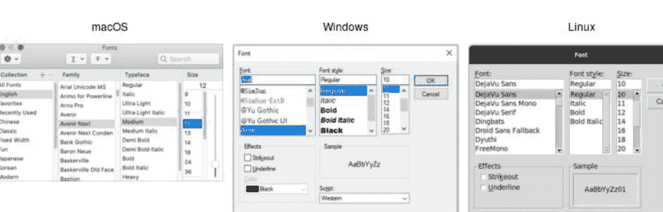

### 字体选择器对话框。

虽然系统字体对话框在某些平台（例如 Windows）上是模态的，但并非到处都是如此。在 macOS 上，系统字体选择器的工作方式更像绘画程序中的浮动工具面板，保持可用，以便更改主应用程序窗口中选中的任何文本的字体。Tk 字体 API 必须兼顾这两种模型。为此，它使用回调（和虚拟事件）来通知应用程序字体更改。更多细节可以在 `fontchooser` 参考页中找到。

https://tkdocs.com/man/fontchooser

要使用字体对话框，首先为其提供一个初始字体和一个在选择字体时被调用的回调。为了说明，我们将让回调更改标签的字体。

```python
l = ttk.Label(root, text="Hello World", font="helvetica 24")
l.grid(padx=10, pady=10)
```

```python
def font_changed(font):
    l['font'] = font
```

```python
root.tk.call('tk', 'fontchooser', 'configure', '-helvetica 24', '-command', root.register(font_changed))
root.tk.call('tk', 'fontchooser', 'show')
```

Tkinter 尚未为使用此新对话框添加方便的方法，因此此示例代码直接使用了 Tcl API。你可以在此处查看完善 Python API 的最新进展并下载代码。

你可以随时查询或更改对话框中显示（或将显示）的字体。

接下来，通过 `show` 方法将字体对话框显示在屏幕上。在对话框为模态的平台上，你的程序在此处阻塞直到对话框关闭。在其他平台上，`show` 会立即返回；对话框将保持在屏幕上。此时，尚未选择字体。还有一个 `hide` 方法可以从屏幕上移除它（当字体对话框为模态时，这并不有用）。

```python
root.tk.call('tk', 'fontchooser', 'configure', '-helvetica 24', '-command', root.register(font_changed))
root.tk.call('tk', 'fontchooser', 'show')
```

```python
root.tk.call('tk', 'fontchooser', 'show')
root.tk.call('tk', 'fontchooser', 'hide')
```

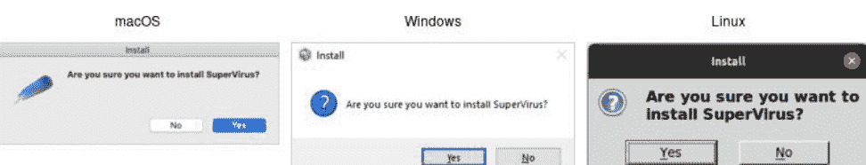

## 示例消息框。

与我们之前看到的对话框一样，这些是模态的，并且会将用户的操作结果返回给调用者。Tkinter 并没有使用统一的类型选项，而是为每种类型的对话框使用了了不同的方法名。返回值随方法而异：

- `showinfo`: -> ok
- `showwarning`: -> ok
- `showerror`: -> ok
- `askokcancel`: -> True (点击 ok) 或 False (点击 cancel)
- `askyesno`: -> True (点击 yes) 或 False (点击 no)
- `askretrycancel`: -> True (点击 retry) 或 False
- `askyesokcancel`: -> True (点击 yes), False (点击 no), 或 None (点击 cancel)

诚然，Tkinter 的 `messagebox` API 并不是最一致的。它混合了不同的返回类型（字符串或布尔值），存在某些重复，并且省略了一个底层对话框类型。

- `message`: 警示框内部显示的主消息。
- `detail`: 次要消息（如果需要）。
- `title`: 对话框窗口的标题。在 macOS 上不使用。
- `icon`: 图标，可选 info（默认）或 default；default: 默认按钮，例如 `askokcancel` 对话框中的 ok 或 cancel。
- `parent`: 弹出此对话框的应用程序窗口。

更多细节可以在参考文档中找到：

https://tkdocs.com/man/messageBox

这些新的 `messagebox` 对话框取代了旧的 `tk_dialog` 命令，该命令不符合当前的平台用户界面规范。

## 自定义对话框

如果你需要创建自己的模态对话框，有几点是你需要处理的。我们在章节的早些部分已经涵盖了大部分内容，例如设置窗口样式、定位窗口等。

首先，你需要确保用户只能与你的对话框进行交互。你可以使用 `grab_set` 来实现这一点。

如果你想让你的对话框函数阻塞你的应用程序（即创建对话框的调用在对话框被关闭之前不应该返回），这也是可以的。其实没有理由这样做，因为你可以在运行正常事件循环的同时响应回调、事件绑定等，然后销毁对话框并继续执行。

这个有些晦涩的示例包含了创建模态对话框所需的步骤步骤。

```
ttk.Entry(root).grid()    # 用于用于交互的组件

def dismiss():
    dlg.grab_release()
    dlg.destroy()

dlg = Toplevel(root)
```

```
ttk.Button(dlg, text="Done", command=dismiss).grid()
dlg.protocol("WM_DELETE_WINDOW", dismiss)
# 拦截关闭按钮
```

```
dlg.transient(root)
# 对话框窗口与主窗口关联
```

```
dlg.wait_visibility()
# 在窗口出现之前无法捕获，所以我们进行等待
```

```
dlg.grab_set()
# 确保所有输入都进入我们的窗口
```

```
dlg.wait_window()
# 阻塞直到窗口被销毁
```

https://tkdocs.com/code/dialog.py

像这样阻塞应用程序代码是运行嵌套事件循环的一个示例，我们通常不建议这样做，尽管在某些特定情况下它可能更方便。

Tkinter 的标准库包含了 `simpledialog` 模块，可以帮助构建你自己的对话框。我们不建议直接使用它，因为它使用的是经典的 Tk 组件，而不是更新的主题组件（themed widgets）。不过，它确实说明了如何使用我们刚刚涵盖的一些让对话框行为的技术。

## 12. 组织复杂界面

如果你有一个复杂的用户界面，你需要找到一种不会让用户感到不知所措的组织方式。有几种不同的方法来实现。在设计用户界面时，通用和特定平台的人机界面指南都是很好的资源。

当我们谈论复杂性时，指的不是底层的实现方式，而是如何呈现给用户。复杂的界面可以由许多模块组合而成，但这并不意味着用户需要感知到它是复杂的。

### 多窗口

使用多个窗口的一个用处是可以简化用户界面。很好，多个窗口可以引导用户只关注当前任务的内容。同样，切换多个窗口也可以产生相反的效果。

### 空白

如果你需要在屏幕上显示大量的组件，考虑如何通过布局组织它们。我们已经看到 `grid` 可以帮助我们将相关组件对齐。空白是另一种有用的辅助。

组件的分组周围的空白、组件之间的空白等，是取决于平台的。如果你想让对话框看起来，需要根据平台进行调整。

### 12.1 分隔线 (Separator)

`ttk.Separator`

https://tkdocs.com/man/ttk_separator

分组组件的第二种方法是使用水平或垂直的细线；这通常比使用空白更有效。Tk 提供了一个用于此目的的组件。

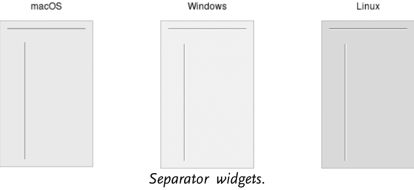

使用 `ttk.Separator` 类创建分隔线：

`s = ttk.Separator(orient=HORIZONTAL)` # orient可以指定为水平或垂直

### 12.2 标签框 (Label Frame)

`ttk.Labelframe`

https://tkdocs.com/man/ttk_labelframe

标签框组件（也称为组）提供了分组组件的另一种方法。它像普通窗口一样，包含其他组件。然而，它与用户界面的其余部分隔离开。你可以可选提供一个标签显示在标签框外部。

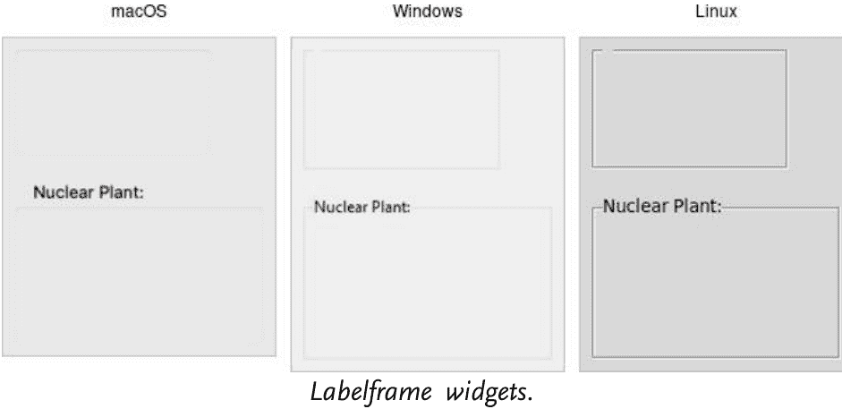

使用 `ttk.Labelframe` 类创建标签框：

```python
lf = ttk.Labelframe(root, text='Label')
```

### 12.3 分栏窗口 (Paned Windows)

`ttk.Panedwindow`

https://tkdocs.com/man/ttk_panedwindow

分栏窗口组件允许你堆叠两个或多个可缩放的组件（上下或左右）。用户可以通过拖动面板之间的滑块来调整相对高度（或宽度）。通常，你添加到分栏窗口的组件是包含其他组件的框架。

| macOS | | Windows | | Linux | | | |
|---|---|---|---|---|---|---|---|
| Pane | Pane | Pane3 | Pane1 | Pane2 | Pane3 | Pane1 | Pane2 |
| Pane1 | | | Pane1 | | Pane1 | | |
| Pane2 | | | Pane2 | | Pane2 | | |

分栏窗口（在此处所示）：

`p = ttk.Panedwindow(orient=VERTICAL)` # 两个面板，每个面板都可以格布局组件：

```python
f1 = ttk.Labelframe(p, text='Pane1', width=100, height=100)
f2 = ttk.Labelframe(p, text='Pane2', width=100, height=100)
p.add(f1)
p.add(f2)
```

分栏窗口可以是垂直的（其面板垂直堆叠）或水平的。`orient` 参数可以此指定。调用 `add` 方法会将新面板添加到面板列表的末尾。`insert` 子窗口方法允许将面板放置在面板列表的指定位置（o..n-1）。如果该面板已被分栏窗口管理，它将被移动到新位置。你可以使用 `forget` 子窗口方法从分栏窗口中移除面板（你也可以传递位置而不是子窗口）。

### 12.4. 笔记本 (Notebook)

`ttk.Notebook`

https://tkdocs.com/man/ttk_notebook

`Notebook` 控件使用标签页笔记本的隐喻，允许用户通过索引在多个页面之间进行切换。与普通窗口不同，用户一次只能看到一个页面（类似于面板）。

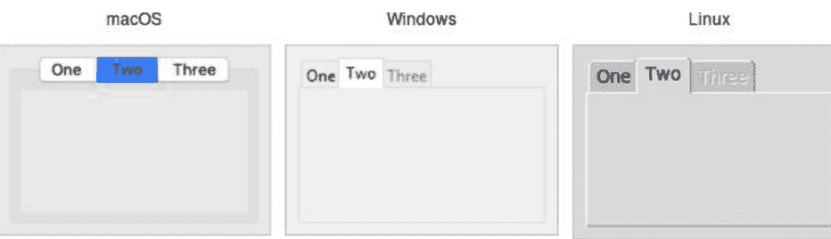

`Notebook` 控件。

`Notebook` 使用 `ttk.Notebook` 类创建：

```python
n = ttk.Notebook(root)
f1 = ttk.Frame(n)
# 第一页，可以将其组件以网格布局放置在其中

f2 = ttk.Frame(n)
# 第二页

n.add(f1, text='One')
n.add(f2, text='Two')
```

对标签页笔记本的操作与分层窗口（paned-windows）的操作类似。每个页面通常是一个 own（frame），并且必须是 notebook 本身的直接子级（子窗口）。使用 `add` 子窗口选项值...可以在最后一个标签页之后添加新页面及其关联的标签；`text` 设置标签上的标记；很有用的是 `state` 标签选项，其值可以为 `disabled`（不可选择）。

要在列表结束的其他位置插入标签页，请使用 `insert` 位置子窗口选项；要移除指定的标签页，使用 `forget` 方法，并传递位置（0..n-1）或标签子窗口。你可以通过 `tabs` 方法获取 notebook 中包含的所有子窗口列表。

要获取当前选中的子窗口，调用 `select` 方法，并通过传递标签的位置或子窗口本身作为参数来更改选中的标签页。

要更改标签选项（如标签上的文本标记或其状态），可以使用该方法（其中 `tabid` 再次是标签的位置或子窗口）；省略 `to` 可返回该选项的当前值。

每当选择新标签页时，Notebook 都会生成一个 `<<NotebookSelect>>` 虚拟事件。

同样，在命令中详细列出了各种较少使用的选项和命令：

https://tkdocs.com/man/ttk_notebook

## 13. 字体、颜色、图像

本章描述了 Tk 如何处理字体、颜色和图像。我们之前已经接触过这些内容，但在这里我们将提供更深入的探讨。

### 13.1. 字体

Tk 的 `label` 控件允许通过字体配置选项更改用于显示文本的字体。后续章节中的 `canvas` 和 `text` 控件也允许你指定字体。显示文本的其他主题控件可能没有字体配置选项，但可以使用样式（styles）更改它们的字体。

我们稍后会详细介绍样式。本质上，它们取代了在单个控件上微调多个配置选项的老方法。相反，字体、颜色和其他控制外观的设置可以组合在一个样式中。该样式随后可以应用于多个控件。这类似于在 HTML 页面内部硬编码显示导向的标记，与使用 CSS 将显示特定的信息分离的之间的区别。

与 Tk 中的许多事物一样，默认字体通常是很好的选择。如果你需要更改，本节展示了最佳方法，即使用命名的 Tk 包含字体，这些字体适用于用户界面的所有不同组件。它们考虑了你所运行的特定平台的惯例。当你需要额外的灵活性时，也可以指定自己的字体。

`font` 命令参考提供了关于指定字体以及其他字体相关操作的完整细节。

https://tkdocs.com/man/font

许多旧的 Tk 程序硬编码字体，使用我们将在下方看到的“族 大小样式”格式、X11 字体名称，或更旧且晦涩的 X11 字体规范字符串。随着平台的演进，这些应用程序看起来越来越过时。更糟糕的是，字体通常按控件指定，导致字体决策分散在整个代码中。命名的字体（特别是 Tk 提供的标准字体）是一个得多的解决方案。在任何现有应用程序中，审查和更新字体决策都是一个简单且重要的更改。

#### 标准字体


每个平台都定义了应用于标准用户界面元素的特定字体。`Tk` 将这些决策中的许多封装到一组标准的命名字体中。它们在所有平台上都可用，尽管使用的具体字体会有所不同。这有助于抽象平台差异。当然，标准控件使用了这些命名字体。

- `TkDefaultFont`: 未指定项目的默认字体。
- `TkTextFont`: 用于控件、列表框等。
- `TkFixedFont`: 标准等宽字体。
- `TkMenuFont`: 用于菜单项字体。
- `TkHeadingFont`: 列表和表格中列头的字体。
- `TkCaptionFont`: 窗口和对话框标题栏的字体。
- `TkSmallCaptionFont`: 工具对话框的较小标题字体。
- `TkIconFont`: 图标标题的字体。
- `TkTooltipFont`: 提示框的字体。

### 平台特定字体

`Tk` 提供了额外的命名字体，以帮助你符合特定平台上不常见的情况。各个平台的指南详细说明了应如何以及何地使用这些字体。这些字体仅在特定平台上定义。如果你的应用程序具有跨平台可移植性，则需要考虑这一点。

`X11` `Tk` 识别任何有效的 `X11` 字体名称（例如查看 `xlsfonts` 命令）。然而，这可能随着操作系统、安装的软件以及单个机器的配置而异。无法保证字体是-

在 Windows 上，`Tk` 提供了以下：

在 macOS 上，`Tk` 提供了以下：

### 使用命名字体

`Tk` 提供了几种操作帮助你处理命名字体。你可以从获取可用字体列表开始：

```python
from tkinter import font
font.families()
```

你可以使用以下方法获取命名字字的实际属性：

```python
>>> from tkinter import font
>>> f = font.namofont('TkTextFont')
>>> f.actual()
{'family': 'AppleSystemUI', 'size': 13, 'weight': 'normal', 'slant': 'roman', 'underline': False, 'overstrike': False}
>>> f.metrics()
{'ascent': 13, 'descent': 3, 'linespace': 16, 'fixed': False}
>>> f.measure('The quick brown fox')
```

`Tkinter` 提供了一个 `Font` 类来存储命名字体的信息。你可以通过 `namofont` 函数从字体名称创建类的实例。当你在应用程序中使用字体时（例如通过配置选项），你可以提供字体名称（字符串）或 `Font` 实例。

你也可以创建自己的字体，然后像使用预定义字体一样使用它们。这样做只需为字体命名并按上述方式指定其字体属性。

```python
from tkinter import font
highlightFont = font.Font(family='Helvetica', name='appHighlightFont', size=12, weight='bold')
ttk.Label(root, text='Attention!', font=highlightFont).grid()
```

`family` 属性指定字体族。`Tk` 确保 `Helvetica` 可用，尽管它们可能会映射到相应的等宽、衬线或无衬线字体。

### 字体描述

另一种指定字体的方法是通过属性列表，从字体族开始，可选地包含大小和一个或多个样式选项。一些示例包括 `Helvetica`、`Helvetica 12` 和 `Helvetica 12 bold`。这些字体描述可以用于任何你可以使用命名字体的地方，例如字体配置选项。

## 13.2. 颜色

与字体一样，有多种指定颜色的方法。详情可以在 `colors` 命令中找到：

https://tkdocs.com/man/colors

通常情况下，`Tk` 控件在大多数情况下默认使用正确的颜色。如果你想更改颜色，将通过特定特定的命令或选项来实现，例如 `label` 的前景（`foreground`）和背景（`background`）配置选项。对于大多数主题控件，颜色是通过样式（`styles`）指定的，而不是直接更改控件。

你可以通过 RGB 来指定颜色，就像在 HTML 或 CSS 中一样，例如 `#3FF`，`Tk` 也识别如 `light` 等名称。

`Tk` 识别由 `X11` 定义的标准颜色名称。你可以在命令参考中（上文提到）找到完整列表。

与字体一样，macOS 和 Windows 都指定了许多系统特定的抽象颜色名称（再次参见参考）。这些名称对应的实际颜色可能取决于系统设置，并随着时间而变化，例如深色模式、文本高亮颜色、默认背景。

如果需要，你可以使用任何控件上的 `winfo_rgb` 方法获取颜色的 RGB 值（每个值在 0 到 65535 之间）。

```python
root.winfo_rgb('red')
```

这可能是不言而明的，但强烈建议节制使用颜色！

## 13.3. 图像

我们已经看到了使用图像的基础知识，例如在 `label` 或按钮中显示它们。我们创建一个图像对象，通常来自磁盘上的文件。

```python
imgobj = PhotoImage(file='myimage.gif')
label['image'] = imgobj
```

`Tk` 8.5 包含了对 GIF 和 PPM/PNM 图像的支持。`Tk` 8.6 将 PNG 加入了这一短列表。然而，一个名为 `Img` 的 `Tk` 扩展库添加了许多其他格式的支持：BMP、XBM、XPM、JPEG、PNG（如果你使用的是 8.5）、TIFF 等。虽然 `Img` 未包含在 `Tk` 核心中，但它通常包含在其他发行版中（例如 ActiveTcl）。

`Tkinter` 没有使用 `Tk` 的 `Img` 扩展，而是使用了一个专为 Python 设计的图像库 `PIL` (Python Imaging Library)。更具体地说，我们将使用 `PIL` 的一个更新的分分支 `Pillow`。由于它没有与 Python 捆绑，你通常需要安装它。你应该能够通过 `pip install Pillow` 等方式进行安装。

```python
from PIL import ImageTk, Image
myimg = ImageTk.PhotoImage(Image.open('myimage.png'))
```

`ImageTk.PhotoImage` 调用提供了 `Tk` `PhotoImage` 的无缝替换，但支持更广泛的图像类型。

`Tk` 的图像实际上非常强大且复杂，提供了各种检查和修改图像的方法。你可以从 `image` 命令参考和 `photo` 命令中找到更多信息：

https://tkdocs.com/man/image

https://tkdocs.com/man/photo

我们在这里看到的彩色图像类型在 `Tk` 中被称为 **photo images**。`Tk` 还提供了第二类型，即二位位图图像，这种图像在 90 年代被广泛使用，当时大多数 Unix 工作站使用的显示器（与 PC 相比）要大得多，但它们只有黑白。无需多说，如今色彩已是事所应当，因此将图标等内容更新为全色图像是强烈建议的。尽管在某些人认为是复古风格的设计，某些扁平化和材料设计方案已回归了黑白。事虽如此……（Plus ça change...）

## 14. 画布 (Canvas)

https://tkdocs.com/man/canvas

`canvas` 控件管理 2D 图形对象集合——线、圆、文本、图像、其他控件等。`Tk` 的 `canvas` 是一个极其强大且灵活的控件，确实是 `Tk` 的亮点之一。它适用于广泛用途，包括绘图或制图、CAD 工具、显示或监控模拟或实际设备，以及由简单的控件构建更复杂的控件。

注意：`Canvas` 控件是经典 `Tk` 控件的一部分，而不是主题 `Tk` 控件。

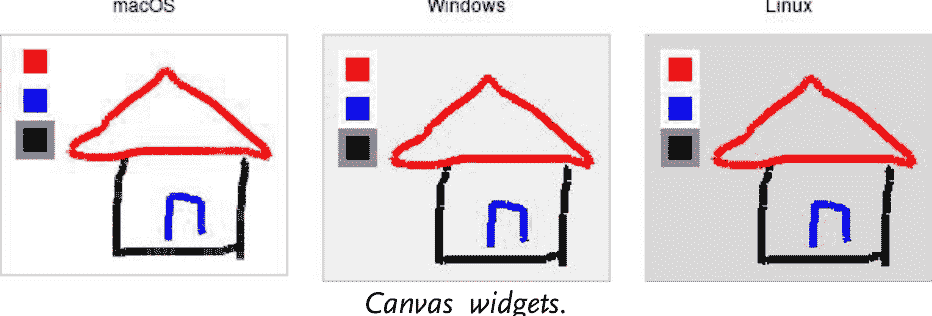

`Canvas` 控件使用 `Canvas` 类创建：

```python
canvas = Canvas(width=500, height=400, background='gray75')
```

你通常会提供宽度和高度，单位可以是像素或任何其他标准距离单位。一如既往，你可以请求几何管理器将其扩展以填充窗口中的可用空间。你可以为画布提供一个默认背景颜色，就像你在上一章中学习的那样指定颜色。`Canvas` 控件还支持我们之前使用过的外观选项，如 `relief` 和 `borderwidth`。

`Canvas` 控件拥有极大量的功能，我们在这里不会涵盖所有内容。相反，我们将从一个简单的示例——自由手绘图工具开始，逐步添加新部分，每个部分将展示 `canvas` 控件的另一个功能。

### 14.1. 创建项目

当你创建一个新的 `canvas` 控件时，它本质上是一个空的巨大矩形，换句话说，是一块空白画布。要对它进行任何有用操作，你需要向它添加项目。你可以添加许多不同类型的项目。

### 简单的绘图板示例

```python
from tkinter import *
from tkinter import ttk

class Sketchpad(Canvas):
    def __init__(self, parent, **kwargs):
        super().__init__(parent, **kwargs)
        self.bind("<B1-Motion>", self.save_posn)
        self.bind("<B1-Release>", self.add_line)

    def save_posn(self, event):
        self.lastx, self.lasty = event.x, event.y

    def add_line(self, event):
        self.create_line(self.lastx, self.lasty, event.x, event.y)
        self.lastx, self.lasty = event.x, event.y

root = Tk()
root.columnconfigure(0, weight=1)
root.rowconfigure(0, weight=1)
sketch = Sketchpad(root)
sketch.grid(column=0, row=0, sticky="N, W, E, S")

root.mainloop()
```

`disabledfill`, `disabledwidth`, ...: 如果项的状态设置为该项，它将使用这些普通属性的变体进行显示；`activefill`, `activewidth`, ...: 当鼠标指针悬停在项上时，它将使用这些普通属性的变体进行显示。

如果你有会改变状态的画布项（`canvas items`），通过同时使用普通版本和属性变体来创建项可以简化你的代码。你只需要更改项的状态，而无需编写代码来更改多个显示属性。属性变体也是如此。这都鼓励使用更加声明式的风格，可以消除大量的样板代码。

就像 `Tk` 控件一样，你可以在画布项创建后更改其项的属性。

```
id = canvas.create_line(o, o, 10, 10, fill='red')
...
```

```
canvas.itemconfigure(id, fill='blue', width=2)
```

## 项目类型 (Item Types)

画布组件支持多种类型的项目。

## 线 (Line)

我们的草图板创建了简单的线项目，每个项目都是一个具有起点和终点的单段。线也可以由多个段组成。

```
canvas.create_line(10, 10, 200, 50, 90, 150, 50, 80)
```

线具有几个有趣的额外属性，允许绘制曲线、箭头等。

- `arrow`: 在起点、终点或两端放置箭头；默认为 `none`（无）。
- `arrowshape`: 允许更改箭头的外观。
- `capstyle`: 对于没有箭头的宽线，此控制线条端的绘制方式；可选包括 `butt`（默认）或 `round`（圆角）。
- `style`: 对于具有多个段的宽线，此控制每个顶点的绘制方式；可选包括 `round`（默认）或 `miter`（斜角）。
- `smooth`: 如果指定为 `true`，则通过二次样条曲线在多个段之间绘制平滑曲线，而不是使用直线；`raw` 则指定另一种类型的曲线（三次样条曲线）。
- `splinesteps`: 控制曲线的平滑度，即设置了 `smooth` 选项的线。

## 矩形 (Rectangle)

矩形由对角角的坐标指定，例如左上角和右下角。它们可以用一种颜色填充（通过 `fill`），并为轮廓赋予另一种颜色。

```
canvas.create_rectangle(10, 10, 200, 50, fill='red', outline='blue')
```

## 圆圆 (Oval)

椭圆项目的工作方式与矩形完全相同。

```
canvas.create_oval(10, 10, 200, 150, fill='red', outline='blue')
```

## 多边形 (Polygon)

多边形项目允许你通过一系列点创建任意形状。坐标写法与多点线相同。`Tk` 确保多边形是“闭合的”，如有需要会将最后一点连接到第一个点。像椭圆和矩形一样，它们具有单独填充和轮廓颜色。它们还支持线项目的 `splinesteps` 属性。

```
canvas.create_polygon(10, 10, 200, 50, 90, 150, 80, 120, 55, fill='red', outline='blue')
```

## 弧 (Arc)

弧项目绘制椭圆的一部分；想象成饼图的一块。它的显示由三个属性控制：

- `start`: 椭圆弧的起始位置，单位为度（0 是 3 点钟位置）。
- `extent`: 弧的“宽度”为多少度，正值表示从逆时针方向，负值表示顺时针方向。
- `style`: 可选 `pieslice`（默认值）、`arc`（仅绘制外轮廓）或 `chord`（绘制弧的起点和终点连线与外轮廓之间的区域）。

```
canvas.create_arc(10, 10, 200, 150, fill='yellow', outline='black', start=45, extent=135, width=5)
```

## 图像 (Image)

图像项目可以显示任意图像。默认情况下，项居于你指定的坐标中心，但可以通过 `anchor` 选项更改，例如 `nw` 表示坐标是放置图像左上角的位置。

```
myimg = PhotoImage(file='pretty.png')
canvas.create_image(10, 10, image=myimg, anchor='nw')
```

还有一种位图项目（`bitmap item`）用于只有两种颜色的图像，可以通过前景（`foreground`）和背景（`background`）进行更改。它们现在已不再常用。

## 文本 (Text)

文本项目可以显示一段文本。文本定位的方法与图像项目相同。使用 `text` 属性指定要显示的文本。该项中的所有文本将具有相同的颜色（由 `fill` 属性指定）和相同的字体（由 `font` 属性指定）。

如果在文本中嵌入 `\n`，文本项可以显示多行文本。或者，你可以通过提供 `width` 属性（代表行的最大宽度）让项自动换行成多行。文本行的对齐可以使用 `justify` 属性设置，可选包括 `left`（默认）或 `center`（居中）。

```
canvas.create_text(100, 100, text='A wonderful story', anchor='nw', font='TkMenuFont', fill='red')
```

## 控件 (Widget)

使用画布组件可以做的最酷的事情之一是在内部嵌入其他控件。这可以是一个简单的按钮、一个输入框（想象对文本项进行就地编辑）、列表框……

显示其他控件的画布项被称为窗口项（`window items`）。它们像文本和图像项一样定位。你可以给它们显式的大小。

## 修改项目 (Modifying Items)

我们已经看到如何修改项的配置——颜色、宽度等。还有其他可以对项目执行的操作。要删除项，使用 `delete` 方法。要更改项的大小和位置，可以使用 `coords` 方法。调用此方法时不带新设置将返回项的当前坐标。你可以使用 `move` 方法水平或垂直偏移一个或多个项。所有项从上到下排序称为堆叠顺序。如果堆叠顺序靠后的项覆盖了下方的项，前面的项会在上方。`lift` 和 `lower` 方法允许调整项目在堆叠顺序中的位置。

参考手册中详细说明了更多操作。

## 事件绑定 (Event Bindings)

我们已经看到画布组件像任何其他控件一样，可以使用 `bind` 命令捕捉事件。

你还可以将绑定附加到单个项目（我们将在下一节中使用标签来实现这一点）。因此，如果你想知道某个特定项目是否被点击，你不需要监听整个画布的点击事件，然后判断点击是否发生在你的项上。`Tk` 会为你处理好这一切。

要捕捉这些事件，你使用画布内置的 `bind` 命令。它的工作方式与普通 `bind` 命令完全，接收一个事件模式和一个回调函数。区别在于你需要指定该绑定适用于哪个项目。

```
canvas.tag_bind(id, '<1>', ...)
```

注意项目特定的 `tag_bind` 方法与控件级 `bind` 方法的区别。让我们为我们的草图示例添加一些代码以允许更改绘制颜色。我们首先创建几个不同的矩形项，每个填充一种不同的颜色。然后我们为这些每个项附加一个绑定。当它们被点击时，会将一个全局变量设置为新的绘制颜色。我们的鼠标移动绑定在创建线段时会查看该变量。

```
color = "black"
def setColor(newcolor):
    global color
    color = newcolor
```

```
def addLine(event):
    global lastx, lasty
```


```
canvas.create_line((lastx, lasty, event.x, event.y), fill=color)
lastx, lasty = event.x, event.y
```

## 14-3. 标签 (Tags)

我们已经看到每个画布项目都可以通过唯一的 id 数字来引用。还有另一种方便且强大的方法来引用画布上的项目，即使用标签（tags）。

标签只是你创建的标识符，对你的程序有意义的东西。你可以将标签附加到画布项目上；每个项目可以有任意数量的标签。唯一的 item id 数字对于每个项目都是唯一的，但许多项目可以共享同一个标签。

你可以用标签做什么？我们已经看到可以使用 item id 来修改画布项目（我们很快就会看到还可以对项目做的其他事情，如移动它们、删除它们等）。在任何你可以使用 item id 的地方，你都可以使用标签。例如，你可以更改所有具有特定标签的项目的颜色。

标签是识别画布中项目集合的良好方法（绘制出的线条中的项目、调色板中的项目等）。你可以使用标签将画布项目与应用程序中的特定对象相关起来（例如，将所有属于 id 为 #X37 的机器人的画布项目标记为“robotX37” 标签）。有了标签，你就不需要一直跟踪画布项目的 id 以便以后引用这些组；让 Tk 为你完成这些工作吧。

你可以在创建项目时使用 `tags` 配置选项分配标签。稍后可以使用 `addtag` 方法添加标签，或使用 `dtag` 方法删除标签。你可以使用 `gettagsags` 方法获取项目的标签列表，或使用 `find` 命令返回具有给定标签的 item id 数字列表。

例如：

```
>>> c = Canvas(root)
>>> c.create_line(10, 10, 20, 20, tags=('firstline', 'drawing'))
1
>>> c.create_rectangle(30, 30, 40, 40, tags=('drawing'))
2
>>> c.addtag('rectangle', 'withtag', 2)
>>> c.addtag('polygon', 'withtag', 'rectangle')
>>> c.gettags(2)
('drawing', 'rectangle', 'polygon')
>>> c.dtag(2, 'polygon')
>>> c.gettags(2)
('drawing', 'rectangle')
>>> c.find_withtag('drawing')
(1, 2)
```

如你所示，像 `withtag` 这样的方法接受单个项目或标签；在后者的情况下，它们将应用于所有具有该标签的项目。`addtag` 和 `find` 方法具有许多选项，允许你指定点附近的项目、重叠特定区域等。让我们使用标签为当前选中的任何项目添加一个边框。

```python
def setColor(newcolor):
    global color
    color = newcolor
    canvas.dtag('all', 'paletteSelected')
    canvas.itemconfigure('palette', outline='white')
```

```python
canvas.addtag('paletteSelected', 'withtag', 'palette%s' % color)
canvas.itemconfigure('paletteSelected', outline='#999999')
```

```python
id = canvas.create_rectangle(10, 10, 30, 30), fill="red", tags=
('palette', 'palettered')
id = canvas.create_rectangle(10, 35, 30, 55), fill="blue", tags=
('palette', 'paletteblue')
id = canvas.create_rectangle(10, 60, 30, 80), fill="black", tags=
('palette', 'paletteblack', 'paletteSelected')
```

```python
setColor('black')
canvas.itemconfigure('palette', width=5)
```

让我们也使用标签让正在绘制的线条变得更加明显。当鼠标按钮释放时，我们将线条恢复为正常。

```python
def addLine(event):
    global lastx, lasty
    canvas.create_line(lastx, lasty, event.x, event.y), fill=color,
width=5, tags='currentline')
    lastx, lasty = event.x, event.y
```

```python
def doneStroke(event):
    canvas.itemconfigure('currentline', width=1)
```

```python
canvas.bind("", doneStroke)
```

`https://tkdocs.com/code/sketch3.py`

## 14.4. 滚动 (Scrolling)

在许多应用程序中，你希望画布比屏幕显示的更大。你可以通过 `xview` 和 `yview` 方法通常为画布附加水平和垂直滚动条。你可以指定你希望它在屏幕上的大小以及它的完整尺寸（这需要滚动才能看到）。`width` 和 `height` 配置选项控制空间，而 `scrollregion` 配置选项通过指定左、上、右、下坐标来告诉 Tk 画布表面有多大，例如 `0 0 1000`。

根据你已经知道的知识，你应该能够修改绘图程序以添加滚动功能。尝试一下。一旦完成，将画布向下滚动一点，然后尝试绘制。你会发现你正在绘制的线条出现在鼠标指向的上方！

发生这种情况是因为全局 `bind` 命令不知道画布已经滚动（它不知道任何特定组件的细节）。因此，如果你向下滚动了 50 像素并点击画布，`bind` 将报告该位置。`canvasx` 和 `canvasy` 方法会将该位置转换为实际位置。

## 15. 文本 (Text)

# Text

`https://tkdocs.com/man/text`

文本组件管理一个多行文本区域。和 `canvas` 组件一样，Tk 的 `text` 组件是一个极其灵活且强大的工具，可以用于执行各种任务。它可以作为表单的一部分提供简单的多行文本区域。但文本组件也可以作为样式化代码编辑器、大纲视图、网络浏览器等的基础。

## 文本组件 (Text widgets)。

虽然我们在前面的章节中简要介绍了文本组件，但我们在这里将进入更多细节。你将更更好地了解它们允许的复杂程度。尽管如此，如果你计划使用文本组件进行任何重大工作，参考手册是一份组织良好、非常有帮助且非常推荐的读物。

Text 组件是使用 `Text` 类创建的：

```python
text = Text(width=40, height=10)
```

你通常会提供宽度（以字符为单位）和高度（以行为单位）。一如既往，你可以要求几何管理器扩展它以填充窗口中的可用空间。

## 15.1. 基础知识

如果你只需要为表单提供一个多行文本字段，只需要考虑这几点：创建并调整组件的大小（检查）、提供一个初始值，并在用户提交表单后获取文本。

### 提供初始内容

Text 组件初始化时内部是空的，因此我们需要手动添加任何初始内容。由于 Text 组件可以包含比纯文本多得多的内容，因此一个简单的机制（例如 `entry` 组件的 `textvariable` 配置选项）是不够的。

相反，我们将使用组件的 `insert` 方法：

```python
text.insert('1.0', 'here is my\ntext to insert')
```

这里的 "1.0" 是要插入文本的位置，可以读作“第 1 行，第 0 个字符”。它指的是第一行的第一个字符。在历史上，特别是在 Unix 系统上，程序员倾向于认为行号从 1 开始，而字符位置从 0 开始。

要插入的文本只是一个字符串。由于组件可以包含多行文本，我们提供的字符串也可以是多行的。为了做到，只需在字符串的适当位置嵌入 `\n`（换行符）字符即可。

### 获取文本

在用户进行任何更改并提交表单（例如）之后，你的程序可以通过 `get` 方法检索组件的内容：

```python
htext = text.get('1.0', 'end')
```

这两个参数是起始和结束位置；`end` 的含义显而易见。如果你只想获取文本的一部分，可以提供不同的起始和结束位置。稍后你会看到更多关于位置的内容。

### 自定义外观

我们之前见过过 Text 组件的 `width` 和 `height` 配置选项。其他几个选项也可以控制它的外观。最常用的是：

- foreground: 绘制的颜色

- background: 组件的背景颜色

- padx, pady: 组件内部边界的额外内边距

- borderwidth: 组件边框的 own

- relief: 边框样式

- groove: 凹槽样式

### 换行与滚动

如果组件中的某些行文本非常长，超过了组件的宽度怎么办？默认情况下，文本会换行到下一行。这种行为可以通过 `wrap` 配置选项更改。它的默认值 `chars`，意味着在任何字符处换行。其他选项包括 `word`（仅在单词分界处，如空格处换行）以及 `none`（完全不换行）。在最后的情况下，除非我们为组件附加水平滚动条，否则较长行的某些文本将不可见（用户即使没有滚动条，也可以使用方向键滚动文本）。

可以像对待 `canvas`、`listbox` 等其他组件一样，相同地为 Text 组件附加水平和垂直滚动条。

```python
t = Text(root, width=40, height=5, wrap=ys)
ys = tk.Scrollbar(root, orient='vertical', command=t.view)
xs = tk.Scrollbar(root, orient='horizontal', command=t.view) 
t['yscrollcommand'] = ys.set
t['xscrollcommand'] = xs.set

t.insert('end', 'Lorem ipsum...\n...\n...')
t.grid(column=0, row=0, sticky='nw')
xs.grid(column=0, row=1, sticky='we')
ys.grid(column=1, row=0, sticky='ns')
root.grid_columnconfigure(0, weight=1)
root.grid_rowconfigure(0, weight=1)
```

`https://tkdocs.com/code/scrolledtext.py`

我们还可以要求组件确保文本的某部分可见。例如，假设我们在组件中添加了更多填充屏幕的文本（因此会滚动）。但我们希望确保看到文本的顶部而不是底部。我们可以使用 `see` 方法。

```python
text.see('1.0')
```

### 禁用组件

某些表会在满足特定条件之前临时禁用特定组件的编辑（例如，某些选项被设置为特定值）。要防止用户更改 Text 组件，可以将 `state` 配置选项设置为 `disabled`。

```python
text['state'] = 'disabled'
```

由于 Text 组件是经典组件的一部分，因此无法使用常用的状态和状态方法。通过将此选项设置回来重新启用编辑。

## 15.2. 在代码中修改文本

### 文本位置与索引

当我们指定位置 1.0（第一行，第一个字符）时，这是一个索引的示例。它告诉 `insert` 方法在何处插入新文本（紧邻第一行第一个字符之前，即组件的最开始处）。索引可以用多种方式指定。我们在 `get` 方法中使用了另一种：`end`，表示紧随文本结束之后。（为什么是“紧随之后”？）文本在给定的索引之前插入（因此在 `end` 处插入将把文本添加到组件的末尾）。注意，Tk 始终会在 Text 组件的最后末尾添加一个换行符。

这里是索引的几个额外示例以及如何解释它们：

- end: 第 3 行尾的换行符。

- 1.0 + 3 chars: 第 1 行开始后的三个字符。

- 2.end -1 chars: 第 2 行新行行之前的最后一个字符。

- 2.end -1 chars: Tk 始终在文本末尾添加的换行符。

- 2.end -2 chars: 文本真正的最后一个字符。

- 2.end -1 lines: 实际文本行的开始。

- 2.2 + 2 lines: 文本第四行的第三个字符（索引为 2）。

- 2.5 linstart: 第 2 行的第一个字符。

- 2.5 lineend: 第 2 行尾换行符的位置。

- wordstart: 2.5 处单词的第一个字符。

- wordend: 2.5 处单词后的第一个字符。

一些需要注意的事项：

- 索引中的行号被解释为逻辑行，即每行都以换行符结束。

- 在启用换行的情况下，一个逻辑行可能代表多行。

- 术语之间的空格可以省略，例如 `end of end text`。

- 要确定索引的规范位置，请使用 `index` 方法。向它传递任何索引，它将返回相应的索引。例如，要找到最后一个字符的位置（忽略末尾自动添加的换行符），请使用：

```python
text.index('end')
```

### 删除文本

虽然 `insert` 方法可以在组件的任何地方添加新文本，但 `delete` 方法可以将其删除。我们可以删除单个字符（由索引指定）或范围字符（由起始和结束索引指定）。在后者情况下，从起始索引（包含起始索引）一直到结束索引之前的字符将被删除（结束索引处的字符不会被删除）。因此，如果我们假设执行这些操作时，组件中已有 `abcd\nefgh`：

```python
text.delete('1.2') ⇒ "abd\negh"
text.delete('1.1', '1.2') ⇒ "acd\negh"
text.delete('1.0', '2.0') ⇒ "efgh"
text.delete('1.2', '2.1') ⇒ "abfgh"
```

还有一个 `replace` 方法，它会在同一位置执行删除后执行插入。

### 示例：日志窗口

这是一个使用 Text 组件作为应用程序 80x24 日志窗口的短示例。用户完全不编辑 Text 组件。相反，程序向它写入日志消息。我们希望显示超过 24 行（不滚动）。如果日志满了，会在末尾添加新消息之前从顶部移除旧消息。

```python
from tkinter import *
from tkinter import ttk
```

```python
root = Tk()
```

```python
log = Text(root, state='disabled', width=80, height=24, wrap='none')
log.grid()
```

```python
def writeToLog(msg):
    numelines = int(log.index('end') - 1 line).split('.')[0]
    log['state'] = 'normal'
    if numelines>=24:
        log.delete(1.0, 2.0)
        if log.index('end-1c')!='1.0':
            log.insert('end', '\n')
    log.insert('end', msg)
    log['state'] = 'disabled'
```

`https://tkdocs.com/code/logwindow.py.`

注意，由于程序将部件置于禁用状态，我们必须重新启用它才能进行任何更改，即使是从我们的程序中进行。

## 15.3. 使用标签进行格式化

到为止，当所有文本使用单一字体时，我们使用的是文本部件。现在是时候添加粗体、斜体、删除线、背景颜色、字体大小等格式了。Tk 的文本部件使用一种名为“标签”（Tags）的功能来实现这些功能。

标签是与文本部件关联的对象。每个标签通过程序员选择的名称引用。每个标签都有多个配置选项，这些是控制格式的字体和颜色等。虽然标签是具有状态的对象，但它们不需要显式创建，而在第一次使用标签名称时会自动创建。

### 向文本中添加标签

标签可以与部件中的一个或多个文本范围关联。与之前一样，范围通过索引指定。单个索引表示单个字符，一对索引表示从起始字符到结束字符正前一个字符的范围。使用 `tag_add` 方法将标签添加到文本范围。

```
text.tag_add('highlight', '5.0', '6.0')
```

在首次插入文本时也可以提供标签。`insert` 方法支持一个可选参数，该参数包含一个或多个要添加到插入文本中的标签列表。

```
text.insert('end', 'new material to insert', ('highlightline', 'recent',
'warning'))
```

随着部件内容的修改（无论是通过用户还是通过你的程序），标签将自动调整。例如，如果我们为文本 "the quick brown fox" 标记了 "nounphrase" 标签，然后将单词 "quick" 替换为 "speedy"，该标签仍然适用于整个短语。

### 为标签应用格式

格式通过配置选项应用于标签；这些选项的工作原理与对整个部件的配置选项类似。例如：

```
text.tag_configure('highlightline', background='yellow',
font='TkFixedFont', relief='raised')
```

标签支持以下配置选项：并查阅参考手册以获取这些内容的详细描述。`tag_get` 标签选项允许我们查询标签的配置选项。


由于多个标签可以应用于同一个文本范围，因此存在冲突的可能性（例如，两个标签指定不同的字体）。使用优先级顺序来解决这些问题；最近创建的标签具有最高优先级，但可以使用 `tag_raise` 标签和 `tag_lower` 方法标签重新排列优先级。

### 更多标签操作

要完全删除一个或多个标签，我们可以使用 `tag_delete` 方法。这当然也会移除文本中对标签的任何引用。我们还可以使用 `tag_remove` `tag start ?end?` 方法从文本范围中删除标签。即使这导致没有带有该标签的文本范围，标签对象本身仍然存在。

`tag_ranges` 方法将返回文本中已应用该标签的范围列表。还有 `tag_nextrange` `tag start ?end?` 和 `tag_prevrange` `tag start ?end?` 方法用于从给定位置向前或向后搜索第一个此类范围。

`tag_names` `?idx?` 方法在不带额外参数调用时，将返回文本部件中当前定义的所有标签列表（包括那些当前未使用的标签）。如果我们向该方法传递一个索引，它将返回应用于该索引处字符的标签列表。

最后，可以使用文本中具有给定标签的第一个和最后一个字符作为索引，就像我们可以使用 "end" 或 "2.5" 一样。这样做只需指定 first 或 last。

### Canvas 和文本部件之间标签的区别

`canvas` 和文本部件都有可以应用于多个对象的“标签”，并对其进行样式设置等。然而，`canvas` 和文本标签是不相同的，有需要注意的实质差异。

在 `canvas` 部件中，只有单个 `canvas` 项目具有控制其外观的配置选项。当我们引用 `canvas` 中的标签时，其含义等同于“当前具有该标签的所有 `canvas` 项目”。标签本身并不作为一个独立的对象存在。因此，在下面的片段中，最后添加的矩形不会被染红色。

```
canvas.itemconfigure('important', fill='red')
canvas.create_rectangle(10, 10, 40, 40, tags=('important'))
```

相比之下，对于文本部件，保留外观状态信息的不是单个字符，而是标签，标签本身就是对象。因此在段片段中，新添加的文本将被染红色。

```
text.insert('end', 'first text', ('important'))
text.tag_configure('important', foreground='red')
text.insert('end', 'second text', ('important'))
```

## 15.4. 事件与绑定

我们可以做的非常酷的事情之一是在标签上定义事件绑定。这允许我们轻松执行诸如识别对特定文本范围的鼠标点击并响应弹出菜单或对话框的操作。不同的标签可以有不同的绑定。这省去了处理诸如“在此位置点击意味着什么？”之类的问题的麻烦。标签上的绑定通过 `tag_bind` 方法实现：

```
text.tag_bind('important', '<1>', popupImportantMenu)
```

整个部件的事件绑定继续像其他任何部件那样工作，例如，用于在部件的任何地方捕捉鼠标点击。第一个命名的标记是插入光标当前的位置。随着光标（通过鼠标或键盘）移动，标记会随之移动。第二个标记跟踪当前鼠标位置下方字符的位置。

### 15.5. 选择文本

我们可以使用 `tag_ranges` 方法并传递 `sel` 作为标签，用来查找文本范围。同样，我们可以通过使用 `tag_add` 设置新的选择范围或使用 `tag_remove` 移除选择范围。然而，`sel` 标签无法被删除。虽然默认的部件绑定防止了这一点，但 `sel` 就像任何其他标签一样，它可以支持多个范围，即不连续的选择。为了防止这种情况的发生，当你从代码更改选择范围时，部件会管理光标（新输入文本将出现的地方）与选择分开。它使用一个名为“标记”（Marks）的新概念来实现。

## 15.6. 标记（Marks）

标记指示文本中的特定位置。在这方面，它们类似于索引。然而，随着文本的修改，标记将调整到处于相同的相对位置。通过这样，它们类似于标签，但引用的是单个位置而不是文本范围。标记实际上并不是指向文本中字符占据的位置，而是指定了两个字符**之间**的位置。

要创建你自己的标记，请使用部件的 `mark_set` `name idx` 方法，传递标记的名称和索引（标记置于给定索引处的字符之前）。这也被用于将现有标记移动到不同位置。可以使用 `mark_unset` `name` 方法移除标记，传递标记的名称。如果你删除包含标记的文本范围，也会移除该标记。

标记的名称也可以用作索引（就像 `1.0` 或 `end-1c` 是索引一样）。你可以使用 `mark_next` `idx` 或 `mark_previous` `idx` 方法从文本中的给定索引查找下一个标记（或上一个标记）。`mark_names` 方法将返回所有标记名称的列表。

标记还有一个重力，可以通过 `mark_gravity` `name ?direction?` 方法进行修改，这会影响

当文本插入到标记处时。假设我们有文本 "ac"，其间有一个标记，我们用管道符号 `|` 来表示，即 "a|c"。如果该标记的重力（gravity）是正确的（默认值），标记将附在 "c" 上。如果在该标记处插入新文本 "b"，标记将继续保持粘附在 "c" 上，因此新文本将插入到标记之前，即 "ab|c"。如果重力相反，标记将附在 "a" 上，因此新文本将插入到标记之后，即 "a|bc"。

## 15.7. 图像和组件

就像画布（`canvas`）组件一样，文本组件可以包含图像和任何其他 Tk 组件（包括包含许多其他组件的框架 `frames`）。在某种意义上，这使得文本组件能够独立作为一个几何管理器工作。在文本中添加图像和组件的能力为你的程序开启了无限可能。

图像在特定的索引处添加到文本组件中，并指定图像为现有的 Tk 图像。其他允许你精细调整内边（padding）等选项。

```
flowers = PhotoImage(file='flowers.gif')
text.image_create('sel.first', image=flowers)
```

其他组件以与图像非常的方式添加到文本组件中。被添加的组件在组件层次结构中必须是文本组件的后代。

```
b = ttk.Button(text, text='Push Me')
text.window_create('1.0', window=b)
```

## 15.8. 更多功能

文本组件还可以做很多事情。在这里，我们将简要提到其中几项。关于这些任何一项的详细信息，请参阅参考手册。

### 搜索

文本组件包含一个搜索方法，用于定位组件内的某段文本。这对于“查找”对话框是一个非常明显的例子。你可以从特定位置向前或向后搜索，或者在给定的范围内搜索，使用精确文本、不区分大小写或正则表达式来指定搜索词，查找搜索词的一个或所有出现位置等。

### 修改、撤销和重做（Undo and Redo）

文本组件会跟踪是否发生了更改（例如，知道是否需要保存到文件很有用）。我们可以使用 `edit_modified` 布尔方法进行查询（或修改）。它还有一个完整的多级撤销/重做机制，由组件自动管理——当我们将其 `undo` 配置选项设置为 `edit_undo` 或 `edit_redo` 时，它会使用存储在撤销/重做栈上的信息来修改当前文本。

### 文本省略（Eliding Text）

文本组件可以包含不显示的文本。这被称为“被省略的”（elided）文本，通过标签的 `elide` 配置选项可用。它可以用于实现大纲视图、“折叠”代码编辑器，甚至将与显示文本混合的额外数据埋在其中。在被省略的文本内指定位置时，你必须更加小心。处理位置的方法具有额外的选项来包含或忽略被省略的文本。

### 内省（Introspection）

与大多数 Tk 组件一样，文本组件会暴露出其内部状态的信息。我们已经在 `get` 方法、组件配置选项、针对标签和标记的名称查询 `cget` 等方面看到了这些。甚至有更多可用信息，可以用于各种任务。请查看参考手册中的 `and` 和 `dump` 方法。

### 镜像（Peering）

Tk 文本组件允许在两个或多个不同的组件之间共享相同的底层文本数据结构（包含所有文本、标记、标签、图像等）。这被称为镜像（peering），通过 `peer` 方法控制。

## 16. 树视图（Treeview）

### ttk.Treeview

https://tkdocs.com/man/ttk_treeview

`treeview` 组件显示项的层次结构并允许用户对其进行浏览。每个项的一个或多个属性可以显示为树右侧的列。它可以用于构建类似于 macOS Finder 或 Windows 资源管理器等文件管理器中树显示的用户界面。与大多数 Tk 组件一样，它提供了惊人的活性，可以自定义以适应各种情况。

| macOS | 大小 | 修改 | Windows | 大小 | 修改 | Linux | 大小 | 修改 |
| :--- | :--- | :--- | :--- | :--- | :--- | :--- | :--- | :--- |
| widgets gallery | 2KB | 昨天 | widgets gallery | 2KB | 昨天 | widgets gallery | 2KB | 昨天 |
| resources tutorial | 220KB | 两周前 | resources tutorial | 220KB | 两周前 | resources tutorial | 220KB | 两周前 |
| canvas tree | 2.1MB | 十分钟前 | canvas tree | 2.1MB | 十分钟前 | canvas tree | 2.1MB | 十分钟前 |
| text | 5KB | 十分钟前 | text | 5KB | 上周 | text | 5KB | 十分钟前 |
| | | 12KB | 昨天 | text | 12KB | 昨天 | text | 12KB | 昨天 |

使用 `ttk.Treeview` 类创建 `treeview` 组件：

```
tree =
```

如果需要，可以按照通常方式添加水平垂直滚动条。

## 16.1. 向树添加项

要对 `treeview` 进行任何实用的操作，我们需要向它添加一个或多个*项*（items）。每个项代表树中的单个节点，无论是叶子节点还是包含其他节点的内部节点。项通过唯一的 id 引用。你可以在第一次创建项时分配此 id，或者由组件自动生成一个。

通过使用 `treeview` 的 `insert` 方法将项插入树中来创建。要插入项，我们需要知道插入到哪里。这意味着要指定父项以及在父项现有子项列表中新项应该插入的位置。

`treeview` 组件会自动创建一个根节点（不显示）。它的 id 是空字符串。它作为添加的第一层项的父节点。节点子项列表中的位置由索引指定（0 为第一个，end 表示插入在所有现有子项之后）。

通常情况下，你还会指定每个项的*名称*（name），即在树中显示的文本。其他选项允许你在名称旁边添加图像，指定节点是打开还是关闭的等。

```python
# 插入到根节点，由程序选择
tree.insert('', 'end', text='Tutorial')
# 同样的操作，但作为第一个子项插入：
tree.insert('', 'end', text='Applications')
# treeview 选择 id：
id = tree.insert('', 'end', text='Widget')
# 插入到现有节点下：
tree.insert(id, 'end', text='Canvas')
# 插入 gallery 下：
tree.move('widgets', 'end')
# 插入到父节点下方：
tree.insert('widgets', 'end', text='Tree')
# treeview 选择 id：
id = tree.insert('', 'end', text='Flowers')
# 作为列插入：
tree.insert('', 'end', text='Size')
```

（注：由于原始文本包含大量 OCR 错误和重复，以下是根据逻辑整理后的清晰版本）

## 16.1. 向树添加项

要对 `treeview` 进行任何实用的操作，我们需要向它添加一个或多个*项*。每个项代表树中的单个节点，无论是叶子节点还是包含其他节点的内部节点。项通过唯一的 id 引用。你可以在第一次创建项时分配此 id，或者由组件自动生成一个。

通过使用 `treeview` 的 `insert` 方法将项插入树中来创建。要插入项，我们需要知道插入到哪里。这意味着要指定父项以及在父项现有子项列表中新项应该插入的位置。

`treeview` 组件会自动创建一个根节点（不显示）。它的 id 是空字符串。它作为添加的第一层项的父节点。节点子项列表中的位置由索引指定（0 为第一个，end 表示插入在所有现有子项之后）。

通常情况下，你还会指定每个项的*名称*（name），即在树中显示的文本。其他选项允许你在名称旁边添加图像，指定节点是打开还是关闭的等。

```python
# 插入到根节点，由程序选择
tree.insert('', 'end', text='Tutorial')
# 同样的操作，但作为第一个子项插入：
tree.insert('', 'end', text='Applications')
# treeview 选择 id：
id = tree.insert('', 'end', text='Widget')
# 插入到现有节点下：
tree.insert(id, 'end', text='Canvas')
```

## 16.2. 重排项（Rearranging Items）

一个节点（如果有任何后代）可以移动到树的不同位置。唯一的限制是节点不能移动到其后代之下。与之前，目标位置通过父节点和在子项中的位置指定。

```python
tree.move('widgets', 'end') # 将 widgets 移动到 gallery 下
```

可以从树中分离（项），这会将该项及其后代从层次结构中移除，但不会删除这些项。这允许我们重新插入它们：

```python
tree.detach('widgets')
```

项也可以完全删除该项及其后代。

```python
tree.delete('widgets')
```

要遍历层次结构，有方法可以找到项的父项、下一个或上一个兄弟项，并返回项的子项列表。

我们可以通过修改项的配置来控制项是否打开并显示子项。

```python
tree.item('widgets', open=True)
isopen = tree.item('widgets', 'open')
```

## 16.3. 为每个项显示信息

`treeview` 可以显示关于每个项的一个或多个额外信息。这些信息作为主树显示右侧的列。

每列都通过我们分配的符号名称引用。我们可以使用 `treeview` 组件的 `columns` 配置选项指定列列表，无论是在创建组件时还是之后。

```python
tree = ttk.Treeview(root, columns=('size', 'modified'))
tree['columns'] = ('size', 'modified', 'owner')
```

我们可以指定列的宽度、列中信息的对齐方式以及更多。我们还可以提供关于列标题的信息，例如显示的文本、可选图像、对齐方式，以及点击项时调用的脚本（例如，为了进行排序）。

```python
tree.column('size', width=100, anchor='center')
tree.heading('size', text='Size')
```

在每列中显示什么内容可以使用 `set` 方法单独指定。我们还可以提供描述在所有列中显示内容的列表。这是使用 `item` 配置选项完成的。

稍后更改。列表的顺序必须与列组件配置选项中的顺序一致。

```python
tree.set('widgets', 'size', '12KB')
size = tree.set('widgets', 'size')
tree.insert("", 'end', text='Listbox', values=('15KB', 'Yesterday', 'mark'))
```

## 16.4. 项目外观与事件

与 `text` 和 `canvas` 组件一样，`treeview` 组件使用标签（tags）来修改树中项目的外观。我们可以使用 `tags` 项目配置选项为每个项目分配一个标签列表（同样，可以在创建项目时或之后进行）。

随后可以在标签上指定配置选项，这些选项将应用于所有具有该标签的项目。标签选项包括前景（文本颜色）和图像（如果项目指定了自身的图像，则不使用）。

我们还可以在标签上创建事件绑定，以捕捉鼠标点击、键盘事件等。

```python
tree.insert('', 'end', text='button', tags=('ttk', 'simple'))
tree.tag_configure('ttk', background='yellow')
tree.tag_bind('ttk', '<1->', itemClicked)
# 可以通过 tree.focus() 找到点击的项目
```

`treeview` 将生成虚拟事件，这允许我们监控用户对组件进行的更改。我们可以使用 `selection` 方法来确定当前选择项（也可以从程序中更改选择项）。

## 16.5. 自定义显示

`treeview` 组件的显示方式有很多方面我们可以进行自定义。我们已经看到了其中一些，例如项目的文本、字体和颜色、列标题的名称等。这里是另外几点。

使用 `height` 组件配置选项指定要显示的期望行数。

使用列的 `width` 或 `minwidth` 选项控制每列的宽度。可以使用符号名称访问持有树状视图的列。组件请求的总宽度是基于所有列宽之和的。

使用 `displaycolumns` 组件选项选择要显示的列及其显示顺序。


你可以使用 `show` 组件配置选项可选地隐藏一个或两个列标题，或者树本身（仅保留列）（默认为 "`tree headings`" ，即显示两者）。

你可以通过 `selectmode` 组件配置选项指定用户可以选择单个项目还是多个项目，传递 `browse` （单项）、`extended` （多项，默认值）或...

## 17. 样式与主题

现代 Tk 组件的主题化方面之一是（此处原文存在大量重复文本，已按要求进行处理/翻译）

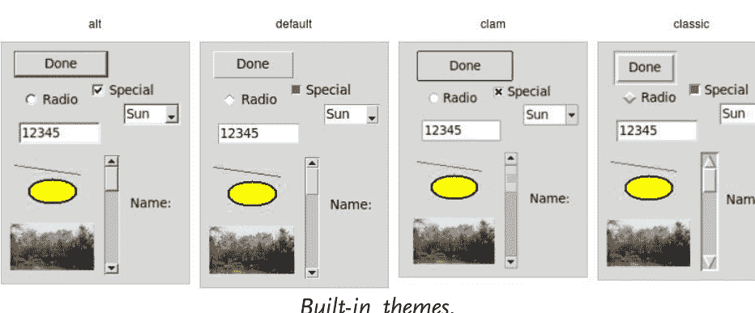

除了内置主题外，macOS 包含一个名为 `aqua` 的主题以匹配系统全局样式，而 Windows 包含了名为 `and` 和 `and` 的主题。

一次只能激活一个主题。要获取当前正在使用的主题名称，请使用以下命令：

```python
>>> s.theme_use()
```

`'aqua'`

这个 API 最初是针对 Tk 8.6 设计的，后回移植到 Tk 8.5-9。如果你使用的是更早版本的 Tk，获取这些信息会稍微麻烦一些。

切换到新主题可以通过以下实现：

这实际上是做了什么？显然，它将当前主题设置为指定的主题。因此，这样做会把所有当前可用样式替换为由主题定义的样式集。最后，它会刷新所有控件，以便它们采用新主题描述的外观。

## 第三方主题

通过仔细寻找，你可以找到一些可以下载的现有的插件主题。一个很好的起点是。

虽然主题可以用 Tk 支持的任何语言定义，但你发现的大多数主题是用 Tcl 编写的。如何安装它们以便在你的应用程序中使用它们呢？

例如，让我们使用 "`awkward`" 主题，可以从 Download 下载并并在某处解压 `awthemes-*.zip`。你会发现它包含许多 `.tcl` 文件、一个包含主题所用图像的更多目录的子目录等。其中一个文件命名为 `pkgIndex.tcl`。这将其标识为一个 Tcl 包，类似于 Python 模块。如果查看其内部，你会看到几行代码，其中 `package` 后面跟着 `ifneeded`，`awkward` 是包名，`7.7` 是它的版本号。在这种情况下，单个 `pkgIndex.tcl` 文件提供多个包并不罕见。

要使用它，我们需要告诉 Tcl 在何处找到该包（通过将其目录添加到 Tcl 的 `auto_path` 并指定要使用的包名）。

```python
root.tk.call('lappend', 'auto_path', '/full/path/to/awthemes-9.3.1')
root.tk.call('package', 'require', 'awkward')
```

如果主题实现为单个 Tcl 源文件且没有你，你可以像下面的方式使其可用：

```python
root.tk.call('source', '/full/path/to/themfile.tcl')
```

现在你应该可以在自己的应用程序中使用该主题了，就像使用内置主题一样。

## 17.2. 使用样式

我们现在将处理一个更复杂的问题：在你的应用程序中充分利用样式和主题，而不仅仅是用现有主题对其进行换肤。

### 定义

我们首先需要引入几个基本概念。

### 控件类 (Widget Class)

控件类标识特定控件的类型，无论它是按钮、标签、画布等。所有主题化控件都有默认类。按钮具有类 `buttons`、 `labels` 等等。

### 控件状态 (Widget State)

控件状态允许单个控件具有多个一个外观或行为，取决于鼠标位置、应用程序设置的不同状态选项等。

正如你所记得的，所有主题化控件维护一组二进制状态标志，通过 `state` 和 `instantiate` 方法访问。这些标志是：`and` 和 `and`。所有控件具有相同的状态标志集，尽管它们可能会忽略其中的某些标志（例如，标签控件可能会忽略无效的状态标志）。请参阅参考手册中的主题控件页面以获取每个状态标志的准确含义。

https://tkdocs.com/man/ttk_widget

### 样式 (Style)

样式描述了控件类的外观（或外观的外观）。具有相同控件类的所有主题化控件将具有相同的外观。

通过控件类的名称引用样式。例如，样式 `TButton` 定义了所有类为 `Button` 的控件的外观。

样式了解不同的状态，并且根据控件的状态定义不同的外观。例如，样式可以指定如果设置了 `pressed` 状态标志，控件的外观应该如何变化。

### 主题 (Theme)

主题是样式的集合。虽然每个样式都是特定控件的（一个用于按钮，一个用于输入框等），但一个主题将许多样式收集在一起。同一主题中的所有样式都将被设计为在视觉上相互“契合”。（很遗憾的是，Tk 在技术上并不限制糟糕的设计或判断！）

在应用程序中使用特定主题意味着，默认情况下，每个控件的外观将由该主题中负责该控件类的样式来控制。

### 样式名称 (Style Names)

每个样式都有一个名称。如果你要修改样式、创建一个新样式或为控件使用样式，你需要知道它的名称。

如何知道样式的名称是什么？如果你有一个特定的控件，并想知道它当前在使用什么样式，可以先检查其样式配置选项的值。如果它是空的，则意味着控件正在使用该控件的默认样式。你可以通过控件的类来获取它。例如：

```python
>>> b = ttk.Button()
>>> b['style']
>>> b.winfo_class()
```

在这种情况下，正在使用的样式是 `Default`。其他主题化控件的默认样式命名类似，等等。

始终检查 `the` 是明智的。例如，控件的类是 `the`。除了默认样式之外，你可以创建任何。你可能会创建自己的。更多情况下，你会发现像这样的名称

### 应用样式 (Applying a Style)

使用样式意味着将该样式应用到单个控件。你只需要样式的名称和要应用的控件。设置样式可以在创建时完成：

```python
b = ttk.Button(text='Hello', style='Fun.TButton')
```

控件的样式也可以以后更改：

```python
b['style'] = 'Emergency.TButton'
```

### 创建简单样式 (Creating a Simple Style)

那么我们如何创建一个像这样的新样式呢

在这种情况下，你正在创建一个与现有样式仅不同的样式。这是创建新样式的常见原因。

例如，你希望应用程序中的大多数按钮保持通常外观，但让某些“紧急”按钮以不同的方式突出。创建一个派自的的样式（例如）是合适的。

在现有样式前面加上另一个名称并跟一个点创建一个派自现有样式的新样式。新样式将具有现有样式完全相同的选项，除了指定的差异：

```python
s.configure('Emergency.TButton', font='helvetica 24', foreground='red', padding=10)
```

如之前所示，可以通过其选项将该样式应用到单个按钮控件。其他按钮控件将保留其正常外观。

如何知道给定样式有哪些可用选项？这需要深入内部查看。

你可能有一些使用经典控件的代码，想迁移到主题化控件。通过配置选项对经典控件进行的多数外观更改通常可以丢弃。对于那些不能丢弃的，你可能需要创建一个样式，如上所示。

特定状态的外观变化可以类似处理。在经典 Tk 中，几个控件通过配置选项支持几个状态变化。例如，将按钮的状态选项设置为 `disabled` 将使其带有灰色的标签。某些允许一个额外的状态，这代表不同的外观。你可以通过一组配置选项更改控件在多个状态下的外观，例如以及

通过配置选项进行的更改应该改为使用主题化控件的 `state` 方法。修改控件在特定状态下外观的配置选项应该在样式中处理。经典 Tk 控件也支持非常原始的样式形式，你可能会遇到。这使用了选项数据库，一种现在已过时的 X11 风格配置文件的前端。

在经典 Tk 中，所有按钮都有相同的类，所有标签都有相同的类等等。你可以使用这个控件类来进行内省，也可以通过选项数据库全局更改选项。它可以让你说，例如，所有按钮都应该有红色背景。

一些经典的 Tk 控件（包括 `frame` 和 `toplevel` 控件）允许你在首次创建特定控件时，通过提供类配置选项来更改该控件的类。例如，你可以指定某个特定的 `frame` 控件具有某个类，而其他控件则使用默认类。你可以使用选项数据库来更改 `SpecialFrame` 帧的外观。

样式（Styles）和主题（Themes）利用了这一简单想法并为其配备了助推器。

## 17.3. 样式内部包含什么

如果你只是想使用一个样式或通过少量微调创建一个新样式，那么你已经知道了所需的一切。然而，如果你想做更实质性的更改，事情就开始变得“有趣”了。

### 元素 (Elements)

虽然每个样式控制一种类型的控件，但每个控件通常由较小的部分组成，这些部分被称为“元素”。样式作者的任务是由这些较小的元素构建出整个控件。这些元素是什么取决于控件。

这是一个按钮的示例。它在最外层可能有一个边框。这是一个元素。在它内部，可能有一个焦点环（focus ring）。通常，它只是背景颜色，但当用户通过 Tab 键进入按钮时，它会被高亮。所以这是第二个元素。然后，在该焦点环和按钮标签之间可能会有一些间距。该间距是第三个元素。最后，按钮本身的文本标签是第四个元素。

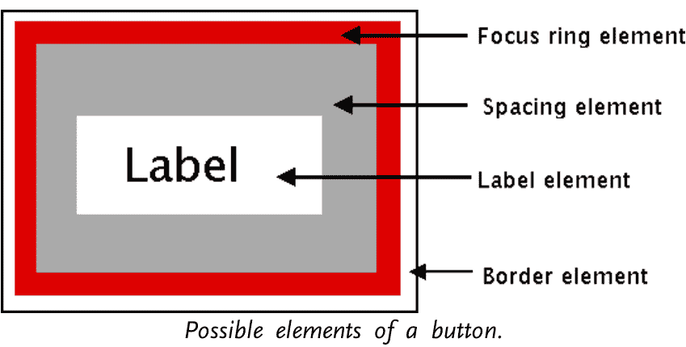

样式作者可能为什么要这样划分？如果你控件的某部分与另一部分可能处于不同的位置或不同的颜色，那么它可能是元素的良好候选者。注意，这只是如何从元素构建按钮的一个示例。不同的样式和主题可以以不同的方式（并且确实已经）实现这一点。

这是一个垂直滚动条的示例。它由一个“槽”（trough）元素组成，该元素包含其他元素。这些包括两端的向上和向下箭头元素以及中间的“滑块”（thumb）元素（它可能有额外的元素，如边框）。

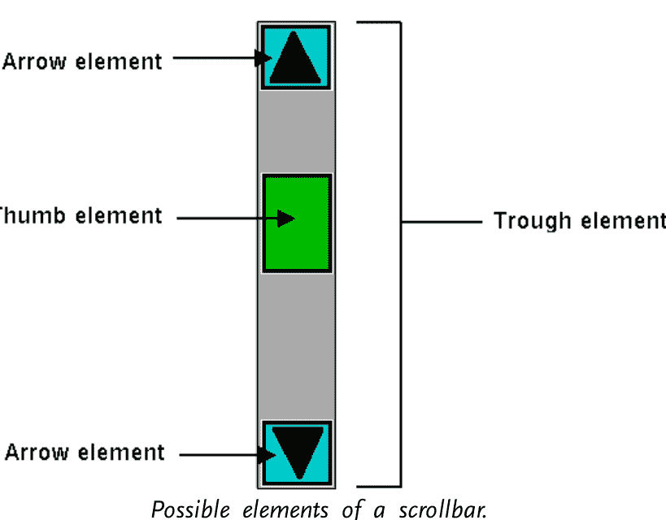

### 布局 (Layout)

除了指定哪些元素组成一个控件外，样式还定义了这些元素在控件内的排列方式。这被称为它们的布局。我们的按钮在一个间距元素内部有一个标签元素，间距元素在一个焦点元素内部，焦点元素在一个边框元素内部。它的逻辑布局如下：

```
border {
  focus {
    spacing {
      label
    }
  }
}
```

我们可以 Tk 请求 `TButton` 样式的布局：

```python
>>> s.layout('TButton')
```

[("Button.border", {"children": [("Button.focus", {"children": [

("Button.spacing", {

"children": [("Button.label", {"sticky": "nswe"}, "sticky": "nswe"],

"sticky": "nswe"}], "sticky": "nswe", "border": "1"})]

```

如果我们对其进行清理并格式化，就会得到一个如下结构的结构：

```

Button.border -sticky nswe -border 1 -children {

  Button.focus -sticky nswe -children {

    Button.spacing -sticky nswe -children {

      Button.label -sticky nswe

    }

  }

}

```

这开始变得合理了；我们有四个已命名并排序的元素。每个元素都有不同的元素选项，例如指定布局或尺寸的 `sticky` 和 `border`。在目前不进入过细细节的情况下，我们可以清楚地看到基于 `children` 属性和 `sticky` 属性的嵌套布局。样式使用 Tk 的简化版 `pack` 几何管理器来指定元素布局。这在 `style_reference` 手册页面中有详细介绍。

https://tkdocs.com/man/ttk_style

### 元素选项 (Element Options)

这些元素中的每一个元素都有几个不同的选项。例如，标签元素有字体和前景色颜色。代表滚动条滑块的元素可能有一个选项设置其背景颜色，另一个选项提供边框的宽度。这些选项可以自定义，以调整整个控件内元素的外观。

你可以确定每个元素可用哪些选项。这里是检查按钮内部标签可用选项的示例（我们从布局方法知道它被标识为）：

```python

>>> s.element_options('Button.label')

('compound', 'space', 'text', 'font', 'foreground', 'underline', 'width',

'anchor', 'justify', 'wraplength', 'embossed', 'image', 'stipple', 'background')

```

在接下来的章节中，我们将查看处理元素选项的一种并不完全直接的方法。

## 17.4. 操作样式

在本节中，我们将看到如何通过修改样式选项来更改样式的外观。你可以通过修改现有样式，或者更常见的通过创建一个新样式来实现。我们之前看到过如何创建一个从另一个样式派生的简单样式：

```python

s.configure('Emergency.TButton', font='helvetica 24', foreground='red', padding=10)

```

### 修改样式选项

修改现有样式的选项的方法与修改任何其他配置选项类似，通过指定样式、选项名称和新值来实现：

```python

s.configure('TButton', font='helvetica 24')

```

稍后我们将了解哪些是有效的。如果你像我们所做的那修改现有样式，该修改将适用于所有使用该样式的控件。要获取某个选项的当前值，使用 `lookup` 方法：

```python

>>> s.lookup('TButton', 'font')

'helvetica 24'

```

### 状态特定样式选项

除了样式的普通配置选项外，样式作者可能在控件处于特定状态时指定不同的选项。例如，当控件被禁用时，可能会将按钮更改为灰色。你可以通过 `map` 命令为样式的一个或多个配置选项指定状态特定的变体。以下示例提供了从按钮正常外观的变化：

当控件处于禁用状态时，背景颜色应设置为 `#d9d9d`

当控件处于激活状态（鼠标悬停）时，背景颜色应设置为 `#ececec`

当控件处于禁用状态时，前景色应设置为 `#a3a3a`（这是我们已经注意到的背景颜色变化的补充）

当控件处于按下状态且未禁用时，`relief` 应设置为 `sunken`

```python

s.map('TButton',

    background=['disabled','#d9d9d'],('active','#ececec'),

    foreground=['disabled','#a3a3a'],

    relief=['pressed','!disabled','sunken'])
```


由于控件状态可以包含多个标志，多个状态可能匹配选项（例如，如果控件的按下状态标志被设置，`pressed` 和 `!disabled` 都会匹配）。状态列表是按照你在 `map` 命令中提供的顺序进行评估的。列表中第一个匹配的状态将被使用。

## 17.5. 听起来很难吗？

你现在知道样式由元素组成，每个元素都有各种选项，并组合在布局中。你可以更改样式上的选项以使使用该样式的字体不同。任何使用该样式的控件都会采用样式定义的外观。主题收集了一整套相关的样式，使得更改整个用户界面的外观变得简单。

那么是什么让实践中的样式和主题如此困难？三点。首先：

你只能修改样式的选项，而不是元素选项（有时例外）。

我们之前讨论过通过检查布局识别样式中使用的元素，并识别每个元素的可用选项。但当我们去更改样式时，我们似乎是在配置样式的选项，而没有指定单个元素。这是怎么回事？

再次使用我们的按钮示例，我们有一个元素，除其他之外还有一个字体配置选项。发生的是，当 `Button.label` 元素被绘制时，它查看设置在样式上的字体配置选项来决定自己绘制什么字体。

要理解为什么，你需要知道：当一个样式（style）包含一个元素作为其组成部分时，该元素并不维护任何（元素特定的）存储。特别来说，它本身并不存储任何配置选项。当它需要检索选项时，它是通过包含它的样式来实现的，该样式会被传递给元素。因此，单个元素在 GoF（设计模式）的术语中被称为“轻量级”（flyweight）对象。

同样，任何其他元素都会从样式上设置的选项中查找它们的配置选项。如果两个元素使用同一个配置选项（例如背景颜色）会怎样？由于只有一个背景配置选项（存储在样式中），两个元素将使用相同的背景颜色。你无法让一个元素使用一种背景颜色，而另一个元素使用不同的背景颜色。

除非你可以这样做。在当前的实现中，有一些被称为“子布局”（sublayouts）的棘手且特定于部件的功能，它们允许你有时通过配置如 `TButton.Label` 这样的选项（而不是仅仅是样式名称）来修改单个元素。

某些样式还提供了额外的配置选项，允许你指定该选项影响哪个元素。例如，`Tcheckpoint` 样式为部件的主体提供了一个背景选项，并为显示是否被选中的方框提供了一个 `indicatorbackground` 选项。

可以这样做的情况有记录吗？是否有某种方法通过内省（introspection）来确定何时可以这样做？这两个问题的答案都是“有时”（信你不信，这是一个改进；以前这两个问题的答案都是明确的“否定的”）。你有时可以通过调用样式的 `configure` 方法而不提供任何新配置选项来发现样式的某些选项。现在每个主题部件（themed widget）的参考手册页通常都包含一个样式选项部分，其中列出了可能可以更改的选项。

这是主题部件 API 中一个随时间不断演变的领域之一。

第二个困难也与修改样式选项有关：

可用选项并不一定产生影响，且修改无效的选项并不算错误。

你有时会尝试更改一个根据元素选项本应存在的选项，例如，你无法修改 macOS 使用的 `aqua` 主题中按钮的背景颜色。虽然这些情况有其理由，但发现它们并不容易，这会让实验过程有时令人感到沮丧。

在实验时，可能更令人沮丧的是，指定样式名称或选项名称不会产生错误。在执行 `configure` 查找时，你可以为样式或选项提供完全任意的名称。所以，如果你厌倦了背景和字体选项，尽管去配置一个 `whatever` 选项。它可能不起作用，但这不是错误。再次，这可能让你很难知道你应该修改什么，不应该修改什么。

这是拥有非常轻量级且动态系统的缺点之一。你可以在配置样式选项时通过提供名称来创建新样式，而无需显式创建样式对象。同时，这引入了错误的可能。无法发现当前存在或使用了哪些样式。记住，样式选项实际上只是元素选项的前端，而样式中的元素可以随时改变。显然，选项应该仅限制为当前元素引用的那些，而这些元素本身并不全都是可内省的。

最后，这是让样式和主题如此困难的最后一点：

可用的元素、这些元素的名称、哪些选项可用或影响这些每个元素，以及哪些选项被用于特定的部件，在每个主题中都可能是不同的。

那怎样？记住，每个平台（Windows、macOS 和 Linux）的默认主题是不同的（这是一件好事）。这的影响包括：

如果你想为你的应用程序定义一种新类型的部件（或现有部件的变体），你需要为应用程序使用的每个主题分别以不同的方式进行处理（即，对于跨平台应用程序，至少需要三个）。

由于每个主题/平台的可用元素和选项可能有所不同，你可能需要为每个主题/平台采用完全不同的自定义方法。

每个主题可用的元素、名称和元素选项通常没有记录（在阅读主题定义文件本身之外），但通常通过主题内省（我们很快就会看到）来识别。因为并非所有主题在所有平台上都都可用（例如，`aqua` 仅在 macOS 上可用），你需要能够随时访问运行程序所需的每个平台和主题。

考虑尝试自定义一个按钮。你知道它使用了 `TButton` 样式。但该样式在每个平台上都是使用不同的主题实现的。如果你检查每个主题中的样式布局，你会发现每个主题使用的元素不同，且排列方式也不同。如果你尝试查找每个元素宣称的可用选项，你会发现那些也是不同的。当然，即使某个选项在名义上是可用的，它可能也不会产生影响。

底线是，在经典 Tk 中，你可以修改单个部件的大量属性中的任何一个，你可以在一个平台上执行某些操作，并且它在其他平台上也能“某种那样地工作”（但可能需要微调）。在主题 Tk 中，简单的选项并不存在，如果你想让你的应用程序在多个主题/平台上运行，你基本上被迫以正确的方法进行。这前期的工作量更大。

# 17.6 高级：关于元素的更多介绍

虽然我们在书中关于样式和主题的讨论就此于此了，但对于好奇的用户和那些想要进一步研究创建新主题的人，我们可以提供一些关于元素的更多有趣信息。

由于元素是样式和主题的构建块，这引出了“元素从哪里来？”的问题。从实践上说，我们可以说元素通常是在 C 代码中创建的，并符合主题引擎理解的特定 API。

在最底层，元素来自某些：目前存在第一种，大多数主题都使用它，它使用 Tk 绘制程序创建元素。第二种允许你从图像创建元素，并在脚本层面通过 `ttk::style` 方法（来自 Tcl）访问。Tk 支持的任何图像都是可用的，包括 SVG 等格式（如果你有相应的扩展）。最后是第三种，针对 Windows 的使用底层“Visual Styles”的 API。

如果主题使用了通过原生部件创建的元素，使用原生部件的调用通常出现在该主题元素规范代码中。当然，依赖于原生部件或 API 调用的主题只能在支持它们的平台上运行。

主题将获取一组元素，并使用这些元素组装被部件实际使用的样式。鉴于主题的核心理念是多个样式可以共享外观，不同样式共享相同的元素并不意外。

所以，虽然 `Button` 样式包含一个 `Button.padding` 元素，而 `Entry` 样式包含一个 `Entry.padding` 元素，但这些填充元素更有可能是同一个。它们看起来不同，但那是因为不同的配置选项，正如我们所记得，这些选项存储在使用元素的样式中。

可能并不意外的是发现，主题可以提供一组通用选项，如果样式没有其他指定，则将其作为默认值。这意味着如果整个主题的大部分内容都是绿色背景，主题也不需要为每个样式显式说明这一点。这使用一个名为 `..` 的根样式。如果 `Fun.Button` 可以继承 `..`，为什么 `TButton` 不能继承 `..` 呢？

最后，值得查看现有主题是如何定义的，既在 Tk C 库的 C 代码层面，也通过 Tk 中 `library/ttk` 目录下的 Tk 脚本以及第三方主题。在 Tk 的 C 库中搜索 `Ttk_RegisterElementSpec` 以查看元素是如何被指定的。

# 18. 案例研究：IDLE 现代化

本章介绍了对一个基于 Tk 的大型应用程序进行外观现代化的案例研究。

这里的一些更改正在缓慢地进入 Python 源码树，但大多数大多数还没有进入其中。你可以在这里找到临时快照：

IDLE 是随每个 Python 版本一起分发的附带的标准 Python 开发环境。它包含一个交互式 Python 壳、具有语法高亮的编辑器、一个调试器等。其用户界面是用 Tkinter 编写的。

## EditorWindow.py - `/tmp/idlelib/EditorWindow.py` (3)

```
File Edit Format Run Options Window Help

dlg.deiconify()

help.lift(self)

()
```

```
* Python 3.4. Shell *

File Edit Shell Debug Options Window

Python 3.4 (default, Jun 2015)

[GCC 4.8.2] on linux

Type "copyright", "credits" or "li

>>>

[DEBUG ON]

>>>

RUN /tmp/id
```

```
def destroy(self, ev=None):
    self.dlg = None
    self.parent = None

helpDialog = HelpDialog() # 单例实例

def _help_dialog(parent): # htest 的封装器
    helpDialog.show_dialog(parent)
```

```
class EditorWindow(object):
    from idlelib.Percolator import Percolator
    from idlelib.ColorDelegator import ColorDelegator
    from idlelib.UndoDelegator import UndoDelegator
    from idlelib.IOBinding import IOBinding, filesystem
    from idlelib import Bindings
    from tkinter import Toplevel
    from idlelib.MultiStatusBar import MultiStatusBar
```

```
help_url = None
```

## 调试控制

+   跳过 退出 栈 源码
本地变量 全局

```
'pdb.run(), line 431: exec(cmd, globals, locals)
'> _main_.'<module>(), line 1674: 'slash:/'
```

## 搜索对话框

+   查找：
正则表达式 匹配大小写 整个单词 循环查找 查找下一个

```
方向 上 下

激活 'active'

全部 'all'

锚点 'anchor'

弧 'arc'

基线 'baseline'
```

> IDLE 用户界面概览（在 Linux 上）

IDLE 的初衷并不是作为功能更丰富的开发环境的替代品。因为它相对简单且与 Python 一起打包，因此对于那些学习（以及教学）该语言的人非常受欢迎。

IDLE 最初由 Python BDFL Guido van Rossum 于 1998 年创建，多年来由其他多位开发者不断向其添加新功能。由于投入在上面的开发精力有限，它已经显出老旧感，尤其是在那些改进 IDLE 的人员不经常使用的平台（例如 macOS）上。

Python Central 对这样描述 IDLE 进行了比较。

事实上，所有这些功能都存在，但它们并不能真正构成一个 IDE。事实上，虽然 IDLE 提供了一些你期望从 IDE 中获得的功能，但它提供这些功能时甚至还不是一个令人满意的文本编辑器。界面有很多 Bug，而且没有考虑到 Python 的工作方式（特别是在交互式 shell 中），自动补全在标准库之外毫无用处，而且编辑功能非常有限，以至于任何严肃的 Python 程序员——甚至，不是任何严肃的打字员——都无法全职使用。

如果你使用 IDE，它不应该是 IDLE。

由于其充满 Bug 过时的用户界面，IDLE 曾面临完全从 Python 发行版中被移除的风险。然而，因为它简单且附带，许多人（特别是教 Python 的人）渴望看到 IDLE 的飞跃发展。

IDLE 显然是现代化的极佳候选者，可以使用新的 Tk 特性（如主题小部件）来推动一些重新设计。但这不仅仅是更换部件。仅仅通过改变“经典”部件的使用方式，就可以进行许多改进，以更好地反映更现代的设计美学。

IDLE 是一个应用程序，它是 Python 标准库的一部分（即：99% 的设计目标是供其他代码使用）。这意味着要遵循许多策略和程序（对于应用程序来说并不真正合适），这使得更改变得困难。移除其中的一些障碍（参见 PEP）是这里所讨论的更改所需要的一项重要步骤。

### 18.1. 项目目标

正如你所想象的，对这样一个基于“经典”Tkinter 的大型应用程序进行现代化并非完全容易。在本章中，我将介绍所做的一些界面更改及其原因。

每个参与其中的人都都希望看到 IDLE 看起来比现在好得多，尽管没有人幻想着它会变成一个尖端设计的惊人范例。但实现一个让人们在学习 Python 时不会被其工具的笨拙所分心的东西，似乎是可行的。

目标也不是为了与专业程序员更常用的 Python IDE（如等）竞争。虽然一些更有经验的 Python 开发者会偶尔或其他方式使用 IDLE，但它主要需要吸引该语言的初学者，通常也是对编程完全的新手。

以前并不缺乏从根本上推进 IDLE 的尝试，导致了几个带有各种改进分支（forks）。其中许多使用了不属于标准库的其他 GUI 工具包。坚持使用 Tkinter 和标准库对于确保每项改进随着时间的推移进入官方版本非常重要。


基线 `baseline`

> IDLE 用户界面概览（在 Linux 上）

IDLE 的初衷并不是作为功能更丰富的开发环境的替代品。因为它相对简单且与 Python 一起打包，因此对于那些学习（以及教学）该语言的人非常受欢迎。

IDLE 最初由 Python BDFL Guido van Rossum 于 1998 年创建，多年来由其他多位开发者不断向其添加新功能。由于投入在上面的开发精力有限，它已经显出老旧感，尤其是在那些改进 IDLE 的人员不经常使用的平台（例如 macOS）上。

Python Central 对这样描述 IDLE 进行了比较。

事实上，所有这些功能都存在，但它们并不能真正构成一个 IDE。事实上，虽然 IDLE 提供了一些你期望从 IDE 中获得的功能，但它提供这些功能时甚至还不是一个令人满意的文本编辑器。界面有很多 Bug，而且没有考虑到 Python 的工作方式（特别是在交互式 shell 中），自动补全在标准库之外毫无用处，而且编辑功能非常有限，以至于任何严肃的 Python 程序员——甚至，不是任何严肃的打字员——都无法全职使用。

如果你使用 IDE，它不应该是 IDLE。

由于其充满 Bug 过时的用户界面，IDLE 曾面临完全从 Python 发行版中被移除的风险。然而，因为它简单且附带，许多人（特别是教 Python 的人）渴望看到 IDLE 的飞跃发展。

IDLE 显然是现代化的极佳候选者，可以使用新的 Tk 特性（如主题小部件）来激发一些重新设计。但这不仅仅是更换部件。仅仅通过改变“经典”部件的使用方式，就可以进行许多改进，以更好地反映更现代的设计美学。

IDLE 是一个应用程序，它是 Python 标准库的一部分（即：99% 的设计目标是供其他代码使用）。这意味着要遵循许多策略和程序（对于应用程序来说并不真正合适），这使得更改变得困难。移除其中的一些障碍（参见 PEP）是这里所讨论的更改所需要的一项重要步骤。

### 18.1. 项目目标

正如你所想象的，对这样一个基于“经典”Tkinter 的大型应用程序进行现代化并非完全容易。在本章中，我将介绍所做的一些界面更改及其原因。

每个参与其中的人都都希望看到 IDLE 看起来比现在好得多，尽管没有人幻想着它会变成一个尖端设计的惊人范例。但实现一个让人们在学习 Python 时不会被其工具的笨拙所分心的东西，似乎是可行的。

目标也不是为了与专业程序员更常用的 Python IDE（如等）竞争。虽然虽然一些更有经验的 Python 开发者会偶尔或其他方式使用 IDLE，但它主要需要吸引该语言的初学者，通常也是对编程完全的新手。

以前并不缺乏从根本上推进 IDLE 的尝试，导致了几个带有各种改进分支（forks）。其中许多使用了不属于标准库的其他 GUI 工具包。坚持使用 Tkinter 和标准库对于确保每项改进随着时间的推移进入官方版本非常重要。

### 18.2. 菜单

非常第一个更改是移除过时的 tearoff 菜单。macOS 版本的 Tk 甚至不支持它们，但它们在 Windows 和 X11 上仍然存在。

> Windows 和 Linux  tearoff 

这里的更改是在创建这些菜单的几个地方中添加了 `tearoff=no` 选项。

至少这很容易。

那里还存在几个 Bug，导致功能不可用时菜单项没有被正确禁用。这导致了某些无效的菜单项（让学习者感到困惑）或显示类似于“你不能这样做”的错误对话框。

### 18.3. 主窗口

IDLE 的一个优点是，因为它围绕编辑器和 shell 展开，它的大部分实际上都是文本小部件，其界面并没有什么需要更改的。但即使在主窗口（它主要是一个文本小部件），也有改进空间。

以下图片显示了 IDLE 窗口的原始版本（现代化之前），正如人们首次启动程序时看到的样子。

看着它们，你会做哪些改进？

#### 默认字体

所第一个更改与默认字体有关。IDLE 硬编码了 10 点的 Courier 并在所有平台上使用它。这在 Windows 上看起来并不太糟糕，在 Linux 上还可以，但

在 macOS 上的效果非常糟糕；虽然这可以通过偏好对话框进行更改，但默认设置显然没有留下良好的印象。

虽然一种方案仅仅是编写代码，根据我们运行的平台来选择一个合适的字体，但相反我们将默认值更改为使用内置的 Tk 字体，这在每个平台上都提供了更好的默认视觉效果。

你可以从下方的截图中看到差异。注意看新字体似乎与显示的系统终端窗口匹配得更加完美。

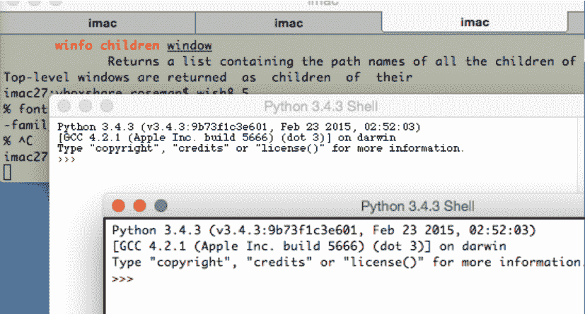

copyright (c) 2009 Microsoft Corporation. 版权所有。

```
C:\Users\roseman>cd \python34
```

```
C:\Python34>cd users\roseman
```

The help system says:

Python 3.4.3 Shell

Python 3.4.3 (v3.4.3:9b73fic3e601, Feb 24 2015, 22:43:06) [MSC v.1600

tel]) on win32

Type "copyright", "credits" or "license()" for more information.

>>>

```
Python 3.4.3 Shell

File Edit Shell Debug Options Window Help

Python 3.4.3 (v3.4.3:9b73fic3e601, Feb 24 2015, 22:43:06) [MSC v.1600

tel]) on win32

Type "copyright", "credits" or "license()" for more information

>>> |
```

IDLE 主窗口使用 TkFixedFont (Windows)

```
roseman@ububuntu:/media/sf_vboxshare
roseman@ububuntu:/media/sf_... roseman@ububuntu:/media/sf_... 
roseman@ububuntu:~$ ls /media/sf_vboxshare/
:python idellib notes.txt
roseman@ububuntu:~$ cd /media/sf_vboxshare/
roseman@ububuntu:/media/sf_vboxshare$ python3 -n idellib
```

```
*Python 3.4.0 Shell*

File Edit Shell Debug Options Window Help

Python 3.4.0 (default, Jun 19 2015, 14:20:21)

[GCC 4.8.2] on linux

Type "copyright", "credits" or "license()" for more information.

>>>
```

```
Python 3.4.0 Shell

File Edit Shell Debug Options Window Help

Python 3.4.0 (default, Jun 19 2015, 14:20:21)

[GCC 4.8.2] on linux

Type "copyright", "credits" or "license()" for more information

>>> |
```

IDLE 主窗口使用 TkFixedFont (Linux)

说到偏好对话框，如果你想更改字体，知道字体的具体名称通常很有帮助（以下是 IDLE 偏好对话框中的新代码，用于计算出这一点）：

```
if (family == 'TkFixed Font'):
    f = Font(name = 'TkFixedFont', exists = True, root)
```

```
actualFont = Font.actual(f)

family = actualFont['family']

size = actualFont['size']

if size < 0:
    size = 10 # 如果字体是像素单位，则忽略实际大小

bold = 1 if actualFont['weight']=='bold' else o
```

记录一下，Tk 为 TkFixedFont 选择的字体在 macOS 上是 Monaco 11，在 Windows 上是 Courier New 10，在 Linux 上是 DeVu Sans Mono 10（具体为 Ubuntu 14）。

#### 关于文本组件 (Text Widget)

在主窗口边缘还有几处视觉上的细节看起来不太对；请查看 IDLE 主窗口更早的截图。

注意文本组件周围有一个边框。这在 macOS 上最为明显，呈现为深黑色；在 Linux 上稍不那么明显，在 Windows 上几乎无法察觉。这是 Tk 的 "highlightthickness" 属性的结果，当文本组件拥有焦点时，该属性生效。

如果文本组件没有焦点（例如当窗口变为非活动状态时），高亮就会消失。

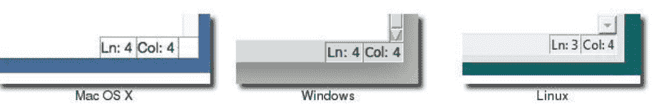

#### 非活动窗口上的状态栏

注意在 macOS 截图中，在没有高亮的情况下，窗口底部的状态栏与文本组件融合在了一起。这并不好。

正如你从其他应用程序看到的，文本组件周围的边框不再是一种常见的做法了。因此，让我们从移除它开始，这只需要在创建文本组件时添加 "highlightthickness=o" 即可。

这留给我们的是状态栏与编辑器融合的问题。我们将状态栏更改为 `ttk.Frame` 组件，它在所有平台上都有背景阴影。我们还在状态栏正上方放置了 `ttk.Separator` 组件，以提供整洁的分割。

每个行和列指示器原本都是标签，之前的创建方式为：

```
label = Label(self, bd=0, relief=SUNKEN, anchor=W)
```

这被 `ttk.Label` 替换以确保它与之匹配。最后，我们可以将原始的滚动条替换为较新的 `ttk.Scrollbar`。

最终的更改所示。尽管这些改动很微小，但它们让主窗口看起来更加整洁。

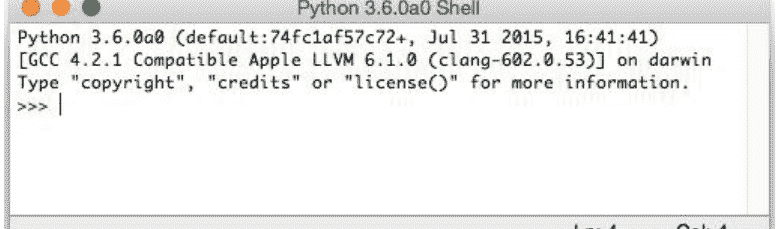

注意在 macOS 截图中，在没有高亮的情况下，窗口底部的状态栏与文本组件融合在了一起。这并不好。

正如你从其他应用程序看到的，文本组件周围的边框不再是一种常见的做法了。因此，让我们从移除它开始，这只需要在创建文本组件时添加 "highlightthickness=o" 即可。

这留给我们的是状态栏与编辑器融合的问题。我们将状态栏更改为 `ttk.Frame` 组件，它在所有平台上都有背景阴影。我们还在状态栏正上方放置了 `ttk.Separator` 组件，以提供整洁的分割。

每个行和列指示器原本都是标签，之前的创建方式为：

```
label = Label(self, bd=0, relief=SUNKEN, anchor=W)
```

这被 `ttk.Label` 替换以确保它与之匹配。最后，我们可以将原始的滚动条替换为较新的 `ttk.Scrollbar`。

最终的更改所示。尽管这些改动很微小，但它们让主窗口看起来更加整洁。


注意在 macOS 截图中，在没有高亮的情况下，窗口底部的状态栏与文本组件融合在了一起。这并不好。

正如你从其他应用程序看到的，文本组件周围的边框不再是一种常见的做法了。因此，让我们从移除它开始，这只需要在创建文本组件时添加 "highlightthickness=o" 即可。

这留给我们的是状态栏与编辑器融合的问题。我们将状态栏更改为 `ttk.Frame` 组件，它在所有平台上都有背景阴影。我们还在状态栏正上方放置了 `ttk.Separator` 组件，以提供整洁的分割。

每个行和列指示器原本都是标签，之前的创建方式为：

```
label = Label(self, bd=0, relief=SUNKEN, anchor=W)
```


这被 `ttk.Label` 替换以确保它与之匹配。最后，我们可以将原始的滚动条替换为较新的 `ttk.Scrollbar`。

最终的更改所示。尽管这些改动很微小，但它们让主窗口看起来更加整洁。


## 标签页 (Tabs)

第一个要解决的问题是切换四个不同面板的标签。原始方案使用了自定义的“大组件”，因为经典的 Tk 并没有提供这种组件。虽然 Windows 和 Linux 上的看起来并不坏，但在较新版本的 macOS 上，有一个内置的标签组件看起来完全不同。

在 macOS 应用程序中，现在的做法通常是类似于工具栏（顶部或侧面带有标签的图标）来切换偏好面板，尽管某些程序仍然使用标签。标签在 Windows 和 Linux 上非常常见。

代码已修改为使用 `ttk.Notebook` 组件，这不仅在每个平台上看起来更好，而且让我们不需要许多自己管理标签的代码。

### 更新组件

下一个显而易见的步骤是将“经典”组件升级为相应的主题组件。在这个屏幕上，这包含了按钮、标签、框架、复选框、滚动条等。在其他一些面板上还有几个。通常情况下，这是一个直接的过程，通常涉及移除不再需要或主题组件支持的组件选项。有时选择不同的组件更有意义。在这个屏幕上，用于字体大小的选项菜单被替换为 combobox 更好。同样，scale 组件在当今的用户界面中并不常见，被替换为更熟悉的紧凑 spinbox。

- 虽然这个对话框是一个糟糕的例子（仅仅考虑到左右半的空间不平衡），但我们花费了大量时间研究对话框中的组件间距和对齐。通用方法是在其他应用程序中寻找类似的示例并将其作为指南。按钮位于哪里？对话框中的多个字段是如何组织的？
- 一个非常好的起点是从使用旧的 `pack` 布局管理器转换为，由于其工作方式，布局往往是奇怪的

而且对齐和间距不一致，特别是当它们随着时间的推移被修改过时。使用 `grid` 将增加可维护性，因为它使用了更熟悉的模型，并且不依赖于组件的插入顺序。

可能不可能设计出一个在所有平台上看起来都非常完美的布局，但通常你可以设计出一个（可能需要在代码中进行一些针对特定平台的微调）看起来不错的方案。

下面显示了结合了此处许多技术的对话框修订版本。

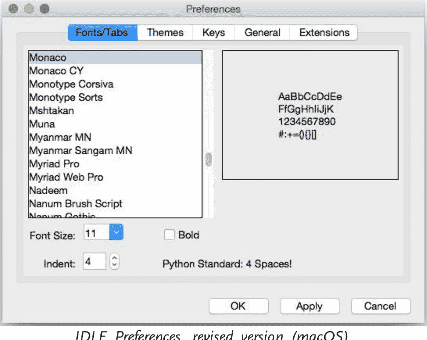

IDLE 偏好，修订版本（Windows）。

IDLE 偏好，修订版本（Linux）。

### 另一个示例

下面的截图显示了 IDLE 偏好面板修改前后，该面板控制语法着亮；参见

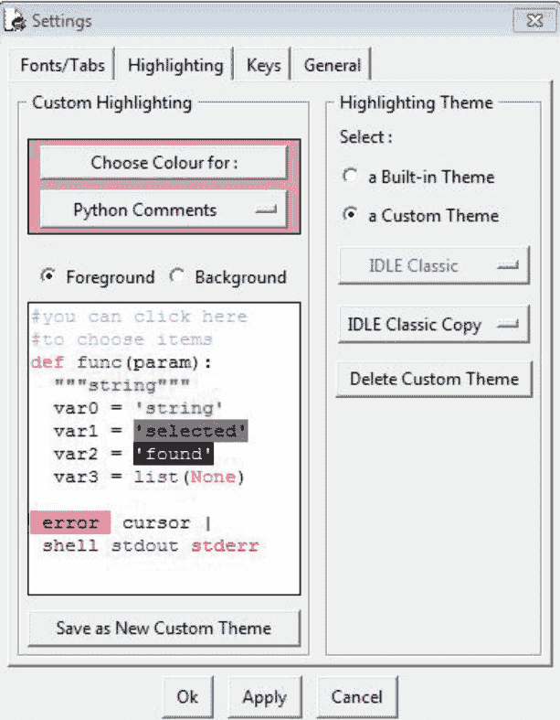

IDLE 主题面板，修改前（Windows）。

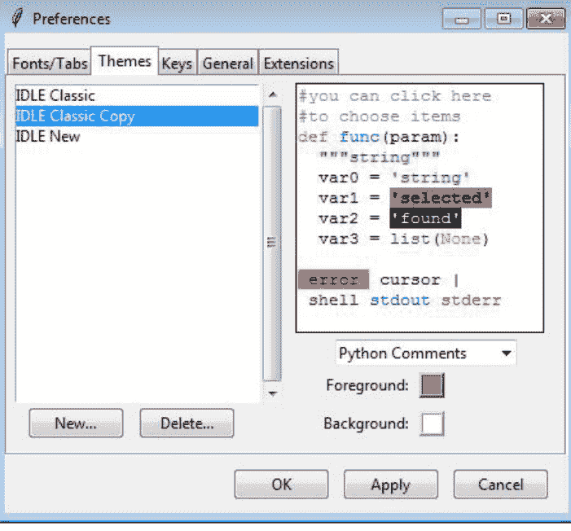

IDLE 主题面板，修改后（Windows）。

再次，替换组件并使用更熟悉的约定作为其中的一部分。我认为更大的变化在于从用户的角度来考虑问题。特别是作为一个初学者工具，如果你进入这里，很可能是为了切换主题，而不是调整颜色（后者在新版本中更为突出）。它还消除了“内置”主题和“自定义”主题之间任意的区别。

我认为新版本是一个巨大的改进，尽管到为止我还没有说服某些人。既然是开源的，让我们拭目以待！

### 18.5 其他对话框

IDLE 中还有多个对话框；我们在这里再考虑两个示例。

#### 查找对话框

计划对这些进行更多一些更改，可能会将“查找”和“替换”合并到一个对话框中。

下面显示了其中查找/搜索对话框，同样是三个平台上的修改前后对比；参见

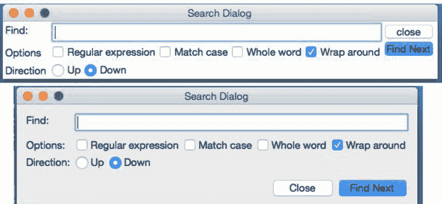

IDLE 查找对话框，修改前和后（macOS）。


第一步是将组件升级为对等的主题组件。这种效果在按钮上最为明显（保持大小写一致也没有坏处）。

说到按钮，注意它们在 macOS 和 Linux 上移动到了底部，尽管在 Windows 上仍保持在右侧。在检查了目标用户可能在每个平台上遇到的多个个不同的应用程序后，我们发现这些位置是通用的。只需要几行额外的代码来针对这种布局差异进行特殊处理，因此以这种方式处理事情是有意义的。

布局的其他方面也得到了改进。查看原始对话框（特别是按钮没有与其他组件对齐），我起初认为它是用某种方式创建的，并预期将其转换为那种方式。有趣的是，它已经使用了。那么为什么组件没有对齐呢？这是布局的一个标志。

事实证明这是使用许多嵌套 frame的结果。例如，按钮被放置在它们自己的 frame 中，然后被放置在窗口的其余部分。由于那个原因，单个按钮无法与用户界面其余部分的组件对齐。

在使用 `pack` 时通常需要嵌套 frame，但通常在使用 `grid` 时，除非特殊情况，否则最好避免它们。这允许你对齐用户界面的不同部分（尽管要花费许多 columnspan/rowspan 的调整作为代价）。

更实质性的重组可能会移除嵌套 frame，但特别是在调整按钮时，这种相对简单的布局只需几次微调即可正常工作。

你会发现许多旧的 Tkinter 用户界面都存在此问题，即内容运行到了窗口边缘，这通常看起来并不对。我已经习惯了在每个 toplevel 中直接放置一个 `ttk.Frame`，并带有一些额外的内边距，然后将用户界面的其余部分放在其中。

和“偏好”一样，查找对话框也是模态的（modal），这意味着你在对文件进行任何编辑之前必须关闭它们，尽管至少当你重新打开它们时，它们会记住之前的设置。这些最终被改为普通的非模态窗口。

#### 关于对话框

说到模态对话框，“关于”框最初也是模态的。不仅如此，获取更多信息（例如 IDLE README 文件）会导致启动*另一个*模态对话框，需要关闭它才能回到第一个模态对话框，而它需要……

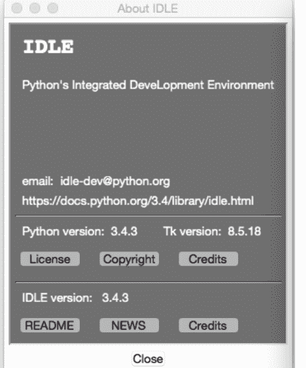

关于 - Readme

IDLE 是基于 Python Tkinter 的集成开发环境。

IDLE 强调轻量、整洁的设计和简单的用户界面。虽然它适合初学者，即使是高级用户也会发现 IDLE 包含了他们开发纯代码所需的一切。

IDLE 特性具有多窗口编辑器，支持多次撤销、Python 着色，以及许多其他功能，例如：智能缩进、调用提示和自动补全。

编辑器具有全面的功能，包括搜索多个文件。类浏览器和路径浏览器提供了从顶层视图快速访问代码对象，而无需处理代码折叠。

有一个 Python 窗口，它具有着色和命令回溯功能。

在这里很容易陷入其中。在 20 世纪 90 年代中期，Tcl 中一个微小的 HTML 解析器引发了一系列“在文本控件中实现 浏览器”的尝试，最初在 Tcl 中，随后在其他语言中（例如 Python 的 Grail）。试图跟上大型开发团队投入真实 Web 浏览器的工作是一项徒劳无功。然而，对于非常受限且受约束的 HTML 子集（如在线帮助文档中常见的），这是一种完全合理的方法。

### 查询对话框 (Query Dialogs)

延续模态对话框主题，IDLE 使用了作为 Tkinter 一一部分的 `simpledialog` 包，通过模态对话框向用户请求某些小量信息。例如“跳转到行...”命令。下面显示了该命令，以及当你输入无效内容时显示的警报示例。

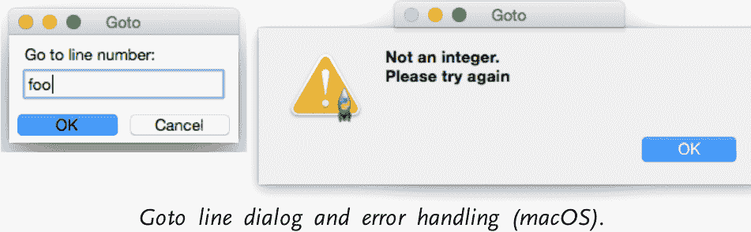

对话框中的警告（alert-on-dialog）并没有我们之前看到的“对话框套对话框”（dialog-on-dialog）模式那么糟糕。但这些对话框确实需要进行外观上的更新，并进行一些其他调整。例如，虽然它们正确地解释了按下 Return 或 Escape 键等同于按下 OK 或 Cancel，但它们不支持 macOS 的备用习惯（数字键盘上的 Enter 键和 Command-句号）；参见[如果能有一些其他自定义会很好（例如更改 OK 按钮的名称）]，`simpledialog` 不支持这些功能。

在错误处理方面，某些情况下处理得更糟。例如，有一个命令可以打开编辑器窗口，其中包含 Python 标准库中模块的源代码。看看如果你拼写错误会发生什么。

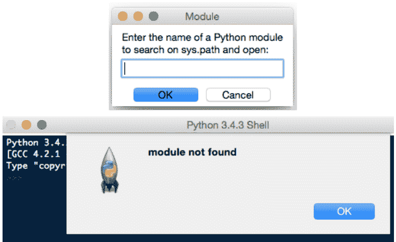

带有错误的打开模块对话框 (macOS)。

由于对话框不知道模块名称是否正确，只有在对话框关闭后才会进行验证。因此，错误被附加到了另一个窗口。要重试，你必须关闭该窗口，使用菜单重新打开对话框，然后再次尝试（从头开始）。

代码中有几个地方确实需要在对话框中进行更多验证。因为 `simpledialog` 代码是 Tkinter 的一部分，无法以所需的方式轻松扩展，开发者不得不采用“通过文本编辑器进行继承”（即复制整个 `simpledialog` 代码并修改副本）。由于外观本身就需要更新，我们分两次独立地进行了泛化处理，并完全忽略了 Tkinter 的 `simpledialog` 模块。相反，我们创建了一个单一的通用替代方案，可以在整个 IDLE 中使用（并且结果是代码更少）。

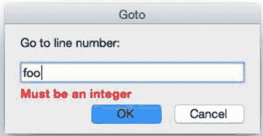

新的查询对话框 (macOS)。

除了更新的控件和对齐外，请注意来自无效输入的错误消息现在显示在对话框本身中（这种技术在 Web 应用中很常见），而不是独立的警报中。对于 macOS，我们还确保添加了数字键盘 Enter 键和 Command-句号的按键绑定，并通过这个小妙招确保窗口看起来就像一个模态对话框应该有的样子：

```
self.tk.call('tk::unsupported:MacAnimationStyle', 'style', self._w, moveableModal', '')
```

在验证方面，查询对话框被设计为接受一个验证回调，该回调可以处理任意标准。例如，这里是人们在输入新主题名称时使用的验证代码。它确保主题符合某些语法要求，并且没有已被使用。

选择正确的窗口作为对话框的父窗口很重要，这可以确保对话框窗口出现在该窗口附近。在 macOS 上，这些对话框通常附加到父窗口的标题栏（参见上一节中的错误警报）。

Tkinter 中这些对话框的前端同时支持 `master` 和 `parent`。虽然在大多数情况下，Tkinter 中的 "master" 和 "parent" 是通用的，但在这里并非如此。如果你只提供 `master`，对话框将不会附加到窗口（但对话框仍然需要一个现有窗口来创建，这就是为什么有 `master` 参数）。如果对话框与另一个窗口关联，请务必使用 `parent` 参数。

### 18.6. 窗口集成 (Window Integration)

很多人希望能够在一个窗口中显示所有内容，以避免有时会困扰人们的窗口管理麻烦，参见例如[和]。下面是我们想要实现的一些内容的早期、部分功能性的原型图。

| __init__ | self.rebuild_themes_list |
| --- | --- |
| rebuild_themes_list | self.theme.changed() |
| theme_changed() | self.update_colors() |
| update_colors() | x = 5/0 |
| ZeroDivisionError: division by zero |
| 'Shell Normal Text' |
| element | elt | fg | self | theme |
| --- | --- | --- | --- | --- |
| | 'console' | #770000 | <main__ThemePanes | IDLE Classic |

输入 "copyright", "credits", "license" 获取更多信息。
>>> DEBUG ON
>>> /Users/share/cpython/idlelib/preferences.py ===

窗口的早期原型 (macOS)。

#### 标签编辑器 (Tabbed Editor)

到此时，几乎所有工作都已完成。用户界面经过大幅修订，布局既可以在独立窗口中工作，也可以在集成时工作。设计大量借鉴了 TextMate。它允许创建新标签、关闭旧标签、拖动重新排序、每个标签上显示工具提示，以及指示文件是否需要保存。当标签数量多到无法舒适显示时，其余标签可以通过弹出菜单访问。

标签控件的实现依赖于单个 Tkinter 画布来显示标签行并处理所有交互。窗口内容的切换与控件是分离的，通过一个简单的回调机制来协调一切。

#### 调试器 (Debugger)

原始调试器的设计（它有自己的缺陷，且由于太高，无法按预期集成）。

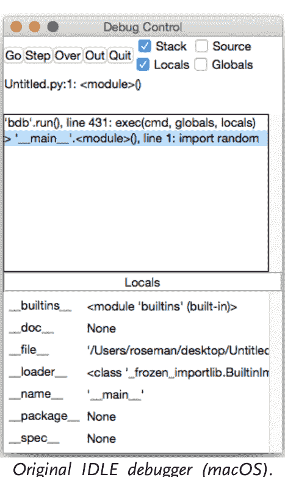

集成的 IDLE 调试器 (macOS)。

新版本使用分割窗口将左侧的控件和栈与右侧的变量显示分开。栈和变量显示都使用 tree view 控件实现。这为每个元素使用多少空间提供了大量的控制。

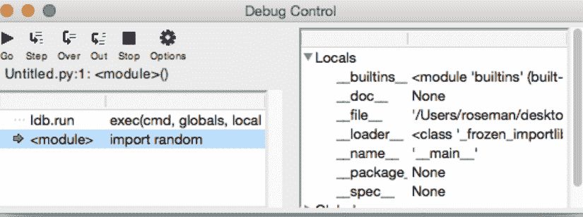

#### 集成 Shell 和调试器 (Integrated Shell and Debugger)

使用了另一个分割窗口将 Shell 和调试器与标签编辑器集成在一起。随着实现的进行，将添加额外的控件来显示/隐藏窗格。

### 18.7. 变通、技巧及其他

由于本章是关于真实应用程序现代化的实际经验，如果说底层用户界面工具包（Tk 和 Tkinter 封装器）总是完全按照预期工作，那将是谎。就像 IDLE 一样，Tkinter 和 Tcl/Tk 是志愿者巨大努力的结晶。尽管如此……

> Tk 和 Tkinter 存在一些 Bug 和粗糙之处。我知道你感到很震惊。

在这一节中，我将尝试分类列出我们遇到的一些特定“坑”，并提供一些并不一定适用于其他地方、但有助于让用户界面更加完善的小技巧。

#### 工具提示 (Tool Tips)

- macOS 上的工具提示损坏；请参见 `MacWindowStyle` 帮助中的工具提示，而在其他处则覆盖了 `wm overriddenirect`

#### 右键菜单

- 虚假的 text widget 绑定会干扰弹出窗口点击；请参见 macOS 上需要两种不同的弹出窗口点击绑定；

#### 同级文本框 (Peer Text Widgets)

- Tkinter 中损坏 peer text widget API；请参见

#### 模态窗口

- macOS 未实现完全模态，此外还有窗口样式；请参见

# 面向忙碌 Python 开发者的现代 Tkinter

使用 Python 标准 GUI 工具包，快速学习为 Windows、Mac 和 Linux 创建精美的用户界面。

第三版。版权所有 © 2012-2020 Mark Roseman。

2021年11月修订。

获取最新信息和更新，请访问：tkdocs.com/updates

Late Afternoon Press 出版。加拿大不列颠哥省维多利亚。

本书汇总了 Mark 开发的网站信息，该网站是 Tk 现代功能急需的文档来源。该网站包含了通过 Tcl、Ruby、Perl 以及 Python 使用 Tk 的信息。本书应被视为该网站的伴侣，并支持其进一步开发。

ISBN: 978-1-9991495-8-1 (EPUB)

## 关于作者


**Mark Roseman** 是一位资深软件开发者、企业家和作家。他曾广泛从事并发布与用户体验和技术相关的课题，以支持人群之间的协作，并创立了两家软件初创公司。

他从20世纪90年代初开始一直使用 Tcl、Tk 和 Python，并在 Tcl/Tk 社区中具有影响力。

Mark 住在加拿大不列颠哥省维多利亚。可以通过他的个人网站与他联系。

他在 tkdocs.com 网站上发布了更多关于 Tk 和 Tkinter 的相关信息。
