# Windows 迁移到 Linux（网络系列）


# 封底

大多数计算机用户都使用 Windows 操作系统。然而，如今许多经验丰富的计算机用户正在转向 Linux，或者希望拥有这个选项。阻碍许多人迈出这一步的一个因素是对学习新的操作系统和应用程序的恐惧。本书采用友好、循序渐进的风格，引导用户完成从 Windows 到 Linux 的过渡。它利用了您作为经验丰富的 Windows 用户的知识，并将这些知识应用到 Linux 上。Linux 中的概念与 Windows 中类似的概念相关联，使您可以利用已有知识快速熟悉 Linux。从 Microsoft Word、Office 和 Adobe Photoshop 到它们的 Linux 对应产品 KWord、Open Office 和 GIMP 的过渡得到了详尽且简化的处理。在阅读完 *从 Windows 到 Linux* 之后，任何有经验的 Windows 用户都将能够设置、维护和利用 Linux PC 的各个方面。

# 作者简介

Chuck Easttom 是多本编程书籍的作者，包括 *Learn JavaScript*、*Learn VB.NET* 和 *C++ Programming Fundamentals*。他目前是一家达拉斯保险公司的 IT 经理，此前曾是某私立技术学院信息系统系的系主任。他还曾担任专业软件工程师。

### 引言

本书的目标读者是想要迁移到 Linux 的 Windows® 用户。这意味着本书是专为 Linux 初学者撰写的。然而，虽然您可能是 Linux 的新手，但我们假设您绝对不是 Windows 的新手。本书假设您是一位经验丰富的 Windows 用户，许多人会称之为 Windows 高级用户。您可能已经花了一些时间试验 Windows，更改控制面板中的选项，更改屏幕分辨率，甚至可能添加了一些新硬件。

如果说大多数 Linux 书籍都是为非常技术性的人写的，那么毫不客气地说，它们是像作者这样的电脑极客写的！别担心，大多数技术人士并不认为“nerd”（书呆子/极客）这个称呼带有贬义。许多 Linux 书籍如此技术化的原因是，多年来 Linux 一直是技术高手的专属领域。Linux 一直被用作 Web 服务器和计算机科学爱好者的首选操作系统。随着 Linux 操作系统更多地进入主流计算领域，更多非极端技术性的人也想要了解它。这就需要像本书这样的作品，将 Linux 带给大众。

本书的目的是将您作为中等经验水平的 Windows 用户的已有知识应用到 Linux 上，从而使您成为一名知识渊博的 Linux 用户。通常，Linux 中的概念会与其在 Windows 中的对应概念相关联，从而帮助 Windows 用户学习 Linux。

本书对读者（您）的假设很少。它假设您是一位经验丰富的 Windows 用户，已经使用计算机一段时间，频率相当规律，也许是在办公室或家里。它假设这台计算机很可能运行的是某种版本的 Microsoft Windows。它假设您使用过 Web 浏览器、电子邮件，以及可能一些商业应用程序，如文字处理器或电子表格工具。本质上，它假设您是一位相当胜任的 PC/Windows 用户。您可能在工作或学校使用 PC 和一些应用程序，并且是一位相当精明的计算机用户。它并不假设您拥有硬件或操作系统的广泛知识，但您知道什么是硬盘，并且可能曾在某个时候向您的 PC 添加了一些硬件。它并不假设您是一位系统管理员或任何类型的计算机专业人员，尽管一些专业人员也可能发现这本书有用。基本上，如果您是一位对 Linux 感到好奇但一直犹豫是否要深入尝试的 Windows 老用户，那么这本书就是为您写的。必须熟悉 Windows 才能跟上本书的原因是，大多数主题都会与它们在 Windows 中的对应物进行比较和对比。如果您对 Windows 非常熟悉，这本书将很容易阅读，您很快就会成为一名胜任的 Linux 用户。

更简单直接地说，如果您可以轻松上网并浏览互联网，知道什么是 RAM，知道什么是文件夹，理解使用个人电脑的基本原理，并且对自己的电脑相当熟悉，那么您很可能能够跟上本书的内容。热情且经验丰富的 Windows 高级用户非常适合这本书。

如果您对基本 PC 硬件完全陌生，您可能会发现附录 D 有用。它旨在为初级 PC 用户提供有关 PC 硬件的基本概述。如果您觉得自己的硬件知识太少，无法有效理解 Linux 操作系统，也许您应该考虑从该附录开始阅读。

您的计算机经验越多，吸收本书材料的速度就越快。必须明确的是，本书主要面向有一定经验的计算机用户。初级计算机用户在与本书的一些材料打交道时可能会遇到困难，但应该能够跟上进程。他们可能需要重读某些章节，并花更多时间练习所展示的技巧。计算机专业人员、网络管理员和程序员可能会觉得书中的某些材料有点基础。这些人可能会跳过书中的某些章节，并能相当快地吸收材料。

虽然本书严格来说不是教科书，但它具有一些类似教科书的功能。每一章都以简短的总结和一组复习问题结尾。提供这些有两个原因。首先，作为学习辅助，确保您掌握了本章的要点。其次，虽然并非特意作为教科书，但本书可作为 Linux 入门教材使用。

需要注意的是，虽然本书以红帽 Linux 9.0 为例，但 Linux 发行版之间的主要区别仅在于安装过程和随发行版附带的额外软件。本书中提到的所有软件都随红帽 9.0 一起提供。如果您使用的是不包含其中一个或多个这些应用程序的其他 Linux 版本，您可以从互联网下载该应用程序。附录中列出了这些应用程序各自的网站。如果您使用的 Linux 发行版不是红帽，您的安装过程可能略有不同，但应该非常相似。我们讨论的其余主题对所有 Linux 发行版都是通用的。


**注** *以下说明极为关键，因此在第 2 章末尾附近部分重复提及。每个 Linux 发行版（如 SuSE、Red Hat、Mandrake 等）拥有相同的核心操作系统和功能。但是，每个发行版可能随 Linux 捆绑不同的应用程序。阅读本书时，您将接触到 Linux 中使用的几个应用程序。如果在安装期间未包含相应的软件包，或者您使用的是不同的 Linux 发行版或不同版本的 Red Hat，您将无法安装所有应用程序。不过，大多数这些应用程序都可以免费从互联网下载。当介绍每个应用程序时，如有可用的 Web 地址，将提供相应的地址。许多用于 KDE 的应用程序甚至可以在 www.kde.org 上找到。*

最后再补充一点。计算机行业在计算机行业中可以互换使用某些术语。因此，这里也将互换使用这些术语。文中尽可能直接提及这一点，以避免混淆。不过，这里列出了一些术语：

- **程序**——也称为应用程序或软件。非常小的程序，特别是执行某些系统任务的程序，有时被称为实用工具。
- **桌面环境**——这是您所看到并交互的图形用户界面。它有时也被称为桌面、图形环境或 GUI（图形用户界面）。
- **Web 地址**——Web 地址的格式为 www.chuckeasttom.com，也被称为 URL（统一资源定位符）。
- **内存**——计算机的内存也被称为 RAM（随机存取存储器）。
- **用户**——使用计算机、程序或 Web 站点的人通常被称为用户。

## 第一部分：Linux 基础

### 章节列表

- 1. [第 1 章：从 Windows 转向 Linux](#)
- 2. [第 2 章：安装 Linux](#)
- 3. [第 3 章：Linux 操作系统基础](#)

本节旨在让您初次接触 Linux。所有基本概念都将被详细解释。不假设读者具备操作系统或安装方面的先验知识。唯一的假设是，您是一位熟练的计算机用户，并且熟悉 Windows、互联网以及一些办公应用程序。随着您阅读本部分各章节，您将了解 Linux 操作系统的基础知识。

[第 1 章](#) 向您介绍 Linux 操作系统背后的概念。您将了解该操作系统的简要历史，以及对 Linux 世界的基本介绍。最重要的是，本章提供了 Microsoft Windows 和 Linux 之间的对比。

[第 2 章](#) 逐步带您完成安装 Red Hat 9.0 的整个过程，这是最受欢迎的 Linux 发行版。每个步骤都经过仔细解释，并配有图片展示您在安装过程中将看到的内容。底层概念，如磁盘分区和引导加载程序，也得到了解释。

[第 3 章](#) 向您介绍 Linux 操作系统的一些基础知识。您将学习 Shell 和图形用户界面。您还将学习执行几个简单的 Shell 命令，并学习如何在 KDE 桌面上查找内容。

# 第 1 章：从 Windows 转向 Linux

## 简介

如果您正在读这本书，那么您很可能是一位正在考虑转向 Linux 的 Microsoft® Windows® 用户。您可能基于多种因素考虑这一转变。也许您的雇主开始使用 Linux。或者，您可能对 Linux 近期获得的媒体关注感到好奇。无论您考虑从 Windows 转向 Linux 的原因是什么，您很可能带着些许顾虑在思考这一转变。您可能已经对 Microsoft Windows 感到非常熟悉，并且无论 Linux 可能有什么优势或您有多好奇，您很可能有很多问题。过渡会困难吗？您将能够完成您想在电脑上做的所有事情吗？为了理解 Linux，您需要成为一个彻底的计算机极客吗？

按照顺序，这些问题的答案分别是：不会，会，不会。过渡不会困难。您将能够完成您想在电脑上做的所有事情。转向 Linux 最好的部分是，您不需要成为计算机魔术师或计算机专业人员才能做到。您需要对计算机感到舒适。一位经常使用计算机工作或娱乐的资深 Windows 用户可能就足够了。事实上，本书仅假设您是一位相对经验丰富的计算机用户，对 Microsoft Windows、互联网以及一些办公应用程序（如文字处理程序或电子表格）有一定接触。为这本书设计的读者是一位熟练且经验丰富的计算机用户，他们对一些基本配置任务（如更改屏幕分辨率、在控制面板中查找项目，甚至添加一些硬件）感到舒适。也许最适合本书目标受众的描述是 Windows 高级用户。但是，您不需要是计算机专业人员才能使用这本书。

关于 Linux 的一个常见误解是它难以理解且难以使用。这根本不是事实。与您可能听到的相反，Linux 的使用难度并不比 Windows 或 Macintosh® 高。它只需要一点指导（这本书将尽力提供）以及您的一些耐心。这本书的目的是回答您关于 Linux 的问题，并帮助您顺利度过这一过渡。本章是您旅程的开始。

本章旨在向您介绍 Linux 世界。这意味着本章是 Linux 概念和术语的大杂烩。您看到的概念将在这里简要介绍，并在书中后续部分更深入地阐述。本章的目的是为您提供 Linux 的初步概述。这意味着本章将涉及一些高级主题。如果您觉得本章中的某些主题仍不完全清晰，请不要担心——将在后续章节中更详细地解释。

接下来的几页将带您了解 Linux 的基本概念。您将了解 Linux 是什么以及不是什么。您还将了解 Linux 的简要历史及其未来的一些想法。本章中的一些信息您可能已经熟悉，但希望您将学到一些关于 Linux 的新知识。这些材料将为后续章节奠定基础。因此，在继续后续章节之前，彻底掌握本章的概念至关重要。

## 什么是 Linux？

Linux 是计算机世界中最热门的名词之一，但除此之外，它是什么？简单来说，Linux 是一个操作系统。这当然引出了一个问题：“什么是操作系统？”简单来说，操作系统是运行您 PC 的软件。Microsoft Windows 是另一个操作系统，Apple OS X® 也是。当然，我们熟悉在 PC 上运行的各种应用程序，如文字处理程序、图形实用工具、电子表格，甚至游戏。操作系统类似于这些其他应用程序，不同之处在于，它不是创建文档或玩游戏，而是实际运行您的 PC。当您移动文件、删除文件、创建目录、加载软件等时，执行所有这些任务的是您的操作系统。没有操作系统，您的 PC 真的只是一堆无用的电路，对您来说还不如一个烤面包机有价值。操作系统是运行您机器的核心。除了与打印机通信、在监视器上显示输出和运行 CD-ROM 外，它还有其他功能。您的操作系统提供了一个运行应用程序的环境。例如，您喜欢的文字处理程序必须在您计算机操作系统的环境中运行。当您打印时，文字处理程序与操作系统通信，操作系统进而处理打印。从本质上讲，操作系统是计算机的灵魂。

还有其他的操作系统可供您使用。您可能熟悉 Microsoft Windows（Windows 98、2000 或 XP）。Windows 是家庭用户和小型企业非常流行的操作系统。事实上，在各种版本中，Windows 是主要的桌面操作系统。很难找到没有运行 Windows 的计算机的现代办公室。大多数家庭用户拥有 Windows PC。当您去任何销售计算机软件商店时，这一点很明显。大多数商业软件商店主要销售 Windows 软件，针对其他操作系统的软件选择很少。另一种流行的操作系统是 Apple Macintosh OS（Operating System 的缩写）。截至本文撰写时，Macintosh OS 已发展到 10 版，通常被称为 OS X。Macintosh 易于使用，在图形和计算机动画行业特别受欢迎。许多非常高端的计算机图形公司使用 Apple 计算机。您在电影中看到的许多特效可能是用 Apple 计算机创建或增强的。另一种通常用于高端服务器而非桌面的操作系统是 Unix，它以稳定性和安全性著称，但也因其昂贵而闻名。

这就引出了 Linux。Linux 是 Unix 的一个变体。事实上，现在许多人使用 nix 一词来指代 Unix 及其变体。Linux 是一个拥有一些独特功能的操作系统。首先，它非常稳定和健壮，基于久经考验的 Unix 操作系统（关于这一点，下一章会有更多介绍）。其次，它是在开源许可下分发的。开源许可相当简单，却又优雅。开源意味着一旦您获得软件，就可以随心所欲地处置它。您想制作副本或修改源代码吗？在开源环境下，软件的源代码对公众开放，当您购买产品时，您可以随心所欲地处置它。如果您没有意识到，这与 Microsoft、Oracle®、Sun® 和大多数商业软件有根本不同。例如，当您购买 Microsoft Windows 时，随产品附带制造商的许可协议对该产品的使用施加了相当显著的限制。违反许可协议可能导致失去该软件的使用权，在极端情况下，甚至可能导致诉讼。每个供应商的许可协议都规定了其软件的可接受使用方式和不可接受使用方式。大多数商业供应商不允许您修改其软件，也不允许您访问软件源代码。大多数供应商也不允许您在购买后制作或分发其软件副本。软件许可限制的一个例子是，如果您购买一台预装 Windows 的计算机，即使您已处理掉该机器，您也不能转售该 Windows 副本。几百家 eBay® 卖家因此类活动被关闭。此外，您肯定无法访问其源代码。在开源软件中，一旦获得软件，您可以随心所欲地处置它，并且可以完全访问源代码。

**注**

对于可能不知道什么是源代码的读者，源代码是编写软件时输入的编程命令。在商业软件中，源代码通常受到严格保护。在开源软件中，源代码可以自由分发。

对于许多读者来说，访问源代码可能并不特别吸引人。您需要是一位相当高技能的程序员才能充分利用它。但是，如果您雇佣了熟练的程序员，他们可以获取 Linux 源代码并根据您的特定需求修改以定制操作系统。

需要提醒一点。您对开源软件可以做的并非完全没有限制。例如，您不能给开源软件贴上自己的标签并转售。开源许可不赋予您这项权利。如果您在 CD-ROM 上标注 Red Hat® Linux 和您的名字，然后开始销售副本，您可能会发现自己成为诉讼甚至刑事指控的目标。作者不声称自己是律师，并建议在任何软件使用前仔细阅读许可协议。开源软件拥有您可以找到的最宽松的许可，远比商业软件宽松。但是，仍然有一些限制。建议您访问 www.opensource.org 查看有关开源软件的大量信息和链接。

开源操作系统的一个优势是，为该操作系统编写的许多软件也是开源的。


这意味着，虽然普通零售商店中为 Linux 提供的软件选择可能很少，但互联网上可免费下载的软件却非常丰富。

您还会发现，Linux 社区对自身的支持力度相当大。您会在这本书的附录中找到几个链接，甚至您可能还会在您所在的地区找到一个 Linux 用户组，特别是如果您居住在一个主要的大都市区。这些人对 Linux 新手来说非常有帮助。

## Linux 从何而来？

Linux 本质上是 Unix 操作系统的克隆。这意味着它的命令、文件结构和行为与 Unix 非常相似。事实上，在许多情况下，它们与 Unix 完全相同。这也意味着我们的故事必须从 Unix 的历史开始讲起。这段历史可能相当长。但是，就我们的目的而言，我们只需要涵盖其中的要点。

Unix 是传奇的贝尔实验室的产物。对于那些不熟悉贝尔实验室的读者来说，它以众多技术和科学突破而闻名，包括发现大爆炸的第一个证据以及 C 编程语言的开发。在 Unix 开发的时代（20 世纪 60 年代末），操作系统是针对特定机器的硬件编写的。这意味着，即使你是某个特定操作系统方面的专家，你的专业知识也不太可能转移到其他机器上。Unix 是创建一个可以在各种硬件上运行的操作系统的尝试，结果被证明是一次 unequivocal（明确的/无争议的）成功。Unix 于 1971 年首次发布，30 多年后的今天，它仍然是一款一流的操作系统。在计算机领域，五年往往被认为已经过时，而任何超过十年的技术很可能被视为古旧的古董。一个操作系统能够存活并繁荣 30 多年，充分说明了该操作系统的稳定性和功能性。Unix 在全球范围内使用，特别是在必须服务大量用户的高端系统上。它以高效和稳定而闻名。大多数专家一致认为，即使在今天，也没有比 Unix 更稳定的操作系统。不幸的是，Unix 也以高昂的成本而闻名。一台 Sun Solaris® Unix 机器或 SCO® Unix 机器价格相当昂贵。

> **注意** SCO 和 Solaris 只是个别公司版本的 Unix 的品牌名称。SCO 是 Santa Cruz Operation 的缩写，Solaris 由 Sun Microsystems 制造，该公司还开发了 Java 编程语言。

Sun Solaris 机器的成本从 3,000 美元到超过一百万美元不等。这比标准的 Windows PC 甚至高端 Windows 服务器都要贵得多。当然，Sun Microsystems 可能会指出，他们的高端 Unix 服务器与运行在标准 PC 上的 Windows 服务器属于完全不同的类别。它们能够处理比任何 Windows/PC 服务器更多的负载。这些 Unix 服务器是为非常密集的项目设计的，因此价格昂贵。

这种成本，加上人们对 Unix 复杂性的感知，阻碍了它成为桌面操作系统市场的参与者。Unix 主要是用于高端服务器的操作系统。开源运动的兴起最终改变了这一点。前文简要介绍过，开源首次由理查德·斯托曼（Richard Stallman）推到公众视野的最前沿，他在 1985 年发布了著名的“GNU 宣言”，这是一份概述开源许可参数的文件。斯托曼早在 1983 年就开始开发自己的操作系统。他称这个系统为 GNU（GNU 不是 Unix）。他的目标是创建一个 Unix 的开源版本。斯托曼的自由软件基金会后来制定了 GNU 通用公共许可证，这使得 Linux 和其他软件如今能够保持完全免费。这个开源运动是一个真正宏大思想的开端。这是一个事物可以与之共存的思想。

1987 年，Andrew S. Tanenbaum 创建了 Minix，这是一个与 Unix 非常相似的操作系统。Minix 是一个相当稳定且功能完善的系统，也是一个相当不错的 Unix 克隆版。尽管 Minix 未能获得某些其他 Unix 变体的普及度，但它对 Linux 的创建者产生了灵感。

Linux 操作系统的故事始于一位名叫林纳斯·托瓦兹（Linus Torvalds）的年轻计算机科学研究生。托瓦兹接触了 Minix，并在还在读研究生期间就决定创建他自己开源的 Unix 克隆版。托瓦兹发现了他喜欢的 Minix 操作系统的许多地方，但他认为他可以制作一个更好的 Unix 变体。他选择了 Linux 这个名字，这是他的名字和 Unix 一词末尾的组合。他开始在互联网讨论论坛上发布操作系统代码，允许任何人使用、玩耍或修改它。最终，他在互联网上发布了采用 GNU 公共许可证的 Linux 0.01。托瓦兹不仅免费发布操作系统，还发布了源代码，甚至邀请其他程序员伸手相助，使系统更具可操作性。

多年来，Linux 的受欢迎程度不断增长。它已经从计算机爱好者的业余操作系统演变成一个成熟的商业操作系统。Red Hat、SuSE 和 Debian 等供应商推出了流行的 Linux 发行版，将操作系统与有用的程序和图形界面捆绑在一起。您可以在以下任何网站上了解更多关于 Linux 历史的信息：

- http://raigib.hypnermart.net/linux/
- www.lf.org/linuxhistory.php
- http://linuxrefresher.com/additional/history.htm

您可能想知道这些供应商是如何赚钱的。如果操作系统可以从互联网上免费下载，那么任何 Linux 公司的利润空间似乎都非常狭窄。他们赚钱的第一种方式是销售整齐包装在盒子里的操作系统，并附带手册和易于安装的 CD。如果您从互联网上免费下载 Linux，您将得不到任何手册或 CD。安装可能相当棘手，下载时间即使是对高速电缆连接也会造成严重负担。这些供应商还通过销售 Linux 支持服务来赚钱。如果您购买 Red Hat Linux，您还可以按次付费拨打他们的支持热线寻求帮助。

### Linux 与 Windows 有何比较？

既然您使用过 Windows，现在至少正在考虑转向 Linux，那么比较这两个操作系统可能是明智的。其中一个提供了另一个没有的是什么？它们有什么共同点？您为什么要从 Windows 转向 Linux？让我们首先搁置一下您在互联网讨论中看到的某些操作系统之争。那些不熟悉不同操作系统支持者之间在互联网上激烈辩论的读者可能很幸运。许多互联网讨论组或聊天室已经陷入了 Linux/Unix 支持者与微软支持者互相指责和辱骂的困境。有时这些争论会变得相当恶毒。本书的目的不是诋毁一个操作系统或赞美另一个。Windows 和 Linux 都有各自的位置。作者家中有一台 Windows XP 机器和一台 Red Hat Linux 机器，他的笔记本电脑则是双系统启动（*双系统启动* 意味着您安装了两个操作系统，并在启动时提示您选择想要使用的那个）。有些人似乎对他们选择的操作系统有着近乎宗教般的热情。这不是本书的基调。尽管如此，这两个操作系统之间存在显著差异。这些差异应该被彻底检查。

### Linux 相比 Windows 的优势

首先，让我们看看使用 Linux 相对于 Microsoft Windows 的优势。最明显的优势是成本。如果您购买 Linux 的商业版本，对于 Red Hat 9.0 Personal Edition®，预计花费约为 50 美元，而 Windows XP Personal Edition 约为 200 美元。您还可以从互联网上免费下载多个版本的 Linux。仅仅通过购买 Linux 而不是 Microsoft Windows，您立即就节省了金钱。您也不必担心许可费。如果您的小型企业使用的是 Windows 2000 或 XP 服务器，您需要为每台连接它的机器购买许可证。使用 Linux，您连接的机器数量无关紧要——您不需要任何许可证。这是许多小型企业陷入困境的问题。如果您设置了一个 Windows 服务器并连接了 10 名员工，您应该购买 10 个许可证。如果没有，您就违反了版权法，并面临刑事和民事处罚。使用 Linux 服务器，您可以连接任意数量的机器。

您还可以在多台机器上安装您的 Linux 副本。Windows 并非如此。当您购买任何版本的 Windows 时，同时在一台以上的机器上安装它是非法的。Linux 没有这样的限制；如果您愿意，可以在办公室的每台机器上安装它。

继续我们关于拥有 10 台机器和一台服务器的办公室场景，使用 Linux 这一切都可以以大约 50 美元的成本完成。使用 Windows，您需要 10 份 Windows XP（每份 200 美元），一份 Windows XP 服务器（500 美元以上），以及 10 台机器连接服务器的 10 个许可证。您需要价值 3,000 美元以上的软件和许可证！这是很多钱，可能与您花在电脑本身上的钱差不多，或者非常接近。显然，使用 Linux 为您省钱。

您还可以在应用程序上省钱。购买 Microsoft Windows 后，您还需要支付各种在 Windows 上运行的应用程序的费用。您需要购买 Microsoft Office（约 500 美元）以进行文字处理、电子表格、演示文稿、小型数据库工作等。如果您需要大规模数据库，您必须首先购买 Microsoft Windows XP 服务器而不是家庭版或专业版，然后以约 3,000 美元的价格购买 Microsoft SQL Server®。使用 Red Hat Linux 9.0，您可以免费获得 Open Office®。Open Office 拥有完整的办公套件，包括文字处理器、电子表格和演示工具。您还可以获得 MySQL®，这是一个完整的大规模数据库服务器。您可以以低于 60 美元的价格购买 Star Office®，或以 150 美元的价格购买适用于 Linux 的 Corel Office Suite®。似乎即使在购买操作系统之后，使用 Linux 您在应用程序上还能节省更多金钱。Linux 是家庭用户或小型企业主最具成本效益的解决方案。

省钱显然是件好事，但它肯定不是选择操作系统时应该考虑的唯一标准。另一个考虑因素是操作系统的稳定性，这包括许多因素。最明显的因素是正常运行时间。操作系统有多少时间实际上在运行并执行有用的工作，而不是因崩溃而停机？Linux 操作系统是稳定的。当您需要在需要它工作时它能工作吗？答案是肯定的。事实上，按任何标准来看，Unix 和 Linux 都比 Windows 稳定得多。您可以让 Linux 机器运行数月而不需要重启或碎片整理。

一些读者可能会想知道什么是对硬盘进行碎片整理。您可能听过这个过程被称为驱动优化，由于文件的存储方式，这是定期必要的。您的硬盘有多个旋转的磁盘盘片，当您保存一个文件时，片段被保存到硬盘上。这些片段可能不是连续的。这导致文件碎片化，意味着单个文档可能以分散在硬盘各处的片段形式存在。这种碎片化可能会使您的电脑运行慢得多，因为它必须在整个硬盘中搜索文档的所有片段，而不是在一个地方找到它们。当您整理硬盘碎片时，您通常会发现它的运行速度会更快。

操作系统处理计算机上文件的方式完全取决于操作系统所使用的文件系统。


文件系统（fileSystem）顾名思义，是一个用于存储和访问文件的系统。换言之，文件系统负责组织您计算机上的文件。您的 PC 上有许多不同类型的文件。您有保存的文档、电子表格、程序等等。所有这些文件都是文件。对于计算机来说，问题在于如何以某种方式组织这些文件，以便您能轻松找到它们。这正是文件系统发挥作用的地方。它只不过是计算机用来组织存储在您的计算机上的文件的方法。Linux 使用的扩展文件系统（Extended File System, ext）比 Windows 使用的系统（FAT、FAT32 和 NTFS）更稳健，并且不需要碎片整理。

在 Windows 中，您需要前往开始菜单，选择程序，选取附件，然后进入系统工具，在那里您会找到磁盘碎片整理工具，如图 1.1 所示。

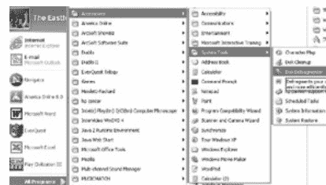

> **注意** 所有提及的微软操作系统所用的文件系统都基于一个将特定文件段与硬盘地址相关联的表。其中第一个是文件分配表（File Allocation Table, FAT）。Windows 2000 和 XP 使用了一种显著增强的文件系统，称为新技术文件系统（New Technology File System, NTFS）。

## 与 Windows 相比的 Linux 缺点

看来使用 Linux 有一些显著的优势。它是一个非常稳定的操作系统，而且价格非常便宜。使用 Linux 操作系统也有几个缺点，首先是软件的可用性。您可以获得诸如 Star Office 和 Open Office（将在本书后文详细介绍）等办公产品。您可以找到强大的图形程序，例如 GIMP®（Graphics Image Manipulation Program，图形图像处理程序，本书中也会有所探讨）。您甚至可以为 Linux 购买一些游戏。然而，您无法为 Linux 获取 Microsoft Office®、Adobe Photoshop® 或许多其他流行的应用程序。至少目前还不能。您将能够完成您习惯的所有任务，但可能需要使用新的软件来完成它们。您可能需要为您习惯使用的某些产品寻找替代应用程序。幸运的是，许多这些替代应用程序也是开源的。实际上，Red Hat 9.0 的安装磁盘中就包含其中的一些。即使您没有使用 Red Hat 9.0，您也会发现许多这些替代应用程序可以从互联网免费下载。

除了学习一些新的软件应用程序外，您还会发现有些应用程序根本找不到 Linux 版本，也没有合适的 Linux 替代品。例如，许多游戏尚未移植到 Linux。这种情况正在改变，您仍然会发现大量没有 Linux 版本的游戏。您还会发现某些硬件没有 Linux 驱动程序。大多数标准的 CD-ROM、打印机、网卡等都能在 Linux 下工作，但更冷门的品牌可能不行。如果您使用的是相当常见的硬件，这就不会是个问题。

对于使用 Linux 的小型企业来说，一个非常显著的缺点是找到合适的人员。大多数从事 PC 支持外包和维修的计算机公司都接受过 Windows 培训，而不是 Linux 培训。也很可能的是，您的大多数员工都有丰富的 Windows 经验，但几乎没有或没有任何 Linux 经验。这可能需要对您的员工重新进行 Linux 使用培训（当然，您可以从简单地给他们每人买一本这本书开始！）。简单来说，在 Windows 方面受过培训的合格技术人员非常容易找到，而合格的 Linux 技术支持则可能更难找。这通常导致 Linux 专业人士的薪资要求略高。

## Linux 发行版

本书讨论的是 Red Hat Linux。然而，有许多其他与 Linux 相关的品牌名称。了解这些品牌之间的异同非常重要。首先，它们通常被称为*发行版*（distributions）。这些发行版之间的共同点多于不同点。您将在本书中学到的各种桌面（如 KDE 和 GNOME）、shell、命令和管理任务适用于所有 Linux 发行版。

您可能想知道它们有什么不同。每个发行版在分发 Linux 的同时，都会创建自己的安装例程，并决定捆绑哪些额外的程序。换句话说，发行版之间的真正区别在于安装过程和随操作系统安装的不同应用程序。例如，Red Hat Linux 附带流行的图形程序 GIMP、完整的办公套件以及大量其他应用程序。

最重要的是要记住，所有发行版的实际操作系统都是相同的。这意味着您在本中学到的内容将适用于其他 Linux 发行版，如 SuSE、Debian 和 Mandrake。

## Linux 将去向何方？

现在您知道了 Linux 的来源以及它能做什么，下一个问题是，它将去向何方？Linux 正在赢得 web 服务器市场的大份额。它价格非常便宜，并且附带 Web 服务器和 FTP 服务器软件，这使得它对运行 Web 服务器的人来说非常有吸引力。更多的企业正转向使用 Linux 作为 Web 服务器、文件服务器和其他服务器。America Online 和 Amazon.com 图书销售商都使用 Linux 服务器。Windows 仍然是家庭和商业桌面的王者，但这种情况正在改变。企业主们受够了为专有产品支付高昂的授权费。越来越多的小型企业正在寻找 Linux 和开源软件作为低成本的替代方案。显然，家庭和小企业社区中不断增长的市场份额是 Linux 的未来所在。

Linux 也在高科技家电制造商中变得流行，例如名为 Tivo® 的电视收视产品。低成本和缺乏授权限制使其非常适合此类操作。显然，Linux 的受欢迎程度正在增长，并在未来几年内将占据越来越多的市场份额。

最近，Linux 在一些非常高端的计算领域取得了一些引人注目的进展。许多科学研究所需的计算能力远超任何标准服务器——Windows、Unix 或 Linux——的能力。这导致一些研究机构购买往往价值数百万美元的超级计算机。超级计算机是一种功能非常强大的计算机。一台运行 Unix 或 Windows 的普通计算机可能只有两个或四个处理器。超级计算机本质上是一台多处理器机器，运行着数百甚至数千个处理器。所有这些处理器都需要非常专业且昂贵的冷却系统。在过去几年里，一些研究人员将几十台甚至数百台装有 Linux 的旧 PC 连接在一起，让它们协同工作，本质上模拟超级计算机的算力。这种设置被称为*hive*（蜂群）。这种类型的设置通常依赖于运行免费 Linux 版本的旧 PC，这些 PC 往往是被废弃的。因此，唯一的成本就是连接这些 PC 和为它们供电。这是 Linux 在计算世界中留下印记的又一种方式。

## 总结

Linux 是一个功能强大且价格低廉的操作系统，它提供了非常用户友好的图形用户界面，并提供访问众多软件应用程序的途径。Linux 是一个开源的 Unix 克隆，这意味着您在 Linux 中做的很多事情，如果甚至大多数事情，与您在 Unix 中做的是相同的。它的价格和稳定性吸引了越来越多的用户，但仍有一些应用程序没有对应的 Linux 版本。也要注意，更冷门的硬件可能没有 Linux 驱动程序。

## 复习问题

- 1. Minix 和 Linux 都基于哪种操作系统？
- 2. GNU 代表什么？
- 3. 谁发明了 Linux？
- 4. 列出 Linux 相比 Windows 的两个优势。
- 5. 列出 Windows 相比 Linux 的两个优势。
- 6. Linux 默认使用什么文件系统？
- 7. Windows XP 默认使用什么文件系统？


### 答案

- 1. Unix
- 2. GNU 不是 Unix（"GNU is not Unix"）。
- 3. Linus Torvalds（林纳斯·托瓦兹）
- 4. 稳定性和价格。
- 5. 软件可用性和技术支持的可用性。
- 6. ext2
- 7. NTFS


## 第二章：安装 Linux

### 简介

我们已经对 Linux 世界进行了宏观概览，包括简短的历史回顾以及对 Linux 与 Windows 优缺点的比较分析。然而，除非安装它，否则我们将无法用 Linux 做任何事情。虽然这个过程并不特别困难，但你应该意识到，安装任何操作系统都是一个非常重要的步骤。

最直接的原因是你必须安装操作系统后才能使用它。不过，安装之所以重要还有其他原因。你安装操作系统的方式以及安装期间选择的选项，将决定你的操作系统具备哪些功能，并在一定程度上决定它在你的机器上的运行行为。因此，你必须对这一过程保持高度关注。虽然这一过程至关重要，但如果谨慎操作，它并不特别困难；不过，有一些陷阱是你需要避免的。建议在尝试安装之前通读整章内容。你不应该简单地从章节开头开始，边读边跟着操作。应该先通读一遍整篇*章节*，确保你理解其中涉及的所有问题；然后在实际执行安装操作时，再第二遍阅读该章节。请特别注意文本中的任何“注意事项（Notes）”。这些注意事项旨在突出显示潜在的问题或需要你特别密切关注的特定问题。这样，你将在开始安装过程之前意识到任何潜在问题。如果读完本章后，你对安装过程仍然感到不自在，可能最好也阅读一下随你的 Linux 版本附带安装说明。在你仔细阅读本章并确定理解材料之后，只需关注安装过程本身，你应该就能顺利完成。

建议你关注安装过程，这看起来可能有点奇怪，但这种告诫源于长期的经验。初学者匆忙完成安装的部分步骤，结果导致某些事情做得非常错误，这种情况并不罕见。如果你仔细关注每个屏幕并阅读任何说明，你应该就没问题。安装过程并没有那么困难；事实上，它并不比安装 Windows 更困难，在某些方面甚至更简单。当然，在最坏的情况下，如果你完全搞砸了安装，你只需重新安装操作系统即可。糟糕的安装不会损坏硬件。然而，直到重新安装完成之前，你的机器可能会变得无法使用。

> 如果你真的搞砸了安装，你将不得不重新划分硬盘分区并重新安装操作系统。本章讨论了划分硬盘分区的过程。最好在没有任何重要数据的旧机器上执行首次 Linux 安装，或者在安装过程开始前确保已备份所有数据。事实上，如果你使用的不是没有数据的旧机器，那么开始操作之前备份所有数据是绝对至关重要的。未这样做可能会导致所有数据的丢失。

这段简介可能让你感到害怕。请记住，如果你首先仔细阅读本章的说明，以及可能附带在你 Linux 发行版中的文档，你应该就没问题。仔细阅读并遵循说明的大多数读者在安装时将不会遇到任何问题。然而，对于那些就是不想尝试的读者来说，有一些大型计算机商店提供已预装 Linux 的 PC。通常它们比 Windows PC 便宜得多。你可以随时购买其中一台，从而跳过安装过程。如果你选择自行安装，关键在于在安装前阅读本章以及你发行版的文档。

本书所有示例均使用 Red Hat Linux；但是，安装其他发行版（如 SuSE 或 Mandrake）会有很多相似之处。事实上，任何 Linux 发行版的安装过程可能相似之处多于差异。如果你正在使用其他主要的 Linux 发行版，不用担心。本章的材料，结合随你的特定 Linux 发行版附带的文档，应该仍然足够你安装 Linux。还要记住，安装完成后，本书中的其他任务在所有主要 Linux 发行版中都是通用的。

在你着手安装 Red Hat 9.0 或任何软件之前，你应该确保你的系统能够支持它。运行特定软件包所需的最低硬件规格也称为其*系统需求*。这些最低要求通常由操作系统供应商确定。系统需求是考虑转向 Linux 的另一个原因。Linux 操作系统不需要昂贵的台式机高端 PC 即可运行。事实上，Linux 已成功安装在许多小型企业直接丢弃的机器上。Red Hat 将其专业版（Professional Edition）的规格定为 Pentium II 400MHz 或更快的处理器、28 兆字节 RAM、1.3 吉字节硬盘空间、鼠标和 CD-ROM。本书重点关注的个人版（Personal Edition）可以安装在仅有 64 兆字节 RAM 的 Pentium II 200MHz 处理器上。为了让你了解这些系统需求有多低，请记住这些是 Pentium II 机器。截稿时，Pentium IV 是 Intel 处理器的当前型号。你还很难找到 RAM 少于 128 兆字节的新电脑。事实上，即使低端 PC 也倾向于配备 256 兆字节 RAM 和至少 10 吉字节硬盘空间。如果你在過去 18 个月内购买了新机器，Linux 很可能可以顺利安装并在其上运行。事实上，Linux 甚至在那些非常老旧和过时、甚至几年前就不在商店销售的机器上也能工作。这意味着你不需要昂贵的 PC 来运行 Linux，甚至不需要新机器。

至关重要的是，你要意识到制造商推荐的最低硬件配置仅仅是最低标准。如果你选择仅具备该最低标准的 PC，你会发现其运行相当迟缓，尽管它可以工作。对于你使用的任何软件，你通常希望拥有超过最低要求的配置。幸运的是，最近两年购买的新系统很可能对 Linux 来说绰绰有余。然而，作者个人推荐的最低配置（超过制造商的最低标准）是 Pentium III 500、128 兆字节 RAM 和 5 吉字节硬盘。幸运的是，刚才描述的机器在大约 1999 年会被视为新款。这意味着你仍然不需要购买昂贵的新电脑来运行 Linux。不过，任何 PC 的经验法则是，算力越多越好。如今，你几乎可以在任何主要计算机商店以不到 500 美元的价格购买一台全新配备 512 兆字节 RAM 和 20 吉字节硬盘的 Pentium IV。

你可以从多种渠道获取 Linux。大多数当地计算机商店，如 Best Buy™ 和 Microcenter™，都提供主要的 Linux 发行版。你还可以从几个网站订购或下载 Linux，其中一些网站列在这里。这些网站中的一些免费提供一个 Linux 发行版，而另一些则收取少量费用。

这些是各种发行版的网站：

- www.redhat.com/
- www.redhat.com/download/howto_download.html
- www.mandrakelinux.com/
- www.debian.org
- www.slackware.com
- www.suse.com

这些是通用的 Linux 网站：

- http://linux.tucows.com/
- www.linux.com
- http://download.com.com/3150-2035-0.html?tag=dir

这些网站提供非常便宜或免费的 Linux CD：

- www.cheapbytes.com/
- http://freelinuxcd.org/

**注意** 除非你是一位特别精通的读者，否则建议购买商业版 Linux，例如 Red Hat 9.0。安装过程要容易得多，并且附带了详尽的文档。如果你下载，安装过程将更复杂。你可能需要在开始安装之前将安装文件传输到一张或多张 CD 上。

本章描述的安装是使用商业版 Red Hat 9.0 完成的，它是在一家主要计算机商店以约 50 美元购买的。没有购买任何特殊东西或添加任何东西。作者只是从货架上购买了 Red Hat 9.0 个人版，完全就像你会找到它那样。然而，需要强调的是，可以使用从其他来源获取的 Linux 版本进行此安装，并且无论你在哪里获取 Red Hat Linux，安装过程应该大致相同。即使是其他 Linux 发行版，如 Mandrake、Debian 和 SuSE，也应该非常相似。


# 入门指南

如今的绝大多数计算机都可以从 CD-ROM *引导*（启动）。这意味着，如果你将 Red Hat 安装光盘的第一张放入光驱并 *重启*（重新启动）你的计算机，它应该会启动 Linux 安装程序。然而，如果并未如此，原因很可能是你的 PC 没有通过光驱启动。别担心，所有 PC 的启动顺序中都包含软驱，因此我们可以通过软盘进行安装。让我们开始研究如何执行此操作。

# 制作可启动软盘

如果你的 PC 可以通过光驱启动，你可以跳过这一部分。这部分内容是面向那些计算机无法通过光驱启动的读者准备的。这个过程并不特别复杂。你的第一步是找一台可用的 PC 来制作可启动磁盘。如果你能找到一台装有 Windows 的机器（就像你即将安装 Linux 的那台机器一样），那就完美了。只需将安装套包中的第一张 CD-ROM 放入光驱，并将一张空白软盘放入软驱。使用“我的电脑”或 Windows 资源管理器，找到光盘上名为 `\dosutils\rawriteiwin` 的文件夹。如果你使用的是“我的电脑”，你应该会看到类似图 2.1a 所示的内容。如果你更喜欢使用 Windows 资源管理器™，那么你的屏幕将类似于图 2.1b 所示的内容。

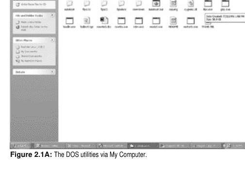

图 2.1a：通过“我的电脑”访问的 DOS 实用程序。

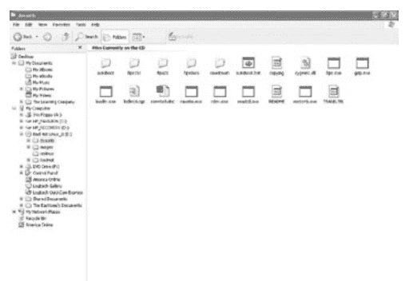

**图 2.1b：** 通过 Windows 资源管理器访问的 DOS 实用程序。

你应该会注意到一个名为 **rawritewin.exe** 的文件。这个程序将把放入软驱的空白磁盘制成 Linux 安装的可启动磁盘。当你启动这个应用程序（通过双击它）时，你应该会看到类似 **图 2.2** 所示的内容。

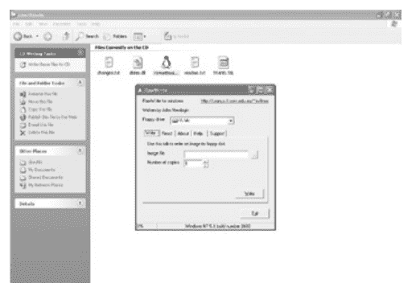

**图 2.2：** **rawritewin** 应用程序。

**注意：** **rawritewin** 实际上是名为 **rawrite** 的旧 Unix/Linux 实用程序的 Windows 封装。该实用程序用于向磁盘写入内容。

现在你必须使用标题为“镜像文件”的文本框旁边的小按钮来选择要写入磁盘的镜像。当你按下该按钮时，会出现一个标准对话框，允许你从特定文件夹中选择一个特定文件。你会看到几个扩展名为 **.img** 的文件。这些是**镜像**，每个都用于创建不同类型的可启动磁盘。你应该选择 **bootdisk.img** 文件，如 **图 2.3** 所示。在某些 Linux 发行版磁盘中，该文件名为 **boot.img**，因此如果你没有看到 **bootdisk.img**，请选择 **boot.img**。

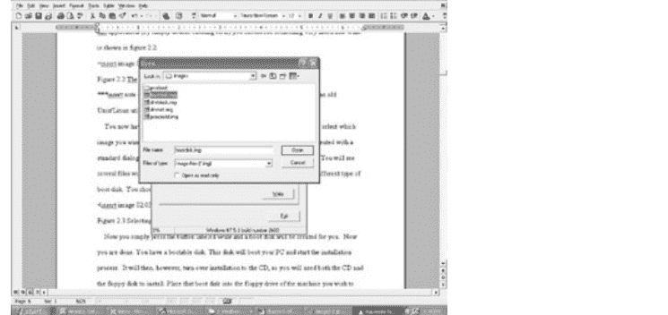

**图 2.3：** 选择 **boot.img** 文件。

现在只需按下标有 **Write**（写入）的按钮，就可以为你创建一个可启动磁盘。至此完成。你拥有一个可启动磁盘。该磁盘将引导你的 PC 并启动安装过程。然后它会接管安装过程并交由 CD 继续，因此你需要 CD 和软盘两者来进行安装。将可启动磁盘放入你想要安装 Red Hat Linux 的机器的软驱中，并将你的第一张安装 CD 放入光驱中。然后，重启你的 PC，安装过程将开始。

**注意：** 本章描述的安装过程做出了一些特定选择。这些选择将安装特定的应用程序。这些应用程序将在本书后续部分中介绍。如果你不严格按照本书详述的安装过程操作，可能不会安装我们将稍后介绍的所有应用程序。

现在我们准备好安装 Linux 了。只需将第一张盘放入光驱并重启你的 PC（除非你使用软盘安装，在这种情况下，你的软盘和 CD 应该已经分别位于各自的驱动器中）。启动后，你将看到初始屏幕。此屏幕上信息很少；它只是通知你准备好开始安装了。

**注意：** 如果你曾经观看过 Microsoft Windows 机器的启动过程，你会发现 Linux 启动时显示的信息多得多。你看到的内容几乎是启动过程的每个细节。

系统会询问你希望如何继续安装。你几乎总是想要选择第一个选项，**Install in Graphical Mode**（以图形模式安装）。你只需按下 **Enter** 键即可选择此选项。实际上，不使用图形模式的唯一合理理由是你的 PC 过于陈旧，无法支持图形安装。当然，如果你的机器不支持图形安装，那么它很可能也不支持大多数真正酷的图形 Linux 产品，如 KDE、GNOME、GIMP 和 Open Office。如果你回想起我们之前关于系统要求的讨论，请记住作者亲自在仅拥有 64 MB 内存的 Pentium II 233MHz 处理器上以图形模式安装了 Red Hat 9.0 的所有选项。（不过，应该指出的是，该机器运行速度不如人们期望的那样好。）为了提供背景参考，像刚才描述的这样机器自 1998 年左右起就不再作为新机器在商店出售了。这意味着你拥有一台完全有能力使用图形模式并运行 Linux 提供的所有内容的机器。

**注意：** 这是支持 Linux 的另一个强点。与 Microsoft Windows 不同，Linux 资源占用较低。Red Hat 9.0 可以在不支持后期 Windows 版本（如 Windows XP）的机器上运行。

在某些安装磁盘中，接下来你会被询问是否想要测试 CD。Red Hat 8.0 及更早版本的几个版本包含此屏幕，特别是来自第三方的安装。Red Hat 9.0 个人版不包含此屏幕。如果你购买了 Linux 的包装版本（如 Red Hat），这通常是不必要的，你可以选择 **No**（否）。如果你将 Linux 下载到自己刻录的 CD 上，你可能希望选择 **Yes**（是）。原因很简单。如果你使用自己的 CD 刻录机将下载的临时文件复制到 CD 上，可能会出现各种错误，CD 可能处于非正常工作状态。如果你使用的是商业购买的包装安装，CD 受损的可能性极小。

在下一个屏幕上，你会发现 Red Hat Linux 的介绍。它将解释接下来会发生什么，并简要介绍 Red Hat。如果你第一次安装 Linux，建议你在按下屏幕底部的“Next”（下一步）按钮之前仔细阅读此屏幕。它将为你提供安装过程将要执行内容的概览。

接下来的两个屏幕非常简单。它们询问你想使用什么语言以及你想使用什么键盘设置。从提供的选项中选择你的语言。这些步骤如 *图 2.4* 和 2.5 所示。值得注意的是，可供选择的语言种类繁多。Linux 现已面向多个国家的用户，使用广泛的语言。

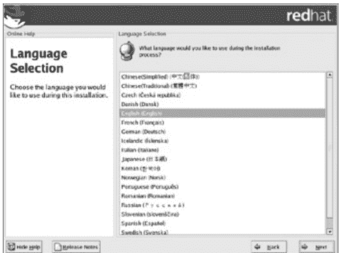

**图 2.4：** 选择语言。

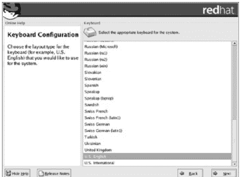

**图 2.5：** 键盘设置。

下一个屏幕，如图 *图 2.6a* 所示，询问你拥有什么类型的鼠标。如果你没有看到你的型号，请选择双按钮 PS2 通用鼠标或双按钮串行通用鼠标。还有一个标有 "Emulate a Three Button Mouse"（模拟三按钮鼠标）的复选框，默认是选中的。你可以选择保持选中或取消选中。

**注意：** 如果连接器（连接到 PC 的一端）是一个小圆头插头，那么它是 PS2 连接器。如果它是带有几个引脚的水平插头（通常有九个引脚），它是串行连接器。如果你不熟悉鼠标和连接器，建议在继续阅读本书之前阅读 *附录 D，“PC 硬件”*。它将为你简要介绍 PC 硬件。对于不知道如何辨别自己鼠标类型的读者，*图 2.6b*、2.6c 和 2.6d 中显示了三种主要类型每种连接器的图片。

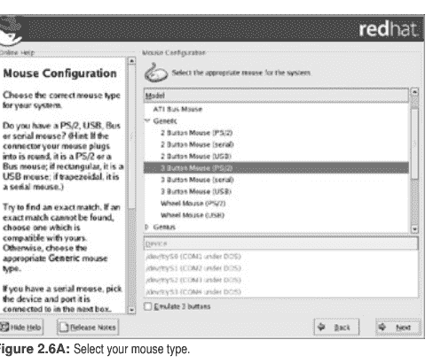

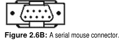

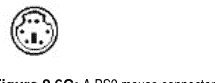


如果你正在安装的机器上已经装有以前版本的 Linux，系统将询问你是想完全清除旧安装并从头开始，还是仅仅升级。如图 *图 2.7* 所示。


# 快速入门

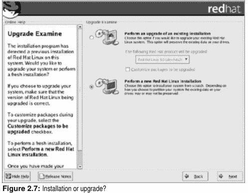

下一步是选择软件包。*软件包*是若干独立应用程序的逻辑分组。Linux 中可安装的各种应用程序被分组在一起，以便你可以根据打算如何使用计算机，轻松选择最可能需要的一组应用程序。你选择的软件包将决定在你的 PC 上安装哪些软件。选项如下：

- 个人桌面
- 工作站
- 服务器
- 自定义

这些选项均针对特定类型的用户设计。这些不同的软件包配置摘要如 [表 2.1](#) 所示。

**表 2.1：安装软件包**

| 软件包 | 内容/用途 |
| :--- | :--- |
| 个人桌面 | 包括普通家庭用户想要的东西，如网络软件（网页浏览器和电子邮件客户端）。还包括图形程序和游戏。 |
| 工作站 | 面向商业用户，包括 Open Office 等生产工具。 |
| 服务器 | 此选项针对服务器。它将安装 Web 服务器、FTP 服务器、电子邮件服务器以及其他服务器软件。 |
| 自定义 | 此选项允许你选择任何想要安装的软件包。 |

提供这些软件包是为了让特定类型计算机的安装变得简单。然而，这种简单性是有代价的。如果你选择个人桌面或工作站，你将不会安装 Web 服务器、FTP 服务器或其他服务器软件包。反之，如果你选择服务器，你将不会安装许多个人用途项目，如游戏。由于每个预设选项都有一些限制，出于我们的目的，我们将选择自定义，因为我们希望从多个软件包中提取几个元素。当你选择自定义时，安装过程中会提示你选择要安装的单个软件包和应用程序。本章稍后将介绍你应该选择的选项。目前，请选择自定义。此屏幕如图 2.8 所示。

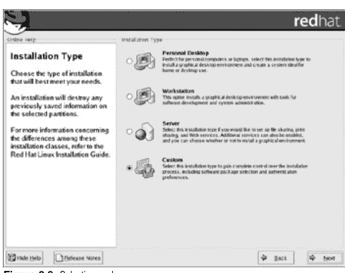

**图 2.8：** 选择软件包。

下一个屏幕将带你进入磁盘分区过程。这可能是安装过程中最重要和最复杂的部分。因此，它值得本章单独的一部分来解释磁盘分区确切是什么以及如何分区。

# 磁盘分区

此时你可能会问自己的第一个问题是：磁盘分区到底是什么？分区字面意思是将你的硬盘划分为一个或多个可用段。简单来说，你可以将硬盘划分为几个*逻辑驱动器*。逻辑驱动器只是你的硬盘的一部分，其处理方式如同它是一个独立设备。换句话说，你可以将硬盘视为几个不同的硬盘。这对于非常大的硬盘特别有用，也在人们希望更高效地组织计算机的情况下有用。你可能有一个分区专门用于商务，另一个用于家庭使用或娱乐。创建后看起来像独立硬盘的分区称为*逻辑驱动器*。你的计算机可能只有一个实际硬盘，但可能有几个逻辑驱动器。分区和逻辑驱动器不仅适用于 Linux。所有操作系统都有分区，并且可以划分为逻辑驱动器。即使你不打算将硬盘划分为多个逻辑驱动器，你仍然需要对其进行分区。唯一的区别是你将其划分为单个逻辑驱动器。

这把我们带到了运行 Linux 的硬盘分区话题。你的硬盘必须至少有一个主分区。这个主分区是你的计算机开机时的起点。这被称为*根分区*。它还必须有一个*交换分区*。这当然立即让我们问到什么是交换分区以及为什么需要一个？交换分区是一项相当惊人的创新。本质上，它是硬盘中保留的一小段，作为 PC 内存的一种备份。其工作原理相当简单。当你打开程序时，它们被加载到内存中。因此，随着你打开更多程序，你使用越来越多的内存，留给其他程序的免费内存就越少。当一个程序闲置一段时间后，该程序从内存中取出并移动到交换文件中。如果你之后再次激活该程序，例如通过点击它，它会从硬盘的交换文件部分移回内存。通过将其放置在硬盘的特殊段中，可以比从正常的硬盘分区加载更快速地重新加载到内存中。因此得名‘交换’，因为它在内存和硬盘特殊段之间交换程序。

所有操作系统都支持交换分区。交换分区的大小应至少等于机器 RAM 的数量，但不超过 RAM 的 2.5 倍。这意味着如果你有 128 兆字节 RAM，你的交换分区大小应至少为 128 兆字节，但不超过 320 兆字节。

既然你至少初步理解了磁盘分区，你就准备好对硬盘进行分区了。你会注意到 Red Hat Linux 安装提供给你三个选项。第一个是自动分区硬盘。如果你不打算对机器进行双启动，可以选择此选项。

> **注意** 如果你选择自动分区，所有现有分区都将被擦除，并将创建一个根分区、一个引导分区和一个交换分区。

第二个选项是使用 Disk Druid。Disk Druid 是一个专门为 Linux 设计的图形化磁盘分区程序。

最后一个选项是 FDisk。FDisk 是一个一些 Windows 用户熟悉的程序，因为它用于分区 Windows 机器。然而，它使用起来相当复杂，并且不提供良好的图形界面。出于我们的目的，我们将使用 Disk Druid。

> **说明** 虽然对同时运行 Windows 和 Linux 的系统进行双启动肯定是可能的，但仅拥有一台 Linux 机器要简单得多。经验较少的读者可能会发现将整个机器用于单个 Linux 分区，使用自动分区选项，会更轻松。希望进行双启动的读者建议仔细阅读以下段落及其 Linux 发行版附带的任何文档。

当你选择 Disk Druid 时，你会进入一个显示当前分区的屏幕。你可以采取两种行动方针。首先，如果你不打算对系统进行双启动（在系统上运行多个操作系统），那么最好逐个突出显示每个分区并删除它。然后你可以重新开始。然后你会选择“新建”按钮，这将带你进入一个可以设置此新驱动器参数的屏幕。这如图 2.9a 所示。

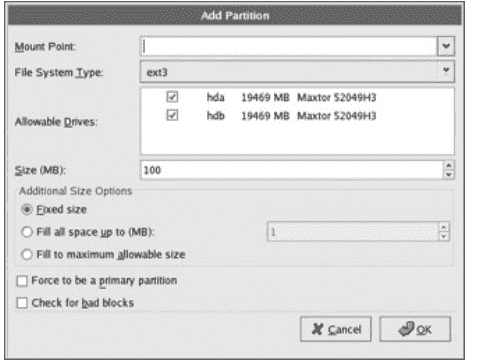

**图 2.9A：** 设置分区。

> **说明** 如果你选择编辑现有分区，也会进入此屏幕。

如果你计划与已安装的操作系统进行双启动——例如，希望将 Linux 安装在你的 Windows 机器上并保留两个操作系统——那么你不应删除所有现有分区。你将删除除了包含 Windows 的分区之外的所有分区。这意味着完成后你将有一个 Windows 分区和一个 Linux 分区。需要记住的重要一点是，你应该完全不要碰包含 Windows 的分区。真正的问题是，如何知道哪个分区包含 Windows？Linux 和 Disk Druid 识别分区的方式与 Windows 不同，但 Disk Druid 和 Windows 都列出了分区的大小。诀窍是在开始安装之前启动你的系统，并使用“我的电脑”记下你希望安装 Linux 的分区的大小。例如，考虑图 2.9b。

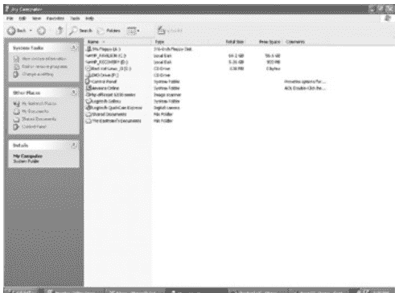

**图 2.9B：** 我的电脑。

> **说明** 这是建议你尝试安装之前阅读整个章节的又一个原因。

在这里，我们看到有一个 13.6 吉字节的单个大分区，它被称为 C 盘。当你开始 Linux 安装并进入 Disk Druid 时，你不会看到标记为 C 的驱动器，但你会看到一个大小约为 56.6 吉字节的驱动器。


**注意**
在 Windows 上实现双引导的最佳方法是创建一个独立的分区来存放 Linux。此分区应在开始安装 Linux 之前创建。如果你对划分硬盘分区感到不安，可以考虑使用商业产品，例如 Partition Magic™，可从 www.powerquest.com 获取。如果图 2.9b 中所示的机器上存在该软件，你还会看到 D 盘或 E 盘。另外请注意，每台机器只运行一个操作系统要简单得多。换句话说，拥有一台单独的 Linux 计算机和一台单独的 Windows 计算机，比尝试在一台机器上安装两者更容易、更简单。

然而，Disk Druid 的一个显著问题是无法调整分区大小。如果你的机器已经拥有两个大小合适的分区来分别处理 Windows 和 Linux，那就没有问题。如果没有，你可能会遇到问题。正如我们之前讨论的，最简单且相对廉价的途径之一是获取诸如 Partition Magic 这样的实用工具，在 Windows 中安装它，然后根据需要调整分区大小。这样，当你重启并安装 Linux 时，分区就已经为你设置好了。如果你想手动重新划分机器分区以实现双引导，最好的选择是遵循 Microsoft 的建议。Microsoft 网站 www.microsoft.com/exchange/techinfo/tips/StorageTip2.asp 可能对你有所帮助。

另一个选项是使用之前提到的 FDisk 实用工具重新划分驱动器。FDisk 实际上不允许你根据需要调整分区大小。然而，它允许你删除一个分区，并利用释放的空间创建一个或多个分区。关于 FDisk 实用工具，互联网上最好的网页之一是 www.computerhope.com/fdskhelp.htm。你还可以在 www.die.net/doc/linux/man/man8/fdisk.8.html 访问 Linux FDisk 手册。FDisk 功能更强大，但也更复杂。因此，本书将重点介绍 Disk Druid。想要了解有关 FDisk 更多信息的读者，建议使用之前提到的网站，并或许在喜欢的搜索引擎中搜索“FDisk”以获取更多资源。

假设你没有进行双引导，你可能会希望使用 Disk Druid 只创建两个分区：前面描述的交换分区（swap partition），以及一个用于操作系统的大型单一分区。这是最简单的配置，强烈推荐给初学者。做出这些选择后，你点击确认按钮告诉 Disk Druid 你已完成。你还可以选择一个复选框，指示希望安装过程在创建分区前检查实际物理磁盘。这是一个非常不错的想法。虽然耗时的过程，但它确保你不会在坏硬盘上安装 Linux。

## 继续安装

完成 Disk Druid 后，在安装完成前仍有几个步骤需要执行。下一个屏幕将列出你 PC 上的操作系统。如果你没有进行双引导，你应该只看到一个，即 Linux。如果你进行了双引导，可以选择哪个操作系统作为默认选项。这如图 2.10 所示。

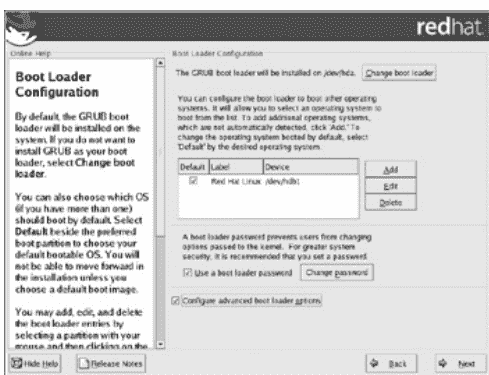

**图 2.10：选择操作系统。**

当你的机器首次启动时，你将看到一个列出这些操作系统的界面，并给你几秒钟时间选择其中一个。如果你没有做出选择，系统将为你选择默认选项。你应该注意到，这个屏幕正在配置你的*引导加载程序*。引导加载程序只是一个将操作系统加载到内存中的小程序。在启动阶段，它加载操作系统，因此得名“引导加载程序”。许多 Linux 发行版使用*LILO*（Linux 加载）引导加载程序软件。Red Hat 9.0 使用较新的引导加载程序，即*GRUB*（通用引导加载程序）。除其他功能外，GRUB 使双引导变得更加容易。

安装的下一阶段是配置网络适配器。网络适配器，也称为 NIC（网络接口卡），简单来说就是你插入网线的板卡。如果这是一台独立的家用机器，请保留图 2.11 中显示的默认设置。

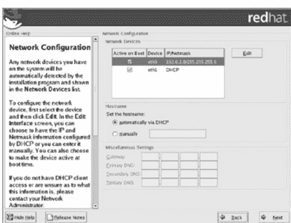

**图 2.11：网络配置。**

如果这不是独立机器，而是一台将在网络中使用的机器，你需要设置由网络管理员分配给你的 IP 地址。

**注意** 如果你不在网络上，但打算登录互联网，你的互联网服务提供商（ISP）很可能每次登录时都会分配给你一个 IP（这被称为动态 IP）。这是 Linux 的默认设置，因此你应该没问题。如果你的 ISP 分配给你一个静态 IP，这是 ISP 相当不寻常的做法，它会告诉你该 IP 地址是什么。

**注意** IP 地址由四个数字组成，每个数字在 0 到 255 之间，并用句点分隔。IP 地址的一个示例是 10.32.0.43。

如果你现在不知道正确的网络设置或者填写错误，不要惊慌。一旦 Linux 运行起来，你可以随时更改这些设置。第 4 章“KDE 中的系统配置”详细展示了具体操作方法。

配置好网络卡后，下一阶段是设置防火墙。你可能想知道什么是防火墙。*防火墙*是你计算机与外部世界之间的一道屏障。它是你抵御黑客的第一道防线。防火墙可以是一个单独的设备（如路由器或另一台 PC），也可以是过滤传入数据包的软件。在此情况下，它是过滤传入数据包的软件。如果你对防火墙没有深入了解，最好的选择是保留默认设置。然而，这款防火墙是 Red Hat Linux 发行版的众多优势之一。它附带并安装了防火墙，这使得你的 PC 针对互联网上的各种危险更加安全。默认配置如图 2.12 所示。

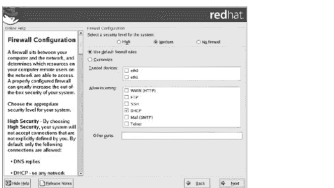

**图 2.12：防火墙配置。**

**注意** 你 PC 中的网络接口卡（NIC）按顺序列为 *eth0*、*eth1* 等。*eth* 是 Ethernet（以太网）的缩写。大多数家用 PC 只有一张卡。

设置好防火墙后，下一个屏幕将询问你是否要安装其他语言。你可以在你的 Linux PC 上支持多种语言。如果你只使用一种语言，在这个阶段无需做任何操作。

接下来的几个屏幕非常简单。实际上，它们本身就很直观，但我们会简要讨论一下。紧接着的屏幕要求你选择时区。如果你选错了，不用担心；与网络配置一样，你可以在 PC 启动运行后重新配置。你可以在图 2.13 中查看时区屏幕。

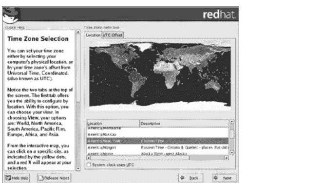

**图 2.13：选择时区。**

下一个屏幕简单但很重要。在这里你要做两件事：设置 root 密码并添加用户账户。此时采取的主要操作并在图 2.14 中展示的是设置 root 密码。

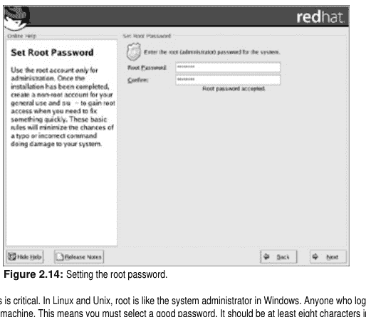

这一点至关重要。在 Linux 和 Unix 中，root 类似于 Windows 中的系统管理员。任何以 root 身份登录你 PC 的人都可以对机器做任何事情。这意味着你必须选择一个好的密码。它至少应包含八个字符，并由字母和数字组合而成。务必将其写在某个地方。如果你忘记了它，你会陷入真正的麻烦。你唯一的选择将是完全重新安装并清除之前的 Linux 安装。

在这个屏幕上，你还可以添加用户账户。这很重要，因为你可以定义具有特定权限的用户，允许他们仅执行你希望他们执行的任务。在离开此屏幕之前，你必须设置 root 密码，但如果你愿意，可以稍后添加用户。事实上，许多 Linux 管理员在机器完全安装和配置后才添加用户。然而，你也有选项现在就添加用户账户，如果你愿意的话。无论如何，花一分钟为自己添加一个用户账户可能是个好主意。这样，你可以登录而不需要每次都以 root 身份操作。用户名的一种常见系统是使用名字首字母加上姓氏。例如，作者的用户名可能是 easttom。

**注意** 每次使用 PC 时仅以 root 身份登录通常是不明智的。原因是 root 对整个系统拥有完全且不受限制访问权限。然而，在本书中，我们将介绍一些基本管理职责，这些将要求你以 root 身份登录。建议你在仅使用 Linux 机器时，随时以你刚才创建的用户名登录，但在尝试本书后面章节中的管理练习时以 root 身份登录。

下一个屏幕稍微复杂一些。它允许你为 PC 设置各种加密方案。除非你对这些加密方法有相当深入的了解，否则你应该保留默认设置并跳过此屏幕，该屏幕如图 2.15 所示。


## 选择软件包

选择安装哪些软件包是一个非常重要的主题。除了磁盘分区工具（Disk Druid）之外，这可能是安装过程中最重要的部分。你可以选择多种软件包，每种都有不同的用途。它们被划分为桌面、服务器和开发等类别。在本部分中，我们将逐一探讨这些类别，并解释具体的软件包组。在本节末尾，列出了建议选定的软件包列表。软件包组选择界面如图 2.16 所示。

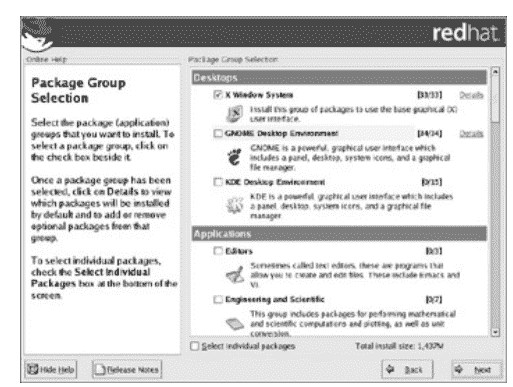

**图 2.16：软件包选择。**

### 桌面环境

你可以使用简单的命令行模式（也称为 shell 模式）运行 Linux。这意味着你需要在一个纯黑屏幕上键入所有操作，但你为什么会想要这样做呢？作为 Windows 用户，你习惯了丰富的图形界面，并且很可能希望继续使用这样的界面。Linux 不仅提供了非常易用的图形界面，还提供了多种可供选择的界面。本节中列出了三个软件包：X Window System（X 窗口系统）、GNOME（GNU Object Model Environment，GNU 对象模型环境）和 KDE（K Desktop Environment，K 桌面环境）。其中每一个都是一个完整的图形窗口界面，其操作方式与 Microsoft Windows 相似。选择哪一个纯属个人偏好。在本书中，我们将使用 KDE 用户界面。无论你选择 KDE 还是 GNOME，都应配合 X Window System 一起选择。为了跟随本书的内容，你应该选择 GNOME、KDE 和 X Window System。

### 应用程序

这部分对你来说将非常重要。它列出了 Linux 可以安装的各种类型的应用程序。大部分内容不言自明。例如，Office Productivity（办公生产力）软件包包括文字处理器、电子表格等。Games and Entertainment（游戏与娱乐）软件包包括 Linux 的游戏。完整列表及其说明见表 2.2。

| 软件包 | 用途 |
| :--- | :--- |
| Editors | 该软件包提供多种文本编辑器，其中许多功能远超你可能使用过的 Notepad（记事本）等文本编辑器。 |
| Engineering and Scientific | 该软件包包含若干供科学家和工程师使用的程序。 |
| Graphical Internet | 包含此软件包将使你能够访问多种互联网工具，包括 Web 浏览器、聊天软件和电子邮件客户端。 |
| Text-Based Internet | 只有在你不运行桌面图形用户环境的情况下才需要此软件包。它将允许你检查电子邮件并进行一些互联网活动。 |
| Office Productivity | 该软件包包括广泛的文字处理器、电子表格、演示工具等。 |
| Sound and Video | 安装此软件包使你能够访问用于录制声音和视频、播放视频等的多个程序。 |
| Authoring and Publishing | 这些程序专门用于桌面出版和网页开发。 |
| Graphics | 在此软件包中，你会发现用于图像处理的應用程式。其中一些应用程序可与 Adobe Photoshop 等商业产品相媲美。 |
| Games and Entertainment | Red Hat Linux 9.0 附带了几种你可以用来娱乐的游戏。 |

### 服务器

有多种不同的与服务器相关的软件包可供选择。这些包括 Web 服务器、数据库服务器和新闻服务器。其中一些软件包仅适用于网络服务器，但一些可能适用于小型企业和家庭使用。各个软件包的描述见表 2.3。

**表 2.3：服务器软件包**

| 软件包 | 用途 |
| :--- | :--- |
| Server and Configuration Tools | 这是一个至关重要的软件包，包含许多用于配置服务器的工具。如果你正在安装其他任何服务器软件包，建议同时也安装此软件包。 |
| Web Server | 该软件包包含将你电脑变成个人 Web 服务器所需的软件。 |
| Windows File Server | 此包含使你能与运行 Windows 的机器共享文件的软件。如果你的 Linux PC 将在异构网络环境（拥有多种操作系统的网络）中交互，你可能需要此软件包。 |
| DNS Name Server | 如果你的 Linux 服务器将作为网络的 DNS（域名系统）服务器，你需要此软件包。 |
| FTP Server | 该软件包使你能够通过网络或互联网在电脑上传输和下载文件。 |
| SQL Database Server | 这是一个非常强大、功能完整的数据库服务器。如果你经营小型至中型业务，你可能需要此软件包。 |
| News Server | 该软件包使你能够在你的电脑主机上托管讨论组/新闻组。对于大多数用户，不建议使用此功能。 |
| Network Servers | 该软件包包括用于运行网络服务器的多种应用程序。 |

### 开发

如果你是一名程序员，那么你会绝对爱上 Red Hat 9.0。它提供了你可以免费安装的大量开发工具。你将拥有开发自有 Linux 软件所需的一切。各个软件包的描述见表 2.4。

**表 2.4：开发软件包**

| 软件包 | 用途 |
| :--- | :--- |
| Development Tools | 该软件包含许多用于创建 C、C++、Lisp、Java 和其他编程语言程序的通用开发工具。编译器、编辑器以及所有必需的工具都包含在此软件包中。 |
| Kernel Development | 该软件包含工具和 Linux 内核的代码。如果你是一名熟练的程序员并希望修改 Linux 操作系统，你可以这样做。 |
| X Software Development | 该软件包专门用于开发与 X Window System 配合运行的软件。 |
| GNOME Software Development | 该软件包包含开发 GNOME 运行软件所需的一切。 |
| KDE Software Development | 该软件包拥有开发 KDE 运行软件所需的一切。 |

### 系统

各种系统软件包对于管理你的 Linux PC 非常有用。建议安装这三个软件包中的每一个。它们是管理工具、系统工具和打印支持。

### 其他

这实际上不是一组软件包，而是两个额外的选择选项。如果你的电脑硬盘空间不足，你可以选择 Minimal（最小化）。选择此选项后，你无法获得 Red Hat 附带的许多有趣且有用的应用程序，但你仍会拥有基本必备功能。另一个选项 Everything（全部），顾名思义，即所有软件包。此选项需要超过四吉字节的硬盘空间。

不同的 Linux 用户会找到不同组合的软件包以满足其喜好。然而，本书专注于某些必须安装的应用程序。因此，请确保你选择了表 2.5 中的所有项目。

**表 2.5：推荐软件包**

这组软件包是服务器、工作站和个人选项的良好混合。你拥有业务工作站的办公生产力，个人工作站的娱乐和图形功能，以及服务器的 Web 和 FTP 服务器软件。这些软件包结合在一起，其中许多将在本书中介绍，将为你提供广泛可供选择的应用程序。然而，如果你的硬盘显著大于五吉字节，正如许多当前硬盘那样，建议你选择 Everything 选项并安装所有软件包。当然，这将使你的安装过程花费更长时间。


## 选择软件包

需要注意的是，在 Linux 运行之后，软件包是可以添加和移除的。添加或移除软件包的操作步骤将在本书后文详细描述。第 14 章“其他 Linux 应用程序”中包含了一节关于添加和移除软件包的内容。

> **注意** 当你阅读本书时，你会接触到在 Linux 中使用的各种应用程序。如果你没有包含相应的软件包，你的机器上就不会有这些应用程序。不过，你可以选择添加软件包，或者从网站下载该应用程序。在大多数情况下，当你首次接触某个产品时，我们会提供相应的网站信息。同样，使用不同 Linux 发行版或不同版本 Red Hat 的读者可能未安装所有提到的应用程序。

## 完成安装

此时，安装程序将无人值守运行几分钟。根据你 PC 处理器的速度以及你选择的软件包数量，这个过程可能需要从几分钟到 30 分钟甚至更长时间。在这个过程中，CD-ROM 托盘会打开，提示你插入第二张光盘。当该光盘安装完成后，只需处理少数几个基本配置项。在磁盘安装过程中，你会看到一个显示安装进度的屏幕。该屏幕如**图 2.17**所示。

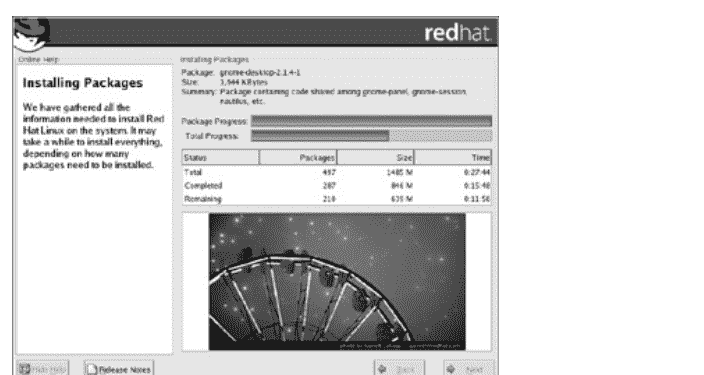

**图 2.17：安装进度。**

> **注意**
> 你选择的软件包越多，安装所需的时间越长。包含所有可用软件包的安装可能需要两个多小时。

系统会要求你设置当前时区。这相对简单；系统列出了世界各地的主要城市，你应该选择离你最近的一个。你也可以通过世界地图来选择你的时区。你会被询问是否想要创建启动盘。强烈建议创建。这是一个紧急磁盘，可以在灾难性故障发生时让机器重新运行起来。系统还会询问你是否希望 Linux 自动进入图形模式还是进入 shell。你应该选择图形模式。最后，系统会提示你移除系统中的所有磁盘，然后 PC 将重启。你已成功安装 Linux，现在可以开始使用了。

> **注意**
> 在正常操作中，不建议以 root 用户身份登录。请记住，root 等同于 Windows 中的管理员。然而，就本书的目的而言，你应以 root 身份登录。这样，你将能够访问 Linux 的所有功能，包括管理工具。这在本书后文涉及管理工具时至关重要。

## 摘要

本章带你完成了 Red Hat 9.0 Linux 的安装。向你展示了成功安装 Linux 所需的步骤。本章还解释了分区概念，并给出了如何划分硬盘的建议。最后，解释了每个主要软件包，并提供了你应该考虑安装哪些软件包的清单。建议在尝试在 PC 上安装 Linux 之前仔细阅读本章。

安装过程需要一定的练习。一旦你的 PC 安装了 Linux 并正常运行，你可能在很长时间内都不会再次安装 Linux。事实上，除非有人请你帮忙安装，否则你可能不会再安装 Linux。因此，将整个安装过程重复一两次是个好主意。一旦你的 PC 开始使用，上面就会有数据，重新安装会清除这些数据。如果你想多练习几次安装，现在就做，在你个性化你的 PC 或开始保存任何数据之前。如果你选择不练习安装，至少应该在安装前彻底阅读一遍本章，并在安装后再回顾一遍。这将有助于确保你对安装过程有扎实的理解。

## 复习题

1. 选择软件包的四个选项是什么？
2. 如果你的 PC 有两个 NIC（网卡），当查看防火墙或网络配置时，第二个会被命名为什么？
3. Disk Druid 是什么？
4. 你的 SWAP 分区的最小尺寸是多少？
5. 你的 SWAP 分区的最大尺寸是多少？
6. GRUB 是什么？
7. LILO 是什么？
8. NIC 是什么？
9. RAM 是什么？

### 答案

1. 个人桌面、工作站、服务器、自定义
2. eth1
3. 一个磁盘分区工具。
4. 与你内存大小相同。
5. 你内存大小的一倍半。
6. Grand Unified Boot Loader（通用引导加载程序），Linux 的一个引导加载程序。
7. Linux Load（Linux 加载器）——一个较旧的 Linux 引导加载程序。
8. 网络接口卡。
9. 随机存取存储器。


### 第 3 章：Linux 操作系统基础

### 引言

既然你已经完成了 Linux 的安装，你可能正迫不及待地想要开始使用它。本章是对 Linux 基础知识的一次导览。本章将介绍许多有用的功能以及一些基本概念和术语。然而，本章的主要目标仅仅是让你熟悉 Linux。为此，建议你不仅阅读本章，还要进行一些探索。当你看到某个功能时，不妨试着玩一玩。目标是当你读完本章及本部分时，能够熟练使用 Linux。

你将看到本章涵盖广泛的主题。每个主题都会简要介绍和解释。你可能会觉得某些主题解释得太简略，细节不够。不要为此烦恼。这些主题将在后续章节中进一步展开。

本章也标志着第一部分“Linux 基础”的结束。完成本章和本部分时，你应该对简单的 Linux 概念基本熟悉，知道如何在 Linux 图形用户环境中操作，并对 Linux 术语有基本了解。你还不算是专家，可能也不宜申请 Linux 系统管理员的工作，但你应该已经感到自信，准备更深入地进入 Linux 的世界。

## 桌面与 Shell

如果你遵循了*第 2 章*，“*安装 Linux*”中的说明，你很可能正在 KDE 桌面环境中工作。如果你不在 KDE 中，或者不确定，当你首次启动并进入登录屏幕时，底部会有几个单词，例如 *system*。点击这些单词，你会发现它们有菜单。你可以进入系统菜单并选择你想使用的桌面环境。如果你遵循了*第 2 章*的说明，你将有其他桌面选项，例如 GNOME。你应该选择 KDE 环境。

在本书的大部分内容中，我们将使用 KDE 环境。

在我们开始探索桌面和 shell 之前，有必要确切了解什么是 shell 以及什么是桌面环境。桌面环境只是一个图形环境，例如 Windows。这意味着你通过图形界面与计算机交互。你点击按钮，操作下拉菜单，大部分操作使用鼠标或类似的指点设备进行完成。你可能从未意识到与计算机交互还有其他方式。对于大多数 PC 用户来说，图形化的 Windows 界面是他们自 20 世纪 90 年代初以来所知的唯一方式。

即使发现了与计算机交互的其他手段，大多数人仍偏好图形环境，因为它更直观且用户友好。早期版本的 Linux 因缺乏图形界面而受到诟病。幸运的是，情况已不再如此。在 Linux 中，你现在可以选择几种桌面环境。我们稍后将在本章中深入探讨桌面，本书的大量内容将涉及使用桌面环境以及在 Linux 桌面环境中运行的一些应用程序。

Shell 只是一个命令行界面。命令行界面是一种你输入命令，操作系统打印响应的界面。该界面仅包含文本，通常是在黑色或蓝色背景上的简单白色字体。没有用户友好的图形，没有按钮或下拉菜单。如果你曾使用 Windows 95 或 98 中的 DOS 提示符，或 Windows NT、2000 或 XP 中的命令提示符，那么你就已经使用过命令行界面了。在计算机发展的早期，命令行界面是操作任何计算机的唯一方式。事实上，微软最初使用的也是一个基于命令行界面的操作系统，称为 Microsoft DOS®（磁盘操作系统）。Unix 最初也仅通过命令行界面工作。苹果是第一家向公众推出图形桌面环境的公司，微软很快紧随其后推出了 Windows。许多人已习惯使用丰富的图形环境，甚至意识不到命令行界面的存在。你可能认为这种界面已过时且无用。虽然确实大多数用户甚至大多数管理员都偏好易于使用的图形界面，但认为命令行界面没有用处的说法并不正确。

现在你知道什么是 shell 了，你可能会好奇为什么在拥有丰富图形桌面环境的情况下，还有人会选择使用 shell。有几种理由建议使用命令行界面而非图形用户界面。一个理由是命令行界面占用计算机资源较少。由于命令行界面不创建图形用户界面，因此不需要那么多内存或处理器算力。显示所有这些色彩丰富且易于使用的图形元素（如按钮、工具栏和下拉菜单）需要内存和处理器速度。如果你在一台资源有限的旧机器上工作，你可能选择不使用图形用户界面。在 Linux 中，如果那是你想要的，你可以完全抛弃图形用户界面，仅使用命令行。

另一个可能促使你考虑使用命令行界面的理由是，它更高效。你可以直接输入命令完成任何事情。你不需要通过一系列图形步骤，例如选择下拉菜单，然后选择子菜单，再选择选项。你只需输入适当的命令。熟悉正确命令的人通常可以在命令行界面中比在图形界面中更快地完成任务。同样，虽然命令行界面的用户友好度较低，但它们要稳定得多。从本质上讲，它们几乎从不崩溃或冻结。

Linux 有一个称为 shell 的命令行界面。它看起来非常类似 Windows 中的 DOS 提示符或命令提示符。然而，Linux 将命令行界面提升到了一个全新的水平。在 Windows 中，你只有一个命令行界面，且命令集有限。而在 Linux 中，你有几种不同的 shell 可以使用，以及大量可供使用的命令。每个 shell 看起来都很相似，绝大多数 shell 命令在任何 shell 中都能工作。我们将在本书中考察许多这样的命令，随着你阅读本书，你应该会越来越熟悉它们。

然而，各种 shell 中有一些有趣且有用的功能是该 shell 独有的。所有 shell 共有的一个有用功能是你可以编写脚本。*脚本* 是一个执行一个或多个任务的短小程序。在 Windows 中，你可以为 DOS 或命令提示符编写批处理文件，但你可以写入批处理文件的功能是有限的。*批处理文件*这一术语源于它是一组按顺序执行的命令。Linux 和 Unix 管理员编写脚本来自动化重复性任务。使用 Linux 脚本，你可以编写简单的脚本（非常类似于 DOS 批处理文件），也可以编写相当复杂的脚本，本质上是一个程序。这些脚本具备大多数编程语言所具有的所有选项。我们将在后续的


...章，在本书的最后部分。

您可以使用多种 shell，每种都有其特定的优势。其中最古老的是 Bourne shell。随后又出现了其更新版本，称为 Bourne-again shell（通常简称为 *bash*）。bash shell 是 Linux 默认使用的 shell。还有其他 shell，它们各自具有优缺点。表 3.1 总结了最常用的 shell。

## 表 3.1：Linux Shell

| Shell | 特性 |
|:---|:---|
| Bourne | Unix 或 Linux 中最古老的 shell 之一。它由 Steve Bourne 于 20 世纪 70 年代末创建，并包含在贝尔实验室 Unix 第七版中。 |
| Bourne-again (bash) | 这是 Bourne shell 的更新版本。它是大多数 Linux 发行版默认使用的 shell。 |
| Korn | 该 shell 由 AT&T 贝尔实验室的 David Korn 开发。这个 shell 在 Linux 系统管理员中非常受欢迎。 |
| C | 这个 shell 对程序员特别感兴趣。你可以用它来编写和运行 C 语言编写的程序。你可以在 shell 中直接编写代码并运行。 |

表 3.1 中的 shell 列表并不详尽。这些是最常用的 shell，任何 Linux 爱好者至少应该知道它们的存在。在本书中，我们将使用 bash shell，因为它是使用最广泛的 Linux shell。然而，请记住，大多数基本命令和简单脚本在所有 shell 中的工作方式都是相同的。只有更高级的技术才是特定于某些 shell 的。这意味着，你在本书中学到的关于 bash 的内容可以应用于其他 shell。

在 Linux 中，你可以选择让机器以图形模式或 shell 模式启动。即使你选择图形模式，也可以启动一个 shell，就像在 Windows 2000 和 Windows XP 中启动命令提示符一样。一旦打开 shell，就可以根据需要输入命令。如果你遵循第 2 章中的安装说明，你的机器将以图形模式启动。让我们先来看看如果机器以图形模式启动，如何打开 shell。

本章将多次提到 Windows 命令提示符，并将各种 Linux shell 命令与等效的 Windows 命令提示符命令进行比较。许多（并非所有）Windows 用户都使用过命令提示符命令。如果你从未使用过命令提示符，可以在 Windows 中通过点击开始菜单，选择程序，找到附件，然后点击命令提示符来找到它。

假设你的机器以图形界面启动，你需要手动启动 shell。在开始使用 shell 命令之前，必须首先启动一个 shell。在屏幕的左下角，你应该看到一个 Red Hat 图标。

**注意** 这假设你当前正在使用 KDE 界面。如果不是，则应注销，并在登录屏幕上切换到 KDE 桌面。此外，许多发行版在此处放置其他符号也是正确的。在较早版本的 Red Hat 中，你在此位置看到的是一个 K。

点击 Red Hat 图标就像点击 Windows 左下角的开始按钮一样。点击 Red Hat 图标后，你可以访问许多选项。你可以在图 3.1 和图 3.2 中看到 Windows 开始菜单和 KDE 开始菜单。

## 桌面与 Shell

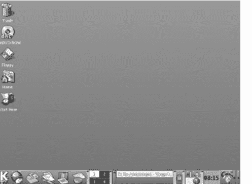

**图 3.1**：KDE 启动屏幕。

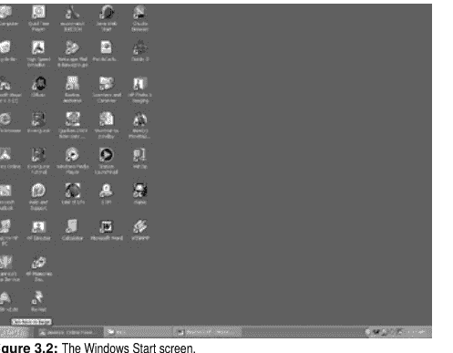

**图 3.2**：Windows 启动屏幕。

你可以看到，菜单非常相似。这应该能让你感到一些亲切感。KDE 界面与 Windows 没有太大差别，你应该很快就能熟悉 KDE 界面。我们将在本章后面更深入地探讨如何在 KDE 中导航。现在我们只是想找到 shell。单击一次 Red Hat 图标，然后向上移动选项，直到看到系统工具。如果让鼠标在此处悬停一两秒，你会看到属于系统工具组的子选项。其中一个选项标记为终端。通过点击终端，你可以启动一个 shell。它看起来应该与你在图 3.3 中看到的类似。

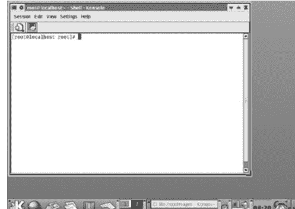

**图 3.3：** Shell。

正如你所见，这看起来很像 Windows 2000 或 Windows XP 中的命令提示符，或者 Windows 95/98 中的 DOS 提示符。这是意料之中的，因为 shell 基本上是一个命令行界面。下一节将带你了解一些 shell 基础知识。

## Shell 基础

你必须做的第一件事是熟悉 shell。你可能在 Windows 命令提示符中使用过 DOS 命令，这不会有多大区别。如果你从未使用过任何 DOS 命令，不要担心，本节将带你了解基础知识。首先，你应该注意图 3.3 中显示的默认命令提示符。默认命令提示符告诉你当前登录的是谁。用户的姓名及其登录的域名显示在命令提示符中。在我们的例子中，它是 `root@localhost` root。这意味着 root 用户已登录到这台本地机器。别忘了，root 用户相当于 Windows 管理员，拥有更改系统中任何内容的完全权限。

如前所述，bash 是默认的 Linux shell。幸运的是，所有 shell 共享许多常见命令。现在是一个很好的时机来带你了解其中一些，并将它们与你在 Windows 中可能使用的 DOS 命令进行比较。请记住，这些命令是区分大小写的。这意味着如果你大写了不该大写的部分，它将不会被识别。例如，显示当前连接到你的 Linux 机器的用户是通过输入 `who` 来实现的。如果你输入 Who, WHO, 或 wHO，它将无法工作。在有疑问时，请全部使用小写。

最简单的命令之一是列出当前目录所有内容的命令：`ls` 命令。这非常类似于 Windows 中的 `dir` 命令。这两个命令都列出当前目录的内容。你只需输入 `ls`，全部使用小写字母，并按下 Enter 键。你会看到该目录的内容，如图 3.4 所示。

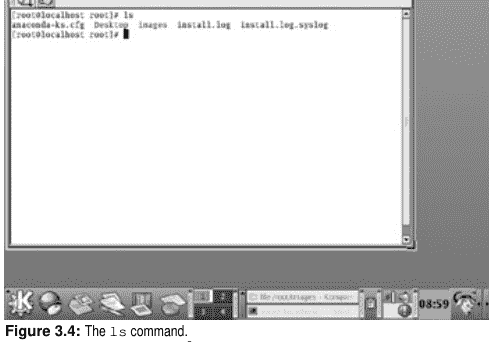

前面提到，Linux shell 比 Windows 命令提示符更灵活、更强大。你可以在 `ls` 命令中看到这一点。当你使用等效的 DOS 命令 `dir` 时，你会看到目录内容列表，但无法知道它包含什么类型的文件或子目录。当你输入 `ls` 时，你可能会注意到某些项目显示为不同的颜色。所有文件为黑色，所有目录为蓝色，所有可执行文件或脚本为绿色。这种颜色编码使得识别和使用某些项目变得容易。这只是一个例子，一个简单的例子说明了 Linux 中的一些附加功能。

现在你已经了解了如何列出目录的内容，让我们看看其他一些 shell 命令。这将帮助你入门 shell 操作的基础知识。这就把我们带到了创建目录、更改目录和移动文件。目录旨在提供一种组织存储文件和程序的方式。偶尔，你可能需要创建新目录、在目录间导航或移动文件。这与在 Windows 命令提示符中通过输入 `md directoryname` 创建文件没有太大不同。例如，如果你想创建一个名为 `stuff` 的目录，你会输入 `md stuff`。在 Linux 中，你使用 `mkdir` 命令（Make Directory 的缩写）来完成，如下所示：`mkdir stuff`。只需在 shell 中输入 `mkdir stuff`，然后运行 `ls` 命令查看当前所在目录的内容。你应该会看到一个新的名为 `stuff` 的子目录。你可以在图 3.5 中看到演示。

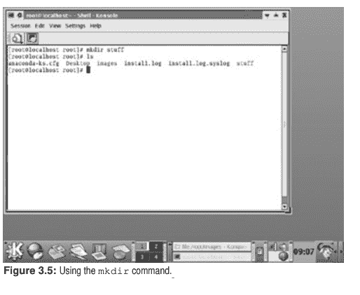

更改目录并没有那么难。在更改到新目录之前，也许我们应该放入一些内容。你可能注意到，当我们运行 `ls` 命令时，有一个名为 `install.log` 的文件。这是在这台机器上安装 Linux 期间发生事件的日志。我们将把这个文件复制到我们的 `stuff` 目录。这是一个使用 `cp` 命令的简单过程。只需输入 `cp filename target directory`（你想复制的文件名和你想复制到的目录）。如图 3.6 所示，输入 `cp install.log stuff`。

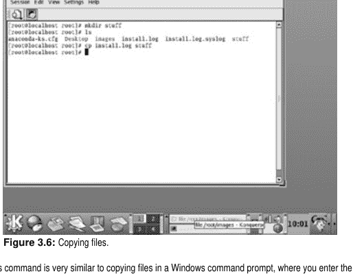

此命令与在 Windows 命令提示符中复制文件非常相似，在那里你输入单词 `copy`，然后是文件和


# Shell 基础

目标目录。如果我们在 Windows 中执行此复制操作，可以输入 `copy install.log stuff`。

如果你想确认文件是否真的已复制到指定目录，你需要切换到该目录并运行 `ls` 命令。你只需输入 `cd` 后跟目录名即可使用 `cd` 命令切换目录。在我们的例子中，就是输入 `cd stuff`。然后输入 `ls`，你会看到文件已复制到该目录。图 3.7 展示了这一过程。

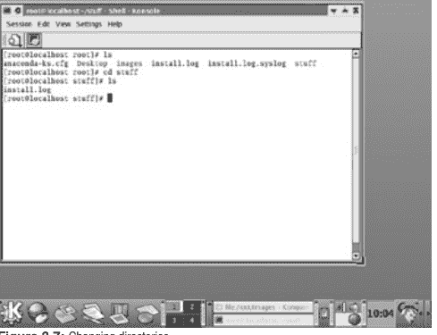

图 3.7：切换目录。

切换目录的命令与 Windows 命令提示符中的相同。你输入 `cd` 后跟目录名。

**注** 你可能会注意到，我们在多处考察的命令与 Windows 命令提示符中的命令非常相似或完全相同。重要的是要记住，Unix 的存在比 DOS 或 Windows 早了数十年，是 Windows 从 Unix 复制了这些命令，而不是反过来。这一点很重要，因为 Linux 初学者常常疑惑为什么 Linux 不直接使用 Windows 所用的命令。

你可能已经注意到，本章的图中并未显示之前的所有命令，只显示了正在讨论的命令。当你在 shell 中输入这些内容时，你看到的可能是你之前输入的所有内容。这可能会让你想知道如何清除那些不再想查看的旧内容。只需输入单词 `clear`，shell 屏幕就会清空。在 Windows 命令提示符中，可以通过输入 `cls`（clear screen 的缩写）实现相同效果。

当你想要删除文件或目录时会发生什么？在你能够删除某个目录之前，必须先删除该目录中的所有文件，所以让我们先讨论删除文件。在 Windows 中，你很可能使用过 `del` 命令，只需输入 `del filename`。Linux 中的过程非常相似，只是命令是 `rm`（remove 的缩写）。你输入 `rm filename`。在我们的例子中，我们要输入 `rm install.log`。然后你需要退出当前所在目录，回到根目录，才能删除目录 `stuff`。在 Windows 命令提示符中，你输入 `cd\`；而在 Linux 中，只需输入 `cd` 就会带你回到根目录。所以现在输入 `cd`，你就回到了根目录，准备好删除该目录了。在 Windows 命令提示符中，你可以使用 `rd`（remove directory）命令。在 Linux 中，使用 `rmdir` 命令（remove directory）。格式为 `rmdir directoryname`。在我们的例子中，即 `rmdir stuff`。整个从删除文件到删除目录的过程如图 3.8 所示。

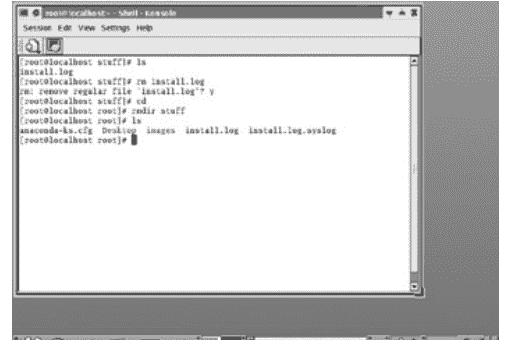

**图 3.8**：删除文件和目录。

表 3.2 列出了一些基本的 Linux shell 命令，包括每个命令的使用示例、命令说明以及等效的 Windows 命令提示符命令。

# **表 3.2：Linux shell 命令与 Windows 命令提示符命令**

| Linux | 说明和示例 | Windows 命令提示符等效命令 |
| :--- | :--- | :--- |
| ls | 列出当前目录的内容。示例：`ls` | dir 示例：`dir` |
| cp | 将文件复制到另一个目录。示例：`cp filename.txt directoryname` | copy 示例：`copy filename.txt directoryname` |
| mkdir | 创建新目录。示例：`mkdir directoryname` | md 示例：`md directoryname` |
| cd | 切换目录。示例：`cd directoryname` | 相同。 |
| rm | 删除或移除文件。示例：`rm filename` | del 示例：`del filename` |
| rmdir | 移除或删除目录。示例：`rmdir directoryname` | rd 示例：`rd directoryname` |
| clear | 清屏。示例：`clear` | cls 示例：`cls` |

这份列表绝不可能面面俱到，但它确实包含了你必须熟悉的基本 shell 命令。建议你花些时间尝试这些命令，以便熟练掌握。第五部分“高级 Linux”将广泛讨论 shell 的使用。第 18 章“Linux Shell 命令”详细探讨了大量 shell 命令。第 19 章“从 Shell 进行 Linux 管理”向你展示了如何使用 shell 执行管理任务。第 20 章“基础 Shell 脚本”教你编写自己的 shell 脚本的基础知识。目前，你只需要对什么是 shell 以及如何在 shell 中完成一些基本任务有基本的了解即可。

在我们继续之前，还有最后一个简单但非常实用的 shell 功能需要介绍。shell 可以访问内置的 Linux 手册。这些通常被称为 man 页面（manual 的缩写）。man 页面允许你查阅任何 Linux 命令的具体细节。例如，如果你忘记了 `mkdir` 命令的工作原理，只需在 shell 中输入 `man mkdir`，你就会看到 Linux 手册中关于该命令的整个章节。man 页面非常有用，任何 Linux 爱好者都不会考虑不使用它们。

## 在 KDE 中移动

Shell 命令非常有用，但坦率地说，它们并不太友好。你必须精确输入，即使只是大小写错误，它们也会失效。此外，大多数 Windows 用户希望拥有一个酷炫的图形界面。幸运的是，Linux 提供了多种选择。最流行的两种是 GNOME 和 KDE。本书将使用 KDE，因为它更常用，也是作者首选的图形界面。不过，在*第 7 章“GNOME 界面”*中，我们将花些时间探索 GNOME 以及随其附带的一些应用程序和实用工具。

**注** 你会看到本书及所有 Linux 文档中经常互换使用几个术语。术语*desktop（桌面）、desktop environment（桌面环境）和 graphical interface（图形界面）*都指你正在使用的图形用户界面。这可能是 KDE、GNOME 或其他界面。

你已经见过 KDE 界面。它在前面部分中被用于定位并启动 shell。你可能已经注意到，它与你习惯的 Windows 界面没有太大区别。首先，在桌面上，你应该注意到屏幕底部有一个任务栏，左下角有一个 K。*图 3.9* 展示了这一点。

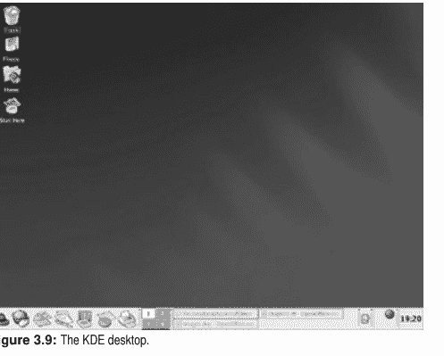

底部的任务栏看起来与 Windows 中的非常相似。左侧的图标是*Open Office*（我们将稍后在本书中详细考察的办公生产力套件）的快捷方式。在任务栏的右侧，你应该看到一个显示当前时间的时钟。任务栏中的快捷图标只是你可能需要的一些常用应用程序。让我们看看如何添加一个快捷方式或删除现有的一个。删除非常简单。你只需在图标上右键单击，然后从出现的菜单中选择*Remove（移除）*。*图 3.10* 展示了这一过程。

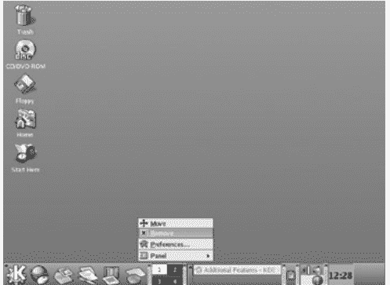

**图 3.10**：从任务栏移除图标。

添加快捷方式也不特别困难。在任务栏上右键单击并选择 Add（添加）。然后选择你要添加的内容。我们将在本书稍后探索所有这些选项，但现在我们只关心 Button（按钮）选项。你会看到一个菜单，就像你点击 Red Hat 图标选择开始菜单时看到的菜单一样。在我们的例子中，选择 System Tools（系统工具）和 Terminal（终端）。*图 3.11a* 展示了这一点。

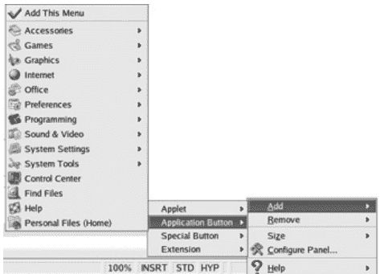

**图 3.11A**：向任务栏添加按钮。

当然，你只能为你已经安装的应用程序创建快捷方式，并且你只想保留那些你最常用的应用程序。你如何找到其他应用程序？你需要对 KDE 进行简要游览，以便在稍后需要时轻松找到各种程序。我们将在本书稍后深入探讨这些功能和应用程序中的许多内容。现在，让我们先熟悉一下。

当你点击 Red Hat 图标时，你会看到一个项目菜单，很像你在 Windows 中习惯看到的那样。应用程序根据其功能分组为不同的部分。*图 3.11b* 显示了系统设置部分，我们将在*第 4 章“KDE 中的系统配置”*中详细探讨该部分。


## 在 KDE 中导航

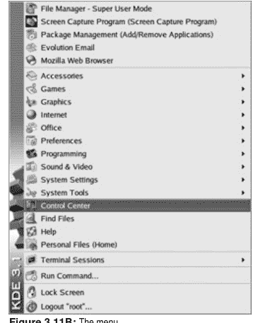

图 3.11B：菜单。

这些应用程序组中的每一组都包含逻辑上相关的应用程序。例如，Graphics（图形）组包含用于操作和生成各种图形图像的应用程序。每个分组中具体有哪些应用程序，取决于你在安装 Linux 时选择了哪些软件包。如果你是按照 *第 2 章* 中的说明进行安装的，那么你应该拥有我们将在本章及后续章节中讨论的所有应用程序。让我们简要浏览一下这些逻辑分组，看看有哪些可用的功能。

在最顶部，你会看到最近使用过最频繁的应用程序。在图 3.11 中，包括 Paint（绘图）程序、Screen Capture（屏幕截图）程序以及 File Manager（文件管理器）。在你的机器上，这将包括你最近使用过的任何应用程序。随后你会看到一条水平线，其下方则是各种程序分组。

第一个分组是 Accessories（附件）。Windows 也有一个 Accessories 组，其中包含与 Linux Accessories 组中可能发现的项目相似的内容。你会发现一个 Print Monitor（打印监视器），用于监控发送到打印机的任务。你还会找到一个科学计算器、一个用于格式化软盘的工具以及一个闹钟。Accessories 中的项目基本上是一些有趣但并非轰动性的应用程序。例如，科学计算器只对从事数学、物理或相关领域工作的人感兴趣。不过，值得注意的是，Linux 提供了丰富多样的应用程序集。像 KDict 这样的项目（它是一种在线词典）可能对几乎所有用户都有用。

> **注意** KDict 是一个在线程序，必须连接互联网才能使用。

在许多旧版本的 KDE 中，Accessories 之后的下一个类别是 Extras（扩展功能）。如果你使用的是最新版本的 KDE，你将不会看到此类别。它已合并到其他类别中。不再看到单独的 Extras 类别，每个类别都有一个名为 Additional（附加项）的子类别。在某些发行版中，这被称为 More（更多），而不是 Additional。例如，Graphics 类别下有一个 Additional Graphics 项目。如果你使用的是 Red Hat Linux 9.0，你应该拥有较新版本的 KDE。如果你使用的是较早的版本，可能没有。如果你想获取最新的 KDE，可以从 www.kde.org 下载。如果你使用的是旧版本的 KDE 并希望继续使用它，应该熟悉 Extras 部分。这是一个非常有趣的类别。它包含本应属于其他某个类别但作为附加功能添加的应用程序。

有些读者可能会问，如果在新版本的 KDE 界面中该类别已不存在，我们为什么要花时间调查 Extras。一个原因是，许多读者可能正在使用旧版本的 Linux。与 Windows 用户不同，Linux 用户坚持使用旧版本的情况并不少见。新版本的 Linux 并非对之前版本的重大背离。变化通常是细微的，因此往往没有迫切的动力去不断升级到最新版本。讨论 Extras 类别的另一个原因是，Red Hat 9.0 中该类别中的每个应用程序仍然存在，只是被移动了。它们被移回了适当的类别；例如，Extras 中的游戏现在可以在 Games（游戏）下找到。

该类别中有一些非常有趣的应用程序。在 Extras Games 子类别中，你可以找到一个有趣的国际象棋游戏，以及一个名为 Tux Racer（企鹅赛车）的赛车游戏。

> **注意** Tux 是 Linux 企鹅标志/吉祥物的名字。在 Tux Racer 中，企鹅在白雪覆盖的山脉上疾驰。

更具实际意义的是一些在 Extras System Tools（扩展系统工具）子类别中你会发现的应用程序。除了其他内容外，你会找到一个文件管理器。这个文件管理器非常像从 Windows 3.1 开始并延续到后续 Windows 版本中的文件管理器。该工具在后续章节中非常重要，因此值得探索。当你启动文件管理器时，它看起来非常像 Web 浏览器，并且开始指向当前登录用户的家庭目录。如果你以 root 身份登录，那么它将指向 root 目录，如图 3.12 所示。

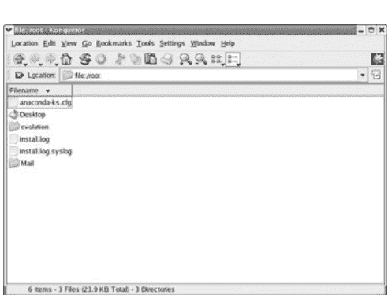

图 3.12：文件管理器。

> **注意** 标准做法是，除非你绝对需要管理权限来执行当前任务，否则不要以 root 身份登录工作。除了直接涉及管理任务的章节外，建议你在阅读本书时以你在第 2 章创建的用户账户登录。建议不要以 root 身份继续操作。

这就引出了家庭目录是什么的问题。事实上，有些读者可能想知道什么是目录。你的计算机有很多文件。如果你保存一个文档，那就是一个文件。如果你创建一个电子表格，那就是一个文件。如果你将图片保存到计算机，那就是一个文件。如果你安装一个程序，它可能包含多个文件。这些文件被组织成称为目录的组。目录与 Windows 中的文件夹完全相同。如果你曾经使用 Windows 资源管理器浏览计算机上的文件夹和文件，请记住，使用文件管理器浏览 Linux 机器上的目录非常相似。

你可以使用工具栏左侧的箭头键向上或向下一层移动。最右侧的三个按键改变你在文件管理器中查看项目的方式。图 3.12 中显示的是图标视图，由从右数第三个按钮选择。选择从右数第二个按钮将选择树状视图，如图 3.13 所示。

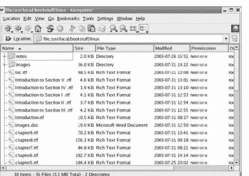

图 3.13：文件管理器的树状视图。

KDE 文件管理器具有一些在 Windows 文件管理器中未找到的功能。其中最有用的功能之一是书签位置的能力。在任何标准 Web 浏览器中，你都可以为任何你想去的网站添加书签（或添加到收藏夹），以便日后快速访问。由于 KDE 文件管理器像浏览器一样运行，你可以为目录添加书签。只需打开该目录，从下拉菜单中选择 Bookmark（书签），然后单击 Add Bookmark（添加书签）。图 3.14 展示了如何为文件夹添加书签，图 3.15 展示了该条目在文件管理器书签中的样子。

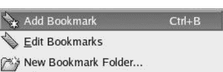

图 3.14：为目录添加书签。

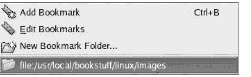

图 3.15：书签中的新条目。

文件管理器不是 Extras 中唯一有趣的项目，但它是其中最实用的之一。最好花一些时间试验文件管理器，以确保你能熟练使用它。你将在后续章节中使用它。然而，有一个注意事项你应该牢记。如果你以 root 身份登录（你可能正是这样），你可能会删除重要的系统文件。当你试验文件管理器时，建议遵守以下规则：

- 1. 你的大多数试验应该仅包括四处移动和查找项目。你不应该删除任何文件。
- 2. 如果你想试验删除或移动文件，首先创建一个新目录和几个新文件用于此目的。这样，你就不会伤害到任何系统文件。
- 3. 如果你不确定某物是什么或它的功能，请保持原样，不要动它。

如果你遵循这三个简单规则，你应该能够对文件管理器进行一次相当广泛的浏览，而不会损害你的系统。

在 Extras 之后是 Games。Linux 附带许多游戏。探索并解释这些游戏超出了本书的范围，但你应该知道，标准安装 Red Hat Linux 包含了许多有趣的消遣活动。

> **注意** 这是各个 Linux 发行版可能存在差异的一个领域。包含的游戏数量因发行版而异。

跟随 Games 类别之后的是 Graphics。在这个类别中，你会发现一些非常有用的应用程序，如 GIMP。GIMP 是 graphics image manipulation program（图形图像处理程序）的缩写。它是一个全功能的图形程序，可与 Adobe Photoshop 媲美。本书后续专门有一章介绍 GIMP。Graphics 部分还包含一个屏幕截图工具。本书中大多数图像都是用它捕捉的。如果你使用的是其他 Linux 发行版且未包含 GIMP，别担心。当我们讲到那一章时，会告诉你从哪里免费下载它。

Graphics 之后是 Internet。大多数读者可能会发现这非常有用。在这部分，你会找到一个电子邮件客户端、一个 Web 浏览器和一个即时消息客户端。所有这些将在后续章节中详细探讨。在此阶段，你只需意识到它们的存在以及你可以在哪里找到它们即可。

Internet 类别之后是 Sound & Video（声音与视频）。这个类别包含许多有用的应用程序。它有音频播放器、音量控制和录音机，这些都是你预期会有的，因为你在 Windows 中也能找到相同的物品。你可能没有预期到的是声音混合器程序。它就像家用立体声的均衡器上的声音混合器一样工作，但它调整的是你在 Linux 计算机上录制或处理的声音。

最常用类别之一是 Office（办公）。它紧随声音和视频类别之后，包含一套丰富的办公程序。如果你遵循了第 2 章的安装说明，你安装了 Open Office（如果你没安装，别担心；会告诉你去哪里免费获取 Open Office）。Open Office 包含你可能需要的所有内容，包括演示程序、文字处理器、电子表格和项目管理软件——真正是一套完整的办公产品。本书有几章专门带你了解这套软件的细节。

下一个类别是 Preferences（偏好设置）。在 KDE 中，你有很多选择来组织和查看事物。这一部分充满了应用程序，使你可以个性化 Linux 计算体验的几乎每个方面。本书后续会带你了解其中许多应用程序的基本操作。

接下来的类别，Programming（编程），只对那些是程序员或希望成为程序员感兴趣的读者有用。深入探讨编程超出了本书的范围。然而，你可以找到许多网站和书籍帮助你熟悉 Linux 编程。只需记住，如果你是程序员或对编程产生兴趣，Linux 有许多非常强大的编程工具可用。大多数完全免费，许多都随 Red Hat 9.0 安装附带。

接下来的三个领域——Server Settings（服务器设置）、System Tools（系统工具）和 System Settings（系统设置）——用于执行 Linux 中的各种管理任务。这些将在 Linux 管理章节中详细考察。足以说明的是，有许多有用的应用程序使系统管理变得更加容易。

这些之后是 Control Center（控制中心），它是前四个类别中最常用项目的便捷分组。这使你更容易找到那些最常用来设置偏好或管理系统的程序。

我们要查看的最后一个类别是 Help（帮助）类别。如果你选择它，你将获得丰富的有用信息和提示，教你如何使用 Linux 和 KDE。如图 3.16 所示，有一个广泛的文档阵列，包括操作系统、KDE 和各种常用应用程序的手册。它还提供了关于哪里获取技术支持以及如何找到有用网站的信息。


## 在 KDE 中移动

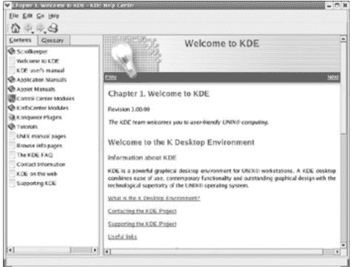

**图 3.16：** KDE 帮助屏幕。

除了你在 **Start** 菜单中找到的大量应用程序外，你可能还注意到屏幕左侧有若干个图标。这些是常用的基本快捷方式。第一个是 **Trash Bin**（回收站）。它的功能与你曾在 Windows 中使用的回收箱（Recycle Bin）非常相似。它是你在删除文件后改变主意的最后机会。你可以通过鼠标右键点击它并选择 **Empty Trash Bin**（清空回收站）来清空它。

CD/DVD ROM 和软盘图标是你光驱和软驱的快捷方式。它们提供了快速且轻松地访问这些设备的方式。**Home**（主目录）图标将打开 **File Manager**（文件管理器），并默认启动在你的主目录中。最后，我们有 **Start Here**（从这开始）图标。它提供了一个方便的起点，用于探索 KDE 的基础知识。

## 总结

如我们所见，使用 Linux 有两种方式。你可以使用 shell 命令，也可以使用 KDE 这样的图形界面。大多数 Windows 用户发现 KDE 有一种熟悉的感觉，对他们来说更容易适应。然而，对于许多基本的管理任务来说，具备基本的 shell 命令操作知识是必不可少的，我们将在本书的后文中深入探讨这一点。

在你继续阅读后续章节之前，熟悉本章的内容至关重要。熟悉如何在 KDE 中找到你需要的内容，以及对 shell 至少有一般性的了解，在本书后续部分将是必不可少的。建议你现在花点时间回去，对 KDE 和 shell 都进行一些实验，以确保你都能熟练掌握。

## 复习问题

- 1. man 命令的作用是什么？
- 2. 删除目录的 shell 命令是什么？
- 3. Linux 默认使用的 shell 是什么？
- 4. 删除文件的 Linux 命令是什么？
- 5. 在 KDE 的 Extras（附加组件）下有什么？
- 6. Windows 回收站（Recycle Bin）在 Linux 中的对应物是什么？
- 7. Linux 中的文件管理器（File Manager）的操作很像哪种其他类型的应用程序？
- 8. 查看目录中所有文件的 Linux 命令是什么？

### 答案

- 1. 它为特定命令调出手册页。
- 2. `rm -r`
- 3. bash (Bourne-again shell)
- 4. `rm`
- 5. 其他主要类别的附加项。
- 6. 回收站 (Trash Bin)
- 7. Windows 资源管理器 (Windows Explorer)
- 8. `ls`

## 第二部分：Linux 图形用户界面

### 章节列表

- 第 4 章：KDE 中的系统配置
- 第 5 章：使用 KDE 执行你在 Windows 中以前做的所有事情
- 第 6 章：通过 KDE 进行 Linux 管理
- 第 7 章：GNOME 界面

如果你习惯了 Microsoft Windows，那你就习惯了图形用户界面的便捷。Linux 有多种这样的界面可供选择。其中最受欢迎的两种是 KDE 和 GNOME。本书将重点介绍 KDE 界面，但也会向你介绍 GNOME。在本部分，你将了解如何导航 KDE 界面、如何通过 KDE 界面管理系统，以及如何执行许多你在 Windows 中以前常做的常见任务。最后，你将简要了解 GNOME 界面。

完成本部分的学习后，你应该能熟练使用 KDE。这意味着你应该能够使用 KDE 执行基本的管理任务，知道在哪里找到你需要的应用程序，并熟悉随 KDE 附带的一些程序。你还应该对 GNOME 至少有一般性的了解。

## 第 4 章：KDE 中的系统配置

### 简介

任何你可能购买的计算机系统都需要进行一些配置。无论是 Windows 系统、Apple Macintosh 还是 Linux，你仍然需要配置它，以便它识别并使用你的硬件。在安装过程中，大多数操作系统（包括 Linux）都会检测并配置许多类型的硬件。但是，你可能仍需要在稍后的日期重新配置某些设置。重新配置可能是因为你添加了新硬件、更改了互联网连接，或者只是想要不同的界面外观。因此，知道如何正确配置你的系统至关重要。

本章将指导你完成在 Linux 中可能需要执行的基本配置任务。在本章中，你将学习重新配置你的桌面设置、设置硬件、配置网络、连接互联网等等。

本章将专注于使用图形界面 KDE。如果你按照 *第 2 章，“安装 Linux”* 中的安装说明操作，你的机器应该会自动启动到 KDE。如果你选择在后来的某个日期使用 GNOME 作为图形界面，你会发现大多数相同的功能，只是它们的位置可能不同。此外，请回想一下，我们讨论了如果你的机器安装了 KDE 但启动到了 GNOME 或其他界面该怎么办。转到 Start 菜单（屏幕左下角的大 K 或 Red Hat 符号）并注销。注销后，你将处于登录屏幕。找到屏幕底部的 *System*（系统）一词并点击它。然后你可以选择你想使用已安装的哪个桌面。

> **注意** 在本书中，我们要关注的图形界面是 KDE。然而，*第 7 章，“GNOME 界面”* 将简要概述 GNOME 图形界面。

在我们深入探索 KDE 之前，也许简短的历史课是合适的。KDE 项目，即本书使用的主要图形界面，由 Matthias Ettrich 于 1996 年创立。KDE 代表 K Desktop Environment（K 桌面环境）。第一个版本于 1998 年 7 月发布。最新版本 3.1.2 于 2003 年 5 月发布。KDE 仅仅是一个现代的、用户友好的 Unix 或 Linux 工作站的图形桌面环境。KDE 旨在满足对 Unix 工作站易用桌面的需求，类似于 PC 用户可以在 Microsoft Windows 或 Apple Macintosh 中找到的图形界面。你可以在 [www.kde.org](http://www.kde.org) 了解 KDE 的历史并获取 KDE 的最新版本。

### 桌面首选项

将你的桌面配置得美观且方便，是大多数计算机用户最终必须承担的任务。你使用计算机的时间越长，以你觉得方便且美观的方式配置它就变得更加重要。在早期版本的 Linux（KDE 或 GNOME 之前的版本）中，你的图形用户界面选项是有限的。然而，在较新的版本中，你拥有非常丰富的图形用户界面，你可以轻松地重新配置和调整以满足你的个人偏好。在 KDE 内部，有许多选项可以改变桌面的外观和行为。我们将从最简单和最常用的开始。

正如在 Windows 中一样，KDE 允许你右键点击桌面并选择 Configure Desktop（配置桌面）。这是在 Linux 中正如在 Windows 中一样工作的另一件事。然后你可以设置大量的配置。这在 *图 4.1* 和 4.2 中显示。

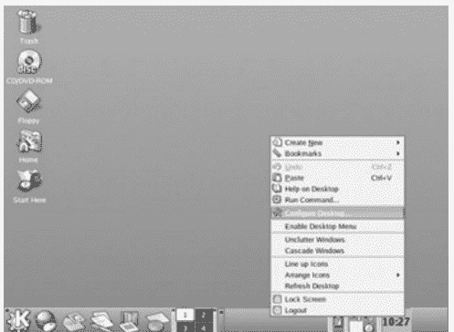

图 4.1：右键点击以配置桌面。

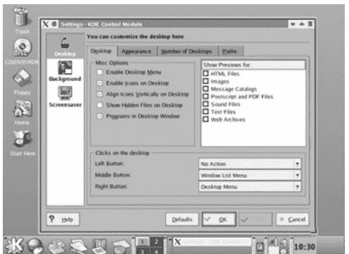

图 4.2：桌面配置。

正如你看到的，第一个选项卡“Desktop”（桌面）允许你设置当选择特定鼠标按钮时发生什么、显示哪些文件以及如何显示它们。大多数人会保留这些默认设置，但你可以重新配置它们，使其以你认为合适或方便你的任何方式运行。你可能已经注意到“桌面”部分有几个选项卡。第二个选项卡允许你设置桌面的外观，包括字体和文本颜色，如图 4.3 所示。如果你想要自定义桌面的外观，这个选项卡非常有用。尽管许多用户（包括作者）坚持使用默认设置，但能够更改它们是很重要的。不仅不同的字体可以使你的桌面更具吸引力，如果默认配置对你来说难以阅读，它也可以使你的桌面更易读。

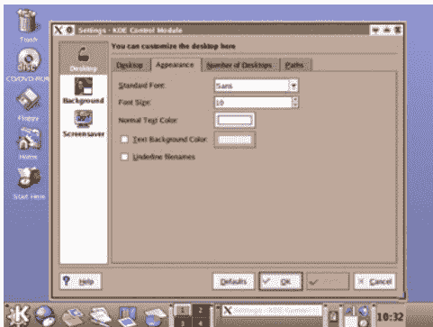

图 4.3：桌面外观。

设置字体和图标可能是你从 Windows 中熟悉的。你也可以使用 KDE 设置所有这些。然而，KDE 提供了一些 Windows 没有的功能。其中一项功能是使用多个桌面。这是许多 Linux 用户觉得非常有用的功能。你可以拥有多个桌面，并只需在它们之间来回切换。“桌面”屏幕上的第三个选项卡允许你配置桌面的数量并对它们进行命名。你可能注意到任务栏中有一系列编号为 1 到 4 的方块；这些允许你设置各种桌面。你可以在图 4.4 中看到桌面设置的数量以及任务栏中的“桌面”选项。


我们稍后就会探讨如何设置不同的桌面。首先，我们必须完成对桌面配置的查看。你还应该注意到第四个选项卡，其标签为“路径”。这些路径只是告诉你回收站、桌面和其他项目在硬盘上的存储位置。在大多数情况下，你完全不需要更改这些设置。然而，如果你确实需要更改回收站、桌面或文档的路径，这就是你进行此操作的地方。这里需要提醒一点。如果你没有充分的理由去更改这些路径，最好不要动。错误操作可能导致你的回收站或其他项目无法访问。

在屏幕的最左侧，你可能已经注意到可以设置桌面背景。你甚至可以为每个桌面设置不同的背景。你只需高亮显示目标桌面的名称，然后设置背景。我们将为桌面 1 和桌面 4 设置背景，以便让你了解其操作方法。

只需取消勾选“通用背景”复选框，然后单击你想要更改的桌面。取消勾选该复选框至关重要，因为如果你保持勾选状态，就会指示 KDE 为所有桌面使用相同的背景。接下来，选择一种模式和颜色。在我们的示例中，我们将选择“金字塔渐变”，颜色设置为金色和蓝色，如图 4.5 所示。

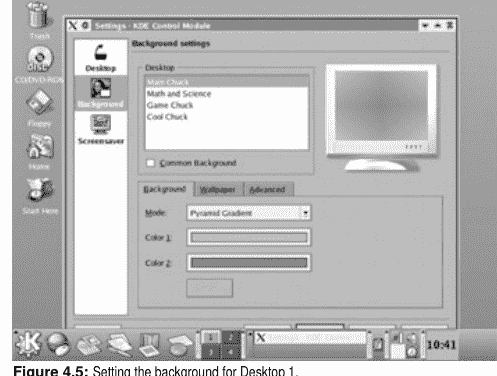

现在我们将为第二个桌面设置背景，并查看其效果。只需单击第四个桌面一次，然后选择“壁纸”选项卡。接着，单击“单张壁纸”按钮，并使用“浏览”按钮在你机器上找到任何你喜欢的合适图像。完成后，其效果应如图 4.6 所示。

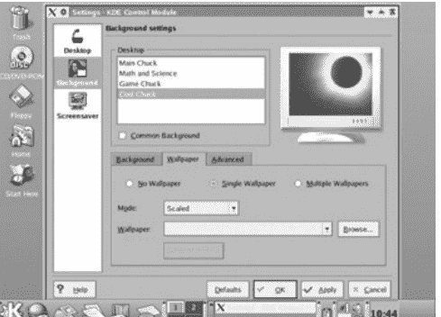

图 4.6：为桌面 2 设置背景。

现在单击“应用”按钮。你应该会看到桌面配置屏幕背后的背景发生了变化。那应该是桌面 1 的背景。

这让我们来到了桌面配置的最后一个选项：屏幕保护程序。由于这与在 Windows 中选择和配置屏幕保护程序非常相似，这对你来说可能有些熟悉。你只需选择你想要的屏幕保护程序，以及 KDE 在启动屏幕保护程序前应等待的分钟数。在我们的示例中，我们将选择六分钟。然后你决定是否要求输入密码。此时，你的屏幕应该与图 4.7 中显示的非常相似。KDE 内部已包含许多不同的屏幕保护程序，你可以在万维网上找到其他为 Linux 编写的屏幕保护程序。

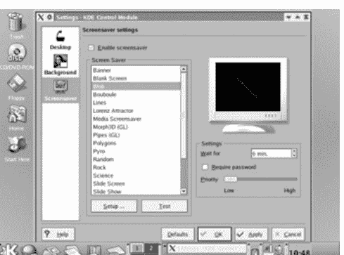

图 4.7：配置屏幕保护程序。

## 桌面偏好设置

此时，只需单击“设置”按钮即可配置你选择的具体屏幕保护程序。每种屏幕保护程序都有不同的选项，具体取决于你选择的屏幕保护程序类型。例如，“星空”屏幕保护程序允许你选择显示多少颗星星以及它们的移动速度。

如你所见，你拥有在 Windows 中习惯访问的所有桌面配置选项。你还有一些可能不习惯的额外选项，因为那些选项在 Windows 中并不存在。其中一个选项是使用多个桌面的功能。现在你只需单击任务栏中的数字即可切换桌面。默认情况下，你有四个桌面可供选择。这让你有机会为四个不同的用户设置不同的桌面配置。当然，你也可能仅为同一用户在不同情境下设置多种配置。

现在你已经看到了如何配置桌面偏好设置、建立屏幕保护程序，甚至如何在多个桌面之间切换。这些信息应该使你能以最吸引你的方式配置你的 KDE 桌面。

## 设置偏好

除了桌面设置外，还有许多其他你可能想要设置的偏好。这些偏好可以在“开始”菜单中的“偏好设置”组下找到。在“偏好设置”类别下，你会找到许多子类别。第一个是“文件浏览”。在这个子类别中，你可以选择哪些文件与哪些应用程序关联。例如，你可能希望所有以 .pdf 扩展名结尾的文件都用 Adobe Acrobat Reader® 打开。

第二个子类别是“信息”。该类别提供了关于计算机中各种硬件设备的许多有用信息。下一节将详细讨论此内容。目前，我们将继续介绍第三个子类别：“外观与感受”。

你会注意到，在“外观与感受”下，你可以设置一些通过右键单击桌面访问的相同设置。你可以设置桌面设置、背景，甚至屏幕保护程序。然而，你也可以在此处设置其他一些项目。例如，如果你选择“任务栏”，你可以设置关于任务栏外观和行为的几个选项。这些选项可以在图 4.8 中看到。它们包括是否对相似任务进行分组、是否应在所有桌面上显示窗口，以及当单击某个鼠标按钮时鼠标的行为方式。

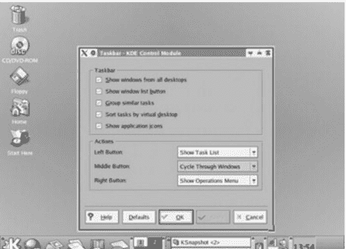

图 4.8：任务栏设置。

## 硬件信息

你可以在“偏好设置”类别下的“信息”子类别中找到可能需要的所有详细信息。你可以看到图 4.9 中显示的各种硬件选项。

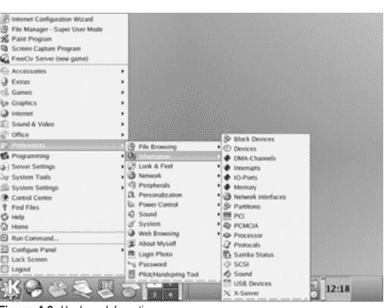

图 4.9：硬件信息。

我们将不会深入探讨这些各项设置，因为它们需要对 PC 硬件有透彻的了解，而这超出了本书的范围。关于任何计算机设置，记住一个好的经验法则是：如果你对它不太了解，就不要动它。你造成问题的可能性比改进系统的更大。

你可能会好奇为什么这里会提到这一点，既然对其处理如此简略。答案有两点。首先，如果你曾经通过电话与支持技术人员交谈，他可能会询问你的硬件设置。你至少应该知道如何找到这些设置。其次，一些读者会选择不扩充他们的 PC 知识，并更多地了解 PC 硬件。无论运行 Windows 还是 Linux，PC 硬件都是一样的。然而，大多数 PC 硬件书籍都强烈偏向 Windows，可能会告诉你在 Windows 中在哪里找到这些设置，但不会告诉你在 Linux 中在哪里找到。

## 配置网络设置

配置网络设置是你可能需要做的事情。无论你的 PC 是连接到局域网（LAN）还是仅连接到电缆调制解调器或 DSL（数字用户线路）调制解调器，你都需要配置网络设置。配置网卡设置有两种方法。两者都可以在图 4.10 所示的“系统工具”组下找到。

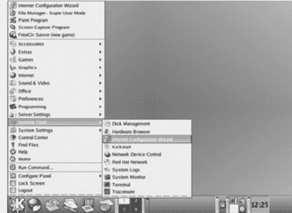

图 4.10：网络设置。

第一种方法是进入“网络设备控制”并手动设置那里的所有参数。第二种是使用“互联网配置向导”。在本节中，我们将研究这两种方法。

让我们从“互联网连接向导”开始。我们从这个选项开始，因为它最容易跟随，而且你肯定希望能尽快上网。与你在 Windows 中使用过的任何向导一样，这个向导只是一系列屏幕，引导你完成实现目标所需的步骤。假设你对当前任务知之甚少，因此向导将帮助你。该向导的第一个屏幕如图 4.11 所示。任何向导的目的都是以易于遵循的逐步方式引导你通过某个过程。

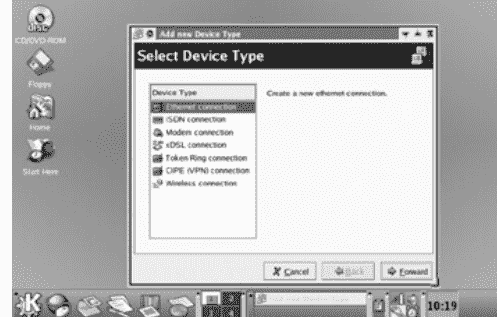

图 4.11：互联网配置向导，第一屏。

该向导的第一步是选择你拥有什么类型的互联网连接。列表中包含若干项目，其中一些在典型机器上出现的概率比其他项更高。我们将逐步介绍最常用的互联网连接，以便无论网络类型如何，你都能设置好互联网连接。有三种类型我们不会查看。前两种是令牌环连接和 VPN（虚拟专用网络）连接。你家中拥有这些连接的可能性极低，如果是在工作环境中，你需要你的网络管理员协助设置其中任何一种。特别是令牌环，


## 硬件信息

令牌环（Token Ring）是一种较老的技术，曾深受某些公司（尤其是 IBM）的欢迎，但目前已不再被企业广泛使用。在家庭环境中拥有令牌环网络的情况也几乎闻所未闻。我们也不会讨论 ISDN，因为它在美国并不常见，而且如果你在欧洲使用它，需要联系你的互联网服务提供商以了解应使用何种设置。

让我们从以太网（Ethernet）连接开始。以太网是最常见的网络连接类型。大多数办公网络以及几乎所有的家庭网络都使用以太网。以太网连接就是你可能见过许多次的基础网络卡。以太网卡的接口是 RJ-45 连接。RJ-45 连接器本质上看起来像较大的电话连接器。事实上，它们与电话连接器非常相似，只是 RJ-45 连接器内部有八根导线，而标准电话连接器只有四根。仅供参考，标准电话连接器被称为 RJ-11。这里的“RJ”代表 *Registered Jack*（注册插座）。如果你使用电缆互联网连接，它通常会进入你家，通过普通同轴电缆（即用于电视机的电缆，圆形导线，约 1/4 英寸粗，中间有一个针状突起的连接器）连接到一个盒子，然后通过一根网线（也称为 CAT 5——五类——电缆）连接到你的计算机网络接口卡（NIC）。这意味着你有一个以太网连接。如果你的 PC 通过局域网（LAN）（例如在办公环境中）访问互联网，你同样也在用以太网连接。

注意：如果你对这些硬件术语不熟悉，请记得查阅附录 D “PC 硬件”，它提供了一门关于 PC 硬件的基础速成课。它不会把你变成一名受过训练的 PC 维修技术员，但至少能让你成为一名理解基本 PC 硬件和术语的计算机用户。

下一个界面会显示 Linux 在你 PC 上检测到的网卡列表。你应该能在列表中某处看到你的网卡。如果没有，说明你的网卡可能不受 Linux 支持。这意味着你需要联系网卡的制造商，以查明它是否支持 Linux，如果支持，应从何处获取相应的网卡驱动程序。此界面如图 4.12 所示。

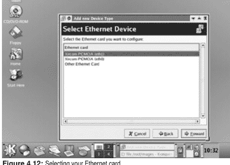

**图 4.12：** 选择你的以太网卡。

注意：在大多数计算机书籍中，你经常会看到“网卡”、“NIC”、“NIC 卡”和“以太网卡”这些术语互换使用。它们都指的是同一样东西。

下一个界面用于配置你的 IP 地址。互联网上的所有计算机都必须拥有唯一的 IP 地址。你的互联网服务提供商（ISP）要么在你每次登录时动态分配 IP 地址，要么分配一个始终不变的静态 IP 地址。如果是前者，只需选择“自动获取 IP 地址设置”选项：DHCP。DHCP 代表动态主机配置协议（Dynamic Host Configuration Protocol）。这意味着当你拨号连接到 ISP 或登录到网络时，系统会自动从可用地址池中为你的 PC 分配一个 IP 地址。如果你的 IP 地址是永久分配的（称为静态 IP），请选择“静态设置 IP 地址”。然后你需要根据 ISP 或网络管理员提供的信息填写这三个字段。最后一个界面（如图 4.13 所示）只是确认你的设置，并允许你应用、取消或返回修改某些内容。

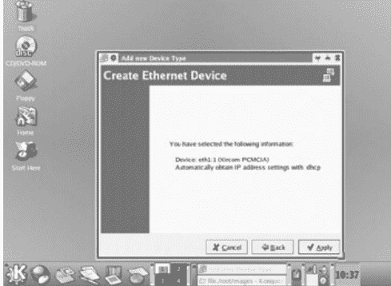

**图 4.13：** 确认你的设置。

就这样；你的网卡已设置完毕并准备就绪。祝贺你！其实并没有那么难，对吗？

家庭和小型办公室中第二常见的连接类型是调制解调器（modem）连接。如果你的电话线插在 PC 背面，那你使用的就是调制解调器。当你在向导的第一个界面选择“调制解调器”选项并继续前进时，系统会显示在你 PC 上检测到的调制解调器列表。与以太网配置类似，你的调制解调器可能不会显示在列表中。如果是这种情况，你必须联系调制解调器的制造商，以确认你的调制解调器是否受 Linux 支持。

下一个界面要求你设置调制解调器属性。此界面如**图 4.14**所示。


**图 4.14：** 选择调制解调器设置。

第一个设置是调制解调器设备。Linux 将所有调制解调器称为 `tty` 后跟一个数字。例如，你的调制解调器可能是 `tty1`。如果你有两个调制解调器，就会是 `tty1` 和 `tty2`。如果你拥有多个调制解调器，可以在此处选择要使用的那一个。另外两个设置——波特率和流控制——具体取决于你的调制解调器。它的外包装盒或用户手册中会有这些信息。接下来，将调制解调器音量设置为你喜欢的任何值（两种方式效果相同）。最后，你可能注意到“使用双音多频拨号”（Use Touch Tone Dialing）设置是默认选中的。现在很少有人使用旋转拨号电话了，但如果你有，请取消此选项。

现在按下“下一步”按钮，你就会看到有关你提供商的信息。如图 4.15 所示。


**图 4.15：** 你的提供商设置。

如果符合你的情况，你可以在这里选择特定的国籍。然后输入你的 ISP 提供给你的用于拨号上网服务的电话号码。接着，填入你提供商的名称，以及你的 ISP 提供的登录名和密码。如图 4.16 所示。


**图 4.16：** 输入相应的提供商设置。

随后你会看到一个界面，它与以太网设置中的最终界面完全相同。你会看到你选中的设置，并可以选择应用设置、取消设置或返回修改设置。

你可能拥有的另一种连接类型是无线连接。在未来几年，你使用无线连接的可能性将会增加。越来越多的企业甚至家庭都在采用无线网络。大多数消费电子产品商店现在都以非常合理的价格出售家庭无线套装。因此，了解如何在 Linux 中设置这一点非常重要。

无线设置的第一个界面（如图 4.17 所示）要求你设置连接的各种硬件参数。这些设置包括你的无线网卡的 IRQ 和 IO。之前我们讨论过可以在哪里找到机器上的所有硬件设置。你可能需要返回 KDE 中的该部分，以了解适用于你机器的适当设置。


**图 4.17：** 设置无线连接。

你还需要选择你拥有的适配器类型。Linux 支持几种适配器，你可以点击下拉列表，查看你的无线适配器是否在列表中。如果不在，你需要联系制造商。不过，如图 4.18 所示，该列表相当长。


**图 4.18：** 无线适配器。

正如你到现在已经猜到的那样，无论你正在设置哪种设备，向导始终以展示你所做的选择结束，并给你一个机会来应用这些设置、返回修改或取消整个过程。如前所述，设置互联网连接并不特别困难。但是，有时候仅靠这些是不够的。例如，如果你购买了一张新的网卡并安装了它，你需要先对其进行配置，然后才能连接到互联网。

幸运的是，互联网配置向导并不是配置互联网或网络设置的唯一方式。还有“网络设备控制”（Network Device Control）。它与互联网配置向导一样，位于“系统工具”下。网络设备控制的初始界面显示你拥有的任何网卡、它们的名称以及当前状态。如图 4.19 所示。


**图 4.19：** 网络设备控制。

你会注意到右侧的按钮。通过这些按钮，你可以单击激活或停用网络设备，或者对其进行配置。显然，你必须先正确配置它，才能成功激活它。让我们点击“配置”按钮，看看如何在 Linux 中配置网卡。当你点击“配置”按钮时，你会进入如图 4.20 所示的界面。众多的选项、按钮和标签页一开始可能会让你望而却步，但别担心，我们将逐一讲解它们。


**图 4.20：** 网络设备控制的“设备”标签页。

第一个标签页“设备”列出了你机器上的各种网卡及其当前状态和类型。如果你之前没意识到的话，它是

在 PC 中安装多张网卡是完全可能的，尽管大多数家用 PC 可能只有一张网卡。第二个选项卡“硬件”（Hardware）是用于添加、更改或删除特定网卡的地方。该界面如图 4.21 所示。


**图 4.21：** 网络设备控制界面中的“硬件”选项卡。

最后两个选项卡“Hosts”和“DNS”是进行配置的地方。“Hosts”选项卡用于设置网卡的 IP 地址。

**注意**

所有 PC 都有一个称为环回地址（loop back address）的地址，即 127.0.0.1。Linux 将此地址视为一张实际的物理网卡。因此，即使机器中只有一张网卡，您也会看到列出了两个以太网设备。

若要手动为网卡设置 IP 地址，请根据您的操作是添加新 IP 地址还是编辑现有地址，选择“添加”（Add）或“编辑”（Edit）。您会看到与图 4.22 显示内容非常相似的界面。


**图 4.22：** 添加和编辑 IP 地址。

如果您点击了“添加”，这三个字段将为空白。如果您高亮显示现有的以太网设备并按下“编辑”，则显示的三个字段将包含该设备的当前设置。然后，您可以输入网络服务提供商或网络管理员分配给您的任何 IP 地址和主机名。别名可以是您选择的任何名称，这只是一个便于您记忆的名称。

几乎所有的局域网都必须使用 DNS 服务才能使用万维网。DNS 是一种网络协议，它将您输入的 URL（例如 www.chuckeasttom.com）转换为 IP 地址。如果您所在的网络使用 DNS，您可以在“DNS”选项卡中输入其设置。这些设置将由您的网络管理员提供。该界面如图 4.23 所示。


**图 4.23：** 设置 DNS 配置。

此时，您的网卡应该已经配置完毕。如果您处于某个局域网中，您就可以在本地网络上进行通信。如您所见，这并不特别困难。

### 互联网设置

您可能认为我们在介绍“互联网连接向导”时已经涵盖了这部分内容。那个向导的作用是设置您的互联网连接。但是，您可能会使用的各种互联网软件，如浏览器或电子邮件客户端，也需要进行设置。有许多与互联网相关的软件包随 Red Hat 附带或可免费下载。本书的后半部分将介绍其中许多内容，但大多数读者希望立即能够浏览网页和检查电子邮件。基于此考虑，我们将考察如何配置 Red Hat Linux 9.0 自带的默认浏览器（Mozilla）和默认电子邮件客户端（Evolution）。这样，您就可以立即开始使用网络和电子邮件。不过，请记住，我们要介绍的只是这些网络应用的基础知识，足以让您入门即可。在**附录 A** 中还有许多非常实用的网站，您可以利用它们来扩展您的 Linux 知识，但当然，您的浏览器是访问这些网站的必备工具。

如果您是一位微软用户，您可能习惯使用 Microsoft Internet Explorer 访问网站。对于习惯使用 Internet Explorer 的读者来说，既有好消息也有坏消息。坏消息是 Linux 没有 Internet Explorer 的版本。好消息是，您可以使用其他许多浏览器（Netscape、Mozilla、Opera），它们都是免费的。在本节中，我们将考察 Mozilla 的基本配置。如果您没有 Mozilla，可以前往一台连接互联网的机器，从 **www.mozilla.org** 下载它。

如果您使用 Red Hat Linux 9.0（甚至更早的版本），并且遵循了第 2 章“安装 Linux”中的说明，那么您的机器上已经安装了 Mozilla。您只需转到 K 菜单，然后选择“互联网”（Internet），再选择“网页浏览器”（Web Browser）即可。当您首次启动 Mozilla 时，其外观将与**图 4.24** 所示内容非常相似。首先会显示一个 Red Hat Linux 帮助页面。建议为此页面添加书签以便日后使用。Mozilla 中的书签功能与 Internet Explorer 中的收藏夹功能类似。您只需转到浏览器顶部的下拉菜单并选择“添加书签”（Add Bookmark）即可。您也可以使用快捷键 Ctrl-D。


**图 4.24：** Mozilla 的起始屏幕。

最重要的学习内容是设置浏览器的主页，并确保其能正确连接到互联网。在 Internet Explorer 中，您通过转到“工具”（Tools）然后选择“Internet 选项”（Internet Options）来实现此功能。在 Mozilla 中，您通过转到下拉菜单中的“编辑”（Edit）并选择“首选项”（Preferences）来实现相同功能。然后您会看到与**图 4.25** 所示类似的内容。


您会看到在该界面上有许多可配置的设置。我们不会尝试介绍所有设置，只介绍您最可能需要使用的设置。在“首选项”主界面上，您可以设置 Mozilla 的启动方式、显示的主页以及显示的按钮。您只需在屏幕中部的“查看”（Look In）框中输入即可选择主页。您也可以使用当前所在的页面，只需点击“使用当前页面”（Use Current Page）按钮。这将使当前页面的 URL 显示在位置框中。

如果您的 PC 位于局域网中，那么您的网络很可能拥有防火墙和代理服务器。代理服务器是一种设备，它向外部世界隐藏所有内部 IP 地址。您必须通过它才能连接到任何互联网资源。从本质上说，代理服务器是您通往互联网的大门，也是互联网通往您的大门。如果您先从下拉菜单中选择“编辑”，然后选择“首选项”，接着选择“高级”（Advanced）并选择“代理”（Proxies），您将到达一个如图 4.26 所示的界面，在那里您可以输入代理服务器的设置。通常，您只需在“HTTP 代理”（HTTP Proxy）和“FTP 代理”（FTP Proxy）框中输入代理服务器的 IP 地址。您还需要输入端口号。您可以从网络管理员处获取 IP 和端口号。通常，FTP 使用 21 端口，HTTP 使用 80 端口。


如果您不使用代理服务器，请选中屏幕顶部的“直接连接到互联网”（Direct Connection to the Internet）按钮。当然，关于代理服务器的讨论可能让一些读者感到困惑，不知道代理服务器到底是什么。代理服务器是一种在网络和互联网之间提供屏障的设备。在大多数（如果不是全部的话）企业网络中都可以找到代理服务器。外部世界只能看到代理服务器，而无法看到其背后的网络。该网络上的计算机通过代理服务器获得所有外部访问权限，并只接收代理服务器允许通过的分组。

另一个需要关注的重要设置是“历史记录”（History）设置。该界面位于选择“导航器”（Navigator）然后选择“历史记录”（History）之后，您将看到与图 4.27 类似的内容。


**图 4.27：** 历史记录设置。

在该界面上，您可以选择在历史记录中保留已访问站点的时间长度。您可以清除已输入站点的位置栏并清除历史记录。如果隐私是个问题，请将“历史记录”设置为一天，并频繁清除位置栏和历史记录。这将防止他人确定您访问过的站点。

**注意**

如果您的公司使用代理服务器，大多数代理服务器都有能力记录您访问的每个站点。您将无法阻止这种情况。这应该让您重新考虑从办公室计算机访问任何非法站点；“老大哥”可能正在监视。

通过以上步骤，您应该能够使用浏览器浏览网页了。对于这个浏览器，或者任何您不太熟悉的软件，稍微探索和实验一下可能是个好主意。

配置电子邮件客户端甚至更容易。当您转到“开始”菜单，选择“互联网”并选择“电子邮件”时，将启动 Evolution 设置向导。您应该会看到与图 4.28 非常相似的内容。此时，只需点击“下一步”按钮，准备输入您的电子邮件设置即可。


当然，您的电子邮件设置将不同于其他任何用户。然而，为了帮助您跟上步骤，本文使用了作者的电子邮件设置作为示例。如果您想给作者发送电子邮件，这也会有所帮助。第一个屏幕要求您输入您的全名和电子邮件地址。您还可以连接到一个签名文件。签名文件可以是一个文本文档或一个 HTML 文档，其中包含您希望在所有发出的电子邮件底部出现的签名块。该屏幕如图 4.29 所示。


下一个屏幕要求您输入关于您的传入电子邮件服务器的信息。电子邮件服务器是位于您的 ISP 或公司内，用于处理传入和传出电子邮件的机器。绝大多数电子邮件服务器使用邮局协议（POP）处理传入电子邮件，通常运行在 110 端口上。POP 仅仅是计算机用来接收电子邮件的协议。一些计算机使用一种称为 IMAP 的协议。相反，所有计算机都使用简单邮件传输协议（SMTP）来发送电子邮件，该协议运行在 25 端口上。您会发现，在两台计算机之间的每种通信类型都有一个协议。电子邮件服务器屏幕如图 4.30 所示。设置您的 SMTP 服务器和 POP 服务器的屏幕是相同的。


**图 4.30**：您的传入电子邮件服务器。

下一个屏幕，如图 **4.31** 所示，询问您关于检查电子邮件的偏好设置。您需要指示希望多久检查一次新电子邮件，以及是否要在服务器上保留副本。这意味着即使您读取了电子邮件，它仍然在服务器上。这通常是那些可能从多台机器检查电子邮件的人所偏好的。如果您将电子邮件保留在服务器上，您可以从任何机器上的任何电子邮件客户端访问它。当然，如果您收到的电子邮件数量很大，该数量可能会超过您的 ISP 或网络管理员为您的电子邮件收件箱设置的限制。


**图 4.31**：接收电子邮件的偏好设置。

接下来的屏幕，如图 **4.32** 所示，用于设置您的传出电子邮件。回想一下，我们之前提到电子邮件是使用 SMTP 发送的，通常运行在 25 端口上。


接下来的两个屏幕要求您输入您的电子邮件地址并选择您的时区。现在您已准备好开始使用 Evolution 电子邮件客户端。事实上，您将被带到主电子邮件客户端屏幕，如图 4.33 所示。将来，当您启动电子邮件客户端时，将直接到达此屏幕。


您会发现，使用 Evolution 作为电子邮件客户端并不比使用 Microsoft Outlook® 或 Outlook Express® 更困难。事实上，许多人认为初始设置更简单。这只是前面章节中提到的许多替代应用程序之一。

您可能注意到有一个选项，称为“在服务器上保留消息”。这只是一个小复选框，您可以勾选或取消勾选。它只是指示电子邮件软件在读取电子邮件后，仍将其保留在服务器上。如果您打算从多台 PC 或电子邮件客户端检查电子邮件，那么您可能希望将电子邮件保留在服务器上。如果您不这样做，那么当您登录另一个电子邮件程序时，您将看不到任何电子邮件。您可能会以为它们消失了！然而，它们只是被电子邮件客户端 Evolution 下载了而已。

注意 关于是否将电子邮件保留在服务器上的选项并非 Evolution 独有。您可能会在几乎任何您选择使用的电子邮件客户端程序中找到该选项。

< 天天向上 >

上一页

下一页

## 总结

本章带领您了解了管理和配置您的 Linux 电脑的基础知识。您已经了解了如何连接到互联网，如何配置您的浏览器，以及如何配置您的电子邮件。这些是至关重要的任务，因为大多数人特别关注互联网访问。

除了建立互联网访问外，您还学习了如何配置您的桌面偏好设置，即桌面的外观和感受，以及如何设置和使用 KDE 的多个桌面功能。我们还向您展示了在哪里可以找到硬件设置。

## 复习题

- 1. 三种最常见的互联网连接方式是什么？
- 2. KDE 默认提供多少个不同的桌面？
- 3. 在桌面设置中，常见的背景设置的作用是什么？
- 4. 更改硬件设置的经验法则是什么？
- 5. KDE 的默认浏览器是什么？
- 6. 在 Mozilla 中设置互联网连接设置时，您选择哪个下拉菜单？
- 7. KDE 的默认电子邮件客户端是什么？
- 8. 在 Internet Explorer 中的“收藏夹”在 Mozilla 中叫什么？

### 答案

- 1. 调制解调器、以太网和电缆/DSL
- 2. 四个
- 3. 它强制所有不同的桌面使用相同的背景。
- 4. 如果您不知道它是什么，就不要动它！
- 5. Mozilla
- 6. 编辑
- 7. Evolution
- 8. 书签

# 第 5 章：使用 KDE 完成您在 Windows 中过去所做的所有事情

### 概述

### 本章内容

- 文本编辑器
- 计算器
- 绘画程序和屏幕捕获
- 文件管理器
- 可访问性
- 其他办公应用程序

### 引言

本书的前四章带领您了解了 Linux 的基础知识。此时，您应该已经牢固掌握了 Linux 的基本术语，知道如何安装 Linux，并且知道如何对系统进行一些基本配置。这些是您需要掌握的基本功能，以便在 Linux 上继续前进。Linux 术语对于理解 Linux 文章和书籍、使用在线教程，或者与其他 Linux 用户沟通至关重要。安装和配置系统的能力对于使用该系统绝对是必不可少的。然而，这些并不是大多数用户日常做的事情。通常您只在电脑上一次安装 Linux。通常只有在出现紧迫需求时，您才会更改系统配置，例如当您更换硬件，或者一位有不同需求的人将使用该机器时。这就引出了本章的内容。在本章中，我们将探讨大多数人会经常使用的一些基本、常见的任务。

本章将向您展示如何在 Linux 中实现 Windows 中最常用的功能。重点是将您以前在 Windows 中完成的这些常见功能转换到 Linux 中。我们将逐步介绍典型用户会执行的一些基本任务。这应该使您能够开始高效地使用 Linux。我们要考察的任务包括使用基本文本编辑器编写文档、查找计算器、使用联系人管理器以及屏幕捕获。在大多数情况下，我们将简要讨论在 Windows 中是如何完成该任务的，然后向您展示如何在 Linux 中完成相同的任务。

我们将在本章中涉及的这些应用程序和实用程序随 KDE 用户界面一起提供。如果您记得第 2 章“安装 Linux”中，在安装过程中要求您选择 KDE 界面作为使用 Linux 的默认模式。KDE 的使用感受与 Windows 相似，因此 KDE 提供了一些与 Windows 应用程序非常相似的应用程序也就不足为奇了。本章将回顾其中一些更常见的实用程序的使用。

### 文本编辑器

我们应该解决的第一个问题是，什么是文本编辑器？文本编辑器是一个允许您输入文本、修改并保存它的程序。简而言之，它是一个允许您编辑文本的程序。引用自一个流行的在线 Unix 帮助页面，www.gw.com/UNIXhelp/editors，“您通常会想要创建一个文本文件，然后以某种方式更改其内容。文本编辑器是一个专门为此目的设计的程序。”文本编辑器允许您输入文本并更改内容。它们通常不具备您在文字处理软件中找到的高级格式化或处理能力。简化的定义可能是，文本编辑器是一个非常简单的文字处理软件。Linux 并不局限于文本编辑器。事实上，Linux 有几种完整的文字处理软件和办公套件可供选择。您可以从 Star Office、Open Office、Corel Word Perfect 和其他中选择。所有这些都可以与 Microsoft Word 相媲美。我们将在本书后面详细研究 Open Office。事实上，有几章专门介绍 Open Office。然而，您可能已经习惯使用更简单的文本编辑器，用于较小、要求不高的任务。在 Windows 中，您可以转到“开始”，选择“程序”（在 Windows 2000 或 98 中它是“程序”，在 Windows XP 中它是“所有程序”），然后选择“附件”，您就可以立即访问 Microsoft Notepad 和 WordPad。Notepad 是一个非常有限的文本编辑器。使用 Notepad，基本上只能输入没有格式选项的纯文本。然后您可以保存文件或打印它。WordPad 虽然没有大多数市售文字处理软件功能丰富，但包含基本的文字处理功能。对于大多数简单的文字处理任务，它是绰绰有余的。Notepad 和 WordPad 等简化的文字处理应用程序通常被称为文本编辑器。文本编辑器和文字处理软件之间的区别在于文字处理软件中可用的额外工具。然而，没有公认的界线来表明某个应用程序何时被视为文字处理软件，何时被视为文本编辑器。一些纯粹主义者会评论说，文本编辑器与文字处理软件完全分开，在某个时期这是准确的。然而，越来越多的文本编辑器正在增加其功能中的增强格式化，并且越来越多的简化文字处理软件正在发布。这使得文本编辑器和文字处理软件之间的界线变得非常模糊。

既然我们已经讨论了什么是文本编辑器，并提到了一些在 Windows 中找到的文本编辑器，您可能会想知道 Linux 是否也有一些文本编辑器应用程序供您使用。答案是肯定的。事实上，当使用 KDE 图形界面时，您有几种不同的文本编辑器可供选择。

我们还提到，Linux 附带了正规的文字处理软件。这可能会让您问为什么还要使用文本编辑器？实际上有几个原因。首先，如果您想要一个非常简单的方法来输入文本，文字处理软件可能比情况所需的更复杂，特别是如果您对该文字处理软件不太熟悉。当您需要输入完全没有格式的文本时，文本编辑器也很有用。如果您输入用于 Web 页面的自己的 HTML 代码、编译器代码，或者仅仅是 shell 脚本（我们将在第 21 章“高级 Shell 功能”中做到这一点），那么您需要完全没有格式的文本。许多文字处理软件添加的格式可能会在您尝试将生成的文本用作脚本或用于编译器时导致问题。最后，这些文本编辑器在 Linux 世界中非常常见，如果不向您介绍它们，将是一个显着的遗漏。

现在您知道什么是文本编辑器，并且知道一些您可能使用它的原因。我们现在来看看您在 Linux 中可以访问的几个更常见的文本编辑器。

### Kate

KDE 界面附带一个名为 *Kate* 的文本编辑器。其他图形界面（如 GNOME）可能有一个非常相似的应用程序，简单地称为 *Text Editor*。无论您的 Linux 发行版称之为什么，它都位于同一位置，功能也大致相同。Kate 是一个非常简单的文本编辑器，允许您输入文本并将该文件保存到某个位置。它不允许您更改字体或进行任何形式的格式化。使用 Kate，您无法对齐文本、插入图像或绘制表格和图表。Kate 仅限于输入纯文本以及保存或打印该文本。在这方面，它与 Microsoft Notepad 非常相似。要启动 Kate，您需要前往 K（回想一下，我们之前提到，根据您的发行版，任务栏左下角可能有一个大写的 K，或者一顶红帽子），找到“附件”并选择 Kate（或选择 Text Editor）。然后您应该看到与图 5.1 非常相似的东西。输入您的文本，然后从下拉菜单中选择“文件”并选择“另存为”。然后，您可以将文件保存为任何有效的名称，保存在您选择的任何位置。


您可能已经注意到，Kate 的工具栏以及 KDE 中许多其他应用的工具栏，看起来非常像 Web 浏览器的工具栏。这是有意为之的。许多（甚至可以说绝大多数）KDE 应用程序都提供标准化的工具栏，其操作方式与浏览器类似。一旦您熟悉了其中一个界面，大部分应用程序的操作都会是一样的。这非常方便，尤其对于那些正在努力适应 Linux 的新用户而言。您可能还注意到 KDE 应用程序的另一个趋势：许多应用程序的名称以字母 $K$ 开头。您很快就会发现，Linux 社区并非没有幽默感。以字母 $K$ 开头命名 KDE 应用程序就是其中一个例子；另一例是名为 Tux 的企鹅标志。

使用 Kate 异常简单。您只需在屏幕上输入想要输入的文本，然后选择“文件”和“另存为”。当您选择“另存为”时，会弹出一个标准对话框，它与您之前使用过的任何其他对话框（包括记事本或 Word 中的对话框）看起来非常相似。由于 Windows 也使用对话框来打开或保存文件，因此这应该会让您感到非常熟悉。这个对话框允许您为文件命名，并选择保存位置。

使用 Kate，或者就此而言使用记事本，您无法完成许多您可能熟悉的 basic word processing（基本文字处理）功能。您无法更改字体、使用粗体或斜体、插入表格或图片，也无法执行许多其他标准的文字处理操作。这可能会让您疑惑为什么有人想要使用这些简单的文本编辑器。答案是，有许多任务并不需要上述任何文字处理功能。事实上，对于某些任务来说，这些功能不仅无益，反而会成为问题。此类任务包括编写 shell 脚本（我们将在本章后面详细讲解）以及使用 HTML 编写网页。这两项任务都需要简单的文本编辑，且不需要任何特殊格式。

仅仅因为 Kate 和其他一些简单的文本编辑器缺乏复杂的格式选项，并不意味着它们没有提供有用的工具。Microsoft 的记事本应用程序提供了一项搜索实用工具。如果您有一份冗长的文档并想要搜索某个单词或短语，只需选择“编辑”和“查找”，您就会看到一个搜索界面，与图 5.2 中的界面非常相似。然后，您可以输入想要搜索的文本并执行搜索。


**图 5.2：** 记事本的搜索实用工具。

Kate 具备相同的功能。您甚至可以通过相同的方式访问搜索功能。选择*编辑*，然后选择*查找*，您将看到如图 **5.3** 所示的搜索界面。您还可以使用快捷键 *Ctrl*-*F*，与记事本一样。就像在记事本中一样，您可以向前或向后搜索。


**图 5.3：** Kate 的搜索实用工具。

Kate 还具备记事本提供的所有附加搜索选项。*区分大小写*是最常用的选项。如果您选择此选项，搜索将只会引导您找到在拼写和大小写上均符合搜索标准的文本。换句话说，开启此选项后，*Bob* 与 *bob* 是不同的。当然，您也可以关闭此选项，这样搜索将忽略大小写。

Kate 还提供了一些记事本中没有的有趣选项。如果您查看下拉菜单中的*查看*选项，您应该会注意到几个记事本中没有的选项。您可以在**图 5.4** 中看到*查看*菜单。


前两个选项允许您选择 Kate 的显示方式。您有两个窗格，一个列出最近打开或使用的文件以及当前打开的文件，另一个显示文件本身。接下来的两个选项决定了您是否看到图标边框和行号。**图 5.5** 显示了这两个选项均处于开启状态。


如您所见，Kate 是一个功能完备的文本编辑器，它提供了您在 Microsoft 记事本中可能已经习惯的所有功能，以及记事本中没有的一些新功能。这不过是本书前面所述内容的又一个例子。您可能需要使用一些新应用程序来完成特定任务，但您会发现，您在 Windows 中习惯做的任何事情，在 Linux 中都能做到。您甚至可能会发现，在 Linux 中您可以完成一些在 Windows 中无法完成的任务。

## KWrite

对于某些 Windows 用户来说，记事本提供的功能远远不够。如果他们不想购买 Microsoft Office，可能会选择使用 WordPad。WordPad 是一个功能完备的文字处理器，本质上是一个简化版的 Microsoft Word。它可以处理大多数基本的文字处理任务。如果您不熟悉 WordPad，可以在任何 Windows 电脑上通过点击“开始”，选择“程序”，然后选择“附件”找到它。在那里，您会看到它与几个其他有用的程序并列显示。**图 5.6** 展示了 WordPad 的外观。

### 文本编辑器


**图 5.6：** Microsoft WordPad。

WordPad 有许多格式化选项，包括选择各种字体、加粗、斜体、对齐文本等。对于许多基本的文字处理需求来说，它已经足够好了。不幸的是，KDE 自带的任何基本文本编辑器都不提供此功能。然而，随 Red Hat Linux 8.0 和 9.0 一起安装的 Open Office 支持所有这些功能甚至更多。我们将在本书稍后部分考察 Open Office。此外，最新版本的 KDE 界面中包含一个完整的文字处理器，称为 KWord，我们将在本章稍后对其进行考察。在此期间，除了 Kate 之外，还有随 KDE 界面一起提供且功能比 Kate 更强大的文本编辑器。KWrite 可能是其中最常用的之一。如果您的安装中没有包含 KWrite，您可以从 http://docs.kde.org/en/3.1/kdbase/kwrite/installation.html 获取它。该网站还包含完整的安装说明。使用最新 KDE 界面的读者可以前往“附件”，选择“更多附件”，然后点击 KWrite。如果您使用的是较旧版本的 KDE 界面，可以通过选择“附加功能”、“附件”和“KWrite”来访问 KWrite。您可以在图 5.7 中看到 KWrite 界面。


**图 5.7：** KWrite。

您可能已经注意到，KWrite 界面看起来与 Kate 界面非常相似。在“设置”下拉菜单下，您会看到“显示图标边框”和“显示行号”，就像在 Kate 中看到的一样。两者的区别在于 KWrite 比 Kate 多提供了一些工具。首先，在“工具”下拉菜单选项中，您会找到一个拼写检查器，如图 5.8 所示。对于许多人来说，拼写检查器是一个不可或缺的工具。事实上，没有拼写检查器，您手中拿着的这本书就不可能写成！


**图 5.8：** KWrite 的拼写检查器。

KWrite 中还有一个 Kate、记事本或 WordPad 中没有的工具。这个工具可能只对技术素养较高的读者有用，但无论如何都值得提一下。如果您查看*设置*，您会发现一个设置**高亮模式**的选项。此模式允许您指示 KWrite 根据某些脚本语言、标记语言和编程语言的结构来高亮显示文本。该选项如图 **5.9a** 所示。


**图 5.9A：** 高亮模式设置。

例如，如果您想使用文本编辑器编写自己的 HTML 文档，您可以使用此功能来检测所写文档中的错误。

**注意** HTML（超文本标记语言）是编写网页的语言。如果您使用 Microsoft FrontPage、Macromedia Dreamweaver 或 Adobe PageMill 等流行的网页开发工具，它们实际上是在为您生成 HTML 代码。如果您懂 HTML 或学习 HTML，您可以使用基本文本编辑器开发自己的网站，而无需投资昂贵的网页开发工具。

我们现在已经考察了 KDE 内置的两个文本编辑器，并将它们与 Microsoft 的 WordPad 和记事本进行了比较。您现在应该能够


### 文本编辑器

在 Linux 系统中，你可以像在 Windows 中一样轻松地进行简单的文本编辑。对于技术倾向更强的读者来说，现在可以使用 KWrite 来编辑 HTML 源码、文档以及多种编程语言的代码。请记住，Linux 有几个功能齐全的 word 处理软件，其水平可与 Microsoft Word 媲美。我们将在本书的后半部分探讨其中一款。

### KWord

如前所述，最新版本的 KDE 界面自带一个名为 KWord 的 word 处理软件。要打开 KWord，请进入“Office”，选择“更多 Office 应用程序”，然后点击 KWord。请记住，如果你使用的是较早版本的 Linux，你可能会在旧的“Extras（扩展）”类别下找到它。当你启动 KWord 时，系统会提示你选择要开始的文档类型。这显示在 *图 5.9b* 中。


**图 5.9B**：KWord 的启动界面。

如你所见，你有几种开始方式可供选择。对于我们的目的而言，我们将从一个空的纯文本文档开始。这会带你进入 KWord 的主工作界面，显示在 *图 5.9c* 中。我们将检查你可以用来操作和格式化文本的一些可用选项。首先，你需要输入几个句子，以便我们有一些文本可供操作。


**图 5.9C：** KWord 的工作界面。

工具栏的大部分功能对你来说应该看起来很熟悉。大多数 word 处理软件都有相似的功能，因此所有 word 处理软件的工具栏也有一些共同点。你可以看到用于选择字体、字号、粗体、斜体和下划线的按钮。这些是非常基本的 word 处理功能，几乎在所有 word 处理软件中都能找到，包括 Microsoft 的 Word 和 WordPad，以及 Corel WordPerfect。KWord 顶部的下拉菜单也提供了一些标准选项。在大多数 word 处理软件中，最值得考察的部分是你可以在文档中插入的对象。如果你点击下拉菜单中的“Insert（插入）”，你会看到类似图 5.9d 中显示的内容。


**图 5.9D：** KWord 的插入选项。

就像在 Microsoft Word 中一样，你可以插入脚注、图片、公式和表格。如果你的 PC 连接了扫描仪，你可以使用“Scan Image（扫描图像）”选项直接访问扫描仪，获取图像并将其插入到文档中。经常向文档中添加图片可以美化其外观。如果你选择“Insert（插入）”并选择“Picture（图片）”，系统会弹出一个对话框，让你从硬盘中选取任何图像并将其插入到文档中。然而，在这一领域，Microsoft Word 优于 KWord。Microsoft Word 自带大量图像可供各种用途选择，而 KWord 则没有。

除了基本格式化和插入图像或公式之外，“Tools（工具）”部分是最重要的。如果你从下拉菜单中选择“Tools（工具）”，你应该会看到非常类似于图 5.9e 中图像的内容。


**图 5.9E：** 工具菜单。

这里有两个选项对于大多数使用 word 处理软件的人来说是必不可少的。第一个是拼写检查（Spellcheck）。大多数人，包括作者在内，都非常依赖拼写检查器。第二个应该引起你注意的是自动更正（Autocorrection）。此选项允许你开启或关闭自动更正。当自动更正开启时，你在输入时拼写错误会自动被纠正。

### 计算器

文字处理可能是计算机上最常见的活动之一。另一种非常常见的活动是各种形式的数学计算。对数字处理的需求是生活的事实。我们都有机会需要准确地处理数字。即使你不是会计师，你仍然需要平衡支票簿、计算信用卡利率，并使用计算器执行其他几十项功能。你之前可能已经使用过 Windows 计算器程序。要找到该程序，请选择“开始”，选择“程序”，进入“附件”，然后选择“计算器”，如图 5.10 所示。


Windows 计算器非常适合基本算术运算。例如，记账、计算贷款利率或处理预算所涉及的数学运算，都可以轻松用此计算器完成。然而，如果日常数学运算不适合你的任务，你可以从下拉菜单中选择“View（视图）”，切换到科学计算器，如图 5.11 所示。


科学计算器允许你处理各种指数、根号、科学计数法等。该计算器适用于普通化学课程（无论是在中学还是大学一年级课程）以及基于代数的物理课程相关的数学运算。你可能已经猜到，Linux 也提供了满足你计算器需求的答案。如果在“附件”下查找，你会发现一个科学计算器，如图 5.12 所示。此时应做一个重要补充说明。你可能已经注意到，Linux 拥有与你在 Windows 中发现的所有应用程序相当的应用程序。你也应该注意到，它们通常甚至位于相同的位置！请注意两个操作系统中的计算器都位于“附件”下。


通过对比 Windows 科学计算器和 Linux 科学计算器，或者仔细查看图 5.11 和图 5.12，你应该注意到许多相似之处。两者都有选项可以选择十六进制、十进制、八进制或二进制数系统。两者还都提供了以三种不同方式表示角度的选项。如果你打算用计算器进行三角学计算，这个选项会特别有用。两者都提供了基本三角函数（正弦、余弦、正切）、将数字提升到特定幂次、计算对数或自然对数等按钮。事实上，你可能会被诱导出两者功能完全相同且布局只有细微差异的结论。如果你做出这样的断言，你几乎是对的，但只是“几乎”。如果你注意到 Linux 计算器左上角突出的“Configure（配置）”按钮，而 Windows 计算器中没有这个按钮，你就能看到两者之间的区别。这个按钮可能看起来只是一个小小的差异，但它提供了极大的灵活性。点击它会将你带到配置屏幕，如图 5.13 所示。


这个屏幕上有四个选项卡，每个选项卡允许你修改 Linux 科学计算器的不同方面。中间两个选项仅仅是改变计算器的外观。你可以选择任何你认为有吸引力的字体或颜色组合。第一个选项卡“Settings（设置）”允许你改变计算器的行为方式。在这里，你可以调整数学计算的精度。这对于科学课程的学生来说至关重要，因为计算的精度对于成功解题具有最高重要性。你还可以将计算器自定义用于三角函数或统计用途。最后，你可以选择如果在发生错误时让计算器发出蜂鸣声。

如你所见，Linux 提供了你在 Windows 中习以为常的所有计算器功能。事实上，使用 KDE 附带的科学计算器，你拥有了一些 Windows 科学计算器中不存在的功能。我们再次发现，在 Linux 中，你不仅能执行在 Windows 中习惯做的所有任务，甚至可能能够执行一些在 Windows 中无法完成的任务。当然，一些读者可能会想知道列表中列出的某些数学功能的作用。你可能不熟悉自然对数或弧度的角度测量。如果是这种情况，请安心知道，Linux 不仅准备好满足你当前的数学需求，而且还能做更多！


### 绘图程序和屏幕截图

简单的图形操作是另一项常见任务。在这个网络摄像头、数码相机甚至手机摄像头遍布的时代，许多人发现需要修改数字图像。您可能已经使用过 Windows 内置的图形程序 Microsoft Paint。只需选择“开始”，然后选择“程序”，进入“附件”，点击“画图”，即可进入如图 5.14 所示的画图程序。


**图 5.14：** Microsoft 画图。

左侧和底部的工具栏允许您选择颜色、绘画样式等。然后您可以绘制简单的图形。您还可以打开并修改大多数基本图形文件，包括 JPEG、GIF、位图等。一旦打开，您可以随意修改它们。如果您经常使用网络摄像头或数码相机，那么您很可能至少用过画图来裁剪图像后再发送给他人。在 Linux 中带有 KDE 图形界面的系统里，您不仅可以访问类似的图形程序，而且有不止一个图形应用程序可供选择。我们将介绍 KDE Linux 图形用户界面下的一些更流行的图形应用程序。

只需进入“开始”菜单并选择“图形”，您就可以找到大量的图形应用程序。在“图形”下有一个标记为“更多图形应用程序”的子标题。在这一组中，您会发现许多其他有趣的图形程序。

**注意** 在较早版本的 KDE 中，并非所有图形应用程序都位于此处。虽然您会在此处找到一些与图形相关的实用工具，但不会找到类似 Microsoft 画图的工具。您会找到的是非常专业的工具。这里有一个数字相机工具，用于与连接到 PC 的数字相机交互。还有一个扫描工具，用于扫描仪，以及一个屏幕截图工具，我们稍后会对其进行研究。对于 KDE 附带的基本图形操作工具，那些在功能上类似于 Microsoft 画图的工具，您需要查看“附件”和“图形”。在这里，您会看到几个图形程序。让我们花点时间回顾一下这些应用程序中几个的功能和特点。

### 绘图程序

这是 KDE 的基本通用图形程序。它也是与 Microsoft 画图最相似的 KDE 应用程序。当启动画图程序时，您会看到一个与图 5.15 中显示非常相似的界面。在许多方面，这看起来与 Microsoft 画图非常相似。


图 5.15：KDE 画图程序。

在使用 KDE 画图时，您仍然拥有与 Microsoft 画图相同的基本功能。从右上角的工具栏中，您可以选择绘制椭圆、矩形、直线、曲线、文本，或者简单地突出显示图像的一部分以进行裁剪。为了演示目的，我们将使用工具栏右上侧的工具以及右侧的颜色选择来绘制一个简单的图像。左侧的颜色是前景色。使用椭圆工具，我们可以拖拽绘制一个基本的红色椭圆。然后，如果您点击红色方块，会显示一个如图 5.16 所示的类似对话框，您可以在其中选择任何您喜欢的颜色。我们将选择黑色。


图 5.16：选择颜色。

使用工具栏右侧的按钮或“工具”下的下拉菜单项选择画笔工具或喷漆工具，然后开始绘画。对于我们的目的，我们将选择喷漆工具，开始在椭圆内绘画。如图 5.17 所示。


**图 5.17：** 使用喷漆工具。

显然，这不是像 Corel Draw 或 Adobe Photoshop 那样的高端图形软件，但它与 Microsoft 的画图程序相当。对于大多数基本的图像操作活动来说，它也是足够的。您可以使用此程序进行一些简单的图像操作和绘图。如果您选择“文件”和“另存为”，画图程序默认会将其保存为 PNG（便携式网络图形）图像。但是，您可以更改为 TIFF、JPEG、位图或其他图像类型进行保存。

## Image Magick（图像魔术）

画图程序并不是 KDE 界面下唯一的图形操作程序。事实上，它甚至不是功能最强大的一个。有一个更强大的图形应用程序叫做*Image Magick*。在一些早期版本的 KDE 中，它位于“附件”和“图形”下。在新版本中，它可能位于“图形”下的“附加图形程序”子类别中。在其他版本的 KDE 中，可能不包含 Image Magick。如果您的发行版或安装未包含 Image Magick，您可以从 www.imagemagick.org 获取。这是一个非常有用且强大的图形程序。如果您的 KDE 版本未附带此程序，强烈建议您获取一份副本。启动此应用程序时，您会看到 Image Magick 屏幕。然后，如果您点击屏幕，工具栏将出现在左侧。如图 5.18 所示。


图 5.18：Image Magick。Image Magick 标志 © Pineapple USA, Inc.

Image Magick 是一个相当强大的图形程序，具有许多创建或修改图像的基本功能。虽然它可能无法满足专业图形艺术家的要求，但对于典型的 PC 用户来说绰绰有余。让我们用 Image Magick 进行一个小试跑，看看它能做什么。为了本书的目的，我们将打开您在书中之前看到的某个图形，您可以打开 PC 上任何喜欢的图像跟随操作。只需选择“文件”和“打开”，您就可以使用对话框定位并打开 PC 上的任何图像。

**注意** Image Magick 的工具栏是浮动工具栏。这意味着您可以独立于正在处理的图像移动它。

为了查看其中几项任务的作用，您应该选择工具栏中标记为 F/X 的按钮（此选项用于特殊效果），然后选择“油画”。系统会要求您输入一个数字；对于这个例子，请输入 15。您的图像会被修改得像一幅油画，这个过程可能需要相当多的几秒钟。我们将把用于图 5.5 的图像转换为油画。您可以在图 5.19 中看到结果。


当与人物的数码照片一起使用时，这种效果更加令人惊叹。它基本上将照片转换得像油画一样。这是一种为老家庭照片增添趣味的非常有趣的方式！您可能还注意到其他几个特殊效果选项，例如“木炭”。这些不同的特殊效果都会以某种显著方式改变图像的外观。使用这些特殊效果工具，您可以对数码照片做一些非常令人兴奋的事情。更重要的是，Microsoft 的画图程序没有这些选项。

除了这些特殊效果，您还有其他一些选项来改变图像的外观。在查看它们之前，让我们将您的注意力引导到工具栏中从上往下第二个按钮——“编辑”按钮。您应该注意到底部有撤销和重做选项。如果您尝试了某些特殊效果并决定不喜欢它们，这将特别有用。然后您可以使用撤销选项来纠正错误。

接下来，您应该查看“查看”按钮。通过选择此按钮，您可以选择以半尺寸、原始尺寸、双倍尺寸或您喜欢的特定尺寸查看图像。

“查看”按钮之后是“转换”按钮。此按钮非常有用。它允许您将图像裁剪为原始图像的一部分。您还可以旋转或翻转图像。作者使用该工具编辑了您在本书中看到的大多数图像。

“效果”按钮带您进入一系列可以以某种方式改变图像的效果。这些效果都不如您在“F/X”按钮下找到的选项那么戏剧化，但它们仍然非常有用。为了演示目的，我们将再次使用图 5.5 中的图像，只是这次我们将使用“效果”按钮并选择“浮雕”效果。这会使图像呈现类似


参见图 5.20。


图 5.20：浮雕效果。

如你所见，你可以从多种非常令人兴奋的效果中进行选择。这些工具使你能够以多样且富有艺术感的方式改变基本的数码照片。然后，你可以使用“图像编辑”下的选项来添加边框、画框，在图片上绘制、添加注释等等。

这并不是对 Image Magick 的详尽论述。很可能一整本书，或者至少书中的几章内容，都可以专门用于介绍该主题。然而，你现在应该已经熟悉 Image Magick 的基础知识了。也许你可以选取一些数码图像，然后花一些时间对其实验。尝试每种效果并熟悉它们。了解各种变换的作用。大约一小时的实验就足以让你成为 Image Magick 的熟练用户。

再次如你所见，你可以执行之前在 Microsoft Windows 中执行的所有操作，甚至可以执行一些你在 Windows 中无法做到的令人兴奋的新操作。要在 Windows 中实现你在 Image Magick 中看到的那种特殊效果，你需要购买昂贵的图形软件。Image Magick 在许多 Linux 发行版（包括 Red Hat）中是免费的。坦率地说，Image Magick 与 Microsoft Paint 完全不在同一个级别，因为它提供了更丰富的功能集。与 Microsoft Paint 相比，它更接近专业的图形程序。

### 屏幕截图

经常情况下，你可能需要将当前屏幕的内容捕获为图像。如果你正在制作报告或教程，这尤其有用。本书中的图像是通过捕获相应的 Linux 屏幕完成的。在 Windows 中，你按下 Print Scrn（打印屏幕）键，当前屏幕的内容会被保存到系统的剪贴板中。然后你打开 Paint 或其他图形程序，并从下拉菜单中选择“编辑”和“粘贴”。图像将被放置在 Paint 中，你可以对其进行修改，或者简单地保存原样。在 Linux 中使用 KDE 界面时，你仍然可以执行屏幕截图，但过程稍微复杂一些。

如果你使用的是 GNOME 界面而不是 KDE，你应该能够按下键盘上的 Print Screen（打印屏幕）按钮，此时会出现一个小窗口，询问你是否要保存屏幕截图。我们将在*第 7 章“GNOME 界面”*中讨论 GNOME。

如果你选择“图形”并选择“屏幕截图”，系统将启动 KSnapshot 程序。这是一个基本的屏幕截图实用工具，如图 5.21 所示。


**图 5.21：** KSnapshot。

对于该程序，只有几个设置值得注意。第一个是标有“仅捕获包含指针的窗口”的复选框。如果选中此项，则只捕获拥有焦点的窗口。如果没有选中此选项，则捕获桌面上显示的整个屏幕。你应该注意的另一个选项是“延迟”选项。这指定了在你按下“捕获”按钮后，经过多少秒捕获当前屏幕。在某些版本的 KDE 中，该按钮的标签是“新建快照”（New Snapshot），而不是“捕获”（Grab）。无论按钮上的标签是什么，功能都是相同的。

### 文件管理器

你可能需要 [注意其他影响鼠标性能的因素]。这些设置需要一些实验才能为特定个人找到合适的设置。


## 其他办公应用程序

Windows 中最常用的应用程序或许是 Microsoft Office。这套应用程序包含文字处理器、电子表格、演示文稿工具、数据库管理系统等。我们此前已经介绍了一些在 KDE 界面下可用的替代文字处理程序。我们也提到，本书稍后的几章将专门介绍 Open Office，这是一套以开源方式分发且免费使用的办公套件。不过，KDE 自带了一些其他有趣的办公应用程序，它们不属于 Open Office，也不是文字处理程序。让我们来考察其中的一些。请记住，如果在阅读过程中遇到系统未安装的应用程序，你可以前往“添加/删除程序”中添加它。

### GNU Cash

和许多 Windows 用户一样，你目前可能正在使用 Microsoft Money 或 Quicken 等产品来管理你的各种财务账户。KDE 界面包含一个名为 GNU Cash 的资金管理应用程序。GNU Cash 是一个非常有意思的开源程序，用于管理个人财务。它具有许多令人兴奋的功能，我们将逐一查看。你可以通过 GNU Cash 管理所有的个人账户。这包括储蓄账户、支票账户、401(k) 账户、共同基金账户等。当你第一次启动 GNU Cash 时，你会看到如图 5.26 所示的界面。


图 5.26：GNU Cash 初始界面。

如果你选择“新账户”，GNU Cash 将通过一个非常用户友好的向导帮助你设置账户。该向导的第一个界面如图 5.27 所示。请注意，某些 Linux 软件将一些向导或实用程序称为“druids（德鲁伊/向导）”。这是 Linux 社区常见的怪趣幽默的又一例证。


图 5.27：GNU Cash 向导界面一。

向导的下一个界面，如图 5.28 所示，提示你输入货币类型。在我们的示例中，我们将使用美元（USD）。但是，重要的是你要意识到 Linux 以及大多数为 Linux 编写的应用程序真正具有国际性。如果你浏览可用的货币选项，你会发现几乎每一种当前使用的货币类型都有代表。


图 5.28：货币选项。

向导的后续界面询问你想设置哪种类型的一个或多个账户。为了演示目的，我们将设置一个简单的支票账户。这如图 5.29 所示。然而，你最好查看一下你可用的众多选项。GNU Cash 几乎可以处理任何类型的金融账户。


在下一个界面中，你可以设置起始余额。这如图 5.30 所示。然后只需按“下一步”，再按“完成”，你的账户就会创建好并随时可用。你可以看到，设置账户非常简单且易于操作。


完成后，你应该看到类似图 5.31 所示的内容。现在，你可以开始使用下拉菜单中的各种选项来操作此账户。你可能想要查看的两个重要选项是导出和税务选项。在“文件”下拉菜单中，你可以选择“导出”，将你的账户导出为多种不同格式，包括电子表格。在“编辑”中，你可以选择“税务选项”，并更改该账户的税务计算方式。


从财务角度来看，最重要的或许是可供你使用的众多报告。如果你从下拉菜单中选择“报告”，你应该会看到类似图 5.32 所示的内容。如你所见，有许多报告可供选择，它们被分组到逻辑类别中。


对 GNU Cash 的全面介绍超出了本书的范围。然而，你至少应该了解它的存在、基本功能以及在哪里可以找到它。如果你长期是 Quicken 或 Microsoft Money 的用户，你可能会发现 GNU Cash 是一个在 Linux 中非常可行的替代方案。

### KSpread

除了我们在本章前面探讨过的文字处理，处理电子表格也是计算机用户非常常见的任务。作为 Windows 用户，你熟悉 Microsoft Excel。和你习惯的 Windows 中的大多数其他产品一样，Excel 也有一个可行的 Linux 替代方案。这个替代方案就是 KSpread。你可以通过从“开始”菜单中选择“办公”，然后选择“更多办公应用程序”来找到 KSpread。当你第一次启动 KSpread 时，你应该会看到类似图 5.33 所示的内容。


图 5.33：KSpread。

如果你选择创建一个空白电子表格文档，你会看到与图 5.34 非常相似的内容。对于 Excel 用户来说，这看起来应该非常熟悉。基本布局与 Excel 非常相似。


图 5.34：一个空白电子表格。

如果你和大多数 Excel 用户一样，你需要经常在电子表格中包含各种函数。好吧，不用担心，那些熟悉的函数在 KSpread 中也有。如果你从下拉菜单中选择“插入”并选择“函数”，你会看到类似图 5.35 所示的内容。如你所见，有许多基本的数学函数。你拥有所有标准的三角函数、统计函数、求和函数等，就像在 Microsoft Excel 中一样。


要对行进行排序，插入新行，或插入新列，请查看“数据”下拉菜单。在 Microsoft Excel 中，排序功能位于“数据”下拉菜单下，而新行和新列则位于“插入”下拉菜单下。基本上，你在 Microsoft Excel 中找到的所有基本功能在 KSpread 中都得到支持。在许多情况下，它们在两个应用程序中的位置是相同的。Excel 和 KSpread 之间的主要区别在于，在某些情况下，功能在两个应用程序中的位置不同，你可能会发现 Excel 的某些高级功能在 KSpread 中不存在。然而，对于基本电子表格和数值计算，KSpread 已经绰绰有余。

## 总结

在本章中，我们回顾了一些在 Windows 中完成常见任务，并展示了如何使用 Linux 中的 KDE 界面来执行这些任务。我们查看了各种文本编辑器、图形程序、计算器，甚至无障碍选项。读完本章后，你应该准备好开始使用你的 Linux 机器来完成有用的工作。简而言之，你应该能够完成许多你在 Windows 中执行的任务。

## 复习题

1.  Kate 和 KWrite 之间最大的区别是什么？
2.  Kate 最像哪个 Windows 应用程序？
3.  哪个提供更强的图形功能，Windows 画图还是 Image Magick？
4.  在 KDE 中，你使用 Print Screen 按钮进行屏幕截图吗？
5.  什么是粘滞键（sticky keys）？
6.  什么是反弹键（bounce keys）？

### 答案

1.  KWrite 具有拼写检查器。
2.  记事本（Notepad）
3.  Image Magick
4.  不，你必须使用屏幕截图实用程序。
5.  粘滞键使机器在几秒钟内记住任何按键，如果组合形成软件识别的命令，则将其与随后的按键组合起来。
6.  当开启反弹键时，如果在指定的秒数内连续按下同一个键，软件将忽略第二次按键。

## 第 6 章：从 KDE 进行 Linux 管理

### 引言

读到本书的这个阶段，你应该对 Linux 和 KDE 图形界面已经相当熟悉了。你已安装了 Linux，配置了 Linux，了解了如何上网，并且已经熟悉了几个基本但非常实用的应用程序。此时，你应该能够使用 Linux 完成文字处理、电子表格应用、使用计算器，甚至进行简单的图形处理。在此阶段，你应该已经是一名具备基本能力的 Linux 用户。然而，Linux 并不总是用于单用户家庭环境。许多读者希望在小企业中使用 Linux。因此，我们需要涵盖一些基本的 Linux 管理技能。

本章旨在展示如何使用 Linux 作为服务器，也许是用于小型办公室，以及如何通过 KDE 图形界面管理该服务器。我们将探讨如何添加用户和组、如何计划任务以及如何监控系统。所有这些都将通过易于使用的点选应用程序完成（在后续章节中，你将看到如何使用 shell 命令执行这些任务中的许多）。即使你确定不想将 Linux 用作服务器，至少浏览一下本章也是一个好主意。它将让你对 Linux 的运作方式有一些见解，并可能加深对计算机系统的总体理解。


## 管理用户和组

服务器的目的是向一个人或多个人提供服务、文件或数据。在信息技术领域，使用计算机或系统的人通常简称为**用户**。这个术语源于*终端用户*一词，指的是技术链末端的人，即最终使用产品或服务的人。例如，Web 服务器向任何通过互联网或本地网络连接该 Web 服务器的用户提供网页（数据）。访问这些数据的人就是该 Web 服务器的用户。

许多办公室，甚至小型办公室，都使用服务器来存储信息。这样一来，所有授权的员工都可以访问相同的数据，因为这些数据位于集中式的服务器上，而不是在某个员工的个人机器上。在大多数情况下（如果可以说绝大多数情况的话），你希望网络上的某些人能够访问特定数据，而不能访问其他数据。例如，你可能希望人事部门人员能够访问某个人的个人档案，但可能不希望会计或销售部门访问相同的数据。因此，有必要限制一个人仅访问与其工作表现相关的项。很可能你也不希望普通用户访问系统管理工具。他们可能会意外地甚至故意更改重要的系统设置。这可能是令人烦恼的，甚至可能导致系统停机。

在 Linux 操作系统中，每次用户登录时，其用户账户中的设置决定了该用户可以访问哪些文件和目录，以及无法访问哪些。管理用户和组的起点是用户账户。使用 KDE 界面，你可以进入“系统设置”并选择“用户和组”。此时你应该会看到一个非常类似于**图 6.1** 中的屏幕。


**图 6.1：Red Hat 用户管理器。**

工具栏上的选项应该是相当直观的。如果你更喜欢使用下拉菜单而不是工具栏，你可以通过选择下拉菜单中的“文件”来访问这些相同的项。在那里你会看到“添加用户”、“添加组”以及工具栏上显示的其他选项。

让我们添加一个用户来感受一下操作方法。你首先点击工具栏上的“添加用户”按钮，或者选择“文件”然后从下拉菜单中选择“添加用户”。无论你使用哪种方法，你都应该会看到非常类似于**图 6.2** 中显示的内容。


**图 6.2：创建新用户。**

前两个字段是显而易见的。在第一个字段中，你只需输入一个用户名。你选择什么作为用户名是个人偏好的问题，但许多组织使用此人的名字首字母和姓氏。例如，作者的用户名将是`ceasttom`。然后你在第二个字段中输入该人的全名。接下来你需要输入密码。你需要输入两次此密码，以确保密码已正确输入。

如果你希望你的系统是安全的，关于密码有一些你必须遵循的准则。首先，互联网上有一些免费可用的程序用于猜测密码。因此，你的密码永远不应该是任何常用词或与你有联系的任何词。使用你的孩子、配偶、你的周年纪念日或其他此类项目作为密码是愚蠢的。另一个值得遵循的好规则是混合使用字母和数字。例如，如果你的密码是`banana`，你应该考虑使用类似`banana189`的东西代替。最后，你的密码越长，破解它就越难。许多系统管理员要求所有用户选择长度为 5 到 20 个字符的密码。

下一步是检查是否希望为该用户创建主目录。在大多数情况下，答案将是肯定的。这是该用户登录时拥有访问权限的默认目录。这是他将存储文件和数据的地方。所有主目录都是目录`home`的子目录。常见的做法是将用户的主目录命名为用户名。事实上，这个用户实用程序默认创建的主目录名称与用户名相同。因此，例如，作者的默认主目录将是`/home/ceasttom`。如果你不想使用默认名称，则必须手动更改它。你通过输入你想要使用的替代目录来做到这一点。然后你有两个需要取消勾选的复选框。一个标记为“为用户创建私有组”，另一个标记为“手动指定用户 ID”。第一个设置将为你的用户创建一个私有组并将他放入其中（稍后将详细介绍组）。另一个将要求你（管理员）为该用户创建唯一的用户 ID 编号。该编号是 Linux 系统识别个人的方式。用户名是为了让人阅读和理解。如果你选择手动执行此操作，你需要跟踪所有用户 ID，并确保你永远不会尝试两次使用同一个 ID。让 Linux 来处理这件事要简单得多。

“创建新用户”屏幕上还有一项我们特意留到最后的内容。那就是登录 Shell 设置。大多数用户将希望使用 bash shell，你可能记得这是最常用的 Linux shell，并且是默认选定的。但是，你可以从 shell 列表中进行选择，其中任何一个都可以作为特定用户的默认 shell。当你完成添加用户后，屏幕看起来应该类似于你在图 6.3a 中看到的内容。现在你只需按下“确定”按钮，你就已经创建了一个新的用户账户。


如果你重启机器并使用该用户名和密码登录，你会注意到一些变化。首先是你的启动目录将是该用户的主目录，而不是根目录。根目录之所以是你当前的启动目录的唯一原因是你以 root 身份登录。第二个变化是，当你尝试使用许多管理功能时，你会发现被要求提供超级用户密码。超级用户是 Linux 中的一个术语，指登录到普通用户账户并使用管理特权的人。为此，你必须拥有 root 密码。简而言之，超级用户模式是以普通用户身份登录，但使用 root 密码来获得临时的 root 特权。

你现在已经建立了一个用户账户，但这个用户能访问什么？答案是，没多少。此时他将只能访问其主目录，其他几乎没有。在 Linux 中，用户被放入组中，这些组被分配访问某些资源的权限。用户拥有的访问权完全取决于该用户属于哪些组。当你双击一个用户账户（或者单击它并从工具栏或下拉菜单中选择“属性”）时，你会看到一个“用户属性”屏幕。此屏幕有四个标签页。第一个是你提供的账户信息。包括用户名、密码、主目录和登录 shell。其他三个标签页是我们将确定关于此账户的重要参数的地方，包括该用户属于哪些组。

第二个标签页，“账户信息”，如图 6.3b 所示。此标签页允许你为账户设置过期日期，甚至锁定账户。如果你有临时员工，你绝对希望为该员工的账户设置过期日期。如果你解雇一名员工，你必须立即锁定他的账户。


第三个标签页包含关于用户密码的信息。你可以采取的一个重要安全措施是要求用户定期更改密码。在图 6.3c 中，你可以看到如果你想要设置账户过期日期的屏幕。相关的用户将在到期日之前的五天每次登录时收到其密码即将到期的警告。这些是非常有用的功能，你很可能希望开启它们。让密码在给定时间段后过期强制用户不时更改他们的密码。这肯定会提高你系统的安全性。如果你要强制用户更改密码，你应该提醒用户他的密码到期日已临近。这给他时间思考一个新的密码。许多组织有关于可接受密码的政策。这些政策通常包括最小密码长度。如果你还没有一个好的基本密码策略，那么要求密码至少五个字符长并包含数字和字母是一个好的基本策略。


用户属性屏幕的第四个标签页是我们建立用户所属组的地方。选择此标签页，你将看到组属性屏幕，如图 6.3d 所示。你可以看到一长串组；有些可能对你有意义，其他在你继续阅读本书时会更有意义。列出了几个组，其中一些可能看起来非常晦涩。其中一个可能对你有意义的是`adm`组。该组是为管理员准备的。如果你将用户添加到该组，该用户将拥有一些管理特权。尽管与你可能认为的不同，该组并不具有`root`用户的无限管理特权。为了练习，你可能希望将刚刚创建的用户添加到`adm`组。你可以看到，授予用户访问某些项的最简单方法之一是将他添加到相应的组。例如，如果你希望他访问 Web 服务器，你将他添加到`apache`组。


## 6.3D 将用户添加到组


**注意：** Apache 是 Red Hat Linux 附带提供的 Web 服务器的名称。关于如何使用 Apache，将在后续章节中介绍。你可能对以下事实感兴趣：Apache 作为一个守护进程运行。守护进程是指在后台运行且对用户不可见的程序。在 Windows 中，此类程序被称为服务。

在某些情况下，你可能希望创建自己新的组。这与创建新用户账户一样简单。要添加一个新组，请点击工具栏上的“添加组”按钮，或者从下拉菜单中选择“文件”，然后选择“添加组”。随后，系统会提示你为组分配一个名称，如**图 6.4**所示。通常，为你的组使用逻辑名称是个好主意，这些名称应能表明组的类型。


**图 6.4：** 添加组

你需要点击“组”选项卡，才能看到你新添加的组以及之前添加的任何组。一旦完成此操作，你可以单击你的组以选中它，然后按工具栏中的“属性”按钮。你也可以从下拉菜单中选择“文件”，然后选择“属性”。无论使用哪种方法到达该界面，你最终都会到达一个与**图 6.5**非常相似的界面。此时，你应该点击“组用户”选项卡，以便查看分配给该组的用户。


**图 6.5：** 组属性

你会发现，除了你添加的用户外，列表中已经有不少用户。其中一些用户实际上是应用程序。许多应用程序作为守护进程运行。我们之前提到过，守护进程很像 Windows 中的服务。无论是被称为守护进程还是服务，它本质上只是一个在后台运行并必须执行某些任务的程序。通常，守护进程处理系统功能，普通 PC 用户无需与其交互。因此，守护进程通常没有图形用户界面。暂时，你不必担心这些已加载到系统中的其他用户账户。只需找到你添加的用户名并在其旁边勾选，如**图 6.6**所示，然后点击“确定”按钮。


**图 6.6：** 将用户添加到组

### 重要的系统工具

有一些重要的系统工具值得你熟悉。如果你将 Linux 机器用作办公室服务器，这些工具尤为重要。然而，其中一些工具对于家庭 Linux 用户也很有用。我们将在本节中介绍最重要的系统实用程序。

## 系统监视器

通过进入“系统工具”并选择“系统监视器”，你可以找到系统监视器实用程序，如**图 6.7a**所示。这是一个非常重要的系统实用程序。它允许你查看系统的运行状况。


**图 6.7a：** 系统监视器

**注意：** 如果你没有遵循第 2 章“安装 Linux”中的安装说明，你的系统可能没有安装系统监视器。

你以前可能使用过 Windows 中的“系统信息”选项来获取关于 Windows 系统的类似信息。如果你没有使用过该功能，可以前往“开始”菜单，选择“程序”，选择“附件”，然后选择“系统工具”并点击“系统信息”选项。随后将显示系统信息界面，如**图 6.7b**所示。


**图 6.7b：** Windows 系统信息界面

尽管 Windows 系统信息界面和 KDE 系统监视器都能提供类似的信息，但它们的布局大不相同。KDE 系统监视器通过选项卡显示，每个选项卡代表一组不同的选项。第一个选项卡显示你机器上当前正在运行的进程、它们使用多少内存、占用了多少 CPU 处理器时间，以及是由哪个用户启动的。进程是指在你机器上运行的任何应用程序、实用程序或守护进程。如果你的机器运行缓慢，你可能想查看是否有任何不需要运行且可以关闭的进程。系统管理员通常会检查系统的运行进程，以寻找黑客试图入侵系统的迹象。异常运行的进程可能表明你的系统上有病毒，或者黑客加载了某个恶意程序。

第二个选项卡将更有用。该选项卡如*图 6.8*所示，标记为“系统监视器”。在此选项卡上，你可以看到一个显示当前 CPU 和内存使用情况的小巧图表。这是一个非常有用的诊断工具。你可以查看你的系统是否需要更多内存。作为一般规则，如果你持续使用超过 80% 的内存，你可能需要考虑增加更多内存。


**图 6.8：** 系统监视器的第二个选项卡

在此屏幕底部，你可以看到硬盘空间的使用情况。在*图 6.8*中，我们使用了 9.0GB 硬盘中 4.8GB 的空间。由于我们只使用了略多于一半的硬盘空间，因此不需要考虑更换新硬盘。然而，请注意，我们使用了 59.9MB 总内存中的 56.1MB。考虑到购买额外的内存可能是明智之举。

无论你是组织的系统管理员还是普通的家庭用户，系统监视器都是一个无价的工具。它在诊断系统缺陷方面可能非常有用。如果没有必要，不要盲目地投资更多内存或新硬盘。使用系统监视器来查看你当前的内存、CPU 或硬盘是否满足系统需求。

## 硬件浏览器

通过进入“系统工具”并选择“硬件浏览器”可以找到硬件浏览器。执行此操作后，你应该会看到类似*图 6.9*所示的内容。这是一个非常重要且易于理解和使用实用程序。使用硬件浏览器，你可以查看机器上有哪些设备。这包括磁盘驱动器、网卡、声卡以及你可以安装在 PC 上的几乎所有硬件部件。在许多情况下，该实用程序甚至还会显示硬件的规格，包括制造商信息。这些信息对于 PC 新手和高级系统管理员都至关重要。


如果你是新手用户，你很可能会在某些时候需要联系技术支持代表。这可能是来自你的互联网服务提供商、PC 制造商或 Red Hat Linux 本身的技术支持。无论出于何种原因联系他们，技术支持人员通常会询问关于你系统硬件的问题。这些问题许多新手无法回答。硬件浏览器将为你提供访问所有这些信息的途径。

另一方面，如果你是一位技术娴熟的系统管理员，你会发现硬件浏览器下有一个非常有价值的数据库。你可以获取机器上每个硬件部件的规格。然后，你可以以多种方式使用这些信息。例如，你可以从显卡中获取制造商信息，进行网络搜索找到该制造商的网站，并查找供应商提供的适用于 Linux 的最新驱动程序。

**注意：** 在所有硬件设备的设备信息下，最后一项是“设备”。你可能注意到所有设备看起来都像是路径，就像目录中文件的路径一样。它们也都以 `/dev/` 开头。Linux 将所有设备视为 `/dev/` 目录内的文件或目录。硬盘总是以 `hd` 开头，软盘驱动器以 `fd` 开头，网卡以 `eth` 开头。

## 安全级别

这个实用程序非常重要，如果不向你介绍它，将是一种巨大的不公。然而，它位于“系统设置”下，而不是“系统工具”下。在安装 Linux 时，你有机会建立许多配置设置。回想一下，当时建议你保留防火墙设置的默认值。但是，如果自那次安装以来你已对网络安全的知识有所增加，你现在可以自定义系统的安全设置。即使你尚未深入了解网络安全，你也应该了解一些基础知识。安全级别配置界面如**图 6.10**所示。


在讨论安全设置之前，简要介绍网络和互联网是如何进行通信的会很有必要。简而言之，数据被拆分为数据包，并使用各种协议进行传输。协议就是标准化的通信方式。网络和互联网中使用了多种协议，每种协议都有其特定的用途。对于普通家庭用户来说，无需记忆这些协议，但既然部分读者可能是办公室的系统管理员，表 6.1 将介绍最常用的协议。

**表 6.1：协议**

| 协议 | 描述 |
| :--- | :--- |
| HTTP | 即超文本传输协议。这是网络浏览器（如 Netscape Navigator 和 Mozilla）用于与 Web 服务器通信并显示 Web 页面的协议。 |
| FTP | 文件传输协议。该协议用于上传和下载文件。如果你曾从互联网下载过演示游戏、音乐或任何文件，那很可能就是通过 FTP 完成的。 |
| SMTP | 即简单邮件传输协议，用于发送邮件。 |
| POP3 | 即邮局协议，用于从邮件服务器接收传入的电子邮件。 |
| DHCP | 动态主机配置协议，用于从服务器获取 IP 地址。 |

请注意，“受信任设备”类别包括您机器自身的网卡。如果您将某设备选定为受信任设备，意味着来自该设备的数据包将不会被筛选。在选择任何设备为受信任之前，请务必深思熟虑。随着您对网络工作原理了解的深入，您可能需要考虑自定义您的安全设置。

## 添加和移除应用程序

有时您可能会发现并没有使用已安装的某个应用程序，并且希望将其移除以释放更多硬盘空间。您也可能发现忘记安装了某个应用程序。“添加和移除应用程序”界面位于“系统工具”下，您需要通过它来完成上述任一任务。您或许还记得，在第 2 章中提到，如果您忘记安装某些应用程序，可以在稍后安装。这个工具就是用来执行此操作的。

当您首次启动此工具时，加载过程需要几秒钟时间。这是因为系统正在检查已安装了哪些应用程序。在加载过程中，您会看到一个显示处理状态的屏幕，如图 6.11 所示。


**图 6.11**：检查系统软件包状态。

工具加载完成后，您将看到一个列表，列出了所有可能安装的软件包。系统中已安装的应用程序旁边会有勾选标记。未安装的项目则没有勾选标记。您可以勾选希望安装软件包，取消勾选希望卸载或移除的软件包。然后只需点击 **Update** 按钮即可。根据您做出的选择，添加和移除各个应用程序可能需要几分钟时间。此外，如果您选择添加应用程序，系统会提示您插入相应的安装光盘。您可以在图 6.12a 中看到该工具的主屏幕。


**图 6.12A**：添加和移除应用程序。

## KDiskFree

如图 6.12b 所示，KDiskFree 是一个相当简单的工具。它显示各种驱动器，包括软盘驱动器、CD-ROM 以及硬盘。在显示界面中，它会显示剩余可用空间多少、已使用百分比、以及存储设备的 Linux 设备名称和初始大小。


**图 6.12B：** KDiskFree。

## 使用 KDE 控制中心

控制中心位于主开始菜单上。顾名思义，它是一个集中控制 KDE 许多重要功能的中心位置。当您首次启动控制中心时，会看到与图 6.13 非常相似的界面。在右侧的主屏幕上，您应该注意到它会显示您正在使用的 KDE 版本、当前登录的用户账户、您正在使用的操作系统（Linux 或 Unix）以及该操作系统的版本。这里的“Release”指的是您正在使用的 Linux 内核版本。


**图 6.13：** 控制中心。

在左侧，您应该看到三个表格。第一个标题为 Index（索引），列出了您可以通过控制中心控制的所有各项功能。第二个选项卡是 Search（搜索），允许您查找特定项目。第三个是 Help（帮助）选项卡，您可以在这里查阅有关各种 KDE 主题的帮助信息。

控制中心中可控制的大多数项目都是我们之前介绍过的内容。例如，外观与主题、互联网与网络、桌面等，都是我们之前探讨过的项目。控制中心提供了一个便捷的单一位置，用于操作 KDE 附带的众多配置工具。我们不会再次介绍之前已经检查过的项目。它们在控制中心中的工作方式与之前完全相同。但是，我们将查看控制中心中一些之前未详细介绍的有趣项目。

### 电源控制

如果在电源控制下选择“显示电源控制”，您将看到与图 6.14 中显示的内容非常相似的界面。此处显示的设置允许您节约能源。您可以设置电脑在特定时间后暂停运行，或在给定时间后完全关机。这样，如果您离开电脑且将其保持运行状态，它最终会自动关机。


图 6.14：电源控制设置。

还有一个专门面向笔记本电脑用户的“笔记本电池”部分。该部分允许您确定当笔记本电池电量低时如何提醒用户。如果您正在笔记本上安装 Linux，明智的做法是设置好笔记本电池设置。该屏幕如图 6.15 所示。


图 6.15：笔记本电池设置。

第一个选项卡确定是否显示电池状态图标以及检查电池状态的频率。第二个选项卡与我们之前查看的电源控制设置非常相似。它允许您在给定时间后关闭系统电源。根据笔记本电脑是插入电源插座还是使用电池供电，您可以选择不同的时间。这是一个非常实用的设置，可以防止您让笔记本一直运行而耗尽电池。最后两个选项卡决定如何以及何时提醒用户电池电量低。如果您在笔记本电脑上使用 Linux，如果不熟悉这些设置并确保以最大化利用 Linux 操作系统和笔记本电脑的方式对其进行配置，将是一个错误。

## 系统管理

您可能已经注意到有一个标题为“系统管理”的部分。该部分包含一些更常见的系统管理任务。我们将查看那些在日常使用中可能最有帮助的任务。

## 登录管理器

登录管理器允许您设置登录屏幕在用户登录时如何呈现。该屏幕有六个选项卡，允许您指定登录过程和外观的方方面面。您可以在图 6.16 中看到该屏幕。


第一个选项卡允许您设置欢迎语、是否显示徽标（企鹅 Tux）、是否显示时钟，以及登录屏幕使用的配色方案。您还可以更改某人输入密码时显示的字符。大多数人习惯看到每输入一个字符就显示一个星号，因此保持这种格式可能是个好主意，但如果您愿意也可以更改。接下来的两个选项卡允许您通过设置字体和背景来进一步自定义登录屏幕。这些选项卡处理登录屏幕纯装饰性的属性，应设置为令您感到愉悦的样式。

第四个选项卡标记为 Sessions（会话），如图 6.17 所示，完全不是装饰性的。该选项卡涉及用户在到达登录屏幕时将要面对的选项，以及他可以从该屏幕执行的操作。


**图 6.17：** 登录管理器的第四个选项卡。

你可以看到，前两个设置允许你确定哪些用户可以使用控制台/Shell，以及哪些用户可以远程登录。第二组选项，命令，决定了当你停止或重新启动时发生什么。除非你有非常令人信服的理由，否则你应该保持这些默认设置。第三部分仅决定是否在登录屏幕上显示启动选项。如果你的机器没有设置为具有两个或更多替代操作系统（例如 Linux 和 Windows）的双系统启动，这几乎没有区别。

第四部分是最有趣的。这里是你决定用户有哪些启动选项的地方。你会注意到，在“可用类型”下面，用户界面有四种不同的设置。如前所述，虽然 KDE 和 GNOME 是最流行的图形用户界面，但它们并不是 Linux 上唯一可用的界面。

“用户”选项卡允许你选择要显示的图像，并选择是否显示用户列表供用户选择。这意味着用户不必简单地输入他们的用户名和密码，而是可以从用户列表中选择一个，然后输入相应的密码。

第六个也是最后一个选项卡标记为“便利性”，允许你设置一些你可能会发现方便的项目。然而，你应该记住，便利性几乎总是有代价的。在这个屏幕上，你可以选择允许人们在不需要密码的情况下登录。除非机器是家用机器，否则这样的选项将非常愚蠢。即使是家用机器，在选择此选项之前也应该仔细考虑。你真的希望你的10岁的孩子能够作为 root 登录并具有完整的系统管理权限吗？

## 区域和辅助功能

本节允许你设置一些辅助功能选项，我们之前已经研究过。然而，它还允许你为特定区域重新配置你的机器。选择“区域和辅助功能”后，点击“国家/地区与语言”，你应该会看到一个与图 6.18 非常相似的屏幕。


**图 6.18：** 国家/地区与语言。

第一个选项卡，区域设置，允许你设置使用哪些国家和语言设置。你可以看到在此选项卡底部显示了你的当前设置。第二个选项卡决定如何显示数字。第三个选项卡可能是为你的机器设置不同国家最重要的部分。此选项卡允许你更改货币的显示方式。显然，货币从一个国家到另一个国家有很大不同，因此此选项卡可能非常重要。第四个选项卡确定如何显示时间和日期。此选项卡更多是偏好问题，而不是区域问题。最后一个选项卡将允许你选择纸张格式和测量系统。如果你出国旅行，请记住大多数国家使用公制系统。

## 调度任务

Linux 的一个非常实用的功能是能够在指定的未来日期和时间调度某些任务。如果你回想一下，我们之前讨论过在后台运行并完成任务的程序。在 Linux 和 Unix 中，这些被称为守护进程（daemons），而在 Windows 中被称为服务。Linux 中的大多数守护进程都以字母 d 结尾。负责处理调度任务的守护进程被称为 crond，代表 chronological daemon（按时间顺序的守护进程）。你可以完全通过 Shell 命令管理 crond，我们将在第 8 章“从 Microsoft Word 过渡到 Open Office”中讨论该主题，但现在我们将看看如何通过 KDE 界面来执行此操作。与大多数任务一样，通过 KDE 界面调度任务比通过 Shell 命令要容易得多，用户友好度也更高。要访问任务计划程序，你可以转到“系统工具”并选择“任务计划程序”。你应该会看到与图 6.19 中显示的内容非常相似的内容。


**图 6.19：** 任务计划程序。

要调度新任务，只需展开适用于你任务的类别，并右键点击“新任务”，如图 6.20 所示。


**图 6.20：** 新任务。

当你这样做时，你会看到一个如图 6.21 所示的屏幕。在这个屏幕上，你可以决定你希望何时运行此任务。你可以选择月份、日期、一天中的时间，甚至精确到你希望任务运行的分钟。然后使用“浏览”按钮选择你要运行的程序。


**图 6.21：** 调度新任务。

这就是调度任何任务所需的所有内容。你可以让任何你喜欢的程序在特定的日期和时间自动运行。这对于希望在离开时运行特定程序或脚本的系统管理员来说非常有用。这允许你让某些繁琐的管理任务在你离开计算机时发生。

## Kickstart 配置器

Linux 作为 Unix 的后裔，在设计时是面向功能强大的高端服务器的。因此，像许多 Unix 变体一样，Linux 附带了各种各样的配置实用程序。其中一些，如系统监视器，有你可以联系的 Windows 对应物。然而，一些实用程序，如 Kickstart 配置器，在 Windows 世界中没有密切的对应物。Kickstart 配置器是一个非常有用的 KDE 程序。它在“系统工具”下可以找到，主屏幕显示在图 6.22 中。Red Hat 的官方文档这样描述 Kickstart：“Kickstart 配置器允许你使用图形用户界面创建 Kickstart 文件，因此你不需要记住该文件的正确语法。”这意味着它允许你通过非常易用的图形界面生成配置脚本。它允许你重新配置你在第 2 章中设置的所有内容。它通常由系统管理员用来创建单个安装脚本，用于跨组织的安装。从基本配置屏幕，你可以更改语言、鼠标、键盘、时区和其他重要设置。


对我们特别感兴趣的下一个屏幕是引导加载程序选项屏幕，显示在图 6.23 中。正如你所见，这个屏幕允许你选择使用哪个引导加载程序。即使 GRUB 是最新的引导加载程序，你也不必使用它。如果你愿意，可以使用 LILO。如果你喜欢，还可以选择在 GRUB 上设置密码。


**图 6.23：** 引导加载程序选项屏幕。

之后，接下来是分区信息屏幕，显示在图 6.24 中。应该非常谨慎地使用这个屏幕。你可以很容易地看到一个选项是删除所有现有分区。如果你选择此选项，你将抹掉整个硬盘驱动器。此屏幕仅在特定有限的情况下有用。在大多数情况下，你将希望避免更改此屏幕上的任何内容。


**图 6.24：** 分区信息屏幕。

接下来的两个屏幕，网络配置和身份验证，提供了另一种配置我们已探索过的选项的方式。我们已经看到了安装后配置网络卡的三种不同方法。此外，回想我们之前关于身份验证的讨论，如果你对安全没有实质性的熟悉程度，你可能应该将身份验证保持在默认设置。

像前两个屏幕一样，防火墙配置屏幕提供了另一种配置系统特定部分的方式。我们在初始安装时提到了防火墙配置，并注意到随着你对网络了解得更多，你可以随时重新配置防火墙设置。Kickstart 配置器是你可以用来重新配置防火墙的工具之一。

X 配置屏幕，显示在图 6.25 中，相当有趣。通过这个屏幕，你可以重新配置系统的屏幕分辨率、视频卡、监视器和默认桌面。这个屏幕即使是休闲用户也会感兴趣。在任何系统（Windows、Macintosh 或 Linux）中，人们似乎都倾向于不时更改的某个设置是他们的显示设置。


Kickstart 配置器的最后三个部分仅用于更改安装过程。由于我们已经安装完成，这些特定设置目前对我们不重要。如果在某个将来日期你想要安装新版本的 Red Hat，你可以遵循安装说明。


## 摘要

本章通过 KDE 界面向您介绍了系统管理的基础知识。KDE 中还有许多其他您可以执行的任务，但以下是一些最常见的任务。在学习完本章后，您应该能够添加新用户、管理用户组、使用系统监视器、添加和删除程序、使用 KDE 控制中心以及安排任务。无论您是一般的家庭用户，还是办公室的系统管理员，这些任务您都会发现需要经常使用。

当然，KDE 桌面界面中还有更多您可能希望使用的系统工具和管理实用程序。本章介绍的实用程序是遇到频率最高的。建议您花一些时间对这些各种实用程序进行实验并熟悉它们。

## 复习题

1. 什么是守护进程（daemon）？
2. 哪个守护进程负责任务调度？
3. 为什么出生日期不是一个好的密码？
4. 发送电子邮件使用什么协议？
5. 接收电子邮件使用什么协议？
6. 您会用到哪个 KDE 实用程序来查看系统使用了多少内存？
7. KDE 控制中心的目的是什么？

### 答案

1. 一个在后台运行的程序。在 Windows 中，这被称为服务。
2. crond
3. 因为它太容易被他人猜到。
4. SMTP（简单邮件传输协议）
5. POP3（邮局协议）
6. 系统监视器
7. 提供一个集中且便捷的位置，以完成许多常见的管理任务。

## 第 7 章：GNOME 界面

### 简介

如前所述，您可以使用多种不同的图形界面来配合 Linux 使用。与 Windows 和 Macintosh 只有一个桌面环境选择不同，您有许多选择。显然，其中一些比其他更常用。有些则比较晦涩，很少遇到。就本书的目的而言，我们可以忽略那些较为冷门的桌面环境。KDE 和 GNOME 是 Linux 中最常用的两种桌面环境。本书的大部分内容都将集中在 KDE 界面上。选择 KDE 而不是其他界面，纯粹是出于流行程度的考虑。没有任何技术原因偏爱 KDE 而贬低 GNOME。两者都是非常易于使用的图形界面，并且有许多共同之处。实际上，它们的桌面在许多方面都有相似性。如果您对其中一个熟练掌握，学习另一个就不应该太难。事实上，您可以在您的 PC 上同时安装 KDE 和 GNOME。在登录屏幕上，只需点击屏幕底部的“会话（Session）”，并选择您偏好在会话期间使用的界面。由于 GNOME 和 KDE 可以并行工作，而且在这两者之间切换非常容易，因此花点时间简要了解一下 GNOME 似乎是明智的。还应该指出的是，GNOME 也非常流行，许多 Linux 用户喜欢它。如果我们至少同时了解这两者，您可能就可以决定更喜欢哪个界面。请记住，开源软件哲学的一个基石是，作为计算机用户的您，应该拥有大量的选择。即使您仍然更偏爱 KDE，您至少也会对 GNOME 有基本的了解。如果您遵循了第 2 章“安装 Linux”中的安装说明，那么您的计算机上应该已经安装了 KDE 和 GNOME。如果没有，请跳至第 14 章“其他 Linux 应用程序”，其中有关于添加新软件包的章节。

GNOME 是 GNU 项目的一部分，本身也是一个开源应用程序。GNOME 是 GNU 网络对象模型环境（GNU Network Object Model Environment）的缩写。GNOME 项目于 1997 年 8 月正式启动，第一个版本于同年 12 月发布。然而，该版本只是一个基础的开发版。它旨在供程序员查看、改进并提交更改（如果他们愿意的话）。GNOME 1.0，第一个面向公众的版本，于 1999 年 3 月发布。GNOME 基于一个名为 GTK 的底层引擎。这意味着它可以运行在任何使用 GTK 的类 Unix 平台上。您可以在 [www.GNOME.org/](http://www.gnome.org/) 上获取更多关于 GNOME 的信息。

### 在 GNOME 中导航

我们必须实现的第一个目标是帮助您熟悉 GNOME。在您开始使用 GNOME 应用程序之前，您需要习惯在 GNOME 界面中移动。在您能够有效使用 GNOME 之前，您需要知道在哪里可以找到各项功能。幸运的是，GNOME 的布局与 KDE 没有根本性的不同，而到了本书的这个阶段，您应该已经熟悉 KDE 了。当您首次启动 GNOME 时，您将看到一个与图 7.1 中所示非常相似的屏幕。


**图 7.1：** GNOME 界面。

如您所见，它与 KDE 屏幕非常相似，事实上几乎一模一样。您还会发现“开始”菜单中的选项与您在 KDE 中看到的几乎完全相同。不过，仍存在一些差异。首先是一些随界面附带的应用程序。KDE 附带的一些应用程序在 GNOME 中并不附带，反之亦然。例如，如果您使用 Red Hat 和 KDE，那么您可以访问 ImageMagick。如果您使用 Red Hat 和 GNOME，则不能。然而，GNOME 附带了 Eye of GNOME 图像查看器，而 KDE 没有。但是，两种界面都附带了 GIMP，我们将在本书后面的部分详细探讨它。随着您阅读本书的深入，您可能会注意到，当您像我们在第 2 章中那样同时安装了 GNOME 和 KDE 时，会发现应用程序是混杂在一起的。如果一个 KDE 应用程序可以在 GNOME 中运行，并且您同时安装了 GNOME 和 KDE，那么当您在 GNOME 中运行应用程序时，您会看到那些 KDE 应用程序。反之亦然。如果您有一个为 GNOME 设计的应用程序，并且 GNOME 和 KDE 都已安装，即使您在使用 KDE，您也会看到那个 GNOME 应用程序。

这两个桌面环境之间的另一个差异在于界面本身的行为。在 KDE 中，键盘上的 Print Screen（打印屏幕）按钮没有任何作用。在 GNOME 中，它是有效的；事实上，它比在 Windows 中工作得更好。在 Windows 中，Print Scrn 按钮只是将当前屏幕复制到剪贴板。然后您必须打开某个图形程序（如 Microsoft Paint），并将该图像粘贴到其中，然后才能保存、修改或以其他方式处理它。而在 GNOME 中，当您点击 Print Screen 按钮时，会启动一个包含当前屏幕内容的小型图形程序。

知道 GNOME 中默认的 Web 浏览器和电子邮件客户端与 KDE 中的相同，您应该会感到高兴。Mozilla 是默认的 Web 浏览器，Evolution 是默认的电子邮件客户端。Mozilla 在 KDE 中的工作方式与其在 GNOME 中的工作方式绝对没有区别。顺便说一下，您还可以为 Windows 获取 Mozilla；只需访问 www.mozilla.org 即可。这使您能够在 GNOME、KDE 和 Windows 中使用同类型的 Web 浏览器。这比试图紧跟两个或更多 Web 浏览器的更新要方便得多。

在后面的章节中，我们将仔细查看您可以使用 Mozilla 完成的任务。GNOME 还有其他可用的应用程序。例如，GNOME 还有一个名为 Galeon 的 Web 浏览器，以及一个名为 Balsa 的电子邮件客户端。但它仍然拥有 Mozilla 和 Evolution，而您已经在 KDE 中学习了如何使用它们，因此您可能选择继续使用这些应用程序。

您在 KDE 中发现的所有基本组在 GNOME 中依然存在。您拥有 Accessories（附件）、Games（游戏）、Graphics（图形）、Internet（互联网）、Office（办公）、Preferences（首选项）、Programming（编程）、Sound and Video（声音和视频）、System Settings（系统设置）以及 System Tools（系统工具）。许多相同的应用程序和实用程序都位于这些组中。简而言之，如果您对 KDE 感到自在，您应该能够在 GNOME 中轻松导航。但是，存在几个主要差异，特别是关于仅存在于其中一个界面而另一个界面没有的某些实用程序或程序。在本章中，我们将审视其中的一些。


## GNOME 图形应用程序

接下来，我们将检查 GNOME 附带的一些图形应用程序。回想一下，KDE 的许多应用程序在 GNOME 中也可以使用，但我们只会关注那些 GNOME 独有的应用程序。

## 画图程序

就像 Windows 和 KDE 一样，你可能希望使用 GNOME 进行一些简单的图形处理。GNOME 的画图程序可以通过从“开始”菜单中选择“图形”，然后选择“更多图形应用程序”来找到。该画图程序（如 *图 7.2* 所示）与 KDE 和 Windows 中的画图程序非常相似。这三款应用程序都提供了非常简单的图形编辑和创建功能。然而，需要注意的是，这些画图程序都不是专业的图形程序。它们是基本的家用图形工具。


图 7.2：GNOME 画图程序。

尽管 GNOME 的画图程序与 KDE 和 Windows 画图非常相似，但我们还是花点时间看看 GNOME 画图程序的一些基本功能。虽然这些应用程序相似，但并不完全相同。当你点击应用程序界面上部的大色块时，会出现一个颜色对话框，很像 *图 7.3* 中显示的那个。这个对话框让你可以从广泛的色彩和色调中进行选择。你可能已经注意到，之前在 KDE 中看到的对话框和现在在 GNOME 中看到的对话框与 Windows 中的对话框几乎一模一样。这是因为对话框是从用户获取输入的一种常见方式，并非某个操作系统独有。


图 7.3：颜色对话框。

当你在工具箱中的任何工具（例如椭圆或喷枪工具）上单击一次时，你就选择了该工具。然后，你可以从下拉菜单中选择“工具”并点击 **工具属性**。这将允许你更改特定工具的行为。例如，如果你选择某个形状工具（如椭圆），你就有几个选项来决定该形状应该如何填充，或者是否要填充。这些选项如 **图 7.4** 所示。


例如，你可以选择在绘制时完全填充形状，或填充到某个百分比。你还可以使用水平线、垂直线、对角线或交叉线进行填充。还有其他几种关于如何填充该形状的选择。**图 7.5** 显示了三个圆，每个圆都以不同的方式填充。


如你所见，GNOME 画图应用程序与 KDE 和 Windows 画图应用程序非常相似。它们都提供了非常相似的功能。这三款应用程序之间的真正区别不在于它们提供哪些工具，而在于这些工具的位置。

## gThumb 图像查看器

这是一个有趣的图形程序。虽然它只有基本的图形处理工具，但它具有一些我们稍后将探讨的有趣功能。该应用程序没有你可能期望在 Adobe Photoshop 或 CorelDRAW 等商业产品中发现的高级图形工具。例如，它没有我们在 ImageMagick 中看到的模糊或油画等特殊效果。你可以通过进入“图形”并选择“gThumb 图像查看器”来找到 gThumb。你会看到类似 **图 7.6** 中显示的内容。


**图 7.6：** gThumb 图像查看器。

虽然 gThumb 没有高级图形工具，但它确实有一些基本工具。如果你查看下拉菜单中的 **图像** 选项，你会发现你可以旋转、翻转、镜像或调整图像大小。你还可以更改色彩平衡和饱和度，以及创建图像的负片。这些选项相当基础，但它们提供了一些简单的图形处理功能。gThumb 真正有趣的地方在于 **工具** 菜单下。如果你转到下拉菜单并选择 **工具**，你会看到几个有趣的项目。一个应该立即引起你注意的选项是将当前图像设置为壁纸。如果你喜欢正在查看的图像，可以将其作为当前桌面的背景/壁纸。使用当前选中的图像作为桌面壁纸的选项如 图 7.7 所示。


**图 7.7：** 将当前图像设置为壁纸。

比这更有趣的是包含评论的功能。如果你从下拉菜单中选择 **编辑**，你应该会看到添加评论的选项，如 图 7.8 所示。


**图 7.8：** 为图像添加评论。

你可能会问为什么要为图形文件添加评论。原因有很多。专业摄影师或记者可能希望为特定图像添加注释。由于评论是图像文件的一部分，因此不可能丢失它们。即使是偶尔使用家用电脑的用户也可能希望为某些图像添加评论，注明时间、日期和场合。评论选项可能是 gThumb 中最有趣的方面。它不是最佳的图形处理软件包，但它是编录图像的优秀工具。

## GQView

GQView 是一个简单的图像查看程序。你可以通过从“开始”菜单中选择“图形”并选择“更多图形应用程序”来找到 GQView。GQView（如 图 7.9 所示）主要用于预览图像。它的图像处理能力非常有限。你可以旋转、镜像或翻转图像，这就是其图像编辑功能的极限。


**图 7.9：** GQView。

鉴于其有限的编辑能力，你可能会问为什么还要提及它。提及它是因为它有一个非常有趣的功能。当你查看图像时，如果查看下拉菜单中的“编辑”，你会发现你可以选择使用多个图形程序（包括 GIMP、Electric Eye 等）之一来编辑图像。虽然 GQView 不是编辑图像的理想选择，但它非常适合预览图像，然后，你可以在 GQView 内部选择适当的图形程序来编辑你的图像。

这些只是 GNOME 桌面环境附带的一些图形相关程序。它还附带了一个名为 Gimp 的强大图形工具，我们将在本书后面部分进行讨论。另外，回想一下，如果你在同一台机器上安装 KDE 和 GNOME，你将能够在 GNOME 中访问一些 KDE 程序。但请注意，并非所有 KDE 和 GNOME 应用程序都兼容。为某个界面（KDE 或 GNOME）编写的某些应用程序可能在另一个界面上无法运行。

## GNOME 办公应用程序

办公类应用程序是计算机用户最常用的程序之一。文字处理、电子表格、数据库管理和演示软件是大多数办公套件的组成部分。大多数 Windows 用户对 Microsoft Office 很熟悉，并在 Linux 中需要类似的功能。如前所述，我们将在本书后面详细介绍 Open Office，这是一款对 Linux 用户免费提供的功能齐全的办公套件。在上一章中，我们探索了一些随 KDE 提供的其他办公应用程序，如 KWord、KSpread 和 GNU Cash。如果你在系统中安装了 KDE 和 GNOME，你将能够访问许多这些 KDE 应用程序，即使在 GNOME 环境下也是如此。即使你没有安装 KDE 而纯粹运行 GNOME，也有一些随 GNOME 提供的办公应用程序可供使用。我们将在这里检查其中几个。

## AbiWord

GNOME 附带了一款名为 AbiWord 的非常有趣的文字处理器。如果你因为某种原因在你的 PC 上没有 AbiWord，你可以从 www.abisource.com/ 免费获得。值得注意的是，AbiWord 也适用于 Windows 和 Macintosh。这使得它成为一个非常实用的文字处理器。一旦你习惯了它，你可以在多种操作系统中使用同一个文字处理器。对于试图转向 Linux 的 Windows 用户来说，AbiWord（如图 7.10a 所示）之所以有趣，是因为其界面与 Microsoft Word 非常相似。事实上，AbiWord 界面与早期版本的 Microsoft Word 几乎一模一样。这意味着，如果你已经熟悉 Microsoft Word，学习使用 AbiWord 应该相当简单。


图 7.10A：AbiWord。

如果你将其与 Microsoft Word（如图 7.10b 所示）进行比较，你会发现两者的布局非常相似。


AbiWord 的工具栏和通用布局对于 Microsoft Word 用户来说应该显得非常熟悉。如果你查看一些常用的下拉菜单，你会发现它们不仅拥有与 Microsoft Word 相同的许多选项，而且在很多情况下，这些选项也位于相同的位置。例如，如果在 Microsoft Word 的下拉菜单中选择“格式”，正如你在图 7.10c 中看到的，前三个选项是“字体”、“段落”和“项目符号”。如果你在 AbiWord 中查看“格式”菜单，你会发现它的前三个选项同样是“字体”、“段落”和“项目符号”。


对于许多下拉菜单而言，情况也是如此。在 Microsoft Word 和 AbiWord 中，你会发现“插入”菜单下都有“页码”、“分隔符”和“图片”。在这两款软件中，你都会在“工具”菜单下找到拼写检查器。本质上，AbiWord 的优势在于它与 Microsoft Word 如此相似，以至于任何有能力的 Word 用户转换到 AbiWord 时都不会有任何问题。

AbiWord 最重要的功能之一是它的导入能力。它可以导入格式为 Microsoft Word、富文本、HTML 或纯文本的文档。这意味着你可以阅读由其他文字处理器编写的文档。这是一个极其宝贵的功能，因为不太可能你的所有朋友和同事都会放弃他们目前喜爱的文字处理器而改用 AbiWord。

## GNumeric 工作表

除了文字处理，许多人经常发现需要进行某种类型的数值计算。数据处理是每个人的现实需求，而不仅仅是记账员和会计师的需求。通过 GNOME，你可以访问 GNumeric 工作表，这是一个功能强大且用户友好的电子表格程序。通过在开始菜单中选择“办公”，并在“更多办公应用程序”下查找，可以找到该程序。如果由于任何原因你的机器上没有 GNumeric 工作表，你可以从 www.GNOME.org/projects/gnumeric/ 免费下载它。你可以在图 7.11 中看到 GNumeric 工作表。如图所示，它拥有一个相当标准的界面，与 Microsoft Excel 或 KSpread 没有多大区别。


图 7.11：GNumeric 工作表。

我们将查看其中的一些关键功能，以便你能够有效地使用 GNumeric 工作表。基本的数据输入在所有电子表格中都是相同的；只需将数据直接输入到指定的单元格中。如果你想插入新的行、列、单元格，甚至图表，可以从“插入”下拉菜单中操作。“格式”下拉菜单相当标准。它允许你更改列、行或单个单元体的字体、对齐方式及相关属性。

关于 GNumeric 工作表最有趣的部分在于“工具”菜单下。在这里，你会发现一系列非常有价值的工具。首先需要你注意的是“统计分析”选项。在此选项下，有几个类别允许你对数据进行各种统计处理，包括 ANOVA（对于统计知识不深的读者，你可能会觉得这些统计功能选项没什么特别的兴趣）。此外，还有生成标准描述性统计（均值、中位数、众数、标准差等）以及进行回归分析的选项。数学和物理爱好者会欣喜地发现，GNumeric 工作表甚至可以进行傅里叶分析。

可能更让你感兴趣的是，GNumeric 工作表可以导入来自 Microsoft Excel、Lotus 1-2-3 和 Quattro Pro 的文件。这种从其他电子表格应用程序导入文件的能力是一个非常重要的功能。仅仅因为你选择了转向 Linux，并不意味着你所有的商业同事都这样做。因此，你需要能够读取他们生成的文件。

## 系统工具

任何操作系统或桌面接口都必须拥有一些用于管理系统工具。本书中有一整章专门介绍了如何通过 KDE 接口管理 Linux 机器。你会发现，许多相同的系统工具在 GNOME 中也可用，并且位于相同的位置。然而，有一些工具是 GNOME 独有而 KDE 没有的，或者虽在 GNOME 和 KDE 中都能使用，但我们在探索基于 KDE 的系统管理时并未详述的工具。让我们现在来看看其中的一些。

### GKrell 系统监视器

在前一章中，我们查看了 KDE 的一个系统监视器。如果你还记得，我们用这个工具发现了大量信息，包括当前中央处理器使用率、内存使用率等。我们还探索了这些信息在诊断系统问题和确定系统是否需要升级任何硬件方面可能非常有用。

GNOME 有自己的系统监视器，称为 GKrell 系统监视器。如图 7.12 所示，GKrell 拥有自己独特的功能。要启动 GKrell，你需前往开始菜单，选择“系统工具”，然后选择“GKrell 系统监视器”。一旦启动，你可以看到它显示当前的 CPU 使用率、内存使用率以及日期和时间。


图 7.12：GKrell 系统监视器。

关于 GKrell，你首先可能会注意到它不同于 KDE 系统监视器或 Windows 系统信息屏幕的地方在于它是一个浮动条。这意味着你可以将其放置在屏幕上的任何位置。即使你在与其他应用程序工作时，也可以让它保持打开状态。当试图诊断哪个应用程序消耗了最多的资源时，这可能是一个极好的资产。GKrell 旨在作为一个实时运行的系统监视器。这意味着它旨在在正常运行期间保持打开和运行状态。这就是为什么这个工具在系统管理员中非常受欢迎的原因。他们可以持续查看系统性能，从而有助于诊断问题区域。

如果在 GKrell 上右键单击，你可以选择“配置”选项。这将带你进入配置屏幕，如图 7.13 所示。此屏幕允许你配置 GKrell 外观和性能的许多方面。你可以使用第一个选项卡上的选项来确定是否显示主机名、系统名称等。第二个选项卡允许你决定 GKrell 是否应位于所有其他窗口之上。


**图 7.13**：GKrell 配置屏幕。

如图所示，GKrell 提供的信息与 KDE 系统监视器相同。它真正的优势在于，它非常容易在屏幕的一部分保持运行，允许你密切监视系统资源。这在系统管理员中通常很受欢迎。

## 杂项

有一些有趣的小工具，虽然简单但很有趣。这里将检查其中的一些。你应该知道，在任何主要组别下，如“系统工具”或“附件”，都有许多虽小但有用的工具。要涵盖它们所有需要一本长达数千页的书。在这本书中，我们将尝试介绍一些更常用的工具，但你完全不必羞于探索和实验。其中大多数工具都相当自明。如果你只是阅读工具呈现的任何对话框或说明，你不太可能会对系统造成任何伤害。

## 桌面切换工具

你现在已经知道，你可以使用 GNOME 或 KDE，并且可以在同一系统上同时安装两者。你也知道，你可以注销系统，并在重新登录时，使用“会话”设置来更改要使用的桌面环境。你所不知道但即将发现的是，有一种更快捷的方式来切换桌面。在“系统工具”下，你会看到称为“桌面切换器”的东西，如图 7.14 所示。当你点击此选项时，你可以选择机器上安装的任何桌面环境并立即切换到它。对于喜欢使用多个桌面环境的用户来说，这非常方便。


**图 7.14**：桌面切换器。


**7.15：** 软盘格式化工具。

考虑到 Linux 提供了多个桌面环境，你可以轻松地在它们之间来回切换，并且在单个环境中还可以拥有多个桌面。这应该会开始让你领会到贯穿全书的一个主题。开源软件哲学的一切都在于选择。你，作为计算机用户，对于任何你想做的事情都应该拥有大量的选择。一旦你做出了选择，开源许可模式允许你对所选择的应用程序做任何你想要的事情。

## 软盘格式化工具

对软盘进行格式化仍然是需要偶尔执行的任务。大多数软盘都是预格式化的，但你可能想重新格式化磁盘的原因有很多。你可能想要重新格式化它以更改其使用的文件系统，或者只是扫描它以检查错误。如果在系统工具下查找，你会发现软盘格式化工具，如图 7.15 所示。

你应该注意到这个屏幕的两个独立区域。其中一个区域让你确定想要使用的文件系统。选择项是 FAT 和 ext2。ext2 严格用于 Linux 系统。如果你将磁盘格式化为 ext2，那么其他任何操作系统都无法读取该磁盘。如果你计划与使用 Windows 的人共享磁盘内容，那么你应该使用 FAT 格式化磁盘。

同样重要的是，你有三种不同的格式化选项。你可以选择进行快速格式化，这实际上只是完全擦除磁盘的问题。你也可以选择标准格式化。最后，你有完全格式化。这个最后的选项会检查磁盘上的任何坏扇区。如果你担心磁盘错误，请使用完全格式化选项。

## 桌面共享

位于首选项下的桌面共享功能，确实是一个令人惊叹的工具。你是否曾经想向某个人（一个不在你房间里的人）展示你的计算机屏幕上确切的内容？你可能正在给朋友打电话并问他技术问题，希望他看到确切发生了什么，甚至让他为你解决这个问题。你可以使用桌面共享工具做到这一点。当你启动桌面共享工具，如图 7.16 所示，你可以向希望登录到你系统的人发送电子邮件邀请，或者你可以简单地给他打电话，并提供该工具告诉你的设置。将提供给该人的项目包括你的机器 IP 地址、密码以及过期日期和时间。


如果你连接到互联网，并且你希望登录的人已连接并正在使用 Linux，他就可以登录到你的系统并控制你的桌面。密码的原因是确保只有你授权的人才能登录到你的系统。过期日期是为了确保这个人不会拥有无限期的自由权，随意劫持你的系统。虽然这个工具很危险，因为它给了另一个人对你计算机的控制权，应该谨慎使用，但它可能是一个不可思议的工具。如果你正在与某人远程协作，一方能够控制另一方的桌面并直接协作的能力是无价的。

## 摘要

在本章中，我们研究了 GNOME 用户界面的基础。我们探讨了它与 KDE 的相似之处。我们还查看了一系列可用于 GNOME 的应用程序。这是至关重要的，因为没有强大的应用程序在其中运行，界面就没有多大用处。此时，你应该对 GNOME 界面感到舒适。然而，请记住，在整个书中我们主要关注的是 KDE。

本章还向你介绍了一些系统工具，这些工具要么仅随 GNOME 一起提供而不随 KDE 提供，要么两者都随附但之前未探索过。我们检查了新的系统监视器和几个小巧但非常实用的工具，最后我们查看了 GNOME 中的桌面共享。

## 复习题

- 1. 哪个 Linux 字处理器的界面最像 Microsoft Word？
- 2. GNumeric Worksheet 可以导入哪些文件类型？
- 3. 哪个图形程序最适合编目图像？
- 4. GNOME 代表什么？
- 5. GNOME 1.0 是何时发布的？
- 6. GNOME 可以在非 Linux 机器上运行吗？
- 7. GNOME 中与 Microsoft Paint 对应的等效工具叫什么？

### 答案

- 1. AbiWord
- 2. Microsoft Excel、Quatro Pro 和 Lotus 1-2-3
- 3. gThumb
- 4. GNU Network Object Model Environment（GNU 网络对象模型环境）
- 5. 1999 年 3 月
- 6. 是的，GNOME 可以在任何使用 GTK 的类 Unix 系统上运行。
- 7. GPaint

## 第三部分：从 Microsoft Office 迁移到 Open Office

## 章节列表

- 第 8 章：从 Microsoft Word 迁移到 Open Office
- 第 9 章：使用 Open Office Calc 进行电子表格处理
- 第 10 章：从 Microsoft PowerPoint 迁移到 Open Office Impress
- 第 11 章：其他 Open Office 应用程序

对于许多读者来说，这将是书中你们一直期待的部分。许多 PC 用户不太关心他们的系统或其工作原理。他们真正想做的进行富有成效的工作。在某个时刻，大多数人发现像文字处理器和电子表格这样的基本办公工具非常有用。对许多人来说，这是购买计算机的主要原因。本书接下来的几章专门用于展示如何做到这一点。

Open Office® 是一个在开源许可下分发的办公套件。这意味着它可以免费下载。你甚至可以获得它的 Windows 版本。它随 Red Hat 和许多其他 Linux 发行版一起提供。但你可以下载免费版本，并在 www.openoffice.org 上了解更多关于 Open Office 的信息。

我们将首先在第 8 章中检查使用 Open Office 进行文字处理。第 9 章将向你展示如何使用 Open Office 处理电子表格。第 10 章将介绍使用 Open Office 制作演示文稿，以前这些是用 Microsoft PowerPoint® 做的。最后，第 11 章将向你展示 Open Office 套件中的一些额外实用工具。

## 第 8 章：从 Microsoft Word 迁移到 Open Office

### 介绍

如前所述，文字处理是一项非常常见的任务，也许是 PC 上执行的最常见的任务。在某个时刻，几乎所有计算机用户都需要进行某种类型的文字处理。对于家庭用户，这可能意味着写一封信或撰写学校报告。对于商业 PC 用户，这可能意味着创建业务报告、保存记录或生成备忘录。当你需要生成某种文本时，当然可以使用标准文本编辑器的有限功能，例如 Microsoft 的 Notepad 或 WordPad，或者 KDE 附带的 KWrite 和 Kate。我们在本书前面花了一些时间研究这些文本编辑器，此时你应该基本掌握它们。然而，大多数人最终发现这些应用程序是不够的，想要更多。对于大多数 Windows 用户来说，这通常意味着使用 Microsoft Word。Windows 有其他文字处理器，例如 Corel 的 WordPerfect，但大多数 Windows 用户熟悉 Microsoft Word。你可以在图 8.1 中看到熟悉的 Microsoft Word 界面。


图 8.1：Microsoft Word。

即使你只是一个初级 Windows 用户，你也很可能熟悉 Word 的基础知识。即使是初学者通常也对 Word 中找到的基本工具栏功能至少有初步的了解。在工具栏上，你可以看到保存、打印、更改字体和对齐文本的按钮。事实上，你会发现很难找到任何没有与此非常相似的工具栏的文字处理器。如果你使用过 Microsoft Word，你很可能意识到可以从各种下拉菜单中访问的大量其他功能。本章旨在让你同样熟悉并舒适地使用 Open Office 的 Writer 程序。它是一个成熟且功能齐全的文字处理器。

当你阅读本章内容时，你会发现 Writer 具有你在 Word 中习惯的大多数功能。使过渡更容易的是，这些功能中的许多位于类似的位置，具有类似外观的按钮来访问它们。这并不奇怪。Open Office Writer 和 Microsoft Word 都试图实现相同的目标，即文字处理，因此它们的功能非常相似也就不足为奇了。然而，你会发现一些文字处理器在另一些方面拥有优势的情况。当然，Open Office 的主要优势将是价格。它是从 www.openoffice.org 的免费下载。更重要的是，有 Linux 和 Microsoft Windows 版本。这意味着如果你在你的 Linux 机器上爱上了 Open Office，你也可以在 Windows 机器上使用完全相同的产品！


### Open Office 通讯簿

Open Office 与 Microsoft Office 一样，并不是单一的应用程序。相反，它是一系列集成应用的套件。这些应用程序可以单独使用，但存在一些可与所有应用程序协同工作的功能。Open Office 有一些跨功能的实用工具，适用于所有 Open Office 应用程序。Microsoft Office 也是如此，多年来微软一直致力于将所有的 Microsoft Office 应用程序紧密集成为一个连贯的整体。

当您首次启动 Open Office Writer 或任何 Open Office 应用程序时，您将看到一个共享实用工具正在运行。首次启动 Open Office 时发生的第一件事就是 Open Office 通讯簿向导会出现。该向导将建立一个通用通讯簿，该通讯簿可用于 Open Office Writer 以及其他各种 Open Office 应用程序。向导的第一步将询问您希望使用哪种类型的现有通讯簿。这在图 8.2 中有所展示。


向导过程的下一阶段是选择您希望使用的该通讯簿中的地址列表。您可以在图 8.3 中看到这个步骤。


**注意** 许多电子邮件应用程序允许您在通讯簿中拥有多个独立的地址列表。这就是为什么您需要从通讯簿中选择一个特定的列表。

最后一步仅仅是为您的通讯簿命名。该名称可用于将来访问此通讯簿。您可以在图 8.4 中看到此阶段。


**图 8.4：** 为您的通讯簿选择名称。

这就是设置通讯簿的全部内容。稍后我们将返回通讯簿，并研究如何使用它。您会发现它可以成为一个有用的产品，适用于许多不同的 Open Office 应用程序。

### Open Office Writer 基础知识

在设置完通讯簿后，您将看到一个空白文档在等待您开始写作。这也是您在以后打开 Writer 时将看到的内容。通讯簿设置向导仅在您首次启动 Open Office 应用程序时运行。您可以在图 8.5a 中看到基本屏幕。


**图 8.5A：** Open Office Writer 界面。

该屏幕与图 8.1 中显示的 Microsoft Word 屏幕没有太大区别。两个文字处理软件的基本功能位于相似的位置。这意味着，如果您已经熟悉 Microsoft Word，那么掌握 Open Office Writer 的基础知识并不会特别困难。

### 顶部工具栏

让我们花点时间来检查一下屏幕顶部的工具栏。您会注意到它分为两个工具栏。这是 Open Office 和 Microsoft Word 之间一个非常明显的区别。这个区别在于，Microsoft Word 将所有相同的按钮压缩到一个单一的工具栏中。

**注意：** 当讨论工具栏和按钮的位置时，指的是默认位置和按钮。在许多应用程序中，包括 Microsoft Word，您可以将工具栏拖到新位置或自定义显示的按钮。

顶部工具栏有一个打开文件夹图标，用于打开现有文档。您可能会注意到，这与 Microsoft Word 中用于相同任务的图标相同。您还会注意到一个打印机图标，显然用于打印，以及一个小信封图标。在 Microsoft Word 和 Open Office 中，信封图标都用于将当前文档附加到电子邮件，以便您可以发送它。它会自动启动您的默认电子邮件客户端，以便您可以将文档发送给朋友或同事。当然，在两个应用程序中，打印机图标都用于打印。

第二个工具栏，即位于下半部分的那个，包含基本文字处理功能。第一个下拉框允许您选择样式，如正文或标题。第二个下拉框允许您选择字体。然后，您可以从第三个下拉框中选择字体大小。接下来的三个按钮，如图 8.5b 所示，允许您将当前选定的文本加粗、斜体或下划线。这三个基本的文本格式按钮在 Open Office Writer 和 Microsoft Word 中顺序完全相同。

**图 8.5B**：三个基本的文本格式按钮。

当然，您可以组合这三个格式按钮的功能，使您的文本具有任意组合，例如*粗体*加下划线，或者*粗体、斜体*加下划线。接下来的三个按钮，如图 8.5c 所示，允许您对文本进行对齐。您可以将文本设为左对齐、居中或右对齐。然后我们来到两个允许创建项目符号列表或编号列表的按钮。列表在许多文档中非常常见，因此存在于所有文字处理软件中。您可能已经注意到，所有这些按钮都相当熟悉。这些按钮与您在 Microsoft Word 中看到的按钮相同，顺序也相同。这意味着在基本文字处理功能之间操作并不会困难。


**图 8.5C**：文本对齐。

正如之前的按钮与 Microsoft Word 工具栏上的按钮几乎相同一样，接下来的按钮也是如此。接下来是两个允许增加或减少特定文本缩进的按钮。然后您有一个允许选择字体颜色的按钮。如果单击此按钮并按住片刻，您应该看到类似图 8.6a 中所示的内容。


**图 8.6A：** 调色板。

不幸的是，在这一点上，Microsoft Word 仍比 Open Office Writer 稍占优势。Open Office 中可选颜色的数量不如 Microsoft Word 中那么广泛。在 Microsoft Word 中选择颜色时，您看到的调色板类似于*图 8.6A*中所示的调色板，但您还可以选择“更多颜色”并看到另一个调色板，如图 8.6B 所示。


**图 8.6B：** Microsoft Word 中的额外颜色。

这是 Microsoft Word 和 Open Office 之间一个微小但重要的区别。还有其他差异，我们将在遇到时探讨。接下来是一个允许突出显示文本的按钮。这标志着上部工具栏的结束。如您所见，您在 Microsoft Word 中发现的所有基本文字处理功能都在这里。这些功能中的许多位于相同或相似的位置，并且功能几乎相同。

显然，这只是 Open Office Writer 顶部工具栏的快速概览。您可能想知道为什么要粗略处理上部工具栏。原因是，由于它们中的许多提供与 Windows 几乎相同的功能，您使用这些按钮应该不会有问题。此外，这些按钮的大多数功能都是不言自明的。显然，粗体按钮使文本变粗。长篇大论不仅不必要，而且可能被认为有点学究气。但别担心，我们将在本章稍后通过一个示例逐步说明，该示例使用了许多这些基本功能，以及 Open Office Writer 的一些更高级功能。

### 侧边工具栏

除了您在顶部两个工具栏中找到的功能外，您还应该注意到侧边工具栏，它也提供您会觉得很实用的功能。与前面的工具栏不同，Microsoft Word 中没有这个工具栏。然而，Word 确实提供了类似的功能；只是您没有一个方便的侧边工具栏来帮助您找到该功能。

该工具栏位于左侧，如图 **8.6c** 所示。我们将在接下来的段落中检查此工具栏。由于其中至少有一些按钮提供的功能与 Microsoft Word 不完全对应，因此我们将对此工具栏进行比上部工具栏更详尽的解释。


最上面的按钮，如果将鼠标悬停在上面，仅显示“插入”。如果按下并保持该按钮片刻，您将看到一系列选项，如图 **8.7a** 所示。这些选项包括插入表格、图形、文档、脚注和页眉注释的选项。让我们来看看其中一些更常见的选项。


图 8.7A：插入按钮。

表格是文档中用于将数据组织成易于阅读格式的常用工具。您也许已经注意到本书中有几个表格。大多数文字处理软件都允许您插入表格。在 Microsoft Word 中，您可以通过从下拉菜单中选择“表格”选项，然后选择“插入”并点击“表格”来插入表格。在 Open Office Write 中，一旦您选择插入表格，您必须设置列、行以及其他属性。您会看到一个如图 8.7b 所示的屏幕，您可以在那里设置这些属性。


图 8.7B：设置表格属性。

一旦您对选择的设置感到满意，您可以按下“确定”。如果您改变了将表格放入文档的想法，只需按下“取消”。将会出现一个具有如图 8.7b 所示属性的表格，很像您在图 8.7c 中看到的那样。


**图 8.7C：** 文档中的表格。

如果您将光标放在表格的某个单元格中，并再次按下*插入*按钮，将会显示表格格式屏幕。此屏幕允许您重置之前的表格设置，以及格式化您的表格。此屏幕如图 8.7d 所示。该屏幕有几个选项卡。每个选项卡都允许您设置表格的不同方面。在此图中，显示的是*背景*选项卡。该选项卡允许您更改背景颜色。请注意，除了从调色板中选择颜色外，您还可以选择将该颜色应用于单个单元格、一行还是整个表格。


**图 8.7D：** 格式化表格。

这与在 Microsoft Word 中插入表格没有太大不同；真正不同的只是查找功能的位置。回想一下，在 Microsoft Word 中，您前往“表格”下拉菜单，然后选择*插入*和*表格*。然后，您将看到如图 8.7e 所示的屏幕。在这里，您将设置表格的行数和列数。


**图 8.7E**：在 Microsoft Word 中插入表格。

然后，您可以将光标放在表格的任意位置，从下拉菜单中选择“表格”，并点击“表格属性”。这将允许您更改表格的许多设置。您还可以选择“自动套用格式”，这也位于下拉菜单的“表格”下，以使用各种预定义的格式化方案设置表格。您可以在图 8.7f 中看到该选项。


**图 8.7F**：在 Microsoft Word 中格式化表格。

您可以看到，在 Open Office 中插入表格与在 Microsoft Office 中没有什么不同。有一些细微的差异，例如查找插入和操作表格功能的位置。事实上，Microsoft Word 提供了一些 Open Office 中没有的表格格式选项，特别是上一段中提到的关于自动格式选项的内容。

“插入”按钮下的下一个选项是“插入图形”。要在 Microsoft Word 中插入图形，您需要从下拉菜单中选择“插入”，然后选择“图片”。然后选择“Word 艺术”、“从文件选择图形”或“剪贴画”。当使用 Open Office Writer 时，您仍然可以前往下拉菜单，选择“插入”，然后点击“图形”，或者使用侧边工具栏上的“插入”按钮并选择“图形”。当您选择此选项时，您将看到一个与图 8.8 中所示的对话框类似的界面。此对话框将允许您浏览硬盘驱动器，找到您可能想要插入文档的任何图像。


**图 8.8：** 插入图形。

您可能会注意到，默认情况下，此对话框从 Open Office 的 gallery 子目录开始。此图库类似于 Microsoft Word 中的剪贴画选项。Open Office Writer 只是将 Word 中分开的剪贴画和从文件选择图形选项合并在一起。虽然当前版本的 Open Office 不像 Microsoft Office 那样附带那么多图形图像，但它们并不是没有一些显示给用户的图像。

您在“插入”按钮下会找到的另一个选项是插入特殊字符。偶尔您可能需要键盘上没有的某些字符。数学符号，如求和符号 ∑ 和各种其他符号，可以通过点击“插入”按钮并选择“特殊字符”找到。当您选择此项时，您将看到与图 8.9 中所示内容非常相似的东西。在 Microsoft Word 中可以通过从下拉菜单中选择“插入”并选择“符号”来完成相同的任务。


**图 8.9：** 插入特殊字符。

当我们沿屏幕左侧的工具栏向下移动时，我们发现的下一个项目是插入字段的按钮。字段包括日期字段、时间字段、作者姓名等等。当您点击此按钮时，您将看到与图 8.10a 中所示内容非常相似的画面。


图 8.10A：插入字段。

这是一个相对简单的选项。您只需选择要插入的字段，它就会被插入到上次光标所在的位置。这对于插入日期、时间等非常方便。Microsoft Word 有类似的功能，通过从下拉菜单中选择“插入”然后前往“字段”找到。然后，您将看到与图 8.10B 中所示图像类似的画面。如您所见，Microsoft Word 比当前版本的 Open Office Writer 有更多的字段选项。


图 8.10B：在 Microsoft Word 中插入字段。

当我们沿着左侧工具栏向下移动时，我们接下来遇到的是“插入对象”按钮，如图 8.11 所示。此选项允许您插入图表、插件，甚至 Java applet。


图 8.11：插入对象。

让我们花点时间看看这些选项中的第一个：插入图表。这也可以在 Microsoft Word 中通过选择下拉菜单中的“插入”，然后选择“对象”，并选择相应的图表来完成。使用 Writer 时，一旦您选择了“插入对象”和“图表”，您将看到图 8.12 中的屏幕。


图 8.12：插入图表。

如果在此时按下“创建”按钮，将有一个基本图表插入到您的文档中。这显示在图 8.13 中。


**图 8.13**：配置图表。

然后，如果您在此图表上右键单击，将显示更改图表类型、数据和其他图表因素的选项。这显示在图 8.14 中。处理图表对于 Open Office 的商业用户来说非常重要。对于任何演示文稿或报告，您可能都被期望展示各种图表和图形，以更清楚地说明您的数据。强烈建议您在所选的任何文字处理软件中花些时间实验图表。确保您完全熟悉如何创建图表，因为它是一个为您的演示文稿增加影响力的宝贵工具。在后续章节中，您还会看到我们可以向电子表格添加图表，技术非常相似。因此，如果您现在学会了它是如何工作的，当我们在讨论电子表格的这方面时，您将处于领先地位。


**图 8.14**：更改您的图表。

除了图表，您还可以绘制基本的线条和形状。在 Microsoft Word 中，您可以通过选择下拉菜单中的“插入”，然后选择“图片”，最后选择“自选图形”来实现。使用 Writer 时，左侧工具栏上的下一个按钮将为您完成此目标。只需按下此按钮，您将看到几种您可以插入文档的形状和线条选项。选项如图 8.15 所示。


**图 8.15：** 插入线条和形状。

接下来的两个按钮稍微复杂一些，超出了本章的范围。它们允许您插入类似表单的项目，就像您在图形程序中看到的那样。它们的使用方法甚至可以单独占用好几章篇幅。请记住，我们的目标是确保您成为一名胜任的 Open Office 用户，熟悉各种 Open Office 产品的基本操作。我们并不是试图让您成为所有这些问题的专家。如果您查看附录 A“其他资源”，您会发现各种资源，可以帮助您深入研究本书中的许多主题。这些资源中有些是网页，有些是书籍。我们将目光移向稍下方带有对勾和上方字母 abc 的按钮，如图 8.16 所示。


**图 8.16：** 拼写检查。

点击此按钮将启动对文档的拼写检查。在 Microsoft Word 中，您可以通过选择“工具”然后选择“拼写和语法”，或按 F7 快捷键来执行相同的功能。在拼写检查按钮的正下方，您会看到另一个类似的按钮。此按钮用于切换文档中的自动拼写检查功能，将其开启或关闭。这会导致您输入时，在拼写错误的单词下方出现小的红色波浪线。最后，我们来谈谈双筒望远镜图标。它使您能够在文档中搜索单词或短语。当您点击此按钮时，会出现如图 8.17 所示的内容。


**图 8.17：** 搜索文档。

在 Microsoft Word 中执行搜索的方法是，从下拉菜单中选择**编辑**和**查找**，或使用快捷键 **Ctrl-F**。

### 创建文档

我们已经查看了 Open Office Writer 中的各种特性和工具（当然并非其所有特性）。让您熟悉 Writer 的最佳方式是带您走一遍创建一个复杂文档的过程，该文档包含我们迄今见过的所有不同技术，或许还多一些。我们将使用一家虚构的公司 Lenny’s Linux Widgets 并为该公司创建一份报告。

首先，打开 Writer 并输入以下段落：

```text
Lenny’s Linux Widgets
Quarterly Report for the first quarter of 2004.
Summary - This quarter we have met or exceeded all goals for both
production and sales of Widgets for Linux. Our widgets work with
either KDE, GNOME, or Ximian and are selling quite well.
```

现在，我们将高亮显示前两行并将它们居中。您可以通过拖动鼠标来高亮显示文本。然后，您可以使用工具栏将这段文本设置为粗体、字号 14 并居中。此时，您的文档应看起来像图 8.18 所示。


现在，按 Enter/Return 键向下跳过几行。您将从硬盘中插入一张图片。我们之前讨论过如何使用屏幕侧边的工具栏插入图形。您也可以从下拉菜单中选择“插入”，然后选择“图形”，最后选择“来自文件”。虽然选择一些商务或 Linux 风格的图片最好，但您可以从硬盘中选择任何您想要的图片。对于稍后您看到的示例图片，所选图片是作者的肖像。

现在我们将添加一个图表。再次使用 Enter 键向下跳过几行，然后您可以添加图表。这一点之前也在右侧工具栏的背景下讨论过。请记住，您选择“插入对象”然后选择“图表”选项。然后，一旦您的文档中有了图表，右键单击它并选择“图表数据”。然后您可以修改图表上放置的数据和标题。这在图 8.19 中有展示。对于我们的目的而言，列应该是月份，行应该是您可能想到的任何随机业务类别。完成后，按对勾按钮，然后关闭窗口。


**图 8.19：** 创建新图表。

现在是几个收尾步骤。首先，我们将进入下拉菜单并选择**插入**。然后我们将插入页码。选择“插入”并选择“水平线”。您应该看到类似**图 8.20**中的图像。


**图 8.20：** 插入水平线。

您可以看到有多种类型的线条可供选择。您应该选择任何您觉得美观的线条。现在转到“格式”并选择“页面”。您将看到类似**图 8.21**中所示的图像。从这个屏幕，您可以设置文档外观的许多方面。


**图 8.21：** 格式化文档。

我们将只设置少数几个页面属性。从“背景”选项卡，我们将文档背景颜色设置为浅黄色。从“边框”选项卡，我们将边框设置为 1.00 pt 并添加阴影。现在，您的文档应该看起来像您看到的[图 8.22](#)。


**图 8.22：** 您的最终文档。

如您所见，使用 Writer 设置一个非常有趣且动态的文档，并包含许多额外功能，其实非常简单。它并不比使用 Microsoft Word 更难。幸运的是，对于任何试图从 Windows 迁移到 Linux 的人来说，许多 Open Office 应用程序的布局与 Microsoft Office 应用程序类似。


### 额外特性

截至本章目前为止，我们介绍的内容已经足以让您创建各种用于个人或商业用途的不同文档。我们已经查看了所有基本文本格式、插入图像和图表等。然而，就像 Microsoft Word 一样，Open Office Writer 具有许多额外特性。这些额外特性对于创建文档并非关键，但在增强您的文档方面可能非常有帮助。我们不会涵盖 Open Office Writer 中可用的所有额外特性，但我们将介绍其中一些，并希望在此过程中为文档增添一些价值。

让我们先看看一个简单的但非常有用的额外特性——同义词词典（Thesaurus）。在 Microsoft Word 中，您可以右键单击一个单词并从弹出菜单中选择“同义词”。在 Open Office Writer 中，您在“同义词词典”标签下具有相同的功能。如果您高亮显示一个单词，然后从下拉菜单中的“工具”中选择“同义词词典”，您将看到图 8.23 中的屏幕。


**图 8.23：** 同义词词典。

您可以使用此屏幕滚动浏览与您高亮显示的单词同义的单词。任何做过写作的人都知道，陷入重复使用完全相同单词的陷阱是很容易的。同义词词典在帮助您在任何文档中变换用词方面可能是无价的。

在这个电子时代，文档通常以电子格式而非打印格式发送。因此，在文档中直接嵌入指向文件、网站或另一文档的链接有时非常有用。这被称为超链接。在 Microsoft Word 中，您会从下拉菜单中选择“插入”，然后选择“超链接”。Open Office Writer 的过程完全相同。当您在 Writer 中选择“插入”然后选择“超链接”时，您将看到如图 8.24 中的屏幕。


**图 8.24：** 插入超链接。

然后您有几种链接选项。如果它是一个互联网链接，您必须决定要链接到网站、FTP 站点还是电子邮件。您也可以链接到另一个文档。对于我们的目的，我们将创建一个指向网站（作者的个人网站）的链接。在屏幕中，选择“互联网”，然后输入 http://www.chuckeasttom.com。您会注意到，此文本出现在下方标记为 Text 的空间中。该文本是


你文档的读者将看到的内容。我们希望他们看到比网络地址稍微美观一些的内容，因此请将该文本替换为 **Chucks Web Page**。然后按“应用”按钮和“关闭”按钮。此时，在你的文档中你将看到一个带有我们指定文本的链接。这在 *图 8.25* 中展示了其在文档中的外观。


**图 8.25：** 你文档中的一个超链接。

## 格式化与配置

与大多数专业应用程序一样，你可以自定义和配置 Open Office Writer，以使其符合你的需求。在 Microsoft Word 中，你前往下拉菜单中的“工具”，可以选择“自定义”或“选项”。每个选项都让你可以访问文字处理器中略微不同的方面，你可以对其进行更改。好消息是，在 Open Office Writer 中的过程几乎完全相同。如果你从下拉菜单中选择“工具”，你会看到“配置”和“选项”，如 *图 8.26* 所示。


让我们首先检查配置。当你选择此选项时，你会看到类似于 *图 8.27* 所示图像的内容。工具栏选项卡恰好是初始显示的选项卡。这是因为它可能是最常用的。此选项卡允许你选择哪些工具栏将可见。如果你发现某个工具栏不再显示，只需在此处添加它即可。相反，如果你发现你不经常使用某个工具栏，你可以在此处将其移除。


图 8.27：工具栏选项卡。

如图 8.28 所示的状态栏选项卡允许你决定在 Writer 屏幕底部的工具栏中显示哪些项目。默认情况下，会显示页码和插入模式等项目。你可以自定义状态栏，以显示对你重要的元素。


图 8.28：状态栏选项卡。

如图 8.29 所示的是键盘选项卡。此选项卡允许你更改键盘功能。在 Writer 中，与许多应用程序一样，你可以通过键盘上的快捷键访问各种功能。你可以使用此选项卡更改哪些快捷键适用于哪些功能。这允许你真正根据需求和偏好自定义 Open Office Writer。


图 8.29：键盘选项卡。

菜单选项卡允许你自定义下拉菜单。如图 8.30 所示的是此选项卡。使用此选项卡，你可以自定义当前的 Writer 菜单，甚至可以为其添加自己的菜单项。


图 8.30：菜单选项卡。

配置屏幕的最后一个选项卡是事件。这是一个高级设置，你应该保留其默认值，我们也不会深入探讨。你可以看到 Open Office Writer 提供了许多不同的配置选项。

这就来到了选项，它也在工具菜单下。如图 8.31 所示的这个屏幕允许你自定义应用程序的其他方面。通过使用该屏幕侧面的各种选项，你可以更改默认颜色、日期格式、打印行为等。此屏幕与配置屏幕结合，应允许你完全自定义 Open Office Writer 的行为和外观，以符合你个人的需求和偏好。


图 8.31：选项屏幕。

在工具菜单下，你还会找到如图 8.32 所示的自动更正/自动格式屏幕。此屏幕允许你更改 Writer 如何执行拼写和格式更正。


图 8.32：自动更正/自动格式。

此实用程序中最让我们感兴趣的选项卡是单词完成选项卡。如图 8.33 所示。不同的人对于文字处理器执行单词完成功能有着非常不同的看法。单词完成只是意味着，当你输入时，一旦文字处理器识别出你正在输入一个它知道的单词，它就会为你完成该单词。有些人喜欢这个功能，有些人讨厌它。此选项卡将允许你打开或关闭该功能，并在你保留该功能的情况下自定义其行为。


**图 8.33：** 单词完成。

显然，Open Office Writer 还有更多的功能和细节。可能整本书都可以专门写关于这一个产品。然而，本章应该足以让你开始基本使用这个文字处理器。如果你仔细阅读本章并尝试提到的各种技术，你应该能成为 Open Office Writer 的熟练用户。

## 摘要

在本章中，我们看到了使用 Open Office Writer 的基础知识。我们查看了工具栏、文本格式化、插入对象等。你看到了如何创建表格、插入图表和格式化文档。阅读完本章后，你应该基本精通 Open Office Writer。你还应该意识到这个免费文字处理器的功能有多么强大。

## 复习题

1. 在 Microsoft Word 和 Open Office Writer 中，哪三个常见的文本格式化按钮以完全相同的顺序出现？
2. Writer 中第二个工具栏上有哪些类型的功能？
3. 说出 Microsoft Word 相对于 Open Office Writer 的一个优点。
4. 常用于以易读格式组织数据的常见文档工具是什么？
5. Open Office Writer 是否比 Microsoft Word 有更多的字段选项？

### 答案

1. 加粗、斜体和下划线。
2. 常见或标准的文字处理功能。
3. MS Word 拥有更多的图形功能。
4. 表格。在 Microsoft Word 中插入符号在 Open Office Writer 中通过插入特殊字符来实现。
5. 否

# 第 9 章：使用 Open Office Calc 处理电子表格

### 引言

既然你已经了解了 Open Office Writer 的大致情况，你现在准备好进入 Open Office 套件中的下一个应用程序，即电子表格应用程序 Calc。虽然文字处理可能是家庭和商业用户在 PC 上执行的最常见任务，但电子表格绝对是最常用的商业应用程序之一。几乎所有大小的企业都需要保存财务记录并执行财务计算。对于大多数 Windows 用户来说，这意味着使用 Microsoft Excel，如图 9.1 所示。


**图 9.1：Microsoft Excel**

Open Office 通过其名为 Calc 的电子表格工具提供相同的功能。Calc 是计算（calculation）的缩写，这通常是你使用任何电子表格应用程序时所做的事情，即执行计算。如图 9.2 所示的是 Calc。


**图 9.2：** Open Office Calc。

你应该首先注意到这两幅图之间的相似之处。这两个应用程序的基本布局和功能几乎完全相同。这并不令人惊讶。所有电子表格应用程序都是对簿记员电子表格的自动化尝试，因此总体布局应该相似。与文字处理器一样，Open Office 中的电子表格工具将工具栏分为行。虽然会有一些差异，但你仍然拥有本质上相同的功能，并且在 Open Office 和 Excel 中都有非常相似的图标。打开文件、保存文件、打印和格式化文本的按钮几乎完全相同。如果你注意的话，即使下拉菜单在 Calc 和 Excel 中也有相同的名称，并且顺序完全相同。


## 计算基础

Open Office Calc 中的工具栏按照特定顺序排列，每个工具栏都包含用于特定功能的专用工具。这些工具栏列举如下：

- 一个菜单栏工具栏
- 一个函数工具栏
- 一个对象工具栏
- 一个计算工具栏

菜单栏工具栏包含 Calc 的主菜单。该工具栏为用户提供对基本功能（如打开、保存、复制、剪切、粘贴等）的访问权限。这些功能是所有 Open Office 应用程序共有的。事实上，在几乎任何应用程序中，你都会在“文件”菜单下看到相同或非常相似的项目分组。对象工具栏由一组特定于计算和单元格格式化的工具组成（数字格式、文本对齐、边框）。这些按钮是 Calc 独有的，在其他 Open Office 应用程序中找不到。最后，计算工具栏允许用户输入自己特定的计算公式。此工具栏还显示电子表格中当前的光标位置。

可以自定义这些工具栏。一种方法是右击任意工具栏并选择“可见按钮”，如 **图 9.3** 所示。这允许你选择哪些按钮显示在工具栏上，哪些不显示。


**图 9.3：** 选择可见按钮。

当你在任意工具栏上右击时，会以列表形式显示所有工具栏。可见工具栏的名称旁会有一个勾选标记。你可以选择通过勾选或取消勾选列表中的项目来显示或不显示整个工具栏。你也可以右击任意工具栏并选择“配置”。这将使你能在一个便捷的屏幕中访问所有配置选项。

在屏幕左侧，你会看到如 **图 9.4** 所示的工具栏。此工具栏提供了多种专门用于电子表格的工具。我们稍后将在本章中深入探讨这些功能。


**图 9.4：** 工具栏。

电子表格被表示为由行和列组成的网格，从而创建单元格。通过其列（垂直引用，表示为字母，如 A、B、……Z）和行（水平引用，表示为数字，如 1、2、……300）来引用单元格。某个特定单元格可以标识为 B10。这与在 Microsoft Excel 中标识特定单元格的方式相同。单个单元格包含某种数据。通常你会在单元格中放置数字，因为电子表格中通常使用数值数据。然而，你也可以直接在任何单元格中输入文本，这对于标注数据非常有用。

### 基本计算

执行计算是电子表格程序的初衷。因此，我们最好直接深入数据输入和计算执行。首先，我们将为一个小型企业创建一个简单的电子表格。我们将按行组织电子表格以指定费用类型，按列指示月份，如 **图 9.5** 所示。请记住，你需要在单元格内点击，然后才能输入文本或数字。你还要注意，如果你在第一个月份单元格中输入“一月”，然后点击该单元格的右下角并向外拖动，后续单元格将自动填充相应的月份，你在 **图 9.5** 中也可以看到这一点。Calc 的这一特定功能的行为方式与 Excel 完全相同。你也可以对单元格中的数值执行相同操作并拖动鼠标。每个单元格的值将递增 1。这在 Excel 中的工作方式也非常相似，但实际数值会被复制到后续单元格，而不是值的持续递增。在 Excel 和 Calc 中，此功能称为“自动填充”，因为它会自动填充适当的数据。


**图 9.5：** 一个简单的电子表格。

现在为各个单元格输入一些数字。对于我们的目的而言，你输入的实际数字无关紧要，但在现实世界的商业情境中，这些数字当然非常重要。你可以将列标题设置为不同的字体，也许是粗体。这将有助于使它们与实际数据区分开来。你可以通过突出显示单个单元格或整行，然后选择想要应用的格式化选项来实现这一点。这就是在 Excel 中格式化单元格的方式，所以你应该能轻松完成这项任务。完成后，你的电子表格应该看起来很像 **图 9.6** 中的样子。


现在，我们的数据在一个看起来非常整洁的电子表格中，但这只是任何人从电子表格中所期望的开始。仅仅键入数据并不特别令人兴奋。我们要操纵数据并生成统计结果、答案等。简而言之，我们要进行一些数值计算。现在我们将开始以多种方式操纵数据。我们能做的最简单的计算是总计给定行或列中的值。如果你在一行或一列数字后的第一个空白单元格中点击一次，然后转到工具栏并点击求和符号，如 **图 9.7** 所示。请注意，我们提到了行或列。你可以总计一行或一列。事实上，Calc 或 Excel 中可用的所有函数都可以针对来自行或列的数据执行。


然后，你将在公式栏中看到一个公式，你可以选择接受或拒绝它，如 **图 9.8** 所示。如果你选择接受，该公式的答案将显示在你最初点击的单元格中。


这与 Excel 中求和的工作方式非常相似。两种应用程序中的按钮甚至看起来都一样。区别在于，在 Excel 中你没有选择接受或拒绝你所做的选择的选项。一旦点击求和按钮，公式就被插入，计算也就完成了。

然而，这是一个相当简单的计算。你可能需要更高级的计算。在我们转向其他计算之前，我们要确保记住我们刚刚生成的这一列代表什么。没有标签的数字很快就会变得毫无意义。因此，你可能想要给你放置总和的列添加标签。你可以给它一些标签，例如“总计”。完成之后，你可能会注意到求和按钮左侧的按钮。它被称为“自动向导”按钮。当你按下它时，你将看到一个可以插入电子表格的内置函数列表，如 **图 9.9** 所示。


**图 9.9：** 函数。

这里列出了字面上有数十种计算/函数。你需要的大部分计算，如果不算全部的话，都列在这里。对于我们的目的而言，向下滚动列表直到找到名为 STDEV 的函数。这是标准差。如果你不熟悉基础统计学，不用担心。Calc 会为你完成所有的数值计算。从概念上讲，标准差仅仅是样本中每个项目偏离样本平均值的程度的平均值。这告诉我们平均值是否是一个有用的统计量。高标准差意味着该数据组确实没有常态。

当你选择了 STDEV 函数后，按下“下一步”按钮，你会看到类似 **图 9.10** 的屏幕，在那里你可以输入你想要计算标准差的各个单元格。


**图 9.10：** 执行计算。

你应注意到，在屏幕右侧的下三分之一处，你所选数字的结果已经显示出来。当你点击“确定”时，此结果将被放入电子表格中。如果你稍后更改了包含在标准差计算中的任何单元格的值，该计算的总和将自动修订以匹配更改后或新的数据。还要注意，你还可以通过选择“插入”和“函数”的下拉菜单来访问这些函数。这是在 Microsoft Excel 中访问类似函数的方式。除了平均值和标准差之外，你可以看到还有数十种其他内置函数可供使用。

在 Calc 中，你可以选择大量的函数，其中一些可能超出了某些读者的数学理解范围。


不过，表 9.1 列出了许多常用功能及其作用。

## 表 9.1：Calc 功能

| 功能 | 用途 |
| :------- | :------ |
| AVERAGE | 这是一组数据点的统计平均值。 |
| CHITEST | 此功能执行卡方检验，这是一种常见的统计功能。 |
| COS | 此功能返回余弦三角函数。 |
| SIN | 此功能返回正弦三角函数。 |
| TAN | 此功能返回正切三角函数。 |
| COUNT | 此功能返回一组数据点的元素数量。 |
| COVAR | 此功能计算一组数据点的协方差。 |
| EXP | 此功能计算基数的指数。 |
| LOG | 此功能提供对数。 |
| PEARSON | 此功能返回皮尔逊相关系数。这是另一种常见的统计功能。 |
| STDEV | 此功能返回一组数字的标准差。这通常与平均值一起展示。 |

这份列表绝非详尽无遗，但确实包含了更常用的功能。仅作信息参考，除了使用自动巡航（Autopilot）按钮之外，还有两种其他方法可以访问功能列表。第一种是转到下拉菜单，选择插入，然后选择功能。第二种是使用快捷键 Ctrl-F2。

## 下拉菜单

到目前为止，我们所做的一切都使用了屏幕顶部的工具栏。不过，你肯定也注意到了下拉菜单。有些人更喜欢使用下拉菜单而不是工具栏。幸运的是，根据你的个人喜好，你可以使用任何一种方法完成大多数任务。

第一个下拉菜单“文件”与大多数 Microsoft Office 程序中的“文件”菜单非常相似。当你点击“文件”下拉菜单时，你会看到一个如图 9.11 所示的屏幕。你可以看到，它具备你预期的基本选项。这包括创建新文件、打开现有文件或保存文件的选项。


图 9.11：文件下拉菜单。

你可以看到，这几乎与图 9.12 中显示的 Microsoft Excel 的文件下拉菜单完全相同。这两个菜单之间的差异非常小。请记住，我们之前提到过，在大多数应用程序中，你会在文件菜单下找到类似的项目。


两者之间最大的不同在于，Excel 像所有 Microsoft Office 应用程序一样，会列出你最近打开的文件，以便你可以快速访问。当前版本的 Open Office 没有此功能。

接下来是图 9.9 所示的编辑菜单。这也是一个标准的下拉菜单，类似于你在大多数 Open Office 或 Microsoft Office 应用程序中可能找到的菜单。你可以撤销上一个操作、剪切、复制、粘贴、全选或查找项目。这与你在 Excel 编辑菜单下看到的内容非常接近。

接下来遇到的视图下拉菜单非常重要。此菜单使你能够更改查看当前工作表的各种方式。特别值得关注的第三个选项是工具栏。此选项使你能够选择要显示哪些工具栏。你可以取消勾选任何不需要的工具栏以将其移除。最后一个选项是选择查看全屏。这意味着没有任何工具栏、菜单或其他项目。Microsoft Excel 的下拉菜单与此几乎相同。


**图 9.13：** 编辑菜单。

当我们到达插入下拉菜单时，我们开始接触到一些真正有趣的功能。正是从这个菜单（如图 9.14 所示），你将能够添加新的行、列、单元格、图形等。添加行和列相对简单，不需要太多解释。行或列将在光标所在的位置插入。

Calc 基础


**图 9.14：** 插入菜单。

你还可以看到插入功能选项。这将插入我们本章前面讨论过的相同内置功能。之后你可以看到图形选项。此选项将向你展示一个对话框（如图 9.15 所示），你可以在其中插入机器上的任何标准图像文件。


**图 9.15：** 插入图形。

更有趣的是插入对象选项。此选项使你可以插入声音、视频、OLE 对象、Java 小部件等。这使你可以为你的电子表格添加一个全新的维度。例如，如果你正在为一个建筑项目制作预算电子表格，你可以添加一段建筑物建造的视频。你也可以在 Microsoft Excel 中做到这一点。你只需选择插入，然后选择对象。然后你可以插入视频片段、声音文件等。

在 Microsoft Excel 中插入图表是任何电子表格工具中的一项非常常见的任务。电子表格是组织数据和执行计算的绝佳方式。然而，大多数人对图表等视觉提示反应最好。如果你选择插入，然后选择图表，你会看到一个屏幕（如图 9.16 所示），提示你选择在图表中包含哪些单元格。你还可以选择要将哪些行和列用作图表的标签。


**图 9.16：** 图表向导第一步。

下一步，如图 9.17 所示，使你可以选择图表的各种设置。你可以从条形图、饼图、折线图和 3D 图表中进行选择。你有许多选项可用。你还可以选择是按行还是按列显示数据。为了我们的目的，我们将选择列和条形图，然后按下一步。


**图 9.17：** 图表向导第二步。

下一个屏幕使你可以选择是否想要水平（X）和/或垂直（Y）网格线。然后你转到下一个屏幕，如图 9.18 所示，你可以在其中输入图表标题以及 X 轴和 Y 轴的标题。


**图 9.18：** 图表向导第三步。

当你完成后按下创建按钮，你将创建一个图表，非常像图 9.19 中所示的那个。图表是任何电子表格中非常重要的补充。对大多数人来说，要使数据真正生动起来，图表是不可或缺的。


**图 9.19：** 你的图表。

你可以看到，使用 Open Office Calc 创建图表是一件相对简单的事情。图表是任何电子表格应用中非常重要的一部分。存储数据、执行计算和创建图表是任何电子表格应用的基本要素。

此工具栏上的下一个按钮使你可以向电子表格添加简单的绘图。这似乎是一种不必要甚至花哨的电子表格应用添加项，但这并不一定正确。各种绘图选项（如图 9.20 所示）使你能够为数据展示添加更多的视觉冲击力。当与图表适当结合时，这可以使你的数据展示比单独使用图表更具说服力。你数据的任何图形表示都会对他人如何接受该数据并基于该数据得出结论产生重要影响。


**图 9.20：** 绘图选项。

在工具栏的下方，我们来到了一个 Microsoft Excel 中没有的选项：主题。当你将鼠标悬停在该按钮上时，说明文字显示为选择主题。当你点击此按钮时，你会看到 *图 9.21* 中的图像。这使你可以为你的电子表格选择一个主题。


**图 9.21：** Open Office 主题选择。

例如，*图 9.22* 中显示的太阳主题只是你可以选择的多个主题之一。当然，这些主题并不会为你的电子表格提供任何新的功能，但就像图表和绘图一样，主题可以为你的数据展示增添一个新的维度。


## 处理电子表格

由于你已经通过几页的内容了解了 Calc 的基本功能，现在应该是时候来探讨使用我们之前讨论过的各种功能创建电子表格的具体操作了。为了展示 Calc 的功能，我们将创建一个基础的家用预算电子表格。我们将从创建一个简单的电子表格开始，行标题分别为租金（Rent）、食品（Food）、公用事业（Utilities）、信用卡（Credit Cards）和杂项（Miscellaneous）。然后为每个月设置列标题。你随后可以输入一些示例数据。你的电子表格应该看起来像**图 9.23**所示。


**图 9.23**：带有数据的基本电子表格。

现在我们有一些基本数据。在最后一个月六月（June）的右侧，我们将创建一个“小计”（Sub Total）列。你可以通过为该列赋予适当的标签来完成此操作。然后将光标放在第一个类别“租金”行的第一个空白单元格中，并按下求和符号。接着，将光标放在此单元格的右下角并向下拖动，你将把求和公式复制到后续所有行。它们会自动递增以适应不同的行。你将得到类似**图 9.24**中所示的结果。


**图 9.24**：在电子表格中添加小计。

现在，为了展示 Calc 的各种功能，我们将添加一列包含每行平均值的数据。在下一个可用的通用平均值列中打上标签，然后点击第一个可用单元格。接着点击求和按钮左侧的按钮，正如我们在本章前面所见。然后选择 AVERAGE 函数。你需要指定要计算平均值的单元格，如**图 9.25**所示。


**图 9.25**：添加 AVERAGE 函数。

现在，你只需点击该单元格的角并向下拖动，即可对后续所有行重复该函数，就像你之前对求和函数所做的那样。你应该知道，点击单元格角并拖动以复制单元格中的值或公式的功能，在 Microsoft Excel 中也可用。你的电子表格现在应该看起来像**图 9.26**中所示的那样。


**图 9.26**：复制 AVERAGE 函数。

现在我们可以为电子表格添加一些格式。你应该将行和列的标题加粗。添加图表也很重要。正如我们之前提到的，图表是任何电子表格中非常重要的一部分，因为它为你的数据增添了巨大的视觉冲击力。当你按下“插入图表”按钮时，你会看到你的数据被自动高亮显示，并且光标会变成一个小的图表。这意味着基本数据已经被输入到图表中。只需点击你希望图表出现的位置即可。然后你会进入一个向导，它将为你的数据创建图表，并且数据已经输入完毕。你可以直接跳到向导的第二屏并选择图表类型。选择条形图。当你完成向导后，你的电子表格将看起来像**图 9.27**中所示的那样。


**图 9.27**：添加电子表格图表。

你可以看到，Calc 提供了你在 Excel 中习惯使用的大多数功能，其中许多功能是以相同或至少类似的方式实现的。这意味着，如果你是一位经验丰富的 Excel 用户，转向 Calc 对你来说应该很容易。如果你不是经验丰富的 Excel 用户，本章应该能为你提供基础知识并让你入门。

## 配置

与任何应用程序一样，你可能希望配置 Calc 以符合自己的偏好和需求。在第 8 章“从 Microsoft Word 到 Open Office”中，我们看到配置和自定义 Writer 相对简单，并且你有很多选择。当你在 Calc 中发现类似的大量选择时，不应该感到惊讶。事实上，你在“工具”菜单下拥有相同的两个选项：Configure 和 Options。如果你查看这些选项，你会发现它们提供了与你在 Writer 中看到的配置选项几乎相同的选择。实际上只有两个不同之处。当你在 Calc 中进入 Options 时，你会有一组专门用于设置电子表格选项的选项。这在**图 9.28**中有所展示。


从这个屏幕你可以更改电子表格上的网格线，设置默认日期格式等。与 Writer 不同的另一个项目是公式设置。通过这些设置，你可以更改电子表格中公式的格式和大小。

如你所见，Calc 和 Writer 一样，具有高度的可定制性。你可以更改配置和选项，使应用程序以对你最有效且最有吸引力的方式呈现和运行。

## 总结

在本章中，我们研究了使用 Open Office Calc 的各个方面。我们查看了数据输入、数据格式化、执行计算、创建图表以及各种其他电子表格功能。学习完本章后，你应该能够自信地使用 Open Office Calc 创建基本电子表格。

## 复习题

- 1. 说出一个 Calc 中有而 Microsoft Excel 中没有的功能。
- 2. 你为什么可能想在电子表格中添加一些绘图？
- 3. 对象工具栏上会有什么？
- 4. Excel 和所有 Microsoft Office 产品所做的而 Calc 不做的一件事是什么？
- 5. 如何计算列或行的标准差？
- 6. 你如何自定义 Calc 中的工具栏？
- 7. 对数字和日期使用自动填充有什么区别？

### 答案

- 1. 插入 Java applet 和插件的能力。
- 2. 为你的数据增添视觉冲击力。
- 3. 对象工具栏由一组专门用于计算和单元格格式化的工具组成。
- 4. 保留最近打开的文件列表。
- 5. 高亮显示要计算函数的单元格后，点击 Autopilot 按钮并选择 stdev 函数。
- 6. 右键点击工具栏上的按钮。
- 7. 日期会递增到下一个月或下一天，而数字则简单地递增 1。

# 第 10 章：从 Microsoft PowerPoint 到 Open Office Impress

## 简介

在前两章中，你了解了如何使用 Open Office 进行文字处理和操作电子表格。Windows 用户通常对 Microsoft Word 和 Microsoft Excel 都很熟悉。你现在已经看到了如何在 Linux 上使用 Open Office 完成相同的任务。文字处理和电子表格是任何业务的核心功能，即使在家庭计算环境中也相当有用。但它们并不是故事的全部。

Windows 用户中另一个相当受欢迎的 Microsoft 办公应用程序是 Microsoft PowerPoint。这个应用程序使你可以制作动态多媒体演示文稿。该产品最初旨在用于商务演示，并因销售人员和其他经常需要用强大且动态的演示文稿吸引观众注意力的人而变得非常流行。多年来，PowerPoint 在教育者中也越来越受欢迎。教师、讲师和大学教授经常发现 PowerPoint 演示文稿为他们的课堂讲座增添了全新的维度。这最终导致大学和中学生使用 PowerPoint 进行课堂演示。现在，看到任何人做演示（无论是销售、课堂还是社区安全）使用 PowerPoint 是相当常见的。

当你转向 Linux 时，当然不想失去创建动态且令人兴奋的演示文稿的能力。你已经看到，转向 Linux 不会使你失去创建强大文档或操作电子表格的能力。你也不会失去任何演示功能。Open Office 套件中的一个应用程序是 Open Office Impress®。这个命名非常贴切的程序帮助你制作以前使用 Microsoft PowerPoint 制作的同类型多媒体演示文稿。简而言之，它很可能会给你和你的观众留下深刻印象。事实上，Open Office Impress 甚至能够打开 PowerPoint 演示文稿。这意味着你可以将旧的演示文稿转换到 Linux 上。


## 开始使用 Impress

最好的开始方式就是直接上手试一试。当您首次启动 Impress 时，将会看到 **图 10.1** 中所示的屏幕。系统会提示您选择是开始一个空白演示文稿、使用模板，还是打开一个现有的演示文稿。


**图 10.1：** 开始使用 Impress。

这个屏幕与微软 PowerPoint 的启动屏幕（如 **图 10.2** 所示）非常相似。你基本上需要做出相同的选择。为了我们的目的，我们将选择空白演示文稿。在本章稍后部分，我们将重新审视模板。按下右下角的“创建”按钮。


**图 10.2：** 打开 PowerPoint。

您随即会看到如 **图 10.3** 所示的屏幕。从这个屏幕，您可以选择第一张幻灯片的类型。如您所见，有很多选项。事实上，这些选项与您使用 PowerPoint 创建新演示文稿时看到的类似。为了确保您完全熟悉 Impress，我们将选择完全空白的幻灯片。


**图 10.3：** 选择幻灯片类型。

现在，您正在查看一个带有多个下拉菜单和工具栏的空白屏幕。“文件”和“编辑”下拉菜单下的选项与您在整个 Open Office 中看到的一样。它具备基本的打开、保存、关闭、剪切、复制和粘贴选项。实际上，在许多应用程序中，无论是 Windows 应用程序还是 Linux 应用程序，您都会在相同的位置发现这些相同的选项。如您已经注意到的，我们也已经讨论过，大多数应用程序中的“文件”和“编辑”菜单都差不多。

让我们从那些并非所有 Open Office 应用程序共有的选项开始检查。如果您从下拉菜单中选择“视图”，您将看到 **图 10.4** 中的图像。您会注意到这里有几个选项。您首先应该注意的第一个选项是“工具栏”。您可以选择哪些工具栏可见，哪些不可见。


**图 10.4：** “视图”下拉菜单。

之后，您会看到可以选择是否显示标尺和状态栏。下一个选项是“母版视图”。这将允许您选择工作区的显示方式。在这个标题下有几个选项，包括“绘图视图”、“大纲视图”、“幻灯片视图”和“备注视图”。这些视图中的每一个都为您提供项目不同的视角。通常，人们在项目工作中使用“绘图”或“大纲”视图。“幻灯片”视图允许您按顺序查看所有幻灯片，并拖放幻灯片以更改其顺序。“备注”视图显示演示文稿的备注。

下拉菜单中的下一个项目是“插入”菜单，如 **图 10.5** 所示。此选项允许您将新幻灯片、当前幻灯片的副本、域、超链接、电子表格、图形或对象插入到您的演示文稿中。这些中的每一项都有助于使您的演示文稿更具动感和信息量。


**图 10.5：** “插入”菜单。

接下来是“格式”菜单，如**图 10.6**所示。这是一个非常详细的菜单，为您提供了许多用于更改演示文稿中各种元素格式的选项。您可以格式化整行、文本段落、字符、段落、幻灯片的布局，甚至添加三维效果。


**图 10.6：** “格式”菜单。

“工具”菜单（如**图 10.7**所示）类似于 Open Office Writer 或微软 PowerPoint 中的“工具”菜单。它允许您执行拼写检查、设置 Impress 的选项或配置您的演示文稿。我们将在本章稍后部分更详细地检查这些选项和设置。


**图 10.7：** “工具”菜单。

下一个也是我们现在要检查的最后一个菜单选项是“幻灯片放映”菜单，如**图 10.8**所示。此菜单与微软 PowerPoint 中的“幻灯片放映”菜单几乎相同。此菜单选项允许您设置演示文稿的各种参数。您可以设置计时、建立幻灯片之间的过渡效果等。随着本章的继续，我们将更详细地查看此选项。


**图 10.8：** “幻灯片放映”菜单。

接下来，您应该将注意力转向屏幕左侧的**图 10.9**中显示的工具栏。这个工具栏有许多有趣的工具，允许您在演示文稿中创建一些动态功能。


您应该仔细查看的第一个工具是“文本”工具。它看起来像一个大写字母 T。即使 Open Office Impress 不是文字处理器，您也可能希望在演示文稿中添加文本。您可以通过使用“文本”工具来实现。点击它，您的幻灯片上会出现一个小框。当您输入文本时，您的框会自动调整大小以容纳额外的文本。您将看到类似**图 10.10A**中所示的内容。您可以使用鼠标拖动框到幻灯片上的任何位置。


接下来的三个工具（如**图 10.10B**所示）允许您制作形状。第一个用于矩形，第二个用于圆形，第三个用于三维形状。


当您点击并按住这三个工具中的任何一个时，您会看到几个选项。例如，使用矩形工具，您可以让形状填充、不填充、圆角等。这在**图 10.11**中有展示。


选定您想要的形状后，您只需在幻灯片上拖动鼠标，该形状就会被绘制出来。**图 10.12**中展示了每个形状工具的几种形状示例。


**图 10.12：** 形状示例。

如您所见，使用 Open Office Impress 向幻灯片添加有趣的形状是一项非常容易的任务。使用微软 PowerPoint，您可以通过使用屏幕底部工具栏上的形状工具，或通过从下拉菜单中选择“插入”，然后选择“图片”，再选择“自选图形”来完成同样的任务。Open Office 和 Microsoft Office 都使创建形状变得非常简单。

接下来两个工具允许您创建曲线和直线。在微软 PowerPoint 中，这可以通过使用“插入”下的“图片”中的“自选图形”选项，或使用屏幕底部的直线工具来实现。在 Impress 中，您使用左侧工具栏上的两个按钮，如*图 10.13*所示。


**图 10.13：** 直线和曲线工具。

与之前描述的形状工具类似，直线和曲线工具具有许多用于更改直线或曲线的选项。这允许您制作*图 10.14*中所示的多种直线和曲线。


**图 10.14：** 直线和曲线的类型。

如您所见，有许多选项可用于增强演示文稿的外观。对于业务用户来说，特别值得注意的是箭头。这些对于创建组织图表、流程图以及演示各种概念所需的其他图表至关重要。

您可以在形状、直线或曲线放置在幻灯片上之后对其进行修改。如果右键单击形状、曲线或直线，您将看到一个如*图 10.15*中所示的弹出菜单。


**图 10.15：** 弹出菜单。

通过这个菜单，您可以更改任何形状或直线的位置、类型、样式等。您甚至还可以添加效果。效果决定了当运行幻灯片放映时，该项目在您幻灯片上的外观。我们稍后将在本章中详细介绍效果。


## 创建基础幻灯片演示

  既然我们已经用了数页篇幅讨论 Open Office Impress 的基本用法并将其与 Microsoft PowerPoint 进行对比，现在是时候通过一个包含几张幻灯片的 Impress 演示文稿来实操了。鼓励你跟随步骤完成此练习。我们将考察一家虚构的公司——皮特 Linux 小部件（Pete's Linux Widgets），并为其制作销售演示文稿。同样的技巧也可以轻松地应用于制作俱乐部、教堂、课堂作业或数十种其他用途的演示文稿。

  我们将从启动 Impress 并选择空白演示文稿开始。随后，系统会提示你选择第一张幻灯片。早些时候，在游览 Impress 基本功能时，我们使用的是空白幻灯片。这次我们将使用第二个选项，即**标题幻灯片**，如图 10.16 所示。


**图 10.16**：插入标题幻灯片。

  然后，你可以点击幻灯片上的其中一个文本框并输入你的文本。在我们的示例中，我们将输入一些关于我们 Linux 小部件公司的信息。你可以在图 10.17 中看到这一点。


**图 10.17**：向标题幻灯片插入文本。

  你可以高亮显示任何文本，并像在 Microsoft Office 中那样更改其字体、颜色和其他属性。这使你能够创建更有趣的幻灯片。正如你在图 10.17 中看到的，我们使用了一些不同的字体属性。你可以通过用鼠标拖动以覆盖文本来高亮显示它，然后从下拉菜单中选择“格式”来实现这一点。接着，你选择“字符”，然后可以更改字体、大小、颜色等。

  这就构成了我们演示文稿的标题幻灯片。让我们再添加一张幻灯片。如果你从下拉菜单中选择“插入”，然后选择“新建幻灯片”，你又会看到提示让你选择想要的幻灯片类型。我们将选择带有图表和标题的幻灯片，如**图 10.18**所示。


**图 10.18**：带有图表的幻灯片。

  然后，你可以点击标题以添加一些文本，并点击图表以启动图表向导来创建图表。此时你大概已经注意到，图表向导在所有各种 Open Office 应用程序中都非常相似。在我们的情况下，我们将添加一些简单的数据。请记住，一旦你有了图表，你可以右键单击它，并从弹出菜单中选择“图表数据”。完成后，我们的图表看起来像你在**图 10.19**中看到的那样。


**图 10.19**：完成的图表幻灯片。

  现在，我们要添加本章前面提到的效果。要为任何对象添加效果，只需单击它一次，确保它是具有焦点的对象，然后转到下拉菜单，选择“幻灯片放映”，接着选择“效果”。在这种情况下，我们将为图表添加效果。你会看到一个如图 **10.20** 所示的屏幕，你将在那里选择要添加的效果。


**图 10.20**：添加效果。

  你可以选择任何想要的效果。然后，你点击带有对勾的按钮，将该效果添加到该对象上。在效果窗口的右上角有一个按钮，可以为你预览该效果。

  现在我们要添加另一张幻灯片。这次，我们将选择一张带有标题部分、项目符号列表部分和图形部分的幻灯片。然后，我们将点击每个对象，添加文本、项目或图像，直到幻灯片看起来类似于你在图 10.21 中看到的那样。


**图 10.21：** 第三张幻灯片。

  你可以继续添加尽可能多的包含图表、图像、效果及其他任何内容的幻灯片。作为一个设计提示，请记住要把观众放在心上。面向小学生群体的演示可能应该包含大量的效果和动态变化。尽可能使其具有动态性。另一方面，面向市议会的演示可能需要低调得多，但包含大量数据。

  既然你已经创建了一个简单的幻灯片演示，你该如何展示它？我们将在下一节中介绍如何设置你的幻灯片演示的放映。

## 设置你的幻灯片放映

  一旦你创建了演示文稿，你就需要运行它。如果不进行展示，演示文稿没什么用。如果你使用过 Microsoft PowerPoint，你应该不会觉得用 Impress 设置幻灯片放映有困难。这是因为 Open Office Impress 运行幻灯片放映的方式与 PowerPoint 相同。如果你从下拉菜单中选择“幻灯片放映”选项，你会看到像*图 10.22*中显示的那样的一列选项。


**图 10.22：** 幻灯片放映选项。

  第一个选项，标记为“幻灯片放映”，将运行你的幻灯片放映。在你点击鼠标之前，什么也不会发生。每次鼠标点击都会导致下一个动作发生。该动作可能是对象上的效果，或者也可能是切换到新幻灯片。有些人喜欢以这种方式进行演示。这样他们就不必严格控制演讲时间，因为当他们到达演示中的适当节点时，会自己切换幻灯片。

  第二个选项，“排练计时”，工作原理相同，但底部会显示一个小计时器，使你能够确切看到每个动作花费多长时间。需要注意的是，在 Microsoft PowerPoint 中，“排练计时”选项会记录你在浏览演示文稿时采取的动作，并稍后以该速度自动播放演示文稿。Open Office Impress 不支持此功能。

  下一个选项是“幻灯片放映设置”。当你选择此项时，将显示如图 *10.23* 所示的设置屏幕，你可以设置各种选项。你可以更改鼠标指针，决定导航器是否可见，并选择是否让演示文稿显示在所有其他可能处于打开状态的应用程序窗口之上。


**图 10.23：** 幻灯片放映设置窗口。

  “动画”和“自定义幻灯片放映”选项有些高级，稍微超出了入门文本的范围，因此我们将在这里跳过它们。但是，[www.openoffice.org](http://www.openoffice.org) 网站上有这些以及其他 Open Office 选项的资源。我们已经操作过“效果”选项。

  我们要查看的最后一个选项是“幻灯片切换”。当你选择此项时，将显示如图 *10.24* 所示的窗口。这与效果屏幕非常相似。在这里，你可以决定一张幻灯片如何过渡到下一张。除了让一张消失下一张出现之外，你还可以实现滑入、淡入等效果。基本上，你拥有在 Microsoft PowerPoint 中习惯的所有幻灯片切换选项。


**图 10.24：** 幻灯片切换。

## 格式化与配置

  正如你之前操作过的 Microsoft Office 和其他 Open Office 应用程序一样，你可以配置并更改 Open Office Impress 以适合你的需求和偏好。如果你从下拉菜单中选择**工具**并选择**配置**，你会看到一个如图 *10.25* 所示的类似图像。


  你可以看到，此屏幕有几个选项卡，使你能够自定义看到的菜单项、快捷键、显示的菜单栏等。此屏幕有助于帮助你重新配置 Open Office Impress 以符合你的个人偏好。

  我们要考察的另一个选项是*选项*，同样位于**工具**下拉菜单下。如图 *10.26* 所示的此屏幕包含许多选项，使你能够设置 Open Office Impress 的行为。对于大多数读者来说，保留默认设置就足够了。作者使用默认设置工作，但人们往往有不同的品味，你可能会发现你想更改某些设置。所有配置选项都将在**工具**菜单中的这两个菜单选项中找到。


## 模板

如果你曾经使用过 Microsoft PowerPoint，那么你对模板并不陌生。模板是演示文稿的预设布局。布局、图形和设计已经预先设置好，你只需填入自己的文本和图片。Open Office 也具有这种功能。你需要上网下载模板，这些模板都是免费的。以下列表虽然并不详尽，但能为你寻找和下载 Open Office 模板提供一个起点。你安装 Open Office 的目录中会有一个名为 `\share\template` 的子目录，你应该将所有模板放置在此处。

- http://csip.ece.gatech.edu/Information/StarOffice_Templates/index.shtml
- http://whiteboard.openoffice.org/doc/Samples_Templates/User/template/
- www.getopenoffice.org/templates.html
- www.ex.ac.uk/~knackaer/ooo.htm

**注意** 其中一些模板是压缩文件，Linux 系统使用 TAR 格式，Windows 系统使用 ZIP 格式。你需要对这些文件进行解压缩。

下载这些模板后，你需要使用 Open Office 的一个实用工具将它们集成到你的应用程序中。如果在开始菜单中查找 Open Office，你会看到一个名为 Global 的应用程序。我们将在第 11 章“其他 Open Office 应用程序”中进一步讨论这个应用程序，但目前你需要知道，这是用于整合模板的适当实用工具。启动该实用工具后，进入“文件”菜单，选择“模板”，然后选择“组织”。你将看到如图 10.27 所示的屏幕。


**图 10.27：** 组织模板。

现在点击屏幕左侧窗口中的 Default（默认）文件夹。这将选中该文件夹。然后在屏幕右侧找到 Command（命令）按钮并点击它。你会看到几个选项；选择“导入模板”。如果你没有正确先选中 Default 文件夹，“导入”选项将是不可用的。你可以浏览标准对话框，选择想要包含的任何模板。现在你准备好使用模板了。

如果你返回 Open Office Impress，在起始屏幕上选择标记为“从模板”的按钮，你将看到所有已导入的模板，如图 10.28 所示。只需选择你想使用的那个，然后点击“下一步”按钮。


**图 10.28**：选择模板。

一旦进入下一个屏幕，你可以为幻灯片选择任何你喜欢的设计。当你点击每个设计时，它会在一个小窗口中预览，如图 10.29 所示。这有助于你决定哪种模板设计最适合你的演示文稿。


**图 10.29**：选择设计。

现在你应该再次点击“下一步”按钮。在这个屏幕上，你可以选择在演示文稿的幻灯片之间发生什么类型的过渡效果。你还可以选择过渡的速度，甚至选择是否自动推进幻灯片。如果你选择自动推进，然后可以选择幻灯片之间的等待时间。第四个屏幕要求提供一些公司信息；然后在最后一个屏幕上点击“创建”按钮，你就拥有了一个基础演示文稿。图 10.30 展示了我们创建的基础演示文稿。当然，如果你选择了不同的模板，你的效果可能有所不同。


**图 10.30：** 基础模板演示文稿。

你可以看到，与 Microsoft PowerPoint 一样，Impress 也提供了使用模板的功能，但它有一些缺点。PowerPoint 自带许多已加载的模板。Impress 则没有。你必须在互联网上到处寻找模板。此外，Microsoft PowerPoint 在网络上还有更多的模板。

## 总结

在本章中，你被介绍了 Open Office Impress。我们从基本功能的快速浏览开始，然后演示了一个简单的演示文稿。接着，我们简要探索了如何设置和运行幻灯片放映。最后，我们查看了在哪里可以自定义 Impress。在学习完本章后，你应该能够使用 Open Office Impress 创建和运行动态且精彩的演示文稿。

## 复习题

1. Open Office Impress 是否支持自动幻灯片放映？
2. 你会使用哪个下拉菜单来更改显示的工具栏？
3. 你会使用哪个下拉菜单为文本添加三维效果？
4. “幻灯片”视图的目的是什么？
5. PowerPoint 和 Impress 中的排练计时有什么区别？

### 答案

1. 否
2. 进入“视图”，然后选择“工具栏”。
3. 进入“格式”，然后选择“文本”。
4. 用于将幻灯片按照某种特定顺序排列。
5. 在 Impress 中，它仅用于你自己排练。在 PowerPoint 中，计时会被记录。

# 第 11 章：其他 Open Office 应用程序

### 引言

在本节中，我们一直在讨论三个最常用的 Open Office 应用程序。你已经了解了如何创建文档、电子表格和演示文稿。这些应用程序的功能与 Microsoft Word、Microsoft Excel 和 Microsoft PowerPoint 非常相似。然而，Writer、Calc 和 Impress 并不是 Open Office 提供的所有内容。

还有几个不太常用的应用程序。这些应用程序是 Open Office 套件的一部分，并且可能非常有用。在本章中，我们将简要考察其中每个应用程序并探索其基本功能。读完本章后，你应该能够相对轻松地使用这些应用程序。

## Draw

Open Office Draw® 是一个非常有用的应用程序。使用这个应用程序，你可以创建自己的绘图。当你第一次启动 Draw 时，你可能会注意到左侧的工具栏与 Impress 中的那个完全相同。如果你记得，那个工具栏包含各种图形元素，因此该应用程序拥有相同的工具栏也就不足为奇了。

与任何图形相关的应用程序一样，你可以打开各种图形文件，然后根据需要编辑或修改它们。当你在下拉菜单中转到“文件”并选择“打开”时，你会看到类似图 11.1 所示的内容。


**图 11.1**：打开菜单。

请注意，Draw 可以打开大量的图形类型。你可以打开 GIF、JPEG、BMP、WMF、ICO，甚至 Kodak Photo CD 文件。这意味着你有多种可以处理的图形类型。为了我们的目的，我们将打开 PC 上的任何图像文件，并开始使用 Draw 程序对其进行修改。本书中的图像可能使用与你机器上不同的图像。只要你有可以处理的图像，这一点并不重要。

为了演示目的，本书使用了一个相当简单的图像，即黑白阴阳符号，如图 11.2 所示。这个图形相当简单，但它使我们能够探索在 Draw 中打开图像后可以执行的操作。


**图 11.2**：示例图片。

请记住，你在 Draw 中创建的图像通常稍后会用于 Writer 文档或 Impress 幻灯片放映演示文稿中。这意味着，虽然你不能进行复杂的图像处理，但你可以创建徽标以及常用于小册子和传单的那类图形。

如前所述，左侧的工具栏与你之前了解的 Impress 工具栏完全相同，因此无需再次检查它。然而，顶部的工具栏与你之前看到的工具栏并不完全相同。当你选中一个图像时，你会得到一组新的选项。

让我们使用示例图像来检查其部分功能。顶部工具栏上第一个有趣的项目是第一个下拉框。如果你点击它，你会看到它有四个选项：默认、灰度、黑白和水印。其中每一个都会改变你的图像。例如，黑白选项应用于我们的阴阳符号时的效果如图 11.3 所示。


接下来的三个按钮对黑白图像或大多数书籍中使用的灰度图像没什么用。这三个按钮允许你改变图像中红、绿、蓝的含量。大多数计算机图形颜色是通过混合红、绿、蓝生成的。因此，改变图像中这些颜色的级别将使你能改变图像的整体颜色。这些按钮如图 11.4 所示。


如图 11.5 所示的接下来的两个按钮允许你改变图像的亮度和对比度。仔细调整亮度和对比度可以帮助清除原本难以辨认的图片。


如图 11.6 所示的接下来的两个按钮允许你改变图像的伽马值和透明度。我们将重点查看透明度设置。


有时你可能希望图像具有不同程度的不透明度。你可能希望图像至少部分透明。这就是透明度设置发挥作用的地方。设置为零表示图像完全不透明，没有任何透明度。设置为 100 表示图像完全透明，实际上不可见。图 11.7 展示了我们阴阳符号的一些不同透明度设置。


正如我们之前所学，本应用中的许多工具和设置与 Impress 中的完全相同，因此我们不需要为这个应用专门设置一整章。让我们来看看 Draw 中与 Impress 不共享的几个下拉菜单项。在**图 11.8** 中，你可以看到用于翻转图像的下拉菜单。该选项位于**编辑（Modify）** 下拉菜单中，选择**翻转（Flip）** 即可找到。你可以完全翻转图像，无论是水平还是垂直方向。


在**编辑（Modify）** 菜单下还有一些其他有趣的选项。例如，你可以找到**排列（Arrange）** 菜单项。如果你的绘图对象多于一个，你可以使用**排列** 选项来更改对象的位置。例如，在**图 11.9** 中，我们的图像前面有一个立方体。如果你在**编辑（Modify）** 下拉菜单中选择**排列（Arrange）**，然后选择**置于顶层（Bring to Front）**，你选中的图像就会被移到最前面。如果你单击我们的阴阳标志一次，就可以将它重新置于顶层，如**图 11.10** 所示。


**编辑（Modify）** 下的下一个选项是**对齐（Alignment）**。这个菜单项不言自明。它允许你对选中的图像进行对齐。你可以设置水平对齐方式为左对齐、右对齐或居中。你还可以设置垂直对齐方式为顶部对齐、底部对齐或居中对齐。

当然，这并不是 Draw 应用所能实现的全部功能。结合此处介绍的内容和你对 Impress 的学习，你应该能够使用 Draw 创建基本的图形，用于宣传册、传单等用途。

## HTML 编辑器

大多数计算机用户喜欢浏览网页。在前面的章节中，你简要了解了 Red Hat Linux 9.0 自带的浏览器。你可能已经有大量使用 Microsoft Internet Explorer 或 Netscape Navigator 访问网站的经验。你访问的那些网页是什么，以及你如何自己制作一个网页？最终，大多数热心的计算机用户甚至许多新手用户都会问自己这些问题。一个网站是由一种名为 HTML（超文本标记语言）的语言编写的一个或多个文档。这是一种网页浏览器能够理解的语言。当它们访问一个网页地址并看到 HTML 文档时，浏览器可以解析这些文档并将内容显示在你的浏览器中。

这就引出了如何制作你自己网页的问题。你可以在当地社区大学选修一门课程来学习如何使用 HTML。你也可以购买几本 HTML 书籍并加以研究。幸运的是，如果你既没有时间也没有兴趣深入研究 HTML，Open Office 提供了一种替代方案。Open Office 中的一个应用是 HTML 编辑器。该编辑器如*图 11.11* 所示，看起来很像标准的文字处理器。


你可以插入文本、更改字体、插入图片，并执行你在 Open Office Writer 和 Microsoft Word 等文字处理器中一直做的许多其他操作。然而，HTML 编辑器会将你编写和插入的内容生成 HTML 语言代码。这样你就拥有了一个网页，而完全不需要了解任何 HTML！这可能会引起你的兴趣，所以我们直接开始吧。

### HTML 编辑器基础

当你第一次打开 HTML 编辑器时，你会发现顶部工具栏看起来与 Open Office Writer 的工具栏非常相似。这是意料之中的。网页通常包含文本。这些文本可能是粗体、斜体、居中的，或以其他某种方式格式化。你需要与任何文字处理器中相同的文本处理工具。即使是侧边工具栏也与你在 Open Office Writer 中看到非常相似。它允许你插入表格、图像和其他项目。

侧边工具栏上的第一个按钮允许你插入许多常见项目。此按钮如*图 11.12* 所示。


其中一些选项你应该已经很熟悉了。插入图形或表格的方式与在 Open Office Writer 中完全相同。然而，插入框架可能会让你感到陌生。框架是一种将文档中的元素组织成逻辑分组的方式。当你选择此选项时，然后在文档上拖动鼠标即可创建框架。如果你然后在框架上右键单击，你会看到一个包含多个选项的弹出菜单。最重要的选项位于列表中间附近，写着“框架”。单击此选项后，你会看到一个类似于图 11.13 中的屏幕，在那里你可以更改框架的许多属性。


**图 11.13：** 框架。

其下方是一个用于插入各种字段的按钮。此按钮的选项如 图 11.14 所示。你可以插入日期字段、页码、作者等。这是一个相当简单但有用的项目，可以添加到任何网页中。


**图 11.14：** 插入特殊字段。

除了最后一个按钮，此左侧工具栏上的其他按钮在前面章节中已经讨论过。这些按钮与你在 Open Office Writer 中找到的完全相同。然而，最后一个按钮则大不相同。你已经知道，为网络创建 HTML 页面的一种方法是学习 HTML 语言并输入所有代码。此工具栏上的最后一个按钮允许你查看你使用此 HTML 编辑器生成的 HTML 代码。该代码看起来与你在图 11.15 中看到的相似。


**图 11.15：** HTML 源代码。

部分 HTML 代码你应该能理解，因为它非常接近普通英语。其他部分可能会显得奇怪。然而，这里真正的要点是，使用 Open Office HTML 编辑器创建相当不错的网页时，你完全不需要了解任何 HTML 代码。

接下来，你应该将注意力转向屏幕顶部的下拉菜单。花一点时间看看图 11.16 中显示的“插入”菜单。前几个项目复制了你在工具栏按钮（左侧或顶部）中看到的选项。在许多应用程序中，包括 Open Office 和 Microsoft Office，重复功能是常见做法。这样你可以使用任何你喜欢的方法，工具栏或下拉菜单。


**图 11.16**：插入菜单。

然而，第三个选项未在工具栏中重复。它允许你插入超链接。超链接是到电子邮件地址、文件或另一个网站的链接。可以肯定的是，你曾在某个时候在某网页上单击鼠标链接并被带到另一个网页。这就是超链接。当你单击下拉菜单中的该选项时，你会看到类似图 11.17 中的屏幕。


**图 11.17**：插入超链接。

左侧的按钮允许你确定此链接的类型。它可能是指向网站的 Internet 链接，或者是指向电子邮件地址的链接，甚至是指向文档的链接。对于我们的目的，我们将坚持使用 Internet 链接。你只需在“目标”文本框中输入 Web 地址即可。然后，在“文本”框中，你可以输入希望网页读者看到的任何文本。对于我们的目的，我们将在“目标”中放入本书作者的网站 www.chuckeasttom.com，并在文本中放入“click here to visit Chuck's web page”。这些全部显示在图 11.18 中。


**图 11.18**：设置超链接。

你单击“应用”按钮，然后单击“关闭”按钮，此链接将被插入到你的 HTML 文档中。插入链接是相当重要的。大多数网页都有某种形式的链接。完成后，你的链接将看起来很像你在图 11.19 中看到的那样。


图 11.19：Web 页面中的超链接。

## 一个基础 Web 页面

在掌握了所有基础知识之后，让我们来创建一个非常基础的 Web 网站。为了让大家处于同一认知水平（所谓“在同一页上”），我们将创建一个关于 Linux 的 Web 页面。我们要使用的唯一图像将是 Linux 企鹅 Tux。你可以通过 Google™ 或 Yahoo!™ 进行网络搜索，轻松找到这张图像。在大多数 Web 浏览器中，你可以右键点击 Web 页面中的图像，并从下拉菜单中选择“另存为”。

在 HTML 编辑器中，从一份空白的 HTML 文档开始，我们将输入短语 *Linux is Cool*（Linux 很酷）。然后，我们将使用顶部的工具栏使该文本居中、加粗、斜体，并设置更大的字号（请回忆一下所有文字处理软件中常见的文本格式按钮）。接着，使用回车键跳过几行。然后，你可以使用下拉菜单选择“插入”和“图形”，并插入一张图像。为了本例的目的，我们将插入之前下载的 Tux 图像。你应该注意到，你的图像周围有小点，这允许你根据需要调整其大小。此时，你的 Web 页面应大致如 *图 11.20* 所示。


图 11.20：基础 Web 页面。

接下来，我们将添加一个表格。请记住，屏幕左侧的工具栏是执行此操作的地方。点击最上面的按钮，然后选择看起来像表格的按钮。然后，拖动鼠标覆盖你希望表格拥有的单元格数量，如 *图 11.21* 所示。


图 11.21：添加表格。

现在，我们将练习创建链接。这些单元格中的每一个都将包含一个指向某个 Linux 相关 Web 站点的链接。如果你忘记了操作方法，请将鼠标放在某个单元格中，单击一次，然后转到下拉菜单并选择“插入”和“超链接”。我们的每个单元格将有一个不同的链接。链接列在此处：

- **Linux Online：** *www.linux.org/*
- **Linux.Com：** *www.linux.com/*
- **Red Hat：** *www.redhat.com/*
- **Open Office：** *www.openoffice.org/*

现在我们拥有一个相对简单的 Web 页面，但它展示了开发 Web 页面的基础。显然，你可以使用 HTML 编辑器做更多事情，但这足以让你创建一个基本的简历 Web 页面或个人 Web 页面。你可以在图 11.22 中查看我们创建的 Web 页面。


**图 11.22：** 我们的示例 Web 页面。

一旦你创建了 Web 页面，你可能会希望将其发布到网络上。为此，你需要有某个 Web 服务器来托管你的网站。幸运的是，Web 托管与 Linux 和 Open Office 类似，可以免费或只需很少费用获得。两个非常流行的免费 Web 托管服务是 *www.geocities.com* 和 *www.angelfire.com*。对于商业网站，*www.netfirm.com* 非常流行。如果你访问这些网站中的任何一个，你将找到获取免费 Web 空间和上传 Web 页面的完整说明。

显然，这段简短的内容不足以让你成为专业的 Web 开发人员。如果没有对 HTML 的广泛知识以及至少一种脚本语言（如 JavaScript）的了解，这是几乎不可能的。然而，Open Office HTML 编辑器或本书的目的并不是让你成为专业的 Web 开发人员。其目的是让你具备足够的能力，以极小的困难发布一个简单的 Web 页面。建议花一些时间使用 HTML 编辑器进行实验。

## 一些高级功能

对于你们中的一些人来说，前面提到的 Web 页面元素可能不够。你们想要更多。让我们探讨一下你可以在 Web 页面中使用的几项额外功能。首先，让我们查看使用图像作为链接的方法。你可能去过一些网站，在那里你点击一个链接以访问其他 Web 页面。如果你右键点击任何图像（例如我们的 Tux 图像）并选择“图形”，你将看到一个可以更改该图像几乎所有方面的屏幕。我们感兴趣的是第四个选项卡，标记为“超链接”。输入你的 Web 地址，如图 11.23 所示，你的图片就成为了指向某个 Web 站点的链接。


**图 11.23：** 将图片制作成 Web 链接。

通过右键点击图片并选择“图像映射”，可以找到一个更有趣的选项。图像映射是指一张图片链接到多个 Web 站点。图像的不同区域链接到不同的站点。当你选择“图像映射”选项时，会出现 **图 11.24** 中所示的图像映射编辑器。


**图 11.24：** 图像映射编辑器。

现在，你可以选择工具栏中的任何形状工具，并拖动鼠标穿过一个区域。该区域将以该形状高亮显示。然后，你为该区域分配一个 Web 地址，如 **图 11.25** 所示。请记住不要在区域之间有任何重叠。


**图 11.25：** 创建图像映射。

添加图像链接和图像映射应该能真正提高你网站的功能性和吸引力。而所有这些都是在无需了解任何 HTML 的情况下完成的。

## Open Office 设置

当你第一次运行或安装 Open Office 时，你将有机会设置 Open Office 套件的各个参数和设置。然而，如果你和大多数人一样，你可能忘记了一些设置或改变了主意。幸运的是，你可以从“Open Office 设置”菜单选项中选择“Open Office 设置”。在所有 Open Office 应用程序所在的同一位置，通过向导更改你需要的任何内容。该向导的第一个屏幕显示在 *图 11.26* 中。


*图 11.26*：Open Office 设置。

此工具将使你能够修改通常在安装过程中设置的任何设置。这可能非常有价值，因为你可能不知道如何在未重新安装的情况下更改这些设置。

## 数学

如果你曾经需要创建包含数学方程的文档，你就知道很难找到一个应用程序，既能满足文字处理的格式化和打印需求，又能表示数学方程。大多数文字处理软件在这方面功能非常有限。即使是 Microsoft Word 及其配套的数学方程编辑器也未能完全实现这一目标。这是 Open Office 表现出色的另一个领域。Open Office Math 基本上是一个数学文字处理器。你可以使用它创建包含数学方程的文档。这对于数学家、工程师、天文学家、化学家、物理学家或学习任何这些学科课程的学生都非常有用。你可以在图 11.27 中查看 Open Office Math 的基本屏幕。


**图 11.27：** Open Office Math。

注意右上角的小方框，里面包含各种数学符号。在这个方框中，你可以选择各种类型的符号。第一行包含类型。当你的鼠标经过它们时，如 **图 11.28** 所示，工具会显示其类型。如果你点击该类型，你将看到主窗口中出现一组不同的符号。


**图 11.28：** 符号类型。

然后，你可以结合这些符号和你自己的输入，创建数学公式文档，你可以像任何标准文本文档一样保存、编辑、打开或打印它。因此，使用 Open Office Math，你就拥有了一个数学文字处理器。

## 全局

你可能想知道这个选项是做什么用的。当你启动 Global 应用程序时，你会看到类似 **图 11.29** 中所示的内容。它看起来非常像文字处理器，但它不是。这个应用程序用于存储和组织全局数据，这些数据可以在你的各个 Open Office 应用程序之间共享。你正在查看的文档是文字处理器的主文档，但其中的许多功能在所有 Open Office 应用程序中都是通用的。你可以修改此文档并保存它。它将成为你创建的新文字处理文档的模板。


**图 11.29**：全局。

你在上一章中已经看到这个应用程序用于导入模板。这只是你可以使用这个应用程序所做工作的开始。回想一下，我们进入了“文件”然后“模板”并选择了“导入”。你還可以更改你的地址簿。当你在“文件”和“模板”下查看时，你应该能看到“地址簿”。当你选择此项时，你会被带到 **图 11.30** 中显示的屏幕，你可以调整地址簿的格式。


**图 11.30**：地址簿。

你可以看到 Global 正是其名称所暗示的那样。它是一个让你访问 Open Office 全局共享元素的实用工具。在这里，你可以创建新文档的基本模板，也可以导入用于 Excel 和 Impress 的模板。


## 摘要

在本章中，我们考察了 Open Office 附带的一些额外应用程序。其中最重要的可能是 HTML 编辑器。我们探讨了如何使用该应用程序开发自己网页的基础知识，并讨论了如何为您的网页寻找免费或低成本的 Web 托管服务。这些信息对几乎所有计算机用户都有用。

我们还了解了如何使用 Open Office 设置实用工具更改 Open Office 设置。它有一个非常用户友好的向导，可以更改您在安装过程中通常设置的任何选项。

## 复习题

- 1. 什么是图像地图？
- 2. 如何将图片制作成指向某个网站的链接？
- 3. 请至少列出一个免费的 Web 托管站点。
- 4. 列出您可以插入网页中的三种图形类型。
- 5. Open Office 设置实用工具的目的是什么？
- 6. Open Office Math 的目的是什么？
- 7. Open Office Global 的目的是什么？


### 答案

- 1. 当单个图像的不同区域链接到不同的地址时，就创建了图像地图。
- 2. 右键单击图片以更改其属性以包含一个链接。
- 3. [www.angelfire.com](http://www.angelfire.com) 和 [www.geocities.com](http://www.geocities.com)
- 4. GIF, JPG, BMP
- 5. 用于更改通常在初始设置中配置的选项。
- 6. 为数学公式提供一个文字处理器。
- 7. 用于设置在整个 Open Office 中使用的全局参数。

## 第四部分：重要的 Linux 应用程序

## 章节列表

- 第 12 章：从 Adobe Photoshop 转向 GIMP
- 第 13 章：Web 浏览器、电子邮件和 Internet 应用程序
- 第 14 章：杂项 Linux 应用程序
- 第 15 章：Linux 中的 Web 服务器
- 第 16 章：Linux FTP 服务器
- 第 17 章：Linux 中的娱乐与游戏

本部分将展示如何使用几种应用程序。有许多您可能在 Windows 上已经执行过的常见任务，您很可能希望在 Linux 上继续执行。本部分的章节将向您展示广泛 Linux 应用程序的基础知识。本部分从专门介绍 GIMP 的一整章开始。GIMP 是一个非常强大的图形工具，可让您进行专业的数字图像处理。本部分的下一章将带您了解各种 Internet 实用工具。您将学习如何使用 Linux Web 浏览器、聊天客户端、电子邮件等。

第 14 章有点像大杂烩。许多没有看似适合放在其他地方的小型应用程序和实用工具都在这里涵盖。第 15 章和第 16 章将向您展示如何设置自己的 Web 服务器或 FTP 服务器。最后，第 17 章带您了解 Linux 的游戏世界。我们将查看随 Red Hat Linux 安装的一些游戏，并讨论在 Internet 上哪里可以找到更多的 Linux 游戏。

# 第 12 章：从 Adobe Photoshop 转向 GIMP

### 引言

与许多 Windows 用户一样，您可能已经习惯了在 PC 上拥有强大的图形处理能力。一些 Windows 用户满足于随 Windows 附带并在“程序”菜单的“附件”中找到的“画图”和“照片编辑器”应用程序。然而，这些应用程序中没有一个都是功能齐全、功能强大的图形软件包。这些软件包都不具备专业水平。它们在图像处理方面所能实现的功能相当有限。这自然会引出一个问题：什么图形应用程序具备专业水平？许多 Windows 用户以及 Macintosh 用户都将 Adobe Photoshop 作为图形应用程序的选择。Adobe Photoshop 是当今市场上使用最广泛的图形应用程序之一。很难想象任何从事图形设计、数码摄影或相关领域的人没有使用过 Adobe Photoshop。然而，没有适用于 Unix 或 Linux 机器的 Photoshop 版本。还应指出，Adobe Photoshop 是一款商业产品，可能花费数百美元。即使发布了一个适用于 Linux 的 Adobe Photoshop 版本（在本文撰写时，甚至没有任何相关暗示或传闻），仍然有另一个原因可能促使您寻找替代产品。如果您不是图形艺术家，而只是想使用专业级程序的个人用户，花费数百美元购买一款图形应用程序似乎并不合理。

这正是 GIMP 发挥作用的地方。GIMP 是一款几乎可以完成 Adobe Photoshop 所能完成之事的图形应用程序。事实上，如果您熟悉 Photoshop，您很可能在几个小时内就能掌握 GIMP。这两款应用程序非常相似。GIMP 有两个真正的优势。第一个是价格。GIMP 是开源的，可以从 [www.gimp.org](http://www.gimp.org) 免费下载。第二个优势是 GIMP 可用的平台。GIMP 是为 Unix 和 Linux 设计的，但也有 Windows 版本可用。与 Open Office 类似，您可以免费获取 GIMP，并在 Windows 和 Linux 机器上使用它。

## GIMP 是什么？

GIMP 是 General Image Manipulation Program（通用图像操纵程序）的首字母缩写。正如我们之前提到的，GIMP 是一款开源软件应用程序，可以免费使用。最初，这是 Spencer Kimball 和 Peter Mattis 的一个项目，这两位学生在 GIMP 创建时是加州大学伯克利分校的本科生。它最初是作为他们一门课程的项目开始的。他们实际上最初打算编写一个 LISP 编译器。对这个项目的挫败感促使这两位学生转向新方向。他们决定用 C 语言编写一个图像操纵项目。结果，它迅速成长为一个成熟的图像编辑程序。在本文撰写时，GIMP 的发布由 Manish Singh 协调。您可以通过访问 [www.gimp.org](http://www.gimp.org) 了解 GIMP 的历史、当前状态和未来。您还可以从该网站下载适用于 Linux 或 Windows 的 GIMP 副本。

GIMP 是一个完整、功能齐全的图形程序。它与 Adobe Photoshop 处于同等地位，并与该产品共享许多功能。GIMP 使您能够进行专业级别的图形操作。它非常适合图形艺术家、广告专业人士或任何需要高质量图形的人。在本章中，我们将考察使用 GIMP 的基本知识。如果您遵循了第 2 章“安装 Linux”中的安装说明，那么 GIMP 已经在您的 PC 上了。如果没有，您可以使用“软件包”选项添加 GIMP，或者从 GIMP 网站下载它。

## GIMP 基础

当您首次启动 GIMP 时，您将看到图 12.1 所示的启动画面。此屏幕用于告知您 GIMP 加载其各种组件和工具的进度。此过程所需的时间取决于您的计算机。然而，即使在慢速计算机上，它通常也少于一分钟。当然，如果您同时运行多个应用程序，这会相当大地减慢速度。


**图 12.1：** GIMP 启动画面。

启动画面完成后，会显示图 12.2 所示的提示屏幕。此屏幕底部有一个小复选框，您可以选择让提示始终在启动时显示。对于初学者来说，保留这些提示显示可能是个好主意。在学习 GIMP 时阅读这些提示，您可能会学到很多关于 GIMP 的知识。当您更熟悉 GIMP 后，您可以决定停止每次启动 GIMP 时显示提示。


**图 12.2：** GIMP 提示屏幕。

一旦 GIMP 运行并且您通过了启动画面和提示屏幕，您应该立即注意到 GIMP 与 Adobe Photoshop 之间的一个主要区别。如图 **12.3** 所示的 Photoshop，将所有各种工具集中在一个屏幕上。


**图 12.3：** Adobe Photoshop。

GIMP 将每套工具放在单独的窗口中，如图 **12.4** 所示。这些窗口可以按照您的意愿移动甚至关闭。有些人觉得这种布局有点令人困惑，但一旦您习惯了，您可能会意识到它为您提供了大量的灵活性。您会发现许多专业图形程序选择这种布局。这是由于其灵活性。它使软件用户能够以他认为方便的方式放置事物。


图 12.4：GIMP。

仅凭一章的内容，我们无法让你成为 GIMP 的高手，而且如果你在这方面的艺术才华有所欠缺，任何书籍也无法赋予你创造力或艺术天赋。然而，本章可以帮助你了解 GIMP 中可用的基本工具。即使没有艺术倾向，只要对任何图形工具的基本操作有牢固的掌握，也能创作出一些有趣且引人注目的图像。作者本身缺乏艺术天赋，但利用 Adobe Photoshop 和 GIMP 都成功创建了有趣且令人兴奋的网页图形。这意味着，即使你不是艺术家，也不要放弃；你可能会发现 GIMP 提供了合适的工具，让你至少可以“伪装”出效果！

### GIMP 下拉菜单

让我们通过查看顶部的下拉菜单来开始探索 GIMP。这实际上是考察任何你刚接触的软件包的一个很好的起点。通常，下拉菜单提供了访问应用程序核心功能的入口。你会在这里发现许多有用的菜单项。从文件菜单开始，如图 12.5a 所示。你可以看到，这个菜单提供了一些你可能预料到的基础选项，例如打开、关闭、新建和退出。


**图 12.5A：** 文件菜单。

这些大多数都是标准的菜单选项，你无疑已在无数的应用程序中见过它们，无论是 Microsoft Windows 应用程序还是 Linux 应用程序。然而，“打开”菜单会弹出一个对话框，其外观可能与你习惯的 Microsoft Windows 对话框略有不同。如图 12.5B 所示的该对话框，其功能与其他任何对话框相同，但外观和感觉与标准的 Windows 对话框略有不同。


**图 12.5B：** 对话框。

此菜单还有几个你可能不熟悉的项目。第一项是“获取”菜单，如图 12.6 所示。此菜单项用于直接从某些来源获取图像，通常是连接到计算机的设备，如扫描仪、网络摄像头或数码相机。来源包括当前屏幕的屏幕截图、剪贴板（之前从某些来源复制的项目）以及可能连接到你的 PC 的扫描仪。


启动 GIMP 后，你将处理一张新图像或现有图像。最常见的选择是修改现有图像。处理现有图像时，你可以改变和增强该图像，而这几乎不需要什么艺术能力。完全从头创建一张图像需要一定程度的艺术能力。在本章中，我们将重点介绍如何修改现有图像，仅适度涵盖创建新图像的内容。之所以这样强调，是因为许多读者缺乏从头创建图像的艺术技能；正如之前提到的，作者在这方面确实有所欠缺！

要跟随本章进行操作，你可以打开任何你喜欢的图像。在本书的图例中，你会看到我们将处理一张老鹰的图片。但需要强调的是，对于我们的目的来说，任何图像都可以。我们的老鹰图像如图 12.7 所示。


在我们跳入工具箱中那些看起来很有趣的工具之前，我们想了解通过点击几个选项（完全不需要艺术敏感度），我们可以对这张图像做些什么。别担心，我们稍后会进行实验。但首先，让我们看看通过几次简单的鼠标点击可以做什么。如果你在图像上右键点击，你会看到一个弹出菜单，如图 12.8 所示。这个弹出菜单让你可以访问许多我们将要探索的选项。


**图 12.8：** 弹出菜单。

如你所见，有几个选项，其中大多数下面都有子菜单项。这意味着在这个弹出菜单中有很多内容可供探索。你在弹出菜单中看到的相同功能在 Adobe Photoshop 中也提供。然而，在 Photoshop 中，它们是从屏幕顶部的下拉菜单中提供的。你会发现，在许多情况下，菜单项甚至具有相同的名称。它们只是位于不同的位置。第一个选项“文件”重复了你在文件菜单下看到的内容。再次看到，应用程序为你提供多条路径访问相同的功能。这是任何旨在用户友好的应用程序中的常见做法。第二个选项“编辑”（如图 12.9 所示）对你来说也应该很熟悉。它的大多数选项是所有编辑菜单的标准选项。你可以剪切、复制、粘贴、撤销等。只有少数项目你可能以前没见过，但它们的功能是显而易见的。例如，“填充为背景色”会用其背景颜色填充整个图像。


图 12.9：编辑菜单。

这个弹出菜单上的下一项可能对你来说相当新鲜。它是“选择”菜单，如图 12.10 所示。此菜单使你可以选择图像的一部分并进行反转、扩大等操作。你还可以选择选择整个图像或不选择任何部分，或者反转你的选择（选择你 *没有* 用鼠标拖动的区域）。如果你想知道如何选择图像的一个区域，GIMP（以及 Photoshop）的默认工具是选择工具。只需在图像周围任意位置拖动鼠标，它将会绘制一个虚线矩形。矩形内的区域被选中。


**图 12.10**：选择菜单。

如图 12.11 所示的“视图”菜单也非常重要。你可以放大或缩小，开启或关闭工具栏，切换状态栏的开启或关闭等。通常，使用图形应用程序——无论是 GIMP、Photoshop 还是其他程序——的人发现放大操作能让他们更容易进行修改。然后在完成这些更改后，他们可以缩小回正常大小。


接下来我们来到“图像”菜单，如图 12.12 所示。此菜单使你可以用几种有趣的方式改变图像本身。图像模式是你拥有的第一个选项，它确定此图像是 RGB（红绿蓝），这是 JPEG 和位图图像的方式，还是索引的，这是 GIF 图像的方式。这实际上非常重要。使用图形应用程序的人通常希望将一种类型的图像转换为另一种类型，这并不罕见。这可能是由于许多原因。在网页上，通常希望图像尽可能小。这通常意味着使用 JPEG。任何 GIF 或 BMP 文件转换为 JPEG 时，大小都会显著减小。为了改变图像，你必须首先确定其模式是否正确。如果图像的模式不是 RGB，你就无法将其保存为 JPEG。在许多情况下，你可以改变图像的模式，从而使你能够将图像保存为不同的文件格式。“分解”选项使你可以从图像中提取图层。图层是指你粘贴到当前图像中的部分。这些不同的部分就是图层。这是普通用户不太可能执行的任务，但平面设计师可能会经常使用。


**图 12.12**：图像菜单。

接下来我们来到“图层”菜单，如**图 12.13** 所示。此菜单使你可以处理图像中的各个图层。正如我们之前提到的，当你从不同的图像中复制和粘贴图像片段到一个单一图像中时，你就有了图层。引入的每个图像都在其自己的图层中。图层菜单使你可以处理这些图层。


**图 12.13**：图层菜单。

如图**12.14** 所示的“工具”菜单，让你可以访问工具箱中找到的相同工具。在我们使用过工具箱之后，如果你发现你更喜欢使用下拉菜单，你可以使用此菜单项来完成大多数你本来会使用工具箱的任务。我们现在跳过工具使用部分的检查，等到我们检查工具箱时再回到该主题。


**图 12.14**：工具菜单。

“对话框”菜单使你可以选择图案、渐变和画笔。例如，当你查看“对话框”并选择“画笔”时，你会看到**图 12.15** 中的屏幕。在开始绘画之前，你在选择画笔设置方面有相当广泛的选项。当我们到达工具箱时，我们将更详细地检查画笔。


**图 12.15**：画笔。

接下来是“滤镜”菜单。该菜单在 *图 12.16* 中展示，其中包含许多你可以应用到图像上的非常有趣的滤镜。这些滤镜使你可以彻底且根本性地改变图像的外观。你可以使用从模糊效果到艺术效果在内的所有工具。我们将在此介绍其中几个，但强烈建议你花点时间去看看每个滤镜的效果。这样，你可以更熟悉这些图像，并发现哪些是你特别喜欢的。


**图 12.16：**“滤镜”菜单。

这些滤镜提供了一种非常简便的方法，为任何图像增添艺术气息。只需简单点击鼠标，你就可以为图像添加非常有趣的效果。滤镜也经常与 Adobe Photoshop 一起使用。在 Photoshop 中，你可以在下拉菜单的“滤镜”下找到它们。

让我们来看看其中几个滤镜，看看它们能为我们的鹰图像做什么。让我们从一种艺术滤镜——立体主义开始。你前往“滤镜”，选择“艺术”，然后选择“立体主义”。你会看到一个如图 12.17 所示的屏幕，允许你调整该滤镜的参数。在我们的示例中，我们将使用默认设置，并生成如图 12.18 所示的图像。


**图 12.17：** 立体主义滤镜设置。


**图 12.18：** 应用立体主义滤镜后的鹰。

正如你所见，艺术滤镜使为任何图像增添非常有趣的气息变得轻而易举。还有其他艺术滤镜，包括梵高滤镜和油画效果滤镜。油画效果滤镜会改变你的图像，使其看起来像一幅油画。**图 12.19** 显示了应用油画效果滤镜后我们的图像。


**图 12.19：** 油画效果滤镜。

另一组有趣的滤镜位于“扭曲”菜单下，如图 **图 12.20** 所示。你可以为任何图像添加一些非常戏剧化的效果。你的一些选择包括涟漪、变形和浮雕效果。图 12.21 展示了我们的图像，这次应用了涟漪效果。


**图 12.20：**“扭曲”菜单。


**图 12.21：** 涟漪效果。

应该很清楚，滤镜是改变任何图像的一种非常强大的方式。你可以利用滤镜效果在图片中创造出一些惊人的效果。使用这些功能的一个流行方法是扫描某人的照片，并将其渲染为油画或其他效果。你可以真正地使用扫描仪和 GIMP 让旧的家庭照片焕发生机。我们提到的滤镜只是 GIMP 中可用的众多滤镜中的几个。即使粗略查看工具栏，你也能看到其他几个滤镜。使用哪些滤镜完全取决于个人品味。


### 工具箱

我们研究过的效果有一个问题，即它们应用于整个图像。它们不允许你选择你想改变的具体部分。为了这一点或为了创建新图像，我们需要看看 GIMP 工具箱，如图 12.22 所示。你可以看到它与图 12.23 中显示的 Photoshop 工具箱没有什么不同。


**图 12.22：** GIMP 工具箱。


**图 12.23：** Photoshop 工具箱。

前两个工具，如图 12.24 所示，是选择工具。它们允许你选择图像的一部分。然后你可以剪切该部分，复制它，填充它，或者在某些情况下仅对该部分应用滤镜。第一个选择工具选择矩形区域，第二个工具选择椭圆区域。你点击你想要的工具，然后拖动鼠标在图像上选择一个区域。


**图 12.24：** 选择工具。

第三个工具也是一个选择工具。然而，它执行自由手绘选择。你点击该工具，然后用鼠标围绕你想选择的区域绘制。这个工具对于有艺术倾向的人非常有用，但对我们中那些画画有些困难的人来说可能不那么有用。

接下来的三个工具也都是选择工具。如图 12.25 所示的这三个工具要复杂得多。它们允许你选择连续区域、由曲线定义的区域和形状。这些工具可能不适合初学者。


**图 12.25：** 更多选择工具。

接下来的三个工具，如图 12.26 所示，非常有趣。它们允许你移动、缩放或裁剪你的图像。移动工具相当简单。如果你粘贴了一个图像，也许是从另一个图像剪切或复制来的，你可以移动它，直到它到达你想要的位置。第二个工具允许你放大图像的一个区域。如果你正在润色图像，通常放大来进行操作是个好主意。


第三个工具，裁剪工具，稍微复杂一些。在你选择此工具并在图像的一个区域上拖动后，你会看到类似图 12.27 所示的内容。你现在可以选择裁剪图像，使只有选定的区域保留下来。你还可以调整图像大小。那么整个图像将保留，但它会缩小到你选定区域的大小。


下一个工具允许你以任何你想要的方式旋转图像。我们的图像在图 12.28 中显示了旋转工具的效果。


**图 12.28：** 旋转工具。

下一个工具，如图 *图 12.29* 所示，是翻转工具。它允许你翻转你的图像。


**图 12.29：** 翻转工具。

下一个工具非常有用。它是文本工具。此工具用于向你的图像添加文本。当你使用此工具并点击你的图像时，你会看到一个与 *图 12.30* 所示非常相似的屏幕。此屏幕上的字体选项卡允许你选择字体和字体大小。字体信息选项卡提供关于字体的信息。这似乎有点奇怪，但图形专业人员通常希望获得关于他们使用的字体的相当深入的信息。请记住，GIMP 旨在成为图形专业人员以及普通家庭用户的有用工具。滤镜选项卡允许你使字体加粗、斜体等。


**图 12.30：** 使用文本工具。

一旦你选择了设置，你就输入你想要的文本。这引出了下一个工具，这是一个非常重要的工具。它是吸管工具。任何使用过 Photoshop 的人可能都使用过这个工具。当你使用吸管时，你将其放在图像的一部分上并点击，如图 *图 12.31* 所示。你将获得该图像部分的精确颜色，并可以使用该颜色与任何绘画工具。基本上，这个工具允许你匹配图像某一部分的精确颜色，以便你可以用匹配的颜色进行润色。


**图 12.31：** 吸管工具。

接下来的两个工具，如图 **图 12.32** 所示，允许你使用当前选择的颜色（也许是你用吸管获取的），要么用该颜色喷溅整个区域（使用油漆桶工具），要么用该颜色绘制背景。


**图 12.32：** 油漆桶和背景工具。

既然我们在讨论颜色选择，这是一个指出你可以使用左下角的方块为任何绘画工具选择颜色的好时机。点击方块，你会看到 **图 12.33** 中显示的颜色选择屏幕，在那里你可以选择该工具绘画的颜色。这与 Adobe Photoshop 进行颜色选择的方式完全相同。


### 工具箱


选择颜色将引导我们进入使用这些颜色进行绘画和绘图的环节，接下来的四个工具，如*图12.34*所示，使我们能够实现这一功能。这些工具均可自由手绘画。拖动鼠标，即代表你正在绘图。第一个是铅笔工具，用于绘制细线。油漆工具会以类似油漆笔刷的方式形成笔画。


请记住，更改铅笔、油漆笔刷或橡皮擦的设置非常重要。如果你转到“文件”菜单，选择“对话框”，然后选择“笔刷”，你会看到类似*图12.35*所示的界面，在那里你可以选择希望工具产生的笔画类型。


第三个工具是橡皮擦工具。它用于擦除你之前绘制的内容。然后是喷枪工具。喷枪工具的作用类似于传统喷枪，看上去像是将颜料喷到图像上。当然，先选择喷枪，然后转到“文件”，选择“对话框”，并选择“工具选项”，即可对其进行设置。该对话框在*图12.36*中展示。你可以看到，更改喷枪的压力和不透明度很容易。这些可能是喷枪绘画时最重要的两个属性。


**注** 工具选项窗口适用于任何工具。不同的工具会有不同的设置。

接下来是克隆工具。它在工具箱中显示为橡皮图章。该工具的工作方式与 Adobe Photoshop 中的克隆工具完全相同。你用它将图像的某个部分复制到另一个位置。即克隆图像的一部分。这在修复老照片时非常有用。

然后是模糊工具。该工具可用于模糊或锐化图像或图像的某个部分。该工具的工具选项如图 12.37 所示。


**图 12.37**：模糊工具。

图 12.38 中展示的最后一个四个工具相当简单。第一个工具用于绘制墨水。它很像铅笔、油漆笔刷和喷枪工具。下一个工具是灼烧工具，用于灼烧阴影或暗区。这在修复扫描照片时特别有用。污笔工具的作用正如其名称所示，它会涂抹图像上的某个区域。度量工具用于测量图像上点之间的距离。


**图 12.38**：墨水、灼烧、污笔和度量工具。

正如你所见，GIMP 提供了功能性和艺术性图形工具的全套选择。它几乎提供了 Photoshop 所拥有的所有选项，而且是免费的。Photoshop 优于 GIMP 的一个领域是插件。你可以找到许多用于 Photoshop 的插件实用程序，使其功能更加强大。不幸的是，针对 GIMP 的此类插件几乎为零。

## 摘要

在本章中，我们研究了 GIMP 软件包。如果你是资深的 Adobe Photoshop 用户，那么你应该能在很短的时间内掌握 GIMP。即使你对 Photoshop 之类的软件没有经验，本章也应为你提供操作任何图像所需的关键图形处理技能。我们讨论了各种下拉菜单、工具和工具箱的使用。已展示每个工具并解释了其基本用法。此时你应该能够熟练使用 GIMP。你现在唯一需要的就是多练习 GIMP 以及发挥一点创造力。

## 复习题

- GIMP 这个缩略词代表什么？
- 油画滤镜的作用是什么？
- 自由手形选择工具的作用是什么？
- 吸管工具的作用是什么？
- 如何更改喷枪工具的设置？
- 工具选项对话框适用于哪些工具？
- 使用喷枪时，最重要的两个属性是什么？
- 克隆工具的目的是什么？

### 答案

- *图形图像操作程序（Graphics Image Manipulation Program）*
- *更改图像使其看起来像油画。*
- *允许你使用鼠标绘制要选择的区域。*
- *允许你提取图像特定区域中使用的精确颜色。*
- *当然，先选择喷枪，然后转到“文件”，选择“对话框”，并选择“工具选项”即可设置。*
- *任何工具*
- *喷枪的压力和不透明度。*
- *复制图像的某个区域。*


# 第 13 章：Web 浏览器、电子邮件和互联网应用

### 简介

在之前的章节中，我们简要讨论了分别使用 Mozilla 和 Evolution 进行 Web 浏览和电子邮件的基本知识。在本章中，我们将深入研究几种不同的 Web 实用程序。希望通过完成本章，你将能够熟练使用可用的各种 Linux Web 实用程序。互联网是许多人购买家用电脑的主要原因之一。幸运的是，Linux 附带了使用互联网各方面所需的所有应用程序。

### IP 地址和 Web

随着我们在这章及后续章节中深入探讨基于 Web 的应用程序，你需要了解互联网上事物的组织和定位方式。互联网上的一切最终都需通过所谓的 IP 地址来定位。引用来自 Webopedia（www.Webopedia.com/TERM/IP_address.html，一个非常流行的在线资源）的话：“TCP/IP 网络上计算机或设备的标识符。使用 TCP/IP 协议的网络根据目的地的 IP 地址路由消息。IP 地址的格式是 32 位数字地址，写为四个以句点分隔的数字。每个数字可以是 0 到 255。例如，1.160.10.240 可能是一个 IP 地址。”

IP 地址是定位特定机器的一种方法。有四个由句点分隔的数字。四个数字中的每一个都可以是从零到 255 之间的数。当输入诸如 www.chuckeasttom.com 这样的 Web 地址时，该名称会被翻译成相应的 IP 地址。认识到这一点非常重要，因为我们在本章讨论 Web 应用程序，以及在后续章节中讨论各种网络实用程序、Web 服务器等时，你需要知道 IP 地址的含义。

### Web 浏览器

让我们面对现实，大多数人想要浏览网络！这是现代生活的事实。无论是为了娱乐、教育、研究还是商务，网络都处于核心地位。如果你无法上网，你的电脑对你的价值将大大降低。我们将首先查看一些常用的 Linux 浏览器。我们将花更多时间深入了解 Mozilla 浏览器，也会查看其他一些浏览器。

### Mozilla

首先，你可能需要了解一下 Mozilla 的背景。显然它是一个 Web 浏览器，但它是如何起步的，其目的又是什么等等？Mozilla 是 Netscape Communicator 浏览器开发成果的延伸，你可能在 Windows 中使用过它。这解释了为什么 Mozilla 的很多部分与 Netscape 惊人地相似。Mozilla 基本上是一个旨在将 Netscape Communicator 作为开源浏览器继续开发的项目。该项目由 Netscape、红帽（Red Hat）、其他公司的员工以及开源开发者社区的贡献者共同推进。由于一些红帽员工确实投入时间在 Mozilla 上，你可以理解为什么它在红帽 Linux 发行版中占据如此重要的地位。

Mozilla 项目始于 Netscape Navigator 4.x 系列浏览器即将结束之时。最初的计划是稳定代码并发布 5.0 版本。当决定更积极的更改已准备好发布时，该计划发生了改变。这导致了 Netscape 和 Mozilla 浏览器之间的分道扬镳。它们之间仍然有着非常强的相似性。Netscape 6.0 及以上版本基于与 Mozilla 浏览器相同的源代码。

现在既然你了解了一点背景，让我们来看看 Mozilla 浏览器。如果你回想一下，你需要转到“开始”菜单并选择“互联网”。你应该看到一个与图 13.1 中显示的非常相似的菜单。我们将在本章中检查这些应用程序中的许多，包括“其他互联网应用程序”选项下的部分。但我们将从 Mozilla 开始。


启动 Mozilla 后，你将看到图 13.2 中显示的熟悉的 Mozilla 启动屏幕。你应该注意到，当安装 Mozilla 作为红帽 Linux 发行版的一部分时，Mozilla 的默认主页是红帽信息页。浏览一下此页面可能是一个好主意。


### 网络浏览器


**图 13.2：** Mozilla。

如果你还记得，我们在本书前面已经讨论过 Mozilla。不过，当时我们只提供了一些刚刚够你上手的信息。在本章中，我们将系统地考察 Mozilla，让你对它有一个更深入的了解。我们将首先查看每个下拉菜单并检查其菜单项。让我们开始查看*文件*菜单，如**图 13.3** 所示。


**图 13.3：** *文件*菜单。

*文件*菜单下的第一个菜单项是*新建*。子菜单如**图 13.4** 所示。顾名思义，该菜单项用于创建新的事物。在此菜单下你能做的第一件事是创建一个新 Navigator 窗口。请记住，Mozilla 与 Netscape Navigator 关系非常密切。考虑到这一点，你大概可以猜到，一个新的 Navigator 窗口意味着一个新的浏览器窗口。这样你就可以同时查看多个网站。你可以通过转到“文件”并选择“新建”，然后选择“新建窗口”来在 Internet Explorer 中执行相同的操作。


**图 13.4：** “新建”菜单。

“新建”下的其他选项允许你创建新的消息、地址卡片或编写器页面。消息是指电子邮件消息。Mozilla 像 Netscape Navigator 一样集成了电子邮件功能。如果你选择此选项，你可以在 Mozilla 内部创建和发送电子邮件。第一次尝试此选项时，你将启动一个向导，引导你完成设置电子邮件账户的步骤。我们现在将逐步进行操作，为作者设置电子邮件账户（当然不会使用真实密码）。向导的第一页，如**图 13.5** 所示，询问你是要设置电子邮件账户还是新闻组账户。由于新闻组的使用率较低，我们将重点关注电子邮件账户的设置。


**图 13.5：** Mozilla 电子邮件设置向导的第一屏。

然而，许多读者可能不知道什么是新闻组。新闻组基本上是一个全球性的公告板。在互联网流行之前，大学和研究所的人员使用新闻组来发布、阅读和回复消息。如今，有数以千计的新闻组致力于几乎每一个可以想到的主题。你可以通过各种充当新闻组门户的网站经由网络浏览器访问这些新闻组。其中最有名的此类门户或许是 *www.dejanews.com*。

下一屏，如图 13.6 所示，要求你输入你的姓名和电子邮件地址。


**图 13.6：** 姓名和电子邮件地址。

下一屏，如图 13.7 所示，要求你输入电子邮件服务器的服务器名称。这可以从你的互联网服务提供商或电子邮件提供商处获得。请记住，POP 是邮局协议（Post Office Protocol）的缩写，它是用于检索电子邮件的协议。SMTP 代表简单邮件传输协议（Simple Mail Transfer Protocol），用于发送电子邮件。


**图 13.7：** 设置你的电子邮件服务器。

接下来的三个屏幕几乎不需要解释。它们只是要求你确认你的姓名、你希望用于指代此电子邮件账户的名称，然后向你展示你已选择设置的摘要，你可以继续前进或返回更改某些设置。完成后，你将进入新的电子邮件屏幕，如图 13.8 所示。将来，当你选择“新建消息”时，你将直接进入新的电子邮件屏幕。


**图 13.8：** 一条新的电子邮件消息。

在“新建”下你还可以看到“新建编写器页面”。此项非常有趣。当你选择此项时，将呈现一个与图 13.9 所示屏幕非常相似的界面。编写器（Composer）是一个简单的 HTML 编辑器，就像我们在几章前简要检查过的那个一样。它允许你将文本、图形、链接等放置到文档中，方式与你将它们放入文字处理文档中的方式非常相似。编写器随后为你生成 HTML 代码。编写器也存在于 Netscape Communicator 中。虽然它不能为你编写高级 HTML，但它能做大多数基本网页项目，如文本格式化、链接、表格和图片。它的易用性也令人惊讶。


**图 13.9：** 编写器屏幕。

你在“文件”下看到的其余选项相当标准。有保存、打开、关闭或打印网页文档的选项。保存、打开、关闭和打印是许多应用程序“文件”菜单下常见的功能。它们的功能相当明显，不需要深入解释。当然，退出选项对所有应用程序都很常见，其功能也相当明显。

这让我们来到“编辑”菜单，如图 13.10 所示。“编辑”菜单与其他任何应用程序中你可能找到的“编辑”菜单类似。它允许你复制、粘贴、剪切、选择等。其中一些功能在许多网页上无法使用。例如，除非它是 Web 表单中的值，否则你无法从网站剪切内容。


**图 13.10：** “编辑”菜单。

请记住，我们在前一章中讨论过“编辑”菜单下的“偏好设置”选项。这是我们在最初向你介绍 Mozilla 时检查的一个区域。这些偏好设置允许你设置代理服务器等项目（如果你使用的话）。你还可以在此处设置主页，即浏览器启动时出现的起始页面。

下一个菜单是“查看”菜单，如图 13.11 所示。此菜单允许你放大或缩小网站的某些部分，它还可以让你选择希望显示哪些工具栏。如果在本章后面我们提到了某个你在 Mozilla 浏览器上看不到其可见性的工具栏，请转到“查看”并选择“显示/隐藏”；你将能够再次看到该工具栏。


**图 13.11：** “查看”菜单。

此菜单下可能不太自解释的一个选项是“重新加载”选项。它的行为与 Internet Explorer 中的“刷新”选项完全相同。此按钮的目的是查询网站，确保我们已加载网页的最新版本。有几个不同的原因可能导致你的浏览器显示网页的旧版本而不是最新版本。其中一个原因是缓存。许多浏览器可以设置缓存网页。这意味着当你访问网站时，页面会下载到你的计算机上。下次你访问该网站时，你将看到缓存版本。浏览器仅定期检查是否有新版本。这使得你经常访问的网页加载速度大大加快。然而，这可能意味着你看到并非该网页的最新版本，特别是那些经常变动的网页。

现在我们来谈谈“转到”菜单，如图 13.12 所示。此菜单用于指示浏览器前往其他网站。第一个选项是“主页”，这将导致你的浏览器前往为你指定的主页。你还可以转到 Red Hat 欢迎页。这非常有用，因为该页面包含大量对 Linux 初学者非常有帮助的信息。


我们尚未讨论“转到”菜单下的其他选项，即“历史记录”选项。历史记录是你最近访问的几个网站的列表。如果你记得几天前发现了一个有趣的网页但没有加入书签，也不记得最初是如何到达该网站的，这将非常有用。当你选择“历史记录”时，将呈现一个与图 13.13 所示屏幕非常相似的界面。当然，你的历史记录可能会有几个你访问过的网站；这一示例没有，因为它是专门为编写本书而新安装的 Mozilla。


注意，历史记录按访问网站的实际日期划分。这在追溯通往有趣网页的步骤时极其有帮助。这就让我们来到“书签”菜单，如图 13.14 所示。此菜单基本上等同于 Microsoft Internet Explorer 中的“收藏夹”。它让你的网络浏览器记住你访问的任何网站的地址。当你访问喜欢的网站时，转到“书签”菜单并选择“添加书签”。


**图 13.14：** 书签菜单。

在网络上浏览一段时间后，你可能会积累大量的书签。当你需要查找某个书签时，这可能会变得相当困难。如果你访问“管理书签”选项，你会看到一个与**图 13.15**中所示非常类似的屏幕。此屏幕允许你组织你的书签。你可以创建新文件夹，并按主题组织你的书签。你还可以在此处删除书签。


**图 13.15：** 管理书签。

下一个菜单可能是 Mozilla 中最重要的一个。它无疑也是最复杂的。这是工具菜单，如**图 13.16**所示。Internet Explorer 中也有类似的菜单。第一个选项无需过多解释，因为它顾名思义就是搜索 Web。


**图 13.16：** 工具菜单。

工具下的其余选项是各种功能的管理器，你可能会在访问特定 Web 站点时遇到这些功能。例如，在某些 Web 页面上，你会填写包含某种信息的表单。表单管理器允许你自定义该体验。

### Web 浏览器

下一个选项 Cookie 管理器，对普通用户来说更为重要。首先让我们准确定义什么是 Cookie。当你访问某些 Web 页面时，它们会收集关于你的信息。这可能是你在表单中填写的信息，也可能是通过你与该 Web 站点的连接收集到的信息。后一类信息包括你使用的操作系统、Web 浏览器类型、你的 IP 地址、电子邮件地址等。这些信息随后被存储在你计算机上的一个小文件中。当你再次访问该 Web 站点，或访问另一个设计为与第一个 Web 站点协同工作的 Web 站点时，这些信息会被读回。这意味着你可以通过 Web 上的活动被跟踪，并且关于你的一些少量个人数据也可以被跟踪。这一切都在幕后进行，因此你看不见它的发生。如果你曾经访问过记住你的 Web 站点，你就访问过使用 Cookie 的站点。Cookie 管理器允许你改变你的浏览器处理 Cookie 的方式。

你可以选择“阻止此站点发送 Cookie”选项，你的机器将不再接受你当前正在查看的 Web 站点发送的 Cookie。更有用的是 Cookie 管理器，如 图 13.17 所示。使用此实用程序，你可以查看你的机器上已存储在 Cookie 中的内容。然后你可以阻止来自该站点的更多 Cookie，删除 Cookie，或保留它们。简而言之，Mozilla 让你掌控你的机器接受的 Cookie 及其处理方式。


**图 13.17：** Cookie 管理器。

图像管理器允许你对图像做几乎与使用 Cookie 管理器处理 Cookie 相同的事情。下载管理器是下一个工具，非常有用，因为它允许你查看浏览器从 Web 下载的所有内容的列表、下载时间以及来源站点。这可能非常重要，特别是如果你发现你下载了某些损害你计算机的东西。

本质上，这就是 Mozilla。工具栏上的各个按钮允许你前进和后退，重新加载当前页面，并完成最基本的 Web 浏览功能。你可以看到 Mozilla 是一个功能齐全的 Web 浏览器，应该能满足你所有的需求。

## Konqueror

如果你在“其他 Internet 应用程序”子菜单下查看，你会发现另一个浏览器，即 Konqueror 浏览器，如图 13.18 所示。这个浏览器的下拉菜单与 Mozilla 中的几乎完全相同，只是有少数例外。第一个是 Mozilla 和 Internet Explorer 所称的“文件”菜单，而 Konqueror 将其称为“位置”菜单。名称不同，但功能相同。“编辑”、“前往”、“查看”和“书签”菜单基本上与 Mozilla 中找到的相同。


**图 13.18**：Konqueror Web 浏览器。

我们开始注意到 Konqueror 和 Mozilla 之间的真正差异是在工具菜单下，如图 13.19 所示。在我们探讨这些差异之前，回想一下我们已经看到过几个应用程序，包括文件管理器，它们的行为很像 Web 浏览器。它们具有类似浏览器的导航、书签和其他 Web 浏览器共有的功能。所有这些应用程序都使用了 Konqueror Web 浏览器界面。这就是为什么它们看起来和行为都如此相似的原因。


**图 13.19**：工具菜单。

这些工具选项中的某些可能看起来有点令人困惑。这是可以预料的，因为其中几个与 Web 浏览没有直接关系。请记住，Konqueror 也可以用来浏览你机器上的目录和文件。工具下的第一个选项，“运行命令”选项，允许你字面意义上执行任何你想要的 shell 命令。输入它，它就会执行。如果你习惯使用 Windows 2000 或 Windows XP，你可能在启动开始菜单并看到“运行”选项时见过类似的东西。

下一个选项，“打开终端”，正是如此。它打开一个终端或 shell。如果你需要快速访问 shell，它就在那里。下一个选项“查找”，可能是更常用的。此屏幕很像 Windows 2000 或 Windows XP 中的搜索窗格。其他在此之后的选项，如 HTML 设置和验证 Web，对想要微调其 Web 浏览或检查特定 Web 站点上 Web 代码有效性的 Web 开发人员很有用。Konqueror 的基本功能与其他任何 Web 浏览器非常相似。

### 电子邮件

在前一章中，我们简要看了 Evolution 电子邮件客户端。在本章中，我们将更深入了解电子邮件到底是什么，再次查看 Evolution，并简要看看 KMail。我们对 Evolution 之前的检查旨在让你快速上手，并不够全面。

首先我们应该定义什么是电子邮件。它实际上比 Web 页面更古老。电子邮件原本是为了异步发送纯文本消息。异步 simply 意味着两个用户不需要像聊天那样同时在线。一个人向另一个人发送文本消息，接收者可以按自己的意愿查看。随着时间推移，电子邮件发展并融入了你在 KWrite 或 Word 中可能期望的字处理功能。你还可以发送图片和附件。如今，电子邮件是许多人（包括作者，他欢迎读者通过 chuckeasttom@yahoo.com 发送邮件！）的主要沟通形式。

电子邮件，像所有计算机通信一样，是通过使用特定的通信协议完成的。这些协议决定了计算机如何通信以传输数据。我们已经讨论过，电子邮件使用简单邮件传输协议（SMTP）发送，使用邮局协议版本 3（POP3）接收。你可以附加到电子邮件中的项目，如文档和图片，由另一个协议处理。该协议是 MIME，即可多用途 Internet 邮件扩展。

使用电子邮件需要一些东西。首先，你必须有一个电子邮件服务器。这通常由你的 Internet 服务提供商或你工作的公司设置。其次，就像普通邮件一样，你需要一个有效的电子邮件地址来发送它，以及一个有效的退信地址。最后，你需要一个配置正确的电子邮件客户端。

### Evolution

在较早的一章中，我们简要看了 Evolution 电子邮件客户端，如 *图 13.20* 所示。我们通过了初始向导来设置你的电子邮件连接，并让你准备好发送和接收电子邮件。在本章中，我们将像对待 Mozilla 一样，更深入地探讨这个话题。我们将不再重复向导。它相对自解释，而且我们之前已经涵盖了。


如果你查看左侧的工具栏，你会看到收件箱、日历和联系人列表。这与 Microsoft Outlook 中的基本功能相同。收件箱包含你的 incoming 邮件。这相对简单。消息在框中，你可以双击打开一个，回复它，关闭它或删除它。


## 日历

如图 13.21 所示，日历是一个非常有用的工具。它是 Outlook 和 Evolution 共有的功能，但许多其他电子邮件应用程序可能缺乏这一功能。在主窗口中，你可以看到指定日期的日程安排。在右上角，你可以看到一个可以修改的月历。如果使用日历顶部的箭头键，你可以切换月份，然后双击任意一天，即可将该日的日程安排显示在主窗口中。


图 13.21：日历界面。

当你找到想要安排事项的时段后，双击该时段。你将看到如图 13.22 所示的屏幕。在这里，你可以输入关于该约定的详细信息，甚至可以设置 Evolution 在该约定时间临近时发出提醒。此功能与 Outlook 的日历几乎完全相同，因此长期使用 Microsoft Office 的用户应该能轻松适应 Evolution 日历。


图 13.22：日历。

接下来，我们将关注如图 13.23 所示的联系人管理器选项。它的操作方式与 Microsoft Outlook 非常相似。打开它后，你的所有联系人都会以垂直列表的形式显示。你还可以使用小下拉框来选择仅显示符合某些标准的联系人。如果你的联系人列表很长，这将特别有用。


图 13.23：联系人管理器。

现在让我们回到 Evolution 下拉菜单和工具栏中的各种功能。你可能想先切换回收件箱来执行这些操作。首先，让我们谈谈如何创建新项目。你可以使用“文件”菜单并选择“新建”，或者点击工具栏上标记为 **New** 的按钮。无论哪种方式，你最终都会到达一个类似于图 13.24 所示的屏幕。


图 13.24：新建菜单。

从这里，你可以创建新的电子邮件消息、联系人列表中的新联系人项、新的约定，甚至新的文件夹。文件夹非常重要。过一段时间后，你的收件箱可能会变得很满。你可能有一些不想丢弃但正在挤占收件箱空间的电子邮件消息。你可以创建文件夹并将消息移动到这些文件夹中，从而保持井然有序。

如图 13.25 所示的“编辑”菜单允许你执行已经习惯的基本文本编辑功能。这包括全选、复制、剪切、粘贴等。它还包含一些严格与电子邮件相关的操作选项。你可以标记消息。你可以将它们标记为已读、未读、重要以及其他状态。这是另一个与 Microsoft Outlook 几乎完全相同的功能。

| 操作 | 快捷键 |
| :--- | :--- |
| **全选** | Ctrl+A |
| 选择线程 | Ctrl+H |
| **反选** | Ctrl+I |
| 剪切 | Ctrl+X |
| 复制 | Ctrl+C |
| 粘贴 | Ctrl+V |
| 搜索消息... | Ctrl+S |
| 删除 | Ctrl+D |
| 取消删除 | Ctrl+U |
| 标记为已读 | Ctrl+K |
| 标记为未读 | Shift+Ctrl+K |
| 标记为重要 | |
| 标记为不重要 | |
| **全部标记为已读** | |

图 13.25：编辑菜单。

“查看”菜单相对简单明了。它允许你选择要在主窗口中查看的内容。下一个真正有趣的菜单是如图 13.26 所示的“操作”菜单。显示的第一个操作非常重要。它允许你指示 Evolution 发送所有等待发出的消息，并联系你的电子邮件服务器以获取任何传入的消息。你还可以通过使用工具栏上的发送/接收按钮来实现这一目标。同样重要的是底部的“清空回收站”选项。这将清空回收站，即包含你已删除的所有消息的文件夹。相反，如果你删除了某条消息并后悔了，只要你不清空回收站，它就会一直保留在回收站中。


图 13.26：操作菜单。

我们要考察的 Evolution 的最后方面位于 **Tools**（工具）菜单下，通过选择设置来访问。然后你会看到 **Figure 13.27** 所示的屏幕。在这里，你可以设置要使用的电子邮件账户、连接哪些服务器以及更多配置。


图 13.27：设置屏幕。

例如，在“邮件首选项”选项下，你可以决定在退出 Evolution 时是否自动删除回收站，或者在新邮件到达时是否播放提示音。本质上，这个屏幕允许你自定义整个电子邮件体验。

## KMail

KMail 电子邮件客户端是一个非常有趣且实用的应用程序，如图 13.28 所示。然而，它纯粹是一个电子邮件客户端。它不像 Evolution 和 Outlook 那样具有联系人管理器或日历。当你第一次查看 KMail 时，可以看到基本的邮箱：收件箱、发件箱、已发送、回收站等。


除了缺少联系人管理器和日历之外，KMail 和 Evolution 之间还有一些差异值得探讨。首先，为了检查邮件，在 KMail 中你需要进入“文件”并选择“检查邮件”。这将查询你的电子邮件服务器以获取你拥有的任何邮件。要创建新消息，你需要进入“消息”并选择“新消息”。你在 Evolution 和 Outlook 中发现的所有基本电子邮件功能仍然存在，只是位置不同。

KMail 相对于许多电子邮件客户端的一个真正优势是其过滤功能。如果在下拉菜单中进入“设置”并选择“配置过滤器”，你会看到如图 13.29 所示的屏幕。你可以使用它根据多种标准过滤掉不需要的消息。这也许是 KMail 最有用的功能。


图 13.29：KMail 过滤器。

你在 KMail 中需要知道的其他事项是 KMail 设置屏幕，同样位于“设置”下，如图 13.30 所示。在这里，你可以配置你的传入和传出电子邮件服务器。你还可以配置传出邮件的显示方式以及 KMail 体验的其他许多方面。


图 13.30：KMail 设置。

你可以找到更多随 Red Hat Linux 安装的电子邮件应用程序，包括 Mozilla Mail 和 Korn。这些应用程序都有其优缺点。如果你在寻找一个最像 Microsoft Outlook 的 Linux 电子邮件客户端，Evolution 是你的解决方案。

### FTP 客户端

FTP（文件传输协议）是你通过互联网传输文件的方式。如果你曾经从网页下载过什么东西，你就已经在 Web 浏览器内部使用了 FTP。你也可以使用 FTP 客户端应用程序来连接特定的网站并上传或下载文件。如果你决定搭建自己的网站，很可能互联网服务提供商或 Web 托管公司会给你一个 FTP 地址。然后，你会使用 FTP 客户端应用程序上传新的网页页面、更改名称、修改文件等。使用 Linux 时，你有几个 FTP 客户端选项，我们将查看其中一个选项，即 **Figure 13.31** 所示的 gFTP。


图 13.31：gFTP 应用程序。

在左侧，你可以看到计算机上所有目录和文件的列表。一旦连接成功，右侧将显示你有访问权限的 FTP 主机计算机上的那些目录和文件。然后，你可以将文件从一侧拖放到另一侧。首先如何建立连接？请注意屏幕顶部标记为 Host、Port、User 和 Pass 的框。在 Host 框中，你需要输入 FTP 主机计算机的地址。这可能是一个 URL，类似于标准的 Web 地址，或者是一个像 10.10.10.x 这样的 IP 地址。然后你输入端口。

**注意** 在本书中，你会看到许多类似这样的 IP 地址。Web 上真实的 IP 地址通常不是 10.10.10.x。然而，有许多 IP 地址正在使用中，必须确保没有使用 Web 上真实服务器的真实 IP 地址。

主机和端口信息将由为你提供 FTP 服务器访问权限的人提供。但是，如果没有提供端口信息，FTP 的默认端口是 21。用户名和密码字段相当自明。填写完这些后，点击 Host 左侧的计算机图标，它将尝试连接。

对于有兴趣开发网页的读者来说，FTP 客户端将非常重要。没有它，你可能难以访问 Web 服务器来上传网页。许多 Web 托管服务会提供登录名和密码，并要求你使用 FTP 将文件上传到他们的 Web 服务器。


### 聊天

很多人喜欢进入互联网上的聊天室，如果我们没有至少简要概述一下这个话题，那将是一个巨大的疏忽。聊天软件的理念很简单。你连接到某个聊天服务器，所有连接的用户都可以通过互联网参与实时对话。为此，你必须拥有对聊天服务器和聊天客户端的访问权限。（只需在 Google 或 Yahoo! 上搜索“chat room”即可。你应该能找到相当多的结果。）Linux 自带一个名为 IRC Chat 的聊天工具，如图 13.32 所示。


一旦你找到了想要使用的聊天服务器，你就需要将该服务器的信息输入到聊天应用程序中。如果你点击屏幕底部的“新建服务器”按钮，将会看到类似图 13.33 所示的屏幕，在那里你可以输入所有服务器的详细信息。


你应该注意到，许多流行的聊天服务器已经列在软件中。在屏幕顶部，你列出你的真实姓名以及你可能想要使用的昵称。当你准备好聊天时，点击你要使用的服务器，然后点击“连接”按钮。你就可以准备度过漫长的聊天时光了！

从更技术性的角度来说，聊天室实际上使用频道，这与你的电视类似，以容纳正在进行的各种聊天。典型的聊天服务器将托管多个频道，每个频道专门用于特定主题。你会发现几乎任何你喜欢的主题都有专门的频道。一个简单的开始方式是进入你喜欢的任何搜索引擎，输入你的主题和单词“IRC channel”。例如，你可以输入“Linux IRC channel”，你会发现有大量的聊天频道供你使用。

## 摘要

本章非常重要。大多数人花在互联网上的计算机时间很多。在本章中，我们相当详细地检查了 Web 浏览器、电子邮件客户端、FTP 客户端和聊天软件。你现在应该已经准备好有效地使用 Linux 来完成你之前在 Windows 中完成的所有 Web 活动。

## 复习题

- 1. Evolution 最像哪个微软产品？
- 2. POP3 是什么？
- 3. KMail 最实用的功能是什么？
- 4. FTP 的默认端口是多少？
- 5. 在 KMail 中获取电子邮件的过程是什么？


### 答案

- 1. Microsoft Outlook
- 2. 邮局协议版本 3，用于检索电子邮件。Mozilla 中的书签最像 Internet Explorer 中的收藏夹。Mozilla 最像 Netscape Navigator 浏览器。
- 3. 过滤传入邮件的能力。
- 4. 21
- 5. 转到“文件”，然后选择“检查邮件”。

# 第 14 章：其他 Linux 应用程序

### 引言

本章的目的是让你注意到几个尚未涵盖的 Linux 应用程序。其中一些可能不适合前面的类别，或者为了不让某些章节变得太长而被省略了。无论原因如何，仍然有一些有趣的 Linux 应用程序我们尚未检查，但现在将进行检查。这些应用程序有几个，每个都有自己的用途。希望本章不仅能让你接触到它们，还能鼓励你更深入地探索 Linux 中我们无法在一本书的篇幅内涵盖的其他方面。

## 声音实用工具

在 Windows 中，你可能习惯了拥有各种声音和视频应用程序，每个都有其独特的用途。Linux 也有其中几种。事实上，在“开始”菜单中，你会看到一个名为“声音和视频”的整个类别。显然，这些应用程序依赖于声卡、扬声器以及某些情况下麦克风的 presence。

## 录音机

这个小型应用程序如图 14.1 所示，与 Windows 录音机几乎完全相同。如果你按下“录音”，它开始录制当前在计算机上播放或通过麦克风输入的任何声音。当你完成录音后，你按下“停止”，然后从“文件”菜单中选择“另存为”以保存文件。制作 WAV 文件就是这么简单。


**注意** 最常见的一种声音文件类型是 WAV 文件。这些文件以扩展名 .wav 结尾。

## KsCD

这个应用程序如图 14.2 所示，是一个 CD 播放器。它用于播放任何标准 CD 上的音乐。许多人在电脑上工作时播放自己喜欢的音乐，觉得非常放松。你可能会注意到，其界面与 Windows 媒体播放器或 RealPlayer 非常相似。这是因为所有这些应用程序都需要你可能在家用传统 CD 播放器上找到的相同功能。它们需要能够播放、跳轨、停止、暂停和弹出。


**图 14.2：** KsCD。

## 音量控制

对声音和视频的讨论如果不包括图 14.3 中所示的音量控制应用程序是不完整的。这个应用程序允许你控制 Linux 个人电脑上声音播放和录制的方式。Windows 中也有非常相似的功能。


**图 14.3：** 音量控制。

## GNOME Pilot

这是一个为 GNOME 设计的应用程序。然而，如果你在按照第 2 章“安装 Linux”中的建议安装了 GNOME 和 KDE，你也将可以在 KDE 中访问它。如今，许多人使用个人数字助理（PDA），而 GNOME Pilot 是一个巧妙的小应用程序，可以帮助你同步 PDA 与 PC，允许两者之间传输数据。当然，如果你没有 PDA，这个应用程序对你可能没什么用处，你可能需要考虑跳过这部分。如果你继续阅读，重要的是在你启动此向导之前已连接好你的 PDA。

当你第一次启动 GNOME Pilot 时，一个向导将引导你完成设置 PDA-Linux 连接的过程。该向导的第一个屏幕如图 14.4 所示。


**图 14.4：** GNOME Pilot 向导，屏幕一。

向导的第二个屏幕，如图 14.5 所示，开始收集关于你的 PDA 及其底座的重要信息。如果你还不知道，底座是你安装 PDA 的支架的术语。此屏幕会询问你希望如何命名该底座，你拥有什么类型的连接，以及你以什么速度连接。


**图 14.5：** GNOME Pilot 向导底座设置。

接下来的两个屏幕询问你是否曾使用同步软件将你的 PDA 与 GNOME 同步，然后开始通过你定义的连接查询你的 PDA 的过程。这就是为什么在运行此向导时连接好 PDA 至关重要的原因。

完成后，你将进入 GNOME Pilot 的主屏幕，如图 14.6 所示。此屏幕显示你设置的各种 PDA 及其当前状态。你可以设置 GNOME Pilot 处理多个 PDA。你还可以从此屏幕添加新的 PDA 并编辑现有的 PDA，而无需使用向导。向导仅在你第一次启动 GNOME Pilot 时启动。


**图 14.6：** GNOME Pilot 屏幕。

## KDEPrintFax

在“附件”下还可以找到 KDEPrintFax 应用程序。这个应用程序，如图 14.7 所示，允许你从计算机发送传真。当然，这取决于你是否安装了传真调制解调器。然而，这不应该是一个大问题。过去几年制造的大多数个人计算机都标准配备传真调制解调器。


让我们从图 14.8 所示的个人设置屏幕开始，它位于“设置”和“配置 KDEPrintFax”下。设置相对容易。在此屏幕上，你输入关于你自己和你的公司的信息。“页面设置”和“系统”设置用于帮助你配置传真调制解调器的工作方式。传真调制解调器本身的设置取决于制造商的规范。关于如何格式传真的是你个人偏好的问题。


当你准备好发送传真时，过程实际上相当简单。你首先点击“添加文件”按钮。然后你可以浏览机器的硬盘并附加任何你想要的文件。在标记为传真号码的字段中，输入你想要传真到的号码。然后你


转到传真并选择**发送传真**。通过此应用程序，你可以传真文字处理文档、图像文件、电子表格文件等。

你还应该注意**查看日志**按钮。KDEPrintFax 会记录所有它发送的传真。如果收件人声称没有收到传真，你可以轻松查看是否已发送，以及具体的发送时间。

## 配置面板

这个小巧实用的应用程序如**图 14.9**所示，允许你重新配置屏幕底部的面板。KDE 称之为面板，而 Windows 称之为任务栏。无论是哪种称呼，它都是屏幕底部的背景栏，你可以在那里找到某些应用程序的图标，以及“开始”菜单。要访问此实用程序，请进入“开始”菜单，选择“首选项”，然后选择“配置面板”。


屏幕上左上方的“位置”部分允许你决定面板在屏幕上的显示位置。如果你不想让它出现在底部，它也不一定非要出现在底部。紧挨着它的下方有一个区域，你可以在那里设置面板的长度。默认情况下，它会拉伸横跨整个屏幕底部，但如果你愿意，当然可以更改这一设置。

此屏幕上的第二个选项卡允许你决定面板在不使用时是否自动隐藏，如果是，则允许你设置隐藏的参数。此屏幕如**图 14.10**所示。请注意，你可以设置面板隐藏的速度、其他应用程序是否可以覆盖在它之上以及其他设置。


**图 14.10：面板隐藏配置。**

第三个选项卡更有趣，如**图 14.11**所示。此选项卡允许你设置面板将拥有的任何子菜单。你还可以决定“历史记录”的长度。在任何应用程序中，历史记录都是最近使用的文件列表。对于 Linux 和 Windows 中的大多数应用程序，默认值是 4。但你可以将其设置为你想要的任何值。


**图 14.11：菜单。**

第二个选项卡，如**图 14.12**所示，允许你更深入地进行面板配置。你可以选择为面板添加工具提示、为背景图像设置等许多令人兴奋的功能。你甚至可以更改“开始”菜单的外观。


**图 14.12：第二个面板屏幕。**

此应用程序的**最后一个部分**——任务栏，如**图 14.13**所示，允许你在面板中配置更多设置。你可以决定鼠标在面板上点击时的行为，以及项目在面板上如何分组。


## GNOME Toastmaster

在当今这个现代计算时代，许多人的 PC 上都配备了 CD 刻录机，这通常也被称为 CD 烧录器。他们通常希望通过将其刻录到 CD 上保存文件甚至备份重要信息。为此，你需要两样东西。第一是安装在计算机上的适当的 CD 刻录硬件。第二是某种 CD 刻录软件。GNOME Toastmaster 是一个 CD 刻录应用程序，如**图 14.14**所示。


**图 14.14：GNOME Toastmaster。**

你将文件从顶部的目录拖到底部右侧的小框中。当你要刻录到 CD 上的所有文件都收集齐后，你就准备好创建你的 CD 了。你点击顶部工具栏上的“刻录”按钮。与许多应用程序一样，你可以更改此应用程序的行为方式，以适应你的个人需求或偏好。配置文件屏幕可以通过转到“编辑”和“首选项”来找到，如**图 14.15**所示。


**图 14.15：配置 GNOME Toastmaster。**

各个选项卡允许你配置几种不同类型的设置。这里有许多你可以更改的设置，但其中大多数都比较复杂，你最好保留默认设置。


## 视频和多媒体

我们之前讨论过随 Red Hat Linux 附带的一些声音应用程序，最近我们又讨论了如何制作自己的 CD。现在我们将介绍视频和多媒体应用程序。如今，能够从互联网上下载并观看电影片段非常普遍。电影制作人经常发布即将上映电影的短片，以作为激发对电影热情的一种方式。你偶尔还会发现制造商在互联网上发布操作指南视频。因此，如果你真的想从互联网体验中获得最大的效率，能够播放视频文件是非常重要的。

在**声音和视频**类别下的**其他声音和视频应用程序**子类别中，你会看到一个标题为“多媒体播放器”的项目。这很像 Windows Media Player 或 QuickTime。它允许你打开并播放各种视频格式。此应用程序如**图 14.16**所示。


**图 14.16：多媒体播放器。**

此应用程序允许你播放 WAV 声音文件、MPEG3 视频文件以及其他多媒体文件格式。与我们查看的所有应用程序一样，这个应用程序也可以根据你的个人喜好进行配置。转到**设置**并选择**配置**，你将看到一个与**图 14.17**中看到的非常相似的屏幕。


**图 14.17：配置多媒体播放器。**

从此屏幕，你可以配置下载和播放文件的默认目录，可以设置允许你播放其他多媒体格式插件等。插件屏幕的第三个选项卡，如**图 14.18**所示，展示了一些示例多媒体效果。


**图 14.18：配置多媒体播放器的外观。**

## Kandalf 的小贴士

这对于 Linux 初学者来说是一个非常实用的应用程序。如**图 14.19**所示的 Kandalf 的小贴士，将向你展示系统启动时通常会看到的所有各种提示。你可以浏览这些提示，并学习许多关于 Linux 的有趣知识。对于任何初学者来说，花点时间浏览这些提示是个非常好的主意。


**图 14.19：Kandalf 的小贴士。**

## 数码相机工具

如果你在“图形”类别下查找，你会发现一个数码相机工具。此工具可以与连接到你计算机的数码相机（包括网络摄像头）进行交互。此应用程序如**图 14.20**所示，使用起来相对简单。


**图 14.20：数码相机工具。**

第一步是设置相机。为此，你必须首先将相机连接到计算机。然后，你可以转到“相机”并选择“添加相机”。你将看到如**图 14.21**所示的屏幕。你可以在这里输入关于你的相机的所有具体详细信息，或者按“检测”按钮，让应用程序尝试检测你的相机。


**图 14.21：配置你的相机。**

一旦你的相机连接并配置好，当你用它拍照时，照片将出现在此应用程序中，然后你可以选择保存或删除它们。当然，如果你将它们保存在 PC 上，你可以使用我们在本书中介绍的其他应用程序之一，将照片通过电子邮件或传真发送给任何感兴趣的人。

## 添加软件包

此过程在第 6 章“KDE 中的 Linux 管理”中简要讨论过，但这里将再次更深入地讨论。添加和删除软件包是一项关键技能，为了能够成功地使用 Linux，你绝对需要掌握这项技能。完全有可能你会发现有些你需要但未安装的应用程序。反过来，你可能安装了已经不再需要的应用程序。幸运的是，在 KDE 中，你可以轻松添加或删除软件包。转到“开始”菜单，选择“系统设置”，然后选择“软件包管理”。计算机将花费一点时间来确定你的计算机上已安装了什么。这需要多长时间取决于你的计算机有多快。然后你将看到与**图 14.22**中描绘的内容非常相似的东西。


你向上和向下滚动以查看你安装了哪些软件包。如果你想添加整个组，则点击旁边的复选标记。如果你只想添加组中的一个应用程序，点击该软件包右侧的“详情”字样，你将看到如**图 14.23**所示的屏幕，它显示了该软件包中的所有应用程序。勾选你想要添加的应用程序旁边的复选框。


**图 14.23：** 添加应用程序。

现在点击 **更新** 按钮，你会看到如图 **图 14.24** 所示的界面。该实用程序正在检查你选择了多少软件包和应用程序，以及它们将占用多少空间。完成后，它会显示你所选项目的摘要，然后点击确定。


**图 14.24：** 准备安装。

稍等片刻，系统会提示你插入相应的安装盘，随后你的软件包将被添加。你可以看到，添加新应用程序或整个应用程序组并不困难。删除它们同样简单。取消勾选你想要移除的软件组或应用程序，然后按下 **更新** 按钮。唯一的区别是，在移除应用程序时，系统不会提示你插入任何磁盘。

你还可以启用系统功能，以自动从 Red Hat 下载并安装最新更新（假设你使用的是 Red Hat 发行版）。这是 Red Hat 的一个非常实用的功能，可以保持你的系统处于最新状态。这需要你向 Red Hat 注册你的系统（该过程是免费的）。有关此主题的 Red Hat 页面及完整说明可在 *www.redhat.com/docs/manuals/RHNetwork/ref-guide/3.2/intro.html* 找到。

## 实用工具

在 Linux 中有很多小型但实用的工具。让我们花一点时间看看其中几个。希望阅读完这部分内容后，你至少会发现一个对你有用的工具。

### KFind

在 Windows 2000 和 Windows XP 中，你可能已经在“开始”菜单下看到过“搜索”选项。该选项用于搜索驱动器和文件夹中符合特定条件的文件。Linux 有一个非常相似的选项，称为 KFind。如图 **图 14.25** 所示，KFind 实用程序的工作原理与之非常相似。


**图 14.25：** KFind 实用程序。

如图所示，你输入文件名，选择要查看的目录，然后单击“查找”。然而，你可以利用其他选项卡上的一些选项来自定义搜索。例如，在“内容”选项卡上（如图 **图 14.26** 所示），你可以仅查找包含特定文本的特定类型的文件。


**图 14.26：** 细化搜索。

有多种方法可以以各种有趣的方式继续细化搜索。这个工具非常有价值。如果你和作者一样，你会不时地忘记自己把文件放在哪里！此时，你可能会从这种搜索工具中受益。

## GDM 设置

在这本书中，登录屏幕已经被提及过几次。你被提醒前往“会话”部分以更改你正在使用的桌面环境。但你可能没有意识到，你甚至可以自定义这个登录屏幕以适应你个人的口味和偏好。要做到这一点，请进入“开始”菜单，选择“系统设置”，然后选择“登录屏幕”。然后，你会看到一个与 **图 14.27** 中显示的屏幕非常相似的界面。


**图 14.27：** GDM 设置。

如图所示，即使在这个第一个选项卡上，也有很多设置可以更改。你可以选择是否使用图形登录屏幕。大多数用户可能更倾向于这种设置。然后，你可以选择让系统在特定的等待时间后自动登录。你甚至可以选择不使用 24 小时制时钟。

第二个选项卡允许你配置标准问候程序（Standard Greeter）。你可以在图 14.28 中看到此选项卡。在此屏幕上，你可以选择让标准问候程序使用纯色背景、图像背景或完全无背景。你还可以选择使用何种问候语。


图 14.28：GDM 设置中的标准问候程序选项卡。

第三个选项卡，如图 14.29 所示，允许你像配置标准问候语一样配置图形问候语。你可以为图形登录屏幕选择一个主题。事实上，如果你在网络上搜索，可以找到新的主题进行下载和安装。


图 14.29：GDM 设置中的图形问候程序选项卡。

第四个屏幕，如图 14.30 所示，是最重要的。它允许你设置各种安全选项。你可以选择是否显示“系统”菜单，是否允许 root 登录，以及其他重要设置。


**图 14.30**：GDM 设置的第三个选项卡。

最后一个选项卡相对高级。那里的设置最好保持原样。然而，仅凭前三个选项卡，配置登录屏幕以满足你的偏好和安全需求就相当容易。

## 摘要

本章介绍了一系列有趣的应用程序和实用工具。本章中涉及的每个应用程序虽然是非必要的，但都很有趣。你可以不使用这些应用程序来使用你的 Linux 系统，但它们为你的 Linux 体验增添了新的维度，并允许你做更多你在 Windows 中可能已经习惯的事情。

## 复习题

- 1. 哪个 Linux 应用程序最像 RealPlayer 或 QuickTime？
- 2. GNOME Pilot 是做什么的？
- 3. 录音机默认使用什么类型的文件？
- 4. 什么是 GNOME Toastmaster？
- 5. 你使用什么应用程序从 KDE 发送传真？
- 6. 如何使用该应用程序发送文档？

### 答案

- 1. KsCD
- 2. PDA（个人数字助理）
- 3. .wav
- 4. CD 刻录机
- 5. KDEPrintFax
- 6. 单击“添加文件”按钮。然后你可以浏览机器的硬盘并附加任何你希望的文件。在标记为“传真号码”的字段中，只需输入你要发送传真的号码。然后你只需转到“传真”并选择“发送传真”。

### 第 15 章：Linux 中的 Web 服务器

### 引言

Web 服务器是一台运行着用于提供 Web 页面软件的计算机。当你访问一个网站，例如本书出版商的网站 www.charlesriver.com/ 时，你的浏览器会连接到该机器，通常在连接到你的互联网服务提供商和大量中间站点或路由器之后，向该机器请求一个 HTML 文档。该机器随后提供该 HTML 文档，因此我们就拥有了一个 Web 服务器。这解释了什么是 Web 服务器，但没有解释你为什么可能需要一个。在早期章节中，我们简要讨论了如何使用 Red Hat Linux 9.0 附带的一些工具开发我们自己的 Web 页面。然后你可以使用商业或免费的 Web 托管服务。但如果你想从家里机器托管这些 Web 页面呢？或者如果你正在管理办公室中的一个小网络，想为办公室提供一个网站，或仅供办公室内人员使用的内部网站呢？在这些任何一种场景中，你都可能想要自己的 Web 服务器。幸运的是，Linux 提供了此类 Web 服务器。

Red Hat 附带了一个非常流行的 Web 服务器，即 Apache 服务器，我们将在本章中详细研究它。此外，你还可以从互联网下载一些免费或低成本的 Web 服务器。我们将在本章后面简要讨论其中一些。读完本章后，你应该对 Web 服务器是什么、它们如何工作以及如何设置 Apache Web 服务器有一个基本的了解。

## Web 服务器是如何工作的？

你可能已经设置并运行了 Apache Web 服务器，但并不真正了解它是如何工作的。这种做法很可能问题重重。任何时候，当你操作某项技术却不知道它如何或为何工作时，你就是在自找麻烦。因此，我们将花点时间讨论 Web 服务器如何工作和通信。

首先，请记住，计算机进行的每种类型的通信都由某种协议处理。你已经学到电子邮件使用 SMTP（简单邮件传输协议）在 25 端口发送，并使用 POP3（邮局协议版本 3）在 110 端口接收。你还了解到，文件在互联网上通过 FTP（文件传输协议）上传或下载，它运行在 21 端口。Web 通信也不例外。它使用 HTTP（超文本传输协议），并运行在 80 端口。

HTTP 通过请求和响应来工作。Web 浏览器向地址发送特定请求。该地址可以是 IP 地址，如 10.10.10.01，也可以是 URL，如 www.chuckeasttom.com。位于该地址的 Web 服务器随后发回特定响应。本质上，Web 服务器是任何在其上运行能够监听 80 端口并响应所收到 HTTP 请求的程序的计算机。

**注意** 仅供参考，IP 代表互联网协议（Internet Protocol），URL 代表统一资源定位器（Uniform Resource Locator）。它基本上只是“Web 地址”的一种技术说法。

当 Web 服务器收到此请求时，它是如何响应的？它首先向发送请求的 Web 浏览器发回一个数字代码。该代码告诉浏览器服务器端发生了什么。你有没有见过像“HTTP 404 - 文件未找到”这样的 Web 页面响应，如图 15.1a 所示？数字 404 是所有 Web 服务器在无法找到浏览器请求的 Web 页面时发送给浏览器的错误代码。


## 图 15.1A：错误信息 404。

如果响应表明请求正常且服务器正在处理该请求，那么服务器将通过向请求该文档的 Web 浏览器发送相应的 HTML 文档来做出响应。然后，浏览器将该文档加载到内存中，并在浏览器中显示它。Web 浏览器、您的 ISP（互联网服务提供商）和 Web 服务器之间发送和接收请求的基本过程如图 15.1b 所示。


## 图 15.1B：该过程。

Web 服务器可以发送回浏览器多种代码。表 15.1 列出了一些更常见的代码。重要的是您记住两个事实。第一是，无论发出请求的浏览器或响应请求的 Web 服务器是什么，这些错误代码都是相同的。连接到 Microsoft Internet Information Server® Web 服务器的 Internet Explorer 浏览器将获得与连接到 Apache Web 服务器的 Mozilla 浏览器相同的代码。第二个需要记住的事实是，浏览器不会向您显示某些代码。例如，如果代码表明该 Web 页面已找到并正在发送，那么该代码将不会显示出来。通常，您的浏览器只会显示表明发生了某种错误的代码。

## 表 15.1：HTTP 返回代码

| 代码 | 含义 |
| :--- | :--- |
| 101 | 这表明浏览器已请求切换协议（也许是下载文件，因此切换到 FTP），服务器表示同意。 |
| 200 | 这只是一个 OK 消息。 |
| 202 | 请求已被接受。 |
| 301 | 页面已被移动，您正在被重定向到新地址。 |
| 401 | 浏览器没有权限执行其尝试的操作。 |
| 404 | 未找到请求的文件。 |
| 504 | 服务器超时。 |

您永远看不到这些响应代码中的一些。浏览器会处理它们。有些，如 401、404 和 504，您可能会在浏览网页的某个时刻看到。您不需要死记硬背这个列表。重要的是，您在使用 Web 浏览器访问某个网站时，要理解后台正在发生什么。消息正在从您的浏览器发送到服务器。在服务器端，某些软件正在监听 80 端口上的标准浏览器请求并做出响应。这就是 Web 服务器的本质。请记住，商业 Web 服务器通常运行在配备备份硬盘、大量内存和强大处理能力的高端计算机上。然而，您当然可以从个人计算机运行一个 Web 网站。只是它无法处理每天成千上万的访客。

这把我们带入了 Web 服务器软件。有几种可用的程序可以监听 80 端口并响应 HTTP 请求。有些比其他的更容易使用。此外，有些在一个操作系统上有效但在另一个上无效。最常用的两个是 Microsoft 的 Internet Information Server，通常称为 IIS，以及来自 www.apache.org 的 Apache Web 服务器。由于 IIS 严格用于 Windows，我们将在本章中重点介绍 Apache。

**注意** 您可以访问 www.netcraft.org 并输入任何网站的地址。然后它会告诉您该网站使用的是哪种 Web 服务器。

### Apache Web 服务器

Apache 是一个功能强大的健壮 Web 服务器，可免费用于 Unix、Linux，甚至 Windows。此软件是完全开源的，可以从 www.apache.org 免费下载。它还随 Red Hat Linux 一起提供。它包含在 Red Hat 安装程序中的事实使其非常适合我们的目的。Apache 项目是一个协作软件开发项目，其目标是产生一个健壮的、专业级别的、功能齐全的 HTTP（Web）服务器。该项目由遍布世界各地的志愿者小组管理，使用互联网和 Web 进行通信。这些志愿者被称为 Apache 组。重要的是要认识到，整个过程是由志愿者捐赠他们的时间和专业知识完成的。此外，数百名 Apache 用户向该项目贡献了想法。

### Apache 历史

在我们深入探讨与 Apache 交互的复杂细节之前，探索一下它的历史可能是一个好主意。1995 年 2，Web 上最流行的服务器软件是由伊利诺伊大学厄巴纳-香槟分校国家超级计算应用中心（NCSA）的 Rob McCool 开发的一个 HTTP 守护进程。请记住，守护进程只是一个在后台运行、无需用户与计算机交互的程序。在 Windows 中，这些被称为服务。不幸的是，在 McCool 先生于 1994 年离开 NCSA 之后，该 Web 服务器的开发停滞不前。然而，由于它是开源的，许多 Web 管理员根据需要开发了自己的 Web 服务器扩展。其中一小部分 Web 管理员决定协调他们的努力，以该软件的标准发布形式。Brian Behlendorf 和 Cliff Skolnick 组建了一个邮件列表，并设置了一个服务器来保存核心开发团队编写的扩展。在那个时候，这八位核心贡献者构成了原始 Apache 组的基础。这些个人的名字是：

- Brian Behlendorf
- Roy T. Fielding
- Rob Hartill
- David Robinson
- Cliff Skolnick
- Randy Terbush
- Robert S. Thau
- Andrew Wilson

他们以 NCSA Web 服务器版本 1.3 为基础，然后添加了他们能找到的所有已发布的 bug 修复和增强功能。Apache 立即取得了成功。Web 管理员喜欢其价格：免费！开发人员喜欢开源的概念。这使得任何有能力的程序员都可以进行修改，并将其提交为下一版 Apache 的一部分发布。

Apache 今天存在的原因有几点相当简单。它是一个健壮的、专业级别的 Web 服务器，且免费。Apache 最初仅适用于基于 Unix 的系统，但后来已移植到 Windows。这把我们带到了 Apache 历史中最后但非常有趣的一点：它的名字。有些人似乎认为这个名字源自美洲原住民部落，但这并不正确。由于这个 Web 服务器最初是由几个不同的开发人员打补丁组合而成的，因此它被称为 A-Patchy-Server。这个名字最终演变为 Apache 服务器。

### 如何设置 Apache

如果您有 Red Hat Linux，那么 Apache 随其附带。如果您遵循了第 2 章中的说明，那么它已经安装在您的系统上了。但是，如果您不确定，请记住您可以转到“开始”菜单，选择“系统工具”，然后选择“软件包”来查看是否已安装。如果未安装，您可以添加它。

现在我们需要修改几个文件。要找到它们，最好使用文件管理器，因此您的下一步是启动该应用程序。如果您还记得，当我们最初讨论文件管理器时，我们告诫您花些时间熟悉它，因为它将在本书的后面部分使用。如果您仍然对文件管理器不太放心，请缓慢执行以下步骤，并参考本章中提供的图像，以确保您走在正确的轨道上。

您需要首先找到 /etc/httpd/conf 目录。使用文件管理器定位 etc 目录，然后打开它。在该目录中，您将找到一个名为 httpd 的子目录。然后在该目录下查找另一个名为 conf 的子目录。浏览此目录，直到找到 httpd.conf 文件。找到它后，右键单击它，并使用文本编辑器打开它。该目录和文件如图 15.2 所示。


**注意** 不要双击该文件。如果您这样做，文档将以只读模式打开，您将无法进行任何更改。请记住，许多应用程序，包括文件管理器，像 Web 浏览器一样工作。如果双击文件，它将像 Web 页面一样打开，仅供查看。

您会看到这是一个包含大量信息的大型文本文件。您甚至可能会感到有点不知所措。该文件中有几十种可用的设置。然而，其中大多数对于基本的 Web 服务器操作并不是必需的。这些设置对于超出本书范围的进阶 Web 服务器操作很重要。已经写了好几本关于 Apache 的书，如果您想更深入地了解 Apache，您需要查阅此类书籍。您真正关心的只有其中少数几个设置。最重要的是 ServerName。按照这些步骤，您可以让您的服务器运行起来。

**注意** 它将只能从您的机器访问。这是一种测试模式，用于查看 Apache 服务器本身是否正常工作。如果一切顺利，我们将回去更改一些设置，使其可以从整个互联网访问。另外请注意，ServerName 设置有时前面有一个磅符号（#）表示注释掉。删除该磅符号。

1. 设置 ServerName = localhost。这在图 15.3 中有所展示。


图 15.3：ServerName 设置。

2. 保存该文件。

3. 在 shell 中，`输入 /etc/init.d/httpd start`。服务器应该会启动，并显示一条 OK 消息。如图 15.4 所示。


图 15.4：启动 HTTPD 服务。

4. 打开浏览器并访问 `http://localhost/`。你应该能看到 Apache 默认的 Web 站点。你应该看到的屏幕如图 15.5 所示。如果你没有看到此屏幕，则说明其中一个步骤执行有误；最可能的原因是修改 httpd.conf 文件时出错。在接下来的几段中，我们将讨论常见错误及其解决方案。


如果测试成功且你能看到基本的 Apache 默认页面，那么现在是让你的服务器上线的时候了。为此，只需遵循以下几个步骤。

1. 首先停止服务器。你可以通过进入 shell 并输入 `/etc/init.d/httpd stop` 来完成。如图 15.6 所示。


2. 在 `/etc/httpd/conf/httpd.conf` 文件中，更改以下设置：

   a. 将 `servername` 更改为你注册的 URL 或你的 IP 端口，例如 `10.10.10.117:80`。如果你不记得你的 IP 地址，别担心。只需进入 shell 并输入 `ifconfig`。这将显示你的 IP 地址。

   b. 更改 `listen` 以反映你想要的 IP 和端口。

3. 检查 `documentroot` 目录，确保这是你希望从中提供 Web 页面的位置。默认值是 `/var/www/html`。无论你设置哪个目录作为 `documentroot`，Apache 都会在该目录中查找 Web 页面。

4. 在 shell 中，输入 `/etc/init.d/httpd start`。

此时你应该已经有一个正在运行的 Web 服务器了。访问任何连接到 Internet 的其他机器，将浏览器指向 `http://yourserverorip`。例如，如果你的机器 IP 是 `10.10.10.01`，你可以将浏览器指向 `http://10.10.10.01`。

如果你是在家中运行此服务器，那么你很可能使用互联网服务提供商（ISP）来访问你的机器。为了让这始终有效，你需要做两件事：

1. 保持你的 Internet 连接处于运行状态。如果你未连接到 Internet，没有人能访问你的 Web 服务器。

2. 向你的 ISP 申请一个静态 IP 地址。回想我们在网络配置之前的讨论，这意味着你每次登录时都有相同的 IP 地址。如果没有这个，你的 IP 可能会改变，那么试图访问你的网站的人就找不到了。

**注意** 任何时候修改配置文件，都必须停止 Web 服务器并重新启动它。

如果你想使用 URL 而不是 IP 地址，你需要通过相应的公司注册域名。例如，作者的网站注册为 www.chuckeasttom.com。有几家公司可以收取少量费用为你完成这项服务。这里列出了几个较知名的公司：

- www.networksolutions.com
- www.register.com/
- www.cheap-domainregistration.com/
- www.nic.us/
- www.easyspace.com/
- www.aitdomains.com/

你还可以通过使用如 Yahoo! 或 Google 等搜索引擎进行 Web 搜索，寻找其他注册域名的地方。此列表并不代表对这些网站的背书，仅作为如果你不知道去哪里注册域名的起点。

此时，你的 Apache Web 服务器几乎就绪。只剩下一个小障碍需要克服。当你最初安装 Linux 时，你可能保留了防火墙设置的默认值。在许多发行版中，这会阻止 HTTP 和 FTP，这将阻止你的 Web 服务器通信。可能是一个好主意去检查你的防火墙设置（回想以前章节中我们探索过在哪里找到它），并确保 HTTP 和 FTP 数据包未被阻止。

在一个完美的世界里，每个读者都会遵循这些步骤并让他们的 Web 服务器正常运行。然而，我们都知道我们并不生活在一个完美的世界里，事情有时会出错。可能你输入了错误的东西。也可能发生了其他错误。虽然看似有无尽的可能性，但有几个常见问题及其解决方案。为了方便起见，它们列在表 15.2 中。当然，故障排除的第一步是检查基本项。以下是四个基本的 Apache 故障排除步骤。在检查其他任何内容之前，请先检查这些：

1. 你的 Web 服务器是否在运行？
2. 它是否连接到 Internet？
3. 你是否正确输入了地址而没有拼写错误？
4. 你是否检查了错误日志中的错误信息？

如果这些步骤未能发现你的问题，请考虑表 15.2 中的选项。

### 表 15.2：常见问题

| 问题 | 解决方案 |
| :--- | :--- |
| 当连接到 IP 地址时，浏览器显示“无法解析 IP 地址，已被占用”。 | 如果你将 ServerName 和 Listen 设置为相同的 IP 地址，就会发生此错误。要么将 Listen 更改为另一个 IP，要么完全注释掉它。 |
| Apache 无法启动 | 当你更改 ServerName 时，你可能拼写错了，例如忘记 ServerName 和名称之间的空格：`ServerName LocalHost` 而不是 `ServerNameLocalHost`，或者 `ServerName=LocalHost` 而不是 `ServerName LocalHost`。 |
| 未知错误 | 如果你遇到无法诊断的问题，你应该检查错误日志。默认位置是 `/usr/local/apache/logs/error_log`。但是，如果你检查 `httpd.conf` 文件中的错误设置，你可以确切找到你的错误日志在哪里。如果这些都无济于事，请尝试在线 Apache 常见问题解答（FAQ），位于 `http://apache.org/docs/misc/FAQ.html`。这四个故障排除步骤，表格中的项目，甚至 Apache 文档都无法解决所有问题。然而，绝大多数问题都是配置问题，可以通过尝试这几个步骤来解决。 |

### 如何设置 Apache

### Apache 配置文件

我们在 `httpd.conf` 文件中更改了几项设置，但没有解释这些设置的含义。让我们花一点时间来仔细研究这个文件。同时也请记住，这个文件有大量注释。读完本章后阅读这些注释可能会对一些读者有帮助。现在让我们看一下几项设置及其含义。表 15.3 还将提及一些我们尚未涉及的设置。回想一下，`httpd.conf` 文件有几十项设置，其中许多对于基本的 Web 服务器操作并非必要。

**表 15.3：`httpd.conf` 文件**

| 项目 | 用途 |
| :--- | :--- |
| DocumentRoot | 这是根 Web 文件夹。Apache 会在此处查找 Web 页面。 |
| ServerRoot | 这是日志文件的根文件夹。Apache 保存各种日志文件以记录正在发生的事情。 |
| Port | 这是要监听的端口。通常设置为 80。 |
| Listen | 这是要监听的替代 IP 地址和端口。如果你有多块具有不同 IP 地址的网卡并希望两者都响应连接，这一点很重要。 |
| MaxClients | 可以同时连接到你的 Web 服务器的 Web 浏览器的最大数量。 |
| ServerName | 你的服务器的名称。 |
| ServerAdmin | 这是 Web 管理员的电子邮件地址。 |

在这种情况下，那就是你。这是一个非常激动人心的话题。你不仅可以创建自己的 Web 页面，还可以将它们发布给全世界查看。你现在应该能够设置并运行 Apache 了。如果你希望深入了解 Apache Web 服务器的复杂性，建议从 **www.apache.org** 开始。之后，你可能可以考虑阅读专门关于 Apache 的书籍。

关于 Web 页面和 Web 服务器的几点说明。所有 Web 服务器默认都会查找 Web 页面 `index.html` 或 `index.htm`。换句话说，如果你注册了 **www.mydomain.com**，当有人输入 **www.mydomain.com** 时，你的 Web 服务器会在文档根目录中查找名为 `index.htm` 或 `index.html` 的文件。这应该始终是你起始页面的名称。该页面然后可以链接到任何其他页面。还要记住，Internet 上最常见的错误是 Web 地址拼写错误。在花时间检查服务器是否正确配置和运行之前，务必先检查这一点。


### 在 KDE 中配置 Apache

与 Linux 中的许多事情一样，你可以手动配置 Apache Web 服务器，正如我们之前讨论过的那样，或者你可以使用方便的图形化实用程序来配置和启动你的 Apache Web 服务器。要做到这一点，你点击“开始”菜单，选择“系统设置”，然后是“更多系统设置”，接着选择“HTTP 设置”。然后你会看到一个如图 15.7 所示的屏幕。


第一个标签页是设置服务器名称和服务器管理员配置的地方。该实用程序随后会把你选择的值写入 `httpd.conf` 文件。如果你正在尝试测试此服务器的本地连接，你将在标记为“服务器名称”的文本框中输入 `localhost`。如果你正在准备让服务器上线，当然，你会在这里输入你机器的实际 IP 地址或 URL。

图 15.8 中显示的第二标签页用于设置虚拟主机。虚拟主机是许多 Web 服务器的高级功能，配置它超出了本书的范围。然而，有必要给出一个简单的定义。当你的机器托管多个 Web 地址时，你拥有的就是虚拟主机。例如，如果你的 Linux 机器是某个 ISP 的 Web 服务器，你可能会发现一些客户希望获得 Web 托管空间，并希望注册域名作为他们的 Web 地址。这可以通过虚拟主机来实现。


第三个标签页使你能够自定义服务器设置，如图 15.9 所示。其中一些设置你可能不熟悉，且略微高级。你最好将这些设置保留为默认值。然而，你应该注意此标签页底部的“用户”和“组”字段。你的 Web 服务器必须以某个拥有该用户权限的用户身份运行。在这种情况下，有一个名为 Apache 的特殊用户和一个名为 Apache 的组。为 Web 服务器设置独立用户和组的原因是，如果你以当前登录的任何用户身份运行它，那么任何入侵你 Web 服务器的人都将拥有该用户的所有权限。如果你以 root 身份登录，那么他们实际上将拥有你的系统。即使有了独立的用户和组，也建议你通常避免以 root 身份运行 Web 服务器。重要的是要意识到，无论你的设置如何，Apache 都会以 root 身份启动。但是，在它开始响应请求之前，它会切换到你定义的用户/组。


图 15.10 中显示的性能调优标签页使你可以调整项目，例如最大连接数和每个连接的最大请求数。对于用于非常小的用户组或作为个人爱好的 Web 服务器，这些设置并不那么重要。然而，如果你的 Web 服务器的访问量增加，开始占用你机器的资源，你可以考虑调整这些设置。


关于如何调整性能设置的具体细节略微高级。如果你的网站开始出现这么大的流量，那么可能是时候对 Apache Web 服务器这一主题进行更高级的研究了。本章只关注如何让基本的 Web 服务器运行起来，而不是让你成为 Web 托管服务提供商！

### Linux 的其他 Web 服务器

Apache 是迄今为止 Linux 上最常用的 Web 服务器。它还有一个 Windows 版本，在 Windows 机器上运行 Apache Web 服务器并不罕见。如果你只选择一个 Web 服务器进行研究，那应该是 Apache。然而，它并不是 Linux 上唯一的 Web 服务器。*表 15.4* 列出了其他一些 Web 服务器，并简要介绍了它们，包括你可能从哪里从互联网下载它们。我们不会深入探讨这些，因为它们不随 Red Hat 安装程序提供。然而，重要的是你要意识到 Apache 有替代品，并知道去哪里查找它们。

### 表 15.4：替代 Web 服务器

| Web 服务器 | 下载地址 | 特性 |
|---|---|---|
| Essentia Web | [www.essencomp.com/](http://www.essencomp.com/) | 高性能符合 HTTP/1.1 标准的多线程服务器。支持数千个虚拟服务器。基于浏览器的服务器管理。基于用户或组的目录访问控制。内置 Java Servlet 和 JSP 引擎 |
| Abyss | [www.aprelium.com/abyssws/](http://www.aprelium.com/abyssws/) | Abyss Web Server X1 是一个免费的个人 Web 服务器，适用于 Windows 和 Linux 操作系统。它支持 HTTP/1.1、CGI、服务器端包含（SSI）、自定义错误页面和用户访问控制。它还提供了一个远程 Web 管理接口，使其配置就像浏览网站一样简单。 |
| Dune | [ftp://metalab.unc.edu/pub/Linux/apps/www/servers/server](ftp://metalab.unc.edu/pub/Linux/apps/www/servers/server) | 这是一个小巧易用的 Web 服务器，设计用于个人使用，而非商业用途。服务器本身小于 300 KB，这意味着它非常小，几乎不占用硬盘空间。 |

正如你所见，在 Linux 机器上设置 Web 服务器时，你有许多选择。虽然 Apache 是最常见的选择，但它不是唯一的。读到本书这一部分，你开始应该意识到，这正是开源运动的核心所在：选择。其想法是你应该有多个选择，然后挑选你最喜欢的那个。

## 摘要

在本章中，我们涵盖了很多非常技术性的信息。你已经看到了 Web 服务器如何工作以及它们如何与 Web 浏览器通信的基本原理。你还了解了 Apache Web 服务器。你现在应该熟悉其历史以及 Apache 的基本设置。读完本章后，你应该基本掌握在 Linux 机器上设置 Web 服务器所需的基本知识。

## 复习问题

- 1. Web 浏览器使用什么协议？
- 2. Web 服务器监听的默认端口是什么？
- 3. 用简单的术语来说，Web 服务器是什么？
- 4. HTTP 返回码 301 是什么意思？
- 5. Apache 服务器是如何得名的？
- 6. Apache 配置文件的名称是什么？
- 7. 配置文件中的 ServerAdmin 设置是什么？
- 8. 当你遇到 Apache 问题时，首先应该采取哪四个基本故障排除步骤？

### 答案

- 1. HTTP（超文本传输协议）
- 2. 80
- 3. 一台运行着能够监听 80 端口并响应的程序的计算机。
- 4. 页面已移动，你将被重定向到新地址。
- 5. 因为它的创造者认为它是一个“有缺陷的服务器”（A Patchy Server）。
- 6. `httpd.conf`
- 7. Web 服务器管理员的电子邮件地址。
- 8. 1. 你的 Web 服务器正在运行吗？ 2. 它连接到互联网了吗？ 3. 你输入的地址正确无误，没有拼写错误吗？ 4. 你检查过错误日志中是否有错误消息吗？

### 第 16 章：Linux FTP 服务器

### 引言

在之前的一章中，我们向你介绍了 Linux 的 FTP 客户端应用程序。你可以使用此客户端连接到任何 FTP 服务器，无论 FTP 服务器运行在什么操作系统上，并上传或下载文件。Linux 不仅提供 FTP 客户端软件，还提供服务器软件。在本章中，我们将探讨一些 Linux 的 FTP 服务器选项。

你可能会想知道为什么你需要一个 FTP 服务器：有些读者可能不需要。然而，如果你在家庭机器上运行一个 FTP 服务器，你就可以在任何有互联网连接的地方上传和下载文件。例如，如果你在一次商务旅行中忘记了带上家庭电脑上的某些文档，你可以登录到家庭 PC 的 FTP 服务器并下载它们。

运行 FTP 服务器的另一个原因是与前一章中描述的 Web 服务器结合使用。例如，如果你为一个俱乐部、组织、教会团体或你可能所在的社区协会设置了一个 Web 服务器，你需要有一种方法让该组的成员上传他们自己的网页。你可以简单地让他们把装有文件的磁盘交给你，然后你上传。然而，这效率不高。通过在你的机器上运行一个 FTP 服务器，你可以给你的每个组成员一个登录 ID 和密码，然后他们可以登录并上传自己的文件。在本章中，你将学习如何在 Linux 中设置自己的 FTP 服务器。你还将获得有关 FTP 服务器是什么及其工作原理的一些信息。


## 什么是 FTP 服务器？

FTP 服务器只是一种能够响应 FTP 请求的软件，就像 Web 服务器是一台在 80 端口监听并响应 HTTP 请求的计算机一样。对于 FTP 服务器，软件必须在 21 端口监听 FTP 请求。微软的 Internet Information Server 软件包中包含一个 FTP 服务器。它基本上允许用户将文件上传到计算机中。请记住，这可能会成为重大安全风险来源。如果您允许用户上传任意他们喜欢的文件到您的 Web 站点，那么有人可能会向您的系统上传有害软件。最好在运行 FTP 服务器之前，访问您首选的 FTP 服务器网站并阅读其所有文档。本章旨在为您提供该主题的入门介绍，并展示如何设置基本配置选项。

### VSFTP

我们将从一个最容易配置的 FTP 服务器开始。VSFTP 非常容易配置，并且随 Red Hat 9.0 附带提供。这意味着您应该已经拥有它了。请回想一下第 14 章“杂项 Linux 应用程序”中如何查看软件包并确保该应用程序已正确安装在您的计算机上。安装完成后，您就可以准备进行配置和运行了。只需遵循几个简单的步骤即可。

- 找到文件 `/etc/vsftpd/vsftpd.conf`。这如 **图 16.1** 所示。


**图 16.1：** 查找 VSFTP 的配置文件。

- 检查并确保设置了以下属性：
  - 将 `disabled` 设置为 `no`。
  - 确保设置了 `local_enabled = yes`。
  - 确保设置了 `allow_anonymous = yes`。这如 **图 16.2** 所示。


- 找到 `/etc/hosts.allow` 文件。您可以在图 16.3 中看到它。其中应包含设置 `vsftp: ALL`。这如图 16.4 所示。


**图 16.4：** hosts.allow 设置。

- 在 shell 中输入 `chkconfig --add xinetd`。然后输入 `/etc/init.d/xinetd start`。这如图 16.5 所示。


**图 16.5：** 启动您的 FTP 服务器。

您的 shell 命令所做的操作是将您的 VSFTP 服务器添加到 xinetd 进程中。该进程管理互联网和网络连接。第二行命令启动了您的 FTP 服务器。现在您的 FTP 服务器正在运行。您应该能够进入任何其他机器并使用任何 FTP 客户端登录。请记住，FTP 协议不依赖于操作系统。您可以进入一台 Windows 机器并使用 FTP 连接到您的 Linux FTP 服务器。登录的最简单方式是匿名登录：

```
username = anonymous
password = anye-mail@anywhere.com
```

如果您为 VSFTP 分配了任何用户名和密码，那么您可以使用它们登录。如果您查看了 VSFTP 的配置文件，您可能注意到还有几个可以更改的其他设置。VSFTP 的基本设置如表 16.1 所示，并附有简要说明。

**表 16.1：** VSFTP 设置

| 设置 | 用途 |
| :--- | :--- |
| `anonymous_enable` | 确定是否允许匿名用户登录。 |
| `local_enable` | 确定本地用户是否可以登录。 |
| `write_enable` | 连接的用户是否可以在执行写操作？ |
| `dirmessage_enable` | 当用户连接到特定目录时，是否希望显示消息？ |
| `ascii_upload_enable` | 是否允许上传 ASCII 文件？ |
| `ascii_download_enable` | 是否允许下载 ASCII 文件？ |
| `ftpd_banner` | 用户首次登录时是否希望显示横幅？ |

还有一个您可能需要考虑检查的文件。该文件是 `/etc/vsftpd.users`，其中包含一个用户列表，这些用户在任何情况下都不允许登录 FTP 服务器。将用户名添加到此列表中会阻止该用户永远无法登录您的 FTP 服务器。如果您有一个特定的用户无法登录，您可以考虑检查此文件以查看他是否因为某种原因出现在其中。默认情况下列出了几个用户。此文件的默认列表如图 16.6 所示。


**图 16.6：`vsftpd.users` 文件。**

这只是 VSFTP 的基本设置。它将运行并允许人们上传和下载。建议在本章结束后，挑选一个您觉得最喜欢的 FTP 服务器，并花些时间更深入地学习它。一个很好的开始方式是针对该 FTP 服务器进行简单的网络搜索。

### ProFTPD

ProFTPD 不随 Red Hat 安装 CD-ROM 附带，但它是流行的 FTP 服务器，因此不在此讨论它将是错误的。可以从 http://proftpd.linux.co.uk/ 获取。

最常用的服务器是 WU-FTPD。然而，ProFTPD 的设计者认为，虽然 WU-FTPD 提供了卓越的性能并且通常是一款不错的产品，但它缺少新版 Win32 FTP 中的某些功能。基于这种考虑，他们着手创建了一个针对 Unix 和 Linux 系统的 FTP 服务器，具备他们认为应该具备的功能。

安装 ProFTPD 相对简单。从网站下载该软件包后（之前提到的网站是一个不错的起点），您可以进入 shell，切换到软件包所在的目录，并输入 `rpm -install proftpd-{version}.rpm`。

这将把 ProFTPD 的配置文件放置在 `/usr/local/etc/proftpd.conf` 或 `/etc/proftpd.conf` 中。对于这以及任何不随 Red Hat 附带的软件，获取更多信息的最佳去处是该供应商的文档。我们在此列出的 FTP 服务器不包含在 Red Hat 安装中，是为了让您了解有哪些可用的替代方案。

### PureFTpd

PureFTpd 不随 Red Hat 附带，但它是一个非常有用的流行 FTP 服务器。您可以在 Web 地址 www.pureftpd.org/ 上找到它。然后您可以下载并安装在您的机器上。该 FTP 服务器的一个主要优点是它相当容易设置。

### WU-FTP

WU-FTP（华盛顿大学 FTP 服务器）随 Red Hat Linux 9.0 附带提供。它是 Linux 世界中最常用的 FTP 服务器之一。如果您遵循了第 2 章的说明，它应该已经安装在您的机器上了。您可以检查软件包，如果未安装，您可以添加它。配置此 FTP 服务器的第一步是找到配置文件。可以在 `/etc/xinetd.d/wu-ftpd` 找到。将 `disable = yes` 更改为 `disable = no`。

为了更改权限以使各种用户能够访问您的 FTP 服务器，您需要前往位于 `/etc/ftpaccess` 目录中的访问权限文件。要允许特定用户访问，您必须进行以下设置：`allow-uid ftp`（uid 是用户 ID） `allow-gid ftp`（gid 是组 ID）。

务必确保您添加的用户与系统中的实际用户相匹配。然后确保用户的家目录是您希望他们放置上传内容的地方。当您管理用户和组时，您会设置每个用户的家目录。这将是他通过 FTP 连接时首先看到的目录。如果您使用 FTP 允许 Web 服务器的客户上传页面，那么用户 `jdoe` 的家目录可能是类似 `/var/www/html/users/jdoe/` 的地方。

配置文件中以下条目并不关键，但查看它们可能是个好主意：

- `readme`: 此 `config` 文件中的设置标识了一个用户可以访问的 readme 文件。
- `e-mail root@localhost`: 这是管理员的电子邮件地址。
- `loginfails 5`: 失败前有多少次登录尝试？
- `message`: 这是您希望显示的欢迎消息文件。

现在您可以通过在 shell 中输入 `>/etc/init.d/xinetd restart` 来启动 WU-FTP。要停止 FTP 服务器，请输入 `ftpshtut now`。

您刚才看到的配置非常基础。建议您花些时间阅读 WU-FTP 网站上的文档。

最后，作为一个警告，您应该记住本章开头所说的内容。FTP 服务器可能构成重大的安全风险。如果本章是您第一次接触 FTP 服务器，那么建议您在未先阅读该 Web 服务器的所有文档之前，不要在商业或业务服务器上设置 FTP 服务器。访问该 Web 服务器的主页并阅读在线文档，特别关注安全注意事项。


## 摘要

在本章中，你了解了三种不同 FTP 服务器的基本要点。你看到了从哪里获取 FTP 服务器，以及在某些情况下如何配置和启动它。所有这些 FTP 服务器都是开源的，可以在互联网上找到并免费下载。对于我们实际配置的每一个 FTP 服务器，我们都进行了基本配置。建议花些时间更详细地研究你想要使用的任何 FTP 服务器。本章旨在让你开始使用 FTP 服务器。此外，你应注意一次只应运行一个 FTP 服务器。如果有多个同时运行，它们会相互冲突，导致都无法正常工作。

## 复习题

1. FTP 服务器使用哪个端口？
2. FTP 代表什么？
3. VSFTP 的主要配置文件是什么？
4. 最常用的 FTP 服务器是哪个？
5. 被添加到 vsftpdusers 文件中的用户会发生什么？
6. 在 vsftp 中，ftpd_banner 设置有什么作用？

### 答案

1. 端口 21
2. 文件传输协议
3. /etc/vsftpd/vsftpd.conf
4. wu-ftp
5. 他被阻止访问 FTP 服务器。
6. 当每个用户登录到你的 FTP 服务器时，显示该消息。

# 第 17 章：Linux 中的趣味与游戏

### 引言

在整个书中，我们一直专注于坚实、实用的 Linux 特性和与 Linux 相关的应用程序。本书接下来的最后一部分涉及非常深入且严肃的 Linux Shell 操作，这绝对不适合胆小的人。现在似乎是一个合适的时机，让我们稍微放松一下，看看我们如何能在 Linux 中玩出乐趣。

事实是，许多甚至大多数 PC 用户都会花至少一些时间在电脑上玩游戏。有些用户，比如作者，花在游戏上的时间过多！在真正接受 Linux 之前，你可能会想了解 Linux 有哪些游戏适合你。不幸的是，许多主要的商业 PC 游戏在 Linux 上不可用。然而，好消息是有一些可以，并且 Linux 出厂时已安装了几个游戏。在本章中，我们将首先看看 Linux 自带哪些游戏，然后探索你可以在哪里找到其他游戏。

当你打开开始菜单时，你会发现一个游戏部分。这包括一些显而易见游戏，如 K 扑克（K Poker）和 K 双陆棋（KBackgammon）。这些只是 KDE 版本的扑克和双陆棋。如果你知道如何玩这些游戏的传统版本，那么在 Linux 版本上应该没有任何问题。我们要探索一些可能不那么显而易见，但非常有趣的游戏！

## Kolf

如果没有计算机化的高尔夫，PC 世界会是什么样？即使不喜欢在真实的高尔夫球场上打球的人，也会发现玩电脑高尔夫是一种轻松的消遣。KDE 界面就有一款这样的游戏，叫做 Kolf，其主要界面如图 17.1 所示。


要开始新游戏，选择“游戏”菜单并选择“新游戏”。你将看到如图 17.2 所示的界面。这里是设置新游戏的地方。显然，你必须选择玩家的名字，但这里还有很多其他事情要做。


在这个界面的“课程”选项卡上，如图 17.3 所示，你可以设置课程参数。你可以选择课程类型，创建新课程，并设置该课程的平数（par）。在我们的示例中，我们将选择“非常简单”课程。


**图 17.3：** 设置课程。

然后你会进入游戏界面。在这里，你将鼠标移动到你想要挥杆的位置，并按下鼠标按钮。你按住鼠标按钮的时间越长，挥杆的力量就越大。这如图 17.4 所示。当你松开时，你会挥杆并击球。如果需要跳过当前洞，可以使用屏幕顶部的箭头键移动到下一个洞。Kolf 可能不会提高你真实的高尔夫成绩，但它肯定是一种消磨一点时间的有趣方式。


**图 17.4：** 击打高尔夫球。

## KBattleship

对于军事模拟爱好者来说，这是一个有趣的游戏。KBattleship 游戏，如**图 17.5**所示，允许你在海战中一决高下。在游戏中，一名玩家是服务器，另一名玩家连接到该服务器，你们在模拟的高海上斗智斗勇。


**图 17.5**：KBattleship。

当你选择“游戏”菜单，如**图 17.6**所示，你有两个选项：让你的游戏成为服务器，或连接到其他服务器。要连接到其他服务器，你们必须都在某种网络上或通过互联网连接。


**图 17.6**：游戏菜单。

当你第一次选择将你的机器作为服务器启动时，系统会要求你在游戏中为自己提供一个昵称，并选择一个端口供另一名玩家连接。这如**图 17.7**所示。另一名玩家连接到服务器。他也必须选择一个昵称，然后输入你机器的 IP 地址和端口号。


**图 17.7**：将你的 PC 作为游戏服务器启动。

在“帮助”菜单下，你还会找到有关 KBattleship 游戏的文档以及进一步的帮助和提示。

## KAsteroids

这是一个经典老游戏，但依然优秀。Asteroids（小行星）是 20 世纪 80 年代初非常流行的街机游戏。KAsteroids 是这款游戏的 Linux 版本。你可以在图 17.8 中看到 KAsteroids 的界面。KAsteroids 的目标是使用你的太空飞船摧毁小行星，同时不被任何小行星击中。KAsteroids 游戏实际上比原版游戏具有更逼真的星体。


**图 17.8**：KAsteroids。

游戏本身非常简单。你使用 L 键启动游戏，然后使用箭头键操控你的飞船。你使用空格键向小行星开火。在确保自己不被击中的前提下，尽可能摧毁更多的小行星。图 17.9 展示了 KAsteroids 的运行画面。这个游戏可能无法让你为 NASA 做好准备，但它可以带来很多乐趣。


**图 17.9**：玩 KAsteroids。

## KMines

这个游戏基本上是对广受欢迎的微软扫雷®（Minesweeper®）游戏的复制品。棋盘，如**图 17.10**所示，看起来也很相似。你试图猜测旗帜的位置，同时避免选中有地雷的方格。这款游戏会让你感觉仿佛回到了 Windows 机器上。


**图 17.10**：KMines。

## KWin4

儿童以及因此儿童的父母非常喜欢的一个游戏是四子棋®（Connect Four®）。如果你恰好是这个特定游戏的粉丝，你会很高兴得知在 Linux 世界中存在类似的版本。这个游戏叫 KWin4，如图 17.11 所示。这个游戏的玩法与传统游戏完全相同。想法是在对手之前将你的四枚棋子连成一行。在这种情况下，你的对手是计算机。


这个游戏也可以通过网络或互联网连接与另一个人作为对手进行对战。要设置这一点，请转到“文件”菜单并选择“网络配置”。你将进入如图 17.12 所示的界面。在这里，你可以将自己设置为游戏服务器，或连接到其他人的服务器。


**图 17.12：** 网络配置。

Red Hat Linux 还附带几款其他有趣的游戏。例如，有 KSpaceDuel，如**图 17.13**所示，以及国际象棋，如图 17.14 所示。需要牢记的重要一点是，Linux 有很多可用的游戏。虽然一些商业热门游戏可能在 Linux 上不可用，但你应该记住，Red Hat Linux 安装的游戏比任何版本的 Windows 都要多得多。


**图 17.13**：KSpaceDuel。


图 17.14：国际象棋。

## 寻找其他 Linux 游戏

您最感兴趣的可能是寻找大型商业游戏的 Linux 版本。虽然许多游戏并不提供 Linux 版本，但确实有一些可以，在本节中我们希望确保您能找到它们。以下列表列出了几个极棒的网站，您可以从中获取大量的 Linux 游戏，包括 Quake III（雷神之锤 III）和 Castle Wolfenstein（重返德军总部）等主要商业游戏的 Linux 版本，这两个名字很可能是任何狂热爱游戏者脑海中都会铭刻的名字。网站 www.lokigames.com 专门提供主流游戏的 Linux 版本。

- www.linuxgames.com/
- www.lokigames.com/
- games.linux.sk/
- www.tuxgames.com/
- www.happypenguin.org/

虽然您可以获得一些主要的 Linux 游戏发行版，但还有几款游戏无法获取。截至今日，您无法获取 Everquest、SimLife、Command and Conquer（命令与征服）、Grand Theft Auto（侠盗猎车手）以及许多其他主流游戏。不过，下面列出了一些在 Linux 上可用的热门大作。

- 无冬之夜（Never Winter Nights）
- Quake III（雷神之锤 III）
- Descent（毁灭公爵/深渊）
- 模拟城市 3000（SimCity 3000）
- 重返德军总部（Return to Castle Wolfenstein）
- Sid Meier's Alpha Centauri（席德·梅尔的半人马座阿尔法）
- 文明之权力召唤（Civilization Call to Power）
- 命运战士（Soldier of Fortune）
- Heretic II（黑魔英雄 II）
- 大亨 II（Tycoon II）

当然，如果您找不到自己最喜欢的游戏的 Linux 版本，解决这一问题的方法之一是购买一台 Linux PC，并将节省下来的购买 Windows 许可或 Microsoft Office 的费用用于购买一台 Sony PlayStation® 或 Nintendo® 游戏主机。

## 总结

本章本可以被称为 Linux 的轻松面。我们探讨了 Linux 游戏的世界。我们查看了一些随 Red Hat 9.0 附带的游戏，并研究了如何玩它们。我们还查看了哪些主要的商业游戏可以在 Linux 上运行。随着 Linux 日益普及，未来很可能会带来更多 Linux 游戏。

## 复习题

1. 本章描述的 Linux 高尔夫游戏叫什么名字？
2. 哪个操作系统附带了更多的游戏，Windows 还是 Linux？
3. 哪个网站专门提供热门商业游戏的 Linux 版本？
4. KMine 最类似于 Windows 的哪款游戏？
5. 列出四款在 Linux 上可用的主要热门游戏。

### 答案

1. Kolg
2. Red Hat Linux
3. www.lokigames.com/
4. Minesweeper（扫雷）
5. Civilization Call to Power（文明之权力召唤）、Quake III（雷神之锤 III）、Descent（深渊）——Tycoon II（大亨 II）、Heretic II（黑魔英雄 II）

## 第五部分：高级 Linux

### 章节列表

- 第 18 章：Linux  Shell 命令
- 第 19 章：通过 Shell 进行系统管理
- 第 20 章：基本 Shell 脚本
- 第 21 章：高级 Shell 功能
- 第 22 章：Samba、打印及其他

本节的很大一部分内容涉及如何使用 Linux shell。虽然你可以使用 Linux，并且 Linux 拥有一个外观非常时尚的图形界面（事实上，你可以从多种图形界面中选择），但许多 Linux 爱好者觉得使用命令行界面更得心应手。Linux 上可用的各种命令行界面（即 shell）的功能远比 Windows 命令提示符强大。原因非常简单。Windows 被设计为通过图形界面使用，并非设计为通过命令行界面使用。图形界面和操作系统是一体的。而在 Linux 中，情况恰恰相反。它是设计为通过命令行界面使用的，图形界面只是许多 Linux 用户觉得方便的一种工具。

在接下来的几章中，我们将研究使用 shell 的各个方面。我们将查看许多 shell 命令，探索如何通过 shell 命令管理 Linux 机器，甚至还会深入编写自己的 shell 脚本的基础知识。本节应该为您提供胜任使用 shell 执行 Linux 中大多数任务所需的工具。

需要注意的是，本节内容较为高级。有些读者可能想要完全跳过它。如果你是一个只想要基本的互联网和文字处理功能的普通计算机用户，完全跳过这一节是没有任何问题的。但是，如果你想使用 Linux 将你的小型办公室作为服务器进行管理，或者你想更深入地理解 Linux，那么这一节就是为你准备的。

本节还将向你展示一些可以通过 KDE 桌面使用的 Linux 高级功能。这包括与 Windows 进行文件共享以及将 Linux 机器作为网络服务器运行。

### 第 18 章：Linux Shell 命令

### 引言

我们在 *第 3 章“Linux 操作系统基础”* 中简要介绍了 shell，并在该章中研究了一些非常基本的 shell 命令。然而，我们没有深入探讨如何在 shell 中工作。在本章中，我们将更深入地探索 shell。有些前面提到的命令可能会再次被简要介绍，并且你会接触到许多新的 shell 命令。

使用 shell 是在 Linux 机器上工作的重要组成部分。在 KDE 和 GNOME 等图形界面出现之前，shell 命令是使用 Linux 或 Unix 的唯一方式。许多 Linux 爱好者仍然认为 shell 是执行许多任务最有效的方式。

在本章中，我们将按功能对一系列 shell 任务进行分组研究。这样，我们可以查看一系列具有相似操作的 shell 命令。在本章结束时，如果你跟随操作并自己在 Linux 机器上执行这些命令，你应该会熟悉 Linux shell 命令。强烈建议你使用本章提到的每一个命令。仅仅阅读而不实际使用它们，将无助于你掌握它们。

自我们讨论 shell 以来已经过去 15 章了，回顾一下什么是 shell 可能是明智的。如果你还记得，shell 是你与计算机的一个简单的基于文本的接口。你输入文本，它显示在屏幕上。该屏幕通常具有简单的单色背景（通常是蓝色或黑色），文本使用简单的字体。你从计算机获得的反馈也是以这种普通字体显示在同一个简单屏幕上的。没有花哨的按钮、下拉菜单或其他图形元素。在 Windows NT、2000 和 XP 中，你有一个称为命令提示符的 shell。在 Windows 95 和 Windows 98 中，它被称为 DOS 提示符。

正如之前提到的，在 Linux 中，你可以使用几种不同的 shell，包括 Bourne、Bourne-again (bash) 和 C shell。绝大多数命令在所有 shell 中都是通用的。在本章中，我们将只探索所有 shell 共享的命令。因此，你可以选择任何 shell 作为默认 shell。如果你还记得，当你建立用户账户时，你可以设置该用户的默认 shell。这就是该用户调用终端窗口时获得的 shell。然而，除非你有 compelling 的理由选择其他 shell，否则最好将默认保留为 bash shell。

## Shell 本身

首先，我们应该熟悉实际的 shell 界面。要使用 shell，你需要转到“系统工具”并选择“终端”。随着你对 Linux 越来越熟练，你会发现调用 shell 的其他替代方法，但眼下我们可以使用这条路径。当你启动一个 shell 时，你会看到类似图 18.1 所示的内容。请注意，你看到的命令行提示符实际上是当前登录用户的用户名。有一些 shell 命令可以更改甚至这个，但对于我们的目的来说，这样就很好了。


**图 18.1：** 终端。

顶部的下拉菜单应该让你看起来很熟悉。它与许多 Web 浏览器的下拉菜单非常相似，并且是你几乎在所有 KDE 应用程序中都见过的通用界面。有两个特定的菜单项尤为重要。第一个是“文件”菜单。在此之下，你可以看到开始新会话的选项。会话是 shell 的一个独立实例。你可以同时运行多个会话，全部由这个单一的终端窗口控制。这允许你如果想要的话，可以同时处理多个不同的 shell 命令。你还应该注意到“设置”菜单。在此之下，你会看到许多用于自定义终端窗口的选项。你可以更改终端的大小、颜色组合和其他方面。

我们要查看的第一个命令涉及 shell 本身及其行为。所有 shell 都有一个有趣的功能，称为历史记录（History）。`history` 命令允许你查看之前输入的命令。默认情况下，该命令将返回最近的 500 个 shell 命令。这可能远比你想要查看的多。这就引出了一个相关命令：`HISTSIZE`。在我们继续讨论这个命令之前，你应该注意它是故意全大写的。它是极少数需要全大写输入的 shell 命令之一。通过输入 `HISTSIZE=5`，如图 18.2 所示，你是在告诉 shell 在执行 `history` shell 命令时只返回最近的五个命令。


图 18.2：HISTSIZE 命令。

- **注意**：严格来说，HISTSIZE 本身并不是一个命令。它实际上是一个环境变量。不过，就本文目的而言，它的工作方式和使用方式与其他命令类似。
- **注意**：您必须严格按照本文中的书写方式在 shell 中输入这些命令，否则它们将无效。例如，`HISTSIZE=5` 全部为大写字母且中间没有空格。以其他方式输入将不起作用。大多数 shell 命令都是小写的。这些命令区分大小写。

history 和 HISTSIZE 命令非常有用。有时你可能需要查看几条命令之前执行过什么操作。另一个有用的命令是 clear。输入单词 clear 并按回车键，它将清除当前 shell 的显示内容。当您需要运行多个命令且 shell 显示变得有些杂乱无章时，这会非常有用。

虽然我们将使用 bash shell，但您可能好奇如何调用我们提到的其他 shell。一种显而易见的方法是将该 shell 设置为该用户的默认 shell。但是，在终端打开的情况下，应该有一种方法可以改变您正在使用的 shell。幸运的是，确实有办法做到这一点。您只需输入该 shell 的缩写，然后就开始使用该 shell 了。例如，如果您想使用 C shell，请输入 csh，然后按 Enter 键。您不会看到 shell 外观上有戏剧性的变化。事实上，您几乎看不到任何变化。光标提示会有所变化，表明您正在使用不同的 shell。实际上，这将仅仅是在您调用不同 shell 时唯一的即时指示。我们将在本书中接触的所有 shell 命令在任何 shell 中都能正常工作。但是，如果您切换到 C shell，您可以执行该 shell 特有的所有命令。当您准备好切换回 bash 时，只需输入 bash 即可。您可以同样轻松地调用其他各种 shell。输入 ksh 将调用 Korn shell，输入 sh 将调用 Bourne shell。在 shell 之间切换是非常简单的事情。

还有两个非常重要且需要您了解的 shell 命令。这两个命令都将提供有关其他命令的宝贵信息。第一个是 man 命令，本书前面曾简要讨论过。Linux 内置了手册。当您输入 man 加上特定命令后，将显示该命令的手册页。

例如，如果您想了解 ls 命令，请输入 `man ls`。您将立即发现大多数命令都有几个标志（flags），您可以传递这些标志使它们表现不同。标志（flag）是一个字符（如字母），它告诉命令以某种方式修改其行为。您还需要知道阅读完手册页后如何退出。这很简单；只需输入字母 q，即可退出手册页。

另一个有用的命令是 help。如果您输入一个命令，后面跟着两个短横线和单词 help，您将看到可以传递给该命令的标志简短列表。help 有点像简略版的手册页。使用 help 的示例如下所示：

```
ls --help
```

## 文件和目录管理

在*第 3 章*中，您简要了解了一些文件和目录管理命令。向您展示了如何创建目录、复制文件、列出目录内容以及删除文件和目录。*第 3 章*中探讨的几个命令，以及我们现在将考察的几个新命令，如*表 18.1*所示。

**表 18.1：文件和目录管理命令**

| Linux 命令 | 解释和示例 | Windows 命令提示符等效命令 |
| :--- | :--- | :--- |
| `ls` | 此命令列出当前目录的内容。**示例：** `ls` | `dir` 命令相当于 `ls` 命令。**示例：** `dir` |
| `cp` | 此命令将一个文件复制到另一个目录。**示例：** `cp filename.txt directoryname` | `copy` 命令相当于 `cp` 命令。**示例：** `copy filename.txt directoryname` |
| `mkdir` | `mkdir` 命令创建新目录。**示例：** `mkdir directoryname` | `md` 命令相当于 `mkdir` 命令。其语法与 `mkdir` 完全相同。**示例：** `md directoryname` |
| `cd` | `cd` 命令用于切换目录。**示例：** `cd directory name` | Windows 中也使用 `cd` 命令，其语法也相同。**示例：** `cd directoryname` |
| `rm` | `rm` 命令用于删除或移除文件。**示例：** `rm filename` | `del` 命令相当于 `rm` 命令。**示例：** `del filename` |
| `rmdir` | `rmdir` 命令用于删除或移除整个目录。**示例：** `rmdir directoryname` | `rd` 命令相当于 `rmdir` 命令。**示例：** `rd directoryname` |
| `mv` | 此命令用于移动文件。**示例：** `mv myfile.txt myfolder` | Windows 中的等效命令是 `move`。**示例：** `move myfile.txt myfolder` |
| `diff` | 此命令对两个文件进行逐字节比较，并告诉您它们之间的不同之处。**示例：** `diff myfile.txt myfile2.txt` | `comp` 命令将对两个文件进行二进制比较。 |
| `cmp` | 此命令对两个文件进行文本比较，并告诉您两者之间的差异。**示例：** `cmp myfile.txt myfile2.txt` | Windows 中没有等效命令。 |
| `spell` | 此命令对目标文件进行拼写检查，并告诉您是否有任何单词拼写错误。**示例：** `spell myfile.txt` | Windows 中没有等效命令。 |
| `head` | 此命令仅返回文件的前几行。这在搜索特定文件时非常有用。无需打开整个文件，只需查看前几行以确定它是否是您想要的文件。示例：`head myfile.txt` | Windows 中没有等效命令。 |
| `cat` | 此命令将两个文件连接在一起。两个文件被合并为一个，其中一个文件被追加到另一个文件的末尾。示例：`cat myfile1.txt myfile2.txt` | Windows 中没有等效命令。 |
| `>` | 这是重定向命令。它不再将 `ls` 等命令的输出显示在屏幕上，而是将其重定向到文件。示例：`ls > file1.txt` | 这在 Windows 命令提示符中以非常相似的方式工作。 |

## diff 和 cmp

这两个命令用于比较两个文件并确定这两个文件有哪些差异。为了演示这些命令，我们需要创建两个示例文本文件。出于演示目的，您可以打开任何 Linux 文本编辑器（例如 Kate 或 KWrite），并输入以下三行：

```
Linux is very cool
I love Linux
It is awesome
```

将其保存为 `file1.txt`。开始一个新文本文件并输入这三行：

```
Linux is very cool
I love Linux
It is great
```

将其保存为 `file2.txt`。您应该注意到，除了最后一行，这两个文件是完全相同的。这是故意的，因为它让我们有机会探索 `diff` 和 `cmp` 命令，并找出这两个文件之间的差异。现在我们可以使用 `diff` 命令和 `cmp` 命令，看看它们告诉我们关于这两个文件的什么。图 18.3 显示了运行 `cmp` 命令的输出。图 18.4 显示了运行 `diff` 命令的输出。


**图 18.3：** `cmp` 命令。


**图 18.4：** `diff` 命令。

您可能认为 `diff` 命令提供的信息比 `cmp` 命令多，但这并不完全准确。这两个命令产生不同的输出，因为它们比较文件的方式不同。`cmp` 命令在二进制格式下逐字节比较文件。请记住，归根结底，您计算机中的所有内容都存储为 1 或 0（二进制格式）。因此，它报告具体的不同字节。`diff` 命令执行文本比较，并返回哪些文本行是不同的。这两个命令都非常有用。例如，如果您有两个同一文件的版本，并且想知道两者之间具体有什么不同，`diff` 或 `cmp` 命令都可以告诉您。

## spell、head、cat 和重定向

我们要查看的下一个四个命令在处理文本文件时非常有用。其中第一个命令 `spell` 被大多数 Linux 用户频繁使用。您使用此命令查找文件中的任何拼写错误单词。当您运行 `spell` 命令时，它将返回该文件中所有拼写错误的单词。拼写错误的单词将垂直列出，如图 18.5 所示。


**图 18.5：** `spell` 命令。

`head` 命令对于搜索文件非常有用。如果您正在寻找特定文件且不记得文件名是什么，在 Windows 中，您将不得不打开您认为可能是该文件的每个文件，并扫描以确定它是否确实是您正在寻找的文件。`head` 命令将仅返回文件的前几行，通常这就足以确定它是否是您正在寻找的文件。这在图 18.6 中有所展示。


diff 和 cmp


## 图 18.6：*head* 命令。

*cat* 命令，如图 18.7 所示，接收两个文件，并将其中一个附加到另一个的末尾。这是一个非常常用的 shell 命令。Windows 中没有等效的命令。连接后的内容随后将显示在屏幕上。


## 图 18.7：*cat* 命令。

最后一个，但绝对不容忽视的文件管理命令是 *redirect*（重定向）命令。所有 shell 命令默认都会将输出显示在屏幕上。然而，在某些情况下，你可能希望将输出存储到文件中。这时 *redirect* 命令就派上用场了。它会将其他命令的输出重定向到文件。这在某些我们即将考察的系统命令中非常有用。要使用 *redirect* 命令，请输入你要重定向的命令，后面跟上大于号（">"），然后是你想要重定向到的文件。例如，`ls > myfile.txt` 获取 *ls* 命令的输出并将其放入名为 *myfile.txt* 的文件中。

## 系统命令

有许多非常实用的 shell 命令，它们可以提供关于你系统的丰富信息。这些命令对于监控系统管理员或任何想要查看其机器上正在发生什么 Linux 用户都非常有用。更常用的系统命令如 **表 18.2** 所示，并将在本章中加以解释。如果多数命令，甚至大多数命令在 Windows 中没有等效命令，因为 Windows 旨在通过图形界面运行，并非所有功能都支持通过命令行操作。在 Windows 中，操作系统和图形界面之间没有真正的分离。这与 Linux 不同，在 Linux 中，图形界面与操作系统完全分离，并且操作系统可以在没有图形界面的情况下运行。

**表 18.2：系统命令**

| 命令 | 用途 | Windows 等效项 |
| :--- | :--- | :--- |
| ps | 该命令将列出所有当前正在运行的进程。任何程序或守护进程都是进程。 | 无 Windows 等效项。 |
| top | 该命令列出所有当前正在运行的进程，无论是否由用户启动。它还列出了进程的更多详细信息。 | 无 Windows 等效项。 |
| ifconfig | 这将列出关于你的网卡的信息 | Windows 等效项是 `ifconfig`。 |
| ping | 该命令用于查看你是否可以访问特定的 IP 地址。 | 相同的命令在 Windows 中也可用。 |
| traceroute | 该命令将追踪到特定 IP 地址的路径。 | Windows 等效项是 `tracert`。 |
| finger | 该命令用于获取用户的信息。 | 相同的命令在 Windows 中也可用。 |
| who | 该命令将告诉你所有当前登录到系统的用户。如果你的 Linux 机器被用作办公室的服务器，这很有用。 | 无 Windows 等效项。 |
| date | 该命令将显示当前日期和时间。 | 相同的命令在 Windows 中也可用。 |
| uname | 该命令显示当前系统的名称。 | 无 Windows 等效项。 |
| whois | 该命令类似于 `finger`，并提供关于目标用户的信息。 | 无 Windows 等效项。 |
| env | 该命令将列出所有环境变量。 | 无 Windows 等效项。 |
| kill | 该命令用于停止当前正在运行的进程。 | 无 Windows 等效项。 |

### ps, top, kill 和 env

这些命令中的三个：`ps`、`top` 和 `env` 彼此相关，因为它们都提供了关于系统当前运行情况的重要信息。第四个命令 `kill` 用于停止正在运行的进程。命令 `ps` 和 `top` 都显示当前正在运行的进程。你的 PC 上的每个程序、实用工具或守护进程都是一个进程。`ps` 命令，如图 18.8 所示，仅显示由当前用户启动的进程。


`top` 命令显示所有进程，包括那些你没有启动的进程。你的系统会为你启动许多进程。`top` 命令还告诉你哪个用户启动了进程，进程 ID 是多少，该进程使用多少 CPU 时间，使用多少内存，等等。`top` 命令如图 18.9 所示。


> **注意** PID 是每个运行进程的唯一定位符。它代表 Process Identifier（进程标识符）。在 Windows 中，每个运行进程都会被分配一个 Windows 句柄。Windows 句柄和 PID 本质上是相同的东西。

`top` 命令提供了大量信息——也许信息过多。它确实会很快占满屏幕。这是 `redirect` 命令非常有用的一种情况。你可以将 `top` 命令的输出转储到文本文件中，然后按你的节奏阅读。记住，你通过输入以下内容来实现这一点：

```
top > somefile.txt
```

然后，你可以在任何文本编辑器中打开该文件并进行阅读、搜索或对其进行任何操作。系统管理员经常使用 `top` 命令来识别消耗过多系统资源的进程，或者寻找黑客或病毒的迹象。

`env` 命令提供给你所有的当前环境变量。环境变量对于给定的用户是特定的。这意味着如果你在不同的用户登录时运行 `env` 命令，可能会得到不同的结果。环境变量涵盖了用户环境的许多方面。主目录、当前用户和当前历史记录大小都是环境变量。

`path` 语句也是一个非常重要的环境变量。`path` 语句列出了所有路径，当你输入命令时，操作系统将在这些路径中查找该命令。我们学习的所有命令实际上都是你机器上的某个位置的程序。`path` 语句告诉 shell 在哪里查找你输入的命令。这一点很重要，因为有一些你可能安装的软件包，特别是像 Java 这样的编程工具，会要求你将它们的一个目录添加到 `path` 中。`env` 命令的显示效果如图 18.10 所示。


`kill` 命令可能是所有命令中最简单的一个。你输入单词 `kill`，后面跟上进程 ID (PID)。一个例子是 `kill 1045`。请务必小心使用该命令。如果你 `kill` 掉系统所需的进程，可能会导致系统运行异常甚至崩溃。这是你不希望人们以 root 身份登录的原因之一。只有 root 可以 `kill` 系统进程。如果用户以普通用户账户登录，他不能 `kill` 系统进程。

### 网络实用工具

无论你的计算机是在本地网络上还是使用互联网，有几个网络命令你会发现非常有用。有几个基本的网络相关命令你可能需要熟悉。其中每一个都可以提供关于你与网络或互联网连接非常有用的信息，并帮助诊断特定的连接问题。

#### ifconfig

这是我们要考察的第一个网络命令。Windows 等效项是 `ipconfig`，它提供与 `ifconfig` 几乎相同的信息。`ifconfig` 命令仅提供稍多的数据。基本上，它提供的信息涉及你的网卡状态以及你与互联网的连接。该命令的输出如图 18.11 所示。


`ifconfig` 命令将告诉你你的网卡是否正在运行。如果你当前连接到本地网络或互联网，它会定期发送数据包以确保你仍然连接。该命令还将显示你的计算机网卡的 IP 地址。`ifconfig` 将在第 19 章“从 Shell 进行 Linux 管理”中详细讨论。

#### ping

`ping` 实用工具很像潜艇上的声呐 ping。它向给定的 IP 地址发送数据包，如图 18.12 所示，并告诉你数据包是否已被接收。如果你无法接入网络或互联网，首先要检查的事情之一就是尝试 ping 一个已知的 IP 地址。你也可以通过域名 ping 互联网站点。例如，你可以尝试 ping www.chuckeaston.com。如果你发现 ping 的任何站点都没有响应，那么你可能未连接到互联网。如果你能 ping 通一些站点而不能 ping 通其他站点，那么问题很可能出在那些站点上。`ping` 命令在 Windows 命令提示符下与在 Linux 或 Unix shell 中工作完全相同。


### 网络实用工具


#### tracroute

这条命令本质上是一个改进版的 `ping`。它不仅仅告诉你数据包是否到达了给定的 IP 地址，还会告诉你它是如何到达的。当你访问一个互联网网站时，你的数据包可能会经过几个中间站点。`tracroute` 命令会告诉你它的路径以及每一跳（hop）所花费的时间。这是非常重要的诊断信息。如果你发现来自网站的响应速度慢，并且发现最慢的一跳是从你的互联网服务提供商（ISP）到下一跳，那么你的 ISP 可能存在问题。你可以在图 18.13 中查看 `tracroute` 的示例。


`tracroute` 命令并非 Linux 和 Unix 独有。Windows 通过其 `tracert` 命令提供相同的功能。它的使用方式完全相同，只需输入 `tracert` 后跟 IP 地址即可，并且它返回的信息也是一致的。

**注意**
在前面示例的图中，你可能注意到有一个地址 127.0.0.1，用于 `ping` 或 `tracroute`。这被称为环回地址（loopback address）。它用于检查你自己的机器。它通常被视为一种寻址你自己网络接口卡（NIC）的方式；然而，你应该意识到，即使你的机器中找不到网卡，你也会有一个环回地址。它常用于诊断网络问题。如果你无法成功 ping 通你的网卡，那么你可能有一块损坏的网卡。

## 杂项命令

有几个很有用的命令无法整齐地归入任何单一类别。我们将在这里考察其中几个命令。这些命令包括 finger、who、whois 和 date。date 命令是最简单的，因为它返回当前的日期和时间。在 shell 中全部以小写字母输入 date，你应该会看到类似图 18.14 中显示的内容。


图 18.14：date 命令。

finger 命令用于获取关于特定用户的信息。这对于系统管理员来说通常很有用。例如，如果你运行 top 并发现某个特定用户在你的服务器上生成了多个进程，且这些进程正在消耗资源，你可能想了解关于该用户的情况。在图 18.15 中，你可以看到针对 root 用户使用的 finger 命令。


图 18.15：finger 命令。

who 命令对于系统管理员也相当有用。它会给你一个当前登录到你系统上的所有用户列表。这可能非常重要。你需要知道谁在你的系统上。你可以在图 18.16 中查看 who 命令的输出。


黑客常用的一种技巧是在下班后使用有效的用户账户登录系统。一些管理员会创建一个脚本（我们将在本书稍后详细介绍脚本），该脚本运行 `who` 命令并将输出转储到一个文件中。然后，你可以安排该脚本在夜间，即下班后运行。如果你发现凌晨 2 点有用户显示为已登录，而你明知该用户当时不在大楼里，那么你应该怀疑有黑客正在使用该用户账户。你可以删除该账户，并向该用户发放一个使用不同密码的新账户。

`whois` 命令与 `finger` 命令非常相似，不同之处在于它通常与互联网地址一起使用。你可能会问 `whois www.chuckeasttom.com`。如果有可用信息，该命令将返回关于注册该域名的方的信息。你可能没有意识到，当你注册一个域名时，你提供的信息是公共领域的。任何人都可以查询任何域名的注册信息。

还有另一个非常简单的命令。它是 `uname` 命令。当你在 shell 中输入 `uname` 时，它会告诉你正在使用什么操作系统。这看起来像是一个完全无用的命令，直到你考虑到这些 shell 可以用于 Linux 或 Unix。你可能不确定你正坐在一台 Unix 机器还是一台 Linux 机器前。

## 本章小结

本章对 shell 命令进行了一次旋风般的巡视。我们考察了文件操作命令、系统命令、网络实用工具，甚至 shell 本身。结合你在第 3 章中接触的 shell 命令，这些信息应该能让你基本熟悉使用 shell。

我们涵盖的命令只是 Linux 中可用的众多 shell 命令中的一小部分。这些是最常用的命令，了解它们足以让你成为一个技术娴熟的用户——如果你愿意的话，可以说是一个 Linux 高级用户。我们涵盖的一些命令对系统管理员也相当有用。

## 复习题

- 1. `ping` 和 `traceroute` 之间的主要区别是什么？
- 2. `finger` 命令的作用是什么？
- 3. `diff` 命令的 Windows 等效命令是什么？
- 4. `diff` 命令和 `cmp` 命令之间有什么区别？
- 5. `ps` 命令和 `top` 命令之间有什么区别？
- 6. `head` 命令的作用是什么？
- 7. 什么是环回地址？


### 答案

- 1. `ping` 告诉你某个 IP 是否可达，`traceroute` 告诉你它是如何到达的。
- 2. 提供关于用户账户的信息。
- 3. `comp`
- 4. `diff` 命令执行逐字节比较，而 `cmp` 命令执行文本比较。
- 5. `top` 命令提供了多得多的信息。
- 6. 它返回文件的前几行。
- 7. `127.0.0.1`；它是一个指向你的 NIC 的虚拟地址，用于测试 NIC。

# 第 19 章：从 Shell 进行系统管理

### 简介

在之前的某一章中，我们考察了如何在 KDE 界面内管理 Linux 系统。虽然通过图形化桌面环境管理你的 Linux 机器确实简单且方便，但重要的是你要意识到许多 Linux 管理员更喜欢使用 shell 命令进行系统管理。原因有几个。首先，一旦你习惯了使用 shell，你通常可以比通过图形界面更快地完成任务。另一个原因是，在某些情况下，你可能希望完全没有任何图形界面来运行你的 Linux 机器，这就需要通过 shell 命令来管理它。尽管大多数人，尤其是那些来自 Windows 背景的人，更喜欢图形界面，但你应该意识到，完全可以使用甚至希望在没有图形界面的情况下运行 Linux。例如，如果你的 Linux 机器用作 Web 服务器、邮件服务器或文件服务器，可能不需要像 KDE 或 GNOME 这样的图形用户界面所具备的任何功能。你应该牢记，任何程序，包括桌面环境，都会使用资源。因此，运行图形桌面环境会使用你系统的一部分处理器时间和内存。如果你可以在没有桌面环境的情况下运行系统，你就可以为服务器必须执行的任务释放更多这些资源。这意味着，如果你正在处理一台资源有限的老机器，或者你正在将机器推向其最大性能，你可以通过完全从 shell 工作并放弃图形界面来提高该机的性能。

当然，没有图形界面工作也有一些显著的缺点。没有 KDE、GNOME 或其他桌面环境，你将无法访问我们在前几章中探索的任何有趣应用程序。对于将作为个人家用电脑或业务工作站的任何系统，通常都需要使用桌面界面。纯粹从 shell 工作而没有桌面环境，通常只适用于将用作专用服务器的机器。

在本章中，我们将考察如何从 shell 执行基本的 Linux 系统管理。这将包括从管理用户和组到配置和激活网络接口卡等一系列活动。这意味着我们将扩展你之前学过的 shell 命令。我们将添加几个新命令，并更深入地探讨一些之前的命令。


### 运行级别与 init

本章讨论的是通过 shell 进行 Linux 管理，其中最基础的管理任务就是关机或重启机器。即使是普通的 Windows 用户也能意识到，反复直接切断电源对系统并无好处。在使用 Windows XP 时，你会前往开始菜单并选择“关闭计算机”，随后会看到如图 19.1 所示的界面。


在 Windows 95 出现之前，Windows 3.1 是一个与底层操作系统 DOS 分离的桌面环境，你可以通过在 DOS 中输入 `win` 来调用 Windows。在 Linux 的 shell 中，你仍然需要一种方式来关机、重启机器或调用桌面环境。在 shell 中，你可以使用运行级别（run levels）来完成所有这些事情。

#### 运行级别

运行级别是指系统当前运行或操作的状态等级。你随时都可以通过在 shell 中输入 `init` 加上指定你要使用的运行级别数字来更改运行级别。总共有六个运行级别。每个级别表示越来越多的系统功能正在运行。运行级别 0 表示系统关机。运行级别 1 表示系统仅以 shell 模式运行，没有图形界面，也不支持网络。这逐渐过渡到运行级别 5，意味着完全的网络支持以及像 KDE 或 GNOME 这样的图形桌面环境正在运行。最后一个运行级别是 6，它表示重启。所有运行级别总结如表 19.1 所示。

表 19.1：运行级别

| 运行级别 | 用途 |
| :--- | :--- |
| 0 | 这是完全的系统关机。通过在 shell 中输入 `init 0` 来调用此运行级别。在 Windows 中，你可以通过点击开始按钮然后点击关机来达成相同的效果。 |
| 1 | 这是单用户模式。不支持任何网络或 Internet 连接，也不支持任何图形桌面环境。这与 Windows 的安全模式类似。通过在 shell 中输入 `init 1` 来调用此运行级别。 |
| 2 | 这是无图形界面且无网络支持的多用户模式。通过在 shell 中输入 `init 2` 来调用此运行级别。 |
| 3 | 这是除图形桌面外的全功能多用户模式。此运行级别常用于不需要图形接口的服务器。通过在 shell 中输入 `init 3` 来调用此运行级别。 |
| 4 | 此运行级别目前未被使用。 |
| 5 | 此运行级别是具备多用户功能、完整网络支持和图形桌面环境的完整系统。这通常用于个人工作站。通过在 shell 中输入 `init 5` 来调用此运行级别。 |
| 6 | 这是系统重启。通过在 shell 中输入 `init 6` 来调用此运行级别。 |

这一切意味着，如果你从 shell 输入 `init 0`，机器将开始其关机过程。然而，如果你输入 `init 6`，机器将重启。这可能会让你问，这个 `init` 是什么？`init` 命令，像所有 shell 命令一样，是内置于 Linux shell 中的程序。`init` 程序非常重要。事实上，它对于 Linux 系统的运行至关重要。`init` 程序在字面上初始化你的系统。当作为 shell 命令使用时，它会将你的系统初始化到指定的运行级别。这就是为什么它也用于调用特定的运行级别。当你输入 `init 6` 时，你是在告诉机器初始化为运行级别 6。你可以在图 19.2 中看到这一点。


#### init

重要的是你要记住，所有 shell 命令实际上都是程序。正如前文所述，`init` 程序恰好是一个非常重要的程序。`init` 做了什么是如此重要，它是如何工作的？一些读者可能不希望了解 `init` 的这个细节程度，可以自由跳过接下来的几段。然而，对于那些想要理解后台正在发生什么的读者来说，以下几段文字将解释相当多内容。`init` 程序用于初始化机器。一旦 Linux 内核完成加载到内存，它就会接管启动过程。Linux 内核通过启动 `init` 程序来完成其部分的启动过程。这意味着 `init` 总是你机器上的第一个进程，这就是为什么它的进程号总是 1。`init`，像所有命令一样，确实是一个程序，可以在目录 `/sbin/init` 中找到。如果内核找不到 `init`，它会尝试运行 `/bin/sh`，如果这也失败了，系统的启动就会失败。

当 `init` 启动时，它通过执行许多管理任务来完成启动过程。`init` 程序将首先检查文件系统，启动各种服务，并启动 `getty` 进程。`getty` 进程处理来自键盘的输入。你可能以前没想过这一点，但在你的机器上必须有一个进程来处理你的计算机需要做的每一件事。在 Windows 等操作系统中，所有这些对你都是透明的。你无法访问后台系统进程，即使系统管理员也常常不知道它们的存在。然而，Linux 和所有类 Unix 系统允许你访问许多基本的系统进程。

**注意** 大多数大学计算机科学课程都包含关于 Unix 或 Linux 的课程内容。这通常要么是必修的，要么被强烈推荐的。这种对类 Unix 系统强调的原因如上所述，是为了访问底层进程。对于计算机专业的学生来说，即使他们从未在职业工作中使用 Linux 或 Unix，能够查看操作系统的根本机制对于他们的学习过程也是至关重要的。

## 文件系统

每个操作系统都必须以某种方式组织计算机上的文件。你可能还记得我们在本书早期讨论过文件系统。每个操作系统都有某些极其重要的目录。在 Windows 中，实际的操作系统存储在你的根驱动器的 `windows` 目录中，通常是你的 `C` 盘。在大多数情况下，你会在 `c:\windows` 找到 Windows。在 `windows` 目录下方，你会看到许多子目录，例如 `system` 和 `system32`。整个 `windows` 目录及其子目录包含了对你的计算机正常运行至关重要的文件。除非你具备 Windows 操作系统的高级知识，否则你不应该篡改这些目录中的任何内容。

其他重要目录包括图 19.3 中显示的 `Program Files`。这是大多数程序默认安装的位置。这也通常位于根驱动器上。你也可能注意到 Windows 机器上默认的 `document` 目录。这是操作系统为你创建的目录。它旨在包含被认为是系统正常运行的至关重要或基本的项目。


**注意** 本书前面曾简要提到过，但必须再次强调，Windows 将目录称为文件夹。它们是一回事。在本书中，我们将交替使用这两个术语。

既然我们使用了*根驱动器*这个短语，可能有必要定义这个术语。不要将任何操作系统的根驱动器与 root 用户混淆。在 Unix 和类 Unix 系统中，root 用户是系统管理员。在 Windows 中，root 用户被称为管理员。对于任何操作系统，根驱动器或目录是主目录。例如，如果你的系统有三个硬盘，或者一个硬盘分为三个分区，包含操作系统的那个就是根驱动器。

正如前文所述，在任何操作系统中，都有某些关键的目录。这些目录持有特定类型的文件。这在 Linux 和 Windows 中都成立。让我们检查其中一些目录及其包含的内容。Linux 中有几个目录，每个都有自己独特的用途。文件管理器如图 19.4 所示，显示了所有顶级目录。我们将在接下来的几页中检查其中的几个。


## 文件系统


图 19.4：文件管理器中的目录。

- **/root**：/root 目录是 root 用户的家目录。它通常不允许系统中的其他用户访问。
- **/bin**：/bin 目录存放二进制文件。编译后的程序都是二进制文件。你会在此目录中找到许多程序/应用程序。事实上，许多 Shell 命令就存储在这个目录中。
- **/sbin**：这个目录与 /bin 非常相似，但其中的命令并非面向普通计算机用户。因此，/sbin 通常不在普通用户的默认路径中，但会在 root 的默认路径中。这意味着大多数登录的用户无法访问 /sbin 或其中存储的任何命令。
- **/etc**：/etc 文件夹包含配置文件。大多数应用程序在启动时需要一些配置。所有这些配置文件都可以在该目录中找到。该目录有几个子目录，每个子目录都包含不同类型的配置文件。让我们来看看其中几个子目录：
    - **/etc/passwd**：在这个子目录中，你会发现用户数据库，其中包含用户名、真实姓名、家目录、加密密码以及关于每个用户的其他信息的字段。请注意，密码是加密的。你无法进入该目录阅读他人的密码。这意味着当用户管理器运行时，它实际上是从该目录读取其信息的。
    - **/etc/group**：这个子目录与 /etc/passwd 非常相似，只是它描述的是组而不是用户。有关组的所有信息（包括该组的成员用户账户列表）都存储在这个目录中。
    - **/etc/inittab**：这是你更改 `init` 配置文件的地方。如果你还记得，我们之前讨论过 `init` 在 Linux 系统中的关键作用。建议不要重新配置此文件，除非你非常清楚自己在做什么。新手用户不应该碰这个目录。
    - **/etc/motd**：你可能已经注意到，登录后你会收到一条简短的消息。这就是“今日消息”（message of the day），它在该目录中。系统管理员经常使用此消息向所有用户发送信息。
- **/dev**：此目录包含设备文件。请记住，Linux 将所有驱动器都视为文件。所有硬盘都以 `hd` 开头，软盘驱动器以 `fd` 开头。主硬盘可能命名为 /dev/hd0。软盘驱动器称为 /dev/fd0。
- **/mnt**：虽然你可能没有意识到，但在任何驱动器使用前都必须先挂载它。挂载驱动器的过程涉及操作系统访问并将其加载到内存中。在 Windows 中，这一切是完全透明的。在现代版本的 Linux 中，它几乎是透明的。大多数临时存储驱动器，如 CD-ROM 和软盘驱动器，都会被挂载。不过，操作系统会为你执行此操作。在较旧的 Linux/Unix 系统中，你必须使用 Shell 命令挂载软盘驱动器才能访问它。现在不再是这种情况了。不过，你会在 /mnt 目录的一个子目录中找到你的软盘，所有挂载的临时存储设备都在那里。

- **/boot**：此目录包含引导加载程序使用的文件。这意味着 LILO 将在这里查找它需要的文件，GRUB 也是如此（请记住，在 Linux 9.0 中，GRUB 是默认的引导加载程序，而不是 LILO）。内核映像通常保存在这里，而不是在根目录中。此目录对引导过程至关重要。这是另一个新手用户应该避免触碰的区域。
- **/usr**：一些命令位于 /bin 或 /usr/local/bin。此目录还包含 /usr/share/man、/usr/share/info 和 /usr/share/doc，你可以在那里找到文档。你在那里可以找到所有通过 man 命令访问的手册页。

你不需要记住所有这些目录。但是，对这些目录中包含的内容有基本的了解将会很有用。这也引出了另一个主题：如何在 Shell 中浏览目录。有一些相当简单的命令可以在 Shell 中进行导航。你已经见过 `cd` 命令。你可以输入 `cd` 后跟目录名称，你就会切换到该目录。如果你之后只输入 `cd` 并按下 Enter，你将进入你的家目录。这两个命令如图 19.5 所示。


如果你想使用 Shell 访问我们提到的任何目录，你首先必须位于根目录。然后输入 `cd /mnt`（或者你想切换到的任何目录）。在图 19.6 中，你可以看到切换到 /mnt 目录后，使用 `ls` 命令列出文件和子目录。


图 19.6：使用 `cd` 浏览目录。

## 管理用户和组

Windows 仅提供了非常有限的功能，用于从命令行管理用户或组。这是因为，如前所述，Windows 是设计为从图形界面使用的。然而，Linux 可以像从图形桌面环境一样有效地从 Shell 使用。事实上，一些 Linux 爱好者可能会认为从 Shell 使用 Linux 更好。无论你使用的是 KDE 还是 GNOME 这样的桌面环境，还是从 Shell 工作，你仍然需要管理用户和组。

## loginame

虽然可能看起来很奇怪，但我们首先需要检查的第一个 Shell 命令是 `loginame` 命令。此命令会告诉你当前登录到终端的是哪个用户。这听起来可能很奇怪，但这是必要的。特别是在多用户环境中，你可能不知道用于登录系统的用户名是什么。这意味着你不知道他拥有什么权限。`loginame` 命令的输入方式如图 19.7 所示，它会告诉你当前登录到该系统的用户名。


图 19.7：`loginame` 命令。

## useradd 和 groupadd

你需要熟悉的一个命令是 `useradd`。此命令用于从 Shell 添加用户。此命令还有许多你可以使用的标志。在图 19.8 中，你可以看到 `useradd --help` 的显示。如你所见，有几个标志可以传递给它。


图 19.8：useradd 的标志。

你可以指定用户所属的组、过期日期、密码以及你可以通过 KDE 的用户和组管理器指定的所有内容。然而，在许多情况下，你只需指定用户名和密码。图 19.9 显示了一个名为 someusername 的新用户，其密码为 password，正使用 useradd 命令添加。


图 19.9：使用 useradd 添加用户。

正如你可能猜测的那样，你也可以使用一个非常相似的命令 `groupadd` 来添加组。此命令的标志较少。你基本上只能指定组名和组 ID，以及非常少的内容。图 19.10A 显示了一个名为 somenewgroup 的新组正在添加。


图 19.10A：使用 groupadd 命令。

执行此命令后，你就拥有一个新用户账户，该账户拥有家目录并具备登录和使用系统的能力。你可以通过使用文件管理器查看家目录来验证这一点，看看是否为这个新用户创建了一个子目录。这将是一个确定用户已成功添加的标志。如图 19.10B 所示，用户已成功添加。


图 19.10B：新用户的家目录。

另一个与 `useradd` 和 `groupadd` 密切相关的有趣命令是 `groups` 命令。此命令会告诉你当前登录用户属于哪些组。你可以在图 19.11 中看到该命令在 root 用户上的使用情况。


图 19.11：`groups` 命令。

如你所见，从 Shell 管理用户和组并不比从图形桌面环境更难。它可能看起来不那么美观，但你仍然可以执行所需的功能。


### 配置和激活网卡

除了添加用户和组之外，您可能还需要激活、配置和管理您的网卡。之前介绍的 `ifconfig` 命令经过更深入的考察，可以实现其中的许多功能。有一些标志（flags）可以传递给 `ifconfig`，以改变网卡的行为。表 19.2 讨论的是最常用的标志。

#### 表 19.2：`ifconfig` 标志

| 标志 | 用途 |
| :--- | :--- |
| `-a` | 此标志用于显示关于您 IP 地址的所有信息，包括环回地址。 |
| `add <address>` | 这允许您向您的网卡添加额外的 IP 地址。语法为 `ifconfig add 10.10.10.55`。 |
| `delete <address>` | 这与 `add` 命令的作用正好相反。它删除您已添加的地址之一。例如 `ifconfig delete 10.10.10.55`。 |
| `up` | 此命令用于打开网卡。例如 `ifconfig up`。 |
| `down` | 此命令，正如您可能猜到的那样，用于关闭网卡。例如 `ifconfig down`。 |

与所有 Shell 命令一样，有许多标志可以传递给 `ifconfig`，使其按您要求的方式工作。然而，表 19.2 中列出的命令是 `ifconfig` 的基本标志，您必须了解。将 `ifconfig` 的透彻知识与 `who`、`ping`、`whois`、`finger` 和 `traceroute` 相结合，将使您能够从 Shell 执行基本的网络操作和故障排除。

## 杂项 Shell 命令

有许多 Shell 命令并不完全符合任何特定类别，但可能对任何 Linux 系统管理员都有用。这些命令可以为您提供关于系统的有用信息，或协助您执行某些任务。在接下来的几段中，我们将查看其中一些命令。

### du 和 free

了解您机器的当前状态信息可能非常重要。在 KDE 或 GNOME 中，您可以使用系统信息实用程序来查看内存使用和空闲磁盘空间。从 Shell 中，我们可以使用几个命令。`du` 命令，代表磁盘使用情况（disk usage），会告诉您当前目录占用了多少字节的磁盘空间。您可以在图 19.12 中看到此命令。


图 19.12：du 命令。

您还可以使用 Shell 命令来确定您的系统有多少可用内存。`free` 命令（如图 19.13 所示）将显示总内存、已用内存和空闲内存（以字节为单位）。这对于诊断机器的缓慢或不理想性能非常有用，这种情况通常是由于内存不足引起的。


图 19.13：free 命令。

### pwd

当您查看提示符时，它通常列出当前目录和当前用户的名称。它不会列出您的目录的完整路径。如果您在一个目录中，而该目录又是另一个子目录的子目录，您很容易忘记自己实际在哪里。`pwd` 命令（如图 19.14 所示）将显示您当前所在位置的完整路径。它是 Shell 中留下面包屑踪迹以便您找到回家路的等效操作。


**图 19.14：** `pwd` 命令。

### dmesg

这是一个非常有趣的命令，如果您需要诊断系统问题，它可能非常有用。当您的系统启动时，您会看到大量信息，告诉您哪些进程正在启动，哪些进程失败，哪些硬件正在初始化等。不幸的是，您可能没有仔细查看启动过程，或者您可能不记得看到了什么。例如，如果您的声卡不工作，了解它在启动期间是否正确初始化是个好主意。您可以使用 `dmesg` 命令（如图 19.15a 和 19.15b 所示）查看启动期间显示的所有消息。


**图 19.15A：** `dmesg` 命令。


图 19.15B：dmesg 命令，续。

如您所见，此命令产生了大量的输出。阅读这一整系列屏幕以寻找单个项目可能相当令人望而生畏。这时 **重定向** 命令可以非常有帮助。如果您输入 `dmesg > boot.txt`，`dmesg` 的输出将被重定向到一个文件。然后，您可以使用任何喜欢的文本编辑器打开该文件，并搜索您需要检查的项目。这只是一个例子，说明了如何通过组合使用各种 Shell 命令来使系统易于管理。

### fsck

硬盘最终会老化并开始出现问题。在问题变得过于严重之前能够诊断和纠正问题是重要的。每台计算机都需要一个检查系统的过程。在 Windows 中，您可以从 Windows 资源管理器中针对任何驱动器运行磁盘扫描。您右键单击驱动器，并在属性中选择工具。这如图 19.16 所示。


图 19.16：Windows 磁盘扫描。

在 Linux 中，您可以从 Shell 对任何驱动器运行 `fsck`。这是文件系统检查（filesystem check）的缩写。它将检查文件系统的完整性。此命令在确保您的计算机优化以发挥最佳性能方面非常有用。您可以在图 19.17 中看到此命令。然而，在使用 ext3 作为文件系统的较新版本的 Linux 中，很少甚至不需要优化，因此您可能不会经常使用此命令。


图 19.17：fsck 命令。

### logout 和 shutdown

当我们讨论运行级别和 init 时，您看到可以使用命令 `init 0` 来关闭系统。然而，许多用户无法使用 `init` 命令。它是专为 root 用户设计的工具，而非所有用户。如果您没有以 root 用户登录，如何从 Shell 重启或关闭系统？答案是转到 KDE 并从开始菜单中选择注销选项。但是，如果您以 root 用户登录或使用 `su` 命令进入超级用户模式，还有其他命令也可以用于关闭系统。`shutdown` 命令做的正是 `init 6` 所做的工作。只需在 Shell 中输入 `shutdown`，系统就会关闭。您也可以在 Shell 中输入 `logout` 命令来注销。`logout` 对任何用户都有效，但请记住，`shutdown` 仅对 root 用户有效。

### passwd 和 su

您可能还需要更改当前登录用户的密码。这可以通过 `passwd` 命令完成。如果您输入命令 `passwd`，如图 19.18 所示，系统会提示您输入新密码。如果系统认为该密码太容易被破解，因为它要么是标准的字典单词，要么太短，系统将告诉您这是一个坏密码。然后您重新输入密码以确认。


有时您可能前往一台 Linux 机器，那里有人已登录，而您想执行一些需要 root 用户权限的任务。注销然后重新以 root 身份登录可能很繁琐。幸运的是，您不必这样做。您可以调用超级用户模式。如果在 Shell 中输入 `su`，系统会要求您输入 root 密码。如果您提供密码，您将拥有 root 权限。

### 从 Shell 进行文件压缩

许多人发现他们时不时需要将几个文件压缩到一个归档文件中。这样做可能有多种原因。一个原因是归档那些您不使用但不想销毁的旧文件。大多数归档工具还会压缩文件，使得归档文件占用的磁盘空间比原始文件少。但是，您应该知道，压缩并不总是将文件编译到归档文件的一部分。对于一些归档工具，压缩是一个您可以选择添加或不添加的选项。归档文件的另一个原因是将它们通过 Internet 发送。如果您有五个文件要发送，将它们压缩到一个归档中会使发送更容易。

Windows 上有几种程序可以执行这种归档。其中最受欢迎的可能是 WinZip®。WinZip 是一个共享软件，这意味着您可以下载免费试用版。它有一个非常用户友好的图形界面，可以轻松地将文件压缩到归档中并从该归档中提取它们。

正如 Windows 用户需要归档和提取文件的能力一样，Linux 用户也需要。有一个非常有意思的 Linux 实用程序从 Shell 工作，称为 `tar`。`tar` 程序可用于压缩文件和提取它们。它随所有 Linux 发行版提供，因此如果您将 `tar` 文件发送给使用 Linux 的朋友或同事，您可以放心，他们会有必要的工具来提取文件。

由于 `tar` 是一个 Shell 命令，您可能已经猜到，有几个标志可以传递给它，使其按您的要求工作。**表 19.3** 展示了这些标志中最重要的几个。您可以通过在 Shell 中输入 `tar -help` 获取完整列表。

#### 表 19.3：tar 标志

| 标志 | 标志的用途 |
| :--- | :--- |
| `-c` | 此标志用于创建新的归档文件。 |
| `-x` | 此标志用于从归档中提取文件。 |
| `-r` | 此标志用于将新文件追加到现有归档中。 |
| `-f` | 这用于处理文件。 |
| `-t` | 这仅用于列出归档文件的内容。 |
| `-v` | 这通常与 `-t` 一起使用。它指定详细响应。 |
| `-z` | 此标志指示 `tar` 使用 gzip 压缩。 |

让我们看看这些文件在实际操作中的应用。在 **图 19.19** 中，您可以看到执行了 `ls` 命令以查看当前目录中有哪些文件。然后使用 `tar` 命令创建一个新的归档文件。这是通过输入 `tar`，然后是创建标志 (`c`) 和文件标志 (`f`) 以及新归档文件的名称，接着列出要添加到此归档中的文件来完成的。


**图 19.19**：创建一个 tar 文件。

如果你想查看现有文件的内容，你又会用到 `tar` 命令，只是使用了不同的标志。图 19.20 展示了这一点，其中我们首先使用 `ls` 命令列出目录内容，然后使用带有列出（t）、文件（f）和详细输出（v）标志的 `tar` 命令。


**图 19.20**：列出 tar 文件的内容。

Tar 是在所有类 Unix 操作系统中都非常常用的工具。你会发现，许多在 Internet 上为 Unix 或 Linux 分发的软件包都作为 `tar` 文件提供，通常称为 tarball（压缩包）。这意味着你可以从 Internet 上获取许多对 Linux 有用的程序，其中大多数都是免费的。但这也意味着你需要知道如何使用 `tar` 来解压缩这些文件。

## 摘要

在本章中，我们从 shell 的角度探讨了系统管理。我们还探索了关于 Linux 操作系统的几个重要概念，例如文件系统结构、重要目录以及 `init` 命令。除了本章提到的 shell 命令外，之前章节中提到的命令对系统管理员也很有用。本质上，任何系统管理员都需要至少熟悉 shell 命令。

## 复习问题

- 1. /bin 目录中有什么？
- 2. 命令 `init 6` 做什么？
- 3. 激活网卡的 shell 命令是什么？
- 4. /mnt 目录中有什么？
- 5. /dev/fd0/ 是什么？
- 6. 你应该在哪里查看以更改当日消息（message of the day）？
- 7. 为什么经验不足的人永远不应该修改 /etc/inittab 中的任何内容？
- 8. `pwd` 命令的目的是什么？
- 9. 使用什么命令来查看系统上有多少可用内存？


### 答案

- 1. 二进制文件或程序。
- 2. 重启系统。
- 3. `ifconfig up`
- 4. 临时存储设备，如软驱和 CD-ROM。
- 5. 软驱。
- 6. /etc/motd
- 7. 这是配置 init 进程的地方。配置错误可能会导致系统完全无法启动。
- 8. 给出当前目录的完整路径。
- 9. `free`

# 第 20 章：基本 Shell 脚本

### 引言

*前一章*讨论了通过 shell 命令管理你的计算机。你会发现，经常需要使用多个命令在一起来完成某些任务。例如，如果你真的想了解计算机的性能情况，你可能会使用几个不同的 shell 命令来获得系统的完整视图。通常，shell 是交互式的。这意味着 shell 会通过你的键盘接受你的命令并执行该命令。如果你经常使用某些命令，每次需要时都要重新输入相同的命令序列可能会很繁琐。你可以将这种命令序列存储到一个文本文件中，并指示 shell 执行这个文本文件，而不是直接输入命令。这就是所谓的*shell 脚本*。

Windows 中也有类似的东西，虽然现在已经不太常用了。在 Windows 中，你可以使用标准文本编辑器创建一个称为*批处理文件*（batch file）的文件，并从命令提示符执行该文件。在 DOS 和 Windows 3.1 是当前操作系统的时代，批处理文件非常流行，但近年来它们已逐渐不再使用。为了让你理解这个概念，让我们来看看如何在 Windows 中编写一个简单的批处理文件。

第一步是打开记事本并输入以下行：

```
cd\windows
dir *.log
cd\
```

这些命令用于将目录更改为 `windows` 目录，列出所有以 `.log` 结尾的文件，然后更改回根目录（`c:\`）。然后选择*文件*和*另存为*，将文件保存为根目录中的 `test.bat`。务必将文件类型更改为*所有文件*（All Files），而不是*文本*（Text），正如你在**图 20.1**中看到的。


现在打开一个命令提示符并更改到 `c:\` 目录（你可以通过输入 `cd\` 并按下 Enter 键来实现）。然后输入 `test.bat`，接着按下 Enter 键。你应该看到与**图 20.2**中所示非常相似的内容。


你可以看到，本质上批处理文件只是一种通过在提示符下只输入单个命令来执行一系列命令的方式。如果有一组经常按顺序常规执行的命令，就会使用批处理文件。Linux 脚本执行的功能与批处理文件几乎相同，只不过 Linux 脚本具有更强的多功能性，可以像许多标准编程语言那样使用。

Shell 脚本，本质上，是迷你程序。它们可以做许多传统编程语言（如 C、C++、BASIC 等）所做的事。这使得它们非常强大且多功能。有很多整本书只专门讲 shell 脚本编程，这应该能让你对这个主题的深度有个概念。在本章中，我们将只探索编写 shell 脚本的基础知识。如果你计划将你的 Linux 机器用作服务器，也许是为一个小办公室，或者如果你想深入了解 Linux 世界，那么你应当仔细研读这一章。然而，如果你只是一个休闲 Linux 用户，只想上网和使用办公工具，你可以放心地跳过这一章。

## 脚本基础

正如我们前面提到的，如果你有一系列想要自动化的命令，最有效的方法是通过脚本。脚本可以用任何基本的文本编辑器编写。你可以使用 Kate、KWrite 或任何你想要的文本编辑器。编写脚本时需要记住的唯一问题是，脚本通常是针对特定的 shell（bash、C shell、Korn 等）编写的。因此，所有 shell 都有一个公认的标准，即脚本的第一行声明它在什么类型的 shell 中运行。然后，该 shell 将用于运行脚本。

例如，如果你想要脚本由 C shell 运行，你的第一行应该是这样：

```bash
#!/bin/csh
```

如果你希望你的脚本在 bash 中运行：

```bash
#!/bin/sh
```

> **注意** 请记住，除了脚本的第一行之外，任何包含 `#` 的行都被视为注释并被忽略。如果你不熟悉“注释”这个词的这种用法，它是程序员用来给其他可能查看其代码的程序员留下的笔记。注释不会被执行，对程序或脚本的运行没有影响。它只是给其他程序员的解释性说明。

脚本的这一行第一行说的是后续的行应该用指定的 shell 来执行。在这种情况下，`!` 符号意味着执行，所以这一行字面意思是在指定的 shell 中执行后续的行。

看几个脚本的实际运行可能会有帮助。让我们看几个简单的脚本。虽然这些脚本非常简单，但它们展示了脚本编写的基础知识，应该能帮助你开始熟悉脚本的概念。你可以使用任何喜欢的文本编辑器。当你输入完脚本后，仔细阅读以查找拼写错误或缺字。初学者常常错过那些会导致脚本行为不可预测或根本不会运行的基本错误。下面是一个示例脚本，如图 20.3 所示：


**图 20.3：保存你的脚本文件。**

```bash
#!/bin/sh
hostname
who
exit 0
```

如果你以 `scriptone.sh` 的名字保存此文件，然后你可以转到 shell，更改到你保存脚本的目录，并运行 `ls` 命令。你应该看到 `scriptone.sh` 以绿色字体显示在该目录的其他内容中，如图 20.4 所示。现在你可以输入 `bash scriptone.sh`，看到与图 20.5 所示类似的输出。


## 脚本基础


图 20.4：以绿色字体显示的脚本文件。


图 20.5：运行脚本 one。

请注意脚本的最后一行。它并不是我们之前讨论过的 shell 命令之一。该命令告诉脚本已经结束，应当退出。如果省略这一行，您的脚本可能根本不会运行；如果它确实运行了，其结果将不可预测。

您可能还在疑惑为什么您的脚本名称显示为绿色。这表示它是一个可执行脚本。所有此类脚本都显示为绿色，正如所有目录都显示为蓝色，tar 文件显示为红色一样。在较旧版本的 Linux 中，脚本文件并非立即可执行。您必须先使用 `chmod` 命令（*change mode* 的缩写）将文件模式更改为可执行模式。例如，保存脚本后，您必须在 shell 中输入以下内容：

```
chmod 777 scriptone.sh
```

如果您使用的是较旧版本的 Linux，可能仍需要这样做。如果您尝试输入脚本名称并发生错误，请尝试使用上述所示的 `chmod` 来将模式更改为可执行脚本。这并不难，对吧？

让我们再试一个脚本。在这个脚本中，我们将介绍一些新的有趣内容，以丰富我们的 shell 命令库。如您所知，您可以运行 `ls` 命令并列出目录中所有内容。但是，如果您经常使用 Windows 的命令提示符，可能会想知道是否可以过滤结果。例如在 Windows 中，您可以输入 `dir *.exe` 来获取仅以 `.exe` 扩展名结尾的文件。在 Linux 中您能做到同样的事吗？是的，完全可以。实际上，星号通配符的工作原理相同。还可以使用另一种通配符字符，即问号。问号表示单个字符。因此，如果在 shell 中输入 `ls *.txt`，您将看到所有文本文件。如果输入 `??.txt`，您将只看到名称为一个字符的文本文件。有许多通配符，我们将在下一个脚本中使用它们。表 20.1 总结了一些常用的通配符。

表 20.1：通配符

| 通配符 | 用途 |
| --- | --- |
| * | 表示任意字符和任意数量的字符。例如，`*.sh` 表示任何 shell，任何以 `.sh` 扩展名结尾的文件，无论名称中包含多少字符。 |
| ? | 表示一个字符。例如，`????.txt` 表示所有名称为四个字符的文本文件。 |
| ! | 表示*非*，即取反。 |
| [abc] | 表示包含列出的字符中的任意一个。`[abc]??? .txt` 表示所有以 a、b 或 c 开头并随后有三个字符的文本文件。 |
| [a-m] | 表示所示范围内的任意字符。`[a-l]?? .txt` 表示任何以 a 到 e 之间某个字母开头，随后有两个字符的文件。 |

让我们把刚学到的一些通配符善加利用，并将它们放入脚本中。打开您喜爱的文本编辑器并输入以下文本：

```
#!/bin/sh
ls *.txt
ls [a-m]??? .txt
ls ?? .txt
exit 0
```

现在，按照之前操作的方式保存此脚本。确保文件类型设置为 All Files，并以 `scripttwo.sh` 的名称保存。然后从 shell 中输入 `bash scripttwo.sh`。您应该看到与图 20.6 中类似的显示效果。显然，您的显示效果将完全取决于您目录中有哪些文本文件。如果愿意，您可以在该目录中保存各种名称的空白文档，以便测试脚本。


让我们详细检查这个脚本，以确保您完全理解它。脚本的第一行与我们检查的第一个脚本相同。实际上，我们在本书中使用的所以脚本都会以这种方式开始。接下来我们看到的是对 `ls` 命令的三次独立调用。第一次使用星号通配符请求所有以 `.txt` 结尾的文件，无论其名称如何。这将显示该目录中所有文本文件。第二行表示显示所有以 a 到 m 之间某个字母开头，随后有三个字符并以 `.txt` 扩展名结尾的文件。第三行请求名称仅有两个字符的所有文本文件。最后，我们来到 `exit 0` 行，该指令脚本退出。

第二个示例说明了两件事。首先，它应该表明编写脚本并不特别难。务必仔细检查拼写，并以 `exit 0` 结束您的脚本，一切应该就没问题。这个脚本说明的第二件事是您在通配符方面拥有的巨大灵活性。

## Shell 脚本中的变量

本章之前提到，Linux shell 脚本与许多传统编程语言（如 C++ 和 BASIC）非常相似。在任何编程语言中，您都需要临时存储数据。例如，如果您希望一个脚本将两个数相除并显示答案，您需要存储这两个数以及答案。为了处理信息，数据必须保存在计算机的 RAM 内存中。RAM 内存被分成小段，每个段都有一个唯一的编号，称为内存位置/地址，用于存储数据。我们可以指定一个特定的内存地址来存储数据，但那将是一项极其艰巨的任务。您将不得不记住成千上万种可能的内存地址。您还必须意识到，现在可用的地址在下次运行脚本时可能不再可用。幸运的是，这个问题早已由现代编程语言的创造者解决了。在您的代码中，您声明某个名称作为内存位置的代表。该名称所指的具体地址由系统本身确定；您不必这样做。这个内存中特定位置的名称被称为*变量*，因为其内容可以变化。您可以更改存储在该处的内容。变量是用于存储数据的内存位置的名称。

在 Linux shell 中，您有两种类型的变量：系统变量和用户定义变量（也称为 UDV s）。系统变量由 Linux 本身创建和维护。这种变量始终用全大写字母书写，因此很容易识别。第二种变量，即用户定义变量，由用户创建和维护。这种变量始终用全小写字母书写。

### 系统变量

通过在 shell 中输入 `set`，您可以查看所有系统变量。您会看到类似图 20.7 中所示的较长列表。


**图 20.7：** 系统变量。

表 20.2 列出了更常用的系统变量及其功能。

**表 20.2：系统变量**

| 系统变量 | 含义 |
| :--- | :--- |
| BASH=/bin/bash | shell 的名称 |
| BASH_VERSION=1.1 | shell 版本号 |
| COLUMNS=80 | 屏幕应具有的列宽数量 |
| HOME=/home/ceasttom | 主目录 |
| LINES=25 | 屏幕应具有的垂直行数 |
| LOGNAME=ceasttom | 登录名称 |
| OSTYPE=Linux | 操作系统 |
| PATH=/usr/bin:/sbin:/bin:/usr/sbin | 路径设置 |
| PS1=[\u@\h \W]\$ | 提示符设置 |
| PWD=/home/students/ | 当前工作目录 |
| SHELL=/bin/bash | shell 名称 |
| USERNAME=j smith | 当前登录此计算机的用户名 |

您可以在脚本内部使用 `echo` 命令打印这些变量中的任意一个。`echo` 命令的意思是将内容显示到屏幕上。该命令在 Windows 批处理文件中也可以使用。让我们看一个将一些系统变量显示到屏幕上的脚本。

在喜爱的文本编辑器中输入以下内容，并将其保存为 `scriptthree.sh`：

```
#!/bin/bash
echo $USERNAME
echo $HOME
echo $SHELL
```

然后应转到 shell 并输入 `bash scriptthree.sh`。您会看到类似图 20.8 中所示的内容。当然，您的显示效果会有所不同，因为您的用户名和主目录不同。


因此您可以看出，编写一个用于显示系统变量的脚本并不特别困难。在我们继续之前，我们应该更仔细地检查这个 `echo` 命令。除了使用 `echo` 将系统命令显示到屏幕上，您还可以用它来回显简单文本。您可以使用这些文本告知用户您想要传达的任何信息。让我们看上一个脚本，该脚本使用 `echo` 命令来澄清我们要显示的数据。

```
#!/bin/bash
echo Hey this script will display your current
echo home directory, user name, and shell
echo Home directory is $HOME
echo Username is $USERNAME
echo shell is $SHELL
exit 0
```

如果您将此保存为 `scriptfour.sh` 并从 shell 运行，您应该看到类似图 20.9 中所示的内容。


如您所见，与第一个脚本相比，此脚本的用户友好性更好。它不再只是显示值列表，而是告知用户它打算显示什么，并对每个值进行标记。如果您使用 `echo` 命令为用户提供一些额外信息，您会发现您的脚本更具用户友好性。

## 用户定义变量


### 系统变量

正如我们之前提到的，用户定义变量，顾名思义，是你为了脚本中的特定目的而创建的变量。你会发现，几乎所有具有一定复杂度的脚本都需要使用变量。定义用户定义变量的通用语法如下所示：`variable name=value`

这意味着你为你的变量提供一个名称，然后赋予其一个初始值。例如，你可能有一个用于存储某人年龄的变量。你可以按以下方式声明它：`age=20`

当然，你不仅可以在变量中存储数字。也许你想让变量存储姓氏。你可以按以下方式声明该变量：`lastname=Smith`

在命名变量方面，你拥有很大的灵活性，但必须遵守一些规则。变量名必须以字母数字字符或下划线字符（_）开头，后跟一个或多个字母数字字符。以下是所有有效变量名的示例：
- `lastname`
- `_lastname`
- `variable7`

需要记住的第二个规则涉及使用等号（=）为变量赋值。你必须记住，在将值分配给变量时，不要在等号的任何一侧留空格。例如，以下变量声明是正确的：`no=20`

以下变量声明都存在错误：
- `age =20`
- `age= 20`
- `age = 20`

你需要记住的第三个规则是，变量名（就像 Linux 中的一切一样）是区分大小写的。以下命令创建了一个名为 `age` 的变量，其初始值为 20；创建了一个名为 `Age` 的变量，其初始值为 20；还创建了一个名为 `AGE` 的变量，其初始值为 20。
- `age=20`
- `Age=20`
- `AGE=20`

这实际上创建了三个名为 `age` 的变量，每个变量的初始值都是 20。

关于变量声明的第四条规则涉及空变量。空变量被定义为没有初始值的变量。你可以通过在等号后不分配任何值来定义空变量，如下所示：
- `age=`
- `lastname=`

创建变量并不特别困难。让我们来看一个简短的脚本，它创建了几个变量并将其值打印到屏幕上。

```bash
#!/bin/bash
lastname=Easttom
firstname=Chuck
echo My name is $firstname $lastname
exit 0
```

将此脚本保存为 `scriptfive.sh`，并在 shell 中运行它。你应该会看到图 20.10 中显示的内容。


**图 20.10**：使用变量。

现在我们知道如何创建变量了，但如果我们不能做到以下两点，它们将没什么用。第一点是将数据放入其中。这通常来自用户的数据，因此我们需要探索如何从用户那里获取数据。我们还需要对数据进行算术操作。本章接下来的两个部分将探讨这两个主题。

## 获取用户输入

如前所述，变量的值通常来自用户输入。我们需要一种方法，将用户在键盘上输入的数据放入脚本中的变量中。实现这一目标的工具是 read 语句。read 语句接收用户输入的内容（直到用户按下 Enter 键为止），并将该值放入指定的变量中。以下是语法的示例：

```bash
somevariable= 
read somevariable
```

让我们来看一个脚本，该脚本让用户输入数据，并使用 echo 语句将数据打印到屏幕上。将以下内容输入你喜欢的文本编辑器中，并将其保存为 scriptsix.sh：

```bash
#! /bin/bash
lastname=smith
firstname=john
echo Please type in your first name
read firstname
echo Please type in your last name
read lastname
echo
echo Hello $firstname $lastname it is good to meet you.
exit 0
```

当你运行此脚本时，你应该会看到与图 20.11 中显示的内容类似的东西，当然，由于你输入的名字不同，你的显示会有所不同。


**图 20.11**：获取用户输入。

你看，这是一个非常友好的脚本！它还展示了如何创建变量以及如何用用户提供的数据填充该变量。请注意，当我们将变量的值显示到屏幕上时，我们得到的是用户输入的值，而不是我们在脚本中设置的初始值。变量的内容被用户输入的数据覆盖了。如果你还记得，我们之前说过，它们之所以被称为“变量”，是因为它们的内容可以变化。

## 脚本中的数学运算

除了从用户那里获取输入外，你通常还希望执行一些基本的算术运算。脚本在此处可以特别有用。如果你有一些需要定期执行的计算，你可以使用脚本来自动化该任务。使用的通用语法如下：

```bash
expr operator1 math-operator op2
```

例如，你可以通过输入以下内容将两个数相加：

```bash
expr 20 +2
```

在 Linux shell 脚本中可执行的数学运算非常有限。本质上，你可以对两个操作数执行非常简单的算术运算。其中一个或两个操作数可以是变量，因此你可以编写一个脚本，询问用户两个数字，并将它们相加或相减。对于更高级的数学运算，你需要更高级的脚本语言，而这超出了本书的范围。然而，让我们花点时间看看一个使用了可用有限数学功能的脚本。将以下内容输入你选择的文本编辑器中，并将其保存为 scriptseven.sh：

```bash
#!/bin/bash
numone=0
numtwo=0
echo Please enter the first number
read numone
echo Please enter the second number
read numtwo
echo $numone added to $numtwo is `expr $numone + $numtwo`
exit 0
```

当你运行此脚本时，你应该会看到与图 20.12 中显示的内容非常相似的东西。


诚然，这算不上特别高级的数学，甚至也不太有趣！但它确实说明了 Linux shell 脚本非常基本的算术功能。你可能已经注意到 `expr $numone + $numtwo` 语句两侧似乎有单引号。这些实际上不是单引号，它们是反引号。在大多数键盘上，在数字 1 键的左侧，你会看到一个带有 `~` 和 `` ` `` 符号的键。第一个称为波浪号，第二个是反引号。必须使用反引号，而不是位于冒号/分号键右侧的单引号。

## 脚本中的 if 语句

在任何编程语言或脚本语言中，你都需要根据某些输入采取不同的操作。如果某个条件为真，则执行一组代码；如果为假，则执行另一组代码。以下是使用语法的通用示例：

```bash
if condition
then
    # condition is zero (true - 0)
    # execute these commands

else
    # if condition is not true then
    # execute these commands
fi
```

> **注意**：`fi` 表示 `if` 语句结束。

让我们来看一个展示此功能的脚本。在你喜欢的文本编辑器中，输入以下行并将其保存为 `scripteight.sh`：

```bash
#!/bin/bash
num=0
echo Please enter an integer
read num
if test $num -gt 0
then
    echo $num is positive
else
    echo $num is a negative number
fi
exit 0
```

如果你从 shell 中运行此脚本，你应该会看到与图 20.13 中显示的内容类似的东西。


在这个特定的脚本中有几个项目需要我们注意。第一行与我们之前看到的不同的行是 `if test $num -gt 0`。这一行表示检查变量 `num` 是否大于（gt）零。如果是，则继续执行 `then` 语句下的代码。如果否，则继续执行 `else` 语句下的代码。使用 `fi` 语句完成 `if` 语句。

`if` 语句是几乎所有脚本和编程语言中都常见的结构。无论是编写 Linux shell 脚本、Windows 批处理文件、JavaScript 还是 C++ 程序，你都会看到具有与此处基本相同结构的 `if` 语句。语法因语言而异，但基本结构本质上是相同的。

你还可以在一个 `if` 语句内部包含整个另一个 `if` 语句（包括 `fi`）。这些被称为**嵌套的 `if`** 语句。如果你仔细想想，这并不奇怪。你在日常思考中会使用嵌套的 `if` 语句。例如，在早上去上班之前，你可能会对自己说，如果高速公路很繁忙，就走一条岔路。然后，如果高速公路确实很繁忙，你就……


你可能会说，如果备用路线 A 繁忙，就取备用路线 B。一个嵌套的 if 语句，无论是在 Linux shell 脚本中还是在你的日常思考中，都是这样工作的：

```
if some condition is true
then
    if some other condition is true
    then
        do action a
    else
        do action b
    else
        do action c
```

在 Linux shell 脚本中使用嵌套 if 并没有太大不同。让我们看一个嵌套 if 的例子。将以下代码输入你喜欢的文本编辑器，并将其保存为 scriptnine.sh。

```bash
#!/bin/bash
age=0
echo Please enter your age
read age
if test $age -gt 16
then
    if test $age -gt 18
    then
        echo You are old enough to vote!
    else
        echo you are old enough to drive, but not to vote.
    fi
else
    echo You are too young to drive.
fi
exit 0
```

如果你从 shell 运行此脚本，你应该会看到图 20.14 中显示的内容。


图 20.14：在 shell 脚本中使用嵌套 if 语句。

你可以看到，嵌套 if 并没有听起来那么复杂。需要记住的重要事项是用一个 fi 来完成内部的 if 语句。如果你没有完成内部的 if 语句，你将得到一个错误，并且你的脚本将无法正常工作。

## 脚本中的循环

编写脚本的人不时会找到机会将一组命令重复执行一定次数。这被称为*循环*。Linux shell 脚本中最常使用的循环类型是*for* 循环。*for* 循环的一般概念是*只要某个条件为真，就保持循环*。*while* 循环的一般概念类似。它是*只要某个条件为真，就保持循环*。

所有 shell 脚本中的循环都适用一些规则。

- 循环条件中使用的变量必须在循环执行开始前进行初始化。
- 在每次迭代的开始处，都会测试循环的条件是否满足。
- 循环体的结尾处有一个修改测试变量值的语句。

*for* 循环的基本语法如下：

```
for { variable name } in { list }
do

    execute one for each item in the list until the list is
    not finished (and repeat all statement between do and done)
done
```

让我们看一个展示*for* 循环的脚本。将以下行输入你选择的文本编辑器，并将其保存为`scriptten.sh`：

```bash
#!/bin/bash
echo Count down
for i in 1 2 3 4 5
do
    echo $i
done
echo blast off!
exit 0
```

如果你从 shell 运行此脚本，你应该会看到类似图 20.15 中显示的内容。


**图 20.15**：*for* 循环。

你可以看到*for* 循环很简单。取一个名为*i* 的变量，对 1 到 5 的数字进行计数，在每次循环中将那个值赋给*i*。每次，将*echo* 该值到屏幕上。换句话说，取变量*i*，以值 1 开始，并持续递增直到值 5。

## 摘要

在本章中，我们深入探讨了 Linux shell 脚本的世界。你看到了如何编写基本脚本，如何将 echo 命令输出到屏幕，如何使用变量，如何构造`if` 语句，以及如何创建循环。此时，你基本上应该对 Linux shell 脚本感到舒适。你会发现脚本是一个强大的工具，特别是对于系统管理员而言。你可以使用 shell 脚本自动化各种任务。

## 复习题

- 1. ? 指定什么？
- 2. 所有 shell 脚本必须以哪一行结尾？
- 3. 你输入什么来调用名为 myscript.sh 的脚本？
- 4. 变量是什么？
- 5. UDV 是什么？
- 6. `echo` 命令做什么？
- 7. `fi` 做什么？

### 答案

- 1. 单字符通配符。
- 2. `exit 0`
- 3. `bash myscript.sh`
- 4. 指定内存地址以保存数据的名称。
- 5. 用户定义的变量。
- 6. 显示到屏幕
- 7. 完成一个`if` 语句

### 第 21 章：高级 Shell 功能

### 简介

在前几章中，我们深入探索了 Linux shell。你看到了如何使用基本的 Linux shell 命令，如何从 shell 管理 Linux 机器，以及如何编写一些简单的 shell 脚本。对于一般的 Linux 用户，一个只想上网和输入文档的家庭用户来说，这些知识已经足够了。然而，一些读者希望更深入地探讨这些主题。本章是为想要更深入地了解 shell 的读者准备的。我们将探索更多的 shell 命令，如何从 shell 编辑文档，以及一些更复杂的 shell 脚本。如果你是一般 Linux 用户，请完全跳过本章。

不幸的是，我们将在这章中考察的大部分内容没有直接的 Windows 对应物。这意味着我们必须放弃通常的方法，即查看某事在 Linux 中是如何做的，并将其与 Windows 中的类似任务进行比较。

### 高级 Shell 命令

我们在本书中查看了很多 shell 命令。大多数都相当容易使用。你甚至可以写一整本书专门讲 Linux shell 命令，所以显然我们不会考察所有内容。然而，还有一些更有趣的命令，我们将在这部分进行查看。你可能想知道为什么这些命令到现在才出现。有些不适合放在以前的任何类别中。其他的一些稍微复杂一些，可能在你获得一些 shell 命令经验后再展示给你更好。

#### cal

这是一个有趣的命令，而且非常有用。从纯美学的角度来看，它可能是 shell 应用程序中最吸引人的。`cal` 命令在你的 shell 中显示一个日历。这非常有用。如果你在 shell 中输入`cal`，你应该会看到一个类似于图 21.1 中显示的日历。


这个命令非常容易使用。然而，像大多数 shell 命令一样，如果你想要，可以传递多个标志给它。表 21.1 列出了与`cal` 一起使用的一些更常见的标志。

### 表 21.1：`cal` 标志

| 标志 | 用途 |
| :--- | :--- |
| -3 | 这会导致日历显示上个月、当前月份和下个月。数字三导致显示三个月。 |
| -s | 这会导致日历使用周日作为一周的第一天。 |
| -m | 这会导致日历使用周一作为一周的第一天。 |
| -j | 这会导致日历使用儒略日期显示。 |

当然还有更多的标志，你可以通过在 shell 中输入`man cal` 看到它们所有。然而，这些标志足以展示日历在不同标志下如何不同地工作。例如，`cal -m` 命令在图 21.2 中显示。


在图 21.3 中，你可以看到使用`cal -3` 命令显示的上月、当前月份和下月。

`cal` 命令可能是我们讨论的最容易使用的 shell 命令之一。然而，它非常有用，并且不适合放在以前的任何类别中。


#### grep

`grep` 命令是 Unix/Linux 世界中使用最广泛的命令之一。它是一个搜索命令。用于在文件中搜索特定的出现位置。你可以搜索单个字符、整个单词、句子或更多。格式相当简单：

```
grep [item to search for] filename
```

如果你想搜索前几章中你之前编写的脚本文件中`else` 一词的出现，你可以简单地输入

```
grep else scripteight.sh
```

你应该会看到类似于图 21.4 中显示的内容。


### 高级 Shell 命令


图 21.4：grep 命令。

grep 命令深受 Linux 和 Unix 用户的喜爱，因为它非常灵活。如果你在 Shell 中输入 `man grep`，你会看到一个相当详细的条目，其中列出了许多可以传递给 grep 的标志。然而，一些最常用的标志在表 21.2 中列出并进行了描述。

### 表 21.2：grep 标志

| 标志 | 用途 |
| :--- | :--- |
| -i | 指示 grep 忽略大小写。 |
| -w | 告知 grep 仅查找整词匹配。 |
| -l | 指示 grep 仅查找整行匹配。 |
| -s | 抑制错误消息。 |

与所有 shell 命令一样，你可以向 grep 传递多个标志。这使得它成为一个非常灵活且受欢迎的搜索工具。很有可能，从未有任何一本关于 Linux 的书没有对 grep 进行至少简要的介绍。

#### dc

如果你还记得，当我们探讨 KDE 界面时，我们讨论了计算器并将其与 Windows 中的计算器进行了比较。你可能会高兴地发现，Linux shell 也有一个计算器，尽管它的图形界面没有那么吸引人。`dc` 命令将你的 shell 置于计算器模式。然后你可以输入想要执行的算术运算。与某些计算器类似，dc 使用一种类似的逆波兰表示法（后缀表达式）。例如，如果你输入以下内容，你应该会看到与图 21.5 中显示的内容非常相似的东西。


图 21.5：dc 命令。

```
dc
10
5
+
p
15
```

在输入每个字符后，你当然需要按 Enter 键。它们并非故意分多行显示在此处。每个命令、数字和算术运算符都是单独输入的，随后按 Enter 键。

注意，算术运算符出现在第二个操作数之后，而不是在两个操作数之间。还要注意字母 p。这标志着算术运算结束，并将答案打印到屏幕上。

## Shell 编辑器

当我们在前一章讨论 shell 脚本时，我们使用你之前接触过的其中一种文本编辑器编写了所有脚本。然而，这并不是编写 shell 脚本的唯一方法。由于有些机器仅运行在 shell 模式下，你如何在这些机器上编写脚本？有一些文本编辑器可以完全在 shell 中工作。其中三种最常见的可能是 vi、Pico 和 Emacs。其中，vi 可能是最通用的，尽管程序员经常使用 Emacs 来编写程序代码。

### vi

vi 编辑器完全在 shell 中工作。要启动 vi 编辑器并开始编辑会话，请输入 `vi`，后跟你要编辑的文件名，然后按 Return（回车）键。

```
% vi filename [Return]
```

例如，如果你想编辑我们在上一章中创建的 `scripttwo.sh` 文件，你会输入：

```
vi scripttwo.sh
```

然后你会看到类似图 21.6 中显示的内容。


图 21.6：使用 vi 编辑器打开文件。

vi 会自动保留一个临时缓冲区作为此编辑会话期间的工作空间。如果你调用 vi 时指定的文件在当前工作目录中尚不存在，将创建一个具有你指定名称的新文件。这意味着使用 vi 编辑器创建新文件的方式与打开现有文件的方式相同；只需确保你使用的名称没有被该目录中的其他文件占用。

关于 vi 编辑器，有几点值得你注意。也许最重要的是，vi 只在两种模式之一中运行。这些是插入模式和命令模式。在插入模式下，无论你输入什么都会插入到你正在编辑的文件中，直到你通过按 Escape 键退出插入模式为止。这显然是用于实际输入文档文本的模式。在命令模式下，你可以执行各种命令。这些命令包括剪切和粘贴、移动光标、搜索、删除字符、删除整行等等。

在命令模式下，你需要非常清楚地意识到，键盘上几乎所有的键都执行命令，所以请小心你按下的键。由于你可能会无意中更改文档，你应该了解如何撤销此类更改。只要你的光标没有离开某一行文本，输入大写的 U 将撤销应用于该文本行的所有更改，将该行恢复到其原始状态。你还可以按小写的 u 来撤销上一个命令，但仅限上一个命令。

vi 编辑器有一个长长的可执行命令列表。你应该了解更常用的命令。vi 编辑器首次启动时，以命令模式开始。你应该意识到这一点，因为一开始不能直接输入并插入文本。你最初的几个命令之一通常是将光标移动并开始插入。表 21.3 总结了一些基本的 vi 编辑器命令。

### 表 21.3：基本 vi 命令

| 命令 | 用途 |
| --- | --- |
| i | 该命令在当前光标位置插入文本。在 i 之后输入的所有字符都将被插入。要退出此模式，请按 Escape 键。 |
| a | 该命令在当前光标位置后追加文本。在 a 之后输入的所有字符都将被插入。要退出此模式，请按 Escape 键。 |
| h, j, k, l | 这些键将光标在各个方向移动。它们分别将光标向左、下、上和右移动。 |
| $ | 此键将光标移动到当前行的末尾。 |
| :1 | 此键将光标移动到第一行。 |
| :$ | 此键将光标移动到最后一行。 |
| dd | 两次按 d 键会删除光标所在的行。 |
| x | 按 x 键会删除光标所在的字符。 |
| u | 小写 u 将撤销上一个命令。 |
| U | 此命令将撤销对当前行的更改。 |
| p | 此命令将最近删除的文本粘贴到光标位置。这很像在大多数 Windows 程序中同时按下 Ctrl 键和 v 键。 |
| q! | 此命令将丢弃你的所有更改并退出 vi 编辑器。 |
| zz | 此命令将保存你的所有更改并退出 vi 编辑器。 |

你需要记住，在插入文本时，你需要在每行末尾输入回车符。否则，你的文本将变成一行非常、非常、非常长的行。不幸的是，vi 编辑器不支持自动换行。

你可能认为 vi 编辑器看起来有点复杂，并且有许多古老的命令。你是正确的。这也许看起来很奇怪，这个编辑器为何如此受欢迎。然而，它在 Linux 爱好者中很受欢迎，因为它存在的时间很长并且被广泛使用。当然，vi 编辑器的支持者会辩称，凭借其众多命令，它也是一个非常强大的文本编辑器。

### Pico

如果你认为 vi 编辑器有点太复杂了，你很可能会觉得 Pico 更合你的口味。Pico 是一个简单的文本编辑器。你启动 Pico 时首先会注意到的是，主要命令显示在屏幕底部，并且提供了上下文相关的帮助。这意味着你不需要记忆任何命令。这可能是 Pico 相对于 vi 的最大优势。你需要的命令显示在屏幕底部。当你使用 Pico 打开一个文件时，你应该会看到类似图 21.7 中的内容，其中显示了上一章中的一个脚本已打开以供编辑。


图 21.7：在 Pico 中打开文件。

Pico 中没有命令模式或插入模式。当你在键盘上输入字符时，它们会立即插入到文本中。你可能需要的任何命令都是使用控制键组合输入的。Pico 编辑器是 Linux 新手的绝佳选择。对于 Windows 用户来说，适应它也相当容易。你启动 Pico，实际上也是大多数文本编辑器，的方式与启动 vi 相同，只需输入 `pico`，后跟你要打开的文件。


pico 文件名

如果您指定的文件名尚不存在，系统将创建一个具有该名称的新文件。对文件所做的更改在您将其写入系统之前不会成为永久性更改。执行此操作的命令是先按住 Ctrl 键，然后按下小写字母 o。之后，您可以使用 Ctrl 键配合 x 键退出 Pico。

### Emacs

根据 Emacs 手册，Emacs 是一个可扩展、可定制、自我文档化的实时显示编辑器。Emacs 这个名字最初是 Editor MACroS（宏编辑器）的缩写。这是因为 Emacs 最初是专门用于编辑宏的。宏本质上是小程序，与之前探讨过的 shell 脚本类似。最初的 Emacs 实现是为一个名为 Incompatible Timesharing System (ITS) 的特定系统编写的。当时有一种习俗，就是给这类宏包起的名字以 mac 或 macs 音节结尾。

Emacs 可能是功能最强大的编辑器，但也是最复杂的。关于 Emacs 已经写成了整本书。这意味着在本章中，我们将只涉及其基础知识。您也可以在 Internet 上找到大量关于 Emacs 的文档。您可以从附录 A “其他资源”中列出的网站获取一些帮助，或者在您的常用搜索引擎中输入“Emacs”，您会得到很多结果。Emacs 文档使用了一些特定的术语。您需要了解这些术语中的一些，才能使用 Internet 上可用的所有免费帮助。表 21.4 总结了更常用的术语。

**表 21.4: Emacs 术语**

| Emacs 术语 | 含义 |
| :--- | :--- |
| **buffers（缓冲区）** | *Emacs* 将文件加载到内部*缓冲区*中。缓冲区是内存中的一个临时区域，常用于许多程序和操作系统中，用于保存当前正在处理的文件。在一些*Emacs*文档中，您正在编辑的文件可能被称为*缓冲区*。 |
| **frames（框架）** | 一个*Emacs*进程可以生成多个*独立的*窗口。*Emacs*称这些窗口中的每一个为*框架*。 |
| **windows（窗口）** | 每个框架可以被分割成*Emacs*称为*窗口*的区域。 |
| **point（点）** | 这指定了文本光标当前所在的实际*位置*。 |
| **meta keys（元键）** | *Emacs*文档通常将 Escape 键称为*元键*。 |
| **Lisp** | *Emacs* 不是一个自包含的二进制文件。许多*Emacs*命令都是用一种名为 Lisp 的语言编写的。要按名称调用其中一个函数，请*输入 M-x 函数名*。包含这些函数的文件位于目录*/usr/src/editors/Emacs/lisp*中。您可以编写自己的 Lisp 函数，但几乎所有用户都可以完成他们想要做的事情，而不需要这样做。 |

使用 Emacs 打开文件的语法与使用 Pico 或 vi 打开文件的语法非常相似：

```
emacs filename
```

当您打开一个文件，例如上一章中的一个脚本文件时，您应该看到如图 21.8 所示的内容。


**图 21.8:** 使用 Emacs 打开文件。

您应该注意，当执行此操作时，您启动了一个新窗口（如果您正在使用诸如 KDE 或 GNOME 等桌面环境中的终端）。Emacs 编辑器分为两个区域。顶部区域是您编辑文本的地方，底部区域是回显区域。回显区域显示您发出的命令以及 Emacs 编辑器向您的消息。您可以通过同时按 Ctrl 键和 g 键来中止一个命令。

文本区域和回显区域由一行称为模式行的行分隔。该行显示 Emacs 的当前状态信息。Emacs 使用一些符号来传达有关您正在编辑的文件的信息。例如，如果已做更改但尚未保存，Emacs 编辑器会在缓冲区名称前放置两个星号（`**`）。如果文件是只读的，则会出现两个百分号（`%%`）。在缓冲区名称旁边将是缓冲区的重大模式。这些模式控制 Emacs 处理文本的方式，包括文本、lisp 和 c 模式。在重大模式旁边将是一个可更改的小选项列表。在此旁边将是显示当前显示文件百分比的显示。

大多数 Emacs 命令基于使用 Ctrl 键或 Escape 键（meta 键）。然而，这些键中的每一个工作方式略有不同。按住 Ctrl 键的同时按下下一个键。然而，Escape 键应该在输入下一个键序列之前按下并释放。此外，Ctrl 键应仅保持到下一个字符。例如，命令 Ctrl-X U 意味着按住 Ctrl 键并按下 x，然后释放 Ctrl 键并按下 u 键。有些命令没有分配键序列，必须手动输入。您可以通过使用 Ctrl-X 或 Ctrl-C 来退出 Emacs 编辑器。

## 高级 Shell 脚本编程

在上一章中，我们研究了 shell 脚本编程。如果您回忆一下，我们研究了脚本编写的基本知识以及如何在脚本中编写一些基本编程技巧。学习完该章后，您应该基本有能力在 Linux 中编写简单的 shell 脚本。如果您回忆一下，我们提到过关于脚本编写已经写成了整本书。这意味着一章只触及了基础知识。本章肯定不会让您成为编写 shell 脚本的专家。然而，我们应该花点时间检查一些您在脚本编写中可能会发现有用的项目。

### case 语句

当我们最初研究 shell 脚本时，我们查看了 *if* 语句。*if* 语句适用于许多需要在脚本执行过程中做出某种决定的情况。但是，当您有一系列决定要做时会发生什么？您只是写一系列五个、六个或更多的 *if* 语句吗？是的，那可以工作，但这显然不是一个优雅的选择。这就是 *case* 语句发挥作用的地方。*case* 语句允许您从许多选项中选择其中之一。

*case* 语句的基本格式是放置单词 *case*，后跟变量，然后是单词 *in*。之后列出选项。每个选项后跟一个括号和两个分号。整个 *case* 语句以关键字 *esac* 结束。这是一个通用示例：

```
case somevariable in
    choice one);
    choice two);
    choice three);
esac
```

让我们看一个示例脚本：

```
#!/bin/bash
echo 1. Windows
echo 2. Macintosh
echo 3. Linux
echo 4. OS2
echo Please choose your operating system
read opsys
case $opsys in
    1) echo What? Haven't you been reading this book;;
    2) echo Good grief...;;
    3) echo Alright! Now you got it!;;
    4) echo What planet are you on;;
esac
exit 0
```

如果您将此输入到您喜欢的文本编辑器中，可以将其保存为 *scriptcase.sh*，然后从 shell 运行它。如果从 shell 运行它，您应该看到如图 **21.9** 所示的内容。


这可能看起来有点复杂，并且有几条规则需要记住。每个选项必须以双分号结束，整个 *case* 语句必须以 *esac* 结束，并且每个选项后跟一个括号。这可能似乎有很多内容需要记住，但经过一点练习，它将变得非常自然。这也是大多数编程语言中常见的一种技术。

### 在一行中放置多个语句

有时在您的脚本中，您可能需要编写几个相关的语句。您可能希望将它们全部放在一行上。您可以这样做以节省空间，或者将逻辑上属于在一起的命令分组。无论出于什么原因，这样做都很简单。您使用单个分号分隔行上的每个命令，如下所示：

```
statement one; statement two; statement three
```

打开您喜欢的文本编辑器并输入以下内容。然后将其保存为 *scriptmultiple.sh* 并运行它。

```
#!/bin/bash
ls; ps; who; logname;
exit 0
```

当您运行此脚本时，其工作方式将如同您是将每个命令放在单独的行上一样。您可以在图 21.10 中看到结果。


## 高级 Shell 脚本编写

是否将命令放在同一行或分行编写，取决于个人偏好。Linux 脚本允许你选择任意一种方式。让我们再看一下将多个命令放在同一行的方法。我们将通过在之前的脚本中添加 echo 语句，来向用户解释我们正在执行的操作。你的脚本应该类似于以下形式：

```bash
#!/bin/bash
echo running ls; ls; echo running ps; ps; echo running who; who;
echo running logname; logname;
exit 0
```

如果你现在运行该脚本，你会看到类似图 21.11 中显示的结果。


## 总结

在本章中，我们将你对 Shell 的认识提升到了一个新的高度。你接触了新的 Shell 命令以及新的 Shell 脚本技术。然而，也许本章中最重要的内容是基于 Shell 的编辑器的使用。你会发现，许多 Linux 爱好者更倾向于使用基于 Shell 的编辑器（如 vi），而非图形化编辑器（如 KWrite）。至少对这类基于 Shell 的编辑器有基本的熟悉程度，是专业领域中进行 Linux 工作的必要条件。随着 Linux 在企业界日益普及，完全有可能的是，某些读者会发现自己在工作中（无论是现在还是不久的将来）使用 Linux。

## 复习题

- 1. Linux 中最常用的 Shell 编辑器是什么？
- 2. `grep` 命令的作用是什么？
- 3. `dc` 命令的作用是什么？
- 4. 如果在 Shell 中输入 `cal -3`，会显示什么？
- 5. 与 vi 编辑器不同，Emacs 始终处于哪种模式？
- 6. Pico 编辑器有什么优势？

### 答案

- 1. vi 编辑器。
- 2. 在文件中搜索特定的字符或单词。
- 3. 启动基于 Shell 的计算器。
- 4. 上一个月、当前月份和下一个月的日历。
- 5. 插入模式
- 6. 使用更简单。

# 第 22 章：Samba、打印及其他

## 简介

在阅读本书期间，你已经看到了 Linux 可以做到的很多事情，所有这些都以非常低的成本实现，在许多情况下甚至是免费的。你可能会感到一阵兴奋，想要将家中或办公室的所有计算机都完全转换为 Linux。请稍等一下，让现实轻轻地提醒你。你不太可能一蹴而就地抛弃 Windows。即使可行，这种转变是否可取也并不明确。事实是，Linux 通常存在于混合环境中，这种环境既有 Windows 机器和 Linux 机器，有时还有 Macintosh 机器。这意味着，迟早你需要在 Linux 机器和 Windows 机器之间共享文件。Samba 便在此发挥作用。Samba 是一个程序，它促进 Linux 驱动器的共享，使 Windows 可以使用它，并允许 Linux 访问 Windows 机器上的共享驱动器。

### 什么是 Samba？

Samba 是一个基于 TCP/IP 的、面向 Windows 客户端的文件和打印服务器。TCP/IP 是一套用于大多数互联网和网络通信的协议组。这意味着 Samba 是一个实用工具，它使 Windows 机器能够访问连接到 Linux 机器的文件甚至打印机。这是一项重要服务，因为 Linux 通常出现在混合环境中。Samba 最初由 Andrew Tridgell 开发，但现在由一个由约 30 名活跃程序员组成的全球团队进行开发。

如果你感兴趣，可以在 **www.samba.org** 上找到许多关于 Samba 的有用详细信息。然而，你找到的文档会使用一些你应该熟悉的术语。这些术语在*表 22.1*中进行了解释。

**表 22.1：Samba 术语**

| 术语 | 含义 |
| :--- | :--- |
| SMB | 代表服务器消息块（Server Message Block）。这是微软用于文件和打印共享的协议。 |
| IPC | 代表进程间通信（Inter Process Communication）。这是不同程序之间通信的技术方式。 |
| NetBIOS | 代表网络基本输入/输出系统（Network Basic Input/Output System）。这是微软用于在网络上通信的一种方法。 |
| W2K | Windows 2000 的缩写。 |

在你找到的许多 Samba 文档中，这些术语被使用但未被定义。我们在此处定义它们，以便你可以使用互联网上可用的在线 Samba 文档。当然，无需对主题进行深入研究，也可以配置和使用 Samba。事实上，在本章中，你将看到如何设置并运行 Samba。然而，一些读者希望在该主题上深入一点。

### 配置 Samba

过去，配置 Samba 的唯一方式是通过 Shell 命令。幸运的是，现在情况已不再如此。你可以前往“开始”菜单，找到“服务器设置”，选择“更多服务器设置”，然后选择“Samba 设置”。然后你会看到如图 22.1 所示的界面。


**图 22.1：** Samba 服务器配置界面。

该界面很简单。使用此实用工具在 Linux 机器上添加 Samba 服务，可能比我们要执行的许多其他任务更简单。此时，你可以点击工具栏上的“添加”按钮，或者从下拉菜单中选择“文件”和“添加共享”。选择后，你会看到与图 22.2 非常相似的界面。


**图 22.2：** 添加新的共享。

在第一个标签页上，你可以使用“浏览”按钮查找想要共享的目录。你还可以为该目录提供描述，并设置访问该目录的用户是只能读取文件，还是可以向其中写入文件。如图 22.3 所示的“访问”标签页，允许你决定是所有用户都可以访问此共享驱动器，还是仅你列出的特定用户。


当你满意时，点击“确定”，该共享将出现在主屏幕上，并列出其属性，如图 22.4 所示。


如果你要向可以访问 Samba 的人员列表中添加用户，请前往“首选项”并选择“Samba 用户”。你可以添加机器上存在的任何用户。你可以在图 22.5 中看到“添加用户”界面。重要的是你要意识到，你只能添加在此机器上拥有用户账户的用户，因此你首先需要为希望访问 Samba 共享目录的人添加一个用户账户。仔细想想，这完全合乎情理。如果一个人首先没有被授予对某台机器的访问权限，他就无法访问该机器上的目录。请记住，在前几章中，我们讨论了如何从 KDE 和 Shell 添加用户。


创建 Samba 共享目录并授予用户访问权限只需如此简单。共享打印机比你想象的要简单得多。回想起来，在本书早期，你被告知 Linux 将设备视为文件。对 Linux 来说，你的软盘驱动器实际上是 `/dev/fd0`。你的打印机也是一个设备文件。当你要共享打印机时，前往 `/dev` 文件夹并选择你的打印机即可！

与大多数应用程序一样，Samba 也可以配置。如果你前往“设置”并选择“Samba 设置”，你会看到如图 22.6 所示的界面。在此界面的第一个标签页上，你可以选择 Samba 运行所使用的工作组和用户名。还记得我们讨论 Apache Web 服务器时提到的吗？它也以一个特殊的用户账户运行。对于应用程序的用户账户（如 Samba 和 Apache 的账户），除非有迫切的原因，否则最好保留默认设置。


设置下还有第二个标签页，如图 22.7 所示。此标签页允许你设置安全选项。你可以选择如何验证登录尝试、是否加密传输等。


图 22.7：Samba 安全选项卡。

## 其他服务

虽然 Samba 是一个有趣且非常实用的服务，但它并不是 Linux 中唯一可用的服务。请记住，*service*（服务）和 *daemon*（守护进程）这两个词可以互换使用。这两个词都指代在后台运行并为系统提供某种服务的程序。以 Samba 为例，它提供的是对 Windows 机器的访问权限。

在*Server Settings*（服务器设置）下，你还会找到服务管理功能。该屏幕显示在**图 22.8**中。通过这个工具，你可以查看机器上正在运行的所有服务。你还可以启动或停止任何你想要的服务。但是，你无法从这个屏幕配置这些服务，只能启动或停止它们。


**图 22.8**：服务配置屏幕。

对于你的计算机来说，最重要的服务之一是打印。在讨论 Samba 时，我们提到你甚至可以与 Windows 用户共享你的打印机。很有可能明智的做法是确保你可以向 Linux 机器添加打印机。我们在前一章中简要讨论过这个问题，但没有深入展开。

如果你进入*Start*（开始）菜单，选择*System Settings*（系统设置），然后选择*Printing*（打印），你会看到类似**图 22.9**中那样的屏幕。该屏幕列出了打印队列中等待的所有文档以及打印机。正如你所见，此时我们没有连接任何打印机。


**图 22.9**：打印管理器。

让我们添加一个打印机。点击工具栏上的*New*（新建）按钮。你的计算机将花费几分钟时间查找任何已连接的打印机，然后启动向导以设置打印队列。在这个练习中，我们将设置一个实际的打印机。这并不是对该特定打印机型号的推荐。这是作者正在使用的机器上连接的打印机。打印队列向导的第一个屏幕，如**图 22.10**所示，告知你即将发生什么。


**图 22.10**：打印队列向导屏幕一。

下一个屏幕，见**图 22.11**，要求你为该打印机命名并提供简短描述。名称是绝对必需的。这是你在各种应用程序中引用打印机时使用的标识。描述是可选的。


**图 22.11**：打印队列向导屏幕二。

第三个屏幕，如**图 22.12**所示，是最重要的。在这里，你看到的是 Linux 能够检测到的所有本地连接打印机列表。在这种情况下只有一个。你还可以使用顶部的下拉菜单，将查找本地控制的打印机更改为查找网络打印机。点击你想使用的打印机一次，然后点击前进按钮。


图 22.12：选择打印机。

如果你了解关于打印机的技术细节，你可以从图 22.13 所示的列表中选择打印机的类型。但是，如果你不确定，或者你的打印机规格不在列表中，请选择通用打印机选项。


图 22.13：打印机类型。

一旦你选择了特定的打印机型号和类型，你就可以完成向导。然后系统会询问你是否想打印测试页。通常这样做是个明智的主意。正如你所见，在 Linux 中设置打印机并非一项困难的任务。

## 总结

本章涵盖了几个非常重要的主题。我们讨论了 Samba，如果你的 Linux 机器需要能够被 Windows 机器访问，这是一个关键的实用工具。Samba 使你可以运行混合环境，结合 Windows 和 Linux 机器。我们还讨论了服务配置实用工具。这对于了解哪些服务已启动，以及根据需要停止或启动它们非常有用。

我们通过讨论添加打印机结束了本章。在某个时间点，大多数人都会希望从计算机打印。使用打印队列向导，你应该可以将大多数打印机连接到你的 Linux 机器而不会遇到麻烦。

## 复习题

- 1. 什么是 Samba？
- 2. 什么是 SMB？
- 3. 什么是 IPC？
- 4. 如何从服务配置屏幕配置一个服务？

### 答案

- 1. 它是一个允许 Windows 用户访问 Linux 目录的实用工具。
- 2. 服务器消息块（Server Message Block），一种微软网络协议。
- 3. 进程间通信（Inter Process Communication）。
- 4. 你无法配置。你只能启动或停止服务。

# 附录 A：其他资源

本附录旨在帮助你进一步学习本书中介绍的任意内容。显然，一本书无法涵盖所有内容，因此这些资源旨在为你提供帮助。我挑选了我认为最能提供优质、扎实 Linux 信息的资源。

## 通用 Linux 链接

- **Linux Online:** http://www.linux.org/
- **Linux.com:** http://www.linux.com/
- **The Linux Journal:** http://www.linuxjournal.com
- **Linux Today:** http://linuxtoday.com/
- **Linux World:** http://www.linuxworld.com/

## 发行版

- Red Hat Linux: http://www.redhat.com/
- Debian Linux: http://www.debian.org/
- Mandrake Linux: http://www.mandrakelinux.com/en/
- SuSE Linux: http://www.suse.com/index_us.html
- Slackware: http://www.slackware.com/

## Linux 教程

- Linux Online: http://www.linux.org/
- Linux Planet: http://www.linuxplanet.com/linuxplanet/tutorials/
- Linux Guru's: http://www.linuxguruz.com/z.php?id=2

## Linux 软件

- **Open Office:** http://www.openoffice.org/
- **Star Office:** http://wwws.sun.com/software/star/staroffice/6.0/
- **Opera Web Browser:** http://www.opera.com/
- **Mozilla Web Browser:** http://www.mozilla.org/
- **Netscape Web Browser:** http://www.netscape.com/
- **VS FTP Server:** http://vsftpd.beasts.org/
- **Apache Web Server:** http://www.apache.org
- **GIMP:** http://www.gimp.org/

## Linux 游戏

- **Linux Games:** http://www.linuxgames.com/
- **Loki Games:** http://www.lokigames.com/
- **Games for Linux:** http://games.linux.sk/
- **Tux Games:** http://www.tuxgames.com/
- **Happy Penguin:** http://www.happypenguin.org/

## 通用 PC 教程

- 计算机入门：http://homepage.cs.uri.edu/tutorials/csc101/pc/intro/
- PC 教程：http://tutorials.beginners.co.uk/read/id/386
- PC 内部工作原理教程：http://tutorials.freeskulls.com/read/id/324
- HTML 教程：http://www.davesite.com/webstation/html/
- HTML 入门：http://www.cwr.edu/help/introHTML/toc.html
- HTML 精华：http://www.htmlgoodies.com/

## Samba

- Samba 书籍的在线版本：http://www.oreilly.com/catalog/samba/ chapter/book/
- Samba 的主网页：http://www.samba.org/

## Apache

- Apache 主页：http://www.apache.org
- Apache Week：http://www.apacheweek.com/

# 附录 B：Linux 和操作系统术语表

**绝对路径名**

明确标识从根目录到特定文件的所有目录的路径名。

**账户**

由系统管理员创建的用户登录名和密码组合。创建账户时也会自动分配一个主目录。

**管理员**

Administrator（管理员）的缩写，指负责计算机维护的人员。

**别名**

用于替代命令或一组 shell 命令的另一个名称或缩写。

**感叹号**

由 ! 字符表示。shell 命令 !!，例如用于重复你上次输入的命令，发音为 "Bang! Bang!"。

**bash**

Bourne-again shell（新 Bourne shell），是 Bourne shell 的新版本，也是 Linux 中最常用的 shell。

**BIOS**

基本输入输出系统（Basic Input Output System）。这是嵌入在 PC 芯片中的软件，告诉 PC 开机时要做什么（例如，是通过 CD、软驱还是硬盘启动）。

**bin**

包含可执行程序目录，其中大多数以二进制文件形式存储（因此得名 bin）。大多数程序/应用程序位于 /bin 和 /usr/bin 目录中。

**启动盘**

微型、自包含的 Linux 系统，存储在一块软盘上。这些磁盘通常仅用于启动系统，以便安装 Linux 或修复某些问题。

**引导加载程序**

一种在启动时将操作系统加载到内存中的程序。

**自举**

用于加载操作系统的 ROM（只读存储器）例程被称为自举。这个名称来源于旧表达“pull yourself up by your own bootstraps”（自己拉起自己的鞋带）。

**cat**

连接文件并打印到标准输出。

**cd**

这是更改目录的命令。cd .. 将你移动到上一级更高的子目录级别；cd / 将你移动到最高目录级别。

**cron**

一个 Linux 守护进程，定期检查名为 /var/lib/crontab 的文件内容并执行到期执行的任务。


文件 /var/lib/crontab 的一个简称，其中包含要在特定时间执行的 Linux 命令列表。由于命令是按时间定时执行的，这意味着它们按时间顺序发生，因此得名 crontab。

在后台运行的程序，通常执行某些基本服务。Web 服务器和 FTP 服务器通常作为守护进程运行。

与 Linux 一起使用的磁盘分区工具。

Linux 的电子邮件客户端。

Linux 的原生文件系统，提供长文件名、权限、错误容忍度和高吞吐量。

一个 shell 命令，可以获取一个进程并在前台运行它。

文件传输协议，允许用户从远程计算机以电子方式传输文件回到用户的计算机。

图形图像操作程序。一个类似于 Adobe Photoshop 的图形程序。

GNU 网络对象模型环境。Linux 的图形用户界面。

GNU 不是 Unix。

Linux 最新的引导加载程序。

Linux 中获取正则表达式的缩写。grep 工具允许你在一组文本文件中搜索模式。你要查找的项是一个正则表达式。

图形用户界面。Linux 有许多可用的 GUI。最受欢迎的是 KDE 和 GNOME。

由硬件启动的引导。一个例子是按电源开关。

一个 shell 命令，将列出用户以前输入的的命令。

系统启动后运行的第一个进程，其进程 ID 始终为 1。它负责以单用户模式启动系统或生成一个 shell 来读取启动文件，以及打开指定为登录端口的端口。init 还针对每一个生成 getty 进程。

K 桌面环境。Linux 常用的一种 GUI。

**内核**
操作系统的核心。

**局域网**
局域网。

**Lilo**
Linux 常用的引导加载程序。

**mbr**
主引导记录，它是磁盘的第一个扇区；BIOS 在机器首次启动时读取并启动的扇区。

**mkdir**
创建一个新目录。

**mv**
移动或重命名文件或目录。

**Mozilla**
Linux 上非常常用的 Web 浏览器。

**Open Office**
包含文字处理器、演示文稿工具和电子表格工具的完整办公套件。它可以免费下载。

**shell**
输入命令的命令行界面。有多种可用的 shell，包括 Bourne shell、Bourne-again shell (bash)、Korn shell 和 C shell。

**tar**
文件压缩和解压缩工具。

# 附录 C：复习题答案

### 第 1 章

- 1. Minix 和 Linux 都基于哪种操作系统？
- 2. GNU 代表什么？
- 3. 谁发明了 Linux？
- 4. 列出 Linux 相对于 Windows 的两个优势。
- 5. 列出 Windows 相对于 Linux 的两个优势。
- 6. Linux 默认使用哪种文件系统？
- 7. Windows XP 默认使用哪种文件系统？

### 答案

- 1. Unix
- 2. GNU 不是 Unix。
- 3. Linus Torvalds
- 4. 稳定性和价格。
- 5. 软件可用性和技术支持的可用性。
- 6. ext2
- 7. NTFS

### 第 2 章

- 1. 选择软件包有哪四个选项？
- 2. 如果你的 PC 有两个 NIC，当你查看防火墙或网络配置时，第二个 NIC 叫什么？
- 3. Disk Druid 是什么？
- 4. 你的 SWAP 分区的最小大小是多少？
- 5. 你的 SWAP 分区的最大大小是多少？
- 6. GRUB 是什么？
- 7. LILO 是什么？
- 8. NIC 是什么？
- 9. RAM 是什么？

### 答案

- 1. 个人桌面、工作站、服务器、自定义
- 2. eth1
- 3. 磁盘分区工具。
- 4. 与你的内存大小相同。
- 5. 内存大小的两倍半。
- 6. 通用引导加载程序，Linux 的引导加载程序。
- 7. Linux 加载器——较旧的 Linux 引导加载程序。
- 8. 网络接口卡。
- 9. 随机存取存储器。

### 第 3 章

- 1. man 命令做什么？ 
- 2. 删除目录的 shell 命令是什么？ 
- 3. Linux 使用的默认 shell 是什么？ 
- 4. 删除文件的 Linux 命令是什么？ 
- 5. KDE 的 Extras 下有什么？ 
- 6. Linux 中与 Windows 回收站等效的是什么？ 
- 7. Linux 中的文件管理器操作类似于什么其他类型的应用程序？ 
- 8. 查看目录中所有文件的 Linux 命令是什么？

### 答案

- 1. 它会显示特定命令的手册页。 
- 2. rm -r (rm 带有删除线) 
- 3. bash (Bourne-again shell) 
- 4. rm 
- 5. 其他主要类别的附加项目。 
- 6. 回收站 
- 7. Windows 资源管理器 
- 8. ls


### 第 4 章

- 1. 最常见的三种互联网连接方式是什么？  
- 2. KDE 默认提供多少个不同的桌面？  
- 3. 在桌面设置中，通用的背景设置做什么？  
- 4. 更改硬件设置的经验法则是什莫？  
- 5. KDE 的默认浏览器是什么？  
- 6. 在 Mozilla 中你选择哪个下拉菜单来设置你的互联网连接设置？  
- 7. KDE 的默认电子邮件客户端是什么？  
- 8. Internet Explorer 中的收藏在 Mozilla 中叫什么？


### 答案

- 1. 调制解调器、以太网和电缆/DSL  
- 2. 四个  
- 3. 它强制所有不同的桌面使用相同的背景。  
- 4. 如果你不知道它是什么，就不要碰它！  
- 5. Mozilla  
- 6. 编辑  
- 7. Evolution  
- 8. 书签

### 第 5 章

- 1. Kate 和 KWrite 之间最大的区别是什么？
- 2. Kate 最像哪个 Windows 应用程序？
- 3. Windows 画图还是 Image Magick 提供更多的图形功能？
- 4. 你在 KDE 中使用 Print Screen 按钮进行屏幕截图吗？
- 5. 粘滞键是什么？
- 6. 弹跳键是什么？


### 答案

- 1. KWrite 有拼写检查器。
- 2. 记事本
- 3. Image Magick
- 4. 不，你必须使用屏幕截图工具。
- 5. 粘滞键使机器记住几秒钟内的任何按键，并将它与后续的按键一起使用，如果组合形成软件识别的命令。
- 6. 当开启弹跳键时，如果在指定的秒数内发生同一按键的第二次按下，软件将忽略它。

### 第 6 章

- 1. 什么是守护进程？
- 2. 哪个守护进程负责任务调度？
- 3. 为什么你的出生日期不是一个好的密码？
- 4. 发送电子邮件使用什么协议？
- 5. 接收电子邮件使用什么协议？
- 6. 你使用哪个 KDE 工具来查看你的系统使用了多少内存？
- 7. KDE 控制中心的目的是什么？

### 答案

- 1. 在后台运行的程序。在 Windows 中，这被称为服务。
- 2. crond
- 3. 太容易被人猜到了。
- 4. SMTP (简单邮件传输协议)
- 5. POP3 (邮局协议)
- 6. 系统监视器
- 7. 提供一个单一、方便的位置，从中完成许多常见的管理任务。

### 第 7 章

- 1. 哪个 Linux 文字处理程序具有最像 Microsoft Word 的界面？
- 2. GNumeric 电子表格可以导入哪些文件类型？
- 3. 哪个图形程序最适合编目图像？
- 4. GNOME 代表什么？
- 5. GNOME 1.0 是什么时候发布的？
- 6. GNOME 可以在非 Linux 机器上运行吗？
- 7. GNOME 中与 Microsoft Paint 等效的是什么？


### 答案

- 1. AbiWord
- 2. Microsoft Excel, Quatro Pro, and Lotus 1-2-3
- 3. gThumb
- 4. GNU 网络对象模型环境
- 5. 1999 年 3 月
- 6. 是的，GNOME 可以在任何使用 GTK 的类 Unix 系统上运行。
- 7. GPaint


## 第 8 章

1. 微软 Word 和 Open Office Writer 中，哪三个常见的文本格式按钮出现在完全相同的顺序中？
2. Writer 中第二个工具栏上有哪些类型的功能？
3. 举出一个 Microsoft Word 相对于 Open Office Writer 的优势。
4. 哪种常用的文档工具可以将数据整理成易于阅读的格式？
5. Open Office Writer 的域选项比 Microsoft Word 多吗？


### 答案

1. **粗体**、*斜体*和<u>下划线</u>。
2. 常见的或标准的文字处理功能。
3. MS Word 拥有更多的图形功能。
4. 表格。在 Microsoft Word 中插入符号的操作在 Open Office Writer 中是通过插入特殊字符来实现的。
5. 不

## 第 9 章

1. 举出一个 Calc 中具有而 Microsoft Excel 中没有的功能。
2. 为什么你可能想在电子表格中添加一些绘图元素？
3. 在“对象”工具栏上你会找到什么？
4. Excel 和所有 Microsoft Office 产品能做而 Calc 不能做的一件事是什么？
5. 如何计算列或行的标准差？
6. 如何自定义 Calc 中的工具栏？
7. 对数字和日期使用自动填充有什么区别？


### 答案

1. 能够插入 Java applet 和插件。
2. 为了增加数据在视觉上的冲击力。
3. “对象”工具栏由一组专门用于计算和单元格格式化的工具组成。
4. 保留最近打开文件列表的功能。
5. 通过点击 Autopilot（自动向导）按钮并选择 stdev 函数，前提是先高亮显示你希望计算该函数的单元格。
6. 在工具栏上的按钮上右键单击。
7. 日期会增加到下一个月或一天，而数字则简单增加 1。

## 第 10 章

1. Open Office Impress 支持自动幻灯片放映吗？
2. 你会使用哪个下拉菜单来更改显示的工具栏？
3. 你会使用哪个下拉菜单为文本添加三维效果？
4. “幻灯片”视图（Slides view）的作用是什么？
5. PowerPoint 和 Impress 中的“排练计时”（rehearse timings）有什么区别？

### 答案

1. 不支持
2. 转到“视图”，然后选择“工具栏”。
3. 转到“格式”，然后选择“文本”。
4. 用于以特定顺序排列你的幻灯片。
5. 在 Impress 中，它仅用于个人排练。在 PowerPoint 中，计时会被记录下来。

## 第 11 章

1. 什么是图像映射（image map）？
2. 如何将图片变成指向网站的链接？
3. 举出至少一个免费的网站托管站点。
4. 列出三种可以插入到你的网页中的图形类型。
5. Open Office 设置工具（Setup utility）的作用是什么？
6. Open Office Math 的作用是什么？
7. Open Office Global 的作用是什么？

### 答案

1. 当单个图像的不同区域链接到不同的地址时，就创建了一个图像映射。
2. 右键点击图片以更改其属性，使其包含一个链接。
3. www.angelfire.com 和 www.geocities.com
4. GIF、JPG、BMP
5. 用于更改通常在初始设置中配置的各项选项。
6. 提供用于数学公式的文字处理器。
7. 用于设置在整个 Open Office 中使用的全局参数。


## 第 12 章

1. GIMP 这个缩写代表什么？
2. “油化”（Oilify）滤镜做什么？
3. “自由选区”（Freehand Selection）工具做什么？
4. “吸管”（Eyedropper）工具做什么？
5. 如何更改“喷枪”（Airbrush）工具的设置？
6. “工具选项”对话框适用于哪些工具？
7. 使用喷枪时最重要的两个属性是什么？
8. “克隆”（Clone）工具的作用是什么？

### 答案

1. Graphics Image Manipulation Program（图形图像处理程序）
2. 改变图像使其看起来像油画。
3. 允许你使用鼠标绘制一个要选择的区域。
4. 允许你提取图像特定区域中使用的精确颜色。
5. 首先选择喷枪，然后转到“文件”，选择“对话框”，并选择“工具选项”。
6. 任何工具
7. 你的喷枪的压力和不透明度。
8. 复制图像的某个区域。

## 第 13 章

1. Evolution 最像哪种 Microsoft 产品？
2. 什么是 POP3？
3. KMail 最有用的功能是什么？
4. FTP 的默认端口是多少？
5. 在 KMail 中接收电子邮件的流程是什么？


### 答案

1. Microsoft Outlook
2. 邮局协议版本 3，用于检索电子邮件。Mozilla 中的书签最像 Internet Explorer 中的收藏夹。Mozilla 最像 Netscape Navigator 浏览器。
3. 过滤传入邮件的能力。
4. 21
5. 转到“文件”，并选择“检查邮件”。

## 第 14 章

1. 哪个 Linux 应用程序最像 RealPlayer 或 QuickTime？
2. GNOME Pilot 是做什么用的？
3. 录音机默认使用哪种类型的文件？
4. 什么是 GNOME Toastmaster？
5. 你使用哪个应用程序从 KDE 发送传真？
6. 如何使用该应用程序发送文档？

### 答案

1. KsCD
2. PDAs（个人数字助理）
3. .wav
4. CD 刻录器
5. KDEPrintFax
6. 点击“添加文件”按钮。然后你可以浏览计算机的硬盘并附加任何你希望的文件。在标记为“传真号码”的字段中，只需输入你要发送传真的号码。然后只需转到“传真”，并选择“发送传真”。


## 第 15 章

1. Web 浏览器使用什么协议？
2. Web 服务器监听的默认端口是多少？
3. 用简单的术语来说，什么是 Web 服务器？
4. 什么是 HTTP 返回代码 301？
5. Apache 服务器是如何得名的？
6. Apache 的配置文件叫什么名字？
7. 配置文件中的 ServerAdmin 设置是什么？
8. 遇到 Apache 问题时，你首先应该采取哪四个基本故障排除步骤？

### 答案

1. HTTP（超文本传输协议）
2. 80
3. 一台运行着可以监听端口 80 并作出响应的程序的计算机。
4. 页面已移动，你正在被重定向到新地址。
5. 因为它的创建者认为它是一台“补丁服务器”（A Patchy Server）。
6. httpd.conf
7. Web 服务器管理员的电子邮件地址。
8. 1. 你的 Web 服务器是否在运行？ 2. 它是否连接到互联网？ 3. 你是否正确输入了地址而没有拼写错误？ 4. 你是否已检查错误日志中的错误信息？

## 第 16 章

1. FTP 服务器使用哪个端口？
2. FTP 代表什么？
3. VSFTP 的主要配置文件是什么？
4. 最常用的 FTP 服务器是哪个？
5. 被添加到 vsftpd_users 文件中的用户会发生什么？
6. 在 vsftp 中，ftpd_banner 设置做什么？

### 答案

1. 端口 21
2. 文件传输协议
3. /etc/vsftpd/vsftpd.conf
4. wu-ftpd
5. 他将被阻止访问 FTP 服务器。
6. 当该用户登录到你的 FTP 服务器时显示该消息。

## 第 17 章

1. 本章描述的 Linux 高尔夫游戏叫什么名字？
2. Windows 和 Linux 哪个操作系统附带更多游戏？
3. 哪个网站专门提供流行的商业游戏的 Linux 版本？
4. KMine 最像哪个 Windows 游戏？
5. 列出四个在 Linux 上可用的主要热门游戏。


### 答案

1. Kolg
2. Red Hat Linux
3. www.lokigames.com/
4. Minesweeper（扫雷）
5. Civilization Call to Power、Quake III、Descent---Tycoon II、Heretic II


## 第 18 章

- 1. `ping` 和 `traceroute` 的主要区别是什么？
- 2. `finger` 命令的作用是什么？
- 3. `diff` 命令在 Windows 中的对应命令是什么？
- 4. `diff` 命令和 `cmp` 命令有什么区别？
- 5. `ps` 命令和 `top` 命令有什么区别？
- 6. `head` 命令的作用是什么？
- 7. 什么是回环地址？

### 答案

- 1. `ping` 告诉你某个 IP 是否可达，`traceroute` 告诉你它是如何被访问到的。
- 2. 提供关于用户账户的信息。
- 3. `comp`
- 4. `diff` 命令执行逐字节比较，而 `cmp` 命令执行文本比较。
- 5. `top` 命令提供更多信息。
- 6. 它返回文件的前几行。
- 7. `127.0.0.1`；这是一个指向你的网卡的虚拟地址，用于测试网卡。

## 第 19 章

- 1. /bin 目录中有什么？
- 2. 命令 `init 6` 的作用是什么？
- 3. 激活网卡的 Shell 命令是什么？
- 4. /mnt 目录中有什么？
- 5. /dev/fd0/ 是什么？
- 6. 在哪里可以更改当日消息（message of the day）？
- 7. 为什么经验不足的人永远不应该更改 /etc/inittab 中的任何内容？
- 8. `pwd` 命令的用途是什么？
- 9. 使用什么命令来查看系统中剩余多少空闲内存？

### 答案

- 1. 二进制文件或程序。
- 2. 重启系统。
- 3. `ifconfig -up`
- 4. 临时存储设备，如软盘驱动器和 CD-ROM 光驱。
- 5. 软盘驱动器。
- 6. /etc/motd
- 7. 这是配置 init 进程的地方。此进程配置错误可能导致系统完全无法启动。
- 8. 给出当前目录的完整路径。
- 9. `free`

## 第 20 章

- 1. `?` 指定什么？
- 2. 所有 Shell 脚本必须以哪一行结尾？
- 3. 要调用名为 `myscript.sh` 的脚本，你会输入什么？
- 4. 什么是变量？
- 5. 什么是 UDV？
- 6. `echo` 命令的作用是什么？
- 7. `fi` 的作用是什么？


### 答案

- 1. 单字符通配符。
- 2. `exit 0`
- 3. `bash myscript.sh`
- 4. 指定内存中用于存储数据的地址的名称。
- 5. 用户定义变量。
- 6. 显示到屏幕上
- 7. 结束一个 `if` 语句

## 第 21 章

- 1. Linux 中最常用的 Shell 编辑器是什么？
- 2. `grep` 命令的作用是什么？
- 3. `dc` 命令的作用是什么？
- 4. 如果在 Shell 中键入 `cal -3`，会显示什么？
- 5. 与 `vi` 编辑器不同，Emacs 始终处于什么模式？
- 6. Pico 编辑器有什么优势？

### 答案

- 1. `vi` 编辑器。
- 2. 在文件中搜索特定字符或单词。
- 3. 启动基于 Shell 的计算器。
- 4. 上一个月、当月和下一个月的日历
- 5. 插入模式
- 6. 它更易于使用。

## 第 22 章

- 1. Samba 是什么？
- 2. SMB 是什么？
- 3. IPC 是什么？
- 4. 如何从服务配置屏幕配置服务？


### 答案

- 1. 它是一个让 Windows 用户访问 Linux 目录的工具。
- 2. 服务器消息块，一种微软网络协议。
- 3. 进程间通信
- 4. 你不能。你只能启动或停止服务。

# 附录 D：PC 硬件*

你不需要是电气工程师，甚至不需要是 PC 技术员，才能使用 Linux 或任何其他操作系统。但是，了解 PC 硬件的基本知识很重要。如果你甚至不知道 PC 的组件是什么，配置操作系统就会很困难。本附录旨在帮助那些不具备这些知识的读者。如果你已经具备 PC 硬件和术语的基本知识，那么你可以跳过此附录。

### PC 里有什么？

首先，以防你不知道，PC 是 *个人计算机* 的缩写。人们有时将基本的盒子（即插入键盘和显示器的盒子）称为 CPU。这其实是不准确的。这个盒子 *包含* CPU，但它本身并不是 CPU。更恰当的名称应该是称其为系统。如果你打开 PC，你会发现许多部件，我们将在本附录中讨论这些部件。主要部件总结在表 D.1 中，并将在本附录后续部分详细讲解。

**注意** 不建议您实际打开 PC。如果有保修，打开盒子可能会使保修失效。

*图 D.1、D.4 和 D.5 由《PC 维修与维护：实用指南》授权提供；图 D.6 由《PC 技术员基础电子学》授权提供。© 2004 Charles River Media. 保留所有权利。*

#### 表 D.1：PC 部件

| PC 部件 | 用途 |
| :-------------------------------- | :--------------------------------------------------------------------------------------------------------------------------------------------------------------------------------------------------------------------------------------------------------------------------------------------------------------------------------------------------------------------------------------------------- |
| 电源 | 一个基本的电源盒，将来自建筑物电气插座接入的电力转换为直流电压。 |
| 主板 | 这是主电路板。所有其他部件要么直接或间接连接到主板。 |
| CPU | 中央处理单元。这基本上是系统的大脑。 |
| RAM | 随机存取存储器。即你 PC 中的内存。 |
| 硬盘 | 你 PC 上的存储空间。 |
| 驱动器 | 这些用于磁盘。可以是软盘驱动器、CD 驱动器、DVD 驱动器等。 |
| 卡 | 几乎任何东西都有额外的电路板。显示器插入视频卡。如果你有内置调制解调器，它就是一个卡。扬声器插入声卡。 |
| BIOS | 这是基本输入输出系统。它通常是主板上的一个芯片，包含系统启动的基本指令。 |

## 主板

主板是你 PC 的 *主电路板*。它只是一个基本的电路板，所有其他 PC 板都插入其中。你 PC 的 CPU（中央处理单元）位于主板上。如果你购买声卡或视频卡，它们将插入主板。*图 D.1* 显示了一块标准主板。这也有时被称为 *主主板*。这两个术语都可以接受，但近年来，*主板* 这一术语变得更为常见。


**图 D.1：** 一块主板。

## CPU

CPU，即中央处理单元，是一个芯片，基本上是为你的 PC 执行“思考”任务的。PC 的所有指令最终都由 CPU 执行。为你的计算机选择 CPU 非常重要，因为它将影响你能运行什么软件。图 D.2 显示了一个 Intel Pentium IV CPU。大量的研究和资金已投入开发更新、更强大的 CPU 芯片。这些芯片是你计算机的核心。购买新计算机时，最重要的考虑因素可能是其 CPU 类型。


**图 D.2：** Pentium IV CPU。

我们根据两个因素来衡量 CPU。第一个是 CPU 类型，第二个是处理器速度。最初，Intel 为每一代新的 CPU 赋予数字指定名称。他们早期的 CPU 设计之一，用于 1980 年代末，是 8088 芯片。这些芯片用于 IBM XT PC 和 IBM XT 兼容机，如图 D.3 所示。


# 附录 D：PC 硬件*

### 图 D.3：IBM XP PC。

  后续的 CPU 型号被赋予了数字命名，如 80286、80386 和 80486。这些处理器在 1990 年代初期和中期非常流行。通常，这些 PC 会简单地根据处理器数字命名的后三位来称呼。例如，一家商用电子产品店的销售人员可能会问你是在找 486 PC 吗。许多其他供应商都创建了英特尔 8086 系列的克隆产品，而英特尔正在寻找一种方法来阻止这些公司使用与英特尔相同的名称。然而，你不能对数字进行版权保护，因此英特尔选择将其下一代芯片命名为 Pentium（奔腾），这是一个他们可以进行且已经进行了版权保护的名字。随着岁月流逝，Pentium 被 Pentium II、Pentium III 取代，目前则是 Pentium IV。

  每一代芯片都带来了命令处理速度的提升。最快的 80486 芯片只能达到每秒 66 兆赫兹的处理速度。通常，这样的 PC 被称为 486 66 PC。80386 芯片从未超过每秒 20 兆赫兹。如今的 Pentium IV 芯片速度远超每秒 2 吉赫兹（即 2000 兆赫兹）。显然，这提供了多得多的处理速度和功率。你需要记住的最重要的事情是：CPU 是一个微芯片，它直接插入主板，并且是在购买新计算机时最重要的考量因素之一。

## 驱动器

  你的 PC 需要存储信息。数据的永久存储发生在某种类型的驱动器上。你的硬盘是一个内部设备，插入到一个控制器卡中，而该控制器卡又插入到你的主板中。硬盘在图 D.4 中有展示，其容量通过能存储多少兆字节的数据来衡量。一兆字节是一百万字节，而一个字节通常是八个字符。现代硬盘的存储容量如此之大，以至于它们以吉字节（gigabytes，即十亿字节）来衡量。一吉字节等于 1000 兆字节。现代硬盘的范围从 20 到 200 吉字节不等。


### 图 D.4：一个硬盘。

  硬盘的内部工作原理超出了本书的范围。就我们的目的而言，你只需要意识到，就硬盘而言，越大越好。奇怪的是，硬盘虽然重要，但在购买新电脑时并不是最关键的决定因素。将一个硬盘更换为更大的硬盘，或者简单地额外增加一个硬盘与现有硬盘并行使用，都相对容易且 inexpensive（廉价）。这意味着，如果你在买电脑时选错了硬盘容量导致其太小，之后修复起来也相对容易。

  除了在内置硬盘中永久存储数据外，你经常希望将数据存储在某些外部介质上，例如软盘或 CD-ROM。这两者都需要驱动器。软盘驱动器或 CD-ROM 驱动器将插入一个安装在主板上的控制器卡中。通常，这是硬盘插入的同一个控制器卡。软盘驱动器在图 D.5 中展示，CD-ROM 驱动器在图 D.6 中展示。


### 图 D.5：软盘驱动器。


### 图 D.6：CD-ROM 驱动器。

  软盘最大可存储 1.44 兆字节的数据。软盘驱动器之间并没有太大区别。事实上，软盘驱动器在过去十年里变化不大，因此在购买新电脑时，关于软盘驱动器真的没什么需要考虑的。然而，CD-ROM 驱动器有不同的速度。速度越高，在 CD-ROM 上找到数据的速度就越快。速度是以最初 CD-ROM 驱动器的速度为基准进行测量的。例如，4X CD-ROM 驱动器的速度是原始 CD-ROM 驱动器的四倍。大多数现代 CD-ROM 驱动器是 40X 速度，并且也允许你向空白 CD 写入数据。此外，许多现代电脑都配有 DVD 驱动器选项。DVD 驱动器在外观和工作方式上几乎与你的 CD 驱动器完全相同，只是它使用更复杂的技术来读取和写入磁盘。

  越来越多人购买带有特殊 CD 驱动器的电脑，这些驱动器不仅能读取 CD，还能制作 CD。这些 CD 刻录机会接收你指定的文件并将其写入 CD。一张普通 CD 的容量约为 600 兆字节，相当于 389 张软盘。你可以看出这是多么有用。CD 刻录机通常被称为 CD 烧录机，而制作 CD 的过程通常被称为烧录 CD。

## 视频

  有两个计算机设备协同工作以提供视频输出。第一个，也是最明显的，是监视器。监视器有各种尺寸、形状和规格。分辨率越高越好。例如，使用 1024 x 1078 分辨率的监视器比使用 600 x 800 分辨率的监视器要好。这些数字代表用于绘制完整屏幕的点数或像素数。这些数字代表垂直像素数乘以水平像素数。使用的像素越多，你得到的图像就越精细、越详细。

  你的 PC 用于创建视频的第二个元素是显卡。当你将监视器电缆插入 PC 背面时，你实际上是将它插入显卡的末端。显卡有自己的内存，称为视频 RAM（Video RAM）。你的显卡拥有的视频 RAM 越多越好。因此，拥有 64 兆字节视频 RAM 的显卡比拥有 16 兆字节视频 RAM 的要好得多。像所有卡片一样，显卡是一个专门用于主板的电路板。

## 调制解调器和网卡

  今天大多数使用电脑的人都是为了访问互联网。互联网仅仅是由相互独立的计算机组成的松散连接，它们以电子邮件、网页或文件的形式共享信息。你通过某家接入互联网的公司连接到互联网。这样的公司通常被称为互联网服务提供商或 ISP。你通过某种类型的连接连接到你的 ISP。可能使用的最常见的连接类型包括电话线、电缆连接或 DSL（数字用户线）。为了使你的 PC 与这些通信介质中的任意一种进行通信，它将需要适当的硬件。

  如果你通过调制解调器连接，那么你可能会将电话线插入电脑背面的标准电话插孔中。标准电话插孔在行业中被称为 RJ-11 连接器。你在 PC 背面连接的插头实际上是另一块 PC 电路板的接口。这块板被称为调制解调器。Modem 是 modulator demodulator（调制解调器）的缩写。调制解调器的目的是将电话线的模拟信号转换为你计算机能理解的数字信号。它还将你的 PC 的数字输出转换为互联网使用的模拟传输。

  调制解调器按其速度进行排名，速度以波特率（baud）衡量。波特率有时被定义为每秒位数（bits per second）；虽然这不完全准确，但非常接近。非常古老的调制解调器以 1200 波特率运行。作者最初使用的是 1200 波特率调制解调器。后来的速度包括 2400、9600、14,400、28,800 和 56,600 波特率的调制解调器。显然，越快越好。

  如果你使用 DSL 或电缆，那么你的电脑附近可能有一个盒子，有一根外部线路进入该盒子，然后一根短电缆连接到你的电脑。连接到你电脑的电缆两端的连接器看起来像比较大的电话插孔。这些连接器被称为 RJ-45 连接器。

  电缆连接到你的 PC 的位置实际上是 PC 内另一块电路板的接口，很像调制解调器。这块板被称为网络接口卡，或 NIC。它用于连接到用于标准网络的电缆。要连接大多数电缆和 DSL 盒子，以及几乎任何局域网，你需要一个网络接口卡。NIC 按其速度分类。当前的速度是每秒 10 兆比特或每秒 100 兆比特。

## 结论

  这些是你 PC 的基本内部部件。本附录不会让你成为 PC 硬件专家，但它应该给你足够的信息，让你能够理解你的操作系统以及它如何与硬件交互。本附录的目标是确保你基本上熟悉 PC 硬件。


# 附录 E：Red Hat 软件包

虽然本书的大部分内容适用于任何 Linux 发行版，但其主要关注点是 Red Hat Linux。在本书中，我们考察了 Red Hat 9.0 附带许多程序/软件包。显然，我们并未涵盖所有这些软件包。一些读者可能会发现拥有一份 Red Hat 9.0 光盘上可供安装的所有软件包完整列表很有用。坦率地说，这个列表非常庞大。光盘上有大量可供安装的程序。其中一些是非常重要的主要应用程序，而另一些则是小型工具。这个列表中可能至少包含一些您不需要的应用程序项目。甚至可能包含一些您甚至不太能理解的应用程序。然而，如果您想知道 Red Hat 9.0 附带有何内容，这份列表是完整的。

此列表中的许多项目是各种应用程序的源代码或扩展。虽然本书的许多读者可能不是专业程序员，但您应该知道，开源软件的一个显著标志是您也能获得源代码。然后，如果希望如此，您可以修改并重新编译程序以满足您的需求。例如，名称中包含 C++ 的任何内容很可能都是供使用 C++ 编程语言的开发人员使用的。此外，如果您看到 *Python* 或 *Perl* 字样，这些也是指编程语言。

### 软件包——第 1 部分

| 软件包 | 版本 | 描述 |
|---|---|---|
| 4Suite | 0.11.1 | 这些是使用 Python 编程语言进行 XML 处理和数据库操作的工具和库。 |
| Canna | 3.6 | 提供日语字符支持。 |
| Canna-devel | 3.6 | 用于开发使用 Canna 的程序的标头文件和库。 |
| Canna-libs | 3.6 | Canna 的运行时库。 |
| ElectricFence | 2.2.2 | 这是一个检测内存分配违规的调试工具。 |
| FreeWnn | 1.11 | 这是一个日语字符集转换系统。 |
| FreeWnn-common | 1.11 | Wnn 假名到汉字转换所需的文件。 |
| FreeWnn-devel | 1.11 | FreeWnn 的开发库和标头文件。 |
| FreeWnn-libs | 1.11 | FreeWnn 的运行时库。 |
| GConf | 1.0.9 | 这是 GNOME 配置系统。 |
| GConf-devel | 1.0.9 | 这是 GNOME 配置系统开发包。 |
| GConf2 | 2.2.0 | 另一种配置系统。 |
| GConf2-devel | 2.2.0 | GConf 开发所需的标头和库。对于不了解的读者，标头和库由开发人员用于创建应用程序。 |
| Glide3 | 20010520 | 这是 Glide，一种用于 3Dx Voodoo 系列显卡的运行时。 |
| Glide3-devel | 20010520 | Glide 的开发库和标头。 |
| Gtk-Perl | 0.7008 | GTK+ 的 Perl 扩展。 |
| Gupti | 0.40.3 | 这是一个用于 GNOME 数据分析和可视化的工具。 |
| Gupti-devel | 0.40.3 | 用于开发基于 Gupti 应用程序的库和包含文件。 |
| ImageMagick | 5.4.7 | 这是一个图形程序。本书中讨论了这个程序。 |
| ImageMagick-c++ | 5.4.7 | ImageMagick Magick++ 库。 |
| ImageMagick-c++-devel | 5.4.7 | ImageMagick 库的 C++ 绑定。 |
| ImageMagick-devel | 5.4.7 | ImageMagick 应用程序开发所需的静态库和标头文件。 |
| ImageMagick-perl | 5.4.7 | ImageMagick Perl 绑定。 |
| LPRng | 3.8.19 | LPRng 打印暂存器。 |
| MAKEDEV | 3.3.2 | 这是一个用于创建 /dev 中设备文件的程序。 |
| Maelstrom | 3.0.5 | 这是一个太空战斗游戏。 |
| MagicPoint | 1.09a | 此软件包是一个演示程序。 |
| MyODBC | 2.50.39 | MySQL 的 ODBC 驱动程序。 |
| MySQL-python | 0.9.1 | MySQL 的接口。 |
| ORBit | 0.5.17 | CORBA 对象请求代理。 |
| ORBit-devel | 0.5.17 | ORBit 的开发库、标头文件和实用工具。 |
| ORBit2 | 2.6.0 | CORBA 对象请求代理。 |
| ORBit2-devel | 2.6.0 | ORBit2 的开发库、标头文件和实用工具。 |
| Omni | 0.7.2 | Omni 打印驱动系统。 |
| Omni-foomatic | 0.7.2 | Omni 打印驱动系统的 Foomatic 数据。 |
| PyQt | 3.5 | Qt 的 Python 绑定。 |
| PyQt-devel | 3.5 | 构建基于 Qt 的其他绑定所需的文件。 |
| PyQt-examples | 3.5 | PyQt 示例。 |
| PyXML | 0.7.1 | Python 的 XML 库。 |
| SDL | 1.2.5 | 一个多媒体库。 |
| SDL-devel | 1.2.5 | 开发 DirectMedia Layer 应用程序所需的文件。 |
| SDL_image | 1.2.2 | SDL 的一个示例图像加载库。 |
| SDL_image-devel | 1.2.2 | SDL 图像加载库的开发文件。 |
| SDL_mixer | 1.2.4 | SDL 的一个多通道音频混音器库。 |
| SDL_mixer-devel | 1.2.4 | SDL_mixer 音频混音器库的开发文件。 |
| SDL_net | 1.2.4 | SDL 可移植网络库。 |
| SDL_net-devel | 1.2.4 | 开发 SDL 网络化应用程序所需的库和包含文件。 |
| SysVinit | 2.84 | 用于控制基本系统进程的程序。 |
| VFlib2 | 2.25.6 | 用于日文文档处理的矢量字体库。 |
| VFlib2-VFjfm | 2.25.6 | 用于 VFlib 库的额外文件和脚本。 |
| VFlib2-conf-ja | 2.25.6 | 用于 VFlib 库的日语 vfontcap。 |
| VFlib2-devel | 2.25.6 | VFlib v2.24.0 的标头文件和静态库。 |
| Wnn6-SDK | 1.0 | Wnn6 的客户端库。 |
| Wnn6-SDK-devel | 1.0 | 开发 Wnn6 客户端所需的文件。 |
| XFree86-100dpi-System | 4.3.0 | X 窗口系统的一组 100dpi 分辨率字体。 |
| XFree86 | 4.3.0 | X 工作站的基本字体、程序和文档。 |
| XFree86-75dpi-fonts | 4.3.0 | X 窗口系统的一组 75dpi 分辨率字体。 |
| XFree86-ISO8859-14-100dpi-fonts | 4.3.0 | ISO8859-14-100dpi-fonts。 |
| XFree86-ISO8859-14-75dpi-fonts | 4.3.0 | ISO8859-14-75dpi-fonts。 |
| XFree86-ISO8859-15-100dpi-fonts | 4.3.0 | ISO8859-15-100dpi-fonts。 |
| XFree86-ISO8859-15-75dpi-fonts | 4.3.0 | ISO8859-15-75dpi-fonts。 |
| XFree86-ISO8859-2-100dpi-fonts | 4.3.0 | X 的一ó组 100dpi 中欧语言字体。 |
| XFree86-ISO8859-2-75dpi-fonts | 4.3.0 | X 的一ó组 75dpi 中欧语言字体。 |
| XFree86-ISO8859-9-100dpi-fonts | 4.3.0 | ISO8859-9-100dpi-fonts。 |
| XFree86-ISO8859-9-75dpi-fonts | 4.3.0 | ISO8859-9-75dpi-fonts。 |
| XFree86-Mesa-libGL | 4.3.0 | 使用类 OpenGL API 的 3D 图形库。 |
| XFree86-Mesa-libGLU | 4.3.0 | 常用的 GL 实用库。 |
| XFree86-Xnest | 4.3.0 | 嵌套的 XFree86 服务器。 |
| XFree86-Xvfb | 4.3.0 | XFree86 的虚拟帧缓冲区 X 窗口系统服务器。 |
| XFree86-base-fonts | 4.3.0 | XFree86 核心基本字体集合。 |
| XFree86-cyrillic-fonts | 4.3.0 | X 的西里尔字体。 |
| XFree86-devel | 4.3.0 | X11 R6 静态库、标头和编程手册页。 |
| XFree86-doc | 4.3.0 | 各种 X11 编程接口的文档。 |
| XFree86-font-utils | 4.3.0 | 安装字体所需的字体实用工具。 |
| XFree86-libs | 4.3.0 | X 窗口系统第 11 版第 6.4 发行版所需的共享库。 |
| XFree86-libs-data | 4.3.0 | XFree86-libs 所需的通用独立架构数据。 |
| XFree86-syriac-fonts | 4.3.0 | Beth Mardutho 制作的 XFree86 叙利亚文 TrueType 字体。 |
| XFree86-tools | 4.3.0 | XFree86 的各种工具。 |
| XFree86-truetype-fonts | 4.3.0 | Bigelow and Holmes 制作的 XFree86 Luxi TrueType 字体。 |
| XFree86-twm | 4.3.0 | 一个简单的窗口管理器。 |
| XFree86-xauth | 4.3.0 | X 授权文件实用工具。 |
| XFree86-xdm | 4.3.0 | X 显示管理器。 |
| XFree86-xfs | 4.3.0 | X 窗口系统的字体服务器。 |
| Xaw3d | 1.5 | X 的 MIT Athena 部件集的一个版本。 |
| Xaw3d-devel | 1.5 | 使用 Xaw3d 进行开发所需的标头文件和静态库。 |
| Xbae | 4.50.0 | Motif 矩阵和标题部件。 |
| Xbae-devel | 4.50.0 | Xbae 开发的静态库和标头文件。 |
| Xlt | 9.2.9 | Xlt 部件集。 |
| Xlt-devel | 9.2.9 | Xlt 开发的静态库和标头文件。 |


### 软件包——第二部分——A-H

| 软件包 | 版本 | 描述 |
| :-- | :-- | :-- |
| a2ps | 4.13b | 将文本和其他类型的文件转换为 PostScript。 |
| abiword | 1.0.4 | 这是一个文字处理器。本书中讨论了该程序。 |
| ac-archive | 0.5.39 | autoconf 扩展存档。 |
| acl | 2.2.3 | 这些是访问控制列表实用工具。 |
| adjtimex | 1.13 | 用于调整内核时间变量的实用工具。 |
| alchemist | 1.0.26 | 多源配置后端。 |
| alchemist-devel | 1.0.26 | 开发使用 alchemist 的程序所需的文件。 |
| am-utils | 6.0.9 | 自动挂载实用工具，包括更新版本的 Amd。 |
| amanda | 2.4.3 | 磁带备份程序。 |
| amanda-client | 2.4.3 | Amanda 磁带备份系统的客户端组件。 |
| amanda-devel | 2.4.3 | 开发 Amanda 应用程序所需的库。 |
| amanda-server | 2.4.3 | Amanda 磁带备份系统的服务器端。 |
| ami | 1.2.2 | 一种韩语输入系统（IMS）。 |
| anaconda | 9.0 | Red Hat Linux 安装程序。如果你在仔细观察安装过程，应该已经看到过它。 |
| anaconda-help | 9.0 | 在 Red Hat Linux 安装程序中使用的帮助文件。 |
| anaconda-images | 9.0 | Red Hat Linux 安装程序中使用的图像。 |
| anaconda-runtime | 9.0 | 仅在全新安装时需要的 Red Hat Linux 安装程序部分。 |
| anacron | 2.3 | 一种类似 cron 的程序，可以运行在停机期间错过的任务。 |
| apel | 10.4 | 一个可移植的 Emacs 库。 |
| apel-xemacs | 10.4 | 一个可移植的 [X]Emacs 库。 |
| apmd | 3.0.2 | 用于笔记本电脑的高级电源管理（APM）BIOS 实用工具。 |
| arpwatch | 2.1a11 | 用于跟踪网络上 IP 地址的网络监控工具。 |
| arts | 1.1 | KDE 的模块化声音系统。 |
| arts-devel | 1.1 | aRts 声音服务器的开发文件。 |
| ash | 0.3.8 | Bourne shell (sh) 的小型版本。 |
| asp2php | 0.76.2 | 一种 ASP 到 PHP 的转换器。 |
| asp2php-gtk | 0.76.2 | 该包包含 asp2php 文件格式转换器的 GUI GTK+ 接口。 |
| aspell | 0.33.7.1 | 拼写检查器。 |
| aspell-ca | 0.1 | aspell 的加泰罗尼亚语文件。 |
| aspell-da | 1.4.22 | aspell 的丹麦语文件。 |
| aspell-de | 0.1.1 | aspell 的德语文件。 |
| aspell-devel | 0.33.7.1 | 用于 Aspell 开发的静态库和头文件。 |
| aspell-en-ca | 0.33.7.1 | aspell 的加拿大英语词典。 |
| aspell-en-gb | 0.33.7.1 | aspell 的英国英语词典。 |
| aspell-es | 0.2 | aspell 的西班牙语文件。 |
| aspell-fr | 0.6 | aspell 的法语文件。 |
| aspell-it | 0.1 | aspell 的意大利语文件。 |
| aspell-nl | 0.1 | aspell 的荷兰语文件。 |
| aspell-no | 0.3 | aspell 的挪威语文件。 |
| aspell-pt | 0.1 | aspell 的葡萄牙语文件。 |
| aspell-pt_BR | 2.4 | 用于巴西葡萄牙语的 aspell 词典。 |
| aspell-sv | 1.3.8 | aspell 的瑞典语文件。 |
| at | 3.1.8 | 任务调度工具。 |
| at-spi | 1.1.8 | 辅助技术服务提供程序接口。 |
| at-spi-devel | 1.1.8 | at-spi 的开发库和头文件。 |
| atk | 1.2.0 | 用于无障碍支持的接口。 |
| atk-devel | 1.2.0 | 用于国际化和文本渲染的布局系统。 |
| attr | 2.2.0 | 用于管理文件系统扩展属性的实用工具。 |
| audiofile | 0.2.3 | 用于访问各种音频文件格式的库。 |
| audiofile-devel | 0.2.3 | 音频文件应用程序的开发文件。 |
| aumix | 2.7 | 基于 nrcurses 的音频混音器。 |
| aumix-X11 | 2.7 | Aumix 声音混音器的 GTK+ GUI 接口。 |
| authconfig | 4.3.4 | 用于设置 NIS 和影子密码的文本模式工具。 |
| authconfig-gtk | 4.3.4 | 用于设置 NIS 和影子密码的图形化工具。 |
| autoconf | 2.57 | 用于自动配置源代码的 GNU 工具。 |
| autoconf213 | 2.13 | 用于自动配置源代码的 GNU 工具。 |
| autoconvert | 0.3.7 | 中文 HZ/GB/Big5 编码自动转换器。 |
| autoconvert-xchat | 0.3.7 | 自动转换 xchat 插件。 |
| autofs | 3.1.7 | 用于自动挂载和卸载文件系统的工具。 |
| automake | 1.6.3 | 用于自动创建 Makefile 的 GNU 工具。 |
| automake14 | 1.4p6 | 用于自动创建 Makefile 的 GNU 工具。 |
| automake15 | 1.5 | 用于自动创建 Makefile 的 GNU 工具。 |
| autorun | 3.10 | CD-ROM 挂载实用工具。 |
| awesfx | 0.4.3a | 用于 AWE32 声音驱动程序的实用程序。 |
| balsa | 2.0.6 | GNOME 的电子邮件客户端。 |
| basesystem | 8.0 | 定义简单 Red Hat Linux 系统的骨架软件包。 |
| bash | 2.05b | GNU Bourne-again shell (bash)。本书中讨论了该程序。 |
| bash-doc | 2.05bb | GNU Bourne-again shell (bash) 的文档。 |
| bc | 1.06 | GNU 的 bc（一种数字处理语言）和 dc（计算器）。 |
| beecrypt | 2.2.0 | 一个开源密码学库。 |
| beecrypt-devel | 2.2.0 | 使用 beecrypt 开发应用程序所需的文件。 |
| bg5ps | 1.3.0 | 将 Big5 编码的中文转换为可打印的 PostScript。 |
| bind | 9.2.1 | 域名系统（DNS）服务器。 |
| bind-devel | 9.2.1 | 开发 bind DNS 所需的包含文件和库。 |
| bind-utils | 9.2.1 | 用于查询 DNS 名称服务器的实用工具。 |
| binutils | 2.13.90.0.18 | 一组 GNU 二进制实用工具。 |
| bison | 1.35 | 一种 GNU 通用解析器生成器。 |
| bitmap-fonts | 0.3 | 选定的点阵字体集合。 |
| bitmap-fonts-cjk | 0.3 | 供 Anaconda 使用的选定中日韩点阵字体。 |
| blas | 3.0 | BLAS（基本线性代数子程序）库。 |
| blas-man | 3.0 | BLAS（基本线性代数子程序）例程的手册页。 |
| bluez-libs | 2.3 | 蓝牙库。 |
| bluez-libs-devel | 2.3 | 蓝牙应用程序的开发库。 |
| bluez-utils | 2.2 | 蓝牙实用工具。 |
| bogl | 0.1.9 | 用于在控制台上显示 Unicode 的终端程序。 |
| bogl-termin | 0.1.9 | 支持 Linux 帧缓冲的 Unicode 终端程序。 |
| bogl-devel | 0.1.9 | 构建 BOGL 应用程序所需的开发文件。 |
| bonobo | 1.0.22 | 用于 GNOME 中复合文档的库。 |
| bonobo-activation | 2.2.0 | Bonobo 组件系统的激活框架。 |
| bonobo-activation-devel | 2.2.0 | Bonobo 激活的库和头文件。 |
| bonobo-conf | 0.16 | Bonobo 配置命名标识。 |
| bonobo-conf-devel | 0.16 | 配置命名标识的库和包含文件。 |
| bonobo-devel | 1.0.22 | Bonobo 文档模型的库和包含文件。 |
| bootparamd | 0.17 | 向无盘客户端提供启动信息的服务器进程。 |
| booty | 0.19 | Sun/Oracle Python 引导加载程序配置库。 |
| bridge-utils | 0.9.3 | 用于配置 Linux 以太网网桥的实用工具。 |
| bridge-utils-devel | 0.9.3 | 用于配置 Linux 以太网网桥的实用工具。 |
| bug-buddy | 2.2.0 | GNOME 的错误报告实用工具。 |
| busybox | 0.60.5 | 提供简化版系统命令的静态链接二进制文件。 |
| busybox-anaconda | 0.60.5 | 配置用于与 Red Hat 安装程序 Anaconda 一起使用的 busybox 版本。 |
| byacc | 1.9 | 公共领域的 Yacc 解析器生成器。 |
| bzip2 | 1.0.2 | 文件压缩实用工具。 |
| bzip2-devel | 1.0.2 | 开发将使用 bzip2 的应用程序所需的文件。 |
| bzip2-libs | 1.0.2 | 使用 bzip2 的应用程序的库。 |
| caching-nameserver | 7.2 | 用于设置缓存名称服务器的配置文件。 |
| cadaver | 0.20.5 | 命令行 WebDAV 客户端。 |
| cdda2wav | 2.0 | 用于从数字音频 CD 采样/复制 .wav 文件的实用工具。 |
| cdecl | 2.5 | 用于 C/C++ 函数声明的编码/解码实用工具。 |
| cddiconf | 0.2 | Canna 字典维护工具。 |
| cdlabelgen | 2.3.0 | 生成用于插入 CD 宝盒的前卡和小卡。 |
| cdp | 0.33 | 用于播放音频 CD-ROM 的交互式文本模式程序。 |
| cdparanoia | alpha9.8 | 紧凑光盘数字音频（CDDA）提取工具（或刻录器）。 |
| cdparanoia-devel | alpha9.8 | libcdparanoia (Paranoia III) 的开发工具。 |
| cdparanoia-libs | alpha9.8 | libcdparanoia (Paranoia III) 的库。 |
| cdrdao | 1.1.7 | 以磁盘一次（DAO）模式写入音频 CD-R。 |
| cdrecord | 2.0 | 命令行 CD/DVD 刻录程序。 |
| cdrecord-devel | 2.0 | libschily SCSI 用户级传输库。 |
| chkconfig | 1.3.8 | 用于维护 /etc/rc*.d 层级的系统工具。 |
| chkfontpath | 1.9.7 | 用于编辑 X 字体服务器字体路径的简单实用工具。 |
| chromium | 0.9.12 | Chromium 是一款街机风格的太空射击游戏。 |
| cipe | 1.4.5 | 用于提供加密 IP 隧道的内核模块和守护进程。 |
| ckermit | 8.0.206 | 典型的通用通信程序。 |
| cleanfeed | 0.95.7b | 用于 Usenet 新闻服务器的垃圾邮件过滤器。 |
| compat-db | 3.3.11 | 用于与 Red Hat Linux 7.x 兼容的 Berkeley DB 数据库库。 |
| compat-gcc | 7.3 | 用于与 Red Hat Linux 7.3 兼容的 GNU 编译器集合。 |
| compat-gcc-c++ | 7.3 | 针对 Red Hat 7.3 向后兼容性编译器的 C++ 支持。 |
| compat-gcc-g77 | 7.3 | 针对 Red Hat 7.3 向后兼容性编译器的 FORTRAN 77 支持。 |
| compat-gcc-java | 7.3 | 针对 Red Hat 7.3 向后兼容性编译器的 Java 支持。 |
| compat-gcc-objc | 7.3 | 针对 Red Hat 7.3 向后兼容性编译器的 Objective-C 支持。 |
| compat-libgcj | 7.3 | gcc 的 Java 运行时兼容性库。 |
| compat-libgcj-devel | 7.3 | 使用 gcc 进行 Java 开发的兼容性库。 |
| compat-libstdc++ | 7.3 | 用于 Red Hat Linux 7.3 向后兼容的标准 C++ 库。 |
| compat-libstdc++-compatibility | 7.3 | 用于 Red Hat Linux 7.3 向后兼容性 C++ 编译器开发的头文件和库。 |
| compat-pwdb | 0.62 | 密码数据库库。 |
| compat-slang | 1.4.5 | S-Lang 扩展语言的共享库。 |
| comps-extras | 8.0.94 | 用于处理 comps 文件的组件和工具图像。 |
| consat | 0.17 | 邮件检查客户端和 consat 邮件检查服务器。 |
| control-center | 2.2.0.1 | GNOME 控制中心。 |
| coreutils | 4.5.3 | GNU 核心实用工具：一组在 shell 脚本中常用的工具。 |
| cpio | 2.5 | GNU 归档程序。 |
| cpp | 3.2.2 | C 预处理器。 |
| cproto | 4.6 | 从 C 代码生成函数原型和变量声明。 |
| cracklib | 2.7 | 密码检查库。 |
| cracklib-dicts | 2.7 | 标准 CrackLib 词典。 |
| crontabs | 1.10 | 用于安排程序执行的根 crontab 文件。 |
| ctags | 5.4 | C 编程语言索引和/或交叉引用工具。 |
| cups | 1.1.17 | 通用 Unix 打印系统。 |
| cups-devel | 1.1.17 | 通用 Unix 打印系统——开发环境。 |
| cups-libs | 1.1.17 | 通用 Unix 打印系统——库。 |
| curl | 7.9.8 | 用于从远程服务器获取文件（FTP、HTTP 等）的实用工具。 |
| curl-devel | 7.9.8 | 使用 libcurl 构建应用程序所需的文件。 |
| cvs | 1.11.2 | 版本控制系统。 |
| cyrus-sasl | 2.1.10 | Cyrus SASL 库。 |


| 软件包 | 版本 | 描述 |
| :--- | :--- | :--- |
| cyrus-sasl-devel | 2.1.10 | 使用 Cyrus SASL 开发应用程序所需的文件。 |
| cyrus-sasl-gssapi | 2.1.10 | Cyrus SASL 的 GSSAPI 支持。 |
| cyrus-sasl-md5 | 2.1.10 | Cyrus SASL 的 CRAM-MD5 和 DIGEST-MD5 支持。 |
| cyrus-sasl-plain | 2.1.10 | Cyrus SASL 的 PLAIN 和 LOGIN 支持。 |
| db4 | 4.0.14 | 用于 C 语言的 Berkeley DB 数据库库（第 4 版）。 |
| db4-devel | 4.0.14 | Berkeley DB（第 4 版）库的开发文件。 |
| db4-java | 4.0.14 | 使用 Java 配合 Berkeley DB（第 4 版）的开发文件。 |
| db4-utils | 4.0.14 | 用于管理 Berkeley DB（第 4 版）数据库的命令行工具。 |
| dbskkd-cdb | 1.01 | SKK 日文输入法系统的字典服务器。 |
| ddd | 3.3.1 | 几种命令行调试器的图形用户界面。 |
| dskk | 11.6.0 | Daredevil SKK——适用于 Emacs 的简易假名转汉字转换程序。 |
| dskk-xemacs | 11.6.0 | Daredevil SKK——适用于 XEmacs 的简易假名转汉字转换程序。 |
| dejagnu | 1.4.2 | 用于测试其他程序的前端。 |
| desktop | 2.0 | 桌面背景基本集。backgrounds-basic |
| desktop | 2.0 | 桌面背景图片。backgrounds-extra |
| desktop-file-utils | 0.3 | 用于操作 .desktop 文件的实用工具。 |
| desktop-printing | 0.1.10 | Nautilus 桌面打印图标。 |
| dev | 3.3.2 | /dev 目录中最常用的条目。 |
| dev86 | 0.16.3 | 实模式 80x86 汇编器和链接器。 |
| develabel | 0.26.08 | 通过符号链接实现一致的/持久的存储设备访问。 |
| dhclient | 3.0pl1 | 用于与 DHCP 服务器接口的开发头文件和库。 |
| dhcp | 3.0pl1 | 动态主机配置协议服务器和中继代理。 |
| dhcp-devel | 3.0pl1 | 用于与 DHCP 服务器接口的开发头文件和库。 |
| dia | 0.90 | 图表绘制程序。 |
| dialog | 0.9b | 用于创建 TTY 对话框的实用工具。 |
| dict | 1.5.5 | DICT 协议（RFC 2229）命令行客户端。 |
| dietlibc | 0.21 | 一个小型 libc 实现。 |
| diffstat | 1.31 | 基于 diff 输出提供统计信息的实用工具。 |
| diffutils | 2.8.1 | GNU diff 实用工具集。 |
| diskcheck | 1.4 | 硬盘空间监视器。 |
| dmalloc | 4.8.1 | 内存分配调试例程。 |
| docbook-dtds | 1.0 | DocBook 4.1.2 的 XML 文档类型定义。 |
| docbook-style-dsssl | 1.76 | Norman Walsh 的 DocBook 模块化样式表。 |
| docbook-style-xsl | 1.58.1 | Norman Walsh 的 DocBook XML XSL 样式表。 |
| docbook-utils | 0.6.12 | 用于管理 DocBook 文档的 Shell 脚本。 |
| docbook-utils-pdf | 0.6.12 | 将 DocBook 文档转换为 PDF 格式的脚本。 |
| dos2unix | 3.1 | 文本文件格式转换器。 |
| dosfstools | 2.8 | 用于在 Linux 上创建和检查 MS-DOS FAT 文件系统的实用工具。 |
| doxygen | 1.2.18 | C/C++ 的文档系统。 |
| doxygen-doxvwizard | 1.2.18 | 创建和编辑配置文件的图形用户界面。 |
| dtach | 0.5 | 模拟 screen 分离功能的简单程序。 |
| dump | 0.4b28 | 用于备份和恢复文件系统的程序。 |
| dvrecord | 0.1.2 | 命令行 CD/DVD 录制程序。 |
| dvgrab | 1.01 | 从 DV 摄像机捕获视频的实用工具。 |
| e2fsprogs | 1.32 | 用于管理第二扩展（ext2）文件系统的实用工具。 |
| e2fsprogs-devel | 1.32 | ext2 文件系统特有的静态库和头文件。 |
| ed | 0.2 | GNU 行编辑器。 |
| eel2 | 2.2.1 | Eazel 扩展库。 |
| eel2-devel | 2.2.1 | 用于开发 EEL 的库和包含文件。 |
| efax | 0.9 | 使用 1 类、2 类或 2.0 类传真调制解调器进行传真传输的程序。 |
| eject | 2.0.13 | 使用软件控制弹出可移动介质的程序。 |
| elfutils | 0.76 | 用于处理编译对象的实用程序和 DSO 集合。 |
| elfutils-devel | 0.76 | 用于处理编译对象的开发库。 |
| elfutils-libelf | 0.76 | 用于读取和写入 ELF 文件的库。 |
| elinks | 0.4.2 | 文本模式 Web 浏览器。 |
| emacs | 21.2 | GNU Emacs 文本编辑器。 |
| emacs-el | 21.2 | Emacs 中包含的 elisp 程序的源代码。 |
| emacs-leim | 21.2 | 用于国际字符输入法的 Emacs Lisp 代码。 |
| emacspeak | 17.0 | Emacs 的语音接口。 |
| enscript | 1.6.1 | 纯 ASCII 到 PostScript 的转换器。 |
| eog | 2.2.0 | Eye of GNOME 图像查看器。本书中讨论了该程序。 |
| epic | 1.0.1 | 一个 ircII 聊天客户端。 |
| eruby | 1.0.1 | 嵌入式 Ruby 语言解释器。 |
| eruby-devel | 1.0.1 | eRuby 的开发文件。 |
| eruby-libs | 1.0.1 | eRuby 库。 |
| esound | 0.2.28 | 允许在单个音频设备上播放多个音频流。 |
| esound-devel | 0.2.28 | EsounD 应用程序的开发文件。 |
| ethereal | 0.9.8 | 网络流量分析器。 |
| ethereal-GNOME | 0.9.8 | Red Hat 针对 ethereal 和 ethereal-usermode 的 GNOME 集成。 |
| ethtool | 1.6 | PCI 以太网卡的以太网设置工具。 |
| evolution | 1.2.2 | GNOME 下一代工作组套件。 |
| exmh | 2.5 | exmh 邮件处理系统。 |
| expat | 1.95.5 | 用于解析 XML 的库。 |
| expat-devel | 1.95.5 | 用于使用 expat 开发 XML 应用程序的库和包含文件。 |
| expect | 5.38.0 | 简化程序脚本交互的 tcl 扩展。 |
| expect-devel | 5.38.0 | 程序脚本交互和测试实用工具。 |
| expectk | 5.38.0 | 程序脚本交互和测试实用工具。 |
| fam | 2.6.8 | FAM，文件变更监视器。 |
| fam-devel | 2.6.8 | FAM，文件变更监视器的开发文件。 |
| fbsset | 2.1 | 用于管理帧缓冲视频模式属性的工具。 |
| festival | 1.4.2 | 免费语音合成器。 |
| festival-devel | 1.4.2 | festival 语音合成器的开发文件。 |
| fetchmail | 6.2.0 | 远程邮件检索和转发实用工具。 |
| file | 3.39 | 用于确定文件类型的实用工具。 |
| file-roller | 2.2.1 | File Roller 是一个用于查看和创建归档文件的工具。 |
| filesystem | 2.2.1 | Linux 系统的基本目录布局。 |
| findutils | 4.1.7 | GNU find 实用工具版本。 |
| finger | 0.17 | finger 客户端。 |
| finger-server | 0.17 | finger 守护进程。 |
| firstboot | 1.0.5 | 初始系统配置实用工具。 |
| flex | 2.5.4a | 用于创建扫描器（文本模式识别器）的工具。 |
| flim | 1.14.4 | 为 Emacs 提供基本消息功能的库。 |
| flim-xemacs | 1.14.4 | 为 XEmacs 提供基本消息功能的库。 |
| fontconfig | 2.1 | 字体配置和自定义库。 |
| fontconfig-devel | 2.1 | 字体配置和自定义库。 |
| fontilus | 0.3 | Nautilus 的字体扩展。 |
| fonts-ISO8859-2 | 1.0 | X Window System 的中欧语言字体。 |
| fonts-ISO8859-2-100dpi | 1.0 | X Window System 的 100dpi 分辨率 ISO 8859-2 字体。 |
| fonts-ISO8859-2-75dpi | 1.0 | X 的 75dpi 中欧语言字体集。 |
| fonts-KOI8-R | 1.0 | X Window System 的俄语和乌克兰语字体。 |
| fonts-KOI8-R-100dpi | 1.0 | X Window System 的 100dpi 分辨率 KOI8-R 字体。 |
| fonts-KOI8-R-75dpi | 1.0 | X 的 75dpi 俄语和乌克兰语字体集。 |
| fonts-hebrew | 0.71 | 希伯来语字体。 |
| fonts-ja | 8.0 | X11 的日文字体。 |
| foomatic | 2.0.2 | Foomatic 打印机数据库。 |
| freeciv | 1.13.0 | FreeCiv 多人策略游戏。 |
| freetype | 2.1.3 | 免费且可移植的 TrueType 字体渲染引擎。 |
| freetype-demos | 2.1.3 | FreeType 演示程序集合。 |
| freetype-devel | 2.1.3 | 用于使用 FreeType 进行开发的头文件和静态库。 |
| freetype-utils | 2.1.3 | 用于操作和检查 TrueType 字体的实用工具。 |
| ftp | 0.17 | 标准 Unix FTP（文件传输协议）客户端。 |
| ftpcopy | 0.5.2 | FTP 站点镜像工具。 |
| g-wrap | 1.3.4 | 用于创建 C 库 Scheme 接口的工具。 |
| g-wrap-devel | 1.3.4 | g-wrap 开发所需的包含文件和库。 |
| gail | 1.2.0 | GTK+ 和 GNOME 库的无障碍功能实现。 |
| gail-devel | 1.2.0 | 用于编译使用 GAIL 的应用程序的文件。 |
| gaim | 0.59.8 | AOL 即时消息客户端的 GTK+ 克隆版。 |
| gal | 0.23 | GNOME 小部件和实用函数。 |
| gal-devel | 0.23 | 用于 GNOME 应用程序库开发的文件。 |


| 软件包 | 版本 | 描述 |
| --- | --- | --- |
| galeon | 1.2.7 | 基于 Gecko 的 GNOME 浏览器。 |
| gawk | 3.1.1 | GNU 版本的 awk 文本处理实用工具。 |
| gcc | 3.2.2 | GNU cc 和 gcc C 编译器。 |
| gcc-c++ | 3.2.2 | GNU gcc 编译器的 C++ 支持。 |
| gcc-g77 | 3.2.2 | gcc 的 Fortran 77 支持。 |
| gcc-gnat | 3.2.2 | GCC 的 Ada 95 支持。 |
| gcc-java | 3.2.2 | gcc 的 Java 支持。 |
| gcc-objc | 3.2.2 | gcc 的 Objective C 支持。 |
| gconf-editor | 0.4.0 | GConf 的编辑器/管理工具。 |
| gd | 1.8.4 | 用于快速创建 PNG 或 JPEG 图像的图形库。 |
| gd-devel | 1.8.4 | gd 的开发库和头文件。 |
| gd-progs | 1.8.4 | 使用 libgd 的实用程序。 |
| gdb | 5.3post | 用于 C、C++ 和其他语言的 GNU 源码级调试器。 |
| gdbm | 1.8.0 | 使用可扩展哈希的 GNU 数据库例程集。 |
| gdbm-devel | 1.8.0 | gdbm 库的开发库和头文件。 |
| gdk-pixbuf | 0.18.0 | 用于 GNOME 的图像加载库。 |
| gdk-pixbuf-devel | 0.18.0 | 开发与应用 GdkPixBuf 库交互的应用程序所需的文件。 |
| gdk-pixbuf-GNOME | 0.18.0 | 用于显示图像的 GNOMECanvas 支持。 |
| gdm | 2.4.1.3 | GNOME 显示管理器。 |
| gedit | 2.2.0 | GNOME 的文本编辑器。 |
| genromfs | 0.3 | 创建 romfs 文件系统的实用工具。 |
| gettext | 0.11.4 | 用于生成多语言消息的 GNU 库和实用工具。 |
| gftp | 2.0.14 | X 窗口系统的多线程 FTP 客户端。 |
| ggv | 1.99.97 | GNOME Ghostview (ggv) 是 Ghostscript 的前端。 |
| ghostscript | 7.05 | PostScript 解释器和渲染器。 |
| ghostscript-devel | 7.05 | 开发使用 Ghostscript 的应用程序所需的文件。 |
| ghostscript-fonts | 5.50 | Ghostscript PostScript™ 解释器的字体。 |
| giftrans | 1.12.2 | 用于从不透明 GIF 制作透明 GIF 的程序。 |
| gimp | 1.2.3 | GNU 图像操作程序。本手册讨论了此程序。 |
| gimp-data-extras | 1.2.0 | GIMP 的额外文件。 |
| gimp-devel | 1.2.3 | GIMP 插件和扩展开发工具包。 |
| gimp-perl | 1.2.3 | GIMP 的 Perl 扩展和插件。 |
| gimp-print | 4.2.4 | 一组高质量打印机驱动程序。 |
| gimp-print-cups | 4.2.4 | 适用于佳能、爱普生、惠普及兼容打印机的 CUPS 驱动程序。 |
| gimp-print-devel | 4.2.4 | 开发使用 gimp-print 的应用程序所需的文件。 |
| gimp-print-plugin | 4.2.4 | gimp-print 的 GIMP 插件。 |
| gimp-print-utils | 4.2.4 | gimp-print 的实用程序。 |
| gkrellm | 2.1.5 | 多个堆叠的系统监视器：1 个进程。 |
| glade | 0.6.4 | GTK+ GUI 构建器。 |
| glade2 | 1.1.3 | GTK+ GUI 构建器。 |
| glib | 1.2.10 | 被 GDK、GTK+ 和许多应用程序使用的函数库。 |
| glib-devel | 1.2.10 | GIMP 工具包 (GTK+) 和 GIMP 绘图工具包 (GDK) 支持库。 |
| glib2 | 2.2.1 | 便捷实用函数库。 |
| glib2-devel | 2.2.1 | GIMP 工具包 (GTK+) 和 GIMP 绘图工具包 (GDK) 支持库。 |
| glibc | 2.3.2 | GNU libc 库。 |
| glibc-common | 2.3.2 | glibc 的通用二进制文件和区域设置数据。 |
| glibc-debug | 2.3.2 | 包含调试信息的共享标准 C 库。 |
| glibc-devel | 2.3.2 | 使用标准 C 库进行开发所需的头文件和目标文件。 |
| glibc-kernheaders | 2.4 | 来自 Linux 内核的 glibc 头文件。 |
| glibc-profile | 2.3.2 | GNU libc 库，包括对 gprof 性能分析的支持。 |
| glibc-utils | 2.3.2 | GNU C 库的开发实用工具。 |
| glut | 3.7 | GL 实用工具包 (GLUT)。 |
| glut-devel | 3.7 | GLUT 开发环境。 |
| gmp | 4.1.2 | GNU 任意精度库。 |
| gmp-devel | 4.1.2 | GNU MP 任意精度库的开发工具。 |
| GNOME-applets | 2.2.0 | GNOME 面板的小应用程序。 |
| GNOME-audio | 1.4.0 | GNOME 事件声音。 |
| GNOME-audio-extra | 1.4.0 | 自定义 GNOME 事件声音所需的文件。 |
| GNOME-desktop | 2.2.0.1 | 包含在 GNOME-panel、GNOME-session、nautilus 等之间共享的代码的软件包。 |
| GNOME-desktop-devel | 2.2.0.1 | GNOME-desktop 的库和头文件。 |
| GNOME-games | 2.2.0 | GNOME 游戏。 |
| GNOME-icon-theme | 1.0.0 | GNOME 基础图标。 |
| GNOME-kerberos | 0.3.1 | GNOME 的 Kerberos 5 工具。 |
| GNOME-libs | 1.4.1.2.90 | GNOME 主要库。 |
| GNOME-libs-devel | 1.4.1.2.90 | GNOME 应用程序开发的库和头文件。 |
| GNOME-lokkit | 0.50 | 适用于普通终端用户的防火墙配置应用程序。 |
| GNOME-media | 2.2.1.1 | GNOME 媒体程序。 |
| GNOME-mime-data | 2.2.0 | GNOME 桌面的 MIME 类型数据文件。 |
| GNOME-panel | 2.2.0.1 | GNOME 面板。 |
| GNOME-pilot | 0.1.71 | GNOME pilot 程序。 |
| GNOME-pilot-devel | 0.1.71 | GNOME pilot 库、包含文件等。 |
| GNOME-print | 0.37 | GNOME 打印库。 |
| GNOME-print-devel | 0.37 | 开发 GNOME 应用程序所需的库和包含文件。 |
| GNOME-python2 | 1.99.14 | GNOME Python 扩展模块的源代码。 |
| GNOME-python2-applet | 1.99.14 | GNOME 面板小应用程序的 Python 绑定。 |
| GNOME-python2-bonobo | 1.99.14 | 与 Bonobo 交互的 Python 绑定。 |
| GNOME-python2-canvas | 1.99.14 | GNOMECanvas 的 Python 绑定。 |
| GNOME-python2-gconf | 1.99.14 | 与 GConf 交互的 Python 绑定。 |
| GNOME-python2-GNOMEevfs | 1.99.14 | 与 GNOME-vfs 交互的 Python 绑定。 |
| GNOME-python2-gtkhtml2 | 1.99.14 | 与 gtkhtml2 交互的 Python 绑定。 |
| GNOME-python2-nautilus | 1.99.14 | 与 Nautilus 交互的 Python 绑定。 |
| GNOME-session | 2.2.0.2 | GNOME 会话管理器。 |
| GNOME-spell | 0.5 | 用于拼写检查的 Bonobo 组件。 |
| GNOME-system-monitor | 2.0.4 | 简单的进程监视器。 |
| GNOME-terminal | 2.2.1 | GNOME 终端。 |
| GNOME-themes | 2.2 | GNOME 主题集合。 |
| GNOME-user-docs | 2.0.1 | GNOME 用户文档。 |
| GNOME-utils | 2.2.0.3 | GNOME 实用程序。 |
| GNOME-vfs | 1.0.5 | GNOME 虚拟文件系统库。 |
| GNOME-vfs-devel | 1.0.5 | 开发 GNOME VFS 应用程序所需的库和包含文件。 |
| GNOME-vfs-extras | 0.2.0 | GNOME 虚拟文件系统额外模块。 |
| GNOME-vfs2 | 2.2.2 | GNOME 虚拟文件系统库。 |
| GNOME-vfs2-devel | 2.2.2 | 开发 GNOME VFS 应用程序所需的库和包含文件。 |
| GNOME-vfs2-extras | 0.99.10 | GNOME 虚拟文件系统第 2 版的额外模块。 |
| GNOME-meeting | 0.96.0 | 基于 GNOME 的 H323 视频会议应用程序。 |
| gnucash | 1.8.1 | GnuCash 是一个用于管理财务的应用程序。本手册讨论了此程序。 |
| gnucash-backend-PostgreSQL | 1.8.1 | 将 GnuCash 数据存储在数据库中的后端。 |
| gnuchess | 5.02 | GNU 国际象棋程序。 |
| gnumeric | 1.0.12 | GNOME 的电子表格程序。 |
| gnumeric-devel | 1.0.12 | 开发基于 gnumeric 的应用程序所需的文件。 |
| gnupg | 1.2.1 | 用于安全通信和存储数据的 GNU 实用工具。 |
| gnuplot | 3.7.3 | 绘制数学表达式和数据的程序。 |
| gperf | 2.7.2 | 完美哈希函数生成器。 |
| gphoto2 | 2.1.0 | 访问数码相机的软件。 |
| gphoto2-devel | 2.1.0 | 用于针对 libgphoto2 库编译的头文件和链接。 |
| gpm | 1.19.3 | Linux 控制台的鼠标服务器。 |
| gpm-devel | 1.19.3 | 开发鼠标驱动程序所需的库和头文件。 |
| qqview | 1.2.1 | 图像查看器。 |
| grep | 2.5.1 | GNU 版本的 grep 模式匹配实用工具。 |
| grip | 3.0.4 | 基于 GTK+ 的 CD 抓轨程序和 MP3 编码器前端。 |
| groff | 1.18.1 | 文档格式化系统。 |
| groff-gxditview | 1.18.1 | groff 文本处理器输出的 X 预览器。 |
| groff-perl | 1.18.1 | groff 格式化系统中需要 Perl 的部分。 |
| grub | 0.93 | GRUB——Grand Unified Boot Loader。 |
| gsl | 1.1.1 | 用于数值分析的 GNU 科学库。 |


### 软件包—第二部分—I–M

| 名称 | 版本 | 描述 |
| --- | --- | --- |
| gsl-devel | 1.1.1 | GSL 开发的静态库和头文件。 |
| gstreamer | 0.6.0 | GStreamer 流媒体框架运行时。 |
| gstreamer-devel | 0.6.0 | GStreamer 流媒体框架的库/头文件。 |
| gstreamer-plugins | 0.6.0 | GStreamer 流媒体框架插件。 |
| gstreamer-plugins-devel | 0.6.0 | GStreamer 插件的库/头文件。 |
| gstreamer-tools | 0.6.0 | GStreamer 流媒体框架工具。 |
| gthumb | 2.0.1 | 图像查看器、编辑器和组织工具。 |
| gtk+ | 1.2.10 | 用于为 X 创建 GUI 的库。 |
| gtk+-devel | 1.2.10 | GTK+（GIMP 工具包）应用程序的开发工具。 |
| gtk-doc | 0.10 | GTK+ 和 GNOME 的 API 文档生成工具。 |
| gtk-engines | 0.11 | GTK+ 的主题引擎。 |
| gtk2 | 2.2.1 | GIMP 工具包（GTK+），用于为 X 创建 GUI 的库。 |
| gtk2-devel | 2.2.1 | GTK+ 应用程序的开发工具。 |
| gtk2-engines | 2.2.0 | GTK+ 2.0 的主题引擎。 |
| gtkam | 0.1.7 | gPhoto2 的 GTK 前端。 |
| gtkam-gimp | 0.1.7 | 通过 gPhoto2 访问数码相机的 GIMP 插件。 |
| gtkglarea | 1.2.2 | GTK+ GUI 库的 OpenGL 小部件。 |
| gtkhtml | 1.1.8 | gtkhtml 库。 |
| gtkhtml-devel | 1.1.8 | 用于开发 gtkhtml 应用程序的库、头文件等。 |
| gtkhtml2 | 2.2.0 | GTK+ 2.0 的 HTML 小部件。 |
| gtkhtml2-devel | 2.2.0 | 用于开发 Gtkhtml2 应用程序的库、头文件等。 |
| gtoaster | 1.0beta6 | 适用于音频和数据的通用 CD 刻录软件包。 |
| guile | 1.6.0 | 用于应用程序扩展性的 GNU Scheme 实现。 |
| guile-devel | 1.6.0 | GUILE 扩展性库的库和头文件。 |
| gv | 3.5.8 | Ghostscript PostScript 解释器的 X 前端。 |
| gzip | 1.3.3 | GNU 数据压缩程序。 |
| h2ps | 2.06 | 从文本文件转换为 PostScript 的韩文（Hangul）转换器。 |
| hanterm-xf | 2.0.5 | X 窗口系统的韩文（Hangul）终端。 |
| hdparm | 5.2 | 用于显示和/或设置硬盘参数的实用工具。 |
| hesiod | 3.0.2 | Hesiod 库和示例程序。 |
| hesiod-devel | 3.0.2 | Hesiod 的开发库和头文件。 |
| hexedit | 1.2.2 | 十六进制文件查看器和编辑器。 |
| hotplug | 2002_04_01 | 为 USB 设备加载模块的辅助应用程序。 |
| hotplug-gtk | 2002_04_01 | Hotplug PCI 的 GTK 控制界面。 |
| hpjis | 1.3 | HP 打印机驱动程序。 |
| hpoj | 0.90 | HP OfficeJet 底层驱动程序基础设施。 |
| hpoj-devel | 0.90 | 针对 hpoj 库进行编译所需的头文件。 |
| htdig | 3.2.0 | Web 索引系统。 |
| htdig-Web | 3.2.0 | 将 ht/Dig 用作 Web 搜索引擎所需的脚本和 HTML 代码。 |
| htmlview | 2.0.0 | 调用已安装的 HTML 查看器的脚本。 |
| httpd | 2.0.40 | Apache HTTP 服务器。 |
| httpd-devel | 2.0.40 | Apache HTTP 服务器的开发工具。 |
| httpd-manual | 2.0.40 | Apache HTTP 服务器的文档。 |
| hwbrowser | 0.8 | 硬件浏览器。 |
| hwcrypto | 1.0 | 硬件加密加速器支持。 |
| hwdata | 0.75 | 硬件识别数据。 |
| im-sdk | 20030118 | IIIMF。 |
| imap | 2001a | IMAP 和 POP 网络邮件协议服务器守护进程。 |
| imap-devel | 2001a | 将使用 IMAP 库的程序的开发工具。 |
| imlib | 1.9.13 | X11R6 的图像加载和渲染库。 |
| imlib-cgeditor | 1.9.13 | Imlib 库的配置编辑器。 |
| imlib-devel | 1.9.13 | Imlib 应用程序的开发工具。 |
| indent | 2.2.9 | 用于格式化 C 代码的 GNU 程序。 |
| indexhtml | 9 | 安装 Red Hat Linux 后看到的网页。 |
| inews | 2.3.4 | 将 Usenet 文章发送到本地新闻服务器进行分发。 |
| info | 4.3 | 用于 GNU texinfo 文档的独立基于 TTY 的阅读器。 |
| initscripts | 7.14 | inittab 文件和 /etc/init.d 脚本。 |
| inn | 2.3.4 | InterNetNews（INN）系统，Usenet 新闻服务器。 |
| inn-devel | 2.3.4 | INN（InterNetNews）库。 |
| intlttool | 0.25 | 用于使各种数据文件国际化的实用工具。 |
| ipchains | 1.3.10 | 用于管理 Linux 内核数据包过滤功能的工具。 |
| iproute | 2.4.7 | 高级 IP 路由和网络设备配置工具。 |
| iptables | 1.2.7a | 用于管理 Linux 内核数据包过滤功能的工具。 |
| iptables-ipv6 | 1.2.7a | iptables 的 IPv6 支持。 |
| iptraf | 2.7.0 | 基于控制台的网络监控实用工具。 |
| iputils | 20020927 | 包括 ping 在内的网络监控工具。 |
| ipxutils | 2.2.1 | 用于配置和调试 IPX 接口和网络的工具。 |
| irb | 1.6.8 | Interactive Ruby。 |
| irda-utils | 0.9.14 | 设备之间红外通信的实用工具。 |
| iscsi | 3.1.0.3 | iSCSI 守护进程和实用程序。 |
| isdn4k-utils | 3.1 | 用于配置 ISDN 子系统的实用工具。 |
| isdn4k-utils-devel | 3.1 | capi 开发的静态库和头文件。 |
| isdn4k-utils vboxgetty | 3.1 | ISDN 语音信箱（getty）。 |
| isicom | 3.05 | Multitech 智能串行内部（ISI）支持工具。 |
| itcl | 3.2 | Tcl 的面向对象超级小部件。 |
| jadetex | 3.12 | Jade TeX 输出使用的 TeX 宏。 |
| jcode.pl | 2.13 | 用于日文字符代码转换的 Perl 库。 |
| jdkgcj | 0.2.3 | 免费 Java 软件开发工具包（SDK）。 |
| jed | 0.99.15 | 基于 S-Lang 屏幕库的快速紧凑型编辑器。 |
| jfsutils | 1.0.17 | 用于管理 JFS 文件系统的实用工具。 |
| jissksp14 | 0.1 | 一组日文字体。 |
| jissksp16-1990 | 0.1 | 16 点 JIS 辅助汉字字体。 |
| joe | 2.9.7 | 易于使用的无模式文本编辑器。 |
| joystick | 1.2.15 | 用于配置大多数流行摇杆的实用工具。 |
| jplot | 0.99.2 | Jpilot 飞行员桌面软件。 |
| jwhois | 3.2.1 | Internet whois/nicname 客户端。 |
| kakasi | 2.3.4 | 日文字符集转换过滤器。 |
| kakasi-devel | 2.3.4 | 用于开发将使用 KAKASI 的应用程序的文件。 |
| kakasi-dict | 2.3.4 | KAKASI 的基础字典。 |
| kappa20 | 0.3 | 20 点日文字体。 |
| kbd | 1.08 | 用于配置控制台（键盘、虚拟终端等）的工具。 |
| kcc | 2.3 | 汉字代码转换器。 |
| kdbg | 1.2.6 | gdb（GNU 调试器）和 KDE 的 GUI。 |
| kde-i18n-Afrikaans | 3.1 | KDE 的南非荷兰语语言支持。 |
| kde-i18n-Brazil | 3.1 | KDE 的巴西葡萄牙语语言支持。 |
| kde-i18n-British | 3.1 | KDE 的英式英语支持。 |
| kde-i18n-Catalan | 3.1 | KDE 的加泰罗尼亚语语言支持。 |
| kde-i18n-Chinese | 3.1 | KDE 的中文（简体中文）语言支持。 |
| kde-i18n-Chinese-Big5 | 3.1 | KDE 的中文（Big5）语言支持。 |
| kde-i18n-Czech | 3.1 | KDE 的捷克语语言支持。 |
| kde-i18n-Danish | 3.1 | KDE 的丹麦语语言支持。 |
| kde-i18n-Dutch | 3.1 | KDE 的荷兰语语言支持。 |
| kde-i18n-Estonian | 3.1 | KDE 的爱沙尼亚语语言支持。 |
| kde-i18n-Finnish | 3.1 | KDE 的芬兰语语言支持。 |
| kde-i18n-French | 3.1 | KDE 的法语语言支持。 |
| kde-i18n-German | 3.1 | KDE 的德语语言支持。 |
| kde-i18n-Greek | 3.1 | KDE 的希腊语语言支持。 |
| kde-i18n-Hebrew | 3.1 | KDE 的希伯来语语言支持。 |
| kde-i18n-Hungarian | 3.1 | KDE 的匈牙利语语言支持。 |
| kde-i18n-Icelandic | 3.1 | KDE 的冰岛语语言支持。 |
| kde-i18n-Italian | 3.1 | KDE 的意大利语语言支持。 |
| kde-i18n-Japanese | 3.1 | KDE 的日语语言支持。 |
| kde-i18n-Korean | 3.1 | KDE 的韩语语言支持。 |
| kde-i18n-Norwegian | 3.1 | KDE 的挪威语（Bokmaal）语言支持。 |
| kde-i18n-Norwegian-Nynorsk | 3.1 | KDE 的挪威语（Nynorsk）语言支持。 |
| kde-i18n-Polish | 3.1 | KDE 的波兰语语言支持。 |
| kde-i18n-Portuguese | 3.1 | KDE 的葡萄牙语语言支持。 |
| kde-i18n-Romanian | 3.1 | KDE 的罗马尼亚语语言支持。 |
| kde-i18n-Russian | 3.1 | KDE 的俄语语言支持。 |
| kde-i18n-Serbian | 3.1 | KDE 的塞尔维亚语语言支持。 |
| kde-i18n-Slovak | 3.1 | KDE 的斯洛伐克语语言支持。 |
| kde-i18n-Slovenian | 3.1 | KDE 的斯洛文尼亚语语言支持。 |
| kde-i18n-Spanish | 3.1 | KDE 的西班牙语语言支持。 |


### KDE 包列表

| 包名称 | 版本 | 描述 |
| :--- | :--- | :--- |
| kde-i18n-Swedish | 3.1 | KDE 的瑞典语语言支持。 |
| kde-i18n-Turkish | 3.1 | KDE 的土耳其语语言支持。 |
| kde-i18n-Ukrainian | 3.1 | KDE 的乌克兰语语言支持。 |
| kde2-compat | 2.2.2 | KDE 2.2.x 的兼容性库。 |
| kdeaddons | 3.1 | KDE 插件。 |
| kdeadmin | 3.1 | KDE 管理工具。这些程序在本书中进行了讨论。 |
| kdeartwork | 3.1 | KDE 的额外美工资源。 |
| kdebase | 3.1 | K 桌面环境——核心文件。 |
| kdebase-devel | 3.1 | kdebase 的开发文件。 |
| kdebindings | 3.1 | KDE 到非 C++ 语言的绑定。 |
| kdebindings-devel | 3.1 | kdebindings 的开发文件。 |
| kdedu | 3.1 | KDE 教育应用程序。 |
| kdedu-devel | 3.1 | kdedu 的头文件。 |
| kdegames | 3.1 | KDE——游戏。 |
| kdegames-devel | 3.1 | kdegames 的开发文件。 |
| kdegraphics | 3.1 | KDE——图形应用程序。 |
| kdegraphics-devel | 3.1 | kdegraphics 的开发文件。 |
| kdelibs | 3.1 | KDE——库。 |
| kdelibs-devel | 3.1 | 用于编译 KDE 应用程序的头文件和文档。 |
| kdemultimedia | 3.1 | KDE 多媒体应用程序。 |
| kdemultimedia-devel | 3.1 | aRts 插件的开发文件。 |
| kdenetwork | 3.1 | KDE——网络应用程序。 |
| kdenetwork-devel | 3.1 | kdenetwork 的开发文件。 |
| kdepim | 3.1 | KDE 的 PIM（个人信息管理器）。 |
| kdepim-devel | 3.1 | kdepim 的开发文件。 |
| kdesdk | 3.1 | KDE 软件开发工具包（SDK）。 |
| kdesdk-devel | 3.1 | kdesdk 的开发文件。 |
| kdetoxys | 3.1 | KDE——玩具和娱乐程序。 |
| kdeutils | 3.1 | KDE——实用工具。 |
| kdeutils-devel | 3.1 | kdeutils 的开发文件。 |
| kdevelop | 2.1.5 | C++/C 集成开发环境。 |
| kdc0 | 3.0.0 | KDE 的文档。 |
| kernel | 2.4.20 | Linux 内核（Linux 操作系统的核心）。 |
| kernel-BOOT | 2.4.20 | 安装引导盘中使用的 Linux 内核版本。 |
| kernel-bigmem | 2.4.20 | 针对内存超过 4 GB 的机器编译的 Linux 内核。 |
| kernel-doc | 2.4.20 | 内核源代码中发现的各种文档。 |
| kernel-pcmcia-cs | 3.1.31 | 使用 PCMCIA 适配器的守护进程和设备驱动程序。 |
| kernel-smp | 2.4.20 | 为 SMP（对称多处理）机器编译的 Linux 内核。 |
| kernel-source | 2.4.20 | Linux 内核的源代码。 |
| kernel-utils | 2.4 | 内核和硬件相关实用工具。 |
| kinput2-canna-wnn6 | v3.1 | 用于 Canna 和 Wnn6 的 kinput2 输入系统。 |
| knm_new | 1.1 | Kaname-cho 字体的修订版本。 |
| koffice | 1.2.1 | KDE 办公应用程序套件。 |
| koffice-devel | 1.2.1 | KOffice 的开发文件。 |
| kon2 | 0.3.9b | 控制台汉字模拟器。 |
| kon2-fonts | 0.3.9b | 控制台 KON 汉字模拟器的字体。 |
| kppload | 1.04 | KDE 的 PPP 连接负载监视器。 |
| krb5-devel | 1.2.7 | 编译 Kerberos 5 程序所需的开发文件。 |
| krb5-libs | 1.2.7 | Kerberos 5 使用的共享库。 |
| krb5-server | 1.2.7 | Kerberos 5 的服务器程序。 |
| krb5-workstation | 1.2.7 | 用于工作站上的 Kerberos 5 程序。 |
| krbafs | 1.1.1 | 基于 Kerberos 5 构建的 Kerberos 到 AFS 桥接库。 |
| krbafs-devel | 1.1.1 | 用于 krbafs 包的开发文件。 |
| krbafs-utils | 1.1.1 | Kerberos/AFS 实用工具。 |
| kterm | 6.2.0 | 用于 X 的汉字（日语字符集）终端模拟器。 |
| kudzu | 0.99.99 | Red Hat Linux 硬件探测工具。 |
| kudzudevel | 0.99.99 | 使用 kudzu 进行硬件探测所需的开发文件。 |
| lam | 6.5.8 | LAM（局部区域多计算机）编程环境。 |
| lapack | 3.0 | 用于数值线性代数的 LAPACK 库。 |
| lapack-man | 3.0 | LAPACK 数值线性代数库的文档。 |
| less | 378 | 类似 more 的文本文件浏览器，但具有额外功能。 |
| lesstif | 0.93.36 | OSF/Motif 的克隆版本。 |
| lesstif-devel | 0.93.36 | LessTif/Motif 开发的静态库和头文件。 |
| lftp | 2.6.3 | 文件传输程序。 |
| lha | 1.14i | 用于 LHarc 格式归档文件的归档和压缩工具。 |
| libIDL | 0.8.0 | 用于解析 IDL（接口定义语言）的库。 |
| libIDL-devel | 0.8.0 | libIDL 的开发库和头文件。 |
| libacl | 2.2.3 | 支持访问控制列表的动态库。 |
| libacl-devel | 2.2.3 | 访问控制列表静态库和头文件。 |
| libaio | 0.3.93 | Linux 原生异步 I/O 访问库。 |
| libaio-devel | 0.3.93 | Linux 原生异步 I/O 访问的开发文件。 |
| libao | 0.8.3 | 跨平台音频输出库。 |
| libao-devel | 0.8.3 | 跨平台音频输出库开发。 |
| libart_lgpl | 2.3.11 | 被 libGNOMECanvas 使用的图形例程库。 |
| libart_lgpl-devel | 2.3.11 | libart_lgpl 的库和头文件。 |
| libattr | 2.2.0 | 支持扩展属性的动态库。 |
| libattr-devel | 2.2.0 | 扩展属性静态库和头文件。 |
| libavc1394 | 0.3.1 | 用于 1394 的 AV 控制库。 |
| libavc1394-devel | 0.3.1 | libavc1394 的开发库。 |
| libbonobo | 2.2.0 | Bonobo 组件系统。 |
| libbonobo-devel | 2.2.0 | libbonobo 的库和头文件。 |
| libbonoboui | 2.2.0 | Bonobo 用户界面组件。 |
| libbonoboui-devel | 2.2.0 | libbonoboui 的库和头文件。 |
| libcap | 1.10 | 用于获取和设置 POSIX 1e 能力的库。 |
| libcap-devel | 1.10 | libcap 的开发文件。 |
| libcapplet0 | 1.4.0.1 | GNOME 1 控制中心库兼容包。 |
| libcapplet0-devel | 1.4.0.1 | GNOME 1 控制中心库兼容包的reated头文件。 |
| libdbi | 0.6.5 | C 语言的数据库独立抽象层。 |
| libdbi-dbd-mysql | 0.6.5 | libdbi 的 MySQL 插件。 |
| libdbi-dbd-pgsql | 0.6.5 | libdbi 的 PostgreSQL 插件。 |
| libdbi-devel | 0.6.5 | libdbi 的开发文件。 |
| libesmtp | 0.8.12 | SMTP 客户端库。 |
| libesmtp-devel | 0.8.12 | libESMTP 的头文件和开发库。 |
| libf2c | 3.2.2 | GCC 3.1 的 FORTRAN 77 运行时。 |
| libgail-gnome | 1.0.0 | GTK+ 和 GNOME 库的无障碍功能实现。 |
| libgal21 | 0.23 | GNOME 应用程序库。 |
| libgcc | 3.2.2 | GCC 版本 3.0 的共享支持库。 |
| libgcj | 3.2.2 | gcc 的 Java 运行时库。 |
| libgcj-devel | 3.2.2 | 使用 gcc 进行 Java 开发的库。 |
| libghttp | 1.0.9 | GNOME HTTP 客户端库。 |
| libghttp-devel | 1.0.9 | 使用 libghttp 进行开发的文件。 |
| libglade | 0.17 | 用于加载用户界面的 libglade 库。 |
| libglade-devel | 0.17 | libglade 应用程序开发所需的文件。 |
| libglade2 | 2.0.1 | 用于加载用户界面的 libglade 库。 |
| libglade2-devel | 2.0.1 | libglade 应用程序开发所需的文件。 |
| libgnat | 3.2.2 | GNU Ada 95 运行时共享库。 |
| libgnome | 2.2.0.1 | GNOME 基础库。 |
| libgnome-devel | 2.2.0.1 | libGNOME 的库和头文件。 |
| libgnomecanvas | 2.2.0.1 | GNOMECanvas 控件。 |
| libgnomecanvas-devel | 2.2.0.1 | libGNOMECanvas 的库和头文件。 |
| libgnomeprint | 1.116.0 | GNOME 打印库。 |
| libgnomeprint-devel | 1.116.0 | 开发 GNOME 应用程序所需的库和包含文件。 |
| libgnomeprint15 | 0.37 | GNOME 打印库。 |
| libgnomeprint22 | 2.2.1.1 | GNOME 打印库。 |
| libgnomeprint22-devel | 2.2.1.1 | 开发 GNOME 应用程序所需的库和包含文件。 |
| libgnomeprintui | 1.116.0 | libGNOMEPrint 的 GUI 支持。 |
| libgnomeprintui-devel | 1.116.0 | libGNOMEPrintui 的库和头文件。 |
| libgnomeprintui22 | 2.2.1.1 | libGNOMEPrint 的 GUI 支持。 |
| libgnomeprintui22-devel | 2.2.1.1 | libGNOMEPrintui 的库和头文件。 |
| libgnomeui | 2.2.0.1 | GNOME 基础 GUI 库。 |
| libgnomeui-devel | 2.2.0.1 | libGNOME 的库和头文件。 |
| libgsf | 1.6.0 | GNOME 结构化文件库。 |
| libgsf-devel | 1.6.0 | 使用 libgsf 编译应用程序所需的Support文件。 |
| libgtop | 1.0.12 | 用于检索系统信息的库。 |
| libgtop-devel | 1.0.12 | 开发 LibGTop 应用程序所需的文件。 |
| libgtop2 | 2.0.0 | libgtop 库（版本 2）。 |
| libgtop2-devel | 2.0.0 | 使用 libgtop 开发所需的库和包含文件。 |
| libjpeg | 6b | 用于操作 JPEG 图像格式文件的库。 |
| libjpeg-devel | 6b | 使用 libjpeg 库的程序的开发工具。 |
| libmng | 1.0.4 | 支持 MNG 图形的库。 |
| libmng-devel | 1.0.4 | LibMNG 库的开发文件。 |
| libmng-static | 1.0.4 | LibMNG 库的静态链接版本。 |
| libmrproject | 0.9 | Mr. Project 的支持库。 |
| libmrproject-devel | 0.9 | libmrproject 应用程序开发所需的文件。 |
| libobjc | 3.2.2 | Objective-C 运行时。 |
| libogg | 1.0 | Ogg 位流文件格式库。 |
| libogg-devel | 1.0 | 使用 libogg 开发所需的文件。 |
| libole2 | 0.2.4 | 结构化存储 OLE2 库。 |
| libole2-devel | 0.2.4 | libole2 应用程序开发所需的文件。 |
| libpcap | 0.7.2 | 用于用户级数据包捕获的系统独立接口。 |
| libpng | 1.2.2 | 用于操作 PNG 图像格式文件的函数库。 |
| libpng-devel | 1.2.2 | 用于操作 PNG 图像格式文件的开发工具。 |
| libpng10 | 1.0.13 | libpng 的旧版本，运行旧二进制文件时需要。 |
| libpng10-devel | 1.0.13 | libpng 1.0 版本的开发工具。 |
| libraw1394 | 0.9.0 | 提供低层 IEEE-1394 访问的库。 |
| libraw1394-devel | 0.9.0 | libraw1394 的开发库。 |
| libre | 0.16.1 | 实现 Lisp 方言的共享库。 |
| libre-devel | 0.16.1 | libre 开发的包含文件和链接库。 |
| librsvg | 1.0.2 | 基于 libart 的 SVG 库。 |
| librsvg-devel | 1.0.2 | 使用 librsvg 开发所需的库和包含文件。 |
| librsvg2 | 2.2.3 | 基于 libart 的 SVG 库。 |
| librsvg2-devel | 2.2.3 | 使用 librsvg 开发所需的库和包含文件。 |
| libsane-hpjo | 0.90 | HP 多功能设备（来自 HPOJ）中扫描仪的 SANE 驱动程序。 |
| libstdc++ | 3.2.2 | GNU 标准 C++ 库 v3。 |
| libstdc++-devel | 3.2.2 | C++ 开发所需的头文件和库。 |
| libtable | 0.2.6 | xcin-2.5.2 的中文字库库。 |
| libtable-devel | 0.2.6 | 使用 libtable 的应用程序开发的头文件和库。 |
| libtermcap | 2.0.8 | 用于访问 termcap 数据库的基本系统库。 |
| libtermcap-devel | 2.0.8 | 访问 termcap 数据库的开发工具。 |
| libtiff | 3.5.7 | 用于操作 TIFF 格式图像文件的函数库。 |


### 软件包 - 第 2 部分 - 1-M

| 名称 | 版本 | 描述 |
| :--- | :--- | :--- |
| libtiff-devel | 3.5.7 | 用于使用 libtiff 库的程序的开发工具。 |
| libtool | 1.4.3 | GNU libtool，简化共享库的使用。 |
| libtool-libs | 1.4.3 | GNU libtool 的运行时库。 |
| libtool-libs13 | 1.3.5 | GNU libtool，简化共享库的使用。 |
| libungif | 4.1.0 | 用于操作 GIF 格式图像文件的库。 |
| libungif-devel | 4.1.0 | 用于使用 libungif 库的开发工具。 |
| libungif-progs | 4.1.0 | 用于操作 GIF 格式图像文件的程序。 |
| libunicode | 0.4 | 一个 Unicode 操作库。 |
| libunicode-devel | 0.4 | 开发使用 libunicode 的程序所需的文件。 |
| libusb | 0.1.6 | 允许用户空间访问 USB 设备的库。 |
| libusb-devel | 0.1.6 | libusb 的开发文件。 |
| libuser | 0.51.7 | 用户和组账户管理库。 |
| libuser-devel | 0.51.7 | 开发使用 libuser 的应用程序所需的文件。 |
| libvorbis | 1.0 | Vorbis 通用音频压缩编解码器。 |
| libvorbis-devel | 1.0 | 用于 Vorbis 应用程序的开发工具。 |
| libwnck | 2.2.1 | 窗口导航构建工具包。 |
| libwnck-devel | 2.2.1 | libwnck 的库和头文件。 |
| libwvstreams | 3.70 | WvStreams 是一个用 C++ 编写的网络编程库。 |
| libwvstreams-devel | 3.70 | WvStreams 的开发文件。 |
| libxml | 1.8.17 | 一个 XML 库。 |
| libxml-devel | 1.8.17 | 开发 libxml 应用程序所需的文件。 |
| libxml2 | 2.5.4 | 提供 XML 和 HTML 支持的库。 |
| libxml2-devel | 2.5.4 | 开发 XML 和 HTML 应用程序所需的库、包含文件等。 |
| libxml2-python | 2.5.4 | libxml2 库的 Python 绑定。 |
| libxslt | 1.0.27 | 提供 XSLT 支持的库。 |
| libxslt-devel | 1.0.27 | 开发 XML 和 HTML 应用程序所需的库、包含文件等。 |
| libxslt-python | 1.0.27 | libxslt 库的 Python 绑定。 |
| licq | 1.2.3 | 一个用于在线消息传输的 ICQ 克隆程序。 |
| licq-GNOME | 1.2.3 | licq 的 GNOME 前端。 |
| licq-kde | 1.2.3 | licq 的 KDE 前端。 |
| licq-qt | 1.2.3 | licq 的 Qt 前端。 |
| licq-text | 1.2.3 | 这是 licq 的基于文本的前端。 |
| lilo | 2.4.4 | Linux 和其他操作系统的启动加载器。 |
| linc | 1.0.1 | 这是一个用于编写网络程序的实用工具。 |
| linc-devel | 1.0.1 | linc 的开发库和头文件。 |
| linuxdoc-tools | 0.9.20 | 基于 SGML 的文本格式化工具包。 |
| lm_sensors | 2.6.5 | 硬件监控工具。 |
| lm_sensors-devel | 2.6.5 | 用于使用 lm_sensors 的程序的开发文件。 |
| lockdev | 1.0.0 | 用于锁定设备的库。 |
| lockdev-devel | 1.0.0 | lockdev 库的头文件和静态库。 |
| logrotate | 3.6.8 | 轮转、压缩、删除并通过邮件发送系统日志文件。 |
| logwatch | 4.3.1 | 一个日志文件分析程序。 |
| lokkit | 0.50 | 面向普通终端用户的防火墙配置应用程序。 |
| losetup | 2.11y | 用于设置和配置循环回设备的程序。 |
| lrzsz | 0.12.20 | lrz 和 lsz 调制解调器通信程序。 |
| lsik | 1.29 | 一个锁文件列表查看器。 |
| lsof | 4.63 | 一个列出 Linux 系统上打开文件的实用工具。 |
| ltrace | 0.3.29 | 跟踪动态链接可执行文件的运行时库调用。 |
| lv | 4.49.4 | 一个多语言文件查看器。 |
| lvm | 1.0.3 | Linux 逻辑卷管理器实用工具。 |
| lynx | 2.8.5 | 一个基于文本的 Web 浏览器。 |
| m2crypto | 0.09 | 支持在 Python 脚本中使用 OpenSSL。 |
| m4 | 1.4.1 | GNU 宏处理器。 |
| macutils | 2.0b3 | 用于操作 Macintosh 文件格式的实用工具。 |
| magicdev | 1.1.4 | 用于自动挂载/播放 CD 的 GNOME 守护进程。 |
| mailcap | 2.1.13 | 将辅助应用程序与特定文件类型关联。 |
| mailman | 2.1 | 带有内置 Web 访问功能的邮件列表管理器。 |
| mailx | 8.1.1 | 用于发送快速电子邮件消息的 /bin/mail 程序。 |
| make | 3.79.1 | 一个简化用户构建过程的 GNU 工具。 |
| man | 1.5k | 一组文档工具：man、apropos 和 whatis。 |
| man-pages | 1.53 | 来自 Linux 文档项目的 man 页。 |
| man-pages-cs | 0.16 | 来自 Linux 文档项目的捷克语 man 页。 |
| man-pages-da | 0.1.1 | 来自 Linux 文档项目的丹麦语 man 页。 |
| man-pages-de | 0.4 | 来自 Linux 文档项目的德语 man 页。 |
| man-pages-es | 1.28 | 来自 Linux 文档项目的西班牙语 man 页。 |
| man-pages-fr | 0.9.7 | 来自 Linux 文档项目的法语 man 页。 |
| man-pages-it | 0.3.0 | 来自 Linux 文档项目的意大利语 man 页。 |
| man-pages-ja | 0.6 | 来自 Linux 文档项目的日语 man 页。 |
| man-pages-ko | 1.48 | 来自 Linux 文档项目的韩语 man 页。 |
| man-pages-pl | 0.22 | 来自 Linux 文档项目的波兰语 man 页。 |
| man-pages-ru | 0.7 | 来自 Linux 文档项目的俄语 man 页。 |
| mars-nwe | 0.99p120 | 在 Linux 系统上运行的 NetWare 文件和打印服务器。 |
| mc | 4.6.0 | 一个用户友好的文件管理器和可视化 shell。 |
| mdadm | 1.0.1 | mdadm 控制 Linux md 设备（软件 RAID 阵列）。 |
| memprof | 0.5.1 | 用于内存剖析和泄漏检测的工具。 |
| metacity | 2.4.34 | Metacity 窗口管理器。 |
| mew | 3.1 | Mew——Emacs 世界中的消息处理。 |
| mew-common | 3.1 | Mew——Emacs 世界中消息处理的通用文件。 |
| mew-xemacs | 3.1 | Mew——适用于 XEmacs 的 Emacs 世界消息处理。 |
| mgetty | 1.1.30 | 用于配合数据和传真调制解调器使用的 getty 替代程序。 |
| mgetty-sendfax | 1.1.30 | 提供通过调制解调器发送传真的支持。 |
| mgetty-viewfax | 1.1.30 | X 窗口系统的传真查看器。 |
| mgotty-voice | 1.1.30 | 一个用于将调制解调器和 mgotty 用作电话答录机的程序。 |
| mikmod | 3.1.6 | 一个 MOD 音乐文件播放器。 |
| mingetty | 1.01 | 一个仅适用于虚拟控制台的紧凑型 getty 程序。 |
| miniChinput | 0.0.3 | 一个中文 XIM 服务器。 |
| minicom | 2.00.0 | 一个基于文本的调制解调器控制和终端仿真程序。 |
| mkbootdisk | 1.5.1 | 创建用于启动系统的启动软盘。 |
| mkninitrd | 3.4.42 | 创建一个初始 ramdisk 映像以预加载模块。 |
| mkisofs | 2.0 | 创建一个 ISO9660 文件系统的映像。 |
| mktemp | 1.5 | 一个安全创建 /tmp 文件的小型实用工具。 |
| mod_auth_mysql | 1.11 | 使用 MySQL 为 Apache Web 服务器提供基本身份验证。 |
| mod_auth_pgsql | 0.9.12 | 使用 PostgreSQL 为 Apache Web 服务器提供基本身份验证。 |
| mod_perl | 1.99.07 | 用于 Apache Web 服务器的嵌入式 Perl 解释器。 |
| mod_python | 3.0.1 | 用于 Apache Web 服务器的嵌入式 Python 解释器。 |
| mod_ssl | 2.0.40 | 为 Apache Web 服务器提供加密支持。 |
| modutils | 2.4.22 | 内核模块管理实用工具。 |
| modutils-devel | 2.4.22 | 内核模块管理实用工具的开发库。 |
| mount | 2.11y | 用于挂载和卸载文件系统的程序。 |
| mozilla | 1.2.1 | 一个 Web 浏览器。 |
| mozilla-chat | 1.2.1 | 与 Mozilla 集成的 IRC 客户端。 |
| mozilla-devel | 1.2.1 | 开发 Mozilla 所需的文件。 |
| mozilla-dom-inspector | 1.2.1 | 一个用于检查 Mozilla 中页面 DOM 的工具。 |
| mozilla-js-debugger | 1.2.1 | 用于与 Mozilla 配合使用的 JavaScript 调试器。 |
| mozilla-mail | 1.2.1 | 基于 Mozilla 的邮件客户端。 |
| mozilla-nspr | 1.2.1 | 网景可移植运行时。 |
| mozilla-nspr-devel | 1.2.1 | 网景可移植运行时的开发库。 |
| mozilla-nss | 1.2.1 | 网络安全服务。 |
| mozilla-nss-devel | 1.2.1 | 网络安全服务的开发库。 |
| mozilla-psm | 1.2.1 | Mozilla 的 SSL 支持。 |
| mpage | 2.5.3 | 一个在每个打印页上打印多页文本的工具。 |
| mrproject | 0.9 | MrProject。 |
| mrtg | 2.9.17 | 多路由器流量绘图器。 |
| mt-st | 0.7 | 一个用于控制磁带驱动器的工具。 |
| mtools | 3.9.8 | 无需挂载磁盘即可访问 MS-DOS 磁盘的程序。 |
| mtr | 0.52 | 一个网络诊断工具。 |
| mtr-gtk | 0.52 | mtr 的 GTK+ 接口。 |
| mtx | 1.2.16 | 一个 SCSI 介质更换器控制程序。 |
| mutt | 1.4 | 一个文本模式邮件用户代理。 |
| mx | 2.0.3 | 一组 Python 软件工具。 |
| mysql | 3.23.54a | MySQL 客户端程序和共享库。 |
| mysql-devel | 3.23.54a | 开发 MySQL 应用程序所需的文件。 |


### 软件包——第二部分——N 至 R

| 名称 | 版本 | 描述 |
| :--- | :--- | :--- |
| namazu | 2.0.12 | Namazu 是一个全文搜索引擎。 |
| namazu-cgi | 2.0.12 | Namazu 的 CGI 接口。 |
| namazu-devel | 2.0.12 | Namazu 的库和头文件。 |
| nasm | 0.98.35 | 一个使用类 Intel 语法的可移植 x86 汇编器。 |
| nasm-doc | 0.98.35 | NASM 的文档。 |
| nasm-rdo | 0.98.35 | 用于 RDOF 二进制格式的工具，有时与 NASM 配合使用。 |
| nautilus | 2.2.1 | Nautilus 是一个网络用户环境。 |
| nautilus-cd-burner | 0.3.2 | GNOME 下易用的 CD 刻录工具。 |
| nautilus-media | 0.2.1 | 包含视图和缩略图的 Nautilus 媒体软件包。 |
| nc | 1.10 | 使用 TCP 或 UDP 通过网络连接读取和写入数据。 |
| ncftp | 3.1.5 | 另一个 FTP 客户端。 |
| ncompress | 4.2.4 | 快速的压缩和解压缩工具。 |
| ncfs | 2.2.1 | ncfs 文件系统工具，一个 Linux 下的 NetWare 客户端。 |
| ncurses | 5.3 | 一个 CRT 屏幕处理和优化软件包。 |
| ncurses-c++-devel | 5.3 | ncurses 的 C++ 绑定。 |
| ncurses-devel | 5.3 | 使用 ncurses 的应用程序的开发文件。 |
| ncurses4 | 5.0 | 向后兼容版本的 ncurses。 |
| nedit | 5.3 | 适用于带有 X 和 Motif 系统的 GUI 文本编辑器。 |
| net-snmp | 5.0.6 | 一组简单网络管理协议（SNMP）工具和库。 |
| net-snmp-devel | 5.0.6 | NET-SNMP 项目的开发环境。 |
| net-snmp-utils | 5.0.6 | 使用 SNMP 的网络管理工具，源自 NET-SNMP 项目。 |
| net-tools | 1.60 | 基础网络工具。 |
| netatalk | 1.5.5 | AppleTalk 网络程序。 |
| netatalk-devel | 1.5.5 | AppleTalk 开发的头文件和静态库。 |
| netconfig | 0.8.14 | 用于简单配置以太网设备的基于文本的工具。 |
| netdump | 0.6.8 | 用于网络内核消息记录和分析转储的客户端设置。 |
| netdump-server | 0.6.8 | 用于网络内核分析转储的服务器。 |
| netpbm | 9.24 | 用于处理不同图形文件格式的库。 |
| netpbm-devel | 9.24 | 用于开发将使用 netpbm 库的程序的开发者工具。 |
| netpbm-progs | 9.24 | 用于操作 netpbm 支持格式下的图形文件的工具。 |
| newt | 0.51.4 | 文本模式用户界面的开发库。 |
| newt-devel | 0.51.4 | Newt 窗口工具包开发文件。 |
| nfs-utils | 1.0.1 | 内核 NFS 服务器的 NFS 工具和支持守护进程。 |
| nhpf | 1.42 | 用于 Netscape（2.0 或更高版本）保存的 PS 文件的韩文打印过滤器。 |
| njamd | 0.9.2 | 检测内存分配违规的调试器。 |
| nkf | 2.01 | 一个汉字代码转换过滤器。 |
| nmap | 3.00 | 网络探索工具和安全扫描器。 |
| nmap-frontend | 3.00 | nmap 的 Gtk+ 前端。 |
| nmh | 1.0.4 | 具有命令行界面的邮件处理系统。 |
| nptl-devel | 2.3.2 | 用于使用 NPTL 库开发的头文件和静态库。 |
| nscd | 2.3.2 | 名称服务缓存守护进程（nscd）。 |
| nss_db | 2.2 | 用于 Berkeley DB 的 NSS 库。 |
| nss_db-compat | 2.2 | 用于 Berkeley 数据库和 glibc 2.0.x 的 NSS 兼容性库。 |
| nss_ldap | 202 | 用于 LDAP 的 NSS 库和 PAM 模块。 |
| ntp | 4.1.2 | 使用网络时间协议（NTP）同步系统时间。 |
| ntsysv | 1.3.8 | 用于在运行级别中设置系统服务停止/启动的工具。 |
| nut | 1.2.0 | 用于监控 UPS 设备的工具。 |
| nut-cgi | 1.2.0 | 用于 NUT 的 CGI 工具。 |
| nut-client | 1.2.0 | NUT 的客户端监控工具。 |
| nvi-m17n | 1.79 | nvi 文本编辑器的公共文件。 |
| nvi-m17n-canna | 1.79 | 支持 Canna 的 nvi 文本编辑器。 |
| nvi-m17n-nocanna | 1.79 | 不支持 Canna 的 nvi 文本编辑器。 |
| oaf | 0.6.10 | GNOME 的对象激活框架。 |
| oaf-devel | 0.6.10 | OAF 的库和头文件。 |
| octave | 2.1.40 | 用于数值计算的高级语言。 |
| open | 1.4 | 在虚拟控制台上启动程序的工具。 |
| openh323 | 1.11.2 | H323 规范的库。 |
| openh323-devel | 1.11.2 | openh323 的开发软件包。 |
| openjade | 1.3.1 | 一个 DSSSL 实现。 |
| openldap | 2.0.27 | OpenLDAP 的配置文件、库和文档。 |
| openldap-clients | 2.0.27 | OpenLDAP 的客户端程序。 |
| openldap-devel | 2.0.27 | OpenLDAP 开发库和头文件。 |
| openldap-servers | 2.0.27 | OpenLDAP 服务器和相关文件。 |
| openmotif | 2.2.2 | Open Motif 运行时库和可执行文件。 |
| openmotif-devel | 2.2.2 | Open Motif 开发库和头文件。 |
| openmotif21 | 2.1.30 | Open Motif 2.1 的兼容性库。 |
| openoffice | 1.0.2 | OpenOffice.org 综合办公套件。 |
| openoffice-i18n | 1.0.2 | OpenOffice.org 国际化。 |
| openoffice-libs | 1.0.2 | OpenOffice.org 共享库。 |
| openssh | 3.5p1 | OpenSSH 对 SSH 协议版本 1 和 2 的实现。 |
| openssh-askpass | 3.5p1 | 用于 OpenSSH 和 X 的口令提示对话框。 |
| openssh-askpass-GNOME | 3.5p1 | 用于 OpenSSH、X 和 GNOME 的口令提示对话框。 |
| openssh-clients | 3.5p1 | OpenSSH 客户端。 |
| openssh-server | 3.5p1 | OpenSSH 服务器守护进程。 |
| openssl | 0.9.7a | OpenSSL 工具包。 |
| openssl-devel | 0.9.7a | 用于开发将使用 OpenSSL 的应用程序的文件。 |
| openssl-perl | 0.9.7a | 随 OpenSSL 提供的 Perl 脚本。 |
| openssl096 | 0.9.6 | 安全套接字层工具包。 |
| openssl096b | 0.9.6b | OpenSSL 工具包。 |
| oprofile | 0.4 | 用于 x86 处理器的全系统性能分析器。 |
| pam | 0.75 | 为应用程序提供身份验证的安全工具。 |
| pam-devel | 0.75 | 开发支持 PAM 的应用程序和 PAM 模块所需的文件。 |
| pam_krb5 | 1.60 | 用于 Kerberos 5 的可插拔身份验证模块（PAM）。 |
| pam_smb | 1.1.6 | 用于与 SMB 服务器配合使用的可插拔身份验证模块（PAM）。 |
| pan | 0.13.3 | X 环境下的 GNOME/GTK+ 新闻阅读器。 |
| pango | 1.2.1 | 用于国际文本布局和渲染的系统。 |
| pango-devel | 1.2.1 | 用于国际文本布局和渲染的系统。 |
| parted | 1.6.3 | GNU 磁盘分区操作程序。 |
| parted-devel | 1.6.3 | 用于开发操作磁盘分区的应用程序的文件。 |
| passivetex | 1.21 | 用于处理 XSL 格式化对象的宏。 |
| passwd | 0.68 | 使用 PAM 设置/更改密码的 passwd 工具。 |
| patch | 2.5.4 | GNU patch 命令，用于修改/升级文件。 |
| patchutils | 0.2.19 | 用于操作补丁文件的程序集合 |
| pax | 3.0 | 文件归档工具。 |
| pccts | 1.33mr33 | 普渡大学编译器-编译器工具集。 |
| pciutils | 2.1.10 | PCI 总线相关工具。 |
| pciutils-devel | 2.1.10 | Linux PCI 开发库。 |
| pcre | 3.9 | 与 Perl 兼容的正则表达式库。 |
| pcre-devel | 3.9 | pcre 的开发文件。 |
| pdksh | 5.2.14 | Korn shell (ksh) 的公共领域克隆版。 |
| perl | 5.8.0 | Perl 编程语言。 |
| perl-Archive-Tar | 0.22 | Archive-Tar Perl 模块。 |
| perl-BSD-Resource | 1.20 | BSD-Resource Perl 模块。 |
| perl-Bit-Vector | 6.1 | Bit-Vector Perl 模块。 |
| perl-CGI | 2.81 | Perl 的 CGI 模块。 |
| perl-CPAN | 1.61 | Perl 的 CPAN 模块。 |
| perl-Compress-Zlib | 1.16 | 提供 Perl 接口以使用 zlib 压缩库的模块。 |
| perl-Crypt-SSLeay | 0.45 | Perl 的 Crypt-SSLeay 模块 ((disk1/nfs/CPAN/modules/by-category/14_Security_and_Encryption/Crypt)。 |
| perl-DBD-MySQL | 2.1021 | MySQL 的 DBI 实现。 |
| perl-DBD-Pg | 1.21 | Perl 的 PostgreSQL 接口。 |
| perl-DBI | 1.32 | Perl 的数据库访问 API。 |
| perl-DB_File | 1.804 | Perl 的 DB_File 模块。 |
| perl-Date-Calc | 5.3 | Perl 的 Date-Calc 模块。 |
| perl-DateManip | 5.40 | Perl 的 DateManip 模块 (/disk1/nfs/CPAN/authors/id/S/SB/SBECK)。 |
| perl-Devel-Symlump | 2.03 | Perl 的 Devel-Symdump 模块 (Development_Support/Devel)。 |
| perl-Digest-HMAC | 1.01 | Perl 的 Digest-HMAC 模块。 |
| perl-Digest-SHA1 | 2.01 | Perl 的 Digest-SHA1 模块。 |
| perl-File-MMagic | 1.16 | 根据内容推测文件类型的 Perl5 模块。 |
| perl-Filter | 1.29 | Perl 的 Filter 模块。 |
| perl-Filter-Simple | 0.78 | Perl 的 Filter-Simple 模块。 |
| perl-Frontier-RPC | 0.06 | Perl 的 Frontier-RPC 模块 (String_Lang_Text_Proc/Frontier)。 |
| perl-HTML-Parser | 3.26 | Perl 的 HTML-Parser 模块。 |
| perl-HTML-Tagset | 3.03 | 此模块包含在处理 HTML 时有用的数据表。 |
| perl-Inline | 0.44 | Perl 的 Inline 模块。 |
| perl-NKF | 1.71 | nkf（网络汉字过滤器）的 Perl 扩展。 |
| perl-Net-DNS | 0.31 | Perl 的 Net-DNS 模块。 |
| perl-PDL | 2.3.4 | Perl 的 PDL 模块。 |
| perl-Parse-RecDescent | 1.80 | Perl 的 Parse-RecDescent 模块。 |
| perl-Parse-Yapp | 1.05 | Perl 的 Parse-Yapp 模块。 |
| perl-RPM2 | 0.48 | Perl 的 RPM2 模块。 |
| perl-SGMLSpm | 1.03ii | 用于解析 nsgmls 输出的 Perl 库。 |
| perl-TermReadKey | 2.20 | Perl 的 TermReadKey 模块。 |
| perl-Text-Kakasi | 1.05 | Perl 的 KAKASI 库模块。 |
| perl-Time-HiRes | 1.38 | Perl 的 Time-HiRes 模块 (Data_Type_Utlities/Time)。 |
| perl-TimeDate | 1.1301 | Perl 的 TimeDate 模块 (/disk1/nfs/CPAN/modules/by-module/Time)。 |
| perl-URI | 1.21 | Perl 的 URI 模块 (World_Wide_Web_HTML_HTTP_CGI/URI)。 |
| perl-XML-Dumper | 0.4 | 用于将 Perl 对象转换为 XML 的 Perl 模块。 |
| perl-XML-Encoding | 1.01 | Perl 的 XML-Encoding 模块。 |
| perl-XML-Grove | 0.46alpha | Perl 的 XML-Grove 模块。 |
| perl-XML-Parser | 2.31 | 用于解析 XML 文档的 Perl 模块。 |
| perl-XML-Twig | 3.09 | Perl 的 XML-Twig 模块。 |
| perl-libwww-perl | 5.65 | Perl 的 Libwww-perl 模块。 |
| perl-libxml-eno | 1.02 | Perl 的 libxml-eno 模块。 |
| perl-libxml-perl | 0.07 | Perl 的 libxml-perl 模块。 |
| perl-suidperl | 5.8.0 | suidperl，用于 setuid Perl 脚本。 |
| php | 4.2.2 | PHP HTML 嵌入式脚本语言。 |
| php-devel | 4.2.2 | 构建 PHP 扩展所需的文件。 |
| php-imap | 4.2.2 | 用于使用 IMAP 的 PHP 应用程序的 Apache 模块。 |
| php-ldap | 4.2.2 | 用于使用 LDAP 的 PHP 应用程序的模块。 |
| php-manual | 4.2.2 | 以 HTML 格式提供的 PHP 手册。 |
| php-mysql | 4.2.2 | 用于使用 MySQL 数据库的 PHP 应用程序的模块。 |
| php-odbc | 4.2.2 | 用于使用 ODBC 数据库的 PHP 应用程序的模块。 |


| 软件包 | 版本 | 说明 |
| :--- | :--- | :--- |
| php-pgsql | 4.2.2 | PHP 的 PostgreSQL 数据库模块。 |
| php-snmp | 4.2.2 | 用于查询 SNMP 管理设备的 PHP 应用程序模块。 |
| pidend | 3.0.14 | RFC1413 标识服务器的实现。 |
| pilot-link | 0.11.5 | Linux 与 Palm Pilot 之间的文件传输工具。 |
| pilot-link-devel | 0.11.5 | Palm Pilot 开发头文件。 |
| pilot-link095-compat | 0.9.5 | Linux 与 Palm Pilot 之间文件传输工具的兼容库。 |
| pine | 4.44 | 一种常用且符合 MIME 标准的邮件和新闻阅读器。 |
| pinfo | 0.6.6 | 信息文件查看器。 |
| pkgconfig | 0.14.0 | 用于确定编译选项的工具。 |
| pluggler | 4.0 | 调用 Navigator 辅助应用程序的工具。 |
| pmake | 1.45 | make 的 BSD 4.4 版本。 |
| pnm2ppa | 1.04 | 用于向 HP PPA 打印机打印的驱动程序。 |
| popt | 1.8 | 用于解析命令行参数的 C 语言库。 |
| portmap | 4.0 | 管理 RPC 连接的程序。 |
| postfix | 1.1.11 | Postfix 邮件传输代理。 |
| postgresql | 7.3.2 | PostgreSQL 客户端程序和库。 |
| postgresql-contrib | 7.3.2 | 随 PostgreSQL 分发的贡献源代码和二进制文件。 |
| postgresql-devel | 7.3.2 | PostgreSQL 开发头文件和库。 |
| postgresql-docs | 7.3.2 | PostgreSQL 的额外文档。 |
| postgresql-jdbc | 7.3.2 | Java 程序访问 PostgreSQL 数据库所需的文件。 |
| postgresql-libs | 7.3.2 | 任何 PostgreSQL 客户端所需的共享库。 |
| postgresql-odbc | 7.2.5 | 使用 ODBC 访问 PostgreSQL 数据库所需的 ODBC 驱动程序。 |
| postgresql-pl | 7.3.2 | PostgreSQL 的 PL 过程语言。 |
| postgresql-python | 7.3.2 | Python 代码访问 PostgreSQL 数据库的开发模块。 |
| postgresql-server | 7.3.2 | 创建和运行 PostgreSQL 服务器所需的程序。 |
| postgresql-tcl | 7.3.2 | 用于 postgres 的 Tcl 客户端库和 PL/Tcl 过程语言。 |
| postgresql-test | 7.3.2 | 随 PostgreSQL 分发的测试套件。 |
| postgresql72-libs | 1 | 任何 PostgreSQL 客户端所需的共享库。 |
| ppp | 2.4.1 | PPP（点对点协议）守护进程。 |
| prelink | 0.2.0 | ELF 预链接工具。 |
| printman | 0.0.1 | 用于从 GNOME 监控打印队列的工具。 |
| privoxy | 3.0.0 | Privoxy——隐私增强代理。 |
| procmo | 18 | 收集和显示系统信息的工具。 |
| procmail | 3.22 | procmail 邮件处理程序。 |
| procs | 2.0.11 | 系统和进程监控工具。 |
| psacct | 6.3.2 | 监控进程活动的工具。 |
| pgmi | 1.2.3 | 用于编辑 SGML 文档的 GNU Emacs 主要模式。 |
| psmisc | 21.2 | 管理系统进程的工具。 |
| pspell | 0.12.2 | 便携式拼写检查接口库。 |
| pspell-devel | 0.12.2 | pspell 的静态库和头文件。 |
| pstack | 1.1 | 显示运行中进程的堆栈跟踪。 |
| psutils | 1.17 | 用于 PostScript 文档的工具。 |
| pump-devel | 0.8.14 | 发送 DHCP 和 BOOTP 请求的开发工具。 |
| pvm | 3.4.4 | 分布式计算库。 |
| pvm-gui | 3.4.4 | 用于监控和管理 PVM 集群的 Tcl/Tk 图形用户界面前端。 |
| pwlwib | 1.4.7 | 便携式 Windows 库。 |
| pwlwib-devel | 1.4.7 | pwlwib 的开发包。 |
| pxe | 0.1 | Linux PXE（预启动执行环境）服务器。 |
| pyOpenSSL | 0.5.1 | OpenSSL 库的 Python 封装模块。 |
| pychecker | 0.8.11 | Python 源代码检查工具。 |
| pydict | 0.3.0 | 使用 python/gtk 编写的英中词典。 |
| pygtk2 | 1.99.14 | GTK+ 小部件集的 Python 绑定。 |
| pygtk2-devel | 1.99.14 | 构建 GTK+ 附加库封装所需的文件。 |
| pygtk2-lligblade | 1.99.14 | 用于与 PyGTK 配合使用的 ligblade 库封装。 |
| pyorbit | 1.99.3 | ORBit2 的 Python 绑定。 |
| pyorbit-devel | 1.99.3 | 构建 ORBit2 附加库封装所需的文件。 |
| python | 2.2.2 | 一种解释型、交互式、面向对象编程语言。 |
| python-devel | 2.2.2 | Python 开发所需的库和头文件。 |
| python-docs | 2.2.2 | Python 编程语言的文档。 |
| python-optik | 1.4 | 强大、灵活、易于使用的命令行解析库。 |
| python-tools | 2.2.2 | 随 Python 包含的一套开发工具。 |
| pyxf86config | 0.3.5 | libxf86config 的 Python 封装。 |
| qmbootdisk | 1.0.1 | 生成启动盘的图形前端。 |
| qt | 3.1.1 | Qt GUI 工具包的共享库。 |
| qt-MySQL | 3.1.1 | Qt SQL 类的 MySQL 驱动程序。 |
| qt-ODBC | 3.1.1 | Qt SQL 类的 ODBC 驱动程序。 |
| qt-PostgreSQL | 3.1.1 | Qt SQL 类的 PostgreSQL 驱动程序。 |
| qt-Xt | 3.1.1 | Qt GUI 工具包的 Xt（X Toolkit）兼容性附加组件。 |
| qt-designer | 3.1.1 | Qt 工具包的界面设计器（IDE）。 |
| qt-devel | 3.1.1 | Qt GUI 工具包的开发文件和文档。 |
| qt2 | 2.3.1 | Qt 2.x GUI 工具包的共享库。 |
| qt2-Xt | 2.3.1 | Qt GUI 工具包的 Xt（X Toolkit）兼容性附加组件。 |
| qt2-designer | 2.3.1 | Qt 工具包的界面设计器。 |
| qt2-devel | 2.3.1 | Qt GUI 工具包的开发文件和文档。 |
| qt2-static | 2.3.1 | 用于静态链接的 Qt GUI 工具包版本。 |
| qtcups | 2.0 | Qt 的 CUPS 前端和库。 |
| qtcups-devel | 2.0 | Qt 的 CUPS 前端和库。 |
| quanta | 3.1 | KDE 的 HTML 编辑器。 |
| quota | 3.06 | 监控用户磁盘使用量的系统管理工具。 |
| radvd | 0.7.2 | 路由器通告守护进程。 |
| raidtools | 1.00.3 | 创建和维护软件 RAID 设备的工具。 |
| rarpd | 89-08-11 | RARP 守护进程。 |
| rcs | 5.7 | 修订控制系统（RCS）文件版本管理工具。 |
| rddate | 1.3 | 从远程机器获取日期/时间的工具。 |
| rdesktop | 1.2.0 | X 上的 Windows 终端服务器桌面。 |
| rdist | 6.1.5 | 在多台机器上保持文件副本一致。 |
| readline | 4.3 | 用于编辑输入命令行的库。 |
| readline-devel | 4.3 | 开发使用 readline 库的程序所需的文件。 |
| readline41 | 4.1 | 用于编辑命令行的库。 |
| recode | 3.6 | 字符集和编码之间的转换。 |
| recode-devel | 3.6 | 使用 recode 进行开发所需的头文件和静态库。 |
| redhat-artwork | 0.73 | Red Hat 默认外观和感觉的艺术作品。 |
| redhat-config-bind | 1.9.0 | Red Hat DNS 配置工具。 |
| redhat-config-date | 1.5.9 | 修改系统日期和时间的图形界面。 |
| redhat-config-httpd | 1.0.1 | Apache 配置工具。 |
| redhat-config-keyboard | 1.0.3 | 修改键盘的图形界面。 |
| redhat-config-kickstart | 2.3.6 | 制作 kickstart 文件的图形界面。 |
| redhat-config-language | 1.0.4 | 修改系统语言的图形界面。 |
| redhat-config-mouse | 1.0.5 | 配置鼠标的图形界面。 |
| redhat-config-network | 1.2.0 | Red Hat Linux 的网络管理工具。 |
| redhat-config-network-tui | 1.2.0 | Red Hat Linux 的网络管理工具。 |
| redhat-config-nfs | 1.0.4 | NFS 服务器配置工具。 |
| redhat-config-packages | 1.1.8 | Red Hat Linux 的包管理器。支持从 CD 安装有趣的软件包。 |
| redhat-config-printer | 0.6.47 | 打印机配置后端/前端组合。 |
| redhat-config-printer-gui | 0.6.47 | printconf 的图形前端。 |
| redhat-config-proc | 0.21 | 操作系统可调参数的配置工具。 |
| redhat-config-rootpassword | 1.0.2 | 修改 root 密码的图形界面。 |
| redhat-config-samba | 1.0.4 | Samba 服务器配置工具。 |
| redhat-config-securitylevel | 1.1.1 | 修改系统安全级别的图形界面。 |
| redhat-config-services | 0.8.4 | redhat-config-services 是一个 initscript 和 xinetd 配置实用程序。 |
| redhat-config-soundcard | 1.0.4 | 检测和配置声卡的图形界面。 |
| redhat-config-users | 1.1.5 | 管理用户和组的图形界面。 |
| redhat-config-xfs86 | 0.7.3 | 配置 XFree86 的图形界面。 |
| redhat-logos | 1.1.12 | 与 Red Hat 相关的图标和图片。 |
| redhat-logviewer | 0.8.5 | 查看日志文件的图形界面。 |
| redhat-lsb | 1.3 | Red Hat Linux 的 LSB 支持。 |
| redhat-menus | 0.38 | 桌面菜单的配置和数据文件。 |
| redhat-release | 9 | Red Hat Linux 发行版文件。 |
| redhat-rpm-config | 8.0.21 | Red Hat 特定的 RPM 配置文件。 |


### 软件包—第2部分—S-Z

| 软件包 | 版本 | 描述 |
| --- | --- | --- |
| redhat-switch-mail | 0.5.17 | Red Hat Linux 的邮件传输代理切换器。 |
| redhat-switch-mail-GNOME | 0.5.17 | 邮件传输代理切换器的 GUI 界面。 |
| redhat-switch-printer | 0.5.16 | Red Hat Linux 的打印系统切换器。 |
| redhat-switch-printer-GNOME | 0.5.16 | 打印系统切换器的 GUI 界面。 |
| reiserfs-utils | 3.6.4 | 用于创建、修复和调试 ReiserFS 文件系统的工具。 |
| rep-gtk | 0.17 | librep Lisp 环境的 GTK+ 绑定。 |
| rhn-applet | 2.0.9 | 面板小程序，用于指示有新的 Red Hat 软件包可用。 |
| rhnlib | 1.0 | RHN 项目的 Python 库。 |
| rhpl | 0.93 | Red Hat Linux 中程序使用的 Python 代码库。 |
| rmt | 0.4b28 | 为某些程序提供对远程磁带设备的访问权限。 |
| rootfiles | 7.2 | root 用户目录所需的基本文件。 |
| routed | 0.17 | 维护路由表的路由守护进程。 |
| rp-pppoe | 3.5 | 以太网 PPP 客户端（用于 xDSL 支持）。 |
| rpm | 4.2 | RPM 软件包管理系统。 |
| rpm-build | 4.2 | 用于构建软件包的脚本和可执行程序。 |
| rpm-devel | 4.2 | 用于操作 RPM 软件包的开发文件。 |
| rpm-python | 4.2 | 用于操作 RPM 软件包的应用程序的 Python 绑定。 |
| rpmdb-redhat | 9 | Red Hat Linux 发行版的完整 RPM 数据库。 |
| rsh | 0.17 | 远程访问客户端 (rsh, rlogin, rcp)。 |
| rsh-server | 0.17 | 远程访问服务器 (rsh, rlogin, rcp)。 |
| rsync | 2.5.5 | 用于通过网络同步文件的程序。 |
| ruby | 1.6.8 | 面向对象脚本语言的解释器。 |
| ruby-devel | 1.6.8 | Ruby 开发环境。 |
| ruby-docs | 1.6.8 | Ruby 脚本语言的手册和常见问题解答。 |
| ruby-libs | 1.6.8 | 运行 Ruby 所必需的库。 |
| ruby-mode | 1.6.8 | 用于 Ruby 脚本语言的 Emacs Lisp ruby-mode。 |
| ruby-tcltk | 1.6.8 | Ruby 脚本语言的 Tcl/Tk 界面。 |
| rusers | 0.17 | 显示登录到本地网络上机器的用户名称。 |
| rusers-server | 0.17 | rusers 协议的服务器。 |
| rwall | 0.17 | 用于向主机已登录用户发送消息的客户端。 |
| rwall-server | 0.17 | 用于向主机已登录用户发送消息的服务器。 |
| rwho | 0.17 | 显示谁登录到了本地网络上的机器。 |
| samba | 2.2.7a | Samba SMB 服务器。 |
| samba-client | 2.2.7a | Samba (SMB) 客户端程序。 |
| samba-common | 2.2.7a | Samba 服务器和客户端共用的文件。 |
| samba-swat | 2.2.7a | Samba SMB 服务器配置程序。 |
| sane-backends | 1.0.9 | 扫描仪访问软件。 |
| sane-backends-devel | 1.0.9 | SANE (通用扫描仪接口) 开发工具包。 |
| sane-frontends | 1.0.9 | SANE 的图形前端。 |
| sash | 3.4 | 一个静态链接的 shell，包含一些内置的基本命令。 |
| sawfish | 1.2 | X 窗口系统的可扩展窗口管理器。 |
| screen | 3.9.13 | 支持在一个终端上进行多重登录的屏幕管理器。 |
| scrollkeeper | 0.3.11 | ScrollKeeper 是一个用于开放系统文档的目录系统。 |
| sed | 4.0.5 | GNU 流文本编辑器。 |
| sendmail | 8.12.8 | 一种广泛使用的邮件传输代理 (MTA)。 |
| sendmail-cf | 8.12.8 | 重新配置 Sendmail 所需的文件。 |
| sendmail-devel | 8.12.8 | 额外的开发包含文件和开发文件。 |
| sendmail-doc | 8.12.8 | 关于 Sendmail 邮件传输代理程序的文档。 |
| setserial | 2.17 | 用于配置串行端口的实用程序。 |
| setup | 2.5.25 | 一套系统配置和设置文件。 |
| setuptool | 1.12 | 文本模式系统配置工具。 |
| sgml-common | 0.6.3 | 通用的 SGML 目录和 DTD 文件。 |
| shadow-utils | 4.0.3 | 用于管理帐户和影子密码文件的实用程序。 |
| shapecfg | 2.2.12 | 用于设置流量带宽参数的配置工具。 |
| sharutils | 4.2.1 | 用于管理 shell 归档的 GNU shar 实用程序。 |
| sip | 3.5 | SIP—Python/C++ 绑定生成器。 |
| sip-devel | 3.5 | 为任何 C++ 类库生成 Python 绑定所需的文件。 |
| skkdic | 20030211 | SKK 词典。 |
| skininput | 2.06.3 | X 的日语输入应用程序。 |
| slang | 1.4.5 | S-Lang 扩展语言的共享库。 |
| slang-devel | 1.4.5 | 使用 S-Lang 进行开发所需的静态库和头文件。 |
| locate | 2.6 | 通过中央数据库在系统上查找文件。 |
| slrn | 0.9.7.4 | 多线程互联网新闻阅读器。 |
| slrn-pull | 0.9.7.4 | SLRN 新闻阅读器的离线新闻阅读支持。 |
| sndconfig | 0.70 | Red Hat Linux 声音配置工具。 |
| soup | 0.7.10 | Soup，一个 SOAP 实现。 |
| soup-devel | 0.7.10 | Soup 库的头文件。 |
| sox | 12.17.3 | 通用声音文件转换工具。 |
| sox-devel | 12.17.3 | SoX 声音文件格式转换库。 |
| spamassassin | 2.44 | 可由邮件投递代理调用的电子邮件垃圾邮件过滤器。 |
| specspo | 9.0 | Red Hat 软件包描述、摘要和组。 |
| splint | 3.0.1.7 | C 代码检查器。 |
| squid | 2.5.STABLE1 | Squid 代理缓存服务器。 |
| squirrelmail | 1.2.10 | SquirrelMail Webmail 客户端。 |
| star | 1.5a08 | 支持 ACL 的归档工具。 |
| stardict | 1.31 | 英中在线词典。 |
| startup-notification | 0.5 | 用于跟踪应用程序启动的库。 |
| startup-notification-devel | 0.5 | startup-notification 的开发部分。 |
| staterial | 1.1 | 显示串行端口调制解调器线路状态的工具。 |
| strace | 4.4.95 | 跟踪并显示与运行进程相关的系统调用。 |
| stunnel | 4.04 | SSL 加密套接字包装器。 |
| subversion | 0.17.1 | 类似于但优于 CVS 的并发版本控制系统。 |
| subversion-devel | 0.17.1 | Subversion 开发人员的开发软件包。 |
| sudo | 1.6.6 | 允许指定用户进行受限的 root 访问。 |
| swig | 1.1p5 | 将 C/C++/Objective C 连接到某些高级编程语言。 |
| switchdesk | 3.9.8 | 桌面环境切换器。 |
| switchdesk-GNOME | 3.9.8 | 桌面切换器的 GNOME 界面。 |
| switchdesk-kde | 3.9.8 | 桌面切换器的 KDE 界面。 |
| sylpheed | 0.8.9 | 基于 GTK+、轻量且快速的电子邮件客户端。 |
| symlinks | 1.2 | 维护系统符号链接的实用程序。 |
| sysklogd | 1.4.1 | 系统日志记录和内核消息捕获守护进程。 |
| syslinux | 2.00 | 从 FAT 文件系统启动的简单内核加载器。 |
| sysreport | 1.3.1 | 收集系统硬件和配置信息。 |
| sysstat | 4.0.7 | sar 和 iostat 系统监控命令。 |
| taifeifonts | 1.2 | 台北中文 Big 5 字体。 |
| talk | 0.17 | 一对一互联网聊天的 Talk 客户端。 |
| talk-server | 0.17 | 一对一互联网聊天的 talk 服务器。 |
| tar | 1.13.25 | GNU 文件归档程序。 |
| tcl | 8.3.5 | 可嵌入的脚本语言。 |
| tcl-html | 8.3.5 | HTML 格式的 Tcl/Tk 手册。 |
| tcllib | 1.3 | Tcl 实用模块库。 |
| tclx | 8.3 | Tcl 的扩展。 |
| tcp_wrappers | 7.6 | 作为 TCP 守护程序包装器的安全工具。 |
| tcpdump | 3.7.2 | 网络流量监控工具。 |
| tcsh | 6.12 | csh (C shell) 的增强版本。 |
| telnet | 0.17 | Telnet 远程登录协议的客户端程序。 |
| telnet-server | 0.17 | Telnet 远程登录协议的服务器程序。 |
| termcap | 11.0.1 | 某些应用程序使用的终端功能数据库。 |
| tetex | 1.0.7 | TeX 文本排版系统。 |
| tetex-afm | 1.0.7 | 用于 TeX 的 PostScript 字体度量文件转换器。 |
| tetex-doc | 1.0.7 | TeX 文本排版系统的文档文件。 |
| tetex-dvips | 1.0.7 | TeX 文本排版系统的 DVI 到 PostScript 转换器。 |
| tetex-fonts | 1.0.7 | TeX 文本排版系统的字体文件。 |
| tetex-latex | 1.0.7 | TeX 文本排版系统的 LaTeX 前端。 |
| tetex-xdvi | 1.0.7 | DVI 文件的 X 查看器。 |
| texinfo | 4.3 | 创建 Texinfo 格式文档文件所需的工具。 |
| tftp | 0.32 | 简单文件传输协议 (TFTP) 的客户端。 |
| tftp-server | 0.32 | 简单文件传输协议 (TFTP) 的服务器。 |
| time | 1.7 | 用于监控程序系统资源使用的 GNU 实用程序。 |
| timidity++ | 2.11.3 | 软件波表 MIDI 合成器。 |
| tix | 8.1.4 | Tk 的一组功能强大的小部件。 |
| tk | 8.3.5 | 用于 Tcl 的 Tk GUI 工具包，带有共享库。 |
| tkinter | 2.2.2 | Python 脚本语言的图形用户界面。 |
| tmake | 1.7 | Makefile 生成器。 |
| tmpwatch | 2.8.4 | 根据最后访问时间删除文件的实用程序。 |
| tora | 1.3.9.2 | 基于 GUI 的数据库开发程序。 |
| traceroute | 1.4a12 | 跟踪数据包在 TCP/IP 网络上经过的路由。 |
| transfig | 3.2.3d | 用于创建带有可移植图形的 TeX 文档的实用程序。 |
| tree | 1.2 | 显示目录内容树视图的实用程序。 |
| triwire | 2.3.1 | 系统完整性评估工具。 |
| tscclient | 0.104 | VNC 和 Windows Terminal Server 的客户端。 |
| ttcp | 1.12 | 用于测试 TCP 连接的工具。 |
| ttfonts-ja | 1.2 | 免费的日语 TrueType 字体。 |
| ttfonts-ko | 1.0.11 | Baekmuk 韩语 TrueType 字体。 |
| ttfonts-zh_CN | 2.12 | Arphic TrueType 字体 GB 明体和楷体。 |
| ttfonts-zh_TW | 2.11 | Arphic TrueType 字体 Big5 明体和楷体。 |
| ttfprint | 0.9 | 中文的 PostScript 过滤器。 |
| ttmkfdir | 3.0.9 | 用于为 truetype 字体创建 fonts.scale 文件的实用程序。 |
| tux | 2.2.9 | TUX 基于内核的线程化 HTTP 服务器的用户空间组件。 |
| tuxracer | 0.61 | Tux Racer。 |
| umb-scheme | 3.2 | Scheme 编程语言的一种实现。 |
| unarj | 2.63a | .arj 格式归档文件的解压工具。 |
| units | 1.80 | 将数量从一种单位转换为另一种单位的实用程序。 |
| unix2dos | 2.2 | Unix 到 DOS 文本文件格式转换器。 |
| unixODBC | 2.2.3 | Linux 的完整 ODBC 驱动程序管理器。 |
| unixODBC-devel | 2.2.3 | 将使用 unixODBC 库的程序的开发文件。 |
| unixODBC-kde | 2.2.3 | ODBC 的 KDE 驱动程序管理器组件。 |
| unzip | 5.50 | 用于解压 zip 文件的实用程序。 |
| up2date | 3.1.23 | 通过 RHN 确定系统软件包需要更新。 |


## 软件包 第 2 部分 S-Z

| 软件包 | 版本 | 描述 |
| :--- | :--- | :--- |
| up2date-GNOME | 3.1.23 | 更新代理的图形用户界面。 |
| urw-fonts | 2.0 | 35 种标准 PostScript 字体的免费版本。 |
| usbutils | 0.9 | Linux USB 实用工具。 |
| usbview | 1.0 | USB 拓扑和设备查看器。 |
| usermode | 1.67 | 用于某些用户账户管理任务的工具。 |
| usermode-gtk | 1.67 | 用于某些用户账户管理任务的图形工具。 |
| update-manager | | |
| wordtrans-web | 1.1.pre12 | wordtrans 的 Web 前端。 |
| wwdial | 1.53 | PPP 连接的启发式自动拨号器。 |
| x3270 | 3.2.19 | 基于 X 窗口系统的 IBM 3278/3279 终端模拟器。 |
| x3270-text | 3.2.19 | 用于文本模式的 IBM 3278/3279 终端模拟器。 |
| x3270-x11 | 3.2.19 | 用于 X 窗口系统的 IBM 3278/3279 终端模拟器。 |
| xawtv | 3.81 | 用于符合 video4linux 标准的设备的电视应用程序。 |
| xawtv-tv-fonts | 3.81 | xawtv 的点阵字体。 |
| xboard | 4.2.6 | X 窗口系统的图形国际象棋棋盘。 |
| xcdroast | 0.98a13 | 基于 X 窗口系统的创建 CD 的工具。 |
| xchat | 1.8.11 | GTK+ IRC（聊天）客户端。 |
| xcin | 2.5.3.pre3 | 用于中文的 X 输入法服务器。 |
| xcpustate | 2.5 | 基于 X 窗口系统的 CPU 状态监视器。 |
| xdctlta | 1.1.3 | 二进制文件差异生成器和 RCS 替换库。 |
| xdctlta-devel | 1.1.3 | 用于 Xdelta 开发的静态库和头文件。 |
| xemacs | 21.4.12 | 基于 X 窗口系统的 GNU Emacs 版本。 |
| xemacs-el | 21.4.12 | XEmacs 的 .el 源文件。 |
| xemacs-info | 21.4.12 | XEmacs 的信息文件。 |
| xferstats | 2.16 | 从日志文件中编译文件传输信息。 |
| xfig | 3.2.3d | 用于绘制基本矢量图形的 X 窗口系统工具。 |
| xhtml1-dtds | 1.0 | XHTML 1.0 的 XML 文档类型定义。 |
| xinetd | 2.3.10 | inetd 的安全替代品。 |
| xinitrc | 3.32 | X 窗口系统的默认启动脚本。 |
| xisdnload | 1.38 | 用于 X 窗口系统的 ISDN 连接负载平均值显示。 |
| xloadimage | 4.1 | 基于 X 窗口系统的图像查看器。 |
| xml-common | 0.6.3 | 通用的 XML 目录和 DTD 文件。 |
| xmltex | 20000118 | 用 TeX 编写的支持命名空间的 XML 解析器。 |
| xmtio | 0.0.12 | 用于将 XML 文件转换为各种格式的工具。 |
| xmms | 1.2.7 | 类似于 Winamp 的 X MP3 播放器。 |
| xmms-devel | 1.2.7 | 用于 Xmms 插件开发的静态库和头文件。 |
| xmms-skins | 1.2.7 | xmms 多媒体播放器的皮肤。 |
| xojpanel | 0.90 | 显示 HP 打印机 LCD 内容的图形工具。 |
| xosview | 1.8.0 | 用于监视系统资源的 X 窗口系统实用工具。 |
| xpdf | 2.01 | 用于 X 窗口系统的 PDF 文件查看器。 |
| xpdf-chinese-simplified | 2.01 | 简体中文支持。 |
| xpdf-chinese-traditional | 2.01 | 繁体中文支持。 |
| xpdf-japanese | 2.01 | 日语支持。 |
| xpdf-korean | 2.01 | 韩语支持。 |
| xsane | 0.89 | SANE 扫描仪接口的 X 窗口系统前端。 |
| xsane-gimp | 0.89 | 提供 SANE 扫描仪接口的 GIMP 插件。 |
| xscreen saver | 4.07 | 一组 X 窗口系统屏幕保护程序。 |
| xsnow | 1.42 | 基于 X 窗口系统的圣诞欢乐效果。 |
| xsri | 2.1.0 | 用于在 X 背景上显示图像的程序。 |
| xtraceroute | 0.9.0 | 基于 X 和 GTK+ 的 traceroute 输出图形显示。 |
| yelp | 2.2.0 | 来自 GNOME 项目的系统文档阅读器。 |
| yp-tools | 2.7 | NIS 客户端程序。 |
| ypbind | 1.11 | 将 NIS 客户端绑定到 NIS 域的 NIS 守护进程。 |
| ypserv | 2.6 | NIS（网络信息服务）服务器。 |
| ytalk | 3.1.1 | 这是一个多用户聊天程序。 |
| zebra | 0.93b | 这是一个路由守护进程。 |
| zip | 2.3 | 这是一个与 PKZIP 兼容的文件压缩实用工具。 |
| zisofs-tools | 1.0.4 | 用于压缩 CD-ROM 文件系统的实用工具。 |
| zlib | 1.1.4 | zlib 压缩和 decompression 库。 |
| zlib-devel | 1.1.4 | 用于 Zlib 开发的头文件和库。 |
| zsh | 4.0.6 | 这是一个类似 ksh 但有所改进的 shell。 |

# 索引

### A

- [abc], 453
- [a-m], 453
- AbiWord, 176–78
- 绝对路径名, 501
- Abysa, 375
- 无障碍控制面板, 128–31
- 配件, 62–63
- 访问限制, 140–41, 144–46
- 账户, 501
  - 电子邮件, 310–13
  - 用户, 37–38, 140–48, 432–35
- Acquire 菜单（GIMP）, 291
- 附加子类别, 63
- 地址簿, 189–91
- 管理员, 501
- 管理任务
  - 控制中心, 156–58
  - GKrellm 系统监视器, 180–81
  - Kickstart 配置器, 161–65
  - 管理组, 144–48, 432–35
  - 管理用户账户, 140–48, 432–35
  - 区域和语言选项, 161
  - 计划任务, 161–63
    - 从 shell 中, 424–45
  - 系统管理, 159–60
  - 系统命令, 411–14
  - 系统工具, 148–56
- Adobe Photoshop, 与 GIMP 的比较, 286, 288–89, 297–98, 305
- 喷枪工具（GIMP）, 303–4
- 别名, 501
- Apache, 146, 500
  - 配置文件, 365–69, 371–72
  - 在 KDE 内部配置, 372–75
  - 历史, 364–65
  - 设置, 365–71
  - 故障排除, 370–71
- Apple Macintosh OS, 5–6
- 应用程序
  - 另见软件包
  - AbiWord, 176-178
  - 无障碍, 128-31
  - 配件, 62-63
  - 添加/移除, 154-55, 351-53
  - 将文件与之关联, 80
  - Balsa, 170
  - Calc, 219-40
  - 计算器, 116-19
  - 聊天, 331-32
  - 配置面板, 342-45
  - 控制中心, 67
  - 数码相机, 349-51
  - Draw, 264-68
  - Evolution, 97-101, 170, 322-26
  - 附加功能, 63
  - 文件管理器, 127-28
  - FTP 客户端, 329-31
  - 游戏, 66, 388-97
  - gFTP, 329-31
  - GIMP, 285-306
  - Gkrell 系统监视器, 180-81
  - Global, 280-81
  - GNOME, 169-79
  - GNOME Pilot, 338-40
  - GNOME Toastmaster, 345-47
  - GNumeric 工作表, 178-79
  - GQView, 174-75
  - 图形, 66-67, 119-26, 170-75, 264-68, 285-306
  - gThumb 图像查看器, 172-74
  - 帮助, 68
  - HTML 编辑器, 268-78
  - Impress, 241-62
  - 安装, 351-53
  - Kandyal's Tips, 349
  - KDEPrintFax, 340-42
  - KMail, 326-29
  - Konqueror, 319-21
  - KsCD, 337
  - 数学, 279-80
  - 资金管理, 131-35
  - Mozilla, 93-97, 170, 308-21
  - 多媒体播放器, 347-49
  - 办公, 131-37, 175-79
  - Open Office. 参见 Open Office
  - 首选项, 67
  - 演示文稿, 241-62
  - 编程, 67
  - Red Hat Linux, 525-77
  - Samba, 488-92
  - 服务器设置, 67
  - 声音和视频, 67
  - 录音机, 336
  - 声音实用工具, 336–38
  - 电子表格, 178–79, 219–40
  - 系统设置, 67
  - 系统工具, 67
  - 文本编辑器, 104–15
  - 在 KDE 中查看, 61–64
  - 音量控制, 337–38
  - Web, 67, 93–101, 308–21, 322–29
  - Writer, 187–217
  - 脚本中的算术运算, 461–62
  - 星号 (*), 452
  - 附件, 电子邮件, 192
  - 自动更正/自动格式化, 215, 216

### B

- 背景, 设置桌面, 77–79
- 背景工具（GIMP）, 302
- Balsa（电子邮件客户端）, 170
- bang, 501
- bash（再次生成的 Bourne shell）, 50, 501
- 批处理文件, 50, 448–49
- Behlendort, Brian, 364
- Bell 实验室, 7
- bin, 501
- BIOS, 501
- 模糊工具（GIMP）, 304
- 书签, 65–66, 93, 317
- 可启动软盘, 21–23
- 启动盘, 45, 501
- 引导装载程序, 34, 501
- 引导装载程序选项, 164
- bootstrap, 501
- 弹跳键, 130
- 再次生成的 Bourne shell（bash）, 50, 501
- Bourne shell, 50
- 浏览器. 参见 Web 浏览器
- 画笔, 294, 296, 302–3, 304
- 燃烧工具（GIMP）, 304

### C

- 线缆调制解调器, 522-23
- Calc, 219-40
  - 基础知识, 221-35
  - 配置, 238-40
  - 其中的下拉菜单, 228-35
  - 使用其示例电子表格, 235-38
  - 函数, 226-28
  - 在其中插入图表, 230-33
  - 在其中执行基本计算, 223-29
  - 与 Excel 的比较, 220-21, 228-29
- cal 命令, 470-73
- 计算
  - 执行基本计算, 223-29
  - 标准偏差函数（STDEV）, 226-27
  - 求和, 225
- 计算工具栏（Calc）, 222
- 计算器, 116-19, 474-75
- 日历（Evolution）, 323
- 日历, 470-73
- 相机, 数字, 349-51
- case 语句, 481-83
- cat 命令, 407, 410, 411
- cd 命令, 56-57, 58, 406, 431-32
- CD/DVD ROM 图标, 68
- C 盘, 32
  - 另见硬盘
- CD-ROM 驱动器, 520-21
- CD 刻录软件, 345-47
- 单元格, 223
- 中央处理单元（CPU）, 517-19
- 图表
  - 在 Impress 中创建, 252-53
  - 插入, 201-3, 206-7, 230-33
- 聊天软件, 331-32
- clear 命令, 56, 58, 405
- 克隆工具（GIMP）, 304
- cmp 命令, 406, 407-8
- 颜色, 193, 266, 301-2


## 命令行界面
- 39, 49–52
- 另见 shells（外壳/Shell）
- 命令提示符，53

## 命令
- 大小写敏感性，53
- DOS，54–56, 58
- shell。另见 shell 命令
- vi，477

## Composer
- 314

## 配置工具
- 161–65

## Configure 面板
- 342–45

## 连接
- 以太网，84–85, 89–93
- 互联网，82–93
- 调制解调器，85–88, 522–23
- 无线，88

## 控制中心
- 67, 156–58

## Cookies
- 318

## 复制
- 文件，55–56, 58

## cp 命令
- 55, 58, 406

## CPU（中央处理单元）
- 517, 518–19

## crond
- 162

## 裁剪工具（GIMP）
- 299–300

## C shell
- 50

## D

## 守护进程
- 146, 148, 162, 364, 492

## date 命令
- 412, 418

## dc 命令
- 474–75

## 默认命令提示符
- 53

## 碎片整理
- 11–12

## 删除
- 应用程序，154–55
- 目录，57–58, 406
- 文件，57–58, 406
- 快捷方式，60

## 桌面
- 39
- **另见** *图形用户界面*
- 配置，75–80
- 多桌面，77, 80
- 概述，48–49
- 设置背景，77–79
- 切换，182

## 桌面共享
- 183–84

## 桌面切换器
- 182

## 开发工具
- 42

## 设备信息
- 151–52

## 设备
- 受信任的，154

## DHCP（动态主机配置协议）
- 84–85, 154

## 对话框菜单（GIMP）
- 294

## diff 命令
- 406, 407–8

## 数码相机工具
- 349–51

## dir 命令
- 54

## 目录
- *bin*，429
- 创建书签，65–66
- *boot*，431
- 更改，55–57, 58, 406, 431–32
- 复制文件到，55–56
- 创建，54–55, 58, 127–28, 406
- 删除，57–58, 406
- *dev*，430
- *etc*，430
- home，64, 142
- key，429–31
- 列出内容，54, 58, 406
- mnt，430–31
- root，429
- sbin，429–30
- usr，431

## 目录管理命令
- 405–11

## Disk Druid
- 30–33

## 磁盘分区
- 29–33

## Distort 菜单（GIMP）
- 297

## 发行版
- 13, 19–21, 499

## dmesg 命令
- 438–39

## DNS 名称服务器
- 41

## DNS 设置
- 92–93

## 文档
- 创建，205–9
- 格式化，208
- 插入域，200–1
- 插入图形，199, 206
- 插入超链接，210–11
- 插入对象，201–3, 206–7
- 插入特殊字符，199–200
- 插入表格，194–99
- 打开现有文档，192
- 搜索，205
- 拼写检查，205

## 域名
- 369–70

## DOS 命令
- 54–56, 58

## 下载管理器
- 318–19

## Draw
- 264–68

## 绘图
- 添加到电子表格，233–34
- 使用 Draw 创建，264–68
- 在 GIMP 中，302–5

## 驱动器
- 520–21
- 另见硬盘

## 下拉菜单
- 在 Calc 中，228–35
- 在 GIMP 中，290–97
- shell，403

## 双启动
- 10, 31–33, 34

## du 命令
- 437

## Dune
- 375

## 动态主机配置协议 (DHCP)
- 84–85, 154

## E

## echo 命令
- 456

## 编辑菜单（Calc）
- 229, 230

## 效果
- 在 Impress 中添加，252–54

### Emacs
- 479–81

### 电子邮件
- 定义，321
- 协议，97–98, 312, 321

## 电子邮件账户
- 设置，310–13

## 电子邮件地址
- 322

## 电子邮件附件
- 192

## 电子邮件客户端
- Balsa，170
- Evolution，97–101, 170, 322–26
- KMail，326–29

## 电子邮件服务器
- 321–22

## 加密方案
- 38

## 节能
- 157–58

## env 命令
- 412, 414–15

## 信封图标
- 192

## 方程
- 数学方程，279–80

## 橡皮擦工具（GIMP）
- 303

## Essentia Web
- 375

## 以太网连接
- 84–85, 89–93

## Etrich, Matthias
- 74

## 事件选项卡
- 213

## Evolution（电子邮件客户端）
- 配置，97–101
- 在 GNOME 中，170
- 使用，322–26

## Excel
- 另见 Microsoft Excel

## 感叹号 (!)
- 453

## 扩展文件系统
- 11

## 额外功能
- 63

## 吸管工具（GIMP）
- 301, 302

## F

## 传真
- 340–42

## FDisk
- 30, 33

## Fielding, Roy
- 364

## 域
- 插入，200–1

## 文件分配表 (FAT)
- 12

## 文件浏览
- 80

## 文件压缩
- 442–45

## 文件管理命令
- 405–11

## 文件管理器
- 63–66, 127–28, 365

## 文件菜单（Calc）
- 228–29

## 文件菜单（GIMP）
- 290–91

## 文件
- 64
- 关联，与应用程序，80
- 比较，406, 407–8
- 连接，407, 410
- 复制，55–56, 58, 406
- 删除，57–58, 406
- 查找，353
- 移动，406
- 搜索，473–74

## 文件共享
- 跨平台，488–92

## 文件系统
- 11–12, 428–31

## 滤镜菜单（GIMP）
- 235–97

## finger 命令
- 412, 418–19

## 防火墙配置
- 164–65

## 防火墙
- 35–36, 370

## 翻转工具（GIMP）
- 300

## 软盘
- 格式化，182–83
- 制作可引导，21–23

## 软驱
- 520–21

## 软盘格式化程序
- 182–83

## 软盘图标
- 68

## 文件夹
- 64

## 字体颜色
- 193

## 字体
- 300–1

## 格式菜单（Impress）
- 245

## 格式化
- 按钮，192
- 文档，208
- 软盘，182–83
- 演示文稿，245
- 表格，195–97

## 碎片化
- 11–12

## free 命令
- 437

## fsck 命令
- 440, 441

## FTP（文件传输协议）
- 154, 329

### FTP 客户端
- 329–31

## FTP 服务器
- 41, 377–85
- 关于，378
- ProFTPD，383–84
- PureFTPD，384
- VSFTP，379–83
- WU-FTP，384–85

## 函数
- Calc，226–28
- 标准差函数 (STDEV)，226–27

## G

## Galleon
- 170

## 游戏
- 66, 388–97
- K Asteroids，392–93
- K Battleship，391–92
- K Mines，393
- K Golf，388–90
- K Space Duel，395
- K Win4，393–95
- 资源来源，500
- 相关网站，396

## GDM 设置
- 353–56, 183–84

## gFTP
- 329–31

## GIMP（通用图像操作程序）
- 66, 285–306
- 关于，286–87
- 基础，287–97
- 下拉菜单，290–97
- 启动画面，287–88
- 提示画面，288
- 工具箱，297–305
- 对比 Adobe Photoshop，286, 288–89, 297–98

## GKrell 系统监视器
- 180–81

## Global
- 280–81

## GNOME（GNU 网络对象模型环境）
- 39, 167–84
- 应用程序，169–79
- 图形，170–75
    - 办公，175–79
- 与 KDE 对比，169–70
- 在其中移动，168–70
- 系统工具，180–84

## GNOME Pilot
- 338–40

## GNOME Toastmaster
- 345–47

## GNU
- 8

## GNU Cash
- 131–35

## G Numeric Worksheet
- 178–79

## 去菜单（Mozilla）
- 316

## GQView
- 174–75

## 图形安装
- 24–25

## 图形用户界面 (GUI)
- 39, 48–49
- *另见 KDE*
    - 会话期间选择，168

## GNOME（GNU 网络对象模型环境）
- 167–84
- 从中启动 shell，51–52

## 图形
- 插入
    - 在 Calc 中，230, 231
    - 在 Writer 中，199, 206

## 图形应用程序
- Draw，264–68
- GIMP，66, 285–306
- GQView，174–75
- gThumb 图像查看器，172–74
- Image Magick，122–25
- KSnapshot，126
- Paint 程序，119–22
- 绘图程序，170–72
- 屏幕截图，66–67

## 图表
- 206–7
- 另见 charts（图表）

## grep 命令
- 473–74

## groupadd 命令
- 434

## 用户组
- 创建，146–47
- 管理，144–48, 432–35
- *groups* 命令，434–35

## GRUB（统一引导加载程序）
- 34, 164

## gThumb 图像查看器
- 172–74


## H

- 硬盘，520
  - 碎片整理，11–12
  - 分区，29–33
  - 共享和 Samba，488–92
  - 空间，150–51
  - 故障排除，440
- 硬件，个人电脑，517–23
- 硬件浏览器，151–52
- 硬件设置，81–82
- Hartbill, Rob，364
- head 命令，407, 410
- help 命令，405
- 帮助功能，68, 349
- 历史记录（Mozilla），316–17
- history 命令，404–5
- 历史记录设置，96
- HISTSIZE 命令，404–5
- 蜂群，14
- 主目录，64, 142
- 主图标，68
- 主页，设置，94–95
- HTML（超文本标记语言），113, 268
  - 编辑器，268–78, 314
  - HTML 编辑器，268–78
    - 高级功能，276–78
    - 基础知识，269–73
    - 使用方法，273–76
- HTTP（超文本传输协议），154, 360–61
  - 返回代码，363
- httpd.conf 命令，365–69, 371–72
- 超链接
  - 图像，276–78
  - 插入，210–11, 271–73

## I

- if config 命令，412, 416, 436
- if 语句，462–65
- Image Magick，122–25
- 图像管理器，318
- 图像映射，276–78
- 图像菜单（GIMP），293–94
- 图像
  - 另见 图形
  - 修改，266–68, 291–305
- IMAP，97
- Impress，241–62
  - 配置，257–58
  - 使用它创建幻灯片放映，250–55
  - 入门，242–50
  - 使用它设置幻灯片放映，255–57
  - 模板，258–61
- 信息，80
- init 命令，426–27
- 插入菜单（Calc），230
- 插入菜单（HTML 编辑器），271–73
- 插入菜单（Impress），245
- 插入菜单（Open Office），194–205
- 插入对象（Calc），230
- 安装过程，21–45
  - 添加用户账户，37–38
  - 安装前备份数据，18–19
  - 完成安装，44–45
  - 配置网络适配器，34–35
  - 磁盘分区，29–33
  - 发行版与安装，13, 19
  - 安装的重要性，18–19
  - 制作可引导软盘，21–23
  - 选择操作系统，34
  - 选择应用程序包，27–29
  - 选择软件包，39–44
  - 设置加密方案，38
  - 设置 root 密码，36–37
  - 设置防火墙，35–36
  - 开始安装，21–29
  - 系统要求，19–20
- 互联网
  - 配置连接，62–93
  - 设置，93–101
- 互联网应用程序。另见 Web 应用程序
- 互联网连接向导，83–89
- 互联网信息服务（IIS），363
- 互联网服务提供商（ISP），522
- IP 地址，330
  - 添加/编辑，91–92
  - 配置，84–85
  - 定义，308
  - 设置，35
  - 静态，84, 369
- IPC（进程间通信），488
- IRC 聊天，331–32

## K

- Kandalff 的技巧，349
- KAsteroids，392–93
- Kate（文本编辑器），106–9
- KBattleship，391–92
- KDE（K 桌面环境），39
  - 辅助功能选项，161
  - 添加/删除快捷键，60–61
  - 使用它执行管理任务，140–66
  - 应用程序，104–38
    - 辅助功能，128–31
    - 计算器，116–19
    - 文件管理器，127–28
    - 图形工具，119–26
    - 办公套件，131–37
    - 文本编辑器，104–15
  - 与 GNOME 的比较，169–70
  - 从中配置 Apache，372–75
  - 配置网络设置，82–93
  - 控制中心，156–58
  - 桌面偏好设置，75–80
  - 功能，59–60
  - 文件管理器，63–66
  - 硬件设置，81–82
  - 历史记录，74
  - 互联网设置，93–101
  - Kickstart 配置程序，161–64
  - 管理用户账户，140–48
  - 在其中移动，59–69
  - 设置偏好，80–81
  - 开始菜单，51–52, 61–68
  - 系统管理，159–60
  - 系统配置，79–101
  - 系统工具，148–56
  - 任务计划程序，161–63
- KDEPrintFax，340–42
- KDict，63
- KDiskFree，155–56
- 键盘设置，25–26
- 键盘选项卡，213, 214
- KFind，353, 354
- Kickstart 配置程序，161–65
- kill 命令，412, 413, 415
- Kimball, Spencer，286
- KMail，326–29
- KMines，393
- Kol，388–90
- Konqueror，319–21
- Korn shell，50
- KsCD，337
- KSnapshot，126
- KSpaceDuel，395
- KSpread，135–37
- KWin4，393–95
- KWord，113–15
- KWrite，110–13

## L

- 语言选择，25–26, 36
- 笔记本电脑电池设置，157–58
- 图层菜单（GIMP），294, 295
- 许可协议，6–7
- LILO（Linux 加载程序），34, 164
- 线条
  - 在 Impress 中绘制，248
  - 绘制基本线条，203, 207–8
- Linux
  - 相对于 Windows 的优势，10–12
  - 起源，7–9
  - 与 Windows 的比较，9–13
  - 成本效益，10–11
  - 定义，5–7
  - 相对于 Windows 的缺点，12–13
  - 发行版，13, 19–21, 499
  - 过渡到 Linux 所需经验，4
  - 特性，6
  - 增长，14
  - 误解，4
  - 资源，499–500
  - 稳定性，11
  - 版本，63
- 逻辑驱动器，29–30
- 登录管理器，159–60
- 登录屏幕，353–56
- logname 命令，432–33
- logout 命令，440–41
- 外观和感觉，80–81
- 循环，465–66
- ls 命令，54, 58, 406

## M

- 放大镜，129
- 主板，518
- man 命令，405
- man 手册页，59
- 数学，279–80
- 数学与脚本，461–62
- Mattis, Peter，286
- McCool, Rob，364
- 测量工具（GIMP），304
- 内存
  - RAM（随机存取内存），454
  - 交换分区，30
  - 使用情况，150–51, 437
- 菜单选项卡（Open Office），213–14
- 菜单工具栏（Calc），222
- Microsoft Excel，135–37, 220–21, 228–29
- Microsoft Notepad，105, 107–9
- Microsoft Outlook，323–24
- Microsoft PowerPoint，242
- Microsoft Windows。另见 Windows
- Microsoft Word
  - 基本功能，114–15
  - 与 AbiWord 的比较，176–78
  - 与 Open Office Writer 的比较，193, 197–205, 211
  - 与 Writer 的比较，188–89
- MIME（多用途互联网邮件扩展），321
- Minix，8
- mkdir 命令，55, 58, 406
- 调制解调器，85–88, 522–23
- 财务管理应用程序，131–35
- 显示器，521
- More，63
- 主板，518, 519
- 鼠标
  - 使用数字小键盘控制，130–31
  - 选项，25–27
- 移动工具（GIMP），299
- 电影片段，347–49
- Mozilla
  - 配置，93–97
  - 在 GNOME 中，170
  - 历史记录，309
  - 设置电子邮件，310–13
  - 使用方法，309–19
- 多媒体播放器，347–49
- 多桌面，77, 80
- 音乐播放器，337
- mv 命令，406
- MySQL，11

## N

- 讲述者，129
- 嵌套 if 语句，464–65
- NetBIOS（网络基本输入/输出系统），488
- Netscape Communicator，309
- 网络适配器，配置，34–35
- 网络命令，415–18
- 网络连接
  - 配置，使用互联网连接向导，83–89
  - 配置，使用网络设备控制，89–93
  - 以太网，84–85
  - 调制解调器，85–88
  - 无线，88
- 网络设备控制，83, 89–93
- 网络接口卡（NIC），36, 522–23
  - 配置，34–35, 84–85, 89–93, 164
  - 配置，从 shell 进行，436
- 网络服务器，41
- 网络设置，配置，82–93
- 新闻组，311–12
- 新闻服务器，41
- 新技术文件系统（NTFS），12
- NIC。另见 网络接口卡
- nix，6
- Notepad。另见 Microsoft Notepad
- 数字小键盘，使用它控制鼠标，130–31


# 索引

## O

- 对象工具栏（Calc），222
- Office，67
- office 应用程序
    - AbiWord，176–78
    - GNOME，175–79
    - GNU Cash，131–35
    - GNumeric 工作表，178–79
    - KSpread，135–37
- 打开菜单（GIMP），290
- Open Office，11, 67
    - 获取，185
    - 地址簿向导，189–91
    - Calc，219–40
    - Draw，264–68
    - Global，280–81
    - HTML 编辑器，268–78
    - Impress，241–62
    - Math，279–80
    - 从 Word 迁移至，188–89
    - 设置，278–79
    - Writer，187–217
- 开源运动，8
- 开源软件，6–7
- 操作系统（OS）
    - Apple Macintosh OS，5–6
    - 功能，5
    - Linux，6
    - Microsoft Windows，5
    - Minix，8
    - 开源，6–7
    - 选择，在安装过程中，34
    - Unix，6, 7–8
- 选项屏幕，213, 215
- Outlook。参见 Microsoft Outlook

## P

- 包管理，351–53
- 软件包
    - 另见 应用程序
    - 添加/移除，43–44, 351–53
    - 桌面，39
    - 开发，42
    - 推荐，43
    - Red Hat Linux，525–77
    - 选择，在安装过程中，39–44
    - 服务器，41
    - 软件，27–29
        - 系统，42
- 油漆桶工具（GIMP），301–2
- 绘画程序，119–25
    - GNOME，170–72
    - Image Magick，122–25
    - Paint，119–22
- 画笔工具（GIMP），302, 303
- 分区信息，164, 165
- 磁盘分区，29–33
- Partition Magic，33
- 分区
    - 调整大小，33
    - 根分区，30
    - 交换分区，30
- passwd 命令，441
- 密码
    - 更改，441
    - 过期时间，144–45
    - 使用指南，142
    - root，36–37, 143, 441–42
    - 超级用户，143
- path 语句，414
- PC 硬件，517–23
- PDAs（个人数字助理），338
- 铅笔工具（GIMP），302, 303
- 个人数字助理（PDAs），338
- 数码照片，349–51
- Pico，478–79
- `ping` 命令，412, 416–17
- POP3（邮局协议），97, 154, 312, 321
- 电源控制，157–58
- 关机，157
- PowerPoint。参见 Microsoft PowerPoint
- 偏好设置，67
    - 桌面，75–80
    - 电子邮件，97–101
    - 设置，80–81
    - Web 浏览器，93–97
- 演示软件
    - Impress，241–62
    - PowerPoint，242
- 打印机，492–96
- 打印屏幕按钮，169–70
- ProFTPD，383–84
- 编程，67
- 协议，153–54
    - DHCP，84–85, 154
    - 电子邮件，97–98, 312, 321
    - HTTP，154, 360–61, 363
    - POP3，97, 154, 312, 321
    - SMTP，97, 154, 312, 321
    - TCP/IP，488
    - 代理服务器，95–96
- `ps` 命令，412, 413
- PureFTPD，384–85
- `pwd` 命令，438

## Q

- 问号（\?），452

## R

- RAM（随机存取存储器），454
- rswirewin 应用程序，21–23
- read 语句，460–61
- Red Hat Linux，9
    - 包含的应用程序，12–13
    - 包含的防火墙，36
    - 可用的软件包，525–57
    - redirect 命令，407, 410
- 区域和辅助功能选项，161
- RJ-45 连接器，84
- rm 命令，57–58, 406
- rmdir 命令，57–58, 406
- Robinson, David，364
- 根目录，429
- 根驱动器，428–29
- 根分区，30
- root 密码，36–37, 143, 441–42
- root 用户，45, 53, 428
- 旋转工具（GIMP），300
- 运行级别，425–26

## S

- Samba，488–92, 500
- 科学计算器，116–19
- SCO（Santa Cruz Operation），8
- 屏幕截图，125–26
- 屏幕保护程序，78–79
- 脚本。参见 shell 脚本
- 安全问题
    - 防火墙，35–36, 164–65, 370
    - 密码，142–45, 441–42
    - 代理服务器，95–96
- 安全级别配置，153–54
- 选择工具（GIMP），297–99
- 选择菜单（GIMP），292–93
- 服务器和配置工具，41
- ServerName，366–67
- 服务器，41
    - FTP，377–85
    - Web，359–76
- 服务器设置，67
- 服务配置，492–93
- 服务管理，492
- 服务，148, 364, 492
- 图形
    - 创建，在 Impress 中，247–48
    - 绘制基本图形，203
- shell 命令，401–21
    - >，407, 410
    - 高级，470–75
    - cal，470–73
    - cat，407, 410, 411
    - cd，56, 58, 406, 431–32
    - clear，58, 405
    - cis，56
    - cmp，406, 407–8
    - du，437
    - echo，456
    - env，412, 414–15
    - 文件和目录管理，405–11
    - finger，412, 418–19
    - free，437
    - fsck，440, 441
    - grep，473–74
    - groupadd，434
    - groups，434–35
    - head，407, 410
    - help，405
    - history，404–5
    - HISTSIZE，404–5
    - ifconfig，412, 416, 436
    - init，426–27
    - kill，412, 413, 415
    - login，432–33
    - ls，54, 58, 406
    - man，405
    - mkdir，55, 58, 406
    - 单行多命令，483–84
    - mv，406
    - 网络实用程序，415–18
    - passwd，441
    - ping，412, 416–17
    - ps，412, 413
    - pwd，438
    - redirect，410
    - rm，57, 58, 406
    - rmdir，58, 406
    - shutdown，441
    - spell，406, 408–9
    - su，441–42
    - 系统，411–14
    - top，412, 413–14
    - traceroute，412, 417–18
    - uname，412, 420
    - useradd，433–34
    - who，412, 419–20
    - whois，412, 420
- shell 编辑器，475–81
    - Emacs，479–81
    - Pico，478–79
    - vi，475–77
- shell 接口，402–5
- shell 模式，39
- shells
    - 访问，402–3
    - 从中访问 man 页，59
    - 基础，53–59, 402
    - Bourne，50
    - Bourne-again (bash)，50, 501
    - C，50
    - 特性，50
    - Korn，50
    - Login，143
    - 打开，51–52
    - 概述，49–52
    - 切换，405
    - Linux 类型，50
- shell 脚本，50
    - 关于，448–50
    - 高级，481–84
    - 基础，450–54
    - case 语句，481–83
    - 配置，161–84
    - 可执行，452
    - if 语句，462–65
    - 循环，465–66
    - 数学运算，461–62
    - 单行多语句，483–84
    - 用户输入，460–61
    - 变量，454–60
- 快捷键，添加/删除，60–61
- shutdown 命令，441
- 关机过程，425–26
- 签名文件，97
- 简单邮件传输协议（SMTP），97, 154, 312, 321
- Singh, Manish，287
- Skolnick, Cliff，364
- 幻灯片放映菜单（Impress），246
- 幻灯片演示
    - 创建，使用 Impress，250–55
    - 设置，使用 Impress，255–57
- SMB（服务器消息块），488
- SMTP（简单邮件传输协议），97, 154, 312, 321
- 涂抹工具（GIMP），304
- Soairis，8
- 软件
    - 另见 应用程序
    - 商业软件，6
    - Linux 受限软件，12–13
    - 开源，6–7
    - 软件包，27–29, 39–44
    - 来源，499–500
- 声音和视频，67
- 录音机，336
- 声音实用程序，336–38, 347–49
- 源代码，开源，6–7
- 特殊字符，插入，199–200
- 拼写检查器，205, 406, 408–9
    - `spell` 命令，406, 408–9
- 电子表格应用程序，135–37, 178–79, 219–40
- 电子表格，创建，235–38
- SQL 数据库服务器，41
- Stallman, Richard，8
- 标准偏差函数（STDEV），226–27
- 开始这里图标，69
- 开始菜单
    - KDE，51–52, 61–68
    - Windows，51–52
- 启动模式，51
- 静态 IP 地址，84, 369
- 状态栏选项卡，211, 213
- 粘滞键，130
- 存储设备，显示可用空间，155–56
- `su` 命令，441–42
- 求和，225
- Sun Microsystems，8
- 超级用户，143, 441–42
- 交换分区，30
- 系统管理
    - 从 KDE，159–60
    - 从 shell，424–45
- 系统命令，411–14
- 系统配置
    - 桌面偏好设置，75–80
    - 硬件设置，81–82
    - 互联网设置，93–101
    - 在 KDE 中，79–101
    - 网络设置，82–93
    - 设置偏好，80–81
- 系统监视器
    - GKrell 系统监视器，180–81
    - 系统监视器，149–51
- 系统软件包，42
- 系统要求，19–20
- 系统资源，424
- 系统设置，67
- 系统工具，67, 148–56
    - 添加/移除应用程序，154–55
    - 桌面共享，183–84
    - 桌面切换器，182
    - GDM 设置，354, 357
    - GKrell 系统监视器，180–81
    - 硬件浏览器，151–52
    - 互联网连接向导，83–89
    - KDiskFree，155–56
    - KFind，353, 354
    - Kickstart 配置器，161–65
    - 网络设备控制，83, 89–93
    - 安全级别配置，153–54
    - 系统监视器，149–51
- 系统变量，455–57


# 索引

## T

- 表格
  - 格式化，195–98
  - 插入，195–96，198

- Tannenbaum, Andrew，8

- tar 工具，443–45

- 任务栏，添加按钮到，61

- 任务计划程序，161–63

- TCP/IP，488

- 技术支持，13

- 模板
  - 全局，280
  - Impress，258–61

- Terbush, Randy，364

- 终端，51–52

- 文本编辑器，104–15
  - 使用它们创建网页，113
  - Kate（文本编辑器），106–9
  - KWord，113–15
  - KWrite，110–13
  - Microsoft Notepad，105，107–9
  - 使用原因，105
  - shell，475–81
  - 与文字处理器的比较，105
  - WordPad，105，110

- 文本工具（GIMP），300–1

- 文本工具（Impress），246–47

- Thau, Robert，364

- 主题，为电子表格选择，234–35

- 同义词库，209–10

- 时区，选择，36，37，45

- TIVo，14

- 令牌环连接，83–84

- 工具栏
  - Calc，221–23
  - Open Office Writer，192–205

- 工具栏选项卡，211，212

- 工具菜单（GIMP），294，295

- 工具菜单（Impress），246

- 工具菜单（Mozilla），318–19

- top 命令，412，413–14

- Torvalds, Linus，8–9

- traceroute 命令，412，417–18

- 回收站，68

- 教程，499，500

- Tux Racer，63

## U

- uname 命令，412，420

- Unix，6–8

- URL（统一资源定位符），361

- 用户账户
  - 添加，37–38，141–43
  - 管理，140–48，432–35

- useradd 命令，433–34

- 用户定义变量，458–60

- 用户输入，460–61

- 用户界面
  - 命令行，39，49–52
  - 图形化。请参见图形用户界面

- 用户名，38

- 实用工具。请参见系统工具

## V

- 变量
  - read 语句与，460–61
  - 在 shell 脚本中，454–60
  - 系统，455–57
  - 用户定义，458–60

- 版本，63，156

- 视频卡，522

- 视频播放器，347–49

- vi 编辑器，475–77

- 查看菜单（Calc），229

- 查看菜单（GIMP），293，294

- 查看菜单（Impress），244–45

- 查看菜单（Mozilla），315–16

- 虚拟主机，373–74

- 可见按钮，222

- 音量控制，337–38

- VSFTP，379–83

## W

- W2K，488

- WAV 文件，337

- Web 地址，308

- Web 应用程序
  - Evolution（邮件客户端），97–101，322–26
  - FTP 客户端，329–31
  - HTML 编辑器，268–78
  - IRC 聊天，331–32
  - KMail，326–29

- Web 浏览器，308–21
  - Galleon，170
  - Konqueror，319–21
  - Mozilla，93–97，170，309–19

- Web 页面
  - 创建，使用 Composer，314
  - 创建，使用 HTML 编辑器，268–78

- Web 服务器，41，359–76
  - Abyss，375
  - Apache，364–75
  - Dune，375
  - Esentia Web，375
  - Linux 用于此的流行度，14
  - 理解，360–63

- who 命令，412，419–20

- whois 命令，412，420

- 通配符，452–53

- Wilson, Andrew，364

- Windows，5
  - 其中的磁盘碎片整理，11–12
  - 使用 Samba 进行文件共享，488–92
  - 许可协议，6
  - Linux 与此的比较，9–13

- Windows 资源管理器，127–28

- Windows 文件服务器，41

- WinZip，442–43

- 无线连接，88

- Word。请参见 Microsoft Word

- 词语完成选项卡，215，216

- WordPad，105，110

- 文字处理器
  - AbiWord，176–78
  - Microsoft Word，114–15，176–78，188–90，193，197–205，211
  - Open Office Writer，187–217
    - 地址簿向导，189–91
    - 配置，211–16
    - 使用它创建文档，205–9
    - 基础知识，191–205
    - 其中的额外功能，209–11
    - 其中的侧边工具栏，194–205
    - 同义词库，209–10
    - 其中的顶部工具栏，192–94
    - 与文本编辑器的比较，105
  - Writer
    - 配置，211–16
    - 使用它创建文档，205–9
    - 基础知识，191–205
    - 其中的额外功能，209–11
    - 插入按钮，194–200
    - 其中的侧边工具栏，194–205
    - 同义词库，209–10
    - 其中的顶部工具栏，192–94

- WU-FTP，384–85

## X

- X 配置，165

- X 窗口系统，39

## Z

- 缩放工具（GIMP），299

# 插图列表

## 第 1 章：从 Windows 迁移到 Linux

- 图 1.1：查找 Windows 磁盘碎片整理工具。

### 第 2 章：安装 Linux

- 图 2.1A：通过“我的电脑”访问 DOS 实用工具。
- 图 2.1B：通过 Windows 资源管理器访问 DOS 实用工具。
- 图 2.2：rawwritewin 应用程序。
- 图 2.3：选择 boot.img 文件。
- 图 2.4：选择语言。
- 图 2.5：键盘设置。
- 图 2.6A：选择你的鼠标类型。
- 图 2.6B：串行鼠标连接器。
- 图 2.6C：PS2 鼠标连接器。
- 图 2.6D：USB 鼠标连接器。
- 图 2.7：安装还是升级？
- 图 2.8：选择软件包。
- 图 2.9A：设置分区。
- 图 2.9B：我的电脑。
- 图 2.10：选择操作系统。
- 图 2.11：网络配置。
- 图 2.12：防火墙配置。
- 图 2.13：选择时区。
- 图 2.14：设置 root 密码。
- 图 2.15：设置加密方案。
- 图 2.16：软件包选择。
- 图 2.17：安装进度。

### 第 3 章：Linux 操作系统基础

- 图 3.1：KDE 启动屏幕。
- 图 3.2：Windows 启动屏幕。
- 图 3.3：Shell。
- 图 3.4：`ls` 命令。
- 图 3.5：使用 `mkdir` 命令。
- 图 3.6：复制文件。
- 图 3.7：更改目录。
- 图 3.8：删除文件和目录。
- 图 3.9：KDE 桌面。
- 图 3.10：从任务栏中移除图标。
- 图 3.11A：向任务栏添加按钮。
- 图 3.11B：菜单。
- 图 3.12：文件管理器。
- 图 3.13：文件管理器的树状视图。
- 图 3.14：为目录添加书签。
- 图 3.15：书签中的新项目。
- 图 3.16：KDE 帮助屏幕。

## 第 4 章：KDE 中的系统配置

- 图 4.1：右键单击以配置桌面。
- 图 4.2：桌面配置。
- 图 4.3：桌面外观。
- 图 4.4：桌面数量。
- 图 4.5：为桌面 1 设置背景。
- 图 4.6：为桌面 2 设置背景。
- 图 4.7：配置屏幕保护程序。
- 图 4.8：任务栏设置。
- 图 4.9：硬件信息。
- 图 4.10：网络设置。
- 图 4.11：互联网配置向导，屏幕一。
- 图 4.12：选择你的以太网卡。
- 图 4.13：确认你的设置。
- 图 4.14：选择调制解调器设置。
- 图 4.15：你的服务提供商设置。
- 图 4.16：输入适当的服务提供商设置。
- 图 4.17：设置无线连接。
- 图 4.18：无线适配器。
- 图 4.19：网络设备控制。
- 图 4.20：网络设备控制的“设备”选项卡。
- 图 4.21：网络设备控制的“硬件”选项卡。
- 图 4.22：添加和编辑 IP 地址。
- 图 4.23：设置 DNS 设置。
- 图 4.24：Mozilla 的启动屏幕。
- 图 4.25：Mozilla 中的偏好设置。
- 图 4.26：代理设置。
- 图 4.27：历史设置。
- 图 4.28：启动用于电子邮件的 Evolution 配置向导。
- 图 4.29：输入你的电子邮件地址。
- 图 4.30：你的入站电子邮件服务器。
- 图 4.31：接收电子邮件的偏好设置。
- 图 4.32：出站电子邮件设置。
- 图 4.33：你的电子邮件客户端。

## 第 5 章：在 KDE 中完成你在 Windows 中过去所做的所有事情

- 图 5.1：Kate。
- 图 5.2：Notepad 搜索实用工具。
- 图 5.3：Kate 搜索实用工具。
- 图 5.4：Kate 视图选项。
- 图 5.5：开启图标边框和行号选项。
- 图 5.6：Microsoft WordPad。
- 图 5.7：KWrite。
- 图 5.8：KWrite 拼写检查器。
- 图 5.9A：高亮显示模式设置。
- 图 5.9B：KWord 的启动屏幕。
- 图 5.9C：KWord 的工作屏幕。
- 图 5.9D：KWord 的插入选项。
- 图 5.9E：工具。
- 图 5.10：Windows 计算器。
- 图 5.11：Windows 科学计算器。
- 图 5.12：Linux 科学计算器。
- 图 5.13：计算器配置屏幕。
- 图 5.14：Microsoft Paint。
- 图 5.15：KDE 绘图程序。
- 图 5.16：选择颜色。
- 图 5.17：使用喷漆工具。
- 图 5.18：Image Magick。Image Magick 标志 © Pineapple USA, Inc.
- 图 5.19：油画效果。
- 图 5.20：浮雕效果。
- 图 5.21：KSnapshot。
- 图 5.22：Windows 资源管理器。
- 图 5.23：KDE 文件管理器。
- 图 5.24：Microsoft 辅助功能选项。
- 图 5.25：KDE 辅助功能控制面板。
- 图 5.26：GNU Cash 启动屏幕。
- 图 5.27：GNU Cash 向导屏幕一。
- 图 5.28：货币选项。


### 附录 D：PC 硬件

- 图 5.29：选择账户类型。
- 图 5.30：初始余额。
- 图 5.31：管理 GNU Cash 账户。
- 图 5.32：GNU Cash 报告。
- 图 5.33：KSpread。
- 图 5.34：空白电子表格。
- 图 5.35：KSpread 函数。

## 第 6 章：从 KDE 进行 Linux 管理

- 图 6.1：Red Hat 用户管理器。
- 图 6.2：创建新用户。
- 图 6.3A：新的用户账户。
- 图 6.3B：用户属性页面的第二个选项卡。
- 图 6.3C：密码设置。
- 图 6.3D：将用户添加到组。
- 图 6.4：添加组。
- 图 6.5：组属性。
- 图 6.6：将用户添加到组。
- 图 6.7A：系统监视器。
- 图 6.7B：Windows 系统信息屏幕。
- 图 6.8：系统监视器的第二个选项卡。
- 图 6.9：硬件浏览器。
- 图 6.10：安全级别配置屏幕。
- 图 6.11：检查系统软件包状态。
- 图 6.12A：添加和移除应用程序。
- 图 6.12B：KDiskFree。
- 图 6.13：控制中心。
- 图 6.14：电源控制设置。
- 图 6.15：笔记本电脑电池设置。
- 图 6.16：登录管理器。
- 图 6.17：登录管理器的第四个选项卡。
- 图 6.18：国家/地区和语言。
- 图 6.19：任务计划程序。
- 图 6.20：新任务。
- 图 6.21：计划新任务。
- 图 6.22：Kickstart 配置器屏幕。
- 图 6.23：引导加载程序选项屏幕。
- 图 6.24：分区信息屏幕。
- 图 6.25：X 配置屏幕。

## 第 7 章：GNOME 界面

- 图 7.1：GNOME 界面。
- 图 7.2：GNOME 绘图程序。
- 图 7.3：颜色对话框。
- 图 7.4：工具属性选项。
- 图 7.5：填充属性。
- 图 7.6：gThumb 图像查看器。
- 图 7.7：将当前图像设置为墙纸。
- 图 7.8：向图像添加注释。
- 图 7.9：GQview。
- 图 7.10A：AbiWord。
- 图 7.10B：Microsoft Word。
- 图 7.10C：Microsoft Word 格式菜单。
- 图 7.11：GNumeric 工作表。
- 图 7.12：GKrellm 系统监视器。
- 图 7.13：GKrellm 配置屏幕。
- 图 7.14：桌面切换器。
- 图 7.15：软盘格式化工具。
- 图 7.16：桌面共享工具。

## 第 8 章：从 Microsoft Word 迁移到 OpenOffice

- 图 8.1：Microsoft Word。
- 图 8.2：选择地址簿类型。
- 图 8.3：选择地址列表。
- 图 8.4：为您的地址簿命名。
- 图 8.5A：Open Office Writer 屏幕。
- 图 8.5B：基本的三个文本格式按钮。
- 图 8.5C：对齐文本。
- 图 8.6A：调色板。
- 图 8.6B：Microsoft Word 中的额外颜色。
- 图 8.6C：侧边工具栏。
- 图 8.7A：插入按钮。
- 图 8.7B：设置表格属性。
- 图 8.7C：文档中的表格。
- 图 8.7D：格式化表格。
- 图 8.7E：在 Microsoft Word 中插入表格。
- 图 8.7F：在 Microsoft Word 中格式化表格。
- 图 8.8：插入图形。
- 图 8.9：插入特殊字符。
- 图 8.10A：插入域。
- 图 8.10B：在 Microsoft Word 中插入域。
- 图 8.11：插入对象。
- 图 8.12：插入图表。
- 图 8.13：配置图表。
- 图 8.14：更改您的图表。
- 图 8.15：插入线条和形状。
- 图 8.16：拼写检查。
- 图 8.17：搜索文档。
- 图 8.18：创建文档。
- 图 8.19：创建新图表。
- 图 8.20：插入水平线。
- 图 8.21：格式化文档。
- 图 8.22：您的最终文档。
- 图 8.23：同义词库。
- 图 8.24：插入超链接。
- 图 8.25：您文档中的超链接。
- 图 8.26：配置和选项。
- 图 8.27：工具栏选项卡。
- 图 8.28：状态栏选项卡。
- 图 8.29：键盘选项卡。
- 图 8.30：菜单选项卡。
- 图 8.31：选项屏幕。
- 图 8.32：自动更正/自动格式。
- 图 8.33：单词补全。

## 第 9 章：使用 OpenOffice Calc 制作电子表格

- 图 9.1：Microsoft Excel。
- 图 9.2：Open Office Calc。
- 图 9.3：选择可见按钮。
- 图 9.4：工具栏。
- 图 9.5：简单的电子表格。
- 图 9.6：您电子表格中的示例数据。
- 图 9.7：求和按钮。
- 图 9.8：求和公式。
- 图 9.9：函数。
- 图 9.10：执行计算。
- 图 9.11：文件下拉菜单。
- 图 9.12：Microsoft Excel 的文件下拉菜单。
- 图 9.13：编辑菜单。
- 图 9.14：插入菜单。
- 图 9.15：插入图形。
- 图 9.16：图表向导第一步。
- 图 9.17：图表向导第二步。
- 图 9.18：图表向导第三步。
- 图 9.19：您的图表。
- 图 9.20：绘图选项。
- 图 9.21：Open Office 主题选择。
- 图 9.22：Sun 主题。
- 图 9.23：带数据的基本电子表格。
- 图 9.24：向您的电子表格添加小计。
- 图 9.25：添加 AVERAGE 函数。
- 图 9.26：复制 AVERAGE 函数。
- 图 9.27：添加电子表格。
- 图 9.28：电子表格选项。

## 第 10 章：从 Microsoft PowerPoint 迁移到 OpenOffice Impress

- 图 10.1：开始使用 Impress。
- 图 10.2：打开 PowerPoint。
- 图 10.3：选择幻灯片类型。
- 图 10.4：视图下拉菜单。
- 图 10.5：插入菜单。
- 图 10.6：格式菜单。
- 图 10.7：工具菜单。
- 图 10.8：幻灯片放映菜单。
- 图 10.9：工具栏。
- 图 10.10A：文本工具。
- 图 10.10B：形状工具。
- 图 10.11：形状选项。
- 图 10.12：形状示例。
- 图 10.13：直线和曲线工具。
- 图 10.14：直线和曲线的类型。
- 图 10.15：弹出菜单。
- 图 10.16：插入标题幻灯片。
- 图 10.17：在标题幻灯片中插入文本。
- 图 10.18：带有图表的幻灯片。
- 图 10.19：完成的图表幻灯片。
- 图 10.20：添加特效。
- 图 10.21：第三张幻灯片。
- 图 10.22：幻灯片放映选项。
- 图 10.23：幻灯片放映设置窗口。
- 图 10.24：幻灯片切换。
- 图 10.25：配置屏幕。
- 图 10.26：配置选项。
- 图 10.27：组织模板。
- 图 10.28：选择模板。
- 图 10.29：选择设计。
- 图 10.30：基本模板演示。

## 第 11 章：其他 OpenOffice 应用程序

- 图 11.1：打开菜单。
- 图 11.2：示例图片。
- 图 11.3：黑白选项。
- 图 11.4：红、绿和蓝按钮。
- 图 11.5：亮度和对比度按钮。
- 图 11.6：伽马值和透明度设置。
- 图 11.7：透明度设置。
- 图 11.8：翻转图像。
- 图 11.9：一张遮挡我们图像的图片。
- 图 11.10：将我们的图像移回前面。
- 图 11.11：HTML 编辑器。
- 图 11.12：第一个插入按钮。
- 图 11.13：框架。
- 图 11.14：插入特殊域。
- 图 11.15：HTML 源代码。
- 图 11.16：插入菜单。
- 图 11.17：插入超链接。
- 图 11.18：设置超链接。
- 图 11.19：您的网页中的超链接。
- 图 11.20：基本网页。
- 图 11.21：添加表格。
- 图 11.22：我们的示例网页。
- 图 11.23：将图片设置为网页链接。
- 图 11.24：图像映射编辑器。
- 图 11.25：创建图像映射。
- 图 11.26：Open Office 设置。
- 图 11.27：Open Office 数学编辑器。
- 图 11.28：符号类型。
- 图 11.29：全局。
- 图 11.30：地址簿。

## 第 12 章：从 Adobe Photoshop 迁移到 GIMP

- 图 12.1：GIMP 启动屏幕。
- 图 12.2：GIMP 提示屏幕。
- 图 12.3：Adobe Photoshop。
- 图 12.4：GIMP。
- 图 12.5A：文件菜单。
- 图 12.5B：对话框。


## 第13章：Web浏览器、电子邮件和互联网应用

- 图13.1：互联网应用。
- 图13.2：Mozilla。
- 图13.3：“文件”菜单。
- 图13.4：“新建”菜单。
- 图13.5：Mozilla电子邮件设置向导的第一屏。
- 图13.6：姓名和电子邮件地址。
- 图13.7：设置你的电子邮件服务器。
- 图13.8：一封新的电子邮件。
- 图13.9：撰写屏幕。
- 图13.10：“编辑”菜单。
- 图13.11：“查看”菜单。
- 图13.12：“前往”菜单。
- 图13.13：历史记录窗口。
- 图13.14：“书签”菜单。
- 图13.15：管理书签。
- 图13.16：“工具”菜单。
- 图13.17：Cookie管理器。
- 图13.18：Konqueror Web浏览器。
- 图13.19：“工具”菜单。
- 图13.20：Evolution电子邮件客户端。
- 图13.21：日历屏幕。
- 图13.22：日历。
- 图13.23：联系人管理器。
- 图13.24：“新建”菜单。
- 图13.25：“编辑”菜单。
- 图13.26：“操作”菜单。
- 图13.27：设置屏幕。
- 图13.28：KMail程序。
- 图13.29：KMail过滤器。
- 图13.30：KMail设置。
- 图13.31：gFTP应用程序。
- 图13.32：IRC聊天程序。
- 图13.33：服务器信息。

## 第14章：其他Linux应用

- 图14.1：录音机。
- 图14.2：KsCD。
- 图14.3：音量控制。
- 图14.4：GNOME Pilot向导，第一屏。
- 图14.5：GNOME Pilot向导座舱设置。
- 图14.6：GNOME Pilot屏幕。
- 图14.7：KDEPrintFax应用程序。
- 图14.8：配置KDEPrintFax。
- 图14.9：配置面板。
- 图14.10：面板隐藏配置。
- 图14.11：菜单。
- 图14.12：第二个面板屏幕。
- 图14.13：任务栏配置。
- 图14.14：GNOME Toastmaster。
- 图14.15：配置GNOME Toastmaster。
- 图14.16：多媒体播放器。
- 图14.17：配置多媒体播放器。
- 图14.18：配置多媒体播放器的外观。
- 图14.19：Kandal提示。
- 图14.20：数码相机工具。
- 图14.21：配置你的相机。
- 图14.22：添加软件包。
- 图14.23：添加应用程序。
- 图14.24：准备安装。
- 图14.25：KFind工具。
- 图14.26：细化你的搜索。
- 图14.27：GDM设置。
- 图14.28：GDM设置的标准问候标签页。
- 图14.29：GDM设置的图形化问候标签页。
- 图14.30：GDM设置的第三个标签页。

## 第15章：Linux中的Web服务器

- 图15.1A：404错误消息。
- 图15.1B：该过程。
- 图15.2：查找httpd.conf文件。
- 图15.3：ServerName设置。
- 图15.4：启动HTTPD服务。
- 图15.5：默认Web页面。
- 图15.6：停止HTTPD服务。
- 图15.7：从KDE配置Apache。
- 图15.8：虚拟主机标签页。
- 图15.9：服务器标签页。
- 图15.10：性能调优标签页。

## 第16章：Linux FTP服务器

- 图16.1：查找VSFTP的配置文件。
- 图16.2：配置设置。
- 图16.3：查找hosts.allow文件。
- 图16.4：hosts.allow设置。
- 图16.5：启动你的FTP服务器。
- 图16.6：vsftpdusers文件。

## 第17章：Linux中的趣味与游戏

- 图17.1：Kolf游戏。
- 图17.2：开始新游戏。
- 图17.3：设置球场。
- 图17.4：挥杆击打高尔夫球。
- 图17.5：KBattleship。
- 图17.6：“游戏”菜单。
- 图17.7：将你的PC启动为游戏服务器。
- 图17.8：KAsteroids。
- 图17.9：玩KAsteroids。
- 图17.10：KMines。
- 图17.11：KWin4。
- 图17.12：网络配置。
- 图17.13：KSpaceDuel。
- 图17.14：国际象棋。

## 第18章：Linux Shell命令

- 图18.1：终端。
- 图18.2：HISTSIZE命令。
- 图18.3：cmp命令。
- 图18.4：diff命令。
- 图18.5：spell命令。
- 图18.6：head命令。
- 图18.7：cat命令。
- 图18.8：ps命令。
- 图18.9：top命令。
- 图18.10：env命令。
- 图18.11：ifconfig命令。
- 图18.12：ping命令。
- 图18.13：traceroute命令。
- 图18.14：date命令。
- 图18.15：finger命令。
- 图18.16：who命令。

## 第19章：从Shell进行系统管理

- 图19.1：关闭Windows。
- 图19.2：在Shell中运行init命令。
- 图19.3：Program Files目录。
- 图19.4：文件管理器中的目录。
- 图19.5：cd命令。
- 图19.6：使用cd浏览目录。
- 图19.7：logname命令。
- 图19.8：useradd选项。
- 图19.9：使用useradd添加用户。
- 图19.10A：使用groupadd命令。
- 图19.10B：新用户的家目录。
- 图19.11：groups命令。
- 图19.12：du命令。
- 图19.13：free命令。
- 图19.14：pwd命令。
- 图19.15A：dmesg命令。
- 图19.15B：dmesg命令，续。
- 图19.16：Windows磁盘扫描。
- 图19.17：fsck命令。
- 图19.18：passwd命令。
- 图19.19：创建tar文件。
- 图19.20：列出tar文件的内容。

## 第20章：基础Shell脚本

- 图20.1：保存你的批处理文件。
- 图20.2：运行批处理文件。
- 图20.3：保存你的脚本文件。
- 图20.4：绿色打印的脚本文件。
- 图20.5：运行脚本一。
- 图20.6：运行脚本二。
- 图20.7：系统变量。
- 图20.8：显示系统变量。
- 图20.9：使用`echo`向脚本添加内容。
- 图20.10：使用变量。
- 图20.11：获取用户输入。
- 图20.12：基础脚本数学运算。
- 图20.13：在脚本中使用`if`语句。
- 图20.14：在Shell脚本中使用嵌套的`if`语句。
- 图20.15：`for`循环。

## 第21章：高级Shell函数

- 图21.1：`cal`命令。
- 图21.2：`cal -m`命令。
- 图21.3：`cal -3`命令。
- 图21.4：`grep`命令。
- 图21.5：`dc`命令。
- 图21.6：使用`vi`编辑器打开文件。
- 图21.7：在Pico中打开文件。
- 图21.8：使用Emacs打开文件。
- 图21.9：使用`case`语句。
- 图21.10：多条命令。
- 图21.11：使用多条命令进行回显。

## 第22章：Samba、打印及其他

- 图22.1：Samba服务器配置屏幕。
- 图22.2：添加新共享。
- 图22.3：授予用户访问权限。
- 图22.4：共享列表。
- 图22.5：添加用户屏幕。
- 图22.6：Samba设置。
- 图22.7：Samba安全标签页。
- 图22.8：服务配置屏幕。
- 图22.9：打印管理器。
- 图22.10：打印队列向导第一屏。
- 图22.11：打印队列向导第二屏。
- 图22.12：选择打印机。
- 图22.13：打印机类型。

## 附录D：PC硬件

- 图D.1：主板。
- 图D.2：Pentium IV CPU。
- 图D.3：IBM XP PC。
- 图D.4：硬盘驱动器。
- 图D.5：软盘驱动器。
- 图D.6：CD-ROM驱动器。

注意：OCR文本在第576页列出了图12.6至12.33。由于提供的输入从第576页的这些图注开始，我将把它们包含在输出中，以确保不删除任何内容，假设它们属于前面未完全出现在标题中但由图编号暗示的第12章。然而，查看流程后发现，第576页包含图12.6-12.33。由于提示中提供的OCR文本中没有“第12章”标题（它直接从第576页的图注跳到第577页的第13章），我将首先列出第576页的图。等等，说明说“合并跨页的连续段落……不要保留页码标记”。如果第576页上的文本只是没有章节标题的图注，它们可能属于第12章。由于提示没有提供“第12章”标题，我将仅将第576页的图列为列表，然后跟随有标题的章节。

实际上，仔细看输入：
[PAGE 576]包含图12.6到12.33。
[PAGE 577]以图12.34开始，以图13.33结束？不，图12.34到12.38在577页的顶部。然后# 第13章开始。
所以第576页是第12章图注的尾部。
我将首先列出图12.6到12.38，然后是各章节。

修订计划：
1. 列出图12.6 - 12.38（来自第576页和第577页顶部）。
2. 列出第13章内容。
3. 列出第14章内容。
... 等等。

更正：图12.34-12.38在第577页。我将把它们与12.x系列归组。

- 图12.6：Acquire菜单。
- 图12.7：示例图像。
- 图12.8：弹出菜单。
- 图12.9：编辑菜单。
- 图12.10：选择菜单。
- 图12.11：查看菜单。
- 图12.12：图像菜单。
- 图12.13：图层菜单。
- 图12.14：工具菜单。
- 图12.15：画笔。
- 图12.16：滤镜菜单。
- 图12.17：立体主义滤镜设置。
- 图12.18：应用于我们鹰图像的立体主义滤镜。
- 图12.19：油彩化滤镜。
- 图12.20：扭曲菜单。
- 图12.21：涟漪效果。
- 图12.22：GIMP工具箱。
- 图12.23：Photoshop工具箱。
- 图12.24：选择工具。
- 图12.25：更多选择工具。
- 图12.26：移动、缩放和裁剪工具。
- 图12.27：裁剪图像。
- 图12.28：旋转工具。
- 图12.29：翻转工具。
- 图12.30：使用文本工具。
- 图12.31：吸管工具。
- 图12.32：油漆桶和背景工具。
- 图12.33：选择颜色。
- 图12.34：铅笔、绘制、擦除和喷枪工具。
- 图12.35：笔刷笔触设置。
- 图12.36：喷枪属性。
- 图12.37：模糊工具。
- 图12.38：墨水、减淡、涂抹和测量工具。

## 第13章：Web浏览器、电子邮件和互联网应用

- 图13.1：互联网应用。
- 图13.2：Mozilla。
- 图13.3：“文件”菜单。
- 图13.4：“新建”菜单。
- 图13.5：Mozilla电子邮件设置向导的第一屏。
- 图13.6：姓名和电子邮件地址。
- 图13.7：设置你的电子邮件服务器。
- 图13.8：一封新的电子邮件。
- 图13.9：撰写屏幕。
- 图13.10：“编辑”菜单。
- 图13.11：“查看”菜单。
- 图13.12：“前往”菜单。
- 图13.13：历史记录窗口。
- 图13.14：“书签”菜单。
- 图13.15：管理书签。
- 图13.16：“工具”菜单。
- 图13.17：Cookie管理器。
- 图13.18：Konqueror Web浏览器。
- 图13.19：“工具”菜单。
- 图13.20：Evolution电子邮件客户端。
- 图13.21：日历屏幕。
- 图13.22：日历。
- 图13.23：联系人管理器。
- 图13.24：“新建”菜单。
- 图13.25：“编辑”菜单。
- 图13.26：“操作”菜单。
- 图13.27：设置屏幕。
- 图13.28：KMail程序。
- 图13.29：KMail过滤器。
- 图13.30：KMail设置。
- 图13.31：gFTP应用程序。
- 图13.32：IRC聊天程序。
- 图13.33：服务器信息。

## 第14章：其他Linux应用

- 图14.1：录音机。
- 图14.2：KsCD。
- 图14.3：音量控制。
- 图14.4：GNOME Pilot向导，第一屏。
- 图14.5：GNOME Pilot向导座舱设置。
- 图14.6：GNOME Pilot屏幕。
- 图14.7：KDEPrintFax应用程序。
- 图14.8：配置KDEPrintFax。
- 图14.9：配置面板。
- 图14.10：面板隐藏配置。
- 图14.11：菜单。
- 图14.12：第二个面板屏幕。
- 图14.13：任务栏配置。
- 图14.14：GNOME Toastmaster。
- 图14.15：配置GNOME Toastmaster。
- 图14.16：多媒体播放器。
- 图14.17：配置多媒体播放器。
- 图14.18：配置多媒体播放器的外观。
- 图14.19：Kandal提示。
- 图14.20：数码相机工具。
- 图14.21：配置你的相机。
- 图14.22：添加软件包。
- 图14.23：添加应用程序。
- 图14.24：准备安装。
- 图14.25：KFind工具。
- 图14.26：细化你的搜索。
- 图14.27：GDM设置。
- 图14.28：GDM设置的标准问候标签页。
- 图14.29：GDM设置的图形化问候标签页。
- 图14.30：GDM设置的第三个标签页。

## 第15章：Linux中的Web服务器

- 图15.1A：404错误消息。
- 图15.1B：该过程。
- 图15.2：查找httpd.conf文件。
- 图15.3：ServerName设置。
- 图15.4：启动HTTPD服务。
- 图15.5：默认Web页面。
- 图15.6：停止HTTPD服务。
- 图15.7：从KDE配置Apache。
- 图15.8：虚拟主机标签页。
- 图15.9：服务器标签页。
- 图15.10：性能调优标签页。

## 第16章：Linux FTP服务器

- 图16.1：查找VSFTP的配置文件。
- 图16.2：配置设置。
- 图16.3：查找hosts.allow文件。
- 图16.4：hosts.allow设置。
- 图16.5：启动你的FTP服务器。
- 图16.6：vsftpdusers文件。

## 第17章：Linux中的趣味与游戏

- 图17.1：Kolf游戏。
- 图17.2：开始新游戏。
- 图17.3：设置球场。
- 图17.4：挥杆击打高尔夫球。
- 图17.5：KBattleship。
- 图17.6：“游戏”菜单。
- 图17.7：将你的PC启动为游戏服务器。
- 图17.8：KAsteroids。
- 图17.9：玩KAsteroids。
- 图17.10：KMines。
- 图17.11：KWin4。
- 图17.12：网络配置。
- 图17.13：KSpaceDuel。
- 图17.14：国际象棋。

## 第18章：Linux Shell命令

- 图18.1：终端。
- 图18.2：HISTSIZE命令。
- 图18.3：cmp命令。
- 图18.4：diff命令。
- 图18.5：spell命令。
- 图18.6：head命令。
- 图18.7：cat命令。
- 图18.8：ps命令。
- 图18.9：top命令。
- 图18.10：env命令。
- 图18.11：ifconfig命令。
- 图18.12：ping命令。
- 图18.13：traceroute命令。
- 图18.14：date命令。
- 图18.15：finger命令。
- 图18.16：who命令。

## 第19章：从Shell进行系统管理

- 图19.1：关闭Windows。
- 图19.2：在Shell中运行init命令。
- 图19.3：Program Files目录。
- 图19.4：文件管理器中的目录。
- 图19.5：cd命令。
- 图19.6：使用cd浏览目录。
- 图19.7：logname命令。
- 图19.8：useradd选项。
- 图19.9：使用useradd添加用户。
- 图19.10A：使用groupadd命令。
- 图19.10B：新用户的家目录。
- 图19.11：groups命令。
- 图19.12：du命令。
- 图19.13：free命令。
- 图19.14：pwd命令。
- 图19.15A：dmesg命令。
- 图19.15B：dmesg命令，续。
- 图19.16：Windows磁盘扫描。
- 图19.17：fsck命令。
- 图19.18：passwd命令。
- 图19.19：创建tar文件。
- 图19.20：列出tar文件的内容。

## 第20章：基础Shell脚本

- 图20.1：保存你的批处理文件。
- 图20.2：运行批处理文件。
- 图20.3：保存你的脚本文件。
- 图20.4：绿色打印的脚本文件。
- 图20.5：运行脚本一。
- 图20.6：运行脚本二。
- 图20.7：系统变量。
- 图20.8：显示系统变量。
- 图20.9：使用`echo`向脚本添加内容。
- 图20.10：使用变量。
- 图20.11：获取用户输入。
- 图20.12：基础脚本数学运算。
- 图20.13：在脚本中使用`if`语句。
- 图20.14：在Shell脚本中使用嵌套的`if`语句。
- 图20.15：`for`循环。

## 第21章：高级Shell函数

- 图21.1：`cal`命令。
- 图21.2：`cal -m`命令。
- 图21.3：`cal -3`命令。
- 图21.4：`grep`命令。
- 图21.5：`dc`命令。
- 图21.6：使用`vi`编辑器打开文件。
- 图21.7：在Pico中打开文件。
- 图21.8：使用Emacs打开文件。
- 图21.9：使用`case`语句。
- 图21.10：多条命令。
- 图21.11：使用多条命令进行回显。

## 第22章：Samba、打印及其他

- 图22.1：Samba服务器配置屏幕。
- 图22.2：添加新共享。
- 图22.3：授予用户访问权限。
- 图22.4：共享列表。
- 图22.5：添加用户屏幕。
- 图22.6：Samba设置。
- 图22.7：Samba安全标签页。
- 图22.8：服务配置屏幕。
- 图22.9：打印管理器。
- 图22.10：打印队列向导第一屏。
- 图22.11：打印队列向导第二屏。
- 图22.12：选择打印机。
- 图22.13：打印机类型。

## 附录D：PC硬件

- 图D.1：主板。
- 图D.2：Pentium IV CPU。
- 图D.3：IBM XP PC。
- 图D.4：硬盘驱动器。
- 图D.5：软盘驱动器。
- 图D.6：CD-ROM驱动器。


# 表格列表

### 第 2 章：安装 Linux
- 表 2.1：安装软件包
- 表 2.2：应用软件包
- 表 2.3：服务器软件包
- 表 2.4：开发软件包
- 表 2.5：推荐软件包

### 第 3 章：Linux 操作系统基础
- 表 3.1：Linux Shell
- 表 3.2：Linux shell 命令与 Windows 命令提示符命令

### 第 6 章：通过 KDE 管理 Linux
- 表 6.1：协议

### 第 9 章：使用 OpenOffice Calc 进行电子表格处理
- 表 9.1：Calc 函数

### 第 15 章：Linux 中的 Web 服务器
- 表 15.1：HTTP 返回代码
- 表 15.2：常见问题
- 表 15.3：httpd.conf 文件
- 表 15.4：替代的 Web 服务器

### 第 16 章：Linux FTP 服务器
- 表 16.1：VSFTP 设置

### 第 18 章：Linux Shell 命令
- 表 18.1：文件和目录管理命令
- 表 18.2：系统命令

### 第 19 章：通过 Shell 进行系统管理
- 表 19.1：运行级别
- 表 19.2：ifconfig 标志
- 表 19.3：tar 标志

### 第 20 章：基础 Shell 脚本
- 表 20.1：通配符
- 表 20.2：系统变量

### 第 21 章：高级 Shell 功能
- 表 21.1：cal 标志
- 表 21.2：grep 标志
- 表 21.3：基本 vi 命令
- 表 21.4：Emacs 术语

### 第 22 章：Samba、打印及其他功能
- 表 22.1：Samba 术语

### 附录 D：PC 硬件
- 表 D.1：PC 部件

