# 移动至 Ubuntu Linux [附 DVD]

**马塞尔·加涅（Marcel Gagné）**

《Linux 杂志》“Linux 烹饪”专栏的获奖作者

## 本书支持 Safari

您喜爱的技术书籍封面上的 Safari® Enabled 图标表示该书可通过 Safari Bookshelf 获取。购买本书后，您将获得 45 天的在线版本免费访问权限。
Safari Bookshelf 是一个电子参考图书馆，您可以轻松搜索成千上万本技术书籍、查找代码示例、下载章节，并随时随地访问所需的技术信息。
要获取本书的 45 天 Safari Enabled 访问权限：
- 访问 http://www.awprofessional.com/safarienabled
- 完成简短的注册表格
- 输入优惠代码 L3JV-TFWK-ERY6-6TL7-AC55
如果您在注册 Safari Bookshelf 或访问在线版本时遇到困难，请发送电子邮件至 customer-service@safaribooks.com。
请在网络上访问我们：www.awprofessional.com

本书献给
Chris Kelly，
我三十多年的挚友，
以及那个疯狂到愿意在 Cessna 172 飞机上飞行 5,000 公里的人，
由我担任飞行员。

# 致谢

在您踏上一段*迁移到 Ubuntu Linux*的旅程之前，请允许我花几片刻向那些使这本书成为可能的人们表示感谢。
首先，我要向我精彩的儿子塞巴斯蒂安，以及我美丽的妻子莎莉致谢，他们是我生命中最重要的两个人。我深爱你们俩。莎莉是我的爱人，我的生命，我的灵感来源，以及我的力量源泉。她也是我最好的朋友和知己。与此同时，塞巴斯蒂安给了我一双新眼睛去看待这个世界。我无法想象有更伟大的礼物了。
对我的家人和朋友，感谢你们相信我，感谢你们的爱，以及你们的支持。我爱你们所有人。
非常感谢我的编辑马克·陶布，以及我的公关专员希瑟·福克斯。也要感谢拉拉·怀森、凯利·布鲁克斯、米歇尔·比什，以及艾迪生-韦斯利出版社和培生出版社的每一位。还要感谢我的代理人理查德·柯蒂斯，他在曼哈顿的荒野中为我辛勤工作。
我真诚地感谢那些在过程中审阅我书稿的人。他们是（按姓氏字母顺序）AEleen Frisch、Peter Garrett、Arnay Gosch 和 Sally Tomasevic。你们的辛勤工作、敏锐的眼睛和建议帮助使这本书变得更好。特别感谢 Peter Garrett，他超出了预期范围，提供了无价的意见和见解。
最后，我想认可并感谢 Linux 社区：开发人员和软件设计师，Linux 用户组成员（包括我自己的 WFTL-LUG），许多在 Usenet 上分享经验的人，以及所有那些在 IRC 群组中匿名提供建议的无名人士。
——Marcel Gagné

# 序言

对于新人来说，计算机世界可能显得相当令人生畏。操作这些金属怪兽的秘码掌握在一些神秘的极客手中，他们说着一种听起来像英语但毫无意义的语言。即使你设法掌握了计算机连续体的一角，地毯也可能在不预警的情况下被抽走。一个看似温顺的程序突然长出獠牙。你几个月来一直采用的方法会在没有通知的情况下停止工作。
一旦你设法驯服了这只野兽哪怕一点点，考虑切换到另一个操作系统似乎像是自虐，但对于许多像我们这样使用并受累于 Windows 的人来说，继续使用该微软产儿的选择也可能显得像是自虐。
间谍软件、病毒、蓝屏死机、令人困惑的用户界面、有故障的程序、安全漏洞，Windows 的问题清单似乎无穷无尽。许多 Windows 用户想知道是否有更好的方式，但害怕学习驯服另一只野兽。
嗯，正如 Marcel Gagné 多年来在他出色的书籍、他的“Linux 烹饪”专栏以及我在电视节目《求助》中所展示的那样，确实有更好的方式，它被称为 Linux。直到最近，Linux 还是居住在地窖里的计算机极客和双眼服务器管理员的选择。普通人使用 Linux 在日常桌面上进行日常工作的想法至少可以说是异想天开的。这一切正在改变，部分原因在于 Ubuntu Linux 的成功。
Ubuntu 的创建有一个目标：制作一个每个人都能使用的桌面版 Linux，我认为团队取得了卓越的成功。


最后，确实有一个版本的 Linux 让我愿意放心地推荐给妈妈。它内置了丰富的应用程序，却不像其他许多 Linux 发行版那样陷入“包罗万象、连锅铲都要装进去”的常见误区。你会在 Ubuntu 安装中发现刚好所需的内容，几乎没有多余的臃肿部分。顺便说一句，针对服务器爱好者，也有相应的版本。
当然，由于 Ubuntu 和所有 Linux 发行版一样，捆绑了来自自由软件基金会（Free Software Foundation）、Apache 软件基金会（Apache Software Foundation）、OpenOffice.org 以及众多其他开源软件组织的程序，你将获得种类丰富、功能强大且设计精良的程序。Ubuntu 包含超过 16,000 个独立应用程序（尽管它只占一张 CD 的空间）。你会发现工具应有尽有，几乎可以完成你能想到的任何计算机任务，包括完整的办公套件、Web 服务器软件以及编程工具。然而，所有这些强大而复杂的特性都包裹在一个非常流畅、易于使用的用户界面中，坦白说，它比 Windows 好得多。
一个免费操作系统竟然能胜过花费数百美元且由千亿美元市值企业支持的操作系统，这听起来令人震惊，但事实如此。开源软件运动的核心真理是：那些做着自己热爱之事的程序员，总是比那些仅仅为了谋生而工作的程序员做得更好。
然而，尽管 Ubuntu 设计得再完美，对于 Windows 用户来说，它仍是一片未知的领域。他们会抱怨：“我的开始菜单在哪里？”“控制面板和我的网络邻域怎么了？”别怕，无畏的操作系统探索者，本书将为你们在丛林中开辟一条道路，只需短短几周，你便能对 Ubuntu 感到如鱼得水。
所以，请进来吧。无需暗号。你需要唯一的密码就是你自行创建以保护系统的密码。Linux 和自由软件社区张开双臂欢迎你的到来。有一条更好的道路，而本书就是你迈向自由的第一步。

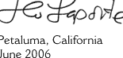

加州佩塔卢马
2006 年 6 月

## 第 1 章：介绍 Ubuntu

*欢迎进入 Ubuntu Linux 的宇宙，各位！*
*那么，什么是 Ubuntu Linux？我可以告诉你们，Ubuntu Linux 目前是全球最热门的 Linux 发行版之一，拥有最活跃和最敬业的用户及开发社区。我们也可以看看 Ubuntu 网站是怎么说的。*
*“Ubuntu”是一个古老的非洲词汇，意为“对他人的仁慈”。Ubuntu 也意味着“我是因为我，才因为我属于我们”。Ubuntu Linux 发行版将 Ubuntu 的精神带入软件世界。*
*Ubuntu Linux（以及 Kubuntu Linux）由谢苏特基金会（Shuttleworth Foundation）资助和支持，该基金会由亿万富翁马克·谢苏特（Mark Shuttleworth）领导。我提到这一点是为了说明 Ubuntu Linux 是一个拥有坚实财政支持的稳固组织。借助这种支持，Ubuntu 基金会将向全球任何地方的任何人寄送免费的 Linux CD（访问 [https://shipit.ubuntu.com](https://shipit.ubuntu.com)）。这非常令人印象深刻，但它并没有回答那个问题：什么是 Ubuntu Linux？官方的 Ubuntu 网站接着说道：*
Ubuntu Linux 是一个完整的桌面 Linux 操作系统，可免费获取，并拥有社区和专业支持。Ubuntu 社区建立在 Ubuntu 宣言所确立的理念之上：软件应免费提供；软件工具应以用户的本地语言提供，并且即使用户有残疾也能使用；人们应有自由以任何他们认为合适的方式自定义和修改其软件。
如果你是刚接触 Ubuntu Linux，甚至刚接触 Linux 的新手，现在或许是时候来一点 Linux 问答环节了。如今，我得到的第一个问题不再是“什么是 Linux？”，而是“我需要做什么才能在我的系统上安装 Linux？”而在 Ubuntu Linux 的情况下，人们已经知道得足够多，能够指定某个发行版并按名称索取它。

### 但 Linux 到底是什么？

对于想要 clarification 的人，Linux 是一个完全多任务操作系统，基于 UNIX——尽管从技术上讲，Linux 是内核，是使 Linux 系统运行成为可能的主程序。顺便说一下，该内核由一位名叫林纳斯·托瓦兹（Linus Torvalds）的年轻芬兰学生编写。1991 年 8 月 25 日，托瓦兹在 Usenet 新闻组 comp.os.minix 上发布了这条如今著名（甚至传奇）的消息：
> 发件人：torvalds@klaava.Helsinki.FI (Linus Benedict Torvalds)  
> 新闻组：comp.os.minix  
> 主题：你最希望在 minix 中看到什么？  
> 摘要：关于我新操作系统的简短民意调查


> 消息 ID：<1991Aug25.205708.9541@klaava.Helsinki.FI>  
> 日期：1991 年 8 月 25 日 20:57:08 GMT  
> 组织：赫尔辛基大学  
> 各位使用 minix 的朋友们：  
> 我正在开发一个（免费的）操作系统（只是爱好，不会像 gnu 那样庞大和专业），适用于 386(486) AT 克隆机。这已经酝酿了几个月，现在开始准备就绪。我希望得到大家关于喜欢或不喜欢 minix 哪些方面的反馈，因为我的操作系统在某种程度上类似于它（除了其他原因外，文件系统的物理布局相同）。

我目前移植了 `bash(1.08)` 和 `gcc(1.40)`，一切似乎运行良好。这意味着我将在几个月内得到一些实用的东西，我想知道大多数人想要什么功能。欢迎提出建议，但我不保证会实现它们 :-)

> 林纳斯 (`torvalds@kruna.helsinki.fi`)

> 

> PS. 是的 - 它不包含任何 minix 代码，并且拥有多线程文件系统。它不可移植（使用 386 任务切换等），并且可能永远只支持 AT 硬盘，因为那是我所拥有的全部 :-(

自那以后，很多事情发生了变化。林纳斯以某种方式激发了全球众多才华横溢的程序员的想象力。通过互联网的神奇力量，他们聚在一起，协作、编码、调整，并创造了如今正在改变计算世界的操作系统。

如今，Linux 是一个强大、可靠（实际上非常稳固）、可扩展、灵活、可配置、多用户、多任务且完全免费的操作系统，运行在许多不同的平台上。这些平台包括 Intel PC、DEC Alpha、Macintosh 系统、PowerPC 以及数量不断增加的嵌入式处理器。你可以在 PDA 日程管理器、数字手表、高尔夫球车和手机中找到 Linux。事实上，Linux 的平台支持基础（就平台而言）几乎比世界上任何其他操作系统都强大。

我们所说的 Linux 操作系统并非仅靠一人之力完成。林纳斯·托瓦兹是 Linux 的原始架构师——如果说有父亲的话，就是他了——但他并非其背后的唯一努力。林纳斯·托瓦兹最大的天才或许在于他知道何时分担重任。除了满足感外，他没有报酬，却雇佣了世界各地的人，向他们委托工作，与他们协作，寻求并接受反馈，开创了继 GNU 项目之后的下一代模式。

顺便说一下，GNU 是一个递归缩略语，代表 GNU's Not UNIX，这是自由软件基金会的项目，由理查德·M·斯托曼（Richard M. Stallman）于 1984 年发起。该项目的目标是创建一个免费的、类似 UNIX 的操作系统。多年来，许多 GNU 工具被编写并被许多商业 UNIX 供应商以及当然的、试图完成工作的系统管理员广泛使用。林纳斯·托瓦兹的 Linux 内核的出现，终于使 GNU 关于完全免费的、类似 UNIX 操作系统的梦想成为了现实。

## Linux 真的免费吗？

在任何关于软件中“免费”含义的讨论中，你经常会看到“像言论一样免费”或“像啤酒一样免费”这样的表达。在这种情况下，免费并不是指成本问题，尽管你可以获得一份免费的 Linux 副本（就像*免费啤酒*那样）并将其安装在你的系统上而不会违反任何法律。正如罗伯特·A·海因莱因（Robert A. Heinlein）可能会说的那样，“世上没有免费的午餐。”免费下载仍然会让你花费互联网连接时间、磁盘空间、烧录 CD 的时间等等。在 Ubuntu Linux 的情况下，你可以免费邮寄 CD，因此在这种情况下，“免费”开始感觉确实非常……免费。

Linux 在“言论”意义上也是免费的，这意味着你有权查看源代码并根据需要修改它。这与在其他操作系统中查看或修改代码可能给你带来法律麻烦的情况大不相同。

也许这时一点法语会有帮助。你也会看到 *libre*（自由）和 *gratis*（免费）的区分。第一个，*libre*，意味着在表达自由、言论自由和思考自由的意义上是自由的。第二个，*gratis*，指没有成本。想象你在朋友的聚会上。你的朋友走过来递给你一瓶啤酒——*gratis*。

## 什么是发行版？

Linux 有许多不同的“口味”，通常被称为发行版（distributions）。Ubuntu Linux 只是其中众多发行版之一。你可能听说过 Red Hat、SUSE 或 Mandriva（前身为 Mandrake）。这些都是流行且备受尊敬的发行版。发行版是一组软件的集合，通常都是免费软件，以 Linux 内核为核心，包含数百甚至数千个应用程序。不同的制造商可能提供包含文档、支持和 CD 的盒装套装，后者节省了下载和烧录光盘的时间和精力。此外，即使在同一个发行版中，也有价格各异的盒装套装。例如，你可以购买 Red Hat 的个人版或专业版。区别在于可能包含额外的软件、文档或支持。

Ubuntu Linux 是基于另一个非常流行的发行版 Debian 而建立的。Debian 的人气衍生出了许多其他发行版，包括 Xandros、Linspire、Knoppix 以及其他几种。

一种发行版与另一种发行版的区别并不总是容易界定，但有一些基本点。例如，大多数发行版提供自己的管理接口。它们包括自己独特的桌面主题以及菜单中应用程序的组织方式。

谈到应用程序，这是 Ubuntu 的一大优势，也是吸引众多用户的地方。Ubuntu 精选了一套精简且实用的核心应用程序集。要理解为什么这是一个绝妙的主意，你需要明白有些发行版会提供三个终端、五个 Web 浏览器、两个文字处理程序等等。Ubuntu Linux 通过为能够完成任务的应用程序做出明智的选择，让这一切变得简单。

## Linux 与 GPL

Linux 在 GNU 通用公共许可证（GPL）下分发。该许可证的核心意思是，任何人都可以复制、分发甚至出售该程序，但前提是必须将源代码的修改重新回馈给社区，并且保持许可证条款不被篡改。自由意味着你可以自由地获取、修改 Linux，并创建你自己的版本。自由意味着你不必受制于某家单一供应商，因为该供应商会通过确保转换到其他环境的成本极高，从而强迫你陷入一种企业奴役状态。如果你对当前的 Linux 供应商或你获得的支持不满意，你可以转向下一家供应商，而不会损失你在 Linux 上的投资。

换句话说，这是“像言论一样自由”——或者说是一种自由。

GNU GPL 允许分发者“对复制转移的物理行为收取费用，并且你可以选择以收取费用作为交换提供保修保护。”这一点进一步由以下声明限定：分发者必须“以不超过其物理执行源代码分发成本的价格，提供一份完整的机器可读的对应源代码副本。”换言之，GPL 确保像 Linux 这样的程序至多免费。最坏的情况下，你或许需要为副本的成本付费。

你应该花一些时间阅读 GNU GPL。为方便起见，我在本书附录 A 中重新印制了它。

## 我能获得什么？

没有操作系统是完美的，任何事物都不会毫无麻烦，但随着时间推移，Linux 正越来越接近完美。如今，Linux 甚至比你的旧操作系统更易于安装，你也不必在加载一个又一个驱动程序盘时反复重启。我不会把所有我认为的优点都列出来让你厌烦，但我会指出几个比较重要的要点。

### 安全性

告别你的病毒查杀软件，停止担忧吧。虽然 Linux 并非对病毒百分之百免疫，但它已经非常接近了。事实上，迄今为止，大多数所谓的 Linux 病毒在*野外*并不存在（它们只存在于*概念验证*实验室的严格受控环境中）。这并不是说没有人尝试过，而是 Linux 背后的设计模型意味着它是出于安全考虑构建的。因此，病毒在 Linux 世界中几乎不存在，安全问题由 Linux 社区迅速而高效地处理。安全漏洞会得到广泛宣传。在一个安全漏洞被发现后短短几小时内创建出修复补丁并不罕见。如果确实出现了风险，你不必等待操作系统的下一个版本发布。

### 稳定性

Linux 的稳定性几乎可以说是传奇。在一个人们习惯每天重启电脑一次或多次的世界里，Linux 用户谈论的是连续运行数周甚至数月而不重启。非法操作和蓝屏死机不属于 Linux 体验的一部分。当然，程序偶尔也会崩溃，但它们通常不会导致你的*整个*系统宕机。

### 性能

Linux 是一个多任务、多用户操作系统。在本书中，我侧重于 Ubuntu Linux 的桌面功能，但在其内部，Linux 是一个旨在提供企业级服务器所有性能和灵活性的系统。由 Linux 驱动的 Web 网站服务器和电子邮件网关在互联网上传输信息，并运行从小型到大型的各种业务。在你图形桌面的友好界面之下，那股力量依然存在。

### 成本

你完全可以在不花费任何软件资金的情况下完成电脑上需要做的所有事情——这意味着新的软件和升级都可以免费。事实上，Linux 上的免费软件多得令人眼花缭乱。在第 8 章中，我将展示如何在你的 Linux 系统上安装（或移除）额外的软件。你不会相信它是多么容易。

### 免除法律麻烦

当你运行 Linux 时，你不必担心是否保留了操作系统许可证的副本。正如我前面提到的，GNU GPL 意味着你有权合法地复制，并且如果你愿意，也可以合法地重新分发你的 Linux 光盘。

然而，请记住，虽然 Linux 本身可以免费分发，但并非所有运行在 Linux 上的软件都受同一许可证保护。如果你为系统购买或下载软件，仍应注意覆盖该软件的许可证。

## 我会失去什么？

没有什么事情似乎是完美的。转向 Linux 你会获得很多，但如果我不提及缺点，那就是一种失职。


### 硬件和外围设备支持

坦白说，Linux 的硬件支持是最好的之一，而 Ubuntu 的硬件支持在 Linux 世界中属于顶尖水平。事实上，考虑到所有运行 Linux 的平台，其硬件和外围设备支持优于你正在离开的 Windows 系统。不幸的是，有一些消费类设备是专门针对 Windows 设计的。因此，某些打印机或扫描仪在 Linux 下的支持可能有限，因为制造商提供驱动程序的速度较慢。话虽如此，绝大多数标准设备都能正常工作，你不太可能会遇到太多问题。

从积极的一面来看，你会发现，在旧操作系统中，你总是需要加载驱动程序才能让某样东西运行，而 Linux 会自动识别并支持大量外围设备，而你无需做任何额外工作或寻找驱动盘。此外，Linux 社区的活力是很少有企业能够企及的。如果你看中了某款热门的新硬件，你可以几乎肯定，在某个地方的某位 Linux 开发者也在关注同样的东西。

我们将在第 6 章稍后讨论设备和设备驱动程序。

### 软件包

Linux 操作系统上有大量的软件可用。令人惊讶的是，其中大多数是非商业的，并且免费下载。有数千种游戏、工具以及互联网和办公应用程序可供在你的系统上运行。你也不需要走太远：大多数现代发行版的光盘上都有数百个软件包，这足以让你开始工作、娱乐，而无需四处寻找。再一次，外面的许多软件除了下载所需的时间外，不会让你花一分钱。

至于安装？借助 Ubuntu 自带的 Synaptic 软件包管理器，你会问自己为什么在旧操作系统中安装软件不是这么容易的！

另一方面，包括你当地电脑商店里那些热门新 3D 游戏在内的商业零售软件仍然难以获取。随着 Linux 人气增长，特别是在桌面领域，这种情况正在开始改变。

不过，解决这一问题有其方法。例如，你可以获取名为 Cedega 的软件包，它允许你安装和运行 Windows 游戏。

### 踏入未知领域

让我们面对现实。对一些人来说，转向 Linux 是踏入未知领域。事情不会和你旧操作系统时完全一样，在大多数情况下，这是件好事。你将不得不重新学习一点东西，并习惯不同的做事方式。

即便如此，如果你习惯在 Windows 图形环境中工作，并且对基本的鼠标操作、写偶尔的电子邮件、浏览网络或在文字处理程序中撰写备忘录感到舒适，那么转向 Linux 不会是个大问题。你的 Linux 桌面是一个现代的图形环境，你在旧操作系统中学到的很多东西可以带进这个新世界。

## 使用本书的一些建议

我编写本书的初衷是提供从你的旧操作系统到 Ubuntu Linux 的简单过渡。我很快就会涵盖安装等内容，但本书的大部分内容是关于在你的新 Ubuntu Linux 环境中工作（和娱乐）。我想向你展示如何做你已习惯做的事：上网、写电子邮件、听音乐、打印、刻录光盘等等。此外，我还将告诉你如何开始使用在 Linux 中那些你长时间积累的 Word 文档、Excel 电子表格和音乐文件。简而言之，我的计划是让你尽可能轻松地从旧操作系统过渡到 Linux。

在阅读本书章节的过程中，你会发现我一直鼓励你动手尝试。这是因为我相信，学习任何事物的最佳方式就是实践。没错，你将要学习与一个新的操作系统打交道，但这并不意味着你不能享受乐趣。众所周知，只工作不玩耍，聪明孩子也变傻。在本书的后面部分（为了避免枯燥），我将带你进入 Linux 的娱乐和游戏世界。

## 快速提示与 Shell 操作

在本书中，我偶尔会提供带框的旁注，这些提示应作为小提醒或做事的更简单方法。

你还会注意到以“Shell out”开头的方框。虽然我的重点集中在以图形方式操作图形工具，但 Linux 的强大功能很大程度上来自使用命令行或 Shell。Shell Out 方框将指导你使用 Shell。

学习使用命令行就像在武术中取得黑带或获得急救证书一样。这并不意味着你要出去应对所有挑战者，或意味着你将面对日常的危机情况。使用 Shell 确实给了你走出图形环境局限的手段和信心。Shell 是一种力量，它永远在那里为你所用，因此你不应该害怕它。

## 认识你的桌面

你的 Ubuntu Linux 系统附带了一个现代、高级且易于使用的桌面环境，称为 GNOME。有许多这样的环境，随着时间推移，你将了解它们。我所说的自由的一部分就是按你自己的方式做事的自由，这延伸到你想要使用的图形环境类型。当今最流行的桌面环境是 K 桌面环境 (KDE) 和 GNOME，但 WindowMaker、IceWM、XFCE 等也拥有相当多的追随者。

Ubuntu Linux 只是众多经过简化并微调的 Linux 发行版中的一个面孔。还有一个名为 Kubuntu 的 Ubuntu 版本在发行，其区别在于它使用 KDE 作为默认的桌面环境。在第 20 章中，我将告诉你如何安装和运行 Kubuntu 的默认环境，即 KDE 桌面。别担心；你不会失去任何东西。你可以随心所欲地在两者之间轻松切换。

> 注意：这听起来可能有些重复，但这很重要。Kubuntu 就是 Ubuntu。它只是恰好是运行 KDE 作为桌面环境的 Ubuntu Linux。它不是 Ubuntu 的分叉版本，也不是不同的发行版。

当你习惯了 GNOME 和 Ubuntu Linux 后，我邀请你尝试其他桌面环境。行使你做自己的自由。

## 帮助我！

在你读完本书后，我有信心 Ubuntu Linux 将成为你在可预见的未来首选的操作系统。这并不意味着你不会有一些本书未解答的问题。为此，我提供一个网站地址，它会将你链接到我个人网站上的本书支持页面：

`http://www.marcelagne.com`

我的网站有许多其他资源的链接，包括我撰写的关于使用和管理工作 Linux 的许多文章、指向其他信息网站的链接，以及更多内容。点击“Moving to Ubuntu”链接（或其封面），你就会被传送到本书的支持页面。

我还为读者运行几个邮件列表，你可以在 WFTL 标题下找到它们。WFTL 是我多年来使用的缩写。它代表“Writer and Free Thinker at Large”（广大作家和自由思想家；计算机人很喜欢缩略词）。这也是我正在谈论的列表的层级。其中一个列表是 WFTL-LUG（LUG 是 Linux 用户组），这是一个在线讨论组，读者可以在其中共享信息、提问，并帮助彼此应对各种 Linux 冒险。我邀请你加入我在那里提供的任何列表。这是免费的，你可以随时取消订阅。


如果你查看我网站菜单下的 Linux Links（Linux 链接），你会发现一份有用的附加链接列表，指向 Linux 信息资源。其中之一是 Linux 文档项目 (LDP)。


> 更多帮助：在第 3 章中，我将向你介绍你的 GNOME 桌面的帮助系统。它是一个强大的工具，指尖就能获取大量额外信息。

## Ubuntu 社区

关于 Ubuntu 系统的额外信息，最好的去处之一是 Ubuntu 社区。你会在这里找到大量拥有使用 Ubuntu 方式做事的相当知识和信息的人。该社区包括开发人员、文档编写人员，以及也许最重要的是，Ubuntu 用户。这是一个充满活力、不断增长的社区，提供了许多不同的选项来查找你所需的帮助。

开始的地方是 Ubuntu Linux 网站 (www.ubuntu.com)。与网站紧密相关的是 Ubuntu Wiki，这是一个定期更新的、由社区支持的信息来源。Wiki 位于 wiki.ubuntu.com。在网络上还有位于 ubuntuforums.org 的 Ubuntu 论坛。

登录 irc.freenode.net 上的 #ubuntu IRC 频道（参见第 9 章了解 IRC 的信息），你会发现无论白天还是黑夜，任何时刻都有 500 到 600 人在线。提出你的问题，很可能有人会给你答案。

你还可以通过访问此网站加入 Ubuntu Users 邮件列表：

`https://lists.ubuntu.com/mailman/listinfo/ubuntu-users`

最后，你还可以查看 Yelp，这是随你的 Ubuntu Linux 系统附带的帮助文档浏览器。有关使用 Yelp 的更多信息，请参见第 3 章。

## Linux 文档项目

Linux 文档项目 (LDP) 是一个动态的社区资源。在你的 Linux 发行版 CD 上，你通常拥有一个在 Linux 世界中被称为 HOWTOs 的文档集合。这些是由用户或开发人员贡献并由一个或多个个人维护和更新的文档。你可以在 LDP 网站上找到这些文档的最新版本：

`http://www.tldp.org/`

LDP 的使命基本上是为所有 Linux 相关事务提供全面的文档基础。如果你一直四处寻找关于在你的 PC 上安装最新边缘 FTL 无线电卡的信息，但仍未找到你要找的东西，试试 LDP。LDP 还特别提供最新版本的 man 页面，以及覆盖范围通常比标准 HOWTOs 更广的用户指南。

## Linux 用户组


前几段中，我提到了 Linux 用户组，或简称 LUGs。让我们暂时放下技术，探索你可能听说过的其他事物：Linux 社区。是的，确实存在一个 Linux 社区。在世界各地，你会发现热切的 Linux 用户定期聚会，一边喝啤酒吃披萨，一边分享信息。这种信息分享是使 Linux 如此友好的一部分原因。

LUGs 倾向于运行电子邮件列表，非正式的信息交流在那里发生（正如我在我的在线 LUG 所做的那样）。新用户受到欢迎，他们的问题也会得到乐意解答。这些用户从刚入门的新手到经验丰富的内核开发人员不等。如果你发现自己陷入困境且无处求助，寻找你当地的 LUG 并注册邮件列表。今天，会有人来帮助你。随着你在管理 Linux 系统方面变得更加知识渊博，也许你会报效互助。

在你的社区中定位一个 LUG 就像访问 Linux Online 网站 (`http://www.linux.org/`) 一样简单。一旦到达那里，点击 User Groups（用户组）按钮，你就上路了。该列表按国家，然后按州或省，依此类推进行组织。

## 关于 DVD

随本书附带一个完整的 Ubuntu Linux 发行版，你可以完全通过你的 PC DVD-ROM 光驱运行它（尽管比实际安装 Ubuntu Linux 要慢）。没错。你可以在你的系统上运行 Ubuntu Linux，而无需更改你的系统或卸载 Windows。

这张 DVD 包含一个完整的 Ubuntu 系统，其中附带了大量我会在这本书中介绍的出色软件。你可以收发电子邮件、管理联系人、保持井然有序、上网浏览、在文字处理器中撰写信件、使用电子表格、玩游戏等等。事实上，你应该能够跟随本书的内容进行操作，并实现书中提到的大部分功能，而完全不需要安装 Linux。

此外，该 DVD 还包含所有受 Ubuntu 支持的软件包的存档，其中包括许多在即时启动会话中不可用的软件包。我将在第 8 章向你展示如何从 DVD 安装额外的软件。

可引导的 DVD 是一个绝佳的入门工具，但请记住我之前关于性能的说法。与硬盘安装相比，DVD 的运行速度*慢得多*，因此请留意，你在 DVD 上体验到的性能并不能代表你在 Linux 硬盘安装上能获得的性能。即使是最快的光驱，也比不上最慢的硬盘驱动器。此外，当你从 DVD 运行时（而不是将 Ubuntu Linux 安装到硬盘上），你仅限于使用 DVD 上的软件包。换句话说，你不能添加或安装任何新软件。

准备好尝试 Ubuntu Linux 了吗？可引导的 DVD 是一个*完美*的入门方式。我会在下一章告诉你所有你需要知道的内容。

当你真正准备好转向 Ubuntu Linux 时，你可以直接从同一张 DVD 进行安装。我稍后也会对此进行说明。

## 这是我的理念

我有一套理念。好吧，我有很多套理念，这只是其中之一。

偶尔会有人告诉我，桌面 Linux 太疯狂了，对*大多数人*来说太复杂了。

我不知道你怎么看，但我受够了被告诉人们无法学会使用既良好又强大的东西。经过一定程度的培训和适当的指导，任何*熟悉计算机的人都能学会使用 Linux*。

这并不是说操作 Ubuntu Linux 很困难（事实并非如此），但当你继续使用时，你会学到新的东西。这本书旨在面向各个经验水平的用户。它既可以作为娱乐读物，也可以作为参考书。而且，因为我会要求你在本书中尝试各种操作，所以它也是一份培训指南。

我很高兴并激动地看到你决定加入我《迈向 Ubuntu Linux》的旅程。这不仅仅是一个为人类设计的 Linux；它是一个为真实的人做真实的事情而设计的操作系统。

## 资源

- Linux 文档项目

  `http://www.tldp.org`
- Linux.org LUG 列表

  `http://www.linux.org/groups/index.html`
- 全球 Linux 用户组

  `http://lugww.counter.li.org/groups.cms`

  Marcel Gagné（作家和自由思想家）的网站

  `http://www.marcelgagne.com`
- ShipIt 免费 Ubuntu Linux 服务

  `https://shipit.ubuntu.com`
- Ubuntu Linux 论坛

  `http://ubuntuforums.org`
- Ubuntu Linux 邮件列表

  `https://lists.ubuntu.com/mailman/listinfo/ubuntu-users`
- Ubuntu Linux 网站

  `http://www.ubuntu.com`
- Ubuntu Linux Wiki

  `https://wiki.ubuntu.com`

# 第 2 章

## 运行和安装 Ubuntu Live DVD

*随本书附赠的是一个功能齐全的 Ubuntu Linux 发行版，它可以完全从 DVD-ROM 驱动器运行。没错，你无需更改系统或卸载 Windows 即可在系统上运行 Linux。然后，当你准备正式转变时，Live DVD 附带了一个友好的安装程序，使整个过程几乎毫无痛苦。*

> **注意** 由于它是从 DVD 驱动器运行的，Ubuntu Linux Live DVD 的运行速度比实际安装 Linux 并从硬盘运行时要慢。请记住，你在 DVD 上体验到的性能并不能代表你在 Linux 硬盘安装上能获得的性能。即使是最快的 DVD-ROM 驱动器，也比不上最慢的硬盘驱动器。

运行 Ubuntu Linux 就像将 DVD 放入驱动器并启动一样简单。几分钟后，你正在使用一个外观精美、现代化的桌面（见图 2-1）。这张 DVD 充满了出色的软件。光盘上有数吨应用程序和字面上数千个程序。你将能够收发电子邮件、上网浏览、在文字处理器中撰写文档、使用电子表格软件制定预算、玩几

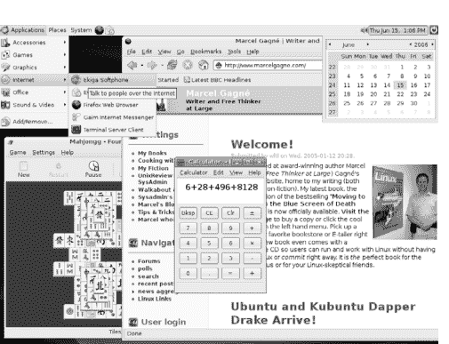

图 2–1  认识你的新 Ubuntu Linux Live 桌面！

款游戏，以及更多。事实上，你应该能够跟随操作，试用你将在本书中探索的软件，并完成涵盖的大部分内容，而完全不需要安装 Ubuntu Linux。

可引导的 DVD 是 Ubuntu Linux 的绝佳入门工具，为你提供了一种无需承诺的方式来试用 Linux；但它有局限性。

我已经涵盖了一个与 DVD 相关的问题，即性能。另一个限制也与 DVD 有关。由于这个可引导 Linux 不会将其自身安装到硬盘上，你仅限于使用 DVD 上的软件包。换句话说，你不能添加或安装任何新软件。在你将 Ubuntu Linux 安装到硬盘后，这种限制将消失，你可以选择从数千个出色的软件包中进行安装。事实上，该 DVD 包含所有受 Ubuntu 支持的软件包，因此你将有数千个程序可供选择——所有这些都不需要从互联网下载。

## 准备好尝试 Ubuntu Linux 了吗？

加载 Ubuntu Linux Live DVD 很容易，因为不需要安装。

拿起你的 DVD 并插入 DVD-ROM 驱动器。关闭 Windows，并选择重新启动。确保你的 PC 设置为从 DVD 启动。Ubuntu Linux 会启动到一个漂亮的图形界面，带有简单的菜单（见图 2-2）。从光盘启动是第一个选项；只需按 Enter 键或等待即可。几秒钟后，系统将自动启动。然而，在此之前，请注意标记为“Check CD for Defects”（检查光盘缺陷）的菜单选项。如果你计划将 Ubuntu 安装到硬盘上，这是一个非常好的主意，我强烈建议你执行此步骤。


> 大多数现代系统都设置为如果检测到可引导 DVD，则直接从 DVD-ROM 驱动器启动。如果你的系统不是这样，你可能需要更改 PC 上的 BIOS 设置以允许此操作。这通常是通过在系统启动时按*Delete*或*F2*进入 Setup（设置）来实现的。（通常你会在操作系统开始加载之前看到此类消息。）由于菜单各不相同，我无法涵盖所有菜单，但请查找指定启动顺序的菜单选项。你会看到类似 A: 优先，然后是 C:（即软盘驱动器，然后是硬盘）的选项。更改启动顺序，使其优先查找 DVD，保存你的更改，然后重新启动系统。

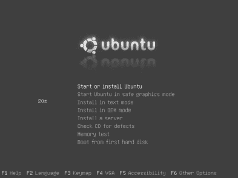

图 2–2 启动菜单提供了一种检查光盘缺陷的手段。

启动过程需要几分钟时间，因为 Ubuntu 正在识别设备、磁盘、网络连接、声卡等。在某个时刻，屏幕会变暗，因为你的视频卡正在配置，并且 Linux 图形用户界面 *X* 正在启动。

如果屏幕没有立即响应，不要惊慌。给它几秒钟的时间。即使你等待了一段时间后仍然没有动静，你的视频卡可能是少数未包含在发行版中的稀有型号之一。别担心，大多数（如果不是全部）现代显卡都支持 VESA，Ubuntu 应该会回退到此设置。

## 求助！

问题，问题……


这张 DVD 在自动引导和运行方面表现出色，支持大量系统，但它并不完美。你只能在一张 DVD 上容纳有限的软件，其中包括硬件驱动程序。话虽如此，大多数关于启动 Ubuntu Live DVD 的问题都可以解决。

您可能已经注意到，当启动屏幕出现时（参见图 2-2），屏幕底部有若干选项，例如 `<F1>` 帮助、`<F2>` 语言等。其中一些选项相当直观。按下 `<F1>` 可获取更多协助。如果您不希望默认语言为英语的 Ubuntu 系统，请按下 `<F2>` 并从列表中选择一个替代语言。与此密切相关的还有 `<F3>`，它允许您为所选语言选择替代键盘。

获取合适的图形显示通常不是问题，但如果所有方法都失效，您仍然无法获得清晰良好的屏幕，请尝试按下 `<F4>` 并选择 VGA 作为您的视频类型。通常，Ubuntu 会根据您的显卡扫描并分配合适的视频驱动程序。启动屏幕中还内置了若干辅助功能选项，允许不同视觉障碍程度的用户选择更适合的环境。还有针对有轻微运动障碍、可能在鼠标或其他指点设备上有困难用户的设置。您可以在启动时通过按下 `<F5>` 来访问这些设置。

在系统启动过程中，几乎所有操作都已为您自动完成。这被称为普通模式，这是 99.9% 情况下的最佳选择。对于那些希望完全控制启动过程的每一个方面，如设备检测、硬件配置等的人，可以通过按下 `<F6>` 切换到专家模式。

## 启动级别选项

最大的一组启动更改是那些可以直接添加到启动命令提示符本身、紧邻“Boot Options”标签旁的选项。例如，您可能在启动时遇到锁定或奇怪的硬件故障导致系统无法启动，这是有缺陷的 APIC 控制器（高级可编程中断控制器）的常见问题。要禁用 APIC，请按下 `<F6>` 调出启动提示符，然后将以下行添加到现有选项的末尾：

```
noapic
```

按下 `<Enter>` 后，机器将正常启动，但 APIC 被禁用。有些提示并不涉及实际问题。它们只是加快速度。一个例子与网络配置有关。通常，Ubuntu 实时 DVD 会将其网络卡配置为使用 DHCP，假设网络中的另一台机器会自动提供地址。您可以在系统启动后随时更改此设置（网络内容在第 7 章中介绍），但也可以在启动时强制设置静态 IP 地址。

```
disable_dhcp=true
```

要查看更全面的启动参数列表，请按下 `<F1>` 进入帮助屏幕，然后按下 `<F5>` 查看启动参数概览，`<F6>` 查看处理特定机器硬件的参数，`<F7>` 查看与磁盘控制器相关的参数，以及 `<F8>` 查看与启动过程本身相关的参数。

## 浏览 Ubuntu Linux

系统启动后，您就可以开始体验 Ubuntu Linux 了。从这里开始，您可以跟着书阅读并尝试涵盖的各种程序。不过，为了让您迅速适应环境，让我带您快速浏览一下菜单，并向您展示您的系统能提供什么。

查看您的 Ubuntu 桌面（参见图 2-1），您可以看到屏幕顶部和底部有一条灰色面板。我将在第 3 章和第 5 章中详细介绍这些面板的所有细节，包括它们是什么、它们能为您做什么，以及您如何修改它们以满足您的需求。目前，我想请您查看顶部面板及其左侧的标签。一个是“应用程序”，接着是“位置”，最后是“系统”。这些每一项都代表一系列可能性，授予您访问随您的 Ubuntu Linux 系统附带的大型程序、您的计算机硬件、存储设备、外设以及定制 Ubuntu Linux 体验各个方面所需工具的权限。

从点击“应用程序”按钮开始。然后，将鼠标光标悬停在“附件”菜单上，您会看到一些方便的系统工具（参见图 2-3）。

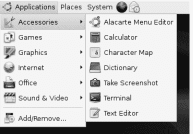

图 2–3 附件子菜单包含许多有用的工具。

Alacarte 菜单编辑器（听起来挺美味，不是吗？）是一个允许您添加、删除甚至修改菜单项的程序。有时，程序没有出现在您希望的位置，或者您经常使用的另一个程序在那里不可用。Alacarte 就是您更改这些内容的方式。计算器在启动时是一个简单的计算器，但它也提供高级功能，包括商业、金融和科学功能。字符映射是一个使插入键盘无法直接提供的国际字符和特殊字符变得容易的程序（当您的姓氏末尾带有 é 时很有用）。

词典使用可访问 Internet 的资源从 dict.org 查找单词。在第 5 章中，我将向您展示如何更改桌面的外观。如果您想与朋友分享桌面的新外观，“截取屏幕”就是适合您的工具。终端是访问系统文本命令行的一种方式。随着书的进展，您将对此了解更多。最后，文本编辑器提供简单但强大的编辑和操作文本文件的方式。

将鼠标光标向下移动一点，让我们看看“游戏”子菜单（参见图 2–4）。

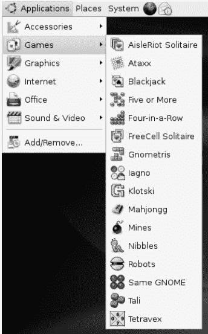

图 2-4 没有游戏的操作系统就像没有阳光的日子——或者是类似的比喻。

在某个时刻，每个人都需要休息一下，有些时间来放松并享受片刻闲暇。不妨试试 AisleRiot 中许多单人游戏之一，或者花点时间在二十一点桌旁？或许一点麻将？

随系统附带的游戏集合仅仅是开始。在第 8 章中，我将向您展示如何安装数百个其他游戏，从地牢爬行器到第一人称射击游戏，高端 3D 动作游戏、益智游戏和策略游戏。您的 Ubuntu Linux 系统可能正是您一直在寻找的游戏机器。

接下来，我们进入“图形”子菜单（参见图 2-5）。

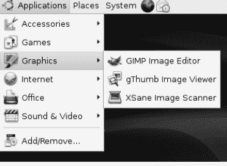

图 2-5 随 Ubuntu 分发的图形应用程序包括令人惊叹的 GIMP。

GIMP 图像编辑器是一个近乎传奇的软件，是一个强大的图形处理包，内置数十种滤镜、特效以及制作高质量图像所需的每个工具。我在第 17 章详细介绍了 GIMP。gThumb 图像查看器提供了一种易于使用的方式，用于导航您的文件夹并查看您的数字艺术收藏。最后，如果您有扫描仪，XSané 图像扫描程序可以扫描、复印和传真。

“互联网”子菜单（参见图 2-6）以 Ekiga 软电话开始，这是一个提供音频和视频的 VoIP 通信程序。那些留意此类事情的人都知道，Ekiga 最初是 GnomeMeeting。对于电子邮件、联系人管理和保持条理井然的好方法，Evolution Mail 处理得很好。您可以在第 11 章和第 12 章中阅读关于 Evolution 的全部内容。

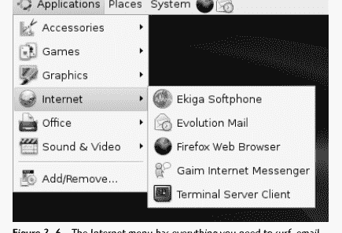

图 2-6 互联网菜单包含您需要浏览、发邮件、聊天和连接世界的一切。

网络空间中最热门的 Web 浏览器并不是出自 Redmond。不，它是 Firefox Web 浏览器，在第 10 章之后，它可能成为您的新好友。需要一个适用于 AOL 的即时消息客户端，另一个适用于 MSN，还有一个适用于 Jabber？绝不！在学习了第 9 章中关于 Gaim Internet Messenger 的内容后，您会好奇自己以前是怎么使用其他东西的。终端服务器客户端是一个很棒的项目，它使您能够使用 VNC（虚拟网络计算）或 Microsoft 终端服务器控制另一台计算机。

我将通过这次快速互联网之旅的收尾，让您知道第 9 章也是学习 XChat-GNOME IRC 聊天客户端的地方。

让我们向下移动，看看“办公”子菜单（参见图 2-7）。菜单上的第一个是 Evolution，您在互联网菜单中与 Evolution Mail 一起见过它。因为 Evolution 远不止是一个电子邮件包，它被视为一个无价的办公应用程序。OpenOffice.org 版本 2 是一个出色的、免费的 Microsoft Office 替代品，兼容 Microsoft Word、Excel 和 PowerPoint 文件。它还做很多其他事情。OpenOffice.org Base 是一个强大的集成数据库应用程序，您将在第 16 章中了解它。OpenOffice.org Calc（参见第 14 章）是

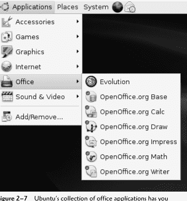

**图 2–7** Ubuntu 的办公应用集合让你可以尽情使用 Evolution 以及功能丰富的 OpenOffice.org 套件。

你的电子表格程序，类似于 Microsoft Excel，而 OpenOffice.org Draw 是一个灵活的绘图程序，你可以用它创建各种图像，包括流程图、组织架构图、徽标等。第 15 章介绍的 Impress 是一个演示文稿软件包，兼容 Microsoft Powerpoint。将 OpenOffice.org Math 视为用于创建复杂科学公式和方程的文字处理器，对学生来说非常有用。最后，我们来到也许是最为重要的办公工具，至少对这位作者来说是如此：OpenOffice.org Writer，一个真正出色的文字处理软件包。

让我们来看看这些子菜单中的最后一个，声音与视频（参见图 2–8）。

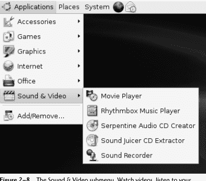

图 2–8 声音与视频子菜单。观看视频，聆听您喜欢的歌曲，并创建您自己的音乐收藏。


列表顶部是电影播放器，其用途不言自明。借助 Rhythmbox 音乐播放器，你拥有一个很棒的小点唱机程序，用于整理你的数字音乐，让你的耳朵得到娱乐，让你的精神起舞。当你需要随身携带音乐时，使用 Serpentine 音频 CD 创建器来制作包含你最喜欢歌曲集合的音乐 CD。我们大多数人的收藏中都有大量的音乐 CD。将它们传输到你的 PC 上是 Sound Juicer CD 提取器的工作。Sound Juicer 也是一个易用的 CD 播放器。我们以 Sound Recorder 结束这次多媒体应用的导览，Sound Recorder 是一个用于录制声音片段的简单程序。

什么？我还没讲完？

你说得对；我还没讲完。那个列表中有一个添加/删除菜单项。如果你想知道在 Ubuntu Linux 中安装软件有多么简单，请先设置好互联网连接（参见第 7 章），然后阅读第 8 章中关于安装软件的全部内容。

## 菜单上的著名位置

与相当丰富的应用程序菜单及其子菜单相比，我们发现的是位置菜单（参见图 2-9）。位置主要是一个物理存储位置的菜单，大多数是系统上的磁盘或文件夹。

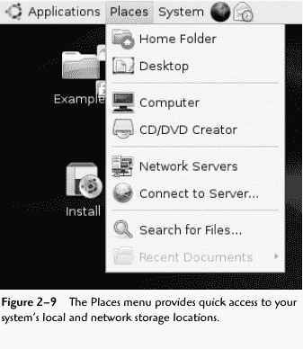

从这里，你可以快速跳转到你的主文件夹，导航计算机的磁盘，使用你的刻录机创建 CD 或 DVD，并搜索系统中的文件。这些存储资源不需要始终连接到你的系统。例如，如果你插入一个 USB 存储键，它将出现在位置菜单中，你可以无额外麻烦地访问它。

位置还可以显示网络跳转范围内的资源，无论是在你的局域网还是互联网上。如果你的网络中有带有共享驱动器的 Windows 机器，网络服务器将让你一键到达那里。

# 管理和个性化你的系统

最后一组菜单都列在顶部的 `系统` 标签下。在我告诉您有关它们的一些信息之前，我也想让您知道 GNOME 帮助系统可以从 `系统` 菜单中获取。您还可以使用密码锁定屏幕（当您去喝咖啡或吃松饼时）或注销当前的 Ubuntu Linux 会话。

现在，让我们来看看偏好设置子菜单（参见图 2-10）。

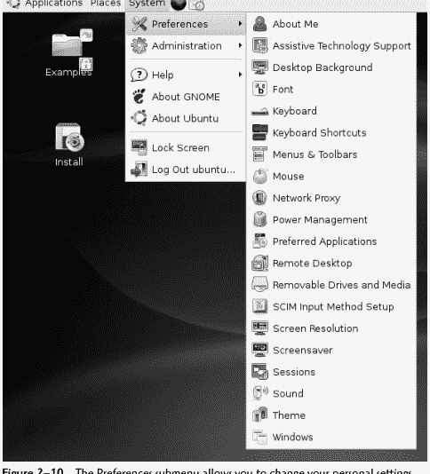

图 2-10 偏好设置子菜单允许您更改个人设置。

在屏幕左上角附近有两个非常有趣的图标。示例文件夹包含许多示例文档、电子表格、图像和多媒体文件，供您在 Ubuntu Linux 系统中尝试。同时，安装图标是你将 Ubuntu Linux 现场 DVD 永久安装到硬盘的起点。我将简要讨论这些步骤。

偏好设置菜单完全涉及个性化用户体验，我将在第 3 章和第 5 章中更详细地介绍。由于这些是个人选项，它们都不需要管理员权限。您可以设置屏幕保护程序，更改背景、窗口装饰或颜色。选择一个包含的主题，给你的系统带来全新的外观。

如果字体看起来有点小，有一个简单的选项可以更改屏幕上显示内容的大小。说到你的屏幕，更改屏幕分辨率很容易，而且不需要重启图形环境。

好的，让我们以管理子菜单（参见图 2-11）结束这次系统菜单的导览。

系统管理听起来像是大多数人宁愿远离的事情，但它并没有那么可怕。时不时地，你会想在系统中做一些事情，这些事情同样会影响每个登录者。在偏好设置下所做的更改不会影响除当前用户以外的任何人；如果你姑姑 Stephanie 选择了一些刺眼的桌面颜色，当你登录时不会影响你。

管理功能涵盖了从设置打印机到配置互联网访问的范围。你可以共享文件夹（以便你家庭或办公室网络上的其他人可以使用它们），查看系统日志，更改登录屏幕的外观和感觉，并添加用户。

也许这里最重要的功能之一是更新和维护系统中的软件包。保持最新是让你的系统运行良好且安全的最佳方式之一。

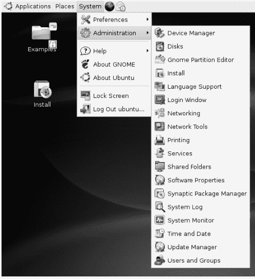

图 2-11 Ubuntu 的管理子菜单是你配置网络、检查日志、安装软件等的起点。

在你使用 Ubuntu Linux 现场 DVD 一段时间后，我确信你会希望将这种体验永久化。在许多方面，Linux 远优于你旧的操作系统，并且当你将其安装到硬盘后，Ubuntu Linux 将运行得更快。幸运的是，使用 Ubiquity 安装 Ubuntu Linux 的过程几乎无痛苦。回答几个简单的问题，几分钟后，你将在硬盘上安装好 Ubuntu。

在桌面上，示例文件夹正下方有一个标有“安装”的图标（参见图 2–12）。双击该图标启动 Ubiquity 安装程序。

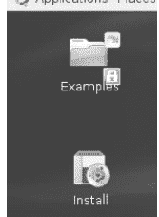

图 2–12 双击安装图标以启动 Ubiquity 安装程序。

当你这样做时，会出现 Ubiquity 安装程序窗口。第一个屏幕是一个欢迎屏幕，但它也是一个警告，说明安装是一个将覆盖当前硬盘配置的过程（参见图 2–13）。

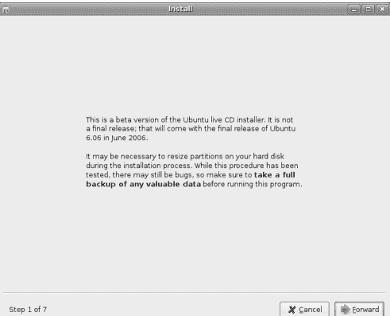

`图 2-13` Ubiquity 的第一个屏幕主要是欢迎屏幕，但请注意它所说的内容，特别是关于备份的部分。

关于确保你已对数据进行备份的警告不能强调太多。做一个备份，然后再做一个备份。

点击 `下一步` 按钮，你将进入安装语言选择屏幕（参见 `图 2-14`）。当系统完全安装后，此语言也将是默认语言。默认选择是英语，但 Ubuntu 已国际化支持数十种语言。这里没有克林贡语，但世界语是可用的。

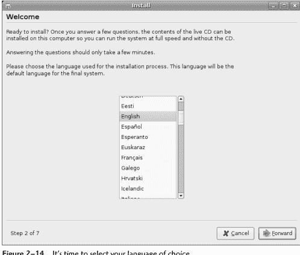

`图 2–14` 现在是时候选择你首选的语言了。

做出你的选择，然后点击 `下一步` 继续。下一个屏幕标记为“你在哪里？”。这是你设置位置和时间区域的地方。通过点击地图来选择你的位置。一次点击会将你放大到一个区域，你在那里可以微调你的选择。还有一个标记为“所选城市”的下拉框，你可以用它达到相同的效果，但点击地图更有趣。点击 `下一步` 继续。

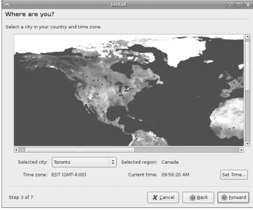

`图 2–15` 点击地图即可选择您的位置和时区。

下一个屏幕标记为“键盘布局”，听起来与语言选择屏幕（见图 2–16）非常相似。然而，您的键盘布局不一定反映您选择的语言。作为一名双语加拿大人，我仍然使用带有“美式英语”布局的键盘，因为该选择最贴近我的笔记本电脑键盘。如果您有备用键盘，请选择您的设置，然后使用屏幕底部的输入框来测试您的选择。

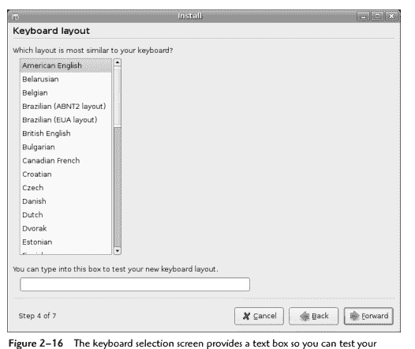

`图 2–16` 键盘选择屏幕提供了一个文本框，以便您可以测试您的硬件。

当您满意后，点击“继续”。一个标记为“您是谁？”的新窗口将会出现。这是个人身份识别窗口，您的初始用户登录将由此创建（见图 2–17）。

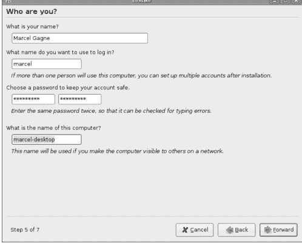

`图 2–17` 您和您的电脑都需要一个名字。您在此处指定的用户名是主要用户的。您可以稍后再添加用户。

在“您叫什么名字？”字段中输入您的全名。在标记为“您希望使用什么名称登录？”的第二个字段中选择一个用户名，最好不超过八个字符（尽管这不是一条硬性规则），然后使用 Tab 键转到密码字段。当您输入密码时，它会以星号（或星号）的形式显示，因此不用担心您看不到正在输入的内容。在此之后，您必须再次输入密码。这是为了确保您第一次在密码字段中输入的是您所认为的内容。最后，在“这台电脑的名称是什么？”标题下，为您的系统输入一个主机名。默认情况下，安装程序会在您的用户名后附加“-desktop”，但您可以自由选择其他名称。

点击`继续`，`Ubiquity`的分区工具将开始运行。会出现一个标记为`正在启动分区器`的小窗口。进度条会让您了解磁盘扫描和分析的情况。几秒钟后，主分区窗口将出现。其标记为“选择磁盘”。大多数人只有一个磁盘，但如果您有多个磁盘，请在此处选择一个并点击继续。下一个窗口标记为“准备磁盘空间”，允许您选择愿意分配的空间量（见图 2–18）。

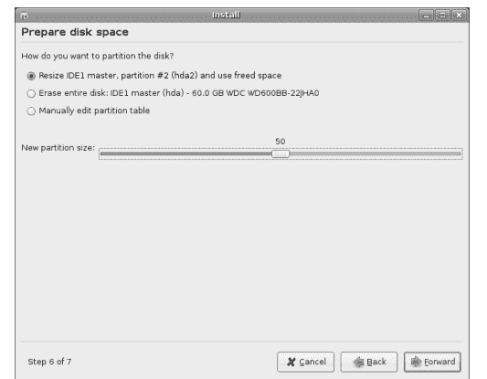

`图 2–18` 分区器的作用是帮助您在磁盘（或多个磁盘）上创建一个位置，以便安装您的 Ubuntu 系统。

您在分区屏幕上看到的信息会因系统而异。我的测试系统有两个硬盘可供选择。您可能只有一个带有 Windows 分区的驱动器，并且乐意将其覆盖。请注意列表中的第一个选项。它提供了一个用于调整当前分区大小的选项。这对于那些在系统上运行 Windows 并希望让 Ubuntu 和 Windows 共存的人来说特别有用（是的，这是可能的）。如果您选择此选项，列表底部的滑块将被激活，您可以使用它来选择您希望释放的空间百分比。


> 提示：不幸的是，Windows 同样可能占满整个分区表。诀窍是缩小现有的 Windows 分区，从而创建一些用于安装 Linux 的空间。为此，您必须在调整分区大小之前在 Windows 中对该磁盘进行碎片整理。您可以通过点击“开始”按钮，然后选择“程序 | 附件 | 系统工具 | 磁盘碎片整理程序”来实现。

在这个示例中，我选择使用整个第一个磁盘（在这台旧计算机上它是最大的）。

点击越过此点继续后，会弹出一个警告窗口，询问您是否“准备好安装”。截至此时您所做的选择，包括语言、用户名等，都会在此处重复显示。如果您选择使用整个磁盘，像我一样，这是您的硬盘在准备安装之前被擦除的最后机会。请仔细阅读对话框，因为它还会确认要创建的分区——如果您选择使用可用空间或选择了自定义分区，这一点尤为重要。如果您已准备好，拥有良好的备份，或者根本不在乎 PC 上有什么内容，请点击“安装”以继续。

> 提示：我提过您应该拥有一个良好的系统备份，特别是您的个人数据吗？

对话框将显示磁盘分区和格式化的进度信息（见图 2–19）。

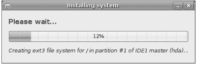

**图 2–19** 状态栏会告知您磁盘分区和格式化的进度。

虽然此时激动的心情可能高涨，但接下来发生的事情只有如此激动人心，所花费的时间很大程度上取决于您的处理器速度、系统内存量以及磁盘驱动器速度。通常这是一个走开吃点零食喝点饮料的好时机。如果您愿意，可以观看系统准备和安装时的进度条（见图 2–20）。

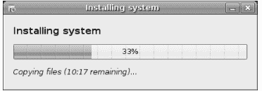

**图 2–20** 除了提供安装过程的图形化状态外，该窗口还试图提供完成时间的估算。

在进度条达到 100% 之前的一些时间，您将在进度窗口底部看到一条消息，通知您系统正在配置中，包括创建用户、配置硬件、网络、引导加载程序等。这些是从 Live DVD 创建您新的 Ubuntu Linux 系统的最后步骤。

安装完成后，最终对话框将出现。点击“重启计算机”以完成过程。系统关机，DVD 弹出。请务必取出 DVD，然后按 Enter 键重启系统。

## 记得分享

既然您已从随附的 DVD 安装了系统，请自由制作并烧录此磁盘的额外副本并与朋友分享。Ubuntu Linux 所采用的许可使这在法律上是完全合法的。

## 资源

### 互联网上的 Ubuntu Linux

```
http://www.ubuntu.com
```

# 第 3 章 深入了解桌面（桌面概述）

欢迎来到多用户、多任务、多一切的世界。Linux 被设计为同时运行多个用户和进程。这意味着您的系统能够执行许多任务，即使它看起来处于空闲状态。这就是为什么许多企业和组织使用 Linux 作为 Web 服务器、电子邮件服务器、文件服务器、打印服务器……等等，您明白了我的意思。

从个人用户的角度来看，这意味着您家庭（或办公室）中的所有用户都可以拥有真正属于他们自己的桌面环境。您的桌面可以配置和修改，以便您按照自己想要的方式工作，可以根据心情选择不同的背景、图标、颜色或主题。它还保护您的个人信息不被他人窥视，这意味着孩子们可以彻底改变他们的桌面并重新组织事物，当您登录时，您不会受到任何影响。

我会让您很快登录，但此刻，我想就您的新桌面说几句话。

## 认识您…… GNOME

Linux 极其灵活。Linux 使运行多种不同的桌面环境成为可能。这方面的好处是您可以决定如何工作。您的系统按照您想要的方式工作，而不是反过来。坏处也恰恰如此。让我们面对现实，被告知该怎么做往往更容易，即使这意味着一开始习惯一种您可能不太喜欢的工作方式——不一定更好，但更容易。

就此而言，在某个时候，当您习惯了运行 GNOME 桌面的 Linux 系统后，您可能想尝试 Linux 用户可用的其他图形桌面环境之一。您可能已经听说过 K 桌面环境（KDE）。在 KDE 和 GNOME 之间，您拥有了 Linux 世界中两个最受欢迎的桌面环境。还有一个名为 Kubuntu 的 Ubuntu 版本，默认使用 KDE 桌面；在第 20 章中，我将向您展示如何在您的 Ubuntu Linux 系统上添加 Kubuntu 桌面。这样的美妙之处在于，您可以随后在不同的桌面环境之间切换。您为什么想这样做？简单来说，您可能会发现自己完全被不同的做事方式所吸引。您的所有程序仍将像以前一样工作，但桌面的感觉——如果您更喜欢这样说的话，即体验——将完全属于您。目前，我们将坚持使用 GNOME。

> 注：我在我的其他书中详细介绍了 KDE 桌面，包括最新版《Moving to Linux: Kiss the Blue Screen of Death Goodbye!》。

## 关于 X 的几句话说

在我开始带您熟悉桌面后，我现在告诉您的内容将退隐到记忆的深处，但我仍认为您应该知道：GNOME，那个外观出色的桌面系统，是凌驾于您的 Linux 系统真正的图形引擎之上的友好界面。该引擎被称为 X 窗口系统，或简称为 X。GNOME，即您的桌面环境，提供窗口、边框、装饰、颜色、图标的控制等。

当您安装系统时，您经历了某种图形桌面配置步骤。那不是 GNOME，而是 X。

X 是桌面——以及您运行的每个图形程序——真正运行的基础。让我们登录并看看桌面的激动究竟是怎么回事。

### 登录

你的工作站会启动到一个图形登录界面，即*登录管理器*。在本例中，具体来说是*GNOME 显示管理器*，或称为 GDM（参见图 3-1）。屏幕中央附近有一个标有“Username”（用户名）的方框。输入该信息后，标签会变为“Password”（密码）。请记住，用户名和对应的密码都是区分大小写的，因此你必须按照创建时的样式准确输入。你总是可以在稍后的时间修改密码。（我将在本章稍后介绍相关内容。）

除了登录之外，此屏幕还允许你选择语言和会话类型。你可以通过点击屏幕左下角的“Options”（选项）按钮来执行此操作。默认情况下，会话类型为 GNOME。如果你以后确实安装了 KDE，可以点击“Session”（会话）按钮切换到其他桌面环境。在标准的 Ubuntu 安装中，你还具有登录到具有有限选项的安全模式桌面的选项。暂时，我们将跳过那一步，使用默认的 GNOME 桌面进行登录。

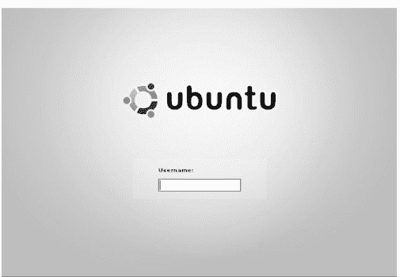

**图 3–1** Ubuntu 图形登录管理器。

输入你的用户名并按<Enter>键。登录管理器随后会要求你输入密码。Ubuntu 会让你登录到一个具有特定外观和感觉的默认桌面，你可以根据需要和口味进行更改，关于这一点我们将在下一章详细讨论。

### 与桌面融为一体

你的 Ubuntu Linux 屏幕有两个面板，一个位于屏幕顶部，另一个位于底部。每个面板都提供对不同功能的快速访问，我将分别介绍。让我们先从顶部面板开始（参见图 3-2）。

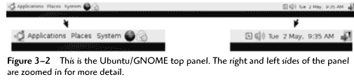

左上角的 **Applications**（应用程序）启动器类似于那个其他操作系统的“开始”按钮。点击此处会下拉一个菜单的菜单，即一组已安装应用程序的列表，你只需单击一次即可运行它们。紧接着还有另外两个菜单，一个标记为 **Places**（位置），另一个为 **System**（系统）。**Places** 涉及你的存储介质，包括磁盘、挂载的 CD、USB 存储密钥等。**System** 涵盖系统功能，如注销、关机、更改个人偏好设置以及管理你的 Ubuntu Linux 系统。最后，在 **System** 菜单的右侧，可能有一个或多个图标，提供对常用应用程序的直接访问。在标准的 Ubuntu 安装中，你会看到 **Firefox**（网页浏览器）和 **Evolution**（电子邮件客户端）的图标。

让我们移动到顶部面板的最右端，就在时钟之前。随着你运行越来越多的程序，你可能会注意到面板中嵌入了小图标，位于扬声器图标旁边。这些图标也代表程序，但是那些被大致隐藏起来的运行中的程序（这可以节省面板空间）。这些应用程序已被面板图标化（*吞噬*），并可通过单击调出。该迷你图标区域被称为*通知区域*。在图 3-3 中，你可以看到 Rhythmbox 音乐播放器、Gaim 即时通讯图标以及系统更新通知小工具。


图 3-3 左侧的三个图标位于顶部面板的通知区域中。

说到运行应用程序，让我们看看底部面板（参见图 3-4）。当你启动一个应用程序时，你会看到它列在底部面板的一部分中，这一部分被称为窗口列表（你可能知道它是任务栏）。这不仅显示你正在桌面上运行什么，还提供了一个在进程之间快速切换的方式。只需点击窗口列表中的程序。或者，你可以按<Alt+Tab> 在一个运行中的程序之间切换到另一个。窗口列表可以配置为列出所有桌面上的所有进程，将类似的进程分组，或者仅显示你当前工作区的内容。

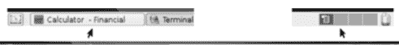

图 3-4 底部的 Ubuntu/GNOME 面板。再次说明，面板的左右两侧已放大以显示细节。


# 工作区

工作区，有时也称为虚拟桌面，是你绝对会喜欢的一项功能！在默认安装中，你会注意到底部面板右侧有四个小方块。这是你的桌面切换器，允许你通过鼠标单击在四个虚拟桌面中的任意一个之间切换。把它想象成拥有一个比你现有的显示器大四倍的电脑显示器，每个桌面运行不同的内容。你可以将每个桌面保持为你想要的样子，而不必最小化窗口，以便你可以稍后返回到虚拟桌面并看到你留下的所有东西。更好的一点是：如果你发现四个虚拟桌面不够用，你可以拥有四个、五个、六个甚至更多虚拟桌面（参见图 3-5）。

要更改工作区的数量，右键单击任意一个工作区方块，并从弹出菜单中选择“Preferences”（偏好设置）。将出现一个标记为“Workspace Switcher Preferences”（工作区切换器偏好设置）的窗口，其中列出了其他内容，包括工作区的数量。将该数字更改为你喜欢的任何数字。


图 3–5 具有六个虚拟桌面的桌面切换器。

最后，在最右侧还有一个小垃圾桶图标。你可以将文件和文件夹拖放到垃圾桶中，但你也可以点击垃圾桶查看其内容（即你删除的物品）。我们稍后会更进一步讨论垃圾桶。

## 你的第一个应用程序

现在是真正深入其中，掌握一些术语并开始使用系统的时候了。启动程序或打开应用程序就像点击图标一样简单。让我们这样做。事实上，让我们打开伟大的 **GNOME** 应用程序，*Nautilus*。

你会经常使用 Nautilus。这是 GNOME 文件管理器，它允许你处理文件和文件夹。Nautilus 使创建文件夹（在 Linux 世界中也称为目录）、复制、删除以及通过拖放来移动其他文件夹和文件变得轻而易举。Nautilus 还是一个通用的文件查看器，因此你可以浏览和组织你的照片集，预览文档，以及更多、更多的功能。

启动桌面版 Nautilus 有几种方法，但让我们先通过点击顶部面板中的“Places”（位置）并从中下拉菜单中选择“Home Folder”（主文件夹）开始。这会在你的主目录中打开 Nautilus 文件浏览器。打开的窗口看起来就像图 3–6，当然少了几个文件夹和文档。

在左侧，Nautilus 显示系统上重要位置的小列表，主要在你的主文件夹中。此侧面板是*导航面板*。按<F9> 键可以隐藏（或调出）导航面板。在“Places”标签旁边有一个箭头，提醒你这实际上是一个带有选项下拉列表的按钮。点击此处，你可以在位置列表、当前文件夹的信息、关于这些文件夹中信息的备注，以及易于导航的文件系统树状视图之间切换。

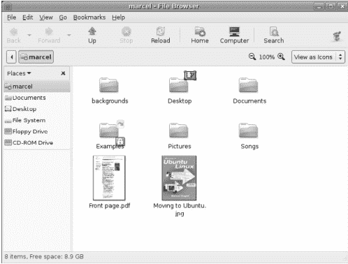

图 3–6 介绍 Nautilus，通用文件管理器，也称为文件浏览器。

在右侧，显示当前位置（或地点）的内容。如果这是一个目录（如你的主目录），各个目录会显示为文件夹图标。根据 Nautilus 的配置，你文件夹中的图像可能会显示为小缩略图。你想看全尺寸图像吗？只需点击缩略图，Nautilus 就会调用正确的应用程序来完成剩余工作。

> **快速提示** 我已经将图标调大，这使得缩略图图像易于查看。要更改图标大小，点击菜单栏上的“View”（视图），然后选择“Zoom In”（放大），直到图标达到你喜欢的尺寸。什么是菜单栏？继续往下读。

> **快速提示** 有滚轮鼠标吗？那么试试这个更改图标大小的小技巧。按住<Ctrl> 键并在 Nautilus 文件浏览器中的文件和文件夹上滚动。图标会根据你的滚动方向增加或减小尺寸。

Nautilus 灵活、强大，绝对值得你花时间去了解。事实上，它很可能成为你使用最多的桌面应用程序。在下一章，我将给予 Nautilus 文件浏览器它应有的关注和介绍。此刻，请让 Nautilus 保持在原地，继续阅读，因为我们来讨论窗口——我指的不是操作系统。

## 窗口、标题栏和菜单，天哪！

每个在你桌面上运行的图形程序都具有一些共同特征。看看你的 Nautilus 文件浏览器窗口的顶部，你会看到类似图 3-7 的内容。

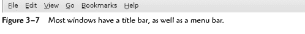

**图 3–7** 大多数窗口都有标题栏，以及菜单栏。

### 标题栏

运行中程序的顶部栏被称为*标题栏*。根据应用程序的不同，它可能显示程序名称、你正在处理的文档、Web 上的位置，或解释你正在运行什么的简洁描述。左键点击标题栏并用鼠标拖动它，可以将程序窗口在桌面上移动。

> **快速提示** 大多数现代桌面假设监视器运行在至少 1024×768 的分辨率下，许多应用程序将视此为普遍真理。当你的监视器小于此分辨率（例如，800×600）时，这会带来麻烦，因为你需要的点击按钮可能在屏幕外。点击标题栏并拖动窗口只能走这么远，尤其是当标题栏在屏幕外时。

## 桌面窗口管理

别灰心。按住 *<Alt>* 键并左键点击窗口，你可以将其拖动到任何你想要的位置，甚至超出桌面的边界。如果你需要点击一个被遮挡的“确定”按钮时，这一功能尤其实用。

双击标题栏可以最大化程序窗口——应用程序会突然占据整个屏幕。再次双击标题栏，窗口就会恢复为原始大小。

标题栏上还有许多小图标。将鼠标光标悬停在它们上方，工具提示会告诉你它们的功能。从标题栏的左角开始，有一个小图标，工具提示将其标识为 *窗口菜单*。在此处点击会弹出一个小型下拉菜单，允许你（除其他功能外）将程序移动到另一个工作区，以及最小化或最大化应用程序。

下拉菜单中的另一个项目标记为 *置顶*。选择此项会使窗口变浅，使其始终悬浮在其他窗口之上，无论你当前选择的是哪个窗口。好吧，它其实并没有真正“悬浮”，但它会始终显示在任何其他窗口之上，即使你点击了那个窗口也是如此。

另一个我想让你注意到的项目与整个工作区的概念有关，即标记为 *始终在可见工作区* 的条目。理解这一点的最佳方式是实际试一试。点击你另外三个工作区中的任意一个。如果你还没有兴奋地在每个工作区打开数十个其他程序，你应该会看到一个整洁干净的桌面。现在，回到你的第一个工作区。点击窗口菜单并选择 *始终在可见工作区*。现在，跳转到工作区 2。Nautilus 在那里。点击工作区 3，它也在哪里。事实上，如果你定义了 10 个工作区，Nautilus 会在所有工作区等着你。

这里有一个很酷的信息。你仍然只运行了 *一个* Nautilus 实例。只是它在你每个工作区都可用。最后，假设你在工作区 1 上时让 Nautilus 在所有工作区可见，现在你处于工作区 3。点击窗口菜单并选择 *仅在此工作区*。工作区 3 现在是 Nautilus 的新家，它不再在其他工作区可用，包括它最初所在的工作区 1。

我提到的所有这些事情——最大化、最小化以及让应用程序在所有桌面上可见——都可以通过任何正在运行的应用程序的窗口列表图标来实现。右键点击窗口列表图标，并从弹出菜单中选择你需要的选项（参见图 3-8）。

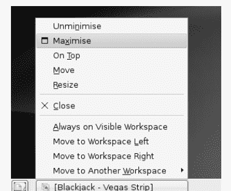

在我们继续讨论其他内容之前，我们需要看看 **标题栏** 右侧的按钮。使用最左边的图标，那个带下划线（或者如果你愿意，可以说是一条小直线）的图标，来最小化一个窗口（记得你可以按住鼠标按钮将光标悬停在顶部以获取工具提示）。中间带方框的图标用于最大化窗口，使其占据桌面上除面板占用空间之外的所有空间。最后，X 图标的作用大致如你所料：它关闭正在运行的应用程序。

### 转向菜单栏

在 *标题栏* 正下方是 *菜单栏*。菜单栏通常有一组标签（例如“文件”、“编辑”、“查看”等），将你可以执行的各种任务按某种合理的顺序进行分组。

每个程序都有一组不同的菜单选项，具体取决于应用程序的性质。点击菜单标签会弹出一个该功能选项列表（参见图 3-9）。

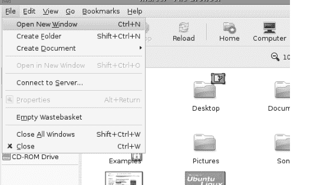

**图 3-9** “文件”下拉菜单。

### 还有回收站吗？

是的，我说过我会进一步讨论回收站。我想让你先体验一下我在下一章将要涵盖的内容。如果你还没有这样做，请关闭 Nautilus。现在，看向底部面板右下角的回收站图标并点击它，只需点击一次。

会出现一个标记为“Trash - File Browser”的 Nautilus 窗口。这是因为回收站只是你系统上的另一个文件夹，Nautilus 可以像浏览你的主文件夹一样轻松地浏览它。我们将在第 4 章中看到更多关于 Nautilus 的内容。

### 调整窗口大小

你应该知道的最后一点是（在大多数情况下），你不必局限于默认窗口大小。通过抓住应用程序窗口的任意角落，你可以拖动该角落并将窗口拉伸到对你来说更舒适的尺寸。这对程序窗口的顶部、底部和两侧也适用。

当你将光标定位在角落或边缘时，你会看到它变成双向箭头。只需将边缘或角落拖动到你想要的位置，你就完成了。

## 命令中心


当然，指点点击是我们大多数人运行应用程序的方式。这很简单，但有时，如果你知道命令，直接输入该命令并告诉程序运行会比通过所有这些菜单更快捷。更好的是，它可以让你对应用程序如何运行有更大的灵活性，但我有点说岔了。在你的旧系统上，你会点击“开始”按钮，选择“运行”，并输入一些内容，通常是 `setup`，因为那正是你倾向于使用“运行”选项的时候。在你的 Ubuntu Linux 系统上，你只需按住 `<Alt>` 键并按 `<F2>` (`<Alt+F2>`) 即可做同样的事情。会出现一个漂亮的对话框，要求你输入想要运行的程序名称。

从菜单中点击某项只是运行同一命令的另一种方式。这就是为什么，在我们一起阅读本书的过程中，我打算尽可能告诉你命令名称。（如果你真的不感兴趣，可以直接跳过它。）你想知道那些程序叫什么名字吗？好吧，正如不止一种方式去，呃，嗯，给 proverbial 猫喂食一样（这是一本友好的书，朋友们），找出正在运行的命令名称也有不止一种方法。如果你好奇想要了解关于运行进程的所有知识，请查看高级命令行章节，第 21 章。此刻，我会告诉你一种图形化的方法。

> *提示* 如果你好奇，Nautilus 的程序名称是 `nautilus`。

在顶部面板上，点击“系统”、“首选项”，最后是“会话”。会出现一个有三个标签页的“会话”窗口。点击中间的标签页，标记为“当前会话”的那个，你会看到当前图形会话中正在运行的程序列表。这不是系统上所有正在运行的程序的列表，只是与你的 GNOME 会话相关的程序。向下滚动到列表中的最后一个命令（这将因系统而异）。完成此操作后，点击“应用程序”菜单，导航到“附件”，并启动计算器程序。现在，回到你的“会话”窗口和正在运行的程序列表。（你可能需要再次向下滚动。）一个名为 `gcalctool` 的新程序应该会出现在列表底部（参见图 3-10）。这就是计算器程序的名称。

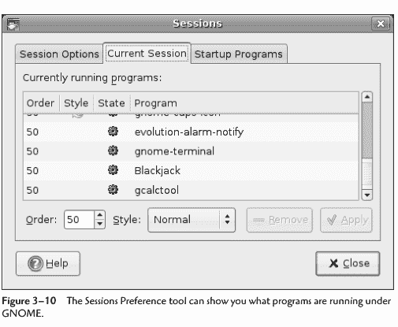

“会话”首选项工具并不是设计用来作为进程列表工具的。事实上，它旨在控制会话期间正在运行的程序，这些程序是否应在登录时自动启动，以及这些程序在会话开始时应有的状态。尽管如此，它仍然是一种快速且有趣的方式，用于查看程序的来去并按名称识别它们。

总结一下，当你知道程序名称时（例如计算器），按 `<Alt+F2>`，在对话框中输入 `gcalctool`，然后按 `<Enter>`，这与通过菜单进行操作是等效的。查看图 3-11 了解示例。

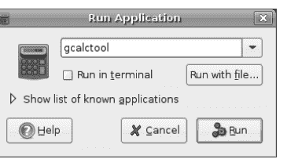

图 3–11 使用 `<Alt+F2>` 运行命令。

## 命令行礼貌入门

是时候介绍一位新朋友了。好吧，这位朋友实际上是一个应用程序，你可以在“应用程序”菜单下的“附件”中找到它。表面上看，这位朋友（好吧，*程序*）可能不像你遇到过的其他程序那样友好，但一旦你熟悉了 `终端` 程序，你会对它赋予你的强大功能和精细控制印象深刻。这是你的命令提示符。在 Windows 世界中，你可能会将其视为 DOS 提示符。

`终端` 应用程序是你访问 Linux 命令行的入口，称为 `shell`。有许多类型的 shell，每个的工作方式相似（例如，都允许你运行命令），但每个可能具有不同的功能。Linux 的默认 shell 称为 `bash`，即 `GNU Bourne-Again SHell`。

`shell` 功能强大，了解其功能将使你成为 Linux 世界的专家。与 shell 合二为一，没有什么能阻止你。`shell` 是 Linux 系统专家和系统管理员的领域。在大多数情况下，通过留在 X 窗口系统和你的 Ubuntu GNOME 桌面上工作，你可以完成几乎你需要做的任何事情。这里还有一个好处。尽管图形界面使事情变得友好且易于使用，但有时从 `shell` 工作会快得多。尽管你可以从图形桌面完成几乎你需要做的所有事情，但我偶尔会要求你从 `shell` 提示符执行某些操作。

随着时间的推移，你也会感受到 Linux shell 的强大功能。

## 给我更多！

对于那些阅读完本书各章节后，渴望深入了解 `Shell`（Shell 脚本环境）的读者，请查看附录 A。

下面是一个礼貌性的介绍。点击“终端”菜单项，会出现一个内容较为空白的窗口。窗口顶部是一个菜单栏，其中的一些快速访问项是根据其对终端会话的影响进行排列的。在菜单栏下方，即窗口较大的部分，你会看到一个闪烁的光标停在一个美元符号提示符旁边。这就是 Shell 提示符。每当你在 Shell 提示符处时，系统都在等待你输入命令。还记得之前提到的计算器示例吗？你完全可以在此处输入 `gcalctool` 并轻松启动它。现在，请在 Shell 提示符处输入 `date`，然后按 `<Enter>` 键（参见图 3-12）。

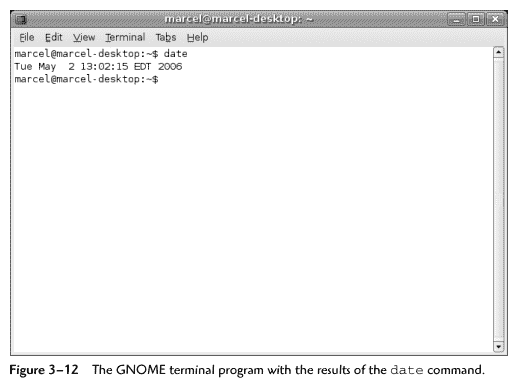

现在你知道我写这段文字时的日期和时间了。当你尝试时，你会看到当前的日期和时间。这就是 `date` 命令的作用：显示日期和时间的命令。你还会发现自己又回到了 Shell 提示符处，系统正耐心地等待你的下一条命令。输入 `exit` 并按 `<Enter>` 键。

终端程序随之消失。就这样结束了。在本书的后续部分中，我们会再次使用 Shell，但就现在而言，你对 Shell 的礼貌性介绍到此为止。


### 趣闻小贴士

请注意，不要错误地将 `date` 输入为 `ddate`。那样做会导致你获得 Discordian 日期，这是“低智教会”（Church of the Subgenius）使用的一种编号系统。例如：

```
$ ddate

今天是 Sweektmorn，是 YOLD 3172 年混沌的第 46 天
```

## 更改密码；这是关于你！

定期更改密码是良好的安全策略。沿着顶部面板查看，点击 `系统`、`首选项`。在最顶端，你应该能看到一个标有 `关于我`（About Me）的条目。随后会出现一个个人信息窗口，你可以在其中更改或填写大量个人信息（参见图 3-13）。你还可以通过使用 `<Alt+F2>` 运行序列并输入命令 `gnome-about-me`，像上面计算器示例中那样运行该命令。

你可能会问，为什么 Ubuntu 提供了关于你所有细节的空间。你不必在此填写任何信息，但许多应用程序会查看这里。例如，在第 11 章中，我会详细介绍 `Evolution` 邮件软件包及其联系人管理功能。在你的 Evolution 通讯录中，会有一个为你创建的条目，你可以将其作为虚拟名片发送。然而，此练习的真正目的是更改你的密码。点击右上角的 `更改密码` 按钮。这样做会弹出图 3-14 所示的 `更改密码` 对话框。

请注意，与登录管理器一样，你的密码是不可见的。相反，你按下的每个键都会显示为一个星号。当你成功输入密码后，系统会要求你输入新密码。然后，再次要求你输入密码以确认。就这样。务必记住你的新密码。下次登录时你需要用到它。

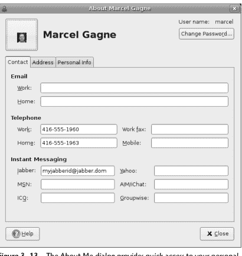

图 3–13 “关于我”对话框可快速访问你的个人信息。它碰巧也是一种更改密码的方式。

### 在 Shell 中操作

你也可以轻松地通过命令行更改密码。只需打开一个 Shell 提示符并输入以下命令：

```
[marcel@mySystem marcel]$ passwd
Changing password for user marcel.
Changing password for marcel
(current) UNIX password:
New UNIX password:
Retype new UNIX password:
passwd: all authentication tokens updated successfully.
```

尽管步骤基本上相同，但实际更改密码对话框的具体措辞可能因系统而异。

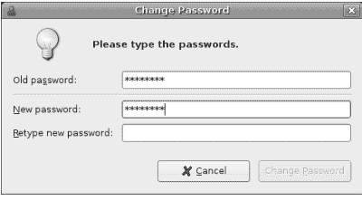

图 3–14 要更改密码，你必须输入两次新密码。

说到密码 . . .

## 用户安全

正如我在本书前面提到的，Linux 是一个多用户操作系统，这意味着一个或多个用户可以同时在其上工作。这也意味着每个使用你系统的人都是独立的个体，拥有各自的主目录、文件、菜单和桌面装饰。通过为家庭或办公室的每位成员创建登录账户，你不仅保护了属于每位用户的文件，也保护了你自己。如果小 Natika 删除了她所有的图标，或者将桌面背景改为刺眼的绿色和紫色，这不会影响你。同样，这也是为孩子们创建一个玩耍世界的好机会。

每个用户都由用户名引用。每个用户名都关联着一个用户 ID（`UID`）和一个或多个组。与用户名类似，组名也由数字标识符表示，这次称为组 ID（`GID`）。用户的 `UID` 是唯一的，组的 `GID` 也是唯一的。


添加用户需要以 root 身份操作，因此当你启动 GNOME 用户管理工具（命令名为 `users-admin`）时，系统会要求你输入密码。程序启动后，会出现如图 3-15 所示的窗口。窗口中有两个选项卡，一个是“用户”，另一个是“组”。

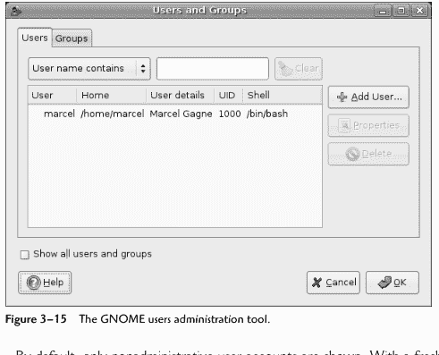

默认情况下，仅显示非管理员用户账户。对于刚安装好的 Ubuntu 系统，通常这意味着只有一个用户，即你在安装时设置的那个用户。要查看系统上的所有用户，请点击左下角的“显示所有用户和组”复选框。要添加用户，请点击右侧的“添加用户”按钮。随后会弹出一个新窗口，即“用户账户编辑器”（参见图 3–16）。

此页面上的大部分信息都是可选的。实际上，你只需要输入用户名和密码。其他字段用于进一步识别你正在为其创建登录账户的人员。例如，你可以选择输入其全名、办公室位置、电话号码等。

此过程中最关键的部分涉及输入密码信息。默认情况下，你有机会手动设置密码。该区域的单选按钮应已被选中。选择一个密码并将其输入到“用户密码”字段中。你必须输入两次，第二次输入到“确认”字段中。请注意，当你输入密码时，你实际上看不到它，而是通过星号来反映你的按键。你也可以通过选择最后一个单选按钮，然后点击“生成”按钮，让程序生成一个随机密码。完成后，点击“确定”。

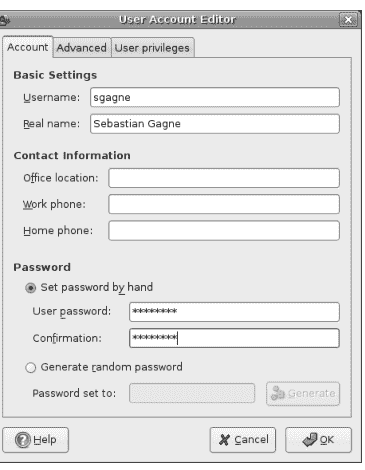

图 3–16 设置用户属性。

这将带你返回到“用户和组”屏幕，在那里你只需点击“确定”即可完成。当然，你还可以添加更多用户。

## 关于 sudo 的众多说法

当你启动一个需要管理权限的图形命令时，会弹出一个对话框要求你输入密码。这个对话框实际上是一个名为 `gksudo` 的命令。反过来，`gksudo` 是一个名为 `sudo` 的 Shell 命令的封装器。

对于可能使用过其他 Linux（或 UNIX）系统的读者来说，你们可能曾经访问过一个名为 root 的账户。这是拥有系统最高权限的超级用户账户。Ubuntu 锁定了 root 账户，不允许直接登录。为了以 root 权限执行命令，Ubuntu 使用了 `sudo` 命令。

当你使用 `sudo`（或 `gksudo`）运行程序时，系统会要求你输入密码以确认访问权限。输入密码后，你的账户在接下来的 15 分钟内可以执行额外的 root 级别命令，而无需重新输入密码。话虽如此，你仍需在命令前加上 `sudo` 或 `gksudo`。

要在 GNOME 终端会话或命令 Shell 中运行命令，请在命令前加上 `sudo`。

```
sudo command_name
```

有时，你可能需要以 root 权限运行多个命令。在这种情况下，在每个命令前都加上 `sudo` 可能会让人感到有些厌烦。为了解决这个问题，你可以通过输入以下内容进入一个具有管理权限的会话。

```
sudo -i
```

完成管理会话后，输入 `exit`。

在第 21 章中，我将对命令 Shell 进行详细导览。在那里，你将有机会看到 `sudo` 的实际应用。


> *注意* 在运行需要管理权限的图形应用程序时，始终使用 `gksudo`。

## 我需要更多帮助！

在本书的简介中，我列出了一些你可能会寻找帮助的地方，有些是在线资源，有些是社区资源。事实证明，你的桌面上有一个非常方便且相当令人印象深刻的帮助集合，触手可及。

GNOME 文档浏览器，或者如果你更喜欢的话叫“帮助中心”（命令名为 `help`），这大概是你们已经猜到的一点。

查看你的顶部面板，点击系统菜单，在那里你可以找到一个帮助子菜单。文档浏览器被称为系统文档。若要启动该程序，请单击其图标。当文档浏览器打开时，你会看到类似于图 3-17 的界面。

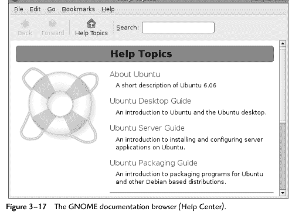

文档浏览器非常像一个 Web 浏览器，它提供左右箭头键用于导航，并且有一个可快速返回起点的帮助主题按钮。文档浏览器为基本独立应用程序提供在线帮助、命令参考（手册页）以及一些教程。只需单击链接即可跳转至高亮显示的章节，或者点击前进和后退箭头来浏览文档。

## 注销

我本章开始让大家登录你的 Ubuntu 系统，同样，本章结尾让大家注销也很合适。请看顶部面板的右侧角落。你应该看到一个像一扇敞开的门且带有向外箭头的图标。当你完成工作并准备注销时，单击该门图标，注销对话框会出现，提供几种选择（参见图 3-18）。

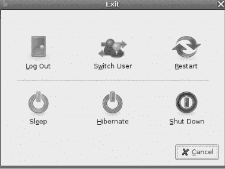

图 3–18 注销对话框提供了许多用于注销或关闭系统的选项。

第一个也是最明显的选项是注销，这会将你的系统返回到本章开头讨论的登录屏幕。你已经回到了起点。

切换用户可能是这里最有意思的选项。此选项让你回到登录屏幕，以便另一个用户可以登录并开始使用系统，同时保留你当前会话的活动状态。要切换回第一个登录的用户，请按下 <Ctrl+Alt+F7>。要切换到第二个用户，请按下 <Ctrl+Alt+F8>，以此类推。为什么要使用此功能？因为它允许你快速从一个用户的桌面切换到另一个用户，而无需经过注销和重新登录的所有步骤。在成员众多的家庭中，这可以真正节省时间。

最后四个选项都是关机主题的变化版本。问题只在于你关机要关到什么程度以及持续多久。首先，你可以重启（或重新启动）你的系统。你也可以将系统置于睡眠或休眠模式。这两者的区别在于，在休眠模式下，你的系统实际上会断电，但你的会话会保存起来，直到你再次给系统通电。如果你当时正在编写文档，重启系统后你会回到文档编辑的中断处。睡眠是一种低功耗模式，你只需按下任意键即可让系统恢复运行。


> *注意* 并非所有计算机硬件都支持睡眠或休眠模式。

最后，关机选项是关闭所有进程，然后断电（如果硬件支持）。系统保持关闭状态，直到你再次通电。与休眠不同，你会回到主登录屏幕。

## 导航你的 Ubuntu 桌面

现在你和你的系统已经正式见面了，是时候去探索一番了。在下一章中，你将学习如何运用 Nautilus 来导航、操作并解开 Ubuntu Linux 系统的奥秘。

## 资源

Ubuntu 文档存储库

`http://doc.gwos.org`

Ubuntu 官方文档网站

`http://help.ubuntu.com`

# 第 4 章

# 导航 Nautilus

计算机中没有任何东西比数据更重要。除了玩游戏（即使在那里也是如此），计算机的核心在于存储和处理信息。这就是为什么能够良好地处理这些数据——移动、复制、重命名和删除它们——对于在 Linux 世界中游刃有余至关重要。

这意味着是时候重温你的新朋友——也是旧朋友——Nautilus，GNOME 文件浏览器了。

Linux 界有一句俗话说：“一切都是文件”（这是归于 UNIX 开发者 Ken Thompson 的一句评论）。这包括目录。目录只是包含大量文件的文件。所有这些文件和目录被组织到一个层次化的文件系统中，从根目录开始分支出去。

> **注意** 文件夹和目录是同一事物。这两个术语可以互换使用。我倾向于称它们为目录，但如果你更习惯称它们为文件夹，也不要担心。根据应用程序的不同，你会看到两个术语的使用。

根目录（称为斜杠，或 `/`）名副其实。如果你将文件系统想象成一棵树的根系在表面下延伸，你开始能理解事物的样子了。在根目录下，你会找到名为 `usr`、`bin`、`etc`、`tmp` 等文件夹。让我们打开 Nautilus 看看这个结构。

点击顶部面板上的位置并选择主文件夹。这会打开你主文件夹中的文件浏览器。如果导航面板未显示（Nautilus 左侧面板），请按 <F9> 打开它。你会看到许多条目，包括你的主目录。在左侧，Nautilus 显示了你系统上重要位置的小列表，主要在你的主文件夹中。这个侧面板是导航面板。按 <F9> 会隐藏（或显示）导航面板。在位置标签旁边有一个箭头，提示你实际上这是一个带有下拉选项列表的按钮。现在点击该按钮，为视图选择树形结构。很可能，你会看到两个条目：一个是主文件夹，另一个是文件系统。在每个条目的左侧都有一个小的箭头。点击文件系统旁边的箭头（或双击该文件夹），以获得你的 Ubuntu Linux 系统的自上而下的视图（参见图 4-1）。

在右侧，显示当前位置（或位置）的内容。如果这是一个目录（如你的主目录），各个目录将显示为文件夹图标。这些都是系统目录，它们将包含使你的 Linux 系统运行的所有程序，包括文档、设备和设备驱动程序。在大多数情况下，你不会去触碰文件系统下的文件。意外更改系统这一部分的内容可能不是好主意（它可能导致系统无法运行），这就是为什么每个人都用自己的账户登录。

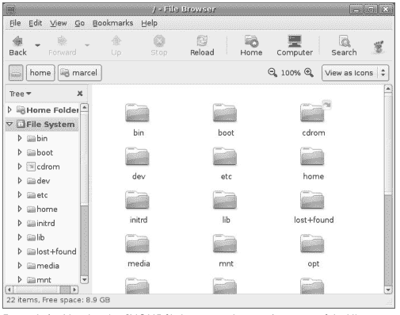


图 4–1 GNOME 文件浏览器 Nautilus，显示了 Ubuntu Linux 文件系统的自上而下视图。此视图是从左侧的导航面板中选择的。

> 提示 当你在 Nautilus 中查看文件和文件夹时，它们按字母顺序排列。通常这正是你想要的，但你也可以按大小、修改日期、文件类型等进行排序。只需点击 Nautilus 菜单栏上的**查看**，然后查看**排列项目**子菜单。你甚至可以手动排列它们。

根目录下的一个目录名为 **home**，在该目录内，你会发现其他目录，每个登录名称对应一个。这些是各自的主目录，也是你找到个人文件和目录的地方。如果你想存储个人文档、音乐文件或图片，这里就是地方。一旦进入 Nautilus，你可以通过点击 **Home** 图标，或者点击菜单栏上的 **Go** 并选择 **Home** 来跳转到你的主目录（键盘高手可以直接按 `<Alt+Home>`）。这就是你的 `$HOME`。

## 快速提示

我使用 `$HOME` 并不只是为了好玩。系统可以根据环境变量识别某些内容，环境变量是可以指代文本、数字甚至命令的符号名称。在 DOS/Windows 世界中，你有类似的变量——例如，**AUTOEXEC.BAT** 文件中的 **PATH**。`$HOME` 是分配给每个登录者的环境变量。它代表一个人的主目录。如果你想查看分配给你的会话的所有环境变量，请退出 shell 并键入以下命令：

```
env
```

试一下。在 **Tree** 视图的左侧，点击 **home** 目录旁的小箭头。如前所述，**Tree** 视图会展开显示你个人目录中的文件夹。请注意，指向右的箭头现在变成了指向下的箭头。如果你再次点击它，目录视图会折叠。在 **home** 目录展开的情况下，点击你的个人目录。你应该看到右侧视图中出现了一些项目，包括一个标记为 **Desktop** 的图标。示例见图 4-2。在左侧，**home** 文件夹已展开，而右侧视图显示该文件夹已折叠。在你做任何其他事情之前，我希望你重新在主 **home** 文件夹中打开 Nautilus（点击 **Places** 并选择 **Home Folder**）。那里有一个非常特殊的文件夹叫 **Desktop**。现在，看向你的底部面板，在屏幕的最左侧。你看到那里的 **Desktop** 图标了吗？它看起来像一张老式的桌面垫，上面有一支铅笔和一张纸。将鼠标光标悬停在上面，工具提示会显示 **Click Here to Hide All Windows and Show the Desktop**（点击这里隐藏所有窗口并显示桌面）。点击它，你的桌面会出现，没有窗口。再次点击，一切恢复正常。现在，我要稍微向前跳跃，让你在自己的桌面上创建一个文件夹。在该空白桌面上右键单击任何位置，会弹出一个菜单。该菜单的顶部条目是 **Create Folder**（创建文件夹）。点击它，桌面上会出现一个文件夹，下面标有 **Untitled Folder**（未命名文件夹）（参见图 4-3）。键入一个名称并按 `<Enter>`。

### 主目录展开

### 主目录折叠

图 4–2 在 Nautilus 的树状视图中展开和折叠文件夹。

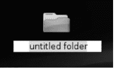

图 4–3 要在桌面上创建文件夹，请右键单击并选择“新建文件夹”。然后，更改未命名文件夹的名称。

我之所以让你这样做，是因为我希望你稍后在桌面上创建图标时能记住这一点。你在操作 Ubuntu 系统时看到的桌面，实际上就是主目录中的那个“桌面”文件夹。如果你在桌面上创建一个文件夹，然后使用 Nautilus 查看你的主目录，并双击“桌面”文件夹，你就会看到刚刚创建的文件夹位于该“桌面”文件夹中。对于图像文件、歌曲或视频片段也是同样的道理。如果它在桌面上，它就在桌面文件夹中。甚至那些桌面图标也是文件或目录。很酷吧？让我们继续。

> **进入 Shell** 通过从顶部面板的*应用程序*菜单中的*附件*子菜单选择**终端**来打开终端 shell。在 shell 提示符处，输入**ls Desktop**。`ls` 命令会列出桌面目录的内容。将你所看到的内容与当前图形化桌面上的图标进行比较。这些名字看起来很熟悉吗？完成后，输入**exit** 以关闭终端。

目录（和子目录）通常显示为文件夹，但这并不是一个硬性规定，因为你可以自定义它们。然而，一些目录从一开始就有不同的图标——你刚刚访问过的桌面图标就是其中之一。

## 无论你去哪里 . . .

要在文件夹之间移动，你只需在树状视图中单击一个文件夹，或在右侧窗格或位置视图中双击一个文件夹图标。你还可以使用*光标键*在目录树中移动。你会看到高亮条从一个目录移动到另一个目录。要在主窗口中查看内容，请移动到一个文件夹并按 `<Enter>`。要在目录树中向上移动一级（而不是逐个文件夹移动），请按 `<Alt+向上箭头>`。

还有另一种方法。如果你向上看菜单栏，你会看到一个向上箭头、一个向左的箭头和一个向右的箭头（见图 4.4）。旁边是一个用于停止列表（如果耗时较长）、重新加载文件夹位置，以及最后是一个标记为“主目录”的图标。单击该房子图标总是将你带回你的个人主目录。单击向上箭头会在目录树中向上移动，而向左箭头则带你回到你上次访问的目录。

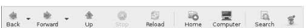

**图 4-4** Nautilus 文件浏览器的主要导航工具栏。

> **提示**

> 当你使用 Nautilus 查看主文件夹时，实际存在的文件和文件夹比你看到的要多。所谓的隐藏文件（那些以点开头的文件）在默认视图中不会显示。《星际迷航》的粉丝可以把它想象成文件的隐形斗篷。要查看所有文件，包括隐藏文件，请从菜单栏中单击*查看*，然后选择*显示隐藏文件*。键盘高手只需按 `<Ctrl+H>` 即可在视图之间切换。

有时，导航文件系统的快速方法（假设你知道想要进入的文件夹）就是直接在位置栏中键入路径。看着 Nautilus，你可能会想知道这个位置栏在哪里。在菜单栏中单击*前往*，然后选择*位置*（或按 `<Ctrl+L>`）。一个标记为“前往”的空白字段出现在导航工具栏下方（见图 4-5）。在这里，你可以输入任何你想要的内容——例如，`/home/marcel/Songs/Rock`。按 `<Enter>` 后，位置栏消失。

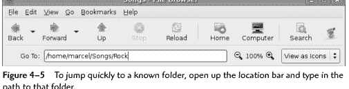

**图 4-5** 要快速跳转到已知文件夹，请打开位置栏并输入该文件夹的路径。

## 搜索我 . . .

你的 Ubuntu Linux 系统主文件夹中可能没有很多文件，但这不会持续太久；我保证。有一句老话建议，“数据将填满所有可用的磁盘空间。”据我的经验，这是事实。随着时间的推移，你那块大容量硬盘似乎永远不够大。

这意味着，在某个时刻，你会在查找自己创建的文件时遇到一些困难。幸好 Nautilus 内置了快速查找功能。我在 Linux 系统上存了很多音乐（见第 17 章）。我喜欢在工作时听它们。让我们假设我想找出我的 Pink Floyd 歌曲存储在哪个文件夹中。只需按 `<Ctrl+F>`，会出现一个搜索框。输入你要查找的文件名的一部分（例如，**Pink Floyd**），然后按 `<Enter>`。Nautilus 在主窗口中显示结果（见图 4–6）。

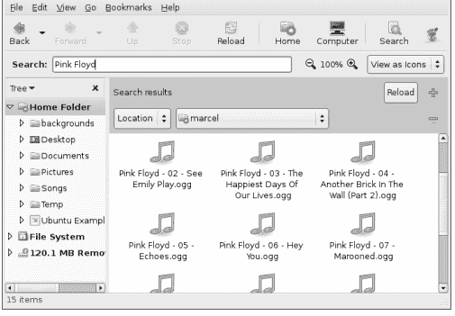

**图 4–6** 在寻找什么吗？只需按 `<Ctrl+F>` 并输入文件名的一部分，让 Nautilus 来完成任务。

## 导航侧边栏

我们应该花几分钟时间看看左侧面板——或者像我习惯称呼的那样，导航面板。你已经看到了如何使用它在文件系统的位置视图和树状视图之间切换。但等等（就像电视里常说的那样），还有更多。正如你记得的，有一个下拉列表允许你改变查看系统的方式。我刚才让你从位置视图切换到树状视图，这影响了你导航文件系统的方式。然而，那个列表中还有其他有趣的选项，我现在想看看它们（见图 4-7）。

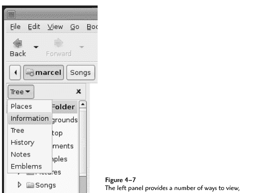

由于我们已经涵盖了位置和树状视图，我将继续介绍信息。当你单击这里时，侧边窗口显示当前文件夹的信息。这包括文件夹的名称、其图标（你可以更改每个文件夹的默认图标，这将在后面介绍）、该文件夹中的项目数量以及最后修改日期（添加或移除文件的时间）。

下一个可能的选项是历史记录。单击这里会显示你最近访问过的文件夹（按访问顺序排列）、网络文件夹、FTP 站点以及你可能执行的任何搜索。最后一项特别酷，因为如果需要，你可以通过在历史记录列表中双击来重新访问特定的搜索。对于文件夹也是同样的道理。双击，你就到了那里。

> **提示**

> 如果你想要能够快速返回特定的文件夹或站点，你可以通过单击菜单栏上的书签并选择添加书签来收藏该位置（你也可以按 `<Ctrl+D>`）。要返回书签，再次单击书签并选择它。


现在，我们来到笔记。对于每个文件夹，你都可以添加关于内容的笔记。这是自由格式的文本，有助于你识别内容或提醒你那里有什么特别之处。例如，假设你有一个名为 `Holiday Shots` 的文件夹，而那个文件夹里保存着你在公司圣诞派对上拍的那些非常尴尬的照片。几个月后，你可能想添加一条注释作为提醒。当你这样做时，一个小笔记似乎被钉在你的文件夹上（见图 4–8）。

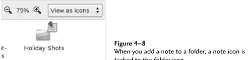

这个添加在文件夹上的小装饰非常自然地引出了我们侧边栏列表中的最后一个选项，即徽章。单击这里，侧边栏会填满一个图形图标列表（见图 4–9）。这些图标旨在为你提供一种快速识别特定文件或文件夹重要性或相关性的方式。

你只需单击其中一个图标并将其拖到文件或文件夹上。有大量带有名称如艺术、认证、酷、最爱、重要、天哪！等的徽章。如果你发现自己添加了太多徽章（既然你正在这样做！），将擦除图标（位于列表顶部）拖到你的文件或文件夹上。你在那里添加的徽章就会消失。

## 浏览网络

当我向你介绍历史记录和书签时，我随口提了一句，你可以使用 `Nautilus` 访问 FTP 站点和其他网络位置，包括 Windows 共享、WebDAV 服务器等。要建立网络连接，请点击 `Nautilus` 菜单栏中的 `文件`，然后选择 `连接服务器`。会弹出一个连接对话框，你可以从中建立连接（见图 4-10）。

在 `服务类型` 标签旁边，有一个下拉框，你可以从中选择服务器类型。你的选项包括 SSH、公共 FTP、FTP（需登录）、Windows 共享、WebDAV、安全 WebDAV 以及自定义位置。以本例为例，我们选择带有匿名登录的公共 FTP 服务器。在 `服务器` 字段中，输入你要连接的服务器名称（例如，`ftp.ubuntu1inux.org`）。其实你只需要做这些就够了。点击 `连接`，`Nautilus` 就会打开该网络文件夹（见图 4-11）。该远程文件夹的浏览方式与在你自己的系统上完全相同。

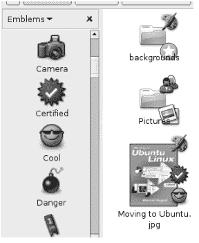

**图 4-9** 徽章提供了一种快速且视觉上有趣的方式来识别文件或文件夹。

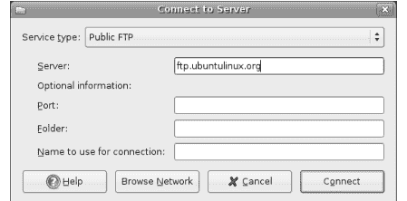

**图 4–10** `Nautilus` 并不局限于导航本地文件系统。连接 FTP 站点、Windows 共享、WebDAV 服务器等同样简单。

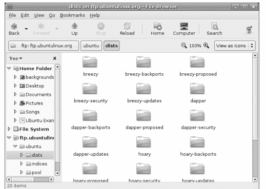

**图 4–11** 连接到远程服务器后，导航其内容的难度与导航任何本地连接的文件夹一样简单。

另一种方法是在菜单栏上点击“前往”，然后选择“位置”（或按 `<Ctrl+L>`）。之前我稍微提过这个方法用于本地文件夹，但它在这里也适用。要访问相同的 FTP 站点，你可以在位置字段中输入以下 URI（通用资源标识符）。

```
ftp://anonymous@ftp.ubuntuux.org/
```

了解这些连接格式的最佳方法是连接到一个网络资源，然后按 `<Ctrl+L>`。当前的 URI 将会显示出来。

访问网络资源的另一种方法是从“位置”菜单中选择“网络服务器”。如果你的网络中连接了 Windows 机器，这特别有用。会出现一个 `Nautilus` 窗口，其中包含一个 Windows 网络图标。双击该图标，你网络上的 Windows 域和工作组就会显示出来（见图 4-12）。双击任何工作组图标，你就可以浏览该工作组中的单台机器。

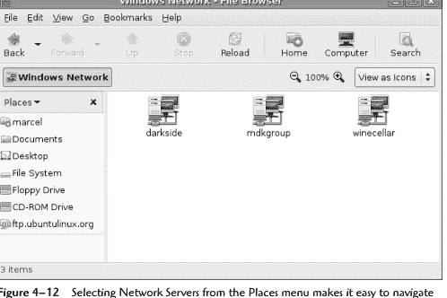

**图 4–12** 从“位置”菜单中选择“网络服务器”，可以轻松浏览网络上的 Windows 共享。

要直接访问 Windows 共享浏览器，请在任何 `Nautilus` 窗口中按 `<Ctrl+L>`，然后在位置字段中输入 `smb:///`。

### 噢，收到，拷贝（等等……）

你可以使用 `Nautilus` 创建、复制、移动、重命名和删除文件及目录，但在执行任何这些操作之前，你需要先选择一个文件或目录。选择文件是你经常要做的事情，所以让我们从这一点开始。将鼠标光标放在你想选择的某个图标旁边。现在，将光标拖动过该图标，注意你拖动时创建的选中框。你会知道文件已被选中，因为它会*高亮显示*。右键单击也可以选择文件，但方式略有不同，它会弹出一个菜单对话框，询问你想对该文件做什么。

也不要忘记你的方向键。向左、右、上或下移动会高亮显示你当前所在的任何文件或目录。然后你可以点击菜单栏上的“编辑”（或按 `<Alt+E>` 调出编辑菜单），决定你想对该文件做什么。我稍后会详细介绍这些决定。

有时候，一个文件不够用——你需要选择*多个文件*。最简单的方法是鼠标。在你想要开始选择的图标的左上角单击，然后将光标拖动过一系列图标。再次注意包围你所选文件和目录的高亮框。也许你只是想要这里的一个文件，那里的一两个文件。你问该怎么挑选多个文件？只需按住 `<Ctrl>` 键并用鼠标点击即可。假设你已经选择了一组四个文件，但你还想要目录中更下面的一个文件。松开鼠标按钮（但继续按住 `<Ctrl>` 键），将鼠标定位到下一组图标的左上角，然后继续选择。只要持续按住 `<Ctrl>` 键，你就可以随心所欲地在此处和彼处选择文件。

也可以通过方向键完成所有这些操作：只需将光标移到你想要开始选择的文件上，按住 `<Shift>` 键，然后将光标向左移动（或你喜欢的任何方向）。这样做时，你会注意到文件被逐一选中。自己试试吧！对于非连续选择，请像使用鼠标时那样使用 `<Ctrl>` 键。按空格键来选择（或取消选择）文件。当你的光标停在你想选择的文件上时，按空格键，该文件就会被高亮显示。

最后，也许这对未来相当重要，你还可以按扩展名选择。假设你想选择目录中所有扩展名为 `.mp3` 或 `.doc` 的文件。点击菜单栏上的“编辑”，然后点击“选择模式”。会弹出一个询问扩展名的小窗口。如果你想要所有的 `.mp3` 文件，请输入 `*.mp3`。`.mp3` 扩展名将你的选择限制在特定类型的文件，而星号则表示“给我所有”匹配项。

### 创建新文件夹

如果你还没有运行 `Nautilus`，请现在启动它，并确保你位于个人主目录中。在主要的 `Nautilus` 窗口中，右键点击任何空白区域，查看弹出的菜单。点击该菜单上的第一项，它方便地标记为“创建文件夹”。当然，这是对之前章节中我告诉你的内容的回顾；但与桌面不同，这是在主要的 `Nautilus` 窗口内部发生的。一个“未命名文件夹”会出现，等待你给它一个更合适的名字。这个文件夹可以是任何你喜欢的名称。如果此目录将存放你的音乐文件，也许它的名字应该是 `Music`（音乐）。


> *提示* 小技巧时间。之前我让你在一个文件夹中创建了一个文件夹，然后在 `Nautilus` 中查看桌面文件夹。为什么不双击 `Nautilus` 中的桌面文件夹，创建一个文件夹，然后回去看看你的桌面呢？

只需记住，你可以在其他文件夹内部创建文件夹，并且可以开始以合乎逻辑的方式整理事物。例如，你可能想在你的 `Music` 文件夹中创建名为 `Rock`（摇滚）、`Jazz`（爵士）、`Hip Hop`（嘻哈）和 `Classical`（古典）的文件夹。

### “我改主意了”（又名：重命名文件）

你创建了一个名为 `Classical` 的文件夹，但你本意是想叫 `Opera`（歌剧）。要重命名文件或目录，请选择它，右键点击调出菜单，然后选择“重命名”。合适的图标下名称会被高亮显示——只需输入新名称并按 `<Enter>` 即可。或者，选择该文件，然后从菜单栏的“编辑”菜单中选择“重命名”。最简单的方法是在选择文件或目录后按 `<F2>`。

Shell Out（使用终端）：打开终端 shell 并输入 `ls` 以查看你的目录。使用 `mv` 命令从 shell 重命名文件或目录非常容易。为什么用移动（move）来重命名？因为重命名涉及先复制到新位置，然后删除旧文件。输入 `mv 旧名称 新名称` 并按 `<Enter>`。例如，要将你的 `Classical` 目录更改为 `Opera`，你需要输入以下命令：

```
mv Classical Opera
```

### 复制文件和目录（还有移动！）

啊！这里你要学习 `Nautilus` 的另一个绝招。从一个目录复制文件到另一个目录的简单方法是启动两个版本的 `Nautilus`。（我通常在一个版本中关闭侧边导航面板。）你也可以右键点击 Tree 视图中的文件夹，并从弹出菜单中选择“在新窗口中打开”。在第一个窗口中，找到你想复制的文件（或文件组）。在第二个 `Nautilus` 窗口中，定位到你想将文件复制到的目标目录。按住 `<Ctrl>` 键，简单地将文件从一个窗口拖到另一个窗口。你的文件就被复制了。

复制和移动文件是相似的，但区别在于不是按住 `<Ctrl>` 键，而是直接将文件或文件夹拖到新的位置。复制和移动都涉及一次复制操作。区别在于复制完成后发生的事。在一种情况下，你复制文件并保留原始文件，从而给你同一个文件的两个副本，但位于不同的位置。另一方面，移动操作复制文件并从原位置删除原始文件。


这里有一个有趣的技巧给你。点击你想移动的文件或文件夹，然后在拖动之前，按住 `<Alt>` 键。会弹出一个小菜单，询问你是想在这里复制文件还是移动文件（见图 4-13）。

另一个简单的技巧是选择你想要的文件，右键点击调出菜单，然后点击“复制”。接下来，进入你希望该文件出现的文件夹，在 Nautilus 主窗口的某处空白位置右键点击，并从弹出菜单中点击“粘贴”。你也可以从菜单栏“编辑”下的“复制”和“粘贴”选项来指定这些操作。


## 命令行交互

Linux 中用于复制的命令是 `cp`。如果你想要将一个名为 `big_report` 的文件复制到 `notsobig_report`，你需要输入以下命令：

```
cp big_report notsobig_report
```

如果在复制文件时你想谨慎一点，可以使用 `-i` 标志，`cp` 程序会在覆盖同名文件之前发出警告。

```
cp -i big_report notsobig_report
```

## 等等！链接呢？

如果你一直在跟着操作，可能已经注意到，在拖放文件的弹出菜单中提供了“在此处创建链接”选项。链接是一种占用空间很小的副本。在那个操作系统的概念中，你通常把链接称为`快捷方式`。链接允许你创建文件或目录的伪副本，而不占用原始文件的存储空间。如果你想在磁盘的几个位置拥有一个特别大的文件的副本，指向原始文件并让系统像处理原始文件一样处理链接，这样更合理。重要的是要记住，删除链接并不会删除原始文件，只是删除了链接。

假设你按住 `<Alt>` 键复制文件，并从弹出菜单中选择“在此处创建链接”。当图标出现在桌面上时，图标的右上角有一个小箭头，表明这是一个链接。该文件的完整路径就是你刚链接到的文件的名称。

如果你想为此文件显示不同的名称，右键单击刚创建的链接并选择“属性”。会出现一个带有七个选项卡的对话框，第一个选项卡标记为“基本”，其中包含链接名称（参见图 4-14）。“徽标”，即第二个选项卡，允许你从“属性”对话框中选择并添加徽标（前面已介绍过）。“权限”表示与安全相关的信息。“打开方式”允许你指定双击打开此文件时使用的默认应用程序。“注释”允许你为文件或文件夹添加注释。最后，“图像”和“文档”选项卡纯粹提供信息。

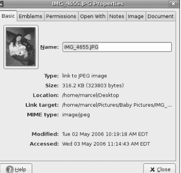

**图 4-14** 要在 Nautilus 中查看文件的属性，请右键单击文件并选择“属性”。将出现桌面图标属性对话框。

## 提示

你可以通过这种方式更改任何文件或文件夹的属性，而不仅仅是链接。不过，选项卡的数量可能会因文件类型不同或你正在处理的是文件夹还是文件而有所不同。

在“基本”选项卡上，你应该会在所链接文件的名称旁边看到一个图标。如果文件是图像，你会看到一个缩略图，如图 4-14 所示。你可以通过单击该图标并使用出现的“选择自定义图标”对话框选择新图标来更改它（参见图 4-15）。这里的思路是你在磁盘中导航以寻找适合你的图标。为了让这项工作变得更容易，左侧有一个预设位置用于位图（pixmaps）。点击这里，你将进入系统通常存储图标的位置。

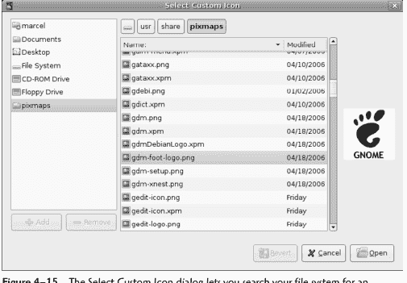

**图 4–15** “选择自定义图标”对话框允许你在文件系统中搜索合适的图标。

要查看某个图标是否适合你，请单击主列表（中间部分）中的图标，然后查看右侧的预览区域。当你找到吸引你的图标时，可以双击它，或者单击“打开”按钮。

## 这就引出了权限

这是你第一次接触 Linux 安全性——这次是在文件（或目录）级别。在“权限”选项卡下，你将看到一个访问权限列表（参见图 4–16）。


**图 4-16** 属性对话框中的“权限”选项卡。

这就是你如何更改文件权限的方法，使其可执行或为另一个用户提供读写访问权限（有关文件权限的更详细探索，请参见第 2 章）。然而，还有几种识别文件权限的方式，而不需要为每个文件打开属性对话框。当你在 Nautilus 主窗口中查看文件列表时，你只看到文件或文件夹名称下列出的内容，没有其他信息。试试看。

## 复制文件和目录（以及`移动`、工具）

在 Nautilus 菜单栏上单击 `Edit` 并选择 `Preferences`。会出现一个带有五个选项卡的窗口。单击 `Display` 选项卡，并在顶部“图标标题”标题附近查看。这里有三个按钮，每个都是下拉列表。第一个选中了 `None`。将其更改为 `Permissions`（你会发现这里有几个选项）。立即，在 Nautilus 主窗口中显示的任何文件都会在名称下方列出权限。

在单击 `Close` 之前，单击 `List` Columns 选项卡。这定义了当你选择 Nautilus 的 `list` 视图（相对于 `icon` 图标视图）时列出什么信息。在这里单击 `Permissions`，然后单击 `Close`。查看 Nautilus 菜单栏的最右侧。在右侧图标栏的正下方，有一个标记为 `View as Icons` 的按钮。单击此按钮，会出现一个下拉列表，允许你将视图从图标更改为文本（参见图 4-17）。


**图 4-17** 当你选择 `View as Icons` 模式时，默认情况下不列出权限。你需要在 `Edit` 菜单的 `Preferences` 对话框中激活该视图。

实际上有 10 列描述文件的权限。在大多数情况下，你会在第一列看到一个连字符或 d，代表目录。接下来的九列实际上是三组三列。

其他九个字符（第 2 到第 10 个字符）表示文件的用户或所有者（前三个字符）、组（第二组三个字符）以及其他人或除所有人外的人（最后三个字符）的权限。如果你查看一个图像并看到 `-rw-rw-r--`，你会发现用户和组具有读取和写入权限。所有其他用户只有读取权限，这与其他人拥有的权限相同。`r` 代表读取，`w` 代表写入，`x`（上面未显示）代表可执行。

> **命令行交互** 想在 shell 提示符下查看权限吗？只需在 `ls` 命令后添加 `-l`，如下所示：
>
> `ls -l directory_name`

在 Linux 体验过程中，你时不时需要更改权限，有时是为了让其他人访问你的目录或文件，或者是为了使脚本或程序可执行。通过使用“权限”选项卡，你可以通过在适当的复选框中勾选，为所有者（你自己）、你所属的组以及其他人选择读取、写入或执行权限。

## 删除文件和文件夹

偶尔，某个文件或目录已经不再有用。是时候果断地清理一下旧的文件系统了。正如你无疑问所预期的那样，有几种方法可以删除有问题的文件或目录。最友好且安全的方法是将 Nautilus 中的文件拖到下方面板右侧的 `wastebasket icon` 上。对于初学者来说，这是一种更安全的方法，因为发送到垃圾桶的物品可以被恢复——当然，前提是你没有清空垃圾桶。在那之前，你可以点击垃圾桶图标，（你猜对了）会出现一个 Nautilus 窗口，显示你已发送到垃圾桶的物品。这些物品随后可以移动（或复制）回你需要的任何位置。要永久地从垃圾桶中删除文件，请右键单击垃圾桶图标并点击“清空废物桶”。

> **注意** 清空废物桶后，这些文件将永远消失。

我说过还有其他删除文件的方法。在 Nautilus 内部，你可以选择文件或目录，右键单击，并选择“移至废物桶”。如果你需要休息一下不想一直点击鼠标，还有命令行。

## 其他有趣的地方

你现在对 Nautilus 及其能为你做什么已经有了很好的理解。从顶部面板的“位置”菜单开始，是让 Nautilus 带你去任何地方的最好方式。在那个菜单中，还有（或可以有）一些其他有趣的地方。

例如，从“位置”菜单中选择“计算机”，Nautilus 就会打开并显示你系统的鸟瞰图。“文件系统”图标让你从文件系统树的顶级开始。你的软盘驱动器出现在这里，另一个代表你的 CD-ROM 或 DVD 驱动器的图标也出现在这里。根据你系统上有多少驱动器，可能有几个图标（参见图 4-18）。如今，人们携带 USB 密钥或 USB 笔式驱动器并不罕见。如果你将这些之一插入你的 Ubuntu 系统，它会变成你可以访问的有趣地方之一。


**图 4–18** 从“位置”菜单中选择“计算机”会向你展示连接到系统的设备概览。

## 我的世界，我的方式

我希望你读完本章后，能对你手头工具的力量和灵活性产生深深的欣赏。读完这本书时，Nautilus 很可能会成为你最重要的应用程序。我几乎没有触及它的一些功能。别担心；随着我们深入本书，你会看到更多关于 Nautilus 的内容。从文件浏览器开始，你可以播放音乐、启动视频片段、阅读 PDF 文件、刻录 CD 等等。

## 把你的家变成家

到现在为止，你开始觉得这并没有那么难。事实上，它可能已经显得相当熟悉了。毕竟，桌面环境之间有很多相似之处，使用 GNOME 并不像在完全陌生的环境中工作。好吧，是时候让你的新虚拟家园更像“家”了。是时候个性化你的桌面体验了。

在下一章，我们将谈论更改背景、添加图标、设置屏幕保护程序，以及所有其他有助于让桌面仅属于你的事情。

# 第 5 章

## 自定义你的桌面（或者让你的世界属于你自己）

在踏入 Linux 世界迈出第一步后，你可能会想，“嘿，这还挺简单的”，以及“我在好奇之前的大惊小怪都是什么”。就其价值而言，我也在想着同样的事情。现在，对使用新操作系统的恐惧已经消失，是时候真正放松了。

在这一章中，我将向你展示如何使你的系统真正属于你自己。我会告诉你如何更改背景、颜色、字体，以及你需要的一切，以创建一个像你一样独特的桌面。你想在桌面上放一些图标吗？也许是一些你经常使用的程序的快捷方式？没问题。我也会涵盖所有这些。

## 我是我视域内一切的主宰……

正如我之前提到的，在 Linux 世界中工作就是在*多用户*世界中工作。这意味着使用你计算机的每个人都可以拥有自己独特的环境。当你以自己的身份登录时，你对桌面所做的任何更改都不会影响到小萨拉，当她在登录玩她的电子游戏时。如果她碰巧删除了她桌面上的所有图标，或者把所有东西都改成了俗气的紫色和粉色，也不会影响你。

让我们从简单的事情开始。大多数人首先想要更改的是他们的背景。这有点像搬进一所新房子或公寓。别人选择的墙纸（或油漆）很少符合你对装饰的想象。你的计算机桌面也是如此。让我们为你找些更合你心意的东西。

### 更改背景

首先在桌面上某处右键单击。从出现的菜单中，选择 **Change Desktop Background**（更改桌面背景），桌面背景首选项对话框将出现（参见图 5-1）。你也可以从顶部面板的 System（系统）菜单下的 Preferences（首选项）中访问桌面背景对话框。寻找标记为 Desktop Background（桌面背景）的条目。

对话框的上半部分显示了系统可用的桌面壁纸列表。Ubuntu 默认提供的列表相当小，基本上是在没有壁纸和同一背景的不同分辨率之间进行选择。我稍后会告诉你如何添加更多，但现在我希望你点击 **No Wallpaper**（无壁纸）设置。请注意，背景的变化是即时的。这里不需要点击 OK（确定）或 Apply（应用）。

在桌面壁纸区域正下方，有一个标记为 *Style*（样式）的区域。这里有一个下拉列表，*Fill Screen*（填充屏幕）被选为默认值。这告诉系统如何处理你选择的图像。一些图像只是小的图形*瓷砖*，设计为复制覆盖直到填满屏幕。对于这些，你将模式更改为 **Tiled**（平铺）。如果你使用的图像对于你的屏幕来说有点小，但你想无论如何将其作为背景，选择 **Centred**（居中），它将在你选择的任何背景色周围坐在中心位置。如果你只是想让图像填满屏幕，而不在乎它看起来如何，那就选择 *Scaled*（缩放）。去玩吧。去实验。这些是*你的*墙壁。


**图 5–1** 为桌面选择背景图像。

要向小的默认列表中添加壁纸，你首先需要有一些可用的。点击 **Add Wallpaper**（添加壁纸）按钮，GNOME 文件选择器将出现（参见图 5–2）。

然后你可以用它导航到包含你图片的文件夹并从中选择。找到你喜欢的并双击它（或点击然后点击 Open（打开）按钮），你会发现自己回到了桌面背景首选项对话框，在那里你可以选择符合你心情的图像。顺便说一下，从这一刻起，这些图像将作为壁纸选择保留下来。

我知道我在重复自己，但你不需要有背景。你可以通过点击 **No Wallpaper**（无壁纸）来创建一个漂亮的纯色背景。然后，在对话框底部的 Desktop Colors（桌面颜色）部分，你可以选择纯色或根据你选择的颜色创建垂直或水平渐变。从下拉框中做出选择，然后点击右侧的颜色按钮从色轮中选择（参见图 5–3）。


**图 5-2** 使用文件浏览器定位并为桌面添加新壁纸。


**图 5-3** 使用颜色选择器创建你自己的自定义背景颜色。

这里有一个很酷的技巧。假设你想要的颜色已经在屏幕上的某处，你希望将其作为背景。没问题。看到色轮下方的那个吸管图标了吗？点击它，你可以使用弹出的吸管选择屏幕上已经存在的任何颜色。

当你对自己的选择满意时，点击 OK（确定）以关闭对话框。

## 请保存我的屏幕！

好吧，屏幕保护程序现在真的不能节省多少屏幕。曾经有一段时间，这个想法是保护屏幕免受磷光体烧入。老式单色屏幕特别容易受损。随着时间推移，你菜单中的字母（那时候我们使用的是文本）会烧入磷光体屏幕。即使你关掉了监视器，你仍然可以看到你最受欢迎的应用程序烧在屏幕本身上的幽灵般轮廓。当我们转向彩色屏幕和图形时，情况有所改变，但由于我们使用的应用程序的静态性质，这个问题在一段时间内仍然存在。

时光流逝，某处的一位智者想到了一个主意：如果你不断改变屏幕上的图像，这种类型的烧入就不太可能发生。还有什么比让某种巧妙的动画在用户离开屏幕几分钟（或几小时）时启动更好的方式来达到这一目的呢？天哪，观看可能甚至很有趣。屏幕保护程序诞生了。现代屏幕使用扫描技术，几乎消除了烧入，但屏幕保护程序并没有消失。那些令人上瘾的鱼、烤面包机、企鹅、雪、宇宙飞船等，尽管技术在进步，它们仍然设法让我们感到愉快。让我们面对现实，我们都着迷了。

Ubuntu Linux 默认启用屏幕保护程序。事实上，如果你足够久（10 分钟）不采取任何行动，屏幕保护程序就会启动。让它运行超过 10 分钟，你会看到不同的屏幕保护程序启动。这是因为 Ubuntu 的默认屏幕保护程序随机循环使用多个预选屏幕保护程序。正如你可能猜到的，我有点超前了。

首先在顶部面板中点击 **System**（系统）。从 **Preferences**（首选项）菜单中，选择 **Screensaver**（屏幕保护程序）。屏幕保护程序首选项对话框将出现（参见图 5-4）。主窗口左侧有一个屏幕保护程序列表，右侧有一个较大的预览窗口。在屏幕保护程序列表的顶部，有一个 **Blank Screen**（空白屏幕）选项，另一个选中的默认选项是 **Random**（随机）。在窗口的下半部分，有一个标记为 **Activate Screensaver**（启用屏幕保护程序）的复选框

**当会话空闲时**。如果您希望完全禁用屏幕保护程序，请勾选此复选框。请记住，空白屏幕实际上也是一个屏幕保护程序，它是各种飞行对象的安静替代品。


**图 5-4 选择屏幕保护程序。**

要预览屏幕保护程序，请点击左侧列表中的任意一个屏幕保护程序，它将会显示在右侧的显示区域中。例如，我在图 5-4 中的示例展示了 FlipFlop 屏幕保护程序，这是一种色彩鲜艳的 3D 瓷砖表面，瓷砖在显示旋转时不断前后翻转（同时与其他瓷砖交换位置）。

让我们继续往下。在屏幕保护程序列表和预览窗口正下方，是一个标记为“设置会话空闲时间”的滑块。默认设置为 10 分钟。停止工作 10 分钟，您的屏幕保护程序就会启动。如果您是一位特别勤奋的工作者，完全可以将其滑块滑至 2 分钟甚至 1 分钟。如果您想完全跳过整个屏幕保护程序环节（即使是空白屏幕），请务必勾选标记为“会话空闲时激活屏幕保护程序”的复选框。

在办公环境（或繁忙的家庭）中，当您离开时，您可能希望为屏幕设置密码保护。要做到这一点，请勾选“屏幕保护程序激活时锁定屏幕”复选框。请务必记住，您的密码是区分大小写的。

## 移动物品

在新安装的 Ubuntu 系统中，您的桌面上没有任何图标。您可能仍有上一章的那个文件夹图标放在某个地方，如果没有，请现在就创建一个文件夹图标。点击此图标（按住不放）并将其拖到桌面上的其他位置。很简单，不是吗？当您稍后注销 GNOME 会话时，请务必点击“保存当前设置以备下次登录使用”，以便您在此所做的任何更改都能跟随您进入下一个会话。

顶部（或底部）面板是您可能想要移动的另一个元素。只需拖动面板并将其放置在桌面的四个位置之一（顶部、底部、左侧或右侧）。顺便说一下，您也可以通过右键单击面板并选择“属性”来更改其位置。在出现的卡片中（参见图 5-5），您可以从下拉列表中选择面板的位置，该位置标记为“方向”。


> **语义** 从技术上讲，任务栏是指底部面板中显示您当前打开程序的那部分，让您能够快速在一个程序之间点击切换。您可能会发现人们经常互换使用“任务栏”和“面板”这两个词。话虽如此，底部面板上的程序切换器更恰当的名称应该是“窗口列表”，因为这是 GNOME 使用的术语。

顶部和底部面板可以是相当动态的。例如，取消勾选“扩展”复选框，面板就会缩小到仅显示已使用的空间，从而在屏幕的顶部或底部中心留下一个小面板。再次点击“扩展”，它将填满整个宽度。面板的高度（标记为“大小”）也可以在此处更改。点击“自动隐藏”复选框，当您将鼠标移开时，面板就会消失在视野之外。如果您像我一样不喜欢整个面板消失的效果，但确实偶尔想要快速将其收起，请勾选“显示隐藏按钮”复选框。面板的两端会出现带有箭头的按钮。点击箭头，面板就会消失到侧面去。


**图 5–5 面板属性对话框允许您更改面板的位置以及大小。**

这些设置也适用于底部面板，但正如我提到的，大多数人倾向于将底部面板视为任务栏（再次强调，因为 GNOME 将此称为窗口列表，所以我将使用这个术语）。这是因为您看到的小矩形框标识了每个正在运行的程序、任务或窗口。点击这些按钮，程序要么最小化要么最大化。要修改任务栏，请右键单击“显示桌面”按钮左侧的垂直条，并从弹出菜单中选择“首选项”（参见图 5–6）。


**图 5–6 要更改窗口列表属性，请右键单击“显示桌面”图标右侧的小垂直条（此处用一个小箭头标识）。**

## 移动物品

当出现“窗口列表首选项”对话框时（参见图 5-7），您会看到两个标签页，分别标记为“行为”和“大小”。让我们从“行为”标签页开始。如您所见，任务可以根据其占用的工作区以及它们的分组方式进行组织。对话框的上半部分定义了哪些任务（或窗口）会在底部面板中重新显示。默认情况下，仅显示当前工作区的窗口。如果您决定覆盖此设置，只需知道窗口列表会很快变得非常拥挤。


**图 5-7 默认情况下，仅显示当前工作区中的任务。**

为了理解窗口分组，请考虑以下示例。假设您打开了一个终端窗口、一个 Web 浏览器和一个 AisleRiot 游戏。无论您选择哪种设置，所有这些任务都会被列出。如果您有两个终端而不是一个，那么事情就开始变得有趣了。选择“空间有限时分组窗口”单选按钮，两个终端会在同一个窗口列表项下分组，但这仅发生在你运行大量任务且窗口列表开始过于拥挤的时候。要从两者之间选择，您可以点击该项，然后弹出正在运行的终端列表。选择“始终分组窗口”，您将获得相同的结果，但即使您的两个终端会话是窗口列表上仅有的项目，它们也会在单个项下分组。

## 这是主题还是基调和弦？

不是音乐主题，而是桌面主题。主题是一组预先选择并打包的按钮、装饰、颜色、背景等，旨在为您的桌面提供整洁且连贯的外观。一些主题甚至将整个包中的音效（用于启动、关机、打开和关闭程序窗口等）整合在一起。这可能非常有趣。您的 Ubuntu 系统附带了几个主题。您现在看到的默认棕色主题被称为 Human。

让我们直接进入主题，稍微玩玩看。点击顶部面板上的“系统”，导航到“首选项”菜单并选择“主题”。当出现“主题首选项”对话框时（参见图 5-8），您会看到 Human 主题显示在顶部。每个主题都在标题和描述左侧包含一张小截图。从一个主题切换到另一个主题，只需点击列表中的名称即可，简单明了。

显然，您可以看出您的系统外观如何，但了解构成主题的元素也很有趣。了解各种元素也是创建一个真正属于您自己的桌面环境的良好第一步。出于这些原因，请点击“主题详细信息”按钮。会出现一个带有三个标签页的窗口，分别标记为“控件”、“窗口边框”和“图标”（参见图 5-9）。这些标签页中的每一个代表主要主题元素之一，并且每个都可以根据您的喜好单独修改其代表的主题。


**图 5-9 主题详细信息对话框允许您精细调整构成主题的各个元素。**

让我们单独查看每一项，从控件开始。这些代表了您查看主题时看到的大部分内容。颜色、滑块样式、按钮形状和标签页……所有这些都属于此类元素。我把它看作 GNOME 界面的外观和感觉。

窗口边框就是那样——它是位于窗口标题顶部的框架和按钮布局。更改窗口边框还可以定义框架是直角还是圆角。图 5–10 到 5–12 为您提供了一个小样本，展示了更改此项如何影响系统的外观。


**图 5–10 Human 是经典的 Ubuntu 主题。注意窗口标题是居中的。**


**图 5–11 Sandy 颜色让位于 Ocean Dreams 主题的海洋色调。您能听到海浪声吗？**


**图 5–12 Crux 窗口装饰。**

### 定义您自己的主题

当您在忙于更改控件、边框和图标时，看一眼您的“主题首选项”对话框，您会发现一些非常有趣的事情正在发生。在主题列表的顶部，出现了一个新项：自定义主题。

在此标题旁边是此主题成型状态的小型缩略图。你还应该注意到保存主题按钮不再显示为灰色（参见图 5-13）。


**图 5–13** 当你开始更改设置时，主题管理器会提供保存新主题的机会。

如果你喜欢新创建的外观，现在是保存它的时候了。点击保存主题按钮，将弹出一个对话框，询问你主题名称和简短描述。点击保存按钮，你的新主题将加入列表。

若要回到系统默认，请从列表中选择 Human 或点击恢复按钮。

## 添加新主题

对于那些追逐潮流的人来说，系统自带的主题和样式很快就会变得乏味——虽然数量不少，但对于那些探索当前时尚前沿的人来说仍远远不够。因此，你应该牢记以下网站：

- http://www.gnome-look.org

- http://art.gnome.org

你会发现大量的主题、替代壁纸和图标——足以让你忙碌很长一段时间。安装新主题就像找到喜欢的东西，将其保存到文件夹或桌面上，然后将主题包拖到主题首选项对话框上一样简单。会出现一个小对话框要求确认安装，仅此而已。但请记住，列表中的一些主题可能仅影响控件选项卡。因此，它们不会出现在主题列表中，但当点击主题详情时会显示出来。

图标的操作方式相同。只需下载它们并拖到主题首选项对话框上；确认确实要安装此图标主题，然后在图标选项卡下查找。

我知道我们还没有讨论上网；我们还有几件事要处理。如果你迫不及待，可以跳转到第 7 章。但务必回到这里。你不想错过任何内容。

## 向桌面添加图标和快捷方式

我在上一章中大致提到了这个主题，但现在是时候详细看看了。在使用 Nautilus 时，你可能记得有一个名为 Desktop 的目录，而这个目录实际上就是你的桌面。如果你想将文件放到桌面上，只需将文件拖放（复制或链接）到这里即可。这样做的好处在于，可以将你经常使用的物品（例如商务电子表格或联系人列表）放在你可以快速访问的地方。

你最可能想要添加到桌面的最有用的单个图标是系统中某个程序的链接，GNOME 称之为启动器。这是你在 Windows 世界中可能称之为快捷方式的东西。也许你需要随时使用你的文字处理程序或 CD 播放器。无论是什么，你都希望它就在你面前。

> **提示** 这里稍微超前了一点，因为我们在第 9 章才讨论浏览网络，但我需要在此提及。另一个有用的图标是网站的链接。假设你经常访问 Google News 网站，并且希望仅通过点击桌面上的图标就能打开该网站。这很容易。使用 Firefox 访问该网站，然后将链接拖到桌面上。系统会为你创建一个图标。你甚至可以将正在查看的网页上的链接拖到桌面上。

你需要理解，你并不是真正将程序放在那里，而是放了一个指向它的链接。右键单击桌面，将鼠标光标移到创建启动器上。打开的对话框或卡片有两个选项卡（参见图 5-14）。


**图 5-14** 选择创建启动器时，会出现一个双选项卡窗口。默认情况下是创建应用程序，如本例所示。


第一个选项卡，基本，是主要操作发生的地方。首先为程序选择一个名称。这不一定是程序名称，而是你希望在桌面上看到的内容。通用名称更多用于识别类别或程序，而你在备注中输入的内容会在鼠标悬停在图标上时显示为工具提示。你不需要在通用名称或备注字段中输入任何内容。命令部分包含一个浏览按钮，你可以使用文件浏览器定位你的程序；然而，如果你知道命令名称，也可以手动输入。例如，如果你想要一个指向 OpenOffice.org Writer 的链接，你输入 `/usr/bin/oowriter`。

注意下拉列表中选定的应用程序类型字段。事实证明，应用程序（或者如果你更喜欢的称呼，程序）恰好是你创建启动器的默认类型。点击列表，你会发现还可以创建指向文件、文件夹以及其他几种文件类型的链接。

在类型条目正下方，有一个标记为无图标的按钮。这通常是你想要更改的内容。点击此按钮会显示大量图标集合，你可以从中选择任何吸引你的图标（参见图 5-15）。


**图 5-15** 为你的新启动器选择图标。

当你对更改感到满意时，点击确定。你的新程序链接（可以通过双击启动）应出现在桌面上。

**实战技巧** 要为命令创建快捷图标，首先必须知道命令是什么以及它在哪里。说实话，一个命令或程序（例如 GNOME 计算器，`gnome-calculator`）可能位于磁盘上的任何位置。在大多数情况下，`程序`倾向于位于 `bin` 目录之一——`/bin`、`/usr/bin` 或 `/usr/local/bin`。你也可以使用 `whereis` 命令来获取确切位置。例如，要知道 `gnome-calculator` 程序在哪里，我会在终端 shell 提示符（美元符号 (`$`)）下输入以下内容：

```
sh-3.1$ whereis -b gnome-calculator
gnome-calculator: /usr/bin/gnome-calculator /usr/bin/X11/gnome-calculator
```

在某些情况下，你可能会看到与程序名称关联的多个文件，但实际可执行文件位于 `/usr/bin`。在这种情况下，`bin` 代表二进制文件——简而言之，就是一个程序。

为了获得更短的搜索结果，使用 `which` 命令：

```
sh-3.1$ which gnome-calculator
/usr/bin/gnome-calculator
```

**提示** 如果你希望放在桌面上的应用程序出现在菜单中，只需点击该项并将其拖到桌面上。释放鼠标按钮时，图标就会出现。

## 小部件大全：回到面板！

听起来很像一部新的好莱坞大片标题，不是吗？

小部件，正如你可能从名字中推断出的那样，是小型应用程序。你会在图形化桌面的顶部和底部面板中找到其中几个。这些小程序经过设计，可以很好地适应你的面板和窗口列表，同时提供有用的功能。窗口列表只是嵌入在该面板中的众多应用程序之一。其他嵌入式应用程序包括工作区切换器、菜单、时钟，甚至通知区域（有时称为系统托盘）。

虽然我们可以在 GNOME 的任何一个（或两个）面板上操作，但我现在将专注于底部的那个。

底部面板的默认外观和大小大约默认为 24 像素。根据程序性质，嵌入在此尺寸面板中的小部件看起来可能有点困难。幸运的是，通过本章前面描述的方法更改面板大小可以轻松解决。为了使这些小部件有用，你很可能会增加默认面板大小。根据我的经验，在我的显示器上，48 像素相当理想。

既然你已经准备好面板，现在是时候找到并添加一些小部件了。右键单击面板，会出现一个小菜单。点击添加到面板，会出现所有可用小部件的列表（参见图 5-16）。此列表可能是带有相关小部件简短描述的单列表，也可能按类别组织。向下滚动，找到你喜欢的内容，然后点击添加按钮。对于我的第一个小部件，我选择了标记为 Fish 的那个，它是一个动画游动的鱼，使用 `fortune`（或 `fortune cookie`）命令弹出随机的小聪明话。是的，那条鱼的名字叫 Wanda。不，我不是编造的这个。

几秒钟后，你的小部件将出现在面板中。当小部件启动时，很少会在我想要的位置启动。幸运的是，移动它很容易。只需右键单击小部件，就会出现一个小菜单（参见图 5-17）。其中一个选项是移动。点击此处，会出现一个小手形图标，允许你将小部件拖到任何你想要的位置。你甚至可以将其移动到另一个面板（稍后详细说明）。


**提示**

拥有三键鼠标的用户可以按住中键点击小工具，并将其拖动到任何想要的位置。滚轮鼠标提供类似的功能，因为大多数滚轮实际上也是一个第三按键（试着点击一下你的鼠标滚轮看看）。在 Linux 世界中，应用程序利用鼠标中键的情况并不少见，但其用途常常被忽视。

再仔细看看那个菜单，你会发现还有一些其他有用的选项。例如，每个应用程序都可能拥有自己的一组配置。我让你安装的那个“小鱼”小工具附带了一些额外的图形文件——你可能不喜欢这些鱼。只需点击“首选项”菜单即可进行更改。最后，如果你决定你所选的程序只是占用了空间，还有一个“移除”选项。

当小工具狂热持续升温时，你可能会发现面板空间不够用了。是的，是时候添加另一个面板了。在面板的空白处右键单击。从弹出菜单中，选择“新建面板”。一个灰色的空白面板会出现；你可以将其拖动到任何你认为合适的位置。与原始面板一样，选择属性对话框允许你调整大小，以容纳你打算安装的小工具。

我将与大家分享我的一些最爱，尽管它们在工作方面并非都完全实用。“词典查询”小工具是必不可少的，天气预报程序也是如此。前面提到的“命运之鱼”很有趣，还有一个在屏幕上跟随鼠标指针移动的眼睛小工具也很有趣。当你编写文档时，“截图”小工具特别有用。由于我在多种系统上工作，我也很喜欢“终端服务器客户端”和“连接服务器”小工具。（我在第 4 章中曾简要提及最后一个，但当时是通过 Nautilus 进行的。）

我就将关于小工具的讨论留在这里，但我鼓励你尝试其他小工具，发掘你自己的最爱。去吧。去探索！

## 其他变更

让我在结束这一章之前，最后给大家一点*惊喜*：点击顶部面板上的**系统**，然后从**首选项**菜单中选择**键盘快捷键**。你会发现许多有趣的键盘快捷键，用于执行诸如从一个应用程序切换到另一个应用程序、从一个工作区切换到另一个工作区、打开和关闭窗口、获取帮助、拍摄桌面截图（如果你想像其他人展示你的时尚品味）等操作。

## 资源

**GNOME-Look.org**

http://www.gnome-look.org

**Art.GNOME.org**

http://art.gnome.org

本页有意留空

# 第 6 章

## 打印机和其他硬件

> 啊，硬件……“我讨厌硬件！”

个人电脑体验的一部分似乎注定是一场永恒的斗争，即让当前的系统能够与最新、最棒的设备通信。总有一些新的、超逼真的 3D 显卡、令人惊叹的立体声系统或灵敏度极高的游戏控制器出现。此外还有日常设备，如调制解调器、扫描仪和打印机。让所有这些设备与你的系统配合使用，长期以来无论我们运行什么操作系统，都给我们带来了麻烦。

我们习惯于认为任何设备都能在 Windows 上工作，但即使事实并非如此。有时，即使是 Windows 用户也必须访问硬件制造商的网站下载驱动程序。Ubuntu Linux 的一个独特之处在于其智能且准确的硬件检测和支持。大多数设备都能自动配置且无需费事。在本章中，我将提供你处理常见问题所需的工具，并给出一些避免问题的建议。

## 是的，它在 Linux 上运行！

Linux 下的设备支持非常出色。无需搜索并安装驱动程序即可“开箱即用”的设备数量之多令人印象深刻，坦白说，甚至优于你旧的操作系统。但这并不意味着一切都很完美。让我在这里直言不讳。有些设备被编写为仅适用于 Windows 且只适用于 Windows……或者看起来是这样。这个开源世界的一件好事是，开发人员正在不断编写驱动程序，使得运行那种超光速通信卡成为可能。

如果你还没有购买那个新设备，这里有几件事你应该做。首先，如果你在商店看中了新打印机，请叫住销售人员并询问它是否能在 Linux 上运行。如果对方不知道（有时这是个问题，但随着时间推移会越来越少），请花几分钟查看出色的《硬件 HOWTO》文档。你可以通过浏览 LDP 的 Linux 硬件兼容性 HOWTO 页面随时找到最新版本：

http://www.tldp.org/HOWTO/Hardware-HOWTO/index.html

如果在那里找不到你要找的东西，请查看你的 Linux 供应商网站上的硬件兼容性指南。对于 Ubuntu Linux 而言，这意味着访问 Ubuntu Wiki 并查看硬件支持页面：

https://wiki.ubuntu.com/HardwareSupport


> *快速提示* 无论你运行的是哪个版本的 Linux，红帽（Red Hat）的硬件目录也值得一去。网址如下。但请记住，网站上的 URL 会发生变化。如果在那里找不到，只需访问 `http://www.redhat.com` 红帽主站并寻找*硬件*。
> 
> `http://bugzilla.redhat.com/hwcert`

尽管 Ubuntu Linux 是 Linux，但不同供应商产品的不同版本可能处于不同的开发阶段。因此，在某个时刻，红帽可能在硬件支持方面比其他人略广，而一个月后 SUSE 可能拥有最广泛的支持范围。

随着 Linux 越来越受欢迎，你会发现硬件制造商对进入这个不断增长的市场越来越感兴趣。我有过在现场为客户系统添加硬件（以太网卡立刻浮现在脑海中）的经历，结果发现系统没有驱动程序。我迅速访问了以太网卡制造商的网站，发现预编译好的驱动程序在那里等待着我。

## 即插即用

在很大程度上，向 Ubuntu Linux 系统添加设备只需将其插入即可。如果设备没有自动出现，而你又不想手动配置，重启可以强制进行硬件检测，设备应被系统识别并配置。由于具有热插拔特性，通用串行总线（`USB`）设备往往更加简便。换句话说，你不需要重启系统就能让 `USB` 设备被识别，并且可以在系统运行时将其拔出。例如，插入一个 `USB` 密钥或 `USB` 闪存盘，它只会出现在你的“位置”菜单中（见图 6-1）。


**图 6-1** 一个 128MB 的 `USB` 驱动器出现在“位置”菜单中（注意该驱动器的格式化大小仅为 120.1MB）。

然而，让设备被识别只是其中的一部分。仅因为你的系统知道该设备并不意味着它一定已经为你的应用程序配置好了。虽然你通常不需要寻找和安装驱动程序，但这种情况确实会发生，正如在 Windows 世界中一样。如果我简单地忽略这一小点对你来说是不公平的，所以我不会这样做。

让我们来看看电脑用户面临的最流行，有时也是最令人沮丧的硬件。没错，我指的是打印机。

## 打印机和打印

如果打印机在启动时已被自动检测、配置并测试，提及这一点似乎可能有些傻。然而，有一些关于打印机你可能想要执行的操作，我们现在应该覆盖其中一些。此外，打印是个人电脑能够执行的最重要的功能之一。把它做对是很好的。就这个话题而言，我将花一点时间谈谈打印机和打印。*相信我，这会很有趣。*

Linux 下的打印基于*打印队列*。简而言之，这意味着每次向打印机发送内容时，它都会排队存放在一个目录中，等待轮到它使用打印机。这种出队过程被称为*假脱机（spooling）*。因此，将打印作业从队列发送到打印机的进程被称为*假脱机程序（spooler）*。该假脱机程序可能是少数几个程序之一，当你在应用程序中打印时，它们对你来说都是透明的。以下是更受欢迎的假脱机程序的快速回顾。

`CUPS`，即通用 UNIX 打印系统，旨在成为一个平台独立的打印系统，可在众多 UNIX 变体（包括 Linux）上运行。`CUPS` 使用互联网打印协议（`IPP`），这是一种设计用于允许在任何地方向任何打印机打印任何作业的下一代打印系统。此时，`CUPS` 看起来 certainly 像是未来的假脱机程序。大多数现代 Linux 发行版都包含 `CUPS`，并且 Ubuntu 透明地使用它。

你遇到的第二种最可能的假脱机程序是 `LPD`，经典的 UNIX 假脱机程序。`LPD` 已经存在了很长时间，并且继续随几乎所有的 Linux 分发。我主要提及它是因为历史原因。它在那里，但你不太可能会使用它。

无论是 `CUPS` 还是 `LPD`，`GNOME` 都能完美地处理打印。添加、配置或移除打印机是通过系统打印管理器。点击顶部面板上的 `System`，然后从 `Administration` 子菜单中选择 `Printing`。将出现一个标题为 `Printers` 的窗口，其中包含一个标记为 `New Printer` 的图标（参见图 6-2）。


**图 6–2** 当打印管理器启动时，您很可能只会看到一个 `New Printer` 图标。不过，您的 Ubuntu 系统会自动识别其他已配置的打印机。

> 提示
> 
> 如果您所在的网络中有共享打印机，请点击菜单栏上的 `Global Settings`，然后选择 `Detect LAN Printers`。

请注意，在我的案例中，已经列出了一台打印机（laser）。这是因为我的网络上已经有一台可访问的网络打印机。通常情况下，您可能只会看到 `New Printer` 图标，这是一个很好的起点。要添加打印机，首先确保您的打印机已插入并处于在线状态。接下来，点击菜单栏上的 `Printer` 并选择 `Add Printer`。您也可以直接双击 `New Printer` 图标。假设您拥有一台受支持的打印机，并且该打印机已连接并处于在线状态，Ubuntu 应能自动检测您的打印机（参见图 6-3）。


在我的示例中，系统轻松地识别出了我的 `HP` 打印机，一切从一开始就运行良好。点击 `Forward`，我们将进入驱动程序选择界面。由于此例中的打印机被正确识别，系统还为该打印机提供了一个驱动程序（参见图 6-4）。

如果您认为这不是正确的驱动程序，或者系统未能正确自动检测您的打印机，您可以在此屏幕上选择不同的制造商和型号。这两个选项都提供了一个包含多个选择的下拉列表。对于大多数打印机，会有一个推荐的驱动程序，它列在 `Driver` 标签旁边。您可以看到，此处列出的驱动程序实际上是下拉框中的第一项，这意味着可能还有一个或多个其他打印机。通常来说，所选的驱动程序就是推荐的驱动程序，并会以此标识。


**图 6–4** 第二个屏幕是驱动程序选择屏幕。您也可以在此指定不同的制造商和型号。

请注意标记为 `Install Driver` 的按钮：在许多打印机上，您可以在打印机制造商的网站或通过 Linux 打印站点（`linuxprinting.org`）找到 `PPD`（打印机定义）文件，即使该驱动程序未包含在您的 Ubuntu Linux 系统中。如果您已下载了此类打印机文件，且打印机驱动程序不在列表中，请点击此按钮，标准的 `GNOME` 文件选择器将会出现。导航至驱动程序的位置并安装它。当您对自己的选择满意时，点击 `Apply` 以使更改生效。新的打印机将出现在 `Printers` 对话框中（参见图 6-5）。

> 注意
> 
> 我提到过，一些公司对 Linux 系统的驱动程序发布并不十分积极。不过，这种情况正在改变，一些打印机制造商为 Linux 提供了出色的支持。其中包括 `HP` 和 `Brother` 等。


现在，由于已配置了两台打印机，请查看激光打印机，即那台在网络上自动检测到的打印机。注意其左上角的对勾图标。这表明它是系统的默认打印机。要将默认输出更改为另一台打印机，请右键单击该打印机并从弹出菜单中选择 `Make Default`。

## 网络打印机

我给出的示例是针对本地连接打印机的，该打印机已被系统自动检测。如果打印机的品牌和型号未被检测到，或者您需要使用基于网络的打印机，也许是挂在 Windows 网络上的打印机，该怎么办呢？让我们看看一个更复杂的安装过程。再次双击 `New Printer` 以调出 `Add a Printer` 对话框。

`Local Printer` 的单选按钮默认被选中。点击 `Network Printer` 单选按钮以选择网络连接的打印机。在其右侧，有一个下拉框，选项包括 `CUPS` 打印机（`IPP`）、Windows 打印机（`SMB`）、`UNIX` 打印机（`LPD`）以及 `HP JetDirect` 网络适配器。在本例中，我选择 Windows 打印机，因为这是家庭用户常见的场景。一旦您选择了 `SMB`，您的 Ubuntu 系统就会扫描本地网络以查找 Windows 机器和 Windows 工作组。如果找到，将出现 `Authentication Required` 对话框（参见图 6-6）。


> 当 Ubuntu 识别您网络中的 Windows 机器时，它会要求您提供访问这些机器的用户名和密码。

输入信息并点击 `Connect`。您之前看到的 `Add a Printer` 对话框会变为显示与试图配置的网络打印机类型相关的特定选项（参见图 6-7）。对于 Windows 网络打印机，有字段用于填写网络中 Windows 机器的 `Host name` 和共享打印机。

> 提示
> 
> `Samba`（Linux 上的 Windows 文件共享）服务器成为现代网络的一部分并不罕见。在这些机器上共享的打印机看起来与网络中任何其他 Windows 系统上的完全相同。因此，`Samba` 服务器及其打印机也会被列出。


**图 6–7** 配置 Ubuntu 访问 Windows 网络打印机。

选择一个 Windows 主机，然后从下方的列表中选择一台打印机。如果您的网络上有多台机器，此处填写的 `Username` 和 `Password` 可能与之前输入的不匹配。确认信息正确，然后点击 `Forward`。再次，您将回到打印机驱动程序选择屏幕（参见图 6-8）。

点击 `Apply`，您的打印机就被添加了。


**图 6–8** 您的下一步是选择打印机的制造商和型号。驱动程序应已自动选择，但请注意，除了建议选项外，可能还有其他选项。

> 提示
>
> 如需了解更多关于从不同机器和不同操作系统打印的信息，请查看以下网址：
>
> https://wiki.ubuntu.com/NetworkPrintingFromWin2000
>
> https://wiki.ubuntu.com/NetworkPrintingFromWinXP
>
> https://wiki.ubuntu.com/NetworkPrintingFromMacOSX

## 打印任务——我的打印任务在哪里？

当您发送内容到打印机时，您通常期望快速得到响应。打印机应该很快开始输出内容。如果打印机有问题，或者您与他人共享该打印机，您可能会发现自己在宝贵的打印件出现之前至少需要等待一段时间。了解队列中有多少任务最简单的方法是打开 `Printers` 对话框。请记住，这样做的方法是点击顶部面板上的 `System`，然后选择 `Printers`。

在代表您打印机的图标正下方，您会看到一条消息，告诉您它正在打印以及正在打印多少个任务（例如，*正在打印 2 个任务*）。要获取更多详情，请双击打印机图标以打开打印机的任务队列（参见图 6-9）。这样做的优点是，它还提供了暂停打印、打印测试页和恢复任务的机会。


**图 6–9** 双击打印机图标以调出打印队列信息。

让我们面对现实吧。时不时地，我们所有人都会向打印机发送一些自己希望没有发送的内容。“不，我只打算打印前 5 页，而不是 500 页！”幸运的是，您也可以取消任务。只需点击该行以高亮显示它，然后点击菜单栏上的 `Edit`，接着选择 `Cancel Jobs`。看吧，打印机其实没那么可怕。

结识新朋友并不总是容易的事。社会学家告诉我们，每当我们要认识一个新的人时，都会发生复杂的相互作用，其中很大一部分是无意识的。虽然有可能在一见到某人时就立刻喜欢上他或她，但更可能的情况是，只有在与某人相处一段时间后，您才足够舒适地发展友谊——换句话说，在您更好地认识一个人之后。

那么，这与硬件和您的 Linux 系统有什么关系呢？

嗯，是这样的……对大多数人来说，我们使用的计算机是一个黑色（或米色）的盒子，里面插着几样东西，并有一些魔法在其中发生，使得上网成为可能。任何超出我们使用的小众应用子集的东西都会让我们感到不安。这就是为什么尝试新事物的概念可能会令人望而生畏。克服这一点的最好方法是让自己对现有的东西感到舒适。

`Ubuntu` 的设备管理器是了解系统组成要素的一个很好的起点（参见图 6-10）。您可以通过点击顶部面板上的 `System` 菜单，然后从 `Administration` 子菜单中选择 `Device Manager` 来找到它。或者，您可以通过按 `<Alt+F2>` 并输入其程序名称 `hal-device-manager` 来调出它。

一旦 `Hal Device Manager` 加载完毕，您会注意到程序窗口分为两个窗格。左侧列出了组成您的系统的各种设备类和子类别。在每个主要项目旁边，都有一个箭头，可以折叠或扩展该特定设备或设备类的组件。点击任何项目，该项目的详细信息将显示在右侧窗格中。

为什么我们不花几分钟来探索一下这个硬件环境呢？让我们从 PCI 设备开始。

### PCI 设备

添加 PCI 设备肯定需要重启，因为我们谈论的是内部设备，尽管您的系统可能已经安装了 PCI 设备。这些是插入计算机内部插槽的卡片。当您重启机器时，Linux 应该能够扫描这些卡片并毫无问题地识别它们。当您点击一个 PCI 设备时，您会看到右侧窗格中出现第三个标签页。点击该标签页以获取有关该设备的更多厂商特定信息（参见图 6-11）。如果存在配置问题，您需要识别设备的型号，这将特别有用。


图 6–10 GNOME 的 Hal 设备管理器。


**图 6–11** 在列出 PCI 设备时，设备管理器会在右侧窗格中添加一个 PCI 信息选项卡。

**Shell Out** 你也可以运行命令 `/sbin/lspci` 来获取系统中所有 PCI 设备更简洁的列表。以下是从我笔记本电脑上获取的部分列表：

```
0000:00:00.0 Host bridge: ATI Technologies Inc
RS200/RS200M AGP Bridge [IGP 340M] (rev 02)

0000:00:01.0 PCI bridge: ATI Technologies Inc PCI
Bridge [IGP 340M]

0000:00:06.0 Multimedia audio controller: Ali Corporation
M5451 PCI AC-Link Controller Audio Device
(rev 02)

0000:00:07.0 ISA bridge: Ali Corporation M1533 PCI
to ISA Bridge [Aladdin IV]

0000:00:08.0 Modem: Ali Corporation M5457 AC'97
Modem Controller

0000:00:09.0 Network controller: Intersil
Corporation Prism 2.5 Wavelan chipset (rev 01)

0000:00:0a.0 CardBus bridge: O2 Micro, Inc. OZ601/
6912/711E0 CardBus/SmartCardBus Controller
```

如果 Linux 内核有可用的模块形式的相应设备驱动程序，它们会被自动加载，因此不需要执行其他任何操作即可使设备可用。这种信息有用的原因在于那些你手头没有驱动程序或直接无法获取驱动程序的时候。能够以这种方式获取问题设备的详细信息是使其正常工作迈出的第一步。

一个经典的例子就是 Winmodem，之所以这样称呼它，是因为它是专门设计用于在 Windows 系统下工作的。如果你拥有这样一个调制解调器，并且它没有被系统自动配置，请不要担心。我稍后会在本章中详细介绍 Winmodems。现在，让我们谈谈 USB。

### USB 设备

USB 背后的整个理念最终是要取代计算机背部那些各种各样的连接器。这包括串行端口、并行端口以及鼠标和键盘连接器。该缩写代表*通用串行总线*（Universal Serial Bus）。在任何 USB 系统中，至少有一个 USB 集线器以及连接的设备。查看图 6-12，你可以看到显示在两个 USB 控制器上的信息（一个是 USB 2.0 端口，另一个是 USB 1.1），一个 Labtec 网络摄像头，一个迷你 USB 滚球鼠标，以及我的 Palm Zire 72（已选中），所有这些都连接到我的系统。


**图 6–12 Hal 设备管理器显示连接的 Palm 设备的 USB 信息。**

请注意，对于像我的 Palm Zire 72 这样的 USB 设备，右侧窗格会出现第三个选项卡。它标记为 USB，点击它会显示当前选中的 USB 设备特有的附加信息。

> **Trivia Time** 我随口提到我的笔记本电脑既有 USB 又有 USB 2.0 端口。这一点值得注意，因为并非所有系统都同时具备这两种端口，且两者之间存在差异。新的 USB 2.0 使用与原始 USB 1 端口相同的连接器，但硬件支持更快的信息交换速率。这对于必须传输大量信息的设备特别有用，例如数字视频摄像机。USB 1 的速度为每秒 12Mb，而新的 USB 2.0 可以以每秒 480Mb 的速度传输数据。

> **Shell Out** 要获取 USB 设备列表，请尝试命令 `lsusb`。以下输出来自我的笔记本电脑：


```
$ lsusb

Bus 003 Device 001: ID 0000:0000

Bus 001 Device 004: ID 0830:0061 Palm, Inc.

Bus 001 Device 003: ID 0c45:6029 Microdia Triplex i-mini PC Camera

Bus 001 Device 002: ID 0451:2046 Texas Instruments, Inc. TUSB2046 Hub

Bus 001 Device 001: ID 0000:0000

Bus 002 Device 002: ID 04fc:0013 Sunplus Technology Co., Ltd

Bus 002 Device 001: ID 0000:0000
```

可用的 USB 设备数量之多，至少可以说令人惊叹，而且这个列表还在不断增长。这些设备中的许多使用一组标准的驱动程序，这意味着许多东西可以真正即插即用——无需费力加载驱动程序，因为这一切都在为你自动完成。
你注意到上一句话中使用了*许多*（many）这个词，对吧？跟踪哪些设备有效（*以及哪些无效*），并为用户提供当前发行版中未包含的驱动程序的访问权限，正是 Linux USB 设备概览网站的*raison d'être*（存在理由）。如果你发现自己正看着一个新的网络摄像头，不确定它是否支持 Linux，请首先查看那里：
```
http://www.linux-usb.org/usb/devices/
```
该网站根据设备类型（音频、视频、大容量存储等）分为不同的部分。每个设备都会被分配一个状态，标识设备受支持的程度，从*完美工作*到*有点工作*再到*别费心*。

## 调制解调器与 Winmodems

好吧，这里有些令人担忧的事情……
早在介绍章节中，我曾提到 Winmodems 是运行 Linux 的少数*缺点*之一。你会记得，Winmodem 是设计为仅与 Windows 配合工作的调制解调器。它们有时被称为*软件*或*无控制器*调制解调器，并且往往比基于控制器的调制解调器便宜。
如果你正在使用 Winmodem，情况并非绝望。Linux 社区如果算不上 resourceful（足智多谋/资源丰富），那就什么都不算了。即使制造商迟迟未注意到 Linux 用户，反过来也不是如此。随着越来越多的人使用 Linux，这个问题变得越来越小。随着时间的推移，硬件制造商可能会优先考虑 Linux，其次才是 Windows。在此期间，请访问 *Linmodems.Org* 网站 http://www.limodems.org，你很快就能让设备运行起来。
那么，如何将 Winmodem 转化为 Linmodem 呢？好吧，让我给你一个例子。
市面上较常见的 Winmodems 是基于 Conexant 芯片组的；这些开始得到非常良好的支持。要获取最新驱动程序，只需前往 Linuxant 的网站（与 Conexant 无关），地址为 http://www.linuxant.com。你不仅可以获取源代码驱动，还可以为许多流行的 Linux 发行版获取预编译的软件包。
识别 Winmodem 是你的第一步。你可以使用 GNOME 设备管理器浏览你的 PCI 硬件，在那里你会得到很多细节。你也可以 `shell out`（使用 shell）并运行 `lspci` 命令，快速列出系统中找到的所有 PCI 设备。它看起来像这样：
```
$ lspci
00:00.0 Host bridge: VIA Technologies, Inc. VT8367 [KT266] [0106:0c57]
00:01.0 PCI bridge: VIA Technologies, Inc. VT8367 [KT266 AGP]
00:06.0 Communication controller: Conexant HSF 56k Data/Fax/Voice/Spkp (w/Handset) Modem (World@ SmartDAa) (rev 01)
00:08.0 Ethernet controller: Realtek Semiconductor Co., Ltd. RTL-8139/8139C (rev 10)
00:11.0 ISA bridge: VIA Technologies, Inc. VT8233 PCI to ISA Bridge
00:11.1 IDE interface: VIA Technologies, Inc. Bus Master IDE (rev 06)
00:11.2 USB Controller: VIA Technologies, Inc. USB (rev 18)
00:11.5 Multimedia audio controller: VIA Technologies, Inc. VT8233 AC97 Audio Controller (rev 10)
01:00.0 VGA compatible controller: nVidia Corporation NV11 [GeForce2 MX DDR] (rev b2)
```
在某些情况下，你会发现预编译的驱动程序包。有些是特定于你的发行版的，有些则是通用的。对于我基于 Conexant 的 Winmodem，该网站提供了一个通用安装程序，它应该能检测你的系统并相应地进行安装。
根据安装后的说明，我输入了以下命令：
```
/usr/sbin/hsfconfig
```
随后出现了一个简短的对话框，询问我的国家（在我的情况下是加拿大），之后程序为我编译并安装了我的驱动程序。它甚至将新创建的设备 `/dev/ttySHSF0` 链接到了 `/dev/modem`。我准备好使用我的调制解调器，没有任何后顾之忧。
**Shell Out** 从 shell 提示符，我可以使用以下命令验证我的调制解调器的位置：
```
$ ls -l /dev/modem
```
系统随后以该信息作出响应：
```
lr-xr-xr-x  1 root root 8 Sep 9 11:23 /dev/modem    -> /dev/ttySHSF0
```
上面的列表是所有未断行的一行。

### Winmodem/Linmodem 综述

显然，如果你使用的是外置调制解调器，或者碰巧是幸运的使用电缆调制解调器连接或本地电话公司提供的高速 DSL 接入服务的人，那么这整个 Winmodem 问题都不适用于你。对于其他地方的其他人来说，这可能稍微复杂一些。我已经给出了 Conexant 网站的地址，我会在这里给你更多。
请记住，*这些调制解调器中的许多*可以通过访问正确的网站，成为 Linux 社区中有用且富有生产力的成员。基于此，以下是我的综述：
- **Conexant 调制解调器（HCF 和 HSF）**
  http://www.linuxant.com
- **Smart Link 调制解调器**
  http://www.smlink.com
- **Lucent 调制解调器**
  http://www.physcip.uni-stuttgart.de/heby/l1tmodem/
- **PCTel 调制解调器**
  http://linmodems.technion.ac.il/pctel-linux/

### 什么？还有更多设备？

我们已经涵盖了许多内容，但远未结束。如果我们不将这些连接到电脑的设备与我们使用的工具和应用放在一起来看，它们的用处并不大。这些工具往往需要更深入的研究。例如，刻录光盘不仅仅是制作你 favorite 歌曲的合集。人们也用它来备份，或者制作数码照片合集与家人分享。我会在第 18 章详细介绍光盘刻录。大多数 CD 和 DVD 光驱在 Linux 下都能被自动识别。
扫描仪也是如此。这些小玩意是家庭或办公室中 incredibly 方便的设备。除了将非数字图片转换并放到你的网站上，你还可以将扫描仪用作复印机，并在页面需要签名时用它来发送传真（毕竟你可以通过文字处理软件发送传真）。通常情况下，你的扫描应用会自动检测并为你配置扫描仪（见图 6-13）。你可以在图形（Graphics）子菜单中找到 XSane。

**图 6–13** XSane 是 Ubuntu 附带的一款图像扫描应用程序，它会自动检测并配置许多主流扫描仪。
顺便说一下，XSane 也是一个很棒的程序，可用于通过电子邮件发送图像、传真文档或制作复印件。
为了帮助你选择一款在 Linux 下获得良好支持的扫描仪，请查看 SANE（Scanner Access Now Easy）的支持设备页面：
http://www.sane-project.org/sane-supported-devices.html
该页面还有一个扫描仪搜索引擎，使定位你的设备变得容易得多。

#### 资源

- Linux 硬件兼容性 HOWTO
  http://www.tldp.org/HOWTO/Hardware-HOWTO/index.html
- 红帽（Red Hat）硬件目录


http://bugzilla.redhat.com/hwcert

- Linmodems.org（Linux 下的 Winmodems）

  http://www.linmodem.org

- LinuxPrinting.org（Linux 打印机数据库）

  http://www.linuxprinting.org

- Linux USB 设备概览

  http://www.qbik.ch/usb/devices/

- SANE 项目，支持的设备

  http://www.sane-project.org/sane-supported-devices.html

- Ubuntu 硬件支持 Wiki

  https://wiki.ubuntu.com/HardwareSupport

# 第 7 章

## 连接互联网

我将以一点网络入门知识开始本章。这会很有趣——真的。对于已经了解 `TCP/IP` 及其 IP 网络运作方式的所有内容的人，你可以跳过前面的几段。

通过互联网进行的通信使用一种称为 `TCP/IP` 协议套件的东西。`TCP/IP` 实际上是 `传输控制协议/互联网协议`（Transmission Control Protocol/Internet Protocol）的缩写，它是所有这些神奇通信背后的基本底层手段。你在网上做的所有事情，无论是浏览你喜欢的网站、发送和接收电子邮件、通过某种即时消息客户端聊天，还是收听音频广播——所有这些活动都运行在 `TCP/IP` 的虚拟背部之上。

`TCP/IP` 通常被称为一种 `协议/套件`，是一组说着相同语言的协议。本质上，这归结为 IP 数据包的传输和接收。这些数据包必须从一地到达另一地，这意味着它们需要知道如何到达。IP 数据包做到这一点的方式，与你从自己家到别人家的方式完全相同。它们有一个源地址，从中前往远程地址。

每台连接到互联网的计算机都有一个唯一的地址，称为 `IP 地址`，由四组用点分隔的数字组成（例如，192.168.22.55）。一些始终在线的系统（银行、网站、公司等）拥有 `静态` 地址。家庭用户的拨号连接通常是共享的——当你未连接时，其他人可能正在使用相同的地址——这被称为 `动态` IP 地址。

你可能会想知道像 www.marcelagane.com 这样的符号化网站地址是如何转换为我之前提到的点分四组数字的，这是一个非常棒的问题。

再次想象现实世界。我们不会认为我们的朋友住在 136 树莓街或 1575 纳蒂卡路；我们会通过他们的名字来认识他们。要找出朋友住在哪里，我们会查电话簿（或询问他们）。数字世界也是如此，但那里的电话簿被称为 `域名服务器`（DNS）。当我在 Web 浏览器中输入一个符号化（即人类可读的）地址时，它会联系一个 DNS（由我的互联网服务提供商（ISP）分配）并询问 IP 地址。有了那个 IP 地址，我的数据包几乎知道如何到达目的地。

几乎？

在现实世界中到达一个地址，你需要驶出你的车道，进入一条连接所有其他道路的道路。如果你开车足够久，你最终会到达罗马（因为常被告知 *条条大路通罗马*）。在到达罗马之前，我们从你的默认路由进入，也就是你家门前的街道。虚拟世界也存在同样的原理。为了让你的 IP 数据包（例如给你母亲的电子邮件）到达目的地，它必须走一条特定的路径，称为 `默认路由`。这将是一个知道所有其他路由的设备的 IP 地址。你的 ISP 提供该路由。

网络入门到此结束。并不特别复杂，不是吗？

## 开始之前

连接互联网是你设置一次然后就可以忘掉的事情之一。不过，你需要预先从 ISP 获取一些信息。基本情况如下：

- 你的用户名和密码
- 你的调制解调器拨号以进行连接的电话号码（如果使用拨号调制解调器连接）
- DNS（前文提到的名称服务器）的 IP 地址
- 你的 SMTP 和 POP3 邮件主机的 IP 或符号化地址
- 你的新闻服务器的 IP 或符号化地址（可选）

当你最初与 ISP 签约时，这些信息可能已经随你的合同提供。有了这些信息，你准备好开始了。

## 上网

就我写这些的时候而言，除了你在办公室自己的连接外，连接互联网有三种非常流行的方法。这些是电缆调制解调器、电话公司的 DSL 服务，或者是老式的拨号调制解调器。前两者通常被称为高速或宽带连接，而拨号访问通常被取笑，因为与更高速的方法相比，它感觉非常慢。

鉴于关于高速服务的所有宣传和炒作，你可能会认为这就是人们使用的全部。再想想。就我写这些的时候而言，北美，乃至世界上绝大多数人仍然通过拨号连接上网。不要搞错——正如马克·吐温可能会说的，关于拨号访问消亡的传言被大大夸大了。你可能也是那些仍然使用拨号的大多数用户之一；我将详细涵盖那部分。

如果你准备好了，让我们开始。

## 使用调制解调器连接网络

大多数 ISP 通过点对点协议（Point-to-Point Protocol，或 PPP）提供拨号访问。要设置网络连接或几乎任何类型的连接，只需运行 Network Settings（网络设置）程序。点击顶部的 System（系统），然后是 Administration（管理），最后是 Networking（网络）。你也可以使用 `<Alt+F2>` 运行应用程序快捷键，并在对话框中输入 `network-admin`。如果你开始喜欢命令行操作，可以在终端窗口中输入 `network-admin &`。由于这是一个管理功能，系统会要求你输入密码（见图 7-1）。


**图 7–1** 像这样的管理功能需要你输入密码。

> **提示** 你可能注意到在前一段中，我在 `network-admin` 命令末尾添加了一个 ampersand（`&`，和号）。当你从 shell 提示符启动一个命令时，它通常在前景中运行。这意味着在当前进程结束之前，你无法在 shell 中启动另一个进程（当然，你可以打开另一个 shell）。`ampersand`（`&`）告诉 shell 将进程放入后台，以便你可以运行其他命令。

当 Network Settings（网络设置）工具第一次启动时，它至少列出一个当前未配置的调制解调器连接（见图 7–2）。即使你的机器没有内置调制解调器，配置它的选项仍然是可用的。在你的连接列表中，你也可能会看到一个以太网连接。大多数现代机器通常都内置了以太网卡，因此这很有可能。我们将使用我的测试机器作为例子，如你所见，它既连接了网卡，也连接了拨号调制解调器。

在你跳进去配置调制解调器连接之前，看看这个窗口顶部附近标有 Location（位置）的下拉框。这里的想法是你可以有多个拨号（或网络）账户。大多数人可能只使用一个，但你也可以用它来设置同一账户的多个配置文件。如果你恰好是经常出差的“行商”或环球旅行者，并且使用笔记本电脑，你可以为你访问的不同城市创建位置配置文件。

## 图 7–2


网络设置应用程序用于所有网络连接，包括拨号上网。

默认情况下，没有定义任何位置。如果你不创建位置就直接配置网络连接，那么这些设置就是你的默认设置。要添加新位置，点击下拉框（此时为空）并点击“创建位置”（Create Location）。会弹出一个小型对话框（见图 7-3），在其中输入该位置的名称（例如，伦敦办公室）。输入名称后，点击“确定”（OK）。


**图 7–3** 你的网络配置可以定义多个位置。

由于你这样做通常是为了处理差旅配置文件，因此你可能希望在此处添加至少两个条目，一个用于家庭，一个用于外出。

### 配置拨号连接

拨号连接通常意味着点对点（PPP, Point-to-Point）连接。点击“调制解调器连接”（Modem Connection）以高亮显示该选项，然后点击“属性”（Properties）选项卡。此时会出现接口属性对话框。它由三个选项卡窗口组成，分别标记为“常规”（General）、“调制解调器”（Modem）和“选项”（Options）。如果默认没有选中“常规”选项卡，请现在点击它。找到并勾选“启用此连接”（Enable This Connection）复选框。你可以在设备 `ppp0` 的连接标题下的“常规”选项卡中找到它（见图 7-4）。此时，该窗口中的其他字段应该不再是灰色不可用状态。


**图 7-4** 你的第一步是启用连接，然后输入你的 ISP 的连接信息。

输入你的 ISP 的拨号电话号码，如有必要，请输入拨号前缀。在下面，输入账户设置时提供的用户名和密码。现在，点击“调制解调器”选项卡。


我在上一章中讨论过设备，特别是调制解调器的问题，这一点在这里特别相关。如果你点击“调制解调器”选项卡，你会发现调制解调器端口未设置。点击下拉列表，你会看到几种可能性，包括 `/dev/modem`，它是调制解调器实际端口的符号链接。它可能是 `/dev/ttyS0`，但也可能是其他很多东西。你可以选择自己指定调制解调器端口，但发现调制解调器最简单的方法是点击“自动检测”（Autodetect）按钮（见图 7-5）。


**图 7-5** 如果你还不知道调制解调器连接在哪里，请点击“自动检测”按钮。

“拨号类型”设置允许你在音频拨号和脉冲拨号之间进行选择。我多年来已经记不清什么时候遇到过脉冲服务了，但如果你仍然使用它，请点击下拉框并选择“脉冲”（Pulses）而不是“音频”（Tones）。最后，还有一个音量设置（关闭；低、中、高），这样你可以听到调制解调器拨号并发出那种很酷的尖叫声。

第三个也是最后一个选项卡标记为“选项”（见图 7-6）。你会发现“将调制解调器设置为默认互联网路由”（Set Modem as Default Route to the Internet）和“使用互联网服务提供商名称服务器”（Use the Internet Service Provider Nameservers）复选框已被选中。除非你有充分理由更改这些设置（即，按照你的 ISP 指示），否则请保持默认。不过，你可以选择最后一个复选框“如果连接断开或启动失败则重试”（Retry If the Connection Breaks or Fails to Start），以便在任何中断你互联网连接时自动重新连接。


**图 7-6** 你可能希望配置调制解调器在连接断开时自动重新拨号。

点击“确定”并返回到主网络设置屏幕，此时“调制解调器连接”仍处于选中状态（参见图 7-2）。这里的区别在于，“激活”（Activate）按钮不再是灰色不可用状态。点击该按钮以拨号连接到互联网。

### 电缆调制解调器和高速 DSL

在大多数情况下，如果你在安装 Linux 系统时连接了电缆调制解调器，那么它可能已经在正常工作，你不需要再做什么。然而，如果你已经正常运行，只是现在才获得电缆调制解调器，那么可能需要一些指导。坦白说，现在（使用现代 Linux 发行版），这并不难。

首先，电缆调制解调器并不是经典意义上的调制解调器。所谓的调制解调器一端连接你的有线电视服务，另一端连接你 PC 内部的以太网卡。通过电信公司的 DSL 服务获得的高速访问方式类似，它们向你提供一个外部、类似调制解调器的设备（在许多情况下，它实际上是一个路由器），该设备也连接到以太网卡。

以太网卡（应由你的系统自动检测）通过动态主机配置协议（DHCP）从电缆调制解调器获取 IP 地址。虽然这个地址可能看起来是永久的，因为它很少（如果有的话）会改变，但它仍然是动态的，因为你的实际以太网卡在每次连接时都会获取其地址。

配置系统的过程因发行版而异，但只是外观上的差异。当你安装新的以太网卡（用于通过电缆调制解调器访问）时，系统应在重启时自动检测它。作为该过程的一部分，系统会询问你是否要配置该卡。答案当然是肯定的。接下来，系统会询问你是要提供 IP 地址还是通过 DHCP 自动配置。对于电缆调制解调器，就像 DSL 一样，自动配置是你想要的。

既然我告诉你做这件事*极其简单*，我要提到高速电缆和 DSL 访问有许多不同的提供商。这意味着，如果你的系统不能自动识别和配置你的连接，你可能需要执行以下操作之一。对于电缆调制解调器，答案因地区而异，但请首先查看 http://www.tldp.org 上的电缆调制解调器 HOWTO 以获取你所在特定地理位置的详细信息。

如果你使用的是电话公司的 DSL 服务，你需要使用 `pppoeconf` 包（它已作为你的 Ubuntu 设置的一部分安装）。打开一个 shell（终端）并以管理员权限运行该命令。通过输入此命令来完成：

```
sudo pppoconf
```

这是一个纯文本实用程序，基本上是一个填空会话。第一个屏幕检查你的以太网卡并要求你确认其位置。由于大多数人只有一个以太网卡，这通常是一个相当简单的选择。你需要确保你的 DSL 调制解调器已插入并开启，因为下一个屏幕会扫描你的 DSL 调制解调器的存在以继续设置。然后，系统会要求你输入你的互联网服务提供商为此连接提供的用户名和密码。

此配置对话框的最后一步是关于你是否希望连接自动建立的问题。这通常是个好主意。完成此设置后，你可能不需要再次运行此实用程序（除非你更换 ISP，当然）。

### 无线接入

笔记本电脑过去是例外而非常规，但价格下降使得这些小型便携式 powerhouse 越来越普及。坐在任何机场候机厅，似乎每隔一个人就坐在那里，在笔记本上打字。此外，他们正在使用无线。咖啡馆里的开放笔记本也不罕见。事实上，如今，无线网络无处不在，甚至可能就在你的家中。现在你需要做的只是连接上。

Linux 拥有出色的硬件支持，包括无线支持。不幸的是，仍然有一些仅为 Windows 编写的驱动程序，或者就我自己的笔记本而言，Linux 驱动程序可能缺乏功能。我自己的笔记本的无线卡在我的家庭网络上工作正常，但效果只能算不错。例如，支持该卡的标准 Linux 驱动程序不允许进行扫描等操作。

### 仅限 Windows 的驱动程序困境

有时，制造商不会 100% 公开信息或规格，这使得完全支持 Linux 变得困难。我真心钦佩 Linux 开发者在供应商黑洞中工作时，为 Linux 提供出色驱动程序的惊人才能和精力。尽管如此，这种信息的缺乏是推动 NdisWrapper 项目的动力，该项目使得通过可加载的 Linux 内核模块使用 Windows NDIS 驱动程序成为可能。幸运的是，你的 Ubuntu Linux 系统使这变得极其简单，我将向你展示如何操作。

在顶部面板上点击“系统”，然后导航到“管理”子菜单。在那里，点击“Windows 无线驱动程序”菜单选项（命令名称为 `ndisgtk`）。由于这是一个管理功能，系统会要求您输入密码以进行确认。输入密码后，将显示“无线网络驱动程序”对话框（参见图 7-7）。


**图 7-7** 起初，您不会看到任何已安装的 Windows 驱动程序。

要安装 Windows NDIS 驱动程序，请点击“安装新驱动程序”按钮。此时会弹出一个小型对话框，询问您选择一个 INF 文件。其下方有一个标记为“位置”的按钮。点击该按钮可打开 GNOME 文件管理器，并导航到与您特定无线网卡相对应的 Windows INF 文件位置。当您选择好驱动程序并返回到对话框后，点击“安装”按钮以安装该驱动程序。如果您选择了正确的驱动程序且一切顺利，您应该已回到主窗口；但此时它显示已安装驱动程序，并列出硬件存在（参见图 7-8）。


**图 7-8** 驱动程序加载后，您的网卡应识别自身已就位。

## 好吧，我已经连上了——接下来呢？

问得好。首先，您拥有了互联网提供的一切资源。您可以浏览网页（这在第 10 章中有介绍）、发送电子邮件（第 11 章）、下载和安装软件，以及查找和下载音乐和视频。互联网是一个巨大的宝藏，包含新闻、信息、对话、视觉、听觉以及成千上万其他事物。在审视它提供的丰富内容时，很容易忘记其实质归结为一件事——*通信*。

互联网诞生于通信；具体而言，电子邮件是推动其发展成为如今覆盖全球网络的工具。这意味着电子邮件、网页浏览以及日益流行的即时消息。

我很快就会告诉您关于 Ubuntu 即时消息的所有内容，但首先，是时候讨论软件了。不是您已安装的软件，而是那些仍在互联网上等待您的惊人且免费的软件。在下一章中，您将了解在 Ubuntu 上安装软件包以及保持系统更新是多么简单。

## 资源

- **关于 Wi-Fi 和 Ndiswrapper 的 Ubuntu 信息**

  - `https://wiki.ubuntu.com/WifiDocs`

- **Ubuntu 关于 pppoeconf 的 Wiki 页面**

  - `https://wiki.ubuntu.com/ADSLPPPoE`

# 第 8 章

# 安装新应用程序


您的 Ubuntu Linux 系统附带了一组出色的软件，包含用于处理从文字处理到电子邮件、网页浏览、即时消息，甚至有助于您放松的游戏等各种任务的软件包。当您花时间实验并了解您的系统及其提供的一切时，最终您会希望拥有比现有更多的东西。这就是为什么我要向您展示如何轻松、无麻烦地安装这些软件。我还会告诉您关于更新的内容，以及如何确保您的系统已打补丁且安全。您会惊讶于查找所需软件是多么容易，以及让其运行起来的速度有多快。


在我们深入查找和安装软件之前，我想澄清一个小小的误解。您无疑听说过在 Linux 上安装软件很困难，而且它不如我们在 Windows 世界中习惯的那样好。事实恰恰相反。实际上，Linux 下的软件安装比您旧操作系统中的方式更优越。

> **安全提示** 当安装软件和软件包时，您通常需要作为管理用户（也称为 `root`）执行此操作。作为 `root`，您拥有全权。Linux 往往比您的旧操作系统更安全、更稳固，但这并不意味着灾难不会发生。了解您的软件来源，并花时间理解它的功能。这就是为什么坚持使用 Ubuntu 软件源（通过 `Synaptic` 提供访问数千个软件包的途径）是最佳方法。`Synaptic`？别担心，我会解释。

## Linux 与安全性

在谈到软件安装时，安全性是我们应该讨论的话题。我已经说过您应该知道软件的来源，但这只是考虑因素的一部分。这就是为什么我要澄清 Linux 在软件安装方面常受到的负面评价。

在 Windows 世界中，感染电脑病毒或蠕虫非常容易，甚至令人恐惧。您只需点击电子邮件附件，就可能陷入麻烦。在 Windows 下，某些电子邮件包会通过自动打开电子邮件附件或连接互联网链接来“帮助”您，这可能引发问题。您很少会看到以简单可执行文件（如 `EXE` 文件等）形式提供的 Linux 软件包。安全是原因。安装大多数软件包还需要 `root` 权限。再次出于安全原因，Linux 要求您意识到您可能会做某些可能损害系统的事情。如果电子邮件附件想将自身安装到系统中，它必须先咨询 `root` 用户。

软件包管理器，如 `rpm`（RPM 软件包管理器）或 Ubuntu 和 Debian 的 `dpkg`/`apt-get`，会执行检查以确保满足某些依赖项，或者软件不会意外覆盖其他软件。这些依赖项检查考虑了许多因素，例如已存在哪些软件以及新软件包将如何共存。您可能熟悉所谓的“DLL 地狱”，即某个软件直接覆盖其他代码的情况。甚至可能发生在您身上。盲目地安装而不进行这些检查可能是灾难性的。最好结果是机器不稳定——最坏结果则是无法使用。

在 Linux 下安装软件可能需要多一两个步骤，但这对您有好处。

### 识别软件包

大多数主要 Linux 发行版都有一个共同的概念：软件包——一个预构建的软件捆绑包，准备好安装在您的系统上。尽管市面上有许多发行版，但大多数使用相同的软件包管理系统。它们处理软件包的方式可能不同，但打包系统保持相当一致。如今大多数发行版使用 RPM 格式的软件包或 DEB。由于基于 Debian，Ubuntu Linux 使用 DEB 格式的软件包。

假设我谈论的是一个名为 `ftl_transport` 的假设软件包。如果我正在寻找此软件包以安装到我的 Ubuntu 系统上，我会发现它采用以下格式：

`ft1-transport_2.1-1_i386.deb`

第一部分是软件包名称本身。下划线紧接后的数字（破折号前）表示软件版本号码。破折号后的数字是软件包发布版本号。紧随其后的是该软件包编译的架构（在本例中为 `i386`）。最后的后缀 `.deb` 明显表明这是一个 Debian 软件包，有时也被称为 DEB。

### 添加应用程序的最简单方法

在下一节中，我将向您展示一种详细的方法来查找、安装、更新和维护 Ubuntu Linux 系统的软件。然而，在此之前，我想向您展示一个简单的、易于使用的工具，用于在您的系统上安装软件包。您在阅读本书各章节的过程中，无疑已在菜单中多次看到这个条目。是时候来看看“添加/删除应用程序”程序了。

开始操作，请点击顶部面板上的*应用程序*，然后选择*添加/删除*。它是列表中的最后一项。安装软件需要系统权限，因此系统首先会要求输入密码。输入密码几秒钟后，*添加/删除应用程序*对话框就会出现（参见图 8-1）。程序读取可用和已安装应用程序的数据库时会有短暂的延迟。该程序的命令名称是 `gnome-app-install`。


图 8–1 添加应用程序对话框也可用于移除程序。这是添加和移除软件包的最简单方式。

左侧的垂直侧边栏中列出了所有可用应用程序的分类。这些类别包括游戏、图形、办公、系统工具等。点击某个类别，该类别中存在的列会显示在右上角的窗口中。右上角窗格的下方是另一个窗口。这是描述窗口。点击上方列表中的一个应用程序，下方就会出现描述。

让我们直接动手看看它是多简单。然后，我们再稍微详细地研究一下。在屏幕的右上角，你会看到一个带有“Search”（搜索）标签的小方框。在文本框中输入 game（游戏）。几秒之内，安装程序就会找到它知道的所有在标题或描述中包含 game 一词的软件包。结果会显示在左侧窗格中（见图 8–2）。

## 添加应用程序的最简单方式


**图 8–2** 通过搜索单词 *game*，程序返回其知道的所有标题或描述中包含 *game* 一词的应用程序。

从列表中选择一款游戏并阅读其配套描述。如果这听起来是个不错的选择，请勾选程序名称旁边的复选框，然后点击主窗口底部的 Apply（应用）按钮。在开始之前，系统会要求你确认软件包列表。如果你对选择感到满意，请点击 Apply。会出现一个对话框，告诉你安装程序正在下载、解压并安装你所选软件包的进度（见图 8-3）。

> *注意* *本书随附的 Ubuntu DVD 包含了所有支持的 Ubuntu 软件包，无论是否已安装。这意味着对于许多软件包，如果你是从 DVD 安装 Ubuntu，就不需要从互联网下载。只需在系统请求时准备好磁盘即可。这对可能无法访问宽带连接的用户来说是一个福音。*


图 8-3 进度对话框显示有关下载和安装的信息。

当安装完成后，你会收到一条友好的消息通知你这一事实，并列出你选择的主要软件包。然后，软件包和依赖列表会被重建，你可以重新开始。

### 移除已安装的软件包

如果你决定要移除某个软件包——如果你不使用该软件，这是一个不错的主意——请回到“添加/移除应用程序”对话框并搜索该软件包。这是找到它的 fastest 方式。你也可以浏览应用程序列表找到它。要实际移除相关软件包，请取消勾选程序名称旁边的复选框并点击 Apply。会出现一个确认对话框，询问你确实想要移除该软件包。如果这听起来很熟悉，那是因为它本质上就是安装软件的逆向过程。

### 等等，还有更多！

在我们继续之前，让我把大家的注意力引向应用程序列表下方的那两个复选框（见图 8-4）。如果你的鼠标光标悬停在“Show unsupported applications”（显示不支持的应用程序）或“Show proprietary applications”（显示专有应用程序）复选框上，你会发现有数百个应用程序不属于官方 Ubuntu 版本。


**图 8-4** 你列出的软件包绝非全部。还有数百个额外的不受支持软件包可用。只需点击复选框即可显示不受支持和专有的应用程序。

偶尔，软件包会依赖其他软件包，移除软件包变成了一个稍微复杂的问题。会出现一条消息，建议你使用 *Advanced*（高级）模式。这个高级模式是 Synaptic 软件包管理器，尽管有 *Advanced* 这个词，它仍然非常容易使用。让我告诉你关于它的内容。

### Synaptic 软件包管理器

在我们开始之前，我想告诉你关于软件库，即存储 Ubuntu Linux 软件包并可供下载的站点。默认情况下，Ubuntu 预配置了标准和安全更新软件库。要访问某些软件包，比如我在第 18 章中告诉你的 MP3 软件，你需要启用额外的 Universe 和 Multiverse 软件包仓库。这很简单。真的。

让我们通过启动 Synaptic 开始。点击顶部面板上的 System（系统），并从 Administration（管理）子菜单中选择 Synaptic Package Manager（Synaptic 软件包管理器）。由于安装软件需要管理员权限，系统会要求你输入密码以确认。几秒钟后，你将看到 Synaptic 窗口（见图 8-5）。

Synaptic 窗口分为三个主要区域，或窗格。左侧栏让你基于类别识别软件。在类别列表下方有四个标记为 Sections（分区）、Status（状态）、Search（搜索）和 Custom（自定义）的按钮。窗口的主体部分在右侧水平分割。顶部列出了软件包。点击其中一个软件包会在下方窗格中显示软件描述。在顶部，你会发现经典的菜单栏，其正下方是一个提供某些最常用功能访问的图标栏。


图 8–5 选中了 `kgoldrunner` 软件包的 Synaptic 软件包管理器。主窗口的底部显示有关所选软件的信息。

### 添加软件库


由于我对此事给予了高度关注，让我们从添加其他软件库开始。从 Synaptic 主窗口，点击菜单栏上的 Settings（设置），然后选择 Repositories（软件库）。会出现一个软件偏好对话框（见图 8–6）。你会看到三个标签页，一个标记为 Installation Media（安装介质），另一个标记为 Internet Updates（互联网更新），还有一个标记为 Authentication（身份验证）。默认情况下，Installation Media 标签页应被选中。

我们稍后会处理这些软件库，但首先点击 Internet Updates 标签页。查找标记为“Check for updates automatically”（自动检查更新）的复选框。它默认应该是勾选状态。标签旁边有一个下拉框，默认选择 Daily（每日）。在本章稍后，我将讨论系统更新的主题。这是你定义系统是否以及如何频繁检查更新的地方。我觉得每日是一个理想的选择，但你可以将其改为每两天、每周或每两周。


**图 8–6** 软件偏好对话框是你定义 Ubuntu 可访问哪些软件库的地方。也是你设置系统监控自动更新的地方。

现在，继续处理这些额外的软件库：点击回到 Installation Media 标签页。如果你向下滚动 Installation Media 窗口中的 Sources（源）列表，你会看到系统已经知道并使用的软件库。有些被列为主要支持；有些可能受版权限制。Universe 和 Multiverse 软件库不能很好地归入这些类别，部分原因是它们不受官方支持。点击 Add（添加）按钮以显示并选择这些其他选项。出现 Add Repository（添加软件库）对话框（见图 8-7）。


**图 8–7**

添加软件库意味着定义你愿意接受的那些软件库的限制。

点击 **Community Maintained (Universe)** 和 **Non-free (Multiverse)** 旁边的复选框以添加这些软件库。此时所有四个复选框都应被选中。点击 **Add** 以关闭对话框。如果你向下滚动 Installation Media 标签页下的 Sources 列表，你会注意到这些二进制软件库已添加在 Ubuntu 6.04 “Dapper Drake” (Binary) 标题下。点击主软件偏好对话框上的 Close（关闭）按钮。

会出现一个对话框，告诉你软件库已更改，你应该点击主 Synaptic 窗口上的 Reload（重新加载）按钮。点击 Close 以关闭信息窗口，这将使你回到主 Synaptic 窗口。是时候点击 Reload 按钮，让 Synaptic 了解你告诉它的所有新软件包了。

### 使用 Synaptic 安装软件

使用 Synaptic 安装应用程序与我之前展示的内容没有太大不同，但 Synaptic 比基本的 GNOME 软件包安装程序灵活得多，功能也更强大。

要搜索软件包，请点击图标栏上的 Search 按钮。会出现一个小型查找窗口，其中有一个空字段，你可以输入搜索词（见图 8–8）。Search 字段下方有一个下拉框，允许你定义搜索发生的位置。默认情况下，它会在软件包名称和描述中查找。对于大多数人来说，这将满足 99% 的需求的时间。不过，你也可以搜索特定的版本号、包维护者的姓名、依赖项以及提供的包。让我们在搜索框中输入“instant messaging”（即时通讯），然后单击“搜索”按钮。


**图 8-8**

使用 Synaptic 定位包的最简单方法是单击“搜索”按钮，并输入你要查找的内容。

结果是一个包列表，其中*即时通讯*字样出现在它们的描述中的某个位置。单独单击每个包以获取该包的描述。如果你决定安装某个特定的包，请右键单击包名称，然后选择“标记为安装”（参见图 8-9）。


**图 8-9** 要安装包，请右键单击包名称，然后从下拉菜单中选择“标记为安装”。

让 Synaptic 如此令人愉悦的原因之一在于，它省去了你需要知道在选择安装某物时可能还需要哪些其他包的麻烦。如果你想要的软件需要另外三个包，Synaptic 会知道并告知你（参见图 8-10）。在我的示例中，需要另外六个包。Synaptic 会询问我是否希望自动将这些包标记为安装。如果你接受——通常来说，你总是会的——单击“标记”按钮以继续。


图 8–10 如果需要额外的包，Synaptic 会在继续之前告知你。

此时，如果你愿意，可以继续搜索其他包。Synaptic 会记住你选择的包，直到你选择安装它们或退出程序。当你准备好安装所选内容时，请单击 Synaptic 图标栏上的“应用”。你会看到一个最终窗口，告诉你将安装的所有包、将使用多少空间以及下载本身的大小（参见图 8-11）。


图 8-11 在安装你的包之前的最后一步，Synaptic 会提供有关它将执行的操作的摘要。

安装开始，首先是包通过互联网下载。随后，系统准备进行包升级，最后安装这些包本身。在整个过程中，一个对话框会提醒你各个步骤，并提供一个状态栏（参见图 8-12），让你对整个过程所需的时间有所了解。

根据你机器的速度或包的数量，这可能需要几秒到几分钟甚至更长时间。进度条会给你一些关于这将花费多少时间的线索。当过程完成时，你会收到一个最终对话框，告知你所有更改（安装、升级、包替换）已完成。单击“关闭”，你将返回到 Synaptic 主窗口。


图 8–12 过程的最后一步：你的包正在安装中。

## 保持 Ubuntu 最新状态

如果你的系统连接到始终在线的互联网连接，Ubuntu 会定期扫描其更新仓库，以获取常规补丁和安全修复。当有可用的更新时，你会在屏幕顶部看到一个弹出消息（参见图 8-13）。这些更新可能是从补丁和修复到安全更新的各种内容。后者是保持最新更新的特别好理由。


图 8–13 偶尔，你可能会看到类似此处的弹出窗口，提醒你软件更新。

你也有可能没有看到上述弹出窗口。根据你是否已经看到该消息、之前是否已将其关闭，或者你是否一直忙于安装包，红色图标本身就是一个提示。如果你将鼠标光标悬停在它上面，你会看到一个工具提示，提醒你可用的更新数量（参见图 8-14）。


图 8-14 请注意顶部面板中的更新图标。将鼠标悬停在图标上会生成包含更多信息的工具提示。

在这里你可以做几件事。首先，只需单击图标即可。这会启动更新管理器。右键单击图标，会出现一个弹出菜单，其中包含多个选项。你可以选择查看可用更新、立即更新包列表，或者继续安装更新。这里还有一个选项可以更改更新管理器首选项。

无论顶部面板中是否存在更新图标，你都可以单击顶部面板上的“系统”，并从“管理”子菜单中选择“更新管理器”来启动更新管理器。请记住，系统只会根据你本章前面选择的时间表检查更新。有可能你有需要在计划时间之前检查的更新（例如，你听说有一个安全更新，你想现在检查它）。无论如何，由于这是一个管理功能，在继续之前会要求你输入密码。输入密码后，会出现“软件更新”窗口（参见图 8-15）。

在这个窗口的底部，有一个“显示详细信息”标签，旁边有一个小箭头。如果你想知道特定更新的功能或更新附带哪些更改，请单击箭头。窗口将分为上下两个窗格，底部有一个信息窗格。单击顶部的包名称，下方的更改描述就会显示出来。

除非你有不这样做的充分理由，否则通常可以接受这些更改。单击“安装更新”按钮，包开始下载。如果你一直跟随到这一步，接下来发生的事情对你来说会很熟悉。这些包的安装遵循你在 Synaptic 和基本 GNOME 包安装器中看到的相同方法。


图 8-15 软件更新窗口列出了所有当前可更新的包。

## DEB 包，Shell 方式

对于大多数人来说，使用 Synaptic 或我前面提到的简单包安装器绝对是最好的方式。然而，与许多事物一样，还有另一种方法，这种方式涉及在 Shell 中操作。如果你对了解 Synaptic 光鲜外表下发生的事情感兴趣，请看看这个关于使用 Linux Shell 进行包管理的简短介绍。


在 Debian 世界中，Ubuntu 是其中的一部分，在命令行处理包时有两个有用的命令：`dpkg` 和 `apt-get`。安装包最基本的方法是使用此格式的 `dpkg` 命令：

```
sudo dpkg --install ft1-transport_2.1-1ubuntu1.deb
```

`dpkg` 是 Debian 和基于 Debian 的系统（如 Ubuntu）的基本包安装工具。前面的命令安装包。此命令删除它：

```
sudo dpkg --remove ft1-transport
```

> **注意** 如果看起来我在此处节省了按键次数，那是有原因的。我只在安装时指示包的版本号及后续扩展。要删除包，你只需要包名称本身。

你应该知道，在删除包时还有另一步需要考虑。虽然程序已从你的系统中消失，但其配置文件仍然存在（这可能是一个好主意）。若要同时清除这些文件，你需要清除该包：

```
sudo dpkg --purge ft1-transport
```

既然我已经让你走了漫长的一步，你可以从清除开始，这一步可以同时删除包并清除配置文件。

## 太好了，你能告诉我已经有什么吗？

当然可以。如果你想要获取系统上每个包的列表，请对 `dpkg` 使用 `--list` 选项。你可能希望将该输出管道传输到 `more` 命令：

```
dpkg --list | more
```

如果列表中有任何内容让你觉得有趣，并且你想进一步了解该软件包，可以尝试使用 `--print-avail` 标志。在本例中，我试图了解神秘的 `mtools` 软件包的一些信息：

```
dpkg --print-avail mtools
Package: mtools
Priority: standard
Section: otherosfs
Installed-Size: 468
Maintainer: Luis Bustamante <luberbu@fluidsignal.com>
Architecture: i386
Version: 3.9.9-2.1ubuntu1
Depends: libc6 (>= 2.3.2.ds1-4)
Suggests: floppyy
Size: 195994
Description: Tools for manipulating MSDOS files
```

上述信息仅打印已安装软件包的信息。正如 Linux 世界（以及日常生活）中的许多事情一样，实现目标的方法不止一种。你也可以使用另一个不可或缺的命令行工具 `apt-get`——具体来说，是 `apt-get` 的相关实用工具之一 `apt-cache`：

```
apt-cache show mtools
```

该命令的结果与前面 `dpkg` 示例的结果完全相同。

## 了解软件包的当前发布级别

要查找系统上已安装的软件包的版本，请使用 `-l` 标志。在下面的示例中，我查询系统以了解我当前使用的 `bash`（Bourne Again Shell）版本：

```
dpkg -l bash
Desired=Unknown/Install/Remove/Purge/Hold
| Status=Not/Installed/Config-files/Unpacked/Failed-config/
| Half-installed
| Err?=none/Hold/Reinst-required/X=both-problems
(Status,Err: uppercase=bad)
```

```
|| / Name Version Description
++==========================
ii bash 3.1-2ubuntu6 The GNU Bourne Again SHEll
```

## 那个奇怪的文件是什么？

假设你想知道系统上某个文件是做什么的。例如，在我的 `/usr/bin` 目录下有一个名为 `pinwrapper` 的文件，而我不记得自己安装过它。此外，如果我尝试在手册页中查找它，系统会提示我没有关于此文件的信息。使用 `-S` 标志，我可以让 `dpkg` 识别该文件所属的软件包：

```
dpkg -S /usr/bin/pinwrapper
bluez-utils: /usr/bin/pinwrapper
```

尽管我不记得安装过 `bluez-utils` 软件，但我现在可以使用 `apt-cache` `show` `bluez-utils` 来了解该软件包的用途。事实证明，它们是用于使用蓝牙设备的工具。

## 使用 apt-get 安装或更新软件

经常使用 Debian 发行版的人有时会将这个出色的小程序视为 Debian 如此优秀的原因。当然，我绝不会否认 `apt-get` 非常出色。

如果你想安装一个名为 `txttype` 的软件包（顺便说一句，这是一款很棒的儿童打字教程），操作方法如下：

```
sudo apt-get install txttype
Reading package lists... Done
Building dependency tree... Done
The following extra packages will be installed:
  libssl-image1.2 libssl-mixer1.2
The following NEW packages will be installed
  libssl-image1.2 libssl-mixer1.2 txttype
0 upgraded, 3 newly installed, 0 to remove and 1 not
upgraded.
Need to get 4341kB of archives.
After unpacking 6038kB of additional disk space will be
used.
Do you want to continue [Y/n]?
```

这里很棒的优点在于，你不需要去各种网站寻找和识别合适的软件。你只需调用带有 `install` 参数的 `apt-get` 即可开始。注意，`apt-get` 会自动获取给定软件包的依赖项，并在需要时进行安装。如果你想更新到 `txttype` 的最新版本，请将 `install` 参数替换为 `upgrade`。

我不想让事情变得复杂，但说到更新，管理员必须做的最重要事情之一就是保持软件包更新。你可以使用此版本的 `apt-get` 安装所有已安装软件包的升级包：

```
sudo apt-get upgrade
```

也许 Debian 卓越性能最著名的例子由以下命令象征：

```
sudo apt-get dist-upgrade
```

这绝非定期使用的事项。它用于从一个主要发行版版本升级到另一个版本（例如从 Breezy 升级到 Dapper）。

## 图形界面还是非图形界面？

这是问题所在，或者至少是问题之一。我习惯于使用命令行和图形桌面。尽管我在命令行上很自如，但我仍然使用 Synaptic，并发现它是一个不可或缺的工具。

你应该使用什么？Synaptic 当然对新手更友好，但我向你展示这些东西的目的有两点。首先，我希望你意识到完成任务的方法不止一种。这适用于图形工具（如本章前面所述）和命令行工具。其次，我希望你看到 shell 并没有那么可怕，即使是处理软件安装这类事情也是如此。在第 21 章（本书最后一章）中，我将为你提供一个使用 Linux shell 的优秀入门介绍。

# 第 9 章

# 即时通讯，还有 IRC！

词语，词语，词语……然后是更多的词语，它们都从一个人流向另一个人。无论世界上网站上的内容多么酷炫，互联网仍然关乎沟通。

如今，一种新的沟通方式已经演变出来——我称之为迷你电子邮件。单行消息。简短而甜蜜的信息。即时消息。联网社会已经爱上了这些快速、始终在线的信息发送方式。我自己的父母（他们住在另一个省）通过他们的 Jabber 即时通讯客户端每天给我发送一行天气预报。如果你来自 Windows 世界，你很可能已经拥有其中一种账户，无论是 Yahoo!、AOL、MSN 还是 Jabber。

## 为什么是 Jabber？

因为 Jabber 是一种开放协议，它不属于任何特定的人，所以没有单一公司推动其发展（尽管有公司在使用 Jabber）。Jabber 采用去中心化的方法，因此系统更加健壮。事实上，如果任何人想运行 Jabber 服务器，他们就可以做到。这对可能希望运行*私有、安全*即时通讯网络的公司来说是一个福音。

> *趣味知识* Google Talk，一种日益流行的即时通讯服务，使用 Jabber 协议。

无论你选择运行 Jabber、Yahoo!、MSN 还是其他什么，理想的即时通讯客户端都是多协议客户端，它可以让你与所有这些服务通信，而不必为 Jabber 运行一个客户端，为 AOL 运行一个，为 Yahoo! 运行一个，为……好吧，你明白我的意思。在本章中，我将介绍两个出色的 Linux 即时通讯客户端。其中一个是一个很棒的 multi-protocol 客户端，可以处理你喜爱的所有聊天服务。第二个是一个强大的 IRC 客户端。


什么是 IRC？你问。IRC 是 Internet Relay Chat（互联网中继聊天），除了电话之外，它可能是世界上最伟大的实时通信系统。我稍后会告诉你所有关于它的事情。

## 使用 Gaim 进行即时通讯

Gaim 是现有最佳的多协议即时通讯系统之一，没有例外。此外，这是一个你可以与仍在使用其他操作系统的人共享的系统。这是一项他们会感激你的恩惠。有了 Gaim，他们不再需要为 Yahoo! 使用一个客户端，为 MSN 使用另一个客户端，*还要*为 AOL 使用第三个客户端，因为 Gaim（`gaim.sourceforge.net`）也可用于 Windows。它在两种操作系统下看起来和工作方式都相同。

要启动 Gaim，请在“应用程序”菜单下查找，然后选择“互联网”。你会在那里看到一个名为 Gaim Internet Messenger 的条目。实际的命令名称是 `gaim`，如果你更喜欢从 shell 或通过 `<Alt+F2>` 运行程序对话框启动它。

第一次启动 Gaim 时，你会看到一个简单的窗口，其中包含账户（有时也称为*屏幕名称*）和密码的文本字段（参见图 9-1）。账户字段是空白的，这表明你尚未设置任何账户。显然，在通过 Gaim 开始使用即时通讯之前，我们需要至少设置一个账户。


**图 9-1** 首次使用 Gaim。

查看文本字段下方，你会看到三个标有“账户”、“首选项”和“登录”的按钮。点击“账户”按钮，将显示“账户”窗口（参见图 9-2）。在此阶段，里面没有内容。点击“添加”，将出现“添加账户”窗口。在该窗口的顶部，你应该看到一个标有“协议”的下拉列表。默认情况下，它显示 AIM/ICQ。点击标有“协议”的按钮，你会看到许多可能性，包括 AIM/ICQ、Gadu-Gadu、GroupWise、IRC、Jabber、MSN、Napster 和 Yahoo（参见图 9-3）。

**图 9–2** 账户管理屏幕。


**图 9–3** Gaim 支持多种不同的即时通讯协议。


从列表中选择 Jabber，观察窗口如何从 AIM/ICQ 变化，以反映设置 Jabber 账户的要求（见图 9–4）。


**图 9–4** 创建 Jabber 账户。

输入你的屏幕名称（这不一定是你的真名）、密码（不要使用重要的密码）和别名。为了在 jabber.org 获取免费账户，你可以保持服务器名称不变。资源名称也可以安全地保留为 Gaim。除非你希望每次登录时都被要求输入密码，否则请勾选“记住密码”复选框。类似地，如果你希望你的 Gaim 客户端每次启动时自动登录 Jabber，也请勾选“自动登录”复选框。

当你对输入的信息满意后，点击“注册”按钮。Jabber.org 服务器应响应一个“注册新 Jabber 账户”确认窗口，这给了你添加一些信息（如电子邮件地址）的机会。只需点击“注册”按钮确认即可大功告成。你的账户窗口现在显示了你的新账户（见图 9–5）。

jabber.org 服务器为人们提供了获取免费即时通讯账户的空间和资源，你可以选择利用这项服务。然而，一些公司出于安全和审计原因使用自己的即时通讯服务器。在这种情况下，你将服务器字段更改为除 jabber.org 以外的其他内容，例如 `chat.yourcompany.com`。


你可以在此处登录（通过点击“在线”复选框），或者点击“关闭”并从 Gaim 主窗口登录。首次登录时，你会收到来自 Jabber.org 服务器的欢迎消息。你可以关闭此窗口，或访问该网站（如消息中所示）以获取更多详细信息。

现在你拥有了自己的 Jabber 即时通讯账户，你需要一些可以交谈的人。你可以点击菜单栏上的“联系人”并选择“加入聊天”来参加在线聊天。你也可以按 `<Ctrl+J>` 使用键盘快捷键。你可以通过从菜单中选择“添加联系人”将朋友添加到你的联系人列表中。当然，你的朋友必须给你他们的屏幕名称。

添加联系人到列表后，他们会收到消息，告知你想添加他们。当他们看到图 9–6 中显示的弹出窗口时，他们点击“接受”，此时，你可以开始与他们对话。


**图 9–6** 你接受你的新联系人吗？

这种接受联系人的行为必须在连接的两端发生。他们接受你，然后你接受他们。把它想象成说“我愿意”，但是针对一种更随意，甚至可以说是虚拟的关系。

在所有这些接受过程完成后，你的联系人会出现在你的联系人列表中（见图 9–7）。你的联系人列表中他们名字旁边的图标指示你的朋友是否在线。


**图 9–7** 活跃的 Gaim 联系人列表。

如果朋友在线，双击她的名字开始聊天（见图 9–8）。在聊天窗口的底部输入文字并按 `<Enter>`（或点击“发送”按钮）来发送你的消息。就这么简单。


## IRC：互联网中继聊天

互联网中继聊天，更为人熟知的名字是 IRC，是一个分布式客户端-服务器系统，用户可以实时与任何数量的其他用户通信。IRC 服务器托管专门针对特定主题讨论论坛的频道。除了惯例和 IRC 管理员的兴致外，这些主题并非固定不变。如果你足够大，能记得 CB 无线电（即那些 30 多岁及以上的人），你基本上就理解了 IRC——至少是在人类体验的意义上。

世界各地有许多 IRC 服务器，有些拥有数千个频道。IRC 服务器还可以与其他服务器进行对等连接。IRC 频道涵盖了大量主题，从纯粹的社交到政治、商业或高科技。在 Linux 世界中，有专门用于大多数流行语言编程的频道，还有你喜欢的 Linux 发行版、办公应用、游戏等等。IRC 频道是相遇和交换信息、提问、回答或只是闲聊的绝佳场所。所有这些聊天都是通过 IRC 客户端（如 XChat）进行的，我将在下面讨论。

> **注意** 确实，大多数 IRC 服务器倾向于成为巨大的主题集合，并链接到世界各地的其他服务器。也有用于更集中讨论的私有 IRC 服务器。我自己也运行这样一个服务器，在一个名为 `#wftlchat` 的频道上为我的读者提供一个聚会场所（本章稍后会有更多介绍）。`#wftlchat` 上的用户可以提问、互相帮助或只是闲聊。

## XChat

要启动 XChat，点击顶部面板上的“应用程序”启动器，导航到“Internet”并点击“XChat IRC”（`xchat_name`, `xchat`）。当程序首次启动时，你会看到一个窗口，其中你的用户名被列为昵称（见图 9–9）。此外，还列出了备用昵称，以防万一别人正在使用该名称。尽管这默认为你的用户名或登录名，但你在这里可以选择任何你喜欢的名字。事实上，IRC 上的大多数人都有不同于自己姓名的昵称。在 IRC 上，你会看到我的登录名为 wftl。那是我的昵称。

如果你知道你想连接的频道所在的网络（或者你只是想了解有哪些可用频道），点击“网络”列表中的一个选项，然后点击“连接”按钮。你可能一开始就会对“Ubuntu Servers”条目感兴趣，它会自动将你登录到 ubuntu IRC 讨论频道，这是提出 Ubuntu Linux 特定问题的绝佳场所。然而，我想向你展示如何添加其他网络。让我在这里添加我自己的 IRC 服务器，以便你可以看到它是如何操作的。


**图 9–9** 即使首次运行 XChat，也已经配置了大量网络。

首先，点击“网络”列表右侧的“添加”按钮。“新网络”一词在“网络”列表的顶部被突出显示。将其更改为有意义的名称。在我的情况下，我输入了 `WFTL IRC 服务器`。现在，这个条目仅是一个占位符，代表网络内服务器列表（可以有一个或多个）。点击“编辑”，会出现“编辑服务器”对话框（见图 9–10）。在顶部，列出了一个主机 `news.server /6667`。这只是一个示例条目，需要更改为实际内容。在我的 IRC 服务器上，那是 `chat.marcelgagne.com /6667`。你通常不需要担心这个，但 6667 是 IRC 运行的 TCP 端口。


**图 9–10** 每个网络可以包含一个或多个服务器。此外，你可以选择在连接时让 XChat 将你登录到某个频道。


> **提示** 很容易找出哪些服务器属于哪个网络。例如，如果你点击“Ubuntu Servers”条目并点击“编辑”，你会看到 `irc.freenode.net` 的服务器条目，这是 Ubuntu 讨论组所在的主机。

每个 IRC 服务器可能有数百个频道，也可能只有一个。如果你碰巧知道你想连接的频道，你可以在这里添加它，这样当你登录时就会自动连接。往下看“连接”部分下的“加入频道”字段。正如该标签所示，你可以加入多个频道，但对于我的服务器，`#wftl-chat` 是你需要的。点击“关闭”，你会发现自己回到了主 XChat 窗口的`网络`列表。确保“WFTL IRC 服务器”条目被高亮显示，然后点击“连接”。XChat 对话窗口出现，你的昵称已登录到相应的频道（见图 9–11）。


**图 9–11** 在 IRC 中聊天。右侧是当前登录到该频道的人员列表。

要提问或与群组交谈，只需在底部昵称右侧的文本框中输入你的消息，然后按 `<Enter>`。注意窗口底部按钮上的网络名称和频道名称。在 IRC 上聊天时，可以同时将多个频道加入会话。

# 深入了解 IRC

IRC 有一些你可能想要了解的有趣命令。IRC 命令由斜杠字符 (`/`) 开头，后跟命令名称。有些命令所有用户都可以使用，而有些则仅供频道管理员使用。要了解你可以使用哪些命令，请在文本字段中输入 `/help` 并按 `<Enter>`。命令列表会直接显示在聊天窗口中。以下是一些更常见且有用的命令：

- `/help` 列出 IRC 命令。
- `/help command_name` 获取特定命令的帮助信息。
- `/nick new_name` 更改你的昵称。
- `/join #channel` 加入指定频道。
- `/part` 离开频道。
- `/list` 列出可用频道。
- `/me Some_action` 打印你的昵称，后接你的动作文本，并以不同颜色突出显示该消息。试试看吧，这很有趣。


> 注意 `/list` 命令。在某些服务器上，此命令可能会返回一个庞大的频道列表。

IRC 是一个绝佳的资源，我强烈推荐它，但附有一个谨慎的建议。这个庞大的分布式实时讨论组网络已经发展出一种独特的文化，拥有自己的礼仪规则，这些规则应当被遵守。频道有操作员（operators）来监控流量和来自用户的请求。如果你不守规矩，操作员也可以将你驱逐出去。可能还存在机器人，即设计用于处理简单管理请求的小型程序，因此你看到的每个用户不一定都是人类。

当你手头有如此丰富的工具时，很容易沉迷于 IRC，但也花点时间阅读一篇关于其基本原理的小指南是很好的。查看 Resources 部分中的 IRC 入门指南，它是对 IRC 世界的一个绝佳介绍。

另一个绝佳资源是 netsplit.de IRC 信息网站，你可以在那里找到频道和主题的搜索引擎，以及 IRC 服务器和网络的综合列表。

我会在网上等你。

## Resources

- **Gaim Instant Messaging**

  `http://gaim.sourceforge.net`

- **Google Talk**

  `http://talk.google.com`

- **Jabber Software Foundation**

  `http://www.jabber.org`

- **A Short IRC Primer**

  `http://www.irchelp.org/irchelp/ircprimer.html`

- **Netsplit.de IRC Information Site**

  `http://irc.netsplit.de`

# 第 10 章

## 使用 Firefox 浏览网络

说到桌面上的 Web 浏览器，Linux 用户面临着选择过多的尴尬局面，有很多替代方案可供选择。对于那些寻求极速浏览体验且不需要图形界面的人，Linux 提供了许多基于文本的浏览器。（我将在本章末尾简要提及这些浏览器。）

在大多数人花费浏览时间的图形化世界中，当今最热门、最酷的浏览器是 Firefox，而它恰好是 Ubuntu Linux 中的默认浏览器。在 Firefox 不久前出现之前，人们都以为浏览器世界属于来自 Redmond（微软所在地）的、饱受安全问题困扰的 Internet Explorer。就在我写这段话时，Internet Explorer 在北美浏览器市场份额已跌破 90%，在欧洲则跌破 80%。考虑到在 Firefox 出现之前，Internet Explorer 曾占据约 95% 的市场份额，这一成就是相当了不起的。更好的安全性和先进功能将数百万用户从微软的浏览器吸引到了 Firefox。Firefox 是一个令人兴奋的程序，我将在本章向你展示它的运作方式。

## Mozilla 与 Firefox

Firefox 由分发 Mozilla 浏览器的同一群人分发。事实上，Firefox 是一款 Mozilla 产品。

Mozilla 和 Firefox 有什么区别？实际的 Mozilla 浏览器更像是浏览器中的瑞士军刀。它包含电子邮件包和 IRC 客户端，非常适合阅读新闻组，并附带 HTML 编辑器。另一方面，Firefox 纯粹是一个 Web 浏览器（见图 10–1）。它更小、更快，更专注于其主要任务，为你提供卓越的冲浪体验。若要获取同等独立的电子邮件包，你需要下载 Thunderbird（在第 11 章中有提及）。目前，我想专注于 Firefox，所以让我们开始吧。


要启动 Firefox，请点击顶部面板中的应用菜单，导航到 Internet 子菜单，然后选择 Firefox Web Browser。顶部面板中还有一个 Firefox 的快捷访问图标。在“System”菜单的右侧，有一个蓝色地球图标。将鼠标光标悬停在图标上，它会显示自己为 Firefox。

### 从主页开始

当你第一次启动 Firefox 时，它会带你到其主页，目前是本地安装在你系统上的“Welcome to Ubuntu”页面。该位置在菜单栏正下方的 URL/位置栏中标识出来。访问网站并导航 Firefox 的操作与你使用过的任何其他浏览器都非常相似，特别是如果你之前使用 Mozilla（或 Firefox）搭配旧操作系统的体验。你只需在位置栏中输入你要访问的网站 URL，就可以开始了。如果你想每次从个人主页开始，这很容易做到。


> 提示 花时间查看并访问 Ubuntu 欢迎页面上的链接。它们指向一些有价值的资源，其中一些你可能想要加入书签。

点击 Firefox 菜单栏中的 Edit，然后选择 Preferences。偏好设置窗口打开后，顶部标题栏下方有一排图标，你可以从中选择要修改 Firefox 的哪个部分。默认情况下，它打开的是 General 类别（见图 10-2）。正下方的 Home Page 部分有三个按钮。第一个按钮 Use Current Page 会将你当前访问的 URL（或页面）输入到 Location 字段作为你的主页。中间的按钮 Use Bookmark 会弹出一个对话框，显示你当前的书签。点击 Use Blank Page 按钮将从空白页启动 Firefox。当然，你也可以直接键入 URL 到 Location 字段，点击 OK，完成设置。


> 快速提示 在关闭偏好设置对话框之前，你是否注意到 Location 字段实际上写的是 Location(s)？没错，它可以是复数。如果你打开了多个标签页（我接下来会详细介绍），Use Current Page 按钮会变成 Use Current Pages。当你点击 Home 图标时，Firefox 会为所有你喜爱的页面打开标签。如果你想手动在位置栏中输入页面列表，只需使用竖线符号 `|`（通常位于键盘上反斜杠键上方）将每个页面分隔开即可。


Figure 10-2 Setting your home page in Firefox's Preferences menu.

### 以 Firefox 风格保持标签

Firefox 拥有一项名为标签浏览的强大功能。以下是其工作原理。有时在浏览网站时，你想保持某个特定网站打开，同时转到网络上的另一个地方。通常，你会点击 File 并选择 New Window。这没问题，但如果你一直这样做，最终会在桌面上打开许多个浏览器窗口。从一个切换到另一个需要进行一点数字杂耍。标签使得原本可能变得非常杂乱的任务栏（或桌面）能够保持整洁有序。通过标签浏览，你在同一个浏览器窗口中打开额外的网站，然后通过点击对应打开网站的标签来切换。


以下是操作方法。首先访问你选择的网站。然后点击 `File`，选择 `New`，并从下拉菜单中选择 `New Tab`。你也可以使用 `Ctrl+T` 键盘快捷键完成相同操作。请注意，Firefox 在位置栏（见图 10-3）下方以标签标识你的网站，或者如果你开启了书签工具栏，它会显示在那里。添加第三个或

如果你喜欢，也可以用第四个标签页。现在从一个网站切换到另一个网站，只需点击 Firefox 单一副本上的标签页即可。


**图 10-3** Firefox 展示其标签页功能。

> **提示** 这里有一个很酷的技巧。在 Linux 世界中，鼠标有右键、左键，而且通常还有一个中键。即使你的鼠标没有中键，你仍然可以通过同时按下左键和右键来模拟中键的操作。许多应用程序，包括你的桌面环境，都可以利用这个中键（或虚拟的中键）。

我为什么要告诉你这个？使用鼠标中键点击链接，该链接就会自动在新标签页中打开。很酷吧？确实很酷。

在标签页模式下（如图 10-3 所示），你可以右键点击标签页以弹出标签页菜单。在那里，你可以关闭或重新加载当前标签页（或所有标签页），甚至打开新标签页。另一种关闭活动标签页的方法是点击标签页列表末尾的 `X`。


> 当你打开了几个标签页后，你可能希望将某个网站移动到其他位置。假设你更频繁地使用某个网站，希望它位于第一位，但它目前处于末尾。没关系。只需点击该标签页并将其拖拽到新位置即可。

## 追求大屏幕体验

正如你旧款的二十英寸电视与新款五十英寸平板高清电视之间没有可比性一样，通过大屏幕观看虚拟世界也是无可替代的。尽管我非常想这么做，但我无法增加你的显示器尺寸，但我可以帮你实现次优方案。当你忙于浏览互联网并希望获得尽可能大的屏幕空间时，何不试试 Firefox 的全屏模式？

在查看页面的任何时刻，你都可以点击菜单栏上的 `View` 并选择 `Full Screen`。标题栏会消失，顶部和底部面板以及所有其他边框装饰也会随之消失。另一种切换到全屏模式的更快方法是按下 `F11`。请注意这一点，因为这也是你切换回常规视图的方式。

## 永久禁止弹出广告！

说实话，我想不出有单个人喜欢访问网站，结果却被该网站弹出烦人的窗口广告。Firefox 让你可以轻松阻止这种行为。实际上，Firefox 默认会屏蔽弹出窗口，但你可能会希望针对某些网站更改这种行为。方法如下。

首先再次打开偏好菜单（点击菜单栏上的 `Edit` 并选择 `Preferences`）。从类别列表中，选择 `Content`（见图 10-4）。你会看到一个标记为 `Block Popup Windows` 的复选框。在该标签旁边是一个标记为 `Allowed Sites` 的按钮。点击此按钮允许你指定允许弹出窗口的网站。当你完成配置后，点击 `OK` 关闭偏好菜单。


图 10-4 Firefox 允许你指定允许弹出窗口的网站。

当 Firefox 拦截弹出窗口时，它会显示如图 10-5 中的消息。


图 10-5 Firefox 已阻止弹出窗口。你想怎么做？

点击栏末尾的 `Preferences` 按钮，你会看到三个选项。你可以允许该特定网站弹出窗口，或编辑该特定网站的弹出窗口拦截偏好设置。你还可以选择以后屏蔽弹出窗口时不再显示此消息。

## 美味的…… Cookie（Cookie 文件）

指的不是那种食物。Cookie 仅仅是当你访问网站时传输给你的浏览器（或系统）的小型文本文件。Cookie 背后的原始想法是，服务器会给你一个 Cookie 作为标记，以指示你之前访问过哪里。该 Cookie 可能存储用于访问特定网站的密码或其他与访问相关的信息，例如在线购物购物车。当你下次访问该网站时，服务器会询问你的浏览器是否曾向你发送过 Cookie，你的浏览器会通过发送之前的 Cookie 来回复。这样，网站在你下次访问时就能识别你，并为你设置某些有用的默认值。Cookie 可能非常有用的。

Cookie 的问题在于它们也可以在更大的域内共享，例如广告联盟。使用这些共享的 Cookie，广告商可以建立你的喜好和厌恶档案，从而为你量身定制并定向投放广告。许多人反对这种建立用户档案的方法，并认为使用 Cookie 是非常不道德的，是一种侵犯隐私的行为。那么难题就是找到一种方法来接受你想要的 Cookie，并拒绝其他 Cookie。

Firefox 在处理 Cookie 方面非常灵活。在你兴奋地关闭所有 Cookie 之前，请记住它们可能很有用，特别是在银行和电子商务网站等在线服务中。话虽如此，你可能非常希望尽可能限制 Cookie 流量。

从偏好菜单中，打开 `Privacy` 类别子菜单（见图 10-6）。在类别图标下方，你会看到一个选项卡列表。点击标记为 `Cookies` 的选项卡以配置你的选项。

除非你想拒绝所有 Cookie，否则请保持 `Allow Sites to Set Cookies` 复选框选中。然后，从 `Keep Cookies` 下拉框中，选择 `Ask Me Every Time`。点击 `Close`，继续浏览。当你访问试图设置或修改 Cookie 的网站时，会弹出一个警报，提醒你该 Cookie 并询问你如何继续（见图 10-7）。如果你决定拒绝一个 Cookie，并且永远不想再看到来自该网站的另一个 Cookie，请在点击 `Allow for Session` 或 `Deny` 之前，勾选 `Use My Choice for All Cookies from This Site`。


图 10-6 返回 Firefox 的偏好菜单以配置 Cookie 策略。


图 10-7 一个弹出窗口允许你允许或拒绝 Cookie。这是一个允许所有 Cookie 的好网站。

## Firefox 侧边栏

Firefox 侧边栏是快速获取信息的一种快速方式，在此情况下是浏览历史书签。你可以通过点击菜单栏上的 `View` 并选择 `Sidebar` 子菜单，在侧边保留其中一个。激活书签侧边栏的一个快捷方式是按下 `Ctrl+B`。相同的键组合也会隐藏侧边栏。

你可能已经知道，你的系统会保留你访问过的网站历史记录。默认情况下，历史记录回溯九天。通过点击菜单栏上的 `Edit` 并选择 `Preferences` 来设置历史记录量。你会在 `Privacy` 下找到历史记录设置，就像你在 Cookie 中看到的那样。

要激活历史记录侧边栏，请从 `View` 菜单中选择它（位于侧边栏下），或按下 `Ctrl+H`，侧边栏就会显示出来（见图 10-8）。历史侧边栏


图 10-8

Firefox 历史记录侧边栏——它是通往过去的一跳。

使得搜索你前几天访问过的网站变得容易。在侧边栏的顶部，你会看到一个搜索字段。只需在位置栏中输入你的搜索关键词并按 `Enter`。点击显示的任何链接，你就会被立即传送到该网站。

## 扩展 Firefox

Firefox 在许多方面都是一个出色的浏览器，但它最酷的功能之一是通过扩展系统添加功能和能力。扩展是程序增强功能，可以显著改变你使用浏览器的方式。这种扩展框架使 Firefox 不仅是一个出色的浏览器，更是一个卓越的浏览器。

要体验 Firefox 扩展，请点击菜单栏上的 `Tools` 并选择 `Extensions`。会出现一个窗口，其中列出了你系统中已有的扩展。在刚安装的情况下，通常这里除了语言包外什么都没有。在这个窗口的底部，有一个标记为 `Find Updates` 的按钮（见图 10-9）。此功能可确保你使用的扩展保持最新。旁边是一个 `Get More Extensions` 链接，这就是我们开始旅程的地方。


**图 10−9** Firefox 扩展窗口不仅让你访问已安装的扩展，还提供了访问许多其他扩展的链接。


当您点击该链接时，会打开一个新的浏览器窗口访问 Firefox 扩展程序网站。您也可以不通过扩展程序对话框，而是直接访问 https://addons.mozilla.org/firefox 来访问该网站。扩展程序标签页已被选中，一些最新且最受欢迎的扩展程序位居前列。您还可以根据从博客到幽默、导航、搜索工具、新闻阅读等等分类进行搜索。有些扩展程序极其有用，旨在使您的浏览更高效。有些则纯属恶搞。每个扩展程序都有描述和一个安装链接。如果您初次访问，请点击“我们推荐”按钮获取一些出色的建议。

让我通过安装一个完全愚蠢的扩展程序来给您举个例子：Anthony Howe 的 Bork Bork Bork!，这是一个让您的网页看起来像是由《Muppet Show》（芝麻街节目）中的瑞典厨师写的扩展程序。当我点击扩展程序描述页面上的“安装”链接后，会弹出一个窗口，在安装扩展程序之前请求确认（见图 10-10）。其中还包含关于安装恶意软件的警告。若要继续，请点击“立即安装”按钮。


图 10-10 安装扩展程序只需点击一下。

### 扩展 Firefox

就这样。您需要重启 Firefox 才能加载新的扩展程序。现在，当我浏览某个网站时，我可以右键点击页面并从菜单中选择“查看 Bork 文本”，几秒后，我的页面就会被翻译成只有瑞典厨师才能理解的东西（见图 10-11）。


抛开我那个愚蠢的例子不谈，有一些扩展程序是必装的。一些更流行的扩展程序包括 AdBlock、BugMeNot、ForecastFox 和 FoxyTunes。浏览 Firefox 扩展程序页面，试用几个，然后找出您自己的最爱。当然，并非所有扩展程序都在 Firefox 网站上。我个人最喜欢的之一是 Ted 的 Mozilla 页面上的 Tab Preview（标签页预览）（参见资源部分）。这个小巧便捷的扩展程序在您鼠标悬停在标签页上时，提供标签页页面的缩略图视图。

Firefox 扩展程序非常受欢迎，许多程序员都贡献了他们的作品。也出现了几个网站用于评论和讨论最新的扩展程序。在 Google 搜索栏中输入您喜欢的 Firefox 扩展程序关键词并享受搜索吧。


> “Ubuntu”是一个古老的非洲词汇，意为“对他人的仁慈”。Ubuntu 还意味着“我之所以是我，是因为我们所有人”。Ubuntu Linux 发行版将 Ubuntu 的精神带入了软件世界。

Ubuntu 是一个完整的基于 Linux 的操作系统。

图 10-12 Tab Preview 为您提供便捷的标签页缩略图视图。

### 总结——其他值得考虑的浏览器

正如我提到的，Firefox 是 Ubuntu 默认自带的浏览器，但它绝不是您唯一的选择。如果您喜欢 Firefox，您可能还想看看 Mozilla (http://www.mozilla.org)，它是一个功能齐全浏览器套件，包含电子邮件客户端、HTML 编辑器等。另一个出色的浏览器 Konqueror 作为 KDE 桌面的一部分提供，但您不需要安装 KDE 也能使用它。只需使用您的 Synaptic 软件包安装程序搜索 Konqueror 即可。

我们不仅限于此。您还可以访问一些纯文本浏览器，如 Lynx 和 Links。这两个都没有预装在 Ubuntu 中，但如果您好奇的话，两者都很容易添加。


**Shell Out** 当您想在没有图像杂乱干扰的情况下浏览万维网时，为什么不试试 `lynx` 或 `links` 呢？您可以在哪里获取它们？没错，首先搜索 Synaptic。然后，打开一个终端 Shell（在“应用程序”菜单下的“附件”中查找），并尝试以下命令：

```
lynx http://www.marcelgagne.com/
links http://www.marcelgagne.com/
```

您可能会惊讶于非花哨网页浏览的速度和性能。

## 资源

- Firefox

    - http://www.mozilla.com/firefox

- Firefox 扩展程序

    - https://addons.mozilla.org/firefox

- Konqueror 网站

    - http://www.konqueror.org

- Links 文本网页浏览器

    - http://links.twibright.com

- Lynx 浏览器

    - http://lynx.isc.org/

- Mozilla 项目主页

    - http://www.mozilla.org

- Tab Preview 扩展程序

    - http://ted.mieclczarek.org/code/mozilla/tabpreview/index.html

此页有意留空

# 第 11 章

# 进化：电子邮件及更多功能！

当我们如今想到互联网时，首先想到的是网页浏览器。对于那些在网络上的时间比我们愿意承认的更久的人来说，这似乎总是有点奇怪。互联网上信息交换的主要媒介一直是电子邮件，或者简称 email。尽管感知已经改变，电子邮件可能仍然是互联世界中排名第一的应用程序。

对于一个功能强大的图形化电子邮件客户端，您的 Ubuntu Linux 桌面预装了一个名为 Evolution 的强大邮件套件。那些来自另一个操作系统，可能渴望 Outlook 的外观、感觉（以及集成度）的用户，会感到惊喜。Evolution 具备强大的电子邮件功能、地址簿、日历、待办事项列表等。继续阅读——只需几个按键，我就能让您像 Linux 专家一样收发邮件。


### 做好准备 . . .

在我们开始之前，您需要手头有一些信息。这包括您的电子邮件用户名和密码，以及用于发送和接收电子邮件的 SMTP 和 POP3 服务器地址。所有这些信息都由您的互联网服务提供商（ISP）或您的公司系统管理员提供。

### Evolution

对于一些转向 Linux 的人来说，告别某些熟悉的应用程序很难。在 Windows 世界中最常用的邮件套件之一是 Outlook 及其近亲 Outlook Express。当这些用户启动 Evolution 时，他们会发现自己在新 Linux 桌面上如鱼得水。看一眼图 11–1，无疑会感到非常熟悉。事实上，Evolution 看起来和用起来就像 Outlook，但有一些非常重要的改进。


图 11–1 Evolution 让 Microsoft Outlook 用户感到宾至如归。

### Evolution

要启动 Evolution，点击顶部面板上的“应用程序”，然后导航到“互联网”菜单（见图 11-2）。“Evolution Mail”是启动此套件的菜单项。在同一面板上，系统菜单旁边也能找到 Evolution。您会在 Firefox 图标旁边看到一个 Evolution 图标。


**图 11-2** Evolution 在“互联网”应用程序菜单中，也可以在顶部面板找到。它是“系统”菜单右侧的第二个图标。

首次启动 Evolution 时，您会被带到“Evolution 设置向导”，它会引导您完成各项准备工作。点击“向前”通过介绍窗口后，系统会要求输入您的默认身份信息。在此处输入您的“全名”和“电子邮件地址”，以及其他选项，例如“回复到”地址（见图 11-3）。完成后，点击“向前”，然后输入接收邮件的信息。首先选择“服务器类型”。对于大多数用户来说，这是 POP 或 IMAP。Evolution 允许您设置其他服务器，包括 Novell GroupWise、Microsoft Exchange、Usenet 新闻等。现在，输入 POP3 或 IMAP 主机的主机名（由您的 ISP 或系统管理员提供），以及您的用户名。如果您不想在每次 Evolution 检查邮件时都输入密码，应点击“记住密码”复选框。当您点击“向前”时，您将有机会决定 Evolution 是否自动检查邮件

（默认情况下每 10 分钟检查一次）。除非你始终保持连接，否则不要设置此项，否则你可以选择任何适合你的时间间隔。完成后，再次点击“下一步（Forward）”，你可以配置你的出站邮件。


图 11–3 Evolution 的设置助手。


*提示* 根据你之前选择的连接类型，此屏幕可能会有许多不同的选项，因此请花一点时间仔细阅读这些选项。大多数家庭用户使用 `POP`，它只有几个选项。

发送邮件的默认服务器类型是 `SMTP`，这几乎肯定是你所需要的。输入由你的 ISP（或系统管理员）提供的主机名，然后点击“下一步（`Next`）”。接下来是账户管理屏幕，其中列出了你的新电子邮件账户，显示方式与 Evolution 中的显示方式一致。如果你愿意，可以将其更改为姓名而不是电子邮件地址。完成后，点击“下一步（`Forward`）”。

最后一步是选择你的时区。在地图上选择一个区域（最好选择靠近你居住地的地方）以缩小搜索范围。地图会放大到你点击的区域，允许你微调选择（参见图 11-4）。做出最终选择（你可以使用下拉框辅助选择），再次点击“下一步（`Forward`）”，然后点击“应用（`Apply`）”，你就完成了。


图 11-4 Evolution 的设置助手放大以辅助选择时区。

Evolution 启动时，左侧边栏会高亮显示一个名为“本机（`On This Computer`）”的资源列表。这些资源中最值得注意的是，当然就是你的电子邮件（参见图 11-5）。Evolution 附带一个默认的文件夹集合，包括你的收件箱、草稿文件夹、垃圾邮件文件夹、已发送文件夹和垃圾桶文件夹。对于大多数使用宽带或始终保持连接连接的用户来说，发件箱大部分时间都是空的。当然，在使用该软件包时，你会创建自己的额外文件夹。


图 11-5 本机特写。

在文件夹列表正下方，一组矩形图标沿着左侧边栏向下延伸。这些图标让你可以访问你的联系人、日历、备忘和任务。

## 发送和接收邮件

要发送消息，首先点击收件箱图标（在左侧边栏中），然后点击菜单栏下方的“新建（`New`）”按钮。默认情况下，Evolution 创建一个新的邮件消息，但也要注意“新建”旁边有一个下拉箭头（参见图 11-5）。点击该按钮，你可以创建约会（更多相关内容见第 12 章）、联系人、任务等。

要创建新的邮件消息，你还可以点击菜单栏上的“文件（`File`）”，选择“新建（`New`）”，然后选择“邮件消息（`Mail Message`）”。Evolution 的撰写窗口会出现（参见图 11-6）。


如果你曾经发送过电子邮件消息，这算是相当标准的内容：在“`To`”字段中填写对方的电子邮件地址，输入“主题（`Subject`）”，并输入你的消息。完成消息后，点击撰写窗口上的“发送（`Send`）”按钮（或者点击撰写窗口菜单栏上的“文件（`File`）”，然后选择“发送（`Send`）”）。

要获取你的电子邮件，再次确保你选择了收件箱按钮，然后点击 Evolution 主窗口顶部的“发送/接收（`Send/Receive`）”按钮（参见图 11-7）（或者点击菜单栏上的“操作（`Actions`）”并选择“发送/接收（`Send/Receive`）”）。


第一次获取邮件时，Evolution 会暂停并询问你密码（参见图 11-8）。在这里你有一个有趣的选择。在“记住此密码（`Remember This Password`）”文字左侧有一个复选框，让你可以锁定该信息。如果你选择不将密码记录在 Evolution 中，每次检查邮件时都必须输入密码。


## 你的小小通讯录

读这本书的男士和女士们可能已经想知道我什么时候会谈到通讯录。毕竟，电子邮件意味着某种形式的社交，无论是商务还是个人。在撰写电子邮件消息时（如图 11-6 所示），注意你输入正在发送到的电子邮件地址左侧的“`To`”按钮。点击此按钮会弹出通讯录中的电子邮件地址列表，你可以从中选择希望消息发送的对象。

唯一的问题是你此刻可能通讯录里什么都没有。假设你是从零开始，查看 Evolution 左侧边栏，你会看到一个标记为“联系人（`Contacts`）”的大按钮。当 Evolution 的通讯录在右侧打开时，你可以点击“文件（`File`）”并选择“新建（`New`）”，然后选择“联系人（`Contact`）”；或者，你可以直接点击“文件（`File`）”菜单下方的“新建”图标。键盘高手可以按 `<Ctrl+N>`。图 11-9 中显示的对话框会出现。

当条目编辑器出现时，添加适合该联系人的信息。如果这些是你所需要的全部，此人的姓名和电子邮件地址就足够了。完成信息输入后，点击“确定（`OK`）”。

另一种将姓名添加到通讯录的方法（而且是*最容易*的方法）是从发给你的邮件中获取地址。当你查看某人发给你的电子邮件时，右键点击“发件人（`From`）”字段中的电子邮件地址。从弹出菜单中选择“添加到通讯录（`Add to Address Book`）”。点击“添加到通讯录”，会出现一个小型的“快速添加（`Quick-Add`）”窗口（参见图 11-10）。确认全名和电子邮件地址按预期显示，然后点击“确定（`OK`）”，你就完成了。


> *提示* Evolution 通讯录默认以卡片式视图显示你的联系人列表。有些人可能更喜欢更紧凑的列表，或者按公司排序的列表。点击菜单栏上的“视图（`View`）”，然后选择“当前视图（`Current View`）”以选择替代方案。


图 11-9 新联系人通讯录信息。


图 11-10 通过电子邮件标头快速更新你的通讯录。

## 附件 . . .

当你坐在那里给高中老同学写信时，你突然想到，附上一张你最近的自拍照（和你的配偶及新生儿一起）可能很有趣。毕竟，你们已经 20 年没见过了。要附加文件，点击回形针“附件（`Attach`）”图标，它位于菜单栏正下方。如果你打开了 `Nautilus` 文件浏览器窗口，你还可以从 `Nautilus` 中拖动一个图标到你的撰写窗口中。事实上，如果你桌面上有一个图标，你也可以将其拖入撰写窗口，图像（或文档）会自动附加。


> 提示 使用 `Nautilus` 查找附件可能很便利，因为你可以利用预览模式，这对于图像来说是一个真正的加分项。

如果你更喜欢使用菜单栏，点击“插入（`Insert`）”并选择“附件（`Attachment`）”。插入附件对话框会出现，给你机会导航目录以找到适当的文件。图 11-11 显示此对话框的使用情况。


图 11-11 浏览电子邮件附件。

附加文件后，它会显示在撰写窗口底部出现的独立附件栏中。从那里，你可以选择这些附件并改变主意。右键点击附件并选择“移除（`Remove`）”。

## 其他选项

在本章中，我向你介绍了 Evolution 及其功能。绝不能将这些视为你唯一的选项。如果你习惯了在 Windows 世界中处理 Mozilla 邮件，这些相同的选项在 Linux 中也可用，并且工作方式完全相同。还有 Thunderbird，这是 Mozilla 团队提供的仅邮件客户端。Thunderbird 是一个易于使用的跨平台软件包，具有出色的垃圾邮件过滤功能。

你如何获取并在系统上安装 Thunderbird？使用 `Synaptic`，它就是你的了！

## 资源

- [Mozilla Thunderbird](http://www.mozilla.com/thunderbird/)

  `http://www.mozilla.com/thunderbird/`

- [GNOME Evolution](http://gnome.org/projects/evolution/)

  `http://gnome.org/projects/evolution/`

## 第 12 章

### Evolution：保持井井有条

*每当我看着桌面上散落的文件、书籍、线缆、设备和玩具时，我有时很难理解电脑是如何帮助我们变得更有条理的。不，这是真的。请跟我一起理解。*

*曾经，我习惯于预约日程，匆匆写下信息，然后希望以后还能找到它。也许那不是一个预约，而是一顿晚餐或某个人的生日。总之，如果我有幸及时找到我的纸质计划本（或那张纸条），我可能刚好能按时赶到我应该在的地方。我的朋友会告诉你，我总是迟到二十分钟。如今，我只迟到五分钟。原因？我的个人数字助理（PDA）。目前，它是 Palm Zire 72，但我曾用过其他型号。没有什么比警报响起更能提醒你现在确实有计划了。*


我会将我的 PDA 备份并同步到我的笔记本电脑上，我在那里进行写作。我的笔记本电脑上也有一个包含所有预约的日历副本，这是通过一个名为 `GNOME Pilot` 的优秀小软件实现的。现在，如果我碰巧将 PDA 留在房子的其他地方，还有一件软件准备在需要回电话时警告我。我的生活远非完美有序，但相信我；它已经显著改善。随着时间的推移，我的目标是只迟到两分钟。准备好了吗？太好了。让我们同步一下手表。

## 演化与规划

在上一章中，我提到 `Evolution` 对于来自 Windows 世界的用户来说是一个绝佳的电子邮件客户端，特别是那些习惯使用 Outlook 的用户。当使用 `Evolution` 的日历应用程序时，这一点同样适用。

看一下应用程序顶部，菜单栏正下方（参见图 12-1）。左侧的图标让你可以快速创建预约、收发电子邮件、打印等。右侧有一些图标提供不同的日历视图：一天、工作周等。最右侧的按钮上可能还有一个小向下箭头。如果你没有足够的空间显示所有日历视图，点击此箭头会显示其余可用的视图。

主窗口分为三个部分。主日历视图位于中间，在选择各种 `Evolution` 组件的侧边栏右侧。在日历视图的右侧，有一个或多个小型日历。点击该小日历中的日期可以直接跳转到该日期。在小型日历下方，你可以找到待办事项的简要总结。最后，左侧侧边栏有一组图标，提供对邮件、联系人、日历和任务的快速访问。

> 提示 要选择任意数量的天数（并创建自己的视图），只需在右侧的小日历中高亮显示一段日期序列即可。主日历视图会根据你的选择更新。


### 创建预约

你即将参加一个大型聚会，你需要所有人都在扑克桌旁，呃，我是说，所有人都在各自的岗位上。让我们看看如何设置一个预约或会议。

> 会议和预约，正如我年轻时所说，是一回事，只是不同。撇开相似之处不谈，差异是巨大的。预约是个人日程上的一个事件。会议可以涉及他人，并需要群组调度功能。在添加对话框中，预约只有两个标签：预约（Appointment）和重复（Recurrence）。会议则增加了调度（Scheduling）和邀请（Invitations）标签。

理念是相同的。要在 `Evolution` 中单击创建新预约，将鼠标指针移动到“新”按钮并点击（或按 `Ctrl+N`）。注意“新”按钮旁边有一个向下箭头（参见图 12–2）。点击箭头会出现许多额外选择，从创建邮件消息到在通讯录中创建联系人。如果你愿意，你可以通过多击路径始终选择：点击菜单栏上的“文件”，选择“新建”，然后选择“预约”。如果你要邀请其他人参加此活动，请选择“会议”。


另一种方法是双击主日历视图中你想要的时间段。一旦这样做，新的预约对话框就会出现（参见图 12-3）。首先输入你的摘要信息（例如，扑克之夜）和一个地点（例如，杰克和米歇尔的家）。已经输入了开始时间和结束时间，但你可能需要微调这些。点击日期旁边的向下箭头会弹出一个小型日历，你可以快速从中选择日期。与时间关联的下拉列表以半小时为间隔进行划分。时间旁边还有另一个下拉框，默认标记为“持续”（`For`）。它的右边是会议的持续时间。如果你更希望指定结束时间，点击“持续”列表并选择“直到”（`Until`）。显示会更改以允许你输入结束时间。


**图 12-3** 在 `Evolution` 中创建预约。


*快速提示* 看一下顶部的图标。你会看到一个标记为“全天事件”的图标。点击这里会移除开始和结束时间，并弹出第二个小下拉日历。此时，根据事件的性质，这可能会让你有点害怕，你可以更改第二个日期以反映持续多于一天的会议（或预约）。

如果这是一个重要的预约，你可能希望收到提醒。点击“闹钟”图标。会出现一个简单的闹钟窗口，默认选择“无”作为闹钟时间。要激活闹钟——例如，预约前 15 分钟（参见图 12-4）——点击组合框并选择时间。点击该组合框还允许你从另外三种设置中进行选择。其他设置是预约前 1 小时、预约前 1 天以及自定义。


图 12-4 最简单的闹钟默认为预约前 15 分钟。

如果你选择“自定义”作为你的闹钟设置，对话框的底部部分会出现。你的默认闹钟仍然是 15 分钟（如动作/触发器窗格所示），但现在你可以“编辑”此闹钟、“删除”它，或通过点击“添加”按钮添加修改。会出现一个高度可自定义的“添加闹钟”对话框（参见图 12-5）。

要创建不同类型的闹钟，点击左上角“闹钟”标签正下方的组合框。默认是“弹出警报”，但你可能会决定将其更改为“播放声音”或“运行程序”。你可以设置自定义弹出消息，甚至为闹钟指定重复频率。另一种看法是你希望被唠叨多久？我将其设置为每五分钟额外提醒我三次。

完成新闹钟设置后，点击“确定”。要添加更多闹钟，只需点击一次“添加”按钮。现在你明白其中的道理了。


**图 12-5** `Evolution` 可以用许多不同的方式提醒你预约。

### 让我们再来一次：Evolution 重复

在我们继续将此事扩展为不止一个人的预约之前，让我们看看重复功能。如果这群人每周或每月在同一地点和时间聚会打扑克，那么只需输入一次预约并让系统完成其余工作就合情合理了。点击“预约”窗口顶部的“重复”图标，“重复”对话框就会出现（参见图 12-6）。

点击“此预约重复”复选框来激活重复功能。选择你希望此预约发生的频率以及多少（例如，每 2 周在星期四）。正下方是“例外”对话框。点击“添加”按钮，会出现一个小对话框，你可以在此输入日期。日期字段右侧有一个小箭头，会弹出一个小日历供你进行选择。选择

那些不符合标准重复规则的日子（例如您的假期），然后点击**确定**。您可以指定任意数量的例外情况。当您满意所有内容后，点击**关闭**按钮返回到您的预约窗口。点击**保存**，您的新预约就会显示在您的主日历视图中。


**图 12–6** 为 `Evolution` 预约设置重复信息。

## 会议的构成要素

真正使会议区别于预约的（除了菜单选项外），在于您需要组织并邀请除自己以外的人员。在 `Evolution` 中创建会议在很多方面与创建预约类似，但重点在于人员。

点击菜单栏上的**文件**，导航至**新建**子菜单，然后点击**会议**。另一种方法是点击左上角大**新建**按钮右侧的箭头，并从列表中选取**会议**。对于喜欢使用键盘的用户，请按 `Shift+Ctrl+E`。会议对话框随即出现，等待您添加详细信息，当然还有人员（参见图 12–7）。


**图 12–7** 设置新会议。

在顶部，就在图标下方，您应该看到自己被列为会议的*组织者*（假设是您创建的条目）。在其正下方是一个参与者列表。此时，列表中只有您。左侧是一个标记为*参与者*的按钮。点击该按钮，您的通讯录浏览器将弹出，方便您添加参加会议的人员。每添加一个人，您都可以定义此人在会议中的角色。根据个人的角色是*主席*、*参与者*（必需或非必需）、*可选参与者*（即观察员）还是*资源*，来决定添加他们。

在参与者信息下方，内容开始看起来更像之前的预约对话框：添加摘要信息、开始和结束时间以及描述。您可以在此时关闭对话框，但 `Evolution` 为处于办公环境的用户提供了一个便捷工具。将许多人聚集在一起的最艰难之处可能是找到一个大家（或几乎所有人）都有空的时间。查看会议窗口顶部的图标栏，点击*空闲/忙碌*按钮。*空闲/忙碌*对话框将显示参与者列表及其可用时间（参见图 12-8）。


**图 12-8** 使用空闲/忙碌信息安排会议。

除了可以查看他人的空闲时间外，您还可以使用此屏幕添加更多参与者。只需点击*通讯录*按钮即可。在此窗口的底部附近，您会看到一个下拉框，里面写着*自动选择*。左右两侧是有双箭头的按钮。点击这些按钮，`Evolution` 将根据其发布的空闲/忙碌信息，自动选择下一个所有受邀者都有空的时间块（在您初次尝试之前或之后）。

当所有人都添加完毕，您最终点击*确定*时，`Evolution` 会提示您向所有参与者发送电子邮件邀请（参见图 12-9）。点击*发送*，参与者将收到一条消息，他们可以在消息中选择接受或拒绝参加邀请。


**图 12–9** 在您输入有关会议的所有信息后，`Evolution` 会询问您是否要提醒您的参与者。


> *提示* 最终，您的日历会被旧预约和会议塞满，这些信息除了让您变慢之外毫无用处。偶尔清理旧数据是健康的。点击菜单栏上的**操作**并选择**清除**。会弹出一个对话框，询问您希望删除多少天以前的预约——默认值为删除 60 天以上的项目。

## 任务和其他待办事项

在使用 Evolution 时，您的待办事项被称为任务。查看 Evolution 的主日历显示，您会在右下角的面板中看到任务列表摘要。添加新任务与点击**点击以添加任务**字段一样简单。输入您任务的简短描述，然后按 <Enter>。对于仅包含任务的列表，点击左侧边栏中的*任务*按钮。这将为您提供一个更大的视图和另一个快速输入字段。

我在此描述的点击创建方法适用于简单任务。要添加更多约束，如截止日期、状态信息或详细描述，您可以右键点击其中一个任务并选择**待办事项**。要从头开始创建详细任务，请点击*新建*按钮或从*文件*菜单中选择*新建任务*。将显示一个任务对话框，为您提供更详细的任务创建视图（参见图 12-10）。新窗口允许您输入任务描述，分配开始日期和时间，以及完成日期和时间。

**图 12-10** 更完整的任务对话框。


点击*状态详情*按钮以分配优先级和状态信息，例如任务是否已开始及其完成百分比（参见图 12-11）。您还可以为任务添加附件或引用网络页面。完成信息输入后，关闭任务详情窗口，然后点击*保存*以关闭新任务对话框。

最后，也是一个相当重要的功能，是将此任务委托给他人。在任务列表中右键点击您想要的条目，并从下拉菜单中选择*分配任务*。将出现任务编辑对话框，显示您为该任务的组织者，但您是所需的参与者（其外观非常类似于用于添加会议参与者的对话框）。要将任务分配给其他用户，请将自己从参与者列表中移除，然后添加一个新个体。您可以点击*参与者*按钮进入您的通讯录。输入信息后，点击*保存*以更新您的任务。会弹出一个窗口询问是否应发送已分配的任务。当然，正确的答案是*发送*。

## 资源


| 资源 | 详情 |
| :--- | :--- |
| GNOME Evolution | http://gnome.org/projects/evolution/ |

# 第 13 章

## OpenOffice.org Writer

*（那是一个黑暗而暴风雨的夜晚……）*

*我特别喜爱使用爱德华·乔治·布尔沃-利顿的《保罗·克利福德》（写于 1830 年）中这个臭名昭著的开头来介绍关于文字处理的章节。那句名言“那是一个黑暗而暴风雨的夜晚”，因查尔斯·M·舒尔茨创作的史努比（那只巡回演出、饱读诗书的猎犬）而变得更加著名（或者说臭名昭著？）。考虑到本章节的主题——文字处理器，这似乎再合适不过了。*

*文字处理器的复杂度各不相同，从不仅仅是文本编辑器的简单程序到全功能的桌面出版系统不等。来自微软世界的用户最有可能使用 OpenOffice Writer，它是 OpenOffice.org 套件的一部分。*

OpenOffice.org 实际上是商业版 StarOffice 套件的免费孪生兄弟。当 Sun Microsystems 决定开放 StarOffice 的源代码时，它成为了开源社区的另一个福音，更不用说普通用户了。OpenOffice 成为了这款功能强大的文字处理器、电子表格和演示图形软件包的免费版本，而 StarOffice 则成为了企业的选择。这两个都是功能齐全的办公套件，熟悉 Microsoft Office 的用户会因它们的相似性而感到宾至如归。

您可能很好奇这两个孪生套件之间存在什么差异。最大的区别在于价格。对于拥有 reasonably 快速互联网连接（或有帮助的朋友）的任何人来说，OpenOffice 是免费的。另一方面，StarOffice 的盒装版需要付费。随 StarOffice 提供的还有文档和支持，以及额外的字体和剪贴画。话虽如此，您会发现它仍然比 Windows 替代方案便宜得多。

还有其他文字处理器供您选择。它们未预装，但通过 Synaptic（参见第 8 章）可以轻松解决。在本章末尾，我将告诉您其中一些选择以及您可能想了解它们的原因。

> 您可能感兴趣的是，本书是使用 OpenOffice.org Writer 2.0 编写的。

## 使用 OpenOffice.org Writer 入门

点击顶部面板上的*应用程序*菜单，导航至*办公*子菜单，并选择*OpenOffice.org Writer*即可启动 OpenOffice.org Writer（参见图 13-1）。

> 要从命令行（或通过您的 <Alt+F2> 快捷方式）运行 OpenOffice.org Writer，请使用命令 `oowriter`（想想 OpenOffice.org Writer）。

OpenOffice.org Writer 启动时显示一个空白页面，准备让您释放内心的创作天才（参见图 13-2）。在屏幕顶部，您会发现一个菜单栏，其中命令根据其类别进行组织，包括听起来很友好的*帮助*子菜单（稍后详细介绍）。


**图 13–1** OpenOffice.org 文字处理器及其组件位于“Office”子菜单中。


**图 13–2** OpenOffice.org 文字处理器启动后的界面。

此时，Writer 已经打开，你正看着一个空白屏幕。让我们来写点东西。

## 现在就写！

任何作家都会告诉你，没有什么比*更令人生畏*的是一张白纸了。既然我以那句著名的短语“那是一个风雨交加的夜晚”开头，我们何不沿着这个主题继续下去呢？这句话常被用来作为糟糕写作的例子，但这句话本身并不是很糟糕。紧随其后的那个段落就更糟了。请将以下内容输入到你空白的 Writer 页面中，如图 13-3 所示。

> *《保罗·克利福德》*，爱德华·乔治·布尔沃-利顿 著

那是一个风雨交加的夜晚；雨水倾盆而下——偶尔会被一阵猛烈的风吹断，这阵风吹卷过街道（因为我们的故事发生在伦敦），在屋顶上发出噼啪声，并猛烈地搅动着与黑暗抗争着的灯火那微弱的光芒。在伦敦一个最阴暗的街区，在一个警察们不太喜欢的地方，一个明显属于最低阶层的男人正独自徘徊。他在几家商店和与所在街区特征相符的房屋前停下了两次或三次，询问某些似乎不容易找到的物品。他得到的所有回答都是否定的；当他从每一扇门前转身离开时，他对自己低声嘟囔着，用最不优雅的语言表达他的失望和不满意。

好的，你可以在这里停下。这不是很棒吗？如果你觉得需要读更多，我在本章末尾提供了指向这个故事和著名的布尔沃-利顿小说比赛的链接。

## 查找拼写错误

多年来，我一直在我电子邮件的签名区包含以下标语：“本邮件未进行拼写或语法检查。”既然我继续使用这句话，显然我对此感到娱乐，但当你打算提交一份专业文档时，从不运行拼写检查绝不是好习惯。


**图 13-3 你的第一个文档，黑暗与风暴。**

OpenOffice.org 文字处理器可以在你输入时进行拼写检查，而不会实际纠正错误。使用此功能时，字典中不存在的单词下方会出现红色波浪线，你可以随后进行修正。许多人发现这是一个有用的功能，但有些人，比如我，更喜欢在写完整个文档后再一次性检查。此功能默认是激活的，但如果你愿意，可以将其关闭。方法如下。

点击菜单栏上的“工具”，然后选择“选项”。这是一个多功能对话框，允许你配置 OpenOffice.org 的许多功能（参见图 13-4）。目前，我们专注于自动拼写检查。在对话框左侧有一个侧边栏，包含许多类别。点击“语言设置”旁边的加号。这会弹出一个子菜单，你从中选择“写作辅助工具”。查看右侧，你会看到一个名为“选项”的部分，其顶部有一个名为“输入时检查拼写”的复选框。要关闭自动拼写检查功能，请取消勾选此框，然后点击“确定”关闭对话框。


图 13–4 关闭输入时拼写检查功能。

要开始对整个文档进行拼写检查，点击菜单栏上的“工具”，然后点击“拼写检查”开始。你随时也可以按 <F7> 键开始拼写检查。

### 这是什么语言？

OpenOffice.org 支持许多不同的语言，根据你获取副本的来源，它可能设置为与你母语不同的语言。要更改默认语言，点击菜单栏上的“工具”，然后点击“选项”、“语言设置”和“写作辅助工具”。眼熟吗？

出现的对话框应该已勾选了“OpenOffice.org MySpell 拼写检查器”（参见图 13–4）。然后你可以点击其旁边的“编辑”按钮，并在“文档默认语言”下拉框中选择你首选的语言。做出选择后，点击“确定”退出各个对话框。

### 保存你的工作


# 保存文档

现在你已经创建了一个文档，是时候保存它了。点击菜单栏上的“`文件`”，选择“`保存`”（或“`另存为`”）。当“另存为”窗口出现时，选择一个文件夹，输入文件名，然后点击“`保存`”（参见图 13–5）。保存时，你还可以指定文件类型，例如 OpenOffice.org 默认的 OpenDocument 文本格式（`.odt`）、`RTF`、纯文本、Microsoft Word 格式以及其他几种格式。你甚至可以以 Palm doc 格式保存，以便随身携带到你的 Palm 设备上。

如果你想在主目录下创建一个新的目录，也可以在这里进行。点击那个看起来像前面带有星星或地球的文件夹的图标（靠近右下角的中间图标），然后在“创建新文件夹”弹出窗口中输入你的新目录名称。


**图 13–5** 保存你的工作总是好的。

如果你决定在此时关闭 OpenOffice.org 文字处理器，你可以通过点击菜单栏上的`*文件*`并选择`*打开*`，随时在稍后返回你的文档。`*打开文件*`对话框会出现，你可以浏览你的目录以选择你想要的文件。你可以通通过一个相当可观的可用格式下拉列表指定文件类型。这给了你机会将搜索范围缩小到仅包括文本文档、电子表格或演示文稿。你还可以指定特定的文档扩展名（例如，仅 `*.doc` 文件）或特定模式。

## 打印你的文档

通常情况下，在文字处理器中输入内容的目的可能都是为了生成打印文档。当你完成文档后，点击菜单栏上的“`文件`”，选择“`打印`”。

打印对话框有几个选项（参见图 13–6）。选择打印机后，最容易做的事情就是点击“确定”。打印任务会发送到你选择的打印机，几秒钟后，你就有了你文档的一个清晰版本。你可以选择页码范围，增加副本数量（一份给你所有的朋友），或者修改打印机属性（纸张大小、横向打印等）。


你还可以打印到文件。默认情况下，这生成一个 PostScript 文档，一种通用的打印机语言。许多工具可以查看 PostScript 文档，包括 Ubuntu Linux 自带的 Evince PS/PDF 查看器。只需使用 Nautilus 导航到任何 PostScript 文档，双击该文档，Evince 就会打开该文档供查看。

你也可以保存为 PDF，这一点我将在本章稍后部分介绍。

## 各种工具栏

现在你开始熟悉你的新文字处理器了，让我们来快速浏览一下 Writer 中的各种工具栏、图标和菜单。

菜单栏正下方的图标栏称为`*标准工具栏*`，它包含打开和创建文档、剪切和粘贴、打印以及其他任务的图标。标准工具栏是所有 OpenOffice.org 应用程序（Writer、Calc、Impress 等）共有的。

标准工具栏下方是`*格式化工具栏*`。它提供常见的编辑选项，如字体选择、加粗、斜体、居中等等。用鼠标选中文档中的单词或短语（按住、点击并拖动穿过目标文本），然后点击 `*B*` 表示加粗或 `*I*` 表示斜体。此工具栏因应用程序而异，取决于最需要哪种类型的格式化。

在编辑屏幕的底部是`*状态栏*`。在那里，你会看到当前页码、当前模板、缩放百分比、插入（或覆盖）模式、选择模式、超链接模式以及文档的当前保存状态。（如果文档已修改但未保存，会出现一个星号。）

在所有情况下，将鼠标光标悬停在每个图标上都会显示一个工具提示，描述各个图标的作用。

## 求助！

在菜单栏的“帮助”标题下，你可以找到大量信息。默认情况下，工具提示是激活的，因此当你在某个项目上悬停鼠标光标时，会显示一个小提示。这些提示很简洁，通常不超过几个词。通过开启`*扩展提示*`，你也可以获取更多信息。在我告诉你如何操作之前，请查看图 13-7 了解两者差异的示例。顶部的图像显示“粘贴”图标的默认提示，而底部的图像显示相同功能的扩展提示。

为了获得那一小部分额外的帮助，点击“`工具`”并选择“`选项`”。在右侧的 OpenOffice.org 菜单下，你找到一个标记为“常规”的子部分。点击那里，然后查看右侧。你看到顶部附近有一个名为“扩展提示”的复选框。打开它，你会得到稍加详细的工具提示。


**图 13-7** 扩展提示语确实带来了显著差异。

如果您正在寻找特定主题的帮助，始终可以参考内置的手册。点击菜单栏上的“`帮助`”，然后选择“OpenOffice.org 帮助”（您也可以按下 `<F1>`）。帮助屏幕左上角的不同选项卡允许您通过“内容”选项卡按应用程序搜索主题，通过“索引”选项卡按字母顺序搜索，以及通过“查找”选项卡按关键字搜索。您甚至可以在“书签”选项卡下为您经常访问的主题设置书签。

## 要不要用 Word？

唉，这确实是个问题。OpenOffice.org 的默认文档格式是 OASIS OpenDocument XML（可扩展标记语言）格式，这是一种文档格式开放标准（以 `.odt` 扩展名保存）。截至 2006 年 5 月初，OpenDocument 格式已成为 ISO 标准。OpenDocument 格式是您能获得的最接近文档自由的东西（除了纯文本之外）。该格式对供应商和应用是中立的。由于它是开放标准，您可以获得支持和可移植性的保证。许多组织，如欧盟委员会和马萨诸塞州，正是基于我提到的原因推荐 OASIS OpenDocument 格式。事实上，马萨诸塞州通过法律要求使用开放文档标准。关于这一新兴标准，请查看本章末尾的资源部分。

或者，坚持使用 Word 格式的主要原因是，坦率地说，Word 无处不在。Word 安装量之大，正是 OpenOffice.org 设计初衷中如此全面支持 Microsoft Office 格式的原因。话虽如此，如果您确实想切换到 OASIS OpenDocument 格式，Writer 提供了一种简便的方法。与其逐份转换文档，文档转换器通过允许您一次性处理特定目录中的所有文档，从而加快了进程。它还可以双向工作，意味着您可以从 Word 转换为 OpenOffice.org 格式，反之亦然。转换会创建一个新文件，但保留原始文件不变。

从菜单栏中选择“`文件`”，将鼠标移至“向导”，然后从子菜单中选择“文档转换器”。要转换您的 Microsoft Office 文档（您可以同时处理 Excel 和 PowerPoint 文档），请点击菜单中的“Microsoft Office”，然后勾选您想要转换的文档类型。下一个屏幕会询问您想要文档和模板都转换，还是只转换其中一种。然后您输入想要从中导入并保存到的目录名称（可以是同一个目录）。输入信息并进入下一个屏幕后，程序会确认您的选择，并给您最后一次更改主意的机会。点击“转换”继续。当转换器工作时，它会列出遇到的各种文件并跟踪进程。

工作完成后，您的目录中会出现许多具有 `.odt` 扩展名的文件。如果您改变了主意，不用担心。您的原始文件仍然在那里，所以您没有失去任何东西。

如果在 Word 格式下处理 Word 文档很重要，请继续阅读。唉，见鬼。即使不重要，您也应该继续阅读。

## 个性化您的环境

您使用的每个应用程序都带有默认设置，这些设置可能反映也可能不反映您希望的工作方式，OpenOffice.org Writer 也是如此。

点击菜单栏上的**`工具`**，然后选择**`选项`**。这里有很多选项，包括 OpenOffice.org、加载/保存、语言设置、OpenOffice.org Writer（包括 HTML/Web 文档）、OpenOffice.org Base（内置数据库）、图表和 Internet。每个部分都有进一步的选项子菜单。由于这里选项很多，我肯定无法涵盖所有内容，而且我也不想让您感到无聊。相反，我会提及我认为重要的几件事，剩下的由您去探索。

主要的 OpenOffice.org 对话框涵盖了关于应用程序外观和感觉的大量通用选项。花点时间看看`*路径*`设置。如果您将文档保存在特定目录中，您想要在这里设置它。在`*类型*`下，选择“我的文档”，点击**`编辑`**，然后输入您选择的目录的新路径。

让我们继续到非常重要的加载/保存设置菜单（见图 13-8）。如果您经常在运行 Microsoft Word 的系统和我们运行 OpenOffice.org Writer 的 Linux 系统之间来回移动文档，您需要在这里特别注意。点击“加载/保存”菜单项左侧的加号，然后点击“Microsoft Office”。


**图 13-8 Microsoft 文档的加载/保存默认值。**

勾选“保存时（和加载时）转换”复选框（顶部标记为 `[S]` 和 `[L]`），您的 OpenOffice.org Writer 文档将默认以 Word 格式保存，而您的 Calc 电子表格则以 Excel 格式保存。我们快完成了。虽然这里的转换相当自动，但当您尝试重新保存您一直工作的文档时，Writer 仍可能偶尔弹出消息打扰您，告知您保存为 Word 格式的`*缺点*`。


通过另一处更改可以绕过这个问题。在同一菜单部分中，点击“常规”。注意对话框底部附近的“默认文件格式”部分（见图 13-9）。对于“文本文档”的文档类型，在右侧的“始终另存为”下拉列表中选择“Microsoft Word 97/2000/XP”。既然您在这里（当然假设您正在进行这些更改），您可能也希望将“电子表格”的“始终另存为”格式改为 Microsoft Excel，等等。

点击确定，完成了。


**图 13-9** 将标准文件格式定义为 Microsoft Word。

> *注意* 我并没有说 Microsoft 的文档格式在任何方面都更优越。不仅不优越，而且您还被困在一个专有的标准中，这可能会使您未来导入数据变得困难。这可能也是一个昂贵的过程。虽然没有保证任何文档格式都会成为未来的标准，但知道您总是可以加载和阅读旧文档是很好的。这种知识和安心感正是 OpenDocument 格式（再次强调，现在是 ISO 标准）所提供的。话虽如此，如果您必须始终在开放文档格式和 Microsoft 的专有格式之间来回切换，您不希望每次都受到“另存为”的打扰。那样只会变得繁琐。

> OpenOffice.org 2.0 也可以保存为 Microsoft 新的 XML 格式，该格式在 Microsoft Office 2003 中首次推出。

让我们继续到 OpenOffice.org Writer 类别（在左侧边栏菜单中），以进行专门针对 Writer 应用程序的更改。每当您启动新文档时，OpenOffice.org 在您开始输入时会分配默认字体。这可能不是您的理想选择，您不必接受它。当然，您可以在写作时更改字体，但为什么要在每个文档中都这样做，而您可以一次性更改呢？点击“基本字体”，您有机会更改系统使用的默认字体。当您完成选项菜单后，点击确定返回 OpenOffice.org 应用程序。

## 文字向导

OpenOffice.org 附带许多可供整个套件使用的模板。文档向导功能可帮助您选择并引导完成一些基本文档的设置。了解这些向导能为您做什么的最简单方法是直接深入了解并尝试其中一个。

在菜单栏上，点击“文件”，将鼠标移动到“向导”。您会看到许多文档类型，从信件到传真再到演示文稿。我们以信件为例。当“信件向导”启动时，它提供三种类型的信件：商务、正式和个人（见图 13-10）。根据信件类型，这些类型可能有不同的样式。随着您通过各个步骤，系统会要求您输入与您所选文档类型相关的一些基本信息。对于信件，这涉及开场白和结束语、发件人和收件人的姓名和地址等。向导还允许您将文档保存为模板，以便日后使用。

向导还会在设计方案选择窗口后面直接显示文档外观的图形预览。你不应该将其视为最终结果的完美示例，但它确实有助于可视化最终产品。


图 13-10 使用“样式向导”进行书写。

## 导航样式

在打开 Writer 的情况下，点击菜单栏上的“格式”，然后选择“样式和格式”。此时会出现一个标记为“样式和格式”的窗口，悬浮在文档上方。按下 `<F11>` 也可以调出样式工具。点击窗口角落的 X 即可将其关闭。我想让你了解一下这个小工具在文档排版方面可以有多实用。如果你已经关闭了样式工具，可以通过点击其图标或按下 `<F11>` 将其重新调出。

> **极佳省时技巧** 如果你开始大规模使用样式，这里有一个你可能想记住的好技巧。用鼠标左键点击样式工具的标题栏，并缓慢地将样式窗口拖动到 Writer 窗口的右边缘（或左边缘）。当样式工具开始超出 Writer 窗口边缘时，你应该会看到样式工具下方出现一条灰色的垂直轮廓线。松开鼠标按钮，样式工具就会停靠在主 Writer 窗口中（见图 13-11）。

每当你开始一个新文档时，它会加载默认样式。该样式实际上是一组格式预设，定义了各种段落的外观。这些包括标题、列表、文本框等。你只需选择一个段落，双击某个样式，该段落的外观——包括字体样式和大小——就会神奇地更新。作为使用方法的示例，请尝试以下操作。

首先重新加载你那份暗淡且充满风雨的文档，然后高亮你的标题文本以选中它。你的样式工具底部显示文本 *Automatic*（自动）。在标题被高亮的情况下，双击 **Heading 1**（标题 1）。标题变为了大号、加粗的无衬线字体。现在点击列表底部的箭头，将 Automatic 更改为 Chapter Styles（章节样式）。双击 Title（标题），你的标题突然居中并应用了合适的字体（见图 13-11）。


**图 13-11** *样式使段落格式化变得简单且一致。请注意，样式工具停靠在了右侧。*

样式工具相当聪明。看看列表底部的那些类别——HTML 样式、自定义样式、列表样式等等。取决于你正在处理的文档类型，样式工具会为那个“自动”选择生成一个相当合理的列表。如果你调出一个 HTML 文档，HTML 格式就会出现在自动列表中。

> **快速撤销技巧** 若要移除已停靠的样式工具，将其从停靠位置拖出并放置在文档上方。它便会变回悬浮窗口。你也可以按下 `<F1>`，它会迅速从停靠位置消失。使用功能键的好处是样式工具会记住它所在的位置。如果你按下 `<F1>` 时它是停靠状态，再次按下时它仍会是停靠状态。

### 导航文字河流

第二个悬浮窗口被称为 *Navigator*（导航器）。这是高级用户或正在创建长而复杂文档的人的一大好帮手。当你通过点击“编辑”然后“导航器”（或按下 `<F5>`）启动导航器时，你会看到一个列出了文档中各种元素的窗口（见图 13-12）。这些元素按标题、表格、图形等组织。


**图 13-12** 导航器让你可以访问所有文档元素。

> **快速技巧** 你猜对了！就像样式工具一样，导航器也可以拖动到文档的任意边缘并停靠到主 Writer 窗口中。只需确保你拖得足够远，使其不要成为样式工具旁边的另一个垂直窗口，而是位于其上方或下方。

使其成为优秀工具的一点在于，你可以用它来快速导航文档。假设（正如本章所示）有很多节标题。点击“标题”一词旁边的加号，文档中所有标题的树状列表就会显示出来。双击某个标题，你会瞬间跳转到文档中的该位置。对于文档中的图形、表格和其他此类元素也是同理。

## 说到文档元素……

看看标准工具栏的最右侧。看到那个看起来像挂在墙上的图片的小图标了吗（在导航器星星的右边）？那是图形和声音的图库，是可以插入文档的装饰性元素。当你点击图片（或从菜单栏的“工具”中选择“图库”）时，图库会打开，左侧有一个边栏，列出了各种主题。

浏览这些集合，直到你看到适合你文档的东西，然后简单地将其拖入你的文档，就像我在图 13-13 中 Paul Clifford 标题下方那把相当明亮的尺子所做的那样。要关闭图库，只需再次点击该图标。

当你使用图库时，有没有注意到类别边栏顶部的“New Theme”（新主题）字样？点击这些字样（这实际上是一个按钮），你可以创建一个新的图像、剪贴画或声音类别。如果你有一个收集图像的目录，输入该目录的路径，为这个集合取个名字，就完成了。下次你打开图库时，就可以从你自己的自定义集合中选择了。

> **提示** 你难道不想要大量大量优秀的、免许可、免版税、甚至纯粹免费的高质量剪贴画吗？启动 Synaptic，然后搜索并安装 openclipart。


**图 13-13** *Writer，文档上方有图库图标，右侧有停靠的样式工具和导航器。*

## 更多！给我更多！

OpenOffice.org 附带数量有限制的模板、图形和图标。这是它的商业（非自由）兄弟产品——Sun Microsystems 的 StarOffice 的一个优势。然而，如果你发现自己需要比现有更多的模板，或者更丰富的图库，请仔细记下以下网站。

第一个叫做 *OO Extras*，它包含超过 200 个用于 OpenOffice.org Writer、Calc 和 Impress 的模板。除了单独的宏、图标和模板外，这个网站（由 Travis Bauer 创建）旨在提供可下载的包以增强 OpenOffice.org 套件。

你也应该访问由 Scott Carr 运营的 OpenOffice 文档项目网站，它提供的不仅仅是额外的模板和宏。那里还有教程、设置指南、用户指南，甚至一些视频演示。

这两个项目的链接都列在“资源”部分中。

## 替代文字处理器选择

启动 Synaptic，你会发现一些优秀的替代套件。开始之前，请确保你拥有第 8 章中描述的 Universe 和 Multiverse 软件源。

我指出的第一个软件包是 KWord，它是 KDE 办公套件 KOffice 的一部分。KWord 轻量、快速，并且如果你选择运行 KDE，它会与桌面很好地集成。


我指引你的第二个软件包是 Abiword。该软件包适用于多个平台，包括 Linux、Windows，甚至 BeOS。与 KWord 一样，Abiword 轻量且快速，是在配置较低的硬件上运行的绝佳替代方案。

## 资源

- **Abiword 网站**
  - `http://www.abisource.com`
- **Bulwer-Lytton 小说大赛**
  - `http://www.bulwer-lytton.com`
- **KOffice (for KWord)**
  - `http://koffice.kde.org`
- **OASIS OpenDocument 格式**
  - `http://www.oasis-open.org/committees/office/faq.php`
- **OOExtras**
  - `http://ooextras.sourceforge.net`
- **OpenOffice.org 网站**
  - `http://www.openoffice.org/`
- **OpenOffice.org 文档项目**
  - `http://documentation.openoffice.org`
- **Sun Microsystems StarOffice**
  - `http://www.sun.com/software/star/staroffice/`

# 第 14 章 OpenOffice.org Calc（你可以信赖的表格）

对于那些好奇的人来说，电子表格允许个人将数据整理到由行和列组成的表格中。行和列的交点称为单元格，每个单元格可以赋予特定属性，例如数值或公式。在公式的情况下，其他单元格数据的变化可以自动更新结果。这使得电子表格非常适合财务应用。以抵押贷款计算为例：更改相应单元格中的利率，月供就会随之变化，无需你做其他任何事情。

计算机化电子表格的概念可能在 1978 年之前就存在了，但正是那一年，哈佛大学商学院的学生 Daniel Bricklin 构思了第一个真正的电子表格程序。他将他的程序称为可视计算器；随后邀请麻省理工学院的 Bob Frankston（Bricklin 称他为共同创造者）帮助他进一步开发该程序。这个程序后来被称为 VisiCalc。有人认为，随着 VisiCalc 的出现，第一个所谓的“杀手级应用”诞生了。

既然我们已经掌握了定义和历史，让我们回到你的 Linux 系统，来看看 OpenOffice.org 自带的电子表格程序。它被称为 *Calc*——考虑到电子表格的常见用途，这个名字非常贴切。

## 创建新电子表格并输入数据

在 Ubuntu Linux 系统上使用 OpenOffice.org 创建新电子表格有几种方法。如果你已经在 OpenOffice.org Writer 中工作（就像我现在这样），你可以点击菜单栏上的 **File**，将鼠标移至 **New** 子菜单，并从下拉列表中选中 **Spreadsheet**。另一种方法是点击顶部面板上的 **Applications** 菜单，导航至 **Office** 子菜单，并选中 **OpenOffice.org Calc**。当 Calc 启动时，你会看到一个空白的工作表，如 图 14-1 所示。


**图 14-1** 从一个干净的工作表开始。

在菜单栏正下方是 *Standard bar*（标准工具栏）。与 Writer 类似，这里的图标提供了对 OpenOffice.org 中常见功能的访问，例如剪切、粘贴、打开、保存等。在标准工具栏下方是 *Formatting bar*（格式工具栏）。这里的一些功能与 Writer 相似，例如字体样式和大小，但其他功能则是专门用于格式化电子表格内容的（百分比、小数位数、边框等）。

最后，在格式工具栏下方，你会发现 *Formula bar*（公式栏）。这里的第一个字段显示当前单元格，但你也可以输入单元格编号以跳转到该单元格。你可以使用方向键在单元格之间移动，使用 `<Tab>` 键（以及 `<Shift+Tab>`），或者直接点击某个特定的单元格。你当前正在工作的单元格周围会有粗黑色轮廓。

### 基础数学运算

让我们来尝试一些简单的操作，好吗？如果你还没有这样做，请打开一个新的电子表格。在单元格 A1 中，输入 **Course Average**。选中该字段中的文本，更改字体样式或大小（通过点击格式工具栏中的字体选择器），然后按 `<Enter>`。如你所见，文本比字段大。没问题。将鼠标光标放在 A 列和 B 列单元格之间的线上（就在公式栏下方）。点击并拖动，将 A 列的宽度拉伸以适应文本。你可以对任意行的行高做同样的操作，方法是点击行号之间的线（在左侧）并将其拉伸到合适的大小。

现在移动到单元格 A3，并输入一个 1 到 100 之间的假设数字，以代表一个课程分数。按 `<Enter>` 或向下方向键移动到下一个单元格。输入七个课程分数，使单元格 A3 到 A9 被填满。在我的示例中，我输入了 95、67、100、89、84、79 和 93。（在我看来，67 分是个异常值。）

现在，我们将在单元格 A11 中输入一个公式，以提供这七个课程分数的平均值。在单元格 A11 中，输入以下文本：

```
=(A3+A4+A5+A6+A7+A8+A9) / 7
```

当你按 `<Enter>` 时，你输入的文本会消失，取而代之的是你课程分数的平均值（见图 14-2）。


**图 14–2** 设置一个简单的表格来确定班级平均分。

86.71 的平均分还不错（毕竟还是个 A 等级），但如果 67 分真的只是个异常值，你可以轻松回到那个单元格，输入一个不同的数字，然后按 `<Enter>`。这样做时，平均值会自动为你更新。

计算平均值是一个足够简单的公式，但我要是加上七十行而不是七行，生成的公式可能会变得很难看。电子表格的美妙之处在于，它们包含了一些公式，使整个过程稍微整洁一些。例如，我可以通过在第一个和最后一个单元格之间放置一个冒号（A3:A9）来指定一组单元格的范围，并使用内置函数来返回该范围的平均值。我新的、改进的、更整洁的公式看起来是这样的：

```
=AVERAGE(A3:A9)
```

顺便说一下，你还可以选中该单元格并在公式栏的输入行中输入信息。我提及公式栏有两个原因。一个是，你显然既可以在单元格本身中输入信息，也可以在字段中输入信息。

第二个原因与输入字段左侧的小图标有关。如果你点击该输入字段，注意会显示一个小绿色对勾（用于接受你对公式所做的任何更改）；在其左侧，有一个红色 X（用于取消更改）。现在看看最左边的图标。将鼠标悬停在其上，会弹出一个提示，显示 **Function Wizard**。试试吧。

回到单元格 `A11`，然后点击鼠标进入公式栏上的输入字段。现在点击 `Function Wizard` 图标（你也可以点击菜单栏上的 `Insert` 并选择 `Function`）。

在左侧，你会看到一个函数列表。点击一个函数，右侧会出现描述。对于名为 `AVERAGE` 的函数，描述是 *Returns the average of a sample.*（返回样本的平均值。）因为这是我们要做的，所以点击窗口底部的 `Next` 按钮，之后你会看到一个类似于 图 14-3 的窗口。这是向导开始真正发挥作用的地方。


**图 14-3** 使用函数向导生成函数。

看看屏幕底部的 `Formula` 窗口。你会发现公式正在构建中。此时，它显示 `=AVERAGE(())`，没有其他内容。在屏幕右侧中间位置有四个数据字段，标签为 `Number 1` 到 `Number 4`。第一个字段是必需的，而其他字段是可选的。你可以输入 `A3:A9`，点击 `Next`，然后完成。（注意，在你在这里的时候，公式的结果已经显示在 Formula 字段上方。）或者，你可以点击数字字段右侧的按钮（提示显示为 `Shrink`），函数向导会缩小为一个漂浮在电子表格上方的小栏（见图 14-4）。


在你的电子表格上，通过点击第一个字段并拖动鼠标来选中一组字段，以包含所有七个字段。当你松开鼠标时，字段范围会自动为你输入。在缩小后的函数向导左侧，有一个最大化按钮（将鼠标悬停在其上以激活提示）。点击它，向导将恢复到原始大小。除非你有一组额外的字段（或者你想创建一个更复杂的公式），否则点击 OK 完成此操作。窗口消失，电子表格更新。

### 保存你的工作


在我们继续之前，你应该保存你的工作。点击菜单栏上的 `File` 并选择 `Save`（或 `Save As`）。当“另存为”窗口出现时（见图 14–5），选择一个文件夹，输入文件名，并点击 `Save`。保存时，你还可以指定文件类型为 OpenOffice.org 的默认格式 OpenDocument、DIF、DBASE、Microsoft Excel 以及其他格式。


如果你决定在此时关闭 OpenOffice.org Calc，你始终可以通过点击菜单栏上的 `File` 并选择 `Open` 回到该文档。

## 复杂的图表和图形，天哪！

这次，我将向你展示如何将从电子表格中输入的数据转换为酷酷的图表。这些图表可以是线性图、饼图、条形图，还有许多其他选择。它们也可以是二维或三维的，并应用各种效果以呈现专业外观。

首先，创建另一个电子表格。我们将这个称为 `Quarterly Sales Reports`。通过它，我们将跟踪一个假设公司的业绩（见图 14-6）。

在单元格 `A1` 中，写入标题（`Quarterly Sales Reports`），在单元格 `A2` 中，写入数据描述（以千美元为单位）。在单元格 `A4` 中，输入标题 `Period`；然后在单元格 `A6` 输入 `Q1`，在 `A7` 输入 `Q2`，在 `A8` 输入 `Q3`，在 `A9` 输入 `Q4`。最后，输入一些年份标题。在单元格 `B4` 中，输入 `2001`，然后在 `C4` 中输入 `2002`，并依此类推直到 `2005`。你应该在第 4 行横向排列五年，并列出四个季度。

时间到了，让我们享受一下虚拟的乐趣。对于每个期间，输入一个虚构的销售数字（如果你认真做这件事，也可以输入真实的数字）。例如，对于 2002 年第二季度的数据，将输入到单元格 `C7`。对于 2004 年第三季度的销售数字，将在单元格 `E8`。如果你仍然跟上进度，请完成数据输入，我们将做几件事。

## 神奇的求和

让我们从对每一列的快速、简单的求和开始。

如果你使用了我相同的布局，你应该有一个 2001 列，结束于 `B9`。点击单元格 `B11`。现在看看工作表区域中间的图标和公式栏上的输入行。它看起来像希腊字母 Epsilon。将鼠标指针悬停在其上，你会看到一个提示，显示 `Sum`。你现在兴奋起来了吗？点击求和图标，用于汇总该行总计的公式 `=SUM(B6:B10)` 会自动出现（见图 14-6）。你只需要点击输入行旁边出现的绿色对勾（或只需按 `<Enter>`）即可最终确定总计。

因为求和计算是最常用的功能，所以它被保留在方便的位置。现在你可以对每个其他年份的列做同样的事情来

获取你的总计值。点击求和图标，然后点击起始列并拖动鼠标以包含你想要包含的单元格。点击绿色对勾标记，然后继续处理下一个年度列。


**图 14–6** 选择一个单元格序列，Calc 会自动为你生成总计值。

## 精美、多彩、令人印象深刻且动态的图表

从你刚刚输入的数据创建图表其实相当简单。首先，选择代表你希望在最终图表中查看的信息的单元格，包括标题。你可以从图表的一个角落开始，只需拖动鼠标跨选你所需的所有内容。使用我们创建的电子表格，选择包含从 `A4` 到 `F9` 单元格的区域。请注意，我没有包含第 11 行，即总计行。

> **警告** 如果你的表格中有一些空白单元格（在我的例子中是第 5 行），你需要取消选择它们。你可以通过按住 `<Ctrl>` 键并用鼠标点击这些单元格来完成此操作。

选定你想要的所有单元格后，点击菜单栏上的 `Insert`（插入），然后选择 `Chart`（图表）。此窗口为你提供了将某些行和列指定为标签的机会（参见图 14-7）。这非常完美，因为我们有季度编号沿左侧排列，年份标签沿顶部排列。请勾选这些选项。


**图 14-7** AutoFormat Chart（自动格式化图表）对话框。

在你继续之前，请注意工作表中的 Chart Results（图表结果）下拉列表。默认情况下，即使你目前只在使用一个工作表，Calc 也会为每个新工作表创建三个标签页。如果你保持默认设置，图表将嵌入到你当前的页面中，尽管你随时可以将其移动到其他位置。此时，你可以选择让图表显示在单独的页面上（参见工作表底部的标签页）。在我的例子中，我打算将图表保留在第一页。做出你的选择，然后点击 `Next`（下一步）。

> `Standard`（标准）工具栏上也有一个 `Insert Chart`（插入图表）图标。如果你点击该图标（而不是点击菜单栏的 `Insert` 然后选择 `Chart`），软件会自动假设你希望在电子表格中显示图表。此外，你的光标会变为一个小图表图标。点击文档中你希望图表出现的位置，AutoFormat Chart 对话框就会出现。

下一个窗口让你可以从各种图表类型（柱状图、饼图等）中进行选择，并在左侧提供预览窗口（参见图 14-8）。这样，你可以尝试不同的图表选项，看看哪个最能展示你的数据。如果你想在预览窗口中查看标签，请勾选 `Show Text Elements in Preview`（在预览中显示文本元素）复选框。


你可以继续点击 `Next` 以进行更多格式微调（最后一个屏幕允许你更改标题），但这已经是你创建图表所需的所有数据。完成后，点击 `Create`（创建）按钮，你的图表就会显示在你的页面上（参见图 14-9）。


**图 14–9** 就这样，你的图表出现在你的表格旁边。

要将图表固定到位，点击工作表的其他任何位置。你可能还想更改图表的标题；双击图表，然后点击标题以进行修改。我打算将我的称为“五年销售概览”。如果图表位置不对，点击它，然后拖动到你想要的位置。如果它太大了，抓住其中一个角并调整其大小。

这个图表很酷的一点是它与页面上的数据动态链接。更改某个单元格中的数据，按 `<Enter>` 键，图表就会自动更新！

## 最后润色

如果你选中（高亮显示）`A1` 单元格中的标题文本并点击居中图标（用于文本居中的那个），文本位置不会改变。这是因为 `A1` 单元格已经填满了内容，且文本已经是居中对齐的。要获得你想要的效果，点击单元格 `A1`，按住鼠标按钮并拖动，选择直到 `F1` 的所有单元格。现在点击菜单栏上的 `Format`（格式），选择 `Merge Cells`（合并单元格）。所有六个单元格合并为一个，之后你可以选择文本并将其居中。

对于更广泛的单元格格式设置，包括边框、颜色等，右键点击单元格，并选择 `Format`（格式）。（试试对你的标题单元格这样做。）会出现一个 Cell Attribute（单元格属性）窗口，你可以从中添加各种格式效果（参见图 14-10）。


**图 14-10** Format Cells（格式单元格）对话框允许你为单元格或单元格组添加边框并更改背景填充。

## 一件漂亮的事情！

当你完成电子表格的工作后，就该打印了。点击菜单栏上的 `File`（文件）并选择 `Print`（打印）。选择你的打印机，点击 `OK`（确定），你就有了一个即使是再挑剔的会计师也会感到印象深刻的成品。当你在忙着给人留下深刻印象时，请记得你也可以像上一章中对 Writer 那样，只需单击一下即可将此电子表格导出为 PDF。

## 替代方案

由于 OpenOffice.org 是 Microsoft Office（包括 Word、Excel 和 PowerPoint）显而易见且出色的替代品，人们很容易忘记还有其他替代选择。每当我谈论和书写关于 Linux 时，我不断回顾的一个优点是，我们确实拥有替代方案，其中一些的成本不超过通过 Synaptic 下载和安装它们所需的时间。

说到电子表格程序，是时候启动 Synaptic 并使用“spreadsheet”一词或以下程序之一进行搜索。主要候选者是 `Gnumeric` 和 `KSpread`。

`Gnumeric` 和 `KSpread` certainly 值得查看，但我发现 `Gnumeric` 在处理 Excel 电子表格方面特别出色。

## 资源

- `Gnumeric`

  http://www.gnome.org/projects/gnumeric/

- `KSpread`

  http://www.koffice.org/kspread/

- `OpenOffice.org 的 Calc`

  http://www.openoffice.org/

# 第 15 章

## OpenOffice.org Impress（当你需要给人留下深刻印象时）


很久以前，甚至一个简单的商务演示也可能是一项相当昂贵的事业。准备演示的人会使用文字处理器（或笔和墨水）创建她的演示文稿，然后将其转移到商务图形演示工具中。或者，可能会聘请一家专门的设计服务公司来迈出这一步，但最终，整个项目会被发送到另一家服务公司，以从完成的纸质演示文稿中制作 35 毫米幻灯片。

在大型会议当天，老式的旋转幻灯片放映机会被拿了出来，幻灯片会被费力地加载到圆形幻灯片支架上。然后，灯光调暗，表演开始。如果运气好的话，幻灯片的顺序是正确的，放映机也不会卡住。

如今，我们使用能够简化此过程的工具，允许我们创建演示文稿，插入和操作图形元素，然后直接通过我们的笔记本电脑播放整个内容。我们使用的投影仪只需插入计算机的视频端口即可。在 Linux 下有很多软件包可以完成这项工作。最流行（也是我要在这里介绍的）是 OpenOffice.org 套件的一部分。它被称为 *Impress*。对于来自微软世界的你们，Impress 非常类似于 PowerPoint。事实上，Impress 可以轻松地导入和导出 PowerPoint 文件。

## 准备给人留下深刻印象

在熟悉 OpenOffice.org 的 Writer 和 Calc 之后，使用 Impress 时你会感到非常亲切。处理菜单、插入文本、拼写检查以及自定义环境的方式完全相同。从某些方面来看，编辑屏幕可能更像 Calc 而不是 Writer。Impress 的工作区域有标签页，因此你可以轻松地从演示文稿的一部分跳到另一部分。每个页面被称为一个 *slide*（幻灯片）。鉴于商务演示文稿的历史——特别是制作这些 35 毫米幻灯片的过程——我们在创建 Impress 等软件中的演示文稿时仍然使用相同的术语也就不足为奇了。

要启动 Impress，请转到顶部面板上的 `Application`（应用程序）菜单，并从 `Office` 子菜单中选择 `OpenOffice.org Impress`。你也可以从任何其他 OpenOffice.org 应用程序（如 `Writer` 或 `Calc`）开始一个新的演示文稿。只需点击菜单栏上的 `File`（文件），选择 `New`（新建），并从子菜单中选择 `Presentation`（演示文稿）。

第一次启动 Impress 时，`Presentation Wizard`（演示文稿向导）会出现，并为你提供多种选择。你可以从空白演示文稿开始（参见图 15-1），使用模板，或打开现有的演示文稿。顺便说一下，早期版本的 OpenOffice.org 是从空白页面开始的。你可以通过点击 `Do Not Show This Wizard Again`（不再显示此向导）复选框来选择此行为。


图 15-1 使用演示向导创建新演示文稿。

> **快速提示** 在撰写本文时，OpenOffice.org 仅附带少数几个 Impress 模板。如前所述，OpenOffice.org 与其商业版本 StarOffice 之间的一个区别在于，StarOffice 附带了许多模板。尽管如此，您仍然可以从 ooextras.sourceforge.net 下载一些免费模板。

演示向导允许您从现有演示文稿或模板中进行选择。目前，我将坚持使用最基础的功能。保持“空演示文稿”处于选中状态，并点击“下一步”。基本上，这让我们从一张空白幻灯片开始。步骤 2 提供了选择幻灯片设计的机会（见图 15-2）。您可能会在这里找到一些幻灯片设计选项（这些就是您的模板）。选择 `<原始>`。在点击“下一步”之前，请先暂停并查看输出介质的选项。默认情况下，Impress 创建用于屏幕（或连接到您计算机的投影仪）的演示文稿。


图 15–2 Impress 默认创建用于屏幕的演示文稿。

步骤 3 允许您定义默认的幻灯片切换方式（见图 15–3）。您见过这些切换效果；当有人展示演示文稿时，幻灯片会溶解以显示下一张，或者从左侧飞入，或像活板门关闭一样落下。在这个阶段，请从“效果”下拉框中选择其中一种效果，然后选择该切换的“速度”。在右侧，有一个预览窗口，显示您选择效果时的样子。

在幻灯片切换选择下方，直接选择演示类型。您的选项是“默认”和“自动”。默认情况下，幻灯片之间的切换是通过按键完成的，无论是 `<Enter>` 还是空格键（您可以定义此设置）。演示文稿也可以在没有演讲者干预的情况下运行。通过选择“自动”，您可以定义幻灯片之间或演示文稿之间的时间间隔。在此接受默认设置并点击“创建”以开始构建您的演示文稿。


图 15-3 选择幻灯片切换效果。

现在，我们拥有了开始制作演示文稿所需的一切。Impress 打开到一个空白页面，该页面分为三个主要窗格或框架（见图 15-4）。在左侧，显示所有幻灯片的小型预览（此刻只有一张空白幻灯片）。如果您选择了背景，它将在幻灯片预览中使用。在工作过程中，您可以通过向下滚动列表并点击幻灯片快速移动到任何您想要的幻灯片。每个预览下方是幻灯片的标题。默认情况下，标题为“幻灯片”，后跟幻灯片的顺序编号。如果您不喜欢这种命名约定，可以轻松通过右键点击标题并选择“重命名幻灯片”来覆盖它。

在右侧，可以看到另一个带有许多潜在幻灯片布局的小型预览图像的窗格。这是“任务”窗格，它进一步分为四个部分：母版页面、布局、自定义动画和幻灯片切换。默认情况下，“布局”部分处于打开状态。从这里，您可以决定幻灯片的外观、列数、标题位置等。如果将鼠标光标暂停在其中一个图像上，会出现一个工具提示，告诉您一些关于该布局格式的信息。


图 15–4 选择您的幻灯片布局。

最后，有一个相当大的中央窗格，带有五个标签，分别标记为“普通”、“大纲”、“备注”、“讲义”和“幻灯片浏览”。在“普通”视图中，您进行大部分工作，创建和编辑幻灯片。“大纲”视图是整体演示文稿的一种鸟瞰概览。您可以重新排列幻灯片、更改标题等。“备注”视图基本上是您所预期的那样；它提供了一种在幻灯片上添加备注的便捷方式。我认为“讲义”视图非常有用。有时，在进行演示时，您需要为参与者提供幻灯片打印件。使用“讲义”，您可以定义这些打印件的外观以及单页上能容纳多少张幻灯片。最后，我们有“幻灯片浏览”，它只是左侧幻灯片预览窗格的放大版本。由于区域更大，排序幻灯片会更容易一些。目前，我们将使用“普通”视图。

您可能会注意到，各种工具栏和菜单与 Writer 和 Calc 的相似（在上一章和前一章中讨论过）。菜单栏位于标题栏下方，标准栏直接位于其下方。请注意，格式化栏包含许多在 Impress 环境中工作特有的不同选项。在底部是绘图栏，它提供了对对象、绘图功能、3D 效果等的快速访问。

让我们直接进入并创建一个演示文稿。从任务窗格中选择“布局”部分（如果尚未打开）。通过点击“标题、剪贴画、文本”布局来选择它，它会立即出现在中央的主要工作区域中（见图 15-5）。


**图 15-5** 选择幻灯片设计后，我们现在准备在中央工作区域开始编辑该幻灯片。

在任何时候，您都可以通过点击菜单栏上的“幻灯片放映”并选择“幻灯片放映”来开始幻灯片放映。按 `<F5>` 具有相同的效果。此时没什么可看的，但您可以不时这样做，以查看您的演示文稿的进展情况。

要开始编辑您的幻灯片，点击（对于图像则双击）您要更改的部分。通过在该区域输入内容进行更改。对于标题，您可以输入 **介绍 Linux！** 当您对自己的更改感到满意时，只需点击框架区域外部即可。在右侧，在标有 *点击添加大纲* 的框架中，插入以下要点：

- Linux 是什么？
- Linux 真的是免费的吗？
- 它能做什么？
- 优点？
- 缺点？

您可能已经注意到，这个大纲作为谈话要点，反映了本书的第一章。现在，在左侧，双击框架（按照默认幻灯片的指示），并插入一个图形。出现“插入图片”对话框，允许您浏览文件夹并寻找完美的图像（见图 15–6）。再次，这是一个标准的 GNOME 文件对话框。看向左下角，您会看到一个标有 *预览* 的复选框。由于您正在寻找图像，勾选这个复选框是个好主意。预览窗格出现在右侧。


**图 15–6** 将图片插入到演示文稿中。

您可以使用任何您喜欢的图像。对于我的图像，我使用 Firefox 浏览到 Larry Ewing 的网站（`www.isc.tamu.edu/~lewing/linux/`），从那里我获取了我的 Tux 图形源文件。（我会在本章末尾更多关于 Tux 的介绍。）如果您愿意，也可以选择其他图像。当您选定图像后，点击“打开”，它将替换左侧框架中的默认文本。


> **快速提示** 另一种选择是单击默认图像并按 `<Delete>`。然后您可以点击菜单栏上的“工具”，选择“图库”，并将其中包含的一个图像拖拽到您的幻灯片上。

就这样。您的第一张幻灯片完成了。您可能希望在此处暂停并保存您的工作，然后再继续。（杰作必须得到保护。）点击菜单栏上的“文件”，选择“另存为”，然后为您的演示文稿输入一个文件名。我使用“介绍 Linux！”作为标题。现在点击“保存”，我们将继续构建这个演示文稿。

## 插入幻灯片

在标准栏的右端，有一个标记为“幻灯片”的按钮。点击此按钮会在您当前正在处理的幻灯片之后插入一张新幻灯片。您还可以点击菜单栏上的“插入”并选择“幻灯片”。再次，您面对一张空白幻灯片，准备好迎接您的创意愿景（如图 15-4 所示）。在左侧框架中，一张新的空白幻灯片出现在已完成的第一张幻灯片预览下方。

对于这张第二张幻灯片，让我们选择一个新的幻灯片设计。回到任务框架的“布局”部分并选择名为“标题、文本”的幻灯片设计（见图 15-7）。这是左列顶部往下数的第二个设计。记得在布局样式上暂停，工具提示会标识它们。

因为我们有五个要点（在我们介绍性的幻灯片之后），让我们通过点击标准栏上的“幻灯片”按钮来快速添加接下来的四张幻灯片。现在您应该看到标记为幻灯片 1 到幻灯片 6 的选项卡。

好的，点击幻灯片 2 的选项卡，然后点击顶部标有“点击添加标题”的框架。输入幻灯片 1 中的第一个要点。然后对接下来的四张幻灯片重复此过程，将相应的要点插入为标题。

### 图 15-7

随着第二张幻灯片的添加，我们的演示文稿开始成形。


你可以通过右键点击这些幻灯片标签并选择**重命名单元格**来为它们赋予更有用的名称。

至于在每个幻灯片的文本区域中输入什么内容，这取决于你的想象力或你对第 1 章的记忆。当你输入完所有想要的信息后，请保存你的工作。我将向你展示如何为这些纯白幻灯片增添色彩。

## 添加颜色

右键点击你的幻灯片（而不是文本），并从弹出菜单中选择**幻灯片**。然后点击**页面设置**（参见图 15-8）。


**图 15-8** 修改页面（幻灯片）设置以准备上色。

你会看到一个有两个选项卡的窗口（一个标记为“页面”，另一个标记为“背景”）。点击“背景”选项卡。注意，这是一个相当无趣的页面，除了一个标记为“填充”的下拉列表外什么也没有，其中“无”被选中。下拉列表中的每个项都提供了一个背景选择选项，无论是纯白色、颜色、渐变、斜线纹理还是位图。点击每一项查看它们提供的选项。图 15-9 中的示例显示了位图选择界面。

例如，你可以选择线性蓝/白渐变（一种看起来非常商务风格的背景），或者也许选择水纹位图。选择权在你。当你点击“确定”时，系统会询问你是否希望此背景设置应用于所有幻灯片。目前，请点击“是”。

好的。你已经做了很多工作，所以请保存你的演示文稿。点击菜单栏上的“文件”，并从菜单中选择“保存”（或“另存为”）。如果你选择“另存为”，你有机会选择演示文稿格式，无论是原生的 OpenOffice.org 开放文档格式还是 Microsoft PowerPoint 格式。


**图 15-9** 从 Impress 页面设置中选择背景装饰。

现在，是时候看看你辛勤劳动的成果了。点击菜单栏上的“幻灯片放映”，并选择“幻灯片放映”。你也可以使用 `<F5>` 键盘快捷键。幻灯片通过按一下空格键或点击鼠标来过渡。你可以随时按 `<Esc>` 键退出演示文稿。

## 打印你的演示文稿

与其他 OpenOffice.org 应用程序一样，点击菜单栏上的“文件”并选择“打印”；你也可以点击标准工具栏上的小打印机图标。标准的 OpenOffice.org 打印对话框会出现，你可以从中选择你偏爱的打印机。

## 即时网络演示

这里有一个你将会发现极其有用的功能。Impress 允许你将现有的演示文稿导出为 HTML 格式。这很棒的一点是，你可以获取你的演示文稿并将其提供给任何拥有网络浏览器的人。最棒的是，导出功能处理了创建网站相关的所有细节，包括链接的处理以及前进和后退按钮。

要在 OpenOffice 中创建即时网络演示文稿，请执行以下操作。确保你当前的 Impress 演示文稿已打开且工作已保存。点击菜单栏上的“文件”并选择“导出”。会出现一个导出对话框，其外观非常像标准的 GNOME 文件选择器。确保你从“文件类型”下拉列表中选择了“HTML 文档”。由于所有生成的页面都出现在你选择的目录中，创建一个空目录并将文件保存在其中然后再输入文件名可能更合理。顺便说一下，该文件名是 HTML 标题页，通常称为 `index.html`。如果你希望使用不同的名称，请在此处选择（去掉 `.html` 扩展名，例如 `Linux_Intro`），然后点击“保存”。一个新窗口会出现。这是 HTML 导出对话框（参见图 15-10）。


**图 15-10** 首次运行时的 HTML 导出对话框。

如果这是你的第一次 HTML 导出，第一屏只有一个选项，即创建一个新设计。点击“下一步”，你会看到一些额外的选择（参见图 15-11）。


**图 15-11** 是时候选择你的 HTML 演示文稿的格式了。

你可以选择几种发布类型。默认选择（可能是一个很好的选择）是标准 HTML 格式。如果你愿意，也可以决定创建一个带有框架的 HTML 出版物。如果你想要完全控制观众看到的内容，你还可以选择创建自动幻灯片放映（使用你选择的任何 HTML 刷新时间）或 WebCast（网络广播）。做出选择后，点击“下一步”。在下一个窗口中，你必须决定为你的网络出版物创建图像的分辨率（参见图 15-12）。默认使用 75% 压缩率的 JPG 图像。你可以选择将其设置为 100% 以获得尽可能高的质量，但请注意，质量越高，图像越大，下载时间越长。如果此演示文稿旨在你的个人办公网络上查看，这可能无关紧要。还要注意，你可以选择使用 PNG 图形格式而不是 JPG。

> 提示：PNG（便携式网络图形）是旧 GIF 文件格式的无损、高质量且无专利限制的替代品。


**图 15-12** 选择你的图像质量和显示器分辨率。在这个例子中，我选择使用 PNG 图像而不是 JPG。

你还被要求选择**显示器分辨率**。这是一个非常好的问题，可能值得花几秒钟来配置。在你的浏览历史中，你肯定遇到过网页比浏览器窗口大的网站。为了查看页面，你需要左右移动水平滚动条才能阅读文本。虽然我们习惯了上下滚动来阅读文本，但左右滚动略显烦人。如果你希望尽可能包容你的观众，请使用 640×480。不过这可能有点过头了。如今大多数个人计算机显示器都能轻松处理 800×600，许多人使用 1024×768 显示器。有标准答案吗？可能没有。考虑你的目标受众，基于这些考虑做出决定，然后点击**下一步**。

在我们继续之前，最后一件事。注意**效果**复选框。我不太喜欢我进行操作时播放声音的网页。你可以选择在幻灯片推进时导出声音。决定你喜欢的最佳方式是尝试两种方法。反正都是出于乐趣。

在出现的下一个窗口中，填写网络演示文稿的标题页信息。这是作者姓名（你）、你的电子邮件地址，以及如果你希望的话，指向你自己网站的链接。点击“下一步”，然后你有机会决定用于前进和后退按钮的图形。如果你不想使用图形按钮，你可以不选。事实上，默认是使用“仅文本”；因此，要使用特定的按钮样式，请确保取消勾选复选框（参见图 15-13），选择你的按钮样式，然后点击“下一步”。


**图 15-13** 选择一种按钮样式，任何按钮样式都可以。

我们快完成了。最后一个窗口让你决定演示文稿的颜色方案。默认只是使用原始 Impress 出版物中的颜色，但你可以覆盖此设置，以及超链接和网页背景的颜色。做出你的选择并点击“创建”。最后一个窗口出现，要求你为 HTML 设计命名。这是一个自由文本字段。输入简要描述，然后点击“保存”。

导出你的演示文稿的过程可能需要几秒钟或几分钟，具体取决于你的机器速度和演示文稿的复杂性。要查看演示文稿，请打开你的浏览器并指向标题页。就是这么简单。

## 稍微来点闪击？太刺激了！

在我们结束本章之前，让我们再次回顾一下那个“导出”对话框。点击菜单中的“文件”并选择“导出”。当“导出”对话框出现时，再看一下位于“文件名”字段正下方的“文件格式”选择框。默认导出格式为 HTML 文档，但这里还有其他选项。例如，我们可以导出为 PDF；位于标准工具栏打印机图标旁边的一键导出功能在 Impress 中也是通用的。


同样需要注意的是，你还具备 Macromedia Flash 导出功能。这不是很有趣吗？为你的演示文稿输入一个文件名（无需添加 .swf 扩展名）。只需点击一次“导出”按钮，你的演示文稿就被保存为 Macromedia 的 Flash 格式。现在，任何安装了 Macromedia Flash 或 Shockwave 插件的浏览器都可以查看你的演示文稿。与 HTML 导出的优势在于，所有动画幻灯片过渡效果都得以保留。访问你网站的用户可以看到演示文稿原本意图呈现的样子。

## 企鹅是怎么回事？

既然已经让你跑去 Larry Ewing 的网站下载 Tux 的图片，我想我应该花点时间回答 Linux 世界中最常被问到的一个问题之一。毕竟，每次你翻开 Linux 书籍、套装软件或网站，都有可能迎面看到一只肥胖、微笑的企鹅。你可能会疑惑 Linux 与这只企鹅有什么关系（参见图 15-14）。首先，它的名字叫 Tux，它是 Linux 的吉祥物。Tux 最著名的版本（其实有很多版本）是 Larry Ewing 设计的。


Tux 背后的故事如今已成了传奇，而且像大多数传奇一样，有点难以确切考证。Linus Torvalds 曾被问及他对吉祥物的设想。Linus 的回答是：“你应该想象一只略显超重的大企鹅(*)，它刚大吃一顿后坐下来，打了个嗝。它坐在那里，带着满足的微笑——当你刚吃了好几加仑生鱼，感觉到下一个‘嗝’要上来时，世界是个美好的地方。”

还有另一个故事，Linus 声称他在堪培拉动物园被一只凶残的企鹅攻击，从而患上了“企鹅热”（penguinitis），这种病的主要症状就是“整夜睡不着，脑子里全是企鹅，并对它们充满爱慕”。

这就是传奇的特质。它们往往会随着时间变得古怪起来。

> 有些人告诉我，他们不认为一只胖企鹅真正体现了 Linux 的优雅，这让我知道他们从未见过一只愤怒的企鹅以超过 100 英里的时速冲向他们。
>
> 如果他们经历过，说话时会谨慎得多。
>
> ——Linus Torvalds

## 额外！额外！

在我们转向离开经典办公软件之前，我想再花点时间谈谈模板的问题。虽然 StarOffice（OpenOffice.org 的非免费商业兄弟）附带了一些用于文字处理、电子表格和演示图形的模板，但 OpenOffice.org 在这方面仍然显得相当*清淡*。正如我之前提到的，Impress 软件包只包含两个模板。

为此，我要提醒你一下我在第 13 章末尾提到的网站。它们是 Travis Bauer 的 OOOExtras 网站和 Scott Carr 的 OpenOffice.org 文档项目。两者都是扩充你模板库的绝佳起点。请在“资源”部分查找这两个链接。

或许，随着时间的推移，你也会为这项不断壮大的事业做出贡献。

## 替代方案

在过去两章中，我提到 KDE 办公套件 KOffice 提供了类似的功能组件，你可以考虑使用。其中包括用于文字处理的 KWord 和用于电子表格的 KCalc。还有用于演示图形的替代方案，即 KPresenter。与之前一样，你可以使用 Synaptic 搜索并安装 KOffice。请记住，运行 KOffice 或其任何组件并不一定需要运行 KDE。这些应用程序在 GNOME 桌面上运行得非常好。

## 资源

- **KPresenter**
  `http://koffice.kde.org/kpresenter/`
- **Larry Ewing 的“Tux”（官方 Linux 企鹅）**
  `http://www.isc.tamu.edu/~lewing/linux/`
- **Linux.org 上的 Linux 标志链接**
  `http://www.linux.org/info/logos.html`
- **OOExtras**
  `http://ooextras.sourceforge.net`
- **OpenOffice.org 网站**
  `http://www.openoffice.org/`
- **OpenOffice.org 文档项目**
  `http://documentation.openoffice.org`

# 第 16 章 OpenOffice.org Base


计算机有成千上万种用途，但最终，它们执行的最重要功能归结为两个同样重要的主要功能。第一个是数学。更具体地说，计算机使得快速进行复杂（或简单）的数学运算成为可能。这里的关键词是“快速”。无论是计算弹道表以确保导弹的轨迹，还是破解复杂代码（这是二战期间计算机发展的推动力），或是处理公司的财务信息，数学都是所有计算操作的核心。

计算机第二个最有用的功能是快速存储、排序和检索数据。（又是那个词，“快速”。）像 Google 或 Yahoo! 这样的搜索引擎证明了计算机筛选大量信息的能力。通过这种方式，企业可以在几秒钟内找到客户的地址，即使系统中可能有数百万条其他客户记录。拥有数千名患者记录的医院可以瞬间调出你的病史，并根据今天的就诊情况进行更新。在线书店保存你的个人信息，让你只需点击一两次就能购买书籍。一份长达一年的财务信息，被整理成清晰简明的报告，在公司会计请求后的几秒钟内就会出现在打印机上。

正如我妻子 Sally 常说的那样：“一切都是关于数据的。”

存储数据，或者如果你更习惯的话，存储信息，这就是数据库的全部所在。这就是为什么在 OpenOffice.org 套件中加入数据库功能令人如此兴奋。OpenOffice.org Base 使你能够创建自己的数据库，检索和修改信息，执行查询，创建报告等等。Base 可以使用 ODBC 或 JDBC 连接到现有的数据库引擎，如 Oracle、Microsoft Access、MySQL 以及许多其他引擎。如果你只需要数据库执行简单操作，例如创建和维护邮件列表，OpenOffice.org Base 内置了 HSQL 数据库引擎。

## 开始：创建新数据库

因为我提到了邮件列表，让我们以此作为探索 OpenOffice.org Base 的基础。在我们创建完数据库后，我将展示如何在另一个 OpenOffice.org 程序——Writer 文字处理器中使用它。我们将使用邮件列表中的信息来创建邮寄标签。

要启动 OpenOffice.org Base，点击顶部面板中的“应用程序”，然后从“办公”子菜单中选择 OpenOffice.org Base（命令名称：`oobase`）。

启动 OpenOffice.org Base 后，你会看到“数据库向导”（参见图 16-1）。这是一个简单的向导，只有两个界面，第一个界面用于选择或识别数据库。你的选项有：创建新数据库、打开现有数据库文件或连接到现有数据库。让我们直接通过确保选中该单选按钮来创建一个新数据库。点击“下一步”。

第二步是你必须决定保存数据库后如何继续的地方。第二个也是最后一个界面只有少数几个选项，但它们很重要，值得解释一下（参见图 16-2）。


图 16-1 OpenOffice.org Base 数据库向导。


图 16-2 向导的最后一步会注册数据库，以便其他 OpenOffice.org 应用程序可以轻松访问。

### 第16章 OpenOffice.org Base

第一个选项涉及注册数据库。要快速回答这个问题，请问问自己是否希望从其他 OpenOffice.org 应用程序内部使用此数据库。如果答案是肯定的，请单击单选按钮“是，为我注册该数据库”。你完全可以创建一个未注册的数据库，然后稍后再进行注册，但就本例而言，我们希望在 OpenOffice.org 文字处理程序（Writer）中使用该数据库。

下一部分为您提供两个选项。第一个选项“打开数据库以进行编辑”应勾选（您可以创建数据库，稍后再回来处理）。此时，您可以直接跳转进入并使用“表向导”创建表格，但现在请保持该选项未勾选。

当“另存为”对话框出现时，请选择数据库的名称和位置（参见图 16-3）。在本例中，我将创建一个简单的邮件列表数据库，并将其命名为（稍安勿躁）邮件列表（Mailing List）。


图 16-3 您已创建了一个数据库，现在需要给它起个名字。

创建数据库只需做到这一步即可。单击“保存”，OpenOffice.org 数据库（Base）的主窗口将显示出来（参见图 16-4）。默认情况下，选择的是“窗体”视图，但如果您尚未设置表格，这一功能用处不大。不过，让我们还是看一下这个界面。


图 16-4 创建新数据库后立即显示的 OpenOffice.org Base 窗口。


顶部，紧挨在菜单栏下方的是标准工具栏，其在 OpenOffice.org Base 中的外观比其他组件中的标准工具栏略显非标准。左侧有一条图标栏，提供对常用数据库功能的快速访问，包括表、查询、窗体和报表。右侧的主要区域在水平方向上被划分为几个主要部分。上半部分是任务。这些任务在某种程度上都与左侧边栏中的四种数据库功能相关。窗口的下半部分用于窗体。

提示：将鼠标光标悬停在任何任务上时，其右侧会出现描述。

在我们深入探讨所有内容之前，我们需要让数据库准备好接受数据。我们通过创建表格来做到这一点。简单来说，表格定义了我们的数据看起来是什么样。您甚至可以定义多个表格，进一步在主表格中定义数据的各个部分。例如，您可以拥有一个基本上是地址列表的表格，包含姓名、姓氏、地址等。第二个表格可能与该人的姓名相关联，但信息可能与其工作的小时数有关。在这种情况下，该人的姓名可能用于访问这两个表格的键。使用相同键的第三个表格可能是一年内电影租借列表。

让我们先创建一个表格。

## 设置表格

是的，您甚至可以拥有一个包含食谱的表格。虽然这听起来是个不错的主意，但我一开始就说我的数据库将是一个邮件列表，因此我们将构建一个合适的表格。

最简单的开始方法是使用表向导。要做到这一点，请单击左侧边栏中的“表”图标。现在查看任务部分顶部的内容。您会看到两个条目。第一个条目“在设计视图中创建表格”是一种更高级的方法，适用于您已知晓数据外观的情况。第二个选项是“使用向导创建表格”。当您点击此项时，OpenOffice.org Base 的表向导将启动（参见图 16-5）。


图 16-5 表向导附带了许多用于商业和个人用途的预定义表格。

提示：当选择表向导（或 Base 的任何向导）时，您可能会收到一条消息，提示您需要开启 Java 运行时环境。首先，您需要确保已安装 Java 运行时环境。幸运的是，OpenOffice.org 会自动检测其位置。在菜单栏上单击“工具”，然后选择“选项”。在选项窗口中，从侧边栏单击“Java”，然后勾选“使用 Java 运行时环境”复选框。

表向导附带了许多针对常见任务的预定义表格。所有这些表格定义都分为两类：商业和个人。单击其中一个类别的单选按钮，然后单击“示例表格”下拉框以浏览表格类型。在“商业”类别下，您会发现如资产、客户、员工、费用、项目、供应商等许多内容。“个人”列表则包含账户、CD 收藏、饮食日志和家庭库存等项目，仅举几例。目前，请单击“个人”单选按钮，并从表格列表中选择“地址”。单选按钮下方将出现字段列表（参见图 16-6）。


图 16-6 大多数示例表格定义的字段可能比您实际需要的要多得多。

如果您向下滚动可用字段列表，会发现的信息远比实际需要的多。您可以单击中间的双箭头（向右的那个）以选择所有字段。您也可以逐个选择，如图 16-6 所示。对于简单的邮件列表，您可能只需要姓名、地址、城市、州/省、电话号码和电子邮件地址。选择完这些字段后，您可以选择单击“完成”，或者单击“下一步”以编辑每个字段的格式。让我们假设这些字段的定义和格式都没有问题。单击“下一步”，进入主键选择屏幕（参见图 16-7）。


图 16-7 数据库中的每条记录都需要一个唯一的主键。您可以选择基于所选字段来设置该键，或者让 Base 为您创建一个。

主键选择屏幕很重要，因为键是您访问和存储表格中信息的方式。虽然您可以基于任何字段进行搜索，但键必须是唯一的信息片段，记录将存储在该键之下。一个经典的例子是社会保障号（Social Security Number，或社会保险号，SIN），它是个人独有的。您可以让 Base 为您生成主键，这是默认选项。通过勾选“自动值”复选框，Base 会在您创建每条记录时自动生成一个键。

您的其他选项是使用现有字段（如 SSN/SIN），或者定义字段的组合来创建这种唯一性。

我们暂时先使用默认选项。同时勾选“自动值”复选框。单击“下一步”，向导的最后部分——“创建表格”页面将出现（参见图 16-8）。如果您正在使用向导，Base 会为表格建议一个名称，但您可以随意命名。我将接受默认的“地址”名称，因为这完全符合我的要求。请记住，虽然我们的数据库名为“邮件列表”，但邮件列表可能还关联着更多东西——“地址”表格只是其中的一小部分。


图 16-8 表向导的最后一步为您的表格命名，并提供立即开始输入数据的选项。

向导已完成，但在您点击“完成”之前，还有一个选择要做出，并有三项可供选择。第一项是开始添加数据（我稍后向您展示）。第二项是返回并对表格设计进行其他更改。最后一项是基于此表格创建窗体。我将向您展示这两种情况会发生什么，但让我们从默认选项“立即插入数据”开始。当您这样做时，会出现一个类似电子表格的窗口，其中包含数据行和代表表格中字段的列（参见图 16-9）。

在 OpenOffice.org Base 的表视图中，我还想让您看一个其他项目。这并非大事，但还挺酷的，所以我要告诉您。


在主屏幕的下半部分（表部分），单击“地址”表格（此时只有一个）。现在，查看右侧，您会看到一个选中了“无”的下拉列表。单击该按钮并选择“文档”。您将获得一个关于表格及其内部数据的相当酷的预览（参见图 16-10）。


## 不要给我用向导！

在进入下一步之前，我想谈谈在设计视图中创建表格的话题。毫无疑问，使用向导是目前最简单的操作方式，但使用设计视图的难度也不算太大。它的优势在于能让你更精确地控制表格的格式，不过你需要思考想要哪些字段，以及希望这些字段呈现什么样的外观（参见图 16-11）。就此而言，我建议你只有在对数据库和表设计有一定经验时才使用设计视图。


## 创建邮寄标签

既然我们已经拥有了这个巨大的姓名数据库，让我们创建一张邮寄标签页。我们使用 Writer 来完成这个任务，这是我在第 13 章中介绍的 word processor（文字处理软件），而不是使用 OpenOffice.org Base。

首先，点击 OpenOffice.org 菜单栏上的 **文件**（**File**），然后从 **新建**（**New**）子菜单中选择 **标签**（**Labels**）。执行此操作时并不要求你正在运行 Writer。任何 OpenOffice.org 应用程序都是创建标签的完美起点。选择几秒后，标签对话框会出现（参见图 16-12）。


**图 16–12** 当创建新的一页标签时，OpenOffice.org 首先会询问你关于数据源的问题。

先看看右侧，在 **数据库**（**Database**）标题下方。正是在这里，我们在开始时进行的那个注册数据库的小步骤发挥了作用。OpenOffice.org Writer 已经知道了各种数据库，可以从下拉列表中挑选我的 **邮件列表**（**Mailing List**）数据库。在它下方是另一个标有 **表**（**Table**）的下拉列表。点击这里并选择你将要从中提取所需信息的表。在对话框底部，你可以选择 **品牌**（**Brand**）标签（例如，Avery Letter Size）和 **类型**（**type**）（例如，5961 Address）。

左侧，在 **标签文本**（**Label Text**）下方，是我们构建要打印的标签的地方。此时，那里没有可见的字段。再次看向右侧的数据库字段下拉列表。点击该列表，你会看到组成表中记录的所有字段。选择你想要的数据库字段，然后点击其左侧的大箭头。你选择的字段会出现在标签文本窗口中。在字段名后加一个空格，然后选择姓氏，再次点击箭头。按 <Enter> 键转到标签文本窗口的下一行。接下来是地址、城市，等等。你可能希望在城市和省（或州）之间加一个逗号。逐行将你想要出现在最终标签中的字段转移过来（参见图 16–13）。


**图 16–13** 当你选择字段时，它们会出现在左侧的标签文本窗口中。


在继续之前，让我们快速看一下另外两个选项卡：`Format`和`Options`。`Format`选项卡允许你微调标签的尺寸。这包括页边距、列、行和节距。如果你从列表中选择了某种商用标签，这些信息将自动为你填写，你不需要担心修改任何内容。使用`Options`选项卡来选择你是打印整页标签还是单个标签。这里最有趣的是一项名为`Synchronize Contents`的复选框。勾选此框，你可以编辑单个标签，并通过单击同步所有其他标签的内容。

返回标签选项卡，点击`New Document`来创建你的标签文档。每个标签都预创建了你选择的字段标签，并放在正确的位置。在此阶段，任何标签中都没有姓名或地址，只有数据字段。要从你的邮件列表数据库中填充这些标签，你需要告诉新文档从哪里获取信息。为此，点击菜单栏上的`View`并选择`Data Sources`（你也可以直接按`<F4>`）。现在，你的标签文档的上半部分将显示可用的数据库和表。确保你从数据库列表中选择了`Addresses`表。当你这样做时，该表中的记录将出现在数据源窗格的右侧（参见图 16-14）。


**图 16-14** 标签的数据源直接出现在实际标签文档上方的右上角窗格中。

为了填充你的标签文档，你现在应该从右上角的表视图中选择你想要包含哪些记录。选择所有记录最简单的方法是点击顶部记录左侧的按钮，按下`<Shift>`键，然后点击最后一条记录。你也可以通过按住`<Ctrl>`键并点击你想要的记录来选择单独的记录。当你完成选择后，查看次要图标栏，它直接位于数据源上方。从右边数第四个按钮，如果你将鼠标悬停在上面，会显示“`Data to Fields`”的工具提示（参见图 16-15）。


点击“`Data to Fields`”按钮，你的文档会立即填充所有选定的记录（参见图 16-16）。你可以保存此文档以便日后使用，或者使用你选择的标签纸打印该页。

## 进一步探索

在本章中，我向你介绍了使用 OpenOffice.org Base 的基础知识，并展示了如何在文字处理文档中使用数据库表。显然，这只是个开始。使用 Base，你可以为数据录入创建自定义表单。向导使这变得容易，但也存在一个手动表单创建器。使用报表向导可以轻松生成简单或复杂的自定义报表。你可以执行查询、连接外部数据库、建立索引等等。OpenOffice.org Base 为各级用户提供了有用的数据库访问工具。

# 第 16 章 OpenOffice.org Base


**图 16-16** 只需单击，所有选定记录的数据就会被传输到标签表单中。

## 资源

`BASE` 主页  
http://www.openoffice.org/product2/base.html

# 第 17 章

## 数字艺术

## 使用 GIMP


*巧合的是，允许用户处理图形的 Linux 应用程序是世界上最先进的软件之一。要看到这一大胆陈述的真实性，请看向好莱坞。《泰坦尼克号》、《星际迷航：起义》、《怪物史莱克》等大片都使用 Linux 和 Linux 集群来创建复杂的特效。*

在图形设计和照片编辑方面，无论你运行的是什么操作系统，你的 Linux 系统都配备了其中最强大、最灵活且易用的软件包之一。它被称为 GIMP。让我向你介绍它的许多功能。

GIMP 是帮助 Linux 建立身份的那些程序之一。当然，我相信我在书中已经展示过，外面有很多其他程序，但 GIMP 在某些方面是特别的。Linux 社区用它来创建图像、按钮、桌面主题、窗口装饰等。甚至 Linux 吉祥物——由 Larry Ewing 创作的企鹅 Tux（吉祥物最著名的化身），也是 GIMP 的产物。

GIMP 是一款功能惊人的强大软件，但其基本功能也易于使用。只要稍加努力、多些乐趣和一点尝试，任何人都可以使用 GIMP 创作出令人惊叹的专业级艺术品。你怀疑我的话说吗？那就跟着我，只需几分钟，你就会为你的网页或桌面创建一个看起来很有型的标志。随着时间和练习，你可能会学会像好莱坞特效大师那样运用 GIMP 的力量。

玩耍。实验。并且不要害怕。

### 女士们先生们，开始你的 GIMP

点击顶部面板上的应用程序菜单，并从`Graphics`子菜单中选择`GIMP Image Editor`。你也可以通过按下`<Alt+F2>`并在命令字段中输入`gimp`来使用你的程序快速启动功能。

当你第一次运行 GIMP 时，除了 GIMP 的主屏幕外，你会得到几个面板。你也很可能会看到`GIMP Tip of the Day`。与所有此类提示一样，你可以选择不让它们在程序每次启动时出现——只需在点击关闭之前取消勾选“`Show Tip Next Time GIMP Starts`”按钮，你就不会再被它们打扰了。你很可能看到的（不包括那个每日提示）应该有点像图 17-1。


图 17-1 首次启动时，GIMP 默认打开了图层和通道对话框（右侧）。

右侧的长窗口分为两个主要区域。上方是图层、通道、路径对话框。下方的对话框包含三个选项卡，分别用于画笔、图案和渐变。如果你选择关闭此窗口，并不会造成任何问题；你可以根据需要随时调用相关对话框。稍后在讲解画笔时，我们会再次讨论此内容。

这些窗口中，最重要的是 GIMP 工具箱。即图 17-1 中左侧的窗口。工具箱本身是窗口的上半部分（见图 17-2 的特写）。窗口的下半部分代表当前选定工具的可用选项。如果你正在使用文字工具，则可以使用多种字体、样式和大小。


图 17-2 GIMP 工具箱。

在标题栏正上方的顶部区域，是一个熟悉的菜单栏，标签包括“`File`”、“`Xtns`”和“`Help`”。点击这些标签会显示额外的子菜单。菜单栏下方是一组图标网格，每个图标都代表 GIMP 的一个工具。顺便提一下，我的 GIMP 工具箱每行排列六个工具，但也可以轻松地调整为五个——只需拖动主工具箱窗口的侧边即可增加或减少每行的工具数量。我稍后会详细介绍这些内容，但首先让我们试着使用一下 GIMP。

> 注意 GIMP 的帮助文件并未预装在您的 Ubuntu 系统中，但您可以使用 Synaptic 搜索并安装它们。使用关键词 `gimp-help` 进行搜索，您会发现该手册有几种不同的语言版本。不过，您实际上无需安装这些帮助文件，因为 GIMP 允许您使用 Firefox 在线搜索帮助文件。

您可能还希望在 Synaptic 中搜索 `grokking-the-gimp`。这是 Carey Bunks 撰写的一本书，以 HTML 格式分发。

### 使用 GIMP 制作简易标志

繁琐的细节可以稍后再说。我觉得我们现在就应该用 GIMP 做点有趣的事情。我将向您展示如何仅通过几次键盘操作来创建一个外观非常酷炫的企业或个人标志。如果您尚未打开 GIMP，请立即启动程序。从主工具箱菜单栏中选择“`Xtns`”，向下滚动到“`Script-Fu`”，此时会从该菜单弹出另一个级联菜单。

> 快速提示 请注意菜单顶部有一条虚线。这些是菜单拆卸线。通过点击这条虚线，您可以将该菜单分离出来，并将其放置在桌面的某个位置，以便方便地访问您经常使用的功能。实际上，所有菜单，包括子菜单，都可以被分离。

从 `Script-Fu` 菜单中，将鼠标移至“`Logos`”。您应该会看到一长串标志类型列表，从“`3D Outline`”到“`Cool Metal`”再到“`Starscape`”等等。对于这个练习，请选择“`Cool Metal`”。

每个标志都有不同的设置，因此您在图 17-3 中看到的设置专用于“`Cool Metal`”。“`Particle Trace`”拥有一组完全不同的参数。要创建您的“`Cool Metal`”标志，首先将“`Text`”字段更改为该标志样式名称以外的内容。我会将我的更改为“`Ubuntu Rocks!`”。字体大小设置为 100 像素，目前我们可以保持这个设置不变。在许多此类设置中，系统已为您默认选择了某种字体。您可以覆盖当前的选择（显示在按钮上）并选择其他字体。


图 17-3 “`Cool Metal`”的 `Script-Fu` 标志设置。

点击“`Font`”按钮即可操作。“字体选择”窗口会显示您系统上可用的各种字体，并允许您尝试不同的字体类型、样式和大小。预览窗口可以让您了解字体的外观（见图 17-4）。


图 17-4 Script-Fu 字体选择对话框。

为了创建我的标志，我选择了我系统上一种名为 Kalimati 的字体（我不清楚为什么，但我突然对希腊沙拉产生了喜好）。您可以选择您喜欢的任何字体。确定字体后，点击“关闭”（Close）。然后在 Script-Fu:Logos/Cool Metal 窗口中点击“确定”（OK）。结果应该与我自己的标志（见图 17-5）类似。


图 17-5 就是这样！一个看起来专业的标志。

如果您不喜欢结果，可以通过点击角落中的“关闭”按钮（通常是一个 X，除非您更改了桌面主题或样式）来关闭该图像。会弹出一个警告框，告知您已做出更改，您可能需要保存作品（稍后详述）。您的选项包括“保存”（Save）、“不保存”（Don't Save）和“取消”（Cancel）。点击“不保存”即可关闭窗口。然后您可以重新开始尝试另一个标志。这次您可以尝试更改背景颜色或渐变。您甚至可能想尝试完全不同类型的标志。

## 保存和打开您的作品

是时候保存您的杰作了吗。这也是再次查看图像窗口——在这种情况下是您的标志——的好时机。在 GIMP 中创建的每个图像顶部都有一个菜单栏，标签包括“文件”（File）、“编辑”（Edit）、“选择”（Select）、“视图”（View）等。这些菜单也可以通过在图像的任何位置右键点击来调用。要保存您的作品，请点击“文件”菜单，然后选择“另存为”（Save As）。将出现“保存图像”对话框（见图 17-6）。


图 17-6 是时候保存您的创作了。

请注意“选择文件类型（按扩展名）”（Select File Type (By Extension)）旁边的小箭头。如果您已经知道要将图像保存为 `.jpg` 或 `.tiff` 文件（或许多其他格式之一），您可以简单地将其添加到文件名中。GIMP 可以为您识别。如果您偏好查看可用格式的列表，请点击箭头，“保存图像”对话框将更改为显示 GIMP 支持的各种格式。“浏览其他文件夹”（Browse for Other Folders）标签旁边也有一个箭头。默认情况下，GIMP 使用当前文件夹保存您的作品。要选择其他目录，请点击箭头，将出现一个更全面的导航对话框（见图 17-7）。

输入文件名并选择文件类型后，点击“保存”（Save），即完成。打开文件的过程类似。从 GIMP 工具箱菜单栏中选择“打开”（Open）（或使用 `<Ctrl+O>` 快捷键）调出“加载图像”对话框。这与“保存图像”对话框的区别在于，当点击文件名时，您还可以点击“生成预览”（Generate Preview）以在“打开图像”对话框中显示一个小缩略图预览。


图 17–7 一个更全面的文件夹导航对话框用于保存您的作品。

## 打印您的杰作

您已经创作出一件杰作。您为此感到无比自豪，并希望与朋友们分享，可惜他们没有连接互联网。是时候打印您的图像并以传统的蜗牛邮件方式发送给他们了。

好吧，也许您并不那么渴望分享，但总有需要打印作品成果的时候。只需点击图像菜单栏上的 `文件`（File），然后选择 `打印`（Print）（同样，如果您偏好，也可以右键点击图像）。将出现打印对话框（见图 17–8），您可以在其中指定多种打印选项，当然也包括您想要使用的打印机。

304

## 第 17 章 使用 GIMP 进行数字艺术


图 17–8 是时候打印您的杰作了。


## GIMP 快速技巧

想截图并在 GIMP 中打开进行编辑吗？很简单。点击 GIMP 工具箱菜单栏上的“文件”（File），移动到“获取”（Acquire），然后点击“屏幕截图”（Screen Shot）。图像大小与您的屏幕相同（例如，1024×768）。由于 GIMP 会出现在您截取的屏幕中，您可能希望在捕获图像前先将其最小化。为了做到这一点，请从弹出的“屏幕截图”对话框中选择合适的时间延迟（例如，五秒）。最小化您不想显示的其他窗口，然后等待。捕获完成后，将出现一个 GIMP 图像窗口，您可以在其中进行修改。

“获取”功能并不限制您只截取整个屏幕。当“屏幕截图”对话框出现时，您有选项截取整个屏幕或单个窗口。只需点击相应的单选按钮即可。窗口捕获包括该窗口的边框及其所有装饰。

## 工具、工具，还有更多工具

既然我们已经玩得开心并创作了一些 *真正的艺术*，现在是时候弄清楚 GIMP 工具箱中所有这些图标的作用了。但在这样做之前，我们应该看看工具箱底部的两个框，因为它们提供的功能会影响图标的作用。

右侧的块是颜色菜单（见图 17-9）。它为您提供快速且便捷的访问前景色和背景色的功能。左侧的黑白方块可以通过双击其中一个来更改为其他颜色。如果点击两个方块之间的箭头，您将在前景色和背景色之间切换。


图 17–9 多功能的颜色、画笔、图案和渐变菜单。

右侧的框是一个快速对话框菜单，包含三种不同的工具：画笔选择器、图案选择器和渐变选择器。点击其中任何一个都会调出各自提供的选择列表。图 17-10 显示了画笔对话框。您可能还记得，除了主 GIMP 工具箱，还有一个图层和通道对话框。在那个窗口的底部是画笔对话框（以及渐变和图案）。如果您当时没有关闭那个窗口，画笔选择列表仍然存在。


**图 17-10** 画笔对话框，单独显示。

如果你从生成的菜单中选择其他渐变、图案或画笔，你会看到 GIMP 工具箱底部的对话框菜单也相应发生了变化。这让你能快速获取视觉反馈，以了解当前激活的画笔、图案或渐变是什么。

## 进入工具图标

在接下来的几页中，我将逐行、逐个介绍 GIMP 的工具。每行有六个工具，只有最后一行有五个。我之所以这样说明，是因为这是默认布局。如果你决定通过拖拽某一边来调整 GIMP 工具箱的大小，工具箱会变宽，但每行的工具数量也会增加，因此如果你愿意，可以有七个工具。反之，如果你决定缩小 GIMP 工具箱的宽度，情况则相反。

开始时，将鼠标移动到各个图标上，在每个图标上稍作停留。会出现工具提示，告诉你每个图标代表什么工具。（我稍后都会详细说明。）如果你点击其中任何一个图标，工具箱下方的窗口会改变，向你展示该工具的选项。例如，图 17-11 展示了翻转工具的工具选项。


所有这些图标都是干什么用的？是个好问题。让我们再次审视它们，每次看一行，从——你猜对了——第一行开始（参见图 17-12）。


第一个图标由一个*虚线矩形*表示，让你可以选择一个矩形区域。只需在选定的起始角位置按住鼠标左键，然后在图像上拖拽。虚线指示你选择的区域。如果你同时按住 `<Shift>` 键和鼠标左键，你的选择总是完美的正方形。

> *快速技巧* 要撤销更改，请按 `<Ctrl+Z>`。

虚线矩形旁边的虚线圆圈图标大同小异，只是它选择的是圆形或椭圆形区域。类似于你选择的矩形区域，你可以同时按住 `<Shift>` 键和鼠标左键来选择完美的圆形。

接下来是套索工具。这是另一个选择工具，但它允许你选择不规则或手绘的区域。按住鼠标左键，并在对象周围*绘制*你的选择。

> **快速技巧** 当你在图像上选择了区域后，可以右键单击，将鼠标光标移至“编辑”菜单，然后选择*剪切*或*复制*。然后你可以将选择粘贴到图像的另一个部分。

接下来是魔棒。乍一看，这是一个奇怪的家伙。它通过分析你点击位置周围的彩色像素来选择区域。按住 `<Shift>` 键可以让你选择多个区域。这是一个非常有用的工具，但也稍微有点棘手。双击图标以改变灵敏度。

接下来轮到颜色选择工具。使用颜色选择器感觉有点像是魔棒，但功能是基于颜色，而不是每次选择单个区域。选择颜色选取器，点击任何有色区域，*所有*匹配此颜色的区域都会被选中。

最后，我们以另一个选择工具——所谓的智能剪刀来结束这一行。你通过点击区域周围来选择该区域。该工具沿着对象周围的曲线跟随。它是通过专注于具有相似对比度或颜色的区域来实现的。只需点击你要选择区域的边缘，观察线条神奇地自己画出来。当你连接最后一个点时，点击该区域内部以选择它。

这就结束了第一行工具。是时候看看下一组了（参见图 17-13）。


这一行的第一个图标是贝塞尔工具（也称为路径工具），它需要一些时间去习惯。然而，一旦你习惯了它，你会对其在选择直线和曲线区域时提供的灵活性印象深刻。点击你要选择区域外的一个点，它会创建一个锚点。沿着轮廓再点远一点，你会得到一个新的锚点，一条直线连接到原来的点。点击并拖拽现有的锚点，会出现一个带有两端控制框的条。然后你可以抓取这些控制点并拖拽或旋转它们，以修改点之间的直线。连接最后一个点后，查看你的工具选项（GIMP 工具箱下方的窗格），并点击标记为“从路径创建选择”的按钮。你会看到一条动画虚线，就像其他选择工具一样。

第二个图标看起来像吸管。这是颜色选取器。选择一个精确的颜色可能很困难（如果你需要让色调刚好合适），但如果你想要的颜色在你现有的图像上，点击那个位置，你就得到了它（你的默认活动颜色会改变）。

放大镜做的正是你期望的。点击屏幕上的一个区域以放大。双击图标以反转缩放。这实际上并没有缩放图像；它只是改变了你的视图。缩放用于更容易处理图像的小部分。

接下来：卡尺，或测量工具。这实际上不会改变你的图像。它只提供信息。点击图像上的一个起点，然后将鼠标指针拖到图像的另一部分。现在看你的图像窗口的底部。你会看到从起始位置到你释放鼠标指针位置之间的像素距离。线条的角度也会显示出来。

第二行的第五个图标看起来像一个带有指向所有方向的箭头的十字。这是移动工具。它真的非常简单。点击工具，抓取屏幕上的选中区域，并将其移动到你想要的位置。如果你没有选择区域，你可以移动窗口中的整个图像。

刀图标是裁剪工具。如果你开始大规模使用数码摄影，这是你需要知道的一个。当我试图获取大图像的一小部分时，我随时都使用裁剪工具。这是我在之前捕获的 GIMP 工具箱图像中用来分离图标行的工具（参见图 17-2）。点击屏幕的一部分，并拖拽它以包含你想选择的区域。选择周围的区域会变暗（参见图 17-14）。


图 17-14 当裁剪图像时，通过其余图像周围的变暗来强调所选区域。

当你满意你的选择时，点击裁剪按钮。此时你也可以微调设置（X 和 Y 位置等）。就这样，是时候看第三行了（参见图 17-15）。


图 17-15 第三个图标行。

在左侧的第一个位置，我们有旋转工具。点击一个图像（或选择），你的选择的角落会出现小方形手柄。抓取其中一个手柄（或点），拖拽鼠标，选择就会旋转。当你把它放到你喜欢的位置时，点击出现的弹出窗口中的旋转。图像锁定到位。

第二个图标，缩放工具，与旋转工具非常相似。代替旋转选定的区域，你拖拽点来重新调整选定区域的大小。与之前一样，会出现一个弹出窗口，以便你可以锁定你的更改。如果拖拽鼠标没有提供你喜欢的控制，这里也是手动输入更改的地方。

倾斜工具位于这一行的第三个位置，再次，它作用于之前选定的区域。这个在功能上看起来与前面两个很像，但效果更像是在对角线上将对象的两侧向相反方向拉伸。正方形变成平行四边形，随着你继续拉伸图像，它会变得更长更细。当你对更改感到满意时，点击弹出窗口上的倾斜按钮。

在第四个位置，你有透视工具。这是那些你几乎必须尝试才能理解的工具之一，但让我试着描述一下。还记得你小学的艺术课，当你第一次学习透视时吗？一条通向远方的道路压缩成远方的一点。使用透视工具，你可以拿一个选定的区域，并按你想要的方向拉动点，以创建透视效果。对人头的这样做，头顶变成一个尖锐的小点。与前三个工具一样，有一个弹出窗口，你可以在那里锁定你的更改。只需点击变形。

接下来是翻转工具。默认情况下，它水平翻转图像。GIMP 工具箱下半部分的工具选项中，有一个复选框，如果你想要垂直翻转。

> 请记住，如果你关闭了 GIMP 工具箱下方的工具选项，你可以随时双击工具以显示其选项对话框。

下一个图标是文字工具——那是大 T 所代表的。点击你的图像，GIMP 文本编辑器会出现。这是你输入文字的地方。在你的工具选项中有字体选择器；你用于标志的那个字体出现了。选择字体样式、大小和颜色，更改在图像中可见。这使得在飞即改外观和感觉变得容易，在预览部分输入你的文字，然后点击确定。文字在屏幕上出现的地方，移动工具被激活，允许你精确放置文字。文字的颜色是你当前的前景色。

## 第四行工具


油漆桶图标代表*填充*工具。它不仅可以为选定区域填充一种选定的颜色，还可以填充图案。要在颜色和图案填充之间进行选择，请双击该图标以调出其菜单。

该行的第二个项目是*渐变填充*工具。首先，在您的图像上选择一个区域，然后切换到此工具。现在在选定区域内点击一个位置，并使用该工具进行拖动。当前的渐变样式将填充该区域。这是一种必须实际使用才能理解的工具。

> **快速技巧** 你现在想要一块空白画布吗？
>
> 点击 GIMP 工具箱菜单栏上的“`文件`”并选择“`新建`”。喜欢使用键盘的人可以直接按**`<Ctrl+N>`**。

此组的第三个图标看起来像一支*铅笔*。事实上，这个以及接下来的三个按钮都依赖于画笔选择（右下角的框）。与真正的铅笔一样，这个铅笔用于绘制边缘清晰定义的线条。尝试用不同类型的画笔在您的图像上绘制，以了解每种画笔类型提供的效果。

下一个工具图标是*油漆刷*。它与铅笔的区别在于，画笔的笔触边缘更柔和，界限不那么分明。双击该图标以调出画笔菜单，尝试“淡出”和“渐变”选项，以获得不同的效果。

如果下一个图标看起来像一块*橡皮擦*，那并非巧合。橡皮擦的形状也由*当前*的画笔类型、大小和样式控制。这里有一个相当有趣的尝试方法。双击图标调出其菜单，然后将不透明度更改为 50% 左右。然后再次开始擦除。

接下来是*喷枪*工具。就像真正的喷枪一样，你可以改变压力以达到不同的结果。在一个位置按住更长时间，你会得到更深层次的颜色应用。

## 第五行工具


这一行的第一个工具是另一种绘图工具，钢笔，或*墨水*工具。双击该图标会调出一个菜单，让你选择笔尖样式和形状，以及钢笔的虚拟倾斜角度。其理念是模仿使用钢笔书写时的效果。

钢笔旁边的是*克隆*工具（图标看起来有点像橡胶印章）。绵羊？没问题！我们甚至可以为人类做克隆。好吧，这有点过头了。克隆工具在照片修整过程中非常有用。打开一张图像，按住 `<Ctrl>` 键，然后在图像的一部分上按下鼠标左键——工具变为十字准线。松开鼠标按钮和 `<Ctrl>` 键。这是你克隆的起始区域。现在移动到屏幕的另一部分，点击，并开始移动鼠标按钮（*未覆盖*区域的形状由画笔类型控制）。当你在新的位置绘制时，请注意，你正在重新创建你通过 `<Ctrl+鼠标点击>` 组合指示的那部分图像。从某人的头部或身体开始，你可以在屏幕上拥有双胞胎。

你看到的第三位置的液滴代表*卷积*工具。使用它来模糊或锐化图像的某些部分。你可以通过在工具箱下方的工具选项中选

> **GIMP 快速技巧** 当你需要放大图像以进行精细工作时，按键盘上的加号。但是请记住：如果你放大得太多，导航较大的图像可能会变得困难。你会发现自己试图调整滚动条来定位你想要的区域。相反，点击图像编辑器右下角的小十字准线图标。

窗口。将出现一个较小版本的你的图像窗口，其中有一个目标区域轮廓，你可以将其移动到你想要的位置。


接下来是*减淡*，或者叫*涂抹*工具……想象一下你正在画画。你把*手指*按在湿漆上并四处移动。涂抹工具对你的虚拟画布产生完全相同的效果，或者至少是类似的效果。

最后，*减淡与加深*工具看起来像一根大头针，但那些在暗房里工作过的人可能会认出它是别的东西——一根末端带有不透明圆圈的棍子。它用于调整图像的各个部分的亮度或阴影（照片可能部分过曝）。

## 修整照片

我提到了修整照片的想法。GIMP 是一个极好的工具，不仅有趣，还能做很多事情。我最常用的功能之一是自动且即时地改变照片的光线水平。毕竟，除非你是一位关注每张照片的专业摄影师，否则光线水平很少是完美的。以下是我做的。

在图层菜单栏上点击“`图像`”（或者右键点击图像以调出菜单），移动到“`颜色`”子菜单，然后选择“`色阶`”。你应该看到类似图 17-18 中的窗口。注意到“自动”按钮了吗？魔法就在那里。我发现，通常情况下，只需点击这一个按钮，就能获得漂亮且可靠的色阶重置。


你对照片进行的另一个非常常见的调整，特别是对于扫描图像，是对比度和亮度。你几乎在同一个地方找到这个对话框（如上所述）。点击菜单栏上的“`图层`”，然后是“`颜色`”，最后是“`亮度-对比度`”。要改变其中之一，只需将相应的滑块向左或向右拉动（见图 17-19）。


图 17-19 要调整亮度或对比度，只需拉动滑块。


还有一些事情是*纯粹为了好玩*而做的。例如，在 GIMP 中打开一张图像，也许是你之前扫描进来的。如果你手头没有现成的，可以从网站上抓一张。这只是为了玩玩。现在从图像菜单栏中选择“滤镜”。一个包含更多选项的子菜单会打开。你可能想要分离这个菜单——你肯定会想玩玩里面的东西。

尝试“光效”菜单下的 FlareFX。如果你曾经通过窗户拍摄闪光照片，你会认出这种效果。然后在“扭曲”子菜单下尝试“浮雕”。其效果就像金属压花图片（见图 17-20）。


图 17-20 玩浮雕滤镜。

花点时间尝试各种滤镜选项。完成后，右键点击一张新图像并选择 Script-Fu 菜单。这里还有其他有趣的效果可用，例如“炼金术”子菜单下的“织物化”。你的图像看起来好像被转移到了一块布料上。

## 什么是 Script-Fu？

虽然听起来像是一种奇怪的武术形式，但 Script-Fu 实际上是 GIMP 的一部分——一种脚本语言。使用它，你可以创建脚本来自动化许多重复性任务，以创造理想的效果。当你创建徽标时，你可能注意到在创建过程中发生了一些事情。再试一个徽标，仔细观察正在发生的事情。这些步骤是 Script-Fu 脚本的一部分。

GIMP 附带了许多 Script-Fu 脚本，这些脚本的使用远不止创建徽标。点击 GIMP 工具箱上的“滤镜”，向下滚动到 Script-Fu 菜单。除了徽标，你还可以看到用于创建按钮（用于网页）、自定义画笔、图案等的选项。玩耍。实验。不要害怕。

打开一张图像。然后在该图像上右键点击，向下滚动到菜单的 Script-Fu 部分。另一个菜单会下拉，其中包含诸如炼金术、装饰、渲染等选项。这些都是预先创建的效果，通常需要进行许多重复的步骤。Script-Fu 非常类似于命令脚本，一个命令跟随另一个命令。在这种情况下，这些命令恰好是图形变换。

## 资源

- GIMP 网站

`http://www.gimp.org`

## 第 18 章

## 如果音乐是爱情之粮……（Ubuntu Linux 多媒体）

在您的 Linux 系统上播放音乐仅仅是多媒体体验的开始。毕竟，多媒体不仅仅是关于音乐。它代表了一种以数字方式交付的感官体验宝库，包含文本、音频、视频以及这三者的无尽组合。

大多数现代 Linux 安装提供令人印象深刻的程序选择，以满足您对多媒体体验的需求，从音频到视频，涵盖了中间的一切。这些程序包括声音控制系统、CD 播放器、录音机、各种风味的 MIDI 程序、音乐合成器、视频播放器、音乐记谱软件，以及……列表还在继续。

在本章中，我将介绍一些您 Linux 系统上更流行的多媒体工具。所以，就像老莎士比亚可能会说的那样，“如果音乐是爱情之粮，那么多媒体必定是自助餐。”

### 调整音量级别

回想一下，当父母在你的卧室外大喊“把噪音关小点！”的那些年。这不就唤起了回忆吗？特别是，它唤起了这样的记忆：有时你不得不调大音乐音量。

您在 Linux 下可能会使用的大多数音乐或多媒体播放器都有某种音量控制。您的扬声器系统可能也有一个。但是，还有第三组控制项您需要了解：GNOME 音量控制。看看顶部面板的右侧，您应该看到一个看起来像扬声器的图标。单击该扬声器图标，会出现一个简单的音量滑块（见图 18-1）。这为您提供了一种快速调整音量级别的方式。


在某些情况下，您希望对某些设备的级别进行更精细的控制，至少比单个滑块提供的更好。请双击顶部面板的扬声器图标，或者右键单击该图标并从下拉菜单中选择“打开音量控制”。此时会出现一个带有三个选项卡的音量控制混音器面板，旁边显示您的系统声卡的名称（见图 18-2）。

各个滑块对应不同的级别，从硬件的主级别到 PCM 输出、麦克风输入（在“捕获”选项卡下）等。将鼠标指针悬停在滑块上，窗口底部会出现描述该滑块功能的消息。


**图 18–2** GNOME 音量控制可以配置为显示多个级别。

> *注意* 滑块和控制项的数量因声卡而异，并且它们可能并未全部默认激活。单击菜单栏上的“编辑”，然后选择“首选项”。会出现代表可能的输入和输出源的复选框。要在您的混音器控制面板中添加一个，请勾选相应的复选框。

现在您可以轻松调整来自扬声器的*噪音*级别，是时候播放一些音乐了。

### 使用 Sound Juicer 播放音频 CD

试试看。拿出您最喜欢的音乐 CD，将其放入 Ubuntu 系统的 CD 光驱中。在我写这篇文章时，手头正好有 Pink Floyd 的 *Echoes* 专辑，所以我用它作为例子。几秒钟后，Sound Juicer 应用程序窗口出现（见图 18–3）。Sound Juicer 也可以通过顶部面板“应用程序”下的“声音和视频”菜单启动，它是 Ubuntu 的默认 CD 播放器。


**图 18-3** Sound Juicer 是一个多用途多媒体应用程序。除了是 Ubuntu 默认的 CD 播放器外，它也是一个 CD 抓轨工具。

在顶部，有识别 CD 标题、艺术家和类型的字段。紧接这些信息下方是 CD 上所有歌曲的列表。因为前面提到这是默认 CD 播放器，所以我先介绍程序的这一方面。请注意，当 CD 插入时，所有歌曲都已被选中（标题左侧的复选框）。

单击播放按钮，坐下来，享受音乐。CD 上的每首歌曲随后按顺序播放。随着歌曲播放，播放按钮变为暂停按钮。要跳过一首歌，只需双击您想听的歌曲标题，Sound Juicer 就会放弃当前选择并跳转到您选择的曲目。在曲目编号旁边，会出现一个小小的扬声器图标，显示正在播放的歌曲。曲目标题也显示在 Sound Juicer 的标题栏中。

Sound Juicer 也是一个 CD 抓轨工具，允许您制作音乐的私人副本，以便在您的 Linux 系统或便携式播放器上播放。我稍后将详细介绍这一点，但我想先结束 CD 播放的介绍。这意味着我将暂时放下 Sound Juicer，以便告诉您关于另一个 CD 播放器的信息。

### 更简单的 CD 播放器

虽然它不会自动出现，您也无法在应用程序菜单中找到它，但 Ubuntu 有另一个您可能更喜欢的 CD 播放器，即 GNOME CD 播放器。如果您只是想播放 CD，并且希望有一个简单、易于使用的界面，那就看这里吧。按 `<Alt+F2>` 调出快速启动应用程序启动器，并输入 `gnome-cd`。CD 播放器将启动（见图 18-4）。单击播放按钮，坐下来，享受音乐。


> **提示** 如果您找不到 CD 播放器，请使用 Synaptic 安装它。查找并安装 `gnome-media` 包。

在播放器左侧，暂停按钮上方，有一个带有工具图标的按钮。单击此按钮可以调出 CD 播放器首选项对话框。旁边是标准的控制列表，用于跳过快进或停止歌曲。在 CD 播放器的最右侧，有一个垂直滑块控制。那是音量控制。

GNOME CD 播放器启动后，查看顶部面板的通知区域，您会看到一个看起来像 CD 的小图标。左击该图标，CD 播放器会消失到面板中。右键单击该小部件，您即可访问基本的 CD 播放器控制，如上一首、下一首、停止、播放等（见图 18-5）。


**图 18-5** GNOME CD 的顶部面板小部件提供了一些方便且不碍事的控制。

### 抓取和刻录歌曲

多年来，我们都购买了很多音乐 CD，或者像我们中的一些人仍然称呼它们那样，*专辑*。不幸的是，其中许多专辑只有两或三首我们真正喜欢的歌曲，因此播放整张专辑并不是我们想要的。结果，我们在磁带上创建了我们最喜欢歌曲的合集，并播放这些磁带。

如今，借助我们的 Linux 系统，我们可以从购买的专辑中创建自己的合集，并创建包含我们想听的歌曲的 CD 合集。此外，如果您有大量磁盘空间并且经常在电脑上花时间，没有什么比一个随时可以播放而无需不断更换 CD 的歌曲合集更好的了。从 CD 中提取歌曲并将其作为数字图像保存到系统中，通常被称为*抓取*。当您获取一系列歌曲并将其*刻录*到 CD 上时，就发生了*刻录*。

### 插曲：数字音频格式

在我深入抓取和刻录歌曲的机制之前，我想花一点时间讨论音乐格式。当您购买一张 CD 时，CD 上的歌曲采用的格式通常不是您的系统通用的格式。事实上，当我们从 CD 复制歌曲到磁盘时，我们总是将其编码为另一种通常更紧凑的格式。我们传输到的格式由文件名上的三个字母扩展名标识。最常见的格式扩展名是 `.wav`、`.mp3` 和（最近出现的）`.ogg`。


WAV 格式最初由 Microsoft 创建。它非常常见，但在压缩效率方面并非最高。另一方面，MP3 格式（来自运动图像专家组，又称 MPEG）凭借其高压缩比而流行——约为 12:1。新来者是 OGG（或 Ogg Vorbis）格式。与 MP3 一样，它 boasts 高压缩率，但与 MP3 不同，它完全不受专利约束。

为了让您了解压缩值，我将一首 3 分 46 秒的歌曲抓取为 WAV 格式。其大小为 39,866,444 字节，而相同歌曲的 OGG 格式仅需 3,438,407 字节。如果您进行计算，比率约为 11.6:1。不使用 WAV 格式文件是有相当令人印象深刻的理由的。

## 使用 Sound Juicer 作为 CD 抓取工具

每次插入新的音频 CD 时，每首歌曲都会被选中，用于播放或供 Sound Juicer 提取。之前我让您播放歌曲，但只需单击提取按钮，基本上就可以将这些歌曲获取到您的硬盘上。或者，您可以通过单击每首歌曲左侧的复选框来选择单独的歌曲。

当过程开始时，播放按钮变灰，提取按钮变为停止按钮，以防您想取消该过程。在 Sound Juicer 窗口的左下角，有一个图形进度条。紧挨着进度条右侧，显示了估计的时间以及过程发生的速度（见图 18-6）。生成的歌曲使用以下格式保存在您的主文件夹中：

```
/home/username/artist_name/album_name/track_title.ogg
```


**图 18–6 Sound Juicer 是一款多媒体应用程序。除了是 Ubuntu 的默认 CD 播放器外，它还是一个 CD 抓轨工具。**

当所有操作完成后，你会收到一条消息，告知您的音轨已成功复制。你可以关闭该对话框，或者点击**弹出**按钮将 CD 取出。

既然你已经掌握了使用 Sound Juicer 抓轨歌曲的基本知识，让我们花一点时间来回顾一下音频格式的整体概念。点击 Sound Juicer 菜单栏上的**编辑**，然后选择**首选项**。当首选项对话框出现时（参见**图 18–7**），查看对话框的底部。那里有一个标记为**输出格式**的下拉框，其中提供了几种格式。它们包括两种 CD 质量格式（无损的 **FLAC** 和 有损的 **Ogg Vorbis**）以及两种语音质量格式（无损的 **WAV** 和 有损的 **Ogg Vorbis**）。

如果音乐将保留在你的家用计算机上，并且你喜欢无专利压缩格式的理念，请选择 **Ogg Vorbis** 或 **FLAC**。如果你拥有便携式 **MP3** 播放器，并希望随身携带你的音乐，你可能仍然可以使用 **Ogg Vorbis**，因为它受到许多流行播放器的支持。


图 18-7 当将音乐抓轨到磁盘时，你可以选择输出格式，通过首选项对话框进行选择。

关于 MP3 文件的重要法律提示 你们中的一些人可能会想知道 MP3 格式在这个列表中的位置。由于专利问题（在某些司法管辖区，最典型的是美国，这是一个问题），Ubuntu 不会自动安装 MP3 编码器。这也适用于使用如 Rhythmbox 等播放器播放 MP3，我稍后会详细讲解。由于本书在全球发行，下载和安装这些编码器和插件对你来说可能是完全合法的。请咨询当地的官方机构，以了解在你的国家或州播放这些格式是否合法。

要获得 MP3 功能（以及其他几种格式），你需要安装以下软件包：`gstreamer0.10-plugins-ugly` 和 `lame`。你可以按照第 8 章中描述的方式使用 Synaptic 来完成此操作。请注意，你需要激活 Universe 和 Multiverse 软件源。这些仅覆盖 MP3 文件，但还有少数其他格式可能被视为非自由软件——同样，这取决于你居住的地方。要了解这些格式以及如何安装正确的软件包，请务必访问以下网址：

```
https://wiki.ubuntu.com/RestrictedFormats
```

另一种非常简单的方法来添加 MP3 支持（以及对许多其他音频和视频格式的支持）是访问 EasyUbuntu，网址为 http://easyubuntu.freecontrib.org。只需按照网站上的说明操作，你就可以继续前行了。

现在，再次查看你的 Sound Juicer 首选项窗口，并点击输出格式下拉列表旁边的**编辑配置文件**。你会看到列出的当前四种格式。现在点击右侧的**新建**按钮，并输入新配置文件的名称（例如，**CD Quality, Lossy, MP3**）。你现在列出了五种配置文件。点击你的新 MP3 配置文件，然后点击**编辑**按钮。会出现类似图 18-8 中所示的对话框。


**图 18–8** 要将你的 CD 抓轨为 MP3 格式，你需要创建一个 MP3 配置文件。

是时候做几处更改了。配置文件名称可以保持不变，你可以随意输入任何内容作为配置文件描述（例如，**Rip songs to MP3**）。在文件扩展名下，输入 `mp3`。由于 GStreamer 管道信息有点长，我将把它单独显示在一行上：

```
audio/x-raw-int,rate=44100,channels=2 ! lame name=enc
```

点击**启用**复选框，然后点击**确定**以关闭对话框。此时，我会告诉你在输出格式列表中選擇你的新 MP3 编码器，但在我的系统中，我发现必须先关闭 Sound Juicer 并重新启动它，才能进行更改。在那之后，我能够毫无问题地抓轨 MP3。

## 播放你的歌曲

这是简单的部分。启动 Nautilus 并导航到存放你歌曲的文件夹。如果你正在寻找某首特定的歌曲，请对其进行搜索（如第 4 章所述）。在图 18-9 中，你可以看到我搜索了包含单词 Woman 且以 `.mp3` 扩展名结尾的歌曲。

如果你将鼠标光标暂停在音乐文件上，文件就开始播放，并且只要你的光标停留在那里，它就一直播放。这对于收听来说不太实用，但它是确保这确实是你正在寻找的歌曲的好方法。要播放它并同时回到工作中，请双击歌曲文件。Totem 媒体播放器会出现，你的音乐开始播放（参见图 18-10）。

除了现在你可以聆听你选择的曲目外，你也已经被介绍给了通用的 Totem 媒体播放器。你可能还注意到，在你聆听时，Totem 正在左侧面板运行一个相当酷的小灯光秀。从图 18-10 中的图像中很难直观地理解，但它可能相当催眠。按 `<F>` 键（字母 f），你的视图切换到全屏。只需坐下来，观看表演，并聆听。要退出全屏模式，再次按 `<F>` 或将鼠标光标滑到屏幕顶部（会出现一个退出全屏按钮）。

在窗口底部，你会找到播放/暂停、上一曲和下一曲的控制。还有一个音量控制和一个滑块，可以将你定位到正在播放的曲目中的任意位置。注意你选择的单首歌曲列在右侧面板中，该面板标题为播放列表。一首歌构成了相当小的播放列表，但你很容易添加更多歌曲到混合中。只需点击窗口底部的加号，标准的 GNOME 文件选择器就会出现。选择你想要的歌曲，它们就会出现在你的播放列表中。如果你喜欢你创建的集合，点击播放列表底部的软盘图标，你就可以稍后加载它。


图 18-9 使用 Nautilus 查找你想听的歌曲。

提示 要快速向播放列表中添加大量歌曲，请打开一个 Nautilus 副本，导航到你的音乐，然后把你选择的歌曲拖放到播放列表窗口中。


**图 18–10** Totem 媒体播放器启动并立即播放你的歌曲。

## 你能感受到燃烧的快感吗？

我仍然觉得有趣的是，当我们提及创建 CD 时进入语言的术语。我们抓轨，然后我们燃烧。考虑到这个过程听起来很激烈的性质，任何简化过程并使事情变得稍微友好的东西都是受欢迎的。对于本章的这一部分，我将假设你已经抓轨了许多歌曲，现在你想创建一个自定义的音乐集合，以便在车内或客厅立体声系统中聆听。我还会告诉你如何使用基本上相同的过程来备份你的数据。

试试这个。确保你已关闭 Sound Juicer 程序，并将你的音乐 CD 从驱动器中取出。拿一张空白的 CD-R 并放入你的 CD 或 DVD 光驱中。你的 Ubuntu 系统应该会通过弹出消息识别此事件，询问你对这张空白 CD 的意图（参见图 18-11）。


你的 Ubuntu 系统检测到了空白 CD，并想知道你的意图。

## 刻录数据 CD

你是想忽略此事件，创建音乐 CD，还是创建数据 CD？嗯……最后一个选择听起来很有趣？我们将很快介绍制作音频 CD。现在，让我们点击“制作数据 CD”按钮。当你这样做时，会出现一些有趣的东西。一个特殊的 Nautilus 窗口出现（参见图 18-12）。


> 提示 你可以从任何 Nautilus 窗口调出 Nautilus 的 CD/DVD 创建器视图。点击 `Ctrl+L` 并在位置栏中输入 `burn: //`，或者点击菜单栏上的“前往”并从菜单中选择“CD/DVD 创建器”。

如果你想要将一些文件和文件夹保存到 CD（或创建备份），这里最容易做的是打开另一个 Nautilus 实例，从中你可以进行选择。点击你想要的文件和文件夹，并将它们拖放到 Nautilus CD/DVD 创建器窗口中。你还可以在此窗口中创建特殊的文件夹，将你想要刻录到 CD 上的信息组织起来。当你添加文件时，窗口看起来会稍微充实一些（参见图 18-13）。

### 图 18–12 Gnome 的 CD/DVD 创建器看起来现在应该相当熟悉了。没错，这是 Nautilus 的另一个视图。

重复此过程，直到你拥有所有想要的文件，然后点击 Nautilus 窗口右上角的“写入光盘”按钮。将出现“写入光盘”对话框（见图 18-14）。在继续之前，我应当提及的是，到目前为止我提到的所有操作都基于一个前提：你在驱动器中放入了一张空白 CD。如果你尚未放入空白 CD（也就是说，你是手动启动 CD/DVD 创建器的），现在就是把它放入驱动器的时机。

### 图 18–13 当你开始添加文件时，GNOME 的 CD/DVD 创建器看起来不再那么空荡。当你拥有所需的一切后，点击“写入光盘”。


### 图 18–14 在开始刻录 CD 或 DVD 之前，最后还有几个选项需要选择。


如果你拥有多个 CD 刻录机（也许一个是 CD，另一个是 DVD 刻录机），你可以从顶部的下拉列表中进行选择。紧接着下拉列表下方，输入你要创建的项目名称。你也可以选择接受默认值“个人数据”加上日期。在这里你可能需要修改的唯一其他事项是写入速度。我通常不会觉得这是个问题，但有时，如果我发现自己制作的“杯垫”（即坏的 CD）比平时多，我会降低刻录速度。这通常是由无法承受高写入速度的 CD 介质引起的。当你对所有选择满意后，点击“写入”按钮。会出现一个进度窗口，显示当前刻录的详细信息（见图 18-15）。


**图 18-15** 进度对话框会告诉你是否有时间去给自己泡杯咖啡。

CD 刻录完成后，会出现另一个对话框，给你提供制作另一份副本或弹出驱动器的机会。

## 关于备份的说明

到现在为止，你肯定在想：“嘿，如果我能将数据目录复制到我的 CD 上，那这肯定是做备份的完美方式。”听起来确实不错。CD 允许你备份大约 700MB 的数据，而 DVD 更是高达 4GB。如果使用 CD-RW，你还可以创建一套用于备份的旋转光盘组。那么，有什么陷阱吗？

首先，Nautilus 的默认视图不显示隐藏文件。如果你想要完整的备份，你需要确保获取所有内容。

在 Nautilus 中导航时，务必点击菜单栏上的“视图”，然后选择“显示隐藏文件”。

第二个问题涉及权限。如果你打算稍后使用此系统恢复数据，你需要一个中间步骤。你需要创建这些文件的归档。假设你选择了一整套配置文件、电子邮件或其他任何内容。右键点击选中的文件，然后选择“创建归档”。将出现“创建归档”对话框（见图 18-16）。


**图 18-16** 归档不仅保护文件权限，而且在你的备份设备上占用的空间也少得多。

“归档”字段是你输入文件名以存储所有这些信息的地方。名称右侧是一个下拉框，默认选中 `.tar.gz`。这是默认的存储格式，但还有其他几种可用格式，包括 `.tar.bz2`、`.zip` 等。“位置”是写入此归档文件的文件夹。点击“创建”，当文件被添加和压缩时，会出现一个过程对话框。

归档完成后，将该归档拖入 CD/DVD 创建器窗口，而不是单独的文件。

就这样了。数据已安全备份，你可以高枕无忧了。

## 使用 Serpentine 刻录音乐 CD

当然，数据没有问题，但我在这一章开始时谈论的是音乐。那么，让我们来制作一张音乐 CD 吧？我们可以以两种不同的方式开始。第一种是放入一张空白 CD，等待出现“你想对这个做什么？”的消息（参见图 18-11），然后选择“制作音频 CD”。这会启动 Serpentine 音频 CD 创建器（见图 18-17）。第二种方法是点击顶部面板上的“应用程序”，然后从“声音与视频”子菜单中选择 Serpentine。这两种方法都会带你到同一个地方。


图 18-17 Serpentine 是 Ubuntu 用于创建你最喜爱歌曲音频 CD 的工具。

这是一个标准界面，顶部有菜单栏，下方有图标栏。在大的中央区域中，列出了曲目及其持续时间。如你所见，目前没有任何曲目。在窗口的底部，光盘使用率报告为空，并根据 Serpentine 识别的 CD 类型列出了总容量。注意左侧的 CD 图标。这是一种图形化的进度条，显示你的光盘目前有多满。要将曲目添加到你的 CD 中，点击“添加”按钮。会出现标准的 GNOME 文件选择器对话框，你可以从中进行选择（见图 18-18）。


### 图 18-18 要将歌曲添加到音频 CD 中，请使用标准的 GNOME 文件选择器。

请记住，按下 `<Ctrl>` 并单击鼠标左键以指定你想要的歌曲。当你选完所需内容后，点击“打开”按钮。不用担心歌曲在列表中出现的顺序。当你选择完成后，Serpentine 会显示歌曲，并从文件名中解析出艺术家和标题信息（见图 18-19）。然后，你只需点击中间窗格中的歌曲，并随意将它们上移或下移。如果第六位的歌曲更适合做开场曲，就把它拖到第一位。就是这么简单。


**图 18–19** 随着曲目被添加，Serpentine 会跟踪你还能添加多少新歌曲的空间。

注意左下角的光盘图标。现在它显示我的 CD 刚刚超过四分之三满。你可以自由添加更多歌曲并进一步重新排列它们。要删除一首曲目，点击它，然后点击图标栏中的“删除”按钮。完成后，点击顶部的“写入光盘”图标。会出现一个弹出消息，询问你是否确定要刻录这张音乐 CD。点击确认对话框上的“写入光盘”按钮以开始过程。

当窗口出现时，你可能会注意到它看起来有点不同于数据刻录窗口。首先，会出现一条消息，告诉你媒体文件正在准备中。这是因为你的 OGG 或 MP3 文件需要先转换回 CD 音频。转换完成后，相同的窗口将显示写入进度（见图 18-20）。


**图 18-20** 状态窗口让你了解你的音频 CD 创建进度。

## 再投一枚硬币……

从 CD 中抓取歌曲并将其存储在 PC 上，以便你在工作或娱乐时聆听，感觉棒极了。双击启动 Totem，将几首歌曲添加到你的播放列表中，享受音乐。生活再美好不过了。除了……

你看，所有这些音乐收集——抓取歌曲，在计算机硬盘上建立庞大的 MP3 或 OGG 库——最终都会变成管理上的噩梦。当然，那些装在宝石盒中的 CD 已经消失在你的硬盘那个虚拟空间里了，但现在你拥有了大量歌曲，分布在许多大文件夹中，几乎没有组织。如果你想播放某首歌曲，你就得去搜索。你需要的是一个自动点唱机。

在我人生的早期阶段，我通过照顾我父母朋友的孩子赚零花钱。他们的其中一位朋友靠修理自动点唱机为生。因此，家里总有一台真正货真价实的自动点唱机，里面装满了 45 转单曲。不时地，机器的型号和类型会变化，但既然硬币机制被禁用了，我可以随时享受所有想要的音乐。那真是娱乐至上的体验！幸运的是，你的 Ubuntu Linux 系统自带一个非常棒的自动点唱机程序，名为 *Rhythmbox*，而且你不需要照顾任何人的孩子就能使用它。

## Rhythmbox

您可以通过点击顶部面板中的“应用程序”，然后在“声音和视频”子菜单中选择“Rhythmbox 音乐播放器”来找到 Rhythmbox（命令名称为 `rhythmbox`）。该程序能很好地集成到 GNOME 桌面环境中，并提供一个通知区域图标，以便快速将应用程序隐藏在后台。它支持您的 MP3 和 Ogg Vorbis 文件，以及收藏和播放列表管理、标签编辑等众多功能。

首次启动时，会出现 Rhythmbox 配置助手，引导您完成一些基本配置步骤。这些屏幕中的第一个是介绍页，因此只需点击“下一步”，Rhythmbox 就会询问保存音乐的文件夹位置（参见图 18-21）。您可以手动输入这些信息，或点击“浏览”按钮调出 GNOME 文件选择器，从而选择系统中音乐的位置。在我的情况下，我有一个名为 `/mnt/music` 的独立分区，用于保存所有音乐。


图 18-21 首先添加您希望 Rhythmbox 跟踪的文件夹名称。

正如助手所示，您可以选择“跳过此步骤”，稍后再输入信息。点击“下一步”，配置即完成。在下一个屏幕上，点击“应用”，Rhythmbox 随即启动。该程序足够智能，能够扫描您所有子目录中的歌曲，因此无需列出您保存音乐的每个目录。但您不希望扫描整个系统，因为您没有权限访问许多目录。您可以添加任意数量的文件夹或文件系统。

Rhythmbox 开始扫描这些文件夹并建立基础收藏集。它读取每首歌曲的信息标签，以尝试确定每首歌曲的标题、年份等。过程结束后，您将获得一个类似于图 18-22 中所示的收藏列表。


**图 18-22** Rhythmbox 为您指定的文件夹中所有歌曲创建一个默认收藏列表。

在界面左侧，有一个标记为“源”的垂直窗格。已有若干选项为您预先填写，在“库”下展示了您动态创建的歌曲选择。正如该列表中的名称所暗示的那样，Rhythmbox 也是收听互联网广播电台、下载并欣赏播客以及其他更多功能的方式。此刻，让我们专注于本地音乐。使用 Rhythmbox 的大部分操作发生在左侧，上半部分是一个双窗格音乐浏览器（艺术家和专辑）。

下方是基于上方浏览器中您的选择结果生成的曲目列表。默认情况下，您的所有歌曲都会以默认收藏列表的形式出现在这里。由于组织是关键，您可以通过右键点击左侧列，然后选择“新建播放列表”来创建额外的播放列表。新播放列表会以无名称的状态出现在“源”侧边栏中；点击（或右键点击）它，将其重命名为更合适的名称。为了填充新播放列表，请确保选中默认播放列表，然后将歌曲标题拖拽到您选择的播放列表文件夹中。标题会出现在新播放列表中，但也会保留在主收藏集中。

当您添加了该播放列表时，您无疑也注意到还有一个添加“新建自动播放列表”的选项。这很酷，因为您可以让 Rhythmbox 根据您选择的标准创建播放列表。假设我想要一个所有歌曲都播放过至少 10 次的播放列表。我可能会创建一个名为“10次或更多”的播放列表，每次我播放某首歌曲超过 10 次时，该歌曲会自动添加到该播放列表中（参见图 18-23）。选择标准可以是任何内容，从艺术家到标题中的单词（包含“love”一词的所有歌曲），再到播放次数、评分等。


图 18-23 通过选择基于艺术家、播放次数、流派等大量标准，使用 Rhythmbox 创建自动播放列表。

任何拥有电脑歌曲收藏的人都知道，信息标签中包含的信息并不总是完美的。为了解决这个问题，我们有了 Rhythmbox 的标签编辑器。右键点击一个标题并选择“属性”。会弹出一个双选项卡窗口（参见图 18-24），您可以从其中更改当前轨道的基本信息，以及诸如歌曲评分（0 到 5 颗星）等详细信息。


**图 18-24** 编辑标签很简单。右键点击歌曲，选择“首选项”，然后进行所需的更改。

## 资源

- **EasyUbuntu**

  http://easyubuntu.freecontribution.org

- **Lame Encoder**

  http://lame.sourceforge.net

- **Ogg Vorbis**

  http://www.vorbis.com

- **Rhythmbox**

  http://www.gnome.org/projects/rhythmbox

- **Ubuntu Wiki on Restricted Formats**

  https://wiki.ubuntu.com/RestrictedFormats

# 第 19 章：你想玩游戏吗？（非常严肃的乐趣）

在 Ubuntu Linux 系统中稍事休息时，有很多值得微笑的事情。默认的 GNOME 安装附带了许多游戏，足以让您忙碌一段时间。当您最终决定需要额外的娱乐时，有数百款游戏正等待您下载。

用许多谜题之一拓展您的思维。在街机中做一些目标练习。沿着令人眩晕的山坡飞驰。打高尔夫。击沉某人的战舰。登上太空战机，挑战地球另一端的某人。玩纸牌、双陆棋或扑克。

有大量的游戏可供使用，而我说的还只是您发行光盘上的那些。上网浏览，您会发现接下来几周甚至几个月都有事可做。

坐下来，放松一下，准备好享受一点 Ubuntu Linux 风格的乐趣。

## Ubuntu 预装游戏

您可以在顶部面板的“应用程序”菜单下的“游戏”中找到这些游戏中的大多数。在每种情况下，我也为您提供命令名称，以便您可以从 shell 中运行它们，或使用程序启动器 `<Alt+F2>` 启动它们。

### AisleRiot 纸牌

几乎任何拿着牌的人都知道纸牌游戏，这是一种单人卡牌游戏，其目标是将随机抽取的七堆纸牌按花色和数字顺序重排为四堆有序的牌。您也可能知道它被称为 patience（我小时候就这么叫它）。事实上，有许多纸牌或 patience 卡牌游戏；最著名和最流行的是 Klondike。

AisleRiot（命令名称 `sol`）不仅仅只是 Klondike 纸牌游戏（参见图 19-1）。它包含约八十种不同的游戏（点击菜单栏正下方的“选择游戏”按钮），包括 Golf、Clock、Baker's Dozen 等许多受欢迎的游戏。


图 19-1 AisleRiot，经典的纸牌游戏，以及更多游戏。

如果卡牌看起来不符合您的口味（太小了），只需抓住主窗口的一角并拖动。卡桌和卡牌会相应地缩放。您还可以点击菜单栏上的“查看”并选择“全屏”（或按 `<F11>`），以隐藏任何可能在后台打扰您的其他工作。


> *提示* 我只在提及 AisleRiot 时提到这一点，但 Ubuntu 附带的许多游戏也具有全屏模式。在所有情况下，按 `<F11>` 可切换进入和退出全屏模式。

### Ataxx

Ataxx 感觉很熟悉，也许是因为这些游戏的目标是征服对手的棋子并将其变为您自己的颜色，这类游戏非常常见。然而，Ataxx 并不是 Othello（黑白棋），获胜需要实质性的策略。它是这样运作的。

游戏开始时，棋盘上有四个棋子，两个浅色和两个深色，位于相对的角落。当您点击其中一个棋子时，您的有效移动会由您周围的一个浅色棋子高亮显示。点击紧邻您的棋子之一的方块，一个新的棋子会出现。点击更远的位置，您当前的棋子会跳到该位置，在此过程中跳过（但不捕获）其他棋子。如果您的棋子落在对手的一个或多个棋子旁边，那么所有与您棋子相邻的对手棋子都会翻转并变成您的颜色（参见图 19-2）。

游戏开始变得太容易了吗？点击菜单栏上的“设置”并选择“首选项”，调出一个双选项卡的配置对话框。在“玩家”选项卡下，您会看到一个浅色玩家和一个深色玩家的条目。一个或两个都可以是人类玩家，但如果您想与电脑对弈，可以从浅色或深色一方选择技能等级。

与许多看似简单的游戏一样，Ataxx 远比您最初想象的要多得多。它也远比看起来更具成瘾性。


图 19–2 阿塔克斯。

## 21点（黑杰克）

当你第一次玩这款游戏时，可能会发现需要几秒钟才能开始。程序正在为你忙碌地设置各项参数。你会看到一条消息：`Computing Basic Strategy . . .`，同时进度条会告知你这一过程的状态。

对于像21点这样的游戏，该说些什么来解释它呢？毕竟，这是几乎每个人（达到一定年龄后）都玩过的经典游戏。如果你是那些从未听说过这款游戏的人之一，这里有一个简短的版本。其理念很简单。庄家，在本游戏中是你的计算机，会为你和它自己发牌。你的任务是尽可能接近21点而不超过，并得比庄家更高的点数。超过21点即称为“爆牌”，你会自动输掉。面值牌（J、Q、K）计为10分，A可以计为1分或11分。游戏开始时，你会发现自己面对一张类似赌场的桌子，你的筹码在底部，发好的牌在中心右侧（见图19-3）。所有的动作都在这里发生。


**图 19–3** 21点。

在游戏桌的顶部，它标识了游戏规则为*Vegas Strip*（拉斯维加斯大道），这是默认设置。这个特定的21点程序附带了四种不同的规则集，包括大西洋城（Atlantic City）、Amestar、拉斯维加斯市中心（Vegas Downtown）和拉斯维加斯大道（Vegas Strip）。要切换到不同的规则集，请单击菜单栏上的“设置”，然后选择“首选项”。配置对话框允许你更改规则并列出这些规则之间的差异。你还可以选择是否显示手牌概率，调整发牌延迟，以及是否在手牌中购买保险。


任何玩过这款游戏的人都可以告诉你，它不仅仅取决于抽牌的运气。在你忙于学习游戏技巧的同时，你可以随时点击菜单栏下方的“提示”按钮，从计算机那里获取建议。

## 五个以上

理念很简单，将五个或更多相同颜色的弹珠排成一行：当你这样做时，这些弹珠会消失，你会获得分数奖励。你排列并使消失的弹珠越多，你的得分就越高。简单，是吧？让我给你加几个棘手的难题。

游戏开始时，几个弹珠随机排列在游戏网格上。点击一个弹珠，然后点击另一个方块来移动那个弹珠。你可以想移动多远就移动多远，方向也可以任意，但你必须有一条清晰的路径来做到这一点。它甚至不需要是一条直线。在右上角，菜单栏的正下方，程序会显示计算机即将掉落的弹珠（见图19-4）。如果你能排成五个弹珠，那么在程序掉落下一批之前，你可以获得额外的一回合。


图 19-4 五个以上。

现在，我确实说了“弹珠”，但也许我应该说“物体”。“五个以上”是支持主题定制的。点击菜单栏上的“设置”，然后选择“首选项”。开箱即用的图像主题相当有限，但可以创建其他主题（有关详细信息，请查看游戏的帮助）。你的选项包括彩色球或形状、不同的棋盘颜色，以及不同的棋盘尺寸。

## 四子棋

你小时候几乎肯定玩过这个。那时你可能知道它叫Connect Four（四子连接），这是由Milton Bradley公司销售的一款游戏。目标是将你颜色的四个圆盘排成一排，同时你的对手试图做到同样的事情。策略的一部分来自于尝试确保阻止你的对手形成一排四个。

如果你从未玩过，你会很快上手。将你的彩色圆盘投入任意一行，并尝试将四个相同颜色的排成一排。这可以是水平、垂直或对角线的一排。谁先得到一排四个谁就赢（见图19-5）。


游戏的设置菜单允许你选择不同的主题，包括球、玻璃弹珠、积木等。你还可以决定电脑玩家的技能水平。

## 蜘蛛纸牌（FreeCell Patience）

FreeCell（空槽纸牌）只是AisleRiot游戏包的另一个入口点，我之前描述过该游戏包，所以我在那里说的所有内容在这里都适用。让它值得一提的原因是游戏的启动方式。如果你检查进程并寻找程序名称`sol`，你会发现如何启动特定的AisleRiot游戏。

```
/usr/games/sol --variation freeCell
```

你可以利用这些信息在桌面上创建一个快速启动图标（在第5章中讨论过），以便你总是以你最喜欢的纸牌游戏开始。

## GnomeTris

我年轻时候玩街机游戏时，最持久的游戏之一是被称为Tetris（俄罗斯方块）的东西。概念很简单。彩色的几何图案从上方落下，随着它们落下，你旋转这些碎片，使它们（像拼图一样）契合到底部的一行。填满一行，碎片就会消失。错过太多的碎片，顶部就会压垮底部——你输了。你的Ubuntu Linux系统附带了一个名为GnomeTris的变体（命令名称为`gnometr`）。如果你记得Tetris，你会发现GnomeTris是一个优秀的克隆（见图19-6）。

## Iagno

这是另一款经典游戏，你可能知道它叫Othello（奥泰罗）（有些人也称其为Reversi）。这是一款双人游戏，你放置两面盘（一面白色，另一面黑色）以试图控制棋盘（见图19-7）。开始时，棋盘中心有两个白色盘和两个黑色盘。玩家依次放置额外的盘。如果你用你的两个颜色盘困住对手的一个盘，你将该盘翻转到你的颜色。在两个棋子之间有一个以上的对手盘的情况下，你困住的所有棋子都会翻转到你的颜色。

## Ubuntu预装游戏


要与电脑对战，请确保你点击“设置”，然后“首选项”，并为电脑对手分配一个游戏水平（通过选择浅色方或深色方）。

这是经典游戏的一个很棒版本。不过，我认为关于这个特定版本的Reversi（或Othello），我最喜欢的一点是作者关于为什么这个游戏叫Iagno而不是其他名字的解释。这在Iagno手册的1.2节中（点击Iagno菜单栏上的“帮助”并选择“目录”）。


**图 19-7** Iagno是一款翻盘游戏，你可能知道它叫Othello。

## 华容道（Klotski）

Klotski是一款益智游戏。就像所有益智游戏一样，开始之前看起来很容易。以下是发生的情况。你有一个二维盒子，有一扇门。在这个盒子内部有不同形状的部件（开始时是大正方形和小正方形）。其中一个部件上有凹槽图案。盒子外面有引脚，带图案的部件可以匹配这些引脚。你的任务是将带图案的部件带到引脚处（见图19-8）。


**图 19–8** 给我个谜题，Klotski。你如何把带图案的部件弄到外面的关键引脚上？

唯一能通过入口处带珠宝的引脚的是匹配引脚的带图案部件。你要做的只是想出如何操纵部件以取出你的部件。前几局看起来足够容易，但大约玩到第十局时，我保证你会抓耳挠腮。

## 麻将（Mahjongg）

Mahjongg是经典东方牌配对的同名游戏的电子化重演，去掉了结尾的g（Mahjong）。麻将作为棋盘游戏通常是一个双人对战游戏；然而，计算机版本是一个单人益智游戏。每张牌都印有一个符号，所有的牌都排列在一个部分隐藏一些牌并完全覆盖其他牌的图案中。游戏的目标是通过找到匹配的符号，每次移除两张牌，直到移除所有牌（见图19-9）。


**图 19-9** 麻将（Mahjongg）包含大量的谜题和许多不同的关卡，以及不同的地图（或布局）。

如果你认为除了这些之外还有更多玄机，那你猜对了。你不能移除被其他牌覆盖的牌，也不能移除被多于一侧的其他牌阻挡的牌。随着你移除牌块，局面通常会变得容易一些，至少在大多数情况下是这样。有时，移除错误的两张牌就足以让你无法解开谜题。如果你发现自己处于无子可走的境地，弹窗窗口会向你发出警报。

> **提示** 如果图案看起来太小，只需拖动游戏窗口的一角，显示内容就会相应放大。这也是一款非常适合切换为全屏模式的游戏。

## 扫雷

多年来，大多数人玩过这种游戏的某个变体。早期，它是“那个其他操作系统”中附带的两款游戏之一，你可能当时叫它扫雷（Minesweeper）。如果这不仅仅是一个游戏，那种想法可能会让你更加神经紧张。在游戏板的方块下面某处隐藏着地雷（参见图 19-10）。踩到它们你就会爆炸。听起来有趣吗？


**图 19-10** 幸运的是，扫雷只是一个游戏。

你必须揭开不含地雷的方块，并标记那些含有地雷的方块。你通过用鼠标左键点击方块来揭开地雷，通过用右键点击来标记。当你点击某个安全区域中间时，一大片安全区域会神奇地揭开。你得到的唯一提示来自显示在方块上方的数字。方块上的 1 表示与该方块相邻的方块中隐藏着一个地雷。2 表示相邻方块中有两个地雷。你的任务是观察这些带数字的方块，并尝试弄清楚哪些方块实际上有地雷。

当游戏对你来说变得太简单时，调出偏好设置菜单，将**场地大小**从默认的“小”更改为“中”、“大”，或任何你敢于想象的令人恐惧的地图。

## Nibbles

这一款很有趣，因为它让我想起早年我在街机厅玩过的几款非常相似的游戏。这里甚至有一丝电影《电子世界争霸战》（*Tron*）中光循环游戏的影子，尤其是当你在网络中游玩这款游戏时，这种感觉尤为明显。你可以和最多三位朋友在线玩 Nibbles。

随着蠕虫吃掉散布在竞技场上的越来越多宝石，它变得越来越长。竞技场的四周有墙壁，墙壁上有开口，允许蠕虫穿过，这使得从场地的一边移动到另一边更容易。不幸的是，无论你再聪明，最终你都会撞到自己的尾巴（或至少是你身体的某部分），那时游戏就结束了。

## Robots

Robots 是一款古老的游戏——在计算机世界来说古老——在这款游戏中，你试图避免被不断逼近的邪恶机器人大军杀死（参见图 19-11）。每次你移动时，机器人们都会计算出一种群体向你推进的方式。为了生存，你需要利用它们的弱点。机器人拥有数量上的绝对优势，但它们还是很愚蠢的；而且如果它们撞上任何东西，它们就会爆炸。你可以迫使它们相互碰撞从而消灭它们，或者将垃圾堆（也就是之前被摧毁的机器人）挡在它们的路径上。

如果局势看起来完全绝望，请按下传送按钮。传送唯一的缺点是，你只有有限次数的安全传送次数。这意味着你只剩下纯随机的传送，这可能会让你陷入更糟糕的境地。


**图 19-11** 从一群掠夺性的、邪恶的且极其可恶的机器人军队中拯救自己。

## Same GNOME


Same GNOME 是一款很棒的小解谜游戏，学起来毫不费力，但要精通却需要一生（参见图 19-12）。你从一组色彩鲜艳的弹珠网格开始。当你的鼠标光标悬停在某颗弹珠上时，同一组内所有颜色相同的弹珠开始旋转。点击该组弹珠，弹珠就会消失：位于你点击组上方的弹珠会掉落下来。其净效果是你正在创建其他组合，然后这些组合可以被消除。目标是用尽可能少的移动次数清除弹珠网格。一点策略规划加上良好的空间想象力是成功的关键。如果你不喜欢彩色弹珠，可以切换到行星视图（这是我个人最喜爱的）。


## Tali

在另一个宇宙中，你知道这款游戏叫 Yahtzee，或者像我的一些朋友叫它的那样，叫扑克骰子（参见图 19-13）。目标是收集一系列经典的扑克牌型，包括全顺子（Full House）、小顺子（Small Straight）和大顺子（Large Straight）、三条（Three of a Kind）、四条（Four of a Kind），当然，还有掷骰子的老祖宗——五条（Five of a Kind）或 Yahtzee。每次掷骰子后，点击你想要重掷的骰子，然后点击“Roll”按钮。在每次掷骰子中，你有两次机会获得你想要的分数。与真正的非虚拟版游戏一样，如果你在顶部六行中获得 63 分或更多，你会额外获得 35 分。

玩家数量是可以配置的，所以如果你不想看到电脑玩游戏时凑出来的结果，可以将对手数量改为零。


**图 19-13** Tali，经典 Yahtzee 游戏的一个绝佳重制版本。

## Tetravex

Tetravex 是一款使用位于网格中的瓦片的解谜游戏（参见图 19-14）。游戏的目标是重新排列碎片，使得相同的数字在网格中相互接触（例如，2 接触 2，5 接触 5）。当所有方块排列好，使得只有相同的数字相互接触时，你就赢了。当你游玩时，游戏右下角的计时器会在倒数，所以你也在和时间赛跑。要玩这款游戏，你从右侧框中拖动碎片并替换到左侧游戏区域。当将方块放入左侧游戏区域时，如果数字不匹配，电脑会阻止你放置碎片。

如果你起初觉得有点难，点击“Size”并切换到 2×2 网格。当你感到熟悉后，增加数字，直到达到 6×6 网格。


**图 19–14** 你只需要确保相同的数字在网格中相互接触。听起来比实际容易多了。

## 必备的 Linux 游戏

通过 Tetravex，我们结束了 Ubuntu 游戏列表，至少是那些预安装的游戏。这绝非你 Linux 游戏体验的终点。事实上，我们只是在热身。有成百上千款游戏你可以免费下载、安装和游玩！因此，在我结束这一章之前，我要告诉你一些我个人最喜欢的一些游戏。

## Frozen-Bubble

也许我在 Linux 下最喜欢的街机风格游戏，也是我遇到的最具成瘾性的游戏之一。它叫 *Frozen-Bubble*。这是一款明亮、美丽且色彩斑斓的游戏，拥有几十个关卡，配有出色的音乐原声、酷炫的音效，以及至少一只企鹅。在这点上你只需要相信我——这款游戏是必备的，而且，年龄与此无关。跟上我的节奏吗？以下是前提。

冻结的彩色气泡以各种图案排列在屏幕顶部的墙壁前。墙壁后面某种液压机缓慢地将气泡推向你（参见图 19–15）。你的任务是引导你可爱的企鹅枪手（这么说吧）将气泡发射器对准迎面而来的气泡墙。如果三个或更多同色气泡聚在一起，向该组发射一个同色气泡，该组就会塌陷。摧毁所有气泡组，你就赢了该关卡。如果墙壁上的任何气泡碰到你，一切都会冻结，你的企鹅会流下眼泪之河。这很傻，很有趣。你会爱上它的。


**图 19–15** 令人难以置信地让人上瘾的 Frozen-Bubble。

## PlanetPenguin 赛车

这是我最喜欢的一款街机风格游戏之一。

这个游戏的概念很简单。Linux 企鹅 Tux 趴着肚子在积雪或冰封的山脉上疾驰（见图 19-16）。随着速度增加，你需要在途中躲避障碍，同时收集鳗鱼。游戏节奏快且令人兴奋，Tux 偶尔会从悬崖或坡道上腾空而起。所有这一切都在与时间赛跑中进行。


图 19-16 在 PlanetPenguin 赛车中体验极速冰冻乐趣。

你可以很容易地通过 `Synaptic` 安装这款游戏。搜索 `planetpenguin-racer`。安装时请确保选中 `planetpenguin-racer-data` 和 `planetpenguin-racer-extras` 软件包。extras 软件包提供了一些额外的关卡。

相信我这一点……直到你在结冰和积雪的山坡上以惊人的速度疾驰时，你才真正明白“乐趣”的含义。Planet-Penguin 赛车是必玩之作！

### Armagetron

还记得 1982 年迪士尼电影 *Tron*（《电子世界争霸战》）吗？在计算机内部，程序进行着角斗士般的战斗，为用户而战。在这个虚拟世界中，一种致命的运动是 *光轮（lightcycle）* 竞赛。参赛者骑着一种摩托车，身后留下一道光墙。光轮本身无法停止。你唯一能做的就是骑行，在避免撞上对手光墙的同时，试图让对手撞上你的光墙。最后幸存的程序获胜。光轮概念的受欢迎程度催生了许多变体，其中包括我最喜欢的一款。它叫做 Armagetron（见图 19-17）。想想 *Armageddon*（《绝世天劫》）。


**图 19-17** Armagetron 是经典光轮对决的优秀复刻。

使用 `Synaptic` 可以轻松安装 Armagetron。只需搜索 `armagetron`。既然你在那里了，不妨也找找 `gltron`，这是另一款精彩的光轮游戏。

### 更多游戏！我还需要更多游戏！

稍后，我会给你一些寻找更多游戏的建议，但鉴于我提到你的 Ubuntu 系统中已经拥有数百款游戏，我必须给你一些寻找它们的提示。以下是使用 `Synaptic` 查找游戏的简略步骤。点击 **Search**（搜索），然后在搜索框中输入单词 **game**（游戏）。结果会让你笑上好一会儿（见 **图 19-18**）。不客气！


**图 19–18** 在 `Synaptic` 中搜索单词 *game* 会返回一份令人印象深刻的游戏列表，你可以点击几下即可安装。

什么？你已经尝试了那些数百款游戏，但仍然需要更多？幸运的是，外面确实有大量的游戏。有些是商业软件包，有些则是免费下载（或编译）的。还有更多游戏处于不同的开发阶段和可玩性状态。为了满足你对 Linux 游戏的渴望，你可以花点时间在我要为 Linux 游戏推荐的一个我最喜欢的网站上浏览，那就是位于 *happypenguin.org* 的 Linux Game Tome。

虽然 Linux Game Tome 不是一个下载网站，但它对游戏进行组织、评测，并允许用户评分。它组织良好且可搜索，当你想为系统添加一些新的娱乐项目时，它应该在你的清单上。如果你找到听起来有趣的东西，回来在 `Synaptic` 中搜索它。玩得开心！

## 资源

- Linux Game Tome

  - `http://happypenguin.org`

- Tux Games 在线商店

  - `http://www.tuxgames.com`

## 第 20 章

## 将 Ubuntu

## 转换为 Kubuntu

在本书的引言中，我提到了 *Ubuntu* 的几种发行版本。其中包括 *Edubuntu* 和 *Kubuntu*，它们都是 *Ubuntu*，但拥有不同的默认环境。我还向你介绍了桌面环境的概念，并告诉你 *GNOME* 是 *Ubuntu* 的默认环境。然而，*Linux* 还有一个非常流行的桌面环境叫做 *KDE*。我强烈建议你认识一下 *KDE* 并尝试使用它。顺便说一下，我也向已经在使用 *KDE* 的人提出同样的建议。也试试 *GNOME* 桌面。你在 *Linux* 上有选择。为什么不看看哪个最适合你呢？

向你展示如何与 *KDE* 合作超出了本书的范围，所以我不会花太多时间在上面，但我将会展示如何将你的 *Ubuntu* 系统转换为 *Kubuntu* 系统。如果你想更多地了解 *KDE*，我建议你看看我的书 *Moving to Linux: Kiss the Blue Screen of Death Goodbye!*（《转向 Linux：与蓝屏说再见！》）。我在书中详细涵盖了 *KDE*，你在那里学到的概念将在你的 *Kubuntu* 系统中派上大用场。


请记住，你的 Ubuntu 系统将继续是 Ubuntu 系统，并提供你已经熟悉的 GNOME 桌面及其附带的应用程序。但是，你也将能够访问 KDE 桌面以及所有随 Kubuntu 系统提供的应用程序。最棒的是，兼收并蓄其实相当容易。

准备好了吗？那就开始吧！

### 安装 Kubuntu 桌面

安装 Kubuntu 桌面的第一步是启动 Synaptic。点击顶部面板上的 `System`（系统），并从 `Administration`（管理）菜单中选择 `Synaptic Package Manager`（Synaptic 包管理器）。由于这是一个管理功能，系统会要求你输入密码以继续。当 Synaptic 界面出现时，点击菜单栏正下方的搜索图标，并在搜索字段中输入 `kubuntu-desktop`（见图 20-1）。


这是加载 Kubuntu 最简单的方式。正如你可能预期的那样，KDE 包含许多软件包，就像 GNOME 一样。单独查找所有这些软件包可能会花费大量时间。这也可能引入遗漏构成完整 Kubuntu 系统的关键部件的可能性。

现在，点击搜索按钮。你应该只看到一个列出的软件包，但这个软件包实际上包含多个软件包（如描述所示）。为了简化操作，Kubuntu 的维护者创建了一个单一的、无所不包的软件包，它可以为你完成所有工作（见图 20-2）。


图 20-2 Synaptic 窗口只显示一个列出的软件包。然而，描述解释了该单一软件包背后的内容。

右键点击 `kubuntu-desktop` 软件包并选择 `Mark for Installation`（标记为安装）。“标记附加必需软件包”对话框会出现，列出了一长串软件包。随后会出现摘要屏幕（见图 20-3）。如果你好奇 `kubuntu-desktop` 这个巨型软件包由什么组成，现在是暂停并检查这些内容的绝佳时机。点击“To Be Installed”（待安装）标签旁边的箭头并向下滚动列表。你可能还想查看哪些内容将被移除以及哪些内容保持不变。

查看此窗口下半部分的 `Summary`（摘要）部分。你会看到待安装软件包的数量略多于 150 个，这将占用略少于 500MB 的磁盘空间。准备好后，点击 `Apply`（应用），下载开始（见图 20-4）。所需时间取决于你的互联网连接速度。


图 20-3 这是查看构成 Kubuntu 桌面的软件包的好时机。只需点击箭头。


图 20-4 下载可能需要一些时间，但进度条会让你了解详细情况。

下载完成后，软件包准备好并开始安装。如果你有幸拥有良好、高速的互联网连接，Kubuntu 桌面安装的第一部分可能看起来相当快。现在是时候安装下载的软件包了，这也可能需要相当长的时间。这可能是一个很好的休息时间，给自己泡杯最喜欢的咖啡，或享受一杯美酒。

在软件包安装过程中，会弹出一个窗口询问你关于登录管理器选择的决定（见图 20-5）。我在第 3 章中介绍过登录管理器，那时我们看到了 GNOME 的登录管理器 `GNOME Display Manager` (`GDM`)。KDE 的默认登录管理器是 `KDM`。两者都可以很好地启动 KDE 或 GNOME，所以你可以选择保持现状。


**图 20-5** 你是坚持使用 GNOME 登录屏幕，还是想用 Kubuntu 的 KDM？

如果你想要完整的 Kubuntu 体验，也可以选择 KDM。只需点击下拉列表并选择 `kdm`。然后点击 `Forward`（下一步）进行重新配置。此过程完成后，安装将继续显示详细信息

在进度窗口的终端中滚动查看。当进程完成时，你会在该窗口中看到一条“更改已应用”的提示消息（参见图 20–6）。


**图 20–6** 随着每个软件包的安装和配置，进程窗口的终端会显示下方的详细信息。当出现“更改已应用”的消息时，你可以安全地点击“关闭”。

完成了。此时，你可以安全地注销登录。鉴于发生的更改数量之多，你甚至可能需要重启系统。当登录管理器重新启动时，你必须手动选择 KDE 作为你的桌面环境；否则，你将登录到上一个正在使用的环境中。对于这个示例，我假设你选择保留 GDM 登录屏幕。要选择 KDE，请点击登录管理器左下角的“选项”按钮，然后从弹出菜单中选择“选择会话”。这样做之后，屏幕中间会出现一个包含可用选项的菜单（参见图 20-7）。


**图 20-7** 要登录到 Kubuntu，你需要将默认会话从 GNOME 切换为 KDE。

点击 KDE 选项左侧的单选按钮，然后点击底部的“更改会话”按钮。会出现另一条消息，询问你是否要将此设为新的默认设置，或者这仅适用于当前会话。那个问题的答案由你自己决定。你可能会发现比起 KDE 更喜欢在 GNOME 中工作，或者反过来。这里很棒的一点是你有选择权，而在 Linux 社区中，我们对选择权非常珍视。

**提示** 如果你选择使用 KDE 登录管理器，界面看起来会有所不同，但概念是相同的。要为桌面选择 GNOME 或 KDE，请点击`会话类型`按钮（位于屏幕中心附近），并从下拉列表中做出你的选择。

所有辛勤工作的回报是一个焕然一新的 KDE 桌面环境和探索 Kubuntu 的机会（参见图 20-8）。乐趣才刚刚开始！


**图 20–8** 你的新 Kubuntu 桌面。是时候再次开始探索了。

## 使用 Shell 操作

现在我让你走完了所有这些安装步骤，你可能正在问是否有一种从 shell 执行此操作简单方法。简短的回答是肯定的。从终端 shell 窗口，你可以输入以下内容：

```
sudo apt-get install kubuntu-desktop
```

我刚才是否听到了一声低声的“哇”？现在你对 shell 的强大功能有了些许了解，请转向第 21 章并深入挖掘一点。

## 资源

- **KDE 桌面环境**
  - http://www.kde.org
- **Kubuntu 网站**
  - http://www.kubuntu.org
- **Marcel 的《转向 Linux：与蓝屏死机告别！》**
  - http://www.marcelgagnon.com/mtl2nd.html

## 第 21 章

掌控 Ubuntu Linux

请把本章视为一个扩展的“Shell 技巧”部分。这意味着是时候将你转化为 shell 的大师了。在决定加入我的行列时，你已经表明自己是那些真正想要了解其 Linux 系统的勇敢而好奇的探索者之一。当然，你可以日复一日地与你的 Linux 系统打交道而很少使用命令行，但命令行意味着力量。你继续深入下一阶段的回报是对系统更深的理解以及让它为你做任何事情的力量。

我想在这里谈论的事情是一些基本命令，它们将在你使用 Linux 的整个过程中为你服务。我希望展示给你的一件事情是这些命令中的一些多么灵活。对于大多数命令，你可以通过命令行开关、标志或选项来修改基本功能，从而使它们提供比简单执行命令本身多得多的信息。对探索的一点点渴望将为你打开日常命令的真正潜力。

在本章结束之前，我还会介绍编辑器。编辑器不是奢侈品或可选项，而是系统管理员生活中永恒的必要工具。偶尔，你需要编辑某些配置文件或其他内容以完成工作。我会给你一些指点，使这个过程尽可能简单和无痛。

## Linux 命令：轻松入门

当你谈论命令时，总是意味着在 shell 层面工作：命令提示符。那就是美元符号提示符 `($)`，它出现在许多命令 shell 中。我将提供的一些命令需要管理权限。当需要时，我会让你输入命令前加上 `sudo`，此时你会被要求输入密码。通过输入 `sudo -1`，可以在多个命令期间保持管理权限。当你处于管理模式下时，你会看到不同的提示符 `(#)`，它有许多名称。在北美，我们称它为英镑符号或井号。我的英文文学朋友告诉我是八杠号。另一些人称其为井字棋板。

要退出管理模式，只需输入 `exit`。然而，在我的示例中，我会在所有管理命令前加上 `sudo`。你是否选择进入扩展的管理会话由你决定。话虽如此，对于本章的大部分内容，非管理员、美元符号提示符 `($)` 是首选。除非你需要，否则永远不要以管理员身份运行。

## 进入 Shell


如果你正在从图形环境运行，这很可能，点击顶部面板上的“应用程序”，然后从“附件”子菜单中选择“终端”来启动终端会话。GNOME 终端程序支持标签页 shell，因此你可以从一个终端窗口运行多个 shell 会话（参见图 21-1）。只需点击菜单栏上的“文件”并选择“打开标签页”。然后你可以从一个 shell 切换到另一个。甚至可以在会话之间剪切和粘贴。如果你在多个系统上工作，这非常方便。


**图 21-1** 在 GNOME 终端内部的 bash shell 中运行命令。

当你浏览本章时，你会发现我插入了像下面这样的小框。如果这些命令不在你的武器库中，花几分钟时间玩转它们，看看它们的作用。

## 需要了解和喜爱的命令，第一部分

- `date` 日期和时间。
- `df -H` 显示我的磁盘有多少可用空间，采用良好的人类可读格式。
- `who` 谁登录了系统？
- `w` 类似于 `who`，但提供不同的信息。
- `cal` 显示日历。
- `tty` 识别你的工作站。
- `echo` 你好，ello，llo，lo，o，o . . .

  尝试输入 `echo "Hello world."`
- `last` 谁最后登录了，他们现在还登录着吗？

## 处理文件

让我告诉你计算机、操作系统以及围绕这些东西的整个行业的秘密：一切都是数据。信息是我们使用计算机所做一切的根本目的。文件是存储这些信息的仓库，学习如何操纵它们、使用它们、滥用它们以及与其他方式玩弄它们，即使在二十年后，仍然是计算机的核心。

我想讨论的下一件事是你系统上三个最被忽视的文件：标准输入、标准输出和标准错误。在操纵这些“文件”方面的熟练度将在你工作时提供惊人的灵活性。

## 需要了解和喜爱的命令，第二部分

- `ls` 列出（LiSt）文件。
- `cat` 串联（conCATenate）文件。

  `cat /etc/profile`
- `sort` 对文件内容（或任何输出）进行排序（SORT）。

  `sort /etc/passwd`
- `uniq` 仅返回唯一（UNIQue）的行-这是在排序后执行的。
- `wc` 单词计数（返回单词、字符和行数的计数）。

  `wc /etc/passwd`
- `cp` 复制（CoPy）文件。
- `mv` 移动（MoVe）或重命名文件。
- `rm` 移除（ReMove）或删除文件。
- `more` 允许轻松分页大型文本文件。
- `less` 类似于 `more` 命令，但更严肃。

## 文件命名约定

有效的文件名可以包含*几乎*任何字符。不过，你在构思名称时还是需要注意一些事项。你的 Linux 系统允许文件名长度最长为 255 个字符。如何定义文件名可以为你省去很多麻烦，我稍后就会证明这一点。

以下是一些有效的文件名示例：

- fish
- duck
- program_2.01
- a.out
- `letter.to.mom.who.I.dont.write.often.enough.as.it.is`
- `.bash_profile`

请特别注意最后一个名称。它以一个点（或者*句号*，如果你更习惯这么叫的话）开头。通常，这类文件在默认列出的文件列表中是不可见的。以点开头是使文件在一定程度上“隐身”的一种方式。如果你不希望文件列表中充斥大量无关信息，这一点很有用。这也可能是黑客在入侵你的系统时隐藏踪迹的方式——通过创建一个以点开头的目录。要查看这些所谓的“点文件”，请使用带有 `-a` 标志的 `ls` 命令（`ls -a`）。

## 带有情感的文件列表！

`ls` 命令看起来很简单，但它拥有许多选项，可以提供大量信息。切换到类似于 `/etc` 目录的地方，并尝试以下选项：

- `cd /etc`
- `ls --color`
- `ls -b`
- `ls -1S`
- `ls -1t`

第一个列表以颜色显示不同类型的文件和目录。第二个（`-b`）显示可能包含控制字符创建的文件其八进制表示。根据你使用的终端不同，默认是显示问号或简单地留空。如果你需要访问（或删除）该文件，知道它的真实名称会有所帮助。第三个和第四个选项控制排序。`-ls` 选项提供长列表（包含大量信息），并按文件大小排序。最后一个选项（`-lt`）按时间排序，最新文件位于列表顶部，最旧文件位于底部。

## 元字符一瞥

元字符是对你的 shell（即你进行工作的那个带有美元符号或井号提示符的地方）具有特殊含义的字符。我要重点关注的两个元字符是星号和问号。以下是它们在 shell 中的含义：

- `*` 匹配任意数量的字符
- `?` 匹配单个字符

延续我们关于文件列表的讨论，你可以使用以下命令列出所有包含 "ackle" 的文件：

```bash
$ ls *ackle*
hackle hackles tackles
```

类似地，你可以使用以下方法找到所有以 h 开头的单词：

```bash
$ ls h*
hackle hackles
```

现在，如果你想查看目录中所有七个字母的单词，请使用以下命令：

```bash
$ ls ???????
hackles tackles
```

每个问号代表一个单字母位置。

## Shell 中的文件权限

在第 4 章中，我展示了如何使用 Nautilus 查看文件权限。当你使用 `ls -l` 命令时，你做的也是同样的事情：查看文件（或目录）级别的基本 Linux 安全设置。以下是一个长 `ls` 列表的示例：

```bash
$ ls -l
total 3
drwxr-x---  5 root    system   512 Dec 25 12:01 presents
-r-xr--r--  1 zonthar users   123 Dec 24 09:30 wishlist
-rw-rw----  1 zonthar users   637 Nov 15 09:30 griffong
```

`total` 列下方的第一个条目显示一个目录（我稍后会讨论接下来的九个字符）。第一个字符是 `d`，表示这是一个目录。在每一行的末尾，你会发现目录或文件名——在我的示例中，它们分别是 `presents`、`wishlist` 和 `griffong`。由于权限字段的第一个字符是 `d`，`presents` 是一个目录。

其他九个字符（第 2 到第 10 个字符）指示文件的用户或所有者（前三个字符）、组（第二组三个字符）以及其他任何人（最后三个字符）的权限。在第一行中，用户 `root` 具有读（`r`）、写（`w`）和执行（`x`）权限，而 `system` 组只有读和执行权限。末尾的三个短横线意味着其他人没有任何权限。接下来的两个文件由名为 `zonthar` 的用户拥有。


## 快速提示

记住用户、组和其他人（`ugo`）。当之后我讲解更改文件和目录权限时，你会发现它们很有用。

## 并非隐藏的文件

当你首次查看有效文件名时，请记住我提到过以句号开头的文件是隐藏的。因此，以这种方式创建目录或文件是系统黑客最喜欢的伎俩之一。请习惯使用 `-a` 选项列出你的目录和文件，以便你能看到那里存在的所有内容。留意任何不寻常的东西。

然而，请记住，许多应用程序会在你的主目录中创建带有点的目录名，因此你通常不会受到看到所有这些配置区域的困扰。这很好，除了你应该知道磁盘上有什么东西。始终在便利性和健康的好奇心之间取得平衡。在主目录中快速运行 `ls -a` 会显示一些随着时间推移你会变得非常熟悉的文件（和目录）。以下是你将会看到的一个示例：

```bash
.Xauthority  .bash_history  .bash_profile  .gnupg  .gnome2
```

## 那些无法消失的奇怪文件名

偶尔，当你列出你的目录时，会出现一些你知道不应该存在的奇怪文件。别恐慌。这不一定是黑客在捣鬼。你可能只是打错了字，只需要消除错误即可。问题在于你做不到。举个例子：我不小心创建了几个名字难以处理的文件。我不希望它们在那里，但尝试删除它们并不起作用。以下是这些文件：

```bash
-another_file
 onemorefile
```

当我尝试删除它们时，会发生以下情况：

```bash
$ rm -another_file
rm: invalid option -- a
Try 'rm --help' for more information.
```

那另一个文件呢？

```bash
$ rm onemorefile
rm: cannot remove 'onemorefile': No such file or directory
```

第一个文件的问题在于，连字符让它看起来像是我正在向 `rm` 命令传递一个选项。为了解决这个问题，我在 `rm` 命令上使用双短横线选项。使用两个短横线告诉命令，其后跟随的不是该命令的选项。我再次尝试：

```bash
$ rm -- -another_file
$
```


干得好！顺便说一下，这种双短横线语法适用于许多其他需要识别潜在异常文件名的命令。那么，第二个文件怎么样呢？它看起来没问题，不是吗？如果你仔细看，你会发现开头的 `o` 前面有一个空格，因此简单地告诉 `rm` 删除该文件也不起作用，因为 `onemorefile` 不是文件名。它实际上是 `" onemorefile"`（前面有一个空格）。所以，我也需要传递这个空格；为此，我将文件名包含在双引号中（包括空格）。

```bash
$ rm " onemorefile"
$
```

## 关于 rm 的更多介绍（或者，“哎呀！我并不是真的这么想的”）

在 Linux 中删除文件时，它就没了。如果你并没有真的打算删除（或 `rm`）一个文件，你会很快发现你是否一直保留着良好的备份。另一个选项是在删除文件之前使用 `rm` 命令进行检查。不要只是输入 `rm` 后跟文件名，而是尝试以下操作：

```bash
rm -i file_name1 file_name2 file_name3
```

`-i` 选项告诉 `rm` 以交互模式工作。对于示例中的三个文件中的每一个，`rm` 都会暂停并询问你是否真的这么想。

```bash
rm: remove 'file_name1'?
```

如果你希望话多一点，也可以尝试 `rm --interactive file_name`，但这违背了系统管理员的第一原则。


> **系统管理员的第一原则** 简化事物。如果你的解决方案让事情变得更复杂，那就出大问题了。

当然，在遵循系统管理员的第一原则时，你可以使用星号删除所有以单词 `file` 开头的文件：

```bash
rm -i file*
```

## 使用 alias 让你的生活更轻松

你可能发现每次删除某些东西时都想要使用 `-i` 选项，以防万一。确认时输入 `Y` 比寻找备份容易得多。问题是你在增加击键次数，而众所周知，系统管理员是出了名的懒人。此外，还有那个第一原则的问题——毕竟，我们将 `list` 缩短为 `ls` 就是为了这个。不过不要绝望——Linux 有一种方法。那就是 `alias` 命令。

```bash
alias rm='rm -i'
```

现在，每次你执行 `rm` 命令时，它都会事先询问你确认。这种行为仅在你注销前有效。如果你希望这是 `rm` 的默认行为，你应该在本地 `.bashrc` 文件中添加 `alias` 命令。如果你希望系统中所有用户都具备这种行为，你应该将你的 `alias` 定义添加到该文件的系统级版本 `/etc/bashrc` 中，这样甚至能为你节省更多时间。系统中可能已经为你配置了 `alias` 定义，即使只有一两个。了解已为你配置的内容的第一种方法是在空白行输入 `alias` 命令。

```
$ alias
alias ls='ls --color=auto'
```

使用 `cat` 命令，你可以查看本地的 `.bashrc` 文件并发现相同的信息。

```
marcel@ubuntu:-$ cat .bashrc
## enable color support of ls and also add handy aliases
if [ "$TERM" != "dumb" ]; then
    eval "dircolors -b"
    alias ls='ls --color=auto'
    #alias dir='ls --color=auto --format=vertical'
    #alias vdir='ls --color=auto --format=long'
fi

## some more ls aliases
#alias ll='ls -l'
#alias la='ls -A'
#alias l='ls -CF'
```

> **注意** 上述的井号（`#`）代表注释，而不是管理员命令提示符。

如你所见，还有其他建议的别名，你可以通过去掉开头的井号来取消注释以启用它们。顺便说一下，这里有几个我喜欢添加到每个人的 `.bashrc` 文件中的别名（或者全局的 `/etc/bash.bashrc`）：

```
alias rm='rm -i'
alias cp='cp -i'
alias mv='mv -i'
```

这不是很有趣吗？注意这里的另外两个命令，*cp*（复制文件）和 *mv*（重命名文件）命令，它们也都有 *-i* 标志。同样，它们也可以设置为交互式运行，要求在覆盖重要内容前进行验证。假设我想使用 *cp* 命令对一个名为 `important_info` 的文件进行备份。

```
cp important_info important_info.backup
```

也许我实际上是想重命名文件（而不是复制它）。为此，我会使用 *mv* 命令。

```
mv important_info not_so_important_info
```

唯一会打扰你的“你确定吗？”类型的消息是当文件已经存在时。在这种情况下，你会得到如下消息：

```
mv: overwrite 'not_so_important_info'?
```

## 强制操作

不可避免地，你的下一个问题是：如果你正在复制、移动或删除多个文件，并且不希望每次都被询问确认（即你已将所有操作别名设置为交互式），该怎么办？使用 *-f* 标志，正如你可能猜到的，它代表 *force*（强制）。再次强调，这是许多 Linux 命令中非常常见的标志——要么是 *a -f* 要么是 *a --force*。

想象一个假设的场景，你每天移动一组日志文件，以便始终保留前一天的文件作为备份（但仅保留一天）。如果你的 *mv* 命令被别名设置为交互式，你可以这样绕过它：

```
mv -f *.logs /path_to/backup_directory/
```

> **沉思** 是的，我知道 `mv` 看起来更像移动而非重命名。事实上，你确实使用 `mv` 命令移动目录和文件。把文件想象成数据的容器。当你使用 `mv` 重命名文件时，你实际上是将数据移动到一个新的相同数据的容器中，所以它严格来说不是重命名——你真的是在移动文件。这样看的话，它似乎并不那么奇怪。差不多吧。

`alias` 命令的反义词是 `unalias`。如果你希望 `mv` 命令恢复其原始功能，请使用此命令：

```
unalias mv
```

## 标准输入和标准输出

听起来可能很复杂，但其实不是。标准输入（STDIN）是系统预期获取输入的地方。这通常是键盘，但也可能是程序或 shell 脚本。当你改变这个默认设置时，我们称之为从 STDIN 重定向。

标准输出（STOUT）是系统预期发送输出的地方，通常是终端屏幕。同样，STOUT 的重定向取决于当时正在执行任何命令或脚本的意愿。从 STDIN 到 STOUT 的事件链看起来像这样：

```
standard in -> Linux command -> standard out
```

STDIN 通常被称为 `fd0`，即文件描述符 0，而 STOUT 通常被视为 `fd1`。还有标准错误（STDERR），系统在此报告程序执行中的任何错误。默认情况下，这也是终端。要重定向 STOUT，请使用大于号（`>`）。你可能已经猜到，要从 STDIN 重定向，你使用小于号（`<`）。但这到底意味着什么？让我们做个实验。随机搜索你的大脑，挑选几个名字。选好了吗？很好。现在输入 `cat` 命令并将其 STOUT 重定向到一个名为 `random_names` 的文件。

```
cat > random_names
```

你的光标只是停在那里等待你做一些事情，所以输入这些名字，每输入一个后按 `<Enter>`。这里发生的是 `cat` 正在从 STDIN 获取输入并将其写入你的新文件。你也可以这样写命令：

```
cat - 1> random_names
```

连字符字面上意味着向该命令传递标准输入。`1` 代表文件描述符 1。这是一个有用的信息，你稍后会用到它。你的随机名字列表写完了吗？完成后，按 `<Ctrl+D>` 结束。顺便说一下，`<Ctrl+D>` 代表 EOF，即文件结束。

- Marie Curie

- Albert Einstein

- Mark Twain

- Wolfgang Amadeus Mozart

- Stephen Hawking

- Hedy Lamarr

- ^D

如果你 `cat` 这个文件，名字会被写入 STDOUT——在这种情况下，是你的终端窗口。你也可以同时向 `cat` 提供多个文件。例如，你可以这样做：

```
cat file1 file2 file3
```

每个文件都会按顺序一个接一个列出。然后该输出可以重定向到另一个文件。你还可以让它打印同一个文件多次（`cat random_names random_names random_names`）。`cat` 并不挑剔这些，处理二进制文件（程序）同样迅速。小心使用 `cat` 将程序内容打印到终端屏幕。在最坏的情况下，你的终端会话会锁定，或者你会看到大量的蜂鸣声和奇怪的字符。


如果你陷入这种状况，屏幕上所有字符都显示为乱码，尝试输入 `echo`，然后按 `<Ctrl+V>` 和 `<Ctrl+O>`。如果你还能输入，也可以尝试输入 `stty sane`，然后按 `<Ctrl+>`。这在所有系统上都有效，但一些系统，包括你的 Ubuntu 系统，还提供了一个名为 `reset` 的命令，它可以将你的终端会话恢复到某种正常的样子。

重定向 `STDIN` 的方式大致相同，只是使用小于号。使用 `sort` 命令，让我们处理那个随机名字文件。许多处理文件的命令可以直接从该文件获取输入。除非另行通知，`cat` 和 `sort` 会认为命令后面的词是文件名。这就是为什么你进行了 `STDIN` 重定向操作。是的，没错：`STDIN` 只是另一个文件。差不多吧。

```
sort random_names
```

当然，结果是所有名字按字母顺序打印出来。你也可以指定 `sort` 从重定向的 `STDIN` 获取输入。这看起来有点奇怪，但这是完全合法的。

```
marcel@ubuntu:-$ sort < random_names
Albert Einstein
Hedy Lamarr
Marie Curie
Mark Twain
Stephen Hawking
Wolfgang Amadeus Mozart
```

另一种变体涉及定义你的 `STDIN`（如前所述），并在同一行指定不同的 `STDOUT`。在下面的示例中，我将输出*从*我的文件重定向，并将该输出重定向*到*一个新文件：

```
sort < random_names > sorted_names
```

## 管道和管道传输

有时，最有意义的方法是直接将一个命令的输出作为另一个命令的输入，而不必在每一步都依赖中间文件。这被称为*管道*。这个符号并不晦涩：想象管道片段将一个命令与另一个命令连接起来。只有当你用完管道时，命令的输出才会显现出来。管道符号是你键盘上的断竖线，通常位于

就在回车键的下方或（取决于键盘）上方，并且与反斜杠键共用按键区域。以下是其工作原理：

```
cat random_names | sort | wc -w > num_names
```

在上面的示例中，`cat` 命令的输出通过管道传递给 `sort`，而 `sort` 的输出又通过管道传递给 `wc` 命令（即*字数统计*）。`-w` 标志指示 `wc` 统计 `random_names` 中的单词数量。到目前为止，一切顺利。

开头的 `cat` 实际上是多余的，但我想堆叠几个命令，以便让你感受管道功能的强大。通常情况下，我会将该命令写为如下形式：

```
sort random_names | wc -w > num_names
```

因为 `sort` 已经包含了 `cat` 的功能，所以 `cat` 是多余的。使用管道可以大大节省时间，因为你并不需要在流程的每一步都查看输出结果。

### tee：一个非常特殊的管道

假设你想将某个命令的输出发送给另一个命令，但同时也希望在某个时刻看到结果。沿用之前的字数统计示例，如果你想要一份排序后的姓名列表，同时也需要字数统计，你可能不得不使用两个不同的命令：一个用于生成排序列表，另一个用于统计单词数量。如果能将部分输出导向一个方向，让剩余输出继续流向另一个方向，那该多好啊。为此，请使用 `tee` 命令。

```
sort random_names | tee sorted_list | wc -w > num_names
```

现在，`sort` 的输出被保存到了一个名为 `sorted_list` 的文件中，而剩余的输出继续传递给 `wc` 进行字数统计。

### STDERR

那么 `STDERR` 呢？一些命令（事实上是许多命令）对错误输出（`STDERR`）的处理方式与对标准输出（`STDOUT`）不同。如果你只是在终端中运行该命令，且这是你唯一的需求，那么没有任何问题。然而，有时输出内容非常冗长，你需要捕获它以便稍后查看。不幸的是，仅使用 STDOUT 重定向（大于号）的作用有限。生成的错误消息（例如编译时的警告消息）仍像往常一样发送到终端。处理这一问题的一种方法是先将 STDERR 重定向到 STDOUT，然后再将该输出重定向到文件。以下是我用于此操作的命令：

```
command_name 2>&1 > logfile.out
```

请记住，文件描述符 2 是 STDERR，而文件描述符 1 是 STDOUT。这就是 `2>&1` 构造的含义。你是在将 fd2 重定向到 fd1，然后将该输出重定向到你选择的文件。使用前面的程序编译示例，你可能会得到类似这样的结果：

```
make -f Makefile.linux 2>&1 > compilation.output
```

> **快速提示** 在上述示例中，最后那个大于号完全可以省略。在使用 `2>&1` 构造时，默认其后跟随的是文件名。

## 通往虚无的道路

如果命令本身就很啰嗦，且没有提供静默开关，你可以将这些 STDOUT 和 STDERR 的噪声重定向到长期 Linux 用户俗称的*垃圾桶*（bit bucket），即一个名为 `/dev/null` 的特殊文件——字面意思就是“通往虚无的道路”。任何喂给这个垃圾桶的数据都不占用空间，也再也不会被看到或听到。在我上学的时候，我们会告诉别人闭嘴时说：“Dev null it, will you?”（把它扔进 `/dev/null` 吧，行不行？）。正如你所见，我们很容易被逗乐。

要将输出重定向到垃圾桶，请使用 STDOUT 重定向。

```
command -option > /dev/null
```

如果出于某种奇怪的原因，你想对 `random_names` 文件的输出进行排序，但不想看到输出结果，你可以按以下方式将整个操作重定向到 `/dev/null`：

```
sort random_names > /dev/null
```

在使用程序编译示例中，如果你有独立的 STDOUT 和 STDERR 流，你可以将这些输出合并重定向到垃圾桶。

```
make -f makefile.linux 2>&1 /dev/null
```

这其实是个疯狂的例子，因为你通常希望看到发生了什么，但在处理后台运行的自动化进程时，将 STDOUT 和 STDERR 都重定向到 `/dev/null` 是非常常见的做法。

## Linux 命令：处理目录

还有一组命令适用于处理目录文件（目录本质上也是另一种类型的文件）。

- `pwd`：打印工作目录
- `cd`：切换到新目录
- `mkdir`：创建新目录
- `mv`：移动目录或文件，并重命名它们
- `rmdir`：移除或删除目录

创建复杂目录结构的一种方法是使用 `mkdir` 命令逐个创建每一个目录。

```
mkdir /dir1
mkdir /dir1/sub_dir
mkdir /dir1/sub_dir/yetanotherdir
```

你可以通过使用 `-p` 标志来节省几次击键。这告诉 `mkdir` 创建可能尚未存在的任何父目录。如果你喜欢系统输出大量的详细信息，还可以加上 `--verbose` 标志以求万无一失。

```
mkdir -p /dir1/sub_dir/yetanoherdir
```

要重命名或移动目录，其格式与处理单个文件或文件组时相同。请使用 `mv` 命令。

```
mv path_to_dir new_path_to_dir
```

删除目录可能会更具挑战性。`rmdir` 命令看起来很简单。事实上，删除这个目录没有任何问题：

```
$ rmdir trivia_dir
```

然而，删除这个目录时却给出了错误：

```
$ rmdir junk_dir
rmdir: junk_dir: Directory not empty
```

你只能使用 `rmdir` 来删除空目录。有一个 `-p` 选项（意为*父目录*），它允许你删除整个目录结构。例如，你可以像这样删除几个层级的目录：

```
rmdir -p junk_dir/level1/level2/level3
```

> **警告** 小心 `rm -rf *` 命令。更好的做法是永远不要使用它。如果你必须删除整个目录结构，请切换到其上一级目录并显式删除该目录。这也是尽可能以普通用户而非 root 身份执行工作的首要且最佳理由。由于 root 拥有全权，它完全有可能彻底摧毁你的系统。想象一下，当你发起那个递归删除操作时，你所在的是顶层目录（/）而不是 `/home/myname/junkdir`。犯这种错误实在是太容易了。*务必小心。*

从 `junk_dir` 开始的所有目录都会被删除，但*仅当*它们内部没有文件时才会如此。更好的方法是使用带有 `-r` 或 *递归* 选项的 `rm` 命令。除非你只删除少量文件或目录，否则你也应该使用 `-f` 选项。

```
$ rm -rf junk_dir
```

## 没有比 $HOME 更好的地方了

是的，我知道。这是个相当廉价的文字游戏，但我喜欢它。


既然你已经有机会操作了一些目录命令，我想花点时间谈谈一个非常特殊的目录。你系统中的每个用户都有一个主目录。该目录可以使用 `$HOME` 环境变量来引用。随时返回主目录，只需输入 `cd $HOME`，无论你之前在哪里，你就在那里了。实际上，你只需要输入 `cd`，按 `<Enter>` 键，你就回家了。`$HOME` 是隐含的。

`$HOME` 快捷键在 shell 脚本中或任何你想节省击键次数的时候都非常有用。例如，假设你想将文件 `remote.file` 复制到你的主目录，而你当前位于 `/usr/some_remote/dir`。你可以使用以下两个命令中的任意一个：

```
cp remote.file /home/my_username
cp remote.file $HOME
```

第二个命令节省了击键次数，你花在系统管理上的时间越多，就越会喜欢这样的快捷键。为了节省最大程度的击键次数，你还可以使用波浪号（`~`），它是 `$HOME` 的特殊字符同义词。

```
cp remote.file ~
```

## 关于文件权限的更多说明

你可以对文件进行的操作以及不能进行的操作，主要由你的用户名或组名决定，而这基本上概括在四个小字符中。查看以下列表（使用 `ls -l`）作为一个例子。权限位于每行的开头。

```
-rw-r--r--  1 mgagne mgagne     937 May 17 13:22 conf_details
-rwxr-xr-x  1 root   root   45916220 Apr  4 12:25 gimp
-rw-r--r--  1 root   root     826 Feb 12 09:43 mail_test
-rw-r--r--  1 mgagne mgagne   44595 May 17 13:22 sk_open.jpg
```

## 文件权限与所有权

这些字母中的每一个都可以通过一个数字来引用。它们是 `r`、`w`、`x` 和 `s`。它们的数字表示分别为 `4`、`2`、`1`，以及“视情况而定”。要理解这一切，你需要做一些简单的二进制数学。

从右向左阅读，假设 `x` 位于位置 `0`。那么，`w` 位于位置 `1`，而 `r` 位于位置 `2`。其工作原理如下：

- `2` 的 `0` 次方等于 `1`（`x` 是 `1`）
- `2` 的 `1` 次方等于 `2`（`w` 是 `2`）
- `2` 的 `2` 次方等于 `4`（`r` 是 `4`）

要指定多个权限，你可以将这些数字相加。如果你想同时指定读取和执行权限，只需将 `4` 和 `1` 相加，结果即为 `5`。对于所有权限 `rwx`，请使用 `7`。

文件权限引用通常由三个 `rwx` 部分组成。`r` 代表读取，`w` 表示写入，而 `x` 表示该文件可执行。

尽管这些权限被安排为三组各三个 `rwx` 的组合，但它们的含义在所有情况下都是相同的。区别在于它们代表的是谁，而不是权限本身。这三个组合中的第一个代表用户，第二个组合代表组权限，第三个则代表既不属于前两类的所有其他人员。

用于更改这些基本权限的命令是 `chmod`、`chown` 和 `chgrp`。

- `chmod`：C**H**ange the M**O**De of a file（文件的更改模式，即其权限）
- `chown`：C**H**ange the O**W**Ner of the file or directory（文件或目录的所有者更改）
- `chgrp`：C**H**ange the G**R**OuP of the file or directory（文件或目录的组更改）

## 用户与组所有权

假设你有一个名为 `mail_test` 的文件，你想将其所有权从 `root` 用户更改为 `natika`。由于 `root` 是唯一能进行此更改的用户，因此你需要在命令前加上 `sudo`。这非常简单。

```bash
sudo chown natika mail_test
```

> **提示** 请记住，如果需要执行多个管理命令，你可以通过输入 `sudo -i` 来进入 root shell。然后，只需输入 `exit` 即可返回到普通的非管理员 shell。

你还可以使用 `-R` 选项递归地更改所有权。让我们以一个名为 `test_directory` 的目录为例。同样，它属于 `root`，而你想要让该目录中的每个文件（及其下级文件）都归 `natika` 所有。

```bash
sudo chown -R natika test_directory
```

更改组所有权的格式同样简单。让我们将 `test_directory`（之前由 `root` 拥有）的组所有权更改为 `accounts` 组，使其及其所有文件和子目录都归属该组。

```bash
sudo chgrp -R accounts test_directory
```

你甚至可以结合这两种格式。在下面的示例中，整个 `finance_data` 目录的所有权更改为 `natika` 作为所有者，`accounts` 作为组。为此，你可以使用这种形式的 `chown` 命令：

```bash
sudo chown -R natika:accounts finance_data
```

> **快速提示** 你还可以使用 `-R` 标志在 `chgrp` 和 `chmod` 中递归地更改子目录中的所有内容。

现在，你知道文件（和目录）由某个用户和某个组拥有。这引出了下一个问题。

## 谁可以做什么？

不时地，你需要修改文件权限。其中一个原因与安全有关。然而，最常见的原因是使 shell 脚本文件可执行。这是通过 `chmod` 命令完成的。

`chmod mode filename`

例如，如果你有一个名为 `list_users` 的脚本文件，你可以通过以下命令使其可执行：

`chmod +x list_users`

该命令允许所有用户拥有执行权限。如果你只想让文件和组所有者拥有执行权限，你可以在命令行中这样指定：

`chmod u+x,g+x list_users`

`u` 表示用户（实际上是文件的所有者），`g` 表示组。使用 `u` 而不是 `o` 来表示所有者的原因是 `o` 被用于表示“其他”，即其他所有人。因此，`chmod +x list_users` 命令可以表达为 `chmod u+x, g+x, o+x list_users`。不幸的是，这样开始变得繁琐了。现在让我们看一个更复杂的权限设置。假设你希望你的 `list_users` 脚本拥有所有者可读写执行权限，组可读写执行权限，而其他人只有只读权限。长篇大论的做法如下：

`chmod u=rwx,g=rx,o=r list_users`

注意这里使用的是等号（`=`）结构，而不是加号（`+`）。这是因为加号是添加权限，而在这种情况下你希望权限是绝对的。如果文件的原始权限允许其他人写入，那么加号结构不会移除执行权限。使用减号（`-`）则会移除权限。如果你想完全移除文件的执行权限，可以这样操作：

`chmod -x list_users`

简化 `chmod` 命令的一种方法是记住 `r` 是 `4`，`w` 是 `2`，`x` 是 `1`，然后将这三个位置的数字相加。那么 `rwx` 就是 `4 + 2 + 1`，即 `7`。`r-x` 对应 `4 + 1`，而 `x` 简单对应 `1`。因此，倒数第二个示例中的那个复杂情况可以重写为：

`chmod 751 list_users`

## 那个被掩码的用户是谁？

每次创建文件时，你都会受到一组默认权限的限制。试试吧。使用 `touch` 命令创建一个空白文件。我要将我的空白文件命名为 `fish`。

```bash
$ touch fish
```

现在通过运行 `ls -l` 来查看其权限。

```bash
$ ls -l
-rw-r--r-- 1 mgagne mgagne 0 2006-03-10 14:31 fish
```

无需做任何事情，你的文件就拥有了用户和组的读写权限，以及其他人的只读权限。这是因为你有一个默认的 `002` 文件创建掩码。你可以使用 `umask` 命令来发现这一点。

```bash
$ umask
0022
```

数字 `2` 从可能的权限集合 `rwx`（或 `7`）中减去。`7-0` 保持为 `7`，而 `7-2` 为 `5`。但等等——`5` 代表 `r-x`，即读取和执行。为什么文件只显示了读取位？这是因为新创建的文件不被设置为可执行。充其量，它们只为所有人提供读写权限。显示此信息的另一种方法是使用 `-S` 标志。这样，你不会得到数字输出，而是看到一个符号掩码。

```bash
$ umask -S
u=rwx, g=rwx, o=rx
```

如果你有应用程序要求你为创建的所有文件提供一组默认权限，请在脚本内部更改 `umask` 以反映这一点。例如，假设你的程序或脚本创建的文本文件希望所有人都能读取（`444`）。由于执行位本来就不是因素，如果你使用 `2` 屏蔽写入位，那么所有人都将拥有读取权限。将你的 `umask` 设置为 `222`，创建另一个文件（这次命名为 `duck`），然后执行 `ls -l` 来检查情况。


```bash
marcel@ubuntu:~$ umask 222
marcel@ubuntu:~$ touch duck
marcel@ubuntu:~$ ls -l
-r--r--r-- 1 mgagne mgagne 0 2006-03-10 15:26 duck
```

## `setuid` 位

除了那三个权限位（读取、写入和执行）之外，还有另一个非常重要的一位：`s` 位，有时根据其位置被称为 `setuid` 或 `setgid` 位。

这个特定位的推理如下。有时，你希望程序表现得好像你是以另一个用户身份登录的。例如，你可能希望某个程序以 root 用户身份运行。这将是一个你希望非管理用户能够运行的程序，但（出于某种原因）该程序需要读取或写入专属于 root 的文件。`sendmail` 程序就是一个完美的例子。该程序需要访问特权功能才能完成其工作，但你希望普通（非 root）用户也能发送邮件。

`setuid` 位是执行位的一种变体。为了让假设的程序 `ftl_travel` 对任何人可执行，但具有 root 的权限，你需要如下更改其权限：

```bash
chmod u+s ftl_travel
```

正如你可能猜到的，下一步是结合完整权限和 `setuid` 位。开始时，请将 `setuid` 和 `setgid` 位视为另一组三位权限。就像你可以将 r、w 和 x 引用为 4、2 和 1 一样，你也可以将 setuid 引用为 4，setgid 引用为 2，以及其他的（你不需要担心的）。

因此，使用一个不错且复杂的示例，让我们设置命令，使其拥有所有者的读写执行权限、组的读取和执行权限，并且其他人没有任何权限。但对于拥有执行权限的人，你希望它具有 `setuid`。你也可以用符号或数字方式表示该命令。

```bash
chmod u=rwx,g=rx,o= ftl_travel
chmod 4750 ftl_travel
```

前位数字 4 代表 setuid 位。如果你希望将程序设置为 setgid，可以将其更改为 2。同样地，如果你希望可执行文件同时保留所有者权限和组权限，只需将 4 和 2 相加得到 6 即可。生成的权限设置如下：

```
chmod 6750 ftl_travel
```

修改 setuid 位（或 setgid）严格来说并不仅仅是为非 root 用户提供管理访问权限。它可以用于各种场景。你拥有一个仅以单一用户身份运行的数据库包，或者你可能希望所有用户都能像在特定组中一样访问程序。这取决于你的决定。


> **重要提示** 你不能在 shell 脚本上使用 `setuid` 或 `setgid` 位（尽管有一些 Perl 钩子可以实现此功能）。出于安全原因，这样做无法生效。如果需要脚本以非自身权限的一组权限执行，你需要编写一个小型 C 程序来包裹你的脚本，然后让该程序而非脚本拥有 `setuid`（或 `setgid`）权限。

这里的教训是，将某个对象设置为 setuid 会立即引发安全问题。清楚你采取这种方式的理由，并评估风险。

## 查找任何内容

在你掌握的命令中，`find` 命令是最有用的之一。这个强大的工具并未得到应有的重视。通常，`find` 用于列出文件并将输出重定向（或管道）以进行简单的报告或备份。但它的作用远不止于此。如果要说有什么用，那也仅仅是个开始。鉴于 `find` 的通用性，你应该花些时间去熟悉它。让我为你快速介绍这个强大的命令。让我们从基础开始：

```
find starting_dir [options]
```

其中一个选项是 `-print`，只有当你希望看到该命令的某种输出时，它才有意义。你可以轻松获取系统中每个文件的列表，方法是从根目录开始递归列出磁盘。

```
find / -print
```

虽然这可能很有趣，你可能会想将其重定向到文件中以便日后参考，但这实用性有限。更有意义的是搜索特定的东西。例如，查找磁盘上所有 JPEG 类型的图像文件。既然你知道这些图像以 .jpg 扩展名结尾，就可以利用这一点进行搜索。

```
find / -name "*.jpg" -print
```

根据系统的性能，这可能需要一段时间，而且你很可能会收到大量“Permission Denied”消息（特别是在遍历名为 `/proc` 的目录时）。如果你是以非 root 用户身份运行此命令，你很可能会收到大量“Permission Denied”消息。此时，`find` 的实用性应该开始显现，因为分散在磁盘各个角落的图像在磁盘空间方面确实会累积不少。尝试使用 .avi 或 .mpg 扩展名来查找视频剪辑（它们可能非常大）。

如果你试图定位旧文件或特别大的文件，请尝试以下示例。查找过去 12 个月内未被修改（这是 `-mtime` 参数）或未被访问（`-atime` 参数）的任何文件。在此公式中，`-o` 标志代表“或”。

```
$ find /data/Marcel -size +1024 \
\( -mtime +365 -o -atime +365 \) -ls
```

这里引入的几个技术值得注意。圆括号前的反斜杠是转义字符；它们的存在是为了确保 shell 不会以你不希望的方式解释它们——在本例中，是第二行上的左括号和右括号。第一行末尾也有一个反斜杠。这表示换行，因为整个命令无法整齐地放在页面的同一行上。如果你完全按照所示输入而不使用任何反斜杠，它将无法正常工作；然而，第二行中的反斜杠是必需的。前面的命令还搜索大于 500KB 大小的文件。这是 `-size +1024` 的含义，因为 1024 指的是 512 字节块。命令末尾的 `-ls` 告诉系统对所找到的符合我搜索标准的文件进行长列表显示。

在本章前面，你学习了 `setuid` 和 `setgid` 文件。密切关注这些文件的位置并确定它们是否应该在那里，是维护系统安全的重要方面。这里有一个命令可以检查文件的权限（`-perm` 选项）并报告发现的内容。

```
find / -type f \( -perm -4000 -o -perm -2000 \) -ls
```

你可能希望将此输出重定向到一个文件，以便稍后查看并决定采取何种行动方案。现在让我们看看另一个 `find` 示例，帮助你发现正在查看的文件类型。你的 Linux 系统还有一个名为 `file` 的命令，它可以提供关于文件及其性质的有用信息，判断它们是可执行文件、文本文件还是电影剪辑。以下是 `file` 报告的我主目录中一些文件的示例：

```
$ file $HOME/*
code.layout:		ASCII text
cron.txt:	
data
dainbox:		International language text
dainbox.gz:		gzip compressed data, deflated,
			original filename, last modified: Sat Oct 7 13:21:14 2000, os: Unix
definition.htm:	HTML document text
gatekeeper.1:		troff or preprocessor input text
gatekeeper.man:	English text
gatekeeper.pl:		parl commands text
hilarious.mpg:		MPEG video stream data
```

下一步是修改 `find` 命令，通过添加 `-exec` 子句，使我能够获得 `file` 命令关于 `find` 定位内容的输出。

```
$ find /data1/Marcel -size +1024 \
\( -mtime +365 -o -mtime +365 \) -ls -exec file {} \\;
```

`-exec file` 之后的左右大括号意味着生成的文件列表应传递给 `-exec` 选项后面的任何命令（换句话说，就是你将要执行的命令）。末尾的反斜杠加分号是使命令有效的必要条件。如你所见，`find` 极其强大。学会驾驭这种力量可以让你的管理生活更加轻松。你将在本书中的不同地方再次遇到 `find`。

## 使用 grep

- **grep：** Global regular expression parser（全局正则表达式解析器）。

这个缩略词的定义有很多种。如果你听到有人称它为 gobbler research exercise program，请不要感到惊讶。基本上，`grep` 存在的目的是让你更容易在文本文件中查找字符串。这是它的基本格式：

```
grep pattern file(s)
```

举个例子，假设你想检查 `/etc/passwd` 文件中是否有一个名为 natika 的用户。问题在于该文件有 500 行。

```
$ grep natika /etc/passwd
natika:x:504:504:Natika the Cat:/home/Natika:/bin/bash
```


有时你只想知道某段文本是否存在于文件中，但你不知道具体是哪个文件。使用 `grep` 的 `-l` 选项可以让你仅列出文件名，而不是列出行（这是 `grep` 的默认行为）。在下一个示例中，我将在我的邮件文件夹中查找 natika 的名字。由于我不知道邮件文件夹中 natika 是否是大写，我会引入 `grep` 的另一个有用标志：`-i` 标志。它告诉命令忽略大小写。

```
$ grep -i -l natika *
Baroque music
Linux Stuff
Personal stuff
Silliness
sent-mail
```

如你所见，包含单词（或名字）natika 的行并未显示——只显示了文件。这是 `grep` 的另一个绝佳用途。时不时地，你想要扫描某个进程。原因可能是定位一个行为异常的终端，或者了解特定登录在做什么。由于 `grep` 可以过滤文件或输出中的模式，它是一个有用的工具。与其试图在屏幕上扫描 400 行来找某一个命令，不如让 `grep` 为你缩小搜索范围。当 `grep` 找到目标文本时，它会在那行上显示它。

```
$ ps ax | grep getty
4779 tty1    Ss+   0:00 /sbin/getty 38400 tty1
4780 tty2    Ss+   0:00 /sbin/getty 38400 tty2
4781 tty3    Ss+   0:00 /sbin/getty 38400 tty3
4782 tty4    Ss+   0:00 /sbin/getty 38400 tty4
4783 tty5    Ss+   0:00 /sbin/getty 38400 tty5
4784 tty6    Ss+   0:00 /sbin/getty 38400 tty6
3083 pts/9   S+    0:00 /sbin/getty 38400 tty6
3084 pts/10  S+    0:00 grep getty
```

这里，`ps ax` 命令列出进程，然后 `|` 将输出管道传输到 `grep` 命令。注意最后一行，它显示了进程列表中的 `grep` 命令本身。你可以使用该行作为最后一个 `grep` 示例的起点。如果你想扫描指定字符串以外的字符串，使用 `-v` 选项。使用此选项，列出当前在系统上运行的所有进程但忽略任何引用 root 的进程就变得轻而易举。

```
ps ax | grep -v root
```

说到进程……

## 进程

你会经常听到关于进程、进程状态、监控进程或终止进程的讨论。将整个讨论简化到最基本的形式，你只需要记住，你运行的任何命令都是一个进程。进程有时也被称为 `作业`。

- **问题：** 那么什么构成一个进程？
- **回答：** 一切事物。

执行你键入命令的会话程序（shell）是一个进程。我正在使用来编写本章的工具正在创建几个进程。你打开的每个终端会话、每个互联网连接、每个正在运行的游戏——所有这些程序都会生成一个或多个进-

### 进程

事实上，在任何特定时刻，你的系统上可能都在运行着成百上千，甚至成千上万个进程。要查看你自己的进程，请尝试以下命令：

```bash
## ps
  PID TTY         TIME CMD
 3119 pts/11      00:00:00 su
 3120 pts/11      00:00:00 bash
 3132 pts/11      00:00:00 ps
```

如果想了解更多细节，请尝试使用 `u` 选项。这会显示当前拥有控制终端的所有属于你的进程。即使你以 root 身份运行，也不会在这个视图中看到系统进程。如果你再加上 `a` 选项，你将看到该终端上运行的所有进程——在本例中，这将揭示出那个执行 `su` 切换到 root 的子 shell。

```bash
## ps au
USER     PID %CPU %MEM    VSZ   RSS TTY      STAT START   TIME COMMAND
root      4755  3.4  9.1  65376 41288 tty7+  Ss+  Feb21 858:59 /usr/... /bin/
magnne  24156  0.0  0.1  4540   824 pts/2   S+   Mar03  0:00 /bin/bash
magnne  24449  0.0  0.2  4540  1200 pts/3   S+   Mar03  0:00 /bin/bash
magnne  24462  1.3  3.5 63260 15916 pts/3  Sl   Mar03 132:09 ./Skyope
magnne  10069  0.0  0.2  4540  1148 pts/8   S+   Mar07  0:00 /bin/bash
magnne  15479  0.0  0.1  5096   824 pts/5   S+   Mar07  0:00 ssh -X -1 mgann
root      3119  0.0  0.2 3696  1192 tty/1  Ss  15:31  0:00 su
root      3120  0.0  0.4 4024  1876 pts/11  S+ 15:31  0:00 bash
root      3134  0.0  0.2 2396  1020 pts/11  R+ 15:31  0:00 ps au
magnne  26060  0.0  0.2 4544  1188 pts/1   S+   Mar09  0:00 /bin/bash
```

你最常做的操作是添加一个 `x` 选项。这将显示所有进程，无论是否由你的终端控制，以及其他用户的进程。管理员还应该了解 `l` 选项，它代表长格式（long form）。这特别有用，因为它显示了每个进程的父进程，因为每个进程都是由另一个进程启动（或生成）的。这就是进程 ID 的父进程。在 systemd 的简短形式中，这是 PID 的 `PPID`。当你的系统启动时，第一个进程被称为 `init`。它是主进程，也是所有后续进程的超级父进程，直到系统重新启动为止。尝试这种形式的 `ps` 命令，可以有趣地查看你的系统：

```bash
## ps alxww | more
F UID PID PPID PRI NI VSIZE Rrss NCHAN STAT TTY TIME COMMAND
4 0 1 0 16 0 1568 524 - S - 7 0:04 init [2]
1 0 2 1 34 19 0 0 ksoftirq/0 S - 7 0:00 [ksoftirqd/0]
1 0 653 6 10 -5 0 0 serio1 S< - 7 0:00
5 0 1886 17 -4 2424 892 - S<8 - 7 0:01 /sbin/udevd --daemon
1 0 2630 1 20 - 0 0 - S - 7 0:00 [snphpd_event]
1 0 2643 6 10 -5 0 0 gameport S ? 0:00 [kgameportd]
4 0 3371 1 15 0 1680 488 syslog Ss - 7 0:00 /bin/d2 bs 1 i /proc/kmsg of /var/run/klogd/kmsg
1 103 3373 17 0 2424 956 pipe.w Ss - 7 0:00 /sbin/klogd -P /var/run/klogd/kmsg
5 104 3392 1 16 0 2188 836 - S - 7 0:03 /usr/bin/dbus-daemon --system
4 108 3428 3408 16 0 2008 860 - S ? 0:26 /usr/lib/hal/hald-addon --storage
1 0 3447 1 15 0 1928 656 - Ss - 7 0:00 /sbin/dhcd - --system
```

再次强调，这只是一个部分列表。当然，你注意到了，我在那里加入了几个新标志。双 w，即 `ww`，显示每个进程的命令行选项。单个 w 会在一行的一半处截断选项。

你看到的列提供了更多关于每个进程的信息。F 字段表示进程标志。该位置上的 040 表示一个已 fork 但未 exec 的进程，而 140 表示同样的情况，但在启动进程时使用了超级用户权限。UID 字段代表用户 ID，而 PID 和 PPID 是我前面提到的进程 ID 和父进程 ID。PRI 和 NI（优先级和 nice 值）将在我稍后讨论性能问题时介绍。实际上，`ps` 命令有许多信息标志。每个系统管理员都应该花点时间阅读 man 手册页。更重要的是，玩玩这个命令及其各种标志。你会豁然开朗。

## 森林与树

随着所有显示在你面前的信息，如果你的头开始痛了，那是可以原谅的。这有点像试图看清森林，却被纯粹众多的树木所淹没。然而，所有这些进程都以某种方式相互联系。幸运的是，你标准的 Linux 发行版中包含了一些让这一切变得更轻松的工具。其中之一叫做 `pstree`。以下是你只需输入命令并按`<Enter>`键所得到的一个示例：


```text
init--|--NetworkManager
\--NetworkManagerD
\--atd
\--bonobo-activati
\--c-lock-applet
\--cron
\--cupsd
\--2*[dbus-daemon]
\--dbus-launch
\--dd
\--dhcdbd
\--esd
\--events/0
\--fish-applet-2
\--gconfd-2
\--gdm----gdm--|--Xorg
|\-x-session-managssh-agent
\--6*[getty]
\--gksu----synaptic
\--gnome-cups-icon----{gnome-cups-icon}
\--gnome-keyring-g
\--gnome-panel----{gnome-panel}
\--gnome-power-man
\--gnome-screensav----fuzzyflakes
\--gnome-settings----{gnome-settings-}
\--gnome-terminal--|--bash
|--gnome-pty-helpe
|\-{gnome-terminal}
|--gnome-vfs-daemoo----{gnome-vfs-daemo}
```

这只是一个部分列表，但请注意，系统中的所有内容都源自于一个称为 `init` 的超级祖先进程。在那之下的某个地方，我有一个登录会话生成了一个 `shell`。从那个 `shell`，我启动了一个 `X` 窗口会话，从中生成了我的 `GNOME` 显示管理器，然后是登录等等。

如果你想要类似的输出，但更详细，你可以回到你的老伙计，`ps` 命令。尝试 `f` 标志，在这里它代表森林，即森林视图。以下输出是我运行 `ps axf` 的结果。同样，这是一个部分列表，但与 `pstree` 列表不同，你还会看到进程 ID、运行状态等。

```bash
$ ps axf

3356 ?    Ss   0:00 /bin/dd bs 1 if /proc/kmsg of /var/run/klogd/kmsg
3358 ?    Ss   0:00 /sbin/klogd -P /var/run/klogd/kmsg
3377 ?    Ss   0:00 /usr/bin/ dbus-daemon --system
3392 ?    S    0:02 /usr/sbin/hald
3393 ?    S    0:00 \¬\ hald-runner
3410 ?    S    0:49 \¬\ \¬\ /usr/lib/hal/hal-addon-storage
3666 ?    S    0:00 /usr/sbin/gdm
3674 ?    S    0:03 \¬\ /usr/sbin/gdm
3679 tty7 Ra+ 1548:41 \¬\ \¬\ /usr/bin/X :0 -br -audit 0 -auth /var/lib/g
4850 ?    Ss   0:02 \¬\ x-session-manager
4892 ?    Ss   0:00 \¬\ \¬\ /usr/bin/ssh-agent /usr/bin/dbus-launch -
3737 ?    Ssl  0:00 /usr/sbin/hpiod
3746 ?    S    0:01 python /usr/sbin/hpssd
```

在 Linux 世界中，你可以找到许多致力于解读这些数字的程序，从而可以发现进程正在做什么，以及它们为此花费了多少时间和资源，并可以获取结果信息。

## 中断、挂起和重启进程

偶尔，我会启动一个我认为只需几秒钟的进程——比如解析一个大日志文件，扫描某些文本，提取其他内容，对输出进行排序，最后将全部内容写入文件。这些在报告方面都非常临时性。问题在于：两分半钟过去了，我开始变得有点不耐烦。如果我认为进程需要一段时间，我可能已经将其放在后台运行了。

当你启动一个进程（通过输入命令名称并按 `<Enter>`）时，通常是在前台启动该进程。换句话说，你的终端仍然控制着该进程，光标停留在行尾，直到进程完成。此时，它会返回到命令或 `shell` 提示符。对于大多数（并非所有）进程，你可以在后台运行它们，从而立即释放你的命令行以执行下一个任务。你在按 `<Enter>` 之前，在命令末尾添加一个 `ampersand`（`&`）来做到这一点。

```bash
$ sh long_process &
```

然而，我已经承认我没有想得那么远，结果，我坐在那里看着闪烁的光标，怀疑自己是否做错了什么，以及这个进程究竟需要多长时间。现在，我不想结束进程，但我希望暂时暂停它，以便查看其输出并决定是否继续。事实证明，我可以通过按 `<Ctrl+Z>` 精确地做到这一点，针对一个正在运行的进程。

```bash
$ sh long_process
Ctrl- Z
[1]+  Stopped                    sh long_process
```

该进程现在已挂起。事实上，如果你运行 `ps ax` 并查找 `long_process`，你会看到以下内容：

```bash
  5328 ?   RN  2267:04  ./setiathome -nice 19
 11127 tty  IS   0:00 rxvt -bg black -fg white -fn fixed
 11128 pts/0  S   0:00 bash
 11139 pts/0  S   0:00 ssh -l www website
 11177 ?    S   0:00 smbd -D
 11178 ?    S   0:00 smbd -D
 11219 pts/2  T   0:01 sh long_process
```


我在前面的命令快照中添加了一些进程，因为我想展示进程的状态。你在这些大多数进程的第三列中看到的那个 `S` 表示它们正在睡眠。在系统的任何特定时刻或快照中，几乎每个进程都在睡眠，只有少数几个显示为 `R`，表示它们当前正在运行或可运行，有时被称为处于运行队列中。你看到的挂起进程旁边的 `T` 表示它已被跟踪，或挂起。

你可能会看到进程处于另外两种状态：`D` 和 `Z`。`D` 意味着你的进程处于不可中断的睡眠状态，并且很可能保持这种状态（通常这不是一个好兆头）。`Z` 指的是一个变成僵尸的进程。它可能已经死了，一旦有人接收到这个消息，它就会完全消亡。

回到那个挂起的进程，你有几个选择。你可以通过在 `shell` 提示符处输入 `fg` 从它离开的位置重启它；换句话说，你可以在前台继续该进程。第二个选项是输入 `bg`，这告诉系统（你猜到了）运行那个挂起的

在后台继续运行。如果你这样做，该进程就会像之前一样，在命令末尾加上一个 `&` 符号后重启。

```
$ bg
[1]+ sh long_process &
```

你的另一个选择是终止该进程，或者将其杀死。

## 杀死进程

你通常可以通过按下 `<Ctrl+C>` 来中断前台进程，但这在后台进程中不起作用。用于终止进程的命令被称为 `kill`，这个名字对于一个不仅仅只是终止进程的命令来说并不幸。设计上，`kill` 向一个或多个作业发送信号。该信号作为选项（在一个连字符之后）发送给进程 ID。

```
kill -signal_no PID
```

例如，你可以这样向进程 `7612` 发送 `SIGHUP` 信号：

```
kill -1 7612
```

信号是消息。它们通常以数字形式引用，例如广受欢迎的 `kill -9` 信号，但还有许多其他信号。你最可能使用到的信号是 `1`、`9` 和 `15`。这些信号也可以使用这些名称以符号形式引用。

- 信号 `1` 是 `SIGHUP`。这通常用于系统进程，如 `xinetd` 和其他守护进程。对于这类进程，`SIGHUP` 会通知进程挂起，重新读取其配置文件并重启。大多数应用程序只是忽略此信号。

- 信号 `9` 是 `SIGKILL`，一种无条件的进程终止。我认识的一些管理员称之为“带着极大偏见的杀戮”。进程不会被要求停止、关闭其文件并优雅地终止。它只是被直接杀死了。这应该是你杀死进程的最后手段，它 99% 的时间都有效。只有少数几种情况会忽略 `-9` 信号。

- 信号 `15`，即默认信号，是 `SIGTERM`，这是一个正常程序终止的呼叫。系统要求程序收尾并停止其正在执行的操作。

还记得你之前挂起进程的时候吗？那是另一个信号。试试这个来感受一下它是如何工作的。如果你正在 `X` 显示环境中运行，请启动一个带有每秒更新一次的秒数显示的数字时钟。

```
xclock -digital -update 1 &
```

你应该看到秒数在跳动。现在，使用 `ps ax | grep xclock` 找到其进程 ID。假设进程 ID 是 `12136`。让我们用 `SIGSTOP` 来终止该进程。

```
kill -SIGSTOP 12136
```

数字停止递增了，对吧？重启时钟。

```
kill -SIGCONT 12136
```


正如你所见，`kill`可能是一个糟糕的命令名称，因为它既可以挂起进程，又可以使其恢复生命。要查看信号的完整列表及其功能，请使用此命令在手册页中查找：

```
man 7 signal
```

如果你想通过指定符号信号来杀死进程，请去掉信号名称中的`SIG`前缀。例如，要向`xinetd`发送`-1`信号，你可以这样代替：

```
kill -HUP `cat /var/run/xinetd.pid`
```

请注意，之前的命令字符串是用反引号括起来的。

## 使用编辑器

接下来进入编辑器的奇妙世界。我这里指的是计算机化的行编辑器，而不是那些想知道你的书是否能按时交付的原稿截止日期。

有时你需要使用编辑器，无论是编辑配置文件、编写脚本，还是对公司网站进行一些快速编辑。在 Linux 世界中，有许多选择，而你的 Ubuntu 系统自带了几个。让我向你介绍一个友好且功能强大的新成员。

### 认识 gedit

你的 GNOME 桌面环境自带一个非常漂亮且功能强大的编辑器，名为`gedit`（命令名为`gedit`）。它支持多彩的语言敏感语法高亮（`sh`、`C`、`C++`、`Perl`、`HTML`等）、标签页和拼写检查器，使其既简单又有趣。要查看`gedit`的效果，请看图 21-2。你可以单独启动`gedit`，也可以指定一个文件名来启动。请注意，我使用`gksudo`启动会话，因为我正在编辑一个系统脚本。

```
gksudo gedit /etc/file
```


> 在上面的例子中，我使用`gksudo`而不是`sudo`。这是`sudo`的图形前端。它也是通过`<Alt+F2>`快速启动运行需要管理员权限的图形化命令的最佳（也是正确）方式。

正如通过查看图 21-2 可以看到的那样，`gedit`支持标签页，因此可以同时处理多个文件变得简单。只需点击标签页即可选择要编辑的文件。基本的编辑功能，如剪切、粘贴、查找和替换，直接位于菜单栏下方。若要无需从命令行启动即可编辑文件，请点击“打开”图标，这将打开标准的 GNOME 文件选择器。

多年来，我一直都是`vim`的粉丝，这是我将要讨论的下一个编辑器，但我欣赏像`gedit`这样简单、友好的编辑器的美感。它易于使用，学习曲线接近于零。不过，有时你可能无法访问`gedit`，而缓慢的远程连接会使图形编辑器变得过于痛苦而不可考虑。正是在那些时候，你会感激一个简单的 shell 窗口和`vim`来完成你的工作。

### 我就是 vi，强大而威严

你几乎可以听到一个可怕的声音在你的办公室或家里的墙壁间诡异回荡。如果有一款编辑器让各地的新手心生恐惧，那一定是`vi`（或`vim`），即视觉编辑器。`vim`是`vi`的改进版，也就是你在 Linux 系统中找到的`vi`版本。无论如何，请不要在意程序背后那个可怕的声音。当你熟悉`vi`后，它并没有那么可怕。要启动`vi`，请输入命令名本身，或者指定一个文件名来启动它。

```
vi /tmp/test_file
```

要开始输入信息，请按`<i>`进入插入模式。输入几行内容，然后完成编辑时按`<Esc>`。在`vi`中移动非常容易。取决于你使用的终端仿真器，你通常可以使用光标键。在没有光标键控制的情况下，上下左右移动都可以通过单次按键实现。要向左移动，请按字母`<h>`。要向右移动，请按`<l>`。字母`k`表示向上，`j`表示向下。

稍后我会提供一个快速速查表。当你使用`vi`时，`<Esc>`键是你的好朋友。如果你不知道自己在哪里或处于什么模式（插入、替换或追加），请按`<Esc>`键。这将返回到正常的`vi`命令模式。你的第二个好朋友是`u`或`U`，代表撤销。大写`U`撤销当前行的所有更改，小写`u`只撤销最后一次更改。

#### `:q`、`:w`、`:wq`和`zz`

编辑完了吗？到了保存工作的时候，按`<Esc>`（以退出当前所处的任何模式）并输入`zz`。另一种退出的方式是输入`:wq`（写入并退出）。在编辑会话中的任何时间，你都可以输入`:w`来保存当前工作。最后，如果你真的不想保存任何已做的内容，输入`:q!`感叹号基本上表示你不会接受否定的回答。如果你修改了文件并简单地输入`:q`，`vi`会警告你正在尝试在未保存更改的情况下退出已修改的文件。

#### 功能快捷键

| 功能 | 快捷键 |
| --- | --- |
| 这些命令让你可以四处移动： | |
| 行（或光标）上移 | `k` |
| 行（或光标）下移 | `j` |
| 单个字符（或光标）右移 | `l` |
| 单个字符（或光标）左移 | `h` |
| 向右移动一个单词 | `w` |
| 向左移动一个单词 | `b` |
| 将光标移动到行的第一个字符 | `^` |
| 将光标移动到行的最开头 | `0` |
| 将光标移动到行的末尾 | `$` |
| 跳转到文件末尾 | `G` |
| 跳转到文件开头 | `gg` |
| （你也可以输入一个数字后跟`gg`，跳转到该行。） | |
| 这些命令让你可以开始以各种方式插入文本： | |
| 在当前字符前开始插入文本 | `i` |
| 在行首开始插入文本 | `I` |
| 在当前字符后开始插入文本 | `a` |
| 在行末最后一个字符后开始插入文本 | `A` |
| 在当前位置下方打开一个空白行 | `o` |
| 在当前位置上方打开一个空白行 | `O` |
| 这些命令让你可以删除或更改字符、行等： | |
| 删除单个字符 | `x` |
| 删除三个字符 | `3x` |
| 删除整行 | `dd` |
| 删除 20 行 | `20dd` |
| 删除一个单词 | `dw` |
| 更改整个单词（按`<Esc>`完成） | `cw` |
| 更改五个单词（按`<Esc>`完成） | `5cw` |
| 替换单个字符 | `r` |
| 开始替换文本（直到你按`<Esc>`） | `R` |

> `快速提示` 在`vi`中需要帮助？确保你不在插入或替换模式，然后输入`:help`。

## 与编辑器配合使用

我恳切地建议您不要让`vi`让您感到恐惧。去了解它吧。您登录到一个现代 Linux（或 UNIX）系统，而该系统没有安装某种形式的`vi`，这种可能性几乎是不存在的。话虽如此，如果您需要比此处提供的更多信息，不妨考虑一下`vi`教程。这个小工具是作为`vim`文档的一部分发布的。它本质上是一个文本文件，在阅读时告诉您该做什么以及怎么做。要启动教程，请输入以下命令：

```
vimtutor
```

当教程开始时，您应该看到类似于图 21-3 的图片。对于大多数人来说，完成整个教程需要 25 到 30 分钟。


**图 21–3** 通过`vimtutor`学习`vi`或`vim`。

## 恢复 vi 会话

时不时地，您可能会发现自己正在尝试编辑一个文件，但其他人（也许是您自己）已经在编辑它了。那个会话可能仍然打开着，或者发生了某些意外情况导致其终止。结果，您会收到一条冗长且措辞复杂的消息，大意是“发现交换文件”，以及大量关于您可以对此采取什么措施的信息。以下是该消息的简化版本：

```
E35: ATTENTION
Found a swap file by the name "textfiles/.listing1.swp"
owned by: mgagne dated: Sun Dec 28 14:43:20 2003
file name: ~mgagne/textfiles/listing1
```

要定位这些文件，您可以使用著名的`find`命令并查找任何带有`.swp`扩展名的文件。另一种更好是让`vi`为您报告这些文件。您可以使用`-r`选项来检查交换文件的存在，这比简单的`find`为您提供更多一些信息。

```
Swap files found:
In current directory:
1. .linux_companies.swp
owned by: mgagne dated: Mon Sep 15 14:38:55 2003
file name: ~mgagne/textfiles/linux_companies
modified: YES
user name: mgagne host name: francois
process ID: 2266
2. .sas.swp
owned by: mgagne dated: Mon Sep 8 09:49:02 2003
file name: ~mgagne/textfiles/sas
modified: no
user name: mgagne host name: ultraman
process ID: 6340
In directory ~/tmp:
-- none --
In directory /var/tmp:
-- none --
In directory /tmp:
-- none --
```

## 高级 vi：启动选项

下次您需要一个理由来使用`vi`而不是其他编辑器时，请考虑以下技巧，以便尽快达到您想要的目标。


```
vi +100 ftl_program.c
```

这会将您直接带到名为 `ftl_program.c`（在本例中）的文件第 `100` 行。当您在编译程序且出现问题时，这可能是一个巨大的省时方法，如下例所示：

```
gcc -O2 -Wall -C -o ftl_program.o ftl_program.c
ftl_program.c:100: parse error before `<'
make: *** [ftl_program.o] Error 1
```

另一个有用的启动标志是您在文件内部搜索文本时使用的同一个标志：正斜杠（`/`）。在下一个例子中，我想回到我在文件中工作的位置。为了标记我的位置，我在一个空白行上写下了我的名字。这个 `vi` 启动器让我直接到达我正在工作的位置：

```
vi +/Marcel ftl_program.c
```

注意斜杠前面的加号。

## 其他编辑器选项

`gedit` 和 `vi`（或 `vim`）仅代表 Linux 用户可用的众多、众多不同编辑器中的两个。您的 Ubuntu Linux 系统附带了一些其他编辑器。我的老 Favorites 之一是另一个非图形编辑器，对于那些与 `vim` 近距离接触后更喜欢其他东西的人来说，它是一个不错的替代方案。它被称为 `Nano`（命令名为 `nano`，一个基于 Pico 的增强型编辑器（如果您好奇的话）。顺便说一下，`Nano` 是 Nano's ANOther editor 的缩写。

是的，我知道。

## 资源

- PINE Information Center (Pico 的故乡)

  http://www.washington.edu/pine/

- Nano's Home Page

  http://www.nano-editor.org

- `vim` Home Page

  http://www.vim.org/

# 附录

## A

# GNU 通用公共许可证

这是 GNU 通用公共许可证（GPL）的副本。想要查看原版的人可以访问自由软件基金会（Free Software Foundation）的网站。许可证的直接链接如下：

```
http://www.gnu.org/copyleft/gpl.html
```

在该网站上，您可能还想查看许可证类型（包括商业和非商业）的比较列表，以及它们与 GNU GPL 的对比。这里最有趣的是关于许可证是否属于自由以及是否与 GPL 兼容的定义。该地址是

```
http://www.gnu.org/philosophy/license-list.html
```

> 注 当这本书付印时，GPL 的新版本正处于准备阶段，并伴随着关于其最终形式的大量讨论。有关 GPL 第 3 版（这是自 1991 年以来 GPL 的第一次变更）的更多信息，请访问以下地址：
>
> 
> http://gplv3.fsf.org/

那么，不再多言，以下是当前版本的 GNU GPL，第 2 版。

# GNU 通用公共许可证

第 2 版，1991 年 6 月

版权所有 © 1989, 1991 自由软件基金会，Inc. 59 Temple Place, Suite 330, Boston, MA 02111-1307 USA

允许任何人逐字复制和分发本许可证文档的副本，但不允许对其进行修改。

# 前言

大多数软件的许可证旨在剥夺您分享和修改它们的自由。相比之下，GNU 通用公共许可证旨在保证您分享和修改自由软件的自由——确保软件对其所有用户都是自由的。本通用公共许可证适用于自由软件基金会的大部分软件，以及任何其他作者承诺使用该许可证的程序。（自由软件基金会的一些其他软件由 GNU 库通用公共许可证覆盖。）您也可以将其应用于您的程序。

当我们提到自由软件时，我们指的是自由，而不是价格。我们的通用公共许可证旨在确保您有分发自由软件副本的自由（如果您愿意，可以为这项服务收费），确保您获得源代码或在想要时可以获得，确保您可以修改软件或将其部分用于新的自由程序；并且确保您知道您可以做这些事情。

为了保护您的权利，我们需要制定限制，禁止任何人否认您这些权利或要求您放弃这些权利。这些限制转化为您在分发软件副本或修改软件时承担的某些责任。

例如，如果您分发此类程序的副本，无论是免费还是收费，您必须向接收者提供您拥有的所有权利。您必须确保他们也能获得或获取源代码。并且您必须向他们展示这些条款，以便他们了解他们的权利。

我们采取两个步骤来保护您的权利：(1) 对软件进行版权保护，(2) 提供此许可证，该许可证给予您复制、分发和/或修改软件的法律许可。

此外，为了保护每位作者和我们自己的利益，我们希望确保每个人都理解，对于此自由软件没有保修。如果软件被他人修改并传递下去，我们希望其接收者知道他们所持有的不是原始版本，因此由他人引入的问题不会损害原始作者的声誉。

最后，任何自由程序都持续受到软件专利的威胁。我们希望避免自由程序的分发者单独获得专利许可证的危险，从而使程序实际上成为专有软件。为了防止这种情况，我们已明确声明，任何专利必须对每个人的自由使用进行授权，或者根本不予授权。

复制、分发和修改的精确条款和条件如下。

### GNU 通用公共许可证

复制、分发和修改的条款和条件

- 0. 本许可证适用于任何包含版权声明持有者放置的通知，说明可以基于本通用公共许可证条款分发的程序或其他作品。下面的“程序”指的是任何此类程序或作品，“基于程序的衍生作品”是指程序或版权法下的任何衍生作品：也就是说，包含程序或其一部分的作品，无论是逐字还是经过修改和/或翻译成另一种语言。（在此之后，翻译包含在“修改”一词中，没有限制。）

每位被许可人（licensee）均被称为“你”。

除复制、分发和修改以外的其他活动不在本许可证的覆盖范围内；它们超出了本许可证的范围。运行该程序的这一行为不受限制，该程序的输出仅在构成基于该程序的作品（独立于是否由运行该程序产生）的内容时，才受本许可证约束。是否属于这种情况取决于该程序的功能。

- 1. 你可以复制并逐字分发你在接收时所获得的本程序源代码，可以使用任何介质，前提是你必须在每个副本上醒目且适当地发布合适的版权声明和免责声明；保留所有提及本许可证以及无保证条款的通知完整无误；并且向任何接收本程序的其他方提供一份本许可证的副本，随程序一同提供。

  你可以收取一笔费用，作为传输副本的物理行为，并可以按你的选择，以收取费用为交换条件提供保修保护。

- 2. 你可以修改你的程序副本或副本的任何部分，从而形成基于该程序的作品，并复制和分发此类修改或作品，条件符合上述第 1 节的条款，前提是你还必须满足以下所有条件：

  - a. 你必须使修改后的文件附带醒目的通知，说明你已更改了这些文件以及任何更改的日期。

  - b. 你必须使任何你分发或发布的作品，如果其全部或部分包含或衍生自该程序或其任何部分，整体均依据本许可证的条款免费许可给所有第三方。

  - c. 如果修改后的程序在运行时通常以交互方式读取命令，则你必须确保其在以最常见的交互方式使用启动运行时，打印或显示一则声明，其中包括合适的版权声明以及无保证声明（或者说明你提供了保证），并告知用户可以在这些条件下重新分发该程序，以及如何查看本许可证的副本。（例外情况：如果该程序本身是交互式的，但通常不打印此类声明，则基于该程序的作品不需要打印声明。）

这些要求适用于修改后的作品整体。如果该作品的可识别部分并非衍生自该程序，并且可以合理地被视为独立且分离的作品，那么当你将这些部分作为独立作品分发时，本许可证及其条款不适用于这些部分。但是，当你将这些相同部分作为基于该程序的作品整体的组成部分进行分发时，整体的分发必须基于本许可证的条款，该条款对其他被许可人的权限扩展至整个作品，因此无论由谁编写，都扩展至每一部分。

因此，本节的目的并不是声称权利或挑战你对完全由你自己编写的作品的权利；其目的是行使控制基于该程序的衍生作品或集合作品的分发的权利。

此外，仅仅将另一个并非基于该程序的作品与该程序（或基于该程序的作品）聚合在同一卷存储或分发介质上，并不会使该其他作品落入本许可证的范围。

- 3. 你可以依据上述第 1 节和第 2 节的条款，以目标代码或可执行形式复制并分发该程序（或基于它的作品，根据第 2 节），前提是你还必须执行以下其中一项操作：

  - a. 随附完整的、对应的、机器可读的源代码，且必须依据上述第 1 节和第 2 节的条款，在通常用于软件交换的介质上进行分发；或者；

  - b. 随附一份书面要约，有效期至少为三年，向任何第三方提供完整的、机器可读的对应源代码副本，以不超过你物理执行源代码分发成本的费用，且必须依据上述第 1 节和第 2 节的条款，在通常用于软件交换的介质上进行分发；或者；

  - c. 随附你收到的关于分发对应源代码要约的信息。（此替代方案仅允许用于非商业分发，且仅当你以目标代码或可执行形式收到该程序并附带上述 b 小节规定的要约时，才可使用此替代方案。）


作品的源代码是指用于修改该作品的该作品的首选形式。对于可执行作品，完整的源代码意味着其包含的所有模块的所有源代码；加上相关的接口定义文件；加上用于控制该可执行文件编译和安装的脚本。然而，作为一项特殊例外，分发的源代码无需包含通常随可执行文件运行的操作系统主要组件（编译器、内核等）一起分发的内容（无论以源代码还是二进制形式），除非该组件本身随可执行文件一同分发。

如果通过提供从指定地点复制的机会来分发可执行代码或目标代码，那么提供从同一地点复制源代码的同等访问权限，也被视为源代码的分发，即使第三方未被强制随目标代码一起复制源代码。

### 许可条款

- 4. 除了本许可证明确规定的情况外，你不得复制、修改、转授权或分发该程序。任何试图复制、修改、转授权或分发该程序的其他尝试均为无效，并自动终止你依据本许可证享有的权利。然而，只要你完全遵守本条款，那些依据本许可证从你这里获得副本或权利的一方，其许可证不会被终止。

- 5. 你不需要接受本许可证，因为你并未签署它。但是，除此之外，没有任何其他内容授予你修改或分发该程序或其衍生作品的权限。如果你不接受本许可证，这些行为将违反法律。因此，通过修改或分发该程序（或任何基于该程序的作品），你表明你接受本许可证以执行这些操作，并接受其所有关于复制、分发或修改该程序或基于该程序的作品的条款和条件。

- 6. 每次你重新分发该程序（或任何基于该程序的作品）时，接收者自动获得来自原始授权方的许可证，使其可以根据这些条款和条件复制、分发或修改该程序。你不得对接收者行使本授权的权利施加任何进一步限制。你不对第三方遵守本许可证的情况负责。

- 7. 如果由于法院判决、专利侵权指控或任何其他原因（不仅限于专利问题），对你施加了与本许可证条款相矛盾的条件（无论是通过法院命令、协议还是其他方式），这些条件并不免除你遵守本许可证的义务。如果你无法同时满足本许可证下的义务和其他相关义务进行分发，那么作为结果，你根本不得分发该程序。例如，如果专利许可证不允许所有直接或间接通过你获得副本的人免费重新分发该程序，那么同时满足该专利许可证和本许可证的唯一方法就是完全停止分发该程序。

如果本节的任何部分在特定情况下被认定无效或不可执行，本节的其余部分旨在继续适用，且本节作为一个整体旨在在其他情况下适用。

本节的目的是不诱导你侵犯任何专利或其他产权主张，也不挑战此类主张的有效性；本节的唯一目的是保护自由软件分发系统的完整性，该系统通过公共许可证实践来实现。许多人依赖于该系统的一致应用，向通过该系统分发的广泛范围软件做出了慷慨的贡献；是否愿意通过其他系统分发软件由作者/捐赠者决定，被许可人不能强加这一选择。

本节旨在彻底明确据信是其余许可证部分所导致的后果。

- 8. 如果该程序的分发和/或使用在某些国家受到专利或受版权保护的接口的限制，将程序置于本许可证下的原始版权持有人可以添加明确的地理分发限制，排除这些国家，使得分发仅被允许在这些未被排除的国家内部或之间进行。在这种情况下，本许可证将该限制视为写在本许可证正文中的内容纳入其中。

- 9. 自由软件基金会可能会不定期发布通用公共许可证的修订版和/或新版本。此类新版本在精神上与当前版本相似，但可能在细节上有所不同，以解决新问题或顾虑。

每个版本都赋予一个区别性的版本号。如果该程序指定了适用于其的本许可证的版本号以及“任何后续版本”，则你可以选择遵循该版本或自由软件基金会发布的任何后续版本的条款和条件。

ware 基金会。如果该计划未指定本许可证的版本号，您可以选择自由软件基金会发布的任何版本。

10. 如果您希望将本计划的部分内容合并到其他分发条件不同的自由程序中，请写信给作者请求许可。对于由自由软件基金会拥有版权的软件，请写信给自由软件基金会；我们有时会对此做出例外处理。我们的决定将遵循以下两个目标：维护我们所有自由软件衍生作品的自由状态，以及促进软件的一般共享和重用。

## 无担保

11. 由于本计划是免费授权的，因此在适用法律允许的范围内，本计划不提供任何担保。除另有书面说明外，版权持有人和/或其他方按“原样”提供本计划，不作任何明示或默示的担保，包括但不限于适销性和特定用途适用性的默示担保。有关本计划质量和性能的整个风险由您承担。如果本证明显示存在缺陷，您将承担所有必要的服务、维修或更正的成本。

12. 在任何情况下，除非适用法律要求或经书面同意，任何版权持有人，或任何上述被允许修改和/或重新分发本计划的其他方，均不对您承担责任，即使该持有人或该其他方已被告知此类损害的可能性，也不包括因使用或无法使用本计划而产生的任何一般、特殊、附带或后果性损害（包括但不限于数据丢失或数据被渲染不准确，或您或第三方遭受的损失，或本计划与其他任何程序无法协作运行）。

条款和条件结束

## 如何将这些条款应用于您的新程序

如果您开发了一个新程序，并希望它对公众尽可能有用，实现这一点的最佳方式是使其成为自由软件，使每个人都能根据这些条款重新分发和修改它。

为此，请将以下通知附加到程序中。最安全的做法是将其附加到每个源文件的开头，以最大程度地传达免责担保；并且每个文件至少应包含“版权”行以及指向完整通知位置的指针。

```
<one line to give the program's name and a brief idea of what it does.>
Copyright (C) <year> <name of author>

This program is free software; you can redistribute it and/or modify it under the terms of the GNU General Public License as published by the Free Software Foundation; either version 2 of the License, or (at your option) any later version.

This program is distributed in the hope that it will be useful, but WITHOUT ANY WARRANTY; without even the implied warranty of MERCHANTABILITY or FITNESS FOR A PARTICULAR PURPOSE. See the GNU General Public License for more details.

You should have received a copy of the GNU General Public License along with this program; if not, write to the Free Software Foundation, Inc., 59 Temple Place, Suite 330, Boston, MA 02111-1307 USA

Also add information on how to contact you by electronic and paper mail.
```

如果程序是交互式的，请在它以交互模式启动时输出类似以下的简短通知：

```
Gnomovision version 69, Copyright (C) year name of author
Gnomovision comes with ABSOLUTELY NO WARRANTY; for details
type `show w'.  This is free software, and you are welcome to redistribute it
under certain conditions; type `show c' for details.
```

假设命令“`show w`”和“`show c`”应显示通用公共许可证的相关部分。当然，您使用的命令可以叫做其他名称，而不是“`show w`”和“`show c`”；它们甚至可以是鼠标点击或菜单项——任何适合您程序的内容均可。

如果必要，您还应该让您的雇主（如果您作为程序员工作）或学校签署该程序的“版权免责声明”。以下是一个示例；请更改姓名：

> Yoyodyne, Inc. 特此声明对由 James Hacker 编写的程序“Gnomovision”（该程序会对编译器进行评论）的所有版权利益弃权的声明。

>

> （Ty Coon 的签名），1989 年 4 月 1 日

> Ty Coon, Vice 公司总裁

本通用公共许可证不允许将您的程序合并到专有程序中。如果您的程序是一个子程序库，您可能认为允许专有应用程序与该库链接更有用。如果您希望这样做，请使用 GNU 库通用公共许可证代替本许可证。

## 资源

### Linux 文档项目

`http://www.tldp.org`

### Linux.org LUG 列表

`http://www.linux.org/groups/index.html`

## 索引

### A

- Abiword, 244

- Abiword 网站, 244

- About Me 命令, 56

- About Me 对话框, 57

- 附件菜单, 20–21, 54

- 账户管理屏幕, 203

- 账户窗口, 171, 173


- 操作, `Purge` 命令, 221

- 操作, 发送/接收命令, 206

- `Adblock` 扩展, 195

- 添加打印机对话框, 118–119

- 添加账户窗口, 171, 173

- 添加闹钟对话框, 216

- 添加对话框, 213

- 添加软件源对话框, 157–158

- 添加到地址簿命令, 207

- 添加到面板命令, 106

- 添加/删除应用程序对话框, 151, 153–154

- 添加/删除命令, 26

- 地址簿, 207–208, 219

- 地址表, 287, 292

- 系统管理, 28–30

- 管理子菜单, 29–30

- 管理模式, 382

- 管理提示符 (#), 382

- 管理员功能和密码, 137–138

    - 安装软件和软件包, 150

- 广告环, 190

- AIM/ICQ 协议, 171

- 喷枪工具, 312

- AisleRiot, 21

- AisleRiot 纸牌, 348–349

- Alacarte 菜单编辑器, 20

- 闹钟, 216

- 闹钟窗口, 216

- `alias` 命令, 389–392

- 别名, 173, 389–392

- 备用键盘, 19, 34

- 始终位于可见工作区命令, 49

- 与号 (&) 和命令, 138, 413

- 锚点, 309

- AOL, 169

- Apache 软件基金会, xxii

- APIC 控制器 (高级可编程中断控制器), 19

- Applets, 106–108

- 应用程序

    - 参见 程序

    - 访问, 44

    - 自动更新, 156–157

    - 可用性, 8

    - 类别, 152

    - 关闭, 50

    - 核心集, 5

    - 文件默认值, 82

    - 作为默认启动器类型, 104

    - 依赖项检查, 150

    - 描述, 152–153, 155–156

    - 桌面, 105

    - 发行版, 4

    - 嵌入式, 106

    - 图标化, 44

    - 按类别识别, 155

    - 安装, 26, 149–150, 167–168

    - 列表, 44, 152

    - 菜单栏, 50

    - 不属于 Ubuntu 发行版, 153

    - 个人信息, 56

    - 调整窗口大小, 51–52

    - 运行, 44–45

    - 搜索, 152

    - 添加的最简单方式, 151–155

    - 启动, 46

    - Ubuntu Linux 实时 DVD, 16–17

- Office 子菜单, 24–25

- 声音与视频子菜单, 25–26

- 应用程序启动器, 44

- 约会对话框, 214–217

- 预约, 211

    - 闹钟, 216

    - 创建, 205, 213–216

    - 定义, 213

    - 例外, 217–218

    - 关于, 215

    - 位置, 215

    - 重复, 217–218

    - 提醒, 216

    - 时间, 215

- 应用程序, 附件, 计算器命令, 52

- 应用程序, 附件, 终端命令, 70, 382

- `apt-cache` 命令, 166

- `apt-get` 命令, 165–168

- 应用程序, 添加/删除命令, 151

- 应用程序, 游戏命令, 348

- 应用程序, 图形, GIMP 图像编辑器命令, 296

- Armagetron, 367

- Art.GNOME.org, 109

- Ataxx, 349

- 应用程序, 互联网, Evolution 邮件命令, 201

- 应用程序, 互联网, Firefox 网络浏览器命令, 184

- 应用程序, 互联网, Gaim 互联网信使命令, 170

- 应用程序, 办公室, OpenOffice.org Base 命令, 280

- 附件, 209–210, 222

- 音频, 23

- 音频 CD, 播放, 321–323

- 音频格式, 326

- 需要身份验证对话框, 119

- 自动格式图表对话框, 253–254

- 自动样式, 240–241

- 应用程序, 办公室, OpenOffice.org Impress 命令, 260

- 应用程序, 办公室, OpenOffice.org Calc 命令, 246

- 应用程序, 办公室, OpenOffice.org Writer 命令, 226

- 应用程序, 声音与视频, Rhythmbox 命令, 341

- 应用程序, 声音与视频, Serpentine 命令, 337

- `AVERAGE` 函数, 249

- 求平均值, 247–249

### B

- 应用程序菜单, 20, 54

    - 附件菜单, 20–21

    - 添加/删除菜单项, 26

- 背景, 29

    - 居中图像, 90

    - 颜色, 305

- 游戏子菜单, 21

- 桌面, 90–93

    - 用图像填充, 90

    - 渐变, 91

- 图形子菜单, 22–23

- 互联网子菜单, 23–24

- 标志, 300

- 幻灯片, 263, 269

- 纯色, 91–93

- 平铺图像, 90

- 备份

    - 刻录 CD, 335–336

    - 删除文件, 389

    - 硬盘, 32

    - 隐藏文件, 335–336

    - 系统, 38

## 索引

### A

- 主 BASE 页面, 294

- `bash` (Bourne Again Shell), 54

  - 版本, 166–167

  - `.bashrc` 文件, 390

- 基础数学, 247–250

- Bauer, Travis, 243, 276

- Beizer 工具, 309

- `bg` 命令, 414–415

- `/bin` 目录, 105

- BIOS, 更改设置, 17

- 比特桶 (bit bucket), 396–397

- 二十一点 (Blackjack), 21, 350–352

- 空文件, 403

- 蓝屏死机 (Blue Screen of Death), 6

- `bluez-utils` 软件包, 167

- 收藏书签

  - Firefox, 185

  - 文件夹, 74

  - 网站, 74

- 书签, 添加书签命令, 74

- 书签 `<Ctrl+D>` 键盘快捷键, 74

- 书签边栏, 192

- 书签边栏 `>Ctrl+B>` 键盘快捷键, 192

- 启动级别选项, 19–20

- 启动参数, 20

- 启动屏幕, 19–20

- Bork Bork Bork! 扩展, 194–195

- 底部面板, 95–96, 106

- Bricklin, Daniel, 245

- 宽带连接, 137

- 画笔选择器, 305–306

- 画笔, 305–306

- 画笔对话框, 305

- 好友, 加入聊天命令, 174

- 好友列表, 174–175

- BugMeNot 扩展, 195

- Bulwer-Lytton, Edward George, 225, 228

- Bulwer-Lytton 虚构比赛网站, 244

- 刻录, 331

  - 备份, 335–336

  - 数据 CD, 332–335

  - 音乐 CD, 336–339

  - 权限, 336

  - 速度, 335

- 商务信函, 238

- 按钮和工具提示, 50

### C

- Cable Modem HOWTO, 143

- 电缆调制解调器, 137, 143–144

- `cal` 命令, 383

- Calc 工作表, 236

- 计算器, 20, 52–53

- Calenda 视图, 212

- 日历, 212, 221, 383

- 卡钳 (Calipers), 309

- 呼叫帮助 (Call for Help), xxi

- Carr, Scott, 243, 276

- `cat` 命令, 384, 390

  - 管道至 `sort` 命令, 395

  - 重定向输入, 394

  - 重定向输出, 392–393

- CD 刻录机, 132, 335

- `cd` 命令, 397, 399

- CD 播放器, 26, 321–324

- CD 抓取器和 Sound Juicer, 323

- CD, 刻录, 331–339

- Cedega, 8

- 单元格属性窗口, 256

- 单元格, 245

  - 居中文字, 255

  - 更改字体样式或大小, 247

  - 格式化, 256

  - 公式, 247–248

  - 合并, 255

  - 范围, 248

  - 拉伸以适应文本, 247

- 更改桌面背景命令, 90

- 更改密码对话框, 56

- 更改已应用消息, 376

- 章节样式 (Chapter Styles), 240


- 字符映射表 (Character Map)，20
- 字符，20
- 图表，251，252–255
- 聊天 `<Ctrl+C>` 键盘快捷键，174
- `cgrpm` 命令，400
- `chmon` 命令，400，401–402
- `chown` 命令，400–401
- “点击此处隐藏所有窗口并显示桌面”工具提示，68
- 剪贴画，242
- 时钟，106
- 克隆工具，313
- 克隆图形，313
- 颜色，29
  - 背景和前景，305
  - 目录，385
  - 文件，385
  - 图像，309
  - 幻灯片，268–270
  - 文本，311
- 取色器，309
- 颜色选择工具，308
- 列，245，251–252
- 命令行，9，54，381
  - 访问，21
  - 更改密码，57
  - `network-admin $` 命令，137
- 命令提示符 (`$`) 和命令，382–386
- 命令 shell，在其中运行命令，61
- 命令，52–53，381
  - 选项，388
  - 管理模式，382
  - 别名，389–392
  - 与和号 (`&`)，138，413
  - 后台，138
  - 命令提示符 (`$`)，382–386
  - 目录，397–398
  - 错误输出，395–396
  - 以 root 权限执行，61
  - 文件，384
  - 前台，138
  - 换行，406
  - 列表，382–386
  - 无安静开关，396–397
  - 管道，394–395
  - 前置 `sudo`，400–401
  - 作为进程，409
  - root 权限，61
  - 在终端会话或命令 shell 内运行，61
  - 快捷方式图标，105
  - 从 shell 提示符启动，138
  - 详细模式 (`verbose`)，396–397
- 注释 (`#`)，390
- 通信，146，169
- 复杂的科学公式和方程，25
- 撰写窗口，205
- `comp.os.minix` Usenet 组，2–3
- 计算机命令，87
- 计算机
  - 主机名，36
  - IP 地址，136
- 连接文件，384
- Conexant 芯片组，129
- Conexant 调制解调器网站，131
- 连接到服务器 (Connect to Server) 小工具，108
- 连接对话框，75，77
- 连接，137
- 联系人
  - 创建，205
  - 输入，207
  - 管理，23
- 控制字符和文件，385
- 无控制器调制解调器，129
- 卷积工具 (Convolver tool)，313
- Cookies，190–191
- “Linux 烹饪”专栏，xxii
- Cool Metal 标志，299
- 复制命令，80
- 复制，23
  - 目录，80–84
  - 文件，80–84，384，391
  - 强制，391
  - 链接和，81–84
- `cp` 命令，81，384
  - `-f` 标志，391
  - `-i` 标志，81，391
- 程序崩溃，6
- 创建存档命令，336
- 创建存档对话框，336
- 创建文件夹命令，68，79
- 创建启动器命令，103–104
- 创建新文件夹弹出窗口，231
- 创建表格页面，287
- 裁剪工具，309–310
- 裁剪图形，309–310
- CruX 窗口装饰，100
- `<Ctrl->` 键和选择多个文件，78
- CUPS (Common UNIX Printing System)，114
- CUPS 打印机 (IPP)，119

### D
- 数据，65
  - 管理，280
- 数据 CD，刻录，332–335
- 自定义表单中的数据输入，293
- 数据源 `<F4>` 键盘快捷键，292
- “数据到字段”工具提示，293
- 数据库向导，280–282
- 数据库，24
  - 创建，280–284
  - 编辑，282
  - 外部，293
  - 索引，293
  - 命名，282
  - 注册，282，290
  - 表创建，283–289
- 日期，55，383
- `date` 命令，55，383
- DBASE 格式，250
- `ddate` 命令，56
- DEB 格式软件包，151
  - `.deb` 前缀，151
- Debian 发行版，4
- DEB 软件包，164–168
- 默认桌面，44
- 默认文件创建掩码，403
- 默认路由，136
- 默认样式，240
- 碎片整理硬盘，38
- 删除，强制，391
- 设计视图，289
- 桌面，8，9–10
  - 添加图标和快捷方式，102–105
  - 应用程序，105
  - 应用程序按钮，20
  - 更改外观，21
  - 更改背景，90–93
  - 自定义，90–93
  - 默认，44
  - 安全模式 (failsafe)，43
  - 在不同桌面之间切换，42
  - 创建文件夹，68–69
  - 帮助，61–62
  - 样式 (motifs)，98–102
  - 移动面板，95
  - 移动物品，95–98
  - 移动窗口，48
  - 面板，20
  - 截图，21
  - 切换，43，63
  - 主题，98–102
  - 壁纸，90–91
- 桌面背景首选项对话框，90–91
- 桌面目录，70，102
- 桌面文件夹，68，70，79
- 桌面图标，70
- 桌面图标属性对话框，82
- 桌面切换器，45
- 设备管理器，130
- 设备管理器 `<Alt+F2>` 键盘快捷键，123
- 桌面支持，112–113
- `/dev/modem` 符号链接，141
- `/dev/null` 文件，396–397
- `df` 命令，383
- DHCP (动态主机配置协议)，19–20，143
- 拨号 (或网络) 账户，138–139
- 拨号连接，136，140–142
- 拨号调制解调器，137–138，141–142
- 字典，21
- 字典查找小工具，108
- `dict.org` 网站，21
- DIF 格式，250
- 数字艺术，23
- 目录，66
  - *参见* 文件夹
  - 作为文件夹图标，47，66
  - 图标，70
  - 移动，397
  - 路径至，236
  - 打印工作目录，397
  - 移除结构，398
  - 重命名，79–80，397
  - 返回至，70
  - 安全级别，386–387
  - 奇怪的文件名，388
  - 更改，397
  - 更改组或所有者，400
  - 颜色，385
  - 命令，397–398
  - 复制，80–84
  - 创建，46，231，397
  - 删除，397–398
- 目录树，70
- Discordian 日期，56
- 讨论论坛，176–177
- 磁盘控制器参数，20
- 发行版，4–5
  - 硬件支持，112–113
  - 软件包，8
  - 升级，168
- DLL，地狱，150
- DNS (域名服务器)，136
- 文档转换器，235
- 文档向导，238
- 文档，12
- 文档浏览器，62
- 文档
  - 默认格式，234–235
  - 默认样式，240
  - 传真，133
  - 文件类型，230–231
  - 在 Word 和 Linux 之间移动，236
  - 导航，241–242
  - 目录路径，236
  - 打印，232
  - 保存，230–231
  - 样式，239–241
  - 模板，238
  - 主题，242
  - Word 格式，236–237
- 减淡和加深工具 (Dodge and burn tool)，314
- 点文件 (`.`)，385
- 虚线圆圈图标，308
- 虚线矩形，307
- `dpkg` 命令，165
  - 选项，165–167
- `dpkg/apt-get` 软件包管理器，150

### E
- 草稿文件夹，204
- 绘图程序，25
- 驱动程序选择屏幕，116
- 驱动程序，7
  - PCI 设备，126
  - 打印机，116–117
  - 推荐，116
  - USB 设备，129
  - 仅限 Windows，144–145
- DSL，服务器，137，143–144
- DVD 刻录机，132
- DVD-ROM 驱动器，17
- DVD，27
- 动态 IP 地址，136
- EasyUbuntu 网站，328，345
- `echo` 命令，384，393
- 在屏幕上回显文本，384
- 编辑，取消任务命令，122
- 编辑，复制命令，80，308
- 编辑，剪切命令，308
- 编辑，导航命令，241
- 编辑，粘贴命令，80，308


# 索引

- 编辑，首选项命令，85，185，188，192，326
- 编辑，重命名命令，79
- 编辑，选择图案命令，79
- 编辑，`<Alt+E>` 键盘快捷键，78
- 编辑菜单，78
- 编辑服务器对话框，178
- 编辑器，382，416–417
  - `gedit`，417–418
  - `Nano`，423
  - `vi`，418–423
- Eduubuntu，371
- Eiga Softphone，23
- 电子邮件，23，146，199
  - 地址簿，207–208
  - 附件，209–210
  - 自动检查新邮件，201–202
  - Evolution，200–210
  - 文件夹，204
  - 接收信息，201
  - 密码，200，206
  - 发送和接收，204–206

## 索引

- 发送图像，133
- 用户名，200
- 书写，205
- 嵌入式应用程序，106
- 徽章和链接，82
- 浮雕滤镜，315
- 清空废纸篓命令，86
- 条目编辑器，207
- `env` 命令，68
- 环境变量，68
- EOF (文件结束) `<Ctrl+D>` 键盘快捷键，393
- 擦除图标，74
- 橡皮擦工具，395–396
- 错误输出，395–396
- `<Esc>` 键和 `vi`，419
- 转义字符，406
- 世界语，32
- `/etc/bashrc` 文件，添加别名命令，390
- 以太网卡，138, 143–144
- 以太网连接，138
- 欧盟委员会，235
- Evince PS/PDF 查看器，232
- Evolution，23–24, 44, 199–200
  - 地址簿，207–208
  - 约会，213–216
  - 附件图标，209
  - 附件，209–210
  - 附件栏，210
  - 自动检查邮件，201–202
  - 日历应用程序，212
  - 撰写窗口，205
  - 配置出站邮件，202–203
  - 联系人按钮，207
  - 默认文件夹集合，204
  - 默认身份，201
  - 电子邮件账户，203
  - 收件箱按钮，206
  - 接收邮件信息，201
  - 主日历视图，212
  - 会议，218–220
  - 新建按钮，204, 214
  - 密码，206
  - 计划，212–223
  - 重复发生，217–218
  - 发送和接收邮件，204–206
  - 发送/接收按钮，206
  - 服务器，201
  - 启动，201
  - 任务，221–222
  - 此计算机上的资源，204
  - 时区，203
  - 待办事项，221–222
  - 用户名，201
- 虚拟名片，56
- Evolution 图标，201
- Evolution 设置向导，201–203
- Ewing, Larry，267, 275, 296
- 示例文件夹，29
- Excel 格式，236
- 例外对话框，217–218
- 可执行文件和安全性，150
- 执行权限 (`x`)，86, 387
- 执行权限 (`x`)，400
- 执行权限 (`x`)，402
- `exit` 命令，56, 61, 70, 382, 401
- 退出对话框，63–64
- 专家模式，19
- 导出对话框，271, 275
- 导出 Web 演示文稿，274
- 扩展提示，233
- 扩展，194–195
- 外部调制解调器，131
- 吸管图标，93

### F

- 故障安全桌面，43
- 传真，23
- 发送传真文件，133
- `fdd0` (文件描述符 0)，392
- `fdd1` (文件描述符 1)，392, 393, 396
- `fdd2` (文件描述符 2)，396
- `fg` 命令，414
- 文件，获取，屏幕截图命令，304
- 文件，连接到服务器命令，75
- 文件，导出命令，271, 275
- 文件，会议命令，218
- 文件，新建，约会命令，214
- 文件，新建，联系人命令，207
- 文件，新建，标签命令，290
- 文件，新建，邮件消息命令，205
- 文件，新建，会议命令，214
- 文件，新建，新建标签页命令，186
- 文件，新建，演示文稿命令，260
- 文件，新建，电子表格命令，246
- 文件，新建任务命令，221
- 文件，新建窗口命令，186
- 文件，打开命令，251
- 文件，打开标签页命令，382
- 文件，打印命令，232, 256, 270, 303
- 文件，另存为命令，230, 250, 267, 269, 302
- 文件，保存命令，230, 250, 269
- 文件，发送命令，205
- 文件，向导，文档转换器命令，235
- 文件，向导命令，238
- 文件浏览器。参见 Nautilus
- `file` 命令，407
- 文件扩展名，按此选择文件，78–79
- 文件命名约定，385
- 文件系统，66–67
  - 顶级，87
  - 树状视图，46, 68
- 文件创建掩码，403
- 文件名
  - 列出，408
  - 有效，385, 387
- 文件，66
  - 意外删除，389
  - 字母顺序排列，67
  - 属于软件包，167
  - 空白，403
  - 更改模式，400
  - 颜色，385
  - 命令，384
  - 注释，82
  - 连接，384
  - 控制字符和，385
  - 复制，80–84, 384, 391
  - 默认应用程序，82
  - 删除，46, 86–87, 384, 388–389
  - 检查权限，407
  - 查找，72, 404–408
  - 组，400
  - 隐藏 (.)，385, 387
  - 高亮显示，78
  - 图标，83–84
  - 标识重要性或相关性，74
  - 关于的信息，407
  - 链接，81–84
  - 列出，384–386
  - 移动，80, 384, 392, 397
  - 未访问或未修改，406
  - 八进制表示法，385
  - 组织，79
  - 所有权，400–402
  - 权限，84–86, 399–400
  - 打印到，232
  - 属性，83
  - 重命名，79–80, 384, 391, 397
  - 返回唯一行，384
  - 保存，230–231
  - 搜索，27
  - 安全级别，386–387
  - 选择，78
  - Shell 和权限，386–387
  - 排序，67, 384
  - 奇怪的名称，388
  - 缩略图，83
  - 覆盖前警告，81
  - 字数统计，384
- 文件系统图标，87
- 滤镜，23, 315, 317
- 滤镜命令，315
- `find` 命令，404
  - 选项，405–407
- 查找 `<Ctrl+F>` 键盘快捷键，72
- 查找窗口，158–159
- 查找
  - 文件，72, 405–408
  - 游戏，368–369
  - 文本文件中的字符串，408–409
- Firefox，24, 44, 183
  - 空白启动页，185
  - 书签，185
  - 书签工具栏，186
  - Cookie，190–191
  - 自定义，185
  - 扩展，193–195
  - 收藏夹页面，185
  - 全屏模式，188
  - 访问网站，185
  - 主页，185
  - 与 Mozilla 相比，184
  - 导航，185
  - 个人主页，185
  - 弹出广告，188–189
  - 在线搜索 GIMP 帮助文件，299
  - 侧边栏，192–193
  - 启动，184–185
  - 标签页菜单，188
  - 标签页浏览，186–188
  - URL/位置栏，185
  - 欢迎使用 Ubuntu 页面，185
- Firefox 附加组件站点，194
- Firefox 扩展网站，195, 197
- Firefox 网站，197
- 第一个用户 `<Ctrl+Alt+F7>` 键盘快捷键，106
- 鱼小工具，106
- 五子棋（Five or More），352–353
- FLAC 格式，326
- FlareFX 滤镜，315
- 翻转工具，311
- FlipFlop 屏幕保护程序，94
- 翻转图形，311
- 文件夹图标，47–48, 74
- 文件夹
  - 另见目录
  - 字母顺序排列，67
  - 添加书签，74
  - 更改属性，83
  - 注释，82
  - 创建，46, 68–69, 79
  - 删除，46, 86–87
  - 展开和折叠，69
  - 主目录，68
  - 标识重要性或相关性，74
  - 关于的信息，46, 73
  - 移动，80


- 在...之间移动，70–74

- 命名，68–69, 79

- 关于...的笔记，46, 74

- 权限，84–86

- 最近访问，73–74

- 共享，29

- 排序，67

- 字体选择窗口，300

- 字体

  - 单元格，247

  - 标志，300

  - OpenOffice.org Writer，238

    - 在屏幕上调整大小，29

- Forecast Fox 扩展，195

- 前景色，305

- 格式化信函，238

- 格式，样式，格式化命令，239

- 格式单元格对话框，256

- 格式命令，256

- 格式化栏，233, 247

- 表单，293

- 公式栏，247–249, 251

- 公式窗口，249

- 公式，245, 247–249, 251

- `fortune` (或 fortune cookie) 命令，106

- 幸运鱼小工具，108

- 四子棋（Four-in-a-Row），353–354

- FoxyTunes 扩展，195

- Frankston, Bob，245

- 免费即时通讯账户，174

- Linux 自由软件，6

- 自由软件基金会，xxii, 3

- 空闲/忙碌对话框，220

- 自由细胞纸牌（FreeCell Patience），354

- 冰冻泡泡（Frozen-Bubble），364–365

- FTP 服务器，75

- 全屏 `<F11>` 键盘快捷键，188, 349

- 全屏模式，188, 349

- 功能栏，233

- 功能向导，248–250

- 函数，列出，249

### G

- Gadu-Gadu 协议，171

- Gaim，24, 170–176

  - `gaim` 命令，170

  - Gaim 即时通讯网站，182

  - Gaim 即时通讯器图标，44

  - Gaim 网站，170

- 图形和声音库，242

- 游戏，21, 347

  - AsileRiot 纸牌，348–349

  - Armagetron，367

  - Ataxx，349

  - 21 点（Blackjack），350–352

  - 查找，368–369

  - 五子棋（Five or More），352–353

  - 四子棋（Four-in-a-Row），353–354

  - 自由细胞纸牌（FreeCell Patience），354

  - 冰冻泡泡（Frozen-Bubble），364–365

  - 全屏模式，349

  - gIron，367

  - Gnomerits，354

  - Iagno，354–355

  - Klotski，355–356

  - 麻将（Mahjongg），357–358

  - 扫雷（Mines），359–360

  - 必备，364–367

  - 贪吃蛇（Nibbles），360

  - PlanetPenguin 赛车，366

  - 预安装，348–363

  - 机器人（Robots），360

  - 相同 GNOME，361

  - 掷骰子（Tali），362

  - Tetravex，363

- 游戏子菜单，21

- `galcatool` 程序，53, 55

- GDM (GNOME 显示管理器)，43, 374

- `gedit`，417–418

- `gedit` 命令，417

- GID (组 ID)，58

- GIMP 23, 296, 311

  - 颜色菜单，305

  - 从路径创建选区按钮，309

  - 分离菜单，299

  - 编辑屏幕截图，304–305

  - 帮助文件，299

  - 图标，298

  - 图层、通道、路径对话框，298

  - 标志，299–301

  - 菜单栏，298–299, 302

  - 打开文件，302

  - 打印，303

  - 快速对话框菜单，305

  - 调整工具箱大小，306

  - 保存文件，302

  - Script-FU 菜单，317

  - GIMP 启动时下次显示提示按钮，296

  - 启动，296

  - 今日提示，296

  - 工具选项，298

  - 工具箱，298

  - 工具，305–314

  - 工具提示，306

  - 修饰照片，314–317

- GIMP `<Alt+F2>` 键盘快捷键，296

- GIMP 工具箱

  - 喷枪工具，312

  - 贝塞尔工具，309

  - 克隆工具，313

  - 颜色拾取器，309

  - 颜色选择工具，308

  - 卷积工具，313

  - 裁剪工具，309–310

  - 减淡加深工具，314

  - 点状圆圈图标，308

  - 抖动矩形，307

  - 橡皮擦工具，312

  - 文件，新建命令，312

  - 填充工具，312

  - 翻转工具，311

  - 渐变填充工具，312

  - 墨笔工具，313

  - 智能剪刀工具，308

  - 套索工具，308

  - 魔棒，308

  - 放大镜，309

  - 测量工具，309

  - 移动工具，309

  - 画笔工具，312

  - 铅笔工具，312

  - 透视工具，311

  - 旋转工具，310–311

  - 缩放工具，311

  - 错切工具，311

  - 涂抹工具，314

  - 文本工具，311

- GIMP 网站，317

- `gimp-help` 命令，299

- `gksu` 命令，60–61, 417–418

- 全局设置，检测，局域网打印机命令，115

- `gltron`，367

- GNOME，9–10

  - 帮助系统，28

  - 启动器，102–103

## 索引

- 打印，114–123

- 保存当前设置供未来登录使用选项，95

- 标签式 Shell，382

- 用户管理工具，58

- 音量控制，320–321

- GNOME CD 播放器，323–324

- GNOME 桌面，42, 54, 371

- 帮助系统，11

- Rhythmbox，341

- GNOME 文档浏览器，61–62

- GNOME Evolution 网站，210, 223

- GNOME 文件管理器，46, 145

- GNOME 文件选择器，91, 117

- GNOME 文件选择器对话框，337

- GNOME Pilot，212

- `gnome-about-me` 命令，56

- `gnome-app-install` 命令，151

- `gnome-cd` 命令，323

- `gnome-look.org` 网站，102, 109

- `gnome-media` 软件包，323

- GnomeMeeting，23

- `gnome.org` 网站，102

- Gnometris，354

- GNU GPL（通用公共许可证），7, 425–434

- GNU 项目，3

- Gnumeric，257

- Gnumeric 网站，257

- 前往，Home 命令，68

- 前往，Location 命令，77

- 前往 Home `<Alt+Home>` 键盘快捷键，68

- 图形桌面环境，42

- 图形，295–296

  - 另见图像

  - 喷枪效果，312

  - 提亮，314

  - 圆形或椭圆形区域，308

  - 仿制，313

  - 颜色选择，308

  - 裁剪，309–310

  - 剪切或复制选区，308

  - 擦除，312

  - 翻转，311

  - 格式，302

  - 不规则选区，308

  - .jpg 文件，302

  - 放大，309

  - 测量，309

  - 移动，309

  - 命名，302

  - 打开，302

  - OpenOffice.org，243

  - 粘贴选区，308

  - 透视效果，311

  - 预览，302

  - 打印，303

  - 矩形或正方形区域，307

  - 调整大小，311

  - 旋转，310–311

  - 保存，302

  - 着色，314

  - 涂抹，314

  - 沿相反方向对角拉伸，311

  - .tiff 文件，302

  - 缩放，313–314

- 图形子菜单，22–23

- 图表，251–255

- `grep` 命令，408–409

- 分组窗口，97–98

- 用户组，58

  - 执行权限 (x)，402

  - GID（组 ID），58

  - 所有权，400–402

  - 权限，86

- GroupWise 协议，171

- `gstreamer0.10-plugins-ugly` 软件包，328

- gThumb 图像查看器，23

- GNU（GNU's Not UNIX），3


### H

- Hal 设备管理器，123–124, 125, 127
- 手柄，310
- 讲义视图，264
- 讲义，264
- **硬盘**
  - 可用空间，383
  - 备份，32
  - 碎片整理，38
  - 覆盖当前配置，31
  - 分配给 Ubuntu 的空间，37–38
- **硬件**，111
  - CD 刻录机，132
  - DVD 刻录机，132
  - 调制解调器与 Winmodem，129–131
  - 参数，20
  - PCI 设备，123–126
  - 即插即用，113–114
  - 打印机，114–123
  - 识别，113
  - 扫描仪，132–133
  - 支持，112–113
  - USB（通用串行总线）设备，113, 127–129
  - Windows，7, 112
- Red Hat 网站上的硬件目录，133
- 硬件兼容性指南，112
- 硬件 HOWTO 文档，112
- 标题 I 样式，240
- Heinlein, Robert A.，4
- **帮助**，10–11
  - 桌面，61–62
  - 扩展提示，233
  - 工具提示，233
  - 主题，234
  - Ubuntu Linux 现场 DVD，18–20
- 帮助，OpenOffice.org 帮助命令，234
- 帮助中心，61–62
- `/help` 命令，181
- `/help command_name` 命令，180
- 帮助 <F1> 键盘快捷键，234
- 帮助菜单，62, 233–234
- 帮助主题，62
- 休眠模式，64
- **隐藏文件 ( .)，** 71, 385, 387
  - 备份，335–336
  - 查看，71
- **隐藏文件 <Ctrl+H>** 键盘快捷键，71
- 高速连接，137
- 高速 DSL，143–144
- 历史侧边栏，192–193
- 历史侧边栏 <Ctrl+H> 键盘快捷键，192
- 主目录，66–68, 70, 399
  - `$HOME` 环境变量，68, 399
- 主文件夹，27, 46, 66, 68, 71
- 主文件夹命令，46
- 主机名，36, 203
- 主页图标，70
- Howe, Anthony，194
- HOWTO 文档，11–12
- HP JetDirect 网络适配器，119
- HTML 导出对话框，271, 273–274
- Html 扩展，271
- HTML 格式与演示文稿，270–275
- HTML 格式化样式，245
- Human 主题，98–100

### I

- Iago，354–355
- IceWM，9
- 图标视图，85
- **图标**
  - 添加到桌面，102–105
  - 替代方案，102
  - OpenOffice.org，243
  - 选择，83–84
  - 主题，100
  - 工具，298
  - 工具提示，49
- 非法操作，6
- 图像，242
  - *另见图形*
  - 模糊或锐化，313–314
  - 颜色，309
  - 渐变，312
  - 高质量，23
  - 预览，266
  - 分辨率，272
  - 幻灯片，266–267
  - 柔和笔触，312
- 染色，90
- IMAP 主机，201
- IMAP 服务器，201
- 收件箱，204
- `index.html` 文件，271
- INF 文件，145
- init 进程，410, 412
- 钢笔工具，313
- 标准输入，392–394
- 插入，附件命令，209
- 插入，图表命令，253
- 插入，附件对话框，209
- 插入，图片对话框，266
- 安装图标，29, 31
- 安装语言选择屏幕，32, 33
- 安装
  - 应用程序，149–150, 167–168
  - Kubuntu 桌面，372–378
  - Linux，5
  - 软件包，150, 165
  - 安全，150–151
  - 软件，26
  - Synaptic 软件包管理器，155–161
  - Ubuntu，8
  - Ubuntu 现场 DVD，31–39
  - 更新，163
- 即时消息，24, 146, 169
  - 接受好友请求，174–175
  - 添加好友，174
  - 好友列表，174–175
  - Gaim，170–176
  - IRC（互联网中继聊天），176–182
  - 在线聊天，174
- 即时消息服务器，174
- 即时网页演示，270–275
- 智能裁剪工具，308
- 有趣的位置，87
- 接口属性对话框，140–142
- 国际字符，20
- 互联网
  - 通信，169
  - 配置访问，29
  - 资源，27
- 互联网连接，135
  - 电缆调制解调器，137, 143–144
  - 通信，146
  - 拨号调制解调器，136–142
  - DSL 服务，137, 143–144
  - 电子邮件，146
  - 即时消息，146
  - IP 地址，136
  - ISP 信息，136–137
  - 方法，137
  - PPP（点对点协议），137
  - 设置，26
  - 网页浏览，146
  - 无线，144–145
- Internet Explorer，183
- 互联网电台站点，343
- 互联网子菜单，23–24
- IP 地址，136, 143
- IP 数据包，135–136
- IPP（互联网打印协议），114
- IRC（互联网中继聊天），170
  - 6667 TCP 端口，178
  - 命令，181
  - 讨论论坛，176–177
  - 了解更多，181–182
  - 昵称，177
  - 礼仪规则，180
- IRC 频道，177, 180
- IRC 服务器，176–178, 180
- `irc.freenode.net` 主机，179
- ISO 标准，234
- ISP 信息，136–137

### J

- Jabber 账户，173–174
- Jabber 客户端，169
- Jabber 协议，169–171, 173
- Jabber 服务器，170
- Jabber 软件基金会网站，182
- Jabber.org 服务器，173–174
- Java 运行时，285
- JDBC，280
- 作业，409
- `jobs` 命令，414
- `/join #channel` 命令，180
- `.jpg` 文件，302
- JPG 格式，271

### K

- KCalc，277
- KDE（K 桌面环境），9–10, 42, 371–372, 376–377
- KDE 桌面环境网站，379
- KDE 办公套件，244
- KDM 登录管理器，374
- 内核，2, 126
- 键盘，19, 34, 392
- 键盘布局屏幕，34
- 键盘快捷键列表，109
- `kill` 命令，415–416
- Klotski，355–356
- Knoppix 发行版，4
- KOffice，277
- KOffice（针对 KWord）网站，244
- Konqueror，196
- Konqueror 网站，197
- KPresenter 网站，277
- KSpread，257
- Kspread 网站，257
- Kubuntu，1, 371
  - 默认环境，10
  - 下载，373, 375
  - 安装，372–378
  - KDE 桌面，42
  - 软件包，372
- Kubuntu 网站，379
- `kubuntu-desktop` 命令，372
- `kubuntu-desktop` 软件包，373
- KWord，244, 277

### L

- 标签文档，292
- 标签文本窗口，291
- 标签对话框，290–292
- Lame 编码器网站，345
- `lame` 软件包，328
- 语言，43
  - OpenOffice.org Writer，230
  - 系统，32
- Larry Ewing 的 “Tux” 网站，267, 275, 277
- 套索工具，308
- `last` 命令，384


- 启动器，102–103
- 图层、通道、路径对话框，298
- 图层、颜色、亮度-对比度命令，315
- 图层、图像、颜色、色阶命令，314
- LDP（Linux 文档项目），11–12
- LDP 网站，12
- LDP 的 Linux 硬件兼容性 HOWTO 页面，112
- `less` 命令，384
- 信函向导，338
- 色阶对话框，314
- 换行，406
- 线条，309, 312
- 在此创建链接命令，81, 82
- 链接，81–84, 102–105, 196–197
- Links 文本 Web 浏览器网站，197
- Links 网站，103
- Linmodems，129–131
- Linmodems.org 网站，129, 133
- Linuppie 发行版，4
- Linux
  - 优缺点，5–7
  - 可用应用程序，8
  - 命令行，9
  - 成本，4–5
  - CUPS（通用 UNIX 打印系统），114
  - 定义，2–3
  - 设备支持，112–113
  - 发行版，4–5
  - 文档，12
  - 驱动程序，7
  - 轻松迁移，8–9
  - 灵活性，42
  - 自由软件，6
  - 摆脱法律纠纷的自由，7
  - GPL（GNU 通用公共许可证），5
  - 图形用户界面，18
  - 硬件和外围设备支持，7
  - 硬件兼容性指南，112
  - 安装，5
  - 内核，2
  - LPD，114
  - 平台，3
- 人气度, 8
- 性能, 6
- 安全性, 6, 150
- 外壳, 9
- 稳定性, 6
- 支持基础, 3
- Linux 社区, 12
- Linux 桌面, 8
- Linux 文档项目, 14
- Linux 文档项目网站, 434
- Linux 游戏大全网站, 368–369
- Linux 硬件兼容性 HOWTO 网站, 133
- Linux.org 网站上的 Linux 标志链接, 277
- Linux 吉祥物, 275–276, 296
- Linux 在线网站, 12
- Linux 打印站点, 17
- Linux USB 设备概述网站, 129, 133
- 全球 Linux 用户组, 14
- Linuxant 网站, 129–130
- Linux.org 上的 LUG（Linux 用户组）列表, 14
- Linux.org 上的 LUG（Linux 用户组）列表网站, 434
- LinuxPrinting.org 网站, 133
- `list` 命令, 180
- 列表视图, 85
- 列出文件, 384–388
- 加载图像对话框, 302
- 局域网资源, 27
- 位置, 33
- 位置 `<Ctrl+L>` 键盘快捷键, 71, 77
- 锁定屏幕, 28
- 登录, 35, 43–44, 58, 384
- 注销, 28, 62–64
- 登录管理器, 43
- 登录窗口, 171
- 标志, 299–301
- LPD, 114
- `ls` 命令, 70, 384
- `-l` 选项, 86, 403
- 选项, 385–387
- `lspci` 命令, 130
- `lsusb` 命令, 128
- Lucent 调制解调器网站, 131
- LUGs (Linux 用户组), 10, 12
- Lynx, 196–197
- Lynx 浏览器网站, 197
- M
- Macromedia Flash, 275
- 魔杖工具, 308
- 放大镜, 309
- 麻将游戏, 21, 357–358
- 邮寄标签, 289–293
- 邮件列表数据库, 282, 287, 290, 292
- 邮件列表, 10, 12, 290
- 主日历视图, 212
- 设为默认命令, 118
- Mandriva Linux, 4
- Marcel（随笔作家和自由思想者恶搞）网站, 10, 14
- Marcel 的《迁徙至 Linux：再见，蓝屏死机！》网站, 379
- 标记其他必需软件包对话框, 373
- 标记为安装命令, 159
- 匹配任意字符 (`*`) 元字符, 386
- 匹配单个字符 (`?`) 元字符, 386
- 数学, 279
- 最大化窗口, 50
- `/me` 某动作 命令, 180
- 测量工具, 309
- 会议命令, 218
- 会议对话框, 219–220
- 会议 `<Shift+Ctrl+E>` 键盘快捷键, 219
- 会议, 213, 218–220
- 菜单栏, 50, 55
- 菜单, 20, 106
- 合并单元格, 255
- 元字符, 386
- Microsoft Access, 280
- Microsoft 文档格式, 237
- Microsoft Excel 格式, 250
- Microsoft Exchange 主机, 201
- Microsoft Office 格式, 235
- Microsoft PowerPoint 格式, 269
- Microsoft 终端服务, 24
- Microsoft Windows, 119
- 与 Ubuntu 共存, 38
- 磁盘碎片整理, 38
- 域和工作组, 77
- 游戏, 8
- 硬件, 111–112
- 安装 NDIS 驱动程序, 145
- 打印机 (SMB), 119
- 缩减分区, 38
- Winmodems, 126, 129
- 工作组, 119
- 蠕虫病毒, 150
- Microsoft Word 格式文件, 231
- 扫雷, 359–360
- 迷你日历, 212
- 最小化窗口, 50
- `mkdir` 命令, 397
- `//mnt/music` 分区, 341
- 调制解调器端口, 141
- 调制解调器
  - 电缆, 143–144
  - 无控制器, 129
  - 外置, 131
  - 软件, 129
  - 声音, 141
  - 验证位置, 131
  - 与 Winmodems 的对比, 129–131
- 监视器
  - 分辨率, 48, 273
  - 屏幕保护, 93–95
- `more` 命令, 165, 384
- 动效, 98–102
- 鼠标, 19, 78, 187
- 移动命令, 106
- 移至回收站命令, 87
- 移动工具, 309
- 电影播放器, 26
- 播放电影, 26
- 移动
  - 文件和文件夹, 80, 384, 392
  - 强制, 391
- Mozilla, 184, 196, 210
- Mozilla 项目主页网站, 197
- Mozilla Thunderbird 网站, 210
- MP3 文件, 327–328
- `.mp3` 格式扩展名, 325
- MPEG (运动图像专家组), 325
- MSN, 169, 171
- `tmtools` 软件包, 166
- 多媒体
  - 刻录 CD, 331–339
  - CD 播放器, 321–324
  - GNOME CD 播放器, 323–324
  - GNOME 音量控制, 320–321
  - 点歌台, 340–344
  - 音乐, 319
  - 播放歌曲, 329–330
  - Rhythmbox, 340–344
  - 抓取和刻录歌曲, 324–329
  - Sound Juicer, 321–323
  - 多媒体播放器, 320–321
- 多任务操作系统, 2, 6
- 多用户操作系统, 6
- Multiverse 存储库, 155, 157, 244, 328
- 音乐 CD, 26
- 刻录, 336–339
- 删除音轨, 339
- 抓取和刻录歌曲, 324–329
- 音乐格式, 325
- 音乐播放器, 319–321
- 必备游戏, 364–367
- `mv` 命令, 80, 384, 391, 397
- MySQL, 280
- N
- Nano, 423
- Nano 的主页, 424
- Napster 协议, 171
- Nautilus, 46, 65
  - 排列项子菜单, 67
  - 在每个工作区可用, 49
  - CD/DVD 制作器视图, 332
  - 在目录之间复制文件, 80
  - 新建文件夹命令, 79
  - 删除文件和文件夹, 86
  - 桌面文件夹, 79
  - 直接访问 Windows 共享浏览器, 78
  - 展开和折叠文件夹, 69
  - 文件列表, 84
  - 文件夹创建, 79
  - 主目录, 68
  - 主目录图标, 68
  - 文件夹中的图像, 47
  - 实例, 49
  - 有趣的地方, 87
  - 列出重要位置, 46, 66
  - 定位程序, 104
  - 位置栏, 71
  - 位置菜单, 71
  - 查找附件, 209
  - 导航网络, 75–78
  - 导航面板, 66, 72–74


+ 位置菜单, 87
+ 程序名称, 52
+ 快速查找, 72
+ 对文件和文件夹排序, 67
+ 作为图标显示按钮, 85
+ 查看文件系统结构, 66
+ Nautilus CD/DVD 制作器窗口, 332–333
+ `nautilus` 命令, 52
+ Nautilus 文件浏览器窗口, 48
+ 文档导航, 241–242
+ 导航面板, 46, 66, 72–74
+ 导航面板 `<F9>` 键盘快捷键, 46, 66
+ 导航器, 241–242
+ 导航器 `<F5>` 键盘快捷键, 241
+ `ndi gtk` 命令, 145
+ NdisWrapper 项目, 144
+ Netsplit.de IRC 信息站点, 182
+ 网络
+ 连接, 75, 77
+ 网络可访问打印机, 115
+ 网卡, 19–20
+ 网络文件夹, 75, 77
+ 网络打印机, 118–121
+ 网络服务器, 27
+ 网络设置, 137–138
+ 网络设置对话框, 145
+ 网络设置屏幕, 142
+ `network-admin` $ 命令, 137
+ 网络互连
+ 导航, 75–78
+ Samba 服务器, 119
+ 作为服务器的一部分, 179
+ Windows, 77, 119
+ 无线, 144
+ 新建约会 `<Ctrl+N>` 键盘快捷键, 214
+ 新建按钮, 221
+ 新建画布 `<Ctrl+N>` 键盘快捷键, 312
+ 新建联系人 `<Ctrl+N>` 键盘快捷键, 207
+ 新建文件夹命令, 69
+ 新建图标, 207
+ 新建面板命令, 108
+ 新打印机图标, 115
+ 新建标签页 `<Ctrl+T>` 键盘快捷键, 186
+ 下一个单元格 `<Tab>` 键盘快捷键, 247
+ Niddles, 360
+ `nick` 新名称 命令, 180
+ 昵称, 177
+ 非管理员用户账户, 59
+ 普通模式, 19
+ 普通视图, 264
+ 笔记图标, 74
+ 笔记本电脑, 144
+ 关于文件夹内容的备注, 74
+ 笔记视图, 264
+ 通知区域, 44, 106
+ Novell Group Wise 主机, 201
+ 数字，平均值, 247–249
+ O
+ OASIS OpenDocument 格式网站, 244
+ OASIS OpenDocument XML (可扩展标记语言) 格式, 234–235
+ Ocean Dreams 主题, 100
+ 文件的八进制表示, 385
+ ODBC, 280
+ `.odi` 扩展名, 234
+ Office 子菜单, 24–25
+ 官方 Ubuntu 文档站点, 64
+ Ogg Vorbis 格式, 326
+ Ogg Vorbis 网站, 345
+ 置顶命令, 49
+ 在线聊天, 174
+ 仅在此工作区命令, 49
+ OOoExtras 网站, 244, 261, 276–277
+ `oowriter` 命令, 226
+ 打开剪贴画命令, 242
+ 打开命令, 221, 302
+ 打开 `<Ctrl+O>` 键盘快捷键, 302, 393
+ Open Document Text 格式 (.odt), 230–231
+ 打开文件对话框, 231
+ 在新窗口中打开命令, 80
+ 打开口音量控制命令, 320
+ OpenDocument 格式, 237–238, 250, 269
+ OpenOffice 文档项目站点, 243
+ OpenOffice.org, xxii, 24–25, 225–226, 238, 243, 276
+ OpenOffice.org Base, 24, 280
+ 在设计视图中创建表, 284
+ 用于数据输入的自定义表单, 293
+ 数据库创建, 280–284
+ 图标栏, 283
+ 手动表单创建器, 293
+ 查询, 293
+ 报表, 293
+ 标准栏, 283
+ 表创建, 283–289
+ 表图标, 284
+ 表向导, 284–288
+ 表视图, 287–288
+ 任务, 283
+ 使用向导创建表, 284
+ OpenOffice.org Calc, 24–25
+ 基础数学, 247–250
+ 图表, 251
+ 输入数据, 246–252
+ 格式化栏, 247
+ 公式栏, 247
+ 图形, 251–255
+ 保存电子表格, 250–251
+ 标准栏, 247
+ 新建电子表格, 246–252
+ 模板, 243
+ OpenOffice.org Calc 网站, 257
+ OpenOffice.org 文档项目, 276
+ OpenOffice.org 文档项目网站, 244, 277
+ OpenOffice.org Impress, 25
+ 单击以添加大纲, 266
+ 绘图栏, 265
+ 格式化栏, 264–265
+ 即时网络演示文稿, 270–275
+ 菜单栏, 264
+ 标准栏, 264
+ 启动, 260
+ 模板, 243, 261, 276
+ 工作区, 260
+ OpenOffice.org Math, 25
+ OpenOffice.org 网站, 244, 277
+ OpenOffice.org Writer, 25, 225, 290
+ 自动拼写检查, 229
+ 默认文档格式, 234–235
+ 默认字体, 238
+ 目录创建, 231
+ 输入文本, 228
+ 格式化栏, 233
+ 功能栏, 233
+ 图形和声音库, 242
+ 帮助, 233–234
+ 帮助子菜单, 226
+ 语言, 230
+ 链接到, 104
+ 加载/保存设置菜单, 236
+ 应用程序的外观和感觉, 236
+ 邮寄标签, 289–293
+ 菜单栏, 226
+ Microsoft Office 格式, 235
+ 文档导航, 241–242
+ OASIS OpenDocument XML (可扩展标记语言) 格式, 234–235
+ 路径设置, 236
+ 个性化环境, 235–238
+ 打印文档, 232
+ 保存文档, 230–231
+ 拼写检查, 228–230
+ 标准栏, 233
+ 启动, 226
+ 状态栏, 233
+ 样式, 239–241
+ 模板, 238, 243
+ 工具栏, 233
+ Word 格式, 236–237

# 索引

## O

- OpenOffice.org Writer --“`Alt+F2>`”快捷键，226
- “选项”窗口，285
- “选项”--“语言设置”--“书写设置”对话框，229--230
- Oracle（甲骨文数据库），280
- 组织文件，79
- 大纲视图，264
- Outlook（微软邮件客户端），199--200
- Outlook Express，200
- **输出**
  - `find` 命令，406
  - 标准输出，392--394
- 所有者，86，400--402

## P

- 包管理器，150
- **软件包**，8，153，155--156
  - 架构，151
  - 自动安装，153
  - 配置文件，165
  - 当前发布级别，166--167
  - DEB 格式，151
  - 依赖关系，155，160，167--168
  - 描述，159
  - 下载，161
  - 识别，151
  - 相关信息，166
  - 安装，150--155，165
  - KDE，372
  - 列表，165
  - 维护，29
  - 清除（purging），165
  - 发行版本号，151
  - 移除，154，165
  - RPM 格式，151
  - 搜索，152，158--159
  - 作为简单的可执行文件，150
  - Ubuntu 支持，13，17
  - 更新，29
  - 版本号，151
- “页面设置”命令，268
- “页面设置”对话框，269
- 分页查看文本文件，384
- Paintbrush（绘图笔）工具，312
- Palm doc 格式，231
- **面板**，20，95，106--108

## Q

- 父进程，410
- `/part` 命令，180
- 分区，38
- 密码保护屏幕，94--95
- **密码**，43--44，59，144，173
  - 管理功能，137--138
  - 自动记忆，206
  - 更改，56--57
  - 确认，56，61
  - 锁定屏幕，28
  - 随机密码，59
  - 用户密码，36
- “粘贴”命令，80
- “粘贴”--“`Ctrl+V>`”键盘快捷键，393
- 图案选择器，305--306
- 图案，305--306


- Paul Clifford (Butwer-Lytton)，225，228

- “暂停进程”--“`Ctrl+Z>`”键盘快捷键，414

- **PCI 设备**

  - 相应的设备驱动程序，126

  - 列表，126，130

  - 重启系统，123

  - 厂商特定信息，123

- PC/Tel 调制解调器网站，131

- 笔尖，313

- 铅笔工具，312

- 外设支持，7

- “Permission Denied”（权限被拒绝）消息，406

- **权限**，84--86

  - 添加，402

  - 刻录 CD，336

  - 默认设置，403--404

  - 其他人，86

  - 检查，407

  - 文件，399--400

  - 组，86

  - 修改，86，401--402

  - 多项权限，400

  - 所有者，86

  - 移除，402

  - shell 提示符，86

  - 用户，86

- 个人目录，68

- 个人文件和目录，67--68

- 个人主目录，70

- 个人身份窗口，35

- 个人信息，56

- 个人信件，238

- 个性化系统，28--30

- 透视效果，311

- 透视工具，311

- 复印机，133

- 照片，313--315，317

- 物理存储位置，27

- PINE Information Center 网站，424

- `pinwrapper` 文件，167

- 管道符 (`|`)，185，394--395

- 管道操作，394--395

- 位图 (Pixmaps)，83

- “位置” (Places)，46--47

- “位置”、“网络服务器”命令，77

- “位置”菜单，20，27，44，46，113

- 位置视图，70

- PlanetPenguin Racer（企鹅赛车），366

- `planetpenguin-racer-data` 软件包，366

- `planetpenguin-racer-extras` 软件包，366

- Planning and Evolution（计划与进化），212--223

- 平台，3

- 即插即用硬件，113--114

- PNG (Portable Network Graphics) 格式，271

- 播客 (Podcasts)，343

- 指向设备，19

- POP 服务器，201

- POP3 主机，201

- POP3 服务器，200

- 禁止弹出式广告，188--189

- PostScript 文档，232

- 电源，6

- PPD (printer definition) 文件，117

- PPP (Point-to-Point Protocol，点对点协议)，137，140--142

- `pppoeconf` 软件包，143--144

- 预编译驱动程序软件包，130

- 偏好设置，29

- “偏好设置”、“键盘快捷键”命令，109

- “偏好设置”、“隐私 Cookie”命令，190

- “偏好设置”、“屏幕保护程序”命令，93

- “偏好设置”、“主题”命令，98

- “偏好设置”命令，45，96

- “偏好设置”对话框，85，326

- “偏好设置”菜单，28--29，108

- “偏好设置”窗口，185，328

- 预装游戏，348--363

- “准备磁盘空间”窗口，37

- 演示文稿软件包，25

- 演示文稿向导，260--262

- **演示文稿**，259--260

  - 自动播放，262

  - 空白幻灯片，261

  - 颜色，268--270

  - 创建，265--267

  - 默认，262

  - 专为屏幕设计，261

  - 空文件，260

  - 格式，269

  - 讲义，264

  - HTML 格式，270--275

  - 插入幻灯片，267--268

  - 即时网络展示，270--275

  - 跳转到区域，260

  - 命名，267

  - 打开，260

  - 大纲，266

  - 大纲视图，264

  - 输出介质，261

  - 预览幻灯片，263

  - 打印，270

  - 重命名幻灯片，263

  - 保存，267，269

  - 幻灯片，260

  - 模板，260

  - 切换效果，262

  - 类型，262

- “上一单元格 `<Shift+Tab>`”键盘快捷键，247

- 主键选择屏幕，286

- 主键，286

- 打印对话框，232，270

- 打印任务，114，122，232

- 打印队列，114，122

- 打印机、“添加打印机”命令，115

- 打印机图标，122

- **打印机**

  - 添加，115

  - 自动检测，115--116

  - 默认，118

  - 驱动程序，116--117

  - 任务队列，122

  - 制造商对 Linux 的支持，118

  - 网络，115，118--121

  - PPD (printer definition) 文件，117

  - 打印任务，114，122

  - 打印队列，114

  - Samba 服务器，119

  - 选择，232

  - 设置，29

  - 暂存 (spooling)，114

- 打印机对话框，115，117，122

- **打印**，114--123

  - CUPS (Common UNIX Printing System，通用 UNIX 打印系统)，114

    - 不同的机器和操作系统，121

  - 文档，232

  - 打印到文件，232

  - 图形，303

  - 重要性，114

  - LPD，114

  - 邮寄标签，291--292

  - 演示文稿，270

  - 打印队列，114

  - 电子表格，256

  - 工作目录，397

- 打印对话框，303

- **进程**

  - 后台，413--415

  - 命令行选项，411

  - 查找，408--409

  - 前台，413

  - 森林视图，412

  - 分组，45

  - 挂起并重启，415

  - 相关信息，412--413

  - 终止 (killing)，415--416

  - 链接，411--412

  - 列表，45，409--410

  - 长描述，410

  - 正常终止，416

  - 所有者，410

  - 父进程，410

  - 暂停，414

  - 重启，414，416

  - 正在运行或可运行，414

  - `SIGCONT` 信号，416

  - `SIGHUP` 信号，415

  - `SIGKILL` 信号，415

  - `SIGSTOP` 信号，416

  - `SIGTERM` 信号，416

  - 睡眠，414

  - 无条件终止，415

  - 不可中断睡眠，414

  - 查看已挂起的，414

- “程序启动器 `<Alt+F2>`”键盘快捷键，348

- 程序切换器，95

- 程序窗口，48--49

  - 在桌面上移动，48

- **程序**

  - *另见* 应用程序

  - 在所有工作区可用，49

  - 崩溃，6

  - 可执行但具有 root 权限，403--404

    - 识别，96

  - 链接，102--105

  - 列出当前正在运行的，52--53

  - 移动到另一个工作区，49

  - 名称，103--104

  - 运行，52

  - `sudo` 命令，61

- 程序 | 附件 | 系统工具 | 磁盘碎片整理命令，38

- 概念验证选项卡，6

- 属性命令，82，95

- 属性对话框，82--84

- 专有标准，237

- 协议套件，135

- `ps ax` 命令，409

- `ps` 命令，410

  - 选项，410--412

- `pstree` 命令，411--412

- 公共 FTP 服务器，75

- 脉冲对话框，141

- `pwd` 命令，397

## Q

- 季度销售报告电子表格，251

- 查询，293

- 快速对话框菜单，305

- 快速添加窗口，207

- 快速启动应用程序启动器 `<Alt+F2>` 键盘快捷键，323，418

## R

- 单元格范围，248

- 读权限 (`r`)，86，387

- 读权限 (`r`)，400

- 只读权限，86

- 重启系统，39，123

- 录制声音片段，26

- 矩形或正方形区域，307

- 重复发生，217--218

- 重复发生对话框，217

- Red Hat Linux，4

- Red Hat 网站，112

- 重定向，392--394

- 注册新 Jabber 账户确认窗口，173

- 远程计算机，24

- 移除命令，210

- 重命名命令，79

- 重命名 `<F2>` 键盘快捷键，79

- 重命名幻灯片命令，263，268

- **重命名**

  - 目录，79--80

  - 文件，79--80，384，391

  - 链接，82


- 报表向导，293
- 报表，293
- 软件仓库，156--158，162
- `reset` 命令，394
- 资源，27
- Rhythmbox，26，327，340--344
- `rhythmbox` 命令，341
- Rhythmbox 网站，345
- 右键点击，78
- 抓取和刻录歌曲，324--329
- `rm` 命令，384，389
  - `-f` 选项，398
  - 选项，388--389
- `rmdir` 命令，397--398
- 机器人，360
- Root（根用户），58，61
  - 文件权限，387
  - 安装软件和软件包，150
- 根目录 `(/)`，66
- Root shell（根 shell），401
- 旋转工具，310--311
- 旋转图形，310--311
- 行，245
- `rpm` (RPM Package Manager，RPM 软件包管理器)，150
- RPM 格式软件包，151
- RTP 文件，231
- 运行程序 `<Alt+F2>` 键盘快捷键，52，53，56，137，170

# S

- Samba 服务器，119
- Same GNOME，361
- 示例文档，29
- SANE (Scanner Access Now Easy，简易扫描仪访问) 页面，133
- SANE Project，支持设备网站，133
- 另存为对话框，230，250，282
- 保存图像对话框，302
- `/sbin/lspci` 命令，126
- 缩放工具，311
- 扫描仪，132--133
- 扫描，23
- Schulz, Charles M.，225
- 科学公式和方程式，25

## 屏幕
- 更改分辨率，29
- 清除显示，19
- 在上面回显文本，384
- 锁定，28
- 输出，392
- 密码保护，94--95
- 屏幕保护字符，393

- 屏幕名称，171，173
- 屏幕截图对话框，305
- 屏幕保护程序偏好设置对话框，93--94
- 屏幕保护程序，29，93--95
- 在 GIMP 中编辑截图，304--305
- Script-Fu，317
- Script-Fu 菜单，299
- Script-Fu:Logos/Cool Metal 窗口，300
- 脚本，317
- 滚轮鼠标，108
- 搜索引擎，280

# 索引

## 搜索
- 应用程序，152
- 文件，27, 72
- 列出最近项，73–74
- 软件包，152, 158–159

## 第二个用户 `<Ctrl+Alt+F8>` 键盘快捷键，63

## 安全的 WebDAV 服务器，75

## 安全性
- 6, 150
- 可执行文件，150
- 文件或目录级别，386–387
- 安装应用程序，150–151
- 权限，84–86, 401–402
- 用户，58–60

## 安全漏洞，6

## 选择磁盘窗口，37

## 选择自定义图标对话框，83

## 选取
- 按文件扩展名，78–79
- 文件，78

## 选区，308, 310–311

## `sendmail` 程序，403

## 已发送邮件文件夹，204

## 螺旋式，烧录音乐 CD，336–339

## 螺旋式音频 CD 制作器，26, 337

## 服务器，75

## 会话
- 管理权限，61
- 类型，43

## 会话首选项工具，53

## 会话窗口，52

## 设置，软件源命令，156

## `setuid` 或 `setgid` 权限，403–404

## 共享网络打印机，115

## 共享
- cookie，190
- Ubuntu 即时 DVD，40

## 剪切工具，311

## Shell
- 9, 54–55, 55
- DEB，164–168
- 默认，54
- 文件权限，386–387
- 进入，382
- 安装 Kubuntu 桌面，379
- 元字符，386
- 软件包管理，165–168
- 重命名文件或目录，80
- 切换，382
- 选项卡式，382

## Shell 提示符
- 55–56, 105
- 权限，86
- 启动命令，138
- 验证调制解调器位置，131

## Shell 脚本
- `$HOME` 环境变量，399
- 使其可执行，401–402
- `s` (setuid 或 setgid) 权限，404

## `<Shift>` 键，78

## Shift Free Ubuntu Linux 服务，14

## 简短 IRC 入门网站，182

## 快捷方式，102–105

## 显示桌面图标，96

## 关机，63–64

## Shuttleworth, Mark, 1

## Shuttleworth 基金会，1

## SIGCONT 信号，416

## SIGHUP 信号，415

## SIGKILL 信号，415

## SIGSTOP 信号，416

## SIGTERM 信号，416

## 休眠模式，64

## 幻灯片命令，268

## 幻灯片放映，265, 270

## 幻灯片放映，幻灯片放映命令，265, 270

## 幻灯片放映 `<F5>` 键盘快捷键，265, 270

## 幻灯片排序器，264

## 幻灯片
- 260
- 背景，263, 269
- 空白，261
- 颜色，268–270
- 设计，261
- 编辑，265
- 图像，266–267
- 在演示文稿中插入，267–268
- 布局，263
- 普通视图，264
- 备注，264
- 预览，263
- 重命名，263, 268
- 排序，264
- 标题，263

## 标题，文本设计，267

## 切换效果，261

## Smart Link 调制解调器网站，131

## SMTP 服务器，200, 203

## 涂抹工具，314

## 桌面快照，21

## 软调制解调器，129

## 软件首选项对话框，156–158

## 软件更新对话框，163

## `sol` 命令，348

## 歌曲，抓取和烧录，324–329

## `sort` 命令，384, 394

## 排序
- 文件内容，384
- 幻灯片，264

## 声音
- 242
- 调制解调器，141
- 音量控制，320–321
- 网页，273

## 声音和视频子菜单，25–26

## 声卡，321

## 声音片段，录制，26

## 声音榨汁机 (Sound Juicer)
- 26, 321–323
- 作为 CD 抓取工具，323, 325–329
- 首选项窗口，328

## 声音录制器，26

## 分配给 Ubuntu 的空间，37–38

## 扬声器图标，44

## 特殊字符，20

## 特殊效果，23

## 拼写检查，228–230

## 拼写检查 `<F7>` 键盘快捷键，230

## 假脱机，114

## 电子表格
- 25
- 基础数学，247–250
- 空白，246
- 单元格，245, 256
- 在单元格中居中文本，255
- 图表，251, 253
- 列，245
- 取消选择空单元格，253
- 输入数据，246–252
- 导出为 PDF，256
- 公式，247–249
- 图形，251
- 合并单元格，255
- 在单元格间移动，247
- 打开，251
- 打印，256
- 行，245
- 保存，250–251
- 选择用于图表的单元格，252
- 选择字段组，250
- 启动，246–252
- 列求和，251–252

## SSH 服务器，75

## 稳定性，6

## Stalman, Richard M., 3

## 标准栏
- 233, 247
- 图表图标，254
- 打印机图标，270
- 幻灯片按钮，267

## 标准错误，392

## 标准输入，392–394

## 标准输出，392–394

## StarOffice, 226, 261

## 马萨诸塞州，235

## 静态 IP 地址，136

## 状态栏，233

## `STDERR`, 392, 395–396

## `STDIN`, 392–394

## `STDOUT`, 392–394, 396–397

## 存储
- 介质，44
- 物理位置，27

## 纯文本文件，231

## 奇怪的文件名，388

## 字符串，408–409

## `strty sane` 命令，393

## 样式，239–241

## 样式和格式化窗口，239

## 文体助手 (Stylist)，241

## 文体助手 (Stylist) `<F11>` 键盘快捷键，239, 241

## 文体助手 (Stylist) 窗口，239

## `sudo apt-get install lubuntu-desktop` 命令，379

## `sudo` 命令
- 60–61, 382, 400–401, 417–418


## `sudo ppoconf` 命令，143

## `SUM` 函数，251–252

## 求和图标，255

## Sun Microsystems StarOffice 网站，244

## SUSE Linux, 4

## 交换文件，422

## 切换程序 `<Alt+Tab>` 键盘快捷键，45

## 切换
- 桌面，63
- Shell 之间，382

## `.swp` 扩展名，422

## Synaptic 软件包管理器
- 8
- 添加软件源，156–158
- 应用图标，160
- CD 播放器，323
- clprat，242
- 下载软件包，161
- 易用性，168
- 查找游戏，368–369
- GIMP 帮助文件，299
- 图标栏，156
- Konqueror，196
- Kubuntu 桌面，372–378
- Mark 按钮，160
- 标记为安装命令，373
- 菜单栏，156
- 软件包依赖项，160
- 密码，155
- PlanetPenguin Racer，366
- 搜索框，368
- 搜索图标，368, 372
- 搜索软件包，158
- 状态栏，160
- Synaptic 窗口，155–156, 158

## 系统
- 管理，28–30
- 备份，38
- 鸟瞰图，87
- 默认打印机，118
- 文档，62
- 休眠模式，64
- 输入和输出，392–394
- 语言，32
- 列出重要位置，46
- 个性化，28–30
- 重启，39
- 重新启动，63
- 关机，63–64
- 休眠模式，64
- 已登录用户，383

## 系统，管理，网络命令，137

## 系统，管理，Synaptic 软件包管理器命令，155, 372

## 系统，管理，更新管理器命令，163

## 系统，管理，Windows 无线驱动程序命令，145

## 系统，管理，打印命令，115

## 系统，设备管理器命令，123

## 系统，首选项，会话命令，52

## 系统，首选项命令，56

## 系统，打印机命令，122

## 系统目录，66

## 系统功能，44

## 系统菜单，20, 28–29, 44, 62, 115

## 系统打印管理器，114–115

## 系统工具，20

## 系统托盘，106

## 系统更新通知小工具，44

## T

## Tab Preview 扩展，195

## Tab View Extension 网站，197

## 选项卡式浏览，186–188

## 选项卡式 Shell，382

## 表向导，284–288

## 表
- 更改设计，287
- 创建，283–289
- 设计视图，289
- 输入数据，287
- 字段，291
- 命名，287
- 预定义，285
- 预览，288
- 主键，286
- 选择，290
- 选择字段，285–286

## 表视图，287–288

## 截取屏幕快照，21

## 截取屏幕快照小工具，108

## Tái, 362

## 任务详细信息窗口，222

## 任务对话框，221

## 任务编辑对话框，222

## 任务栏，45, 95–96

## 任务
- 221–222
- 创建，205
- 识别，96
- OpenOffice.org Base，283
- 组织，97

## 任务按钮，221

## 任务窗格，263, 265

## TCP/IP (传输控制协议/网际协议)，135

## Ted's Mozilla 页面，195

## `ted` 命令，395

## 模板
- OpenOffice.org，243, 276
- OpenOffice.org Impress，261
- 演示文稿，260
- StarOffice，261

## 终端，21

## 终端菜单项，55

## 终端程序，54, 56

## 终端服务器客户端，24, 108

## 终端会话
- 55
- 在其内部运行命令，61
- 启动，382

## 终端 Shell
- 打开，70
- 万维网，197

## Tetravex, 363

## 文本
- 在单元格中居中，255
- 颜色，311
- 屏幕回显，384
- 拉伸单元格以适配，247

## 文本编辑器，21

## 文本文件
- 编辑，21
- 查找字符串，408–409
- 操作，21
- 翻页，384

## 文本工具，311

## 基于文本的浏览器，183

## 主题详细信息对话框，99–100

## 主题首选项对话框，98–102

## 主题
- 29, 98–102
- 文档，242
- Five or More，353

## Thompson, Ken, 66

## 三键鼠标，108

## Thunderbird, 210

## `.tif` 文件，302

## 波浪号 (–)，399

## 平铺图像，90

## 时间，55, 383

## 时区，33

## 标题，剪贴画，文本布局命令，265

## 标题，文本设计，267

## 标题栏，48–50

## 标题样式，240

## 待办事项，212, 221–222

## 音频拨号，141

## 工具
- GIMP，305–314
- 图标，298
- 选项，298, 306–308
- 提示工具，306

## 工具，扩展命令，193

## 工具，图库命令，267

## 工具，选项，语言设置，写作辅助命令，230

## 工具，选项命令，233, 236, 285

## 工具，拼写检查命令，230

## 提示工具，49–50, 233, 306

## 顶部面板，95

## Torvalds, Linus, 2–3, 276

## Totem 媒体播放器，329–330

## `touch` 命令，403

## 回收站 – 文件浏览器窗口，51

## 回收站文件夹，204

## 回收站
- 46, 51
- 从中删除文件，86

## 树视图，68, 70

## `try` 命令，384

## Tux Games 在线商店网站，369

## 企鹅 Tux，267, 275–276, 296, 366

## tuttxpe 软件包，167–168

## Twain, Mark, 137

## U

## Ubiquity 安装程序，31

## 安装语言选择屏幕，32, 33

## 键盘布局屏幕，34

## 分区工具，37–38

# 索引

准备磁盘空间窗口，37

重新启动计算机选项，39

选择磁盘窗口，37

欢迎屏幕，31

你在哪里？屏幕，33

你是谁？屏幕，35–36

### Ubuntu
- 核心应用程序集，5
- 支持的软件包，17
- Ubuntu 社区，11
- #ubuntu 讨论频道，177
- Ubuntu 文档存储设施，64
- Ubuntu 论坛，11
- Ubuntu 基金会，1
- Ubuntu 硬件支持 Wiki 网站，133
- Ubuntu 无线网络和 Ndiswrapper 信息网站，147
- #ubuntu IRC 频道，11
- Ubuntu Linux
  - 备用键盘，19
  - 启动，17–18
  - 与 Windows 共存，38
  - CUPS (通用 UNIX 打印系统)，114
  - 默认语言，19
  - 定义，1–2
  - 桌面，9–10, 16–17
  - 专家模式，19
  - 免费 CD，4
  - 硬件兼容性指南，112
  - 帮助，19
  - 安装，8
  - 普通模式，19
  - 屏幕保护程序，93
  - 分配给它的空间，37–38
  - 支持的软件包，13
  - 导览，20–30
- Ubuntu 实时 DVD，12–13
- 版本，371
- 查看和修改源代码，4
- Yelp，11
- Ubuntu Linux 论坛，14
- Ubuntu Linux 邮件列表，14
- Ubuntu Linux 屏幕，44–45
- Ubuntu Linux 网站，11, 14, 40
- Ubuntu Linux Wiki，14
- Ubuntu 实时 DVD，12–13
  - 应用程序，16–17
  - 启动屏幕，19
  - 配置网络卡以使用 DHCP，19–20
  - 帮助，18–20
  - 安装，31–39
  - 加载，17
  - 软件包，153
  - 性能，16
  - 共享，40
  - 更新，162–163
- Ubuntu 宣言，2
- Ubuntu 服务器条目，177
- Ubuntu 用户邮件列表，11
- Ubuntu 网站，1–2
- Ubuntu Wiki，11, 112, 121
- Ubuntu Wiki 关于受限格式的网站，345
- Ubuntu Wiki 关于 pppoconf 的页面网站，147
- UID (用户 ID)，58
- `umask` 命令，403


- `umlaas` 命令，392
- `uniq` 命令，384
- 通用文件查看器，46
- Universe 存储库，155, 157, 244, 328
- UNIX，2, 114
- UNIX 打印机 (LPD)，119
- 未命名文件夹，79
- 在目录树中向上 `<Alt+向上箭头>` 键盘快捷键，70
- 更新管理器，163
- 更新，163
- 更新
  - 应用程序，167–168
  - 软件包，29
  - Ubuntu 实时 DVD，162–163
- URI (通用资源标识符)，77
- USB 2.0 端口，128
- USB (通用串行总线) 设备，113, 127–129
- USB 端口，128
- USB 存储键，27
- Usenet 新闻主机，201

### 用户账户
- 执行 root 级别命令，61
- 非管理员，59

用户配置文件和 Cookie，190

用户名，43–44, 58–59, 144

### 用户
- 添加，58–59
- 执行权限 (`x`)，402
- 全名，36
- 所有权，400–402
- 密码，36, 59
- 权限，86
- 安全性，58–60
- 切换，63
- 用户名，58–59
- 查看所有，59

用户管理工具，58–59

用户和组屏幕，60

`users-admin` 命令，58

`/usr/bin` 目录，105, 167

`/usr/local/bin` 目录，105

### V
- 有效文件名，385, 387
- 值，245
- VGA 视频类型，19
- `vi`，418
  - 命令模式，419
  - 命令，419–420
  - 与 `<Esc>` 键，419
  - 帮助，420
  - 插入模式，418
  - 屏幕移动，418
  - 恢复会话，422
  - 保存工作，419
  - 启动选项，423
  - 教程，421
- 视频，23
- 视频卡，18
- 视频驱动，19
- 查看，当前查看命令，207
- 查看，数据源命令，292
- 查看，全屏命令，188
- 查看，显示隐藏文件命令，71, 336
- 查看，侧边栏命令，192
- 查看，放大命令，47
- 查看 Bork 文本命令，195
- `vim` (改进版 vi)，418
- `vim` 主页，424
- `vimtutor`，421
- 虚拟名片，56
- 虚拟桌面，45
- 病毒检查器，6
- 病毒，6, 150
- VisiCalc，245
- VNC (虚拟网络计算)，24
- VoIP 通信程序，23
- 音量控制三选项卡混合器面板，320–321

### W
- `w` 命令，383
- 壁纸，90–91, 102
- 回收站，51, 86
- 回收站图标，86
- WAV 格式，326
- `.wav` 格式扩展名，325
- `wc` 命令，384, 395
- 天气报告程序，108
- Web 浏览器，24, 183
- Web 浏览，146
- Web 页面，273
- Web 演示文稿，271–274
- Web 站点
  - 添加书签，74
  - Cookie，190–191
  - 历史记录，192–193
  - 链接，103
  - 多个打开，186–188
  - 弹出广告，188–189
- WebDAV 服务器，75
- 欢迎使用 Ubuntu 页面，185
- WFTL (作家和自由思想家)，10
- `#wftlchat` 频道，177
- WFTL-LUG 邮件列表，10
- 滚轮鼠标，48
- 你在哪里？屏幕，33
- `which` 命令，105
- 你是谁？屏幕，35–36
- `who` 命令，383
- 谁已登录，383

窗口列表，45, 95–97, 106

窗口列表图标，49

窗口列表首选项对话框，97

窗口菜单，49

### Windows
- 边框，100
- 装饰，29
- 浮现在其他窗口之上，49
- Gaim，170
- 分组，97–98
- 识别，96
- 最大化，49–50
- 菜单栏，50, 55
- 最小化，50
- 在桌面上移动，48
- 调整大小，51–52
- 标题栏，48–50
- 病毒，150

Windows 网络图标，77

Windows 共享浏览器，78

Windows 共享服务器，75

仅限 Windows 的驱动程序，144–145

Winmodems，126, 129–131

无线互联网连接，144–145

无线网络驱动对话框，145

无线网络，144

字数统计，384

Word 格式，235–237

文字处理，25

Word 文字处理器，225

工作区切换器，106

工作区切换器首选项，45

工作区，45, 49, 97

万维网和终端 Shell，197

蠕虫，150

写权限 (`w`)，86, 387

写权限 (`w`)，400

写入光盘对话框，333

### X
- X 窗口系统，42, 54
- Xandros 发行版，4
- XChat，177–178, 180
- XChat 窗口，180
- XChat-GNOME IRC 聊天客户端，24
- `xclock`，416
- XFCE，9
- XML 格式，238
- XSané，23, 132–133
- Xtins. Script-Fu 命令，299

### Y
- Yahoo!，169, 171, 280
- Yelp，11
- `yelp` 命令，61

### Z
- 僵尸进程，414
- 图形缩放，309, 313–314


# 本书支持 Safari

包含在线版 45 天免费访问权限

您喜爱的技术书籍封面上的 Safari® Enabled 图标表示该书可通过 Safari Bookshelf 获取。购买本书后，您将获得 45 天的在线版免费访问权限。

Safari Bookshelf 是一个电子参考库，让您可以轻松搜索数千本技术书籍，查找代码示例，下载章节，并随时随地访问所需的技术信息。

要获取本书 45 天的 Safari 访问权限：

- 前往 `http://www.awprofessional.com/safarienabled`
- 填写简短的注册表单
- 在本书前面的“版权”页面上输入找到的优惠券代码


# 在 informit.com/register 注册您的书籍

您可能有权领取以下权益：

- 即将推出的书籍版本预告
- 相关书籍推荐
- 即将出版书籍的章节摘录和补充资料
- 全年特别活动和促销信息
- 作者亮相、贸易展览会和与特邀嘉宾在线聊天的通知和提醒

# 联系我们

如果您有兴趣撰写书籍或在出版前审阅手稿，请写信至：

编辑部

Addison-Wesley 专业出版

75 Arlington Street, Suite 300

Boston, MA 02116 USA

邮箱：`AWPro@aw.com`

请在网络上访问我们：`informit.com/aw`

# 转向 Linux 商务桌面

作者：**Marcel Gagné**


将您的业务转向 Linux：面向 IT 专业人士的成熟技术

本书是将您的业务桌面迁移到 Linux、高效管理它们并使用它们在整个组织中降低成本完整技术资源。备受尊敬的 *Linux Journal* 专栏作家 Marcel Gagné 将逐步指导您规划和过渡管理，让用户快速上手并让他们保持满意。Gagné 涵盖了硬件、生产力应用程序、消息传递、与 Windows 环境的共存、支持等内容。此外，这也是第一本深入介绍使用 Linux 终端服务器项目 (LTSP) 瘦客户端以大幅降低计算成本和复杂性的书籍。

- 使用现有的 PC、打印机和 IT/网络基础设施部署 Linux
- 通过 Webmin 便捷的 Web 界面集中管理用户和安全性
- 使用 Postfix 提供可靠的电子邮件服务，或将 Linux 邮件客户端与 Microsoft Exchange 服务器集成
- 使用 Samba 配置 Windows 文件共享，使用 NFS 配置 Linux 文件共享
- 使用 Linux 防火墙和 OpenSSH 保障网络通信安全
- 规划和部署 LTSP 瘦客户端和无盘工作站及其服务器支持
- 为所有客户端提供 LDAP 目录服务
- 通过“远程控制中心”支持用户，无需离开您的办公桌

从网络安全到垃圾邮件减少，从自动备份/恢复到协作群件，Gagné 提供具体解决方案和经过验证的技术，以充分利用 Linux 的强大功能为您的业务服务。

告别 Windows 桌面的高昂成本、繁琐和无安全！欢迎体验应有的商务计算方式——使用 Linux！


## Safari 图书馆

立即订阅！

http://safari.informit.com/library

Safari 的完整技术资源库现已无限制开放。试想一下，随时搜索并访问数千本由顶级技术作者撰写的书籍、视频和文章，其价值不可估量。

### 更全面地探索主题

使用 Safari 作为研究工具，可以更深入地理解相关问题。通过 Safari 图书馆，您可以利用全球技术专家的知识。只需支付一次固定的月费，您就能获得无限制的参考资源库访问权限——这是世界上其他地方都没有的，且触手可及。

订阅 Safari 图书馆后，您将享受到以下高级服务：

- 即时获取最新、前沿的书籍 – 每月大约新增 80 本新书，与印刷版出版同步或提前发布。
- 章节下载 – 每月可下载五章内容，以便在需要时离线使用。
- Rough Cuts（预览版） – 一项提供未出版信息在线访问的服务，内容涉及前沿技术，并随作者写作进度实时更新。您也可以下载 Rough Cuts 以供离线参考。
- 视频 – 来自培训与电子学习专家 Lynda.com 及其他您信赖的出版商的高级设计与开发视频。
- 剪切和粘贴代码 – 直接从 Safari 剪切和粘贴代码。节省时间，消除错误。
- 印刷版书籍最高可享 35% 的折扣 – Safari 订阅者可享有出版商印刷版书籍最高 35% 的折扣。


## LearnIT at InformIT

### 超越书本


11 种在 www.informIT.com/learn 学习 IT 的方法

培生教育（Pearson Education）信息技术出版品牌的在线门户

- Addison-Wesley
- Cisco Press
- EXAM CRAM
- IBM Press
- QUE
- Prentice Hall
- SAMS

## DVD 保修

Addison-Wesley Professional 保证所附 DVD 在购买后（以新购为准）九十天的正常使用期内无材料缺陷和工艺故障。如果在此保修期内发现 DVD 存在缺陷，您可以将损坏的 DVD 附带上付费邮资和购买凭证寄出，即可免费获得替换 DVD：

Disc Exchange

Addison-Wesley Professional

Pearson Technology Group

75 Arlington Street, Suite 300

Boston, MA 02116

邮箱：AWPro@aw.com

Addison-Wesley Professional 不对本软件的质量、性能、适销性或特定用途的适用性作任何明示或暗示的保证或陈述。在任何情况下，Addison-Wesley Professional、其经销商或代理商均不对因使用或无法使用软件而导致的直接、间接、特殊、附带或后果性损害承担责任。某些州不允许排除暗示保证。因此，上述排除条款可能不适用于您。本保修为您提供具体的法律权利。您可能还享有其他因州而异的权利。

更多信息和更新请访问：

http://www.awprofessional.com/
